# Linux 使用 UNIX 指南，第 4 版

序言 XV

# 第六章 Shell 脚本编程入门 271
- 预览应用 272
- 程序开发周期 273
- 使用高级别语言 273
- 使用 UNIX/Linux Shell 脚本 275
- 应用原型设计 277
- 使用注释 277
- 编程 Shell 278
- 变量 279
- 环境和配置变量 279
- Shell 变量 283
- Shell 运算符 285
- 定义运算符 285
- 评估运算符 286
- 算术和关系运算符 286
- 重定向运算符 288
- 将 Shell 变量导出到环境 289
- 修改 `PATH` 变量 289
- 关于通配符的更多信息 291

## 目录
- Shell 逻辑结构 291
- 顺序逻辑 292
- 决策逻辑 293
- 循环逻辑 295
- While 循环 297
- Case 逻辑 298
- 使用脚本创建菜单 299
- 调试 Shell 脚本 300
- 自定义你的个人环境 301
- `trap` 命令 302
- 在应用中整合 303
- 本章总结 304
- 命令总结：第 6 章命令回顾 305
- 关键术语 306
- 复习题 308
- 实践项目 313
- 探索练习 337

# 第七章
## 高级 Shell 339
- 理解程序设计与分析 340
- 流程图 340
- 编写伪代码 343
- 确保运行正确的 Shell 344
- 设置默认 Shell 345
- 使用 `Bash` 登录和注销脚本 346
- 设置使用 `vi` 编辑器的默认值 348
- 使用 `test` 命令 348
- 使用 `test` 命令进行关系整数测试 350
- 使用 `test` 命令进行字符串测试 351
- 使用 `test` 命令测试文件 352
- 使用 `test` 命令执行布尔记录输出 352
- 终止记录输出 353
- 删除记录 354
- 清屏 355
- 创建一个放置光标的算法 356
- 防止输入重复数据 358
- 使用 Shell 函数 359
- 从命令行定义函数 360
- 在 Shell 脚本内部创建函数 361
- 调试 Shell 脚本 362
- 本章总结 363
- 命令总结：第 7 章命令回顾 364
- 关键术语 364
- 复习题 365
- 实践项目 369
- 探索练习 396

# 第八章
## 探索 UNIX/Linux 实用程序 399
- 理解 UNIX/Linux 实用程序 400
- 分类 UNIX/Linux 实用程序 401
- 使用 `dd` 命令 405
- 检查硬盘使用情况 407
- 使用 `df` 实用程序 407
- 使用 `du` 实用程序 408
- 垃圾文件 410
- 使用系统状态实用程序 410
- 使用 `top` 命令 411
- 使用 `uptime` 命令 411
- 使用 `free` 命令 412
- 在 `free` 输出之间进行重定向 413
- 管理进程 413
- 在后台运行进程 414
- 监控进程 414
- 杀死进程 415
- 检查文档拼写 416
- 比较文件 417
- UNIX/Linux 中的文本格式化 418
- 归档和备份文件 420
- 使用 `dump` 命令 420
- 使用 `restore` 命令 422
- 使用 `mail` 邮件 423
- 使用网络实用程序 424
- 使用 `ifconfig` 实用程序 425
- 使用 `ping` 实用程序 426
- 使用 `traceroute` 实用程序 426
- 使用 `netstat` 实用程序 427
- 使用网络文件系统共享资源 428
- 通过 `Samba` 微软/Windows 系统 429
- 本章总结 430
- 命令总结：第 8 章命令回顾 431
- 关键术语 431
- 复习题 432
- 实践项目 436
- 探索练习 454

# 第九章
## Perl 与 CGI 编程 457
- `Perl` 简介 458
- 识别数据类型 463
- 变量与常量 463
- 标量 (Scalars) 463
- 数字 464
- 字符串 464
- 数组 465
- 哈希 (Hashes) 467
- `Perl` 与 `Awk` 程序 467
- `Perl` 如何访问磁盘文件 471
- 使用 `Perl` 排序 473
- 使用 `Perl` 对字母数字字段排序 473
- 使用 `Perl` 对数值字段排序 475
- 设置 页面 478
- 创建简单的 页面 479
- `CGI` 概述 481
- 本章总结 483
- 命令总结：第 9 章命令回顾 483
- 关键术语 483
- 复习题 485
- 实践项目 489
- 探索练习 502

# 第十章
## C 和 C++ 下的 UNIX/Linux 应用 505
- 介绍 `C` 编程 506
- 创建一个 `C` 程序 507
- `C` 关键字 508
- `C` 库 509
- 程序格式 509
- 包含 510
- 使用预处理器 `#include` 指令 510
- 指定数据类型 511
- 字符常量 512
- 使用字符串 512
- 包含标识符 513
- 声明变量 513
- 理解变量的作用域 514
- 使用数学运算符 514
- 使用 `printf()` 生成格式化输出 516
- 使用 `C` 编译器 517
- 使用 `if` 语句 518
- 使用循环 519
- 定义函数 520
- 函数参数 521
- 在 `C` 中处理文件 522
- 使用源文件 523
- 创建接收输入的程序 529
- 介绍 `C++` 530
- 创建简单的 `C++` 程序 531
- `C++` 如何读取文件 532
- `C++` 函数 533
- 本章总结 534
- 命令总结：第 10 章命令 535
- 关键术语 336
- 复习题 337
- 实践项目 542
- 探索练习 560

# 第十一章
## X 窗口系统
- 什么是窗口系统？
- 使用 `GNOME`
- 使用 `KDE`
- 启动 X
- 与 `GNOME` 交互
- 使用桌面
- 配置背景
- 配置面板
- 添加菜单
- 退出 `GNOME`
- 与 `KDE` 交互
- 配置桌面
- 添加菜单
- 退出
- 与 `GNOME` 交互
- 使用桌面
- 配置背景
- 配置面板
- 添加菜单
- 退出

# 附录 A
## 如何访问 UNIX/Linux
- 理解 UNIX/Linux
- 使用网络
- 使用桌面
- 启动网络
- 与 `GNOME` 交互
- 使用桌面
- 配置背景
- 配置面板
- 添加菜单
- 退出
- 交互

# 附录 B
## 如何安装 Linux
- 流行的 UNIX/Linux 版本
- 如何安装
- 安装准备工作
- 安装
- 使用
- 保存你的文件
- 有用

# 附录 C
## UNIX/Linux 变体
- 介绍 `C++` 编程
- 创建 `C++` 程序
- 创建简单的 `C++` 程序
- `C++` 如何读取文件
- `C++` 函数

# 附录 D
## UNIX/Linux 安全
- 安全
- 实现物理系统
- 定义策略
- 确保密码
- 管理不必要的服务
- 更新修复补丁
- 监控系统
- 安全文件夹和文件
- 身份验证

# 附录 E
## 网络与连接
- 使用网络
- 网络实用程序
- 使用 `ifconfig` 实用程序
- 使用 `ping` 实用程序
- 使用 `traceroute` 实用程序
- 使用 `netstat` 实用程序
- 使用网络文件系统共享资源

# 本书包含：
- `Fedora Core 6`（随书附带的 DVD），这是一个功能齐全的 Linux 操作系统，并附有安装说明。
- `Knappix 5.1.1`，这是一个带有 `KDE` 桌面的 Linux 操作系统，你可以从随书附带的 CD 中运行（无需安装）。
- 循序渐进的实操项目，帮助学习 UNIX/Linux 命令和实用程序、Shell 编程、数据管理、文本编辑、`Perl` 脚本、`CGI` 脚本、Web 编程以及 `C++` 编程。
- 全面的回顾和章末材料，包括要点总结、命令回顾、问题和发现性练习——所有内容都能强化你的学习效果，并让你能够练习和掌握技能。
- `XWindow` 图形用户界面介绍，重点介绍流行的 `GNOME` 和 `KDE` 桌面以及开源应用程序。
- 针对各种情况的 UNIX/Linux 安全性回顾。
- 大量的屏幕截图和图形，通过视觉化方式强化文字和实操练习。

# 目标读者


本书旨在服务任何想要学习 UNIX/Linux 以及如何使用 UNIX/Linux 内置的命令行、桌面和编程功能的人。它为学习 UNIX/Linux 实用程序、程序员和系统管理员提供了坚实的基础。普通用户将喜欢学习如何使用 UNIX/Linux 实用程序、如何使用命令行以及如何使用基于 X Window 的 GNOME 和 KDE 界面。程序员和系统管理员会对学习如何使用 UNIX/Linux 中各种强大的编程功能感兴趣。当你读完这本书后，你将拥有宝贵的 UNIX/Linux 技能基础，并可以在通用、个人或专业用途的基础上进行构建。

# 章节说明

本书内容均衡，每章都建立在之前章节所学技能和知识的基础上。以下是你将在每章中学到的内容总结：

## 第 1 章：UNIX 和 Linux 的精髓
将为你介绍 UNIX 和 Linux 的基础，包括如何访问 UNIX/Linux 系统、如何使用基础 UNIX/Linux 命令，以及如何选择工作所需的 Shell。你还将学习普通用户和系统管理员的角色，以及如何通过密码配置来保护你的账户。

## 第 2 章：探索 UNIX/Linux 文件系统和文件安全
将为你介绍文件和目录的标准树形结构、如何导航系统以及如何部署分区。你还将获得使用基本 UNIX/Linux 实用程序创建文件和目录并使其变得安全的实操经验。

## 第 3 章：精通编辑器
将让你学习最常用的 UNIX/Linux 编辑器 `vi` 和 `Emacs`。在学习如何使用这些编辑器后，你将在随后的章节中运用它们来处理数据、创建脚本和编写程序。

## 第 4 章：UNIX/Linux 文件处理
将为你提供处理存储在文件中数据和操作文件的基本技术。你将使用文件和创建实用程序，包括：输入、输出和错误重定向实用程序；创建、查找、移动和删除文件的实用程序；剪切、粘贴和排序文件的实用程序；以及用于文件处理的 `join` 和 `awk` 实用。

## 第 5 章：高级文件处理
基于你在第 4 章中学的内容，引入了一系列更高级的文件处理实用程序，包括选择命令、操作和转换命令以及文件处理命令。

## 第 6 章：Shell 脚本编程简介
将向你介绍使用 Shell，Shell 是包含可以作为一个组执行的形式的强大文件。通过构建 Shell 脚本，逐步创建菜单、单个数据库和报告——这些都是构建你应用程序的步骤。你还学习了如何调试脚本。

## 第 7 章：高级 Shell 编程
基于你在第 6 章中学到的技能，使你能够为创建的脚本添加更多功能。你学习了管理数据文件、测试脚本、格式化屏幕和创建 Shell 函数的高级技术。

## 第 8 章：探索 UNIX/Linux 实用程序
总结了你已经过的许多实用程序，并向你介绍了处理文件、管理磁盘空间、监控系统状态、处理文本文件、备份系统、使用邮件和使用网络的新实用程序。你还将为第 6 章和第 7 章创建的脚本应用程序创建自己的手动文档。

## 第 9 章：Perl 和 CGI 编程
将让你体验如何使用 `Perl`、`CGI` 和 `HTML` 编程来操作数据、访问磁盘文件并创建交互式 Web 。

## 第 10 章：用 C 和 C++ 开发 UNIX/Linux
是在 UNIX/Linux 中编写 `C` 和 `C++` 程序的介绍。你将在书中之前学到的数据和逻辑结构知识的基础上进行创作，并将其用于 `C` 和 `C++` 程序。

### 第 11 章：XWindow 系统
将让你学习 UNIX/Linux 图形界面。在本章中，你将发现如何使用和自定义 X Window 的 GNOME 和 KDE 桌面。

### 附录 A：如何访问 UNIX/Linux 操作系统
将向你展示如何使用终端、微软操作系统或运行 UNIX/Linux 的计算机（包括运行 `OS X` 的计算机）远程访问 UNIX/Linux 系统。

### 附录 B：UNIX/Linux 命令语法指南
提供了对你在书中学习的命令的参考和回顾，包括 `vi` 和 `Emacs` 编辑器的命令。

### 附录 C：如何安装 Fedora 和使用 Knoppix CD
将一步步演示如何使用随书附带的 DVD 从零开始安装 `Fedora` 操作系统。你还学习了如何从随书附带的 `Knoppix` CD 启动并使用。

### 附录 D：UNIX/Linux 变体
将提供一些最流行的 UNIX 和 Linux 变体的概述，包括 UNIX 和 Linux 的不同免费和商业版本。

### 附录 E：UNIX/Linux 安全性：网络和互联网连接
将侧重于你可以采取的保护系统的安全措施。

为了确保成功的学习体验，本书包含了以下特性：

- 目标：每章开始都会列出在该章中掌握的内容。
- 屏幕截图、图解和表格：许多内容帮助你视觉化所讨论的内容。
- 语法框：命令被总结在语法框中，并提供了细节。
- 章末材料：每章末尾包含以下内容以强化学习：
  - 总结：一个列表列出了书中涵盖的内容，可以作为参考。
  - 关键术语：术语在章内以粗体显示，并在章末提供每个术语的总结。
  - 回习问题：问题列表测试你对本章核心知识的掌握情况。
  - 实操项目：本书每章包含许多实操项目，让你实践所学。
  - 发现性练习：每章都以发现性练习结束，让你对章内中学到的技能和概念进行额外的练习。

当本书在课堂环境中使用时，可以使用补充材料。随书附带的所有补充材料均以单张 CD 的形式提供给教师，也可以在 www.course.com 在线获取。

电子版教师指南。随本教科书的教师指南包括：
- 辅助课堂准备的额外教师材料，包括课堂活动建议、讨论主题、测验和额外的练习题。
- 所有章末材料的答案，包括复习题和发现性练习。

ExamView。本教科书配有 `ExamView`，这是一个强大的软件软件包，允许教师创建和管理打印版、计算机（基于局域网 `LAN`）版和互联网版的考试。`ExamView` 包含了数百个与本书涵盖的主题相对应的问题，使学生能够生成详细的学习指南，其中包含用于进一步复习的页码引用。计算机版和互联网测试组件允许学生在计算机上参加考试，并通过自动评分每份考试来节省教师的时间。

PowerPoint 演示文稿。本书为每一章提供了 Microsoft PowerPoint 幻灯片。这些幻灯片作为课堂演示的辅助工具，可以通过网络提供给学生进行章节复习，或打印后在课堂分发。请随时为您向课程介绍的额外主题添加自己的幻灯片。

插图文件。书中所有的插图和表格都以位图格式复制在教师资源 CD 中。与 PowerPoint 演示文稿类似，这些内容被作为课堂演示的辅助工具，提供给学生复习，或打印后在课堂分发。

脚本和程序文件。本书中使用的脚本和程序文件提供在教师资源 CD 中。

建议满足以下系统要求以安装随书附的 Fedora Core 6：
- 一台运行速度在 500 MHz 或更快的高端 Intel/AMD 类计算机
- 128 MB 或更大的内存（内存越大响应越快）
- 至少 5 GB 的磁盘空间（用于安装 X Window 接口和应用程序）
- CD 或 CD/DVD 驱动器
- 鼠标或指针设备
- 一台 Intel/AMD 类计算机
- 可启动的 CD、DVD 或 CD/DVD 驱动器
- 96 MB 内存用于运行操作系统和 X Window 接口
- 鼠标或指针设备

使用随书附带 Knoppix CD 的要求：
- 已安装 `Telnet` 或 `SSH`
- IP 地址或远程 UNIX/Linux 系统的主机名和域名

要访问计算机所连接的局域网上的 UNIX/Linux 主机，你需要以下软件和信息：

要通过互联网访问 UNIX/Linux 主机，你需要以下软件和信息：
- 连接到互联网服务提供商 `ISP`
- 已安装 `Telnet` 或 `SSH`
- IP 地址或远程 UNIX/Linux 系统的主机名和域名

有几种方法可以为书中的实操项目搭建实验室。一种是为学生提供配备 Linux 操作系统（如 `Fedora`）的个人电脑。这让学生能够获得操作 UNIX/Linux 的完整体验，包括访问 X Window 接口以及 GNOME 或 KDE 桌面。

执行书中实操活动的另一种方法是为学生提供访问运行 Linux（如 `Fedora`、`Red Hat Enterprise Linux` 或 `SUSE`）的计算机，将其配置为服务器并连接到网络。学生可以使用配备 Windows 操作系统、UNIX/Linux 或 Mac OS X 的笔记本电脑远程访问服务器，并使用内置的 `Telnet` 或 `SSH` 功能进入这些系统。学生还可以使用实验室或家里连接了互联网的计算机。

执行实操活动的另一种方法是让学生和读者在自己的计算机上安装随书附的 DVD 版 Fedora Core 6 操作系统。书中还包含了 Knopix CD，学生可以在不安装的情况下通过它运行 UNIX/Linux，并访问 X Window 接口和 GNOME 或 KDE 桌面。

# 第1章 UNIX 和 Linux 的本质


# Linux 与 UNIX 系统概述

Linux 与其他 UNIX 版本具有类似的系统和命令。Linux 既可以运行在单台 PC 工作站上，也可以作为一种通过网络访问的服务器操作系统运行。当你通过网络访问它时，可能会使用老式的 UNIX 终端、现代的 UNIX 或 Linux 工作站，或者基于 Windows 的工作站。Linux 有多个版本可用，这里以 Fedora、红帽企业版（Red Hat Enterprise）、SUSE Linux 和 Knopix 为例（Knopix 示例在“实战项目”中提到）。这些都是最流行的 Linux 版本之一。红帽企业级 Linux 是 Linux 的商业版本，而 Fedora 是一个由红帽公司赞助的开发项目，提供免费的 Linux 版本。SUSE 由 Novell 公司赞助，包括商业版的 SUSE Linux Enterprise 和免费的 openSUSE 版本。Knopix 是一种免费的 Linux 版本，可以从 CD/DVD 运行，非常适合教育用途，但也常用于家庭和生产环境。你从这本书中学到的命令和编程技术可以应用于其他 UNIX 和 Linux 版本。

`fedora.redhat.com`。要了解更多关于红帽企业版的信息，请访问 `www.redhat.com`，你可以在 `en.opensuse.org/Welcome_to_openSUSE.org` 了解更多关于 openSUSE Linux。关于 SUSE Linux Enterprise 的信息，请访问 `www.novell.com`。

## 操作系统概述

操作系统（OS）是运行在计算机上最重要的程序。操作系统允许你存储信息、处理原始数据、使用应用程序，并访问连接到计算机的所有硬件（如打印机或键盘）。简而言之，操作系统是最基础的计算机程序。它控制计算机的所有资源，并为应用程序的使用或编写提供基础。图 1–1 显示了操作系统与计算机系统其他部分之间的关系。

不同的计算机系统可以拥有不同的操作系统。例如，桌面个人电脑最常用的操作系统是 Microsoft Windows、Mac OS 和 Linux。流行的网络和 Web 服务器操作系统有 Microsoft Windows Server、UNIX/Linux、Novell NetWare、Novell Open Enterprise Server（结合了 NetWare 和 SUSE Linux Enterprise）以及 Mac OS X Server。大型机类计算机的大型服务器可能会使用 UNIX/Linux 或 IBM z/OS 操作系统。

## 个人计算机操作系统

个人计算机系统（或 PC）通常是一台独立的机器，如台式电脑或笔记本电脑。PC 操作系统在单台计算机上执行所有的输入、输出、处理和存储操作。图 1–2 标识了一些流行的 PC 操作系统。

程序员 应用程序 用户

图 1-1 操作系统模型

Microsoft Windows Linux Mac OS

图 1-2 常见的 PC 操作系统

## 服务器操作系统

服务器操作系统是计算机网络的核心。计算机网络将个人电脑的便利性和熟悉性与共享文件和其他计算机资源的能力相结合。通过网络，你可以与隔壁或世界另一端的人共享资源并交换信息。网络化计算机通过电缆和无线通信连接。互联网是网络最好的例子之一。

服务器操作系统控制服务器计算机（有时称为主机计算机）的操作，该计算机接受运行在其他机器（称为客户端）上的用户程序的请求。服务器为多用户提供网络资源的访问，包括共享文件、硬盘和打印机。图 1-3 显示了网络上服务器与其客户端之间的关系。服务器可以是 PC 类型计算机、作为单一或多个单元运行的 PC 类型计算机集群，或大型机。大型机是主机类计算机，可能会使用 UNIX/Linux 或 IBM z/OS 操作系统。大型机是具有强大处理能力的计算机，但现在已被 PC 计算机所取代。

图 1-3 网络上服务器与其客户端的关系


服务器操作系统控制服务器计算机（有时称为主机计算机）的操作，该计算机接受运行在其他机器（称为客户端）上的用户程序的请求。服务器为多用户提供网络资源的访问，包括共享文件、硬盘和打印机。图 1-3 显示了网络上服务器与其客户端之间的关系。服务器可以是 PC 类型计算机、作为单一或多个单元运行的 PC 类型计算机集群，或大型机。大型机是具有强大处理能力的计算机，但现在已被 PC 计算机所取代。

## 介绍 UNIX 和 Linux 操作系统

UNIX 和 Linux 是具有内置网络功能的多用户、多任务操作系统。UNIX/Linux 可用于如下：

- 连接到网络的专用系统
- 连接到网络的客户端工作站
- 未连接到网络的独立工作站
- 嵌入系统

UNIX/Linux 是多用户系统，允许许多人同时访问并共享资源。用户必须输入用户名和密码才能被允许使用系统。这种验证程序保护了用户的隐私并防止系统受到未经授权的使用。UNIX 和 Linux 是多任务系统，允许一个用户同时执行多个程序。例如，你可以在前端更新记录的同时，让文档在后台打印。

UNIX/Linux 还是可移植的操作系统。**可移植性**意味着这些系统可以在各种计算环境中使用。它们比任何其他操作系统运行在更多类型的计算机上。它们连接到互联网，使用流行的程序如 **文件传输协议 (FTP)**（用于发送文件的互联网协议）和 **Telnet**（一种互联网终端仿真程序）。终端仿真程序是一种让 PC 像**终端**（有时称为哑终端，即只有显示器和键盘但没有 CPU 的设备）。除了 Telnet，大多数 UNIX/Linux 系统现在使用安全 Shell (SSH)，这是一种为 UNIX/Linux 系统开发的、用于为网络通信提供安全性（包括 FTP 应用）。你将在本章稍后的部分学习 SSH。

许多组织选择 UNIX 和 Linux 是因为这些操作系统：

- 允许员工在各种计算机上工作（可移植性）
- 稳定、可靠且多功能
- 有数以千计的应用程序，包括商业和免费的
- 提供多种安全选项
- 非常适合网络环境（UNIX 是 20 世纪 60 年代后期最早用于网络的操作系统之一。）

AT&T 实验室的一组程序员最初在 20 世纪 60 年代末和 70 年代初开发了 UNIX。贝尔实验室以源代码形式分发了 UNIX，因此任何人都可以

UNIX 可以根据需要进行定制。由于其可移植性和低成本的吸引，大学开始修改 UNIX 代码以使其在不同的机器上运行。最终，UNIX 演出了两个标准版本：AT&T Bell 生产了 SystemV (SysV)，加州大学伯克利分校开发了伯克利软件发行版 (BSD)。通过使用这两个版本的特性，Linux 可以被认为是比其前身更集成的 UNIX 版本。目前，由业界、学术界和政府专家共同努力的 UNIX 可移植操作系统接口 (POSIX) 项目，正在对 UNIX 进行标准化。

> 在本书时，Bell 实验室已成为 Alcat Lucent 的一部分。要回顾对世界产生深远影响的 Bell实验室发明（包括 UNIX 操作系统和晶体管），请访问 www.alcat-lucent.com/wps/portal/BellLabs/Top10innovations。您也可以通过 en.wikipedia.org/wiki/Bell_Labs 更多有关 Bell 实验室及其发现。
> 
> 如需更完整地了解 UNIX 历史，请访问 www.unix.org/what_is_unix/history_timeline.html。您还可以阅读 Dennis Ritchie 写的关于 UNIX 的历史性论文，地址为 cm.bell-labs.com/cs/who/dmr/hist.html。Dennis Ritchie 在 UNIX 和 C 编程语言的发展中发挥了关键作用。

UNIX 开创了许多应用于其他操作系统的概念。例如，微软 DOS（微软早期的 PC 操作系统）和微软 Windows 采用了 UNIX 的设计概念，例如壳（shell）的概念——它是用户与操作系统之间的接口，以及目录和子目录的层级结构。

构成操作系统的分层组件概念也源于 UNIX。软件层包围着计算机系统的内核，以保护其硬件和软件组件，并管理核心系统及其用户。图 1-4 显示了 UNIX 系统的层如何形成金字塔结构。

金字塔的底部是硬件。顶部是各个层。它们之间的层提供了隔离，确保了系统安全和用户隐私。内核（kernel）是直接与硬件、软件服务、应用程序和用户创建的脚本（包含要执行命令的文件）交互的基础。它只能通过内核模式（Kernel mode）访问，该模式为系统管理员预留。这防止了未经授权的命令入侵基础操作系统代码和硬件，从而导致可能挂起或破坏操作系统正常运行的操作。用户模式（User mode）提供了对运行应用程序软件的高层级的访问。

这种分层方法以及所有其他 UNIX 特性都是程序员为了复杂的软件开发而设计的。由于程序员使用 C 语言编写了 UNIX，因此该操作系统可以安装在任何带有 C 编译器的计算机上。这种可移植性、灵活性和强大使得 UNIX 成为网络操作系统的逻辑选择。此外，随着 Linux 流行度的增长，越来越多的机构正在放弃 UNIX 和 Windows 转向 Linux。

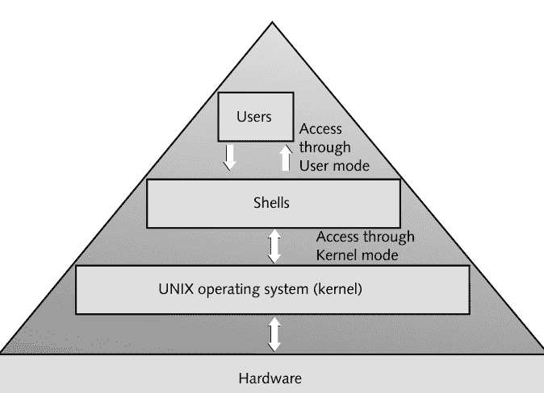

图 1-4 UNIX 系统的层

Linux 是类 UNIX 操作系统，因为它不是从传统的 UNIX 代码编写的。相反，它是为了看起来和运行起来像 UNIX 而创建的原始代码（内核），但包含了 POSIX 标准在内的增强。Lin Torvalds 在 1991 年向公众免费发布了 Linux，他最初创建了 Linux。现在，许多机构和公司提供免费和商业版的 Linux 发行版或版本。以下列表是 Linux 发行版的示例：

- Debian/UNIX（免费，见 www.debian.org）
- Fedora（免费，见 fedoraproject.org）
- Knoppix（免费，见 www.knoppix.org）
- Mandriva（商业和免费版，见 www.mandriva.com）
- Red Hat Enterprise Linux（商业版，见 www.redhat.com）
- openSUSE Linux（免费，见 en.opensuse.org/Welcome_to_openS）
- SUSE Linux Enterprise（商业版，见 www.novell.com）
- Turbo Linux（商业和免费版，见 www.turbolux.com）
- Ubuntu（免费，见 www.ubuntu.com）


# Linux 简介

Linux 提供了 UNIX 的复杂性且可以免费获取；或者，通过少量费用，你可以购买具有专门工具和功能的商业版本。凭借商业版的所有网络功能，Linux 足够健壮可以处理大型任务。你可以在你的 PC 上安装 Linux，它可以与其他操作系统共存，并测试你的 UNIX 技能。这些特性使得 Linux 成为学习 UNIX 的极佳方式，即使你有其他计算机的权限。

# Shell 概述

`Shell`（外壳）是一个 UNIX/Linux 程序，用于解释你从键盘输入的命令。UNIX/Linux 提供了几种 `shell`，包括 `Bourne shell`、`Korn shell` 和 `C shell`。AT&T Bell 实验室的 Stephen Bourne 开发了 `Bourne shell` 作为第一个命令处理器。此后，David Korn 开发了 `Korn shell`。`Korn shell` 与 `Bourne shell` 兼容，并包含许多扩展，例如 `history` 功能，可以让你检索之前输入的命令。`C shell` 是为程序员设计的。Linux 使用 `Bash shell` 作为其默认命令解释器。它的名字是“Bourne Again（再次 Bourne）”的缩写，并包含了 `Korn shell` 和 `Bourne shell` 的特性。无论你使用哪种 `shell`，你与 UNIX/Linux 的通信始终通过 `shell` 解释器进行。图 1-5 显示了 `shell` 在 UNIX/Linux 中的作用。

如果你使用图形用户界面（`GUI`）桌面（类似于带有图形和图标的 Microsoft Windows），为了使用命令你需要打开一个特殊的窗口。

在处理 UNIX/Linux 时，你需要选择一个 `shell` 来执行命令。用户通常使用一个 `shell` 编写脚本，另一个用于交互（在第 7 章中你将学习如何切换 `shell`）。

## Shell 关系图

图 1-5 `shell` 的关系（注：此处对应图中）

图 1-5 `shell` 的关系。

## 常见 Shell 列表

- `bash` (Bourne Again)
- `ksh` (Korn shell)
- `csh` (C shell)
- `tcsh` (C shell)
- `zsh` (Z shell)

当你选择了 `shell` 后，系统会将你的选择存储在帐户中，这将成为你的默认 `shell`。在 UNIX/Linux 中，你可以通过输入 `shell` 的名称从一个切换到另一个（例如，输入 `bash` 或 `sh`）。用户通常使用一个 `shell` 编写脚本，另一个用于交互（在第 7 章中你将学习如何设置默认 `shell`）。

# 登录与账户

在操作 UNIX/Linux 之前，你必须通过提供用户名和密码来登录。决定一个你想在 UNIX/Linux 系统中标识自己的名字，例如 `inn`。某些 UNIX 版本只识别用户名的前八个字符，大多数 Linux 版本支持 32 个字符。

你必须选择一个密码，在较新版本的 UNIX/Linux 中，密码至少包含六个字符。密码应该是你容易记忆但他人难以猜测的，例如将两个对你有意义的词组合在一起，并混合大小写字母、数字和其他字符。密码可以包含字母、数字和标点符号，但不能包含控制字符（例如 Control 键和字母的组合，如 `x`，用于计算机执行特定操作的服务）。

# 使用 Telnet 或 SSH 连接到 UNIX/Linux

- 通过 UNIX/Linux 客户端/服务器网络上的客户端软件
- 作为点对点局域网中的节点，网络中的每台计算机都安装了 UNIX/Linux 操作系统
- 在安装了 UNIX/Linux 操作系统的独立 PC 上
- 通过连接到 UNIX/Linux 主机通信端口的哑终端（`dumb terminal`）

附录“如何访问 UNIX/Linux 操作系统”描述了多种访问方法，包括如何设置和使用 `Telnet` 或 `SSH`。此外，附录“如何安装和使用 Knoppix CD”提供了关于如何在计算机上安装 Fedora 版本的 Linux 以及如何从书中附带的 CD 运行 Knoppix 的说明。

连接到 UNIX/Linux 系统的步骤取决于你所使用的连接类型。通过哑终端连接或通过独立系统访问操作系统是最容易的两种方法。在这两种情况下，你都需要登录账户。在客户端/服务器网络中使用客户端软件可能需要来自网络管理员的特殊说明或或培训。

如果你在点对点网络上连接，可以使用 `Telnet` 或 `SSH`。通过 `Telnet` 或 `SSH` 连接是常用方法，将在下一节中描述。你可以使用 `Telnet` 或 `SSH` 通过局域网和互联网访问 UNIX/Linux 点服务器计算机。附录 A 还讨论了如何使用不同方法通过网络连接。


Telnet 是一个仿真程序。它运行在你的计算机上，并将你的 PC 连接到网络上的服务器或主机。运行该程序的 PC 可以是运行 UNIX、Linux、基于 Windows 的操作系统或 Mac OS。然后，你可以登录到 UNIX/Linux 主机并开始工作。大多数 UNIX/Linux 版本都包含 Telnet，大多数 Microsoft Windows 版本以及较版本的 Mac OS 也是如此。

互联网上的每台计算机都有一个互联网协议（IP）地址。该地址由四个由点分隔的数字组成（在使用 IPv4 时），例如 `172.16.16.1`。互联网上的大多数系统还有一个域名，它是用于识别网络上计算机资源组的名称。基于互联网的域名由三部分组成：顶级域名（例如国家或组织类型）、子域名（例如公司或大学名称）和主机名（例如主机计算机的名称）。使用三部分识别的示例是 `research.campus.edu`，其中“research”是主机名，“campus”是子域名，“edu”是顶级域名。IP 地址和域名都标识网络上的一个系统。Telnet 等程序使用 IP 地址或域名访问远程系统。

通过 Telnet 访问 UNIX/Linux 主机的通用步骤如下：

1. 确定主机的 IP 地址或域名。
2. 连接到你的网络或互联网。
3. 启动你的 Telnet 程序，并连接到 UNIX/Linux 系统。例如，在 Windows XP 或 Vista 中启动 Telnet，打开命令提示符窗口，输入 `telnet` 并按回车。在 Fedora、Red Hat Enterprise Linux 或 SUSE 中连接 Telnet，请使用终端窗口，输入 `telnet` 并按回车。
4. 按照你的 Telnet 程序中的指令连接到远程主机。通常，你提供提供名称或 IP 地址以连接到 UNIX/Linux 系统。例如，在 Windows 2000/XP/Server 2003/Vista 的命令提示符窗口或 UNIX/Linux 命令行出现命令提示符后，你可以输入 `telnet lunar.campus.edu`，你可以输入以下命令：

```
telnet lunar.campus.edu
```

输入命令后按回车。
5. 提供用户名和密码以登录到远程 UNIX/Linux 计算机。

Secure Shell (`SSH`) 的开发用于 UNIX/Linux 系统，为 TCP/IP 应用（如 FTP 和 Telnet）提供身份验证安全。历史上，这些应用程序的身份验证很大程度上由未加密的账户和密码组成。`SSH` 应用现代安全技术来确保会话的身份验证。`SSH` 可以在跨网络或互联网时加密通信。

在 Fedora、Red Hat Enterprise Linux、SUSE 以及其他版本的 UNIX/Linux 中，可以使用 `ssh` 命令代替 telnet，为运行 UNIX/Linux 且兼容 openSSH 的远程计算机建立安全连接。openSSH 是 SSH 的版本，包含了免费分发的协议和软件，可用于许多 UNIX/Linux 系统。

要使用 `ssh`，你打开一个终端（或访问命令行），并在命令行中使用 `ssh -l` 配合用户名和主机计算机名称。另外两个选项是使用 `ssh user@hostname` 或带有 IP 地址的 `ssh`。

实验项目 1–1 显示了如何在 Windows 2000/XP/Vista 中使用 Telnet。实验项目 1–2 显示了如何在 Fedora、Red Hat Enterprise Linux 或 SUSE 中访问终端窗口，并使用 `ssh` 访问远程计算机。

使用 Telnet 或 SSH，你需要在你的系统上启用它们。请参阅实验项目 1-1 的说明，了解如何在不同的 UNIX/Linux 系统中启用 Telnet 或 SSH。

## 登录到 UNIX/Linux

与 UNIX/Linux 交互，你需要输入一个命令，即你在命令提示符后输入的文本。完成命令输入后，按 Enter。UNIX/Linux 是大小写敏感的；这意味着它们区分大写字母和小写字母，所以 John 不同于 john。你输入的大多数 UNIX/Linux 命令都是小写。

登录后，你就可以准备好使用系统了。如果你通过网络或哑终端访问 UNIX/Linux——或者你的独立系统已配置为命令行——你可以在命令提示符处执行命令。然而，如果你正在使用独立计算机和 X 桌面，你必须打开一个终端窗口（见图 1-6）来访问命令提示符。

你在屏幕上输入命令的地方被称为命令行（参见图 1-6）。命令使用以下语法：

### 语法
`command_name [-option] [argument]`

#### 详解
- `command_name` 指定了要执行的操作。在本书的语法插图中，命令名以粗体显示。（在正文中，命令名以斜体显示。）
- 命令选项（Options）用于请求 UNIX/Linux 以特定的样式或变体执行命令。选项紧跟在命令后面，并用空格分隔。它们通常以连字符（-）开头。选项对大小写敏感。例如，`-R` 与 `-r` 不同。你不需要在每个命令后都输入选项；但是，某些命令如果不指定选项将无法工作。本书中的语法插图在命令不需要这些选项时，使用方括号（`[]`）列出选项。
- 命令参数（Arguments）跟在命令后面，用空格（空白符）分隔。命令参数通常是文件名和目录名。在本书的语法插图中，参数以斜体显示。如果命令不需要这些参数，则用方括号括起来。

在接下来的章节中，你将通过对以下基础命令的介绍开始学习 UNIX/Linux 之旅：

- `date`
- `cal`
- `who`
- `clear`
- `man`
- `whatis`

你还将学习命令行编辑技术、如何输入多个命令以及如何找回之前使用过的命令。此外，你将学习如何退出活动会话。

UNIX/Linux `date` 命令显示系统日期。在多用户系统中，系统时间对于应用程序至关重要（参见图 1-7）。由于涉及日期，只有系统管理员可以更改日期。例如，财务部门可能需要将日期与用于报告任务信息的特定文件关联，或者出版部门可能需要对文档盖上日期以确保特定的版权日期。

```
mpalmer@localhost:~~
File Edit View Terminal Tabs Help
[mpalmer@localhost~]$ date
Sat Nov 21 10:29:56 MST 2009
[mpalmer@localhost~]$ 
```

**图 1-7** 使用 `date` 命令

`date` 命令有一个选项 `-u`，用于显示格林威治标准时间（GMT）。

> GMT 也称为格林威治子午线时间和协调世界时间（UTC）。UTC 被认为是国际时间标准。要了解更多关于 UTC 的信息，请访问 NASA 网页：`www.ghcc.msfc.nasa.gov/utc.html`。

实践项目 1–3 将让你能够使用 `date` 命令。

### 语法 `date` [-option]

#### 详解
- 显示系统日期和时间
- 常用选项包括：
  - `-u` 查看格林威治标准时间
  - `-s` 重置日期或时间

`cal` 命令用于显示系统日历。该命令对于安排活动或确定你过去完成或计划在未来完成的项目的特定日期非常有用。`cal` 命令还可以通过在命令行使用 `cal -j` 来确定儒略日。儒略日是从该年初开始计算的天数，其值在 1 到 366 之间（包括闰年）。程序员有时将儒略日用于特定的编程函数，例如确定员工在当年在该机构中工作的天数。图 1-8 显示了命令 `cal -j 2009` 的结果，显示了 2009 年每月日历的儒略日。实践项目

图 1-8 使用 `cal` 命令确定儒略日

### 语法 `cal` [option]

#### 详解
- 生成当前年份或用户指定的年份的日历
- 常用选项：
  - `-j` 用于儒略日
  - `-s` 将星期日显示为每周的第一天
  - `-m` 将周一显示为当前月该月的第一天

## who 命令

要确定关于谁登录了系统的信息，请使用 `who` 命令。在多用户系统中，知道谁登录了系统对管理员非常重要，这样管理员可以定期验证授权用户和使用水平。知道谁登录了系统对于普通用户也很有价值，他们可以借此判断系统在特定时间的忙碌程度，或者谁可能想联系另一个用户。

### 语法 `who` [-option]

#### 详解
- 提供登录系统的用户列表
- 常用选项包括：
  - `am i`（在 `who` 前面输入，如 `am i`）获取关于你自己的会话的信息
  - `whoami`（将 `whoami` 写为一个单词）查看你正在使用哪个账户
  - `-H` 显示列标题
  - `-u` 显示每个用户的空闲时间（旧的 `-i` 正在从 `who` 选项中弃用）
  - `-q` 快速列出登录用户
  - `-b` 系统管理员使用，用于验证系统是否已启动

尝试实践项目 1-5 来学习如何使用 `who` 命令。

随着你继续输入命令，你的屏幕可能会变得杂乱。除非你需要参考之前输入的命令及其输出，否则你可以使用 `clear` 命令来清除你的屏幕。它没有选项或参数。

你在实践项目 1-6 中使用了 `clear` 命令。

### 语法 `clear`
- 清除终端屏幕、显示或终端窗口


## man 程序

为了参考，UNIX/Linux 包含一份在线手册，包含了所有命令及其选项和参数。`man` 程序显示此手册，被称为手册页（man pages）。虽然某些命令的手页包含的信息更多，但大多数手册页包含以下项目：

- Name——命令名称及其简短目的说明
- Synopsis——显示命令使用方式的语法图
- Description——对命令进行更详细的描述，以及命令选项列表
- Author——开发该命令或程序的作者名称或姓名（如果可用）
- Reporting Bugs——如何报告错误或问题的信息
- History——有时包含显示命令来源的信息
- Other Versions——有时包含指示有其他版本的信息
- See Also——提供相关其他命令或手册页

`man` 程序通常接受一个参数——你想要更多信息的命令名称。在线手册显示了系统接受的有效格式。要查看在线手册，输入 `man q`。

### 语法
`man [option] argument`

### 详解

- `-` 显示来自文档的信息
- `-` 示例选项包括：
  - `-d` 输出调试信息
  - `-f` 显示命令的简短描述（与使用 `whatis` 命令产生相同的信息）
  - `-K` 通过搜索所有手册信息查找字符串
- `-` 参数是你想要学习的命令或程序的名称

例如，考虑 `cal` 命令的手册页，如图 1-9 和 1-10 所示。在这个示例中，第一行显示了命令名称 `cal` 及其简短描述“显示日历”。接下来，Synopsis 部分提供了关于命令使用方式的信息，显示它可以配合选项（如 `-mjl` 中的任何一个）使用，也可以指定月份或年份作为参数。Description 部分提供了关于命令目的的更详细信息，并解释了默认用法，例如在不使用参数时显示当前月份。Description 部分还显示了选项，例如 `-u` 从星期日开始显示日历。

在图 1–10 中，关于 `cal` 命令使用的更多信息出现在 Description 部分的末尾。History 部分显示该命令出现在 AT&T UNIX 中。最后，Other Versions 部分包含了你可以获取和使用的 `cal` 其他版本的信息，结尾的日期显示了该手册页的编写或更新时间。

# 第 20 章 第一章 UNIX 和 Linux 的本质

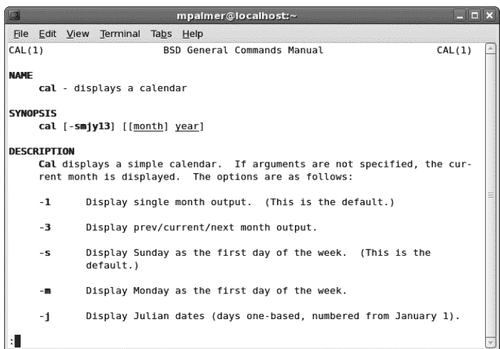

图 1-9 `cal/` 命令的 man page

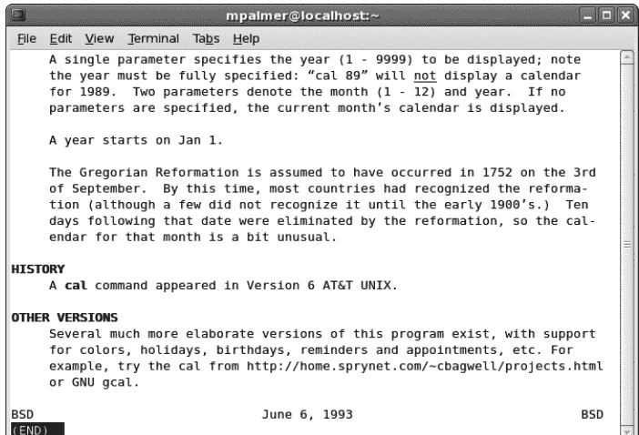

图 1-10 `cal/` 命令的 man 文档中的附加信息

## 使用命令

许多系统除了 man 页之外，还提供 info 页面。有时 info 页面提供了有关命令的更多信息，而有时 man 页面则如此。此外，新命令可能只会在 man 或 info 中介绍。如果你需要某个特定命令的帮助，考虑同时检查这两个源。例如，要查找关于 `who` 命令，请输入 `info who`。

## whatis 命令

有时你会发现 man 页面包含的信息比你想看到的更多。要显示命令的简要摘要，请使用 `whatis` 命令（见图 1-11）。`whatis` 命令仅显示出现在命令 man 页面顶部的名称和描述。

```
mpalmer@localhost:~
File Edit View Terminal Tabs Help
[mpalmer@localhost~$] whatis cal
cal (1) - 显示日历
cal (1p) - 打印日历
[mpalmer@localhost~$]
```

图 1-11 使用 `whatis` 获取 `cal` 命令的快速摘要

`whatis` 命令依赖存储在数据库中的信息。在某些 UNIX/Linux 系统上，管理员必须执行 `whatis` 命令来创建数据库，然后 `whatis` 命令才能正常运行。在 Fedora 和 Red Hat Enterprise Linux 中，登录到 root 账户并运行 `/usr/sbin/makewis` 来创建数据库——尽管这些操作系统的最新版本以及 SUSE Linux 已经自带了数据库。（SUSE Linux 在 `/usr/sbin` 目录中不包含 `makewis`。）

### 语法
`whatis 参数`

#### 析

- 显示从 `whatis` 数据库获取的命令简短描述
- 在许多 UNIX/Linux 版本（包括 Fedora 和 Red Hat Enterprise Linux）中，`whatis` 命令仅接受一个参数（命令或程序的名称），且没有选项。在 SUSE 中，`whatis` 提供了几个选项。一个重要的选项是 `-w`，使用拼写中的通配符搜索数据库，例如使用 `*`，以及在使用 Bash shell 时（例如，在搜索 `*man*` 时输入 `*whatis -wa`）。另一个实用的选项是 `-m system`，允许 SUSE 搜索网络上不同 UNIX/Linux 系统的数据库，例如 BSD UNIX。

实操项目 1-7 使你能够使用 `man` 和 `whatis` 命令。

## 命令行编辑

Shell 支持某些按键来执行命令行编辑。例如，Bash（默认 Shell）支持左、右箭头键，这些键可以使光标在命令行上移动。例如，如果你漏掉了一个命令或参数，可以使用左右箭头在活跃的命令行中移动到拼写错误处，进行纠正，然后执行命令——这一切无需重复输入。其他键与 Alt 或 Ctrl 结合使用，用于其他编辑操作，Del 用于删除字符。表 1-1 说明了你可以用于命令行编辑的常用 Alt、Ctrl 和 Del 键组合。此外，请尝试实操项目 1-8 来练习命令行编辑。

| 键位组合 | 描述 |
| :--- | :--- |
| `Ctrl+b` | 将光标移动到上一个字母 |
| `Alt+d` | 删除一个单词或连续字符 |
| `Alt+l` | 将光标移动到下一个单词第一个字符之前的位置 |
| `Ctrl+a` | 将光标移动到命令行的开头 |
| `Ctrl+k` | 删除从当前光标位置到命令行末尾的内容 |
| `Del` | 删除一个字符 |

> 并不是所有的 shell 都以相同的方式支持命令行编辑。表 1-1 适用于 Linux 中的 Bash shell。

实操项目 1-1 使你能够练习命令行编辑，并确定你是否正在使用 Bash shell。

## 多条命令输入

你可以通过分号 (`;`) 分隔命令在命令行上输入多个命令。当你按下 Enter 键时，命令将按照你输入的顺序执行。例如，如果你输入 `date ; cal`，你会看到今天的日期和本月的日历。在后续章节中你会学习，这是一次性完成几项操作的重要功能，例如处理文件中的数据并打印或显示特定数据。尝试实操项目 1-9 从单条命令行输入执行多个命令。

## 命令行历史

通常，你会发现自己在短时间内多次输入相同的命令。大多数 shell 都会保留你最近使用的命令列表，并允许你无需重新输入即可调用命令。你可以使用向上和向下箭头键访问命令历史。按一次向上箭头可回最近一次使用的命令。每按两次向上箭头即可回第二个最近一次的命令。每按一次向下箭头键，都会滚动命令历史。当你找到想要执行的命令时，按下 Enter。当你需要输入该命令时，此功能可以节省时间并避免沮丧。实操项目 1-10 使你能够使用命令历史。

## 退出 UNIX

当你完成工作或离开系统时，注销将结束你的会话。要退出 UNIX/Linux，请使用 `exit` 命令。在某些 shell 中，输入 `exit` 会关闭终端。在其他 shell 中，你可能需要使用快捷键注销。

# 第一章 UNIX 和 Linux 的本质

## 理解管理员的角色

UNIX/Linux 上有两种用户：系统管理员和普通用户。管理员通过添加新用户、删除旧账户和确保系统运行良好来管理系统。管理员被称为超级用户（superuser），因为他们对系统拥有无限权限。

## 管理员的命令行

虽然普通用户在 `$`（美元符号）之后输入命令，但系统管理员的提示符是 `#`（井号）。UNIX/Linux 系统为系统管理员生成的默认设置如下：`[root@hostname]#`

在提示符中，`hostname` 是登录系统的计算机名称。在某些计算机上，`hostname` 为 `localhost` 以指代本地计算机，或者在计算机没有名称时使用 `localhost`。除了 `root` 账户外，`root` 的另外两个含义你将在稍后学习。其中一个是所有目录的根基础，另一个是 `root` 账户的默认家目录。

## 普通用户的命令行

`$`（美元符号）（或 SUSE 中的右箭头）传统上与普通用户相关。UNIX/Linux 系统为普通用户生成命令行提示符的默认设置。以下格式在 Linux 系统中常见：

```
[username@hostname username] $$
[username@hostname -] $$
[username@hostname: ->] $$
```

在提示符中，`username` 是用户的登录名（例如 `jean`），`hostname` 是用户登录的计算机名称（或在没有名称时使用 `localhost`）。

# 修改密码


上方显示的提示符中，第二个 `username` 指的是用户家目录的名称（默认情况下与用户名相同）。波号 (`~`) 指的是该用户的家目录（在本例中）；如果你更改了目录，将显示你所切换的目录名称，而不是波号。

# 修改密码

你的名称或登录名是你在系统中用于识别你身份的标识。你可以选择自己的用户名并将其交给系统管理员，然后由他们将你作为新用户添加。如前提到的，某些 UNIX/Linux 版本可以相互识别，而其他版本如 Fedora、Red Hat Enterprise Linux、SUSE 和 Knoppix 则在你的用户名中最多仅支持 32 个字符——这可以是你的名和姓、你的姓和名的首字母缩写、或者仅仅你的姓，有时也可以是昵称。

## 语法 `passwd [-option] [argument]`

## 详解

- 供账户所有者或系统管理员用于更改密码。
- `-e` 用于系统管理员使密码过期，以便使用户在下次登录时必须创建一个新密码。
- `-l` 锁定账户，供系统管理员使用。
- `-S` 通常用于系统管理员查看账户的密码状态，以确保账户已设置密码。

UNIX/Linux 管理员可以为密码设置规则，例如密码必须具有最小长度限制、包含字母和数字的组合，并且不能与你最近使用的密码相同。《动手实践项目 1–11》允许你更改自己的密码。

更改密码后，你应该注销并重新登录，以确保 UNIX/Linux 识别了你的新密码。

> 记住你的密码！你每次登录 UNIX/Linux 时都需要密码。有关关于 `passwd` 命令的更多信息以及关于保持密码安全的提示，请输入 `man passwd` 命令。

# 第 1 章 UNIX 和 Linux 的本质

## 使用 CAT, MORE, LESS, HEAD 和 TAIL 命令查看文件

有三个 UNIX/Linux 命令允许你查看文件内容：`cat`、`more` 和 `less`。`more` 和 `less` 命令一次显示一个屏幕的文件内容。`more` 命令只能向下滚动，而 `less` 则既可以向上也可以向下滚动。`cat` 命令一次性显示整个文件。另外两个命令 `head` 和 `tail` 允许你查看文件的前几行或最后几行（默认为十行）。

`cat` 命令的名字源于 "concatenate"（连接）一词。你可以通过在 `cat` 命令后输入多个文件名并用空格分隔来显示多个文件。UNIX/Linux 随后按照你输入的顺序显示文件内容。

尝试动手实践项目 1-12、1-13 和 1-14 来使用 `cat` 命令、`more` 和 `less` 命令，最后使用 `head` 和 `tail` 命令。

## 重定向输出

在 UNIX/Linux 中，大于号 (`>`) 被输出重定向操作符。你可以通过将其附加到产生输出的命令，创建一个新文件或覆盖现有文件。实际上，你将输出重定向到了磁盘文件而不是显示器。例如，如果你输入 `who > current_users` 并按回车，这将创建一个名为 `current_users` 的文件，其中包含 `who` 命令的信息。

重定向输出在很多情况下都有用。例如，当你监控系统时，可能会将输出重定向到文件中以便稍后检查。或者，你可能有一个程序或报告生成实用程序可以处理数据，以便你将结果重定向到文件而不是屏幕。在本书的后面部分将学习其他重定向操作符，目前 `>` 操作符是一个很好的起点。

尝试动手实践项目 1-15 和 1-16 使用 `>` 输出重定向操作符。

你还可以结合 `cat` 命令和输出重定向操作符，从键盘输入的信息创建文件。在命令后输入 `cat > filename`，其中 `filename` 是文件名。动手实践项目 1-17 使用波号重定向操作符。`>` 覆盖现有文件。使用波号重定向操作符将输出添加到文件。

## 章节总结

- 操作系统是基础，它控制计算机资源，并提供应用程序的基础。
- 在集中式网络中，`less` 命令用于查看应用程序的文档。
- 在网络中，所有数据都存储在服务器上，是安全的。如果网络故障，系统可以继续运行。
- UNIX/Linux 操作系统是多用户系统，允许许多人同时访问并共享计算机。这些也是多任务操作系统，意味着它们可以同时执行多个任务。
- UNIX/Linux 系统可以被配置为网络中的专用服务器、客户端或工作站。

大多数 Shell 提供基本的命令行编辑功能，并记录你常用命令的历史。使用向上和向下方向键在列表中向前翻页。你可以通过分号在单行内输入多个命令。UNIX/Linux 按照你输入的顺序执行命令。

你可以使用“查看”命令检查文件内容。使用 `cat` 命令通过键盘输入创建文件。使用 `less` 和 `more` 命令显示多个文档。使用 `head` 和 `tail` 命令查看文件的开头或结尾。

## 命令总结：第 1 章回顾

| 命令 | 用途 | 本章涵盖选项 |
| --- | --- | --- |
| `cal` | 显示系统日历 | `-j` 显示儒略日期；`-s` 显示星期日为一周的第一天；`-m` 显示星期一为一周的第一天；`-u` 显示当前年份月份。 |
| `cat` | 显示多个文件 | `-n` 显示行号。 |
| `clear` | 清屏 |  |
| `date` | 显示系统日期 | `-u` 显示格林威治标准时间的时间；`-s` 重置日期和时间。 |
| `exit` 或 `logout` | 在不使用 GUI 时退出 UNIX/Linux |  |
| `head` | 显示文件的前几行 | `-n` 显示指定文件的前 n 行。 |
| `less` | 一次显示一个屏幕的长文件，可以向上和向下滚动 |  |
| `man` | 显示指定命令的在线手册 | `-d` 打印调试信息；`-f` 提供命令的简短描述（相当于使用 whatis）；`-K` 通过搜索所有 man 信息查找特定字符串。 |
| `more` | 一次显示一个屏幕的长文件，可以向下滚动 |  |
| `passwd` | 更改你的 UNIX/Linux 密码 | `-e` 使密码过期导致使用户必须重新创建；`-l` 锁定账户；`-S` 显示账户状态。 |

# 关键术语 29

| 命令 | 用途 | 本章涵盖的选项 |
| --- | --- | --- |
| `tail` | 显示文件的最后几行 | `-n` 显示文件的最后 n 行。 |
| `whatis` | 显示命令的简要描述 |  |
| `who` | 允许你查看谁登录了系统（同时 `whoami` 显示登录账户，`who` 显示账户会话信息） | `-H` 显示列标题。`-u` 显示会话空闲时间。`-q` 显示用户列表。`-b` 验证系统上次启动时间。 |

## 关键术语

- `argument`（参数） — 跟在 UNIX/Linux 之后、用于执行命令的额外信息的文本。在命令行上，参数跟在选项名称之后，两者用空格隔开。参数的示例文件名和目录名。
- `authentication`（认证） — 验证用户是否有权访问特定计算机、服务器或网络资源（如 Telnet 或 FTP）的过程。
- `Bash shell` — 一种 UNIX/Linux 命令解释器（默认 shell 壳）。它结合了 Bourne shell 和 Korn shell 的最佳特性。它是 “Bourne Again Shell” 的缩写。
- `Berkeley Software Distribution (BSD)` — 由加州大学伯克利分校开发的 UNIX 分发版，该校首次发布的 BSD 版本。
- `Bourne shell` — 第一个 UNIX/Linux 命令解释器，由 Stephen Bourne 在 AT&T 实验室开发。
- `C shell` — 为 C 语言程序员设计的 UNIX/Linux 命令解释器。
- `case sensitive`（大小写敏感） — 一种区分大写字母和小写字母的属性——例如，John 与 john 不同。UNIX 是大小写敏感的。
- `client`（客户端） — 网络上的计算机，用于运行程序或从大型机、网络服务器或主机计算机访问文件。
- `command`（命令） — 在命令行提示符后输入的文本，用于请求计算机执行特定操作。
- `command line`（命令行） — 输入命令的位置。
- `domain name`（域名） — 识别网络上计算机资源组的名称。基于的名称由三部分组成：顶级域名（如国家或组织类型）、子域名（如企业或大学名称）和主机名（计算机名称）。
- `File Transfer Protocol (FTP)` — 一种用于发送和接收文件的 Internet 协议。
- `graphical user interface (GUI)`（图形用户界面） — 将转化为无限种图像的软件，当你使用操作系统时会看到图形图像。
- `host`（主机） — 见 server。
- `Internet Protocol (IP) address`（IP 地址） — 一组四个数字（针对常用的 IP 版本 4），用点连接——例如 172.16.1.1——用于识别和访问网络或 Internet 上的远程计算机。

# 第一章 UNIX 和 Linux 的本质


kernel（内核） — 基础操作系统，直接与硬件和用户服务程序交互。

Kernel mode（内核模式） — 访问内核的一种手段。使用限于系统管理员，以防止未经授权的操作干扰支持整个 UNIX/Linux 结构的硬件。

Korn shell — 一种比原始 shell 提供更多功能的 UNIX/Linux 命令解释器。由 David Korn 在 AT&T 贝尔实验室开发。

log（日志） — 一种过程，通过要求每个用户在登录系统之前使用用户名和密码，来保护隐私并维护多用户系统的安全。

mainframe（大型机） — 一种大型计算机，历史上为工业级计算提供强大的处理、海量存储和客户端访问。大型机今天仍在使用，但许多已被设计为服务器的 PC 型计算机取代，这些计算机具有强大的处理和磁盘存储能力。

man pages（手册页） — UNIX/Linux 命令和程序的在线手册页，可以通过输入 `man 命令名或程序名` 来。

multitasking system（多任务系统） — 一种允许计算机同时运行两个或多个程序的操作系统。

multiser system（多用户系统） — 许多人可以同时访问并共享服务器计算机资源的系统。为了保护隐私和系统，每个用户必须输入用户名和密码才能使用或登录系统。UNIX 和 Linux 都是多用户系统。

network（网络） — 通过网线或无线通信连接的计算机组，允许许多用户共享计算机资源和文件。它结合了个人电脑的便利性和熟悉感以及大型机的处理能力。

operating system (OS)（操作系统） — 最基础的计算机程序，它控制所有计算机资源并为创建或编写程序提供基础。

options（选项） — 你配合 UNIX/Linux 命令使用的附加功能。

ordinary user（普通用户） — 系统管理员或超级用户之外的任何使用系统的人。

output redirection operator（输出重定向运算符） — 大于 `>` 是重定向运算符的一个示例。在命令后使用 `>` 会创建一个新文件或覆盖现有文件，并将输出发送到磁盘文件而不是显示器。

peer-to-peer network（点对点网络） — 一种网络配置，网络上的每台计算机既是客户端也是服务器。数据和程序存储在各个系统中，因此用户不依赖中央服务器。点对点网络的优势是，如果一台计算机故障，其他计算机继续运行。

personal computer (PC)（个人电脑） — 单台独立机器，如台式机或笔记本电脑，执行所有的输入、输出、处理和存储操作。

portability（移植性） — 操作系统的一种特性，允许系统在多个环境中使用，特别是不同类型的计算机上。UNIX 和 Linux 是可移植的操作系统。

## 关键术语

Portable Operating System Interface for UNIX (POSIX)（可移植操作系统接口） — 由工业、学术界和政府专家通过电气电子工程师学会 (IEEE) 开发的标准，用于应用程序的移植性，包括 UNIX 特性的标准化。

root（根） — 系统管理员的唯一名称；指系统管理员对 root 账户的所有权和无限权限。root 还有两个含义：(1) UNIX 文件系统树形结构的基础以及位于该层级的目录名称 `root`；(2) root 账户的主目录。

Secure Shell (SSH)（安全外） — 一种为 UNIX/Linux 系统开发的认证形式，为 TCP/IP 应用（包括 FTP 和 Telnet）提供认证安全。

server（服务器） — 拥有操作系统并因此接受并响应网络上其他计算机（称为客户端）运行的用户程序的请求的计算机。也称为主机。

server-based network — 一种中心化的网络方法，客户端计算机的数据和程序存储在服务器上。

server operating system（服务器操作系统） — 控制服务器或主机运行的操作系统，它接受并响应网络上其他计算机（称为客户端）运行的用户程序的请求。

shell（壳） — 用户与操作系统之间的接口。

superuser（超级用户） — 源自 AT&T 贝尔实验室的 UNIX 版本，于 20 世纪 80 年代初作为商业版本 System3 发布。现在有基于 System V 的商业和免费版本。

syntax（语法） — 命令的格式、措辞、选项和参数。

system administrator（系统管理员） — 拥有可以管理系统的账户的用户，可以通过添加新用户、删除账户并确保系统为所有用户良好高效地运行。

Telnet — 一种 Internet 仿真程序。

terminal（终端） — 连接到服务器或主机的设备，但仅由显示器和键盘组成，没有 CPU。有时称为哑终端。

terminal window（终端窗口） — 从 UNIX 或 Linux GUI 打开的特殊窗口，允许你使用 shell（如 Bash shell）输入命令。

User mode（用户模式） — 访问系统中程序软件区域的一种手段。

## 复习习题

1. 你的老板急匆地来到你的办公室，要求你参加本周五上午 10:30 的一个会议，而你找不到笔来做笔记作为提醒。你可以使用哪种 Linux 命令快速记录笔记并将其存储在名为 `Meeting` 的文件中？

   - a. `note: Meeting`
   - b. `cat > Meeting`
   - c. `Meeting >> note`
   - d. `record = Meeting`

2. 在完成问题 1 中的记录之前，你决定先确定周五的日期，以便将其包含在笔记中。你可以使用哪种 Linux 命令快速确定周五的日期？

   - a. `cal`
   - b. `date -cal`
   - c. `weekday`
   - d. `time -d`

3. 当你正在输入命令时，你拼错了想要通过命令指定的文件名。以下哪种命令行键组合可以让你返回并修复错误？

   - a. `Ctrl+b`
   - b. `Alt+End`
   - c. `Ctrl+2`
   - d. `Shift+Alt+m`

4. 你已经有几个月没有更改用户账户密码了，现在决定创建一个新密码。你应该使用以下哪种命令？

   - a. `changepass`
   - b. `newpass`
   - c. `cat -p`
   - d. `passwd`

5. 你忘记了 `cat` 命令中 `-n` 选项的作用。在 Linux 命令行中输入以下哪个内容可以找出当与 `cat` 使用时 `-n` 选项的作用是什么？

   - a. `what's cat -n`
   - b. `? cat`
   - c. `man cat`
   - d. `find -n for cat`

6. 以下哪项是最初通过 AT&T 贝尔实验室开发的 UNIX 发行版？

   - a. `SUSE`
   - b. `BSD`
   - c. `TurboUNIX`
   - d. `System V`

7. Linux 使用哪种 shell 作为默认命令解释器？

   - a. `Bash shell`
   - b. `Korn shell`
   - c. `Bourne shell`
   - d. `C shell`

8. 你需要在一个名为 `Annual_Report` 的文件末尾输入文本。以下哪种命令可以让你添加该文本？

   - a. `$add = Annual_Report`
   - b. `append < Annual_Report`
   - c. `cat >> Annual_Report`
   - d. `append @ Annual_Report`

9. SSH 可用于

   - a. 分析 UNIX 或 Linux 计算机的安全性
   - b. 远程登录网络上的另一台计算机
   - c. 静音声卡音
   - d. 快速切换到本地计算机上的另一个用户账户

10. 这是你担任 Linux 服务器管理员的第一个天，老板给了你 root 密码。什么是 root？

    - a. 一个练习用用用户账户的名称
    - b. 一个确定 Linux 服务器上的用户及其正在做什么的程序
    - c. 安全性的最低层或分支，因为你必须逐层提高安全级别完成你的工作，以向 UNIX/Linux 系统证明你具备管理员的技能
    - d. 拥有访问 UNIX/Linux 系统权限的管理员账户

11. 在你的文档文件中，通常会将文件的创建日期和最后修改日期放在文件的最后两行。你可以使用哪种命令只查看名为 `project` 的文件的最后两行？

    - a. `show - 2 project`
    - b. `display project -2`
    - c. `tail -2 project`
    - d. `less /2 project`

12. 你正在与一位新同事工作，他输入了 `man` 命令，但不知道如何退出。按下以下哪些键可以让你返回常规命令提示符？

    - a. `q`
    - b. `Alt+s`
    - c. `Spacebar`
    - d. `Ctrl+Del`

13. 以下哪些是 Linux 发行版？

    - a. `SUSE Enterprise`
    - b. `Mandriva`


- c. Fedora
- d. Red Hat Linux
- 14. 以下哪些命令可以让你查看文件内容？
  - a. `less`
  - b. `cat`
  - c. `grok`
  - d. `whatis`
- 15. 当你输入 `who` 命令时，你会看到什么信息？
  - a. 本地系统的用户
  - b. 系统的所有者
  - c. 无论是否登录的授权用户列表
  - d. 网络上计算机的列表
- 16. 你输入了大量的命令，现在你的终端窗口非常混乱。你可以使用哪种命令清理窗口？
  - a. `clean`
  - b. `freshstart`
  - c. `new`
  - d. `clear`
- 17. 你和同事共用一台计算机。当你完成后，退出 UNIX 或 Linux 会话的最佳方法是什么？
  - a. 使用电源开关关闭计算机。
  - b. 即使你的同事可能还要使用这台计算机，这也是为下一个用户会话完全初始化安全的方法。
  - c. 使用 `logout` 命令。
  - d. 使用 GUI 登录。
- 18. 你在一个公司工作。这是以下哪种网络的例子？
  - a. 集中网络
  - b. 点对点网络
  - c. 单机网络
  - d. 星型网络
- 19. 在以下哪种类型的计算机上可能会发现 UNIX 操作系统？
  - a. 主机
  - b. 桌面电脑
  - c. 服务器
  - d. 工作站
- 20. 你正赶时间，刚刚执行了一个打印文件的命令。你可以使用什么序列键？
  - a. Alt+P
  - b. Backspace
  - c. Enter
  - d. Shift+R
- 21. 你的国际公司正在根据 GMT 为加拿大、美国、瑞典和香港之间的会议安排。哪种命令可以显示当前时间？
  - a. `time -g`
  - b. `date -u`
  - c. `cal -t`
  - d. `hour -g`

## 动手项目

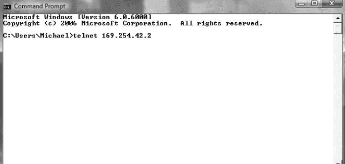

**图 1-12** 在 Windows Vista 中使用 Telnet

- 5. 登录后，关闭会话。根据你访问的系统，你可能需要以两种方式之一注销。一种方法是输入 `c` 并按 `回车` 关闭连接。接下来，输入 `exit` 并按 `回车` 退出 Telnet。结束会话的另一种方法是输入 `logout` 并按 `回车`。然后，必要时输入 `c` 并按 `回车`，再输入 `exit` 并按 `回车`。
6. 关闭命令提示符窗口。

Windows Vista 默认禁用 Telnet。要在 Windows Vista 中启用 Telnet，请登录具有管理员权限的账户，点击“开始”，点击“控制面板”，在“程序主显示模式”下点击“程序”，在“程序和功能”下点击“启用或关闭 Windows 功能”，点击“继续”，勾选“Telnet 客户端”复选框，并点击“确定”。

在 UNIX/Linux 主机服务器上，也应该启用 Telnet，例如通过编辑 `/etc/xinetd/telnet` 文件并将 `disable=yes` 改为 `disable=no`。在许多 UNIX/Linux 系统上，你可以登录 `root` 并进入 `~/telnet` 来配置 Telnet 参数。此外，你可能需要启动 Telnet 或 SSH 服务。在许多 UNIX/Linux 系统上，要启动 Telnet 或 SSH 服务，请登录 `root` 并针对 Telnet 输入 `service telnet start` 或 `telnet start`，或者启动 SSH 服务时输入 `service sshd start` 或 `sshd start`。请记住，Telnet 不够安全，如果可能，最好使用 SSH。

# 38 章 第1章 UNIX 和 Linux 的本质

关于主机服务器的防火墙安全，你可以通过以下步骤在 Fedora 和 Red Hat Enterprise Linux（带有 GNOME 桌面）中通过防火墙启用 Telnet 和 SSH 通信：点击“系统”菜单，指向“管理”，勾选“安全级别和防火墙”，输入 `root` 密码（如果需要）并点击“确定”，勾选 Telnet 和 SSH 的复选框，点击“确定”。如果你使用的是 Linux 10.0 或更高版本（带有 GNOME），点击“桌面”菜单，点击，输入 `root` 密码（如果需要）并点击“继续”，点击左侧面板中的“安全和用户”，点击右侧面板中的“防火墙”，点击左侧面板中的“允许的服务”，确保 SSH 列在“允许的服务”下。如果 SSH 未列出，打开“允许的服务”列表，选择 SSH（Telnet 不在选项列表中），点击“添加”按钮，点击“下一步”，并点击“接受”。在 Impulse Linux 10.0 及更高版本中，点击桌面底部面板上的“计算机”，点击“控制中心”，点击左侧面板中的“安全和用户”，确保 SSH 列在“允许”列下。如果 SSH 未列出，打开“允许的服务”列表，选择 SSH（Telnet 不在选项列表中），点击“添加”按钮并点击“接受”。如果这些步骤都不起作用，请查阅附录 A。

> 注意

## 项目 1-2

在这个项目中，你将使用来自 Fedora、Red Hat Enterprise Linux 或 SUSE 的 SSH。对于此项目，你需要远程账户的密码和远程计算机的主机名。此外，SSH 应通过 Fedora、Red Hat Enterprise Linux 或 SUSE 防火墙（前面的节点）启用。步骤 1 提供了在使用 GNOME 桌面的系统上打开终端窗口的说明。如果你的系统没有使用桌面（如 GNOME），请转到步骤 2。

使用来自 Fedora、Red Hat Enterprise Linux 或 SUSE 的 SSH 访问另一台 UNIX/Linux 计算机：

- 1. 在较新的 Fedora 和 Red Hat Linux 系统上（如 Fedora Core 2 及更高版本），点击“应用程序”，指向“辅助工具”，并点击“终端”。在旧的 Red Hat Enterprise Linux 系统上，点击“主菜单”，指向“系统工具”，并点击“终端”。在 SUSE Linux 10.0 及更高版本中，点击面板上的“计算机”，点击“更多应用程序”，指向“系统”，到“终端”，并点击“Gnome Terminal”（你也可以点击其他终端窗口选项，如 Konsole 或 X Terminal）。在 SUSE Linux 10.2 及更高版本中，点击左侧面板中的“系统”（或右侧面板中的“系统”部分），并点击“Gnome Terminal”。
- 2. 在命令提示符处，输入命令：`ssh username@hostname`。当提示密码时，输入远程账户的密码。注意，在输入时字符不会显示。
- 3. 连接成功后，你可以在远程机器上运行命令，就像你坐在它的终端一样。要终止会话，输入 `exit` 并按回车。
- 2. 在命令提示符处，输入 `ssh username@hostname`。当提示密码时，输入远程账户的密码。注意，在输入时字符不会显示。
- 3. 连接成功后，你可以在远程机器上运行命令，就像你坐在它的终端一样。要终止会话，输入 `exit` 并按回车。
- 3.

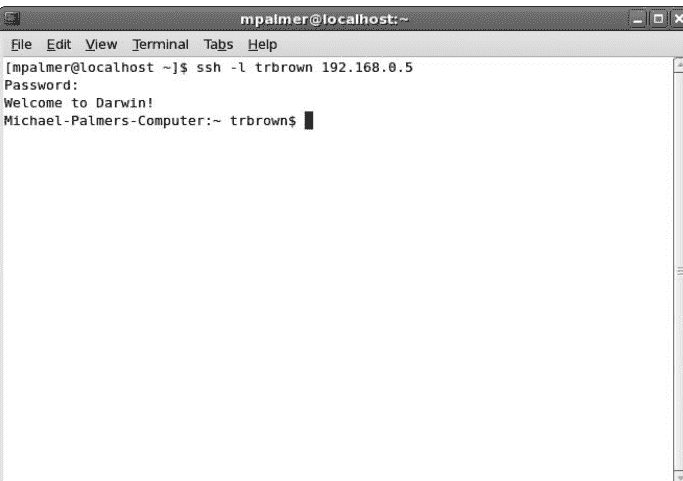

**图 1-13** 在 Windows Vista 中使用 SSH

- 3. 在命令提示符处，输入 `ssh username@hostname`。当提示密码时，输入远程账户的密码。注意，在输入时字符不会显示。
- 4. 连接成功后，你可以在远程机器上运行命令，就像你坐在它的终端一样。要终止会话，输入 `exit` 并按回车。
- 4. 在命令提示符处，输入 `ssh username@hostname`。当提示密码时，输入远程账户的密码。注意，在输入时字符不会显示。
- 5. 连接成功后，你可以在远程机器上运行命令，就像你坐在它的终端一样。要终止会话，输入 `exit` 并按回车。

 -> (注：此处为图片重复，翻译逻辑)

# 第 1 章 UNIX 和 Linux 的本质

4. 空闲时间是指用户会话中没有活动时经过的时间。输入 `who -u` 并按 `Enter` 可以查看每个用户的空闲时间。以下是 `who` 信息的示例列表。（最后一个值是进程 ID，但你可能也会进程 ID 之后看到注释）

```
mpaler pts/1 2009-11-22 08:15 4230 (:0:0)
sjones tty1 2009-11-22 07:56 4229 (:29:0)
rsanchez tty3 2009-11-22 08:21 4238 old
```

输出显示，以 `mpaler` 身份登录的人在过去的 29 分钟内一直处于活跃。`rsanchez` 行的“`old`”一词表示过去 24 小时内没有活动。


5. 如果你想在同一条命令行上使用多个选项，请在单个连字符后输入所有选项。例如，输入 `who -uH` 并按 `Enter` 以查看带有空闲时间和列标题的用户列表。

6. 输入 `who -q` 并按 `Enter` 查看当前用户的快速列表。你将看到一个类似下面的列表，它只显示登录名和系统上的用户总数。

```
mpaler sjones
## users=3
```

7. 要确定你正在使用哪个终端或登录时间，请在命令行中输入 `who am` 并按 `Enter`（见图 1-15）。出现了什么信息？如果你不确定，输入 `who am i -H` 并按 `Enter` 查看列标题。（另一个选项是输入 `whoamni` 写成一个单词，它只显示你的账户名或用户 ID，以防你不确定当前正在使用哪个账户；此选项供系统管理员使用。还请尝试输入 `who mom` 看看你发现了什么。）


如果你为命令提供两个参数，你将看到第 7 步描述的输出。例如，你可以输入 `who are` 或 `who x x x` 来查看相同的信息。传统上，UNIX/Linux 用户输入 `who am i` 来查看描述会话的信息。


另一个与 who is 类似的命令是 `w` 命令。系统管理员使用 `w` 命令不仅查看谁已登录，还查看在使用哪些系统资源（如 CPU 资源）。

## 实践项目


**图 1-15** 使用 who am i

## 项目 1-6

此时，你的屏幕可能看起来满了命令及其结果。每当你想要一个空白的屏幕时，都可以随时使用 `clear` 命令。这个项目将使你现在能够清除屏幕。

**清除屏幕：**
- 1. 在命令行上输入 `clear` 并按 `Enter`。命令行提示符现在位于屏幕的左上角。

## 项目 1-7

你可以使用手册页（manual pages）学习更多关于命令或程序的信息（如果该程序在手册页中有记录）。此外，`whatis` 提供特定命令和程序的快速摘要。在这个项目中，你将同时使用 `man` 和 `whatis` 命令。在使用 `whatis` 命令之前，应该已经创建了数据库。

**使用 man 显示在线帮助：**
- 1. 在命令行中输入 `man who` 并按 `Enter`。你将看到图 1-16 所示的 `who` 命令的解释。
- 2. 按一次或多次 `Enter` 以查看更多行文本。接着按 `Spacebar`（空格键）查看更多文档页。
- 3. 输入 `q` 退出 man 程序。

# 第 1 章 UNIX 和 Linux 的本质

```
mpalmer@localhost:~
File Edit View Terminal Tabs Help
WHO(1)                               User Commands                               WHO(1)
NAME
who - 显示谁已登录
SYNOPSIS
who [OPTION]... [ FILE | ARG1 ARG2]
DESCRIPTION
-a, --all
    同于 -b -d --login -p -r -t -u
-b, --boot
    上一次系统启动的时间
-d, --dead
    打印死进程
-H, --heading
    打印列标题行
-l, --login
    打印系统登录进程
```

图 1-16 使用 man 查找更多关于 who 命令的信息

- 4. 输入 `man` 并按 `Enter`。你将看到描述 `man` 命令的页面。`-M` 选项的目的是什么？
- 5. 输入 `q` 退出 `man` 程序。

**使用 whatis 命令显示命令的简要描述：**
- 1. 输入 `whatis` 并按 `Enter`。
- 2. 你看到 `who` 命令的摘要如下：

who (1) - 显示谁在系统上

who (1) - 显示谁已登录

## 项目 1-8

当你输入命令出错时，不需要重新输入整个命令。你可以使用命令行编辑功能。在这个项目中你将练习这些功能。

**在行上编辑命令：**
- 1. 首先确定你正在使用的 shell。输入 `echo SHELL` 并按 `Enter`。如果你使用的是 Bash shell，你会看到：

```
/bin/bash
```

如果你没有使用 Bash shell，输入 `bash` 并按 `Enter`。
- 2. 输入 `who am i` 但不要按 `Enter`。


- 3. 按左方向键将光标移动到单词 "am"。
- 4. 按 `Alt+d` 删除 "am。"
- 5. 按 `Ctrl+k` 删除当前位置的命令行。
- 6. 按 `Ctrl+a` 将光标移动到行首。
- 7. 再次按 `Ctrl+k` 删除。
- 8. 重输命令 `who am i` 但不要按 `Enter`。
- 9. 按八次 `Ctrl+b` 直到光标位于开头。
- 10. 按三次 `Alt+l`。每按一次，光标移动到下一个单词的字符之前。
- 11. 按 `Ctrl+a`，然后按 `Ctrl+k` 清除命令行。


## 项目 1-9

你可以在命令之间使用分号在同一行执行多个命令。在这个项目中练习运行命令。

**在行上输入多个命令：**
- 1. 输入 `date; cal` 并按 `Enter` 查看当前日期和本月日历。在分号前后加空格是有效的。例如，你可以输入 `date; cal`。
- 2. 输入 `who -u` 并按 `Enter`（见图 1-17）。date 命令产生第一行；剩余部分是 who 命令的结果。


## 项目 1-10

在这个项目中，使用 Bash shell 的历史功能调用你之前使用的命令。你会发现，越使用 UNIX/Linux，这个命令行功能就能节省大量的重复输入时间。

**使用命令行历史：**
- 1. 输入 `date` 并按 `Enter`。
- 2. 输入 `who` 并按 `Enter`。
- 3. 输入 `who -u` 并按 `Enter`。
- 4. 输入 `clear` 并按 `Enter`。
- 5. 按四次上方向键。date 命令被调到了命令行。不要按 `Enter`。
- 6. 按两次下方向键。你看到了什么命令？按 `Enter` 执行该命令。

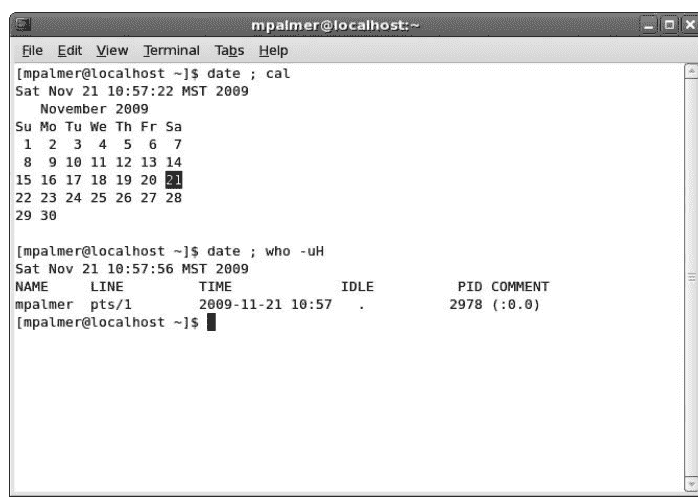

```
mpalmer@localhost:~
File Edit View Terminal Tabs Help
[mpalmer@localhost~]$ date ; cal
Sat Nov 21 10:57:22 MST 2009
November 2009
Su Mo We Th Fr Sa
1 2 3 4 5 6 7
8 9 10 11 12 13 14
15 16 17 18 19 20 21
22 23 24 25 26 27 28
29 30

[mpalmer@localhost~]$ date ; -uH
Sat Nov 21 10:57:56 MST 2009
NAME LINE TIME IDLE PID COMMAND
mpalmer pts/1 2009-11-21 10:57 . 2978 (:0.0)
[mpalmer@localhost~]$ 
```

**图 1-17** 在一条命令行上执行多个命令

## 项目 1-11

密码是你保护用户账户免受可能尝试未经授权访问的手段。计划经常更改密码以保持账户安全。在这个项目中，你将学习如何更改密码。

**更改密码：**
- 1. 在命令行提示符后输入 `passwd` 并按 `Enter`。
- 2. 输入你的当前密码并按 `Enter`。（在某些系统中，如果你登录的是 root 账户，则跳过此步直接进入第 3 步。）
- 3. 输入你的新密码并按 `Enter`。在输入时，屏幕上不会显示新密码。
- 4. 再次输入新密码并按 `Enter`，以便 UNIX/Linux 确认你的新密码。


> 提示：如果你再次输入的确认密码与密码不匹配，`UNIX/Linux` 会要求你重新输入密码。`UNIX/Linux` 可能会要求你选择不同的密码，因为你选择的密码太短、太容易猜或是你之前使用过的。

## 项目 1-12

`cat` 命令有多个用途，但最常用的之一是查看文件内容。例如，在本项目中，你使用 `cat` 命令查看位于 `/etc` 目录下的名为 `shells` 的文件。该文件包含了通过 `UNIX/Linux` 可用的所有有效 shell 程序列表。

### 使用 cat 查看 shells：

- 1. 在命令提示符后输入 `cat /etc/shells` 并按 `Enter` 键（见图 1-18）。（正斜杠 (`/`) 用于指示目录或文件夹的切换。）你的系统上看到了哪些 shells？

```
pmamer@localhost~
File Edit View Terminal Tabs Help
[mpamer@localhost~]$ cat /etc/shells
/bin/sh
/bin/bash
/bin/login
/bin/tcsh
/bin/csh
/bin/ksh
[mpamer@localhost~]$ 
```

**图 1-18** 使用 `cat` 命令查看文件内容

- 2. 有时，带行号显示文件内容很有帮助。`-n` 选项会让 `cat` 命令在输出的每行开头显示一个数字。输入 `cat -n /etc/shells` 并按 `Enter`。你看到了与之前相同的 shells 列表，但这次每行前面都有数字。

## 项目 1-13

你还可以查看 `/etc` 目录下的另一个名为 `termcap` 的文件。这个多页文件包含了关于 Linux 系统支持的所有终端的许多规格。`cat` 命令并不是查看此文件的实用方法，因为它超过了一个屏幕的内容。然而，正如你在本项目中所学到的，你可以使用 `more` 和 `less` 命令逐屏读取大文件。

### 使用 `more` 命令在屏幕上查看大文件的内容：

- 1. 在命令提示符后输入 `more /etc/termcap` 并按 `Enter`（图 1-19）。

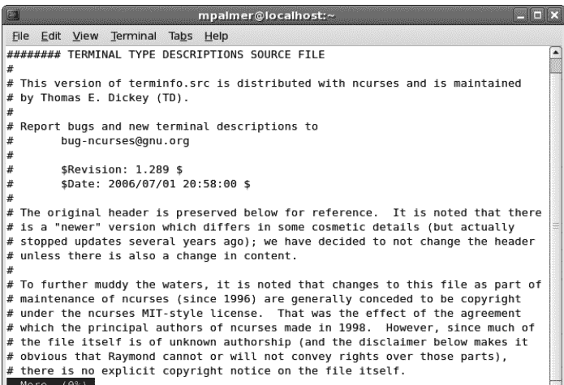

```
mpalmer@localhost:~~
$ File Edit View Terminal Tabs Help
###### TERMINAL DESCRIPTIONS SOURCE FILE

# This version of terminfo.src is distributed with ncurses and is maintained
# by Thomas. E. (Dickey)

# Report bugs and new terminal descriptions to
bug-ncurses@gnu.org
#
# $Revision: 2006/08/07 20:58:00 $
# The original header is preserved below for reference. It is noted that
# is a "newer" version which differs in some cosmetic details (but actually)
# stopped updates years ago); we have decided not to change the header
# unless there is a change in content.

# To further muddy the waters, it is noted that changes to this file as part of
# maintenance of ncurses (since) are generally considered to be copyright
# under the ncurses MIT-style license. That was the effect of the agreement
# which the principal authors of ncurses made in 1998. However, much of
# the file itself is of unknown authorship (and the disclaimer below makes it
# obvious that Raymond cannot or will convey rights over those parts),
# there is no explicit copyright notice to the file itself.
# --(0)
```

图 1-19 使用 `more` 命令逐屏查看大文件的内容

- 2. 按空格键滚动到下一屏。
- 3. 输入 `q`（代表 quit）终止显示。

### 使用 `less` 命令在屏幕上查看大文件的内容：

- 1. 在命令提示符后输入 `less /etc/termcap` 并按 `Enter`。你在屏幕上看到一个很长的文本文件。
- 2. 多次按向下箭头可以一次一行地向前滚动文件。
- 3. 多次按向上箭头可以一次一行地向后滚动文件。
- 4. 按 `Pg Dn`（或 `Page Down`）、空格键、`z` 或 `f` 可以向前滚动一页。
- 5. 按 `Pg Up`（或 `Page Up`）或 `b` 返回上一页。
- 6. 输入 `q`（代表 quit）终止显示。

## 实践项目

对于 Knoppix 用户，`/etc` 目录中没有 `termcap` 文件。在本项目和项目 1-14 的步骤中，请使用 `/etc/mailcap` 代替 `termcap`。

# 1

## 项目 1-14

有时，你只需要查看文件的部分内容来确定文件中存储了什么。在本项目中，你使用 `head` 命令查看文件开头的 10 行，然后使用 `tail` 命令查看文件最后的 10 行。

### 查看文件的开头和最后几行：

- 1. 输入 `head /etc/termcap` 并按 `Enter` 查看 `/etc/termcap` 文件的前 10 行。
- 2. `-n` 选项指定了 `head` 命令显示的行数。输入 `head -n 5 /etc/termcap` 并按 `Enter`。你看到了 `/etc/termcap` 文件的前五行。
- 3. `tail` 命令向你显示文件的最后几行。和 `head` 命令一样，`tail` 命令显示文件的末尾。
- 4. `-n` 选项指定了 `tail` 命令显示的行数。输入 `tail -n 5 /etc/termcap` 并按 `Enter`。你看到了 `/etc/termcap` 文件的最后五行。

重新对齐的文本：

- 1. 输入 `head /etc/termcap` 并按 `Enter` 查看 `/etc/termcap` 文件的前 10 行。
- 2. `-n` 选项指定了 `head` 命令显示的行数。输入 `head -n 5 /etc/termcap` 并按 `Enter`。你看到了 `/etc/termcap` 文件的前五行。
- 3. `tail` 命令向你显示文件的最后几行。和 `head` 命令一样，`tail` 命令显示文件的末尾。
- 4. `-n` 选项指定了 `tail` 命令显示的行数。输入 `tail -n 5 /etc/termcap` 并按 `Enter`。你看到了 `/etc/termcap` 文件的最后五行。

## 第1章 UNIX 和 Linux 的本质

- 11. 使用单一命令行序列查看文件、目录和用户信息。
- 12. 通过使用命令行序列查看文件和用户信息：
    - `less` 命令
    - `more` 命令
- 13. 创建一个包含文档信息的文件，接下来使用 `less` 命令查看文件内容，并可以向前或向后滚动。然后使用 `tail` 命令查看文件的最后 12 行。最后，使用 `head` 命令查看文件的前 12 行。


- 14. 创建一个收藏文件，并列出你的收藏项目。在每个收藏项目后按回车以确保它出现在列表列表中（创建收藏文件）。创建文件后，使用 `more` 命令查看列表的末尾。

- 15. 查看 `w` 的文档，然后查看其他命令的文档。这些命令有什么相似之处？

- 16. 使用命令行序列运行 `w` 和命令来比较结果。

- 17. 确定计算机最后是在哪个系统启动的。

- 18. 使用命令行历史功能确定最近执行的命令。

- 19. 运行 `w`、`cal` 和 `clear` 命令使用单一命令行序列。你在屏幕上得到了什么？

- 20. 使用历史功能检索你在崩溃时使用的命令行。使用 `edit` 函数删除 `clear` 并替换它。接下来，跳转到 `cal` 的开始，然后到 `cal` 的末尾。最后，添加 `date -u`，以便你的命令行项是 `w -u`；执行命令行项。

# 第2章

## 探索 UNIX/Linux 文件系统

在阅读完本章并完成练习后，你将能够：

- 讨论 UNIX/Linux 文件系统
- 解释分区和索引节点（inodes）
- 理解根目录层次结构
- 使用 `mount` 命令
- 解释路径、文件名和提示符
- 导航文件系统
- 创建和删除目录
- 配置文件权限

部署 UNIX/Linux 的一个重要原因是存储和使用信息。文件系统允许你创建信息、运行程序并在以后使用信息。通过文件系统，你可以保护信息并确保只有特定用户访问。你还可以将信息从一个位置复制到另一个位置，并删除不再需要的信息。

在本章中，你将探索 UNIX/Linux 文件系统，包括目录和文件的基本概念及其层次树结构。你将学习如何导航文件系统，然后通过创建目录和复制文件来练习。你还将有机会设置目录和文件权限，这对于 UNIX 多用户系统至关重要。

### 理解 UNIX/Linux 文件系统

在 UNIX/Linux 中，文件是存储的基本组件。UNIX/Linux 考虑所有交互的设备，如显示器、键盘和打印机。文件系统是 UNIX/Linux 在硬盘、CD 或 DVD 等存储设备上组织文件的方式。物理文件系统是硬盘的一部分，已格式化以包含文件。UNIX 由多个文件系统组成，为多个用户提供虚拟空间。虚拟存储是操作系统和用户透明访问的存储。文件系统的组织类似于倒置树结构；其中顶层文件包含其他文件。图 2-1 展示了典型的 UNIX/Linux 层次结构。

为什么 UNIX 和 Linux 系统如此通用？因为它们支持许多不同的系统。某些文件是 UNIX/Linux 原生的，而另一些提供了与其他操作系统（如 Windows）的兼容性。

大多数 UNIX 和 Linux 版本支持 UNIX 文件系统 `ufs`，它是原始的原生文件系统。`ufs` 是一种层次（树结构）文件系统，具有可扩展性、大量存储、卓越的安全性和可靠性。事实上，许多文件系统的特性都是参考了 `ufs`。日志记录（journaling）是指如果系统意外崩溃，可以在不损坏文件或数据完整性的情况下回滚更改。日志记录意味着文件保留其活动的日志（journal）。如果操作系统崩溃或未正常关闭（例如断电），系统在重启时会读取日志文件。日志文件中的信息可以将文件恢复到崩溃之前的或稳定状态。这对于崩溃前已更新但没有时间完成写入的文件特别重要。`ufs` 还支持热修复，可自动将损坏分区上的数据移动到未受损的区域。

在 Linux 中，原生文件系统是扩展文件系统 `ext` 或 `ext`，它是默认安装的。`ext` 参考了 `ufs`，但第一个版本包含一些错误，支持最高 2 GB 文件，且不提供日志记录。在 Linux 中，`ext` 比所有其他文件系统都具有优势，因为它允许使用完整的内置 Linux 命令、文件管理和安全性。较版本的 Linux 使用扩展文件系统的第二代 `ext2`、第三代 `ext3` 或第四代 `ext4`。`ext2` 是一个处理大型磁盘存储的可靠文件系统。`ext3` 在 `ext2` 的基础上进行了增强，并增加了日志记录。

2006 年 10 月，`ext4` 是 `ext` 的最新版本。`ext4` 允许单个卷容纳多达 1 EB（1,152,921,504,606,846,976 字节），这超过了 1 万亿字节的数据，并且允许使用区（extents）。区用于减少碎片，因为可以为文件预留一段连续的磁盘存储。例如，考虑一个随着人数增加而不断增长的姓名地址文件。

```
/bin
  boot
  dev
  etc
  home
  lib
  mnt
  root
  sbin
  tmp
  usr
  var
```

图 2-1 典型的 UNIX/Linux 层次结构

为什么 UNIX 和 Linux 系统如此通用？因为它们支持许多不同的系统。某些文件是 UNIX/Linux 原生的，而另一些提供了与其他操作系统（如 Windows）的兼容性。

为什么 UNIX 和 Linux 系统如此通用？因为它们支持许多不同的系统。某些文件是 UNIX/Linux 原生的，而另一些提供了与其他操作系统（如 Windows）的兼容性。

## 探索 UNIX/Linux 文件系统和安全性

`ext3` 和 `ext4` 与之兼容。`ext3` 同样兼容 `ext2`。这意味着 `ext4` 是 Linux 支持的。

表 2-1 总结了 `ufs`、`ext` 和其他文件系统。此外，表 2-2 比较了 FAT、NTFS、`ext4` 等，以便你在考虑文件系统时有所参考。当你考虑文件系统时，请记住每个文件系统的功能取决于 UNIX/Linux 内核的支持。

### 表 2-1 UNIX 支持的所有文件系统

| 文件系统 | 描述 |
|---|---|
| 扩展文件系统 (`ext` 或 `ext fs`) 以及较新版本：扩展文件系统 (`ext2` 或 `ext2 fs`)、第三代文件系统 (`ext3` 或 `ext3 fs`) 和第四代扩展文件系统 (`ext4` 或 `ext4 fs`) | Linux 默认带有；`ext3` 提供日志记录；`ext4` 增加了更大的容量和区 |
| 高性能文件系统 (`HPFS`) | 为 OS/2 开发 |
| 国际标准组织 (`ISO`) 标准操作系统 9660 (`Linux` 中为 `iso9660`，`Solaris` 中为 `hfs`，`FreeBSD` 中为 `cd9660`) | 为 CD 和 DVD 开发；不支持长文件名 |
| 日志文件系统 (`JFS`) | 参考 IBM 的 `JFS`；提供日志功能、处理大文件的快速性能、动态节点分配以更好地利用空闲空间，以及针对小型或大型目录结构的特殊处理 |
| 与 `FAT12` 和 `FAT16` 兼容（不支持长文件名）；通常安装以允许 UNIX 读取软盘 |  |
| 网络文件系统 (`NFS`) | 由 Sun 为 UNIX 系统开发，以支持网络访问和文件共享（如上传和下载）；几乎所有 UNIX/Linux 版本以及任何其他操作系统都支持 |
| `NTFS` 文件系统 | Windows Windows NT、Windows 2000、Windows XP、Windows Vista 和 Windows Server 系统 |
| `proc` 文件系统 (`PFS`) | 展示内核状态和内存使用情况（不是真正的物理文件系统，而是逻辑文件系统） |

### 表 2-1 UNIX/Linux 支持的典型文件系统（续）

| 文件系统 | 描述 |
|---|---|
| `ReiserFS` | 由 Hans Reiser 开发，类似于 `ext3` 和 `ext4`，具有日志功能；设计用于在处理小文件时比 `ext3` 和 `ext4` 快（多达 15 倍）；旨在鼓励程序员通过使用较小文件来创建高效代码。 |
| 交换文件系统 | 用于交换空间的文件系统——即当内存（满时（称为虚拟内存）专门用于存储内存信息的空间，被所有 UNIX/Linux 系统使用；在较新的 UNIX/Linux 系统中，交换文件系统经过加密以提高安全性。 |
| 通用磁盘格式 (`UDF`) | 为 CD 和 DVD 开发，广泛取代了 `iso9660`。Windows、UNIX/Linux 和 2006 年之前的 Mac OS 支持 `UDF` 读取能力；Windows Vista、2005 年以后的 UNIX/Linux 版本以及 Mac OS Tiger 和 Leopard 支持读写能力。 |
| `uFS/DOS` | 与 Windows NT、2000、XP、Vista 和 Server 使用的扩展 `FAT16` 兼容，但也支持安全权限、文件所有权和长文件名。 |
| UNIX 文件系统 (`ufs`; 也称为 Berkeley 文件系统) `vfat` | UNIX 的原始文件系统；兼容几乎所有的 UNIX 系统和大多数 Linux 系统；兼容 `FAT32` 并支持长文件名。 |
| `XFS` | Silicon Graphics 为 Irix 版本的 UNIX 设计的文件系统；提供许多类型的日志功能，目标用于大型磁盘阵列（通过高速连接提供的多磁盘存储设备）。 |

### 表 2-2 UNIX/Linux 支持的典型文件系统比较

| 特性 | FAT | NTFS | ext4 | ufs |
|---|---|---|---|---|


| 总卷或分区大小 | 2 GB 到 2 TB | 2 TB | Linux 中取决于内核*可达 1 艾字节 | Linux 中为 1 TB；UNIX 中取决于版本为 4 GB 到 2 TB |

# 第 2 章 探索 UNIX/Linux 文件系统和文件安全

表 2-2 UNIX/Linux 支持的典型文件系统比较（续）

| 特性 | FAT | NTFS | ext4 | ufs |
|---|---|---|---|---|
| 最大文件大小 | FAT16 为 2 GB；FAT32 为 4 GB | 潜在为 16 TB，但受限于卷大小（最高 2 TB） | Linux 中取决于版本为 16 GB 到 2 TB* | Linux 中为 2 GB；UNIX 中取决于版本为 2 GB 到 16 TB |
| 安全性 基于属性和共享的有限安全性 | 通过权限、组和审计选项提供广泛安全性 | 通过权限和组提供广泛安全性 | 通过权限和组提供广泛安全性 |
| 通过文件活动跟踪或日志实现可靠性 | 无 | 日志 | 日志 | 日志 |
| POSIX 支持 | 无 (FAT16);有限 (FAT32) | 是 | 是 | 是 |
| 通过热修复能力实现可靠性 | 有限 | 支持 | 支持 | 支持 |
| 对区 (extents) 支持 | 否 | 是，通过程序分配时支持 | 启用时支持 | 否 |

> *这些最大值受内核版本，并基于 Linux 内核版本 2.6.19。

# 理解标准树形结构

UNIX/Linux 文件系统的树形结构从根文件系统开始。根是该层级中文件的名称，用斜杠字符 (`/`) 表示。斜杠代表根文件系统目录。注意图 2-1，有一个目录用于存储根账户的文件，但它被指定为 `/root`，并位于主根文件系统目录 (`/`) 下。

目录是一种特殊类型的文件，可以包含其他文件和目录。普通文件存储信息（如员工姓名和地址记录或薪资信息），而目录文件存储文件名和许多其他目录，这些被称为子目录。子目录被认为是父目录的子，因为子目录是在父目录内部创建的。在图 2-1 中，根目录 (`/`) 是所有其他目录的父目录，例如 `/bin`、`boot`、`dev`、`etc`、`home` 等。`/home` 目录是 `/jane`、`tricia` 和 `/joseph` 子目录的父目录；`/usr` 是 `/bin`、`dict` 等子目录的父目录。

# 使用 UNIX/Linux 分区

磁盘上存储文件系统的部分称为分区。用户可能有多个分区，它们与其他分区隔离，以便不受与其他分区相关的结构性文件问题的影响。在计算机上安装 UNIX/Linux 时，你的首要任务之一是决定如何划分硬盘（如果有多个硬盘，则为多个硬盘）。

UNIX/Linux 分区通过名称标识；例如，Linux 对某些磁盘使用 `hda` 和 `hda2`。在这种情况下，前两个字母标识设备类型；例如，`hd` 标识常用的 IDE 类型磁盘。第三个字母（在此例中为 `a`）指示磁盘是主盘还是从盘。

磁盘上的分区从 1 开始编号。名称 `hda1` 告诉 Linux 这是磁盘上的第一个分区，名称 `hda2` 表示它是同一块磁盘上的第二个分区。如果你有第二个磁盘，名称将为 `hdb1`、`hdb2` 等。

## 使用 UNIX/Linux 分区 61

引用根文件系统目录（`/`）和根账户使用的目录（`/root`）可能会引起混淆。一些 UNIX/Linux 用户会将根文件系统称为“斜杠”（slash），而将 `/root` 称为“根目录”（root directory），以帮助避免混淆。

根分区的大小取决于你正在执行的安装类型。例如，在 Fedora、Red Hat Enterprise Linux 或 SUSE 中，根分区至少应为 1.2 GB，以加载工作站或便携式计算机安装所需的 {操作系统。对于基础系统来说，1.2 GB 的分区空间不包含足够的空间来加载 GNOME 桌面或许多软件包。如果你正在设置一台服务器以加载 Fedora、Red Hat Enterprise Linux 或 SUSE 的全套软件包，请使用 5-10 GB 或更大的分区。除了软件软件包之外，还需要留出给桌面（如 GNOME、KDE 或两者的结合）的空间。（你将在第 11 章“X 窗口系统”中学习到更多关于桌面的知识。）

创建根分区后，你应该设置交换分区（swap partition）。交换分区的作用就像内存的扩展，使得 UNIX/Linux 有更多空间运行大型程序。通常情况下，交换分区的大小应该与计算机中 RAM 的容量相同。例如，如果你有 256 MB 的 RAM，请将你的交换空间设置为 256 MB。如果你有大量的 RAM（例如 1 GB），但磁盘空间有限，你可以将交换空间设置得比 1 GB 小。然而，在配置交换分区之前，请检查你所 UNIX/Linux 版本的文档。例如，在 Fedora 和 Red Hat Enterprise Linux 中，Red 建议你的交换空间至少为 256 MB，或者是计算机中 RAM 大小的两倍（取较大值）。对于 SUSE，请考虑使用约 500 MB 或更大的交换分区。然而，交换空间不应过大（例如超过 2 GB），因为这样你就会开始牺牲速度，因为磁盘访问比直接访问 RAM 慢得多。例如，如果你在 Fedora 系统中拥有 256 MB 的 RAM，为交换分区分配 2 GB 磁盘空间是没有意义的。从性能的角度来看，额外安装 256 MB 内存并为交换分区分配 1 GB 空间是有意义的。

交换分区启用了虚拟内存，使你似乎拥有无限的内存资源。交换分区通过在磁盘上提供交换空间并将其视为内存（RAM）的扩展来实现这一点。它被称为交换空间，是因为系统可以使用它在磁盘和 RAM 之间交换信息。设置交换空间可以让你的计算机运行得更快、更高效。

- 你可以在 Linux 中创建并使用多个交换分区。分布在多个块硬盘上的多个交换分区有时可以提高繁忙系统上的应用程序性能。还要注意，你通常可以通过安装更大容量的 RAM（例如 1 GB 或更多）来提高服务器速度。

`/boot` 分区用于存储组成内核的操作系统文件。该分区的 own取决于你的 UNIX/Linux 版本中操作系统文件需要多少空间。通常情况下，这是一个较小的分区。例如，如果你正在安装 Fedora、Red Hat Enterprise Linux 或 SUSE，请考虑创建一个大小约为 100 到 200 MB 的 `/boot` 分区。

如果你有多个用户访问你的系统，请考虑设置 `/usr` 分区，用于存储所有用户访问的非内核操作系统程序。这些程序包括支持计算机编程的软件开发包、网络、Internet 访问、图形界面（包括桌面软件）以及大量的 UNIX/Linux 工具。工具是执行复制文件、列出目录和与其他用户通信等操作的程序。`/usr` 分区应该足够大——例如 10 GB 或更多——以容纳你使用的所有软件。

此外，如果你计划让多个用户访问系统，你可以创建一个 `/home` 分区，它是所有用户目录的家目录。分离 `/usr` 和 `/home` 使得许多系统管理任务（例如只备份软件或数据）变得简单得多。

`/home` 分区是所有用户工作的存储空间。如果根分区（`/`）或任何其他分区崩溃，`/home` 分区可以确保你不会丢失所有用户。虽然普通用户账户被限制读取其他分区，但你可以访问并操作家目录中的大多数文件。你可以根据自己的需要授予或拒绝对文件的访问权限。参阅本章节后部分的“配置安全文件权限”以获取更多关于文件所有权的信息。

最后，你可以创建一个 `/var` 分区用于临时创建的文件，例如用于打印文档的文件（溢出文件）以及用于监控和管理数据的文件（通常称为日志文件）。Fedora、Red Hat Enterprise Linux 和 SUSE 也使用 `/var` 用于更新操作系统的文件。使用超过 5 GB 的 `/var` 分区。

考虑一家小型研究公司，计划设置一台拥有 512 MB RAM 的 Red Hat Linux 服务器。该公司可能需要设置一个 1024 MB 的交换分区 `/boot` 分区将是 150 MB。他们计划为用户安装 20 GB 的内核程序，因此可能有一个 25 到 50 GB 的 `/usr` 分区（考虑到目前未预到的程序）。15 个用户中的每个用户将在其家目录中分配 10 GB，这意味着 `/home` 分区必须至少为 15 GB。

# 第 2 章 探索 UNIX/Linux 文件系统和文件安全

## 使用 Inodes

包含目录和文件的分区在 ufs 和 ext 文件系统中构建在索引节点（inodes）的概念之上。每个目录或文件都有一个 inode，并通过 inode 编号来标识。inode 0 是根目录（`/`）的起点。

inode 包含：

1. 目录或文件名
2. 关于目录/文件的通用信息
3. 定位文件的指针

在通用信息方面，inode 表示用户组所有权、访问模式（读、写、执行）、文件的大小和类型、创建日期以及修改日期。

指针基于逻辑块。每个磁盘被划分为大小不等（取决于 UNIX/Linux 版本）从 512 字节到 8192 字节的逻辑块（块也可以根据文件系统的需要被分成多个或部分）。文件的 inode 包含一个指针（数字），告诉操作系统如何定位文件内容（或者，它指定了第一个块的链接）。简而言之，inode 使用操作系统查找磁盘上的文件。


UNIX/Linux 文件系统中的一切都关联到 `inode`。空间是以一次一个块或部分块的方式分配的。目录是标记了目录标志的小型文件。文件系统本身通过 `superblock` 标识。`superblock` 包含关于特定分区块布局的信息。这些信息是查找文件系统中任何内容的关键，并且不应更改。没有 `superblock`，就无法访问文件系统。为了这一点，在分区和格式化创建文件系统时，许多 `superblock` 会被写入文件系统。如果 `superblock` 被破坏，你可以将其中一个副本副本复制到原始损坏的 `superblock` 上，以恢复对文件系统的访问。

## 探索根层次结构

根 (`/`) 文件系统在内核启动时被挂载。`挂载`（`mount`）文件系统是指将其连接到目录树结构中。系统管理员使用 `mount` 命令来挂载文件系统。

UNIX/Linux 必须挂载文件系统，任何程序才能访问该文件系统上的文件。挂载后，根系统仅可读。

## 第 2 章 探索 UNIX/Linux 文件系统与文件安全

系统检查和启动序列——在此之后，它会被重新挂载为读写模式。根文件系统包含了文件修复所需的所有要素：从备份恢复、启动系统以及初始化所有设备和操作系统资源。它还包含了监控所有其他文件系统的信息。除了这些基本要素之外，不应有任何其他内容留存在根分区中。

你可以使用磁盘、CD、DVD、磁带或其他可移动介质上的救援文件来恢复崩溃的根分区。带有 Fedora、Red Hat Enterprise Linux 和 SUSE 的安装介质可以用于创建救援光盘，或者你的安装 CD/DVD 也可以兼作救援光盘使用。


接下来的章节将描述根文件系统下的某些目录。

### /bin 目录

`/bin` 目录包含二进制文件、可执行文件，这些程序是启动系统和执行其他基本系统任务所需的程序。该目录包含所有用户在操作 UNIX/Linux 时需要的许多程序。

### /dev 目录

`/dev` 目录通常包含引导加载程序（启动操作系统的实用程序）所需的文件；它还包含内核（操作系统）镜像。

`/dev` 中的文件引用系统设备。它们访问系统设备和资源，例如硬盘、鼠标、打印机、控制台、调制解调器、内存和 CD/DVD 驱动器。UNIX/Linux 版本在 `/dev` 目录中包含许多设备文件，以适应连接到计算机的不同厂商设备。

UNIX/Linux 设备通过设备特殊文件进行管理，这些文件包含了内核在访问设备时使用的 I/O 设备信息。在 UNIX/Linux 系统中存在两种类型的设备特殊文件：

- 块特殊文件（也称为块设备文件）用于处理数据块的随机访问设备，包括 CD/DVD 驱动器、硬盘驱动器、磁带驱动和其他存储设备。
- 字符特殊文件（也称为字符设备文件）处理字节流，例如通过串口或通用总线（USB）连接，包括终端、打印机和网络通信。USB 是大多数现代计算机上的一种相对高速 I/O 端口。它用于连接鼠标、键盘、显示器、数字声卡、磁盘驱动器以及其他外部硬件，如打印机和数字相机。

#### 探索根层次结构 65

管理设备的另一种方法是使用命名管道（named pipe），它提供了一种处理内部通信的方法，类似于将文件输出重定向到显示器。你将在第 5 章学习管道。

当你安装 UNIX/Linux 操作系统时，系统会为已安装的设备创建设备特殊文件。表 2-3 显示了设备特殊文件的示例。

#### 表 2-3 UNIX/Linux 设备特殊文件

| 文件 | 描述 |
| --- | --- |
| `/dev/console` | 用于控制台组件，如连接到计算机的显示器和键盘（许多系统中也同时使用 `/dev/tty0`） |
| `/dev/fdn` | 用于软磁盘驱动器，其中 *n* 是驱动器编号，例如第一个软磁盘驱动器为 sfd0 |
| `/dev/hdxn` | 用于 IDE 和 EIDE 硬盘，其中 *x* 代表分区号，例如第一个磁盘和分区为 sda1 |
| `/dev/modem` | 用于鼠标，是一个指向设备特殊文件的符号链接（通常链接到 `/dev/tty1`），符号链接允许一个文件或目录指向另一个文件（在 Fedora/Red Hat Enterprise Linux 的后续版本中，调制 文件可能位于 `/usr/share/applications/YaST2`，因为它由 YaST 管理工具管理） |
| `/dev/mouse` | 用于鼠标或其他指针设备，指向设备特殊文件的符号链接（通常链接到 `/dev/tty0`）——在 Fedora/Red Hat Enterprise Linux 中，鼠标文件位于 `/share/applications`，在 SUSE 中可能位于 `/opt/gnome/share/applications` |
| `/dev/sdxn` | 用于连接到 SCSI 接口的硬盘，其中 *x* 代表磁盘，*n* 代表分区，例如第一个 SCSI 驱动器及其第一个分区为 sda1 |
| `/dev/stn` | 用于 SCSI 磁带驱动器，其中 *n* 代表驱动器编号，例如第一个磁带驱动器为 st0 |
| `/dev/tty` | 用于连接到计算机的串口终端 |
| `/dev/ttsn` | 用于连接到计算机的串口设备，例如用于鼠标的 tty0 |

#### 第 2 章 探索 UNIX/Linux 文件系统与文件安全

如果你需要为新设备创建设备文件，可以使用 `mknod` 命令按照以下通用步骤进行：1. 登录 root 账户。2. 访问终端窗口或命令提示符。3. 输入 `cd /dev` 并按回车切换到 `/dev` 文件夹。4. 使用 `mknod` 命令加上设备文件名（如 tty42）以及文件类型（如字符 `c` 或块 `b`）、以及内核使用的主节点和次节点值（这些值请查询设备制造商）。例如，你可能输入 `mknod tty20 c 8 68` 并按回车创建一个新的串口设备。

你可以在命令提示符后输入 `ls -l /dev` 并按回车查看设备文件列表。请参考本章稍后的“列出目录”获取有关 `ls` 命令的信息。列表最左侧的内容告诉你该文件是字符设备 (`c`) 还是块设备 (`b`)，如图 2-3 所示。实践项目 2-8 将教你 `/dev` 目录的内容。在 `/dev` 目录中将看到的项目类型解释如下：

- console 指系统控制台，即直接连接到你系统上的显示器。
- tty1 和 cua1 是用于访问端口的设备。例如，`/dev/tty1` 指 PC 上的 COM2 通信端口。
- 以 hd 开头的设备是硬盘。
- 以 lp 开头的设备访问 LPT1 线性打印机。
- null 是一个“黑洞”；发送到此设备的任何数据都会消失。当你想要抑制在屏幕上显示的命令输出时，请使用此设备。
- pty 指终端或控制台。你的 Linux 系统上可以使用多个“虚拟控制台”（Ctrl+Alt+F1，Ctrl+Alt+F2 等）。伪终端用于为远程登录会话提供终端。例如，如果你的机器在网络上，远程登录将使用 `/dev` 中的某一个 pty 设备。

### /etc 目录

`/etc` 目录包含了系统启动时所需的配置文件。该目录大部分留给系统管理员，并包含了关于文件系统的基本信息（如硬盘、CD/DVD）。除了这些基本要素之外，不应有任何其他内容留存在根分区中。

#### /dev 中的某些设备

| | | | | |
| --- | --- | --- | --- |
| brw-rw---- | root | root | 2, 0 | 5月 1日 | fdd |
| brw-rw---- | root | root | 3, 0 | 5月11日 | hda |
| brw-rw---- | root | root | 3, 1 | 5月11日 | hdb |
| brw-rw---- | root | root | 5, 64 | 5月11日 | hdb |
| brw-rw---- | root | root | 7, 5 | 5月11日 | hdc |
| brw-rw---- | root | root | 6, 0 | 5月11日 | ram |
| brw-rw---- | root | root | 1, 3 | 5月11日 | ram |
| brw-rw---- | root | root | 11, 0 | 5月11日 | scd |
| brw-rw---- | root | root | 11, 0 | 5月11日 | scdi |
| brw-rw---- | root | root | 8, 1 | 5月11日 | sde |
| brw-rw---- | root | root | 8, 16 | 5月11日 | sdb |

#### /dev 中的某些字符设备

| | | | | | |
| --- | --- | --- | --- | --- | --- |
| crw-rw---- | root | root | 4, 0 | 1月4日 | console |
| crw-rw---- | root | root | 5, 64 | 1月4日 | cua0 |


| crw-rw---- | root | root | 5, 65 | 5月5日 | cua1 |
| crw-rw---- | root | root | 5, 66 | 5月5日 | cuab2 |
| crw-rw---- | root | root | 44, 0 | 5月11日 | cuab3 |
| crw-rw---- | root | daemon | 6, 0 | 5月11日 | cio0 |
| crw-rw---- | root | root | 1, 3 | 5月11日 | lpi |
| crw-rw---- | root | root | 1, 3 | 5月11日 | null |
| crw-rw---- | root | root | 2, 17 | 5月11日 | pty0 |
| crw-rw---- | root | root | 2, 177 | 5月11日 | pty1 |
| crw------- | 1ident | jent | 9, 0 | 5月11日 | tty0 |
| crw-rw---- | root | root | 4, 65 | 1月4日 | ttys1 |

## `/etc` 中的某些文件

- `group`——用户组信息。
- `initab`——init 程序的配置文件，该程序在系统启动时执行各项任务。
- `login.defs`——`login` 命令的配置文件。
- `motd`——登录消息文件。
- `passwd`——用户信息。
- `printcap`——打印机能力信息文件。
- `profile` 和 `bash`——在登录时执行的文件允许系统管理员为所有用户设置全局默认值。
- `rc`——系统启动时运行的脚本或脚本目录。
- `term`——终端信息文件。

# 第 2 章 探索 UNIX/Linux 文件系统与文件安全

要了解 `/etc` 目录的内容，可以尝试查看 `fstab` 文件的内容。输入 `cat /etc/fstab`，你将看到用于文件系统和设备（如 CD/DVD 驱动器）的默认设置信息。

### `/home` 目录

`/home` 目录通常位于 `/home` 分区上，用于为用户提供磁盘空间，例如在具有多个用户账户的系统中。例如，图 2-1 显示，三个用户账户存在三个主目录：`/home/jean`、`/home/tricia` 和 `/home/joseph`。

### `/lib` 目录

此目录包含内核模块、安全信息和共享库镜像。程序员通常使用这些文件来共享库中的代码，而不是在自己的程序中创建这些代码的副本。这使得程序更小，在某些情况下，使用这种结构运行得更快。该目录中的许多文件是指向其他库文件的符号链接。符号链接是一个文件、名称或目录名，它包含指向同一目录或系统中另一个目录中文件的指针。符号链接的另一个相关用途为访问目录创建名称或快捷方式表示。在目录的详细列表中，左侧位置的 `/` 用于标识符号链接文件。

> 节省输入时间的方法是为具有长路径的目录创建符号链接。例如，假设你在 `/data/manufacturing/inventory/parts` 子目录中存储了许多文件。每当你想要列出该目录时，必须输入 `ln -s /data/manufacturing/inventory/parts parts` 为该目录创建一个符号链接（`ln` 是创建链接的命令，`-s` 是符号链接的选项）；以后你只需输入 `ls parts` 即可查看内容。要了解更多关于 `ln` 命令的信息，请输入 `man ln` 或 `info ln`。

### `/mnt` 目录

系统管理员用于临时挂载的挂载点存在于 `/mnt` 目录中。临时挂载用于挂载可移动存储介质（如 CD/DVD 或 USB/闪存存储），以便于快速卸载以快速移除。例如，你可能会挂载一张 CD，然后将其卸载并交给办公室同事。`/mnt` 目录通常被分为子目录，例如 `/mnt/cdrom`，以指定设备类型。

## 探索根层次结构

### `/media` 目录

在较新的 UNIX/Linux 发行版中，可移动存储的挂载点位于 `/media` 目录中，这是文件系统层次标准（FHS）的一个较新建议。现代 Linux 发行版同时包含 `/mnt` 和 `/media` 目录；检测 CD/DVD 插入的自动化软件通常使用 `/media`。Linux 用户和程序员被鼓励使用 `/media` 而不是 `/mnt`，以遵循新的 FHS 建议。

UNIX/Linux 文件层次结构的指南由文件系统层次结构标准（FHS）提供。你可以在网站 `http://www.pathname.com/fhs` 了解更多关于 FHS 的信息。此外，Wikipedia 在 `en.wikipedia.org/wiki/Filesystem_Hierarchy_Standard` 提供了 FHS 的介绍。


### `/proc` 目录

`/proc` 目录不占用磁盘空间；它是一个仅在内存中分配的虚拟文件系统 `/proc` 中的文件指向系统上运行的各种进程以及有关操作系统内核的详细信息。

### `/root` 目录

`/root` 目录是 `root` 用户（系统管理员）的主目录。

### `/sbin` 目录

`/sbin` 目录留供系统管理员使用。启动系统的程序、修复文件系统所需的程序以及基本的网络程序都存储在这里。

### `/tmp` 目录

许多程序在处理周期需要一个临时位置存储数据。这些文件的传统位置是 `/tmp` 目录。例如，工资单程序在处理 5,000 人的工资单时可能会创建几个临时数据文件。这些临时文件可能短暂持有计算税务扣缴和退休金扣缴所需的数据，然后在将扣缴信息写入磁带或 CD 并发送给联邦和州机构后，它们会被删除。

### `/usr` 目录

该目录通常位于 `/usr` 分区上，存放为用户提供的软件。这些软件可能是会计程序、制造程序、研究应用程序或办公软件。

### `/var` 目录

`/var` 目录位于 `/var` 分区上，存放大小经常变化的子目录。这些子目录包含错误日志和其他系统性能数据等文件，这些文件对系统管理员很有用。`/var/spool/mail` 子目录可以包含来自网络的的入站邮件。另一个例子是 `/var/spool/lpd` 子目录，它是存放打印文件的默认目录，直到文件被完全传输到打印机。

> 尝试查看日志的内容以了解 `/var` 目录中的内容。例如，登录 `root` 并输入 `cat /var/log/boot.log` 来查看如何为了信息目的和故障排除而保留有关系统启动的信息。（如果 `boot.log` 文件为空，请尝试输入日志版本号，如 `boot.log.2`。）


## 使用 `mount` 命令

如所学，UNIX/Linux 使用 `mount` 命令将文件系统分区连接到目录树。

假设你想访问 CD 上的文件。将 CD 插入 CD 驱动器并使用以下命令之一（取决于你的 UNIX/Linux 发行版使用 `/mnt` 还是 `/media`）：

```
mount -t iso9660 /dev/cdrom /mnt/cdrom
or
mount -t iso9660 /dev/cdrom /media/cdrom
```

该命令将 CD 挂载到 `/dev` 目录下的名为 `cdrom` 的设备。UNIX/Linux 的实际挂载点是 `/mnt/cdrom` 或 `/media/cdrom`。挂载 CD 后，你可以通过 `/mnt/cdrom` 或 `/media/cdrom` 访问文件。

UNIX/Linux 支持多种类型的文件系统。文件系统类型通过 `-t` 选项指定。CD 或 `cdrom` 被归类为 `iso9660` 或 `udf` 设备，因此系统管理员输入 `-t`，后跟参数 `iso9660`，为 CD 指定文件系统。在某些较新的 Linux 版本中，可以通过双击桌面上的 CD/DVD 图标或根目录 `/` 下的 `/media` 子目录来查看 CD/DVD。


## 第2章 探索 UNIX/Linux 文件系统与文件安全

在访问手动挂载的文件系统后，系统管理员会在移除存储介质之前使用 `mount` 命令将其卸载，例如所示：`umount /cdrom`（或 `umount /media/cdrom`）。

语法 `umount mount-point`

## 详解

- `mount-point` 指定要卸载的目录。

> 注意，命令是 `unmount` 而不是 `ummount`；`unmount` 中只有一个 "n"。


尝试[动手项目] 2-1，使用 `mount` 命令查看你的 UNIX/Linux 版本可以查看的文件系统，并查看当前挂载了哪些文件系统。动手项目 2-2 允许你挂载或加载 CD 并查看 CD 上的文件。请参考附录 B“UNIX/Linux 命令语法指南”获取关于提示符命令和卸载命令的简要描述。

## 使用路径、路径名和提示符


正如你所学到的，所有 UNIX/Linux 文件都存储在文件系统中，从根目录开始。要指定文件或目录，请使用其路径名，该路径通过正斜杠 (`/`) 分隔所需的文件目录名。例如，假设你想指定名为 `photos502` 的文件的位置。你知道它位于 Jean 目录下的源目录中，即 `/home/jean/source`，如图 2-1 所示。你可以将该文件的位置指定为 `/home/jean/source/photos502`。

## 使用和配置你的命令行提示符

UNIX/Linux 提示符可以配置为显示你在文件系统中的目录位置。例如，在 Fedora 中，提示符 `[jean@localhost]$` 是系统在 Jean 创建用户账户 `jean` 时生成的默认提示符。提示符 `[jean@localhost]$` 意味着 `jean` 是正在名为 `localhost` 的主机上工作的用户，位于她的主目录中，该目录由波浪号 (`~`) 标识。`~` 是主目录的缩写，其名称通常与用户名相同。账户 `jean` 的典型主目录通常也称为 `jean`，位于 `/home/jean`。当 Jean 将位置更改到 `/home/jean/source` 时，她的提示符看起来像：

```
[jean@localhost source]$
```

## 使用路径、路径名和提示符

> 当系统最初安装时，默认根提示符看起来如下：`[root@localhost root]#`。为了简化书中命令提示符的含义，步骤中使用 `$` 表示普通用户的命令提示符，用 `#` 表示系统管理员的命令提示符。

你的命令提示符在登录时会自动配置。环境变量 `PS1` 包含特殊的格式化字符，这些决定了你提示符的配置。环境变量是存储区域中的值，供 UNIX/Linux 在你登录时使用。可以创建环境变量并存储默认设置，例如你使用的 shell 或偏好的命令提示符格式。你将在第 6 章学习更多关于环境变量以及如何配置它们的知识。图 2-4 展示了如何在 Fedora 中为用户账户配置 `PS1` 变量。

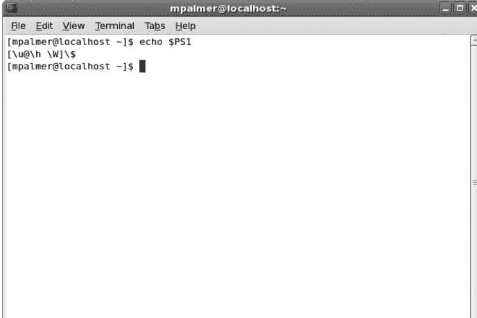

**图 2-4** 查看 `PS1` 变量

在图 2-4 中，`PS1` 变量包含：`\u@\h \W$`。以 `\` 开头的字符是特殊的 Bash 格式化字符。`\u` 打印用户名，`\h` 打印系统主机名，`\W` 打印工作（当前）目录的名字。字符 `$` 或是 `#` 取决于登录的用户类型。括号 `[` 和 `]` 以及分离 `\h` 和 `\W` 的空格不是特制字符，因此它们按原样打印。当 Jean 登录到系统 `localhost` 并在她的主目录中工作时，她的提示符按之前的所示格式显示为 `[jean@localhost ~$]`。

表 2-4 显示了用于配置 Bash 提示符的其他格式字符。

表 2-4 配置 Bash shell 提示符的格式字符

| 格式字符 | 用途 |
| :--- | --- |
| `\a` | 发出警报 |
| `\d` | 显示日期 |
| `\e` | 使用转义字符 |
| `\h` | 显示主机名 |
| `\v` | 显示后台作业数量 |
| `\n` | 显示换行 |
| `\nnn` | 显示与八进制数字 nnn 对应的 ASCII 字符 |
| `\r` | 在提示符中放置回车符 |
| `\s` | 显示名称 |
| `\t` | 显示时间 |
| `\u` | 显示用户名 |
| `\v` | 显示 Bash 版本和发布号 |
| `\w` | 显示工作目录的路径 |
| `\A` | 显示 24 小时格式的时间 |
| `\D(format)` | 以特定格式显示时间 |
| `\H` | 与 `\h` 效果相同 |
| `\T` | 显示 12 小时格式的时间 |
| `\V` | 显示 Bash 版本、发布号和补丁级别 |
| `\W` | 显示工作目录的名字（不含路径） |
| `\$` | 显示当前会话中的命令 |
| `#` | 显示当前会话中的命令 |
| `$` | 显示 $ |
| `@` | 显示时间 |
| `$` | 显示工作目录的路径 |
| `[` | 标记序列的开始 |
| `]` | 标记序列的结束 |
| `\\` | 显示 \ |

### pwd 命令

`pwd` 命令用于显示当前工作目录。当你深处嵌套目录结构中需要确切位置时，这非常有用。

语法 `pwd`

#### 详解

- 无需参数。

`pwd` 代表“打印工作目录”。它显示你位置的绝对路径。

### 导航文件系统

`cd` 命令用于在 UNIX/Linux 文件系统中切换目录。

语法 `cd [directory]`

#### 详解

- `directory` 是你想要切换的目标目录。

> 注意，如果你不带任何参数输入 `cd`，它将带你返回主目录。

`cd` 命令用于切换目录。你可以使用绝对路径或相对路径进行导航。

### 使用点和点寻技术

UNIX/Linux 将单个点解释为当前工作目录，将双点（两个连续的点）解释为父目录。输入以下命令将让你留在当前目录：

```
cd
```

在使用 UNIX/Linux 命令时，请务必注意空格。例如，在 `cd .` 和 `cd ..` 中，`cd` 与单点或双点之间有一个空格。记住，在使用 UNIX/Linux 命令时，在包含选项或参数之前，必须使用空格。

# 文件系统导航

假设你是 Jean，当前在你的主目录下，想要前往 Tricia 的源码目录。使用以下命令：

```
cd ../tricia/source
```

在上述的示例中，点 `.` 告诉操作系统进入父目录，即 `/home`。第一个 `/` 分隔符后跟着目录名，告诉操作系统进入 `tricia` 子目录。第二个 `/` 分隔符后跟着目录名，告诉 UNIX/Linux 进入 `source` 目录，这是最终终地。如果斜杠前或后没有名称，UNIX/Linux 将其视为根文件系统目录。否则，`/` 用于分隔一个目录和另一个目录。实操项目 2 将让你练习使用 `.` 和 `..` 约定。

## 列出目录内容

使用 `ls` (list) 命令可以显示目录的内容，包括文件和其他目录。当你不带任何选项或参数使用 `ls` 时候，它会显示当前工作目录中普通文件和目录的名称。你可以为 `ls` 命令提供参数，以查看特定文件的列表，或查看特定目录的内容，例如 `ls myfile` 或 `ls /etc`。

语法 `ls [-option] [directory or filename]`

#### 详解

- 常用参数包括目录名（包括目录的路径）或文件名。
- 有用的选项：
  - `-l` 查看文件和目录的详细信息
  - `-S` 按文件或目录的大小排序
  - `-X` 按扩展名排序
  - `-r` 逆序排序
  - `-t` 按文件或目录的最后修改时间排序
  - `-a` 显示隐藏文件
  - `-i` 查看与目录或文件关联的 inode 值

> 记住，当你登录时，是从主目录开始的，路径是 `/home/username`。

你还可以使用选项来显示比命令本身更特定或更多的信息。`ls` 的 `-l` 选项会生成长目录列表，其中包含每个文件的更多信息，如图 2-5 所示。


```
mpalmer@localhost:~~
File Edit View Terminals Help
[mpalmer@localhost ~] ls -l /
total 144
drwxr-xr-x 2 root 4096 Mar 2 2007 bin
drwxr-xr-x 4 root 1024 Mar 28 2007 boot
drwxr-xr-x 12 root 4148 Oct 28 10:26 dev
drwxr-xr-x 95 root 12288 Oct 22 14:56 home
drwxr-xr-x 4 root 4096 Nov 23 14:21 net
drwxr-xr-x 14 root 4096 Mar 2 2007 lpt
drwxr-xr-x 2 root 16384 Mar 2 2007 lost-found
drwxr-xr-x 3 root 4096 Mar 28 10:30 media
drwxr-xr-x 2 root 0 Nov 28 10:26 msnd
drwxr-xr-x 2 root 4096 Oct 10 2006 opt
drwxr-xr-x 2 root 4096 Oct 28 10:26 proc
drwxr-xr-x 116 root 4096 Aug 23 05:25 prnt
drwxr-xr-x 16 root 4096 Nov 25 16:17 root
drwxr-xr-x 2 root 12288 Mar 2 2007 sbin
drwxr-xr-x 2 root 4096 Mar 2 2007 selinux
drwxr-xr-x 2 root 4096 Oct 18 2008 srv
drwxr-xr-x 11 root 4096 Nov 28 03:25 us
drwxr-xr-xwt 12 root 4096 Nov 28 11:22 tmp
drwxr-xr-x 14 root 4096 Mar 2 2007 usr
drwxr-xr-x 23 root 4096 Mar 2 2007 var
[mpalmer@localhost ~]
```

图 2-5 使用 `ls -l` 查看根文件系统目录内容

注意图 2-5 中 `/bin` 目录的第一行：

`drwxr-xr-x 2 root 4096 Mar 2 2007 bin`

如果你看最右侧的一列，你会看到 `bin`，这是一个文件的名称。它左侧的所有列都包含关于该文件的信息。以下是从左到右每列信息的描述。

- 文件和访问权限——显示的第一个列信息是以下字符集：`drwxr-xr-x`

  列表中的第一个字符 `d` 表示该文件实际上是一个目录。如果 `bin` 是一个普通文件，则会显示一个连字符 (`-`)。其余字符表示访问权限。你可以在“为安全配置文件权限”一章中学习更多内容。

- 链接数——第二列是硬链接到该文件的文件数量。如果该文件是目录，则是它所包含的子目录数量。`bin` 的列表显示有两个 (2) 条目。你可以在后续学习更多关于链接的知识。

- 所有者——第三列是所有该文件的用户。

- 组——第四列是该文件所属的组。

- 大小——第五列是文件或目录的大小（以字节为单位）。

- 修改时间——第六列是文件或目录最后修改的时间。

- 名称——第七列是文件名或目录名。

- Inode 值——第八列是与目录或文件关联的 inode 值。

你还可以使用选项来显示比命令本身更特定或更多的信息。`ls` 的 `-l` 选项会生成长目录列表，其中包含每个文件的更多信息，如图 2-5 所示。

（注：由于原文文本中部分内容存在乱码或重复，译文已根据上下文逻辑进行了修正和整合）

## 第 2 章 探索 UNIX/Linux 文件系统与文件安全

根据你使用的 UNIX/Linux 版本，在删除文件之前你可能会或不会收到警告。然而，你可以使用 `-i` 选项让操作系统提示，以确认你确实想要执行删除。不过，最好的保险是在使用此命令之前，确定你想要永久删除该文件。你将在第 4 章中学习更多关于 `rm` 命令的内容。

### 语法
`rm [-option] filename`

### 详解
- 参数由要删除的文件名组成。
- `-i` 选项会导致操作系统在实际删除文件之前提示，以确认你确实想要删除该文件。

## 为了安全配置文件权限

在计算机领域，人们并不怎么担心安全。文件被盗和入侵并不那么令人担忧，因为网络很少见，而且没有互联网。正如你可能通过媒体、朋友和学校学到的那样，现在已经不同了，你需要保护自己的文件。在 UNIX/Linux 系统上安全非常重要，因为它们可以容纳多个用户，并连接到网络和互联网，而这些都是潜在的入侵源。

用户可以为拥有的文件（包括目录）设置权限以建立安全。系统管理员设置权限来保护系统和共享文件。权限管理谁可以读取、写入或执行文件。

文件的原始所有者是创建它的人；然而，文件所有权可以转移给另一个账户。所有者设置的权限是文件描述的一部分。图 2-6 显示了描述文件类型的目录列表。

注意这两个目录的列表。（记住目录只是另一个文件。）本章较早之前的章节“列出目录内容”描述了长列表中显示的信息。现在，你可以更仔细地查看文件权限。对于描述的第一个文件，左侧的列显示了字符串 `drwxrxr-x-`。你已经知道第一个字符表示类型，例如 `-` 表示普通文件，`d` 表示目录/子目录。随后的字符被分为文件权限的三部分，如图 2-7 所示。

文件权限的第一部分指定所有者的权限。所有者与所有用户一样，属于一个用户组。第二部分指示权限。此规范适用于所有所有者组成员的用户（所有者除外）。第三部分指示其他人的权限。此规范适用于既不是所有者也不属于所有者组的用户。在每一部分中，

## 为了安全配置文件权限

| 文件类型 | 含义 |
| --- | --- |
| - | 普通文件 |
| d | 子目录 |
| l | 符号链接 |
| b | 块设备文件 |
| c | 字符设备文件 |

`ls -l /etc` 的片段

| drwxr-xr-x | 16 root root | 4096 Jan 17 | 9:29 | X11 |
| -rw-rw-r-- | 1 root root | 46 Jan 15 | 19:11 | adjtime |
| drwxr-xr-x | 1 root root | 1024 Feb 27 | 2007 | cron.daily |

`ls -l /home/jean/source` 的片段

| rw-rw-r-- | 1 jean jean | 387 Dec 12 | 23:11 | phones.502 |

**图 2-6** 目录列表中描述的文件

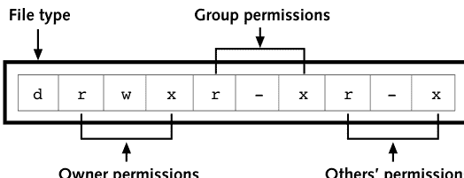

**图 2-7** 文件类型和文件权限示例

第一个字符表示读取权限。如果那里出现“r”，则该类用户具有读取该文件的权限。第二个字符表示写入权限。如果那里出现“w”，则该类用户具有写入该文件的权限。第三个字符表示执行权限。如果那里出现“x”，则该类用户具有执行该文件的权限，例如执行程序文件。如果在这些字符位置中的任何一个出现横线 (`-`)，则拒绝该类型的权限。

如果用户被授予了目录的读取权限，该用户就可以看到其内容的列表。目录的写入权限意味着用户可以在目录中重命名、删除和创建文件。目录的执行权限意味着用户可以将该目录设置为当前工作目录。从左到右，字符 `wxrwxrxr-x` 意味着：

- r - 所有者读取权限
- w - 所有者写入权限
- x - 所有者执行权限
- r - 组读取权限
- w - 组写入权限
- x - 组执行权限
- r - 其他人读取权限
- w - 其他人写入权限
- x - 其他人执行权限

## 第 2 章 探索 UNIX/Linux 文件系统与文件安全

- r - 所有者读取权限
- w - 所有者写入权限
- x - 所有者执行权限
- r - 组读取权限
- w - 组写入权限
- x - 组执行权限
- r - 其他人读取权限
- w - 其他人写入权限
- x - 其他人执行权限


## 权限说明

- `w` - 组写入权限
- `x` - 组执行权限
- `r` - 其他人读取权限
- `w` - 其他人写入权限
- `x` - 其他人执行权限
- `r` - 所有者读取权限
- `w` - 所有者写入权限
- `x` - 所有者执行权限
- `r` - 组读取权限
- `w` - 组写入权限
- `x` - 组执行权限
- `r` - 其他人读取权限
- `w` - 其他人写入权限
- `x` - 其他人执行权限
- `r` - 所有者读取权限
- `w` - 所有者写入权限
- `x` - 所有者执行权限
- `r` - 组读取权限
- `w` - 组写入权限
- `x` - 组执行权限
- `r` - 其他人读取权限
- `w` - 其他人写入权限
- `x` - -权限执行权限
- `r` - 所有者读取权限
- `w` - 所有者写入权限
- `x` - 所有者执行权限
- `r` - 组读取权限
- `w` - 组写入权限
- `x` - 组执行权限
- `r` - 其他人读取权限
- `w` - 其他人写入权限
- `x` - 其他人执行权限
- `r` - 所有者读取权限
- `w` - 所有者写入权限
- `x` - 所有者执行权限
- `r` - 组读取权限
- `w` - 组写入权限
- `x` - 组执行权限
- `r` - 其他人读取权限
- `w` - 其他人写入权限
- `x` - 其他人执行权限
- `r` - 所有者读取权限
- `w` - 所有者写入权限
- `x` - 所有者执行权限
- `r` - 组读取权限
- `w` - 组写入权限
- `x` - 组执行权限
- `r` - 其他人读取权限
- `w` - 其他人写入权限
- `x` - 其他人执行权限
- `r` - 所有者读取权限
- `w` - 所有者写入权限
- `x` - 所有者执行权限
- `r` - 组读取权限
- `w` - 组写入权限
- `x` - 组执行权限
- `r` - 其他人读取权限
- `w` - 其他人写入权限
- `x` - 其他人执行权限
- `r` - 所有者读取权限
- `w` - 所有者写入权限
- `x` - 所有者执行权限
- `r` - 组读取权限
- `w` - 组写入权限
- `x` - 组执行权限
- `r` - 其他人读取权限
- `w` - 其他人写入权限
- `x` - 其他人执行权限
- `r` - 所有者读取权限
- `w` - 所有者写入权限
- `x` - 所有者执行权限
- `r` - 组读取权限
- `w` - 组写入权限
- `x` - 组执行权限
- `r` - 其他人读取权限
- `w` - 其他人写入权限
- `x` - 其他人执行权限
- `r` - 所有者读取权限
- `w` - 所有者写入权限
- `x` - 所有者执行权限
- `r` - 组读取权限
- `w` - 组写入权限
- `x` - 组执行权限
- `r` - 其他人读取权限
- `w` - 其他人写入权限
- `x` - 其他人执行权限
- `r` - 所有者读取权限
- `w` - 所有者写入权限
- `x` - 所有者执行权限

`Linux` `chmod` 命令用于设置权限。符号字符串 `rwx` 指明读取、写入和执行权限授予所有者、组和其他人。以下是使用符号字符串在命令中修改 `myfile` 权限的示例：

`chmod ugo+rwx myfile`

以下命令授予组读取权限：

`chmod g+r customers`

也可以使用符号字符串拒绝权限。以下命令拒绝组和其他人的执行权限。

`chmod go-wx account_info`

> 注意 从你的主目录，你无法创建任何子目录并设置权限。然而，除非系统管理员做了特殊规定，否则你无法在主目录之外创建目录。八进制权限分配权限的另一种方法；它根据权限类型以及所有者、组和其他来分配数字。权限类型是一个数字。例如，执行权限被分配 `1`，写入分配 `2`，读取分配 `4`。这些权限数字相加得到一个 `0` 到 `7` 之间的值。例如，读取写入权限是 `6` (`4 + 2`)，读取执行权限是 `5` (`4 + 1`)，如下列表所示：

- `0` 表示无权限。
- `1` 表示执行（与 `x` 相同）。
- `2` 表示写入（与 `w` 相同）。
- `3` 表示写入执行（与 `wx` 相同）。
- `4` 表示读取（与 `r` 相同）。
- `5` 表示读取执行（与 `rx` 相同）。
- `6` 表示读取写入（与 `rw` 相同）。
- `7` 表示读取、写入和执行（与 `rwx` 相同）。

这些数字中的每一个与 `chmod` 命令后的三个数字位置 (`xxx`) 中的每一个位置相关。第一个位置给出所有者的权限数字，第二个位置给出组的权限数字，最后一个位置给出其他（other）的权限数字。例如，命令 `755 myfile` 为所有者（针对 `myfile`）分配读、写和执行权限；为组（group）和人类分配读和执行权限（位置上的 `5`）。这里是一些其他示例：

- `711 data`—对于文件 `data`，此命令为所有者分配读、写和执行权限；为组分配执行；为其他分配执行（程序员通常将其用于他们编写的程序，允许使用户执行这些程序）
- `642 data`—对于文件 `data`，此命令为所有者分配读和写权限；为组分配读；为其他分配写。
- `777 data`—对于文件 `data`，此命令为所有者、组和人类都分配读、写和执行权限。
- `755 data`—对于文件 `data`，此命令为所有者分配读、写和执行权限；为其他分配读和执行权限（程序员使用的另一种权限）
- `504 data`—对于文件 `data`，此命令为所有者分配读和执行权限；为组分配无权限；为其他分配读权限。


如果你想对目录设置安全性，以确保用户知道该目录下某个文件的精确路径——以便他们可以执行程序但不能嗅探——请将目录配置为 `711` 权限。这赋予了所有者（你）所有权限，并仅向组和人类授予执行权限。


某些 `UNIX/Linux` 版本包含 `amass` 命令，它允许你一次对多个文件设置权限。此命令比使用 `chmod` 命令更复杂，但可以为系统管理员节省时间。例如，`amass 022` 为所有用户授予 `rwx` 权限。不过，你也可以在使用 `chmod` 时配合通配符 (`*`) 为多个文件授予权限。例如，`chmod 777 *` 为当前目录中的所有文件授予所有用户和组权限。

现在你已经学习了权限，请查看表 2-5 以获取设置权限的建议。此外，尝试实践项目 2-12 来配置权限。参见附录 B 有关 `chmod` 命令的简要描述。

## 第 2 章 探索 UNIX/Linux 文件系统与文件安全

### 表 2-5 设置权限的建议

| 文件或目录类型 | 权限建议 |
|---|---|
| 如 `/bin`, `/boot`, `/dev`, `/sbin`, `/sys` 和 `/usr` 等系统目录 | 给 `root`（所有者）所有权限，给组和人类分配 `rx`——`chmod 755`。 |
| 用于 `root` 账户的 `/root` 目录 | 给 `root`（所有者）所有权限，给组分配 `rx`，给人类分配无权限——`chmod 750`。 |

### 表 2-5 设置权限的建议（续）

| 文件或目录类型 | 权限建议 |
|---|---|
| 你的主家目录 | 给所有者（你的账户）所有权限，或给组分配无权限、给人类分配无权限——`chmod 710` 或 `chmod 700`。（如果你是学生并需要让教师访问你的主家目录，使用 `chmod 705` 使你的教师拥有 `rx` 权限。） |
| 你想要与他人共享、让他们可以访问并创建文件的目录下的子目录 | 给所有者（你的账户）、组和人类分配所有权限——`chmod 777`。 |
| 你主家目录中你想要查看但不想更改的文件 | 给所有者（你的账户）所有权限，给组分配 `rx`，给人类分配 `rx`——`chmod 755`。 |
| 一个应该只由你访问的文件 | 给所有者所有权限，给组和人类分配无权限——`chmod 700`。 |
| 你主家目录中一个不应被更改（仅保留）且只有你才能查看的存档文件 | 给所有者分配 `rx` 权限，给组和人类分配无权限——`chmod 500`。 |

这里简要提到三种高级权限，以便你有所了解：粘滞位（sticky bit）、设置用户 ID（SUID）位和设置组 ID（SGID）位。这三种权限通常由系统管理员用于特殊目的。

在旧的 `UNIX` 和 `Linux` 发行版中，粘滞位被用于让可执行程序（作为程序的文件）在退出后保留在内存中。此操作确保了程序在下次使用时能够立即可用，或者为服务器上的多个用户保持就绪状态。在当前的操作系统中，粘滞位用于允许文件具有执行性，但只有文件的所有者或 `root` 才有权限删除或重命名它。粘滞位的符号是 `t`（代替 `x`），当你使用 `ls -l` 查看权限时可以看到。例如，`-rwwxrxr-t.`。

`SUID` 位用于程序和文件，赋予当前用户（用户 ID）临时权限，以其身份执行程序相关文件，就像他们是所有者一样。例如，多用户服务器上的程序通常由 `root` 安装。然而，普通用户可能需要执行并可能修改文件的能力，以便像 `root` 账户一样运行。设置 `SUID` 位赋予了他们使用程序所需的访问权限——临时将用户视为 `root`（所有者）。即使有人正在使用带有 `SUID` 权限的程序，`root` 仍然保留着实际的所有权。


SGID 位的工作原理与 SUID 类似，但它适用于组。它允许一组人员以组的权限访问文件。SGID 的符号是 `s`。例如，当 SUID 和 SGID 都设置时，文件的权限可能看起来为 `-rws-x`。

## 总结

- 在 UNIX/Linux 中，文件是数据存储的基本组件。UNIX/Linux 将一切视为文件，甚至是设备。即使是包含文件和子目录的目录也是一个特殊文件。
- 文件系统是 UNIX/Linux 组织硬盘和可移动介质的方式。文件存储在文件系统中，文件系统是一种层次结构，顶级目录包含子目录，子目录包含目录。每个文件都可以通过路径（指向文件的目录列表）来定位。
- 标准树形结构从根 (`/`) 文件系统开始，它是其他目录和子目录的基础。
- 文件的磁盘区域被称为分区。一个磁盘可能有多个分区，每个分区相互独立，因此不受与其他分区相关的文件问题的影响。UNIX/Linux 文件系统设计用于在挂载到树中后访问多个分区。
- 路径在 UNIX/Linux 中的定义是访问系统上任何文件的映射。绝对路径始终从根级别开始。相对路径是从你的当前位置开始的。
- 你可以自定义命令提示符以显示当前目录名称、日期、时间以及其他项目。
- `ls` 命令显示目录中包含的文件和目录名称。`ls -l` 命令显示长列表，即详细的文件信息。
- 通配符可以用于命令中，如 `*`，并代表文件名中的其他字符。在 Bash Shell 中，`*` 通配符可以代表任何字符串，而 `?` 通配符可以代表任何单个字符。特定的通配符可以与 shell 关联。

# 命令总结：第2章命令回顾

使用 `cp` 命令将源文件复制到目标文件。除非使用 `-i` 选项，否则 UNIX/Linux 会在不警告的情况下覆盖目标文件。点符号（`.`，表示当前目录）是命令中指定目标位置的简写方式。

你可以使用 `chmod` 命令为你拥有的文件设置权限。基本权限设置为 `rwx`，分别代表读、写和执行。文件权限的设置用于控制三类用户的访问：所有者 (`u`)、用户组 (`g`) 和其他人 (`o`)。你必须记住更改你所拥有的任何目录的权限设置，并且预期的用户（所有者、组、其他人）必须具有执行权限。

## 命令总结：第2章命令回顾

| 命令 | 目的 | 本章涵盖的选项 |
|---|---|---|
| `cd` | 切换目录（不带选项时，`cd` 将跳转到你的主目录） | - 切换到当前工作目录。 - 切换到父目录。 |
| `chmod` | 为指定文件设置文件权限 | + 分配权限。 - 移除权限。 |
| `cp` | 从一个目录复制文件到另一个目录 | -b 如果目标文件已存在，则对目标文件进行备份（这样在覆盖文件时你就有了备份）。 -l 防止在不警告的情况下覆盖目标文件。 -u 仅当源文件比当前目标中的文件新时，才覆盖现有文件。 |
| `ls` | 显示目录内容，包括其文件和子目录 | -a 列出隐藏文件。 -l (小写 L) 生成目录的详细列表。 -r 按反序对列表排序。 -s 按文件大小对列表排序。 -t 按文件或目录的最后修改时间排序。 -X 按扩展名排序。 -v 验证目录是否已创建。 |
| `mkdir` | 创建一个新目录 |  |
| `mount` | 在系统启动时将文件系统连接到目录树，并挂载额外的设备（如 CD/DVD 驱动器） | -t 指定要挂载的文件系统类型。 |
| `pwd` | 显示你的当前路径 |  |

## 第2章 探索 UNIX/Linux 文件系统与文件安全

| 命令 | 目的 | 本章涵盖的选项 |
|---|---|---|
| `rm` | 删除文件 | -i 在删除文件前提示。 |
| `rdir` | 删除空目录 | -v 提示消息以验证目录已删除。 |
| `umask` | 为多个文件设置文件权限 |  |
| `umount` | 将文件系统分区从目录树中分离 |  |

## 关键术语

- `boot分区 (boot partition)` — 用于存储组成内核的操作系统文件的分区。
- `home分区 (home partition)` — 位于主目录的分区，为所有用户的目录提供存储空间。它是硬盘的一个独立区域，保护并隔离用户的个人文件使其不受 UNIX/Linux 操作系统软件的影响。
- `usr分区 (usr partition)` — 用于存储用户访问的所有或非空操作程序的分区。
- `var分区 (var partition)` — 用于存放临时创建文件的分区，例如用于打印文档的文件和记录监控及管理数据的日志文件。
- `绝对路径 (absolute path)` — 从根文件目录开始的路径名，列出了到达目的地的所有子目录。
- `二进制文件 (binaries)` — 存在于 `/bin` 目录及其他位置、启动系统和执行其他任务所需的程序。也称为可执行文件。
- `块特殊文件 (block special file)` — 在 UNIX/Linux 中，用于管理涉及数据块访问的设备，包括 CD/DVD 驱动器、硬盘驱动器、磁带驱动和其他存储设备。也称为块设备。
- `引导加载程序 (bootstrap loader)` — 存在于 `/boot` 目录中启动操作系统的程序。
- `字符特殊文件 (character special file)` — UNIX/Linux 中的一种 I/O 管理文件，用于处理逐字节的数据流（例如通过串口或 USB 连接），包括终端、打印机和网络通信。也称为字符文件。
- `子目录 (child)` — 存储在（父）目录中的子目录。
- `设备特殊文件 (device special file)` — UNIX/Linux 中用于管理 I/O 设备的文件。它可以有两种类型：块特殊文件或字符特殊文件。
- `目录 (directory)` — 一种可以包含文件和其他目录的文件类型。目录文件存储普通文件和其他目录（称为子目录）的名称。
- `增强 IDE (EIDE)` — IDE 的改进版本，提供更快的数据传输速度，通常用于计算机。参见集成驱动电子 (Integrated Drive Electronics)。
- `可执行文件 (executables)` — 存在于 `/bin` 目录中、启动系统和执行其他任务所需的程序。也称为二进制文件。
- `扩展文件系统 (extended file system, ext 或 fs)` — 为 Linux 设计的文件系统，默认安装在 Linux 操作系统中。它允许使用全范围的内置 Linux 命令、文件操作和安全性。`ext` 发布于 1992 年，存在一些 bug 并支持高达 2 GB 的文件。1993 年引入了扩展文件系统 (`ext2` 或 `ext2 fs`) 以修复 `ext` 的 bug，并支持高达 4 TB 的文件。2001 年引入了 (`ext3` 或 `ext3 fs`) 以启用文件日志和数据恢复。`ext4` 于 2006 年引入，允许单个卷容纳多达 1 字节的数据并支持使用区（extent）。`ext2`、`ext3` 和 `ext4` 支持最多 255 个字符的文件名。
- `区 (extent)` — 磁盘的一部分（如一个块或一组块），为文件预留并代表连续空间，这样文件在增长时，其保持在相同位置。
- `文件 (file)` — 数据存储的基本组件。
- `文件系统 (file system)` — 操作系统组织存储设备（如硬盘和软盘）上文件的方式。这种组织是层次化的，类似于树。在分支结构中，顶层文件（或目录）包含其他文件，这些文件又包含其他。
- `组 ID (group id, GID)` — 用于标识用户组的数字。
- `隐藏文件 (hidden file)` — 操作系统用于保存配置信息的文件。文件名以点开头。
- `热点 (hot spots)` — 将损坏分区上的数据移动到未损坏区域的能力。
- `索引节点 (information node, 或 inode)` 用于存储关于目录和文件的基本信息的系统。`inode` 信息包括 (1) 目录名称 (2) 目录/文件的通用信息 (3) 在磁盘分区上定位目录/文件的指针。
- `集成驱动电子 (Integrated Drive Electronics, IDE)` 也称为集成设备电子，计算机最常用的电子接口。这与 ANSI 技术附件 (ATA) 标准相同。
- `日志记录 (journaling)` — 对数据和交易进行顺序记录的过程，以便系统无警告崩溃时，可以恢复或备份数据或交易以避免数据丢失。
- `挂载 (mount)` — 将文件系统连接到目录树的过程，使该目录可访问。
- `父目录 (parent)` — 创建并存储子目录（child）的目录。
- `分区 (partition)` — 磁盘的一个区域，持有文件系统，创建此为了其他分区发生的活动和问题不会影响它。
- `路径名 (pathname)` — 指定文件或目录的方法，包含了树结构分支中的目录和子目录名称。例如，`/home` 目录下 `jean` 的源目录中的文件 `phones`（目标文件）的路径名为 `/home/jean/source/phones`。


- **外围设备 (peripherals)** 通过电子接口连接到计算机的设备。包括硬盘、软盘、打印机和键盘。

## 第 2 章 探索 UNIX/Linux 文件系统与文件安全

- 物理文件系统（physical file system）——格式化为用于存储文件的磁盘区域。

- 相对路径（relative path）——从当前工作目录开始并列出目标文件所有子目录的路径名。

- 根文件系统（root file system）——所有其他目录的主目录或父目录（文件系统的最高层）；也可以指系统管理员文件所在的目录（`/`）。

- 设置组 ID (SGID) 位——允许程序的所有者保留完全所有权，同时在执行程序时赋予组内成员临时所有权。

- 设置用户 ID (SUID) 位——允许程序的所有者留存完全所有权，同时在执行该程序时赋予任何普通用户临时所有权。

- 共享库（shared libraries）——存在于 `/lib` 目录下的文件，程序员使用它们来共享代码，而不是将其复制到程序中。这样做可以使程序更小、运行更快。

- 小型计算机接口（SCSI）——发音为“suzzy”，是一种在服务器上常用的快速磁盘接口。SCSI 实际上是定义与硬盘通信各个方面的标准集。

- 粘滞位（sticky bit）——一种执行权限，导致程序留在内存中（旧的 UNIX/Linux 系统），或确保只有 root 或所有者可以删除或重命名文件（新系统）。

- 子目录（subdirectory）——上级目录或父目录下的目录。

- 超块（superblock）——分区上的特殊数据块，包含有关文件系统布局的信息。它是查找文件系统中内容的关键，且不应更改。

- 交换分区（swap partition）——磁盘上与其他部分分离的部分，作为内存的扩展支持虚拟内存。系统可以使用此分区在磁盘和 RAM 之间交换信息，以便计算机运行更快、更高效。

- 符号链接（symbolic link）——指向文件的名称，允许您使用相同目录中的不同名称访问文件。

- UNIX 文件系统 (`ufs`)——在许多 UNIX/Linux 版本中支持的分级（树结构）文件系统。它是可扩展的、支持大存储、安全性良好、可靠并使用节点（inodes）。

- 工具（utility）——执行复制文件、列出目录和用户通信等有用操作程序。与其他操作系统不同，工具是 UNIX/Linux 的附加组件，而不是内核的组件。

- 虚拟文件系统（virtual file system）——不占用磁盘空间的系统，如 `/proc` 目录，并提供有关计算机上运行程序的信息。

- 虚拟内存（virtual memory）——交换分区支持的内存资源，系统可以在磁盘和 RAM 之间交换信息，允许计算机运行更快、更高效。

- 虚拟存储（virtual storage）——通过磁盘或文件系统（或两者）分配存储，对操作系统和用户透明访问。

- 通配符（wildcard）——可以代表任何字符的特殊字符，通常用于 `ls` 命令的参数。

## 复习题

1. 公司正在讨论管理桌面和笔记本电脑的计划。用户提出的问题是 Linux 是否支持使用 CD 和 DVD 进行工作和听音乐。以下哪项是合适的答案？

a. Linux 只支持磁盘文件系统，如扩展文件系统 (`ext`) 和 UNIX 文件系统，但用户可以将 (MP3) 文件复制到磁盘播放。

b. Linux 可以使用 Reiser 文件系统，支持 CD 和 DVD。

c. Linux 支持 UDF 和 `iso9660` 文件系统供 CD 和 DVD 使用。

d. Linux 通过使用 `/removable` 分区支持挂载 CD 和 DVD。

2. 你收到一条消息，你成功备份了 `hda2`。`hda2` 是什么？

a. 双磁盘系统上的第二个磁盘

b. 主硬盘上的第二个分区

c. CD 上的文件

d. `/root` 目录下的子目录

3. 你为电脑购买了一个特殊显示器，说明书让你对 `initab` 文件进行微调。在典型的 Linux 系统中，你在哪里找到此文件？

a. `/var`

b. `/fastboot`

c. `/home/users`

d. `/etc`

4. 你正忙于准备会议，并想访问主目录中的一个文件，但你目前在一个对所有用户开放的目录下。输入什么命令可以立即进入主目录？

a. `ed`

b. `home`

c. `go`

d. `fetch`

5. 你的新同事询问厂商建议在 Linux 系统上设置哪些分区。你在回答中包含以下哪些分区？（多选）

a. `/backup`

b. `root`

c. `swap`

d. `/boot`

6. 你挂载了一个远程网络驱动器，现在想卸载驱动器。你使用以下哪些命令？（多选）

a. `bye`

b. `umount`

c. `driveoff`

d. `disconnect`

7. 当你通过 Linux 电脑上的 USB 端口连接打印机时，使用什么类型的设备特殊文件处理发送自打印机的数据流？

a. 字符特殊文件

b. 块特殊文件

c. 根设备文件

d. 端口设备文件

8. 用户创建了许多产生碎片的文件。以下功能有助于减少这种情况？

a. `swap`

b. `monitor`

c. `extents`

d. `ext4`

9. 在 UNIX 和 Linux 系统中，用于防止文件碎片？

a. `swap`

b. `memory`

c. `/mem`

d. `/users`

10. 你想确保删除一个特定文件。可以使用什么命令先进行提示？

a. `\t`

b. `/v`

c. `/time`

d. `/date`

11. 你已经工作了几个小时，需要记住自己在哪个目录中。可以使用什么命令？

a. `showme`

b. `where`

c. `pwd`

d. `dir`

12. 你部门的一位成员给了你查看其主目录内容的权限。你应该使用以下哪个命令？

a. `dir`

b. `ls`

c. `/home/ramirez`

d. `cd -l`

13. 晚了，你想复制几个文件。你应该使用什么命令来确保不会意外复制报告？

a. `cp -u`

b. `--warn`

c. `copy`

d. `--caution`

14. 以下哪些是 Linux 支持的文件系统？（多选）

a. `NTFS`

b. `vfat`

c. `ufs`

d. `ext`

15. 你正在帮助一位刚接触 Linux 的朋友。你想确定主目录下的哪些项是目录而不是文件。当你对目录进行长列表时，你寻找什么？

a. 行的第一个字符为“~”表示目录，“$”表示文件。

b. 行的最后一个单词是“file”或“directory”。

c. 名称末尾附加的字符为“1”表示文件，“2”表示目录。

d. 行的第一个字符为“d”表示目录，“-”表示普通文件。

16. 你的老板计划通过删除旧文件进行清理。然而，她提到不想意外删除重要文件。她可以使用什么命令？

a. `del`

b. `cp -d`

c. `write -del -q`

d. `rm -i`

17. 你对操作系统保留的错误和系统日志感到好奇。在根目录 (`/`) 下哪个主目录下最可能找到这些内容？

a. `/var`

b. `/sbin`

c. `/tmp`

d. `/sys`

18. 你的朋友试图为硬盘腾出更多空间，并删除 `/lib` 目录，因为他听说里面主要是他不使用的游戏。你的建议是什么？

a. 删除 `/lib` 目录，因为它主要就是旧游戏。

b. 在删除 `/lib` 目录之前，将配置文件复制到另一个目录，因为该文件用于配置游戏和其他软件。

c. 改删除 `/mnt` 目录，因为它包含了更改的维护和日志文件的备份。

d. 保留 `/lib` 目录，因为它包含了安全信息、共享库镜像、内核模块和其他重要文件。

19. 下列哪些是可以授予文件的权限？（选择所有适用。）

- a. start（启动）
- b. write（写）
- c. execute（执行）
- d. manage（管理）
- d. read（读）

20. 下列哪些命令允许你在创建目录后为其设置权限？（选择所有适用。）

- a. `mkdir -p`
- b. `cpdir --permissions`
- c. `chmod`
- d. `catperm`

21. 你创建了许多以 `.txt` 结尾的个人笔记。在 Bash shell 中，下列哪条命令可以让你列出主目录下的所有 `.txt` 文件？

- a. `dir ##.txt`
- b. `ls *.txt`
- c. `cp .txt -all`
- d. `cat $txt`

22. 虚拟内存位于何何处？

23. 当你看到与文件关联的权限 `rwx--x--x` 时，授予了哪些权限？

24. 你的老板想使用命令来查看隐藏文件，并想知道如何在其他文件中找到它们。你会告诉她什么？

25. 你有许多以单词“account”开头并以两个数字（表示年份）结尾的文件，例如 `account00`、`account 01` 等。哪条命令可以让你查看所有这些以 account 开头的文件？

## 实践项目

本章中的所有项目都从命令行（例如终端窗口）执行。


注意

# 98 页 第 2 章 探索 UNIX/Linux 文件系统和文件安全

## 项目 2-1


UNIX/Linux 支持许多可以使用 `mount` 命令挂载的文件系统。在本项目中，你将使用 `mount` 命令来确定你所使用的 UNIX/Linux 版本中可用哪些可用的文件系统。对于本项目以及本章中的所有项目，除非“实操项目 2-2”中另有说明，否则你应该登录自己的账户。

查看可用的文件系统：

1. 在命令提示符处，输入 `mount man` 并按回车。根据需要继续按空格键以查看 `-t` 参数的文档（如果你使用的是终端窗口，完成后可能需要按 `q` 退出文本显示模式）。
2. 哪些文件系统可以挂载？
3. 接下来，输入 `mount` 并按回车以确定实际上挂载了哪些文件系统。（见图 2-8）。你在系统中看到了哪些文件系统？

```
mpalmer@localhost:~ $ mount
[mpalmer@localhost:~]
/mapper/VolGroup0-lvg000 on / type ext3 (rw)
proc on /proc type proc (rw)
sysfs on /sys type sysfs (rw)
depts on /devpts type devpts (rw,gid=5,mode=628)
/dev/hda1 on /boot type ext3 (rw)
tmpfs on /dev type tmpfs
none on /proc/sys/fs/binfmt type binfmt_misc (rw)
sunpc on /var/lib/nfs/rpc_pipefs type rpc_pipefs (rw)
[mpalmer@localhost:~ $ ]
```

图 2-8 已挂载的文件系统

## 项目 2-2

大多数系统都有 CD 或 CD/DVD 驱动器，允许你挂载 CD。询问你的导师你的系统是否支持使用 `mount` 命令从命令行挂载 CD。本项目允许你挂载和卸载 CD。你需要一张可以（由你或服务器人员）插入到 CD/DVD 驱动器中的 CD。

## 实践项目

如果你的系统支持从命令行挂载 CD，请尝试以下项目。另外注意，在较新的系统中，`/mnt/cdrom` 挂载点可能会被 `/media/cdrom` 替换。询问你的导师使用 `/mnt/cdrom` 还是 `/media/cdrom`。

### 如何挂载和卸载 CD：

1. 登录 root。
2. 插入 CD 或要求服务器人员插入 CD。
3. 如果你的系统自动挂载 CD，输入 `umount /mnt/cdrom`（或将 mnt 替换为 media）并按回车卸载它。（如果驱动器打开，请关闭加载了 CD 的驱动器）。
4. 输入 `mount -t iso9660 /dev/cdrom /mnt/cdrom`（或将 mnt 替换为 media）并按回车。（注意 `/mnt/cdrom` 或 `/media/cdrom` 被用作 CD 的挂载点，CD 挂载后，你可以在 `/mnt/cdrom` 或 `/media/cdrom` 子目录下查看文件。此外，如果你的系统没有 `/mnt/cdrom` 或 `/media/cdrom` 目录，你需要创建它）。
5. 输入 `mount` 并按回车验证 CD 已挂载。
6. 输入 `ls /mnt/cdrom`（或将 mnt 替换为 media）并按回车查看 CD 内容。
7. 输入 `umount /mnt/cdrom`（或将 mnt 替换为 media）并按回车。（在某些系统中，CD 驱动器现在会打开你或服务器人员移除 CD）。
8. 你会使用哪些命令来挂载和卸载用于 Windows 系统的软盘？

如果你的系统不支持使用 `mount` 命令从命令行挂载 CD，请尝试以下项目。另外注意，在较新的系统中，`/mnt/cdrom` 挂载点可能会被 `/media/cdrom` 替换。询问你的导师使用 `/mnt/cdrom` 还是 `/media/cdrom`。

# 第 2 章 探索 UNIX/Linux 文件系统与安全

2. 你的主目录的父目录是 `/home` 充分 `home` 是一个绝对路径。输入 `cd /home` 并按回车。系统将带你进入 `/home` 目录。
3. 输入 `cd 你的用户名`（例如 `cd joseph`），按回车。此步骤使用相对路径找到返回你的主目录。

# 项目 2-7

使用点（`.`）和双点（`..`）导航文件系统可以节省打字时间。在这个项目中，你将练习这两种约定。确保你在执行项目时是以你的账户登录的，而不是以 root 身份。

### 使用点和双点更改你的工作目录：

- 1. 如果你不在主目录，输入 `cd` 并按回车。因为（点）引用当前目录，系统不会改变你的工作位置。
- 2. 输入 `cd ..` 并按回车。系统将带你进入父目录，即 `/home`。
- 3. 输入 `cd ..` 并按回车。系统将带你进入根文件系统目录（`/`）。输入 `cd` 并按回车。系统将带你回到你的主目录。

> 在此项目的任何步骤中，你可以输入 `pwd` 来验证你当前所在的目录。

# 项目 2-8

`ls` 命令是最实用的命令之一。在这个项目中，你将开始使用 `ls` 查看你的工作目录。接下来，你将使用带参数的 `ls` 查看文件，然后是目录。要获取更完整的目录信息列表，使用 `-l` 选项，最后使用 `-a` 选项将隐藏文件包含在目录列表中。查看当前工作目录下的文件和目录列表：

- 1. 输入 `ls` 并按回车。你会看到文件和目录列表。
- 2. 如果你不在主目录，输入 `cd` 并按回车。
- 3. 在第 1 章“UNIX 和 Linux 的本质”中，你使用 `cat` 命令创建了一个笔记文件（`notes`）。你的主目录里应该还有那个文件。（如果没有，再次使用 `cat` 创建一个 `notes` 文件。）输入 `ls notes` 并按回车。系统将显示 `notes` 文件的列表。

查看特定文件或目录的列表：

- 3. 要查看当前工作目录以外的目录内容，将目录名作为 `ls` 命令的参数。例如，要查看 `/var` 目录的内容，输入 `ls /var` 并按回车。你可能会看到类似于图 2–10 中的列表。

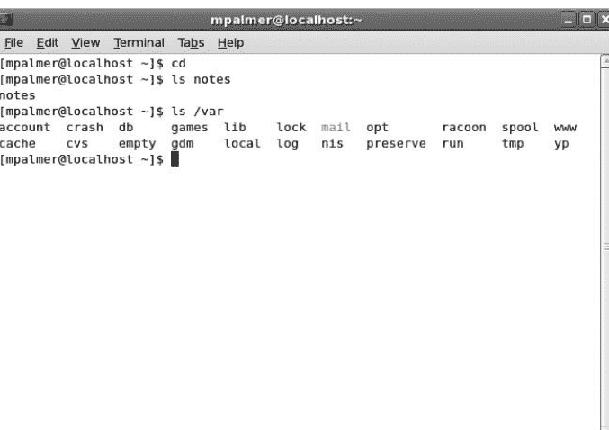

**图 2-10** 查看 `/var` 目录的内容

**使用 `ls -l /dev` 并按回车：**

- 1. 输入 `ls -l /dev` 并按回车。你会看到类似于图 2–11 中的信息。这显示了 `/dev` 目录下块设备文件和字符设备文件的列表。注意信息的第一列，块设备文件以“b”开头。（你可能需要向上滚动才能找到块设备文件。）什么代表字符设备文件？
- 2. 输入 `ls -l` 并按回车查看根文件系统目录的内容。（参考本章之前的图 2–5）。

**列出你主目录中的隐藏文件：**

- 1. 输入 `clear` 并按回车清屏。
- 2. 在提示符后输入 `ls -a` 并按回车。（见图 2–12。）

# 第 2 章 探索 Unix/Linux 文件系统与文件安全


```
mpalmer@localhost:~
crw-xr-x root root 442,2048 Nov 28 10:25 usbdev2.1-ep0
crw-xr-x root root 442,2048 Nov 28 10:25 usbdev2.1-ep1
crw------ root tty 7, 8 Nov 28 10:25
crw------ vcsa tty 7, 1 Nov 28 10:26 vcs1
crw------ vcsa tty 7, 2 Nov 28 10:26 vcs2
crw------ vcsa tty 7, 3 Nov 28 10:26 vcs3
crw------ vcsa tty 7, 4 Nov 28 10:26 vcs4
crw------ vcsa tty 7, 5 Nov 28 10:26 vcs5
crw------ vcsa tty 7, 6 Nov 28 10:26 vcs6
crw------ vcsa tty 7, 7 Nov 28 10:26 vcs7
crw------ vcsa tty 7, 8 Nov 28 10:26 vcs8
crw------ vcsa tty 7, 130 Nov 28 10:26 vcs9
crw------ vcsa tty 7, 129 Nov 28 10:26 vcsal0
crw------ vcsa tty 7, 130 Nov 28 10:26 vcsal1
crw------ vcsa tty 7, 131 Nov 28 10:26 vcsal2
crw------ vcsa tty 7, 130 Nov 28 10:26 vcsal3
crw------ vcsa tty 7, 136 Nov 28 10:26 vcsal4
dr-xr-x root root 80 Nov 28 10:25
dr-xr-x root root 4 Nov 28 10:25
crw-rw---- root root 1 Nov 28 10:25
mpalmer@localhost ~]$
```

图 2-11 使用 `-l` 查看 `/dev`

```
mpalmer@localhost~~$ ls -a
.notes
.. .gconf .recently-used
.bash_history .gconf .recently-used
.bash_logout .profile .redhat
.bashrc .gnome_private .ssh
.config .git
current_users .session_errors
.mozilla
.drc
.eggcups .nautilus
mpalmer@localhost~]$
```

图 2-12 查看隐藏文件

# 项目 2-9

通配符对于查找特定字符序列的文件有用。在这个项目中，你将在 `ls` 命令中使用 `*` 通配符。

**使用通配符：**

- 1. 为了练习通配符，你必须先创建一组相似的文件。在第 1 章中，你使用 `cat` 命令创建了文件：

    - `first_name`——包含名字的文件
    - `middle_name`——包含中间名的文件
    - `last_name`——包含姓的文件
    - `full_name1.txt`——包含全名的文件
    - `full_name2.txt`——另一个包含全名的文件

- 2. 例如，输入 `cat > first_name`，按回车，输入名字，按回车，然后按 Ctrl+d。

- 3. 输入 `*name` 并回车。你会看到 `first_name`、`last_name` 和 `middle_name`。

- 4. 输入 `full_name*.txt` 并回车。你会看到 `full_name1.txt`。

- 5. 输入 `*.txt` 并回车。现在你会看到 `full_name1.txt` 和 `full_name2.txt`。

# 项目 2-10

假设你在一家开发数据库的公司工作在这个项目中，你将为 Mail 和 Receiving 部门创建目录，对应预算和会计系统的 4540 和 4550。创建目录后，你将开始在这些目录中创建电话号码文件，然后使用 `mkdir` 命令创建新目录。不要删除你创建的文件，因为其他项目会用到它们。

**创建新目录和电话文件：**

- 1. 输入 `cd` 并按回车确保你在主目录。

- 2. 输入 `mkdir dept_4540` 并按回车创建一个名为 `dept_4540` 的目录。

- 3. 输入 `ls` 并按回车。在列表中看到 `dept_4540` 目录。

- 4. 输入 `cd dept_4540` 并按回车进入新目录。现在你可以使用 `cat` 命令创建一个 `phones1` 文件。`phones1` 文件包含区号、前缀、号码、姓和名。冒号 (`:`) 分隔每个字段。

- 5. 输入以下命令，每行结束后按回车：

```
cat > phones1
219:432:4567:Harrison:joel
219:432:4587:Mitchell:Barbara
219:432:4589:Olson:Timothy
```

- 6. 按 Ctrl+d。

- 7. 输入 `cat phones1` 并按回车查看并验证你创建的文件。

- 8. 输入 `cd` 并按回车返回你的主目录。

- 9. 输入 `mkdir dept_4550` 并按回车创建一个名为 `dept_4550` 的目录。

- 10. 输入 `ls` 并按回车。在列表中看到 `dept_4550` 目录。

- 11. 输入 `cd dept_4550` 并按回车进入新目录。现在你可以使用 `cat` 命令创建 `phones2` 文件，它与 `phones1` 文件具有相同的字段。

- 12. 输入以下命令，每行结束后按回车：

```
cat > phones2
219:432:4591:Moore:Sarah
219:432:4522:Polk:John
219:432:4501:Robinson:Lisa
```

- 13. 按 Ctrl+d。

- 14. 输入 `cat phones2` 并按回车查看并验证 `phones2` 文件的内容。

- 15. 输入 `clear` 并按回车清屏准备下一个项目。

# 项目 2-11

创建文件后，你需要创建一个名为 `corp_db` 的新中央目录以便通用信息，并将 `phones1` 文件复制到新目录中。接下来，使用 `>` 将 `phones1` 和 `phones2` 合并为新目录中的 `corp_phones` 文件。注意你使用波浪字符 (`~`) 来表示主目录的位置。

将 phones1 文件复制到新目录 corp_db：

- 1. 输入 `cd` 并按回车回到你的主目录。

## 动手项目

- 2. 输入 `mkdir corp_db` 并按 `Enter` 创建目录。

- 3. 输入 `cd corp_db` 并按 `Enter` 切换到新目录。

- 4. 要将 `dept_4540` 目录下的 `phones1` 文件复制到当前目录，输入 `cp ~/dept_4540/phones1` 并按 `Enter`。

- 5. 要将 `dept_4550` 目录下的 `phones2` 文件复制到当前目录，输入 `cp ~/dept_4550/phones2` 并按 `Enter`。（见图 2–13。）

- 6. 输入 `ls` 并按 `Enter`，确保 phones1 和 phones2 现在都在目录中。

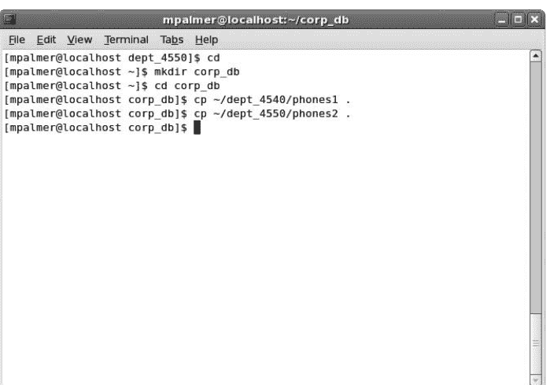

**图 2-13** 创建目录并将文件复制到其中

**将 phones1 和 phones2 文件合并为一个一个文件：**

- 1. 输入 `cat phones1 phones2 > corp_phones` 并按 `Enter`，将两个手机文件的内容添加到一个名为 `corp_phones` 的新文件中。

- 2. 输入 `clear` 并按 `Enter` 清除屏幕。

- 3. 输入 `more corp_phones` 并按 `Enter` 查看新文件的内容，如图 2-14 所示。

## 第 2 章 探索 UNIX/Linux 文件系统与文件安全

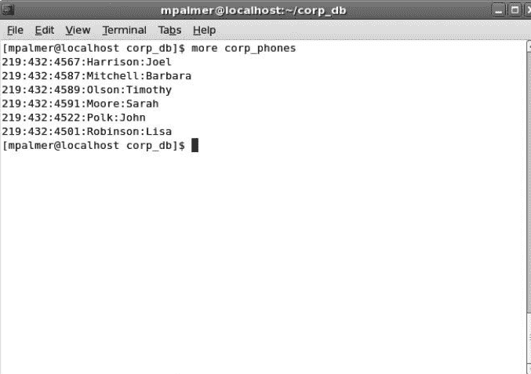

**图 2-14** 查看新 corp_phones 文件的内容

正如你在第 1 章中所忆的，`more` 命令允许你一次显示一个屏幕的文件，对于读取长文件特别有用。

> 注意

# 项目 2-12

假设你想让所有用户都能访问 `corp_phones` 文件。在这个项目中，你首先授予主目录访问权限。接下来，你允许访问 `corp_db` 目录，然后设置所有人读取 `corp_phones` 文件的权限。你使用带有 `x` 参数的 `chmod` 命令授予目录访问权限。

**更改文件和目录权限：**


## 动手项目

- 2. 输入 `mkdir corp_db` 并按 `Enter` 创建目录。
- 3. 输入 `cd corp_db` 并按 `Enter` 切换到新目录。
- 4. 要将 `dept_4540` 目录下的 `phones1` 文件复制到当前目录，输入 `cp ~~/dept_4540/phones1` 并按 `Enter`。
- 5. 要将 `dept_4550` 目录下的 `phones2` 文件复制到当前目录，输入 `cp ~~/dept_4550/phones2` 并按 `Enter`。（见图 2–13。）


**图 2-13** 创建目录并将文件复制到其中

**将 phones1 和 phones2 文件合并为一个文件：**

- 1. 输入 `cat phones1 phones2 > corp_phones` 并按 `Enter`，将两个手机文件的内容添加到一个名为 `corp_phones` 的新文件中。
- 2. 输入 `clear` 并按 `Enter` 清除屏幕。
- 3. 输入 `more corp_phones` 并按 `Enter` 查看新文件的内容，如图 2-14 所示。

## 第 2 章 探索 UNIX/Linux 文件系统与文件安全


**图 2-14** 查看新 corp_phones 文件的内容

正如你在第 1 章中所忆的，`more` 命令允许你一次显示一个屏幕的文件，对于读取长文件特别有用。

> 注意

# 项目 2-12

假设你想让所有用户都能访问 `corp_phones` 文件。在这个项目中，你首先授予主目录访问权限。接下来，你允许访问 `corp_db` 目录，然后设置所有人读取 `corp_phones` 文件的权限。你使用带有 `x` 参数的 `chmod` 命令授予目录访问权限。

**更改文件和目录权限：**

- 1. 确保你在主目录中。（输入 `cd` 并按 `Enter`。）
- 2. 输入 `clear` 并按 `Enter` 清除屏幕。
- 3. 输入 `chmod go+x ~` 并按 `Enter` 允许访问你的主目录。

此命令的意思是“让组 (`g`) 和其他人 (`o`) 可以访问你的主目录 (`~`) (`+x`)”。
- 4. 输入 `chmod u+x~/corp_db` 并按 `Enter` 允许访问 `corp_db` 目录。

此命令的意思是“让所有者 (`u`)、组 (`g`) 和其他人 (`o`) 可以访问 corp_db 目录 (`+x`)”。

# 探索练习 109

- 5. 输入 `chmod ~/corp_db/*` 并按 `Enter` 设置权限，使其他人可以写入 `corp_db` 目录中的文件。（所有者和组默认已具有写入权限。）

此命令的意思是“让 corp_db 目录中的所有文件对其他人 (`o`) 可写 (`+w`)”。
- 6. 输入 `ls ~/corp_db` 检查你设置的权限。（见图 2-15。）

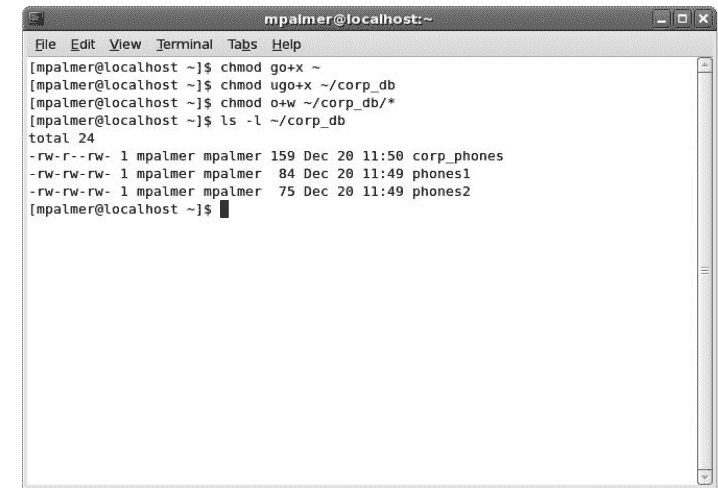

**图 2-15** 启用用户访问的权限更改

## 探索练习

- 1. 使用 `ls` 列出你系统中根文件系统目录 (`/`) 的内容。
- 2. 使用 `ls -l` 查看根文件系统目录 (`/`) 的内容。
- 3. 确定 `/etc` 目录的 inode 值。
- 4. 将 `/etc` 设置为工作目录并返回主目录。
- 5. 将根文件系统目录设置为当前工作目录。你可以使用什么命令来验证你是否在根文件系统？返回主目录。
- 6. 文件 `info.txt` 在 `help` 目录中，它是 `/dev` 目录的子目录。`info.txt` 的绝对路径是什么？
- 7. 切换到 `/dev` 目录。接下来，在你使用的命令中使用波浪号 (`~`) 访问主目录。
- 8. 确定 `/home` 目录中是否存在隐藏文件。
- 9. 在你的主目录下创建一个名为 `documents` 的目录。接下来，在 `documents` 目录下创建一个名为 `spreadsheets` 的目录。`spreadsheets` 目录的绝对路径是什么？


- 10. 确保你在主目录中。使用相对路径将新的 `documents` 设置为当前工作目录。接下来，使用相对路径将 `spreadsheets` 设置为当前工作目录。现在使用带有点的命令将 `documents` 设置为当前工作目录。
- 11. 以主目录为当前目录，使用命令移除组和其他对 `spreadsheets` 目录的读取、写入和执行权限。然后验证你的更改已生效。
- 12. 使用 `cat` 命令在你的主目录下创建一个名为 `datafile` 的两行文件。第一行输入 1。第二行输入 2。
- 13. 使用 `cat` 命令在你的主目录下创建一个名为 `datafile` 的两行文件。第一行输入 1。第二行输入 2。
- 14. 使用 `cat` 命令在你的主目录下创建一个名为 `datafile` 的两行文件。第一行输入 1。第二行输入 2。
- 15. 使用 `cat` 命令在你的主目录下创建一个名为 `datafile` 的两行文件。第一行输入 1。第二行输入 2。
- 16. 使用 `cat` 命令在你的主目录下创建一个名为 `datafile` 的两行文件。第一行输入 1。第二行输入 2。
- 17. 使用 `cat` 命令在你的主目录下创建一个名为 `datafile` 的两行文件。第一行输入 1。第二行输入 2。
- 18. 使用 `cat` 命令在你的主目录下创建一个名为 `datafile` 的两行文件。第一行输入 1。第二行输入 2。
- 19. 使用 `cat` 命令在你的主目录下创建一个名为 `datafile` 的两行文件。第一行输入 1。第二行输入 2。
- 20. 使用 `cat` 命令在你的主目录下创建一个名为 `datafile` 的两行文件。第一行输入 1。第二行输入 2。

# 第 3 章

# 掌握编辑器

## 理解 UNIX/Linux 文件

你在 UNIX/Linux 中创建的几乎一切都存储在文件中。文件中存储的所有信息都是二进制位的形式。二进制位，简称为 bit，有两种状态。这些状态是 1（开启）和 0（关闭）。它们可以指示电子电路中电压的存在或不存在。由于计算机由开启/关闭状态的电子电路组成，二进制数字非常适合这种状态。唯一使用 0 和 1 作为通信方式被称为机器语言。最早的程序员使用机器语言编写程序是一个枯燥且耗时的过程。

## ASCII 文件

为了让存储在文件中信息可访问，计算机设计者建立了一种将二进制数字翻译成纯英语的标准方法。这种标准使用一串二进制位，即字节（binary 词的缩写）。字节可以配置为固定模式，这些模式可以解释为字母、十进制数字、标点符号或如 & 或 @ 等特殊字符。每个字节（或代码）都标准化为一组位，称为 ASCII。ASCII 代表信息交换标准代码。包含可打印字符的计算机文件称为文本，包含不可打印字符（如机器指令）的文件称为二进制文件。ASCII 字符代表 256 个字符。图 3–1 列出了可打印和不可打印的 ASCII 字符。

> 有许多不可打印的 ASCII 字符。例如用于控制打印机的字符，如显示程序开始的转义符（ESC）、分页符（FF）字符和换行符（LF）字符。如果你使用 Microsoft Word 或 OpenOffice Writer，你熟悉其他非打印字符，例如段落符号。你可以通过点击工具栏上的显示/隐藏 ¶ 或非打印字符按钮（段落符号）在 Microsoft Word 或 OpenOffice 中查看非打印字符。

某些操作系统还支持 Unicode。Unicode 提供多达 65,536 个字符，尽管目前尚未定义所有可能的字符。Unicode 的开发是因为 ASCII 中的 256 个字符对于某些使用超过 256 个字符的语言（如中文）是不够的。访问 www.unicode.org 了解更多。

## 二进制文件

计算机不仅限于处理 ASCII 代码。为了处理图形信息（插图和其他图像），二进制文件可以包含代表黑白点的字符串，其中每个黑点代表 1，每个白点代表

## 理解 UNIX/Linux 文件

### 打印字符

（标点符号）

| 十进制 | 八进制 | 十六进制 | ASCII |
|---|---|---|---|
| 32 | 040 | 20 | 空格 |
| 33 | 041 | 21 | ! |
| 34 | 042 | 22 | " |
| 35 | 043 | 23 | # |
| 36 | 044 | 24 | $ |
| 37 | 045 | 25 | % |
| 38 | 046 | 26 | & |
| 39 | 047 | 27 | ' |
| 40 | 050 | 28 | ( |
| 41 | 051 | 29 | ) |
| 42 | 052 | 2A | + |
| 43 | 053 | 2B | _ |
| 44 | 054 | 2C | , |
| 45 | 055 | 2D | - |
| 46 | 056 | 2E | . |
| 47 | 057 | 2F | / |

### 打印字符

（字母—大写）

| 十进制 | 八进制 | 十六进制 | ASCII |
|---|---|---|---|
| 65 | 101 | 41 | A |
| 66 | 102 | 42 | B |
| 67 | 103 | 43 | C |
| 68 | 104 | 44 | D |
| 69 | 105 | 45 | E |
| 70 | 106 | 46 | F |
| 71 | 107 | 47 | G |
| 72 | 110 | 48 | H |
| 73 | 111 | 49 | I |
| 74 | 112 | 4A | J |
| 75 | 113 | 4B | K |
| 76 | 114 | 4C | L |
| 77 | 115 | 4D | M |
| 78 | 116 | 4E | N |
| 79 | 117 | 4F | O |
| 80 | 120 | 50 | P |
| 81 | 121 | 51 | Q |
| 82 | 122 | 52 | R |
| 83 | 123 | 53 | S |
| 84 | 124 | 54 | T |
| 85 | 125 | 55 | U |
| 86 | 126 | 56 | V |
| 87 | 127 | 57 | W |
| 88 | 130 | 58 | X |
| 89 | 131 | 59 | Y |
| 90 | 132 | 5A | Z |

### 打印字符

（字母—小写）

| 十进制 | 八进制 | 十六进制 | ASCII |
|---|---|---|---|
| 97 | 141 | 61 | a |
| 98 | 142 | 62 | b |
| 99 | 143 | 63 | c |
| 100 | 144 | 64 | d |
| 101 | 145 | 65 | e |
| 102 | 146 | 66 | f |
| 103 | 147 | 67 | g |
| 104 | 150 | 68 | h |
| 105 | 151 | 69 | i |
| 106 | 152 | 6A | j |
| 107 | 153 | 6B | k |
| 108 | 154 | 6C | l |
| 109 | 155 | 6D | m |
| 110 | 156 | 6E | n |
| 111 | 157 | 6F | o |
| 112 | 160 | 70 | p |
| 113 | 161 | 71 | q |
| 114 | 162 | 72 | r |
| 115 | 163 | 73 | s |
| 116 | 164 | 74 | t |
| 117 | 165 | 75 | u |
| 118 | 166 | 76 | v |
| 119 | 167 | 77 | w |
| 120 | 170 | 78 | x |
| 121 | 171 | 79 | y |
| 122 | 172 | 7A | z |

### 打印数字

（十进制—打印）

| 十进制 | 八进制 | 十六进制 | ASCII |
|---|---|---|---|
| 48 | 060 | 30 | 0 |
| 49 | 061 | 31 | 1 |
| 50 | 062 | 32 | 2 |
| 51 | 063 | 33 | 3 |
| 52 | 064 | 34 | 4 |
| 53 | 065 | 35 | 5 |
| 54 | 066 | 36 | 6 |
| 55 | 067 | 37 | 7 |
| 56 | 070 | 38 | 8 |
| 57 | 071 | 39 | 9 |

### 特殊字符

（特殊字符—打印）

| 十进制 | 八进制 | 十六进制 | ASCII |
|---|---|---|---|
| 58 | 072 | 3A | : |
| 59 | 073 | 3B | ; |
| 60 | 074 | 3C | < |


| 61 | 075 | 3D | = |
| 62 | 076 | 3E | > |
| 63 | 077 | 3F | ? |
| 64 | 080 | 40 | @ |

## 非打印字符（简编）

| 十进制 | 八进制 | 十六进制 | ASCII |
|---|---|---|---|
| 0 | 000 | 00 | 空 |
| 7 | 007 | 07 | 铃 |
| 8 | 010 | 08 | 退格 |
| 9 | 011 | 09 | 制表符 |
| 10 | 012 | 0A | 换行 |
| 11 | 013 | 0B | 制表符 |
| 12 | 014 | 0C | 换页 |
| 13 | 015 | 0D | 回车 |

ASCII字符代表图形。图形文件包括位模式——行和列点——软件（通常称为位图）将复杂的位数组转换为图像。

## 可执行文件

许多开发者通过编写文本来创建程序的源代码；然后他们将这些文件编译成可执行程序。编译是将程序翻译成机器可读语言的过程。用户编写包含命令的脚本。脚本在运行之前通常不编译成机器码，而是通过解释器执行。脚本运行时，解释器查看每一行，并将每行的命令转换为计算机的操作。编译和解释执行的文件被称为可执行文件（有时称为执行文件）。这些文件可以从命令行运行。

编辑器是一个用于创建和修改包含源代码、文本、数据、报告和其他信息的程序。文本编辑器类似于简单的文字处理程序；你可以使用文本编辑器创建和编辑文档，但许多其他编辑器不支持使用加粗、居中或文本增强功能。

它们让你创建和编辑 ASCII 文件。UNIX/Linux 通常包含 `vi` 和 `Emacs` 两个编辑器。它们是屏幕编辑器，因为它们一次显示你正在编辑的文本，并允许你在屏幕上移动以更改和添加文本。这两个编辑器也像简单的文字处理器。你也可以使用行编辑器编辑文本文件。行编辑器让你一次只处理一行或一组行。虽然行编辑器不能让你看到编辑上下文，但它们对于搜索、替换和复制文本块等通用任务有用。在 UNIX/Linux 中，大多数用户倾向于使用 `vi` 或 `Emacs` 而不是简单的行编辑器，这是它们包含 UNIX/Linux 系统的另一个原因。

`vi` 和 `Emacs` 编辑器的功能不如 Microsoft Word 等 GUI 编辑器（尽管 `Emacs` 现在有许多功能和编辑 Web 文档等的插件）。此外，UNIX/Linux 系统可以使用复杂的 GUI 编辑器，例如 OpenOffice.org Writer、GNOME 桌面上的 `gedit` 以及 KDE 桌面上的 `KEdit`。然而，`vi` 和 `Em` 通常更用于系统、配置和编程活动，因为它们从命令行快速启动，并提供了执行关键任务的简单直接的方法。

# 第三章 精通编辑器

## 使用 VI 编辑器

编辑器之所以这样是因为它是可视的——它会立即在屏幕上显示你对文本的更改。它还是一种模式编辑器；也就是说，它以三种模式工作：插入模式、命令模式和 ex 模式。

命令模式是进行大部分工作的地方。在命令模式下，你可以移动光标、删除文本并搜索模式。要开始输入文本，必须切换到插入模式。要返回命令模式，按 `Esc` 键。ex 模式用于输入命令。你可以在命令模式下输入冒号（`:`）进入 ex 模式，它出现在最后一行。

### 在 vi 编辑器中创建新文件

使用 `vi` 编辑器创建新文件：

1. 访问命令行。
2. 输入 `vi` 加上想要的文件名，例如 `vi data`。

这些步骤打开编辑器并允许你开始输入文本。但记住，此时文件在内存中，在您发行保存命令之前它不会被保存到磁盘。

> 有时你可以在没有指定文件名的情况下打开编辑器。你可以随时通过按 `Esc`、输入 `:w` 文件名并回车来保存文件并指定文件名。

单词、向上或向下移动一行、跳转到文件开头等。表 3–1 总结了常用的光标移动命令。你可以在“实操项目 3–4”中练习移动光标。

### 表 3-1 vi 编辑器的光标移动按键

| 按键 | 移动范围 |
| :--- | :--- |
| `h` 或左方向键 | 向左移动一个字符位置 |
| `l` 或右方向键 | 向右移动一个字符位置 |
| `k` 或上方向键 | 向上移动一行 |
| `j` 或下方向键 | 向下移动一行 |
| `H` | 屏幕左上角 |
| `L` | 屏幕最后一行 |
| `G` | 最后行的开头 |
| `nG` | 指定数字 `n` 的行 |
| `W` | 向前移动一个单词 |
| `b` | 向后移动一个单词 |
| `0` (零) | 当前行开头 |
| `Ctrl+u` | 向上移动半屏幕 |
| `Ctrl+d` | 向下移动半屏幕 |
| `Ctrl+f` 或 Page Down | 向前翻一页 |
| `Ctrl+b` 或 Page Up | 向后翻一页 |

记住表 3–1 中所示的 `Ctrl` 组合键和字母键设计用于命令模式下工作。用于移动文本的箭头键在命令模式和插入模式下均有效。尝试“实操项目 3–4”，练习在命令模式下使用 `vi` 在文件中进行移动。

> 使用字母键移动光标的做法可以追溯到 UNIX/linux 使用电传终端时还没有箭头键的时代。`vi` 的设计者选择这些键是因为由于它们在键盘上的相对位置。


### 删除文本

当你处于命令模式时，`vi` 编辑器使用命令删除文本。例如，要删除光标处的字符，输入 `x`。在命令模式下使用 `dd` 删除当前行。使用 `dw` 删除单词，或从单词中间删除到末尾。要删除多个字符，可以将删除命令与你在上一节中学的光标移动命令结合。表 3–2 总结了最常用的删除命令。

# 第 3 章 掌握编辑器

### 表 3-2 vi 编辑器的删除命令

| 命令 | 目的 |
| :--- | :--- |
| `x` | 删除光标处的字符。 |
| `dd` | 删除当前行（将其放入缓冲区，以便可以粘贴回文件）。 |
| `dw` | 删除从光标开始的单词。如果光标在单词中间，则从光标删除到单词末尾。 |
| `d` | 从光标删除到行尾。 |
| `d0` | 从光标删除到行首。 |

删除行的命令 `dd` 实际上是在缓冲区中删除这些行。你可以使用命令 `p` 将已删除（剪切）的行粘贴到任何所在地方（你想要粘贴信息的位置）。要复制和粘贴文本，使用“复制”（yank）命令 `yy` 复制行。在复制想要粘贴的行后，移动光标并输入 `p` 将文本粘贴到当前位置。你将在本章的后续章节学习更多关于 `p` 和 `yy` 命令的内容。

“实操项目 3-5”为你提供了练习删除命令的机会。

### 撤销命令

如果你完成了一个命令并发现想要撤销它的效果，可以使用撤销 (`u`) 命令。例如，如果你不小心删除了文件的几行，输入 `u` 恢复文本。

### 搜索模式

你可以通过输入正斜杠 (`/`)、输入你正在查找的模式并按回车来搜索字符模式。程序员通常将此称为“字符串搜索”。例如，假设你想知道在文件中使用了多少次“insure”单词。回到文件顶部，输入 `/insure` 并按回车找到第一个 `insure` 实例。要找到更多实例，在命令模式下输入 `n` 即可。

当放在正斜杠之后时，`vi` 在搜索模式时支持特殊字符。例如，特殊字符 `\>` 用于搜索以单词开头并以引号结尾的文本，例如 `"write"` 或 `"byte"`。`</*` 查找下一个以特定字符串开头的单词，例如使用 `*/top` 查找下一个以 `"top,"` 开头的单词，该单词可能是 `"topology."`。特殊字符 `^` 查找下一个以特定模式开头的行。例如，`*/However` 找到下一个以 `"However"` 开头的行。使用通配符来匹配字符。例如，`/m.*` 找到 `"more"` 和 `"mere"`，而 `/s.*` 找到 `"seen"`、`"soon"` 和 `"sign"`。此外，使用括号 `[]` 查找括号之间的字符，例如 `/[theater/` 找到 `"theater"` 或 `"the"`，以及 `/pasf/` 找到 `"pass"` 或 `"past"`。最后，使用 `$` 查找以特定字符结尾的行。例如，`/$` 找到以感叹号 `"!"` 结尾的行。在搜索完这些特殊字符后，你可以输入 `n` 来找到下一个匹配的模式。表 3–3 总结了用于匹配模式的特殊字符。

**表 3–3** 用于匹配模式的特殊字符

| 特殊字符* | 目的 |
| :--- | :--- |
| `\>` | 搜索下一个以特定字符串结尾的单词。 |
| `\<` | 搜索下一个以特定字符串开头的单词。 |
| `[]` | 查找括号之间的字符。 |
| `$` | 搜索以特定字符结尾的行。 |
| `*` | 作为通配符。 |

### 使用 vi 编辑器

> 在章中所有的行命令都包含冒号。

### 搜索与替换

假设你想将所有的“secure”更改为“ensure”，你首先进入命令模式 (`Esc`)，输入 `:1$/secure/ensure/g` 并按回车。此命令从第一行 (`1`) 到文件末尾 (`$`)，搜索“secure”，并在每行的任何位置 (`g`) 将其替换为“ensure”。

尝试“项目 3-7”来使用行命令进行搜索和替换。

### 保存文件并退出


在编辑文件时，定期保存更改是一个好主意。如果你的电脑没有连接不间电源 (`UPS`)，这一点尤为重要。`UPS` 是一种在断电或故障时为设备提供电池电池的设备。

你可以通过多种方式保存文件。一种方法进入命令模式并输入 `:w` 保存文件而不退出。（见图 3-3）。如果你处于较长的编辑过程中，考虑每 10 分钟执行一次此命令或定期保存工作。如果你想保存更改并退出，在命令模式下使用 `:wq` 或 `ZZ`。你也可以使用 `:x` 保存并退出。你应该在退出之前保存文件，否则将丢失更改。“实操项目 3-8”让你能够保存更改并退出编辑。

## 从另一个文件添加文本

有时，你想包含在一个文件中的文本已经存在另一个文件中。例如，假设你已经有一个列出客户账户的文本文件，你有另一个名为 `customerinfo` 的文件包含客户信息。你想将客户账户复制到 `customerinfo` 文件并对其进行进一步更改。

## 使用 vi 编辑器

`customerinfo` 文件。与重新输入所有文本相比，使用 `vi` 命令将文本从 `accounts` 文件中复制到 `customerinfo` 文件要容易得多。要将一个文件的内容复制到另一个文件中：

1. 使用 `vi` 编辑器编辑你想要复制入的文件；
2. 使用命令 `: filename`，`filename` 是包含你想要复制的信息的文件名。

实践项目 3-9 让你能够实现从一个文件复制到另一个文件。

### 临时离开

如果你在操作 `vi` 的时候想执行其他 `UNIX/Linux` 命令，你可以启动一个 `shell`，或者在 `vi` 内部执行其他命令。例如，假设你正在处理一个文本或文件，想要离开查看本月的日历。在命令模式下查看日历，输入 `:cal`（冒号、一个感叹号和命令）并按回车。此操作将执行 `cal!` 命令行。该命令行命令允许你启动一个新的 `shell`，运行命令，然后回到 `vi` 编辑器。

当你想在不关闭 `vi` 会话的情况下在不同的 `shell` 中运行多个命令行命令时，使用 `Ctrl+z` 选项显示命令行。（见图 3-4。）当你完成编辑后，输入 `fg` 回到你的 `vi` 编辑会话。

> 在此语境下使用 `Ctrl+z` 实际上是 `Bash` `shell` 的功能，在本示例中，它让 `vi` 编辑器在后台运行并将你带到 `shell` 命令行。当你输入 `fg` 时，这是一个将你的后台作业（即 `vi` 编辑会话）带回前台的命令。


实践项目 3-10 让你能够在 `vi` 编辑会话中使用 `:` 和 `Ctrl+z` 命令。

你可以设置一个脚本文件（包含命令的文件），它会在你启动 `vi` 时自动运行。该文件名为 `.vimrc`，是一个位于你主目录下的隐藏文件。此文件可以用于自动设置你的 `vi` 环境。例如，想要在每个编辑会话中显示行号的程序员创建一个 `.vimrc` 文件，并在命令中包含 `set number`。要了解更多关于脚本的知识，请参见第 6 章和第 7 章（“Shell 脚本介绍”和“高级脚本编程”）。


### 编辑时更改显示

除了 `vi` 编辑命令外，你可以在 `vi` 中设置选项来控制编辑参数，例如行号显示。当你需要处理范围范围时，开启行号，例如当你正在删除或剪切并粘贴文本块时。然后，你可以参考行号来指定文本。

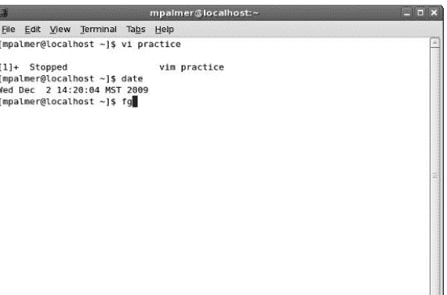

**图 3-4** 从 `vi` 编辑器访问 `shell` 命令行

要开启行号，使用 `:set number` 命令。然后，如果你想删除第 4 到第 6 行（例如），很容易确定这些是你想要删除的行，你只需使用 `:4,6d` 命令删除它们。尝试实践项目 3–11 来开启行号并参考它来删除文本。

### 复制或剪切粘贴

你可以使用 `vi` 中的 `yy` 命令从文件中复制指定数量的行并放置在剪贴板上。要从文件中剪切行并存储在剪贴板中，请使用 `dd` 命令。在使用 `dd` 或 `yy` 命令后，你可以使用 `p` 命令将剪贴板中的内容粘贴到文件的另一个位置。如果你想复制已经输入的文本并将其粘贴到另一个位置，这些命令非常方便。实践项目 3–12 让你在同一个文件的另一个位置进行剪切和粘贴。

### 打印文本文件

有时你想在退出 `vi` 编辑器之前打印一个文件。你可以使用 `lpr`（行打印）命令从 `vi` 打印文件。输入 `lpr` 然后输入你想打印的文件名。实践项目 3-13 让你打印你在 `vi` 编辑器中正在工作的文件。

你还可以通过 `-P printer` 选项指定你想要使用的打印机，其中 `printer` 是你想要使用的打印机名称。例如，你可能有两个打印机，`lp1` 和 `lp2`。要将 `accounts` 文件打印到 `lp2`，输入 `:!lpr -P lp2 accounts` 并按回车。

## 使用 Emacs 编辑器

语法 `lpr [-option] [filename]`

### 剖析

- 参数由要打印的文件名组成。
- 选项包括：
  - `-P` 指定目标打印机；在选项后直接包含打印机名称。
  - `-#` 指定打印的份数（最多 100 份）。
  - `-r` 在打印后删除打印机文件（节省磁盘空间）。

### 取消编辑会话

如有必要，你可以取消编辑会话，并在改变主意时放弃所做的所有更改。另一个选项是仅保存自上次使用 `:w` 命令以来所做的更改。

### 在 vi 中获取帮助

> 在此语境下使用 `Ctrl+z` 实际上是 `Bash` `shell` 的功能，在本示例中，它让 `vi` 编辑器在后台运行并将你带到 `shell` 命令行。当你输入 `fg` 时，这是一个将你的后台作业（即 `vi` 编辑会话）带回前台的命令。

> 在此语境下使用 `Ctrl+z` 实际上是 `Bash` `shell` 的功能，在本示例中，它让 `vi` 编辑器在后台运行并将你带到 `shell` 命令行。当你输入 `fg` 时，这是一个将你的后台作业（即 `vi` 编辑会话）带回前台的命令。

> 在此语境下使用 `Ctrl+z` 实际上是 `Bash` `shell` 的功能，在本示例中，它让 `vi` 编辑器在后台运行并将你带到 `shell` 命令行。当你输入 `fg` 时，这是一个将你的后台作业（即 `vi` 编辑会话）带回前台的命令。

> 在此语境下使用 `Ctrl+z` 实际上是 `Bash` `shell` 的功能，在本示例中，它让 `vi` 编辑器在后台运行并将你带到 `shell` 命令行。当你输入 `fg` 时，这是一个将你的后台作业（即 `vi` 编辑会话）带回前台的命令。

> 在此语境下使用 `Ctrl+z` 实际上是 `Bash` `shell` 的功能，在本示例中，它让 `vi` 编辑器在后台运行并将你带到 `shell` 命令行。当你输入 `fg` 时，这是一个将你的后台作业（即 `vi` 编辑会话）带回前台的命令。

> 在此语境下使用 `Ctrl+z` 实际上是 `Bash` `shell` 的功能，在本示例中，它让 `vi` 编辑器在后台运行并将你带到 `shell` 命令行。当你输入 `fg` 时，这是一个将你的后台作业（即 `vi` 编辑会话）带回前台的命令。

`EMACS` 编辑器

`Emacs` 是另一个流行的 `UNIX/Linux` 编辑器。与 `vi` 不同，`Emacs` 不是模式的。这意味着你可以在编辑和命令模式之间切换。虽然 `Emacs` 也支持鼠标功能，但值得时间学习键盘命令。表 3-4 列出了 `Emacs` 命令。

常用命令。虽然 `Emacs` 也支持鼠标功能，但值得时间学习键盘命令。表 3-4 列出了 `Emacs` 命令。

表 3-4 常用 Emacs 命令

| 命令 | 目的 |
| --- | --- |
| Alt+< | 将光标到文件开头。 |
| Alt+> | 将光标到文件末尾。 |
| Alt+b | 光标向移动一个单词。 |
| Alt+d | 删除当前单词。 |
| Alt+f | 光标向前移动一个单词。 |
| Alt+q | 使用自动换行重新格式化段落溢出。 |
| Alt+t | 如果光标位于单词首字符，则与前一个单词交换；如果光标不是第一个字符，则与后续单词交换。 |
| Alt+u | 将光标位置到单词结尾的所有字母大写。 |
| Alt+w | 滚动屏幕。 |
| Alt+x doctor | 进入医生模式，`Emacs` 对你的陈述做出响应。先保存你的工作。并非所有版本都支持此模式。 |
| Ctrl+@ | 标记光标位置。移动光标后，你可以移动或复制文本。 |
| Ctrl+a | 将光标到行首。 |
| Ctrl+b | 光标向后移动一个字符。 |
| Ctrl+d | 删除光标下的字符。 |
| Ctrl+e | 将光标到行末尾。 |
| Ctrl+f | 光标向前移动一个字符。 |
| Ctrl+g | 取消当前命令。 |
| Ctrl+h | 使用在线帮助。 |
| Ctrl+k | 删除到行末尾的文本。 |
| Ctrl+n | 光标移动到下一行。 |
| Ctrl+p | 光标移动到上一行。 |


| `Ctrl+t` | 交换光标前的字符和光标下的字符。 |
| `Ctrl+v` | 向下滚动屏幕。 |
| `Ctrl+w` | 删除标记的文本。按 `Ctrl+y` 恢复删除的文本。 |
| `Ctrl+y` | 插入缓冲区中的文本，并将其放在光标后。 |
| `Ctrl+h, t` | 运行关于 Emacs 的教程。 |
| `Ctrl+x, Ctrl+c` | 退出 Emacs。 |
| `Ctrl+x, Ctrl+s` | 保存文件。 |

### 表 3-4 常用 Emacs 命令（续）

| 命令 | 用途 |
| --- | --- |
| `Ctrl+x, u` | 撤销上一次更改。 |
| `Ctrl+Del` | 删除从当前光标位置到当前单词结束的文本。 |

在许多情况下，Emacs 中的 `Ctrl` 和 `Alt` 命令是不区分大小写的，或者说你的 `Alt+B` 和 `Alt+b` 是同一个命令。

如果你通过远程连接使用 Emacs（例如通过 SSH，请参见第 1 章“UNIX 和 Linux 的本质”），请尝试按下 `Ctrl+F10` 或仅按 `F10` 来访问菜单栏。菜单会在你主编辑窗口显示的缓冲区（`buffer`）中打开。当你无法通过远程连接使用常用的 Emacs 命令时，这非常有用。

## 在 Emacs 中创建新文件

在 UNIX/Linux 终端或命令行中输入 `emacs` 命令启动 Emacs。如果你在输入命令后输入文件名，Emacs 将创建一个名为该名称的新空白文件，或者打开一个同名的现有文件。如果你在不带文件名的情况下运行 Emacs，Emacs 会自动显示几个介绍屏幕，从图 3-5 显示的 Fedora 界面开始。Emacs 窗口运行在你配置的 X Window 桌面下，例如 GNOME。

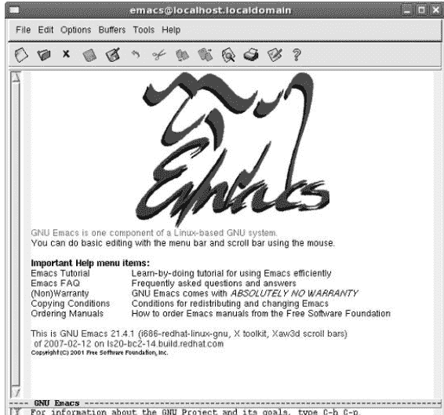

图 3-5 带有 GNOME 的 Fedora Emacs 启动界面（无文件名）

# 第 3 章 掌握编辑器

当 Emacs 未指定要打开的文件时，介绍屏幕结束于一个你可以在不打算保存的缓冲区中输入笔记。可以通过输入 `Ctrl+x Ctrl+f` 并输入文件的路径和名称来打开现有文件。

如果你安装了桌面（例如 GNOME），可能会有一个启动 Emacs 的菜单选项。在编写本文时，在带有 GNOME 桌面的 Fedora 和 Red Hat Enterprise Linux 中，你可以通过点击“应用程序”、指向“编程”，然后点击“Emacs 编辑器”来打开 Emacs。在 SUSE 中，点击“计算机”菜单，点击“更多应用程序”，点击左侧面板中的“工具”，然后点击“Emacs”。

如图 3-5 所示，Emacs 屏幕顶部有一个菜单栏。当你点击其中一个项目（如 File）时，菜单将会出现。默认菜单栏包含以下类别：

- File（文件）：提供打开文件、打开目录、保存缓冲区中的信息、从另一个文件插入信息、进入分屏模式以及关闭当前打开的文件（缓冲区）等操作。
- Edit（编辑）：提供文本编辑功能，如撤销更改、剪切或复制文本、粘贴等。
- Options（选项）：提供各种特殊选项，如语法高亮、区域高亮、自动换行模式、文件解压缩/压缩、调试器选项以及用于设置语言环境、字体和输入法的“mule”选项。
- Buffers（缓冲区）：允许打开当前持有信息的任何编辑器存储缓冲区，包括文件中已有的文本。
- Tools（工具）：提供编译程序文件、执行 shell 命令、检查文本拼写、比较或合并文件、安装 Emacs 补丁、读取和发送电子邮件以及搜索目录的选项。
- Help（帮助）：通过访问手册、教程、Emacs 常见问题解答以及 Emacs 心理医生提供帮助，后者可以让你向 Emacs 提问。

你还会看到菜单栏上的一个图标，提供以下操作的选项：

- 将文件读取到 Emacs 中
- 读取目录以访问其文件
- 退出且不保存当前缓冲区
- 将当前缓冲区的内容到文件
- 将当前缓冲区的内容复制到不同的文件
- 撤销你执行的最近任务
- 剪切文本
- 复制文本

## 使用 Emacs 编辑器 127

- 粘贴文本
- 搜索单词模式或字符串
- 打印当前缓冲区的内容
- 配置你的编辑偏好
- 查看帮助菜单

## 在 Emacs 中导航

要在 Emacs 中创建新文件，在命令行中输入 `emacs research` 加上文件名；要在文件中进行导航，你可以使用光标移动键——例如 Page Down、Page Up、Home 和 End；`Ctrl/Alt` 键——例如使用 `Alt+f` 将光标向前移动一位（见表 3-4）。当你想要保存工作时：(1) 使用 File 菜单；(2) 使用图标将当前缓冲区保存到文件；或 (3) 按下 `Ctrl+x`, `Ctrl+s`。此外，要退出 Emacs，请使用 File 菜单、Exit Emacs，或输入 `Ctrl+x`, `Ctrl+c`。

在实践项目 3–15 中，你将创建一个文件并练习保存和退出。在实践项目 3–16 中，你将在在文件中导航。

## 删除信息

你可以使用 Del 或 Backspace 键在 Emacs 中删除单个字符。此外，使用 `Ctrl+l` 删除行尾。如果你决定撤销删除操作，使用 `Ctrl-x`, `u`（不要在按 `u` 时按下 `Ctrl`）来反复撤销每次删除。实践项目 3–17 让你能够删除文本然后撤销删除。

## 复制、剪切和粘贴文本

在 Emacs 中，你可以通过输入来插入文本。你也可以通过复制粘贴或剪切来插入文本。在 Emacs 中，你可以通过输入插入文本。你也可以通过复制粘贴或剪切来插入文本。在 Emacs 中，你可以通过输入插入文本。你也可以通过复制粘贴或剪切来插入文本。在 Emacs 中，你可以通过输入插入文本。你也可以通过复制粘贴或剪切来插入文本。在 Emacs 中，你可以通过输入插入文本。你也可以通过复制粘贴或剪切来插入文本。在 Emacs 中，你可以通过输入插入文本。你也可以通过复制粘贴或剪切来插入文本。在 Emacs 中，你可以通过输入插入文本。你也可以通过复制粘贴或剪切来插入文本。在 Emacs 中，你可以通过输入插入文本。你也可以通过复制粘贴或剪切来插入文本。在 Emacs 中，你可以通过输入插入文本。你也可以通过复制粘贴或剪切来插入文本。在 Emacs 中，你可以通过输入插入文本。你也可以通过复制粘贴或剪切来插入文本。在 Emacs 中，你可以通过输入插入文本。你也可以通过复制粘贴或剪切来插入文本。在 Emacs 中，你可以通过输入插入文本。你也可以通过复制粘贴或剪切来插入文本。在 Emacs 中，你可以通过输入插入文本。你也可以通过复制粘贴或剪切来插入文本。

## 在 Emacs 中搜索

在 Em 中，你也可以通过复制粘贴或剪切来插入文本。

# 第 3 章 掌握编辑器

## 格式化文件

## 在 Emacs 中获取帮助

等等，在 Emacs 中，你可以通过输入来插入文本。你也可以通过复制粘贴或剪切来插入文本。在 Emacs 中，你可以通过输入插入文本。你也可以通过复制粘贴或剪切来插入文本。

## 本章总结

## 命令摘要：第 3 章命令回顾

一组封装好的自定义宏可以让你读写电子邮箱和新闻，并编辑目录内容。

- 你可以在命令行中输入 `emacs` 或不带文件名来启动 Emacs。如果你输入此命令并输入一个文件名，Emacs 会创建一个同名的空白文件，或者打开一个已存在的同名文件。如果你输入不带文件名的 `emacs`，Emacs 会显示一个介绍性屏幕。然后你可以使用命令来打开现有文件或创建一个新文件。
- 你可以输入光标移动键——例如方向键、Page Down、Page Up、Home 等——或使用 `Ctrl/Alt` 组合键键来导航到 Emacs 文件。
- 在 Emacs 中，以及在 vi 中，你可以按顺序撤销编辑更改，即使在你已经做了更改之后也是。
- 在 Emacs 中，你可以通过输入来插入文本。你也可以通过复制粘贴、剪切粘贴来插入文本。像 vi 编辑器一样，Emacs 让你搜索特定的文本。Emacs 还具有自动换行功能。
- 如需 Emacs 帮助，请在 Emacs 中输入 `Ctrl+h`（按 t 进入教程），或从命令行使用 `man emacs` 命令。

## 命令摘要：第 3 章命令回顾

| 命令 | 用途 |
|---|---|
| vi 命令: | |
| `(repeat)` | 重复你最近的更改... |
| `/` | 向前搜索字符模式。 |
| `:` | 临时离开。 |
| `:q` | 取消编辑会话。 |
| `:r` | 从一个文件读取文本并添加到另一个文件中。 |
| `:set` | 开启某些选项，如行号。 |
| `:w` | 保存文件并继续工作。 |
| `:wq` | 将更改写入磁盘并退出 vi。 |
| `:x` | 保存更改并退出 vi。 |
| `lpr filename` | 打印文件。 |
| `i` | 切换到插入模式。 |
| `p` | 从缓冲区粘贴文本。 |
| `u` | 撤销你最近的更改。 |
| `vi` | 启动编辑器。 |
| `yy` | 复制（yank）文本到剪贴板。 |


| `zz` | 命令模式下，保存更改并退出 `vi`。 |

| `Ctrl+z` | 使用此基于 shell 的命令（并非真正的命令）离开 `vi` 以临时访问命令行——使用 `fg` 命令返回 `vi`。 |

# 第 3 章精通编辑器

| 命令 | 用途 |
|---|---|
| UNIX/Linux 命令: |  |
| `lpr` | 打印文件。`-p` 打印到特定打印机。`-f` 打印指定份数的副本。`-r` 从磁盘存储中删除打印文件。 |
| Emacs 命令: | 参见表 3-4 |

## 关键术语

**ASCII** — 美国信息交换标准代码的缩写；一套标准的模式集，被编码并解释为字母、十进制数字、标点符号和特殊字符。代码用于将二进制数转换为普通语言，因此使得文件中存储的信息变得可访问。`ASCII` 最多可以表示 256 个字符（位）。

**binary file** — 二进制文件——包含非 `ASCII` 字符（如机器指令）的文件。

**bit** — 二进制位（binary digit）的缩写；由 0 和 1 两个数字之一组成的。`UNIX/Linux` 以二进制位的形式存储所有数据。由于计算机由处于开启或关闭状态的电子电路组成，因此二进制位用于表示这些状态。

**bitmap** — 位图——图形软件将点或位的行和列转换成无限多样的图像。

**byte** — 二进制术语（binary term）的缩写；八个二进制位或位的字符串。这些数字可以配置为位模式，进而可以被解释为字母、十进制数字、标点符号和特殊字符。这是 `ASCII` 代码的基础。

**command mode** — 命令模式——模式编辑器的一种功能，允许你输入命令来执行编辑任务，例如遍历文件和删除文本。`UNIX/Linux vi` 是一个模式编辑器。

**compiling** — 编译——将程序翻译成机器读语言的过程。

**ex mode** — 文本编辑命令模式，当前用于 `vi` 编辑器，它采用了一组最初用于名为 `ex` 的早期 `UNIX` 编辑器的扩展命令。

**executable program file** — 可执行程序文件；也称为可执行文件；可以在计算机上运行的编译文件（来自编程语言）或解释执行文件（来自脚本）。

**insert mode** — 插入模式——模式编辑器的一种功能，允许你输入文本。`UNIX/Linux vi` 是一个模式编辑器。

**line editor** — 行编辑器——允许你一次只处理一行或一组行的编辑器。虽然你无法看到文件的上下文，但你可能会发现行编辑器对于搜索、替换和复制文本块等任务很有用。

## 复习题 131

**line-oriented command** — 行定向命令——可以在文件的多个位置执行多个一个动作的命令，例如搜索和替换。当使用行定向命令时，你必须指定动作发生的精确位置。这些命令与面向屏幕的命令不同，后者是相对于光标位置执行的。

**machine language** — 机器语言——专门使用 0（表示关闭）和 1（表示开启）与计算机进行通信。年前，程序员必须用机器语言编写程序，这是一个单调且耗费的过程。

**macro** — 宏——一组自动化复杂任务的命令集。宏有时被称为超级指令。

**modal editor** — 模式编辑器——允许你在不同模式下工作的文本编辑器。例如，`vi` 有三种模式：插入、命令和 `ex`。

**screen editor** — 屏幕编辑器——由操作系统提供的、一次显示一个屏幕的编辑器。`UNIX/Linux` 有两种屏幕编辑器：`vi` 和 `Emacs`。

**screen-oriented command** — 面向屏幕的命令——相对于光标位置执行的命令。

**text editor** — 文本编辑器——用于创建和编辑文档的简单文字处理器。

**text file** — 文本文件——完全由 `ASCII` 组成的文件。

**Unicode** — 支持 65536 个字符的字符集，如中文。

## 复习题

1. 输入什么命令可以复制行？

- a. 点 (`.`)
- b. `Ctrl+r`
- c. `Ctrl+R`
- d. 美元 (`$`)

2. 在命令模式下，以下哪个命令可以让光标向左移动？

- a. 右键。
- b. 左键。
- c. `h`
- d. `l`.

3. 当你启动编辑器时，忘记为创建的文件命名。如何指定新文件的名称？

- a. 在命令行输入 `-n`。
- b. 输入 `-n` 和文件名，例如 `vi -n`。
- c. 输入 `vi` 和文件名，例如 `vi myfile`。
- d. 看到 `>` 提示符时输入文件名。

你的同事在 `vi` 中写了一行文本，现在想删除它，但将其内容保存在缓冲区中以防以后决定调回来。你建议什么？

- a. 在命令模式下，将光标移动到行的最后一个字符并按 `d`。
- b. 在插入模式下，将光标移动到行的任意字符并按 `Alt+d`。
- c. 在命令模式下，将光标移动到行的第一个字符并按 `dd`。
- d. 在插入模式下，将光标移动到行的最后一个字符并输入 `:delete`。

5. 你在 `vi` 编辑器中，现在是中午。每天中午运行一个名为 `update` 的程序来更新数据库。如何在不关闭 `vi` 会话的情况下运行该程序？

- a. 在命令模式下，按 `#`，输入 `update` 并回车。
- b. 在插入模式下，按 `Alt+` 然后输入 `update`。
- c. 在插入模式下，按 `&&` 然后输入 `update`。
- d. 在命令模式下，输入 `:update` 并回车。

6. 当你在 `vi` 写报告时，决定从家目录下名为 `summary_data` 的其他文件中插入信息。以下哪个命令（命令模式下）允许你添加 `summary_data` 的内容？

- a. `:r summary_data`
- b. `+summary_data`
- c. `add summary_data`
- d. `:copy summary_data`

# 习习题 133

7. 你正在编辑一个 `vi` 文档，并且正处于页面末尾。你想快速回到页面顶部以检查你写过的内容。以下哪一个命令行命令可以让你快速跳转到页面顶部？

- a. `:top`
- b. `T`
- c. `Go1`
- d. `H`

8. 你正准备对 `vi` 编辑器进行一次培训课程。你会如何描述它？（选择所有适用项）

- a. 它是模式的（modal）。
- b. 它是一个文本编辑器。
- c. 绝大多数 `UNIX/Linux` 发行版都带了 `vi`。
- d. 它是一个全屏编辑器。

9. 在 `Emacs` 编辑器中工作时，你删除了一段文本，然后决定撤销删除操作。你应该使用以下哪一个命令？

- a. 使用 `Ctrl+u` 命令。
- b. 使用 `Alt+u` 命令。
- c. 使用 `Ctrl+x,u` 命令。
- d. 你只能重新输入被删除的文本，因为 `Emacs` 不允许你撤销删除。

10. 在 `Emacs` 中复制文本时，你必须使用以下哪个命令来标记想要复制的文本？

- a. 使用 `Ctrl+Tab` 标记文本开头，使用 `Ctrl+Shift+Tab` 标记结束。接着按 `Alt+z` 复制文本。
- b. 使用 `Ctrl+Spacebar` 标记文本开头，使用 `Alt+w` 标记结束并复制文本。
- c. 使用 `:mark` 标记文本开头，使用 `:endmark` 标记结束并复制文本。
- d. 使用 `@begin` 标记文本开头，使用 `@end` 标记结束。接着输入 `:copy` 复制文本。

11. 你使用 `Emacs` 为你公司开发的一款新软件编写了广告文案。现在你发现产品名称发生了微调。你可以使用什么命令来查找所有旧名称的引用以便定位它们？

- a. 按 `Ctrl+f`。
- b. 按 `Alt+f`。
- c. 输入 `:find`。
- d. 输入 `#locate`。


# 第 3 章精通编辑器

12. 在编辑器中，如何获取有关编辑会话状态的信息？（选择所有适用项）

- a. 在命令模式下输入 `:status`。
- b. 在插入模式下按 `Ctrl+*`。
- c. 在命令模式下按 `Ctrl+g`。
- d. 在命令模式下双击空格键。

13. 你正在使用 `vi` 编辑器为每行创建一个任务列表，并希望有一种简单的方法为文件中列出的每行（任务）编号。以下哪种是简单的解决方案？

- a. 按 `Alt+F2` 开启文本的自动编号。
- b. 当你第一次从命令行启动 `vi` 时，输入 `vi -n`。
- c. 在第一行输入输入 `1` 加上 `a`，然后每个新行都将自动编号。
- d. 从命令模式下，输入 `:set number`。

14. 你一直在处理一个很长的 `vi` 文件，现在得赶去开会。如何才能快速保存工作并退出 `vi` 编辑器？（选择所有适用项）

- a. 从命令模式下，输入 `:wq`
- b. 从命令模式下，输入 `:ZZ`
- c. 从命令模式下，输入 `:bye`。
- d. 从命令模式下，输入 `x`。

15. 在 `vi` 中编辑文件时，你发现自己一直把 `receive` 单词拼写成了 `recieve`。你如何找到所有拼写错误的 `receive`？（选择所有适用项）

- a. 从命令模式下，输入 `/recieve` 并按回车。


- b. 从插入模式下，输入 `Alt+r` 并输入 `recieve`。

- c. 从命令模式下，按 `F4` 并输入 `recieve`。

- d. 从插入模式下，按 `F7` 并输入 `recieve`。

16. 当你查看一个正在使用 `vi` 编辑器的同事时，你看到她使用了命令 `:A$s/capital/capital`。这个命令的作用是什么？

- a. 它将文件中所有的字母都转换为大写。

- b. 它将所有的 `capitol` 更改为 `capital`。

- c. 它搜索并确保每个句子都以大写字母开头。

- d. 它找到最后一个 `capital` 并将其更改为 `Capitol`。

# 习习题 135

17. 你刚刚在 `Emacs` 编辑器中按了 `Ctrl+x`、`Ctrl+s`，认为这会退出 `Emacs`，但似乎什么都没有发生。问题出在哪里？

- a. $x$ 和 $s$ 是小写的，你必须输入 $X$ 和 $S$。

- b. 你顺序反了，必须输入 $Ctrl+s$,$Ctrl+x$。

- c. $Ctrl+x,$Ctrl+s$ 是一个保存文件的命令序列，但它不会导致 `Emacs` 关闭。

- d. $Ctrl+x,$Ctrl+1$ 用于扩展缓冲区大小，这是一个你在屏幕上看不见的过程；该命令序列不会退出。

18. 你刚刚在 `Emacs` 中输入了一页纸的备忘录，现在想快速回到开头以便重读。哪个命令可以让你快速回到开头？

- a. $Alt+$

- b. $Alt+$

- c. $Alt+$

- d. $Alt+$

19. 在菜单栏上你会看到哪些菜单？（选择所有项）

- a. View

- b. Options

- c. Edit

- d. Buffers

20. 哪个命令可以在 `Emacs` 中获取帮助？

- a. $Ctrl+$

- b. $Ctrl+$

- c. $Ctrl+$

- d. $Ctrl+$

21. 以下哪些命令可以获取帮助？（选择所有适用项）

- a. 从插入模式下，输入 `:doc`。

- b. 从命令模式下，输入 `:doc`。

- c. 从命令模式下，输入 `:doc`。

- d. 从命令模式下，输入 `:doc`。

# 136 精通编辑器

22. 大多数操作系统使用的模式名称是什么？

23. 启动 `vi` 编辑器的命令是什么？

24. 如何打开文件？

25. 启动 `vi` 编辑器的命令是什么？

# 实验项目

实验 3-1 到 3-14 设计为一次性完成。


# 实验 3-1

在这个项目中，你创建一个名为 `textfiles` 的文件。

打开并创建文件：

1. 输入 `vi` 后跟文件名并回车。这启动了 `vi`。光光标应该在第一行。以 `~` 开头的行并不是文件的实际内容。波浪号表示你的位置。


# 实验 3-2

在这个项目中，你练习在编辑器的插入和命令模式之间切换。

访问插入和命令模式：

1. 输入 `i`（但不要按回车）。大多数命令一样，`i` 命令不会在屏幕上显示或回显。命令从命令模式切换到插入模式；你不需要按回车来指示命令完成。注意当你处于插入模式时，屏幕底部会出现 `INSERT --`。

2. 按 `Esc` 返回命令模式。屏幕底部的行发生了什么？

3. 按 `i` 重新进入插入模式。

4. 输入以下文本，每行按回车移动到下一行。确保你在输入最后一行后也按了回车，将光标移动到下一行。如果你需要删除字符，请按退格键。

文件包含文本。

文本包含行。

行包含字符。

字符形成单词。

单词形成文本。

# 实验 3-3

在这个项目中，你练习使用重复命令复制你对文本所做的最近更改。

使用重复命令：

1. 按 `Esc` 切换到命令模式。

2. 输入 `.`（句号）。

编辑器插入了实验 3-2 第 4 步中输入的五行。你的屏幕应该与图 3-7 相似。

# 138 第3章 精通掌握编辑器

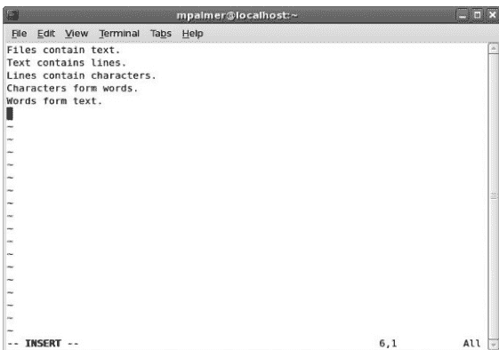

图 3-6 使用 `vi` 编辑器插入文本

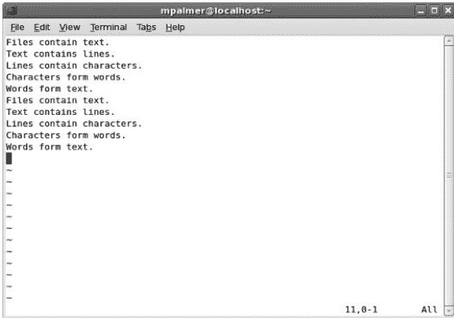

图 3-7 在 `vi` 编辑器中重复命令

## 项目 3-4

高效地将光标移动到正确的位置对于编辑文件关重要。在这个项目中，你将练习在屏幕上移动光标。

要移动光标，请确保你处于命令模式（command mode）。

- 1. 按 `Esc` 确保你处于命令模式。

- 2. 按方向键可以每次上、右、左、下移动一个字符。


## 动手项目

- 3. 输入 `H` 将光标移动到屏幕的左上角。（提示：按照这些步骤所示输入大写字母。）

- 4. 输入 `L` 将光标移动到屏幕的最后一行。

- 5. 使用上方向键移动到倒数第三行的开头，该行以“Lines”开头。使用右方向键移动到该行的末尾。

- 6. 输入 `G` 到最后行的开头。这是一个“跳转”（go to）命令。你可以在 `G` 之前包含一个数字，表示你想移动到的行数。

- 7. 输入 `2G` 到第二行的开头。

- 8. 输入 `w` 向前一个单词。

- 9. 输入 `b` 向后一个单词。保持 `vi` 编辑器打开，以便进行动手项目 3-5。

## 项目 3-5

人们经常会在文本中犯错或改变主意。删除的能力非常重要。在这个项目中，你将使用删除命令和光标移动按键来编辑你在文件中插入的文本。

通过删除文本来进行编辑：

- 1. 按 `Esc` 确保你处于命令模式。

- 2. 输入 `1G` 移动到第一行。你想删除这一行。

- 3. 要删除第一行，输入 `dd`（但不要按 Enter）。

你的文件现在应该像图 3-8 所示。

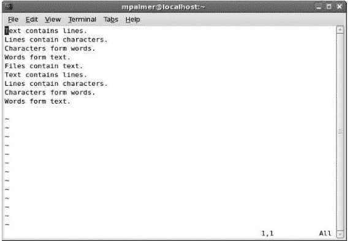

图 3-8 删除第一行后的文件

## 第3章 精通掌握编辑器

- 4. 按 `w` 到下一个单词 "contains."。

- 6. 在 "Text" 和 "lines." 之间输入 `consist of`。确保包含多余的 "s" 并在 "of" 之后有一个空格。

- 7. 按方向键将光标移动到 "consistss" 中多余的 "s"，然后按 `Esc` 切换到命令模式。

- 8. 删除当前字符（"s"），输入 `x`（但不要按 Enter）。

你的编辑现在看起来像图 3-9 一样。

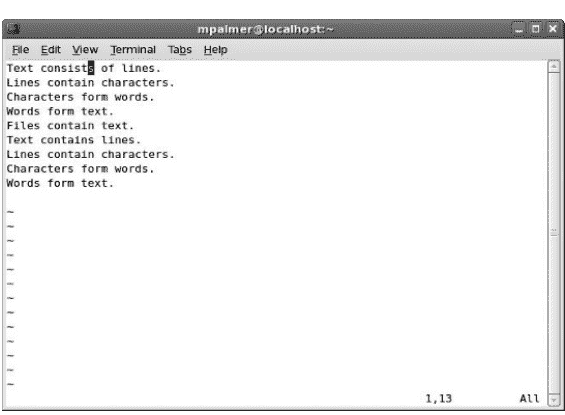

**图 3-9** 删除多余的 "s" 后文件

- 9. 现在，你想通过删除最后一个单词来删除句子 "Files contain text." 输入 `5G` 移动到第五行，并按右方向键移动到 "contain" 中的 "c"。

- 10. 输入 `ds` 删除从光标到行尾的文本，然后输入 `i` 进入插入模式（insert mode）。

- 11. 输入 `consist of words.` 来完成这个句子。（确保 "Files" 和 "consist" 之间有一个空格，并在 "words" 之后有一个句号。）

- 12. 现在，你可以通过替换最后一个单词来编辑下一个句子。按 `Esc` 切换回命令模式。按方向键移动到文件的下一行，并移动到单词 "lines" 中的初始字符（"l"）。

- 13. 输入 `d0` 删除从光标到行开头的文本，然后输入 `i` 进入插入模式。

## 动手项目

- 14. 输入 `Words form` 在句首插入文本。（确保 "form" 和 "lines" 之间有一个空格。）

- 15. 你完成的编辑看起来应该像图 3–10 所示。保持 `vi` 编辑器打开，以便进行动手项目 3-6。

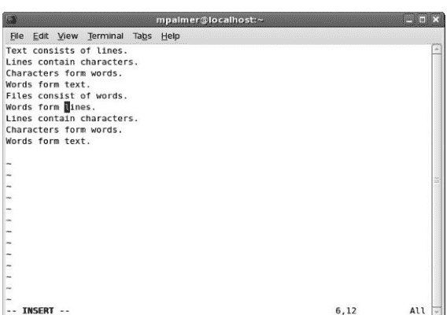

图 3-10 完成步骤 14 后的文件编辑

## 项目 3-6

有时，你可能会漏掉某个单词，或者你可能定位某些文本以检查其准确性。在这个项目中，使用 `vi` 的模式匹配功能在文件中查找特定文本。

搜索模式：

- 1. 按 `Esc` 确保你处于命令模式。

- 2. 输入 `H` 到屏幕开头。

- 3. 输入 `/text` 并按 Enter。

- 4. 输入 `n` 到下一次出现的位置。

- 5. 输入 `N` 到上一次出现的位置。

## 第3章 精通掌握编辑器

在 `vi` 编辑器中定期保存工作可以确保在意外断电时不会丢失工作。此外，当你更改后退出 `vi` 时，请确保使用在退出前保存工作的命令退出。在这个项目中，你将使用命令保存你的工作。

# 144 第 3 章 精通编辑器

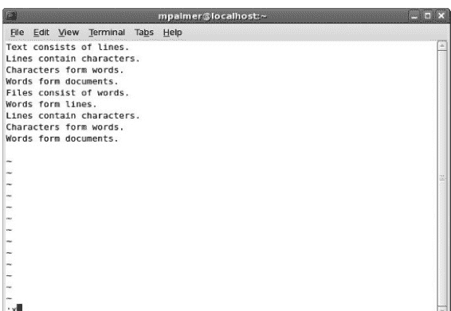

图 3-13 使用 `:x` 保存并退出

## 项目 3-9


在 UNIX/Linux 中工作时，将一个文件的内容复制到另一个文件中可以消除额外的输入。在这个项目中，你将使用 `vi` 编辑器创建一个新文件，并从刚刚在动手项目 3-8 中保存的文本文件中向其添加文本。

要创建一个新文件并从另一个文件添加文本：

- 1. 输入 `vi practice` 并按回车，创建一个名为 `practice` 的新文件。
- 2. 按 `Esc` 确保你处于命令模式。
- 3. 输入 `:r textfiles` 并按回车。

你的文件看起来应该像图 3-14 所示。`r` 命令从 `textfiles` 复制了文本并将其放入当前文件 `practice` 中。注意文件顶部的空行。状态行提供了有关你添加的文件的信息，包括它的以及包含的行数和字符数。
- 4. 将光标移动到空行，输入 `dd` 将删除。
- 5. 保持 `practice` 文件打开，以便进行动手项目 3-10。

## 项目 3-10

有时你需要同时做两件事。例如，考虑一种情况：你正在 `vi` 中编辑一个文本文件，有人召集会议，但你们的都不是日历假期。你可以在不关闭 `vi` 编辑器的情况下运行 `cal` 命令或其他命令。在这个项目中，你将学习两种在不关闭 `vi` 会话的情况下执行命令的方法。

### 动手项目 145

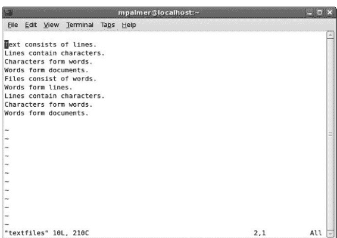

**图 3-14** 将一个文件复制到 `vi` 编辑器

要临时离开 `vi` 以查看当前月的日历：
- 1. 必要时，按 `Esc` 进入命令模式。
- 2. 输入 `:cal` 并按 `Enter`。

你会看到这个日历，然后是“按回车或输入命令继续”的指令。（另见图 3-15）。
- 3. 按 `Enter` 返回到命令模式下的 `vi` 编辑会话。

**访问命令行以执行多条命令：**
- 1. 输入 `Ctrl+z` 访问命令行。
- 2. 输入 `ls -` 并按 `Enter` 执行一条命令。
- 3. 输入 `pwd` 并按 `Enter` 执行另一个命令。
- 4. 输入 `cat textfiles` 并按 `Enter` 执行第三条命令。
- 5. 输入 `fg` 并按 `Enter` 返回你的 `vi` 编辑会话。你返回到了什么种模式？
- 6. 离开你的 `vi` 编辑会话，以便进行动手项目 3-11。


## 项目 3-11

行号可以帮助你识别 `vi` 中想要编辑的特定行。在这个项目中，你开启行号，然后将其作为删除文本中行的行的参考。

**使用自动行号：**
- 1. 按 `Esc` 确保你处于命令模式。

# 第 3 章 精通编辑器

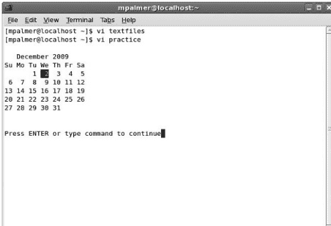

图 3-15 临时离开 `vi` 运行 `cal` 命令
- 2. `:set number` 并按 `Enter`。行号显示在屏幕上。（见图 3-16。）

行号仅供参考。它们不是文件的一部分。现在你可以使用这些参考数字删除文件的最后三行。
- 3. 输入 `:7,9d` 并按 `Enter`。你删除了文件中的第 7 到第 9 行。
- 4. 保持 `practice` 文件打开，以便进行动手项目 3-12。

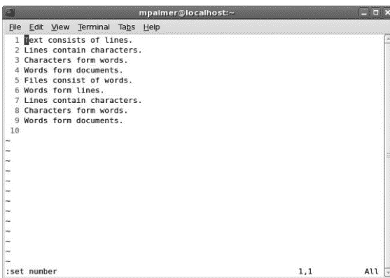

图 3-16 开启行号

## 项目 3-12

没有人喜欢比多更多的输入。在这个项目中，你将会在 `practice` 文件中剪切和粘贴文本，作为减少额外输入的方法。

剪切和粘贴文本：
- 1. 从命令模式开始，输入 `H` 将光标移动到第 1 行开头。
- 2. 输入 `3dd` 剪切文档的前三行并将其存储在缓冲区中。
- 3. 输入 `G` 将光标移动到文件末尾。
- 4. 输入 `p` 在文件末尾粘贴这三行。
- 5. 保持 `practice` 文件打开，以便进行动手项目 3-13。

## 项目 3-13

在这个项目中，你可以在不离开 `vi` 编辑会话的情况下打印正在处理的文件。你的电脑应该连接了默认打印机，以便你完成作业。

打印文件：
- 1. 必要时，按 `Esc` 返回命令模式。
- 2. 输入 `:w` 保存。
- 3. 输入 `:q` 退出。
- 4. 输入 `:x` 保存并退出。

## 项目 3-14

有时你需要同时做两件事。例如，考虑一种情况：你正在 `vi` 中编辑一个文本文件，有人召集会议，但你们的都不是日历假期。你可以在不关闭 `vi` 编辑器的情况下运行 `cal` 命令或其他命令。在这个项目中，你将学习两种在不关闭 `vi` 会话的情况下执行命令的方法。

临时离开 `vi` 以查看当前月的日历：
- 1. 必要时，按 `Esc` 进入命令模式。
- 2. 输入 `:cal` 并按 `Enter`。

你会看到这个日历，然后是“按回车或输入命令继续”的指令。（见图 3-15）。
- 3. 按 `Enter` 返回到命令模式下的 `vi` 编辑会话。

**访问命令行以执行多条命令：**
- 1. 输入 `Ctrl+z` 访问命令行。
- 2. 输入 `ls -` 并按 `Enter` 执行一条命令。
- 3. 输入 `pwd` 并按 `Enter` 执行另一个命令。
- 4. 输入 `cat textfiles` 并按 `Enter` 执行第三条命令。
- 5. 输入 `fg` 并按 `Enter` 返回你的 `vi` 编辑会话。你返回到了什么种模式？
- 6. 离开你的 `vi` 编辑会话，以便进行动手项目 3-11。

## 项目 3-11

行号可以帮助你识别 `vi` 中想要编辑的特定行。在这个项目中，你开启行号，然后将其作为删除文本中行的参考。

**使用自动行号：**
- 1. 按 `Esc` 确保你处于命令模式。
- 2. `:set number` 并按 `Enter`。行号显示在屏幕上。（见图 3-16。）

行号仅供参考。它们不是文件的一部分。现在你可以使用这些参考数字删除文件的最后三行。
- 3. 输入 `:7,9d` 并按 `Enter`。你删除了文件中的第 7 到第 9 行。
- 4. 保持 `practice` 文件打开，以便进行动手项目3-12。

## 项目 3-12

没有人喜欢比多更多的输入。在这个项目中，你将会在 `practice` 文件中剪切和粘贴文本，作为减少额外输入的方法。

剪切和粘贴文本：
- 1. 从命令模式开始，输入 `H` 将光标移动到第 1 行开头。
- 2. 输入 `3dd` 剪切文档的前三行并将其存储在缓冲区中。
- 3. 输入 `G` 将光标移动到文件末尾。
- 4. 输入 `p` 在文件末尾粘贴这三行。
- 5. 保持 `practice` 文件打开，以便进行动手项目 3-13。

## 项目 3-13

在这个项目中，你可以在不离开 `vi` 编辑会话的情况下打印正在处理的文件。你的电脑应该连接了默认打印机，以便你完成作业。

打印文件：
- 1. 必要时，按 `Esc` 返回命令模式。
- 2. 输入 `:w` 保存。
- 3. 输入 `:q` 退出。
- 4. 输入 `:x` 保存并退出。

## 项目 3-14

有时你需要同时做两件事。例如，考虑一种情况：你正在 `vi` 中编辑一个文本文件，有人召集会议，但你们的都不是日历假期。你可以在不关闭 `vi` 编辑器的情况下运行 `cal` 命令或其他命令。在这个项目中，你将学习两种在不关闭 `vi` 会话的情况下执行命令的方法。

临时离开 `vi` 以查看当前月的日历：
- 1. 必要时，按 `Esc` 进入命令模式。
- 2. 输入 `:cal` 并按 `Enter`。

你会看到这个日历，然后是“按回车或输入命令继续”的指令。（见图 3-15）。
- 3. 按 `Enter` 返回到命令模式下的 `vi` 编辑会话。

**访问命令行以执行多条命令：**
- 1. 输入 `Ctrl+z` 访问命令行。
- 2. 输入 `ls -` 并按 `Enter` 执行一条命令。
- 3. 输入 `pwd` 并按 `Enter` 执行另一个命令。
- 4. 输入 `cat textfiles` 并按 `Enter` 执行第三条命令。
- 5. 输入 `fg` 并按 `Enter` 返回你的 `vi` 编辑会话。你返回到了什么种模式？
- 6. 离开你的 `vi` 编辑会话，以便进行动手项目 3-11。

## 项目 3-11

行号可以帮助你识别 `vi` 中想要编辑的特定行。在这个项目中，你开启行号，然后将其作为删除文本中行的行的参考。

**使用自动行号：**
- 1. 按 `Esc` 确保你处于命令模式。
- 2. `:set number` 并按 `Enter`。行号显示在屏幕上。（见图 3-16。）

行号仅供参考。它们不是文件的一部分。现在你可以使用这些参考数字删除文件的最后三行。
- 3. 输入 `:7,9d` 并按 `Enter`。你删除了文件中的第 7 到第 9 行。


- 4. 保持 practice 文件打开，以便进行动手项目3-12。

## 项目 3-12

没有人喜欢比多更多的输入。在这个项目中，你将会在 practice 文件中剪切和粘贴文本，作为减少额外输入的方法。

剪切和粘贴文本：

- 1. 从命令模式开始，输入 `H` 将光标移动到第 1 行开头。
- 2. 输入 `3dd` 剪切文档的前三行并将其存储在缓冲区中。
- 3. 输入 `G` 将光标移动到文件末尾。
- 4. 输入 `p` 在文件末尾粘贴这三行。
- 5. 保持 practice 文件打开，以便进行动手项目 3-13。

# 第 3 章 精通编辑器

- 5. 输入 `Alt+<` 跳到文件开头。（在键盘上使用 Shift 键输入 `<` 。）
- 6. 输入 `Alt+>` 跳到文件末尾。（在键盘上使用 Shift 键输入 `>` 。）
- 7. 保持该行打开状态，以便进行实践项目 3-17。


## 项目 3-17

在这个项目中，你将练习在 Emacs 中进行删除操作，然后撤销删除。

如需删除文本并撤销删除：

- 1. 使用方向键将光标置于以“Lines contain...”开头的一行。
- 2. 按 `Ctrl+k` 删除当前行。
- 3. 按 `Ctrl+x` 然后按 `u` 撤销上一次更改。
- 4. 保持 Emacs 会话打开状态，以便进行实践项目 3-18。

> 提示 你可以反复恢复文本，即使在进行多次更改后也是如此。按 `Ctrl+x`，然后根据需要反复按 `u` 来撤销你的编辑命令。


## 项目 3-18

在这个项目中，你将会在 Emacs 中复制并粘贴你复制的文本。

如需在 Emacs 中复制和粘贴文本：

- 2. 按 `Ctrl+Spacebar`。这将标记你要复制的文本块的起点。你会在状态栏看到“Mark set”字样。
- 3. 按向下箭头和向右箭头将光标移动到最后行的末尾（“...form text.”之后）——确保将光标放在行尾。
- 4. 按 `Alt+w`。这将标记文本块的结束，并将光标短暂地移动到你在第 2 步中标记的位置，然后返回到你标记文本结束的地方。（在许多版本的 Emacs 中，你也可以按住 Esc 键并按空格来标记块的结束。）
- 5. 按 `Alt+>` 跳到文件末尾。如有必要，按 Enter 在以“...form text.”结束的最后一行之后开始一个空行。你的光标现在位于文件末尾某行的开头。
- 6. 按 `Ctrl+y` 将剪贴板中的标记文本粘贴到缓冲区（屏幕上），如图 3–18 所示。

# 实践项目 151

如需剪切而非复制粘贴，当光标位于要剪切块的末尾时按 `Ctrl+w`。（见第 4 步。）然后将光标移动到你想粘贴文本的地方并按 `Ctrl+y`。

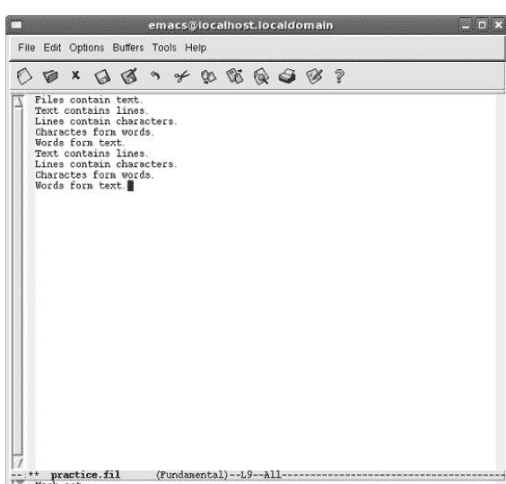

图 3-18 在 Emacs 中复制和粘贴文本

## 项目 3-19

在使用 Emacs 编辑器时，你会发现自己经常需要搜索特定的模式或字符字符串。在这个项目中，你将学习在 Emacs 中执行字符串搜索的两种方法。

使用快捷键选项进行搜索：

- 1. 按 `Ctrl+s`。你会看到状态行显示“I-search: prompt”。你现在可以输入正在寻找的文本。
- 2. 输入 `on`（但不要按回车）。
- 3. 按 `Ctrl+s` 搜索“on”的出现。它出现在哪个单词中？再次按 `Ctrl+s`。
- 4. 按 `Ctrl+r` 向后搜索“on”的上一个出现位置。

# 第 3 章 精通编辑器

使用 Edit 菜单中的 Search 选项：

- 1. 输入 `Alt<` 跳到文件开头。
- 2. 点击 `Edit`（编辑）菜单，指向 `Search`（搜索），并点击 `Search...`。
- 3. 注意光标移动到了屏幕底部的状态行。
- 4. 在状态行中输入 `on` 并按回车。
- 5. 点击 `Edit` 菜单，指向 `Search`，并点击 `Repeat Search`（重复搜索）来定位“on”的出现。
- 6. 点击 `Edit` 菜单，指向 `Search`，并点击 `Repeat Backwards`（反向重复）向前搜索“on”。保持 Emacs 编辑器打开状态，以便进行实践项目 3-20。

## 项目 3-20

在这个项目中，你将开启 Emacs 中的自动换行功能，使行在显示时自动折行。

如需重新格式化文件使用自动换行：

- 1. 输入 `Alt<` 跳到文件开头。
- 2. 按 `Alt+q` 重新格式化文件，使行充满文本。（见图 3-19。单词从一行折到另一行。）
- 3. 输入 `Ctrl+x` 和 `Ctrl+s` 保存文件，然后按 `Ctrl+x` 和 `Ctrl+c` 退出。


# 发现练习 153

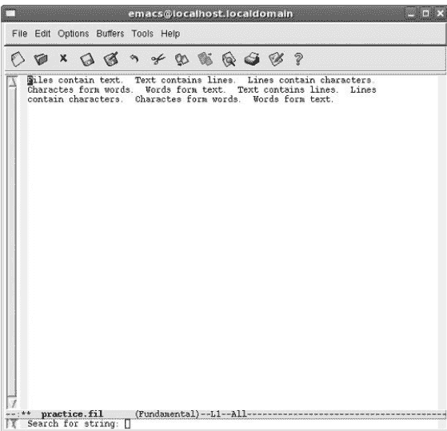

图 3-19 在 Emacs 中开启自动换行

## 发现练习

- 1. 使用 `vi` 编辑器：
    - 创建包含第一行的文档。
    - 使用命令删除第一行。
    - 保存文件并退出 `vi`。
- 2. 使用编辑器：
    - 创建名为 `first.file` 的文档并输入几行。
    - 创建名为 `second.file` 的文档并输入几行。
    - 创建名为 `third.file` 的文档并输入几行。
    - 保存文件并退出 `vi`。
- 3. 使用 Emacs 编辑器：
    - 使用命令删除第一行。

# 第 4 章

## UNIX/LINUX 文件处理

- 在读完本章并完成练习后，你将能够：
- 解释 UNIX 和 Linux 文件处理
- 使用基本的文件操作命令创建、删除、复制和移动文件及目录
- 使用命令对文件中的信息进行合并、剪切、粘贴、重排和排序
- 创建脚本文件
- 使用 `join` 命令通过公共字段链接文件
- 使用 `awk` 命令创建专业的报告

UNIX/Linux 的强大之处在于其对文件的存储和处理。你已经学习了文件系统、安全以及 UNIX/Linux 编辑器。现在，是时候通过操作文件及其内容来将你的知识付诸实践了。为了给你提供一些背景知识，本章将从 UNIX/Linux 文件类型和文件结构的结构的简短讨论开始。接下来，你将学习更多关于使用重定向运算符的知识，包括如何使用它们来存储错误信息。随后，你将学习在作为 UNIX/Linux 管理员或普通用户时会反复使用的文件操作工具。这些实用的工具允许你创建、删除、复制和移动文件。其他工具则允许你从文件中提取信息以合并字段并对文件内容进行排序。最后，你将学习如何汇编从文件中提取的信息，例如创建报告。你还将创建第一个脚本来自动执行一系列命令，通过公共字段链接文件，并初步体验功能强大的 `awk` 命令来格式化输出。

## UNIX 和 LINUX 文件处理

UNIX/Linux 文件处理基于这样一个想法：文件应该被视为字符序列。这种将文件视为字符序列的概念提供了很大的灵活性。由于你可以直接访问每个字符，你可以执行各种编辑任务，例如纠正拼写错误并根据你的需求组织信息。

### 复习 UNIX/Linux 文件类型

操作系统支持多种类型的文件。UNIX 和 Linux 与其他操作系统一样，拥有文本文件、二进制文件、目录和特殊文件。正如第 3 章“精通编辑器”中所，文本文件包含可打印的 ASCII 字符。某些用户也将这些称为常规、普通文件或 ASCII 文件。文本文件包含你创建和处理的信息，例如文档或程序源代码。第 3 章也讨论了二进制文件包含不可打印字符，包括通过编译程序生成的机器语言代码。UNIX/Linux 中的文本文件和二进制文件被视为普通文件，当你在命令行操作文件时有时会使用这一术语。

第 2 章“探索 UNIX/Linux 文件系统和文件安全”解释了目录是用于维护文件系统结构的系统文件。在第 2 章，你还学习了设备文件。特殊字符文件供输入/输出设备用于一次通信一个字符，提供所谓的“原始数据”。文件权限中的第一个字符是“c”，代表文件类型，即字符特殊文件。块文件也与设备（如磁盘）相关，并使用数据块信息。这些文件的第一个字符是“b”。作为对比，正如你在第 2 章中学到的，设备文件的第一个字符是“d”，而对于普通文件（非设备特殊文件），第一个字符是连线“-”。


字符和块特殊文件也可以被认为是字符设备文件和块设备文件，或字符特殊设备文件和块特殊设备文件。

### 理解文件结构


文件可以以多种方式构建。例如，UNIX/Linux 将字母、产品记录或供应商报告等数据存储在扁平 ASCII 文件中。文件的内部结构取决于它存储的数据类型。结构使用分层，例如使用单词、段落和句子。程序员可以使用字符和单词结合来构建一个包含员工记录的文件，每个单独的员工记录占据单独的一行。每行或每条记录中的员工信息可以通过分隔符记录或分隔符（如冒号）进行划分。这种记录被称为`变长记录`，因为由冒号界定的每个字段的长度可以不同。以下是一个员工电话记录的简单示例，它可能存储在扁平 ASCII 文件中并被人力资源程序使用。前三个字段由冒号分隔：员工的家庭电话号码，由区号、前码和号码。人力资源专业人员或老板可能会在程序或报告中显示所有信息，以便拨打员工的家庭电话。

`219:432:4567:Harrison:Joel:M:4540:Accountant:09-12-1985`

创建记录的另一种方法是让它们在特定的列开始和结束。例如，上一个示例中的区号可能从第 1 列开始，到第 3 列结束。电话号码中的前码可能从第 5 列到第 7 列，电话号码的最后四位将位于第 9 到第 12 列，依此类推。图 4-1 展示了这种记录，它被称为`固定长度记录`。

| 1–3 | 5–7 | 9–12 | 14–25 | 27–36 38 40–43 | 45–60 | 62–71 |
|---|---|---|---|---|---|---|
| 219 | 432 | 4567 | Harrison | Joel: M: 4540 | Accountant | 09-12-1985 | |

三种简单的文本文件类型是无结构化字符、记录和树。图 4-2 展示了这些文本文件。图 4-2(a) 显示了一个无结构化字节的文件。这种结构在数据输入时提供了最大的灵活性，因为你可以按顺序存储任何数据，例如供应商名称。然而，你只能按相同的顺序检索数据，这可能会限制其实用性。例如，假设你在 ASCII 文件中按数字列出供应商。图 4-2(b) 显示了具有内部结构的固定长度记录，每条记录包含一个人的信息，如姓、名、地址和电话号码。第二行将包含另一个人的同类数据，依此类推。在这种结构下，UNIX/Linux 以固定长度读取数据。虽然你需要输入数据，但也可以操作和检索记录。

第三种文件如图 4-2(c) 所示，它被组织为固定长度记录或变长记录的树。在图 4-2 中，每条记录包含一个键字段（如记录号），位于记录的特定位置。该字段对树进行排序，因此你可以快速查找具有特定键的记录。例如，通过搜索记录 #1203 可以快速找到 Triumph Motors 的记录。

| ASCII 字符（字节） | 记录 | 供应商文件 |
|---|---|---|
| 1100 | 1200 | 1203 | 1210 | 1214 | 1300 | 1400 | 1500 |
| Triumph | B&S Engineers | |
| Novus Furniture | Bridger Elevators | |
| Privett Industries | Monarch Interiors | Belmont Gas |
| (c) 树 | | |
(a) 字节序列 (b) 记录序列

**图 4-2** 三种文本文件

### 处理文件

在执行命令时，UNIX/Linux 通过从标准输入设备（例如键盘）接收输入，然后将其发送到标准输出：显示器或控制台。系统管理员和程序员将标准输入称为 `stdin`。他们将标准输出称为 `stdout`。第三个标准设备或文件称为标准错误，或 `stderr`。当 UNIX/Linux 在处理系统任务和用户程序时检测到错误，它们会将错误重定向到 `stderr`，默认情况下它是屏幕。

# 文件操作 161

> 注意：`stdin`、`stdout` 和 `stderr` 定义在 IEEE 1003.1《信息技术标准——可移植操作系统接口 (POSIX)》以及 ISO 9899:1999 C 语言（用于 C 语言编程）中。电气电子工程师学会（IEEE）和国际标准化组织（ISO）制定了计算机及其他标准。

在第 1 章“UNIX 和 Linux 的本质”中，你学习了 `>` 和 `>>` 重定向运算符。你可以使用这些以及其他重定向运算符将命令或程序的输出保存到文件中，或者或一个文件作为进程的输入。重定向运算符是帮助你处理文件的工具。

## 使用输入和错误重定向

你可以使用重定向运算符（`>`、`>>`、`<`、`<<`）从标准输入设备以外的地方获取输入，并将输出发送到标准输出设备以外的地方。

你在第 1 章中已经用过输出重定向运算符，当时通过将多个命令的输出重定向到文件来创建一个新文件。当你想要将命令或程序的输出存储到文件中时，请重定向输出。例如，回想可以使用 `ls` 命令列出目录（如 `/home/`）中的文件。`ls` 命令默认将输出发送到 `stdout`（即屏幕）。要将该列表重定向到名为 `homdir.list` 的文件，请输入 `ls > homdir.list` 使用重定向符号。

你也可以使用 `<` 运算符将输入重定向到程序或命令。例如，一个接受键盘输入的程序可以改为从文件重定向。在“实践项目 4-1”中，你创建了一个文件，`vi` 编辑器从该文件读取内容，而不是从键盘读取。

你还可以使用 `2>` 运算符将命令或程序的错误信息从屏幕重定向到文件。例如，如果你尝试列出一个不存在的文件或目录，你将看到以下错误信息：No such file or directory。假设 `Fellowose` 不是一个文件或目录。如果你输入 `ls Fellowose 2> errors`，这会将 `No such file or directory` 错误信息存放在文件中。在“实践项目 4-2”中尝试这种重定向技术。

## 操作文件

当你操作文件时，你处理的是文件本身以及其内容。本节解释了如何完成以下任务：

- 创建文件
- 删除文件
- 目录
- 复制文件

### 第 4 章 UNIX/Linux 文件处理

- 移动文件
- 查找文件
- 通过粘贴合并文件
- 通过剪切提取文件中的字段
- 排序文件

## 创建文件

你可以使用输出重定向运算符（`>`）创建一个新文件。你在第 1-3 章中通过 `cat` 命令的输出学习了如何这样做。你也可以在不使用命令的情况下使用重定向运算符，通过输入 `>` 和文件名创建一个空文件。例如，以下命令：

```bash
> accountsfile
```

会创建一个名为 `accountsfile` 的空文件。“实践项目 4-3”让你能够使用 `>` 重定向符号创建文件。

你还可以使用 `touch` 命令创建空文件。例如，如果文件 `accountsfile2` 不存在，以下命令将创建该文件：

```bash
touch accountsfile2
```

### 语法 `touch [-options] filename(s)`

#### 详解

- 意用于更改文件的时间戳，也可以用于创建空文件
- 有用的选项包括：
  - `-a` 仅更新访问时间
  - `-m` 更新文件最后修改时间
  - `-c` 如果文件不存在，则阻止 `touch` 命令创建该文件


> 提示 要完整查看时间戳信息，请配合 `ls` 命令使用 `--full-time` 选项，例如 `ls --full-time myfile`。

`touch` 命令的主要目的是更改文件的时间戳和日期标记。UNIX/Linux 为每个文件维护以下日期和时间信息：

- 日期和时间——文件 inode 最后更改的日期时间
- 访问日期和时间——文件访问的日期时间
- 修改日期和时间——文件被修改的日期时间

回想第 2 章，`inode` 是一个存储文件关键信息的系统。`inode` 信息包括 inode 编号、文件所有者、文件组、文件大小、inode 更改日期、文件创建日期、最后修改和读取的日期、指向它的链接数，以及关于文件存储的文件系统中块位置的信息。


虽然 `touch` 命令无法更改文件的更改日期时间，但它可以更改文件的访问日期和修改日期时间。默认情况下，它使用当前日期和时间作为新值。“实践项目 4-4”让你获得使用 `touch` 命令的经验。

## 删除文件

当不再需要某个文件时，可以使用 `rm` (remove) 命令删除它。如果你在不带选项的情况下使用 `rm`，UNIX/Linux 将在不警告的情况下删除指定的文件。使用 `-i` (交互式）选项可以让 UNIX/Linux 在删除文件之前发出警告。你可以使用通配符删除多个文件。例如，如果你有 10 个以 "test" 开头的文件，输入 `rm test*` 来删除所有文件。“实践项目 4-5”让你能够使用 `rm` 命令。

### 语法 `rm [-options] filename or directory`

#### 详解

- 用于删除文件或目录
- 有用的选项包括：
  - `-i` 在删除文件前显示警告
  - `-r` 递归删除

## 移除目录


当你不再需要某个目录时，可以使用 `rm` 或 `rmdir` 移除它。例如，如果目录已经是空的，使用 `rmdir`。如果目录包含文件，请使用 `rm -r`。这种操作被称为递归删除。请注意，如果你单独使用 `rm`，在许多 UNIX/Linux 版本（包括 Fedora、Red Hat Enterprise Linux 和 SUSE）中它不会删除目录。“实践项目 4-6”让你能够使用 `rmdir` 删除空目录，并使用 `rm -r` 删除非空目录。

### 语法 `rmdir [-options] directory`

## 详解

- 用于删除目录
- 目录必须为空才能使用 `rmdir` 命令删除

# 操作文件 165

例如，假设 Tom 位于他的主目录 (`/home/tom`)。在这个目录下，他有一个名为 `reminder` 的文件。在他的主目录下，他还有另一个名为 `duplicates` 的目录 (`/home/tom/duplicates`)。他使用以下命令将 `reminder` 文件复制到 `duplicates` 目录：

```
cp reminder duplicates
```

在执行该命令后，`duplicates` 目录中有了一个名为 `reminder` 的文件。它是 `/home/tom` 目录中 `reminder` 文件的副本。Tom 在他的主目录下还有一个名为 `class_of_88` 的文件。他使用以下命令将其复制到 `duplicates` 目录中一个命名为 `classmates` 的文件中：

```
cp class_of_88 duplicates/classmates
```

在执行该命令后，该文件被存储在 `duplicates` 目录中。尽管它的名称不同，但它是 `class_of_88` 文件的副本。Tom 在他的主目录下还有一个名为 `memo_to_boss` 的文件。他创建了该文件的副本，并将该副本保留在自己的主目录下。他输入了以下命令：

```
cp memo_to_boss memo.safe
```

在执行该命令后，文件 `memo.safe` 被存储在 Tom 的主目录下。它是他 `memo_to_boss` 文件的副本。

你可以指定多个源文件作为 `cp` 命令的参数。例如， Tom 想要将 `project1`、`project2` 和 `project3` 文件复制到他的 `duplicates` 目录。他输入了以下命令：

```
cp project1 project2 project3 duplicates
```

> 在多次复制 (`cp`) 或移动 (`mv`) 操作中，最后一个条目是一个目录，如示例所示。你将在下一节中学习移动命令。


在执行该命令后，这三个文件的副本被存储在 `duplicates` 目录中。

你也可以在 `cp` 命令中使用通配符字符。例如，Tom 在他的主目录下有一个名为 `designs` 的目录 (`/home/tom/designs`)。他想将 `designs` 目录中的所有文件复制到 `duplicates` 目录。他输入了以下命令：

```
cp designs/*
```

在执行该命令后，`duplicates` 目录包含了 `designs` 目录中每个文件的副本。正如这幅所示，`cp` 命令不仅用于复制，还可以通过创建文件的备份副本来防止数据丢失。你在实践项目 4–7 中可以使用 `cp` 命令在备份目录中创建副本。

# 移动文件

移动文件与复制文件类似，不同在于你从一个目录中删除它们并将其存储在另一个目录中。然而，作为保险，文件在移动之前会先复制。要移动文件，请使用 `mv` (move) 命令并指定源文件和目标名称。你也可以使用 `mv` 命令通过将一个文件移动到另一个具有不同名称的文件来重命名文件。

> 提示 移动和重命名文件本质上是同一种操作。

当你移动文件时，在 `mv` 命令中使用 `-i` 选项是一个好主意，这样你就不会意外覆盖具有同名的目标文件。

```
Syntax mv [-options] source destination
```

## 剖析

- - 用于移动和重命名文件
- 有用的选项包括：
  - `-i` 在覆盖同名文件之前显示警告提示
  - `-u` 如果源文件比目标文件新，则覆盖同名的目标文件

实践项目 4-8 让你能够使用 `mv` 命令。

## 查找文件

有时，你可能不记得想要访问的文件的具体位置。`find` 命令用于搜索指定名称的文件。使用 `find` 命令定位具有相同名称的文件或在任何目录中查找文件。

# 操作文件 167

# Syntax `find [pathname] [-name filename]`

## 剖析

- - 用于在目录及其子目录中查找文件
- 有用的选项包括：
  - `pathname` 是你想要搜索的目录的路径。`find` 命令是递归搜索的；也就是说，它从指定的目录开始，搜索 `pathname` 指定目录下的所有文件和子目录。
  - `name` 表明你正在搜索具有特定文件名的文件。你可以在文件名中使用通配符字符。例如，你可以使用 `phone*` 来搜索所有以 "phone" 开头的文件。
  - `iname` 的作用与 `-name` ，但忽略大小写。例如，如果你将 `phone*` 作为搜索名称，你将找到所有以 "phone"、Phone"、PHONE 或任何大小写组合开头的文件。
  - `mmin` 显示在过去 n 分钟内更改过的文件
  - `mtime` 显示大小为 n 的文件，其中 n 的默认单位是 512 字节块（你可以使用 `nc`、`nk`、`nM` 或 `rg` 分别表示字节、千字节、兆字节或吉字节，例如 `find -size2M` 用于查找大小为 2 兆字节的文件）。对于与 `find` 使用的其他搜索条件，请参考附录 B，“UNIX/Linux 命令语法指南”。

当你使用 `find` 命令时，你只能搜索你有足够权限的区域。随着搜索的进行，`find` 命令可能会进入受保护的目录；每次尝试进入没有足够权限的目录时，你都会收到“拒绝拒绝”的消息。此外，当你使用 `find` 时，注意 UNIX 版本需要在文件名后使用 `-print` 选项来显示文件名。

尝试实践项目 4-9 来使用 `find` 命令。

## 合并文件

除了查看和创建文件外，你还可以使用 `cat` 命令合并文件。`cat` 命令将文件尾尾连接。例如，考虑一个名为 `vegetables` 的简单文件，其中包含以下行：

- 胡萝卜
- 菠菜
- 生菜
- 豆

此外，`bread` 文件包含以下行：

- 全麦面
- 白面包
- 酸酸种面包
- 黑麦包

如果你执行 `paste vegetables bread > food`，`vegetables` 和 `bread` 文件将按行合并到 `food` 中。`food` 文件的内容如图 4-3 所示。

> `paste` 命令通常将其输出发送到 `stdout`（屏幕）。要将其捕获文件中，请使用重定向操作符。

# 使用 paste 命令合并文件

`paste` 命令将文件并排合并，而 `cat` 命令将文件尾尾相接。当你使用 `paste` 将两个文件合并为第三个文件时，输出的第一行包含文件的第一行，紧接着是第二个文件的第一行。例如，假设 Jane 创建了这样一个文件 `janes_research`，包含以下行：

- 胡萝卜
- 菠菜
- 生菜
- 豆

现在假设还有一个文件 `marks_research`，它包含了 Mark 对同一主题的研究。你可以通过输入以下命令使用 `cat` 命令将两个文件合并为 `total_research`：

```
cat janes_research marks_research > total_research
```

实践项目 4-10 让你能够使用这种技术。

# 操作文件 169


图 4-3 使用 `paste` 命令合并文件

# Syntax `paste [-options] source files [ > destination file ]`

## 剖析

- - 将一个或多个文件的内容合并到另一个文件中
- 默认情况下，粘贴的结果以制表符分隔成列
- 有用的选项包括：
  - `-d` 允许你在列之间指定不同的制表符以外的分隔符

如你所见，`paste` 命令在合并包含列信息的文件时最有用。当 `paste` 将项目合并到单行时，它用制表符分隔它们。例如，看 `food` 文件的第一行：

Carrots Whole wheat

当 `paste` 合并 "Carrots" 和 "Whole wheat" 时，它们之间插入了一个制表符。你可以使用 `-d` 选项指定另一个字符作为分隔符。例如，为了在输出字段之间插入逗号而不是制表符，你应该输入：

```
paste -d,',' vegetables bread > food
```

在执行此命令后，`food` 文件的内容为：

Carrots,Whole wheat

Spinach,White bread

## 第 4 章 UNIX/Linux 文件处理

生菜、酸种面包

豆类、黑麦面包

尝试 上手项目 4-11 以开始学习使用 `paste` 命令。


## 使用 `cut` 命令提取字段

你已经学习了字段可以由记录、字段和字符组成。在某些情况下，你可能想要获取文件中的某些字段而不是所有字段。使用 `cut` 命令从文件中删除特定的列或字段。例如，在你的组织中，你可能有一个供应商文件，列出了从那里购买用品的企业。该文件包含每个供应商的一条记录，每条记录都包含供应商的名称、地址、城市、州、代码和电话号码；例如：`Office Supplies: 2405 S.E. 17th Street: Boulder: Colorado: 80302-303-442-8800`。你可以使用 `cut` 命令快速列出供应商的名称，例如 `Office Supplies`，`cut` 命令的语法如下：

```
Syntax cut [-f list] [-d char] [file1 file2..] or cut [-c list] [file1 file2..]
```

### 详解

- 从文件中删除特定的列或字段

- 有用的选项：

  - `-f` 指定你引用的是字段
  - `-list` 是一个逗号分隔的列表或连字符分隔的整数范围，用于指定字段。例如，`-f1` 表示字段 1，`-f 1,14` 表示字段 1 和 14，而 `-f 1-14` 表示字段 1 到 14。
  - `-d` 表示指定特定字符字段
  - `char` 是用作字段分隔符（分隔符）的字符，例如逗号。默认的字段分隔符是制表符。
  - `file1,file2` 是你想要从中提取列或字段的文件
  - `-c` 引用字符位置。例如，`-c1` 指定第一个字符，`-c 1,14` 指定第 1 和第 14 个字符。

回顾上一节讨论的蔬菜和面包。假设你还有一个文件 `meats`。当你使用命令 `paste vegetables bread meat >` 时，文件的内容如下：

| Carrots | Turkey |
| --- | --- |
| Spinach | White bread Chicken |
| Lettuce | Sourdough Beef |
| Beans | Pumpernickel Ham |

### 操作文件 171

接下来，假设你想从文件中提取第二列信息（面包列表）并将其显示在屏幕上。你输入以下命令：

```
cut -f2 food
```

选项 `-f2` 告诉 `cut` 命令从每行中提取第二个字段。制表符分隔了字段，因此你知道在哪里找到它们。`-f2 food` 的结果输出到屏幕上，如图 4-4 所示。

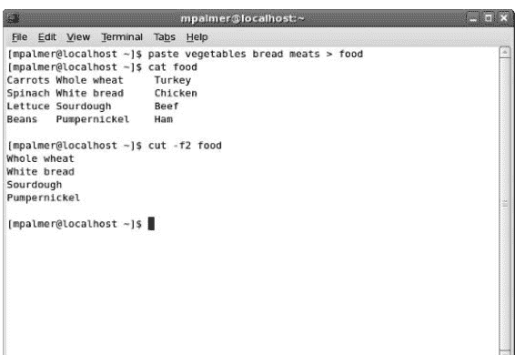

图 4-4 使用 cut 命令

另一个选项是使用以下命令从文件中提取第一列和第三列：

```
cut -f1,3 food
```

该命令的结果为：

- Carrots Turkey
- Spinach Chicken
- Lettuce Beef
- Beans Ham

上手项目 4-12 让你练习使用 `cut` 命令。

## 排序文件

使用 `sort` 命令按字母或数字顺序对文件内容进行排序。UNIX/Linux 默认在屏幕上显示排序后的文件，但你可以使用重定向运算符指定将排序后的数据存储在特定文件中。

### 第 4 章 UNIX/Linux 文件处理

语法 `sort [-options] [filename]`

### 详解

- 按逐行对文件内容进行排序

- 有用的选项包括：

  - `-k` 按 n 指定的键字段排序
  - `-t` 表示用指定的字符分隔字段
  - `-m` 合并之前已排序过的输入文件（不执行排序）
  - `-o` 将输出重定向到指定的文件
  - `-d` 按字母数字或字典顺序排序
  - `-r` 按逆序排序

`sort` 命令提供了许多选项，附录 B 也对其进行了描述。以下是其用法示例：

`sort file1 > file2`

在此示例中，`file1` 的内容被排序，结果存储在 `file2` 中。（如果输出没有重定向，`sort` 将其结果显示在屏幕上）。如果你正在对记录文件进行排序且没有指定任何选项，例如，每条记录第一个字段的值将按字母顺序排序。一个更复杂的例子如下：

`sort -k 3 food > sortedfood`

此命令指定了一个排序键。键字段是每行中的字段位置。`sort` 命令根据排序键对行进行排序。`-k 3` 是文件中的键字段。例如，上例中的 `-k 3` 按文件中的第三个字段进行排序（即肉类列表），并将排序结果写入 `sortedfood`（见图 4-5）。注意图 4-5，第一条记录的第三字段是 `Beef`（且所有记录都按第三字段进行排序）。

上手项目 14 让你使用 `sort` 命令。此外，尝试上手项目 4-14，在一个项目中使用 `cat`、`out`、`paste` 和 `sort` 命令，该项目将你目前为止学到的知识整合在一起。

## 创建脚本文件

正如你所见，取决于选项的数量，命令行输入可能会变得很长。使用 shell 的历史记录可以回溯命令。这种功能当你需要快速执行命令时很好用，但如果你需要创建脚本文件就有问题了。

### 创建脚本文件 173

```
mer@localhost:~
Lettuce Sourdough
Spinach Chicken
Beans             Carrots
```

**图 4-5 按第三字段排序的结果**

与其记住这些内容，不如使用 `cut`、`paste` 和 `sort` 命令来创建报告。例如，假设你有一个文件包含员工的姓、名、中间字母、部门、电话号码和其他信息，但该文件不包含薪水信息，如下：

```
LaVerne:F:Accounting Department:444-7508:
Anders:Carol:M Sales Department:444-2130:
Caplan:Jason:R:Payroll Department:444-5609:
```

你想创建一个只包含员工姓、名、部门和薪水的预算文件。为了这一点，你可以使用 `join` 命令创建一个内容如下的文件：

```
Brown:82:53000
Anders:110:32000
Caplan:174:41000
Crow:95:36000
```

确定准确的命令后，使用 `vi` 或 `Emacs` 编辑器创建脚本。接下来，通过你在第 2 章中学到的知识使用 `chmod x` 参数使脚本可执行。最后，使用 `./` 命令运行它。上手项目 4-15 提供了基础。第 6 和第 7 章“Shell 编程简介”和“高级 Shell 编程”提供了更多经验。

### 第 4 章 UNIX/Linux 处理

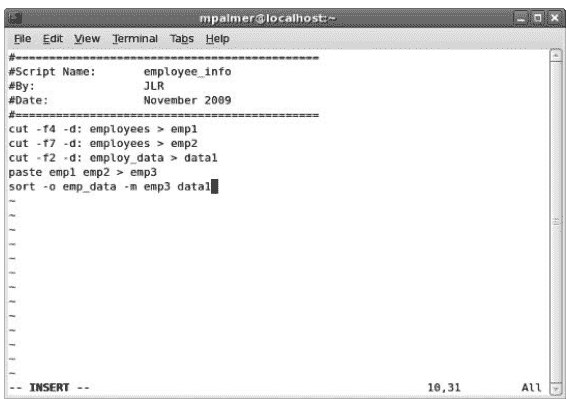

图 4-6 文件

## 在两个文件上使用 join 命令

有时，了解如何链接两个文件信息是有用的。你可以使用 `join` 命令根据共同字段关联两个文件中的行。如果你希望结果是有排序的，你可以在合并信息之前对文件按共同字段排序，也可以在合并信息后按特定字段进行排序。例如，假设你有一个文件包含员工的姓，另一个文件包含员工的公司 ID，最后一个字段包含员工的薪水，如下：

```
Brown:82:53000
Anders:110:32000
Caplan:174:41000
Crow:95:36000
```

此外，你还有另一个文件包含每个员工的姓、名、中间字母、部门、电话号码和其他信息，但该文件不包含薪水信息，如下：

...

### 在两个文件上使用 join 命令 175

在这一简单的示例中，两个原始文件的共同字段是员工姓名。请注意，在此上下文中，共同字段提供了一个访问和合并信息的键，以便创建报告或创建另一个包含合并信息的文件。（同时也请再次参阅图 4-2(c) 的基于键的文件结构示例。）

`join` 命令也与复杂数据库中的信息链接有关。使用任何此类数据库（如关系型数据库）超出了本书的范围。然而，学习使用 `join` 命令来操作文件数据（如本书中所使用的）是非常有用的。在这里它被用作另一个文件处理工具，以补充你对 `paste`、`cut` 和 `sort` 命令的知识。


语法 `join [-options]file1 file2`

### 详解

- 用于根据两个不同文件中的共同字段或键来关联这两个文件中的信息

`file1, 2` 是两个输入文件，必须按照 `join` 字段（即你想要合并文件的字段）进行排序。`join` 字段也称为键。在合并之前，你必须对文件进行排序。当你执行 `join` 命令时，UNIX/Linux 会比较这两个字段。每个输出都包含共同字段，随后是来自 `file1` 的行和 `file2` 的行。你可以使用后续描述的选项修改输出。如果文件中存在重复键的记录，UNIX/Linux `join` 会对所有这些进行处理。例如，将一个文件的数据追加到另一个文件中而不丢失任何记录。

- 有用的选项：

  - `1 field` 指定 `file1` 中用于合并的共同字段
  - `2 field` 指定 `file2` 中用于合并的共同字段


- `-o` 指定输出的字段列表。该列表包含用空格分隔的字段说明，格式为 `m.n`，其中 `m` 是文件编号，`n` 是字段在文件中的位置。因此，`-o 1.2` 意为“输出第一个文件的第二个字段”。

- `-t` 指定分隔符。默认是空格、制表符或换行符。多个空格和制表符被计作一个分隔符。

- `-filenum` 为文件 `filenum` 中的每一行无法匹配的行产生一行。在这种情况下，`filenum` 对于 `file1` 为 1，对于 `file2` 为 2。

- `-str` 替换 `str` 指定文件中无法匹配行的空字段。该字符串通常是代码或消息，用于指示状态，例如，`-e "No Vendor Record."`。

实战项目 4–16 为你提供了一个使用 `join` 命令的机会。

# AWK 程序简要介绍

`Awk` 是一种模式扫描和处理语言，有助于显示看起来很专业的报告。虽然你可以使用 `cat` 和 `more` 命令来显示用 `join` 命令创建的输出文件，但 `awk` 命令（当你在命令行输入它时会启动 `awk` 程序）能更快速、更简单地完成相同的工作。

`awk` 的名字由其发明者的姓首字母组成：(Alfred) `Aho`、(Peter) `Weinberger` 和 (Brian) `Kernighan`。他们在 UNIX/Linux 中提供了一个丰富且强大的编程环境，非常值得学习，因为它可以对文件执行从简单到复杂的各种操作——而这些操作通过组合其他命令可能很难实现。

在 Fedora、Red Hat Enterprise Linux、SUSE 以及其他版本的 UNIX 和 Linux 中，你实际上使用的是 `awk`，它包含了对 `awk` 的增强，是由 Paul Rubin 和 Jay Feelson 为 GNU 项目开发的。当你在命令行输入 `awk` 时，你实际上执行的是 `gawk`——或者你可以直接输入 `gawk`。


注意

```
语法 awk [pattern] {action;} filenames
```

## 详解

- `awk` 检查指定文件中的输入记录是否满足模式，如果是，则执行与之关联的操作。

- `F:` 意味着分隔符是冒号

`awk` 命令用于查找文件中的模式。在识别出模式后，它会执行你指定的动作。学习 `awk` 的由于它是一个可以高效处理文件的工具。例如，你可以在 `awk` 中完成许多使用 `paste`、`cut`、`sort` 和 `join` 组合才能完成的工作。学习 `awk` 的另一个原因是你可能有一个项目无法通过 `paste`、`cut`、`sort` 和 `join` 的组合完成，但你可以使用 `awk` 完成它。

使用 `awk` 可以完成的任务包括：

- 操作文件中的字段和记录

- 使用变量。（在第 6 章中学习更多关于变量的内容）

- 使用算术、字符串和逻辑运算符。（在第 6、7 章中学习更多这些运算符。）

- 从脚本中执行命令

- 使用经典的编程逻辑，例如循环。（在第 6 章中学习更多循环逻辑。）

- 将数据组织成格式良好的报告。

考虑一个将文本打印到屏幕上的简单示例。这是一个简单的 `awk` 命令：

```
awk {print "Hello, world!"}
```

## 命令总结：第 4 章命令回顾 179

- 为了自动进行命令处理，可以将命令包含在一个脚本文件中，稍后可以将其作为程序执行。使用 `vi` 编辑器创建脚本文件，并使用 `chmod` 命令使其具有可执行权限。

- 使用 `join` 命令从两个共享共同字段的文件中提取信息。你可以使用此共同字段来合并两个文件。你必须根据 `join` 字段（即你想要合并文件的字段）对文件进行排序。`join` 字段也称为键（`key`）。在合并之前，必须对文件进行排序。

- `Awk` 是一种模式扫描和处理语言，适用于创建具有专业外观的格式化报告。你可以使用 `vi` 编辑器在程序文件中输入 `awk` 指令，并使用 `awk` 命令调用它。

## 命令总结：第 4 章命令回顾

| 命令 | 用途 | 本章涵盖的选项 |
|---|---|---|
| `awk` | 启动 `awk` 程序进行文件格式输出 | `-F` 识别字段分隔符。<br>`-f` 表示代码来自磁盘文件而非键盘。 |
| `cat` | 查看文件内容，创建或合并文件内容 | |
| `cp` | 复制一个或多个文件 | `-i` 在 `cp` 覆盖同名现有文件之前提供警告。<br>`-s` 在目标位置创建符号链接或名称，而非物理文件。<br>`-u` 如果现有文件比源文件新，则防止 `cp` 覆盖该现有文件。 |
| `cut` | 从文件中提取指定的列或字段 | `-c` 指字符位置。<br>`-d` 指定用特定字符作为字段分隔符。<br>`-f` 指字段。 |
| `find` | 查找文件 | `-iname` 指定你想要查找的文件名，但搜索不区分大小写。<br>`-name` 指定你想要查找的文件名，搜索区分大小写。<br>`-mmin` 显示过去 n 分钟内更改过的文件。<br>`-mtime n` 显示过去 n 天内更改过的文件。<br>`-size n` 显示大小为 n 的文件。 |

# 第 4 章 UNIX/Linux 文件处理

| 命令 | 用途 | 本章涵盖的选项 |
| --- | --- | --- |
| `join` | 合并具有共同字段的文件 | `-a n` 为 `n` 中的每行无法匹配的行生成一条输出。<br>`-e str` 用指定的字符串替换无法匹配文件的空字段。<br>`-1` 和 `-2` 配合字段编号用于在合并时指定共同字段。<br>`-o` 输出指定的字段列表。<br>`-t` 指定用特定字符作为字段分隔符。 |
| `mv` | 移动一个或多个文件 | `-I` 在覆盖同名文件之前显示警告提示符。<br>`-u` 如果源文件比目标文件新，则覆盖同名的目标文件。 |
| `paste` | 合并两个或多个文件的字段 | `-d` 允许在列之间指定不同的分隔符（制表符以外）。<br>`-s` 使文件按顺序在另一个文件之后粘贴，而非并行粘贴。 |
| `rm` | 删除一个或多个文件 | `-i` 指定 UNIX/Linux 在删除文件前请求确认删除。<br>`-r` 指定应递归删除目录。 |
| `rmdir` | 删除空目录 | |
| `sort` | 对文件内容进行排序 | `-k n` 根据 `n` 指定的键字段排序。<br>`-t` 指定用特定字符作为字段分隔符。<br>`-m` 意味着在排序前合并文件。<br>`-o` 将输出重定向到指定的文件。<br>`-d` 按字母数字或字典顺序排序。<br>`-g` 按数值（通用）顺序排序。<br>`-r` 按反序排序。 |
| `touch` | 更新现有文件的时间戳或创建新文件 | `-a` 指定只更新访问日期时间。<br>`-m` 指定只更新修改日期时间。<br>`-c` 指定不创建任何文件。 |

## 关键术语

**固定长度记录 (fixed-length record)** — 文件中的一种结构，其中每个记录都有指定的长度，记录中的每个字段也是如此。

**扁直 ASCII 文件 (flat ASCII file)** — 一种你可以创建、操纵和使用来存储数据的文件，如字母、报告或记录。其作为无结构字节序列的组织是文本文件的典型特征，并为数据输入提供了灵活性，它可以以任何顺序存储任何类型的数据。任何操作系统都可以读取这种文件类型。然而，由于你只能按照输入时的顺序检索数据，这种文件类型的实用性受到限制。也称为普通文件。

**键 (key)** — 一个或多个文件共享的每个文件记录中的共同字段。共同字段（或键）允许你链接或合并有关文件的信息，例如创建报告。

**普通文件 (regular file)** — UNIX/Linux 对 ASCII/文本文件和二进制文件的统称。也称为普通文件。

**关系型数据库 (relational database)** — 一种数据库，UNIX/Linux 将其中的序列视为表，将记录视为行，将字段视为列，并可以从共享共同字段的关系型数据库的两个文件中进行连接。

**shell 脚本 (shell script)** — 一个包含 UNIX/Linux 命令序列的文本文件，这些命令不需要编译器转换为机器语言。

**排序键 (sorting key)** — 文件每行中用于对文件进行排序的字段位置。例如，在 `sort -k 2 myfile` 命令中，`myfile` 是根据文件的第二个字段进行排序的。`sort` 命令使用排序键对行进行排序。

**stderr** — 程序员用于标准错误（standard error）的缩写。当 UNIX/Linux 检测到程序和程序任务中的错误时，错误信息将发送到 `stderr`。

**stdin** — 标准输入的缩写。

**stdout** — 标准输出（standard output）的缩写。

**可变长度 (variable-length)** — 文件中的一种结构，其记录没有固定长度。

# 复习

（注：由于提供的文本在问题处中断或包含重复说明，此处未翻译具体的问题内容）

# 184 第 4 章 UNIX/Linux 文件处理


## 11. 你在主目录下创建了一个名为 `sum_report` 的脚本文件，并赋予了它可执行权限。你使用哪个命令来运行该脚本？

- a. `/sum_report`
- b. `rm sum_report`
- c. `go sum_report`
- d. `#sum_report`

## 12. 标准输出（Standard output）指的是以下哪一个？

- a. `out_put`
- b. `stdout`
- c. `termout`
- d. `outsource`

## 13. 使用 `join` 命令合并两个文件必须满足以下哪些条件？（选择所有适用项。）

- a. 两个文件的长度完全相同。
- b. 两个文件必须包含一个包含编号标识符的字段。
- c. 两个文件必须有一个共同字段，例如姓。
- d. 两个文件必须使用冒号作为字段分隔符。

## 14. 你可以使用哪一个命令对 `vendor_name` 文件进行排序并将结果显示在屏幕上？

- a. `sort > vendor_name`
- b. `sort vendor_name <`
- c. `sort vendor_name stdin`
- d. `sort vendor_name`

## 15. 当你使用 `paste` 命令时，信息列由制表符（tab）分隔。然而，你的老板希望列用冒号分隔。哪个选项允许你指定冒号作为分隔符？

- a. `-s:`
- b. `-d:`
- c. `--sep :`
- d. `--div:`

## 16. 你正在查看 `addresses` 文件，该文件包含你认识的人的姓、名以及他们的街道地址、城市、州、邮编和电话号码。你想打印一个姓（字段 1）和电话号码（字段 7）的列表。以下哪个命令可以让你打印此列表？

- a. `cat 1:7 addresses`
- b. `sort -t: 1-7 addresses`
- c. `cut -f1,7 addresses`
- d. `paste r:1:7 addresses`

## 17. 你对旅行中看到的鸟类进行了年度记录。文件名为 `birds`。该文件包含以下字段：名称（字段 1）、标记（字段 2）、观测年份（字段 3）和位置（字段 4）。想要按位置排序查看文件内容。你使用以下哪个命令？

- a. `sort -k 4 birds`
- b. `sort birds >4`
- c. `paste birds -s:45`
- d. `cut birds .4`

## 18. 以下哪些操作可以通过 `mv` 命令实现？（选择所有适用项。）

- a. 移动文件
- b. 修改文件内容
- c. 重命名文件
- d. 更改文件所有者

## 19. 你的老板要求你根据文件内容创建一份专业的报告。以下哪个工具可以让你产出一份精美的报告？

- a. `cat`
- b. `awk`
- c. `touch`
- d. `finetouch`

## 20. 哪个命令允许你反序排序文件内容？

- a. `cut -r`
- b. `paste -b`
- c. `sort -t`
- d. `sort -r`

## 21. 你想将两个两个文件 `data07` 和 `data08` 合并为一个名为 `data-all` 的文件。你使用以下哪个命令？

- a. `cut data07 +data08 2>> data_all`
- b. `paste data07/data08 to data_all`
- c. `sort data07 data08 << data_all`
- d. `cat data07 data08 > data_all`

## 22. 你如何使用 `touch` 命令用一条命令创建名为 `sum`、`datanew`、`results` 和 `calcs` 的新文件？

## 23. 创建一个命令，对 `addresses` 文件中的第二个字段进行排序，并将排序后的结果写入新文件 `sorted_addresses`。

## 24. 创建一个命令，让你将 `spreadsheets` 目录中的所有文件复制到 `accounts` 目录（假设这两个目录都是你主目录下的一级目录，且你当前位于主目录）。

## 25. 你弹吉他，并在电脑上保留了两个文件。一个名为 `strings` 的文件列出了你手头有的不同品牌的吉他弦。另一个名为 `music` 的文件列出了你拥有的音乐书和乐谱。当你输入命令 `strings music` 时，会发生什么？

# 实践项目

> 记住，你可以在任何项目的结束时清空屏幕并按回车，以开始新的屏幕显示。


## 项目 4-1

你可以在 UNIX/Linux 中以多种方式处理输入和输出。在这个项目中，你将创建一个向命令输入 `vi` 编辑器的文件。（对于本章中的所有项目，请使用自己的账户登录，不要用 root 登录。）

要创建一个供 `vi` 读取命令的文件：

1. 使用 `vi` 编辑器创建并保存包含以下文本的文件 `testfile`（确保不要在最后一行之后输入空行）：

```
This is line 1.
This is line 2.
This is line 3.
This is line 4.
```

2. 输入 `cat testfile` 并按回车检查你的工作。

### 实践项目 187

3. 接下来，使用 `vi` 编辑器创建并保存另一个名为 `commands` 的文本文件，其中包含一行 `vi` 命令：`2GddGp:x`。（见图 4–7。）

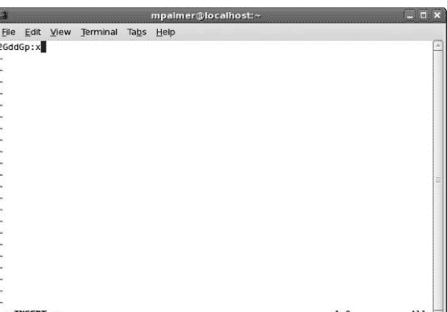

**图 4-7** 使用 vi 创建 `commands` 文件的内容。

4. 输入 `cat commands` 并按 **回车** 以验证 `commands` 文件的内容。

5. 输入 `vi testfile < commands` 并按回车。由于输入来自文件而不是键盘，你可能会看到警告（请忽略警告）。这会将 `testfile` 加载到编辑器中并执行文件中的命令。

6. 输入 `cat testfile` 并按回车。查看执行命令后的内容。内容为：

```
This is line 1.
This is line 3.
```

## 项目 4-2

在这个项目中，使用 `vi` 编辑器创建一个文件并将其输入重定向到另一个文件。

1. 使用 `vi` 编辑器创建并保存包含以下文本的文件 `testfile`：

```
This is line 1.
This is line 2.
This is line 3.
This is line 4.
```

2. 使用 `vi` 编辑器创建并保存一个名为 `commands` 的文件，其中包含一行 `vi` 命令：`2GddGp:x`。

3. 输入 `vi testfile < commands` 并按回车。由于输入来自文件而不是键盘，你可能会看到警告（请忽略警告）。这会将 `testfile` 加载到编辑器中并执行文件中的命令。

4. 输入 `cat testfile` 并按回车。执行命令后的内容内容为：

```
This is line 1.
This is line 3.
```

## 项目 4-3

在这个项目中，你练习使用 `touch` 命令创建空文件。

创建一个空文件：

1. 输入 `touch file` 并按回车。这创建一个名为 `file` 的空文件。

2. 输入 `ls -l file` 并按回车查看文件列表。

## 项目 4-4

在这个项目中，你学习如何使用 `touch` 命令更新文件的时间戳。

创建一个文件并更改其时间戳：

1. 输入 `touch file3` 并按回车。创建创建 `file3`。

2. 输入 `ls -l file3` 并按回车。记录其修改日期。

3. 等待至少分钟。

4. 输入 `touch file` 并按回车。用系统日期时间更新文件的访问和修改日期。

5. 输入 `ls -l file3` 并按回车。查看修改时间。它现在应该不同了。

## 项目 4-5

在这个项目中，你删除之前创建的两个文件。

从当前目录删除文件：

1. 输入 `rm newfile1` 并按回车。这将从当前目录永久删除 `newfile1`。

2. 输入 `rm -i newfile2` 并按回车。你会看到消息：`rm: remove regular file 'newfile2'?`

3. 输入 `y`（是）并按回车。

使用通配符删除一组文件：

1. 你可以指定多个文件名作为 `touch` 命令的参数。输入 `touch file1 file2 file3 filegood filebad` 并按回车。此命令创建了这些文件：`file1`, `file2`, `file3`, `filegood`, 和 `filebad`。

2. 输入 `ls file*` 并按回车。看到你在第 1 步中创建的文件列表。

# 第4章 UNIX/Linux 文件处理


3. 输入 `rm file*` 并按回车。

4. 输入 `ls file` 并按回车。文件已被删除（见图 4-10）。

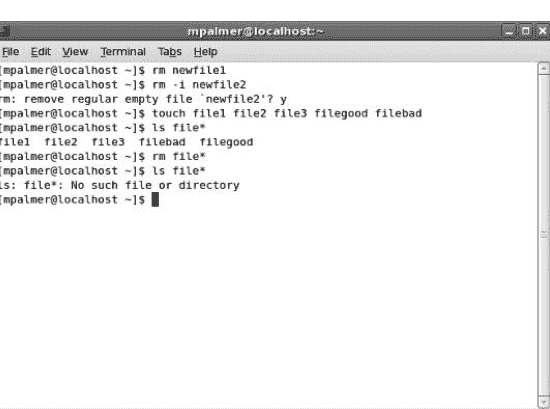

## 项目 4-6

在这个项目中，你将创建一个目录，然后使用 `rmdir` 命令将其删除。接着，你将使用 `rm` 命令删除包含子目录的目录。

要创建一个目录并使用 `rmdir` 命令将其删除：

1. 输入 `mkdir newdir` 并按 **Enter**。这会创建一个名为 `newdir` 的新目录。

2. 使用相对路径配合 `touch` 在 `newdir` 目录中创建一个新文件。输入 `touch newdir/newfile` 并按回车。这会在 `newdir` 目录中创建 `newfile`。

3. 输入 `ls newdir` 并按回车，查看 `newfile` 的列表。

4. 尝试删除该目录，输入 `rmdir newdir` 并按回车。你会看到一条类似的错误信息：

```
rmdir: Directory not empty
```

5. 使用相对路径配合 `rm` 命令删除 `newfile`。输入 `rm newdir/newfile` 并按回车。

6. 现在目录是空了。输入 `rmdir newdir` 并按回车。

7. 输入 `ls` 并按回车。`newdir` 目录已不再那里。

### 如何递归删除包含多个子目录的目录：

1. 创建一个包含多个子目录的目录。输入 `mkdir company` 并按 **Enter**。输入 `mkdir company/sales` 并按 **Enter**。输入 `mkdir company/marketing` 并按 **Enter**。

2. 在目录中创建三个空文件。输入 `company/file1 company/file2 company/file3` 并按 **Enter**。

> 提示：你在第 3 步中输入的命令非常相似。你可以使用向上方向键调出第一个条命令然后对其进行修改，从而减少打字量。


3. 通过以下操作将文件复制到其他目录：

- 输入 `cp company/file1 company/file2 company/file3 company/sales` 并按 **Enter**。
- 输入 `cp company/file1 company/file2 company/file3 company/marketing` 并按 **Enter**。
- 输入 `cp company/file1 company/file2 company/file3 company/accounting` 并按 **Enter**。

4. 使用 `ls` 命令验证文件是否已复制到所有三个目录中。

5. 删除 `company` 目录及其包含的所有内容。输入 `rm -r company` 并按 **Enter**。

6. 输入 `ls` 并按 **Enter**。`company` 目录已被移除。

## 项目 4-7

`cp` 命令专门用于防止数据丢失；你可以用它创建文件的备份副本。在这个项目中，你创建了三个新文件，并将它们复制到不同的目录。然后，复制其中一个并给它一个不同的名称。

要创建三个文件并复制到目录：

1. 如果你还没有源目录，请确保你处于主目录，然后创建该目录。输入 `mkdir source` 并按 **Enter**。

2. 在主目录中创建三个文件，`> file1` 并按 **Enter**，`> file2` 并按 **Enter**，然后 `> file3` 并按 **Enter**。

3. 现在，你可以将文件复制到 `source` 目录。输入 `cp file1 file2 file3 source` 并按 **Enter**。（为了节省时间，你可以使用 `cp file* source`）。

4. 接下来，复制其中一个文件并给它一个不同的名称，以便将其识别为备份文件。输入 `cp file1.bak` 并按 **Enter**。（见图 4–11。）


# 第4章 UNIX/Linux 文件处理

现在你的工作目录包含两个内容相同但名称不同的文件。

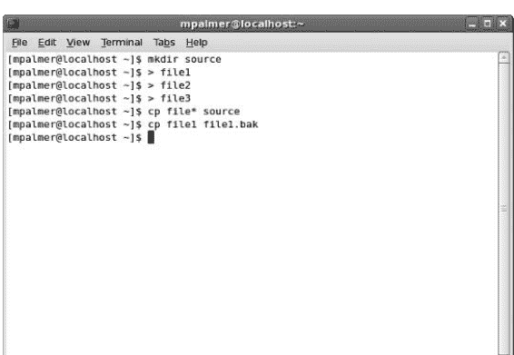

图 4-11 将文件复制到新的子目录并创建备份文件

## 项目 4-8

在这个项目中，你将使用 `mv` 命令练习移动文件。

将文件从一个目录移动到另一个目录：

1. 在主目录中创建新文件 `thisfile`，输入 `> thisfile` 然后按 **Enter**。

2. 输入 `mv thisfile source` 并按 **Enter** 将新文件移动到 `source` 目录。

3. 输入 `ls` 并按 **Enter**。`thisfile` 未列出。输入 `ls source` 并按 **Enter**。你会看到 `thisfile` 列出了。

4. 要移动多个文件，请在目录名之前输入文件名。例如，输入 `mv file1 file1.bak source` 并按回车。

5. 创建新文件 `my_file`，输入 `> my_file` 并按 **Enter**。

6. 将 `my_file` 重命名为 `your_file`，输入 `mv my_file your_file` 并按回车。

7. 输入 `ls` 并按 **Enter**。你看到 `your_file` 列出了，但 `my_file` 未列出。


## 项目 4-9

在这个项目中，你使用 `find` 命令在 `/home` 目录及其所有子目录下查找名为 `file1` 的文件。

查找文件：

1. 输入 `/home -name file1` 并按回车。

2. 在哪些目录中找到了该文件？如果有其他用户，进入他们的 `home` 目录查看 `file1` 是否存在。`find` 命令不需要 `-print` 选项来显示找到的文件名。

## 项目 4-10

在接下来的项目中，你将练习使用 UNIX/Linux 命令来操作文件。在这个项目中，你将通过使用 `cat` 命令配合重定向操作符来创建并合并基础文件，这些文件是示例文件，每行包含一个名称（第一个字段）和一个数字（第二个字段）。图 4-12 展示了两个示例文件的内容。

| File name: product1 |
| :--- | :--- |
| Lobby Furniture | 1201 |
| Ballroom Specialties | 1221 |
| Poolside Carts | 1320 |
| Formal Dining Specials | 1340 |
| Reservation Logs | 1410 |
| File name: product2 |
| :--- | :--- |
| Plumbing Supplies | 1423 |
| Office Equipment | 1361 |
| Carpeting Services | 1395 |
| Auto Maintenance | 1544 |
| Pianos and Violins | 1446 |

图 4-12 两个示例文件

# 第4章 UNIX/Linux 文件处理

使用 `cat` 命令合并文件：

1. 输入 `cat > product1` 并按回车。

2. 输入以下文本，并在每行结束后按回车：

Lobby Furniture:1201
Ballroom Specialties:1221
Poolside Carts:1320
Formal Dining Specials:1340
Reservation Logs:1410

3. 按 Ctrl+d。

4. 现在，你可以重定向 `cat` 的输出以在主目录中创建 `product2` 文件。此文件也包含冒号分隔的字段。

5. 在命令提示符后，输入 `cat > product2` 并按回车。

6. 输入以下文本，并在每行结束后按回车：

Plumbing Supplies:1423
Office Equipment:1361
Carpeting Services:1395
Auto Maintenance:1544
Pianos and Violins:1446

7. 按 Ctrl+d。

8. 现在，你可以将两个文件合并到 `products` 文件。在 `$` 提示符后，输入 `cat product1 product2 > products` 并按回车。

9. 列出 `products` 的内容，输入 `more products` 并回车。你将看到以下列表（整个命令序列见图 4–13）：

Lobby Furniture:1201


Ballroom Specialties:1221

Poolside Carts:1320

Formal Dining Specials:1340

Reservation Logs:1410

Plumbing Supplies:1423

Office Equipment:1361

Carpeting Services:1395

Auto Maintenance:1544

Pianos and Violins:1446

## 动手项目

```
mpmalmer@localhost:~ 
$ Edit View Tags Help
Lobby Furniture:1201
Ballroom Specialties:1221
Poolside Cards:1236
Formal Dining Specialties:1340
Reservation Logs:1410
mpmalmer@localhost:~ -cat product2
Plumbing Supplies:1422
Office Equipment:1361
Carpeting Services:1395
Auto Maintenance:1444
Pianos and Violins:1446
mpalmer@localhost:~ -cat product1 product2 product3
Lobby Furniture:1201
Ballroom Specialties:1221
Poolside Cards:1236
Formal Dining Specialties:1340
Reservation Logs:1410
Plumbing Supplies:1422
Office Equipment:1361
Carpeting Services:1395
Auto Maintenance:1444
Pianos and Violins:1446
mpalmer@localhost:~ -ls
```

图 4-11 使用 `cat` 命令创建并合并文件

## 项目 4-10

在项目 4-10 中，你学习了如何使用 `cat` 命令合并文件。在这个项目中，你使用另一种方法——`paste` 命令合并文件。在这里，你合并了在项目 4-10 中创建的两个 `product` 文件，以两个单独列显示这些文件中的记录。

使用 `paste` 命令合并文件：

1. 如果你直接从项目 4-10 继续，输入 `clear` 并按回车清除屏幕。

2. 输入 `paste product1 product2` 并按回车。

此命令行序列意味着“将名为 `product1` 的文件与 `product2` 文件合并，并在屏幕上使用每个文件内容的单独一列来显示结果”（见图 4-14）。列看起来不整齐，是因为文件中的记录长度不同，并且通过制表符分隔成列（你在屏幕上看不到制表符）。

3. 在此示例中，你如何将 `paste` 命令的输出写入文件而不是屏幕？


# 196 第 4 章 UNIX/Linux 文件处理

```
palmer@localhost:~# [x]
mpmer@localhost:-$ -is paste product12
Lobby Furniture:1201 Plumbing Supplies:1422
Bedroom Specials:1321 Officer Element:1361
Poolside Carts:1320 Carpeting Services:1395
Formal Dining Specials:1340 Auto Maintenance:1544
Reservation Logs:1410 Planus and Victims:1416
palmer@localhost:-$
```

```

图 4-14 使用 `paste` 命令合并文件

## 项目 4-12

`cut` 命令在处理和展示基本数据文件内容方面具有多功能性。在这个项目中，你首先开始创建两个文件：`corp_phones1` 和 `corp_phones2`。`corp_phones1` 包含五条变长度的记录，并用冒号（:）分隔记录中的每个字段。本章之前所示的图 4–2(c) 阐释了这种文件结构。`corp_phones2` 也包含了固定长度的记录，如图 4–2(b) 所示。图 4-15 展示了这两个文件的内容。你可以使用 `cut` 命令处理任一文件来提取姓名列表。

创建 `corp_phones1` 和 `corp_phones2` 文件：

- 1. 使用 `vi` 或 `Em` 编辑器创建 `corp_phones1` 文件。
- 2. 按照所示的内容准确输入以下行文本。在每行末尾按回车：
`219:432:4567:Harrison:Joel;M:4540:Accountant:09-12-1985`
`219:432:4587:Mitchell:Barbara;C:4541:Admin Asst:12-14-1995`
`219:432:4589:Olson:Timothy;H:4544:Supervisor:06-30-1983`
`219:432:4591:Moore:Sarah;H:4500:Dept Manager:08-01-1978`
`219:432:4527:Polk:John;S:4520:Accountant:09-22-1998`
- 3. 保存文件，并创建一个名为 `corp_phones2` 的新文件。
- 4. 按照所示的内容准确输入以下行文本。参考图 4-15 获取每个字符的精确位置。在每行末尾按回车。在这个文件中，你正在创建固定长度的记录，这意味着每个字段必须从特定的列开始，并且彼此对齐。例如，电话区号

## 动手项目 197

```

文件名: corp_phones1 (变长度记录 - 字段由冒号 : 分隔)

219:432:4567:Mitchell:Joel:4540:Olson:Barbara:C:4541:Admin Asst:09-12-1985

219:432:4567:Mitchell:Barbara:C:4541:Admin Asst:12-14-1995

219:432:4589:Olson:Timothy:H:4544:Supervisor:06-30-1983

219:432:4591:Moore:Sarah:H:4500:Dept Manager:08-01-1978

219:432:4527:Polk:John:S:4520:Accountant:09-22-1998

存储空间 = 279 字节

```

```

文件名: corp_phones2 (固定长度记录)

| 字符位置 | 1-3 | 7 | 9-12 | 14-25 | 26-35 | 36-41 | 43-58 | 59-68 |

| :--- | :--- | :--- | :--- | :--- | :--- | :--- | :--- | :--- |

| 219 | 432 | 4567 | Harrison | Joel | M | 4540 | Accountant | 09-12-1985 |

| 219 | 432 | 4587 | Mitchell | Barbara | C | 4541 | Admin Asst | 12-14-1995 |

| 219 | 432 | 4589 | Olson | Timothy | H | 4544 | Supervisor | 06-30-1983 |

| 219 | 432 | 4591 | Moore | Sarah | H | 4500 | Dept Manager | 08-01-1978 |

| 219 | 432 | 4527 | Polk | John | S | 4520 | Accountant | 09-22-1998 |

存储空间 = 345 字节

```

图-15 公司示例电话文件结构的两个版本

219 位于第 1 到 3 列。姓名从第 14 列开始，可以延伸到第 25 列。

```

219 432 4567 Harrison      Joel      M 4540 Accountant      09-12-1985

219 432 4587 Mitchell    Barbara  C 4541 Admin Asst      12-14-1995

219 432 4589 Olson       Timothy  H 4544 Supervisor      06-30-1983

219 432 4591 Moore       Sarah    H 4500 Dept Manager   08-01-1978

219 432 4527 Polk         John      S 4520 Accountant      09-22-1998
```


- 5. 保存文件并从 `corp_phones1` 中提取姓和名。

接下来，我们提取由冒号分隔的记录和字段。此文件包含变长度记录并用冒号分隔。你可以通过位置和分隔符字符（在本例中为冒号）选择你想要指定的字段。

要使用命令从变长度记录中提取字段：

使用 `cut -f4-6 -d: corp_phones1` 并按回车。

该命令提取第 4 到 6 个字段（`-f`），并以冒号（`-d`）分隔：
Harrison:Joel
Mitchell:Barbara
Olson:Timothy
Moore:Sarah
Polk:John

现在，从 `corp_phones2` 中提取姓和名。此文件包含固定长度记录，而不是通过冒号来分隔字段。

要使用该命令从固定长度记录中提取字段：

使用 `cut -c14-25,26-35 corp_phones2` 并按回车。

该命令提取第 14 到 25 列以及第 26 到 35 列（`-c`）：
Harrison Joel M
Barbara C
Olson Timothy
Moore Sarah
Polk John

此外，查看图 4-16 了解如何使用 `cut` 处理 `corp_phones1` 和 `corp_phones2`。

确保在 `cut` 命令中不要包含空格（`- -`）。例如，正确的语法是 `cut -c14-25,26-35 corp_phones2`。

```
palmer@localhost:~$ cut -c14-25,26-35 corp_phones2

Harrison Joel M

Barbara C

Olson Timothy

Moore Sarah

Polk John
```

比较变长度文件与固定长度文件的 `cut` 命令结果。

使用 `cut` 处理变长度或固定长度记录会产生相似的结果。例如，`corp_phones2` 需要 345 字节，而 `corp_phones1` 需要 279 字节。

## 项目 4-13

排序 `corp_phones1` 和 `corp_phones2` 文件可以参考项目 4-12。在前两个步骤中，你对 `corp_phones1` 按姓进行排序。在第三和第四个步骤中，你对 `corp_phones2` 执行同样的操作。注意输出结果输出到标准输出（stdout）。最后一步使用 `-o` 选项而不是重定向，将排序后的输出写入新文件 `sorted_phones`。

### 要排序 `corp_phones1` 文件：

- 1. 在提示符后，输入 `sort -t -k 4 corp_phones1` 并按回车。

在此示例中，`-t` 选项指定分隔符，即冒号（:`）。`-k` 选项指定第四字段，即姓。你将在屏幕上看到如下：

```
219:432:4567:Harrison:Joel:M:4540:Accountant:09-12-1985

219:432:4587:Mitchell:Barbara:C:4541:Admin Asst:12-14-1995

219:432:4591:Moore:Sarah:H:4500:Dept Manager:08-01-1978

219:432:4589:Olson:Timothy:H:4544:Supervisor:06-30-1983

219:432:4527:Polk:John:S:4520:Accountant:09-22-1998
```

- 2. 输入 `sort -t -k 5 corp_phones1` 并按回车。

这排序了变长度记录（`-t` 表示字段由冒号分隔），从第一个名字开始排序（`-k 5`）。你将在屏幕上看到如下：

```
219:432:4587:Mitchell:Barbara:C:4541:Admin Asst:12-14-1995

219:432:4567:Harrison:Joel:M:4540:Accountant:09-12-1985

219:432:4527:Polk:John:S:4520:Accountant:09-22-1998

219:432:4591:Moore:Sarah:H:4500:Dept Manager:08-01-1978

219:432:4589:Olson:Timothy:H:4544:Supervisor:06-30-1983
```

# 第 4 章 UNIX/Linux 文件处理

- 3. 输入 `sort -k 4 corp_phones2` 并按回车。

这将从第四字段开始，按固定长度文件按名称进行排序。在这个示例中，不需要分隔符，因为固定长度文件没有分隔符。你会在屏幕上看到以下内容：

219 432 4567 Harrison M 4540 Accountant 09-12-1985
219 432 4587 Mitchell Barbara C 4541 Admin Asst 12-14-1995
219 432 4591 Moore Sarah H 4500 Dept Manager 08-01-1978
219 432 4589 Olson Timothy H 4544 Supervisor 06-30-1983
219 432 4527 Polk John S 4520 Accountant 09-22-1998

- 4. 输入 `sort -k 5 corp_phones2` 并按回车。

这从第五字段开始按名字对文件进行排序。你会在屏幕上看到以下内容：

219 432 4587 Mitchell Barbara C 4541 Admin Asst 12-14-1995
219 432 4567 Harrison Joel M 4540 Accountant 09-12-1985
219 432 4527 Polk John S 4520 Accountant 09-22-1998
219 432 4591 Moore Sarah H 4500 Dept Manager 08-01-1978
219 432 4589 Olson Timothy H 4544 Supervisor 06-30-1983

- 5. 输入 `clear` 并按回车以清除屏幕以便查看之前的内容。

- 6. 要按名称排序并创建输出 `sorted_phones`，输入 `sort -k 5 -o sorted_phones corp_phones1` 并按回车。这按名字对 `corp_phones1` 进行排序并创建一个输出文件 `sorted_phones`。输入 `cat sorted_phones` 并按回车以验证你已成功创建 `sorted_phones` 文件（图 4-17）。

```
File Edit View Terminal Tabs Help

mpalmer@localhost~$ $ sort -k 5 -o sorted_phones corp_phones1

mpalmer@localhost~$ $ cat sorted_phones

$

219:432:4587:Mitchell:Barbara:C:4541:Admin Asst:12-14-1995

219:432:4567:Harrison:Joel:M:4540:Accountant:09-12-1985

219:432:4527:Polk:John:S:4520:Accountant:09-22-1998

219:432:4591:Moore:Sarah:H:4500:Dept Manager:08-01-1978

219:432:4589:Olson:Timothy:H:4544:Supervisor:06-30-1983
```


图 4-17 按名字对 `corp_phones1` 文件进行排序并将结果存储在 `sorted_phones` 中

## 项目 4-14

在这个项目中，你将使用已经学过的许多文件处理工具来帮助强化你目前为止的知识。首先，使用 `cat` 命令创建供应商文件（`vendors`）。供应商文件中的记录由两个用冒号分隔的字段组成：供应商编号和供应商名称。

创建供应商文件：

- 1. 输入 `cat > vendors` 并按回车。
- 2. 输入以下文本，并在每行末尾按回车：

```
1201:Cromwell Interiors
1221:Design Extras Inc.
1320:Piedmont Plastics Inc.
1340:Morgan Catering Service Ltd.
1350:Fullman Elevators
1360:Johnson Office Products
```

- 3. 按 `Ctrl+D`。

在接下来的步骤中，使用 `cat` 命令创建产品文件（`products`）。产品文件中的记录由三个用冒号分隔的字段组成：产品编号、产品描述和供应商编号。

创建产品文件：

- 1. 输入 `cat > products` 并按回车。
- 2. 输入以下文本，并在每行末尾按回车（在第一个和最后一个字段中使用全 0，例如在 `S0107` 中）：

```
S0107:Lobby Furniture:1201
S0109:Ballroom Specialties:1221
S0110:Poolside Carts:1320
S0130:Formal Dining Specials:1340
S0201:Reservation Logs:1410
```

- 3. 按 `Ctrl+d` 结束 `cat` 命令。

### 4-18 显示你创建的供应商和产品文件的概念示例。

现在使用 `cut`、`paste` 和 `sort` 命令创建一个单一示例的供应商报告。你首先使用 `cut` 命令从 `products` 文件中提取产品描述和供应商编号，并将它们存储在单独的文件 `p1` 和 `p2` 中。然后从 `vendors` 文件中提取供应商编号和名称，并将它们存储在 `v1` 和 `v2`。使用 `paste` 命令将两个供应商文件（`v1` 和 `v2`）合并到第三个文件 `v3`。然后将两个产品文件（`p1` 和 `p2`）合并到 `p3`。合并 `v3` 和 `p3` 文件并将输出到供应商报告 `vrep`。

使用 `cut`、`paste` 和 `sort` 命令创建报告：

- 1. 输入 `cut -f2 -d products > p1` 并按回车。

文件名：`vendors`
| Vendor Number | Vendor Name |
| :--- | :--- |
| 1201 | Cromwell Interiors |
| 1221 | Design Extras Inc. |
| 1320 | Piedmont Plastics Inc. |
| 1340 | Morgan Catering Service Ltd. |
| 1350 | Pullman Elevators |
| 1360 | Johnson Office Products |

文件名：`products`
| Prod Number | Product Description | Vendor Number |
| :--- | :--- | :--- |
| S0107 | Lobby Furniture | 1201 |
| S0109 | Ballroom Specialties | 1221 |
| S0110 | Poolside Carts | 1320 |
| S0130 | Formal Dining Specials | 1340 |
| S0201 | Reservation Logs | 1410 |

图 4-18 供应商和产品文件

这意味着从 `products` 文件中提取冒号分隔的第二个字段，并将其存储在 `p1` 文件中（你可以使用 `cat` 命令验证）：

- Lobby Furniture
- Ballroom Specialties
- Poolside Carts
- Formal Dining Specials
- Reservation Logs

- 2. 输入 `cut -f3 - products > p2` 并按回车。

这意味着从 `products` 文件中提取冒号分隔的第三个字段，并将其存储在 `p2` 文件：

```
1201

1221

1320

1340

1410
```

- 3. 输入 `cut -f1 - vendors > v1` 并按回车。

这意味着从 `vendors` 文件中提取冒号分隔的第一个字段，并将其存储在 `v1` 文件：

```
1201

1221

1320

1340

1350

1360
```

- 4. 输入 `cut -f2 -d vendors > v2` 并按回车。

这意味着从 `vendors` 文件中提取冒号分隔的第二个字段，并将其存储在 `v2` 文件：

```
Cromwell Interiors
Design Extras Inc.
Piedmont Plastics Inc.
Morgan Catering Service Ltd.
Pullman Elevators
Johnson Office Products
```

- 5. 输入 `paste v2 > v3` 并按回车。

这意味着将 `v1` 和 `v2` 中的数据合并并重定向到文件 `v3`。这会将供应商编号和产品描述存储在 `v3` 文件中：

```
1201 Cromwell Interiors
1221 Design Extras Inc.
1320 Piedmont Plastics Inc.
1340 Morgan Catering Service Ltd.
1350 Pullman Elevators
1360 Johnson Office Products
```

- 6. 输入 `paste p2 > p3` 并按回车。

这意味着将 `p2` 和 `p1` 中的数据合并并重定向到文件 `p3`。这会将供应商编号和产品描述存储在 `p3` 文件中：

```
1201 Lobby Furniture
1221 Ballroom Specialties
1320 Poolside Carts
1340 Formal Dining Specials
1410 Reservation Logs
```

- 7. 输入 `sort -o vrep -m v3 p3` 并按回车。

这意味着合并 `v3` 和 `p3` 中的数据，并将输出到文件 `vrep`。这会将供应商编号和产品描述存储在 `vrep` 文件中：

```
1201 Cromwell Interiors
1201 Lobby Furniture
1221 Ballroom Specialties
1221 Design Extras Inc.
1320 Piedmont Plastics Inc.
1320 Poolside Carts
1340 Formal Dining Specials
1340 Morgan Catering Service Ltd.
1350 Pullman Elevators
1360 Johnson Office Products
1410 Reservation Logs
```

此时，屏幕应该看起来像图 4-19。在一个项目中，你已经完成了大量工作。你使用了 `cat` 命令创建文件，并使用了 `cut`、`paste` 和 `sort` 命令从文件中提取信息、合并信息并排序合并信息到新文件中。

```
$ mpmaler@localhost~ -is cat > vendors

$mpmaler@localhost~ 1201:Cornwell Interiors

1221:Design Extras Inc.

1320:Planet Plastics Inc.

1340:Morgan Catering Service Ltd.

1350:Pullman Elevators

1360:Johnson Office Products

$mpmaler@localhost~ -is cat > vendors

5017:Library Formster:1221

5019:Boston Specialists:1221

5010:Poolside Courts:1320

5031:Formal Design:1348

$mpmaler@localhost~ -is cut -f2 -d products > p1

$mpmaler@localhost~ -is cut -f1 -d products > p2

$mpmaler@localhost~ -is cut -f1 -d products > v1

$mpmaler@localhost~ -is cut -f2 -d vendors > v2

$mpmaler@localhost~ -is paste v1 v2 > v3
```


$mpmaler@localhost~ -is paste p2 p1 > v3

$mpmaler@localhost~ -is vrep -e v3 v3

$mpmaler@localhost~ -is

```
图 4-19 结合使用 cat、paste 和 sort 命令创建并处理文件
```

### 3. 进入插入模式（按 `i`），然后输入以下内容，并在每行最后按回车：

```
cut -f2 -d: products > p1

cut -f3 -d: products > p2

cut -f1 -d: vendors > v1

cut -f2 -d: vendors > v2

paste v1 v2 > v3

paste p2 p1 > p3

sort -o vrep -m v3 p3
```
这些你在实验 4-14 中用于创建 `vrep` 表的命令。图 20 显示了输入命令后 `vi` 编辑器的界面样式。

4. 按 `Esc`。

5. 输入 `wq` 并按回车退出 `vi` 编辑器。


**图 20** 使用 `vi` 编辑器创建 `vreport` 文件

现在，你可以使用 `chmod` 命令使脚本可执行。`chmod` 命令用于设置权限。在接下来的示例中，`chmod` 命令及其 `ugo+x` 选项使得 `venreport` 文件对用户（所有者）、组和其他可执行。

**使脚本可执行：**

- 1. 输入 `chmod ugo+x venreport` 并按回车。（关于 `chmod` 命令的更多信息见第 2 章。）
- 2. 输入 `rm vrep` 并按回车，删除实验 4-14 中创建的 `vrep` 文件。接下来，为了确保脚本运行，输入 `./venreport` 并按回车。（`./` 命令允许你运行脚本。）

3. 输入 `cat vrep` 并按回车，验证 `vrep` 文件的内容与实验 4-14 第 7 步所示。

除了让 shell 可执行外，指定脚本运行所需的 shell 是很好的做法。例如，如果你为 Bash shell 设计了脚本，可以在脚本的第一行放置 `#!/bin/bash`。你将在第 7 章学习如何操作。


# 实验 4-16

你创建的产品和文件提供了一个探索 `join` 命令功能的机会。该命令可能比你目前学过的许多命令都要复杂。在这个实验中，你将通过从 `products` 和 `vendors` 创建示例供应商报告来开始使用 `join` 命令。

使用 `join` 命令创建报告：

- 1. 输入 `join -a1 -e "No Products" -1 -2 -3 -o '1.2 2.2' -t: vendors products > vrep; cat vrep`（记住，如果你打错了，使用向上方向键调回命令，按左方向键修正错误，然后再次运行命令。）

在该命令中，`-1` 和 `-2` 选项表示第一个或指定的文件，例如 `vendors` 或 `products`。`-1` 和 `-2` 后面的数字指定了用于连接或匹配的字段编号。在这里，你使用 `vendors` 文件的第一个字段来连接 `products` 文件的第三个字段。

`-a` 选项告诉命令为文件记录中的每一行未配对行打印一行。在这种情况下，对于每个不匹配产品记录的供应商记录，都会打印一行。

`-o` 选项设置了匹配成功时输出的字段。

`1.2` 表示输出 `vendors` 文件的第二个字段以及 `2.2` 字段（`products` 文件的第二个字段）。

`-t` 选项指定了字段分隔符，即冒号。此 `join` 命令将其输出重定向到新文件 `vrep`。`cat` 命令将输出显示在屏幕上。

查看图 4-21 查看报告的输出。

# 实验 207

```
$ user@localhost join -a "No Products" -1 2 -3 -o 1.2 2 -t: vendors products > report; cat report

Crest Inc.:Library Athletics

Design Extras:Bathroom Specialties

Leadmont Plastics:Poolside Cards

Morgan Service:Formal Dining

Pullman Elevators:No Products

Johnson Edge:No Products
```
图 21 使用 `join` 命令生成的报告

# 实验 4-17

为了精炼供应商报告，你可以创建一个使用 `awk` 的脚本。这个脚本比实验 4-16 中提供的命令更高级。在这个实验中，你将通过创建一个示例供应商报告来开始使用 `join` 命令。

生成供应商报告：

- 1. 输入 `vi awpr` 并按回车创建 `awpr` 文件。按 开启插入模式。
- 2. 输入以下代码。（注意：在代码的第 7 行，输入 5 个等号，如图 4-23 所示。）

```
BEGIN {

    FS = ":";

    print "\tVendors and Products\n"

    "date" getline d

    print "\t %s\n",d

    print "\t Vendor Name\t\t Product Names\n"

    print "==========================\n"

}

{ print "%-28s\t%s\n",$1,$2 }
```


在代码中，`getline`选项被使用了。`getline`设计用于读取输入。在这种情况下，它读取日期并将其放入变量`d`中，然后通过命令打印。

- `FS = ":"` 告诉`awk`设置了字段分隔符。
- `"date" getline d` 表示读取日期。
- `$1`, `$2` 指定了用于连接或匹配的字段编号。
- `-a`选项告诉命令为文件记录中的每一行未配对行打印一行。在这种情况下，对于每个不匹配产品记录的供应商记录，都会打印一行。

- 这里的`awk`如下：
- `-o`选项设置了匹配成功时输出的字段。
- `1.2`表示输出`vendors`文件的第二个字段以及`2.2`字段（`products`文件的第二个字段）。
- `-t`选项指定了字段分隔符，即冒号。此`join`命令将其输出重定向到新文件`vrep`。`cat`命令将输出显示在屏幕上。

- 这里的`printf`逻辑如下：
- `printf`函数用于格式化输出。
- `%28s\t%s`指定了对齐格式。
- `\n`表示换行符。
- `BEGIN`块`{}`标记了在程序加载时执行的操作。

这里的`$1`, `$2`指定了用于连接或匹配的字段编号。

- 这里的`printf`选项：（关于`awk`语言的`printf`见第10章。
- 这里的2逻辑如下：
- 28个等号表示了标题和分隔符。
- `%28s\t%s`指定了占位符。
- `\n`表示换行符。
- `BEGIN`块`{}`标记了在程序加载时执行的操作。

## 210 第4章 UNIX/Linux 文件处理


impalmer@localhost:~ ~

File Edit View Terminal Tab Help

impalmer@localhost:~ -ls v_awrp

impalmer@localhost:~ -ls awk -f awrp_report > v_report

impalmer@localhost:~ -ls cat v_report

Vendors and Products

```
Tue Dec 15 10:18:21 MST 2089
| 供应商名称 | 产品 |
| :--- | :--- |
| Lobby Furniture | |
| Design Extras Inc. | |
| Ballroom Specialties | |
| Piedmont Plastics Inc. | |
| Poolside Carts | |
| Morgan Catering Service Ltd. | |
| Formal Dining Specials | |
| Pullman Elevators | |
| 无产品 | 无产品 |
| Johnson Office Products | 无产品 |
```

impalmer@localhost:~ _

图 4-24 查看 v_report 的内容

## 发现性练习

- 1. 如何使用重定向操作符创建历史文件？
- 2. 等待分钟或更久，然后更改你创建的历史文件的时间戳。
- 3. 使用电话号码的后四位备份 `history1` 文件。
- 4. 按电话号码的后四位对 `corp_phones1` 文件进行排序。
- 5. 创建并使用一个命令，显示 `corp_phones2` 文件中人员的姓和电话号码（省略区号）。在电话号码和姓之间之间留一个空格。
- 6. 假设你在当前工作目录下有一个名为 `databases` 的目录，并且在当前目录下有两个名为 `data1` 和 `data2` 的文件。你可以使用什么命令将 `data1` 和 `data2` 文件从当前工作目录复制到 `databases` 目录？
- 7. 假设你有四个文件：`accounts1`, `accounts2`, `accounts3` 和 `accounts4`。写出一条 `paste` 命令，将这些文件合并，并用 `"/"` 字符作为每行中每个字段的隔隔符，将结果显示在屏幕上。
- 8. 你将如何执行练习 7 中的操作，但将结果写入文件 `total_accounts` 中？
- 9. 假设你有 10 个子目录，你想要找到所有以 `".c"` 扩展名结尾的文件。你可以使用什么命令在所有 10 个子目录中搜索此文件？
- 10. 创建脚本文件后，运行它的后续步骤是什么？
- 11. 修改你之前创建的 `awk` 脚本，使列标题变为 `"Vendor"` 和 `"Product"`，并将报告名称改为 `"Vendor Data"`。
- 12. 创建子目录 `mystext`。将一个文件复制到你的新子目录。使用一个命令删除 `mystext` 子目录及其内容。
- 13. 使用 `cut` 命令创建一个文件，其中仅包含你在本章之前创建的文件中的产品描述。
- 14. 你担心在使用 `move` 命令时会覆盖另一个目录中已存在或更新的文件。在这种情况下，你有哪些选择？
- 15. 如果所有空文件都在你的源目录中，`find` 可以找到什么？
- 16. 你如何找到主目录下在过去七天内修改过的所有文件？
- 17. 如何将 `product1` 文件的每行内容与 `product2` 文件的内容并排，但之间只使用连字符而不是制表符？
- 18. 复制 `corp_phones2` 文件并将其命名为 `testcorp`。接下来，创建一个单行命令，允许你剪切 `testcorp` 文件中第五列的字符并将其粘贴回同一文件的第一列。（提示：存在两个良好的解决方案，一种使用分号，另一种是更精细的、管道符符。）
- 19. 你如何使用在本章中学习的命令来列出系统上所有用户的名称？（提示：找出存储用户信息的文件名。）
- 20. 输入 `who` 并按回车查看登录用户列表以及其他信息。现在使用 `who` 命令（你在第 1 章中学过的）结合你在本章中学习的命令，查看谁登录了系统，但过滤掉通常随 `who` 命令一起出现的所有其他信息。

# 第 5 章
高级文件处理

在读完本章并完成练习后，你将能够：

- 使用管道操作符将一个命令的输出重定向到另一个命令
- 使用 `grep` 命令在文件中搜索指定的模式
- 使用 `uniq` 命令删除文件中的重复行
- 使用 `comm` 和 `diff` 命令比较两个文件
- 使用 `wc` 命令统计文件中的单词数、字符和行数
- 使用处理和转换命令，包括 `sed`、`tr` 和 `pr`
- 通过创建、测试和运行 shell 脚本来设计新的文件处理应用程序

通过文件处理命令，你可以通过排序、格式化、翻译、比较以及使用处理技术来管理文件。了解这些命令的多功能性将增强你的 UNIX/Linux 能力。在本章中，你将学习许多新的处理、选择、操作和转换命令，并将它们放入你不断扩展的工具箱。

你将从学习新的文件处理命令开始，逐渐到更复杂的处理和格式化命令。在本章的第二部分，你将通过分步过程设计应用程序来运用你的知识。起始步骤涉及设计文件结构。接下来，你将使用命令确定提取方法。

# 第 5 章
文件处理

本章中的某些功能也可以通过图形化工具执行。在第 4 章“文件处理”中，你学习了使用几个命令。现在你学习将它们分为两类：选择命令和转换命令。

**选择命令**侧重于提取信息。表 5-1 列出了这些命令。

| 命令 | 用途 |
| :--- | :--- |
| `comm` | 比较排序后的文件 |
| `cut` | 选择列 |
| `diff` | 比较两个文件 |
| `grep` | 选择行 |
| `head` | 从文件开始选择行 |
| `tail` | 从文件结束选择行 |
| `uniq` | 选择唯一的行 |

**转换命令**改变信息。表 5-2 列出了这些命令。

| 命令 | 用途 |
| :--- | :--- |
| `awk` | 调用一个模式扫描语言 |
| `cat` | 合并文件 |
| `chmod` | 修改安全模式 |
| `join` | 按行连接文件 |
| `paste` | 按列合并多个文件 |
| `pr` | 格式化并打印 |
| `sed` | 编辑数据流 |
| `sort` | 排序并合并多个文件 |
| `tr` | 逐字符翻译 |

## 提升技能

你在第 1 章“UNIX 和 Linux 的本质”中使用了 `head` 和 `tail` 命令，在第 4 章中使用了 `cut` 命令。你还学习了使用重定向操作符。现在你学习一种名为管道的新重定向操作符，并配合 `grep`、`diff` 和 `wc` 命令使用。

更多关于这些命令的信息。

## 使用管道操作符

正如你所学到的，大多数 UNIX/Linux 命令从 `stdin`（标准输入设备）获取输入，并将输出发送到 `stdout`（标准输出设备）。你还学习了使用 `>` 操作符将命令的输出从屏幕重定向到文件，并使用 `<` 操作符将命令的输出从键盘重定向到文件。管道操作符 (`|`) 将一个命令的输出重定向到另一个命令的输入。管道操作符用法如下：

```
first_command | second_command
```

管道操作符将第一个命令的输出与第二个命令的输入连接。例如，当你使用 `ls -l` 列出大目录（如 `/etc` 或 `/sbin`）时，输出会刷屏，你只能看到结尾。如果你使用的是终端窗口，可以使用滚动条向后移动，但这可能并不方便，因为系统的查看输出的其他方式（终端窗口或命令行访问）可能不支持完全回滚。另一种方法是将 `ls -l` 命令的输出管道到 `more` 命令的输入。例如，当你输入以下命令时，使用空格键逐一个屏幕地查看 `/sbin` 目录的内容。

```
ls -l /sbin | more
```

实践项目 5-1 将让你能够使用管道操作符进行目录列表操作。

你也可以将 `less` 命令配合目录使用，一次显示该目录的内容，例如 `less /sbin`。

管道操作符可以在同一条命令行上连接多个命令，方式如下：

```
first_command | second_command | third_command ...
```


这种技术非常有用，例如，当你想要列出并反向排序一个大目录的内容，并一次显示一屏结果时，如图 5-1 所示的 `/etc` 目录内容。尝试实操项目 5-2，使用管道操作符在一行中组合命令。

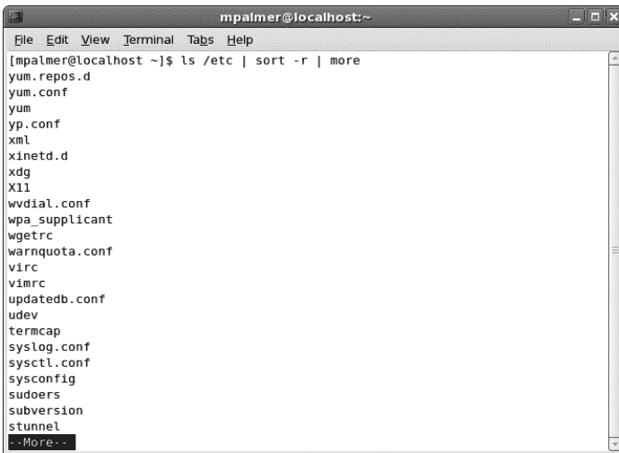

**图 5-1** 使用管道操作符组合命令

## 使用 `grep` 命令

使用 `grep` 命令在文件中搜索指定的模式，例如特定的单词或短语。UNIX/Linux 会查找并显示包含你所指定模式的行。

## 使用选择命令

语法 `grep [-options] pattern [filename]`

### 解析

- 查找并显示包含特定搜索模式的行
- 可用于文本和二进制普通文件
- 可以在一个命令中搜索多个文件
- 有用的选项包括：
  - `i` 忽略大小写
  - `l` 只列出文件名
  - `c` 统计行数而不是显示
  - `r` 搜索所有子目录下的文件
  - `n` 为找到的每行包含行号
  - `v` 仅显示不包含搜索模式的行

> `grep` 有三个典型的含义：全局正则表达式打印（Global Regular Expression Print）、全局正则表达式解析器（Global Regular Expression Parser）和获取正则表达式处理（Get Regular Expression Processing）。

考虑一种情况：你为一家公司编写了一份文档，在其中多次提到计算机资源委员会（Computer Resources Committee）。此外，公司层正在考虑扩大委员会的范围，并将其命名为计算机与电信资源委员会。当管理层要求你确定 `/documentation` 目录下的现有公司文档提及“计算机资源委员会”的频率时，你可以使用 `grep` 命令来查找。以下是你输入的示例：

`grep -r Computer Resources Committee /documentation`

在某些情况下，使用 `grep` 时，用单引号或双引号输入你试图查找的字符模式很有帮助。例如，当你寻找两个或更多单词时确实如此，这样这些单词就可以与文件区分开，如命令：`grep 'red hat' operating_system`。在这个示例中，`'red hat'` 是字符模式，而 `operating_system` 是你搜索的文件。如果你不带引号直接输入 `red hat`，可能会得到错误，因为 `grep` 将 `hat` 解析为文件名。在实操项目 5-3 中，你使用 `grep` 命令搜索并提取特定文本。

许多 UNIX/Linux 系统提供了四种 grep 类命令的组合：`grep`、`egrep`、`fgrep` 和 `zgrep`。例如，除了 `grep` 之外还有 `egrep`（通过 `grep -E` 执行），用于扩展或更复杂的表达式。`fgrep`（或 `grep -F`）仅搜索固定或文本字符串，而不搜索表达式。`zgrep` 用于对压缩或已压缩包的文件进行搜索。

## 使用 `uniq` 命令

`uniq` 命令删除文件中的重复行。因为它只比较连续的行，`uniq` 命令需要排序后的输入。`uniq` 命令的语法如下：

```
Syntax uniq [-options] [file1 > file2]
```

### 解析

- 从一个文件中删除重复行并将结果写入另一个文件
- 有用的选项包括：
  - `u` 只输出源文件中不重复的行
  - `d` 输出每个重复行的一个副本，且不显示唯一的行
  - `c` 在每行开始处显示每个实例的次数

在最简单的形式中，`uniq` 命令从文件中删除连续的相同行或行。例如，考虑一个名为 `parts` 的简单文件，包含以下条目：

```
muffler

muffler

shocks

alternator

battery

battery

radiator

radiator

coil

spark plugs

spark plugs

coil
```

你可以使用 `uniq` 命令创建一个名为 `inventory` 的输出文件，删除所有连续的重复项。使用的命令如下（见图 5-2）：

```
uniq parts > inventory
```

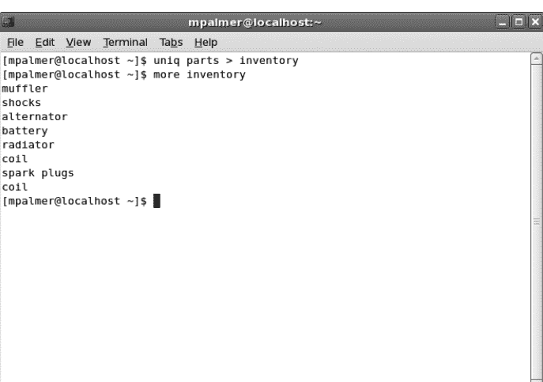

**图 5-2** 使用 `uniq` 删除重复项并创建新的输出文件

注意图 5-2 中 `coil` 仍然列出了两次。这是因为在原始的 `parts` 中，`coil` 的两次出现并不是连续的。在 `parts` 文件中，第一个 `coil` 紧接第一个 `spark plugs` 列表之前，而第二个 `coil` 在第二个实例 `spark plugs` 之后。

`-u` 选项指示 `uniq` 仅生成源文件中没有连续重复的行作为输出。（如果某行连续重复，则不生成输出。）这里有一个示例（见图 5-3）：

```
uniq -u parts > single_items
```

在图 5-3 中，`coil` 也被列出了两次，因为在原始 `parts` 文件中，`coil` 的两次出现并不是连续的。

`-d` 选项指示 `uniq` 输出每个具有连续重复的行的一个副本。重复行不会生成输出。这里有一个示例：

```
uniq -d parts > multi_items
```

实操项目 5-4 让你能够使用 `uniq` 命令。


**图 5-3**（此处无对应标题，根据上下文为实操项目结果）

## 使用 `diff` 命令

使用 `diff` 命令在文件...

# 使用处理和转换命令 223

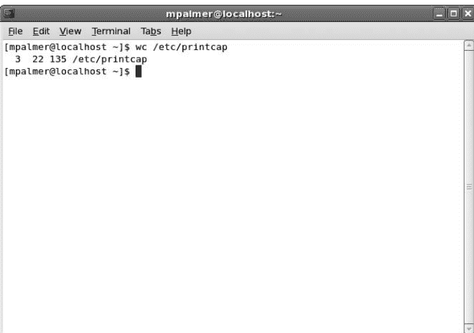

图 5-4 使用 `wc` 统计文件的行数、单词数和字节数

# 使用处理和转换命令

除了你在第 4 章中学的用于处理和格式化数据的命令外，你还可以使用 `sed`、`tr` 和 `pr` 命令在显示或打印数据之前进行编辑和转换数据的外观。

## 介绍 `sed` 命令

当你想要对大文件进行全局更改时，你需要一种不同于 `vi` 和 `Emacs` 这种交互式编辑器的工具。另一种 UNIX/Linux 编辑器 `sed` 是专门为此目的设计的，它有时被称为流式编辑器（stream editor），因为 `sed` 渲染在标准输出中（显示在屏幕上）。运行 `sed` 的最低要求是一个输入文件和一个能让 `sed` 知道要对文件执行哪些操作的命令。`sed` 命令有两种通用形式：(1) 作为命令行的一部分提供，(2) 作为来自脚本文件的输入提供。

# 第 5 章 高级文件处理

语法 `sed [-options] [command] [file(s)]`
`sed [-options] [-f scriptfile] [file]`

### 解析

- `sed` 是一个流式编辑器，可以用于一个或多个文件，特别对于对大文件进行全局更改非常有用。
- 第一种形式允许你在命令行上指定编辑命令。
- 第二种形式允许你指定一个包含 `sed` 命令的脚本文件。
- 有用的选项包括：
  - `d` 删除由 `-n` 选项指定的行（`d` 前面没有连字符）
  - `p` 打印由 `-n` 选项指定的行（`p` 前面没有连字符）
  - `s` 替换指定的文本（`s` 前面没有连字符）
  - `a` 追加文本（该选项前面没有连字符）
  - `e` 在命令行上指定多个命令
  - `n` 指定要进行操作的行号

例如，你可以使用 `sed` 处理新文件，只显示某些行——例如，只显示第 3 和第 4 行——然后仅对这些行进行操作或替换。你通过完成实践项目 5-8，并在命令行输入编辑命令，学习了如何使用 `sed`。

要在 `sed` 中添加新行，必须使用 `a` 命令。该命令在指定的行号之后追加行。像所有 `sed` 命令一样，它执行操作。要在 `sed` 中添加新行，你必须使用 `a` 命令。该命令在指定的行号之后追加行。

## 使用 `tr` 命令转换

`tr` 命令（也称为翻译命令）从标准输出复制数据并替换或删除字符。

语法 `tr [-options] ["string1" string2]`

### 解析

- `tr` 是一个翻译编辑器，可以用于一个或多个文件，并非常有用。
- 在最简单的形式下，`tr` 会将 `string1` 中的每个字符转换为 `string2`。
- 这种命令通常用于替换或删除字符，你通过选项来指定 `string1` 或 `string2`。
- 有用的选项包括：
  - `d` 删除字符
  - `s` 替换字符

例如，你可以使用 `tr` 转换大小写字母。在实践项目 5-9 中，你学习了通过命令行来转换字符。在转换字符时，你可能需要使用 `d` 命令来删除字符或使用 `s` 命令来替换字符。

```
tr "c" <
```

```
tr 'c' <
```


这两个命令的效果相同。当你想要对文件进行全局更改时，你需要不同的工具。在实践项目 5-10 中，你学习了如何使用 `tr`。

# 使用 `pr` 命令格式化输出

`pr` 命令以分页格式在标准输出中打印文件。默认情况下，每页都有一个包含文件名、最后修改日期等内容的页眉。

语法 `pr [-options] [file ...]`

## 解析

- 通过提供分页、列和列头格式化一个或多个文件
- 常用选项包括：
  - `h`（页眉）允许你自定义页眉
  - `d` 删除输出
  - `l` 设置每页行数

实践项目 5-11 让你学会了使用 `pr` 命令。

# 设计文件处理应用程序

学习 UNIX/Linux 选择、处理和转换命令的原因之一是为了开发应用程序。无论你是为自己还是他人开发应用程序，开发应用程序最重要的阶段是设计。设计定义了你需要的信息。设计还定义了如何将这些信息组织成文件、记录和字段，这些被称为逻辑结构，例如工资文件、员工记录或员工工号字段。文件由记录组成，记录由字段组成。你在第 4 章学习了记录和字段。

在设计记录时，另一个考虑因素是文件中的特定字段对数据处理的特殊重要性。键字段。键字段对于通过连接命令链接两个或多个文件非常重要。例如，通过将员工的姓放在单独的字段中而不包含名和首字母，你可以对姓进行排序，或将其作为要链接的两个文件的共同名称。某些组织还会给员工或学生一个可以在记录使用的特殊 ID，例如人力资源或学生信息记录中。此 ID 可以是排序、选择、连接和处理所有类型信息的宝贵键字段。

创建一个示例程序员活动状态报告，这可能是为公司或组织开发的。该报告将显示程序员的姓名以及每个程序员参与的项目数量。

# 设计一个新的文件处理应用程序 227

信息——这一切都是为了制定“程序员活动状态报告”做准备。你还将学习更多关于脚本的知识——如何在应用程序中使用它们，以及如何使用其他方法运行它们。最后，你将创建并测试实现你所知识的脚本，并以“程序员活动状态报告”作为结晶。

## 设计记录

记录设计阶段的第一任务是定义记录中的字段。这些定义以记录布局的形式出现，通过名称和数据类型（如数值或非数值）来标识每个字段。设计文件记录时，仅存储与记录主要目的相关的内容。例如，在“实践项目”中设计“程序员活动状态报告”时，你需要两个文件：一个用于存储程序员信息，另一个用于存储项目信息。你在程序员文件记录中包含一个程序员姓名的字段，在项目文件记录中包含一个项目描述字段。然而，尽管程序员可能被分配到某个项目中，你并不会在项目文件中存储程序员的名字。同样，你也不会在程序员文件中存储名称。这种结构旨在让你了解实际数据文件可能是如何设置的，以便在更大的文件和程序系统中，每种类型的文件都可以用于不同的目的。

为记录的必要字段分配空间应保持简明扼要。短记录就像短句子一样更容易理解。同样，你让应用程序变得越简单，它的性能就越好。然而，你还希望确保包含一个能够唯一标识文件中每条记录的字段。例如，示例中的程序员文件记录包含一个程序员编号字段，用以区分可能具有相同名字的程序员。

> 程序员文件记录中的程序员编号字段应该是数值型的。在标识记录时，数值字段比非数值字段更好，因为计算机解释数字的速度比解释非数值数据快。项目记录可以使用非数值代码来标识每个项目记录，例如 `EA-100`。


# 使用键链接文件

如第 4 章所学，多个文件可以通过“键”`key`连接——键是每个链接文件共享的公共字段。设计阶段的另一个重要任务是计划一种在必要时连接文件的方法。例如，程序员-项目应用程序使用程序员编号将程序员与项目文件链接起来。在“实践项目 5–12”中，你创建了两个数据文件（程序员文件和项目文件），这两个文件都包含程序员编号字段，作为操作和合并数据的键。

在开始考虑为“程序员活动状态报告”项目创建文件的过程之前，请查看图 5–5 所示的程序员和项目文件的记录布局。

在这条记录中，第一个字段包含程序员编号，例如第一条记录中的 101。程序员编号被用作键，允许进行各种处理，例如使用 `sort`、`comm` 和 `join` 命令——正如你在“实践项目 5-15”中做的那样。接下来的三个字段包括程序员的姓、名和中间名首字母。将全名分为三个字段，为许多数据处理……开辟了道路。

# 设计一个新的文件处理应用程序 229

……技术，包括按姓排序或使用所有字段来识别重复记录。最后一个字段字段包含员工的工资，这可以用于打印与员工评估和加薪相关的工资信息报告。

“实践项目 5-12”中创建的项目文件记录抽例如所示：

```
EA-100:1:Reservation Plus:110
EA-100:1:Reservation Plus:103
EA-100:1:Reservation Plus:107
EA-100:1:Reservation Plus:109
..
```

记录中的第一个字段是用于标识特定项目的代码，例如 `EA-100`。组织可能使用此类代码不仅来识别项目，还可以识别请求项目的个人、项目团队、部门、分部或子公司。在本例中，前两个字母（EA）代表部门，最后三个数字（100）代表该部门的唯一项目编号。第二个个字段包含项目状态：

- ■ `1`=未计划
- ■ `2`=已开始
- ■ `3`=已完成
- ■ `4`=已取消

第三个字段包含项目名称，例如“Reservation Plus”。第四个字段是程序员编号，用于显示哪位程序员正在处理该项目。程序员编号对项目文件中的记录至关重要的原因之一是，它可以作为键字段，将项目文件中的特定信息与程序员文件中的信息链接起来。

## 创建程序员和项目文件

现在你已经回顾了设计和链接记录的基础知识，可以开始实现你的应用程序设计步骤了。回第 2 章和第 3 章（“探索 UNIX/Linux 文件系统和文件安全”以及“精通编辑器”）的内容，UNIX/Linux 文件处理可以使用扁平文件。处理这些文件很容易，因为你可以使用 `vi` 和 `Emacs` 等文本编辑器来创建和操作它们。图 5-6 中的流程图提供了根据本示例使用的程序员和项目文件得出的程序员项目分配的概述和分析。

此过程的第一步是创建程序员和项目文件并向其填充记录，这是你在“实践项目 5-12”中完成的。文件使用冒号 `:` 作为分隔符。

# 第 5 章 高级文件处理

在这条记录中，第一个字段包含程序员编号，例如第一条记录中的 101。程序员编号被包含作为一个键，允许进行各种处理，例如使用 `sort`、`comm` 和 `join` 命令——正如你在实践项目 5-15 中做的那样。。接下来的三个字段包括程序员的姓、名和中间名首字母。将全名分为三个字段为许多数据处理……开辟了道路，包括按姓排序或使用所有字段来识别重复记录。最后一个字段包含员工的工资，这可以用于打印与员工评估和加薪相关的工资信息报告。

# 设计一个新的文件处理应用程序 231

当你阅读这些章节时，请完成每个实践项目。


## 输出格式化

第 4 章引入了 `awk` 命令，它可以简化输出。在这里你获得了另一堂使用 `awk` 的课程，因为 `printf` 功能非常强大。`printf` 函数具有以下语法：

`*printf (format, $expr1, $expr3)*`

## 剖析

- `*` 是必须的。它是一个带有字符串值的表达式，包含字面文本以及格式化参数列表的规范。每个规范以百分号 `%` 开头，标识随后的代码为修饰符（- 左对齐；宽度大小；*prec* 设置最大宽度或小数点右侧位数；*s* 代表任何字符（字符串）；*d* 代表十进制整数；*f* 代表浮点小数）。包含在双引号 `"` 中的内容被称为覆盖数据字段的掩码。
- `$expr1,$expr2,$expr3` 代表数据字段。这些表达式通常采用 `$1`、 `$2` 等形式。在程序员文件中，表达式 `$expr1` 表示程序员编号（第一个字段）， `$2` 表示程序员姓（第二个字段）， `$3` 表示程序员名（第三个字段）。

你可以使用 `awk` 命令和 `printf` 函数从程序员文件中打印以下信息：程序员编号、程序员姓和程序员名，全部左对齐。完成此任务的命令行是：

```bash
awk -F: "printf%%-12.1s %%-10.1s\n", $1, $2, $3
```


“实践项目 5-13”使你能够在程序员文件使用此命令。格式字符串中的每个 `%` 符号对应一个 `$` 字段，如下：

- `%d` 表示字段 `$1`（程序员编号）以十进制显示。
- `%-12.1s` 表示字段 `$2`（程序员姓）作为字符串显示。连字符 `-` 指定字符串左对齐。12.1 表示该字符串应在一个填充到 12 个空格的字段中，最大尺寸为 12 个空格。

# 第 5 章 高级文件处理

- `%10.10s` 表示字段 `$3`（程序员薪水）将以字符串形式出现。连字符 `-` 指定字符串左对齐。10.10 表示该字符串应显示在一个填充了 10 个空格的字段中，且最大尺寸为 10 个空格。

格式字符串中的空格将根据它们相对于 `awk` 和 `printf` 参数的位置精确地打印出来——在每个 `%` 参数之间（即在 `%d` 之后）有一个空格，但在每个字段设计符之后（例如在本例中为 `$1` 之后），该空格是可选的。末尾的 `\n` 告诉 `awk` 在显示三个字段后开始新的一行。请参见图 5-7 的此报告命令的输出示例。

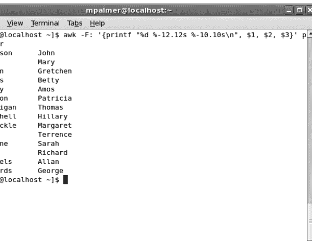

```
$ [mpaler@localhost~]$ $ awk -F: '{printf "%%-12.1s %%-10.10s\n", $1, $2, $3}'

programmer

101 John

102 King Mary

103 Brown Gretchen

104 Adams Betty

105 Uiley Amos

106 Wilson Patricia

107 Culligan Thomas

108 Mitchell Hillary

109 Arbutle Terrence

111 Ford Sarah

112 Rose Richard

113 Daniels Allan

114 Edwards George

[mpaler@localhost~]$ _
```

**图 5-7** 与其他 UNIX/Linux 文件处理命令相比，`awk` 报告命令是一种快捷方法

当你需要提取并格式化数据字段以输出时，`awk` 命令与其他 UNIX/Linux 文件处理命令相比提供了一种快捷方法。例如，虽然需要几行代码，但你可以使用 `cut`、`paste` 和 `cat` 命令来提取并显示程序员的姓和薪水。作为替代方案，你可以使用一行 `awk` 命令完成相同的工作。实践项目 5-14 让你能够比较这两种技术。此外，尝试实践项目 5-15 以获得更多使用 `cut`、`sort`、`uniq`、`join` 命令的经验。

## 使用 脚本实现应用程序

你在实践项目中开发的报告生成应用程序由许多必须按特定顺序运行的独立命令组成。正如你在第 4 章回忆到的，你可以创建一个脚本文件来简化应用程序。你将命令存储在脚本文件中，该文件实际上变成了一个程序。

### 设计一个新的文件处理应用程序

当你在开发应用程序时，通常应该在将命令放入脚本文件之前对其进行测试和调试。你可以使用 `vi` 或 `Emacs` 编辑器创建脚本文件（第 6 章和第 7 章“脚本编程简介”和“高级脚本编程”将更详细地介绍脚本编程）。

脚本不仅包含要执行的命令，还应该包含识别和说明脚本的内容，以便作者以外的用户或程序员能够理解其工作原理。脚本还能让作者随着时间的推移记住脚本的逻辑。在脚本文件中使用井号 (`#`) 字符来标记注释。这告诉 shell `#` 之后的单词是注释，而不是 UNIX/Linux 命令。实践项目 5-16 让你为一组命令构建脚本，创建一个临时文件，显示当前程序员正在工作的程序数量信息。脚本和临时文件将成为生成“程序员活动状态表”过程的一部分。

## 运行 脚本

你可以在系统中的几乎任何 shell 中运行脚本。在这里，你使用的是 Bourne Again Shell，即 `Bash`，它在 Linux 系统中常用。在不同的 shell 中，与命令相关的具体语法、选项和选项通常存在不兼容之处。使用 `Bash` 的优势之一是它比原始的 Bourne shell 接受更多命令结构的变体；`Bash` 是 Bourne 和 Korn shell 的免费软件衍生品。

当你在 `Bash` 中运行脚本时，可以通过输入 `sh`（调用 `Bash` 解释器）然后是脚本名称来立即运行脚本，如下所示：

```sh
sh testscript
```


使用 `sh` 的另一个优势是你可以配合几个调试选项，以帮助你排查脚本中的问题（你将在第 6 章中学习更多关于这些调试选项的内容）。在本章初脚本的初体验中，请使用 `sh` 来运行你的脚本。

> 在 UNIX 系统中，`sh` 会调用该特定 UNIX 系统默认的 `shell` 解释器。在 Linux（包括 Fedora、Red Hat Linux 和 SUSE）中，你可以使用 `sh` 或 `bash` 来运行脚本并调用 Bash 解释器。在这些系统中，`sh` 实际上是 Bash 的软链接。

运行脚本的另一种方法（你将在第 6 章中学习更多，并在第 4 章的实践项目 4-15 中略有一见）是使用 `x` 权限，然后在运行脚本本身时在脚本名称前输入 `./`。此外，当你编写脚本时，建议指定该脚本的用途。你通过在脚本的第一行包含一条命令来实现这一点——例如用于 Bash 的 `#!/bin/bash`


# 第 5 章 高级文件处理

`shell`——在脚本的第一行。第 7 章将向你展示如何在脚本变得更加高级时实现这种做法。

在实践项目 5-17 中，你使用 `sh` 命令运行项目 5-16 创建的脚本。在实践项目 18 和 19 中，你创建并运行用于生成“程序员活动状态表”步骤的脚本。

## 汇总生成报告

开发应用程序的有效方法是将小脚本组合到较大的脚本文件中。通过这种方式，将大任务分解为一系列小任务更容易完成——这是一项基本编程规则。此外，通过这种方法，你可以测试每个小脚本以确保其正常工作。在实践项目 16 到 19 中，你创建、执行并测试脚本，以准备创建报告。在脚本通过测试后，你可以按照顺序将每个小脚本的内容引入较大的脚本文件中以生成最终报告。实践项目 5-20 将你的小项目汇聚在一起以生成报告。

## 章总结

- UNIX/Linux 文件处理命令可以分为两类：(1) 选择命令和 (2) 操作转换命令。选择命令提取信息。
- `grep` 命令在文件中搜索特定模式。
- `uniq` 命令删除重复行。你必须对文件进行排序，因为 `uniq` 只比较相邻行。
- `comm` 命令比较两个文件的公共行并产生列输出。
- `diff` 命令确定将一个文件转换为另一个文件所需的最小更改。
- 当你想知道文件的字节、单词数或行数时，使用 `wc` 命令。
- `sed` 命令是一种流编辑器，设计用于全局更改。运行 `sed` 的最小要求是一个输入文件和一个说明执行操作的命令。`sed` 操作的输入可以来自命令行或脚本。
- `tr` 命令从标准输入复制数据到标准输出，替换或删除选项和模式指定的字符。
- `pr` 命令按页打印标准输出。

- 文件处理应用程序的设计反映了应用程序需要生成的内容。设计还定义了如何组织信息为文件、记录和字段。
- 使用记录布局识别每个字段名称和数据类型（数字或非数字）。设计文件记录仅存储与目的相关的字段。
- 脚本应包含要执行的命令以及识别和说明脚本的注释。脚本中使用井号 (`#`) 字符表示注释。
- 分阶段编写脚本，以便在合并成一个脚本之前测试每个部分。使用小脚本并将其合并到最终脚本文件中是开发应用程序的有效方法。

# 第 5 章 高级文件处理

| 命令 | 用途 | 本涵盖的选项 |
| --- | --- | --- |
| `printf` | 告诉 `Awk` 程序格式化和打印信息时采取什么操作 | |
| `sed` | 指定编辑命令或包含 `sed` 命令的脚本文件 | `a\` 在行后添加文本<br>`p` 显示行<br>`d` 删除指定的文本<br>`s` 替换指定的文本<br>`-e` 在同一行上指定多个命令<br>`-n` 指明要操作的行号 |
| `sh` `tr` | 执行 `shell` 脚本 / 翻译字符 | `-d` 从输出中删除字符串1 中找到的字符<br>`-s` 检查字符串1 重复出现的序列 |
| `uniq` | 移除重复行以创建唯一输出 | `-u` 仅输出源文件中不重复的行<br>`-d` 输出每个重复行的一个副本，且不显示唯一的行<br>`-i` 忽略大小写<br>`-c` 在每行开头显示每个实例的次数<br>`-c` 统计字节数或字符数<br>`-l` 统计行数<br>`-w` 统计单词数 |
| `wc` | 统计文件中行数、字节数或单词数 | |

## 关键术语

- 逻辑结构 — 文件、记录和字段中信息的组织方式，每个项代表一个逻辑实体，例如工资文件、员工的薪资记录或员工的社会安全号码。
- 操作和转换命令 — 一组更改和格式化提取信息的命令，使其变得有用并能以吸引人且易于理解的方式呈现。
- 管道运算符 (`|`) — 将一个命令的输出重定向到另一个命令的输入的操作符。
- 记录布局 — 程序和数据文件设计步骤，用于识别在数据文件中使用的字段、记录类型和数据类型。
- 选择命令 — 用于提取信息的文件处理命令。

## 复习题

1. 你刚刚完成了一篇使用 Emacs 编写的 25 页论文。包含该论文的文件名为 `/assignments/data_sources`。在你的老师简要查看该论文后，她建议你在提交之前将所有的引用 "data" 更改为 "data"。你可以使用以下哪种命令在文件中定位这些引用，以便快速评估你需要修改多少内容？

- a. `find -i 'data' /assignments/data_sources`
- b. `test /assignments/data_sources "data" is`
- c. `grep "data" is /assignments/data_sources`
- d. `scan -t /assignments/data_sources`

2. 你感兴趣的是确定问题 1 中提到的 `/assignments/data_sources` 中的单词数。你可以使用以下哪种命令？

- a. `wc -w /assignments/data_sources`
- b. `wc -m /assignments/data_sources`
- c. `counter /assignments/data_sources`
- d. `counter -c /assignments/data_sources`

3. 以下哪些是操作和转换命令的示例？（选择所有适用项。）

- a. `sed`
- b. `pr`
- c. `join`
- d. `paste`

4. 下列哪些是管道运算符的正确用法？（选择所有适用项）

- a. 单行命令上只能使用一个管道运算符。
- b. 它用于对数值命令运算符的结果进行除法运算。
- c. 它代替冒号 (`:`) 用于输入多个命令。
- d. 它将一个命令的输出重定向到另一个命令的输入。

5. 因为两个库存文件中的数据格式相同，你决定将它们的内容合并到一个文件中。现在你想确定新文件中是否存在连续行中的重复条目。以下哪种命令可以让你找到重复条目？

- a. `dup`
- b. `pr`
- c. `uniq`
- d. `cat`

6. 你的朋友正在使用命令 `comm entryfile`，但get错误信息。问题出在哪里？（选择所有适用项。）

- a. `entryfile` 只包含数字，但 `comm` 命令必须在带有文本的文件上使用。
- b. 使用 `comm` 命令时必须使用 `-m` 或 `-t` 选项。
- c. `entryfile` 太长，因为 `comm` 命令只能用于大小为 100 KB 的文件。
- d. 使用 `comm` 命令时必须指定两个文件。

7. 你的老板正尝试将客户文件导入她的电子表格程序，但进入表格的方式不正确。这是因为字段是用折号 (`-`) 分隔的，而表格程序要求字段用冒号 (`:`) 分隔。你可以使用以下哪种命令来转换自定义格式？

- a. `replace - : customers`
- b. `tr "-" "_" < customers`
- c. `sed %-%: > customers`
- d. `cat -r - : customers`

8. 如何链接多个文件以操作这些文件中的数据？

- a. 使用链接器
- b. 使用项目字段
- c. 使用共同项或键条目
- d. 使用操作符条目

9. 在 Bash 中，你写了一个简单的脚本文件，现在想执行该脚本。以下哪种命令可以让你运行该脚本？

- a. `sh`
- b. `go`
- c. `ex`
- d. `!!`

10. 你正在使用 `grep` 命令，但它只搜索你目录中的文件。以下哪种选项可以让你搜索子目录？

- a. `-s`
- b. `-c`
- c. `-r`

11. 你正在创建一个有重复项的文件。以下哪种方法可以让你删除重复项？

- a. 排序并使用 `uniq` 命令。
- b. 排序并使用 `comm` 命令。
- c. 排序并使用 `join` 命令。
- d. 排序并使用 `diff` 命令。

12. 每当你列出文件，输出快到你无法阅读。以下哪种命令可以让你一个屏幕一个屏幕地查看？

- a. `cat -s`
- b. `tr -b`
- c. `ls -a`
- d. `less |`

13. 以下哪种命令可以让你统计文件的字节数？

- a. `cat -s`
- b. `tr -b`
- c. `counter -k`
- d. `wc -c`

14. 在 `sed -f` 命令中，“f”是什么？

- a. 脚本文件
- b. 运算符
- c. 函数
- d. 格式解释器

15. 当设计记录布局时，你应该做什么？（选择所有适用项）

- a. 根据数据类型识别字段
- b. 使用折号分隔字段
- c. 根据名称识别字段
- d. 只存储与目的相关的字段

16. 哪种 `sed` 命令选项可以在文件中添加新文本？

- a. `p`
- b. `-n`
- c. `a\`
- d. `|`

17. 你的老板有两个文件 `salary` 和 `salary1`，并排比较它们的内容以查看差异。他应该使用以下哪种命令？

- a. `diff -S salary > salary1`
- b. `comm salary salary1`
- c. `uniq salary < salary1`
- d. `sed --comp salary salary1`

- a. 最大化终端窗口以容纳 24 行。
- b. 管道输出。
- c. 使用 `-l 23` 选项。
- d. 管道 `less`。

19. 当你使用 `Awk printf` 功能时，美元符号 (`$`) 代表什么？

- a. 字段大小限制
- b. 乘数
- c. 将文本转换为小写的命令
- d. 数据字段

20. 你的老板正尝试删除励演讲文本文件中的 "difficult" 单词。文件名为 `motivate`。当他决定使用 `tr` 命令删除此单词时，它删除了全文中的字符。他可能使用了以下哪种命令？

- a. `tr -d "difficult" < motivate`
- b. `tr difficult motivate`
- c. `tr -o 'difficult' > motivate`
- d. `tr --eliminate difficult motivate`

21. 当你输入 `grep /info/Linux_features | head` 时，最多显示多少行？

- a. 24 行
- b. 23 行
- c. 15 行
- d. 10 行

# 实践项目 241

22. 列出四个选择命令的示例。
23. 使用管道运算符的通用格式是什么？
24. 简要说明 `sed` 命令可以完成什么。
25. 你想创建一个包含朋友和亲戚的名字、地址、电话号码和其他信息的文件。当你向你的嫂子提到这件事时，她建议将姓、中间名和最后一个名字的字段分开。请简要说明为什么这是一个好主意。

## 实践项目

从命令行（例如终端窗口）完成这些项目，并使用你自己的账户和主目录进行登录。


## 项目 5-1

管道操作符将一个命令的输出重定向到另一个命令的输入。在 UNIX/Linux 中，该运算符对于在行中组合命令非常有用，并产生更易读或使用的输出。在这个项目中，你将使用管道操作符将 `ls` 命令的输出重定向到 `more` 命令的输入，以便你可以更方便地查看大型目录的内容。

**要将 `ls` 命令的输出重定向到 `more` 命令：**

1. 输入 `ls -l /etc` 并按回车。注意命令的输出正在快速滚动。
2. 输入 `ls -l /etc | more` 并按回车。（参见图 5-8）。
3. 注意输出填充了屏幕，并在底部显示“More”提示时停顿。每当你按下空格键，输出就会进到下一屏。按空格键一次滚动一屏，直到命令完成。你也可以在任何时候输入 `q` 来退出目录内容的显示。

## 项目 5-2

管道操作符允许你在单行上组合多个命令。在这个项目中，你将目录列表的内容通过管道到 `sort` 命令，并将结果管道到 `more` 命令。

# 242 第 5 章 高级文件处理

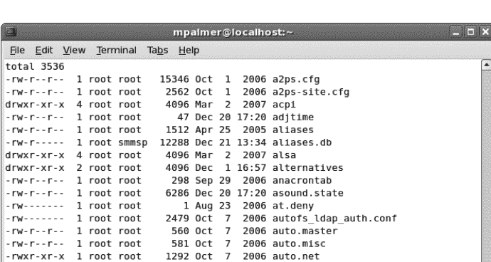


```
total 3536

-rw-r--r-- 1 root root 15346 Oct 1 2006 a2ps.cfg

-rw-r--r-- 1 root root 2562 Oct 1 2006 a2ps-site.cfg

drwxr-xr-x 4 root root 4096 Mar 2 2007 acpi

drwxr-xr-x 4 root root 4096 Apr 27 20:17 adtime

drwxr-xr-x 4 root root 1512 Aug 25 2005 alias

-rw-r--r-- 1 root smmsp 12288 Dec 11 2003 aliases.db

drwxr-xr-x 4 root root 4096 Mar 2 2007 asa

drwxr-xr-x 4 root root 4096 Nov 16 1959 auto-net

-rw-r--r-- 1 root root 928 Sep 28 2009 anacontab

-rw-r--r-- 1 root root 6286 Dec 27 19:20 abound,state

-rw-r--r-- 1 root root 2479 Aug 23 2009 deny

-rw-r--r-- 1 root root 560 Jul 7 2006 autofs_idap.auth.conf

-rw-r--r-- 1 root root 581 Oct 7 2006 auto.master

-rw-r--r-- 1 root root 1929 Oct 7 2007 auto.misc

drwxr-xr-x 1 root root 558 Oct 7 2006 auto.smb

drwxr-xr-x 4 root root 4096 Mar 2 2007 avahd

-rw-r--r-- 1 root root 1361 Mar 21 2007 bashrc

drwxr-xr-x 2 root root 4096 Mar 2 2007 beagle

drwxr-xr-x 2 root root 4096 Dec 21 2007 xid

-rw-r--r-- 1 root root 4096 Mar 2 2007 bluetooth

drwxr-xr-x 2 root root 4096 Mar 2 2007 bluetooth-activation
```

图 5-8 将 `ls` 管道到 `sort` 命令

使用管道操作符连接多个命令：

- 1. 使用 `ls /etc | sort -r` 并按回车。`ls` 命令将 `/etc` 目录的列表重定向到 `sort -r`，该命令反序排序目录列表。`sort` 命令的输出被重定向到 `more` 命令。
- 2. 执行命令后，你应该能看到反序排列的 `/etc` 目录列表（参考图 5-1）。
- 3. 一直按空格键直到输出完成。

## 项目 5-3

在这个项目中，你使用 `grep` 命令的某些功能并将其与 `head` 命令结合。你可以使用 `head` 命令查看包含特定字符串的前 10 行。使用 `head` 命令可以查看文件的前 10 行。使用 `grep` 命令可以查找包含“lin”的 `/etc/termcap` 文件。使用 `grep` 命令可以查找包含特定单词的 `/etc/termcap` 行。

显示包含特定单词或短语的文件：

- 1. 使用 `ls /etc | sort -r` 并按回车。`ls` 命令将 `/etc` 目录的列表重定向到 `sort -r`，该命令反序排序目录列表。`sort` 命令的输出被重定向到 `more` 命令。
- 2. 执行命令后，你应该能看到反序排列的 `/etc` 目录列表（参考图 5-1）。
- 3. 一直按空格键直到输出完成。

## 项目 5-4

本项目演示了 `uniq` 命令的常见用途。要完成此项目，首先使用编辑器在你的工作目录中创建一个新文件 `zoo1`。这是一个简单的文件示例，包含变长记录，列出了动物名称、食物描述、每日摄食的磅数和食物成本。按照步骤 1 所示向文件中添加重复记录。创建文件后，使用 `uniq` 命令删除重复记录。

使用 `uniq` 命令删除重复行：

- 1. 输入 `zoo1` 并按回车打开编辑器。按 `i` 并输入以下文本，除最后一行外，在每行末尾都按回车：

```
Monkeys:Bananas:2000:850.00

Lions:Raw Meat:4000:1245.50

Lions:Raw Meat:4000:1245.50

Camels:Vegetables:2300:564.75

Elephants:Hay:120000:1105.75

Elephants:Hay:120000:1105.75
```

- 2. 按 `Esc` 切换到命令模式。输入 `:wq` 或 `:x` 并按回车。
- 3. 使用 `uniq` 删除 `zoo1` 文件中的重复行，并使用输出重定向创建新文件 `zoo2`，输入 `uniq zoo1 > zoo2` 并按回车。
- 4. 输入 `cat zoo2` 并按回车。
- 5. 你会看到如所示的 `zoo2` 内容。注意 `uniq` 命令已经删除了重复行。

```
Monkeys:Bananas:2000:850.00

Lions:Raw Meat:4000:1245.50

Camels:Vegetables:2300:564.75

Elephants:Hay:120000:1105.75
```

## 项目 5-5

在这个项目中，你将探索 `comm` 命令。你首先创建文件 `my_list`。接下来，复制该文件，然后使用 `comm` 命令比较这两个文件。

使用 `comm` 命令比较文件：

- 1. 要创建文件 `my_list`，在命令提示符下输入 `cat > my_list` 并按回车。
- 2. 输入以下文本，每行末尾按回车：

```
Football

Basketball

Skates

Soccer ball
```


- 3. 按 `Ctrl+d`。

- 4. 要将 `my_list` 复制到第二个文件 `your_list`，输入 `cp my_list your_list` 并按回车。

- 5. 现在使用 `comm` 命令比较 `my_list` 和 `your_list`。输入 `comm my_list your_list` 并按回车。

- 6. 你会看到三列输出。（注意，插入显示列标题的文本仅供你参考。这些文本不会显示在屏幕上。）注意第三列中的行是两个文件都包含的行。（列的对齐方式取决于操作系统。）这两个文件是相同的。

| 列 1 | 列 2 | 列 3 |
| :--- | :--- | :--- |
| Football | | |
| Basketball | | |
| Skates | | |
| Soccer ball | | |

- 7. 向 `my_list` 中添加新行。输入 `cat >> my_list` 并按回车。

- 8. 输入 `Golf ball` 并按回车。

- 9. 按 `Ctrl+d`。

- 10. 再次使用 `comm` 比较 `my_list` 和 `your_list`。输入 `comm my_list your_list` 并按回车。

- 11. 你会看到三列输出，`my_list` 中唯一的新行位于第 1 列。（再次注意，你的列对齐可能不同。）

| 列 1 | 列 2 | 列 3 |
| :--- | :--- | :--- |
| Football | | |
| Basketball | | |
| Skates | | |
| Soccer ball | | |
| Golf ball | | |

- 12. 向 `your_list` 中添加新行。输入 `cat >> your_list` 并按回车。

- 13. 输入 `Tennis ball` 并按回车。

- 14. 按 `Ctrl+d`。

- 15. 输入 `comm my_list your_list` 然后按回车进行再次比较。（见图 5-12）。


## 项目 5-6

在这个项目中，使用 `diff` 命令比较你之前在实操项目 5–4 中创建的 `zoo1` 和 `zoo2` 文件的内容。

使用 `diff` 查找两个文件之间的差异：

- 1. 输入 `more zoo1 zoo2` 并按回车查看 `zoo1` 和 `zoo2` 的内容。按空格键查看第二个文件的内容。（见图 5–13。）

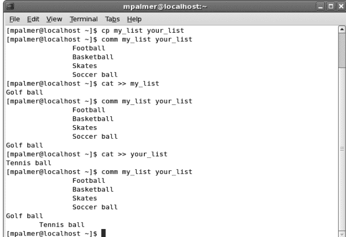

**图 5-12** 使用 comm 比较文件

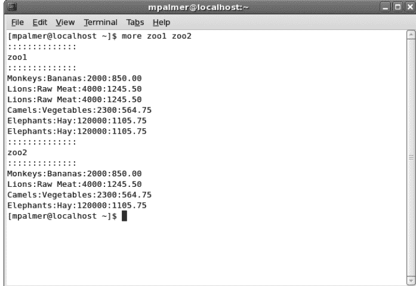

**图 5-13** 查看 zoo1 和 zoo2 文件的内容

## 实操项目

2. 输入 `diff zoo1 zoo2` 并按回车。

3. 你看到以下信息：

```
3d
< Lions:Raw Meat:4000:1245.50
6d
< Elephants:Hay:120000:1105.75
```

这意味着你需要删除 `zoo1` 中的第三行和第六行以匹配 `zoo2`。（某些 UNIX/Linux 版本可能会看到 5d 而不是 6d）另一种另一种匹配文件的方法是删除 `zoo1` 中的第五行，它与 `zoo2` 的第六行相同。

4. 反转比较顺序，输入 `diff zoo2 zoo1` 并按回车。你看到以下信息：

```
2a
> Lions:Raw Meat:4000:1245.50
4a
> Elephants:Hay:120000:1105.75
```

这意味着你需要添加 `zoo2` 中显示的两行以匹配 `zoo1`。你会将 `zoo1` 的第三行添加到 `zoo2` 的第二行之后。以及将 `zoo1` 的第六行添加到 `zoo2` 的第四行之后。

## 项目 5-7

在这个项目中，我们使用 `wc` 命令统计名为 `counters` 的新文件的行数。

要创建一个文件并统计行数：

- 1. 输入 `cat > counters` 并按回车。

- 2. 输入以下内容，每行末尾按回车：

```
Linux is a full featured clone.
Linux is available in free and commercial versions.
```

- 3. 按 `Ctrl+d`。

- 4. 要查找 `counters` 的行数，输入 `wc -l counters` 并按回车。UNIX/Linux 报告包含 2 行。

- 5. 要查找 `counters` 的字节数，输入 `wc -c counters` 并按回车。UNIX/Linux 报告包含 89 字节。

- 6. 要查找 `counters` 的单词数，输入 `wc -w counters` 并按回车。UNIX/Linux 报告包含 15 个单词。

- 7. 要统计 `counters` 的单词和行数，输入 `wc -lw counters` 并按回车。UNIX/Linux 报告包含 2 行、15 个单词、89 字节。（注意，如果你输入 `wc`，你得到的输出与输入 `wc -lw` 相同。）


```
mpalmer@localhost~$ cat counters
Linux is a full featured clone.
Linux is available in free and commercial versions.
mpalmer@localhost~$ wc -l counters
2
mpalmer@localhost~$ wc -c counters
89
mpalmer@localhost~$ wc -w counters
15
mpalmer@localhost~$ wc -lw counters
2 15 89
mpalmer@localhost~$ _
```


## 项目 5-8

`sed` 是一个流编辑器，允许你对文件的特定行进行操作并修改其内容。在这个项目中，你使用 `sed` 显示特定行并编辑创建的文件。本项目的重点是从命令行使用 `sed` 命令。

使用 `sed` 操作文件：

- 1. 使用 `vi` 或 `Emacs` 编辑器在工作目录中创建新文件 `unix_stuff`。`unix_stuff` 文件应包含以下行（在输入每行后——除最后一行外——按回车以获得五行文本）：

虽然 UNIX 支持其他数据库系统，但 UNIX 从未放弃过使用文本文件。文本文件是基于标准 ASCII 代码的纯文本。文本文件可以被任何操作系统读取。

- 2. 要只显示第 3 和第 4 行，输入 `sed -n 3,4p unix_stuff` 并按回车。` -n ` 选项防止 `sed` 显示 `p` 命令指定以外的任何行。这意味着“找到 `unix_stuff` 文件中编号为 `-n` 的第 3 和 4 行并显示它们 `p`。”

你看到第 3 和 4 行：

flat files. Flat files are those based on pure text with standard ASCII codes.

- 3. 在 `sed` 中，你可以在一行中放置两个命令。如果你想删除第 3 和第 4 行然后显示文件，必须使用 `-e` 选项在同一行中指定多个命令。要删除 `unix_stuff` 中的第 3 和第 4 行并显示结果，输入 `sed -en 3,4d -e p unix_stuff` 并按回车。

你看到这个：

虽然 UNIX 支持其他数据库系统，但 UNIX 从未放弃过被任何操作系统读取。

第 3 和第 4 行并没有真正从文件中删除，只是被过滤掉了，因此不会显示在屏幕上。

- 4. 要只显示包含单词 "Flat" 的行，输入 `sed -n /Flat/p unix_stuff` 并按回车。

你看到这个：

flat files. Flat files are those on pure text with standard ASCII codes.

- 5. 要替换所有单词 "Text" 的实例，输入 `sed -n s/Flat/Text/p unix_stuff` 并按回车。确保单词 "Flat" 和 "Text" 大写正确。`s` 将一个字符串替换为另一个。

你看到以下文本。见图 5-15。

flat files. Text files are those based on pure text with standard ASCII codes.

## 项目 5-9


在这个项目中你继续使用 `sed` 命令，学习如何将行从一个文件追加到另一个。首先，你使用编辑器创建一个新的脚本文件 `more_stuff`。你在 `more_stuff` 文件中使用追加命令 `a`，配合由 `sed` 追加到 `unix_stuff` 的行。你可以使用 `cat more_stuff >> unix_stuff` 获得相同的结果，但这里的目的是展示 `sed` 的多功能性。除要添加文件的最后一行外，每行用反斜杠字符结束。在这个项目中，`$ a\` 告诉 `sed` 在 `unix_stuff` 的最后行之后追加 `more_stuff`；如果不加，`$ sed` 会反复在 `unix_stuff` 的每一行之后追加 `more_stuff` 的所有行。

# 第5章 高级文件处理

```bash
mpalmer@localhost~

[mpalmer@localhost]$$ vi unix_stuff

[mpalmer@localhost]$$ sed -n 3,4 unix_stuff

flat files are those that are based on pure

text with standard ASCII codes. Flat files

[mpalmer@localhost]$$ sed -n 3,4 -e unix_stuff

Although UNIX supports other database systems,

UNIX has never abandoned the idea of working

can be read by any operating system.

[mpalmer@localhost]$$ sed -n /flat/p unix_stuff

flat files are those that are based on pure

text with standard ASCII codes. Flat files

[mpalmer@localhost]$$ sed -n /Flat/Text/p unix_stuff

flat files are those that are based on pure

text with standard ASCII codes. Flat files

[mpalmer@localhost]$$
```

图 5-15 使用 `sed` 显示并编辑 `unix_stuff` 文件的输出

创建一个脚本文件来使用 `sed` 向另一个文件追加行：

- 1. 使用 `vi` 编辑器创建脚本文件 `more_stuff` 并包含以下行。按 `i` 进入插入模式，并在每行末尾按回车，最后一行除外：

> Informix and Oracle, two major relational database companies have installed their DBMS packages on UNIX systems for many years.

- 2. 输入内容后，按 `Esc` 键切换到命令模式。输入 `:wq` 或 `:x` 然后按回车保存文件并退出 `vi`。

- 3. 使用 `sed` 命令运行脚本文件，输入 `sed -f more_stuff unix_stuff` 并按回车。

你会看到以下内容。参见图 5-16。

Although UNIX supports other database systems, UNIX has never abandoned the idea of working with flat files. Flat files are those that are based on pure text with standard ASCII codes. Flat files can be read by any operating system. Informix and Oracle, two major relational database companies have installed their DBMS packages on UNIX systems for many years.

# 动手练习项目 253

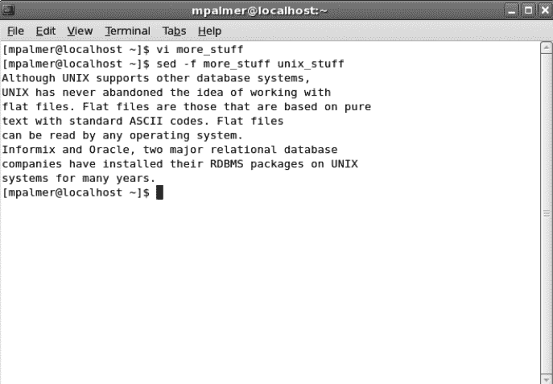

**图 5-16** 创建并运行 `sed` 脚本

- 4. 使用 `vi` 创建文件 `stuff_replace`。按 `i` 进入插入模式，并在文件中插入以下 `sed` 命令：

```
s/UNIX/Linux/

s/abandoned/given up/

s/standard/regular/
```

文件中的这些行将指示 `sed` 将所有的 "UNIX" 替换为 "Linux"，将 "abandoned" 替换为 "given up"，并将 "standard" 替换为 "regular"。

输入这些行后，按 `Esc` 切换到命令模式。输入 `:wq` 或 `:x` 按回车。

- 5. 输入 `clear` 并按回车清除屏幕上的工作内容。

- 6. 使用第 4 步创建的脚本对 `unix_stuff` 文件执行 `sed`。将 `sed` 的输出重定向到文件 `unix_stuff2`。输入 `sed -f stuff_replace unix_stuff >unix_stuff2` 并按回车。

- 7. 输入 `cat unix_stuff2` 并按回车。你会看到文件包含了 `stuff_replace` 脚本文件指定的更改，如图 5-17 所示。

# 254 章 第5章 高级文件处理

```bash
mpalmer@localhost:~

File Edit View Terminal Tabs Help

[mpalmer@localhost ~]$ sed tr stuff_replace uniq_stuff > unix_stuff2

[mpalmer@localhost ~]$ cat unix_stuff2

Although Linux supports other database systems,

Linux has never given up the idea of working with
```


flat files. Flat files are those that are based on pure text with ASCII codes. Flat files be read by any operating system.

`[mpalmer@localhost ~$]`

```
```

图 5-17 写入 unix_stuff2 文件的 sed 更改

## 项目 5-10

`tr` 命令用于翻译文件中的字符，例如将小字母转换为大写字母、删除指定字符以及替换字符。在这个项目中，你将在以下步骤完成所有这些操作。你将使用在“动手练习项目 5”中创建的计数器。

**将 counters 文件中的小写字符转换为大写字符：**

- 1. 输入 `tr [a-z] [A-Z] < counters` 并按 `回车`。

你会看到这些行：
LINUX IS A FULL FEATURED UNIX CLONE.
LINUX IS AVAILABLE IN FREE AND COMMERCIAL VERSIONS.

你也可以使用 `tr` 命令的 `-d` 选项从输出中删除在 *string1* 中找到的输入字符。当你需要从文件中移除错误字符时这很有帮助。

**从 counters 文件中删除指定字符：**

- 1. 要从输出中删除字符“full”，请输入 `tr -d "full" < counters` 并按 `回车`。

你会看到这段文本：
Linx is a eatred UNIX cone.
Linx is avaiaibe in ree commercia versions.


## 动手练习项目

注意——该命令删除了“full”中的所有字符——每一个 f、u 和 l——而不是单词“full”的出现情况。（参见图 5-18）。

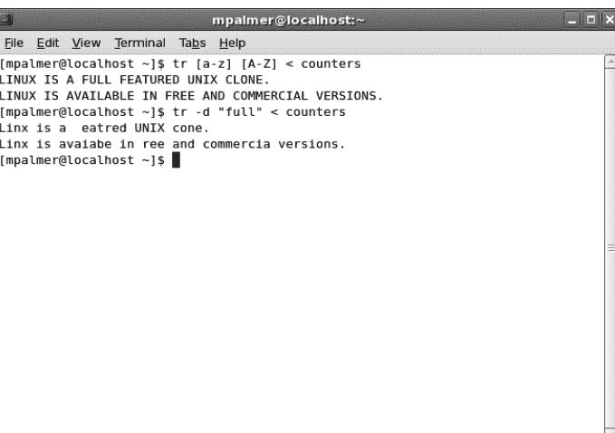

**图 5-18** 使用 tr 翻译文件中的字符

`tr` 命令的 `-s` 选项检查字符或字符串连续重复多次的序列。当发生这种情况时，`tr` 将重复字符的序列替换为你指定的字符或字符串。例如，当你需要将平面文件的字段分隔符从一个字符更改另一个字符时，使用 `-s` 选项。例如，在文件 `zoo2` 中，使用 `tr` 将字段分隔符 "." 替换为空格。首先使用 `cat` 显示文件。

**替换 counters 中的字符：**

- 1. 输入 `cat counters` 并按 `回车`。
你会看到这段文本：
Monkeys:Bananas:2000:850.00
Lions:Raw Meat:4000:1245.50
Camels:Vegetables:2300:564
Elephants:Hay:12000:1105

- 2. 输入 `tr -s ":" " " < counters` 并按 `回车`。
你会看到这段文本：
Monkeys Bananas 2000 850.00
Lions Raw Meat 4000 1245.50
Camels Vegetables 2300 564
Elephants Hay 12000 1105

# 第5章 高级文件处理

在这个项目中，你使用 `pr` 命令来格式化在在项目 5-8中创建的 `unix_stuff` 文件。使用管道 `|` 将输出发送到命令，以免输出滚动得太快。

要格式化文件：

- 输入 `pr -h "UNIX & Databases" < unix_stuff | more` 并按回车。查看文本后按 `q` 退出。现在，你可以使用相同的命令，但添加 `-l 23` 选项来限制每页行数为 23。由于标准行数是 24，你不需要将输出发送到 `more` 或 `less` 命令。

- 输入 `pr -l 23 -h "UNIX & Databases" < unix_stuff` 并按回车。查看图 5-19 查看屏幕显示。

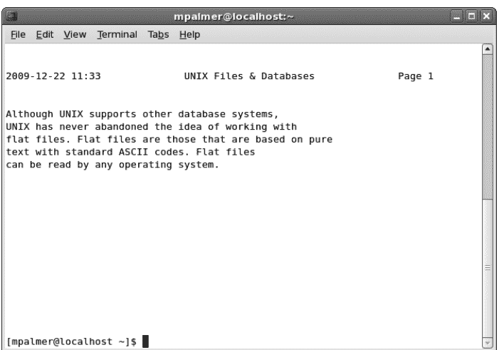

**图 5-19** 使用 -l 的 pr 命令的结果

## 项目 5-11

从这个项目开始，你现在开始一系列相关项目来设计和实现各种程序报告，并创建一个精美的活动状态。

创建程序文件：

- 1. 输入 `vi programmer` 并按回车。
- 2. 输入 `i` 进入插入模式，并在每行末尾按回车（最后一行除外）输入以下文本：

```
101:Johnson:John:39000

102:King:Mary:39800

103:Brown:Gretchen:35000

104:Adams:Betty:42000

105:Utley:Amos:36000

106:Wilson:Patricia:39000

107:Culligan:Thomas:39000

108:Mitchell:Hillary:32800

109:Arbuckle:Margaret:46700

110:Ford:Terrence:44700

111:Green:Sarah:41700

112:Rose:Richard:40200

113:Daniels:Allan:30500

114:Edwards:George:38500
```

- 3. 按 `Esc` 切换到命令模式。
- 4. 输入 `:wq` 或 `:x` 并按回车写入文件并退出。

创建项目文件：

- 1. 输入 `i` 进入插入模式，并在每行末尾按回车（最后一行除外）输入以下文本：

```
EA-100:1:Reservation Plus:110

EA-100:1:Reservation Plus:103

EA-100:1:Reservation Plus:107

EA-100:1:Reservation Plus:109

EA-101:2:Accounting-Revenues Version 4:105

EA-101:2:Accounting-Revenues Version 4:112

EA-102:4:Personnel System:110

EA-103:3:Personnel Evaluations:106

WE-208:2:Reservations:102

WE-207:4:Accounting - Basic:101

WE-208:2:Executive-Decision-Maker:102

NE-300:1:Region P & L:103

NE-302:1:Housekeeping Logs:104

NE-304:4:Maintenance Logs:105
```


## 第5章 高级文件处理

3. 按 `Esc` 切换到命令模式。

4. 输入 `wq` 或 `:x` 并按回车以保存文件并退出 `vi`。

## 项目 5-13

在此项目中，使用 `awk` 命令打印在“动手练习项目 5-12”中创建的 `programmer` 文件的内容初步报告。

要使用 `awk` 打印 `programmer` 文件中的字段：

- 1. 输入 `awk -F: 'printf "%d %-12.2s %-10.1s\n", $1, $2, $3' programmer` 并按回车（在花括号周围使用单引号而不是反引号）。输出示例请参见图 5-7。

对于此命令，空格非常重要。请注意 `awk` 之后、`-F:` 之后以及 `'printf "%d %-12.2s %-10.1s\n", $1, $2, $3'` 之后都有空格。此外，确保你输入的是花括号而不是直括号。

## 项目 5-14

在此项目中，你将通过 `cut`、`paste` 和 `more` 命令使用三条命令行和临时文件创建一个程序员信息报告，然后使用一条 `awk` 命令且不使用临时文件。在第一组步骤中，你首先使用 `cut` 命令从 `programmer` 文件中提取姓（字段 2），并将输出存储在 `temp1` 文件中。接下来，你使用 `cut` 命令从 `programmer` 文件中提取薪水（字段 5），并将输出存储在 `temp2` 中。然后，你使用 `paste` 命令合并 `temp1` 和 `temp2`，创建 `progal` 文件。最后，你使用 `more` 命令显示输出。在第二组步骤中，你可以用 `awk` 命令完成相同任务。

使用 `cut`、`paste` 和 `more` 提取并显示信息：

- 1. 输入 `cut -f2 -2d: programmer > temp1` 并按回车。
- 2. 输入 `cut -f5 -5d: programmer > temp2` 并按回车。
- 3. 输入 `paste temp1 temp2 progal` 并按回车。
- 4. 使用 `more` 命令显示输出，输入 `more progal` 并按回车。

## 动手练习 259

你将看到类似下面的摘录输出：

| Johnson | 39000 |
| King | 39800 |
| Brown | 35000 |
| Adams | 42000 |
| Utley | 36000 |
| Wilson | 39000 |
| Culligan | 39000 |

注意文件中不同的名称（例如 Culligan），由于制表间距的原因，第二列的对齐情况可能与较短的名字不同。


注意

使用 `awk` 命令完成相同任务：

- 1. 输入 `awk -F: '{printf "%-10.1s %%7.0f\n", $2, $5}' programmer` 并按回车。

你看到类似下面的摘录输出：

| Johnson | 39000 |
| King | 39800 |
| Brown | 35000 |
| Adams | 42000 |
| Utley | 36000 |


> 使用 `cut` 和 `paste` 命令与使用 `awk` 命令之间有两个重要的区别。首先，使用 `awk` 时不需要创建三个额外的文件。其次，使用 `awk` 时列的显示外观更加均匀。


注意

## 项目 5-15

当你操作 `programmer` 和 `project` 字段中的信息时（这是本次作业的重点）。在这里，你将在一个项目中练习 `cut`、`sort`、`uniq`、`comm` 和 `join` 命令的知识。你选择了 `project` 文件中存储的 `programmer_number` 字段。这些字段标识了被分配到项目的程序员。在完成此项目时，请参考图 5-5。

首先从 `project` 文件中剪切 `programmer_number` 字段，并通过管道 `|` 将输出传递给 `sort` 命令，以便将重复的数字放在一起。将排序后的输出传递给 `uniq` 命令以删除任何重复的 `programmer_numbers`。最后，将输出重定向到临时文件 `t1`。（`t1` 文件是标识被分配到项目的程序员的编号列表。）


## 第5章 高级文件处理

从 `project` 文件中选择字段：

- 1. 输入 `cut -d: -f4 project | sort | uniq > t1` 并按回车。
- 2. 要显示 `t1` 的内容，输入 `cat t1` 并按回车。

你看到程序员编号列表：

```
101

102

103

104

105

106

107

109

110

112
```

下一步是从 `programmer` 文件中剪切 `programmer_number` 字段（字段 1），并通过管道 `|` 将输出传递给 `sort` 命令，将任何重复数字放在一起。将排序后的输出传递给 `uniq` 命令以删除任何重复的 `programmer_numbers`。最后，将输出重定向到临时文件 `t2`，该文件是所有程序员的编号列表。

- 3. 输入 `cut -d: -f1 programmer | sort | uniq > t2`。
- 4. 要显示 `t2` 的内容，输入 `cat t2` 并按回车。你看到这个程序员编号列表：

```
101

102

103

104

105

106

107

109

110

112

113

114
```

既然 `t1` 和 `t2` 已按照相同的顺序排序，你可以对进行匹配。使用 `comm` 命令从 `t1` 中选择不匹配 `t2` 的行，并将输出重定向到另一个文件 `t3`，该文件列出了所有未分配到项目的程序员编号。

- 5. 输入 `comm -2 t1 t2 > t3` 并按回车。
- 6. 要显示未分配到项目的程序员编号，输入 `cat t3` 并按回车。

## 动手练习 259

你看到未分配到项目的程序员列表：
108
111
114

要显示分配到项目的程序员，你可以通过 `sort` 对 `programmer` 文件进行排序，并将输出传递到 `t4`。使用 `join` 命令匹配 `t4` 和 `t3`，并将输出重定向到 `t5`，该文件包含了分配到项目的程序员名称。

- 3. 输入 `cut -d: -f1 programmer | sort | uniq > t4`。
- 4.，输入 `cat t4` 并按回车。你看到这个程序员编号列表：

```
101

102

103

104

105

106

107

109

110

112

113

114
```

现在 `t1` 和 `t2` 已按照相同的顺序排序，你可以对它们进行匹配。使用 `comm` 命令从 `t1` 中选择不匹配 `t2` 的行，并将输出重定向到另一个文件 `t3`，该文件列出了所有未分配到项目的程序员编号。

- 5. 输入 `comm -2 t1 t2 > t3` 并按回车。
- 6. 要显示未分配到项目的程序员编号，输入 `cat t3` 并按回车。

要显示分配到项目的程序员，你可以通过 `sort` 对 `programmer` 文件进行排序，并将输出传递到 `t4`。使用 `join` 命令匹配 `t4` 和 `t3`，并将输出重定向到 `t5`，该文件包含了分配到项目的程序员名称。

- 3. 输入 `cut -d: -f1 programmer | sort | uniq > t4`。
- 4.，输入 `cat t4` 并按回车。你看到这个程序员编号列表：

```
101

102

103

104

105

106

107

109

110

112

113

114
```


## 第5章 高级文件处理

3. 按 `Esc` 切换到命令模式。
4. 输入 `wq` 或 `:x` 并按回车以保存文件并退出 `vi`。

## 项目 5-13

在此项目中，使用 `awk` 命令打印在“动手练习项目 5-12”中创建的 `programmer` 文件的内容初步报告。

要使用 `awk` 打印 `programmer` 文件中的字段：
- 1. 输入 `awk -F: 'printf "%d %-12.2s %-10.1s\n", $1, $2, $3' programmer` 并按回车。输出示例请参见图 5-7。

对于此命令，空格非常重要。请注意 `awk` 之后、`-F:` 之后以及 `'printf "%d %-12.2s %-10.1s\n", $1, $2, $3'` 之后都有空格。此外，确保你输入的是花括号而不是直括号。

## 项目 5-14

在此项目中，你将通过 `cut`、`paste` 和 `more` 命令使用三条命令行和临时文件创建一个程序员信息报告，然后使用一条 `awk` 命令且不使用临时文件。

使用 `cut`、`paste` 和 `more` 提取并显示信息：
- 1. 输入 `cut -f2 -2d: programmer > temp1` 并按回车。
- 2. 输入 `cut -f5 -5d: programmer > temp2` 并按回车。
- 3. 输入 `paste temp1 temp2 progal` 并按回车。
- 4. 使用 `more` 命令显示输出，输入 `more progal` 并按回车。

使用 `awk` 命令完成相同任务：
- 1. 输入 `awk -F: '{printf "%-10.1s %%7.0f\n", $2, $5}' programmer` 并按回车。

> 使用 `cut` 和 `paste` 命令与使用 `awk` 命令之间有两个重要的区别。首先，使用 `awk` 时不需要创建三个额外的文件。其次，使用 `awk` 时列的显示外观更加均匀。

## 项目 5-15

当你操作 `programmer` 和 `project` 字段中的信息时，你将在一个项目中练习 `cut`、`sort`、`uniq`、`comm` 和 `join` 命令的知识。

操作：
- 1. 输入 `cut -d: -f4 project | sort | uniq > t1` 并按回车。
- 2. 要显示 `t1` 的内容，输入 `cat t1` 并按回车。你看到程序员编号列表：

```
101
102
103
104
105
106
107
109
110
112
```

- 3. 输入 `cut -d: -f1 programmer | sort | uniq > t2`。
- 4. 要显示 `t2` 的内容，输入 `cat t2` 并按回车。你看到这个程序员编号列表：

```
101
102
103
104
105
106
107
109
110
112
113
114
```

现在 `t1` 和 `t2` 已按照相同的顺序排序，你可以对它们进行匹配。使用 `comm` 命令从 `t1` 中选择不匹配 `t2` 的行，并将输出重定向到另一个文件 `t3`，该文件列出了所有未分配到项目的程序员编号。
- 5. 输入 `comm -2 t1 t2 > t3` 并按回车。
- 6. 要显示未分配到项目的程序员编号，输入 `cat t3` 并按回车。

你看到未分配到项目的列表：
```
108
111
114
```

要显示分配到项目的程序员，你可以通过 `sort` 对 `programmer` 文件进行排序，并将输出传递到 `t4`。使用 `join` 命令匹配 `t4` 和 `t3`，并将输出重定向到 `t5`，该文件包含了分配到项目的程序员名称。
- 3. 输入 `cut -d: -f1 programmer | sort | uniq > t4`。
- 4. 输入 `cat t4` 并按回车。你看到这个程序员编号列表：

```
101
102
103
104
105
106
107
109
110
112
113
114
```


```
101:Johnson:John:K
102:King:Mary:K
103:Brown:Gretchen:K
104:Adams:Betty:C
105:Utley:Andrew:Y
106:Wilson:Patricia:B
107:Culligan:Thomas:F
108:Mitchell:Hillary:N
109:Arbuckle:Margaret:F
110:Ford:Terrence:H
111:Greene:Sarah:L
112:Rose:Richard:P
113:Daniels:Allan:S
114:Edwards:George:J
```

- 8. 按 `q` 退出文本显示。

## 项目 5-19

在此项目中，你将创建并运行一个脚本文件 `joinall`，用于合并 `pnn` 和 `pnum` 文件，并将输出重定向到 `pactrep`。

要创建一个用于合并两个文件的脚本文件：

- 1. 输入 `joinall` 并按 **Enter**。

- 2. 输入 `a` 切换到插入模式，然后输入以下文本，并在每行末尾按 **Enter**：

```
############################################################
# Script Name:    joinall
# By:             你的姓名缩写
# Date:           2009年11月
# Purpose:        合并 pnn 和 pnum 以创建报告文件
############################################################
# 合并包括未分配程序员在内的文件。
# 你通过将程序员姓名文件 (pnn) 
# 放在合并序列的第一位来实现此。
############################################################
join -t: -j1 1 -j2 1 pnn pnum > pactrep
```


### 实践项目 265

3. 按 `Esc` 切换到命令模式。

4. 输入 `wq` 或 `x` 并按 **Enter** 保存文件并退出 `vi`。

5. 若要运行 `joinall` 并使用 `less` 显示 `pactrect` 的内容，输入 `sh joinall` 并按 **Enter**。

6. 输入 `less pactrect` 并按 **Enter**。

7. 你将看到程序员的名字，包括未分配程序员的姓名：

```
101:Johnson:John:K: 1
102:King:Mary:K: 2
103:Brown:Gretchen:K: 2
104:Adams:Betty:C: 1
105:Utley:Amy:V: 2
106:Wilson:Patricia:B: 1
107:Culligan:Thomas:F: 1
108:Mitchell:Hillary:N
109:Arbuckle:Margaret:F: 1
110:Ford:Terrence:H: 2
111:Greene:Sarah:L
112:Rose:Richard:P: 1
113:Daniels:Allan:S
114:Edwards:George:J
```

8. 如必要，输入 `q` 退出。

## 项目 5-20


当你创建“程序员活动状态报告”时，你在之前项目中的工作将得到回报。在此项目中，你首先使用 `vi` 编辑器创建 shell 脚本 `practivity`。你使用 `.` 命令获取之前创建的 `pumname` 文件和 `join` 脚本，并将它们放入 `practivity` 脚本中。然后使用 `vi` 中的 `dd` 命令删除注释中指定的行。

**创建最终的 shell 脚本：**

- 1. 输入 `practivity` 并按 **Enter**。

- 2. 输入 `a` 切换到插入模式，然后输入以下文本，并在每行末尾按 **Enter**：

```
=================================================================
# practivity
# Script Name: 你的姓名缩写
# By: 你的姓名缩写
# Date: 2009年11月
# Purpose: 生成程序员活动状态报告
#
=================================================
```

- 3. 按 `Esc` 切换到命令模式。

4. 要获取三个脚本文件，输入 `:r pactrect` 并按 **Enter**。将光标移动到文件末尾，输入 `:r pnnname` 并按 **Enter**。将光标移动到文件末尾，输入 `:r joinall` 并按 **Enter**。

5. 使用 `dd` 命令删除所有导入的注释，只保留第 2 步输入的注释。例如，你可以将光标移动到以 `#` 开头的行并输入 `dd`。你也可以将光标移动到第一行 `#` 行，输入 `dd9` 删除当前行及其之后的第八条注释。对剩余的注释行执行同样的操作。

除了第 2 步的注释外，脚本中应仅剩下这些行：

```
cut -f4 | sort | uniq -c | awk 'printf "%s\t%n", $2, $1' > pnum
cut -f1-4 | sort -t: | uniq > pnn
join -al -j1 -j2 pnn pnum > pactrep
```

6. 在脚本末尾输入以下内容：

```
# 输出报告
awk '
BEGIN {
  FS = ":"
  print "\tProgrammer Activity Status Report\n"
} { getline d
  printf "\t%s\n", d
  print "Prog--Name--                   Projects\n"
  print "============================\n"
} { printf%-12s %-12s %s\t%d\n", $1, $2, $3, $4 }' pactrep
# 删除临时文件
rm pnum pactrep
```

对于列标题，在 `Prog` 和 `--Name--` 之间创建一个空格，在 `--Name--` 和 `Projects` 之间创建一个空格，请小心输入。

注意 `Esc` 确保脚本与图 5-21 相似。

8. 输入 `:wq` 或 `x` 并按 **Enter** 保存文件并退出 `vi`。

9. 输入 `sh activity` 并按 **Enter**。图 5-22 展示了该报告。

# 实践项目 267

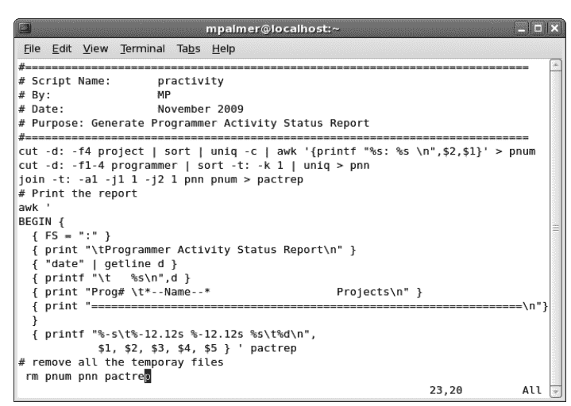

图 5-21 输入脚本

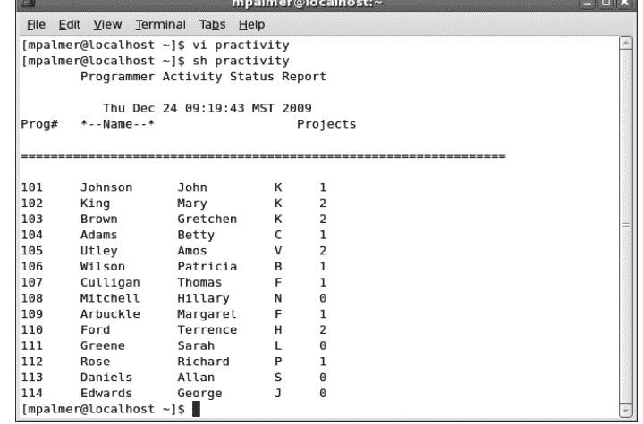

图 5-22 程序员状态报告

## 发现练习

- 1. 使用命令查找 `/etc` 目录下单词 "host" 的实例。

- 2. 在练习 1 使用的命令中添加什么可以使输出一次显示一屏幕？

- 3. 你如何确定 `/etc/termcap` 文件的行数和单词？

- 4. 使用命令从你在实践项目中创建的 `my_list` 中删除 "o" 和 "a" 字母，并将输出写入文件 `changed_list`。

- 5. 使用命令查找 `my_list` 文件中哪些行包含 "Foot"。

- 6. 创建一个包含以下单行的 `trees` 文件：

Oak tree

Pine tree

Spruce tree

Cottonwood

Maple tree

使用 `vi` 编辑器创建一个名为 `more_trees` 的文件并复制 `trees` 文件的内容。在列表末尾添加以下树：

Redwood

Willow tree

使用命令比较 `trees` 和 `more_trees` 文件并按列输出差异。

- 7. 使用命令比较 `trees` 和 `more_trees` 文件，按差异行显示差异。

- 8. 使用单命令确定 `trees` 和 `more_trees` 文件的字节数。

- 9. 使用命令将 `more_trees` 文件中的 "tree" 替换为 "plant" 并输出到屏幕。

- 10. 创建新文件 `CD_list` 并在文件中输入这些行：

country:1000:210

rock:1001:380

classical:1002:52

alternative:1003:122

light:1004:151

light rock:1004:151

celic:1005:44

jazz:1006:62

soundtracks:1007:32

soundtracks:1007:32

使用 `sed` 命令和脚本文件将这些行添加到 `CD_list` 文件的末：


```
hard rock:1008:70
misc:1009:22
```

- 11. 使用命令查找 `CD_list` 文件中的重复行（记录）。
- 12. 使用 `uniq` 命令删除 `CD_list` 文件中的重复行，将修正后的信息放在文件 `CD_list_new` 中。
- 13. 在 `CD_list_new` 文件中，将单词 `"misc"` 替换为 `"other"`，将更改保存在文件 `CD_list_replace` 中，然后比较文件内容以确保更改生效。
- 14. 使用 `grep` 命令查找 `CD_list_new` 文件中所有包含 `"celtic"` 的行。
- 15. 使用命令将 `CD_list_new` 文件中的所有字母转换为大写，并将输出保存到文件 `CD_list_uppercase`。
- 16. 对 `CD_list_new` 文件使用 `sed` 命令将 `"light rock"` 替换为 `"easy listening"`，将 `"alternative"` 替换为 `"experimental"`。
- 17. 创建一个名为 `software` 的文件，包含以下字段：
  - 项目编号，使用项目文件中显示的相同数字（你之前在本章创建的）
  - 软件代码，使用任何三位数字
  - 软件描述，例如 `Excel`
  然后编写一个小型应用程序，将 `software` 文件中的记录与项目文件中的匹配记录合并，并使用 `Awk` 程序打印一份描述你之前创建的每个项目的软件报告。
- 18. 查看 `/etc/termcap` 的前 20 行。接下来使用命令仅将 `/etc/termcap` 中前 20 行中 `"version"` 的所有字符转换为大写。
- 19. 找到一个可以比较三个文件差异并按行输出差异的命令。

# 第 6 章

## SHELL 脚本编程简介

在读完本章并完成练习后，你将能够：

- 理解程序开发周期
- 比较用于创建脚本的 UNIX/Linux shell
- 使用 shell 变量、操作符和通配符
- 使用 shell 逻辑结构
- 使用 shell 脚本创建菜单
- 使用命令帮助调试 shell 脚本
- 解释自定义个人环境的方法
- 使用 `trap` 命令
- 开发一个基于菜单的应用程序

`shell` 脚本编程是 UNIX 和 Linux 用户、程序员和管理员非常认为的一项备受推崇的能力，因为它为创建各种类型的应用程序提供了灵活性。一些用户创建脚本从数据文件中生成报告。另一些用户使用脚本来创建和维护数据文件，例如跟踪项目、财务或人员。还有人通过脚本执行系统维护任务，包括监控谁已登录或备份文件。

本章的重点是培养你的 shell 脚本编程技能，并向你展示如何构建一个基于菜单的应用程序。你将从了解要构建的应用程序以及程序开发周期。接下来，你将学习 shell 脚本编程工具，包括使用变量、操作符和逻辑结构。最后，在“实践项目”中，你将通过构建一个基于菜单的应用程序来运用所学。

## 应用程序预览

在第 4 章和第 5 章（“UNIX/Linux 文件处理”和“高级文件处理”）中学习到，`*grep*`、`*cut*`、`*paste*` 和 `*awk*` 等命令是处理数据的强大命令。尽管这些命令非常强大，但对于非技术用户来说可能很困难，部分情况下它们必须组合成长序列来实现你想要的结果。反复执行这些命令即使对于经验丰富的技术人员来说也是繁琐的。你在之前的章节中发现，shell 脚本可以帮助消除这些问题。

`shell` 脚本的一个优势是你可以创建它们来显示用户友好界面——例如，自动发出 `*grep*` 和 `*awk*` 命令来提取、格式化和显示信息的屏幕。这让非技术用户能够使用 UNIX/Linux 的强大功能。对于你自己，shell 脚本通过自动化你必须执行的命令序列来节省时间。

你在本章中开发并在第 7 章“高级 shell 编程”中增强的 shell 脚本是一个模拟信息系统，用于存储和显示数据——就像你在组织的人力资源系统中常见的数据。它提供了一个操作菜单，用户可以从中选择。其他任务中，这些操作自动化了输入、搜索、格式化和显示员工记录的过程。为了初步测试，你创建并使用了一个包含员工记录样本的数据文件，类似于经验丰富的 shell 程序员可能用于测试的文件。

当你在本章中学习开发应用程序所需的工具时，你将获得 UNIX/Linux shell 的以下脚本和编程特征的经验：

- **Shell 变量**——你的脚本通常需要在内存中保留值以供以后使用。**Shell 变量**将值临时存储在内存中，供 shell 使用。它们使用符号名称来访问存储在内存中的值。在这种情况下，**符号名称**是由字母、数字、字符组成的名称，用于指代变量的内容；通常名称反映了变量的用途或内容。
- **Shell 脚本操作符**——`shell` 脚本支持许多**shell 脚本操作符**，包括用于分配 shell 内容、评估信息、执行数学运算或对输入/输出进行管道或重定向的操作符。
- **逻辑或控制结构**——`shell` 脚本支持**逻辑结构**（也称为**控制结构**），包括顺序逻辑（用于执行一系列命令）、决策逻辑（用于从脚本的一个点跳转到另一个点）、循环逻辑（用于重复执行多次命令）和 case 逻辑（从多个可能的选项中选择操作）。

## 程序开发周期

此外，你还学习了用于格式化屏幕输出和定位光标的特殊命令。在开始编写应用程序之前，了解更多程序开发周期和编程的基本要素很重要。

### 程序开发周期

开发应用程序的过程被称为程序开发周期。无论你是在编写脚本还是高级级语言程序，周期中涉及的步骤都是相同的。

过程从创建程序规范开始——应用程序必须满足的要求。规范决定了应用程序接受什么输入、必须对数据执行的过程以及正确的输出。

在确定规范后，设计过程就开始了。在此期间，程序员创建文件格式、屏幕布局和算法。算法（Algorithm）是程序、编程代码或命令的序列，结果是一个程序，或可以作为程序的一部分使用。程序员使用各种工具来开发复杂的应用程序。你将在本章中学习一些工具，并在第 7 章学习其他工具。

设计完成后，程序员开始编写实际代码，并必须对代码进行测试和调试。调试是遍历程序代码以定位错误并修复它们的过程。当程序员发现错误时，他们会纠正并重新开始测试。这一过程持续到应用程序运行满意为止。

图 6-1 展示了程序开发周期。

## 使用高级语言

计算机程序是通常使用高级语言编写的指令，例如 `COBOL`、`Visual Basic` 或 `C++`。高级语言是一种使用类似于英语的表达式的计算机语言。例如，下面的 `COBOL` 语句指示计数器给 `COUNTER` 增加 1：

```
ADD 1 TO COUNTER.
```

这是一个用 `C++` 编写的类似语句：

```
counter = counter + 1;
```

程序的高级语言语句存储在一个名为源文件的文件中。这是程序员用 `vi` 或 `Emacs` 等编辑器创建的文件。然而，源文件不能执行，因为计算机无法直接运行它。因此，源代码必须编译成可执行文件。

# 程序开发周期 277

- 是否需要脚本或程序尽可能快地执行，以便在有多个用户时减少对计算机资源的负载。
- 任务是否相对复杂；如果是，编译后的程序可能提供更灵活的选项或功能。

## 应用程序原型

原型是你的应用程序的运行模型，它让你能够在提交设计之前审查最终结果。使用 shell 脚本创建原型通常是最快、最有效的方法，因为原型逻辑和设计能力保持在 UNIX/Linux 内部。

在批准了运行的原型后，可以使用 `C++` 等编译语言对其进行重写以提高运行速度。然而，如果脚本运行得良好，你可能不需要将其转换为编译后的程序。

## 使用注释

在第 5 章中，你学习了使用注释来为你的脚本提供文档说明。计划在你所有的脚本和程序中使用注释，这样以后就更容易记住它们的工作原理。

注释行以井号 (`#`) 符号开头，例如下面你在第 5 章“实践项目 5-16”中创建的 `pact` 脚本中的示例：

```
################################# Script Name: pact
# By: 你的姓名缩写
# Date: November 2009
# Purpose: 创建临时文件 pfile，用来存储每个程序员正在工作的项目数量。pfile 包含：
prog_num 和 count 字段
################################
cut -d: -f4 pact | sort | uniq -c | awk '{printf "%s:%s\n",$2,$1}' > pfile
# cut prog_num, 管道输出以删除重复项
# 并获取程序/项目的计数。
# 输出一个以 prog_num 开头后跟 count 的文件
```

在此示例中，注释行出现在脚本的开头以及 `cut` 命令之后。你可以在脚本的任何位置放置注释以提供文档说明。例如，在本章的实践项目中，你通常在脚本开始处放置注释，以显示脚本名称、作者、编写日期和脚本目的。当你在本章及随后的章节中编写代码时，请插入任何你认为对以后参考有帮助的额外注释行。你可能注释内容的示例包括：

- 脚本名称、作者、创建日期和目的
- 修改日期以及每次修改的目的
- 所用变量的用途和类型（你将在本章中学习变量）
- 被访问、创建或修改的文件


- 逻辑结构的工作原理（你将在本章中创建逻辑结构）
- shell 函数的目的（你将在第 7 章中创建 shell 函数）
- 复杂代码的工作原理
- 包含特定命令的原因

尽管编写注释可能会花费一点额外时间，但从远来看，当你需要修改该脚本或将其整合到与其他脚本的应用程序中时，注释可以为你节省大量时间。

# 第 6 章 Shell 脚本编程简介

## 编程 shell

在创建脚本之前，选择用于运行该脚本的 shell。正如你在第 1 章中所学习的，UNIX/Linux 有不同版本的 shell，且每个 shell 具有不同的能力。此外，请记住，所有 Linux 版本都使用 Bash shell（Bourne Again Shell）作为默认 shell。表 6–1 列出了大多数 Linux 发行版附带的三种 shell、它们的来源以及在 shell 编程方面的区别特征。

### 6-1 Linux shells

| Shell 名称 | 派自的原始 shell | shell 编程角度的描述 |
|---|---|---|
| `Bash` | Bourne 和 Korn shell | 提供强大的脚本编写和编程语言功能，如 shell 变量、逻辑结构和数学/逻辑表达式；结合了 Bourne 和 Korn shell 的最佳特性。 |
| `csh/tcsh` | C shell | 符合脚本编写和编程语言格式；shell 表达式使用的运算符类似于 C 编程语言中找到运算符 |
| `ksh/zsh` | Korn shell | 在许多方面与 Bash shell 相似，但也具有类似于 C 语言的语法；如果你熟悉旧的 Korn shell 脚本，则非常有用 |

### 变量 279

`Bash` 比旧的 Bourne 和 Korn shell 提供了改进的功能，并与 Bourne shell 完全兼容。此外，与其他 shell 相比，`Bash` shell 具有更强大的编程接口。出于这些原因，我们在本书的脚本中使用了 `Bash` shell。

> Fedora、Red Hat Enterprise Linux 和 SUSE 的手册页包含大量关于 `Bash` shell 的文档。输入 `man bash` 即可访问这些文档。

现在你已经选择了 shell，学习脚本所使用的若干基本功能变得非常重要，包括变量、shell 运算符和特殊字符。

## 变量

变量使用符号名称来表示存储在内存中的值。本节讨论的三类变量是配置变量、环境变量和 shell 变量。**配置变量**用于存储有关操作系统设置的信息，在设置它们之后，你通常不会更改它们。

你可以设置带有初始值且可以更改的**环境变量**。UNIX/Linux 在你登录时读取这些变量，它们决定了你登录会话的许多特性。例如，在第 2 章中你学习了决定提示符显示方式的环境变量 `PS1`。

### 环境和配置变量

具有标准名称，如 `PS1`、`HOME`、`PATH`、`SHELL`、`USERNAME` 和 `PWD`。（大写以区别于用户变量）。主目录下的脚本设置环境变量的初始值。你可以使用这些变量来设置和个性化你的登录会话。例如，你可以为他人创建的 shell 脚本位置设置 `PATH` 变量，这样你就可以轻松执行这些脚本。

你可以随时使用 `printenv` 命令查看当前环境和配置变量的列表，在更改任何内容之前，你通常应该执行此操作（见图 6-2）。表 6–2 列出了标准的 Bash 环境和配置变量。

> 除了 `printenv` 命令外，考虑使用 `set` 命令（在本章稍后部分讨论）不带任何参数来查看你当前的 Bash 环境，包括环境变量、shell 脚本变量和 shell 函数。（你将在第 7 章中学习 shell 函数。）要了解更多关于系统使用的环境变量和配置变量，请在命令行输入 `man bash`。

### 表 6-2 标准 Bash shell 环境和配置变量

| 名称 | 变量内容 | 决定因素 |
|---|---|---|
| `HOME` | 标识用户主目录的路径名 | 系统 |
| `LOGNAME` | 存储登录用户的用户名 | 系统 |
| `PPID` | 指向 shell 的父进程 ID | 系统 |
| `TZ` | 存储系统设置的时区 | 系统 |
| `IFS` | 允许用户指定用于处理文件时的默认分隔符 | 可重定义 |
| `LINEND` | 存储函数或脚本的当前行号 | 可重定义 |
| `MAIL` | 识别 mail 实用程序检查收到的邮件的文件名 | 可重定义 |
| `MAILCHECK` | 检查收到的邮件的间隔（例如：60） | 可重定义 |
| `PATH` | 存储搜索可执行命令的目录路径列表 | 可重定义 |
| `PS1` | 存储主 shell 提示符 | 可重定义 |
| `PS2` | 包含次 shell 提示符 | 可重定义 |
| `PS3` and `PS4` | 存储 set 和 select 命令的提示符 | 可重定义 |
| `SHELL` | 存储你使用的 shell 类型的程序路径名 | 可重定义 |
| `BASH` | 包含 Bash shell 的绝对路径，例如 `/bin/bash` | 用户定义 |
| `BASH_VERSION` | 存储 Bash 的版本号；标识 `cd` 命令搜索的目录路径名 | 用户定义 |
| `ENV` | 包含初始化 shell 的命令的文件名，如 `.bashrc` 或 `.tcrc` | 用户定义 |
| `EUID` | 存储当前登录用户的用户标识符 (`UID`) | 用户定义 |
| `EXINIT` | 包含 vi 编辑器的初始化命令 | 用户定义 |
| `FCEDIT` | 允许你访问命令历史文件中的范围命令；`FCEDIT` 是一个 Bash shell 实用程序，用于指定在调用 `FC` 命令时使用的编辑器（默认为 vi） | 用户定义 |
| `IGNORE` | 指定在处理某些文件时要忽略的文件名后缀 | 用户定义 |
| `FUNCNAME` | 包含正在运行的函数名称，如果没有正在运行函数则为空 | 用户定义 |
| `GROUPS` | 标识当前用户的组成员身份 | 用户定义 |
| `HISTCMD` | 包含当前活动命令在已使用的命令历史索引中所分配的序列号 | 用户定义 |
| `HOSTFILE` | 标识存储之前执行命令历史的文件 | 用户定义 |
| `HISTFILESIZE` | 设置在 `HOSTFILE` 变量指定的文件中存储的命令行的上限 | 用户定义 |
| `HISTSIZE` | 建立 Bash shell 可以回溯的命令数量上限 | 用户定义 |
| `HOSTFILE` | 存储为 Bash shell 提供网络主机名（如 localhost.domain）和 IP 地址（如 129.0.0.24）信息的文件名；如果 `HOSTFILE` 变量为空，系统默认使用 `/etc/hosts` | 用户定义 |
| `HOSTTYPE` | 包含托管 Bash shell 的计算机类型信息，例如基于英特尔处理器的 i386 | 用户定义 |
| `INPUTRC` | 标识覆盖 `/etc/inprc` 默认值的启动文件名 | 用户定义 |
| `MACHTYPE` | 标识系统类型，包括 CPU、操作系统和桌面 | 用户定义 |
| `MAILPOST` | 包含 mail 检查收到的邮件的邮件文件列表 | 用户定义 |
| `MAILWARNING` | 允许用户（设置时）确定其是否已访问邮件文件中的当前邮件 | 用户定义 |
| `OLPWD` | 标识访问当前目录之前访问的目录 | 用户定义 |
| `OPTIND` | 当命令使用一个或多个选项参数运行时，显示下一个处理的参数索引号 | 用户定义 |
| `OPTARG` | 当命令使用一个或多个选项参数运行时，包含最后一个指定的选项 | 用户定义 |
| `OPTERR` | 如果设置为 1（每次调用 Bash shell 时建立的默认值），允许 Bash 显示与命令选项参数相关的错误信息 | 用户定义 |
| `OSTYPE` | 标识运行 Bash 的操作系统类型，例如 linux-gnu | 用户定义 |
| `PROMPT` | 存储在显示主提示符之前执行的命令 | 用户定义 |
| `PWD` | 存储当前访问的目录名称 | 用户定义 |
| `RANDOM` | 每次调用时产生一个随机整数，但你必须先为 `RANDOM` 变量赋值以正确初始化随机数生成 | 用户定义 |
| `REPLY` | 当向内置 shell 命令 `read` 未传递输入参数时，指定读取的行 | 用户定义 |
| `SHLVL` | 包含 Bash 被调用的次数加1；当当前有两个 Bash（终端）会话运行时，其值为 3 | 用户定义 |
| `TERM` | 包含 shell 使用的终端类型名称 | 用户定义 |
| `TIMEOUT` | 包含 Bash 在无活动后停止或关闭的秒数 | 用户定义 |
| `UID` | 存储当前登录用户的标识符 | 用户定义 |

### Shell 变量

Shell 变量是你可以在脚本中使用定义和操纵的变量。这些是存储在内存中且你可以显示的变量。例如，你可能会定义 `TODAY` 来存储今天的日期，以便回溯它。

在处理 Shell 变量时，请记住处理和命名的准则。处理变量的一些基本准则如下：


在赋值时不带单引号或双引号时，请省略空格，例如赋值数值值时——使用 `x=5` 而不是 `x = 5`。这种赋值类型也允许你对值进行数学运算。

为了赋值包含空格的字符串变量，用双引号或单引号括围值——使用 `name="Thomas Smith"` 而不是 `name=Thomas Smith`。字符串变量是非数字的信息字段。字符串中的数字被视为其他字符。

引用变量时，请在它前面使用美元符号 (`$`) 或将其包含在大括号 (`{}`) 中。

如果变量由数组（值集）组成，使用方括号 (`[]`) 引用数组中特定位置的值——使用 `myArray[0]=value1` 获取数组中的第一个值。

导出变量以使其他 shell 脚本可用（如后续章节所述）。

创建 Shell 变量后，可以通过输入 `readonly` 命令配合参数来使其不可更改，例如 `readonly fname`。

变量命名示例准则如下：

- 避免在变量名中使用美元符号，因为这会与使用美元符号引用变量产生混淆。
- 使用描述 Shell 变量内容或目的的名称——例如，用于存储姓氏的变量使用 `fname`，对于普通变量使用 `var` 或 `x`，例如。
- 恰当且一致地使用大小写——例如，如果你正在定义地址信息，使用 `city`、`state`、`zip` 等变量名，而不是 `City`、`STATE`、`zip`。注意，某些程序员喜欢使用全小写或全大写的变量名。
- 如果变量名由两个或多个单词组成，在单词之间使用下划线——例如，使用 `last_name` 而不是 `last name`。

在下一节中，你将学习 Shell 运算符，它们用于定义和求值变量，例如环境变量和 Shell 变量。

# Shell 运算符

Shell 运算符分为四组：

- 定义运算符
- 求值运算符
- 算术运算符和关系运算符
- 重定向运算符

你将在接下来的章节中学习这些组运算符的每一组。你还可以学习如何使用 `export` 命令使你定义的变量对 Shell 脚本可用。最后，你将学习如何修改 `PATH` 环境变量，以便于运行 Shell 脚本。

## 定义运算符

定义运算符用于为变量赋值。求值运算符用于确定变量内容的操作动作。等号 (`=`) 是定义变量最常用的运算符之一。例如，假设你想创建一个名为 `NAME` 的变量，并将 `Becky` 包含在变量中。你可以这样设置变量：

```
NAME=Becky
```

出现在运算符左右侧的变量名或值称为操作数。你正在设置的变量名必须出现在 `=` 运算符的左侧。你正在设置的变量值必须出现在右侧。


注意，`=` 运算符与其操作数之间没有空格。

有时，需要为变量的内容赋值一个包含空格的字符字符串，例如 `Becky J. Zubrow`。要进行这种赋值，你需要用双引号将变量内容括如下：

```
NAME="Becky J. Zubrow"
```

另一种给 Shell 变量赋值的方法是使用反引号（`` ` ``）运算符。反引号不同于单引号或双引号；请参下文的提示。此运算符用于告诉 Shell 执行反引号内的命令并将结果存储在变量中。例如，在如下所示：

```
LIST=`ls`
```

命令被执行，当前工作目录的列表被存储在 `LIST` 变量中。

在许多标准键盘上，反引号运算符键位于 `Esc` 键下方的左上角，该区域与波浪号 (`~`) 组合。

## 求值运算符

当你为变量赋值时，你可能想通过求值运算符显示其内容来对其求值。你可以在变量前使用美元符号 (`$`) 并配合 `echo` 命令来查看内容。例如，如果你输入：

```
echo $NAME
```

你就能看到之前创建的 `NAME` 变量的内容。你也可以使用格式 `echo "$NAME"` 来查看变量内容。然而，如果你输入：

```
echo '$NAME'
```

使用单引号会导致 `NAME` 的内容被抑制，你看到的只是屏幕上回显的 `$NAME`。尝试“练习 6-2”来使用定义运算符和求值运算符。

## 算术运算符和关系运算符

算术运算符包括用于加法的 (`+`)、用于减法的 (`-`)、用于乘法的星号 (`*`) 和用于除法的斜杠 (`/`)。关系运算符比较两个值或参数之间的关系，例如大于 (`>`)、小于 (`<`)、等于 (`=`) 等其他。表 6-3 解释了算术运算符和关系运算符。从 `man bash` 到 Shell 的算术运算符完整列表是 `ARITHMETIC EVALUATION`。

表 6-3 Shell 算术运算符和关系运算符示例

| 运算符 | 描述 | 示例 |
|---|---|---|
| - | 一元负号和加号 | `+R` 表示正 `R` `-R` 表示负 `R` |
| ! | 逻辑和按位取反 | `Y` 如果 `Y` 不零则返回 1，如果 `Y` 为零则返回 1 `~X` 反转 `X` 中的位 |
| *, /, % | 乘法、除法和取余 | `A * B` 返回 `A B` `A / B` 返回 `A` 除以 `B` 的商 `A % B` 返回 `A` 除以 `B` 的余数 |
| +- | 加减 | `X + Y` 返回 `X` 加 `Y` `X - Y` 返回 `X` 减 `Y` |
| >< | 大于或小于 | `M > N` `M` 是否大于 `N`? `M < N` `M` 是否小于 `N`? |
| =, != | 等于和不等 | `Q = R` `Q` 是否等于 `R`? `Q != R` `Q` 是否不等于 `R`? |

在使用算术运算符时，适用通常的数学优先级规则：乘法和除法在加法和减法之前执行。例如，表达式 `6 + 4 * 2` 的值为 14，而不是 20。然而，可以使用括号来覆盖优先级。例如，表达式 `(6 + 4) * 2` 的值是 20，而不是 14。其他数学规则同样适用；例如，除以零被视为错误。

要向变量中存储算术值，请使用 `let` 语句。例如，以下命令将 14 存储在变量 `X` 中（见图 6–3 使用 `echo` 命令显示 `let` 命令后 `X` 的内容）。

```
let X=6+4*2
```

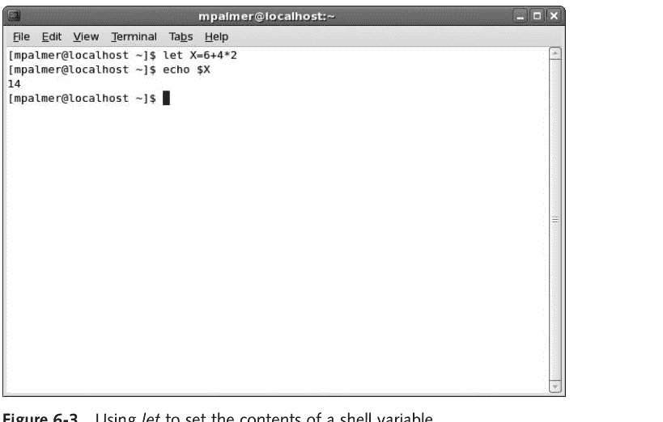

注意上例，`let` 和其后的表达式之间有一个空格。此外，`let` 语句后的算术方程式中没有空格。在这个示例中，等号 (`=`) 的两侧都没有空格。

## 重定向运算符

如果你想节省时间并自动导出所有 Shell 变量，请使用带有 `-a` 选项的 `set`。

然而，你可以在重定向运算符之后放置管道符 (`|`) 来覆盖任何文件：

```
$ set -o noclobber <Enter>
$ cat new_file > old_file <Enter>
bash: old_file: cannot overwrite existing file
$ cat new_file > old_file <Enter>
```

如果在带有 KDE 桌面的 X Window 界面中使用 Bash Shell，请避免使用 `-noclobber` 选项。在某些发行中，这样使用该选项可能会意外终止命令行会话。

## 将 Shell 变量导出环境变量

Shell 脚本无法自动访问在命令行或其他 Shell 脚本创建并赋值的变量。要使变量对 Shell 脚本可用，你必须使用 `export` 命令赋予其全局含义，使其 Shell 视为环境变量。

语法 `export [-options] [variable names]`

解析

- 使 Shell 变为全局，以便其他 Shell 脚本或程序访问，例如在 Shell 脚本中调用的 Shell 脚本或程序
- 有用的选项包括：
  - `-n` 撤销导出，使变量不再是全局的
  - `-p` 列出导出的变量

`export` 是 Bash 内置命令，这意味着你可以通过 `man bash` 并滚动到 `SHELL BUILTIN COMMANDS` 部分来查找文档。尝试“项目 6-4”在 Bash Shell 中使用 `export` 命令。

如果你在一个未在你的 `PATH` 环境变量中指定的目录中开发 shell 脚本，你必须在 shell 名称前输入 `./`。如果你只输入 shell 的名称，脚本将不会运行，因为它不在你当前定义的路径中——这意味着 shell 解释器无法找到它并运行。你需要输入 `./` 来告诉 shell 解释器在你的当前工作目录中查找。

例如，在某些 UNIX/Linux 系统中（如 Fedora、Red Hat Enterprise Linux 和 SUSE），你的主目录不会自动定义在你的当前路径中。你可以通过输入以下内容来验证路径中包含哪些目录：

```
echo $PATH
```

例如，在 Fedora 或 Red Hat Enterprise Linux 中，你可能会看到类似的路径：


```
/usr/kerberos/bin:/usr/local/bin:/usr/bin:/bin:/usr/X11R6/bin:/home/username/bin
```

注意，路径中的每个目录都用冒号 `:` 隔开。你的主目录（由 `/home/username` 表示）默认不在路径中，但另一个可能存储程序的目录 `/home/username/bin` 默认在路径中——尽管即使在路径中，你的系统中默认可能并没有创建 `/home/username/bin` 目录。

由于新的 shell 脚本在测试期间通常保存在当前目录中，你应该将当前工作目录添加到 `PATH` 变量中。以下是如何快速执行此操作的示例：

```
PATH=$PATH:
```

记住，shell 将 `$PATH` 解释为 `PATH` 变量的内容。此示例命令将 `PATH` 变量设置为其当前内容。冒号和点 `.` 将当前目录添加到搜索路径，以便 shell 程序能够定位新程序。

输入此命令后，你可以直接使用脚本名称来执行新的 shell 脚本，而无需加 `./` 前缀。通过项目 6–5 的实践操作你可以进行尝试。

当你输入 `PATH=$PATH.` 时，当前工作目录被临时存储作为你路径的一部分，仅限于你的登录会话。


# Shell 逻辑结构

> 注意：在路径中设置当前目录存在一定的风险，如果在你登录期间黑客获取了你的账户访问。例如，黑客可能通过开放的端口（网络协议中的通信路径）获取访问。如果你选择将工作目录放在 `PATH` 变量中，请确保你保护了账户访问，例如关闭未使用的端口。更多关于操作系统安全的信息（包括 UNIX/Linux 系统），请参阅《操作系统安全指南》(Course Technology, ISBN 0-619-16040-3)。

## 关于通配符

Shell 脚本使用星号 (`*`) 和其他通配符（如 `?` 和 `[ ]`），这些字符有助于定位包含匹配模式一部分的信息。例如，要列出所有包含 `.` 扩展名的程序文件，使用以下命令：

```
ls *
```

通配符也被称为 glob 字符。如果一个未引号的参数包含一个或多个 glob 字符，shell 会处理该参数以生成名称。Glob 字符是 glob 模式的一部分，用于匹配文件名和单词。glob 模式中可能出现的特殊结构有：

- 问号 (`?`) 匹配任意一个字符，反斜杠除外。
- 星号 (`*`) 匹配文件名中的零或多个字符。
- `[chars]` 定义了一个字符类。glob 模式匹配该类中的任何单个字符。字符类可以包含字符范围，如 `[a-z]`。

例如，假设工作目录包含文件 `chap1`、`chap2` 和 `chap3`。以下命令显示所有文件的内容：

```
ls chap [1-3]
```

shell 脚本中使用的命令和变量组织成不同的逻辑结构。在接下来的章节中，学习如何使用逻辑结构进行有效的脚本处理。

# Shell 逻辑结构

逻辑结构是组织程序代码的技术，并影响代码执行的顺序或执行方式，例如从特定点循环执行代码，或从代码的一点跳转到另一个点。程序开发所需的基本逻辑结构有：

- 顺序逻辑
- 决策逻辑
- 循环逻辑
- Case 逻辑

接下来的章节将讨论这些逻辑结构的每一个。

## 顺序逻辑

顺序逻辑的工作方式是命令按照它们在脚本或程序中出现的顺序执行。

例如，考虑公司的一位销售经理，她每周开始时都会汇总销售信息。首先，她运行 `tally_all` 程序来计算到当前日的年度总统计数据。然后她运行 `profit_totals` 程序来汇总利润统计数据。接下来，她运行 `sales_breakdown` 报告程序，显示她管理的 40 名销售人员的销售业绩。最后，她运行 `management_statistics` 报告程序为她的管理层提供销售统计数据。销售经理可以通过创建一个使用顺序逻辑的脚本来自动化她的工作，首先运行 `tally_all` 程序，然后她的脚本将具有以下命令序列（注意，她的系统已设置为她只需要在命令行输入程序名称）：

- `tally_all`
- `profit_totals`
- `sales_breakdown`
- `management_statistics`

只有当分支指令改变流时，才会产生逻辑变化。许多脚本是简单的，分支指令是告诉脚本的指令。在这种逻辑中。

```
=================================
# Script Name: Sequential Logic
# By: [Author]
# Date: [Date]
# Purpose: To demonstrate sequential logic
=================================
```

## 决策逻辑

决策逻辑允许你的脚本或程序仅在存在特定条件时执行语句或系列语句。在这种用法中，语句是执行操作的行的另一个名称。`if` 是这种逻辑类型中主要的决策逻辑结构。

在决策逻辑中，脚本被设计为在运行时做出决策。使用 `if` 语句，你可以指定脚本在做出决策之前评估的条件。例如，如果 `a` 发生，脚本执行 `b`；如果发生了 `x`，脚本则根据价格给出 `y` 订阅选择。

另一种使用决策结构的方法类似于是否情况。例如，你可能会使用脚本的一部分允许使用户继续更新文件或关闭文件。当脚本询问“你想继续更新吗 (y 或 n)？”时，如果你回答 `y`，脚本会提供一个空白屏幕供你输入更多信息放入文件。如果你回答 `n`，脚本将关闭文件并停止。

```
=================================
# Script Name: Decision Logic
# By: [Author]
# Date: [Date]
# Purpose: To demonstrate decision logic
=================================
```

```bash
echo -n "你喜欢的蔬菜是什么?"
read veg_name
if [ "$veg_name" = "broccoli" ]
then
    echo "西兰花是一个健康的选择。"
else
    echo "别忘记吃你的西兰花。"
fi
```

# 第6章 Shell脚本编程简介

```
echo "Broccoli is a healthy choice."
else
echo "Don't forget to eat your broccoli also."
```

在所有的示例脚本中，变量始终包含在双引号内，例如 `$svg_name`、`$choice`、`$looptest`、`$yesno`、`$guess` 和 `$myfavorite`，这是因为 shell 解析它们的方式。除非另有说明，所有变量都是字符串或字母数字数组。如果你没有输入字符串变量，这些变量将被视为空字符串，从而导致无效的测试。因此，外层的双引号保持了字符串（无论是否有数据）的有效性，且测试在执行时不会产生错误工况。

你将在“动手项目 6-7”中创建并运行此脚本。然而，在尝试该项目之前，让我们检查脚本的内容。第一条语句使用 `echo` 命令在屏幕上显示消息。`-n` 抑制了消息后通常会出现换行符。第二条语句使用 `read` 命令，它会等待用户输入一行键盘内容。输入将作为 `read` 命令的参数存储在变量中。脚本中的该行将用户的输入读入 `veg_name` 变量。

如果 `if` 语句为假（如果 `$veg_name` 变量的内容不等于 broccoli），则执行 "else" 单词之后的语句。该脚本中的语句是 "Don't forget to eat your broccoli also."。这是一个不同的 `echo` 命令。

注意最后一条语句，它包含了字符 "fi."（"if" 的反过来写法总是标记着 `if` 或 `if...else` 语句的结束）。

当你使用逻辑结构（如 `if` 语句）评估变量内容时，你需要先定义变量，例如通过 `read` 语句。

你可以将一个结构（如 `if` 语句）嵌套另一个控制结构内部。`nest`（嵌套）意味着在一个原始结构下层级两个或更多层语句。例如，脚本可以在一个 if 语句内部包含另一个 if 语句。在下面的代码示例中，第一个 if 语句控制第二个语句的执行时机：

```
echo -n "What is your favorite vegetable? " 
read veg_name
if [ "$veg_name" = "broccoli" ]
then
    echo "Broccoli is a healthy choice."
else
    if [ "$veg_name" = "carrots" ]
then
        echo "Carrots are great for you."
else
    echo "Don't forget to eat your broccoli also."
fi
```


如你所示，第二个语句位于第一个 `if` 语句的 `else` 部分。只有当第一条语句的表达式为假时，它才会被执行。

决策逻辑结构（如 `if` 语句）用于那些根据命令或比较的结果需要执行不同行动方案的应用程序中。

# 循环逻辑

在循环逻辑中，控制结构（或循环）重复执行直到存在特定条件或发生某些动作。循环逻辑的基本思想是不断重复某个动作，直到满足某些条件。例如，逻辑是一直打印姓名列表，直到到达列表上的最后一个名字，然后停止。另一个示例是，脚本可能会打印山地车模型的库存，打印第一辆自行车的型号和数量，对第二辆车执行相同的操作，直到文件中没有更多列出的自行车。

# For 循环

使用 `for` 命令循环遍历值范围。它使变量逐接获取集合中的每个值，并对变量包含的每个单独值执行某些操作。在变量获取集合中的最后一个值并执行了该指定操作后，循环停止。

`for` 循环的示例如下：

```
for USERS in john ellen tom becky jill
do
    echo $USERS
done
```

在 `for` 循环结构中，第一行指定了将逐一赋值给 `USERS` shell 变量的值。因为集合中有六个值，循环将重复六次。每次重复时，`USERS` 包含集合中的一个不同值，执行循环体（即 `do` 和 `done` 语句之间的语句）。循环第一次运行时，"john" 被赋值给 `USERS` 变量，并通过 `echo $USERS` 命令显示在屏幕上。接下来，"ellen" 被赋值给 `USERS` 变量并显示。循环继续处理 "tom"、"becky"、"eli"，最后 "jill" 被赋值给 `USERS` 并显示在屏幕上，循环结束，执行 `done` 命令以结束循环逻辑。

“动手项目 6-8”使你能够在 shell 脚本中使用 `for` 循环。

# 在命令行执行控制结构

绝大多数脚本控制结构（如 `if` 和 `for` 语句）必须跨行编写。然而，这并不会阻止你直接从命令行执行它们。例如，你可以在提示符处输入 `for` 语句，输入变量名和用于变量的元素，然后按回车。你进入命令行处理器执行循环中的剩余语句，每条语句后都按回车。当你输入第一行时，shell 就知道了更多代码。它会显示 `>` 提示符，表示它已准备好继续控制结构。shell 会继续读取输入行，直到你输入 "done"，这标记了 `for` 循环的结束。

在接下来的行中，tennis、swimming 和 travel 的所有元素将逐一显示，直到在显示 travel 后循环结束。（见图 6–4）。

```
$ tennis swimming travel 
> do 
> echo $my 
> done
```

“动手项目 6-8”使你能够通过命令行使用 shell 脚本执行一个简单的 for 循环。

# 在循环中使用通配符

`[]` 字符在循环逻辑中非常有用。例如，假设你有四个文件开头都是 chap1、chap2、chap3 和 chap4。你可以使用通配符表示 `chap[1234]` 将这四个文件名输出到屏幕上，使用如下语句：

```
for file in chap[1234]; do
  more $file
done
```

注意在第一行中通过分号 (`;`) 将两个命令组合在同一行。尝试“动手项目 6–9”来使用括号作为通配符。

# While 循环

使用逻辑的另一种方法是 `while` 语句。只要条件为真，while 循环就会持续。这是一个示例：

```
echo -n "Try again:"
read guess
while [ "$guess" != "red" ]; do
  echo "Try again:"
  read guess
done
```

在这个示例中，只要用户不输入 "red"，`while` 循环就会重复。一旦用户输入 "red"，循环终止。

# Case 逻辑

`case` 逻辑结构简化了多列表选择。它允许你的脚本根据变量的值执行许多操作之一。考虑一个募捐活动，捐赠者获得不同的奖品。如果有人得到 $20，就能得到一支笔；如果他们说 $30，就能得到一件 T恤；如果他们说 $50，就能得到一个杯子。捐 $100 的人得到一张 CD。在 `case` 逻辑中，你可以获取捐赠类型并将每个类型与操作关联起来。当用户对“你捐赠了多少？”输入 30 时，屏幕会显示“你的免费礼物是一件 T恤。”`case` 逻辑的一个常见应用是创建菜单。

以下是 `case` 语句在 `case` 逻辑中工作的原理：

```
echo -n "Enter your favorite color: " read color
case $color in
"blue") echo "As in My Blue Heaven."
"yellow") echo "As in the Yellow Sunset."
"red") echo "As in Red River, Red Rover."
"orange") echo "As in Autumn has shades of Orange."
*) echo "Sorry, I do not know that color."
esac
```

在此示例脚本中，`case` 结构检查 `case` 变量的内容并在列表中搜索匹配。找到匹配项后，执行紧跟在 `case` 值之后的语句。例如，如果颜色变量包含 `orange`，则执行 "orange" 之后的 `echo` 语句：“As in Autumn has shades

# 使用 Shell 脚本创建菜单 299

“橙色。”如果颜色变量的内容与列出的任何项都不匹配，则执行出现在 `*)` 之后的语句：“抱歉，我不知道是什么颜色。”

请注意，这里使用了两个分号（`; ;`），它们用于终止在 `case` 结构匹配后正在测试的操作。另外请注意 `case` 结构是用单词 `esac` 结束的，它是 `case` 的反写。

如你所见，逻辑的设计是为了根据变量的内容从许多选项中选择一种操作。这就是为什么逻辑非常适用于菜单，在菜单中用户可以选择多个值。尝试“项目 6-11”中的实践操作来练习使用逻辑进行编程。

# 使用 Shell 脚本创建菜单

当你创建一个由多个 Shell 脚本组成的应用程序时，创建一个带有可以分支到特定脚本选项的菜单通常非常有用。你将在本章的“实践项目（Hands-on Projects）”部分创建菜单。在准备创建菜单之前，你需要掌握一个命令，即 `tput` 命令。这是一个不常为人知的 UNIX/Linux 命令之一，但对于开发具有吸引力且用户友好的菜单展示来说，了解它是非常重要的。

## 语法 `tput [-options] [arguments]`

### 解析

- * 可用于初始化终端或终端窗口显示、定位文本以及定位光标位置

- 有用的选项包括：

    - `bold`=`tput smso` `off`=`tput rmso`：用于启用/禁用粗体字体

    - `clear` 清除屏幕

    - `cols` 打印列数

    - `cup` 在屏幕上定位光标和文本

`tput` 命令允许你初始化终端显示或终端窗口，将文本和提示符放置在所需的位置，并对用户从列表中选择的内容做出响应。使用 `tput` 命令可以执行的操作示例包括：

- * `tput cup 0 0` 将光标移动到第 0 行第 0 列，即屏幕左上角。

- `tput clear` 清除屏幕。

- `tput cols` 打印当前终端显示的列数。

# 第 6 章 Shell 脚本编程简介

- - `bold`=`tput off` `bold`=`tput rmso` 通过设置用于突出显示模式序列的粗体 Shell 变量以及通过设置关闭变量来关闭突出显示模式序列来设置粗体。

“实践项目 6-12”让你能够获得使用 `tput` 命令的经验。“实践项目 6-15”使用了 `tput` 命令，使你开始构建一个用于实际应用程序的菜单。

# 调试 Shell 脚本

正如你可能到此已经发现的样，有时 Shell 脚本无法执行是因为脚本中的一个或多个命令存在错误。例如，你可能输入了冒号而不是分号，或者漏掉了一个括号。另一个常见问题是漏掉了空格，或者没有在正确的位置放置空格。

现在你已经有了开发 Shell 脚本的经验，并可能遇到过问题，你就能理解为什么拥有一个帮助你排错错误的工具是多么重要的。`sh` 命令用于运行 Shell 脚本，它包含了几个用于调试的选项。

# 语法 `[options] [shell script]`

### 解析

- - 在 UNIX 和 Linux 中，它调用用于 Shell 脚本的命令解释器；在 Linux 中，它使用带有命令解释器的 Bash Shell。

- - 有用的选项包括：

    - `-n` 检查 Shell 脚本的语法，但不执行命令行

    - `-v` 在执行 Shell 脚本时显示代码行

    - `-x` 在运行 Shell 脚本时显示命令及其参数

最常用的两个 `sh` 选项是 `-v` 和 `-x`。`-v` 选项显示解释器读取脚本中的代码行。`-x` 选项显示的信息略有不同，它通过在脚本运行时逐行显示命令及其伴随的参数。


通过使用带有这些选项的 `sh` 命令，你可以在脚本运行时逐行查看 Shell 脚本，并在脚本失败时确定错误的位置和性质。

尝试“实践项目 6-13”来比较 `sh -v` 和 `sh -x`，以调试 Shell 脚本。

此外，有时你可能想要测试一个更新文件的脚本，但你希望让脚本进行一次“干运行（dry run）”而不实际更新文件——特别是这样，如果脚本在某处失败，文件中的数据就不会被更改。为了此目的，请使用 `-n` 选项，因为它读取并检查脚本中命令的语法，但并不执行它们。例如，如果你正在测试一个旨在向文件添加新信息的脚本，当你使用 `sh -n` 命令运行它时，脚本并不会实际处理信息或将其添加到文件。如果存在语法错误，你将收到错误消息，这样你就知道在对实时数据使用之前必须修复脚本。

现在你已经对如何创建菜单脚本有了思路，在创建应用程序之前，学习一些 Shell 特性和命令是有帮助的。你首先学习更多关于如何自定义你的个人环境以及如何使用 `trap` 命令。

# 自定义你的个人环境

`.bashrc` 文件位于你的家目录下，是一个隐藏文件（通过 `ls -a` 查看隐藏文件）。`.bashrc` 脚本在你每次登录时生效。你可以通过修改 `.bashrc` 来建立自定义设置。`.bashrc` 脚本在每次生成 Shell 时执行，例如当子 Shell 创建时也会执行。以下 `.bashrc` 文件注释了你可以如何进行更改：

```
## .bashrc
# 源全局定义
if [ -f /etc/bashrc ]; then
    /etc/bashrc # 如果存在全局定义
    # 首先运行它们
    alias rm='rm -i' # 确保在删除文件前提示用户
    alias mv='mv -i' # 确保在覆盖现有文件前提示用户
    set -o ignoreeof # 不允许 Ctrl-d 退出
    set -o noclobber # 强制用户输入 > 来写入
PS1="\$ " # 设置提示符显示工作目录
```

# 在应用程序中整合一切

## 信号说明

- 3 发出了退出信号 (quit)
- 4 接收到非法指令
- 9 发出了终止信号 (termination)
- 15 程序已结束，例如通过 kill 命令
- 19 进程已停止
- 20 进程已挂起
- 有用的选项包括：
- `-l` 显示信号编号列表及其关联的信号名称

以下是 `trap` 命令的一个用例示例：

`trap rm ~/tmp/* 2 >/dev/null; exit 0`

该命令有两个参数：一个要执行的命令和一个来自操作系统的信号号。命令 `rm ~/tmp/* 2 >/dev/null` 会删除用户 tmp 目录中的所有内容，将 rm 命令的错误输出重定向到空设备（这样它就不会显示在屏幕上），并执行 `exit` 命令以终止 shell。指定的信号是 0，这是操作系统在脚本退出时生成的信号。因此，如果该命令是脚本文件的一部分，它将导致在操作系统发送信号 0 时执行执行 rm 命令。

程序员通常会设置 `~/tmp`（用户主目录下的子目录）来存储临时文件。当脚本执行时，放置在 `~/tmp` 中的任何文件都可以被删除。这被称为程序员的“良好维护”。

`trap` 命令是 Bash 内置命令的另一个示例。你可以通过输入 `man bash` 并在 BUILTIN COMMANDS（内置命令）部分找到列出的 `trap` 命令，从而学习更多关于它的信息。

## 在应用程序中整合一切

在本章中，你学习了创建多功能应用程序所需的所有部分。你学习了如何：

- 分配和管理变量
- 使用 shell 操作符
- 使用 shell 逻辑结构
- 使用额外的通配符功能
- 使用 `put` 管理屏幕初始化和屏幕文本位置
- 使用 `trap` 命令清理应用程序使用的临时文件

通过实践项目 6–15 到 6-20，你将利用在本章及之前章节中学到的技能和知识来构建一个通用应用程序。你构建的应用程序模拟了一个组织可能用于跟踪员工电话号码和其他信息。该应用程序允许用户输入新的电话和员工信息、打印电话列表以及搜索特定的电话号码。完全通过 shell 脚本构建应用程序。此外，为了使这项工作具有可行性（并与编程实践保持一致），你通过创建小型原型、测试并将它们链接成一个基于菜单的单一应用程序来构建该程序。

# 第 6 节 Shell 脚本编程简介

# 本章总结

- 高级语言（如 C、C++ 或 COBOL）是一种使用类英语表达式的语言。在计算机执行高级语言之前，必须将其转换为低级（机器）语言。程序使用编译器将高级语言转换为机器语言。
- 解释器读取命令或编程语言，并将每一行解释为一项操作。shell（如 Bash shell）负责解释译 UNIX/Linux 脚本。shell 脚本不需要转换为机器语言，因为 UNIX/Linux 解释器会解释脚本中的行。
- 使用 vi 或 Emacs 编辑器创建的 UNIX/Linux 脚本包含不需要从头开始编写的指令，但可以从操作系统的可执行命令库中选择性地选取。
- Linux shell 派生自 UNIX 的 Bourne、Korn 和 C shell。三种典型的 Linux shell 是 Bash、csh/tc 和 ksh/zsh；Bash 是最常用的 Linux shell。
- UNIX/Linux 使用三种类型的变量：配置变量、环境变量和 shell 变量。配置变量包含操作系统的设置信息。环境变量持有有关你登录会话的信息。shell 变量在 shell 脚本或命令行中创建。`export` 命令用于将 shell 变量变为环境变量。
- shell 支持许多操作符，包括一个执行算术操作的操作符。
- 你可以在 shell 脚本中使用通配符，包括括号 `[ ]` 字符。括号围绕一组值，这些值可以匹配名称或字符串中的单个字符。
- shell 支持的逻辑结构有顺序、决策、循环和 case 情况。
- 你可以使用 `put` 命令来管理光标位置。
- 你可以自定义位于主目录下的 `.bashrc` 文件以适应特定需求，例如设置别名（aliases）和默认 shell。
- 你可以创建别名并将其输入 `.bashrc` 中，以简化常用命令，如 `ls -l` 和 `rm -i`。
- 在脚本文件内部使用 `trap` 命令在脚本运行（退出）后删除临时文件。

# 命令总结：第 6 章命令回顾

| 命令 | 用途 | 本章涵盖的选项 |
| :--- | :--- | :--- |
| alias case..in..esac | 根据变量的值，从一组可能执行的操作中建立别名 | -p 打印所有别名。 |
| export | 将 shell 变量变为环境变量 | -n 可用于撤销导出。-p 列出已导出的变量。 |
| for:do..done | 使变量取值集中的每个值；对每个值执行一次操作 | |
| if..then..else..fi | 根据条件变量执行两个操作之一 | |
| let | 将算术值存储在环境变量列表中 | |
| printenv set | 显示当前 shell 变量；当使用选项时，设置环境 | -a 导出环境 |
| sh | 调用命令解释器 | -n 检查语法 -o 设置特定模式 -v 显示内容 -x 显示命令 |
| trap | 在接收到指定信号时执行命令 | -l 显示信号编号及其信号名称 |
| while:do..done | 当条件存在时重复执行操作 | |

# 第 6 章 Shell 脚本编程简介

| 命令 | 用途 | 本章涵盖的选项 |
| :--- | :--- | :--- |
| put cup | 将屏幕光标移动到指定的行和列 | |
| put clear | | |
| put smso | 启用粗体输出 | |
| put rmso | 禁用粗体输出 | |

## 关键术语

**bashrc 文件** 位于你主目录下的文件，你可以用它来定制环境并指定每次进入发生的操作。每次启动 shell，该 shell 都会执行 bashrc 中的命令。

**算法** 产生程序的指令、程序代码或命令序列。

**别名** 代表命令的名称。别名有助于简化和自动化命令。

**算术操作符** 代表数学运算的字符。算术操作符包括 `+`（加法）、`-`（减法）、`*`（乘法）和 `/`（除法）。

**分支指令** 告诉程序跳转到另一个部分

**case 逻辑** 程序开发中使用的四种 shell 逻辑结构之一。使用 case 逻辑，可以根据变量的值和匹配结果执行许多操作之一。它通常用于有多个选择的情况。

**编译器** 读取源文件的行，将其转换为机器语言指令或调用汇编器将其转换为目标代码，并创建机器语言文件。

**配置变量** 存储操作系统信息且不改变值的变量。

**控制结构** 一组逻辑结构。

**调试** 遍历程序代码以定位并修复错误的过程。

**决策逻辑** 程序开发中使用的四种基本 shell 逻辑结构之一。在决策逻辑中，只有当特定条件存在时执行命令。`if` 语句是满足条件的示例。

**定义操作符** 用于为变量赋值。


**环境变量** UNIX/Linux 在你登录时使用的存储区域的值。环境变量可以创建并存储默认设置，例如你使用的 shell 或偏好的命令行提示符。

**评估操作符** 允许评估变量的内容，例如显示内容。

## 关键术语 307

**glob** — 用于查找或匹配文件名的字符；类似于通配符。`Glob` 字符属于 `glob` 模式。

**glob pattern** `glob`模式 — `glob` 字符的组合，用于查找或匹配多个文件名。

**high-level language** 高级语言 — 一种使用类英语表达式的计算机语言。`COBOL`、`Visual Basic (VB)` 和 `C++` 都是高级语言。

**interpreter** 解释器 — UNIX/Linux 的一种特性，读取程序文件中的语句，立即将其翻译为可执行指令，然后运行这些指令。与编译器不同，解释器不产生二进制（可执行文件），因为它在一个步骤中完成指令的翻译和运行。

**logic structures** 逻辑结构 — 用于组织程序代码的技术，会影响代码执行的顺序或执行方式，例如从特定点循环执行代码，或从一个点跳转到另一个点。也称为控制结构或控制逻辑。

**login script** 登录脚本 — 在你登录账户后运行的脚本。

**looping** 循环 — 程序开发中四种基本逻辑结构之一。在循环中，控制结构（或循环）会重复执行，直到某个特定条件存在或发生某些动作。

**nest** 嵌套 — 在创建程序代码时，在原始语句结构下创建两层或多层语句的做法。

**operand** 操作数 — 运算符左侧的变量或变量值。例如，在 `NAME=Becky` 中，`NAME` 是变量，`=` 是运算符，`Becky` 是变量值。注意运算符和操作数之间没有空格。

**PATH variable** `PATH` 变量 — 一个路径，列出了 UNIX/Linux 查找可执行程序时的目录位置列表。

**program development cycle** 程序开发周期 — 开发程序的过程，包括 (1) 创建程序规范，(2) 设计过程，(3) 编写代码，(4) 测试、调试以及 (6) 错误。

**prototype** 原型 — 一个运行的模型，程序员在决定其设计之前会运行的程序。

**redirection operator** 重定向运算符 — 一种改变输入或输出数据流默认方向的运算符或符号，例如使用 `>` 将输出重定向到文件而不是屏幕。

**relational operator** 关系运算符 — 比较两个值或参数之间的关系，例如大于 (`>`)、小于 (`<`)、等于 (`=`) 等。

**sequential logic** 顺序逻辑 — 程序开发中使用的基本逻辑结构之一。在顺序逻辑中，命令按照它们在程序中出现的顺序执行，除非分支指令改变了执行流。

**shell script operator** shell 脚本运算符 — 用于 shell 脚本的、执行算术动作以及重定向或管道操作的符号。

**shell variable** shell 变量 — 你在命令行或 shell 脚本中创建的变量。对于在 shell 脚本中临时存储信息非常有价值。


## 第6章 脚本编程简介

**source file** 源文件 — 用于存储程序高级语言语句（代码）的文件，由 `vi` 或 `Emacs` 等编辑器创建；要执行源文件，必须转换为由目标代码组成的低级机器语言文件。

**statement** 语句 — 指向程序中执行动作的代码行。

**string** 字符串 — 一个被简单视为字符组的信息数值字段。字符串中的数字被视为字符而非数字。

**symbolic name** 符号名 — 用于变量的名字，由字母、数字或字符组成，用于引用变量的内容，并且通常反映变量的用途或内容。

**syntax error** 语法错误 — 源文件或脚本中的语法错误。此类错误会导致编译器或解释器无法将文件转换为可执行文件或无法运行文件中的命令。

## 复习题

1. 你的组织经常使用脚本，但由于某些员工的离开，有些脚本只包含命令行，没有人确定它们的用途。可以采取哪些步骤来确保其他人能够知道脚本的用途？

   a. 创建脚本的文本文档并使用 `*scriptdoc*` 命令来组织和显示文档。

   b. 使用 `*whatis*` 命令为脚本创建并保存新文档。

   c. 要求脚本编写者在脚本内部放置注释行，使用 `#` 符号作为每行注释的开头。

   d. 要求脚本使用 UNIX/Linux 中的描述性句子命名函数进行命名。

2. 下列哪些项允许使用脚本？（多选）：

   a. `Bash`

   b. `csh`

   c. `sea`

   d. `zsh`

3. 你经常使用命令 `ls -a`，并想通过只输入 `l` 来做同样的事情以节省时间。下列哪个命令允许你设置系统只需输入 `l` 即可查看隐藏文件？

   a. `*put l= ls -a*`

   b. `*set l to ls -a*`

   c. `*set "ls -a" to "l"*`

   d. `*alias l="ls -a"*`

4. 你写了一个脚本，但运行时出现错误。可以使用以下哪些命令来调试你的脚本？（多选）。

   a. `debug -all`

   b. `sh -v`

   c. `./ -d`

   d. `sh -x`

5. 你写了一个创建四个临时文件的 shell 程序。当脚本完成工作后，可以使用以下哪些命令来删除这些文件？

   a. `trap`

   b. `grep`

   c. `del`

   d. `clear`

6. 下列哪些命令在脚本中运行良好？（多选）。

   a. `do`

   b. `case`

   c. `choose`

   d. `comm`

7. 你当前位于某个目录，你想确保该目录在你的路径中。下列哪些命令允许你查看路径设置？

   a. `cat PATH`

   b. `show path`

   c. `sed PATH!`

   d. `echo $PATH`

8. 你创建了一个供整个部门使用的脚本，它运行得完美。以下哪种可能是问题所在？

   a. 你没有链接脚本。

   b. 你没有给所有用户脚本执行权限。

   c. 你没有指定脚本的所有者。

   d. 脚本有两种类型：通用和私有。你需要将其通用。

9. 你的当前目录包含一系列以 "account" 开头的文件

   a. `ls "account"`

   b. `less account`

   c. `more account`

   d. `cat account`

10. 在脚本中使用的下列逻辑结构，最后一行是？（多选）。

    a. `loop`

    b. `case`

    c. `for`

    d. `if`

11. 下列哪些项是算术或关系运算符？（多选）。

    a. `!`

    b. `<`

    c. `%`

    d. `*`

12. 你创建了一系列使用环境变量的脚本。但是当你运行这些脚本时，其中某些脚本无法识别你设置的环境变量。问题在哪里？

    a. 你需要使用 `export` 命令使这些变量具有全局范围性。

    b. 你创建的环境变量太多，上限是五个。

    c. 你必须使用 `home` 命令使这些变量对你的主目录生效。

    d. 只有系统管理员可以创建环境变量，你应该联系她创建你需要的变量。

14. 你远程登录到一台运行 UNIX 或 Linux 的计算机，但不确定使用的是哪种操作系统。然而，当你显示变量的内容时，它显示的是什么操作系统

    a. `OP`

    b. `OPTIND`

    c. `OID`

    d. `OTYPE`

15. 你可以使用什么命令查看系统中已配置的环境和配置变量？

    a. `var`

    b. `envar`

    c. `printenv`

    d. `let -all`

16. 下列哪些是有效表达式？（多选）。

    a. `let x=5*9`

    b. `let x=y+10`

    c. `let m=12/4`

    d. `let r=128-80`

17. 当你在命令行输入 `for wood maple spruce pine` 并按回车时，你应该在 `>` 提示符处输入什么？

    a. `do`

    b. `go`

    c. `fi`

    d. `term`

# 312 第 6 章 Shell 脚本编程入门

18. 你想将你的文件详细列表存储在一个名为 `myfiles` 的变量中。以下哪一个命令可以实现此目标？

-   a. `let ls=-myfiles`

- b. `echo ls -l > myfiles`

- c. `myfiles='ls -l'`

- d. `let ls -l > myfiles`

19. 下列的脚本代码中存在什么错误？

```
case "selection" in
  i ) .listscript ;;
  ii ) .numberscript ;;
  iii ) .findscript ;;
esac
```


-   a. 所有对 `;` 的引用都应该替换为反引号（back quote）。
-   b. `selection` 前面应该有一个美元符号，例如 `"$selection"`。
-   c. 代码中不应该有双引号。
-   d. 代码必须以语句 `"out"` 结尾。

20. 你正在和同事一起编写一个名为 `value` 的脚本，该脚本会更新多个文件。你想测试该脚本，但不更新文件。你可以使用以下哪个命令？

-   a. `test -noupdate value`
-   b. `trap -u value`
-   c. `set -u value`
-   d. `sh -u value`

21. 你只需要输入脚本名称即可运行它，例如输入 `myscript`。什么设置允许你实现这一点？

a. 你将 `SCRIPT` 环境变量设置为 1 而不是默认的 0。

b. 你在登录后紧接着输入了 `setup scripts`。

c. 你的脚本第一行总是运行，这使得脚本可以像这样运行。

d. 你已将运行脚本的目录放在你的 `PATH` 变量中。

22. 你期望在 `HOME` 环境变量中找到什么？

23. 编译器（`compiler`）和解释器（`interpreter`）之间的区别是什么？

24. 你使用哪个命令将光标置于屏幕或终端窗口的第 10 行第 15 列？

25. 登录脚本（`login script`）目的是什么？

## 实项目

使用命令行（例如终端窗口）完成这些项目，并使用你自己的账户和主目录登录。

## 项目 6-1

在设置一个或多个环境变量之前，查看它们的当前配置是一个好主意。在这个项目中，你将使用 `printenv` 命令查看你的环境变量列表。

要查看环境变量列表：

-   1. 你的环境变量列表可能比默认屏幕或窗口尺寸长。输入 `printenv` | `more` 并按 **Enter**。
-   2. 记录一些环境变量的示例。按 **spacebar** 每次向前翻页列表屏幕。
-   3. 输入 `clear` 并按 **Enter** 清除屏幕。
-   4. 接下来，使用 `printenv` 命令查看两个变量的内容：`SHELL` 和 `PATH`。输入 `printenv` `SHELL` `PATH` 并按 **Enter**。（见图 6–5）。
-   5. 输入 `clear` 并按 **Enter** 清除屏幕，为下个项目做准备。

## 项目 6-2

此项目允许你使用定义和评估运算符来学习它们的工作原理。通过给变量赋值，然后查看你所赋值变量的内容。你将学习如何为包含空格的变量赋值，并比较使用单引号和双引号评估变量内容的结果。最后，你使用反引号执行命令并将结果存储在变量中。

创建一个变量并为其赋值：

-   1. 输入 `DOG=Shepherd` 并按 **Enter**。

你已经创建了变量 `DOG` 并将其值设置为 `Shepherd`。

要查看变量的内容：

-   1. 输入 `echo DOG` 并按 **Enter**。

你看到了单词 `"DOG"`。
-   2. 要查看 `DOG` 变量的内容，你必须在变量名前前加上 `$` 运算符。输入 `echo $DOG` 并按 **Enter**。你看到了单词 `"Shepherd"`。（见图 6–6）。

# 314 第 6 章 Shell 脚本编程入门

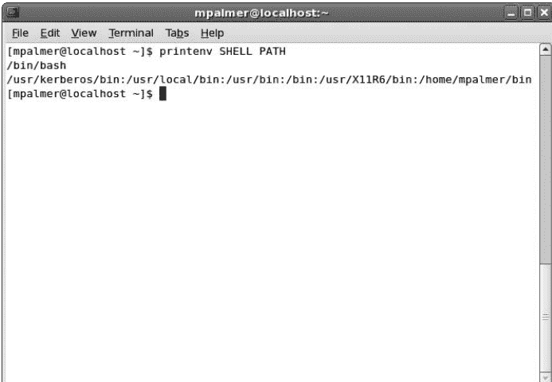

**图 6-5** 使用 `printenv` 查看两个环境变量

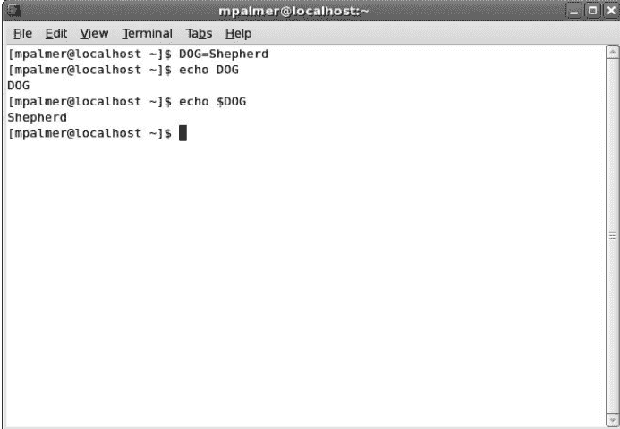

**图 6-6** 查看变量的内容

# 实项目 315

使用双引号将变量设置为包含空格的字符字符串：

-   1. 输入 `MEMO="Meeting will be at noon today"` 并按 Enter。
-   2. 输入 `echo $MEMO` 并按 Enter。

你看到了 `MEMO` 变量的内容：Meeting will be at noon today.

为了演示双引号不会抑制变量内容查看，而单引号会抑制：

-   1. 输入 `echo '$HOME'` 并按 Enter。
-   2. 输入 `echo "$HOME"` 并按 Enter。

你在屏幕上看到了你的主目录路径。

为了演示用于执行命令的反引号运算符：

-   1. 输入 `TODAY=`date`` 并按 Enter。此命令创建了变量 `TODAY` 并执行了命令。
-   2. 输入 `echo $TODAY` 并按 Enter。你看到了日期。

## 项目 6-3

在这个项目中，你将使用算术运算符对变量进行计算。

演示加法运算符：

-   1. 输入 `X=10` 并按 Enter。
-   2. 输入 `Y=$((X+5))` 并按 Enter。
-   3. 输入 `echo $Y` 并按 Enter。你看到了 15。

演示减法运算符：

-   1. 输入 `X=10` 并按 Enter。
-   2. 输入 `Y=$((X-5))` 并按 Enter。
-   3. 输入 `echo $Y` 并按 Enter。你看到了 5。

演示乘法运算符：

-   1. 输入 `X=10` 并按 Enter。
-   2. 输入 `Y=$((X*2))` 并按 Enter。
-   3. 输入 `echo $Y` 并按 Enter。你看到了 20。

演示除法运算符：

-   1. 输入 `X=10` 并按 Enter。
-   2. 输入 `Y=$((X/2))` 并按 Enter。
-   3. 输入 `echo $Y` 并按 Enter。你看到了 5。

## 项目 6-4

在这个项目中，你将学习 `if` 语句用于条件分支。

使用简单的 `if` 语句：

-   1. 创建一个名为 `test.sh` 的脚本，内容如下：

```bash
if [ $1 -gt 10 ]; then
  echo "The number is greater than 10"
fi
```
-   2. 使脚本变为可执行：`chmod +x test.sh`。
-   3. 带参数运行：`./test.sh 15`。你看到 "The number is greater than 10"。
-   4. 带另一个参数运行：`./test.sh 5`。没有输出。

使用 `else` 语句：

-   1. 修改 `test.sh` 为：

```bash
if [ $1 -gt 10 ]; then
  echo "The number is greater than 10"
else
  echo "The number is 10 or less"
fi
```
-   2. 运行 `./test.sh 5`。你看到了 "The number is 10 or less"。

使用 `elif` 语句：

-   1. 修改 `test.sh` 为：

```bash
if [ $1 -gt 10 ]; then
  echo "The number is greater than 10"
elif [ $1 -eq 10 ]; then
  echo "The number is exactly 10"
else
  echo "The number is less than 10"
fi
```
-   2. 运行 `./test.sh 10`。你看到了 "The number is exactly 10"。

## 项目 6-5

在这个项目中，你将学习使用循环重复任务。

使用 `while` 循环：

-   1. 创建名为 `loop.sh` 的脚本：

```bash
count=1
while [ $count -le 5 ]; do
  echo "Count is $count"
  count=$((count+1))
done
```
-   2. 运行 `./loop.sh`。你看到了 1 到 5。

使用 `for` 循环：

-   1. 创建名为 `forloop.sh` 的脚本：

```bash
for i in apple banana cherry; do
  echo "Fruit: $i"
done
```
-   2. 运行 `./forloop.sh`。你看到了列出的水果。

# 314 第 6 章 Shell 脚本编程入门


**图 6-5** 使用 `printenv` 查看两个环境变量


**图 6-6** 查看变量的内容

# 336 第 6 章 Shell 脚本编程入门

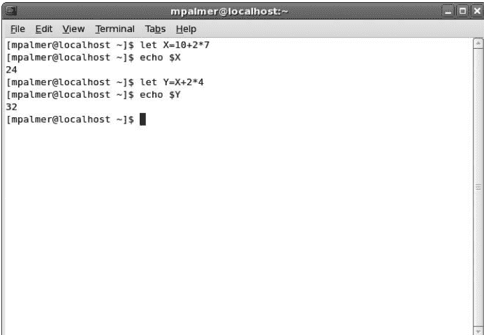

**图 6-7** 分配 Shell变量


**图 6-8** 使用 `export` 命令

# 实项目 317


12. 现在通过输入 `printenv | more` 查看你的环境变量列表。再次在滚动列表时仔细观察。这次你看到了 `MYVAR`。

13. 输入 `clear` 并按 Enter 清除列表，为下一个项目做准备。

```
mpalmer@localhost:~~
File Edit View Tabs Help
[mpalmer@localhost ~$] ./testscript

[mpalmer@localhost ~$] export MYVAR
[mpalmer@localhost ~$] ./testscript
[mpalmer@localhost ~$] 
```

## 项目 6-5

在实项目 6-4 中，你必须在 `testscript` 前使用 `./`，因为你的当前工作目录不在 `PATH` 环境变量中。在这个项目中，你查看 `PATH` 变量的内容。接下来，你将当前工作目录添加到 `PATH` 变量中，并在不使用 `./` 字符运行 `testscript`。

**查看 PATH 内容：**

1. 输入 `echo $PATH` 并按 Enter。

你看到了目录列表。注意路径名称是用冒号 (`:`) 分隔的。

**将当前工作目录添加到 PATH 变量：**

1. 输入 `PATH=$PATH:.` 并按 Enter。
2. 输入 `echo $PATH` 并按 Enter。点 (`.`) 现在已添加到列表末尾。
3. 现在你可以在当前工作目录下运行脚本，而无需在它们前面输入 `./characters`。只需输入 `script` 并按 **Enter** 即可。你可以看到脚本正在执行，如图 6-9 所示。

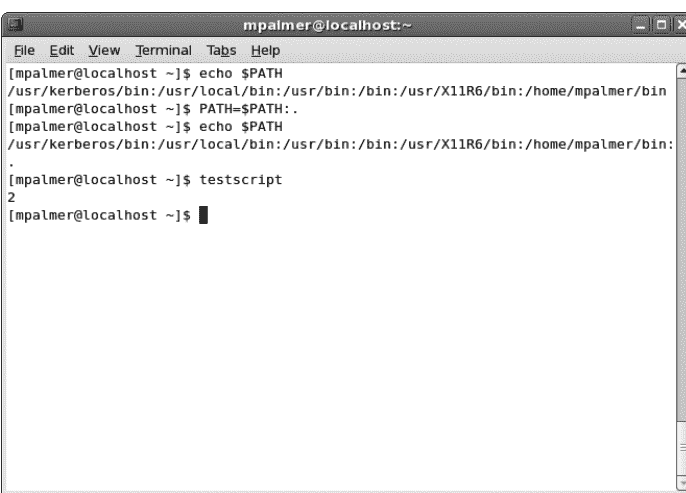

**图 6-9** 将当前工作目录添加到 PATH 变量中以运行 shell 脚本

## 项目 6-6

在这个项目中，你将进一步获得使用顺序逻辑编写非常简单的 shell 脚本的经验。在这些步骤中，你将创建一个 shell 脚本 `seqtotal`。

**演示顺序逻辑：**

1. 输入 `vi` `seqtotal` 并按 **Enter**。
2. 输入 `i` 进入到 `vi` 的插入模式。
3. 输入以下行：

```
let a=1
let b=2
let c=3
let total=a+b+c
echo $total
```

4. 按 **Esc** 切换到 `vi` 的命令模式。
5. 输入 `:x` 并按 **Enter** 保存文件并退出 `vi`。

### 动手项目 319

6. 接下来测试新的 shell 脚本 `seqtotal`。输入 `sh seqtotal` 并按 Enter。

你将看到脚本的输出，结果为 6。

## 项目 6-7

这个项目将向你首次介绍如何在 shell 脚本中使用 `if` 语句，并演示决策逻辑。在第一组步骤中，你创建一个使用基础 `if` 语句的脚本。在第二组步骤中，你修改脚本以包含一个嵌套在内部 `if` 语句。

为了演示 `if` 语句并实现决策逻辑：

1. 输入 `vi veg_choice` 并按 Enter。
2. 输入 `i` 切换到 `vi` 的插入模式。
3. 输入以下行：

```
echo -n "What is your favorite vegetable? "
read veg_name
if [ "$veg_name" = "broccoli" ]
then
echo "Broccoli is a healthy choice."
else
echo "Don't forget to eat your broccoli also."
fi
```

4. 确保你的编辑界面看起来如图 6-10 所示。按 `Esc` 切换到 `vi` 命令模式。
5. 通过输入 `chmod ug+x veg_choice` 并按 Enter 使脚本可执行。接下来，通过 `./veg_choice` 并按 Enter 运行脚本。
6. 当被要求输入你喜欢的蔬菜名称时，输入 `broccoli`。
7. 再次运行脚本并输入 `corn` 或其他蔬菜名称进行响应。

> 记住，你必须先使用 `chmod` 命令使脚本可执行。然后在命令提示符后，输入脚本名称的路径来执行。运行脚本的另一种方法是使用 `sh` 命令，就像你处理 `seqtotal` 脚本时做的那样。在使用 `chmod` 命令后，第三种替代方案是将当前工作目录添加到你的路径中，正如你在动手项目 6-5 中学会的那样。然后只需输入脚本名称即可运行。

# 第 6 章 Shell 脚本编程简介

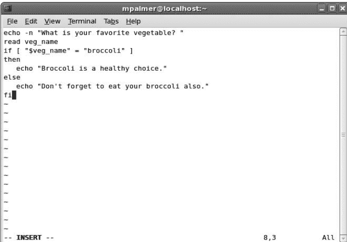

# 图 6-10 创建 veg_choice 脚本

为了练习编写嵌套 `if` 语句：

1. 在 `vi` 或 `Emacs` 中打开 `veg_choice` 文件。
2. 编辑文件使其包含以下行。

```
echo -n "What is your favorite vegetable?"
read veg_name
if [ "$veg_name" = "broccoli" ]
then
    echo "Broccoli is a healthy choice."
else
    if [ "$veg_name" = "carrots" ]
then
    echo "Carrots are great for you."
else
    echo "Don't forget to eat your broccoli also."
fi
```

3. 执行脚本并回答 `carrots`。你应该看到“Carrots are great for you.”
4. 输入 `clear` 并按 Enter 清除屏幕进入下一个项目。

## 项目 6-8

在这个项目中，你学习如何在 shell 脚本和命令行中使用 `for` 循环，演示循环逻辑的工作。

为了在 shell 脚本中演示循环逻辑：

1. 使用 `vi` 或 `Emacs` 创建文件 `_users`。
2. 在文件中输入以下行：

```
for USERS in john tom becky eliill
echo $USERS
```

3. 保存文件并退出编辑器。
4. 赋予文件权限并运行它。结果应该与图 6-11 所示。

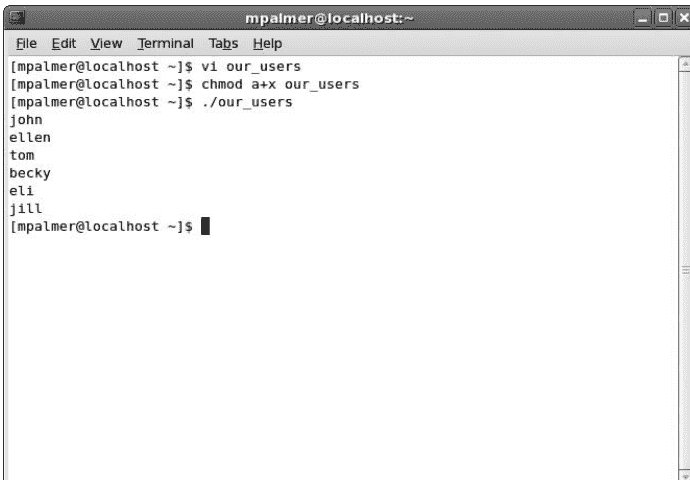

**图 6-11** 运行 `_users` 脚本执行 `for` 循环

为了在命令行输入相同的 `for` 循环：

1. 在命令行输入 `for USERS in john tom becky eliill` 并按 Enter。
2. 在 `>` 提示符输入 `do` 并按 Enter。
3. 输入 `echo $USERS` 并按 Enter。
4. 输入 `done` 并按 Enter。你在屏幕上看到了？
5. 输入 `clear` 并按 Enter 清除屏幕进入下一个项目。

## 项目 6-9

在这个项目中，你创建一个 `for` 循环并使用通配符格式遍历 `for` 语句中的每个元素，这由 `chapters` 组成。你首先创建 `chap4`。然后，你使用 `more` 命令显示每个文件的内容。

为了在 `for` 循环中使用通配符：

1. 输入 `cat > chap1` 并按 Enter。
2. 输入 `This is chapter 1` 并按 Enter。
3. 输入 `Ctrl+d`。创建 `chap1`。
4. 输入 `cat > chap2` 并按 Enter。
5. 输入 `This is chapter 2` 并按 Enter。
6. 输入 `Ctrl+d`。创建 `chap2`。
7. 输入 `cat > chap3` 并按 Enter。
8. 输入 `This is chapter 3` 并按 Enter。
9. 输入 `Ctrl+d`。创建 `chap3`。
10. 输入 `cat > chap4` 并按 Enter。
11. 输入 `This is chapter 4` 并按 Enter。
12. 输入 `Ctrl+d`。创建 `chap4`。
13. 使用 `vi` 或 `Emacs` 编辑器创建 shell 脚本 `chapters`。脚本应该包含这些行：

```
for file in chap[1234]; do
  more $file
done
```

14. 保存文件并退出编辑器。
15. 赋予文件权限并测试它。你看到类似于图 6-12 的输出。

## 项目 6-10

`while` 语句是 `for` 语句之外循环逻辑的另一个例子。在这个项目中，你创建一个包含基础 `while` 语句的 shell 程序。接下来，你创建一个可能用于屏幕数据输入表的 shell 程序，在平面数据文件中存储信息。

# 动手项目 323


# 图 6-12 执行 while 语句

在 shell 脚本中使用 `while` 语句：
+ 1. 使用 `vi` `Emacs` 编辑器创建一个名为 `colors` 的脚本。
2. 输入以下行：

```
echo -n "Try to guess your favorite color: "
read guess
while [ "$guess" = "red" ]; do
echo "No, not that one. Try again."; read guess
done
```

3. 保存文件并退出编辑器。
4. 赋予文件权限并测试。输入 `clear` 并按 Enter 清除屏幕。

`while` 语句的另一个例子是数据表。

创建一个作为数据表的 `while` 循环：
+ 1. 使用 `vi` 或 `Emacs` 创建脚本文件 `nameaddr`
2. 在文件中输入这些行：

```
looptest=y
while [ "$looptest" = y ]
do
echo -n "Enter Name: "; read name
```

# 第 6 章 Shell 脚本编程

```
echo -n "Enter Street: "; read street
echo -n "Enter City: "; read city
echo -n "Enter State: "; read state
echo -n "Enter Zip Code: "; read zip
echo -n "Continue? (y)es or (n)o: "; read looptest
done
```

+ 3. 保存文件并退出编辑器。
+ 4. 赋予文件权限并测试。当脚本运行时，输入几个姓名和地址。当你完成时，当脚本问你“Continue? (y)es or (n)o.”时回答 `n`（no）。（参见图 6-13）输入 `clear` 并按 Enter 清除屏幕进入下一个项目。

图 6-13 使用 `nameaddr` 脚本

## 项目 6-11

当通过程序提供许多选择或者基于一个选择有多种响应时，使用 `case` 逻辑。在这个项目中，你创建一个使用 `case` 逻辑来响应你喜欢的颜色的脚本（基于一个选择有多种可能的响应）。

为了演示 `case` 逻辑：
+ 1. 使用 `vi` 或 `Emacs` 创建 `manycolors` shell 脚本。

```
echo -n "Enter your favorite color: "; read color

case "$color" in

"blue") echo "As in My Blue Heaven.";

"yellow") echo "As in the Yellow Sunset.";

"red") echo "As in Red Rover, Red Rover.";

"orange") echo "As in Autumn with shades of Orange.";

*) echo "Sorry, I do not know that color."

esac
```

2. 保存文件并进行编辑。（参见图 6-14）。
3. 赋予执行权限并进行测试。（参见图 6-14）。


图 6-14 使用 `manycolors` shell 脚本

## 项目 6-12

`tput` 命令允许你初始化屏幕，并以一种美观的方式为光标和文本进行定位。本项目将向你介绍 `tput`。首先，你直接从命令行输入该命令。接下来，创建一个示例 shell 脚本和菜单，以了解该命令的功能。

直接从命令行使用 `tput`：
- 1. 输入以下命令序列并按回车：

`tput clear ; tput cup 10 15 ; echo "Hello"; tput cup 20 0`

# 第 6 章 Shell 脚本编程简介

在该命令序列的执行中，屏幕被清空；光标定位在屏幕的第 10 行第 15 列；打印出“Hello”单词；提示符的位置位于第 20 行第 0 列。

在 shell 脚本中创建一个示例输入菜单：
- 1. 使用 `vi` 或 `Emacs` 创建一个屏幕管理脚本 `scrman`，包含以下行：

```bash
tput cup 1 $2 # 将光标置于指定的行和列
tput clear # 清屏
bold=$(tput smso) # 设置高亮模式 - 粗体
offbold=$(tput rmso) # 重置屏幕 - 关闭高亮
echo $bold # 粗体
tput cup 10 20; echo "Type Last Name:"
tput cup 12 20; echo "Type First Name:"
echo $offbold # 关闭粗体
tput cup 10 41; read lastname # 输入姓
tput cup 12 41; read firstname # 输入名
```

2. 保存文件并退出编辑器。
3. 赋予执行权限并进行测试。（参见图 6-15。）清空屏幕为下一个项目做准备。

> 提示：'`tput smso`' 和 '`tput rmso`' 周围的单引号必须方向正确，否则粗体/取消高亮的命令无法生效。这个单引号位于大多数键盘的左上角，通常与波浪号 (`~`) 在同一个按键上。

## 项目 6-13

在这个项目中，你首先将比较输出中 `sh -v` 和 `sh -x` 选项的区别。接下来，你将练习使用 `sh -v` 调试 shell 脚本。

通过比较 `sh -v` 和 `sh -x` 选项的结果来调试脚本：
- 1. 输入 `sh -v colors`（记得你在本章之前创建的那个喜欢的颜色为红色的脚本），并按回车。
- 2. 输入 `green` 并按回车。
- 3. 输入 `red` 并按回车。注意命令行行被打印了出来。
- 4. 输入 `sh -x colors` 并按回车。
- 5. 输入 `green` 并按回车。
- 6. 输入 `red` 并按回车。现在，命令行和参数前面带有一个加号 `+`。图 6-16 展示了 `sh -v` 和 `sh -x` 的输出。

## 实践项目


**图 6-15** 在脚本中使用 `tput` 生成一个简单的菜单


**图 6-16** 用于调试的 `sh -v` 和 `sh -x` 比较

# 第 6 章 Shell 脚本编程简介

为了练习调试脚本：
- 1. 使用 `vi` 或 `Emacs` 编辑器打开 `colors` 脚本进行编辑。
- 2. 跳到第三行，删除 `"red"` 之后的右括号 `]` 然后退出并保存修改。
- 3. 输入 `sh -v colors` 并按回车。
- 4. 输入 `green` 并按回车。在输出的最后一行，你会看到一条提示，说明 `colors` 脚本第 3 行缺少右括号：

`colors: line 3: [:`
- 5. 使用 `vi` 或 `Emacs` 打开 `colors` 脚本并补回右括号。
- 6. 删除 `colors` 脚本第四行的 `echo` 命令（以及整行内容）。关闭编辑器并保存工作。
- 7. 输入 `sh -x colors` 并按回车。
- 8. 输入 `green` 并按回车。注意消息显示第 4 行缺少命令：

`colors: line 4: command not found`
- 9. 输入 `red` 并按回车退出脚本，或在第 4 行按 `Ctrl+C` 保存工作。
- 10. 使用 `vi` 或 `Emacs` 编辑器打开 `colors` 脚本，在第 4 行重新输入 `echo` 命令并保存。


## 项目 6-14

在这个项目中，学生学习如何创建别名（`alias`）。

要创建别名：
- 1. 为 `ls` 命令创建别名，输入 `alias ll="ls -l"` 并按回车。现在当你使用 `ll` 时，它会自动执行 `ls -l`。
- 2. 输入 `ll` 并按回车。查看详细格式的列表。


## 项目 6-15

这是系列项目中的第一个，在这个项目中，你首先要确保你有一个 `source` 目录来存储文件。接下来，你将创建一个跟踪员工信息的应用程序，以便后续开发使用。

要设置 `source` 目录：
- 1. 在第 4 章中，你已经在主目录下创建了 `source` 目录。确保你位于该目录。
- 2. 如果你在主目录下，输入 `cd source` 并按回车。确保你位于 `source` 目录。
- 3. 使用 `vi` 或 `Emacs` 编辑器创建 `menu` 脚本，包含以下内容：


```bash
tput cup 1 $2 # 将光标置于指定的行和列
tput clear # 清屏
bold=$(tput smso) # 设置高亮模式 - 粗体
offbold=$(tput rmso) # 重置屏幕 - 关闭高亮
echo $bold # 粗体
tput cup 10 20; echo "Type Last Name:"
tput cup 12 20; echo "Type First Name:"
echo $offbold # 关闭粗体
tput cup 10 41; read lastname # 输入姓
tput cup 12 41; read firstname # 输入名
```

- 2. 保存文件并退出编辑器。
- 3. 通过输入 `chmod +x menu` 并按回车赋予文件执行权限。通过输入 `./menu` 并按回车进行测试。（参见图 17。）由于退出选项尚未编写，因此需要按 Ctrl+C 退出脚本。
- 4. 清空屏幕准备下一个项目。

## 项目 6-16

在这个项目中，你将确保 `corp_phones` 文件已创建并包含了用于测试应用程序的数据。你还将练习使用 `grep` 命令从文件中提取信息。


### 为了创建 corp_phones 文件：

- 1. 在第 4 章，你在主目录下创建了 `corp_phones`、`corp_phones1` 和 `corp_phones2` 文件，并对这些文件进行了操作。如果这些文件仍在主目录下，请使用 `rm` 命令删除它们。这确保了你创建的 `corp_phones` 文件包含新电话应用程序所需的正确信息，并且你了解在本章完成的项目中 `corp_phones` 文件中的内容。为此，你现在的一些数据与第 4 章中创建的数据略有不同。
- 2. 如果你在主目录下，输入 `cd source` 并按回车。使用 `pwd` 命令确保你位于 `source` 目录。
- 3. 使用 vi 或 emacs 编辑器创建 `corp_phones` 文件。
- 4. 在编辑器中输入以下记录：

### 动手项目

5. 保存文件并退出编辑器。
6. 输入 `grep 219-555-4591 corp_phones` 并按回车以查找特定的电话号码。

输出应该如下：

`219-555-4591:Moore:Sarah:H:4500:Dept Manager:08-01-1978`

7. 输入 `grep Accountant working corp_phones` 并按回车查找所有账户的文件（参见图 6-18）。

```
mpmaler@localhost:~/source
```


**图 6-18** 使用 corp_phones 数据文件操作

## 项目 6-17

你在动手项目 6-15 中创建并测试的电话菜单脚本仍然需要一些工作，因为它没有包含在选择后调用应用程序的方法。在项目中，你通过在菜单中添加 case 逻辑来解决这个问题。

### 向电话菜单脚本添加内容：

- 1. 如果你中断了开发过程并刚刚重新登录或切换到另一个目录，请进入源目录并使用 `pwd` 命令验证你所在的该目录。
- 2. 使用 `vi` 或 `em` 编辑器打开源目录中的电话文件。在以下行中，所有加粗的行都是脚本：

```
#======================================================================
```

# 第 6 章 Shell 脚本编程简介

# 脚本名称：phmenu

# 作者：在此处输入你的缩写

# 日期：2009年11月

# 目的：公司电话列表菜单

# 命令行：phmenu

==================================================

```bash
phonefile=~/source/corp_phones
loop=y
while [ "$loop" = y ]
do
  clear
  tput 3 12; echo "Corporate Phone Reporting Menu"
  tput 4 12; echo "===================================="
  tput 6 9; echo "P - Print Phone List"
  tput 7 9; echo "A - Add New Phones"
  tput 8 9; echo "S - Search for Phones"
  tput 10 9; echo "Q - Quit: "
  tput 10 19
  read choice || continue
  case $choice in
    [Aa]) ./phoneadd ;
    [Pp]) ./phonelist;
    [Ss]) ./phonefind;
    [Qq]) exit ;;
    *) tput 14 14; echo "Invalid Code"; read choice ;;
  esac
esac
```

- 3. 保存文件并退出编辑器。
- 4. 测试脚本。（可接受的输入为 A, a, P, p, S, s, V, v, Q 和 q。任何其他输入都会出现“Invalid Code”消息）。完成后，按 Ctrl+c 退出。

## 项目 6-18

拥有一种显示未格式化数据的方法是有用的，在这样的显示中，记录与其在数据文件中存储的方式完全相同。这使得开发者能够确保记录是准确的，并且应用程序按预期工作。此外，某些用户可能对查看文件中的原始数据感兴趣，以便确保输入准确。在项目中，在 phonemenu 中添加一个选项，使用 `less` 命令来查看 corp_phones 文件的内容。

### 使用 less 命令查看未格式化的记录：

- 1. 确保你在源目录目录中。接下来，用你喜欢的编辑器打开 phonemenu，并添加以下两行加粗内容：

```
============================
# Script Name: phmenu
```


### 动手项目

# 作者：在此处输入你的缩写

# 日期：今天的日期

# 目的：公司电话列表菜单

# 命令行：phmenu

========================================

```bash
phonefile=~/source/corp_phones
loop=y
while [ "$loop" = y ]
do
  clear
  tput 3 12; echo "Corporate Phone Reporting Menu"
  tput 4 12; echo "===================================="
  tput 6 9; echo "P Print Phone List"
  tput 7 9; echo "A Add New Phones"
  tput 8 9; echo "S Search for Phones"
  tput 9 9; echo "V View Phone List"
  tput 10 9; echo "Q - Quit: "
  tput 10 19
  read choice || continue
  case $choice in
    [Aa]) ./phoneadd;
    [Pp]) ./plist1;
    [Ss]) ./phonefind;
    [Vv]) less $phonefile;
    [Qqq]) exit;
    *) tput 14 4; echo "Invalid Code"; read choice;
  esac
done
```

- 2. 保存文件并退出编辑器。
3. 测试脚本。

## 项目 6-19

在你的设计中，当用户输入 P 或 p 时，应用程序应该打印电话列表。`awk` 程序提供了一个很好的示例，说明了 UNIX/Linux shell 如何加速开发，因为单个 `awk` 命令就可以从许多记录中选择字段并在屏幕上指定格式显示。在这个项目中，你开发 plist1 脚本并使用 awk 显示电话列表。

### 创建 plist1 脚本

- 1. 从源目录开始，使用你选择的编辑器创建如下 plist1 脚本：

```bash
# ===============================
# 脚本名称：plist1
# 作者：你的名字缩写
# 日期：今天的日期
# 目的：使用 awk 格式化冒号分隔的字段
```

# 第 6 章 Shell 脚本编程简介


```bash
# 在纯文件中并显示到屏幕上
# 命令行：plist1
#
====================================
```

```bash
clear
tput 3 20; echo "Corporate Phone List"
tput 3 20; echo "----------------------"
tput 3 0;
awk -F: '{printf "%-10s %-15s %-10s %-10s %-15s %-10s\n", $1,$2,$3,$4,$5,$6}' $phonefile
```

- 2. 保存文件并退出编辑器。

- 3. 通过输入 `chmod +x plist1` 给文件执行权限。通过输入 `./plist1` 并按回车运行脚本（参见图 6-19）。


图 6-19 测试 `plist1` 脚本

## 项目 6-20

现在，你需要开发一种方法向 `corp_phones` 文件输入新信息，以便用户可以轻松构建完整列表。注意 `phmenu` 提供了添加选项。为了实现这一点，请开发 `phoneadd` 脚本。

## 动手项目

创建 `phoneadd` 脚本：

- 1. 确保你在源目录中并使用你偏好的编辑器。输入以下代码：

```bash
############################################
# 脚本名称：phoneadd
# 作者：你的名字缩写
# 日期：今天的日期
# 目的：向 corp_phones 添加员工的 shell 脚本
# 命令行：phoneadd
############################################
phonefile=~/source/corp_phones
loop=y
while [ "$loop" = y ]
do
  clear
  tput 3 12; echo "Corporate Phone Reporting Menu"
  tput 4 12; echo "=================================="
  tput 6 9; echo "P - Print Phone List"
  tput 7 9; echo "A - Add New Phones"
  tput 8 9; echo "S - Search for Phones"
  tput 10 9; echo "Q - Quit: "
  tput 10 19
  read choice || continue
  case $choice in
    [Aa]) ./phoneadd;
    [Pp]) ./phonelist;
    [Ss]) ./phonefind;
    [Qq]) exit ;;
    *) tput 14 14; echo "Invalid Code"; read choice ;;
  esac
esac
```

# 探索练习 337


图 6-20 测试 `phoneadd` 脚本

## 探索练习

- 1. 使用两个不同的命令显示 `HOME` 变量的内容。

2. 将变量 `t` 赋值为 20。接下来，将变量 `s` 赋值为 `t+30`。最后，显示 `t` 和 `s` 的内容以验证你已正确定义了这些变量。

3. 将你在练习 2 中赋值的 `s` 变量设置为环境变量，并使用 `export` 命令验证它是否被识别为环境变量。

4. 切换到你的源目录。显示 `PATH` 变量的内容。接下来，使用命令将当前工作目录添加到 `PATH` 变量中。

5. 完成练习 4 后，以最简单的方法运行 `phnmu`。

6. 创建一个名为 `iam` 的变量，并将 `whoami` 命令的结果赋值给它。显示变量的内容以验证你的结果。

7. 如果你不在主目录，请切换回主目录。使用 `set` 命令设置你的工作环境以防止覆盖文件。

8. 创建一个别名 `var`，用于显示你的环境变量。

9. 在命令行中使用一个 `for` 循环，使用变量 `sandwiches`，然后逐行显示以下三明治：鸡肉、火腿肉、鹰豆泥、番茄。

10. 创建一个使用 `case` 逻辑的脚本让别人猜你最喜欢的三明治（例如金枪鱼）。

11. 显示 `.bashrc` 文件的内容。接下来使用 `vi` 编辑器编辑该文件并输入一个别名，以便你每次输入 `list` 时都能看到目录的详细文件列表。

12. 使用命令模拟你如何排查你在练习 10 中创建的脚本出现的问题。

13. 以下代码行存在什么错误？

```
while [ "$value" = "100" ]; do
  echo "That’s a large number."
fi
```

14. 使用 `let` 命令将值 1024 存储在变量 `ram` 中。显示 `ram` 的内容。

15. 临时将你的主目录变量改为 `/home` 并使用一个命令进入你的主目录。将主目录环境变量恢复为常规主目录并切换过去。

16. 使用 `tput` 命令清除屏幕，然后将光标放在第 7 行第 22 列。

17. 编写一个脚本创建以下菜单：

```
Soup Menu

==========

(t)tomato

(b)bean

(s)quash

Select a soup . . (q) to quit
```

18. 列出 `trap` 命令的所有信号编号和名称。信号 31 的名称是什么？

19. 修改你在练习 17 中编写脚本，使得当菜单准备好接收用户输入时发出哔哔声或铃响声。（提示：查看 `echo` 命令的 man 文档）。

20. 是否有命令可以用来防止 shell 变量被赋予新值？如果是，它是什么？

# 第 7 章

# 高级 Shell 编程

在读完本章并完成练习后，你将：

- 使用流程图和伪代码进行程序设计和分析

- 使用技术确保脚本正在使用正确的 shell

- 设置默认 shell

- 配置 Bash 登录和注销脚本

- 设置 vi 编辑器的默认值

- 使用 `test` 命令进行编程函数

- 格式化记录输出

- 使用脚本删除记录

- 设置快速清除屏幕的技术

- 创建程序算法来解决光标定位问题

- 开发并测试一个消除重复记录的程序

- 创建 shell 函数并在程序中使用它们

在在上一个章节中，你学习了程序开发周期，并开始开发一个程序来自动维护 `corp_phones` 文件中员工电话记录的维护。你开发了一个显示多个选项的菜单以及一个允许向文件中添加记录的数据输入界面。在本章中，你将为员工电话号码应用程序开发更高级的脚本。

你首先将学习如何规划算法并使用流程图进行程序开发。接下来，你将学习如何使用 `test` 命令创建复杂的决策表达式。此外，你还学习了更多关于如何格式化输出的。对于员工电话号码应用程序，你创建并增强了脚本，添加了删除指定记录、搜索记录、防止重复数据录入逻辑，并使用函数对记录进行排序和显示。

# 理解程序设计与分析

在第 6 章“Shell 脚本编程介绍”中，你学习了程序开发周期是从创建程序规范开始的。规范使你能够确定输入所需的数据类型、必须执行的过程以及输出要求。程序开发周期的下一步是设计过程。

在设计过程中，通过分析实现所需结果的最佳方法来开发计算机程序。使用了两种流行且健壮的分析工具来帮助你设计符合程序规范的程序：流程图和伪代码。

## 流程图

许多组织将过程的每一步映射出来，作为设计该过程的方法。考虑一家公司的例子，它决定为招聘流程创建一个新设计。该公司目前的招聘流程需要许多手动操作，该公司希望设计一种新流程以实现功能自动化并更好地利用计算机资源。在设计阶段，委员会讨论了他们想要使用的新程序和计算机资源。接下来，委员会创建了一个流程图来展示过程中的每一步将发生什么。流程图是一种使用一组符号的逻辑图，用于解释从开始到结束的事件序列。组织使用流程图来设计所有过程。程序员也使用流程图来绘制程序的执行顺序。例如，在第 6 章中，你喜欢的蔬菜示例如下：

```
echo "What is your favorite vegetable?"
read veg_name
if [ "$veg_name" = "broccoli" ]
then
  echo "Broccoli is a choice."
else
  echo "Don’t forget to."
```

图 7-1 显示了你在开发程序之前可能创建的内容。

# 理解程序设计与分析 341


**图 7-1** 示例图

程序中的每一步都由符号表示。符号的形状表示执行的操作类型，例如输入/输出。连接符号的箭头表示程序流的方向。

# 342

# 第 7 章 高级 Shell 编程

| 符号 | 描述 |

| :--- | :--- |


|  | 终止 (Terminator) |
|  |  (Process) |
|  | 决策 (Decision) |
|  | 手动操作 (Manual operation) |
|  | 文档 (Document) |
|  | 显示 (Display) |
|  | 手动输入 (Manual input) |
|  | 存储数据 (Stored data) |
|  | 页内连接 (On-page connector) |
|  | 页外连接 (Off-page connector) |
|  | 流程方向 (Process flow) |

图 7-2 标准流程图符号

# 理解程序设计与分析 343

然后程序结束。如果 `veg_name` 不等于“broccoli（西兰花）”，程序将进入“否”分支并显示“别忘了吃西兰花”，然后程序终止。

你可以使用绘模板手动创建流程图。流程图模板提供了用于表示逻辑结构、输入输出操作、处理操作以及包含文件的存储介的符号，如图 7-2 所示。创建流程图的另一种方法是使用流程图软件包，如 ABC Flowchart、Core Flow、Microsoft Visio 或 SmartDraw。流行的文字处理软件包，如 OpenOffice Writer（带有图表功能）、Microsoft Word 和 WordPerfect 也配备了流程图工具。

你可以在这些地址学习更多关于流程图的知识：en.wikipedia.org/wiki/Flowchart, www.smartdraw.com/tutorials/flowcharts/tutorial_02.htm 以及 office.microsoft.com/training/training.aspx?AssetID=RC01019884033。


# 编写伪代码

创建流程图后，设计程序的下一步工作是编写伪代码。伪代码指令与所有的编程语句都相似。使用它们来创建一个模型，将其作为真实示例的基础。例如，这里是 `veg_choice` 程序的伪代码语句：

```
Display "What is your favorite vegetable?” on the screen
Enter data into veg_name
If veg_name is equal to "broccoli"
Then
    Display "Broccoli is a healthy choice." on the screen
Else
    Display "Don’t forget to eat your broccoli also." on the screen
End If
```

伪代码仅是一种设计工具，不会被计算机处理。因此，它没有必须遵守的严格规则。伪代码在口头上应该与流程图所示的逻辑保持一致。例如，图 7-3 显示了代表你在第 6 章中开发的电话应用程序更改的流程图和伪代码，该数据可以重新输入到字段中，以便你返回某个字段纠正错误。

在接下来的章节中，你将学习如何编写代码来实现伪代码示例中的逻辑。在编写程序之前，你将学习如何确保脚本使用正确的 shell，并通过学习 `test` 命令的多功能性来提高你的编程技能。


互联网上有许多资源可以帮助你学习伪代码，例如 www.infoblinks.com/content/pseudocode.htm 和 en.wikipedia.org/wiki/Pseudocode。此外，你可以搜索单词“pseudocode（伪代码）”找到许多许多链接。

# 344 第 7 章 高级 Shell编程

伪代码：

```
While entry = minus
do
    Reposition cursor in previous field
    Enter the data
    Reposition cursor in field following the field that was
    just entered (reentered data)
    Continue testing while loop
Done
```

流程图：


图 7-3 用于重新输入之前字段的伪代码和流程图

# 确保运行正确的 shell 脚本

每个 UNIX/Linux 用户都有自由选择他们偏好的 shell。在开发 shell 脚本时，请确保使用正确的 shell 来解释你的脚本，因为并不是所有的 shell 都支持相同的命令和编程语句。

当你创建一个脚本时，请在脚本的第一行包含设置使用特定 shell 的命令。在书中，我们使用 Bash shell：

```
#!/bin/bash
```

# 设置默认 Shell 345

在指定 shell 的行以 `#` 字符开头，后跟 `!` 字符并提供 shell 的路径，例如 `/bin/bash`。当系统读取此代码时，会加载 Bash shell 并使用它解释脚本文件中的语句。由于 UNIX/Linux 提供了许多 shell，你应该始终以此语句开始你的脚本。即使运行脚本的用户正在不同的 shell 中操作，此行也能确保脚本正常运行。

# 设置默认 SHELL

对于你自己的账户，默认设置的 shell 由系统管理员在 `/etc/passwd` 文件中建立。如果你要在登录时设置特定的 shell，请联系系统管理员。如果你是系统管理员，可以通过编辑 `/etc/passwd` 文件中属于你的账户行来设置默认 shell。例如，如果你的账户是 trborn，`/etc/passwd` 中的条目如下：

trborn:x:500:0:/home/trborn:/bin/bash

这是一个由冒号分隔的长度可变的记录。记录中的第一个字段指定了用户默认 shell 的路径，例如 `/bin/bash`。通过 root 登录可以使用 `vi` 或 `Emacs` 编辑器编辑 `/etc/passwd` 文件。如果你编辑该文件，请在编辑前考虑制作备份。此外，编辑文件时要非常小心，否则可能会导致无法登录系统。

设置账户默认 shell 的另一种方法是使用系统的配置用户软件。在 Fedora 和 Enterprise Linux 中，你可以使用 GNOME 桌面上的 User Manager 工具。更改账户的默认 shell 请使用以下通用步骤：

- 以 root 登录。
- 点击 System 菜单，指向 Administration，然后点击 Users and Groups。
- 在账户列表中双击你的账户。
- 在 User Properties 对话框中，点击 Login Shell 条目，包含你想要的默认 shell 路径，例如 `/bin/bash`（见图 7-4）。点击 OK。
- 关闭 User Manager 工具。

在带有 GNOME 桌面的 openSUSE Linux 中，你可以使用 YaST 工具来配置用户。YaST 是一个多功能工具，允许你在一个位置管理 openSUSE。这里是使用 YaST 的步骤：

- 以 root 登录。
- 点击 Computer 菜单。

# 346 第 7 章 高级 Shell编程


**图 7-4** Fedora 中 User Manager 工具的 Properties 对话框

3. 点击 More Applications。
4. 点击左栏的 System。
5. 点击 YaST（你可能需要滚动列表找到 YaST）。


6. 点击左栏的 `Security and Users`。

7. 点击 `User Management`。

8. 双击你的用户名。

9. 点击 `Details` 标签。

10. 修改 `Login Shell` 条目，包含你想要的默认 shell 路径并点击 `Accept`。

11. 点击 `Finish`。

12. 关闭 `YaST Control Center` 窗口。

# 使用 BASH 登录注销脚本

当 `Bash` 作为你的 shell 时，登录时会自动运行两个脚本：`.bash_profile` 和 `.bashrc`。如果你在登录后切换到不同的 shell，两个脚本都会运行。正如你在第 6 章中学到的，`.bashrc` 文件是包含在主目录中的隐藏文件。`.bash_profile` 文件也是如此。你可以通过输入 `cd` 确保你在主目录，然后执行 `ls -a` 查看这两个文件。

## 使用 Bash 登录和注销脚本 347

`.bash_profile` 在你每次登录或指定 `Bash` 为当前 shell 时都会运行。它通常包含一些设置，例如环境变量、别名以及你允许在 `Bash` shell 中生效的其他设置。你可以使用 `vi` 或 `Emacs` 编辑器添加或修改此文件中的设置。图 7-5 显示了 `Fedora` 中默认的 `.bash_profile`。

```
mpalmer@localhost:~
File Edit View Terminal Tags Help
[mpalmer@localhost ~]$ more .bash_profile
# .bash_profile
## Get the aliases and functions
if [ -f ~/.bashrc ]; then
  ~/.bashrc
fi
## User specific environment and startup programs
PATH=$PATH:$HOME/bin
export PATH
[mpalmer@localhost ~]$ _
```

图 7-5 `.bash_profile` 文件

> `.bash_profile` 脚本文件用于许多 `UNIX/Linux` 系统，如 `Fedora` 和 `Red Hat Enterprise Linux`。然而，某些 `Linux` 系统（如 `SUSE`）将其称为 `.profile`。

当你使用 `Bash` shell 作为默认值登录时，`.bashrc` 文件也会运行——在你临时使用不同的 shell 后回到 `Bash` 时也是如此。通过 `.bash_profile (.profile)`，你可以配置此文件以包含你在 `Bash` shell 中希望生效的环境变量和其他设置。`.bashrc` 起到了 `bash_profile (.profile)` 不具备的额外用途——`bashrc` 在你每次在 `Bash` shell 中启动 `Bash` shell 时都会运行，这被称为运行 shell。例如，在第 3 章“精通编辑器”中，当你在 `vi` 编辑器中输入 `Ctrl+z` 时启动了一个 shell。在第 3 章中，这个 `Bash` 命令带你进入命令行（在子 shell 中），因此你可以在关闭 `vi` 编辑会话的情况下执行命令。当示例中的按下 `Ctrl+z` 启动子 shell 时，系统也运行了 `.bashrc` 脚本。

### 第7章 高级 Shell 编程

`UNIX/Linux` 系统可能包含 `/etc/.bashrc`、`/etc/bashrc` 或 `/etc/bashrc` 文件，这些文件为 `bash` shell 用户设置函数、变量、别名和其他设置。`Fedora` 和 `Red Hat Enterprise Linux` 通过两个文件为所有用户设置 `bash` 默认值：`/etc/bashrc` 和 `/etc/profile`。在 `SUSE` 中，这些文件是 `/etc/bashrc` 和 `/etc/profile`。`/.bashrc`（或 `/etc/.bashrc`）文件设置默认函数和别名，而 `/etc/profile` 文件设置默认环境变量和启动程序。系统管理员可以配置这些文件，以确保 `bash` shell 用户之间存在基础层的一致性。

此外，每个用户家目录下的 `.bash_logout` 文件会在用户注销时执行其中的的命令。（`SUSE` 没有默认的 `.bash_logout`）。例如，该文件通常包含一行带有 `clear` 命令的指令，用于在用户注销时清除终端或终端窗口屏幕。另一个选项是插入一条向屏幕显示文本的命令（`echo`），例如“It has been a pleasure working with you”（与你合作非常荣幸）或“All programs you have used are the property of this company”（你使用的所有程序均为本公司的财产）。

尝试实践项目 7-1 来查看 `Fedora` 和 `Red Hat Enterprise Linux` 的 `.bash_profile`、`.bash_logout`、`/etc/bashrc` 和 `/etc/profile` 文件的内容，或者 `SUSE` 和 `knoptix` 的类似文件。

### 使用 vi 编辑器设置默认值

如果你倾向于使用 `vi` 编辑器，可以选择在家目录下配置一个名为 `.exrc` 的文件。正如你在第 3 章中学到的，`.exrc` 可用于自动设置你的 `vi` 环境。例如，如果你编写脚本或其他程序，你可能希望让 `vi` 自动显示行号，以便快速识别你想要执行或修改的特定行代码。另一种可能性是设置使用 `Tab` 键缩进或嵌套代码时的制表符数量。以下是你在创建或修改 `.exrc` 文件时可能插入的行示例：

```
set number
settab=3
shell=/bin/bash
```

在此示例中，当你运行 `vi` 时，行将通过行号识别；当你使用 `Tab` 键时，将制进三个空格。此外，当你从 `vi` 启动子 shell（通过 `!` 或 `Ctrl+z`）时，shell 是 `Bash`。

### 使用 test 命令

通常在创建脚本或其他应用程序时，你需要依赖一个或多个文件、目录或两者的存在。在另一种情况下，你可能需要确定一个文件是否比另一个文件旧。在其他情况下，你可能需要评估两个字符串或整数。`test` 命令可用于这些或其他目的。

#### 使用 test 命令

语法：`test [-options] [argument/expression/integer]`

#### 详解

- `-[`：用于分析表达式以确定其是否为真——通常在 shell 脚本中用于验证环境条件，例如文件是否存在

- 有用的选项包括：

- `-d` 测试特定目录是否存在

- `-e` 测试文件是否存在

- `-r` 确定文件是否具有读取权限

- `-s` 确定文件是否具有某种类型的内容（不为空）

- `-w` 确定文件是否具有写入权限

- `-x` 确定文件是否可执行

- `-nt` 比较参数中的第一个文件和第二个文件，确定第一个文件是否较新

- `-ot` 比较参数中的第一个文件和第二个文件，确定第一个文件是否较旧

- `-eq` 比较两个整数以确定它们是否相等

- `!` 确定表达式是否为假

- `stringa = stringb` 确定两个字符串是否相等

还有许多其他评估字符串、表达式和整数的选项；请参见表 7-1、7-2、7-3 和 7-4。

`test` 命令使用以选项形式表示运算符来执行评估。使用 `test`，你可以：

- 对整数进行关系测试（例如等于、大于小于）。

- 测试字符串。

- 确定文件是否存在并确定文件类型。

- 执行布尔测试。

此外，你可以将 `test` 命令放在你的 shell 脚本中，或直接从命令行执行它。例如，如果你在脚本中有以下语句：

```
while [ "$furniture" != "desk" ]; do
```

你可以使用以下语句来实现相同的功能：

```bash
while test $furniture != "desk" ; do
```

在两个语句中，只要变量 `furniture` 不等于 `"desk"`，`while` 循环就会继续处理。

在接下来的章节和实践项目中，你将学习如何在命令行和脚本中使用 `test`，以及对文件、目录、字符串、整数和其他元素进行许多不同类型的评估。

### 使用 test 命令执行关系整数测试

`test` 命令可以确定一个整数是否等于、大于、小于或等于、小于等于或不等于另一个整数。表 7-1 描述了 `test` 命令的选项。

表 7-1 `test` 命令的整数选项

| 选项 | 含义 | 示例 |
| --- | --- | --- |
| `-eq` | 等于 | `test -eq b` |
| `-gt` | 大于 | `test -gt b` |
| `-lt` | 小于 (小 L 和小 T) | `test -lt b` |
| `-ge` | 大于等于 | `test -ge b` |
| `-le` | 小于等于 | `test -le b` |
| `-ne` | 不等于 | `test -ne b` |

`test` 命令可以确定一个整数是否等于、大于、小于或等于、小于等于或不等于另一个整数。表 7-1 描述了 `test` 命令的选项。

表 7-1 `test` 命令的整数选项

| 选项 | 含义 | 示例 |


`test` 命令可以确定一个整数是否等于、大于、小于或等于、小于等于或不等于另一个整数。表 7-1 描述了 `test` 命令的选项。

表 7-1 `test` 命令的整数选项

| 选项 | 含义 | 示例 |
| --- | --- | --- |
| `-eq` | 等于 | `test -eq b` |
| `-gt` | 大于 | `test -gt b` |
| `-lt` | 小于 (小 L 和小 T) | `test -lt b` |
| `-ge` | 大于等于 | `test -ge b` |
| `-le` | 小于等于 | `test -le b` |
| `-ne` | 不等于 | `test -ne b` |

## 使用 `test` 命令测试文件

`test` 命令可以确定一个文件是否存在以及它是否具有权限（如可执行、可写）。例如，如果你的脚本设计用于创建一个文件，你可能希望在目录不存在时提醒用户。考虑另一个脚本需要修改文件的示例。表 7-3 描述了文件评估选项。

表 7-3 `test` 文件选项

| 选项 | 含义 | 示例 |
| --- | --- | --- |
| `-b` | 如果文件存在且是块设备文件（如磁带或驱动器）则真 | `test -b` |
| `-c` | 如果文件存在且是字符设备文件（如终端或打印机）则真 | `test -c` |
| `-d` | 如果文件是目录则真 | `test -d` |
| `-e` | 如果文件存在则真 | `test -e` |
| `-f` | 如果文件存在是普通文件则真 | `test -f` |
| `-nt` | 比较参数中的第一个文件和第二个文件，确定第一个文件是否较新 | `test filea -nt fileb` |
| `-ot` | 比较参数中的第一个文件和第二个文件，确定第一个文件是否较旧 | `test filea -ot fileb` |
| `-r` | 如果文件可读则真 | `test -r` |
| `-s` | 如果文件存在且大小大于零则真 | `test -s` |
| `-w` | 如果文件存在且可写则真 | `test -w` |
| `-x` | 如果文件可执行则真 | `test -x` |


尝试实践项目 7-4 使用 `test` 评估目录和文件的存在，然后测试权限。

## 使用 test 命令执行布尔函数

`test` 命令的布尔运算符允许通过 AND 和 OR 关系组合表达式。你还可以使用布尔否定运算符。布尔运算符以数学家乔治·布尔（`George Boole`）命名，指的是一种判断真假的逻辑系统。布尔运算符是表示 AND、OR 或 NOT 的逻辑运算符，用于评估关系，例如表达式的比较——评估结果为真或假。

考虑例如，一个访问文件以允许用户查看文件内容然后修改文件内容的脚本。作为第一步，你将希望脚本验证

### 格式化输出 353

用户对该文件具有读写权限。在这种情况下，你可以使用布尔运算符来测试读写权限。表 7–4 描述了布尔运算符。

### 表 7-4 用于 test 命令的布尔运算符

| 选项 | 含义 | 示例 |
| --- | --- | --- |
| `-a` | 逻辑与 (`AND`) | `test expression1 -a expression2` |
| `-o` | 逻辑或 (`OR`) | `test expression1 -o expression2` |
| `!` | 逻辑非 | `test !expression` |

该运算符组合两个表达式，并测试它们之间的逻辑关系。带有 `-a` 选项的 `test` 命令形式为：

```
test expression1 -a expression2
```

如果 `expression1` 和 `expression2` 都为真，`test` 命令返回真（退出状态为 0）。然而，如果 `expression1` 或 `expression2` 为假，`test` 命令将返回假（退出状态为 1）。

`-o` 运算符也组合两个表达式。它测试逻辑或（`OR`）关系。带有 `-o` 选项的 `test` 命令形式为：

```
test expression1 -o expression2
```

如果 `expression1` 或 `expression2` 有其一为真，`test` 命令返回真（退出状态为 0）。然而，如果两个表达式都不真，`test` 命令将返回假（退出状态为 1）。

该运算符否定表达式的值。这意味着如果表达式通常会导致 `test` 返回真，则它将改为返回假。同样，如果表达式通常会导致 `test` 返回假，它将改为返回真。带有 `!` 运算符的 `test` 命令形式如下：

```
test !expression
```

在实战项目 7–5 中，你将使用布尔运算符测试文件的权限。此外，尝试实战项目 7–6 至 7–8，使用 `test` 命令处理你的源目录，并测试你在第 6 章创建的脚本。

## 格式化记录输出

要格式化输出，请使用 translate 工具 `tr`。正如你从第 5 章“高级文件处理”中所记忆的，translate 工具按字符更改标准输入（你在键盘上输入的字符）。标准输入可以通过 `<` 运算符进行重定向，使其来自文件而非键盘。例如，以下命令将 `counters` 文件的内容作为输入发送给 `tr` 命令，并将小写转换为大写。

```
tr [a-z] [A-Z] counters
```

### 第 7 章 高级 Shell 编程

`tr` 命令的语法可能随 UNIX/Linux 版本的不同而异。Fedora、Red Hat Enterprise Linux 和 SUSE 通常接受大多数变体。例如，你可以在这些 Linux 发行版中运行以下格式：

```
tr "a-z" "A-Z" < counters
tr 'a-z' 'A-Z' < counters（使用单引号，而不是反引号）
tr a-z Z < counters
```

通过使用 `|` 运算符，translate 工具还可以作为过滤器，输入来自 UNIX/Linux 命令的输出。例如，以下命令将 `cat` 命令的输出传递给 `tr`：

```
cat names | tr " "
```

此示例命令将 `names` 文件的内容通过传输给 `tr`。`tr` 将每个出现的 `:` 字符替换为空格。在这方面，`tr` 工具的作用类似于 `sed` 命令，不同之处在于 `sed` 是按行更改标准输入字符串，而不是按字符更改。

在实战项目 7-9 中，你对已经创建的员工电话文件 `corp_phones` 的输出进行格式化。接下来，在实战项目 7-10 中，你创建 `phonefind` 脚本来搜索并显示电话号码信息。`phonefind` 脚本是你的员工编号应用程序的另一个部分，可以从你在第 6 章写的 `phmenu` 脚本中调用。

## 删除电话记录

在本节中，你将回顾 `sed` 命令，将其应用于你正在完善的员工电话号码应用程序。回想第 5 章，`sed` 获取输入文件的内容，并将作为选项和参数提供的操作应用于文件内容。结果将被发送到标准输出设备。使用 `sed` 删除电话记录的一种简单方法是使用 `-d`（删除）选项。以下是后续步骤的伪代码表示：

```
输入电话号码
使用 sed -d 删除匹配的电话号码并输出到临时文件 f
确认接受
```

如果接受了输出，将临时文件 `f` 复制回 `corp_phones`（覆盖原文件）

在实战项目 7-11 中，你将修改在第 6 章开始写的 `phmenu` 脚本，以实现此处所示的伪代码中的逻辑。

## 清屏

在设计脚本时，清除一次或多次屏幕是非常重要的，例如当你第一次执行脚本或从一个菜单/屏幕切换到另一个时。你在第 1 章“UNIX 和 Linux 的精髓”中学到的 `clear` 命令是一个实用的清屏工具，但你可以使用更快的方法。你可以将 `clear` 命令的输出存储在 shell 变量中。回想第 6 章，可以通过将命令包含在单反引号（`` ` `` 字符，通常位于键盘左上角，波浪号 `~` 旁边）中将命令的输出存储在变量中。例如，此命令将 `date` 命令的输出存储在变量 `TODAY` 中：

```
TODAY=`date`
```

`clear` 命令的输出是一系列清除屏幕内容的值。将这些值存储在变量中然后在屏幕上 `echo` 该变量的内容可以实现相同的效果，但速度快约 10 倍。

### 第 7 章高级 Shell 编程

注意这个 `while` 语句：

```
while test "$iname" = "-"
```

参数 `$iname` 用引号括起来，是为了防止在用户按下回车键或在姓氏处输入多个单词时命令产生错误。例如，如果用户在姓氏处输入 `Smith Williams`，则上述语句将被解释为：

```
while test "Smith Williams" = "-"
```

然而，如果在编写语句时没有在 `$iname` 周围加上引号，则该语句被解释为：

```
while test Smith Williams = "-"
```

此语句会导致错误信息，因为它向 `while` 命令传递了过多的参数。

你将在“实战项目 7–13”中实现这段新代码。

## 防止输入重复数据

由于用户并不总是会输入有效数据，因此程序应该始终检查其输入，以确保用户输入了可以接受的信息。这被称为**输入验证（`input validation`）**。例如，你的员工电话应用程序使用的 `corp_phones` 数据文件对于给定的电话号码应该只有一条记录。如果一个人及其关联电话号码有两个或多条记录，这将增加困惑并可能导致错误。

最好的方法是创建一个输入验证算法，防止用户添加已经分配过的电话号码。实现此目的的伪代码和流程图如图 7–8 所示。在查看此图后，尝试“实战项目 7–14”，在你之前创建的 `phoneadd` 脚本中添加一个算法来执行输入验证。

## 使用 Shell 函数

伪代码：

```
如果电话号码已经在文件中
那么
  在屏幕上显示消息“此号码已分配给：”
  显示具有重复号码的人员记录
  清除屏幕并准备下一次输入
```

结束如果

流程图：


图 7-8 为 `phoneadd` 脚本执行输入验证的修改。

## 使用 SHELL 函数

一个 Shell 函数是一组存储在内存中并分配了名称的命令。Shell 脚本可以使用函数名来执行这些命令。你可以使用 Shell 函数来隔离可重用的代码段，这样你就不需要在整个程序中重复算法。这意味着在你开发并测试了执行某些操作的代码行后，不再需要在多个脚本中重新输入这些行。相反，你可以创建一个包含这些行的函数，并从不同的脚本简单地调用该函数。函数非常有用，因为它们节省了你的打字时间。它们还能让你重用已经测试过的代码行，减少你花费调试的时间并使你的代码更加可靠。

函数与变量名的区别在于，函数名后面跟着一组括号，而组成函数的命令则被括在在大括号中。例如，查看以下函数的代码：

```
datenow()
{
date
}
```

此示例函数的名称是“`datenow`”。它的大括号内只有一个命令：`date` 命令。当执行 `datenow()` 函数时，它会调用 `date` 命令。

### 从命令行定义函数

你可以通过输入函数名并完成定义它所需的参数来从命令行定义函数。以下是创建 `datenow()` 函数时你需要输入的内容副本：


```
[martin@localhost ~]$ datenow() <Enter>
{ <Enter>
  date <Enter>
} <Enter>
[martin@localhost ~]$
```

在这些步骤中，通过在输入函数名后紧接着输入左括号和右括号——在本例中，你输入 `datenow()`。当你按下回车键时，Shell 会显示大于提示符 (`>`)，你需要为函数输入参数。你提供的第一个参数是左大括号，用于开始将执行的函数代码或命令。接下来，输入 `date` 命令。最后，在本例中，提供右大括号以表示要执行的代码或命令的结束。当你输入大括号并按下回车键后，Shell 就准备好在你从命令行输入它时执行你的新函数了。

函数通常存储在脚本文件中，并在登录时加载到内存中。然而，你也可以在命令行输入它们。

传递给参数的方式与任何其他 Shell 过程相同。函数使用位置变量（也称为参数）`$1` 到 `$9` 来访问参数。例如，`$1` 是给函数的第一个参数，`$2` 是第二个参数，以此此类推。只需在命令名后输入参数，并在每个参数之间留出空格即可。例如，你可以设计之前讨论的 `datenow()` 函数，使用参数“Today’s date and time are;”并按如下方式显示日期的这一行：

```
[martin@localhost ~] datenow "Today's date and time are:"
Today's date and time are:
Mon Feb 9 21:49:45 MST 2009
```

在这个示例中，“Today's date and time are:” 是函数 `()` 之后第一个位置 (`$1`) 的参数。

脚本或函数通常接受最多九个位置参数，`$1` 到 `$9`。这意味着你输入脚本或调用的 `.num` 的内容被放在变量（`$1` 到 `$9`）中。如果你有一个名为 `.num` 的函数并输入 `.num 20 55`，那么 `20` 是第一个参数并被放在 `$1` 变量中；`55` 是第二个参数并被放在 `$2` 变量中。函数内的代码执行如下。

除了 `$1` 之外，还可以使用其他字符来提高编程效率。由于用户并不总是会输入有效数据，程序应该始终检查其输入。例如，在“实战项目 7-15”中，你使用了 `test` 语句。在“实战项目 7-16”中，你通过 `test` 命令查看它。在“实战项目 7-17”中，你通过 `.bashrc` 启动它。在“实战项目 7-18”中，你从命令行运行它。最后，在“实战项目 7-19”中，你使用新函数作为对你应用程序的收尾工作。

除了 `$1`，还可以使用其他位置参数。通过在脚本和函数中使用重用代码，这可以节省时间并减少错误。

## 在脚本内部创建函数

提高编程效率的最好方法之一是重用代码。通过在脚本中使用这些函数，它们在内存中。它是隐藏的，除非你使用 `-a` 来查看它。例如，你可能会在脚本中创建以下代码行：

```
sort_name()
{
sort -2 -t: corp_phones
}
sort_job()
{
sort -6 -t: corp_phones
}
sort_dept()
{
sort -5 -t: corp_phones
}
```

你可以从这些代码行判断，有一个函数按姓氏排序 `corp_phones`，一个按职位名称排序，一个按部门编号排序（参见第 4 章，“UNIX/Linux 文件处理”，查看 `sort` 命令的语法）。

# 调试脚本

大多数脚本编写者在某些时刻遇到需要调试的问题。随着编写脚本经验的增加，你将能够更快地调试任何问题。你可能会将调试视为一种进一步完善写作技巧的方法。你会从调试中汲取教训，并应用于编写无错误的脚本。

以下是一些帮助你调试的提示：

- 确保脚本具有执行权限，例如 `chmod a+x` 或 `chmod a+rx`。
- 确保脚本的第一行包含指定要使用的 shell 的命令，例如 `#! /bin/bash`。
- 使用你在第 6 章中学到的 `-n`、`-v` 和 `-x` 调试选项。
- 寻找拼写错误，这些是错误。
- 寻找特定字符使用的错误，例如：
  a. 在同一行中的两个独立命令之间缺少分号
  b. 使用单引号 (`''`) 而不是反引号 (`'`) 或反之亦然
  c. 缺少单引号或双引号
  d. 缺少用于注释的井号 (`#`)
  e. 使用错误的重定向运算符，例如用 `>` 代替 `%`

## 第 363 章章节总结

- 7. 寻找在你的 UNIX/Linux 发行版不支持的命令选项。例如，使用 `+n` 选项来指定键排序字段在许多系统上的 `sort` 命令中已不再支持。
- 8. 检查循环逻辑，确保它不是从错误的值开始的，例如用 1 而不是 0。
- 9. 确保你的循环逻辑有一个退出点，以免你创建了一个永不结束的循环结构（进入死循环）。
- 10. 确保你没有创建一个对其他用户无法运行的脚本，因为该用户在他们的登录脚本中有不同的环境变量或函数。

## 章节总结

- 最流行且经过验证的分析工具是程序流程图和伪代码。流程图是使用一组标准符号绘制的逻辑图，用于解释程序的执行流和程序将要采取的操作。
- 伪代码（Pseud）是程序的模型。它用类似于你的自然语言的语句编写。
- 当你编写脚本时，脚本文件的第一行指定要使用的 shell，例如通过输入 `#!/bin/bash` 来指定 Bash 壳。
- 使用 `test` 命令来验证目录和文件的存在，并比较数值和字符串值。
- `translate` 工具 (`tr`) 逐字符地更改键盘输入的字符，并在当输入来自另一个 UNIX/Linux 命令的输出时作为过滤器使用。标准输入可以重定向为来自文件而非键盘。
- `sed` 命令读取文件作为输入并修改文件内容。`sed` 的选项和参数用于控制文件内容的修改方式。
- 为了加快清除屏，可以将 `clear` 命令序列赋值给 shell 变量 `CLEAR`，并在你的登录脚本内部设置。这可以更快清除屏幕，因为每次执行时不需要在文件中查找。
- Shell 函数可以通过允许代码重用来使 shell 程序员更高效。你可以将多个函数组合在一个 shell 脚本中，并将函数加载到内存中随时使用。

## 命令总结：第 7 章命令回顾

| test 命令选项 | 含义 | 示例命令 |
| --- | --- | --- |
| ! | 逻辑取非 | `test expression` |
| -a | 逻辑与 | `expression1 -a expression2` |
| -b | 测试文件是否存在且为块文件（面向块的设备，如磁盘或磁带驱动） | `test -b file` |
| -c | 测试文件是否存在且为特殊文件（面向字符的设备，如终端或打印机） | `test -c file` |
| -d | 如果文件存在且是目录则为真 | `test -d file` |
| -e | 如果文件存在则为真 | `test -e file` |
| -eq | 等于 | `test -eq b` |
| -f | 测试文件是否存在且为普通文件 | `test -f file` |
| -ge | 大于等于 | `test -ge b` |
| -gt | 大于 | `test -gt b` |
| -lt | 小于等于 | `test -lt b` |
| -n | 测试字符串长度不零 | `test -n string` |
| -ne | 不等于 | `test -ne be` |
| -o | 逻辑或 | `expression1 -o expression2` |
| -r | 如果文件存在且可读则为真 | `test -r file` |
| -s | 如果文件存在且大小大于零则为真 | `test -s file` |
| string | 测试字符串长度不零 | `test string` |
| string1= string2 | 测试两个字符串是否相等 | `test string1= string2` |
| string1!= string2 | 测试两个字符串是否不等 | `test string1 != string2` |
| -w | 如果文件存在且可写则为真 | `test -w file` |
| -x | 如果文件存在且可执行则为真 | `test -x file` |
| -z | 测试字符串长度为空 | `test -z string` |

## 核心术语

**布尔运算符 (Boolean operator)**：一种表示与、或、非的逻辑运算符，用于通过比较两个表达式来评估关系——评估结果要么为真，要么为假。

**退出状态 (exit status)**：当 *test* 命令完成对表达式、字符串、整数或其他信息的评估后，返回给操作系统的数值。如果退出状态为 0（零），则测试结果为真。任何为 1 的退出状态都表示测试结果为假。

**流程图 (flowchart)**：一种使用一组标准符号的逻辑图，用于解释程序的序列逻辑以及序列中执行的每项操作。


### 输入验证 (input validation)
一个确保用户输入了接受信息的过程，防止用户在文件中输入重复记录。

### 伪代码 (pseudocode)
与实际编程相似的指令。用作模型，以后可能成为程序的基础。

### shell 函数 (shell function)
存储在内存中并分配了名称的命令组。例如，你可以在 shell 脚本中调用函数名称，以便函数的命令作为脚本的一部分执行。你也可以使用函数来存储可重用的代码，这样就不需要重复它们。

## 复习题

1. 让脚本在屏幕上打印警告，说明它需要 Bash 壳。
   b. 让系统管理员调整所有账户，使 Bash 成为默认。
   c. 在脚本的第一行输入 `#!/bin/bash`。
   d. 为所有账户创建一个函数，防止使用 Bash 以外的 shell。

2. 下列哪一个脚本语句与语句 `while [ "Start" != "Start" ` 完成相同的功能？
   a. `while [alternate ]; do`
   b. `while $Start; do`
   c. `for test $Start; do`
   d. `test $alternate; do`

3. 假设你有一个名为 `alternate` 的脚本，它用于检查文件是否存在或具有权限。关于这些文件，以下哪些是正确的？（多选）
   a. 在登录时通过 `alternate` 加载。
   b. 这是一个隐藏文件。
   c. 通过输入 `alternate` 运行它们。
   d. 这是一个特殊文件。

## 第 7 章 高级 Shell

4. 为了快速清除屏，将 `clear` 命令序列赋值给在登录脚本内部设置的 shell 变量 `CLEAR`。这可以更快清除屏幕，因为每次执行时不需要在文件中查找。
   a. `clear`
   b. `let $clear`
   c. `CLEAR=$clear`
   d. `clear=`

5. 假设你有一个 `alternate` 文件，为了更方便地查看这些函数。由于你使用 vi 编辑器，你应该在按 n 键之前创建哪些？
   a. `set number`
   b. `create $alternate`
   c. `vi`
   d. `alternate $alternate`

6. 如果你每天使用相同的五个函数，并寻找一种方法确保它们在你登录账户时可用，你可以做什么？
   a. 将它们变为环境变量。
   b. 将它们永久化。
   c. 通过你的登录脚本加载它们。
   d. 将它们添加到 `/func` 目录以永久化。

7. 当你输入 `test -d tmp; echo $?` 时，屏幕显示 0。这意味着？
   a. `tmp` 文件为空。
   b. `tmp` 文件大于 1 MB。
   c. `tmp` 目录存在。
   d. `tmp` 为空。

8. 流程图中向下箭头代表什么？
   a. 处理流
   b. 手动输入
   c. 存储的数据
   d. 显示

## 复习题 367

9. 下列哪些是 `test` 命令使用的布尔运算符示例？（多选）
   - `-a` 用于逻辑与
   - `-m` 用于部分合并
   - `-n` 用于逻辑取非
   - `-o` 用于逻辑或

10. 你有一个名为 `customers` 的特殊数据文件，文件中的字段由字符 `^` 分隔。你想在删除 `^` 字符并插入冒号之前查看此文件。下列哪个命令让你以这种方式查看文件？
    - `insert -t | customers`
    - `test -i [^] [:] customers`
    - `cat customers | tr "|" ""`
    - `sub |t' > customers`

11. 下列哪个语句可以确定变量 `value` 小于 750？
    - `echo $value -750`
    - `value$ to 750`
    - `test $value -lt 750`
    - `test "value" >!750`

12. 某些 Linux 系统使用 _________________ 脚本在用户注销账户时执行相同的操作。
    - `bash_logout`
    - `bash_rc`
    - `/etc/logoff_bash`

13. 你最近与公司的预算委员会会了创建一个每月产生相同预算报告的脚本。由于这是一项重要任务，你已经开始创建流程图。下一步应该？
    - 立即编写脚本所需的函数。
    - 创建菜单脚本。
    - 找到预算 文件中可以作为键的三个最重要的字段。
    - 在创建实际脚本之前编写伪代码。

14. 以下哪些是你可能在流程图中使用的符号示例？
    （选择所有适用项。）
    + a. 决策
    + b. 文档
    + c. 数据
    + d. 磁磁盘

15. 你正在创建的脚本接收用于更新数据的输入。在获取输入之前，你希望脚本验证要更新的文件（名为 `clients`）是否存在，并且脚本用户是否具有向该文件写入的权限。以下哪条语句可以实现这一功能？
    + a. `string -w clients`
    + b. `test -w clients`
    + c. `chmod -all clients`
    + d. `tr -ew clients`

16. 在处理第 15 题中的脚本时，你应该考虑以下哪项？
    + a. 输出强度
    + b. 输入验证
    + c. 功能互惠性
    + d. 用户犹豫

17. 你的公司每月手动删除离职员工的特定记录。你被要求编写一个脚本来自动化这一过程。以下哪个命令可以用于删除文件中的记录？
    + a. `cut -a`
    + b. `purge -d`
    + c. `trdel -r`
    + d. `sed -d`

18. 系统管理员会在以下哪个文件中设置你账户所使用的默认 shell？
    + a. `/shell`
    + b. `/home/shell`
    + c. `/etc/passwd`
    + d. `/home`

# 实践项目 369

+ 19. 当你创建一个 shell 函数时，以下哪个字符紧跟在函数名后面？a. `()`
    b. `!#`
    c. `[[`
    d. `//`

+ 20. 当你从命令行创建一个 shell 函数时，在声明函数名后的第一个 `>` 提示符处，输入哪个字符？
    a. `"`
    b. `{`
    c. `'\n`
    d. `$`

+ 21. 流程图的开头结尾通常使用什么符号？
    a. 终止符
    b. 显示
    c. 连接符
    d. 手动操作

22. 什么是退出状态（exit status）？它与哪个命令一起使用？

23. 在你的组织中，每个人都使用 Red Hat Enterprise Linux 中的 Bash，且所有用户都使用相同的别名（aliases）和 shell 函数。系统管理员可以将这些别名和函数存放在哪个文件中，以便所有用户可以使用？

24. 创建一个语句，使能够判断文件 `/source/results` 是否比文件 `/data/results` 新。

25. 创建一个简单的函数，判断字符串变量是否不包含字符（长度为零）。

## 实践项目

> 注意
> 使用命令行（如终端窗口）、Bash shell 以及你自己的账户完成这些项目。除非另有说明，否则使用你的主目录。


# 第 7 章 高级 Shell 编程

## 项目 7-1

在使用 Bash 时，查看用于启动环境的文件内容非常有价值：`.bash_profile`、`.bash_rc`、`.bash_logout`、`/etc/bashrc` 和 `/etc/profile`（适用于 Fedora 和 Red Hat Enterprise Linux）。在该项目中将查看这些文件（或 SUSE 和 Knappix Linux 中的对应文件）。

查看影响 Bash 环境的文件：
+ 1. 如果你使用 Fedora 或 Red Hat Enterprise Linux，输入 `more .bash_profile .bashrc .bash_logout /etc/bashrc/etc/profile` 并回车。如果你使用 SUSE，输入 `more .profile .bashrc/bash.bash/etc/profile` 并回车（SUSE 没有 `.bash_logout`）。或者在 Knappix 中，输入 `more .bashrc /etc/bash.bashrc/etc/logout` 并回车（Knappix 没有 `bash_profile` 和 `bash_logout` 文件）。（如果你愿意，也可以可以使用 `cat`、`more` 或 `less` 命令逐个处理一个文件）
2. 按空格键翻页查看文件内容。

## 项目 7-2

该命令允许你评估许多类型的条件，包括提供整数比较。在该项目中，你从命令行评估整数表达式。


使用该命令处理整数表达式：

1. 输入命令 `number=122` 并回车，创建值为 122 的变量 `number`。
2. 输入 `$number -eq 122` 并回车。屏幕上显示的显示为 0，例所示：
3. 输入 `echo $?` 并回车。`echo $?` 命令显示最近执行的命令的状态。在该项目中，`test` 命令返回状态 0，表示表达式 `$number -eq 122` 为真。变量 (`$number`) 等于 122。
4. 输入 `$number -gt 142` 并回车。
5. 输入 `echo $?` 并回车。此时，结果应该是 1（假），因为 122 不大于 `-gt` 142。
6. 输入 `value=51` 并回车。
7. 输入 `test $number -lt $value` 并回车。

```
[@localhost] -$ number=122
[@localhost] -$ test $number -eq 122
[@localhost] -$ echo $?
```

`echo $?` 命令显示最近执行的命令的状态。在该项目中，`test` 命令返回状态 0，表示表达式 `$number -eq 122` 为真。变量 (`$number`) 等于 122。

...
8. 输入 `echo $` 并回车。此时，屏幕上显示的 test 结果为 1：

```bash
[beth@localhost -]$ value=51
[beth@localhost -]$ test $number -lt $value
[beth@localhost -]$ echo ?
```

在该示例，`test` 命令返回退出状态 1，表示表达式 `$number -lt $value` 为假。这意味着 `$number` 不小于 `$value`。

## 项目 7-3

在该项目中，使用 `test` 命令评估字符串内容。

使用 `test` 命令的字符串功能：

1. 输入 `lname="Rossetti"` 并回车。
2. 输入 `test $lname = "Rossetti"` 并回车。
3. 输入 `echo $lname="Rossetti"` 并回车。

（注：由于原文中存在大量重复和混乱的 OCR 文本，此处翻译已根据逻辑进行了精简和整理，确保内容清晰准确。原文中关于项目 7-2 和 7-3 的多次重复描述已按其核心逻辑步骤进行处理。）

## 项目 7-4

在该项目中，你将学习如何使用 `test` 命令评估文件和目录。

使用 `test` 命令测试文件：

1. 输入 `mkdir test_directory` 并回车创建一个目录。
2. 输入 `test -d test_directory` 并回车。
3. 输入 `echo $` 并回车。你应该看到退出状态 0，表示 `test_directory` 存在。
4. 输入 `touch test_file` 并回车创建一个空文件。
5. 输入 `ls -l test_file` 并回车查看 `test_file` 的权限。权限应该类似于：

```
[@localhost ~]$ ls -l test_file
-rw-r--r-- 1 beth 0 Feb 8 12:43 test_file
```

6. 注意该文件对于所有者（你）具有读写权限。
7. 输入 `test -x test_file` 并回车。
8. 输入 `echo $` 并回车。你的屏幕类似于：

```
[@localhost ~]$ test -x test_file
[@localhost ~]$ echo $
1
```

该命令返回退出状态 1，因为 `test_file` 是可执行的。
9. 输入 `test -r test_file` 并回车。
10. 输入 `echo $` 并回车。你的屏幕应该类似于：

```
[@localhost ~]$ test -r test_file
[@localhost ~]$ echo $
0
```

该命令现在返回退出状态 0，表示 `test_file` 是可读的。

## 项目 7-5

有时，使用带有布尔运算符的 `test` 命令来判断两个表达式是否同为真或其中一个为真非常有用。在该项目中，你将使用布尔运算符测试表达式的 AND、OR 或 NOT 结果。

使用带有布尔运算符的 `test` 命令：

1. 回想你在项目 7-4 中创建的 `test_file` 具有读写权限。你可以使用布尔运算符同时测试这两个权限。输入 `test -r test_file -a -w test_file` 并回车。

此测试命令使用 AND（与）关系测试两个表达式：`-r test_file` 和 `-w test_file`。如果两个表达式均为真，则 `test` 命令将返回真。
2. 输入 `echo $?` 并按回车。屏幕上显示的结果类似于所示：

```
[beth@localhost ~]$ test -r test_file -a -w test_file
[beth@localhost ~]$ echo $?
```

`test` 命令返回退出状态 0，表示 `test_file` 是可读可写的。
3. 输入 `test -x test_file -o -r test_file` 并按回车。

此命令使用 OR（或）关系否定了两个表达式：`-x test_file` 和 `-r test_file`。

如果其中任一个表达式为真，`test` 命令将返回真。
4. 输入 `echo $?` 并按回车。屏幕上显示的结果类似于所示：

```
[beth@localhost ~]$ test -x test_file -o -r test_file
[beth@localhost ~]$ echo $?
```

`test` 命令返回退出状态 0，表示 `test_file` 可执行或可读。
5. 输入 `test !-r test_file` 并按回车。

此命令否定了表达式 `-r test_file` 的结果。如果该表达式为真，`test` 命令将返回假。同样，如果表达式为假，`test` 命令将返回真。
6. 输入 `echo $?` 并按回车。你的屏幕类似于所示：

```
[beth@localhost ~]$ test ! -r test_file
[beth@localhost ~]$ echo $?
```

`test` 命令返回退出状态 1，表示表达式 `! -r test_file` 为假。

## 项目 7-6

到目前为止，你对 `test` 命令的使用更多是出于理论应用。在接下来的 `test` 项目中，你将使用 `test` 命令来验证你的工作环境。你必须验证你在第 4 章中创建并在第 6 章用于开发电话号码和员工信息应用程序的源目录。请确保你已拥有第 6 章中开发的源目录以及你开发的应用程序，以完成本章的剩余项目。如果没有，请返回第 6 章重新创建它们。

要验证源目录是否存在：

1. 输入 `test -cd source ; echo $` 并按回车。此命令确定源目录是否存在以及是否为目录。由于 `echo $` 命令在同一行内，退出状态会在你按回车后立即出现。退出状态应为 0，表示你有一个源目录。如果不是，请使用 `mkdir` 命令创建源目录。
2. 在第 6 章中，你创建了 `corp_phones` 文件以及 脚本 `phmenu` 和 `phoneadd`。验证你是否拥有 `corp_phones` 文件。接下来输入 `cd ~/source` 并按回车进入工作目录。输入 `test -e corp_phones ; echo $` 并按回车。如果你看到状态 0，说明文件存在。如果没有，请返回第 6 章创建它（或向你的教师寻求帮助）。
3. 对 `phmenu`、`phoneadd` 重复 `test -e` 命令，并列出源目录中的文件。如果你没有这些文件，请返回第 6 章创建它们（或向你的教师寻求帮助）。
4. 要将 `/home/username/source` 目录永久添加到你的 `PATH` 中（`username` 为你的登录名），以便每次登录时都生效，你可以编辑 `.bash_profile`。首先输入 `cd` 并按回车返回你的主目录。使用 `vi` 编辑器打开 `.bash_profile`（或 SUSE 中的 `.profile` 或 `.bashrc` 文件）。
5. 将光标移动到读取这一行：

```
PATH=$HOME/bin
```

6. 输入 `i` 切换到插入模式。在行尾输入 `:HOME/source`（包含冒号）。见图 7-9。
7. 按 `Esc` 键，输入 `:x` 或 `zw`，然后按回车离开文件并退出编辑器。
8. 要使新的 `PATH` 值生效，请注销并重新登录。
9. 登录后，输入 `echo $PATH` 并按回车。在屏幕列出的路径末尾，你应该能看到刚刚添加的路径。注意，现在你只需要输入脚本名称即可从源目录运行脚本。


图 7-9 在 `.bash_profile` 文件中将源目录添加到路径

## 项目 7-7

在这个项目中，你将进行从命令行使用 `test` 命令的练习，现在是时候将你的知识应用于脚本了。再次回想你在第 6 章中编写并修改的最喜欢的蔬菜脚本 `veg_choice`：

```
echo -n "What is your favorite vegetable?"
read veg_name
if [ "$veg_name" = "broccoli" ];
then
  echo "Broccoli is a healthy choice."
else
  if [ "$veg_name" = "carrots" ];
then
    echo "Carrots are great for you."
  else
    echo "Don't forget to eat your broccoli."
fi
```

在这个项目中，你将修改脚本中的一个 `if` 语句，使其使用 `test` 命令。完成后，该程序的运行结果将与之前完全相同。

- 1. 输入 `cd` 确保你在主目录中。将 `veg_choice` 文件加载到 `vi` 或 `Emacs`。
- 2. 修改读取这一行：

`if [ "$veg_name" = "broccoli" ]`

改为：

`if test $veg_name = "broccoli"`

你的屏幕应该类似于图 7-10。
- 3. 保存文件并退出编辑器。
- 4. 执行脚本进行测试。输入 `broccoli` 并回车 `What is your favorite vegetable?` 脚本的输出应类似于：

```
[beth@localhost ~]$ ./veg_choice
What is your favorite vegetable?
Broccoli is a healthy choice.
```
- 5. 输入 `clear` 并按回车清理屏幕。


10 在 `veg_choice` 脚本中使用 `test` 命令

## 项目 7-8

在这个项目中，你将修改 `while` 循环以使用 `test` 命令。

修改 `while` 循环以使用 `test` 命令：
- 1. 回想你在第 6 章在主目录中编写的 `colors` 脚本。它反复询问用户喜欢的颜色，直到用户猜红色。`colors` 代码如下（直到 `guess` 变量包含 `red`）：

```
echo -n "Try to guess my favorite color: "
read guess
while [ "$guess" != "red" ]; do
echo "No, not that one. Try again."
read guess
done
```
- 2. 将 `colors` 脚本加载到 `vi` 或 `Emacs`。
- 3. 修改读取这一行：

`while [ "$guess" != "red" ]; do`

改为：

`while test $guess != "red" ; do`
- 4. 保存文件。
- 5. 测试脚本。图 7-11 显示程序的示例输出。
- 6. 输入 `clear` 并按回车清理屏幕。


图 7-11 `colors` 脚本中使用 `test` 命令

## 项目 7-9

你可以使用 `tr` 工具将小字母转换为大写，也可以使用 `tr` 替换冒号。在这个项目中，你将同时使用 `grep` 和 `tr` 命令，学习如何在显示第 6 章处理过的 `corp_phones` 文件记录时删除冒号。

使用 `grep` 和 `tr` 命令格式化内容：
- 1. 输入 `cd ~/source` 并按回车进入源目录。
- 2. 使用 `grep` 命令从 `corp_phones` 文件中检索匹配电话号码 `219-555-4501` 的记录，然后通过（使用 `|` 符号）将输出交给 `tr` 以替换记录中的冒号。输入 `grep 219-555-4501 corp_phones | tr ':' ' '` 并按回车。屏幕上的输出如下：

```
$mpmailer@localhost$ grep 219-555-4501 corp_phones
| tr ':' ' '
219-555-4501 Robinson Albert J 4501 Secretary 08-12-1997
```

通过输入 `cat corp_phones | tr '[a-z]' '[A-Z]'` 然后按回车，将 `corp_phones` 文件中的小写转换为大写。你的屏幕类似于图 7-12。由于之前在实践项目中输入的测试数据不同，你的结果可能会有所不同。


图 7-12 格式化 `corp_phones` 文件内容

## 项目 7-10

你在“实操项目 7-9”中使用的 `tr` 和 `grep` 命令结合使用，可以为你的工号应用程序创建一个新脚本。回想第 6 章，你在该章创建的 `phmenu` 脚本在菜单上有一个“搜索电话”（Search for Phones）的选项，但你并没有创建一个执行此类搜索的脚本。在这个项目中，你将创建一个脚本，搜索特定的电话号码并显示与之相关的员工信息。

要为你的程序添加记录搜索功能：
- `phmenu` 程序已经准备好在用户从菜单中选择 `S` 时调用 `phonefind`。该命令指示程序搜索电话号码。确保你的当前工作目录是源目录。使用 `vi` 或 `Emacs` 编辑器通过输入以下内容创建 `phonefind` 脚本：

```bash
#!/bin/bash
################################===========
# Script Name: phonefind 在此处输入你的姓名缩写
# By: 今天的日期
# Purpose: 在 corp_phones 文件指定的指定的记录
###########################################
phonefile=~/source/corp_phones
clear
tput cup 5 1
echo "Enter phone number to search for: "
tput cup 5 35
read number
echo
grep $number $phonefile | tr ':' ":"
echo
echo "Press ENTER to continue..."
read continue
```
- 2. 保存文件并退出编辑器。
- 3. 输入 `chmod +x phonefind` 并按回车使文件可执行，通过搜索号码 `219-555-7175` 测试脚本。你的屏幕应该看起来类似于图 7-13。
- 4. 在显示电话号码信息后，按回车退出 `phonefind` 脚本。

# 380 第 7 章 高 Shell 编程


**图 7-13** 运行 `phonefind` 脚本

## 项目 7-11

根据你目前所学的内容，现在是修订第 6 章创建的 `phenu` 脚本以包含删除记录选项的好机会。在这次修订中，你使用 `sed` 创建了一个名为 `f` 的临时文件。在使用完 `f` 后，它会在脚本末尾通过 `rm` 命令被删除。为了让你的脚本更加万无一失，你像在第 6 章中学的那样，使用了 `trap` 命令，以确保在启动任何代码之前删除 `f` 文件。仅在 `phonefind=/source/corp_phones` 行*之前*，你插入此语句：`trap "rm .f 2>/dev/null" exit`。这种技术的优势是它确保了 `f` 文件被删除。毕竟，你之前运行的 `phenu` 可能会在脚本末尾删除 `f` 文件之前就中断了。

**通过编辑 `phenu` 程序删除电话号码：**
- 1. 确保你在源目录中。使用 `vi` 或 Emacs 编辑器获取修订后的 `phenu` 程序，并添加**粗体**代码：


```bash
行 `tput cup 18; echo "Accept?(y)es or (n):"` 应该作为连续的一行输入。在此示例中，由于页边距限制，它被包装成了行。
#!/bin/bash
############################################################
# Script Name: phenu
# By: 在此处输入你的姓名缩写
```

# 实操项目 381

# Date: 今天的日期

# Purpose: 公司电话列表菜单

# Command Line: phmenu


```bash
=================================================
trap "rm .f 2>/dev/null; exit" 0 1 3
phonefile=~/source/corp_phones
loop=V
while test $loop = "V"
do
  echo "y"
  clear
  tput cup 3 12; echo "Corporate Phone Reporting Menu"
  tput cup 4 12; echo ""
  tput cup 6 9; echo "P - Print Phone List"
  tput cup 7 9; echo "A - Add New Phones"
  tput cup 8 9; echo "S - Search for Phones"
  tput cup 9 9; echo "V - View Phone List"
  tput cup 10 6; echo "D - Delete Phone"
  tput cup 12 9; echo "Q - Quit: "
  tput cup 12 19;
  read choice
  case $choice in
    [Aa]) ./phoneadd;;
    [Pp]) ./phlist;;
    [Se]) ./phonefind;;
    [Vv]) clear ; less $phonefile ;;
    [Dd]) tput cup 16 4; echo "Delete Phone Record"
      tput cup 17 4; echo "Phone: "
      tput cup 17 11; read number
      tput cup 18 4; echo "Accept? (y)es or (n) = "
      tput cup 18 27; read Accept
      if test $Accept = "y"
      then
        sed /$number/d $phonefile
        cp f $phonefile
        rm f
      fi
    [Qq]) clear ; exit ;;
    *) tput cup 14 4; echo "Invalid Code"; read choice ;;
  esac
done
```

- 2. 保存文件并退出编辑器。稍后在第 4 步当你测试程序时，菜单会出现并类似于图 7-14。

# 382 第 7 章 高 Shell 编程


**图 7-14** 运行 `phmenu` 脚本

- 3. 输入 `clear` 并回车清除屏幕。使用 `more` 命令在删除记录之前显示源目录中的 `corp_phones` 文件（输入 `more corp_phones` 并回车）。你的屏幕应该类似于图 7-15（记住你在第 6 章添加的某些记录可能与示例不同）。

- 4. 运行 `phmenu` 程序，输入 `D` 或 `d`，按回车，通过输入电话号码 `219-555-7175` 测试删除选项。图 7-16 显示删除记录。

- 5. 输入 `y` 确认，然后回车。

- 6. 在主菜单上，按 `V` 或 `v` 查看文件，然后回车。你的屏幕看起来类似于图 7-17。注意，`219-555-7175` 的记录已不在文件中。

- 7. 按 `Q` 或 `q` 返回菜单，按 `Q` 或 `q`，然后回车退出 `phmenu` 脚本。

# 实操项目 383


图 7-15 查看 `corp_phones` 文件的内容


图 7-16 运行删除选项

# 第 7 章 高 Shell 编程


图 7-17 使用查看选项进行验证

## 项目 7-12

在这个项目中，你创建了一个 shell 变量来从任何 shell 脚本中快速清除屏幕。你首先从命令行设置变量查看其如何工作，然后将此功能添加到你的 `.bashrc` 文件中，以便以后每次登录时使用（你会发现设置这个 shell 变量似乎比直接输入 `clear` 更繁琐，但在脚本或程序中使用它非常有效）。

通过设置 shell 变量来清除屏幕：

- 1. 输入 `cd` 并回车确保你在主目录。
- 2. 输入以下内容将 shell 变量 `CLEAR` 设置为 `clear` 命令的输出（使用反引号 ``` 不是引号）：
- 3. 在你的 shell 程序中通过 `echo $CLEAR` 并回车进行快速清除操作。
- 4. 为了始终实现此功能，使用 `vi` 或 `Emacs` 编辑器打开 `.bashrc` 文件，并在文件末尾添加以下行：

```bash

CLEAR=`clear`

export CLEAR

```

- 5. 保存文件，退出并重新登录以激活脚本。通过输入 `"$CLEAR"` 并回车测试你的登录更改。验证屏幕已清除。

## 项目 7-13

在这个项目中，你通过添加在光标处输入减号 `-` 字符并在数据输入屏幕上重新输入数据的功能继续增强你的员工电话应用程序。这需要对 `phoneadd` 输入脚本进行一些修改。

允许重新输入数据：

- 1. 输入 `cd ~/source` 并回车确保你在源目录。接下来使用 `vi` 或 `Emacs` 编辑器打开 `phoneadd` 程序。
- 2. 向程序添加以下**粗体**代码。注意修订后的代码还包含了新的、更快的屏幕清除功能。它还更改了现有的 `if` 语句；它们使用了 `test` 命令。
- 对于你在第 2 步添加到代码中的每个 `echo` 语句，请确保在起始双引号和结束双引号之间留出 12 个空格。

```bash

#!/bin/bash

################################################=====

# Script Name: phoneadd

# By: 在此处输入你的姓名缩写

# Date: 今天的日期

# Purpose: 一个将新员工添加到 corp_phones 文件的循环 脚本。

# Command Line: phoneadd

#

################################################=====

trap "rm .tmp/* 2> /dev/null; exit" 0 1 2 3

phoneadd=~/source/corp_phones

looptest=y

opent=

while test "$looptest" = "y"

do

  clear

  tput 1 4; echo "Corporate Phone List Additions"

  tput 2 4; echo "========================================"

  tput 4 4; echo "Phone Number: "

  tput 5 4; echo "Last Name: "

  tput " ========================================="

  tput 6 4; echo "First Name: "

  tput 7 4; echo "Middle Init: "

  tput 8 4; echo "Dept#: "

  tput 9 4; echo "Job Title: "

```

# 386 第7章 高级 Shell 编程

```bash

tput cup 10 4; echo "Date Hired: "

tput cup 12 4; echo "Add Another? (y)es or (q)uit: "

tput cup 4 18; read phonenum

if test $phonenum = "q"

then

  clear ; exit

fi

```

```bash

tput cup 5 18; read lname

while test "$lname" = "-"

do

  tput cup 4 18; echo ""

  tput cup 4 18; read phonenum

  if test $phonenum = "q"

  then

    clear ; exit

  fi

  tput cup 5 18; read lname

done

```

```bash

tput cup 6 18; read fname

while test "$fname" = "-"

do
```


```bash
tput cup 5 18; echo ""

tput cup 5 18; read fname

if test "$fname" = "q"
then
  clear ; exit
fi

tput cup 6 18; read fname
done
```

```bash
tput cup 7 18; read midinit

while test "$midinit" = "-"
do
  tput cup 6 18; echo ""
  tput cup 6 18; read fname
  if test "$fname" = "q"
  then
    clear ; exit
  fi
  tput cup 7 18; read midinit
done
```

```bash
tput cup 8 18; read deptno

while test "$deptno" = "-"
do
  tput cup 7 18; echo ""
  tput cup 7 18; read midinit
  if test "$midinit" = "q"
  then
    clear ; exit
  fi
  tput cup 8 18; read deptno
done
```

# 387 实践项目

```bash
tput cup 9 18 ; read jobtitle

while test "$jobtitle" = "-"
do
  tput cup 8 18 ; echo ""
  tput cup 8 18 ; read deptno
  if test "$deptno" = "q"
  then
    clear ; exit
  fi
  tput cup 9 18 ; read jobtitle
done

tput cup 10 18 ; read dateired

while test "$dateired" = "-"
do
  tput cup 9 18 ; echo ""
  tput cup 9 18 ; read jobtitle
  if test "$jobtitle" = "q"
  then
    clear ; exit
  fi
  tput cup 10 18 ; read dateired
done

# 在写入磁盘之前检查
# 姓#是否不为空
if test "$lname" != ""
then
    echo "$phonename:$fname:$midnight:$deptno:
    $jobtitle:$dateired >> $phonefile
    tput cup 12 33 ; read looptest
    if test "$looptest" = "q"
    then
        clear ; exit
    fi
fi
```

- 3. 保存文件并退出编辑器。
- 4. 在运行此脚本之前，请确保在你的主目录下有一个 `tmp` 目录（`/home/username/tmp`），用于存储临时文件。如果没有 `tmp` 目录，请使用 `mkdir` 命令创建一个。
- 5. 执行 `phoneadd` 脚本。输入电话号码 `219-555-4523` 并回车。你的屏幕会出现类似于图 7-18 的。
- 6. 在“姓”（Last Name）字段中输入减号 (`-`)，并按回车。光标回到“电话号码”（Phone number）字段。你的屏幕看起来如图 7-19。
- 7. 重新输入电话号码 `219-555-4511` 并回车。

# 第7章 高级 Shell 编程


**图 7-18** 为 phoneadd 添加新电话号码

**图 7-19** 在 phoneadd 中使用减号进行数据重新输入

# 389 实践项目

- 8. 使用以下信息完成剩余字段。当光标移动到每个字段时，通过输入减号(`-`) 并回车来测试程序。光标每次应该移动到上一个字段。

姓 (Last Name): Brooks
部门号 (Dept#): 4540
名 (First Name): Sally
职位 (Job Title): Programmer
中间名字母 (Middle Init): H
入职日期 (Date Hired): 02-20-2007

- 9. 在“入职日期”（Date Hired）字段输入日期后，按回车将信息保存到文件中，然后按 `q` 退出。使用 `cat` 命令显示 `corp_phones` 文件的内容。新记录应该会出现。


## 项目 7-14

在这个项目中，你将修改手机 脚本，使用名为“输入验证”的方法防止重复电话号码。在执行此修改之前，请查看图 7-7 中的伪代码和流程图。

为了通过 `phoneadd` 脚本防止电话号码重复：

- 1. 确保你在 source 目录。用 Emacs 加载 `phoneadd` 脚本。
- 2. 添加以下代码创建修改后的脚本。

> 确保使用单行代码 `tput cup 19 1; echo "This number has already assigned to"`；同样，使用单行代码 `tput cup 21 1; echo "Press ENTER to continue..."`。由于书籍限制：

```bash
#!/bin/bash

=================================================
# 脚本名称: phoneadd
# : 你的姓名
# 日期: 今日日期
# 目的: 一个循环将新员工添加到 corp_phones 文件的 shell 脚本
# 防止分配重复电话号码
# 命令: phoneadd
=================================================

trap "rm ~/tmp/*" 2>/dev/null; exit 0

phonefile=~/source/corp_phones

looptest=y

while test "$looptest" = "y"
do
clear
```

```bash
tput cup 1 4; echo "Corporate Phone List Additions"
tput cup 2 4; echo "=================="
tput cup 4 4; echo "Phone Number:"
tput cup 5 4; echo "Last Name:"
tput cup 6 4; echo "First Name:"
tput cup 7 4; echo "Middle Init:"
tput cup 8 4; echo "Dept#"
tput cup 9 4; echo "Job Title"
tput cup 10 4; echo "Date Hired:"
tput cup 12 4; echo "Add Another?(y)es or (q)uit "
tput cup 4 18; read phonenum

if test $phonenum = "q"
then
  clear; exit
fi
```

```bash
# 检查电话号码是否已
while grep $phonenum $phonefile > ~/tmp/
do
  tput cup 19 1; echo "This number has been assigned to"
  tput cup 21 1; echo "Press ENTER to continue..."
  tput cup 9 18; read jobtitle
  if test $jobtitle = "q"
  then
    clear
  fi
done

tput cup 5 18; read lname

if test $phonenum = "q"
then
  clear; exit
fi
```


- 3. 保存文件并退出编辑器。
- 4. 在运行此脚本之前，确保你的主目录下有一个 `tmp` 目录（`/home/username/tmp`）用于存储临时文件。如果没有 `tmp` 目录，使用 `mkdir` 命令创建一个。
- 5. 执行 `phoneadd` 脚本。输入电话号码 `219-555-4523` 并回车。你的屏幕会出现类似于图 7-18 的。
- 6. 在“姓”（Last Name）字段中输入减号)，并按回车。光标回到“电话号码”（Phone number）字段。你的屏幕看起来如图 7-19。
- 7. 重新输入电话号码 `219-555-4511` 并回车。

# 391 实践项目


# 测试 phoneadd 中的输入能力

## 项目 7-15

函数可以通过允许在许多脚本中重用代码行来节省时间。在这个项目中，你创建一个名为 `datenow()` 的函数来显示当前日期。

**声明简单的 datenow 函数：**

- 1. 输入 `cd` 并回车进入你的主目录。
- 2. 在命令行输入 `datenow()` 并回车。注意提示符变变为 `>` 符号。这表示 shell 正在等待你完成开始的命令。
- 3. 在 `>` 提示符下输入 `{` 并回车。
- 4. 在下一个提示符下输入 `date` 并回车。
- 5. 在第三个提示符下输入 `}` 并回车。返回正常提示符。
- 6. 你创建了 `datenow` 函数并将其存储在 shell 内存中。通过输入 `datenow` 并按回车来调用它（见图 7-21）。
- 7. 输入 `clear` 并回车清除屏幕。

# 第7章 高级 Shell 编程


图 7-21 创建 `datenow()` 函数

## 项目 7-16

函数最重要的功能之一是接受参数。在这个项目中，你完善了 `datenow()` 函数以接受参数。

**重定义 datenow 函数以接受参数：**

- 1. 在命令行输入 `datenow()` 并回车。你要输入的命令将替换之前在实践项目 7-15 中存储在 `datenow` 函数中的命令。
- 2. 在 `>` 提示符下输入 `{` 并回车。
- 3. 在 `>` 提示符下输入 `echo "$1"` 并回车。当函数运行时，该命令将显示执行 `datenow` 时通过第一个参数传递的信息。
- 4. 在 `>` 提示符下输入 `date` 并回车。
- 5. 在 `>` 提示符下输入 `}` 并回车。返回正常提示符。
- 6. 通过输入 `datenow "Today’s date and time are:"` 并回车来测试函数。你的屏幕看起来类似于：

```
[beth@localhost ~]$$ datenow "Today’s date and time are:"

Today’s date and time are:

Mon Nov 9 21:49:45 MST 2009
```

## 项目 7-17

学习在 shell 脚本中创建函数可以让你成为一个更高效、更准确的脚本程序员。在这个项目中，你将创建一个名为 `.myfuncs` 的隐藏 shell 脚本，其中包含了排序函数，供你的员工电话应用程序对 `corp_phones` 文件进行排序使用。

要在 shell 脚本中放置多个函数：

- 1. 确保你处于源目录中。
- 2. 使用 `vi` 或 `Emacs` 编辑器在源目录中创建 `.myfuncs` 文件。
- 3. 输入以下函数：

```bash
sort_name()
{
  sort -k 2 -t: corp_phones
}

sort_job()
{
  sort -k 6 -t: corp_phones
}

sort_dept()
{
  sort -k 5 -t: corp_phones
}
```
- 4. 保存文件并退出编辑器。
- 5. 输入 `clear` 并按回车键。

## 项目 7-18

在这个项目中，你将 `.myfuncs` 文件加载到内存中，以便执行其函数。要执行此操作，输入一个点（`.`），后跟一个空格，然后包含函数的文件名（`.myfuncs`）。在项目的第二部分，你从 `.bashrc` 登录时启动 `.myfuncs` 脚本，这样你就可以在登录时运行 `.myfuncs` 函数。

加载 `.myfuncs`：

- 1. 在命令行输入 `. .myfuncs`（输入一个点，按空格键，输入一个点，输入 myfuncs），并按回车。没有任何显示，但函数已加载到内存中。测试一些函数。输入 `sort_dept` 并按回车。（参见图 7-22；由于之前的测试中输入的新记录不同，你的结果可能略有不同。）
- 2. 输入 `sort_name` 并按回车，按姓排序电话记录。输入 `sort_job` 并按回车，按职位名称排序记录。

# 394 第 7 章 高级 Shell 编程

```
mpmailer@localhost:~

File Edit View Terminal Help

[mpmailer@localhost source] $ cd source

[mpmailer@localhost source] $ ls .myfuncs

[mpmailer@localhost source] $ my sort_dept

219-555-4591:Sarah:H:4500:Manager:08-01-1978

219-555-4501:Reunion:Alice:4501:Secretary:08-12-1997

219-555-4504:Polk:John:S:4520:Accountant:09-02-2001

219-555-4511:Brooks:Sally:H:4548:Programmer:02-20-2007

219-555-4587:Mitchell:Barbara:H:4541:Admin Ass:12-11-1995

219-555-4589:Olson:Timothy:H:4544:Supervisor:06-30-1983

219-555-7176:Albertson:Jeanette:K:5547:DC Clerk:02-19-2007

219-555-7175:Mullins:Allen:L:7527:Sales Rep:02-19-2007

[mpmailer@localhost source] $ _
```

图 7-22 使用 `sort_dept` 脚本函数

**要修改你的 `.bashrc` 文件以加载 `.myfuncs` 脚本：**

- 1. 输入 `cd` 确保你处于主目录中。用 `vi` 或 `Emacs` 编辑器加载你的 `.bashrc` 文件。
- 2. 在文件末尾添加以下命令；确保在点（`.`）和波浪号（`~`）之间有一个空格：
  - `source ~/.myfuncs`
- 3. 保存文件并退出编辑器。
- 4. 注销并重新登录以加载函数。
- 5. 将你的源目录设置为当前工作目录。
- 6. 测试 `sort_name`、`sort_dept` 和 `sort_job` 函数。


## 项目 7-19

现在要对电话列表排序，你可以对 `enlist1` 脚本进行微改以加载函数，然后调用 `sort_name` 将排序后的输出重定向到临时文件。然后排序后的临时文件将作为 `awk` 命令的输入来显示记录。修订后的代码还使用了你在实践项目 7-12 中设置的 `CLEAR` 变量。

# 要排序源列表：

- 1. 如果你不在源目录中，请切换到该目录。使用 `vi` 或 `Emacs` 编辑器打开 `phlist1` 脚本。添加粗体显示的新增和修订。

```bash
#!/bin/bash

###############################################################
# 脚本名称:      phlist1
# 作者:           在此处输入你的姓名缩写
# 日期:             今天
# 用途:           使用 awk 格式化平面文件中冒号分隔的字段
                     并显示在屏幕上
# 命令行:     phlist1
###############################################################

echo "$CLEAR"

tput 22 20; echo "Corporate Phone List"
tput 30 20; echo "==================="
tput 50 0; .myfuncs

sort_name > sorted_phones

awk -F: '{ printf "%12s %12s\t%s %s\n", $2,$3,$4,$5,$6 }' sorted_phones
```


```
tput 23 1; echo "Review"
```

- 2. 修订后的代码还包含了 `.myfuncs` 脚本的加载。
- 3. 运行 `phlist1` 查看结果（参见图 7-23）。

# 396 第 7 章 高级 Shell 编程


图-23 测试 list1

## 练习

- 1. 如果你不在源目录中，请切换到该目录。使用 `vi` 或 `Emacs` 编辑器打开 `phlist1` 脚本。
- 2. 什么是 `test` 命令的状态？
- 3. 在实践项目 7-12 中设置的 `CLEAR` 变量有什么用？
- 4. 使用 `test` 命令判断 `mem_size` 变量是否小于 512。
- 5. 将你的源目录设置为当前工作目录。
- 6. 测试 `sort_name`、`sort_dept` 和 `sort_job` 函数。
- 7. 使用 `test` 命令判断 `mem_size` 变量是否等于 1024。
- 8. 使用 `test` 命令判断 `mem_size` 变量是否存在。
- 9. 创建练习 9 的脚本并命名为 `evaluate_你的姓名缩写`，例如 `evaluate_jp`。测试你的脚本。
- 10. 创建一个变量 `CALNOW`，输出当前月份日历。
- 11. 如何设置 `CALNOW` 以便在每次登录使用 shell 时都有效？
- 12. 列出你创建的 `corp_phones` 文件，使其不再使用列分隔，而是使用空格分隔。
- 13. 使用 `vi` 或 `Emacs` 编辑器打开第 6 章创建的 `nameaddr` 脚本。脚本如下所示。你如何更改该脚本以采用 `test` 命令？
- 14. 在源目录中编写一个名为 `them` 的脚本，其中你创建一个名为 `them` 的函数，显示登录列表并显示信息的列标题。
- 15. 将你的脚本内容加载到内存并测试你的函数。
- 16. 修改你的函数，允许输入“以下是登录的用户：”作为参数显示在你的登录列表之前。
- 17. 你需要哪些操作来使用修改后的函数？
- 18. 如何设置你的新函数，以便在每次登录使用 shell 时都能运行它？
- 19. 使用单行命令提取 `corp_phones_bak` 文件中的电话前缀（219-）和冒号，并将结果保存到名为 `noprefix` 的文件中。
- 20. 排查以下脚本的问题：

```
============================================
脚本名称: record_entry
作者: TRJackson
============================================

looptrack = y

while [ "$looptrack " = 1 ]
do
  echo -n "输入账号:" read account
  echo -n "输入姓和名:" ; read full_name
  echo -n "输入年龄:" read age
  echo -n "输入另一条记录?" ; read looptrack
done

finish
```


# 第 8 章 探索 UNIX/Linux 工具

在阅读完本章并完成练习后，你将能够：
* 理解许多可用的 UNIX/Linux 工具及其分类方法
* 使用 `dd` 工具复制和转换文件
* 监控硬盘使用情况
* 使用系统状态工具
* 监控和管理进程
* 检查文档中文本的拼写
* 使用 `cmp` 命令比较两个文件的内容
* 格式化文本以创建和使用帮助页（man page）
* 使用 `dump` 命令备份系统
* 发送和接收电子邮件
* 使用基础网络命令和工具

到目前为止，你已经使用了许多实用的 UNIX/Linux 工具，从列出文件的工具到用于创建和修改文件的编辑器，再到用于选择、处理和转换的工具。UNIX 和 Linux 提供了你已经学过的工具之外的完整系列工具。

在本章中，你将学习更多关于 UNIX/Linux 的工具。首先，你将调查 UNIX/Linux 工具的分类，包括文件处理工具、系统状态工具、网络工具、通信工具、安全工具、编程工具、源码管理工具和杂项工具。本章没有足够的空间深入探索所有工具，而且你已经学会了使用列出的许多工具，因此工具将以摘要表格的形式呈现。随后，本章将探索一些实用的工具，包括用于复制和转换文件的 `dd` 工具、监控硬盘使用的的工具、监控系统状态和系统进程的工具、拼写检查工具、比较文件的工具以及格式化文本的工具。你在其他章节中将学习的工具还包括备份文件的工具、电子邮件工具、基础网络工具、用于共享资源的网络文件系统（NFS）以及用于访问 Windows 文件的 Samba。

## 理解 UNIX/Linux 工具

UNIX/Linux 工具允许你创建和管理文件、运行程序、生成报告并通常与系统进行交互。除了基础功能外，这些工具还提供了全系列服务，用于监控和维护系统，并从各种错误中恢复。UNIX/Linux 工具根据用户需求分为八大领域：文件处理、系统状态、网络、通信、安全、编程、源码管理和杂项。

> UNIX/Linux 工具是程序，但在文档中它们通常被称为命令（commands）。在本章中，你会看到“工具（utility）”和“命令（command）”，取决于你正在使用的命令。

> 为了完整起见，本章包含了一些关于通用工具的参考和注释，但重点关注与文件处理、系统状态、电子邮件和网络相关的工具。

实用程序对系统至关重要。你已经接触过许多文件处理、系统状态和杂项工具。本章没有足够的空间深入探索所有工具，而且你已经学会了使用列出的许多工具，因此工具将以摘要表格的形式呈现。随后，本章将探索一些实用的工具。

## 分类 UNIX/Linux 工具

工具可以分为几类：文件处理工具、系统状态工具和杂项工具。

### 表 8-1 文件处理工具

| 命令 | 简要描述 |
| :--- | :--- |
| awk | 处理输入 |
| cat | 显示内容 |
| cmp | 比较两个文件 |
| cp | 复制文件 |
| cpio | 复制并归档 |
| cut | 从输入中选择字段 |
| dd | 复制并转换文件 |
| diff | 比较两个文件 |
| dump | 备份系统 |
| file | 确定文件类型 |
| find | 在树目录中查找文件 |
| fmt | 格式化文本 |
| grep | 在输入中匹配模式 |
| groff | 格式化文本 |
| gzip | 压缩或解压缩 |
| head | 显示文件的开头部分 |
| ispell | 检查拼写 |
| less | 滚动显示文件 |
| in | 创建链接 |
| lpr | 将文件发送打印机 |
| ls | 列出文件和目录 |
| man | 显示文档 |
| mkdir | 创建新目录 |
| mkfs | 创建文件系统 |
| mount | 挂载文件系统 |
| mv | 重命名并移动文件 |
| od | 以八进制、十六进制、ASCII 显示数据 |
| paste | 合并文件 |
| pr | 为打印格式化文本 |
| pwd | 显示当前所在的目录 |
| rdev | 查询或设置设备 |
| restore | 从 dump 恢复文件 |
| rm | 删除文件 |
| rdir | 删除目录 |
| sed | 编辑脚本 |
| sort | 排序文件 |
| tail | 显示文件的最后几行 |
| tar | 复制并备份到归档文件 |
| touch | 修改文件日期 |
| uniq | 显示唯一行 |
| wc | 统计行、字和字节 |
| whereis | 定位命令信息 |

### 表 8-2 系统工具

| 命令 | 简要描述 |
| :--- | :--- |
| date | 设置并显示日期时间 |
| df | 显示磁盘剩余空间 |
| du | 总结文件空间使用情况 |
| file | 确定文件类型 |
| finger | 显示登录用户信息 |
| free | 显示空闲已内存 |
| quota | 显示并更改磁盘配额 |
| kill | 终止运行中的进程 |
| ps | 显示进程状态 |
| sleep | 挂起进程执行 |
| top | 动态实时显示进程状态 |
| uname | 显示操作系统信息 |
| vmstat | 显示虚拟内存使用情况 |
| w | 显示登录用户的详细信息 |
| who | 显示登录用户的简要信息 |

网络工具列于表 8–3 中，由用于在网络上进行通信和信息共享，以及查看网络状态信息的本质命令。

## 表 8-3 网络工具

| 命令 | 功能简要描述 |
| --- | --- |
| ftp | 在网络上传输文件 |
| ifconfig | 设置网络接口 |
| netstat | 显示网络连接信息 |
| nstat | 显示网络文件系统 (NFS; 文件上传和下载) 的统计数据 |
| ping | 探测另一台站点（使用 TCP/IP）；用于快速判断网络连接是否正常 |
| rcp | 从远程计算机远程复制文件 |
| login | 登录远程计算机 |
| route | 显示路由表，并用于配置路由 |
| rsh | 在远程计算机上执行命令 |
| showmount | 列出在服务器上挂载了卷的客户端 |
| telnet | 连接到网络上的远程计算机 |
| traceroute | 显示源设备与目标设备之间的网络路由，例如从计算机到服务器的路由 |
| wvdial | 控制调制解调器拨号，通过电话线路进行拨号连接 |

通信工具列于表 8–4 中，处理邮件和消息任务。这些程序包含一些高级功能，如多用途互联网邮件扩展 (MIME)，这是一种支持在邮件中发送和接收二进制文件的标准。

## 表 8-4 通信工具

| 命令 | 功能简要描述 |
| --- | --- |
| mail | 发送电子邮件消息 |
| mesg | 拒绝 (mesg n) 或接受 (mesg y) 消息 |
| talk | 允许用户互相打字消息 |
| wall | 向所有用户（设置为接收消息权限的用户）发送消息 |
| write | 向另一个用户发送消息 |

安全工具如表 8-5 所示，使你能够保护系统免受入侵，并帮助防止病毒或恶意程序造成的破坏。它们的范围从保护你的文件到配置密码以及建立防火墙。防火墙是放置在两个或多个网络之间的软件或硬件，也可以驻留在特定的计算机上，通过选择性地允许或拒绝通过网络访问。

## 表 8-5 安全工具

| 命令 | 功能简要描述 |
|---|---|---|
| chgrp | 更改文件关联的组或文件的组所有 |
| chmod | 更改文件或目录的访问权限 |
| chown | 更改文件的所有者 |
| ipchains | 管理防火墙和包过滤（如果你在使用 iptables，请不要使用它） |
| iptables | 管理防火墙和包过滤（如果你在使用 ipchains，请不要使用它） |
| passwd | 修改密码 |

编程工具列于表 8–6 中，旨在帮助用户在 C 和 C++ 程序中开发软件项目。你将在第 10 章“在 C 和 C++ 中开发 UNIX/Linux 应用”中学习使用其中许多工具。

## 表 8-6 编程工具

| 命令 | 功能简要描述 |
|---|---|---|
| configure | 自动配置程序源代码 |
| g++ | 编译 C++ 程序 |
| gcc | 编译 C 程序 |
| make | 维护程序源代码 |
| patch | 更新源代码 |

源代码管理工具列于表 8–7 中，在编程和开发环境中至关重要。当多个应用程序开发者正对一个项目工作时，你需要方法来跟踪编程更改。如果不跟踪这些更改，一个程序员所做的更改可能会被另一个程序员无意中撤销或更改，导致意料之外的结果。出于财务审计目的，你还必须有方法跟踪编程更改以满足审计审查的需求。这保护了处理影响资金处理的程序的程序员，也保护了组织。UNIX/Linux 工具在管理团队协作编程方面有着可靠的记录，是调度和管理大型项目的重要工具。

## 表 8-7 源代码管理工具

| 命令 | 功能简要描述 |
|---|---|---|
| ci | 在版本控制系统 (RCS) 中创建更改 |
| co | 获取 RCS 文件的未编码版本 |
| cvs | 管理层级结构中文件的并发访问 |
| rcs | 创建或更改 RCS 文件的属性 |
| rlog | 打印 RCS 文件的历史摘要 |

最后，杂项工具包含执行非常特定和特殊功能的独特程序。如你从表 8-8 的描述中看到的，这些命令包括提供系统日历、调度事件以及识别连接到系统的终端。

## 表 8-8 杂项工具

| 命令 | 功能简要描述 |
| --- | --- |
| at | 在指定时间执行命令或脚本 |
| atq | 显示计划运行的任务（命令或脚本） |
| atm | 允许删除计划运行的任务（命令或脚本） |
| batch | 运行命令或脚本；如果你输入 batch（在 Fedora、Red Hat Enterprise Linux 或 USE 中），它是进入 at+ 提示符的命令子集，当系统负载处于可接受水平时运行命令或脚本 |
| cal | 显示月或年的日历 |
| cd | 切换目录 |
| crontab | 调度命令在预设时间运行 |
| expr | 求值表达式（用于算术和操作） |
| fsck | 检查并修复文件系统上的问题 |
| env | 打印环境变量 |
| tee | 将输出流复制到一个或多个文件 |
| tr | 替换指定的字符（转换过滤器） |
| tty | 显示终端路径 |
| xargs | 将标准输出转换为参数 |

现在你已经调查了各种可用工具，已经准备好使用一些常用的命令了。

## 使用 dd 命令

文件不仅存储信息，还以特定的格式存储。例如，大多数计算机使用 ASCII 代码存储文本。（某些 IBM 主机使用 EBCDIC 代码。）除了计算机用于存储信息的内部代码外，某些文件以全大写字母存储。同样，某些小写文件存储记录，每个记录由多个字段组成。特殊字符（如冒号）分隔字段，每个记录以表示换行的字符结束。不同的文件具有不同的内部格式。

标准的 UNIX/Linux 复制工具 `dd` 复制文件，但无法更改目标的格式。当你需要复制文件并更改目标格式时，请使用 `dd` 命令而不是 `cp`。

### 语法
```
dd [options]
```

### 释义

* 复制输入文件并转换为另一种格式或具有不同的特性
* 有用的选项（不以连字符开头）包括：
  `if=` 指定文件
  `of=` 指定输出文件
  `bs=` 指定输入输出文件的块大小（字节）
  `ibs=` 指定输入块大小（字节）（许多系统默认为 512 字节）
  `obs=` 指定输出块大小（字节）（许多系统默认为 512 字节）
  `conv=` 根据指定的指定转换输入文件，`conv=block` 将变长记录转换为固定长度记录，`conv=unblock` 将固定长度记录转换为变长，`conv=ascii` 将 EBCDIC 转换为 ASCII，`conv=case` 将大写转换为小写，或 `conv=ucase` 将小写转换为大写

> 提示 指定块大小（可选要求）可以加快复制速度，特别是备份到磁带时。在某些系统中，`dd` 命令的另一个优势是用户无需预先挂载即可访问 CD 等可移动介质。

实践项目 8–1 使你能够使用 `dd` 命令备份文件。

## 检查磁盘空间占用

UNIX/Linux 系统用户以及系统本身都会创建和增大文件。最终，除非删除文件，即使是最大的磁盘也会耗尽可用空间。为了保持足够的可用空间，您应该使用这些基本策略：

- 使用 `df` 命令警惕空闲空间是否已低到危险水平。
- 使用 `du` 命令监控异常的资源消耗。
- 结合使用 `find` 和 `rm` 命令，按照例行计划进行“垃圾”清理和删除。

## 使用 df 工具

`df` 工具报告已分配、已用和可用的 1024 字节块数，以及已挂载文件系统的使用率百分比。显示的报告基于扩展的命令选项。例如，图 8-1 显示了一个文件系统 (`/dev/hda2`) 以兆字节为单位的 `df` 信息。您可以使用普通账户或 root 账户使用 `df` 以及本节介绍的其他工具，但建议在执行本书中的项目时使用个人账户。

语法：`df [--options] [filesystem]`

### 详解

- 显示文件系统的空间分配信息，例如已用空间和空闲空间
- 有用的选项包括：
  - `-h` 以“人类可读”格式显示，例如使用 29G（G 代表 GB）而不是 29659028
  - `-l` 仅显示本地文件系统
  - `-m` 以兆字节为单位显示大小
  - `-t` 仅显示文件系统类型

实践项目 2 让您能够使用 `df` 命令。

> 如果您直接输入 `df` 而不指定文件系统，这将显示所有挂载文件系统的信息。此外，请注意已用和可用磁盘空间的总和可能不分配空间，因为系统会将部分空间用于自身的用途。


图 8-1 以兆字节为单位查看一个文件系统的信息

## 使用 du 工具

`du` 工具汇总磁盘使用情况。如果您在不带选项的情况下输入命令，将收到一个基于所有文件使用情况的报告，从当前目录开始向下遍历所有子目录。文件使用量以 512 字节块数（默认）或字节数（`-b` 选项）表示。图 8–2 显示了使用 `du` 命令以字节为单位显示 `/etc` 目录的信息。

语法：`du [-options] [filesystem]`

### 详解

- 汇总使用情况，默认按目录呈现信息
- 有用的选项包括：
  - `-a` 显示文件和目录的信息
  - `-b` 以字节显示信息
  - `-c` 在末尾创建一个总计
  - `-h` 以“人类可读”格式显示信息，例如使用 3.7M 表示 370 万而不是 3700
  - `-S` 在目录的总计中忽略子目录的大小

尝试实践项目 8-3 来使用 `du` 命令。


mpainer@localhost:~~

```
[mpainer@localhost]$ du -b /etc | more
```

`du`: `/etc/cron.d/`: Permission denied

`du`: `/etc/racon/certs/`: Permission denied

`du`: `/etc/lvm/`: Permission denied

`du`: `/etc/backup/`: Permission denied

`du`: `/etc/selinux/targeted/modules/active/`: Permission denied

`du`: `/etc/selinux/targeted/modules/previous/`: Permission denied

`du`: `/etc/pki/`: Permission denied

`du`: `/etc/pki/CA/`: Permission denied

4096 `/etc/gconf/gconf.xml.mandatory`

8672 `/etc/gconf/2`

52253580 `/etc/gconf/gconf.xml.defaults`

24131493 `/etc/gconf/schemas`

7661856 `/etc/gconf`

4584 `/etc/arp`

4856 `/etc/gnome-vfs-2.0/modules`

8952 `/etc/gnome-vfs-2.0`

4096 `/etc/lib-release.d`

8814 `/etc/pcmia`

8097 `/etc/gtk-2.0/1686-redhat-linux-gnu`

13086 `/etc/gtk-2.0`

4096 `/etc/opt`

50731 `/etc/httpd/conf`

5353 `/etc/httpd/conf.d`

60829 `/etc/httpd`

5723 `/etc/bluetooth`

4191 `/etc/netplug`

754444 `/etc/firmwares`

4096 `/etc/cron.hourly`

14437 `/etc/dbus-1/system.d`

21846 `/etc/dbus-1`

100484 `/etc/sound/events`

--More--

图-2 查看 `/etc` 目录的 `du` 信息

## 删除垃圾文件

释放空间的简单方法是删除垃圾文件。某些文件是临时文件，在使用后可以删除。可以使用 `find` 命令搜索文件，并使用 `rm` 命令删除它们。`find` 命令允许您根据各种标准（如名称、大小或修改日期）定位文件。例如，您可以查找所有大于 100MB 的文件并将其删除。这是保持系统整洁的一种方法。

通过使用 `find` 命令，您可以自动化删除垃圾文件的过程。例如，您可以设置一个 `cron` 任务每天运行并删除旧文件。这有助于确保您的系统不会耗磁盘空间。

## 使用系统状态

如表 8–2 中的命令列表所示，系统状态反映了系统的性能。虽然系统工程师主要使用这些数据，但您至少应该如何获取它们。

## 使用 uptime 命令

有时，您可能需要知道自上次启动以来系统运行了多久。例如，如果最近发生了系统问题，您可能想要跟踪

# 第 8 章 探索 UNIX/Linux 工具

显示你的系统自上一个需要重启的问题以来已运行了多长时间。`uptime` 命令显示当前时间、系统运行时间、系统上的用户数以及平均负载。平均负载分为三个时间间隔：过去 1 分钟、5 分钟和 15 分钟。

### uptime 语法

### 详解

- 显示系统自上一次启动以来已运行了多久

## 使用 free 命令

`free` 命令可以生成一个实用的（尽管是静态的）内存使用显示。`free` 命令显示系统中空闲和已用内存量。（见图 8–3）。`free` 命令还允许你监控交换空间（作为内存扩展的磁盘空间；请参见第 2 章“探索 UNIX/Linux 文件系统和文件安全”）。通过使用 `free` 监控你的系统，你可以判断你的电脑是否有有足够的 RAM（随机内存）来运行任务，并确定你的交换空间是否设置正确。与 `top` 不同，`free` 运行后会自动退出。

### free [-options] 语法

### 详解

- 提供空闲和已用内存的统计信息
- 有用的选项包括：
  - `-b` 以字节为单位显示信息（默认显示为字节）
  - `-m` 以兆字节为单位显示信息
  - `-g` 以吉字节为单位显示信息
  - `-s n` 持续监控内存统计，你可以查看随时间的变化；`n` 值设置 `free` 更新统计信息的间隔（秒）——按 Ctrl+c 结束
  - `-t` 为 RAM 和交换内存统计创建总计

实践项目 8–6 允许你使用 `free` 命令。

## 管理进程 413

```
$ mpalmer@localhost~

File Edit View Terminal Help

$ mpalmer@localhost~$ free

       total        used      free shared buffers cached

Mem:     514684  49724  34960      0 58504 226168

-/+ buffers/cache: 199532

Swap:    148568        0 148568

$ mpalmer@localhost~$
```

图 8-3 使用 `free` 命令监控内存和交换空间使用

## 转发 top 和 free 输出

如果你在使用电脑时遇到问题（例如响应缓慢），你可能想将 `top` 和 `free` 命令的输出转发给计算机支持人员进行分析。使用 `>` 重定向符号将内容存储在文件中可以轻松实现这一点，在以下命令行中，它提供了在三次更新后终止的 `top` 数据（`n 3` 选项）：

```
top n 3 > topdata
```

创建文件后，你可以通过电子邮件将其发送给计算机支持人员，或使用 `lpr` 命令打印文件：

```
lpr topdata
```

尝试实践项目 8–7 以保存 `top` 和 `free` 文件的结果。

## 管理进程

当你运行一个程序时，操作系统会通过一个称为进程 ID 或 PID 的唯一数字来识别一个或多个进程。UNIX 和 Linux 提供了工具来管理程序的运行方式，并监控或杀死程序所使用的进程。在接下来的章节中，你将学习如何在后台运行程序，这意味着尽管你没有在窗口中看到该程序，但它仍在后台运行。此外，你将学习如何查看系统上正在运行哪些程序/进程，以及如何杀死进程。

## 在后台运行进程

由于 UNIX/Linux 是多任务操作系统，它允许你在继续处理其他程序的同时在后台运行程序。例如，如果你有一个打印很长报告的程序，你可以在后台运行它，并在报告打印期间继续处理其他程序。另一个例子是，你可能决定在后台运行 `top` 程序以收集有关系统的信息，或者你可能在后台运行一个程序，在稍后时间调度并启动其他程序。

要在后台运行程序，在启动程序的命令末尾加上 `&` 字符。例如，要在后台运行 `top` 程序，你需要输入以下内容：

```
top&
```


尝试实践项目 8–8 在后台运行程序。

## 监控进程

监控正在运行的进程非常有价值，因为你可以识别哪些进程是活跃的，并判断是否有任何想要停止的进程，例如在后台运行的进程或与你不再使用的程序相关的进程。在另一种情况下，你可能会启动一个运行长时间的程序，例如处理海量数据的统计程序。启动程序后，你可能会改变主意，并停止程序以便重新重置计算参数。
`ps` 命令显示当前正在运行的进程列表。当你不带选项使用该命令时，它显示与当前登录会话相关的进程列表。当你使用 `-A` 或 `-e` 选项时，它会显示系统上所有运行进程的详细列表，如图 8–4 所示。

### `ps [-options]` 语法

### 详解

- 提供当前运行进程的列表
- 有用的选项包括：
  - `-A` 或 `-e` 显示系统当前运行的所有进程
  - `-C commandname` 根据指定的命令名选择的进程
  - `-p PID` 根据指定的 PID 选择的进程
  - `-l PID` 显示进程信息的详细列表
  - `1 PID`（无连字符）显示进程信息的详细列出，且其显示类别与 `-l` 选项略有不同
  - `1 PID`（无连字符）显示进程信息的详细列出，且其显示类别与 `-l` 选项略有不同

## 管理进程 413

实践项目 9 显示如何使用 `ps`。
图 8-4 查看所有进程

## 杀死进程

如果你是具有 root 权限的管理员，你可能发现需要杀死运行故障或消耗过多资源的进程。如果你经常使用某个文件，你可能会为它创建一个备份副本以保存。稍后你想查看自创建备份副本以来原始文件是否发生了变化。你可以使用 `cmp` 工具比较两个文件的内容，如果存在差异，命令将报告文件开始不同的位置。例如，如果你比较 `filea`，它包含行内容：
This is one file.
to `fileb`，它包含以下内容：
This is a different file.
PID 或进程名。
语法 `kill [PID]` 或 `kill [processname]`

### 详解

- 杀死进程
- 使用 `[signal]`

实践项目 10 允许你使用 `kill` 命令。

## 检查文档的拼写

如果你在 UNIX/Linux 中创建许多文档，知道如何检查拼写是有价值的。例如，你可能会经常创建电子邮件、附件（如 readme 文件）或论文。你可以使用 `ispell` 检查拼写。
语法 `ispell [-options] filenames*`

### 详解

- 检查一个或多个文件的单词拼写并建议更改
- 有用的选项包括：
  - `-b` 创建原始文件的备份 `(.bak)`
  - `-S` 按建议概率从高到低排序
`ispell` 工具扫描文档，在屏幕上显示错误，并建议其他单词。屏幕底部出现的菜单显示修正选项和退出代码。（见图 8–5。）
在实践项目 8–11 中，你对文档使用 `ispell`。

```
mpramer@localhost:~

File Edit View Terminal Help

Characters form words.

Word documents.

File consist of words.

Words form lines.

Characters form words.

1) Files 6) Files

2) Fl-es 7) Floes

3) Files 8) BFiles

4) Fleas 9) Flees

5) Flees 10) Flees

6) Ignore 11) Impore all

7) Replace 12) Replace all

8) Add 13) Add Lower

9) Abort 14) Exit
```

图 8-5 使用 `ispell` 检查文档拼写

## 比较文件

假设你有一个经常使用的文件。你可能会为它创建一个备份副本以保存。稍后你想查看自创建备份副本以来原始文件是否发生了变化。你可以使用 `cmp` 工具比较两个文件的内容，如果存在差异，命令将报告文件开始不同的位置。
语法 `cmp [-options] file1 file2`

### 详解

- 比较两个文件并指示它们是否不同
当你比较两个文件时，如果内容相同，则没有输出。如果内容不相同，你会看到一条消息，指明文件之间第一个不同的字节（字符）。例如，如果你比较 `filea`，它包含行：
This is one file.
to `fileb`，它包含以下内容：
This is a different file.
命令 `cmp filea fileb` 的结果是

```
filea fileb differ: byte 9, line 1
```


尝试实践项目 8-12 使用 `cmp` 命令比较两个文件。

# 418 第 8 章 探索 UNIX/Linux 工具

## 在 UNIX/LINUX 中格式化文本

UNIX/Linux 中的文本格式化涉及准备一个带有嵌入排版命令的文本文件，然后用计算机程序处理该标记过的文本文件。该程序为输出设备（如打印机、显示器或某些排字机）生成命令。UNIX/Linux 的 `moff` 和 `tff` 命令经常用于处理嵌入排版命令以格式化输出。

UNIX/Linux 用户使用 `moff` 和 `tff` 命令制作手册、公司报告、书籍和报纸。这些程序演自早期的程序 `RUNOFF`（一种20 世纪 70 年代末的实用程序），它可以读取富文本代码。嵌入代码是与文件中普通文本交替的特殊字符序列。特殊代码不会被打印，而是被解释为执行文本格式化操作的命令。例如，有产生粗体字体、文本居中和下划线的代码。

在文本中使用嵌入代码可以生成丰富的输出，而无需额外的文字处理程序来制作文档。你可以使用任何支持文本文件的编辑器，如 `vi` 或 `Emacs`。此外，你还可以使用附加功能（如超链接）来交叉引用文档其他其他。然而，你需要一个 HTML 浏览器程序（如 Mozilla Firefox）或 UNIX/Linux实用程序（如 `moff` 和 `tff`）来翻译并执行嵌入的超链接代码。

Linux 提供了 `groff`，它实现了 `moff` 和 `tff` 的功能。

### 语法 `groff [-Tdev]`

#### 详解

- 文本格式化工具
- 有用的选项包括：
- `-T` 指定设备类型（`T` 与设备类型之间没有空格），它为 ASCII 指定输出设备，告诉 `groff` 该设备是类打字机设备。设备类型 `dev` 用于主页。其他设备类型包括用于 Postscript 打印机的 `ps`、用于 TeX 格式的 `div` 以及用于 HP LaserJet4 兼容打印机的 `lf4`。

表 8-9 列出了 `groff` 支持的嵌入代码示例。

| 嵌入命令 | 含义 |
| :--- | :--- |
| cen | 居中后续 n 行 |
| .cs | 居中 |
| .ds R | 右对齐 |
| .pn | 开始一个新段落并缩进 n 个字符 |

### 表 8-9 groff 嵌入命令示例（续）
| 嵌入命令 | 含义 |
| :--- | :--- |
| .sa 0 | 取消对齐 |
| .sa 1 | 开启对齐 |
| .ul n | 为 n 行加下划线 |

你可以使用 `groff` 来显示你的帮助页（man page）。格式代码由标签和字体更改命令组成，它们控制格式以及你输入到帮助页文档中的内容。标签和字体更改命令包括：

- `.TH` 标签指示帮助页标题，即日期和版本字符串。在格式化后的帮助页中，版本和日期字符串出现在每页的底部。
- `.SH` 标签指示一个章节。（帮助页上的章节名称通常以大写字母出现。）帮助页的六个常见章节是：
  - NAME—命令或程序的名称
  - SYNOPSIS—命令或程序的简要描述
  - DESCRIPTION—命令或程序的详细描述
  - FILES—命令或程序使用的文件列表
  - SEE ALSO—与此项相关的其他命令或程序列表
  - BUGS—已知 bug 列表
- `.SS` 标签指示子章节的开始。例如，Options 是 `DESCRIPTION` 章节的一个子章节。
- `.TP` 标签指示 `Options` 章节中的每一项。
- `\fB` 标签将字体改为粗体，`\fI` 命令将字体改为斜体，`\fR` 命令将字体改为正体（普通文本），`\fP` 命令将字体恢复为先前的设置。

尝试“练习 8-13”来为 `phmanu` 创建一个帮助页。

当你向帮助页文档中输入内容时，格式代码由标签和字体更改命令控制格式。标签和字体更改命令包括以下：

尝试“练习 8-13”来为 `phmanu` 创建一个帮助页。

根据你的操作系统和安全配置，你需要 root 权限来将帮助页复制到目录。

# 第 8 章 探索 UNIX/Linux 工具

此命令告诉系统执行第 0 级 (-0) 转储，在转储文件 (u) 中创建一个条目，恢复到 SCSI 设备 (-f /dev/st0)，并从 /dev/hda2 分区备份所有文件。（对于通过典型串口或 USB 连接的设备，磁带设备可能被引用为 `/dev/tape`。）

## 使用 restore 命令

`restore` 命令允许您从通过 `dump` 命令创建的备份介质恢复整个分区，或仅恢复指定的文件或目录。当您使用 `restore` 时，默认情况下它会将它们恢复到您的当前工作目录。

```
Syntax restore [-options] device partition or filenames
```

### 详细解析

- 恢复任意文件系统、特定文件和目录
- 适用的选项包括：
  - `-f device file` 指定设备（如磁带驱动器）或包含备份的文件
  - `-i` 在交互模式下运行恢复，以选择要恢复的特定文件和目录
  - `-N` 显示备份介质上的名称和目录
  - `-r` 恢复文件系统
  - `-x` 指定要恢复的某些文件或目录

要恢复“使用 dump 命令”部分示例中创建的磁带，您需要输入以下命令：

```
restore -r -f /dev/st0
```

> 如果您有一个磁盘驱动器并需要恢复分区，您首先需要创建该分区、挂载它，然后执行恢复。在本例中，创建该分区将使用使用 `mkfs /dev/hda2` 命令。接下来，您将通过 `mount /dev/hda2` 命令挂载该分区。有关文件系统和分区的更多信息，请参阅第 2 章。


当您想恢复某些文件或目录时，使用以下命令具有最大的活性（当备份在磁带设备 `/dev/tape` 上）：

```
restore -i -f /dev/tape
```


按下回车键后，恢复实用程序会给出一个提示，您可以在其中输入想要执行的操作指令。例如，`cd` 命令允许您切换到备份介质上的特定目录。`ls` 命令列出备份介质当前工作目录下的文件和子目录列表。`add` 命令允许您将特定文件或目录放入待恢复的项目列表中。例如，要添加 `financials` 文件，请输入 `add financials`。

# 使用 mail 发送邮件

如果您使用 UNIX 或 Linux 服务器或多用户工作站，`mail` 实用程序对于账户持有者之间的通信非常有用。该实用程序最初为 BSD UNIX 开发，但已经在其他 UNIX 和许多 Linux 系统（包括 Fedora、Red Hat Enterprise Linux 和 SUSE）中变得流行。此外，如果您访问的 UNIX/Linux 服务器有一个处理网络和 Internet 邮件的电子邮件系统，您可能可以使用 `mail` 与本地服务器以外的用户进行通信。

## Syntax
`mail [-options] [username]` （注：此处应为 `mail [-options] [username]`）

## 详细解析

- 允许您通过您的计算机或服务器发送和接收邮件
- 当您读取邮件时，可以在提示符处输入 `?` 查看管理邮件的命令

要向另一个用户账户发送邮件，请输入 `mail` 加上账户名。（要发送到当前登录的计算机之外，请输入用户的电子邮件地址。）在 `Subject:` 提示符处输入您的邮件主题。按回车后，您将进入文本模式输入消息。输入一行文本。接着，按回车并填写另一行文本。在每行之后都继续按回车，直到消息输入完毕。按 `Ctrl+d` 退出模式。在 `Cc:` 提示符处输入您想要复制的用户名（见图 8-6），或留空并按回车发送消息。

要检索消息，请在命令行输入 `mail`。您将看到消息列表。新消息以 `N`（代表新）为前缀。如果您之前已经看到过某条消息在等待，但决定不打开它，那么下次您使用 `mail` 时，该消息前面会出现一个 `U`（代表未读）（见图 8-7）。接下来是标识消息的名称。要阅读消息，请在 `&` 提示符处输入其消息编号。要查看管理邮件的所有命令，请在提示符处输入 `?` 并按回车。当您想离开 `mail` 实用程序时，输入 `q` 并按回车。尝试实践项目 8-15 来使用 `mail` 命令。

另一个通信命令是 `talk`，它允许位于同一台计算机（如服务器）或网络上不同计算机的两个人通过输入消息进行对话。要了解更多关于 `talk` 的信息，请输入 `talk`。


# 424 第 8 章 探索 UNIX/Linux 工具


图 8-6 使用 mail 命令


图 8-7 访问您的邮件

# 使用网络工具

UNIX 和 Linux 提供了许多用于连接网络的工具。对您来说无价之值的四个工具包括：

- `ifconfig`
- `ping`
- `traceroute`
- `netstat`

您将在后续章节中了解这些工具。

## 使用 ifconfig 工具

`ifconfig` 工具可以用于配置网络连接。`ifconfig` 实用程序的另一个用途是获取有关网络的信息。例如，它可以显示 IP 地址。IP 地址可以帮助确保数据包通过网络到达正确的地方。IP 地址使用由点分隔的 8 位二进制数（字节）组成的表示法，其格式如下：`10000001.00000101.00000000`。

在某些需要知道 IP 地址 的时候，可以通过 `ifconfig` 来获取它。`ifconfig` 显示传输次数和传输错误。您可能使用 `ifconfig` 来确保您的计算机连接正常且网络正常。

### Syntax
`ifconfig [interface]`

### 详细解析

- 配置网络连接并用于查看连接信息
- 对于以太网，指定 `eth0` 为接口
- 适用的选项包括：
  - `-a` 显示所有接口

实践项目 8-16 允许您使用 `ifconfig`。

## 使用 ping 工具

有时您可能想知道网络是否正常或您的连接是否正常。`ping` 实用程序提供了一种测试连接的简单方法。该工具探测同一网络或另一个网络上的计算机。如果您探测了多个计算机都没有得到响应，可能是您的计算机出了问题，或者网络断了。如果您成功探测了网络上的计算机，但无法探测 Internet 上的计算机或服务，那么 Internet 连接可能断了。

您可以通过输入目标计算机或网络设备的 IP 地址来探测计算机。某些版本的 `ping` 还允许您通过计算机名和域名进行探测。尝试实践项目 8-17 来使用 `ping` 命令。

### Syntax
`ping [options]`

### 详细解析

- 探测同一网络或不同网络上的计算机，以确定您的计算机、网络或远程计算机是否已连接
- 适用的选项：
  - `-a` 在接收响应时发出蜂鸣或其他听声
  - `-c` 返回探测次数
  - `-q` 仅显示摘要

## 使用 traceroute 工具

`traceroute` 工具可以用于确定 A 点到 B 点之间的网络路径，例如您的计算机与位于另一个城市、州或 Internet 的计算机之间的路径。`traceroute` 的统计数据显示了通信经过的跳数（网络或网络设备）。统计数据还显示了从一点到一点所花费的毫秒时间。

您可能使用 `traceroute` 来确保您的计算机连接正常且网络从点到点运行正常。它还可以显示您的网络连接或您的 Internet 服务商的响应速度快慢。`traceroute` 的另一个用途是提供对网络设计效率的直观了解。实践项目 8-18 允许您使用 `traceroute`。

# 使用网络工具 427

### 语法
`traceroute [-options] host`

### 详解

- 跟踪网络通信从网络上的 A 点到 B 点所经过的路径
- 提供两点（在相同或不同网络上）之间跳数的信息，以及在两点之间传输所需的时间

## 使用 netstat 工具

`netstat` 工具收集有关计算机上 IP 通信的统计数据和信息。`netstat` 提供的的一些信息包括：

- 网络协议通信
- 由主机计算机建立的网络连接
- 网络路由信息
- 远程登录到主机计算机的计算机信息
- 数据和通信错误

用户或服务器管理员可能会使用 `netstat` 监控开放端口（计算机上的网络通信通道）。合法用户和入侵者都可能通过他们正在监控的这些端口产生流量。通过 `netstat`，用户或服务器管理员还可以监控入站和出站流量。如果流量缓慢或遇到大量错误，可能意味着存在通信问题，例如网络连接故障。尝试“实操项目 8–19”来使用 `netstat`。

### 语法
`netstat [-options] host`

### 详解

- 监控进出主机的网络流量
- 有用的选项包括：
  - `a` 显示传输协议使用的所有通信端口的统计数据
  - `p` 显示与活动端口相关的在使用程序
  - `n` 显示通过 IP 地址和端口号进行的通信
  - `s` 显示广泛的通信统计数据，包括错误


# 428 第 8 章 探索 UNIX/Linux 工具

# 使用网络文件系统共享资源

UNIX/Linux 系统允许通过网络文件系统 (`NFS`) 在网络上进行资源共享。`NFS` 允许运行 UNIX/Linux 的计算机挂载另一台 UNIX/Linux 计算机的分区，并访问挂载分区上的文件系统，就像它们是本地的一一样。Fedora、Red Hat Enterprise 和 SUSE 支持版本的 NFS：NFS 版本 2 (`NFSv2`)，它用于许多 UNIX/Linux 系统；NFS 版本 3 (`NFSv3`)，它较新，并提供了更好的文件和错误处理；NFS 版本 4 (`NFSv4`) 是目前最新的的版本。`NFSv4` 为主机提供了更好的安全性，通过网络安全措施运行良好，在互联网上提供了改进的性能，并与 UNIX、Linux 和 Windows 。

当客户端从主机挂载 NFS 卷时，客户端和主机都使用远程过程调用 (`RPC`)。`RPC` 允许一台计算机上的服务和软件使用另一台计算机上的服务和软件。要在 Fedora、Red Hat Enterprise、Linux 和 SUSE 中使用 NFS，必须启用 `portmap` 服务（你的 Linux 分发版可能需要额外的服务）。此服务处理 RPC 请求，并使计算机像服务器一样供那些通过 NFS 访问文件的用户。要启动服务，请从 root 账户使用 `service` 命令，例如：

```
service portmap
```


# 语法：`service servicename`

## 详解

- 运行一个在 UNIX/Linux 中启动服务的脚本，例如启用远程过程调用的服务或启用打印的服务
- 位于 `/etc/init.d` 目录

控制哪些客户端可以使用托管计算机上的 NFS 通过三个文件中的条目来处理：`/etc/hosts.allow`、`/etc/hosts.deny` 和 `/etc/exports`。`etc/hosts.allow` 文件包含允许使用 NFS 的客户端 IP 地址，`/etc/hosts.deny` 文件包含不允许使用 NFS 的计算机。此外，NFS 主机上的 `/etc/exports` 文件必须包含关于哪些目录可以通过 NFS 客户端访问的信息。例如，`/etc/exports` 文件可能包含以下行：

```
/home/mpmailer/shared 192.168.0.72 (ro) 192.168.0.84 (ro)

/home/mpmeier/docs 192.168.0.72 (rw) 192.168.0.41 (rw)
```


在此示例中，第一行的目录 `/home/mpmailer/shared` 通过 NFS 共享。IP 地址 `192.168.0.72` 是主机（服务器）计算机的地址，`192.168.0.84` 是可以访问共享目录的计算机 IP 地址。`(ro)` 指定共享目录具有只读权限。在第二行中，来自 IP 地址为 `192.168.0.72` 的主机的目录 `/home/mpmeier/docs` 可以由 IP 地址为 `192.168.0.41` 的客户端以读写权限访问。

> 本节的目的是向您简要介绍 NFS，以便您知道它的存在。有关关于设置和使用 NFS 的更多详细信息，请访问网站：`nfs.sourceforge.org/nfs-howto/ar01s3.html`。

除了配置 `/etc/hosts.allow`、`/etc/hosts.deny` 和 `exports` 文件外，通过 NFS 挂载的资源还受到实际目录和文件权限的保护。

通过 NFS 访问共享目录的...（等待，这里的 OCR 文本似乎乱码/重复了，根据逻辑流继续）

# 通过 Samba 访问 Microsoft Windows 系统 429

Samba 允许 UNIX/Linux 系统使用服务器消息块 (SMB) 协议与 Windows 系统通信。Samba 是一组程序，允许 UNIX/Linux 系统作为 Windows 服务器和客户端。这实现了文件共享、打印机共享和其他服务。

要通过 NFS 访问共享目录的...（注意：提供的此部分 OCR 文本高度重复，我已清理了可见部分）

> 你可以在网站 `www.samba.org` 了解更多关于 Samba 和新版本

-// 工具根据需求分为八大功能领域：文件处理、系统状态、通信、安全、编程、源码管理和杂项。
- 由于实用程序通过命令行执行，因此这些程序也被称为命令。
- `dd` 命令具有一组选项，允许执行其他工具无法执行的任务，例如转换文件内容。
- `df` 工具检查并报告可用空间。
- `du` 命令检查用量。
- 你可以使用 `find` 命令检索文件，然后执行 `rm` 命令从硬盘上删除它们。
- `top` 和 `free` 工具提供了系统“内部”的详细视图，以确定 CPU 和内存等因素。
- `uptime` 命令显示运行时间。
- 你可以将 `top` 和 `free` 命令的输出重定向到磁盘文件，作为系统管理员报告的输入。
- 你可以通过行尾添加 `&` 运算符在后台运行程序。
- `ps` 命令显示所有运行中的进程。
- `kill` 命令终止进程。
- 检查拼写的工具 `spell` 扫描文本中的输入错误并提供建议。
- UNIX/Linux 中的文本格式涉及准备带有嵌入排版的文本文件，然后通过计算机程序处理标记后的文本文件，以生成输出设备的命令。
- 包含嵌入排版命令的文本由 `roff` 和 `n` 工具或 `groff` 工具处理（读取）。
- 可以创建格式化文本来为新应用程序生成帮助页（man pages）。
- 使用 `dump` 命令归档并备份系统、目录和文件。恢复通过 `dump` 保存的信息请使用 `restore` 命令。
- `mail` 命令是 UNIX/Linux 计算机上发送和接收邮件的基本工具。
- `ifconfig`、`ping`、`traceroute` 和 `netstat` 命令用于连接到网络的计算机，用于查看网络连接信息并进行故障排除。

# 450 章总结

## 章总结

# 关键术语 431

- 网络文件系统 (`NFS`) 允许用户在网络上共享目录和文件。
- Samba 是一种实用程序，允许 UNIX/Linux 计算机访问在网络连接的 Windows 计算机上共享的文件夹和文件。

# 命令摘要：第8章命令回顾

请参考本章内的表格进行命令回顾。

| 表格 | 显示 |
|---|---|
| 表格 8-1 | 文件处理工具 |
| 表格 8-2 | 系统状态工具 |
| 表格 8-3 | 网络工具 |
| 表格 8-4 | 通信工具 |
| 表格 8-5 | 安全工具 |
| 表格 8-6 | 编程工具 |
| 表格 8-7 | 源代码管理工具 |
| 表格 8-8 | 杂项工具 |
| 表格 8-9 | 示例 groff 嵌入命令 |


## 关键术语

**核心文件 (core file)** — 当执行中的程序尝试进行非法操作（如访问另一个用户的内存）时创建的一种垃圾文件。
**垃圾文件 (garbage file)** — 临时文件，例如核心文件，在几天后会失去用处。
**互联网协议 (IP)** — 一种网络协议或通信语言，处理网络上信息的寻址和路由，以便其到达正确的目的地。
**互联网协议 (IP) 地址** — 互联网协议用于定位特定设备或网络的地址。IP 地址是 8 位二进制数（字节）的点点表示法，用句号隔开以标识计算机或网络设备及其所属的网络。
**多媒体邮件邮件扩展协议 (MIME)** — 一种支持在邮件正文中发送和接收二进制文件的通信标准。
**网络文件系统 (NFS)** — 允许运行 UNIX/Linux 的计算机进行文件传输和其他共享服务。
**进程 ID (PID)** — 操作系统分配给进程的标识符，用于管理和跟踪该进程。
**远程过程调用 (RPCs)** — 允许一台计算机上的服务和软件使用另一台计算机上的服务和软件。
**Samba** — UNIX UNIXLinux 和 Mac OS X 系统使用的实用程序，它采用服务器消息块 (SMB) 协议，微软 Windows 系统也使用该协议共享文件夹和打印机。Samba 允许 UNIX/Linux 和 Mac OS X 系统访问共享 资源。

## 复习题

1. 你获得了一个名为 `watchit` 的新实用程序来监控计算机的安全性，你决定在后台运行该实用程序。通常情况下，你会在命令行输入 `watchit` 来启动该实用程序。以下哪个命令可以让你在后台启动并运行此实用程序？

- a. `hide watchit`
- b. `watchit&`
- c. `sh -h watchit`
- d. `shh watchit`

2. 你获得了一百多个大型图形文件用于出版，但你想确保计算机上有足够的可用磁盘空间来存储这些文件。你应该使用哪条命令？

- a. `df`
- b. `diskfree`
- c. `ls --space`
- d. `netstat`

3. 你的公司正在启动一项营销活动，首先，你创建了一个名为 `promotion` 的文件，包含普通的大小写字母，将用于在互联网和报纸上放置广告文本。当你向老板展示 `promotion` 时，她对它如果全大写以强调会什么样感到好奇。以下哪个命令可以让你转换文本并将结果保存到文件 `promotion_uppercase` 中？

- a. `cat -u promotion | promotion_uppercase`
- b. `case [ -z ] [A-Z] >> promotion_uppercase`
- c. `case -u promotion > promotion_uppercase`
- d. `dd if=promotion of=promotion_uppercase conv=ucase`

4. 以下哪些内容可以从通过 `dump` 命令制作的备份磁带中恢复？（选择所有适用项）

- a. 一个文件
- b. 目录和文件的分区
- c. 一个目录
- d. 一个子目录

# 复习题 433

5. 你的网络结合了 Linux 和 Microsoft Windows 计算机。有一台 Windows 服务器为客户端提供共享文件。以下哪个项可以让你从 Linux 计算机访问这些共享文件？

- a. Windows Share
- b. Network Share
- c. Samba
- d. Leopard

6. 你管理你部门的 Linux 服务器。目前服务器没有防止断电的保护措施，而且最近发生了几次停电。为了支持你购买电源保护设备的请求，你想跟踪服务器自上次停电导致关机以来已运行的时间。哪个命令可以让你跟踪服务器运行了多久？

- a. `top`
- b. `uptime`
- c. `df`
- d. `boot`

7. 你为计算机购买了一个新程序，但当你运行该程序时计算机似乎变慢了。以下哪个命令可以让你在运行程序时监控内存使用情况，以便判断该程序是否是内存大户？

- a. `free`
- b. `memuse`
- c. `mu`
- d. `test`

8. 你正在编写一份关于公司服务器磁盘使用情况的报告，以帮助确定是时候购买额外的磁盘。以下哪个命令可以让你为报告获取磁盘使用统计数据？

- a. `-f`
- b. `dd -of`
- c. `mu`
- d. `test`

9. 当你在主页中创建一个章节（如 DESCRIPTION）时，应该使用什么标签？

- a. `.TH`
- b. `.SS`
- c. `.SC`
- d. `.SH`

# 8 探索 UNIX/Linux 工具

10. 以下哪些是 `dump` 命令的备份级别？（选择所有适用项）

- a. `0`
- b. `5`
- c. `15`
- d. `20`

11. 如何指定用于备份的设备？

- a. 使用 `device` 选项
- b. `device=`
- c. 使用 `-f` 选项
- d. 使用 `-i` 选项

12. 你使用 `mail` 命令打开了公司的邮件。如何判断哪些是新的？

- a. 新邮件以数字 `2` 开头
- b. 新邮件以 `N` 或 `U` 开头
- c. 新旧邮件以 "unopened" 标签开头
- d. 新邮件以符号开头

13. 你怀疑你的计算机网络连接有问题，因为你无法连接互联网。以下哪些命令可以帮助判断连接是否正常？（选择所有适用项）

- a. `ping`
- b. `netconnect`
- c. `df`
- d. `tr`

14. 你正在设置 NFS 以共享文件。以下哪个服务必须运行才能让你使用 NFS 进行共享？

- a. NFS
- b. share
- c. portmap
- d. netlink

15. 你可以使用（从 root）启动第 14 题中提到的服务的命令是什么？

- a. `service`
- b. `start`
- c. `init`
- d. `go`

16. 在以下命令中，`-o` 的目的是什么？
`find . "( -name a.out -o -name core )"`

- a. 它测试文件是否存在
- b. 它是 OR 操作
- c. 它将输出重定向到 `core` 文件
- d. 它将输出重定向到 `a.out` 文件

17. 你的业务有一个小型网络，仅连接了几个网络设备和22 台 Linux 计算机，你想查看网络设计是否高效。你可以从不同的计算机使用哪些命令来确定信息的路由？

- a. `vmstat`
- b. `pong`
- c. `nettraffic`
- d. `traceroute`

18. 你的计算机运行缓慢是因为你启动了一个占用大部分内存和 CPU 资源的进程。以下哪个命令可以让你找到进程 ID 以停止该进程？

- a. `ps`
- b. `df`
- c. `cu`
- d. `free`

19. 以下哪个命令可以让你停止第 18 题中提到的进程？

- a. `bye`
- b. `kill`
- c. `ci`
- d. `tar`

20. 你的同事正在创建一个新的 man page（帮助手册），用于记录你们公司的一种制造流程。她希望在工作时能够快速查看该 man page，以便在将其复制到生产环境之前让其他人查看。以下哪种命令可以让她和其他人能够以类似于 man page 的格式定期查看她的工作成果？

- a. `//`
- b. `show`
- c. `groff`
- d. `dd`

21. 你网络上的一个用户收到了一条错误信息，显示网络上有另一台计算机在使用该 IP 地址，导致该用户无法访问网络。你向网络上的 18 位 Linux 用户发送了一条消息，让他们检查电脑上的 IP 地址并将这些信息通过电子邮件给你，以便你判断是谁使用了重复的 IP 地址。你告诉用户运行哪个实用程序来确定他们的 IP 地址？

- a. `ifconfig`
- b. `ipquery`
- c. `df`
- d. `cmp`

22. 写出你可以使用 `netstat` 获取的两种类型的信息。

23. `top` 命令的作用是什么？你如何使用它来停止进程？

24. 你正在收集有关用户主目录占用磁盘空间的信息。哪条命令允许你查看 `/home` 目录下各个目录的详细分类？（提供你要运行的实际命令以及运行该命令的任何特殊条件。）

25. 写出在使用 NFS 时为了安全应该修改的两个文件。

## 动手项目


请使用命令行（例如从终端窗口，使用 Bash shell）来完成这些项目。同时，请使用你自己的账户和主目录（其中一个项目需要 root 或超级用户密码才能完成步骤）。

## 项目 8-1

`dd` 命令允许你复制文件，并且具有一个优势：你可以在过程中转换文件的内容。在这个项目中，你将使用全大写字母创建一个文件，然后将其内容转换为小写。


## 动手项目

要复制文件并转换其内容：

- 1. 使用 `cat` 命令或你选择的顺序来创建一个文件 `datafile`。该文件应包含以下文本：

`THIS IS MY DATA FILE.`
2. 输入 `dd if=datafile of=datafile.bak conv=case` 然后按回车来复制该文件。
3. 输入 `datafile.bak` 来验证你的工作。（参见图 8-8）。


**图 8-8** 使用 `dd` 命令

## 项目 8-2

在这个项目中，你使用 `df` 命令来确定硬盘上文件系统的使用情况。

**使用 `df` 命令**检查文件系统使用情况：

- 1. 输入 `df` 然后按回车。（（参见图 8-9）。
2. 当然，你的文件系统及其统计数据与图 8-9 所示的不同。例如，在图 8-9 中，`df` 命令报告 `/dev/mapper/VolGroup00-Vol100` 文件系统（默认卷 1）具有 37709304 个每个 1 千字节的块。有 3145244 个块在使用，32347644 个块可用。百分之十的块正在使用中，且文件系统挂载在 `/` 上。此外，注意图 8-9 中 `/dev/shm` 上挂载了一个 `tmpfs` 系统。该磁盘空间在某些 UNIX 和 Linux 系统中可以作为虚拟内存。在 Fedora 和 Red Hat Enterprise Linux 中，默认通过 `mount` 命令配置（在 SUSE 或 Knoppix 中默认不配置）。使用的虚拟内存可以根据需要扩展或收缩

# 第 8 章 探索 UNIX/Linux 实用程序

`tmpfs` 设计用于加速访问活动文件，并在传统的交换空间之前使用（可以将活动较的文件交换到交换空间）。某些系统使用 `shmfs` 代替 `tmpfs`。

- 3. 你可以指定一个文件系统作为参数。该文件系统的统计数据将出现在屏幕上。输入 `df /dev/hda`（或适用于你系统的分区磁盘）并按 **Enter**。使用磁盘统计数据查看总卷。

- 4. `-h` 导致数字以人类可读的格式打印。统计数据不再显示大小、已用量和可用量的原始数字，而是以千字节、兆字节或吉字节的格式打印。输入 `df -h` 然后按 **Enter**。

- 5. 输入 **clear** 并按 **Enter** 清除项目屏幕。


```
mpalmer@localhost:~$ df

Filesystem 1-blocks Used% Mounted on

/mapper/VolGroup0-Log90778930 341524 3234764 10%

/dev/hda 101886 85052 12% /boot

tmpfs 257346 0% /dev/shm

mpalmer@localhost:~$
```

## 项目 8-9 使用 `df` 命令

## 项目 8-3

当你想要查看目录、子目录和文件大小信息时，请使用 `du` 命令。在这个项目中，你使用 `du` 命令来学习磁盘使用情况。

**报告磁盘使用情况：**

- 1. 从主目录开始接收磁盘使用报告，输入 `du | more` 然后按回车。(`du` 命令的结果可能很长，因此将其传递给 `more` 命令)。图 8-10 显示了该命令的输出。
- 2. 输出显示每个子目录（包括隐藏目录）使用的 512 字节块。输入 `q` 退出 `more` 命令。
- 3. 以字节而不是 512 字节块查看类似的磁盘使用报告，从主目录开始，输入 `du -b | more` 然后按回车。

```
mpaler@localhost:~

./gstream-00

.metacity/sessions

.metacity

.redat

.corp_db

.gnome_private

.openacity.user/autotest

.openacity.user/config/imagecache

.openacity.user/config/modules/swriter

.en-US

.openacity.user/config/modules/accelerator

.openacity.user/config/modules/mem

.openacity.user/config/modules/Images

.openacity.user/config/modules/statusbar

.openacity.user/config/modules/toolbar

.openacity.user/config/modules/menubar
```

**图 10-8** 从主目录运行 `du` 命令的结果

- 4. 输入 `q` 退出命令。
- 5. 像 `df` 命令一样，`du` 命令支持 `-h` 选项，以人类可读的格式显示统计数据。输入 `du -h | more` 然后按 **Enter**。你可以按 **空格键** 翻页或按 **q** 退出统计显示。除了 `-h` 选项，`du` 命令还支持在挂载了多个文件系统时排除工作所在文件系统其他目录。
- 6. 输入 `clear` 并按 **Enter**。

## 项目 8-4

在这个项目中，你使用 `find` 命令搜索并删除 `a.out` 和 `core`。测试文件 `a.out` 和 `core` 使用 `touch` 命令快速创建。波浪号 (`~`) 确保这些文件进入你的主目录和源目录。你应该已经有一个项目的 source 目录。如果没有，请在开始之前在主目录下创建一个 source 目录。

**删除垃圾文件：**

- 1. 创建一些垃圾文件 `core` 和 `a.out`，并将它们放在主目录的子目录下。首先输入 `touch ~/core; touch ~/a.out` 然后按 **Enter** 在主目录中创建文件。接着输入 `touch ~/source/core; touch ~/source/a.out` 然后按 **Enter**。


- 2. 验证你位于主目录，输入 `find (-name a.out -o core)` 然后按回车。你应该看到第 1 步创建的四个文件的列表，即主目录和主目录源目录下的 `core` 和 `a.out` 文件。
- 3. 输入 `find (-name a.out -o core) -exec rm {}` 然后按回车删除垃圾文件。
- 4. 重复第 2 步输入的 `find` 命令检查文件是否已删除。如果文件已删除，则没有输出。（参见图 8-11）。

```
mpamer@localhost~~

mpamer@localhost~$$ touch ~/core; touch ~/a.out

mpamer@localhost~$$ touch ~/source/core; touch ~/source/out (注：此处原文为out，应为a.out)

mpamer@localhost~$$ find (-name a.out -o core)

/core

/source/core

/source/

mpamer@localhost~$$ find (-name a.out -o core) -exec rm {}

mpamer@localhost~$$ 
```


**图 8-11** 使用 `find` 命令删除垃圾文件

## 项目 8-5

有时，你的系统可能会响应缓慢或似乎有延迟。在这种情况下，使用 `top` 命令监控进程的 CPU 使用情况和其他系统信息是很有用的，正如在这个项目中学到的那样。

**使用 top 实用程序：**

- 1. 输入 `top` 然后按回车显示 CPU 活动。你的屏幕应该类似于图 8-12。（不要忘记此显示在运行时会变化。）
- 2. 进程按其使用的 CPU 时间排序显示。在查看显示一段时间后，按 `q` 退出 `top` 实用程序。
- 3. 再次运行 `top` 实用程序。注意左侧标记为 PID 的信息列。该列列出了每个显示进程的进程 ID。注意 `top` 命令的 PID。（在图 8-12 中，`top` 命令的 PID 是 26214。你的可能不同。）

## 动手项目


| PID | USER | PR | NI | VIRT | RES | SHR | %CPU %MEM | TIME | COMMAND |
|---|---|---|---|---|---|---|---|---|---|
| 26214 | number | 15 | 0 | 21618 | 9432 | 0 | 0 | 0 | 0:00:00 | init |
| 1 | root | 20 | 0 | 2032 | 644 | 548 | 0.0 | 0.1 | 0:00:06 | usersd |
| 2 | root | 20 | 0 | 0 | 0 | 0 | 0.0 | 0.0 | 0:00:00 | watchdog |
| 3 | root | 19 | 0 | 0 | 0 | 0 | 0.0 | 0.0 | 0:00:00 | ksoftirqd/2 |
| 4 | root | 10 | -5 | 0 | 0 | 0 | 0.0 | 0.0 | 0:00:00 | idle |
| 5 | root | 10 | -5 | 0 | 0 | 0 | 0.0 | 0.0 | 0:00:02 | eventsd/2 |
| 6 | root | 10 | -5 | 0 | 0 | 0 | 0.0 | 0.0 | 0:00:00 | khelper |
| 7 | root | 10 | -5 | 0 | 0 | 0 | 0.0 | 0.0 | 0:00:00 | kthread |
| 10 | root | 10 | -5 | 0 | 0 | 0 | 0.0 | 0.0 | 0:00:00 | kworker/0-htxtrack |
| 11 | root | 10 | -5 | 0 | 0 | 0 | 0.0 | 0.0 | 0:00:01 | kworker/1-clbd |
| 29 | root | 10 | -5 | 0 | 0 | 0 | 0.0 | 0.0 | 0:00:00 | kworker/2 |
| 72 | root | 20 | -5 | 0 | 0 | 0 | 0.0 | 0.0 | 0:00:00 | queue/0 |
| 75 | root | 10 | -5 | 0 | 0 | 0 | 0.0 | 0.0 | 0:00:00 | kseriod |
| 136 | root | 25 | 0 | 0 | 0 | 0 | 0.0 | 0.0 | 0:00:00 | pdflush |
| 137 | root | 15 | 0 | 0 | 0 | 0 | 0.0 | 0.0 | 0:00:00 | pdflush |
| 138 | root | 10 | -5 | 0 | 0 | 0 | 0.0 | 0.0 | 0:00:10 | kswapd8 |
| 139 | root | 28 | -5 | 0 | 0 | 0 | 0.0 | 0.0 | 0:00:00 | ais/0 |

**图 8-12 top 显示的示例**

- 4. 按 `k` 启动杀死命令。`top` 工具会要求你输入要杀死的 PID。输入 `top` 命令的 PID。按 `Enter` 杀死该进程。（你可能需要再次按 Enter 回车以返回命令提示符。）输入 `clear` 并多次按回车可以清除屏幕上的行。此时 `top` 不再运行。
5. 输入 `top -s` 并按 `Enter`，在安全模式下运行 `top` 工具。
6. 按 `k` 启动杀死命令。因为 `top` 在安全模式下运行，它会显示消息“Unavailable in secure mode”，如图 8-13 所示。
7. 按 `q` 退出 `top` 工具。
8. 按 `clear` 并按 `Enter` 清除屏幕。

# 第 8 章 探索 UNIX/Linux 工具


图 8-13 在安全模式下运行 `top`，导致无法使用 `k` 命令

## 项目 8-6

计划定期监控计算机的内存使用情况，特别是当计算机在使用特定程序时似乎运行缓慢的。在这个项目中，请使用 `free` 命令监控内存。

**使用 free 命令：**

- 1. 输入 `free` 并按 `Enter`。该命令显示总内存、已用和空闲内存。它还显示共享内存、空闲内存和缓存内存。此外，还显示了总、已用和空闲内存。默认情况下，所有单位均为千字节（KB）。
- 2. 输入 `free -m` 并按 `Enter`，以兆字节（MB）查看 `free` 命令的输出。
- 3. 输入 `free -t` 并按 `Enter` 查看内存总计。（见图 8-14。）


## 动手项目

```
$ mpalmer@localhost:~# free

total          used      free shared cached

       5120068 475424    39260     0 55828 25996

  - buffers/cache:    194480 30228

  Swap:            1048568 0 1048568

$ mpalmer@localhost:~# free

total          used      free shared cached

            902         446      31     0  53228

  - buffers/cache:    1023

$ mpalmer@localhost:~# free

total          used      free shared cached

            5120668 475352    39332     0 55048 22592

  - buffers/cache:    1408568 194312

Total:            1632352 475352 108700

$ mpalmer@localhost:~#
```


图 8-14 使用不同的 free 显示内存

## 项目 8-7

有时你可能将 `top` 和 `free` 工具的结果发送给管理员。在这个项目中，你把结果保存到不同的文件中。

保存并打印 `top` 和 `free` 工具生成的内容：

- 1. 输入 `top > topdata` 将 `top` 工具的输出重定向到当前目录下的 `topdata` 文件。
- 2. 等待约 10 秒，然后按 `q` 退出 `top` 工具。输入 `more topdata` 并按 `Enter` 确认已写入 `topdata` 文件。你可能需要多次按 `Enter` 查看文件内容。
- 3. 输入 `free > freadata` 将 `free` 工具的输出重定向到当前目录下的 `freadata` 文件，输入 `more freadata` 并按 `Enter` 验证 `freadata` 内容。
- 4. 输入 `lpr topdata, lpr freadata` 并按 `Enter` 打印你保存的信息。
- 5. 输入 `clear` 并按 `Enter` 清除屏幕。

## 项目 8-8

在 UNIX/Linux 中，你可以在后台运行程序。在这个项目中，你练习在后台运行 `top`。

在后台运行程序：

- 1. 通过运行 `top &` 按 `Enter` 来实验在后台运行程序。输入命令后，系统会报告在后台启动的进程 ID `PID`，例如图 8-15 中的 `26851`。


图 8-15 启动 `top` 在后台运行

`top` 工具正在运行，但因为它在后台运行，你看不到任何输出。

- 2. 继续在后台运行 `top`。

## 项目 8-9

在这个项目中，你学习如何使用 `ps` 命令查看系统上的进程。

使用 `ps` 命令：

- 1. 输入 `ps` 并按 `Enter`。`ps` 命令的输出包含你运行的每个进程的信息：`PID`、进程启动的终端名称、进程运行的时间。
- 2. 查看系统上运行的所有进程列表，输入 `ps -A | more` 并按 `Enter`。
- 3. 一按空格键直到命令完成输出。
- 4. 注意到在你目前为止使用的命令选项，很难判断进程的状态（即是否已完成）。输入 `ps -l`（即小写 `l`）并按 `Enter` 查看详详细显示。
- 5. 现在假设你想按用户查看谁正在运行特定的进程，输入 `ps -A u | more` 并按 `Enter`（见图 8-16，它显示了列表中间的信息）。使用空格键滚动查看列表。许多进程是由 `root` 你的你的账户运行的。

```
Edit View Terminal Help

mpaler@localhost:~~

inerary_daemon

2231  0.0 0.5 15656 2708  S 10:33 0:00 /usr/sbin/getd-daemon

root      2318  0.0 0.3 16636 1768  S 10:33 0:00 /usr/sbin/getd-daemon

2338  0.0 0.3 24468 17448 Ss 10:33 0:09 /usr/bin/Xorg

out      0    - audit /var/log/audit

mpaler  2423  0.0 1.3 22668 6027  S 11:04 0:00 /usr/bin/gnome-sentary

2471  0.0 0.0 4259 6027  S 11:04 0:00 /usr/bin/sh-agent/with-session

2472  0.0 0.0 2217 6628  S 11:04 0:00 /dev/kworker/clients

2474  0.0 0.2 21528 5928  S 11:04 0:00 /usr/bin/dbus-daemon

mpaler  2475  0.0 0.2 3144 1284  S 11:04 0:00 /usr/bin/dbus-daemon -k -root -pid 0 -print_address 6 -session

2484  0.0 0.1 2581 847  S 11:04 0:00 /usr/bin/gnome-kyering_daemon

mpaler  2506  0.0 1.3 33608 6904  R 11:04 0:00 /usr/lib/libexec/gnome-settings-daemon

mpaler  2503  0.0 1.6 17608 0672  S 11:04 0:23 metric --sm-client-id-daemon

-More-
```

> 图 8-16 使用 `ps` 查看所有进程的用户信息

## 项目 8-10

有时，你需要停止一个进程，例如在后台运行的进程或你不再使用的进程。在这个过程中，你使用 `kill` 命令停止进程。

使用 `kill` 命令停止进程：

- 1. 在这一步中，你终止你在动手项目 8-8 中启动的可能仍在后台运行的进程。（如果你收到了消息

# 第 8 章探索 UNIX/Linux 实用程序

停止、继续进行练习或通过输入 `top&` 并按回车重启实用程序。输入 `ps` 并按回车。查看进程列表以找到 `top` 工具的 `PID`。

- 2. 输入以下命令之一（两者执行的操作相同）：`kill <process id>` 并按回车，或输入 `kill %top` 并按回车。
- 3. 输入 `ps 1` 并按回车查看进程列表，并检查进程的状态（查看 `WCHAN` 列）。

## 项目 8-11

如果你处理纯文本文档，了解使用 `ispell` 进行拼写检查将很有帮助。在本项目中使用 `ispell` 命令。

使用 `ispell`：

- 1. 使用 `vi` 或 `Emacs` 编辑器创建一个文件并命名为 `document1`。
- 2. 输入以下带有拼写错误的文本：

> 这是一份描述我们最新最快机器的文档。花时间学习如何使用每台设备。

- 3. 输入 `ispell document1` 并按回车保存文件并检查拼写错误。
- 4. 输入 `ispell document1` 并按回车扫描文件进行拼写检查。
- 5. 要纠正单词“machinery”，查看屏幕底部的选项，找到显示“machinery”的选项，它是图 8–17 中的第 1 个。输入数字来纠正拼写错误，或者你可以选择 `r`（替换）选项，在 `With:` 提示后重试该单词并按回车。注意文本中的单词已更。
- 6. 在下一个屏幕，下一个拼写错误的单词“lern”被高亮。在屏幕底部的列表中找到正确的拼写，并输入代表该正确单词的数字。
- 7. 程序退出并返回命令行。输入 `cat document1` 并按回车。拼写错误的单词已经纠正。


# 动手项目 447


这是一份描述我们最新最快机器的文档；花时间学习如何使用每台设备。

1) machinery 4) machinery
2) machine 5) machines
3) machinery's 6) machinery's

I) Ignore all (忽略全部)
R) Replace all (全部替换)
A) Add 1) Lower (添加)
b) Abort (中止)
7) Exit (退出)

图 8-17 检查文档 `document1`

## 项目 8-12

在这个项目中，你创建两个文件并使用 `cmp` 命令比较差异。

### 使用 `cmp` 命令比较两个文件：

- 1. 使用 `vi` 或 `Emacs` 编辑器创建文件 `file1`，包含文本：
> 这是文件 1。
> 这是一个练习文件。
> 它属于我。
- 2. 保存文件并退出编辑器。
- 3. 使用编辑器创建文件 `file2`，包含文本：
> 这是文件 2。
> 这是一个练习文件。
> 它属于你。
- 4. 保存文件并退出编辑器。
- 5. 在命令行输入 `cmp file1 file2` 并按回车。你的屏幕看起来如下：
- 6. 此结果意味着两个文件存在差异，差异点在两个文件的第 14 个字符。
- 7. 输入 `clear` 并按回车清除屏幕为下一个项目准备。

```
[mpalmer@localhost ~]$ cmp file1 file2

file1 file2 differ: byte 14, line 1
```


## 项目 8-13

你可以使用 `groff` 工具为你创建的应用程序手册页（man pages）。在这个项目中，为你第 7 章完成的 `phmenu` 创建一个手册页。

编写手册页：

- 1. 验证你在 `~/source` 目录。记住 `~` 表示你的家目录。
- 2. 使用 `vi` 或 `Emacs` 编辑器创建文件 `phmenu.1`。输入以下文本：

```
.TH PHMENU 1 "November 2008" "phmenu Version 1.0"

.SH NAME

phmenu - 电话列表

.SH DESCRIPTION

员工电话和职称维护手册

包括电话号码、姓名、部门和日期

.SH OPTIONS

-v - 查看格式化的电话记录

-p - 打印按姓名排序的电话列表

-a - 添加新电话记录

-s - 搜索电话列表

输入姓名以检索电话记录

-d - 删除电话记录

.SH FILES

/home/source/corp_phones (此处省略)
```
- 3. 保存文件并退出编辑器。
- 4. 输入 `groff -Tascii -man phmenu.1 | more` 并回车测试手册页。你的屏幕应该类似于图 8-18。

> 如果发现任何差异，请检查第 2 步中的命令


- 5. 按 `q` 退出 `more` 命令，然后通过输入 `man ./phmenu.1` 并回车测试手册页。你的屏幕应该类似于图 8-19。


## 项目 8-14

在这个项目中，你将动手项目 8-13 中创建的手册页复制到一个目录，以便普通用户可以像访问其他手册页一样访问它。你需要 root 密码。

将手册页复制到手册目录：

- 1. 验证你在 `source` 目录。
- 2. 输入 `su` 并按回车（以超级用户登录）。
- 3. 输入 root 密码并按回车。
- 4. 输入 `cp phmenu.1 /usr/share/man` 将手册页复制到手册目录并按回车。（如果你的系统使用不同的位置，请咨询教师）。
- 5. 退出超级用户模式，输入 `exit` 并按回车。
- 6. 输入 `man phmenu` 并回车测试文件是否正确复制。按空格键滚动显示。
- 7. 输入 `q`。

## 项目 8-15

`mail` 命令允许你发送和接收邮件。在这个项目中，你将学习如何创建消息、发送给自己并读取消息。

使用 `mail` 命令：

- 1. 输入你的账户名，例如 `mail mpalmer` 并按回车。
- 2. 在 `Subject:` 行输入 `Reminder`。按回车。
- 3. 在消息的第一行文本输入 `Your report is due tomorrow.`。按回车。
- 4. 输入第二行文本 `Don't forget to check it before you send it.`。按回车。
- 5. 输入 `Ctrl+d`。
- 6. 按回车。
- 7. 回到常规命令提示符，输入 `mail` 并按回车。
- 8. 寻找你的消息，它以字符 N 开头。注意 'N' 右侧的数字是消息的识别号。输入消息数字并按回车。
- 9. 阅读消息后，输入 `?` 并按回车。
- 10. 注意在 `/` 处可以使用的命令。
- 11. 输入 `d` 和你的消息数字，例如 `d 1` 并按回车。这会删除你的消息。
- 12. 输入 `h` 并按回车查看活动消息头，注意发送给自己的消息现在消失。
- 13. 输入 `q` 并按回车离开邮件。
- 14. 输入 `clear` 并按回车。

## 项目 8-16

有时当你连接到网络或互联网时，你需要知道自己的 IP 地址。此地址允许他人与你的计算机通信。在这个项目中，你使用 `ifconfig` 工具查找 IP 地址并查看有关网络连接的其他信息。


> 在某些系统上，你可能需要 root 账户或具有超级权限的账户才能运行 `ifconfig`。然而，在许多系统中，从用户账户运行 `ifconfig` 运行，因为它不是默认路径。在 Fedora、Red Hat Enterprise Linux 和 SUSE 中，你可以通过命令行输入 `/sbin/ifconfig` 而不仅仅是 `ifconfig` 来从你的账户运行。

使用 `ifconfig` 命令：

- 1. 在 Fedora 和 Red Hat Enterprise Linux 中，在命令提示符输入 `/sbin/ifconfig eth0` 并按回车（见图 8-20）。在 Linux 中只需输入 `ifconfig eth0` 并按回车。
- 2. 在结果的第二行，IP 地址位于 `inet addr:` 右侧，图 8-20 中的地址为 192.168.0.5。

# 452 第 8 章 探索 UNIX/Linux 程序

```bash
ipmalmer@localhost:~$
ipmalmer@localhost:~$ /bin/ifconfig eth0
eth0
Link enc:Ethernet Haddr:ff:ff:ff:ff:ff:ff
inet addr:192.168.0.5 Mask:255.255.255.0
inet6 addr:fe80::204ff:fed7:def63/64 Scope:link UP BROADCAST RUNNING MULTICAST MTU:1500 Metric:
RX packets:51 errors:0 dropped:0 overruns:0 carrier:0
TX packets:51 errors:0 dropped:0 overruns:0 carrier:0
collisions:00:1000
RX bytes:10923 (10.6 KB) TX bytes:7656 (7.4 KB)
Interrupt:193 Base address:0xac00
[ipmalmer@localhost~~$]
```

图 8-20 使用 `ifconfig` 命令

## 项目 8-17

`ping` 实用程序是一个很好的故障排除工具，用于确定你的连接、网络或远程连接在网络上是否正常。

**要使用 `ping` 命令：**

- 1. 在命令行中，输入 `ping -c 5`（`-c 5` 将查询次数限制为五次）加上你在“动手项目 8-16”中确定的计算机 IP 地址，例如 `ping -c 5` 192.168.0.210。
- 2. 按 `回车`。
- 3. 在摘要统计数据中，注意发送和接收了多少数据包。
- 4. 输入 `clear` 并按 `回车`。

## 项目 8-18

`traceroute` 是另一个允许你测试网络和连接的命令。它告诉你的通信在计算机与另一台计算机、服务器或 Internet 目标之间所经过的路由。在开始之前，向你的教师获取网络上另一台计算机或服务器或 Internet 上服务器的网络地址。

**要使用 `traceroute` 命令：**

- 1. 输入 `traceroute` 你的 IP 地址并按 `回车`，以查看到你计算机的网络路径（见图 8-21）。
- 2. 有多少跳（hops）？

## 动手项目

- 3. 输入 `traceroute` 加上教师提供的 IP 地址。
- 4. 你现在看到多少次跳？
- 5. 输入 `clear` 并按回车。

```bash
mpalmer@localhost:~ 
File Edit View Terminal Help
mpalmer@localhost:~$ traceroute 192.168.0.7
traceroute to 192.168.0.7 (192.168.0.7), 30 hops max, 40 packets
 1 192.168.0.7 (192.168.0.7) 0.000 ms 0.000 ms 0.000 ms
mpalmer@localhost:~ _
```


图 8-21 使用 traceroute

## 项目 8-19

使用 `netstat` 命令获取你的计算机接收和发送的一系列通信统计数据。该实用程序不仅为你提供了监控网络连接的另一种方法，还提供了有关谁在连接以及他们是什么身份的信息（包括你无法通过其他方式发现的入侵者）。

使用 `netstat` 命令：

- 1. 输入 `netstat -n` 并按回车，以查看计算机上开放端口的通信。正如你所看到的，可能会有很多活动：
- 2. 输入 `netstat -s` 并按回车，查看其他计算机的任何 IP 连接和已连接端口。
- 3. 输入 `netstat -s` 并按回车，获取大量的通信统计汇总（见图 8-22）。如果你的窗口允许，向上滚动查看 IP 通信的统计数据。在你查看统计数据时，你是否看到了任何错误，例如丢弃的数据包？


图 8-22 使用 `netstat`

## 探索练习

- 1. 使用 `df` 命令以兆字节（megabytes）单位查看文件系统使用情况。
- 2. 使用 `touch` 命令创建文件 `letters`。接着使用 `dd` 命令制作文件的备份。
- 3. 使用提供交换空间（swap space）和内存使用信息的命令。
- 4. 启动 `top` 实用程序。注意 `top` 被列为最活跃进程之一。通过运行 `top` 确定使用的 CPU 百比。停止 `top` 实用程序。
- 5. 启动 `top` 实用程序使其每 20 秒更新一次。现在，你在屏幕的最活跃进程列表中看到 `top` 吗？停止程序。
- 6. 使用命令确定哪些用户在系统上运行进程。
- 7. 登录并退出，尝试使用 `ifconfig`、`netstat` 和 `route`。此外，当你使用 `ifconfig` 时，记录 `eth0`（你的以太网地址）和 `lo`（你的本地回环地址）的“`inet addr`”（IP）值，例如 `127.0.0.1`。
- 8. 如果你连接到了网络，使用 `ping` 命令 `ping` 其中一个或两个。此外，当你使用 `ifconfig` 时，记录 `eth0`（你的以太网地址）和 `lo`（你的本地回环地址）的“`inet addr`”（IP）值。
- 9. 如果你连接到了网络，使用 `ping` 命令 `ping` 其中一个或两个。此外，当你使用 `ifconfig` 时，记录 `eth0`（你的以太网地址）和 `lo`（你的本地回环地址）的“`inet addr`”（IP）值。
- 10. 如果你连接到了网络，使用 `ping` 命令 `ping` 其中一个或两个。此外，当你使用 `ifconfig` 时，记录 `eth0`（你的以太网地址）和 `lo`（你的本地回环地址）的“`inet addr`”（IP）值。
- 11. 如果你连接到了网络，使用 `ping` 命令 `ping` 其中一个或两个。此外，当你使用 `ifconfig` 时，记录 `eth0`（你的以太网地址）和 `lo`（你的本地回环地址）的“`inet addr`”（IP）值。
- 12. 如果你连接到了网络，使用 `ping` 命令 `ping` 其中一个或两个。此外，当你使用 `ifconfig` 时，记录 `eth0`（你的以太网地址）和 `lo`（你的本地回环地址）的“`inet addr`”（IP）值。
- 13. 如果你连接到了网络，使用 `ping` 命令 `ping` 其中一个或两个。此外，当你使用 `ifconfig` 时，记录 `eth0`（你的以太网地址）和 `lo`（你的本地回环地址）的“`inet addr`”（IP）值。
- 14. 如果你连接到了网络，使用 `ping` 命令 `ping` 其中一个或两个。此外，当你使用 `ifconfig` 时，记录 `eth0`（你的以太网地址）和 `lo`（你的本地回环地址）的“`inet addr`”（IP）值。

# 第 9 章 PERL 与编程

## 实用提取语言 (PerL)

在阅读本章并完成练习后，你将能够：
- 理解 Perl 的基础知识
- 识别并使用数据类型
- 理解在 Perl 中如何操作
- 设置 Perl
- 使用命令
- 1. 如果你连接到了网络，使用 `ping` 命令 `ping` 其中一个或两个。此外，当你使用 `ifconfig` 时，记录 `eth0`（你的以太网地址）和 `lo`（你的本地回环地址）的“`inet addr`”（IP）值。

## PERL 简介

实用提取语言 (`Perl`) 是一种运行在许多操作系统（包括 UNIX、Windows 和 Mac OS）上的免费语言。你可以使用 `Perl` 来处理文本、显示输出。`Perl` 由 Larry Wall 在 1987 年作为简单的报告生成器发布，现已演变为基石。

`Perl` 包含了来自其他语言的特征。它与 C 语言非常相似。

`Perl` 是一种解释型语言，正如你在第 6 章“Shell 编程入门”中学学的，这意味着语句被读取并立即执行。相比之下，编译语言是通过编译器将代码转换为机器指令的语言。在许多 UNIX/Linux 系统中，`perl` 解释器位于 `/usr/bin`。

你通过观察几个简单的脚本程序开始学习 `Perl`，例如：

```bash
#!/usr/bin/perl

# 程序名: example.pl

print("This is a simple\n");

print("Perl program.\n");
```


程序的第一行告诉操作系统使用 Perl 来解释文件。正如你在第 7 章“高级 Shell 编程”中学学的，当程序的开头是 `#!` 时，剩余部分假设为解释器的路径。

示例程序的第二行是注释，说明了文件名。像 Shell 脚本一样，Perl 程序使用 `#` 字符标记注释的开始。注意注释中提到的程序名包含了 `.pl` 扩展名，该扩展名通常表示文件是 Perl 脚本。

程序的第三和第四行在屏幕上显示文本。在这些行中，`print` 语句将指定的字符串输出到标准输出。字符串被双引号包含。字符串末尾包含的 `\n` 表示执行换行，以便屏幕上显示的后续信息位于下一行。程序的输出如图 9-1 所示。

> 如果你需要重现此脚本或下一组示例中的其他脚本，请确保在运行之前已赋予文件可执行权限。

图 9-1 `example.pl` 的输出

# Perl 459简介


**图 9-1** 运行 `example1.pl` 脚本

在这个简单的脚本中，每个 `print` 语句都只有一个参数，并显示在屏幕上。第一个 `print` 语句显示字符串“This is a simple”，`\n` 字符将光标移动到下一行的开头。第二个 `print` 语句与第一个相似。它显示“Perl program.”然后将光标移动到下一行的开头。注意这两个 `print` 语句都以分号结尾。在 Perl 中，所有完整的的语句都以分号结束。

> 包围在 `print` 语句参数的括号是可选的。例如，这两个语句执行了相同的操作：
```perl
print ("Hello");
print "Hello";
```

看第二个 Perl 脚本，它使用了变量：
```perl
#!/usr/bin/perl
# Program name: example2.pl
$name = "Charlie";
print ("Greetings $name\n");
```

`example2.pl` 脚本使用了变量 `$name`。该变量初始化为字符串“Charlie”。注意，当 `$name` 被插入到 `print` 语句的参数中时，它会显示变量的内容，输出如下：
```bash
[ellen@localhost ~]$ ./example2.pl
Greetings Charlie
```

Perl 还可以从键盘读取输入。下一个程序是一个示例。

# 第 9 章 Perl 和 CGI 编程

```perl
#!/usr/bin/perl
# Program name: example3.pl
print("Enter a number: ");
$number = <STDIN>;
print("You output $number\n");
```
程序的输出如图 9-2 所示。


图 9-2 运行 `example3.pl` 脚本

在 Perl 中，`<STDIN>` 从键盘读取输入（记住 `stdin` 是标准输入设备）。程序使用这一行将键盘输入赋值给变量 `$number`：

`$number = <STDIN>`

像其他语言一样，Perl 提供了 `if-else` 语句作为决策结构。这是一个示例：
```perl
#!/usr/bin/perl
# Program name: example4.pl
print("Enter a number: ");
$number = <STDIN>
if ($number == 10)
{
    print("That is the number I was thinking of.\n");
} else
{
    print("You entered $number\n");
}
```

# Perl 461简介

`==` 运算符测试两个数值是否相等。`if` 语句使用 `==` 运算符来判断 `$number` 是否等于 10。如果是，则执行紧跟在 `if` 语句之后的块（由包含在在大括号内的代码行组成）。否则，执行 `else` 语句之后的块。当你运行 `example4.pl` 脚本并输入 10 时，你看到的输出是“That is the number I was thinking of.”。当你输入任何其他数字时，你在图 9-3 中看到输出“You entered”后面跟着你输入的数字。


**图 9-3** 运行 `example4.pl` 脚本

Perl 还有测试小于、小于等于、大于或大于等于关系的运算符。表 9-1 显示了 Perl 的数值关系运算符，表 9-2 列出了它的字符串关系运算符。

**表 9-1** Perl 的数值关系运算符

| 运算符 | 含义 |
| --- | --- |
| == | 等于 |
| < | 小于 |
| > | 大于 |
| <= | 小于等于 |
| >= | 大于等于 |
| != | 不等于 |

**表 9-2** Perl 的字符串关系运算符

| 运算符 | 含义 |
| --- | --- |
| eq | 等于 |
| lt | 小于 |
| gt | 大于 |

# 第 9 章 Perl 和 CGI 编程

表 9-2 Perl 的字符串关系运算符（续）
| 运算符 | 含义 |
|---|---|
| le | 小于等于 |
| ge | 大于等于 |
| ne | 不等于 |

注意，数值关系运算符是符号化的，例如用于小于等于的 `<=`，这在数值公式中常用。字符串关系运算符是基于字符的，例如用于小于等于的 `le`。下一个程序演示了存储在两个变量——`$my_name` 和 `$your_name` 中的两个字符串如何使用 `eq` 字符串关系运算符进行相等比较。
```perl
#!/usr/bin/perl
# Program name: example5.pl
$my_name = "Ellen"
$your_name = "Charlie"
if ($my_name eq $your_name) {
    print("Your name is the same as $my_name.\n");
} else {
    print("Hello. My name is $my_name\n");
}
```

`example5.pl` 的输出是：
```bash
[ellen@localhost ~]$ ./example5.pl
Hello. My name is Ellen
```

`example2.pl` 脚本使用了变量 `$name`。该变量初始化为字符串“Charlie”。注意，当 `$name` 被插入到 `print` 语句的参数中时，它会显示变量的内容，输出如下：
```bash
[ellen@localhost ~]$ ./example2.pl
Greetings Charlie
```

Perl 还可以从键盘读取输入。下一个程序是一个示例。
```perl
#!/usr/bin/perl
# Program name: example3.pl
print("Enter a number: ");
$number = <STDIN>;
print("You output $number\n");
```
程序的输出如图 9-2 所示。

在 Perl 中，`<STDIN>` 从键盘读取输入（记住 `stdin` 是标准输入设备）。程序使用这一行将键盘输入赋值给变量 `$number`：

`$number = <STDIN>`

像其他语言一样，Perl 提供了 `if-else` 语句作为决策结构。这是一个示例：
```perl
#!/usr/bin/perl
# Program name: example4.pl
print("Enter a number: ");
$number = <STDIN>
if ($number == 10)
{
    print("That is the number I was thinking of.\n");
} else
{
    print("You entered $number\n");
}
```


== 运算符测试两个数值是否相等。`if` 语句使用 `==` 运算符来判断 `$number` 是否等于 `10`。如果是，则执行紧跟在 `if` 语句之后的块（由包含在在大括号内的代码行组成）。否则，执行 `else` 语句之后的块。当你运行 `example4.pl` 脚本并输入 `10` 时，你看到的输出是 “That is the number I was thinking of.”。当你输入任何其他数字时，你在图 9-3 中看到输出 “You entered” 后面跟着你输入的数字。

Perl 还有测试小于、小于等于、大于或大于等于关系的运算符。表 9-1 显示了 Perl 的数值关系运算符，表 9-2 列出了它的字符串关系运算符。

注意，数值关系运算符是符号化的，例如用于小于等于的 `<=`，这在数值公式中常用。字符串关系运算符是基于字符的，例如用于小于等于的 `le`。下一个程序演示了存储在两个变量——`$my_name` 和 `$your_name` 中的两个字符串如何使用 `eq` 字符串关系运算符进行相等比较。

```perl
#!/usr/bin/perl

# Program name: example5.pl

$my_name = "Ellen"

$your_name = "Charlie"

if ($my_name eq $your_name) {
    print("Your name is the same as $my_name.\n");
} else {
    print("Hello. My name is $my_name\n");
}
```

`example5.pl` 的输出是：
```
[ellen@localhost ~]$ ./example5.pl
Hello. My name is Ellen
```

## 表 9-3 Perl 的双引号字符串、控制和转义字符（续）

| 代码 | 含义 |
| --- | --- |
| `\t` | 水平制表符 |
| `\f` | 分页符 |
| `\b` | 退格 |
| `\a` | 铃声（报警） |
| `\033` | 八进制格式的 ESC |
| `\7f` | 十六进制格式的 Del |
| `\c` | Ctrl+C |
| `\` | 反斜杠 |
| `\"` | 双引号 |
| `\u` | 强制下一个字符为大写 |
| `\v` | 强制下一个字符为小写 |
| `\U` | 强制所有字符为大写，直到遇到 `\E` |
| `\V` | 强制所有字符为小写，直到遇到 `\E` |
| `\Q` | 在遇到 `\E` 之前对所有非字母数字字符进行斜杠引号 |
| `\E` | 结束 U, \U, \Q |

例如，对比代码 `example7.pl` 中特殊字符的使用与表 9–3 所示的内容。

```perl
#!usr/bin/perl

# Program name: example7.pl

print("\\words[separated]by\\\\slashes\\"\n")
print("\\"This is a \quote\\"\n")
print("\\"Upper case\\"\n")
print("\\"LOWER CASE\\"\n")
```

输出如图 9–4 所示。

## 数组

数组变量存储有序的标量值列表，通过从零开始的数字下标进行访问。数组中的变量通常具有相同的数据类型，例如宠物类型、人名或汽车类型。在存储时，数组中的项通常占据单独的一行（或内存中的一个文件），每行都被赋予一个数字以区分不同的元素。考虑一个包含元素：dog、cat 和 hamster 的宠物数组。当这些元素存储在文件或内存中时，每种宠物都是单独的数据行或行。此外，每行通常都被赋予一个数字以将其与其他行区分开。在这个示例中，dog 存储在第 0 行，cat 存储在第 1 行，parrot 存储在第 2 行，hamster 存储在第 3 行。

赋值时，数组名称前有一个“”符号 (`@`)。然而，在处理数组的单个元素时，使用 `$` 字符。例如，以下程序 `example8.pl` 创建了数组 `pets`。


**图 9-4** 运行 `example7.pl` 脚本

```perl
#!/usr/bin

# Program name: example8.pl

@pets = ("dog", "cat", "parrot", "hamster" );

print ("My pets are:\n");
print ("$pets[0]\n");
print ("$pets[1]\n");
print ("$pets[2]\n");
print ("$pets[3]\n");
```

图 9-5 显示了 `example8.pl` 脚本的输出。


**图 9-5** 运行 `example8.pl` 脚本

## 哈希（Hashes）

哈希是一个表示一组键/值对的变量。以一个罐头食品的库存系统为例。每种食品都是一个值或库存单位（SKU），用于与其他食品区分来。一罐辣椒酱的 SKU 可能是 0184，一罐西茄汤的 SKU 是 0292，以此此类推。一罐辣椒酱的键/值对是 "0184, chili"，一罐西茄汤的键/值对是 "0292, tomato soup"。通过关联这些产品，公司可以使用 SKU 立即查看某个特定产品是什么，或者反之亦然。SKU 类似于与产品相关的数据键（你已经在第 4 章“Unix/Linux 文件处理”中学习过）。

哈希变量在赋值时，其前有一个百分号 (`%`)。要引用哈希的单个元素，在变量名名前使用 `$` 字符，后面紧跟大括号中的键名。例如：

```perl
%animals = ('Tigers', 10, 'Lions', 20, 'Bears', 30);
$animals('Bears')
```

返回值 30。另一种定义方法是使用 `=>` 运算符（也称为箭头操作符）来定义键/值对：

```perl
%animals = (Tigers => 10, Lions => 20, Bears => 30);
```

以下程序 `example9.pl` 演示了哈希变量的使用。

```perl
#!/usr/bin/perl

# Program name: example9.pl

%animals = ('Tigers', 10, 'Lions', 20, 'Bears', 30);
print("The animal values are:\n");
print($animals{'Tigers'}\n");
print($animals{'Lions'}\n");
print($animals{'Bears'}\n");
```

程序的输出如下：

```
[ellen@localhost ~$] ./example9.pl
The animal values are:
10
20
30
```

现在你已经理解了数据类型，准备好学习更多编程知识了。

## Perl 与 Awk

Perl 和 Awk 之间的相似之处和差异可以通过查看以下程序来说明，该程序统计文件中注释行的数。因此，Awk 程序使用的代码行更少。这是因为 Awk 程序不需要程序员员显式地设置 while 循环。在 Perl 中，代码如下：

# Perl 如何访问磁盘文件 471

注意，我们使用 `.a` 作为 Awk 脚本的文件扩展名。理解并遵循 UNIX/Linux 中文件扩展名的常用用法很有帮助。以下是 UNIX/Linux 典型的文件扩展名短列表：

- `.a` 或 `.awk` 用于 Awk 脚本
- `.asc` 用于 ASCII 文件
- `.bak` 用于备份文件
- `.c` 用于 C 程序文件
- `.C`, `.cc`, 或 `.cpp` 用于 C++ 程序文件
- `.cgi` 用于 CGI 脚本
- `.dat` 用于数据文件
- `.gz` 用于 gzip 压缩文件
- `.log` 用于日志文件
- `.zip` 用于 zip 压缩文件

# Perl 如何访问磁盘文件

与其他高层编程语言一样，Perl 使用文件句柄（filehandles）来引用文件。**文件句柄**是 Perl 程序与操作系统之间 I/O 连接的名称，它可以在程序内部用于打开、读取、写入和关闭文件。惯例是字母使用全大写。在大多数情况下，你必须访问文件之前必须对该文件发出 **`open`**（打开）语句。例外情况发生在你使用 `ARGV[0]` 变量通过命令行将文件名传递给程序时。实际上，你是在命令行上输出了它。与其它语言一样，每个 Perl 程序都有三个自动打开的文件句柄：`STDIN`（键盘）、`STDOUT`（屏幕，默认由 `print()` 和 `write()` 语句写入）和 `STDERR`（屏幕，用于显示错误消息）。

提供了打开和处理外部文件的常用方法。其中一种在 `perl.pl` 程序中给出示例，该程序使用预留用于执行该操作的标准数组变量 `ARGV[0]` 从命令行传递文件名。该程序显示文件的内容。（记住，你可以使用 `*cat*`、`*less*` 和 `*more*` 来执行此操作。）`perl.pl` 的代码行如下：
```


#!/usr/bin/perl

# 程序名: perlread.pl

# 目的: 显示文件中的记录并计算行数

`$filename = $ARGV[0];`

```
while (<>) {

    print "\_";

    ++$line_count;

}
```

`print ("File \"$filename\" has $line_count lines. \n");`

# 第 9 章 Perl 与 CGI 编程

第一条指令（`$filein = $ARGV[0]`）保存了传递给程序的文件名，并将其存储在 `$ARGV[0]` 中。`while` 循环触发菱形操作符 (`<>`) 顺序读取文件中的记录，并将 `ARGV[0]` 中的值放在下一条记录中。这会持续到循环到达文件末尾。当这种情况发生时，`$ARGV[0]` 包含一个文件结束字符（EOF），循环终止时，你无法使用 `$ARGV[0]` 来引用文件名。循环内部大括号包内有两个命令：`print "\_"` 显示读取的每条记录，以及 `++$line_count`（增加记录数，即对文件中的计数加 1）。在最后一条命令中，`print ("File \$filein has $line_count lines. \n")` 打印文件名（保存在 `$filein` 中）和文件中的行数。你创建了

> Perl 编程语言定义了一组特殊变量（Special variables）。其中包含 `$_` 变量，它是默认的输入、输出和模式搜索变量。在 `perl1.pl` 程序中，你将其作为默认输入变量。在 `perl2.pl` 程序中，`print "";` 也可以写成 `print;`，因为默认假设了 `$_` 变量。

使用另一种方法，你可以从程序内部打开文件，而不是通过命令行传递。在程序内部打开的所有文件必须在程序终止之前关闭。以下示例名为 `perlread2.pl`：

```
#!/usr/bin/perl

# perlread2.pl

# 程序名: open

# 目的: 打开磁盘文件。读取并显示记录

# 计算文件中的记录数。

open(FILEIN, "students") || warn "Could not open students file\n"

while (<FILEIN>) {

    print "\_";

    ++$line_count;

}

print("File \$students has $line_count lines. \n")

close(FILEIN);
```

在 `perl2.pl` 程序中，`open()` 函数出现在注释部分后的第一行：

```
open(FILEIN, "students") || warn "Could not open students file\n"
```

几乎所有的程序函数都会返回一个指示函数是否成功调用的值。返回的值被认为真真或假。真值通常用 1 表示，有时用大于 0 的值。假值用 0（零）表示。如果文件成功打开，`open()` 函数返回真；如果打开失败，则返回假。如果找不到文件或因为文件的读写权限未设置，打开文件可能会失败。然而，在

## 使用 Perl 排序

在 Perl 中，一个没有成功打开的文件句柄是可以读取的，但你会立即得到 EOF（文件结束信号），而没有其他明显的影响。EOF 会导致你的程序不允许你从文件读取或写入，因为它是不可用。

两个垂直字符 `|` 是逻辑或（logical OR）运算符。当逻辑或操作符左侧的表达式返回假值时，操作符右侧的表达式将执行。OR 操作符右侧的 `warn` 语句：

```
warn "Could not open file\n";
```

用于显示错误消息。`warn` 语句可以显示消息，也可以退出程序。`open()` 函数如果文件成功打开则返回真，如果打开失败，则返回假。如果找不到文件或因为文件的读写权限未设置，打开文件可能会失败。然而，在

Perl 中，一个没有成功打开的文件句柄是可以读取的，但你会立即得到 EOF（文件结束信号），而没有其他明显的影响。EOF 会导致你的程序不允许你从文件读取或写入，因为它是不可用。

两个两个垂直字符 `|` 是逻辑或（logical OR）运算符。当逻辑或操作符左侧的表达式返回假值时，操作符右侧的表达式将执行。OR 操作符右侧的 `warn` 语句：

```
warn "Could not open file\n";
```

用于显示错误消息。`warn` 语句可以显示消息，也可以退出程序。`open()` 函数如果文件成功打开则返回真，如果打开失败，则返回假。如果找不到文件或因为文件的读写权限未设置，打开文件可能会失败。然而，在

## 使用 Perl 排序

管理数据的最重要任务之一将其组织成可用的格式。Perl 提供了强大且灵活的排序运算符。它可以按升序或降序排序字符串或数据。

### 数字字段

Perl 可用于排序信息。考虑 `perl1.pl` 程序，它使用排序语句将单词按字母顺序排列。

```
#!/usr/bin/perl

# 程序名: perl1.pl

# 目的: 排序单词列表

# 语法: perl1.pl <Enter>

#=======================

@somelist = ("Oranges", "Apples", "Tangerines", "Pears", "Bananas", "Pineapples");

@sortedlist = sort @somelist;

print @sortedlist;
```

观察程序，语句将 `(Oranges, Apples, Tangerines, Pears, Bananas, Pineapples)` 放入 `@somelist`。语句：

`@sortedlist = sort @somelist;`

调用 Perl 排序语句并将排序输出返回给数组变量。程序的最后两条语句在程序终止前打印排序结果。

数据并不总是编码为程序的一部分或通过键盘输入。通常，程序必须从文件中读取信息。例如，考虑包含 Joseph、Mary、Aaron、Barbara 和 Larry 的 `students` 文件。以下示例演示了如何通过命令行传递文件名来访问文件的内容：

```
#!/usr/bin/perl

# 程序名: perl2.pl

# 目的: 按字母顺序排序文本文件。文件名通过命令行输入。

# 语法: perl2.pl 文件名 <Enter>

#===================================

$x = 0;

while (<>) {

    $somelist[$x] = $_;

    $x++;

}

@somelist = sort @somelist;

print @sortedlist;
```

`perl2.pl` 程序使用语句：
`$x = 0;`
初始化一个变量 `$x` 以包含数组索引。每个数组的第一个元素都是零 (`0`)。在 `while` 循环中，

```
while (<>) {

    $somelist[$x] = $_;

    $x++;

}
```

文件的下一行自动复制到 `$x` 变量中。赋值语句
`$somelist[$x] = $_;`

将 `$_` 变量的内容复制到数组元素中。该元素由变量 `$x` 决定。在赋值操作发生后，执行以下语句：

```
$x++;
```

`++` 运算符将其参数加 1，因此该语句使变量 `$xs` 自增。结果是第一个名字 Aaron 被存入 `$somelist[0]`，Alice 被存入 `$somelist[1]`，依此类推。

语句：

```
@sortedlist = sort @somelist;
```

`sort` 对数组 `@somelist` 进行排序，将按字母顺序排列的名称放入 `@sortedlist` 中，最后一条指令打印出按字母顺序排序的学生列表。尝试动手项目 9-4 来创建 Perl。

## 使用 Perl 排序字段

字段排序可以使用子程序（subroutine）完成，在子程序中，你可以定义条件（例如大于、小于或等于）。子程序（也称为 routine）是一段经常在内部或外部使用的代码段。子程序通常通过一个起始语句来识别（例如在 Perl 中），并用唯一的名称来反映其用途。

为了对此处提供的示例中的数值字段进行排序，会反复调用子程序，每次调用传递两个要比较的值。标量变量 `$a` 和 `$b` 存储两个待比较的值，并与较大值进行比较。使用比较操作，根据 `$a` 是否小于或大于 `$b$`，返回 -1、0 或 +1 的返回代码，如下例所示：

```perl
sub numbers {

    if ($a < $b) { -1; }

    elsif ($a == $b) { 0; }

    else { +1; }

}
```

在排序时，你需要使用此 `sort` 子程序作为比较函数，而不是内置的 `sort`（默认值）。要实现这一点，请将子程序的名称放在关键字 "`sort`" 和要排序的项列表之间：

```
$sortednumbers = sort numbers @somelist;
```

使用飞船符运算符（spaceship operator）将下一个子程序与上一个进行比较：
```perl
```


`sub numbers { }`

此子程序产生的结果与使用 `if-else` 语句的第一个示例相同。Perl 允许更紧凑的表示法——内联排序块，它看起来如下：

```
@sortednumbers = sort { $a <=> $b } @numberlist;
```

该语句使用块 `{ $a <=> $b }` 作为排序例程。它消除了对单独子程序的需求。让我们检查 Perl 程序如何对数值数据进行排序：

```perl
#!/usr/bin/perl

# Program name: persort3.pl

# Purpose: Sorts numerically using the subroutine.

# File name is entered on the command line.

# Syntax: persort3.pl <filename>

#===================================================================

$x = 0;

while (<>) {

    $somelist[$x] = $_;

    $x++;

}

@sortedlist = sort numbers @somelist;

print @sortedlist;

sub numbers {

    if ($a < $b) {

        -1;

    } elsif ($a == $b) {

        0;

    } else {

        +1;

    }

}
```

`persort3.pl` 程序使用按数值而非字母顺序比较 `$a` 和 `$b` 的子程序。程序还初始化数组索引从第一个元素 `0` 开始。`while` 循环，

```perl
while (<>) {

    $somelist[$x] = $_;

    $x++;

}
```

工作原理与之前描述的相同，即从文件中读取记录并将行存储在数组中。

## 使用 Perl 进行排序

`sort` 子程序，

```perl
sub numbers {

    if ($a < $b) { -1; }

    elsif ($a == $b) { 0; }

    else { +1; }

}
```

比较顺序传递给 `while` 循环的两个数字。如果 `$a` 中的值小于 `$b` 中的值，子程序返回 `-1`。如果 `$a` 等于 `$b`，子程序返回 `0`。否则，子程序返回 `+1`。对于包含 `130, 100, 121, 101, 120` 和 `122`（按顺序）的数字列表，`persort3.pl` 产生 `9-8` 所示的排序输出。在动手项目 `9-5` 中，你将创建并运行 `persort3.pl`。


**图 9-8** 使用 `persort3.pl` 对 `numberlist` 文件的排序输出

有时飞船运算符可以通过替换几代码来减少代码输入。考虑以下 `persort4.pl` 程序：

```perl
#!/usr/bin/perl

# Program name: persort4.pl

# Purpose: Sort numerically using the spaceship operator

#         <=>

# syntax: persort4.pl <filename>

#===================================================================

$x = 0;

while (<=>) {

    $somelist[$x] = $_; 

    $x++;

}
```

```perl
@sortedlist = sort { $a <=> $b } @somelist;

print @sortedlist;

sub numbers { }
```

`$a` 和 `$b` 的数值比较执行得非常频繁，以至于 Perl 的创始人 Larry Wall 为数值开发了一种特殊的 Perl 运算符。该运算符，即飞船运算符，减少了编码需求。为了说明，输出是数值顺序，而不是 ASCII 顺序。飞船运算符，`<=>`。

## 480 第 9 章 Perl 与 CGI 编程

在浏览器窗口内。所有其他标签都用于完善 Web 页面的外观。图 9–9 显示了 Fedora 中 Firefox 浏览器中的 Web 外观。

Firefox 源于 Mozilla Foundation 的 的 软件（更多信息请访问 www.mozilla.org）。


**图 9-9** Mozilla Firefox 中的简单 Web 页面

你可以使用标签来设置背景和前景颜色，并操作网页文本，例如使用 `<FONT SIZE=n>(在此处插入文本)</FONT>` 等标签。你可以通过标题标签更改文本大小，其中 `<h1>` 最大，`<h6>` 最小。（但请注意，用户的浏览器可能会自动更改实际大小）。

由于标准 HTML 会忽略多个空格、制表符和换行符，你可以将文本封装在 `<PRE>...</PRE>`（预格式文本）标签对中。否则，任何连续的空格、制表符、换行符或组合都会产生单个空格。你也可以使用 `<P>` 标签（它可以创建两个换行符）或 `<BR>` 标签（它可以创建一个换行符）。这两个都不需要结束标签。

浏览器会自动换行文本，因此你不需要担心页面宽度。然而，要使文本居中，请使用 `<CENTER>(此处)</CENTER>`。要在左右边距处缩进，请使用 `<BLOCKQUOTE>(此处)</BLOCKQUOTE>`。要更改颜色，使用 `<FONT COLOR="RGB">(此处)</FONT>`，其中 RGB 是 RGB 颜色代码。RGB 颜色代码是一组指定红色、绿色和蓝色分量的三个数字。

## CGI 概述 481

例如，代码 `512218` 指定红色组件为 `51`，绿色组件为 `22`，蓝色组件为 `18`。数字越高，组件越强烈。

以下是另一个 HTML 文件的示例。

```html
<HTML>
<HEAD><TITLE>UNIX/Linux Programming Tools</TITLE></HEAD>
<body>
<H1><CENTER>My UNIX/Linux Programming Tools</CENTER></H1>
<H2>Languages</H2>
<P>Perl</P>
<P>Shell Scripts</P>
<P>C and C++</P>
<H2>Editors</H2>
<P>vi</P>
<P>Emacs</P>
<H2>Other Tools</H2>
<P>awk</P>
<P>sed</P>
</body>
</HTML>
```


此 Web 页面在语言、编辑器和其他工具的标题下列出了 UNIX/Linux 编程工具。你在实践项目 9-7 中创建了这个 Web 页面。

现在你已经有了一些创建 Web 页面的通用知识，你需要学习如何使用 Perl 和 CGI 使它们具有交互性。

## CGI 概述

Perl 是通用网接口（CGI）编程中最常用的语言。CGI 是一种规定浏览器和服务器如何通信的协议或规则集。以下是 CGI 重要的原因。当你访问显示信息的 Web 页面（例如你在实践项目 9-8 中创建的 Web 页面）时，简单来说，发生的是 Web 客户端联系 Web 服务器，并将 Web 页面发送到客户端显示。这是一个静态 Web 页面的示例，客户端没有交换任何信息。

当交换信息很重要时（例如在互联网上订购产品），你会动态地向表单提供信息。你可能包括姓名、地址、信用卡号和其他信息。交换和处理包含信息的表单通常涉及 (1) 使用 CGI 在客户端 Web 浏览器和 Web 服务器之间进行通信，2) 一个可以执行的程序。程序通常是 Perl 脚本或用 C 语言编写的程序。此外，程序通常存储在 Web 服务器上名为 `cgi-bin` 的子目录。`cgi-bin` 中的程序被设置为具有执行权限（例如 UNIX/Linux 中的 x 权限），并且通常具有 r 权限，以便客户端查看 Web 页面。

任何从服务器发送或接收信息的脚本都需要遵循 CGI 规定的标准。因此，用 Perl 编写的脚本遵循 CGI 协议。CGI Perl 脚本专门编写用于通过 Web 页面获取、处理和返回信息——它们使 Web 页面具有交互性。

> **注意**：CGI 可能在 Web 服务器上引发安全疑虑。CGI 脚本可能包含代码，允许 Web 侵入者嗅探或修改 Web 目录中的文件。你在 Web 服务器上使用 CGI 脚本时，请确保信任脚本的来源，或你自己创建脚本并让人检查你的工作是否存在安全漏洞。

为了允许你的 HTML 文档接受输入（特别是适用于 CGI 规则的地方），在输入区域之前加上你想让用户输入的内容。例如，如果你想让用户输入，使用此代码：

```html

Total Cost? <INPUT TYPE=text NAME=cost SIZE=10>

```

此外，与在 Web 网站之间传输信息一致，你可以使用特殊代码 `TYPE=submit`，当用户点击提交按钮时它会发送数据。你想要接收提交信息的地址编码在 `FORM` 标签中。

## 第 9 章 Perl 与 CGI 编程

通用网接口 (`CGI`) — 一种规定浏览器和服务器如何通信的协议或规则集。任何向服务器发送信息或从服务器接收信息的脚本都必须遵循这些规则。

- 常量 (`constant`) — 程序中一个在程序运行时不会改变的值。
- 菱操作符 (`<=>`) — Perl 中用于从打开的文件访问数据的操作符。每当使用一次菱操作符时，它都会返回文件的下一行。
- 文件句柄 (`filehandle`) — Perl 程序与操作系统之间的输入/输出连接。它可以在程序内部，用于打开、读取和关闭文件。
- 哈希表 (`hash`) — 表示一组键/值对的变量。哈希变量前有一个百分号 (`%`)。
- 头部 (`head`) — HTML 代码的两个部分之一（另一部分是正文 `body.`）。头部包含标题，该标题显示在你的浏览器窗口的标题栏上。
- 超链接 (`hyperlink`) — Web 文档中的文本或对象，点击后会加载另一个文档并在浏览器窗口中显示它。
- 超文本标记语言 (`HTML`) — 一种用于创建带有嵌入代码的文档和 Web 页面的格式。
- 内联排序块 (`inline sort block`) — 一种 Perl 表示法，取代 `if-else` 语句并消除了对独立子程序的需求。
- 本地主机 (`localhost`) — 与回环地址 `127.0.0.1` 的计算机名称。参见 `loopback`。
- 回环 (`loopback`) — 一个帮助你在 UNIX 或 Linux 系统上实验和测试 HTML 文档或 Web 页面的功能。使用 `localhost` 不需要连接互联网。`localhost` 位于你的 PC，也可以访问 PC 的内部网络。
- 实用提取和报告语言 (`Perl`) — 一种具有 C 语言、shell 脚本和 Awk 特性的脚本语言。由 Larry Wall 于 1987 年创建一个简单的报告生成器，Perl 已演变为创建交互页面强大且流行的工具。
- 变量 (`scalar`) — 存储数字或字符串的简单变量。量变量以美元符号 (`$`) 开头。
- 宇宙飞操作符 (`<=>`) — 用于数值排序的特殊 Perl 操作符，减少了编码需求。
- 子程序 (`subroutine or routine`) — 重复使用的代码段，可以是程序的内部或外部。子程序通常通过起始控制语句（如 Perl 中的 `sub` 语句）和反映其目的的唯一名称标识。
- 标签 (`tags`) — 使用超文本标记语言 (`HTML`) 创建的文档或 Web 页中嵌入的代码。当使用 Web 浏览器（如 Firefox 或 Internet Explorer）查看文档时，标签赋予文档特殊属性，例如前景色和背景色、字体大小以及元素的位置。你还可以使用标签在文档中放置超链接。
- 变量 (`variable`) — 表示存储在内存中的值的符号化名称。
- Web 服务器 (`Web server`) — 连接到互联网并运行 Apache 等 Web 服务器软件的系统。Web 服务器允许他人通过互联网访问 HTML 文档。

## 复习题

+ 1. 下列哪项描述了通用网接口 (`CGI`)？（选择所有适用）
a. 它促进了 Web 上的信息交换。
b. 它是仅用于 Java 脚本的专用接口。
c. 它是保护服务器的安全程序。
d. 它是一个协议或一组规则。

+ 2. 你的同事正在编写一个 Perl 脚本并并判断两个字符串是否相同。他使用了 `=` 操作符，但无法正常工作。问题出在哪里？
a. 他应该使用 `!=` 操作符。
b. 他没有用方括号括起字符串以显示它们是字符串。
c. 他应该使用 `eq` 操作符。
d. 他应该使用 `<EQUAL>`。

+ 3. 在以 `$` 开头的变量中，例如 `$value`，________。（选择所有适用）
a. 不能为 0
b. 可以是数字
c. 可以是非数字
d. 是标量变量 (`scalar`)

+ 4. 下列哪个操作符用于在 Perl 中访问打开文件中的数据？（选择所有适用）
a. `#`
b. `@`
c. `()`
d. `< >`

+ 5. 你正在培训一名新员工，并被要求帮助他学习 Perl。你可以使用以下哪些陈述来描述 Perl？（选择所有适用）
a. 它仅用于 UNIX 和 Linux 系统上。
b. 它被广泛用于创建报告，例如业务报告。
c. 它是一种需要编译的语言。
d. 它可处理文本和数值信息。

+ 6. 你在 Perl 中创建了以下表达式：`$value < 2842`。这个表达式意味着什么？
a. `value` 文件的大小是 2842 千字节。
b. 打开文件 2842 并为当前 Perl 脚本命名为 `value`。
c. 变量 `value` 的值小于 2842。
d. 将 2842 写入名为 `value` 的文件中。

+ 7. 你小组中的某位程序员写了以下子程序，但它无法工作。问题出在哪里？

```
run sort

{

  if ($a < $b) { -1; }

  elsif ($a == $b) { 0; }

  else { +1; }

}
```
a. `"<"` 是文件处理操作符，不能使用。
b. 他应该使用 `"eq"`。
c. 他应该删除分号。
d. 他应该使用 `"sub"`。

+ 8. 你的的一位同事写了以下语句，但它无法工作。问题出在哪里？
a. `"<"` 是文件处理操作符，不能使用。
b. 语句没有运行。
c. 变量值小于 2842。
d. 2842 写入名为 `value` 的文件中。

+ 9. 一位同事听说了宇宙飞操作符并对它好奇。你告诉他什么？
a. 它指向文件。
b. 用于 Perl。
c. 它执行数值排序。
d. 它是一个标签。

+ 10. 当你制作 Web 页面时，你用什么行开头？
a. `#START`
b. `/NEW`
c. `<HTML>`
d. `/BEGIN/`

+ 11. 你反复编写代码，并且厌倦了重复。你应该做？
a. 创建子程序。
b. 使用 `==`。
c. 使用 `++`。
d. 使用循环。

+ 12. 下列哪些是自动打开的？（选择所有适用）
a. `AOUT`
b. `STDOUT`
c. `STDERR`
d. `CORE`

+ 13. 在以下语句中，何时出错？

```
open(FILEIN, "students") || warn "Could not open students";
```


```
a. 当 (FILEIN) 为假时。
b. 当 (FILEIN) 为真时。
c. 读取最后一行数据时。
d. 当文件大于 1.5 MB 时。
```

+ 14. 下列哪些是标量的示例？（选择所有适用）
a. `$income = 6259;`
b. `$lname = "McGregor";`
c. `value = 10;`
d. `@cell = 10;`

+ 15. 你在程序中写了以下行：`$filein = $ARGV[0];`。此行的目的是什么？
a. 将文件复制到 `ARGV` 目录。
b. 关闭文件。
c. 在所有子目录中搜索文件。
d. 将命令行传递的文件保存到 `ARGV[0]`。

+ 16. 在 Perl 中，控制序列 `\v` 用于____________________。
a. 指定制表符
b. 指定换行
c. 强制将下一个字符变为小写
d. 发出铃声

+ 17. 你正在为库存系统创建一个数据文件。下列哪种扩展名常表示这是一个数据文件？
a. `.c`
b. `.dat`
c. `.a`
d. `.zip`

+ 18. Perl 支持使用以下哪些逻辑结构？（选择所有适用）
a. `if` 语句
b. `while` 循环
c. 跳转
d. 预排序循环

+ 19. 在 Perl 中，字符串被以下哪些符号包围？（选择所有适用）
a. 双逗
b. 冒号
c. 百分号
d. 单引号或双引号

+ 20. 你的同事正在创建一个基于 HTML 的 Web 页面，希望第一行是最大的标题字体，因此使用了标签 `<LARGEHEAD>`。该标签没有产生预期的结果。他应该用哪个标签？
a. `<FONT LARGE>`
b. `<TITLE1>`
c. `<H1>`
d. `<P1>`

- 21. 当你为数组赋值时，数组名称前面应该出现什么字符？
a. `+`
b. `\@`
c. `@`
d. `^^`

- 22. Perl 脚本中使用了哪些算术运算符？

- 23. Perl 中的文件句柄（filehandle）是什么？

- 24. 写出 Perl 和 Awk 编程之间的至少一个区别。

- 25. 写出 Perl 使用的五种数据类型。

## 动手项目

除非另有说明，以下项目应使用命令行（如终端窗口）、Bash shell 以及你自己的账户和主目录来完成。

## 项目 9-1

在本项目中，你创建了 `perlread1.pl`，它阐明了如何使用标准数组 `$ARGV[0]` 在命令行上传递文件名。

使用 Perl 显示文件内容：

- 1. 使用 `cat` 命令（或你任选择的编辑器）创建一个名为 `students` 的文件，其中包含 Joseph, Alice, Mary, Zona, Aaron, Barbara, Larry，每个名字占一行。在每个名字后都按回车键，但在 Larry 之后，如果你使用的是 `cat` 命令，则需要在输入 Larry 后按回车键。
- 2. 保存文件并关闭编辑器，或者如果你是用 `cat` 命令创建的文件，请按 `Ctrl+d`。
- 3. 使用你选择的编辑器创建 Perl 程序 `perlread1.pl`。

```perl
#!/usr/bin/perl

# Program name: perlread1.pl

# Purpose: Display records in a file and count lines

$filein = $ARGV[0];

{

    print "$filein";

    ++$line_count;

}

print ("File $filein has $line_count lines.\n");
```

## 第9章 Perl 和 CGI 编程

- 4. 保存文件并退出编辑器。
- 5. 赋予执行权限。（输入 `chmod ugo+x perlread1.pl` 或 `chmod a+x perlread1.pl` 并按回车。）
- 6. 通过输入 `./perlread1.pl students` 并按回车测试程序。你的屏幕应该显示 `students` 文件的内容，如图 9-10 所示。


图 9-10 运行 perlread1.pl

## 项目 9-2

在本项目中，你创建一个 Perl 程序，在程序内部打开一个文件：
使用 Perl 在程序内部打开文件：

- 1. 使用你选择的编辑器创建文件 `perlread2.pl`。
- 2. 输入此 Perl 程序：

```perl
#!/usr/bin/perl

# Program name: perlread2.pl

# Purpose: Open disk file. Read and display the records

# in the file. Count the number of records in

# the file.

open(FILEIN, "students") || warn "Could not open students file=\n";

while (<FILEIN>)

{

    print "$";

    ++line_count;

}

print ("File $students has $line_count lines.\n");

close (FILEIN);
```

- 3. 保存文件并退出编辑器。

## 动手项目

- 4. 赋予文件执行权限。
- 5. 通过输入 `./perlread2.pl` 并按回车测试程序。你的输出应该与 `perlread1.pl` 脚本的结果相似。
- 6. 输入 `clear` 并按回车为下一个项目清理屏幕。

## 项目 9-3

在本项目中，你使用 Perl 脚本对单词进行排序。

使用 Perl 的 `sort` 语句：

- 1. 使用你选择的编辑器创建程序 `perlsort1.pl`。输入以下代码：

```perl
#!/usr/bin/perl perlsort1.pl

# Program name: perlsort1.pl

# Purpose: Sort a list of names contained inside an array

# Syntax: perlsort1.pl <Enter>

=====================================================

@somelist = ("Oranges", "Apples", "Tangerines", "Pears", "Bananas", "Pineapples");

@sortedlist = sort @somelist;

print join(", ", @sortedlist); print "\n";
```

- 2. 保存文件并退出编辑器。
- 3. 使用 `chmod` 命令赋予文件执行权限。
- 4. 运行 `perlsort1.pl`。你的屏幕应该类似于图 9-11。


图 9-11 使用 perlsort1.pl

## 第9章 Perl 和 CGI 编程

- 5. 输入 `clear` 并按回车清理屏幕。

## 项目 9-4

在本项目中，你将通过在命令行上传递文件名，在 Perl 中访问并排序文件。

使用 Perl 通过命令行传递文件名访问文件：

- 1. 使用你选择的编辑器创建并保存程序 `persort2.pl`。输入以下代码：

```perl
#!/usr/bin/perl

# Program name: persort2.pl

# Purpose: Sorts a text file alphabetically. File name is

# entered on the command line.

# Syntax: persort2.pl <Enter>

===================================

$x = 0;

while (<>)

{

    $somelist[$x] = $_;

}

@sortedlist = sort @somelist;

print @sortedlist;
```

- 2. 保存文件并退出编辑器。
- 3. 赋予 `persort2.pl` 执行权限。
- 4. 通过输入 `./persort2.pl students` 并按回车使用 `students` 作为文件运行 `persort2.pl`。你的屏幕现在显示图 9-12 所示的名称列表。
- 5. 输入 `clear` 并按回车。

```bash
mpalmer@localhost~$ vi persort2.pl

mpalmer@localhost~$ chmod +x persort2.pl

mpalmer@localhost~$ ./persort2.pl students

Aaron

Alice

Barbara

Mary
```


图 9-12 运行 `ort2-pl`

此项目允许你使用子程序对数值进行排序。
使用 Perl 进行数值排序：

- 1. 使用 `cat`、`vi` 或 `Emacs` 创建并保存文件 `list`，包含 130, 100, 121, 101, 120 和 122。在输入每个数字后按回车。
- 2. 使用你选择的编辑器创建 `persort3.pl`。输入以下代码：

```perl
#!/usr/bin/perl

# Program name: persort3.pl

# Purpose: Sorts numbers using subroutine. File name

# is entered on the command line.

# Syntax: persort3.pl <Enter>

====================

$x = 0;

while (<>)

{

    $somelist[$x] = $_;

    $x++;

}

@sortedlist = sort @somelist;

print @sortedlist;

sub numbers {

    if ($a < $b) {

        return -1;

    } elsif ($a == $b) {

        return 0;

    } else {

        return 1;

    }

}
```

- 3. 保存文件并退出编辑器。
- 4. 使用 `chmod` 命令赋予文件执行权限。
- 5. 输入 `./persort3.pl list` 并按回车测试程序（参考图 9-8）。
- 6. 输入 `clear` 并按回车。


## 项目 9-6

在本项目中，你使用 `persort4.pl` 对 `numberlist` 进行排序，通过修改 `persort3.pl` 中的 `numbers` 子程序来使用太空运算符和更少的代码行。

### 在 numbers 子程序中使用 Perl 的太空运算符

- 1. 使用你选择的编辑器创建并保存程序 `persort4.pl`。输入以下代码：

```perl
#!/usr/bin/perl

# Program name: persort4.pl

# Purpose: Sort numerically using the spaceship operator

<=>

# syntax: persort4.pl <Enter>

===================================

$x = 0;

while ($x < scalar @somelist)

{

  $somelist[$x] = $_;

  $x++;

}

@sortedlist = sort numbers @somelist;

print @sortedlist;

sub numbers {

  $a <=> $b;

}
```

- 2. 保存文件并退出编辑器。
- 3. 使用 `chmod` 命令赋予文件执行权限。
- 4. 通过输入 `./persort4.pl numberlist` 并按回车测试程序。你的屏幕（见图 9-13）应该显示升序排序的数字列表，类似于 `persort3.pl` 的结果。

```bash
mpalmer@localhost:~

vi persort4.pl

mpalmer@localhost~$ chmod +x persort4.pl

mpalmer@localhost~$ ./persort4.pl numberlist

100

101

120

121

122

130

mpalmer@localhost~$ _
```


## 项目 9-7

对于项目 9-7 到 9-9，你需要一台运行 Fedora、Red Hat Enterprise Linux、带有 GNOME 桌面的 SUSE 或带有 KDE 桌面的 Kroppix 的计算机。还应安装 Firefox Web 浏览器。

在本项目中，你创建一个简单的 HTML Web 页面并编辑它。

创建一个简单的 Web 页面：

- 1. 使用 `vi` 或 `Emacs` 编辑器创建并保存 `UNIXtools.html` 文件，输入以下行：

```html
<HTML>
<HEAD><TITLE>UNIX/Linux Programming Tools</TITLE></HEAD>
<BODY>
<H1><CENTER>My UNIX/Linux Programming Tools</CENTER></H1>
<H2>Languages</H2>
<P>Perl</P>
<P>Shell Scripts</P>
<P>C and C++</P>
<H2>Editors</H2>
<P>vi</P>
<P>Emacs</P>
<H2>Other Tools</H2>
<P>awk</P>
<P>sed</P>
</BODY>
</HTML>
```

- 2. 使用 `chmod` 命令赋予文件可执行权限。
- 3. 在 Fedora、Red Hat Enterprise Linux 或 SUSE 中，在桌面上，双击你的主目录图标，这将抛出 Home 并打开一个可以查看你主目录下文件的窗口。在 Knoppix 中，点击 K 菜单并点击 Home Files。
- 4. 如必要，使用窗口右侧的滚动条找到 `UNIXtools.html` 文件。
- 5. 在 Fedora、Red Hat Enterprise Linux 和 SUSE 中，双击 `UNIXtools.html`（在 Fedora 和 Red Hat Enterprise Linux 中点击 Display）以在 Mozilla Firefox 浏览器中查看你的网页。（见图 9-14）。在 Knoppix 中，右键点击 `UNIXtools.html`，指向 Open With，点击 Other，点击 Internet（列出 Internet 应用程序），然后双击 Web 浏览器（如 Konqueror）。
- 6. 关闭所有已打开的窗口。


图 9-14 在 Mozilla Firefox 中查看编程工具网页

# 第9章 Perl 与 CGI 编程

## 项目 9-8

在这个项目中，你将查看一个使用 CGI 和 Perl 处理表单的示例网页。注意，在第 5 步中，你需要从导师获取 `project.html`、`project.cgi` 和 `subparseform.lib` 文件。为了在你的系统上成功使用 Submit 按钮，请向导师确认是否为 localhost 启用了安全设置（即使不启用 Submit 按钮，你也可以完成该项目的大部分）。

查看示例网页：

- 1. 访问命令行，例如打开终端窗口。
- 2. 从你的主目录创建 `cgi-bin` 子目录。输入 `mkdir cgi-bin` 并按回车。
- 3. 赋予自己 `cgi-bin` 子目录读、写、执行权限，并赋予组读和执行权限。要执行此操作，输入 `chmod 755 cgi-bin` 并按回车。
- 4. 输入 `cd cgi-bin` 并按回车。
- 5. 请你的导师或技术支持人员获取将以下程序和脚本复制到新目录的说明：
  - `project.html`
  - `project.cgi`
  - `subparseform.lib`
- 6. 接下来使用 `vi` 或 `Emacs` 编辑器打开第 5 步中复制到工作目录的 `project.html` 文件。文件内容如下：

```html
<! Program Name: project.html -
<HEAD><TITLE>Project Analysis</TITLE></HEAD>
<body
<h2>Average Profit per Project Calculation</h2>
<FORM METHOD=POST ACTION="http://localhost/home/tom/cgi-bin/project.cgi"> 
Total cost of projects last year? <INPUT TYPE=text NAME="Number of Projects" SIZE=10>
Project revenue received <INPUT TYPE=text NAME="revenue" SIZE=10> 
<HR><INPUT TYPE=submit NAME=submit VALUE=Submit
<INPUT TYPE=reset NAME="reset" VALUE="Start over">
</FORM></body></html
```


# 第9章 Perl CGI 编程

修改代码，使其包含你存储 HTML 和 CGI 文件的特定路径，如下：
`<FORM METHOD=POST ACTION="http://path to where you are storing your HTML and CGI files/project.cgi">`

- 7. 在文件中找到以下代码行：

```html
<FORM METHOD=POST ACTION="http://localhost/home/tom/cgi-bin/project.cgi">
```

- 8. 保存文件并退出编辑器。
- 9. 使用 `cat`、`more` 或 `less` 命令查看 `project.cgi` 和 `subform.lib` 文件的内容。这两个文件实际上都是 Perl 脚本。`project.cgi` 文件包含了用于生成网页的代码。`subform.lib` 是一个用于管理表单显示的 Perl 工具程序，被许多 Web 程序员使用。
当你打开 `project.html` 文件时，它会调用 `project.cgi` 来生成这个动态网页。`project.cgi` 调用 `subform.lib` 文件来格式化表单的显示。

- 10. 在带有 GNOME 桌面的 Fedora 或 Red Enterprise Linux 中，点击 Firefox。在 GNOME 桌面，点击 Computer，点击 Applications，在左侧面板点击 Internet，然后点击 Firefox。在 Knoppix 的 KDE 桌面中，点击 K 菜单中的 Internet，然后点击 Konqueror Web Browser。
- 11. 在 Red Hat Enterprise Linux 和 USE 中，点击 Firefox 窗口左角的 File。浏览到你的 `project.html` 文件位置，例如 `/home/cgi-bin/project.html`。选择 `project.html` 文件并点击 Open。在 Knoppix 中，使用 Konqueror Web 浏览器，点击 Folder，点击 cgi-bin 子目录，然后点击 project.html。使用鼠标或指针设备调整窗口大小，使 "Project received" 单独显示一行。
- 12. 在 "Total cost of last year?" 文本框中输入 10000 并按 Tab 键进入下一个字段。接着，在 "Number of Projects?" 文本框中输入 10 并按 Tab 键。最后，在 "Project received?" 文本框中输入 12000。
- 13. 通过通用网关接口（CGI）提交，你可以点击 Submit 按钮。如果你点击 Submit，结果取决于你计算机的安全性和网络访问配置（请咨询你的导师）。如果你的计算机提供了继续所需的访问配置，你可能会看到 Warning 屏幕；点击 Continue。最后的/CGI 屏幕将显示你输入的信息并将其呈现（如果你的计算机无法通过环回连接，你将看到 Unable to connect 屏幕）。如果你没有必要的配置，你会看到一个 Alert 窗口显示连接被拒绝。如果看到 Alert 窗口，点击 OK。
- 14. 关闭浏览器。

## 实践项目


# 项目

在这个项目中，你将模拟一个网页单，为酒店管理客户提供通过互联网订购促销管理物品的机会。为了在你的系统上成功使用 Submit 按钮，请向导师确认 localhost 的必要安全设置（即使不启用 Submit 按钮，你也可以完成该项目的大部分）。

创建网页：

- 1. 从命令行切换到创建你的 `cgi-bin` 子目录（如果你不在其中的话）。使用你任选的编辑器创建 HTML 文档 `software.html`。输入以下 HTML 代码：

```html
<!-- Program Name: software.html -->
<HTML><HEAD><TITLE>Practice Form</TITLE></HEAD>
<BODY COLOR="WHITE">
<CENTER><h1>Special Software Offers</h1></CENTER>
<FORM METHOD=POST ACTION="http://localhost/your-cgi-bin/software.cgi">
<BR>
<h2>Special Prices Qty</h2>
<FONT SIZE=5>
<PRE>Front Desk Management <INPUT TYPE=text NAME="frontdk" SIZE=5></PRE><PRE>Reservation Express <INPUT TYPE=text NAME="reserve" SIZE=5></PRE><PRE>Convention Management <INPUT TYPE=text NAME="convmgt" SIZE=5></PRE>
<HR><INPUT TYPE=submit NAME=submit VALUE=Submit><INPUT TYPE=reset NAME="reset" VALUE="Start over">
</FORM></BODY></HTML>
```

- 2. 将文件保存到工作目录（例如 cgi-bin 目录），并退出编辑器。使用 `chmod` 命令为所有用户赋予 `software.html` 读执行权限（`chmod +rx software.html`）。
- 3. 现在使用编辑器创建 CGI Perl 脚本 `software.cgi`。输入以下代码：

```perl
#!/usr/bin/perl
# Program name: software.cgi
require "subparseform.lib";
&Parse_Form;
$frontdk = $formdata{'frontdk'};
$reserve = $formdata{'reserve'};
$convmgt = $formdata{'convmgt'};
$qtotal = $frontdk+$reserve+$convmgt;
$frontdk = $frontdk*200;
$reserve = $reserve*150;
$convmgt = $convmgt*180;
$total = $frontdk+$reserve+$convmgt;
print "Content-type: text/html\n\n";
print "<BODY BCOLOR=WHITE";
print "<FONT COLOR=RED><H1></CENTER>Software Special</H1></CENTER><FONT><BR></CENTER><h2><P>Thank you for your order.</P></h2></CENTER>";
print "<BR>";
print "<TABLE ORDER=1 BCOLOR=CYAN ALIGN=CENTER WIDTH=300 CELLSPACING=5>";
print "<TR><TH ALIGN=CENTER>Qty</TH><TH ALIGN=CENTER>Software</TH></TR>";
print "<TR><TH ALIGN=CENTER>Total</TH></TR>";
print "<TD ALIGN=CENTER>Front Desk Management</TD><TD ALIGN=CENTER>\$$frontdk</TD></TR>";
print "<TR><TD ALIGN=CENTER>Reservation Express</TD><TD ALIGN=CENTER>\$$reserve</TD></TR>";
print "<TR><TD ALIGN=CENTER>Convention Management</TD><TD ALIGN=CENTER>\$$convmgt</TD></TR>";
```

# 动手项目 501

```perl
print "<TR><TD ALIGN=$centervmgmt</TD>";
print "<TD ALIGN=CENTER>常规管理 (Convention Management)</TD>";
print "<TD ALIGN=CENTER=\$tconvmgt</TD></TR>";
print "<TR><TD ALIGN=CENTER>$qotal</TD>";
print "<TD ALIGN=CENTER>Total:</TD>";
print "<TD ALIGN=CENTER>$qotal</TD></TR></TABLE>"
```


- 4. 将文件保存到你的 `cgi-bin` 目录，并退出编辑器。
- 5. 使用 `chmod` 命令赋予文件读取和执行权限。

现在你已经输入了网页代码和 CGI 脚本，你应该测试一下你的工作成果了。

# 测试网页页面

- 1. 在带有 GNOME 桌面的 Fedora 或 Red Enterprise Linux 中，点击“应用程序”（Applications），指向“互联网”（Internet），并点击 Firefox 浏览器。在带有 GNOME 桌面的 SUSE 中，点击“计算机”（Computer），点击 Firefox。在带有 KDE 桌面的 Knoppix 中，点击“K  own”（K pane），并点击 Firefox。在带有 KDE 桌面的 Knoppix 中，指向“互联网”（Internet），并点击 Konqueror 浏览器。
- 2. 在 Fedora、Red Enterprise Linux、SUSE 中，点击 Firefox 浏览器的“文件”（File）菜单。点击“打开文件”（Open File）。找到包含你的 `software.html` 文件的 `cgi-bin` 子目录并打开该文件。在带有 Konqueror 浏览器的 Knoppix 中，点击“主文件夹”（Home Folder）链接，点击 `cgi-bin` 子目录，然后点击 `software.html`。
- 3. 为收益输入 10、15 和 20 的数量。（参见图 9–16。）如果你有连接 `localhost` 的安全权限（请咨询你的教师），点击“提交”（Submit）按钮查看总计页面。（如果你的电脑提供了继续所需的访问配置，你可能会在总计页面之前看到“安全警告”屏幕；点击“继续”。）
- 4. 关闭网页浏览器窗口。

# 第 9 章 Perl 与 CGI 编程


图 9-16 特殊软件优惠网页

## 发现练习

- 1. 编写一个 Perl 脚本显示行“Perl was developed by Larry Wall.”
- 2. 编写一个 Perl 脚本，在脚本中创建一个变量来包含名称 Beth，然后让脚本显示“Welcome Beth.”
- 3. 修改你在练习 2 中编写的脚本，使其提示输入名称并显示“Welcome name.”
- 4. 写下四个变量，其中两个是数值，两个是字符串。
- 5. 创建一个 Perl 程序，使用蔬菜数组——豌豆、胡萝卜、菠菜、玉米、豆类——并将所有蔬菜显示在屏幕上。
- 6. 设计一个 Perl 程序，对名字 Martin、Adams、Sandoval、Perry、Yablonski、Brown 和 Ramirez 进行排序。
- 7. 编写一个 Perl 程序，尝试打开一个不存在的文件，并打印信息“That file is nonexistent.”
- 8. 编写一个 Perl 程序，将英寸值转换为厘米值并显示结果。（1 英寸 = 2.54 厘米。）
- 9. 创建一个 Perl 程序，对数字 115、10、19、35 和 2 进行排序，使用太空船运算符（spaceship operator）完成排序。
- 10. 编写一个包含哈希（hash）变量的 Perl 程序并显示键。哈希变量包含以下键值组合：

| 键 (Key) | 值 (Value) |
| --- | --- |
| 1 | Martin |
| 2 | Hanson |
| 3 | Stephens |
| 4 | Rawlins |

此页故意留白

# 第 10 章

## 使用 C 和 C++ 开发 UNIX/LINUX 应用

**在阅读本章并完成练习后，你将能够：**

- 理解 C 语言的基本元素
- 调试 C 程序
- 创建、编译和测试 C 程序
- 使用 `make` 工具修改和维护源文件
- 识别 C 和 C++ 编程之间的区别
- 创建一个简单的 C++ 程序
- 创建一个读取文本文件的 C++ 程序
- 创建一个演示 C++ 如何增强 C 的 C++ 程序

C 和 C++ 编程语言与 UNIX 和 Linux 操作系统非常兼容，C 和 C++ 的编译器通常包含在 UNIX/Linux 中。之所以包含编译器是因为你可能会遇到使用 shell 脚本或 Perl 脚本难以完成的编程任务——而 C 或 C++ 可能为这些任务提供更好的解决方案。本章提供了 C 和 C++ 的基础介绍，以便为你理解它们与 shell 和 Perl 脚本相比的能力奠定基础。本的意图并不是让你成为精通的 C 或 C++ 程序员，而是帮助你理解 C 和 C++ 编程在 UNIX/Linux 中的潜力。

在本章中，你将学习如何编写、编译和执行基础 C 程序。你还将学习如何使用 `make` 工具来修订和维护源文件。在章节结束时，你将理解 C 和 C++ 编程在 UNIX/Linux 中的应用。

（注：此处为翻译内容的对应逻辑延续）

# C 语言的介绍

C 和 C++ 编程语言与 UNIX 和 Linux 操作系统非常兼容，C 和 C++ 的编译器通常包含在 UNIX/Linux 中。之所以包含编译器是因为你可能会遇到使用 shell 脚本或 Perl 脚本难以完成的编程任务——而 C 或 C++ 可能为这些任务提供更好的解决方案。本章提供了 C 和 C++ 的基础介绍，以便为你理解它们与 shell 和 Perl 脚本相比的能力奠定基础。本章的意图并不是让你成为精通的 C 或 C++ 程序员，而是帮助你理解 C 和 C++ 编程在 UNIX/Linux 中的潜力。

在本章中，你将学习如何编写、编译和执行基础 C 程序。你还将学习如何使用 `make` 工具来修订和维护源文件。在章节结束时，你将理解 C 和 C++ 编程在 UNIX/Linux 中的应用。

（注：由于原文后部分存在大量重复和逻辑混乱，此处翻译已根据指令对重复文本进行了对齐处理，确保了核心技术术语的准确性）

（此处对应原文中重复的段落，保持了翻译风格一致性）

# 创建程序

一个程序由独立的代码块组成，被称为函数。在其他语言中，这些代码块有不同的名称，如子程序、例程或过程（你在第 9 章“Perl 与 CGI 编程”中学习过子程序）。每一个这些代码块的设计是为了完成单一任务。你将这些函数组合在一起，它们就构成了一个程序。在程序内部，函数根据需要相互调用，并解决最初设计是为了解决的问题。

创建程序从来不是一步完成的。作为程序员，在程序运行之前你必须完成许多阶段。第一个阶段是创建程序的源代码。对于 shell 脚本和 Perl 程序，你使用文本编辑器（如 Vi 或 Emacs）来创建 C 程序。源代码存储在以 `.c` 为扩展名的文件中。此类文件的示例是 `sampleprogram.c`。

下一个阶段是执行预处理器和编译器。预处理器会对你的程序进行修改，例如包含其他文件的内容并创建常量。在预处理器准备好程序后，执行编译器。编译器是将源代码翻译成目标代码的程序，由二进制指令组成。如果你犯了错误，编译器会定位它们。当这种情况发生时，你使用文本编辑器修正错误并重新编译。

许多编译器将源代码翻译成汇编代码。这需要汇编器将汇编代码翻译成目标代码。编译器通常会自动启动汇编器，因此你不需要输入额外的命令。无论使用哪种编译器，这一阶段的结果都是创建一个包含目标代码的文件。

最后阶段需要使用另一个名为链接器（linker）的工具。该程序将所有属于程序的对象文件以及程序可能使用的库函数链接在一起。结果是一个可执行文件。整个过程如图 10-1 所示。

> 在某些情况下，链接器并不是一个独立的工具，因为编译器被设计为也执行链接，例如在 Fedora、Red Hat Enterprise Linux 和 SUSE 中使用的 `gcc` 编译器。


图 10-1 C 程序的编译过程

# C 关键字

C 语言像所有编程语言一样，包含了关键字。这些关键字具有特殊含义，因此你不能将它们用作变量或函数的名称。表 10–1 列出了 C 关键字。

## 表 10-1 C 语言关键字

| 关键字 | 关键字 | 关键字 | 关键字 |
| --- | --- | --- | --- |
| auto | double | int | struct |
| break | else | long | switch |
| case | enum | register | typedef |
| char | extern | return | union |
| const | float | short | unsigned |
| continue | | signed | void |
| default | | sizeof | volatile |
| do | goto | static | while |

表 10-1 包含了 ANSI C 的标准关键字。GNU C 增加了几个包含额外功能的语言扩展。请参考网站 `tigcc.org/doc/gnuexts.html` 获取这些语言扩展的参考。

# C 库

如从表 10-1 所示，C 语言非常小。输入或输出设施不属于库的一部分。所有的 I/O 操作都通过 C 库执行。**C 库**由执行文件、屏幕、键盘操作以及许多其他任务的函数组成。例如，某些函数执行字符串操作、内存分配和控制、数学运算等。当你需要在程序中执行这些操作之一时，在所需的位置放置一个**函数调用**。链接器将库函数代码与你的程序对象代码合并，创建可执行文件。

# 程序格式

如前提到的，C 程序由一个或多个函数组成。每个函数都必须有一个名称，并且每个 C 程序都必须有一个名为 `main()` 的函数。这是一个非常简单的 C 程序：

```
```


`int main()`

```
{
}
```

这个程序实际上什么都不做，但它包含了一个有效 C 程序所需的所有元素。接下来的两段将检查 C 程序的最基本要素。

注意单词“main”后面跟着一组圆括号。（接后的章节“指定数据类型”定义了第一个项——`int`。）这是函数的名称。如前所提到的，所有 C 程序都必须有一个名为 `main()` 的函数。括号表示这是一个函数名。

下一行是一个左大括号。在 C 程序中，这表示一个代码块的开始。下一行的右大括号表示代码块的结束。所有函数都必须有一个左大括号和一个大括号。语句通常让函数出现在两个括号之间。在示例程序中，没有语句；因此，该函数什么都不做。但大括号是必须的。

# 包含注释

`/*` 符号表示注释的开始，`*/` 符号表示注释的结束。编译器忽略符号之间的所有内容。这个示例展示了一个 C 程序注释：

```
/* 这是一个什么都不做的程序。 */
int main()
{
```

在示例中，注释“这是一个什么都不做的程序”出现在程序的顶部。注释的开始用 `/*` 标记，结束用 `*/` 标记。编译器认为这个程序与之前没有注释的版本没有区别。

# 使用预处理器 `#include` 指令

以下是一个创建输出的示例程序：

```
/* 一个简单的 C  程序 */
#include <stdio.h>
int main()
{
    printf("C is a programming language.\n");
    printf("C is very compatible with UNIX/Linux.\n");
}
```

图 10-2 显示了程序的输出。
在前面的程序中，你看到了语句：

```
#include <stdio.h>
```

这被称为预处理器指令。如前提到的，预处理器会在编译器将程序翻译成对象代码之前处理你的程序。它读取你的程序，寻找以 `#` 符号开头的语句。这些语句被认为是预处理器指令，会导致预处理器以某种方式修改你的源代码。例如，`#include` 指令会导致预处理器在 `#include` 指令出现的地方将另一个文件包含程序。

```
mpalmer@localhost:~File Edit View Terminal Help
mpalmer@localhost ~$ ./simple_C prog
C is a programming language.
C is very compatible with UNIX/Linux.
mpalmer@localhost ~$ 
```

**图 10-2** 运行一个简单的 C 程序

`stdio.h` 文件被称为头文件，是你的 C 开发系统的一部分。该文件包含编译器处理标准输入或输出语句所需的信息。任何执行标准输入或输出的程序必须包含 `stdio` 头文件。由于示例程序使用了 `printf` 函数（执行标准输出），因此它必须包含 `stdio.h`。

C 开发系统包含许多头文件。你使用的所有库函数必须包含特定的头文件。

# 指定数据类型

变量和常量表示 C 程序中使用的数据。你必须声明变量并说明数据类型。数据类型决定了变量的范围。范围更宽的数据类型占用更多内存。数据类型随编译器和硬件平台而异。

**表 10-2** 显示了 C 程序中基础的数据类型。

| 数据类型 | 描述 |
|---|---|
| `char` | 占用单个字节；持有字符集中的字符 |
| `int` | 持有整数；运行机器上的默认值 |
| `float` | 单精度浮点值 |
| `double` | 双精度浮点值 |

如前所述，每个数据类型的精确范围取决于编译器和硬件平台。你可以对 `int` 使用三种修饰符：`short`、`long` 和 `unsigned`。

表 10-3 显示了 C 类型的典型限制。

| 数据类型 | 字节 | 最小值 | 最大值 |
| --- | --- | --- | --- |
| `char` | 1 | -128 | 127 |
| `unsigned char` | 1 | 0 | 255 |
| `short int` | 2 | -32768 | 32767 |
| `unsigned short` | 2 | 0 | 65535 |
| `int` | 4 | -2147483648 | 2147483647 |
| `long int` | 4 | -2147483648 | 2147483647 |
| `unsigned long` | 4 | 0 | 4294967295 |
| `float` | 4 | -3.4028E+38 | 3.4028E+38 |
| `double` | 8 | -1.79769E+308 | 1.79769E+308 |

# 字符常量

字符在内部以计算机内存的单个字节表示。当字符存储在字节中时，它被设置为字符在主机字符集中的代码。

当程序中以字符常量表示字符数据时，你用单引号将字符括起来。是一些示例：

```
'A'
'C'
'a'
'z'
```

# 使用字符串

字符串是字符组，例如名称。字符串存储在内存的连续位置中。当你在 C 程序中使用字符串常量时，它们必须用双引号括起来。是一些示例：

```
"Linux is a great operating system."
"Good Morning!"
"Enter your name and age."
```

## C 语言简介

与高级语言语言不同，C 语言没有为字符字符串提供特定的数据类型。C 语言要求你像计算机一样看待字符串，将其视为一个字符数组。以下是你如何声明一个字符数组来存储字符串：

```c
char name[20];
```

这只是在声明一个 `char` 变量，区别在于变量名后面附加了 `[20]`。它表示 `name` 应该是一个包含 20 个字符的数组。它足够容纳多达 19 个字符的字符串。这是因为 C 语言中的字符串都以空字符（null character）结束。空字符是一个所有位都设置为零的单字节。

## 标识符

标识符是赋予变量和函数的名称。在命名变量和函数时，要尽量避免使用无法传达项含义的名称。使用有意义的标识符可以极大提升程序的风格。只有少数规则需要记住：

- 第一个字符必须是字母或下划线（`_` 字符）。
- 在第一个字符之后，可以使用字母、下划线或数字。
- 变量名可以限制为 31 个字符，某些编译器要求变量名的前 8 个字符必须唯一。
- 大写字母和小写字母是有区分的。

以下是合法标识符的示例：

- `radius`
- `customer_name`
- `earnings_for_2007`
- `my_name`

## 变量声明

在程序中使用变量之前必须对其进行声明。声明以数据类型开始，后面跟着一个或多个变量名。这是一个示例：

```c
int days;
```

此示例声明了一个名为 `days` 的变量。它的数据类型是 `int`，因此 `days` 足够容纳任何符合 `int` 范围的数值。注意声明以分号结束，或者说是一个完整的 C 语句。

你可以在同一行上声明多个相同类型的变量。这是一个示例：

```c
int days, months, years;
```

## 第 10 章 使用 C 和 C++ 开发 UNIX/Linux 应用程序

此示例了三个类型均为 `int` 的变量，分别命名为 `days`、`months` 和 `years`。注意用逗号分隔这些名称。

你可以在声明变量时通过在变量后放置等号并跟上常量值来初始化变量。这是一个示例：

```c
int days = 5, months = 2, years = 10;
```

## 理解变量的作用域

变量的作用域是程序中定义该变量并可以访问的部分。你可以在函数内部声明变量，也可以在函数外的任何地方声明。

在函数内部声明的变量被称为自动变量。这些变量对于其声明所在的函数是局部的。这是一个示例：

```c
/* 此程序在 main 函数中声明了一个局部变量。
程序没有执行任何操作
*/
int main()
{
  int days;
}
```

在这里，变量 `days` 是一个自动变量，且局限于 `main()` 函数。

你也可以在任何函数之外声明变量，如下例所示：

```c
/* 此程序声明了一个全局变量
程序没有执行其他任何操作。 */
int days;
int main()
{}
```

在前面的程序中，该变量是外部的、全局的。全局变量的作用是整个程序，从声明处开始。自动变量（或局部变量）的作用域是声明它的函数体。

在函数内部可以声明局部变量的地方只能是函数体的开头——即左大括号之后、任何语句之前。你可以在程序的任何地方声明全局变量，函数除外。

## 使用数学运算符

算术运算符执行数学运算，例如加、减、乘、除变量或数字中包含的值。表 10-4 列出了算术运算符。

### C 语言简介

表 10-4 C 算术运算符

| 运算符 | 含义 |
| --- | --- |
| `+` | 加法 |
| `-` | 减法 |
| `*` | 乘法 |
| `/` | 除法 |
| `%` | 取模 |
| `++` | 自增 |
| `--` | 自减 |


你可以使用这些运算符创建普通的数学表达式，如下例所示：

```c
x = y + 3;
num = num * 3;
days = months * 30;
```

这些示例引入了赋值运算符（等号）。它的工作原理是将右侧表达式的值赋值给左侧名称对应的变量。在 `days = months * 30` 示例中，变量中的值乘以 30，乘积存储在变量 `days` 中。

表 10-4 中所示的最后两个运算符是自增 (`++`) 和自减 (`--`) 运算符。它们是一元运算符，这意味着它们对一个操作数起。下面的示例显示了变量 `count` 的自增：

```c
count++;
```

同样，可以使用以下语句对该变量自减：

```c
count--;
```

`count` 变量的前两个示例显示了这些运算符后置形式，这意味着它们位于变量之后。你也可以将它们作为前置运算符使用：

```c
++count;
--count;
```

运算符的行为取决于所使用的形式。例如，假设变量 `j` 被赋值为 4。在这条语句中：

```c
x = j++;
```

`++` 运算符是以后置形式使用的。这意味着赋值运算符 (`=`) 使用了 `j` 在自增之前的值。

运算符的行为取决于所使用的形式。例如，假设变量 `j` 被赋值为 4。在这条语句中：

```c
x = j++;
```

`++` 运算符是以后置形式使用的。这意味着赋值运算符 (`=`) 使用了 `j` 在自增之前的值。

# 第 10 章 使用 C 和 C++ 开发 UNIX/Linux 应用程序

- `Wall` 开启了多种错误检查机制，可以就可能的格式和注释问题为您提供警告
- `Wformat` 对 `printf` 和 `scanf` 格式问题提供警告
- `Wformat-security` 对使用 `printf` 和 `scanf` 时可能出现的安全问题提供警告
- `Wnoformat-extra-args` 对 `printf` 和 `scanf` 中未使用的参数提供警告

在 Linux 中，如果你输入 `gcc simple_program.c`（其中 `simple_program.c` 是源文件），生成的可执行文件将名为 `a.out`。例如，如果你输入 `gcc simple_program.c -o simple_program`，那么可执行文件将名为 `simple_program`。（在本示例中，使用 `-o` 选项另一种方法是输入 `gcc -o simple_program simple_program.c`。）

`gcc` 有许多选项超出了本 C 编程简介的范围。要学习更多关于在 Linux 中使用 C 编译器的知识，请在命令行提示符输入 `man gcc info gcc`。如果你在 UNIX 中使用 `cc` 命令，请输入 `man cc` 了解更多信息。

此时，你已经学习了足够的编程基础来编写一个简单的程序。尝试“动手项目 10-1”来创建一个简单的程序。

## 使用 if 语句

`if` 语句允许你的程序根据条件的真或假来做出决策。

### 语法 `if (condition) statement`

#### 剖析

- 在程序中使用，根据条件的真或假来遵循特定的决策路径

如果条件为真，则执行该语句。这里有一个示例：

`if (weight > 1000) printf("You have exceeded the limit.");`

如果变量 `weight` 包含大于 1000 的值，则执行 `printf()` 语句。

有时，当条件为真时，你需要执行多行代码。C 允许你在需要时用一个代码块替换单个语句。以下是一个示例：

```c
if (weight > 1000) {
    printf("Warning!\n");
    printf("You have exceeded the limit.\n");
    printf("Please remove some weight.\n");
}
```

上述代码段会在 `weight` 大于 1000 时调用这三个 `printf` 语句进行执行。

`if-else` 结构允许程序在条件为真时执行一件事，在条件为假时执行另一个。这里有一个示例：

```c
if (hours > 40)
    printf("You can go home now.");
else
    printf("Keep working!");
```

`Keep working!` 信息只有在条件 `(hours > 40)` 为假时才会打印。以下是一个使用代码块的示例：

“动手项目 10-2”允许你使用 `if-else` 语句创建一个简单的程序。

## 使用 C 循环

C 中的循环与你在脚本和 Perl 程序中使用的相似。C 提供了三种循环机制：`for` 循环、`while` 循环和 `do-while` 循环。当你知道循环执行的次数时，使用 `for` 循环最好。如果不确定循环应该执行多少，请使用 `while` 或 `do-while` 循环。

以下是 `for` 循环的示例：

```c
for (count = 0; count < 100; count++)
    printf("Hello!\n");
```

这意味着消息 `Hello` 将打印 100 次。`for` 后面是一组包含三个参数的括号。参数之间用分号分隔。

第一个参数是初始化。变量 `count` 被用于跟踪循环运行的次数。初始化是一个在第一次进入循环之前执行的语句。在前面的示例中，初始化将 `count` 存储为零。

第二个参数是测试条件。只要测试条件为真，`for` 循环就会执行。它在每次迭代之前被求值。如果条件为真，则执行迭代；否则，循环终止。在示例中，只要 `count` 小于 100，循环就会执行。

第三个参数是更新。它在每次迭代的结束时执行。在示例中，循环增加了变量 `count`。

下面的程序段段展示了 `while` 循环的示例：

```c
x = 0;
while (x++ < 100)
    printf("x is equal to %d\n", x);
```

该循环在 `x` 小于 100 时重复。下一个示例说明了 `do-while` 循环，它与 `while` 循环非常相似。

```c
x = 0;
do
    printf("x is equal to %d\n", x);
while (x++ < 100);
```

`while` 循环和 `do-while` 循环的区别是，`while` 循环在每次迭代之前测试条件，而 `do-while` 循环在每次迭代之后测试。当你使用 `do-while` 循环时，必须确保至少一次迭代（它将成功执行一次），以避免错误状况。

在“动手项目 10-3”中，你创建一个使用 `for` 循环的 C 程序。

## 定义函数

当你定义函数时，你会声明函数的名称以及组成函数块的代码。你还要指定函数返回什么数据类型（如果有）。以下是一个示例：

```c
void message()
{
    printf("Greetings from the function message.\n");
}
```

`void` 单词表示此函数不返回值。函数名为 `message`。名称后跟着一组括号。此函数只有两个语句，都是 `printf()` 语句。该函数在完整程序中可能如下：

```c
#include <stdio.h>
int main()
{
    message();
}
void message()
{
    printf("Greetings from the function message.\n");
    printf("Have a nice day.\n");
}
```

`include` 语句下方的行

`void message();`

被称为函数原型。它在函数代码完全定义之前告诉编译器关于该函数的信息。“void”一词意味着此函数不返回任何数据。C 中的 `void` 函数类似于 Fortran 编程语言中的子程序或 Pascal 语言中的过程。它们仅仅是执行某些任务的代码模块。

函数原型之后是主函数 `main()`。`main()` 函数仅包含一行，内容为：

```c
message();
```

这是一个函数调用。你通过在程序所需的位置放置函数名称、后跟一组参数和分号来调用函数。这会将程序的控制权传递给函数。当它返回时，执行从下一条语句继续。在 `main` 之后是函数的定义。程序的输出是：

Greetings from the function message.

Have a nice day.

## 使用函数参数

有时，需要向函数传递信息。传递给函数的值称为参数。参数存储在自动变量中。以下是一个示例：

```c
void print_square(int val);
{
    printf("\nThe square is %d", val);
}
```

此函数接收一个 `int` 参数。当它接收参数时，将其存储在变量 `val` 中。接下来是一个该函数的完整程序：


```c
#include <stdio.h>
void print_square(int val);
int main()
{
    int num = 5;
    print_square(num);
}
void print_square(int val)
{
    printf("\nThe square is %d\n", val);
}
```

## 函数返回值

除了接受参数，函数还可以返回值。这意味着你可以让函数调用成为算术运算和赋值的一部分。例如，假设有一个函数 `triple(int)`。它被设计为返回一个 `int` 并将其乘以三。你可以这样使用函数调用：

```c
y = triple(x);
```

函数接收 `x` 的值，将其三倍，然后返回该值。前面的语句将返回值存储在变量 `y` 中。`triple()` 函数可能如下：

```c
int triple(int num)
{
  return (num * 3);
}
```

该函数被定义为 `int` 函数。这意味着它返回一个 `int` 值。你可以在程序中任何预期 `int` 的地方调用此函数。该函数接收单个参数，该参数也是 `int`。在该函数中，参数存储在变量 `num` 中。下一个示例程序演示了该函数：

```c
#include <stdio.h>
int triple(int num);
int main()
{
  int x = 6, y;
  y = triple(x);
  printf("%d tripled is %d.\n", x, y);
}
int triple(int num)
{
  return (num * 3);
}
```

程序的输出是：

6 tripled is 18.

# C 语言编程简介 523

程序的输出如下：

```
[stephen@localhost ~] ./func3
6 tripled is 18.
```

尝试“动手实践项目 10–4”来创建接受参数并返回值的函数。

# 在 C 中处理文件

文件是连续的数据流。它们通常存储在磁盘上。许多文件操作是顺序的，这意味着它们从文件的开始一直到文件的末尾进行工作。当文件被打开时，你正在操作的是文件的开头。每当向文件读取或写入一个字节时，你在文件中的当前位置就会向前移动一个字节。

# 文件指针

C 的输入输出被设计为使用文件指针，文件指针指向一个包含文件信息的预定义结构。该结构模板在 `stdio.h` 中。在使用 I/O 包时，你必须声明一个文件指针。以下是一个示例：

```
FILE *fp;
```

这将 `fp` 声明为文件指针。它被用于各种文件访问函数。

# 打开和关闭文件

在使用文件之前，必须先打开它。用于打开文件的库函数是 `fopen()`，在下面的示例中：

```
fp = fopen("myfile.dat", "r");
```

`fopen()` 函数接受两个参数：文件名和访问模式。此示例打开了一个名为 `myfile.dat` 的文件。"r" 表示以只读模式打开文件。

接下来的语句使用 "w" 访问模式进行写入：

```
fp = fopen("myfile.dat", "w");
```

`fopen()` 函数返回一个文件指针。如果无法打开文件，它将返回一个 `NULL` 指针（指向地址 0 的指针）。下面的代码是你可以测试文件是否打开的一种方法：

```c
if ((fp = fopen("myfile.dat", "r"))==NULL)
{
    printf("Error opening myfile.dat\n");
}
```

打开文件的相反操作是关闭文件。当文件被关闭时，它的缓冲区会被刷新，确保所有数据都已正确写入文件中。`fclose()` 函数用于关闭由 `fopen` 打开的文件。这里是一个示例：

```
fclose(fp);
```

# 第 10 章使用 C 和 C++ 开发 UNIX/Linux 应用程序

# 执行文件输入/输出

C 提供了许多用于读写写文件的函数。在本章中，你将重点关注两个：`fgets` 和 `fputc`。这两个函数 `fgets()` 和 `fputc()` 执行对文件的字符输入/输出。以下是 `fgets()` 的一个示例：

```
ch = fgetc(fp);
```

`fgets()` 从文件中读取单个字符并指向它。该字符是从当前位置读取的。字符输出通过 `fputc()` 执行，如如下示例所示：

```
fputc(ch, fp);
```

在例示例中，存储在 `ch` 中的字符被写入到由 `fp` 指引的文件的当前位置。

# 测试文件末尾

使用 `feof()` 函数来确定在输入操作期间是否遇到了文件结束标记符，如接下来的示例所示：

```c
if (feof(fp))
    fclose(fp);
```

如果遇到了文件结束标记符，`feof()` 函数返回非零值。否则，它返回零。

现在你已经对 C 语言的文件操作有了基本了解，准备好在“动手实践项目 10-5”中练习编写一个执行文件输入/输出的程序。

# 使用 make 工具维护程序源文件

你可能经常处理包含许多源代码文件的程序。例如，你在“动手实践项目 10-4”中创建的绝对程序可以分为两个文件。以下是 `absolute.c` 程序的代码。

```c
#include <stdio.h>
int absolute(int num);
int main()
{
    int x = -12, y;
    y = absolute(x);
    printf("The absolute value of %d is %d\n", x, y);
}
int absolute(int num)
{
    if (num < 0)
        return (-num);
    else
        return (num);
}
```

# C 语言编程简介 525

如果你将此程序分成两个文件，一个文件可以包含 `main()` 函数，另一个文件可以包含 `absolute()` 函数。一个名为 `abs_func.c` 的文件可以如下：

```c
int absolute(int num)
{
    if (num < 0)
        return (-num);
    else
        return (num);
}
```

第二个名为 `abs_main.c` 的文件可能包含以下代码行：

```c
#include <stdio.h>
int absolute(int num);
int main()
{
    int x = -12, y;
    y = absolute(x);
    printf("The absolute value of %d is %d\n", x, y);
}
```

创建两个文件的优点是你可以将代码分解为更小、更容易理解的模块，这些模块可以与其他模块组合。在示例中，两个文件可以被编译并链接成一个可执行程序。尝试“动手实践项目 10-4”来练习这种编程技术。

当你开发如 `absolute.c` 这样的多模块程序并进行更改时，你必须重复编译程序。然而，通过 `make`，你就不需要手动执行这些命令了。`make` 会根据时间戳自动决定哪些文件需要重新编译。这种方法在处理大型项目时非常有用。尝试“动手实践项目 10-4”来练习这种编程技术。

# 调试你的程序

C 语言程序员的典型错误包括使用错误的语法，例如忘记用分号结束语句。或者，由于你在 C 程序中键入几乎所有内容都是小写的，你的程序可能会出现大小写敏感错误。如果你在 `print` 命令中漏掉一个引号，你可能会在屏幕上看到如下示例：

```
simple.c:10: unterminated string or character constant
simple.c:10: possible real start of unterminated constant
simple.c:4: missing terminating " character
simple.c:5: error: syntax error before ')' token
```

编译器产生的错误数量通常比它在代码中发现的实际错误数量多。编译器会报告错误行以及任何受错误影响的周围行：

> 记住，每当你修改（修正或添加文本）程序源文件时，你都必须重新编译程序以创建一个新的可执行程序。

要纠正程序中的语法错误，请遵循以下步骤：

1. 写下每个错误的行行号和简要描述。
2. 编辑你的源文件，将光标移动到编译器报告的第一行号。
3. 在源文件中纠正错误，然后将光标移动到下一行号。大多数编辑器会显示当前行号，帮助你定位文件中的特定行。
4. 纠正错误后，保存并重新编译文件。


当你用 C 或 C++ 编译程序时，可能会看到许多令人不安的编译器错误。请始终记住，你的代码中可能只有一两个实际错误，少于报告的错误数量。错误信息的来源通常是一些简单的问题，例如漏掉分号、漏掉括号，或某处拼写错误的变量。当你调试程序并修复了一两个错误时，尽管继续重新编译它，看到所有的错误信息都会消失。这可以节省你的时间并避免挫败感，而不是尝试理解每条错误信息的含义。

现在你已经理解了如何编写和调试简单的 C 程序，你已经准备好创建可以从键盘读取输入的交互式程序了。

# 创建一个接受输入的 C 程序

你可以利用许多标准库函数来接受输入，即通过键盘键入的字符。其中一些如 `getchar()` 是面向字符的，而另另一些如 `scanf()` 则是面向字段的。本节重点介绍 `scanf()`。

与其他库输入函数不同，`scanf` 可用于输入各种数据类型的值。

## `scanf` 语法

`scanf(控制字符串, 表达式, 表达式, ...)`

### 详解

根据指定的格式从键盘或 `stdin` 读取输入

`scanf()` 函数使用带有格式说明符的控制字符串，其方式类似于 `printf()`。紧跟在控制字符串后的参数是用于存储输入值的变量地址。考虑以下示例：

```c
scanf("%d", &age);
```

`%d` 说明符的作用方式与 `printf()` 中。在这里，它表示 `scanf` 应将输入值解释为十进制整数。

`&age` 允许 `scanf()` 将输入值存储在变量 `age` 中。`&` 是地址运算符。当与普通变量一起使用时，它返回变量所在的内存地址。`scanf()` 函数需要变量的地址来存储输入值。下一个示例展示了 `scanf()` 如何输入字符串：

```c
scanf("%s", city);
```

注意，这个示例没有使用 `&` 运算符。每当你使用数组名时，它都会解析为第一个元素的地址。在数组名上使用 `&` 运算符将是一个错误。

`scanf()` 的格式说明符通常与 `printf()` 中使用的相同。表 10-6 显示了 `scanf()` 的格式说明符。

表 10-6 `scanf()` 格式说明符

| 格式说明符 | 解释 |
| :--- | :--- |
| `%c` | 单字符 |
| `%d` | 有符号十进制整数 |
| `%e`, `%f`, `%g` | 浮点数 |
| `%E`, `%G` | 浮点数 |
| `%i` | 有符号十进制整数 |
| `%o` | 无符号八进制整数 |
| `%p` | 指针 |

# 第 10 章 使用 C 和 C++ 开发 UNIX/Linux

表 10-6 `scanf()` 格式说明符（续）

| 格式说明符 | 解释 |
| :--- | :--- |
| `%s` | 字符串；忽略空白字符，然后读取直到遇到另一个空白字符 |
| `%u` | 无符号十进制整数 |
| `%x`, `%X` | 无符号十六进制整数 |

表 10-7 显示了配合 `scanf()` 格式说明符使用的修饰符列表。

表 10-7 `scanf()` 格式说明符的修饰符

| 修饰符 | 含义 |
| :--- | :--- |
| `h` | 用于表示短型或短无符号整，例如 `"%hd"` |
| `l` | 用于表示长型或长无符号整，例如 `"%ld"`；也用于表示双精度，例如 `"%lf"` |
| `L` | 用于表示长双精度，例如 `"%Lf"` |

尽管这很少能提高程序的用户友好性，但 `scanf()` 语句可以接受多个输入。这是一个示例：

`scanf("%d %f %d", &x, &y, &z);`

前面的语句接受变量 `x`、`y` 和 `z` 的值，分别为 `int`、`float` 和 `int`。在键入值时，用户必须用空白字符分隔三个值。空白字符包括空格、制表符和换行符。

现在尝试实验项目 10。

对于键盘输入，C++ 使用 `cin` 而不是 `scanf()`，尽管 C++ 也能识别并编译 `scanf` 语句。

请注意，C++ 使用 `//` 来表示注释行。你也可以在 C++ 程序中使用 C 风格的 `/*` 和 `*/` 来包裹注释。请记住，注释有助于所有需要审查程序的人识别并描述程序。编译器会忽略注释，在程序运行时不会导致计算机执行任何操作。

此外，标准的 I/O 库函数位于 `iostream` 中而不是 C 语言中的 `stdio.h`，并且增加了 `using namespace std`。C 和 C++ 程序的另一个区别是 C++ 程序中使用了前面提到的 `cout`。在“实操项目 10-11”中，你可以创建、编译并执行 `simple.c` 文件中的代码。

```cpp
//==================include <iostream>
using namespace std;
int main(void)
{
    cout << "C++ is a programming language.\n";
    cout << "Like C, C++ is compatible with UNIX/Linux.\n";
}
```

为了继续 C 和 C++ 之间的比较，接下来你将看到 C++ 程序如何处理显示文件中的信息。

## 创建一个读取文本文件的 C++ 程序

通过检查下面的读取文本文件的 C++ 程序，你将学习到 C 和 C++ 之间的进一步差异：

```cpp
//===================
// Program Name: fileread.c
// By: MP
// Purpose: 一个读取文件内容的 C++ 程序
//=======================
```

```cpp
#include <iostream>
#include <fstream>
using namespace std;
int main(void)
{
    ifstream file("testfile");
    char record_in[256];
    if (file.fail())
        cout << "Error opening file.\n";
}
```

```cpp
else {
  while (!file.eof()) {
    file.getline(record_in, sizeof(record_in));
    if (file.good()) {
      cout << record_in << endl;
    }
  }
}
```

C 和 C++ 处理文件操作的方式存在几处差异。例如，以下代码：

```cpp
ifstream file("testfile");
```

告诉编译器使用 `istream` 类（对象）来执行文件输入输出操作。而标识符跟在类名之后。此语句与下面的 C 语句相似：

```c
FILE *file;
```

此外，`file.fail()` 函数是 `istream` 类的一部分，用于报告文件访问的无效状态。`endl` 流操纵符会清空屏幕输出以跳过一行，类似于 C 语言中的 `\n`。

`file.getline()` 函数从文件中读取一行，并将其存储在缓冲区 `record_in` 中供后续处理。`file.good()` 标志是 `istream` 类组件，用于判断访问的记录是否包含数据。

尝试“实操项目 10-12”来创建并使用 `fileread.C` 程序。

现在你已经了解了 C++ 与 C 的相似之处，在下一节中，你将看到 C++ 提供了额外的增强。

## C++ 如何增强 C 函数

C++ 创建了一种方法定义函数的方法，使其能够处理多组标准；正如我们学到的，这种特性被称为函数重载。虽然函数本身是灵活的，但函数重载通过扩展函数定义以接受不同类型和数量的参数，极大地增加了整体功能。在编译期间，C++ 编译器会根据调用语句传递给函数的参数数量和类型来决定调用哪个函数。例如，考虑以下重载函数以两种不同方式访问系统日期的代码：

```cpp
//===================================================
// Program Name: datestuf.C
// By: MP
// Purpose: 显示两种访问 istream\system日期的方法
//===================================================
```


# 第 10 章 使用 C 和 C++ 开发 UNIX/Linux 应用程序


```cpp
//=============================
#include <iostream>
#include <ctime>
using namespace std;
void display_time(const struct tm *tim)
{
    cout << "1. It is now " << asctime(tim);
}
void display_time(const time_t *tim)
{
    cout << "2. It is now " << ctime(tim);
}
int main(void)
{
    time_t tim = time(NULL);
    struct tm *ltim = localtime(&tim);
    display_time(ltim);
    display_time(&tim);
}
```

`<ctime>` 语句调用了 C++ `<ctime>` 库，该库由用于处理时间和日期的类型和结构体组成。注意对 `<ctime>` 中包含的不同日期类型的调用使用了相同的函数名。其中是一个结构体（`struct tm`），另一个是存储日历日类型（`time_t`）。

```cpp
void display_time (const struct tm *tim)
void display_time (const time_t *tim)
```

在代码 `cout << "1. It is now " << asctime(tim);` 的行中，你看到 `asctime(tim)` 就是 `asctime(tim)`。在代码 `cout << "2. It is now " << ctime(tim);` 的行中，你看到 `ctime(tim)` 就是 `ctime(tim)`。

# 复习题 537

**关键字** — 所有编程语言的组成部分；这些词具有特殊含义，且不能作为变量或函数名。

**链接器 (linker)** — 在程序开发中，编译器之后使用的工具，用于将所有属于程序的对象以及程序可能使用的任何库链接在一起。

**main()** — C 或 C++ 程序中必须的函数。一个 C/C++ 程序由一个或多个函数组成。每个函数都必须有一个名称，每个 C/C++ 程序都必须有一个 `main()` 函数。

**makefile** — 用于与 `make` 工具一起使用的文件，其中包含由多个源文件和可执行文件的项目指令。

**方法 (method)** — 一一组处理数据的操作；C++ 编程语言中新类、对象的一部分。

**空字符 (null character)** — 一个所有位都被设置为零的单字节。

**目标代码 (object code)** — 编译器从程序源代码翻译成的二进制指令。

**面向对象编程 (object-oriented programming)** — 一种使用对象进行编程和处理数据的方法——允许在程序的任何地方通过名称和类型来描述数据。

**对象 (objects)** — C++ 语言中引入的一种新类。对象是数据集合和一组处理数据的操作。

**预处理器 (preprocessor)** — 在初始开发之后、编译器之前使用的例程，用于对程序进行必要的修改并包含其他文件的内容。

**预处理器指令 (preprocessor directive)** — 一种留在程序中的语句，用于指示预处理器以某种方式修改你的代码。预处理器指令以 `#` 符号开头。例如 `#include`，它告诉预处理器在你的程序中包含另一个文件或库。

**作用域 (scope)** — 变量定义并可访问的程序部分。作用域可以在函数内部，也可以在函数外部。

**源代码 (source code)** — 你使用编辑器创建程序，如果你使用的是解释型语言，它会被解释；如果你使用的是编译型语言，它则会被编译。

**stdio.h** — C 编程开发系统的一部分头文件。该文件包含编译器执行标准输入或输出语句所需的信息。任何执行标准输入或输出的 C 程序必须包含 `stdio.h` 头文件。

## 复习题

- 1. 你正在训练一名编写 C 程序的的新程序员，他想在行中放置注释。在注释的开头和结尾应该使用以下哪些字符？

    - a. 在注释的开头和结尾使用 `#`。
    - b. 在每个新注释行的开头放置 `!#`，在结尾放置 `#!`。
    - c. 在注释的开头放置 `(` ，在结尾放置 `)`。
    - d. 在注释的开头使用 `/*` ，在结尾使用 `*/`。

# 第 10 章 使用 C 和 C++ 开发 UNIX/Linux

- 2. 你写了一个 C 程序，但现在编译程序时收到了一个关于使用标准输入和输出语句的错误消息。以下哪项可能是原因？

    - a. 你漏掉了文件 `stdio.h` 的预处理器指令。
    - b. 你忘记将打印 I/O 声明为 `char` 数据类型。
    - c. 你的计算机没有配置使用 I/O。
    - d. 你没有为程序指定目标文件。

- 3. 下列哪些是字符常量的正确格式？（选择所有项）

    - a. C!
    - b. `<c>`
    - c. `'C'`
    - d. `'c'`

- 4. 下哪些操作是由 C 库中的函数执行的？（选择所有项）

    - a. 屏幕操作
    - b. 内存分配操作
    - c. 文件操作
    - d. 数学操作

- 5. 守护进程 (daemon) 是 _________

    - a. 使用 C 编译器的源代码
    - b. 用于跟踪编译错误的日志文件
    - c. 在后台运行的特殊系统进程
    - d. C++ 程序结束后用于自动删除未使用交换空间的内存管理进程

- 6. 你的同事正在学习在 Linux 中使用 C 编译器。当她尝试使用 `gcc firststart.c` 编译名为 `firststart.c` 的程序时，她期望可执行文件名为 `firststart`，但并没有 `firststart` 文件。可执行文件的名称是什么？

    - a. `c.file`
    - b. `a.out`
    - c. `prog.o`
    - d. `file$.o`

# 复习题 539

- 7. 你使用变量 `num`、`enum`、`sum` 和 `long` 写了一个 C 程序。当你编译程序时，收到了一个关于编译器认为不可接受的变量的错误消息。以下哪项可能是问题所在？

    - a. 这些变量必须声明在函数内部，而不是在程序代码开头。
    - b. C 不允许你声明三个以上的变量。
    - c. `enum` 和 `long` 是关键字，不能用作变量。
    - d. 变量必须按字母顺序声明，但你使用了 `num, enum, sum, long` 的顺序。

- 8. 下列哪些是 C 语言中数据类型的示例？（选择所有项）

    - a. `whole`
    - b. `int`
    - d. `float`

- 9. 在 C 语言中使用字符串常量 `Enter your ID:` 的正确方法是哪个？

    - a. ~ Enter your ID:~
    - b. \ >> Enter your ID:
    - c. `"Enter your ID:"`
    - d. Enter your ID:

- 10. 下列哪些是必须在程序中的？（选择所有项）

    - a. `start()`
    - b. `main()`
    - c. `run()`
    - d. `file()`

- 11. 下列哪些项可以在程序结束时打印到屏幕？

    - a. `cout <<`
    - b. `cout >>`
    - c. `scanf`
    - d. `printf`

- 12. 下列哪些是 C++ 的重要特征？（选择所有项）

    - a. 消除变量
    - b. 面向对象编程
    - c. 使用类
    - d. 文件大小

- 13. 你的程序需要处理正负数。你会用哪些数据类型处理这些数字？

    - a. `unsigned short`
    - b. `char`
    - c. `short int`
    - d. `signed whole`

- 14. 在你的程序中，你想使用 `while` 循环每次递减值。以下哪些运算符用于递减？

    - a. `counter--;`
    - b. `counter--`
    - c. `counter++`
    - d. `counter`

- 15. C 语言中使用哪个函数打开文件？

    - a. `file()`
    - b. `scan()`
    - c. `fopen()`
    - d. `void()`

- 16. 一个简单的程序由于你过去的精炼，现在变成了几个模块。问题是你并不总是记得修改了哪个模块。你应该怎么做？

    - a. 将修改日期作为文件名的一部分。
    - b. 使用 `track()` 版本跟踪。
    - c. 使用 C 语言能力。
    - d. 使用 `make` 工具创建 `Makefile`。


- 17. 使用 `g++` 命令启动的是什么编译器？

    - a. C++ 编译器

    - b. 预处理器编译器

    - c. 目标和二进制链接器

    - d. C++ 编译器

- 18. 你训练的程序想要编写代码来判断何时到达文件结尾。他可以使用哪一个？

    - a. `put()`

    - b. `feof()`

    - c. `end()`

    - d. `file`

- 19. 你的 C++ 程序需要以不同方式访问系统日期。以下哪项可以这一点？

    - a. `time.d`

    - b. `<ctime>` 库

    - c. `const time` 子程序

    - d. `time()`

- 20. 下列哪些是在 C++ 程序中插入注释行的接受方式？（选择所有项）

    - a. `// Program Name: calc.C`

    - b. `# Program Name: calc.C`

    - c. `rem Program Name: calc.C`

    - d. `\Program Name: calc.C`

- 21. 哪个字符显示你在 C 和 C++ 语言中开始一个代码块？

    - a. `~`

    - b. `` ` ``

    - c. `{`

    - d. `<`

22. 什么是自动变量？

23. 在 C 语言中，命名一个能够读取文件内容的函数，以及另一个能够向文件写入内容的函数。

24. C 语言中使用的循环逻辑结构示例有哪些？

25. 大多数程序员在某个时候都必须对 C 或 C++ 程序进行一些调试。建议在调试程序时遵循的一系列步骤。

## 实践项目

对于以下项目，请登录你自己的账户并使用主目录。此外，请访问命令行（例如通过终端窗口）。

### 项目 10-1

在这个项目中，你将创建并运行一个简单的 C 程序。

要编写一个简单的 C 程序：

- 1. 使用 `vi` 或 `Emacs` 编辑器创建并保存文件 `inches.c`。（请记住，C 编译器使用 `.c` 扩展名来识别包含 C 源代码的文件）。输入以下代码：

```c
/* 此程序将 10 英尺转换为英寸。 */
#include <stdio.h>

int main()
{
    int inches, feet;
    feet = 10;
    inches = feet * 12;
    printf("There are %d feet in %d inches.\n", feet, inches);
}
```

- 2. 保存程序并退出编辑器。

- 3. Linux 中通过 `gcc` 命令执行 C 编译器。输入 `gcc inches.c` 并按回车。如果你输入的程序正确，将不会看到任何消息。如果你看到错误信息，请将程序加载到编辑器中纠正错误。

- 4. 默认，编译器将可执行程序存储在名为 `a.out` 的文件中。输入 `./a.out` 并按回车执行它。你的屏幕看起来类似于图 10-4。

- 5. 你可以使用 `-o` 选项指定可执行文件的名称。输入 `gcc -o inches inches.c` 并按回车。该命令编译 `inches.c` 文件并将可执行代码存储在名为 `inches` 的文件中。

正如在本章最初介绍 `gcc` 时学到的，你可以将 `-o` 选项放在要编译的文件名之前，例如 `gcc -o inches inches.c`，或者放在源文件名之后，例如 `gcc inches.c -o inches`。

- 6. 输入 `./inches` 并按回车运行 `inches` 程序。

- 7. 输入 `clear` 并按回车清除屏幕，为下一个项目做准备。


### 项目 10-2

在这个项目中，你将创建一个使用 `if-else` 语句的 C 程序。

要使用 C `if-else` 语句：

- 1. 使用你喜欢的编辑器创建文件 `radius.c`。输入以下 C 代码：

```c
/* 此程序计算圆的面积 */
#include <stdio.h>
int main() {
    float radius = 50, area;
    area = 3.14159 * radius * radius;
    if (area > 100)
        printf("The area, %f, is too large.\n", area);
    else
        printf("The area, %f, is within limits.\n", area);
}
```

- 2. 保存文件并退出编辑器。

- 3. 输入 `gcc -o radius radius.c` 并按回车编译程序。如果你看到错误信息，请编辑文件并纠正错误。

- 4. 输入 `./radius` 并按回车执行程序（见图 10–5）。

- 5. 输入 `clear` 并按回车清除屏幕。


**图 10-5** 使用 `radius` 可执行文件

### 项目 10-3

在这个项目中，你将创建一个使用 `for` 循环的 C 程序。

**练习使用 C `for` 循环：**

```c
/* rain.c */
#include <stdio.h>
int main() {
    int rain, total_rain = 0;
    for (rain = 0; rain < 10; rain++) {
        printf("We have had %d inches of rain.\n", rain);
        total_rain = total_rain + rain;
    }
    printf("We have had a total %d inches of rain.\n", total_rain);
    return 0;
}
```

- 1. 使用你喜欢的编辑器创建文件 `rain.c`，输入这段 C 代码。

- 2. 保存文件并退出编辑器。

- 3. 编译程序并将可执行代码存储在名为 `rain` 的文件中。

- 4. 运行程序。你的屏幕看起来类似于图 10-6。

- 5. 输入 `clear` 并按 `Enter` 清除屏幕。

```
$ mpaler@localhost~$ vi rain.c
mpaler@localhost~$ gcc -o rain rain.c
mpaler@localhost~$ ./rain
We have 0 inches of rain.
We have 1 inches of rain.
We have 2 inches of rain.
We have 3 inches of rain.
We have 4 inches of rain.
We have 5 inches of rain.
We have 6 inches of rain.
We have 7 inches of rain.
We have 8 inches of rain.
We have 9 inches of rain.
We have a total of 45 inches of rain.
mpaler@localhost~$
```

**图 10-6** 使用 `rain` 可执行文件

### 项目 10-4

函数在 C 中是强大的工具。在这个程序，你将创建两个接受参数并返回值的函数。

**练习编写接受参数并返回值的函数：**

- 1. 使用你喜欢的编辑器创建文件 `absolute.c`。输入以下代码：

```c
#include <stdio.h>
int absolute(int num);
int main() {
    int x = -12, y;
    y = absolute(x);
    printf("The absolute value of %d is %d\n", x, y);
    return 0;
}
int absolute(int num) {
    if (num < 0)
        return (-num);
    else
        return (num);
}
```

- 2. 编译程序并将可执行代码存储在名为 `absolute` 的文件中。

- 3. 输入 `./absolute` 并按回车运行程序（见图 10-7）。

- 4. 输入 `clear` 并按回车清除屏幕。

```
$ palmer@localhost~$ vi absolute.c
palmer@localhost~$ gcc -o absolute absolute.c
palmer@localhost~$ ./absolute
The absolute value of 12 is 12
palmer@localhost~$
```

**图 10-7** 执行 `absolute` 程序

### 项目 10-5


在这个项目中，你将创建一个执行输入输出的 C 程序。

### 执行文件输入输出：

- 1. 使用你喜欢的编辑器创建文件 `buildfile.c`。输入以下代码：

```c
#include <stdio.h>
int main() {
    FILE *out_file;
    int count = 0;
    char msg[] = "This was created by a C program.\n";
    if ((out_file = fopen("testfile", "w")) == NULL) {
        printf("Error opening file.\n");
    }
    while (count < 3) {
        fputs(msg[count], out_file);
        count++;
    }
    fclose(out_file);
    return 0;
}
```

- 2. 保存程序并退出编辑器。

- 3. 编译程序并将可执行文件存储在名为 `buildfile` 的文件中。

- 4. 运行 `buildfile` 程序。该程序创建了另一个文件 `testfile`。

- 5. 输入 `cat testfile` 并按回车查看 `testfile` 的内容（见图 10-8）。

- 6. 输入 `clear` 并按回车清除屏幕。


**图 10-8** 查看 testfile 内容

## 项目 10-6

在这个项目中，你创建两个文件（参考项目 10-4 中的函数，现在它们被拆分为两个文件）并将它们链接成一个可执行文件。

### 编译并链接文件：

- 1. 使用你喜欢的编辑器创建文件 `abs_func.c` 并输入以下代码：

```c
int absolute(int num) {
    if (num < 0)
        return (-num);
    else
        return (num);
}
```

- 2. 保存文件。

- 3. 创建文件 `abs_main.c`。输入代码：

```c
#include <stdio.h>
int absolute(int num);
int main() {
    int x = -12, y;
    y = absolute(x);
    printf("The absolute value of %d is %d\n", x, y);
    return 0;
}
```

- 4. 保存文件并退出编辑器。

- 5. 输入 `gcc abs_main.c abs_func.c -o abs` 并按回车编译并链接程序。编译器分别编译 `abs_main.c` 和 `abs_func.c`。它们的对象文件链接在一起，可执行代码存储在文件中。

- 6. 运行 `abs` 程序（见图 10-9）。

- 7. 输入 `clear` 并按回车清除屏幕。


**图 10-9** 运行从两个文件创建的 abs 可执行文件

## 项目 10-7

在这个项目中，你将 `make` 工具和 make 文件创建一个多模块 C 项目。

### 创建一个简单的多模块 C 项目：

- 1. 使用你喜欢的编辑器创建文件 `square_func.c`，在文件中输入以下代码：

```c
int square(int number) {
    return (number * number);
}
```

- 2. 保存文件。

- 3. 接下来创建文件 `square_main.c`。输入以下代码：

```c
#include <stdio.h>
int square(int number);
int main() {
    int count, sq;
    for (count = 1; count < 11; count++) {
        sq = square(count);
        printf("The square of %d is %d\n", count, sq);
    }
    return 0;
}
```

- 4. 保存文件。

- 5. 接下来创建一个文件 `make_square`。输入以下文本：

```
square_func.o: square_func.c
	gcc -c square_func.c
square_main.o: square_main.c
	gcc -c square_main.c
square: square_func.o square_main.o
	gcc square_func.o square_main.o -o square
```

> NOTE 在 Unix/Linux 版本的 make 命令（如 Fedora、Red Hat Enterprise Linux 和 SUSE 中的）中，你必须在调用 `gcc` 编译器的每个行之前放置一个制表符（tab）。如果不这样做，`make` 命令将返回错误。

- 6. 保存文件并退出编辑器。

- 7. 输入 `make -f make_square square` 并按回车构建程序。（如果有错误，将错误的模块加载到编辑器中纠正错误。）

- 8. 运行程序。你的屏幕看起来类似于图 10-10。

- 9. 输入 `clear` 并按回车清除屏幕，为下一个项目做准备。

# 550 第 10 章 使用 C 和 C++ 开发 UNIX/Linux

```bash
mpamer@localhost:~$ vi square_func.c
mpamer@localhost:~$ vi square_main.c
mpamer@localhost:~$ make square_square
mpamer@localhost:~$ make -f square_square
gcc -c square_func.c
gcc -c square_main.c
gcc square_func.o square_main.o -o square
mpamer@localhost:~$ ./square
The square of 1 is 1
The square of 2 is 4
The square of 3 is 9
The square of 4 is 16
The square of 5 is 25
The square of 6 is 36
The square of 7 is 49
The square of 8 is 64
The square of 9 is 81
The square of 10 is 100
mpamer@localhost:~$
```

**图 10-10** 构建并运行 square 可执行文件

## 项目 10-8

在这个项目中，你将在 C 程序中用 `scanf()` 来接受键盘输入。要使用 `scanf()` 接受键盘输入：

- 1. 使用你选择的编辑器创建一个名为 `keyboard.c` 的文件，并输入以下代码：

```c
/*===========================================================
程序名称: keyboard.c
目的: 使用键盘输入数据
==========================================================*/
#include <stdio.h> /* 标准输入/输出库 */
int main() {
    char string[50]; /* 字符串字段 */
    float money; /* 浮点型数字字段 */
    int weight; /* 整数字段 */
    printf("\nenter Your Name: ");
```


### 动手实践项目

- 2. 保存文件并退出编辑器。

- 3. 输入 `gcc keyboard.c -o keyboard` 并按回车来编译程序。

- 4. 输入 `./keyboard` 并按回车执行程序。根据屏幕上的问题提供答案（见图 10-11）。

- 5. 输入 `clear` 并按回车来清除屏幕。


图 10-11 运行 keyboard 可执行文件

## 项目 10-9


如果一个文件包含敏感信息，你可能希望对其加密，以便他人无法读取其内容。当文件被加密时，其内容会被编码或修改，使得原始内容无法区分。使用一个公式进行加密，以便可以使用相应的解密算法将文件恢复到原始内容。在这个项目中，你将利用 C 编程知识创建一个编码程序。你创建的程序打开一个文件，从文件中读取一个字符，将该字符的 ASCII 值加 10，然后将字符写入第二个文件。此过程重复，直到文件中的所有字符都被读取、修改并写入第二个文件。第二个文件是第一个文件的编码版本。在完成此项目后，你将在下一个项目中创建解码信息的程序。

## 第 10 章 使用 C 和 C++ 开发 UNIX/Linux

要创建编码程序：

- 1. 使用你选择的编辑器创建文件 `encode.c`，并在该文件中输入以下代码：

```c
#include <stdio.h>

void encode_file(FILE *, FILE *);
int main() {
    FILE *in_file, *out_file;
    char infile_name[81], outfile_name[81], input;
    printf("Enter the name of the file to encode: %s");
    scanf("%s", infile_name);
    if ((in_file = fopen(infile_name, "r")) == NULL) {
        printf("Error opening %s\n", infile_name);
    }
    printf("Enter the output file name: %s");
    scanf("%s", outfile_name);
    if ((out_file = fopen(outfile_name, "w")) == NULL) {
        printf("Error opening %s\n", outfile_name);
    }
    encode_file(in_file, out_file);
    printf("The file has been encoded.\n");
    fclose(in_file);
    fclose(out_file);
}
```

- 2. 保存文件。
- 3. 创建文件 `encode_file.c` 并输入以下代码：

```c
#include <stdio.h>
void encode_file(FILE *in_file, FILE *out_file) {
    char input;
    while (!feof(in_file)) {
        input = fgetc(in_file);
        input += 10;
        fputc(input, out_file);
    }
}
```

- 4. 保存文件。
- 5. 如果你还没有这样做过，输入 `clear` 并按回车来清除屏幕。

## 项目 10-10

在这个项目中，解码程序的工作方式与编码程序相反。它从加密文件中读取一个字符，将其 ASCII 码减去 10，并将字符写入另一个文件。此过程重复，直到所有加密字符都转换为原始状态并存储在第二个文件中。要创建解码程序：

- 1. 使用编辑器创建文件 `decode.c` 并输入以下代码：

```c
#include <stdio.h>
void decode_file(FILE *, FILE *) {
    FILE *infile, *outfile;
    char infile_name[81], outfile_name[81];
    printf("Enter the name of the file to decode: ");
    scanf("%s", infile_name);
    if ((infile = fopen(infile_name, "r")) == NULL) {
        printf("Error opening %s\n", infile_name);
    }
    printf("Enter the output file name: ");
    scanf("%s", outfile_name);
    if ((outfile = fopen(outfile_name, "w")) == NULL) {
        printf("Error opening %s\n", outfile_name);
    }
    decode_file(infile, outfile);
    printf("The file has been decoded.\n");
    fclose(infile);
    fclose(outfile);
}
```

- 2. 保存文件。
- 3. 使用编辑器创建文件 `decode_file.c`。输入以下代码：

```c
#include <stdio.h>
void decode_file(FILE *in_file, FILE *out_file) {
    char input;
    while (!feof(in_file)) {
        input = fgetc(in_file);
        if (input != EOF) {
            input -= 10;
            fputc(input, out_file);
        }
    }
}
```

- 4. 保存文件。你现在准备好为编码和解码程序创建 Makefile。
- 5. 在编辑器中输入以下代码并保存为 `encode_make`（注意第 2、4 行和第 6 行以 `gcc` 开头）：

```make
encode: encode.o encode_file.o
	gcc encode.o encode_file.o -o encode
encode.o: encode.c
	gcc -c encode.c
encode_file.o: encode_file.c
	gcc -c encode_file.c
```

- 6. 创建名为 `decode_make` 的文件，并输入此代码（缩进第 2、4 行和第 6 行）：

```make
decode: decode.o decode_file.o
	gcc decode.o decode_file.o -o decode
decode.o: decode.c
	gcc -c decode.c
decode_file.o: decode_file.c
	gcc -c decode_file.c
```

- 7. 保存文件。你准备好构建程序了。
- 8. 输入 `make -f encode_make` 并按回车。你的屏幕类似于图 10-12。


通过加密你在文件 I/O 练习中创建的 `testfile` 来测试编码程序。该文件包含字符串“This was created by a C program.”

- 10. 输入 `clear` 并按回车清除屏幕。
- 11. 输入 `./encode` 并按回车。你的屏幕类似于图 10-13。


**图 10-13** 运行 `encode` 可执行文件

- 12. 响应提示时，输入 `testfile` 并按回车。
- 13. 程序现在询问输出文件名。
- 14. 输入 `secret_file` 并按回车。`secret_file` 的内容已被编码并存储在 `secret_file` 中。
- 15. 使用 `cat` 命令查看 `secret_file` 的内容。你的屏幕类似于图 10-14。
- 16. 输入 `clear` 并按回车。
- 17. 输入 `./decode` 并按回车运行解码程序。程序要求输入要解码的文件名。
- 18. 输入 `secret_file` 并按回车。接下来，程序要求输入输出文件名。
- 19. 输入 `normal_file` 并按回车。`secret_file` 的内容已被解码并存储在 `normal_file` 中。
- 20. 使用 `cat` 命令查看 `normal_file` 的内容。在某些情况下，可能会看到几个残留的编码字符，它们出现在提示之前，代表编码文件的结束标记。你不需要担心它们的外观。
- 21. 输入 `clear` 并按回车清除屏幕。

## 556 第 10 章 使用 C 和 C++ 开发 UNIX/Linux


图 10-14 运行 `encode` 的结果


图 10-15 解码你加密的文件


## 项目 10-11

在这个项目中，你将创建一个简单的 C++ 程序。

**编写一个 C++ 程序：**

- 1. 使用你选择的编辑器创建 `simple.C` 文件。输入以下代码：

```cpp
//===================================================
// 程序名称: simple.C
// 作者: 在此处填写你的缩写
// 目的: 第一个 C++ 程序，展示如何
// 输出
//
```

### 动手操项目 557

```cpp
//=================
#include <iostream>
using namespace std;
int main() {
    cout << "C++ is a programming language.\n";
    cout << "Like C, C++ is compatible with UNIX/Linux.\n";
}
```

- 2. 保存 `simple.C` 文件并编辑编辑器。
- 3. 使用 C++ 编译器创建一个名为 `sim_plus` 的程序，输入 `g++ simple.C -o sim_plus` 并按回车。
- 4. 运行 `sim_plus`。你的运行结果应该与图 10-16 相似。
- 5. 输入 `clear` 并按回车以清屏幕，为下一个项目做准备。


图 10-16 运行 `sim_plus` 可执行文件

## 项目 10-12

读取文件对于 C++ 编程非常重要。在这个项目中，你将创建一个 C++ 程序，读取你之前在项目中使用过的文件 `testfile` 内容。

要创建一个读取文本文件的 C++ 程序：

- 1. 使用你任选的编辑器创建文件 `fileread.C`。输入以下代码：

```cpp
//===================================
// 程序名称:   fileread.C
// 编写:         在此处输入你的姓名缩写
// 目的:       一个读取文件内容的 C++ 程序
//=============================
#include <iostream>
#include <fstream>
using namespace std;
int main(void)
{
    ifstream file("testfile");
    char record_in[256];
    if (file.fail()) {
        cout << "Error opening file.\n";
    }
    else {
        while (!file.eof()) {
            file.getline(record_in, sizeof(record_in));
            if (file.good()) {
                cout << record_in << endl;
            }
        }
    }
}
```

- 2. 保存文件并退出编辑器。
- 3. 使用 `g++` 编译器创建一个名为 `fileread` 的可执行程序。
- 4. 测试 `fileread` 程序（见图 10-17）。
- 5. 输入 `clear` 并按回车清空屏幕。


图 10-17 测试 `fileread` 程序

## 项目 10-13

在这个项目中，你将使用函数重载来确定系统时间。

要使用函数重载：

- 1. 使用你任选的编辑器输入 `datestuf.C` 的内容。（当你在输入语句 `cout << "1. It is now " << asctime(tim);` 时，请确保输入第一个双引号后的是数字，而不是第一个字母 l）。

```cpp
=====================================================
// 程序名称: datestuf.C
// 编写:     在此处输入你的姓名缩写
// 目的:     展示两种访问系统日期的方法
=====================================================
#include <iostream>
#include <ctime>
using namespace std;
void display_time(const struct tm *tim)
{
    cout << "1. It is now " << asctime(tim);
}
void display_time(const time_t tim)
{
    cout << "2. It is now " << cctime(tim);
}
int main(void)
{
    time_t tim = time(NULL);
    struct tm *l1tim = localtime(&tim);
    display_time(l1tim);
    display_time(&tim);
}
```

- 2. 保存文件并退出编辑器。
- 3. 输入 `g++ datestuf.C -o datestuf` 并按回车编译 `datestuf.C`。
- 4. 测试程序。你的屏幕应该与图 10-18 相似。
- 5. 如果你正在终端窗口，请关闭它并注销。


图 10-18 使用 `datestuf` 程序

## 发现性练习

在完成以下练习中的每个程序后，编译并测试该程序。

- 1. 编写一个名为 `fedora.c` 的 C 程序，显示行“Fedora is a version of Linux.”
- 2. 创建一个简单的 C 程序，将变量 `number` 声明为整数类型的局部变量。
- 3. 修改你在本章中创建的 `rain` C 程序，使得当所有雨量相加时，总和为 136 英寸。
- 4. 编写一个 C 程序，通过提示询问你的名字，在你输入名字后程序显示它。
- 5. 编写一个 C 程序，你输入一个数字，然后程序计算并显示该数字的立方。
- 6. 创建一个 C 程序，允许你输入正整数，然后由程序判断其是否为质数。
- 7. 创建一个 C 程序，让用户输入华氏温度。如果温度为 60 度或以上，打印显示“It's hot.”的注释。如果温度低于 60 度，打印显示“It's cold.”的注释。
- 8. 编写一个 C++ 程序，显示你的汽车品牌和型号。
- 9. 重写你之前创建的 C 程序。
- 10. 创建一个 C++ 程序，测试一个数字是否能被 2 整除。

本页特留空白。

## C++ 与 UNIX/Linux

## 第 11 章

# 窗口系统

在阅读本章并完成练习后，你将能够：

- X 系统
- 理解窗口管理器的作用
- 理解 GNOME 和 KDE 等桌面
- 启动 X
- 与 Nautilus 和 KDE 交互
- 关闭系统

到目前为止你一直在使用 UNIX 命令行。在本章中，我们将学习 Windows 和 KDE，以及个性化你的桌面。

## C++ 与 UNIX/Linux

## 什么是 X Window？

X Window 系统是一种运行在 Linux 上的 GUI。就像 Windows 和 Macintosh 系统一样，它提供了一种易于使用的图形界面。图 11-1 显示了 Fedora 中运行 GNOME 的 X Window。图 11-2 显示了使用 KDE 的 X Window（我们将在本章学习 Nautilus 和 KDE）。

# X窗口客户端与服务器

尽管你可以轻松地使用X窗口系统在本地计算机上运行程序，但你也可以通过网络运行应用程序。X窗口使用客户端/服务器模型，在该模型中，程序可以运行在一台计算机上，但在另一台计算机上显示其输出内容。例如，假设你有一个包含两台计算机的网络：系统 A 和系统 B。在系统 A 上，你可以启动并运行一个位于系统 B 上的程序。虽然你在系统 A 的窗口中看到该程序正在运行，但它可能正在系统 B 上执行。这种交互对系统 A 的你来说是透明的；你可能不知道该程序实际上运行在另一台计算机上。此外，系统 A 和 B 可以是不同类型的计算机，每种运行着不同的 UNIX/Linux变体。

在X窗口网络术语中，你运行程序时的底层桌面系统被称为 X 服务器（X server）。托管并执行该程序的系统被称为 X 客户端（X client）。

> 在普通网络术语中，服务器是托管程序的系统，而客户端是用户运行的系统。在X窗口术语中，客户端和服务器术语含义相反。术语之所以反转，是因为 X窗口服务器（在主机上）执行客户端请求的操作。例如，客户端可能会请求服务器显示一个窗口，或要求服务器将窗口移动到屏幕上的不同位置。


对于基于 Windows 的个人电脑，两种流行的 X 服务器方案是来自 Starnet Communications 的 `X-Win32` 和 `X-Win32 Flash`。这两个系统都允许运行 Windows 操作系统（如 `Windows XP` 或 `Vista`）的计算机远程连接到运行 `UNIX/Linux` 的计算机。`X-Win32` 是加载到 PC 上的软件，而 `X-Win32 Flash` 则预装安装在插入 PC USB 端口的闪存驱动中。Windows PC 显示出带有窗口、菜单和其他特征的 X 窗口类型图形用户界面（GUI）。此外，远程连接通过 `SSH` 进行安全通信处理。你可以在 `www.starnet.com` 了解更多关于 `X-Win32` 和 `X-Win32 flash` 的信息。

另一个流行的 X 服务器是 Hummingbird Connectivity 提供的 `Exceed`。`Exceed` 旨在为 Windows 桌面用户提供对 `UNIX/Linux` 计算机的远程 GUI 访问。`Exceed` 还包含了使用 `NFS` 在系统之间共享资源的软件（参见第2章“探索 UNIX/Linux 文件系统和文件安全”）。访问 `connectivity.hummingbird.com/home/connectivity.html` 了解更多关于 `Exceed` 的信息。


# 使用窗口管理器

与 UNIX 操作系统本身一样，X 窗口系统是分层的并由组件构建。顶层是窗口管理器（`Window Manager`）。窗口管理器控制窗口如何出现以及用户如何控制它们。在许多方面，窗口管理器之于 X 窗口系统就像 shell 之于 UNIX/Linux：每个都为用户提供了一个与底层组件交互的界面。

已经开发了许多窗口管理器，大多数是免费提供的。Linux 支持超过 50 种不同的窗口管理器。表11-1 展示了 Linux 中常用的一些窗口管理器。

## 表11-1 常用窗口管理器

| 窗口管理器 | 描述 |
|---|---|
| AnotherLevel | 基于 `fwm` 窗口管理器，通常与某些红版 Linux 使用 |
| Blackbox | 一种为了速度编写的轻量或“极简主义”窗口管理器，旨在管理窗口（无图标或快捷方式） |
| CDE | 常用桌面环境，用于使用系统的各种大小计算机 |
| Enlightenment | 受欢迎的窗口管理器，有时称为 `E`；通常与 Fedora 和红版 Linux 使用 |
| FluxBox | 与 Blackbox 类似，并提供透明、窗口标签页和标题栏配置选项（完全兼容 KDE 并部分兼容 GNOME） |
| `fwm` | 虚拟窗口管理器，一个为 X 设计的全功能虚拟桌面和窗口系统 |
| `fwm95` | 具有 Windows 95 视觉效果和体验的 `fwm` 版本 |
| `gwm` | 通用窗口管理器（基于面向对象的语言 [WOOL]） |
| IceWM | 用 C++ 开发的窗口管理器，旨在追求速度并符合 GNOME 桌面标准 |
| `kwm` | KDE 使用的窗口管理器 |
| `olwm` | Open Look 窗口管理器，最初用于 Sun 计算机，但后来 Sun 切换到了 `mwm`、`CDE` 和 `GNOME` |
| Metacity | 由 Havel Pennington 为 Red Hat 开发的窗口管理器；用于 Red Hat 和 Fedora；与 GNOME 桌面集成 |
| `mwm` | Motif 窗口管理器，用于包括 Sun 计算机在内的某些商用 UNIX 系统 |
| Oroboros | 基于主题的窗口管理器 |
| sawfish | 与 LISP 编程语言兼容的窗口管理器，提供一个图标杂乱较少的桌面 |
| `twwm` | 标签窗口管理器或 Tom's Window 管理器 |
| Window Maker | 提供 GNUstep 桌面环境支持的窗口管理器 |

表11-1 所示的许多窗口管理器与下一节讨论的 X 窗口 `GNOME` 桌面兼容。这些窗口管理器包括 `Enlightenment`、`IceWM`、`fwm`、`fwm95`、`Metacity`、`Oboros`、`sawfish` 和 `Window Maker`。此外，还列出了三个“轻量级”窗口管理器：这些是为希望系统启动和运行更快、且通过启用较少选项来减少 GUI 资源的用户准备的。要了解更多这些和其他窗口管理器，请访问网站 `www.xwinman.org`。

# 使用桌面

当你在 UNIX/Linux 中使用 X 窗口系统和窗口管理器时，还会伴随着一个桌面。桌面提供了你使用的特定 GUI 外观、软件应用程序和其他资源。桌面与窗口管理器协同工作。

# 使用 GNOME

GNU 网络对象环境（`GNOME`，读作“guh-nome”）是 GNU 项目的一个产品，是一种配合窗口管理器使用的桌面环境。Fedora 和 Red Hat 默认安装它。GNU 项目是一个开发自由类 UNIX 操作系统的组织。Linux 内核用于许多发行版。该项目的网站为 `www.gnu.org`。你可以在 `www.gnu.org` 了解更多关于 `GNOME` 的信息。`GNOME` 被认为非常用户友好，在桌面上超过 `KDE`。除了其用户友好的方法外，`GNOME` 的受欢迎是因为有很多为它编写的应用，包括文件访问、办公软件和通用工具。

# 使用 KDE

`KDE` 是另一种流行的 `GNOME` 替代，也可以与 `GNOME` 一起安装。`KDE` 在国际上比 `GNOME` 更受欢迎，并提供了广泛的拖放功能。`KDE` 目前在美国的使用正在增加。与 Gnome 类似，`KDE` 旨在为 UNIX/Linux 用户提供类似于 Microsoft Windows 和 Mac OS 的图形化点击体验。两者都兼容 `X11` 以及各种窗口管理器——从而通过图标、窗口和其他图形特征导航 UNIX/Linux。

> 你可以通过 `KDE` 组织的网站 `www.kde.org` 了解 `KDE`。


# 启动窗口系统

如果你的系统没有自动启动 X 窗口系统，你可以从命令行使用 `startx` 命令启动它。

语法 `startx [-options]`

+ * 此命令启动 X 窗口系统。


# 第11章 X窗口系统

* 特定的选项和参数取决于安装了哪个版本的 X。在命令行处输入 `man startx` 或 `info startx` 以确定你可以使用的选项。

通常，你不会在终端中使用 `startx`，因为终端窗口意味着桌面已经启动。`startx` 适用于没有自动启动到 XWindow 的计算机或登录会话，例如。从命令行提示符启动 X窗口系统的通用步骤如下：

1. 登录你的账户或登录 `root` 账户。
2. 从命令行输入 `startx` 并按回车。

| 运行级别 | 说明 |
|---|---|
| 0 | 停止（系统关闭；**切勿**在 `/etc/initittab` 文件中使用此项） |
| 1 | 通过 `root` 账户用于管理目的单用户模式 |
| 2 | 多用户模式，但未启用网络服务 |
| 3 | 启用网络服务的非图形界面多用户模式 |
| 4 | 未使用 |
| 5 | 通过 X Window 启用图形界面访问的多用户模式 |
| 6 | 重启（关闭系统并重启；**切勿**在 `/etc/initab` 文件中使用此项） |

在系统中，你可以从 `root` 账户使用 `runlevel` 命令来确定当前的运行级别。此外，你还可以使用 `telinit` 命令来更改运行级别。Fedora、Red Hat Enterprise Linux、SUSE 和 Knoppix 都支持 `runlevel` 和 `telinit` 命令。除 Knoppix 之外，在所有系统中都必须以 `root` 登录才能使用这些命令。

> 提示
> 现在你已经知道了如何启动 X 窗口系统，可以准备好学习如何导航它并控制它的众多组件了。

## 使用 GNOME 与 X 窗口系统交互

你通过它的许多组件与 XWindow 环境交互，包括 GNOME 和 KDE 桌面。在本节中，你将学习 GNOME，并在章的稍后部分学习 KDE。图 11-4 显示了 GNOME 桌面，并标注了其主要组件。


图 11-4 Fedora 中主要的 GNOME 组件

列表描述了图 11-4 中的组件：

- 图标（Icons）——面上有很多图标或小图像。每个图标在激活时都会触发操作。你通过将鼠标悬停在图标上并点击左键来激活图标。
- 面板（Panel）——该组件是一个横跨屏幕顶部和底条，包含了许多图标（主要在顶部面板中）。例如，在 Fedora 和 Red Hat Enterprise Linux 中，顶部面板菜单包括应用程序（Applications）、位置（Places）和系统（System）。应用程序菜单显示了你可以访问的应用程序分类，如辅助（Accessories）、办公（Office）和编程（Programming）。位置菜单允许你访问本地目录、CD/DVD 驱动器以及网络服务器和资源。位置菜单中还有一个强大的搜索选项。系统菜单具有管理系统、查找和帮助或关机选项。在 SUSE 中，默认有一个面板，其中包含了“综合计算机（Comprehensive Computer）”，可以通过它访问所有程序和实用程序。面板中的每个图标在激活时都包含一个小程序（applet）。小程序是专门为放置在面板而编写的小型应用程序。
- 窗口（Windows）——每个在 X 窗口系统下运行的程序、应用程序或小程序都运行你的窗口中。窗口有许多自己的组件，你将在本章中学习它们。
- 桌面区域（Desktop area）——这是背景区域，容纳你在窗口会话期间正在工作的窗口和图标。

现在你已经可以识别出 GNOME 屏幕的主要组件，将在接下来的章节中学习如何与每个组件进行交互。

### 与窗口交互

窗口有它们自己的组件，如图 11-5 所示。

窗口组件的说明如下：

- 标题栏（Title bar）——窗口边界顶部是标题栏。标题栏列出了运行在窗口中的窗口或应用程序的名称。
- 窗口菜单按钮（Window Menu button）——标题左侧是窗口菜单按钮。点击此按钮可以查看提供若干项有用窗口操作的菜单。
- 最小化（或图标化）按钮（Minimize button）——点击此按钮将窗口折叠为一个小图标。该图标出现在面板的一个区域，位于名为“窗口列表”的 Pager 区域框内（Pager 将在本章稍后描述）。窗口中的程序仍在运行，但从视觉上隐藏。
- 最大化/取消最大化（Maximize/Unmaximize Window）——点击此按钮交替扩展窗口以填充屏幕和将窗口还原到原始大小。
- 关闭窗口（Close Window）——点击此按钮关闭窗口并终止运行在其中的应用程序。


**图 11-5** GNOME 窗口组件

- **侧边栏（Side pane）**——此面板包含有关窗口或当前选中窗口的信息。根据窗口中活动的内容，它还可能包含额外的选项，如按钮或标签。（你也可以选择不显示侧边栏。）
- **菜单栏（Menu bar）**——标题栏下方，你可以找到与窗口用途相关的菜单项，例如“文件（File）”，可以通过它打开新窗口或关闭当前窗口。（你可以选择不显示菜单栏。）
- **主工具栏（Main toolbar）**——菜单栏下方是主工具栏，它包含适用于窗口操作的按钮，例如用于返回上一个窗口显示的后退按钮。在某些情况下，如果按钮当前不适用，它们将处于未激活状态。

“应用程序”（Applications）菜单是访问可以在系统上运行软件的良好起点。当你访问“应用程序”菜单时，可以看到可以打开的子菜单和程序。子菜单由指向右侧箭头指示。子菜单的示例包括：附件、游戏、互联网、办公、编程、声音与视频以及工具。要查看子菜单的内容，点击面板（Panel）上的“应用程序”菜单，然后指向该子菜单。尝试“实践项目 11-4”来使用“应用程序”菜单并打开子菜单。

“应用程序”菜单的右侧是“位置”（Places）菜单。“位置”菜单包含以下选项：

- 打开你的主目录
- 访问桌面上的项目
- 打开计算机上的存储设备和文件系统
- 创建 CD/DVD
- 访问网络服务器和资源
- 对特定项目进行快速搜索
- 访问最近打开的文档

“系统”（System）位于“位置”菜单的右侧，包含以下选项：

- 用于设置计算机偏好设置子菜单
- 用于管理计算机的子菜单
- 获取帮助的选项
- 了解 GNOME 的选项
- 了解更多关于操作系统的信息的选项
- 临时离开计算机时锁定屏幕的选项
- 注销当前打开账户的选项
- 挂起计算机运行的选项
- 关闭计算机的选项（如果账户具有此权限）

在“位置”菜单右侧通常可能出现的图标包括：

- 一个被环绕着鼠标的地球仪，用于打开 Mozilla Firefox Web 浏览器。
- 一个邮票和信封，用于启动 OpenOffice 邮件。
- 一支笔和一张纸，用于启动 OpenOffice.org Writer（一个文字处理器），它是 OpenOffice.org 程序套件的一部分。
- 不同颜色的幻灯片和柱状图，用于启动 OpenOffice.org Impress 以创建幻灯片演示。
- 一个电子表格和图表，用于启动 OpenOffice.org Calc 创建电子表格。
- 根据你特定系统的各种其他图标，包括顶部面板最右侧的时钟。

你可以通过指向顶部或底部面板上的图标（代表工作区的矩形除外）并阅读解释或屏幕提示来确定该图标的性质。此外，你面板中的图标将取决于你正在使用的系统，因此你可能会看到不同的图标。

## 使用 Nautilus

GNOME 提供了一个强大的文件管理工具，称为 Nautilus（或称 Nautilus 文件管理器），它允许你管理文件和文件夹。通过 Nautilus，你可以：

- 查看文件和文件夹。
- 创建新文件夹。
- 删除和移动文件、文件夹。
- 复制和粘贴文件、文件夹。
- 配置权限。
- 打开文件或启动程序。
- 访问互联网。
- 设置书签以返回特定的文件或互联网位置。

启动 Nautilus 最简单的方法之一是双击桌面上的主目录图标，该图标标记为你的用户名加上“Home”，例如 `palmer's Home`。图 11-7 显示了带有最化工具栏的已打开的 Nautilus 窗口。另一种以全功能文件浏览器模式在你的主目录中打开 Nautilus 的方法是点击“应用程序”，指向“系统工具”，然后点击“文件浏览器”。


**图 11-7** 使用 Nautilus

尝试“实践项目 11-5、11-6 和 11-7”来学习 Nautilus 文件浏览器。

## 配置桌面


你可以自定义 X 窗口系统的许多方面。在这一节中，你将学习通过更改背景图像和指定屏幕保护程序来个性化你的桌面环境。然后，你将学习配置面板上的项目并向其添加新的应用程序（applets）。最后，你将在桌面上添加新面板。

## 更改背景

背景是所有窗口和图标背后的桌面区域。你可以更改桌面颜色，或指定使用图形壁纸作为背景。在 GNOME 中更改背景只需在桌面空白区域上点击右键，然后选择“更改背景”。GNOME 提供了许多图片文件供选择背景，或者你可以使用自己的图片文件（通常图片文件为 `.png` 格式）。

尝试“实践项目 11-8”来更改桌面背景。

## 更改屏幕保护程序

你可以使用 XWindow 屏幕保护程序通过要求密码来防止未经授权使用服务器或工作站。当屏幕保护激活并锁定时，在用户输入登录密码之前，它不会取消。如果你可以访问敏感信息，应该强烈考虑实施屏幕保护程序并激活屏幕保护锁定功能。例如，在 Fedora 和 Red Hat Enterprise Linux 中配置屏幕保护程序，点击“系统”菜单，进入“偏好”并点击“屏幕保护程序”。在 SUSE 中，点击“计算机”菜单，点击“控制中心”，然后点击“屏幕保护程序”。使用“实践项目 11-9”为你的系统配置屏幕保护程序。

## 配置面板

你可以配置 GNOME 面板的每一个方面。例如，你可能想向面板添加一个用于运行程序的图标或应用程序，或者你可能决定重新排列面板上的图标位置以更好地匹配你的工作方式。你甚至可以添加你编写的程序以便从面板启动它们。

在另一个示例中，你可以移动面板使其位于桌面顶部或侧面。以下是在 Fedora 和 Red Hat 中移动顶部面板位置的通用步骤：

1. 在桌面的空白区域处点击右键。
2. 点击“新建面板”。
3. 如果你想更改面板的位置，将其拖动到新位置。
4. 点击右键，在面板中添加你想放置的内容。


**图 11-8** 更改桌面

### 移动位置

- 在桌面的空白区域处点击右键。
- 点击“新建面板”。
- 如果你想更改面板的位置，将其拖动到新位置。
- 点击右键，在面板中添加你想放置的内容。

### 添加菜单

- 在桌面的空白区域处点击右键。
- 点击“新建面板”。
- 如果你想更改面板的位置，将其拖动到新位置。
- 点击右键，在面板中添加你想放置的内容。

尝试“实践项目 11-10”来学习。

### 添加新面板

- 在桌面的空白区域处点击右键。
- 点击“新建面板”。
- 如果你想更改面板的位置，将其拖动到新位置。
- 点击右键，在面板中添加你想放置的内容。

## 从 GNOME 桌面关机

当你使用 GNOME 桌面时，正确的关机对于确保所有文件关闭并保护文件系统的完整性非常重要。例如，在 Fedora 和 Red Hat Enterprise Linux 中，点击“系统”菜单并点击“关闭”。在 SUSE 中，点击“计算机”菜单，点击“注销”，然后点击“关闭”。“实践项目 11-14”来学习注销和关闭你的系统。

在某些 UNIX/Linux 系统上，你还可以按 `Ctrl+Alt+Del` 关机。


## 使用 KDE 与窗口系统交互

KDE 是另一个在 X 中广泛使用的桌面。与 GNOME 类似，KDE 通过包含菜单、图标、桌面空间和拖放功能的 GUI 访问计算机资源。KDE 的特定外观和感觉可能与 GNOME 的不同，但你通过 KDE 桌面可以的操作非常相似。KDE 通常带有更多的免费或开源软件，包括实用程序、多媒体、图形和其他开源软件（你将在本章后面学习开源软件）。图 11-9 展示了 Kroppix Linux  KDE 桌面。

- 与 GNOME 类似，KDE 在桌面使用许多图标。每个图标激活一个程序或打开一个窗口。将光标悬停在任何图标上可以看到帮助框，显示图标名称并对其用途进行简要描述。
- Kicker——在 KDE 中，有一个 Kicker，其功能类似于 GNOME 中的面板。默认情况下，Kicker 出现在桌面底部。Kicker 包含调用应用程序或应用程序的图标。

### 桌面图标


- **窗口**——程序、应用程序和应用组件通过窗口在 X 窗口下运行。最常用的程序之一是 Konqueror，它是一个文件和网络浏览器。
- **桌面区域**——这是桌面上的背景区域，你可以在其中自定义壁纸（背景场景）、访问和放置图标、打开窗口并进行工作和娱乐活动。

实操项目 11-15 旨在介绍 KDE 桌面。

### 与 Konqueror 交互

KDE 中的大部分工作是通过 Konqueror 完成的，它为 KDE 提供的功能类似于 GNOME 中的 Nautilus。Konqueror 是一个集成了文件管理器、Web 浏览器和文档查看器的组合程序。为了补充这些功能，你可以使用 Konqueror I/O (`KIO`) 插件，这些插件为 Konqueror 的原生能力增加了新功能。例如，用于访问（压缩）文件的 `KIO` 插件，以及另一个查看音频 CD内容的 `KIO` 插件。还有网络 `KIO` 插件用于传输文件和通过 Samba 查看共享 Windows 文件夹（正如你在第 8 章“探索 UNIX/Linux 工具”中所学到的）。

图 11-10 显示了一个带有标记组件的 Konqueror 窗口示例。

Konqueror 窗口组件描述包括：

- **标题栏**——窗口边界顶部是标题栏。在 Konqueror 中，标题栏显示应用程序名称（Konqueror）以及它正在查看的内容，如图 11-10 所示的 `/etc` 目录。

菜单栏

菜单按钮

标题栏

“这是什么？”按钮

最小化窗口

（图标化）按钮

最大化/取消最大化窗口按钮

关闭窗口按钮


位置栏

主工具栏

侧边工具栏

侧边面板

滚动条

主面板

状态栏

图 11-10 Konqueror 窗口组件

- **菜单按钮**——标题栏左侧是菜单按钮，点击它可以打开文件夹。此按钮允许你将 Konqueror 移动到桌面的其他部分；使窗口显示在其他窗口之上；将 Konqueror 窗口最大化、最小化或调整大小；为窗口着影；以及配置窗口行为的其他方面。
- **最小化窗口（或图标化）按钮**——点击此按钮将窗口折叠成一个小图标。该图标出现在桌面底部的 Kicker 中。窗口中的程序仍在运行，但从视觉上隐藏了。
- **最大化/取消最大化窗口按钮**——点击此按钮可以交替扩展窗口以填满屏幕并将窗口还原到原始大小。
- **关闭窗口按钮**——点击此按钮关闭窗口并终止运行在其中的应用程序。
- **“这是什么？”按钮**——点击此按钮然后将光标移动到 Konqueror 中的图标或功能上，查看其用途的简短描述。
- **侧边面板**——此面板包含的信息取决于当前侧边栏中选了哪个图标。
- **侧边栏**——此工具栏包含用于设置侧边面板信息显示方式的图标。例如，如果你点击主文件夹图标（默认值），你会在侧边面板中查看文件夹内容（如图 11-10 所示）。如果你点击根目录图标，会在侧边面板中看到根目录的内容。当你点击书签图标时，侧边面板会显示你标记的以便返回 Konqueror 的位置。
- **菜单栏**——在标题下方，你可以在菜单栏中找到适用于窗口的菜单项，例如可以从此处打开新窗口或特定目录或文件的“位置”。
- **主工具栏**——菜单栏下方是主工具栏，包含适用于窗口操作的按钮，例如用于返回上一个窗口的“后退”按钮。在某些情况下，按钮会被禁用，因为它们当前不适用。
- **位置栏**——位于主工具栏下方，位置栏允许你访问特定位置，例如目录或网站的 URL（地址）。当你点击位置栏上的向下箭头时，可以查看最近访问的其他位置。
- **滚动条**——当窗口包含的信息超过其能显示的内容时，你会看到滚动条，以便向上或向下滚动这些信息。
- **状态栏**——此栏显示与你当前操作相关的状态信息，例如文件夹内的文件和文件夹数量及其总大小。
- **主面板**——此面板显示主要信息。例如，如果窗口用于查看文件夹中的文件，你会在主面板中看到文件。根据你正在操作，你可能还会看到网站或文档文件中的文本。

在实操项目 11-16 中，你将探索 KDE 中的 Konqueror。

你可以通过网站了解更多关于 Konqueror 的信息：`www.konqueror.org`。


### 配置额外的桌面


KDE 默认启用了四个桌面，你可以通过 Kicker 访问。然而，根据你使用电脑的方式，你可以配置少于四个或多达 20 个不同的桌面。桌面的数量可以通过“Configure – KDE”工具，点击侧边窗格中的“Multiple Desktops（多桌面）”进行配置。拥有多个桌面确实可以提高你的工作效率，值得尝试。

尝试“动手项目 11-18”，学习使用“Configure – KDE”工具来设置你的背景、屏幕保护程序和桌面数量。

# 从 KDE 桌面关闭系统

正确关闭 KDE 桌面与正确关闭 GNOME 一样重要。这确保了你所有打开的程序和系统文件都能正确关闭并保持完整。注销账户或关闭系统（如果你有权限关闭）的一般步骤如下：

- 1. 点击 K Menu（K菜单）。
- 2. 点击 Log Out（注销）。
- 3. 要退出当前会话点击 End Session（结束会话），要关闭电脑点击 Turn Off Computer（关机）。

# OpenOffice.org 与开源

OpenOffice.org 是一个办公效率软件套件，其应用程序与 Microsoft Office 中的应用程序类似。一个重要的区别是 OpenOffice.org 是开源软件，这意味着它对用户是免费的，任何用户都可以加入该项目添加新功能。用户可以从 `openoffice.org` 下载最新版本。他们还可以制作副本并免费提供给他人。

> 为 UNIX/Linux 系统提供了大量的开源软件可用。要了解开源的倡议，请访问 `www.opensource.org`。此外，获取开源软件的良好起点是 `www.gnu.org`。


OpenOffice.org 应用程序套件由全球各地的数百名项目成员开发。OpenOffice.org 项目成员通过各种方式做出贡献，包括使代码更高效、添加新功能、创建补丁、营销最终产品等。作为一个草根项目，该办公套件通过用户的努力在不断演进，以满足用户的需求。

许多 UNIX 和 Linux 发行版都带有 OpenOffice.org 套件，包括 Fedora、Red Hat Enterprise Linux（带有商业修改）、SUSE 和 Knoppix。

## 章节总结

# 587

OpenOffice.org 也适用于 Windows 和 Mac OS。通常，你可以通过保存具有适当扩展名的文件，在 OpenOffice.org 和 Microsoft Office 程序之间传输文件，例如将 OpenOffice 文档保存为 `.doc` 扩展名用于 Microsoft Word。OpenOffice.org 带有工具或向导，为特定过程提供分步指导，例如创建信函或设置电子表格或数据库。

OpenOffice.org 的元素包括：

- 一个完整的文字处理器，用于编写短篇或书籍长度的文档。
- Calc——一个用于管理数字和数据的电子表格程序。
- Impress——一个用于创建演示文的程序，包括幻灯片、图形、大纲、亮点，还包含图形工具、动画功能和 3D 效果。
- Draw——一个用于创建图形和图表的图形软件包，支持 3D 图形和多种格式技术。
- Math——一个数学方程工具，用于设置和求解数学方程。
- Base——一个用于创建和维护数据库的工具，你可以生成表、索引和报告，并执行健壮数据库软件中提供的其他功能。

## 章节总结

- X Window System（X 窗口系统）是一种运行在许多 UNIX 和 Linux 系统上的图形用户界面（或 GUI）。它允许用户跨网络透明地运行应用程序。
- X Window System 是分层构建的。用户与之交互的顶层被称为 Window Manager（窗口管理器）。
- 命令行中启动 X Window System 的 `start` 命令。可以在 `/etc/initab` 文件中添加一行，引导 Linux 自动启动 X Window System。
- GNOME 环境由图标、面板、窗口和桌面区域组成。
- 你可以通过与窗口的边界、标题栏和按钮交互来调整大小、最小化、最大化和关闭窗口。
- GNOME Panel（面板）提供了对菜单、图标、Workspace Switch（工作空间切换，访问工作空间）和其他工具的访问。
- GNOME 中的 Nautilus 是用于管理目录和导航文件系统的图形应用程序。
- 你的桌面背景可以自定义，包括包含图片或显示特定颜色。

# 第 11 章 X Window System

- 配置桌面屏幕保护程序可以在你离开电脑时提供隐私和安全保护。
- 你可以通过添加和移动小部件（applets）来自定义面板。你甚至可以添加启动程序的图标。
- 如果你经常使用特定的 GNOME 菜单（例如启动办公软件的菜单），你可以将该菜单放在面板上以节省步骤，而不是在使用 GNOME 的系统中通过 Applications 或 Computer 菜单访问它。
- KDE 是另一个流行的桌面，功能与 GNOME 类似。
- KDE 的主要组件包括图标、Kicker、窗口和用于工作的桌面区域。
- KDE 的 Kicker 类似于 GNOME 中的面板，包含了 K Menu、小部件、用于已启动窗口的 Desktop Switcher（桌面切换器）、系统托盘和时钟（默认设置）。你可以以类似于 GNOME 面板的方式自定义 Kicker。
- 在 KDE 中，用于管理文件和文件夹的应用程序是 Konqueror。
- KDE 允许你自定义桌面背景和屏幕保护程序。

# 总结：命令

| 命令 | 用途 |
| :--- | :--- |
| `start` | 命令行中启动 X Window System 的命令 |

## 核心术语

`applet` — 小部件——一种为桌面添加功能的程序。

`desktop` 桌面——屏幕上可以放置图标和打开窗口的区域。

`GNU Project` —— 开发自由软件的组织。

`icon` — 图标——代表程序或操作的小图形。

`KDE` —— 功能与 GNOME 类似的流行的桌面环境。

`Kicker` 桌面上的包含 K Menu、小部件和菜单的栏。

`Konqueror` —— 用于管理文件和文件夹的应用程序。

`Nautilus` —— 用于管理目录的图形应用程序。

`open source software` 开源软件——对公开的源代码。

`Panel` 面板——GNOME 桌面中包含图标和小部件的条。

`port` 移植——将软件适配移动到另一种类型的计算机的过程。

`runlevel` 运行级别——Linux 系统运行的状态。

`scalability` 可扩展性——操作系统在不同计算机上使用的能力。

`Window Manager` 窗口管理器——X Window System 中用户交互的顶层。

`workspace` 工作空间——桌面上可以放置图标和打开窗口的区域。

`X client` 客户端——X窗口网络术语中处理并执行程序的系统。

`X server` 服务器——X窗口网络术语中运行程序的桌面系统。

`X Window System` X 窗口系统——一种运行在 Linux 和许多 UNIX 操作系统上的 GUI。

`X11` ——X 窗口系统的十一版本。

`XFree86` 被移植到 PC 和 Linux 的 X11 版本。

## 复习题

1. 你的部门正在开发一套自己的营销应用程序。在会议上，一名部门成员询问是否可以在 GNOME 桌面中设置菜单，以便于访问新应用程序。你的回答是什么？

   a. 菜单可以在 GNOME 面板中设置并启动。
   b. 菜单只能通过使用名为 CUSTOMIZE 的第三方软件来设置。
   c. 菜单默认从底部面板上的 Start 菜单运行。
   d. GNOME 不支持设置自定义菜单，因此你建议使用支持该功能的 KDE。

2. 有时在你的系统非正常关机后（例如停电期间），它会重启到命令行界面。登录后，你可以使用哪个命令来启动 X Window 和你的桌面？

   a. `gui`
   b. `xwin`
   c. `startx`
   d. `nin gui`

3. 你想删除主目录下的旧文件。在 GNOME 中，以下哪项是用于此目的的良好工具？

   a. `Nautilus`
   b. System Tray（系统托盘）
   c. My Computer（我的电脑）
   d. `GNUFile`

4. KDE 中用于查找和删除文件的良好工具是（选择所有适用项）

   a. Kiler
   b. Kabinet
   c. Knop
   d. `Konqueror`

5. 以下哪些是可以与 X Window 一起使用的窗口管理器？（选择所有适用项）

   a. `fwwm`
   b. `kwm`
   d. Window Maker

6. 你公司的一位新库存专家继承了一台安装了 KDE 的电脑，但操作系统启动后进入命令行而不是自动启动 KDE。该专家可以做什么让他的电脑在启动时自动进入 KDE？

   a. 在系统启动时按 Ctrl+g。
   b. 在系统启动时按 Alt+g。


+   c. 修改 `bashrc` 文件以包含 `./KDE` 命令。
+   d. 编辑 `/etc/initabab`，添加 `id:5:initdefault` 这一行。

## 7. 默认情况下，你在 Kicker KDE 中可以找到哪些？（选择所有适用项）
+   a. `applets`（小组件）
+   b. `system monitor button`（系统监器按钮）
+   c. `network connect launcher`（网络连接启动器）
+   d. `K Menu`（K菜单）

## 8. 你旁同事习惯在每天结束时通过关闭电源插来关闭电脑电源——尽管他的电脑桌面上开着窗口。以下哪种是更好的关机方法？
+   a. 按 `Ctrl+Del`。
+   b. 使用 GNOME 或 KDE 中的菜单选项关闭电脑。
+   c. 打开终端窗口并输入 `*stopGNOME*` 或 `*stopKDE*` 以正确关闭窗口和文件。
+   d. 打开终端窗口并输入 `*stopit*`!

## 9. 有时当你离开座位又回来时，发现附近隔间的同事同事正在使用你的电脑上网，他说你的连接更快。你如何保护你的电脑免受此类入侵侵入？
+   a. 使用 Panel `*posit*` 程序显示便签：“在我不在时请不要使用我的电脑”。
+   b. 设置屏幕保护并让它在激活时锁定你的电脑。
+   c. 离开时关闭显示器，但保持 CPU 开启。
+   d. 将 Panel 或 Kicker 设置为隐藏模式。

## 10. 你可以在 GNOME 的哪些位置放置 Panel（面板）？（选择所有适用项）
+   a. 桌面顶部
+   b. 桌面底部
+   c. 桌面左侧
+   d. 桌面右侧

## 11. 你目前在 KDE 中打开了四个窗口，且桌面空间已满。由于你正在紧打鼓地处理一个项目，你需要保持所有四个窗口打开并启动三个新窗口来访问其他数据和程序。你可以做什么让你的工作更轻松？
+   a. 使用 `link` 将另一台电脑连接到你的电脑。
+   b. 你别无选择；必须将 KDE 中的最大打开窗口数保持为四个，因此你必须等到当前打开的窗口完成后再打开新窗口。
+   c. 在另一个桌面上打开新窗口。
+   d. 调用窗口切换器将你的窗口平铺，以便于查看。

# 第 11 章 X Window 系统

## 12. 当你设置好默认的 GNOME 桌面后，如何快速访问你的主目录内容？
+   a. 双击 Panel 上的空白区域。
+   b. 双击桌面区域的空白处。
+   c. 右键点击 `Applications`（应用程序）或 `Computer`（电脑）菜单。
+   d. 双击标记有你的账户名和 Home 字样的图标。

## 13. 当你想使用比 KDE 默认安装的更生动的桌面背景时，该如何设置新的桌面背景？
+   a. 点击空白处的 Kicker 并点击 `Change Background`（更改背景）。
+   b. 右键点击当前桌面背景的空白处并点击 `Configure Desktop`（配置桌面）。
+   c. 打开终端并输入 `desk` 命令加上你想要作为背景的文件名，例如 `zingers.png`。
+   d. 点击背景并将其拖入垃圾桶，这将启动 `Background Configure`（背景配置）工具，以便你可以选择新桌面。

## 14. 在 GNOME 窗口的 Windows 菜单按钮中可以使用哪些选项？（选择所有适用项）
+   a. `Minimize`（最小化）
+   b. `Move`（移动）
+   c. `Calibrate`（校准）
+   d. `Place as applet in Panel`（作为小组件放入面板）

## 15. X Window 系统的另一个名称是____________________。
+   a. `Win`
+   b. `GNU/Win`
+   c. `Sysw.1`
+   d. `X11`

## 16. 当你在网络上运行 X Window 时，以下哪项是必要的？（选择所有适用项）
+   a. `Logon`（登录）
+   b. `software`（软件）
+   c. `client`（客户端）
+   d. `server`（服务器）

# 复习

## 17. 你的同事正在调整运行级别（runlevel）。你应该看到什么？
+   a. 运行级别应该是 6。
+   b. 运行级别可能是 3（多用户）。
+   c. 注意运行级别可以设置为你的系统。
+   d. 应该是 6。

## 18. 一位新用户刚刚开始使用命令行。她应该做什么？
+   a. 按 `Ctrl+e`。
+   b. 点击菜单。
+   c. 拖动窗口。
+   d. 右键点击窗口。

## 19. 运行级别是。以下哪项可以让你访问？
+   a. `Conqueror`
+   b. `Web`（网页）
+   c. `Knop`
+   d. `Explorer`（资源管理器）

## 20. 窗口管理器可以执行哪些操作？（选择所有适用项）
+   a. 控制窗口显示方式
+   b. 将打开窗口限制为四个
+   c. 位于顶部的
+   d. 建立窗口移动

## 21. 在窗口的标题栏中，你会发现哪些？（选择所有适用项）
+   a. 文件图标
+   b. `maximize/unmaximize button`（最大化/取消最大化按钮）
+   c. `application menu`（应用程序菜单）
+   d. `home folder`（主文件夹）

## 22. 什么是源的？

## 23. 运行的目的是什么？

## 24. 写出 GNOME 或 KDE 中的一种文件管理器，并列出它可以完成的任务。

# 项目 11-1

如果你的系统没有自动进入 X Window，请检查 `/initabab` 文件。在此项目中，你查看 `/initabab` 文件以确定设置。对于此项目，你需要通过终端窗口查看你的账户。

查看 `/initabab` 的内容：
+   1. 输入 `more /initabab` 并回车。`idx:initdefault` 中的数字是多少？为了启动 X Window，数字应该是 5。如果你的系统没有启动 X Window，数字可能是 3（多用户）。
+   2. 输入 `q` 退出 `more` 命令。
+   3. 如必要，关闭终端窗口。

> 实践项目 2-14 都要求你安装并启动了 GNOME 桌面。此外，请使用自己的账户来完成项目。

# 项目 11-2

在此项目中，你在 GNOME 中操作一个打开的窗口。你从调整窗口开始。接下来，你练习移动并将窗口置于顶层。在第三组步骤中，你练习打开弹出菜单。最后，你练习最小化、最大化和关闭窗口。

## 练习调整窗口大小：
+   1. 在 Fedora 或 Red Hat Enterprise Linux 中，点击 `Applications`（应用程序），指向 `System Tools`（系统工具），点击 `File Browser`（文件浏览器）（这将打开 GNOME 中的 Nautilus 文件浏览器）。在桌面双击标记有你的账户名和 Home 字样的文件夹，例如 `michael's Home`。
+   2. 将指针移动到窗口边界的右侧。指针变成水平双向箭头。点击并按住鼠标键向右移动指针。你会看到窗口水平方向扩展。将指针向左移动，窗口水平收缩。释放鼠标按钮停止调整窗口大小。
+   3. 将指针移动到窗口的底部。指针变成垂直双向箭头。点击并按住鼠标键，移动指针，先向上后向下。窗口垂直方向扩展并收缩。
+   4. 将鼠标指针移动到窗口的右下角。指针将变成一个倾斜的双箭头。点击并按住鼠标左键，同时将指针向屏幕的右下角移动。窗口会在水平和垂直方向上扩展。将指针拖回屏幕的左上角，窗口会在水平和垂直方向上缩小。
+   5. 松开鼠标键停止调整大小。保持窗口打开，以便进行后续步骤。

其他基础窗口操作包括移动窗口或将窗口置于所有其他窗口之上。

## 要移动窗口或将其置于顶层之上：
+   1. 将鼠标指针移动到窗口的标题栏。
+   2. 点击并按住鼠标键，同时将指针跨越屏幕移动。窗口将跟随鼠标指针移动。
+   3. 松开鼠标键停止移动窗口。
+   4. 点击窗口左上角的“窗口菜单”按钮并点击“移动”（`Move`）。不要按下鼠标键。点击左鼠标键停止窗口移动。
+   5. 点击窗口标题栏最左角的“窗口菜单”按钮。点击“置于顶层”（`On Top`）。
+   6. 点击“应用程序”（`Applications`），指向“辅助工具”（`Accessories`），并点击“终端”（`Terminal`）（或打开你选择的其他窗口）。
+   7. 尝试将你打开的窗口移动到“文件浏览器”（`File Browser`）窗口上方。注意到文件浏览器窗口始终保持开启。
+   8. 点击“文件浏览器”窗口中的“窗口菜单”按钮并点击“置于顶层”（以关闭此功能）。现在点击并拖动另一个窗口到“文件浏览器”窗口上方。注意另一个窗口现在位于顶部。关闭该窗口（例如终端）。

某些窗口组件提供与上下文相关的弹出帮助框，或工具提示，这对于发现按钮或其他组件的用途很有用。

## 练习使用弹出帮助框：
+   1. 在窗口的工具栏上移动鼠标指针。
+   2. 将指针移动到某个已激活的按钮上（具有正常打印而非浅色打印），例如“主页”（`Home`）或“计算机”（`Computer`）按钮。


# 第 11 章 X 窗口系统

到此为止，你可能已经意识到指向屏幕上的对象并点击左鼠标键可以执行大多数操作。从现在起，此动作被称为“点击”。需要你点击右鼠标键的操作被称为“右键点击”。

“最小化窗口”（Minimize Window）、“最大化/还原窗口”（Maximize/Unmaximize Window）和“关闭窗口”（Close Window）按钮位于窗口的右上角。在这个项目中，你使用这些按钮来调整窗口大小并终止窗口应用程序。

参考图 11-5 以查看每个按钮的位置。

练习使用最小化窗口、最大化/还原窗口和关闭窗口按钮：

- 点击“最小化窗口”按钮。窗口从桌面上消失。
然而，“文件浏览器”窗口仍在运行。查看屏幕底部的面板（Panel）。你会在面板上看到按钮，上面有“File Browser”，前面带有你正在访问的文件夹或设备的名称，例如你的文件夹名称。
点击底部面板上的按钮，例如 `[mpalmer – File Browser]`。看到窗口重新出现。
- 点击“最大化窗口”按钮。窗口扩展到整个屏幕。
- 点击“还原窗口”按钮。窗口缩小到之前的尺寸。
- 点击“关闭窗口”按钮。应用程序终止，其窗口从屏幕上消失。

## 项目 11-3

使用工作空间就像拥有多个桌面。如果一个桌面很杂乱，你可以进入另一个工作空间使用一个不杂乱的桌面。在这个项目中，你将学习如何在 GNOME 中使用不同的工作空间（工作空间在 Fedora 和 Red Hat Enterprise Linux 中使用，但在 SUSE 中默认未使用，因此以下步骤排除了 SUSE）。

练习使用多个工作空间：

- 点击“应用程序”，进入“系统工具”（System Tools），并点击“文件浏览器”。
点击窗口左上角的“窗口菜单”按钮。
- 点击“移动到右侧工作空间”（Move to Workspace Right）。注意窗口消失了，因为它现在位于工作空间 2，而你当前处于工作空间 1。
- 双击桌面上的垃圾桶图标。

## 实践项目 597

5. 点击“窗口菜单”按钮。
6. 指向“移动到另一个工作空间”（Move to another Workspace）并点击“Workspace 4”。
7. 注意底部面板右侧的四个矩形（见图 11-13）。这被称为工作空间切换器（Workspace Switcher）。最左侧的矩形被亮起，因为它代表活动工作空间，即为 1。

工作空间


图 11-13 底部面板显示的的工作空间

8. 在工作空间切换器中，点击工作空间 2 的矩形（从左侧数的第二个矩形）。你现在位于工作空间 2 并看到文件浏览器窗口。同样，注意面板中代表工作空间 2 的正方形现在被亮起。
9. 按两次 `Ctrl+Alt+右方向键` 进入工作空间 4 并查看打开的垃圾桶窗口。关闭垃圾桶窗口。
10. 按两次 `Ctrl+Alt+左方向键` 返回工作空间 2。关闭文件浏览器窗口。
11. 按一次 `Ctrl+Alt+左方向键` 回到工作空间 1。
12. 关闭任何已打开的窗口。

> 提示：当你使用 Nautilus 删除文件夹或文件时，它会进入垃圾桶。在 Nautilus 中删除文件夹或文件时，可以从那里恢复。


## 项目 11-14

GNOME 应用程序菜单提供了广泛的子菜单访问。在这个项目中，你学习计算机菜单。

在 Fedora 或 Red Hat Linux 中使用应用程序菜单：

- 1. 点击顶部的“应用程序”。
- 2. 注意子菜单出现。例如，当你指向“辅助工具”时可以看到列表。
- 3. 指向“辅助工具”并点击“计算器”练习启动应用程序。
- 4. 关闭计算器窗口。

# 第 11 章 X 窗口系统

在 SUSE 中使用计算机菜单：

- 1. 点击底部的“应用程序”。
- 2. 点击“更多应用程序”。
- 3. 注意左侧的应用程序类别，例如等。
- 4. 点击左侧的每个类别并观察主区域的应用程序。
- 5. 点击左侧的“多媒体”。
- 6. 点击主区域的“字典”练习打开应用程序。
- 7. 关闭你打开的应用程序。

## 项目 11-5

Nautilus 是带在 GNOME 桌面上的文件管理工具。通过 Nautilus，你可以对文件和文件夹进行查看、删除、复制等操作。在这个项目中，你打开 Nautilus 以探索功能。

在 Nautilus 中探索功能：

- 1. 在 Fedora 和 Red Hat Linux 中，点击应用程序，“文件浏览器”。双击你的主文件夹图标，例如 palmers' Home（在 Fedora 和 Red Hat Linux 中图标相同，但在某些系统上启动的是全功能版本的文件浏览器）。
- 2. 确保窗口不是最大化的。（如果是，点击“还原窗口”）。点击“查看”菜单并确保“以图标形式查看”被选中。如果没有被选中，点击“以图标形式查看”，以便你的窗口显示文件夹和图标。
- 3. 如果你的主目录内容多到窗口无法显示，使用窗口右侧的滚动条浏览主目录的内容。
- 4. 点击“文件”菜单并点击“创建文件夹”。
- 5. 输入 `test` 加上你的首字母作为文件夹名称，例如 `testmp`，并按回车。
- 6. 双击你创建的文件夹将其打开。
- 7. 点击工具栏上的“向上”按钮回到主目录。
- 8. 点击“后退”按钮返回你创建的文件夹。
- 9. 点击“前进”按钮回到主目录。
- 10. 双击侧边栏中的“文件系统”。你现在应该可以看到 `/` 根目录的内容。双击 `etc` 文件夹将其打开，如图 11-14 所示。


## 实践项目

## 599


图 11-14 在 Fedora 中使用 Nautilus 查看 `/etc` 文件夹

11. 滚动找到找到 `/etc` 目录下的 `initabit` 文件（与你在项目 1-11 中查看的同一个文件）。双击 `initabit` 文件打开一个显示文件内容的新窗口（见图 11-15）。关闭显示 `initabit` 内容的窗口。


图 11-15 在 Fedora 中查看 `/etc/initabit` 文件的内容

12. 点击工具栏上的“主页”（Home）按钮返回你的主目录。保持 Nautilus 开启状态以进行下一个项目。

## 项目 11-6

Nautilus 文件浏览器提供了创建、复制、重命名和删除文件的便捷方法，你将在本项目中用到这些方法。

**创建、复制、重命名和删除文件：**

- 1. 确认 Nautilus 浏览器仍然打开并在你的主目录。
- 2. 点击**文件**（File），指向**创建文档**（Create Document），并点击**空文件**（Empty File）。输入 `testno1` 并按**回车**（Enter）。重复此过程以创建 `testno2` 和 `testno3` 文件。
- 3. 右键点击 `testno1`，注意菜单上的选项。
- 4. 点击**复制**（Copy）。
- 5. 滚动并双击你在项目 11-5 中创建的 `test` 目录。
- 6. 将光标移动到窗口右侧文件列表的空白处。右键点击空白处，并点击**粘贴**（Paste）。你应该能看到 `testno1` 被复制到 `test` 目录中。原始 `testno1` 文件在你的主目录中，它的副本在你的 `test` 目录中。
- 7. 在你的 `test` 目录中找到并右键点击 `testno1` 文件。点击**移动到**（Move To）删除该文件。
- 8. 点击**主页**（Home）按钮返回你的主目录。
- 9. 使用滚动条找到 `testno2`，然后右键点击它。点击**剪切**（Cut）。
- 10. 滚动并双击你在项目 11-5 中创建的 test 目录。将光标移动到屏幕右侧文件视图的空白处，右键点击空白处，并点击**粘贴**（Paste）。现在，`testno2` 文件已从你的主目录移动到你的 `test` 目录。通过在 `test` 目录中找到 `testno2` 文件来验证这一点。接下来点击**返回**按钮回到主目录，并验证 `testno2` 不在那里。
- 11. 在你的主目录中找到 `testno3` 文件。现在你可以通过右键点击 `testno3` 并点击**重命名**（Rename）来重命名它。
- 12. 注意文件名被一个框高亮。输入名称 `test4` 并按**回车**（Enter）。注意名称现在已变为 `testno4`。指向窗口中的空白位置并点击，使 `test4` 文件不再被高亮。

- 3. 片刻之后，会弹出一个描述该按钮用途的屏幕内容。
- 4. 对窗口上的其他活动按钮执行此操作，并发现它们的


13. 如必要，使用滚动条在主目录中找到 `testno1` 和 `testno4` 文件。按住 `Ctrl` 并点击 `testno1`，然后点击 `testno4`，使两个文件都被高亮。释放 `Ctrl` 键，然后按 `Delete`（或 `Del`）键删除这两个文件。

14. 打开你的 `test` 目录并删除你从主目录移动的 `testno2` 文件。点击 `主页`（Home）按钮返回你的主目录并保持 Nautilus 开启状态以进行下一个项目。


## 实践项目 601

当你处于“以图标视图”模式时（点击“视图”菜单然后点击“以图标视图”），你可以通过按住 Shift 或 Ctrl 键然后点击你想选择的每个文件来选择多个文件。如果你处于“以列表视图”模式下（点击“视图”菜单然后点击“以列表视图”），当你选择一个文件然后在选择另一个文件时按住 Shift 键，你也会选择两个文件之间出现的所有文件名。此外，在“以列表视图”模式下，你可以在选择文件时按住 Ctrl 键将它们多次添加到选择中。


## 项目 11-7

在本项目中，你将使用 Nautilus 文件浏览器配置文件夹的权限。

### 使用 Nautilus 文件浏览器配置权限

1. 确保 Nautilus 文件浏览器已打开并在主目录。
2. 找到你在项目 11-5 中创建的 `test` 目录。右键点击目录并点击 `属性`（Properties）。
3. 点击 `权限`（Permissions）选项卡（见图 11-16）。
4. 找到“组”部分，点击“文件夹访问”框的上下箭头。点击“创建和删除文件”。点击组的“文件访问”框的上下箭头。点击“读取和写入”。在组部分下方找到“其他”部分，点击“文件夹访问”框的上下箭头。点击“创建和删除文件”。
5. 注意文件名被一个框高亮。输入名称 `test4` 并按 `回车`（Enter）。注意名称现在已变为 `testno4`。指向窗口中的空白位置并点击，使 `test4` 文件不再被高亮。
6. 如必要，使用滚动条在主目录中找到 `testno1` 和 `testno4` 文件。按住 `Ctrl` 并点击 `testno1`，然后点击 `testno4`，使两个文件都被高亮。释放 `Ctrl` 键，然后按 `Delete`（或 `Del`）键删除这两个文件。
7. 打开你的 `test` 目录并删除你从主目录移动的 `testno2` 文件。点击 `主页`（Home）按钮返回你的主目录并保持 Nautilus 开启状态以进行下一个项目。


## 项目 11-8

在本项目中，你将更改背景。

### 更改背景

1. 将光标移动到面板的任何部分（桌面的顶部或底部），不使用图标，右键点击。
2. 在菜单上，指向 `更改背景`（Change Background）。
3. 在 Fedora 中点击 `桌面`（Desktop），点击 `壁纸`（Wallpaper）。
4. 在“主题”下选择你喜欢的图像。
5. 移动空闲时间的滑动条。
6. 确保勾选“空闲时激活保护屏幕”。
7. 点击“关闭”保存更改。


## 项目 11-9

使用保护程序不仅在你离开时提供隐私，还能保护你的开启工作。在本项目中，你将配置保护程序。

### 选择并配置保护程序

1. 在 Fedora 和 Linux 中点击 `系统`（System）菜单，指向 `偏好`（Preferences），点击 `保护程序`（Screensaver）。
2. 选择你想使用的保护程序。
3. 移动空闲时间的滑动条。
4. 如果未勾选，点击“活动时锁定屏幕”框。
5. 点击锁定图标并等待几分钟。
6. 关闭控制中心窗口。


## 项目 11-10

在本项目中，你将学习调整面板上图标的位置。请注意，对于项目 11-10、11-11 和 11-12，步骤是相同的。

### 调整面板上图标的位置

1. 右键点击面板上的任意应用程序图标，例如打印机图标。
2. 在菜单上，点击 `移动`（Move）。光标变为四向箭头。
3. 拖动光标向左或向右。随着移动，图标会在面板上移动。
4. 当你决定移动图标的位置时，点击鼠标。

## 项目 11-11

除了默认出现的插件程序外，你还可以将自己的程序作为插件程序添加到面板。在本项目中，你将学习将插件程序添加到面板。

### 将插件程序添加到面板

1. 将光标移动到面板的任何部分（桌面的顶部或底部），不使用图标，右键点击。
2. 在菜单上，指向 `添加到面板`（Add to the Panel）。滚动找到“锁定会话”（Lock Session）并点击此选项添加到面板。
3. 点击 `添加`（Add）按钮。
4. 关闭“添加面板”窗口。
5. 要移除新图标，点击锁定图标，并点击 `从面板移除`（Remove From Panel）。

## 项目 11-12

除了可用插件程序外，你还可以将自己的程序作为插件程序添加到面板。在本项目中，你将你在第 6 章和第 7 章开发的 `phoneaddr` 放置在面板上。

## 第 11 章 X Window 系统

### 将 `phoneadd` 脚本作为小组件添加到面板

1. 你需要向面板添加一个启动器小组件。当你点击其图标时，启动器会执行另一个程序。右键点击面板（位于桌面顶部或底部），点击“添加到面板”，然后双击“自定义应用程序启动器”。
2. 在“类型”文本框中，点击向上和向下箭头，选择“在终端中运行应用程序”。
3. 在“名称”文本框中，输入 `phoneadd Script`。
4. 在“命令”文本框中，输入 `./source/phoneadd`。
5. 在“注释”文本框中，输入 `Adds a phone number to the corp_phones file.`。
6. 你的窗口现在应该与图 11-17 相似。


图 11-17 创建启动器窗口

7. 点击“无图标”按钮。出现“浏览图标”窗口。
8. 滚动图标集。当你看到想要用于 `phoneadd` 脚本的图标时，点击它，然后点击“确定”。
9. 在“创建启动器”窗口中，点击“确定”。你选择的图标将出现在面板上。
10. 将鼠标指针悬停在 `phoneadd` 图标上，先不要点击。片刻后，会弹出一个帮助框，显示你在“创建启动器名称”和“注释”框中输入的文本。
11. 点击该图标。脚本文件将在终端窗口中执行。该窗口与图 11-18 相似。
12. 关闭终端窗口和其他任何窗口。

## 动手项目 605


图 11-18 phoneadd 脚本窗口

## 项目 11-13

在这个项目中，你将“办公室”菜单放置在面板上。

### 将“办公室”菜单放置在面板上

1. 右键点击面板（位于桌面顶部或底部），点击“添加到面板”，点击“应用程序启动器”，并点击“向前”按钮。
2. 在 Fedora 和 Red Hat Enterprise Linux 中，注意可以看到与你在“应用程序”菜单看到的相同的子菜单。在 SUSE 中，当你点击“计算机”和“更多应用程序”时，你会看到相同的应用程序类别，加上“控制中心”和“应用程序”。
3. 点击“办公室”并点击“添加”按钮。
4. 面板上添加了一个新的办公室图标。
5. 点击新的办公室图标，你将看到可以启动的办公应用程序菜单，例如文字处理器或电子表格程序，或者你会看到额外的菜单（取决于 Linux 发行版）。

## 项目 11-14

正确的注销对于任何操作系统都是重要的，包括 UNIX/Linux。在这个项目中，你将使用 GNOME 桌面退出系统。

### 注销并关闭系统

1. 在 Fedora 和 Red Hat Enterprise Linux 中，点击 `系统` 菜单。在菜单上，你会看到注销账户的选项，如果你的账户拥有相应权限，还可以关闭系统。
2. 在 SUSE 中，点击 `计算机` 菜单并点击 `注销`。在“确定要注销吗”窗口中，有四个选项：
   * `注销`——不关闭系统，并允许你或其他用户重新登录。
   * `关机`——注销并正常关闭系统。
   * `重启计算机`——注销、关闭并重启系统。
   * `挂起计算机`——将计算机置于挂起运行模式。


### 3. 当你准备好注销并关闭时，使用第 1 步或第 2 步中讨论的适用于系统的鼠标点击操作。

包含以下项目是为了让你了解 KDE 桌面。你将使用随附的 Knoppix CD 完成这些项目。Knoppix 可以通过插入 CD/DVD 驱动器并从该驱动器启动在大多数 PC 上运行。有关 Knoppix 的更多信息，请参见附录 C，“如何安装 Fedora 以及如何使用 Knoppix CD”。

## 项目 11-15

KDE 桌面是另一个可以在 XWindow 中使用的桌面示例：在这个项目中，你将学习使用 K 菜单访问应用程序，并使用 KDE 桌面上的图标。

**探索 KDE 桌面：**

- 1. 找到桌面底部的 `Kicker`。
- 2. 点击 `Kicker` 最左侧的 `K 菜单`。
- 3. 你将看到三部分项目，可以通过以下方式访问：
- `最近使用的应用程序`——显示你最近启动的应用程序，以便你快速返回其中任何一个。（如果你刚刚安装了系统、刚从 Knoppix CD 启动或尚未运行过任何应用程序，此部分将不会出现。）

## 动手项目 607

- 1. 所有应用程序——大部分由你可以打开以启动特定应用程序的子菜单组成，但也包含如“中心控制”（用于设置 KDE）和“查找文件/文件夹”（打开一个允许你从那里访问文件的窗口）等应用程序。
- 操作列表列出了你可以立即执行的操作，例如为经常访问的地方设置书签或运行命令。
- 4. 操作列表列出了你可以立即执行的操作，例如为经常访问的地方设置书签或运行命令。
- 让我们重新阅读流程：
- 1. 所有应用程序——大部分由你可以打开以启动特定应用程序的子菜单组成，但也包含如“中心控制”（用于设置 KDE）和“查找文件/文件夹”（打开一个允许你从那里访问文件的窗口）等应用程序。
- 操作列表列出了你可以立即执行的操作，例如为经常访问的地方设置书签或运行命令。
- 4. 操作列表列出了你可以立即执行的操作，例如为经常访问的地方设置书签或运行命令。

# 实战项目 609

要使用和自定义 `Kicker`：

- 1. 如果你有该图标，点击 `Konsole` 即可立即打开终端窗口。关闭 `Konsole`。
- 2. 如果你有它，点击 `Kicker` 中的主图标可以快速打开 `Konqueror` 以显示你的主文件夹。
- 3. 在 `Konqueror` 中，点击标题栏中的菜单按钮，悬停在“桌面”（To Desktop），然后点击桌面 4。
- 4. 在桌面切换器（Desktop Switcher）中，点击桌面 4 方块进入桌面 4，查看该桌面上打开的 `Konqueror` 窗口。关闭 `Konqueror`。
- 5. 在桌面切换器中，点击桌面 1 方块返回桌面 1。
- 6. 在空白区域右键点击 `Kicker`。
- 7. 点击“将应用程序添加到面板”（Add App to Panel）。
- 8. 选择一个尚未在 `Kicker` 中的小部件进行添加，例如“查找”（Find）或“最近文档”（Recent Documents。（查找是一个快速搜索实用程序，最近文档显示你最近访问过的文档，以便你打开其中任何一个）。双击你想要添加到 `Kicker` 的小部件。
- 9. 关闭“添加应用程序 – KDE 面板”框。
- 10. 移除你添加的小部件。在空白区域右键点击 `Kicker`，悬停在“从面板移除”（Remove From Panel），悬停在“小部件”（Applet），点击小部件的名称，例如“查找”或“最近文档”。
- 11. 接下来，尝试将应用程序添加到 `Kicker`。在空白区域右键点击 `Kicker`，选择“将应用程序添加到面板”（Add Application to Panel）。
- 12. 点击“控制中心”（Control Center）（如果你没有控制中心，请添加不同的应用程序——控制中心将实用程序集中在一个处以便配置你的系统）。注意，某些应用程序通过先悬停打开应用程序子菜单来访问。
- 13. 点击控制中心图标（或你添加到 `Kicker` 的其他应用程序图标）启动该应用程序。在启动后关闭应用程序窗口（或者花几分钟探索控制中心的功能然后将其关闭）。
- 14. 在 `Kicker` 中右键点击控制中心图标（或你添加的应用程序图标）并点击“移除控制中心按钮”（Remove Control Center Button）。

# 项目 11-18


使用 Configure – KDesktop 实用程序设置你的桌面背景、屏幕保护程序和桌面。在这个项目中，你将学习配置桌面的三个元素。

要配置背景、屏幕保护程序和桌面数量：

- 1. 在 KDE 桌面空白处右键点击。
- 2. 点击“配置桌面”（Configure Desktop）启动 Configure – KDE 实用程序。
- 3. 确保左格中选中了“背景”（Background）。
- 4. 点击“图片”（Picture）框中的向下箭头。
- 5. 滚动壁纸列表并点击你想要查看的选项。你将在右格中看到示例。
- 6. 选择一张壁纸并点击“应用”（Apply）。
- 7. 点击左格中的“屏幕保护程序”（Screen Saver）。
- 8. 滚动屏幕保护程序的类别，如横幅与图片（Banners & Pictures）、桌面扭曲（Desktop Distortions）、飞行物（Flying Things）、分形（Fractals）等（你的特定类别可能不同）。
- 9. 点击类别前的加号选择一个类别。选择几个选项以查看它们在右格中的显示。
- 10. 一旦你决定了屏幕保护程序，点击它并点击“应用”（Apply）。
- 11. 勾选“自动启动”（Start automatically）框，并将“之后”（After:）框设置为 7 分钟启动（如果尚未设置为 7 分钟）。这将导致屏幕保护程序在电脑闲置 7 分钟后启动。
- 12. 勾选“需要密码”（Required password）框，并将“之后”（After:）框设置为 90 秒，这意味着如果屏幕保护程序运行 90 秒或更长时间，你就必须输入账户密码（见图 11-20）。


图 11-20 在 KDE 中配置屏幕保护程序

- 13. 点击“应用”（Apply）。
- 14. 点击左格中的“多桌面”（Multiple Desktops）。
- 15. 将“桌面数量”（Number of desktops:）滑动条移动到 5。
- 16. 点击“应用”（Apply）。注意现在 `Kicker` 中的桌面切换器中现在有五个方块。
- 17. 点击左格中的“行为”（Behavior），注意你可以配置的选项。
- 18. 点击左格中的“显示”（Display），观察用于配置的选项。
- 19. 关闭 Configure – KDesktop 窗口。

## 发现练习

- 1. 如果你使用的是 GNOME 桌面，打开“应用程序”或“计算机”菜单，找到至少五个可以启动的菜单或程序。如果你正在使用 KDE，打开 K Menu 并记录五个可以启动的菜单或程序。
- 2. 在你的系统中，右键点击桌面并记录你看到的菜单上的选项。
- 3. 使用两种方法打开你的主目录。
- 5. 如何在 GNOME 或 KDE 中清空垃圾箱？
- 6. 确定你的系统中安装了哪些电子表格程序。
- 7. 在桌面上添加一个新的面板或 `Kicker`，然后将其删除。
- 8. 如何移除面板或 `Kicker` 上的图标？
- 9. 确定如何移动面板上的图标。
- 10. 确定如何通过 Samba 移动网络中面板上的图标。
- 11. 在 `Kicker` 中创建两个实用程序，以便你退出当前会话并运行命令行。
- 12. 使用终端在桌面上窗口中打开 Emacs 编辑器（注意，noppix 因为空间限制没有这个实用程序）。

# 附录 A

## 如何访问 UNIX/LINUX 系统

正如在第 1 节“UNIX 和 Linux 的本质”所示，可以通过直接连接的终端或远程连接通过 Telnet 访问运行 UNIX 或 Linux 的计算机。终端是显示器和键盘，远程连接是通过 Telnet 或安全外壳（SSH）连接的。许多操作系统支持这些。

## 从附加终端访问 UNIX/LINUX

终端在很大程度上已被 PC 取代，但在某些情境下仍在使用它们。正如在第 1 节“UNIX 和 Linux 的本质”所示，终端是一个只有显示器和键盘的设备。当你使用终端访问 Linux 系统时，只需打开终端并按下键盘。在登录提示处，输入你的用户名和密码。取决于你的终端和管理员，你可能会看到图形界面或文本模式。使用终端的一个优势是启动会话。另一个优势是更换故障的终端非常方便。

# 使用 SSH


对于远程计算，强烈建议使用 SSH。本书包含了 Telnet，是因为某些机构仍在使用它。此外，Windows 系统提供的是 Telnet 而不是 SSH。然而，出于安全考虑，许多机构已经停止了使用 Telnet。业务及其他财务部门的审计人员强烈反对使用 Telnet。如果你使用 Telnet，重要的是要意识到传输是不加密的，因此它只应该在受信环境中使用，例如在受外部流量保护的本地网络上。

# 附录 A 如何访问 UNIX/Linux 操作系统


## 使用 SSH

正如第 1 章所述，SSH 的创建是为了提供比 Telnet 更复杂的安全性，例如提供身份验证和通信。

SSH 是由芬兰赫尔辛基理工大学的 Tatu Yönen 在 1995 年为了应对网络安全攻击而开发的。SSH 使用公钥加密，这实质上是公钥加密和私钥加密的结合，可以在不安全的连接上使用。公钥加密使用了基于质数使用的 Diffie/Hellman 加密算法。

SSH 还兼容隧道技术，这是一种用于流行的虚拟私有网络的安全技术，用于在更大的网络中通过隧道一个安全的通信“隧道”。SSH 的另外两个优势是它与 Windows 具有良好的兼容性，并且它使用安全的网络协议进行文件传输。

SSH 特别适用于 UNIX/Linux 系统（包括 Mac OS X），因为可以使用管道配合命令行提示符进行应用程序重定向。正如你记得的，管道是通过以下语法将一个命令的输出重定向到另一个命令的输入的运算符：

```
first_command | second_command
```

当应用程序运行时，它的输出可以重定向为通过网络或 Internet 进行 SSH 安全 FTP 文件传输的输入，例如，Fedora、Red Hat Enterprise Linux 和 SUSE 使用 OpenSSH，主要由 Open BSD 项目开发，供 UNIX 系统免费使用。你可以在 `openssh.com` 了解更多关于 OpenSSH 并获取最新版本。

对于商业和非商业版本的 SSH，请考虑 `www.ssh.com` 的 SSH Communications Security。SSH Communications Security 是 Tatu Yönen 为了进一步开发 SSH 而建立的公司。如果你在使用 Windows 操作系统，可以在 `www.openssh.com` 或 `www.ssh.com` 获取 Windows 版 SSH。图 A-1 展示了使用来自 SSH Communications Security 版本的 SSH 登录界面。


图 A-1 来自 SSH Communications Server 的 SSH 登录界面

## 从 MICROSOFT WINDOWS 计算机访问 UNIX/LINUX 系统

从运行 Microsoft Windows 的计算机访问 UNIX/Linux 系统时，你可以使用操作系统自带的 Telnet 版本，也可以从第三方获取其他工具。例如，一个流行的工具是 PuTTY，可以在 `www.chiark.greend.org/~sgatham/putty` 获取。本附录重点介绍 Windows 操作系统附带的 Telnet 版本。

所有版本的 Microsoft Windows——从 Windows for Workgroups 到 Windows XP/Vista 再到 Windows Server 2003/2008——都可以访问 TCP/IP 网络，无论是原生支持还是附加组件。如果计算机加载了 TCP/IP，你可以使用现有的地址和工具连接到远程 UNIX/Linux 计算机。

例如，如果你在电脑机室使用 Windows XP 或 Vista 计算机访问互联网，那么这台计算机很可能也可以用于 Telnet 连接到远程主机。要成功连接，你需要知道允许 Telnet 会话的 UNIX/Linux 计算机的 IP 地址或主机名。

在配置了 TCP/IP 访问的 Windows XP/Vista 或 Windows Server 2003/2008 计算机上，使用 Telnet 通常涉及三个任务：

### 从 Microsoft Windows 计算机访问 UNIX/Linux 系统

1. 配置 Telnet 服务。
2. 为 Telnet 防火墙安全。
3. 打开命令提示符窗口并启动 Telnet。

### 配置 Telnet 服务

在使用 Telnet 之前，你必须在 Windows XP 或 Windows Server 2003 中启动 Telnet 服务。在 Windows XP 和 Windows Server 2003 中，你可以手动启动该服务，也可以配置该服务在登录时自动启动。在 Windows Vista 和 Windows Server 2008 中，你只需要安装 Telnet。

以下是在 Windows XP 专业版和 Windows Server 2003 中配置 Telnet 服务在登录时自动启动的通用步骤，并展示了如何立即启动该服务：

1. 登录具有管理员权限的账户。
2. 点击“开始”，右键点击“我的电脑”，并点击“管理”。
3. 在左侧窗格中双击“和服务应用程序”。
4. 点击左侧窗格中的“服务”。
5. 在右侧窗格中双击“Telnet”。
6. 如果“启动类型”未设置为自动（并且你想在启动计算机时自动启动它），点击“启动类型”的向下箭头，并选择“自动”。
7. 如果“服务状态”显示为“停止”，点击“启动”按钮启动 Telnet 服务。
8. 点击“确定”。
9. 关闭“计算机管理”对话框。
10. 注销 Windows

在 Windows Vista 和 Windows Server 2008 中，你只需要安装 Telnet。使用以下步骤：

1. 点击“开始”，点击“控制面板”。
2. 在“程序”下，点击“启用或关闭 Windows 功能”。
3. 如果出现请求权限的窗口，点击“继续”。
4. 你可能需要等待几分钟让 Windows 生成列表。
5. 滚动找到 Telnet 并勾选，如果尚未勾选的话。

```
root@localhost ~$a telnet
/usr/bin/telnet
root@localhost $
```

### 使用 UNIX/Linux 计算机为另一台计算机提供访问

如果你安装了 Kerberos 版本的 Telnet，可能看到：

```
root@localhost ~$a telnet
/kerberos/bin/telnet
/usr/bin/telnet
root@localhost $
```

第二个示例中的输出显示了两个 telnet 实例。第一个是 Kerberos 版本。在第二个实例中，`/usr/bin` 位置适用于没有 Kerberos 的系统。

你可以通过输入 `-a ssh` 使用 `which` 命令来确定 SSH 的位置，它默认显示 `/usr/bin/ssh`。SSH 使用 RSA（以作者 Rivest、Shamir 和 Adleman 命名）和数字证书进行安全的身份验证和通信。

### 启用 Telnet 和 SSH

通常，你可以在想要连接的远程 UNIX/Linux 计算机以及用于连接的 UNIX/Linux 计算机上采取相同的步骤。这些步骤包括：

1. 配置路由表以包含两台计算机的 IP 地址和主机名。
2. 配置防火墙允许 Telnet、SSH 或两种类型的通信。
3. 以 root 身份登录。
4. 点击“应用程序”，指向“辅助工具”，并点击“Telnet”打开终端窗口。
5. 输入 `ifconfig` 并按回车。记录 `eth0` 的 `inet addr` 和掩码信息。这提供了计算机的 IP 地址和子网掩码。为了方便环回访问（例如第 9 章的操作项目），记录 `lo`（环回）信息——`inet addr` 为 `127.0.0.1`，子网掩码为 `255.0.0.0`。关闭终端窗口。
6. 点击“系统”菜单，指向“管理”，点击“网络”。
7. 双击显示为“已激活”的以太网设备（`eth0`）（这通常默认高亮显示）。

#### 附录 A 如何访问 UNIX/Linux操作系统

6. 点击“路由”（Route）选项卡。
7. 点击“添加”（Add）按钮。
8. 为网卡 (`eth0`) 输入在步骤 3 中记录的地址（IP 地址）和子网掩码。如果你有网关地址，也请提供网关地址（请咨询网络管理员）。点击“确定”。（此外，对于环回连接，请重复步骤 7 和此步骤，输入步骤 3 中 `lo` 环回信息的地址和子网掩码信息。）
9. 点击“添加”（Add）按钮。输入连接中使用的另一台计算机的地址和子网掩码（可以使用该计算机上的 root 账户通过步骤 3 获取此信息）。点击“确定”。再次点击“确定”。
10. 关闭“网络配置”（Network Configuration）对话框。点击“是”保存更改。
11. 机并重启计算机以确保更改生效。

在 SUSE 中配置路由表：

1. 登录 root 账户。


2. 点击“计算机”（Computer）菜单并点击“控制中心”（Control Center）。

3. 点击左侧面板中的“配置网络”（Configure Network）。

4. 由于网络正在初始化，你可能需要等待片刻。

5. 点击“由网络管理器控制”（User Controlled with Network Manager）并点击“下一步”。

6. 确保你的网卡已选中并点击“编辑”（Edit）。

7. 点击“路由”（Routing）。

8. 点击“专家级配置”（Expert Configuration）。

9. 点击“添加”（Add）按钮。

10. 输入目标计算机的 IP 地址、网关地址和掩码（子网掩码）。在这种情况下，目标计算机是当前计算机将连接或将被连接的计算机。

11. 点击“确定”。

12. 对于其他将连接到此计算机的计算机，重复步骤 9 到 11。

13. 完成向路由表添加信息后，点击“确定”。

14. 点击“下一步”。

15. 点击“完成”。

16. 关闭所有打开的窗口。

17. 关闭机并重启计算机。

# 使用 UNIX/Linux 计算机提供访问或访问另一台计算机 621

在 Fedora 和 Red Hat Enterprise Linux 中为 Telnet 和 SSH 访问配置防火墙（在作为服务器的计算机和客户端上都要执行此操作）：

- 1. 以 root 身份登录。
- 2. 点击“系统”（System）菜单，指向“管理”（Administration），点击“安全级别和防火墙”（Security Level and Firewall）。
- 3. 如果防火墙已禁用，点击“防火墙”框的上下箭头并选择“启用”（Enable）。
- 4. 确保 SSH 和 Telnet 复选框已勾选。
- 5. 点击“确定”。
- 6. 注销 root。

在 SUSE 中为 SSH 配置防火墙（防火墙中没有 Telnet 选项）：

- 1. 登录 root 账户。
- 2. 点击“计算机”（Computer）菜单。
- 3. 点击“控制中心”（Control Center）。
- 4. 点击左侧面板中的“系统”（System）。
- 5. 点击 YaST。
- 6. 点击 YaST 窗口左侧面板的“安全与用户”（Security and Users）。
- 7. 点击右侧面板的“防火墙”（Firewall）。
- 8. 点击左侧面板的“允许的服务”（Allowed Services），确保 SSH 列在“允许的服务”列中。如果没有 SSH，打开“允许的服务”列表框并选择 SSH。点击“添加”（Add）按钮。
- 9. 点击“下一步”。
- 10. 点击“接受”。
- 11. 关闭所有打开的窗口并注销 root。

启用对你所连接的计算机的网络和互联网访问的额外步骤是从 root 账户配置 `/etc/hosts.allow` 文件。为每台将连接的计算机创建一个单独的行，提供 IP 地址、主机和域名以及主机名。例如，要为环回访问配置文件，请在文件中提供以下行：


```
127.0.0.1    localhost.local.domain    localhosthost
```

# 通过 Telnet 或 SSH 连接

你可以通过访问命令行并输入 `telnet` 或 `ssh` 加上想要连接的计算机的 IP 地址或主机名来连接 Telnet 或 SSH。通过 Telnet 或 SSH 连接的一般步骤如下：

- 1. 登录你想要连接的账户。
- 2. 访问命令行或终端窗口。
- 3. 在命令行提示符处连接 Telnet，输入 `telnet` 加上想要连接的计算机的 IP 地址或主机名，例如 `telnet 192.29.20.19` 或 `telnet` 一遍，并按回车。然后输入账户名和账户密码。使用命令行上的账户名连接 SSH，使用 `ssh -l` 加上账户名和主机名，例如 `ssh -l ithost` 并按回车。接下来提供密码。或者，要在命令行中不带账户名的情况下连接，输入 `ssh` 和 IP 地址，例如 `ssh 192.29.20.19`。接下来输入账户名然后输入密码。

如果这是第一次连接且系统询问你是否要继续连接，请输入 yes 并按回车。另外注意，你在第 1 章的“实践项目 1-2”中练习过使用 SSH。


# 使用 OS X 和 SSH 访问远程计算机

SSH 是使用 Mac OS X 进行远程访问的首选方法。完成以下三个步骤可在 Mac OS X (Panther 或 Tiger) 使用 SSH：

- 1. 作为服务启用“远程登录”（Remote Login）。
- 2. 通过防火墙启用“远程登录 – SSH (22)”。
- 3. 访问终端窗口以使用 SSH。

# 作为服务并通过防火墙启用远程登录

在 OS X Panther 或 Tiger 中，当你作为服务启用远程登录时，同时也通过 Mac OS X 防火墙启用了 SSH 访问（在使用防火墙时，通常情况如此）。启用远程登录服务的一般步骤如下：

- 1. 点击底部 Dock 上的图标打开“系统偏好”（System Preferences）。如果图标已从 Dock 中移除，另一种打开系统偏好的方法是点击桌面顶部的“前往”菜单，点击“应用程序”，然后双击“系统偏好”。
- 2. 在“网络网络”（Internet & Network）部分，点击“共享”（Sharing）图标。

# 使用 Mac OS X 和 SSH 访问远程计算机 623

- 1. 如果未选中，点击“服务”（Services）选项卡。
- 2. 确保“远程登录”的复选框已勾选。
- 3. 点击“防火墙”（Firewall）选项卡并确保选择了“远程登录”（在 OS X Panther 中，该选项是 Remote Login — SSH (22)。22 是 SSH 使用的端口。）注意，当 SSH 作为服务启用时，它会自动在防火墙中启用。
- 4. 关闭“共享”对话框。

# 通过终端窗口使用 SSH

由于 Mac OS X 构建在 BSD UNIX 之上，你可以像其他 UNIX 系统一样使用终端窗口和命令行命令。使用 Mac OS X 终端窗口连接远程计算机的一般步骤如下：

- 1. 点击桌面顶部的“前往”菜单，点击“实用程序”，双击“终端”（Terminal）。
- 2. 在命令行输入 `ssh` 和 地址，然后输入账户名和密码。如有必要，输入 yes 继续。

> 你可以通过访问命令行并输入 `man ssh` 来获取 UNIX/Linux 系统（包括 Mac OS X）中 SSH 的更多信息。Telnet 也是，你可以输入 `telnet`。


# 附录

B

UNIX/LINUX 命令语法指南

本附录是大多数系统中可用的 UNIX/Linux 工具的快速参考。表 B-1 按字母顺序列出了命令，包括命令名、用途和常用选项。表 B-2 按类别列出了 UNIX/Linux 工具。表 B-3 总结了编辑器命令，表 B-4 总结了 Emacs 编辑器命令。UNIX/Linux 命令语法使用图 B-1 所示的格式。


图 B-1 命令语法格式

例如，我们使用 `ls` 查看目录内容，并使用 `-a` 选项查看隐藏文件，加上 `-l` 查看文件详情详细列表，你会输入：

```
ls -al
```

在另一个示例中，使用 `cp` 命令将 `myoriginalfile.txt` 文件制作备份副本到 `cloneopy.txt`（其中文件名是参数），你会输入：

```
cp myoriginalfile.txt cloneopy.txt
```

# 附录 B UNIX/Linux 命令语法指南

表 B-1 常用 UNIX/Linux 命令

| 命令 | 用途 | 有用的选项和示例 |
| --- | --- | --- |
| alias |为命令创建别名 | 包含在 `.bashrc` 文件中以便每次登录时访问；示例：`alias dir='ls -1'`。`-p` 打印所有别名。 |
| awk | 启动 Awk 程序以格式化输出 | `-f` 表示代码来自磁盘文件而非键盘；`-F` 指定字段分隔符。 |
| cal | 显示指定年份或月份的系统日历 | `-1` 显示单个月份。`-2` 显示从上个月开始的三个月；`-j` 以儒略格式显示日历。`-s` 将星期日设每周的第一天。`-m` 将星期一设每周的第一天。`-y` 显示当前年份所有月份。 |
| cat | 创建文件、合并文件或用于显示文件内容 | `cat -n` 显示行号。`cat filename` 显示文件内容。`cat file >` 创建新文件或允许覆盖现有文件内容。`cat file >>` 创建新文件或允许向现有文件添加信息。`cat file1 file2 file3` 将两个现有文件合并为一个新文件。 |


# 附录 B UNIX/Linux 命令语法指南

## 表 B-1 常用 UNIX/Linux 命令（续）

| 命令 | 用途 | 有用的选项和示例 |
|---|---|---|
| `cd` | 切换目录 | `cd` 本身将用户带回主目录。`.`切换到当前工作目录。`..`切换到父目录。 |
| `chmod` | 修改文件或目录的安全模式（读，w: 写，x: 执行）；为指定用户设置权限（u: 用户，g: 组，o: 其他，a: 所有） | `+` 分配权限。`-` 移除权限。`chmod +x` 为所有者、组和其他人（所有）设置执行位。 |
| `clear` | 清除屏幕 | 通常别名 `la` `cls`；见 `alias` 命令。 |
| `comm` | 比较排序后的文件并显示差异 | `comm file1 file2` 按行比较文件。`-1` 不显示第一个文件中的唯一行。`-2` 不显示第二个文件中的唯一行。`-3` 不显示两个文件中共有的唯一行。 |

## 表 B-1 常用 UNIX/Linux 命令（续）

| 命令 | 用途 | 有用的选项和示例 |
|---|---|---|
| `cp` | 将文件从一个目录复制到另一个目录 | `-b` 如果目标文件已存在，则对目标文件进行备份（这样你就有覆盖文件的备份）。`-i` 如果目标文件已存在则请求确认。`-r` 将目录复制到新目录。`-s` 在目标位置创建符号链接或名称而非物理文件。`-u` 仅当源文件比当前目录新时覆盖现有文件。 |
| `cut` | 从文件中选择并提取列或字段 | `-c` 指定字符位置。`-d` 指定字段分隔符。`-f` 指定字段位置。 |
| `date` | 显示系统日期 | `-u` 显示格林治标准时间。 |
| `diff` | 比较并显示两个文件或目录之间的差异 | `diff /dir1 /dir2` 比较两个目录中的文件条并仅显示每个目录缺失的文件。`-b` 忽略重复的空格。`-B` 不比较空行。`-i` 忽略大小写。`-c` 显示差异行下的行（上下文）。`-y` 以列形式并排显示差异。 |
| `.` | 表示当前目录（`.` 是指向当前目录 inode 的链接） | 主要用于指定当前目录中发生的操作，例如，`cp /dir/file` 将文件复制到当前目录。 |
| `..` | 表示父目录（`..` 是指向父目录 inode 的链接） | 用于切换到不同的目录，可以是当前目录的父目录 (`..`) 或向上移动一个目录并进入不同的树 (`cd ../dir/3`)。 |
| `echo` | 在输出设备上显示指定的参数 | `echo $VAR`，其中 `VAR` 是变量名，将环境变量中的数据回显到标准输出；也可用于脚本和程序。 |
| `emacs` | 启动 Emacs 编辑器 |  |
| `exit` 或 `logout` | 退出当前会话 | `Ctrl+d` 也可以注销会话或子 shell 并返回父 shell。 |

## 表 B-1 常用 UNIX/Linux 命令（续）

| 命令 | 用途 | 有用的选项和示例 |
|---|---|---|
| `export` | 将变量变为环境变量；并将指定的变量列表导出到其他 shell | `-n` 可用于撤销导出。`-p` 列出导出的变量。 |
| `find` | 查找匹配给定值的文件 | `-amin` 查找在 n 分钟前最近访问的文件。`-atime` 查找在 n*24 小时前最后访问的文件。`-fstype` 查找仅存在于文件系统类型（如 `ext3`）的文件。`-name` 模式查找文件名匹配模式的文件。`-inum` 查找 inode 匹配 inode 的文件。`-name` 指定要查找的文件名，但搜索区分大小写。`-mime` 显示在过去 n 天内更改的文件。`-mtime` 显示在过去 n 天内更改的文件。`-size n` 显示大小为 n 的文件。`-user uname` 查找所有匹配用户名的文件。 |
| `fuser` | 显示使用给定资源的进程 ID (PID) | 用于找到移动了需要维护的驱动器的用户；`-vu /mnt` 显示访问资源的所有进程及其关联用户。 |
| `grep` | 选择匹配模式的行 | `-c` 统计匹配模式的行数而不是显示它们。忽略大小写。`-l` 仅列出文件名。`-n` 显示行号。`-r` 搜索所有子目录。`-v` 显示不匹配模式的行。 |
| `head` | 显示文件的前几行 | 默认显示前10 行。`-n` 显示文件的 n 行。 |
| `history` | 列出历史文件中的所有命令 | Bash 历史文件默认为 `.bash_history` 并位于用户主目录下；默认保留的历史命令数量为 500。 |

## 表 B-1 常用 UNIX/Linux 命令（续）

| 命令 | 用途 | 有用的选项和示例 |
|---|---|---|
| `join` | 合并具有共同字段的文件 | `-1` 字段指定文件 1 中的共同字段。`-2` 字段指定文件 2 中的共同字段。`-a n` 为文件 n 中的未匹配行生成一行，n=1 或 2。`-e` 字符串替换空空字段。`-o` 指定输出字段列表。`-t` 指定字段分隔符。默认为空、制表符或换行。多个空格和制表符视为一个字段。 |
| `kill` | 结束进程 | `-9` 杀死进程。`-HUP` 使服务或守护挂起并重启，这使其重新加载配置文件；通常用于对运行的服务进行更改。 |
| `last` | 显示系统所有用户的登录历史 | `-a` 显示连接的主机名。`-d` 显示对应的 IP 地址 |
| `less` | 将长文件滚动到屏幕 | 允许在文件中上下滚动，而 `more` 命令仅允许向下滚动。 |
| `let` | 将算术结果存储在变量中 |  |
| `ln` | 创建文件的符号链接或硬链接 | 默认创建硬链接，即特定 inode 的另一个名称。`-s` 创建文件的符号链接，类似于快捷方式。`-P` 打印机打印到指定的打印机。`-n` 打印文件的指定份数。`-r` 在打印后删除文件 |
| `lpr` | 打印文件 | `-a` 列出隐藏文件。`-l` 以长格式列出文件，显示详细信息。`-r` 按字母逆序列出。`-s` 按文件大小排序。`-S` 按文件大小排序。`-t` 按文件或目录最后修改的时间排序。`-X` 按扩展名排序 |
| `ls` | 列出目录的内容，包括文件和子目录 |  |

## 表 B-1 常用 UNIX/Linux 命令（续）

| 命令 | 用途 | 有用的选项和示例 |
|---|---|---|
| `lspci` | 显示系统上所有 PCI 总线的信息（但你必须先以 root 身份登录） | `-v` 是详细输出。`-vy` 是极其详细的输出。`-t` 显示 PCI 总线/设备的树状结构。 |
| `man` | 显示所指定命令的在线手册 | `-d` 打印用于调试的信息。`-f` 给出命令的简短描述（与 `whatis` 命令相同）。`-k` 通过搜索所有 man 手页信息查找特定字符串。`-t` 使用 ghostscript 格式化输出以便打印。 |
| `mkdir` | 创建新目录 | `-v` 验证文件是否已创建。 |
| `more` | 一次显示长文件的一个屏幕 | 按空格键每次前进一屏；按回车键每次前进一行。 |
| `mount` | 将文件系统连接到指定位置的目录树 | `-r` 表示挂载的分区设备是只读的。`-a` 挂载 `/etc/fstab` 中的所有文件系统。`-t` 指定要挂载的文件系统类型。 |
| `mv` | 移动或重命名文件 | `-f` 在覆盖现有文件之前从不提示，且 `-i` 在覆盖同名文件之前显示警告提示。`-u` 如果源文件比目标位置的同名文件新，则覆盖目标位置的文件。 |
| `passwd` | 更改你的 UNIX/Linux 密码 | 用户只能更改自己的密码；root 用户可以更改他人的密码。`-e` 使密码过期，导致用户必须重新创建密码。`-l` 锁定账户。 |
| `paste` | 合并一个或多个文件的内容输出到屏幕或另一个文件（默认情况下，合并结果以制表符分隔的列显示） | `-d` 允许你在列之间指定一个不同的分隔符（制表符以外）。`-s` 使文件按顺序合并而不是并行合并。 |

# UNIX/Linux 命令语法指南 63

## 表 B-1 常用 UNIX/Linux 命令（续）

| 命令 | 用途 | 有用的选项和示例 |
|---|---|---|
| `pr` | 在打印或查看之前格式化指定的文件 | `-a` 跨页显示输出，每页一行。`-d` 为输出留双空格。`-h` 自定义标题行。`-L` 设置每页行数。 |
| `printenv` | 打印环境变量列表 |  |
| `printf` | 告诉 Awk 程序在格式化和打印信息时采取的操作 |  |
| `ps` | 显示系统上的进程 | `-a` 显示所有运行的进程。`-u` 显示与进程相关的用户。`-x` 显示后台进程。 |
| `pwd` | 显示当前路径 |  |
| `rm` | 删除文件 | `-i` 在删除文件前请求确认。`-r` 删除目录及其内容。`-v` 提供确认目录已删除的消息。 |
| `rmdir` | 删除目录 |  |
| `sed` | 指定包含 sed 命令的行或脚本 | `-a` 在行或脚本之后追加文本。`-d` 删除指定的文本。`-e` 在一行上指定多个命令。`-n` 指定要工作的行号。`-p` 显示行。`-s` 替换指定的文本 |


# 附录 B UNIX/Linux 命令语法指南

## 表 B-1 常用 UNIX/Linux 命令（续）

| 命令 | 用途 | 有用的选项和示例 |
| --- | --- | --- |
| `set` | 在 Bash shell 中建立操作条件 | `-e` 在赋值后导出所有变量。<br>`-n` 不执行命令，以便你可以调试错误。<br>`-o` 当使用 noclobber 运算符时，防止文件被覆盖。<br>`-u` 当使用未定义变量时产生错误。 |
| `sh` | 执行 shell 脚本 | 使用 `./` 是必要的。<br>`-n` 不执行命令。<br>`-v` 显示已执行的代码。<br>`-x` 显示执行的命令和参数。 |

### UNIX/Linux 命令语法指南 633

## 表 B-1 常用 UNIX/Linux 命令（续）

| 命令 | 用途 | 有用的选项和示例 |
| --- | --- | --- |
| `sort` | 排序并合并多个文件 | `+sort` 指定偏移量 (+) 为字符位置，而不是字段位置。<br>`-b` 忽略前面的空白字符。<br>`-d` 按字典顺序排序。<br>`-f` 忽略大小写差异排序。<br>`-g` 按数值（通用）顺序排序。<br>`-k` 由 n 指定的字段排序。<br>`-m` 合并已经排序过的文件（不执行 sort）。<br>`-n` 按算术方式排序。<br>`-t` 将输出重定向到指定的文件。<br>`-r` 反向排序。<br>`-t` 指定指定的字符分隔字段。 |
| `startx` | 启动 X Window |  |
| `tail` | 显示文件的最后几行 | 默认显示文件的最后 10 行。<br>`-n` 显示指定文件的 n 行。 |
| `test` | 逻辑取反， 比较值并验证文件存在性 | `-a` 用于与（AND）关系。<br>`-b` 测试文件是否为块特殊文件（例如磁盘或磁带驱动器）。<br>`-c` 测试文件是否为字符特殊文件（例如终端或打印机）。<br>`-d` 测试文件是否为目录。<br>`-e` 测试文件是否存在。<br>`-eq` 测试相等。<br>`-f` 测试文件是否存在且为普通文件。<br>`-ge` 测试大于或等于。<br>`-gt` 测试大于。<br>`-le` 测试小于或等于。<br>`-lt` 测试小于。<br>`-ne` 测试不等。<br>`-o` 用于或（OR）。<br>`-r` 测试可读。<br>`-s` 测试大小。<br>`-w` 测试可写。<br>`-x` 测试可执行。 |

### UNIX/Linux 命令语法指南 633

| 命令 | 用途 | 有用的选项和示例 |
| --- | --- | --- |
| `top` | 显示当前在线的用户 | 显示源主机、空闲时间、命令、CPU 利用率和登录时间。 |
| `touch` | 检查是否登录 | `-b` 显示系统最后启动时间。<br>`-c` 显示列标题 |
| `displays` | 用户列表 | 显示行。 |
| `paste` | 合并一个或多个文件的内容输出到屏幕或另一个文件 | `-d` 显示行。 |
| `gzip` | 压缩或解压文件 | `c` |
| `of` |  | 要执行的命令。 |
| `head` | 显示文件的第一部分（默认显示前 10 行） |  |
| `ispell` | 检查一个或多个文件的拼写错误（在某些系统中，此命令可能没有通过 man 命令记录） |  |
| `less` |  |  |
| `man` |  |  |
| `mv` |  |  |
| `od` |  |  |
| `pdf` |  |  |
| `past` |  |  |
| `php` |  |  |
| `printf` |  |  |
| `ps` |  |  |
| `rm` |  |  |
| `sed` |  |  |
| `set` |  |  |
| `sort` |  |  |
| `string` |  |  |
| `system` |  |  |
| `trap` | 当接收到特定信号时执行命令 |  |
| `tr` | 翻译字符 |  |
| `tty` | 显示终端路径 |  |
| `umask` | 为多个文件设置权限 |  |
| `umount` | 将文件系统从位置断开连接 |  |

*(注：原文后半部分存在大量重复和错乱，译文已根据表格逻辑进行了对齐和翻译)*

### UNIX/Linux 命令语法指南 635

# 表 B-2 按分类的 UNIX/Linux 程序（继续）

| 命令 | 功能简要描述 |
|---|---|
| `less` | 显示文件并允许向前和向后滚动（屏幕满时暂停） |
| `ln` | 创建文件的链接 |
| `lpr` | 将文件发送到打印机或打印机设备 |
| `ls` | 列出文件目录名和属性 |
| `man` | 显示命令的文档 |
| `mkbootdisk` | 创建一个用于启动系统的 CD（或旧版发行版中的软磁盘） |
| `mkdir` | 创建新目录 |
| `mkfs` | 构建 UNIX/Linux 文件系统 |
| `more` | 显示文件内容并允许向前滚动（内容满屏时暂停） |
| `mount` | 挂载文件系统和设备 |
| `mv` | 重命名文件和目录 |
| `newfs` | 创建新的文件系统（特别用于 UNIX 系统） |
| `od` | 以八进制、十六进制和 ASCII 格式格式化并显示文件中的数据 |
| `paste` | 合并一个或多个文件的内容输出到屏幕或另一个文件（默认情况下，粘贴后的结果以制表符分隔列显示） |
| `pr` | 对文件进行格式化打印并显示 |
| `pwd` | 显示当前位置 |
| `rdev` | 查询或设置根设备 |
| `restore` | 恢复文件（从转储） |
| `rm` | 删除文件 |
| `rdir` | 删除目录 |
| `sed` | 编辑流（非交互式） |
| `sort` | 排序或合并文件 |
| `tail` | 显示文件的最后几行（默认最后10行） |
| `tar` | 将文件复制并备份到磁归档 |
| `touch` | 修改修改修改日期时间（也可用于创建新文件） |
| `uniq` | 显示排序后的文件中行 |
| `wc` | 统计行数、单词和字节数 |
| `whereis` | 查找特定文件的信息 |
| `系统状态` | 工具 |
| `date` | 设置并显示日期和时间 |
| `df` | 显示磁盘剩余可用空间 |
| `du` | 总结文件使用情况 |
| `file` | 文件类型（例如 shell 脚本、可执行文件、ASCII 文本等） |
| `finger` | 显示登录用户的详细信息 |
| `free` | 显示系统中空闲和已用内存量 |

## 附 B UNIX/Linux 命令语法指南

### 表 B-2 按分类的 UNIX/Linux 程序（继续）

| 命令 | 功能简要描述 |
|---|---|
| `quota` | 显示用户配额并允许更改 |
| `kill` | 终止运行的进程 |
| `ps` | 按进程 ID 和名称显示状态 |
| `sleep` | 暂停执行指定时间 |
| `top` | 动态显示进程状态，重点关注使用最多 CPU 资源的进程 |
| `uname` | 显示操作系统信息（使用 `-r` 选项确定内核版本） |
| `vmstat` | 显示虚拟内存使用信息 |
| `w` | 显示登录用户的详细信息 |
| `who` | 显示登录用户的简要信息 |
| `网络工具` |  |
| `ftp` | 通过网络传输文件 |
| `ifconfig` | 设置网络接口 |
| `netstat` | 显示网络连接信息 |
| `nfsstat` | 显示网络文件系统 (NFS) 统计数据；文件上传和下载 |
| `活动` |  |
| `ping` | 轮询网络状态（使用 TCP/IP）；用于有效判断网络连接是否正常 |
| `rcp` | 从远程计算机复制文件 |
| `login` | 登录远程计算机 |
| `route` | 显示路由表，并可配置路由 |
| `rsh` | 在远程计算机上执行命令 |
| `showmount` | 列出在服务器上挂载卷的客户端 |
| `telnet` | 连接到网络上的远程计算机 |
| `traceroute` | 显示源设备和目标之间的网络路径（例如从计算机到服务器） |
| `wdial` | 控制调制解调器拨号进行拨号连接 |
| `通信工具` |  |
| `mail` | 发送电子邮件 |
| `mesg` | 拒绝 (msg n) 或接受 (msg y) 消息 |
| `talk` | 允许用户互相输入消息 |
| `wall` | 向所有登录用户（具有接收权限的用户）发送消息 |
| `write` | 向另一个用户发送消息 |
| `安全工具` |  |
| `chgrp` | 更改文件关联的组 |
| `chmod` | 更改文件的访问权限 |
| `chown` | 更改文件的所有者 |
| `iptables` | 管理防火墙和数据包过滤（如果你正在使用替代方案，请勿使用此项） |
| `iptables` | 管理防火墙和数据包过滤（如果你正在使用替代方案，请勿使用此项） |

### UNIX/Linux 命令语法指南

### 表 B-2 按分类的 UNIX/Linux 程序（继续）

| 命令 | 功能简要描述 |
|---|---|
| `password` | 更改密码 |
| `编程工具` |  |
| `configure` | 配置程序源码 |
| `g++` | 编译 C++ |
| `gcc` | 编译程序 |
| `make` | 维护源代码 |


# 源码管理

| `patch` | 更新源代码 |
| `ci` | 在版本控制系统 (RCS) 中创建更改 |
| `co` | 检出 RCS 文件的版本 |
| `cvs` | 管理文件的并发访问 |
| `rcs` | 更改属性 |
| `log` | 显示 RCS 摘要 |

# 杂项工具

| `at` | 在指定时间执行 |
| `atq` | 显示已计划的任务 |
| `atm` | 移除任务 |
| `batch` | 批处理运行 |
| `cal` | 显示日历 |
| `cd` | 目录 |
| `crontab` | 计划任务 |
| `expr` | 计算表达式（用于字符串处理） |
| `fsck` | 检查并修复文件系统问题 |
| `printenv` | 打印环境变量 |
| `tee` | 将输出复制到一个或多个文件 |
| `tr` | 替换指定的字符 |
| `tty` | 显示终端路径 |
| `xargs` | 将标准输出转换为参数 |

# vi 命令

| 命令 | 目的 |
|---|---|
| `:` | 临时退出 vi |
| `$` | 到行尾 |
| `.` (repeat) | 重复最近的操作 |
| `/` | 搜索字符模式 |
| `0` (zero) 或 `$` | 到行首 |
| `d0` | 删除到行首 |
| `dd` | 删除当前行 |

| 命令 | 目的 |
|---|---|
| `dw` | 删除光标单词；如果在单词中间，则删除到末尾 |
| `H` | 到屏幕左上角 |
| `i` | 进入插入模式 |
| `L` | 到屏幕最后一行 |
| `p` | 粘贴剪贴板文本 |
| `q` | 取消编辑会 |
| `!` | 从一个文件读取文本并添加到另一个 |
| `set` | 打开选项（如行号） |
| `u` | 撤销最近的操作 |
| `w` | 保存文件并继续工作 |
| `wq` | 写入并退出 vi |
| `xa` | 保存并退出 vi |
| `x` | 删除光标处的字符 |
| `yy` | 将文本复制（复制）到剪贴板 |
| `ZZ` | 在命令模式下保存并退出 vi |

# Alt 命令

| Alt 命令 | |
| `Alt+<` | 到文件开头 |
| `Alt+>` | 到文件结尾 |
| `Alt+b` | 向后移动一个单词 |
| `Alt+d` | 删除当前单词 |
| `Alt+f` | 向前移动一个单词（单词间） |
| `Alt+q` | 重新格式化段落使行满 |
| `Alt+t` | 如果光标在单词首字母，则交换该词与前一个词；如果不在，则交换该词与下一个词 |
| `Alt+u` | 将单词从光标位置到末尾的所有字母大写 |
| `Alt+w` | 标记要复制的块结束（在用 Ctrl-space 标记开始后），并临时复制到起始标记 |

# Ctrl 命令

| `Ctrl` | 在 Emacs 中进入医生模式玩游戏，Emacs 会对你的陈述提问（先保存工作。并非所有版本都支持） |
| `Ctrl+@` | 标记光标位置；移动光标后可移动或复制文本到标记处 |
| `Ctrl+a` | 到行首 |

# 表 B-4 Emacs 编辑器命令（续）

| 命令 | 用途 |
|---|---|
| `Ctrl+b` | 光标向后移动一个字符 |
| `Ctrl+d` | 删除光标所在的字符 |
| `Ctrl+e` | 将光标移动到行尾 |
| `Ctrl+f` | 光标向右移动一个字符 |
| `Ctrl+g` | 取消当前命令 |
| `Ctrl+h` | 运行在线帮助 |
| `Ctrl+k` | 删除到行尾 |
| `Ctrl+n` | 将光标移动到下一行 |
| `Ctrl+p` | 将光标移动到上一行 |
| `Ctrl+t` | 交换光标前字符与光标所在字符的位置 |
| `Ctrl+v` | 向下滚动一屏 |
| `Ctrl+w` | 删除标记的文本；按 `Ctrl+y` 恢复被删除的文本 |
| `Ctrl+y` | 从文件缓冲区插入文本，并置于光标后 |
| `Ctrl+h, t` | 运行 Emacs 教程 |
| `Ctrl+x` | 退出 Emacs |
| `Ctrl+-c` | |
| `Ctrl+x,` | 保存文件 |
| `Ctrl+s` | 撤销上次更改 |
| `Ctrl+u` | 删除从当前光标位置到当前单词末的文本 |
| `Ctrl+spacebar` | 标记文本开始，例如复制文本（使用 `Alt+w` 标记文本结束） |

# 附录 C

# 如何安装 Fedora 以及如何使用 KNOPIX CD

本书附带了 Fedora 和 Knoppix 软件，用于完成每章节末尾的实战项目。可以从随书的 DVD 安装 Fedora，也可以从提供的 CD 运行 Knoppix 而无需安装到计算机上。Fedora 是由红帽（Red Hat）赞助的项目，旨在实现以下目标：(1) 提供免费版本的 Linux；(2) 为红帽企业 Linux（Red Hat Enterprise Linux）产品创建一个公共测试环境。Fedora 通常包含新的选项、软件以及 GNOME 和 KDE X Window 桌面的最新版本。通过公共测试广受欢迎的新开发 Fedora 将被考虑纳入红帽企业 Linux 的未来版本中。然而，Fedora 保留了基础 Linux 操作系统。

Knoppix 由 Klaus Knopper 开发，用于教育和专业领域。它是开源软件，这意味着它可以免费发布。Knoppix CD 包含 Linux 操作系统，以及一系列软件，包括 X Window 和 KDE 桌面（见第 11 章“X Window 系统”）、Konqueror 文件管理器和浏览器、OpenOffice.org 办公套件以及许多开源应用程序。

# 附录 C 如何安装 Fedora 和 Knoppix CD

对于本书读者来说，Fedora 和 Knoppix 提供了一种学习 UNIX/Linux 以及一些最新的 UNIX/Linux 应用的方法——而且完全免费。此外，通过使用这些免费发行版，你学习了可以应用于红帽 Linux 和其他 UNIX/Linux 版本的 Linux 基本技能。例如，当你使用 Fedora 完成书中的命令行实战项目时，通常相同的步骤适用于红帽企业版和其他 UNIX/Linux 版本。例如，你在终端中执行的命令（如 `ls` 或 `cat`）的工作方式与 Fedora 在红帽企业版（以及几乎所有其他 UNIX/LINUX）中的相同。对于第 11 章“X Window 系统”中基于 GNOME 的实战项目，相同或类似的步骤通常适用于 Fedora 以及其他使用 GNOME 桌面的 UNIX/Linux 系统。然而，取决于操作系统中所使用的 GNOME 版本，某些 GUI 界面的外观可能会略不同。

## 如何安装 Fedora

Fedora 安装 DVD 随书附。由于 Fedora 是一个快速迭代的路线，你也可以在 `fedoraproject.org` 下载最新版本的 Fedora。在本附录中，你将学习如何安装用于工作站功能的 Fedora，并使用 GNOME 作为主桌面。

一些新用户可以选择在已经在运行操作系统的计算机上安装 Fedora，该系统可以作为另一个 UNIX、Linux 或 Microsoft Windows 版本。如果你有 5 到 6 GB 或更多的未用磁盘空间，或第二个硬盘，你可以将 Fedora 安装在其中，这样你的计算机就可以启动到现有的操作系统或 Fedora。当然，另一种选项是让 Fedora 安装完全覆盖你当前正在使用的操作系统，使得计算机只能启动到 Fedora。在开始安装 Fedora 之前，请考虑这两种选择的所有影响。

### 安装前的准备工作

在安装 Fedora 之前，你应该执行以下几个步骤：

- 1. 在开始之前备份你的当前系统。如果你进行双系统安装并出现问题，你仍有方法恢复系统。如果你计划让计算机只运行 Fedora，那么在开始前备份可以让你稍后在同一台计算机或不同的计算机上恢复当前的文件和应用程序。
- 2. 收集有关计算机的信息（见下方的完整列表）。
- 3. 配置 BIOS 从 DVD 驱动器启动（完成安装后将配置改回原样）。

Fedora 会尽力识别你的系统组件，但如果你有非常新的组件或专有组件，Fedora 可能需要你帮助识别某些组件（特别是显示卡）。在安装 Fedora 之前，你应当获取的信息列表如下：

- 硬盘的类型和大小。
- 系统中的内存容量。
- 系统中 DVD 驱动器的类型（特别是如果它具有 IDE、SCSI 或其他接口）。
- 显卡的品牌和型号（知道这一点非常重要）。
- 显卡上的显存大小。
- 显示器的品牌、型号，以及显示器的垂直和水平同步范围（你可以在显示器手册中找到这些信息）。
- 你正在使用的鼠标类型（PS/2 或串口，双键或三键）。
- 如果你的计算机配有 SCSI 适配器，其品牌和型号。
- 你将使用的打印机类型（如果有）。你还需要知道打印机如何连接到计算机。如果你通过网络打印，你需要打印机的所有正确网络连接信息。

此外，如果你的计算机在网络上，你需要知道：
- 计算机中的网卡类型。


你的计算机的 IP 地址配置信息。你需要确定计算机是具有静态 IP 地址，还是使用 `BOOTP` 或 `DHCP`。你还需要知道默认网关和主域名服务器的 IP 地址。（如果你有二级和三级域名服务器，这些这些 IP 地址。）

你的网络管理员可以提供所有信息。

最后，对于随书提供的 Fedora 版本，建议你的计算机具有以下配置：

- 500 MHz 或更高的 CPU（CPU 越快，Fedora 响应就越快）
- 128 MB 或更多的 RAM
- 5 GB 或更多的磁盘空间
- DVD 或 CD/DVD 驱动器
- 鼠标或指针设备

# 安装 Fedora

安装 Fedora 的步骤如下：

- 1. 从 Fedora 安装 DVD 启动系统。
- 2. 按 `Enter` 键使用图形模式安装。

# 附录 C 如何安装 Fedora 以及如何使用 Knoppix CD

- 选择 `Skip`（右箭头键），并按 `Enter`。（选择此将跳过对执行安装的 DVD 进行测试。然而，如果你认为你的 DVD 可能损坏，请选择测试它。）
- 点击 `Next`（或者如果你因为内存小于 256 MB 而未处于全图形模式，请选择 `OK` 并按 `Enter`）。
- 使用方向键选择语言，例如 `English`。点击 `Next`（或选择 `OK` 并按 `Enter`）。
- 使用方向键选择键盘配置，例如 `U.S. English`，并点击 `Next`（或选择 `OK` 并按 `Enter`）。
- 此时 Fedora 是否自动检测到你的鼠标取决于你系统中的硬件。如果 Fedora 显示鼠标配置屏幕，请选择鼠标配置（或使用默认选择），如 `Wheel Mouse (PS/2)`，并点击 `Next`（或选择 `OK` 并按 `Enter`）。
- 取决于 Fedora 检测你系统中硬件的方式，你可能会看到 `Monitor Configuration`（显示器配置）屏幕，特别是安装软件无法检测显示器时。如果你看到此屏幕，请从列表中选择你的显示器并点击 `Next`（或选择 `OK` 并按 `Enter`）。
- 如果你的计算机上安装了较早版本的 Fedora，你会看到一个 `Upgrade` 界面，在界面上点击 `Upgrade an existing installation or Fedora Core`。为了学习所有安装选项，请选择 `Fedora Core`（如果你看到此屏幕）并点击 `Next`（或选择 `OK` 并按 `Enter`）。
- 如果你看到不同的安装类型，选择 `workstation` 并点击 `Next`（或选择 `OK` 并按 `Enter`）。
- 如果你有多个硬盘（例如 `hda` 和 `hdb`），选择要在上面创建操作系统的硬盘。在同一屏幕上，从以下选项选择分区方法：
    - `Remove all partitions on selected drive and create default layout.`
    - `Remove linux partitions on selected drive and create default layout.`
    - `Use free space on selected drives and create default layout.`
    - `Create custom layout.`
（如果你想保留计算机上现有的 Windows 系统并预先确定足够的磁盘空间用于 Fedora，请选择 `free space on selected drives and create default layout`。）做出选择后，点击 `Next`（或选择 `OK` 并按 `Enter`）。选择 `Yes` 继续。
- 12. 当询问是否要查看分区布局时，选择 `Yes`。注意分区方案，包括包含 `ext` 文件系统的分区、`swap` 分区和其他分区（如果你正在创建双系统，你还会看到一个 `ntfs` 分区）。选择 `Next`（或选择 `OK` 并按 `Enter`）。（然而，注意你

## 如何安装 Fedora

你可以通过选择“编辑”(`Edit`)来修改分区方案——但如果这是首次安装，最好使用默认方案并点击“下一步”(`Next`)、`OK` 或按回车(`Enter`)。

- 13. 如果你的电脑内存小于 256 MB，你将看到一个“低内存”框以立即创建交换空间。如果你看到此屏幕，请选择“是”(`Yes`)。
- 14. 如果你的电脑有 256 MB 或更大的内存，将显示一个屏幕，让你选择是否使用 `GRUB` 引导程序，请勿选择使用引导程序密码并点击“下一步”(`Next`)（选择 `OK` 并按回车）。如果你的电脑有 256 MB 内存，你将看到几个与 `GRUB` 引导程序相关的屏幕。在第一个屏幕上，选择使用引导程序并点击“下一步”(`Next`)（选择 `OK` 并按回车）。在下一个配置引导程序的屏幕上，点击“下一步”(`Next`)（选择 `OK` 并按回车）。在允许你选择设置启动密码的屏幕上，请不要使用密码并点击“下一步”(`Next`)（或按回车）。
- 15. 如果你看到允许你选择从 `GRUB` 启动分区的屏幕，点击“下一步”(`Next`)（选择 `OK` 并按回车）。（当电脑启动时，在双系统系统中你可以选择启动哪个分区，例如 Fedora 和 Windows）。此外，如果你看到选择引导程序位置的屏幕，请使用默认设置并点击“下一步”(`Next`)（或按回车）。
- 16. 网络配置使用默认设置。此外，对于主机名配置，如果你的电脑位于自动分配主机名的网络中，则选择自动分配。如果你的电脑不在较大的网络中（例如家用电脑），请手动选择并为电脑提供主机名。点击“下一步”(`Next`)（或选择 `OK` 并按回车）。（注意，如果你的电脑内存小于 256 MB，网络配置和主机名选项将出现在两个屏幕上。）
- 17. 选择区并点击“下一步”(`Next`)（或选择 `OK` 并按回车）。
- 18. 输入 `root` 密码（六位或更多字符）。确认密码并点击“下一步”(`Next`)（选择 `OK` 并按回车）。
- 19. 选择安装“办公与生产力”以及“软件”软件包（本次安装仅限于这些选项）。点击“下一步”(`Next`)（或选择 `OK` 并按回车）。
- 20. 点击“下一步”开始安装过程。可能会显示“所需的安装介质”窗口，告诉你你需要准备哪个安装介质（DVD）。点击“下一步”或选择“继续”(`Continue`)。
- 21. 安装程序将检查软件包依赖关系。
- 22. 你将看到一条消息，说明安装日志将写入 `/root/install.log`。点击“下一步”(`Next`)（选择 `OK` 并按回车）。

## 附录 C 如何安装 Fedora 以及如何使用 Knoppix CD

- 23. 你可能会看到一个显示需要准备安装介质的屏幕，即 Fedora Core 6 安装 DVD（如果你使用多张 CD，屏幕将列出所需的 CD，即 Fedora Core 6 的 #1、#2 和 #3 号）。点击“继续”(`Continue`)。
- 24. 安装程序格式化磁盘并开始安装软件包。
- 25. （如果你使用多张 CD 而不是单个 DVD，安装程序此时会显示每张 CD 的请求。在插入 CD 后，选择 `OK`。）
- 26. 取出 CD/DVD 驱动器中的光片并点击“重启”(`Reboot`)。
- 27. 如果你配置了双系统，请选择 `Fedora Core` 选项。
- 28. 在欢迎屏幕上，点击“向前”(`Forward`)。
- 29. 阅读许可协议。如果你同意，点击“是，我同意许可协议”，然后点击“向前”(`Forward`)。
- 30. 防火墙使用默认设置并点击“向前”(`Forward`)。
- 31. `SELinux` 屏幕使用默认设置并点击“向前”(`Forward`)。
- 32. 如必要，重新配置日期和时间。点击“向前”(`Forward`)。
- 33. 根据你的硬件配置，可能会看到一个调整显示设置的屏幕。如果你看到此屏幕，配置显示设置，然后点击“向前”(`Forward`)。
- 34. 填写用户名、全名、密码和确认密码文本框，以创建一个除 `root` 账户之外可使用的账户。点击“向前”(`Forward`)。
- 35. 如果安装了声卡，可能会询问你是否想要测试它。点击“完成”(`Finish`)并进入第 37 步。
- 36. 如果系统中没有安装声卡，点击“完成”(`Finish`)。
- 37. 使用 `root` 账户或你创建的额外账户登录新系统，并开始使用系统。

## 使用 Knoppix CD

Knoppix 随书附带了一张 CD，方便你访问和尝试基于 Debian GNU/Linux 的 Linux 发行版。你在书中学习的 UNIX/Linux 命令可以在 Knoppix 中运行。无需安装任何内容，只需从 CD 启动电脑即可。

## 使用 Knoppix CD 647

## Knoppix CD 的系统要求

Knoppix 设计用于在大多数带有 Intel/AMD 处理器的常见 PC 上运行。要求如下（未提及硬盘空间，因为你不需要使用硬盘）：

- `i486 Pentium` 类型处理器或更快的处理器
- 可启动的 CD 或 CD/DVD 驱动器
- 命令行模式需要 32 MB 内存，使用 KDE 桌面的 GUI 模式需要 96 MB 内存
- 标准键盘和显卡（Knoppix 识别大多数硬件系统）
- 鼠标或指针设备

## 加载 Knoppix CD


在插入 Knoppix CD 之前，先了解如何让你的电脑从 CD 或 CD/DVD 驱动器启动。许多电脑在第一次开启 PC 时有一个可以按的功能。例如，如果你是 Dell 电脑，在开启 PC 后按六次 `F12` 查看启动选项列表。其他电脑按 `F1` 或任何其他组合键。请检查电脑的文档以获取确切的组合。另一种设置电脑从 CD 或 CD/DVD 驱动器启动的方法是在电脑的 BIOS 中配置启动顺序。在许多电脑首次启动时，你会在屏幕上看到一个用于进入 BIOS 设置菜单的组合键。对于其他电脑，你需要检查有关如何启动 BIOS 设置菜单的电脑文档。设置 BIOS 时，配置启动顺序，让电脑尝试从 CD 或 CD/DVD 驱动器启动。将硬盘设置为启动顺序中的第二个启动设备。

> 如果你配置了双系统，选择 Fedora Core 选项。

# 使用 Knoppix CD 649

将文件拷贝到 USB 闪存器：

默认情况下，USB 驱动器被设置为只读。下方的步骤 3 将向您如何配置驱动器为可写。


1. 确保 USB 驱动器被检测的最简单方法是在启动电脑之前插入它，因为它会自动挂载。但是，如果你需要在启动电脑后插入它，将看到弹出一个配置窗口。确保选择了“Open in New”（在新窗口中打开）并点击 OK。这将挂载你的 USB 驱动器，你将在桌面上看到它的图标。右键点击该图标并检查菜单中是否有“Unmount”（卸载）选项，这意味着你的驱动器已挂载。如果看到“Mount”（挂载），请点击此菜单选项来挂载你的驱动器。
2. 如必要，右键点击桌面上的 USB 驱动器图标查看选项菜单。
3. 更改读/写模式，并在显示“Do you want to change partition `/dev/sdb1` (vfat) to be writable?”的窗口中点击 Yes。（如果你在工作会话期间之前已启用模块，窗口会显示“Do want to change partition `/dev/sdb1` (vfat) to be read-only?”。在这种情况下你应该选择 No。）
4. 要将文件拷贝到 USB 驱动器，点击桌面上的图标以查看驱动器内容。同时，按照之前描述的步骤打开你的主文件夹。将想要拷贝的文件从主文件夹窗口拖到 USB 驱动器窗口中。
5. 如果你想在电脑开机时移除 USB 驱动器，请右键点击驱动器图标并点击 Unmount。

不要尝试在 Windows 上运行你在 Knoppix 中创建的脚本、perl、CGI、C 和 C++ 程序。不过，你可以使用 Wordpad 打开文本文件并查看内容。（Windows 记事本不会修正 Linux 中创建的文本文件。）


将文件拷贝到软盘：

1. 插入磁盘。
2. 点击桌面上的软盘图标查看磁盘内容。
3. 将想要拷贝的文件从主目录拖到软盘窗口中。
4. 在移除磁盘之前，确保软盘驱动器的指示灯已已熄灭。

# 附录 C 如何安装 Fedora 以及如何使用 Knoppix CD

在某些情况下，你可能需要手动挂载和卸载软盘。要挂载磁盘，首先插入它，右键点击软盘图标并点击 Mount。在移除磁盘之前卸载磁盘，右键点击磁盘图标并点击 Mount——然后移除磁盘。


在某些情况下，当你插入软盘时，系统可能无法识别其文件系统。在这种情况下，请在启动电脑之前插入磁盘。另一种方法是通过命令行手动指定文件系统并挂载磁盘，使用 `mount -t vfat /dev/fd0 /mnt/floppy`。你可以通过卸载 `/mnt/floppy` 来卸载软盘。


拷贝到 CD 或 DVD 驱动器（使用 CD-R、CD-RW、DVD-R 或 DVD+R 光盘）：

1. 打开 `Conqueror` 进入你的主目录，选择要写入 CD/DVD 的文件和文件夹。你可以通过按住 `Ctrl` 键点击每个选择项来选择多个文件和文件夹。
2. 右键点击选中的项目。
3. 点击 Actions（操作）。
4. 点击 Create Data CD with `K3b`。（可能会看到一个验证或配置驱动器速度的窗口。选择合适的速度并点击 OK。）
5. 等待片刻 `K3b` 程序启动。
6. Current projects（当前项目）显示了你选择拷贝的文件和文件夹。你可以通过将更多文件或文件夹拖入 Current Projects 面格来添加它们。
7. 点击 Current Projects 面格中的 Burn（刻录）按钮。
8. 注意 Writing（写入）选项卡，你可以手动设置驱动器速度，或让系统自动检测速度。在大多数情况下，最好将速度留为 Auto（自动）。
9. 点击 Files（文件）选项卡。如果你想让 CD/DVD 在 Windows 中可读，请确保选了 Generate Join extensions（生成 Join 扩展）。如果你只计划在 UNIX/Linux 中拷贝你的 CD/DVD，则无需进行此选择。此外，确保 Generate Ridge extensions（生成 Ridge 扩展）为文件添加了 POSIX 兼容性，以便其结构能够兼容所有类型的 UNIX/Linux 系统。
10. 点击 Burn（刻录）。
11. 你将看到一个屏幕，允许你跟踪拷贝进度。当拷贝完成，CD/DVD 将弹出。
12. 点击 Close（关闭）返回 `K3b` 窗口。关闭所有打开的窗口。
- Knoppix 中的 `root` 账户没有密码。
- KDE 桌面包含你的每个硬盘硬盘的图标。你可以查看 Knoppix 的内容，但默认情况下你无法写入硬盘。可以配置 Knoppix 写入硬盘，这在 Windows 等专有操作系统上也是如此。
- Knoppix CD 附带 `OpenOffice` 办公软件。考虑尝试一下。
- Knoppix CD 未包含第 3 章精通编辑器中描述的 Emacs 编辑器。不过，使用 Emacs 的一种方法是从网上下载它并放入 USB 驱动器，然后从驱动器运行。

# UNIX/LINUX 的流行版本

大多数 UNIX/Linux 版本遵循两种标准之一（或两者的结合）：伯克利系统发行版（BSD）标准和 System V 第 4 版（SVR4）标准。

BSD 标准源于加利福尼亚大学伯克利分校几位教授和学生的努力。这群教授和学生开发了 BSD 3 版本的 UNIX/Linux，然后是 BSD 4 版本。在 20 世纪 90 年代初，他们的工作通过新成立的 Berkeley Software Design 公司变成了一家商业企业。你在书中学过的 UNIX/Linux 两个流行特性——vi 编辑器和 C shell（C shell），都是源于 BSD 版本的 UNIX/Linux。访问 `www.bsd.org` 获取 BSD 资源的链接。

System V 的根源在于 AT&T 贝尔实验室的工作。从 20 世纪 70 年代中期到 80 年代后期，贝尔实验室开发了 System V。最终，这个 UNIX/Linux 版本由一家名为 UNIX/Linux Systems Laboratories 的 AT&T 接管。在 20 世纪 90 年代初，UNIX/Linux Systems 与 Novell 合并，将版本的 UNIX/Linux 移植到 Intel 处理器。通过他们的工作，UNIX/Linux 不仅移植到了流行的 PC 上，而且版本的 UNIX/Linux 还启动了名为 UNIX/Desktop 的 GUI 界面。不久后，UNIX Systems Laboratories 被 Novell 接管。20 世纪 90 年代中期，Novell 决定强调其 UNIX 运营并将其卖给一家名为 Santa Cruz Operation (SCO) 的公司，该公司现在的 SCO Group 提供一种名为 UnixWare 的 System V 商业产品。你可以在 `www.sco.com` 了解更多关于 UnixWare 的信息。

今天，许多计算机和操作系统提供商业级 UNIX/Linux。此外，独立小组提供免费的 UNIX/Linux 系统。表 D-2 列出了一些免费系统——

## 表 D-1 流行的 UNIX/Linux 变体

| 版本 | 制造商 | 起源 | 网络信息 |
|---|---|---|---|
| AIX 和 AIX 5L | IBM | SVR4 和 BSD 的结合 | `www.ibm.com` 或 `www.03.ibm.com/servers/aix` |
| Darwin (MAC OS X) | Apple Computers | BSD | `www.apple.com` |


# 附录 D UNIX/Linux 变体

| Hewlett Packard UNIX (HP-UX) | Hewlett Packard | SVR4 | www.hp.com |
| IRIX | Silicon Graphics | SVR4 | www.sgi.com/products/software/irix |
| LinuxOS Mandriva Linux | LinuxWorks | SVR4 | www.linuxworks.com |
| Mandriva Linux | Mandriva | SVR4 和 BSD 的结合 | www.mandriva.com |

## 表 D-1 流行的商业级 UNIX/Linux 变体（续接）

| 版本 | 制造商 | 起源 | 网络信息 |
|---|---|---|---|
| Red Enterprise Linux | Red Hat | SVR4 | www.redhat.com |
| OpenServer | The SCO Group, Inc. | SVR4 | www.sco.com |
| Solaris | Sun Microsystems | SVR4 | www.sun.com |
| SUSE Linux Enterprise | Novell | SVR4 | www.novell.com/linux |
| Tru64 UNIX | Hewlett Packard | SVR4 | h30097.www3.hp.com |
| Turbolinux | Turbolinux, Inc. | SVR4 | www.turbolinux.com |
| UnixWare | The SCO Group, Inc. | SVR4 | www.sco.com |
| VxWorks | Wind River Systems | BSD | www.windriver.com |

## 表 D-2 流行的免费 UNIX/Linux 变体

| 版本 | 来源 | 起源 | 网络信息 |
|---|---|---|---|
| Fedora Linux | Red Hat 赞助 | SVR4 | fedaproject.org/index.html |
| Debian GNU/Linux | Debian | BSD | www.debian.org |
| FreeBSD | FreeBSD Project | BSD | www.freebsd.org |
| Gentoo | Gentoo Linux | SVR4 | www.gentoo.org |
| Linux | 许多来源 | SVR4 | www.linux.org |
| HURD | GNU | BSD | www.gnu.org/software/hurd/hurt.html |
| Knoppix NetBSD | Klaus Nopper | BSD | www.knoppix.org |
| OpenBSD | The OpenBSD Project | BSD | www.netbsd.org |
| openSUSE | openSUSE | BSD | www.opensuse.org |
| Ubuntu | Ubuntu | BSD | www.ubuntu.com |

有很多 Linux 发行版，既有免费的也有商业的。访问 www.wikipedia.org/wiki/List_of_Linux_distributions，你会对全球致力于 Linux 的努力感到印象深刻。

UNIX/Linux 版本之间存在许多相似之处。例如，它们都提供 TCP/IP 网络兼容性。所有 UNIX/Linux 版本都有构成操作系统的层次组件（见第 1 章，“UNIX 和 Linux 的本质”），并且都使用 shell。事实上，几乎每个 UNIX/Linux 版本都支持 Bourne shell，许多还支持 Bash shell。

所有 UNIX/Linux 版本都带有一个文本编辑器，如 `vi`、`Emacs` 或两者，并使用相似的文件处理工具。UNIX/Linux 变体使用分级文件系统来确保文件安全。此外，UNIX/Linux 系统支持多种软件编译器，特别是 `C`、`C++`、`LISP` 和 `Pascal`。它们还允许脚本和使用 `CGI`。

UNIX/Linux 版本之间的差异通常体现在命令以及它们所使用的硬件平台上。接下来的两个章节将探讨这些差异。

## UNIX/Linux 命令差异

许多 UNIX/Linux 命令差异源于系统是基于 BSD 还是 System。然而，命令差异也特定厂商对命令进行的增强或更改。例如，在 AIX 中，创建新用户的命令是 `muser`；在 FreeBSD 中是 `adduser`，而在 Linux 中是 `useradd`。在这些系统中删除用户，AIX 中使用 `rmuser`，在 FreeBSD 中使用 `rmuser`，在 Linux 中使用 `userdel`。有时，命令差异也体现在支持的选项上。例如，在基于 BSD 的系统中，`ls -s` 命令以 KB 为单位显示，而在 Fedora、Red Hat 或 SUSE 中，你使用 `uname`。表 3 提供了 AIX、Linux 和 Solaris 命令如何相似或不同的信息。

## 表 3 AIX、Linux 和 Solaris 的 UNIX/Linux 命令

| 活动 | AIX | Linux | Solaris |
|---|---|---|---|
| 打印文件 | `lp`, `lpr`, `enq` | `lpr` | `lpr` |
| 显示交换空间大小 | `ls -s`, `vmstat` | `free` | `vmstat` |
| 显示进程 | `ps` | `ps` | `ps` |
| 配置网络接口 | `ifconfig` | `ifconfig` | `ifconfig` |
| 修改用户账户相关信息 | `usmod` | `usmod` | `usod` |

## 表 3 AIX、Linux 和 Solaris 的 UNIX/Linux 命令（续接）

| 活动 | AIX | Linux | Solaris |
|---|---|---|---|
| 查看打印队列中的信息 | `Lpq`, `Ipstat`, `qchik` | `Lpq` | `Ipstat` |
| 列出所有软件包 | `Lslpp -L` | `rpm` | `pkginfo` |
| 启动分页（虚拟内存） | `swapon -a` | `swapon -a` | `swap -a` |

## UNIX/Linux 硬件平台

某些 UNIX/Linux 变体（如惠普的 HP-UX）特别针对高端、强大的 RISC（精简指令集）处理器。

RISC 处理器快速且强大，因为它对常用操作所需的功能较少，并且其 CPU 的部分用于特定功能。Itanium 处理器基于基础 RISC 架构构建，但它包含了 EPIC（显式并行计算），即根据之前的操作预测后续处理器操作的能力。Itanium 处理器的面积也比非 RISC 处理器大。

RISC 和 Itanium 处理器都采用 64 位架构，而不是非 Itanium Intel 类处理器那种较慢的 32 位架构。然而，Intel 和 AMD 引入了一系列适用于 UNIX、Linux 和 Windows 系统的 64 位处理器。事实上，微软已宣布 Windows Vista 之后开发的 Windows 系统将仅在 64 位处理器上运行。

其他 UNIX/Linux 变体，如 Fedora、Red Hat Enterprise Linux 和 SUSE 在 32 位或 64 位 Intel 类处理器和工作站上运行良好。此外，Darwin UNIX 非常适合 Macintosh 计算机。

在 UNIX/Linux 变体中，Linux 发行版在硬件兼容性方面被证明特别通用。除了 Intel 类处理器外，Linux 还适配运行在 IBM 主机和小型机、惠普基于 RISC 的计算机、Sun 工作站、HP/Compa/DEC alpha 计算机、Silicon Graphics 工作站等。

## 表 D-4 UNIX/Linux 系统示例及典型硬件兼容性

| UNIX/Linux 版本 | 典型硬件 |
|---|---|
| AIX 和 AI 5L | IBM 基于 RISC 的 pSeries、iSeries、zSeries 和 eSeries 服务器，以及较旧基于 RISC 的 RS/6000 工作站和服务器 |
| Fedora | Intel 级和 AMD 32 位和 64 位处理器 |
| HP-UX | HP 工作站和服务器中基于 RISC 和 Itanium 的处理器 |

请注意，随着每个 UNIX/Linux 发行版的演进，内置了可扩展性，以便可以使用不同的处理器。当你获得一个 UNIX/Linux 发行版，请确保根据你使用的处理器类型（32 位或 64 位）制作发行版版本。


| IRIX | Silicon Graphics 基于 RISC 的计算机、Silicon Graphics Fuel、Octane2 和 Origin 工作站以及超级计算机 |
| Linux from Silicon Graphics | Silicon Graphics 750 和 Altrix 计算机中的 Intelium 处理器 |
| Mac OS 和 Darwin | Apple 基于 RISC 的 PowerPC、G3、G4 和 G5 计算机，以及 Intel 32 位和 64 位 Core Duo 处理器 |
| Red Hat Enterprise | Intel 级和 AMD 32 位和 64 位处理器 |
| Sun Solaris | Sun Ultra 服务器、Sun Ray 工作站中的基于 RISC 的 UltraSPARC，以及 Intel 级和 AMD 32 位和 64 位处理器 |
| SUSE Linux | Intel 级和 AMD 32 位和 64 位处理器 |
| Turbinol | Intel 级和 AMD 32 位和 64 位处理器 |
| UnixWare 和 OpenServer | Intel 级和 AMD 32 位和 64 位处理器 |

# 选择 UNIX/Linux 变体

选择任何操作系统时，最好的建议是：

- 1. 理解你想要实现的目标，以及满足这些目标需要哪些应用软件。
- 2. 选择可以运行该软件的操作系统。
- 3. 选择与操作系统和软件需求匹配硬件。

例如，如果你需要进行需要大量图形输出的专业计算，Mac OS 系统是一个很好的选择。如果你在从事个人计算并想使用基于 Intel 或 OS 的计算机，Linux 的免费或商业发行版通常是合适的选择。如果应用需求是为复杂的会计系统提供一个强大的服务器，可能需要运行在 RISC 或 Itanium 计算机上的 AIX、HP-UX 或 Sun Solaris；或者在 64 位 Intel/AMD 处理器上选择 Red Hat Enterprise Linux 或 SUSE。事实上，随着新的 Intel 和 AMD 64 位处理器的问世，一些公司正在从传统的大型 UNIX 系统迁移到 Red Hat Enterprise Linux 和 SUSE Linux Enterprise。

选择任何 UNIX/Linux 变体的一个显著优势是移植性。如果你从一个 UNIX/Linux 变体及其硬件平台开始，但后来发现需要扩展到不同的 UNIX/Linux 变体和平台，那么你很有可能迁移大部分或全部最初的应用程序软件投资。另一个优势是，接受过一种 UNIX/Linux 变体培训可以迅速适应不同的变体，因此你也不会损失培训投入。

正如你所看到的，有一种 UNIX/Linux 变体可以帮助你完成任何类型的计算任务，并适用于各种计算机——这是 UNIX/Linux 最令人印象深刻的优势。

# 附录

## E UNIX/LINUX 安全：网络和互联网连接

使用强大且灵活的系统意味着有确保系统不易被破解和滥用的责任。本附录侧重于运行标准 UNIX/Linux 安装的安全需求，以及你可以采取的保护计算机安全的步骤。

# 安全加固

安全加固是指采取默认系统安装并使系统更安全、更难被破解，从而降低被利用风险的过程。你应该了解可用的不同级别的安全加固。本附录侧重于工作站或服务器的安全，这是保护你所负责的系统最可能且有效的方法。其他类型的安全（网络和组织安全）超出了本书的范围。

保护你的系统的步骤包括：

- 1. 实施物理安全
- 2. 定义并发布策略
- 3. 确保密码安全
- 4. 管理不需要的服务
- 5. 查看日志
- 6. 跟进补丁
- 7. 监控系统
- 8. 安全文件夹

## 实施物理安全

你的系统可以安全吗？安全信息的最佳资源之一是 SANS 学院，可以通过 `www.sans.org` 找到。

物理安全与密码一样重要。许多 UNIX/Linux 系统允许你将加密后的密码放在 shadow (`/etc/shadow`) 中而不是 `/etc/passwd` 文件中，这样 `/etc/passwd` 文件只包含

第 11 章“窗口”解释了如何设置。

## 定义并发布策略

如果某个操作不被允许，就会被拒绝。手册提供了许多设计良好的策略示例。当你采用它们时，构建自己的策略是很容易的。手册提供了许多设计良好的策略示例。

你的策略应该是合理的并且经常被看到。在你的公司内或公告板上贴一份副本。此外，将策略通过电子邮件发送给公司成员或通过网络提供（例如以 Acrobat PDF 格式提供）。

## 确保密码安全

系统安全最重要的密钥之一是拥有难以猜测的密码。这被称为使用遵循以下指南的“强”密码：

- 长度为六个或更多字符
- 不包含普通单词（例如字典中的单词）、名称或地名
- 不包含用户名中已使用的超过两个或三个字母
- 使用难以猜测的字母写字母、小写字母以及非字母数字字符组合（非字母数字字符包括 `*`, `&`, `#`, `+`, `%` 等字符）

此外，如果你是系统管理员，了解用户账户和密码信息如何存储在你的系统中至关重要。当用户登录访问资源时，系统会检查密码文件以允许登录授权。密码文件 (`/etc/passwd`) 包含以下信息：

- 用户名
- 加密密码或指向 shadow 文件的引用（shadow 文件是与密码文件关联的文件，使得入侵者难以确定他人的密码，如果开启了 shadow 功能）
- 用户标识数字 (`UID`)，该数字可以高达 60000
- 与用户关联的组标识数字 (`GID`)
- 用户信息，例如描述或用户的职业
- 用户家目录的位置
- 用户登录时执行的命令，通常是启动的 shell。

通常情况下，`/etc/passwd` 文件必须对所有用户可读，以便他们登录。幸运的是，许多 UNIX/Linux 系统允许你将加密后的密码放在 shadow (`/etc/shadow`) 中而不是 `/etc/passwd` 文件中，这样 `/etc/passwd` 文件只包含

# 附录 E Unix/Linux 安全：网络与互联网连接

包含指向 `/etc/shadow` 文件的指针。为了提高安全性，`/etc/shadow` 文件通常仅对系统管理员可用。除了账户密码外，影子文件还包含密码限制信息，包括以下内容：

- 密码更改间隔的最小和最大天数
- 上次更改密码的信息
- 关于密码何时到期的警告信息
- 账户在被禁止访问前可以空置的时间

在设置系统时，请计划使用 `/etc/shadow` 文件的功能。例如，在 Fedora 和 Red Hat Enterprise Linux 中，你可以通过以下步骤在 GNOME 桌面中完成：

- 以 `root` 身份登录。
- 点击系统菜单，指向指向管理（Administration），并点击身份验证（Authentication）。
- 如果尚未显示，点击选项（Options）选项卡。
- 如果尚未勾选，勾选使用影子检查（Use Shadow Checks）。
- 点击确定。

在 SUSE 中，`/etc/shadow` 文件会自动为名为 `pam_unix2` 的用户认证模块配置使用。

在使用 `/etc/shadow` 文件的同时，请计划使用密码限制选项，例如要求用户按特定间隔更改密码。你可以使用命令行工具创建用户账户（如 Linux 的 `useradd` 命令，请查看 man页获取信息），也可以使用用于创建用户账户的桌面工具，例如 Fedora 和 Red Hat Enterprise Linux 中的用户管理器（User Manager）以及 SUSE YaST 系统管理工具中的用户管理选项。此外，鼓励用户使用适当的命令行工具（如 `pam`）定期更改密码。

# 管理不必要的服务

当你的系统连接到网络时，任何入侵者都可以通过你通常不使用的服务来访问或破坏你的系统。你可以通过停止未使用的服务来增加系统的安全性。例如，如果你使用 SSH 而不是 Telnet 进行远程通信，请考虑停止 Telnet 服务。当你使用 GNOME 桌面时，可以在 Fedora 和 Red Hat Enterprise Linux 中服务配置（Services Configuration）工具来启动或停止服务。你还可以使用该工具完全删除服务、添加新服务或配置服务的级别。在 SUSE 中，使用系统服务（运行级别）工具来启用或禁用服务。

在带有 GNOME 的 Fedora 和 Red Hat Linux 中访问服务配置工具的步骤如下：

1. 以 `root` 身份登录。
2. 点击系统菜单，指向管理（Administration），并点击服务（Services）。
3. 确保选中了后台服务（Background Services）选项卡。点击左侧面板中的任何服务以查看服务的描述并确定服务是否正在运行（服务的状态）。
4. 使用启动或停止按钮启动或停止你在左侧选中的特定服务。

在 SUSE 中使用系统服务（运行级别）工具：

1. 以 `root` 身份登录。
2. 点击计算机（Computer）菜单。
3. 点击控制中心（Control Center）。
4. 点击左侧面板的系统（System）。
5. 点击右侧的 YaST。


## YaST 系统服务

6. 点击 YaST 窗口左侧的系统（System）。

7. 点击 YaST 右侧的系统服务（运行级别）[System Services (Runlevel)]（你可能需要滚动到此选项）。

8. 注意启用（Enabled）列显示服务是否已启用或禁用。你也可以点击特定服务以在窗口底部查看更完整的描述。

9. 要启用或禁用服务，点击该服务，然后点击启用（Enable）或禁用（Disable）按钮。

10. 完成后点击完成并关闭任何剩余窗口。

# 定期查看日志文件

Linux 有许多非常有用的日志文件，提供了有关你的系统和安全性的各种信息。它们会显示一些启动消息、警告安全问题，许多日志会在发生特定操作、错误或事件时简单地写入日志文件。这些都是系统信息的宝贵来源，应该定期检查。

Linux 日志文件的默认位置是 `/var/log/` 目录。由于我们的重点是安全性，让我们看看系统默认保留的一些最有用的日志：

- `boot.log`——列出启动过程的消息
- `cron`——显示关于 cron 任务的信息（cron 指在 UNIX/Linux 中运行许多普通任务和程序的 cron 守护进程）
- `error_log`——列出系统和应用程序错误的信息，通常位于 `/var/log/cups` 目录下
- `maillog`——包含邮件服务器活动
- `messages`——列出来自系统的消息，例如问题指示、运行级别更改、I/O 活动、网络活动以及服务启动或停止的时刻
- `secure`——提供与安全相关的消息
- `Xorg.log`——提供与 X Window 接口相关的消息

在带有 GNOME 桌面的 Fedora 和 Red Hat Enterprise Linux 中，你可以通过以下步骤查看这些中的几条日志：

1. 登录 root。
2. 点击系统菜单，指向管理（Administration），并点击系统日志（System Log）。
3. 单个日志列在左侧面板中。
4. 点击任何日志（如 `messages`），在右侧面板查看其内容。
5. 完成后关闭窗口。

### 在 SUSE 中查看日志

1. 以 root 身份登录。
2. 点击计算机（Computer）菜单。
3. 点击控制中心（Control Center）。
4. 点击左侧面板的系统（System）。
5. 点击右侧的 YaST。
6. 点击 YaST 窗口左侧的杂项（Miscellaneous）。
7. 查看系统日志（View System Log）（默认查看消息）。
8. 完成后关闭窗口。

# 跟进安全和补丁

对于许多操作系统，操作系统提供商会提供安全和其他更新。保持安全更新为最新是确保系统安全的最佳方法之一。通常，更新是为了修复新发现的安全漏洞或防御新的病毒或其他恶意软件。

Fedora、Red Hat Enterprise Linux 和 SUSE 都拥有让你获取系统更新和补丁的工具。要获取更新，你需要连接互联网并且已经注册了你的操作系统。在 Fedora 和 Red Hat Linux 中启动更新过程的通用步骤如下：

1. 以 root 身份登录。
2. 点击应用程序菜单，指向系统工具，并点击软件更新（Software Updater）。
3. 选择要安装的更新并点击应用（Apply Updates）。

> 注意 Fedora 和 Red Hat Enterprise Linux 还带有更新警报功能。当有新的安全更新时，你会在顶部面板的时钟附近看到一个图标。点击该图标或等待图标弹出通知框，从那里你可以点击应用按钮。

在 SUSE 中访问更新和补丁的通用步骤为：

1. 以 root 身份登录。
2. 点击计算机（Computer）菜单。
3. 点击控制中心（Control Center）。
4. 点击左侧面板的系统（System）。
5. 点击右侧的 YaST。
6. 点击 YaST 窗口左侧的软件（Software）。
7. 点击在线更新（Online Update）。
8. 选择要安装的更新并点击接受。

# 自动监控系统

计划定期监控系统可能的安全问题。你可以使用系统已安装的工具实现许多监控功能的自动化。为了说明，本节将引导你通过定期捕获 `top` 命令的信息（见第 8 章，“探索 UNIX/Linux 工具”）来实现系统监控自动化。

使用 `crontab` 工具、`top` 工具和 `mail` 命令每小时获取系统快照：

1. 以 root 用户身份登录。
2. 访问命令行，例如打开终端窗口。
3. 输入 `crontab -e` 编辑 crontab 文件。
4. 当文件在 vi 中打开时，按键盘上的 `i` 开始插入文本。

## 附录 E Unix/Linux 安全：网络与互联网连接

5. 在单行中，输入以下内容（句号不是命令的一部分）：

`0-23 * * * top -nl | root.`

这会导致系统在每年的周一至周五、每月的每一周、每小时运行一次 `top` 命令。它会将此命令的输出结果通过电子邮件发送给 root 用户。请务必使用 `mail` 命令检查您的收件箱（参见第 8 章）。

6. 按 Esc 键，输入 `:wq` 然后按回车键退出文件。
7. 您的系统应该返回一条类似下面的文本消息：

```
no crontab for using an empty
crontab: installing new crontab
```

除了 `top` 命令，您还可以使用许多其他命令。以下是常用命令列表：

- `vmstat`—此命令显示处理器、内存、交换空间、I/O 系统、系统和 CPU 的当前状态。
- `netstat`—`netstat` 命令可以显示许多关于你计算机网络连接的信息。特别是，使用 `netstat -s` 查看所有已加载协议的统计数据。此外，如果不使用 `-s` 选项，`netstat` 会显示连接的用户、其源地址以及他们用于连接的端口和协议。更多关于 `netstat` 的信息，请参见第 8 章。
- `ps`—考虑定期运行 `ps -aux`。这显示所有系统进程的当前状态，包括由守护进程运行的所有后台进程。
- `pstree`—此命令配合各种选项使用。它可以以树形格式显示所有进程，有助于可视化地了解哪些进程负责哪些任务。它还有助于消除与赋予用户过多权限相关的安全风险。

使用地图查找更多关于这些命令的信息。


# 保护您的文件夹和文件

当您设置系统或创建新文件夹或文件时，请确保使用了适当的安全措施。良好的文件夹和文件安全可以确保只有授权用户才能访问信息或运行特定程序。使用您在第 2 章“探索 UNIX/Linux 文件系统和文件安全”中学习的 `chmod` 命令来配置文件夹和文件的安全性。通常，如果特定用户不需要访问某个文件夹或文件，您应该确保他们对该文件夹或文件没有权限。此外，对于需要访问的用户，仅赋予他们与其所需的访问类型匹配的适当权限。这既保护了应该访问的人，也保护了不应该访问的人。

# 使用 Kerberos 身份验证

增强网络安全的方法之一是使用 Kerberos 身份验证。Kerberos 是麻省理工学院（MIT）开发的一种安全系统，旨在允许开放网络上的双方进行通信而不会被入侵者拦截，它为每个通信会话创建一个唯一的加密密钥。但请注意，在网络上与之通信的其它计算机也必须配置 Kerberos。

在 Fedora 或 Red Hat 企业级 Linux 中启用 Kerberos 的通用步骤如下：

1. 登录 root。
2. 点击系统菜单（System）。
3. 指向管理（Administration）并点击身份验证（Authentication）。
4. 访问身份验证选项卡并勾选启用 Kerberos 支持复选框。同时点击配置 Kerberos 按钮为您的特定站点配置身份验证，并点击确定。
5. 关闭身份验证配置窗口。

在 SUSE 中启用 Kerberos 的通用步骤如下：

1. 登录 root。
2. 点击计算机菜单（Computer）。
3. 点击控制中心（Control Center）。
4. 在左栏中点击系统（System）。
5. 在右栏点击 YaST。
6. 在 YaST 窗口的左侧点击安全与用户（Security and Users）。
7. 在右侧点击用户管理（User Management）。
8. 点击专家选项（Expert Options）按钮。
9. 点击身份验证与用户源（Authentication and User Sources）。
10. 点击配置（Configure）。
11. 点击 Kerberos（您可能需要点击继续，插入一个或多个 SUSE CD/DVD，并对每个 CD/DVD 点击确定以安装 Kerberos 软件包）。
12. 使用 Kerberos。
13. 完成基本 Kerberos 设置参数以匹配您的站点。
14. 点击完成（Finish）。
15. 完成 Kerberos 配置后关闭所有窗口。

# 术语表


# `bashrc`
`bashrc` — 用户目录下的一个文件，您可以使用它来定制工作环境并指定每次登录时发生的情况。每当启动 `shell` 时，该 `shell` 都会执行 `bashrc` 中的命令。

# 选项名
选项名，两者之间用空格分隔。参数的示例是文件名和目录名。

# 算术运算符
算术运算符 — 代表数学运算的字符。算术运算符包括 `+`（加法）、`-`（减法）、`*`（乘法）和 `/`（除法）。

# 引导分区
引导分区 — 用于存储包含内核的操作系统文件的分区。

# 数组
数组 — 存储有序标量值列表的变量，通过从零开始的数字下标访问。

# home 分
`home` 分 — 位于目录上的分区，为所有用户的目录提供存储。它是硬盘的一个独立空间，用于保护和隔离用户。


`选项名`，两者之间用空格分隔。参数的示例是`文件名`和`目录名`。

算术运算符 — 代表数学运算的字符。算术运算符包括 `+`（加法）、`-`（减法）、`*`（乘法）和 `/`（除法）。

`引导分区` — 用于存储包含内核的操作系统文件的分区。

`数组` — 存储有序标量值列表的变量，通过从零开始的数字下标访问。

`home 分` — 位于目录上的分区，为所有用户的目录提供存储。它是硬盘的一个独立空间，用于保护和隔离用户。

`bashrc` — 用户目录下的一个文件，您可以使用它来定制工作环境并指定每次登录时发生的情况。每当启动 `shell` 时，该 `shell` 都会执行 `bashrc` 中的命令。

## 术语表673

`客户端 (client)` — 网络上运行程序或从大型机、网络服务器或主机访问文件的计算机。

`命令 (command)` — 在命令行提示符后输入，请求计算机执行特定操作的内容。

`命令行 (command line)` — 用于输入命令的屏幕界面。

`命令模式 (command mode)` — 编辑器的一种功能，允许输入命令来执行任务，例如移动文件和删除文本。UNIX/Linux `vi` 是一种编辑器。

`通用网关接口 (CGI)` — 规定浏览器和服务器如何通信的规则协议。任何向服务器发送或从服务器接收信息的脚本必须遵循这些规则。

`编译器 (compiler)` — 读取源文件中的代码行，将其转换为机器语言指令或调用汇编器将其转换为目标代码，并创建机器语言文件的程序。

`编译 (compiling)` — 将程序文件翻译成机器可读语言的过程。

`配置变量 (configuration variable)` — 存储操作系统信息且值不会改变的变量。

`常量 (constant)` — 程序代码中在程序运行时不会改变的值。

`控制字符串 (control string)` — 在使用屏幕输出库函数 `printf` 时指定格式的形参数。

`控制结构 (control structures)` — 参见逻辑结构。

`核心文件 (core file)` — 当执行中的程序尝试执行非法操作（如访问另一个用户的内存）时生成的垃圾文件。

`守护进程 (daemon)` — 一种在后台运行的特殊进程。守护进程像操作系统的其他部分一样访问 UNIX/Linux 系统代码。

`调试 (debugging)` — 程序代码以定位并修复错误的过程。

`决策逻辑 (decision logic)` — 程序开发中使用的四种逻辑结构之一。在决策逻辑中，命令仅在存在特定条件时才执行。`if` 语句是满足执行条件的代码示例。

`递减运算符 (--) ` — 一种 C/C++ 算术运算符，按指定的量减少变量的值。

`定义运算符 (defining operator)` — 用于给变量赋值。

`桌面 (desktop)` — 为安装了 Windows 的 UNIX/Linux 系统提供 GUI 界面和其他资源的整体屏幕显示和软件——并与窗口管理器协同工作。

`设备文件 (device file)` — UNIX/Linux 中用于管理 I/O 设备的文件。它可以是两种类型之一：块文件或字符文件。

`菱形运算符 (<>)` — Perl 中用于从一个文件访问数据的运算符。每次使用该运算符时，它都会返回文件的下一行。

`目录 (directory)` — 一种可以包含其他文件和目录的特殊文件。目录文件存储普通文件和其他目录（称为子目录）的。

`域名 (domain name)` — 识别网络上计算机资源组的名称。基于互联网的域名由三部分组成：顶级域名（如国家或组织类型）、子域名（如公司或大学名称）和主机名（如计算机名称）。

`编辑器 (editor)` — 用于创建和修改文本文档（如程序和数据文件）的程序。

`增强型 IDE (IDE)` — IDE 的改进版本，提供更快的传输速度，通常用于现代程序。另见集成开发电子 (Integrated Development Electronics)。

## 术语表674

`环境变量 (environment variable)` — UNIX/Linux 在你登录时读取的存储区域中的值。环境变量可用于创建和存储默认设置，例如你使用的 `shell` 或命令行提示符格式。

`求值运算符 (evaluating operator)` — 允许你评估变量的内容，例如显示内容。

`ex 模式 (ex mode)` — 一种文本编辑模式，目前用于 `vi` 编辑器，采用了一种在早期 UNIX 编辑器中启动的一系列命令。

`可执行文件 (executable file)` — 程序开发周期产出的可用结果。

`可执行程序 (executable program)` — 也称为可执行文件；可以在计算机上运行的编译文件（来自编程语言）或解释文件（来自脚本）。

`可执行文件 (executables)` — 储位于 `/bin` 目录中用于启动系统和执行其他任务的程序。另见二进制文件。

`退出状态 (exit status)` — 命令完成表达式、字符串、整数或其他评估时返回给操作系统的数值。如果退出状态为 `0`（零），则测试结果为真。退出状态为 `1` 表示测试失败。

`扩展文件系统 (ext 或 ext2)` — 为 Linux 设计的文件系统，默认安装在 Linux 系统中。它允许使用全范围内置命令、文件操作和安全性。1992 年，`ext` 存在缺陷且支持高达 2 GB。2003 年，扩展文件系统 (`ext2` 或 `ext3`) 设计用于修复 `ext` 中的缺陷，支持高达 4 TB。2001 年，`ext3`（或 `ext3`）被引入以启用文件日志和数据恢复，2006 年，`ext4` 被引入以允许单个卷存储高达 255 字节的数据。

`区 (extent)` — 磁盘的一个部分，作为块的序列保留用于文件，以便随着文件增长，其内容保持在磁盘的相同位置。区的使用减少了磁盘碎片，并缩短了检索信息的时间。

`文件 (file)` — 数据存储的 Basic组件。


`文件系统 (file system)` — 操作系统组织存储设备（如硬盘和软磁盘）上文件的方式。这种组织是层次化的，类似于反向树。在分支结构中，顶级文件（或目录）包含其他文件，进而包含其他文件。

`文件传输协议 (FTP)` — 用于发送和接收文件的互联网协议。

`文件句柄 (filehandle)` — 程序与操作系统之间的输入/输出连接。它可以用于程序读取、写入和关闭文件。

`固定长度 (fixed-length)` — 文件中的记录，每个记录都有固定长度，记录中的每个字段也是。

`扁平 ASCII (flat ASCII)` — 一种可以创建、操作和存储数据（如字母、报告或视频记录）的文件类型，作为无结构字节序列组织。由于它可以按照你输入的顺序检索数据，该文件类型的实用性是有限的。也称为有序或普通文件。

`流程图 (flowchart)` — 使用标准符号解释程序序列和序列中执行的每个操作的逻辑图。

`函数 (function)` — 设计用于执行单个任务的代码体。你可以将许多函数组合在一起创建一个程序。在某些语言中，函数是子程序。

`函数调用 (function call)` — 调用函数的程序语句。

`函数重载 (function overloading)` — C++ 语言的一种功能，允许函数响应多个一个条件。

`热修复 (hot fixes)` — 自动移动数据的能力。

`函数原型 (function prototype)` — 在函数完全定义之前告诉编译器的程序语句。

`超链接 (hyperlink)` — Web 中的文本或对象，点击后会加载另一个文档。

`垃圾文件 (garbage file)` — 几天后就会失去用处的临时文件。

`超文本标记语言 (HTML)` — 使用嵌入代码创建 Web 网页的格式。

`图标 (icon)` — GUI 中的小型图形符号，代表可以通过双击启动的程序或操作。

`标识符 (identifiers)` — 变量和函数的名称。

`GNU 网络对象环境 (GNOME)` — 由 GNU 项目产生的桌面环境，必须与窗口管理器配合使用。

`递增运算符 (++)` — 一种 C/C++ 算术运算符，按指定的量增加变量的值。

`GNU 项目 (GNU Project)` — 创建自由的类 UNIX 操作系统的组织。

`信息节点或索引 (information node or index)` — 用于存储目录和文件基本信息的系统。信息包括 (1) 目录或文件的名称，(2) 关于目录/文件的一般信息，(3) 关于如何在磁盘上定位目录/文件的指针。

`图形用户界面 (GUI)` — 将位图转换为各种图像的软件，以便当你使用操作系统时能看到图像。

`内联排序块 (inline sort block)` — 一种 Perl 表示法，取代 if-else 语句并消除了对子程序的需求。

`组 ID (GID)` — 用于识别用户组的数字。

`输入验证 (input validation)` — 确保用户输入了可接受信息的程序过程，例如防止用户在文件中输入重复记录。

`哈希 (hash)` — 一组键值对。百分号 (%) 位于哈希变量之前。

`插入模式 (insert mode)` — 模式化编辑器的一种功能，允许你输入文本。UNIX/Linux 编辑器是一种模式化编辑器。

`头部 (header)` — HTML 代码部分之一。另一部分是正文。头部包含标题，显示在你的浏览器窗口的工具栏上。

`集成驱动器 (IDE)` — 有时指集成设备电子，个人电脑最常用的外部硬盘接口。这与 ANSI 高级技术附件 (ATA) 标准相同。

`隐藏文件 (hidden file)` — 操作系统用于保存配置信息和其他用途的文件。隐藏文件的文件名以点开头。

`互联网协议 (IP)` — 一种通信语言的网络协议，处理网络上信息的地址和路由，以便其到达正确的目的地。

`高级语言 (high-level language)` — 使用类英语表达式的计算机语言。COBOL、Visual Basic (VB)、C 和 C++ 都是高级语言。

`主机 (host)` — 服务器。

# 术语表

`网络协议 (IP)` — 一组由点分隔的四个数字（通常使用的 IP 版本 4）——例如 `172.16.1.6`——用于识别和访问网络或互联网上的计算机。

`Konqueror I/O (KIO) 插件` — 为 Konqueror 浏览器和文件管理器原生功能添加新功能的程序和实用程序。

`interpreter（解释器）` — 一种 UNIX/Linux shell，它读取程序文件中的语句，立即将其翻译成可执行的指令，然后运行它们。与编译器不同，解释器不产生二进制文件（可执行文件），因为它在单个步骤中完成翻译和运行。

`shell（壳）` — 一种 UNIX/Linux 命令解释器，提供了比原始 shell 更多的功能。由 David Kern 在 AT&T 实验室开发。

`line（行）` — 一种一次处理一行或一组行的编辑器。虽然你可以看到文件的内容，但你可能会发现行编辑器对于搜索、替换和复制文本块等任务有用。

`journaling（日志记录）` — 记录事务的过程，以便在系统在没有警告的情况下崩溃，可以重建数据事务或将其备份，以避免数据丢失和信息未正确同步。

`line-oriented command（行定向命令）` — 一种可以在文件的多个位置执行多个一个操作（如搜索和替换）的命令。使用行定向命令时，你必须指定操作发生的精确位置。这些命令与相对于光标位置执行的屏幕导向命令不同。

`KDE` — 一种用于 XWindow 的流行桌面环境，必须配合窗口管理器使用。

`linker（链接器）` — 在程序开发中，用于将所有对象文件链接到程序以及程序可能使用的库程序的工具。

`kernel（内核）` — 基础操作系统，它直接与硬件和程序程序进行交互。

`localhost（本地主机）` — 赋予与 `127.0.0.1` 回环地址相关的计算机的名称。参见 `loopback（回环）`。

`Kernel mode（内核模式）` — 访问内核的方法。仅限于系统管理员，以防止未经授权的操作干扰支持整个 UNIX 结构的硬件。

`log（日志）` — 一种过程，通过要求每个用户在使用系统之前输入用户名和密码，来保护隐私并维护多用户系统。

`key（键）` — 每个或多个文件的每个文件记录中的通用字段。该通用字段（或键）允许你链接或连接文件之间的信息，例如创建报告。

`logic structure（逻辑结构）` — 结构化程序代码的技术，影响代码执行的顺序或执行方式，例如从代码的某一点返回到另一个点或跳转。也称为控制结构或控制逻辑。

`keywords（关键字）` — 编程语言的组件；这些组件具有特殊含义，不能用变量或函数名。

`logical structure（逻辑结构）` — 文件、记录和字段中信息的组织，每个部分代表一个逻辑实体，例如工资文件、员工的薪资记录或员工的社会安全号码。

`Kicker（触发器）` — 出现在 KDE 桌面上的条，其中包含图标、小部件、菜单和其他元素，这些元素可用于启动程序或在 KDE 中显示窗口。参见 Panel（面板）。

`Konqueror` — 一个在窗口中打开的应用程序，允许用户管理文件、浏览网络和互联网并查看文档。

`login script（登录脚本）` — 在你登录账户后运行的脚本。

# 术语表 677

`loopback（回环）` — 帮助你使用 UNIX 或 Linux 系统实验和测试 HTML 文档或网页的功能。使用 `localhost` 不需要连接互联网。`localhost` 位于你的 PC 上，也可以访问 PC 的内部网络。使用 `localhost` 确保网络配置正确。

`modal editor（模态编辑器）` — 一种允许你在不同模式下编辑的文本编辑器。例如，`vi` 有三种模式：插入、命令和 ex。

`looping logic（循环逻辑）` — 程序开发中使用的基本结构之一。在循环逻辑中，控制结构（或循环）重复，直到某个条件存在或执行某些操作后。

`mount（挂载）` — 将文件系统连接到目录树结构使其可访问的过程。

`Multipurpose Mail Extensions (MIME，多用途邮件扩展）` — 支持在邮件消息中发送和接收文件的通信标准。

`machine language（机器语言）` — 仅使用 0（关）和 1（开启）与计算机通信。以前程序员必须用机器语言编写程序，这是一个单调且耗时的过程。

`multitasking（多任务）` — 一种允许计算机同时运行两个或多个程序的操作系统。

`multiser（多用户）` — 一个许多用户可以同时访问和共享计算机资源的系统。为了保护和维护系统，每个用户必须使用用户名和密码登录，或者登录时间，UNIX 和 Linux 是多用户系统。

`macro（宏）` — 一一组自动化复杂任务的命令。宏始终是一个超级指令。

`main()` — C 或 C++ 中必须的函数。A/C++ 程序由一个或多个函数组成。每个函数必须有名称，且每个/C++ 程序都必须有一个 `main()` 函数。


# 术语表

`Nautilus` — 一个用于管理文件和文件夹的应用程序。也称为 `Nautilus` 文件管理器。

`mainframe`（大型机） — 一种在历史上为工业级计算提供处理能力、存储和字符集的大型计算机。大型机在今天仍在使用，但已被设计为强大处理和磁盘存储能力的 PC 型计算机所取代。

`next`（后置） — 在创建代码时，在单个语句结构下以两个或更多层次叠加语句的做法。

`network`（网络） — 一组通过网络或无线连接在一起的计算机，允许许多用户共享资源和文件。它结合了个人电脑的便利性和熟悉感以及大型机的处理能力。

`makefile` — 与 `make` 一起使用的文件，包含编译包含多个源文件和可执行文件的项目的指令。

`Network File System (NFS，网络文件系统）` — 允许运行 UNIX/Linux 的计算机之间进行文件传输和共享服务。

`man pages`（手册页） — UNIX/Linux 命令和程序的手册页，可以通过输入命令或程序的名称来访问。

`null character`（空字符） — 一个所有位都设置为零的单字节。

`manipulation and transformation commands`（处理和转换命令） — 一组更改和格式化信息的命令，使其有用并能以吸引人且易于理解的方式呈现。

`object code`（目标代码） — 编译器从程序代码翻译出的二进制指令。

`method`（方法） — 一组操纵数据的操作；新数据类的一个部分，在 C++ 编程语言中用。

`object-oriented programming`（面向对象编程） — 一种使用对象进行编程和处理数据的方法——允许在程序的任何地方通过名称和类型来描述数据。

`objects`（对象） — C++ 编程语言中的新数据类。对象是数据集合和一组操纵数据的方法。

`slash`（，斜杠）分隔每个目录名称。例如，在 `/home` 目录下的 `jean` 目录中的 `source` 源目录中，文件（目标文件）的路径为 `/home/jean/source/phones`。

`open source`（开源） — 向公众免费提供的软件及配套源代码。

`peer-to-peer network`（对等网络） — 一种网络配置，网络上的每个系统既是客户端又是服务器。单个系统上的数据和程序不依赖于中央服务器。对等网络的优势是，如果一台计算机故障，其他计算机将继续运行。

`operand`（操作数） — 出现在运算符左侧的变量或出现在运算符右侧的值。例如，`NAME=Becky`，`NAME` 是变量，`=` 是运算符，`Becky` 是值。注意运算符和操作数之间没有空格。

`peripherals`（外围设备） — 通过电子接口连接到计算机的设备。包括磁盘驱动器和 CD/DVD 驱动器、打印机和键盘。

`operating system (OS，操作系统）` — 最基础的程序，它控制计算机的所有资源，并为应用程序的运行或编写提供基础。

`permission`（权限） — 访问和操纵目录或文件的特权，例如读取文件的权限。

`options`（选项） — 你可以使用 UNIX/ 命令使用的不同功能。

`personal computer (PC，个人电脑）` — 一台独立的机器，如台式机或笔记本电脑，执行所有输入、输出、处理和存储操作。

`ordinary user`（普通用户） — 员或管理员之外任何使用系统的人。

`physical system`（物理系统） — 已形成单元的硬盘部分。

`output redirection`（输出重定向） — 大于 (`>`) 是重定向运算符的一个示例。在命令后输入会创建一个新文件或覆盖现有文件并将输出发送到磁盘文件，而不是显示器。

`pipe operator (|，管道运算符)` — 将一个命令的输出重定向到另一个命令的输入的运算符。

`port`（移植） — 适配软件以便移动到另一种类型的计算机或操作系统的过程。

`Panel`（面板） — GNOME 桌面上的条，包含用于菜单或应用程序的图标和小部件。参见 Kiel。

`parent`（父级） — 创建和存储子目录（子）的目录。

`portability`（可移植性） — 操作系统的一种特性，允许在不同环境中使用，特别是不同类型的计算机。UNIX 和 Linux 是可移植操作系统。

`partition`（分区） — 磁盘的一个独立部分，持有文件系统并创建与其他与其他区的活动和程序不会影响它。

`Portable Operating System Interface for UNIX (POSIX，可移植操作系统接口)` — 由工业界、学术界和政府专家通过电气电子学会 (IEEE) 开发的用于应用程序移植性的标准，包括标准化功能。

`PATH variable`（`PATH` 变量） — 提供 UNIX/Linux 查找可执行程序的目录位置列表的路径标识。

`pathname`（路径） — 一种指定文件或目录的方法，包含树结构分支上目录和子目录的名称。

## 实用提取与报告语言 (Perl)

一种具有 C 语言、shell 和 Awk 特性的脚本语言。由 Larry Wall 于 1987 年创建，作为一个简单的报告生成器，Perl 已演变为创建交互式 Web 页面的强大且流行的工具。

使用 `join` 命令，你可以从关系数据库中共享共同字段的两个文件中提取信息。

`preprocessor`（预处理器） — 在初始开发之后、编译之前使用的程序，对程序进行必要的修改并包含其他文件的内容。

`relative operator`（关系运算符） — 比较两个值或参数之间的关系，例如大于 (`>`)、小于 (`<`)、等于 (`=`) 等。

`relative path`（相对路径） 从工作目录开始并列出指向目标文件的子目录的路径。

`preprocessor directive`（预处理器指令） — 你包含程序中的语句，用于以某种方式修改源代码。预处理器指令始终以符号 `#` 开头。`Include` 告诉预处理器在程序中包含另一个文件或库。

`remote procedure call`（远程过程调用，`RPCs`） — 允许一台计算机上的服务和软件使用另一台计算机上的服务和软件。

`root` — 系统管理员的唯一名称，指的是管理员对 `root` 账户的所有权和无限权限。`root` 有两个含义：(1) UNIX/Linux 文件系统的类根结构以及位于该层级的文件（`root` 目录）名称；(2) `root` 的家目录。

`process ID`（`PID`） — 操作系统用于管理进程和跟踪该进程的标识数字。

`root file system directory`（`root` 文件系统目录） — 所有目录的主目录 (`/`)（文件系统的最高层级）；系统可以引用此目录，系统管理员的文件存储在此。

`program development cycle`（程序开发周期） — 开发程序的过程，包括 (1) 程序规范、(2) 设计过程、(3) 编写、(4) 测试、调试和 (6) 纠正错误。

`runlevel`（运行级别） — UNIX/Linux 系统运行的功能级别。级别范围从 0 到 6。称为调用的系统或模式。

`prototype`（原型） — 一种运行的模型，让程序员在提交程序之前对其审查。

`Samba` — 在 UNIX/Linux 和 Mac OS 系统上，一种使用服务器消息 (`SMB`) 协议的实用，该协议也被 Microsoft Windows 系统用于共享文件夹和打印机。

`pseudocode`（伪代码） — 与编程语句相似的指令。用于创建一个以后可能成为程序基础的模型。

`scalability`（可扩展性） — 计算机系统用于较小计算机（如带有单路 Intel 类型处理器的计算机）以及较大计算机（如带有 64 位或 RISC 处理器甚至主机的计算机）的能力。

`record layout`（记录布局） — 一种程序和文件设计步骤，用于识别数据文件中使用的字段、记录类型和数据类型。

`scalar`（标量） — 保存数字或字符串的简单变量。标量变量名以美元符号 (`$`) 开头。

`redirection`（重定向） — 改变默认输入或输出流的运算符或 shell，例如使用 `>` 将输出重定向到文件而不是屏幕。

`regular file`（普通文件） — UNIX/Linux 对 ASCII/文本文件和二进制文件的引用。也称为普通文件。

`relational database`（关系数据库） — 包含被 UNIX/Linux 视为表的表、被视为行的记录以及被视为列的字段，并可以连接以创建新记录的数据库。例如，


`scope`（作用域） — 程序中变量定义和访问的部分。作用域可以是函数内部或外部的。

`set user ID`（`SUID` 位） — 允许程序所有者保留完全所有权，但在执行程序时也赋予普通临时所有权。

`screen editor`（屏幕编辑器） — 由操作系统提供的编辑器，一次显示一个屏幕，你可以在屏幕上移动以更改文本。UNIX/Linux 有两个屏幕编辑器：`vi` 和 `Emacs`。

`shared libraries`（共享库） — 位于 `/lib` 目录下的文件，程序使用这些文件共享代码，而不将其复制到程序中。这样做可以使程序更小、更快。


面向屏幕的命令 (screen-oriented command) — 相光标位置执行的命令。面向屏幕的命令允许你输入并快速在屏幕上看到其结果。这些命令与独立于光标执行的行导向命令不同。

`shell` — 用户与操作系统之间的接口。

`shell` 函数 (`shell function`) — 存储在内存中并分配了名称的命令组。`shell` 简化了程序代码。例如，你可以在 `shell` 脚本中包含函数名，以便函数的命令作为脚本的一部分执行。你还可以使用函数来复用代码段，因此无需重复它们。

安全外壳 (`SSH`) — 一种为 Unix/Linux 系统开发的认证形式，为 TCP/IP 应用提供认证安全，允许 FTP 和 Telnet。

`shell` 脚本 (`shell script`) — 包含 UNIX/Linux 命令序列的文本文件，这些命令不需要由编译器转换为机器语言。

选择命令 (`selection commands`) — 用于提取信息的处理处理命令。

`shell` 运算符 (`shell operator`) — 在 `shell` 脚本中使用的符号，用于定义和评估信息、执行算术操作以及执行重定向或管道操作。

顺序逻辑 (`sequential logic`) — 用于程序开发的基本逻辑结构之一。在顺序逻辑中，命令按照它们在程序中出现的顺序执行，分支指令改变执行流除外。

`shell` 变量 (`shell variable`) 你在命令行或脚本中创建的变量。它用于 `shell` 脚本中临时存储信息。

服务器 (`server`) — 具有网络操作系统的计算机，因此它可以接受并响应来自网络中其他计算机（称为客户端）程序的请求。也称为主机。

小型计算机系统接口 (`SCSI`) — 专业标准，一种通过网络连接的流行快速硬盘接口。`SCSI` 实际上是一组定义了与硬盘通信各个方面的标准。

操作系统 (`operating system`) — 控制服务器或主机计算机操作的操作系统，它接受并响应来自网络上其他计算机（称为客户端）用户程序的请求。

排序键 (`sorting key`) — 文件每行中用于对行行的字段。例如，`sort -k2 myfile` 命令按该文件的第二个字段排序。`sort` 根据排序键对行进行排序。

基于服务器的网络 (`server-based network`) — 一种中心化的网络方法，客户端计算机的数据和程序位于服务器上。

源代码 (`source code`) 你使用编辑器创建的程序，如果你使用解释型编程语言，它会被解释；如果你使用编译型语言，则它会被编译。

设置组 ID (`SGID`) 位 — 允许程序所有者保持完全所有权，但在执行该程序时也赋予组成员临时所有权。

源 (`source`) — 用于存储程序的高级语言语句（代码）的文件。

超级块 (`superblock`) — 位于分区上的、关于布局信息的特殊块，它是系统的。

超级用户 (`superuser`) — 系统管理员。

交换分区 (`swap partition`) — 磁盘上的一个区域，系统可以在此分区与内存之间交换数据以使计算机运行更快。

语句 (`statement`) — 程序中的代码。

标准错误 (`stderr`) — 用于标准错误的缩写。当 Unix/Linux 检测到程序任务错误时，错误信息和分析会被定向到 `stderr`。

标准输出 (`stdout`) — 程序员用于标准输出的缩写，用于编程写入输出。

符号链接 (`symbolic link`) 指向文件的名称。

标准输入 (`stdin`) — 用于标准的输入的缩写，用于编程读取。

符号 (`symbolic name`) — 包含字母、数字或字符的变量名称。

`stdio.h` — C 开发系统的一个头文件，包含输入输出所需的信息。任何执行标准输入输出的 C 程序都包含 `stdio.h`。

语法 (`syntax`) 命令的格式、选项和参数。

语法错误 (`syntax error`) 源文件或脚本中的语法错误。这会导致编译器或解释器无法将文件转换为可执行文件或运行文件中的命令。

# 术语表

`Telnet` — 一种互联网终端程序。

`terminal` — 连接到服务器或主机的设备，但仅由显示器和键盘组成，没有 CPU。有时被称为哑哑终端。

`terminal window` — 从 UNIX 或 Linux GUI 桌面打开的特殊窗口，允许你使用 `shell`（如 `Bash`）输入命令。

`text editor` — 一种简化的文字处理器，用于创建和编辑文档，不具备加粗或居中文本等格式化功能。

`text file` — 完全由 ASCII 字符组成的字符文件。

`Unicode` — 一组支持最多 65,536 个字符的位集，其开发是为了提供比 ASCII 更广泛的语言支持，如中文。

`UNIX file system (ufs)` — 大多数 UNIX/Linux 版本支持的分层次（树形结构）文件系统。它是可扩展的，支持大存储，提供卓越的服务，运行可靠，并使用节点（inodes）。

`User mode` — 访问程序软件所在系统资源的一种手段。

`utility` — 执行复制文件、列出目录和与其他用户通信等操作的程序。与其他操作系统不同，实用是一个附加组件，不是 UNIX/Linux `shell` 的部分，也不是内核的组件。

`variable` — 代表存储在内存中的值的符号名称。

`variable-length record` — 数据文件中的一种结构，其中记录具有变长度，通常由分隔符（如逗号）分隔。

`virtual file system` — 不占用磁盘空间的系统，例如 `/proc` 目录。虚拟文件系统使用引用，让你获取有关计算机上正在运行的程序和进程的信息。

`virtual memory` — 由交换分区支持的内存资源，系统可以在磁盘和 RAM 之间交换信息，允许计算机运行更快、更高效。

`virtual storage` — 可能通过不同磁盘或文件系统（两者都有）分配的存储，操作系统和用户可以透明地访问。

`Web server` — 连接到互联网的 Web 服务器系统，例如 Apache。Web 服务器允许其他用户通过互联网访问 HTML 文档。

`wildcard` — 一种特殊字符，可以代表任何字符，在某些情况下代表一组字符，用于参数中，例如 `is.*`。

`Window Manager` — X 系统的顶层和用户界面组件。它控制窗口如何出现以及用户如何控制它们。

`workspace` — 桌面上的区域，你可以在其中放置图标、打开窗口并添加面板和 Kickers。GNOME 和 KDE 桌面提供四个工作空间，允许你使用工作区切换器在之间切换。

`X client` — 在 X 窗口术语中，托管并执行程序的系统。

`X server` — 在 X 窗口术语中，运行用户程序的桌面系统。

`X System` — 运行在 Linux 和许多 Unix 操作系统上的图形界面（GUI）。

`X11` — X 窗口系统的第十一版本。

`XFree86` 移植到 PC 和 Linux 的 X11 版本。

# 索引

## Symbols

### A

`+` (加法)运算符，515

星号 (`*`) 字符，79–80, 291

脱字符 (`^`) 字符，244–245

`: ` (冒号)，119

`{` (大括号)，509–510

`(递减)`运算符，515, 536

`/` (除法)运算符，515

`$` (美元符号)，24, 284

`/` (正斜杠)，58, 372

`++` (递增)运算符，515, 536

`–` (减号)字符，385–389, 515

`%` (取模)运算符，515

`*` (乘法)运算符，515

`. `(点)，116

`|` (管道)运算符，215–216, 236, 241–242

`#` (井号)符号，277, 510

`?` (问号)，79–80, 291

`;` (分号)，222–223

`<=>` (排序)运算符，475–478

`*` (符号，510

`~` (波浪号)，72, 106, 115

`!` 字符，364

`./` 字符，289–290, 317–318

`$_` 变量，472

`==` 运算符，461

`+ a\command`，224

`+ .a` 文件扩展名，471

`-a` 选项，364

绝对路径，75–76, 90, 101–102

加法 (`+`) 运算符，515

`+` (加法)运算符运算符472

高级技术附件 (`ATA`)，59

算法，273

用于光标定位，356–358

输入验证，358–359

`alias`，306

`alias` 命令，301–302, 305, 328, 626

字母数字字段，排序，473–475

美国国家标准协会 (`ANSI`)，59

输出，410, 507

`Apache` 服务器，478–479

苹果，572, 588, 603

C 语言中的应用程序，506–527

文件处理，226–234

程序开发周期，273–278

原型设计，277

归档文件，420–423

参数，命令，14, 15

定义

传递给函数，360–361, 392, 521

算术运算符，286–288, 306, 514

数组，284, 465–466

`asc` 文件扩展名，471

`ASCII` 字符集，112, 113, 304

`ASCII` 文件，158

汇编器，507, 536

汇编语言，506


星号 (`*`) 字符，79–80, 291

AT&T 实验室，5–6, 506

认证，5, 669

定义

自动变量，514, 536

`awk` 命令，176–179, 207–214, 626

显示记录，333–334

使用...输出，231–232, 258, 259

Awk 语言，176–178, 231

对比 Perl，467–471

B 语言，506

`-b` 选项，364

反引号，286

桌面，578, 585, 601–602, 609–610

C

创建程序，531–533, 555–558

备份文件，420–423

`bak` 文件扩展名，471

C 编译器，517–518

介绍，530–533

`cal` 命令，16–17, 19–20

Bash shell，8, 9, 278

命令行编辑

扩展名，471, 507

在函数，520–523

脱字符 (`^`)，244–245

`case` 逻辑，298–299, 305, 306, 324–325, 331

提示符，73–74

定义

533–534, 545–546

C 语言，6–7, 275

大小敏感性，14, 29

`cat` 命令，26, 28, 47

50–51, 168, 179, 193–195, 214, 626

特性，279

登录脚本，336–348

退出脚本，346–348

C 库，509, 536

C 循环，518–519

`-C` 选项

运行脚本，223

查看文件，370

BASH，变量，281

C 编程

对比 C++ 编程，530–533

字符标准，512

注释，510

创建程序，507–509, 542–545

`.bash profile`，346–348

`bashrc` 文件，67, 302, 306, 346–348

`CDPATH` 变量，281

CDs，挂载，71, 98–99

CGI (通用网接口)，481–484

`B_VERSION` 变量，281

`.cgi` 文件扩展名，471

CGI 脚本，482

`char` 数据类型，512

字符标准，512

字符特殊文件，64, 90, 158

`BEGIN` 关键字，469

实验室，5–6

Berkeley 分发版 (BSD)，25, 64

字符翻译，245–255

字符转换，224–225

`/bin` 目录，64

二进制文件，60

二进制位 (bits)，112, 130

二进制文件，112–130

位图，130

子 shell，58, 90

`chmod` 命令，84–86, 89, 173, 274–275, 319, 626

类，536

块特殊文件，64, 198

`body` 标签，470–480, 483

布尔方程，352–353, 364, 372–373

`clear` 命令，18, 28, 43

355–356, 626

客户端/服务器架构，3–4, 29, 56

数据类型，511–512

声明变量，513–514

定义函数，520–523

标识符，513

`if` 语句，518–519

关键字，508–509

`ops`，518–519

`make` 实用程序，524–527

算术运算符，514–515

预处理器指令，510–511

`/boot` 目录，64

`/boot` 分区，61–62, 90

`/boot.log` 文件，665

`printf()`，516–517

程序格式，509–510

字符串，512

使用文件，523–524

引导加载器，64, 90

Bourne shell，8, 29, 233

分支指令，292, 306

字节，112, 130

C shell，8, 29, 278

C++ 语言，275, 536

`cmp` 实用程序，417, 447

冒号 (`:`)，119

`comm`，214, 220–221, 245–246, 626

命令行，15

普通用户，24–25

命令行编辑，22–23, 44–45

命令行历史，23, 45

命令行提示符，配置，72–74

命令行模式，115, 130, 137

`command_name`，15

命令。另见 commands

差异，336–657

Emacs，123–125, 638–639

面向行的，119–120

`man` 页面，18–21

多个，23, 45, 46, 144–145, 241–242

重定向输出，245

运行更快，355

面向屏幕的，119

语法指南，625–639

撤销，在 vi 编辑中，118, 138

`vi` 编辑，637–638

查看文件，26

通信，261–262

在 C 中，510

在 C++ 中，532–537

使用，277–278

通用网接口。另见 Common Gateway Interface

通用实用程序，403（"comun" 可能取决于上下文）

编译后的文件，113–114

编译器，274–275, 306, 505, 507

C，517–518

编译，130

配置文件，66–68

配置变量，279–283, 306

控制台，66

常量，463, 484, 512

控制字符串，516, 536

控制结构。另见逻辑

协调世界时 (UTC)，16

核心文件，410, 439–440

`cp` 命令，81, 89, 164–165, 191, 192, 405–406, 627

`.cpp` 文件扩展名，471

`cron` 文件，666

`contab` 实用程序，667–668

`csh/csh` 工具，228

`Ctrl+1` 选项，121

`Ctrl+2` 选项，121

双设备，66

大括号 `{}`，509–510

在 vi 编辑器中移动，116–117, 138

放置，356–38

`cut` 命令，170–171, 179, 196–199, 201–203, 214, 258, 627

原始的，158

重入，385–389

数据类型

数组，465–466

常量，463

哈希，467

识别，463–467

数字，464

标量，463

在 C 中指定，511–512

字符串，464–465

变量，463

数据库，关系，175, 181

`date` 命令，15–16, 28

`dw` 编辑器，122, 405–406, 436–437

调试，273, 306

C 程序，528

shell 脚本，300–301, 326–328

决策逻辑，293–295, 306

递减运算符，515, 536

默认 shell，345–346

定义运算符，285–286

在 vi 编辑器中删除文件，117–118, 139–141

# 索引

- `/dev/tty` 文件, 65

- `/dev/tty` 文件, 65

- 设备特殊文件, 64–66, 67, 90, 158

- `d'` 工具程序, 407–408, 437–438

- 菱形运算符 (`<>`), 470, 472, 473, 484

- `diff` 命令, 214, 221–222, 235, 247–249

- 目录, 90

  - `/bin` 目录, 64

  - `/boot` 目录, 64

  - 修改, 75

  - 创建, 105–107, 190

  - 定义, 58

  - `/dev` 目录, 64, 67

  - 点和双点地址, 76–77, 102

  - 重复, 165

  - `/etc` 目录, 66–68

  - `/home` 目录, 68, 72

  - `/lib` 目录, 64

  - 列出内容, 77–79, 102–103

  - `/media` 目录, 69

  - `/mnt` 目录, 68

  - 导航, 75–80, 101–102

  - 路径名, 72

  - 路径, 74–77

  - `/proc` 目录, 69

  - 提醒, 81, 163–164, 190–191

  - `/root` 目录, 69

  - 根层次结构, 63–70

  - `/sbin` 目录, 69

  - `/tmp` 目录, 69

  - `/usr` 目录, 69

  - `/var` 目录, 70

- 磁盘文件, 访问, 在 Perl 中, 471–473

- 磁盘占用, 407–410

- 除法 (`/`) 运算符, 515

- `do-while` 循环, 519

- 文档. 另参见文件

- shell 检查, 416–417, 446–447

- 美元符号 (`$`), 24, 284

- 域名, 11–12

- 点点址, 76–77, 102, 627

- 双精度数据类型, 511, 512

- `ddu` 工具程序, 408–409, 438–439

- `dump` 工具程序, 420

- 重复, nasg, 358–359, 389–391

- 重复行, 删除, 218–220, 246

- 重复目录, 165

- DVD, 挂载, 71

# E

- 电子邮件, 发送, 423–424, 450–451

- `e-option`, 364

- `echo` 状态方法, 385, 627

- 编辑器, 114, 130, 131


- Emacs, 114, 128–143, 148–153

  - 简介, 111

  - 行, 114

  - 模态, 114–115

  - 屏幕, nsed, 223–224, 250–255

  - 文本, 114

  - 使用, 114, 114–123, 136–148, 186–187

- `emacs` 命令, 627

- Emacs 编辑器

  - 命令, 123–125, 638–639

  - 复制, 127, 150–151

  - 剪切和粘贴, 127, 150–151

  - 在文本中删除, 127, 150

  - 在文件中创建, 125–127, 148

  - 帮助, 128

  - 简介, 111

  - 宏, 123

  - 导航, 127–150

  - 格式化, 128, 152–153

  - 搜索, 127–128, 151–152

  - 使用, 114, 123–128, 148–153

- 嵌入代码, 418–449

- 空文件, 创建, 188

- 加密, 12, 551–556

- END 关键字, 469

- 增强开发环境 (IDE), 59, 90

- `ENV` 变量, 环境变量, 279–283, 306, 313, e-option, 364

- 错误检测, 161, 187–188

- `error_log` 文件, 666

- 错误

  - 致命运行时错误, 275

  - 逻辑, 275

  - 语法, 275, 528

- SATA 驱动, 595

- `/etc` 目录, 47–48, 66–68

- `/etc/init`, 594

- `EUID` 变量, 281

- 运算符, 286, 306

- ex 模式, 115, 130

- Exceed Server, 566

- 执行, 82

- 可执行程序 (executables), 64, 83, 90, 113–114, 130, 536

  - `chmod` 命令, 275–276

  - 在 C 中创建, 508

- `EXINIT` 变量, 281

- `exit` 命令, 287, 622

- `exit` 状态, 350, 364

- `export` 命令, 289, 305, 315–317, 628

- 表达式, 计算, 349–353, 370–375

- `.exrc` 文件, 121, 348

- 扩展文件系统 (ext/ext fs), 54, 56–91

- 范围 (extents), 55, 94

- 外部硬盘, 59

- 实现 shell 脚本, 232–233

- 输出格式化, 231–232

- 记录设计, 226, 227

- 运行 shell, 233–234

- 文件处理工具, 401–402, 405–406

- 文件记录布局, 227–229

- 文件结构, 158–160

- 文件系统

  - 组合, 167–170, 193–196, 547–548

  - 比较, 221–222, 246–249, 417, 447

  - 编译, 113–114

  - 配置, 66–68

  - 复制, 81, 106–174, 144, 164–165, 436–437

  - 核心, 410, 430

  - 创建, 162–163

  - 在 Emacs 中, 125–127, 125–128

## F

- f option, 364

- 致命运行时错误, 275

- `FEDIT` 变量, 281

- Fedora, 2, 565, 4–642

- 终端窗口, 14

- 文件字段

  - 从中提取, 170–171

  - 用 Perl 排序, 473–478

- 文件转换, 405–406

- 文件加密, 551–556

- 文件扩展, 471

- 文件格式, 405–406

- 文件权限, 配置, 82–88, 108–109

- 在 vi 编辑器中, 115–116, 136

- 删除, 81–82, 163, 189–190

- 设备, 64–66, 68

- 显示内容, 242–243

- 空, 188

- 文件指针, 523

- 文件处理, 160–161, 201–206

  - 操作命令, 214–215, 223–225

  - 选择命令, 241, 215–223

  - 转换命令, 214–215

  - 命令行提示符, 72–74

  - 之间的比较, 57–58

  - 扩展, 54–56

  - 简介, 53–58

  - 导航, 75–80, 102

  - 分区, 59–63

  - 物理, 54

  - 根层次结构, 63–70

  - 结构, 54–58

- Linux 系统, 56–58

- UNIX (ufs), 54

- 可用, 98

- 字段, 170–171

- 文件测试, 372

- 文件类型, 158

- 句, 471, 473

- 文件, 54, 91

- 存档, 420–423

- 备份, 420–423

- 二进制, 112–113, 130

- 块特殊, 158

- 字符文件, 158

- Flat ASCII, 158–159

- 格式化, 256

- 垃圾, 410, 431, 439–440

- 头部, 511, 536

- 信息存储, 524,

- 输入/输出, 524, 546

- 合并, 174–175, 206–207, 264–265

- 键链接, 227–229

- 列出, 102

- 变为可执行, 275–276

- 操作, 161–172

- 打开, 523

- 模式搜索, 171

- 项目文件, 229–231

- 文件处理应用, 226–234

- 文件记录布局, 227

- 格式化, 128

## FUNCTION

- 函数调用, 509, 536

- 函数重载, 530

- 函数原型, 521

- 函数, 536

## G

- `g++` 命令, 535

- `gc` 命令, 517–538

- gt option, 364

- ge option, 364

## H

- 磁盘接口, 59

- 磁盘占用, 407–410

- 硬盘分区, 59–63

- 外部硬盘, 59

- 硬盘硬件, 657–668

- 哈希希, 467

- `glob` 变量, 291, 307

- `glob` 模式, 291, 307

- GNOME, GNU Network Model Environment (GNOME), 13, 568–589, 583

  - 菜单, 597–598

  - 组件, 571–574

  - 计算机菜单, 597–598

  - 与窗口系统交互, 571–580

  - 注销, 606

  - Nautilus, 577–578, 598–601

  - 面板, 575–580, 603–605

  - 关机, 580

- 高性能文件系统 (HPFS), 56

- `HISTCMD` 变量, 282

- `HISTFILE` 变量, 282

- `HISTFILESIZE` 变量, 282

- `history` 命令, 628

- 文件系统层次结构 (F), 69

- `find` 命令, 166–167, 179, 193, 410–440, 628

- 防火墙设置, 33

- 固定长度记录, 159, 181, 198–199

- ASCII, 158–159

- 浮点数据类型, 511, 512

- 软磁盘, 71

- 流程图, 345–346

- 格式化, 256

- for, 520–521

- 测试, 352

- 返回值, 522–523

- shell, 356, 391–394

- 测试结束, 524

- 文本, 112

- 与 C 使用, 523

- `fuser` 命令, 628

## G

- `groff` 命令, 418–420, 448–449

- 组列表, 67

- 组 ID (GID), 84, 91

- `GROUPS` 变量, 282

- gz 文件扩展, 471

## 690 索引

- 注销过程, 23

- 记录错误, 275


- 逻辑结构, 226, 236, 271–299, 307
- 决策逻辑, 293–295
- 在命令行中执行, 296, 297
- 循环逻辑, 295–297
- 嵌套, 294–295
- 在 Perl 中, 467–468
- 顺序逻辑, 292–293
- 逻辑 AND, 364
- 日志符号 (!), 364
- 日志 OR 操作符, 473
- 登录脚本, 307
- Bash shell, 346–348
- 自定义, 301–302
- `log.def` 文件, 67
- `LOGNAME` 变量, 281
- 注销命令, 28, 627
- 注销脚本, Bash shell, 346–348
- 日志, 54
- 环回, 479, 484
- 循环逻辑, 295–297, 307
- C 循环, 518–519
- `case` 逻辑, 298–299
- 在命令行中执行, 296, 297
- `for` 循环, 295–296, 305, 321–322, 518–519, 544–545
- 在 Perl 中, 467–468
- `while` 循环, 326, 297–298, 322–324, 357–358, 376–377, 468–519
- 通通配符, 296
- 小写字母, 转换为大写, 225, 353–354, 378
- `lpr` (line print) 命令, 122–123, 629
- `ls` (list) 命令, 77–79, 89, 102–103, 103–104, 629
- `lisp` 命令, 630
- `-lt`, 364

## M
- Mac OS X, 622–623
- 机器语言, 112, 131
- `MACHYPE` 变量, 282
- 宏, 133
- 邮件实用程序, 423–424, 450–451, 667–668
- `MAIL` 变量, 281
- `MAILCHECK` 变量, 281
- 邮件日志, 666
- `MAILPATH` 变量, 282
- `MAILWARNING` 变量, 282
- `main()` 函数, 509–510
- 主机, 3–4, 30
- `make` 实用程序, 505
- `make` 实用程序, 524–527, 537, 548–550
- `makefile`, 525–527, 537
- `man` 命令, 28, 60
- `man` pages, 18–21, 30, 43–44
- 显示, 419–420, 448–449
- 操作命令, 214–215, 222–236
- 麻省诸理工学院 (MIT), 565
- 算术运算符, 514–515
- `/media` 目录, 69
- 内存使用, 412–413, 442–443
- 虚拟内存, 61
- 菜单创建, 299–300
- 消息文件, 666
- 元字符, 244–245
- 方法, 531, 537
- Microsoft DOS, 6
- Microsoft Windows, 6
- 通过 Samba 访问, 429
- 来自 UNIX/Linux, 616–618
- 减号 (-) 字符, 385–389
- 杂项实用程序, 405
- `mkdir`, 80, 89, 105, 630
- `mod` 命令, 66
- 模式编辑器, 114–135
- 模式, 275–276
- 取模运算符 (%), 515
- `more` 命令, 26, 28, 48, 215, 243–258–259, 630
- `mount` 文件, 67
- `mount` 命令, 70–72, 89, 630
- 挂载系统, 63, 68
- 法运算符 (*), 515
- 多用途邮件扩展 (MIME), 403, 431
- 多用户系统, 5, 30
- 多任务系统, 5, 30
- `mw` 命令, 166, 180, 192, 630

## N
- `-n`, 364
- 命名管道, 65
- 名称函数, 360
- `nautilus`, 577–578, 589, 598–601
- `-ne`, 364
- 嵌套, 307
- `netstat` 实用程序, 427, 453–454, 668
- 网络连接: 配置, 425, 测试, 426
- 网络文件系统 (NFS), 56, 428, 431
- 网络路径, 426–427
- 网络实用程序, 403
- 网络连接实用程序, 424–427, 451–454
- 网络, 30
- 客户端/服务器, 3
- 操作系统, 2
- 点对点, 40
- 资源共享, 428–429
- 基于服务器, 41
- 非数字字段, 227
- 非打印字符, 112
- 注释, 50–51
- `roff` 命令, 418
- NT 文件系统 (NTFS), 56
- 空字符, 537
- 空设备, 66
- 数字, 464
- 数字字段, 227, 275–478, 493–494
- 数字关系型运算符, 461–462
- 操作数, 285–286, 307
- 操作系统 (OSs), 30 (另见 Linux; UNIX)
- 简介, 2–4
- PC, 2–3
- 服务器, 3–4, 31
- 运算符: 算术, 228–286, 306, 514–515; 布尔, 352–353, 364, 372–373; 定义, 285–286; 菱形, 470, 472, 473, 484; 求值, 286; 数字关系型, 461–462; Per, 46; 重定向, 288–291; 关系型, 286–288–307; shell, 272–288, 307; 字符串关系型, 461–462
- 恢复, 422–423
- `root`, 60–61
- 设置, 60–62
- `/usr`, 62
- `/var`, 62
- `passed` 命令, 28, 630
- `passwd` 文件, 67
- 密码: 更改, 25, 46; 选择, 101; 登录过程, 13–14; 安全, 663–664
- `paste` 命令, 168–170, 180–195, 203, 214, 258, 630
- 补丁, 666–667
- `PATH` 变量, 276, 289
- 路径名, 72, 75, 91
- 路径, 74–76
- 绝对路径, 75–76, 101–102
- 相对路径, 75–76, 101–102
- 模式搜索: 在 Awk 中, 467–468; 在 Emacs 中, 127–128, 151–152; 在 Perl 中, 467–468; 使用 Awk, 176–178; 在 vi 编辑器中, 118–119, 141–152
- `grep` 命令, 216–218
- 句号, 116
- 实用语言 CGI, 41–483 创建页面, 478–481, 495–496, 499–502
- 数据类型, 463–467
- `OPTARG` 变量, 282
- `OPTER` 变量, 283
- `OPTIND` 变量, 282
- `OSTYPE` 变量, 283
- 选项: 14, 15, 30, 普通用户, 24–25, 30
- 输出: 231–232, 353–354, 378–516; 重定向 (>), 26, 30, 49–50, 162, 188
- `-o`, 364
- 对象代码, 507, 537
- 面向对象编程, 531, 537
- 对象, 531, 537
- 进制格式, 85–86
- 开源, 586–587, 589, 603–505
- `OPWD` 变量, 282
- OpenOffice.org, 568–587

## P
- 面板, 575–577, 580–589, 603–505
- 父目录, 58, 91
- `/boot`, 61–62
- `/home`, 62
- 磁盘访问, 471–473, 490–491, 492–493
- 显示文件内容, 489–490
- 排序, 473–478, 491–494
- 空格运算符, 497–499
- 个人电脑 (PCs), 2–30, 108–109
- 物理系统, 54, 92
- 管道实用程序, 426, 452
- 管道运算符 (|), 215–216, 236–242, 转换实用程序, 354
- 命名管道, 65
- 端口, 624
- 可移植性, 50
- 可移植性操作系统 (POSIX), 6
- 美元符号 ($), 24, 277, 510
- `PPID` 变量, 281
- 预处理器指令, 510–531
- 预处理器, 507, 537
- `printcap` 文件, 67
- `printenv` 命令, 279–280, 305, 313, 631
- `printf` 函数, 231–232, 236, 516–517, 535, 631
- `pr` 命令, 225
- 文本文件, 122–123, 147
- `/proc` 目录, 69
- Proc 系统, 56


# 694 索引

- `PID` 进程 ID, 413, 431

- 进程: 杀死, 415–416, 445–446; 管理, 413–416; 监控, 414–415, 444–445; 后台运行, 414, 444

- profile 文件, 67

- 程序开发周期, 273–278, 370

- 流程图, 340–343

- 编写伪代码, 344–344

- 程序文件, 113–114

- 程序函数, 472–473

- 程序员文件, 创建, 229–231, 257

- 程序员编号字段, 227

- 编程语言: C, 6–7, 505–527, 536; C++, 236, 275, 530–534; 高级, 273–275; 编程, 面向对象, 531; 编程 shell, 278–279; 编程实用程序, 404

- 程序: 在 C 中创建, 506–527; 后台运行, 414, 444

- 项目文件: 创建, 229–231, 257–258; 选取字段, 260–261

- `PROMPT_COMMAND` 变量, 283

- 原型, 277, 307, 521

- `ps` 命令, 414–415, 444–445, 631, 668

- `PS1` 变量, 73, 99–100, 100–101, 281

- `PS2` 变量, 281

- `PS3` 变量, 281

- `PS4` 变量, 281

- 伪代码, 343–344

- `ps` 命令, 668

- PuTTY 实用程序, 354

- 移植软件, 565, 589

## Q

- 问号 (`?`), 79–80


# 694 索引

- shell 函数，359–362, 365, 391–394

  - 参数，360–361, 392

  - 创建，391–392

  - 在 shell 脚本内部创建，361–362, 393

  - 从命令行定义，360–361

  - 执行，393–394

- shell 算符，272, 285–288, 307

- shell 脚本编程

  - 应用回顾，272–273

  - 清屏，355–356

  - 标标位置，356–358

  - 自定义登录脚本，301–302

  - 调试，301, 326–328

  - 格式化记录输出，353–354

  - 输入验证，359

  - 简介，271

  - 逻辑结构，291–299

  - 登录和注销脚本，346–348

  - 菜单创建，299–300

  - 程序设计与分析，340

  - 程序开发周期，273–278

  - 重定向算符，288–291

  - 设置 shell，，278–279, 344–346

  - s 算符，285–288

  - `test` 命令，348–353

  - 故障排除，362–363

  - 变量，279–284

- vi 编辑器详情

  - 通配符，在，291, 181

- shell 脚本，181

  - 优势，272

  - 创建，172–174, 265–267

  - 在其中创建函数，361–362, 393

  - 运行，233–234, 276–277

  - 加快运行，355

  - 故障排除，362–363

  - 使用，232–235, 277

- `SHELL` 变量，281

- shell 变量，272, 279, 284–304

  - 导出，289–315, 374–385

- shell，6. 另见特定

  - cho，8–9

  - 默认，345–346

  - 已定义，31

  - 简介，8–10

  - 编程，278–279

  - 设置，344–346

  - 之间切换，9–10

- `SHVL` 变量，283

- 斜杠字符，`(/)` 

- 小型计算机系统接口 (SCI)，59

- 软件组件，分层，6–7

- `sort` 命令，171–172, 180, 199–200, 203–204, 215

- `sort` 算符 (`<=`)，478

- `sort` 语句，473–475

- `sort` 排序键，182

- 源代码文件，506, 507–537

- 源代码管理工具，404

- 源目录，验证，374–375

- 源文件，273–275, 308, 524–527

- 空格，76

- 宇宙号算符，475–478, 484, 494–495

- 特殊字符，vi 编辑器，118–119

- 特殊变量，在 Perl 中，472

- 拼写检查，416–417, 446–447

- SSH 客户端，618–619

- `ssh` 命令，39

- SSH 通信安全，615–616

- 标准操作系统，9960, 56

- `startx` 命令，569, 588–632

- `stderr` 文件句柄，471

- `stderr` (标准错误)，160–161

- `STDIN` 文件句柄，471

- `stdin` (标准输入)，160–161

- `stdio.h` 文件，537

- `STDOUT` 文件句柄，471

- `stdout` (标准输出)，160–161

- 粘滞位权限，88, 92

- `string` (test 命令)，364

- 字符串关系算符，461–462

- 字符串搜索，118, 127–128

- 字符串测试，351, 371

- 字符串变量，308, 464–465

  - 控制，516

  - 在 C 中使用，512–513

- 目录，58, 92

- 子程序，475–488, 484

- 减法 (-) 算符，515

- 超块，63, 92

- 超用户，24, 31

# 695 索引

- SUSE Linux，2, 565

- 交换文件，57

- 交换分区，61, 92

- `/*` 符号，510

- 符号链接，68, 92

- 符号名称，272, 308

- 语法，命令，14–15, 31

- 语法错误，275, 308, 528

- 系统管理员

  - 命令行，24, 73

  - 角色，25

  - 用户权限与，84

- 系统日历，16–17

- 系统设备，`/dev` 目录和，64–66

- 系统监控，667–668

- 系统性能，监控，410–413

- 系统状态工具，402, 410–433, 478

- System V (SysV)，6, 31, 654

- 终端窗口，8, 14, 31, 299–300, 623

- 终端，3, 31, 614

- `test` 命令，348–353, 632

  - 布尔测试，352–353

  - 表达式评估，370–375

  - 整数测试，350–351

  - 脚本测试，379

  - 字符串测试，351

- 文本

  - 添加到文件，120–121

  - 复制，120–121, 127, 150–151

  - 剪切和粘贴，122, 147, 150–151

  - 在 Emacs 中删除，127, 150–151

  - 格式化，418–420

  - 在 vi 中插入，116, 137–138

  - 搜索，119–128, 142–143

  - 文件测试，112, 131

  - 检查，416–417, 446–447

  - 文本换行，480

- Thompson, Ken，506

- 波浪号 (`~`)，72, 106, 115

- 时间戳，188–189

- `TIMEFORMAT`，283

- `TMOUT` 变量，283

- `/tmp` 目录，69

- `top` 命令，411, 413, 440–442, 443, 633, 667–668

- `touch` 命令，162–163, 180–188, 633

- `touch` 命令，299–300, 325–326, 633

- `touch` 命令，215, 224–225, 236–255, 354, 633

  - 使用 `grep` 命令格式化，378–380

  - `traceroute` 工具，426–427, 452–453

- 转换命令，214–215, 223–225, 353–354, 378–380

- `trap` 命令，302–303, 306, 633

- 树结构，58

- `troff` 命令，418, 633

- `tty` 设备，66

- `TZ` 变量，281

- 标签，478–481, 484

- `tail` 命令，26, 29, 214, 632

- `talk` 命令，423

- TCP/IP 协议，653

- TCP 端口，23, 614

  - 配置配置，5, 10–12, 31, 36–38, 614–615

  - 启用，619–621

  - 会话，618

- Telnet 客户端，618–619

- 临时文件，692–303

- 临时挂载，678

- `TERM` 变量，283

- `termcap` 文件，47–48, 67

- `UID` 变量，283


# 696 索引

- `umask` 命令，86, 90, 99, 633

- Unicode，112, 131

- `unit` 命令，214, 218–220, 236, 243

- 通用磁盘格式 (UDF)，57

- 通用串行总 (USB) 连接，59

## UNIX

- 概念，6–7
- 历史，5–6
- 简介，1–2, 5
- 与 Linux，7–8
- 版本，653–659
- UNIX 文件系统 (`ufs`)，54, 97, 92
- 工具，62, 92
  - 备份，420–423
  - 按类别，634–637
  - 分类，401–405
  - 通信，403
  - 文件处理，401–402, 405–406
  - 格式化，418–420
  - 简介，400
  - 邮件，423–424
  - 进程管理，413–416
  - 单元性，424–427
  - 编程，404
  - 安全性，403–404
  - 源代码管理工具，404
  - 系统状态，402, 410–413
  - 版本，653–659

## `vi` 编辑器

- 从其他文件添加文本，120–121
- 取消会话，123
- 更改显示，121–122
- 命令，637–638
- 复制，122, 144
- 创建脚本文件，204–205
- 剪切和粘贴，122, 147
- 在其中删除文本，117–118, 139–141
- 退出，120, 121, 143–144
- 在文件中创建文件，115–136
- 帮助，123
- 插入文本文件，116, 137–138
- 简介，111
- 移动光标，116–117, 137–138
- 模式搜索，119–128, 142–143
- 打印文本文件，112, 131
- 重复命令，120–121
- 保存文件，122, 147, 150–151
- 搜索并替换，120–121, 144
- 设置默认值，344–346
- 撤销命令，114–125, 136–138
- 虚拟文件系统，69, 92
- 虚拟内存，61, 92
- 虚拟存储，54, 93
- `vmstat` 命令，66

## UNIX/Linux

- 访问，119–128, 142–143
- 附加的，118–119
- 来自终端，5, 614
- 来自微软，279–284
- 来自 shell，272, 279, 284–304
- 来自变量，279–284
