# Linux 下 UNIX 使用指南（第二版）


前言 xiii

附录 B UNIX 命令语法指南 465

533

# 索引

# 目录

前言 xiii

# 第一章 1

## UNIX 的本质 1

### + 课程 A：开始使用 UNIX 2

理解操作系统 2

PC 操作系统 3

大型机操作系统 4

网络操作系统 5

介绍 UNIX 操作系统 6

UNIX 简史 6

UNIX 概念 8

Linux 和 UNIX 8

介绍 Shell 8

选择你的 Shell 9

从 Shell 切换到 Shell 10

用户名和密码 10

使用 Telnet 连接到 UNIX 11

登录 UNIX 12

输入命令 13

`date` 命令 14

`cal` 命令 15

`who` 命令 17

命令行编辑 19

多命令输入 20

`clear` 命令 20

命令行历史 21

`whatis` 命令 22

退出 UNIX 22

### + 课程 B：系统管理员和普通用户的角色 23

理解 系统管理员的角色 23

系统管理员的命令行 24

普通用户的命令行 24

修改密码 24

使用 `cat`, `more`, `head` 和 `tail` 命令查看文件 25

重定向输出 27

章节总结 28

命令总结 30

复习题 30

练习 35

# 第二章

## 探索 UNIX 文件系统和文件安全 37

### + 课程 A：理解文件和目录 37

理解 UNIX 文件系统 38

理解树形结构 39

使用分区 40

设置磁盘分区 42

探索根文件系统 42

`/bin` 目录 42

`/boot` 目录 43

`/dev` 目录 43

`/etc` 目录 44

`/lib` 目录 45

`/mnt` 目录 45

`/proc` 目录 45

`/root` 目录 45

`/tmp` 目录 45

`/var` 目录 45

使用 `mount` 命令 46

理解路径和路径名 47

使用你的命令行提示符 47

自定义提示符 47

`pwd` 命令 49

导航文件 51

使用点地址技术 52

列出目录内容 52

使用通配符 55

### + 课程 B：处理文件、目录和安全 57

创建目录和文件 57

复制文件 58

设置文件权限 59

章节总结 63

命令总结 64

复习题 65

练习 69

# 第三章 71

## UNIX 编辑器 71

### + 课程 A：vi 编辑器 71

理解 UNIX 文件 72

ASCII 文本文件 72

二进制文件 72

可执行程序文件 73

使用编辑器 74

使用 vi 编辑器 74

在 vi 编辑器中创建新文件 75

插入文本 75

重复更改 76

移动光标 77

删除文本 78

撤销命令 81

搜索模式 81

+ 搜索和替换 82

保存文件并退出 vi 84

从另一个文件添加文本 84

临时离开 vi 85

在编辑时更改显示 86

复制或剪切和粘贴 87

打印文本文件 87

取消编辑会 87

### + 课程 B：Emacs 编辑器 88

使用 Emacs 编辑器 88

在 Emacs 中创建新文件 90

编辑 Emacs 文件 93

章节总结 95

命令总结 97

复习题 97

练习 102

# 第四章

## UNIX 文件处理 105

### + 课程 A：从文件中提取信息 105

UNIX 处理文件的方法 106

理解文件类型 106

文件结构 106

处理文件 108

使用输入和重定向 108

操作文件 110

创建文件 110

删除文件 111

移除目录 112

复制文件 113

递归删除目录 114

移动文件 115

查找文件 116

合并文件 117

Paste 命令 119

使用 Cut 命令提取字段 120

使用 sort 命令 124

整合汇总 126

### + 课程 B：汇编提取的信息 129

使用脚本文件 129

使用 Join 命令 131

使用 Join 命令创建供应商报告 133

Awk 程序简介绍 134

使用 awk 命令完善供应商报告 136

章节总结 137

命令总结 139

复习题 140

练习 144

# 第五章

# 高级文件处理

### + 课程 A：选择、处理和格式化信息 147

提升文件处理技能

使用选择命令

使用管道

使用 grep 命令

使用 uniq 命令

使用 comm 命令

使用 diff 命令

使用 wc 命令

使用处理和格式化命令

介绍 sed

使用 tr 命令翻译字符

使用 pr 格式化输出

### + 课程 B：使用 Unix 文件处理工具创建应用程序

设计新的文件处理应用程序

设计记录

使用键链接文件

创建程序员和项目文件

格式化输出

剪切和排序

使用 Shell 脚本实现应用程序

运行 Shell 脚本

整合汇总生成报告

章节总结

命令总结

复习题

练习

# 第六章

# Shell 编程简介

### + 课程 A：使用 Unix Shell 作为脚本语言 187

预览应用程序

程序开发周期

使用高级语言

使用 UNIX Shell 脚本

原型设计

编程 Shell

变量

运算符

定义和评估运算符

导出 Shell 变量到环境

算术运算符

防止重定向覆盖文件

更多关于通配符

Shell 逻辑结构

顺序逻辑

决策逻辑

循环逻辑

While 循环

Case 逻辑

调试 Shell 脚本

# 目录

## B 课：创建与完成企业电话应用程序 215

- 使用 Shell 脚本创建菜单 215
- 自定义你的个人环境 219
- `trap` 命令 220
- 创建 `corp_phones` 文件 220
- 查看未格式化的记录 222
- 使用 `awk` 223
- 创建 `phoneadd` Shell 脚本 225
- 本章总结 227
- 命令总结 228
- 复习题 228
- 探索练习 233

## 第七章 237

## A 课：开发功能全程序 237

- 分析程序 238
- 绘制流程图 238
- 编写伪代码 239
- 确保正确的 Shell 脚本 242
- 使用 `test` 命令 242
- 使用 `test` 命令进行关系整数测试 242
- 使用 `test` 命令进行字符串测试 244
- 使用 `test` 命令测试文件 245
- 格式化记录输出 251
- 删除电话记录 254

## B 课：完成案例项目 258

- 清除屏幕 258
- 移动光标 259
- 创建程序算法 259
- 防止输入重复电话号码 265
- 使用 Shell 函数 268
- 代码复用 269
- 排序电话列表 271
- 本章总结 272
- 命令总结 273
- 复习题 274
- 探索练习 277

## 第八章 281

## 探索 UNIX 工具 281

## A 课：使用 UNIX 工具 281

- 了解 UNIX 工具 282
- 分类 UNIX 工具 283
- 使用文件处理实用工具 287
- 使用 `dd` 命令 287
- 制作可启动软盘 288
- 检查硬盘使用情况 292
- 使用 `df` 工具 292
- 使用 `du` 工具 294
- 垃圾文件 295
- 应用系统状态工具 297

## B 课：使用文本格式化文件实用工具

- 检查文档拼写
- 比较文件
- 在 UNIX 中格式化文本
- 本章总结
- 命令总结
- 复习题
- 探索练习

## 第九章

## Perl 和 CGI 编程

## A 课：学习使用 Perl

- Perl 简介
- 识别数据类型
- 变量与常量
- 标量 (Scalars)
- 数字
- 数组 (Arrays)
- 哈希表 (Hashes)
- Perl 与 Awk 程序
- Perl 如何访问磁盘文件
- 使用 Perl 排序
- 使用 Perl 字母数字字段排序
- 使用 Perl 数字字段排序

## B 课：创建交互式网页

- 设置网页
- 创建网页
- CGI 概述
- 创建 Dominion咨询网页
- 本章总结
- 命令总结
- 复习题
- 探索练习

## 第十章

## 使用 C 和 C++ 开发 UNIX 

## A 课：C 语言编程

- 介绍 C 编程
- 关键字
- C 库
- 程序格式
- 包含注释
- 使用预处理器 `#include` 指令
- 指定数据类型
- 字符常量
- 使用字符串
- 包含标识符
- 声明变量
- 理解变量的作用域
- 使用数学运算符
- 使用 `printf` 生成格式化输出
- 使用 `if` 语句 372
- 使用 C 循环 374
- 定义函数 376
- 使用函数参数 377
- 使用函数返回值 379
- 在 C 中处理文件 381


- 使用 `Make` 工具维护程序源码 386

- 调试你的程序 386

- 创建一个接受输入的程序 389

- 程序的编码与解码 389

# B 课：UNIX 环境下的 C++ 编程 394

- 介绍 C++ 编程 395

- 创建一个 C++ 程序 395

- 创建一个读取文本文件的 C++ 程序 397

- C++ 如何增强 C 函数 398

- 设置类 400

- 本章总结 402

- 命令总结 402

- 复习题 403

- 探索练习 406

# 第十一章章

# X Window 系统 409

## A 课：启动和导航 X Window 会话 409

- 什么是 X Window 系统？ 410

- X Window 客户端与服务器 411

- 窗口管理器 411

- 使用 GNOME 412

- 使用 KDE 412

- 启动 X Window 系统 413

- 配置 Linux 自动启动 X Window 系统 413

- 与 X Window 系统交互 415

- 与窗口交互 416

## B 课：运行应用程序与自定义桌面 425

- 运行内置应用程序 425

- 使用日历应用程序 430

- 使用电子表格和 edit 应用程序 434

- 配置桌面 438

- 更改背景 438

- 更改屏幕保护程序 440

- 配置面板 (`Panel`) 441

- 向主菜单添加程序 444

- 从 GNOME 桌面关机 446

- 本章总结 446

- 命令总结 447

- 复习题 448

- 探索练习 451

# 附录 A

# 如何访问 UNIX/Linux 操作系统 455

- Telnet 概述 456

- 通过连接终端访问 UNIX/Linux 计算机 456

- 从微软 Windows 计算机访问 UNIX/Linux 系统 457

- 简单免费 457

- 更多免费功能 459

- 商用 Telnet 选项 461

- 使用 UNIX/Linux 计算机通过 Telnet 访问其他 UNIX/Linux 计算机 461

- 我的 Telnet 客户端在哪里？461

- 连接到远程服务器 461

# 附录 B

# UNIX 命令语法指南 465

# 附录 C

# 如何安装 Red Hat Linux 7.2 和 Apache Web 服务器 479

- Red Hat Linux 7.2 安装说明 480

- Red Hat Linux 7.2 安装概述 480

- 收集你的计算机硬件和网络信息 480

- 创建 Red Hat Linux 7.2 启动盘 482

- 安装 Red Hat Linux 7.2 483

- 安装 Web 服务器 498

# 附录 D

# UNIX 变体 501

- 流行的 UNIX 版本 502

- UNIX 差异 504

- UNIX 平台 505

- 选择 UNIX 变体 506

# 附录 E

# Linux 安全：网络与连接 507

- 步骤1：实施物理安全 508

- 步骤2：定义并发布策略 508

- 步骤3：确保密码安全 509

- 步骤4：管理不必要的服务 510

- 步骤5：定期查看日志文件 514

- 步骤6：跟进安全修复与补丁 515

- 步骤7：自动监控你的系统 517

# 术语表 519

# 索引 533

# 前言

《使用 Linux 的 UNIX 指南》为你提供了 UNIX 基础知识的坚实基础。你在书中学习的概念将帮助你能够在各种计算机系统（包括 PC、工作站和主机）上使用 UNIX。

今天，UNIX 遍布各个各个领域，从互联网到桌面 PC 以及工业级服务器。可能你下次访问互联网服务器时，你的主机将就是一个 UNIX 系统。

本书通过实操方法，引导你学习 UNIX 系统和编程概念。你将在使用 Linux（一种适合教学的 PC 兼容 UNIX）的过程中练习这些概念和技术。本书包含了：

- Red Hat Linux 7.2 发布版及完整的安装说明

- 逐步的操作指南，学习 UNIX 命令和工具、UNIX Shell 编程、数据管理、文本编辑、Perl 脚本、CGI 脚本、Web 编程和 C++ 编程

- 全面的复习材料，包括重点总结、命令总结、复习题和探索练习——这些内容都能强化你的学习，并让你能够练习并掌握 UNIX 技能

- X Window 图形界面的介绍，重点介绍流行的 GNOME 桌面及其应用程序

- 各种情况的 UNIX 安全性回顾

- 丰富的截图和图形，在视觉上强化文字和实操练习

## 目标读者

本书旨在服务任何想学习 UNIX 以及使用其 内置编程功能的人。它为普通 UNIX 用户、程序员和系统管理员提供了一个坚实的起点。普通用户将学习如何使用 UNIX 工具、如何使用命令行命令以及如何

基于 X Window 的 GNOME 界面。程序员和系统管理员可能对学习如何在 UNIX 中使用所有类型的强大编程功能感兴趣。当你完成这本书的学习时，你将拥有一份宝贵的 UNIX 技能基础，并以此此构建通用或专业的技能体系。

## 章节说明

各章节的内容涵盖均衡，每一章都建立在前几章所学技能和知识的基础上。以下是你将在每章中学到的内容摘要：

- ■ 第 1 章：UNIX 的精髓将向你介绍 UNIX 和 Linux 基础，包括如何访问 UNIX 系统、如何使用基础 UNIX 命令以及如何选择工作环境的 shell。你还将学习到普通用户和系统管理员的角色。

- ■ 第 2 章：探索 UNIX 文件系统和文件安全将向你介绍文件和目录的标准树形结构、如何导航文件系统以及如何部署分区。你还将获得使用基础 UNIX 工具的实战经验，用于创建文件和目录、管理它们并确保其安全。

- ■ 第 3 章：UNIX 编辑器使你能够学习最常用的 UNIX 编辑器 vi 和 Emacs。在学习如何使用这些编辑器后，你将在后面的章节中使用它们来处理数据、创建脚本和编写程序。

- ■ 第 4 章：UNIX 文件处理将为你提供处理文件中存储的数据和操作文件的基本技术。你将使用文件创建和操作工具，包括：输入、输出和错误重定向工具；用于创建、查找、移动和删除文件的工具；用于剪切、粘贴和排序内容的工具；以及用于文件处理的 join 和 awk 工具。

- ■ 第 5 章：高级文件处理基于你在第 4 章中学学的知识，同时引入了一系列更高级的文件处理工具，包括选择命令、操作和格式化命令以及文件处理命令。

- ■ 第 6 章：Shell 脚本简介将向你介绍 shell 脚本，它们是包含可以分组执行的命令的强大文件。你将开始创建使用不同编程逻辑的 shell 脚本来创建菜单、简单数据库和报告。你还将学习如何调试脚本。

- ■ 第 7 章：高级 Shell 编程基于你在第 6 章中学的技能，使你能够为已创建的脚本添加更多功能。你还将学习管理数据文件、测试脚本、屏幕以及创建 shell 函数的高级技术。

- ■ 第 8 章：探索 UNIX 工具总结了你已经学习的许多工具，并向你介绍用于处理文件、在软磁盘上存储数据、管理磁盘空间监控系统状态以及处理文本文件的新工具。

## 前言

- - 第 9 章：Perl 和 CGI 编程将让你体验如何使用 Perl、CGI 和 HTML编程来处理数据、访问磁盘文件并创建交互式网页。

- - 第 10 章：用 C 和 C++ 开发 UNIX 应用介绍了如何在 UNIX 中编写 C 和 C++ 程序。你将基于书中之前学到的数据和逻辑结构知识，并将其用于创建 C 和 C++ 程序。

- - 第 11 章：X Window 系统使你能够学习 UNIX X 图形界面。在本章中，你将发现如何使用 XWindow GNOME 及其内置应用程序。

- - 附录 A：如何访问 UNIX/Linux 系统将向你展示如何使用哑终端、运行 Microsoft Windows 操作系统的计算机或运行 UNIX 或 Linux 的计算机来访问 UNIX/Linux 系统。

- - 附录 B：UNIX 命令语法指南提供了对书中学习的工具和命令的快速参考和回顾，包括 Vi 和 Emacs 编辑器的命令。

- - 附录 C：如何安装 Red Hat Linux 7.2 展示了如何从头安装 Linux 内核。此外，你还将学习安装 Apache Web 服务器，你可以将其作为内网或本地组的 Web 服务器。

- - 附录 D：UNIX 变体提供了某些流行的 UNIX 变体的概述，帮助你熟悉存在这么多变体的原因。在此过程中，你将学习伯明系统发行 (BSD) 标准和 System V release 4 (SVR4) 标准。

- - 附录 E：Linux 安全：网络和互联网连接讨论了运行一个强大且灵活的系统，以及确保系统不被轻易破解和滥用的责任。本附录将告知你运行标准 Linux 安装的安全风险，以及你可以采取的使计算机更安全的步骤。

## 特性

为了确保成功的学习体验，本书包含了以下教学特性：

- 章节目标。书中的每一章都从详细列出该章节内需要掌握的概念列表开始。该列表为你提供了该章节内容的快速参考，也是一种实用的学习辅助。


## 特性概览

- 章节课程。每章拆分为两个单元，以循序渐进的方式介绍主题，并为教室环境中涵盖这些主题提供灵活性。

- 屏幕截图、插图和表格。大量的屏幕复制和概念插图有助于你直观理解理论、概念以及如何使用命令和桌面功能。此外，许多表格提供了实践和理论信息的细节及对比，可用于对主题进行快速回顾。

- **实战项目（Hands-on Projects）。**强化 UNIX 学习的最佳方法之一是练习它的命令、工具和编程功能。本书每一章都包含许多实战项目，提供实现所学知识的经验。

- **案例方法（Case Approach）。**每一章都从一个假设案例开始，你将在贯书中遵循该案例。运行有助于将你所学的内容定位于现实世界的背景中。

- **章末材料。**每章的末尾包含以下特性，以强化该章涵盖的内容：

**总结。**项目符号列表对章节进行了详尽的逐点总结，可以作为宝贵的学习辅助工具。

**命令总结。**在介绍了许多命令的章节中，设有命令总结表。该表列出了命令及其目的以及章节中涵盖的任何命令选项。

**复习题。**复习题列表测试了你对章节中涵盖的最重要概念的掌握情况。

**探索练习（Discovery Exercises）。**每一章都以探索练习结束，为学生提供在该章中学到的技能和概念的额外的实战练习。

## 文本和图形规范

在适当的地方，书中添加了额外的信息和练习，以帮助你更好地理解章节中讨论的内容。全文中的图标提醒你注意额外材料。本书中使用的图标如下：


注意（Note）图标用于展示与主题相关的额外材料。


书中每个实战项目之前都有实战图标。


提示（Tips）用于提供关于如何使用命令的额外信息或解决特定需求。


警告（Cautions）帮助你预测潜在的问题或错误。

## 教师材料

当本书在教室环境中使用时，提供以下补充材料。书中所有的补充材料都以单张光盘的形式提供给教师。

电子版教师手册。随书教师手册包括：

- 用于课堂准备的额外教学材料，包括活动建议、讨论主题、测验和额外练习。

- 章末材料的答案，包括复习题和探索练习。

`ExamView®`。本书附带 `ExamView`，这是一个强大的软件包，允许教师创建和管理计算机（基于局域网）和互联网考试。`ExamView` 包含了数百个与书中主题相应的的问题，使学生能够生成包含页面引用的详细学习指南。计算机和互联网测试组件允许学生在计算机上考试，并节省教师批改时间。

`PowerPoint` 演示。本书提供了每一章节的 Microsoft `PowerPoint` 幻灯片。这些作为课堂演示的辅助工具，通过网络提供给学生复习，或打印分发。教师可以随时为课程介绍的其他主题添加自己的幻灯片。

图片文件。书中所有的图片和表格都以位图格式复制在教师资源光盘上。与 `PowerPoint` 幻灯片类似，这些作为课堂演示的辅助工具，提供给学生复习，或打印分发。

实战项目文件。实战项目的程序和数据文件包含在内，以帮助教师减少重复这些内容的时间。拥有文件对于课堂讨论、特定主题的演示以及评阅学生作品非常有价值。

# 系统要求

要安装 `Red Hat Linux 7.2`，您的计算机应满足以下最低要求：

- 运行速度在 200 MHz 或更快的 Pentium II 或以上计算机

- 64 MB 内存 (RAM)

- 至少 1.8 GB 磁盘空间（安装 X Windows 桌面）

- 3.5 英制软驱器

- CD-ROM 驱动器

- 鼠标或指针设备

要访问您的计算机连接的局域网上的 UNIX/Linux 主机，您需要以下软件和信息：

- `Telnet` 程序

- IP 地址或 UNIX 系统的主机名和域名名

要通过互联网访问 UNIX/Linux 主机，您需要以下软件和信息：

- 到互联网服务提供商 (ISP) 的拨号连接

- `Telnet` 程序

- IP 地址或 UNIX 系统的主机名和域名名

# 在开始之前请阅读本文

有几种方法可以为本文中的实践活动设置实验室。一种方法是为学生提供配备了 `Red Hat Linux 7.2` 的个人电脑。这让学生能够获得完整的 UNIX 工作体验，包括访问 X Window 界面和 GNOME 桌面。

另一种执行书中实践活动的方法是为学生提供访问运行 `Red Hat Linux 7.2` 或更高版本且配置为服务器并连接到网络的计算机。学生可以从配备运行 Windows 95/98、Windows NT 4.0、Windows 2000、Windows XP、Mac OS X 或 UNIX 计算机的实验室，使用这些系统内置的 `Telnet` 功能远程访问服务器。学生还可以使用运行任何这些操作系统的计算机，并从实验室或家里通过互联网连接访问 `Red Hat Linux` 服务器。这种方法的局限性是，学生无法执行第 11 章中的 X Window 实践活动以及某些其他需要物理操作系统的活动（例如创建软盘时）。

执行活动的另一种方法是从直接连接到 `Red Hat Linux` 服务器的终端或通过网络终端或接入服务器连接的终端进行。

# 致谢

许多才华横溢参与了这本书的创作。我们要感谢收购编辑 Will Pitkin，他在将这本书变为现实方面了特别重要的作用；产品经理 Amy Lyon 和开发编辑 Jill Batistic。Amy Lyon 提供了决策支持、协调资源并给予了精神支持。Jill Batistic 通过丰富且富有才华的编辑和鼓励在许多方面提供了帮助，超出了职责范围。

我们还要感谢技术编辑 Ross Brunson 和 Randy Weaver，以及同行评审员 Denny Brown (Ozarks Technical Community College)、Judy Dunn (Laramie County Community College)、Rick Menking (Hardin University) 和 Carson Reid (Herzing College)。此外，我们要感谢制作编辑 Kristen Guevara 的奉献和创意。此外，Nicole Ashton 的质量保证小组花费许多小时测试了所有的练习并验证了文本。

# 献词

我将这本书献给 Don 和 Faire Snapp，感谢他们对他人的种种贡献。

—Michael Palmer

# RED HAT LINUX 7.2 出版版

本书包含一份由 Red Hat, Linux, Inc. 提供的 Red Hat® Linux® 出版，您可以根据许可协议使用。从 Red Hat 购买的官方 Red Hat® Linux® 包括完整的 Red Hat® Linux 发行版、Red Hat 文档，并可能包括 Red Hat® Linux 的技术支持。您可以从 Red Hat 购买技术支持。您可以通过公司网站 (www.redhat.com) 或其免费电话 1.888.REDHAT1 从 Red Hat 购买 Red Hat® Linux® 和技术支持。包含 Red Hat® Linux® CD-ROM 的信封顶部有一个贴纸（该贴纸也可能在书的反封面内部）。撕开封条即表示您同意这些条款。

# 第 1 章

## UNIX 的本质

有几种方法可以为本文中的实践活动设置实验室。一种方法是为学生提供配备了 `Red Hat Linux 7.2` 的个人电脑。这让学生能够获得完整的 UNIX 工作体验，包括访问 X Window 界面和 GNOME 桌面。

另一种执行书中实践活动的方法是为学生提供访问运行 `Red Hat Linux 7.2` 或更高版本且配置为服务器并连接到网络的计算机。学生可以从配备运行 Windows 95/98、Windows NT 4.0、Windows 2000、Windows XP、Mac OS X 或 UNIX 计算机的实验室，使用这些系统内置的 `Telnet` 功能远程访问服务器。学生还可以使用运行任何这些操作系统的计算机，并从实验室或家里通过互联网连接访问 `Red Hat Linux` 服务器。这种方法的局限性是，学生无法执行第 11 章中的 X Window 实践活动以及某些其他需要物理操作系统的活动（例如创建软盘时）。

执行活动的另一种方法是从直接连接到 `Red Hat Linux` 服务器的终端或通过网络终端或接入服务器连接的终端进行。

# 致谢

许多才华横溢参与了这本书的创作。我们要感谢收购编辑 Will Pitkin，他在将这本书变为现实方面发挥了特别重要的作用；产品经理 Amy Lyon 和开发编辑 Jill Batistic。Amy Lyon 提供了决策支持、协调资源并给予了精神支持。Jill Batistic 通过丰富且富有才华的编辑和鼓励在许多方面提供了帮助，超出了职责范围。

# 献词

我将这本书献给 Don 和 Faire Snapp，感谢他们对他人的种种贡献。

—Michael Palmer

# RED HAT LINUX 7.2 出版版

本书包含一份由 Red Hat, Linux, Inc. 提供的 Red Hat® Linux® 出版，您可以根据许可协议使用。


# 第 1 章 UNIX 的理解操作系统

操作系统 (`OS`) 是计算机上运行最重要的程序。操作系统让你能够存储信息、处理原始数据、使用应用程序、编译自己的程序并访问连接到计算机的所有硬件（如打印机或键盘）。简而言之，操作系统是最基础的计算机程序。它控制计算机的所有资源，并为使用或编写应用程序提供基础。图 1-1 显示了操作系统与计算机其他部分之间的关系。

程序员 应用程序 用户

图 1-1 操作系统模型

不同的计算机系统可能有不同的操作系统。例如，桌面个人电脑最常用的操作系统是 `Microsoft Windows`、`Mac OS` 和 `Linux`。流行的服务器计算机操作系统有 `Microsoft Windows NT/2000/.NET`、`UNIX/Linux`、`NetWare` 和 `Mac OS Server`。大型机可能使用 `Digital Equipment` 的 `OpenVMS` (开放虚拟内存系统) 操作系统或 `IBM` 的 `MVS` (多虚拟存储) 操作系统。网络也有操作系统，如 `Novell NetWare`、`UNIX/Linux`、`Windows NT`、`Windows 2000/XP` 和 `Windows .NET Server`。`UNIX` 是工作站领先的操作系统，工作站是连接在局域网上的强大计算机。

## PC 操作系统

个人电脑计算机系统或 `PC` 通常是一台独立的机器，例如台式机或笔记本电脑。`PC` 操作系统在单台计算机上执行所有的输入、输出、处理和存储操作。图 1-2 识别了一些流行的 `PC` 操作系统。

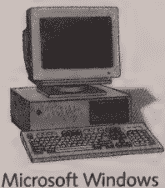

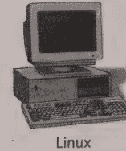


图 1-2 常见的PC操作系统

## 大型机操作系统

大型机操作系统控制大型机系统，这是一种具有多个处理器的大型计算机系统，为许多用户提供输入、输出、处理和存储操作。从历史上看，大型机系统在大企业和工业计算中非常流行。图 1-3 显示了一些常见的大型机操作系统及其制造商。

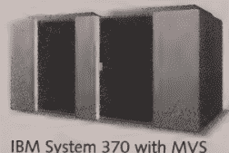

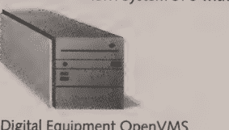

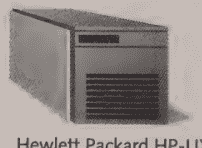

图 1-3 常见的大型机操作系统

## 网络操作系统

计算机网络将个人电脑的便利性和熟悉性与大型机的处理能力相结合。网络允许多个用户共享计算机资源和文件。网络操作系统控制服务器计算机（有时称为主机计算机）的操作，它接受运行在其他机器（称为客户端）上的用户程序的请求。图 1–4 显示了网络上服务器和客户端之间的关系。

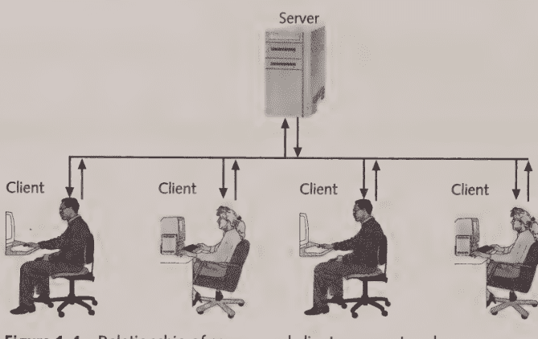

在集中式方法中，所有用户的数据和应用程序都位于服务器上。这种网络被称为基于服务器的网络。系统管理员通过保护服务器来确保网络上所有信息的安全。系统管理员可以轻松维护用户应用程序并直接在服务器上执行备份操作。然而，如果服务器故障，整个网络都会失效。

点对点网络在小型网络中效果最好，它们比基于服务器的网络更具分布式性。在点对点配置中，网络上的每个系统既是服务器也是客户端。没有中央服务器来管理用户账户，因为每个对等节点都提供自己的共享资源并控制对这些资源的访问，例如通过指定成员组成的工作组或通过在该对等节点工作站上创建的账户。数据和应用程序并非集中存储，而是存储在网络中的各个系统中。软件升级和备份操作必须在每台计算机上本地执行。在每台计算机上实施的安全性并不是统一的。网络中的每个用户在某种程度上都要负责管理自己的系统。尽管点对点网络给系统管理员带来了缺点，但单个用户并不依赖于中央服务器。如果网络中的某台计算机发生故障，其他系统将继续运行。

## 介绍 UNIX 操作系统

`UNIX` 是一种带有内置网络功能的多用户、多任务操作系统。它可以用于各种系统，并充当：

- 基于服务器网络中的专用服务器
- 连接到基于服务器的网络的客户端工作站
- 连接到点对点网络的客户端/服务器工作站
- 未连接到网络的独立工作站

`UNIX` 是一个多用户系统，允许许多人同时访问和共享服务器计算机的资源。用户在可以使用多用户系统之前，必须通过输入用户名和密码登录。这种验证保护了每个用户的隐私并防止了未经授权的使用。多任务系统允许一个用户同时执行多个程序。例如，在多任务系统中，你可以在文档在后台打印时，在前景窗口中更新记录。

`UNIX` 还是一个可移植的操作系统。它的可移植性意味着它可以用于各种计算环境。事实上，`UNIX` 运行的计算机种类比任何其他操作系统都要多。它还连接到互联网，执行流行的程序，如文件传输协议（`FTP`，一种用于发送文件的互联网协议）和 `Telnet`（一种互联网终端仿真程序）。Dominion 选择 `UNIX` 作为其计算机系统的操作系统，是因为它的许多员工必须同时在系列计算机上工作，以执行各种任务。

### UNIX 简史

贝尔实验室的一组程序员最初在 20 世纪 70 年代初开发了 `UNIX`。贝尔实验室以源代码的形式分发 `UNIX`，因此任何使用 `UNIX` 的人都可以对其进行定制。大学被其可移植性和低成本吸引，开始修改 `UNIX` 代码以运行在不同的机器上。最终，演出了两个 `UNIX` 标准版本：`AT&T` 生产了 `System V`，加州大学伯伯克利分校开发了 `BSD`（伯克利软件发行版）。通过使用这两个版本的特征，`Linux` 可能是比其前身更集成的 `UNIX` 版本。目前，`UNIX` 可移植操作系统接口（`POSIX`）项目（工业界、学术界和政府专家共同努力）正致力于标准化 `UNIX`。

### UNIX 概念

`UNIX` 开创了许多应用于其他操作系统的概念。例如，`Microsoft DOS` 和 `Microsoft Windows` 采纳了 `UNIX` 设计概念，例如分层结构和目录。

`UNIX` 开创了许多应用于其他操作系统的概念。例如，`Microsoft DOS` 和 `Microsoft Windows` 采纳了 `UNIX` 设计概念，例如分层结构和目录。

金字塔的底部是硬件。位于它们之间的层提供了隔离，确保了系统安全和用户隐私。内核是操作系统的，它直接与硬件、软件服务、应用程序交互。它只能通过内核模式访问，该模式保留给系统管理员。用户模式提供了对高层软件的访问。这种分层方法以及所有 `UNIX` 特性都是为了用于复杂的软件开发而设计的。由于程序员用 `C` 语言编写 `UNIX`，因此它可以安装在任何具有 `C` 编译器的计算机上。它的可移植性、灵活性使得 `UNIX` 成为网络操作系统的逻辑选择。此外，随着 `Linux` 的普及，`UNIX` 的通用性正在增加。

## Linux 与 UNIX

`Linux` 是一个类 `UNIX` 操作系统，因为它不是从传统的 `UNIX` 代码编写的。`UNIX` 提供了多个 shell，包括 `Bourne shell`、`Korn shell` 和 `C shell`。`AT&T` 贝尔实验室的 Stephen Bourne 开发了 `Bourne shell` 作为第一个 `UNIX` 命令处理器。贝尔实验室的另一位员工 David Korn 开发了 `Korn shell`。`Korn shell` 与 `Bourne shell` 兼容，并包含许多扩展功能，例如历史功能，允许你使用快捷键检索以前输入过的命令。`C shell` 是为 `C` 程序员设计的。`Linux` 使用免费软件 `Bash shell` 作为其默认命令解释器。它的名字是“再次 Bourne Shell”的缩写，并包含了 `Korn shell` 和 `Bourne shell` 的最佳功能。无论你使用哪个 shell，你的初始通信始终通过 shell 解释器进行。图 1–6 显示了 shell 在 `UNIX` 操作系统中的作用。

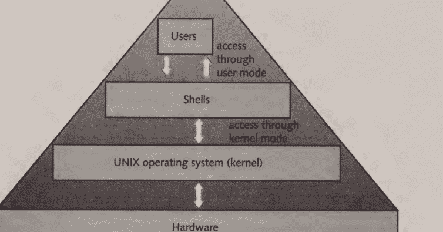

图 1-5 UNIX 系统的层级结构

## 介绍 UNIX Shell（壳）

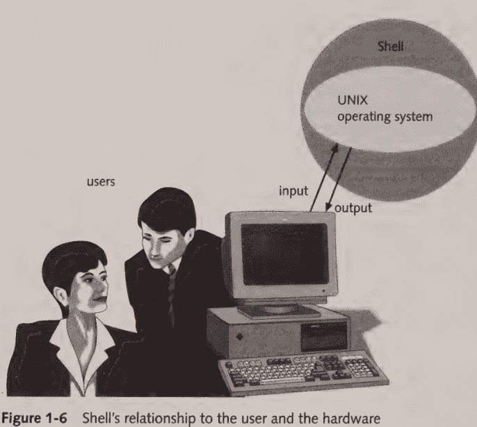

## 选择你的 Shell

在操作 `UNIX` 系统之前，你需要确定使用哪种 shell 作为你的命令解释器。Shell 的功能远比解释命令得多：每个 shell 都有内置命令，这些命令实际上将 shell 转换成了第一类编程语言。（你将在将在第 6 章和第 7 章中深入研究这一主题。）在创建账户时，系统会关联一个默认 shell，但你可以在登录后选择切换到不同的 shell。`Bash` 是 `Linux` 的默认 shell，也是许多用户首选的 shell。以下是 shell 列表：

- `Bourne`
- `Korn (ksh)`
- `C shell (csh)`
- `Bash`


- `ash`（一种源自 Bourne shell 和 C shell 的免费 shell）
- `tcsh`（一种源自 C shell 的免费 shell）
- `2sh`（一种源自 Korn shell 的免费 shell）

# 在 Shell 之间切换

在你选好 shell 后，系统管理员会将你的选择存储在账户记录中，它就会成为分配给你的 shell。UNIX 每次登录都会使用它。然而，你可以在命令行中输入 shell 的名称（如 `bash`, `tash` 或 `ash`）从一个 shell 切换到另一个。你在该 shell 中工作，直到你再次登录或在命令行中输入另一个 shell 名称。用户通常使用一个 shell 编写 shell 脚本（程序），用另一个与程序进行交互。

# 选择用户名和密码

在操作 UNIX 及其程序之前，你必须通过提供唯一的用户名和密码来登录。决定一个你想用于向 UNIX 系统标识自己身份的名称，例如“`aquinn`”。这是 UNIX 系统上的其他人向你发送电子邮件时使用的相同名称。某些 UNIX 版本仅识别用户名的前八字符，而其他版本（如 Red Hat Linux 7.2）最多可识别 32 个字符。

你必须选择一个密码，在使用像 Red Hat Linux 7.2 这样较版本的 UNIX 时，密码必须包含六个或更多字符。密码应该容易记忆，但他人难以猜到，例如将两个或多个对你有意义的单词组合在一起——例如爱好或喜爱的地的组合——并混合大小写字母、数字和连字符。密码可以包含字母、数字和标点符号，但不能包含控制字符（如 `Ctrl+X`）。

> 密码最小长度取决于你的 UNIX 版本。某些早期的 Linux 版本最小长度为五个字符，但 Red Hat Linux 7.2 及更高版本要求最小长度为六字符，本书将采用这一标准。


只要你在工作站或主机（服务器）计算机上有用户账户和密码，就可以登录任何 UNIX 或 Linux 系统。UNIX 系统管理员通过添加你的用户名（也称为登录名或用户 ID）和密码来创建账户。要使用本书和实操教程，你必须在 UNIX 或 Linux 系统上拥有账户，并有连接到该系统的手段。常用的连接方式包括：

- 通过 `Telnet` 连接到远程计算机，例如另一台 UNIX/Linux 或基于 Windows 的操作系统
- 通过 UNIX/Linux 客户端/服务器网络上的客户端软件连接
- 作为对等点局域网中的对等节点，每台计算机都安装了 UNIX/Linux 操作系统

# 使用 Telnet 连接到 UNIX

- 在安装了 Linux 操作系统的独立式 PC 上
- 通过哑终端（如 Wyse 终端）连接到 UNIX/Linux 主机的通信端口

你连接到 UNIX 系统的步骤取决于你所使用的连接类型。通过哑终端连接或通过独立式计算机访问 UNIX 是两种最简单的方法。在这两种情况下，你都只需要开启终端或独立式计算机并登录你的账户。使用用于客户端/服务器网络的客户端软件进行连接可能需要来自网络管理员的特殊说明或培训。

如果你在对等点网络上进行连接，可以使用 `Telnet`。通过 `Telnet` 连接是最常用的方法之一，将在下一节中描述。你可以使用 `Telnet` 通过局域网和互联网访问 UNIX 对等节点或服务器计算机。附录 A 还讨论了如何使用不同方法通过网络连接。

## 使用 TELNET 连接到 UNIX

`Telnet` 是一种终端仿真程序。它运行在你的计算机上，并将你的 PC 连接到网络上的服务器或主机。你用来连接的 PC 可以是 UNIX、Linux、基于 Windows 的操作系统或 Mac OS。然后你就可以登录 UNIX 主机并开始使用 UNIX。大多数 UNIX 版本都包含 `Telnet`，大多数微软 Windows 版本以及后续版本的 Mac OS 也是如此。互联网上的每台计算机都有一个 IP（IP协议）地址。IP 地址是一组由点隔开的四个数字，例如 `172.16.1.61`。互联网上的大多数系统都有一个域名，例如 `Lunar.campus.edu`。IP 地址和域名都用于标识网络上的系统。`Telnet` 等这样的程序使用 IP 地址或域名来访问远程系统。

通过 `Telnet` 访问 UNIX 主机：

1. 找到远程主机的 IP 地址或域名。
2. 如果需要，连接到互联网。如果你使用 `PPP` 连接拨号，请执行此操作。
3. 如果你使用图形界面，请启动 `Telnet` 程序。
4. 如果你使用命令行界面，请在命令行中输入 `Telnet`。
5. 登录 UNIX 主机并开始使用 UNIX。出于安全考虑，在 Windows 95/98 命令行界面后输入以下命令：

```
telnet lunar.campus.edu
```


# 第 1 节 A UNIX 的本质

使用 Telnet 访问 UNIX：

- 在安装了 Linux 操作系统的独立式 PC 上
- 通过哑终端（如 Wyse 终端）连接到 UNIX/Linux 主机的通信端口

你连接到 UNIX 系统的步骤取决于你使用的连接类型。通过哑终端连接或通过独立式计算机访问 UNIX 是两种最简单的方法。在这两种情况下，你都需要开启终端或独立式计算机并登录你的账户。使用用于客户端/服务器网络的客户端软件进行连接可能需要网络管理员的特殊说明或培训。

如果你在对等点网络上进行连接，可以使用 `Telnet`。通过 `Telnet` 连接是最常用的方法之一，将在下一节中描述。你可以使用 `Telnet` 通过局域网和互联网访问 UNIX 对等节点或服务器计算机。附录 A 还讨论了如何使用不同方法通过网络连接。

## 使用 TELNET 连接到 UNIX

`Telnet` 是一种终端仿真程序。它运行在你的计算机上，并将你的 PC 连接到网络上的服务器或主机。你用来连接的 PC 可以是 UNIX、Linux、基于 Windows 的操作系统或 Mac OS。然后你就可以登录 UNIX 主机并开始使用 UNIX。大多数 UNIX 版本都包含 `Telnet`，大多数微软 Windows 版本以及后续版本的 Mac OS 也是如此。互联网上的每台计算机都有一个 IP（IP协议）地址。IP 地址是一组由点隔开的四个数字，例如 `172.16.1.61`。互联网上的大多数系统都有一个域名，例如 `Lunar.campus.edu`。IP 地址和域名都用于标识网络上的系统。`Telnet` 等这样的程序使用 IP 地址或域名来访问远程系统。

通过 `Telnet` 访问 UNIX 主机：

1. 找到远程主机的 IP 地址或域名。
2. 如果需要，连接到互联网。如果你使用 `PPP` 连接拨号，请执行此操作。
3. 如果你使用图形界面，请启动 `Telnet` 程序。
4. 如果你使用命令行界面，请在命令行中输入 `Telnet`。
5. 登录 UNIX 主机并开始使用 UNIX。出于安全考虑，在 Windows 95/98 命令行界面后输入以下命令：

```
telnet lunar.campus.edu
```


# 第 1 节 A UNIX 的本质

使用 Telnet 访问 UNIX：

- 在安装了 Linux 操作系统的独立式 PC 上
- 通过哑终端（如 Wyse 终端）连接到 UNIX/Linux 主机的通信端口

你连接到 UNIX 系统的步骤取决于你使用的连接类型。通过哑终端连接或通过独立式计算机访问 UNIX 是两种最简单的方法。在这两种情况下，你都需要开启终端或独立式计算机并登录你的账户。使用用于客户端/服务器网络的客户端软件进行连接可能需要网络管理员的特殊说明或培训。

如果你在对等点网络上进行连接，可以使用 `Telnet`。通过 `Telnet` 连接是最常用的方法之一，将在下一节中描述。你可以使用 `Telnet` 通过局域网和互联网访问 UNIX 对等节点或服务器计算机。附录 A 还讨论了如何使用不同方法通过网络连接。

# 登录 UNIX

在启动或连接到 UNIX 系统后，你必须通过输入用户名和密码来登录。如果你使用的是图形界面（GUI），你会看到提示符或登录框。出于安全考虑，在你输入密码时屏幕上不会显示。

当你通过网络或使用哑终端连接时，你需要通过命令行界面执行命令。如果你在独立式 PC 上，系统可能被配置为仅使用命令行（文本）模式，也可以被配置为使用图形界面（GUI）。在 UNIX 中，GUI 的基础被称为 `X Window`。`X Window` 界面的外取决于它所使用的桌面环境。本书中的 Red 示例使用了流行的且免费的 GNU 网络对象环境（`GNOME`）桌面。

没有授权的用户账户将无法登录。如果密码失败，或者你在输入密码之前等待过久，请联系你的系统管理员。

登录后，你就可以开始使用系统了。如果你通过网络或哑终端访问 UNIX——或者你的独立式系统配置为命令行文本模式——你可以立即在提示符处输入命令。然而，如果你在使用独立式计算机和 `X Window` 桌面（如 `GNOME`），你必须打开终端来访问命令行提示符。


你必须了解命令的语法才能正确执行它。语法指的是命令的格式和用词，以及你可以用来扩展或修改其功能的选项（`options`）和参数（`arguments`）。大多数命令都是单单词，例如“`clear`”命令。如果你使用正确的语法输入命令，UNIX 就会执行该命令。否则，你将收到一条 UNIX 无法解释你的命令的消息。

附录 B，“UNIX 命令语法指南”按字母顺序列出了书中的所有命令，并告诉该如何输入每个命令以及使用其选项。

屏幕上你输入命令的地方被称为命令行。命令使用以下语法：

```
Syntax command_name [-option] [argument]
```

## 详解

- `command_name` 指定了要执行的操作。在本书中的语法示例中，命令名以`粗体`形式显示。
- 命令选项（Command options）是请求 UNIX 以特定样式或变体执行命令的方法。选项在命令名之后，用空格隔开。它们通常以连字符 (`-`) 开头。选项对大小写敏感。例如，`-R` 与 `-r` 不同。你不需要在每个命令后都输入选项；但某些命令如果不指定选项将无法工作。本书中的语法示例在命令不需要选项时，用方括号 (`[]`) 列出选项。
- 命令参数（Command arguments）紧跟在命令之后，用空格隔开。命令参数通常是文件名和目录名。在本书中的语法示例中，参数以*斜体*显示。如果命令不需要参数，则用方括号括起参数。

## date 命令

使用 UNIX `date` 命令显示系统日期，该日期由系统管理员维护。由于多用户系统的日期时间对于平滑运行至关重要，只有系统管理员才能更改日期。你在 Dominion Consulting 的 UNIX 训练从检查系统日期开始。

要显示你的系统日期：

1. 在命令行中输入 `date` 并按回车。

会出现如下所示的日期：

Mon Apr 20 21:30:08 EST 2004

你可能会看到简称 EDT（东部夏令时间）而不是 EST（东部标准时间），或者另一个时区缩写，例如 PDT（太平洋夏令时间）或 CST（中部夏令时间）。注意注意 UNIX 使用的是 24 小时制。

## 输入命令 15

2. 在命令行中输入 `Date` 并按回车。你看到以下系统错误消息：

```bash
bash: Date: command not found
```

系统错误消息出现是因为你必须像其他 UNIX 命令一样，用小写字母输入 `date` 命令。

`date` 命令有一个选项 `-u`，用于显示格林尼治标准时间（GMT）的时间。GMT 也称为协调世界时，缩写为 UTC。UTC 被认为是国际时间标准。要了解更多关于 UTC 的信息，请访问 NASA 网页：www.ghc.mfc.nasa.gov/utc.html。

要用 UTC 显示你的系统日期：

1. 在命令行中输入 `date -u` 并按回车。

会出现如下所示的日期：

Mon Apr 20 23:43:14 UTC 2004


## cal 命令

使用 `cal` 命令显示系统日历。你在 Dominion 的经理 Rolfe Williamson 建议，这是通常用于调度任务和事件的命令。

要显示系统的默认日历：

1. 在命令行中输入 `cal` 并按回车。如果不带选项，`cal` 命令显示当前月份的日历。假设当前月份是 2004 年1 月，你会看到图 1-8 所示的默认日历。

2. 在命令行中输入 `cal -j 2004` 并按回车。

`-j` 选项显示儒略历格式。换句话说，它以从 1 开始到 366 结束（本例中闰年）的数字表示日期，如图 1-9 所示。


## 第 1 章 节 A UNIX 的本质

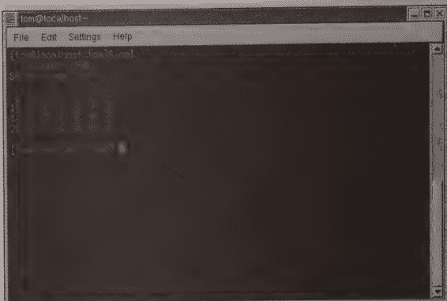

图 1-8 `cal` 命令（当前月份）示例

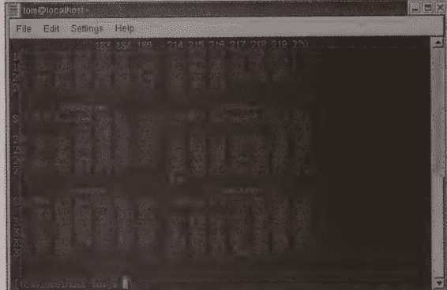

图 1-9 `cal` 命令显示整年儒略历的示例

3. 要确定《独立宣言》签署时的星期几，在命令行中输入 `cal 7 1776` 并按回车。你应该看到一个与图 1-10 类似的日历。在这种情况下，月份和年份是命令参数。

> 如果你输入 `cal 1999`，你会看到类似下面的错误消息，因为你必须使用数字（如 5）来表示月份（如 5 月）。

```
cal: illegal month value: use 1-12
```


## who 命令

在多用户系统中，知道谁登录了系统是很有用的。使用 `who` 命令查看当前用户。

要显示你的系统日期：

1. 在命令行中输入 `date` 并按回车。

会出现如下所示的日期：

Mon Apr 20 21:30:08 EST 2004

你可能会看到简称 EDT（东部夏令时间）而不是 EST（东部标准时间），或者另一个时区缩写，例如 PDT（太平洋夏令时间）或 CST（中部夏令时间）。注意 UNIX 使用的是 24 小时制。

2. 在命令行中输入 `Date` 并按回车。你看到以下系统错误消息：

```bash
bash: Date: command not found
```

系统错误消息出现是因为你必须像其他 UNIX 命令一样，用小写字母输入 `date` 命令。

`date` 命令有一个选项 `-u`，用于显示格林尼治标准时间（GMT）的时间。GMT 也称为协调世界时，缩写为 UTC。UTC 被认为是国际时间标准。要了解更多关于 UTC 的信息，请访问 NASA 网页：www.ghc.mfc.nasa.gov/utc.html。

要用 UTC 显示你的系统日期：

1. 在命令行中输入 `date -u` 并按回车。

会出现如下所示的日期：

Mon Apr 20 23:43:14 UTC 2004

![](img/b5f7722b7c2983a215c7726aaada19f9_38_0.png

## cal 命令

使用 `cal` 命令显示系统日历。你在 Dominion 的经理 Rolfe Williamson 建议，这是通常用于调度任务和事件的命令。

要显示系统的默认日历：

1. 在命令行中输入 `cal` 并按回车。如果不带选项，`cal` 命令显示当前月份的日历。假设当前月份是 2004 年1 月，你会看到图 1-8 所示的默认日历。

2. 在命令行中输入 `cal -j 2004` 并按回车。

`-j` 选项显示儒略历格式。换句话说，它以从 1 开始到 366 结束（本例中闰年）的数字表示日期，如图 1-9 所示。


## 第 1 章 节 A UNIX 的本质


图 1-8 `cal` 命令（当前月份）示例


图 1-9 `cal` 命令显示整年儒略历的示例

3. 要确定《独立宣言》签署时的星期几，在命令行中输入 `cal 7 1776` 并按回车。你应该看到一个与图 1-10 类似的日历。在这种情况下，月份和年份是命令参数。

> 如果你输入 `cal 1999`，你会看到类似下面的错误消息，因为你必须使用数字（如 5）来表示月份（如 5 月）。

```
cal: illegal month value: use 1-12
```

![](img/b5f7722b7c2983a215c7726aaada19f9_38_0

## who 命令

在多用户系统中，知道谁登录了系统是很有用的。使用 `who` 命令查看当前用户。

要显示你的系统日期：

1. 在命令行中输入 `date` 并按回车。

会出现如下所示的日期：

Mon Apr 20 21:30:08 EST 2004

你可能会看到简称 EDT（东部夏令时间）而不是 EST（东部标准时间），或者另一个时区缩写，例如 PDT（太平洋夏令时间）或 CST（中部夏令时间）。注意 UNIX 使用的是 24 小时制。

2. 在命令行中输入 `Date` 并按回车。你看到以下系统错误消息：

```bash
bash: Date: command not found
```

系统错误消息出现是因为你必须像其他 UNIX 命令一样，用小写字母输入 `date` 命令。


`date` 命令有一个选项 `-u`，用于显示格林尼治标准时间（GMT）的时间。GMT 也称为协调世界时，缩写为 `UTC`。`UTC` 被认为是国际时间标准。要了解更多关于 `UTC` 的信息，请访问 NASA 网页：`www.ghc.mfc.nasa.gov/utc.html`。

要用 `UTC` 显示你的系统日期：

1. 在命令行中输入 `date -u` 并按回车。

会出现如下所示的日期：

`Mon Apr 20 23:43:14 UTC 2004`

![](img/b5f7722b7c2983a215c7726aaada19f9_38_0.png

## cal 命令

使用 `cal` 命令显示系统日历。你在 Dominion 的经理 Rolfe Williamson 建议，这是通常用于调度任务和事件的命令。

要显示系统的默认日历：

1. 在命令行中输入 `cal` 并按回车。如果不带选项，`cal` 命令显示当前月份的日历。假设当前月份是 2004 年1 月，你会看到图 1-8 所示的默认日历。

2. 在命令行中输入 `cal -j 2004` 并按回车。

`-j` 选项显示儒略历格式。换句话说，它以从 1 开始到 366 结束（本例中闰年）的数字表示日期，如图 1-9 所示。

![](img/b5f7722b7c2983a215c7726aaada19f9_36_1.png

![](img/b5f7722b7c2983a215c7726aaada19f9_36_2.png

### 第 1 章 节 A UNIX 的本质

![](img/b5f7722b7c2983a215c7726aaada19f9_37_0.png

图 1-8 `cal` 命令（当前月份）示例

![](img/b5f7722b7c2983a215c7726aaada19f9_37_1.png

图 1-9 `cal` 命令显示整年儒略历的示例

3. 要确定《独立宣言》签署时的星期几，在命令行中输入 `cal 7 1776` 并按回车。你应该看到一个与图 1-10 类似的日历。在这种情况下，月份和年份是命令参数。

> 如果你输入 `cal 1999`，你会看到类似下面的错误消息，因为你必须使用数字（如 5）来表示月份（如 5 月）。

```
cal: illegal month value: use 1-12
```

![](img/b5f7722b7c2983a215c7726aaada19f9_38_0

## who 命令

在多用户系统中，知道谁登录了系统是很有用的。使用 `who` 命令查看当前用户。

要显示你的系统日期：

1. 在命令行中输入 `date` 并按回车。

会出现如下所示的日期：

`Mon Apr 20 21:30:08 EST 2004`

你可能会看到简称 `EDT`（东部夏令时间）而不是 `EST`（东部标准时间），或者另一个时区缩写，例如 `PDT`（太平洋夏令时间）或 `CST`（中部标准时间）。注意 UNIX 使用的是 24 小时制。

2. 在命令行中输入 `Date` 并按回车。你看到以下系统错误消息：

```bash
bash: Date: command not found
```

系统错误消息出现是因为你必须像其他 UNIX 命令一样，用小写字母输入 `date` 命令。

`date` 命令有一个选项 `-u`，用于显示格林尼治标准时间（GMT）的时间。GMT 也称为协调世界时，缩写为 `UTC`。`UTC` 被认为是国际时间标准。要了解更多关于 `UTC` 的信息，请访问 NASA 网页：`www.ghc.mfc.nasa.gov/utc.html`。

要用 `UTC` 显示你的系统日期：

1. 在命令行中输入 `date -u` 并按回车。

会出现如下所示的日期：

`Mon Apr 20 23:43:14 UTC 2004`

## 输入命令

## 命令行编辑

Shell 支持某些快捷键来执行命令行编辑。例如，Bash（Linux 的默认 shell）支持左、右方向键，这些方向键可以将光标移动到命令行上。其他按键通常与 `Ctrl` `Alt` 键组合使用，用于其他的编辑操作。


并不是所有的 shell 都以相同的方式支持命令行编辑。以下步骤适用于 Bash shell。

### 如何编辑在命令行上输入的命令：

- 1. 要确定你正在使用哪种 shell，请输入 `echo SHELL` 并按回车。如果你正在使用 Bash shell，你会看到以下输出：

  `/bin/bash`

  如果你没有使用 Bash shell，请输入 `bash` 但不要按回车。

- 2. 输入 `who am i` 但不要按回车。

- 3. 按左方向键，将光标移动到单词 "am" 中的字母 a 上。

- 4. 按 `Alt+D` 删除单词 "am"。

- 5. 按 `Ctrl+K` 删除从当前光标位置到行后的命令行。

- 6. 按 `Ctrl+A` 将光标移动到命令行的开头。

- 7. 再次按 `Ctrl+K` 删除命令行。

- 8. 重新输入 `who am i` 但不要按回车。

- 9. 按三次 `Alt+B`。每当你按下一次组合键时，观察光标如何移动到上一个单词的第一个字符。光标应该位于行首。

- 10. 按三次 `Alt+F`。每当你按下一次组合键时，光标都会移动到下一个单词第一个字符之前的位置。

- 11. 按 `Ctrl+A`，然后按 `Ctrl+K` 清空命令。

## 多条命令输入

你可以通过分号 (`;`) 分隔每个命令，在命令行上输入多个命令。当你按下回车键时，UNIX 会按照你输入命令的顺序执行这些命令。

### 如何在命令行上输入多个命令：

- 1. 输入 `date ; -iH` 并按回车。你会看到类似下面的信息：

| USER | LINE | LOGIN-TIME | IDLE | FROM |
|---|---|---|---|---|
| | | Apr 20 21:35:09 EST 2004 | | |
| root | tty1 | Apr 20 07:56 | 00:29 | |
| ellen | tty1 | Apr 20 08:15 | | |
| john | tty2 | Apr 20 08:15 | 00:01 | |
| jery | tty3 | Apr 18 08:21 | old | |

`date` 命令产生上述输出的第一行。输出的其余部分是 `who` 命令的结果。

`w -u` 命令产生与 `-iH` 类似的信息，但包含了关于系统资源使用的额外信息。

## clear 命令

随着你不断输入命令，屏幕可能会变得杂乱。除非你需要参考之前输入的命令及其输出，否则可以使用 `clear` 命令清空屏幕。它没有选项或参数。

### 如何清空屏幕：

- 1. 在命令行上输入 `clear` 并按回车。命令提示符现在位于你屏幕的左上角。

## 命令行历史

你经常会发短时间内多次输入相同的命令。大多数 shell 都会保留一份你最近使用的命令列表，并允许你无需重新输入即可调用命令。你可以使用上、下方向键访问命令历史。按一次方向键可以调用最近一次使用的命令。按两次方向键可以调用倒数第二次使用的命令。每按一次方向键，都会调回一个更早的命令。每按一次下方向键，都会在命令历史中向前滚动。当你找到想要执行的命令时，按回车。

### 如何使用命令行历史：

- 1. 输入 `date` 并按回车。

- 2. 输入 `who` 并按回车。

- 3. 输入 `who -iH` 并按回车。

- 4. 输入 `clear` 并按回车。

- 5. 按四次上方向键。`date` 命令被调回命令行。不要回车。

- 6. 按两次下方向键。`who -iH` 命令被调回命令行。按回车执行该命令。

## man 程序

为了参考，UNIX 包含一个联机手册，其中包含了所有命令，包括它们的选项和参数。UNIX 中的 `man` 程序显示此联机手册（称为 man pages），用于提供命令行帮助。虽然某些命令的 man 程序包含的信息比其他命令要多，但 man 页通常列出以下项目：

- Name（名称）——命令名称及其用途的简短描述

- Synopsis（摘要）——显示命令用法的语法图

- Description（描述）——比 Name 项更详细的命令描述

- Options（选项）——命令选项列表及其用途

- See Also（参见）——提供相关信息的其他命令或 man 页

- Bugs（缺陷）——已知缺陷列表

`man` 程序通常只接受一个参数——你想要获取更多信息的命令名称。联机手册会显示你的系统接受的有效命令。要关闭联机手册，输入 `q`。

你决定为 Dominion 的你自己和其他显示关于 `who` 命令和 `man` 程序的信息。

### 如何显示命令的联机帮助：

- 1. 在命令行中输入 `man` 并按回车。

- 2. 输入 `man who` 并按回车。

- 3. 输入 `man who -iH` 并按回车。

- 4. 输入 `man clear` 并按回车。

- 5. 按四次上方向键。`date` 命令被调回命令行。不要回车。


## 密码修改

- 6. 按两次下方向键。`who -iH`命令被调回命令行。按回车执行该命令。

（注：OCR 文本在后面的页面包含了一些重复和碎片部分，已根据文档结构进行了整合，以确保逻辑连贯。）

+ 3. 输入你的新密码，并按回车键。在输入时，新密码不会显示在屏幕上。

4. 再次输入你的新密码，并按回车键，以便 UNIX 确认新密码。

> 如果你作为确认重新输入的密码与你的新 UNIX 密码不匹配，UNIX 会要求你重新输入。UNIX 还可能要求你选择不同的密码，因为你选择的密码太短或太容易猜，这取决于密码策略。

在更改密码后，你应该注销并重新登录，以确保 UNIX 识别你的新密码。

> 记住你的密码！你每次登录 UNIX 都需要用到密码。

## 使用 CAT、MORE、LESS、HEAD 和 TAIL 命令查看文件

有三个 UNIX 命令可以让你查看文件内容：`cat`、`more` 和 `less`。`more` 和 `less` 命令一次显示文件的一页（一个屏幕的内容）。`more` 只能向下滚动，而 `less` 允许你向上和向下滚动。`cat` 命令则一次性显示整个文件。另外两个命令 `head` 和 `tail` 可以让你查看文件的前几行或后几行。

`cat` 命令的名字源于单词 `concatenate`（连接），意思是链接。你可以通过在 `cat` 命令后输入多个文件名并用空格分隔它们来显示多个文件。UNIX 将会按照你输入的顺序显示这些文件。

你在 Dominion 的系统管理员提到，你可以使用 `cat` 命令查看位于 `/etc` 目录下的名为 `shells` 的文件。该文件包含了系统上所有有效 shell 的列表。

查看 shells：

- 1. 在命令提示符后输入 `cat /etc/shells` 并按回车。斜杠（`/`）用于指示目录或文件夹的切换。你会看到可用 shell 的列表，包括 `/bin/sh`、`/bin/bash`、`/bin/bash2`、`/bin/ash`、`/bin/bsh`、`/bin/tcsh`

- 2. 输入 `cat -n /etc/shells` 并按回车。你会看到之前相同的 shell 列表，但每行前面都有数字。

你还可以查看 `/etc` 目录下的另一个名为 `termcap` 的文件。这个多页文件包含了关于 Linux 系统支持的所有终端的许多规范。`cat` 命令并不是查看此文件的实用方法，因为它长度超过了一个屏幕。不过，你可以使用 `more` 和 `less` 命令逐屏地读取大文件。

使用 `more` 命令在屏幕上查看大文件的内容：

- 1. 在命令提示符后输入 `more /etc/termcap` 并按回车。

- 2. 按下空格键滚动到下一页。

- 3. 输入 `q`（代表 quit）结束显示。

使用 `less` 命令在屏幕上查看大文件的内容：

- 1. 在命令提示符后输入 `less /etc/termcap` 并按回车。你在屏幕上看到一个长文本文件。

- 2. 多次按下向下箭头键，可以一行一行地向前滚动。

- 3. 多次按下向上箭头键，可以一行一行地向后滚动。

- 4. 按 `Pg Dn`、空格键、`z` 或 `f` 向前滚动一页。

- 5. 按 `Pg Up` 或 `b` 返回上一页。

- 6. 当你在屏幕底部看到冒号（`:`）时，输入 `q`（代表 quit）结束显示。

有时你只需要瞥一眼文件的部分内容就能确定文件中存储了什么。`head` 命令向你显示文件的前几行；默认情况下，它是前 10 行。

查看文件的开头或结尾几行：

- 1. 输入 `head /etc/termcap` 并按回车，查看 `/etc/termcap` 文件的前 10 行。

- 2. `-n` 选项指定 `head` 命令显示的行数。输入 `head -n 5 /etc/termcap` 并按回车。你会看到 `/etc/termcap` 文件的前五行。

- 3. `tail` 命令向你显示文件的最后几行。像 `head` 命令一样，`tail` 默认显示 10 行。输入 `tail /etc/termcap` 并按回车，查看 `/etc/termcap` 文件的后 10 行。

- 4. `-n` 选项指定 `tail` 命令显示的行数。输入 `tail -n 5 /etc/termcap` 并按回车。你会看到 `/etc/termcap` 文件的后五行。

## 输出定向

在 UNIX 中，大于号（`>`）被称为重定向符号。你可以将此重定向符号附加到产生输出的命令上，以此创建一个新文件或覆盖现有文件。实际上，你将输出重定向到了磁盘而不是显示器。你已经使用过命令来查找谁登录了 Dominion 的系统。现在你可以使用带有 `>` 重定向符号的相同命令将这些信息保存到文本文件中（你将在本书的后部分学习其他重定向符号）。

保存列出系统登录人员的文件：

- 1. 在命令提示符后输入 `who > current_users` 并按回车。命令输出不会显示在屏幕上，而是被重定向到一个名为 `current_users` 的新磁盘文件。UNIX 将此文本文件放在活动目录中（你当前使用系统所在的磁盘文件夹）。

- 2. 在命令提示符后输入 `cat current_users` 并按回车，查看使用系统的用户列表，类似于下面。

| | | | |
|---|---|---|---|
| jean | tty1 | Feb 7 | 07:15 |
| joseph | tty2 | Feb 7 | 07:15 |
| becky | tty3 | Feb 7 | 08:05 |

## UNIX 的本质

当你与 UNIX 工作时，你记得 Role 要求你在周结束前完成一些任务。你决定创建一个笔记文件。

创建一个新文件：

- 1. 在命令提示符后输入 `cat > notes` 并按回车。

- 2. 输入以下内容：购买新的 CD-ROM，并在周四前提交报告。

- 3. 按 `Ctrl+D`。

- 4. 查看你刚刚创建的文件，输入 `cat notes`。你在步骤 2 中输入的内容出现在屏幕上。

创建笔记文件后，你记得 Role 要求你完成另一个任务。你可以将提醒添加到现有的笔记文件中。你还想在文件中包含相应的日历以便参考。

向现有文件添加信息：


在命令提示符后输入 `cat >> notes` 并按回车。

输入以下内容：还要预订九月份的会议。

按 `Ctrl+D`。

要将日历添加到你的笔记，输入 `cal 9 2004 >> notes`。

输入 `less notes` 然后按回车查看文件。

# 第 29 章总结

- UNIX 系统可以配置为基于服务器的网络中的专用服务器、基于服务器的网络中的客户端-工作站、点对点网络中的客户端/服务器工作站，或者未连接到任何网络的独立（stand-alone）工作站。
- 组成操作系统的分层组件概念源于 UNIX。围绕计算机系统内核的软件层保护着虚拟硬件和软件组件，并为用户管理核心系统。
- Linux 是一种安装在 PC 上的类 UNIX 操作系统。它与 Windows 和 MS-DOS 等其他操作系统共存。
- 在 UNIX 中，你通过解释器 shell（外壳）与操作系统程序进行通信，它会解释你从键盘输入的命令。UNIX 提供了几个程序，包括 Bourne shell、Korn shell 和 C shell。Bash shell 提供了来自 Bourne 和 Korn shell 的增强功能。它是 Linux 系统上流行的 shell。
- 在 UNIX 中，系统管理员为用户设置账户。为了选择你的账户并保护系统的隐私和安全，你需要选择并向系统管理员提供用户名和密码。只要你在主机（服务器）计算机上有用户账户和密码，你就可以随时随地登录任何 UNIX 或 Linux 系统。你还可以使用 UNIX/Linux、Microsoft Windows 和 Mac OS Telnet 登录远程 UNIX。
- 你为了操作 UNIX 而输入的命令具有严格的语法，你可以通过参考名为 man pages 的在线手册来学习它。使用 `man` 程序显示命令的语法规则。使用 `who` 命令列出谁已登录以及他们所在地。使用 `cal` 命令显示所有所选月份的系统日历。当你决定停止使用 UNIX 时，使用 `exit` 或 `logout` 命令退出。
- 大多数 shell 都提供基本的命令行编辑功能，并保留你最近使用过的命令历史。使用向上和向下方向键可以在最近使用的命令列表中向前向后滚动。你可以通过分号（；）分隔多个命令，在单条命令行上输入多个命令。UNIX 按照你输入命令的顺序执行命令。
- 你可以使用 `view` 命令查看文件内容。使用 `cat` 命令通过键盘输入信息来创建文件。使用 `less` 和 `more` 命令显示多页文档。使用 `head` 和 `tail` 命令查看文件的前几行或最后几行。

# 命令总结

| 命令 | 用途 | 本章涵盖的选项 |
| --- | --- | --- |
| cal | 显示系统日历 | -j 显示儒勒历日期格式 |
| cat | 显示多个文件 | -n 显示行号 |
| clear | 清除屏幕 | |
| date | 显示系统日期 | -u 显示格林尼治标准时间 |
| exit or logout | 退出 UNIX | |
| head | 显示文件的前几行 | -n 显示指定文件的 n 行 |
| less | 一次显示一个屏幕的长文件，并允许上下滚动 | |
| man | 显示指定命令的在线手册 | |
| more | 一次显示一个屏幕的长文件并允许向下滚动 | |
| passwd | 修改你的 UNIX 密码 | |
| tail | 显示文件的最后几行 | -n 显示指定文件的最后 n 行 |
| whatis | 显示命令的简要描述 | |
| who | 查看谁已登录 | -H 显示列标题 -i 显示会话空闲时间 -q 显示用户快速列表 |

# 复习题

1. 你输入了命令 `Cal 2005`，但电脑没有显示 2005 年的日历，而是显示了错误信息。哪里错了？
   a. 你必须输入命令 `CAL 2005`，因为 UNIX 是大小敏感的。
   b. 你必须输入命令 `cal 2005`，因为 UNIX 是大小敏感的。
   c. 除非你只输入年份的最后两位（例如 `Cal 05`），否则 UNIX `Cal` 命令无法工作。
   d. 你在查看日历之前必须运行 UNIX 日历生成器 `Calgen`。

2. UNIX 命令的组件顺序顺序是怎样的？
   a. 名称, 参数, 选项
   b. 名称, 选项, 参数
   c. 选项, 名称, 参数
   d. 参数, 选项, 名称

3. 下面哪些陈述与 UNIX 兼容？
   a. Linux
   b. 普通用户可以更改系统日期。
   c. UNIX 操作系统包含一个内核。
   d. 在选择 shell 后可以更改它。

4. 在一个完全 ____________________ 的网络中，共享数据文件分布在各个用户的工作站上，使得其他用户可以使用它们。
   a. 点对点
   b. 基于服务器的
   c. 独立的
   d. 工作站

5. UNIX 可以配置为运行作为 ____________________。
   a. 基于服务器的网络中的服务器
   b. 基于服务器的网络中的客户端工作站
   c. 点对点网络中的客户端/服务器工作站
   d. 以上所有

6. 登录运行 UNIX 或 Linux 的计算机需要什么？
   a. 用户名和密码
   b. 仅需密码
   c. 一个内核
   d. 一个 shell

7. 使用 UNIX `date` 命令可以 ____________________。
   a. 显示系统日历
   b. 显示未来的任何日期
   c. 重置系统日期
   d. 显示系统日期

8. ____________________ 程序提供在线命令语法文档。
   a. man
   b. comhelp

# 第 1 章 UNIX 的本质

- 组成操作系统的分层组件概念源于 UNIX。围绕计算机系统内核的软件层保护着虚拟硬件和软件组件，并为用户管理核心系统。
- Linux 是一种安装在 PC 上的类 UNIX 操作系统。它与 Windows 和 MS-DOS 等其他操作系统共存。
- 在 UNIX 中，你通过解释器 shell 与操作系统程序进行通信，它会解释你从键盘输入的命令。UNIX 提供了几个程序，包括 Bourne shell、Korn shell 和 C shell。Bash shell 提供了来自 Bourne 和 Korn shell 的增强功能。它是 Linux 系统上流行的 shell。
- 在 UNIX 中，系统管理员为用户设置账户。为了选择你的账户并保护系统的隐私和安全，你需要选择并向系统管理员提供用户名和密码。只要你在主机（服务器）计算机上有用户账户和密码，你就可以随时随地登录任何 UNIX 或 Linux 系统。你还可以使用 UNIX/Linux、Microsoft Windows 和 Mac OS Telnet 登录远程 UNIX。
- 你为了操作 UNIX 而输入的命令具有严格的语法，你可以通过参考名为 man pages 的在线手册来学习它。使用 `man` 程序显示命令的语法规则。使用 `who` 命令列出谁已登录以及他们所在地。使用 `cal` 命令显示所有所选月份的系统日历。当你决定停止使用 UNIX 时，使用 `exit` 或 `logout` 命令退出。
- 大多数 shell 都提供基本的命令行编辑功能，并保留你最近使用过的命令历史。使用向上和向下方向键可以在最近使用的命令列表中向前向后滚动。你可以通过分号（；）分隔多个命令，在单条命令行上输入多个命令。UNIX 按照你输入命令的顺序执行命令。
- 你可以使用 `view` 命令查看文件内容。使用 `cat` 命令通过键盘输入信息来创建文件。使用 `less` 和 `more` 命令显示多页文档。使用 `head` 和 `tail` 命令查看文件的前几行或最后几行。

# 命令总结

| 命令 | 用途 | 本章涵盖的选项 |
| --- | --- | --- |
| cal | 显示系统日历 | -j 显示儒勒历日期格式 |
| cat | 显示多个文件 | -n 显示行号 |
| clear | 清除屏幕 | |
| date | 显示系统日期 | -u 显示格林尼治标准时间 |
| exit or logout | 退出 UNIX | |
| head | 显示文件的前几行 | -n 显示指定文件的 n 行 |
| less | 一次显示一个屏幕的长文件，并允许上下滚动 | |
| man | 显示指定命令的在线手册 | |
| more | 一次显示一个屏幕的长文件并允许向下滚动 | |
| passwd | 修改你的 UNIX 密码 | |
| tail | 显示文件的最后几行 | -n 显示指定文件的最后 n 行 |
| whatis | 显示命令的简要描述 | |
| who | 查看谁已登录 | -H 显示列标题 -i 显示会话空闲时间 -q 显示用户快速列表 |

# 复习题


1. 你输入了命令 `Cal 2005`，但电脑没有显示 2005 年的日历，而是显示了错误信息。哪里错了？

   a. 你必须输入命令 `CAL 2005`，因为 UNIX 是大小敏感的。

   b. 你必须输入命令 `cal 2005`，因为 UNIX 是大小敏感的。

   c. 除非你只输入年份的最后两位（例如 `Cal 05`），否则 UNIX `Cal` 命令无法工作。

   d. 你在查看日历之前必须运行 UNIX 日历生成器 `Calgen`。

2. UNIX 命令的组件顺序顺序是怎样的？

   a. 名称, 参数, 选项

   b. 名称, 选项, 参数

   c. 选项, 名称, 参数

   d. 参数, 选项, 名称

3. 下面哪些陈述与 UNIX 兼容？

   a. Linux

   b. 普通用户可以更改系统日期。

   c. UNIX 操作系统包含一个内核。

   d. 在选择 shell 后可以更改它。

4. 在一个完全 ____________________ 的网络中，共享数据文件分布在各个用户的工作站上，使得其他用户可以使用它们。

   a. 点对点

   b. 基于服务器的

   c. 独立的

   d. 工作站

5. UNIX 可以配置为运行作为 ____________________。

   a. 基于服务器的网络中的服务器

   b. 基于服务器的网络中的客户端工作站

   c. 点对点网络中的客户端/服务器工作站

   d. 以上所有

6. 登录运行 UNIX 或 Linux 的计算机需要什么？

   a. 用户名和密码

   b. 仅需密码

   c. 一个内核

   d. 一个 shell

7. 使用 UNIX `date` 命令可以 ____________________。

   a. 显示系统日历

   b. 显示未来的任何日期

   c. 重置系统日期

   d. 显示系统日期

8. ____________________ 程序提供在线命令语法文档。

   a. `man`

   b. `comhelp`

9. `Whatis` 命令提供

   a. 命令的简要描述

   b. 命令的逐页详细描述

   c. 使用命令的示例

   d. 连接到系统的设备

10. 当你输入命令时，看到格林尼治标准时间 (GMT)。

    a. `date -j`

    b. `cal -g`

    c. `date -u`

    d. `year -dg`

11. 下列哪项最好描述 UNIX？

    a. 它是一个多用户多任务操作系统。

    b. 它是一个无法在独立 PC 上运行的操作系统。

    c. 它是一个带有图形用户界面。

    d. 它是一个单用户操作系统。

12. 为什么 UNIX 设计成分层？

    a. 为了提高速度

    b. 允许网络

    c. 与其他操作系统通信

    d. 从用户环境访问核心系统

13. 使用 `cat` 命令查看文件时，你可以：

    a. 编辑文件

    b. 仅查看文件

    c. 对文件进行拼写检查

    d. 删除文件

14. 使用 `cat > filename` 创建文件后，如果再次使用该命令，你将：

    a. 向文件追加新信息

    b. 覆盖文件

    c. 创建新文件

    d. 删除文件

15. 下列哪项是 UNIX 可用的 shell？

    a. Bourne

    b. C

    c. Korn

    d. 以上所有

    e. 仅 a 和 c

16. 当你通过 Telnet 连接到 UNIX 计算机时，必须提供该计算机的。

    a. 硬编码设备地址

    b. IP 地址或域名

    c. 安全 ID 和网络 ID

    d. 序列号

17. 在 `who` 命令使用 `-H` 选项

    a. 你的登录名

    b. 带有列标题的登录用户

    c. 用户空闲时间

    d. 命令的帮助信息

18. 密码不应包含

    a. 数字

    b. 大写字母

    c. 控制字符

    d. 下划线字符

19. 真或假：`>` 符号可以与 `who` 命令结合创建输出文件。

20. 你只想查看 `/etc/termcap` 文件的最后八行。下列哪个命令可以实现这一目标？

    a. `less -n 8 /etc/termcap`

    b. `cat -8 1 /etc/termcap`

    c. `less -l 8 /etc/termcap`

    d. `tail -n 8 /etc/termcap`

21. 在同一条命令行上输入的多个命令必须由 分隔。

    a. 空格

    b. 分号 (`;`)

    c. 冒号 (`:`)

    d. 逗号 (`,`)

22. __________ 命令允许你一次查看文件的部分内容，并可以向上或向下滚动查看内容。

    a. `list`

    b. `log incat`

    c. `display`

    d. `less`

23. 普通用户看到的命令提示符的符号是 ____________________。

    a. 冒号 (`:`)

    b. 井号 (`#`)

    c. 斜杠字符 (`/`)

    d. 美元符号 (`$`)

24. 正确或错误：如果如果你在 UNIX 系统上使用 GUI，你可能正在使用基于 X Window 接口构建的桌面，例如 GNOME。

25. 正确或错误：你的密码必须与你的用户名不同。

26. 在较新版本的 Linux 中（例如 Red Hat 7.2），密码必须包含至少 __________ 个字符。

    a. 六

    b. 八

    c. 十二

    d. 一个

27. 当你使用 `passwd` 命令更改密码时，你

    a. 必须先查看列表

    b. 输入新密码并再次输入以进行验证

28. 当使用 `cat > filename` 命令时，你必须输入 ____________________ 来结束键盘输入。

    a. `*`

    b. `Ctrl+D`

    c. `q`

    d. `exit`

29. ________________ 命令可以清除屏幕。

    a. `*`

    b. `clear`

    d. `who -c`

30. Linux 中的默认 shell 是什么？

    a. Bin

    b. Korn

    d. Bash

### 探索练习

1. 使用 `cat` 命令查看文件 `/etc/profile` 的内容。

2. 使用 `more` 命令查看 `/etc/profile` 的内容。

3. 使用 `cal` 命令确定你出生那天是星期几。

4. 使用 `cal` 命令发现 1776 年《独立宣言》是在星期几签署的。

5. 使用 `cal` 命令发现 1752 年有什么不同之处。

6. 清除屏幕并查看 `cal` 命令的在线手册。对1752 年的解释是什么？

7. 确定当前的 UTC。

8. 创建名为 `manual_for_date` 的文件，包含今天的日期。

9. 创建名为 `manual_for_date` 的文件，包含 `date` 命令的在线手册。

10. 使用 `who` 命令将当前用户的快速列表追加到你在探索练习 8 中创建的 `today` 文件中。

11. 查看 `today` 和 `manual_for_date` 文件：

    - 分别查看

    - 顺序查看

12. 使用以下命令顺序查看 `today` 和 `manual_for_date` 文件：

    - `less` 命令

    - `more` 命令

13. 创建一个包含明年日历的文件，使用 `more` 命令查看该文件并向前滚动。

14. 使用 `less` 命令查看你在探索练习 13 中创建的文件，并向后滚动。

15. 使用 `tail` 命令查看你在探索练习 13 中创建的文件的最后 10 行。

16. 创建一个列出待办事项列表中两个任务的文件。

17. 在你在探索练习 16 中创建的文件列表中添加另一个任务。

18. 练习查看 `passwd` 命令的文档。

19. 查找关于 `who` 命令的文档，然后查找名为 `finder` 的新命令的文档。根据文档，比较你会如何使用这两个命令。

20. 使用一条命令同时运行 `who` 和 `finder` 命令，以便你可以连续比较它们的输出。

21. 使用 `who` 命令的选项，为显示的信息显示标题。

22. 结合 `cat` 和 `cal` 命令创建一个文件。

## 第 2 章 A 节 探索 UNIX 文件系统与文件安全

Disk `/dev/hda`: 128 头, 63 扇区, 767 柱

Units = 8064 * 512 字节的磁道

| Device | Boot | Begin | Start | End | Blocks | Id System |
|---|---|---|---|---|---|---|
| `/dev/hda` | * | 1 | 64 | 242 | 97572 | 6 DOS 32-bit>=32M |


| `/dev/hda2` | | 1 | 243 | 767 | 211689 | 55 Extended |

| `/dev/hda3` | | 1 | 243 | 275 | 127024 | 83 Linux native |

| `/dev/hda6` | | 276 | 750 | 108224 | 83 Linux native |

| `/dev/hda7` | | 751 | 751 | 767 | 68512 | 82 Linux swap |

Command (m for help):

此分区带有 IDE 驱动器的 Linux 系统

Disk`/dev/sda`: 255 头, 63 扇区, 116 柱

Units = 16065 * 512 字节的磁道

| Device | Boot | Begin | Start | End | Blocks | Id System |
|---|---|---|---|---|---|---|
| `/dev/sda1` | | 1 | 1 | 64 | 514048 | 83 Linux native |
| `/dev/sda2` | | 1 | 65 | 1106 | 8396865 | 55 Extended |
| `/dev/sda5` | | 1 | 65 | 1084 | 8193118 | 83 Linux native |
| `/dev/sda6` | | 1085 | 1085 | 1100 | 128488 | 82 Linux swap |

Command (m for help):

此分区带有 SCSI 驱动器的 Linux 系统

# 图 2-2 两个表格

## 设置硬盘分区

对硬盘驱动器进行分区可以组织空间以容纳你的文件系统。如果一个文件系统失败，你可以操作另一个。本节提供了关于如何对硬盘进行分区的通用指南。这些建议仅供参考。你如何划分硬盘分区可能取决于你的系统配置、用户数量以及使用计划。分区大小以兆字节（MB，约百万个字符）或千字节（GB，约十亿个字符）为单位。某些 UNIX 供应商（如 Red Hat）建议至少设置三个分区：root、swap 和 /。

你可以通过为根文件设置分区来开始该过程，根文件持有根目录（称为 "/"）。分区在成为文件系统的一部分之前必须先被挂载。内核在系统启动时会挂载根文件系统。

分区的大小取决于你正在执行的安装类型。例如，在 Red Hat Linux 7.2 中，根分区必须至少为 1.2 GB，以便加载工作站或便携式计算机安装所需的 {操作系统。如果你正在设置服务器或加载 Red Hat Linux 附带的完整软件包，请考虑使用 3.5–4 GB 的分区。

## 使用 UNIX 分区

要安装 Red Hat Linux 7.2 的操作系统、X Window 界面、桌面以及大部分软件，你至少需要大约 3 GB 的磁盘空间。然而，如果你为桌面或便携式计算机安装最小工作站配置，并包含操作系统、X Window 界面和一个桌面（如 GN），你需要大约 1.5 GB 的空间。

在创建根分区后，你应该设置 swap 分区。交换分区的作用就像内存的扩展，让 UNIX 有足够的空间运行大型程序。Linux 发行版（如 Red Hat）建议你的交换空间至少为 32 MB，且至少匹配内部内存（RAM）的大小。然而，为了更好的性能，如果你的计算机有 64 MB 内存，考虑将交换分区设置为内存大小的两倍。

交换分区启用虚拟内存。虚拟内存意味着拥有无限的内存资源。交换分区通过在磁盘上提供交换空间并将其视为内存来使你的计算机工作得更高效。boot 分区用于存储操作系统文件。该分区的大小取决于你的 UNIX 版本所需的系统文件空间。例如，如果你安装的是 Red Hat Linux 7.2（或更高版本），考虑将 `/boot` 分区设置为 50–60 MB。

如果你计划让多个用户访问系统，你可能想要创建一个 `/usr` 分区来存储用户访问的程序。root 分区应该足够大——例如 1 GB 或更多——以容纳所有软件。如果你有多个用户，可以创建一个 `/home` 分区，它是用户的目录。拥有独立的 `/usr` 和 `/home` 分区会让备份数据等系统管理任务变得更容易。home 分区是所有用户的存储空间。如果根分区（或其他分区）崩溃，拥有 `/home` 分区可以确保你不会丢失用户信息。

## 探索根系统

根 (/) 文件系统在系统启动时挂载。挂载文件系统是为了将其连接到目录树。系统管理员使用 `mount` 命令来挂载文件系统。`mount` 的语法为：

```
mount device-name mount-point
```

- `device-name` 要挂载的分区（文件系统）
- `mount-point` 你想要挂载到的目录

参见本章节后面的“使用 mount 命令”获取更多关于 `mount` 命令的信息。

UNIX 必须在任何程序访问该文件系统之前挂载文件系统。挂载后，根文件系统在初始启动期间是只读的——在那之后，它会被重新挂载为读写。根文件系统包含了文件修复、从备份恢复、启动系统以及初始化所有设备和操作系统所需的所有程序。这些核心内容应留在根分区中。

> 你可以使用存储在磁盘或磁带上的救援文件来恢复崩溃的根分区。Red Hat Linux 的安装介质可以创建救援磁盘。

根目录本身包含子目录。接下来的章节将描述根系统中频繁引子目录。

### /bin 目录

`/bin` 目录包含二进制文件，即启动系统和执行其他系统任务所需的程序。该目录包含了所有用户与 UNIX 工作所需的许多程序。


### /boot 目录

`/boot` 目录通常包含引导程序（启动操作系统）所需的文件；它包含内核（操作系统）镜像。

### /dev 目录

`/dev` 中的文件引用系统设备。它们访问硬盘、鼠标、打印机、控制台、调制调器、内存、软磁盘和 CD-ROM 驱动器等系统资源。所有的 UNIX 版本在 `/dev` 目录中包含许多设备文件，以适应连接到计算机的独立厂商设备。设备文件分为两大类：块类型和字符类型。类型识别设备上的数据传输方法，是作为字符块还是字符流。你可以通过输入 `ls -l /dev` 命令查看设备文件列表。参见本章节的“列出目录”获取更多关于 `ls` 命令的信息。

列表最左侧的字符告诉你它是字符设备 (c) 还是块设备 (b)，如图 2-3 所示。

| File type | Meaning | | | | | |
|---|---|---|---|---|---|---|
| | Normal | | | | | |
| d | Subdirectory | | | | | |
| b | Block device | | | | | |
| c | Character device | | | | | |
| crw-rw---- | root root, | 2 | 0 | | | |
| crw-rw---- | root disk, | 3 | 0 | | hda0 | 软磁盘 |
| crw-rw---- | root disk, | 14 | 64 | | hda1 | 硬盘 |
| crw-rw---- | root disk, | 1 | 243 | | hdb | |
| crw-rw---- | root disk, | 1 | 243 | | hdb1 | |
| crw-rw---- | root root, | 1 | 275 | | mem | |
| crw-rw---- | root disk, | 1 | 751 | | scd0 | |
| crw-rw---- | root disk, | 1 | 751 | | scd1 | |
| crw-rw---- | root disk, | 7 | 767 | | sda | |
| crw-rw---- | root disk, | 16 | 767 | | sdb | |
| crw-rw---- | root disk, | 8 | 767 | | sdb1 | |

/dev 中的某些设备

图 2-3 /dev 中的设备文件

+ *console* 指系统控制台，即直接连接到你的显示器。

## 44 第2章 A 节 探索 UNIX 文件系统与文件安全

- `tty1` 和 `cua` 设备用于访问串口端口。例如，`/dev/tty1` 指 PC 上的通信端口 COM2。
- `cua` 设备是配合调制调器使用的拨号设备（callout devices）。
- 以 `hd` 开头的设备名访问 IDE 硬盘。
- 以 `sd` 开头的设备名是 SCSI 驱动器。
- 以 `lp` 开头的设备名访问并行端口。`lp0` 设备指的是 LPT1 线打印机。
- `null` 是一个“黑洞”；任何发送到此设备的数据将永远消失。当你想要抑制屏幕上显示的命令输出时，可以使用它。第 6 章和第 7 章将讨论这种技术。


以 `tty` 开头的设备名指代终端或控制台。你的 Linux 系统上提供了多个“虚拟控制台”。你通过按下 Alt+F1、Alt+F2 等来访问它们。以 `pty` 开头的设备名是“伪终端（pseudoterminals）”。它们曾用于为远程登录会话提供终端。例如，如果你的机器在网络上，传入的远程登录将使用 `/dev` 中的某一个 `pty` 设备。

# /etc 目录

`/etc` 目录包含了系统在计算机启动时使用的配置文件。该目录的大部分为系统管理员预留，并包含了存储在文件中的系统关键信息：

- `passwd`—用户信息文件
- `rc`—系统启动时运行的脚本或脚本所在目录
- `fstab`—文件系统到设备（如硬盘和 CD-ROM 驱驱）的映射信息
- `group`—用户组信息文件
- `inittab`—`init` 程序的配置文件，该程序在系统启动时执行基本任务
- `mot`—每日日事消息（message of the day）文件
- `printcap`—打印机能力信息文件
- `termcap`—终端能力信息文件
- `profile` 和 `bashrc`—登录时执行的文件，允许系统管理员为所有用户设置全局默认值
- `login.defs`—`login` 命令的配置文件

# /lib 目录

该目录存放了内核模块、安全信息和共享库镜像。程序员通常使用这些文件来在库中共享代码，而不是在自己的程序中创建这些代码的副本。这使得程序变得更小。该目录中的许多文件是其他库文件的符号链接。符号链接是一个指向并允许你访问当前目录之外目录中文件的名称。在目录的详细列列表中，最左侧的位置标识符号链接文件。


# /mnt 目录

系统管理员用于临时挂载的挂载点位于 `/mnt` 目录中。该目录通常被划分为子目录，例如 `/mnt/cdrom` 和 `/mnt/floppy`，以明确指定设备类型。

# /proc 目录

`/proc` 目录不占用磁盘空间；它是一个仅分配在内存中的虚拟文件系统 `/proc` 中的文件指向系统上运行的各种进程，以及有关操作系统内核的详细信息。

# /root 目录

`/root` 目录是 `root` 用户（系统管理员）的家目录。

# /sbin 目录

`/sbin` 目录为系统管理员预留。启动系统的程序、修复文件系统所需的程序以及基本的网络程序都存储在这里。

# /tmp 目录

许多程序在处理周期需要一个临时位置存储数据。这些文件的传统位置是 `/tmp` 目录。

# /var 目录

`/var` 目录包含大小经常变化的子目录。这些子目录包含错误日志和其他系统性能日志等文件，这些文件对系统管理员有用。例如 `/var/spool/mail` 子目录可以包含来自网络的入站邮件。另一个例子是 `/var/spool/lpd` 目录，它是存放打印文件直到其完全传输到打印机的默认目录。

# 使用 MOUNT 命令

正如你所学的，UNIX 使用 `mount` 命令在系统启动时将文件系统分区连接到目录树。用户可以访问几乎任何已挂载且已获得权限的文件系统。可以使用 `mount` 命令随时地挂载额外的文件系统。软盘和 CD-ROM 驱动器是除硬盘之外最常用的挂载文件系统设备。

> 为了确保系统安全，通常只有 `root` 用户可以使用 `mount` 命令。普通用户有时可以挂载和卸载位于软盘和 CD 文件系统。

假设你想访问 CD 上 Dominion Consulting 数据库的文件。系统管理员通过向驱动器插入磁盘来挂载 CD-ROM，然后使用以下命令：

```
mount -t iso9660 /dev/cdrom /mnt/cdrom
```

此命令将 CD 挂载到 `/dev` 中名为 "cdrom" 的设备。UNIX 中的实际挂载点是 `/mnt/cdrom`，这是一个引用 CD-ROM 设备的目录。CD 挂载后，你可以通过 `/mnt/cdrom` 目录访问其文件。

UNIX 支持几种不同类型的文件系统。文件系统类型通过 `-t` 指定。CD-ROM 被归类为 `iso9660` 设备，因此管理员输入 `-t` 后跟参数 `iso9660` 来指定 CD-ROM 的文件系统。

> CD-ROM 挂载后，你可以通过在命令行提示符输入以下内容来查看设备路径、文件系统和权限：`cat /etc/fstab`。

你还想在软盘上存储备份文件。系统管理员在驱动器中挂载软盘并使用以下命令：

```
mount /fd0 / floppy
```

此命令将设备 `/fd0` 挂载到挂载点 `/floppy`，位于 UNIX 结构中。如果在挂载软盘时未指定文件系统类型，`mount` 命令会自动检测文件系统类型，例如格式化为 FAT 的软盘。

在访问手动挂载的文件系统后，系统管理员在移除存储介质前使用 `unmount` 命令卸载它们，例如：

```
umount /mnt/floppy
umount /mnt/cdrom
```

请附录 B“UNIX 命令语法指南”获取 `mount` 和 `unmount` 命令的简要说明。

# 使用路径和路径名

正如你所学的，所有 UNIX 文件都存储在文件系统中，从根目录开始。要指定文件或目录，请使用 `路径名`，它遵循文件系统的分支。斜杠（`/`）分隔每个目录。例如，假设你想指定文件 `phones.502` 的位置。你知道它位于 Jean 家目录下的源目录 `/home/jean/source`，如图 2-1 所示。你可以指定该文件的位置为 `/home/jean/source/phones.502`。

## 使用你的命令行提示符

UNIX 命令提示符可能会指示你在文件系统中的位置。例如，`[jean@localhost jean]` 是系统管理员首次创建登录账户时生成的默认提示符。`[jean@localhost]` 意味着 "jean" 是在名为 "localhost" 的主机上工作的用户，位于她的家目录，该目录名为 "jean"。换句话说，“jean 位于 localhost 的家目录”。当 Jean 更改位置到 `/home/jean/source` 时，她的提示符看起来像：

```
[jean@localhost source]$
```

> 当系统最初安装时，默认 `root` 提示符看起来像：`[root@localhost]#`。为了简化书中命令提示符的含义，步骤中使用 `$` 表示普通用户提示符，使用 `#` 表示系统管理员提示符。

## 自定义提示符

你的登录提示符在登录时自动配置。环境变量 `PS1` 包含决定提示符配置的特殊格式字符。

## 第 2 章 A 节 探索 UNIX 文件系统与文件安全

查看 `PS1` 环境变量的内容：

- 1. 输入 `echo $PS1` 并按回车键。
- 2. 你会看到 `PS1` 变量的内容，可能显示为：

  `[\u \W\]`

以 `\` 开头的字符是特殊的 Bash 格式化字符。`\u` 打印用户名，`\h` 打印系统主机名，`\W` 打印工作目录名称。`$` 字符根据登录用户的类型打印 `#` 或 `$`。在括号内，`[` 和 `]`，以及分隔 `\h` 和 `\W` 之间的空格不是特殊字符，因此它们会按原样打印。当 Jean 登录到系统主机（system-host）并其其在她的主目录中工作时，她的提示符显示为之前所示格式的 `[jean@localhost]$]`。

表 2-1 显示了用于配置 Bash Shell 的格式化字符。

| 格式化字符 | 用途 |
|---|---|
| `\d` | 显示日期 |
| `\h` | 显示主机名 |
| `\n` | 显示新行 |
| `\nnn` | 显示与八进制数 nnn 对应的 ASCII 字符 |
| `\s` | 显示 shell 名称 |
| `\t` | 显示时间 |
| `\u` | 显示用户名 |
| `\w` | 显示工作目录的路径 |
| `\W` | 显示不带其他路径信息的工作目录名称 |
| `\V` | 显示命令历史中当前命令的编号 |
| `\#` | 显示当前会话中的命令数 |
| `\$` | 如果用户是 root 则显示 #，否则显示 $ |
| `\$PWD` | 显示当前工作目录的路径 |
| `\[` | 标记非打印字符序列的开始（例如控制序列） |
| `\V` | 标记非打印字符序列的结束 |
| `\\` | 显示 \ 字符 |

# 导航文件系统

### 如何配置你的 Bash 提示符：

- 1. 要将提示符更改为显示日期时间，输入 `PS1='\d '` 并按回车键。输入命令时字符之间不要有空格。你的提示符现在看起来类似于：

  `Tue Jul 5 09:18:33>`

- 2. 要将提示符更改为显示当前工作目录，输入 `PS1='\w'` 并按回车键。你的提示符现在看起来类似于：

  `~`

  格式化字符 `~` 显示 `~` 来表示用户的主目录。

  要将提示符更改为显示当前工作目录的完整路径，你必须使用另一个环境变量 `PWD`。`PWD` 变量包含当前工作目录的完整路径。

- 3. 在提示符中显示 `PWD` 变量，输入 `PS1='$PWD'` 并按回车键。（注意，你必须在环境变量前面加上 `$`）你的提示符现在看起来类似于：

  `/home/jean>`

- 4. 退出系统并重新登录，以将提示符重置为默认配置。

## pwd 命令


你可以使用 UNIX `pwd` 命令来显示当前路径（`pwd` 代表 print working directory，打印工作目录）。

显示你的当前路径：
- 1. 在 `$` 命令后，输入 `pwd` 并按**回车键**。系统会显示你当前工作目录的路径。

# 导航文件系统

要导航 UNIX 目录结构，请使用 `cd`（change directory，切换目录）命令。其语法如下：

语法 `cd` 目录

解析：
- `目录` 是你想要切换的目录名称。目录名表示为目的地的路径，用斜杠（`/`）分隔子目录名称。

如果 Dominion 的员工给你发了电子邮件，你想进入 `mail` 子目录。

切换目录：
- 1. 首先，更改你的提示符以便你可以查看目录。在 `$` 提示符下，输入 `PS1=$PWD` 并按回车键。
- 2. 输入 `cd /var/mail` 并按回车键。这会将你带到该目录。
- 3. 输入 `cd` 并按回车键。不带参数的切换目录命令 (`cd`) 会让你返回主目录。（img/b5f772bc2983a215c726ada19f9_0.png）

UNIX 将路径称为绝对路径或相对路径。绝对路径从根目录开始列出所有子目录。例如，假设 Becky 在主目录下有一个名为 `lists` 的目录。在 `lists` 目录中她有一个名为 `todo` 的文件。`todo` 的绝对路径是 `/home/becky/lists/todo`。路径中的任何 `/` 符号只要是第一个字符，就代表根目录。路径中的其他 `/` 符号用于分隔其他名称。（img/b5f772bc2983a215c726ada19f9_1.png）

相对路径路径更短。你可以从当前工作目录开始进入相对路径。Jean、Tricia 和 Joseph 每个人的主目录下都有子目录。由于 Jean 在她的主目录下，她可以通过输入以下命令并按回车键切换到 `source`：

```bash
cd source
```

Jean 直接从主目录 `/home/jean` 切换到 `source`。此示例使用了相对路径。`source` 距离她当前位置 `/home/jean` 一级。当她输入 `cd source`，系统将她带到 `/home/jean/source`，因为它是相对于她当前位置的。

如果 Tricia 在 `/home/tricia` 目录，输入 `cd source`，系统将她带到 `/home/tricia/source`。Tricia 要切换到 Jean 的目录，可以输入：

```bash
cd /home/jean/source
```

此示例使用了绝对路径，因为 Tricia 从根目录开始通过所有中间目录。

### 如何导航目录：
- 1. 如果你不在主目录下，输入 `cd` 并按回车键。
- 2. 你的主目录的父目录是 `/home`。`home` 是一个绝对路径。输入 `cd /home` 并按回车键。系统将带进入 `/home` 目录。
你现在可以使用 `cd` 命令配合相对路径返回主目录。例如，如果你的用户名是 `phillip`，你可以输入 `cd phillip`。
- 3. 输入 `cd` 命令加上用户名并按回车键。系统将带进入主目录。

## 使用点技术

UNIX 将单个**点**字符解释为当前目录，将两个连续**点**解释为父目录。输入以下命令将让你留在当前目录：

```bash
cd .
```

如果你使用两个点（称为点 dot），将返回父目录。两个点之间不要使用空格。下一个示例显示了当前位于 `/home/jean/source` 目录的用户 `jean` 如何返回她的主目录 `/home/jean`：

```bash
cd ..
```

假设你是主目录下的 Jean，想去 Tricia 的 `source` 目录。使用以下命令：

```bash
cd ../tricia/source
```

你必须在命令后始终使用空格。（注：根据标准 CLI 使用习惯）。

## 第 2 章 A 节 探索 UNIX 文件系统与文件安全

### 使用点来切换工作目录：
- 1. 如果你不在主目录下，输入 `cd` 并按**回车键**。
- 2. 输入 `cd .` 并按回车键。因为 `.`（点）引用当前目录，系统没有更改你的工作位置。
- 3. 输入 `cd ..` 并按回车键。系统将带进入父目录，即 `/`。
- 4. 输入 `cd ..` 并按回车键。系统将带进入根目录 (`/`).
- 5. 输入 `cd` 并按回车键。系统将带进入主目录。

## 列出目录内容

使用 `ls` 命令显示目录的内容，包括文件和目录。当带任何选项或参数使用 `ls` 命令时，它会显示当前目录下普通文件和目录的名称。

查看当前目录下的文件和目录列表：
- 1. 输入 `ls` 并按回车键。你会看到文件和目录名称列表。

你可以为 `ls` 命令提供参数以查看特定文件的列表或查看特定目录的内容。

查看特定文件或目录的列表：
- 1. 如果你不在主目录下，输入 `cd` 并按回车键。
- 2. 在第 1 章中，你使用 `cat` 命令创建了一个新文件。你的主目录下应该还有那个文件。输入 `ls notes` 并按回车键。系统会显示 `notes` 文件的列表。
- 3. 要查看当前目录以外目录的内容，将目录名称作为 `ls` 命令的选项。例如，要查看 `/var` 目录的内容，输入 `ls /var` 并按回车键。你会看到一个下面类似的列表。

```
cache gdm local log nis preserve spool yp
```

### 使用 -l 选项使用 `ls` 命令
- 1. 输入 `ls -l /etc` 并按回车。

你将看到类似于图 2-4 中的信息。

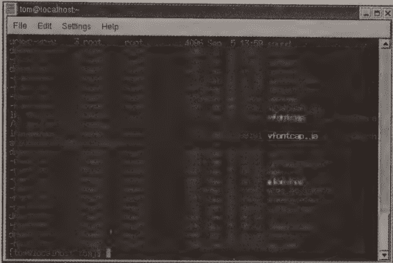

**图 2-4** `/etc` 目录的内容
- 2. 输入 `ls -l /` 并按**回车**。

你将看到类似于图 2-5 中的信息。

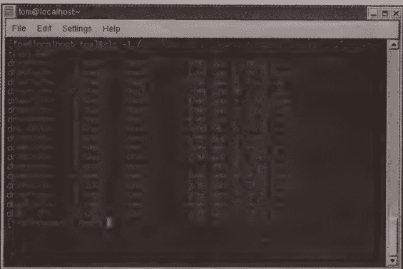

**图 2-5** `/directory`的内容

从图中可以看出，`ls -l` 命令比简单的 `ls` 命令提供了关于列表中每个项的更多信息。例如，查看图 2-5 中列出的第一个项目：

```
drwxr-xr-x  2 root root  4096 Jan 17 09:11 bin
```

如果你看最右侧列，你会看到 `bin`，这是一个文件的名称。其左侧的所有列都包含关于该文件的信息。以下是每列信息的从左到右描述：
- **类型和访问权限**——第一列信息显示如下字符集：

`drwxr-xr-x`

列表中的第一个字符 `d` 表示该文件实际上是一个目录。如果 `bin` 是普通文件，则会显示一个连字符 `-`。其余字符表示文件的访问权限。你将在本章稍后的“设置文件权限”部分中学习更多内容。
- **链接数**——第二列是硬链接到此文件的文件数量（你将在第 5 章中学习链接）。如果该文件是目录，则它是它包含的子目录数量。`bin` 的列表显示它包含两个条目。（目录始终包含两个条目：点 `.` 和 `..`）。
- **所有者**——第三列是文件的所有者。`root` 用户拥有 `bin` 目录。
- **组**——第四列是拥有该文件的组。`root` 组拥有 `bin` 目录。
- **大小**——第五列显示文件以字节为单位的大小。
- **日期和时间**——第六列和第七列显示文件最后修改的日期和时间。
- **名称**——第八列显示文件名。

你还可以使用 `ls` 命令的 `-a` 选项列出隐藏文件，即名称以点开头的文件。操作系统通常使用隐藏文件来保存配置信息和其他用途。Dominion 的系统管理员告诉你，你的主目录包含许多隐藏文件。你可以使用 `ls` 命令的 `-a` 选项列出它们。

列出主目录中的隐藏文件：
- 1. 在命令提示符后输入 `ls -a` 并按回车。

你将看到一个类似于图 2-6 的列表。


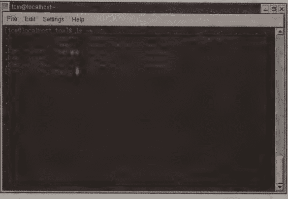

**图 2-6** 用户主目录中的隐藏文件列表

参见附录 B，“UNIX 命令语法指南”以获取 `ls` 命令的简要描述。

## 使用通配符

通配符是一种特殊字符，可以代表任何其他字符，在某些情况下代表一组字符。当你想要处理多个名称相似的文件，或一个你不记得确切名称的文件时，通配符非常有用。UNIX 支持多种通配符字符。在本节中，你将学习 `*` 和 `?`：

`*` 通配符代表文件名中的任何字符组。例如，假设 Becky 的主目录下有这些文件：

```
friends
instructions.txt
list1
list2
list2b
memo_to_fred
memo_to_jill
minutes.txt
notes
```

如果她输入 `ls *.txt` 并按回车，她看到：


```
instructions.txt  minutes.txt
```

`*.txt` 参数导致 `ls` 显示所有以 `.txt` 结尾的文件。如果她输入 `ls memo*`，看到：

memo_to_fred memo_to_jill

如果她输入 `ls *s` 并按回车，`ls` 显示所有以 `s` 结尾的文件：

friends

`?` 通配符代表单个字符。例如，如果 Becky 输入 `ls list?` 并按回车，`ls` 显示所有以 “list” 开头接一个字符的文件。她看到：

list1 list2

她没有看到 `list2b` 的列表，因为 “list” 后面有两个字符。


# 使用通配符

1. 为了练习通配符，必须先创建一个名称相似的文件。在第 1 章中，你使用 `cat` 命令创建了 `notes` 文件。现在使用 `cat` 命令创建这些文件：

`*first_name`: 包含你的名字的文件

`*middle_name`: 包含中间名的文件

`*last_name`: 包含姓的文件

`*full_name1.txt`: 包含全名的文件

`*full_name2.txt`: 另一个包含全名的文件

2. 输入 `ls *name` 并按回车。看到 `first_name`、`last_name` 和 `middle_name`。

3. 输入 `ls full_name?.txt` 并按回车。看到 `full_name1.txt`。

# 创建目录和文件

# 课程 B

# 处理文件、目录和安全

完成本课程后，你应该：

- 创建新目录以存储文件
- 从一个目录复制文件到另一个目录
- 设置文件权限允许其他用户访问你的目录和文件

## 创建目录和文件

作为创建 Dominion 集中数据库工作，Dominion 的经理 Rolfe Williamson 要求你为部门 4540 和 4550 创建目录。

创建新目录：

1. 输入 `cd` 然后回车，确保你在主目录下。

2. 输入 `mkdir 4540` 并按回车创建一个新目录。

3. 输入 `ls` 并按回车。看到 4540 目录。

4. 输入 `cd 4540` 并按回车进入新目录。

5. 现在你可以使用 `cat` 命令创建文件。用冒号（:）分隔每个字段。输入这些命令，每行结束后回车：

```
cat > phones1
Harrison:Joel
Mitchell:Barbara
Olson:Timothy
```

6. 按 Ctrl+D。

7. 输入 `cd` 并回车返回主目录。

8. 输入 `mkdir 4550` 并按回车创建一个新目录。


9. 输入 `ls` 并按回车。看到 4550 目录。

10. 输入 `cd 4550` 并按回车进入新目录。

11. 现在你可以使用 `cat` 命令创建文件 `phones2`，它包含与 `phones1` 相同的字段。输入这些命令，每行结束后回车：

```
cat > phones2
Moore:Sarah
Polk:John
Robinson:Lisa
```

12. 按 Ctrl+D。

你使用 `mkdir` 命令创建了两个目录，并使用 `cat` 命令创建了两个电话文件。

> 注意 你可以使用删除目录 (`rmdir`) 命令删除空目录。首先，使用 `cd` 命令切换到要删除的子目录的父目录。例如，如果你想删除 /home 中的旧目录，首先切换到主目录。输入 `rmdir old` 并按回车。

## 复制文件

你使用 UNIX 复制命令 `cp` 将文件从一个目录复制到另一个目录。`-i` 选项会警告你命令将覆盖目标文件。你也可以使用点表示法（当前目录）作为简写来指定 `cp` 命令的目标。

创建电话文件后，Rolle 想要为 Dominion 创建一个名为 `corp_db` 的新中央目录，并将 `phones1` 文件复制其中。你可以使用波浪号 (`~`) 表示你主目录的位置。

将 `phones1` 文件复制到新目录 `corp_db`：

1. 输入 `cd` 然后回车返回主目录。

2. 输入 `mkdir corp_db` 并按回车创建一个新目录。

3. 输入 `cd corp_db` 并按回车进入新目录。

4. 要将 `dept_4540` 中的 `phones1` 文件复制到当前目录，输入 `cp ~/dept_4540/phones1 .` 并按回车。

## 设置文件权限以安全性

Dominion 中央数据库包含两个文件。你可以使用 `cat` 命令合并这两个文件，并将输出重定向（`>`）到 `corp_phones` 文件，该文件列出了公司所有的电话号码信息。

要将两个文件合并到：

1. 输入 `cat phones1 phones2 > corp_phones` 并按回车，将两个文件的内容合并到一个名为 `corp_phones` 的新文件中。

2. 输入 `more corp_phones` 并按回车，查看新文件的内容。


正如你在第 1 章中所记得的，`more` 命令允许你一次显示一个屏幕的文件，对于读取长文件特别有用。

> 如果要删除不需要的文件，请使用删除 (`rm`) 命令。首先，使用 `cd` 命令切换到包含要删除文件的目录。然后输入 `rm filename`。例如，要删除当前目录下的 "old" 文件，输入 `rm old`。在文件删除之前，你可能会收到也可能收到警告。在使用此命令之前，请确保你想要永久删除文件。在第 4 章中学习更多关于 `rm` 命令的知识。


## 设置文件权限以安全性

由于 UNIX 是多用户系统，用户可以对自己拥的文件设置权限以便他人读取、写入或执行这些文件。文件的原始所有者是创建它的账户；但是，文件所有权可以转移另一个账户。所有者设置的权限作为文件描述的一部分列出。图 2-7 显示了描述文件类型的目录列表。

注意这两个目录的长列表。（记住目录只是另一个文件。）本章早前的章节“列出目录内容”描述了长列表中显示的信息。现在你可以更仔细地查看文件权限。对于描述的第一个文件，最左侧的列显示字符串 `drxr-xr-x`。你已经知道第一个字符表示文件类型。接随其后的字符分为三个文件权限指定符部分。每个部分有三个指定符，如图 2-8 所示。

# 第 2 章 B ：探索 UNIX 文件系统和文件安全

| 文件类型 | 含义 |
| --- | --- |
| - | 普通文件 |
| d | 子目录 |
| l | 符号链接 |
| b | 块设备文件 |
| c | 字符设备文件 |

`ls -1 /etc` 的节录

| drwx-xr-x | 16 root | 4096 Jan 17 9:29 X11 |
| -rw-r-r-- | 1 root | 46 Jan 15 19:11 adjtime |
| drwx-xr-x | 1 root | 1024 Feb 27 2004 cron.daily |

`ls -1 /home/jean/source` 的节录

| -rw-r-r-- | 1 jean | 387 Dec 12 23:11 phones.502 |

**图 2-7** 目录列表中描述的文件类型

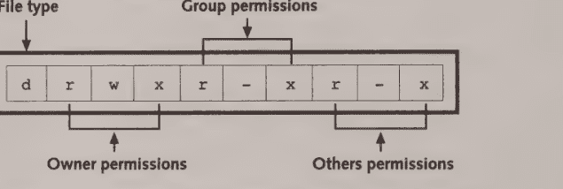

**图 2-8** 文件类型和文件权限示例

文件权限指定符的第一部分表示所有者的权限。所有者像所有用户一样，属于一个用户组。第二部分表示组的权限。此规范适用于所有所有者组的成员（除所有者之外）。第三部分表示其他人的权限。此规范适用于所有既不是所有者也不属于所有者组的用户。在每个部分中，第一个字符表示读取权限。如果那里出现“r”，则该类用户有读取该文件的权限。如果那里出现“w”，则该类用户有写入该文件的权限。第三个字符表示执行权限。如果那里出现“x”，则该类用户有执行该文件的权限。如果在这些字符位置中的任何一个出现横线（–），则拒绝该类型的权限。

> 如果授予用户对目录的权限，该用户就可以查看其内容的列表。目录的写入权限意味着用户可以重命名和删除目录中的文件。目录的执行权限意味着用户可以将该目录设置为当前工作目录。

# 设置文件权限以安全性 61

从左到右，字母 `rwx-xr-x` 意味着：

- r 文件所有者具有读取权限
- w 文件所有者具有写入权限
- x 文件所有者具有执行权限（可以作为程序运行文件）
- r 组具有读取权限
- - 组没有写入权限
- x 组具有执行权限
- r 其他人具有读取权限
- - 其他人没有写入权限
- x 其他人具有执行权限


# 第 2 章 B：探索 UNIX 文件系统和文件安全

你可以通过 `chmod` 命令更改权限设置模式。例如，将其他人的权限设置为 `--` 将移除所有人的所有权限。他们无法读取、写入或执行该文件。

在图 2-7 的第一行中，注意所有者对子目录 `X11` 具有读、写、执行 `rwx` 权限。第一个字符是文件类型，在这种情况下是子目录的 `"d"`。

对于描述的第一个文件，最左侧的列显示字符串 `drwxr-xr-x`。你已经知道第一个字符表示文件类型。接随其后的字符分为三个文件权限指定符部分。每个部分有三个指定符，如图 2-8 所示。

所有者。所有者像所有用户一样，属于一个用户组。第二部分表示组的权限。此规范适用于所有所有者组的成员（除所有者之外）。第三部分表示其他人的权限。此规范适用于所有既不是所有者也不属于所有者组的用户。在每个部分中，第一个字符表示读取权限。如果那里出现 `r`，则该类用户有读取该文件的权限。如果那里出现 `w`，则该类用户有写入该文件的权限。第三个字符表示执行权限。如果那里出现 `x`，则该类用户有执行该文件的权限。如果在这些字符位置中的任何一个出现横线 `–`，则拒绝该类型的权限。

> 如果授予用户对目录的权限，该用户就可以查看其内容的列表。目录的写入权限意味着用户可以重命名和删除目录中的文件。目录的执行权限意味着用户可以将该目录设置为当前工作目录。

从左到右，字母 `rwx-xr-x` 意味着：

- `r` 文件所有者具有读取权限
- `w` 文件所有者具有写入权限
- `x` 文件所有者具有执行权限（可以作为程序运行文件）
- `r` 组具有读取权限
- `-` 组没有写入权限
- `x` 组具有执行权限
- `r` 其他人具有读取权限
- `-` 其他人没有写入权限
- `x` 其他人具有执行权限

`ls -1 /etc` 的节录

```
drwxr-xr-x  16 root  4096 Jan 17 9:29 X11
-rw-r--r--  1 root  46 Jan 15 19:11 adjtime
drwxr-xr-x  1 root  1024 Feb 27 2004 cron.daily
```

`ls -1 /home/jean/source` 的节录

```
-rw-r--r--  1 jean  387 Dec 12 23:11 phones.502
```

| 文件类型 | 含义 |
| --- | --- |
| `-` | 普通文件 |
| `d` | 子目录 |
| `l` | 符号链接 |
| `b` | 块设备文件 |
| `c` | 字符设备文件 |

## 章节总结

此命令意味着“允许所有者 `u`、组 `g` 和其他人 `o` 对 `corp_db` 目录具有执行权限 `+x`”。

- 输入 `chmod ugo+r ~/corp_db/corp_phones` 并按回车来设置权限，以便所有人都能读取该文件。

此命令意味着“允许所有者 `u`、组 `g` 和其他人 `o` 对 `corp_phones` 文件具有可读权限 `+r`”。

从你的家目录开始，你可以创建任何子目录并为其设置权限。但是，除非系统管理员做了特殊规定，否则你无法在家目录之外创建子目录。

你使用了适当的 UNIX 命令创建目录来存储文件，并为所有用户建立了一个中央目录，然后将文件从其他目录传输到中央目录。最后，你更改了文件权限，以便其他用户访问你创建的目录和文件。

## 章节总结

- 在 UNIX 中，文件是数据存储的基本组件。UNIX 将一切都视为文件，即使是显示器、键盘和打印机等附加设备。
- 文件系统是 UNIX 在硬盘和软磁盘等质存储设备上组织文件的方式。文件存储在文件系统中，文件系统是一个类似于树的层次结构，顶层目录包含其他目录，这些目录又包含其他目录。每个文件都可以通过正确且唯一的路径来定位；该路径是通往特定文件的目录名称列表。
- 标准的树结构从根目录 `/` 开始，它是一组嵌套的其它目录和子目录的基础。
- 存放文件系统的磁盘区域称为分区 `partition`。一个磁盘可能有多个分区，每个分区相互分离，使其不受来自外部干扰（如另一个分区的结构性文件问题）的影响。UNIX 文件系统设计为在将多个分区挂载到树结构后允许访问。
- UNIX 定义的路径 `path` 作为访问系统上任何文件的地图。绝对路径是始终从根级别开始的路径。相对路径是从你当前位置开始的路径。
- 你可以自定义命令提示符来显示当前工作目录名称、日期、时间以及其他几个项目。
- `ls` 命令显示目录中包含的文件和目录名称。`ls -l` 命令及其选项在屏幕上显示所有文件信息。这种显示通常被称为长列表。`ls -a` 命令显示隐藏文件。

# 第 2 章

# 探索 UNIX 文件系统与文件安全

- 通配符可以使用在命令（如 `ls`）中，代替文件名中的字符。通配符可以代表任何字符字符串，而 `?` 通配符可以代表任何单个字符。
- 只要你拥有父目录，就可以使用 `mkdir` 命令创建一个新目录。文件的原始所有者是创建它的人，他或她将成为该访问的控制者（尽管 `root` 账户也可以控制访问）。
- 你可以使用 `chmod` 命令为你拥有的文件设置权限。权限设置为 `rwx`，分别意味着读取、写入和执行。文件权限的设置用于控制三类用户访问文件：所有者、组和其他人。如果你想让其他人访问这些目录中的信息，必须记住更改目录的权限设置。你使用执行 `x` 命令授予目录的访问权限。
- 你可以使用 `cp` 命令将源文件复制到目标文件。除非使用 `-i` 选项，否则 UNIX 会在不发出警告的情况下覆盖目标文件。点表示法（`.` 表示当前目录）是 `cp` 命令中指定目的地的简写方式。

## 命令总结

| 命令 | 用途 | 本章涵盖的选项 |
| --- | --- | --- |
| `cd` | 切换目录 |  |
| `chmod` | 为指定文件设置文件权限 |  |
| `cp` | 将文件从一个目录复制到另一个 | `-i` 防止在无警告的情况下覆盖目标文件 |
| `ls` | 显示目录内容，包括其文件和子目录 | `-a` 列出隐藏文件；`-l` 生成目录的详细列表 |
| `mkdir` | 创建新目录 |  |


| `mount` | 系统启动时将文件系统分区连接到目录树；并挂载额外的设备，如 CD-ROM 和软磁盘驱动器 | `-t` 指定文件系统的类型 |
| `pwd` | 显示你当前的路径 | |
| `rm` | 删除文件 | |
| `rmdir` | 移除空目录 | |
| `umask` | 为多个文件设置文件权限 | |
| `umount` | 从目录树中断开文件系统分区 | |

# 复习题

- 1. UNIX 文件系统的目的是 ______________。

  a. 在质存储上组织文件

  b. 为一个或多个用户提供层次化的存储空间

  c. 允许用户创建目录

  d. 以上所有

  e. 仅 a 和 c

- 2. 标准的树结构从 ____________ 目录开始。

  a. `home`

  b. `user`

  c. `bin`

  d. `root`

- 3. 对于普通用户，绝对路径必须始终从 ____________ 开始。

  a. 当前目录

  b. 根目录

  c. 第一个分配的分区

  d. 家目录

- 4. 磁盘分区用于 ______________。

  a. 为文件系统分配空间

  b. 压缩磁盘空间

  c. 为文件设置权限

  d. 消除对家目录的需求

- 5. 名为 `hdb1` 的分区是 ______________。

  a. 1 号 IDE 硬盘上的第一个分区

  b. 1 号 IDE 硬盘上的第二个分区

  c. SCSI 硬盘上的第一个分区

  d. SCSI 硬盘上的第二个分区

- 6. 名为 `sda1` 的分区是 ______________。

  a. 1 号 IDE 硬盘上的第一个分区

  b. 1 号 IDE 硬盘上的第二个分区

  c. SCSI 硬盘上的第一个分区

  d. SCSI 硬盘上的第二个分区

- 7. 哪项包含账户信息？

  a. `/root`

  b. `/usr`

  c. `/home`

  d. `/bin`

- 8. ____________ 包含账户信息。

  a. `/mnt`

  b. `/etc`

  c. `/lib`

  d. `/proc`

- 9. 为了访问目录，必须设置 ____________ 权限。

  a. 读取

  b. 写入

  c. 执行

  d. 只读

- 10. 路径是 ____________。

  a. 树结构

  b. 详细列表

  c. 访问任何文件的地图

  d. 分区

- 11. 哪个分区作为虚拟内存？

  a. `swap`

  b. `/root`

  c. `/etc`

  d. `/usr`

- 12. 点 `..` 指向 ____________ 目录。

  a. 父目录

  b. 子目录

  c. 当前目录

  d. 家

- 13. 输入 `cd` 并回车，访问的是哪个目录？

  a. 父目录

  b. 当前目录

  c. 家目录

  d. 子目录

- 14. 输入 `/` 并回车，访问的是哪个目录？

  a. 父目录

  b. 当前目录

  c. 家目录

  d. 子目录

- 15. 下列哪项是错误的？

  a. 你只能在拥有的父目录中创建子目录。

  b. 你必须为你想要访问的目录设置 `x` 权限。

  c. 你可以使用 `cd ..` 命令向上移动。

  d. 点指向父目录。

- 16. 默认情况下，`~` 是 ____________ 目录的简写。

  a. 父

  b. 子

  c. 当前

  d. 家

- 17. 用于自定义提示符的 `\s` 格式字符会显示 ____________。

  a. 24 小时制

  b. 主机名

  c. `shell` 名称

  d. 家目录名称

- 18. `ls -l` 命令对于检查 ____________ 很有用。

  a. 权限

  b. 类型

  c. 大小

  d. 以上所有

- 19. 当你完整查看目录内容（权限时，类型标识表示子目录。

  a. `f`

  b. `d`

  c. `-`

  d. 空格

- 20. 下列哪项授予组对文件的读写访问？

  a. `chmod g+rw accounts`

  b. `chmod g+rx accounts`

  c. `chmod o+rx accounts`

  d. `chmod g-rw accounts`

- 21. 哪个命令允许你查看当前路径？

  a. `ls`

  b. `rwx`

  c. `pwd`

  d. `rm`

- 22. ____________ 环境变量存储了命令行提示符。

  a. `PWD`

  b. `PROMPT`

  c. `PATH`

  d. `PS1`

- 23. 当你使用 `cp` 命令时，你应该注意________________。

  a. 目标文件会将文件放在父目录

  b. 它会覆盖同名文件

  c. 它会破坏源文件

  d. 源文件无法进行相对定位

- 24. 远程目录在用户的家目录中。将文件从远程目录复制到当前目录，输入 ____________________。

  a. `cp ~/remote/filename`

  b. `cp +/filename`

  c. `cp > /remote/filename`

  d. `cp/remote/filename`

## 探索练习

25. 与 `cp` 命令配合使用的 `-i` 选项会导致 `cp` 命令：

- a. 如果目标文件已存在，则忽略任何不覆盖目标文件的请求

- b. 将复制的文件插入到现有的目标文件中

- c. 警告你正在覆盖目标文件

- d. 以上均不是

## 探索练习

1. 使用 `cd` 命令访问 `/mnt` 目录。

2. 在探索练习 1 中访问 `/mnt` 目录后，输入 `ls -l` 查看其内容。你看到列出了哪些文件？

3. 使用 `cd` 命令返回你的家目录，然后使用 `pwd` 验证你是否处于家目录。

4. `notice.txt` 文件位于 `notices` 目录，该目录位于 `public` 目录中。`public` 在 Tom 的家目录下（Tom 的用户名为 `tom.`）。`notice.txt` 的绝对路径是什么？

5. 如果你当前的工作目录是 `notices` 目录（在 Tom 的家目录下），`notice.txt` 的相对路径是什么？

6. 列出一个显示如何使用绝对路径地址的 `cd` 命令示例。列出一个显示如何使用相对路径地址的 `cd` 命令示例。登录并显示 `/bin`、`/sbin` 和 `/etc` 中的目录。

7. 列出赋予文件所有者和组读、写、执行权限的 `chmod` 符号字符串。

8. 使用 `chmod` 符号字符串拒绝所有非所有者或组的用户访问文件的读、写和执行权限。

9. 使用 `cat` 命令在你的家目录下创建一个文件。更改权限使任何人无法访问该文件。

10. 以另一个用户的身份登录并尝试访问你创建的文件。在账户下，修改文件使其可以被访问（要完成此练习，请向你的导师索要另一个密码）。

11. 修改你的提示符以显示时间。

12. 使用 `chmod` 命令保护你的家目录，防止你之外的任何人访问。

13. 使用 `ls` 选项列出家目录中的隐藏文件。

14. 使用绝对路径切换到 `/etc`。从 `/etc` 目录使用相对路径切换回你的家目录。现在列出家目录下的 `.bashrc` 文件（在当前位置执行此操作）。

15. 在命令行中输入 `cd ../`。你在树状结构的的什么位置？解释你是到达那里的。

16. 在命令行中输入 `cd ../etc` 并按回车。你在树状结构的的什么位置？解释你是到达那里的。

17. 使用家目录的相对路径，输入 `cat` 命令显示 `/etc/passwd` 文件的内容。

18. 使用 `cd` 命令返回家目录。将 `date` 命令的输出重定向到名为 `chapinfo` 的文件中。使用 `ls` 命令获取该文件的详细列表。所有者、组和其他有什么权限？

19. 更改 `chapinfo` 文件的权限，赋予所有者读和写权限，并拒绝其他人的权限。查看详细列表以确认更改生效。

20. 修改你的提示符，使其始终显示当前工作目录的绝对路径。

21. 在家目录下创建一个名为 `tempdir` 的目录。使用 `cd` 命令切换到 `tempdir` 目录。使用 `cat` 命令在 `tempdir` 目录下创建一个名为 `tempfile` 的文件。回到家目录并尝试删除 `tempdir` 目录。发生了什么？使用 `man` 命令查看是否可以在不先删除内部 `tempfile` 的情况下删除 `tempdir`。

22. 使用不带选项的 `mount` 命令查看挂载了哪些设备和文件系统。

# 第三章：Unix编辑器

Dominion Consulting 的所有都会编写每周备录，总结他们的活动和成就。他们使用 UNIX 文本编辑器编写这些备录，这允许他们创建和修改基于文本的文档。UNIX 至少包含两个文本编辑器——`vi` 和 `Emacs`。作为你 UNIX 训练的一部分，你在 Dominion Consulting 的经理 Rolfe Williams 要求你使用这些编辑器创建两个版本的相同备录，总结文本文件的基本功能。


本章介绍了两个 UNIX 编辑器。编辑器是一种用于创建和修改计算机文档（如程序和数据文件）的程序。例如，文件可能包含笔记、备录或程序源代码。文本编辑器就像一个简版的文字处理程序；你可以使用文本编辑器创建和编辑文档，但你不能使用粗体、居中文本或其他功能对其进行格式化。所有的操作系统都有一个标准的编辑器，许多系统还包含替代编辑器。在 UNIX 系统中，你会发现两个流行的编辑器：`vi` 编辑器和 `Emacs` 编辑器。`Linux` 包含了这两个编辑器，用户通常更倾向于使用 `vi` 编辑器。

# 课程 A：vi 编辑器

完成本节后，你应该能够：

- 描述什么是 `ASCII` 文本文件
- 解释为什么操作系统编辑器使用 `ASCII` 文件
- 使用 `vi` 编辑器创建和编辑简单文档

## 理解 UNIX 文件

在 UNIX 中创建的几乎一切都存储在文件中。存储在文件中所有信息都以二进制位的形式存在。二进制位，简称为 `bit`，例如是两种状态之一。这些状态是 `1`（开启）和 `0`（关闭）。它们表示电子电路中电压的存在或缺失。由于计算机由处于开启或关闭状态的电子电路组成，因此二进制数非常适合报告这些状态。仅使用 `0` 和 `1` 作为与计算机通信的方式被称为机器语言。早期的程序员能够使用机器语言编写程序，这是一个乏味且耗费时间的过程。

## ASCII 文本文件

为了使存储在文件中信息变得可访问，计算机设计人员建立了一套将二进制数字的标准。这种标准使用八位二进制数字，称为一个字节（`byte`），它可以被配置为一组字母、数字、标点符号或特殊字符。`ASCII` 是美国信息交换标准（American Standard Code for Information Interchange）的缩写。包含打印字符的文件被称为文本文件，不可打印字符的文件被称为二进制文件。

## 二进制文件

计算机不仅限于处理文本。为了处理图形（如位图），二进制文件包含位点，软件必须将这些位点转换为复杂的数组。

## 理解文件（标点符号）

| 十进制 (Dec) | 八进制 (Octal) | 十进制 (Dec) | 八进制 (Octal) | 十进制 (Dec) | 八进制 (Octal) |
|---|---|---|---|---|---|
| 32 | 040 | 65 | 101 | A |
| 33 | 041 | 66 | 102 | B |
| 34 | 042 | 67 | 103 | C |
| 35 | 043 | 68 | 104 | D |
| 36 | 044 | 69 | 105 | E |
| 37 | 045 | 70 | 106 | F |
| 38 | 046 | 71 | 107 | G |
| 39 | 047 | 72 | 110 | H |
| 40 | 050 | 73 | 111 | I |
| 41 | 051 | 74 | 112 | J |
| 42 | 052 | 75 | 113 | K |
| 43 | 053 | 76 | 114 | L |
| 44 | 054 | 77 | 115 | M |
| 45 | 055 | 78 | 116 | N |
| 46 | 056 | 79 | 117 | O |
| 47 | 057 | 80 | 120 | P |
| | | 81 | 121 | Q |
| | | 82 | 122 | R |
| | | 83 | 123 | S |
| | | 84 | 124 | T |
| | | 85 | 125 | U |
| | | 86 | 126 | V |
| | | 87 | 127 | W |
| | | 88 | 130 | X |
| | | 89 | 131 | Y |
| | | 90 | 132 | Z |

### 第3章 节 A UNIX 编辑器

在运行脚本时，解释器会查看每一行，并将每行上的命令转换为计算机执行的操作。脚本是可执行的解释型程序文件。

编译型和解释型文件是可以被调用的可执行程序文件。这些文件可以从命令行运行。


## 使用编辑器

编辑器允许你创建和编辑 `ASCII` 文件。`UNIX` 通常包含 `vi` 和 `Emacs` 编辑器。它们是屏幕编辑器：它们一次显示一屏你正在编辑的文本，并允许你在屏幕上移动移动以更改和添加文本。你也可以使用行编辑器来编辑文件。行编辑器一次只处理一行或一组行。虽然行编辑器不能让你看到编辑的上下文，但它们对于执行搜索、替换和复制文本块等通用任务非常有用。

### 使用 vi 编辑器

`vi` 编辑器之所以被称为 `vi`，是因为它是可视化的（visual）——它会立即在屏幕上显示你对文本所做的更改。它还是一个模态编辑器；也就是说，它在三种模式下工作：插入模式、命令模式和扩展（`ex`）命令集模式。插入模式允许你输入文本，通过在启动 `vi` 编辑器后输入字母 `i` 进入。命令模式通过按下 `Esc` 启动，允许你输入命令来执行编辑任务，例如遍历文件和删除文本。`ex` 模式使用一组扩展命令，这些命令最初被用于一个名为 `ex` 的早期 `UNIX` 编辑器。你可以通过按下 `Esc` 进入命令模式，然后输入冒号（`:`）在屏幕底部输入命令。

现在，你已经准备好使用 `vi` 编辑器编写你的第一条备忘录了。要这样做，你需要完成以下任务：

- 在 `vi` 编辑器中创建新文件
- 插入、编辑和删除文本
- 搜索和替换文本
- 从其他文件中添加文本
- 复制、剪切和粘贴文本
- 打印文件
- 保存文件并退出 `vi`

### 使用 vi 编辑器

不同版本的 `UNIX` 包含了不同版本的 `vi` 编辑器。本章描述的命令通常适用于大多数 `UNIX` `vi` 编辑器版本。然而，它们特别适用于 `Red Hat Linux` 中的 `vi` 编辑器，该编辑器在技术上被称为 `vim` (`vi` improved) 编辑器。

## 在 vi 编辑器中创建新文件

首先创建一个名为 `temp` 的文件，用来存放你总结文本文件基本特征的第一条备忘录。要启动 `vi` 并创建新文件，输入 `vi` 后紧跟新文件名。

进入 `vi` 并创建新文件：

- 1. 在 `$` 命令提示符后，输入 `vi temp` 并按回车键。这会启动 `vi` 并开始编辑名为 `temp` 的新文件。你的屏幕看起来应该和图 3-2 相似。

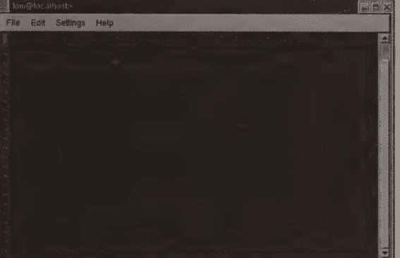

图 3-2 `vi` 编辑器的打开界面

当你看到屏幕左上角的光标时，光标如图 3-2 所示显示为一个实心块。光标指示你当前在文件中的位置。

包含光标的行是当前行。包含波浪号 (`~`) 的行不是文件的一部分；它们仅表示屏幕上的行，而不是文件中的文本行。

## 插入文本

当你启动 `vi` 编辑器时，你处于命令模式。这意味着编辑器会将你在键盘上输入的任何内容解释为命令。在向新文件插入文本之前，你必须使用 `i` (`insert`) 命令。

在 `temp` 文件中插入文本 `i`：

- 1. 输入 `i`（但不要按回车）。

  像大多数 `vi` 命令一样，`i` 命令不会在你的屏幕上显示（或回显）。该命令从命令模式切换到插入模式；你不需要按回车来指示命令的完成。

- 2. 输入图 3-3 所示的文本。

  如果你需要删除字符，按 `Backspace` 键。在每行末尾按回车键移动到下一行。

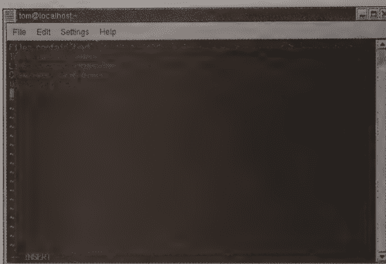

**图 3-3** 使用 `vi` 编辑器插入文本

> 注意
>
> 在插入模式下，你输入的每一个字符都会显示在屏幕上。要切换到命令模式，请按 `Esc`。

## 重复更改

使用重复 (`..`) 命令来重复你最近所做的更改。因为你刚刚插入了文本，重复命令会重复插入操作，从而复制文本。你可以通过重复上一行并对其编辑来在备忘录中添加下一项。

**重复你的上一次编辑命令：**

- 1. 按 `Esc` 切换到命令模式。
- 2. 输入 `.` (句号)。

## 使用 vi 编辑器

`vi` 编辑器会将你最后输入的文本插入在当前行下方。你的屏幕看起来应该和图 3-4 相似。

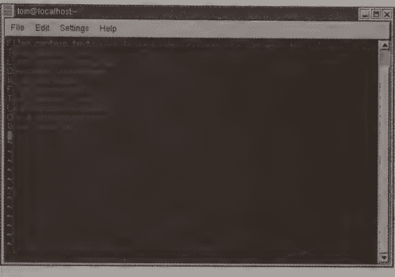

**图 3-4** 在 `vi` 编辑器中重复命令

现在，你准备好编辑刚刚插入的文本了。首先在屏幕上移动光标，然后。

## 移动光标

当你处于命令模式时，可以移动光标。

**在屏幕上移动光标：**

- 按 `Esc` 确保处于命令模式。
- 使用方向键移动光标。
- 使用字母键移动光标。
- 使用组合键移动光标。
- 使用数字键移动到特定行。
- 使用 `G` 移动到最后一行。
- 使用 `nG` 移动到指定的行。

## 删除文本

既然你已经知道如何插入文本和在文件中移动，现在就可以删除文本了。要这样做，移动到一个字符，然后输入 `x` 删除该字符。你也可以结合许多删除命令来删除多个字符。

### 第3章 节 A UNIX 编辑器

除了这些命令，你还可以使用其他命令移动光标。表 3-1 总结了移动键。

| 键 | 移动 |
|---|---|


| `h` 或 左箭头 | 左字符位置 |
| `l` 或 右箭头 | 右字符位置 |
| `k` 或 上箭头 | 上行 |
| `j` 或 下箭头 | 下行 |
| `H` | 屏幕左上角 |
| `L` | 屏幕最后一行 |
| `nG` | 转到指定的行 |
| `w` | 前一个单词 |
| `b` | 后一个单词 |
| `0` | 行首 |
| `$` | 行尾 |
| `Ctrl+U` | 上半屏幕 |
| `Ctrl+D` | 下半屏幕 |
| `Ctrl+F` 或 `Pg` | 向前翻页 |
| `Ctrl+B` 或 `Pg` | 向后翻页 |

记住表 3-1 所示的组合键和字母键设计用于命令模式下工作。用于文本周围的方向键在命令模式和插入模式下均有效。

| 命令 | 目的 |
|---|---|
| `x` | 删除光标处的字符 |
| `dd` | 删除当前行 |
| `dw` | 删除光标所在的单词；如果光标在单词中间，则删除从光标到行尾 |
| `d$` 或 `D` | 从光标到行尾 |
| `d0` | 从光标到行首 |

现在你可以使用删除命令和光标移动键来编辑备忘录中插入的文本。

通过删除文本编辑 `temp` 文件：
- 1. 按 `Esc` 确保处于命令模式。
- 2. 输入 `1G` 到文件的第一行。你想删除这一行。
- 3. 要删除第一行，输入 `dd`（但不要按回车）。
你的文件现在看起来像图 3-5。
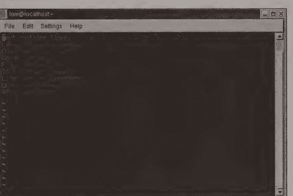
图 3-5 删除第一行后的备忘录
- 4. 按 `w` 跳到下一个单词，“contains”。
- 5. 输入 `dw` 删除当前单词（现在该行显示为“Text lines”），然后输入 `i` 进入插入模式。
- 6. 输入 `consists of between “Text” and “lines.” 确保包含额外的“s”。
## 第3章 节 A UNIX 编辑器
- 7. 按方向键将光标移动到“consistss”中多余的“s”，然后按 `Esc` 切换到命令模式。
- 8. 要删除当前字符（多余的“s”），输入 `xi`（但不要按回车）。
你的备忘录现在应该像图 3–6 所示。
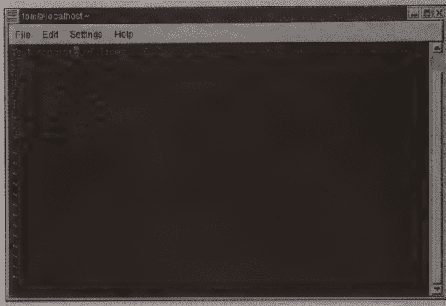
**图 3-6** 编辑后的备忘录
现在你想通过删除最后一个单词来编辑句子“Files contain text,”。
- 9. 按方向键移动到句子“Files contain text,”，然后移动到“contain”单词中的“c”字母上。
- 10. 输入 `ds$` 删除从光标到行尾的文本，然后输入 `i` 切换到插入模式。
- 11. 输入 `consist of words.` 来完成句子。
现在你可以通过替换第一个单词来编辑下一个句子。
- 12. 按方向键移动到文件中的下一行，移动到单词“lines”的起始字符，然后按 `Esc` 切换回命令模式。
- 13. 输入 `d0` 删除从光标到行首的文本，然后输入 `i` 进入插入模式。
- 14. 输入 `Words form` 将该文本插入到行首，
- 15. 你完成的备忘录应该像图 3–7 所示。
## 使用 vi 编辑器
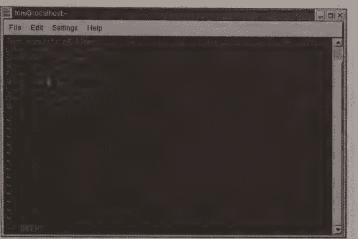
图 3-7 编辑后的完成备忘录
`vi` 编辑器提供了复制、剪切和粘贴文本的替代。
> 删除行命令 `dd` 实际上会将删除的行置于缓冲区中。然后你可以使用粘贴命令 `p` 将删除（剪切）的行粘贴到文本的其他地方。（将光标置于你想粘贴的位置。）要复制并粘贴文本，请使用复制命令 `yy` 复制行。在复制了想要在别处粘贴的行后，移动光标并输入 `p` 以在当前位置粘贴文本。
## 撤销命令
如果你完成了一个命令后发现想撤销它的效果，可以使用撤销命令。例如，如果你不小心删除了文件中的几行，输入 `u` 即可恢复文本。
## 搜索模式
你可以通过输入正斜杠 (`/`)、输入你正在寻找的模式，然后按回车来搜索字符模式。例如，假设你知道在备忘录中使用了多少次“consist”或“consists”这个单词。
要搜索文本模式以找到其中一个单词：
- 1. 按 `Esc` 确保你处于命令模式。
- 2. 输入 `H` 将光标移动到屏幕顶部。
- 3. 输入 `/cons` 搜索字符串“cons.”。
- 4. 按 `Enter`。光标移动到第 1 行“consists”单词的开头。
- 5. 如需搜索“cons”的下一个出现处，按 `n`（代表 next）。光标移动到第 5 行“consist”单词的开头。
如果你搜索的是“/con”，你首先会在第 1 行找到“consist”，然后在第 2 行找到“contain”。
- 6. 要查看文件状态信息，按 `Ctrl+g`（在 UNIX 中此例可以使用大写或小写，即 `Ctrl+G`）。你的屏幕应该像图 3–8 所示。
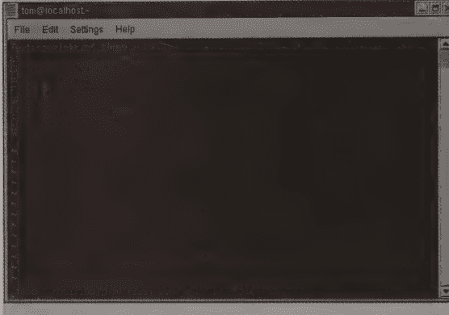
**图 3-8** `vi` 状态行
> 屏幕底部的**状态行**显示信息，包括行定向命令（在本节后后解释）和错误消息。
## 搜索与替换
假设你想将备忘录中所有的“text”更改为“documents”。与其反复搜索“text”然后删除并插入“documents”，不如用一个命令完成搜索和替换。你目前学到的命令是面向屏幕的。可以执行多个操作（搜索和替换）的命令是**行定向命令**，它们在 `ex` 模式下运行。
## 使用 vi 编辑器
面向屏幕的命令在光标所在位置执行。你不需要告诉计算机在何处执行操作：它是相对于光标进行的。另一方面，行定向命令要求你为操作指定确切的位置（地址）。面向屏幕的命令易于输入，它们的更改会显示在屏幕上。输入行定向命令较复杂，但它们可以独立于光标并在文件的多个位置执行。

冒号 (`:`)位于行定向命令之前。它作为状态行上的提示符。在状态行上输入行定向命令，完成命令后按回车。
在本章中，行定向命令包括：
- 搜索字符模式：
  - 1. 按 `Esc` 确保你处于命令模式。
  - 2. 输入 `H` 将光标移动到屏幕顶部。
  - 3. 输入 `/cons` 搜索字符串“cons.”。
  - 4. 按 `Enter`。光标移动到第 1 行“consists”单词的开头。
  - 5. 如需搜索“cons”的下一个出现处，按 `n`（代表 next）。光标移动到第 5 行“consist”单词的开头。
  - 6. 要查看文件状态信息，按 `Ctrl+g`（或 `Ctrl+G`）。
- 搜索并替换：
  - 1. 按 `Esc` 确保你处于命令模式。
  - 2. 输入 `H` 将光标移动到屏幕顶部。
  - 3. 输入 `/cons` 搜索字符串“cons.”。
  - 4. 按 `Enter`。光标移动到第 1 行“consists”单词的开头。
  - 5. 如需搜索“cons”的下一个出现处，按 `n`（代表 next）。光标移动到第 5 行“consist”单词的开头。
  - 6. 要查看文件状态信息，按 `Ctrl+g`。

# 第3章 课程 A UNIX 编辑器
当你想要在不先关闭 `vi` 会话的情况下运行多条命令行命令时，使用 `Ctrl+z` 选项显示命令行。
要访问命令行以执行多个命令：
- 1. 输入 `Ctrl+z` 进入命令行。
- 2. 输入 `-l` 执行命令。
- 3. 输入 `fg` 返回你的 `vi` 编辑会话。

## 在编辑时更改显示
除了使用 `vi` 编辑命令外，你还可以在 `vi` 中设置选项来控制编辑参数，例如行号显示以及搜索时是否区分大小写。当你需要处理一段范围内的行时，开启行号，例如当你正在删除或剪切并粘贴一段文本时。然后你可以参考行号来决定删除备忘录的最后三行。先开启行号，然后使用删除命令。
要使用自动行号：
- 1. 按 `Esc` 键以确保你处于命令模式。
- 2. 输入 `:set number` 并按回车键。
重绘后的屏幕会在文本左侧显示行号。你的屏幕应该看起来如图 3–11 所示。

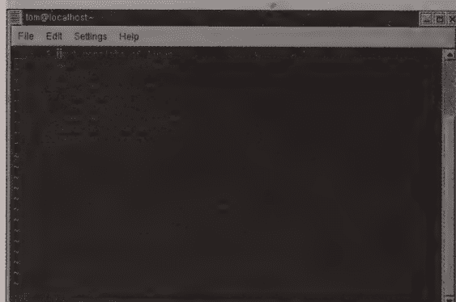
图3-11 更改你的显示
行号仅供参考。它们不是文件的一部分。现在你可以使用这些引用数字删除文件的最后三行。
## 使用 vi 编辑器
- 3. 输入 `:7,9d` 并按回车键。
你删除了文件的最后三行。
## 复制或剪切粘贴


你可以使用 `vi` 中的 `yy` 命令从文件中复制指定行数的行并放在剪贴板上。要从文件中删除这些并将其存储在剪贴板上，请使用 `dd` 命令。现在你想重新组织文档，使前三行位于文件末尾。你可以使用剪切和粘贴命令来完成此更改。

要剪切粘贴文本：

- 1. 在命令模式下，输入 `H` 将光标移动到第 1 行开头。
- 2. 输入 `3dd` 剪切文档的前 3 行并将其存储缓冲区缓冲区。
- 3. 输入 `G` 将光标移动到文件末尾。
- 4. 输入 `p` 将这三行粘贴到文件末尾。

## 打印文本文件

你可以使用 `lpr`（行打印）`shell` 命令打印文件。输入 `!lpr` 然后输入你想打印的文件名。

要打印文件：

- 1. 如必要，按 `Esc` 键返回命令模式。
- 2. 输入 `:w` 并按回车键保存练习文件。
- 3. 输入 `:lpr practice` 并按回车键。这会在当前目录的默认打印机上打印 `practice` 文件。

你还可以使用 `-Printer` 选项指定你想要使用的打印机。例如，你可能使用两台打印机，`lp1` 和 `lp2`。要在 `lp2` 上打印 `practice` 文件，输入 `:lpr -p lp1 -p lp2 practice` 并按回车键。

## 取消编辑会话

如有必要，你可以取消编辑会话，从而丢弃所有所做的更改。另一个选项是仅保存自上次使用 `:w` 命令以来所做的更改。还有一种是你决定在练习文件中再做一次更改，然后决定在不保存的情况下退出。

### 要进行额外更改并在不保存的情况下取消：

- 1. 按 `Esc` 键进入命令模式。
- 2. 当光标位于第一行开头时（如果不是，请输入 `H`），输入 `dd`。（但不要按回车键）。
- 3. 输入 `:!` 并按回车键。
- 4. 输入 `vi practice` 并按回车键。注意，“Words form documents.”这句话又回到了文件的第 1 行，因为你在第 2 步中的更改没有保存。
- 5. 输入 `:q!` 并按回车键。

在启动 `vi` 编辑器后，可以通过输入 `Esc`，然后是 `;`，然后 `help` 来访问帮助文档。输入 `:q!` 退出帮助文件。

# 课程 B

## EMACS 编辑器

完成本课程后，你应该能够：

* 比较并对比 `Emacs` 和 `vi` 编辑器的功能
* 熟悉最重要的 `Emacs` 编辑器命令
* 使用 `Emacs` 编辑器创建和编辑简单文档

## 使用 EMACS 编辑器

`Emacs` 是另一种流行的 `UNIX` 文本编辑器，但由于其复杂性，它的流行程度一直仅次于 `vi` 编辑器。与 `vi` 不同，`Emacs` 不是模式的：它不会从命令模式切换到插入模式。这意味着你可以在不验证自己是否处于正确模式的情况下输入命令。虽然 `Emacs` 比 `vi` 复杂，但它更具一致性。你可以通过按下 `Alt` 或 `Ctrl` 键组合来输入命令。

`Emacs` 还支持复杂的宏语言。宏是一组自动执行复杂任务的命令。将宏想象成“超级指令”。`Emacs` 具有强大的命令语法并且是扩展的。它的自定义宏包集让你读取电子邮件和新闻，并编辑目录内容。`Emacs` 的功能比任何其他编辑器都多。你可以通过学习它的常用命令开始学习 `Emacs`。

# 使用 Emacs 编辑器

表 3-3 常用 em 命令

| Alt 命令 | 目的 | Ctrl 命令 | 目的 |
| :--- | :--- | :--- | :--- |
| Alt+< | 将光标移动到文件开头 | Ctrl+@ | 标记光标位置 |
| Alt+> | 将光标移动到文件末尾 | Ctrl+A | 将光标移动到行首 |
| Alt+B | 光标向后移动一个单词 | Ctrl+B | 光标向后移动一个字符 |
| Alt+D | 删除当前单词 | Ctrl+D | 删除光标下的字符 |
| Alt+F | 光标向前移动一个单词 | Ctrl+E | 将光标移动到行尾 |
| Alt+Q | 使用完整的自动换行重新格式化当前落 | Ctrl+F | 使用完整的自动换行向前移动一个段落 |
| Alt+T | 如果光标位于单词第一个字符下，则将该单词与前一个单词交换；如果光标不在第一个字符下，则将该单词与后续单词交换 | Ctrl+G | 取消命令 |
| Alt+U | 将单词所有字母大写 | Ctrl+H | 使用在线帮助 |
| Alt+W | 向上滚动屏幕 | Ctrl+K | 删除到行尾的文本 |
| Alt+x doctor | 进入 doctor 模式在 Emacs 中玩游戏，它会对你的陈述做出回答。请先保存工作。并非所有版本都支持此模式。 | Ctrl+N | 光标移动到下一行 |
| | | Ctrl+P | 光标移动到上一行 |
| | | Ctrl+T | 交换光标前和光标下的字符 |
| | | Ctrl+V | 向下滚动屏幕 |
| | | Ctrl+W | 删除标记文本。按 Ctrl+Y 恢复删除的文本 |
| | | Ctrl+Y | 从缓冲区插入文本，并放在光标后 |
| | | Ctrl+H, T | 运行关于 Emacs 的教程 |

表 3-3 常用 em 命令（续）

| Alt 命令 | 目的 | Ctrl 命令 | 目的 |
| :--- | :--- | :--- | :--- |
| | | Ctrl+X, Ctrl+C | 退出 Emacs |
| | | Ctrl+X, Ctrl+S | 保存文件 |
| | | Ctrl+X, U | 撤销上次更改 |
| | | Ctrl+Del | 删除光标下的字符 |

## 在 Emacs 中创建新文件

你可以通过在终端窗口中输入 `emacs` 命令来启动 `Emacs`。如果你在此命令后输入文件名，`Emacs` 将创建一个该名称的新空文件，或者打开一个同名的现有文件。如果你输入 `emacs` 而没有文件名，`Emacs` 将显示一些重要命令的介绍列表，如图 3–12 所示。如果 `Emacs` 窗口超过了屏幕长度，请使用窗口顶部的控件来最大化窗口。

> > 注意：如果你使用的是 GNOME 界面，可以通过点击脚部（主菜单）图标、点击程序、应用程序，然后点击 Emacs 来打开 Emacs 编辑器。

# 使用 Emacs 编辑器 91

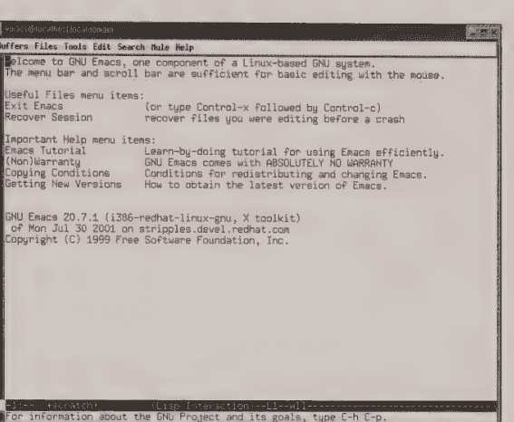

**图 3-12** Emacs 屏幕显示（无文件名）

如图 3-12 所示，`Emacs` 屏幕顶部有一个菜单栏。当你点击其中一个项目（如 Edit [编辑]）时，会出现一个菜单，如图 3–13 所示。默认菜单栏包含以下类别：

- **Buffers（缓冲区）**——启用打开任何当前持有信息的编辑器存储缓冲区，包括文件中已有的文本
- **Files（文件）**——用于各种操作，如打开文件、打开目录、保存缓冲区信息、杀死缓冲区、从另一个文件插入信息以及进入分屏模式。
- **Tools（工具）**——用于打印文件、比较或合并文件、安装 Emacs 补丁、读取和发送电子邮件以及何时编译代码。
- **Edit（编辑）**——提供编辑功能，如撤销更改、剪切或复制文本、粘贴文本等（参见图 3–13）。
- **Search（搜索）**——提供各种搜索选项，并允许在文档中放置标记，以便你可以轻松返回到特定位置或标记要复制的文本。
- **Mule（语言环境）**——用于设置语言环境、字体和输入法。
- **Help（帮助）**——通过访问手册、教程以及自定义 Emacs 编辑器提供协助。

# 第 3 章 B 节 The UNIX 编辑器

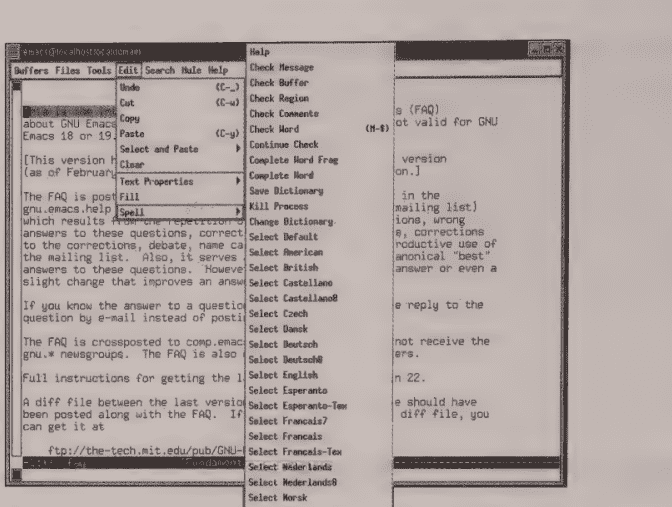

图 3-13 Emacs 编辑菜单和拼写检查选项

首先创建一个名为 `practice.fil` 的文件，其内容与你为 Dominion Consulting 的临时备忘录相同。

要启动 Emacs 并创建文件 `practice.fil` 文件：

1. 输入 `emacs practice.fil` 然后按回车键。

你会看到屏幕；其状态栏显示你正在创建一个新文件。

2. 要向文件中添加文本，输入图 3–14 所示的文本。


# 使用 Emacs 编辑器

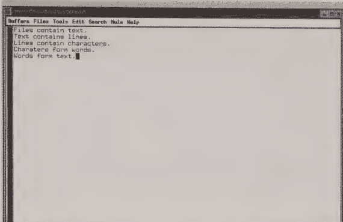

图 3-14 在 Emacs 中创建新文件

1. 按 `Ctrl+x` 然后按 `Ctrl+s` 保存文件。
2. 按 `Ctrl+x` 然后按 `Ctrl+c` 退出文件。

> 在 Emacs 中，你必须按下两个 Ctrl 组合键来保存和退出文件。

# 编辑 Emacs 文件

要导航 Emacs 文件，可以使用光标移动键——例如方向键、Pg up、Pg down、Home 和 End——或 Ctrl 组合键。在编辑名为 `practice.fil` 的文件之前，先在文件中移动一下，以习惯使用 Ctrl 和 Alt 组合键（参见表 3–3）将光标移动到不同位置。

在 practice 文件中进行导航：


1. 要通过命令行返回 Emacs 并检索你的文件，输入 `emacs practice.fil` 并按回车键。

2. 按 `Ctrl+f` 向前移动一个字符，然后按右方向键。

3. 按 `Ctrl+b` 向后移动一个字符，然后按左方向键。

4. 使用向下方向键和向上方向键在文档的行之间移动。将光标置在以“Lines contain...”开头的行。

# 第 3 章 B 节 The UNIX 编辑器

要删除文本并撤销删除：

1. 按 `Ctrl+k` 删除当前行。

2. 按 `Ctrl+x` 然后输入 `u` 来撤销上一次更改。

> 你可以反复恢复文本，即使在进行许多更改之后也是如此。按下 `Ctrl+x`，然后 `u`。使用此命令顺序撤销你的编辑命令。

在 Emacs 中，你可以通过输入来插入文本。你也可以通过复制粘贴、或剪切粘贴来插入文本。例如，你可以复制 `practice` 文件的前两行并将它们粘贴到文件末尾。

在 Emacs 中复制和粘贴文本：

1. 将光标移动到句子“Characters form words.”的开头。

2. 按 `Ctrl+Spacebar`。这将标记你想要复制的文本块的起点。使用状态栏中的“Mark set”字样。

3. 按两次向下方向键，将光标移动到文本下方的第一条空行。

4. 按 `Alt+w`。这将标记要复制的文本块的结束，短暂地将光标移动到你在步骤 2 中标记的位置，然后回到文本的末尾。你也可以按住 `Esc` 并按 `w` 来标记块的结束。

5. 按 `Ctrl+y` 将剪贴板中的标记文本粘贴到缓冲区中。

> 要进行剪切粘贴而不是复制粘贴，当光标位于要剪切的块末尾时，按 `Ctrl+w`。

像 `vi` 编辑器一样，Emacs 允许你搜索特定文本。例如，假设你想找到文本“Characters form words.”

# 命令摘要

| 命令 | 用途 |
| --- | --- |
| vi 命令: |  |
| `.` (重复) | 重复你最近的更改 |
| `/` | 向前搜索字符模式 |
| `!` | 临时离开 |
| `:q` | 取消编辑会 |
| `xr` | 从一个文件读取文本并将其添加到另一个文件中 |
| `:set` | 开启某些选项，例如行号 |
| `:w` | 保存文件并继续工作 |
| `:wq` | 将更改写入磁盘并退出 vi |
| `:x` | 保存更改并退出 vi |
| `i` | 切换到插入模式 |
| `p` | 从缓冲区粘贴文本 |
| `u` | 撤销你最近的更改 |
| `vi` | 启动 vi 编辑器 |
| `yy` | 复制（提取）文本到剪贴板 |
| `ZZ` | 命令模式下，保存更改并退出 vi |
| `lpr` | 打印文件 |
| `Ctrl+z` | 离开 vi 临时访问命令行 |
| UNIX 命令: |  |
| `:lprfilename` | 打印文件 |
| Emacs 命令: |  |
| `own 表 3-3` |  |

# 复习题

1. 在 UNIX 命令行输入什么来启动 vi 编辑器？

a. `edit filename`

b. `ed filename`

c. `Ctrl+vi`

d. `vi filename`

2. 在 vi 命令模式下，通过输入以下内容可以在不保存工作的情况下退出 vi：

a. `!quit`

b. `:q!`

c. `:wq`

d. `:nosave`

3. 在 Emacs 中发布命令，请按

a. 按住 `Ctrl` 键，然后按字母

b. 按住 `Alt` 键，然后按字母

c. 功能键 (`F1–F12`)

d. 以上所有

e. a 和 b

4. 下面哪一个 `Ctrl` 键组合可以让你退出 Emacs 编辑器并返回命令行？

a. `Ctrl+C`, `Ctrl+X`

b. `Ctrl+X`, `Ctrl+C`

c. `Ctrl+S`, `Ctrl+X`

d. `Ctrl+X`, `Ctrl+E`

5. 下面哪项描述最能比较 Emacs 与 vi 编辑器的异同？

a. vi 编辑器允许你在不退出的情况下保存文件，但 Emacs 不行。

b. 两者都有插入模式和命令模式。

c. Emacs 编辑器具有复杂的宏语言，但 vi 没有。

d. 以上所有

e. 仅 b 和 c

6. 在 vi 编辑器中查看帮助文档时，在命令模式下按：

a. `Ctrl+H`

b. `Alt+H`

c. `H`

d. `:help`

7. 在 vi 编辑器的命令模式下，输入哪个单个字符来开始搜索文本模式？

a. `?`

b. `s`

c. `/`

d. `:`

# 复习题 99

8. 如何启动一个 Emacs 教程？

a. 点击 Help 菜单，然后点击 Emacs Tutorial。

b. 按 `Ctrl+T`。

c. 按 `Ctrl+E`。

d. 点击 Tools 菜单，然后点击 Tutorial。

9. 下哪些是 Emacs 菜单栏选项？

a. Instruments

b. Mule

c. Search

d. 以上所有

e. 仅 b 和 c

10. 在 vi 编辑器中，输入 `x` 命令（不带冒号）会什么？

a. 插入一个字母

b. 跳到行尾

c. 删除光标下的字母

d. 打开 bash shell 屏幕以便输入 UNIX 命令

11. 在 vi 编辑器中输入 `H` 命令会发生什么？

a. 你跳到当前行的末尾。

b. 你跳到第一行的第一个字母。

c. 你删除了最后一行文本。

d. 你删除了第一行文本。

12. 下面哪个 vi 命令允许你插入已存储在 vi 缓冲区中的文本？

a. `Ctrl+P`

b. `:p`

c. `Ctrl+i`

d. `p`

e. `Ctrl+b`

13. 正确或错误：在大多数情况下，Emacs 中的 `Ctrl` 和 `Alt` 命令是区分大小写的；`Ctrl+a` 与 `Ctrl+A` 不是同一个命令。

14. 在 Emacs 中，________________ 命令标记你想要复制的文本块开始。

a. `Ctrl+m`

b. `Ctrl+Spacebar`

c. `Ctrl+s`

d. 以上都不是

15. 下面哪一个 vi 命令从另一个文件添加文本？

a. `r`

b. `read`

c. `:r`

d. `:w`

16. 在 Emacs 编辑器中，________________ 命令允许你将光标当前指向单词中的所有字母大写化。

a. `Alt+U`

b. `Alt+C`

c. `Ctrl+C`

d. `Ctrl+N`

17. ________________ 命令在 Emacs 编辑器中将光标移动到文件开头。

a. `Ctrl+<`

b. `Ctrl+>`

c. `Alt+<`

d. `Alt+>`

18. ________________ 命令允许你在 Emacs 编辑器中向下滚动一屏。

a. `Ctrl+S`

b. `Ctrl+X`

c. `Ctrl+V`

d. `Ctrl+J`

19. 使用 vi 命令 `4,$s/green/orange/g` 会发生什么？

a. 所有 green 和 orange 单词都会被高亮，第 4 行除外。

b. 从第 4 行到文件末尾，所有的 green 单词都改为 orange。

c. 从第 4 行到第 8 行尾，所有的 orange 单词都改为 green。

d. 从第 1 行到第 4 行，所有的 green 和 orange 单词都被删除了。

20. 下面哪项是通过 `d$` 实现的？

a. 它删除了从光标到行尾的文本。

b. 它删除了文档中的所有文本。

c. 它恢复了刚删除的文本。

d. 它恢复了当前会话中删除的文档。

21. 哪个 vi 命令允许你移动到 vi 编辑器第 10 行的开头？

a. `10G`

b. `G10`

c. `:m10`

d. `M10`

22. __________ 命令用于 Emacs 编辑器中撤销上一个命令。

a. `Ctrl+U`

b. `Ctrl+X`

c. `Ctrl+X`, `X`

d. `Ctrl+X`, `U`

23. 在 Emacs 编辑器中，什么命令用于粘贴刚刚标记的文本？

a. `Ctrl+Y`

b. `Ctrl+P`

c. `Ctrl+X`, `P`

d. `Alt+X`

24. 你正在 vi 编辑器中文件。可以使用什么命令在不关闭编辑器的情况下打印该文件？

a. `lpr`

b. `pr`

c. `!!pr`

d. `pp`

25. 哪个 vi 命令允许你回退一个单词？

a. `j`

b. `b`

c. `a`

d. `l`

26. 哪个 vi 命令将文本复制到缓冲区？

a. `:c`

b. `:y`

c. `yy`

d. `cc`

27. 正确或错误：与 vi 编辑器不同，在 Emacs 编辑器中向下箭头用于重复上一个命令。

28. 下面哪一个是 Emacs Edit 菜单上的选项？

a. 复制和粘贴文本

b. 撤销更改

c. 切剪文本

d. 以上所有

e. 仅 a 和 c

29. 如何在 vi 编辑器中向前一屏？

a. 使用 `Ctrl+F`。

b. 按住 `Ctrl` 按两次向上箭头。

c. 按 `Alt`

d. 使用 `Alt+U`

30. 哪个 vi 命令允许你保存工作并退出编辑器？

a. `Ctrl+qs`

b. `:x`

c. `:w`

d. `Alt+F`

# 发现练习

以下练习让你练习使用 vi 编辑器：

1. 使用 vi 编辑器：

- 创建一个包含 "today" 四行的文档。

- 使用一个命令复制前四行。


- 保存文件并退出 `vi`。

- 重新打开文档，仅在前四行将 "today" 改为 "yesterday"。

## 2. 使用 vi 编辑器：

- 创建一个名为 `first.file` 的文件并输入几行文本。保存。

- 创建一个名为 `second.file` 的文件并输入几行文本。保存。

- 通过合并前两个文件的文本创建一个名为 `third.file` 的第三个文件。

- 保存第三个文件并退出编辑器。

- 输入 `vi third.file` 确保包含两个文件的文本。

- 删除使用 `vi` 创建的所有文本，然后恢复。

注意 参考表 3-3 查找执行 Emacs 编辑器练习的正确命令。

## 4. 使用 Emacs 编辑器创建一个名为 `sonnet` 的新文件，包含莎士比亚第 80 首诗的开头：

O, how I faint when I of you do write,

Knowing a better spirit doth use your name,

And in the praise thereof spends all his might,

To make me tongue-tied, speaking of your fame!

5. 将光标移动到第二行 `better` 单词中 `b` 以外的任何字母。

6. 使用交换当前单词与其后续的命令。执行命令后，行应该是：

Knowing a spirit better to the word “doth” on the same line.

7. 将光标移动到同一行的单词 “doth”。

8. 使用命令删除当前单词。

9. 将光标移动到同一行 `spirit` 单词的第一个字符。

10. 使用将单词字母大写化的命令。

11. 将光标移动到同一行 `your` 单词中字母 `y` 下。

12. 使用删除光标上方字符的命令。现在行应该是：

Knowing a SPIRIT better use our name,

13. 将光标移动到第三行的单词 `spends`。

14. 使用删除到行尾的文本的命令。现在行应该是：

And in the praise hereof

15. 将光标移动到第一行的开头。

16. 使用在光标位置放置标记的命令。

17. 将光标移动到第一行的末尾。使用标记特定光标位置的命令。

18. 将光标移动到第一行的第一个字符。

19. 使用删除标记文本的命令，即删除第一行。

20. 将光标移动到文件末尾。使用恢复删除文本的命令。第一行的文本现在位于文件末尾。

# 第3章 UNIX 编辑器

使用 `vi` 编辑器通过以下练习题来提高你的编辑技能。

21. 创建包含 12 行文本的文件。22. 删除文本中的第二个单词。

23. 移动到第五行并插入你的名字。

24. 使用命令删除第八行并将其放在文件末尾。

25. 搜索你的名字。

26. 保存并退出 `vi`。

27. 在不退出 `vi` 的情况下，执行 `ls` 命令确认文件已保存。

28. 输入命令显示行号。

29. 删除第 9 行。

30. 移动到包含你名字和姓的文本行，使用 `cut` 命令将其提取到剪贴板。

31. 使用你在第 4 节中创建的文件，练习复制和粘贴以重新排列行的顺序。


使用 Emacs 编辑器完成这些练习题。

32. 使用文件，练习复制和粘贴文本以重新排列行的顺序。

33. 向文件中添加文本，并使用光标移动命令。

34. 将文件中所有出现的 "the" 单词替换为 "a"。

35. 选择单词并将其转换为大写。

36. 删除一行，然后撤销。

37. 处理每行的两个单词。

38. 保存文件并退出 Emacs。

# 第4章 UNIX 文件处理

你在咨询公司的经理 Rolfe 想要你从之前创建的文件中提取列表，并对其进行排序。然后他想要你为 Worldwide Hotels 创建一个新的供应商和产品报告。该酒店想要按字母顺序排列的供应商列表。供应商和产品名称存储在单独的文件：普通文件和特殊文件。Rolfe 要求你使用 UNIX 文件处理工具生成报告。

现在你已经了解了如何操作 UNIX 文件和编辑器，准备好学习如何操作文件及其内容了。在对文件类型和结构进行简要讨论后，练习 A 定义了文件处理并向你展示了如何使用重定向操作处理文件。你还学习如何通过删除、复制和移动从文件中提取信息。在练习 B 中，你将学习如何从文件中汇总信息。你还将创建一个系列命令的脚本，连接文件，并使用 `awk` 命令格式化输出。完成这些任务的目标。

## 练习 A

### 从文件中提取信息

完成本节后，你应该能够：

- 说明 UNIX 文件处理方法

- 使用基础文件命令

- 使用 `cut` 命令从文件中提取字符和字段

- 使用 `paste` 命令重新排列记录内的字段

- 使用 `sort` 命令合并文件

- 通过组合 `cut`、`paste` 和 `sort` 创建新文件

## UNIX 文件处理方法

UNIX 文件处理基于文件应被视为字符序列的想法。这种文件概念提供了很大的活性，因为你可以直接访问每个字符，执行一系列编辑任务，例如修正拼写错误并根据需要组织信息。例如，假设你在非结构化 ASCII 文件列出了 Worldwide Hotel 的供应商。那么只查看或打印整个列表将是是方便的。

### 理解 UNIX 文件类型

操作系统支持多种类型的文件。UNIX 与 MS-DOS 不同，它拥有普通文件、目录和特殊文件。普通文件包含你创建，包括你在第 3 章中创建的 ASCII 文件或你在编译源码时创建的二进制文件。在本章中，你使用了普通文件（也称为普通文件）。其他文件类型包括目录和特殊文件，如字符文件和块文件。第 2 章解释了目录是维护文件系统的文件。字符特殊文件与串行输入输出设备（如打印机）相关。特殊文件一次通信一个字符，提供原始数据。文件权限的第一个字符是“c”，代表文件类型。块特殊文件与磁盘相关，使用数据块向设备发送信息。这些文件的第一个字符是“b”。

### 文件结构

文件可以以多种方式组织。例如，UNIX 将字母、产品记录或供应商报告存储在扁平 ASCII 文件中。程序员根据存储的数据类型来构建文件。三种普通文件是非结构化 ASCII 字符、记录和树。图 4-1 展示了这三种普通文件。

图 4-1(a) 显示了一个字节字节序列的文件，它是文本文件的典型示例。这种文件结构在数据输入方面提供了最大的活性，因为你可以以任何顺序存储任何类型的数据。然而，你只能按顺序检索数据，这可能会限制其整体用处。例如，假设你在非结构化 ASCII 文件列出了 Worldwide Hotel 的供应商。那么只查看或打印整个列表（而不仅仅是供应商名称或数字）将是方便的。

## UNIX 文件的处理方法


图 4-1(a) 显示了一个字节序列的文件，它是文本文件的典型示例。这种文件结构在数据输入方面提供了最大的活性，因为你可以以任何顺序存储任何类型的数据。然而，你只能按顺序检索数据，这可能会限制其整体用处。例如，假设你在非结构化 ASCII 文件列出了 Worldwide Hotel 的供应商。那么只查看或打印整个列表（而不仅仅是供应商名称或数字）将是方便的。

4. 输入 `vi testfile < commands` 并按回车。（因为输入来自文件而非键盘，你可能会看到输入并非来自终端的警告。只需忽略该警告即可。）这会将 `testfile` 加载到 `vi` 编辑器中，并将 `vi` 的输入重定向到命令文件中的文本。命令文件中的文本被视为在键盘上输入的命令。

5. 输入 `cat testfile` 并按回车。在执行 `vi` 命令后，你将看到 `testfile` 的内容。内容如下：

- 这是第 2 行。

- 这是第 3 行。

- 这是第 4 行。

- 这是第 1 行。

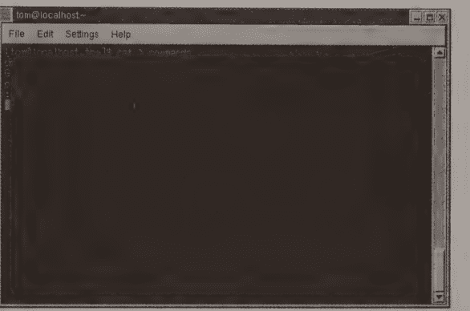

图 4-2 使用 `cat` 创建命令文件

你也可以使用 `>` 运算符将命令或程序的错误信息从屏幕重定向到文件。

要重定向错误消息：

1. 通过给 `ls` 命令提供一个无效参数来强制其显示错误信息。假设你的主目录 `jojo` 中没有文件或目录，输入 `ls jojo` 并按回车。你会看到错误信息：

`ls: jojo: No such file or directory`

2. 重定向 `ls` 命令的错误输出。输入 `ls jojo 2> errfile` 并按回车。屏幕上没有输出。

3. 输入 `cat errfile` 并按回车。你看到 `errfile` 的内容：

`ls: jojo: No such file or directory`

# 文件操作

对文件进行操作时，你处理的是本身以及它们的内容。本节解释了如何完成以下任务：

- 创建文件

- 删除文件

- 复制文件

- 移动文件

- 查找文件

- 显示文件

- 合并文件

- 切割并粘贴文件内容

- 排序文件

# 创建文件


你可以使用输出重定向符（`>`）创建新文件。你在第 1-3 章中通过 `cat` 命令的输出学习了如何操作。你也可以在不使用命令的情况下使用重定向符创建一个空文件。

要创建一个空文件：

1. 在 `$` 命令提示符后，输入 `> newfile1` 并按回车。这会创建一个名为 `newfile1` 的空文件。

2. 要列出新文件，输入 `ls -l newfile1` 并按回车。你只会看到列出的信息，其中 `jean` 是你的用户名。

`-rw-rw-r-- 1 jean 0 Nov 1 16:57 newfile1`

3. 要创建另一个新文件，输入 `> newfile2` 并按回车。


你也可以使用 `touch` 命令创建空文件。例如，如果文件 `newfile3` 已经存在，以下命令将创建它。

```bash
touch newfile3
```

`touch` 命令的主要目的是更改文件的日期和时间戳。UNIX 为每个文件维护以下日期时间信息：

- 时间（`ctime`）——文件 `inode` 最后一次被更改的时间
- 访问时间（`atime`）——文件最后被访问的时间
- 修改时间（`mtime`）——文件最后被修改的时间

# 文件操作

在 UNIX 中，`inode`（索引节点）是一个用于存储文件关键信息的系统。`inode` 信息包括 `inode` 节点、文件所有者、文件组、文件大小、inode 的更改日期、文件创建日期、文件最后修改和读取的时间、指向此 `inode` 的链接数，以及关于文件存储在文件系统中块位置的信息。

虽然 `touch` 命令不能更改文件的 `inode` 更改日期和时间，但它可以更改文件的访问和修改日期/时间。默认情况下，它使用当前日期和时间作为新值。

## 使用 touch 命令创建文件并更改其日期/时间戳

1. 输入 `touch newfile3` 并按回车。该命令创建了文件 `newfile3`。
2. 输入 `ls -l newfile3` 并按回车。你将看到 `newfile3` 文件的详细列表。注意它的修改日期和时间。
3. 等待至少一分钟。
4. 输入 `touch newfile3` 并按回车。这用系统日期时间更新文件的访问和修改日期时间。
5. 输入 `ls -l newfile3` 并按回车。查看文件的修改时间。现在它应该不同了。

表 4-1 列出并描述了 `touch` 命令的选项。

| 命令选项 | 描述 |
|---|---|
| `-a` | 仅更新访问时间 |
| `-m` | 仅更新修改时间 |
| `-c` | 如果文件不存在，则阻止 `touch` 创建文件 |

# 删除文件

当你不再需要某个文件时，可以使用 `rm`（remove）命令删除它。如果你不带选项使用 `rm`，UNIX 会在不警告的情况下删除指定的文件。使用 `-i`（交互）选项，UNIX 在删除文件前向你警告。你可以使用 `rm` 命令删除刚刚创建的新文件。

## 从当前目录删除文件

1. 在 `$` 命令提示符后，输入 `rm newfile1` 并按回车。这永久删除了 `newfile1`。

# 删除目录

当你不再需要某个目录时，可以使用 `rmdir` 命令删除它。在删除之前，目录必须为空。

1. 要创建一个目录，输入 `mkdir newdir` 并按回车。
2. 要删除目录，输入 `rmdir newdir` 并按回车。

# 复制文件

第 2 章引入了 `cp` 命令。其通用格式为：

```bash
cp [-options] source destination
```

该命令将源路径指定的文件或文件复制到目标路径的位置。你可以将文件复制到另一个目录，并保持与原始相同的名称。你也可以将文件复制到另一个目录并采用新名称。

例如，假设 Tom 在他的主目录下（`/home/tom`）。在该目录下有一个 `reminder` 文件。他通过以下命令将 `reminder` 文件复制到 `duplicates` 目录：

```bash
cp reminder duplicates
```

执行命令后，`duplicates` 目录下有一个名为 `reminder` 的文件。它是 `/home/tom` 目录下 `reminder` 文件的副本。Tom 在主目录下还有一个 `class_of_78` 文件。他通过以下命令将其复制为 `duplicates` 目录下的 `classmates` 文件：

```bash
cp class_of_78 duplicates/classmates
```

执行命令后，`classmates` 文件存储在 `duplicates` 目录下。它是 `class_of_78` 文件的副本。Tom 在主目录下还有一个名为 `memo_to_boss` 文件。他想为它创建一个副本，并将副本留在主目录中。他输入以下命令：

```bash
cp memo_to_boss memo.safe
```

执行命令后，`memo.safe` 文件在 Tom 的主目录中。它是他 `memo_to_boss` 文件的副本。

你可以为 `cp` 命令指定多个源文件作为参数。例如，Tom 想要将 `project1`、`project2` 和 `project3` 文件复制到 `duplicates` 目录。他输入以下命令：

```bash
cp project1 project2 project3 duplicates
```

在多个复制（`cp`）或移动（`mv`）操作中，最后一个项目是目录，正如上例所示。

## 第 4 章 节 A UNIX 文件处理

执行该命令后，三个文件的副本将存储在 `duplicates` 目录中。你可以在 `cp` 命令中使用通配符。例如，Tom 在他的主目录下有一个名为 `designs` 的目录（`/home/tom/designs`）。他想将 `designs` 目录中的所有文件复制到 `duplicates` 目录。他输入了以下命令：

```
cp designs/* duplicates
```

执行此命令后，`duplicates` 目录包含了 `designs` 目录中每个文件的副本。

`cp` 命令对于防止数据丢失特别有用；你可以用它来创建文件的备份。你可以创建三个新文件，然后将它们复制到不同的目录。然后你可以复制一个文件并给它一个不同的名称。首先在你的主目录下创建一个子目录。你可以创建三个新文件，然后将它们复制到源目录。

创建三个文件并将它们复制到目录：

- 1. 如果你还没有 `source` 子目录，请确保你处于主目录，然后创建该目录。在 `$` 命令提示符后，输入 `mkdir source` 并按回车。
- 2. 要要在主目录下创建三个文件，输入 `>file1` 并按回车，输入 `>file2` 并按回车，然后输入 `>file3` 并按回车。
- 3. 现在你可以将三个文件复制到 `source` 目录。输入 `cp file1 file2 file3` 并按回车（为了节省时间，你可以输入 `cp * source`）。

现在你可以复制其中一个文件并给它一个不同的名称，以便将其区分备份文件。

- 4. 在 `$` 命令提示符后，输入 `cp file1 file1.sav` 并按回车。

现在你的工作目录包含两个内容相同但名称不同的文件。


# 递归删除目录

`rm` 命令通常要求在删除目录之前必须是空的。当你需要删除一个包含多个子目录的目录时，这可能会非常不便。然而，`-r` 允许 `rm` 命令删除目录及其包含的所有内容，包括子目录。它甚至会删除子目录的子目录。这种操作被称为递归删除。

递归删除一个包含多个子目录的目录：

- 1. 创建一个包含多个子目录的目录。输入 `mkdir company` 并按回车。输入 `mkdir company/sales` 并按回车。输入 `mkdir company/marketing/marketing` 并按回车。输入 `mkdir company/accounting` 并按回车。


## 文件操作 115

- 2. 在 `company` 目录中创建三个空文件。输入 `touch company/file1 company/file2 company/file3` 并按回车。
- 3. 通过以下操作将文件复制到其他目录：
  - 输入 `cp company/file1 company/file2 company/file3 company/sales` 并按回车。
  - 输入 `cp company/file1 company/file2 company/file3 company/marketing` 并按回车。
  - 输入 `cp company/file1 company/file2 company/file3 company/accounting` 并按回车。


你刚刚输入的三个命令非常相似。你可以使用方向键回想第一条命令，从而减少输入量。

- 4. 使用 `ls` 命令验证文件是否已复制到三个目录中。
- 5. 删除 `company` 目录及其所有内容。输入 `rm -r company` 并按回车。
- 6. 使用 `ls` 并按回车。`company` 目录已被删除。

使用 `-r` 命令时务必非常小心。它可能会永久删除大量信息。有些用户倾向于配合 `-i` 命令使用它——例如 `rm -ri company`——这会交互式地询问你是否确定要删除每个文件和目录。

# 移动文件

移动文件与复制文件相似，区别在于你将其从一个目录移除并存储到另一个目录中。然而，作为保险，文件在移动之前会被复制。要移动文件，请使用 `mv` (move) 命令。该命令的通用格式为：

语法 `mv [-options] source destination`

你也可以使用 `mv` 命令通过将一个文件移动到另一个具有不同名称的文件来重命名文件。

将文件从一个目录移动到另一个目录：

- 1. 在你的主目录下创建新文件 `thisfile`，输入 `>thisfile` 然后按回车。
- 2. 输入 `mv thisfile source` 并按回车，将新文件移动到 `source` 目录。
- 3. 输入 `ls` 并按回车。列表中没有显示 `thisfile`。输入 `ls source` 并按回车。你会看到列表中有 `thisfile`。
- 4. 要移动多个文件，请在目录名之前输入文件名。

例如，输入 `mv file1 file1.sav source` 并按回车。

- 5. 创建新的 `my_file`，输入 `> my_file` 并按回车。
- 6. 将 `my_file` 重命名为 `your_file`，输入 `mv my_file your_file` 并按回车。
- 7. 输入 `ls` 并按回车。你看到列表中有 `your_file`，但没有 `my_file`。

移动和重命名文件本质上是相同的操作。


你也可以在 `mv` 命令中使用 `-i` 选项。它会导致命令在覆盖现有文件之前进行提示。

# 查找文件

`find` 命令按指定名称搜索文件。要在任何目录中查找文件，命令格式如下：

语法 `find pathname -name filename`

- `pathname` 是你想要搜索的目录。`find` 命令是递归的；也就是说，它从指定的目录开始向下搜索所有子目录。
- `-name` 指定文件的名称。你可以在文件名中使用通配符。例如，你可以使用 `*` 来查找以 "file" 开头的文件。

当你使用 `find` 命令时，每当尝试进入没有足够权限的目录，都会收到“Permission denied”（拒绝访问）的消息。

# 操作文件

## paste 命令

`paste` 命令将文件并排合并，而 `cat` 命令则是将文件尾尾相接地合并。当你使用 `paste` 将两个文件合并到第三个文件时，第三个文件的第一行包含第一个文件的第一行，紧接着是第二个文件的第一行。例如，Becky 在她的主目录下有一个名为 `vegetables` 的文件。其内容如下：

- 胡萝卜
- 菠菜
- 生菜
- 豆类

她主目录下还有一个一个名为 `bread` 的文件。其内容如下：

- 全麦面包
- 白面包
- 酸种包
- 黑麦黑面包

在她执行命令 `paste vegetables bread > food` 后，蔬菜和面包被逐行合并到 `food` 文件中。`food` 文件的内容如下：

| 胡萝卜 | 全麦面包 |
| 菠菜 | 白面包 |
| 生菜 | 酸种包 |
| 豆类 | 黑麦黑面包 |


> `paste` 命令通常将其输出发送到屏幕。要将其捕到文件中，请使用重定向符号。

如你所见，`paste` 命令在合并包含列信息的文件时最有用。当 `paste` 将项目合并到单行时，它使用制表符（tab）将它们分隔。例如，查看 `food` 文件的第一行：

Carrots    Whole wheat

当 `paste` 合并 "Carrots" 和 "Whole wheat" 时，它在它们之间插入了一个制表符。你可以使用 `-d` 选项指定另一个字符作为分隔符。例如，为了在输出字段之间插入逗号而不是制表符，Becky 输入了 `paste` 命令：

```
paste -d',' vegetables vegetables bread > food
```

执行 Becky 的命令后，`food` 文件的内容为：

- 胡萝卜,全麦面包
- 菠菜,白面包
- 生菜,酸种包
- 豆类,黑麦黑面包

现在你可以使用 `paste` 命令将两个产品文件合并为一个。（使用 `paste` 而不是 `cat`，因为你正在将两个或多个文件的字段合并成列，然后将所有字段转换为列。）

## 使用 paste 命令合并文件：

- 在 `$` 命令提示符后，输入 `paste product1 product2` 并按回车。

  这表示“合并名为 `product1` 的文件和名为 `product2` 的文件”。

  你看到了产品描述列表：

- 厅堂家具：1201
- 宴会厅特产：1221
- 泳池边推车：1320
- 正式晚餐特色：1340
- 预留日志：1410
- 水管用品：1423
- 办公设备：1361
- 铺毯服务：1395
- 汽车维护：1544
- 钢琴和小提琴：1416

## 使用 Cut 命令提取字段

你已经学习了文件可以由记录、字段和字符组成。你可能想要检索文件中的某些字段而不是全部。你可以使用 `cut` 命令从文件中删除特定的列或字段。`cut` 命令的语法为：

```
Syntax cut -f [-d char] file1 file2 ... Or cut -c list file1 file2 ...
```

### 剖析

- `f` 指定你引用的是字段。
- `list` 是一个逗号分隔的列表或由连字符分隔的整数范围，用于指定字段。例如，`-f 1` 表示字段 1，`-f 1,14` 表示字段 1 和 14，`-f 1-14` 表示字段 1 到 14。
- `d` 指定特定的字符分隔字段。
- `char` 是用作字段分隔符（delimiter）的字符，例如逗号。默认字段分隔符是制表符（Tab）。
- `file1`, `file2` 是你想从中提取列或字段的文件。
- `-c` 引用字符位置。例如，`-c 1` 指定第一个字符，`-c 1,14` 指定第 1 和第 14 个字符。

回想一下 Becky 主目录下的蔬菜和面包文件。她还拥有一个名为 `meats` 的文件。当她使用命令 `paste vegetables bread meats > food` 时，`food` 文件的内容为：

- 胡萝卜 全麦面包 火鸡
- 菠菜 白面包 鸡肉
- 生菜 酸种包 牛肉
- 豆类 黑麦黑面包 火腿

Becky 想从文件中提取第二列信息（面包列表）并显示在屏幕上。她输入了以下命令：

```
cut -f2 food
```

选项 `-f2` 告诉 `cut` 命令从每行提取第二个字段。制表符分隔符分隔字段，因此 `cut` 知道在哪里找到这些字段。她在屏幕上看到了以下输出：

- 全麦面包
- 白面包
- 酸种包
- 黑麦黑面包

她使用命令从文件中提取第一列和第三列：

```
cut -f1,3 food
```

命令的结果为：

- 胡萝卜 火鸡
- 菠菜 鸡肉
- 生菜 牛肉
- 豆类 火腿

现在你可以通过从 Dominion 电话文件中提取姓名列表来完成你的工作。首先，你创建两个文件：`corp_phones1` 和 `corp_phones2`。`corp_phones1` 文件包含五条变长度的记录，冒号分隔记录中的每个字段。（图 4-1）展示了这种文件结构。`corp_phones2` 文件也包含五条固定长度的记录（图 4-1 所示的文件类型）。图 4-4 展示了两个文件的内容。你可以对任何一个文件使用 `cut` 命令来提取姓名列表。

# 第4章 UNIX 文件处理

## 文件名：corp_phones1（变长度记录）

219:432:4567:Harrison:Joel:M:4540:Accountant:09-12-1985

219:432:4587:Mitchell:Barbara:C:4541:Admin Asst:12-14-1995

219:432:4589:Olson:Timothy:H:4544:Supervisor:06-30-1983

219:432:4591:Moore:Sarah:H:4500:Dept Manager:08-01-1978

219:432:4527:Polk:John:S:4520:Accountant:09-22-1998

存储空间 = 279 字节


## 文件名：corp_phones2（固定长度记录）

字符位置 26-35 38-41 43-58 59-68 79-25

================================

`219:432:4567:Harrison:Joel:M:4540:Accountant:09-12-1985`

`219:432:4587:Mitchell:Barbara:C:4541:Admin Asst:12-14-1995`

`219:432:4589:Olson:Timothy:H:4544:Supervisor:06-30-1983`

`219:432:4591:Moore:Sarah:H:4500:Dept Manager:08-01-1978`

`219:432:4527:Polk:John:S:4520:Accountant:09-22-1998`

存储空间 = 345 字节

图-4 `corp_phones1` 和 `corp_phones2` 的两个版本：要创建 `corp_phones1` 和 `corp_phones2` 文件：

1. 使用 `vi` 编辑器创建 `corp_phones1`。

2. 输入以下文本，完全一致。每行按回车：

`219:432:4567:Harrison:Joel:M:4540:Accountant:09-12-1985`

`219:432:4587:Mitchell:Barbara:C:4541:Admin Asst:12-14-1995`

`219:432:4589:Olson:Timothy:H:4544:Supervisor:06-30-1983`

`219:432:4591:Moore:Sarah:H:4500:Dept Manager:08-01-1978`

`219:432:4527:Polk:John:S:4520:Accountant:09-22-1998`

3. 保存文件，并创建一个名为 `corp_phones2` 的新文件。

4. 使用图-4 的精确字符位置。输入以下文本，完全一致。每行按回车：

`219:432:4567:Harrison:Joel:M:4540:Accountant:09-12-1985`

`219:432:4587:Mitchell:Barbara:C:4541:Admin Asst:12-14-1995`

`219:432:4589:Olson:Timothy:H:4544:Supervisor:06-30-1983`

`219:432:4591:Moore:Sarah:H:4500:Dept Manager:08-01-1978`

`219:432:4527:Polk:John:S:4520:Accountant:09-22-1998`

5. 保存文件，并编辑编辑器。

# 使用 sort 命令

使用 `sort` 命令按字母或数字顺序对文件内容进行排序。UNIX 默认将排序后的文件显示在屏幕上，但你可以指定将排序后的数据存到特定的文件中。

`sort` 命令提供了许多选项，附录 B“UNIX 命令语法指南”对其进行了描述。以下是其用法示例：

```
sort file1 > file2
```

在这个示例中，`file1` 的内容经过了排序，并将结果存储在 `file2` 中。（如果输出没有重定向，`sort` 将其结果显示在屏幕上。）这里有一个更复杂的示例：

```
sort -k 5 file1 > file2
```

该命令指定了一个排序键（key）。排序键是每行中的字段位置。`sort` 命令根据排序键对行进行排序。`-k` 是文件中的键字段。例如，“`-k 5` 提供了根据第五字段进行排序的指令，该字段是示例中排序的键。

排序 `corp_phones1` 和 `corp_phones2` 相对容易，因为你可以引用字段编号。在前两个步骤中，你分别按姓氏和名字对 `corp_phones1` 进行排序。在第三和第四步中，你对 `corp_phones2` 执行相同的操作。注意，这四个步骤的输出都指向标准输出（屏幕）。最后一步使用 `-o` 选项而不是输出重定向，将输出写入新的磁盘文件 `sorted_phones` 中。

> 在早期的 UNIX 版本中，你必须指定字段的字符位置来排序固定长度的文件，例如我们练习中的 `corp_phones2` 文件。这是通过使用 `+F` 选项完成的，其中 `F` 是字段编号，`C` 是字符位置。`+C` 选项仍然可用，但使用 `-k` 选项更简单。

# 排序 corp_phones1 文件：

- 1. 在提示符后，`-t` 选项识别字段之间的分隔符，这里是冒号（`:`）。`-k` 选项指定按第四字段进行排序，在本例中为姓氏。你在屏幕上看到：

```
219:432:4567:Harrison:Joel:M:4540:account:09-12-1985
219:432:4587:Mitchell:Barbara:C:4541:Admin Asst:12-14-1995
219:432:4591:Moore:Sarah:H:4500:Dept:08-01-1978
219:432:4589:Olson:Timothy:H:4544:Supervisor:06-30-1983
219:432:4567:Polk:John:S:4520:account:09-22-1998
```

- 2. 输入 `sort -t: -k 5 corp_phones1` 并按回车。

这从“名字”字段（`-k 5`）开始对变长记录排序（`-t:` 表示字段由冒号分隔）。你在屏幕上看到：

```
219:432:4587:Mitchell:Barbara:C:4541:Admin Asst:12-14-1995
219:432:4567:Harrison:Joel:M:4540:Accountant:09-12-1995
219:432:4567:John:S:4520:Accountant:09-22-1998
219:432:4591:Moore:Sarah:H:4500:Dept Manager:08-01-1978
219:432:4589:Olson:Timothy:H:4544:Supervisor:06-30-1983
```

- 3. 输入 `sort -k 4 corp_phones2` 并按回车。

这按第四字段开始按姓氏排序固定长度文件。在这个示例中，没有指定分隔符，因为固定长度文件使用空格分隔符。你在屏幕上看到：

```
219 432 4567 Harrison Joel M 4540 Accountant 09-12-1985
219 432 4541 Mitchell Barbara C 4541 Admin Asst 12-14-1995
219 432 4591 Moore Sarah H 4500 Dept Manager 08-01-1978
219 432 4589 Olson Timothy H 4544 Supervisor 06-30-1983
219 432 4527 Polk John S 4520 Accountant 09-22-1998
```

- 4. 输入 `sort -k 5 corp_phones2` 并按回车。

这从第五字段开始按名字排序文件。你在屏幕上看到：

```
219 432 4587 Mitchell Barbara C 4541 Admin Asst 12-14-1995
219 432 4567 Harrison Joel M 4540 Accountant 09-12-1995
219 432 4567 John S 4520 Accountant 09-22-1998
219 432 4591 Moore Sarah H 4500 Dept Manager 08-01-1978
219 432 4589 Olson Timothy H 4544 Supervisor 06-30-1983
```

- 5. 输入 `sort -t: +3 corp_phones1` 并按回车。

这从“姓氏”字段（`+3`）开始对变长记录排序（`-t:`）。- 6. 按名字排序并创建输出文件 `sorted_phones`，输入 `sort -t: -k 5 -o sorted_phones corp_phones1` 并按回车。这按名字对 `corp_phones1` 文件进行排序并创建输出文件 `sorted_phones`。

# 整合使用

现在你可以同时使用许多文件处理工具。首先，使用 `cat` 命令创建 `vendors` 文件。供应商名称由两个冒号分隔的字段组成：供应商编号和名称。

创建 `vendors` 文件：

- 1. 在 `$` 提示符后，输入 `cat > vendors` 并按回车。

- 2. 输入以下文本，每行结束后按回车：

`1201:Cromwell Interiors`

`1221:Design Extras Inc.`

`1320:Piedmont Plastics Inc.`

`1340:Morgan Catering Service Ltd.`

`1350:Pullman Elevators`

`1360:Johnson Office Products`

- 3. 按 `Ctrl+D`。图 4-5 显示了可以使用这两个文件来确定哪些产品供应。


| 文件名称 | 供应商名称 |
| :--- | :--- |
| 1201 | Cromwell Interiors |
| 1221 | Design Extras Inc. |
| 1320 | Piedmont Plastics Inc. |
| 1340 | Morgan Catering Service Ltd. |
| 1350 | Pullman Elevators |
| 1360 | Johnson Office Products |

| 文件名称 | 属性描述 |
| :--- | :--- |
| S0107 | Lobby Furniture |
| S0109 | Balloon Specialties |
| S0110 | Poolside Carts |
| S0130 | Formal Dining Specials |
| S0201 | Reservation Logs |

# 处理文件

在接下来的步骤中，使用 `cat` 命令创建 `products` 文件。`products` 文件中的记录由三个冒号分隔的字段组成：产品编号、产品描述和供应商编号。

创建 `products` 文件：

1. 在 `$` 提示符后，输入 `cat > products` 并按回车。
2. 输入以下文本，每行结束后按回车，包括最后一行：

```
S0107:Lobby Furniture:1201
S0109:Balloon Specialties:1221
S0110:Poolside Carts:1320
S0130:Formal Dining Specials:1340
S0201:Reservation Logs:1410
```

3. 按 `Ctrl+D` 结束 `cat` 命令

现在使用 `cut`、`paste` 和 `sort` 命令创建一个供应商报告。通过使用 `cut` 命令从 `products` 文件中提取描述和供应商编号，并将它们分别存储在文件 `p1` 和 `p2` 中。然后从 `vendors` 文件中提取供应商编号和名称，并将它们存储在 `v1` 和 `v2` 中。使用 `paste` 命令将两个供应商文件 `v1` 和 `v2` 合并为文件 `v3`。然后将两个产品文件 `p1` 和 `p2` 合并为文件 `p3`。合并 `v3` 和 `p3` 文件，并将输出发送到 `vrep` 文件（供应商报告）。

使用 `cut`、`paste` 和 `sort` 命令创建报告：

1. 在 `$` 提示符后，输入 `cut -f2 -d: products > p1` 并按回车。这意味着“提取 `products` 文件中冒号分隔的第二个字段的数据，并存储在 `p1` 文件”。它将这些产品描述存储在 `p1` 中：

Lobby Furniture
Balloon Specialties
Poolside Carts
Formal Dining Specials
Reservation Logs

2. 输入 `cut -f3 -d: products > p2` 并按回车。这意味着“提取 `products` 文件中冒号分隔的第三字段的数据，并存储在 `p2` 文件”。它将这些供应商编号存储在 `p2` 中：

1201
1221
1320
1340
1410

3. 输入 `cut -f1 -d: vendors > v1` 并按回车。这意味着“提取 `vendors` 文件中冒号分隔的第一个字段的数据，并存储在 `v1` 文件”。它将这些供应商编号存储在 `v1` 中：

1201
1221
1320
1340
1350
1360

4. 输入 `cut -f2 -d: vendors > v2` 并按回车。这意味着“提取 `vendors` 文件中冒号分隔的第二个字段的数据，并存储在 `v2` 文件”。它将这些产品描述存储在 `v2` 中：

Cromwell Interiors
Design Extras Inc.
Piedmont Plastics Inc.
Morgan Catering Service Ltd.
Pullman Elevators
Johnson Office Products

5. 输入 `paste v1 v2 > v3` 并按回车。这意味着“合并 `v1` 和 `v2` 中的数据，并将其重定向到文件 `v3`”。它将这些供应商编号和产品描述存储在 `v3` 中：

1201: Cromwell Interiors
1221: Design Extras Inc.
1320: Piedmont Plastics Inc.
1340: Morgan Catering Service Ltd.
1350: Pullman Elevators
1360: Johnson Office Products

6. 输入 `paste p2 p1 > p3` 并按回车。这意味着“合并 `p2` 和 `p1` 中的数据，并将其重定向到文件 `p3`”。它将这些供应商编号和产品描述存储在 `p3` 中：

1201: Lobby Furniture
1221: Balloon Specialties
1320: Poolside Carts
1340: Formal Dining Specials
1410: Reservation Logs

7. 输入 `sort -o vrep -m v3 p3` 并按回车。这意味着“合并 `v3` 和 `p3` 的数据，并将输出定向到文件 `vrep`”。它将这些供应商编号和产品描述存储在 `vrep` 中：

1201: Cromwell Interiors
1201: Lobby Furniture

# 使用脚本文件 129

| 1221 宴会特供 |
| 1221 Design Extras Inc. |
| 1320 Piedmont Plastics Inc. |
| 1320 泳边推车 |
| 1340 正式晚餐特供 |
| 1340 Morgan Catering Service Ltd. |
| 1350 Pullman 电梯 |
| 1360 Johnson 办公用品 |
| 1410 预订日志 |

你使用了 `cut`、`paste` 和 `sort` 命令从文件中提取信息、合并信息，然后在一个新文件中对这些信息进行排序和合并。

# B 课程

汇编提取的信息

在完成本节后，你应该能够：

- 创建一个脚本文件
- 使用 `join` 命令通过公共字段链接文件
- 使用 `awk` 命令创建一个看起来专业的报告

# 使用脚本文件

正如你所见，根据你需要使用的选项数量，命令行输入可能会变得很长。你可以使用 shell 的命令行历史记录功能来召回并重新执行过去的命令。这个功能对你很有用，但其他需要执行你命令的人无法轻松访问它们。MS-DOS 用户通过创建批处理文件来解决这个问题。UNIX 用户也这样做：他们的脚本文件包含命令行输入。与 MS-DOS 批处理文件一样，脚本文件包含可以作为一组顺序运行的命令。脚本文件的良好候选者是你在 A 课程中输入的系列 `cut`、`paste` 和 `sort` 命令。你可以使用 `vi` 编辑器创建脚本文件，然后使用 `chmod` 命令配合 `x` 参数使脚本具有可执行性。

Rolfie Williamson 对你的供应商报告非常满意，但他希望有一种方法可以在数据发生变化时随时生成该报告。你可以创建一个脚本，其中包含了创建 `ven_report` 文件的一系列命令。

# 第 4 章 B 课程 UNIX 文件处理

使用 `vi` 编辑器创建脚本：输入 `vi ven_report` 并按回车。

1. 在命令提示符后，输入 `vi ven_report` 并按回车。

`vi` 编辑器启动并创建一个新文件 `ven_report`。

2. 进入插入模式，输入以下内容，并在每行末尾按回车：

```
cut -f2 -d: products > p1
cut -f3 -d: products > p2
cut -f1 -d: vendors > v1
cut -f2 -d: vendors > v2
paste v1 v2 > v3
paste p2 p1 > p3
sort -o vrep -m v3
```

这些你在 A 课程中用于创建第一个供应商报告时使用的命令。图 4-6 显示了在你输入命令后 `vi` 编辑器屏幕应该呈现的样子。

3. 按 `Esc`。

4. 输入 `:wq` 退出 `vi` 编辑器。


图 4-6 使用 `vi` 编辑器创建 `ven_report` 文件


现在你可以使用 `chmod` 命令使脚本变为可执行。`chmod` 命令用于设置文件权限。在接下来的示例中，`chmod` 命令及其 `ugo+x` 选项使 `ven_report` 文件对用户（所有者）、组和其他用户执行。运行一个测试以确保它工作正常。

# 使用 Join 命令

## 使脚本变为可执行

1. 在 `$` 命令提示符后，输入 `chmod ugo+x ven_report` 并按回车。

   参见第 2 章中的“设置文件安全权限”以获取有关 `chmod` 命令的更多信息。

2. 为了确保脚本正常工作，输入 `./ven_report` 并按回车。

   `vrep` 文件包含了你在 A 课程中看到的供应商编号和产品描述列表。

除了 shell 脚本可执行文件外，指定脚本设计运行的 shell 也是一个好主意。例如，如果你为 Bash shell 设计了一个脚本，你可以在脚本的第一行添加 `#!/bin/bash`。你将在第 7 章“高级 shell 编程”中学习如何这样做。此外，如果你更改了脚本的权限，只要你当前定义的路径包含脚本所在的目录，你就可以在不使用 `/` 命令的情况下运行它。

# 这里的 JOIN 命令

`join` 命令与本章中的其他文件处理命令不同，因为它用于关系数据库处理。**关系型数据库**将文件视为表，将记录视为行。它们还将字段视为列，可以通过连接列来创建新记录。`join` 命令是 UNIX 的一种方法，允许你从两个共享公共字段的文件中提取信息。

例如，你可以使用 `join` 命令合并供应商和产品文件中的信息，为 Worldwide 的采购部生成供应商报告。供应商和产品报告都包含了供应商编号。`join` 命令的语法为：

`Syntax join [options] file1 file2`

- `file1`, `file2` 是两个输入文件，必须在连接字段上进行排序——该连接字段是你用于**连接**（join）文件的字段。连接字段也称为**键**（key）。在连接它们之前，你必须对文件进行排序。当你使用 `join` 命令时，UNIX 会比较这两个字段。每行输出都包含公共字段，随后是来自 `file1` 的行，然后是来自 `file2` 的行。你可以使用接下来的描述的选项来修改输出。如果同一个文件中存在具有重复键的记录，UNIX 会对所有记录进行连接。你可以为无法配的行创建输出记录，例如，将一个文件的数据追加到另一个文件中，而不丢失记录。

图 4-7 关系连接

## 使用 Join 命令

在图 4-7 中，`join` 命令合并了供应商和产品文件的字段。然后它在产品文件中查找匹配供应商编号。如果字段不匹配，UNIX 将选择并将其到合并文件中。如果字段匹配，UNIX 将其发送到合并文件中。

## 使用 Join 命令创建报告

你可以使用 `join` 命令创建显示 Worldwide 采购部库存的供应商报告。

使用 `join` 命令创建报告：

1. 在 `$` 命令提示符后，输入 `join -a1 -e "No Products" -j1 -j2 -t: vendors products > report; cat report` 并按回车。（记得如果你打错了，可以使用方向键召回命令，纠正错误，然后运行。）

在此命令中，`-j` 选项指示第一个或第二个文件，例如 `vendors` 或 `products`。在这里，UNIX 使用供应商文件的第一个字段来连接产品的第三字段。

`-a` 选项告诉 UNIX 为每个未匹配的记录打印一行。在这种情况下，`-e` 选项为未匹配记录显示消息，例如“No Products”。

`-o` 选项设置匹配时输出的字段。

`1.2` 表示供应商文件的第二个字段与产品文件的第二个字段一起输出。

`-t:` 选项指定字段分隔符为冒号。此 `join` 命令将其输出重定向到新文件 `report`。`cat` 命令在屏幕上显示输出。

查看图 4-8 查看报告的输出。


# 134 第 4 章 B 课程 UNIX 文件处理

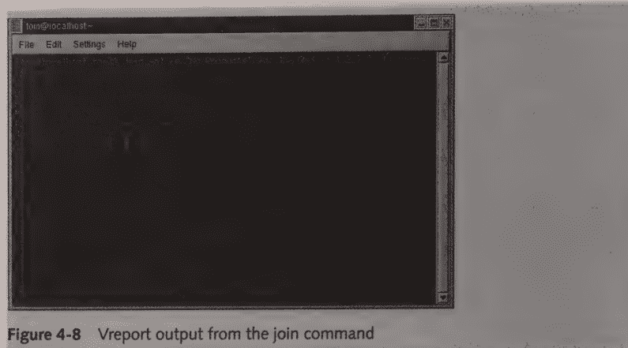

# awk 程序简介

`awk` 是一种模式扫描和处理语言，有助于产生看起来专业的报告。虽然你可以使用 `cat` 和更多命令来显示用 `join` 程序创建的输出文件，`awk` 命令（在命令行输入它时会启动 Awk 程序）让你能够轻松地完成相同的工作。`awk` 命令的语法为：

```
Syntax awk [-Fsep] 'pattern {action}' .. filenames
```

- `awk` 检查指定文件的输入记录是否符合模式，如果是，`awk` 将执行与其关联的动作。如果没有指定模式，则操作将影响所有输入记录。

- `-F:` 表示字段分隔符为冒号。

> 注意 要获取有关 `awk` 的更多信息，输入 `man awk` 读取在线文档。

生成并格式化供应商报告：

1. 在 `$` 命令提示符后，输入 `awk -F: '{printf "%-28s\t %s\n", $1, $2}' vreport` 并按回车。

# Awk 程序简介 135

你看到的供应商报告，包括供应商名称和产品描述，如图 4-9 所示。

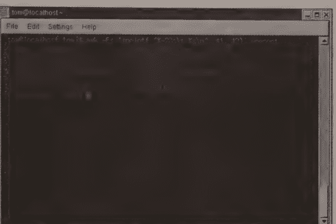

**图 4-9** 通过 `awk` 创建的供应商报告

你在步骤 1 中输入的 `awk` 命令部分如下：

- `awk -F:` 调用 Awk 程序，并将字段分隔符标识为冒号。

- `'{printf "%%28s %%s\n", $1, $2}'` 代表对读取的每一行执行的操作。单引号包围了该操作。

- `printf` 是 C 语言中的一个格式化函数。它允许你为输出指定编辑模式。双引号内的代码定义了此模式。紧跟 `%` 之后的代码告诉系统如何对齐要打印的字段。`-` 号表示左对齐。紧随其后的数字 `28` 表示你想显示的字符数。模式末尾的 `s` 表示该字段由非数字字符组成，也称为字符串。`t` 在编辑模式中插入一个制表符。`%` 指定还应该打印另一个字符串。在这种情况下，你不需要指定字符串长度，因为它是最后一个打印的字段（产品名称）。`\n` 指定在打印完每个输出记录后跳过一行。输入文件中的第一个和第二个字段应该放置在编辑模式中两个 `s` 字符出现的位置。第一个字段是供应商名称，第二个是产品描述。（你将在第 10 章中学习更多关于 `printf` 的知识；在这里介绍是为了为你提供一个简要介绍，以便你在阅读本书的过程中在此基础上学习。）

- `vreport` 是输入文件的名称。

# 使用 Awk 命令精炼供应商报告

为了精炼和自动化供应商报告，你可以创建一个 shell 脚本，就像你在在本节开始时做的那样。然而，这个新脚本仅包含 `awk` 命令，而不是一系列单独的命令。然后，你可以使用 `awk` 配合 `-f` 选项调用 Awk 程序。该选项告诉 Awk 代码来自磁盘文件，而不是键盘。你可以以不同的方式呈现 Awk 程序内部的操作语句。程序文件包含了额外的行，用于打印报告的标题和当前日期。

接下来的步骤显示了当你在像这样的文件中文件中输入 Awk 程序时会发生什么。你使用 `FS` 变量来告知字段分隔符是什么，在本例中，它是冒号。`FS` 是 `awk` 用于告知程序正在处理的文件的许多变量之一。你使用的其他代码设置了一个在程序加载时执行一次的初始活动。`BEGIN` 后面紧跟左大括号 `({})` 表示此启动活动。右大括号 `}` 标记了程序首次加载时执行的操作的结束。这些操作打印了标题、日期以及将头部与报告正文隔开的线条。

创建 `awk` 脚本：

1. 在 `$` 命令提示符后，输入 `vi awrp` 并按回车启动 `vi` 编辑器并创建文件 `awrp`。按 `i` 进入插入模式。

2. 输入代码：

```awk
BEGIN {
  FS = ":"
  print "\tVendors and Products\n"
  print "date" | getline d
  printf "\t%s\n", d
  printf "\tVendor Name\t\t Product Names\n"
  print "===================================================================="
}
{
  printf "%-28s\t%s\n", $1, $2
}
```

在你输入的代码中，使用了 `getline` 选项。`getline` 设计用于读取输入。在这种情况下，它读取日期并将其放入变量 `d` 中，然后通过 `printf` 命令打印。

你的 `vi` 编辑会话应该像图 4-10 所示。

3. 按 `Esc`。

4. 输入 `:wq` 退出 `vi` 编辑器。

5. 在 `$` 命令提示符后，输入 `awk -f awrp vreport > v_report` 并按回车。

这意味着“使用 Awk 程序，将 `awrp` 文件的字段与 `vreport` 文件合并，并将它们发送到名为 `v_report` 的新文件中。”


## 6. 输入 `cat v_report` 并按回车。

你看到以下报告：

Vendors and Products

Sun Dec 20 21:03:41 EST 2000

Vendor Name                Product Names

| Vendor Name | Product Names |
| --- | --- |
| Cromwell Interiors | Lobby Furniture |
| Design Extras Inc. | Ballroom Specialties |
| Piedmont Plastics Inc. | Poolside Carts |
| Morgan Catering Service Ltd. | Formal Dining Specials |
| Pullman Elevators | No Products |
| Johnson Office Products | No Products |

7. 要在默认打印机上打印报告，输入 `lpr v_report` 并按回车。

你生成了供应商和产品名称，然后格式化并打印了报告。

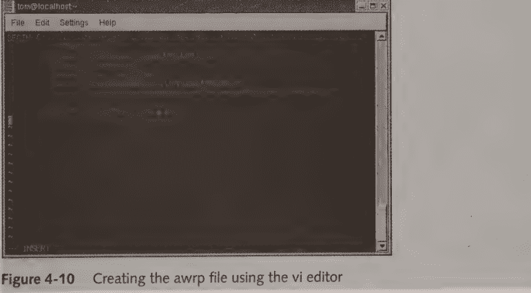

# 章总结

- UNIX 支持普通文件、目录、字符特殊文件和字符特殊文件。
- UNIX 支持普通文件、目录、字符特殊文件和字符特殊文件。
- UNIX 支持普通文件、目录、字符特殊文件和字符特殊文件。
- UNIX 支持普通文件、目录、字符特殊文件和字符特殊文件。
- UNIX 支持普通文件、目录、字符特殊文件和字符特殊文件。
- UNIX 支持普通文件、目录、字符特殊文件和字符特殊文件。
- UNIX 支持普通文件、目录、字符特殊文件和字符特殊文件。
- UNIX 支持普通文件、目录、字符特殊文件和字符特殊文件。
- UNIX 支持普通文件、目录、字符特殊文件和字符特殊文件。
- UNIX 支持普通文件、目录、字符特殊文件和字符特殊文件。
- UNIX 支持普通文件、目录、字符特殊文件和字符特殊文件。
- UNIX 支持普通文件、目录、字符特殊文件和字符特殊文件。
- UNIX 支持普通文件、目录、字符特殊文件和字符特殊文件。
- UNIX 支持普通文件、目录、字符特殊文件和字符特殊文件。
- UNIX 支持普通文件、目录、字符特殊文件和字符特殊文件。
- UNIX 支持普通文件、目录、字符特殊文件和字符特殊文件。
- UNIX 支持普通文件、目录、字符特殊文件和字符特殊文件。
- UNIX 支持普通文件、目录、字符特殊文件和字符特殊文件。
- UNIX 支持普通文件、目录、字符特殊文件和字符特殊文件。
- UNIX 支持普通文件、目录、字符特殊文件和字符特殊文件。
- UNIX 支持普通文件、目录、字符特殊文件和字符特殊文件。
- UNIX 支持普通文件、目录、字符特殊文件和字符特殊文件。
- UNIX 支持普通文件、目录、字符特殊文件和字符特殊文件。
- UNIX 支持普通文件、目录、字符特殊文件和字符特殊文件。
- UNIX 支持普通文件、目录、字符特殊文件和字符特殊文件。
- UNIX 支持普通文件、目录、字符特殊文件和字符特殊文件。
- UNIX 支持普通文件、目录、字符特殊文件和字符特殊文件。
- UNIX 支持普通文件、目录、字符特殊文件和字符特殊文件。
- UNIX 支持普通文件、目录、字符特殊文件和字符特殊文件。
- UNIX 支持普通文件、目录、字符特殊文件和字符特殊文件。
- UNIX 支持普通文件、目录、字符特殊文件和字符特殊文件。
- UNIX 支持普通文件、目录、字符特殊文件和字符特殊文件。
- UNIX 支持普通文件、目录、字符特殊文件和字符特殊文件。
- UNIX 支持普通文件、目录、字符特殊文件和字符特殊文件。
- UNIX 支持普通文件、目录、字符特殊文件和字符特殊文件。
- UNIX 支持普通文件、目录、字符特殊文件和字符特殊文件。
- UNIX 支持普通文件、目录、字符特殊文件和字符特殊文件。
- UNIX 支持普通文件、目录、字符特殊文件和字符特殊文件。
- UNIX 支持普通文件、目录、字符特殊文件和字符特殊文件。
- UNIX 支持普通文件、目录、字符特殊文件和字符特殊文件。
- UNIX 支持普通文件、目录、字符特殊文件和字符特殊文件。
- UNIX 支持普通文件、目录、字符特殊文件和字符特殊文件。
- UNIX 支持普通文件、目录、字符特殊文件和字符特殊文件。
- UNIX 支持普通文件、目录、字符特殊文件和字符特殊文件。
- UNIX 支持普通文件、目录、字符特殊文件和字符特殊文件。
- UNIX 支持普通文件、目录、字符特殊文件和字符特殊文件。
- UNIX 支持普通文件、目录、字符特殊文件和字符特殊文件。
- UNIX 支持普通文件、目录、字符特殊文件和字符特殊文件。
- UNIX 支持普通文件、目录、字符特殊文件和字符特殊文件。
- UNIX 支持普通文件、目录、字符特殊文件和字符特殊文件。
- UNIX 支持普通文件、目录、字符特殊文件和字符特殊文件。
- UNIX 支持普通文件、目录、字符特殊文件和字符特殊文件。
- UNIX 支持普通文件、目录、字符特殊文件和字符特殊文件。
- UNIX 支持普通文件、目录、字符特殊文件和字符特殊文件。
- UNIX 支持普通文件、目录、字符特殊文件和字符特殊文件。
- UNIX 支持普通文件、目录、字符特殊文件和字符特殊文件。
- UNIX 支持普通文件、目录、字符特殊文件和字符特殊文件。
- UNIX 支持普通文件、目录、字符特殊文件和字符特殊文件。
- UNIX 支持普通文件、目录、字符特殊文件和字符特殊文件。
- UNIX 支持普通文件、目录、字符特殊文件和字符特殊文件。
- UNIX 支持普通文件、目录、字符特殊文件和字符特殊文件。

# 命令总结

回顾第4章命令

| 命令 | 用途 | 本章涵盖选项 |
|---|---|---|
| `awk` | 启动 `awk` 程序格式化输出 | `-F` 标识字段分隔符<br>`-f` 标识代码来自磁盘文件，而不是键盘 |
| `cp` | 复制一个或多个文件 | `-c` 引用字符位置<br>`-d` 标识一个指定的字符分隔字段<br>`-ff` 引用字段 |
| `cut` | 从文件中提取指定的列或字段 | |
| `find` | 查找文件 | `-name` 指定要查找的文件名 |
| `join` | 合并具有共同字段的文件 | `-a` 为文件 n 中的每个不可匹配行生成一行<br>`-e` 用指定的字符串替换不可匹配文件的空文件<br>`-j` 在合并时使用指定的共同字段<br>`-o` 输出指定的字段列表<br>`-t` 指示一个指定的字符分隔字段 |
| `less` | 显示文件内容，在每个屏幕结束处暂停；允许在文件中移动 | |
| `lpr` | 将命令输出打印到默认打印机 | |
| `more` | 显示文件内容，在每个屏幕结束处暂停，但仅允许向下移动 | |
| `mv` | 移动一个或多个文件 | |
| `paste` | 合并两个或多个文件的字段 | |
| `rm` | 删除一个或多个文件 | `-I` 指定 UNIX 在删除文件前请求确认删除<br>`-r` 指定递归删除目录 |
| `rmdir` | 删除目录 | |

# 第 4 章 UNIX 文件处理

### 第 4 章命令回顾（续）

| 命令 | 用途 | 本章涵盖的选项 |
| --- | --- | --- |
| `sort` | 对文件内容进行排序 | `-k` 按由 n 分隔的键字段进行排序<br>`+n` 按 n 指定的字段进行排序<br>`+` 将偏移量 (+) 之后的位置指定为字符位置，而不是字段位置<br>`-t` 指定用特定字符作为字段分隔符<br>`-m` 表示在排序前合并字段<br>`-o` 将输出重定向到指定的文件<br>`-k` 按 `-k` 之后给出的位置的键进行排序 |
| `touch` | 更新现有文件的日期和时间戳，或创建新文件 | `-a` 规定仅更新访问日期和时间<br>`-m` 规定仅更新修改日期和时间<br>`-c` 规定不创建任何文件 |

# 复习题

1. 使用什么命令来删除一个目录？
   a. `del`
   b. `birdel`
   c. `rmdir`
   d. `kill`

2. 你刚刚使用问题 1 中的命令尝试删除一个目录，但目录仍然没有被删除。可能的原因是什么？
   a. 目录包含文件、子目录或两者都有。
   b. 其他人使用了“node”目录权限防止该目录被删除。
   c. 目录太大，无法删除。
   d. 以上所有
   e. 仅 a 和 b

3. 当你使用两个文件共有的特定字段连接它们时，该字段称为什么？
   a. 操作符 (`operator`)
   b. 连接器 (`linker`)
   c. 键 (`key`)
   d. 可执行文件 (`executable`)

## 复习题 141

4. 包含命令行提示符执行命令的 UNIX 文件被称为______________________________________。


### 5. 与 `awk` 命令配合使用的 `-f` 选项指定______________________。

a. 字段分隔符的格式

b. 输入数据文件具有固定长度记录

c. 输入数据文件具有变长度记录

d. 命令来自磁盘文件而非键盘

### 6. 在指定 `join` 命令时，`-o` 参数用于______________________。

a. 指定输出到屏幕

b. 指定报告中标题行的数量

c. 运行额外的命令

d. 指定报告中输出的字段

### 7. ______________________ 是一个用于 `awk` 命令中打印格式化的 C 语言函数。

a. `-p`

b. `{ format }`

c. `printf`

d. `proccprint`

### 8. ______________________ 文件通常包含与串口设备或打印机通信所需的信息。

a. 供应商文件

b. 字符特殊文件

c. 块特殊文件

d. 主打印机文件

### 9. `Stdout`（标准输出）通常流向____________________。

a. 键盘

b. 调制器

c. 控制台

d. 网络连接

### 10. 正或错：在 `join` 命令中，`-j` 用于显示字段时反转字段。

### 11. 你可以使用 `touch` 命令来：

a. 创建新文件

b. 修改文件的日期和时间戳

c. 将排序后的数据合并到新文件

d. 以上所有

e. 仅 a 和 b

### 12. 命令 "`cat accounts persons > info`" 用于：

a. 排序 `accounts` 文件并将其与 `info` 文件合并，创建一个名为 `persons` 的新文件

b. 排序 `accounts` 和 `persons` 文件并打印到名为 `info` 的打印机

c. 用 `persons` 文件中的数值数据替换 `accounts` 文件中的数值数据，并将结果写入 `info` 文件

d. 将 `accounts` 和 `persons` 文件的内容合并到 `info` 文件

### 13. `2>` 运算符重定向：

a. 标准输出 (`stdout`)

b. 标准错误 (`stderr`)

c. 标准输入 (`stdin`)

d. 将一个文件的内容重定向到两个文件中

### 14. 命令 `cp source/accounts* newaccounts` 用于：

a. 将源目录下所有以 "`accounts`" 开头的文件复制到 `newaccounts` 目录

b. 将 `accounts` 程序的源代码移动到文件 `newaccounts`

c. 将所有以名称 "`accounts`" 开的文件合并为一个名为 `newaccounts` 的文件，并将该文件放在 `source` 目录

d. 将 `source` 目录的 `accounts` 文件合并到主目录的 `newaccounts` 文件

### 15. 正或错：`cut` 命令的 `-c` 选项用于引用字符位置。

### 16. 你想对一个变长度记录的文件进行排序，其中每个记录中字段之间的字符是分号 (`;`)。你使用 `sort` 命令时使用哪个参数来指定字段由分号分隔？

a. `-d;`

b. `+d;`

c. `-t;`

d. 以上所有

e. 仅 b 和 c

### 17. 命令 `paste vendors1 vendors2` 实现了什么功能？

a. 它将 `vendors1` 的内容覆盖到 `vendors2` 内容上，并将结果保存在 `vendors2` 文件。

b. 它将 `vendors2` 的内容覆盖到 `vendors1` 内容上，并将结果保存在 `vendors1` 文件。

c. 它将 `vendors1` 和 `vendor2` 合并后的内容显示在屏幕上。

d. 它将 `vendors1` 和 `vendor2` 文件的内容保存在缓冲区中，供 `vi` 编辑器以后访问。

### 18. 使用命令 `sort -o office -m industrial` 会发生什么？

a. `office` 和 `industrial` 文件的内容合并。

b. `industrial` 文件被删除，同时 `office` 文件的内容替换 `industrial` 文件。

c. `industrial` 文件按每个记录的最后一个字段排序，但仅当 `office` 文件包含与其中相同的字段时才进行。

d. 你看到错误信息，因为 `-o` 参数需要随带字段分隔符，例如 `":"`。

### 19. 使用 `join` 命令时，如果你想为未匹配记录显示文本 "`None`"，请使用 ________________ 选项。

a. `-u "None"`

b. `-e "None"`

c. `-N`

d. `nomatch`

### 20. 下列哪个命令允许你递归删除一个目录及其所有内容？

a. `rmdir -all`

b. `rm -r`

c. `cut -a`

d. `fail-on-empty`

# 第 4 章 UNIX 文件处理

### 21. 下列哪个命令允许你查看 `names` 文件，其中记录中字段之间的字符是分号 (`;`)？

a. `cat -d names`

b. `sort -t names`

c. `sort -t names`

d. `cut -t names`

### 22. 正或错：当字段显示时，`join` 命令中的 `-j` 用于反转字段。

### 23. 与 `join` 命令配合使用，以下哪个选项指定字段由冒号分隔？

a. `-o 4`

b. `-f 2`

c. `-t: 4`

d. `printf 2`

### 24. 与 `awk` 命令配合使用的 `-f` 选项指定______________________。

a. 字段分隔符的格式

b. 输入数据文件具有固定长度记录

c. 输入数据文件具有变长度记录

d. 命令来自磁盘文件而非键盘

### 25. ______________________ 是一个用于 `awk` 命令中打印格式化的 C 语言函数。

a. `-p`

b. `{ format }`

c. `printf`

### 26. 一个 ______________________ 文件通常包含与串口设备或打印机通信所需的信息。

a. 供应商文件

b. 字符特殊文件

c. 块特殊文件

d. 主打印机文件

### 27. `Stdout` 通常流向____________________。

a. 键盘

b. 调制器

c. 控制台

d. 网络连接

### 28. 你可以使用 `touch` 命令来：

a. 创建新文件

b. 修改文件的日期和时间戳

c. 将排序后的数据合并到新文件

d. 以上所有

e. 仅 a 和 b

### 29. 命令 "`cat accounts persons > info`" 用于：

a. 排序 `accounts` 文件并将其与 `info` 文件合并，创建一个名为 `persons` 的新文件

b. 排序 `accounts` 和 `persons` 文件并打印到名为 `info` 的打印机

c. 用 `persons` 文件中的数值数据替换 `accounts` 文件中的数值数据，并将结果写入 `info` 文件

d. 将 `accounts` 和 `persons` 文件的内容合并到 `info` 文件

### 30. `2>` 运算符重定向：

a. 标准输出

b. 标准错误

c. 标准输入

d. 将一个文件的内容重定向到两个文件中

### 31. 命令 `cp source/accounts* newaccounts` 用于：

a. 将源目录下所有以 "`accounts`" 开头的文件复制到 `newaccounts` 目录

b. 将 `accounts` 程序的源代码移动到文件 `newaccounts`

c. 将所有以名称 "`accounts`" 开头的的文件合并为一个名为 `newaccounts` 的文件，并将该文件放在 `source` 目录

d. 将 `source` 目录的 `accounts` 文件合并到主目录的 `newaccounts` 文件

### 32. 正或错：`cut` 命令的 `-c` 选项用于引用字符位置。

### 33. 你想对一个变长度记录的文件进行排序，其中每个记录中字段之间的字符是分号 (`;`)。你使用 `sort` 命令时使用哪个参数来指定字段由分号分隔？

a. `-d;`

b. `+d;`

c. `-t;`

d. 以上所有

e. 仅 b 和 c

### 34. 命令 `paste vendors1 vendors2` 实现了什么功能？

a. 它将 `vendors1` 的内容覆盖到 `vendors2` 内容上，并将结果保存在 `vendors2` 文件。

b. 它将 `vendors2` 的内容覆盖到 `vendors1` 内容上，并将结果保存在 `vendors1` 文件。


c. 它将 `vendors1` 和 `vendor2` 合并后的内容显示在屏幕上。

d. 它将 `vendors1` 和 `vendor2` 文件的内容保存在缓冲区中，供 `vi` 编辑器以后访问。

35. 使用命令 `sort -o office -m industrial` 会发生什么？

a. `office` 和 `industrial` 文件的内容合并。

b. `industrial` 文件被删除，同时 `office` 文件的内容替换 `industrial` 文件。

c. `industrial` 文件按每个记录的最后一个字段排序，但仅当 `office` 文件包含与其中相同的字段时才进行。

d. 你看到错误信息，因为 `-o` 参数需要随带字段分隔符，例如 `":"`。

36. 使用 `join` 命令时，如果你想为未匹配记录显示文本 `"None"`，请使用 ________________ 选项。

a. `-u "None"`

b. `-e "None"`

c. `-N`

d. `nomatch`

37. 下列哪个命令允许你递归删除一个目录及其所有内容？

a. `rmdir -all`

b. `rm -r`

c. `cut -a`

d. `fail-on-empty`

# 第 4 章 UNIX 文件处理

38. 下列哪个命令允许你查看 `names` 文件，其中记录中字段之间的字符是分号 `;`？

a. `cat -d names`

b. `sort -t names`

c. `sort -t names`

d. `cut -t names`

39. 正或错：在字段显示时，`join` 命令中的 `-j` 用于反转字段。

40. 与 `join` 命令配合使用，以下哪个选项指定字段由冒号分隔？

a. `-o 4`

b. `-f 2`

c. `-t: 4`

d. `printf 2`

41. ______________________ 是一个用于 `awk` 命令中打印格式化的 C 语言函数。

a. `-p`

b. `{ format }`

c. `printf`

42. 一个 ______________________ 文件通常包含与串口设备或打印机通信所需的信息。

a. 供应商文件

b. 字符特殊文件

c. 块特殊文件

d. 主打印机文件

43. `Stdout` 通常流向____________________。

a. 键盘

b. 调制器

c. 控制台

d. 网络连接

44. 你可以使用 `touch` 命令来：

a. 创建新文件

b. 修改文件的日期和时间戳

c. 将排序后的数据合并到新文件

d. 以上所有

e. 仅 a 和 b

45. 命令 `"cat accounts persons > info"` 用于：

a. 排序 `accounts` 文件并将其与 `info` 文件合并，创建一个名为 `persons` 的新文件

b. 排序 `accounts` 和 `persons` 文件并打印到名为 `info` 的打印机

c. 用 `persons` 文件中的数值数据替换 `accounts` 文件中的数值数据，并将结果写入 `info` 文件

d. 将 `accounts` 和 `persons` 文件的内容合并到 `info` 文件

46. `2>` 运算符重定向：

a. 标准输出

b. 标准错误

c. 标准输入

d. 将一个文件的内容重定向到两个文件中

47. 命令 `cp source/accounts* newaccounts` 用于：

a. 将源目录下所有以 `"accounts"` 开头的文件复制到 `newaccounts` 目录

b. 将 `accounts` 程序的源代码移动到文件 `newaccounts`

c. 将所有以名称 `"accounts"` 开头的文件合并为一个名为 `newaccounts` 的文件，并将该文件放在 `source` 目录

d. 将 `source` 目录的 `accounts` 文件合并到主目录的 `newaccounts` 文件

48. 正或错：`cut` 命令的 `-c` 选项用于引用字符位置。

49. 你想对一个变长度记录的文件进行排序，其中每个记录中字段之间的字符是分号 `;`。你使用 `sort` 命令时使用哪个参数来指定字段由分号分隔？

a. `-d;`

b. `+d;`

c. `-t;`

d. 以上所有

e. 仅 b 和 c

50. 命令 `paste vendors1 vendors2` 实现了什么功能？

a. 它将 `vendors1` 的内容覆盖到 `vendors2` 内容上，并将结果保存在 `vendors2` 文件。

b. 它将 `vendors2` 的内容覆盖到 `vendors1` 内容上，并将结果保存在 `vendors1` 文件。

c. 它将 `vendors1` 和 `vendor2` 合并后的内容显示在屏幕上。

d. 它将 `vendors1` 和 `vendor2` 文件的内容保存在缓冲区中，供 `vi` 编辑器以后访问。

51. 使用命令 `sort -o office -m industrial` 会发生什么？

a. `office` 和 `industrial` 文件的内容合并。

b. `industrial` 文件被删除，同时 `office` 文件的内容替换 `industrial` 文件。

c. `industrial` 文件按每个记录的最后一个字段排序，但仅当 `office` 文件包含与其中相同的字段时才进行。

d. 你看到错误信息，因为 `-o` 参数需要随带字段分隔符，例如 `":"`。

52. 使用 `join` 命令时，如果你想为未匹配记录显示文本 `"None"`，请使用 ________________ 选项。

a. `-u "None"`

b. `-e "None"`

c. `-N`

d. `nomatch`

53. 下列哪个命令允许你递归删除一个目录及其所有内容？

a. `rmdir -all`

b. `rm -r`

c. `cut -a`

d. `fail-on-empty`

## DISCOVERY EXERCISES

1. 列出三种创建新文件的方法。

2. 使用 `paste` 命令可以完成什么 `cat` 命令无法完成的任务？

3. 如何仅修改文件的修改时间？

# 第 4 章 UNIX 文件处理

`cust_ids` 的内容：

+   101

102

114

197

`cust_status` 的内容：

+   ACTIVE

ACTIVE

INACTIVE

ACTIVE

+ 20. 使用 `paste` 命令创建一个名为 `cust1` 的文件。合并 `cust_ids` 和 `cust_names` 文件以创建 `cust1`。使用冒号 `:` 作为字段分隔符。

+ 21. 使用 `paste` 命令创建一个名为 `cust2` 的文件。合并 `cust_ids` 和 `cust_status` 文件以创建 `cust2`。使用冒号 `:` 作为字段分隔符。

+ 22. 使用 `join` 命令连接 `cust1` 和 `cust2`，并创建文件 `cust_info`。键字段是 `cust1` 和 `cust2` 的第一个字段（列出了客户 ID）。

+ 23. 编写一个 `awk` 命令读取 `cust_info` 文件并显示客户 ID，后跟客户名称。客户 ID 应该打印在一个宽度为 10 个空格的右对齐字段中。

# 第 5 章

# 高级文件处理

Dominion 公司正在评估其编程人员及其目前的工作负载。管理层希望有一份程序员活动状态报告，显示程序员的名称以及每个程序员正在进行的项目数量。你的任务是设计并创建获取数据所需的文件，然后生成报告。

创建“程序员活动状态报告”挑战你实际应用你的 UNIX 文件处理技能。在之前的章节中，你使用了许多文件处理命令。课程 A 引入了新的命令，让你能够完成高级文件处理任务。课程 B 重点关注如何设计一个新的应用程序。你将学习设计应用程序、创建其文件和 shell 脚本，并生成最终报告。

# ◀ 课程 A ►

# 选择、处理和格式化信息

+ 完成本课程后，你应该能够：

- 使用管道操作符 `|` 将一个命令的输出重定向到另一个命令

- 使用 `grep` 命令在文件中搜索指定的模式

- 使用 `uniq` 命令删除文件中的重复行

- 使用 `comm` 和 `diff` 命令比较两个文件

- 使用 `wc` 命令统计文件中的单词、字符和行数

- 使用处理和格式化命令，即 `sed`、`tr` 和 `pr`

# 提升你的文件处理技能

在第 4 章中，你学习了使用多个 UNIX 命令从现有文件中提取并组织信息，并将这些信息转换为有用的格式。本章解释了如何使用其他文件处理命令。这些命令分为两类：选择命令和处理与转换命令。表 5–1 列出了提取信息的选择命令。

表 5-1 选择命令

| 命令 | 用途 |
|---|---|
| `comm` | 比较排序后的文件并显示差异 |


| `cut` | 选择列（字段） |

| `diff` | 比较并选择两个文件的差异 |

| `grep` | 选择行 |

| `head` | 从文件开始选择行 |

| `tail` | 从文件末尾选择行 |

| `uniq` | 选择唯一的行 |

| `wc` | 统计文件中的字符、单词或行 |

处理和转换命令会修改并将提取出的信息转换为有用且美观的格式。表 5–2 列出了这些命令。

表 5-2 处理与转换命令

| 命令 | 用途 |

|---|---|

| `awk` | 调用 `awk`，这是一种处理和模式扫描语言 |

| `cat` | 合并文件 |

| `chmod` | 更改文件或目录的安全模式 |

| `join` | 连接两个文件，按行匹配 |

| `paste` | 逐列贴上多个文件 |

| `pr` | 格式化并打印 |

| `sort` | 排序并合并多个文件 |

| `sed` | 编辑数据流 |

| `tr` | 逐字符翻译 |

# 使用选择命令

你在第 1 章中使用了 `head` 和 `tail` 命令，在第 4 章中使用了 `cut` 命令。现在你可以使用 `grep`、`diff`、`uniq`、`comm` 和 `wc` 命令，它们也能让你处理文件。

本章中的命令用法演示了命令通常是如何工作的。附录 B“UNIX 命令语法指南”提供了关于这些命令的更多信息。

# 使用管道

正如你所看到的，UNIX 命令从 `stdin`（标准输入设备）获取输入并将输出发送到 `stdout`（标准输出设备）。你还使用过 `>` 操作符将命令的输出从屏幕重定向，使用 `<` 操作符将命令的输入从键盘重定向到文件。管道操作符 `|` 将一个命令的输出重定向到另一个命令的输入。管道操作符的使用方式如下：

```
first_command | second_command
```

管道操作符将第一个命令的输出与第二个命令的输入连接。例如，`ls` 的输出通常被重定向到 `more` 命令。使用这种技术，你可以查看目录列表的多个屏幕并使用空格键滚动视图。

将 `ls` 命令的输出重定向到 `more` 命令：

+ 1. 输入 `ls -l /etc` 并按回车。命令输出会快速滚动。
2. 输入 `ls -l /etc | more`（但不要按回车）。

注意输出填充了屏幕并在底行显示“More”提示时暂停。每当你按下空格键时，输出就会移动到下一页。按回车一次移动一行，直到命令完成；你也可以输入 `q` 退出目录内容的显示。

## 第5章 节 A 高级文件处理

`grep` 命令也可以在文件中搜索包含空格的短语，只要该短语在命令行中用引号括起来。例如，正如下一个示例所示，`grep` 可以搜索短语 "IBM PC"。

要搜索一个短语：

- 1. 输入 `grep "IBM PC" /etc/termcap` 并按回车。

你将看到 `/etc/termcap` 文件中所有包含短语 IBM PC 的行。

在之前的示例中，`grep` 搜索命令行上指定的文件。`grep` 还可以通过管道操作符 `|` 从另一个命令获取输入。

要将一个命令的输出重定向到 `grep` 命令：

- 1. 输入 `ls /etc | grep magic` 并按回车。你将看到名称包含“magic”一词的文件列表。

接下来的 Shell 编程章节将更详细介绍 `grep` 文件搜索命令。

## 使用 uniq 命令

`uniq` 命令删除文件中的重复行。由于它只比较连续的行，因此 `uniq` 命令需要经过排序的输入。`uniq` 命令的语法为：

```
Syntax uniq [options] file1 > file2
```

在最简单的形式下，`uniq` 命令删除文件中相同的行。以下命令创建了清单文件 `inventory`。它包含了 `parts` 文件中的所有行，但消除了重复行。

```
uniq parts > inventory
```

`-u` 选项指示 `uniq` 只生成源文件中不重复的行作为输出。（如果某行重复，则不会生成输出）。这里有一个示例：

```
uniq -u parts > single_items
```

`-d` 选项指示 `uniq` 为每个重复的行的生成一个副本作为输出。不重复的行不会生成输出。这里有一个示例：

```
uniq -d parts > multi_items
```

接下来的步骤说明了 `uniq` 命令的常见用法。要练习 `uniq` 命令，首先使用 `cat` 命令配合输出重定向操作符 `>` 在你的工作目录下创建一个新文件 `zoo1`。该文件列出了动物名称、食物描述、每日进食磅数和食物成本。按照步骤 1 所示输入重复记录。然后你使用 `uniq` 命令删除这些重复记录。

使用 `uniq` 命令删除重复行：

- 1. 在 $ 命令提示符后，输入以下文本，并在每行结束按回车：

```
cat > uniq
Monkeys:Bananas:2000:850.00
Lions:Raw Meat:4000:1245.50
Lions:Raw Meat:4000:1245.50
Camels:Vegetables:2300:564.75
Elephants:Hay:120000:1105.75
Elephants:Hay:120000:1105.75
```

2. 按 Ctrl+D。
3. 使用 `uniq` 删除 `zoo1` 文件中的重复行，并使用输出重定向操作符创建新文件 `zoo2`，输入 `uniq zoo1 > zoo2` 并按回车。
4. 使用 `cat` 命令显示 `zoo2` 文件，输入 `cat zoo2` 并按回车。
5. 你将看到列出的 `zoo2` 内容。注意 `uniq` 命令删除了重复行。

```
Monkeys:Bananas:2000:850.00
Lions:Raw Meat:4000:1245.50
Camels:Vegetables:2300:564.75
Elephants:Hay:120000:1105.75
```


## 使用 comm 命令

与 `uniq` 命令一样，`comm` 命令识别重复行。与 `uniq` 命令不同的是，它不会删除重复项，并且作用于两个文件而不是一个。`comm` 命令在两个相同排序的文件中定位相同的行。它比较 `file1` 和 `file2` 共同有的行，并产生三列输出：

- 第一列包含仅于 `file1` 的行。
- 第二列包含仅于 `file2` 的行。
- 第三列包含在 `file1` 和 `file2` 中都存在的行。

`comm` 的语法为：

```
Syntax comm [options] file1 file2
```

要练习 `comm` 命令，首先创建文件 `my_list`。复制该文件，并使用 `comm` 命令比较这两个文件。

使用 `comm` 命令比较文件：

- 1. 要创建文件 `my_list`，在 $ 命令提示符后，输入 `cat > my_list` 并按回车。
- 2. 输入以下文本，并在每行结束按回车：

Football

Basketball

- 3. 按 Ctrl+D。
- 4. 要将 `my_list` 复制到第二个文件 `your_list`，输入 `cp my_list your_list` 并按回车。
- 5. 现在使用 `comm` 命令比较 `my_list` 和 `your_list`。输入 `comm my_list your_list` 并按回车。
- 6. 你将看到三列输出（注意第一行的文本仅供参考。这些文本不会显示在你的屏幕上）。注意第三列的行是两个文件都包含的内容。文件为：

Column 1 Column 2 Column 3

Football

Basketball

- 7. 现在向 `my_list` 添加一个新行。输入 `cat >> my_list` 并按回车。
- 8. 按 Ctrl+D。
- 9. 再次使用 `comm` 比较 `my_list` 和 `your_list`。输入 `comm my_list your_list` 并按回车。
- 10. 你将看到三列输出（

1  

3

Basketball

## 使用 diff 命令

`diff` 命令尝试确定两个文件之间的差异。`diff` 的输出显示了将 `file1` 转换为 `file2` 所需的最小变化。`a` 表示 `file2` 中增加的行，`d` 表示 `file1` 中删除的行，`c` 表示 `file1` 中删除的行被 `file `file 中 中的的。。``` ` `1``1 `file2`。

要查找两个文件之间的差异：

- 1. 在 $ 命令提示符后，输入 `diff zoo1 zoo2` 并按回车。
- 2. 你将看到以下信息：

```
3d

< Lions:Raw Meat:4000:1245.50

5d

< Elephants:Hay:120000:1105.75
```


这意味着你需要从 `zoo1` 中删除第三和五行。

3. 反转比较顺序，输入 `diff zoo2 zoo1` 并按回车。

4. 你将看到以下信息：

```
2a

> Lions:Raw Meat:4000:1245.50

3a

> Elephants:Hay:120000:1105.75
```

这意味着要在 `zoo2` 中添加这些行。

## 使用 wc 命令

`wc` 命令用于计数行数（`-l`）、单词数（`-w`）和字节数或字符（`-c`）。你可以在命令行中指定所有选项，即 `-lw`。如果你不带选项输入命令，看到的是行、单词和字符的计数。你可以按照以下步骤使用 `wc` 命令统计名为 `counters` 的文件的行数。

创建一个文件并统计其行数：

- 1. 创建 `counters`。
- 2. 输入此文本，并在每行结束按回车：
  ```
  Linux is a full featured UNIX clone.
  Linux blends the best of BSD and Sys V.
  ```
- 3. 按 `Ctrl+D`。
- 4. 要找到 `counters` 的行数，输入 `wc -l counters` 并按回车。UNIX 报告该文件包含两行。
- 5. 要找到 `counters` 的字节数，输入 `wc -c counters` 并按回车。UNIX 报告该文件包含 77 字节。
- 6. 要找到 `counters` 的单词数，输入 `wc -w counters` 并按回车。UNIX 报告该文件包含 16 个单词。
- 7. 要统计 `counters` 中的单词、字符和行数，输入 `wc -l counters` 并按回车。UNIX 报告行（2）、单词（16）和字节（77）的计数。

## 使用处理和格式命令

除了你在第 4 章学习的用于处理和格式化的命令外，你还可以使用 `sed`、`tr` 和 `pr` 命令在显示或打印之前编辑并转换数据的外观。

### 介绍 sed

当你想要对大文件进行全局更改时，你需要一种比 `vi` 和 `Emacs` 等交互式编辑器不同的工具。另一种 UNIX 编辑器 `sed` 专为此目的而设计。运行 `sed` 的最低要求是一个输入文件和一个让 `sed` 知道对文件执行哪些操作的命令。`sed` 命令有两种通用形式：

### 使用处理和格式化命令

语法 `sed [options] 'command' file(s)`
`sed [options] -f scriptfile`

解析

- 第一种形式允许你在命令行行上指定一个编辑命令。
- 第二种形式允许你指定一个包含 `sed` 命令的脚本文件。

你可以使用 `sed` 来处理一个新文件 `unix_stuff`，用它只显示某些行并替换文本。

### 如何使用 sed 处理文件：

1. 要在你的工作目录下创建一个新文件 `unix_stuff`，请输入 `cat > unix_stuff` 并按回车。
2. 输入以下文本，在每行末尾按回车：
   ```
   尽管 UNIX 支持其他数据库系统，
   UNIX 绝没有放弃过使用平面文件（flat files）的想法。平面文件是基于纯文本和标准 ASCII 码的文件。任何操作系统都可以读取平面文件。平面文件是基于纯文本和标准 ASCII 码的文件。平面文件可以被任何操作系统读取。
   ```
3. 按 `Ctrl+D`。
4. 要仅显示第 3 和第 4 行，输入 `sed -n 3,4p unix_stuff` 并按回车。（`n` 防止 `sed` 显示除 `p` 命令指定以外的任何行。）
   这意味着“在 `unix_stuff` 文件中找到编号为 (-n) 的 3 和 4 行，并打印（play）它们第 3 和 4 行”。
   你看到了第 3 和第 4 行：
   平面文件。平面文件是基于纯文本和标准 ASCII 码的文件。平面文件
5. 在 `sed` 中，你可以在一行中放置两个命令。如果你想删除第 3 和第 4 行然后显示文件，你必须使用 `-e` 选项在同一行上指定多个命令。要删除 `unix_stuff` 中的第 3 和第 4 行并显示结果，输入 `sed -n -e 3,4d -e p unix_stuff` 并按回车。
   你看到了这些：
   ```
   尽管 UNIX 支持其他数据库系统，
   UNIX 绝没有放弃过使用
   可以被任何操作系统读取。
   ```

   

   第 3 和第 4 行并没有实际上从文件中被删除，只是被过滤掉了，因此不显示。

6. 要仅显示包含单词 "Flat" 的行，输入 `sed -n /Flat/p unix_stuff` 并按回车。

   你看到了这段文本：
   平面文件。平面文件是基于纯文本和标准 ASCII 码的文件。平面文件

7. 要将所有单词 "Flat" 替换为 "Text"，输入 `sed -n s/Flat/Text/p unix_stuff` 并按回车（确保 "Flat" 和 "Text" 单词的首字母大写）（`s` 命令用一个字符字符串替换另一个字符串）。

   你看到了这段文本：
   平面文件。文本文件是基于纯文本和标准 ASCII 码的文件。文本文件

在 `sed` 中追加新行，你必须使用 `a\` 命令。该命令在指定的行号之后追加行。像所有其他 `sed` 命令一样，如果你不指定行号，它将对文件的所有行进行操作。

你可以创建一个新的脚本文件 `more_stuff`。在文件中包含命令 `a\`，并在其后面跟上要追加到 `unix_stuff` 中的行。除了所添加文件的最后一行外，你必须每一行都用反斜杠字符来结束。在后续步骤中，`a\` 符号之前的 `$` 告诉 `sed` 在 `unix_stuff` 的最后一行之后追加 `more_stuff`；如果没有 `$`，`sed` 会在 `unix_stuff` 的每一行之后重复添加 `more_stuff` 中的所有行。

创建一个向另一个文件追加行的脚本文件：

1. 要创建脚本文件 `more_stuff`，输入 `cat > more_stuff` 并按回车。
2. 输入以下文本，在每行末尾按回车：
   ```
   $a\
   Informix and Oracle, two major relational database\
   companies have installed their RDBMS packages on UNIX\
   systems for many years.
   ```
3. 按 `Ctrl+D`。
4. 要使用 `sed` 命令运行脚本文件，输入 `sed -f more_stuff unix_stuff` 并按回车。

你看到了这段文本：
尽管 UNIX 支持其他数据库系统，UNIX 绝没有放弃过使用平面文件的想法。平面文件是基于纯文本和标准 ASCII 码的文件。平面文件可以被任何操作系统读取。
Informix 和 Oracle，两个主要的关系型数据库公司多年来一直在 UNIX 系统上安装它们的 RDBMS 软件包。

5. 使用 `vi` 创建文件 `stuff-replace`。在文件中插入以下 `sed` 命令：

```
s/UNIX/Linux/

s/abandoned/given up/

s/standard/regular/
```


文件中的行指示 `sed` 替换所有出现的“UNIX”、“Linux”、“abandoned”为“given up”，并将“standard”替换为“regular”。

### 6. 使用脚本文件执行 sed
使用你在第 5 步中创建的脚本文件在 `unix_stuff` 文件上执行 `sed`。将 `sed` 的输出重定向到文件 `unix_stuff2`。输入 `sed -f stuff_replace unix_stuff > unix_stuff2` 并按回车。
输入 `cat unix_stuff2` 并按回车。你看到了带有 `stuff_replace` 脚本文件指定更改的文件，如图 5–4 所示。

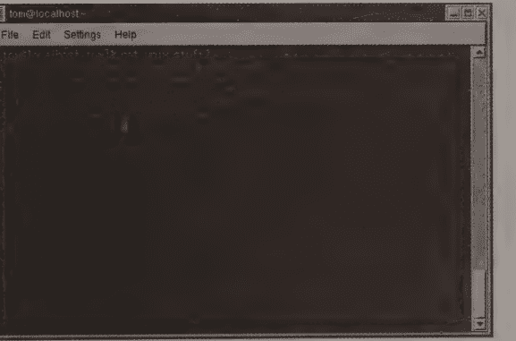

第 3 和第 4 行并没有从从文件中删除，只是被过滤掉了，因此不显示。

### 6. 显示包含特定单词的行
要仅显示包含单词 "Flat" 的行，输入 `sed -n /Flat/p unix_stuff` 并按回车。

你看到了这段文本：
平面文件。平面文件是基于纯文本和标准 ASCII 码的文件。平面文件

### 7. 替换单词
要将所有单词 "Flat" 替换为 "Text"，输入 `sed -n s/Flat/Text/p unix_stuff` 并按回车（确保 "Flat" 和 "Text" 单词的首字母大写）（`(s` 命令用一个字符字符串替换另一个）。

你看到了这段文本：
平面文件。文本文件是基于纯文本和标准 ASCII 码的文件。文本文件

在 `sed` 中追加新行，你必须使用 `a\` 命令。该命令在指定的行号之后追加行。像所有其他 `sed` 命令一样，如果你不指定行号，它将对文件的所有行进行操作。

你可以创建一个新的脚本文件 `more_stuff`。在文件中包含命令 `a\`，并在其后面跟上要追加到 `unix_stuff` 中的行。除了所添加文件的最后一行外，你必须每一行都用反斜杠字符来结束。在后续步骤中，`a\` 符号之前的 `$` 告诉 `sed` 在 `unix_stuff` 的最后一行之后追加 `more_stuff`；如果没有 `$`，`sed` 会在 `unix_stuff` 的每一行之后重复添加 `more_stuff` 中的所有行。

#### 创建向另一个文件追加行的脚本文件
1. 要创建脚本文件 `more_stuff`，输入 `cat > more_stuff` 并按回车。
2. 输入以下文本，在每行末尾按回车：
```
$a\
Informix and Oracle, two major relational database\
companies have installed their RDBMS packages on UNIX\
systems for many years.
```
3. 按 `Ctrl+D`。
4. 要使用 `sed` 命令运行脚本文件，输入 `sed -f more_stuff unix_stuff` 并按回车。

你看到了这段文本：
尽管 UNIX 支持其他数据库系统，UNIX 绝没有放弃过使用平面文件的想法。平面文件是基于纯文本和标准 ASCII 码的文件。平面文件可以被任何操作系统读取。
Informix 和 Oracle，两个主要的关系型数据库公司多年来一直在 UNIX 系统上安装它们的 RDBMS 软件包。

5. 使用 `vi` 创建文件 `stuff-replace`。在文件中插入以下 `sed` 命令：

```
s/UNIX/Linux/

s/abandoned/given up/

s/standard/regular/
```


文件中的行指示 `sed` 替换所有出现的“UNIX”、“Linux”、“abandoned”为“given up”，并将“standard”替换为“regular”。

6. 使用你在第 5 步中创建的脚本文件在 `unix_stuff` 文件上执行 `sed`。将 `sed` 的输出重定向到文件 `unix_stuff2`。输入 `sed -f stuff_replace unix_stuff > unix_stuff2` 并按回车。
7. 输入 `cat unix_stuff2` 并按回车。你看到了带有 `stuff_replace` 脚本文件指定更改的文件，如图 5–4 所示。

# 使用 tr 命令翻译字符

语法 `tr [options] string1 string2`

解析

- `tr` 命令从输入复制到输出，替换或删除字符。
- 在最简单的形式下，`tr` 将 `string1` 中的每个字符翻译为 `string2`。
- 两个常用的选项是 `-d`（删除）和 `-s`（替换）。

一种流行的用法是将小写转换为大写。

要将小写转换为大写：

1. 在 `$` 提示符下，输入 `tr 'a-z' 'A-Z' < zoo` 并按回车。
你看到了这些行：
LINUX IS A FULL
LINUX BENDS THE

从文件中删除字符：

1. 在 `$` 提示符下，输入 `tr -d "f" < zoo` 并按回车。
你看到了这段文本：
LINUX IS A FULL
LINUX BENDS THE

将重复字符替换为一个：

1. 在 `$` 提示符下，输入 `tr -s " " " " < zoo` 并按回车。
你看到了：
LINUX IS A FULL
LINUX BENDS THE

# 使用 pr 命令格式化输出

`pr` 命令以分页形式将指定的文件打印到标准输出。如果你没有指定任何文件或指定文件名为 `"-"`，`pr` 将读取标准输入。
默认情况下，`pr` 将指定的文件格式化为单列页 66 行。每个页面都有五行页眉，默认包含当前文件名、其最后修改日期、当前页码以及由空行组成的五行页脚。

语法 `pr [options] [file..]`

解析

- 最常用的选项是 `-h`（页眉格式），允许你自定义页眉行；`-d`，输出倍间距；以及 `-l n`，设置每页行数。

使用 `pr` 格式化 `unix_stuff` 文件。使用管道操作符 (`|`) 将输出发送给 `more` 命令（换句话说，你会输入：`| more`），这样输出屏幕就不会一闪而过。

格式化文件：

1. 在 `$` 提示符下，输入 `pr -h "UNIX Files & Databases" > unix_stuff | more` 并按回车。在查看文本显示后按 `q` 退出。图 5–5 阐明了你看到的屏幕。

现在你可以输入相同的命令，但添加 `-l 23` 选项将每页行数限制为 23 行。由于大多数显示器的标准行数为 24 行，因此你不需要将输出发送到 `more` 或 `less` 命令来分页屏幕。

2. 输入 `pr -l 23 -h "UNIX Files & Databases" < unix_stuff` 并按回车。查看图 5-6 以了解屏幕应该外观。

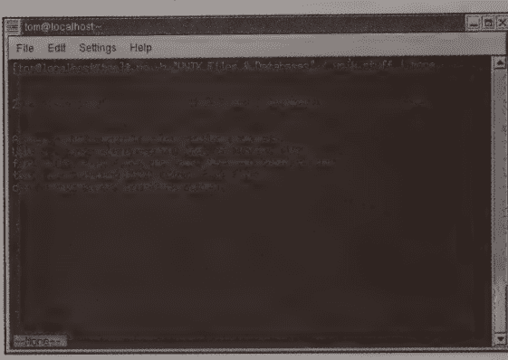

图 5-5 管道传输 `pr` 命令后的结果

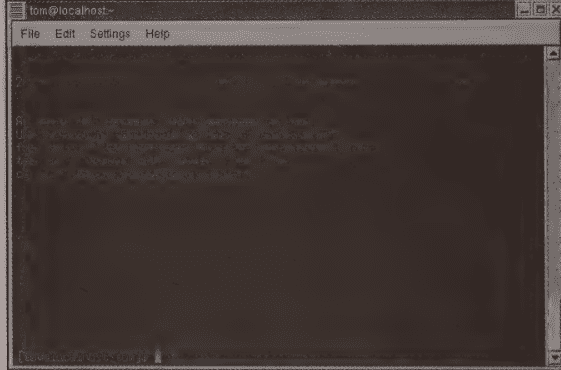

图 5-6 不管道传输 `pr` 命令时的结果

# 设计一个新的文件处理应用程序

## B 课

# 使用 UNIX 文件处理工具创建应用程序

* 完成本课后，你应该能够：
* 设计一个新的文件处理应用程序
* 设计并创建文件以实现该应用程序
* 使用 `awk` 生成格式化输出
* 使用 `cut`、`sort` 和 `join` 来组织和转换选定的文件信息
* 开发自定义 shell 脚本以提取和合并文件数据
* 测试单个 shell 脚本并将所有脚本合并成最终的 shell 程序

# 设计一个新的文件处理应用程序

开发新应用程序中最重要的阶段是创建设计。设计定义了应用程序需要产生的信息。设计还定义了如何将这些信息组织成文件、记录和字段，这些结构被称为逻辑结构，因为每个结构都代表一个逻辑实体，例如工资文件、员工薪资记录或员工社会保障字段。文件由记录组成，记录由字段组成。

# 设计记录

设计阶段的第一任务是定义记录中的字段。这些定义以记录布局的形式出现，通过名称和数据类型（如数字或非数字）来标识每个字段。设计文件记录时，只存储与记录主要目的相关的字段。例如，你为 Dominion Consulting 需要两个文件：一个用于程序员信息，另一个用于项目信息。在程序员文件记录中包含一个程序员名称的字段，在项目文件记录中包含一个项目描述的字段。即使程序员可能被分配到某个项目，也不要在项目文件中存储程序员名称。反之，不要在程序员文件中存储项目名称。

仅为记录的必要字段分配空间是简单明了的。短记录（像短句子）更容易理解。同样，你的应用程序越简单，性能就越好。然而，确保包含一个能够唯一标识文件中每条记录的字段。例如，程序员文件记录包含一个程序员编号，以区分可能同名的程序员。

> 注意：程序员文件记录中的程序员编号应该是数字型的。对于唯一标识记录，数字字段比非数字字段更好，因为计算机解释数字比解释字段中的非数字数据快。项目记录可以使用非数字代码来唯一标识每个项目记录，因为 Dominion 项目代码包含字母和数字（如 `EA-100`）。

# 通过键链接文件

多个文件通过键（key）连接——键是每个链接文件都共享的公共字段。设计阶段的另一个重要任务是计划一种连接文件的方法（如果需要）。例如，程序员-项目应用程序使用程序员编号将程序员与项目文件链接。在项目记录中添加程序员字段以将程序员与项目连接起来。

> 注意：从由简单短记录组成的多个文件中收集信息的灵活性是关系型数据库系统的本质。UNIX 包含了几个文件处理命令，提供了这种关系型数据库的灵活性。你在本课中实现了其中一些命令。

在开始为应用程序创建文件之前，请查看图 5–7 所示程序员和项目文件的记录布局。

# 程序员 – 记录布局

| 字段名称 | 数据类型 | 示例 |
| --- | --- | --- |
| programmer_number | 数字 | 101 |
| iname | 字母 | Johnson |
| fname | 字母 | John |
| midinit | 字母 | K |
| salary | 数字 | 39000 |

字段分隔符是冒号 `:`：

示例记录：
`101:Johnson:John:K:39000`

# 项目文件 – 记录布局

| 字段名称 | 数据类型 | 示例 |
| --- | --- | --- |
| project_code | 字母 | EA-100 |
| project_status | 数字 | 1 (*见注意) |
| project_name | 字母 | Reservation Plus |
| programmer_number | 数字 | 110 |

字段分隔符是冒号 `:`：

示例记录：
`EA-100:1:Reservation Plus:110`

*注：项目状态代码 1=未安排 2=已开始 3=已完成 4=已取消

**图 5-7** 程序员和项目应用程序记录布局

# 创建程序员和项目文件

现在你已经审查了设计和链接记录的元素，可以开始实施你的设计了。正如你在第 2 章和第 3 章记忆的，UNIX 处理主要是扁平文件。处理这些文件很容易，因为你可以使用 `vi` 或 `Emacs` 等编辑器来创建和操作它们。图 5-8 提供了程序员和项目文件的概述和分析。

文件名：
`101:Johnson:John:K:39000`
`102:King:Mary:K:39800`
`103:Brown:Gretchen:K:35000`
`104:Adams:Betty:C:42000`
`105:Utley:Amos:V:36000`
`106:Wilson:Patricia:B:39000`
`107:Culligan:Thomas:F:39000`
`108:Mitchell:Hillary:N:32800`
`109:Arbuckle:Margaret:F:46700`
`110:Ford:Terrence:H:47000`
`111:Greenene:Sarah:L:41700`
`112:Rose:Richard:P:40200`
`113:Daniels:Allan:S:30500`
`114:Edwards:George:J:38500`

文件名：
`EA-100:1:Reservation Plus:110`
`EA-100:1:Reservation Plus:103`
`EA-100:1:Reservation Plus:107`
`EA-100:1:Reservation Plus:109`
`EA-101:2:Accounting-Revenues Version 4:105`
`EA-101:2:Accounting-Revenues Version 4:112`
`EA-102:4:Purchasing System:110`
`EA-103:3:Personnel Evaluations:106`
`WE-206:1:Reservations:102`
`WE-207:4:Accounting - Basic:101`
`WE-208:2:Executive-Decision-Maker:102`
`NE-300:1:Region P & L:103`
`NE-302:1:Housekeeping Logs:104`
`NE-304:4:Maintenance Logs:105`

# 创建程序员和项目文件

通过 `vi` 编辑器创建程序员文件：

1. 在 `$` 提示符后输入 `vi programmer` 并按回车。
2. 输入 `i` 进入插入模式，输入以下内容，每行最后按回车：
`101:Johnson:John:K:39000`
`102:King:Mary:K:39800`
`103:Brown:Gretchen:K:35000`
`104:Adams:Betty:C:42000`
`105:Utley:Amos:V:36000`
`106:Wilson:Patricia:B:39000`
`107:Culligan:Thomas:F:39000`
`108:Mitchell:Hillary:N:32800`
`109:Arbuckle:Margaret:F:46700`
`110:Ford:Terrence:H:47000`
`111:Greenene:Sarah:L:41700`
`112:Rose:Richard:P:40200`
`113:Daniels:Allan:S:30500`
`114:Edwards:George:J:38500`
3. 按 `Esc` 退出插入模式。
4. 输入 `:wq` 保存并退出。

现在通过创建项目文件：

1. 在 `$` 提示符后输入 `vi project` 并按回车。
2. 输入 `i` 进入插入模式，输入以下内容，每行最后按回车：
`EA-100:1:Reservation Plus:110`
`EA-100:1:Reservation Plus:103`
`EA-100:1:Reservation Plus:107`
`EA-100:1:Reservation Plus:109`
`EA-101:2:Accounting-Revenues Version 4:105`
`EA-101:2:Accounting-Revenues Version 4:112`
`EA-102:4:Purchasing System:110`
`EA-103:3:Personnel Evaluations:106`
`WE-206:1:Reservations:102`
`WE-207:4:Accounting - Basic:101`
`WE-208:2:Executive-Decision-Maker:102`
`NE-300:1:Region P & L:103`
`NE-302:1:Housekeeping Logs:104`
`NE-304:4:Maintenance Logs:105`
3. 按 `Esc` 退出插入模式。
4. 输入 `:wq` 保存并退出。

# 输出格式化

第 4 章介绍了 `awk` 命令，它简化了格式化输出的准备。`awk` 实际上是一种功能完整的编程语言，需要专门的章节来介绍。这里的简单介绍仅解释了 `awk` 命令中用于格式化输出的 `printf` 操作。`printf` 函数的语法如下：


# Syntax `printf(format, expr1, expr2, expr3)`

## 解析

- `$expr1`, `$expr2`, `$expr3` 是表示数据字段的 `awk` 表达式。这些表达式通常采用 `$1`, `$2`, `$3` 等形式。在程序员文件中，表达式 `$1` 表示程序员的编号（第一个字段），`$2` 表示程序员的姓氏（第二个字段），而 `$3` 表示程序员的名字（第三个字段）。

你可以使用 `awk` 命令和 `printf` 函数来打印程序员编号（programmer_number）、程序员姓氏（programmer last name）和程序员名字（programmer first name），且全部左对齐。

要打印三个字段：

1. 在 `$` 命令行提示符后，输入 `awk -F': 'printf "%d %%-12.12s %%-10.1s\n", $1, $2, $3}' programmer` 并回车。输出示例请参见图 5-9。


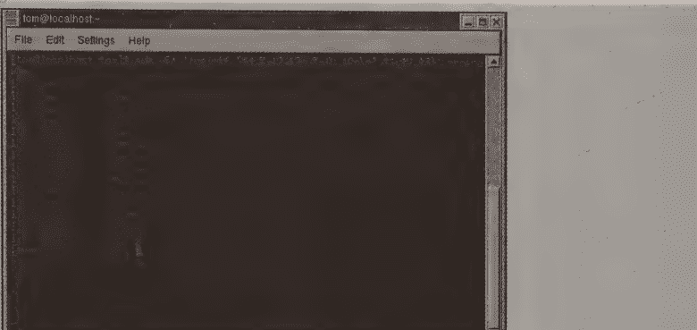

图 5-9 使用三个字段的 `awk printf` 报告

格式字符串中的每个 `%` 符号都对应一个 `$` 字段：`%d` 指定了如何显示 `$1` 字段，`%-12.12s` 指定了如何显示 `$2` 字段，`%-10.10s` 指定了如何显示 `$3` 字段。以下是每个格式符的详细说明：

- `%d` 表示字段 `$1` 以十进制数字形式出现。
- `%-12.12s` 表示字段 `$2` 以字符串形式出现。负号 (`-`) 指定字符串左对齐。`12.12` 表示字符串应显示在一个填充填充了 12 个空格的字段中，最大宽度为 12 个空格。
- `%-10.10s` 表示字段 `$3` 以字符串形式出现。负号 (`-`) 指定字符串左对齐。`10.10` 表示字符串应显示在一个填充了 10 个空格的字段中，最大宽度为 10 个空格。

格式字符串中出现的空格将按照它们相对于字段的位置精确打印（一个打印在 `$1` 之后，另一个打印在 `$2` 之后）。尾部的 `\n` 告诉 `awk` 在显示三个字段后跳到下一行。

当你需要提取并格式化数据字段进行输出时，`awk` 提供了一个排序文件处理命令的快捷方法。例如，虽然需要几行代码，但你可以使用 `cut`、`paste` 和 `cat` 命令来显示程序员的姓氏和工资。通过使用 `cut` 命令从程序员文件中提取姓氏（字段 2），并将输出存储在 `temp1` 中。接着使用 `cut` 命令从文件中提取工资（字段 5），并将输出存储在 `temp2` 中。然后使用 `paste` 命令合并 `temp1` 和 `temp2`，创建文件 `progsal`。最后，使用 `more` 命令显示输出。你也可以通过一个 `awk` 命令完成同样的任务。

### 使用 `cut`、`paste` 和 `more` 提取并显示信息：

1. 在 `$` 命令行提示符后，输入 `cut -f2 -d: programmer > temp1` 并回车。
2. 输入 `cut -f5 -d: programmer > temp2` 并回车。
3. 输入 `paste temp1 temp2 > progsal` 并回车。
4. 要使用 `more` 命令显示输出，输入 `more progsal` 并回车。

你会看到类似于下方摘录输出：

| Johnson | 39000 |
| King | 39800 |
| Brown | 35000 |
| Adams | 42000 |
| Utley | 36000 |

### 使用 `awk` 命令完成相同任务：

1. 在 `$` 命令行提示符后，输入 `awk -F: '{printf "%%-10.10%%7.0f\n", $2, $5}' programmer` 并回车。

你会看到类似于下方摘样的输出：

| Johnson | 39000 |
| King | 39800 |
| Brown | 35000 |
| Adams | 42000 |
| Utley | 36000 |

> `cut` 和 `paste` 命令与 `awk` 命令之间有两个重要的区别。首先，使用 `awk` 时你不需要创建三个额外的文件。其次，由于使用了 `awk`，列显示看起来更加整齐。

## 切割与排序

现在你已经创建了程序员信息文件，可以选择项目文件中存储的程序员编号（programmer_number）字段。这些字段标识了当前分配到项目中的程序员。在执行下一个任务时，请参考图 5–7。

首先从项目文件中提取程序员编号字段（字段 4），并通过管道 (`|`) 将输出交给 `sort` 命令，使重复的数字排在一起。将输出传递给 `uniq` 命令以删除重复数字。

### 创建程序员和项目文件

最后，将输出重定向到临时文件 `t1`。（`t1` 文件是分配到项目的程序员编号列表）。从项目文件中选择字段：

1. 在 `$` 命令行提示符后，输入 `cut -d: -f4 project | sort | uniq > t1` 并回车。
2. 要显示 `t1` 的内容，输入 `cat t1` 并回车。

你看到程序员编号列表：
101
102
103
104
105
106
107
109

下一步是从程序员文件中提取程序员编号字段（字段 1），并按照步骤 1 中做的方法将输出传递。新临时文件 `t2` 是为 Dominion 工作的程序员列表。

3. 输入 `cut -d: -f1 programmer | sort | uniq > t2` 并回车。
4. 要显示 `t2` 的内容，输入 `cat t2` 并回车。

你看到数字列表：
101
102
103
104
105
106
107
109
110

现在 `t1` 和 `t2` 已经按相同顺序排序，你可以使用 `comm` 命令来匹配它们，选出 `t1` 中与 `t2` 不匹配的行，并将输出重定向到另一个文件 `t3`，该文件列出了未分配到项目的程序员编号。


5. 输入 `comm t1 t2 > t3` 并回车。
6. 要显示正在项目的程序员编号，输入 `cat t3` 并回车。

你看到数字列表：
108
111
113

要显示未分配程序员的姓名，现在可以按编号对程序员文件进行排序，并将输出写入 `t4`。

7. 输入 `sort -t: -o4 programmer` 并回车。使用 `join` 命令匹配 `t4` 和 `t3` 中的程序员编号，并将输出重定向到 `t5`，其中包含所有未分配项目的程序员姓名。

8. 输入 `join -t: -1 1 -o 2 -o 3 -o 4 t4 t3 > t5` 并回车。
9. 要显示 `t5` 的内容，输入 `cat t5` 并回车。

你看到以下姓名列表：

```
Mitchell:Hillary:N

Greene:Sarah:L

Daniels:Allan:S

Edwards:George:J
```

现在你可以使用 `sed` 编辑器消除 `t5` 中的冒号字段。

10. 输入 `sed -n 's/: /p' < t5` 并回车。

你看到姓名列表：

```
Mitchell Hillary N

Greene Sarah L

Daniels Allan S

Edwards George J
```


## 使用脚本实现应用程序

你为 Dominion 开发的应用程序目前由许多按特定顺序运行的独立命令组成。正如你在第 4 章记得，你可以创建一个脚本文件来简化应用程序。将你的命令存储在脚本文件中，这实际上变成了一个程序。（在开发应用程序时，你应该在将其放入脚本文件之前对每个命令进行测试和调试。）你可以使用编辑器创建脚本文件。

### 第 6 章将详细介绍 shell 脚本编程。

`shell` 脚本不仅应该包含要执行的命令，还应该包含标识和解释脚本的注释，以便作者以外的用户或程序员能够理解其工作原理。注释还能让作者随着时间的推移记住脚本的逻辑。在脚本文件中使用井号 (`#`) 字符标记注释。这告诉 `shell` `#` 之后的单词是注释而不是 UNIX 命令。接下来的步骤展示了如何为你的 `shell` 程序添加注释。注意，你首先从插入注释并使用 `vi` 编辑器创建新的脚本文件，名为 `pact`。

### 创建脚本并添加注释：

1. 在 `$` 命令行提示符后，输入 `vi pact` 并回车。
2. 输入 `a`（你也可以输入 `i`）切换到插入模式，然后输入下面的文本，并在每行结束处回车：

```
# Script Name: pact

# By:         你的姓名缩写

# Date:       2004年1月

# Purpose:    创建临时文件 pnum，用于存储每个

#程序员正在工作的项目数量。pnum 文件

#包含：

#

            prog_num 和 count 字段
```


`cut -d - -f4 project | sort | uniq -c | awk '{printf "%s: %s\n",$2,$1}' > pnum`

# 提取 prog_num，输出交给 sort 去重

# 并获取程序/项目的计数。

# 输出文件为程序员编号，后跟计数

3. 按 `Esc` 切换到命令模式。
4. 输入 `wq` 写入文件并退出 `vi`。

## 运行 shell 脚本

你可以在系统上的几乎任何 shell 中运行 shell 脚本。在书中，使用 Bourne Again Shell (`Bash`)，它在 Linux 系统中非常常用。正如你之前学到的，脚本是包含命令的文本文件。在不同的

# 第 5 章 B 节 高级文件处理

在 shell 中，在具体用法、语法以及与命令相关的选项方面往往存在一些不兼容之处。使用 `Bash` shell 的优势在于它比原始的 Bourne shell 接受更多命令结构的变；`Bash` 是 Bourne 和 Korn shell 的免费衍生版本。

当你创建一个要在 `Bash` 中运行的 shell 脚本时，可以通过输入 `sh`（调用 Bash shell 解释器）然后输入脚本名称来立即运行脚本，如下：

```
sh testscript
```

使用 `sh` 的另一个优势是你可以配合几个调试选项来帮助排查脚本中的问题（在第 6 章了解更多关于调试选项）。在本章首次接触 shell 脚本时，你只需使用 `sh` 来运行脚本。

运行 shell 脚本的另一种方法（你将在第 6 章中详细学习）是通过 `x` 权限赋予其可执行权限，然后在运行脚本名称之前输入 `./` 来手动运行脚本。此外，当你编写脚本时，建议指定脚本要使用的 shell。你可以通过在脚本的第一行包含一条语句——例如对于 Bash shell 使用 `#!/bin/bash`——来实现。第 7 章将展示当你的 shell 脚本变得更加高级时如何实现这种做法。

现在，你可以使用 `sh` 命令运行 `pact` 脚本，并使用 `less` 命令显示 `pnum` 的内容。

运行你之前创建的 `pact` 脚本：

- 1. 在 `sh` 命令提示符后，输入 `sh pact` 并按回车。
- 2. 输入 `less pnum` 并按回车，查看由 `pact` 脚本创建的 `pnum` 文件的内容。
- 3. 你会看到这些程序员编号和计数字段：
```
101:1
102:2
103:2
104:1
105:2
106:1
107:1
109:1
110:2
112:1
```
- 4. 如必要，按 `q` 退出文本显示并返回命令行。


现在你有一个包含程序员编号和每个程序员正在进行的项目数量的文件。接下来，创建一个脚本文件 `pname`，以从程序员文件中提取程序员名称和编号，并将输出重定向到文件 `pnn`。

## 运行 shell 脚本

创建另一个脚本文件：

- 1. 在 `$` 命令提示符后，输入 `vi pumname` 并按回车。
- 2. 输入 `a` 切换到插入模式，然后输入以下文本，并在每行结束按回车：

```
=====================================================

# Script Name: pumname

# By: 你的缩写

# Date: Jan 2004

# Purpose: Extract Programmer Numbers and Names

=====================================================

cut -d: -f1-4 programmer | sort -t: +0 -1 | uniq > pnn

# 以上命令截取了第 1 到第 4 个字段。

# 输出通过管道按程序员编号进行排序。

# 排序后的输出通过管道交给 uniq 以去

# 重。

# uniq 将输出重定向到 pnn。
```

- 3. 按 `Esc` 切换到命令模式。
- 4. 输入 `wq` 保存文件并退出 `vi`。
- 5. 运行 shell 程序并使用 `less` 命令显示 `pnn` 的内容，输入 `sh pumname` 并按回车。
- 6. 输入 `less pnn` 并按回车。

- 7. 你看到程序员名称和编号，且消除了重复：
```
101:Johnson:John:K
102:King:Mary:K
103:Brown:Gretchen:K
104:Adams:Betty:C
105:Utley:Amos:V
106:Wilson:Patricia:F
107:Culligan:Thomas:F
108:Mitchell:Hillary:N
109:Arbuckle:Margaret:F
110:Ford:Terrence:H
111:Greene:Sarah:L
112:Rose:Richard:P
113:Daniels:Allan:S
114:Edwards:George:J
```

- 8. 如必要，按 `q` 退出文本显示。

现在你可以创建一个脚本文件 `joinall` 来合并 `pnn` 和 `pumname` 文件，并将输出重定向到 `patrec`。

# 第 5 章 B 节 高级文件处理

创建一个合并两个文件的脚本：

- 1. 在 `$` 命令提示符后，输入 `vi joinall` 并按回车。
- 2. 输入 `a` 切换到插入模式，然后输入以下文本，并在每行结束按回车：

```
=====================================

# Script Name: Joinall

# By: 你的缩写

# Date: Jan 2004

# Purpose: Join pnum and pnn to create a report file

=====================================

# 合并包含未分配程序员的文件。

# 你通过将程序员名称 (pnn) 文件

# 首先放在 join 序列中来实现。

join -t: -al1 -j2 pnum > pactrep

=====================================
```

- 3. 按 `Esc` 切换到命令模式。
- 4. 输入 `wq` 保存文件并退出 `vi`。

- 5. 运行 `joinall` 并使用 `less` 显示 `pactrep` 的内容，输入 `sh joinall` 并按回车。
- 6. 输入 `less pactrep` 并按回车。
- 7. 你看到程序员名称，包括未分配的程序员：
```
101:Johnson:K:1
102:King:Mary:2
103:Brown:Gretchen:2
104:Adams:Betty:1
105:Utley:Amos:2
106:Wilson:Patricia:1
107:Culligan:Thomas:1
108:Mitchell:Hillary:1
109:Arbuckle:Margaret:1
110:Ford:Terrence:2
111:Greene:Sarah:1
112:Rose:Richard:1
113:Daniels:Allan:1
114:Edwards:George:1
```
- 8. 如必要，按 `q` 退出。

# 整合以生成报告

开发应用程序的一种有效方法是将小脚本合并到一个较大的脚本文件中。由于你已经执行了各个脚本并测试了准确性，现在可以将它们按顺序放在一个脚本文件中以生成最终的程序员项目报告。

## 整合以生成报告

使用编辑器创建 shell 脚本 `practity`。使用 `:r` 命令获取 `pact`、`pumname` 和 `joinall` 脚本并将它们放入 `practity` shell 脚本中。然后你可以使用 `dd` 命令删除注释指定的行。

创建一个最终的 shell 脚本：

- 1. 在 `$` 命令提示符后，输入 `vi practity` 并按回车。
- 2. 输入 `a` 切换到插入模式，然后输入以下文本，并在每行结束按回车：

```
#############################################

# Script Name: practity

# By:         你的缩写

# Date:       Jan 2004

# Purpose: Generate Programmer Activity Status Report

#############################################
```

- 3. 按 `Esc` 切换到命令模式。
- 4. 获取三个脚本文件，输入 `:r pact` 并按回车。将光标移动到文件末尾，输入 `:r pumname` 并按回车。将光标移动到文件末尾，输入 `:r joinall` 并按回车。
- 5. 删除指定的行。例如，你可以将光标移动到每个以 `#` 开头的行，然后输入 `dd`。对文件中剩余的注释行执行相同操作。

脚本中应剩下这四行：


```
cut -d -f4 project | sort | uniq -c | awk '{printf "%s\n", $2, $1}' > pumnam
cut -d -f1 programmer | sort -t: +0 -1 | uniq > pnn
join -t:- -al1 1 -j2 pnn pnum > pactrep
```

## 6. 在脚本中输入以下内容：

### 打印报告

```
awk
BEGIN
  { FS = ":" }
  { print "\Programmer Activity Status Report\n" }
  { "date" | getline d }
  { print "\t%s\n",d }
  { print "Prog\lt;t-Name-" }
===========================================
  { printf "%s-%s\t$8-\12.12s %s$9-\12.12s %s\t%d\n",
  $1, $2, $3, $4, $5 } ' pactrep
```

### 删除所有临时文件

```
rm pnum pnn pactrep
```


- 7. 按 `Esc` 切换到命令模式。确保脚本看起来与图 5-10 中的类似。
8. 输入 `wq` 保存文件并退出 vi。
9. 在 `$` 命令提示符后，输入 `sh practity` 并按 `回车`。图 5–11 阐明了报告。

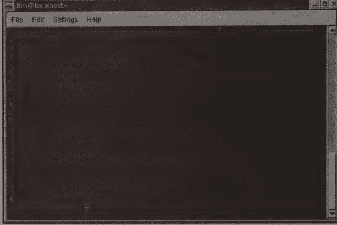

图 5-10 进入 practity 脚本

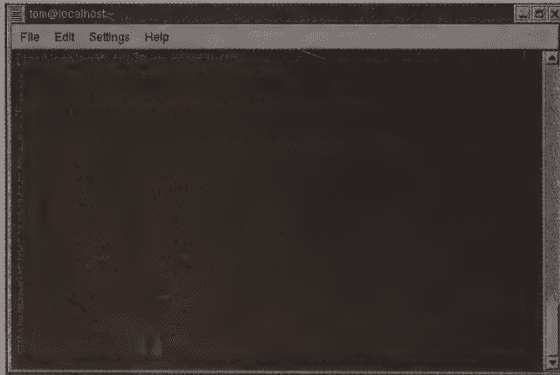

图 5-11 shell 脚本生成的报告

# 章节总结

- UNIX 文件处理命令可以分为两类：选择命令和处理与转换命令。选择命令用于提取信息。处理与转换命令用于更改并将信息转换为有用且美观的格式。
- `uniq` 命令删除文件中的重复行。你必须先对文件进行排序，因为 `uniq` 仅比较连续的行。
- `comm` 命令比较 `file1` 和 `file2` 共同的行，并产生三列输出，报告文件之间的差异。
- `diff` 命令尝试确定将 `file1` 转换为 `file2` 所需的最小更改集。
- `tr` 命令将从标准输入读取的数据复制到标准输出，并根据选项和模式替换或删除指定的指定的字符。
- `pr` 命令分页打印标准输出。
- `sed` 命令是一个文件编辑器，设计用于对大文件进行全局更改。运行 `sed` 的最低要求是一个输入文件和一个告诉 `sed` 应该对文件执行哪些操作的命令。
- 文件处理应用程序的设计反映了应用程序需要生成的内容。设计还定义了如何将信息组织成文件、记录和字段，这些也称为逻辑结构。
- 使用记录布局通过名称和数据类型（数字或非数字）来识别每个字段。设计文件记录时，仅存储与每个记录主要目的相关的字段。
- Shell 程序应该包含注释，以执行、识别和解释程序。脚本文件中使用的井符号（`#`）表示注释。
- 分阶段编写 Shell 脚本，这样你就可以在将它们合并成一个脚本之前测试每个部分。使用小型 Shell 脚本并将它们组合进最终的 Shell 脚本是开发应用程序的有效方法。

# 命令总结

| 命令 | 目的 | 本章涵盖的选项 |
|---|---|---|
| `comm` | 比较并输出两个文件的共同行 | |
| `diff` | 比较两个文件并确定哪些行不同 | `-i` 忽略大小写 |
| `grep` | 选择行或行 | `-l` 仅列出文件名 |
| `pr` | 格式化指定的文件 | `-d` 输出双倍行距 -h 自定义页头行 -n 设置每页行数 |
| `sed` | 指定编辑命令或包含 sed 命令的脚本文件 | `-a` 在行后附加文本 -d 删除指定的文本 -e 在同一行上指定多个命令 -n 表示行号 -p 显示行 -s 替换指定的文本 |
| `tr` | 翻译字符 | `-d` 删除 `string1` 中的输入字符 -s 检查 `string1` 的连续重复序列 |
| `uniq` | 删除重复行以创建唯一输出 | |
| `wc` | 统计文件的行数、字节或单词数 | `-c` 统计字节或字符数 -l 统计行数 -w 统计单词数 |

| 命令 | 目的 | 本章涵盖的选项 |
|---|---|---|
| `printf` | 告诉 `awk` 程序格式化和打印信息采取什么操作 | 无 |
| `sh` | 执行 Shell 脚本 | 无 |

# 复习题

- 1. 使用选择命令可以完成以下哪些？
  a. 在文件的记录中包含或排除特定字段
  b. 创建脚本文件
  c. 合并两个文件的内容
  d. 以上所有
  e. 仅 a 和 b
- 2. 下列哪些是文本处理和转换命令？
  a. `awk`
  b. `chmod`
  c. `sort`
  d. 以上所有
  e. 仅 a 和 c
- 3. 使用此命令：`grep "character" /etc/termcap` 会得到什么结果？
  a. 显示结果会删除原始文件中所有使用的“character”单词。
  b. 显示结果会在每行开头添加“character”单词。
  c. 显示结果将显示文件中所有包含“character”单词的行。
  d. 产生的操作是将 `/etc/termcap` 文件重命名为 `/etc/character`。
- 4. `pr` 命令用于 ________
  a. 合并文件
  b. 格式化并打印文件
  c. 统计文件中的段落数
  d. 将两个文件合并为一个
- 5. 输入 `ls -l /bin | more` 时，命令的 `| more` 部分实现了什么？
  a. 它导致显示中的长行换行
  b. 它将目录列表复制到名为“more”的永久文件中
  c. 它将目录列表通过到中央网络服务器上的“more”文件
  d. 它每次显示一个屏幕的目录内容，以便阅读

# 第5章 高级文件处理

6. 你正在为老板写一份备忘录，他不希望备忘录超过 500 个单词。在使用其中一个 UNIX 编辑器写完备忘录并保存为文件后，可以使用什么命令行命令来确定文件中的单词数？
  a. `head`
  b. `tail`
  c. `wc`
  d. `uniq`
7. 下列哪个命令可以让你比较 `budget_taskforce` 文件和 `pay_taskforce` 文件，立即查看哪些员工姓名同时存在两个文件中？
  a. `comm budget_taskforce pay_taskforce`
  b. `counter budget_taskforce pay_taskforce`
  c. `chmod budget_taskforce pay_taskforce`
  d. `tail budget_taskforce pay_taskforce`
8. 你正在准备一种记录布局，通过名称和数据类型（数字或非数字）识别每个字段。设计文件记录时，仅存储与每个记录主要目的相关的字段。下列哪些命令可以让你识别重复条目？
  a. `cat`
  b. `uniq`
  c. `join`
  d. `paste`
9. 你正在转换一个由空格分隔的平面文件。你想删除重复。下列哪些命令可以让你识别重复项？
  a. `comm`
  b. `uniq`
  c. `join`
  d. `paste`
10. 在 `sed` 命令中，`-n` 选项用于：
  a. 识别重复条目
  b. 显示行号
  c. 删除指定的文本
  d. 替换指定的文本
11. 对或错：`sed` 的局限性是它不能与脚本配合。
12. 在 `pr` 命令中，`-d` 选项用于：
  a. 打印到磁盘
  b. 显示行号
  c. 输出双倍行距
  d. 省略标题
13. 你有两个平面文件，应该包含相同的记录。下列哪些命令可以让你识别不匹配的记录？
  a. `comm`
  b. `uniq`
  c. `wc`
  d. `tr`
14. `tr` 命令允许你将小写字母转换为大写字母。
  a. `paste`
  b. `cut`
  c. `grep`
  d. `tr`
15. 关于记录布局，以下哪个是正确的？
  a. 它必须将单个记录保持在 56 个字符以内
  b. 它通过名称识别字段
  c. 整个记录布局必须存储在文件中
  d. 以上所有
  e. 仅 a 和 c
16. 在 `awk printf` 命令中，当在 `""` 之后使用格式选项 `"-"` 时用于：
  a. 忽略记录
  b. 打印百分比
  c. 文本左对齐
  d. 文本右对齐
17. 下列哪个命令可以让你使用 `awk printf` 格式化标题？
  a. `{ print "\tTITLE\n" }`
  b. `{ -tTITLE }`
  c. `{ "title=TITLE" }`
  d. `{ tTITLE }`
18. 使用 ________ 来运行 Shell 脚本。
  a. `sh`
  b. `runex`
  c. `start`
  d. `cmd`
19. 使用 `awk printf` 格式化时，`"$2"` 代表：
  a. 在文本之间创建两行的指令
  b. 从文件中第二个字段提取信息的表达式
  c. 从文件中提取第二个记录的表达式
  d. 在每页上创建公共标题的指令
20. 当使用 `awk printf` 命令从文件中提取数字信息时，使用(n) ________ 来指定数据是数字（numbers）而不是字母数字（文本）。
  a. `n`
  b. `a`
  c. `s`
  d. `d`
21. 使用 `grep` 命令时，`-i` 选项允许你：
  a. 抑制输出的第一行
  b. 忽略大小写
  c. 表明代码来自键盘
  d. 抑制输出的最后一行
22. 在 `pr` 命令中，`-d` 选项用于：
  a. 打印到磁盘文件
  b. 显示行号
  c. 输出双倍行距
  d. 省略标题
23. 对或错：当你使用 `cut` 命令时，不能管道输出。

# 练习 185

- 24. 关于 `sed` 命令，以下哪项是？
  a. 它可以对大文件进行全局更改。
  b. 使用 `sed` 时需要一个输入文件。
  c. `sed` 可以配合脚本文件指定命令。
  d. 以上皆是
  e. 仅 a 和 b
- 25. 当 `-d` 与 `tr` 命令配合时，________。
  a. 用于删除字符或字符串
  b. 用于替换字符或字符串
  c. 可以交换两个字符或字符串
  d. 可以插入新字符或字符串

# 探索练习

- 1. 使用 `vi` 编辑器或 `cat >>` 在你在本章之前创建的 `counters` 文件中添加以下行：
  Linux 支持使用 X Windows。
  GNOME 和 KDE 是 X Windows 桌面的两个示例。
  桌面可以让你的工作变得更容易更快速。
  GNOME 桌面包含了用于生产力的软件。
- 2. 确定 `counters` 文件中的单词总数。
- 3. 使用命令确定 `counters` 文件中哪些行包含单词 "Linux"。
- 4. 使用命令将 `counters` 文件中所有的 "Linux" 替换为 "UNIX"。
- 5. 复制 `counters` 文件，并将其命名为 `countersbak`。使用 `vi` 编辑器删除 `counters` 文件的前两行。使用命令显示现在哪些行位于 `counters` 和 `countersbak` 文件之间。
- 6. 编写一个名为 `salaries` 的脚本文件，使用 `awk` 从 `programmer` 文件中顺序打印工资、名、姓和程序员编号字段。报告标题为“Programmers and Salaries”。使用 `sh` 命令执行 `salaries`。
- 7. 编写一个名为 `projects` 的脚本文件，使用 `awk` 从 `project` 文件中打印项目名称和项目代码字段。报告标题为“Projects”。使用 `sh` 命令执行 `projects`。尽可能用少的代码创建脚本。
- 8. 创建新文件 `CD_list`，并在文件中输入这些行：


country:1000:210

rock:1001:380

classical:1002:52

alternative:1003:122

light rock:1004:151

light rock:1004:151

celtic:1005:44

jazz:1006:62

soundtracks:1007:32

soundtracks:1007:32

```
使用 `sed` 命令和脚本文件将这些行添加到 `CD_list` 文件的末：
```

hard rock:1008:70

misc:1009:22

```
- 9. 使用命令找到 `CD_list` 文件中的重复行（记录）。
- 10. 使用 `uniq` 命令移除 `CD_list` 文件中的重复行，并将修正后的信息放在名为 `CD_list_new` 的文件中。
- 11. 在 `CD_list_new` 文件中，将单词 "misc" 替换为 "other"，然后比较 `CD_list` 文件与 `CD_list_new` 文件的内容，以确保更改已生效。
- 12. 使用 `grep` 命令在 `CD_list_new` 文件中找到所有包含单词 "celtic" 的行。
- 13. 在 `CD_list_new` 文件上使用 `sed` 命令将 `CD_list_new` 文件中的所有字母转换为大写。
- 14. 在 `CD_list_new` 文件上使用 `sed` 命令将单词 "LIGHT ROCK" 替换为 "EASY LISTENING"，并将单词 "ALTERNATIVE" 替换为 "EXPERIMENTAL."
- 15. 创建名为 `software` 的文件，包含以下字段：
  - 项目编号，使用项目文件中显示的相同数字（你在本章之前创建的）
  - 软件代码，使用任何三位数字
  - 软件描述，例如 Excel

然后，编写一个小型应用程序，将 `software` 文件中的记录与 `project` 文件中的匹配记录连接，并使用 `awk` 程序打印一份描述你之前创建的每个项目的软件报告。

# 第 6 章

# Shell 脚本编程简介

Dominion Consulting 需要一个程序来维护其电话记录文件，该文件包含关于每个员工的以下信息：电话号码、姓名、部门、职位和入职日期。该程序应该允许用户添加、更改、删除、查找和显示特定的员工信息。你可以通过创建一个 UNIX shell 脚本来满足这些需求。在本章的 A 节中，你将学习用于创建和调试 UNIX shell 脚本的基本工具。在 B 节中，你将创建 shell 脚本让用户查看并向电话数据库添加记录。

## A 节

### 将 UNIX shell 作为脚本语言

- 完成本节后，你应该能够：
* 理解使用高级计算机语言和 UNIX shell 脚本的程序开发周期
* 比较各种 shell，以确定创建脚本的最佳选择
* 学习 shell 变量、操作符和通配符
* 编写简单的 shell 脚本来演示编程逻辑

#### 应用程序预览

你在本章中创建的 `corp_phones` 文件包含由冒号分隔的字段记录。以下是文件中的一条示例记录：

```
219-555-4587:Mitchell:Barbara:C:4541:Asst:12-14-1995
```

在第 4 章和第 5 章中，你学习了 `grep`、`cut` 和 `awk`。此外，你还学习了用于屏幕输出和光标定位的特殊命令。为了完成本章，你将学习脚本特性：

- Shell 变量——你的脚本通常需要在内存中保留值。shell 变量是用来访问值的符号名称。
- 操作符——shell 脚本支持许多操作符，包括用于数学运算的操作符。
- 逻辑结构——shell 脚本支持顺序逻辑（执行一系列命令）、决策逻辑（跳转到不同点）、循环逻辑（重复执行命令多次）和 case 逻辑（从多个备选项中选择操作）。

在开始编写脚本之前，你应该理解程序周期。

开发应用程序的过程被称为**程序开发周期**。无论你是在编写 shell 脚本还是高级语言程序，周期中涉及的步骤都是相同的。

过程始于创建程序规范——即应用程序必须满足的要求。规范决定了应用程序接受什么数据作为输入、对数据必须执行的过程以及正确的输出。

在确定规范后，设计过程就开始了。在此过程中，程序员创建程序将使用的文件格式、屏幕布局和算法（逻辑和数学步骤）。程序员使用各种工具来设计复杂的应用程序。在下一章中，你将学习流程图和伪代码，这是两种重要的程序设计工具。

设计过程完成后，程序员开始编写实际代码，并进行测试和调试。当发现错误时，他们必须进行修正，并开始测试过程，直到应用程序运行良好。

## 使用高级语言

计算机程序通常使用高级语言（如 COBOL、C 或 C++）编写指令。**高级语言**是一种使用英语表达式的计算机语言。例如，以下 COBOL 语句指示计算机给变量 COUNTER 加 1：

```
ADD 1 TO COUNTER.
```

这里是用 C++ 编写的类似语句：

```
counter = counter + 1;
```

程序的高级语言语句存储在名为**源代码**的文件中。这是程序员使用 vi 或 Emacs 等编辑器创建的文件。然而，源代码无法执行，因为计算机只能处理用低级机器语言编写的指令。正如你在第 3 章所回忆的，机器语言指令是用二进制数表示的晦涩代码。因此，高级源代码必须转换为低级机器语言文件，如下文所述。

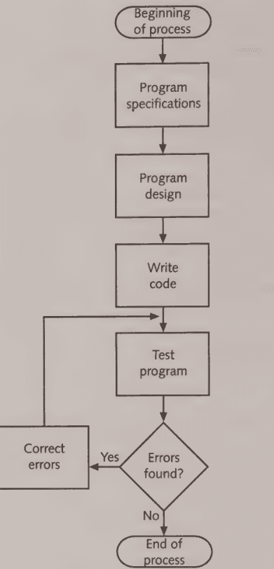

**图 6-1** 程序开发周期

源文件通过一个名为**编译器**的程序转换为可执行的机器语言文件。编译器读取程序员写在源文件中的代码，并将其转换为相应的机器语言指令。例如，Linux 的 C 和 C++ 编译器命名为 `gcc` 和 `g++`。以下命令演示了如何编译 C++ 源文件 `datecalc.C`，以便你可以作为程序 `datecalc` 运行：

```
g++ datecalc.C -o datecalc
```

## 程序开发周期

在这个示例命令中，`-o` 选项后的 `datecalc` 指令编译器创建一个可执行文件 `datecalc`。源文件是 `datecalc.C`。该命令使编译器将 C++ 程序 `datecalc.C` 翻译成可执行的机器语言程序，并存储在文件 `datecalc` 中。你将在第10 章学习更多关于 C 和 C++ 编程的内容。

如果源文件包含语法错误（程序语言使用中的语法错误），则无法将其转换为可执行文件。编译器会定位并报告任何错误，程序员必须修正这些错误。

> 注意：编译后，可执行程序可能仍然包含致命的运行时错误或逻辑错误。致命的运行时错误由于程序代码中指定的无效内存位置导致程序中止。逻辑错误会导致程序产生无效结果，例如错误的数学陈述等。

完成编程任务的另一种方法是开发 Shell 脚本。

## 使用 UNIX Shell 脚本

在第4章中，UNIX 脚本是包含 UNIX 命令序列的文本文件。与高级语言源文件一样，程序员使用文本编辑器创建脚本。与语言程序不同，Shell 脚本不需要通过编译器转换为机器语言。这是因为 UNIX 在读取脚本文件时充当解释器，它将它们翻译成可执行指令并使其运行。不会产生可执行文件，因为解释器会一步完成翻译并执行所述的语句。如果遇到语法错误，Shell 脚本的执行将停止。

创建 Shell 脚本后，你只需要告诉操作系统该文件是一个可以执行的脚本。这是通过使用 `chmod`（更改模式”）更改文件的模式来实现的。模式决定了文件如何被使用。回想一下，模式用单个字母表示，最常见的是 `r`（读）、`w`（写）和 `x`（执行）。`chmod` 命令告诉计算机谁可以使用该文件：所有者（u）、组（g）或所有其他用户（o）。关于 `chmod` 命令的描述，请参见 UNIX 命令附录 B。

正如你在第4章记忆的，你可以更改文件的模式，使 UNIX 识别为可执行程序（模式 x），每个人（用户、组和其他）都可以使用。在下面的示例中，用户是文件的所有者。

```
$ chmod u+x filename
```

要让所有用户都能执行该文件，你也可以使用以下任一种：
```
$ chmod a+x filename <Enter>
```
或
```
$ chmod 755 filename <Enter>
```

在将文件设置为可执行后，你可以通过几种方式之一运行它：

- 你可以直接在系统命令提示符处输入脚本名称。然而，在此方法生效之前，你必须修改默认路径，以包含脚本所在的目录。该目录可能是你家目录下的 `source` 或 `bin` 目录。如果你使用这种方法，在从 `PATH` 变量确定的路径（该变量提供了 UNIX 查找可执行脚本或程序的目录列表）检索任何脚本或程序之前，你将在本章稍后的“变量”部分学习如何临时修改 `PATH` 变量，并在第7章永久修改 `PATH` 变量。

- 如果脚本位于当前目录（且该目录不在 `PATH` 变量中），你可以在名称前加点（`./`）来告诉 UNIX 在当前目录查找它，如下：
```
$ ./filename <Enter>
```


- 如果脚本不在当前目录且不在 `PATH` 变量中，你可以通过指定脚本的绝对路径来运行它。例如，如果脚本在你家目录下的 `data` 目录，你可以输入以下内容之一（以 Tom 的家目录为例）：

```
$ /home/tom/data/filename <Enter>
$ ~/data/filename <Enter>
```


Shell 脚本的运行速度比编译后的程序慢，因为 Shell 在执行可执行脚本之前必须解释其内部的每一个 UNIX 命令。程序员使用脚本还是编译后的程序（如 C++ 程序）通常与几个因素有关：
- 如果程序员编写脚本比编写用于编译器的源代码更熟练
- 如果需要脚本或程序尽可能快地执行，以便在多用户存在时减少对计算机资源的负载
- 任务的复杂程度；编译后的程序可能提供更灵活的选项或功能

## 应用原型开发

原型是你的应用程序的运行模型，让你在投入设计之前审查最终结果。使用 Shell 脚本创建原型通常是最快最有效的方法，因为原型逻辑和设计能力存在于 UNIX 内部。

在通过工作原型后，可以使用 C++ 等编译型语言重写脚本使其运行得更快。

现在你已经选择了 Shell，你需要学习 Shell 脚本包含的内容，例如变量、运算符和特殊字符。

## 第6章 节 A Shell 编程简介

### 变量

变量是表示存储在内存中的值的符号名称。本节讨论的三种变量是配置变量、环境变量和 Shell 变量。使用配置变量存储有关操作系统设置的信息，并且不要更改它们。你可以设置带有初始值的环境变量并对其进行更改。UNIX 在你登录时读取这些变量，决定了你的会话的许多特征。例如，你已经学习过 `PS1` 环境变量，它决定了提示符显示的方式。此外，UNIX 使用环境变量来确定它应该去哪里查找程序、使用哪个 Shell 以及你的家目录路径。Shell 变量是你在命令行或 Shell 脚本中创建的变量。它们在 Shell 脚本中临时存储信息非常有用。

在本章中，你将学习几个创建、访问和操作变量的命令。例如，要查看环境变量列表，使用 `printenv` 命令。

查看你的环境变量列表：
1. 环境变量列表可能超过一个屏幕，所以请配合 `more` 命令使用 `printenv`。输入 `printenv | more` 并按回车。
2. 你将看到一个与图 6-2 显示类似的环境变量列表。

#### 编程 Shell

所有 Linux 版本都使用 Bash（Bourne Shell）作为默认 Shell。表 6-1 列出了三种 Shell、它们的来源和区别特征。

**表 6-1** Linux Shell

| Shell 名称 | 源自 | 描述 |
| :--- | :--- | :--- |
| Bash | Bourne 和 Korn Shell | 提供类似于 Bourne 和 Korn Shell 的强大脚本和编程功能 |
| csh/tcsh | C shell | 符合类似于 C 语言中的 C 语法 |
| ksh/zsh | Korn shell | 在许多方面与 Bash Shell 相似，但语法类似于 C |

> 红帽版 Linux 的手册页包含大量关于 Bash Shell 的文档。只需输入 `man bash` 即可访问这些文档。

### 变量

如果你将变量名作为 `interenv` 命令的参数，它将只显示该变量的内容。


环境变量和配置变量具有如 `PS1`、`HOME`、`PATH`、`SHELL`、`USERNAME` 和 `PWD` 等标准名称。（配置变量和环境变量使用大写，以区别于用户变量）。你主目录下的脚本文件设置了环境变量的初始值。你可以使用这些变量来设置和个性化你的登录会话。例如，你可以设置 `PATH` 变量来搜索其他用户创建的命令的位置。表 6–2 列出了 Bash shell 变量。

### 表 6–2 标准 Bash shell 环境和配置变量

| 名称 | 变量内容 | 决定因素 |
| :--- | :--- | :--- |
| `HOME` | 用户主目录的路径名 | 系统 |
| `LOGNAME` | 存储当前登录用户的用户名 | 系统 |
| `PPID` | 指向 shell 的 PID | 系统 |
| `TZ` | 存储系统使用的时区 | 系统 |
| `IFS` | 允许用户在处理文件时指定默认分隔符 | 可重定义 |
| `LINEND` | 函数或脚本的当前行号 | 可重定义 |
| `MAIL` | 邮件实用程序为接收的消息创建的邮箱 | 可重定义 |
| `MAILCHECK` | 检查接收邮件的初始值（例如：60） | 可重定义 |
| `PATH` | 用于搜索可执行命令的目录路径列表 | 可重定义 |
| `PS1` | 主级提示符 | 可重定义 |
| `PS2` | 次级提示符 | 可重定义 |
| `PS3` 和 `PS4` | 存储 set 和 select 命令使用的提示符 | 可重定义 |
| `SHELL` | 你正在使用的 shell 类型的路径名 | 用户定义 |
| `BASH` | 包含 Bash shell 的绝对路径，例如 `/bin/bash` | 用户定义 |
| `BASHVERSION` | 版本号 | 用户定义 |
| `PYTHONPATH` | `cd` 命令搜索的目录路径名 | 用户定义 |
| `ENV` | 包含初始化 shell 命令的文件，如 bashrc 或 tcshrc | 用户定义 |
| `EUID` | 存储当前登录用户的用户标识符 (UID) | 用户定义 |
| `EXINIT` | vi 编辑器的初始化命令 | 用户定义 |
| `FCEDIT` | FC 是一个 Bash shell 实用程序，允许你访问命令历史文件中的范围命令；FCEDIT 是用于指定调用 FC 命令时使用的编辑器（默认为 vi）的变量 | 用户定义 |
| `FIGNORE` | 指定在处理某些文件时要忽略的文件后缀 | 用户定义 |

# 196 第 6 章 节 A A Shell 脚本编程简介

表 6-2 标准 Bash 环境和配置变量（续）

| 名称 | 变量内容 | 决定因素 |
| :--- | :--- | :--- |
| `FUNCNAME` | 包含正在运行的函数名称，如果没有正在运行的 shell 则为空 | 用户定义 |
| `GROUPS` | 当前用户的组成员身份 | 用户定义 |
| `HISTCMD` | 包含当前活动命令分配给已使用命令历史索引的序列号 | 用户定义 |
| `HISTFILE` | 存储之前执行的命令历史的文件 | 用户定义 |
| `HISTFILESIZE` | 设置 `HISTFILE` 变量中可以存储的命令行的上限 | 用户定义 |
| `HISTSIZE` | 建立 Bash shell 可以召回的命令上限 | 用户定义 |
| `HOSTFILE` | 存储包含主机名信息（如 localhost.localdomain）和 IP 地址（如 129.0.0.24）的文件主机名；如果 `HOSTFILE` 为空，系统默认使用 `/etc/hosts` | 用户定义 |
| `HOSTTYPE` | 包含托管 Bash shell 的计算机类型信息，例如用于 Intel 处理器的 i86 | 用户定义 |
| `ININPUTRC` | 覆盖默认 `~/.inputrc` 的 Readline 启动文件文件名 | |
| `MACHCHYPE` | 包含 CPU、操作系统和桌面的系统类型 | 用户定义 |
| `MAILPOST` | 检查是否接收邮件的邮件文件列表 | 用户定义 |
| `MAILWARNING` | 当设置此变量时，允许用户确定其是否已读取邮件文件中的当前邮件 | 用户定义 |
| `OLPWD` | 访问当前目录之前访问的目录 | 用户定义 |
| `OPTIND` | 当使用一个或多个选项参数运行命令时，此变量索引下一个要处理的参数数 | 用户定义 |
| `OPTARG` | 当使用一个或多个选项参数运行命令时，此变量包含最后一个选项 | 用户定义 |
| `OPTERM` | 如果设置为 1（每次调用 Bash shell 时的默认值），此变量允许 Bash 显示与命令参数相关的错误信息 | 用户定义 |
| `OSTYPE` | 运行 Bash 的操作系统类型，例如 linux-gnu | |
| `PROMPT_COMMAND` | 存储在显示主提示符之前执行的命令 | |
| `PWD` | 存储当前访问的目录名称 | 用户定义 |
| `RANDOM` | 每次调用时产生一个随机整数，但你必须先为 `RANDOM` 变量赋值以正确初始化数字生成 | 用户定义 |
| `REPLY` | 当没有向内置 shell 命令传递输入参数时，指定作为输入的读取行 | 用户定义 |

### 运算符

表 6-2 标准 Bash 环境和配置变量（续）

| 名称 | 变量内容 | 决定因素 |
| :--- | :--- | :--- |
| `SHLVL` | 包含 Bash 被调用的次数 | 用户定义 |
| `TERM` | 终端名称 | 用户定义 |
| `TIMEFORMAT` | 秒格式 | 用户定义 |
| `MEOUT` | 允许 Bash 因空闲停止 | 用户定义 |
| `UID` | 存储当前登录用户的用户标识符 | 用户定义 |

Bash 运算符分为三组：定义和求值运算符、算术运算符和重定向运算符。

#### 定义和求值运算符

使用等号 (`=`) 运算符设置变量，如下：

```
NAME=Becky
```


此示例将 `NAME` 变量设置为 Becky。

`echo` 命令用于显示变量的内容。

显示变量：

- 输入 `echo DOG` 并回车。你会看到 `DOG`。
- 要查看 `DOG` 变量的内容，必须在变量名前前加 `$`。输入 `echo $DOG` 并回车。你会看到 `Poodle`。

如果值包含空格，用双引号 (`"`) 包裹。

设置包含空格字符串的变量：

- 输入 `MEMO="Meeting will be today"` 并回车。
- 输入 `echo $MEMO` 并按回车。你会看到 `MEMO` 变量的内容：Meeting will be today。

你也可以使用单引号，但它们会抑制变量 `$HOME` 的求值，而双引号不会。

演示与变量名使用的 ' ' ：

- 输入 `echo 'HOME'` 并回车。你在屏幕上看到 `$HOME`。
- 输入 `echo "HOME"` 并回车。你在屏幕上看到你主目录的路径。

最后，反引号 (\`) 运算符用于包含 UNIX 命令，其输出将成为变量的内容。在某些计算机键盘上，反引号位于左上角，Esc 键下方，与波浪号~)在同一个键。

演示反引号运算符：

- 输入 `TODAY=`date`` 并回车。这创建了变量 `TODAY`，执行 `date` 命令并将 `date` 的输出存储在变量 `TODAY` 中。（屏幕上不显示输出）。
- 输入 `echo $TODAY` 并回车。你会看到步骤1中执行的命令的输出。

# 将 Shell 变量导出到环境变量

Shell 脚本无法自动访问命令行或其他脚本创建的变量。要让变量对 Shell 脚本可用，你必须使用 `export` 命令将其变为环境变量。

## 演示导出命令：

- 1. 输入 `cat > testscript` 并按回车。
- 2. 输入 `echo $MY_VAR` 并按回车。
- 3. 输入 `Ctrl+D`。你创建了一个名为 `testscript` 的简单 shell 脚本。它的唯一功能是显示变量 `MY_VAR`的值。
- 4. 使脚本可执行，输入 `chmod ugo+x testscript` 并按回车。
- 5. 在 `$` 提示符后，输入 `MY_VAR=2` 并按回车。
- 6. 输入 `echo $MY_VAR` 并按回车确认上述操作。你在屏幕上看到了 `2`。
- 7. 接下来查看环境变量列表。输入 `printenv | more` 并按回车。在滚动查看 `printenv` 命令的输出时仔细观察。你没有看到 `MY_VAR` 变量。
- 8. 输入 `./testscript` 并按回车执行 shell 脚本。脚本显示了一个空行。这是因为它没有访问 shell 变量 `MY_VAR`。
- 9. 输入 `export MY_VAR` 并按回车，使变量对脚本可用。
- 10. 再次输入 `./testscript` 并按回车执行。这次出现了值 `2`。
- 11. 现在输入 `printenv | more` 并按回车查看你的环境变量列表。再次在滚动列表时仔细观察。这次你看到了列出的 `MY_VAR`。

注意，在上一个练习中，你必须在脚本文件名之前输入 `./` 字符。这是因为 shell 在 `PATH` 变量指定的目录中查找程序。

查看 `PATH` 变量的内容：

- 1. 输入 `echo $PATH` 并按回车。你会看到一个目录列表。注意路径名之间是用冒号（:）分隔的，如图 6-3 所示。

# 第 6 章 200 A Shell 脚本编程简介

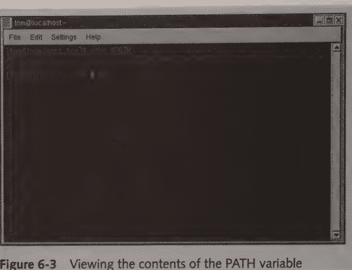

由于新的 shell 脚本在测试期间通常保存在当前目录，因此你应该将当前工作目录添加到 `PATH` 变量中。以下是一个示例：

```
PATH=$PATH.:
```

记住，shell 将 `$PATH` 解析为 `PATH` 变量的内容。示例命令将 `PATH` 变量设置为其当前内容。冒号和点（`.`）将当前目录添加到搜索路径，以便 shell 程序能够找到新程序。

将当前工作目录添加到 `PATH` 变量：

- 1. 输入 `PATH=$PATH.;` 并按回车。
- 2. 输入 `echo $PATH` 并按回车。点（`.`）现在已追加到列表中。
- 3. 你可以在当前工作目录中运行脚本，而无需在文件名之前输入 `./` 字符。通过输入 `testscript` 并按回车进行测试。你看到 `testscript` 执行。

## 算术运算符

算术运算符包括熟悉的加法 (`+`)、减法 (`-`)、乘法 (`*`) 和除法 (`/`) )。表 6-3 解释了其他运算符。

# Shell 运算符 201

表 6-3 shell 算术运算符示例

| 运算符 | 描述 | 示例 |
| --- | --- | --- |
| -, + | 一元负号和加号 | +R (表示正 R)<br>-R (表示负 R) |
| &, ~ | 逻辑与和位取反 | & (如果 Y 非零则返回 0，如果 Y 为零则返回 1)<br>~X (反转 X 中的位) |
| *, /, % | 乘法、除法和余数 | A*B (返回 A 乘以 B)<br>A/B (返回 A 除以 B 的商)<br>A%B (返回 A 除以 B 的余数) |
| +, - | 加、减 | X+Y (返回 X 加 Y)<br>X-Y (返回 X 减 Y) |
| >, < | 大于小于 | M>N (M 是否大于 N?)<br>M<N (M 是否小于 N?) |
| =, != | 等于不等于 | Q=R (Q 是否等于 R?)<br>Q!=R (Q 是否不等于 R?) |

使用算术运算符时，适用通常的数学优先级规则：乘法和除法在加减法之前执行。例如，表达式 `6 + 4 * 2` 的值是 14，而不是 20。然而，可以使用括号来覆盖优先级。例如，表达式 `(6 + 4) * 2` 的值是 20，而不是 14。其他数学规则也适用；例如，除以零被视为错误。

要向变量中存储算术值，请使用 `let` 语句。例如，以下命令将 14 存储在变量 `X` 中：

```
let X=6+4*2
```

你可以将变量作为算术运算符的操作数。假设变量 `X` 的值为 14，以下命令将 18 存储在变量 `Y` 中：

```
let Y=X+4
```

练习使用算术运算符：

- 1. 输入 `let X=10+2*7` 并按回车。
- 2. 输入 `echo $X` 并按回车。你在屏幕上看到了 `24`。
- 3. 输入 `let Y=X+2*4` 并按回车。
- 4. 输入 `echo $Y` 并按回车。你在屏幕上看到了 `32`。

以 0 开头的常量被解释为八进制数。十六进制表示一个常量。


Shell 脚本经常使用星号 (*) 和其他通配符。这些字符被称为 glob 字符如果未引号的参数包含一个或多个通配符，shell 将处理该参数进行文件名生成。特殊的构造包括： 问号 `?` 匹配任意一个字符，反斜杠除外。星号 `*` 匹配任意数量的字符。方括号 `[]` 定义类，匹配类中的单个字符。类可以包含字符范围，如 `[a-z]`。

# Shell 逻辑结构 203

例如，假设工作目录包含 chap1、chap2 和 chap3。以下命令显示所有三个文件的内容：

`more chap[1-3]`

现在你已经了构建 shell 脚本的一些工具，这里是编写 shell 脚本以支持开发所需的四种基本逻辑结构的示例。

## 逻辑结构

开发所需的逻辑结构是：

- 顺序逻辑
- 选择逻辑
- 循环逻辑
- case 逻辑

这些逻辑结构将在接后的章节中进行讨论。

# 顺序逻辑

顺序逻辑的工作方式是按照它们在脚本或程序中顺序执行命令。这种顺序唯一的中断发生在分支指令通过重定向到脚本或程序的另一个位置来改变执行流时。下面的实践活动是一个使用顺序逻辑的非常简单的示例。在此步骤中，你创建一个名为 `seqtotal` 的简单 shell 脚本。

演示顺序逻辑：

- 1. 输入 `vi total` 并按回车。
- 2. 输入 `i` 切换到 vi 模式。
- 3. 输入以下行：
  `let a=1`
  `let b=2`
  `let c=3`
  `let total=a+b+c`
  `echo total`
- 4. 按 Esc 切换到命令模式。
- 5. 输入 `:wq` 并按回车保存并退出 vi。
- 6. 接下来，测试新的 shell 脚本 `seqtotal`。（为了节省几次按键，使用 sh 代替 chmod 命令。）输入 `sh seqtotal` 并按回车。你会看到脚本的输出，即：


# 防止重定向覆盖文件

记住 `>` 重定向运算符会覆盖现有文件。如果你编写一个使用 `>` 运算符创建文件的脚本，你可能希望防止它被覆盖。你可以使用 `set` 命令配合 `-o noclobber` 选项来防止覆盖，在下面的示例中：

```
$ set -o noclobber

$ cat new_file > old_file
```


bash: cannot overwrite existing file

然而，你可以通过在重定向运算符后放置感叹号来仍然覆盖文件：

```
$ set -o noclobber

$ cat new_file >! old_file
```

# 第 6 章 A 节 Shell 脚本编程简介

许多脚本都是简单、直接的命令序列。例如，你在第 5 章中编写的语法活动报告脚本。shell 会按照命令在文件中出现的顺序执行脚本中的命令。你使用顺序逻辑来编写此类应用程序。

## 决策逻辑

决策逻辑允许你的脚本或程序在满足特定条件时才执行某个语句或系列语句。`if` 语句是此类逻辑中主要的决策控制结构。在接下来的步骤中，请注意分号（`;`）用于分隔同一行上的命令。


在整个示例脚本中，变量始终包含在双引号中，例如 `"choice"`、`"looptest"`、`"yesno"`、`"guess"` 和 `"myfavorite"`。除非声明，shell 解释的所有变量都是字符串，即字母数字字符的数组。如果你不在字符串变量中输入数据，则这些变量被视为空字符串，这将导致无效的测试。因此，外围的双引号确保了字符串无论是否有数据都是有效的，并且测试在不产生错误条件的情况下进行。

为了演示决策逻辑：
1. 输入 `vi os_choice` 并按回车。
2. 输入 `i` 到 vi 的插入模式。
3. 输入以下行：
```bash
echo -n "What is your favorite operating system? "
read OS_NAME
if [ "$OS_NAME" = "UNIX" ]
then
    echo "You will like Linux."
else
    echo "You should give Linux a try!"
fi
```
4. 确保你的编辑界面看起来如图 6–4 所示。按 `Esc` 切换到 vi 的命令模式。
5. 输入 `:wq` 并按回车保存文件并退出 vi。


### Shell 逻辑结构 205

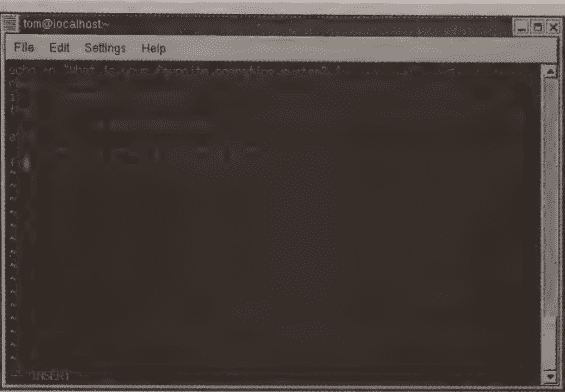

图 6-4 创建带有决策逻辑的脚本

当你运行脚本时，让我们检查它的内容。第一条语句使用 `echo` 命令在屏幕上显示消息。`-n` 选项抑制了通常在消息后出现的换行符。第二个语句使用 `read` 命令，它等待用户输入一行键盘输入。输入被存储在括号（`[]`）指定的命令参数的变量中。脚本中的该行将用户的输入读入 `OS_NAME` 变量中。

下一行以 `if` 语句开始。“if” 单词后面跟着一组括号（`[ ]`）内部的表达式。在 `[` 和 `]` 字符与包含的表达式之间的两侧空格是必要的。该表达式将被测试以确定其真假假，它将 `OS_NAME` 变量的内容与字符串 `UNIX` 进行比较。当你在 `if` 语句中使用 `=` 运算符时，它会测试两个操作数的相等性。在这种情况下，操作数是变量 `$OS_NAME` 和字符串 `UNIX`。如果操作数相等，则表达式为真——否则，为假。如果 `OS_NAME` 变量的内容等于 `UNIX`，则执行“then”单词后面的语句。在此脚本中，它执行“You will like Linux”。

如果语句的表达式为假（即如果 `OS_NAME` 的内容不等于 `UNIX`），则执行“else”单词后面的语句。该语句说，“You get Linux!” 在此脚本中，这是一个不同的语句。

注意最后一条语句，它由字符 “fi” 组成。`fi`（`if` 的反拼写）始终标记 `if` 或 `if...else` 语句的结束。

现在，通过至少执行两次来测试你的代码：
1. 输入 `chmod ugo+x os_choice` 并按回车使脚本可执行。接下来，输入 `./os_choice` 并按回车运行脚本。


### 第 6 章 A 节 Shell 脚本编程简介
2. 当要求输入喜欢的操作系统名称时，回答 `UNIX`。
3. 再次运行脚本并响应 `MS-DOS` 或其他操作系统名称。

> 记住，你必须先使用 `chmod` 命令使脚本可执行。然后，在命令提示符后，输入脚本路径加上脚本名称来执行它。运行脚本的另一种方法是配合 `script` 序列使用它。

你可以将控制结构（例如 `if` 语句）嵌套在另一个控制结构内部。例如，脚本可以在另一个语句内部包含一个 `if` 语句。第一个 `if` 语句控制第二个语句何时执行。

为了练习编写嵌套的 `if` 语句：
1. 在 vi 或 Emacs 中打开 `os_choice` 文件。
2. 编辑文件使其包含以下行。（在原始语句的 `else` 部分添加了代码。）
```bash
echo -n "What is your favorite operating system?"
read OS_NAME
if [ "$OS_NAME" = "UNIX" ]
then
    echo "You will like Linux."
else
    if [ "$OS_NAME" = "WINDOWS" ]
    then
        echo "A great OS for applications."
    else 
        echo "You should give Linux a try!"
    fi
fi
```
3. 执行脚本，并在询问喜欢的操作系统时回答 `WINDOWS`。结果应该看起来如图 6-5 所示。

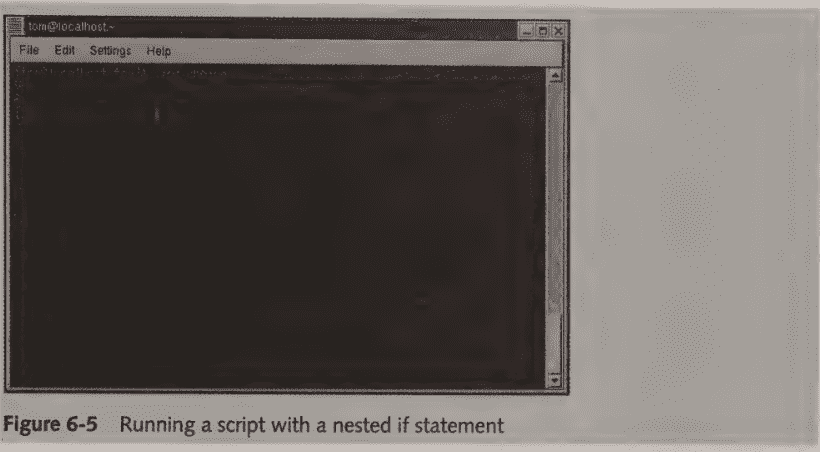

如你所示，第二个 `if` 语句位于第一个 `if` 语句的 `else` 部分。只有在第一个 `if` 语句的表达式为假时才会执行它。

决策逻辑结构（如 `if` 语句）用于根据命令或比较的结果需要不同行动方案的应用程序。

## 循环逻辑

在**循环逻辑**中，控制结构（或循环）会重复执行直到存在某些条件或发生某些动作。在本节中你学习了两种循环机制：`for` 循环和 `while` 循环。

使用 **for 命令** 遍历值范围。它导致变量一个接一个取指定范围内的每个值，并在变量包含该值时执行某些操作。

要演示循环：
1. 使用 vi 或 Emacs 创建文件。
2. 输入以下行：
```bash
for USERS in john tom becky jill
do
  echo $USERS
done
```
3. 保存文件并退出编辑器。
4. 给文件执行权限并运行它。你的屏幕类似于图 6-6。

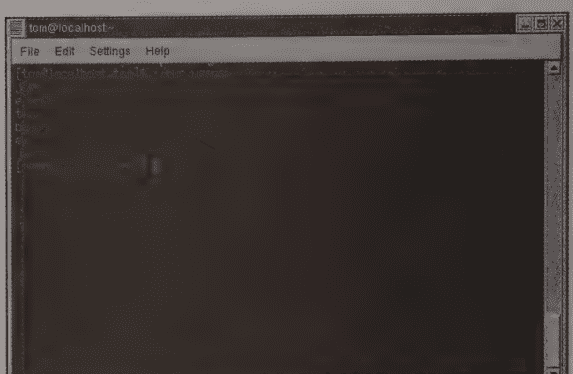

图 6-6 循环输出

你输入的 `for` 语句指定变量 `USERS` 取 john、tom、becky 和 jill。因为集合中有值，循环就会重复。每次重复时都会执行 `do` 和 `done` 之间的语句。此过程一直持续到集合为空。

## 在命令行执行控制结构

大多数脚本脚本控制结构（如 `if` 和 `for` 语句）必须跨行编写。但这并不阻止你直接在命令行执行它们。

要演示在命令行输入程序控制结构：
1. 直接在命令行输入以下内容并按回车。
> for myhobby in tennis movies travel
> do
> echo $myhobby
> done

在你完成输入后，你会看到类似于图 6-7 的结果。

### Shell 逻辑结构 209

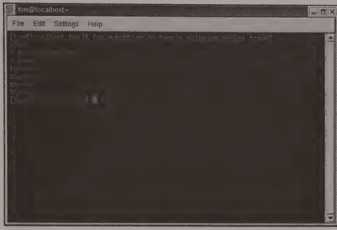

图 6-7 在命令行输入 for 循环的结果

## 在循环中使用通配符

现在，看看当你想打印书的几章时，语句如何与通配符工作。

要创建测试数据并在循环中使用通配符：
1. 输入 `cat > chap1` 并按回车。
2. 输入 `This is chapter 1` 并按回车。
3. 按 `Ctrl+D`。创建了文件 `chap1`
4. 输入 `cat > chap2` 并按回车。
5. 输入 `This is chapter 2` 并按回车。
6. 按 `Ctrl+D`。创建了文件 `chap2`
7. 输入 `cat > chap3` 并按回车。
8. 输入 `This is chapter 3` 并按回车。
9. 按 `Ctrl+D`。创建了文件 `chap3`。
10. 输入以下内容使用通配符：
```bash
for FILE in chap*
do
  cat $FILE
done
```


## 第 6 章 A 节 Shell 脚本编程

10. 使用 `vi` 或 `Emacs` 编辑器创建 shell 脚本 `chapters`。脚本应包含以下行：

```bash
for file in chap[123]; do
more $file
done
```

11. 保存文件并退出编辑器。

12. 给文件赋予执行权限并进行测试。你会看到类似于图 6-8 的输出。


### While 循环

使用 `while` 语句可以创建不同的循环模式。`while` 语句最好能说明如何设置一个循环来反复测试匹配条件。

要使用 `while` 语句：

1. 使用 `vi` 或 `Emacs` 编辑器创建一个名为 `colors` 的 shell 脚本。
2. 输入以下代码：

```bash
echo -n "Try to guess my favorite color: "
read guess
while [ "$guess"!=red ]; do
echo "No, not that one. Try again. "; read guess
done
```

3. 保存文件并退出编辑器。

4. 给文件赋予执行权限并进行测试。你会看到类似于图 6-9 的输出。

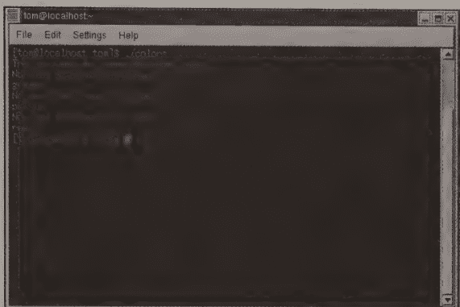

**图 6-9** `colors` 脚本的结果

`while` 循环测试表达式的方式与 `if` 语句相似。只要括号内的语句为真，`do` 和 `done` 之间的语句就会重复执行。

注意 `!=` 符号，它是不等于运算符。它测试两个操作数，如果它们不等则返回真；否则返回假。在你刚刚完成的步骤中，循环内部的 `echo` 和 `read` 语句会重复，直到用户输入 `red`（假）。

`while` 循环的另一个示例是数据输入表单，如下一个活动所示。

**创建一个作为数据输入表单的 while 循环：**

1. 使用 `vi` 或 `Emacs` 创建脚本文件 `nameaddr`。
2. 在文件中输入这些行：

```bash
looptest=y
while [ "looptest" = y ]
do
  echo -n "Enter Name : "; read name
  echo -n "Enter Street : "; read street
  echo -n "Enter City : "; read city
  echo -n "Enter State : "; read state
  echo -n "Enter Zip Code : "; read zip
  echo -n "Continue? (y)es or (n)o: "; read looptest
```


```bash
echo -n "Enter your favorite color: ;" read color
case "$color" in
"blue") echo "As in My Blue Heaven.";
"yellow") echo "As in the Yellow Sunset.";
"red") echo "As in Red Rover, Red Rover.";
"orange") echo "Autumn has shades of Orange.";; 
*) echo "Sorry, I do not know that color.";; 
```

2. 保存文件并退出编辑器

3. 给文件赋予执行权限并进行测试。你会看到类似于图 6-11 的输出。

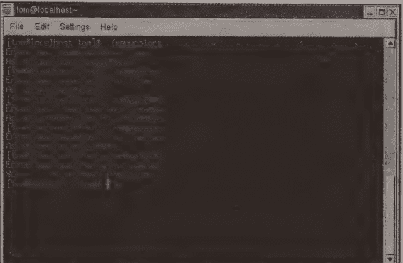

**图 6-11** `manycolors` 脚本的输出

在 `manycolors` 脚本中，`case` 结构检查变量 `color` 的内容并在列出的值之间搜索匹配。找到匹配项时，执行紧跟在 case 值后面的语句。例如，如果变量 `color` 等于 `red`，则执行出现在 `"red")` 之后的 `echo` 语句。如果变量 `color` 内容不匹配列出的任何值，则执行出现在 `*)` 之后的语句。

你可以看到，`case` 的设计是为了根据变量的内容从许多方案中选择一种。这种控制结构非常适用于菜单，即用户从几个值中选择一个。`case` 结构由单词 `esac` 终止，它是 `case` 的倒序写法。

在本节中，你学习了 shell 变量、运算符和通配符。你还学习了四种逻辑结构。

## 调试 shell 脚本

有时 shell 脚本不执行是因为脚本中的一个或多个命令存在错误。例如，你可能输入了冒号而不是分号，或者漏掉了括号。使用 `sh` 加上若干选项之一运行 shell 脚本可以让你更快地调试问题。

最常用的 `sh` 选项是 `sh -v` 和 `sh -x`。`sh -v` 选项在解释器读取脚本时显示脚本的代码行。`sh -x` 选项通过逐行显示命令及其执行结果来提供一些不同的信息。

要比较 `sh -v` 和 `sh -x` 选项的结果以调试脚本：

（注：此处原文包含大量重复的 OCR 错误文本，已根据要求过滤掉重复内容）

# 使用 Shell 脚本创建菜单 217

2. 保存文件并退出编辑器。
3. 给文件赋予执行权限，然后进行测试。你的输出应该看起来像图 6-14。

> `'tput smso'` 和 `'tput rmso'` 周围的单引号方向必须如图所示，否则加粗/取消加粗命令将不起作用。此单引号位于大多数键盘的左上角，通常与波浪号~)在同一个键上。

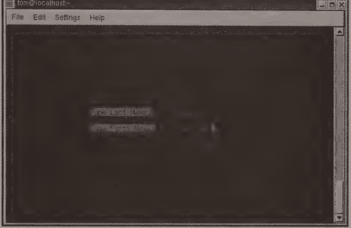

图 6-14 `scrmanage` 脚本的输出

你现在已经准备好输入脚本显示菜单了。（你将在本节稍后的部分将此脚本作为你应用程序的一部分。）

输入脚本：

1. 使用 `vi` 或 `Emacs` 编辑器输入下方所示的 `phmenu` 脚本。

```bash
=================================================================
#  Name: phmenu
# 作者: 在此处填写你的姓名缩写
# 日期: 2004年2月
# 目的: 公司电话列表菜单
# 命令行: phmenu
=================================================================
loop=y
while [ "$loop" = y ]
```

```bash
do
  clear
  tput cup 3 12; echo "Corporate Phone Reporting Menu"
  tput cup 4 12; echo "=============================="
  tput cup 6 9; echo "P - Print Phone List"
  tput cup 7 9; echo "A - Add New Phones"
  tput cup 8 9; echo "S - Search for Phones"
  tput cup 10 9; echo "Q - Quit"
  tput cup 10 19;
  read choice || continue
done
```

2. 保存文件并退出编辑器。

3. 通过输入 `chmod a+x phmenu` 并按回车给文件赋予执行权限。接下来，输入 `./phmenu` 并按回车测试脚本。结果屏幕应该与图 6-15 类似。（你必须按 Ctrl+C 退出脚本，因为退出选项尚未编写。）

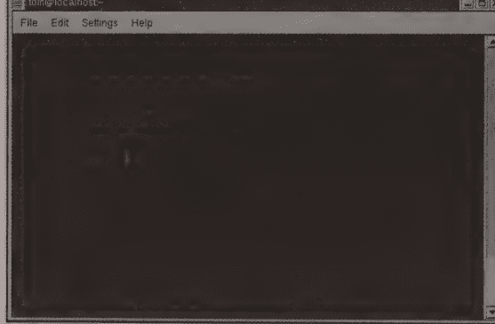

图 6-15 运行 `phmenu` 脚本

现在你已经了解如何创建一个菜单脚本，在创建应用程序之前，学习一些额外的 Shell 特性和命令将很有帮助。你首先学习如何自定义你的个人环境，这样创建和测试新脚本就不会干扰你的其他脚本和程序。

# 自定义你的个人环境

当工作需求集中在计算机编程和 Shell 脚本编写时，考虑通过修改登录脚本中的初始设置来自定义你的环境。登录脚本是你登录账户后运行的脚本。例如，程序员会设置一个个人 `bin` 目录，可以在其中存储和测试新程序，而不会干扰正在进行的操作（`bin` 是存放可执行文件的目录的传统 UNIX 名称）。你还可以修改编辑器，使其根据程序员的使用习惯自动缩进程序内部的文本。

别名（`alias`）是代表另一个命令的名字。你可以使用别名来简化和自动化经常使用的命令。例如，以下命令为 `rm "i"` 设置了别名：

```bash
alias rm="rm -i"
```


上面的命令在用户输入 `rm` 命令时会执行 `-i` 参数。这是一个常用的别名，因为它确保了用户在 `rm` 命令删除文件之前会被提示。这里是另外两个有助于保护文件的常用别名：

```bash
alias mv="mv -i"
alias cp="cp -i"
```

练习创建别名：

- 1. 要为 `ls` 命令创建别名 `ll`，输入 `ll=-l` 并按回车。现在，当你使用新的 `ll` 别名时，`ls -l` 命令会自动执行。
- 2. 输入 `ll` 并按回车测试别名。你会看到一个长目录列表。

位于家目录下的 `.bashrc` 文件可用于对每个登录会话生效的自定义。`.bashrc` 脚本在每次生成 Shell 时都会执行，例如当你运行子 shell 时。每当创建一个子 shell，`.bashrc` 就会重新执行。下面的 `.bashrc` 文件附有注释，解释了你如何进行自己的更改。

```bash
.bashrc

# 载全局定义
if [ -f /etc/bashrc ]; then
    . /etc/bashrc # 先运行它们
    alias rm 'rm -i' # 确保用户在删除文件前提示
    # 删除文件
alias mv 'mv -i' # 确保用户在覆盖文件前提示
    # 覆盖文件
set -o ignoreeof # 不允许 Ctrl-D 登出
```


# 第6章 B 节 Shell 脚本编程简介

```bash
set -o noclobber      # 强制用户在
                        # 现有文件上覆盖
PS1="\w \$"      # 设置提示符显示工作目录
```

除了知道如何自定义工作环境外，你还应该熟悉 `trap` 命令。

## TRAP 命令

`trap` 命令在脚本接收到信号时有用。这是一个 `trap` 的示例：

```bash
trap "echo 'Exiting...'" EXIT
```

`trap` 命令允许你在接收到信号时执行命令。这对于脚本中断时清理临时文件或关闭连接特别有用。

## 创建 CORP_PHONES 文件

后续步骤要求你在目录下创建 `corp_phones` 文件。创建 `corp_phones` 文件：

- 1. 使用 vi 或 Emacs 创建 `corp_phones` 文件。
- 2. 在文件中输入以下记录。（注意这些只是示例数据。）

# 222 第6章 节 B Shell 脚本编程入门

```bash
phonefile=~/source/corp_phones
loop=y
while [ "$loop" = y ]
do
  clear
  tput cup 3 12; echo "Corporate Phone Reporting Menu"
  tput cup 4 12; echo "===================================="
  tput cup 6 9; echo "P - Print Phone List"
  tput cup 7 9; echo "A - Add New Phones"
  tput cup 8 9; echo "S - Search for Phones"
  tput cup 10 9; echo "Q - Quit: "
  tput cup 10 19;
  read choice
  case $choice in
    [Aa]) ./phoneadd ;;
    [Pp]) ./plist1 ;;
    [Ss]) ./phonefind ;;
    [Vv]) less $phonefile ;;
    [Qq]) exit ;;
    *) tput cup 14 4; echo "Invalid Code"; read choice ;;
  esac
done
```

- 2. 保存文件并退出编辑器。
- 3. 测试脚本。（可接受的输入为 A, a, P, p, S, s, V, v, Q 和 q。任何其他输入都会显示“Invalid Code”消息）。按 Ctrl+C 退出。

当你向 Dominion Consulting 的经理演示你的脚本时，他们指出在输入额外信息时可能会发生错误。为了快速定位错误，你需要查看未格式化的记录。

### 查看未格式化的记录

使用一个显示未格式化文件数据的脚本通常是有用的，这意味着记录将以它们在磁盘上存储的原始格式出现。在电话记录案例中，显示显示了分隔变长度字段的冒号（:）字符。如果出现问题，查看原始数据会非常方便。要做到这一点，你可以使用 `less` 命令将记录显示在屏幕上。

要使用 `less` 命令查看未格式化的记录：

- 1. 在你任选选择的编辑器中打开 `phmenu`，并添加所示的**粗体**行。

```bash
====================================================
# Script Name:           phmenu
====================================================
```


## 使用 awk 223

```bash
# By:      在此输入你的首字母
# Date:      2004年2月
# Purpose:   公司电话列表菜单
# Command Line: phmenu
=====================================================
phonefile=~/source/corp_phones
loop=y
while [ "$loop" = y ]
do
	clear
	tput cup 3 12; echo "Corporate Phone Reporting Menu"
	tput cup 4 12; echo "===================================="
	tput cup 6 9; echo "P - Print Phone List"
	tput cup 7 9; echo "A - Add New Phones"
	tput cup 8 9; echo "S - Search for Phones"
	tput cup 9 9; echo "V - View Phone List"
	tput cup 10 9; echo "Q - Quit: "
	tput cup 10 19
	read choice || continue
	case $choice in
	[Aa]) ./phoneadd ;
	[Pp]) ./plist1 ;
	[Ss]) ./phonefind ;
	[Vv]) less $phonefile;
	[Qq]) exit ;
	*) tput cup 14 4; echo "Invalid Code"; read choice ;;
	esac
done
```

- 2. 保存文件并退出编辑器。
- 3. 测试脚本。

你现在准备好运行你的脚本原型了。要做到这一点，你需要使用 `awk` 程序。

### 使用 awk

`awk` 程序提供了一个很好的示例，展示了 UNIX 程序员如何快速创建应用程序模型。使用 `awk` 可以加速开发，因为单个 `awk` 命令就可以从许多记录中选择字段并按指定的格式在屏幕上显示它们。要使用 `awk` 运行公司电话脚本原型，你将在下一个练习中创建 `plist1` 脚本。

使用 `awk` 程序：

- 1. 使用你任选选择的编辑器创建 `plist1` 脚本。使用以下代码作为指南：


# 第6章 节 B Shell 脚本编程入门

```bash
############################################
# Script Name: plist1
# By: 在此处输入你的首字母
# Date: 2004年2月
# Purpose: 使用 awk 格式化扁文件中的冒号分隔字段
# 并显示到屏幕上
# Command Line: plist1
```


# 脚本示例

```bash
clear

tput cup 2 20; echo "Corporate Phone List"

tput cup 3 20; echo "======================"

tput cup 5 0; awk -F: '{printf "%12s %-12s\t%s %-10s %s\n", $2, $3, $4, $5, $6, $7}' corp_phones
```

- 2. 保存文件并退出编辑器。
- 3. 输入 `chmod+x plist1` 并按回车给文件赋予执行权限。输入 `./plist1` 并按回车运行脚本。你的屏幕应该像图 6-17 一样。

`img/b5f7722b7c2983a215c7726aaada19f9_245_0.png` 你意识到姓名被不断添加到 `corp_phones` 文件中，因此你需要修改你的脚本。

## 创建 PHONEADD SHELL脚本

你之前创建的脚本提供了向 `corp_phones` 文件添加记录的选项，用户与脚本交互输入新员工记录。然而，它调用了另一个名为 `phoneadd` 的脚本来添加新记录。在本节中，你创建 `phoneadd` 脚本。

创建允许添加的 `phoneadd` 脚本：

- 1. 使用你任选选择的编辑器创建 `phoneadd`。输入此代码：

```bash
=============================================

# Script Name: phoneadd

# By: 在此处输入你的首字母

# Date: 2004

# Purpose: 一个将新员工添加到 corp_phones 文件的 shell 脚本

# Command Line: phoneadd

=============================================

trap "rm /tmp/* 2>/dev/null; exit" 0 1

phoneadd=~/source/corp_phones

looptest=y

while [ $looptest -eq y ];

do

	clear

	tput cup 1 4; echo "Corporate Phone List Additions"

	tput cup 2 4; echo "======"

	tput cup 4 4; echo "Phone Number:"

	tput cup 5 4; echo "Last Name:"

	tput cup 6 4; echo "First Name:"

	tput cup 7 4; echo "Middle Init:"

	tput cup 8 4; echo "Dept #:"

	tput cup 9 4; echo "Job Title:"

	tput cup 10 4; echo "Date Hired: (y)es or (q)uit:"

	tput cup 4 18; read phoneenum

	if [ "$phoneenum" = "q" ];

		clear;

		exit

	fi

	tput cup 5 18; read lname

	tput cup 6 18; read fname

	tput cup 7 18; read midinit

	tput cup 8 18; read deptno

	tput cup 9 18; read jobtitle

	tput cup 10 18; read datehired

	# 在写入磁盘之前检查姓是否为空
```

`img/b5f7722b7c2983a215c7726aaada19f9_246_0.png`

```bash
if [ -n "$lname" ]

then

	echo "$phoneenum:$lname:$fname:$midinit:$deptno:$jobtitle:$datehired" >> $phonefile

fi

tput cup 12 33; read looptest

if [ "$looptest" = "q" ]

then

	clear;

	exit

fi

done
```


- 2. 保存文件并退出编辑器。
- 3. 输入 `chmod+x phoneadd` 并按回车赋予文件执行权限。
- 4. 输入 `./phoneadd` 并按回车运行脚本。
- 5. 接下来通过添加以下员工来测试脚本。（注意第二第三行应作为连续的一行输入）
  219-555-7175 Mullins Allen L 7527 Sales Rep 02-19-2004
  219-555-7176 Albertson Jeannette R 5547 DC Clerk 02-19-2004
- 6. 现在运行 `phmenu` 脚本，从菜单中选择 A 来执行脚本并添加新记录。

你的屏幕应该类似于图 6-18。（注意脚本一次只显示一个人的信息。）

`img/b5f7722b7c2983a215c7726aaada19f9_247_0.png` 图6-18 Phoneadd 脚本屏幕

# 总结 227

你为电话应用程序创建了 shell 脚本。然而，你仍然需要解决几个缺陷。例如，如何返回上一个字段？输入同一个员工两次会发生什么？给新员工分配已分配给别人的电话号码会发生什么？第7章“高级 Shell 编程”将解决这些问题。

# 章节总结

- 高语言（如 C、C++ 或 COBOL）是一种使用类英语表达式的语言。高级语言在计算机执行它之前必须转换为低级（机器）语言。
- `shell` 解释 `shell` 脚本。`shell` 脚本不需要转换为机器语言，因为 UNIX 会转换并执行它们。
- Linux `shell` 衍生自 UNIX Bourne、Korn 和 C `shell`。三种典型的 Linux `shell` 是 Bash、csh/tcsh 和 ksh/zsh；Bash 是最常用的 `shell`。
- UNIX 采用三种类型的变量：配置、环境和 `shell`。配置变量包含操作系统的设置信息。环境变量包含有关你登录会话的信息。`shell` 变量在 `shell` 脚本或命令行中创建。`export` 命令用于将 `shell` 变量变为环境变量。
- `shell` 支持许多运算符，包括许多用于算术运算的运算符。
- 你可以在 `shell` 脚本中使用通配符，包括括号 `[]` 字符。括号包围一组值，可以匹配名称或字符串中的单个字符。

# 第6章 Shell 脚本编程简介

- `grep` 命令在 `shell` 脚本开发中起着关键作用，允许你从文件中搜索并检索信息。
- `awk` 程序是一个高效且易用的生成报告的工具。

# 命令摘要

| 第6章命令回顾 | 用途 |
| --- | --- |
| Command alias | 建立别名 |
| case...in...esac | 一种编程结构，允许根据变量的值从一组可能的动作中执行其中一个 |
| export | 将变量变为环境变量 |
| for: do...done | 使变量循环取值集合中的每个值；对每个值执行某项操作 |
| if...then...else...fi | 根据条件执行两个动作之一 |
| let | 在变量中存储算术计算值 |
| printenv | 打印环境变量列表 |
| set - noclobber | 防止文件被 `>` 运算符重写 |
| tput cup | 将光标移动到指定的行和列 |
|| tput clear | 清屏 |
| tput cols | 打印当前终端的列数 |
| tput smso | 启用粗体输出 |
| tput rmso | 禁用粗体输出 |
| trap | 当接收到操作系统指定的信号时执行命令 |
| while: do...done | 只要条件存在就重复执行动作 |

# 复习题

1. 下列哪个命令允许他人运行你创建的 `shell` 脚本 `add2`？
a. `chmod a+x add2`
b. `run og add2`
c. `chmod 755 add2`
d. 以上都是
e. 仅 a 和 c

# 复习题

2. ____________ 变量用于存储操作系统的设置信息。
a. 环境（Environment）
b. 系统（System）
c. Shell（Shell）
d. 配置（Configuration）

3. 你想在登录账户后立即查看已经设置了哪些目录路径。为了做到这一点，你输入 ____________PATH$
a. MYPATH$
b. `echo $PATH`
c. DIR
d. `$DIR`

4. 哪个命令用于删除运行 `shell` 脚本时创建临时文件？
a. tempdel
b. clear
c. `trap`
d. `mv -x`

5. ____________ 命令将光标置于第四行第十列。
a. `echo 4 10`
b. `tput cup 4 10`
c. `tput cup 10 4`
d. `echo put 10 4`

6. 下列哪个操作将变量 `Iname` 和 `fname` 写入文件“names”中？
a. `echo "$Iname:$fname" >> names`
b. `link "Iname, fname" to names`
c. `insert "Iname:fname"`
d. `place names "$Iname:$fname"`

7. ____________ 运算符允许你测试一个值（例如变量“appliance”）是否不等于另一个值（例如字符串“toaster”）。
a. `>=`
b. `!=`
c. `!=`
d. `<=`

# 第6章 Shell 脚本编程简介

8. 为什么以下脚本无法工作？
```
for file in page[567];
more $file
```
a. 分号后缺少一个 `do` 语句。
b. 分号后缺少一个 `echo` 语句。
c. 在第二行中，`for` 循环必须使用 `ls` 而不是 `more`。
d. 在第一行中，必须在 `file` 前使用美元符号，如 `$file`。

9. 如果该语句是以下哪项的示例：
a. 算术运算符
b. 通配符字符
c. 决策逻辑中的决策性控制结构
d. 环境变量的导入控制

10. 你可以使用 `grep` 命令来 ________
a. 搜索匹配模式的文件
b. 修改文件中的文本
c. 创建数学公式
d. 创建一个包含在括号 `[ ]` 中的单词模式

11. 在你输入 ________ 命令并按回车后，你可以输入 `lh` 并按回车来查看目录中的隐藏文件。
a. `alt lh="ls -a"`
b. `change ls -a lh`
c. `master ls -s = "lh"`
d. `alias lh="ls -a"`

12. 许多程序员在主目录下创建一个目录，用于存储可执行程序。该目录的传统名称是 ________
a. programs
b. executables
c. prg
d. bin

13. `printenv` 命令用于显示 ________ 列表
a. 脚本变量
b. 环境变量
c. `shell` 运算符
d. 脚本原型

# 复习题

14. Case 逻辑由 \____________________ 结束。
a. Ctrl+D
b. end
c. stop
d. esac

15. 当你使用命令 `let Y=5+9*2/0` 时，变量 `Y` 中存储了什么值？
a. 0
b. 23
c. 28
d. 没有存储值，因为此命令会导致错误。

16. 每当你使用 Bash `shell` 作为默认 登录时，都会执行 \____________________ 文件。
a. `.login`
b. autoexec
c. `.welcome`
d. `.bashrc`

17. 正确或错误：你可以调用一个脚本。
18. `tput clear` 命令 \____。
a. 将值传递给变量
b. 修改内部文本
c. 定位光标
d. 清屏

19. `tput smso` 命令 \____。
a. 启用粗体输出
b. 禁用粗体输出
c. 定位光标
d. 清屏

20. 什么命令允许你将值放入环境变量？
a. shell
b. estore
c. `export`
d. insert

21. 你正在设计一个包含菜单的脚本。以下哪项特别适合？
a. while 循环
b. case 语句
c. 系列命令
d. for 语句

22. 在脚本中 ________ 代表第七字段。
a. .7
b. `$7`
c. .7
d. 7

23. 以下代码哪里错误？
```
while [ "test" = y ]
do
echo -n "Type your first name: "; read fname
echo -n "Type your last name: "; read lname
fi
```
a. `while` 后缺少一个分号。
b. `do` 后缺少一个分号。
c. `fi` 应替换为 `done`。
d. 以上都是
e. 仅 a 和 b

24. 以下 `awk` 语句哪里错误？
```
awk -F: 'printf "-12s -12s \t%s \t%s\n", $2, $3, $4, $5, $6, $7' corp_phones
```
a. `printf` 前必须是双引号，而不是单引号。
b. `awk` 提取的字段过多。
c. `\t` 和 `\n` 前的反斜杠应替换。
d. 单引号和 `printf` 之间必须有一个大括号 `{}`。

25. 哪个 `shell` 变量包含 `mail` 工具检查的文件路径？
a. MAILCHECK
b. MAIL
c. USERMAIL
d. CHECKMAIL

# 练习题

1. 创建名为 `sports` 的文件，包含以下内容：
- track
- football
- swimming
- basketball
- soccer
- rowing

2. 反向排序 `sports` 文件，并将结果放入文件 `sports2`。

3. 使用命令确保 `sports2` 文件不被重写。

4. 使用 `cat` 创建另一个名为 `addition` 的文件并输入 `baseball`。尝试通过输入 `addition > sports2` 来覆盖文件。发生了什么？如何绕过重写限制？

5. 修改以下两行代码使其工作：
```
case "$brandname" echo "General" Motors";
```

6. 在你的主目录下创建一个 `docs` 目录。查看 `PATH` 变量的内容。如果它不包含 `docs` 目录的路径，将其添加。

7. 创建变量 `NAME`。将其全名存储其中。

8. 使用 `printenv` 命令显示环境变量列表。`NAME` 变量在列表中吗？执行使 `NAME` 成为环境变量的命令。

9. 从命令行发布命令：清屏；将光标移动到第 8 行第 20 列；显示你的名字；光标移动到第 12 行第 5 列。

10. 在 Discovery 中创建别名 `wiat`。运行你的新别名进行测试。

11. 将你在练习10中创建的别名存储在正确的文件中，使其每次登录时都生效。

12. 修改 `phlist1` 脚本，在查看文件时添加标题。例如，你可以让它看起来像下面：


Last Name First Name MI Phone Number Dept Date Hired

==================================================

13. 创建一个新的菜单脚本，包含以下选项（注意：本次练习中菜单脚本的唯一目的是仅用于显示菜单选项）：

旅行菜单

========

(L)伦敦风光/游览

(P)春季的巴黎

(N)纽约购物幻想

请选择选择 ... (Q) 退出

14. 输入命令将 `pwd` 命令的输出存储在变量 `PLACE` 中。在屏幕上显示 `PLACE` 的内容。

15. 写一个名为 `change_prompt` 的脚本。该脚本应更改你的提示符，显示日期和当前工作目录名称。赋予该文件执行权限，然后进行测试。

16. 执行以下每个命令：

```
let x=14+5*4

let y=(14+5)+4*8
```

在屏幕上显示每个变量的内容。内容相同吗？为什么？

17. 编写一个脚本文件，功能如下：

- a. 将 5 存储在变量 `A` 中。
- b. 将 10 存储在变量 `B` 中。
- c. 将 `A` 加 `B` 的和存储在变量 `C` 中。
- d. 将 `B` 减 `A` 的差存储在变量 `D` 中。
- e. 将 `A` 乘以 `B` 的积存储在变量 `E` 中。
- f. 将 `B` 除以 `A` 的商存储在变量 `F` 中。
- g. 显示所有变量的内容。

18. 编写一个脚本要求用户输入他们的名字。脚本应包含一个 `if` 语句，比较用户输入的名字与你的名字。如果相同，脚本应显示消息“That is my name.（这是我的名字）”。否则，显示消息“That is a nice name.（这是一个好名字）”。

19. 写一个带有 `for` 循环的脚本文件，显示你喜欢的音乐组合列表。

20. 编写一个脚本文件让用户猜你的名字。如果他们猜错了，脚本应要求他们再次尝试。重复此过程直到用户正确猜出你的名字为止。（提示：使用 `while` 循环。）

21. 编写一个脚本文件，要求用户从列表中选择并输入国家名称：美国、意大利、法国和德国。然后使用 `case` 结构显示所选国家制造的汽车。参考以下汽车列表：

| 国家 | 汽车 |
| --- | --- |
| 美国 | 福特 |
| 意大利 | 法拉利 |
| 法国 | 标致 |
| 德国 | 保捷 |

22. 删除 `phoneadd` 脚本屏幕上的冒号，并重新定位光标以改进数据输入的外观。

23. 创建一个小脚本，显示员工电话记录，仅显示他们的姓名和入职日期。

24. 创建脚本文件清除屏幕，在第 5 行第 10 列和第 12 列放置两个高亮（**粗体**）行。在第 8 行第 10 列以及第 10 行第 10 列再显示两个非加粗行。

25. 创建一个文件 `music`，其中包含你的 CD 收藏信息。文件中的每条记录应包含这些字段：艺术家（Artist）、CD 名称（CDName）、购买日期（PurchaseDate）和成本（Cost）。接下来，创建一个带有菜单的脚本文件，允许查看文件内容、搜索特定艺术的所有 CD 以及向文件中添加新记录。

26. 设计一个 `awk` 语句，格式化并显示在练习 25 中创建的 `music` 文件中的记录。

27. 描述你如何使用 `trap` 命令在脚本文件退出时显示消息“That’s all, folks（大家，就这些）”。

# 第 7 章

# 高级 Shell 编程

Dominion Consulting 的经理们对维护员工电话文件的新 Shell 程序非常满意。基于交易量和文件大小相对较小，编程主管同意该 Shell 程序是维护公司电话文件的永久解决方案。然而，你需要增强程序并加入新功能，例如防止同一个电话号码被分配给多个人、重新输入数据以纠正错误，以及按员工姓氏进行排序。

在上一章中，你开始开发一个程序来自动维护 `corp_phones` 文件中的电话记录。你开发了一个提供多个选项的菜单，以及一个允许将记录添加到文件中的数据输入界面。

在本章中，你完成该程序。你将添加代码来从文件中删除指定记录、搜索指定记录，并排序显示文件中的所有记录。你将使用 `test`、`grep`、`sed` 和 `tr` 命令执行这些任务。在开始添加这些代码之前，你将学习两种标准的程序开发工具：流程图和伪代码。

# ◀ 课程 A ►

# 开发功能齐全的程序

- 在完成本课程后，你应该能够：
  * 使用流程图和伪代码工具
  * 学习编写脚本，告诉系统使用哪个 Shell 作为解释器
  * 使用 `test` 命令比较值并验证文件是否存在
  * 使用翻译命令 `tr` 显示具有重复文件的记录
  * 在脚本中使用 `sed` 命令删除电话记录

## 分析程序

计算机程序的开发是通过通过分析实现预期结果的最佳方法来完成的。标准的程序分析工具可以帮助你做到这一点。两种最流行且经过验证的分析工具是程序流程图和伪代码。

## 流程图

`Flowchart` 是一种逻辑逻辑图，它使用一组标准符号来解释程序的执行顺序以及它采取的每一个操作。例如，查看图 7-1 中的流程图。


图 7-1 示例流程图

## 分析程序

```
echo -n "What is your favorite system? "

read OS_NAME

if [ $OS_NAME = "UNIX" ]

then

    echo "You will like"

else

    echo "You should give try!"

fi
```

程序中的每一步都由一个符号表示。该符号指示操作类型，例如输入/输出或决策。图 7-2 显示了标准符号。

连接符号的箭头代表程序从一个符号流向下一个符号的方向。在 7-1 的流程图中，START 终止符后的箭头显示程序流向显示“What is your favorite system?”的输出操作。接下来，程序流向输入操作，将值读入 `OS_NAME`。接下来遇到一个决策（由菱形符号表示），它比较 `OS_NAME` 与“UNIX”。如果是，则程序遵循“是”分支。这将引导至显示“You will like.”的输出操作。如果 `OS_NAME` 和“UNIX”不相等，程序遵循“否”分支。这将引导至显示“You should give try!”的输出操作。

使用模板手动创建流程图。流程图模板提供了表示逻辑结构、输入输出操作、处理操作以及 7-2 所示包含文件的存储介质的符号。各种流程图软件（如 Microsoft Visio）可以让你在计算机上创建流程图。

## 编写伪代码

在创建流程图之后，设计程序的下一步是编写伪代码。伪代码指令与实际编程语句相似。使用它们创建一个可以作为真实示例基础的模型。以下是 `os_choice` 程序的伪代码：

```
Display "What is your favorite system?"

Enter data into OS_NAME.

If OS_NAME is equal to "UNIX"

then

    Display "You will like."

Else

    Display "You should give try!"

End if.
```

图 7-2 标准符号

## 分析

伪代码仅是一种设计工具，计算机无法处理。因此，没有严格的需要遵守。伪代码在口头上与流程图所示的逻辑符号表示匹配。例如，图 7-3 显示了 Dominion Consulting 想对其电话程序进行的更改的流程图和伪代码（重新输入字段）。

伪代码：

```
While entry = minus

do

    将光标移动到上一个字段。

    输入数据。

    将光标移动到刚刚输入（重新输入）字段之后的字段。

    继续测试 while 循环。

```

完成

流程图：


图 7-3 重新输入字段的伪代码和流程图

在开始处理程序之前，你需要进行一些准备工作。首先，你必须确保运行程序的人都使用正确的 Shell 运行。为了实现这一点，修改程序使其告知操作系统使用哪个 Shell 来解释脚本中的语句。

# 确保使用正确的 shell 运行脚本

每个 UNIX 用户都有自由和能力选择他们偏好的 shell。在开发 shell 脚本时，你必须负责确保使用正确的 shell 来解释你的脚本。这是因为并不是所有的 shell 都支持相同的命令和编程语句。

你可以指示系统使用特定的 shell 运行脚本。你可以在脚本的第一行执行此操作。该行必须以 `#` 字符开头，紧接着是 `!` 字符和 shell 的路径。例如，这行代码告诉系统使用 Bash shell：

```
#!/bin/bash
```


当系统读取到这行代码时，它会加载 Bash shell 并使用它来解释脚本文件中的语句。由于 UNIX 包含许多 shell，你应该始终以该语句作为脚本开头。

接下来，你需要在执行依赖于某些目录和文件的程序之前，确保必要的目录和文件已就位。要做到这一点，请使用 `test` 命令。

# 使用 test 命令

`test` 命令对 UNIX 内部环境和其他实用的比较进行初步检查（超出 `if` 命令本身可以执行的范围）。请参见附录 B“UNIX 命令语法指南”获取关于 `test` 命令可用选项的描述。你可以将 `test` 命令放在你的 shell 脚本中，也可以直接从命令行执行它。在本节中，你学习如何在命令行使用 `test` 命令。在下一节中，你将在脚本文件中使用它。

`test` 命令使用用选项表示的运算符来执行评估。该命令可以用于：

- 对整数进行关系测试
- 测试字符串
- 判断文件是否存在以及文件类型
- 执行布尔测试

每种类型的测试操作将在后续章节中详细讨论。

## 使用 test 命令进行关系测试

`test` 命令可以判断一个整数是否等于、大于、小于、大于等于或小于等于另一个整数。表 7-1 描述了 `test` 命令的整数测试选项。

表 7-1 test 命令的整数测试选项

| 选项 | 含义 | 示例 |
|---|---|---|
| -eq | 等于 | `test a -eq b` |
| -gt | 大于 | `test a -gt b` |
| -lt | 小于 (L) | `test a -lt b` |
| -ge | 大于等于 | `test a -ge b` |
| -le | 小于等于 (E) | `test a -le b` |
| -ne | 不等于 | `test a -ne b` |

`test` 命令返回一个被称为退出状态的值。当命令结束时，它向操作系统返回一个数值值。如果退出状态为 0，则测试真；如果退出状态为 1，则测试假。退出状态通常在脚本的 `if` 语句或循环结构中检测。你可以通过输入命令查看上一个命令的退出状态：

```
echo $?
```

使用整数表达式演示 `test` 命令：

1. 输入命令 `number=20` 并回车创建一个值为 20 的变量。
2. 输入 `test $number -eq 20` 并回车。
3. 输入 `echo $?` 并回车。如下例所示，屏幕上显示的结果为 0：
4. 输入 `value=10` 并回车。
5. 输入 `test $number $value` 并回车。
6. 输入 `echo $?` 并回车。屏幕上显示的测试结果为 1：

```
[tom@localhost]$ number=20

[tom@localhost]$ test $number -eq 20

[tom@localhost]$ echo $?
```

`echo $?` 显示最后执行的命令的退出状态。在本例中，`test` 命令返回退出状态 0，表示表达式 `$number -eq 20` 为真。这意味着变量 `$number` 等于 20。

```
[tom@localhost]$ value=10

[tom@localhost]$ test $number -lt $value

[tom@localhost]$ echo $?
1
```


在本例中，`test` 命令返回退出状态 1，表示表达式 `$number -lt $value` 为假。这意味着 `$number` 不小于 `$value`。

在某些系统中，你必须让 `test` 命令在同一行内输出退出代码，如下例：`test $name = "Bjorn"; echo $?`

## 使用 test 命令进行字符串测试

你可以使用 `test` 命令判断字符串长度是否为零或非零。它还可以测试两个字符串是否相等或不相等。7-2 描述了 `test` 命令的字符串测试选项。

### 7-2 test 命令的字符串测试

| 选项或表达式 | 含义 | 示例 |
|---|---|---|
| -z | 测试零长度字符串 | `test -z string` |
| -n | 测试非零长度字符串 | `test -n string` |
| string1=string2 | 测试两个字符串是否相等 | `test string1=string2` |
| string1 != string2 | 测试两个字符串是否不等 | `test string1 != string2` |

演示 `test` 命令的字符串测试：

1. 输入 `name="Bjorn"` 并回车。
2. 输入 `test $name = "Bjorn"` 并回车。
3. 输入 `echo $?` 并回车。屏幕上显示的结果为 0：

```
[tom@localhost]$ name="Bjorn"

[tom@localhost]$ test $name = "Bjorn"

[tom@localhost]$ echo $?
```

`echo $?` 显示最后执行的命令的退出状态。在本例中，`test` 命令返回退出状态 0，表示表达式 `$name = "Bjorn"` 为真。

```
[tom@localhost]$ name="Bjorn"

[tom@localhost]$ test $name != "Bjorn"

[tom@localhost]$ echo $?
1
```


在本例中，`test` 命令返回退出状态 1，表示表达式 `$name != "Bjorn"` 为假。这意味着 `$name` 不等于 "Bjorn"。

### 使用 test 命令进行字符串长度测试

1. 输入 `name="Bjorn"` 并回车。
2. 输入 `test -z $name` 并回车。
3. 输入 `echo $?` 并回车。屏幕上显示的结果为 1：

```
[tom@localhost]$ name="Bjorn"

[tom@localhost]$ test -z $name

[tom@localhost]$ echo $?
1
```

4. 输入 `test -n $name` 并回车。
5. 输入 `echo $?` 并回车。屏幕上显示的结果为 0：

```
[tom@localhost]$ name="Bjorn"

[tom@localhost]$ test -n $name

[tom@localhost]$ echo $?
0
```

6. 清空变量，输入 `name=""` 并回车。
7. 输入 `test -z $name` 并回车。
8. 输入 `echo $?` 并回车。屏幕上显示的结果为 0：

```
[tom@localhost]$ name=""

[tom@localhost]$ test -z $name

[tom@localhost]$ echo $?
0
```

9. 输入 `test -n $name` 并回车。
10. 输入 `echo $?` 并回车。屏幕上显示的结果为 1：

```
[tom@localhost]$ name=""

[tom@localhost]$ test -n $name

[tom@localhost]$ echo $?
1
```

## 使用 test 命令测试文件

`test` 命令可以判断文件是否存在以及是否具有特定的权限或属性（如可执行、可读、可写等）。表 7-3 描述了若干文件测试选项。

表 7-3 test 命令的文件测试选项

| 选项 | 含义 | 示例 |
|---|---|---|
| -e | 如果文件存在 | `test -e file` |
| -r | 如果文件存在且可读 | `test -r file` |
| -w | 如果文件存在且可写 | `test -w file` |
| -x | 如果文件存在且可执行 | `test -x file` |
| -d | 如果存在且是目录 | `test -d file` |
| -f | 如果存在且是普通文件 | `test -f file` |
| -s | 如果文件存在且大小大于零 | `test -s file` |
| -c | 如果文件是字符设备文件 | `test -c file` |
| -b | 如果文件是块设备文件 | `test -b file` |

演示 `test` 命令的文件测试能力：

1. 使用 `touch` 命令创建一个空文件 `test_file`。
2. 使用 `ls -l test_file` 命令查看文件的权限。权限应该类似于下面：

```bash
[tom@localhost]$ ls -l test_file
-rw-rw-r-- 1 tom tom 0 Feb 8 12:43 test_file
```


3. 注意该文件对所有者具有读写权限。
4. 接下来，输入 `test -x test_file` 并按 `Enter`。

5. 输入 `echo $?` 并按回车。你的屏幕看起来类似于下面：

```
[tom@localhost tom]$ test -x test_file

[tom@localhost tom]$ echo $?

1
```
`test` 命令返回退出状态 1，因为 `test_file` 没有执行权限。

6. 输入 `test -r test_file` 并按回车。
7. 输入 `echo $?` 并按回车。你的屏幕应该类似于：

```
[tom@localhost tom]$ test -r test_file

[tom@localhost tom]$ echo $?

0
```
`test` 命令返回退出状态 0，表示 `test_file` 是可读。

## 使用 test 命令执行布尔测试

`test` 命令的布尔运算符允许你使用 AND（与）和 OR（或）关系组合多个表达式。你还可以使用布尔取反运算符。表 7-4 描述了布尔运算符。

表 7-4 test 命令布尔运算符
| 选项 | 含义 | 示例 |
|---|---|---|
| -a | 逻辑与 (AND) | test expression1 -a expression2 |
| -o | 逻辑或 (OR) | test expression1 -o expression2 |
| ! | 逻辑否定 | test |

`-a` 运算符组合两个表达式，并测试它们之间的逻辑与关系。带有 `-a` 选项的 `test` 命令格式为：

```
test expression1 -a expression2
```

如果 `expression1` 和 `expression2` 都真，`test` 命令返回真（退出状态为 0）。然而，如果 `expression1` 或 `expression2` 其中一个为假，`test` 命令返回假（退出状态为 1）。

`-o` 运算符组合两个表达式。它测试逻辑或关系。带有 `-o` 选项的 `test` 命令格式为：

```
test expression1 -o expression2
```

如果 `expression1` 或 `expression2` 其中一个为真，`test` 命令返回真（退出状态为 0）。然而，如果两个表达式都为假，`test` 命令返回假（退出状态为 1）。

## 使用 test 命令 247

`!` 运算符否定表达式的值。这意味着如果该表达式通常导致 `test` 返回真，现在它将返回假。同样，如果该表达式通常导致 `test` 返回假，现在它将返回真。带有 `!` 运算符的 `test` 命令格式为：

```
test expression
```

为了演示 `test` 命令的布尔运算符：

- 1. 回想你在上一个练习中创建的 `test_file` 文件具有读和写权限。输入 `-r test_file -a -w test_file` 并按 `Enter`。
  此命令使用 AND 关系测试两个表达式：`-r test_file` 和 `-w test_file`。如果两个表达式都真，`test` 命令返回真。
- 2. 输入 `echo $?` 并按 `Enter`。你屏幕上的结果看起来所示：

```
[tom@localhost tom]$ test -r test_file -a -w test_file

[tom@localhost tom]$ echo $?
```
`test` 命令返回退出状态 0，表示 `test_file` 是可读且可写的。
- 3. 输入 `test -x test_file -o -r test_file` 并按 `Enter`。
  此命令使用 OR 关系测试两个表达式：`-x test_file` 和 `-r test_file`。如果这两个表达式之一为真，`test` 命令返回真。
- 4. 输入 `echo $?` 并按 `Enter`。你屏幕上的结果所示：

```
[tom@localhost tom]$ test -x test_file -o -r test_file

[tom@localhost tom]$ echo $?
```
`test` 命令返回退出状态 0，表示 `test_file` 是可执行。
- 5. 输入 `test ! -r test_file` 并按 `Enter`。
  此命令否定表达式 `-r test_file` 的结果。如果该表达式为真，`test` 命令返回假。同样，如果表达式为假，`test` 命令返回真。
- 6. 输入 `echo $?` 并按 `Enter`。你的屏幕看起来：

```
[tom@localhost tom]$ test ! -r test_file

[tom@localhost tom]$ echo $?
```
`test` 命令返回退出状态 1，表示表达式 `! -r test_file` 为假。

 现在使用 test 命令判断目录是否存在。这让你运行你在 B 完成的脚本。在接下来的练习中，判断你的主目录下是否有 `source` 目录。如果没有，创建一个并将其添加到 `PATH` 变量中。这让你无需输入 `./` 即可运行脚本文件。

## 如何判断目录是否存在：


# 格式化记录输出 251

4. 保存文件并退出编辑器。
5. 测试脚本。图 7–5 显示了程序的示例输出。

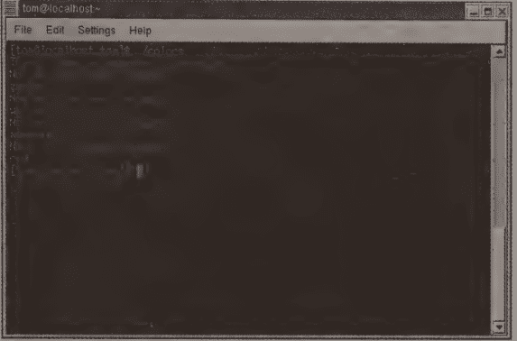

图 7-5 更新后的颜色脚本输出

到为止，你已经分别从命令行和脚本文件内部使用了 `test` 命令。你还配置了主目录结构和 `PATH` 变量，以便你可以直接从源目录运行脚本文件。你的下一步是开始通过格式化记录输出来增强 `corp_phones` 目录。

# 格式化记录输出

要格式化记录输出，请使用 `translate` 工具。正如你从第 5 章回想起的那样，`translate` 工具 (`tr`) 会逐字符地更改标准输入（你在键盘上输入的字符）。标准输入也可以通过 `<` 运算符重定向，使其从文件而非键盘中获取内容。例如，以下命令将 `contents` 文件的内容作为输入发送给 `tr` 命令。它将小写字母转换为大写字母。

```
tr [a-z] [A-Z] < counters
```

> `tr` 命令的语法可能会随 UNIX 版本的不同而变化。因此，Red Hat Linux 7.2 通常接受大多数变体。例如，你可以在 Red Hat 7.2 中运行以下任何命令：
- `tr "[a-z]" "[A-Z]" < counters`
- `tr '[a-z]' '[A-Z]' < counters`（不要使用反引号）
- `tr a-z A-Z < counters`

# 第 7 章 节 高级 Shell 编程

通过使用 `|` 运算符，当输入来自另一个 UNIX 命令的输出时，`translate` 工具也可以作为过滤器工作。例如，以下命令将 `cat` 命令的输出发送给 `tr`：

```
cat names | tr -s ":" ""
```


此示例命令将 `names` 文件的内容发送给 `tr`。`tr` 工具将每个出现的字符替换为空格。不同之处在于 `sed` 是按行更改标准输入字符串，而不是逐字符更改。

你现在使用 `tr` 工具将小写字母转换为大写字母，并将冒号字符替换为空格。

# 使用 grep 和 tr 命令进行格式化

- 1. 输入 `cd~/source` 并按回车切换到源目录。
- 2. 使用 `grep` 命令从 `corp_phones` 文件中检索匹配电话 219-555-4501 的记录，然后将其管道到 `tr` 以将记录中的冒号字符替换为空格。输入 `grep 219-555-4501 corp_phones | tr ' ':' ' '` 并按回车。屏幕上的输出所示：
```
[tom@localhost ~] grep 219-555-4501 corp_phones
| tr ' ':' ' '
219-555-4501 Robinson Albert Secretary J 4501 08-12-1997
```
- 3. 输入 `$ corp_phones | tr '[a-z]' '[A-Z]'` 并按回车，将 `corp_phones` 文件中的小写字母转换为大写字母。你的屏幕类似于图 7-6。


图 7-6 cat 和 tr 命令的输出

要在 `corp_phones` 文件中搜索电话号码，你的程序可以使用与你在上述步骤中执行的类似的技术。

要为你的程序添加记录搜索功能：

- 1. `phmenu` 程序已经配置好，当用户从菜单中选择 `S` 时调用脚本 `phonefind`。此命令指示程序搜索电话号码。切换到源目录，并使用 `vi` 或 `Emacs` 编辑器创建 `phonefind` 程序。输入以下内容：

```bash
#!/bin/bash

# Script Name: phonefind

# By: 在此处输入你的姓名缩写

# Date: 2004年2月

# Purpose: 在 corp_phones 文件中搜索指定记录

=================================================

phonefile=~/source/corp_phones

clear

tput cup 5 1

echo "Enter phone number to search for: "

tput cup 5 35

read number

echo

grep $number $phonefile | tr '"

echo

echo "Press ENTER to continue..."

read continue
```

- 2. 保存文件并退出编辑器。
- 3. 使用 `chmod` 命令使文件具有可执行权限，然后通过搜索号码 219-555-7175 测试脚本。你的屏幕应该类似于图 7-7

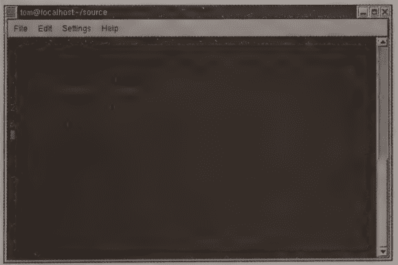

图 7-7 phonefind 脚本输出

# 第 7 章 节 高级 Shell 编程

你格式化了程序的输出；下一个任务是删除记录。

# 删除记录

在本节中，我们回顾了 `sed` 命令。正如第 5 章所记忆的，`sed` 获取输入文件的内容并将作为选项和参数的操作应用于文件。结果被发送到标准输出设备。使用 `sed` 删除记录的简单方法是使用 `d`（删除）选项。以下是必要步骤的伪代码：

- 输入电话号码
- 使用 -d 删除匹配的号码并输出到临时文件 `f`
- 确认接受

为了让 `phmenu` 脚本包含删除选项，在这次修订中，我们使用 `sed` 创建一个名为 `f` 的临时文件。在脚本结束时删除 `f`。为了让你的脚本万无一失，还要使用第 6 章中学习的 `trap` 命令，在 `phonefile=~/source/corp_phones` 行之前插入此语句：`trap "rm -f /dev/null"`。这种技术的优势在于它确保了 `f` 文件被删除。否则，你之前运行 `phmenu` 时可能会在脚本结束前没有删除 `f`。


通过编辑 `phmenu` 程序删除记录：

- 1. 确保你在源目录中。使用 vi 或 Emacs 编辑器获取 `phmenu` 程序并添加加粗的代码。

```bash
#!/bin/bash

===================================

# Script Name: phmenu

# By: 在此处输入你的姓名缩写

# Date: 2004年2月

# Purpose: 公司电话列表菜单

# Command Line: phmenu

===================================

trap "rm -f /dev/null"; exit 0

phonefile=~/source/corp_phones

loop=y

while $loop = "y"; do

  clear

  tput cup 3 12; echo "Corporate Phone Menu"

  tput cup 4 12; echo "=="

  tput cup 6 9; echo "P - Print Phone List"

  tput cup 7 9; echo "A - Add New Phones"

  tput cup 8 9; echo "S - Search for Phones"

  tput cup 9 9; echo "V - View Phone List"

  tput cup 10 9; echo "D - Delete Phone"

  tput cup 12 9; echo "Q - Quit: "

  tput cup 12 19

  read choice || continue

  case $choice in

    [Aa]) ./phoneadd ;;

    [Pp]) ./plist ;;

    [Ss]) ./phonefind ;;

    [Vv]) clear ; less $phonefile ;;

    [Dd]) tput cup 16 4; echo "Delete Phone Record"

          tput cup 17 4; echo "Phone: "

          tput cup 17 11; read number

          tput cup 18 4; echo "Accept? (y)es or (n)o: "

          tput cup 18 27; read Accept

          if test $Accept = "y"; then

            sed /$number/d" $phonefile > f

            cp f $phonefile

            rm f

          fi

    [Qq]) clear; exit ;;

    tput cup 14 4; echo "Invalid Code"; read choice ;;

  esac

done
```


- 2. 保存文件并编辑。稍当你测试程序时，菜单类似于图 7-8。

# 256 第 7 章 节 高级 Shell 编程

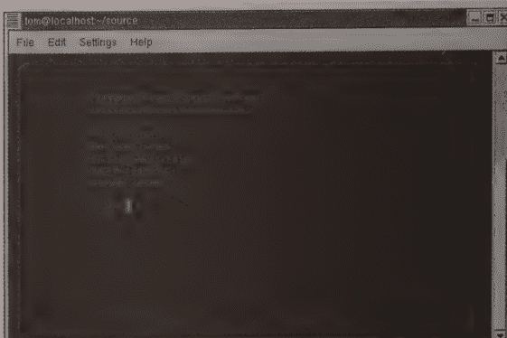

图 7-8 `phmenu` 脚本输出

- 3. 使用 `more` 命令在删除记录之前显示源目录中 `corp_phones` 文件的内容（输入 `more corp_phones` 并按回车）。你的屏幕类似于图 7-9。


图 7-9 删除记录前的 `corp_phones` 文件内容

- 4. 运行 `phmenu` 程序，通过移除电话号码 `219-555-4567` 测试删除选项。图 7-10 显示了删除记录的屏幕。

# 删除电话号码 257

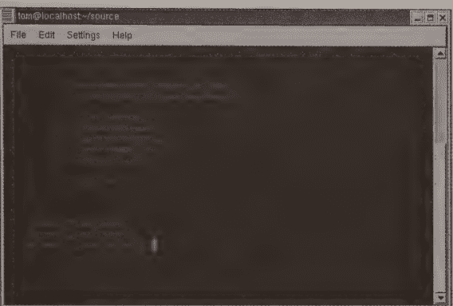

**图 7-10** 删除记录屏幕

- 输入 **y** 确认删除，然后按回车。
- 在主菜单上，选择选项 **V** 查看电话文件，然后按回车。你的屏幕类似于图 7-11。


**图 7-11** 查看电话列表选项

> 电话号码 `219-555-4567` 的记录不再于文件中（最初有两个该电话号码的记录，现在两个都已删除）。

- 按 **q** 返回菜单，按 **q**，然后按回车退出 `phmenu` 脚本。

在本节中，你开始修改 shell 电话程序以满足 Dominion 公司的需求。你向 `phmenu` 脚本中添加了删除选项的代码。在接下来的节中，你将添加代码来防止在文件中输入重复的电话号码。

# B 课程

## 完成案例项目

- 在完成本节课程后，你应该能够：
- 设置一种快速的清屏技术
- 创建一个程序算法来解决光标重定位问题
- 开发并测试一个在数据录入期间重新输入字段的程序
- 开发并测试一个消除重复记录的程序
- 创建 shell 函数并在程序中使用它们
- 登录时自动加载 shell 函数

## 清除屏幕

在开始完成编程任务之前，你决定想要更更快速地清空屏幕。`clear` 命令是一个实用的管理实用程序，用于在显示新屏幕之前清理屏幕（这在 shell 脚本中经常发生），但你可以使用一种更快的方法。你可以将 `clear` 命令的输出存储在 shell 变量中。回想第 6 章，你可以通过在单反引号中包围命令（通常使用键盘左上角的 `` ` `` 字符，配合波浪线 `~`）将命令的输出存储在变量中。例如，此命令将 `date` 命令的输出存储在变量 `TODAY` 中：

```
TODAY=` `
```

`clear` 命令的是一系列擦除屏幕内容的数值。将这些值存储在变量中，然后回显屏幕内容可以实现相同的效果，但速度快约十倍。这是因为系统不需要像执行 `clear` 命令时那样查找并执行该命令。

## 创建程序算法

通过设置 shell 变量来清除屏幕：

1. 输入 `cd` 并按回车切换到你的主目录。
2. 输入以下内容将 shell 变量 `CLEAR` 设置为 `clear` 命令的输出：
```bash
CLEAR=`clear`
export CLEAR
```
3. 输入 `echo "$CLEAR"` 并按回车，在你的 shell 程序中使用这个新变量进行快速清屏操作。
4. 为了让此 bash 清屏功能始终可用，请将这两行代码放在 `.bashrc` 文件的末尾（或你 shell 的等效登录初始化文件）：
```bash
CLEAR=`clear`
export CLEAR
```
5. 保存文件，退出，然后重新登录以激活登录脚本。输入 `echo "$CLEAR"` 并按回车测试对登录脚本的修改。验证屏幕是否已清除。


你现在准备好完成第一个任务了：修正条目。为了做到，你需要操作光标。

# 移动光标

第一个任务是让用户返回到之前输入的字段，并在继续之前纠正该字段中的数据。你希望在向 `corp_phonesfile` 添加记录时，允许用户将光标返回屏幕上之前的字段。你决定可以用减号 `-` 来表示此操作。如果用户输入减号并按回车，光标将定位到上一个字段的开头，如屏幕所示。你通过编辑已创建的 `inocard` 程序（为用户提供数据录入界面）来实现这一更改。编辑程序的第一步是创建一个程序算法。

## 创建程序算法

算法是产生预期结果的命令或指令序列。解决特定问题的算法通常通过遵循流程图所示的逻辑以及执行伪代码中描述的逻辑所需的表达条件来开发。

以下是用户输入减号 `-` 时将光标定位到上一个字段的伪代码：

- 读取信息到 `field2`。
- 当 `field2` 等于 "-" 时
- 将光标移动到上一个字段 `field1` 的位置。
- 清除 `field1` 中显示的当前信息。
- 读取新信息到 `field1`。
- 如果 `field1 = "q"`
- 则
- 退出程序。
- 结束如果。
- 将光标移动到 `field2` 的位置。
- 读取信息到 `field2`。
- 结束循环。

`phoneadd` 程序中的一个代码新增使用了重新输入字段的算法：

```
tput cup 5 18; read lname
while test "$lname" = "-"
do
  tput cup 4 18; echo ""
  tput cup 4 18; read phonenum
  tput cup 5 18; read lname
done
```

这段代码将姓氏读入变量 `lname` 中。如果 `lname` 包含减号 `-`，光标将移动到包含电话号码的上一个字段。显示的电话名称值将从屏幕上清除，并将一个新值读入 `poten`。然后光标将移回姓氏，并输入姓氏。只要用户在姓氏处输入减号，`while` 语句就会重复此过程。

> 使用 `if` 语句代替 `while` 语句仅允许返回上一个字段一次。相反，你需要一个循环，只要用户为该字段输入减号，该过程就会重复。

看这条语句：

参数 `"$lname"` 被引号括起来，以防止在用户按回车或为姓氏输入多个单词时命令产生错误。例如，如果用户输入的姓氏是 `Smith Williams`，上述语句被解释为：

`while test "Smith Williams" = "-"`

然而，如果语句没有在 `$lname` 周围加引号，则语句被解释为：

`while test Smith Williams = "-"`

这条语句会导致错误信息，因为它向 `test` 命令传递了多个参数。

## 允许重新输入数据：

你现在准备好编辑 `phoneadd` 程序。将如下所示的算法粗新的清屏功能。

1. 确保你在源目录中。使用 `vi` 或 `Emacs` 编辑 `phoneadd` 程序。
2. 将以下粗体代码添加到程序的每个部分。注意修改后的代码包含了新的、快速的清屏功能。使用了 `test` 命令。

```bash
#!/bin/bash
=================================
# Script Name: phoneadd
# By: 你的名字
# Date: 2004年2月
# Purpose: 一个用于向 corp_phones 文件添加新员工的 shell 脚本。
# Command Line: phoneadd
=================================
trap -rm tmp/* 2>/dev/null; exit 0
loopest=y
while test "$loopest" = "y"
do
	clear
	tput cup 1 4 echo "Corporate Additions"
	tput cup 2 4 echo "=="
	tput cup 4 4 echo "Phone Number: "
	tput cup 5 4 echo "Last Name: "
	tput cup 6 4 echo "First Name: "
	tput cup 7 4 echo "Middle Init: "
	tput cup 8 4 echo "Dept # "
	tput cup 9 4 echo "Job Title: "
	tput cup 10 4 echo "Date Hired: "
	tput cup 12 4 echo "Add another? (y)es or (q)uit: ""
	tput cup 4 18 read phoneNumber
	if test "$phoneNumber" = "q"
	then
		clear ; exit
	fi
	tput cup 5 18 read lname
	while test "$lname" = "-"
	do


```
tput cup 4 18 echo ""

tput cup 4 18 read phonenum

tput cup 5 18 read lname

done

tput cup 6 18 read fname

while test "$fname" = "-"

do

tput cup 5 18 echo ""

tput cup 5 18 read lname

if test "$lname" = "q"
then

clear ; exit

fi

tput cup 6 18 read fname

done

tput cup 7 18 read midinit

while test "$midinit" = "-"

do

tput cup 6 18 echo ""

tput cup 6 18 read lname

if test "$fname" = "q"
then

clear ; exit

fi

tput cup 7 18 read midinit

done

tput cup 8 18 read deptno

while test "$deptno" = "-"

do

tput cup 7 18 echo ""

tput cup 7 18 read midinit

if test "$midinit" = "q"
then

clear ; exit

fi

tput cup 8 18 read deptno

done

tput cup 9 18 read jobtitle

while test "$jobtitle" = "-"

do

tput cup 8 18 echo ""

tput cup 8 18 read deptno

if test "$deptno" = "q"
then

clear ; exit

fi

tput cup 9 18 read jobtitle

done

echo "$phoneNumber $lname $fname $midinit $deptno $jobtitle" >> ~/source/corp_phones

tput cup 12 4 read loopest

if test "$loopest" = "q"

then

clear ; exit

fi

done
```


# 创建程序算法 263

```bash

tput cup 9 18 ; read jobtitle

done

tput cup 10 18; read datehired

while test "$datehired" = "_"

do

    tput cup 9 18 ; echo ""

    tput cup 10 18 ; read jobtitle

    if test "$jobtitle" = "q"

    then

        clear ; exit

    fi

    tput cup 10 18 ; read datehired

done

# 在写入磁盘前检查姓氏（last name） 
#是否为空

if test "$lname" = "_"

then

    echo "$phoneum:$lname:$fname:$midinit:$deptno:"

    $jobtitle:$datehired >> $phonefile

fi

tput cup 12 33 ; read looptest

if test "$loopest" = "q"

then

    clear ; exit

fi

done

```

对于步骤 2 中代码中的每个 `echo` 语句，请确保在起始双引号和结束双引号之间放置了 12 个空格。

- 3. 保存文件，并编辑编辑器。
- 4. 执行 `phoneadd` 脚本。对于电话号码，输入 219-555-4523 并按回车。你的屏幕类似于图 7-12。
- 5. 在“姓”（Last Name）字段中，输入减号 (-) 并按回车。光标移回“电话号码”（Phone Number）字段。你的屏幕看起来如图 7-13。
- 6. 重新输入电话号码 219-555-4511 并按回车。
- 7. 使用下方所示的信息完成剩余字段。当你的光标移动到每个字段时，通过输入减号 (-) 并按回车来测试程序。光标应该都会移动到上一个字段。

姓：Brooks 部门编号：4540
名：Sally 职位：Programmer
中间名字母：H 入职日期：02-20-2004

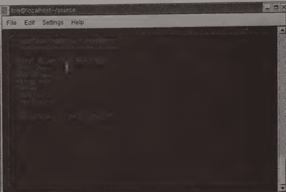

图 7-12 phoneadd 脚本屏幕


图 7-13 准备好重新输入的 phoneadd 屏幕

- 8. 在输入所有信息后，退出程序。使用 `cat` 命令显示 `corp_phones` 文件的内容。新记录应当出现。

你已完成第一个任务。你现在准备好处理第二个任务：防止重复电话号码。

# 防止输入重复电话号码

由于用户并不总是输入有效数据，因此程序应该始终检查其输入，以确保用户输入了可接受的信息。这被称为输入验证（input validation）。你的下一个任务是创建一个输入验证算法，防止用户添加已经分配的电话号码。实现此目的的伪代码和流程图如图 7-14 所示。

伪代码：

```
如果电话号码已在文件中

那么

    在屏幕上显示消息“此号码已分配给：

    显示具有重复号码的人员记录。

    清除屏幕并准备下一次输入

结束如果
```

流程图：


图 7-14 phoneadd 程序脚本的第二次修订

# 第 7 章 课程 B 高级 Shell 编程

在以下步骤中，你将为 `phoneadd` 添加输入验证代码

**为了防止电话号码重复：**

- 1. 确保你处于源目录。用 vi 或 Emacs 加载 `phoneadd` 脚本。
- 2. 添加粗体显示的代码部分以完成修订后的脚本。

```bash

#!/bin/bash

################################################################=

# 脚本名称：   phoneadd

# 作者：         在此处输入你的姓名缩写

# 日期：         2004年2月

# 目的：一个设置循环以向 corp_phones 文件添加

# 新员工的 shell 脚本。

# 代码还防止分配重复的电话# 号。

# 命令行：phoneadd

################################################################=

trap "rm -rf /tmp/* 2>/dev/null; exit" 0 1 2 3

phonefile=/source/corp_phones

loopest=y

while test "$loopest" = "y"

do

clear

tput cup 1 4; echo "Corporate Phone List Additions"

tput cup 2 4; echo "=============================="

tput cup 4 4; echo "Phone Number:"

tput cup 5 4; echo "Last Name:"

tput cup 6 4; echo "First Name:"

tput cup 7 4; echo "Middle Init:"

tput cup 8 4; echo "Dept #"

tput cup 9 4; echo "Job Title:"

tput cup 10 4; echo "Date Hired:"

tput cup 12 4; echo "Add another? (y)es or (q)uit"

tput cup 14 8; read phonenum

if test "$phonenum" = "q"

then

    clear; exit

fi

# 检查电话号码是否已存在

if grep "$phonenum" $phonefile > /dev/null

then

    clear

    echo "This number has already been assigned to:"

    grep "$phonenum" $phonefile

else

    echo "$phoneum:$lname:$fname:$midinit:$deptno:"
```


# 创建程序算法 263

```bash

tput cup 9 18 ; read jobtitle

done

tput cup 10 18; read datehired

while test "$datehired" = "_"

do

    tput cup 9 18 ; echo ""

    tput cup 10 18 ; read jobtitle

    if test "$jobtitle" = "q"

    then

        clear ; exit

    fi

    tput cup 10 18 ; read datehired

done

# 在写入磁盘前检查姓氏（last name） 

#是否为空

if test "$lname" = "_"

then

    echo "$phoneum:$lname:$fname:$midinit:$deptno:"

    $jobtitle:$datehired >> $phonefile

fi

tput cup 12 33 ; read looptest

if test "$loopest" = "q"

then

    clear ; exit

fi

done

```

对于步骤 2 中代码中的每个 `echo` 语句，请确保在起始双引号和结束双引号之间放置了 12 个空格。

- 3. 保存文件，并编辑编辑器。
- 4. 执行 `phoneadd` 脚本。对于电话号码，输入 `219-555-4523` 并按回车。你的屏幕类似于图 7-12。
- 5. 在“姓”（Last Name）字段中，输入减号 `-` 并按回车。光标移回“电话号码”（Phone Number）字段。你的屏幕看起来如图 7-13。
- 6. 重新输入电话号码 `219-555-4511` 并按回车。
- 7. 使用下方所示的信息完成剩余字段。当你的光标移动到每个字段时，通过输入减号 `-` 并按回车来测试程序。光标应该都会移动到上一个字段。

姓：Brooks 部门编号：4540
名：Sally 职位：Programmer
中间名字母：H 入职日期：02-20-2004


图 7-12 `phoneadd` 脚本屏幕


图 7-13 `phoneadd` 准备好重新输入的屏幕

- 8. 在输入所有信息后，退出程序。使用 `cat` 命令显示 `corp_phones` 文件的内容。新记录应当出现。

你已完成第一个任务。你现在准备好处理第二个任务：防止重复电话号码。

## 防止输入重复电话号码

由于用户并不总是输入有效数据，因此程序应该始终检查其输入，以确保用户输入了可接受的信息。这被称为输入验证（input validation）。你的下一个任务是创建一个输入验证算法，防止用户添加已经分配的电话号码。实现此目的的伪代码和流程图如图 7-14 所示。

伪代码：

```
如果电话号码已在文件中

那么

    在屏幕上显示消息“此号码已分配给：

    显示具有重复号码的人员记录。

    清除屏幕并准备下一次输入

结束如果
```

流程图：


图 7-14 `phoneadd` 程序脚本的第二次修订

# 第 7 章 课程 B 高级 Shell 编程

在以下步骤中，你将为 `phoneadd` 添加输入验证代码

**为了防止电话号码重复：**

- 1. 确保你处于源目录。用 `vi` 或 `Emacs` 加载 `phoneadd` 脚本。
- 2. 添加粗体显示的代码部分以完成修订后的脚本。

```bash

#!/bin/bash

################################################################=

# 脚本名称：   phoneadd

# 作者：         在此处输入你的姓名缩写

# 日期：         2004年2月

# 目的：一个设置循环以向 corp_phones 文件添加

# 新员工的 shell 脚本。

# 代码还防止分配重复的

# 号。

# 命令行：phoneadd

################################################################=

trap "rm -rf /tmp/* 2>/dev/null; exit" 0 1 2 3

phonefile=/source/corp_phones

loopest=y

while test "$loopest" = "y"

do

clear

tput cup 1 4; echo "Corporate Phone List Additions"

tput cup 2 4; echo "=============================="

tput cup 4 4; echo "Phone Number:"

tput cup 5 4; echo "Last Name:"

tput cup 6 4; echo "First Name:"

tput cup 7 4; echo "Middle Init:"

tput cup 8 4; echo "Dept #"

tput cup 9 4; echo "Job Title:"

tput cup 10 4; echo "Date Hired:"

tput cup 12 4; echo "Add another? (y)es or (q)uit"

tput cup 14 8; read phonenum

if test "$phonenum" = "q"

then

    clear; exit

fi

# 检查电话号码是否已存在

if grep "$phonenum" $phonefile > /dev/null

then

    clear

    echo "This number has already been assigned to:"

    grep "$phonenum" $phonefile

else

    echo "$phoneum:$lname:$fname:$midinit:$deptno:"

    $jobtitle:$datehired >> $phonefile

fi

tput cup 12 33 ; read looptest

if test "$loopest" = "q"

then

    clear ; exit

fi

done

```


`$jobtitle:$datehired >> $phonefile`

fi

tput cup 12 33 ; read looptest

if test "$loopest" = "q"

then

    clear ; exit

fi

done

```
对于步骤 2 中代码中的每个 `echo` 语句，请确保在起始双引号和结束双引号之间放置了 12 个空格。

- 3. 保存文件，并编辑编辑器。
- 4. 执行 `phoneadd` 脚本。对于电话号码，输入 `219-555-4523` 并按回车。你的屏幕类似于图 7-12。
- 5. 在“姓”（Last Name）字段中，输入减号 (`-`) 并按回车。光标移回“电话号码”（Phone Number）字段。你的屏幕看起来如图 7-13。
- 6. 重新输入电话号码 `219-555-4511` 并按回车。
- 7. 使用下方所示的信息完成剩余字段。当你的光标移动到每个字段时，通过输入减号 (`-`) 并按回车来测试程序。光标应该都会移动到上一个字段。

姓：Brooks 部门编号：4540
名：Sally 职位：Programmer
中间名字母：H 入职日期：02-20-2004


图 7-12 `phoneadd` 脚本屏幕


图 7-13 `phoneadd` 准备好重新输入的屏幕

- 8. 在输入所有信息后，退出程序。使用 `cat` 命令显示 `corp_phones` 文件的内容。新记录应当出现。

你已完成第一个任务。你现在准备好处理第二个任务：防止重复电话号码。

# 防止输入重复电话号码

由于用户并不总是输入有效数据，因此程序应该始终检查其输入，以确保用户输入了可接受的信息。这被称为输入验证（input validation）。你的下一个任务是创建一个输入验证算法，防止用户添加已经分配的电话号码。实现此目的的伪代码和流程图如图 7-14 所示。

伪代码：

```
如果电话号码已在文件中

那么

    在屏幕上显示消息“此号码已分配给：

    显示具有重复号码的人员记录。

    清除屏幕并准备下一次输入

结束如果
```

流程图：


图 7-14 `phoneadd` 程序脚本的第二次修订

# 第 7 章 课程 B 高级 Shell 编程

在以下步骤中，你将为 `phoneadd` 添加输入验证代码

**为了防止电话号码重复：**

- 1. 确保你处于源目录。用 `vi` 或 `Emacs` 加载 `phoneadd` 脚本。
- 2. 添加粗体显示的代码部分以完成修订后的脚本。

```bash
#!/bin/bash

################################################################=

# 脚本名称：   phoneadd

# 作者：         在此处输入你的姓名缩写

# 日期：         2004年2月

# 目的：一个设置循环以向 corp_phones 文件添加

# 新员工的 shell 脚本。

# 代码还防止分配重复的电话

# 号。

# 命令行：phoneadd

################################################################=

trap "rm -rf /tmp/* 2>/dev/null; exit" 0 1 2 3

phonefile=/source/corp_phones

loopest=y

while test "$loopest" = "y"

do

clear

tput cup 1 4; echo "Corporate Phone List Additions"

tput cup 2 4; echo "=============================="

tput cup 4 4; echo "Phone Number:"

tput cup 5 4; echo "Last Name:"

tput cup 6 4; echo "First Name:"

tput cup 7 4; echo "Middle Init:"

tput cup 8 4; echo "Dept #"

tput cup 9 4; echo "Job Title:"

tput cup 10 4; echo "Date Hired:"

tput cup 12 4; echo "Add another? (y)es or (q)uit"

tput cup 14 8; read phonenum

if test "$phonenum" = "q"

then

    clear; exit

fi

# 检查电话号码是否已存在

if grep "$phonenum" $phonefile > /dev/null

then

    clear

    echo "This number has already been assigned to:"

    grep "$phonenum" $phonefile

else

    echo "$phoneum:$lname:$fname:$midinit:$deptno:"

    $jobtitle:$datehired >> $phonefile

fi

tput cup 12 33 ; read looptest

if test "$loopest" = "q"

then

    clear ; exit

fi

done
```
*(注：由于原文代码块中存在逻辑错误（重复的 `done` 和不匹配的 `if`），翻译时保持了其原始结构，仅对其中的注释进行了翻译。)*

## 第 7 章 B 节 高级 Shell 编程


要在 shell 脚本放置多个函数：

- 1. 确保你处于源目录中。
- 2. 使用 `vi` 或 `Emacs` 编辑器在源目录下创建 `.myfuncs` 文件。
- 3. 输入以下函数：

```
sort_name()
{
  sort +1 -t: corp_phones
}

sort_date()
{
  sort +6 -t: corp_phones
}

sort_dept()
{
  sort +4 -t: corp_phones
}
```
- 4. 保存文件并退出编辑器。你的你的下一个任务是将 `.myfuncs` 文件加载到内存中，以便可以执行其中的函数。要做到这一点，输入一个点 (`.` 后跟一个空格，然后是包含函数的文件的文件名。

加载 `.myfuncs` 文件：

- 1. 在命令行输入 `. .myfuncs`（即输入点、按下空格键、输入点、输入 myfuncs 并回车）。没有任何显示，但函数已加载到内存中。测试一些函数：输入 `sort_name` 并回车。你会看到按姓排序的电话记录。
- 2. 输入 `sort_dept` 并回车。你会看到按部门排序的电话记录。

你可以在登录时使用 `.bash_profile` 或 `.bashrc` 文件自动加载函数。在这种情况下，任何需要这些 shell 脚本都可以使用它们。

修改你的 `.bashrc` 文件以加载 `.myfuncs` 脚本：

- 1. 输入 `cd` 确保你在家目录下。使用 `vi` 或 `Emacs` 编辑器加载 `.bashrc` 文件。
- 2. 在文件末尾添加以下命令（确保在点 (`.`) 和波浪号 (`~`) 之间留有空格）：`. ~/source/.myfuncs`

## 排序电话列表

- 3. 保存文件并退出编辑器。
- 4. 注销并重新登录以加载函数。
- 5. 测试 `sort_name`、`sort_dept` 等函数。

你的最后一个任务是按姓氏顺序显示电话列表。你可以通过存储在 `.myfuncs` 文件中的 `sort_name` 函数来实现。

# 排序电话列表

要排序电话列表，对 `plist1` 进行细微修改以加载函数，然后调用 `sort_name` 将输出重定向到临时文件。排序后的临时文件作为显示记录的 `awk` 程序的输入。修改后的代码使用了 `$CLEAR` 变量和光标脚本。

要排序电话列表：

```
#!/bin/bash

=====================================
# Script Name:   plist1
# By:            此处填写你的缩写
# Date:          2004
# Purpose:       使用 awk 格式化冒号分隔的
```


# 字段

## 在平面文件中并显示到

### 屏幕

# Command Line: plist1

=====================================

```
echo "$CLEAR"

tput cup 2 20; echo "Corporate Phone List"

tput cup 3 20; echo "=================="

tput cup 5 0;

.myfuncs

sort_name > sorted_phones

awk -F: '{ printf "%-12s %-12s %-7s %-5s %-10s %s\n", $2, $3, $4, $5, $6, $7 }' > sorted_phones

tput cup 23 1; echo "Review"

tput cup 22 8; read prompt
```


- 2. 此代码包含了包含函数的 `.myfuncs` 脚本。因此，无论 `.myfuncs` 脚本是否已通过 `.bashrc` 文件加载到内存，代码均有效。保存文件并退出编辑器。


## 第 7 章 高级 Shell 编程

- 3. 输入 `plist1` 并回车测试文件。你的屏幕类似于图 7-16。观察屏幕完成后按回车。


你在本章末尾通过发现练习增加了调用其他函数的代码。
在本章中，你学习了如何使用流程图和伪代码规划算法和程序。你还学习了使用 `test` 命令创建复杂的判断表达式。你扩展了 `grep`、`tr` 和 `sed` 命令来格式化输出。此外，你还学习了高级编程技术，例如在数据输入屏幕上重新定位光标以及创建 shell 函数。

# 章节总结

- 两种最流行且有效的分析工具是程序流程图和伪代码。流程图是使用一组标准符号绘制的逻辑图，解释了程序的执行流和要的操作。
- 伪代码是程序的模型。它使用类似于自然语言的语句编写。
- 你可以使用脚本文件的第一行来告诉操作系统在解释脚本时使用哪种 shell。
- 你可以使用 `test` 命令验证目录和文件的存在性，并比较数值和字符串值。你可以将其放在 shell 脚本中，或直接从命令行执行。

翻译工具 (`tr`) 逐个字符地更改在键盘上输入的字符，当输入来自另一个 UNIX 命令的输出时，它也可以作为过滤器工作。标准输入也可以重定向自文件而不是键盘。

`sed` 命令读取文件作为输入并输出文件修改后的内容。你指定选项并向 `sed` 传递参数。

翻译工具 (`tr`) 逐个字符地更改在键盘上输入的字符，当输入来自另一个 UNIX 命令的输出时，它也可以作为过滤器工作。标准输入也可以重定向自文件而不是键盘。`sed` 命令读取文件作为输入并输出文件修改后的内容。你指定选项并向 `sed` 传递参数。算法是产生预期结果的指令序列。

# 命令总结

| 选项 | 含义 | 示例命令 |
|---|---|---|
| -eq | 等于 | test -eq |
| -gt | 大于 | test -gt |
| -lt | 小于 | test -lt |
| -ge | 大于等于 | test -ge |
| -le | 小于等于 | test -le |
| -ne | 不等于 | test -ne |
| -z | 字符串为零 | test -z |
| -n | 字符串非零 | test -n |
| string1 = string2 | 两个字符串相等 | test string1 = string2 |
| string1! = string2 | 两个字符串不等 | test string1! = string2 |
| string | 字符串非零 | test string |
| -e | 文件存在 | test -e |
| -r | 文件可读 | test -r |
| -w | 文件可写 | test -w |
| -x | 文件可执行 | test -x |
| -d | 是目录 | test -d |
| -f | 是普通文件 | test -f |
| -s | 文件存在且大小大于零 | test -s |

## test 命令（续）

| 选项 | 含义 | 示例命令 |
|---|---|---|
| -c | 文件存在且是字符设备（字符面向设备，如终端或打印机） | test -c file |
| -b | 文件存在且是块设备（块面向设备，如磁盘或磁带驱动器） | test -b file |
- -a | 逻辑与 | test expression1 -a expression2 |
- -o | 逻辑或 | test expression1 -o expression2 |
- ! | 逻辑取反 | test expression |

# 复习题

- 1. 关于使用流程图，下列正确的是：
  a. 它使用标准符号。
  b. 它应该粘贴到脚本的注释部分作为文档。
  c. 它展示了程序遵循的顺序和逻辑。
  d. 以上都是。
  e. 仅 a 和 c

- 2. 关于伪代码，下列的是：
  a. 它不应该包含逻辑语句或测试。
  b. 它应该只包含程序使用的算术运算符。
  c. 它用作编写程序的模型。
  d. 以上都是。
  e. 仅 b 和 c

- 3. `test` ________ 命令比较两个数值以查看它们是否相等。
  a. -eq
  b. string
  c. -ne
  d. equal

- 4. 下列哪种语法格式创建一个名为 `timepiece` 的函数是有效的？
  a. `time()`
  b. `timepiece`
  c. `timepiece{}`
  d. ...time

5. 当你在命令行输入 ____________________ 时，`test` 命令的返回值会显示出来。

+   a. `echo $$`
+   b. `echo $?`
+   c. `echo $-`
+   d. `echo $$`

6. 当你使用 `test` 命令，配合第 5 题的正确答案命令，来显示 `test` 命令的结果时，返回值为 ____________________ 表示“假”（false）。

+   a. nil
+   b. none
+   c. 0
+   d. 1

7. `test` 命令的 `-a` 选项是 ____________________ 操作符。

+   a. 绝对值 (absolute value)
+   b. 逻辑与 (AND)
+   c. 测试隐藏文件
+   d. 逻辑或 (OR)

8. 将 `clear` 命令存储在变量后，你可以通过输入 ____________________ 清屏。

+   a. `!c`
+   b. 一个名为 `#CLEAR` 的变量
+   c. `echo "$CLEAR"`
+   d. ??

9. 下列哪决定了 `menu` 变量中存储的值是否大于 5？

+   a. `find $menu < 5`
+   b. `test menu > 5`
+   c. `cac menu -g 5`
+   d. `test $menu -gt 5`

10. 算法是 ____________________ 标准命令名。

+   a. 替换标准 UNIX 命令的名字
+   b. 一个由一系列命令组成的派生公式，产生预期的结果
+   c. 总是输入到系统级初始化文件 `/etc/profile` 中
+   d. UNIX 命令的另一种别名

11. 正对或错：当你将一个包含函数的 shell 脚本加载到内存后，你必须输入 + 和函数名（例如 +calcdate），作为从命令行运行该脚本函数的简写。

12. `tr` 命令按行对 ____________________ 在键盘上输入的内容进行翻译，就好像 `sed` 仅对源于文件的字符进行逐字符处理一样。

+   a. 仅对键盘上输入的内容
+   b. 按行处理，像 `sed` 一样
+   c. 逐字符处理
+   d. 仅源于文件的字符

13. 你想设置账户，使路径自动包含家目录下的数据目录。当 Bash 是你的默认 shell 时，为此向 `PATH=` `.bash_profile` 文件中追加 ____________________。

+   a. `$HOME/data`
+   b. `$HOME\data:`
+   c. `/data:`
+   d. `/data!`

14. 函数的代码被以下符号包围：

+   a. `{ }`
+   b. `[ ]`
+   c. `; /`
+   d. `< >`

15. 将包含函数的 shell 加载到内存，____________________

+   a. `Ctrl+m`
+   b. 一个反斜杠和一个点，如 `\.`
+   c. 一个正斜杠和一个点，如 `/.`
+   d. 一个点和一个空格

16. 你如何向 shell 函数传递参数？

+   a. 使用 `<` 字符。
+   b. 使用正引号（forward quote）。
+   c. 使用位置变量 `$1, $2, $3 ... $9`。
+   d. 使用字符 `#`。

17. 下列哪项将 `names` 文件中的名称写入屏幕，并使所有字母字符转为小写？

+   a. `cat names | tr '[A-Z]' '[a-z]'`
+   b. `cat names | tr -lc`
+   c. `cat names > tr -lc`
+   d. `cat names < tr [a-z]`

18. 正对或错：你可以使用 `.bashrc` 或 `.bash_profile` 文件来加载函数脚本，以便每次登录时都能使用这些函数。

19. 创建 shell 函数 ________________________。

+   a. 使你的脚本执行得更慢，以便用户在屏幕上更容易阅读
+   b. 让你能够重用代码行，这样不需要在多个脚本中反复编写相同的代码行
+   c. 要求你先加载 shell 函数生成器
+   d. 以上都是
+   e. 仅限 b 和 c

20. 命令 `test -d bin` 实现了什么？

+   a. 它删除 `bin` 目录。
+   b. 它删除 `bin` 目录中的隐藏文件。
+   c. 它测试 `bin` 目录是否存在。
+   d. 它创建 `bin` 目录。

21. 下列哪项决定了 `lname` 变量中的值不等于 `Lincoln`？

+   a. `echo $lname neq "Lincoln"`
+   b. `string Lname eq! "Lincoln"`
+   c. `test $lname >! "Lincoln"`
+   d. `test $lname !=="Lincoln"`

22. 正对或错：你可以使用 `grep` 命令从文件中检索特定的记录。

23. 你可以配合 `sed` 命令使用 __________________________ 选项来删除文件中的某记录。

+   a. d
+   b. e
+   c. :
+   d. s

24. 提供代码检查并确保用户不会两次输入相同的记录（信息）是 ________________________ 的示例。

+   a. shell 系统组织
+   b. 输入验证
+   c. 记录再生
+   d. shell 重定向

25. 正对或错：`test` 命令的一个局限性是它不能用于确定与文件关联的权限。

# 发现练习

1. 使用 `tr` 命令将电话记录文件的连字符（-）作为字段分隔符代替冒号（:）。（确保将翻译后的记录保存到不同的文件中。）

## 第 7 章高级 Shell 编程

2. 设置环境变量 `RHL` 为 "Red_Hat_Linux"，并使用 `test` 和 `echo` 命令确定它是否匹配。你发现了什么？

3. 设置环境变量 `NUMVAL` 为 2000，并使用 `test` 和 `echo` 命令确定它是否匹配。你发现了什么？

4. 为一个允许用户输入数字的程序编写流程图。程序应该显示和。如果给出了正确答案，程序应该祝贺用户。你发现了什么？

5. 为你发现练习 4 中创建的流程图编写伪代码。

6. 为你在发现练习 19 中放入流程图以及在发现练习 20 中编写了伪代码的程序编写实际代码。


22. 将 `phoneadd` 程序中的屏幕显示部分放入函数中，命名为 `phscreen`。使用 `vi` 编辑器将该函数输入到 `.mystuff` 中（来自探索练习 9），并通过从命令行调用它来测试该函数。

23. 在 `phmenu` 中添加菜单项，以调用你在 `.myfuncs` 文件中创建的 `sort_date` 和 `sort_dept` 函数。测试该程序。

24. 创建一个名为 `average` 的 shell 函数。将其存储在名为 `avgfunc` 的文件中。该函数应接受三个参数。假设这些参数为数字。该函数应计算并输出这三个数字的平均值。

25. 创建一个名为 `minmax` 的脚本文件。在文件中，创建一个名为 `min` 的 shell 脚本。它应该接受两个参数，假设为数字。该函数的作用是生成两个参数中较小值的输出。例如，如果向函数传递 5 和 10，它应该写入 5。


**图 7-18** 用户身份验证程序的输出

26. 编辑你在探索练习 25 中创建的 `minmax` 文件。添加一个名为 `max` 的 shell 函数。它应该接受两个参数，假设为数字。该函数的作用是生成两个参数中较大值的输出。例如，如果向函数传递 8 和 4，它应该写入 8。

# 第 8 章

# 探索 UNIX 工具

你在 Dominion Consulting 的主管要求你完成几项计算机任务，包括创建可启动的软盘、在软盘上进行备份、审核系统性能、分析硬盘存储以及删除不需要的文件。此外，你还被要求创建一个 man 页（帮助页）来描述你在第 7 章编写的 `phmenu` 程序。

在本章中，你将继续探索 UNIX 工具。工具的设计旨在为 UNIX 系统提供基本服务，就像你当地的公用事业为你的社区提供基本服务（如电力和来水）一样。本章让你练习使用 UNIX 命令和工具，例如将 `man` 命令与 UNIX 的文本格式化工具结合使用。

# 课程 A

- 在完成本课程后，你应该能够：
- 了解可用哪些 UNIX 工具以及工具的分类
- 制作一个可启动的软盘，以便在紧急情况下启动系统
- 在软盘上复制文件
- 确定硬盘使用情况和可用空空间
- 从硬盘中定位并删除不需要的文件
- 显示 CPU 状态和内部内存使用情况

# 了解 UNIX 工具

UNIX 工具允许你创建和管理文件、运行程序、生成报告以及与系统交互。除了这些基础功能，工具程序还提供了全系列的服务，让你能够监控和维护系统，并从各种错误中恢复。UNIX 工具根据用户需求分为七大功能领域：文件处理、系统状态、网络、通信、编程、源代码管理和杂杂杂。


UNIX 工具是程序，但在文档中通常被称为“命令”（commands）。在本章中，你将同时看到“工具”（utility）和“命令”（command），这取决于所传达的信息。


为了完整起见，本章包含了对通用工具的一些引用和注释，但重点在与文件处理、系统状态和杂项相关的工具上。

工具程序对于操作操作系统至关重要。你已经接触过几十种工具，其中许多在本章附带的表格中为了方便起见进行了回顾。例如，你已经使用过许多文件处理工具、一些系统状态工具和一些杂项工具。

在本章随后的章节中，你将处理更多的系统状态、编程和杂项工具。UNIX 工具非常多，书中没有空间涵盖所有工具。然而，你可以回到本章的表格中快速参考你使用过的工具，或查找用于特定任务的工具。你可以使用 `man` 和 `info` 文档选项（例如 `man mesg` 或 `info mesg`）了解更多关于这些工具的信息。

随着开发者发现更好更快的方法让 UNIX 运行更高效，新的工具程序不断被添加。许多工具的共同点是，它们是小型程序，通常只包含一个命令。

# 分类 UNIX 工具

工具可以分为几类，因为有些工具专门处理 UNIX 文件，另一些处理网络任务，还有另一些设计用于帮助程序员。表 8-1 列出的文件处理工具构成了最大的一类。这些工具用于显示和操作文件。

**表 8-1** 文件处理工具

| 命令 | 功能简要描述 |
| --- | --- |
| afio | 创建归档或从归档恢复文件 |
| awk | 处理文件 |
| cat | 显示文件（并与其他工具一起连接文件） |
| cmp | 比较两个文件 |
| comm | 比较排序后的文件并显示差异 |
| cp | 复制文件 |
| cpio | 将文件复制并备份到归档 |
| cut | 从输入中选择字符或字段 |
| dd | 复制并转换输入记录 |
| diff | 比较两个文件并显示差异 |
| dump | 备份文件 |
| edit | 格式化文本 |
| find | 查找文件 |
| fmt | 格式化文本 |
| grep | 搜索模式 |
| groff | 文本格式化 |
| gzip | 压缩文件 |
| head | 显示文件开头部分 |
| less | 允许滚动查看 |
| ln | 创建链接 |
| lpr | 打印 |
| ls | 列出文件 |
| man | 显示帮助 |
| mkdir | 创建目录 |
| mkfs | 创建文件系统 |
| mv | 移动文件 |
| od | 以八进制、十六进制显示数据 |
| paste | 水平合并 |
| pr | 打印格式 |
| pwd | 显示当前目录 |
| rdev | 查询设备 |
| restore | 恢复文件 |
| rm | 删除文件 |
| rdir | 删除目录 |
| sed | 编辑流 |
| sort | 排序文件 |
| tail | 显示文件结尾 |
| tar | 归档文件 |
| touch | 修改文件时间 |
| uniq | 显示唯一行 |
| wc | 统计行、字和字节 |

**表 8-1** 文件处理工具（续）

| 命令 | 功能简要描述 |
| --- | --- |
| chgrp | 更改文件的所属组 |
| chmod | 更改文件或目录权限 |
| chown | 更改文件的所有者 |
| date | 设置并显示日期 |
| df | 显示硬盘可用空空间 |
| du | 总结文件空间占用 |
| file | 确定文件类型（例如：脚本、可执行文件、纯文本等） |
| finger | 显示有关登录用户的详细信息 |
| free | 显示空闲和已内存 |
| edquota | 显示用户磁盘配额并允许更改 |
| kill | 终止进程 |
| ps | 显示进程状态和名称 |
| sleep | 暂停执行指定的时间 |
| top | 动态显示进程状态，关注占用最多 CPU 资源的进程 |
| w | 显示有关登录用户的详细信息 |
| who | 显示登录用户的简要信息 |

系统状态工具列于表 8-2，是第二类。它包含了显示和更改文件、磁盘和整个系统状态的工具。这些工具让你知道谁在线、运行进程的名称和状态、可用的硬盘空间以及在哪里找到你需要的其他命令。

**表 8-2** 系统状态工具

| 命令 | 功能简要描述 |
| --- | --- |
| chgrp | 更改文件的所属组 |
| chmod | 更改文件或目录权限 |
| chown | 更改文件的所有者 |
| date | 设置并显示日期 |
| df | 显示硬盘可用空空间 |
| du | 总结文件空间占用 |
| file | 确定文件类型（例如：脚本、可执行文件、纯文本等） |
| finger | 显示有关登录用户的详细信息 |
| free | 显示空闲和已用内存 |
| edquota | 显示用户磁盘配额并允许更改 |
| kill | 终止进程 |
| ps | 显示进程状态和名称 |
| sleep | 暂停执行指定的时间 |
| top | 动态显示进程状态，关注占用最多 CPU 资源的进程 |
| w | 显示有关登录用户的详细信息 |
| who | 显示登录用户的简要信息 |

# 分类 UNIX 工具 285

表 8-3 所示的网络实用工具包含了在网络上进行通信和共享信息的各种命令，以及查看网络连接状态信息的命令。

表 8-3 网络实用工具

| 命令 | 功能简要描述 |
|---|---|
| ftp | 在网络上传输文件 |
| ifconfig | 用于设置网络接口 |
| netstat | 显示网络连接信息 |
| ping | 用于轮询另一个网络站（使用 TCP/IP 协议）；非常适合快速判断你的网络连接是否正常 |
| rcp | 从网络计算机远程拷贝文件 |
| login | 登录远程计算机 |
| rsh | 在远程计算机上执行命令 |
| rwho | 显示连接到网络的用户名 |
| showmount | 列出在服务器上挂载了卷的客户端 |
| telnet | 连接到网络上的远程计算机 |
| wvdial | 通过电话线控制调制解调器拨号连接 |

表 8-4 所示的通信工具处理邮件和消息任务。这些程序包含了一些最近的高级功能，例如支持多用途互联网邮件扩展（MIME），用于在邮件消息中发送和接收二进制文件。

表 8-4 通信工具

| 命令 | 功能简要描述 |
|---|---|
| mail | 发送电子邮件 |
| mesg | 拒绝（msg n）或接受（msg y）消息 |
| pine | 发送和接收电子邮件和新闻 |
| talk | 让用户同时通过打字互相通信 |
| wall | 向所有登录用户（设置了接收消息权限的用户）发送消息 |
| write | 向另一个用户发送消息 |

表 8-5 所示的编程工具旨在帮助用户开发用 C 和 C++ 程序编写的软件项目。

## 表 8-5 编程工具

| 命令 | 功能简要描述 |
|---|---|
| configure | 自动配置程序源代码 |
| gcc | 编译 C 和 C++ 程序 |
| make | 维护程序源代码 |
| patch | 更新源代码 |

当编程和开发环境中存在多个应用程序时，使用表 8-6 所示的源代码管理工具至关重要。对于正在某个项目的开发者来说，需要有方法来跟踪编程更改。如果这些更改没有被跟踪，一个程序员所做的更改可能会被另一个程序员无意中撤销或更改，导致无法预测的结果。对于财务审计需求，也必须有跟踪编程更改的方法来满足审计的要求。这保护了处理影响资金处理的程序的程序员，也保护了组织。这些 UNIX 工具在管理协作编程方面有着良好的记录，是调度和管理大型应用程序的至关工具。

## 表 8-6 源代码管理工具

| 命令 | 功能简要描述 |
|---|---|
| ci | 在版本控制系统 (RCS) 中创建更改 |
| co | 获取 RCS 文件的未编码版本 |
| cvs | 管理对分级结构中文件的并发访问 |
| rcs | 创建或更改 RCS 文件的属性 |
| log | 打印 RCS 文件的历史摘要 |

最后，杂项实用工具包括执行非常特定和特殊功能的独特程序。从表 8-7 的描述中你可以看到，这些命令包括提供系统日历、调度事件以及识别连接到系统的终端。

## 表 8-7 杂项实用工具

| 命令 | 功能简要描述 |
|---|---|
| at | 在指定时间执行命令或脚本 |
| atq | 显示已调度运行的作业（命令或脚本） |
| atmr | 允许删除调度运行的作业（命令或脚本） |
| batch | 运行命令或脚本，如果你只输入 batch，它几乎是带你进入 at 提示符的命令子集 |

## 表 8-7 杂项实用工具（续）

| 命令 | 功能简要描述 |
|---|---|
| cal | 显示月份或年的日历 |
| crontab | 调度定时运行命令 |
| expr | 计算表达式 |
| fsck | 检查并修复文件系统问题 |
| tee | 输出到流 |
| tr | 替换字符 |
| tty | 显示终端名称 |
| xargs | 将标准输出转换为参数 |

现在，有了许多多样的工具可以使用。

## 使用文件处理工具

回想，文件处理工具可以帮助你显示和操作文件。为了完成任务，你可以使用 `dd` 命令拷贝文件。

### 使用 dd 命令

文件不仅存储信息，还以特定的格式存储信息。例如，大多数计算机使用 ASCII 代码存储文本。然而，大型机使用 EBCDIC 代码。此外，计算机使用大写字母存储信息。同样，其他文件使用小写字母存储。某些文件包含记录，每个记录由字段组成。一个特殊字符（如冒号）分隔字段，每个记录以换行符结束。

标准文件工具 `cp` 复制文件无法更改格式。因此，你需要拷贝文件并更改格式时，使用 `dd` 命令。

> 关于此命令和其他可用选项，请参见录 B，“语法指南”。

`dd` 命令的通用形式为：

```
Syntax dd [options]
```

选项包括 `if=filename` 和 `of=filename`，分别指定文件。另一个常用的选项是 `bs=n`，它指定块大小。你还有指定输入大小 (`ibs=n`) 和输出大小 (`obs=n`) 的选项。

`dd` 命令相比 `cp` 的另一个优势是，所有用户而不只是系统管理员都可以从磁盘拷贝文件。对于 `cp`，你必须挂载磁盘。

通过使用 `dd` 备份文件，你可以学习该命令的基本用法：

使用 `dd` 备份文件：

- 使用 `cat` 命令或你喜欢的编辑器创建一个文件 `datafile`。该文件应包含以下文本：
  这是我的数据文件。
- 通过输入 `dd if=datafile of=outfile.bak` 制作文件的副本。你的屏幕看起来类似于：


```
[localhost]$ dd if=datafile of=outfile.bak

0+1 records in

0+1 records out
```


# 启动软盘

制作启动软盘是一个好习惯，因为计算机问题（如硬盘故障）可能会阻止你从硬盘启动 UNIX。制作启动软盘（在此情况下为 Red Hat Linux），你需要使用四个实用程序：`rdev`、`mkfs`、`fdformat` 和 `dd` 命令。`rdev` 命令查询并设置根设备，根设备是 UNIX 的根文件系统。根文件系统反过来包含 UNIX 内核（核心操作系统），启动 UNIX 所需的。（在 Red Hat Linux 下，内核存储在以 `vmlinuz` 开头的文件中。该文件通常存储在 `/boot` 目录下：）

## 制作可引导软盘

使用 `mkfs` 命令在软磁盘或硬盘分区等设备上构建 UNIX 或 Linux 文件系统。该命令通常如下所示执行，其中 `-t` 选项标识文件类型，`filesystem` 标识设备名称：

语法 `mkfs [-t option] [filesystem]`

文件系统类型决定了 UNIX 如何在设备上读写信息，存储在文件 `/etc/fstab`（文件系统表）中，如图 8–1 所示。


图 8-1 `/etc/fstab` 中的文件系统类型

`fdformat` 命令对软磁盘进行低级格式化，以确保介质无缺陷且可写。与高级格式化（检查并验证磁盘记录表面并设置分配表/文件系统，如在 Microsoft 操作系统上执行的操作）不同，低级格式化准备记录表面，但不建立文件系统。（后者是 `mkfs` 工具的功能，因此这两个程序 `fdformat` 和 `mkfs` 必须协同工作以准备软磁盘使用。）低级格式化比高级格式化更彻底地检查记录表面。格式化软磁盘的命令行输入遵循以下用法，其中 `-n` 选项禁用格式化后进行的验证。A 驱动器（第一个软磁盘驱动）通常指示为 `/dev/fd0`，B 驱动器（第二个软磁盘驱动）为 `/dev/fd1`：

语法 `fdformat [-n] [filesystem]`

默认格式类型适用于 1.44MB（高密度）软磁盘。文件系统也可以指示为 A 驱动器上的高密度软磁盘 `/dev/fd0H1440`，以及 B 驱动器上的高密度软磁盘 `/dev/fd1H1440`。

# 第8章 A 探索 UNIX 工具

你现在准备好制作一个可引导磁盘了。

接下来的步骤假设以下条件：
- 你拥有系统级权限。也就是说，你使用的是 root 账户登录；有关如何访问此账户的信息，请咨询你的导师。
- 你登录到了主机控制台。如果你通过 telnet 会话访问 Linux 计算机，则无法执行这些步骤。

## 要制作可引导磁盘：

1. 确定 `vmlinuz`（持有 Linux 内核的文件）的位置（最可能在 `/boot` 中）。

> 如果查找该文件遇到困难，请使用 `find` 命令：输入 `find / -name vmlinux\*` 并按回车。

2. 输入 `rdev` 然后按回车验证 `/boot` 分区的位置。你的屏幕应该看起来如下：
```
[root@localhost root]# rdev

/dev/hda5
```

3. 在 A 驱动器中插入一张空白软磁盘。

4. 输入 `mkfs -t ext2 /dev/fd0 1440` 并按回车在磁盘上创建 Linux 文件系统。（注意，尽管你的系统可能格式化为支持日志的 Linux ext3 文件系统，但你需要使用 ext2 来格式化软磁盘。）你的屏幕现在应该类似于图 8-2。

5. 输入 `fdformat /dev/fd0` 并按回车对磁盘进行低级格式化。该工具在执行操作时会显示进度。格式化完成后，你的屏幕应该类似于：
```
[root@localhost root]# fdformat /dev/fd0

Double-sided, 80 tracks, 18 sec/track. Total capacity 1400 kB.

Formatting ... done

Verifying ... done
```

图 8-2 `mkfs` 命令的结果结果

6. 输入 `dd if=/boot/vmlinux-2.4.7-10 of=/dev/fd0` 并按回车使软磁盘可引导。（对于 Red Hat Linux 7.2 使用 `/boot/vmlinux-2.4.7-10`。如果你使用的是早期或更晚版本的 Linux，输入 `ls /boot` 来确定 `vmlinux-x.x.x-xx` 文件的确名称，使用步骤 1 中描述的技术。）`dd` 命令的结果应显示在你的屏幕上：
```bash
root@localhost root# dd if=/boot/vmlinux-2.4.7-10 of=/dev/fd0

1566 records in

1566 records out
```


创建可引导磁盘后，你可以用它启动系统。将可引导磁盘放入 A 驱动器并开启系统。Linux 将将从软磁盘而不是硬盘启动。

你还可以使用 `dd` 命令为软磁盘制作备份副本。你可以将软磁盘的所有内容复制到硬盘上的单个文件中。然后你可以将该文件复制到第二个软磁盘上，从而为原始磁盘制作备份副本。在下一次练习中，你将为上一个练习中创建的可引导磁盘制作备份副本。你需要第二个已经格式化过的空白磁盘。

如需格式化第二个软磁盘，请遵循上一个练习中的步骤 3 到 5。记住，你可以使用方向键调用之前输入过的命令。


# 313 第8章 A 探索探索 UNIX 工具

与上一个练习一样，只有在登录主机控制台时才能执行以下步骤。制作软磁盘的备份副本：

- 1. 如果你仍以 root 身份登录，请注销并使用你的账户登录。
- 2. 获取从你的家目录开始的磁盘使用报告，输入 `du | more` 并按回车。（`du` 命令的结果可能很长，因此将其输出管道到 `more` 命令。）
- 3. 输出显示每个子目录（包括隐藏目录）使用的 512 字节块数。输入 `q` 退出 `more` 命令。
- 4. 查看按字节数而非 512 字节块的磁盘使用报告，从家目录开始，输入 `du -b | more` 并按回车。
- 5. 输入 `q` 退出 `more` 命令。
- 6. 与 `df` 命令一样，`du` 命令支持 `-h` 选项以可读格式显示统计信息。输入 `du -h | more` 并按回车。

# 314 磁盘空间

`du` 工具总结磁盘使用情况。如果你不带选项输入命令，将收到从当前目录开始到所有子目录的所有文件使用报告。文件使用用 512 字节块（默认）或字节数（`-b` 选项）表示。

报告磁盘使用情况：

- 1. 输入 `du | more` 并按回车。（`du` 命令的结果可能很长，因此将其输出管道到 `more` 命令。）
- 2. 输出显示每个子目录（包括隐藏目录）使用的 512 字节块数。输入 `q` 退出 `more` 命令。
- 3. 查看按字节数而非 512 字节块的磁盘使用报告，从家目录开始，输入 `du -b | more` 并按回车。
- 4. 输入 `q` 退出 `more` 命令。
- 5. 与 `df` 命令一样，`du` 命令支持 `-h` 选项以可读格式显示统计信息。输入 `du -h | more` 并按回车。

# 315 使用工具

`df` 工具报告分配、已和可用块的数量；使用百分比；以及挂载点。

使用 `df` 命令：

- 1. 输入 `df | more` 并按回车。（`df` 命令的结果可能很长，因此将其输出管道到 `more` 命令。）
- 2. 输出显示每个子目录（包括隐藏目录）使用的 512 字节块数。输入 `q` 退出 `more` 命令。
- 3. 查看按字节数而非 512 字节块的磁盘使用报告，从家目录开始，输入 `df -b | more` 并按回车。
- 4. 输入 `q` 退出 `more` 命令。
- 5. 与 `df` 命令一样，`du` 命令支持 `-h` 选项以可读格式显示统计信息。输入 `du -h | more` 并按回车。

# 检查磁盘占用 295


图 8-5 `du -i more` 命令的输出


图 8-6 `du -h | more` 命令的输出

> 除了 `-h` 选项外，`du` 命令支持 `-x` 选项，当挂载了多个文件系统时，该选项允许您忽略当前工作文件系统以外的目录。

# 删除垃圾文件

释放文件系统空间的一种简单方法是删除垃圾文件。垃圾文件是临时文件，例如核心文件（core file），它们在几天后就会失去用。当正在执行的程序尝试进行非法操作（如访问另一个用户的内存）时，就会创建一个核心文件。UNIX 操作系统检测到该尝试并向程序发送信号。该信号停止违规程序，并在当前目录下创建一个名为 `core` 的文件，其中包含程序及其环境的副本。编写产生“转储”（dump core，此事件的术语）程序的程序员可能有兴趣使用调试工具分析核心文件。然而，很多时候，核心文件只是被用无用地闲置在目录层次结构的某个分支中。通过这种方式创建的所有文件都有相同的名称：`core`。

另一个具有通用名称的文件是 `a.out`，它是程序编译过程输出的默认文件名。和核心文件一样，这些通用命名文件的真实身份往往随着时间的推移而丢失。您可以使用 `find` 命令来检索这些浪费空间的文件，并执行 `rm` 命令将其删除。您也可以使用 `find` 命令遍历目录层次结构并删除此类文件。您可以编写一个 `find` 命令，定位所有名为 `core` 和 `a.out` 的文件，然后删除每一个。这里有这样一个命令：

```
find . "-name a.out -o -name core " -exec rm \;
```

您之前已经使用过 `find` 命令来定位核心文件。该命令定位 `a.out` 和 `core` 文件的每一个出现处，并使用 `rm` 命令删除它们。第一个参数 `()` 告诉 `find` 从当前目录开始查找。参数 `("-name a.out -o -name core ")` 使用 `-o`（或 OR）运算符。它告诉 `find` 搜索文件 `a.out` 或者 `core`。`-exec rm` 选项指示在每次定位到与搜索名称匹配的文件时执行 `rm` 命令。`{}` 字符会被替换为匹配的文件名。例如，当命令找到一个 `a.out` 文件时，`{}` 字符替换为 `a.out`，因此执行了命令 `rm a.out`。`\` 用于终止命令。

现在，使用 `find` 命令搜索并删除所有的 `a.out` 和 `core`。

> 假设您在主目录下有一个源目录。使用 `touch` 命令可以快速创建测试文件 `a.out` 和 `core`，该命令在后跟文件名时会创建空文件。波浪号 (`~`) 确保这些文件进入您的主目录和源目录。

要删除垃圾文件：

- 1. 通过创建垃圾文件 `core` 和 `a.out`，并将它们放在您的主目录和主目录下的源子目录下：输入 `touch ~/core` 并回车，输入 `touch ~/a.out` 并回车，输入 `touch ~/source/core` 并回车，输入 `touch ~/source/a.out` 然后回车。
- 2. 确保您在主目录下，然后输入 `find . "-name a.out -o -name core"` 并回车。屏幕上的结果应该类似于以下：


# 应用系统状态工具

```
[tom@localhost]$ find . ("-name a.out -o -name core")

/source/core

/source/a.out

/core

/a.out
```


步骤 2 中 `find` 命令的结果显示 `core` 和 `a.out` 文件位于当前目录和源目录。

- 3. 通过输入 `find . "-name a.out -o -name core" -exec rm {} \;` 并回车来删除垃圾文件。
- 4. 重复在步骤 2 中输入的 `find` 命令来检查文件是否已删除。如果文件已正确删除，则没有输出。如果文件仍然存在，说明您没有正确输入步骤 3 中的命令。请按照步骤 3 所示的内容重复命令，并重复此步骤 (4)。

您可以使用 `find` 命令定位其他几个垃圾文件。例如，用户经常将文件命名为 `test`、`temp` 或 `tmp`，以表示可能随时间推移而被忘记并应该删除的临时文件。

您现在有机会使用了几种文件处理工具。接下来，您将使用一些系统状态工具。

# 应用系统状态工具

如表 8-2 中的命令描述列表所示，系统状态命令反映了系统的性能。虽然评估 CPU 性能的系统工程师主要使用这些数据，您至少应该知道如何获取这些信息。您可以将这些命令的输出重定向到文件中，然后将其打印或转发给系统管理员和系统调优专家。

审核系统性能最有效的工具之一是 `top` 命令。`top` 命令实时显示最消耗 CPU 的任务（如进程任务）的列表（显示每五秒更新一次）。这意味着您实际上可以看到计算机内部正在发生的情况。`top` 命令具有以下选项：

Syntax `top [-d delay] [q] [S] [i]`

解析

- `d` 选项指定屏幕更新之间的间隔。`q` 选项导致 `top` 工具不带延迟地刷新。`S` 选项指定累计模式，列出每个进程消耗的 CPU 时间。`s` 选项允许 `top` 工具在安全模式下运行，这将禁用交互命令（对于不负责调优的人来说很好的选项）。`i` 选项导致 `top` 工具忽略空闲进程。最后，`c` 选项显示命令行而不仅仅是命令名。运行时，`top` 命令支持交互命令，如 `k`，它可以杀死运行中的进程。

用户使用 `top` 的简单方法是不带选项运行它。

使用 `top`：

- 1. 输入 `top` 并回车显示活动。您的屏幕应该类似于图 8-7。（注：OCR 文本缺失）。
- 2. 等待约 10 秒，按 `q` 退出 `top` 工具。
- 3. 再次运行命令。注意标记为 CPU 的列。它显示了它们使用的 CPU 时间。图 8-8 显示了进程。
- 4. 如果您想停止一个进程，输入 `k` 来杀死。注意图 8-9 中的 PID。


图 8-7 `top` 命令的输出

- 5. 如果您想停止一个进程，输入 `k` 来杀死。注意图 8-9 中的 PID。


图 8-8 `top` 工具

- 6. 如果您想停止一个进程，输入 `k` 来杀死。注意图 8-9 中的 PID。


图 8-9 `top` 工具

- 7. 如果您想更改屏幕更新之间的间隔，输入 `-d` 后跟秒数。例如，`top -d 5` 每 5 秒更新一次屏幕。
- 8. 如果您想让工具不带延迟地刷新，输入 `-q`。
- 9. 如果您想查看累计模式，输入 `-S`。这列出了每个进程消耗的总体 CPU 时间。
- 10. 如果您想在安全模式下运行 `top`，输入 `-s`。这将禁用交互命令。
- 11. 如果您想忽略空闲进程，输入 `-i`。
- 12. 如果您想看到完整的命令行而不仅仅是命令名，输入 `-c`。

运行时，`top` 命令支持交互命令，如 `k`，它可以杀死杀死进程。`top` 工具继续输出直到您按 `q` 终止程序执行。

# 应用系统状态 301

`top` 命令实时显示最消耗 CPU 的任务（如进程任务）的列表（显示每五秒更新一次）。这意味着您实际上可以看到计算机内部正在发生的情况。`top` 命令具有以下选项：

Syntax `top [-d delay] [q] [S] [s] [i]`

解析

- `d` 选项指定屏幕更新之间的间隔。`q` 选项导致 `top` 工具不带延迟地刷新。`S` 选项指定累计模式，列出每个进程消耗的 CPU 时间。`s` 选项允许 `top` 工具在安全模式下运行，这将禁用交互命令（对于不负责调优系统的人很好的选项）。`i` 选项导致 `top` 工具忽略任何空闲进程。最后，`c` 选项显示命令行而不仅仅是命令名。运行时，`top` 命令支持交互命令，如 `k`，它可以杀死运行中的进程。`top` 工具继续输出直到您按 `q` 终止程序执行。

用户使用 `top` 的简单方法是不带选项运行它。

使用 `top`：

- 1. 输入 `top` 并回车显示活动。您的屏幕应该类似于图 8-7。
- 2. 等待约 10 秒，按 `q` 退出 `top` 工具。
- 3. 再次运行命令。注意标记为 CPU 的列。它显示了它们使用的 CPU 时间。图 8-8 显示了进程。
- 4. 如果您想停止一个进程，输入 `k` 来杀死。注意图 8-9 中的 PID。
- 5. 如果您想更改屏幕更新之间的间隔，输入 `-d` 后跟秒数。例如，`top -d 5` 每 5 秒更新一次屏幕。
- 6. 如果您想让工具不带延迟地刷新，输入 `-q`。
- 7. 如果您想查看累计模式，输入 `-S`。这列出了每个进程消耗的总体 CPU 时间。
- 8. 如果您想在安全模式下运行 `top`，输入 `-s`。这将禁用交互命令。
- 9. 如果您想忽略空闲进程，输入 `-i`。
- 10. 如果您想看到完整的命令行而不仅仅是命令名，输入 `-c`。

## 第8章 节 A 探索 UNIX实用程序

`ps` 命令显示当前运行的进程列表。当你不带任何选项使用该命令时，它显示与当前登录会话相关的进程列表。当配合 `-A` 选项使用时，它会显示系统中运行的所有进程的详细列表。

使用 `ps` 命令：

- 1. 输入 `ps` 并按回车。你的屏幕看起来与图 8-11 相似。


图 8-11 `ps` 命令

- `ps` 工具的输出包含关于每个进程的以下信息：
  - PID（进程 ID）
  - 进程启动的终端名称
  - 进程运行的时间
  - 进程名称
注意顶部的 `top` 工具仍在后台运行。
- 2. 要查看系统上运行的所有进程列表，输入 `ps -A | more` 并按回车。图 8-12 显示了命令输出的示例。

## 应用系统状态实用程序 303


图 8-12 `ps -A` 命令

- 3. 一直按空格键，直到命令完成输出。

要强制终止一个进程，请使用 `kill` 命令。它有两种格式：

语法 `kill [进程 ID]` 或 `kill%[进程名称]`

当 `kill` 命令成功执行时，它会终止作为参数传递的具有特定 PID 或名称的进程。

使用 `kill` 命令：

- 1. 在此练习中，你终止仍在后台运行的 `top` 工具（如果你收到它已停止的消息，请输入 `top &` 并按回车）。输入 `ps` 并按回车。查看进程列表以找到 `top` 工具的 PID。
- 2. 输入这些命令之一（两者执行的操作相同）：
  输入 `kill <process id>` 并按回车，或者输入 `kill %top` 并按回车。
- 3. 输入 `ps r` 并按回车，查看仍在运行的进程列表。此时 `top` 工具已不再运行。

> 使用 `kill` 命令时要小心。如果你杀掉了一个操作系统所需的进程，可能会导致灾难性的结果！

## 第8章 节 B 探索 UNIX实用程序

在本节中，你学习了若干种用于监控和维护系统的实用程序。你学习了如何使用 `dd` 命令复制文件和克隆软磁盘。你使用了 `mkfs` 命令在软磁盘上创建文件系统，并使用 `fdformat` 命令对软磁盘进行低层级格式化。你学习了使用 `rdev` 命令查询包含根设备的分区。此外，你还学习了使用 `df`、`du`、`top` 和 `free` 命令监控磁盘、内存和 CPU 使用情况。最后，你学习了如何使用 `&` 运算符在后台运行程序，使用 `ps` 命令列出所有运行的进程，并使用 `kill` 命令终止不再需要的进程。在下一节中，你将学习格式化文本文件的实用程序。

## 节 B

## 使用文本格式化文件实用程序

- 完成本节后，你应该能够：
  - 检查文档中文本的拼写
  - 使用 `cmp` 命令比较两个文件的内容
  - 格式化文本以创建 man 页（帮助页）
  - 使用 `groff` 工具测试你创建的 man 页
  - 使用 `man` 工具查看你创建的 man 页

## 检查文档拼写

有时，最简单的命令是最有用的。`ispell` 工具就是如此。`ispell` 工具扫描文本文档，在屏幕上显示错误，并建议使用拼写相似的其他单词来替换无法识别的单词。出现在屏幕底部的菜单显示了更正选项和退出选项。
为了更熟悉 `ispell` 工具，请输入一个示例文档。
要查看 `ispell` 工具如何工作：

- 1. 使用 `vi` 或 `Emacs` 编辑器创建一个文件，并命名为 `document1`。
- 2. 输入以下带有写错误的文本：
  This is a document that describes our newest and fastest. Take the time to learn how to use piece of equipment.
- 3. 保存文件并退出编辑器。


- 4. 输入 `ispell document1` 并按回车来扫描文件的拼写错误。你的屏幕看起来与图 8-13 相似。


图 8-13 `ispell` 工具

- 5. 要纠正单词 "machinery"，查看屏幕底部的选项，发现其中一个显示为 "machinery"，它是图 8-13 中的第1号。输入选项编号来纠正拼写（你也可以在屏幕下方重新输入该单词）。注意该单词在文中随后被纠正。
- 6. 在下一个屏幕上，错误的单词被高亮显示。
- 7. 程序退出并让你返回命令行。输入 `cat document1` 并按回车。
- 8. 拼错误的单词已经被纠正。

现在你将学习 `cmp` 工具，它可以比较文件并确定它们之间的第一个差异。

## 比较文件

假设你有一个文件，你想比较文件并确定它们之间的第一个差异。假设你有一个经常使用的、带有标记的文件。你制作了该文件的备份。稍后，你想查看文件是否发生了变化以进行备份。你可以使用 `cmp` 工具比较两个文件，并报告差异。

`cmp` 命令的通用形式是：
语法 `cmp file1 file2`

`cmp` 命令显示两个文件之间的字符位置和行号。

> `cmp` 命令如果两个文件相同，则不显示任何内容。


[tom@localhost]$ `cmp file1 file2`

file2 differs: char 14, line 1

```
```

要使用 `cmp` 命令比较两个文件：

- 1. 使用 `vi` 编辑器创建 `file1`，内容如下：
   This is 1.
   I made it.
   It belongs to me.
2. 保存文件。
3. 使用编辑器创建 `file2`，内容如下：
   This is 2.
   I made it.
   It belongs to you.
4. 保存文件。
5. 在命令行输入 `cmp file1 file2` 并按回车。你的屏幕看起来如下：

```
[tom@localhost]$ `cmp file1 file2`

file2 differs: char 14, line 1
```

## 在 UNIX 中格式化文本

在 UNIX 中格式化文本涉及准备一个标记的文件，然后使用程序处理该文本文件以格式化输出，例如打印机、显示器或其他排版设备。UNIX 的 `nroff` 和 `troff` 命令经常用于制作手册、书籍和报纸。这些程序源于早期的程序 RUNOFF（一种 70 年代开发的工具），它可以读取纯文本进行格式化。嵌入代码是包含在文件中的特殊字符序列。特殊代码不会被打印，而是作为执行文本格式化操作的指令被解释。例如，有代码用于加粗打印、居中文本和下划线。

在文本中使用嵌入代码产生丰富输出的优势在于，可以使用任何处理平面文件的编辑器，如 `vi` 或 Notepad。此外，你可以使用诸如链接的功能交叉引用文档。但你需要一个像 Netscape 这样的 HTML 浏览器，或者使用 UNIX 实用程序来翻译并执行嵌入的链接代码。

Linux 引入了 `groff`，它实现了 `nroff` 和 `troff` 的功能。表 8-9 列出了 `groff` 支持的一些嵌入代码。

表 8-9 嵌入命令

| 嵌入命令 | 含义 |
| --- | --- |
| `.ce n` | 居中后续 n 行 |
| `.ds C` | 居中 |
| `.ds R` | 右对齐 |
| `.pn n` | 开始缩进 n 个字符的新段 |
| `.sa 0` | 关闭对齐 |
| `.sa 1` | 开启对齐 |
| `.ul n` | 下划线后续 n 行 |

`groff` 命令的使用格式如下：

```
Syntax groff [-Tdev]
```

解析

- `-T` 指定设备类型，指定输出设备，例如 ASCII，告诉 `groff` 该设备是打字机设备。在格式示例中，设备类型 (`dev`) 用于 man 页。其他设备类型使用 `ps` 用于 PostScript 打印机，`dvi` 用于 TeX，`lj4` 用于 HP LaserJet4 兼容打印机。你为 Dominion 完成的任务是制作一个包含 man 页节的 man 页。你需要使用 `groff` 生成 man 页。格式代码由控制格式的标记和字体更改命令组成，你将它们输入 man 页文档中。标记和字体更改命令包括：

- `.TH` 标记指示 man 页标题，以及日期和版本号字符串。在格式化的 man 页中，版本和日期字符串出现在每页的底部。

# 第 8 章 B 节 探索 UNIX 实用程序

- `.SH` 标签表示一个节。（帮助页上的节节名称通常以大写字母出现。）帮助页的六个常见部分有：
- NAME：命令或程序的名称
- SYNOPSIS：命令或程序的简要描述
- DESCRIPTION：命令或程序的详细描述
- FILES：命令或程序使用的文件列表
- SEE ALSO：与此程序相关的其他命令或程序列表
- BUGS：已知错误列表的列表

- `.SS` 标签表示一个子节的开始。例如，Options 是 DESCRIPTION 节的一个子节。
- `.TP` 标签表示 Options 节中的每个项目。

- `\FB` 命令将字字体更改为`粗体`，`\fI` 将字体更改为`斜体`，`\FR` 命令将字体更改为正体，`\fP` 命令将字体恢复到先前的设置。

现在，为你在第 7 章中完成的应用程序 `phmenu` 编写帮助页。

编写和格式化帮助页：

1. 确保你处于 `~/source` 目录。记住 `~` 表示你的主目录。
2. 使用 `vi` 或 `Emacs` 编辑器创建文件 `phmenu.1`。在文件中输入以下内容：

```
.TH PHENU 1 "February 27, 2004" "phmenu Version 1.01"

.SH NAME

phmenu \- Dominion 员工电话列表菜单

.SH SYNOPSIS

\FB phmenu\fP

.SH DESCRIPTION

\fP 用于维护员工电话和职位的菜单\fP。

\fFP记录包含电话号码、姓名、部门和入职日期\fP。

.SS Options

.TP

\FB -v \fIV Phone List\FR

显示未格式化的电话记录。

.TP

\FB -p \fIPrint Phone List\FR

按员工姓名排序的企业电话报告。
```


```
.TP

-a \fIAdd Phone to List\fR

添加新的电话记录。

.TP

-b -s \fISearch for Employee Phones\fR

输入姓名以搜索并检索电话记录。

.TP

-d -d \fDelete Phone\fR

删除电话记录。

.SH FILES

.TP

/fc/home/source/corp_phones\fR


3. 保存文件并退出编辑器。
4. 输入 `groff -Tascii -man phmenu.1 | more` 并按回车来测试帮助页。你的屏幕应该与图 8-14 相似。


图 8-14 phmenu 帮助页

> 如果你发现任何格式差异，请根据你在步骤 2 输入的代码检查点命令和任何嵌入的字体更改。

5. 按 `q` 退出 `more` 命令，然后输入 `man ../phmenu.1` 并按回车来测试你的新帮助页。你的屏幕应该与图 8-15 相似。

# 310 第 8 章 B 节 探索 UNIX 实用程序


当你对帮助页格式满意时，可以通过将其复制（以 root 身份登录时）到帮助页目录之一供其他人使用。所有帮助页都存储在 `/usr/share/man` 目录的子目录下（Red Hat Linux 7.2）。这些子目录的名字如 `man1`、`man2`、`man3` 和 `man4`。所有帮助页都用公共后缀 `.1` 标识，因此 `phmenu.1` 被复制到 `/usr/share/man/man1`。后缀数字代表帮助页的节编号。

当你使用 `man` 程序请求帮助页时，通过在名称后放置数字来指定你想查看的节。（如果你只输入名称，`man` 将递归地通过所有子目录查找页面，从 `/usr/man/man1` 开始，然后显示第一个匹配项。）例如，如果你想打印 `break` 命令的第二个版本，请在 `man` 命令后加上 `break 2`。

> 你需要超级用户权限将 `phmenu.1` 复制到“root 拥有的”目录 `/usr/man/man1`。如果你没有登录 root 账户，请使用 `su` 命令。

将帮助页复制到帮助页目录：

1. 输入 `su` 然后按回车。
2. 输入 root 密码，然后按回车。
3. 输入 `cp phmenu.1 /usr/share/man/man1` 将帮助页复制到帮助页目录，然后按回车。（如果你的系统使用不同的位置来存储手册页，请咨询你的导师。）

# 311 第 8 章总结

4. 如需退出超级用户模式，输入 `exit` 然后按回车。
5. 输入 `man phmenu` 并按回车，测试该文件已正确复制。

在本节中，你学习了如何使用 `ispell` 检查文档的拼写。你学习了使用 `cmp` 命令查找查找文件之间的差异。最后，你学习了使用 `groff` 创建自己的帮助页，并通过帮助页格式对其进行测试。

# 章总结

- 实用程序分为以下领域：网络、状态、管理、通信、杂项。
- 以下实用程序被引入系统：
- 使用 `man` 程序可以实现什么？
- 以下实用程序用于：
- 使用 __________ 命令可以确保磁盘没有用尽空间。
- 使用 __________ 工具可以检查 UNIX 文档中的单词拼写。
- 当你使用命令 `cmp document1 document2` 时，你____________________。
- 在 Linux 中，`groff` 工具实现了 ____________________ 的功能。
- 使用 __________ 命令确定特定文件如何使用空间。
- 哪一个可以让你低级格式化软盘？

# 复习题

1. 你可以使用实用程序完成以下哪些操作？
a 清理文件
b 查看进程
c 确定已用和可用空间
d 以上所有
e 仅 a 和 c（需要 root 权限）

2. 运行命令 __________ 时完成了什么？
a 显示软盘上的磁盘空间。
b 删除软盘上的所有文件。
c 挂载软盘。
d 使软盘变为可启动。

3. `mkfs` 命令 ______。
a 设置根设备
b 创建文件系统
c 初始化调制器
d 删除目录

4. 使用 __________ 命令可以确保磁盘没有用尽空间。
a `df`
b `du`
c `dd`
d `rdev`

5. 使用 __________ 工具可以让你检查 UNIX 文档中的单词拼写。
a spellchk
b spchk
c `ispell`
d edspell

6. 当你使用命令 `cmp document1 document2` 时，你____________________________________
a 对两个文档进行语法检查
b 统计两个文档中的字母数量
c 将 document2 修改以匹配 document1
d 定位两个文档之间的第一个差异处

7. 在 Linux 中，`groff` 工具实现了 ____________________ 的功能。
a nroff
b mroff 和 troff
c http 和 ftp
d man 和 whatis

8. 使用 __________ 命令确定一组特定文件如何使用空间。
a `df`
b `du`
c `dd`
d `rdev`

9. 以下哪一个可以让你对软盘进行低级格式化？
a format a:
b `fdformat /dev/fd0`
c init /mnt/floppy
d size a:

## 第 8 章探索 UNIX 实用程序

- 10. 哪个命令允许你从自己的账户登录到 root 账户？
a. logroot
b. `su`
c. admin
d. user

- 11. 在使用第 10 题的正确答案命令登录 root 后，你如何退出 root 账户并返回自己的账户？
a. 按 Alt+F
b. 输入 `exit` 并按回车
c. 输入 bye 并按回车
d. 按 Ctrl+Alt

- 12. `top` 命令能够让你确定什么什么？
a. 进程的 PID
b. 进程的 CPU 状态
c. 运行进程的用户
d. 以上所有
e. 仅 b 和 c

- 13. __________ 命令用于从当前目录开始，递归地查找并显示 a.out 和 core 文件。
a. `find / -name "a.out" -o -name "core"`
b. `find /a.out -o -name core`
c. `find . "(\-name "a.out" -o -name "core")"`
d. `find ~ -name "a.out" -o -name "core"`

- 14. 下列哪个命令允许你在将名为 payroll.1 的页面复制到在线手册之前，查看你为 man 格式化的该页面？
a. `groff -man payroll.1 | more`
b. `runoff -man payroll.1 | more`
c. `man ./payroll.1`
d. 以上所有
e. 仅 a 和 c

- 15. 哪个实用程序允许你杀死一个你确定占用了过多 CPU 资源的程序？
a. abort
b. terminate
c. `dd`
d. `top`

## 复习题 315

- 16. 输入 `top &` 然后按回车允许你 _______________
a. 查看进程占用的磁盘空间
b. 查看进程使用的交换空间（swap space）
c. 在后台运行 top 进程
d. 查看刚刚终止的进程

- 17. 下列哪个命令允许你停止当前正在运行的进程？
a. `kill`
b. remove
c. rmprocess
d. run -

- 18. 在格式化的 man 页面中，嵌入命令 `.TH` 用于表示 _____________
a. 粗体
b. 下划线
c. man 页面的标题
d. 命令的开始

- 19. 使用 `find` 命令删除文件时，在指定要查找的文件后，在命令结束输入 ______________
a. !rm
b. `-exec rm {} \;`
c. -d/
d. remove()

- 20. man 页面中的嵌入命令 `\fl` 导致 ______________
a. 字体变为粗体
b. 文本显示在括号中
c. 行出现在屏幕底部
d. 字体变为斜体

- 21. man 页面中的 `.SS` 标签表示 ______________
a. 小节的开始
b. man 页面的结束
c. man 页面的开始
d. 一个新的连接 man 页面的开始

## 316 第 8 章 探索 UNIX 实用程序

22. 程序尝试执行非法操作后，会留下什么类型的文件？

a. core 文件（核心文件）
b. 修复文件（fix file）
c. 恢复文件（retrieve file）
d. 失败文件（fail file）

23. 输入 `dd if=accountfile=acctfile.bak` 允许你 ____________

a. 删除 accountfile 的内容
b. 增加 accountfile 的大小
c. 创建 accountfile 的副本
d. 显示 accountfile 的内容并与 acctfile.bak 文件进行比较

24. man 页面中对命令或程序的简要描述由什么标识：

a. .SH SYNOPSIS
b. .SH BRIEF
c. .SH DESCR
d. .SH SUMMARY

25. `rdev` 命令显示 ________________

a. 根设备（root device）
b. 根目录（root directory）
c. 交换目录（swap directory）
d. 用户家目录

# 探索练习

1. 使用 `cat` 命令或你选择的编辑器创建一个文件 `my_info`。该文件应包含你的姓名和地址。使用 `dd` 命令将文件复制到 `my_info.dup`。

2. 在电脑的软驱器中插入一张空白磁盘。使用 `mkfs` 命令在磁盘上创建一个 ext2 文件系统。（提示：登录 root 以使用 `mkfs` 命令。）

3. 使用 `fdformat` 命令对软驱器中的磁盘进行低级格式化。

4. 使用 `dd` 命令将文件 `my_info`（你在探索练习 1 中创建的）复制到软磁盘。

5. 使用 `dd` 命令为软磁盘制作副本。将副本存储在家目录下的 `dup.floppy` 文件中。

# 探索练习

6. 使用 `dd` 命令将 `dup.floppy` 文件（你在探索练习 5 中创建的）复制到第二块空白磁盘上。

7. 使用重定向操作符 `>` 在你的家目录中创建 `test1`、`test2` 和 `test3`，并将它们复制到源目录。使用 `find` 命令显示所有文件。

8. 使用 `free` 命令确定系统空闲内存。

9. 在后台运行 `top` 程序。

10. 使用 `free` 命令确定系统空闲内存。

11. 使用 `ps` 命令查看进程。

12. 在格式化的 man 页面中，嵌入命令 `.TH` 用于表示 _____________

13. 使用 `find` 命令删除文件时，在指定要查找的文件后，在命令结束输入 ______________

14. 下列哪个命令允许你在将名为 payroll.1 的页面复制到在线手册之前，查看你为 man 格式化的该页面？

15. 哪个实用程序允许你杀死一个你确定占用了过多 CPU 资源的程序？

16. 输入 `top &` 然后按回车允许你 _______________

17. 下列哪个命令允许你停止当前正在运行的进程？

18. 在格式化的 man 页面中，嵌入命令 `.TH` 用于表示 _____________

19. 使用 `find` 命令删除文件时，在指定要查找的文件后，在命令结束输入 ______________

20. man 页面中的嵌入命令 `\fl` 导致 ______________

21. man 页面中的 `.SS` 标签表示 ______________

22. 程序尝试执行非法操作后，会留下什么类型的文件？

23. 输入 `dd if=accountfile=acctfile.bak` 允许你 ____________

24. man 页面中对命令或程序的简要描述由什么标识：

a. .SH SYNOPSIS
b. .SH BRIEF
c. .SH DESCR
d. .SH SUMMARY

25. `rdev` 命令显示 ________________

a. 根设备
b. 根目录
c. 交换目录
d. 用户家目录

# Perl 简介

Perl 包含了在其他语言中常见的特征。它与 C 语言非常相似，但也包含了 Awk 和 shell 程序中存在的特征。你通过检查几个简单的程序来开始学习 Perl，例如这一个：

```


#!/usr/bin/perl

# Program name: example1.pl

print("This is a simple\n");

print("Perl program.\n");

程序的第一行告诉操作系统使用 Perl 来解释该文件。回想一下第 7 章的内容，当程序的第一行以 `#!` 开头时，该行的剩余部分被假设为解释器的路径。

示例程序中的第二行是一个注释，列出了文件的名称。像 shell 脚本一样，Perl 程序使用 `#` 字符来标记注释的开始。程序的第三行和第四行在屏幕上显示文本。程序的输出如图 9-1 所示。

如果你决定在下一组示例中复制此脚本或其他脚本，请确保在运行它们之前为脚本文件赋予执行权限。


每个 `print` 语句都有一个参数，显示在屏幕上。第一个 `print` 语句显示字符串 "This is simple"。`\n` 字符显示换行，将光标移动到下一行的开头。第二个 `print` 语句与第一个相似。它显示字符串 "Perl program." 然后将光标移动到下一行的开头。注意这两个 `print` 语句都以分号结尾。Perl 中所有完成的语句都以分号结束。


图 9-1 `example1.pl` 的输出

# Perl 简介

`print` 语句参数周围的括号是可选的。例如，这两个语句执行相同的操作：

```
print ("Hello");
print "Hello";
```

看下一个程序，它使用了变量。

```
#!/usr/bin/perl
# Program name: example2.pl
$name = "Charlie";
print ("Greetings $name\n");
```

`example2.pl` 程序使用了变量 `$name`。该变量用字符串 "Charlie" 初始化。注意，当 `$name` 插入 `print` 语句的参数中时，它会显示变量的内容，输出如下：

```
[tom@localhost tom]$ ./example2.pl
Greetings Charlie
```

Perl 还可以从键盘读取输入。下一个程序是一个示例：

```
#!/usr/bin/perl
# Program name: example3.pl
print ("Enter a number: ");
$number = <STDIN>
print ("You entered $number\n");
```

程序的输出如图 9–2 所示。


图 9-2 `example3.pl` 的输出

在 Perl 中，`<STDIN>` 从键盘读取输入（记住 `stdin` 是标准输入设备）。程序使用这一行代码将键盘输入赋值给变量 `$number`：

```
$number = <STDIN>
```

# 第 9 章 节 A Perl 和 CGI 编程

与其他语言一样，Perl 提供 `if-else` 语句作为决策结构。这是一个示例：

```perl
#!/usr/bin/perl
# Program name: example4.pl
print("Enter a number: ");
$number = <STDIN>
if ($number == 10) {
    print("That is the number I was thinking of.\n");
} else {
    print("You entered $number\n");
}
```

`==` 运算符测试两个数值的相等性。如果 `if` 语句使用 `==` 运算符判断 `$number` 是否等于 10。如果是，则执行紧跟在语句后的块（由一组大括号括起来的代码行组成）。否则，执行 `else` 语句后的块。当你运行 `example4.pl` 脚本并输入数字 10 时，看到的输出如下：

```
[tom@localhost tom]$ ./example4.pl
Enter a number: 10
That is the number I was thinking of.
```

当你运行 `example4.pl` 但输入 10 以外的数字时，你会看到以下内容：

```
[tom@localhost tom]$ ./example4.pl
Enter a number: 2
You entered 2
```

Perl 还有测试小于、大于、小于等于和大于等于关系的运算符。表 9-1 显示了 Perl 的数值关系运算符，表 9-2 列出了字符串关系运算符。

## 表 9-1 Perl 的数值关系运算符

| 运算符 | 含义 |
|---|---|
| `==` | 等于 |
| `<` | 小于 |
| `>` | 大于 |
| `<=` | 小于等于 |
| `>=` | 大于等于 |
| `!=` | 不等于 |

## 表 9-2 Perl 的字符串关系运算符

| 运算符 | 含义 |
|---|---|
| `eq` | 等于 |
| `lt` | 小于 |
| `gt` | 大于 |
| `le` | 小于等于 |
| `ge` | 大于等于 |
| `ne` | 不等于 |

注意，数值关系运算符是符号化的，例如 `<=` 表示小于等于，通常用于数值公式。字符串关系运算符是基于字符的，例如 `le` 表示小于等于。下一个程序演示了如何使用 `eq` 运算符比较存储在变量中的两个字符串——`$my_name` 和 `$your_name` 的相等性。

```perl
#!/usr/bin/perl
# Program name: example5.pl
$my_name = "Ellen"
$your_name = "Charlie"
if ($my_name eq $your_name) {
    print ("Your name is the same as mine.\n");
} else {
    print ("Hello. My name is $your_name\n");
}
```

`example5.pl` 的输出如下：

```
[tom@localhost]$ ./example5.pl
Hello. My name is Charlie
```

Perl 还提供了标准的算术运算符：`+` 执行加法，`-` 执行减法，`*` 执行除法。下一个程序 `example6.pl` 演示了简单的算术运算。

```
#!/usr/bin/perl
# Program name: example6.pl
$num1 = 10
$num2 = 50
$num3 = 12
$average = ($num1 + $num2) / $num3;
print ("The average is $average\n");
```

当你运行 `example6.pl` 时，看到如下输出：

```
[tom@localhost]$ ./example6.pl
The average is 1.2
```

# 识别数据类型

数字可以以整数或浮点数的形式表示。整数可以是带符号的（如 `-10`），也可以是不带符号的（如 `10`）。浮点数则包含小数点（如 `12.5`）。Perl 还支持以不同的进制表示数字，例如十六进制以 `0x` 开头，八进制以 `0` 开头：

```perl
$hex = 0xff
$octal = 075
print ("Hexadecimal: $hex\n");
print ("Octal: $octal\n");
```

当你运行上述程序时，看到如下输出：

```
Hexadecimal: 255
Octal: 63
```

在 Perl 中，数据类型可以根据其在内存中的存储来分类。在本节中，你将学习这些数据类型：

- 变量和常量
- 标量
- 数组
- 哈希

## 变量和常量

变量是符号化的，以 `$` 符号开头。常量是指定义后不能更改的值。使用 `const` 关键字可以定义常量：

```perl
const $PI = 3.14159;
const $VERSION = "1.0";
```

## 标量

标量是存储单个值（如数字、字符串或引用）的变量，以 `$` 符号开头。

```perl
$age = 25
$name = "Alice";
$is_active = true;
```

## 数组

数组是存储多个值的有序列表，以 `@` 符号开头。

```perl
@colors = ("red", "green", "blue");
print $colors[0]; # 使用标量符号 $ 访问数组元素
```

```perl
@fruits = ("apple", "banana", "cherry");
```


`print $fruits[1];` # 输出 `banana`

# 哈希

哈希（也称为关联数组）是存储键值对的特殊结构，以 `%` 符号开头。

```perl
%user = ("name" => "Alice", "age" => 25);

print $user{"name"}; # 输出 Alice
```

## 第9章 A 节 Perl 与 CGI 编程

表 9-3 双引号字符串、控制字符和转义字符（续）

| 前缀 | 类型 |
|---|---|
| \ | 反斜杠 |
| " | 双引号 |
| u | 强制下一个字符为大写 |
| l | 强制下一个字符为小写 |
| U | 强制所有后续字符为大写，直到遇到 \E |
| L | 强制所有后续字符为小写，直到遇到 \E |
| Q | 对所有后续非字母数字字符进行反斜杠引号转义，直到遇到 \E |
| \E | 结束 \U, \L, \Q |

例如，比较下一个程序 `example7.pl` 中特殊代码的使用与表 9-3 所示的用法。

```perl
#!/usr/bin/perl

# Program name: example7.pl

print("\words\\separated\\\\slashes\\n");

print("\This is a \"quote\"\n");

print("\Upper case\n");

print("\LOWER CASE\n");
```

程序的输出如图 9-3 所示。


图 9-3 `example7.pl` 的输出

## 数组

`数组`是存储有序标量值列表的变量，通过数字下标（从0开始）进行访问。在为数组赋值时，数组名前前有一个 `@` 符号。然而，在处理数组的单个元素时，使用 `$` 字符。例如，以下程序 `example8.pl` 创建了数组。

```perl
#!/usr/bin/perl

# Program name: example8.pl

@pets = ("dog", "cat", "parrot", "hamster");

print("My pets are:\n");

print("$pets[0]\n");

print("$pets[1]\n");

print("$pets[2]\n");

print("$pets[3]\n");
```

运行 `example8.pl` 时你看到的输出是：

```
[tom@localhost tom]$ ./example8.pl
My pets are:
dog
cat
parrot
hamster
```

## 哈希表

`哈希表`是一个表示键/值对集合的变量。哈希变量在赋值时，名前前有一个 `%` 符号。要引用哈希表的单个元素，在变量名前前使用 `$` 字符，后跟大括号包裹的与值相关的键。例如：

```perl
%animals = ('Tigers', 10, 'Lions', 20, 'Bears', 30);

$animals{'Bears'}
```

返回值 30。另一种更可读的定义方法是使用 `=>` 运算符（也称为箭头运算符）来定义键/值对：

```perl
%animals = (Tigers => 10, Lions => 20, Bears => 30);
```

以下程序 `example9.pl` 展示了哈希变量的使用。

```perl
#!/usr/bin/perl

# Program name: example9.pl

%animals = ('Tigers', 10, 'Lions', 20, 'Bears', 30);

print("The animal values are:\n");

print("$animals{'Tigers'}\n");

print("$animals{'Lions'}\n");

print("$animals{'Bears'}\n");
```

程序的输出如下：

```
[tom@localhost]$ ./example9.pl
The animal values are:
10
20
30
```

现在你已经理解了数据类型，准备好学习更多 Perl 编程知识了。Perl 与与其他编程语言相似与相似之处可以通过比较程序在 Awk 格式和 Perl 中的形式来说明。

## Perl 与 Awk 程序

Awk 程序不需要像 Perl 那样要求程序员显式设置循环结构。相反，Perl 的 `while` 循环与 C 和 C++ 编程语言中的循环几乎完全相同。因此，Awk 程序解决模式匹配提取时使用的代码行比 Perl 少。例如，查看以下 Awk 程序 `awcom.a` 及其输出。该程序统计命令行指定的文件中出现的注释行数。（这假设我们跳过了路径行，例如 `awcom.a` 文件中的 `#!/usr/bin/awk -f`）。图 9-4 演示了 `awcom.a` 程序的输出。

```awk
#!usr/bin/awk -f

# program name: awcom.a

# purpose: Count the comment lines in a file.

#    Enter the filename on the command line.

END
  print "The file has ", line_count, " comment lines."
  /\#/ && !/\#/ { ++line_count } # 这在每一行都会发生
```

现在将 `awcom.a` 程序与此 Perl 程序进行对比：

```perl
#!usr/bin/perl

# program name: perlcom.pl

# purpose: count the source file's comment lines

# ==================================================

$filein = $ARGV[0];

while (<>)
{
  if (/#/ && !/\/)
  {
    ++$line_count
  }
}

print "File $filein has $line_count comment lines.\n";
```


图 9-4 `awk` 的输出

虽然两个程序的输出非常相似，但你可以看到它们之间的不同。Awk 程序使用隐式循环，它会自动将命令行指定的整个文件内容发送到模式匹配和动作部分。但注意，对于 Perl 程序，你需要显式地构建循环。`perlcom.pl` 脚本的输出如下：

```
[tom@localhost ~]$ ./perlcom.pl perlcom.pl
File "perlcom.pl" has 3 comment lines.
```

# Perl 如何访问磁盘文件 331

有一个专门用于此项操作的变量 `ARGV[0]`。这个 Perl 程序会显示文件的内容。（记住，你也可以使用 `cat`、`less` 和 `more` 来执行此操作。）

使用 Perl 显示文件内容：

- 1. 使用 `cat` 命令（或你喜欢的编辑器）创建一个测试文件 `students`，其中包含 Joseph、Alice、Mary、Zona、Aaron、Barbara 和 Larry 的名字，每人占一行。（注意：在 Larry 之后不要按回车键，否则文件中会出现一个空行。）
- 2. 保存文件。
- 3. 使用你喜欢的编辑器创建 Perl 程序 `perlread1.pl`：

```perl
#!/usr/bin/perl

# program name: perlread1.pl

# purpose: 显示文件中的记录并统计行数。

$filein = $ARGV[0];

while (<>) {
    print "$";
    ++line_count;
}

print("File $filein has $line_count lines.\n");
```


- 4. 保存文件并退出编辑器。
- 5. 给文件赋予执行权限（输入 `chmod u+x perlread1.pl`）。
- 6. 输入 `./perlread1.pl students` 并按回车测试程序。你的屏幕现在应该显示 `students` 文件的内容，如图 9-5 所示。


图 9-5 `perlread1.pl` 的输出

# 第 9 章 A Perl 与 CGI 编程

第一条指令 `$file = $ARGV[0]` 保存了传递给程序的路径并存储在 `ARGV[0]` 中。`while` 循环触发了菱形运算符 `<>`，它按顺序从文件中读取记录，并将存储在 `ARGV[0]` 中的值放入下一个记录。这个过程一直持续到循环到达文件末尾。发生时，`ARGV[0]` 包含空值（文件结束符），因此当循环结束时，无法使用 `ARGV[0]` 来引用文件名。`while` 循环内部有两个命令被包裹在大括号内：`"$_"` 显示读取的每条记录，`++line_count` 统计文件中的记录。最后一条命令 `print("File $filein\n", line_count . "\n")` 打印文件名（保存在 `$file` 中）和文件的行数。

Perl 语言定义了一组特殊变量。其中 `$_` 变量是默认的输入、输出和模式搜索空间。在 `perlread1.pl` 程序中，你将其用作默认输入变量。在 `perlread1.pl` 程序中，`print "";` 也可以写成 `print;`，因为默认假设使用 `$_` 变量。


接下来，你将学习如何在程序内部打开文件，而不是通过命令行传递它。在程序内部打开的所有文件必须在程序终止前关闭。

## 使用 Perl 从程序内部打开文件

- 1. 使用你喜欢的编辑器创建 `perlread2.pl`。
- 2. 输入此 Perl 程序：
```perl

#!/usr/bin/perl

# program name: perlread2.pl

# purpose: 打开磁盘文件。统计文件

# 中的记录数。

open (FILEIN,

```


## 使用 Perl排序

在 `perlread2.pl` 程序中，`open` 函数出现在注释部分的第一行：

```
open (FILEIN, "students") || warn "Could not open students file\n"
```

几乎所有的程序函数都设计为返回一个值，用指示函数是否执行成功。返回的值被视为真或假。真值通常用 1 或任何大于 0 的值表示。假值由 0（零）表示。如果文件成功打开，`open` 函数返回真；失败则返回假。打开文件失败可能是因为找不到文件，或者是因为文件的读取和/写入权限未设置。然而，在未成功打开的文件句柄上仍然可以进行读取，但你会立即得到一个 EOF（文件结束信号），而没有其他明显的影响。EOF 结果将导致你的程序无法从文件读取或写入文件，因为文件不可用。

两个垂直字符 `||` 是逻辑或运算符。当逻辑或运算符左侧的表达式返回假值时，运算符右侧的表达式将执行。位于或运算符右侧的 `warn` 运算符会显示错误消息，指示文件未打开。虽然在程序中并非绝对必要显示错误情况，但当明显看出错误会导致程序继续运行产生后续问题时，你应该显示它们。这种额外的编码在 `open` 语句中尤为重要。

文件打开后，通过菱形运算符 `<FILEIN>` 访问数据。当循环到达文件末尾时，它终止。除了 `open` 和 `close` 语句以及菱形运算符的使用，`perlread2.pl` 程序与 `perlread1.pl` 完全相同。

## 使用 Perl 排序

管理数据的最重要的任务之一是将数据组织成可用的格式。Perl 提供了一个强大且灵活的 `sort` 运算符。它可以升序或降序对字符串或数字数据进行排序。当你定义排序程序时，它甚至允许高级排序操作。

### 使用 Perl 排序字母数字字段

现在使用 `sort` 函数在 Perl 程序中按字母顺序排序单词。

使用 Perl 的 `sort` 函数：

- 1. 使用你喜欢的编辑器创建 `persort1.pl`。
```perl

#!/usr/bin/perl

# program name: persort1.pl

```

# 第 9 章 A Perl 与 CGI 编程

```
# purpose: 对数组内包含的名字列表

# Syntax: persort1.pl <Enter>

===================================================

@somelist = ("Oranges", "Apples", "Tangerines", "Pears",

"Bananas", "Pineapples");

@sortedlist = sort @somelist;

print "@sortedlist";

print "\n";

```
- 2. 保存文件。
- 3. 给文件赋予执行权限（输入 `chmod u+x persort1.pl`）。
- 4. 输入 `./persort1.pl students` 程序。你的屏幕现在应该显示排序后的名字列表，如图 9-6 所示。（注：原文提供的 OCR 文本是碎片化的，我将提供实际内容的清理版本）。

# 使用 Perl 进行排序 337

在对数字排序时，你需要指示 Perl 使用此排序子程序作为比较函数，而不是内置的 ASCII 升序排序（默认设置）。要实现这一点，请将子程序的名称放在关键字“sort”和待排序项目列表之间：

```perl

$sortednumbers = sort numbers 101, 87, 34, 12, 1, 76;

```

该语句指示 Perl 使用 `numbers` 子程序来确定列表中值的顺序。输出结果是数值顺序，而不是 ASCII 码。

由于 `$a` 和 `$b` 之间的数值比较发生得非常频繁，Perl 的创建者 Larry Wall 为数值排序开发了一个特殊的 Perl 运算符：`<=>`。这个排序运算符被称为“太空船运算符”（spaceship operator），它减少了代码编写量。为了说明节省的代码量，请将下面使用太空运算符的排序子程序与上一个进行比较：

```perl

sub numbers

{

  $a <=> $b;

}

```

该子程序产生与第一个示例（使用 `if-else` 语句）相同的结果。Perl 允许更紧凑的表示法：内联排序块，其格式如下：

```perl

@sortednumbers = sort { $a <=> $b } @numberlist;

```

该语句使用块 `{ $a <=> $b }` 作为排序程序。它消除了对单独子程序需要。让我们查看 Perl 程序如何对数值数据排序。

## 使用 Perl 进行数值排序：

- 1. 创建文件 `numberlist`，其中包含数据 130, 100, 121, 101, 120 和 122。在输入每个数字后按回车键，使每个数字单独占一行（在输入 122 后不要按回车，否则会多出一个空行）。
- 2. 使用你喜欢的编辑器创建 `persort3.pl` 程序。输入以下代码：

```perl

#!/usr/bin/perl

# 程序名: persort3.pl

# 目的: 使用子程序进行数值排序。文件名

#         在命令行中输入。

# 语法: persort3.pl filename <Enter>

#=======================================================

$x = 0;

while (< { {

  $somelist[$x] = $_;

  $x++;

}

@sortedlist = sort numbers @somelist;

print @sortedlist;

```


# 第9章 节 A Perl 与 CGI 编程

```perl

sub numbers {

  if ($a < $b)

    { -1; }

  elsif ($a == $b)

    { 0; }

  else

    { +1; }

}


- 3. 保存文件并退出编辑器。
- 4. 使用 `chmod` 命令赋予该文件执行权限。
- 5. 通过输入 `./perlsort3.pl numberlist` 并按回车键测试程序。你的屏幕应该与图 9–8 相似。


图 9-8 `perlsort3.pl` 的输出

`persort3.pl` 程序使用一个排序子程序，该程序以数值而非文本方式比较 `$a` 和 `$b`。程序还初始化了数组元素索引，从第一个元素 0 开始。`while` 循环：

```perl
while (<>) {
  $somelist[$x] = $_;
  $x++;
}
```

工作原理与之前描述的相同，即从文件中读取并将行存储在数组中。

# 使用 Perl 排序 339

排序子程序：
```perl
{
  if ($a < $b) {-1; }
  elsif ($a == $b) {0; }
  else {+1; }
}
```

比较从 `while` 循环顺序传递给它的两个数字。如果 `$a` 中的值小于 `$b` 中的值，子程序返回 -1。如果 `$a` 等于 `$b`，子程序返回 0。否则，子程序返回 +1。

现在看看使用太空船运算符如何为你节省编写代码的时间。

# 使用 Perl 的太空船运算符

- 1. 使用你喜欢的编辑器创建程序 `persort4.pl`。输入以下代码。
```perl
#!/usr/bin/perl
# 程序名: persort4.pl
# 目的: 使用太空船运算符
# (<=>) 数排序
# 语法: persort4.pl filename <Enter>
=====================================================================
$x = 0;
while (<>)
{
  $somelist[$x] = $_;
  $x++;
}
@sortedlist = sort numbers @somelist;
print @sortedlist;
sub numbers
{
  $a <=> $b;
}
```
- 2. 保存文件并编辑。
- 3. 使用 `chmod` 命令赋予该文件执行权限。
- 4. 通过输入 `./persort4.pl numberlist` 并按回车键测试程序。你的屏幕应该显示按升序排列的数字，类似于 `persort3` 的结果：

```
tom@localhost]$ ./persort4.pl numberlist
100
101
120
121
122
130
```


# 第9章 节 B Perl 与 CGI 编程

在 `persort4.pl` 程序中，注意 `persort3` 的那些代码变化。

现在你对 Perl 更加熟悉，可以学习如何创建一个网页。

## 节 B

# 创建交互式网页

完成本节后，你应该能够：

- 设置一个 HTML 网页
- 使用 Perl 和 CGI 脚本让你的网页具有交互性
- 使用 X Window 和 Netscape 获取网页

## 设置网页

在本节中，你将体验 Web 文档和基于 Perl 的编程。这两种编程只是开始，因为关于这些领域有大量的书籍。本章的目的是帮助你体验它们，了解它们的用途，并激励你寻求更多体验

你可以使用 HTML（超文本标记语言）创建网页。HTML 是一种创建带有编码标签文档的格式。当在 Web 浏览器（如 Netscape 或 Internet Explorer）查看文档时，标签赋予了文档特殊属性。属性的示例包括前景和背景颜色、字体大小和颜色以及图片的放置。此外， HTML 允许你在文档中放置超链接。超链接是文本或对象，点击后加载另一个文档并在浏览器中显示。

在你使用 HTML 创建网页后，然后将网页发布在 Web 服务器上。Web 服务器是运行的 Web 服务器软件，例如连接到互联网的 Apache。Web 服务器让其他人可以通过互联网访问 HTML 文档。

你可以使用 Linux 系统的环回网络功能测试 HTML 文档。环回功能允许你的 UNIX 或 Linux 系统访问其自身的内部网络配置。更重要的是，通过环回你不需要连接到任何网络。它可以模拟真实的网站，因此你可以对新页面进行测试和开发。

# 第9章 节 B Perl 与 CGI 编程


**图 9-9** 简单网页

浏览器会自动换行文本，因此你不需要担心页面宽度。然而，要使文本居中，请使用 `<CENTER>(此处文本)</CENTER>`。要从左右边距缩进，请使用 `<BLOCKQUOTE>(此处文本)</BLOCKQUOTE>`。要更改颜色，请使用 `<FONT COLOR="RGB\(此处文本)</FONT>`，其中 RGB 是 RGB 颜色代码。**RGB 颜色代码**是由三个数字组成的集合，用于指定颜色的红、绿、蓝分量。例如，代码 512218 指定红色分量为51，绿色分量为22，蓝色分量为18。数字越大，颜色分量越强烈。

这是另一个 HTML 文件的示例。

```
<HTML>
<HEAD><TITLE>UNIX Programming Tools</TITLE></HEAD>
<BODY>
<H1><CENTER>My UNIX Programming Tools</CENTER></H1>
<H2>Languages</H2>
<P>Perl</P>
<P>Shell Scripts</P>
<P>C and C++</P>
<H2>Editors</H2>
<P>Emacs</P>
<H2>Other Tools</H2>
<P>awk</P>
<P>sed</P>
</BODY>
</HTML>
```

图 9-10 显示了文件在 Web 浏览器中显示的样子。


**图 9-10** UNIX 编程工具网页

现在你已经有了关于创建网页的一些常知识，需要学习如何使用 Perl 和 CGI 来让它们具有交互性。

# CGI 概述

Perl 是 **CGI（通用网关接口）编程**最常用的语言。CGI 是一种协议（或一组规则），规定了浏览器和服务器之间通信的方式。任何从服务器发送或接收信息的脚本都需要遵循 CGI 指定的标准。因此，用 Perl 编写的脚本遵循 CGI 协议。CGI Perl 脚本专门编写用于通过你的网页输入、处理和返回信息，即，让你的网页具有交互性的功能。

为了让你的 HTML 文档接受输入（特别是在适用 CGI 规则的地方），请在输入区域之前加上关于你想要输入内容的描述。例如，如果你让用户输入成本，将使用以下代码：

```
Total Cost? <INPUT TYPE=text NAME=cost SIZE=10>
```


此外，为了与网站之间传输信息保持一致，你可以使用特殊代码 `INPUT TYPE=submit`，它会在用户点击提交（Submit）按钮时将数据发送出去。你希望接收提交信息的目的地被编码在 `FORM` 标签中。`FORM` 标签指定了如何获取要传输的信息。有两种方法：`GET` 和 `POST`。`GET` 方法在 URL 内部传输数据。`POST` 使用 HTTP 请求体部分来传递参数。（在本章中你会使用 `POST` 方法。）

各种网站提供了数百个预备的脚本，你可以将它们用于你自己的网页应用程序。其中一些脚本（如 `subparseform.lib`）是免费的。我们在本章使用了 `subparseform.lib`。你可以从 `www.cookwood.com/perl/` 下载它。在网站上，选择 `Examples` 超链接（寻找第一版的下载内容以找到 `subparseform.lib` 文件）。

其他免费 CGI 脚本的来源还有：

- `www.widewidemart.com/scripts`
- `www.extropia.com`
- `www.awsd.com/scripts`

以下网站提供了用的 Perl 信息和常见问题（FAQs）的解答：

- `www.perl.com`（一个拥有大量信息集的巨大网站）
- `http://language.perl.com/faq/index.html`
- `www.redhat.com/devnet/perl/`（带有 Perl 和 CGI 脚本的信息）

在为 Dominion Consulting 创建网页之前，你首先需要查看 UNIX 中的示例网页是如何运行的。

> 对于本章剩余部分的示例，你需要访问一台运行着 Red Hat Linux 且具有 X Window 界面的计算机——并且已安装了 GNOME 桌面。


# 要查看示例网页：

- 1. 点击屏幕底部面板上的终端仿真程序图标，打开一个终端仿真程序窗口（如果尚未打开）（这在第 1 章中描述过）。终端仿真窗口像一个顶部带有支脚的小显示器屏幕。
- 2. 在终端中，创建一个子目录来存储你的 HTML、CGI 脚本和 Perl 脚本。询问你的导师在哪里创建子目录；要从家目录创建，请输入 `mkdir cgi-bin` 并按回车。确保你的 `cgi-bin` 目录提供了足够的访问权限。你可以通过输入 `chmod 755 cgi-bin` 并按回车来确保这一点。
- 3. 切换到工作目录，例如第 2 步中创建的 `cgi-bin` 目录。


- 4. 点击屏幕底部面板上的终端仿真程序图标（如果尚未打开），打开一个终端仿真程序窗口（这在第 1 章中描述过）。终端仿真窗口像一个顶部带有支脚的小显示器屏幕。
- 2. 在终端中，创建一个子目录来存储你的 HTML、CGI 脚本和 Perl 脚本。询问你的导师在哪里创建子目录；要从家目录创建，请输入 `mkdir cgi-bin` 并按回车。确保你的 `cgi-bin` 目录提供了足够的访问权限。你可以通过输入 `chmod 755 cgi-bin` 并按回车来确保这一点。
- 3. 切换到工作目录，例如第 2 步中创建的 `cgi-bin` 目录。


- 4. 参考技术人员向你的目录复制以下程序和脚本：
  `project.html`
  `project.cgi`
  `subparseform.lib`
- 5. 接下来，编辑你复制的 `project.html`。在终端中，使用 `vi` 或 `Emacs` 加载 `project.html`。内容如下：

```
<!DOCTYPE html>

<title>Project Analysis</TITLE>

</head>

<body>

<h2>Average Profit per Project</h2>

<form method="post" action="project.cgi">

Total cost projects last year? <input type="text" name="cost" size="10">

Number of Projects? <input type="text" name="projects" size="10">

Project revenue? <input type="text" name="revenue" size="10">

<hr><input type="submit" value="Submit">

</form>

</body>

</html>
```

- 6. 在文件中找到代码：
  `<form method="post" action="http://localhost/cgi-bin/project.cgi">`
  修改代码以包含你存储 HTML 文件的具体路径：
  `<form method="post" action="/home/tom/cgi-bin/project.cgi">`
- 7. 保存文件并退出编辑器。
- 8. 从 GNOME 桌面（如果你使用的是不同的桌面，如 Mozilla，但操作步骤与此处不同），点击屏幕底部的脚（主菜单）图标，指向程序，指向 Internet，然后点击 Netscape Communicator，如图 9-11 所示。你的初始 Netscape Communicator 应该类似于图 9-12。

> 注意 如果你是第一次访问 Netscape，你可能需要点击“接受”按钮以确认许可协议，并点击“确定”按钮以确认创建存储 Web 文件的目录。

- 9. 点击屏幕左上角的菜单。点击“打开页面”，输入 `project.html` 文件的位置，例如 `/home/tom/cgi-bin/project.html`，然后点击“浏览器中打开”。在“Total cost projects last year?”文本框中输入 `10000` 并按 Tab 键跳转到下一个字段。接下来，在“Number of Projects?”文本框中输入 `10` 并按 Tab 键。最后，在“Project revenue?”文本框中输入 `12000`。你看到的结果类似于图 9-13。
- 10. 为了确认你想使用通用网关接口连接，点击“提交”按钮。在确认屏幕上，点击“继续提交”（如果你在点击继续提交之前点击“下次提醒”按钮关闭此选项，则将来就可以避免此确认屏幕）。Perl 执行程序，Apache 服务器随后将网页响应传回 Netscape 浏览器进行显示。你的屏幕，即作为 Perl/cgi 脚本响应的最终屏幕，现在应该类似于图 9-14。

# 第 9 章 B 节 Perl 与 CGI 编程


在之前的步骤中用于生成 Web 页面的源代码类似于所示。

```perl
#!/usr/bin/perl

# Program name: project.cgi

require "subparseform.lib";

&ParseForm;

$projcost = $formdata{'projcost'};

$projects = $formdata{'projects'};

$revenue = $formdata{'revenue'};

$average = $projcost / $projects;

$average = sprintf("%.2f", $average);

$grosprofit = $revenue - $projcost;
```

```perl
print "Content-type: text/html\n";

print "<P>Project Cost Last Year was $projcost dollars.";

print "<P>We completed projects during the year That works out to an average of $average cost per project.";

print "<P>Our annual Project Revenue was $revenue dollars.

We made a gross profit of $grosprofit dollars";
```


现在你已经看到了使用 UNIX 构建 Web 页面的工作演示，你已经准备好创建自己的 Web 页面了。

## 创建 DOMINION CONSULTING WEB 页面

Dominion Consulting 公司目前向其所有的酒店管理客户提供三个定制应用程序的特殊促销价格。该公司希望展示一个 Web 页面，让客户有机会在互联网上提供促销项目。计划中的 Web 页面如图 9-15 所示。现在你创建该页面。


**图 9-15** Dominion Consulting 销售促销 Web 页面

创建 Web 页面：

- 1. 使用你喜欢的编辑器创建 HTML 文档 `software.html`。输入此 HTML 代码：
```html
<!-- Program Name: software.html-->
<HTML><HEAD><TITLE>Dominion Consulting</TITLE></HEAD>
<BODY BGCOLOR=WHITE>
<CENTER><H1>Dominion's Fall 2004 Specials</H1>
</CENTER>
<FORM METHOD=POST ACTION="http://localhost/your cgi-bin directory path/software.cgi">
<BR>
<H2><U><PRE>Special Prices Qty</PRE></U></H2>
<FONT SIZE=5>
```
```html
<PRE>Front Desk Management <INPUT TYPE=text NAME=frontdk Size=5</PRE>
<PRE>Reservation Express <INPUT TYPE=text NAME=reserve Size=5</PRE>
<PRE>Convention Management <INPUT TYPE=text NAME=convmgt Size=5</PRE>
<HR><INPUT TYPE=submit NAME=submit VALUE=Submit>
<INPUT TYPE=reset NAME=reset VALUE="Start over">
</FORM><body></HTML>
```
- 2. 将文件保存到你的工作目录中（例如 `cgi-bin` 目录），并退出编辑器。
- 3. 使用编辑器创建 CGI 脚本 `software.cgi`。输入此代码：
```perl
#!/usr/bin/perl
# Program name: subparseform.lib;&Parse_Form;
$frontdk = $formdata{'frontdk'};
$reserve = $formdata{'reserve'};
$convmgt = $formdata{'convmgt'};
$qtotal = $frontdk+$reserve+$convmgt;
$tfrontdk = $frontdk*200;
$treserve = $reserve*150;
$tconvmgt = $convmgt*180;
$total = $tfrontdk+$treserve+$tconvmgt;
print "Content-type: text/html\n\n";
print "";
print "<FONT><CENTER SIZE=6 PSIZE=20\n</P><P ALIGN=CENTER><B><CENTER>Dominion Special</CENTER>
</P><P ALIGN=LEFT></FONT><FONT SIZE=3 PSIZE=10\n";
print "<CENTER></FONT><FONT SIZE=5 PSIZE=16\n<U>
Thank you for your order.</U>
</FONT><FONT SIZE=3 PSIZE=10></CENTER>";
";
print "";
print "<TABLE ORDER=1 BCOLOR=CYAN ALIGN=CENTER WIDTH=300 CELLSPACING=5>";
```
```perl
print "<TR><TH ALIGN=CENTER>Qty</TH>; "
print "<TH ALIGN=CENTER>Software</TH>; "
print "<TH ALIGN=CENTER>Total</TH></TR>; "
print "<TR><TD ALIGN=CENTER>$frontdk</TD>; "
print "<TD ALIGN=CENTER>\$frontdk Desk Management</TD>; "
print "<TD ALIGN=CENTER>\$reserve</TD>; "
print "<TD ALIGN=CENTER>Reservation Express</TD>; "
print "<TD ALIGN=CENTER>\$total</TD>; "
print "<TD ALIGN=CENTER>\$tconvmgt</TD>; "
print "<TD ALIGN=CENTER>Convention Management</TD>\$tconvmgt</TD></TR>; "
print "<TR><TD ALIGN=CENTER>qtotal</TD>; "
print "<TD ALIGN=CENTER>$$total</TD><TR></TABLE>";
```
- 4. 将文件保存到 `cgi-bin` 目录，并退出编辑器。
- 5. 使用 `chmod` 命令赋予文件执行权限。现在你已经输入了 Web 页面和 CGI 脚本的代码，你应该测试你的工作成果了。

测试 Web 页面：


- 1. 点击脚部图标打开 Netscape Communicator，指向 Programs，指向 Internet，然后点击 Netscape Communicator。
- 2. 在位置框中输入你的 `software.html` 的位置，例如 `http://localhost/cgi-bin/software.html`。按回车。（另一种方法是，在启动 Netscape Communicator 后，点击 File 菜单，点击 Open，输入 `software.html` 的位置，并点击 Open）
- 3. 为产品输入数量 10、15 和 20，然后点击 Submit 按钮。你的屏幕现在看起来应该与图 9-16 相似。

## 第 9 章 Perl 与 CGI

```text
**图 9-16** 从 `software.cgi` 返回到浏览器的 Web 页面
```

你已经利用 Perl 编程知识成功为 Dominion Consulting 创建了 Web 页面。

# 章节总结

- Perl 被用作强大的文本处理工具，类似于 Awk 程序。
- Perl 写在脚本中，这些脚本由 Perl 程序翻译并执行。
- Perl 程序员必须为数据类型编写指令以防止处理错误。
- Perl 有三种基本数据类型：标量（`scalars`）、数组（`arrays`）和哈希（`hashes`）。标量是一个简单的变量，例如数字或名称。标量变量以 `$` 开头。数组是标量的有序列表，用零开始的数字下标访问。数组变量带有 `@` 前缀。哈希是无序的键值对集合。哈希变量以 `%` 开头。- 列表是标量的有序列表。

# 复习题

- Perl 被用作类似于 Awk 程序的强大文本处理工具。
- Perl 写在脚本中，这些脚本由 Perl 程序翻译并执行。
- Perl 程序员必须为数据类型编写指令以防止处理错误。
- Perl 有三种基本数据类型：标量、数组和哈希。标量是一个简单的变量，例如数字或名称。标量变量以 `$` 开头。数组是标量的有序列表，用零开始的数字下标访问。数组变量带有 `@` 前缀。哈希是无序的键值对集合。哈希变量以 `%` 开头。- 列表是标量的有序列表。

# 命令总结

- Perl 被用作类似于 Awk 程序的强大文本处理工具。
- Perl 写在脚本中，这些脚本由 Perl 程序翻译并执行。
- Perl 程序员必须为数据类型编写指令以防止处理错误。
- Perl 有三种基本数据类型：标量、数组和哈希。标量是一个简单的变量，例如数字或名称。标量变量以 `$` 开头。数组是标量的有序列表，用零开始的数字下标访问。数组变量带有 `@` 前缀。哈希是无序的键值对集合。哈希变量以 `%` 开头。- 列表是标量的有序列表。

## 习

1. Perl 包含：
   a. Awk 程序
   b. C
   c. 脚本语言
   d. 以上所有
   e. 以上都不是
2. 你可以使用哪种格式在 Perl 中打印 Good Morning!：
   a. echo ('Good Morning!')


b. `print` ('Good Morning!')

c. `print` ("Good Morning!")

d. 以上所有

e. 仅 b 和 c

3. 错误：HTML 标签是特殊的，包含在大于/小于括号内。

4. 错误：大多数标签成对使用：一个标记部分的开始，另一个标记部分的结束。

5. Perl 使用 ________ 来引用文件。

   a. Awk 命令

   b. 读取循环

   c. 文件句柄

   d. delta 语句

6. Perl 脚本：

   a. 以指示 `/usr/bin/perl` 是解释器的行开头

   b. 不可执行

   c. 不支持 if 语句

   d. 不支持 while 循环

7. HTML 文档哪个部分包含标题？

   a. HEAD

   b. BODY

   c. PARAGRAPH

   d. BLOCKQUOTE

8. ________ 标签显示下划线。

   a. [U] 和 [/U]

   b. `<U>` 和 `</U>`

   c. `<ALIGN=underline>` 和 `</ALIGN>`

   d. `<JUSTIFY=underline>` 和 `</JUSTIFY>`

9. 符号运算符指的是 _________

   a. CGI 编程

   b. Perl 中对名称的快捷排序

   c. Perl 中对数字的快捷排序

   d. 行排序 Perl

10. 语句 `$x = <STDIN>;` 执行什么？

    a. 显示 `$x` 的内容

    b. 将字符串 "STDIN" 复制到 `$x`

    c. 将变量 STDIN 的内容复制到 `$x`

    d. 将键盘输入到 `$x`

11. 在 Perl 中，`==` 运算符 _________.

    a. 测试两个数字是否相等

    b. 测试两个字符串是否相等

    c. 测试数字或字符串是否相等

    d. 执行赋值

## 复习题 355

12. Perl 中的 `eq` 运算符 \_\_\_\_\_\_\_\_\_\_\_\_\_\_\_\_\_\_\_\_\_\_\_\_。

- a. 测试两个数字是否相等

- b. 测试两个字符串是否相等

- c. 测试数字或字符串是否相等

- d. 执行赋值

13. 正确或错误：在 Linux 中，你可以通过面板上的 GNOME 脚部图标启动 Netscape Communicator。

14. 在 Perl 中，标量（scalar）是一个 \_\_\_\_\_\_\_\_\_\_\_\_\_\_\_\_\_\_\_\_\_\_\_\_。

- a. for 循环

- b. if 循环的复杂形式

- c. 用于不不等的测试

- d. 存储数字或字符串的变量

15. 哈希（hash）是 \_\_\_\_\_\_\_\_\_\_\_\_\_\_\_\_\_\_\_\_\_\_\_\_。

- a. 一组键/值对

- b. 复杂字符串的另一种名称

- c. 长度超过 255 个字符的字符串

- d. 以上所有

- e. 仅限 b 和 c

16. 在 HTML 文档中，H1 标签 \_\_\_\_\_\_\_\_\_\_\_\_\_\_\_\_\_\_\_\_\_\_\_\_。

- a. 用于将文本加粗

- b. 表示最大的标题

- c. 表示最小的标题大小

- d. 表示只有一个标题

17. HTML 脚本中的 \_\_\_\_\_\_\_\_\_\_\_\_\_ 按钮用于将数据传输到 Web 服务器，然后将其传递给 CGI 脚本。

- a. Transfer（传输）

- b. Accept（接受）

- c. Go（前往）

- d. Submit（提交）

18. 你会在 HTML 文件的末尾找到哪一个？

- a. `<END>`

- b. STOP

- c. `</HTML>`

- d. FINAL

## 第 9 章 Perl 和 CGI 356

19. 在 Perl 中，\_\_\_\_\_\_\_\_\_ 位于数组名称之前。

- a. `@`

- b. `$`

- c. `%`

- d. `#`

20. `%` 字符位于 \_\_\_\_\_\_\_\ 之前。

- a. 数组名称

- b. 哈希名称

- c. 标量名称

- d. 常数

21. 假设程序包含以下代码：

```
$food = ("fruit", "steak", "bread", "vegetables");
```

下一行包含以下代码：

```
print($food[2]);
```

第二行代码将打印什么？

- a. fruit

- b. steak

- c. bread

- d. vegetables

22. 假设程序中存在这段代码：

```
$food = ("fruit", 5, "steak", 10, "bread", "vegetables", 20);
```

下一行包含以下代码：

```
print($food['bread']);
```

第二行代码将打印什么？

- a. 5

- b. 15

- c. steak

- d. bread

23. 在 Perl 脚本中，\_\_\_\_\_ 是“不等于”的关系运算符。

- a. `<->`

- b. `!=`

- c. `ne`

- d. not

24. HTML 标签 \_\_\_\_\_\_\_\_\_\_\_\_\_ 将背景颜色更改为白色。

- a. “Color=White”

- b. `<BODY BGCOLOR=WHITE>`

- c. BACK=WHITE

- d. Color = White

25. 正确或错误：符号 `=>` 在 Perl 中也被称为箭头运算符（arrow operator）。

## 探索探索练习

1. 编写一个 Perl 脚本打印“Hello”。

2. 编写一个 Perl 脚本对数组中的数字 1, 8, 15, 15, 100 和 12 进行排序。

3. 使用探索练习 2 中的数字创建文件 Ex2numbers。使用箭头运算符编写 Perl 脚本排序并显示 Ex2numbers。

4. 编写一个带有哈希变量的 Perl 脚本。哈希变量应包含以下姓名和电话号码：

   Jean James 555-9898

   Rhonda Smith 555-0982

   Joe Milner 555-8944

   Greg Jones 555-0716

   程序应显示每个人的电话号码。

5. 创建一个个人网页 perl.com，包含你的姓名、地址、电话号码以及一段描述你爱好和兴趣的简短文字。你的名字应该在大标题中居中显示。

6. 修改脚本（在本章稍些之前开发的），使其统计文件中所有非注释的行数。

7. 编写一个 Perl 程序，统计学生文件（在本章稍些之前创建）中以字母 A 开头的记录数。

8. 编写一个 Perl 程序，将英寸值转换为厘米值并显示结果（1 英 = 2.54 厘米）。

9. 编写一个 Perl 程序，使用循环显示 1 到 12 的值及其平方。

10. 编写一个 Perl 程序，要求用户输入两个值。将值存储在 `$x` 和 `$y` 中。如果 `$y` 不为 0，则将 `$x` 除以 `$y` 并显示结果。如果 `$y` 为 0，则显示错误消息指示不能除以零。

11. 创建一个 HTML 和 CGI Perl 脚本，创建一个交互式网页，在 HTML 文件中接受你的姓和名，并将其传递给 CGI Perl 脚本，在其中显示“Hello”，后面跟上你的姓名。

12. 设计一个网页，允许用户输入他们的年龄。页面应有一个提交（Submit）按钮，点击后调用 CGI 脚本。脚本应显示用户的年龄（天数）（无需考虑闰年）。

13. 设计一个网页，允许用户输入矩形的宽度和长度。页面应有一个提交（Submit）按钮，点击后调用 CGI 脚本。脚本应显示矩形的面积（宽度 * 长度）。

14. 创建一个 Perl 程序，同时读取学生文件和数字列表文件。按字母顺序显示学生姓名。

# 创建 C 程序

C 程序由独立的代码块组成，这些块被称为函数。在其他语言中，代码块有不同的名称，例如子程序（subroutines）或过程（procedures）。每个代码块的设计都是为了有助于单个任务的执行。你将这些函数组合在一起，就成了一个程序。在程序内部，函数根据需要相互调用，并努力解决程序最初设计要解决的问题。

创建一个程序永远不是一步完成的。作为一个程序员，在程序运行之前，你必须完成许多阶段。第一阶段是创建程序的源代码。与 shell 脚本和 Perl 程序一样，你使用 vi 或 Emacs 等文本编辑器来创建 C 程序。源代码存储在扩展名为 `.c`（小写 c）的文件中。此类文件的示例是 `simpleprogram.c`。


下一阶段是执行预处理器和编译器。预处理器会对你的程序进行修改，例如包含其他文件的内容并创建常量值。在预处理器准备好你的程序后，编译器开始执行。编译器是一个将源代码翻译成由二进制指令组成代码的程序。如果你犯了错误，编译器会定位任何错误。当这种情况发生时，你使用文本编辑器纠正错误并重新编译程序。源代码编译后，默认存储在一个名为 `a.out` 的可执行文件中。然而，请注意，在编译源代码时，你可以覆盖默认值为你选择的文件名。

许多编译器会将源代码翻译成汇编代码。这需要调用汇编器来将汇编代码翻译成目标代码。编译器通常会自动启动汇编器，因此你不需要输入额外的命令。某些编译器直接从源代码翻译成目标代码，跳过汇编步骤。无论你使用什么种类型的编译器，该阶段的结果都是创建一个包含目标代码的文件。

最后阶段需要使用另一个称为链接器（`linker`）的工具。该程序将程序的所有目标文件以及程序可能使用的任何库函数链接在一起。结果是一个可执行文件。整个过程如图 10–1 所示。

# 第 10 节 A 使用 C 和 C++ 开发 UNIX 应用


## C 关键字

C 语言像所有编程语言一样包含关键字。这些关键字具有特殊含义，因此你不能将它们作为变量或函数的名称。表 10-1 列出了 C 关键字。

### 表 10-1 C 语言关键字

| auto | int | struct |
|---|---|---|---|
| break | else | long | switch |
| case | enum | register | typedef |
| char | extern | return | union |
| const | float | short | unsigned |
| continue | for | signed | void |
| default | goto | sizeof | volatile |
| do | if | static | while |

## C 库

如表 10-1 所示，C 语言非常小。它没有作为语言一部分的输入或输出设施。所有的 I/O 都通过 C 库执行。C 库由执行文件、屏幕和键盘操作的函数以及许多其他任务组成。例如，某些函数执行字符串操作、内存分配和控制、数学运算等。当你需要在程序中执行这些操作之一时，请在需要的位置放置一个函数调用。链接器将库函数代码与你的程序目标代码结合，以创建可执行文件。

## 程序格式

如前所述，C 程序由一个或多个函数组成。每个 C 程序都必须有一个名称，每个 C 程序都必须有一个名为 `main` 的函数。这里是一个非常简单的 C 程序：

```
int main()
{
}
```

单词 “main” 后面跟着一组括号。（接下来的章节“指定数据类型”定义了第一个项目——`int`。）这是函数的名称。如前所述，所有 C 程序都必须有一个名为 `main` 的函数。括号表示这是一个函数名。

在下一行是一个左大括号 `{`。在 C 程序中，这表示代码块的开始。下一行的右大括号 `}` 表示代码块的结束。所有函数都必须有左、右大括号。通常组成函数的语句出现在两个大括号之间。在示例程序中没有语句；因此，该函数什么都不做。但大括号是必须的。

## 包含注释

`/*` 符号表示注释的开始，`*/` 符号表示注释的结束。编译器忽略之间的所有内容。这个示例展示了一个 C 程序的注释：

```
/* Here is a program that does nothing. */
int main()
{
}
```

在示例中，注释“Here is a program that does nothing”出现在程序的顶部。注释的开始用 `/*` 标记，结束用 `*/` 标记。编译器认为这个程序与之前没有注释的版本没有区别。

## 使用预处理器 `#include` 指令

这里是一个创建输出的示例程序：

```
/* A simple C program */
#include <stdio.h>
int main()
{
    printf("Hello from the Linux World!\n");
}
```

图 10-2 显示了程序的输出。


图 10-2 程序输出

## 介绍 C

在上面的程序中，你看到语句：

```
#include <stdio.h>
```

这是一个预处理器指令。如前所述，预处理器在编译器将其翻译成目标代码之前处理你的程序。它读取程序，寻找以 `#` 开头的语句。这些语句被认为是预处理器指令，并某种方式修改你的源代码。例如，`#include` 指令导致预处理器在出现的地方包含另一个文件。`stdio.h` 文件被称为头文件，是 C 开发系统的一部分。该文件包含了编译器处理标准输入或输出所需的信息。任何执行标准输入或输出的程序必须包含该头文件。

C 开发系统包含许多头文件。所有库函数都要求包含特定的头文件。

## 指定数据类型

变量和常量表示 C 程序中使用的数据。你必须声明变量并设置变量可以包含的数据类型。变量的数据类型决定了其值范围的上下限。范围较大的数据类型比范围窄的数据类型占用更多内存。范围的具体限制在许多编译器和硬件平台之间各异。表 10-2 列出了 C 程序中使用的基本数据类型。

| 数据类型 | 说明 |
|---|---|
| char | 占用一个字节；旨在存储运行机器字符集中的一个字符 |
| int | 存储整数值；int 的大小将是运行机器上整数的默认大小，但并非总是如此 |
| float | 单精度浮点值 |
| double | 双精度浮点值 |

如前所述，每个数据类型值范围的精确上限和下限取决于所使用的编译器和硬件平台。你可以对 `int` 数据类型使用三种修饰符：`short`、`long` 和 `unsigned`。`short` 和 `long` 修饰符使整数变量比默认值更小或更大。通常，`long int` 占据的位数是 `int` 的倍。在某些机器上，`short int` 占据的位数是 `int` 的一半，但在许多情况下 `short int` 和 `int` 之间没有区别。

### 第 10 节 A 使用 C 和 C++ 开发 UNIX 应用程序

表 10-3 显示了 C 数据类型的典型限制和内存需求。

| 数据类型 | 字节 | 最小值 | 最大值 |
| --- | --- | --- | --- |
| char | 1 | -128 | 127 |
| unsigned char | 1 | 0 | 255 |
| short int | 2 | -32,768 | 32,767 |
| unsigned short | 2 | 0 | 69,535 |
| int | 4 | -2,147,483,648 | 2,147,483,647 |
| long int | 4 | -2,147,483,648 | 2,147,483,647 |
| unsigned long | 4 | 0 | 4,294,967,295 |
| float | 4 | -3.4028E+38 | 3.4028E+38 |
| double | 8 | -1.79769E+308 | 1.79769E+308 |

### 字符常量

字符在计算机内存内部以单字节的形式表示。当字符存储在字节中时，它被设置为主机字符集中的该字符的代码。例如，如果机器使用 ASCII 码，字母 A 以数字 65 的形式存储在内存中。这是因为 A 的 ASCII 码是 65。

当你在程序中用字符常量表示字符数据时，请用单引号将字符括。以下是一些示例：

- `'A'`
- `'C'`
- `'a'`
- `'z'`

### 使用字符串

字符串是一组字符，类似于一个名称。字符串存储在内存中连续的地址上。当你在 C 程序中中使用字符串常量时，必须将其包含在双引号中。以下是一些示例：

与高阶语言不同，C 没有为字符串提供特定的数据类型。C 要求你像计算机那样看待字符串，将其视为字符数组。以下是你可以可能如何声明一个字符数组来存储字符串：

```
char name[20];
```

### 介绍 C 编程

这与声明 `char` 变量一样，除了变量名后面附加了 `[20]`。它表示 `name` 应该是一个包含 20 个字符的数组。它足以容纳多达 19 个字符的字符串。这是因为在 C 中，字符串是以空字符结束的。空字符是一个所有位都设置为零的单字节。

### 包含标识符

标识符是赋予变量和函数的名称。在命名变量和结果时，要克制使用无法传达项目含义的短名称。使用有意义的标识符可以极大增强程序的风格。只有几个规则需要记住：

- 第一个字符必须是字母或下划线（`_` 字符）。
- 在第一个字符之后，可以使用字母、下划线或数字。
- 变量名可能限制为 31 个字符，某些编译器要求变量名的前 8 个字符是唯一的。
- 大写字母和小写字母是区分的。

这些都是合法标识符的示例：

- `radius`
- `customer_name`
- `earnings_for_2000`


- _my_name

## 声明变量

你在程序中使用所有变量之前都要声明它们。声明以数据类型开始，后面跟着一个或多个变量名。以下是一个示例：

```
int days;
```

这个示例声明了一个名为 `days` 的变量。它的数据类型是 `int`，所以 `days` 足够容纳 `int` 范围内的任何值。注意声明以分号结束，完整的 C 语句也是如此。

你可以在同一行声明多个相同类型的变量：

```
int days, months, years;
```

这个示例声明了三个 `int` 类型的变量，分别为 `days`、`months` 和 `years`。注意逗号分隔了这些名称。

你可以在声明时用值初始化变量。以下是一个示例：

```
int days = 5, months = 2, years = 10;
```

## 理解变量的作用域

变量的作用域是其定义并可以访问的部分。你可以在函数内部或函数的任何地方声明变量。

在函数内部声明的变量被称为自动变量。这些变量的作用域是它们所在的函数。以下是一个示例：

```
/* 此程序在 main
函数中声明了一个局部
变量 days。 */
int main()
{
 int days;
}
```

在这里，变量 `days` 是自动变量，作用域是 `main` 函数。你也可以在函数外部声明变量，如下例所示：

```c
/* 此程序声明了一个全局
变量 days。 */
int days;
int main()
{
```

在上面的程序中，变量是外部的，或说是全局的。全局变量的作用域是从声明点开始的整个程序。自动或局部变量的作用域是声明它的函数体——大括号之后，任何语句之前。

## 使用算术运算符

算术运算符执行标准的数学活动，如加、减、乘、除变量或数字中有的值。表 10-4 列出了算术运算符。

你可以使用这些运算符来创建常规数学表达式，如下示例所示：

```
x = y + 3;
num = num * 3;
days = months * 30;
```

## 介绍 C 编程

这些示例引入了赋值运算符（等号）。它通过将右侧表达式的值赋值给左侧的变量来工作。在 `days = months * 30` 示例中，`months` 被乘以 `30`，结果存储在变量 `days` 中。

## 表 10-4 算术运算符

| 运算符 | 含义 |
| --- | --- |
| + | 加法 |
| - | 减法 |
| * | 乘法 |
| / | 除法 |
| % | 取模 |
| ++ | 增 |
| -- | 减 |

表 10-4 显示的最后两个运算符是增 (`++`) 和减 (`--`)。这些是单元运算符，意味着它们作用一个操作数。后续示例显示了变量 `count` 的增加：

```
count++;
```

同样，可以使用以下语句对变量进行减：

```
count--;
```

`count` 变量的前两个示例显示了运算符的后置形式，这意味着它们在变量之后。你也可以将它们作为前缀运算符：

```
++count;
--count;
```

运算符的行为取决于使用的形式。例如，假设变量 `j` 被设置为 `4`。在语句中，

```
x = j++;
```

`++` 运算符是以后置形式使用的。这意味着赋值运算符 (`=`) 使用 `j` 在增加之前的值。实际上，它表示“将 `x` 设置为 `j`，然后增加 `j`”。操作后，`x` 将等于 `4`，`j` 将等于 `5`。

如果使用运算符的前缀形式，你会得到不同的结果：

```
x = ++j;
```

这条语句表示“增加 `j`，然后将 `x` 设置为 `j`”。`x` 和 `j` 都将等于 `5`。

## 使用 printf 生成格式化输出

常用的屏幕输出函数之一是 `printf`。`f` 代表“格式化”，因为该函数允许你格式化并打印多个参数。`printf` 函数的用法如下：

```
语法 printf (控制字符串, expression...)
```

第一个参数被称为控制字符串。它指定了格式化发生的方式。控制字符串之后可以是不同数量的参数。这些每一个都是一个带有要打印值的表达式。以下可能是 `printf` 语句最简单的示例：

```
printf("Hello");
```

该示例只使用控制字符串。单词 Hello 原样打印在屏幕上。这是另一个示例：

```
printf("Your age is %d", 30);
```

控制字符串中的 `%d` 是一个格式指定符。它不是作为消息的一部分打印，而是告诉 `printf` 在该位置替换一个十进制整数。该整数是下一个参数，数字 `30`。这条 `printf` 语句在屏幕上打印以下消息：

```
Your age is 30
```

虽然这个示例说明了 `%d` 格式指定符的使用，但它并不真实。你更有可能以此方式使用它：

```
printf("Your age is %d", age);
```

在这里，`printf` 用整数变量 `age` 中的值替换 `%d`。下一个示例打印了三个 `int` 变量的值：

```
printf("The values are %d %d %d", num1, num2, num3);
```

这条消息按顺序包含了 `num1`、`num2` 和 `num3` 的值。你也可以向 `printf` 传递算术表达式：

```
printf("You have worked %d minutes", hours*60);
```

事实上，你可以向 `printf` 传递任何有效的 C 表达式。但是，请确保你使用了适当的格式指定符。格式指定符用于指示数据的格式——例如一个字符、一个字符串或一个十进制整数。表 10–5 显示了有效格式指定符的列表。

### 表 10-5 格式说明符

| 格式说明符 | 含义 |
|---|---|
| %c | 单个字符 |
| %d | 有符号十进制整数 |
| %e | 浮点数，e 计数法 |
| %E | 浮点数，E 计数法 |
| %f | 浮点数，小数计数法 |
| %g | 使用 %f 或 %e，以较短者为准 |
| %G | 使用 %f 或 %E，以较短者为准 |
| %i | 有符号十进制整数 |
| %o | 无符号八进制整数 |
| %p | 指针 |
| %s | 字符串 |
| %u | 无符号十进制整数 |
| %x | 使用数字 0-f 的无符号十六进制整数 |
| %X | 使用数字 0-F 的无符号十六进制整数 |
| %% | 打印百分号 |

此时你已经学习了足够的 C 语言基础知识来编写一个简单的程序。

编写一个简单的 C 程序：

- 1. 使用 `vi` 或 `Emacs` 编辑器创建文件 `inches.c`。（注意，C 编译器会将 `.c` 扩展名识别为包含 C 代码的文件。）输入此代码：

```c
/* 此程序将英尺转换为英寸 */
#include <stdio.h>

int main()
{
    int inches, feet;
    feet = 10;
    inches = feet * 12;
    printf("There are %d inches in %d feet.\n", inches, feet);
}
```

- 2. 保存程序并退出编辑器。

- 3. 在 Linux 中通过 `gcc` 命令执行 C 编译器。输入 `gcc inches.c` 并按 `Enter`。如果你输入的程序正确，将不会看到任何消息。如果你看到错误信息，将程序加载到编辑器并修正错误。


### 第 10 节 A 使用 C 和 C++ 开发 UNIX

- 4. 默认情况下，编译器将可执行程序存储在名为 `a.out` 的文件中。通过输入 `./a.out` 并按 Enter 来执行 `a.out`。你的屏幕类似于图 10–3。

- 5. 你可以使用 `-o` 选项指定可执行文件的名称。输入 `gcc -o inches.c` 并按 Enter。该命令编译 `inches.c` 文件并将可执行代码存储在名为 `inches` 的文件中。

- 6. 通过输入 `./inches` 并按 Enter 来运行程序。


图 10-3 `a.out` 的输出

> 使用 C 编译器的 Linux 命令是 `gcc`，但在其他 UNIX 版本中，使用 `cc` 命令调用 C 编译器。

## 使用 if 语句

`if` 语句允许你的程序根据条件的真假值来做决策。`if` 语句的一般形式为：

```
Syntax if (condition) statement;
```

如果条件为真，则执行该语句。这是一个示例：

```
if (weight > 1000) printf("You have exceeded the limit.");
```

如果变量 `weight` 包含大于 `1000` 的值，则执行 `printf` 语句。

有时，当条件为真时，你需要执行多行代码。

C 允许你在需要时用代码块替换单个语句。这是一个示例：


如果 `weight` 大于 `1000`，上面的程序段会导致三个 `printf` 语句执行。

`if-else` 结构允许你的程序在条件为真时做一件事，在为假时做另一件事。这是一个示例：

```
if (hours > 40) {
    printf("You can go home now.\n");
} else {
    printf("Keep working.\n");
}
```

“Keep working” 消息只有在条件 `(hours > 40)` 为假时才会打印。这是一个使用代码块的示例：

```
if(hours>40) {
    printf("Go home.\n");
    printf("You deserve it.\n");
} else {
    printf("Keep working.\n");
    printf("Stop playing with the computer.\n");
}
```

使用你选择的编辑器练习 C `if-else` 语句。输入以下 C 代码：

- 1. 创建文件 `radius.c`。
- 2. `/* 此程序计算圆的面积 */`

```c
#include <stdio.h>
int main() {
    float radius = 50, area;
    area = 3.14159 * radius * radius;
    if (area > 100) {
        printf("The area, %f, is too large.\n", area);
    } else {
        printf("The area, %f, is within limits.\n", area);
    }
}
```


# 介绍 C 语言编程

```c
    printf("nThe square is %d\n", val*val);
}
```

该函数接收一个 `int` 类型参数。当它接收到参数时，函数会将该参数存储在变量 `val` 中。打印语句会打印表达式 `val*val` 的值。这里是一个使用该函数的完整程序：

```c
#include <stdio.h>
void print_square(int val);
int main() {
    int num = 5;
    print_square(num);
}
void print_square(int val)
{
    printf("nThe square is %d\n", val*val);
}
```

程序的输出结果为：

```
[tom@localhost tom]$ ./func2
The square is 25
```

# 使用函数返回值

除了接受参数外，函数还可以返回一个值。这意味着你可以将函数调用作为算术操作和赋值的一部分。例如，假设你有一个名为 `triple` 的函数。它设计用于接收一个 `int` 参数，并返回该值乘以三的倍。你可以以如下方式使用函数调用：

```c
y = triple(x);
```

函数接收 `x` 中的值，将其增加三倍，然后返回该值。上述语句将返回值存储在名为 `y` 的变量中。以下是 `triple` 函数可能的样子：

```c
int triple(int num)
{
    return(num * 3);
}
```

该函数被定义为一个 `int` 函数。这意味着它返回一个 `int` 类型的值。你可以在程序中任何期望 `int` 的地方放置对该函数的调用。该函数接收一个参数，该参数也是一个 `int` 类型。在函数内部，参数被存储在变量 `num` 中。函数代码块中只有一行：

```c
return(num * 3);
```

# 378 第 10 节 A 部分 使用 C 和 C++ 开发 UNIX 应用程序

这是返回语句。它用于将值返回给程序的调用部分。在这个示例中，返回了 `num * 3` 的值。下一个示例程序演示了该函数：

```c
#include <stdio.h>
int triple(int num);
int main() {
    int x = 6, y;
    y = triple(x);
    printf("%d tripled is %d\n", x, y);
}
int triple(int num) {
    return (num * 3);
}
```

程序的输出为：

```
[tom@localhost tom]$ ./func3
6 tripled is 18
```

为了练习编写接受参数并返回值的函数：

1. 使用你喜欢的编辑器创建文件 `absolute.c`。输入以下代码：

```c
#include <stdio.h>
int absolute(int num);
int main() {
    int x = -12, y;
    y = absolute(x);
    printf("The absolute value of %d is %d\n", x, y);
}
int absolute(int num) {
    if (num < 0)
        return (-num);
    else
        return (num);
}
```

2. 保存文件并退出编辑器。
3. 编译程序，并将可执行代码保存到名为 `absolute` 的文件中。
4. 运行程序。你的屏幕应该与图 10-5 相似。


# 文件操作

文件是连续流，通常存储在磁盘上。许多文件操作是顺序的，这意味着它们从文件的开始处理到结束。当文件被打开时，你正在处理文件的开头。每当向文件读取或写入字节时，你在文件中的当前位置就会向前移动字节。

## 文件指针

C 的输入/输出设计为使用文件指针，它指向一个包含文件信息的预定义结构。该结构可以在 `stdio.h` 包中找到。

在使用文件之前，必须先打开它。打开文件的库函数是 `fopen`，如下例所示：这打开了一个名为 `myfile.dat` 的文件。“r”表示文件以只读模式打开。以下语句使用“w”访问模式进行写入：

```c
FILE *fp;
fp = fopen("myfile.dat", "r");
```

`fopen` 函数返回文件指针。如果无法打开文件，它返回一个 `NULL` 指针（指向零的指针）。以下代码块允许你测试文件是否已打开：

```c
if ((fp = fopen("myfile.dat", "r")) == NULL)
    printf("Error opening myfile.dat\n");
    exit(0);
```

打开文件的相反是关闭文件。当文件被关闭时，它的缓冲区会被刷新，确保所有数据都已正确写入。`fclose` 函数用于关闭文件。

## 文件指针

C 的输入/输出设计为使用文件指针，它指向一个包含文件信息的预定义结构。该结构可以在 `stdio.h` 包中找到。

在使用文件之前，必须先打开它。打开文件的库函数是 `fopen`，如下例所示：这打开了一个名为 `myfile.dat` 的文件。“r”表示文件以只读模式打开。以下语句使用“w”访问模式进行写入：

```c
FILE *fp;
fp = fopen("myfile.dat", "r");
```

`fopen` 函数返回文件指针。如果无法打开文件，它返回一个 `NULL` 指针（指向零的指针）。以下代码块允许你测试文件是否已打开：

```c
if ((fp = fopen("myfile.dat", "r")) == NULL)
    printf("Error opening myfile.dat\n");
    exit(0);
```

打开文件的相反是关闭文件。当文件被关闭时，它的缓冲区会被刷新，确保所有数据都已正确写入。`fclose` 函数用于关闭文件。


在使用文件之前，必须先打开它。打开文件的库函数是 `fopen`，如下例所示：这打开了一个名为 `myfile.dat` 的文件。`"r"` 表示文件以只读模式打开。以下语句使用 `"w"` 访问模式进行写入：

```c
FILE *fp;
fp = fopen("myfile.dat", "r");
```

`fopen` 函数返回文件指针。如果无法打开文件，它返回一个 `NULL` 指针（指向零的指针）。以下代码块允许你测试文件是否已打开：

```c
if ((fp = fopen("myfile.dat", "r")) == NULL)
    printf("Error opening myfile.dat\n");
    exit(0);
```

打开文件的相反是关闭文件。当文件被关闭时，它的缓冲区会被刷新，确保所有数据都已正确写入。`fclose` 函数用于关闭文件。

## 输入输出

C 提供了许多读取和写入文件的函数。例如，`getc` 和 `putc` 用于逐字符读取和写入文件。`fgets` 和 `fputs` 用于逐行读取和写入字符串。`fscanf` 和 `fprintf` 用于格式化读取和写入文件。

## 测试文件结束

`feof` 函数返回非零值，如果已经到达文件的结束。然而，你不应该在读取尝试失败之后检查它：

```c
while ((c = getc(fp)) != EOF) {
    putchar(c);
}
```

## 介绍 C 编程

`make` 工具通过每个源文件的时间戳来跟踪哪些需要重新编译。你所做的只需创建一个名为 `make` 的控制文件（实际上是一个名为 `Makefile` 的文件），供 `make` 工具使用。该控制文件列出了你所有的源文件以及它们之间的关系。这些关系以目标 `targets` 和依赖项 `dependencies` 的形式表示。一个目标文件依赖于另一个文件，以确定是否需要重建该目标文件。（当然，最终目标文件是链接所有对象文件后生成的可执行文件。）依赖的 `.c` 源文件，或作为头文件包含在源文件中的 `.h` 文件。

`Makefile` 必须存在于当前目录。它为 `make` 工具提供重新编译任何已更改模块所需的所有信息，然后重新链接对象以生成新的可执行程序。你也可以指定 `Makefile` 的名称，例如 `make_abs`。要这样做，你需要输入 `-f` 选项，后跟 `Makefile` 的名称。当从同一个目录下开发多个应用程序时非常有用。以下是 `make_abs` 的内容，一个 `Makefile` 示例：

```make
abs_main.o: abs_main.c
gcc -c abs_main.c
abs_func.o: abs_func.c
gcc -c abs_func.c
abs2: abs_main.o abs_func.o -o abs2
gcc abs_main.o abs_func.o -o abs2
```

文件中显示了两类型的行：依赖项和命令。第一行是依赖项，第二行是命令：


`abs_main.o`: `abs_main.c`

`gcc -c abs_main.c`

第一行建立了 `abs_main.o` 和 `abs_main.c` 之间的依赖关系。如果 `abs_main.c` 比 `abs_main.o` 新，则执行第二行上的命令（重建 `abs_main.o`）。

第三行和第四行，以及第五行和第六行建立了类似的依赖和命令。

使用 Makefile 构建 `abs2` 程序的命令行输入是：

`make -f make_abs abs2`

`-f` 选项指示 `make` 读取 `make_abs` 文件而不是 `makefile`。在执行该命令后，你可以运行 `abs2` 程序。图 10-7 显示了 `make` 命令的输出和 `abs2` 程序的输出。

如果你忘记了自上次运行程序以来是否做过更改，可以使用 `make` 检查源文件的时间戳，并在必要时重建程序。如果程序是新的，`make` 工具不会重新编译，并显示 `make` 文件已更新的消息，如下方的代码所示：

```bash
[@localhost ~]$ make -f make_abs abs2
make: 'abs2' is up to date.
```

# 第 10 节课 A 使用 C 和 C++ 开发 UNIX 应用程序


图 10-7 制作并运行 `abs2` 程序

`make` 工具遵循一组规则，包括默认规则和用户定义的规则。通常，`make` 规则包含：

- 目标（target）：你想要生成的文件名（在上面的示例中，目标是 `abs2`）
- 一个或多个依赖项（dependencies）：目标所依赖的文件
- 一个动作（action）：创建目标的 shell 命令。

现在你已经学习了 Makefile 的结构，可以创建一个简单的多模块 C 项目。

# 要创建一个简单的多模块 C 项目：

1. 使用你选择的编辑器创建文件 `square_func.c`。在文件中输入此代码：

```c
int square(int number)
{
    return (number * number);
}
```

2. 保存文件。

3. 接下来创建文件 `square_main.c`。输入此代码：

```c
#include <stdio.h>
int square(int number)
int main()
{
    int count, sq;
    for (count = 1; count < 11; count++)
{}
```


# 介绍 C 编程 385

```c
sq = square(count);
printf("The square of %d is %d\n", count, sq);
}
```

4. 保存文件。

5. 接下来，创建一个名为 `make_square` 的 Makefile。输入以下文本：

> 在许多 UNIX 版本的 `make` 命令中（例如后期的 Red Hat Linux 版本），你必须在调用 `gcc` 编译器的每个命令行之前放置一个制表符。如果你不这样做，命令将返回错误。

```make
square_func.o: square_func.c
(按下 Tab)gcc -c square_func.c
square_main.o: -c square_main.c
(按下 Tab)gcc -c square_main.c
square: square_func.o square_main.o
(按下 Tab)gcc square_func.o square_main.o -o square
```

6. 保存文件并退出编辑器。

7. 输入 `make -f make_square square` 构建程序。按回车（如果你有错误，将错误的模块加载到编辑器中修正错误）。

8. 运行程序。你的屏幕应该像图 10-8。


图 10-8 制作并运行 `abs2` 程序

如果你忘记了上次运行程序以来是否做过更改，可以使用 `make` 检查源文件的时间戳，并在必要时重建程序。如果程序是新的，`make` 工具不会重新编译，并显示 `make` 文件已更新。

# 调试你的程序

新程序员的典型错误包括：

- 忘记在语句结束加分号。
- 在 `scanf` 使用基本类型时忘记使用 `&` 运算符。
- 混淆 `printf` 和 `scanf` 中不同的格式符。
- 函数调用和参数的语法错误。

现在你已经理解了 `scanf` 的基础，可以输入数据了。

# 创建一个接受输入的程序

`scanf` 函数使用带有格式符的控制字符串，类似于 `printf`。这是一个示例：

```c
scanf("%d", &age);
```

`%d` 格式符的作用与 `printf` 一样。在这里它指示 `scanf()` 将输入解释为十进制整数。`&age` 运算符告诉 `scanf` 将输入存储在变量中。`&` 是地址运算符。当与变量配合使用时，它返回变量所在的内存地址。示例显示了如何使用 `scanf` 输入字符串：

```c
scanf("%s", city);
```

注意这个示例没有使用 `&` 运算符。每当你使用数组名称时，它都会解析为第一个元素的地址。在数组名称上使用 `&` 运算符将是错误的。

# 388 第10章 节课 A 在C和C++中开发 UNIX 应用程序

虽然 `scanf` 语句很少对程序的用户友好性有所贡献，但它接受多个输入。以下是一个示例：

```
scanf("%d %f %d", &x, &y, &z);
```

上述语句接受变量 `x`、`y` 和 `z` 中的值，它们分别是 `int`、`float` 和 `int`。在输入值时，用户必须使用空白字符将这三个值隔开。空白字符包括空格、制表符和换行符。

现在你来编写一个 C 程序来从键盘接受输入。

# 要使用 C 语言接受键盘输入：

1. 使用你选择的编辑器创建一个名为 `keyboard.c` 的文件，并输入以下行代码：

```
====================================================
程序名称: keyboard.c
目的: 使用键盘输入数据
====================================================
#include <stdio.h> /* 标准输入输出库 *
*/
int main() {
    char string[50]; /* 字符串字段 */
    float money; /* 浮点数字段 */
    int weight; /* 整数字段 */
    printf("\nenter your First Name: ");
    scanf("%s", string);
    printf("\nenter your Desired Monthly Income: ");
    scanf("%f", &money);
    printf("\nenter your friend's weight: ");
    scanf("%d", &weight);
    printf("\n\n Recap:\n");
    printf("\nI am %s and I wish to have $%.2f per month,", string, money);
    printf("\nI never would have guessed you weigh %d", weight);
    printf("\n\n");
}
n
```

2. 保存文件并退出编辑器。

3. 输入 `gcc keyboard.c -o keyboard` 并按回车键编译程序。

4. 输入 `./keyboard` 并按回车键执行程序。你的屏幕现在看起来应该类似于图 10-9。注意，你的屏幕显示会根据你的输入而不同。


# 编码与解码程序 389


图 10-9 `keyboard` 程序的输出

既然你已经创建了执行键盘和文件 IO 的 C 程序，你已经准备好编写安全演示程序了。

# 编码与解码程序

如果文件包含敏感信息，你可能希望对其加密，以便其他人无法读取其内容。当文件被加密时，其内容会被编码或修改，使得原始内容无法区分。使用一个公式进行加密，以便互补的解密算法可以将文件恢复到原始内容。

你为 Dominion Consulting 的编程人员编写的程序设计简单。它打开一个文件，从文件中读取一个字符，将字符值加 10，然后将字符写入第二个文件。此过程不断重复，直到文件中的所有字符都被读取、修改并写入第二个文件。第二个文件是第一个文件的编码版本。


解码程序的工作方式与编码程序相反。它从加密文件中读取一个字符，从其 ASCII 码中减去 10，并将字符写入另一个文件。此过程不断重复，直到加密字符转换回原始状态并存储在第二个文件中。

要创建编码程序：

- 1. 使用你选择的编辑器创建文件 `encode.c`。在文件中输入以下代码：

```c
#include <stdio.h>
void encode(FILE *)
```

- 2. 保存文件。
- 3. 创建 `encode_file.c` 文件并输入此代码：

```c
#include <stdio.h>
void encode_file(FILE *in_file, FILE *out_file) {
    char input;
    while (!feof(in_file)) {
        input = fgetc(in_file);
        input += 10;
        fputc(input, out_file);
    }
}
```

- 4. 保存文件。
- 5. 创建 `decode.c` 文件。输入此代码：

```c
#include <stdio.h>
void decode(FILE *, FILE *);
int main() {
    FILE *in_file, *out_file;
    char infile_name[81], outfile_name[81], input;

    printf("Enter the name of the file to decode: ");
    scanf("%s", infile_name);
    if ((in_file = fopen(infile_name, "r")) == NULL) {
        printf("Error opening %s\n", infile_name);
        exit(0);
    }
    printf("Enter output file name: ");
    scanf("%s", outfile_name);
    if ((out_file = fopen(outfile_name, "w")) == NULL) {
        printf("Error opening %s\n", outfile_name);
        exit(0);
    }

    decode_file(in_file, out_file);
    printf("The file has been decoded.\n");
    close(in_file);
    close(out_file);
}
```

- 6. 保存文件。
- 7. 创建 `decode_file.c` 文件。输入以下代码：

```c
#include <stdio.h>
void decode_file(FILE *in_file, FILE *out_file) {
    char input;
    while (!feof(in_file)) {
        input = fgetc(in_file);
        input -= 10;
        fputc(input, out_file);
    }
}
```

- 8. 保存文件。你现在准备好为两个程序创建 Makefile 了。
- 9. 在编辑器中创建 `Makefile` 并输入以下内容：

```make
encode: encode.c encode_file.c
	gcc encode.c encode_file.c -o encode
decode: decode.c decode_file.c
	gcc decode.c decode_file.c -o decode
```

- 10. 保存文件。你现在准备好构建程序。
- 11. 输入 `make -f Makefile` 编译编码程序。
- 12. 输入 `make -f Makefile` 编译解码程序。
- 13. 输入 `./keyboard` 并按回车键。你的屏幕现在看起来类似于图 10-9。
- 14. 输入 `./encode` 并按回车键。测试编码程序对你创建的文件进行加密。
- 15. 输入 `./decode` 并按回车键。你的屏幕现在看起来类似于图 10-11。
- 16. 输入 `cat secretfile` 查看加密后的文件。文件包含字符串“This was created by a C program.”
- 17. 输入 `./decode` 并按回车键。你的屏幕现在看起来类似于图 10-12。
- 18. 输入 `cat normalfile` 查看解码后的文件。文件显示“This was created by a C program.”

# 介绍 C++ 编程

C++ 是由 Bjarne Stroustrup 在 AT&T 贝尔实验室开发的一种编程语言。它在 C 语言的基础上构建，增加了面向对象的能力。因此，最好在用 C 语言编程一段时间后再学习 C++。在学习了 C++ 的细微差别后，你可以使用 C++ 实现“事半半功倍”。C 语言编程的构建块被包含在 C++ 中，并增加了额外的维度，例如函数重载，这使得函数能够响应多一组标准和条件。

C 和 C++ 在许多方面都是相似的。例如，两种语言的程序都从 `main()` 函数开始，并调用包含在大括号包围内的指令块的其他函数。两种语言还具有相似的源文件。C++ 编译器可以轻松读取 C 语言的语法和编码结构。例如，你可以取你在单元 A 中创建的文件加密解密程序，并使用 C++ 编译器对其完全编译。两种语言都完全支持如 `#include` 和 `#define` 等编译器预处理指令。C++ 编译器在 UNIX 系统中称为 `CC`，在 Linux 系统中称为 `g++`。

> 关于 C++ 有一个重要的区别：你可以将变量声明放在程序的任何位置，在指令之前或之后。这在 C 程序中是不可能的，在 C 程序中，变量必须位于所有指令之前。


当你开始使用 C++ 的增强功能和类结构时，两种语言之间的主要区别变得明显，这些功能偏离了标准的 C 过程。C 遵循过程化原则，而 C++ 主要遵循面向对象编程原则；过程化编程遵循将待处理数据与处理过程分离的长期传统。过程化技术要求在开始任何处理之前，通过数据类型（整数、字符、字符串、浮小数以及各种结构和数组）对数据字段命名并定义。另一方面，面向对象编程使用对象来处理数据——允许在程序的任何地方通过名称和类型描述数据。更重要的是，C++ 将对象引入为一种新的数据类。对象是数据集合和一组操作（称为方法），这些操作会处理数据。与标准 C 函数不同，C++ 方法是它们所属对象的一部分，而不是程序的一部分。

C 和 C++ 之间的其他微小差异涉及编译器的名称（Linux 将 C++ 编译器称为 `g++`）以及 C++ 源文件的后缀，通常为 `.C` 或 `.cpp`。

## 创建一个简单的 C++ 程序

为了说明 C 和 C++ 之间的相似性，创建一个短程序 `simple.C`，它在屏幕上显示的消息与 `simple.c` 程序完全相同。两种语言之间的区别始于使用 `#include <iostream.h>` 而不是 `#include`。

观察该程序，注意 C++ 使用 `//` 来表示注释行。（你也可以使用 C 语言的 `/*` 和 `*/` 来包含你的 C++ 程序中的注释。）回想一下注释有助于所有需要审查程序的人识别和描述程序。编译器会忽略注释，并且在程序运行时不会导致计算机执行任何操作。

## 创建一个读取文本文件的 C++ 程序

此外，请注意 I/O 标准库函数位于 `iostream.h` 中，而不是 C 程序中的 `stdio.h`。C 和 C++ 程序之间的唯一区别是 C++ 程序中使用了 `cout`。

为了继续比较 C 和 C++，你接下来将看到一个 C++ 程序将如何读取并显示文件中的信息。

### 创建一个读取文本文件的 C++ 程序

通过输入下一个读取文本文件的 C++ 程序，你将学习更多 C 和 C++ 之间的区别。

创建一个读取文本文件的 C++ 程序：

- 1. 使用你喜欢的编辑器创建文件 `fileread.C`。输入以下代码：

   // 一个读取文件内容的 C++ 文件

   #include <fstream.h>

   void main(void) {

       ifstream file("testfile");

       char record_in[256];

       if (file.fail())

           cout << "Error opening file.\n";

       else

           while (file.eof()) {

               file.getline(record_in, sizeof(record_in));

               if (file.good())


```
cout << record_in << endl;
```

- 2. 保存文件并退出编辑器。
- 3. 编译程序并将可执行文件保存为 `fileread`。
- 4. 测试 `fileread` 程序。你的屏幕应该与图 10-15 相似。


C 和 C++ 在处理操作方式上有几处差异。例如，代码：

```
ifstream file("testfile");
```

告诉编译器使用 `ifstream` 类（对象）执行文件输入输出操作。标识符跟随类名。此语句与以下 C 语句相似：

```
FILE *file;
```

# 398 第 10 节 B 使用 C 和 C++ 开发 UNIX


图 10-15 `fileread` 程序的运行

此外，`file.fail()` 函数是 `ifstream` 类的一部分，报告文件访问无效的状态。`endl` 流操作符会导致屏幕输出跳过一行。

`file.getline()` 函数从文件中读取一行并存储在缓冲区 `record_in` 中供后续处理。`file.good()` 标志是 `ifstream` 类的一部分，用于判断访问记录是否包含数据。

现在你已经理解了 C++ 与 C 的相似之处，接下来将看到 C++ 提供了哪些增强。

# C++ 如何增强函数

C++ 创建了一种定义函数的方法，使其能够处理多组标准；这种功能被称为**函数重载**。虽然 C 函数相当灵活，但函数重载通过允许函数定义接受不同类型和数量的参数增加了函数的用途。在编译期间，C++ 编译器根据调用语句传递给函数的参数来确定调用哪个函数。例如，在下一个练习中，你将重载函数以两种方式访问系统日期。

使用函数重载：

- 1. 使用你喜欢的编辑器输入 `datestuf.C` 的内容（输入语句 `cout << "1. It is now " << asctime(tim);` 时，确保你在双引号后输入数字）。

```
// 程序名：datestuf.C
// 用途：显示两种访问系统日期的方法
```

# C++ 增强函数 399

```cpp
#include <iostream.h>
#include <time.h>
void display_time(const struct tm *tim) {
    cout << "1. It is now " << asctime(tim);
}
void display_time(const time_t *tim) {
    cout << "2. It is now " << ctime(tim);
}
void main(void) {
    time_t tim = time(NULL);
    struct tm *ltim = localtime(&tim);
    display_time(ltim);
    display_time(&tim);
}
```

- 2. 保存文件并退出编辑器。
- 3. 输入 `g++ datestuf.C -o datestuf` 编译 `datestuf.C`。
- 4. 测试程序。你的屏幕应该与图 10-16 相似。


图 10-16 `datestuf` 程序的运行

`<time.h>` 库由日期类型和函数组成。一个是结构（`struct tm`），另一个是日期类型（`time_t`）。

# 400 第 10 节 B 使用 C 和 C++ 开发 UNIX

```cpp
void display_time(const struct tm *tim)
void display_time(const time_t *tim)
```

在 `cout << "1. It is now " << asctime(tim);` 行中，你看到 `asctime()` 是 `<time.h>` 中的一个函数，配合 `struct tm` 用于产生本地时间。在 `cout << "2. It is now " << ctime(tim);` 行中，你看到 `ctime()` 是 `<time.h>` 中的一个函数，配合 `time_t` 用于产生本地时间。

程序能够根据传递给它的日期类型区分使用哪种时间。

```
Display_time(ltim); 使用结构类型
Display_time(&tim); 使用 time_t 类型
```

现在你已经学习了 C++ 程序的基本结构，你将学习使用 C++ 类创建面向对象的程序。

# 设置类

一个较难理解的概念之一是 C++ 类结构的使用。数据结构允许你创建抽象数据类型。抽象数据类型是程序员为特定编程任务定义的类型。

你可以从开始认为类是由成员组成的，这些成员相互关联，使类的执行表现像一个对象而不是一个普通的结构。它的方法（类似于 C 函数）是类的一部分，并认为是类的行为。类与结构之间的相似之处在于它们都存储相关数据。你可以在 C++ 中使用结构，就像在 C 中一样。然而，当你的程序对数据执行特定操作时，你可以并且应该使用类。在下一个活动中，当你想要计算任何尺寸立方体的体积时，将为名为 `Cube` 的对象创建一个类。

计算任何尺寸立方体的体积：

- 1. 使用编辑器创建文件 `cube.C`。输入以下代码：

```cpp
//===================================================
// 程序名：cube.C
// 用途：显示如何设置类。该类
// 称为 cube，并计算立方体的体积。
//===================================================
#include <iostream.h>
//---- cube 类
class Cube
{
    int height, width, depth; // 私有数据成员
public:
    // ---- 构造函数
    Cube(int ht, int wd, int dp) {
```

## 设置类 401

```cpp
{ height = ht; width = wd; depth = dp; }
// ----成员函数
int volume() {
  { return height * width * depth; }
}
void main(void) {
  Cube thiscube(7, 8, 9); // 声明一个 Cube
  cout << thiscube.volume() << "\n"; // 计算并
  display volume
}
```

- 2. `cube cube.C`，并退出编辑器。
- 3. 编译 `cube.C`，并将可执行代码存储在 `cube` 文件中。
- 4. 测试 `cube` 程序。你的屏幕应该与图 10-17 相似。


图 10-17 `cube` 程序的输出

观察程序，“`class Cube`” 这一行告诉编译器你正在声明一个名为 `Cube` 的新类。类中的变量被称为私有数据成员，只能由该类的成员访问。如果你在程序中创建了类型为 `Cube` 的对象，那么它们就可以访问 `Cube` 的私有数据成员：`height`、`width` 和 `depth` 变量。

构造函数和其他成员函数可以定义在类定义之外。与结构体（所有成员对程序都可见）不同，类可以拥有程序可以使用点（`.`）运算符直接访问的成员（公有成员）以及程序无法直接访问的成员（私有成员）。要访问私有数据和方法，程序必须调用公有方法。

## 402 第 10 章 使用 C 和 C++ 开发 UNIX 应用程序

在本节中，你学习了 C 程序和 C++ 程序之间的基本区别。你已经编写了执行屏幕和键盘 I/O 以及文件操作的 C++ 程序。此外，你还创建了一个带有类对象的简单程序。要获取关于使用 C++ 编译器的摘要信息，请在命令行提示符输入 `man g++`；需要更详细的文档请输入 `info g++`。

# 章节总结

- C 语言专注于如何通过运算符和操作数创建出优雅的命令和表达式。
- C 程序通常由单独源文件（称为程序模块）组成，这些文件被单独编译成目标代码，并与组成程序的其他目标代码链接。
- C 程序的结构始于 `main` 函数内指令的执行，该函数调用其他包含更多指令的函数。
- `make` 工具用于维护应用程序的源文件。默认的 `make` 控制文件名为 `makefile`。
- C 和 C++ 之间的主要区别是，C 遵循过程化原则，而 C++ 主要遵循面向对象编程。
- C++ 使用的标准流库是 `iostream.h`。
- C++ 为标准输入和输出提供了两个语句：分别是 `cin` 和 `cout`。它们定义在 `<iostream.h>` 包含的类库中。


- C++ 提供了一种定义函数的方法，使其处理多组标准。这种函数被称为重载。

- `endl` 的作用类似于 C 语言中的 `"\n"`（换行）。

- 当你的程序对数据执行特定操作时，你应该在 C++ 中使用类。

# 命令总结

请参考章节内的表格进行命令回顾。

# 复习题

- 1. 名为 `averages.C` 的文件包含____________________。

  a. 可由 C++ 编译器编译的源代码

  b. 由 C++ 编译器处理的 Perl 脚本源代码

  c. C 或 C++ 程序的编译可执行代码

  d. 仅一个链接到 C 程序的外部函数

- 2. 对或错：编译器将源代码翻译成目标代码。

- 3. 通常，一个 `make` 规则有一个

  a. 头部、正文和页脚

  b. 源、对象和可执行文件

  c. 目标、依赖项和操作

- 4. 下列哪些是 C 中的运算符？

  a. `+`

  b. `<`

  c. 以上所有

  e. 仅 a 和 c

- 5. 在 C 中，语句 `#include <stdio.h>` 是一种 的示例

  a. 数据类型

  b. 预处理器指令

  c. 取模

  d. 全局变量

- 6. 函数名可以被识别因为它后面跟着：

  a. `<>`

  b. `()`

  d. `}`

- 7. 在 C 中，一组指令被封装在 内部。

  a. `[]`

  b. `()`

  d. `{}`

- 8. 对或错：C++ 有一个局限性，即它不像 C 那样处理重载。

- 9. 在 C++ 中，语句 `*file` 是

  a. 整数

  b. 字符串

  c. 保护

  d. 类

- 10. C++ 有用于显示输出的流，叫做

  a. `cout`

  b. `cin`

  c. `cerr`

- 11. 用户与计算机之间交互以处理输入的流是

  a. `cin`

  b. `cout`

  d. `cerr`

- 12. 打开文件的函数是

  a. `open`

  b. `file`

  c. `fopen`

- 13. C 中 `int` 类型最多需要多少内存？

  a. 10 字节

  b. 8 字节

  d.

- 14. 在 C 中，字符常量被封装在

  a. `#`

  b. `"`

  d. `{}`

- 15. 在 C++ 中，你将由数据成员和一组方法的结构称为？

  a. 类

  b. 数组

  c. 流

  d. 对象

- 16. 在 C++ 中，函数可以用于测试无效条件，例如未打开。

  a. `fail`

  b. `test`

  d.

- 17. 变量名前的符号 `(&)` 称为

  a. 引用

  b. 地址

  d. 固定

- 18. 在 C++ 源代码中，通过 ________ 输入注释

  a. 使用双斜杠 `//`

  b. 使用 `/* */`

  d. 以上所有

  e. 仅 a 和 b

- 19. `makefile` 包含这一行：`abs_main.o : abs_main.c`。`abs_main.o` 部分是

  a. 选项

  b. 源

  c. 命令

  d. 目标

- 20. 命令 `g++` 用于

  a. 减少变量

  b. 增加变量

  c. 调用 C++ 编译器

  d. 在 C++ 中存储字符串

## 406 第 10 章 使用 C 和 C++ 开发 UNIX 应用程序

- 21. 在 C++ 程序的的最开头，注释之后你会发现哪个语句？

  a. `#include <iostream.h>`

  b. `do` 循环

  c. `display_time`

  d. `{ return }`

- 22. 用于编译和维护源文件的 C 编程开发工具是

  a. 预编译器

  b. `make` 工具

  c. 预处理器

  d. 内存管理器

- 23. 对或错：`++` 是 C 中的算术运算符。

- 24. C 程序中的语句关闭文件。

  a. `close("numbers_file")`

  c. `fclose(numbers_file)`

- 25. C++ `class` 语句实现了什么？

  a. 定义打印机类。

  b. 告诉编译器正在声明一个名为 `Add` 的新类。

  c. 添加一个类似于 `else` 语句的选择循环。

  d. 声明变量类型。

# 发现练习

- 1. 编写一个名为 `myname.c` 的 C 程序，在屏幕上显示你的名字。

- 2. 编写一个名为 `calc.c` 的 C 程序，允许你输入七个数字。程序应该计算并显示这些数字的和和平均值。

- 3. 编写一个名为 `condays.c` 的程序，要求你输入天数。程序应该将天数转换为周数和月份。显示这些值。

- 4. 编写一个名为 `num_table.c` 的 C 程序，显示一个 1 到 20 的数字表格，带有这些数字的平方和立方。

# 探索练习 407

5. 重写你在探索练习 4 中创建的程序，使一个名为 `display_table()` 的函数显示数字表格。接下来，再次重写你的解决方案，但让 `display_table()` 函数接受一个参数。该参数是表格的起始值。例如，如果将 5 作为参数传递给函数，该函数将显示 5–25 的值，以及它们的平方和立方。

6. 进一步重写探索练习 5 中的解决方案，使 `display_table()` 函数与主函数位于不同的文件中。编译并链接这些文件。

7. 创建一个 `Makefile`，为你在探索练习 2 中创建的 `calc.c` 程序编译并生成程序。

8. 编写一个名为 `nameaddr.C` 的小型 C++ 程序来显示你的姓名和地址。

9. 参考课程 A 中介绍的 C 程序 `keyboard.c`，用 C++ 编写等效程序 `keyboard.C`。编译并测试它：

10. 编写一个具有以下功能的 C++ 程序：

    - 要求用户输入要存储在变量 `E` 和 `R` 中的值 E。

    - 将 E 乘以 R。

    - 如果 E 大于 10，打印消息“Value exceeds upper limit.”

    - 如果 E 小于 1，打印消息“Value does not meet the lower limit.”

11. 为你在探索练习 4 中创建的 `num_table.c` 程序创建一个 C++ 版本。接下来，修改新的 C++ `num_table` 程序使其使用不同类型的循环。例如，如果程序现在使用 `for` 循环，将其重写为使用 `while` 循环。

12. 创建一个名为 `variables` 的类 C++ 程序，包含 `radius`（半径）、`diameter`（直径）和 `area`（面积）。构造函数应接受一个参数：圆的半径。构造函数应该根据 `radius * 2` 计算直径，并根据 `3.1416 * radius` 计算面积。这些值应该存储在类的成员变量中。此外，该类应该有一个返回圆半径的成员函数、一个返回直径的成员函数和一个返回面积的成员函数。在一个简单的程序中演示该类。

# 第 11 章

## X Window系统

传统上，Dominion Consulting 的程序员和员工使用 UNIX Bash shell 作为他们操作的系统的唯一接口。管理层现在决定在所有内部系统中除 Bash shell 之外也使用 X Window 系统。你的主管要求你指示每位员工：

- 配置计算机在启动时启动 X Window 系统并实现该配置

- 与 X Window 系统交互

- 个性化桌面环境，并设置密码保护的屏幕保护程序

- 向 X Window 菜单中添加程序，并在 X Window 桌面上添加调用程序的图标

- 使用 Nautilus、电子表格、日历和文本编辑器等应用程序

## ◀ 课程 A ►

## 启动和导航 X Window 会话

完成本课程后，你应该能够：

- 描述 X Window 系统及其客户端/服务器模型

- 了解窗口管理器（Window Manager）的作用

- 启动 X Window 系统

- 与 X Window 系统交互并使用它的组件

## 什么是 X Window 系统？

X Window 系统是一个运行在 Linux 和许多 UNIX 操作系统上的 GUI。与 Windows 和 Macintosh 操作系统一样，它提供了一种易于使用的图形化操作方法来操作计算机。程序员还可以开发运行在 X Window 系统上并支持 GUI 组件（如窗口、对话框、按钮和下拉菜单）的应用程序。图 11-1 显示了一个同时打开两个窗口的典型 X Window 屏幕。


**图 11-1** 典型的 X Window 屏幕


X Window 系统最初在省理工学院（MIT）开发。它的目的是让运行不同版本 UNIX 的不同品牌硬件对用户看起来和感觉相同。它还设计用于跨由不同类型计算机组成的网络运行应用程序。在 MIT 开发的系统目前处于第十一版本，被恰地称为 X11。在此时，X11 有六个版本，当前发布版本称为 R6 (X11R6)。`Free86` 是 X11 的免费版本，从非 PC 基的 UNIX 计算机移植到在 PC 上运行。`Free86` 与 PC 上通常使用的 Linux 兼容。

> 当你移植软件时，你正在将其从一种类型的计算机或操作系统适配到另一种计算机或操作系统。UNIX 系统的优势是，当操作系统和相关软件从性能较弱（基于 Intel 的）计算机移动到性能较强（基于 RISC 的）计算机时（反之亦然），通常都能以相同的方式工作。这种特性被称为`可扩展性`（scalability）——将软件移植到性能更高或的机器的能力。有关不同版本 UNIX 的计算机硬件类型的信息请参见附录 D。

## X 客户端服务器

尽管你可以轻松使用 X Window 系统运行存储在本地计算机上的程序，你也可以通过网络运行应用程序。X Window 使用客户端/服务器模型，其中程序可以在一台计算机上运行但在另一台计算机上显示其输出。例如，假设你有一个包含两个计算机的网络：系统 A 和系统 B。在系统 A 上，你可以启动并运行位于系统 B 的程序。虽然你看到程序在你的计算机窗口中运行，但它实际上可能在系统 B 上执行。这种交互对系统 A 上是透明的；你可能不知道该程序实际上运行在不同的计算机上。此外，系统 A 和 B 可以是不同类型的计算机，每个运行不同的 UNIX 版本。

在 X Window 网络术语中，你运行程序的桌面系统称为 X 服务器（server）。托管并执行程序的系统称为 X 客户端（client）。

> 在普通的窗口术语中，服务器是托管程序的系统，客户端是用户运行的系统。在 X Window 术语中，客户端和服务器的意思是相反的。术语之所以反转，是因为 X Window 服务器（在桌面上）执行由客户端（在另一个系统上）请求的操作。例如，客户端可能会请求服务器显示窗口，或要求服务器将窗口移动到屏幕上的不同位置。

## 窗口管理器

UNIX 操作系统本身以及X Window 系统是分层的并由组件构建的。顶层是窗口管理器。窗口管理器控制窗口外观以及用户如何控制它们。在许多方面，窗口管理器对于 X Window 系统之如 shell 之于 UNIX：每个都为用户提供了一个访问底层组件的接口。

已经开发了许多窗口管理器，其中大多数是免费提供的。Linux 支持 50 多种不同的管理器。表 11-1 展示了当前使用的一些窗口管理器。

表 11-1 常见的窗口管理器

| 窗口管理器 | 描述 |
|---|---|
| AnotherLevel | 基于 fwm 窗口管理器，通常与 Red Hat Linux 使用 |
| CDE | 常用桌面环境 (Common Desktop Environment) |
| Enlightenment | 流行的窗口管理器，有时称为 E；也经常与 Red Hat Linux 使用 |

## 表 11-1 常见的窗口管理器（继续）

| 窗口管理器 | 描述 |
|---|---|
| fwm | 虚拟窗口管理器 |
| fwm95 | 具有 Windows 95 风格的 fwm 版本 |
| gwm | 通用窗口管理器（基于窗口语言 WOOL） |
| IceWM | 用 C++ 开发的窗口管理器 |
| kwm | KDE 使用的窗口管理器 |
| olwm | Open Look 窗口管理器 |
| mwm | Motif 窗口管理器 |
| Oroborus | 基于主题的窗口管理器 |
| sawfish | 兼容 LISP 编程语言，提供一个图标杂少的桌面 |
| twm | 窗口管理器或 Tom 的窗口管理器 |
| Window Maker | 为 GNUstep 支持 |

> 表 11-1 中所示许多窗口管理器与下一节讨论的 X GNOME 桌面兼容。这些窗口管理器包括 Enlightenment、IceWM、fwm、fwm95、Oroborus、sawfish 和 Window Maker。

## 使用 GNOME

GNU 网络环境（GNOME）是 GNU 项目的一个产品，它不是窗口管理器，而是与窗口管理器一起使用的桌面环境。当安装 Red Hat 7.2 选择 GNOME（读音为“guh-gnome”）界面时，会安装 Enlightenment 窗口管理器。GNOME 是安装 Red Hat 7.2 时默认选中的软件包之一。

> GNU 项目是一个开发名为 GNU 的自由类 UNIX 操作系统的组织。Linux 内核用于许多 GNU 分发版。该项目的网站为 www.gnu.org。

## 使用 KDE

KDE 是另一个流行的桌面，可以作为 GNOME 的替代方案或与 GNOME 一起安装。本章没有空间描述这两个桌面，但对你来说了解 KDE 是很有价值的。

## 启动 X Window 系统

与 GNOME 类似，KDE 旨在为 UNIX 用户提供类似于 Microsoft Windows 和 Mac OS 的图形化点点击体验。KDE 和 GNOME 都兼容 X11 以及各种窗口管理器——利用图标、窗口和其他图形化特征进行 UNIX 导航。

你可以访问 KDE 组织网站 www.kde.com 了解更多关于 KDE 的信息。要了解如何在 Red Hat Linux 7.2 环境下使用 KDE，请访问 Red Hat 网站 www.redhat.com 并搜索《Red Hat 7.2 入门指南》。请参“第 3 章：KDE 桌面环境”。

## 启动 X WINDOW 系统

如果你的系统没有自动启动 X Window 系统，你可以使用 `startx` 命令来启动它。

- 要启动 X Window 系统（如果你的系统没有自动启动它）：
  1. 输入 `startx` 并按回车。


你的桌面看起来应该与图 11-1 相似，但显示的是“在此开始”窗口而不是图中显示的两个窗口。

## 配置 Linux 自动启动 X Window 系统

如果你的系统没有自动启动 X Window 系统，你可以配置它自动启动。这通过修改 `/etc/inittab` 文件中的某行来实现。

查看 `/etc/inittab` 的内容：
- 1. 输入 `more /etc/inittab` 并按回车。你的屏幕看起来与图 11-2 相似。
2. 查找如下如下行：
   `id:3:initdefault`
3. 输入 `q` 退出菜单命令。


## 第 11 章 节 A X Window 系统


图 **11-2** `/etc/inittab` 文件

在图 11-2 中，该代码将操作系统的默认`运行`级别（或运行模式）设定为 3。运行级别 3 是全功能多用户模式。在接下来的步骤中，我们将运行级别提高到 5（`id:5:initdefault`）。这样做会使系统以 X11 模式启动，从而自动启动 X Window 系统。

> 配置你的系统需要超级用户权限。你必须能够以 root 身份登录以完成以下练习。
> 每当你以 root 身份登录时都必须非常小心。root 用户有权限更改系统配置的任何部分并删除任何文件；你可能会意外损坏操作系统。

下一个练习是可选的，假设你已经获得了以 root 身份登录的权限。按照练习所述，修改 `inittab` 文件需要 root 访问权限。

**要配置你的系统自动启动 X Window 系统：**
- 1. 注销系统，并以 root 身份重新登录（对于本次练习，你不应该从另一个账户使用 `su` 登录 root，因为在另一个账户中无法使用 `init q` 命令）。输入 root 密码并按回车。
2. 通过 `cd /etc` 并按回车 将当前工作目录更改为 `/etc`。
3. 输入 `cp inittab inittab.safe` 并按回车为 `inittab` 文件创建一个备份副本。有了该文件的备份，如果你意外损坏了 `inittab` 文件，则可以恢复它。
- 4. 使用 `vi` 或 `Emacs` 打开 `inittab` 文件。
5. 将行：
   `id:3:initdefault`
   更改为
   `id:5:initdefault`
6. 保存文件并退出编辑器。
7. 输入 `more /etc/inittab` 并按回车以验证你的更改。
8. 输入 `init q` 并按回车，强制 `init` 程序重新读取其配置文件（`inittab`）并切换到运行级别 5。
9. 片刻之后，你将看到 X Window 系统的图形化登录界面。


使用你的普通用户名和密码登录。

现在你已经知道了如何启动 X Window 系统，准备好学习如何导航它并控制它的常用组件了。

## 与 X Window 系统进行交互

你通过它的许多组件与 X Window 环境进行交互。图 11-3 显示了打开的 GNOME 屏幕，并标记了它的主要组件。


桌面图标

桌面

窗口

面板图标/小部件

面板

图 11-3 GNOME 主要组件

以下是图 11-3 中组件的描述。
- 屏幕上有很多图标（或小图像）。每个图标在被激活时都会触发一个操作。你通过将鼠标指针悬停在图标上并点击鼠标按钮来激活图标。
- GNOME 面板（Panel）：该组件是一个横跨屏幕底部的条带，包含许多图标。每个图标都会调用一个小部件（applet）。
- 窗口（Windows）：这是显示应用程序的区域。
- 桌面（Desktop）：这是屏幕的背景区域。

现在你已经可以识别屏幕的主要组件，你将学习与它们进行交互。

## 与窗口交互

以下是图 11-3 组件的描述。


- 边框（Border）：窗口的边缘。
- 标题栏（Title Bar）：位于窗口顶部，显示名称并提供选项。
- 最小化按钮：将窗口折叠到面板。
- 最大化按钮：将窗口扩展到全屏。
- 关闭按钮：终止应用程序。
- 侧边栏（Sidebar）：包含小部件的垂直条。
- 标签页（Tabs）：在窗口内的不同视图之间切换。
- 菜单（Menu）：提供各种功能的访问。
- 工具栏（Toolbar）：包含常用操作按钮。
- 位置栏（Location Bar）：显示文件的路径或位置。
- 滚动条（Scroll Bar）：用于浏览内容。
- 状态栏（Status Bar）：显示当前系统状态的信息。
- 主面板（Main Panel）：管理窗口的主要区域。

### 第 11 章 节 A X Window 系统

许多 GNOME 组件的外观与 Windows 中的对应部分完全相同。如果你已经熟悉这些系统中的某一个，你就应该熟悉大部分组件。

要配置窗口显示或不显示以下任何项：侧边栏、工具栏、位置栏或状态栏。要隐藏任何一个或组合，点击菜单栏中的“查看”菜单并选择隐藏。

窗口的基本操作之一是调整窗口大小：
- 1. 如果屏幕上没有看到名为“GNOME”的窗口，通过点击面板上的大问号图标将其调出。如果你看到了 GNOME 窗口，跳到第 2 步。
- 2. 将鼠标指针移动到窗口边界的右侧。指针变成带有条的水平箭头。点击并按住左键，将指针向右移动。你会看到窗口在扩大。将指针向左移动，窗口水平方向缩小。释放鼠标指针停止调整大小。
- 3. 将鼠标指针移动到屏幕底部。指针变成带有条的垂直箭头。点击并按住左键移动指针，先向上向下。窗口在垂直方向上缩小和扩展。
- 4. 将鼠标指针移动到窗口的右下角。指针变成由两个条包围的斜向箭头。点击并按住左键，将指针向屏幕右下角移动。窗口在水平和垂直方向上都会扩大。将指针向左上移动，窗口在水平和垂直方向上都会缩小。释放鼠标指针停止调整大小。

其他基本的窗口操作是移动、阴影和取消阴影窗口：
- 1. 将鼠标指针移动到窗口的标题栏。
- 2. 点击并按住鼠标左键，拖动鼠标指针跨越屏幕。窗口随鼠标指针移动。
- 3. 释放鼠标按钮停止移动窗口。
- 4. 最小化（Shading）意味着将其折叠或“收起”到其标题栏中。双击标题栏可最小化窗口。
- 5. 再次双击标题栏可取消最小化。

某些窗口组件提供上下文相关的弹出帮助框。这些框对于发现按钮或其他组件的用途非常有帮助。

要练习使用弹出帮助框：
- 1. 将鼠标指针置在窗口的工具栏上。
- 2. 将指针移动到已激活的按钮（显示为正常打印而非浅色打印），例如刷新（Refresh）或主页（Home）按钮。

稍等片，会弹出一个描述该按钮用途的框。
- 3. 对窗口上的其他激活状态按钮执行此操作，并发现它们的用途。


到此时你可能已经意识到，指向屏幕上的对象并点击左键可以执行大多数操作。从现在起，此动作被称为“点击”。需要你点击鼠标右键的操作被称为“右键点击”。


图标化（Iconify）、最小化/最大化（Minimize/Maximize）和关闭（Close）按钮位于窗口右上角。使用这些按钮调整窗口大小并终止应用程序。

参考图 11-4 以查看每个按钮的位置。


练习使用图标化、最大化和关闭按钮：
- 1. 点击图标化按钮。窗口缩小为一个图标。
- 2. 然而，GNOME 项目仍在运行。查看面板（位于屏幕底部）。在名为页指示器（Pager）的区域中（如图 11-5 所示），你可以看到一个 GNOME 项目的按钮。


图 11-5 GNOME 面板中的页指示器


- 3. 点击页指示器 GNOME 项目按钮。你看到窗口再次出现。
- 4. 点击最小化/最大化按钮。窗口扩展到填充整个屏幕。
- 5. 再次点击最小化/最大化按钮。窗口缩小回之前的尺寸。
- 6. 点击关闭按钮。应用程序终止，窗口从屏幕上消失。

最后，窗口选项（Window Options）按钮显示基本和高级窗口操作菜单。一些最有用的包括：
- 最小化（Minimize）选项使屏幕进入页指示器。
- 最大化/取消最大化（Maximize/Unmaximize）导致窗口扩展到全屏尺寸或缩小回原始尺寸。
- 关闭（Close）选项终止应用程序并关闭窗口。
- 切换（Toggle）选项允许你在不同的显示模式和选项之间切换，例如在最小化或取消最小化窗口之间。
- 在（In）组用于指定如何设置窗口内容，例如在面板或不同的选项组中（用于自定义显示）。
- 发送窗口（Send window to）选项将窗口复制到不同的工作空间或位置。
- 堆叠（Stacking）选项用于将窗口与桌面与其他打开窗口堆叠。
- 框架类型（Frame type）选项用于确定窗口的框方式，例如仅在窗口顶部有边框。
- 框架样式（Frame style）选项用于赋予窗口不同的外观。
- 历史（History）选项用于窗口系统调用之前的位置、尺寸或属性。

你可以自定义窗口选项菜单中的项目，这些项目在你的系统中可能有所不同。


练习使用窗口选项菜单：
- 1. 点击面板上的大问号图标打开 GNOME 项目（如果它尚未打开）。


## 与面板交互

出现在屏幕底部的面板具有页指示器（Pager）、时钟和多个图标。页指示器（你在上一节中使用的）位于面板的左端。脚部（foot）图标提供子菜单。练习使用主菜单：
- 1. 点击脚部图标。你看到如图 11-6 所示的主菜单。

```
从这里开始
程序
最喜
应用程序
运行
锁定屏幕
注销
```


图 11-6 主菜单
- 2. 将鼠标指针悬停在这些项上以查看子菜单。
- 3. 点击“从这里开始”（Start Here）。你看到窗口打开了。
- 4. 如果不需要该窗口，点击窗口上的关闭按钮。

注意面板上的页指示器，它包含当前已启动窗口的按钮。在页指示器的右侧，时间显示旁边，有两行空按钮。在某些系统中，你会看到不同行上的两个按钮。在其他系统中，你会看到三个或更多按钮在

## 与 X Window 系统交互

为了练习桌面视图（Desktop View）：
1. 确保终端仿真程序正在你的当前桌面上运行。
2. 你的当前桌面由桌面视图的左上角正方形表示。点击桌面视图的其他每个象限。注意看，每个象限看起来都是一个整洁的桌面，没有打开任何窗口。
3. 点击桌面视图的右下角象限。
4. 点击面板（Panel）上的大问号图标打开 GNOME Project 窗口。注意桌面视图右下角象限有一个小正方形，位置大致对应 GNOME Project 窗口的位置。


5. 点击桌面视图的左上角象限返回你的原始桌面。你会看到终端窗口。现在，点击右下角的正方形来查看 GNOME Project 窗口，而不是终端窗口。

面板的最左侧区域是应用程序视图（Applications View）。它包含一个按钮，每个按钮对应一个当前桌面上运行的应用程序图标。正如你已经学过的，通过点击图标，可以将由图标表示的应用程序恢复到桌面。

面板右边缘附近是时钟插件。默认情况下，时钟显示日期和时间。不过，你可以通过右键点击它来修改其属性。

要修改时钟插件：

1. 将鼠标指针悬停在时钟插件显示上，并点击鼠标右键。你会看到一个快捷菜单。
2. 点击属性（Properties）。你会看到时钟属性窗口，如图 11-7 所示。
3. 格式（Format）按钮允许你在 12 小时或 24 小时显示之间切换。显示日期（Show date）复选框可以关闭日期显示。GMT 时间复选框显示 GMT 时间。UNIX 时间复选框可以在小时、分钟和 UNIX 时间之间切换时间显示。网络时间（Internet time）复选框显示网络格式的时间。点击 24 小时选项，并确保“显示日期”和“显示时间”复选框中的勾选标记已取消。
4. 点击确定（OK）。日期不再出现，时间将以 24 小时格式显示。
5. 重复步骤 1 和 2 再次打开属性窗口。
6. 重置时钟插件，使其以 12 小时制显示时间并显示日期。

![img/b5f7722b7c2983a215c726aaada1f9_445.png]

### 图 11-7 时钟属性窗口

如果应用程序窗口很大，或者你正在使用低分辨率显示器，你可能希望将设置为自动隐藏（Auto hide）。

设置面板为自动隐藏：

1. 点击图标，指向面板（Panel），指向属性（Properties），指向隐藏策略（Hiding policy），并点击自动隐藏（Auto hide）。
2. 将光标移动到面板上，它会自动隐藏。现在将光标移动到屏幕底部，面板会自动出现。
3. 点击图标，指向面板（Panel），指向属性（Properties），指向隐藏策略（Hiding policy），并点击自动隐藏。

现在你已经学会了与 X Window 系统特别是 GNOME 桌面交互的基本技巧，你已经准备好进行更高级的操作了。在下一节中，学习运行内置应用程序并配置你的桌面。

## 运行应用程序和自定义桌面

完成本节后，你应该能够：

- 运行内置应用程序
- 使用日历（Calendar）应用程序记录预约和待办事项
- 启动电子表格（Spreadsheet）应用程序和 gedit
- 配置你的桌面

## 运行内置应用程序

咨询公司的员工经常需要日历、文本编辑和电子表格操作的程序。他们也可以受益于图形化文件管理工具。你的下一个任务是为所有这些需求找到内置应用程序。

> 注意：对于本节稍后的演示之一，你需要拥有你在第 10 章中创建的程序并具备运行它的能力。

管理层要求你指导其他员工如何找到并执行可以帮助他们更快工作的程序。他们还要求你调查一种图形化文件管理工具。你决定查看 GNOME Project 窗口并找到名为 Nautilus 的程序引用，它用于文件管理。你还发现了一个日历程序。这两个程序都可以从主菜单（Main Menu）执行。

运行文件管理器程序：

- 点击图标（主菜单），指向程序（Programs），指向应用程序（Applications），并点击 Nautilus。
- 点击窗口侧边栏中的树（Tree）来查看如图 11-8 所示的文件系统。

![img/b5f7722b7c2983a215c726aaada1f9_447.png]

### 图 11-8 选中了文件树的 Nautilus 应用程序

在 11–8 中，目录和文件系统树出现在屏幕左侧部分，带有文件夹图标。注意，某些目录有一个指向右侧的黑色箭头，而另一些可能有一个指向下的箭头。指向右侧的箭头表示目录的内容在屏幕左侧，而指向下的箭头表示特定目录下的子目录正在显示。

3. 点击 `/etc` 目录前的向右箭头。屏幕左侧部分的树将展开，显示出 `/etc` 目录正下方的所有子目录。使用滚动条向上移动树，以查看 `/etc` 目录下子目录显示的开头。注意，`/etc` 目录前的箭头现在指向下方，表示你现在可以查看其下的子目录。
4. 点击 `/etc` 目录前的向下箭头。视图收起，向下箭头变为向右箭头。
5. 当前工作目录（当你首次启动 Nautilus 时很可能是主目录）将高亮显示。
6. 在屏幕右侧使用滚动条向上移动树以查看 `/etc` 目录下的子目录。由于该目录中有这么多文件，你可能会看到一个“文件过多”的框。点击确定。
7. `/dev` 现在是你的工作目录。使用窗口右侧的滚动条查看 dev 中的更多目录。注意 Nautilus 不允许进入你没有权限的目录。标题栏下方的工具栏如图 11-9 所示。

![img/b5f7722b7c2983a215c726aaada1f9_448.png]

### 图 11-9 Nautilus 工具栏

8. 点击主（Home）按钮。Nautilus 返回你的主目录。
9. 点击后退（Back）按钮，Nautilus 返回上次打开的目录，在本例中为 `/dev`（如果看到警告框，点击确定）。此时点击向前（Forward）按钮，将返回主目录。
10. 点击向上（Up）按钮移动到父目录，在本例中为当前目录。点击主返回主目录。
11. 点击刷新（Refresh）按钮重绘你指向的目录。当你使用 Nautilus 访问网站并需要刷新屏幕因为显示不正确时，此按钮特别有用。此外，注意你可以使用网络搜索（Web Search）按钮在网站上搜索信息，并在工具栏下方的位置栏（Location Bar）中指定网站，例如 `www.redhat.com`。最后，停止（Stop）按钮允许你终止网络搜索或活动。
12. 默认情况下，文件列表以图标视图显示，如图 11-8 所示。你也可以以列表显示。点击标题栏下的视图（View）菜单，点击以列表显示（View as List）。你现在可以在右侧看到目录列表，项目变小并垂直排列。
13. 点击标题栏下的偏好（Preferences）菜单，点击编辑偏好（Edit Preferences）。偏好窗口如图 11-10 所示。逐一个选择窗口左侧列出的每个偏好类别，并注意窗口右侧对应的设置。在检查完可以设置的设置后点击确定。

# 428 第 11 节 B X 窗口系统


图 11-10 偏好窗口

Nautilus 还提供了复制、重命名和删除文件的便捷方法。这些步骤必须作为你对 Dominion Consulting 其他员工的指导的一部分。

**要复制、重命名和删除文件：**

- 1. 确保 Nautilus 正在运行。在尝试文件操作之前，创建一组空文件。点击面板上的终端仿真程序图标打开 Nautilus 窗口并访问命令提示符。
- 2. 出现一个带有命令提示符的终端窗口。如有必要，点击窗口激活它，并确保你处于主目录。
- 3. 通过输入 `touch test1; touch test2; touch test3` 并按回车创建 test1、test2 和 test3 文件。
- 4. 输入 `exit` 并按回车关闭终端窗口。
- 5. 如必要，使用分页器重新显示 Nautilus 窗口。因为创建了新文件，Nautilus 显示应该已更新。使用新的右侧滚动条找到新文件（如果未显示，点击刷新按钮）。test1、test2 和 test3 文件的列表显示在窗口右侧。
- 6. 选择 test1 并右键点击。查看快捷键菜单。注意如图 11-11 所示，菜单上所有适用于处理此文件的选项。


# 运行内置应用程序 429


# 图 11-11 快捷键菜单

- 7. 在快捷键菜单上，点击复制文件（Copy File）。
- 8. 在树图中，点击主目录前面的右箭头打开它（如果它尚未打开）。点击你之前在书中创建的源目录。
- 9. 将光标移动到窗口右侧文件列表的空白处。右键点击空白处，并点击粘贴文件（Paste Files）。你会看到 test1 文件被复制到源目录。现在你的主目录中有一个原始 test1 文件，源目录中有一个它的副本。
- 10. 在源目录中找到并右键点击 test1 文件。通过点击移动到回收站（Move to Trash）删除文件。
- 11. 点击主目录（Home）返回你的主目录。
- 12. 使用滚动条找到 test2 然后点击它。点击剪切文件（Cut File）。
- 13. 点击树图中的源目录打开它（或点击后退按钮）。将光标移动到屏幕右侧文件视图的空白处，右键点击空白处，并点击粘贴文件（Paste Files）。现在 test2 文件已从你的主目录移动到源目录。通过滚动条在源目录中找到 test2 文件来验证这一点。接下来，点击后退按钮返回主目录，确保 test2 不在那里。


### 文件操作

- 14. 在你的主目录中找到 `test3` 文件。现在你可以通过右键点击 `test3` 并点击重命名（`Rename`）来重命名它。

- 15. 注意文件名现在被一个框高亮显示。输入名称 `test4` 并按回车。注意名称已更改为 `test4`。

- 16. 如必要，使用滚动条在目录中找到 `test1` 和 `test4` 文件。按住 `Ctrl` 键并点击 `test1`，然后点击 `test4`，使两个文件都被高亮。按 `Del` 键删除这两个文件。

- 17. 打开你的源目录，并删除你从主目录移动的 `test2` 文件。

当你处于“图标视图”模式时（点击“视图”菜单并点击“按图标视图”），你可以按住 `Shift` 或 `Ctrl` 键然后点击你想选择的每个文件来选择多个文件。如果你处于“列表视图”模式下（点击“视图”菜单并点击“按列表视图”），当你选择一个文件并在选择另一个文件时按住 `Shift` 键，你还会选择两个选择文件名之间的文件。此外，在“列表视图”模式下，你可以在选择文件时按住 `Ctrl` 键将它们逐一个添加到选择中。

`Nautilus` 允许你创建新目录。

# 使用 Nautilus 创建目录：


- 1. 点击树图中的主目录。在 `Nautilus` 运行时，点击菜单栏上的“文件”（`File`）。出现文件菜单。

- 2. 点击文件菜单上的“新建文件夹”（`New Folder`）。

- 3. 窗口文件列表中创建了一个文件夹，下方有一个高亮框，其中包含文本“未命名文件夹”（`untitled folder`）。输入 `new-dir` 并按回车。

- 4. 如必要，移动侧边栏中的滚动条以定位你的新目录。注意树图也已更新，主目录下显示你的新目录（确保你已打开主目录以查看其子目录）。

在本节中，你学习了 `Nautilus` 的基本操作，这些操作对于 Dominion Consulting 的员工学习 X 窗口系统非常有帮助。在下一节中，我们将探索日历应用程序。

# 日历应用程序

`GNOME` 应用程序简单易并提供了许多有用功能。它允许你设置安排、创建待事项列表，并按日、周、月或年查看日历。对于 Dominion Consulting 的其他员工来说，这是一个实用的程序。

# 使用日历应用程序

使用日历应用程序：

- 1. 点击面板上的图标，指向“程序”（`Programs`），指向“应用程序”（`Applications`），并点击“日历”（`Calendar`）。日历窗口出现，如图 11-12 所示。


日历应用程序

- 2. 默认情况下，日历显示在日视图（`Day View`）。左侧以 30 分钟为增量显示小时。右侧显示月份日历，并高亮今日日期。

- 3. 点击周视图（`Week View`）查看安排情况。

- 4. 点击月视图（`Month View`）查看安排情况。

- 5. 点击年视图（`Year View`）查看安排情况。

- 6. 点击日视图返回日视图。

- 7. 点击“偏好”（`Preferences`）更改时间格式。

- 8. 选择 12 小时制而非 24 小时制。

- 9. 点击“新建”（`New`）按钮创建安排。

- 10. 在摘要框（`Summary`）中输入详情。

- 11. 设置开始时间。

- 12. 设置结束时间。

- 13. 点击确定（`OK`）。

# 434 第 11 节 B X 窗口系统

> 23. 在日历窗口中，注意该项目已添加到待办列表中。
>
> 双击待办列表摘要框中的“排除打印机故障”以查看您的备注。点击确定。
>
> 24. 点击关闭按钮关闭日历窗口。

当你启动日历应用程序时，你注意到应用程序菜单中有一个名为 `Gnumeric` 电子表格的条目。你知道 Dominion 咨询公司的员工需要一个电子表格程序，因此你决定简短地尝试一下。

## 使用电子表格和 gedit 应用程序

`Gnumeric` 电子表格应用程序提供了许多功能，任何具有电子表格经验的人都会觉得很熟悉。它支持大量的数学函数，并附有详尽的在线文档。你决定测试一个简单的求和函数，看看该电子表格的操作是否与其他知名的电子表格软件相似。

为了熟悉 `Gnumeric` 电子表格：

- 1. 点击图标打开主菜单，指向“程序”(`Programs`)，指向“应用程序”(`Applications`)，然后点击 `Gnumeric`。

- 2. 如图 11-15 所示，在指定的单元格中输入以下值：
  - 单元格 `A1`：`147.90`
  - 单元格 `A2`：`450.20`
  - 单元格 `A3`：`712.35`
  - 单元格 `A4`：`923.88`

  注意，当你输入 `147.90` 时，`Gnumeric` 默认显示 `147.9`，省略了百分分位末尾的0。然而，当你输入 `712.35` 时，`Gnumeric` 在百分分位显示了完整的 `.35`。

- 3. 在单元格 `A5` 中，输入函数 `sum(a1:a4)` 并按回车。按下回车后，单元格 `A5` 显示总和 `2243.33`。

- 4. 接下来，你决定测试程序的数字格式功能。将鼠标指针置于单元格 `A1`。

- 5. 按住鼠标左键，将光标拖动到单元格 `A5`。

- 6. 释放鼠标指针。现在选择了 `A1` 到 `A5` 单元格。

- 7. 点击菜单栏上的“格式”(`Format`)。出现一个菜单。

- 8. 点击“单元格”(`Cells`)。确保选中了“数字”(`Number`)选项卡。注意你可以选择的不同格式，如“普通”、“数字”、“货币”、“会计”、“日期”等。

- 9. 点击“货币”(`Currency`)前面的单选按钮。


## 使用电子表格和 gedit 应用程序


图 11-15 `Gnumeric` 电子表格单元格输入

- 现在窗口右下方会出现各种货币格式选择。点击红色的第二个列表，`$3210.21`。

- 点击确定按钮。注意电子表格中每个数字前面现在出现了美元符号。

你已经确定 `Gnumeric` 电子表格应用程序对 Dominion 的员工很有用，你计划将其纳入培训中。在关闭应用程序之前，你决定测试 X 窗口系统的剪切和粘贴文本及对象的能力。你记得应用程序菜单下有一个名为 `gedit` 的编辑器。你决定在编辑器和电子表格之间执行一次简单的剪切和粘贴操作。

为了演示剪切和粘贴：

- 点击图标，指向“程序”(`Programs`)，指向“应用程序”(`Applications`)，然后点击 `gedit`。

- 在编辑器中，输入 `Daily Revenue Figures`（每日收入数字）。

- 按 `Home` 键将光标移动到你刚刚输入的文本行开头。

- 按 `Shift+End` 高亮整行文本。`gedit` 窗口的看起来应该与图 11-16 相似。

- 点击 `gedit` 工具栏上的“复制”(`Copy`)按钮。文本现在已复制到剪贴板，剪贴板是存储复制信息的区域。


图 11-16 带有高亮文本的编辑器

- 6. 点击电子表格窗口的任何可见部分或点击任务切换器（`Pager`）中的图标来激活电子表格应用程序。

- 7. 在粘贴文本之前，将光标移动到单元格 `A1`。点击 `Gnumeric` 中的“插入”(`Insert`)菜单并点击“行”(`Rows`)，在数字列上方添加一个空行。

- 8. 点击现在为空的单元格 `A1`。

- 9. 点击菜单栏上的“编辑”(`Edit`)，然后点击“粘贴”(`Paste`)。你的电子表格现在看起来与图 11-17 相似。

- 10. 点击“文件”(`File`)菜单，并点击“另存为”(`Save As`)。在窗口底部的选择框中，输入 `Revenue` 并按确定，将电子表格保存为文件 `Revenue` 保存到你的主目录下。

- 11. 关闭 `Gnumeric` 应用程序，然后关闭 `gedit` 应用程序。


图 11-17 带有粘贴文本的电子表格

X 窗口提供的优势之一是可以在多个窗口中工作。你可以在使用另一个窗口的同时操作一个窗口。例如，你可以在执行程序时查看源代码。

要使用多个窗口：

- 点击图标，指向“程序”(`Programs`)，指向“应用程序”(`Applications`)，点击“终端”(`terminal`)。打开第二个窗口。

- 点击图标，指向“程序”(`Programs`)，指向“应用程序”(`Applications`)，点击 `gedit`。打开第三个窗口。

- 移动窗口使它们都可见。

- 在第一个窗口中，将背景设置为纯色。

- 在第二个窗口中，程序要求文件名。

- 在第三个窗口中，查看文件列表并决定加密哪一个。

- 程序下一步要求输出文件名。输入 `scrambled` 并回车。程序结束并返回命令行。

- 关闭所有窗口。


你已经学习了 Nautilus 和日历应用程序的主要操作，并确认了 X 窗口系统拥有电子表格编辑器应用程序。你还学习了如何在多个窗口中工作。现在，你准备好为 Dominion 的员工进行首次培训了。

## 配置桌面

你可以自定义 X 窗口系统的许多方面。在本节中，你将学习通过更改背景图像和指定屏幕保护程序来个性化你的桌面环境。然后你将学习配置面板上的项目并添加新的小组件。最后，你将学习将自己的项目添加到主菜单中。

### 更改背景

背景是所有窗口和图标背后的桌面区域。你可以更改桌面颜色或指定图形图像（称为壁纸）作为背景。你通过使用主菜单更改背景。

更改背景：

1. 点击图标，指向“程序”(Programs)，指向“设置”(Settings)，指向“桌面”(Desktop)，点击“背景”(Background)。看到背景窗口，如图 11-18 所示。

2. 你可以选择纯色、渐变色或图像来填充背景。首先，将你的背景设置为纯色。确保“颜色”下方的栏中显示“纯色”(Solid)。如果没有，点击上下箭头按钮并点击“纯色”。接下来，点击上下箭头正下方的主色(Primary Color)按钮。你会看到“选择颜色”窗口。


11-18 背景窗口

3. 查看色轮，找到一种你喜欢的作为背景的颜色。点击包含该颜色的区域。

4. 点击 OK。你返回背景窗口。

5. 接下来，尝试渐变色。渐变色是从一种颜色到另一种颜色的逐渐淡出或混合。点击“颜色”（Color）下的上下箭头，并点击“垂直渐变”（Vertical Gradient）。

6. 点击“次颜色”（Secondary Color）按钮。你会再次看到“选择颜色”（Pick a Color）窗口。

7. 点击色轮中的另一种颜色，然后点击 OK。

8. 在背景窗口中，注意示例屏幕，它显示了选择的效果。

9. 接下来，尝试壁纸图像。点击“壁纸”（Wallpaper）部分下的浏览”（Browse）按钮。根据 Linux 在系统上的安装情况，你将看到可用的目录和选择。

10. 双击“壁纸选择”（Wallpaper Selection）窗口中列出的任意目录（例如图案）。你会在“文件”（Files）面板中看到文件名列表。

11. 点击其中一个文件名。预览面板中会出现图像预览。每当你点击一个文件名，都能看到该文件的预览。

12. 点击你喜欢的图像，并点击 OK。

13. 在背景窗口中，查看示例屏幕中的壁纸图像。

14. 重复步骤 2–13，直到你找到喜欢的颜色、渐变色或壁纸图像。在背景窗口中点击 OK。

### 更改屏幕保护程序

你可以使用 X Window 屏幕保护程序通过要求密码来防止未经授权对服务器或工作站的使用。当屏幕保护程序激活时，在用户输入登录密码之前，它不会退出。你使用主菜单（Main Menu）来配置屏幕保护程序。

选择和配置屏幕保护程序：

1. 点击脚图标，指向“程序”（Programs），指向“设置”（Settings），指向“桌面”（Desktop），并点击“屏幕保护”（Screensaver）。你会看到图 11-19 所示的屏幕保护程序窗口。


图 11-19 屏幕保护程序

2. 从屏幕保护程序列表中点击一个屏幕保护程序，例如“3D 时钟”。你将在“屏幕保护程序演示”（Screen Saver Demo）区域看到该屏幕保护程序的预览。

3. 在“屏幕保护程序设置”区域，你可以设置屏幕保护程序激活前必须经过的分钟数。点击“启动于”（Start After）文本框并输入 1。

4. 点击`需要密码`（Require Password）按钮。

5. 点击屏幕保护程序窗口上的 `OK`。

6. 一分钟内不要输入内容或移动鼠标。当屏幕保护程序激活时，通过按下按键或移动鼠标来禁用它。会出现一个窗口请求你的密码。输入密码并按 `回车`。

7. 再次打开屏幕保护程序窗口（见步骤 1），并将屏幕时间调整为 `10 分钟`（见步骤 3）。

8. 点击 `OK` 保存你的更改并退出屏幕保护程序窗口。

### 配置面板

你可以配置 GNOME 面板的几乎每个方面。在本节中，你将学习调整面板上图标的位置、向面板添加新的应用程序（applets），以及添加你用于启动程序的自定义图标。

调整面板上图标的位置：


1. 右键点击面板上的一个小程序，例如问号图标。

2. 在快捷菜单上，点击*移动*（Move）。鼠标指针变为四向箭头。

3. 将鼠标指针向左或向右拖动。此时，图标沿面板移动。

4. 当你决定将图标移动到哪里时，点击它。图标将保持在当前位置。

除了面板上默认出现的程序外，你还可以使用几个其他应用程序。Dominion Consulting 的管理层要求你指导其他员工如何将这些程序添加到你的面板中：

- CPULoad 应用程序显示一个动画条形图，指示 CPU 的使用情况。
- Disk Usage 应用程序显示一个饼图，指示系统的已用和可用磁盘空间。

向面板添加 CPULoad 和 Disk Usage 应用程序：

1. 将鼠标指针置在面板上未被图标占据的任何部分，并右键点击。

2. 在快捷菜单上，指向“面板”（Panel），指向“添加到面板”（Add to Panel），指向“程序”（Applet），指向“监器”（Monitors），并点击*CPULoad*。（或者你也可以点击*脚*图标，指向“程序”（Applets），指向“监器”（Monitors），并点击*CPULoad*。）


面板上会出现一个小正方形，通常位于脚图标旁的最左侧位置。当你使用系统时，CPULoad 动画条形图就会显示在这里处。

3. 使用替代方法向面板添加程序：点击脚图标，指向“程序”（Applets），指向“监器”（Monitors），并点击“磁盘使用”（Disk Usage）。

面板上会出现一个矩形区域。这是磁盘使用图出现的地方，显示系统的用用空间。

4. 要确定哪种颜色表示已用空间哪种颜色表示可用空间，右键点击包含饼图的区域。

5. 在快捷菜单上，点击“属性”（Properties）。

出现“磁盘设置”（Diskusage Settings）窗口，如图 11-20 所示。


**图 11-20** 磁盘设置窗口

6. 此窗口显示哪些颜色表示已用和可用空间。先点击“已用磁盘空间”（Used Diskspace）颜色按钮，从色轮中选择新颜色并点击 OK。接下点击“可用磁盘空间”（Free Diskspace）颜色按钮，从色轮中选择新颜色并点击 OK。完成后，点击 OK 按钮。

除了可用的程序外，你还可以将自己的程序作为程序添加到面板。Dominion Consulting 的管理层要求你将 `phoneadd` 脚本添加到面板。（你在第 6 和第 7 章中开发了 `phoneadd` 脚本。）

将 `phoneadd` 脚本作为程序添加到面板：

1. 你需要向面板添加一个启动器（launcher applet）。启动器会在点击其图标时执行另一个程序。点击脚图标，指向“面板”（Panel），指向“添加到面板”（Add to Panel），并点击“启动器”（Launcher）。（或者你可以将鼠标指针置在面板的空白区域，右键点击，指向“面板”，指向“添加到面板”，点击“启动器”。）你会看到创建启动器的窗口。

2. 在“名称”（Name）文本框中输入 `phoneadd`。

3. 在“注释”（Comment）文本框中输入将电话号码添加到 phones 文件。

4. 在“命令”（Command）文本框中输入 `./phoneadd`。

5. 将“类型”（Type）文本框设置为“应用程序”（Application）。

6. 点击“在终端运行”（Run in Terminal）。你的窗口现在看起来类似于图 11-21。


图 11-21 创建启动器的窗口

7. 点击“图标”（Icon）按钮。出现选择图标窗口。

8. 滚动图标集。当你看到喜欢的用于 `phoneadd` 脚本图标时，点击它。然后点击 OK。

9. 在创建启动器的窗口上点击 OK。你选择的图标出现在面板上。

10. 将鼠标指针悬停在 `phoneadd` 图标上，先不要点击。稍后会出现一个帮助框，显示你在创建启动器注释框中输入的文本。


11. 点击图标。脚本文件在终端窗口中执行。窗口类似于图 11-22。


图 11-22 phoneadd 窗口

- 12. 通过输入自己的姓名以及虚假的部门编号、职位和入职日期来测试应用程序。
- 13. 最后，输入 `q` 退出程序。终端窗口关闭。在本节中，你学习了通过移动图标以及添加程序和自定义图标来自定义面板。这让你的工作变得更容易，因为面板显示了频繁的信息（例如可用磁盘空间），并自动执行经常运行的程序。接下来，你将学习通过将自己的程序添加到主菜单来进一步自定义桌面环境。

# 将程序添加到主菜单

Dominion Consulting 的管理层对你学会了向面板添加应用程序感到满意。现在他们要求你指导员工也将应用程序添加到主菜单。你决定向他们展示如何添加 `phoneadd` 脚本，这样就可以从面板和主菜单访问它了。

## 将 phoneadd 脚本添加到主菜单：

- 1. 点击**脚印**图标（主菜单），指向**程序**（Programs），指向**设置**（Settings），然后点击**菜单编辑器**（Menu editor）。你可能会看到一个临时信息框，显示系统正在查找所有当前菜单。GNOME 菜单编辑器窗口将会。
- 2. 确保窗口左侧区域选择了**收藏（用户菜单）**（Favorites (user menus)），然后点击窗口顶部的**新建项目**（New Item）按钮。
- 3. 在名称（Name:）文本框中，输入**Add a Phone Number**。
- 4. 在命令（Command:）文本框中，输入**Adds a phone number to the corp_phones file.**。
- 5. 在命令（Command:）文本框中，输入`phoneadd`。
- 6. 将类型（Type:）文本框设置为**应用程序**（Application）。
- 7. 勾选**在终端中运行**（Run in Terminal）复选框。
- 8. 点击**图标**（Icon）按钮。出现选择图标窗口。
- 9. 选择与你向面板添加 `phoneadd` 脚本时相同的图标。点击**确定**返回 GNOME 菜单编辑器窗口。你的屏幕应该与图 11-23 类似。


图 **11-23** GNOME 菜单编辑器窗口

- 10. 点击**保存**（Save）按钮。
- 11. 关闭 GNOME 菜单编辑器窗口。
- 12. 点击脚印图标，出现主菜单。指向收藏（Favorites）并点击 Add a Phone Number。
- 13. `phoneadd` 脚本将在终端窗口中执行（参见图 11-22）。关闭终端窗口（或输入 `Ctrl+C`）。

Dominion Consulting 的员工和管理层对了解如何自定义他们的 X Window 系统环境以及向面板和主菜单添加程序感到非常高兴。从菜单项或图标运行频繁使用的应用程序通常比使用长命令更快。它还消除了打字错误，例如拼错命令或程序名称。这些益处无疑可以提高生产力并让员工的日常工作变得更容易。

# 从 GNOME 桌面关闭系统

在结束培训之前，你想向用户展示如何从 GNOME 桌面正确地关闭系统。正确的关机对于确保所有文件已关闭以及保护文件系统的完整性至关重要。你教用户如何从主菜单关机。

## 注销并关闭系统：

- 1. 点击脚印图标，点击**注销**（Log out）。
- 2. 在“确定注销吗？”（Really log out?）屏幕上，注意有三个选项：
  - 注销（Logout）：不会关闭系统，并允许你或其他用户重新登录。
  - 关机（Shut Down）：将注销并正确地关闭系统。
  - 重启（Reboot）：将注销、关闭并重启系统。
- 3. 当你准备好关闭系统时，只需点击关机（Shut Down）选项按钮。要返回工作会话，点击否（No）。要完成关机，点击是（Yes）。之后，等待系统通过“关机”（power off）完成所有关机步骤，然后再关闭计算机（许多计算机在此时会被系统自动关闭）。

# 章节总结

- X Window 系统是一种图形用户界面（或 GUI），运行在许多 UNIX 和 Linux 系统上。它允许用户跨网络透明地运行应用程序。

# 命令总结

- Window 系统是分层构建的。用户与之交互的顶层被称为窗口管理器（Window Manager）。默认情况下，Red Hat Linux 7.2 在 GNOME 桌面环境中使用 Enlightenment 窗口管理器。
- 在命令行使用 `startx` 启动 X Window 系统。`/etc/initab` 文件中的一行引导 Linux 自动启动 X Window 系统。
- GNOME 环境由图标、面板（Panel）、窗口和桌面区域组成。
- 你通过与窗口边界、标题栏和按钮交互来调整窗口大小、移动、最小化、最大化和关闭。
- GNOME 面板提供了访问主菜单和小组件图标。一个小组件是分页器（Pager），它显示虚拟桌面以及所有运行应用程序的按钮。面板提供了一个隐藏和显示面板的按钮。
- 你可以配置时钟（Clock）组件，以 12 小时、24 小时或其他格式显示日期时间。
- Nautilus 是一个用于管理目录和文件以浏览文件系统的图形化应用程序。
- 除了 Nautilus，X Window 系统还有其他几个内置应用程序。例如日历程序、电子表格和编辑器。
- 你可以从一个窗口复制文本并将其粘贴到另一个窗口中。
- 你可以使用颜色或名为壁纸（wallpaper）的图形图像自定义你的显示背景。
- 你可以从多个屏幕保护程序中选择，这些程序在指定一段时间没有键盘或鼠标活动后会激活。屏幕保护程序可能受密码保护，需要用户输入密码才能停用。
- 你可以通过添加和移动小组件图标来自定义面板。你甚至可以添加启动你自己的程序的图标。
- 你可以通过添加执行你自己的程序的条目来自定义主菜单。

# 命令总结

| 第 11 章节命令回顾 | |
| --- | --- |
| 命令 | 目的 |
| `startx` | 启动 X Window 系统 |

# 复习习题

- 1. 下列哪项是免费版本？
- 2. 在术语中，__________ 是。
- 3. 如何关闭 GNOME 桌面？
- 4. __________ 引导 Linux 自动启动 X Window 系统。
- 5. 如何查看？
- 6. __________ 导致窗口。
- 7. 对或错：__________ 是。
- 8. 下列哪项是？
- 9. 什么工具允许你选择桌面背景？
- 10. __________ 放置在面板上。
- 11. 对或错：GNU __________ 是第三代的。
- 12. __________ 是。
- 13. 什么工具允许你选择壁纸？
- 14. 分页器的应用程序视图显示了。
- 15. 对或错：窗口可以有很多。
- 16. 你通过点击面板上的大图标可以在屏幕上调用标题为“GNOME Project”的窗口。
- 17. __________ 允许你将自己的应用程序放入菜单中。
- 18. 对或错：大多数窗口组件都提供上下文弹出帮助框。
- 19. 你正在帮助一个用户，他认为他的窗口坏了，因为他只能看到标题栏。他如何最简单地修复？
- 20. 在 Nautilus 中，当你处于列表视图模式时，可以选择一个文件并按住键选择另一个文件，这样两个选定文件之间的所有文件也会被选中。
- 21. 在 Gnumeric 中，什么公式允许你对 B 列从第 2 行到第 40 行的数字求和？
- 22. 你如何创建一个提醒，以便在早上第一时间购买纸用品？
  - a. 将提醒添加到“计划任务”（Scheduled Tasks）应用程序中。
  - b. 将提醒添加到“日历”（Calendar）应用程序的待办列表中。
  - c. 使用启动器（Launcher）创建一个弹窗。
  - d. 使用 gedit 应用程序中的调度器功能。
- 23. 你如何调整面板（Panel）上图标的位置？
  - a. 右键点击图标，并点击“移动”（Move）。
  - b. 左键点击图标并拖动。
  - c. 右键点击图标，点击“属性”（Properties），并指定其在面板上的位置。
  - d. 删除图标并在重新创建它时指定其在面板上的位置。
- 24. 使用 Nautilus 你可以完成以下哪些操作？
  - a. 复制文件
  - b. 删除文件
  - c. 重命名文件
  - d. 以上所有
- 25. 下列哪项功能可以让你持续监控硬盘上的剩余可用空间？
  - a. DiskLoad
  - b. Monitor
  - c. Disk Usage
  - d. 以上所有
  - e. 仅 b 和 c

# 探索练习

1. 在你的计算机上启动 X Window 系统。打开 GNOME Project 窗口，并执行以下窗口操作：


- 遮盖和取消遮盖窗口（Shade and unshade）
- 最大化窗口
- 最小化窗口
- 窗口图标化
- 从分页器（Pager）恢复窗口
- 关闭窗口

# 第 11 章 X Window 系统

2. 在分页器虚拟桌面视图的左上象限激活状态时，打开 GNOME Project 窗口。描述当前桌面图标是如何变化的。

3. 激活分页器桌面视图的右上象限，并打开终端窗口（Terminal）。练习一个 shell 命令，例如 `ls`。

4. 激活分页器桌面视图的左下象限，并打开另一个终端窗口。使用 `who` 命令查看当前用户列表。注意你出现了几次。

5. 修改时钟小部件，使时间以 24 小时格式显示且不显示日期。

6. 在当前桌面打开终端。接下来，在同一桌面上打开一个 Nautilus 窗口。当前桌面图标如何指示有两个窗口已打开？

7. 在终端窗口和 Nautilus 窗口仍开启的情况下，注意分页器应用程序视图中的按钮图标。通过选择分页器桌面视图的右下象限来切换当前桌面。描述现在应用程序窗口的内容。

8. 在 Nautilus 窗口打开的情况下，使用鼠标将窗口缩得尽可能小。接下来，使用最小化/最大化按钮将窗口扩展到全屏。再次点击最小化/最大化按钮。窗口缩回到多大？

9. 显示 `/etc/inittab` 文件的内容。哪些注释描述了可用的运行级别（run levels）？

10. 打开终端窗口并在你的主目录下创建这些空文件：`file1`、`file2` 和 `file3`。接下来执行以下活动：
- 使用 Nautilus 创建 `old_files` 目录，然后将你创建的文件（`file1`、`file2` 和 `file3`）复制到 `old_files` 目录。
- 使用 Nautilus 将 `old_files` 目录中的文件移动到 `new_files` 目录（先创建 `new_files` 目录）。
- 使用 Nautilus 删除你主目录下的 `file1`、`file2` 和 `file3`。

11. 修改 Nautilus，使其以列表形式而非图标形式查看文件（或反之）。

12. 修改 Nautilus 中的偏好设置，使应用程序具有不同的外观。

13. 重新配置桌面背景，将其设置为你喜欢的颜色，并配置渐变效果。

14. 打开日历应用程序并添加这些预约：
- 与保险代理会面，今天下午 4:30
- 与销售副总裁会面，明天上午 10:00
- 与 Jim 会面，今天上午 11:00
- 与 Sally 会面，明天下午 2:00

15. 在输入了探索练习 14 中列出的预约后，查看它们并在“日视图”、“周视图”和“月视图”中录入它们。

16. 想想两个你明天必须完成的杂事，并将它们输入到日历的待办列表中。

17. 使用 `vi` 或 `Emacs` 创建一个名为 `list` 的脚本文件。该文件应包含命令 `-l`。然后执行以下操作：
- 在面板上创建一个图标，用于启动你创建的 `list` 脚本文件。
- 从你在面板上创建的图标运行该 `list` 脚本文件。目录滚动得太快了吗？修改脚本文件，使用户在列表显示后按 Enter 键。这会暂停输出，让你有时间查看。
- 在主菜单（Main Menu）的“程序和应用程序”（Programs and Applications）下为 `list` 脚本文件添加条目。

18. 将 CPU/MEM Usage 和 MemLoad 小部件添加到面板。还可以添加哪些其他小部件？

19. 从面板中移除你在探索练习 18 中添加的 `MemLoad` 小部件。

20. 打开 Gnumeric 电子表格，创建一个名为 `ss_practice` 的表格，并输入这些值：
- A1 单元格输入：492.8
- A2 单元格输入：224.7
- A3 单元格输入：881.5
- A4 单元格输入：42
- A5 单元格输入：95.18

# 从 Microsoft Windows 计算机访问 UNIX/Linux 系统

当从运行 Microsoft Windows 的计算机访问 UNIX/Linux 系统时，可以使用各种实用程序来帮助你。这些工具从简单免费到复杂昂贵不等。让我们逐一进行讨论。

## 简单且免费

所有版本的 Microsoft Windows（从 Windows 工作组版到 Windows XP）都以原生或附加组件的方式访问 TCP/IP 网络。如果计算机已经加载了 TCP/IP，你就可以使用现有的地址和工具连接到远程 UNIX/Linux 计算机。

例如，如果你在学校的机房里使用 Microsoft Windows 98 计算机访问互联网，那么这台计算机很可能可以直接通过 Telnet 连接到远程主机。要建立成功连接，你需要知道允许 Telnet 会话的 UNIX/Linux 计算机的 IP 地址。

在接下来的步骤中，你将练习连接网络中的一台 Red Hat Linux 计算机。为了完成此项目，需要将运行 Red Hat Linux 的计算机连接到网络，并将防火墙设置为中等设置并针对 FTP 访问进行自定义，且不设置防火墙。系统管理员可以使用 root 账户从命令行提示符使用 `lockkit` 程序来配置防火墙。此外，你还需要一个连接到的 Red Hat Linux 计算机上的账户。你可以在 Windows 95、Windows 98、Windows NT、Windows 2000 或 Windows XP 上远程连接到 Red Hat Linux 计算机。

**通过网络从基于 Windows 的客户端连接到 Red Hat Linux 计算机：**

- 1. 找到要连接的 Red Hat Linux 计算机的 IP 地址（例如 `127.0.10.4`），或确定计算机的主机名。如果你拥有该计算机的 root 账户，请以 `root` 身份登录控制台，打开终端窗口并输入 `ifconfig`。寻找以 `eth0` 开头的数据区域。`inaddr` 字段包含 IP 地址。退出 root 账户。
- 2. 在你的 Windows 客户端（例如 Windows XP 专业版）上，点击**开始**按钮，然后点击**运行**以打开运行对话框。
- 3. 在运行对话框中，输入 `telnet IPAddress`，其中 `IPAddress` 是你在步骤 1 中确定的 IP 地址，然后按**回车**。见图 A-1。


图 A-1 启动 telnet

- 4. 你可以看到连接正在建立，然后会出现登录提示。该提示与图 A-2 所示的类似。


图 A-2 远程会话的登录提示

- 5. 输入你的用户用户名并按回车。
- 6. 接下来，输入你的密码并按回车。
- 7. 在命令提示符输入 `ls -l` 并按回车以查看家目录下的文件。
- 8. 在命令提示符输入 `exit` 并按回车关闭会话。

> 如果你无法访问网络上的 Red Hat Linux 计算机，可以 Telnet 到 `http://detroit.freenet.org` 的 Detroit Free-Net。你可以按照登录屏幕上的说明创建一个新账户。

## 功能更多，但仍然免费

Microsoft 自带的 Telnet 客户端非常简单，几乎没有选项，适用于简单任务。然而，有时你连接的计算机对特殊字体或终端类型有特殊要求。在这种情况下，你希望使用功能更全的客户端——例如 PuTTY——进行连接。

PuTTY 是免费的并根据马萨塞理工学院的 MIT 许可证授权。只要你遵循许可的限制，就可以对其进行修改、更改和分发。你可以在 `www.chiark.greenend.org/~sgtiatham/putty/` 下载该程序。下载 `Putty.exe` 文件后，将程序放在自己的目录 `c:putty` 中。

## 使用 PuTTY 连接到远程系统：

- 1. 点击开始，点击运行，然后输入 `e:\putty\putytel` 启动程序。查看图 A-3 以确保你使用了正确的工具。
- 2. 点击左面板 Category（类别）下的 Session（会话）项。这显示了运行 PuTTY 的基本选项。
- 3. 在 Host Name（主机名）对话框中，输入你在本附录上一个动手项目中连接的 Red Hat 计算机的主机或 IP 地址。如果你连接的是那台计算机，也可以使用 `detroit.freet.org`。将端口设置为 23。
- 4. 将 Protocol（协议）选项按钮设置为 Telnet。
- 5. 点击 Saved Sessions（保存会话）文本框，然后点击 Test session（测试会话）。


图 A-3 PuTTY 配置屏幕

- 6. 现在点击左面板 Category（类别）下的 Window（窗口）项。这显示了行和列数的选项。我们不会更改这些信息。


进入`/path/to/xxx`目录，找到`xxx.json`。

在表达式`cvar = avar + bvar`中，加法运算符（`+`）将`avar`与`bvar`相加，得到它们的和`cvar`

在`List.of(arg0, arg1, arg2)`中，`List`接口的工厂方法`of()`接受一系列的元素，返回包含它们的只读列表。

之后我们这样调用`cmd`命令：`cmd arg0 arg1 arg2`。

```
if (condVar > someVal) {console.log("xxx")}
```


| `grep` | 选择匹配模式的行 | `-c` 显示匹配的行数 -l 仅列出匹配的文件 -L 忽略大小写 -n 显示行号 -v 显示不匹配模式的文件 |
| `head` | 显示文件的前几行 | 默认显示 10 行；n 指定行数 |

# 表 B-1 常用 UNIX 命令（续）

| 命令 | 用途 | 实用的选项和示例 |
|---|---|---|
| `history` | 列出包含的所有命令 | Bash 默认显示 50 条 |
| `join` | 按列合并多个文件 | -a 跨页显示输出 -d 双倍输出 -h 自定义标题行 |
| `kill` | 终止进程 | -9 强制终止进程 -HUP 停止服务 |
| `last` | 显示系统的登录历史 |  |
| `lastcomm` | 显示最后执行日志 | acctfile 显示用户名；lastcomm 显示所有执行的用户 |
| `less` | 逐页滚动长文件 | 按空格键翻页，按回车键换行 |
| `let` | 将算术结果存储在变量中 |  |
| `ln` | 创建符号链接或硬链接 | 默认创建硬链接；s 创建指向文件的符号链接 |
| `lpr` | 打印文件 | -d 打印到指定的打印机 -n 指定打印份数 |

# 表格 B-1 常用 UNIX 命令（续）

| 命令 | 用途 | 有用的选项和示例 |
| :--- | :--- | :--- |
| `ps` | 显示系统上的进程 | -a 显示所有进程<br>-u 显示与进程关联的用户<br>-x 显示后台系统进程 |
| `pwd` | 显示当前路径 |  |
| `rm` | 删除文件 | -i 在删除文件前请求确认<br>-r 删除目录及其内容 |
| `rmdir` | 删除目录 | -a \ 在行或包含 sed 命令的脚本文件后追加文本<br>-d 删除指定的文本<br>-e 在同一行上指定多个命令<br>-n 指示行号<br>-p 显示行<br>-s 提交指定的文本 |
| `set -o noclobber` | 防止文件被 `>` 算操作符覆盖 | 可能会与其他操作产生负面交互或影响，特别是某些桌面管理器 |
| `sh` | 执行 shell 脚本 | 使其不再需要使用 `./` 或 `#/bin/sh`；br>-n 在不执行的情况下读取代码行<br>-v 在不执行的情况下显示代码行<br>-x 显示正在执行的命令和参数 |
| `sort` | 排序并合并多个文件 | + 将偏移量 (+) 之后的位置指定为字符位置，而非字段位置<br>n 按 n 指定字段进行排序<br>-b 忽略空白字符<br>-d 按字典顺序排序<br>-f 指明指定的字符分隔字段<br>-m 在排序前合并文件<br>-n 按算术方式对数字排序<br>-o 将排序后的输出重定向到指定的文件 |
| `tail` | 显示文件的最后几行 | 默认显示文件的最后 10 行；<br>-n 显示指定文件的最后 n 行 |

# 表格 B-1 常用 UNIX 命令（续）

| 命令 | 用途 | 有用的选项和示例 |
| --- | --- | --- |
| `test` | 比较值并验证文件是否存在 | ! 逻辑非（NOT）<br>-a 逻辑与（AND）<br>-b 测试文件是否存在且是否为块特殊文件（这是一种面向块的设备，如磁盘或磁带驱动器）<br>-c 测试文件是否存在且是否为字符特殊文件（即面向字符的设备，如终端或打印机）<br>-d 如果文件存在且是目录，则为真<br>-e 如果文件存在，则为真<br>-eq 等于<br>-f 测试文件是否存在且是否为普通文件<br>-ge 大于或等于<br>-gt 大于<br>-le 小于等于<br>-lt 小于<br>-n 测试字符串长度是否非零<br>-ne 不等于<br>-o 逻辑或（OR）<br>-r 如果文件存在且可读，则为真<br>-s 如果文件存在且大小大于 0，则为真<br>string 测试字符串长度是否非零<br>string1 = string2 测试两个字符串是否相等<br>string1 <= string2 测试两个字符串是否不等<br>-w 如果文件存在且可写，则为真<br>-x 如果文件存在且可执行，则为真<br>-z 测试字符串长度是否为零 |
| `top` | 显示 CPU 占用率最高的任务列表 | -c 显示启动每个进程的命令<br>-l 忽略任何空闲进程<br>-q 持续显示输出，输出输出之间没有延迟（谨慎使用！尝试按空格键进行定期更新）<br>-s 使 top 命令在安全模式下运行，禁用其交互式命令<br>-S 以累计模式运行 top，显示进程使用的累积 CPU 时间 |
| `touch` | 修改文件的时间和戳 | -a 仅更新访问时间<br>-c 防止 touch 创建已不存在的文件<br>-m 仅更新修改时间 |

# 472 附录 B UNIX 命令语法指南

表格 B-1 常用 UNIX 命令（续)

| 命令 | 用途 | 有用的选项和示例 |
|---|---|---|
| `tput` | 格式化屏幕文本 | clear 清除屏幕<br>cols 打印当前终端的列数<br>cup 将光标移动到指定的行和列<br>rmso 禁用粗体输出<br>smo 启用粗体输出 |
| `tr` | 翻译字符 | -d 从输出中删除 string1 中找到的输入字符<br>-s 检查 string1 重复多次的序列 |
| `trap` | 当接收到操作系统指定的信号时执行命令 |  |
| `tty mount` | 将文件系统分区从目录树中卸载 | 如果已挂载或被另一个用户访问，使用 fuser 命令强制卸载资源 |
| `uniq` | 选择唯一的行或行 | -d 为每个重复的行写入一个副本<br>-u 仅写入源文件中不重复的行 |
| `wc` | 统计文件的行数、字节数或单词 | -c 统计字节或字符数<br>-l 统计行数 |
| `whatis` | 显示命令的简要描述 |  |
| `딨` | 定位指定字符串或命令的源码、二进制和手册页 | -b 仅搜索二进制条目<br>-m 仅搜索手册条目<br>-s 仅搜索源码条目 |
| `w` | 显示当前系统的用户 | 显示用户的来源主机、空闲时间或其当前命令、CPU 占用率和登录时间 |
| `who` | 显示谁当前登录了系统 | -H 显示列标题<br>-l 显示会话空闲时间<br>-q 显示用户列表 |

# UNIX 命令语法指南 473

# 表格 B-2 按分类的 UNIX 工具

| 命令 | 用途 |
|---|---|
| 文件处理工具 |  |
| `afio` | 创建归档或恢复文件 |
| `awk` | 处理文件 |
| `cat` | 显示并合并文件 |
| `cmp` | 比较两个文件 |
| `comm` | 比较两个排序后的文件 |
| `cp` | 复制文件 |
| `cpio` | 复制并备份文件 |
| `cut` | 从文件中选择字符 |
| `dd` | 复制并转换输入 |
| `diff` | 比较文件并显示差异 |
| `dump` | 备份文件 |
| `format` | 格式化磁盘 |
| `find` | 在树中查找文件 |
| `fmt` | 格式化文本 |
| `grep` | 在文件中匹配模式 |
| `groff` | 处理格式 |
| `gzip` | 压缩或解压缩文件 |
| `head` | 显示文件的开头部分（默认 10 行） |
| `ispell` | 检查拼写错误 |
| `less` | 允许向前后滚动查看文件（满时暂停） |
| `ln` | 创建文件的链接 |
| `lpr` | 打印文件（硬拷贝） |
| `ls` | 列出文件名和属性 |
| `man` | 显示命令的文档 |
| `mkdir` | 创建新目录 |
| `mkfs` | 构建文件系统 |
| `mv` | 重命名并移动文件 |
| `od` | 以八进制、十六进制或 ASCII 显示数据 |
| `paste` | 水平合并文件 |
| `pr` | 格式化文本用于打印 |
| `pwd` | 显示你所在的目录 |
| `rdev` | 查询根映像 |
| `restore` | 从归档恢复文件 |
| `rm` | 删除文件 |
| `rdir` | 删除目录 |
| `sed` | 编辑流（非交互） |

# 表格 B-2 按分类的 UNIX 工具（续）

| 命令 | 用途 |
|---|---|
| 文件处理工具 |  |
| `sort` | 排序或合并文件 |
| `tail` | 显示文件的最后几行（默认 10 行） |
| `tar` | 复制并备份文件到归档 |
| `touch` | 修改文件日期 |
| `uniq` | 显示排序文件的唯一行 |
| `wc` | 统计行、字和字节 |
| 系统状态工具 |  |
| `chgrp` | 修改文件的所属组 |
| `chmod` | 修改文件的访问权限 |
| `chown` | 修改文件的所有者 |
| `date` | 设置并显示日期时间 |
| `df` | 显示磁盘剩余可用空间 |
| `du` | 总结文件空间占用 |
| `file` | 确定文件类型（如脚本、可执行文件、ASCII 文本等） |
| `finger` | 显示登录用户的详细信息 |
| `free` | 显示系统空闲和已用内存 |
| `edquota` | 显示用户配额并允许更改 |
| `kill` | 终止运行的进程 |


# UNIX 命令语法指南 475

## 表 B-2 按分类划分 UNIX 工具（续）

| 命令 | 用途 |
|---|---|
| `ps` | 按进程 ID 和名称显示进程状态 |
| `sleep` | 暂停执行指定时间 |
| `top` | 动态显示进程状态，重点关注使用 CPU 资源最多的进程 |
| `w` | 显示登录用户的详细信息 |
| `who` | 显示登录用户的简要信息 |
| 网络工具 |  |
| `ftp` | 在网络上传输文件 |
| `ifconfig` | 用于设置网络接口 |
| `netstat` | 显示网络连接信息 |
| `ping` | 用于探测另一个网络站（使用 TCP/IP 协议）；是快速判断网络连接是否工作的工具 |
| `rcp` | 从网络计算机远程复制文件 |
| `login` | 登录远程计算机 |
| `rsh` | 在远程计算机上执行命令 |
| `rwho` | 显示连接到网络的用户名称 |
| `showmount` | 列出在服务器上挂载的卷 |
| `telnet` | 连接到网络上的远程计算机 |
| `wdial` | 控制通过电话线的调制解调器拨号器进行拨号连接 |

### 通信类工具

| 命令 | 用途 |
|---|---|
| `mail` | 发送电子邮件 |
| `mesg` | 拒绝 (`mesg n`) 或接受 (`mesg y`) 消息 |
| `pine` | 发送和接收电子邮件和新闻 |
| `talk` | 允许用户同时向对方打字消息 |
| `wall` | 向所有登录用户（具有接收消息权限的用户）发送消息 |
| `write` | 向另一个用户发送消息 |

### 编程类工具

| 命令 | 用途 |
|---|---|
| `configure` | 自动配置程序源代码 |
| `gcc` | 编译 C 和 C++ 程序 |
| `make` | 维护程序源代码 |
| `patch` | 更新源代码 |

### 源代码管理类工具

| 命令 | 用途 |
|---|---|
| `cl` | 在版本控制系统 (`RCS`) 中创建更改 |
| `co` | 获取 `RCS` 文件的未编码版本 |
| `cvs` | 管理层级结构中文件的并发访问 |
| `rcs` | 创建或更改 `RCS` 文件的属性 |
| `rlog` | 打印 `RCS` 文件的历史摘要 |

### 其他类工具

| 命令 | 用途 |
|---|---|
| `at` | 在指定时间执行命令或脚本 |
| `atq` | 显示已调度运行的任务（命令或脚本） |
| `atm` | 允许删除已调度运行的任务（命令或脚本） |
| `batch` | 运行命令或脚本，它是带你进入 `@` 提示符的命令子集（在 Red Hat Linux 中，当系统负载处于可接受水平时运行命令或脚本） |
| `cal` | 显示月份或年的日历 |
| `crontab` | 调度命令在预设时间运行 |
| `expr` | 计算算术和字符串操作的表达式 |
| `fsck` | 检查并修复文件系统问题（修复损坏） |
| `tee` | 将输出流复制到一个或多个文件 |
| `tr` | 替换指定字符（字符过滤器） |
| `tty` | 显示终端路径 |
| `xargs` | 将一个命令的标准输出转换为另一个命令的参数 |

## 表 B-3 vi 编辑命令

| 命令 | 用途 |
|---|---|
| `!` | 临时离开 `vi` |
| `:` | 临时离开 `vi` |
| `$` | 跳到行尾 |
| `(repeat)` | 重复最近一次更改 |
| `/` | 向前查找字符模式 |
| `0` | 跳到行首 |
| `d$` 或 `D` | 删除从光标到行尾 |
| `do` | 删除从光标到行首 |
| `dd` | 删除当前行 |
| `dw` | 删除光标开始的单词，如果光标在单词中间，则删除从光标到行尾 |
| `H` | 跳到屏幕左上角 |
| `i` | 切换到插入模式 |
| `L` | 跳到屏幕最后一行 |
| `P` | 从剪贴板粘贴文本 |
| `q` | 取消编辑会 |
| `:q!` | 取消编辑会并退出 |
| `r` | 从一个文件读取文本并添加到另一个文件中 |
| `:set` | 开启某些选项，如行号 |
| `u` | 撤销最近一次更改 |
| `:w` | 保存文件并继续工作 |
| `:wq` | 将更改写入磁盘并退出 `vi` |
| `:x` | 保存更改并退出 `vi` |
| `x` | 删除光标处的字符 |
| `yy` | 复制（提取）文本到剪贴板 |
| `ZZ` | 在命令模式下，保存更改并退出 `vi` |

## 表 B-4 emacs 编辑命令

| Alt 命令 | 用途 |
|---|---|
| `Alt++` | 将光标移动到文件开头 |
| `Alt>` | 将光标移动到文件末尾 |
| `Alt+B` | 光标向后移动单词 |
| `Alt+D` | 删除当前单词 |
| `Alt+F` | 光标向前移动单词 |
| `Alt+Q` | 重新格式化当前段落使行满 |
| `Alt+T` | 如果光标位于单词开头，交换该单词与前面的单词 |

### 表 B-4 emacs 编辑命令（续）

| Alt 命令 | 用途 |
|---|---|
| `Alt+U` | 将当前单词的所有字母大写化 |
| `Alt+W` | 向上滚动一屏 |
| `Alt+X doctor` | 进入医生模式，`emacs` 会对你的陈述提问；请先保存工作，并非所有版本都支持此模式 |

## emacs 编辑 Ctrl 命令

| Ctrl 命令 | 用途 |
|---|---|
| `Ctrl+@` | 在光标位置设置标记；移动光标后，可以移动或复制文本到标记 |
| `Ctrl+A` | 光标移动到行首 |
| `Ctrl+B` | 光标向后移动一个字符 |
| `Ctrl+D` | 删除光标下的字符 |
| `Ctrl+E` | 光标移动到行尾 |
| `Ctrl+F` | 光标向前移动一个字符 |
| `Ctrl+G` | 取消当前命令 |
| `Ctrl+H` | 使用在线帮助 |

| Ctrl 命令 | 用途 |
|---|---|
| `Ctrl+K` | 删除到行尾的内容 |
| `Ctrl+N` | 光标移动到下一行 |
| `Ctrl+P` | 光标移动到上一行 |
| `Ctrl+T` | 交换单词与前面的单词 |
| `Ctrl+V` | 向下滚动 |
| `Ctrl+W` | 向上滚动 |
| `Ctrl+Y` | 粘贴（提取的文本） |

| Ctrl 命令 | 用途 |
|---|---|
| `Ctrl+C` | 取消命令 |
| `Ctrl+S` | 保存文件 |
| `Ctrl+Z` | 撤销命令 |
| `Ctrl+X` | 退出 `emacs` |
| `Ctrl+U` | 删除从光标回退缩进的内容 |
| `Ctrl+E` | 移动到行尾 |
| `Ctrl+A` | 移动到行首 |

## 收集您的计算机硬件和网络信息 481

在过去，你在收集上述信息时几乎没有什么帮助。现在，你可以通过安装程序内置的启发性提示来获得更多帮助。

尽管安装程序很有帮助，但你仍需要通过手动收集某些特定事实，以帮助你在安装过程之前和期间做出选择：

- 您的硬盘的类型和大小
- 系统的中的内存容量
- 系统中 CD-ROM 驱动器的类型（特别是是否具有 IDE、SCSI 或其他接口）
- 您的显卡品牌和型号
- 显卡上的显存大小
- 显示器的品牌、型号，以及显示器的垂直和水平同步范围（在显示器手册中查找）
- 你使用的鼠标类型（PS/2 或串口，双键或三键）
- 如果你的计算机有 SCSI 适配器，请记录其品牌和型号
- 你使用的打印机类型（如果有）；你还需要知道打印机是如何连接到计算机的

如果你的计算机连接了网络，你需要找到以下信息：

- 如果你通过网络打印，你需要打印机的网络连接信息
- 你的电脑拥有什么类型的网卡；你还需要确定网卡驱动可能需要的配置信息
- 计算机的 IP 地址配置信息。你需要确定计算机是使用静态 IP 地址还是使用 BOOTP 或 DHCP。你还需要知道默认网关和名称服务器的 IP 地址。（如果你有备、三域名，也需要相应的 IP 地址。）你的网络管理员可以提供所有这些信息。

收集所需信息后，你应该将其与 Red Hat 硬件兼容性列表（位于 `www.redhat.com`）中包含的信息进行对比。这些列表显示了 Red Hat 支持的所有设备。如果你的硬件中任一组件未出现在相应的列表中，Red Hat Linux 可能无法在你的系统上运行。

确定 Red Hat Linux 7.2 支持你的硬件后，继续进行下一个安装阶段。

## 创建 RED HAT LINUX 7.2 启动盘

你可以通过从 Red Hat Linux 7.2 CD 1 或 Red Hat 7.2 软盘启动盘启动开始 Red Hat 7.2 安装。如果你的系统可以从 CD-ROM 驱动器启动（大多数现代计算机都支持），你不需要制作用于初始安装的软盘启动盘。如果你的系统无法从 CD-ROM 驱动器启动，你确实需要制作一个软盘启动盘。你使用 Red Hat Linux 7.2 CD-ROM 上的名为 `rewrite.exe` 的程序来制作启动盘。

制作 Red Hat Linux 7.2 启动盘：

1. 将 Red Hat Linux 7.2 CD-ROM 插入 CD 驱动器。
2. 在 A 盘中插入一张空白软盘。
3. 点击“开始”按钮，然后指向“程序”。


## 创建 Red Hat 启动盘

4. 在“程序”菜单上点击“MS-DOS 提示”。打开一个 MS-DOS 窗口。

5. 将默认驱动器更改为 CD-ROM 驱动器。如果 CD-ROM 驱动器是 `D`，输入 `D:` 并按回车。（同样，如果 CD-ROM 驱动器是 `E`，则输入 `E:` 并按回车。）

6. 输入 `cd \dosutils` 并按回车。

7. 输入 `rewrite` 并按回车。你会看到这条消息：
   Enter image source file name:

8. 输入 `\images\boot.img` 并按回车。你会看到这条消息：
   Enter target diskette drive:

9. 输入 `A:` 并按回车。你会看到这条消息：
   Please insert a formatted diskette into drive A: and press -ENTER- :

10. 因为软盘已经在驱动器中，直接按回车。

11. 程序在创建启动盘时会有短暂的延迟。当程序结束时，你会看到 DOS 提示符。你现在有了一个 Red Hat 启动盘。

12. 输入 `exit` 并按回车关闭窗口。


# 安装 RED HAT LINUX 7.2

你的 Red Hat Linux 7.2 安装可能需要 30 到 90 分钟不等，取决于处理器速度、CD-ROM 驱动器速度以及计算机的内存。此外，你可能需要根据你所使用的方法，将计算机的 BIOS 设置软盘或 CD-ROM 驱动器启动。请查阅计算机的文档以确定如何在 BIOS 中配置启动顺序。（在许多情况下，你的计算机配置为先从软盘启动，然后从硬盘启动，最后从 CD-ROM 驱动器启动。）此外，如果你想从 CD-ROM 驱动器启动，你的计算机可能支持在启动时按下特定的 Ctrl 键序列来选择启动顺序。

执行 Red Hat Linux 7.2 安装的最后阶段：

1. 从计算机中移除所有软盘和 CD-ROM。如果你的计算机支持从 CD-ROM 启动，请插入 Red Hat Linux 7.2 CD 1 光盘。如果不支持从 CD-ROM 启动，请插入之前步骤的软盘启动盘，并插入 Red Hat Linux 7.2 CD 1 光盘。

2. 重启或开启你的计算机。当系统启动时，你会看到“Welcome to Red Hat Linux 7.2”屏幕，屏幕上列出了几个安装选项。


## 488 附录 C 如何安装 Red Hat Linux 7.2 和 Apache 服务器


图 C-9 自动分区屏幕

11. 在图-10 中，你会看到另一个关于将丢失此驱动器上所有数据的警告。在确认你确实对必要数据进行了备份后，点击“Yes”继续。


图 C-10 警告对话框

## 12. 图 C-11 显示了正在分区的驱动器及其几何结构。

请注意，`/boot` 分区较小，存在主要是为了确保根分区在扩展到驱动器第二十四个柱体时不会出现任何问题。点击“Next”继续。


图 C-11 分区屏幕

13. 在 C-12 中，你可以选择使用 GRUB（统一引导加载程序）或 LILO（Linux 加载器）。为了支持并熟悉大多数已安装系统，建议选择 LILO 选项；它在较长的时间内被认为更稳定。你不需要更改任何其他信息。

14. 接下来你将看到网络配置屏幕，如图 C-13 所示，它允许你设置网卡以及你如何使用 TCP/IP 。如果你的网络支持 DHCP 且你知道系统可以获取地址，请保持该选项选中状态。由于某种原因，你不希望网卡在启动时处于激活状态，请取消选择该选项。如果你选择手动设置 IP，请确保使用有效的地址，并包含网络掩码（子网掩码）以及完全参与网络所需的其他信息。点击“Next”继续。

### 附录 C 如何安装 Linux 7.2 和 Apache 服务器


图 C-12 引导加载器屏幕


图 C-13 网络配置屏幕

15. 当图 C-14 出现时，你可能不会更改任何设置。然而，如果你知道你将尝试连接到此机器上的 Telnet 和 Secure Shell 等服务，你可能想点击“防火墙”选项。如果你的计算机保护在防火墙后面，你可能需要修改这些选项。点击“Next”继续。


图 C-14 防火墙配置屏幕

16. 接下来你看到语言支持屏幕，你可以在其中选择系统支持的语言。如果显示，请选择合适的语言并点击“Next”继续。

17. 当时区屏幕出现时（如图 C-15 所示），你应该使用鼠标点击世界地图来设置时区，或者在列表中滚动查看大量的选项。你可能想移动到列表底部并缓慢滚动以寻找 CST、MST 和 EST 类型的条目。做出选择并点击“Next”继续。

### 492 附录 C 如何安装 Red Hat Linux 7.2 和 Apache 服务器


图 C-15 时区选择屏幕

18. 接下来是配置 root 密码和用户账户，如图 C-16 所示。输入两次相同的 root 密码，然后点击“Add”按钮输入普通用户账户的信息，如图-17 所示。完成用户信息输入后，点击“OK”，然后点击“Next”。


图 C-16 账户配置屏幕

### 493 安装 Red Hat Linux 7.2


图 C-17 添加新用户对话框，如图 C-18 所示。

19. 接下来你选择任何可选包组。确保你为书中的项目至少选择了 GNOME。点击“Next”继续。


图 C-18 选择包组屏幕

### 附录 C 如何安装 Red Hat Linux 7.2 和 Apache 服务器

20. 视频配置屏幕（如图-C19 所示）是你安装中最困难和令人头疼的项目之一。如果检测到了你的显卡和显示器，安装过程将会简单很多。如果没有，你可能需要手动选择显卡和显示器。在这里你可以查看安装前收集的显卡规格。由于某种原因你不想安装 X Window，可以跳过它。无论如何，做出你的选择并点击“Next”。


图 C-19 视频配置屏幕

21. 关于安装屏幕（如图-C20 所示）仅仅是一个安装屏幕；它只是告诉你你已准备好安装，以及如何在需要取消安装。点击“Next”继续。

22. 在磁盘 1 的文件加载（可能需要 15 分钟或更久）后，根据提示（如图-21 所示）插入磁盘 2 继续安装。插入所需的项目，驱动器启动后点击“OK”继续。

### 495 安装 Red Hat Linux 7.2

#### 关于安装

注意：一旦点击“Next”，安装程序将开始将 Red Hat 操作系统写入硬盘。此操作无法撤销。如果你决定不安装 Red Hat Linux，这是取消安装的最后一点。

#### 关于安装

我们已经收集了在系统上安装 Red Hat Linux 所需的信息。根据需要安装的包数量，可能需要一段时间才能完成。

| 状态 | 包 | 大小 | 时间 |
|---|---|---|---|
| 请插入磁盘 2 继续 | 1245 M | 2:46 |
| | 1015 M | 2:23 |
| | 170 M | 0:22 |


图 C-20 关于安装屏幕

### 包

23. 安装完成后，见图 C-22，你可以选择创建启动盘。强烈建议你创建一个；如果安装出现任何问题，你需要它。将一张空白软盘插入驱动器，并点击“Next”继续。

### 附录 C 如何安装 Red Hat Linux 7.2 和 Apache 服务器


图 C-22 启动盘屏幕


24. 移除启动盘后，将其取出，并在显示器选择屏幕（如图 C-23 所示）中选择你的显示器品牌和型号。如果自动检测到品牌和型号，它们会被选中，你只需点击`Next`继续。如果没有，请对同一制造商的显示器进行尝试，不要偏离太远；在 Linux 中错误的设置可能会物理损坏你的显示器。

# 附录 C 如何安装 Red Hat Linux 7.2 和 Apache Web 服务器


图 C-25 完成屏幕

## 安装 APACHE WEB 服务器

为了按照第 9 章所讨论的 CGI 脚本开发和测试 Web 页面，你必须访问 `www.apache.org` 并安装最新版本的 Apache Web Server 软件。

Red Hat 包管理器文件（扩展名为 `.rpm`）是你的 Apache Web Server 软件安装的重要部分，用于管理你的 Apache 安装。Apache Web Server 软件的更新速度比 Red Hat 包管理器文件（`.rpm`）快。如果你尝试使用过时的 Red Hat 包管理器文件（`.rpm`），可能会出现崩溃和库依赖错误等不可预知的问题。如果你主要关注的是稳定性和一致性，最好等到你能够从 `www.apache.org` 或 Red Hat 网站获取当前的文件。

安装 Apache Web Server 软件：

- 1. 确保你已以 root 身份登录到工作站。
- 2. 将 Red Hat Linux 7.2 CD-ROM 1 插入 CD-ROM 驱动器。
- 3. 输入 `mount /mnt/cdrom` 并按 Enter 挂载 CD-ROM 驱动器。
- 4. 输入 `cd /mnt/cdrom/RedHat/RPMS` 并按 Enter。
- 5. 输入 `ls *.rpm` 并按 Enter。该命令的输出应该显示 `file-1.1.3-1.i386.rpm`，包含了 Apache 运行所需的库文件（类似于 Windows 中的 `.dll` 文件）。


- 6. 输入 `rpm -ivh mm-1.1.3-1i386.rpm` 并按 Enter 安装包 `mm-1.1.3-1i386.rpm`。该命令只需要 `-i` 选项和文件名，但我们添加 `v` 和 `h` 以详细显示安装进度和其他信息。

`verbose`（详细）一词意味着提供比默认消息更多的信息。在这种情况下，它意味着哈号 `#` 标记安装进度，并且该包的可执行文件或主文件名会显示在屏幕上。
- 7. 现在输入 `ls apache*.rpm` 并按 Enter。命令的输出应该是两个文件名，格式为 `apache-X.X-X.i386.rpm` 和 `apacheconf-X.X-X.noarch.rpm`（其中 Xs 代表主版本、次版本和补丁版本的数字；注意，在你的 CD-ROM 上，`noarch.rpm` 可能是 `i386.rpm`）。文件名类似于：`apache-1.3-20.i386.rpm` 和 `apacheconf-0.8.1-1.noarch.rpm`。
- 8. 输入 `rpm -ivh apache-X.X-X.noarch.rpm`（Xs 是你在第 7 步命令结果看到的数字），并按 Enter。例如，如果你在输入第 7 步命令时看到 `apache-1.3-20-16.noarch.rpm`，则输入 `rpm -ivh apache-1.3-20-16.noarch.rpm` 并按 Enter。
- 9. 输入 `rpm -ivh apacheconf-X.X-X.noarch.rpm`（Xs 是你在第 7 步命令结果看到的数字）并按 Enter。例如，如果你在输入第 7 步命令时看到 `apacheconf-0.8.1-1.noarch.rpm`，则输入 `rpm -ivh apacheconf-0.8.1-1.noarch.rpm` 并按 Enter。
- 10. Apache 默认未设置为自动启动。要在现在不重启的情况下启动它，输入 `/etc/rc.d/init.d/httpd start` 并按 Enter。
- 11. 若要让 Apache 在每次机器重启时自动启动，输入 `ntsys` 并按 Enter。这会加载 `ntys` 程序，如图 C-26 所示。`ntys` 是一种基于菜单的简化方法，用于编辑复杂的系统初始化脚本。
- 12. 向滚动可用守护进程和服务的列表，直到找到 `httpd` 选择，并使用空格键在括号 `[*]` 中放置星号。这意味着系统每次在此运行级别下启动时，都会启动该服务。
- 13. 按 Tab 键将焦点移动到 OK 按钮，然后按 Enter 保存更改并退出 `ntsys` 程序。

# 附录 C 如何安装 Red Hat Linux 7.2 和 Apache Web 服务器


图 C-26 服务屏幕

> 在步骤 11-13 中，你将 Apache 设置为仅在特定的运行级别下启动。如果你将来希望 Apache 在不同的运行级别下启动，你可能需要在该运行级别下使用 `ntsys` 程序。你将需要完全按照上述步骤 11-13 的操作重复你的动作。
>
> 你可以指定运行级别，并使用 `ntsys` 命令编辑。例如，在运行级别 3 下，你可以输入 `ntsys` 来查看信息。你也可以输入 `ntsys 5` 来更改运行级别。

## 附录 D

# UNIX 变体

UNIX 变体仅仅是不同计算机上的发行版本。根据 UNIX 社区管理员的说法，有许多 UNIX 变体。本附录并不尝试列出所有变体，而是关注一些最流行的。

UNIX 衍生出许多变体的原因之一是其操作系统内核和 TCP/IP（传输控制协议/互联网协议）在 20 世纪 80 年代广泛使用。导致 UNIX 演变为许多变体的第三个原因是其源代码是公开的，使得供应商更容易适配 UNIX 系统。

## 流行的 UNIX 版本

大多数 UNIX 版本遵循一种（或组合）两种标准：伯克利发行版（BSD）标准和 System V 4（SVR4）标准。

BSD 标准源于加利福尼亚大学伯克利分校教授和学生的努力。该小组开发了 BSD 3 版本，然后是 BSD 4 版本。在 20 世纪 90 年代，他们的工作演变成了商业。你在本文中学到的 UNIX 的两个流行功能——`vi` 编辑器和 C Shell——源于 UNIX。

System V 的根源在于 AT&T 实验室的工作。从 20 世纪 70 年代到 80 年代末，实验室开发了 System V。最终，这个版本的 UNIX 由 AT&T 的子公司 UNIX Laboratories 接管。在 20 世纪 90 年代初，UNIX Laboratories 与 Novell 合作将 UNIX 版本移植到 Intel 处理器上。UNIX 不仅通过他们的工作到了流行的 PC，还引发了名为 UNIX Desktop 的图形用户界面。不久后，90 年代，Novell 决定减少其 UNIX 业务，并将其出售给名为 Santa Cruz Operation (SCO) 的公司，该公司现在提供名为 UnixWare 的 System V 商业产品。

今天，许多计算机和操作系统供应商提供商业 UNIX 发行版。此外，独立小组提供免费 UNIX 系统。表 D-1 列出了一些商业系统，表 D-2 列出了一些免费系统。

# 表 D-1 流行的商业 UNIX 变体

| 版本 | 制造商 | 来源 | 网络信息 |
| --- | --- | --- | --- |
| AIX | IBM | SVR4 和 BSD 的结合 | www.ibm.org 或 www-1.ibm.com/servers/aix |
| Digital Equipment UNIX（以前称为 Unix） | Compaq（本文编写时正在被惠普收购） | BSD | www.compa.com 或 www.tru64unix.compa.com |
| Hewlett Packard UNIX (HP-UX) | 惠普 | SVR4 | www.hp.com |
| Irix | Silicon Graphics | SVR4 | www.sgi.com |
| Mac OS X | Apple | BSD | www.apple.com |
| Red Hat | Red Hat | SVR4 | www.redhat.com |
| OSF1 | Compaq（本文编写时正在被惠普收购） | SVR4 | www.compa.com 或 www.tru64unix.compa.com |

## 流行的 UNIX 版本

## 表 D-1 常见的商业 UNIX 变体（续）

| 版本 | 制造商 | 起源 | 网上信息 |
|---|---|---|---|


| OpenServer（新版本现已集成到 UnixWare 中，不再作为 OpenServer 销售） | Santa Cruz Operation, Inc. | SVR4 | www.sco.com |
| SINIX | Siemens Nixdorf | SVR4 | www.siemens.com |
| Solaris | Sun Microsystems | BSD | www.sun.com |
| SunOS | Sun Microsystems | BSD | www.sun.com |
| SuSE Linux | SuSE（德语中的“软件与系统开发”）—— | SVR4 | www.usese.com |
| Turbo Linux | Turbolinux, | SVR4 | www.turbolinx.com |
| UnixWare | Santa Cruz Operation, Inc. | SVR4 | www.sco.com |

## 表 D-2 流行的免费 UNIX 变体

| 版本 | 来源 | 起源 | 网上信息 |
|---|---|---|---|
| FreeBSD | FreeBSD | BSD | www.freebsd.org |
| Linux | 根据您的语言和国家从许多来源获取 | SVR4 | www.linux.org |
| HURD | GNU | BSD | www.gnu.ai.mit.edu/software/hurd/hurd.html |
| NetBSD | NetBSD Project | BSD | www.netbsd.org |
| OpenBSD | OpenBSD Project | BSD | www.openbsd.org |

UNIX 各版本之间有许多相似之处。例如，它们都提供 `TCP/IP` 网络兼容性。所有 UNIX 版本都包含构成操作系统的分层组件（见第 1 节），并且它们都使用 `shell` 作为命令行解释器。事实上，几乎每个 UNIX 版本都支持 `Bourne shell`，许多版本还支持 `C` 和 `Bash shell`。所有的 UNIX 版本都至少带有一个文本编辑器，如 `Vi`、`Emacs` 或两者兼有，并且它们使用相似的文件系统文本处理工具。UNIX 变体使用相似的层次级文件系统，并利用权限进行安全。此外，UNIX 系统支持多种软件编译器，特别是 `C++`、`LISP` 和 `Pascal`。它们还允许脚本编写并启用 `CGI`。

## UNIX 变体

UNIX 各版本之间的差异通常体现在命令以及它们使用的硬件平台的一些不同上。这些差异将在接下来的章节中进行探讨。

## 命令差异

许多 UNIX 差异源于系统是基于 `BSD` 还是 `System V`。然而，命令差异也与特定厂商对命令进行的增强或更改有关。例如，在 IBM 的 `AIX` 中，创建新用户的命令是 `muser`；在 `FreeBSD` 中，命令是 `adduser`；而在 `Red Hat Linux` 中，在这些系统中删除用户，在 `AIX` 中是 `rmuser`，在 `FreeBSD` 中是 `adduser`，在 `Red Hat Linux` 中是 `del`。有时命令行的差异并不像支持的那么大。例如，在基于 `BSD` 的系统中，`-ls` 显示以 KB 为单位的文件大小。在 `Red Hat Linux` 中显示处理器类型，你输入 `-m`，但在 `Solaris` 中，你输入 `-p`。表 3 简要展示了这些系统之间命令可能如何相似或不同：`AIX`（基于 `BSD`）、`Red Hat Linux`（基于 `SVR4`）和 `Solaris`（基于 `BSD`）。

## 表 D-3 AIX、Red Hat Linux 和 Solaris 的 UNIX 命令

| 活动 | AIX 中的命令 | Red Hat Linux 中的命令 | Solaris 中的命令 |
|---|---|---|---|
| 打印文件 | lp, lpr, enq, qprt | lpr | lp |
| 显示交换文件大小 | ps -a, vmstat | free, vmstat | swap -l, vmstat |
| 显示进程 | ps | ps | ps |
| 配置网络接口 | ifconfig | ifconfig | ifconfig |
| 修改与账户关联的信息 | chaser -a | usermod | usermod |
| 查看打印队列中的信息 | lpq, lpstat, enq -A | lp | lpstat |
| 列出所有已安装软件 | ls -L | rpm -qa | pkginfo |
| 启动分页（虚拟内存） | swapon -a | swapon -a | swap -a |

> 在表 D-3 的某些情况下，有多个命令在同一个操作系统中可以实现相同的目的。在这些情况下，命令用逗号隔开。例如，在 `AIX` 中有四个命令可以打印文件：`lp`、`lpr`、`enq` 和 `qprt`。


## UNIX 硬件平台

某些 UNIX 变体（如惠尔-帕尔特的 `HP-UX`）特别针对高端 `RISC`（精简指令集）处理器或新型增强型 `Itanium` 处理器。

`RISC` 处理器速度快且强大，是因为它们对常用操作所需的指令较少，并且 CPU 有部分专门用于特定功能。`Itanium` 处理器基于基础 `RISC` 架构构建，但它包含了 `EPIC`（显式并行指令计算）——基于跟踪之前的操作来预测后续处理器操作的能力。`Itanium` 处理器比非 `EPIC` `RISC` 处理器具有更大的工作区域。

- `RISC` 和 `Itanium` 处理器都采用 64 位架构，而不是非 `Itanium` 英特尔类处理器那较慢的 32 位架构。


其他 UNIX 变体，如 `Red Hat Linux`，在 Intel 类服务器上工作良好。其他 UNIX 变体，例如 Compaq/Digital 的 UNIX，特别针对带有 `alpha` 处理器的计算机，该处理器最初是为 Compaq/Digital 公司开发的专用 `RISC` 处理器。然而，`alpha` 处理器正在被使用新型 `Itanium` 处理器的计算机所取代。

在 UNIX 变体中，`Linux` 发行版证明自己在硬件兼容性方面特别灵活。除了 Intel 类处理器外，`Linux` 已经适应运行在 IBM 主机和小型机、惠尔市 `RISC` 计算机、`Sun` 工作站、`Compaq/DEC alpha` 计算机、`Silicon Graphics` 工作站等地方。

用于 UNIX 操作系统的典型配置列表。注意，随着每个 UNIX 版本的演进，内置了更好的可扩展性，可以使用不同的处理器。

## 表 D-4 UNIX 系统和典型硬件兼容性采样

| UNIX 版本 | 典型硬件 |
|---|---|
| AIX | 基于 RISC 的 p 系列服务器和 RS/6000 工作站及服务器 |
| Digital Equipment UNIX 和 Ultrix | DEC alpha 和 DEC VAX 计算机 |
| HP-UX | HP 工作站和服务器上的 RISC 和 Itanium 处理器 |
| IRIX | Silicon Graphics 750 计算机、Octane2 工作站和服务器上的基于 RISC 的 MIPS 处理器 |

## 录 D UNIX 变体

## 表 D-4 UNIX 系统和典型硬件兼容性采样（续）

| UNIX 版本 | 典型硬件 |
|---|---|
| 来自 Silicon Graphics 的 Linux | Itanium 处理器 |
| Mac OS X | Apple 基于 RISC 的 G4 PowerPC |
| Red Hat Linux | Intel 类处理器 |
| Sun Solaris | Sun UltraSPARC 工作站和服务器上的 UltraSPARC III |
| SuSE Linux | Intel 类处理器 |
| Turbo Linux | Intel 类处理器 |
| UnixWare 和 OpenServer | 基于 Intel 的处理器 |

## 附录 E

### LINUX 安全：网络与互联网连接

运行一个强大且灵活的系统意味着承担着确保系统不被轻易破解和滥用的责任。为此，本附录旨在向你介绍运行标准 Linux 安装面临的安全风险，以及你可以采取的措施，以便在不严重影响计算机功能的情况下让你的电脑更加安全。

> 如果你打算将 Linux 作为防火墙计算机，你会有大量的阅读和调查工作要做。请访问 `linuxsecurity.org` 和 `www.securityfocus.org` 等网站。再次，本附录仅针对标准的 Linux 安装编写。


安全加固是指对默认系统安装进行处理，使其更安全、更难破解，并且不容易被某些恶意目的利用。你应该了解可用的不同加固级别。为此，我们重点关注本地（localhost）安全，这是保护你个人负责的系统最可能且有效的方法。其他类型的安全——网络和组织安全——超出了本书的讨论范围。

在本地层面保护你的系统的步骤包括：

- 1. 实施物理系统安全
- 2. 定义并发布安全策略
- 3. 确保密码安全
- 4. 管理不必要的服务
- 5. 定期查看日志文件
- 6. 跟进安全修复和补丁
- 7. 自动监控你的系统

我们将逐一讨论。

# 第 1 步 – 实施物理系统安全

非系统管理员的人可以走到你的服务器并物理接触它吗？如果是，为什么？如果一台计算机很重要且你希望它尽可能安全，那么它应该被安置在机柜或其他容器内（如上锁的房间）。设置 BIOS 密码、锁定计算机、放置一个开启状态并对准计算机的安全摄像头、从内部禁用软盘和 CD-ROM，以及禁止清洁人员进入服务器机房，都是增加物理系统安全的极佳方法。

物理安全和程序安全对于桌面用户和服务器操作人员来说同样重要。虽然你通常不会因为服务器的角色而在晚上关闭电脑，但你可以在晚上或离开较长时间关闭桌面电脑、注销会话或使用锁定屏幕保护程序来保护你的桌面。

# 第 2 步 – 定义并发布安全策略

如果某个操作不被允许，就予以拒绝。这应该是你的标准安全策略。互联网和安全手册上有许多构建良好的安全策略示例。在构建自己的策略时，可以将这些作为参考。

当你按任务分解时，构建自己的安全策略是很容易的。对于关于本地安全的以下每个章节，我们都包含了示例安全策略中的相关部分。获取安全信息和策略模板的最佳资源之一是 SANS 学院，地址为 `www.sans.org`。

你的策略应该是合理的，并让受其约束的主体经常看到。在休息室和你的门上贴一份副本。通过电子邮件给全公司发送你的在线版本（作为受密码保护的 Acrobat PDF 文件），并定期提醒他们，这里是他们查看哪些是可接受、哪些是不可接受的地方。

# 第 3 步 – 确保密码安全

安全最重要的密钥之一是拥有难以猜测的密码。尽管某些系统（如 Red Hat 7）要求密码存储在 `passwd` 文件中，你仍然可以保护你的系统。对于某些系统，密码存储在 `shadow` 文件中，只有 root 用户可读。这防止了未经授权的用户看到加密后的密码。在其他系统中，密码存储在 `passwd` 文件中，所有用户均可读。这是一个漏洞。

在某些系统中，密码存储在 `shadow` 文件中，只有 root 用户可读。这防止了未经授权的用户看到加密后的密码。在其他系统中，密码存储在 `passwd` 文件中，所有用户均可读。这是一个漏洞。

```
root:*:18865:0:99999:7::/root/bash
daemon:x:1:1:99999:7::/usr/sbin/nologin
bin:x:2:2:99999:7::/usr/sbin/nologin
sync:x:3:3:99999:7::/bin/sync
games:x:4:4:99999:7::/usr/sbin/nologin
man:x:5:5:99999:7::/usr/sbin/nologin
lp:x:6:6:99999:7::/usr/sbin/nologin
mail:x:7:7:99999:7::/usr/sbin/nologin
news:x:8:8:99999:7::/usr/sbin/nologin
uuc:x:9:9:99999:7::/usr/sbin/nologin
proxy:x:10:10:99999:7::/usr/sbin/nologin
backup:x:11:11:99999:7::/usr/sbin/nologin
list:x:12:12:99999:7::/usr/sbin/nologin
irc:x:13:13:99999:7::/usr/sbin/nologin
irc:x:14:14:99999:7::/usr/sbin/nologin
gnp:x:15:15:99999:7::/usr/sbin/nologin
```

如你所见，系统允许用户在 99,999 天后才更改密码，这非常宽松。再加上密码长度至少六个字符的限制，你就拥有了一个等待被暴力破解的系统。至少，你应该将 `PASS_MAX_DAYS` 变量设置为不超过 60 天，并将 `PASS_MINLEN` 设置为至少七或八个字符。`PASS_DAYS` 变量控制用户更改密码的频率，应该在五到十五天之间。这可以防止用户频繁更改密码，或者通过连续修改几次同一个密码来尝试获取相同的密码。在 E-3 中，`PASS_WARN_AGE` 的默认值 7 是可以的。你希望用户在临近更改密码时收到通知，七天的预警时间是充裕的。

此外，你可以在 `login.defs` 文件中设置用户登录体验的默认值。该文件包含所有用户的默认设置。它分章节组织，其中相关的章节涉及密码。图 E-2 显示了内容和解释。

# 第 4 步 – 管理不必要的服务

在本节中，我们重点关注如何禁用服务、你可以用于管理服务的工具，以及你应该完全避免安装在系统上的服务。

## 如何禁用正在运行的服务

Linux 根据发行版的不同，使用 `/etc/rc` 或 `/etc/rc.d` 树来运行运行级别（runlevels）及其脚本。你可以手动编辑这些脚本，尽管不建议这样做。`rc0` 到 `rc6` 目录包含指向 `/etc/rc.d` 文件夹中脚本的符号链接。以“S”开头的脚本在进入特定运行级别时启动，而以“K”开头的脚本在退出运行级别时停止或杀死。

红帽（Red Hat）系统有一个用户友好的、基于菜单的工具来启用和禁用服务：`ntsys` 工具。它是一个文本模式但在外观上类似图形化的工具。你使用空格键在想要运行的服务旁边放置星号，并从已禁用的服务中移除星号，如图 E-4 所示。


图 E-4 使用 ntsys

### 使用 ntsysv 禁用服务：root 用户

1. 在 X Window 会话中打开 shell，输入 `su –` 并在提示符输入密码，以 root 用户身份登录系统。
2. 你需要知道你正在编辑哪个运行级别，因此输入 `runlevel` 并按回车显示你当前的运行级别。你会看到两个字符，第一个可能是字母 `N`，第二个是数字（在本例中是 `5`），表示你的运行级别。
3. 要开始编辑系统初始化脚本，输入 `ntsysv` 并按回车。
4. 在服务列表中，使用光标方向键找到 `isdn` 选项或 `wine` 选项，并按空格键取消选择该服务。括号中的星号（`*`）应该出现。这意味着在重启机器时，该服务将被禁用或跳过。
5. 此时对于你的机器来说，这两个服务都不是必需的；`isdn` 是用于集成业务数字网络连接的连接，而 `wine` 是一个 Windows 仿真服务。
6. 此时，你应该按 `Tab` 键直到 `OK` 按钮被高亮并关闭工具。按回车保存更改并退出工具。
7. 重启机器使更改生效是一个好主意，因此保存任何数据文件，复制并输入 `reboot` 来重新初始化机器。

你也可以使用 X Window 系统工具来操作运行级别。例如，你可以使用 KDE Sysv-Init Editor，如图 5 所示。注意，你可以选择某些或仅一个运行级别进行编辑，该工具允许将服务拖入或拖出所需的运行级别。


图 5 使用 Sysv-Init Editor

### 使用 tksys 工具

另一个系统初始化编辑器是 `tksys`。该工具已经存在一段时间，并在它编写所在的 GNOME 环境中运行良好。该工具用 TCL/TK 编写，这是一种读音为 "tickle" 的语言，定义为“工具命令语言”。虽然红帽 7.2 默认没有安装，但你可以从 `www.rpmfind.net` 获取 `tksys-1.3-2.noarch.rpm` 文件。

`tksys-1.3-2.noarch.rpm` 文件名中的“noarch”部分意味着它不依赖于任何特定的处理器或架构。它是用脚本语言编写的，由本地系统的解释器运行。

#### 安装 tksys 工具：

1. 以 root 登录并切换到下载目录，或者包含你从 `www.rpmfind.net` 下载的 `tksys-1.3-2.noarch.rpm` 文件的目录。输入 `rpm -ivh tksys-1.3-2.noarch.rpm`。
2. 输入 `tksys` 启动运行级别编辑器。见图 6-6。


图 6-6 安装的工具

### 应避免的服务

Web 和 FTP 服务器永远不应该运行 telnet、finger 守护进程（daemon）、Samba、网络文件系统（NFS）或任何经典上用于普通用户环境的程序。许多服务（如 Telnet 和 FTP）以明文或易于破解的简单加密算法发送用户的按键输入、命令甚至密码。因此，大多数系统管理员使用 `SCP`（安全复制）应用程序来传输文件。


# Linux 安全：网络和互联网连接

## 第 5 步 – 定期查看日志文件

Linux 有许多非常有用的日志文件，提供了有关你的系统和安全的各种信息。有些只显示启动消息，有些警告安全问题，而许多在发生特定操作、地址或事件时简单地将记录写入日志文件。它们都是系统信息的宝贵来源，应该定期进行检查。

Linux 日志文件的默认位置是 `/var/log/` 目录。因为我们的重点是安全，让我们看看系统默认保留的一些最实用的日志：

- `/var/log/wtmp`——这显示每个用户的登录时间和持续时间。你可以使用 `less` 命令查看你的用户最近在做什么。参见图 E-7 关于该命令输出的示例。在图中，你可以看到系统何时重启过、谁在什么端口以及从什么地址登录。


图 E-10 Red Hat Update Agent 工具


图 E-11 MandrakeUpdate 工具

## 第 7 步 - 监控你的系统

你可以使用系统中已安装的工具来自动化许多监控功能。为了说明这一点，本节将带你完成此类任务的自动化。

使用 `crontab` 实用、`top` 工具和 `mail` 命令每小时获取一次系统快照：

1. 以 root 用户身份登录。

2. 输入 `crontab -e` 编辑 crontab 文件。

3. 当文件在 `vi` 中打开时，按键盘上的 `I` 开始插入文本。

4. 在单行上输入以下内容（句号不是命令的一部分）：`* 0-23 * * 1-5 top -nl | mail root`。

这会导致系统在每月、每年的周一至周五，每小时运行一次 `top` 命令。系统会将此命令的输出通过电子邮件发送给你（即 root 用户）。请务必使用你喜欢的电子邮件阅读器检查收件箱。

5. 按 `Esc` 键，输入 `:wq` 并按 `Enter` 退出文件。

6. 你的系统应该返回类似下面的文本消息：

```
crontab: installing new crontab
```

你也可以用许多命令来代替 `top` 命令。以下是更有实用的命令列表：

- `vmstat`: `vmstat` 命令显示处理器、内存、交换空间、I/O 系统、系统和 CPU 的当前状态。

- `netstat`: `netstat` 命令可以显示许多关于连接到你计算机的网络的信息，最值得注意的是可以使用 `-s` 选项对所有已加载的协议进行统计。该命令还可以显示连接的用户、他们的源地址以及他们用于连接的端口和协议。

- `ps`: 此命令配合 `aux` 选项使用。它能显示所有系统进程的当前状态，包括所有由守护进程运行的后台进程。

- `pstree`: 此命令配合各种选项使用。它可以以树形格式显示所有进程，帮助你直观地查看哪些进程负责什么。它有助于消除与赋予用户过多权限相关的安全风险。参见图 E-12 关于 `pstree` 如何显示进程的示例。


图 E-12 `pstree` 命令的输出

## 术语

使计算机有用程序：软件开发包、网络、Internet 访问、图形界面（包括 X-Windows）以及大量的 UNIX 实用程序

`.bashrc` — 你家目录下的一个文件，你可以用它自定义工作环境并指定每次登录时发生的情况。每当你启动 shell 时，它都会执行 `.bashrc` 中的命令。

`var` 目录 — 存放大小经常变化的子目录。这些子目录包含错误日志和其他系统性能日志等文件，对系统管理员很有用。

`boot` — 用于存储组成内核的操作系统文件的分区。

`绝对路径` — 从根目录开始并列出到目标文件所有子目录的路径名。

`home` 分区 — 位于家目录的分区，为所有用户的目录提供存储空间。它是磁盘的一个独立区域，用于保护和隔离 UNIX 操作系统软件中用户的个人文件。

`地址 (address)` — 文件或内存中的精确位置。

`lib` 目录 — 存放内核模块、安全信息和共享库镜像的目录，程序员通常使用这些文件在库中共享代码，而不是在程序中创建这些代码的副本。

`算法 (algorithm)` — 产生所需结果的指令或命令序列。你通过遵循流程图和伪代码表达的逻辑来开发算法。

`mnt` 目录 — 系统管理员用于临时系统的挂载点所在的目录，通常被划分为子目录，以明确指定设备类型。

`别名 (alias)` — 代表命令的名字。别名对于简化和自动化经常使用的命令很有帮助。

`proc` 目录 — 不占用磁盘空间；它是仅分配在内存中的虚拟文件系统。

`小组件 (applet)` — 通常是一个由图标表示的程序或系统监控应用程序。在 X Window GNOME 桌面中，可以将小组件放置在面板上以便快速访问。

`根目录 (root directory)` — root 用户（管理员）的家目录。

`参数 (argument)` — 为 UNIX 和其他操作系统提供执行命令的额外信息。在命令行上，参数名跟在选项名之后，两者用空格分隔。参数的示例是文件名和目录名。

`sbin` 目录 — 留给系统管理员使用，存放启动系统的程序、系统修复所需的程序以及核心网络程序。

`算术运算符 (arithmetic operator)` — 表示数学活动的字符。算术运算符包括 `+`（加）、`-`（减）、`*`（乘）、`/`（除）、`>`（大于）、`<`（小于）以及许多字符。

`tmp` 目录 — 在处理周期期间存储数据的临时位置。

`数组 (array)` — 存储有序标量值列表的变量，可以对这些值进行访问。

`usr` 分区 — 存储用户程序和数据的分区。

`bash` 每当你启动 shell 时，它都会执行 `.bashrc` 中的命令。

`usr` — 存储用户程序和数据的分区。

`ASCII` — 美国标准交换代码，一套由字母、数字、标点符号和特殊符号组成的字符集。这是二进制代码的基础。

`二进制位` — 二进制术，包含 0 或 1 的数字。

`二进制文件` — 包含二进制指令的文件。

`bit` — 二进制位的缩写。

`位图` — 由位构成的行和列。见 GUI。

`汇编器` — 由编译器将代码行转换为机器码。

`块文件` — 与磁盘相关的文件。

`主体` — HTML 代码的两部分之一（另一部分是头部）。主体出现在浏览器窗口中。

`引导加载程序` — 位于 `/boot` 目录中用于启动系统的工具。

`自动变量` — 在函数内部声明且局部于该函数的变量。

`Bourne shell` — 在 AT&T 实验室开发的第一种命令解释器。

`Awk` — 一种模式扫描和处理工具，有助于生成专业的报告。

`缓冲区 (buffers)` — 在编辑器中使用，允许编辑器的存储空间持有当前文件的文本。

`B` — C 语言的前身，这种语言是 1970 年为运行 PDP-7 微型机的第一个 Unix 系统开发的。开发者是 Bell Labs 员工 Ken Thompson。

`C++` — B Stroustrup 在 C 的基础上增加了面向对象能力和其他特性开发的编程语言。

`C` — 旨在克服汇编语言编程缺点（即需要大量的编码和时间）而开发的编程语言。结果是一门易于理解的高级语言。UNIX 最初是用汇编语言编写的，但由于 Bell Labs Dennis Ritchie 和 Brian Kernighan 的努力，用 C 语言进行了进一步开发和完善。

`二进制数字` — 由两个数字 0 和 1 组成的数字。UNIX 以二进制格式存储所有数据。因为计算机由

- `C library` — 一一组执行文件、屏幕和键盘操作以及许多其他任务的函数。要在你的程序中执行或包含这些函数中的一个，你需要在文件的适当位置插入函数调用。

- `cmp` command — 一个用于比较两个文件内容并报告它们之间第一个差异的实用。

- `code` — “二进制术语”或“字节”的同义词，通常用于 ASCII 码语境下。

- `comm` command — 用于识别两个文件中重复行的命令。

- `command` — 在命令行提示符后键入的文本，用于请求计算机执行特定操作。

- `command line` — 屏幕上输入命令的位置。

- `command line history` — 你最近使用的命令列表，允许你在无需重新尝试的情况下回溯一个命令。

- `command mode` — 模态编辑器的一种功能，允许你输入命令来执行编辑任务，例如在文件中移动和删除文本。UNIX 的 `vi` 就是一种模态编辑器。

- `command_name` — 指定要执行的操作。

- `Common Gateway Interface (CGI)` — 规定浏览器和服务器之间通信方式的协议或规则集。任何向服务器发送信息或从服务器接收信息的脚本都必须遵循这些规则。


# 使用 Linux 的 UNIX 指南 524

## 术语表

- `compiler` — 一种读取源文件行、将其转换为机器语言指令或调用汇编器将其转换为目标代码，并创建机器语言文件的程序。
- `concatenate` — 链接。例如，通过输入 `cat` 命令并输入几个由单空格分隔的文件，你可以显示所有文件的内容。
- `configuration variable` — 存储操作系统信息且值不会发生改变的变量。
- `console` — 直接连接到计算机的显示器。
- `constant` — 程序代码中程序运行时不会改变的值。
- `C shell` — 一种为 C 语言程序员设计的 UNIX 命令解释器。
- `cal` — 显示系统日历的命令。
- `case logic` — 程序开发所需的四个基本逻辑结构之一。使用 `case` 逻辑，程序可以根据变量的值和测试匹配的结果执行许多动作中的一种。
- `case-sensitive` — 一种区分大写字母和小写字母的属性（`John` 不同于 `john`）。`UNIX` 是区分的。
- `cat` — 一次性显示整个文件的命令。另见 `concatenate`。
- `cc` — `UNIX` 版本中的 C++ 编译器名称。在 `Linux` 中，它是 `gcc`。
- `CC` — `UNIX` 系统中 C++ 编译器的名称。在 `Linux` 中，它是 `g++`。
- `CGI programming` — 通用网关接口编程的缩写。
- `character special file` — 标记为串口输入/输出设备（如打印机）的文件。
- `child` — 在（父）目录内创建并存储的子目录。
- `chmod` — 用于设置与文件或目录关联的的命令。
- `clear` — 清除之前输入的命令和输出的屏幕的命令。这是在新屏幕出现之前清理屏幕的一项有用维护（这在 shell 脚本中经常发生）。`clear` 命令的输出可以存储在 shell 变量中。
- `clients` — 网络中依赖网络或主机的程序的计算机。
- `control string` — 指定在使用屏幕输出库函数 `print` 时如何进行格式化的字符串。
- `core file` — 当执行程序尝试执行非法操作（如访问另一个用户的内存）时创建的垃圾文件。
- `cua` — 与串口配合使用的调出设备。
- `cua1` — 用于访问串口的设备。例如，`/dev/tty1` 作为 `COM2`，即你 PC 上的通信端口。
- `current line` — 包含光标日期和时间的行——对于平滑处理至关重要，只有系统管理员可以更改日期时间。
- `decision logic` — 程序开发所需的四个基本逻辑结构之一。决策逻辑规定命令只有在存在特定条件时才执行。在这种逻辑中，语句设置了执行的条件。
- `decrement operator (--)` — 一种按指定量减少变量值的算术操作符。
- `decryption operation` — 一种将加密文件恢复到原始状态的操作。
- `default prompt` — 系统管理员创建登录账户时生成的提示符。
- `dependent file` — 在 `Makefile` 中列出的源代码文件。
- `diamond operator (<>)` — 从打开的文件中访问数据。每使用一次菱操作符，它就会返回文件中的下一行。
- `diff command` — 用于寻找两个文件内容之间差异的命令。
- `directory` — 一种可以包含其他文件和目录的文件类型。目录存储普通文件和其他目录（称为子目录）的名字。
- `domain name` — 一组由点分隔的字符，用于识别和访问远程系统。一个例子是 `(Lunar.campus)`。
- `dot` — 表示当前目录的字符。两个点字符（中间没有空格）表示根目录。用作文件名的点表示该文件是隐藏的。
- `dot dot`（两个连续的点）—— 指代父目录。
- `editor` — 一种用于创建和修改计算机文档（如程序和数据文件）的程序。
- `electronic interfaces` — 将外围连接到计算机的手段。
- `Emacs` — 一种 `UNIX` 文本编辑器。
- `environment variable` — `UNIX` 在你登录时读取的变量，存储关于你工作会话特征的信息。例如，`PS1` 环境变量决定了你的提示符如何显示。其他环境变量告诉 `UNIX` 在哪里查找程序、使用哪一个程序以及你主目录的路径。你可以根据需要更改环境变量的值。
- `EOF` (end-of-file marker) — 显示文件末尾位置的字符。
- `equal sign (=)` — 设置变量中的值。
- `ex command` — 一种文本编辑命令，当前用于 `vi` 编辑器，它采用了一组最初用于名为 `ex` 的早期 `UNIX` 编辑器的扩展命令集。
- `executable file` — 一个可执行的程序，程序开发周期的结果。
- `executable program file` — 一个编译后的文件（程序开发周期的结果）。
- `exit status` — 程序返回的数值值，用于指示其是否成功完成。

- `图形用户界面 (GUI)` — 将位图转换为无限种图像的软件。
- `grep` 命令 — 在文件中搜索指定模式的命令，例如某个特定的单词或短语。
- `组 ID (GID)` — 用于标识用户组的数字。
- `GUI` — 参见图形界面。
- `哈希 (hash)` — 表示一组键值对的变量。哈希变量前有一个百分号 (`%`)。
- `hd` — 以此开头的设备名称，用于访问 IDE 格式硬盘。
- `head` — `HTML` 代码的两个部分之一（另一部分是 `body`）。`head` 包含标题，标题显示在浏览器窗口的顶部。
- `头文件 (header file)` — 包含编译器处理标准输入或输出语句所需信息的文件。
- `隐藏文件` — 操作系统用于保存配置信息及其他用途的文件。隐藏文件的名称以点（）开头。
- `高级语言` — 使用类英语表达式的计算机语言。`COBOL`、`C` 和 `C++` 都是高级级语言。
- `主机 (host)` — 参见服务器 (`server`)。
- `超文本标记语言 (HTML)` — 一种用于创建文档和 Web 页面的格式，将嵌入代码作为标签。
- `超链接 (hyperlink)` — Web 文档中的文本或对象。当你点击超链接时，另一个文档将加载并显示在浏览器中。
- `图标 (icon)` — 用户界面中的小型图形符号，代表可以通过点击或双击符号启动的程序或操作。
- `IDE` — 集成式驱动器电子，计算机最常用的电子硬盘接口。
- `标识符 (identifiers)` — 赋予变量和函数的名称。
- `if 语句` — 编程中一种主要的决策控制结构。
- `递增运算符 (++)` — 一种按指定量增加变量值的算术运算符。
- `初始化程序 (init program)` — 当 `UNIX` 系统启动时执行基本任务的程序，例如 `initab` 文件中的启动参数。
- `initab` — `init` 程序的配置文件，用于在系统启动时执行基本任务。
- `内联排序块 (inline sort block)` — 一种紧凑的 `Perl` 表示法，取代了 `if-else` 语句并消除了对独立子程序的需求。
- `inode` (索引节点) — 一种用于存储基于 `UNIX` 的文件关键信息的系统。`inode` 包括 `inode` 编号、文件所有者、文件大小、`inode` 日期、创建日期、文件最后修改和最后访问日期、指向此 `inode` 的链接数，以及关于文件存储在文件系统中块位置的信息。
- `输入验证 (input validation)` — 确保用户已接受信息的过程。
- `插入模式 (insert mode)` — 模式编辑器的一个功能，允许你输入文本。`vi` 编辑器就是一种模式编辑器。
- `网协议 (IP) 地址` — 一组由点分隔的数字（`123.456.67.90`），用于识别和访问远程系统。
- `网协议 (IP)` — 一种允许数据包（小型数据包）使用十进制地址到达本地或远程网络上目的地的协议。
- `解释器 (interpreter)` — 一种 `UNIX` 文件，它读取程序文件中的语句，立即将其翻译成（翻译成）可执行的指令，然后运行这些指令。与编译器不同，解释器不产生二进制文件。
- `链接 (link)` — 连接多个共享共同字段的文件的手段。
- `链接器 (linker)` — 在程序开发中，用于编译器之后，链接属于程序的所有对象文件以及程序可能使用的任何库程序。
- `多任务系统 (multitasking system)` — 一种允许用户同时处理多个程序的系统。`UNIX` 就是一个多任务系统。
- `主函数 (main)` — `C` 程序由一个或多个函数组成。每个函数都必须有名称，每个 `C` 程序也必须有名称。
- `主机系统 (mainframe system)` — 具有多个处理器器的大型计算机系统，为许多用户提供输入、输出、处理和存储操作。广泛用于工业计算。
- `多用户系统 (multi-user system)` — 许多人可以同时访问并共享资源。为了保护隐私，每个用户必须使用用户名和密码登录，`UNIX` 就是一个多用户系统。
- `make 工具` — 一种 `UNIX` 工具，在开发期间更改和添加程序。它使用时间戳跟踪哪些需要重新编译。


- 网络 — 一组连接的计算机，让许多用户共享资源和文件。它结合了个人计算机的便利性和熟悉感以及主机的处理能力。

- `makefile` — 你创建的控制文件，包含所有源文件列表及其它们之间的关系。

- 操作系统 — 控制服务器或主机，接收并响应来自运行在其他计算机上的用户的请求。

- 手页目录 (`man` directory) — 命令的目录，包括它们的参数。

- 操作与转换 (`manipulation and transformation`) — 一种格式化信息以使其有用的过程。

- 空字符 (`null character`) — 位全为零的单字节。

- `noclobber` 选项 (`noclobber option`) — 使用此选项的命令将防止文件被覆盖。

- 模式编辑器 (`modal editor`) — 一种允许你在不同模式下工作的文本编辑器。编辑器有三种模式：插入、命令和退出。

- 对象代码 (`object code`) — 编译器从程序源翻译出的二进制指令。

- 面对象编程 (`object-oriented programming`) — `C++` 语言中引入的使用对象处理数据的方法。

- 对象 (`objects`) — 数据集合和一组称为方法的操作集合。

- 挂载 (`mount`) — 将文件系统连接到目录树，使其可以被访问。

- `MS-DOS` — 用于桌面型计算机的操作系统。

- `mot` —

- 多用途互联网邮件扩展 (`MIME`) — 一种支持发送和接收二进制消息的通信工具。

# 词表 # 527

- 操作数 (`operand`) — 出现在运算符左侧的变量名，或出现在运算符右侧的变量值。例如，在 `NAME=phone` 中，`NAME` 是变量名，`phone` 是变量值。

- 操作系统 (`OS`) — 接收并响应运行在其他计算机上的用户请求的最基础计算机程序。

- 选项 (`option`) — 指示系统以特定方式执行命令。在命令行中，选项名在命令后面，空格分隔两者。

- 普通文件 (`ordinary files`) — 你可以创建和操作的文件。也称为常规或平面文件。

- 普通用户 (`ordinary users`) — 系统管理员或主管之外的所有使用人员。

- 父目录 (`parent`) — 创建子目录（`child`）时所在的目录。

- 分区 (`partition`) — 磁盘的一个独立区域，经过格式化后其他分区的活动不会影响它。

- `passwd` 命令 — 用于更改或创建密码的命令。

- `paste` 命令 — 并排合并文件，其中 `cat` 命令合并文件。

- `PATH` 变量 — 标识 `UNIX` 查找可执行程序的目录列表。

- 路径名 (`pathname`) — 指定文件或目录的手段，包含了树上的目录和子目录名称。斜杠（`/`）分隔每个目录名称。例如，Jean 的目录在 `/home` 目录下的源目录中的文件 `phones` 的路径名是 `/home/jean/source/phones`。

- `PC` — 参见个人计算机。

- 对等网络 (`peer-to-peer network`) — 一种计算机既是客户端又是服务器的联网配置。数据和程序在各个系统中运行，因此用户不依赖中央服务器。对等网络的优点是如果一台计算机故障，其他计算机继续运行。

- 外围设备 (`peripherals`) — 通过电子接口连接到计算机的设备。示例包括硬盘驱动器、打印机和键盘。

- `Perl` — 实用提取报告语言的缩写，一种类似于 `C` 的 `UNIX` 编程语言，使用了 `Awk` 和 `shell` 的特性。由 Larry Wall 于1986作为报告生成器创建，已演变为创建交互式网页面的强大工具。

- 个人计算机 (`personal computer`) — 一台独立的机器，如台式或笔记本计算机，执行所有的输入、输出、处理和存储操作。

- 物理磁盘 (`physical disk`) — 经过格式化以存放文件的硬盘部分。

- 管道 (`|`) — 将一个命令的输出重定向到另一种类型的计算机或操作系统。

- 可移植性 (`portability`) — 操作系统的一种特性，允许系统能够在环境中环境中。`UNIX` 是一个可移植的操作系统。

- `POST` — 用于接收用户对你的 `HTML` 文档输入的信息的方法。它使用 `HTTP` 主体传输数据。

- `pr` 命令 — 以分页格式在标准输出上打印指定的文件。


# 使用 Linux 的 UNIX 指南

预处理器（`preprocessor`） — 在编译器之前之后使用，用于对程序进行必要的修改并包含其他文件的内容。

预处理器指令（`preprocessor directive`） — 你放在程序中的语句，用于指示预处理器以某种方式修改你的源代码。预处理器指令始终以 `#` 符号开头。例如 `#include`，它告诉预处理器在你的程序中包含包含另一个文件。

进程（`process`） — 从标准设备（键盘）接收数据，然后将输出发送到标准输出设备（显示器）。

打印工作目录 (`pwd`) — 用于显示当前路径的 `UNIX` 命令。

`printcap` — 打印机能力信息文件。

`printenv` 命令 — 查看环境变量列表的命令。

`printf` — `C` 语言中的一种格式化函数。它允许你为输出编辑一个模式。

配置文件（`profile`） — 登录时执行的文件，允许系统管理员为所有用户设置全局默认值。

程序开发周期（`program development cycle`） — 开发程序的过程，包括（1) 创建程序规范，(2) 设计过程，(3) 编写代码，(4) 测试，(5) 调试以及 (6) 修正错误。

协议（`protocol`） — 规定计算机之间通信和数据传输的一组规则。

原型（`prototype`） — 一种运行中的模型，让程序员在提交设计之前审查程序。

伪代码（`pseudocode`） — 类似于实际编程语句的指令。用于创建一个以后可能作为实际程序基础的模型。

`pty` — 以此开头的设备名称，称为“伪终端”。它们被用于为远程登录会话提供终端。

`pwd` (`print working directory`) — 用于显示当前路径的命令。

记录布局（`record layout`） — 设计新程序过程中的第一个任务，其中每个字段都通过数据类型（例如，数值或非数值）进行命名和标识。

重定向符号（`redirection symbol`） — 大于符号 (`>`）。输入一个产生输出的命令，会创建一个新文件或覆盖现有文件，并将输出发送到文件而不是显示器。

普通文件（`regular files`） — 你可以创建和操作的文件。包括 `ASCII` 文件和二进制文件。也称为普通文件或扁平 `ASCII` 文件。

关系型数据库（`relational database`） — 包含 `UNIX` 将记录视为行、字段视为列的文件，这些列可以连接以创建新记录。使用 `join` 命令，你可以从关系型数据库中两个具有共同字段的文件中提取信息。

相对路径（`relative path`） — 起于当前工作目录并列出通目标文件所有子目录的路径名。

`RGB` 颜色代码 — 一组三个数字，代表红、绿、蓝分量的颜色。

根（`root`） — 文件系统树形结构的基础，以及位于该级的文件（根目录）名称。斜杠 (`/`) 表示此文件。此外，它是系统管理员的唯一名称，指代系统管理员对根账户的所有权和无限权限。

根根设备（`root device`） — 存放 `UNIX` 根文件系统的硬盘分区。

根根目录（`root directory`） — 文件系统树形结构中最基础的文件。斜杠字符 (`/`) 表示此文件。

运行级别（`run level`） — 系统的运行模式，例如运行级别 3 为全功能多用户模式，或运行级别 5 用于启动 `X` 窗口。系统启动到此模式。

可扩展性（`scalability`） — 计算系统在较小的计算机（如带有单个 `Intel` 处理器的计算机）和较大的计算机（如带有多个 `Intel` 或 `RISC` 处理器的计算机）上使用的能力。

标量（`scalar`） — 存储数字或字符串的简单变量。标量变量以美元符号 (`$`) 开头。

作用域（`scope`） — 程序中定义并可访问变量的部分。作用可以在函数内部或外部。

屏幕编辑器（`screen editor`） — 操作系统提供的编辑器，一次显示一个屏幕并允许你在屏幕上移动以添加和更改文本。`UNIX` 有两个编辑器：`vi` 和 `Emacs`。

面向型命令（`screen-oriented command`） — 相对光标位置执行的命令。面向型命令很容易输入，你可以迅速在屏幕上看到结果。这些命令与行面向型命令不同，后者执行独立于光标位置。

`SCSI` — 小型计算机接口，发音为 saaszy，是一种用于局域网服务器的常用磁盘接口。

`sd` — 以此开头的设备名称是 `SCSI` 驱动器。

`sed` — 一种强大的 `UNIX` 编辑器，用于对大文件进行全局更改。

`select` 命令（`select commands`） — 提取信息的处理处理命令。

顺序逻辑（`sequential logic`） — 程序开发所需的四个基本逻辑结构之一。顺序逻辑意味着命令按照它们在程序中出现的顺序执行。当分支指令改变执行流时会发生异常。


服务器（`server`） — 存放网络操作系统的计算机，因此可以接受并响应运行在网络客户端其他计算机用户程序的请求。也称为主机。

基于服务器的网络（`server-based network`） — 一种中心化的网络方法，所有客户端的数据和程序都位于服务器上。

共享库（`shared libraries`） — 位于 `lib` 目录的文件，程序员使用它们来共享代码，而不是将这些代码复制到程序中。这样做可以让程序更快、更小。

`shell` — 用户与 UNIX 系统之间必需的接口。它解释从键盘输入的命令。

`shell` 函数（`shell function`） — 存储在内存中并分配名称的命令组。`shell` 函数简化了程序代码。例如，你可以在 `shell` 脚本中包含函数名，以便函数的命令作为脚本的一部分执行。你还可以使用函数共享可重用的部分，而不需要重复它们。

`shell` 文件（`shell file`） — 包含 UNIX 命令序列的文件，这些命令不需要编译器转换为机器语言。

`shell` 文件（`shell file`） — 一种基于 UNIX 命令行历史功能的文件，可以回溯并重新执行你输入的命令。该文件包含你可以反复访问并按顺序运行的条目。类似于 MS-DOS 批处理文件。

`shell` 变量（`shell variable`） — 你创建的变量。

源文件（`source file`） — 一个在 `shell` 脚本中使用的变量。

源文件（`source file`） — 包含源代码语句的文件。此类错误阻止编译器将文件转换为执行文件。

语法（`syntax`） — 命令的格式、选项和参数。

标准输入（`standard input`） — 来自标准设备（键盘）的数据。

语法错误（`syntax error`） — 源文件中的语法错误。

标准输出（`standard output`） — 发送到标准输出设备（显示器）的数据。

系统管理员（`system administrator`） 通过添加用户、删除旧账户和确保系统良好运行来管理系统。

状态行（`status line`） — 出屏幕底部的信息。`vi` 编辑器的状态提供了你正在搜索的模式、行位置和错误信息。

标签（`tags`） — 嵌入在使用文本标记语言 (`HTML`) 创建的文档或网页中。该文档使用 Netscape Navigator 或 Internet Explorer 等浏览器查看，标签赋予文档前景背景颜色、字体大小等特殊属性。你也可以标签在文档中放置链接。

`stderr` — 标准错误的缩写。

目标文件（`target file`） — `Makefile` 中列出的。它依赖于另一个文件以确定 `make` 工具是否需要对目标文件采取操作。

`stdin` — 标准输入的缩写。

`stdio.h` — C 语言系统的一部分头文件。该文件包含处理标准输入输出所需的信息。任何执行标准输入输出的程序必须包含 `stdio.h` 头文件。

`tch` — 一个由 C `shell` 解释的免费 UNIX 命令。

`stdout` — 标准输出的缩写。

`Telnet` — 一种互联网终端仿真程序。

字符串 — 视为字符组的非数值字段。字符串中的数字是字符而非数字。

`termcap` — 终端能力信息文件。

`test` 命令 — 对 UNIX 内部环境和其他有用比较进行初步检查（如果命令本身就能执行）。

子目录（`subdirectory`） — 在另一个目录内创建并存储的目录。子目录被认为是父目录的子目录。

文本编辑器（`text editor`） — 用于创建和编辑文档的简化文字处理器，但没有加粗和居中等格式功能。

超级用户（`superuser`） — 系统管理员。

`swap` — 像内存扩展一样，为运行大型程序提供更多空间。

交换分区（`swap partition`） — 硬盘的一个分区，与其他分区分开以便作为内存扩展；即支持虚拟内存。计算机系统可以使用此分区的空间在磁盘和内存之间交换信息，从而使计算机运行更快、更高效。

文本文件（`text file`） — 完全由 ASCII 字符组成的计算机文件。

# 词汇表 531

`tput` 命令 — 初始化终端显示和光标位置，以响应用户选择的设置。

`ps` 命令 — 引用并允许您获取计算机上正在运行的程序和进程的信息。

转换命令 — 修改并将提取的信息转换为有用且美观的格式。

虚拟内存 — 一种由交换分区支持的看似无限的内存，系统可以在磁盘和内存内存（RAM）之间进行交换，允许计算机运行得更快、更高效。

翻译工具 (`tr`) — 一种从标准输入复制数据到标准输出的工具，通过选项和参数替换或删除字符。

壁纸 — 一种您可以选择作为桌面区域背景的图形图像。

`trap` 命令 — 指定当 `shell` 接收指定的系统信号时，读取并执行列为 `trap` 参数的命令。当您希望您的 `shell` 程序自动删除脚本运行期间创建的任何临时文件时，该命令非常之用。

`wc` 命令 — 用于统计文本文件中行数（`-l` 选项）、单词数（`-w` 选项）和字符数（`-c` 选项）的命令。

Web 服务器 — 连接到互联网的 Web 服务器软件（如 Apache）的系统。 Web 服务器允许他人通过互联网访问 HTML 文档。

真值 — 程序返回的数值，表示该函数已成功调用。1 代表真值，但有时任何非零值都代表真值。

`whatis` 命令 — 显示命令的简要摘要。

`who` 命令 — 查看谁正在使用系统以及他们当前位置的命令。

`tty` — 用于访问终端或控制台设备。

通配符 — 用于表示任何其他字符或有时表示一组字符的特殊字符。通配符可以帮助您处理名称相似的文件，或找到您记不起确切名称的文件。通配符也称为 `glob` 字符。

`tty1` — 用于访问串口的设备。例如，`/dev/tty1` 指 COM2，即您 PC 上的通信端口。

窗口管理器 — X 系统与系统组件接口的顶层。它控制窗口并外观用户如何控制它们的外。

`uniq` 命令 — 复制文件中重复的行的命令。

工作站 — 一台拥有自己的 CPU 的计算机，可以作为独立计算机用于文字处理、创建电子表格或其他软件应用程序。只要安装了必要的硬件和软件，它也可以作为大型机或网络服务器来访问另一台计算机。

用户模式 — 访问存储所有软件的系统区域的手段。

工具 — 执行复制文件、列出目录和与其他用户通信等操作的程序。与其他操作系统不同，工具是一个附加组件，而不是 UNIX `shell`（内核的一个组件）。

执行一个由 Red Hat 预定义的安装，该安装包含了针对典型用户工作站最有用的选项。

变量 — 代表存储在内存中的值的符号化名称。

`vi` 编辑器 — 一个在屏幕上显示您所做更改的编辑器。

虚拟文件系统 — 占用磁盘空间的系统，例如 `/proc` 目录。

`X11` — X 窗口系统的第 11 版本。

X 客户端 — 在 X Window网络术语中，托管并执行程序的系统。

`XFree86` — 移植到 PC 和 Linux 上的 X11 版本。

X 服务器 — 在 X Window网络术语中，用户从中从中运行程序的桌面系统。

X Window 系统 — 运行在 Linux 和许多 UNIX 操作系统上的图形用户界面 (GUI)。

`zsh` — 一种基于 Korn `shell` 的免费共享 UNIX 命令解释器。

# 索引

## 符号索引

- `;`（分号） Perl 语句末尾，320；用于分隔同一行上的命令，19, 204

- `*`（星号），202；作为乘法运算符，200, 323, 368–369；作为通配符，55–56, 62, 200, 202, 323, 369, 169, 200, 259, 260

- `=` 在 C 编程中，376；在 Perl 中，268

- `'`（单引号）在定义和评估运算符时，198；用于界定字面量，325；在 `shell` 脚本中，217

- `!=`（不等运算符）用法，211

- `!` 运算符用于否定表达式的值，247

- `"`（双引号）在定义逻辑时，204；在定义和评估运算符时，198；用于界定字面量，325；包含参数，260

- `#`（井号），330；用于标记注释，173；在 Perl 程序中，320；用于预处理器指令，365；作为系统管理员提示符，24

- `$`（美元符号）在数组中，327；作为命令提示符，24；用于可扩展名称，324

- `%`（百分号）在格式化输出中，169；用于解析哈值，327

- `* /` 表示注释结束，364, 396

- `++`（自增运算符），336, 369

- `+`（加法运算符），21, 600–369

- `,`（逗号作为分隔符，325）

- `–`（自减运算符），369

- `/`（点斜），131, 199；用于指示当前目录，192

- `/`（重复）命令，用于重复最近的更改，76–77

- `/ [括号]` 用于命令选项，14；在除法逻辑中，205

- `/`（除法），38, 200, 323, 368–369

- `/`（正斜杠），200, 325；表示根目录，38, 39, 40；分隔子目录名称，49；在定义目录名时，47

- `/* /` 表示注释开始，364, 396

- `//` 表示注释行，366

- `:`（冒号）在将当前项加入搜索时，32；路径，200；进入扩展命令，34；在先行的行命令中，83；在分隔字段时，287；在分隔变长字段，222

- `;;`（分号）终止操作，212


进入`/path/to/xxx`目录，找到`xxx.json`。

在表达式`cvar = avar + bvar`中，加法运算符（`+`）将`avar`与`bvar`相加，得到它们的和`cvar`

在`List.of(arg0, arg1, arg2)`中，`List`接口的工厂方法`of()`接受一系列的元素，返回包含它们的只读列表。

之后我们这样调用`cmd`命令：`cmd arg0 arg1 arg2`。

```
if (condVar > someVal) {console.log("xxx")}
```

# 索引

## 符号索引

- `<=`（赋值运算符），337, 339

- `<`（比较运算符），330, 332, 333

- `<>`（括号）包裹在创建页面，341

- `<`（重定向运算符），108–109, 241；用于测试数值的，322

- `=>`（箭头运算符），`== =` 在定义和评估运算符时，197；在语句的测试表达式中，205

- `>>`（重定向运算符），108–109；将输出追加到现有文件，27；创建新文件或覆盖文件，27

- `<`（重定向运算符），59, 108–109

用于通配符

- `?`（问号），202

- `@`（at符号）在数组中，327；标识符，367

- `_`（下划线）在 Perl 中

用户模式 — 访问存储所有软件的系统区域的手段。

工具 — 执行复制文件、列出目录和与其他用户通信等操作的程序。与其他操作系统不同，工具是一个附加组件，而不是 UNIX shell（内核的一个组件）。

执行一个由 Red Hat 预定义的安装，该安装包含了针对典型用户工作站最有用的选项。

变量 — 代表存储在内存中的值的符号化名称。

`vi` 编辑器 — 一个在屏幕上显示您所做更改的编辑器。

虚拟文件系统 — 占用磁盘空间的系统，例如 `/proc` 目录。

`X11` — X 窗口系统的第 11 版本。

`X` 客户端 — 在 X Window网络术语中，托管并执行程序的系统。

`XFree86` — 移植到 PC 和 Linux 上的 X11 版本。

`X` 服务器 — 在 X Window网络术语中，用户从中从中运行程序的桌面系统。

`X Window` 系统 — 运行在 Linux 和许多 UNIX 操作系统上的图形用户界面 (GUI)。

`zsh` — 一种基于 Korn shell 的免费共享 UNIX 命令解释器。

# Guide to UNIX, Second Edition

`application`, 223

creating, in,

accepting input in, 386

debugging, 386

defining functions, 375–394

function arguments, 376–377

return values in, 377–378

generating output with print in, 370–372

identifiers, 367

if-else statement, 373–374

if statement, 372–374

including comments, 364

key words in, 362–363

library in, 363

loops in, 374–375

making main source files in, 381–386

math operators in, 369–368

preprocessor include directive, in, 364–365

scope of variables, 365–366

string strings, 366–367

testing for end in, 380–381

variables in, 367

working with files, 379–381

# 索引 535

- 代码, 72

- 重用, 269–271

- 冒号 (`:`)

- `cua` 设备, 44

- 光标，移动, 259

- 在 `vi` 编辑中, 77–78

- `cut` 命令, 169, 170

- 提取字段, 120–123

- 字符, 120

- 菱形运算符 (`<`), 330, 332

- `diff` 命令, 155, 180

- 数字设备公司的 Open VMS, 3

- 目录, 39

- 更改, 50

- 创建, 57–58

- 列出内容, 52–55

- 删除, 112–113

- 以草体地, 114–115

- 磁盘文件，完美如 330–333

- 在 `vi` 编辑器中编辑时显示, 86–87

- 除法运算符 (`/`), 38, 200, 323, 368–369

- 在将当前目录添加到路径中, 200

- 进入扩展命令, 74

- 在先前的行向命令中, 83

- 在分离字段中, 287

- 在分离变长字段中, 222

- 逗号 (`,`) 作为列表分隔符, 325

- 命令, 13

- 在 `vi` 编辑中撤销, 81

- 命令行编辑, 19

- 执行控制结构，在 208–209

- 历史, 20–21

- 普通用户的, 24

- 提示符, 47

- 系统监控器, 234

- 命令模式, 74, 75

- `command_name`, 14

- 命令选项, 14

- 命令中间, 153, 180

- 通信工具, 285

- 编译器, 190, 361

- 拼接配置变量, 194–197

- 控制台, 43

- 常量, 324

- C 语言编程中的中的字符, 366

- 控制字符串, 370

- 控制结构，执行，在命令行处, 208–209

- 复制, 19

- 文件, 58–59

- 在 `vi` 编辑器中, 87

- 核心文件, 295–296

- `corp_phone` 文件，创建, 220–222

- `cp` 命令, 58–59, 111–114

- C++ 语言, 192, 193

- 编译器, 100

- 源文件, 190

- 在 UNIX 中, 394–402

- 创建读取文本文件的程序, 397–398

- 创建简单的, 395

- 在增强函数中, 398–400

- 设置类, 400–402

- `cl` (shell), 8, 9

- `-c` 选项, 120

- `-d` 选项, 120

- `-f` 选项, 120

- `file1`, `file2`, 列表, 120

- 在 `vi` 编辑器中剪切, 87

# D

- 命令, 79

- 数据库，关系, 191

- 数据丢失，在 C 编程中, 114

- 数据类型

- 数组, 327

- 在 C 语言编程中, 365–366

- 常量, 324

- 哈希表, 327–338

- 数字, 325

- 标量, 324

- 字符串, 325–326

- 数据命令, 14–35

- `-u` 选项, 120

- `datnow` 函数, 268–269

- `D` 命令, 79

- `d$` 命令, 79

- `d dd` 命令, 79, 87, 287–288

- C 语言编程中的调试, 368–370

- 脚本, 214–215

- 决策逻辑, 204–207

- C 语言编程中的解码, 389–394

- 减 (`-`), 运算符

- 解密选项, 359

- 默认提示符, 47

- 默认 shell, 9

- 定义和评估运算符, 197–198

- 删除命令, 79

- 删除文件, 111–112

- 记录, 254–258

- 在 X Window 系统中的桌面操作, 438–446

- `/dev` 目录, 43–44, 46

- 文档，检查拼写, 304–305

- 美元符号 (`$`)

- 在数组中, 327

- 作为命令, 24

- 用于标量变量名, 324

- 域名, 11

- 点和点寻址技术, 51–52

- 斜杠 (`/`), 139

- 在此处指示当前目录, 192

- 双精度浮点值, 325

- 在 C 语言编程中如何循环, 374–375

- `dut` 工具, 294–295

- `dw` 命令, 79

# E

- EBCDIC 编码, 287

- `echo` 命令, 197–198, 205

- 编辑。另见 Emacs 编辑器；`vi` 命令；`vi` 编辑器

- Emacs 文件, 93–96

- 文本, 761

- 电子接口, 395

- Emacs 编辑器, 286

- 在其中的命令, 88–99

- 创建新文件, 90–93

- 在其中编辑文件, 936

- C 语言编程中的编码, 389–394

- END 块, 329

- 文件的测试，在 C 语言编程中, 380–381

- 环境，自定义你的个人, 219–220

- 环境变量, 194–197

- EOF (信号结束), 333

- 错误重定向, 109

- 转义字符, 325–326

- `/etc` 目录, 44

- 可执行文件, 42, 73–74, 361

- `exit` 命令, 30

- 状态, 243–244

- `ex`模式, 74, 82

- `export` 命令, 198–200

- `$expr1`, 368

- `$expr2`, 368

- `$expr3`, 380

- 提取的信息，汇编, 129–137

- 文件传输协议 (FTP), 6

- `find` 命令, 116–117, 296–297

- 路径名, 116–117

- 固定长度记录, 107

- 软盘，可启动的, 288–292

- 流程图, 238–240

- C 语言编程中的 `fopen`, 379–380

- `for` 命令, 207–208

- 在 C 语言编程中 `for` 循环, 374–375


- `format`, 168

- 指定, 370–381

- 格式化，组, 44

- 组, 61

- 硬盘, 39

- 设置分区, 40–42

- 哈希表, 327–328

- `head`, 341

- `head` 命令, 25, 30, 150

- `head` 文件, 365

- `/home` 分区, 41–42

- 主机, 5

- HTML (超文本标记),

- 超链接, 340

- 文件加密, 359

- C 语言编程中的文件输出, 380

- 文件权限，设置，为了安全, 59–63

- C 语言中的文件指针, 379

- 文件处理，UNIX 方法, 106–107

- 文件处理工具, 283–284

- `d` 命令, 278

- 记录输出, 254–255

- UNIX 中的文本, 306–311

- FORM 标签, 346

- 前斜杠; `/`, 200, 325

- 创建根目录, 30, 48

- 查找, 41

- 子目录名, 49

- 在目录名中, 47

- 基础层, 7

- `free` 命令, 300

- `fit`, 44

- 全功能程序，开发, 237–258

# I

- IBM 的 MVS (多重虚拟存储), 3

- IDE (集成开发环境), 39

- C 语言编程中的标识符, 367

- `if...else` 语句, 205, 322

- 在 C 语言编程中, 373–374

- `if` 语句, 206

- C 语言编程中, 372–384

- 使用 `test` 命令修改, 250

- `(insert)` 语句, 275

- 递增 (`++`), 运算符, 336, 369

- 信息，汇编, 129–137

- 提取，从, 105–109

- 防止重复, 265–267

- 选择，操作，并格式化, 147–162

- `it`, 44

- 从编辑器中添加文本, 84–85

- 比较, 305–306

- 复制, 58–59

- 在 `emacs` 编辑器中, 90–

- 在 `vi` 编辑器中, 75

- C 语言中的打开和关闭, 379–380

- 防止重写, 202

- 删除目录, 295

- 在 `vi` 编辑器中保存并退出, 84

- 使用 `sed` 操作, 157–158

- 使用 `test` 命令测试, 245–246

- 查看, 25–26

- 在 C 语言编程中工作, 379–381

- 文件系统, 38

- 导航, 49–56

# G

- `gate` 文件, 295–297

- CET 方法, 344

- `glob` 对象, 242

- GNU 网络对象环境 (`GNOME`), 12, 90

- 在 X Window 系统中, 412, 446

- 图形用户界面 (`GUI`),

- 格林治治时间 (`GMT`), 72

- `grep` 命令, 150–152

- 函数参数, 376–377

- 函数调用, 363

- 函数名, 368

- 函数重载, 395

- C 语言中的函数返回值, 377–378

- C 语言中的函数, 379–380

- 内联排序, 337

- 输入，创建, 311

- `inode` (索引节点), 111

- 在, 304

# L

- `ls` 命令, 43, 52–55

- `-l` 选项, 52–54

- `-a` 选项, 54–55

- 多任务系统, 6

- 多用户系统, 6

- `mv` (移动) 命令, 115–116

# M

- 机器语言, 22

- 宏, 23

- `main`, 360

- 主菜单, 24

- 主程序, 383–386

- 使工具, 387

- 数学优先级规则, 201

- 数学运算符, 200

- 方法, 395

- Microsoft Page, 341

- Microsoft Vista, 239

- Microsoft Windows, 3

- Microsoft Windows NT/NET, 3

- `mis` (–) 运算符, 169, 200, 259, 328–368

- 杂项变量, 286–287

- `mkkf` 命令, 289, 304

- `-t` 选项, 288

- `/mnt` 目录, 45

- 模式化编辑器, 74

- `more` 命令, 256, 30, 59, 170

- `motd`, 44

- `mount` 命令, 42–47

- `-t` 选项, 46

- 多条命令输入, 19–20

- 乘运算符 (`*`), 200, 323, 368–369

- 多用途互联网邮件扩展 (`MIME`), 285

# O

- 对象代码, 361

- 面对象编程, 395

- 对象, 395

- 最佳权限格式, 62

- 操作数, 197

- 操作系统定义的, 2

- 主机机, 4

- 网络, 5

- 网络工具, 285

- 网络-等于, 246

- 网络-或, 246

- 网络-输出, 210

# P

- 面板

在 X Window 系统中配置, 441–444

在 X Window 系统中交互

421–424

# 538 Linux 使用 UNIX 指南, 第二版

父进程, 39

括号 ()

在 C 语言编程中, 363, 376

在 Perl 中

分区, 39

`password` 命令, 24, 30, 44

密码，更改, 24–25

`paste` 命令, 119–120, 170

- `-d` 选项, 119

路径名, 47–46

路径, 47

`PATH` 变量, 192–200

在 `vi` 中进行模式匹配

编辑器, 81

点对点网络, 5

百分号 (`%`) 符号

在格式化输出中, 169

提供哈希列表, 327

外围设备, 39

外设设备, 39

`PERL` (实用表达式与语言), 319–340

`awk` 流式版本, 328–336

识别数据类型, 324–328

在对字母数字字段排序时, 333–336

在对数值字段排序时, 336–340

个人电脑 (`PC`), 3

操作系统, 3–4

物理系统, 38

在格式化记录输出中, 252

在重定向输出时, 149–150, 161

加运算符 (`+`), 61, 200–369

窗口系统中的弹出式帮助框, 419

可移植性, 39

预处理器, 361

预处理器，指令, 364–365

`printcap`, 44

`printenv` 命令, 194

`printf`, 135, 180

生成格式化输出的, 370–372

打印工作目录, 249

`/proc` 目录, 45

配置文件, 44

程序员文件记录, 164

程序员文件, 165–167

程序分析工具

流程图, 238–239, 240

伪代码, 239, 241

编程 shell 环境, 193–194

编程工具, 286

程序源文件，使用 `make` 工具进行制作, 381–386

项目文件, 165–167

`prompt` 命令, 47–49

提示符数字, 162

`PS1` 变量, 47–48

`ps` 命令, 302

`-A` 选项, 302

伪代码, 239, 241,

`pty`, 设备名开头为 with

`pwd` 命令, 49

# Q

# R

`rm` 命令, 177

`read` 命令, 205

记录

删除, 254–258

设计, 163–164

格式化输出, 251–254

布局, 163–164

红帽 Linux 7, 10, 22, 24, 288, 360

重定向

错误, 109

输入, 108–109

输出, 27–28

防止覆盖, 202

UNIX 可移植性操作系统接口 (`POSIX`), 6, 8

移植的软件, 410

POST 方法, 344

美元符号 (`$`), 330

用于标记, 173

在 Perl 语言中, 320

用于预处理器指令, 36

在指定行时, 329

作为系统环境提示符, 24

`-P` 打印选项, 87

`rm` 命令, 180

`-d` 选项, 161

在格式化输出中, 161–162

`-h` 选项, 161

`-l` 选项, 161

重定向运算符 (`>`, `>>`, `<`), 59, 108–109, 141, 205

向现有文件追加, 27

在创建文件时, 110

配合 `paste` 命令, 119

普通文件, 106

关系型数据库, 131

关系整数测试，配合 `command` 命令, 242–244

相对路径, 50

`remove` (`rm`) 命令, 59

`repeat ()`, 命令, 重复最近的更改, 76–77

报告

`awk` 命令中的, 126–137

在 `joining` 命令中, 133–234

RGB 颜色代码, 342

Ritchie, Dennis, 360

`rm` 命令, 114–155

`-l` 选项, 215

`-r` 选项, 112–113

`root`, 23

`root` 设备, 288

根目录, 38, 45

根文件系统, 42–45

`dbin` 目录, 42

`boot` 目录, 43

`dev` 目录, 43–44

`etc` 目录, 44

`lib` 目录, 45


mnt 目录, 45

proc 目录, 45

root 目录, 45

dbin 目录, 45

ntmp 目录, 45

var 目录, 45

# S

`/sbin` 目录, 45

可扩展性, 410

标量, 324

方法, 386–388

C 语言中的变量范围, 368

屏幕输入, 74

屏幕定向命令, 83

屏幕呈现, 215

屏幕保护程序，在 X 系统中, 440–441

脚本文件

创建, 158

使用, 129–131

脚本语言, UNIX, 187–215

SCSI (计算机接口), 39

sd 设备, 44

`sed` 命令, 156–190, 254

`select` 命令, 148–196

安全，文件权限, 59–63

`set` 命令, 202

共享库, 45

shell, 6, 8

shell 脚本，创建, 225–227

shell 变量, 188, 194

导出到环境, 198–200

SH 标签, 308

有符号整数, 325

单引号 (`'`) 字符

限制字符串

在 shell 脚本中, 217

反斜杠 (`\`); 正斜杠 (`/`)

`sort` 命令, 124–125

字母数字字段, 333–336

数值字段, 336–340

排序键, 124

源代码, 361

空格运算符 (`*`), 377, 339

在 Windows 中的电子应用程序, 434–438

标准错误, 108

标准结构, 38–39

子目录, 395

交换分区, 41

交换空间, 41

语法, 13–14

系统管理命令, 123

系统状态, 284–285, 297–304

终端仿真程序, 344

`test` 命令, 242–251

执行布尔测试，配合, 246–259

关系整数字符串，配合, 242–244

字符串测试, 244–245

测试文件，配合, 245–246

文本代码, 361

文本文件, 725

创建 C++ 语言程序, 397–398

在 vi 编辑器中, 287

Thomson, 360

.TH 标签, 307

标识 (`\`); 258

标记主目录, 50

在 shell 脚本中, 217

tmp 目录, 245

`top` 命令, 297–300

选项, 300

`touch` 命令, 110–111

.TP 标签, 308

`true` 命令, 215–248

格式命令,

翻译工具 (`tr`), 251–252

`trap` 命令, 220

`troff` 命令, 306

`tr` 命令, 180, 252

翻译课程, 160–161

真值, 333

下划线 (`_`), 48

在 Perl 中, 325

未格式化记录，查看, 222–223

协调世界时 (UTC), 195

连接到 unix, 11–13

`tail` 命令, 25, 30

临时文件，通过删除文本, 79–80

# U

索引 539

Linux 使用 UNIX 指南, 第二版

ASCII 文本文件, 72

二进制文件, 72

块文件, 106

字符文件, 106

合并, 117–118

创建脚本, 130

在其中创建新文件, 75

在其中剪切粘贴, 87

在其中删除文本, 78–81

在其中插入文本, 75–76

离开, 85–86

在其中移动光标, 77–78

在其中打印文件, 76–87

重复更改, 76–87

保存文件并编辑, 84

设置 shell, 188, 194, 198–200

vi 编辑器, 71–383

从另一个文件中添加文本, 84–85

在其中取消编辑会话, 87–88

在编辑时更改显示, 86–87

在其中复制, 87

从...中提取信息, 105–129

查找, 116–117

输入和错误重定向, 108–109

链接，配合, 164–165

多路复用, 110–129

普通文件, 106

常规文件, 106

结构, 106–107

who 82

`who` 命令, 17–18, 30

通配符, 202–203

星号 (`*`), 55–56, 62

使用...删除文件组, 112

在查找文件时, 116

在循环中, 209–210

? (问号), 55, 56

X 系统中的窗口管理器

它们, 411–412

与 Windows 交互,

X Window 系统, 416–421

Windows 2000/XP, 3

Windows NET Server, 3

Windows NT, 3

wq (退出), 84–85

# X

X11, 410

X 客户端, 415

x 命令, 79

XFree86, 410

X 服务器, 411

X Window 系统, 12, 409

向主菜单添加程序, 444–446

日历应用程序, 430–438

更改屏幕保护程序, 440–441

客户端和服务器, 411

在其中配置桌面, 438–446

在面板中配置, 411–444

GNU 对象模型环境 (GNOME), 412

与之交互, 414–425

KDE, 412–413

在其中构建, 425–430

# W

Wall, Larry, 319, 337

X Window 系统中的壁纸, 438

`wc` 命令, 155–156, 180

`-c` 选项, 155

`-l` 选项, 155

`-w` 选项, 155

w/ 命令, 48

Web 页面

创建, 341–343, 349–352

每日设置, 340–341

Web 服务器, 340

`what` 命令, 22–30

`while` 循环, 210–212, 260

在 C 语言编程中, 374–375

在系统系统时修改, 250–251

空白字符, 388

# Z

`zsh` shell, 9

ZZ, 84

本书旨在随附两张 CD-ROM 销售。如果本书未包含两张 CD-ROM，则意味着您没有获得购买的全部价值。


如果书中的 CD-ROM 缺失或包含光盘的包装已被打开，则本书无法退货。通过打开并破坏此包装的密封，您表示同意受以下协议的约束：

本产品包含的软件可能受版权保护，在这种情况下，所有权利均由相应的版权者保留。您被许可在单台计算机上使用出版商版权的软件及其许可。您可以根据需要复制和/或修改软件，以便于在单台计算机上使用。出于任何其他目的制作软件副本都将违反美国版权法。

本软件按“现状”销售，不提供任何形式的保证（无论是明确还是暗示的），包括但不限于对商销性和特定用途的暗示性保证。出版商及其经销商或分销商均对使用本程序而引起的任何声称为或实际损害不承担责任。（某些州不允许豁免暗示性保证，因此此类排除可能不适用于您。）

# Linux 下 UNIX 指南（第二版）

**《Linux 下 UNIX指南》（第二版）**将 UNIX 和 Linux 从未知领域带入提升职业机会的领域。学习通过清晰的语言、大量的实践操作以及许多实用示例得到了强化，为学生提供了前沿技能。通过循序渐进的方法，学生可以掌握 UNIX 和 Linux 的基础知识，包括全命令。学生将学习编写脚本、创建 C 和 C++ 程序以及为交互式 开发 Perl 和 CGI 脚本的复杂技巧。此外，还有一个专门介绍 X Window 图形界面和如 GNOME 等桌面以及 GNOME 应用的章节。

## Linux 下 UNIX指南（第二版的主要特点：

- 包含一份 Red Hat 7.2 出版版

- 使读者能够轻松从基础过渡到 Shell 脚本、CGI 和 Perl 编程、C/C++ 编程和调试，全部采用清晰的语言和丰富的项目

- 涵盖 UNIX 工具、安全、Internet 访问、XWindow 界面以及流行的 GNOME 桌面

- 每一章都充满了实践活动、屏幕截图、问题和发现性练习，让学习通过真实体验变得生动

- 包含关于 Linux 安全的附录


**操作系统指南（第二版）**

ISBN: 0-619-12077-0 作者：Michael Palmer, Michael Walters, Niels Jonker


**Linux 安装与管理指南（第二版）**

ISBN: 0-619-13060-1 作者：Nicholas Wells


**Linux 网络安全指南**

ISBN: 0-619-00994-5 作者：Nicholas Wells


Thomson Technology 是 Thomson 学习公司家族的一部分——致力于提供创新的学习方法。Thomson


访问 Course Technology 线：www.course.com/networking。

满足您的学习需求，访问 www.thomsonlearning.com


