# Linux UNIX 使用指南（第三版）


- 如何安装 Fedora 596
    - 安装准备 597
    - 安装 Fedora 598
- 安装 Apache Web 服务器 600

## 附录 D
UNIX/Linux 变体

- 常见的 UNIX/Linux 版本 604
    - UNIX/Linux 命令差异 606
    - UNIX/Linux 硬件平台 607
- 选择 UNIX/Linux 变体 608

## 附录 E
UNIX/Linux 安全：网络和互联网连接

- 安全加固 610
    - 实施物理系统安全 610
    - 定义并发布安全策略 610
    - 确保密码安全 611
    - 管理不必要的服务 612
- 定期查看日志文件 613
- 跟进安全修复和补丁 614
- 自动监控系统 614
- 保护文件夹和文件安全 615

## 词汇表 617

## 索引 629

## 前言

《Guide to UNIX Using Linux》第三版进行了重大更新，包含更多关于 UNIX 和 Linux 功能的信息，以及 Fedora 和 Red Hat Enterprise Linux 操作系统中的新特性。本书旨在向您介绍 UNIX 和 Linux 的强大功能。如今，UNIX 和 Linux 操作系统被广泛应用于所有类型的计算机，包括桌面机、便携机和服务器。UNIX 是第一个在广泛的计算机网络（即现在的互联网）中被普及使用的操作系统，并且仍然是计算领域的核心。Linux 是一种类 UNIX 操作系统，于 1991 年首次发布，在各类计算应用中变得极其流行。很有可能下次您访问互联网服务器时，它运行的就是 UNIX 或 Linux。UNIX 和 Linux 系统拥有极其丰富的软件支持，包括许多免费或低成本的应用程序。通过 X Window 系统和 GNOME 等桌面软件，UNIX 和 Linux 提供了与任何操作系统一样多功能且易于使用的图形用户界面。与此同时，UNIX 和 Linux 还保留了可通过经久考验的命令行界面访问的强大能力。简而言之，UNIX 和 Linux 为您提供了两者的最佳结合：全面的命令功能和无可匹敌的图形界面选项。

您在本书中学到的概念将帮助您准备在所有类型的计算机系统（包括 PC、工作站、服务器和大型机）上使用 UNIX 和 Linux。通过本书，您将学习使用命令行功能、运行实用程序、创建自己的应用程序以及使用 GNOME 桌面——为您打下 UNIX 和 Linux 的全面基础。

本书采用动手实践的方法，引导您学习 UNIX 和 Linux 系统及编程概念。您可以通过自导向的“动手项目”、“复习题”和“探索练习”来实践所学知识。通过一套经过验证的工具组合，能够强有力地强化概念理解和实际操作经验。

### 本书包括：

- Fedora Core 1，这是一个功能齐全的 Linux 操作系统，并附带安装说明
- 分步骤的动手项目，用于学习 UNIX/Linux 命令和实用程序、Shell 编程、数据管理、文本编辑、Perl 脚本、CGI 脚本、Web 编程以及 C 和 C++ 编程


- 全面的复习和章末材料，包括要点总结、命令总结、复习题和探索练习——所有这些都能强化你的学习，使你能够练习并掌握各项技能
- X Window 图形用户界面的演示，重点介绍流行的 GNOME 桌面及其应用程序
- 针对各类场景的 UNIX/Linux 安全性回顾
- 大量的屏幕截图和图表，通过视觉方式强化文本内容和动手练习

## 目标读者

本书旨在为任何想要学习 UNIX/Linux 以及如何使用其内置命令、桌面和编程功能的读者提供服务。它为普通 UNIX/Linux 用户、程序员和系统管理员提供了一个坚实的基础。普通用户将通过学习如何使用 UNIX/Linux 实用工具、如何雇用命令行命令以及如何使用基于 X Window 的 GNOME 界面而获益。程序员和系统管理员则会对学习如何使用 UNIX/Linux 中所有类型的强大编程能力感兴趣。当你读完本书后，你将拥有一个宝贵的 UNIX/Linux 技能基础，可用于通用、个人或专业用途。

## 章节描述

各章节的覆盖范围分布均匀，每一章都建立在前几章所习得的技能和知识之上。以下是你将在各章中学到内容的摘要：

- **第 1 章：UNIX 和 Linux 的本质** 为你提供 UNIX 和 Linux 的基础介绍，包括如何访问 UNIX/Linux 系统、如何使用基础 UNIX/Linux 命令以及如何选择工作 shell。你还将学习普通用户和系统管理员的角色，以及如何通过密码配置保护你的账户。
- **第 2 章：探索 UNIX/Linux 文件系统与文件安全性** 向你介绍文件和目录的标准树形结构、如何导航文件系统以及分区的部署方式。你还将通过基础 UNIX/Linux 实用工具获得创建文件和目录、管理它们并确保其安全的实操经验。
- **第 3 章：掌握编辑器** 使你能够学习最常用的 UNIX/Linux 编辑器：vi 和 Emacs。在学会使用这些编辑器后，你将在后续章节中利用它们处理数据、创建脚本和编写程序。
- **第 4 章：UNIX/Linux 文件处理** 为你提供处理存储在文件中的数据以及操纵文件的基础技巧。你将使用文件创建和操纵实用工具，包括：输入、输出和错误重定向实用工具；创建、查找、移动和删除文件的实用工具；剪切、粘贴和排序文件内容的实用工具；以及用于文件处理的 `join` 和 `awk` 实用工具。
- **第 5 章：高级文件处理** 在第 4 章所学知识的基础上，引入更高级的文件处理实用工具，包括选择命令、操纵与转换命令以及文件处理命令。
- **第 6 章：Shell 脚本编程入门** 引导你使用 shell 脚本，这些脚本是包含可分组执行命令的强大文件。你将开始创建使用不同编程逻辑的 shell 脚本。接着，你将进阶到创建菜单、简单数据库和报告——这些都是构建自有应用程序的步骤。你还将学习如何调试脚本。
- **第 7 章：高级 Shell 编程** 建立在第 6 章所学技能之上，使你能够为创建的脚本添加更多功能。你将学习管理数据文件、测试脚本、格式化屏幕和创建 shell 函数的高级技术。
- **第 8 章：探索 UNIX/Linux 实用工具** 总结了许多你已经学过的实用工具，并向你介绍用于处理文件、创建启动盘、管理磁盘使用情况、监控系统状态以及处理文本文件的新工具。你还将为第 6 章和第 7 章中创建的基于脚本的应用程序编写自己的手册文档页。
- **第 9 章：Perl 和 CGI 编程** 让你体验如何使用 Perl、CGI 和 HTML 进行编程，以操纵数据、访问磁盘文件并创建交互式网页。
- **第 10 章：使用 C 和 C++ 开发 UNIX/Linux 应用程序** 介绍了在 UNIX/Linux 中编写 C 和 C++ 程序。你将基于本书早先学到的数据和逻辑结构知识，将其应用于创建 C 和 C++ 程序。
- **第 11 章：X Window 系统** 使你能够学习 UNIX/Linux X Window 图形界面。在本章中，你将发现如何使用和自定义 X Window GNOME 桌面。
- **附录 A：如何访问 UNIX/Linux 操作系统** 向你展示如何使用终端、Microsoft Windows 操作系统或运行 UNIX/Linux 的计算机（包括运行 Mac OS X 的计算机）远程访问 UNIX/Linux 系统。
- **附录 B：UNIX/Linux 命令语法指南** 为你在本书中学到的实用工具和命令（包括 vi 和 Emacs 编辑器的命令）提供快速参考和复习。
- **附录 C：如何安装 Fedora 和 Apache Web 服务器** 分步骤向你展示如何从零开始成功安装 Fedora Linux 操作系统，以及随后如何在 Fedora 中安装 Apache Web 服务器。
- **附录 D：UNIX/Linux 变体** 概述了一些最流行的 UNIX 和 Linux 变体，包括不同的免费和商业版本的 UNIX 和 Linux。
- **附录 E：UNIX/Linux 安全：网络与互联网连接** 专注于你可以采取的安全措施，以保护你的 UNIX 或 Linux 操作系统。

## 特点

为了确保成功的学习体验，本书包含以下学习特性：

- **章节目标 (Chapter Objectives)。** 本书每章开头都有一份详细的清单，列出了在该章中需要掌握的概念。此清单为你提供了该章内容的快速参考，也是一个有用的学习辅助。
- **屏幕截图、插图和表格 (Screen Captures, Illustrations, and Tables)。** 大量的屏幕复现和概念插图帮助你将理论、概念以及如何使用命令和桌面功能可视化。此外，许多表格提供了实践和理论信息的详细细节与对比，可用于对主题进行快速复习。
- **语法框 (Syntax Boxes)。** 命令被总结在语法框中，提供了命令的格式、命令目的的解析以及该命令的实用选项。
- **章末材料 (End of Chapter Material)。** 每章末尾包含以下特性，以强化本章所涵盖的材料：
    - **章节总结 (Chapter Summary)。** 一个要点列表提供了该章的逐点总结，可作为宝贵的学习辅助。
    - **命令总结 (Command Summary)。** 提供一个总结表，列出该章涉及的命令、其目的以及任何命令选项。如果某章包含大量命令表，则命令总结将提供指向相应表格的参考。
    - **关键术语 (Key Terms)。** 关键术语在每章中以**粗体**标出，并在章末提供每个关键术语的摘要。
    - **复习题 (Review Questions)。** 一系列复习题用于测试你对本章涵盖的最重要概念的掌握程度。
- **动手项目 (Hands-On Projects)。** 强化 UNIX/Linux 学习的最佳方式之一就是练习命令、实用工具和编程特性。本书每章包含许多动手项目，让你获得实施所学知识的经验。
- **探索练习 (Discovery Exercises)。** 每章以探索练习结束，为你提供使用本章所学技能和概念的额外动手实践。

## 文本和图形约定

在适当的地方，本书添加了额外的信息和练习，以帮助你更好地理解本章讨论的内容。贯穿全文的图标会提醒你注意额外材料。本书使用的图标如下：

- Note（注）图标用于呈现与所述主题相关的额外有用材料。
- 本书中的每个动手项目之前都有 Hands-On（动手）图标。
- Tips（提示）用于呈现关于如何使用命令或如何解决特定需求的额外信息。
- Cautions（警告）旨在帮助你预见潜在的问题或错误，以便防止其发生。

## 讲师材料

当本书在课堂环境中使用时，可提供以下补充材料。本书提供的所有补充材料均通过一张 CD-ROM 提供给讲师。

**电子讲师手册 (Electronic Instructor's Manual)。** 随本教科书附带的讲师手册包括：

- 辅助课堂准备的额外教学材料，包括课堂活动建议、讨论话题、测验和额外练习。
- 所有章末材料的答案，包括复习题和探索练习。


**ExamView®。** 本教科书配备了 ExamView，这是一个功能强大的测试软件套装，允许讲师创建并管理纸质、计算机（基于 LAN）和互联网考试。ExamView 包含数百个与本书涵盖的主题相对应的题目，使学生能够生成包含页码索引的详细学习指南以便进一步复习。计算机和互联网测试组件允许学生在自己的计算机上参加考试，并通过自动评分每份试卷来节省讲师的时间。

**PowerPoint 演示文稿。** 本书为每章提供了 Microsoft PowerPoint 幻灯片。这些幻灯片可用作课堂演示的教学辅助工具，通过网络提供给学生进行章节复习，或打印后在课堂上分发。讲师可以随意添加自己的幻灯片，以介绍向课堂引入的额外主题。

**图表文件。** 书中的所有图表均以位图格式复制在讲师资源 CD 中。与 PowerPoint 演示文稿类似，这些文件可用作课堂演示的教学辅助工具，提供给学生复习，或打印后在课堂上分发。

**脚本和程序文件。** 本书中使用的脚本和程序文件提供在讲师资源 CD-ROM 中。

## 系统要求

建议满足以下系统要求以安装本书自带的 Fedora Core 1：

- 运行频率在 500 MHz 或更快的端高端 Pentium 计算机
- 128 MB RAM
- 至少 3 GB 磁盘空间（用于安装 X Window 界面和应用程序）
- 3.5 英寸软盘驱动器
- CD-ROM 驱动器
- 鼠标或指针设备

要访问连接到计算机的局域网上的 UNIX/Linux 主机，您需要以下软件和信息：

- 已安装 Telnet 或 SSH
- 远程 UNIX/Linux 系统的 IP 地址，或其主机名和域名

要通过互联网访问 UNIX/Linux 主机，您需要以下软件和信息：

- 连接到互联网服务提供商 (ISP)
- 已安装 Telnet 或 SSH
- 远程 UNIX/Linux 系统的 IP 地址，或其主机名和域名

## 开始之前请阅读

有几种方法可以为本书的实践项目搭建实验室。一种是为学生提供配备 Linux 操作系统（如 Fedora）的个人 PC。这能让学生获得完整的 UNIX/Linux 操作体验，包括访问 X Window 界面和 GNOME 桌面。

另一种执行本书实践活动的方法是为学生提供访问运行 Linux（如 Fedora 或 Red Hat Enterprise Linux）的计算机的权限，该计算机被配置为服务器并连接到网络。学生可以使用配备了运行 Microsoft Windows、UNIX/Linux 或 Mac OS X 系统的计算机，通过这些系统内置的 Telnet 或 SSH 功能从网络实验室远程访问服务器。学生也可以使用运行上述任何操作系统的计算机，从实验室或家中通过互联网连接访问服务器。

还有一种执行实践活动的方法是通过直接连接到 UNIX/Linux 服务器的终端，或通过网络终端或访问服务器连接（参见附录 A，“如何访问 UNIX/Linux 操作系统”）。

## 致谢

这本书是一个令人兴奋且收获颇丰的项目，是许多敬业人士共同努力的结晶。我们非常感谢 Course Technology 的高级编辑 Lisa Egan 和执行编辑 Will Pitkin 让这本书成为可能。开发编辑 Deb Kaufmann 提供了至关重要的想法和鼓励，并精湛地编辑了每一章——确保读者能够完全理解书中的概念。此外，我们感谢产品经理 Manya Chylinski 在管理该项目全过程中所做的关键工作，以及她提供的资源和精神支持。高级制作编辑 Elena Montillo 在引导本书进入制作流程、确保高质量的文字编辑、校对以及页面和屏幕复制方面做出了许多重要贡献。Karen Annett 以极强的细节把控能力和精湛技巧对文本进行了文字编辑。

特别感谢技术编辑 Shawn Day，他专业地审查了每一章内容的准确性和易懂性。我们还要感谢同行评审员：Laramie County Community College 的 Judy Dunn；旧金山 Heald College 的 Dean Farwood；Brandeis University 的 Erik Hemdal；以及 Finger Lakes Community College 的 Brian Ives。这些评审员提供了许多重要的开发建议，检查了准确性，并显著改善了本书的所有方面。质量保证验证员 Christian Kunciw、Chris Scriver 和 Marianne Snow 也做出了重要贡献，确保了本书中概念和项目的准确呈现。

## 献词

我将这本书献给我的家人，他们是我永恒的快乐之源和支持力量。

— Michael Palmer

# 第一章：UNIX 和 LINUX 的精髓

**阅读本章并完成练习后，您将能够：**

- 解释操作系统，包括 PC、大型机和网络操作系统
- 描述 UNIX 和 Linux 操作系统
- 解释 UNIX/Linux Shell 的用途
- 了解如何选择用户名和密码
- 使用 Telnet 或 SSH 连接到 UNIX/Linux
- 使用基本的 UNIX/Linux 命令和命令行编辑功能
- 解释系统管理员的角色
- 出于安全考虑更改您的密码
- 使用多个命令查看文件内容
- 将输出重定向到文件

UNIX 和类 UNIX 系统 Linux 都能满足每个人的需求。对于普通用户，它们是友好的系统，提供海量的商业软件和免费软件（包括免费的办公套件）。对于程序员，UNIX 和 Linux 是软件协作开发的理想选择，因为它们提供了强大的工具和实用程序。对于系统管理员，UNIX 和 Linux 包含了经受过时间检验的、领先的网络和多用户管理工具。在本书中，您将通过 Linux 的视角来学习 UNIX。

本章将向您介绍一般的操作系统，然后重点解释 UNIX 和 Linux 操作系统。您还将学习 UNIX/Linux 命令和命令行编辑的入门知识。作为 UNIX 的一个变体，Linux 运行在带有 Intel 类型处理器的 PC 上，但使用与其他 UNIX 版本相同的文件系统和命令。Linux 既可以运行在单个 PC 工作站上，也可以作为通过网络访问的服务器操作系统。当您通过网络访问时，可以使用传统的 UNIX 终端、现代 UNIX 或 Linux 工作站，或者基于 Windows 的工作站。目前有多个版本的 Linux 可用，但本书使用 Fedora 和 Red Hat Enterprise Linux 3.0。两者都是最受欢迎的 Linux 版本。Red Hat Enterprise Linux 3.0 是 Linux 的商业版本，而 Fedora 是由 Red Hat 赞助的提供免费 Linux 版本的开发项目。您在本书中学到的命令和编程技巧可以应用于其他 UNIX 和 Linux 版本。

## 理解操作系统

**操作系统 (OS)** 是运行在计算机上最重要的程序。操作系统使您能够存储信息、处理原始数据、使用应用程序软件以及访问所有连接到计算机的硬件（如打印机或键盘）。简而言之，操作系统是最基础的计算机程序。它控制计算机的所有资源，并为应用程序的运行或编写提供基础。图 1-1 显示了操作系统与计算机系统其他部分之间的关系。

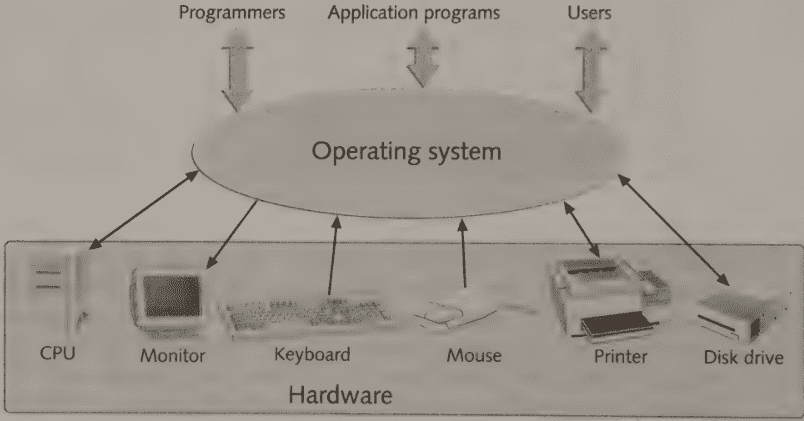
**图 1-1** 操作系统模型

不同的计算机系统可以使用不同的操作系统。例如，桌面个人电脑最常见的操作系统是 Microsoft Windows、Mac OS 和 Linux。流行的服务器计算机操作系统有 Microsoft Windows 2000 Server、Windows Server 2003、UNIX/Linux、NetWare 和 Mac OS X Server。大型机可能使用 IBM 的 MVS (Multiple Virtual Storage) 操作系统或较新的 z/OS 操作系统。网络服务器也使用操作系统，例如 Novell NetWare、UNIX/Linux、Windows 2000/XP 和 Windows Server 2003。


### PC 操作系统

**个人计算机**系统或 **PC** 通常是指一个独立的机器，例如台式机或笔记本电脑。PC 操作系统负责在单台计算机上执行所有的输入、输出、处理和存储操作。图 1-2 列举了一些流行的 PC 操作系统。

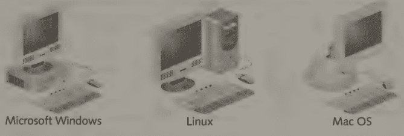
**图 1-2** 常见的 PC 操作系统

### 大型机操作系统

大型机操作系统控制**大型机系统**，这是一种拥有多个处理器的计算机系统，可为在大型机上运行程序的众多用户执行输入、输出、处理和存储操作。从历史上看，大型机系统在大型企业和工业计算中非常流行。图 1-3 显示了一些公认的大型机操作系统及其制造商。

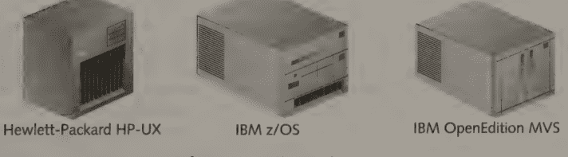
**图 1-3** 常见的大型机操作系统

### 网络操作系统

计算机**网络**将个人计算机的便捷与熟悉感与大型机的处理能力结合在一起。网络允许多个用户通过网络电缆或无线通信共享计算机资源和文件。**网络操作系统**控制**服务器计算机**（有时称为**主机**计算机）的操作，服务器接收运行在其他机器（称为**客户端**）上的用户程序的请求。图 1-4 显示了网络上服务器与客户端的关系。

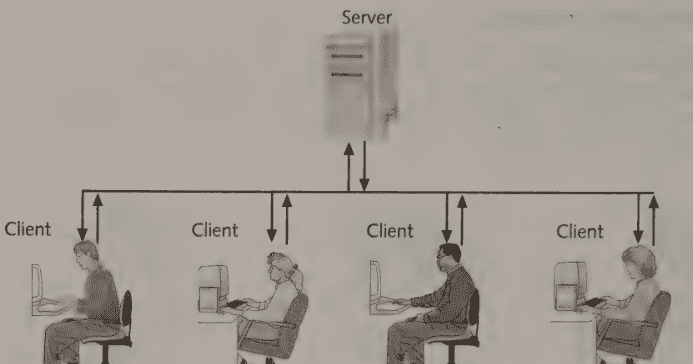
**图 1-4** 网络上服务器与客户端的关系

在集中式方法中，用户的数据和应用程序驻留在服务器上。这种类型的网络被称为**基于服务器的网络**。系统管理员通过保护服务器来确保网络上所有信息的安全。系统管理员可以轻松地维护用户应用程序并在服务器上直接执行备份操作。然而，如果服务器发生故障，在服务器恢复服务之前，客户端无法开展工作。

**对等网络**（Peer-to-peer networks）通常用于小型网络，比基于服务器的网络更具分布式特性。在对等配置中，网络上的每个系统既是服务器也是客户端。没有管理用户账户的中央服务器，因为每个对等节点都提供自己的共享资源并控制对这些资源的访问，例如通过指定成员的工作组或通过在该对等工作站上创建的账户。数据和应用程序不是集中存放的，而是驻留在网络中的各个系统中。软件升级和备份操作必须在每台计算机上本地执行。在每台计算机上实现的安全性是不统一的。网络中的每个用户在一定程度上负责管理自己的系统。尽管对等网络给系统管理员带来了诸多不便，但个人用户不依赖于中央服务器。如果网络中的一台计算机发生故障，其他系统仍能继续运行。

## UNIX 和 Linux 操作系统介绍

UNIX 和 Linux 是具有内置网络功能的多用户、多任务操作系统。UNIX/Linux 可用于扮演以下角色的系统：

- 基于服务器网络中的专用服务器
- 连接到基于服务器网络的客户端工作站
- 连接到对等网络的客户端/服务器工作站
- 未连接到网络的独立工作站

UNIX/Linux 是**多用户系统**，允许许多人同时访问和共享服务器计算机的资源。用户在被允许使用多用户系统之前，必须通过输入用户名和密码进行**登录**。这种验证过程保护了每个用户的隐私，并防止未经授权的用户使用系统。UNIX 和 Linux 是多任务的，其中**多任务系统**允许一个用户一次执行多个程序。例如，在多任务系统上，您可以在前台更新记录，同时在后台打印文档。

UNIX/Linux 也是可移植的操作系统。**可移植性**意味着这些系统可以用于各种计算环境。事实上，UNIX 和 Linux 运行在比任何其他操作系统更广泛的计算机上。UNIX/Linux 可以连接到互联网，执行流行程序，如用于发送文件的互联网协议**文件传输协议 (FTP)** 和互联网终端仿真程序 **Telnet**。终端仿真程序使 PC 能够像**终端**（有时称为哑终端）一样响应，终端是一种具有显示器和键盘但没有 CPU 的设备。

许多组织选择 UNIX 和 Linux 是因为这些操作系统：

- 使员工能够在多种计算机上工作（可移植性）
- 稳定、可靠且通用
- 拥有数以千计为其编写的应用程序，包括商业软件和免费软件
- 提供多种安全选项
- 非常适合网络环境（UNIX 是 1960 年代后期首批在网络上使用的服务器操作系统之一）

> 大多数 UNIX/Linux 系统现在还采用 Secure Shell (SSH)，这是一种为 UNIX/Linux 系统开发的**身份验证**（验证用户是否有权访问计算机的过程），旨在为 Telnet 和 FTP 应用程序提供身份验证安全。您将在本章稍后部分学习 SSH。


### UNIX 简史

AT&T 贝尔实验室的一组程序员最初在 20 世纪 60 年代末和 70 年代初开发了 UNIX。贝尔实验室以源代码形式分发 UNIX，因此任何使用 UNIX 的人都可以根据需要对其进行自定义。由于其可移植性和低成本，大学开始修改 UNIX 代码使其能在不同的机器上运行。最终演变出两个标准版本的 UNIX：AT&T 贝尔实验室生产了 **System V**，而加州大学伯克利分校开发了 **Berkeley 软件发行版 (BSD)**。由于采用了这两个版本的特性，Linux 可被认为比其前身是更集成化的 UNIX 版本。目前，由工业界、学术界和政府专家共同努力的 **UNIX 可移植操作系统接口 (POSIX)** 项目正致力于使 UNIX 标准化。

> 在撰写本文时，贝尔实验室已成为 Lucent Technologies 的一部分。有关对世界产生深远影响的贝尔实验室发明（包括 UNIX 操作系统和晶体管）的回顾，请参阅网站：www.bell-labs.com/about/history/changedworld.html。

### UNIX 概念

UNIX 开创了一些被应用于其他操作系统的概念。例如，Microsoft DOS 和 Microsoft Windows 采用了最初的 UNIX 设计概念，例如 Shell 的概念（Shell 是用户与操作系统之间的接口）以及目录和子目录的分级结构。

构成操作系统的分层组件概念也起源于 UNIX。软件层围绕计算机系统的内核，以保护其关键的硬件和软件组件，并管理核心系统及其用户。图 1-5 显示了 UNIX 系统的各层如何形成一个金字塔结构。

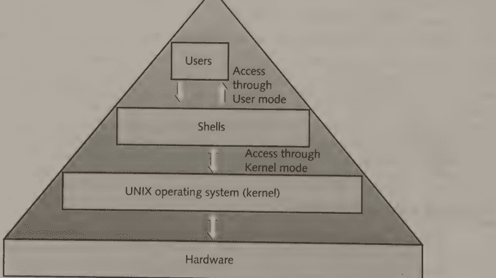
**图 1-5** UNIX 系统的分层结构

金字塔的底部是硬件。顶部是用户。它们之间的各层提供了隔离，确保了系统安全和用户隐私。内核（Kernel）是基础操作系统，它直接与硬件、软件服务、应用程序以及用户创建的脚本（包含待执行命令的文件）进行交互。它仅能通过**内核模式 (Kernel mode)** 访问，该模式仅限系统管理员使用。这可以防止未经授权的命令侵入基础操作系统代码和硬件，从而避免导致系统挂起或中断操作系统正常运行的行为。用户模式则提供了对所有应用程序软件所在的高层的访问。

这种分层方法以及所有其他 UNIX 特性都是由程序员为复杂软件开发而设计的。由于程序员使用 C 语言编写 UNIX，因此只要有 C 编译器的计算机都可以安装此操作系统。这种可移植性、灵活性和强大功能使 UNIX 成为网络操作系统的逻辑选择。此外，随着 Linux 的普及，UNIX 的整体流行程度也在增加。

### Linux 与 UNIX

Linux 是一个类 UNIX 操作系统，因为它不是由传统的 UNIX 代码编写的。相反，它是为了看起来像 UNIX 并且行为像 UNIX 而创建的原创代码（内核），但包含了 POSIX 标准等增强功能。Linus Torvalds 在 1991 年将其免费向公众发布，他是 Linux 的最初创建者。许多组织和公司现在提供免费和商业的 Linux 发行版或版本。以下是 Linux 版本的部分示例：

- College Linux (免费)
- Debian GNU/Linux (免费)
- Red Hat Fedora (免费)
- Mandrake (商业版和免费版)
- Red Hat Enterprise Linux (商业版)
- SuSE (Novell) Linux (商业版)
- Turbo Linux (商业版和免费版)

Linux 提供了 UNIX 所有的复杂性且可以免费获得；或者，您可以用相对较少的费用购买具有专门工具和特性的商业版本。凭借商业 UNIX 版本的所有网络特性，Linux 足够强大，可以处理大型任务。您可以在 PC 上安装 Linux，使其与其他操作系统共存，并测试您的 UNIX 技能。所有这些特性使 Linux 成为学习 UNIX 的绝佳方式，即使您可以使用运行 UNIX 的其他计算机。


## UNIX/LINUX Shell 介绍

Shell 是一个 UNIX/Linux 程序，用于解释您从键盘输入的命令。UNIX/Linux 提供了几种 Shell，包括 Bourne shell、Korn shell 和 C shell。AT&T 贝尔实验室的 Stephen Bourne 开发了 **Bourne shell** 作为第一个 UNIX 命令处理器。另一位贝尔员工 David Korn 开发了 Korn shell。**Korn shell** 与 Bourne shell 兼容，并包含许多扩展功能，例如历史记录功能，允许您使用键盘快捷键检索之前输入的命令。**C shell** 专为 C 语言程序员设计。Linux 使用免费软件 **Bash shell** 作为其默认的命令解释器。其名称是 "Bourne Again Shell" 的缩写，并融合了 Korn 和 Bourne shell 的最佳特性。无论您使用哪种 Shell，您与 UNIX/Linux 的初步交互始终是通过 Shell 解释器进行的。图 1-6 展示了 Shell 在 UNIX/Linux 中的角色。

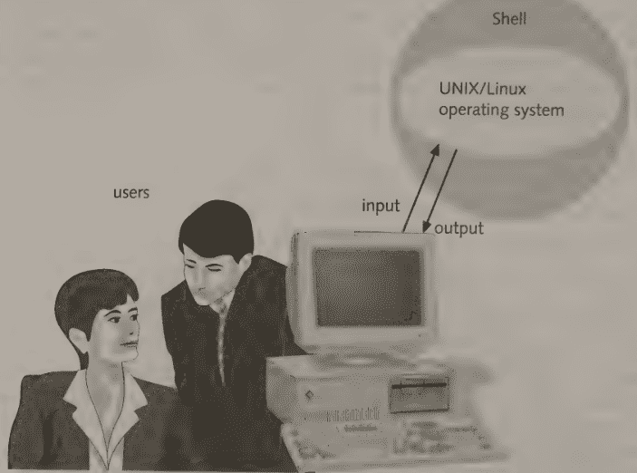

**图 1-6** Shell 与用户、操作系统及计算机的关系

### 选择您的 Shell

在开始使用 UNIX/Linux 系统之前，您需要确定使用哪种 Shell 作为您的命令解释器。Shell 的功能远不止解释命令：每种 Shell 都有广泛的内置命令，实际上将 Shell 变成了一个一流的编程语言。（您将在第 6 章“Shell 脚本编程入门”和第 7 章“高级 Shell 编程”中深入研究这个主题。）当您的账户创建时，会关联一个默认 Shell，但您在登录后可以选择切换到不同的 Shell。Bash 是 Linux 的默认 Shell，也是许多用户偏好的 Shell。以下是 Shell 列表：

- Bourne
- Korn (ksh)
- C shell (csh)
- Bash
- ash (一种源自 Bourne 和 C shell 的免费软件 Shell)
- tcsh (一种源自 C shell 的免费软件 Shell)
- zsh (一种源自 Korn shell 的免费软件 Shell)

### 在 Shell 之间切换

选择 Shell 后，系统管理员会将您的选择存储在账户记录中，它便成为了您的指定 Shell。每当您登录时，UNIX/Linux 都会使用该 Shell。不过，您可以通过在命令行输入 Shell 的名称（如 `tsh`、`bash` 或 `ash`）从一个 Shell 切换到另一个。您将在该 Shell 中工作，直到再次登录或在命令行输入另一个 Shell 名称。用户通常使用一种 Shell 来编写 Shell 脚本（程序），而使用另一种 Shell 与程序进行交互。（在本章稍后的“动手项目 1-8”中，您将学习如何切换 Shell，并在第 7 章中学习如何设置您自己的默认 Shell。）

### 选择用户名和密码

在能够使用 UNIX/Linux 之前，您必须提供唯一的用户名和密码进行登录。决定一个您想要用来在 UNIX/Linux 系统中标识自己的名称，例如 "aquinn"。这是 UNIX/Linux 系统上的其他用户向您发送电子邮件时使用的相同名称。某些 UNIX/Linux 版本仅识别用户名的前八个字符，而其他版本（如 Fedora 和 Red Hat Enterprise Linux 3.0）则可识别最多 32 个字符。

您还必须选择一个密码，在使用较新版本的 UNIX/Linux（如 Fedora 和 Red Hat Enterprise Linux）时，密码必须包含六个或更多字符。密码应该是您容易记住但他人难以猜到的，例如将两个或多个对您有意义的词拼接在一起——例如爱好或喜爱地点的组合——并混合使用大写字母、小写字母、数字和其他字符。密码可以包含字母、数字和标点符号，但不能包含控制字符，如 Ctrl+x。（控制字符是 Control 键与字母（如 x）组合而成的代码，用于在计算机上执行特定的操作。）

默认的最小密码长度取决于您的 UNIX/Linux 版本。某些早期版本的 Linux 最小长度为五个字符，但 Fedora 和 Red Hat Enterprise Linux 要求最小长度为六个字符，这也是本书所采用的实践。

只要您在工作站或主机（服务器）计算机上有用户账户和密码，就可以登录到任何 UNIX 或 Linux 系统。UNIX/Linux 系统管理员通过添加您的用户名（也称为登录名或用户 ID）和密码来创建您的账户。要使用本书和动手项目，您必须在 UNIX 或 Linux 系统上拥有一个账户，并具备连接到该系统的某种手段。连接或访问 UNIX/Linux 系统的常见方式包括：

- 通过 Telnet 或 SSH 连接到远程计算机，例如从另一个 UNIX/Linux 或基于 Windows 的操作系统连接（并非所有 Windows 版本都实现了 SSH，但您可以从第三方来源获取 SSH）。
- 通过 UNIX/Linux 客户端/服务器网络上的客户端软件连接。
- 作为对等节点，在每台计算机都安装了 UNIX/Linux 操作系统的对等（peer-to-peer）局域网中连接。
- 在安装了 UNIX/Linux 操作系统的独立 PC 上连接。
- 通过连接到 UNIX/Linux 主机通信端口的哑终端（dumb terminal）连接。

附录 A “如何访问 UNIX/Linux 操作系统”描述了多种访问方法，包括如何设置和使用 Telnet 或 SSH。此外，请参阅附录 C “如何安装 Fedora 和 Apache Web 服务器”，了解如何在计算机上安装 Fedora 版本的 Linux 以及在安装期间启用远程访问方法的说明。

您连接到 UNIX/Linux 系统所采取的步骤取决于您使用的连接类型。通过哑终端连接或通过独立系统访问 UNIX/Linux 是两种最简单的方法。在这两种情况下，您只需开启终端或独立计算机并登录您的账户即可。使用客户端/服务器网络的客户端软件进行连接可能需要网络管理员提供特殊的说明或培训。

如果您在对等网络上连接，可以使用 Telnet 或 SSH。通过 Telnet 或 SSH 连接是常用方法，将在下一节中详细描述。您可以使用 Telnet 或 SSH 通过局域网和互联网访问 UNIX/Linux 对等机或服务器计算机。附录 A 还讨论了如何使用不同方法通过网络进行连接。

## 使用 TELNET 或 SSH 连接到 UNIX/LINUX

Telnet 是一个终端仿真程序。它运行在您的计算机上，将您的 PC 连接到网络上的服务器或主机。用于连接的 PC 可以运行 UNIX、Linux、基于 Windows 的操作系统或 Mac OS。然后，您可以登录到 UNIX/Linux 主机并开始使用 UNIX/Linux。大多数 UNIX/Linux 版本都包含 Telnet，大多数版本的 Microsoft Windows 和较新版本的 Mac OS 也是如此。

互联网上的每台计算机都有一个 **互联网协议 (IP) 地址**。IP 地址是一组由点分隔的四个数字（在常用的 IP 版本 4 中），例如 `172.16.1.61`。互联网上的大多数系统还拥有一个 **域名 (domain name)**，这是一个标识网络上计算机资源分组的名称。基于互联网的域名由三部分组成：顶级域名（如国家或组织类型）、子域名（如公司或学院名称）和主机名（如主机计算机的名称）。一个使用三部分标识的例子是 `research.campus.edu`，其中 "research" 是主机名，"campus" 是子域名，"edu" 是顶级域名。IP 地址和域名都能标识网络上的一个系统。像 Telnet 这样的程序使用 IP 地址或域名来访问远程系统。

通过 Telnet 访问 UNIX/Linux 主机的一般步骤是：

1. 确定远程主机的 IP 地址或域名。
2. 连接到您的网络或互联网。
3. 启动 Telnet 程序，并连接到 UNIX/Linux 系统。例如，在 Windows XP 中启动 Telnet，请打开命令提示符窗口，输入 `Telnet` 并按 Enter 键。在 Fedora 或 Red Hat Enterprise Linux 中连接 Telnet，请打开终端窗口，输入 `Telnet` 并按 Enter 键。
4. 按照 Telnet 程序中的指示连接到远程主机。通常，您必须提供主机名或 IP 地址才能连接到 UNIX/Linux 系统。例如，在 Windows 2000/XP/Server 2003 命令提示符窗口或 UNIX/Linux 命令行中，要访问系统 `lunar.campus.edu`，您可以输入以下命令：
   `telnet lunar.campus.edu`
   输入命令后按 Enter 键。
5. 提供用户名和密码以登录远程 UNIX/Linux 计算机。

**Secure Shell (SSH)** 是为 UNIX/Linux 系统开发的，旨在为 TCP/IP 应用程序（如 FTP 和 Telnet）提供身份验证安全性。从历史上看，这些应用程序的身份验证主要依赖于提供未加密的账户和密码，这使得两者都极其脆弱。SSH 应用现代安全技术来确保通信会话的身份验证。SSH 可以在通信跨越网络或互联网时对其进行加密。


在 Fedora、Red Hat Enterprise Linux 3.0 以及其他版本的 UNIX/Linux 中，可以使用 `ssh` 命令代替 `telnet` 来建立与同样运行 UNIX/Linux 且兼容 openSSH 的远程计算机的安全连接。openSSH 是 SSH 的一个版本，包含旨在免费分发的协议和软件，可用于许多 UNIX/Linux 系统。

要使用 `ssh`，您需要打开一个终端窗口（或进入命令行），在命令行中输入 `ssh -l` 以及用户账户名称和主机计算机名称。另外两种选项是输入 `ssh user@hostname` 或 `ssh` 加上 IP 地址。

实践项目 1-1 将向您演示如何在 Windows 2000/XP 中使用 Telnet，实践项目 1-2 将向您演示如何在 Fedora 或 Red Hat Enterprise Linux 3.0 中访问终端窗口并使用 `ssh` 访问远程计算机。

> **提示** 要使用 Telnet 或 SSH，您需要在系统中启用它们。例如，在安装 Fedora 或 Red Hat Enterprise Linux 看到配置防火墙的界面时，选择启用防火墙并勾选 Telnet 和 SSH 复选框（参见本书附录 C）。如果您已经安装了 Fedora 或 Red Hat Enterprise Linux 且正在使用 GNOME 桌面，请点击“主菜单”，指向“系统设置”，点击“安全级别”，并勾选 Telnet 和 SSH 复选框。在许多 UNIX/Linux 系统中，您还可以以 root 用户登录并输入 `~/.telnetrc` 来配置 Telnet 参数。在某些 UNIX/Linux 系统中，另一种选项是编辑 `/etc/xinetd.d/telnet` 文件，使其包含 `disable=no` 这一行，以此来启用 Telnet。

## 登录 UNIX/Linux

启动或连接到 UNIX/Linux 系统后，您必须通过指定用户名和密码进行登录。如果您使用的是**图形用户界面 (GUI)**，您将看到命令行或登录对话框。为了安全，在输入密码时，屏幕上不会显示密码。

当您通过网络或使用哑终端（dumb terminal）连接时，您将在命令行屏幕上登录并执行命令。如果您是在独立 PC 上，系统可能被配置为仅使用命令行（文本模式），或者配置为使用 GUI。在 UNIX/Linux 中，GUI 的基础被称为 X Window 界面。根据所使用的桌面环境的不同，X Window 界面的外观和感觉也会有所不同。本书中的 Fedora 示例使用了流行的（且免费的）GNU 网络对象模型环境 (GNOME) 桌面。GNU 代表 "Gnu's Not Unix"，这是一项始于 1983 年的努力，旨在开发一个免费的、开放标准的、类 UNIX 操作系统（以及额外的操作系统实用程序）。最初，它们通常是用 C 语言编写的。

> **提示** 要了解更多关于 GNOME 项目的信息，请访问网站 www.gnome.org。此外，您将在第 11 章“X Window 系统”中进一步了解 X Window 界面和 GNOME 桌面。

如果没有经过授权的用户账户，您无法登录。如果密码错误，或者在输入用户名和密码前等待时间过长，请联系您的系统管理员寻求帮助。

登录后，您就可以开始使用系统了。如果您通过网络或哑终端访问 UNIX/Linux——或者您的独立系统配置为命令行文本模式——您可以立即在命令提示符处输入命令。**但是，如果您使用的是独立计算机和 X Window 桌面（如 GNOME），您必须打开一个终端窗口（见图 1-7）才能访问命令提示符。**实践项目 1-2 演示了如何在 Fedora 或 Red Hat Enterprise Linux 3.0 中访问终端窗口（以执行 `ssh` 命令）。

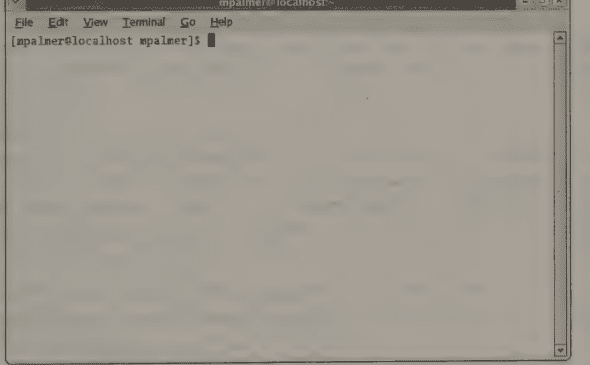
**图 1-7** Fedora 中的终端窗口

## 使用命令

为了与 UNIX/Linux 交互，您需要输入一个**命令**，即在命令提示符之后输入的文本。完成命令输入后，按下 Enter 键。UNIX/Linux 是**区分大小写**的；也就是说，它们区分大写字母和小写字母，因此 *John* 与 *john* 不同。大多数 UNIX/Linux 命令都以小写形式输入。

命令分为两类：您输入以执行任务的用户级命令（例如检索信息或与其他用户通信），以及系统管理员用来管理系统的系统管理命令。

您必须了解命令的语法才能正确输入。**语法**是指命令的格式和用词，以及您可以用来自延展和修改其功能的**选项**和**参数**。大多数命令是单个单词，例如 `clear` 命令。如果您使用正确的语法输入命令，UNIX/Linux 将执行该命令。否则，您将收到一条消息，提示 UNIX/Linux 无法解析您的命令。

> 附录 B “UNIX/Linux 命令语法指南”按字母顺序列出了本书中的所有命令，并告诉您如何输入每个命令以及如何使用其选项。

在屏幕上输入命令的地方称为**命令行**（参考图 1-7）。命令使用以下语法：

#### 语法
`command_name` [-option] [argument]

#### 解析

- `command_name` 指定要执行的操作。在本书的语法示例中，命令名称以粗体显示。（在正文中，命令名称以斜体显示。）
- 命令选项是请求 UNIX/Linux 以特定样式或变体执行命令的方式。选项紧跟在命令名称之后，用空格分隔。它们通常以连字符 (-) 开头。选项同样区分大小写。例如，`-R` 与 `-r` 不同。您不需要在每个命令后都输入选项；但是，某些命令除非指定选项，否则无法工作。在本书的语法示例中，当命令不需要选项时，选项会列在方括号 ([ ]) 中。
- 命令*参数*紧跟在命令选项之后，用空白字符（空格）分隔。命令参数通常是文件名和目录名。在本书的语法示例中，参数以斜体显示。如果命令不需要参数，参数会被方括号包围。

在接下来的章节中，您将通过介绍以下基本命令开始学习 UNIX/Linux 之旅：

- `date`
- `cal`
- `who`
- `clear`
- `man`
- `whatis`

您还将学习命令行编辑技巧、如何输入多个命令以及如何召回之前使用过的命令。此外，您还将学习如何从活动会话中注销。

## date 命令

UNIX/Linux 的 `date` 命令显示系统日期，该日期由系统管理员维护（见图 1-8）。由于多用户系统上的日期和时间对应用程序至关重要，因此只有系统管理员可以更改日期。例如，财务部门可能需要将日期与用于报税信息的特定文件关联起来，或者出版部门可能必须给文档盖上日期戳以确保特定的版权日期。

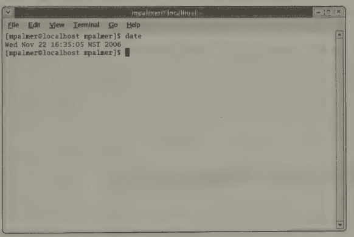
**图 1-8** 使用 `date` 命令

`date` 命令有一个选项 `-u`，用于显示格林威治标准时间 (GMT)。

> **提示** GMT 也被称为格林威治子午线时间或协调世界时，其缩写为 UTC。UTC 被认为是国际时间标准。要了解更多关于 UTC 的信息，请访问 NASA 的网页 `www.ghcc.msfc.nasa.gov/utc.html`。

实践项目 1-3 将引导您使用 `date` 命令。

#### 语法
`date [-option]`

#### 解析

- 显示系统日期和时间
- 常用选项包括：
    - `-u`: 查看格林威治标准时间
    - `-s`: 重置日期或时间

## cal 命令

使用 `cal` 命令显示系统日历。此命令对于安排活动或确定过去已完成或计划在未来完成的项目的特定日期非常有用。`cal` 命令还可以通过在命令行中使用 `cal -j` 来确定儒略日（Julian date）。儒略日是从年初开始计算的日期数值，其值在 1 到 366 之间（包括闰年）。程序员有时将儒略日用于特定的编程功能，例如确定一名员工在当前年度在组织中工作的天数。图 1-9 显示了命令 `cal -j 2006` 的结果，显示了 2006 年每月日历的儒略日。实践项目 1-4 将引导您使用 `cal` 命令。

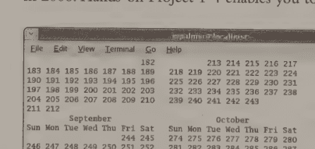
**图 1-9** 使用 `cal` 命令确定儒略日


语法 `cal` [-option]

#### 解析
- 生成当前年份或用户指定的年份的日历
- 常用选项包括：
    - `-j` 表示儒略日（Julian date）
    - `-s` 将周日显示为一周的第一天
    - `-m` 将周一显示为一周的第一天
    - `-y` 显示当前年份的所有月份

## who 命令

要确定谁已登录系统，请使用 `who` 命令。在多用户系统中，了解谁登录了系统对于管理员来说非常重要，这样管理员可以定期验证授权用户及其使用级别。对于普通用户来说，了解谁已登录也很有价值，他们可以利用该信息来判断系统在给定时间的繁忙程度，或者寻找想要联系的其他用户。

语法 `who` [-option]

#### 解析
- 提供登录到操作系统的用户列表
- 常用选项包括：
    - `am i`（输入 `who am i`）获取关于您自己会话的信息
    - `whoami`（将 `whoami` 作为一个单词输入）查看您正在使用哪个账户
    - `-H` 显示列标题
    - `-u` 显示每个用户的空闲时间（旧的 `-i` 选项很快将从 `who` 选项中移除）
    - `-q` 快速列出并统计登录的用户总数
    - `-b` 由系统管理员及他人用于验证系统上次启动的时间

尝试上手项目 1-5 以学习如何使用 `who` 命令。

## clear 命令

随着您不断输入命令，屏幕可能会变得杂乱。除非您需要参考之前输入的命令及其输出，否则可以使用 `clear` 命令来清除屏幕。该命令没有选项或参数。

您将在上手项目 1-6 中使用 `clear` 命令。

### 语法 `clear`
- 清除终端屏幕、显示器或终端窗口

## man 程序

为了方便参考，UNIX/Linux 包含一份在线手册，其中包含所有命令及其选项和参数。UNIX/Linux 中的 `man` 程序用于显示这份名为 **man pages**（man 页）的在线手册，以提供命令行帮助。虽然某些命令的 man 页包含的信息比其他命令多，但大多数 man 页都会列出以下项：

- 名称（Name）——命令的名称以及对其用途的简短说明
- 概要（Synopsis）——显示命令用法的语法图
- 描述（Description）——比名称项更详细的命令描述，以及命令选项及其说明的列表
- 作者（Author）——开发该命令或程序的作者姓名（如有）
- 报告 Bug（Reporting Bugs）——关于如何报告 Bug 或问题的信息
- 历史（History）——有时包含的信息，用以显示该命令的起源
- 其他版本（Other Versions）——有时包含的信息，用以表明该命令还有其他可用版本
- 参阅（See Also）——提供相关信息的其他命令或 man 页

`man` 程序通常只接受一个参数——您想要了解更多信息的命令名称。在线手册会显示您的系统所接受的有效命令格式。要关闭在线手册，请输入 `q`。

### 语法 `man` [-option] [argument]

#### 解析
- 显示来自在线文档的信息
- 示例选项包括：
  - `-a` 在查看第一页后退出 `man` 显示
  - `-d` 打印用于调试的信息
  - `-K` 通过搜索所有 man 信息来查找某个特定字符串

参数是提供您想要进一步了解的命令或程序的名称，例如 `man who`。

举例来说，参考图 1-10 和 1-11 中 `cal` 命令的 man 页。在这个例子中，顶行显示了命令的名称 `cal` 和简短描述 "displays a calendar"（显示日历）。接下来，“概要”（Synopsis）部分提供了关于命令使用方式的信息，显示它可以与选项（如 `-smjy13` 中的任何一个）结合使用，也可以指定月份或年份作为参数。“描述”（Description）部分提供了关于 `cal` 命令用途的更多信息，并解释了默认用法，例如如果没有使用参数，则显示当前月份。“描述”部分还显示了选项，例如 `-s` 用于显示从周日开始的日历。

在图 1-11 中，关于 `cal` 命令使用的更多信息出现在“描述”部分的末尾。“历史”（History）部分显示该命令出现在 Version 6 AT&T UNIX 中。最后，“其他版本”（OtherVersions）部分包含关于您可以获取并使用的 `cal` 其他版本的信息，末尾的日期显示了该 man 页的编写或更新时间。

**图 1-10** *cal* 命令的 man 页

> **提示** 许多系统除了 man 页之外还提供 info 页。有时 info 页提供更多关于命令的信息，有时则是 man 页提供。此外，一个新命令可能仅在 `man` 或 `info` 中有所涵盖。如果您需要某个特定命令的帮助，请考虑检查这两个来源。例如，要了解 `who` 命令，请输入 `info who`。

**图 1-11** cal 命令的更多 man 页

## whatis 命令

有时您会发现 man 页包含的信息比您想看的更多。要显示命令的简短摘要，请使用 `whatis` 命令（见图 1-12）。`whatis` 命令仅显示出现在命令 man 页顶部的名称和简短描述。

**图 1-12** 使用 whatis 获取 cal 命令的快速摘要

`whatis` 命令依赖于存储在数据库中的信息。在某些 UNIX/Linux 系统上，管理员必须在 `whatis` 命令正常运行之前执行 `makewhatis` 命令以创建该数据库。在 Fedora 和 Red Hat Enterprise Linux 中，请登录 root 账户并输入 `/usr/sbin/makewhatis` 来创建数据库。

语法 `whatis` [argument]

#### 解析
- 显示从 whatis 数据库中获取的命令简短描述
- 在包括 Fedora 和 Red Hat Enterprise Linux 在内的许多 UNIX/Linux 版本中，`whatis` 命令仅接受一个参数（命令或程序的名称），没有选项。

上手项目 1-7 将使您能够使用 `man` 和 `whatis` 命令。

## 命令行编辑

Shell 支持某些按键来执行命令行编辑。例如，Bash（默认的 Linux shell）支持左、右方向键，用于在命令行上移动光标。例如，如果您拼错了命令或参数，可以使用左、右方向键在活动的命令行上移动到拼错的地方进行纠正，然后执行命令——而无需重新输入。其他与 Alt 或 Ctrl 键组合使用的按键用于其他编辑操作，而 Del 键用于删除一个字符。表 1-1 说明了可用于命令行编辑的常用 Alt、Ctrl 和 Del 组合键。此外，请尝试上手项目 1-8 来练习命令行编辑。

### 表 1-1 常用的命令行编辑 Alt, Ctrl 和 Del 组合键

| 组合键 | 描述 |
|---|---|
| Alt+b | 将光标移动到前一个单词 |
| Alt+d | 删除一个单词或连续字符 |
| Alt+l | 将光标移动到下一个单词第一个字符之前的位置 |
| Ctrl+a | 将光标移动到命令行的开头 |
| Ctrl+k | 删除从当前光标位置到命令行末尾的内容 |
| Del | 删除一个字符 |

## 多命令输入

您可以通过分号 (;) 分隔命令，在命令行上输入多个命令。当您按下 Enter 键时，UNIX/Linux 将按照您输入命令的顺序执行它们。例如，如果您输入 `date ; cal`，您将看到今天的日期，然后是当前月份的日历。正如您在后续章节中学到的，这是一项重要能力，可以一次性完成多个操作，例如处理文件中的数据然后打印或显示特定数据。尝试上手项目 1-9，通过单次命令行输入执行多个命令。

## 命令行历史

通常，您会发现自己在短时间内多次输入相同的命令。大多数 shell 会保留最近使用的命令列表，允许您在无需重新输入的情况下调用命令。您可以使用上、下方向键访问命令历史。按下一次上方向键可调用最近使用的命令。按下两次上方向键可调用倒数第二个最近使用的命令。每按一次上方向键，您将调用一个更早的命令。每按一次下方向键，您将在命令历史中向前滚动。当您找到想要执行的命令时，按下 Enter 键。当您需要在一次会话中输入相同或类似命令时，这项功能可以为您节省时间和减少烦恼。上手项目 1-10 将使您能够使用命令行历史功能。

## 退出 UNIX/Linux 登录

当您完成一天的工作或因任何原因离开终端时，请退出 UNIX/Linux 系统以确保安全。退出登录将结束您当前的进程并向 UNIX/Linux 表示您已完成操作。退出方式取决于您使用的 shell。对于 Bourne、Korn 或 Bash shell，在命令行中输入 `exit` 或按下 Ctrl+d。在 C shell 中，在命令行中输入 `logout`。如果您没有使用桌面环境，这些命令将使您退出系统。

如果您在 XWindow 桌面环境（如 GNOME）中工作，输入 exit 并按下 Enter 或使用 Ctrl+d 仅会关闭终端窗口。要退出登录，请使用桌面的“Log Out”（退出登录）选项。例如，如果您在 Fedora 或 Red Hat Enterprise Linux 3.0 中使用 GNOME，请点击屏幕底部面板中的“Main Menu”（主菜单），点击菜单上的“Log Out”，在对话框中选择“Log out”，然后点击“OK”。


## 理解 UNIX/Linux 系统管理员的角色

UNIX/Linux 系统中有两种类型的用户：系统管理员和普通用户。顾名思义，**系统管理员**通过添加新用户、删除旧账户，并确保系统为所有用户提供良好且高效的服务来管理系统。**普通用户**是指所有其他用户。系统管理员也被称为**超级用户**，因为系统管理员拥有更改系统的无限权限。UNIX/Linux 在操作系统最初安装时授予此权限。系统管理员则向普通用户授予特权和权限。

系统管理员有一个唯一的用户名：`root`。该账户拥有对 UNIX/Linux 系统的完全访问权限。root 账户的密码是保密的；只有系统管理员和备份人员知道。如果 root 密码丢失或被遗忘，系统管理员将使用紧急救援程序来重置密码。

### 系统管理员的命令行

虽然普通用户在 $（美元符号）命令提示符后输入命令，但系统管理员的提示符是 #（井号）符号。UNIX/Linux 系统为系统管理员生成的默认命令提示符格式如下：

```
[root@hostname root]#
```

在提示符中，*hostname* 是系统管理员登录的计算机名称。除了指代 root 账户外，root 还有另外两种含义，您将在本书稍后部分详细了解。一种含义是所有目录的基准级别（根目录），另一种是 root 账户的默认主目录。

### 普通用户的命令行

$（美元符号）传统上与普通用户相关联。UNIX/Linux 系统为普通用户生成默认的命令提示符设置。在 Linux 系统中，以下格式很常见：

```
[username@hostname username]$
```

在提示符中，*username* 是用户的登录名（例如 jean），*hostname* 是用户登录的计算机名称。第二个 *username* 实例是指用户主目录的名称。

## 更改密码

您的用户名（或登录名）用于向系统标识您的身份。您可以选择自己的用户名并将其交给系统管理员，然后由管理员将您添加为新用户。如前所述，某些 UNIX/Linux 版本最多支持 8 个字符，而其他版本（如 Fedora 和 Red Hat Enterprise Linux 3.0）则支持最多 32 个字符的用户名——这通常是您的名字首字母加姓氏、姓氏加名字首字母、您的姓氏，或者有时是一个绰号。

用户名是唯一的，但不是保密的，可以提供给其他用户。而密码则是保密的，用于保障您在系统上的工作安全。如有必要，您可以使用 `passwd` 命令更改密码，但必须知道当前密码才能进行更改。如果您的账户没有密码，请使用 `passwd` 命令创建一个。

UNIX/Linux 系统管理员可以为密码应用规则，例如：必须具有最少字符数、包含字母和数字的组合、必须包含其他特殊字符，或者不能与近期使用过的密码相同。实践项目 1-11 将引导您更改密码。

更改密码后，您应该注销并重新登录，以确保 UNIX/Linux 识别您的新密码。

> 请记住您的密码！每次登录 UNIX/Linux 时都需要密码。

## 使用 CAT, MORE, LESS, HEAD 和 TAIL 命令查看文件

三个 UNIX/Linux 命令允许您查看文件内容：`cat`、`more` 和 `less`。`more` 和 `less` 命令每次显示一屏文件内容。`more` 命令仅支持向下滚动，而 `less` 允许您向下和向上滚动。`cat` 命令一次性显示整个文件。另外两个命令 `head` 和 `tail` 允许您查看文件的起始几行或最后几行（默认为 10 行）。

`cat` 命令的名字源自 concatenate（连接）一词。您可以通过在 `cat` 命令后输入文件名并用空格分隔来显示多个文件。随后 UNIX/Linux 将按照您输入文件的顺序显示其内容。

尝试实践项目 1-12、1-13 和 1-14 以使用 `cat` 命令、`more` 和 `less` 命令，以及最后的 `head` 和 `tail` 命令。

## 重定向输出

在 UNIX/Linux 中，大于号 (>) 被称为**重定向符号**。您可以通过将此重定向符号附加到产生输出的命令，来创建新文件或覆盖现有文件。实际上，您将输出重定向到了磁盘文件而不是显示器。例如，如果您输入 `who > current_users` 并按回车键，这将创建一个名为 `current_users` 的文件，其中包含 `who` 命令的信息。

重定向输出在许多场景下都很有用。例如，当您监控系统时，可以将输出重定向到一个文件以便稍后检查。或者，您可能有一个处理数据的程序或报告生成实用程序，您可以将结果重定向到文件而不是屏幕。您将在本书后面学习其他重定向符号，但目前，`>` 符号是一个很好的起点。

尝试实践项目 1-15 和 1-16 以使用 `>` 重定向符号。

您还可以将 `cat` 命令与重定向符号结合使用，通过键盘输入的信息创建文件。在命令提示符后输入 `cat > filename`（其中 `filename` 是您要创建的文件名）。输入文件中的数据，然后按 `Ctrl+d` 结束键盘数据输入。实践项目 1-17 将引导您使用 `cat` 命令配合 `>` 重定向符号。

> 仅在您想要覆盖当前文件时，才使用重定向符号 (>) 将输出发送到已存在的文件。若要将输出追加到现有文件，请使用两个重定向符号 (>>)。这将把信息添加到现有文件的末尾而不会覆盖该文件。

## 本章总结

- 操作系统是最基础的计算机程序。它控制所有计算机资源，并为应用程序的运行或编写提供基础。
- 在基于中央服务器的网络中，所有用户的数据和应用程序都驻留在服务器上，由系统管理员负责安全、维护和备份。服务器网络中的每台计算机都依赖于服务器。而对等网络（P2P）中的所有系统既充当服务器又充当客户端。网络的安全和维护分布在每个系统中。如果对等网络中的一个系统故障，其他系统仍能继续运行。
- UNIX/Linux 操作系统是多用户系统，允许许多人同时访问和共享计算机。它们也是多任务操作系统，这意味着它们可以一次执行多个任务。
- UNIX/Linux 系统可以配置为服务器网络中的专用服务器、服务器网络中的客户端工作站、对等网络中的客户端/服务器工作站，或者不连接任何网络的独立工作站。
- 构成操作系统的分层组件概念起源于 UNIX。围绕计算机系统内核的软件层保护了关键的硬件和软件组件，并为用户管理核心系统。
- Linux 是一个安装在 PC 上的类 UNIX 操作系统。它可以独立运行，也可以与其他操作系统（如 Windows）共存。与 UNIX 一样，Linux 具有可移植性，这意味着它可以在从 PC 到大型机的各种计算机上运行。
- 在 UNIX/Linux 中，您通过一个名为 shell 的解释器与操作系统程序通信，它负责解释您从键盘输入的命令。UNIX/Linux 提供了多种 shell 程序，包括 Bourne、Korn 和 C shell。Bash shell 增强了 Bourne 和 Korn shell 的功能，是 Linux 系统上最受欢迎的 shell。
- 在 UNIX/Linux 中，系统管理员为普通用户设置账户。为了设置您的账户并保护系统的隐私和安全，您需要选择并向系统管理员提供您的用户名和密码。只要您在主机（服务器）计算机上拥有用户账户和密码，就可以在任何地方登录任何 UNIX 或 Linux 系统。您还可以使用 UNIX/Linux、Microsoft Windows 和 Mac OS 的 Telnet 或 SSH 程序登录到远程 UNIX/Linux 系统。
- 您在 UNIX/Linux 中输入的命令具有严格的语法，您可以通过参考名为 man pages（手册页）的在线手册来学习。使用 `man` 程序显示命令的语法规则。使用 `whatis` 命令查看命令的简要描述。使用 `who` 命令列出谁已登录以及他们的位置。使用 `cal` 命令显示全部或选定月份的系统日历。当您决定停止使用 UNIX/Linux 时，在非 GUI 系统中使用 `exit` 或 `logout` 命令注销；在基于 GUI 的系统中，使用菜单中的“注销 (Log Out)”选项。
- 大多数 shell 提供了基本的命令行编辑能力，并保留最近使用命令的历史记录。使用上、下方向键在最近使用的命令列表中前后滚动。您可以通过分号分隔在单行命令中输入多个命令；UNIX/Linux 将按照您输入的顺序执行这些命令。
- 您可以使用“查看”命令检查文件内容。使用 `cat` 命令通过键盘输入信息来创建文件。使用 `less` 和 `more` 命令显示多页文档。使用 `head` 和 `tail` 命令查看文件的开头或结尾几行。


## 命令摘要：第 1 章命令回顾

| 命令 | 用途 | 本章涵盖的选项 |
| :--- | :--- | :--- |
| cal | 显示系统日历 | -j 显示儒略日格式日期。<br>-s 将周日显示为一周的第一天。<br>-m 将周一显示为一周的第一天。<br>-y 显示当前年份的所有月份。 |
| cat | 显示多个文件 | -n 显示行号。 |
| clear | 清除屏幕 | |
| date | 显示系统日期 | -u 以格林威治标准时间显示时间。<br>-s 重置日期和时间。 |
| exit 或 logout | 在不使用 GUI 时退出 UNIX/Linux | |
| head | 显示文件的前几行 | -n 打印指定文件的前 n 行。 |
| less | 每次显示一个屏幕的长文件，且支持上下滚动 | |
| man | 显示指定命令的在线手册 | -a 在第一页之后保留 man 显示。<br>-d 打印用于调试的信息。<br>-K 通过搜索所有 man 信息来查找某个字符串。 |
| more | 每次显示一个屏幕的长文件，且支持向下滚动 | |
| passwd | 更改您的 UNIX/Linux 密码 | |
| tail | 显示文件的最后几行 | -n 显示指定文件的最后 n 行 |
| whatis | 显示命令的简短描述 | |
| who | 允许您查看谁已登录（`whoami` 显示当前登录的账户，`who am i` 显示关于账户会话的信息） | -H 显示列标题。<br>-u 显示会话空闲时间。<br>-q 显示用户快速列表。<br>-b 验证系统上次启动的时间。 |

## 关键术语

- **authentication**（身份验证） — 验证用户是否获权访问特定计算机、服务器、网络或网络资源（如 Telnet 或 FTP）的过程。
- **argument**（参数） — 为 UNIX/Linux 提供执行命令所需额外信息的文本。在命令行中，参数名紧跟在选项名之后，两者之间用空格分隔。参数的示例包括文件和目录名。
- **Bash shell** — UNIX/Linux 命令解释器（也是 Linux 的默认 shell）。它融合了 Bourne shell 和 Korn shell 的最佳特性，其名称是 “Bourne Again Shell” 的缩写。
- **Berkeley Software Distribution (BSD)** — 由加州大学伯克利分校开发的一种 UNIX 分发版，该校于 1975 年首次发布了 BSD UNIX 版本。
- **Bourne shell** — 第一个 UNIX/Linux 命令解释器，由 Stephen Bourne 在 AT&T 贝尔实验室开发。
- **C shell** — 为 C 语言程序员设计的 UNIX/Linux 命令解释器。
- **case sensitive**（区分大小写） — 区分大写字母和小写字母的属性（John 与 john 不同）。UNIX 是区分大小写的。
- **client**（客户端） — 网络上运行程序或访问来自大型机、网络服务器或主机计算机文件的计算机。
- **command**（命令） — 在命令行提示符后输入的，请求计算机执行特定操作的文本。
- **command line**（命令行） — 屏幕上用于输入命令的位置。
- **domain name**（域名） — 标识网络上计算机资源组的名称。基于互联网的域名由三部分组成：顶级域名（如国家或组织类型）、子域名（如公司或学院名称）和主机名（如主机计算机的名称）。
- **File Transfer Protocol (FTP)**（文件传输协议） — 一种用于发送和接收文件的互联网协议。
- **graphical user interface (GUI)**（图形用户界面） — 将位图转换为无限多种图像的软件，使得您在使用操作系统时看到的是图形图像。
- **host**（主机） — 见 server（服务器）。
- **Internet Protocol (IP) address**（互联网协议地址/IP 地址） — 一组由点分隔的四个数字（对于常用的 IP 版本 4），例如 172.16.1.61，用于标识和访问网络或互联网上的远程计算机。
- **kernel**（内核） — 基础操作系统，它直接与硬件交互并为用户程序提供服务。
- **Kernel mode**（内核模式） — 访问内核的一种方式。其使用仅限于系统管理员，以防止未经授权的操作干扰支持整个 UNIX/Linux 结构的硬件。
- **Korn shell** — 一种比原始 Bourne shell 提供更多功能的 UNIX/Linux 命令解释器。由 David Korn 在 AT&T 贝尔实验室开发。
- **log in**（登录） — 一种保护隐私并维护多用户系统安全的过程，要求每个用户在运行系统前输入用户名和密码。
- **mainframe system**（大型机系统） — 一种较旧的大型计算机系统，设计用于非常复杂的处理和海量文件存储。大型机历史悠久，一些大型机操作系统的根源可追溯到 20 世纪 60 年代及以前。
- **man pages**（man 页/手册页） — UNIX/Linux 命令和程序的在线手册页，可以通过输入 `man` 加上命令或程序名称来访问。
- **multitasking system**（多任务系统） — 允许计算机同时运行两个或多个程序的操作系统。
- **multiuser system**（多用户系统） — 许多人可以同时访问并共享服务器计算机资源的系统。为了保护隐私和保障系统安全，每个用户必须输入用户名和密码才能使用或登录系统。UNIX 和 Linux 都是多用户系统。
- **network**（网络） — 一组通过网络电缆或无线通信连接的计算机，允许许多用户共享计算机资源和文件。它将个人计算机的便捷性和熟悉感与大型机的处理能力结合在一起。
- **network operating system**（网络操作系统） — 控制服务器或主机计算机运行的操作系统，它可以接收并响应运行在网络上其他计算机（称为客户端）上的用户程序的请求。
- **operating system (OS)**（操作系统） — 最基础的计算机程序；它控制计算机的所有资源，并为应用程序的使用或编写提供基础。
- **options**（选项） — 您在使用 UNIX/Linux 命令时可以使用的附加功能。
- **ordinary user**（普通用户） — 除系统管理员或超级用户之外的任何系统使用者。
- **peer-to-peer network**（点对点网络/对等网络） — 一种网络配置，其中网络上的每个计算机系统既是客户端又是服务器。数据和程序驻留在各个独立系统中，因此用户不依赖于中央服务器。点对点网络的优点是如果一台计算机故障，其他计算机仍能继续运行。
- **personal computer (PC)**（个人计算机） — 一台独立的机器（如台式机或笔记本电脑），执行所有输入、输出、处理和存储操作。
- **portability**（可移植性） — 操作系统的一种特性，允许系统在许多不同的环境中使用，特别是运行在不同类型的计算机上。UNIX 和 Linux 是可移植的操作系统。
- **Portable Operating System Interface for UNIX (POSIX)** — 由工业界、学术界和政府专家通过电气电子工程师学会 (IEEE) 开发的标准，旨在实现应用程序的可移植性，包括 UNIX 特性的标准化。
- **Secure Shell (SSH)** — 为 UNIX/Linux 系统开发的一种身份验证形式，为 TCP/IP 应用程序（包括 FTP 和 Telnet）提供身份验证安全性。
- **server**（服务器） — 安装有网络操作系统，因此能够接收并响应运行在网络其他计算机（称为客户端）上的用户程序请求的计算机。也称为主机 (host)。
- **server-based network**（基于服务器的网络） — 一种集中式的网络方法，其中客户端计算机的数据和程序驻留在服务器上。
- **shell** — 用户与操作系统之间的接口。
- **superuser**（超级用户） — 见 system administrator（系统管理员）。
- **System V** — 一个源自 AT&T 贝尔实验室的 UNIX 版本，于 20 世纪 80 年代初首次以 System 3 的形式作为 UNIX 的商业版本发布。如今，已有基于 System V 的商业版本和免费版本。
- **syntax**（语法） — 命令的格式、措辞、选项和参数。
- **system administrator**（系统管理员） — 拥有一个可以通过添加新用户、删除旧账户并确保系统为所有用户良好高效地提供服务来管理系统的账户的用户。
- **Telnet** — 一种互联网终端仿真程序。
- **terminal**（终端） — 一种连接到服务器或主机的设备，但仅由显示器和键盘组成，没有 CPU。有时也被称为哑终端 (dumb terminal)。
- **User mode**（用户模式） — 访问系统程序软件驻留区域的一种方式。

## 复习题

- 1. 您正在打电话预约时间，手边没有纸质日历。您可以在 Linux 工作站上输入什么命令来查看当前月份（7月）？
    a. `date -july`
    b. `date -c`
    c. `month -c`
    d. `cal`

- 2. 您需要查看 `cat` 命令的文档。您应该在命令行输入什么来查看此文档？
    a. `cat ?` 然后按回车
    b. `help cat` 然后按回车
    c. `man cat` 然后按回车
    d. `cat /help` 然后按回车


- 3. 在命令行中，你输入了 `Who` 但它返回了一条错误消息。问题出在哪里？
    a. `Who` 命令必须配合开关使用，例如 `-i`。
    b. 这不是一个有效的命令，你应该使用 `W` 代替。
    c. 命令是对大小写敏感的，所以你应该输入 `who`。
    d. 改用 `WHOAREYOU` 命令。

- 4. 你想在一行中执行两个命令，并使用冒号来分隔命令。这样做有什么问题？
    a. 你应该使用分号代替。
    b. 你应该使用逗号代替。
    c. 你必须使用两个冒号，一个紧跟在第一个命令之后，一个紧接在第二个命令之前。
    d. 为了减少处理开销和系统崩溃的风险，UNIX/Linux 的设计不支持在同一行执行两个命令。

- 5. 你正在使用 `cat` 命令创建文件。当你完成文本输入后，按下字母 `s` 试图停止，但文件仍然保持打开状态。你应该输入什么？
    a. `Alt+s`
    b. `quit`
    c. 输入两次 `type end`
    d. `Ctrl+d`

- 6. 你可以使用哪个命令来仅查看当前目录下 accounts 文件的最后八行？
    a. `more -8 accounts`
    b. `end 8 accounts`
    c. `shell accounts`
    d. `tail -n 8 accounts`

- 7. 你创建了一个名为 process 的小型程序文件，并想在查看该文件内容的同时显示每行的行号。以下哪个操作可以实现？注意文件位于当前目录下。（选择所有适用项）
    a. `more -n process`
    b. `all --numbered process`
    c. `cat -n process`
    d. `process -more`

18. 今天早上你忘了带表，需要检查时间，因为你预约了上午 10:00 的会议。你可以使用哪个命令检查当前时间？
    - a. `date`
    - b. `what time is it`
    - c. `whattimeisit`
    - d. `time -c`

19. Linux 系统默认使用哪个 shell？
    - a. Korn
    - b. Bourne
    - c. C
    - d. Bash

20. 以下哪些是 UNIX/Linux 系统中采用的 shell？（选择所有适用项）
    - a. ksh
    - b. csh
    - c. ash
    - d. tcsh

21. 以下哪些是 UNIX/Linux 系统的典型角色？（选择所有适用项）
    - a. 网络操作系统
    - b. 独立计算机
    - c. 服务器
    - d. 客户端

22. 当你使用命令 `cat >> accounts` 时会发生什么？
    - a. 它会删除 accounts 文件。
    - b. 它会将你接下来输入的内容追加到 accounts 文件的末尾。
    - c. 它会覆盖 accounts 文件中当前的内容。
    - d. 它会将 accounts 文件的内容显示在监视器上。

23. 忙碌了一整天，你突然不记得 `ping` 命令的用途了。你可以使用哪个命令进行快速查询？
    - a. `show ping`
    - b. `sum ping`
    - c. `ping -brief`
    - d. `whatis ping`

- 14. 使用 `less` 命令查看文件时，你可以使用以下哪些操作来查看下一页？（选择所有适用项）
    - a. 空格键
    - b. Pg Dn (Page Down)
    - c. n
    - d. z

- 15. 你登录到 Linux 系统并看到一个 # 提示符。默认情况下，此提示符用于______。
    - a. 普通用户账户
    - b. 你想要运行程序时
    - c. 超级用户
    - d. 当你在打印文档时

- 16. 你的组织有远程办公人员，他们在家中使用 Mac OS X 计算机远程登录到 UNIX 服务器。为了获得最高的安全性，他们应该使用什么登录？
    - a. FTP
    - b. AOL
    - c. Telnet
    - d. SSH

- 17. 在你的会计师事务所中，有 17 个计算机用户，他们的计算机共享信息并访问其他计算机上的共享信息，所有这些都无需由中央计算机管理。这是一个 __________ 的例子。
    - a. 非管理网络
    - b. 对等网络 (P2P)
    - c. 基于服务器的网络
    - d. 托管网络

- 18. 你决定更改密码。为此，你必须首先 __________。
    - a. 知道你当前的密码
    - b. 联系你的系统管理员，因为只有系统管理员才能更改账户密码
    - c. 登出并从登录对话框使用外部密码程序
    - d. 将你的账户密码更改位设置为安全措施。

- 19. 在 UNIX/Linux 中，内核（kernel）是 ____________________。
    a. 一个拥有整个系统访问权限的账户
    b. 一个为程序员提供的命令解释器
    c. 一个使用操作系统的许可证
    d. 一组核心操作系统程序

- 20. 你想查看位于 programs 目录下的 names 文件的内容。你当前处于用户主目录中。以下哪个命令能让你查看该文件的全部内容？（选择所有适用项）
    a. `cat names`
    b. `more /programs/names`
    c. `list /names/programs`
    d. `tail names`

- 21. 作为一名程序员，你的主管指派你检查 50 个程序中的文档和版权行。这些信息出现在每个程序文件的前 15 行中。你可以使用哪个命令快速检查每个文件？
    a. `front -15 filename`
    b. `less -15 filename`
    c. `head -n 15 filename`
    d. `more -115 filename`

22. `>` 字符是 UNIX/Linux 命令中的重定向符号。正确还是错误？

23. 当你在命令行创建命令时，键序列 Ctrl+a 会删除光标当前位置的单词。正确还是错误？

24. 在 UNIX/Linux 中，shell 运行在用户和内核之间，使用户能够执行命令。正确还是错误？

25. 当你使用终端窗口且屏幕上充满了命令和信息时，使用 `blank` 命令可以清屏。正确还是错误？

## 实操项目

增强对 UNIX 和 Linux 操作系统理解的一种有效方式是通过“实操项目”来体验。本书的每一章都提供了许多实操项目，为你提供多种练习所学知识的方法。对于这些项目，你需要自己的用户账户。此外，对于某些项目，你需要 root 账户的访问权限，root 是 UNIX 和 Linux 中使用的管理账户。除非项目介绍中明确指定需要以 root 身份登录，否则默认应使用你自己的账户。这遵循了 UNIX/Linux 管理员的实践，他们通常仅在必要时才使用 root 账户。

### 项目 1-1

你可以使用 Telnet 从另一台计算机远程访问运行 UNIX/Linux 的计算机。在这个项目中，你将学习如何使用 Telnet 从 Windows 2000 或 Windows XP（家庭版或专业版）计算机访问 UNIX/Linux 计算机。你的 Windows 2000/XP 计算机上应启动 Telnet 服务（如果未启动，请参阅以下提示或咨询讲师寻求帮助）。此外，如果你的计算机安装了防火墙软件，应将其配置为允许 Telnet（请查阅防火墙文档）。此外，你访问的 UNIX/Linux 计算机上应启用 Telnet（请参阅以下注意）。附录 A 详细说明了 Telnet 的使用和配置。向你的讲师询问远程 UNIX/Linux 计算机的名称和域名或 IP 地址。你还需要一个 Windows XP 计算机的账户和密码，以及一个你访问的远程 UNIX/Linux 计算机的账户和密码。

**使用 Telnet 远程访问 UNIX/Linux 计算机：**

- 1. 点击 **开始**，指向 **程序**（Windows 2000）或 **所有程序**（Windows XP），指向 **附件**，然后点击 **命令提示符**。
- 2. 输入 `telnet` 以及远程 UNIX/Linux 计算机的名称和域名或 IP 地址，例如 `telnet 169.254.42.2`（见图 1-13）。按下 **回车键**。

**图 1-13** 从 Windows XP 命令提示符窗口使用 Telnet

- 3. 输入账户名称并按下 **回车键**。
- 4. 输入密码并按下 **回车键**。
- 5. 登录后，关闭会话。根据你访问的系统，你可能需要通过以下两种方式之一登出。一种方式是输入 `c` 并按下 **回车键** 以关闭连接。接着，输入 `exit` 并按下 **回车键** 退出 Telnet。结束会话的第二种方式是输入 `logout` 并按下 **回车键**。然后，如有必要，输入 `c` 并按下 **回车键**，再输入 `exit` 并按下 **回车键**。
- 6. 关闭命令提示符窗口。


要启动 Telnet 服务，在 Windows 2000 中右击桌面上的“我的电脑”，或在 Windows XP 中点击“开始”并右击“我的电脑”。在快捷菜单中点击“管理”，双击左侧窗格中的“服务和应用程序”，然后点击左侧窗格中的“服务”。在右侧窗格中滚动查找 Telnet 并双击它。将“启动类型”设置为“手动”，然后点击“应用”。点击“启动”按钮来启动服务。点击“确定”并关闭“计算机管理”窗口。在 UNIX/Linux 主机上，也应启用 Telnet，例如通过编辑 `/etc/xinetd.d/telnet` 文件并将 `disable=yes` 改为 `disable=no`。此外，在 Fedora 和 Red Hat Enterprise Linux 中，您可以通过点击“主菜单”，指向“系统设置”，点击“安全级别”，并勾选 Telnet 和 SSH 的复选框，在防火墙中启用 Telnet 和 SSH。完成后点击“确定”，如果您正在覆盖现有的防火墙配置，请点击“是”以关闭对话框。如果这些步骤都不起作用，请参阅附录 A。

### 项目 1-2

在此项目中，您将从 Fedora 使用 SSH（同样的步骤也适用于 Red Hat Enterprise Linux 3.0）。对于本项目，您需要远程账户名称和远程计算机的主机名。您还需要远程账户的密码。此外，SSH 应通过 Fedora 防火墙软件启用（见前注）。

**从 Fedora（或 Red Hat Enterprise Linux 3.0）使用 SSH 远程访问另一台 UNIX/Linux 计算机：**

- 1. 点击**主菜单**，指向**系统工具**，然后点击**终端**。
- 2. 在命令提示符处，输入 **ssh -l** 加上账户名和主机名，例如 **ssh -l trbrown jphost**，然后按 **Enter**。（如果是首次连接并被询问是否要继续连接，请输入 **yes** 并按 **Enter**。）
- 3. 输入账户密码并按 **Enter** 查看终端窗口，如图 1-14 所示。（根据网络和 SSH 的配置，在输入密码后您可能会看到以下消息：“No xauth data; using fake authentication data for X11 forwarding.”）
- 4. 输入 **logout** 并按 **Enter** 退出远程计算机。
- 5. 输入 **exit** 并按 **Enter** 退出终端窗口。

要在 Mac OS X 10.3 版本计算机上使用 SSH，请点击“前往”菜单，点击“实用工具”，然后双击“终端”。按照步骤 2 到 4 的方式使用 ssh 命令。要关闭终端窗口，请点击“终端”菜单并点击“退出终端”。

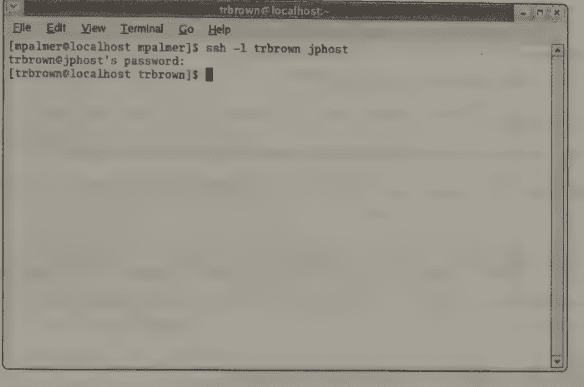
**图 1-14** 使用 GNOME 终端窗口通过 SSH 访问远程 UNIX/Linux 计算机上的另一个账户

### 项目 1-3

本项目向您展示如何使用 `date` 命令。您应该已经处于命令行界面或为本项目打开了一个终端窗口。（有关打开终端窗口的说明，请参阅项目 1-2，步骤 1。）

**显示系统日期：**

- 1. 在命令行中输入 `date`，然后按 **Enter**。
   将出现类似以下的日期：
   `Mon Apr 20 21:30:08 EST 2006` 
   您可能会看到 EDT（东部夏令时间）而不是 EST（东部标准时间），或者其他时区缩写，如 PDT（太平洋夏令时间）或 CST（中部标准时间）。同时请注意，UNIX/Linux 使用 24 小时制时钟。

- 2. 在命令行中输入 `Date`，然后按 **Enter**。您将看到以下系统错误消息：
   `bash: Date: command not found` 
   出现该系统错误消息是因为您必须像大多数 UNIX/Linux 命令一样，用小写字母输入 `date` 命令。

**以 UTC 时间显示系统日期：**

- 1. 在命令行中输入 `date -u`，然后按 **Enter**。
   将出现类似以下的日期：
   `Mon Apr 20 23:43:14 UTC 2006`

### 项目 1-4

在此项目中，您将使用 `cal` 命令来显示当前日历、儒略日历以及 1776 年 7 月的历史日历。

**使用 cal 命令：**

- 1. 在命令行中输入 `cal`，然后按 **Enter**。您看到了什么日历？
- 2. 在命令行中输入 `cal -j 2006`，然后按 **Enter**。出现了什么类型的日历？
- 3. 要确定《独立宣言》签署时的星期几，请在命令行中输入 `cal 7 1776`，然后按 **Enter**。您应该会看到一个类似于图 1-15 的日历。在这种情况下，月份和年份是命令参数。

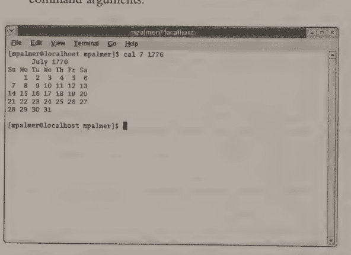
**图 1-15** 使用 `cal` 命令显示 1776 年 7 月的日历

如果您输入 `cal july 1776`，会看到类似以下错误消息，因为您必须使用数字（如 7）来表示月份（如 July）。

```
cal: illegal month value: use 1-12
```

### 项目 1-5

`who` 命令对于确定当前谁登录到系统非常有价值。在此项目中，您将尝试使用多个选项运行 `who` 命令。

使用 `who` 命令确定谁登录到了系统：

- 1. 在命令行中输入 `who`，然后按 **Enter**。
- 2. 您将看到一个列表，显示用户名、他们正在使用的终端（线路）以及他们登录的日期和时间。例如，对于您的连接，您可能会看到 pts/1、/0 或两者都有，这表明您在本地登录。远程登录的用户其线路将以 tty 开头，如 tty1、tty2 等。
- 3. 要在 `who` 命令的输出中显示一行列标题，请输入 `who -H` 并按 **Enter**。

如果有任何当前用户是从远程主机登录的，COMMENT 列将显示该主机的名称。

- 4. 空闲时间（Idle time）是指用户会话中没有活动所经过的时间。输入 `who -u` 并按 **Enter** 以查看每个用户的空闲时间。以下是 `who` 信息的示例列表。（最后一个值是进程 ID，但在进程 ID 之后您可能还会看到一条注释。）

```
mpalmer    pts/1 Aug 12  08:15     4230
sjones     tty1  Aug 12  07:56  00:29  4229
rsanchez   tty3  Aug 12  08:21    old  4238
```

输出显示，以 mpalmer 身份登录的人在最后一分钟内一直处于活动状态。账户 sjones 在过去 29 分钟内没有活动。rsanchez 这一行上的“old”一词表示过去 24 小时内没有活动。

- 5. 如果您想在同一命令行中使用多个选项，请将它们全部放在一个连字符之后。例如，输入 `who -uH` 并按 **Enter**，以查看带有空闲时间和列标题的用户列表。
- 6. 输入 `who -q` 并按 **Enter** 以查看当前用户的快速列表。您将看到一个类似于以下的列表，仅显示登录名和系统上的用户总数。

```
mpalmer sjones rsanchez
# users=3
```

- 7. 要确定您正在使用哪个终端或您在什么时间登录，请在命令行中输入 `who am i` 并按 **Enter**（见图 1-16）。出现了什么信息？如果您不确定，请输入 `who am i -H` 并按 **Enter** 查看列标题。（另一个选项是将 `whoami` 作为一个单词输入，这仅显示您的账户名称或用户 ID，以防您不确定当前正在使用哪个账户；此选项经常被系统管理员使用。还可以尝试输入 `who mom likes` 看看会发现什么。）

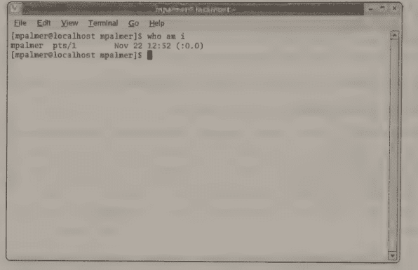
**图 1-16** 使用 *who am i*

如果您为 `who` 命令提供两个参数，将看到步骤 7 中描述的输出。例如，您可以输入 `who are you` 或 `who x x` 来查看相同的信息。传统上，UNIX/Linux 用户输入 `who am i` 来查看描述其会话的信息。

另一个与 `who` 类似的命令是 `w` 命令。系统管理员经常使用 `w` 命令，不仅为了查看谁登录了，还为了查看正在使用哪些系统资源（如 CPU 资源）。

### 项目 1-6

此时，您的屏幕可能充满了命令及其结果。每当您想要一个干净的界面时，可以使用 `clear` 命令。本项目允许您现在清除屏幕。

**清除屏幕：**

- 1. 在命令行中输入 `clear`，然后按 **Enter**。命令提示符现在位于屏幕的左上角。

### 项目 1-7

您可以使用帮助页（manual pages）来了解更多关于某个命令或程序的信息（如果该程序在帮助页中有文档）。此外，`whatis` 命令提供了特定命令和程序的快速摘要。在本项中，您将同时使用 `man` 和 `whatis` 命令。在运行 `whatis` 命令之前，应该已经创建了其对应的数据库。


使用 `man` 显示在线帮助：

- 1. 在命令行中输入 **man who**，然后按 **Enter**。你将看到图 1-17 所示的 *who* 命令的说明。

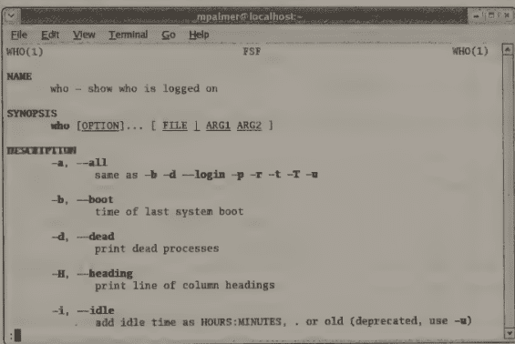
**图 1-17** 使用 *man* 进一步了解更多关于 **who** 命令的信息

- 2. 按一次或多次 **Enter** 键以查看接下来的文本行。接着按 **spacebar**（空格键）以查看更多页的文档。
- 3. 输入 **q** 退出 man 程序。
- 4. 输入 **man man** 并按 **Enter**。你将看到描述 *man* 命令的 man 页面。-M 选项的作用是什么？
- 5. 输入 **q** 退出 *man* 程序。

使用 *whatis* 命令显示命令的简短描述：

- 1. 输入 **whatis who** 并按 **Enter**。
- 2. 你将看到 *who* 命令的摘要，如下所示：

    who (1) - show who is logged on

### 项目 1-8

当你输入命令并出现拼写或其他错误时，无需重新输入整个命令。你可以使用命令行编辑功能。在这个项目中，你将练习使用编辑功能。


编辑在命令行上输入的命令：

- 1. 首先确定你正在使用的 shell。要确定 shell，请输入 `echo $SHELL` 并按 **Enter**。如果你使用的是 Bash shell，你将看到以下输出：

    `/bin/bash`

    如果你没有使用 Bash shell，请输入 `bash` 并按 **Enter**。

- 2. 输入 `who am I`，但*不要*按 Enter。
- 3. 按 **left arrow**（左箭头）键将光标移动到单词 “am” 中的字母 **a** 上。
- 4. 按 **Alt+d** 删除单词 “am”。
- 5. 按 **Ctrl+k** 删除从当前光标位置开始的命令行内容。
- 6. 按 **Ctrl+a** 将光标移动到命令行的开头。
- 7. 再次按 **Ctrl+k** 删除命令行。
- 8. 重新输入命令 `who am I` 但*不要*按 Enter。
- 9. 按三次 **Alt+b**。每次按下该组合键时，观察光标如何移动到前一个单词的第一个字符。光标应该定位在行首。
- 10. 按三次 **Alt+l**。每次按下该组合键时，光标都会移动到下一个单词第一个字符之前的位置。
- 11. 按 **Ctrl+a**，然后按 **Ctrl+k** 清空命令行。


### 项目 1-9

你可以通过在命令之间使用分号在一条命令行上执行多个命令。在这个项目中，你将练习运行多个命令。

在命令行输入多个命令：

- 1. 输入 `date ; cal` 并按 **Enter** 以查看当前日期和本月日历。
- 2. 输入 `date ; who -uH` 并按 **Enter**（见图 1-18）。`date` 命令产生输出的第一行；其余输出是 `who` 命令的结果。


**图 1-18** 在一条命令行上执行多个命令

### 项目 1-10

在这个项目中，你将使用 Bash shell 的命令历史功能来召回之前使用过的命令。正如你之后会发现的，随着你对 UNIX/Linux 使用的深入，这个命令可以节省大量重复输入的时间。

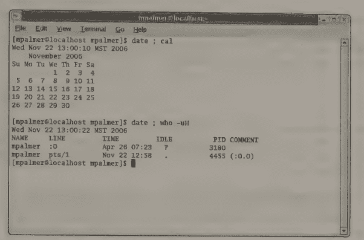

使用命令行历史：

- 1. 输入 `date` 并按 **Enter**。
- 2. 输入 `who` 并按 **Enter**。
- 3. 输入 `who -uH` 并按 **Enter**。
- 4. 输入 `clear` 并按 **Enter**。
- 5. 按四次 **up arrow**（上箭头）键。`date` 命令被召回到命令行。不要按 Enter。
- 6. 按两次 **down arrow**（下箭头）键。你看到了什么命令？按 **Enter** 执行该命令。


### 项目 1-11

你的密码是保护你的用户账户免受未经授权访问的手段。请计划经常更改密码以保持账户安全。在这个项目中，你将学习如何更改密码。

更改你的密码：

- 1. 在命令提示符后输入 `passwd`，然后按 **Enter**。
- 2. 输入当前密码并按 **Enter**。（在某些系统中，如果你登录的是 root 账户，可以跳过此步骤直接进入步骤 3。）
- 3. 输入新密码并按 **Enter**。输入时新密码不会显示在屏幕上。
- 4. 重新输入新密码并按 **Enter**，以便 UNIX/Linux 确认新密码。

> **提示** 如果确认时重新输入的密码与新密码不匹配，UNIX/Linux 会要求你重新输入密码。如果选择的密码太短、太容易被猜到或之前使用过，UNIX/Linux 可能会要求你选择另一个密码。

### 项目 1-12

`cat` 命令有多种用途，但最常用的之一是查看文件的内容。例如，在这个项目中，你将使用 `cat` 命令查看位于 `/etc` 目录中的名为 shells 的文件。该文件包含 UNIX/Linux 中可用的有效 shell 程序列表。

使用 `cat` 查看 shells 文件：

- 1. 在命令提示符后输入 `cat /etc/shells`，然后按 **Enter**（见图 1-19）。（正斜杠 (/) 用于表示目录或文件夹的更改。）你在系统中看到了哪些 shell？

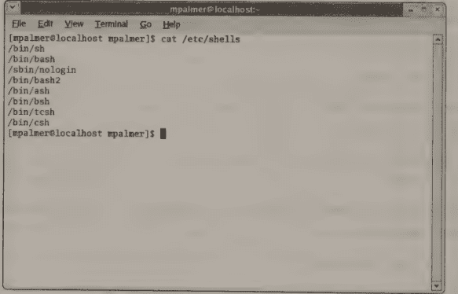
**图 1-19** 使用 `cat` 命令查看文件内容

- 2. 有时，查看带有行号的文件内容会很有帮助。`-n` 选项使 `cat` 命令在每行输出的开头显示一个数字。输入 `cat -n /etc/shells` 并按 **Enter**。你将看到与之前相同的 shell 列表，但这次每行前面都有一个数字。

### 项目 1-13

你还可以查看 /etc 目录中的另一个名为 termcap 的文件。这个多页文件包含了关于 Linux 系统支持的所有终端的许多规范。`cat` 命令不是查看此文件的实用方法，因为它比一个屏幕长得多。然而，正如你在本项目中将学到的，你可以使用 `more` 和 `less` 命令逐屏阅读大文件。

使用 `more` 命令在屏幕上查看大文件的内容：

- 1. 在命令提示符后输入 `more /etc/termcap`，然后按 **Enter**（见图 1-20）。

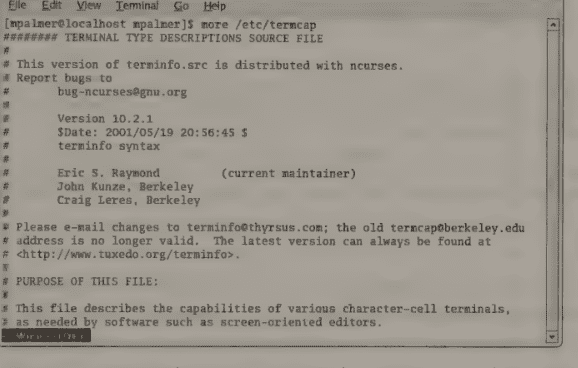
**图 1-20** 使用 `more` 命令逐屏查看大文件的内容

- 2. 按 **spacebar**（空格键）滚动到下一屏。
- 3. 输入 **q**（代表 quit）终止显示。

使用 `less` 命令在屏幕上查看大文件的内容：

- 1. 在命令提示符后输入 `less /etc/termcap`，然后按 **Enter**。你将在屏幕上看到一个长文本文件。
- 2. 按几次 **down arrow**（下箭头）键，每次向后滚动一行。
- 3. 按几次 **up arrow**（上箭头）键，每次向前滚动一行。
- 4. 按 **Pg Dn**（或 Page Down）、**spacebar**（空格键）、**z** 或 **f** 向前滚动一屏。
- 5. 按 **Pg Up**（或 Page Up）或 **b** 返回上一屏。
- 6. 当你在屏幕底部看到冒号 (:) 时，输入 **q**（代表 quit）终止显示。

### 项目 1-14

有时，你只需要瞥一眼文件的部分内容，即可确定文件中存储了什么。在这个项目中，你将使用 `head` 命令查看文件的前 10 行，然后使用 `tail` 命令查看文件的最后 10 行。

#### 查看文件的开头和结尾几行：

- 1. 输入 `head /etc/termcap` 并按 **Enter** 以查看 `/etc/termcap` 文件的前 10 行。
- 2. `-n` 选项指定 `head` 命令显示的行数。输入 `head -n 5 /etc/termcap` 并按 **Enter**。你将看到 `/etc/termcap` 文件的前五行。
- 3. `tail` 命令向你显示文件的最后几行。与 `head` 命令类似，`tail` 默认显示 10 行。输入 `tail /etc/termcap` 并按 **Enter** 以查看 `/etc/termcap` 文件的最后 10 行。
- 4. `-n` 选项指定 `tail` 命令显示的行数。输入 `tail -n 5 /etc/termcap` 并按 **Enter**。你将看到 `/etc/termcap` 文件的最后五行。

### 项目 1-15

你已经使用了 `who` 命令来查找谁登录到了计算机。在这个项目中，你将使用同一个命令配合 `>` 重定向符号将此信息保存到文本文件中。

#### 将登录系统的用户列表保存到文件：

- 1. 在命令提示符后输入 `who > current_users`，然后按 **Enter**。`who` 命令的输出不会出现在屏幕上，而是被重定向到一个名为 `current_users` 的新磁盘文件中。UNIX/Linux 将此文本文件放在当前活动目录中（即你当前使用系统所在的磁盘目录）。
- 2. 在命令提示符后输入 `cat current_users`，然后按 **Enter** 以查看当前使用系统的用户列表，如下所示：

```
mpalmer  :0    Aug 12  08:15
mpalmer  pts/1  Aug 12  08:15  (:0.0)
```

### 项目 1-16

你也可以在 `cal` 命令中使用重定向符号将日历保存到文本文件中。例如，假设你参与了一个开发项目，预计截止日期在 2006 年。你可以将该日历保存到文本文件中。


#### 要将 2006 年的日历保存到文件中：

- 1. 在命令提示符后输入 `cal 2006 > year_2006`，然后按下 **Enter**。这将创建一个名为 year_2006 的文本文件。
- 2. 输入 `less year_2006` 并按下 **Enter** 以查看由前一个命令创建的日历。使用方向键、Pg Dn（或 Page Down）、Pg Up（或 Page Up）以及其他按键在文件中滚动。
- 3. 输入 **q**（代表 quit）以终止显示。


### 项目 1-17

在操作 UNIX/Linux 时，你记得你的主管要求你在本周末前完成几项任务。在这个项目中，你决定使用 `cat` 命令配合 `>` 重定向符号来创建一个任务提醒的笔记文件。

#### 创建新文件：

- 1. 在命令提示符后输入 `cat > notes`，然后按下 **Enter**。
- 2. 输入以下内容：**Remember to order a new CD-ROM, and send the report by Thursday**，然后按下 **Enter**。
- 3. 按下 **Ctrl+d**。
- 4. 要查看刚才创建的文件，在命令提示符后输入 `cat notes`，然后按下 **Enter**。你在步骤 2 中输入的句子将显示在屏幕上。

创建笔记文件后，你记得主管还要求你完成另一项任务。你可以将提醒内容追加到现有的笔记文件中。你还希望在文件中包含相应的月份日历以供参考。

#### 向现有文件添加信息：

- 1. 在命令提示符后输入 `cat >> notes`，然后按下 **Enter**。
- 2. 输入以下内容：**Also remember to make reservations for Sept. conference**，然后按下 **Enter**。
- 3. 按下 **Ctrl+d**。
- 4. 要将 9 月的日历添加到笔记中，输入 `cal 9 2006 >> notes` 并按下 **Enter**。
- 5. 输入 `less notes` 然后按下 **Enter** 来查看文件（见图 1-21）。
- 6. 输入 **q** 退出文件。
- 7. 通过关闭终端窗口或终止 Telnet 或 SSH 会话来退出命令行显示。

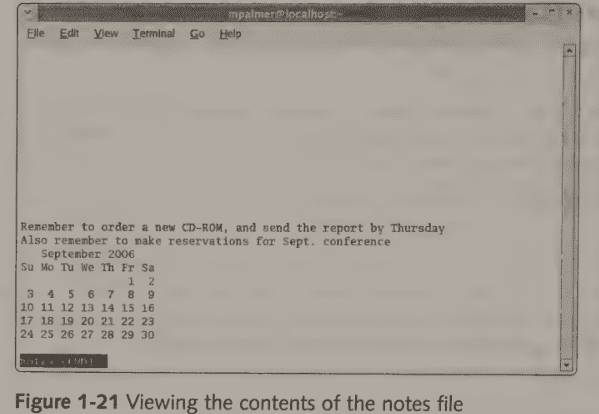
图 1-21 查看 notes 文件的内容

## 探索练习

- 1. 使用 `whatis` 命令来确定 `ls` 命令的用途。
- 2. 使用 `man` 程序来查找 `date` 命令在使用 `-R` 选项时的作用。
- 3. 使用 `man` 程序来确定在与 `clear` 命令相关方面你还应该查看哪些其他命令。
- 4. 使用 `cal` 命令来确定你出生的那天是星期几。
- 5. 使用 `cal` 命令来确定 2005 年至 2010 年之间哪一年是闰年。
- 6. 清屏，并查看在线手册以确定如何显示今天的 UTC 日期。
- 7. 显示当前的 UTC 时间。
- 8. 创建一个名为 month 的文件，包含当前月份。
- 9. 查看你在练习 8 中创建的 month 文件的内容。
- 10. 使用 `who` 命令来确定当前登录用户的空闲时间，但将该信息输出到名为 users_info 的文件中。然后查看你创建的文件。
- 11. 仅使用一个命令行命令序列，依次查看文件 month、month 和 users_info。
- 12. 使用以下方式依次查看文件 month 和 users_info：
    - `less` 命令
    - `more` 命令
- 13. 创建一个名为 who_info 的文件，其中包含 `who` 命令的文档。接着，使用 `less` 命令查看 who_info 文件的内容，并在信息中向前和向后滚动。然后使用 `tail` 命令查看 who_info 文件的最后 12 行。最后，使用 `head` 命令查看 who_info 文件的前 12 行。
- 14. 创建一个名为 favorite_foods 的文件，列出你最喜欢的食物，输入五个、六个或更多。每项食物后按下 Enter，使其单独占一行（确保在最后一项食物后也按下 Enter）。文件创建后，再添加两项不在列表中的你喜欢的食物（在最后一项食物后按下 Enter）。查看食物列表，确保你添加的两项出现在列表末尾。
- 15. 查看 `who` 的文档，然后查看 `w` 的文档。这两个命令有什么相似之处？
- 16. 使用一个命令行序列运行 `who -uH` 和 `w` 命令以比较结果。
- 17. 确定你正在使用的计算机最后一次启动的时间。
- 18. 使用命令行历史功能来确定你输入的最近两条命令。
- 19. 使用一个命令行序列运行 `who -H`、`cal 2008` 和 `clear` 命令。最后你在屏幕上看到了什么？
- 20. 使用历史功能检索你在练习 19 中使用的命令行。使用编辑功能删除单词 "clear" 并将其替换为 "date"。接下来，移至 "cal" 的开头，删除该行从 "cal" 到末尾的文本。现在，将 `-H` 更改为 `-u`。最后，添加 "; date -u"，使你最终的命令行输入为 `who -u ; date -u`。执行该命令行输入。

# 第二章：探索 UNIX/LINUX 文件系统和文件安全

**在阅读本章并完成练习后，你将能够：**

- 讨论 UNIX/Linux 文件系统
- 解释分区和 inode
- 理解根目录层级的元素
- 使用 `mount` 命令
- 解释并使用路径、路径名和提示符
- 导航文件系统
- 创建和删除目录
- 复制和删除文件
- 配置文件权限

部署 UNIX/Linux 的一个核心原因是存储和使用信息。文件系统使你能够创建和管理信息、运行程序以及保存信息以便以后使用。通过文件系统，你可以保护信息和程序，确保只有特定用户具有访问权限。你还可以将信息从一个位置复制到另一个位置，并删除不再使用的信息。

在本章中，你将探索 UNIX/Linux 文件系统，包括目录和文件的基本概念及其在分层树状结构中的组织方式。你将学习如何导航文件系统，然后通过创建目录和文件以及在目录之间复制文件来实践所学知识。你还将有机会设置目录和文件权限，这对于 UNIX/Linux 多用户系统的安全性至关重要。

## 理解 UNIX/LINUX 文件系统

在 UNIX/Linux 中，**文件 (file)** 是数据存储的基本组件。UNIX/Linux 将与之交互的所有对象都视为文件，甚至包括显示器、键盘和打印机等外接设备。**文件系统 (file system)** 是 UNIX/Linux 系统在存储设备（如硬盘和软盘）上组织文件的方式。**物理文件系统 (physical file system)** 是硬盘中经过格式化以持有文件的区域。UNIX/Linux 由多个文件系统组成，为多个用户形成虚拟存储空间。这里的 **虚拟存储 (Virtual storage)** 是指可以使用不同磁盘或文件系统（或两者结合）来分配的存储，对于操作系统和用户来说，它可以透明地作为存储进行访问。文件系统的组织是一个类似于倒置树的分层结构；也就是说，它是一个分支结构，其中顶层文件包含其他文件，而其他文件又包含进一步的文件。图 2-1 展示了一个典型的 UNIX/Linux 分层结构。

UNIX 和 Linux 系统如此灵活的原因之一是它们支持许多不同的文件系统。一些文件系统是 UNIX/Linux 原生的，而另一些则提供与不同操作系统（如 Windows）的兼容性。

大多数版本的 UNIX 和 Linux 都支持 **UNIX 文件系统 (ufs)**，这是最初的 UNIX 原生文件系统。ufs 是一个分层的（树状结构）文件系统，具有可扩展性，支持大量存储，提供出色的安全性且可靠。事实上，许多其他文件系统的特性都是模仿 ufs 的。ufs 支持 **日志记录 (journaling)**，因此如果系统意外崩溃，可以重建文件或回滚最近的更改，从而将文件或数据的完整性损坏降至最低或完全避免。ufs 还支持 **热修复 (hot fixes)**，可自动将损坏磁盘区域的数据移动到未损坏的区域。

在 Linux 中，原生文件系统称为 **扩展文件系统 (ext 或 ext fs)**，它是默认安装的。ext 是模仿 ufs 建模的，但第一个版本包含一些 bug，仅支持最大 2 GB 的文件，且不支持日志记录。然而，在 Linux 中，ext 比所有其他文件系统更具优势，因为它能够使用全套内置的 Linux 命令、文件操作和安全功能。较新版本的 Linux 使用扩展文件系统的第二个 (ext2) 或第三个 (ext3) 版本。ext2 是一个处理大磁盘存储的可靠文件系统。ext3 在 ext2 的基础上增加了日志记录增强功能。表 2-1 总结了 UNIX/Linux 通常支持的 ufs、ext 和其他文件系统。此外，表 2-2 显示了 FAT、NTFS、ext3 和 ufs 之间的比较，让你初步了解在使用文件系统时需要考虑的因素。在考虑文件系统时，请记住，该文件系统的实际能力还取决于你所使用的 UNIX/Linux 操作系统所支持的功能，甚至是该特定操作系统中的内核版本。


**图 2-2-1** 典型的 UNIX/Linux 分层结构

### 表 2-1 UNIX/Linux 支持的典型文件系统

| 文件系统 | 描述 |
| :--- | :--- |
| 扩展文件系统 (ext 或 ext fs) 及其更新版本：第二扩展文件系统 (ext2 或 ext2 fs) 和第三扩展文件系统 (ext3 或 ext3 fs) | Linux 默认自带的文件系统（兼容 Linux 和 FreeBSD）；ext3 提供了日志功能，这对于系统意外崩溃时的可靠性和恢复至关重要 |
| 高性能文件系统 (HPFS) | 为 OS/2 操作系统开发的文件系统 |
| 国际标准化组织 (ISO) 标准操作系统 9660 (Linux 中为 iso9660，Solaris 中为 hfs，FreeBSD 中为 cd9660) | 为 CD-ROM 使用而开发的文件系统；不支持长文件名 |
| 日志文件系统 (JFS) | 模仿 IBM 的 JFS 文件系统，提供成熟的日志功能，处理大文件性能快，动态 inode 分配可更好地利用空闲空间，并采用专门的方法来组织小型或大型目录结构 |
| msdos | 提供与 FAT12 和 FAT16 兼容的文件系统（不支持长文件名）；通常安装以使 UNIX 能够读取在 MS-DOS 或 Windows 中创建的软盘 |
| 网络文件系统 (NFS) | 由 Sun Microsystems 为 UNIX 系统开发，用于支持文件的网络访问和共享（如文件上传和下载），几乎所有 UNIX/Linux 版本以及许多其他操作系统都支持 |
| NT 文件系统 (NTFS) | Windows NT、Windows 2000、Windows XP 和 Windows Server 2003 使用的文件系统 |
| Proc 文件系统 | 显示内核状态和内存使用情况的文件系统（并非真正的物理文件系统，而是一个逻辑文件系统） |
| ReiserFS | 由 Hans Reiser 开发，类似于 ext3，具有日志能力。该文件系统旨在处理小文件时比 ext2 和 ext3 更快（最高可达 15 倍），旨在鼓励程序员通过使用小文件来编写高效代码 |
| Swap 文件系统 | 用于交换空间的文件系统；交换空间是专门用于在内存满时存储内存溢出信息（称为虚拟内存）的磁盘空间，几乎所有 UNIX/Linux 系统都使用它 |
| uMS/DOS | 与 Windows NT、2000、XP 和 Server 2003 使用的扩展 FAT16 兼容的文件系统，但它还支持安全权限、文件所有权和长文件名 |
| UNIX 文件系统 (ufs；也称为 Berkeley 快速文件系统) | UNIX 的原始文件系统，几乎与所有 UNIX 系统和大多数 Linux 系统兼容 |
| vfat | 与 FAT32 兼容的文件系统，支持长文件名 |
| XFS | Silicon Graphics 为 IRIX 版本的 UNIX 开发的文件系统，提供多种类型的日志功能，目标用于大型磁盘阵列（通过高速连接可用的多个磁盘存储设备） |

### 表 2-2 UNIX/Linux 支持的典型文件系统对比

| 特性 | FAT | NTFS | ext3 | ufs |
|---|---|---|---|---|
| 总卷或分区大小 | 2 GB 到 2 TB | 2 TB | 1 TB (在 Linux 中取决于内核版本)* | 1 TB (在 Linux 中)；4 GB 到 2 TB (在 UNIX 中取决于版本) |
| 最大文件大小 | FAT16 为 2 GB；FAT32 为 4 GB | 潜在 16 TB，但受限于卷大小 (最高 2 TB) | 2 GB (在 Linux 中取决于内核版本)* | 2 GB (在 Linux 中)；2 GB 到 16 TB (在 UNIX 中取决于版本) |
| 安全性 | 基于属性和共享的有限安全性 | 通过权限、组和审计选项提供广泛的安全性 | 通过权限和组提供广泛的安全性 | 通过权限和组提供广泛的安全性 |
| 通过文件活动跟踪或日志实现的可靠性 | 无 | 通过日志跟踪 | 日志记录 | 日志记录 |
| POSIX 支持 | 无 (FAT16)；有限 (FAT32) | 是 | 是 | 是 |
| 通过热修复能力实现的可靠性 | 有限 | 支持 | 支持 | 支持 |

\* 这些最大值受内核版本限制，且基于 Linux 内核 2.4 版本。例如，ext2 和 ext3 支持高达 4 TB 的文件大小，但如表所示，Linux 内核 2.4 和 2.5 版本仅支持最高 2 GB 的文件大小。在撰写本文时，Linux 内核 2.6 版本正在开发中，最大值在更新的内核中可能会增加。

## 理解标准树形结构

UNIX/Linux 文件系统的树状结构从根文件系统层级开始。根（Root）是这个基础层级文件的名称，用斜杠字符 (/) 表示。斜杠代表**根文件系统目录**。请注意图 2-1，还有一个用于存储根账户文件的目录，但它被指定为 /root，且位于主根文件系统目录 (/) 之下。

**目录**是一种特殊的文件，可以包含其他文件和目录。常规文件存储信息，例如员工姓名和地址记录或工资单信息，而目录文件存储常规文件的名称和其他目录的名称，后者被称为**子目录**。子目录被认为是父目录的子级，因为子目录是在父目录内创建的。在图 2-1 中，根系统目录 (/) 是所有其他目录的父级，例如 /bin, /boot, /dev, /etc, /home 等。/home 目录是 /jean, /tricia 和 /joseph 子目录的父级；/usr 是 /bin, /dict, /etc 子目录（位于 /usr 之下）的父级。

### 使用 UNIX/Linux 分区

磁盘中保存文件系统的部分被称为**分区**。一个磁盘可能有多个分区，每个分区彼此分离，因此不受其他分区的外部干扰（如与另一个分区相关的结构性文件问题）的影响。当你在计算机上安装 UNIX/Linux 时，首要任务之一就是决定如何对硬盘（如果你有多个硬盘，则是对所有硬盘）进行分区。

UNIX/Linux 分区使用名称标识；例如，Linux 对某些类型的磁盘使用 "hda1" 和 "hda2"。在这种情况下，前两个字母告诉 Linux 设备类型，例如 "hd" 标识常用的 IDE 类型硬盘。在这种情况下，第三个字母 "a" 表示该磁盘是主盘还是从盘（a=主盘，b=从盘）。

磁盘上的分区从 1 开始编号。名称 "hda1" 告诉 Linux 这是磁盘上的第一个分区，名称 "hda2" 表示它是同一磁盘上的第二个分区。如果你有第二个硬盘且有两个分区，则分区被标识为 "hdb1" 和 "hdb2"。

像硬盘这样的计算机存储设备被称为外围设备。计算机**外设**通过电子接口连接到计算机。两种最流行的硬盘接口是**集成驱动电子 (IDE)** 和 **小型计算机系统接口 (SCSI)**。增强型 IDE (EIDE) 是内置了速度提升的 IDE，现在比原始 IDE 技术更常用，但在计算机系统信息中经常显示为 IDE。

在个人使用的 PC 上，IDE/EIDE 硬盘驱动器（标识为 hdx）比 SCSI（发音为 "scuzzy"）更常见。SCSI 更快且更可靠，因此经常用于服务器。如果你有一个带有两个分区的主 SCSI 硬盘，这两个分区被命名为 "sda1" 和 "sda2"。图 2-2 显示了两个分区表：一个带有 IDE 驱动器，另一个带有 SCSI 驱动器。

> **提示** IDE 有时也被称为 Integrated Device Electronics。IDE 的美国国家标准协会 (ANSI) 标准实际上被命名为 Advanced Technology Attachment (ATA)。ATA 和 SCSI 是由 ANSI 赞助的 T10 和 T13 委员会开发的标准；你可以通过访问 www.T10.org 和 www.T13.org 了解更多信息。

```
Disk/dev/hda: 128 heads, 63 sectors, 767 cylinders
Units = cylinders of 8064 * 512 bytes

Device   Boot   Begin   Start   End     Blocks   Id  System
/dev/hda1   *     1       1     242    975712+   6  DOS 32-bit >=32M
/dev/hda2         243     243   767    2116899     5  Extended
/dev/hda3         243     243   275    127024+   83  Linux native
/dev/hda4         276     276   750   1028224+   83  Linux native
/dev/hda5         271     751   767    68512+    82  Linux swap

Command (m for help):
```
此分区表来自一个带有 IDE 驱动器的 Linux 系统

```
Disk /dev/sda: 255 heads, 63 sectors, 1106 cylinders
Units = cylinders of 16065 * 512 bytes

Device   Boot   Begin   Start   End     Blocks   Id  System
/dev/sda1   1     1       1     64    514048+   83  Linux native
/dev/sda2         65     65   1106    8369065     5  Extended
/dev/sda5         65     65   1084    8193118+   83  Linux native
/dev/sda6       1085   1085   1100   128488+    82  Linux swap

Command (m for help):
```
此分区表来自一个带有 SCSI 驱动器的 Linux 系统

**图 2-2** Linux 分区表示例

请注意，图 2-2 中的第一个表将 "hda" 标识为设备，这表示 IDE 驱动器。第二个表将 "sda" 标识为设备，这表示 SCSI 驱动器。

> **提示** Fedora 和 Red Hat Enterprise Linux 3.0 具有“自动分区”选项，你可以在安装这些系统时选择该选项。此工具会自动分配空间以创建本书下一节中描述的 swap、/boot 和 root 分区。

### 设置硬盘分区

对硬盘进行分区可以提供组织良好的空间来容纳你的文件系统。如果一个文件系统失效，你仍可以使用另一个。本节提供了关于如何对硬盘进行分区的通用指南。这些建议仅供参考。你如何对硬盘进行分区可能会根据你的系统配置、用户数量以及...

计划用途。分区大小以兆字节（MB，约一百万个字符）或吉字节（GB，约十亿个字符）为单位衡量。一些 UNIX/Linux 厂商建议至少创建三个分区：根分区（root）、交换分区（swap）和 /boot。

您可以从设置根文件系统的分区开始，该分区包含根文件系统目录（请记住，这被称为“/”）。分区必须在被挂载之后才能成为文件系统的一部分。内核在系统启动时会挂载根文件系统。

> 对根文件系统目录 (/) 和 root 账户使用的目录 (/root) 的引用可能会产生混淆。一些 UNIX/Linux 用户将根文件系统目录称为“/slash”，将 /root 称为“root 目录”，以帮助避免混淆。

根分区的大小取决于您执行的安装类型。例如，在 Fedora 和 Red Hat Enterprise Linux 3.0 中，根分区必须至少为 1.2 GB，才能加载工作站或便携式计算机安装所需的基础操作系统。对于基础系统，1.2 GB 的分区不足以加载 GNOME 桌面或许多软件包。如果您正在设置服务器，或者正在加载 Fedora 或 Red Hat Enterprise Linux 3.0 自带的全套软件包，请使用 5 GB 或稍大一点的分区。除了加载软件包外，这还为桌面环境（如 GNOME、KDE 或两者的组合）预留了空间。（您将在第 11 章“X Window 系统”中详细学习关于桌面的内容。）

创建根分区后，您应该设置交换分区。**交换分区 (swap partition)** 就像内存的延伸，这样 UNIX/Linux 就有更多空间来运行大型程序。通常情况下，交换分区的大小应与计算机中的 RAM 容量相同。例如，如果您有 256 MB 的 RAM，请将交换空间设为 256 MB。如果您有大量 RAM（例如 1 GB），但磁盘空间有限，可以将交换空间设为小于 1 GB。但在配置交换分区之前，请检查您所使用的 UNIX/Linux 版本的文档。例如，对于 Fedora 和 Red Hat Enterprise Linux 3.0，Red Hat 建议交换空间至少为 256 MB，或计算机 RAM 大小的两倍（取较大值）。但是，它不应该太大（例如超过 2 GB），因为磁盘访问速度比直接访问 RAM 慢，过大的交换分区会开始牺牲速度。例如，如果在 Fedora 系统中拥有 256 MB 的 RAM，为交换分区分配 2 GB 的磁盘空间是没有意义的。从性能角度来看，安装额外的 256 MB RAM 使总量达到 512 MB，然后为交换分区分配 1 GB 更有意义。

交换分区实现了虚拟内存。**虚拟内存 (Virtual memory)** 意味着您拥有看似无限的内存资源。交换分区通过在磁盘上提供交换空间并将其视为内存 (RAM) 的延伸来实现这一点。它被称为交换空间，是因为系统可以使用它在磁盘和 RAM 之间交换信息。设置交换空间可以让您的计算机运行得更快、更高效。

### 使用 UNIX/Linux 分区

在 Linux 中，您可以创建并使用多个交换分区。在繁忙的系统中，将多个交换分区分布在多个硬盘上有时可以提高应用程序的性能。

**提示**

**/boot 分区**用于存储组成内核的操作系统文件。该分区的大小取决于您所使用的 UNIX/Linux 版本中操作系统文件所需的空间。通常，这是一个相对较小的分区。例如，如果您正在安装 Fedora 或 Red Hat Enterprise Linux 3.0，可以考虑创建约 100 MB 的 /boot 分区。

如果您计划让多个用户访问您的系统，可以考虑创建一个 **/usr 分区**，用于存储用户访问的部分或全部非内核操作系统程序。这些程序包括支持计算机编程的软件开发包、网络、互联网访问、图形界面（包括桌面软件）以及大量的 UNIX/Linux 实用程序。**实用程序 (Utilities)** 是执行诸如复制文件、列出目录以及与其他用户通信等操作的程序。/usr 分区应该足够大（例如 5 GB 或更多），以容纳您安装的所有软件。

此外，如果您计划让多个用户访问系统，可以创建一个 **/home 分区**，它是所有用户目录的根目录。拥有独立的 /usr 和 /home 分区使得许多系统管理任务（例如仅备份软件或仅备份用户数据）变得简单得多。

/home 分区是所有用户工作的存储空间。如果根分区 (/) 或任何其他分区崩溃，拥有 /home 分区可以确保您不会丢失所有用户信息。虽然普通用户账户被限制读取其他分区中的信息，但您拥有并可以访问主目录中的大多数文件。您可以根据选择授予或拒绝对文件的访问权限。有关文件所有权的更多信息，请参阅本章稍后关于“为安全配置文件权限”的内容。

最后，您可以创建一个 **/var 分区** 来保存临时创建的文件，例如用于打印文档的文件（后台打印文件/spool files）以及用于记录监控和管理数据的文件（通常称为日志文件）。Fedora 和 Red Hat Enterprise Linux 3.0 还将 /var 分区用于更新操作系统的文件。建议 /var 分区使用 3.0 GB 以上的空间。

考虑一家计划设置 Red Hat Enterprise Linux 3.0 服务器的小型地质研究公司，该服务器拥有 512 MB 的 RAM。该公司可能会设置 1024 MB 的交换分区。/boot 分区为 100 MB。他们计划为用户安装 20 GB 的非内核程序，因此可能会有一个 25 到 40 GB 的 /usr 分区（为目前未预料到的程序预留空间）。15 位用户中的每一位将在其主目录中被分配 4 GB 空间，这意味着 /home 分区必须至少 60 GB（再增加 5 或 10 GB 可以为额外需求提供缓冲）。最后，应该创建一个 5 GB 的 /var 分区，因为所有用户都会打印大型文档，且经常在同一时间进行。

## 使用 Inodes

在 unix 和 ext 文件系统中，包含目录和文件的分区是建立在信息节点（即 inodes）概念之上的。每个目录或文件都有一个 inode，并由一个 inode 编号标识。Inode 0 包含目录结构的根 (/)，是所有其他 inode 的起点。

一个 inode 包含：
- (1) 目录或文件的名称
- (2) 关于该目录/文件的通用信息
- (3) 关于如何在磁盘分区上定位该目录/文件的信息（指针）。

在通用信息方面，每个 inode 指明了用户和组的所有权、访问模式（读、写和执行安全权限，将在本章稍后讨论）、文件的大小和类型、文件创建日期、文件最后一次修改和读取的日期。

指针信息基于逻辑块。每个磁盘被分为逻辑块，大小（取决于 UNIX/Linux 版本）从 512 到 8192 字节或更多（但块也可以根据文件系统的需要被进一步分为多个子块或分数块）。文件的 inode 包含一个指针（编号），告知操作系统如何定位一组包含特定文件内容的一个或多个逻辑块中的第一个块（或者，它指定目录或文件所使用的第一个块的块数或链接数）。简而言之，inode 告诉操作系统在硬盘的哪里可以找到文件。

UNIX/Linux 文件系统中的一切都与 inode 绑定。空间每次分配一个块或一个块的分数。目录实际上是简单的文件，其 inode 中被标记了目录标志。文件系统本身由超级块（superblock）标识。超级块包含关于特定分区上块布局的信息。这些信息是寻找文件系统中任何内容的关键，且不应更改。如果没有超级块，则无法访问文件系统。因此，在通过分区和格式化创建文件系统时，超级块的多个副本会被写入文件系统中。如果超级块损坏，您可以将其中一个超级块副本覆盖到原始的损坏超级块上，以恢复对文件系统的访问。

您可以使用 `ls -i` 命令来显示目录和文件的 inode 信息，您将在本章稍后学习此命令。

对于学习 UNIX/Linux 的初学者来说，设置分区可能看起来是一项艰巨的任务。幸运的是，包括 Fedora 和 Red Hat Enterprise Linux 在内的许多操作系统都提供了在安装过程中自动设置分区的工具（见附录 C，“如何安装 Fedora 和 Apache Web 服务器”）。在您拥有更多 UNIX/Linux 经验之前，建议使用这些工具。


## 探索根目录层次结构

根（/）文件系统在系统启动时由内核将其挂载。**挂载**（mount）一个文件系统是指将其连接到目录树结构中。系统管理员使用 `mount` 命令来挂载文件系统。

UNIX/Linux 必须在任何程序访问该文件系统上的文件之前先挂载该文件系统。挂载后，根文件系统在初始系统检查和启动序列期间仅可读——之后，它将被重新挂载为可读写。根文件系统包含所有用于文件系统修复、从备份恢复、启动系统以及初始化所有设备和操作资源的必需程序。它还包含挂载所有其他文件系统的信息。除这些必需内容外，不应有任何其他内容驻留在根分区中。

> **提示** 您可以使用存储在软盘或磁带上的救援文件来恢复崩溃的根分区。随 Fedora 和 Red Hat Enterprise Linux 3.0 提供的安装介质可用于创建救援盘。

以下章节描述了根文件系统下常用的目录。

### /bin 目录

`/bin` 目录包含**二进制文件**或**可执行文件**，这些是启动系统和执行其他基本系统任务所需的程序。此目录包含所有用户在 UNIX/Linux 中工作所需的许多程序。

### /boot 目录

`/boot` 目录通常包含 **bootstrap loader**（启动加载程序，即启动操作系统的实用程序）所需的文件；它还包含内核（操作系统）镜像。

### /dev 目录

`/dev` 中的文件引用系统设备。它们用于访问系统设备和资源，例如硬盘、鼠标、打印机、控制台、调制解调器、内存、软盘和 CD-ROM 驱动器。所有 UNIX/Linux 版本在 `/dev` 目录中都包含许多设备文件，以适应可连接到计算机的不同供应商设备。

UNIX/Linux 设备通过使用**设备特殊文件**进行管理，这些文件包含关于 I/O 设备的信息，当访问设备时，操作系统内核会使用这些信息。在许多 UNIX/Linux 系统中，存在两种类型的设备特殊文件：

- **块特殊文件**（也称为块设备文件）用于管理涉及处理数据块的随机访问设备，包括 CD-ROM 驱动器、硬盘驱动器、磁带驱动器和其他存储设备。
- **字符特殊文件**（也称为字符设备文件）处理逐字节的数据流，例如通过串行或通用串行总线 (USB) 连接，包括终端、打印机和网络通信。USB 是大多数现代计算机上的一种相对高速的 I/O 端口。它用于连接鼠标、键盘、显示器、数字声卡、磁盘驱动器和其他外部计算机硬件，如打印机和数字相机。

> 另一种管理设备的方法是使用命名管道，它提供了一种处理内部通信的方法，例如将文件输出重定向到显示器。您可以在第 5 章中学习关于管道的内容。

当您安装 UNIX/Linux 操作系统时，会为系统中已经安装的设备创建设备特殊文件。表 2-3 显示了设备特殊文件的示例。

**表 2-3 UNIX/Linux 设备特殊文件**

| 文件 | 描述 |
| :--- | :--- |
| /dev/console | 用于控制台组件，例如连接到计算机的显示器和键盘（许多系统在同一时间也使用 /dev/tty0） |
| /dev/fdn | 用于软盘驱动器，其中 n 是驱动器编号，例如 fd0 代表第一个软盘驱动器 |
| /dev/hdxn | 用于 IDE 和 EIDE 硬盘，其中 x 是代表磁盘的字母，n 代表分区编号，例如 hda1 代表第一个磁盘的第一个分区 |
| /dev/modem | 用于调制解调器，是设备特殊文件的符号链接（通常链接到 /dev/ttys1），符号链接允许一个文件或目录指向另一个 |
| /dev/mouse | 用于鼠标或其他指针设备，是设备特殊文件的符号链接（通常链接到 /dev/ttys0） |
| /dev/sdxn | 用于连接到 SCSI 接口的硬盘，其中 x 是代表磁盘的字母，n 代表分区，例如 sda1 代表第一个 SCSI 驱动器及其上的第一个分区 |
| /dev/stn | 用于 SCSI 磁带驱动器，其中 n 是驱动器编号，例如 st0 代表第一个磁带驱动器 |
| /dev/ttyn | 用于连接到计算机的串行终端 |
| /dev/ttysn | 用于连接到计算机的串行设备，例如 ttys0 用于鼠标 |

如果您需要为新设备创建设备特殊文件，可以使用 `mknod` 命令，一般步骤如下：

1. 登录 root 账户。
2. 进入终端窗口或命令提示符。
3. 输入 `cd /dev` 并按 Enter 键切换到 `/dev` 文件夹。
4. 使用 `mknod` 命令加上设备特殊文件名（如 `ttys42`）、文件类型（如字符文件 `c` 或块文件 `b`）以及内核使用的主次设备号（这些值请咨询设备制造商）。例如，您可以输入 `mknod ttys20 c 8 68` 并按 Enter 键来创建一个新的串行设备。

您可以通过输入 `ls -l /dev` 并按 Enter 键来查看设备文件列表。（有关 `ls` 命令的更多信息，请参阅本章后面的“列出目录内容”部分。）列表最左侧的字符告诉您该文件是字符设备 (`c`) 还是块设备 (`b`)，如图 2-3 所示。尝试进行上手项目 2-8，以查看计算机上 `/dev` 目录的内容。上手项目 2-8 还会教您如何使用 `ls` 命令。

您将在 `/dev` 目录中看到的项目类型解释如下：

- `console` 指系统的控制台，即直接连接到系统的显示器。
- `ttyS1` 和 `cua1` 是用于访问串行端口的设备。例如，`/dev/ttyS1` 指的是 PC 上的通信端口 COM2。
- `cua` 设备是与调制解调器配合使用的呼出设备。
- 以 `hd` 开头的设备名称用于访问 IDE 硬盘。
- 以 `sd` 开头的设备名称是 SCSI 驱动器。
- 以 `lp` 开头的设备名称用于访问并行端口。`lp0` 设备指的是行打印机 LPT1。
- `null` 是一个“黑洞”；发送到此设备的任何数据都会永远消失。当您想要抑制命令输出显示在屏幕上时，请使用此设备。第 6 章和第 7 章（分别为“Shell 脚本编程入门”和“高级 Shell 编程”）讨论了这项技术。
- 以 `tty` 开头的设备名称是指终端或控制台。您的 Linux 系统中有多个“虚拟控制台”。（您可以通过按下 `Ctrl+Alt+F1`、`Ctrl+Alt+F2` 等来访问它们。）以 `pty` 开头的设备名称是“伪终端”。它们用于为远程登录会话提供终端。例如，如果您的机器在网络上，传入的远程登录将使用 `/dev` 中的一个 `pty` 设备。

### /dev 中的一些块设备

| 权限 | 所有者 | 组 | 设备 | 主, 次 | 日期 | 设备名称 |
|---|---|---|---|---|---|---|
| brw-rw-r-- | 1 | root | floppy | 2, 0 | May 5 2006 | fd0 |
| brw-rw---- | 1 | root | disk | 3, 0 | May 5 2006 | hda |
| brw-rw---- | 1 | root | disk | 3, 1 | May 5 2006 | hdb |
| brw-rw---- | 1 | root | disk | 3, 2 | May 5 2006 | hdc |
| brw-rw---- | 1 | root | disk | 3, 3 | May 5 2006 | hdd |
| brw-rw---- | 1 | root | disk | 1, 0 | May 1 2006 | sda |
| brw-rw--- | 1 | root | disk | 11, 0 | May 5 2006 | scd0 |
| brw-rw---- | 1 | root | disk | 11, 1 | May 1 2006 | scd1 |
| brw-rw---- | 1 | root | disk | 8, 0 | May 5 2006 | sda |
| brw-rw---- | 1 | root | disk | 8, 1 | May 5 2006 | sdb |
| brw-rw---- | 1 | root | disk | 8, 2 | May 5 2006 | sdc |
| brw-rw---- | 1 | root | disk | 8, 3 | May 5 2006 | sdd |
| brw-rw---- | 1 | root | disk | 8, 4 | May 5 2006 | sde |

| 文件类型 | 含义 |
|---|---|
| d | 目录 |
| s | 套接字 |
| b | 块设备 |
| c | 字符设备 |

### /dev 中的一些字符设备

| 权限 | 所有者 | 组 | 设备 | 主, 次 | 日期 | 设备名称 |
|---|---|---|---|---|---|---|
| crw-rw---- | 1 | root | root | 4, 1 | Jan 4 01:07 | console |
| crw-rw---- | 1 | root | uucp | 5, 1 | Jan 4 01:07 | cua0 |
| crw-rw---- | 1 | root | uucp | 5, 2 | May 5 2006 | cua1 |
| crw-rw---- | 1 | root | uucp | 5, 3 | May 5 2006 | cua2 |
| crw-rw---- | 1 | root | uucp | 5, 4 | May 5 2006 | cua3 |
| crw-rw---- | 1 | root | root | 44, 0 | May 5 2006 | cuio |
| crw-rw---- | 1 | root | daemon | 6, 0 | May 5 2006 | lp0 |
| crw-rw---- | 1 | root | daemon | 6, 1 | May 5 2006 | lp1 |
| crw-rw---- | 1 | root | xmrem | 1, 0 | May 1 2006 | mem |
| crw-rw---- | 1 | root | root | 1, 1 | May 5 2006 | null |
| crw-rw-rw- | 1 | root | tty | 2, 0 | May 5 2006 | pty0 |
| crw-rw---- | 1 | root | tty | 2, 1 | May 5 2006 | pty1 |
| crw-rw---- | 1 | root | root | 5, 0 | May 5 2006 | ptyal |
| crw---- | 1 | root | jdent | 4, 0 | May 5 2006 | tty0 |
| crw-r--r-- | 1 | root | root | 4, 1 | Jan 4 18:29 | ttyS1 |

**图 2-3** /dev 中的设备文件

### /etc 目录

`/etc` 目录包含计算机启动时系统使用的配置文件。该目录的大部分空间预留给系统管理员，其中包含存储在文件中的系统关键信息：

- `fstab`——文件系统到设备（如硬盘和 CD-ROM）的映射信息
- `group`——用户组信息文件
- `inittab`——init 程序的配置文件，该程序在系统启动时执行基本任务
- `login.defs`——login 命令的配置文件
- `motd`——今日消息（Message of the Day）文件
- `passwd`——用户信息文件
- `printcap`——打印机能力信息文件
- `profile` 和 `bashrc`——登录时执行的文件，允许系统管理员为所有用户设置全局默认值


- rc—系统启动时运行的脚本或脚本目录
- termcap—终端能力信息文件

为了初步了解 /etc 目录中的内容，请尝试查看 fstab 文件的内容。输入 `more /etc/fstab`，你将看到文件系统以及软盘和 CD-ROM 驱动器等设备的默认设置信息。

### The /home 目录

**/home** 目录通常位于 /home 分区，用于为用户提供磁盘空间，例如在拥有多个用户账户的系统中。例如在图 2-1 中，三个用户账户分别拥有三个主目录：/home/jean、/home/tricia 和 /home/joseph。

### The /lib 目录

该目录存放内核模块、安全信息和共享库镜像。程序员通常使用共享库文件来共享代码，而不是在自己的程序中创建该代码的副本。这使得程序体积更小，而且在某些情况下，利用这种结构可以运行得更快。该目录中的许多文件是到其他库文件的符号链接。**符号链接（symbolic link）**是一个名称、文件名或目录名，其中包含一个指向同一目录或系统中另一个目录中文件或目录的指针。符号链接的另一个相关用途是创建用于访问目录的名称或快捷方式表示法。在目录的长格式列表中，最左侧的 *l* 表示该文件是符号链接。

节省输入时间的一种方法是为具有长路径的目录创建符号链接。例如，假设你将许多文件存储在 /data/manufacturing/inventory/parts 子目录中。每次你想列出该子目录的内容时，必须输入 `ls /data/manufacturing/inventory/parts`。如果你输入 `ln -s /data/manufacturing/inventory/parts` 为该目录创建符号链接（`ln` 是创建链接的命令，`-s` 是符号链接的选项），那么今后你只需输入 `ls parts` 即可查看其内容。要了解更多关于 `ln` 命令的信息，请键入 `man ln` 或 `info ln` 并按回车键。

### The /mnt 目录

系统管理员用于临时挂载的挂载点位于 /mnt 目录中。临时挂载用于挂载可移动存储介质（如软盘或 CD），以便可以轻松卸载并快速移除。例如，你可能会挂载一张 CD-R 来刻录光盘，然后迅速将其卸载，以便将光盘交给办公室同事。/mnt 目录通常分为多个子目录，如 /mnt/cdrom 和 /mnt/floppy，以便清晰地指定设备类型。

### The /proc 目录

/proc 目录不占用磁盘空间；它是一个仅在内存中分配的**虚拟文件系统**。/proc 中的文件是指向系统上运行的各种进程以及关于操作系统内核的详细信息的。

### The /root 目录

/root 目录是 root 用户（系统管理员）的主目录。

### The /sbin 目录

/sbin 目录是为系统管理员预留的。启动系统的程序、文件系统修复所需的程序以及关键的网络程序都存储在这里。

### The /tmp 目录

许多程序在处理周期期间需要一个临时位置来存储数据。这些文件的传统位置是 /tmp 目录。例如，一个工资单程序在处理 5000 人的工资单时，可能会创建多个临时数据文件。这些临时文件可能会短暂保存用于计算税收和退休金扣除额的数据，然后在扣除信息被写入磁带或 CD-R 并发送给联邦和州机构后被删除。

### The /usr 目录

该目录通常位于 /usr 分区，存放提供给用户的软件。这些软件可能是会计程序、制造程序、研究应用程序或办公软件。

### The /var 目录

/var 目录位于 /var 分区，包含大小经常变化的子目录。这些子目录包含错误日志和其他对系统管理员很有用的系统性能日志文件。例如，/var/spool/mail 子目录可以包含来自网络的入站邮件。另一个例子是 /var/spool/lpd 子目录，它是用于存放打印文件直到其完全传输到打印机的默认目录。

> 尝试查看一个日志文件的内容，以了解 /var 目录中包含什么。例如，以 root 身份登录并输入 `more /var/log/boot.log`，查看有关系统启动的信息是如何为了记录和故障排除而保留的。

## 使用 mount 命令

正如你所学到的，UNIX/Linux 在系统启动时使用 `mount` 命令将文件系统分区连接到目录树。用户可以访问几乎任何已挂载且被授予权限的文件系统。可以使用 `mount` 命令在任何时间挂载额外的文件系统。除了硬盘之外，最常被挂载的文件系统设备是软盘和 CD-ROM 驱动器。`mount` 命令的语法如下：

`mount [-option] [device-name mount-point]`

### 详解

- 使用 -t 选项指定要挂载的文件系统。
- device-name 标识要挂载的设备。
- mount-point 标识你想要挂载文件系统的目录。

> 为了确保系统安全，通常只有 root 用户可以使用 `mount` 命令。普通用户有时可以挂载和卸载位于软盘和 CD 上的文件系统，但某些操作系统甚至要求使用 root 账户来挂载其中一个或两者。

假设你想访问组织中 CD-ROM 上的文件。你或系统管理员可以通过在 CD-ROM 驱动器中插入光盘，然后使用以下 `mount` 命令来挂载 CD-ROM：

`mount -t iso9660 /dev/cdrom /mnt/cdrom`

此命令将 CD 挂载到位于 /dev 目录中名为 "cdrom" 的设备上。在 UNIX/Linux 中，实际的挂载点是 /mnt/cdrom，这是一个引用 CD-ROM 设备的目录。CD 挂载后，你可以通过 /mnt/cdrom 目录访问其文件。

UNIX/Linux 支持几种不同类型的文件系统。文件系统类型通过 -t 选项指定。CD-ROM 被分类为 iso9660 设备，因此系统管理员输入 -t，随后跟参数 iso9660 来指定 CD-ROM 的文件系统。

## 第 2 章 探索 UNIX/Linux 文件系统与文件安全性

> CD-ROM 挂载后，你可以通过输入不带选项或参数的 `mount` 命令来查看设备路径、文件系统和权限。

许多系统仍然包含软盘驱动器。要挂载软盘，首先插入软盘，然后使用以下命令：

`mount -t filesystem /dev/fd0 /mnt/floppy`

此命令将第一个软盘驱动器（设备 /dev/fd0）中的软盘挂载到 UNIX/Linux 文件结构中的挂载点 /mnt/floppy。任何写入 /mnt/floppy 目录的文件都会被写入软盘。在大多数 UNIX/Linux 系统上，你可以指定几种不同的软盘文件系统，例如用于使用 FAT 文件系统（支持长文件名）的 MS-DOS 和 Windows 系统）的 vfat。

> 在某些系统中（包括 Fedora，但不包括 Red Hat Enterprise Linux 3.0），如果你在挂载软盘时没有使用 -t 选项指定文件系统类型，`mount` 命令会自动检测文件系统类型，例如对于预格式化为 FAT 的软盘。

在访问手动挂载的文件系统后，系统管理员在移除存储介质之前，使用 `umount` 命令将其卸载，如下例所示：

`umount /mnt/floppy`
`umount /mnt/cdrom`

语法：`umount [mount-point]`

### 详解

- mount-point 标识要卸载的目录。

> 注意该命令是 `umount` 而不是 `unmount`；`umount` 中没有第二个字母 "n"。

尝试通过动手项目 2-1 使用 `mount` 命令来查看在你所使用的 UNIX/Linux 版本中可以挂载的文件系统，以及查看当前已挂载的文件系统。此外，动手项目 2-2 将使你能够挂载 CD-ROM、查看其中的文件，然后将其卸载。此外，请参阅附录 B“UNIX/Linux 命令语法指南”，以获取 `mount` 和 `umount` 命令的简短描述。


## 使用路径、路径名和提示符

正如你所学到的，所有 UNIX/Linux 文件都存储在文件系统的目录中，并从根文件系统目录开始。要指定一个文件或目录，请使用其**路径名 (pathname)**，它沿着文件系统的分支指向所需的文件。正斜杠 (/) 用于分隔每个目录名。例如，假设你想指定名为 phones.502 的文件的位置。你知道它位于 Jean 的主目录下的 source 目录中，即 /home/jean/source，如图 2-1 所示。你可以将该文件的位置指定为 /home/jean/source/phones.502。

### 使用和配置命令行提示符

UNIX/Linux 命令行提示符可以配置为显示你在文件系统中的目录位置。例如，提示符 `[jean@localhost jean]$` 是系统管理员首次创建名为“jean”的用户账户时，系统生成的默认提示符。提示符 `[jean@localhost jean]$` 意味着“jean”是正在名为“localhost”的主机机器上，且位于其以用户名“Jean”命名的主目录中工作的用户。换句话说，“jean 在 localhost 的主目录中”。当 Jean 将位置更改为 /home/jean/source 时，她的提示符看起来像这样：

```
[jean@localhost source]$
```

> 提示：当系统最初安装时，默认的 root 提示符如下所示：`[root@localhost root]#`。为了简化本书中命令行提示符的含义，步骤中使用 `$` 代表普通用户的命令行提示符，使用 `#` 代表系统管理员的命令行提示符。

当你登录时，你的命令行提示符会自动配置。一个名为 PS1 的环境变量包含特殊的格式化字符，用于确定提示符的配置。环境变量是存储区域中的一个值，当你登录时 UNIX/Linux 会读取它。环境变量可用于创建和存储默认设置，例如你使用的 shell 或你偏好的命令行提示符格式。你将在第 6 章中学习更多关于环境变量及其配置方法的内容。图 2-4 展示了 Fedora 和 Red Hat Enterprise Linux 3.0 中用户账户的 PS1 变量默认配置方式。

在图 2-4 中，PS1 变量包含：`[\u@\h \W]\$`。以 `\` 开头的字符是 Bash shell 的特殊格式化字符。`\u` 打印用户名，`\h` 打印系统主机名，`\W` 打印工作（当前）目录的名称。`\$` 字符根据登录用户的类型打印 `#` 或 `$`。方括号 `[` 和 `]` 以及分隔 `\h` 和 `\W` 的空格不是特殊字符，因此它们将按原样打印。当 Jean 登录到 localhost 系统并在其主目录中工作时，她的提示符将以之前显示的格式出现为 `[jean@localhost jean]$`。

表 2-4 显示了用于配置 Bash shell 提示符的其他格式化字符。

**图 2-4** 查看 PS1 变量的内容

**表 2-4** 用于配置 Bash shell 提示符的格式化字符

| 格式化字符 | 用途 |
| :--- | :--- |
| `\a` | 发出警报声 |
| `\d` | 显示日期 |
| `\e` | 使用转义字符 |
| `\h` | 显示主机名 |
| `\j` | 显示后台作业的数量 |
| `\n` | 显示新行 |
| `\nnn` | 显示与八进制数 *nnn* 对应的 ASCII 字符 |
| `\r` | 在提示符中放置回车符 |
| `\s` | 显示 shell 名称 |
| `\t` | 显示时间 |
| `\u` | 显示用户名 |
| `\v` | 显示 Bash 版本和发行号 |
| `\w` | 显示工作目录的路径 |
| `\A` | 以 24 小时格式显示时间 |
| `\D(format)` | 以特定格式显示时间 |
| `\H` | 与 `\h` 效果相同 |
| `\T` | 以 12 小时格式显示时间 |
| `\V` | 显示 Bash 版本、发行号和补丁级别 |
| `\W` | 仅显示工作目录的名称，不包含其他路径信息 |
| `\!` | 显示当前命令在命令历史中的编号 |
| `\#` | 显示当前会话中的命令编号 |
| `\$` | 如果用户是 root 则显示 #，否则显示 $ |
| `\@` | 以 12 小时格式显示时间 |

**表 2-4** 用于配置 Bash shell 提示符的格式化字符（续）

| 格式化字符 | 用途 |
| :--- | :--- |
| `$PWD` | 显示当前工作目录的路径 |
| `\[` | 标记非打印字符序列的开始，例如控制序列 |
| `\]` | 标记非打印字符序列的结束 |
| `\\` | 显示一个 \ 字符 |

实操项目 2-3 将让你有机会查看用户账户的 PS1 环境变量内容，然后配置你的 Bash shell 提示符。

## pwd 命令

如果你配置的提示符不显示工作目录，你可以使用 `pwd` 命令（`pwd` 代表 print working directory）来验证你所在目录及其目录路径。该命令在多种情况下非常重要。其一，当你列出目录内容却没找到预期文件时，在执行其他操作（如还原文件）之前，它可以帮助确保你在正确的目录中。在其他情况下，你可能创建了一个只能在特定目录下运行的脚本或程序。如果脚本或程序无法工作，请先使用 `pwd` 验证你是否在正确的目录中。实操项目 2-4 将引导你使用 `pwd`。

**语法** `pwd`

**解析**

- 使用 `pwd` 来确定你当前的工作目录。
- 通常，该命令没有选项。

> `pwd` 对所有用户来说都是一个简单但重要的命令。通常，用户、程序员和管理员都会因为在错误的目录下工作而遇到错误或放错文件。定期使用 `pwd` 对于确保你处于正确的位置具有极高的价值。

## 浏览文件系统

要浏览 UNIX/Linux 目录结构，请使用 `cd` (change directory) 命令。其语法为：

**语法** `cd [directory]`

**解析**

- *directory* 是你想要切换到的目录名称。目录名以通往目的地的路径表示，使用斜杠 (/) 分隔子目录名称。

当你登录时，你会开始于你的主目录，该目录位于 `/home` 主目录下。当你更改目录后想要返回主目录时，输入 `cd` 并按回车键。（某些 shell 还使用波浪号 (~) 来表示用户的主目录。）尝试实操项目 2-5 来使用 `cd` 命令。

在 UNIX/Linux 中，你可以将路径称为绝对路径或相对路径。**绝对路径 (absolute path)** 从根级别开始，并列出到达目标文件的所有子目录。例如，假设 Becky 在她的主目录下有一个名为 lists 的目录。在 lists 目录中，她有一个名为 todo 的文件。到 todo 文件的绝对路径是 `/home/becky/lists/todo`。这个路径名显示了通往 todo 文件路径中的每一个目录。

> 每当 / 符号是路径中的第一个字符时，它就代表根文件系统目录。路径中的所有其他 / 符号则用于分隔其他名称。

**相对路径 (relative path)** 则走一段较短的距离。你可以输入相对路径，从当前工作目录开始并由此推进。在图 2-1 中，Jean、Tricia 和 Joseph 的主目录下 each 都有子目录。每个人都有一个名为 “source” 的子目录。因为 Jean 正在她的主目录中工作，她可以通过输入以下命令并按回车键来切换到她的 source 目录：

```
cd source
```

在这个被称为相对路径寻址的示例中，Jean 直接从她的主目录 `/home/jean` 切换到她的 source 目录。她的 source 目录距离当前位置 `/home/jean` 只有一级。一旦她输入更改目录命令 `cd source`，系统就会将她带到 `/home/jean/source`，因为它是相对于她当前位置的。

如果位于 `/home/tricia` 目录的 Tricia 输入命令 `cd source`，系统会将她带到 `/home/tricia/source` 目录。如果 Tricia 要切换到 Jean 的 source 目录，她可以输入：

```
cd /home/jean/source
```

这个示例使用了绝对路径寻址，因为 Tricia 从根文件系统目录开始，遍历所有中间目录。 （当然，Tricia 需要访问 Jean 的 source 目录的权限，这将在本章稍后部分讨论。）


实操项目 2-6 使您能够练习绝对路径和相对路径的寻址。

## 使用点（Dot）和点点（Dot Dot）寻址技术

UNIX/Linux 将单个点字符 `.` 解释为当前工作目录，将点点（两个连续的点 `..`）解释为父目录。输入以下命令将使您保持在当前目录中：

```bash
cd .
```

> 提示：在使用 UNIX/Linux 命令时，请始终密切注意空格。例如，在 `cd .` 和 `cd ..` 中，cd 与单个或双个点字符之间有一个空格。请记住，在 UNIX/Linux 命令之后、包含该命令的选项或参数之前，必须始终使用空格。

如果您使用两个点，您将返回到父目录。在两个点之间不要输入空格。接下来的示例显示用户 jean 目前在 `/home/jean/source` 目录中，返回到她的主目录 `/home/jean`：

```bash
cd ..
```

假设您是处于主目录中的 Jean，并且想要进入 Tricia 的 source 目录。请使用以下命令：

```bash
cd ../tricia/source
```

在前面的示例中，点点告诉操作系统进入父目录，即 `/home`。第一个 `/` 分隔符后跟在目录名之后，告诉操作系统前进到 tricia 子目录。第二个 `/` 分隔符后跟目录名，告诉 UNIX/Linux 前进到 source 子目录，即最终目的地。如果斜杠字符之前或之后没有名称，UNIX/Linux 将其视为根文件系统目录。否则，`/` 用于分隔一个目录与另一个目录。实操项目 2-7 将让您练习使用点和点点约定。

## 列出目录内容

使用 `ls`（list）命令来显示目录的内容，包括文件和其他目录。当您在不带任何选项或参数的情况下使用 `ls` 命令时，它会显示当前工作目录中常规文件和目录的名称。您可以为 `ls` 命令提供一个参数，以查看特定文件的列表或查看特定目录的内容，例如 `ls myfile` 或 `ls /etc`。

### 语法 `ls` [-option] [*directory or filename*]

### 剖析

- 常见参数包括目录名称（包括该目录的路径）或文件名。
- 有用的选项包括：
    - `-l` 查看文件和目录的详细信息
    - `-S` 按文件或目录的大小排序
    - `-s` 按大小（块大小）排序
    - `-X` 按扩展名排序
    - `-r` 按反序排序
    - `-t` 按文件或目录最后修改的时间排序
    - `-a` 显示隐藏文件
    - `-i` 查看与目录或文件关联的 inode 值

> 请记住，当您登录时，您从主目录开始，该目录为 `/home/username`。

您还可以使用选项来显示特定信息或比单纯使用命令提供更多的信息。`ls` 命令的 `-l` 选项会生成一个详细的目录列表，其中包含关于每个文件的更多信息，如图 2-5 所示。

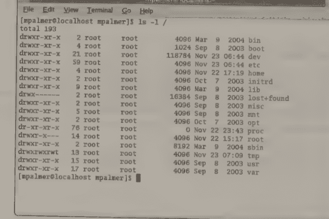
**图 2-5 使用 `ls -l` 查看根文件系统目录内容**

注意图 2-5 中关于 /bin 目录的第一行：

```
drwxr-xr-x 2 root root 4096 Mar 9 2004 . bin
```

如果您查看最右侧的列，您会看到 bin，这是一个文件的名称。其左侧的所有列都包含关于文件 bin 的信息。以下是每列信息的描述（从左到右）：

- **文件类型和访问权限**——显示的第一列信息是以下一组字符：`drwxr-xr-x`。列表中的第一个字符 d 表示该文件实际上是一个目录。如果 bin 是一个普通文件，则会出现连字符 (-)。其余字符表示文件的访问权限。您将在本章稍后的“为安全性配置文件权限”部分详细了解这些内容。
- **链接数**—第二列是硬链接到此文件的文件数量。（您将在第 5 章“高级文件处理”中详细了解链接。）如果该文件是一个目录，则为其包含的子目录数量。bin 的列表显示它包含两个 (2) 条目。（目录始终包含至少两个条目：点和点点。）
- **所有者**—第三列是文件的所有者。root 用户拥有 /bin 目录。
- **组**—第四列是拥有该文件的组。root 组拥有 /bin 目录。
- **大小**—第五列显示文件的字节大小，/bin 目录的大小为 4096。
- **日期和时间**—第六列和第七列显示目录或文件创建的日期，或者如果目录或文件的信息已被更改，则显示最后修改的日期和时间。
- **名称**—第八列显示目录或文件名。

您还可以将 -a 选项与 `ls` 命令一起使用来列出**隐藏文件**。隐藏文件以点开头。操作系统通常使用隐藏文件来保存配置信息和其他用途。要查看目录或文件的 inode 值，请使用 -i 选项。

尝试通过实操项目 2-8 来使用 `ls` 命令。另外，请参阅附录 B 以获取 `ls` 命令的简要描述。

## 使用通配符

**通配符**（wildcard）是一种特殊字符，可以代表任何其他字符，或者在某些情况下代表一组字符。当您想要处理多个名称相似的文件，或者无法记得某个文件的确切名称时，通配符非常有用。UNIX/Linux 支持几种通配符字符。在本节中，您将学习两种：`*` 和 `?`。

`*` 通配符代表文件名中的任何字符组。例如，假设 Becky 的主目录中有这 10 个文件：

```
friends
instructions.txt
list1
list2
list2b
memo_to_fred
memo_to_jill
minutes.txt
notes
readme
```

如果她输入 `ls *.txt` 并按下 Enter 键，她将看到以下输出：

```
instructions.txt minutes.txt
```

参数 `*.txt` 使得 `ls` 显示所有以 `.txt` 结尾的文件名。如果她输入 `ls memo*`，她将看到以下输出：

```
memo_to_fred memo_to_jill
```

如果她输入命令 `ls *s` 并按下 Enter 键，`ls` 将显示所有以 "s" 结尾的文件名。她会看到输出：

```
friends notes
```

`?` 通配符仅代表单个字符。例如，如果 Becky 输入 `ls list?` 并按下 Enter 键，`ls` 将显示所有以 "list" 开头且后接单个字符的文件。她会看到输出：

```
list1 list2
```

她不会看到文件 list2b 的列表，因为在其名称中 "list" 后面有两个字符。要在列表中看到 list2b 文件，Becky 可以使用两个通配符，如 `ls list??`。此外，她可以将通配符组合使用。例如，如果她想在列表中包含 readme 文件，她可能会输入 `ls ??a*`。

您将在第 6 章再次使用通配符。在本章中，实操项目 2-9 使您能够将通配符与 `ls` 命令结合使用。

## 创建和删除目录

您有时需要通过创建一个或多个新目录（例如在您的主目录下）来组织信息。系统管理员也会创建新目录来存放程序、数据、实用工具和其他信息。`mkdir` 命令用于创建新目录。

### 语法 `mkdir` *[-option] [directory]*

### 剖析

- 与 `mkdir` 一起使用的参数是一个新目录名称。
- `mkdir` 仅有少数几个选项。其中一个选项是使用 `-v` 来显示一条确认目录已创建的消息。

实操项目 2-10 使您能够创建一个目录，并开始一组项目中创建电话数据库。

您可以使用删除目录命令 `rmdir` 来删除空目录。首先，使用 `cd` 命令切换到您要删除的子目录的父目录。例如，如果您想删除 `/home/old` 中的 old 目录，请先切换到 home 目录。然后输入 `rmdir old` 并按下 Enter 键。在许多版本的 UNIX/Linux（包括 Fedora 和 Red Hat Enterprise Linux）中，`rmdir` 不会删除包含文件的目录，您必须在删除目录之前移动、删除或先移动再删除这些文件。此外，`rm -r` 命令可用于删除非空目录。您将在第 4 章“UNIX/Linux 文件处理”中详细学习删除目录。

### 语法 `rmdir` *[-option] [directory]*

### 剖析

- 与 `rmdir` 一起使用的参数是一个目录。
- 与 `mkdir` 一样，`rmdir` 只有少数几个选项。可以考虑使用 `-v` 选项来显示一条确认目录已被删除的消息。

## 复制和删除文件

UNIX/Linux 的复制命令是 `cp`，用于将文件从一个目录复制到另一个目录。`-i` 选项提供了宝贵的保障，因为如果已经存在同名文件，它会警告您 `cp` 命令将覆盖目标文件。您还可以使用

点符号（当前目录）可用作指定 `cp` 命令目的地的简写。请尝试“动手实践项目 2-11”来使用 `cp` 命令。

### 语法 `cp` [-option] [source destination]

#### 解析
- 参数由源目录/文件和目标目录/文件组成，例如 `cp /home/myaccount/myfile /home/youraccount`。
- 常用选项包括：
    - `-b` 如果复制将覆盖文件，则为目标文件创建备份
    - `-i` 在即将覆盖文件时提供警告
    - `-u` 指定仅在被复制的文件比被覆盖的文件更新时才进行覆盖

要删除不需要的文件，请使用删除命令 `rm`。首先，使用 `cd` 命令切换到包含要删除文件的目录。然后输入 `rm filename`。例如，要删除当前工作目录中的文件“old”，请输入 `rm old`。根据您使用的 UNIX/Linux 版本，在文件被删除前，您可能会或不会收到警告。不过，您可以使用 `-i` 选项让操作系统提示，以确保您确实想要执行删除操作。然而，最好的保障是在使用此命令之前，确保您确实想要永久删除该文件。您将在第 4 章中学习更多关于 `rm` 命令的内容。

### 语法 `rm` [-option] [filename]

#### 解析
- 参数由要删除的文件名组成。
- `-i` 选项会使操作系统在实际删除文件之前发出提示，以确认您确实想要删除该文件。

## 为安全性配置文件权限

由于 UNIX/Linux 是多用户系统，用户可以为自己拥有的文件设置**权限**，以便他人可以读取、写入或执行其文件。文件的原始所有者是创建该文件的账户；不过，文件所有权可以转移给另一个账户。所有者设置的权限列在文件描述的一部分中。图 2-6 显示了描述文件类型的目录列表。

| 文件类型 | 含义 |
|---|---|
| f | 普通文件 |
| d | 子目录 |
| l | 符号链接 |
| b | 块设备文件 |
| c | 字符设备文件 |

```
Excerpt from ls -l /etc

drwxr-xr-x  16 root root 4096 Jan 17 9:29 X11
-rw-r--r--   1 root root  46 Jan 15 19:11 adjtime
drwxr-xr-x   1 root root 1024 Feb 27 2004 cron.daily
```

```
Excerpt from ls -l /home/jean/source

rw-rw-r--    1 jean jean 387 Dec 12 23:11 phones.502
```

**图 2-6** 目录列表中描述的文件类型

注意这两个目录的长列表。（记住，目录也只不过是另一种文件。）本章早些时候的“列出目录内容”部分描述了长列表中呈现的信息。现在，您可以仔细观察文件权限。对于描述的第一个文件，最左侧的列显示了字符串 `drwxr-xr-x`。您已经知道第一个字符表示文件类型。随后的字符分为三组文件权限指定符，如图 2-7 所示。

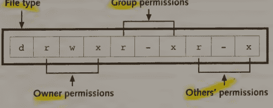

**图 2-7** 文件的文件类型和文件权限示例

第一组文件权限指定符表示所有者的权限。所有者与所有用户一样，属于一个用户组。第二组表示组的权限。此规范适用于所有属于所有者组的用户（所有者除外）。第三组表示所有其他人的权限。此规范适用于所有既不是所有者也不在所有者组中的用户。在每组中，第一个字符表示读取权限。如果出现“r”，则该类用户具有读取文件的权限。第二个字符表示写入权限。如果出现“w”，则该类用户具有写入文件的权限。第三个字符表示执行权限。如果出现“x”，则该类用户具有执行文件的权限（例如程序文件）。如果在任何这些字符位置出现短横线 (-)，则表示该类权限被拒绝。

如果用户被授予对某个目录的读取权限，该用户可以看到其内容的列表。对目录的写入权限意味着用户可以重命名和删除该目录中的文件。对目录的执行权限意味着用户可以将该目录设为当前工作目录。

从左到右，字母 `rwxr-xr-x` 的含义是：
- r — 文件的所有者具有读取权限
- w — 文件的所有者具有写入权限
- x — 文件的所有者具有执行权限（可以将文件作为程序运行）
- r — 组具有读取权限
- - — 组不具有写入权限
- x — 组具有执行权限
- r — 其他人具有读取权限
- - — 其他人不具有写入权限
- x — 其他人具有执行权限

您可以使用 `chmod` 命令更改权限设置模式。例如，将其他人的权限设置为 `---` 会删除所有人的所有权限。他们将无法读取、写入或执行该文件。在图 2-6 的第一行中，请注意所有者对子目录 X11 具有读取、写入和执行 (rwx) 权限。第一个字符是文件类型，在这种情况下，"d" 代表子目录。rwx 赋予所有者读取、写入和执行权限。接下来的 r-x 表示与所有者具有相同组 ID 的用户组仅具有读取和执行权限；最后的 r-x 则赋予其他人读取和执行权限。系统管理员在添加新用户账户时会分配组 ID。**组 ID (GID)** 使一组用户能够平等地访问他们共同共享的文件。其他人是指所有未通过组 ID 与所有者组关联，但具有读取和执行权限的所有其他用户。

```bash
Syntax `chmod [-option] [mode filename]`
```

#### 解析
- 参数可以包含模式（权限），且必须包含文件名。您也可以使用通配符来设置多个文件的权限。
- 权限应用于所有者 (u)、组 (g) 和其他人 (o)。权限包括读取 (r)、写入 (w) 和执行 (x)。在权限前使用加号 (+) 表示允许，使用连字符 (-) 表示拒绝。八进制权限通过为所有者、组和其他人分配一个数值来指定。

使用 UNIX/Linux 的 `chmod` 命令来设置文件权限。在最简单的形式中，`chmod` 命令的参数是一个符号字符串（代表权限的缩写单个字符），后跟一个或多个文件名。符号字符串指定了应授予或拒绝给各类用户的权限。这是一个例子：`ugo+rwx`。在这个字符串中，字符 ugo 分别代表用户（同所有者）、组和其他人。这些类别的用户会受到 `chmod` 命令的影响。下一个字符 + 号表示正在授予权限。最后一组字符（本例中为 rwx）表示被授予的权限。符号字符串 `ugo+rwx` 表示所有者、组和其他人都被授予了读取、写入和执行权限。以下是在命令中使用符号字符串来修改 myfile 访问权限的示例：

```bash
chmod ugo+rwx myfile
```

以下命令授予文件 customers 组读取权限：

```bash
chmod g+r customers
```

也可以使用符号字符串来拒绝权限。以下命令拒绝组和其他人对文件 account_info 的写入和执行权限。

```bash
chmod go-wx account_info
```

> **提示**：在您的主目录中，您可以创建任何子目录并为其设置权限。但是，除非系统管理员做出特殊规定，否则您不能在主目录之外创建子目录。

八进制权限格式是另一种分配权限的方法；它根据权限类型以及所有者、组和他人来分配数字。权限类型是一个数字。例如，执行权限被赋值为 1，写入为 2，读取为 4。这些权限数字相加，得到 0 到 7 之间的值。例如，读取和写入权限是 6 (4 + 2)，读取和执行权限是 5 (4 + 1)，如下表所示：

- 0 是没有任何权限。
- 1 是执行 (等同于 x)。
- 2 是写入 (等同于 w)。
- 4 是读取 (等同于 r)。
- 5 是读取和执行 (等同于 rx)。


- 6 代表读和写（与 `rw` 相同）。
- 7 代表读、写和执行（与 `rwx` 相同）。

在 `chmod` 命令之后的三个数字位置 (xxx) 中，每个位置都与其中一个数字相关联。第一个位置给出所有者的权限数字，第二个位置给出组的权限数字，最后一个位置给出其他用户的权限数字。例如，命令 `chmod 755 myfile` 为 myfile 的所有者分配读、写和执行权限 (7)；同时为组和其他用户分配读和执行权限（两个位置均为 5）。以下是一些其他示例：

- `chmod 711 data`——对于文件 data，此命令为所有者分配读、写和执行权限；为组分配执行权限；为其他用户分配执行权限（程序员经常将其用于他们编写的程序，以便用户能够执行这些程序）。
- `chmod 642 data`——对于文件 data，此命令为所有者分配读和写权限；为组分配读权限；为其他用户分配写权限。
- `chmod 777 data`——对于文件 data，此命令为所有者、组和其他用户分配读、写和执行权限。
- `chmod 755 data`——对于文件 data，此命令为所有者分配读、写和执行权限；为组分配读和执行权限；为其他用户分配读和执行权限（程序员经常使用的另一种权限设置）。
- `chmod 504 data`——对于文件 data，此命令为所有者分配读和执行权限；不给组任何权限；为其他用户分配读权限。

> 如果您想设置目录的安全性，以确保用户必须知道该目录中文件的确切路径——这样他们就可以执行程序但不能随意窥探——请将目录配置为 711 权限。这给予所有者（您）所有权限，而仅给予组和其他用户执行权限。

尝试动手项目 2-12 来配置权限。有关 `chmod` 命令的简短描述，请参阅附录 B。

> 某些版本的 UNIX/Linux 包含 `umask` 命令，它允许您一次性设置多个文件的权限。该命令比使用 `chmod` 八进制命令更复杂，但可以为系统管理员节省时间。例如，`umask 022` 为所有用户授予 rwx 权限。不过，您也可以使用通配符星号 (*) 和 `chmod` 共同为多个文件授予权限。例如，`chmod 777 *` 将当前目录下所有文件的全部权限授予所有用户和组。

## 章节总结

- 在 UNIX/Linux 中，文件是数据存储的基本组件。UNIX/Linux 将所有内容都视为文件，甚至包括显示器、键盘和打印机等外接设备。即使是能够包含文件和子目录的目录，在 UNIX/Linux 中实际上也只是一个特殊的文件。
- 文件系统是 UNIX/Linux 系统在存储设备（如硬盘和软盘）上组织文件的方式。文件存储在文件系统中，文件系统是一个分层的树状结构，其中顶级目录包含子目录，而子目录又可以包含其他子目录。每个文件都可以通过路径名（通往特定文件的目录名称列表）来定位。
- 标准的树状结构从根 ( / ) 文件系统目录开始，它作为其他目录和子目录分层组的基础。
- 磁盘中持有文件系统的部分称为分区。一个磁盘可能有多个分区，每个分区彼此分离，因此不受另一个分区相关的结构性文件问题等外部干扰的影响。UNIX/Linux 文件系统的设计允许在分区挂载到树状结构后访问多个分区。
- 在 UNIX/Linux 中定义的路径充当访问系统中任何文件的地图。绝对路径是指始终从根级开始的路径。相对路径是指从当前位置开始的路径。
- 您可以自定义命令提示符，以显示当前工作目录名称、日期、时间以及其他若干项。
- `ls` 命令显示目录中包含的文件和目录的名称。`ls -l` 命令（即长格式列出）显示详细的文件信息。`ls -a` 命令显示隐藏文件。
- 通配符可用于命令（如 `ls`）中，替代文件名中的其他字符。`*` 通配符可以替代任何字符串，`?` 通配符可以替代任何单个字符。
- 只要您拥有父目录，就可以使用 `mkdir` 命令创建新目录。文件的原始所有者是创建它的人，他成为了控制访问权限的人（尽管 root 账户也可以控制访问）。
- 使用 `cp` 命令将源文件复制到目标文件。除非您使用 `-i` 选项，否则 UNIX/Linux 可能会在没有警告的情况下覆盖目标文件。点符号（当前目录）是 `cp` 命令中指定目标的一种简写方式。
- 您可以使用 `chmod` 命令为您拥有的文件设置权限。权限设置是 *rwx*，分别代表读 (read)、写 (write) 和执行 (execute)。文件权限的设置是为了控制三类用户的文件访问：所有者 (u)、组 (g) 和其他用户 (o)。如果您希望他人访问您所拥有目录中的信息，请记得更改这些目录的权限设置。此外，要运行一个程序文件，预期的用户（所有者、组、其他用户）必须具有执行权限。

## 命令总结：第 2 章命令回顾

| 命令 | 用途 | 本章涉及的选项 |
| :--- | :--- | :--- |
| cd | 更改目录 | $\cdot$ 更改当前工作目录<br>$\cdot$ 更改父目录 |
| chmod | 为指定文件设置文件权限 | + 分配权限<br>- 移除权限 |
| cp | 将文件从一个目录复制到另一个目录 | -b 如果目标文件已存在，则创建备份（这样在覆盖文件时您有一个备份）。<br>-i 防止在没有警告的情况下覆盖目标文件。<br>-u 仅当源文件比当前目标文件更新时才覆盖现有文件。 |
| ls | 显示目录内容，包括其中的文件和子目录 | -a 列出隐藏文件。<br>-l (小写 L) 生成目录的长格式列表。<br>-r 以反向顺序排序列表。<br>-S 按文件大小排序列表。<br>-t 按文件或目录最后修改的时间排序。<br>-X 按扩展名排序。 |
| mkdir | 创建新目录 | -v 验证文件已创建。 |
| mount | 系统启动时将文件系统分区连接到目录树，并挂载其他设备（如 CD-ROM 和软盘驱动器） | -t 指定要挂载的文件系统类型。 |
| pwd | 显示当前路径 | |
| rm | 删除文件 | -i 在删除文件前提示。 |
| rmdir | 删除空目录 | -v 提供一条消息以验证目录已被删除。 |
| umask | 为多个文件设置文件权限 | |
| umount | 将文件系统分区从目录树中断开连接 | |

## 关键术语

**/boot 分区** — 用于存储组成内核的操作系统文件的分区。

**/home 分区** — 位于主目录的分区，为所有用户的目录提供存储空间。作为硬盘的一个独立部分，它将用户的个人文件与 UNIX/Linux 操作系统软件隔离开并加以保护。

**/usr 分区** — 用于存储用户将要访问的部分或全部非内核操作系统程序的分区。

**/var 分区** — 保存临时创建文件的分区，例如用于打印文档的文件和用于记录监控与管理数据的日志文件。

**绝对路径** — 从根文件系统目录开始，并列出到达目标文件的所有子目录的路径名。

**二进制文件 (binaries)** — 位于 /bin 目录及其它地方，用于启动系统并执行其他基本任务的程序。*另请参阅 可执行文件*。

**块设备特殊文件 (block special file)** — 在 UNIX/Linux 中，用于管理涉及处理数据块的随机访问设备的文件，包括 CD-ROM 驱动器、硬盘驱动器、磁带驱动器和其他存储设备。也称为块设备文件。

**引导加载程序 (bootstrapper loader)** — 位于 /boot 目录中，用于启动操作系统的实用程序。

**字符设备特殊文件 (character special file)** — 一种 UNIX/Linux I/O 管理文件，用于处理逐字节的数据流，例如通过串行或 USB 连接，包括终端、打印机和网络通信。也称为字符设备文件。

**子目录 (child)** — 在（父）目录中创建并存储的子目录。

**设备特殊文件 (device special file)** — 在 UNIX/Linux 中用于管理 I/O 设备的文件。它可以分为两种类型：块设备特殊文件或字符设备特殊文件。

**目录 (directory)** — 一种特殊类型的文件，可以包含其他文件和目录。目录文件存储常规文件和其他目录的名称，后者被称为*子目录*。

**增强型 IDE (EIDE)** — IDE 的改进版本，提供更快的数据传输速度，常用于现代计算机。*另请参阅 集成驱动器电子设备 (IDE)*。

**可执行文件 (executables)** — 位于 /bin 目录中，用于启动系统并执行其他基本任务的程序。*另请参阅 二进制文件*。

**扩展文件系统 (ext 或 ext fs)** — 为 Linux 设计的文件系统，默认安装在 Linux 操作系统中。它实现了对内置 Linux 命令、文件操作和安全性的全面支持。ext 于 1992 年发布，当时存在一些 bug 且仅支持最大 2 GB 的文件。1993 年，第二代扩展文件系统 (ext2 或 ext2 fs) 被设计用来修复 ext 的 bug，并支持最大 4 TB 的文件。2001 年，引入了 ext3 (或 ext3 fs) 以实现文件和数据恢复的日志功能。ext、ext2 和 ext3 支持长达 255 个字符的文件名。


**组 ID (GID)** — 用于标识用户组的一个数字。

**隐藏文件 (**hidden file**) — 操作系统用于保存配置信息及其他用途的文件。隐藏文件的名称以点（.）开头。

**热修复 (hot fixes)** — 能够自动将磁盘损坏部分的数据移动到未损坏区域的能力。

**信息节点 (information node)** 或 **inode** — 一种存储关于目录和文件的关键信息系统。Inode 信息包括：(1) 目录或文件的名称；(2) 关于该目录/文件的通用信息；以及 (3) 关于如何在磁盘分区上定位该目录/文件的信息（指针）。

**集成驱动电子 (Integrated Drive Electronics, IDE)** — 有时被称为集成设备电子，是个人电脑中最流行的电子硬盘接口。它与 ANSI 先进技术附件 (ATA) 标准相同。

**日志记录 (journaling)** — 对数据或事务进行按时间顺序记录的过程，以便在系统意外崩溃时，可以重建或回滚数据或事务，从而避免数据丢失或信息同步不当。

**挂载 (mount)** — 将文件系统连接到目录树结构的过程，使该目录可以被访问。

**父目录 (parent)** — 创建并存储子目录（child）的目录。

**分区 (partition)** — 磁盘上的一个独立区域，用于存放文件系统，其创建目的是为了使其他分区中发生的活动和问题不会影响到它。

**路径名 (pathname)** — 一种指定文件或目录的方式，包括树结构分支上的目录和子目录的名称。每个目录名称之间用正斜杠 (/) 分隔。例如，在 /home 目录下的 Jean 目录的 source 目录中，文件 phones（目标文件）的路径名是 /home/jean/source/phones。

**外设 (peripherals)** — 通过电子接口连接到计算机的设备。示例包括硬盘驱动器、软盘驱动器、打印机和键盘。

**权限 (permission)** — 访问和操作目录或文件的特定特权，例如读取文件的特权。

**物理文件系统 (physical file system)** — 硬盘上经过格式化以存放文件的区域。

**相对路径 (relative path)** — 从当前工作目录开始，列出所有直到目标文件的子目录的路径名。

**根文件系统目录 (root file system directory)** — 所有其他目录的主目录或父目录 (/)（文件系统的最高层级）；另一种不同的含义是指存储系统管理员文件的目录 (/root)。

**共享库镜像 (shared library images)** — 位于 /lib 目录中的文件，程序员使用这些文件来共享代码，而不是将代码复制到自己的程序中。这样做可以使程序更小且运行更快。

**小型计算机系统接口 (Small Computer System Interface, SCSI)** — 读作 *suzzi*，是一种流行且快速的电子硬盘接口，常用于网络服务器。SCSI 实际上是一套定义了与硬盘快速通信各方面的标准。

**子目录 (subdirectory)** — 位于更高层级目录或父目录下的目录。

**超级块 (superblock)** — 分区上的一个特殊数据块，包含关于块布局的信息。这些信息是寻找文件系统上任何内容的关键，且不应被更改。

**交换分区 (swap partition)** — 硬盘上的一个区域，与其他区域分离，使其能够作为内存的扩展，这意味着它支持虚拟内存。计算机系统可以使用该分区的空间在磁盘和 RAM 之间交换信息，从而使计算机运行得更快、更高效。

**符号链接 (symbolic link)** — 一个名称或文件名，它指向并允许您使用不同的名称访问同一目录下的文件，或使用相同或不同的名称访问不同目录下的文件。

**UNIX 文件系统 (ufs)** — 大多数 UNIX/Linux 版本支持的文件系统。它是一个分层（树状结构）的文件系统，具有可扩展性，支持大容量存储，提供出色的安全性和可靠性。ufs 采用了信息节点 (inodes)。

**实用程序 (utility)** — 执行有用操作（如复制文件、列出目录和与其他用户通信）的程序。与其他操作系统程序不同，实用程序是一个附加组件，既不是 UNIX/Linux shell 的一部分，也不是内核的组件。

**虚拟文件系统 (virtual file system)** — 不占用磁盘空间的系统，例如 `/proc` 目录。该系统通过引用让您获取关于计算机上正在运行哪些程序和进程的信息。

**虚拟内存 (virtual memory)** — 由交换分区支持的内存资源，允许计算机运行得更快、更高效。

**虚拟存储 (virtual storage)** — 可能通过不同的磁盘或文件系统（或两者）分配的存储，但对操作系统和用户而言，它是透明可访问的存储。

**通配符 (wildcard)** — 一个特殊的字符，可以代表任何其他字符，或者在某些情况下代表一组字符，经常用于参数中，例如 `ls file.*`。

## 复习题

- 1. 您计划在服务器上使用 Linux，您的老板对系统突然崩溃时恢复文件信息表示担忧。以下哪个选项是解决此问题最佳的方法？
    a. 为 Linux 实现 MS/DOS 文件系统。
    b. 增加虚拟内存的量。
    c. 使用闪存盘代替硬盘。
    d. 采用 ext3 文件系统。

- 2. 您新打印机的文档显示它使用一个从制造商提供的安装盘加载的字符设备文件。您如何确保该文件已加载且是一个字符设备文件？
    a. 使用 `ls -l` 命令列出 /dev 的内容，并检查第一列是否以 “b” 开头。
    b. 使用 `ls -l` 命令列出 /dev 的内容，并检查第一列是否以 “c” 开头。
    c. 使用 `more` 命令列出 /etc 目录的内容，并检查第一列是否有加号 (+)。
    d. 使用 `cd -c /bin` 命令仅显示 /bin 目录中的字符设备文件。

- 3. `/home/rbrown/programs/data` 是 __________ 的一个例子。
    a. 绝对路径
    b. 间接路径
    c. 相对路径
    d. 字符路径

- 4. 以下哪些信息与文件的 inode 相关联？（选择所有适用项：）
    a. 文件名
    b. 与文件相关的权限
    c. 文件大小
    d. 文件的创建日期

- 5. 一位用户叫您帮他解决计算机问题。当您到达时，您首先好奇用户的当前工作目录是哪个。您可以使用哪个命令快速找出？
    a. `who`
    b. `where`
    c. `pwd`
    d. `cd -?`

- 6. 您公司的用户经常使用名为 `/usr/office/work/spreadsheet/programs` 目录中的文件。一些用户抱怨这个路径经常输入起来非常麻烦。您为他们提供什么解决方案？
    a. 教他们使用符号链接。
    b. 为该目录的内容创建新分区。
    c. 为该目录建立通用索引。
    d. 使用新的 Linux 短路径程序。

- 7. 您需要搜索主目录 /home/rbrown 中所有以字符 “le” 开头的文件。您使用以下哪个命令？
    a. `dir “le”`
    b. `show “le”`
    c. `ln le?`
    d. `ls ~/le*`

- 8. 您的计算机无法从硬盘正常启动，因此您使用了自己创建的备份软盘启动盘。计算机启动后，您最有可能在哪个目录中寻找损坏的文件？
    a. /home
    b. /etc
    c. /root
    d. /tmp

- 9. __________ 分区被用作 RAM 的扩展。
    a. swap
    b. /boot
    c. /bin
    d. dem

- 10. 哪种类型的文件用于管理对 CD-ROM 的访问？
    a. 块设备文件 (block special file)
    b. 命名设备文件 (named device file)
    c. 字符设备文件 (character special file)
    d. 存储设备文件 (storage device file)

- 11. 您组织中的计算机资源委员会建议所有用户显示一个显示用户账户名称的提示符。以下哪个 PS1 参数允许用户配置这种提示符显示？
    a. `\n`
    b. `/#`
    c. `//`
    d. `\u`

- 12. 以下哪些目录位于根文件系统的顶层层级结构中？（选择所有适用项：）
    a. /boot
    b. /etc
    c. /lib
    d. /proc


- 13. 您组织中的一名新用户在工作过程中经常需要切换到系统各处的目录。您可以向她演示哪个简单的命令，以便快速返回她的主目录？
    a. `home`
    b. `cd`
    c. `go home`
    d. `bk`

- 14. 另一名新用户不小心用一个同名的旧文件覆盖了刚刚更新的新版本文件，导致大约两小时的工作成果丢失。为了在以后复制时能够提醒他正在用旧文件覆盖新文件，他可以使用哪个复制命令？
    a. `safecopy`
    b. `cp -I`
    c. `cp -u`
    d. `copy`

- 15. 在 Fedora 中，您处于主目录中，并使用命令 `rmdir /temp` 来删除 `/temp` 目录。然而，操作系统不允许您删除该目录。为什么？
    a. `/temp` 目录中存在文件。
    b. Fedora 要求所有用户必须拥有一个 `/temp` 目录。
    c. `/temp` 目录不能被删除，因为它包含其他用户的执行权限。
    d. 命令语法错误，应该是 `rmdir .. /temp`。

- 16. 您看到另一个人使用了 `~/source` 这种表示法。这个目录是什么？
    a. 它是 `/bin` 目录下的 `/source` 子目录。
    b. 它是 `/var` 目录下包含通用程序的 `/source` 子目录。
    c. 它是其主目录下的 `/source` 子目录。
    d. 它是为用户提供的公共实用程序 `/source` 子目录，直接位于 `/home` 目录下。

- 17. 当您看到文件关联的权限为 `rwxr-xr--` 时，授予“其他用户（others）”的权限是什么？
    a. 读取、写入和执行
    b. 写入和执行
    c. 读取和执行
    d. 读取

- 18. 命令 `chmod g+x-rw data ___________`。
    a. 赋予普通用户对 data 文件的读取、写入和执行权限
    b. 赋予普通用户对 data 文件的执行权限，但撤销其读取和写入权限
    c. 赋予所有者组对 data 文件的执行权限，但撤销其读取和写入权限
    d. 将 data 文件复制到用户主目录并为其分配读取和执行权限

- 19. 您只想查看当前工作目录下具有 `.c` 扩展名的文件。您可以使用以下哪个命令？（选择所有适用项）
    a. `ls -a .c`
    b. `ls *.c`
    c. `ls -X`
    d. `ls -x -- .c`

- 20. Linux 操作系统支持以下哪些文件系统？（选择所有适用项）
    a. 扩展文件系统 (extended file system)
    b. MS/DOS
    c. 网络文件系统 (network file system)
    d. NT 文件系统 (NT file system)

- 21. 您可以在哪个目录中找到内核镜像？
    a. `/dev`
    b. `/boot`
    c. `/proc`
    d. `/sbin`

- 22. 当您加载 CD-ROM 且系统没有自动将其挂载以供使用时，您可以使用哪个命令来挂载它？
    a. `mount \CD`
    b. `mount -t iso9660 /dev/cdrom /mnt/cdrom`
    c. `mount iso9660 /dev`
    d. `start -CD-ROM`

- 23. 您的助手尝试使用 hda2 在设备文件中引用驱动器，以手动挂载一个新的 SCSI 磁盘驱动器。这个引用有什么问题？
    a. 他应该使用 lpa2。
    b. 他应该使用 scsi2。
    c. 他应该使用 sda2。
    d. 没有问题；hda2 是正确的引用。

- 24. 目录结构根节点的 inode 编号总是 100，因为 inode 是以 100 为增量分配的。正确还是错误？

- 25. 使用命令 `mkdir -x` 可以创建目录并同时为所有用户分配该目录的执行权限。正确还是错误？

## 动手项目

本章所有项目均在命令行中执行，例如在终端窗口中。

**注意**

### 项目 2-1

UNIX/Linux 支持许多不同的文件系统，可以使用 `mount` 命令进行挂载。在这个项目中，您将使用 `mount` 命令来确定您的 UNIX/Linux 版本中可用的文件系统。对于本项目及本章所有项目，除非另有说明（如项目 2-2），否则您应该登录自己的账户。

**查看可用文件系统：**

- 1. 在命令提示符处，输入 `man mount` 并按下 **Enter**。根据需要继续按下 **空格键**，以查看 `mount` 命令 `-t` 参数的文档。（如果您使用的是终端窗口，完成后可能需要按下 **q** 退出文本显示模式。）
- 2. 哪些文件系统可以被挂载？
- 3. 接下来，输入 `mount` 并按下 **Enter**，以确定实际挂载了哪些文件系统。（见图 2-8。）您在系统中看到挂载了哪些文件系统？

图 2-8 已挂载的文件系统

### 项目 2-2

许多系统配有 CD-ROM 驱动器，允许您挂载 CD-ROM。本项目允许您挂载然后卸载 CD-ROM。您需要一张可以插入 CD-ROM 驱动器的光盘（由您或服务器操作员插入）。此外，本项目请以 root 身份登录。

**挂载和卸载 CD-ROM：**

- 1. 插入 CD-ROM 或请求服务器操作员插入 CD-ROM。
- 2. 如果您的系统自动挂载了 CD-ROM，请输入 `umount /mnt/cdrom` 并按下 **Enter** 将其卸载。（如果驱动器打开了，请在加载 CD-ROM 后关闭驱动器。）
- 3. 输入 `mount -t iso9660 /dev/cdrom /mnt/cdrom` 并按下 **Enter**。（见图 2-9。）（注意 `/mnt/cdrom` 被用作 CD-ROM 的挂载点；CD-ROM 挂载后，您可以在 `/mnt/cdrom` 子目录中查看其文件。）
- 4. 输入 `mount` 并按下 **Enter** 以验证 CD-ROM 已挂载。
- 5. 输入 `ls /mnt/cdrom` 并按下 **Enter** 查看 CD-ROM 的内容。
- 6. 输入 `umount /mnt/cdrom` 并按下 **Enter**。（在某些系统中，CD-ROM 驱动器现在会打开，以便您或服务器操作员取出 CD-ROM。）
- 7. 如果要挂载和卸载一个用于 Windows 系统的软盘，您会使用什么命令？

**图 2-9** 挂载 CD-ROM

### 项目 2-3

PS1 变量包含关于命令提示符行显示方式的配置参数。在这个项目中，您将查看 PS1 变量的内容，然后配置 PS1 变量。您应该使用默认的 Bash shell 并使用自己的账户登录。

**查看 PS1 变量内容并配置该变量：**

- 1. 输入 `echo $PS1` 并按下 **Enter**。（参考图 2-4。）
- 2. 您将看到 PS1 变量的内容，在 Red Hat Enterprise Linux 3.0 和 Fedora 中显示为：
`[\u@\h \w]\$ `
- 3. 要将提示符更改为显示日期和时间，请输入 `PS1='\d \t>'` 并按下 **Enter**。输入命令时字符之间不要有空格。您的提示符现在看起来类似于：
`Tue Jul 5 09:18:33>`
- 4. 要将提示符更改为显示当前工作目录，请输入 `PS1='\w>'` 并按下 **Enter**。您的提示符现在看起来类似于：
`~>`

`\w` 格式化字符显示 `~` 来代表用户的主目录。

- 5. 要将提示符更改为显示当前工作目录的完整路径，您必须使用另一个环境变量 `PWD`。`PWD` 变量包含当前工作目录的完整路径名。要在提示符中显示 PWD 变量，请输入 `PS1='$PWD>'` 并按下 **Enter**。（注意，您必须在环境变量名前加上 $ 以提取其内容。）您的提示符现在看起来类似于：
`/home/jean>`

- 6. 如果您使用的是终端窗口，请关闭并打开一个新的终端窗口会话，或者注销后重新登录，然后进入命令行窗口。您的提示符与步骤 5 中看到的情况相比发生了怎样的变化？

### 项目 2-4

在这个项目中，您将使用 `pwd` 命令查看您的工作目录。

**显示当前路径：**

- 1. 输入 `pwd` 并按下 **Enter**。
- 2. 您的当前目录路径是什么？

### 项目 2-5

在这个项目中，您将进一步练习更改 PS1 变量，并使用 `cd` 命令。

**使用 `cd` 命令：**

- 1. 首先，更改您的提示符，以便您可以查看目录路径。在 $ 命令提示符处，输入 `PS1='$PWD>'` 并按下 **Enter**。
- 2. 输入 `cd /var/spool/mail` 并按下 **Enter**。这将将您移动到 `/var/spool/mail` 子目录。
- 3. 输入 `cd` 并按下 **Enter**。不带参数的更改目录命令 (`cd`) 会将您返回到主目录。（见图 2-10。）
- 4. 如果您使用的是终端窗口，请关闭该终端窗口并为下一个项目打开另一个终端窗口。如果您是远程登录或未使用终端窗口访问命令提示符，请注销然后重新登录以重置您的提示符。

### 项目 2-6

对比绝对路径和相对路径的使用，有助于理解两者的运作方式。在这个项目中，您将使用两种路径寻址方式在文件系统中导航。

**导航目录：**

- 1. 如果您不在主目录中，请输入 `cd` 并按下 **Enter**。


图 2-10 使用 cd 命令

- 2. 你的主目录的父目录是 /home。/home 是一个绝对路径名。输入 `cd /home` 并按下 **Enter**。系统将带你进入 /home 目录。
- 3. 输入 `cd` 加上你的用户名，例如 `cd joseph` 并按下 **Enter**。此步骤使用相对路径寻址返回到你的主目录。

### 项目 2-7

使用点（.）和点点（..）选项在文件系统中导航可以节省输入时间。在这个项目中，你将练习使用这两种约定。请确保你在执行此项目时登录的是自己的账户，而不是 root 账户。

**使用点和点点来更改你的工作目录：**

- 1. 如果你不在主目录中，请输入 `cd` 并按下 **Enter**。
- 2. 输入 `cd .` 并按下 **Enter**。因为 . (点) 引用的是当前目录，所以系统没有更改你的工作位置。
- 3. 输入 `cd ..` 并按下 **Enter**。系统将带你进入父目录，即 /home。
- 4. 输入 `cd ..` 并按下 **Enter**。系统将带你进入根文件系统目录 (/)。
- 5. 输入 `cd` 并按下 **Enter**。系统将带你回到主目录。

### 项目 2-8

`ls` 命令是最有用的命令之一。在这个项目中，你首先使用 `ls` 来查看你的工作目录。接下来，你使用带有参数的 `ls` 来查看一个文件，然后是一个目录。为了获取关于目录内容的更完整的列表信息，你将使用 -l 选项，最后使用 -a 选项在目录列表中包含隐藏文件。

#### 查看当前工作目录中的文件和目录列表：

- 1. 输入 **ls** 并按下 **Enter**。你将看到文件和目录名称的列表。

#### 查看特定文件或目录的列表：

- 1. 如果你不在主目录中，请输入 **cd** 并按下 **Enter**。
- 2. 在第 1 章“UNIX 和 Linux 的本质”中，你使用了 `cat` 命令创建了一个 notes 文件。该文件应该仍在你主目录中（如果没有，请再次使用 `cat` 创建一个 notes 文件）。输入 **ls notes** 并按下 **Enter**。系统将显示 notes 文件的列表信息。
- 3. 要查看当前工作目录以外的目录内容，请将目录名称作为 **ls** 命令的选项。例如，要查看 /var 目录的内容，请输入 **ls /var** 并按下 **Enter**。你将看到与图 2-11 类似的列表。

**图 2-11** 查看 /var 目录的内容

#### 使用带有 -l 选项的 ls 命令：

- 1. 输入 **ls -l /dev** 并按下 **Enter**。你将看到与图 2-12 类似的信息。这显示了 /dev 目录中块设备特殊文件和字符设备特殊文件的列表。请注意信息的第一列，块设备特殊文件以 "b" 开头。那么什么标志着字符设备特殊文件？
- 2. 输入 **ls -l /** 并按下 **Enter** 以查看根文件系统目录的内容。（参考本章前面的图 2-5。）

**图 2-12** 使用 ls -l 查看 /dev 目录

**列出主目录中的隐藏文件：**

- 1. 输入 **clear** 并按下 **Enter** 以清屏。
- 2. 在命令提示符后输入 **ls -a**，然后按下 **Enter**。（见图 2-13。）

**图 2-13** 查看隐藏文件

### 项目 2-9

当你想要查找或处理具有特定字符序列的文件，或者在搜索文件但不确定文件名的正确拼写时，通配符非常有用。在这个项目中，你将在 `ls` 命令中使用 `*` 和 `?` 通配符。

**使用通配符：**

- 1. 为了练习使用通配符，你首先必须创建一组名称相似的文件。在第 1 章中，你使用了 `cat` 命令创建 notes 文件。现在使用 `cat` 命令创建以下五个文件：
    - `first_name`——包含你名字的文件
    - `middle_name`——包含你中间名的文件
    - `last_name`——包含你姓氏的文件
    - `full_name1.txt`——包含你全名的文件
    - `full_name22.txt`——另一个包含你全名的文件

    例如，输入 `cat > first_name`，按下 **Enter**，输入你的名字，按下 **Enter**，然后按下 **Ctrl+d**。
- 2. 输入 `ls *name` 并按下 **Enter**。你将看到 first_name、last_name 和 middle_name 被列出。
- 3. 输入 `ls full_name?.txt` 并按下 **Enter**。你将看到 full_name1.txt 被列出。
- 4. 输入 `ls *.txt` 并按下 **Enter**。现在，你将看到 full_name1.txt 和 full_name22.txt 被列出。

### 项目 2-10

假设你在一家开发电话数据库的公司工作，在这个项目中，你要为邮件部门（Mail Department）和接收部门（Receiving Department）创建目录，这两个部门在公司的预算和会计系统中被标记为 4540 部门和 4550 部门。创建目录后，你开始创建部门电话号码文件并存储在这些目录中。你使用 `mkdir`（创建目录）命令来创建新目录，然后使用 `cat` 命令创建电话文件。此外，不要删除你创建的文件，因为你将在其他项目中使用它们。

**创建新目录和电话文件：**

- 1. 输入 `cd` 并按下 **Enter** 以确保你在主目录中。
- 2. 输入 `mkdir dept_4540` 并按下 **Enter** 以创建一个名为 dept_4540 的新目录。
- 3. 输入 `ls` 并按下 **Enter**。你在列表中可以看到 dept_4540 目录。
- 4. 输入 `cd dept_4540` 并按下 **Enter** 以切换到新目录。现在，你可以使用 `cat` 命令创建名为 phones1 的文件。phones1 文件包含区号、电话前缀、电话号码、姓氏和名字字段。每个字段由冒号 (:) 分隔。
- 5. 输入以下命令，每行末尾按下 **Enter**：
    `cat > phones1`
    `219:432:4567:Harrison:Joel`
    `219:432:4587:Mitchell:Barbara`
    `219:432:4589:Olson:Timothy`
- 6. 按下 **Ctrl+d**。
- 7. 输入 `cat phones1` 并按下 **Enter** 以查看并验证你创建的文件内容。
- 8. 输入 `cd` 并按下 **Enter** 返回到你的 /home 目录。
- 9. 输入 `mkdir dept_4550` 并按下 **Enter** 以创建一个名为 dept_4550 的新目录。
- 10. 输入 `ls` 并按下 **Enter**。你在列表中可以看到 dept_4550 目录。
- 11. 输入 `cd dept_4550` 并按下 **Enter** 以切换到新目录。现在你可以使用 `cat` 命令创建文件 phones2，它包含与 phones1 文件相同的字段。
- 12. 输入以下命令，每行末尾按下 **Enter**：
    `cat > phones2`
    `219:432:4591:Moore:Sarah`
    `219:432:4522:Polk:John`
    `219:432:4501:Robinson:Lisa`
- 13. 按下 **Ctrl+d**。
- 14. 输入 `cat phones2` 并按下 **Enter** 以查看并验证 phones2 文件的内容。
- 15. 输入 `clear` 并按下 **Enter** 为下一个项目清屏。

### 项目 2-11

创建电话文件后，你需要创建一个名为 corp_db 的新中央目录以便通用访问信息，并将 phones1 文件复制到该新目录中。接下来，使用 `>` 将 phones1 和 phones2 合并为一个文件，名为 corp_phones，存放在新目录中。请注意，你可以使用波浪号 (~) 来代表主目录的位置。

**将 phones1 文件复制到新目录 corp_db：**

- 1. 输入 `cd` 并按下 **Enter** 返回主目录。
- 2. 输入 `mkdir corp_db` 并按下 **Enter** 创建一个新目录。
- 3. 输入 `cd corp_db` 并按下 **Enter** 切换到新目录。
- 4. 要将 phones1 文件从 dept_4540 目录复制到当前目录，请输入 `cp ~/dept_4540/phones1` 并按下 **Enter**。
- 5. 要将 phones2 文件从 dept_4550 目录复制到当前目录，请输入 `cp ~/dept_4550/phones2` 并按下 **Enter**。（见图 2-14。）
- 6. 输入 `ls` 并按下 **Enter** 以确保 phones1 和 phones2 现在都在新目录中。

**图 2-14** 创建目录并将文件复制其中

**将 phones1 和 phones2 文件合并为一个文件：**

- 1. 输入 `cat phones1 phones2 > corp_phones` 并按下 **Enter**，将两个电话文件的内容添加到一个名为 corp_phones 的新文件中。
- 2. 输入 `clear` 并按下 **Enter** 清屏。
- 3. 输入 `more corp_phones` 并按下 **Enter** 查看新文件的内容，如图 2-15 所示。

**提示** 正如你在第 1 章中所记得的，`more` 命令可以让你一次显示一屏文件，对于阅读长文件特别有用。


图 2-15 查看新 corp_phones 文件的内容

### 项目 2-12

假设您希望所有用户都能访问 corp_phones 文件。在此项目中，您首先授予对主目录的访问权限。接着，允许访问 corp_db 目录，然后为所有人设置读取 corp_phones 文件的权限。您将使用 `chmod` 命令并配合 `x` 参数来授予对目录的访问权限。

#### 若要更改文件和目录权限：

- 1. 确保您处于主目录中（输入 `cd` 并按下 **Enter**）。
- 2. 输入 `chmod go+x ~` 并按下 **Enter**，以允许访问您的主目录。
  这条命令的意思是“使您的主目录 (~) 对组 (g) 和其他用户 (o) 可访问 (+x)”。
- 3. 输入 `chmod ugo+x ~/corp_db` 并按下 **Enter**，以允许访问 corp_db 目录。
  这条命令的意思是“使 corp_db 目录对所有者 (u)、组 (g) 和其他用户 (o) 可访问 (+x)”。
- 4. 输入 `chmod o+w ~/corp_db/* 并按下 **Enter**，以设置权限，使其他用户可以向 corp_db 目录中的文件写入内容（所有者和组默认已拥有写入权限）。
  这条命令的意思是“使 corp_db 目录中的所有文件允许其他用户 (o) 写入 (+w)”。
- 5. 输入 `ls -l ~/corp_db` 来检查您设置的权限。（见图 2-16。）

图 2-16 为启用用户访问而进行的权限更改

## 探索练习

- 1. 使用 `ls` 命令列出系统中根文件系统目录 (/) 的内容。
- 2. 使用 `ls -l` 命令查看根文件系统目录 (/) 的内容。
- 3. 确定 `/etc` 目录的 inode 值。
- 4. 将 `/etc` 设置为当前工作目录，然后返回您的主目录。
- 5. 将根文件系统目录设置为当前工作目录。您可以使用什么命令来验证您是否在根文件系统目录中？返回您的主目录。
- 6. 文件 `info.txt` 位于 help 目录中，而 help 目录是 `/dev` 目录的一个子目录。`info.txt` 的绝对路径是什么？
- 7. 切换到 `/dev` 目录。接着，在您使用的命令中使用波浪号 (~) 访问您的主目录。
- 8. 确定 `/home` 目录中是否存在任何隐藏文件。
- 9. 在您的主目录下创建一个名为 documents 的目录。接着在 documents 目录下创建一个名为 spreadsheets 的目录。spreadsheets 目录的绝对路径是什么？
- 10. 确保您在主目录中。使用相对路径将新创建的 documents 目录设为当前工作目录。接着，使用相对路径将 spreadsheets 目录设为当前工作目录。现在，使用带有点号的命令将 documents 目录设为当前工作目录。
- 11. 以主目录作为当前目录，使用命令删除组和其他用户对 spreadsheets 目录的读取、写入和执行权限。接着，验证您的更改是否已生效。
- 12. 使用 `cat` 命令在您的主目录中创建一个名为 datainfo 的两行文件。第一行输入 144，第二行输入 288。文件创建后，将其从主目录复制到您创建的 spreadsheets 目录中。
- 13. 确定您创建的 datainfo 文件的默认权限。接着，设置 datainfo 文件的权限，使所有者、组和其他用户都可以读取和执行该文件。（否则，保持默认设置不变。）
- 14. 将本月的日历追加到主目录中的 datainfo 文件末尾。接着，将修改后的 datainfo 文件复制并覆盖 spreadsheets 目录中的旧 datainfo 文件，但请使用在覆盖文件前会提示您的复制选项。检查 spreadsheets 目录中 datainfo 文件的内容，确保复制成功。
- 15. 将 spreadsheets 目录设为工作目录。在 spreadsheets 目录中创建 datainfo 文件的副本，一个命名为 myinfo，另一个命名为 datadata。接着，使用通配符列出所有以“data”开头的文件。使用通配符列出所有以“info”结尾的文件。使用通配符组合列出所有第二、三、四个字符为“ata”的文件。
- 16. 确保您在主目录中。更改您的命令提示符，使其显示当前工作目录并带有一个感叹号，例如 `mydirectory!`。切换到 spreadsheets 目录，然后切换到 documents 目录，观察提示符如何变化。
- 17. 切换到您的主目录。使用 `rmdir` 命令删除 spreadsheets 目录。会发生什么？
- 18. 删除主目录和 spreadsheets 目录中的 datainfo 文件。同时，删除 spreadsheets 目录中的 myinfo 和 datadata 文件。
- 19. 切换到您的主目录。删除 spreadsheets 目录，然后删除 documents 目录。
- 20. 如果您的计算机有软盘驱动器，请插入软盘并将其挂载为 vfat 使用。您可以使用什么命令列出软盘的内容？接着，卸载该软盘。

# 第 3 章：精通编辑器

**在阅读本章并完成练习后，您将能够：**

- 解释 UNIX/Linux 文件的基础知识，包括 ASCII 文件、二进制文件和可执行文件
- 了解编辑器的类型
- 使用 vi 编辑器创建和编辑文件
- 使用 Emacs 编辑器创建和编辑文件

创建和修改文件内容的能力是一项基本技能，不仅用于制作备忘录、报告和信函等文档，还用于编写程序和自定义系统配置文件。所有操作系统（包括 UNIX/Linux）都提供一个或多个编辑器，使您能够操作文件内容。

本章介绍了两种重要的 UNIX/Linux 编辑器，您将在本书的后续部分中一直使用它们。vi 编辑器提供基本的编辑功能，因其简单性而经常被 UNIX/Linux 管理员和程序员所青睐。Emacs 编辑器则提供了更先进的编辑功能，可用于编写各类文档以及程序。这两种流行的编辑器都可以从命令行启动，并包含在大多数版本的 UNIX/Linux 中。

## 理解 UNIX/LINUX 文件

您在 UNIX/Linux 中创建的几乎所有内容都存储在文件中。存储在文件中的所有信息都以二进制数字的形式存在。二进制数字（简称 `bit`，位）有两种状态之一：1（开）和 0（关）。例如，它们可以表示电子电路中电压的存在或缺失。因为计算机由处于开或关状态的电子电路组成，所以二进制数非常适合报告这些状态。仅使用 0 和 1 与计算机通信的方式被称为 `machine language`（机器语言）。最早的程序员必须使用机器语言编写程序，这是一个乏味且耗时的过程。

### ASCII 文本文件

为了使存储在文件中的信息可访问，计算机设计者建立了一套将二进制数转换为纯英文的标准方法。该标准使用由八个二进制数字组成的字符串，称为 `byte`（字节），它是 binary term 的缩写。一个字节可以配置成固定的位模式，这些模式可以被解释为字母字符、十进制数字、标点符号或特殊字符，如 `&`、`*` 或 `@`。每个字节（或代码）都被标准化为一组称为 ASCII 的位模式。`ASCII` 代表 `American Standard Code for Information Interchange`（美国标准信息交换代码）。仅包含可打印字符的计算机文件称为 `text files`（文本文件），而包含不可打印字符（如机器指令）的文件称为 `binary files`（二进制文件）。ASCII 字符集代表 256 个字符。图 3-1 列出了可打印和不可打印的 ASCII 字符。

许多不可打印的 ASCII 字符可供使用。一些示例包括用于控制打印机的字符，例如表示打印命令开始的转义 (ESC) 字符、换页字符 (FF) 和换行字符 (LF)。如果您使用 Microsoft Word，您会对其他不可打印字符很熟悉，例如段落符号。您可以通过点击标准工具栏上的显示/隐藏按钮（段落符号）在 Microsoft Word 中查看不可打印字符。

一些操作系统还支持 `Unicode`。Unicode 提供多达 65,536 个字符，尽管目前并非所有可能的字符都已定义。开发 Unicode 是因为 ASCII 中的 256 个字符对于某些语言（如中文，使用超过 256 个字符）来说是不够的。访问网站 `www.unicode.org` 了解更多关于 Unicode 的信息。


#### 可打印字符（字母—大写）

| 十进制 | 八进制 | 十六进制 | ASCII |
|---|---|---|---|
| 65 | 101 | 41 | A |
| 66 | 102 | 42 | B |
| 67 | 103 | 43 | C |
| 68 | 104 | 44 | D |
| 69 | 105 | 455 | E |
| 70 | 106 | 46 | F |
| 71 | 107 | 47 | G |
| 72 | 110 | 48 | H |
| 73 | 111 | 49 | I |
| 74 | 112 | 4A | J |
| 75 | 113 | 4B | K |
| 76 | 114 | 4C | L |
| 77 | 115 | 4D | M |
| 78 | 116 | 4E | N |
| 79 | 117 | 4F | O |
| 80 | 120 | 50 | P |
| 81 | 121 | 51 | Q |
| 82 | 122 | 52 | R |
| 83 | 123 | 53 | S |
| 84 | 124 | 54 | T |
| 85 | 125 | 55 | U |
| 86 | 126 | 56 | V |
| 87 | 127 | 57 | W |
| 88 | 130 | 58 | X |
| 89 | 131 | 59 | Y |
| 90 | 132 | 5A | Z |

#### 可打印字符（字母—小写）

| 十进制 | 八进制 | 十六进制 | ASCII |
|---|---|---|---|
| 97 | 141 | 61 | a |
| 98 | 142 | 62 | b |
| 99 | 143 | 63 | c |
| 100 | 144 | 64 | d |
| 101 | 145 | 65 | e |
| 102 | 146 | 66 | f |
| 103 | 147 | 67 | g |
| 104 | 150 | 68 | h |
| 105 | 151 | 69 | i |
| 106 | 152 | 6A | j |
| 107 | 153 | 6B | k |
| 108 | 154 | 6C | l |
| 109 | 155 | 6D | m |
| 110 | 156 | 6E | n |
| 111 | 157 | 6F | o |
| 112 | 160 | 70 | p |
| 113 | 161 | 71 | q |
| 114 | 162 | 72 | r |
| 115 | 163 | 73 | s |
| 116 | 164 | 74 | t |
| 117 | 165 | 75 | u |
| 118 | 166 | 76 | v |
| 119 | 167 | 77 | w |
| 120 | 170 | 78 | x |
| 121 | 171 | 79 | y |
| 122 | 172 | 7A | z |

#### 可打印字符（标点符号）

| 十进制 | 八进制 | 十六进制 | ASCII |
|---|---|---|---|
| 32 | 040 | 20 | (空格) |
| 33 | 041 | 21 | ! |
| 34 | 042 | 22 | " |
| 35 | 043 | 23 | # |
| 36 | 044 | 24 | $ |
| 37 | 045 | 25 | % |
| 38 | 046 | 26 | & |
| 39 | 047 | 27 | ' |
| 40 | 050 | 28 | ( |
| 41 | 051 | 29 | ) |
| 42 | 052 | 2A | * |
| 43 | 053 | 2B | + |
| 44 | 054 | 2C | , |
| 45 | 055 | 2D | - |
| 46 | 056 | 2E | . |
| 47 | 057 | 2F | / |

#### 可打印字符（十进制数字—打印）

| 十进制 | 八进制 | 十六进制 | ASCII |
|---|---|---|---|
| 48 | 060 | 30 | 0 |
| 49 | 061 | 31 | 1 |
| 50 | 062 | 32 | 2 |
| 51 | 063 | 33 | 3 |
| 52 | 064 | 34 | 4 |
| 53 | 065 | 35 | 5 |
| 54 | 066 | 36 | 6 |
| 55 | 067 | 37 | 7 |
| 56 | 070 | 38 | 8 |
| 57 | 071 | 39 | 9 |

#### 可打印字符（特殊字符—打印）

| 十进制 | 八进制 | 十六进制 | ASCII |
|---|---|---|---|
| 58 | 072 | 3A | : |
| 59 | 073 | 3B | ; |
| 60 | 074 | 3C | < |
| 61 | 075 | 3D | = |
| 62 | 076 | 3E | > |
| 63 | 077 | 3F | ? |
| 64 | 080 | 40 | @ |

图 3-1 ASCII 字符

#### 非打印字符（节选）

#### 控制字符

| 十进制 | 八进制 | 十六进制 | ASCII |
|---|---|---|---|
| 0 | 000 | 00 | ^@(空字符) |
| 7 | 007 | 07 | 响铃 |
| 8 | 010 | 08 | 退格 |
| 9 | 011 | 09 | 制表符 |
| 10 | 012 | 0A | 换行 (Line Feed), 新行 |
| 11 | 013 | 0B | 垂直制表符 |
| 12 | 014 | 0C | 分页 |
| 13 | 015 | 0D | 回车 |

### 二进制文件

计算机并不局限于处理 ASCII 码。为了处理图形信息（如图标、插图和其他图像），二进制文件可以包含代表白点和黑点的位字符串，其中每个黑点代表 1，每个白点代表 0。图形包含位模式——即被称为“位图”的点阵行和列——这些模式必须由图形软件（通常称为图形查看器）进行翻译，将复杂的位阵列转换为图像。

### 可执行程序文件

许多程序员通过编写文本文件来开发程序的源代码；然后，他们编译这些文件将其转换为可执行程序文件。编译是将程序文件翻译成机器可读语言的过程。程序员和用户还会开发脚本，即包含命令的文件。脚本在运行之前通常不会被编译成机器码，而是通过解释器执行。在脚本运行时，解释器查看每一行，并将每行上的命令转换为计算机执行的操作。脚本是可执行的被解释程序文件。您将在本书后续部分学习更多关于编写程序代码、脚本、编译器和解释器的知识。

> 能够运行的编译文件和解释文件被称为可执行程序文件（有时简称可执行文件）。这些文件可以从命令行运行。

## 使用编辑器

编辑器是一个用于创建和修改包含源代码、文本、数据、备忘录、报告和其他信息的文件的程序。文本编辑器就像一个简化的文字处理程序；您可以使用文本编辑器创建和编辑文档，但许多文本编辑器不允许您使用粗体、居中文本或其他文本增强功能来格式化文本。

编辑器允许您创建和编辑 ASCII 文件。UNIX/Linux 通常包含 vi 和 Emacs 这两种编辑器。它们是屏幕编辑器，因为它们一次显示一个屏幕的编辑文本，并允许您在屏幕上移动以修改和添加文本。两者同时也是文本编辑器，因为它们的工作方式类似于简单的文字处理器。您也可以使用行编辑器来编辑文本文件。行编辑器一次仅允许您处理一行或一组行。虽然行编辑器不允许您看到编辑的上下文，但它们对于通用任务（如搜索、替换和复制文本块）非常有用。然而，在 UNIX/Linux 中，大多数用户更倾向于使用 vi 或 Emacs 而非简单的行编辑器，这也是为什么 UNIX/Linux 系统中包含 vi 和 Emacs 的另一个原因。

> vi 和 Emacs 编辑器不提供与 Microsoft Word 等基于 GUI 的编辑器相同的功能。此外，UNIX/Linux 系统可以使用更复杂的 GUI 编辑器，例如 OpenOffice Writer。然而，vi 和 Emacs 通常更受系统、配置和编程活动的青睐，因为它们可以从命令行快速启动，并提供了一种简单、直接的方式来执行关键的编辑任务。

### 使用 vi 编辑器

vi 编辑器之所以如此命名，是因为它是可视化的（visual）——它能立即在屏幕上显示您对文本所做的更改。它也是一个模态编辑器；也就是说，它在三种模式下工作：插入模式、命令模式和扩展 (ex) 命令集模式。插入模式允许您输入文本，在启动 vi 编辑器后输入字母 “i” 即可进入。命令模式通过按下 Esc 键启动，允许您输入命令来执行编辑任务，例如在文件中移动和删除文本。Ex 模式采用了一组扩展命令，这些命令最初用于一个名为 ex 的早期 UNIX 编辑器。您可以通过按下 Esc 进入命令模式，然后输入冒号 (:) 在屏幕底部输入扩展命令来进入此模式。

> 提示：您可以通过使用 `-e` 选项启动 vi 编辑器 (`vi -e filename`) 来模拟行编辑器，这将使 vi 仅处于 ex 模式。此外，当您打开 vi 时，默认设置为编辑文本文件。您可以使用 `-b` 选项让 vi 编辑二进制文件。

要使用 vi 编辑器，掌握以下任务至关重要：

- 创建文件
- 插入、编辑和删除文本
- 搜索和替换文本
- 从其他文件添加文本
- 复制、剪切和粘贴文本
- 打印文件
- 保存文件
- 退出文件

> 提示：不同版本的 UNIX/Linux 包含不同版本的 vi 编辑器。本章描述的命令通常适用于大多数 UNIX/Linux vi 编辑器版本。特别是，它们适用于 Fedora 和 Red Hat Enterprise Linux 中的 vi 编辑器，该编辑器在技术上被称为 vim (vi improved) 编辑器。

#### 在 vi 编辑器中创建新文件

要在 vi 编辑器中创建新文件：

1. 进入命令行。
2. 输入 `vi` 加上您要创建的文件名，例如 `vi data`。

这些步骤将打开 vi 编辑器，使您能够开始在指定的文件中输入文本。但请记住，此时文件处于内存中，直到您发出保存命令，它才会被永久保存到磁盘上。

在您输入文本时，包含光标的行是当前行。包含波浪号 (~) 的行不是文件的一部分；它们仅表示屏幕上的行，而非文件中的文本行。（见图 3-2。）

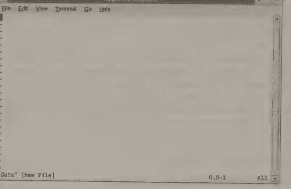

**图 3-2** 在 vi 编辑器中创建新文件

实操项目 3-1 将引导您使用 vi 编辑器创建新文件。

> 提示：有时您可能会在命令行中使用 `vi` 命令启动编辑器而未指定文件名。您可以随时通过按下 Esc，输入 `:w filename` 并按下 Enter 来保存文件并指定文件名。

#### 插入文本

当您启动 vi 编辑器时，您处于命令模式。这意味着编辑器会将您在键盘上输入的任何内容解释为命令。在您能够向新文件中插入文本之前，必须使用 `i` (insert) 命令。在插入模式下，您输入的每个字符都会显示在屏幕上。您可以随时通过按下 Esc 键返回命令模式。

尝试实操项目 3-2 来学习如何在 vi 编辑器中插入文本。


#### 重复更改

vi 编辑器提供了一些可以为您节省时间的功能。其中一项功能就是能够复制您所做的任何更改。当您处于插入模式时，可以使用句点 (`.`) 来重复最近一次所做的更改。这被称为重复命令，在输入相同或相似文本时可以为您节省时间。实操项目 3-3 将使用重复命令。

#### 移动光标

当您想要将光标移动到不同的行或同一行上的特定位置时，请使用命令模式（按 Esc）。在命令模式下，您可以向前或向后移动一个单词，向上或向下移动一行，跳转到文件开头等等。表 3-1 总结了常用的光标移动命令。您可以在实操项目 3-4 中练习移动光标。

表 3-1 vi 编辑器的光标移动键

| 按键 | 移动方向 |
| --- | --- |
| h 或 左方向键 | 向左移动一个字符位置 |
| l 或 右方向键 | 向右移动一个字符位置 |
| k 或 上方向键 | 向上移动一行 |
| j 或 下方向键 | 向下移动一行 |
| H | 屏幕左上角 |
| L | 屏幕最后一行 |
| G | 最后一行开头 |
| nG | 由数字 n 指定的行 |
| W | 向前移动一个单词 |
| b | 向后移动一个单词 |
| 0 (零) | 当前行开头 |
| $ | 当前行末尾 |
| Ctrl+u | 向上翻半屏 |
| Ctrl+d | 向下翻半屏 |
| Ctrl+f 或 Page Down | 向前翻一屏 |
| Ctrl+b 或 Page Up | 向后翻一屏 |

请记住，表 3-1 中显示的 Control 键组合和字母键旨在命令模式下工作。用于在文本中移动的方向键在命令模式和插入模式下均有效。请尝试实操项目 3-4，练习在命令模式下使用 vi 在文件中移动。

> **提示** 使用字母键移动光标可以追溯到 UNIX/Linux 还在使用没有方向键的电传打字机终端的时代。vi 的设计者选择字母键是因为它们在键盘上的相对位置。

#### 删除文本

当您处于命令模式时，vi 编辑器采用几种命令来删除文本。例如，要删除光标处的文本，请输入 *x*。在命令模式下使用 *dd* 可删除当前行。使用 *dw* 可删除一个单词，或者从单词中间删除到单词末尾。要删除多个字符，请将删除命令与前一节学到的光标移动命令相结合。表 3-2 总结了最常用的删除命令。

**表 3-2** vi 编辑器的删除命令

| 命令 | 用途 |
| :--- | :--- |
| x | 删除光标处的字符。 |
| dd | 删除当前行（将其放入缓冲区，以便可以将其粘贴回文件）。 |
| dw | 删除从光标开始的单词。如果光标在单词中间，则从光标删除到单词末尾。 |
| d$ | 从光标删除到行尾。 |
| d0 | 从光标删除到行首。 |

删除行的命令 *dd* 实际上将删除的行放入了一个缓冲区。然后您可以使用命令 *p* 将删除（剪切）的行粘贴到文本的其他地方。（将光标置于您想要粘贴信息的位置。）要复制和粘贴文本，请使用“yank”命令 *yy* 来复制行。在 yank 您想要粘贴到其他地方的行后，移动光标并输入 *p* 即可将文本粘贴在当前位置。您将在本章后面的章节中学习更多关于 *p* 和 *yy* 命令的内容。

实操项目 3-5 为您提供了练习使用删除命令的机会。

#### 撤销命令

如果您完成了一个命令，随后意识到想要撤销其效果，可以使用撤销 (*u*) 命令。例如，如果您不小心从文件中删除了几行，请输入 *u* 以恢复文本。

#### 搜索模式

您可以通过输入正斜杠 (`/`)，输入您要寻找的模式，然后按 Enter 键来向前搜索字符模式。程序员通常将其称为“字符串搜索”。例如，假设您想知道在文件中使用了多少次单词 “insure”。首先，移至文件顶部，输入 `/insure` 并按 Enter 键查找第一个 “insure” 实例。要查找更多实例，请在命令模式下输入 *n*。实操项目 3-6 提供了模式匹配的经验。

如果您处于编辑会话中并想查看有关文件状态的信息，请按 `Ctrl+g` 或 `Ctrl+G`（这是 UNIX/Linux 中的例外情况之一，在这种情况下大小写不重要）。屏幕底部的状态行显示信息，包括面向行的命令和错误消息。

#### 搜索与替换

假设您想将正在编辑的文件中所有出现的 “insure” 更改为 “ensure”。与其搜索 “insure”，然后删除它并插入 “ensure”，您可以使用一条命令进行搜索和替换。到目前为止您学到的命令都是面向屏幕的命令。能够执行多个动作（搜索和替换）的命令是面向行的命令，它们在 ex 模式下运行。

**面向屏幕的命令** 在光标所在位置执行。您不需要告诉计算机在哪里执行操作：它相对于光标进行。另一方面，**面向行的命令** 要求您指定操作的确切位置（地址）。面向屏幕的命令输入简单，且更改立即显示在屏幕上。输入面向行的命令较为复杂，但它们可以独立于光标执行，并且可以在文件的多个位置执行，从而为您节省时间和按键次数。

冒号 ( : ) 位于所有面向行命令之前。它充当 vi 编辑器中屏幕底行（即状态行）上的提示符。您在状态行上输入面向行的命令，并在完成命令后按 Enter。

在本章中，所有关于面向行命令的指令都将冒号作为命令的一部分。

例如，要将所有出现的 “insure” 替换为 “ensure”，您首先进入命令模式（按 Esc），输入 `:1,$/insure/ensure/g` 并按 Enter。该命令意味着：进入 ex 模式 ( : )，从第一行 (1) 开始到文件末尾 ($)，搜索 “insure” ( /insure ) 并在每行出现的所有地方 (g) 将其替换为 “ensure” ( s/insure/ensure/ )。

尝试实操项目 3-7，使用面向行命令进行搜索和替换。

#### 保存文件并退出 vi

在编辑文件时，定期保存更改是一个好习惯。如果您的计算机没有配备不间断电源 (UPS)，这一点尤为重要。UPS 是一种在停电或电压跌落期间为设备提供即时电池电源的设备。

您可以通过几种方式保存文件。一种方式是进入命令模式并输入 `:w` 以在不退出的情况下保存文件。（见图 3-3。）如果您在进行较长时间的编辑会话，请考虑每 10 分钟左右使用一次此命令来定期保存工作。如果您想保存更改并立即退出，请在命令模式下使用 `:wq` 或 `ZZ`。

您还可以使用 `:x` 来保存并退出。在退出 vi 之前，您应该始终保存文件；否则，您将丢失更改。实操项目 3-8 使您能够保存更改并退出编辑会话。

**图 3-3** 保存而不退出

#### 从另一个文件添加文本

有时，您想要包含在一个文件中的文本已经存在于另一个文件中。例如，假设您已经有一个列出客户账户的文本文件，以及另一个名为 customerinfo 的包含客户信息的文件。您想将客户账户文本复制到 customerinfo 文件中，并对 customerinfo 文件进行进一步更改。使用 vi 命令将文本从 accounts 文件复制到 customerinfo 文件比重新输入所有文本要容易得多。要将一个文件的全部内容复制到另一个文件中：(1) 使用 vi 编辑器编辑您想要复制到的文件；(2) 使用命令 `:r filename`，其中 *filename* 是包含您想要复制的信息的文件名。实操项目 3-9 使您能够从一个文件复制到另一个文件。

#### 临时离开 vi

如果您想在处理 vi 的同时执行其他 UNIX/Linux 命令，可以在 vi 内部启动 shell 或执行其他命令。例如，假设您正在处理一个文本或程序文件，想要离开查看当前月份的日历。要在命令模式下查看日历，请输入 `:!cal`（一个冒号，一个感叹号和命令）并按 Enter。此操作将执行 `cal` 命令，当您再次按 Enter 时，您将返回到 vi 编辑会话中。使用 `:!` 加上命令行命令，使您能够启动一个新的 shell，运行该命令，然后返回到 vi 编辑器。


当您想在不先关闭 vi 会话的情况下，在不同的 shell 中运行几个命令行命令时，请使用 `Ctrl+z` 选项来显示命令行。（见图 3-4。）当您完成命令执行后，输入 `fg` 即可返回 vi 编辑会话。

> 在此上下文中，使用 `Ctrl+z` 实际上是 Bash shell 的一个功能，在本例中，它使 vi 编辑器在后台运行并带您回到 shell 命令行。当您输入 `fg` 时，这是一个 shell 命令，它将您离开的任务（vi 编辑会话）带回前台。

动手项目 3-10 将使您能够在 vi 编辑会话中使用 `:l` 和 `Ctrl+z` 命令。

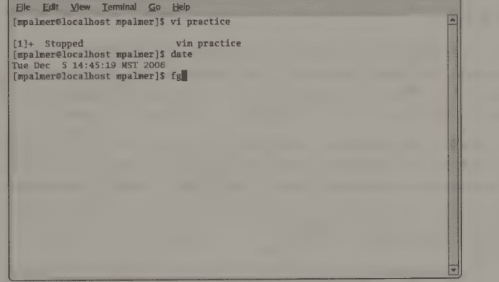
**图 3-4** 从 vi 编辑器访问 shell 命令行

> 您可以设置一个脚本文件（命令文件），使其在启动 vi 时自动运行。该文件名为 `.exrc`，是一个位于主目录中的隐藏文件。此文件可用于自动设置您的 vi 环境。例如，希望在每次编辑会话中都查看行号的程序员可能会创建一个 `.exrc` 文件，并在文件中包含 `set number` 命令。要了解更多关于脚本的信息，请参阅第 6 章和第 7 章（“Shell 脚本编程入门”和“高级 Shell 编程”）。

#### 在编辑时更改显示

除了使用编辑命令外，您还可以在 vi 中设置选项以控制编辑参数，例如使用行号显示。当您需要处理一定范围的行时（例如删除或剪切粘贴文本块），请开启行号显示。然后，您可以参考行号来指定文本。

要开启行号，请使用 `:set number` 命令。例如，如果您想删除第 4 到第 6 行，就可以很容易地确定这些是您打算删除的行，并简单地使用 `:4,6d` 命令将其删除。尝试动手项目 3-11 以开启行号，然后参考行号来删除文本。

#### 复制或剪切与粘贴

您可以使用 vi 中的 `yy` 命令从文件中复制指定数量的行并将其放入剪贴板。要从文件中剪切这些行并存储在剪贴板中，请使用 `dd` 命令。如果您想复制已经输入的内容并将其粘贴到另一个位置，这些命令非常方便。动手项目 3-12 将使您能够剪切文本并将其粘贴到同一文件中的另一个位置。

#### 打印文本文件

有时您想在退出 vi 编辑器之前打印文件。您可以使用 `lpr` (line print) shell 命令从 vi 打印文件。输入 `lpr`，然后输入您要打印的文件名。动手项目 3-13 将使您能够打印在 vi 编辑器中正在处理的文件。

您还可以通过 `-P printer` 选项指定要使用的打印机，其中 `printer` 是您想使用的打印机名称。例如，如果您有两个打印机 lp1 和 lp2。要将文件 accounts 打印到 lp2，请输入 `:!lpr -P lp2 accounts` 并按 Enter 键。

语法 `lpr` [-option] [filename]

### 剖析

- 参数由要打印的文件名组成。
- 选项包括：
    - `-P` 指定目标打印机；在该选项之后紧跟打印机名称。
    - `-#` 指定打印的副本数量（最多 100 份）。
    - `-r` 在打印后删除打印文件（节省磁盘空间）。

#### 取消编辑会话

如有必要，您可以取消编辑会话，并丢弃所有已做的更改（以防您改变主意）。另一个选项是仅保存自上次使用 `:w` 命令以来所做的更改，以便在不退出 vi 的情况下保存文件。在动手项目 3-14 中，您将在不保存最后一次更改的情况下退出文件。

#### 在 vi 中获取帮助

在进入此编辑器后的任何时间，您都可以获得使用 vi 的帮助。要在编辑文件时访问在线帮助文档，请使用 `help` 命令。启动 vi 编辑器后，可以通过按下 Esc，然后输入冒号 (:)，接着输入 `help` 来访问帮助文档。您将在动手项目 3-14 中访问帮助文档。

> 您还可以使用 `man vi` 命令查看关于 vi 的文档。在 vi 中时，按下 Esc，输入 :!man vi，然后按 Enter 键（输入 q 并按 Enter 键返回编辑会话）。或者，当您处于 shell 命令行而非 vi 会话时，输入 `man vi` 并按 Enter 键。


### 使用 Emacs 编辑器

Emacs 是另一种流行的 UNIX/Linux 文本编辑器。与 vi 不同，Emacs 不是模态的。这意味着它不会在命令模式和插入模式之间切换。这意味着您无需确认自己是否处于正确的模式即可输入命令。虽然 Emacs 比 vi 更复杂，但它更一致。例如，您可以通过按下 Alt 或 Ctrl 组合键来输入大多数命令。

Emacs 还支持一种复杂的宏语言。**宏** 是一组用于自动执行复杂任务的命令。可以将宏视为一种“超级指令”。Emacs 具有强大的命令语法且可扩展。其打包的一组定制宏允许您阅读电子邮件和新闻以及编辑目录内容。您可以通过学习其常用的键盘命令开始学习 Emacs。虽然 Emacs 也支持许多传统的基于鼠标的菜单选项，但花时间学习键盘命令是值得的。一旦掌握这些命令，您导航和使用 Emacs 键盘功能的速度通常比通过菜单查找相同选项更快。表 3-3 列出了 Emacs 的键盘命令。

#### 表 3-3 常用 Emacs 命令

| 命令 | 用途 |
|---|---|
| Alt++ | 将光标移至文件开头。 |
| Alt+> | 将光标移至文件末尾。 |
| Alt+b | 将光标向后移动一个单词。 |
| Alt+d | 删除当前单词。 |
| Alt+f | 将光标向前移动一个单词（在单词间的空格处移动）。 |
| Alt+q | 使用自动换行重新格式化当前段落，使行填满。 |
| Alt+t | 如果光标位于单词的第一个字符下，则该单词与前一个单词互换；如果光标不在第一个字符下，则该单词与后一个单词互换。 |
| Alt+u | 将单词中从光标位置到该单词末尾的所有字母大写。 |
| Alt+w | 向上滚动一个屏幕。 |
| Alt+x doctor | 进入 doctor 模式玩一个游戏，其中 Emacs 会用问题回答您的陈述。请先保存工作。并非所有版本都支持此模式。 |
| Ctrl+@ | 标记光标位置。移动光标后，您可以将文本移动或复制到标记处。 |
| Ctrl+a | 将光标移至行首。 |
| Ctrl+b | 将光标向后移动一个字符。 |
| Ctrl+d | 删除光标下的字符。 |
| Ctrl+e | 将光标移至行尾。 |
| Ctrl+f | 将光标向前移动一个字符。 |
| Ctrl+g | 取消当前命令。 |
| Ctrl+h | 使用在线帮助。 |
| Ctrl+k | 删除从当前位置到行尾的文本。 |
| Ctrl+n | 将光标移至下一行。 |
| Ctrl+p | 将光标移至前一行。 |
| Ctrl+t | 交换光标之前的字符与光标下的字符。 |
| Ctrl+v | 向下滚动一个屏幕。 |
| Ctrl+w | 删除标记的文本。按下 `Ctrl+y` 还原被删除的文本。 |
| Ctrl+y | 从 fly 缓冲区插入文本，并将其放置在光标之后。 |
| Ctrl+h, t | 运行 Emacs 教程。 |
| Ctrl+x, Ctrl+c | 退出 Emacs。 |
| Ctrl+x, Ctrl+s | 保存文件。 |
| Ctrl+x, u | 撤销最后一次更改。 |
| Ctrl+Del | 删除从当前光标位置到当前单词末尾的文本。 |

> 提示：在大多数情况下，Emacs 中的 Ctrl 和 Alt 命令不区分大小写，因此 `Alt+B` 和 `Alt+b` 是相同的命令。

#### 在 Emacs 中创建新文件

在终端窗口或 UNIX/Linux 的命令行中输入 `emacs` 命令启动 Emacs。如果您在该命令后输入文件名，Emacs 将创建一个具有该名称的新空白文件，或打开一个具有该名称的现有文件。如果您只输入 `emacs` 而不输入文件名，Emacs 会自动显示几个介绍屏幕，首先是如图 3-5 所示的 Fedora 界面。Emacs 窗口在您配置的 X Window 桌面（如 GNOME）下运行。


**图 3-5** 在安装了 GNOME 的 Fedora 系统中打开的 Emacs 启动界面（未指定文件名）

当你启动 Emacs 而没有指定要打开的文件时，介绍界面将停留在一个屏幕上，你可以在其中输入不需要保存的缓冲区笔记。你可以通过输入 `Ctrl+x, Ctrl+f`，然后输入文件的路径和名称来打开一个现有文件进行编辑。

如图 3-5 所示，Emacs 屏幕顶部有一个菜单栏。当你点击其中一个项目（如“文件”）时，会出现一个菜单。默认菜单栏包含以下类别：

- **文件 (File)**——提供诸如打开文件、打开目录、保存缓冲区信息、从另一个文件插入信息以及进入分屏模式等操作选项
- **编辑 (Edit)**—提供文本编辑功能，如撤销更改、剪切或复制文本、粘贴文本等
- **选项 (Options)**—提供各种特殊选项，如语法高亮、区域高亮、自动换行模式、文件解压缩/压缩、调试器选项，以及用于设置语言环境、字体和输入法的“mule”选项
- **缓冲区 (Buffers)**—允许你打开编辑器当前持有信息的任何存储缓冲区，包括文件中已有的文本
- **工具 (Tools)**—提供编译程序文件、执行 shell 命令、拼写检查文本、比较或合并文件、安装 Emacs 补丁以及阅读和发送电子邮件的选项
- **帮助 (Help)**—通过访问手册、教程、Emacs 常见问题解答 (FAQs) 和 Emacs 心理医生（可让你向 Emacs 提问）来提供协助

你还会看到菜单栏下方有一个图标栏，它提供以下选项：

- 将文件读入 Emacs
- 读取目录以访问其文件
- 退出且不保存当前缓冲区
- 将当前缓冲区的内容保存到文件
- 将当前缓冲区内容复制到不同的文件
- 撤销最近执行的任务
- 剪切文本
- 复制文本
- 粘贴文本
- 向前搜索单词模式或字符串
- 打印当前缓冲区的内容
- 配置编辑偏好
- 查看帮助菜单

#### 在 Emacs 中导航

要在 Emacs 中创建新文件，请在命令行输入 `emacs` 加上文件名，例如 `emacs research`。启动 Emacs 后，要在此文件中导航，你可以使用光标移动键（如方向键、Page Down、Page Up、Home 和 End）或 Ctrl/Alt 组合键，例如 `Alt+f` 将光标向前移动一个单词（见表 3-3）。当你想要保存工作时：(1) 使用“文件”菜单；(2) 使用图标将当前缓冲区保存到文件；或 (3) 按 `Ctrl+x, Ctrl+s`。此外，要退出 Emacs，请使用“文件”菜单、“退出”选项菜单，或输入 `Ctrl+x, Ctrl+c`。

在实操项目 3-15 中，你将创建文件并练习保存和退出。在实操项目 3-16 中，你将练习在文件中导航。

#### 删除信息

在 Emacs 中，你可以使用 Del 或 Backspace 键来删除单个字符。此外，使用 `Ctrl+k` 可以删除至行尾。如果你决定撤销删除，请使用 `Ctrl+x, u`（不要在按 `u` 的同时按 `Ctrl`）来重复撤销每次删除。实操项目 3-17 将引导你删除文本然后撤销删除。

#### 复制、剪切和粘贴文本

在 Emacs 中，你只需通过输入即可插入文本。你也可以通过复制粘贴或剪切粘贴来插入文本。在复制或剪切文本之前，你首先需要标记要操作的文本。当你使用命令键时，导航到要复制的文本开头并按下 `Ctrl+spacebar`。接下来，导航到要包含的文本末尾，按下 `Alt+w` 复制文本，或按下 `Ctrl+w` 剪切文本。然后，将光标移至你想放置复制或剪切文本的位置，按下 `Ctrl+y`（`yank` 命令）。这起初可能听起来很困惑；学习此过程的最佳方法就是实际操作。实操项目 3-18 将引导你在 Emacs 中复制和粘贴文本。

#### 在 Emacs 中搜索

与 vi 编辑器一样，Emacs 允许你搜索特定文本。一种搜索方法是按下 `Ctrl+s`，在状态行输入要查找的字符字符串，然后重复按下 `Ctrl+s` 来查找每个出现的位置。你也可以使用 `Ctrl+r` 向后搜索。

另一种搜索字符串的方法是使用 *向前搜索字符串* 图标，或者点击“编辑”菜单，指向“搜索”并点击“搜索”。在这两种情况下，你随后在状态行输入搜索字符串并按 Enter。尝试实操项目 3-19 来搜索字符串。

#### 重新格式化文件

通常，在创建文档时，你会希望设置行自动换行。使用 `Alt+q` 命令可开启 Emacs 中的自动换行功能。实操项目 3-20 将教你使用自动换行。

> 使用 Emacs 教程了解更多关于 Emacs 编辑器的信息。点击“帮助”菜单并点击“Emacs 教程”；或者在大多数 Emacs 版本中，输入 `Ctrl+h` 然后输入 `t`。

## 本章小结

- 位 (Bits) 代表数字 1 和 0。字节 (Bytes) 是使用数字代码存储的计算机字符（一系列位）。一组被称为 ASCII 码的标准代码常用于表示字符。ASCII 代表美国标准信息交换代码 (American Standard Code for Information Interchange)。仅包含 ASCII 字符（字节）的计算机文件称为文本文件。
- vi 编辑器是 UNIX/Linux 用户的热门选择。标准编辑器处理文本文件。文本文件也称为 ASCII 文件。vi 编辑器是一个模式编辑器，因为它在三种模式下工作：插入模式、命令模式和 ex 模式。插入模式（按 `i`）允许你输入文本，而命令模式（按 Esc）允许你导航文件并修改文本。Ex 模式（在命令模式下输入 :）用于访问一组扩展命令，包括保存和退出文件的命令。
- 在 vi 编辑器的插入模式中，你输入的字符会被插入到文件中，而不会被解释为 vi 命令。要退出插入模式并重新进入命令模式，请按 Esc。
- 使用 vi 时，你最初编辑的是存放在计算机内存中的文件副本。在将其保存到磁盘之前，你并没有改变文件本身。
- Emacs 编辑器是 vi 编辑器的一个流行替代方案，与 vi 一起被包含在大多数 UNIX/Linux 系统中。
- 与 vi 不同，Emacs 不是模式化的——它不会在模式之间切换。Emacs 具有强大的命令语法，具有可扩展性，并支持复杂的宏命令语言。宏是一组旨在简化复杂任务的命令。Emacs 提供的定制宏包允许你阅读电子邮件和新闻，以及编辑目录内容。
- 你可以通过在命令行输入 `emacs`（无论是否带有文件名）来启动 Emacs。如果你输入该命令并输入文件名，Emacs 将创建该名称的新空白文件，或打开具有该名称的现有文件。如果你仅输入 `emacs` 而不带文件名，Emacs 将显示介绍界面。然后你可以使用命令打开现有文件或创建新文件。
- 你可以使用光标移动键（如方向键、Page Down、Page Up、Home 和 End）或 Ctrl/Alt 组合键在 Emacs 文件中导航。
- 你可以按顺序撤销编辑更改，即使已经进行了多次更改。
- 在 Emacs 中，你只需通过输入即可插入文本。你也可以通过复制粘贴或剪切粘贴来插入文本。与 vi 编辑器一样，Emacs 允许你搜索特定文本。Emacs 还具有自动换行能力。

## 命令汇总：第三章命令回顾

| 命令 | 用途 |
|---|---|
| **vi 命令：** | |
| `. (repeat)` | 重复最近一次的更改。 |
| `/` | 向前搜索字符模式。 |
| `:!` | 暂时离开 vi。 |
| `:q` | 取消编辑会话。 |
| `:r` | 从一个文件读取文本并添加到另一个文件中。 |
| `:set` | 开启某些选项，如行号显示。 |
| `:w` | 保存文件并继续工作。 |
| `:wq` | 将更改写入磁盘并退出 vi。 |
| `:x` | 保存更改并退出 vi。 |
| `:llpr filename` | 打印文件。 |
| `I` | 切换到插入模式 |


| 命令 | 用途 |
| :--- | :--- |
| p | 从缓冲区粘贴文本。 |
| u | 撤销最近的一次更改 |
| vi | 启动 vi 编辑器 |
| yy | 将文本复制（yank）到剪贴板 |
| ZZ | 在命令模式下，保存更改并退出 vi |
| Ctrl+z | 使用此基于 shell 的命令（并非真正的 vi 命令）离开 vi 以暂时访问命令行——使用 fg 命令返回 vi |
| UNIX/Linux 命令: lpr | 打印文件。<br>-P 打印到特定打印机。<br>-# 打印指定副本数量。<br>-r 从磁盘存储中删除打印文件。 |
| Emacs 命令: 见表 3-3 | |

## 关键术语

**ASCII** — 美国标准信息交换代码（American Standard Code for Information Interchange）的缩写；一组标准位模式，被组织并解释为字母字符、十进制数字、标点符号和特殊字符。该代码用于将二进制数翻译成普通语言，从而使存储在文件中的信息变得可访问。ASCII 最多可表示 256 个字符（位模式）。

**bit** — 二进制位（binary digit）的缩写；由 0 和 1 两个数字中的一个组成的数字。UNIX/Linux 以二进制位的形式存储所有数据。由于计算机由处于开启或关闭状态的电子电路组成，因此二进制位非常适合表示这些状态。二进制位通常被称为 bits。

**binary file** — 二进制文件：包含非 ASCII 字符（如机器指令）的文件。

**byte** — 字节（binary term）的缩写；由八个二进制位或 bits 组成的字符串。这些数字可以配置成位模式，进而被解释为字母字符、十进制数字、标点符号和特殊字符。这是 ASCII 码的基础。

**bitmap** — 位图：图形软件将其转换为无数种图像的点行和点列或位模式。

**command mode** — 命令模式：模态编辑器的一种特性，允许您输入命令来执行编辑任务，例如在文件中移动和删除文本。UNIX/Linux vi 编辑器是一个模态编辑器。

**compiling** — 编译：将程序文件翻译成机器可读语言的过程。

**editor** — 编辑器：用于创建和修改计算机文档（如程序文件和数据文件）的程序。

**ex mode** — ex 模式：一种文本编辑命令模式，目前在 vi 编辑器中使用，它采用了一组扩展命令，最初用于早期的 UNIX 编辑器 ex。

**executable program file** — 可执行程序文件：也称为可执行文件，是指可以运行在计算机上的编译文件（来自编程语言）或解释文件（来自脚本）。

**insert mode** — 插入模式：模态编辑器的一种特性，允许您输入文本。UNIX/Linux vi 编辑器是一个模态编辑器。

**line editor** — 行编辑器：一次只能处理一行或一组行的编辑器。虽然您无法看到文件的上下文，但您可能会发现行编辑器在搜索、替换和复制文本块等任务中非常有用。

**line-oriented command** — 面向行的命令：可以在文件的多个位置执行多个操作（如搜索和替换）的命令。使用面向行的命令时，必须指定操作发生的准确位置。这些命令与面向屏幕的命令不同，后者相对于光标的位置执行。

**machine language** — 机器语言：专门使用 0（表示关闭）和 1（表示开启）与计算机通信。多年前，程序员必须用机器语言编写程序，这是一个繁琐且耗时的过程。

**macro** — 宏：一组用于自动执行复杂任务的命令。宏有时被称为超级指令。

**modal editor** — 模态编辑器：允许您在不同模式下工作的文本编辑器。例如，vi 编辑器有三种模式：插入模式、命令模式和 ex 模式。

**screen editor** — 屏幕编辑器：由操作系统提供的编辑器，一次显示一屏文本，并允许您在屏幕上移动以添加和更改文本。UNIX/Linux 有两个屏幕编辑器：vi 和 Emacs。

**screen-oriented command** — 面向屏幕的命令：相对于光标位置执行的命令。面向屏幕的命令易于输入，且您可以立即在屏幕上看到其结果。这些命令与面向行的命令不同，后者的执行独立于光标的位置。

**text editor** — 文本编辑器：一种简化的文字处理器，用于创建和编辑文档，但没有诸如加粗或文本居中等格式化功能。

**text file** — 文本文件：完全由 ASCII 字符组成的计算机文件。

**Unicode** — 一组支持多达 65,536 个字符的位模式，其开发目的是为了提供比 ASCII 更多的字符，以支持更广泛的语言（如中文）。

## 复习题

- 1. 您正在使用 vi 编辑器，意识到需要执行文件列表来检查文件名。您在 vi 中可以使用什么命令？
    - a. `:ls` 
    - b. `Ctrl+l` 
    - c. `:lls` 
    - d. `#list`

- 2. 您的新助手尝试使用 vi，但每次他尝试输入一行文本时，屏幕上都没有显示。问题出在哪里？
    - a. 他不在插入模式。
    - b. 他不在命令模式。
    - c. Caps Lock 键开启了。
    - d. 他必须先输入 :。

- 3. 在 vi 中，面向屏幕的命令 _________。
    - a. 必须以 *Ctrl+s* 开头
    - b. 在光标所在位置执行
    - c. 相对于行号执行
    - d. 清除屏幕

- 4. 您一直在 vi 中编辑一个文件，并决定撤销最近输入的两个操作。您应该输入什么？
    - a. 按两次 *Shift+Ctrl+b*。
    - b. 点击撤销图标。
    - c. 按 Esc，*u, u*。
    - d. 按 *:b, b*。

- 5. 您将 vi 中的光标置于行首。在命令模式下，如何删除整行？（选择所有适用项）
    - a. 按一次 Del 键。
    - b. 按 End 键。
    - c. 输入 *dd*。
    - d. 输入 *rr*。

- 6. 您正在使用 vi 编辑配置文件，但决定终止编辑会话（您尚未保存任何内容）。您在命令模式下输入什么？
    - a. `:q!`
    - b. bye
    - c. stop
    - d. `$off`

- 7. 您在 vi 编辑器中打开了一个大文档，决定快速将光标置于最后一行的开头。您使用哪个命令模式选项？
    - a. ?
    - b. *E*
    - c. &
    - d. *G*

- 8. 如何在启动 Emacs 的同时创建一个名为 `budget` 的新文件？
    - a. 在命令行输入 `gedit budget`。
    - b. 按 `End`+`Delete`。
    - c. 在命令行输入 `emacs budget`。
    - d. 在命令行输入 `edit -f budget`。

- 9. 您想在 Emacs 中编辑文本文件时搜索单词“egregious”。您应该使用以下哪项？（选择所有适用项：）
    - a. 点击文件菜单并使用搜索选项。
    - b. 使用 `Ctrl+s` 命令。
    - c. 使用 Finder 菜单。
    - d. 点击编辑菜单并使用搜索选项。

- 10. 哪个 Emacs 命令允许您粘贴已经复制到文件缓冲区的文本？
    - a. `Alt+p`
    - b. `Alt+>`
    - c. `Ctrl+y`
    - d. `Shift+Alt+p`

- 11. 在 Emacs 中如何快速删除当前行？
    - a. 按 `Ctrl+k`。
    - b. 按 `Esc`, `Esc`。
    - c. 输入 `:delete`。
    - d. 输入 `!delete`。

- 12. 您刚在 Emacs 中创建了一个文件然后退出，但文件没有保存。出了什么问题？
    - a. 您没有将 Emacs 标志从“只读”更改为“写入”。
    - b. 您在退出前没有按 `Ctrl+x`, `Ctrl+s`。
    - c. 您在启动 Emacs 编辑会话时在命令行中没有使用 `-s` 选项。
    - d. 您在退出前没有输入 `:update`。

- 13. 在 vi 中，您将光标定位在第 18 行，然后输入 `5dd`。接着，您将光标移动到文件末尾并按 `p`。这会产生什么结果？
    - a. 为第 18 到 22 行开启行号，然后将光标移动到文件中间。
    - b. 为第 18 到 22 行开启行号，然后将光标移动到文件开头。
    - c. 剪切第 18 到 22 行，然后将这些行的内容粘贴到文件末尾。
    - d. 将光标移动到第 5 行，然后清除这些行。

- 14. 在 Emacs 中，____________________ 命令标记您要复制的文本块的末尾。
    - a. `Ctrl+e` 
    - b. `Ctrl+Shift` 
    - c. `Home` 
    - d. `Alt+w`

- 15. 以下哪个命令可以在 vi 中保存文件并退出？（选择所有适用项）
    - a. `:x` 
    - b. `:wq` 
    - c. `#save` 
    - d. `!r,quit`

- 16. 您正在处理一个程序文件，面前有该文件的打印件。通过打印件，您意识到需要修正第 242 行的一个编程错误。您可以使用什么命令在 vi 编辑器中直接跳转到该行？
    - a. `242` 
    - b. `242G` 
    - c. `Ctrl+l, 242` 
    - d. `/242`

- 17. 您正在 Emacs 中处理一个程序文件，发现开发目录中的另一个文件有一段程序行实现了您现在在当前文件中想要实现的功能。您可以使用哪个菜单选项来插入在另一个文件中已经写好的行？
    - a. 选项 (Options)
    - b. 编辑 (Edit)
    - c. 文件 (File)
    - d. 缓冲区 (Buffers)


- 18. 你在必须参加会议前只有几分钟时间。然而，你想快速跳转到正在使用 vi 编辑的文件最后一行末尾，以便在恢复工作时为该文件添加几条关于额外条目的提醒。哪个命令或命令序列可以跳转到文件末尾？
    a. forward all
    b. H
    c. j
    d. L 然后 $

- 19. 一个 bit 是 __________。
    a. 一个二进制位
    b. 一个常用词的代码
    c. 一个二进制术语
    d. 一个 ASCII 字符的完整表示

- 20. 以下哪个过程用于将源代码转换为可执行文件？
    a. 编译 (compiling)
    b. 追加 (appending)
    c. 合并 (joining)
    d. 位图映射 (bit mapping)

- 21. 在 Emacs 中，你想通过一个步骤搜索所有使用“end of the year”词组的地方，并将其改为“year end”，以帮助满足你正在撰写的文章的字数限制。目前，你处于文章的末尾附近。你应该首先执行以下哪个命令？
    a. Ctrl+s
    b. Ctrl+e
    c. Alt+s
    d. Alt+<

- 22. 如何在 vi 中显示状态栏？
    a. 使用 Ctrl+g 命令。
    b. 在命令模式下输入 INFO。
    c. 输入 :ex。
    d. 与 Emacs 不同，vi 没有状态栏。

- 23. 你是一个 vi 新手，想在编辑文件之前查阅其文档。在这种情况下，以下哪些是可行选项？（选择所有适用项。）
    a. 打开 vi 编辑器且不带文件参数，因为文档会自动出现。
    b. 在打开 vi 之前，在命令行输入 `man vi`。
    c. 打开 vi，按下 Insert 键，然后按下 `Ctrl+Alt+h`。
    d. 打开 vi，按下 Esc，输入 `:!man vi`，然后按下 Enter。

- 24. Emacs 中的哪个命令能让你快速将光标移动到当前行的开头？
    a. `Alt+g`
    b. `Ctrl+a`
    c. `Alt+a`
    d. `bb`

- 25. 哪个 vi 命令可以重复上一次的更改？
    a. `Ctrl+r`
    b. `xr`
    c. 分号 (`;`)
    d. 句点 (`.`)

26. 要将文本从数据文件中复制到你在 vi 中当前编辑的文件中，输入 `:r data` 并按下 Enter。正确或错误？

27. Emacs 是一个模态编辑器。正确或错误？

28. 在 vi 命令模式下，你可以输入 `dw` 来删除光标当前指向的单词。正确或错误？

29. vi 和 Emacs 都是屏幕编辑器的例子。正确或错误？

30. 当你在 vi 编辑器中时，可能会看到以波浪号 (~) 开头的行。这些行代表存储缓冲区。波浪号之后的文本是你复制到缓冲区中的文本，稍后可以粘贴到文档中。当你关闭 vi 时，这些存储缓冲区中的文本不会被保存。正确或错误？

## 实操项目

实操项目 3-1 到 3-14 设计为一组循序渐进的项目，通过这些项目你将学习如何使用 vi 编辑器创建和编辑文件。这些项目在命令行（如终端窗口）中使用你自己的账户执行。

### 项目 3-1

在这个项目中，你将通过创建一个名为 textfiles 的文件来启动 vi 编辑器，用于存放一些关于文本文件的基础注释。这仅仅是一个练习文件，旨在让你开始学习 vi 编辑器。通常最好在对工作不重要的文件上进行学习。要打开 vi 并创建新文件，请输入 `vi` 紧跟新文件名。

**要打开 vi 并创建新文件：**

- 1. 在 `$` 命令提示符后，输入 `vi textfiles` 并按下 **Enter**。这将启动 vi 并开始编辑一个名为 textfiles 的新文件。你的屏幕应该看起来与本章前面图 3-2 所示的类似。

在屏幕的左上角，你会看到光标，在本章前面的图 3-2 中显示为一个实心块。光标指示你在文件中的当前位置。以 `~` 开头的行不是文件中的实际行，当你在一行新行中输入文本时，你会看到该行的波浪号消失。另外，请注意你的新文件名以双引号形式出现在屏幕底行。

- 2. 保持 vi 编辑会话开启，以进行实操项目 3-2。

如果你在任何时候需要停止并稍后恢复接下来的项目（直到实操项目 3-14），因为无法一次性完成，请按下 `Esc`，输入 `:x` 并按下 **Enter**。当你恢复时，输入 `vi` 和文件名，例如 `vi textfiles`。

### 项目 3-2

在这个项目中，你将练习在 vi 编辑器的插入模式和命令模式之间切换。接下来，你将输入一段用于练习的文本。

**要进入插入模式和命令模式：**

- 1. 输入 `i`（但不要按下 Enter）。

与大多数 vi 命令一样，`i` 命令不会在屏幕上出现（或回显）。该命令将你从命令模式切换到插入模式；你不需要按下 Enter 来发出命令完成的信号。请注意，当你处于插入模式时，屏幕底部会出现 “— INSERT —”。

- 2. 按下 **Esc** 返回命令模式。屏幕底部的行发生了什么变化？

- 3. 按下 **i** 重新进入插入模式。

- 4. 输入以下文本，每行后按下 **Enter** 以移至下一行。请确保在输入最后一行后按下 Enter，将光标移至下一行。如果需要删除字符，请按下 Backspace 键。

    - Files contain text.
    - Text contains lines.
    - Lines contain characters.
    - Characters form words.
    - Words form text.

- 5. 现在你的光标应该在第六行的开头，该行没有文本。（见图 3-6。）保持 vi 编辑器开启，以进行实操项目 3-3。

**图 3-6** 使用 vi 编辑器插入文本

### 项目 3-3

在这个项目中，你将练习使用重复命令 (.) 来复制你在 vi 编辑器中对文本所做的最近一次更改。

**要使用重复命令：**

- 1. 按下 **Esc** 切换到命令模式。

- 2. 输入 . (句点)。
  vi 编辑器将插入你在实操项目 3-2 的步骤 4 中输入的五行内容。
  你的屏幕应该看起来与图 3-7 类似。

- 3. 保持 vi 编辑器开启，以进行实操项目 3-4。

**图 3-7** 在 vi 编辑器中重复命令

### 项目 3-4

高效地将光标移动到正确的位置对于编辑文件至关重要。在这个项目中，你将练习在屏幕上移动光标。

**要在屏幕上移动光标：**

- 1. 按下 **Esc** 以确保你处于命令模式。
- 2. 按方向键每次移动一个字符，分别向上、向右、向左和向下。
- 3. 输入 **H** 将光标移动到屏幕的左上角。
  *(提示：请确保按照这些步骤指示输入大写字母。)*
- 4. 输入 **L** 将光标移动到屏幕的最后一行。
- 5. 使用 **上方向键** 移至倒数第三行（以 “Lines” 开头）的开头。使用 **右方向键** 移至该行末尾。
- 6. 输入 **G** 跳转到最后一行的开头。这是一个 “go to” 命令。你可以在 G 之前包含一个数字来指定要移动到的行号。
- 7. 输入 **2G** 移动到第二行的开头。
- 8. 输入 **w** 向前移动一个单词。
- 9. 输入 **b** 向后移动一个单词。保持 vi 编辑器开启，以进行实操项目 3-5。

### 项目 3-5

人们经常在输入时犯错，或者改变对文本内容的想法。因此，删除能力非常重要。在这个项目中，你将使用删除命令和光标移动键来编辑你在文件中插入的文本。

**通过删除文本进行编辑：**

- 1. 按下 **Esc** 以确保你处于命令模式。
- 2. 输入 **1G** 移动到文件的第一行。你想删除这一行。
- 3. 要删除第一行，输入 **dd**（但不要按下 Enter）。

你的文件现在应该像图 3-8 所示。

**图 3-8** 删除第一行后的文件

- 4. 按下 **w** 移至下一个单词 “contains”。
- 5. 输入 **dw** 删除当前单词（因此该行现在显示为 “Text lines.”），然后输入 **i** 进入插入模式。
- 6. 在 “Text” 和 “lines” 之间输入 **consistss** of。请务必包含多出的那个 “s” 以及 “of” 后的空格。
- 7. 按方向键将光标移至 “consists” 中多余的 “s”，然后按下 **Esc** 切换到命令模式。
- 8. 要删除当前字符（多余的 “s”），输入 **x**（但不要按下 Enter）。
你的文件现在应该像图 3-9 所示。
- 9. 现在，你想通过删除最后一个单词来编辑句子 “Files contain text”。输入 **5G** 移动到第五行，并按下右方向键移至 “contain” 中的 “c”。


**图 3-9** 删除多余的 “s” 后的文件

- 10. 输入 **d$** 以删除从光标到行尾的文本，然后输入 **i** 切换到插入模式。
- 11. 输入 **consist of words.** 来完成句子。（确保 “Files” 和 “consist” 之间有一个空格，且 “words” 之后有一个句号。）
- 12. 现在，您可以通过替换最后一个单词来编辑下一句话。按下 **Esc** 切换回命令模式。接着，按下方向键将光标移动到文件的下一行，并移至单词 “lines” 的首个字符（“l”）处。
- 13. 输入 **d0** 以删除从光标到行首的文本，然后输入 **i** 进入插入模式。
- 14. 输入 **Words form** 将该文本插入到句首。（确保 “form” 和 “lines” 之间有一个空格。）
- 15. 编辑完成后的内容应如图 3-10 所示。请保持 vi 编辑器打开，以便进行实操项目 3-6。

图 3-10 完成步骤 14 后的文件编辑结果

### 项目 3-6

有时，您可能会习惯性地拼错某个单词，或者想要定位某些文本以检查其准确性。在这个项目中，您将使用 vi 的模式匹配功能在文件中查找特定文本。

**要搜索文本模式：**

- 1. 按下 **Esc** 键** 确保您处于命令模式。
- 2. 输入 **H** 将光标移至屏幕顶部。
- 3. 输入 **/cons** 并按下 **Enter** 键来搜索字符串 “cons”。发生了什么？
- 4. 要将光标移动到下一个 “cons” 出现的位置，请按下 **n**（代表 next）。接下来发生了什么？

> 如果您搜索的是 “/con” 而不是 “/cons”，您会首先在第 1 行找到 “consist”，然后在第 2 行找到 “contain”。（在 Fedora 中，“con” 将在第 1 行的 “consists”、第 2 行的 “contain”、第 5 行的 “consist” 和第 7 行的 “contain” 中被高亮显示。）

- 5. 在此阶段，学习如何查看编辑会话的状态信息非常有价值。要查看文件状态信息，请按下 **Ctrl+g**。（您也可以按下 **Ctrl+G**。这是在 UNIX/Linux 中可以使用大写或小写字母的一个实例）。您的屏幕应如图 3-11 所示。请保持 vi 编辑器打开，以便进行下一个项目。

图 3-11 vi 状态行出现在屏幕底部

### 项目 3-7

使用面向行的编辑命令可能比使用面向屏幕的命令快得多，尤其是当您想要在文件中搜索并替换模式时。在这个项目中，您将对比使用面向屏幕的命令与使用面向行的命令来搜索单词 “text” 出现的位置。请注意，面向行的命令不仅能找到 “text” 出现的位置，还能让您将特定的出现项替换为单词 “documents”。

**要对 “text” 进行面向屏幕的搜索：**

- 1. 按下 **Esc** 确保您处于命令模式。
- 2. 输入 **H** 回到文件开头。
- 3. 输入 **/text** 并按下 **Enter**。
- 4. 输入 **n** 重复搜索。（在 Fedora 中，您会看到所有 “text” 的实例同时被高亮显示，光标位于第一个 “text” 实例上。按下 **n** 会带您进入第二个实例。在 Red Hat Enterprise Linux 中，只有第一个 “text” 实例被高亮显示，您需要按下 **n** 才能前往下一个。）单词 “text” 出现了多少次？

**要使用面向行的命令搜索 “text” 并将其替换为 “documents”：**

- 1. 按下 **Esc** 确保您处于命令模式。
- 2. 输入 **:1,$s/text/documents/g**（但先不要按下 Enter）。注意，这条命令的意思是 “从第一行 (1) 到文件末尾 ($)，搜索 ‘text’ 并将其替换为 ‘documents’ (s/text/documents/)，且在每行的所有出现位置都执行 (g)”。
- 3. 按下 **Enter**。参见图 3-12。请保持 vi 编辑会话打开，以便进行实操项目 3-8。

> 第 1 行中的单词 “Text” 保持不变，因为它首字母大写。默认情况下，搜索是区分大小写的。

**图 3-12** 使用面向行的编辑命令搜索并替换文本

### 项目 3-8

定期在 vi 编辑器中保存工作可以确保在发生意外断电时不会丢失工作。此外，在做出更改并退出 vi 时，请务必使用在退出前保存工作的命令。在这个项目中，您将练习使用保存工作的命令。

**要在不退出 vi 的情况下保存文件工作：**

- 1. 如有必要，按下 **Esc** 进入命令模式。
- 2. 输入 **:w** 然后按下 **Enter** 保存更改。

**要保存工作并退出：**

- 1. 在命令模式下，输入 **:x** 并按下 **Enter**。（参见图 3-13。）

图 3-13 使用 :x 保存并退出

### 项目 3-9

将一个文件的内容复制到另一个文件中可以减少在 UNIX/Linux 工作时的重复输入。在这个项目中，您将使用 vi 编辑器创建一个新文件，并将您在实操项目 3-8 中刚刚保存的 textfiles 文件中的文本添加到该文件中。

要创建新文件并从另一个文件添加文本：

- 1. 输入 **vi practice** 并按下 **Enter** 创建一个名为 practice 的新文件。
- 2. 按下 **Esc** 确保您处于命令模式。
- 3. 输入 **:r textfiles** 并按下 **Enter**。

您的文件应如图 3-14 所示。`r` 命令将文本从 textfiles 复制并放入当前文件 practice 中。请注意文件顶部的空白行。状态行提供了关于您添加的文件信息，包括其名称、包含的行数和字符数。

- 4. 将光标移至空白行，输入 **dd** 将其删除。
- 5. 保持 practice 文件打开，以便进行实操项目 3-10。

**图 3-14** 在 vi 编辑器中将一个文件复制到另一个文件中

### 项目 3-10

有时，您需要同时做两件事。例如，考虑这样一种情况：您正在 vi 中编辑一个文本文件，这时有人打电话来预约会议，但你们双方都没有日历在手边。您可以在不关闭 vi 编辑器的情况下运行 `cal` 命令或其他命令。在这个项目中，您将学习两种在不关闭 vi 编辑会话的情况下执行命令的方法。

**暂时离开 vi 以查看本月日历：**

- 1. 如有必要，按下 **Esc** 进入命令模式。
- 2. 输入 `:cal` 并按下 **Enter**。
  您将看到本月的日历，然后看到提示 “Hit ENTER or type command to continue”（按下 ENTER 或输入命令以继续）。（参见图 3-15。）
- 3. 按下 **Enter** 返回到处于命令模式的 vi 编辑会话。

**访问命令行以执行多个命令：**

- 1. 按下 **Ctrl+z** 访问命令行。
- 2. 输入 `ls -l` 并按下 **Enter** 执行命令。
- 3. 输入 `fg` 并按下 **Enter** 返回 vi 编辑会话。您回到了什么模式？
- 4. 保持 vi 编辑会话打开，以便进行实操项目 3-11。

**图 3-15** 暂时离开 vi 以运行 `cal` 命令

### 项目 3-11

行号可以帮助您在 vi 中快速识别想要编辑的特定行。在这个项目中，您将开启行号显示，然后将其作为参考来删除文本中的行。

**使用自动行号：**

- 1. 按下 **Esc** 确保您处于命令模式。
- 2. 输入 `:set number` 并按下 **Enter**。屏幕上将出现行号。（参见图 3-16。）
  行号仅用于参考，不属于文件内容。现在您可以使用这些参考号来删除文件中的最后三行。
- 3. 输入 `:7,9d` 并按下 **Enter**。您已经删除了文件中的第 7 到第 9 行。
- 4. 保持 practice 文件打开，以便进行实操项目 3-12。


**图 3-16** 开启行号显示

### 项目 3-12

没有人喜欢进行不必要的重复输入。在这个项目中，你将学习如何在练习文件中剪切和粘贴文本，以减少额外的输入工作。

**剪切和粘贴文本的操作步骤：**

- 1. 在命令模式下，输入 **H** 将光标移动到第 1 行的开头。
- 2. 输入 **3dd** 从文档中剪切前三行并将其存储在缓冲区中。
- 3. 输入 **G** 将光标移动到文件末尾。
- 4. 输入 **p** 将这三行粘贴到文件末尾。
- 5. 保持练习文件打开，以便进行上手项目 3-13。

### 项目 3-13

在这个项目中，你将在不退出 vi 编辑会话的情况下打印当前正在编辑的文件。为了完成此任务，你的计算机应已连接到默认打印机。

**打印文件的操作步骤：**

- 1. 如果需要，按下 **Esc** 返回命令模式。
- 2. 输入 **:w** 并按下 **Enter** 保存练习文件。
- 3. 输入 **:!lpr practice** 并按下 **Enter**。这将把当前目录下的 practice 文件发送到默认打印机打印。
- 4. 按下 **Enter** 返回 vi 编辑会话。
- 5. 保持 vi 会话打开，以便进行上手项目 3-14。

### 项目 3-14

有时，你在文档中进行了修改，但随后决定不保存这些更改。在这个项目中，你将对练习文档进行一项修改，然后不保存更改直接退出。你还将学习如何查看 vi 的帮助文档。

**进行额外修改并取消保存的操作步骤：**

- 1. 如果需要，按下 **Esc** 进入命令模式。
- 2. 将光标置于顶行开头（如果不在开头，请输入 **H**），输入 **dd**（但不要按下 Enter）。
- 3. 输入 **:q** 并按下 **Enter**。
- 4. 输入 **vi practice** 并按下 **Enter**。注意，句子“Words form documents”重新出现在文件的第 1 行，因为你在步骤 2 中的修改没有被保存。

**查看 vi 帮助文档的操作步骤：**

- 1. 输入 **:help** 并按下 **Enter** 查看帮助文档。使用 **Page Down** 和 **Page Up** 键（或 PgDn/PgUp，具体取决于你的键盘）滚动浏览文档。
- 2. 输入 **:q** 并按下 **Enter** 退出文档。（在某些版本的 Red Hat Enterprise Linux 中，这也会关闭 vi 编辑器。如果你使用的是 Fedora，请继续执行步骤 3 以关闭编辑器。）
- 3. 再次输入 **:q** 并按下 **Enter** 以关闭 vi 编辑器。

> 在项目 3-15 到 3-20 中，你将练习使用 Emacs 编辑器。在这些项目中，你将使用自己的账户从命令行（如终端窗口）启动 Emacs。

### 项目 3-15

在这个项目中，你将通过创建新文件、输入文本以及保存并关闭文件来开始使用 Emacs。

**启动 Emacs 并创建新文件的操作步骤：**

- 1. 输入 **emacs practice.file** 然后按下 **Enter**。你将看到启动界面及其状态栏（在屏幕底部），这表明你正在创建一个新文件。
- 2. 要向文件中添加文本，请输入以下内容，使你的屏幕显示如图 3-17 所示：

```
Files contain text.
Text contains lines.
Lines contain characters.
Characters form words.
Words form text.
```

- 3. 按下 **Ctrl+x** 然后按下 **Ctrl+s** 保存文件。注意状态行会报告你已写入文件。
- 4. 按下 **Ctrl+x** 然后按下 **Ctrl+c** 退出文件。

> 在 Emacs 中，你需要按下两个 Ctrl 组合键来保存并退出文件。

**图 3-17** 在 Emacs 中输入文本

### 项目 3-16

这个项目让你练习在 Emacs 中进行导航。

**在 Emacs 中导航的操作步骤：**

- 1. 输入 `emacs practice.file` 并按下 **Enter**。
- 2. 按下 **Ctrl+f** 向前移动一个字符，然后按下 **右方向键** 每次向前移动一个字符。向前移动四个或五个字符。
- 3. 按下 **Ctrl+b** 向后移动一个字符，然后按下 **左方向键** 练习向后移动。
- 4. 使用 **下方向键** 和 **上方向键** 在文档的行之间上下移动。
- 5. 输入 **Alt+<** 跳转到文件的开头。（在键盘上使用 Shift 键输入 <。）
- 6. 输入 **Alt+>** 跳转到文件的末尾。（在键盘上使用 Shift 键输入 >。）
- 7. 保持文件打开，以便进行上手项目 3-17。

### 项目 3-17

在这个项目中，你将练习在 Emacs 中删除文本并撤销删除操作。

**删除文本并撤销删除的操作步骤：**

- 1. 使用方向键将光标置于以 "Lines contain..." 开头的行上。
- 2. 按下 **Ctrl+k** 删除当前行。
- 3. 按下 **Ctrl+x** 然后输入 **u** 来撤销上一次更改。
- 4. 保持 Emacs 编辑会话打开，以便进行上手项目 3-18。

> 你可以重复地恢复文本，即使在进行了多次更改之后也是如此。根据需要多次按下 Ctrl+x 然后按下 u，以依次撤销你的编辑命令。

### 项目 3-18

在这个项目中，你将在 Emacs 中复制文本，然后粘贴复制的文本。

**在 Emacs 中复制和粘贴文本的操作步骤：**

- 1. 将光标移动到句子 "Text contains lines." 的开头。
- 2. 按下 **Ctrl+spacebar**（空格键）。这标记了你想复制的文本块的起点。你在状态栏中会看到 "Mark set" 字样。
- 3. 按下 **下方向键** 和 **右方向键** 将光标移动到最后一行文本的末尾（在 “...form text.” 之后）。
- 4. 按下 **Alt+w**。这标记了要复制的文本块的终点，光标会短暂地跳回你在步骤 2 中标记的位置，然后又回到你标记文本终点的位置。（在许多版本的 Emacs 中，你也可以按住 Esc 并按下 w 来标记块的终点。）
- 5. 按下 **Alt+>** 跳转到文件末尾。如果需要，按下 **Enter** 在以 “...form text.” 结尾的最后一行之后开启一个空行。此时你的光标应位于文件末尾空行的开头。
- 6. 按下 **Ctrl+y** 将剪贴板中标记的文本粘贴到缓冲区（屏幕上），如图 3-18 所示。

> 若要执行剪切和粘贴而非复制和粘贴，请在光标位于要剪切的块末尾时按下 *Ctrl+w*。（参见步骤 4。）然后，将光标移动到你想粘贴文本的地方，按下 *Ctrl+y*。

**图 3-18** 在 Emacs 中复制和粘贴文本

### 项目 3-19

在使用 Emacs 编辑器时，你会发现经常需要搜索特定的模式或字符字符串。在这个项目中，你将学习在 Emacs 中执行字符串搜索的两种方法。

**使用控制键选项进行搜索的操作步骤：**

- 1. 按下 **Ctrl+s**。你在状态行中会看到 “I-search:” 提示。现在你可以输入要搜索的文本。
- 2. 输入 **on**（但不要按下 Enter）。
- 3. 按下 **Ctrl+s** 搜索 “on” 的出现实例。它出现在哪个单词中？再次按下 **Ctrl+s**。
- 4. 按下 **Ctrl+r** 向后搜索上一个 “on” 的出现实例。

**使用编辑菜单的搜索选项进行搜索的操作步骤：**

- 1. 输入 **Alt+<** 移动到文件开头。
- 2. 点击 **Edit** 菜单，指向 **Search**，然后点击 **Search...**。
- 3. 注意光标移动到了屏幕底部的状态行。
- 4. 在状态行中输入 **on**，然后按下 **Enter**。
- 5. 点击 **Edit** 菜单，指向 **Search**，然后点击 **Repeat Search** 以定位下一个 “on” 的出现实例。
- 6. 点击 **Edit** 菜单，指向 **Search**，然后点击 **Repeat Backwards** 以向后搜索 “on”。保持 Emacs 编辑器打开，以便进行上手项目 3-20。

### 项目 3-20

在这个项目中，你将在 Emacs 中开启自动换行功能，使行在显示时自动换行。

**重新格式化文件以使用自动换行的操作步骤：**

- 1. 输入 **Alt+<** 移动到文件开头。
- 2. 按下 **Alt+q** 重新格式化文件，使行填满文本。（参见图 3-19。单词会从一行换到下一行。）
- 3. 输入 **Ctrl+x**, **Ctrl+s** 保存文件，然后输入 **Ctrl+x**, **Ctrl+c** 退出。


**图 3-19** 在 Emacs 中开启自动换行

## 探索练习

- 1. 使用 vi 编辑器：
    - 创建一个包含四行内容的文档，每行都包含单词“today”。
    - 仅使用一条命令复制前四行。
    - 保存文件并退出 vi。
    - 重新打开文档，仅将前四行中的“today”改为“yesterday”。
- 2. 使用 vi 编辑器：
    - 创建一个名为 first.file 的文档，并在其中输入几行文本。保存它。
    - 创建第二个名为 second.file 的文档，并在其中输入几行文本。保存它。
    - 通过合并前两个文件的文本，创建一个名为 third.file 的第三个文档。
    - 保存第三个文件，并退出编辑器。
    - 输入 `vi third.file` 并按 Enter 键，以确认 third.file 包含了这两个文件的文本。
- 3. 删除你使用 vi 创建的 third.file 中的所有文本，然后将其恢复。

请参考表 3-3 找到执行以下基础练习的正确命令，以练习使用 Emacs 编辑器。

- 4. 使用 Emacs 编辑器，创建一个名为 sonnet 的新文件，其中包含莎士比亚第 80 首十四行诗的前四行：

*O, how I faint when I do you do write,*
*Knowing a better spirit doth use your name,*
*And in the prease thereof spends all his might,*
*To make me tongue-tied, speaking of your fame!*

- 5. 将光标移动到第二行单词“better”中除“b”以外的任何字母上。
- 6. 使用使当前单词与随后的单词互换位置的命令。执行命令后，该行应显示为：

Knowing a spirit better doth use your name,

- 7. 将光标移动到同一行的单词“doth”上。
- 8. 使用删除当前单词的命令。
- 9. 将光标移动到同一行单词“spirit”的第一个字符上。
- 10. 使用将单词字母大写化的命令。
- 11. 将光标移动到同一行单词“your”中的字母“y”下方。
- 12. 使用删除光标上方字符的命令。该行现在应显示为：

Knowing a SPIRIT better use our name,

- 13. 将光标移动到第三行的单词“spends”上。
- 14. 使用删除文本至行尾的命令。该行现在应显示为：

And in the praise thereof

- 15. 将光标移动到第一行的开头。
- 16. 使用在光标位置放置标记的命令。
- 17. 将光标移动到第一行的末尾。使用标记该特定光标位置的命令。
- 18. 将光标移动到第一行的第一个字符。
- 19. 使用删除标记文本的命令，即删除第一行。
- 20. 将光标移动到文件末尾。使用恢复已删除文本的命令。原文件的第一行文本现在位于文件末尾。保存你的工作，然后关闭 Emacs 编辑器。

使用 vi 编辑器完成以下高级练习，以磨练你的编辑技巧。

- 21. 创建一个包含 12 行文本的文件。删除文本中的第二个单词。
- 22. 转到第五行，插入你的名字和姓氏。
- 23. 移除第八行，并将其放置在文件末尾。
- 24. 使用一条命令跳转到文件的第一行。
- 25. 搜索你的姓氏。
- 26. 保存文件，但不要退出 vi。
- 27. 在不退出 vi 的情况下，临时执行 `ls` 命令以确认文件已保存。
- 28. 输入使行号显示的命令。
- 29. 删除第 9 行和第 10 行。
- 30. 移动到包含你名字和姓氏的那一行文本，将其剪切并放入缓冲区。
- 31. 将包含你名字和姓氏的那一行粘贴到文本中间。

针对这些更高级的练习，请使用 Emacs 编辑器。

- 32. 使用练习文件，练习复制和粘贴文本以重新排列行的顺序。
- 33. 向文件中添加文本，并练习使用光标移动命令。
- 34. 将所有出现的单词“form”替换为“create”。
- 35. 替换五个单词并将它们全部转换为大写。
- 36. 删除一行，然后撤销该删除操作。
- 37. 互换每行前两个单词的位置。
- 38. 保存文件并退出 Emacs。

# 第 4 章
## UNIX/LINUX 文件处理

**阅读本章并完成练习后，你将能够：**

- 解释 UNIX 和 Linux 的文件处理
- 使用基础的文件操作命令来创建、删除、复制以及移动文件和目录
- 运用命令来合并、剪切、粘贴、重新排列和排序文件中的信息
- 创建脚本文件
- 使用 `join` 命令通过共同字段链接文件
- 使用 `awk` 命令创建专业格式的报告

UNIX/Linux 的强大之处在于其对文件的存储和处理。你已经学习了文件系统、安全以及 UNIX/Linux 编辑器。现在，是时候通过操作文件及其内容来实践你的知识了。为了提供一些背景，本章首先简要讨论 UNIX/Linux 的文件类型和文件结构。接着，你将详细学习使用重定向操作符，包括如何使用它们来存储错误信息。随后，你将学习在担任 UNIX/Linux 管理员或日常用户时会反复使用的文件操作工具。这些核心工具使你能够创建、删除、复制和移动文件。其他工具则使你能够从文件中提取信息、合并字段以及对文件内容进行排序。最后，你将学习如何汇总从文件中提取的信息（例如用于创建报告）。你还将创建你的第一个脚本以自动化一系列命令，通过共同字段链接文件，并初步体验功能强大的 `awk` 命令来格式化输出。

## UNIX 和 LINUX 文件处理

UNIX/Linux 文件处理基于这样一种理念：文件应被视为纯粹的字符序列。这种将文件视为一系列字符的概念提供了极大的灵活性。因为你可以直接访问每个字符，所以可以执行一系列编辑任务，例如纠正拼写错误以及根据需求组织信息。

### 回顾 UNIX/Linux 文件类型

操作系统支持多种类型的文件。UNIX 和 Linux 与其他操作系统一样，具有文本文件、二进制文件、目录和特殊文件。正如第 3 章“精通编辑器”中所讨论的，文本文件包含可打印的 ASCII 字符。一些用户也将这些文件称为常规文件、普通文件或 ASCII 文件。文本文件通常包含你创建和操作的信息，例如文档或程序源代码。同样在第 3 章中讨论的二进制文件包含不可打印字符，包括通过编译程序生成的机器语言代码。在 UNIX/Linux 中，文本文件和二进制文件都被视为常规文件，你在命令行操作文件时有时会看到这种术语。

第 2 章“探索 UNIX/Linux 文件系统和文件安全”解释了目录是用于维护文件系统结构的系统文件。在第 2 章中，你还学习了设备特殊文件。字符特殊文件由输入/输出设备使用，用于一次通信一个字符——提供所谓的原始数据。文件访问权限中的第一个字符是“c”，它代表文件类型为一个字符特殊文件。块特殊文件也与设备（如磁盘）相关，并使用数据块发送信息。这些文件的第一个字符是“b”。作为对比，正如你在第 2 章中学到的，目录的第一个字符是“d”，而对于普通文件（非设备特殊文件），第一个字符是短横线“-”。

字符特殊文件和块特殊文件也可以被称为字符设备文件和块设备文件，或者字符-特殊设备文件和块-特殊设备文件。

### 理解文件结构

文件可以通过多种方式构建结构。例如，UNIX/Linux 将信件、产品记录或供应商报告等数据存储在扁平的 ASCII 文件中。文件的内部结构取决于它存储的数据类型。例如，用户使用单词、段落和句子来构建信件的结构。程序员可以使用组合在一起的字符和单词来构建包含员工记录的文件，每个单独的员工记录在文件中的独立行中。每行或每个记录中关于员工的信息可以用分隔符或定界符（如冒号）分开。这种类型的记录被称为可变长度记录，因为被冒号界定的每个字段的长度可以不同。以下是一个存储在扁平文件中的员工电话记录的简单示例

人力资源程序使用的 ASCII 文件。前三个字段由冒号分隔，分别是员工家庭电话号码的区号、前缀和号码。人力资源专业人员或老板可能会在程序或报告中显示这些信息的全部或部分，以便能够拨打员工的家庭电话。

```
219:432:4567:Harrison:Joel:M:4540:Accountant:09-12-1985
```

另一种创建记录的方法是让它们在特定的列中开始和结束。例如，在前一个示例中，区号可能从第 1 列开始，在第 3 列结束。电话号码中的前缀可能从第 5 列到第 7 列，电话号码的最后四位则在第 9 到 12 列，依此类推。图 4-1 展示了这种类型的记录，这种记录被称为**定长记录**。


**图 4-1 定长记录**

三种简单的文本文件类型是无结构 ASCII 字符、记录和树。图 4-2 展示了这三种文本文件。

图 4-2(a) 显示文件是一个无结构的字节序列，是一个简单文本文件的典型示例。这种文件结构在数据输入方面为您提供了最大的灵活性，因为您可以按任何顺序存储任何类型的数据，例如供应商名称 Triumph Motors 以及与 Triumph Motors 相关的其他信息，这可能是一个唯一的供应商编号、供应商地址等等。然而，您只能按相同的顺序检索数据，这可能会限制其整体实用性。例如，假设您在无结构 ASCII 文本文件中列出了一家酒店使用的供应商（产品供应商）。在这种格式下，如果您只想查看供应商名称或供应商编号，您实际上没有这个选项。您很可能必须打印整个文件的内容，包括所有供应商的地址和其他信息。

图 4-2(b) 将数据显示为一系列定长记录，每条记录都有一定的内部结构。在 UNIX/Linux 文件中，一条记录就是一行数据，对应于一个行。例如，在一个姓名文件中，第一行或第一列可能包含关于一个人的信息，如姓、名、中间名首字母、地址和电话号码。第二行将包含关于另一个人的相同类型的数据，依此类推。在这种结构中，UNIX/Linux 将数据读取为定长记录。虽然您必须以记录的形式输入数据，但您也可以以记录的形式操作和检索数据。例如，您可以仅选择某些人员或供应商记录从文件中检索。

第三种文件（如图 4-2(c) 所示）结构为记录树，可以组织为定长或变长记录。在图 4-2(c) 中，每条记录在特定位置包含一个键字段，例如记录编号。键字段对树进行排序，因此您可以快速搜索具有特定键的记录。例如，您可以通过搜索记录 #1203 快速找到 Triumph Motors 的记录。

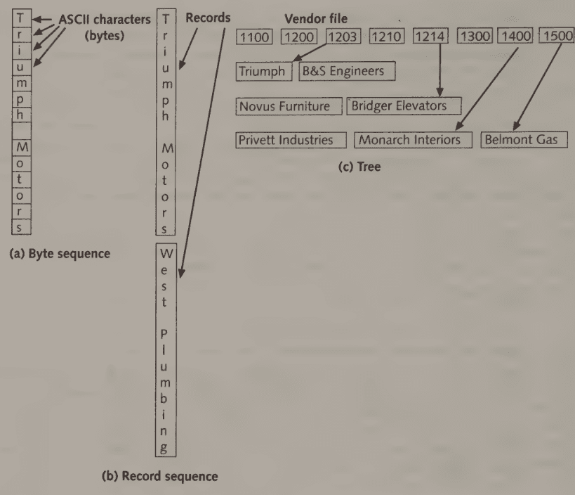
**图 4-2 三种文本文件**

在本章及后续章节中，您将练习创建和操作不同类型的文件和记录。

## 处理文件

在执行命令时，UNIX/Linux 通过从标准输入设备（例如您的键盘）接收输入，然后将其发送到标准输出（监视器或控制台）来处理数据。系统管理员和程序员将标准输入称为 `stdin`。他们将标准输出称为 `stdout`。第三个标准设备或文件被称为标准错误，或 `stderr`。当 UNIX/Linux 在处理系统任务和用户程序时检测到错误，它们会将错误定向到 `stderr` —— 默认情况下即为屏幕。

stdin、stdout 和 stderr 在 IEEE Std 1003.1 “信息技术标准——可移植操作系统接口 (POSIX)”以及 ISO 9899:1999 C 语言标准（用于 C 编程）中定义。电气电子工程师学会 (IEEE) 和国际标准化组织 (ISO) 是制定计算机及其他标准的组织。

在第 1 章“UNIX 和 Linux 的本质”中，您学习了 `>` 和 `>>` 重定向运算符。您可以使用这些和其他重定向运算符将命令或程序的输出保存到文件中，或将文件用作进程的输入。重定向运算符是帮助您处理文件的工具。

### 使用输入和错误重定向

您可以使用重定向运算符（`>`、`>>`、`2>`、`<` 和 `<<`）从标准输入设备以外的来源检索输入，并将输出发送到标准输出设备以外的地方。

在第 1 章中，当您通过将多个命令的输出重定向到文件来创建新文件时，已经使用了输出重定向运算符。当您想要将命令或程序的输出存储在文件中时，请重定向输出。例如，回想一下您可以使用 `ls` 命令列出目录中的文件，例如 `/home`。`ls` 命令将输出发送到 stdout，默认情况下是屏幕。要将列表重定向到名为 homedir.list 的文件，请通过输入 `ls > homedir.list` 来使用重定向符号。

您还可以使用 `<` 运算符将输入重定向到程序或命令。例如，一个接收键盘输入的程序可以被重定向为从文件中读取信息。在实践项目 4-1 中，您将创建一个文件，由 vi 编辑器从中读取命令，而不是从键盘读取。

您还可以使用 `2>` 运算符将命令或程序的错误消息从屏幕重定向到文件。例如，如果您尝试列出一个不存在的文件或目录，您会看到以下错误消息：No such file or directory。假设 Fellowese 不是一个文件或目录。如果您输入 `ls Fellowese 2> errors`，这会将 No such file or directory 错误消息放入 errors 文件中。在实践项目 4-2 中尝试这种重定向技术。

## 操作文件

在操作文件时，您需要处理文件本身及其内容。本节将解释如何完成以下任务：

- 创建文件
- 删除文件
- 删除目录
- 复制文件
- 移动文件
- 查找文件
- 合并文件
- 通过粘贴合并文件
- 通过裁剪提取文件中的字段
- 对文件进行排序

### 创建文件

您可以使用输出重定向运算符 (`>`) 创建一个新文件。您在第 1-3 章中学习了如何使用它来重定向 `cat` 命令的输出。您也可以在没有命令的情况下使用重定向运算符，通过输入 `>` 和文件名来创建空文件。例如，以下命令：

```
> accountsfile
```

将创建一个名为 accountsfile 的空文件。实践项目 4-3 将使您能够使用 `>` 重定向符号创建文件。

您还可以使用 `touch` 命令创建空文件。例如，如果文件尚不存在，以下命令将创建文件 accountsfile2。

```
touch accountsfile2
```

**语法** `touch` [-options] [filename(s)]

### 详解

- 旨在更改文件的时间戳，但也可用于创建空文件
- 常用选项包括：
    - `-a` 仅更新访问时间
    - `-m` 更新文件最后一次被修改的时间
    - `-c` 如果文件尚不存在，则防止 `touch` 命令创建该文件


要查看完整的时间戳信息，请在 `ls` 命令中使用 `--full-time` 选项，例如 `ls --full-time myfile`。

`touch` 命令的主要目的是更改文件的日期和时间戳。UNIX/Linux 为每个文件维护以下日期和时间信息：

- 更改日期和时间 (Change date and time) —— 文件 inode 最后一次被更改的日期和时间
- 访问日期和时间 (Access date and time) —— 文件最后一次被访问的日期和时间
- 修改日期和时间 (Modification date and time) —— 文件最后一次被修改的日期和时间


回想第 2 章，inode 是一个存储文件关键信息的系统。Inode 信息包括 inode 编号、文件所有者、文件组、文件大小、inode 的更改日期、文件创建日期、文件最后一次修改和读取的日期、指向此 inode 的链接数，以及关于文件存储在文件系统中块位置的信息。

虽然 `touch` 命令不能改变文件的 inode 更改日期和时间，但它可以改变文件的访问和修改日期和时间。默认情况下，它使用当前日期和时间作为新值。实践项目 4-4 将让您获得使用 `touch` 命令的经验。

### 删除文件

当您不再需要某个文件时，可以使用 `rm` (remove) 命令将其删除。如果您在不使用选项的情况下使用 `rm`，UNIX/Linux 将在不发出警告的情况下删除指定文件。使用 `-i` (interactive) 选项可以让 UNIX/Linux 在删除文件前向您发出警告。您可以使用星号通配符删除多个名称相似的文件（见第 2 章）。例如，如果您有 10 个都以字母 "test" 开头的文件，请输入 `rm test*` 以一次性删除所有文件。实践项目 4-5 将使您能够使用 `rm` 命令。

**语法** `rm` [-options] [filename or directoryname]

### 详解

- 用于删除文件或目录
- 常用选项包括：
    - `-i` 在删除文件（或目录）之前显示警告提示
    - `-r` 在删除目录时，递归地删除其文件和子目录（要删除空目录或包含条目的目录，请在 `rm` 中使用 `-r` 选项）。

### 删除目录

当您不再需要一个目录时，可以使用 `rm` 或 `rmdir` 命令将其删除。例如，如果目录已经为空，请使用 `rm -r` 或 `rmdir`。如果目录包含文件或子目录，请使用 `rm -r` 将其全部删除。带有 `-r` 选项的 `rm` 命令会删除一个目录及其包含的所有内容。它甚至会删除子目录的子目录。这

该操作被称为递归删除。请注意，如果在许多 UNIX/Linux 版本（包括 Fedora 和 Red Hat Enterprise Linux）中单独使用 `rm`，它无法删除目录。

实操项目 4-6 将引导你使用 `rmdir` 删除空目录，以及使用 `rm -r` 删除非空目录。

```
Syntax rmdir [-options] [directoryname]
```

### 详解

- 用于删除目录
- 目录必须为空才能使用 `rmdir` 命令将其删除。

> **注意** 使用 `rm -r` 时请格外小心，首先确保你已检查过该目录的所有内容，并打算将它们与目录一起删除。如果你只是删除一个空目录，使用 `rmdir` 命令会更安全，以免在输入目录名称时出现拼写错误。此外，当使用 `rm` 配合 `-r` 选项时，建议同时使用 `-i` 选项，以便在删除前收到提示。一些用户采取的额外预防措施包括：(1) 在删除另一个目录之前，使用 `pwd` 确保你处于正确的当前工作目录；(2) 使用计划删除目录的完整路径，因为如果名称输入错误，删除操作可能会失败，而不是删错了目录。

### 复制文件

在第 2 章中，你已经接触到了用于复制文件的 `cp` 命令，我们在这里对其进行进一步探讨。其通用形式如下：

```
Syntax cp [-options] [source destination]
```

- 用于复制文件或目录

`cp` 命令将源路径指定的文件或多个文件复制到目标路径指定的位置。你可以将文件复制到另一个目录中，且副本保留与原文件相同的名称。你也可以将文件复制到另一个目录中并赋予新名称，或者将文件复制到与原文件相同的目录中并赋予新名称。

例如，假设 Tom 处于他的家目录 (`/home/tom`)。在此目录中，他有一个名为 `reminder` 的文件。在他的家目录下，还有另一个名为 `duplicates` 的目录 (`/home/tom/duplicates`)。他使用以下命令将 reminder 文件复制到 duplicates 目录中：

```bash
cp reminder duplicates
```

执行该命令后，duplicates 目录中会出现一个名为 `reminder` 的文件。它是 `/home/tom` 目录中 reminder 文件的副本。Tom 的家目录中还有一个名为 `class_of_82` 的文件。他使用以下命令将其复制到 duplicates 目录中一个名为 `classmates` 的文件中：

```bash
cp class_of_82 duplicates/classmates
```

执行该命令后，`classmates` 文件被存储在 duplicates 目录中。尽管名称不同，但它是 `class_of_82` 文件的副本。Tom 的家目录中还有一个名为 `memo_to_boss` 的文件。他想制作一个副本并将其保存在家目录中。他输入以下命令：

```bash
cp memo_to_boss memo.safe
```

执行此命令后，`memo.safe` 文件被存储在 Tom 的家目录中。它是其 `memo_to_boss` 文件的副本。

你可以指定多个源文件作为 `cp` 命令的参数。例如，Tom 想将 `project1`、`project2` 和 `project3` 文件复制到他的 duplicates 目录中。他输入以下命令：

```bash
cp project1 project2 project3 duplicates
```

在多次复制 (`cp`) 或移动 (`mv`) 操作中，最后一个条目必须是一个目录，如上述示例所示。你将在下一节学习移动命令。

**提示**：执行这些命令后，三个文件的副本将被存储在 duplicates 目录中。

你还可以在 `cp` 命令中使用通配符。例如，Tom 的家目录下有一个名为 `designs` 的目录 (`/home/tom/designs`)。他想将 designs 目录中的所有文件复制到 duplicates 目录中。他输入以下命令：

```bash
cp designs/* duplicates
```

执行此命令后，duplicates 目录将包含 designs 目录中每个文件的副本。如本例所示，`cp` 命令不仅在复制时有用，还能通过制作文件的备份副本来防止数据丢失。你将在实操项目 4-7 中使用 `cp` 命令在备份目录中制作副本。

### 移动文件

移动文件与复制文件类似，不同之处在于你是将文件从一个目录中移除并存储在另一个目录中。然而，为了保险起见，文件在移动之前会被复制。要移动文件，请使用 `mv` (move) 命令以及源文件名和目标名称。你还可以通过将一个文件移动到另一个具有不同名称的文件中，来使用 `mv` 命令重命名文件。

> **提示**：移动文件和重命名文件本质上是相同的操作。

在移动文件时，在 `mv` 命令中使用 `-i` 选项是一个好主意，这样你就不会在不经意间用同名文件覆盖目标文件。

```
Syntax mv [-options] [source destination]
```

### 详解

- 用于移动和重命名文件
- 常用选项包括：
    - `-i` 在覆盖同名文件前显示警告提示
    - `-u` 如果源文件比目标文件更新，则覆盖同名目标文件

实操项目 4-8 将引导你使用 `mv` 命令。

### 查找文件

有时，你可能不记得想要访问的文件的具体位置。`find` 命令用于搜索具有指定名称的文件。使用 `find` 命令可以定位具有相同名称的文件，或在任何目录中查找文件。

```
Syntax find [pathname] [-name filename]
```

### 详解

- *pathname* 是你想要搜索的目录的路径名。`find` 命令执行递归搜索；也就是说，它从指定的目录开始，向下搜索该路径名指定目录下的所有文件和子目录。
- *-name* 表示你正在搜索具有特定 *filename* 的文件。你可以在文件名中使用通配符。例如，你可以使用 `phone*` 来搜索所有以“phone”开头的文件名。关于 `find` 的其他搜索条件，请参阅附录 B “UNIX/Linux 命令语法指南”。

当你使用 `find` 命令时，只能搜索你拥有足够权限的区域。在搜索过程中，`find` 命令可能会进入受保护的目录；每当你尝试进入没有足够权限的目录时，都会收到“Permission denied”（权限被拒绝）的消息。此外，在使用 `find` 时，值得注意的是，某些 UNIX 版本要求在文件名之后使用 `-print` 选项才能显示文件名。

尝试通过实操项目 4-9 来使用 `find` 命令。

### 合并文件

除了查看和创建文件外，你还可以使用 `cat` 命令来合并文件。你可以使用重定向操作符来合并文件，但其格式与创建文件时略有不同。正如你所知，如果你输入 `cat > janes_research`，接下来你可以向文件中输入信息，并通过输入 Ctrl+d 结束会话，从而创建 `janes_research` 文件。假设 Jane 创建了这样一个包含大角羊研究结果的文件。现在假设还有一个名为 `marks_research` 的文件，其中包含 Mark 对同一主题的研究。你可以使用 `cat` 命令通过输入以下内容将两个文件的内容合并到 `total_research` 文件中：

```
cat janes_research marks_research > total_research
```

实操项目 4-10 将引导你使用这种技术来合并文件。

#### 使用 paste 命令合并文件

`paste` 命令将文件侧向（并排）合并，而 `cat` 命令将文件首尾相连地合并。当你使用 `paste` 将两个文件合并到第三个文件时，输出的第一行包含第一个文件的第一行，随后是第二个文件的第一行。例如，考虑一个名为 `vegetables` 的简单文件，包含以下四行：

```
Carrots
Spinach
Lettuce
Beans
```

同时，`bread` 文件包含以下四行：

```
Whole wheat
White bread
Sourdough
Pumpernickel
```

如果你执行命令 `paste vegetables bread > food`，vegetables 和 bread 文件将被逐行合并到 `food` 文件中。food 文件的内容如图 4-3 所示。


`paste` 命令通常将其输出发送到标准输出（stdout，即屏幕）。要将其捕获到文件中，请使用重定向运算符。

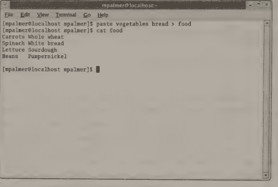
**图 4-3** 使用 `paste` 命令合并文件

语法 `paste [-options] [source files] [> destination file]`

### 详解

- 将一个或多个文件的内容组合起来，输出到屏幕或另一个文件中。
- 默认情况下，粘贴的结果以制表符（tab）分隔的列形式出现。`-d` 选项允许您指定列之间不同的分隔符。

如您所见，当您合并包含列信息的文件时，`paste` 命令最有用。当 `paste` 将项目组合成一行时，它会用制表符将它们分开。例如，请看 food 文件的第一行：

Carrots	Whole wheat

当 `paste` 将 “Carrots” 和 “Whole wheat” 合并时，它在两者之间插入了一个制表符。您可以使用 `-d` 选项指定另一个字符作为分隔符。例如，要在输出字段之间插入逗号而不是制表符，您可以输入：

```bash
paste -d',' vegetables bread > food
```

该命令执行后，`food` 文件的内容为：

Carrots,Whole wheat
Spinach, White bread
Lettuce, Sourdough
Beans, Pumpernickel

尝试动手项目 4-11 以开始学习使用 `paste` 命令。

### 使用 cut 命令提取字段

您已经了解到文件可以由记录、字段和字符组成。在某些情况下，您可能想要检索文件中的某些字段，而不是所有字段。使用 `cut` 命令从文件中删除特定的列或字段。例如，在您的组织中，您可能有一个供应商文件，记录了您从中采购物资的企业。该文件包含每个供应商的一条记录，每条记录包含供应商的名称、街道地址、城市、州、邮政编码和电话号码。例如：Office Supplies:2405 S.E. 17th Street:Boulder: Colorado:80302:303-442-8800。您可以使用 `cut` 命令快速列出该文件中仅供应商的名称，例如 Office Supplies。`cut` 命令的语法如下：

语法 `cut [-f list] [-d char] [file1 file2 ...]` 或 `cut [-c list] [file1 file2 ...]`

### 详解

- `-f` 指定您指的是字段（fields）。
- `list` 是一个以逗号分隔的列表或以连字符分隔的整数范围，用于指定字段。例如，`-f 1` 表示字段 1，`-f 1,14` 表示字段 1 和 14，`-f 1-14` 表示字段 1 到 14。
- `-d` 表示使用特定字符分隔字段。
- `char` 是用作字段分隔符（delimiter）的字符，例如逗号。默认的字段分隔符是制表符。
- `file1, file2` 是您想要从中截取列或字段的文件。
- `-c` 引用字符位置。例如，`-c 1` 指定第一个字符，`-c 1,14` 指定第 1 和第 14 个字符。

回想前一节讨论的 vegetables 和 bread 文件示例。假设您还有一个 meats 文件。当您使用命令 `paste vegetables bread meats > food` 时，food 文件的内容现在如下：

| 第 1 列 | 第 2 列 | 第 3 列 |
|---|---|---|
| Carrots | Whole wheat | Turkey |
| Spinach | White bread | Chicken |
| Lettuce | Sourdough | Beef |
| Beans | Pumpernickel | Ham |

接下来，假设您想从文件中提取第二列信息（面包列表）并将其显示在屏幕上。您输入以下命令：

```bash
cut -f2 food
```

选项 `-f2` 告诉 `cut` 命令从每行提取第二个字段。制表符分隔符将字段分开，因此 `cut` 知道在哪里查找字段。`cut -f2 food` 命令的结果输出到屏幕上，如图 4-4 所示。

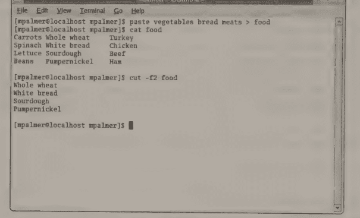
**图 4-4** 使用 `cut` 命令

另一个选项是使用以下命令从文件中提取第一列和第三列：

```bash
cut -f1,3 food
```

命令的结果是：

```
Carrots    Turkey
Spinach    Chicken
Lettuce    Beef
Beans      Ham
```

动手项目 4-12 让您可以练习使用 `cut` 命令。

### 排序文件

使用 `sort` 命令按字母顺序或数字顺序对文件的内容进行排序。UNIX/Linux 默认在屏幕上显示排序后的文件，但您可以使用重定向运算符指定将排序后的数据存储在特定文件中。

语法 `sort [-options] [filename]`

### 详解

- 按单行对文件的内容进行排序。
- 实用选项包括：
    - `-k n` 根据 `n` 指定的键字段进行排序
    - `-t` 表示使用指定字符分隔字段
    - `-m` 合并之前已排序的输入文件（不执行排序）
    - `-o` 将输出重定向到指定文件
    - `-d` 按字母数字顺序或字典顺序排序
    - `-g` 按数字（通用）顺序排序
    - `-r` 按反向顺序排序

`sort` 命令提供了许多选项，附录 B 中也有描述。以下是一个使用示例：

```bash
sort file1 > file2
```

在这个例子中，file1 的内容被排序，结果存储在 file2 中。（如果输出没有被重定向，`sort` 会将其结果显示在屏幕上。）如果您在对记录文件进行排序且未指定任何选项，例如，每条记录中第一个字段的值将按字母数字顺序排序。一个更复杂的例子如下：

```bash
sort -k 3 food > sortedfood
```

此命令指定了一个**排序键（sorting key）**。排序键是每行中的一个字段位置。`sort` 命令根据排序键对行进行排序。`-k` 是文件中的键。例如，在前一个示例中，`-k 3` 根据 food 文件中的第三个字段（即肉类列表）进行排序，并将排序结果写入文件 sortedfood（见图 4-5）。请注意在图 4-5 中，第一条记录的第三个字段是 Beef（所有记录都按第三个字段排序）。

动手项目 4-13 让您能够使用 `sort` 命令。此外，尝试动手项目 4-14，在一个将您目前所学内容综合在一起的项目中使用 `cat`、`cut`、`paste` 和 `sort` 命令。

### 创建脚本文件

如您所见，根据需要使用的选项数量，命令行输入可能会变得很长。您可以使用 shell 的命令行历史检索功能来召回并重新执行之前的命令。如果您需要在执行命令后不久重复使用它们，这个功能会很有用，但如果您需要在几天后执行相同的任务，这就成了一个问题。

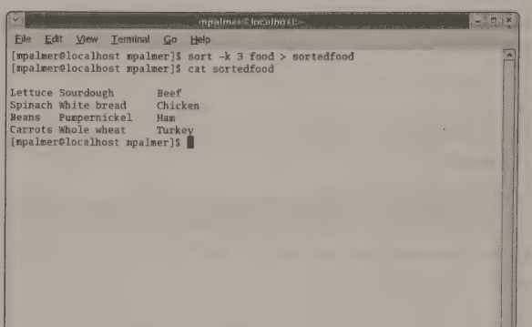
**图 4-5** food 文件按第三个字段排序的结果

此外，可能还有其他人（如助手或主管）需要执行您存储的命令，但他们无法通过自己的用户帐户访问这些命令。MS-DOS 和 Windows 用户通过创建批处理文件（batch files）来解决这个问题，批处理文件是在运行该文件时执行的命令文件。UNIX/Linux 用户也这样做：他们创建**shell 脚本（shell script）**文件来包含命令行输入。与 MS-DOS/Windows 批处理文件一样，脚本文件包含可以作为一组顺序运行的命令。例如，如果您经常使用 `cut`、`paste` 和 `sort` 命令的组合来创建特定的报告，您可以创建一个包含这些命令的脚本文件。这样您无需在每次创建报告时记住准确的命令和顺序，而只需执行该脚本文件即可。以这种方式创建脚本文件可以为您节省大量的时间和烦恼。

在确定准确的命令和命令顺序后，使用 vi 或 Emacs 编辑器创建脚本文件。（见图 4-6。）接下来，按照您在第 2 章中所学，使用 `chmod` 命令配合 x 参数使脚本文件具有可执行权限。

脚本文件的复杂度不一，从简单到复杂不等。在动手项目 4-15 中，您将对使用这些文件有一个基础的了解。第 6 章和第 7 章（“Shell 脚本编程入门”和“高级 Shell 编程”）将为您提供更多关于脚本文件（简称脚本）的经验。

#### 在两个文件上使用 JOIN 命令

有时，了解如何链接两个文件中的信息很有用。您可以使用 `join` 命令根据两个文件中的公共字段将两文件中的行关联起来。如果您希望结果经过排序，您可以在合并信息之前根据公共字段对文件进行排序，或者在合并文件信息之后根据特定字段进行排序。


**图 4-6** 示例脚本文件

例如，假设您有一个文件，其中一个字段包含员工的姓氏，另一个字段包含员工的公司 ID，最后一个字段包含员工的薪水，如下所示：

```
Brown:82:53,000
Anders:1110:32,000
Caplan:174:41,000
Crow:95:36,000
and so on
```

同时，您有另一个文件，包含每位员工的姓氏、名字、中间名首字母、部门、电话号码和其他信息，但该文件不包含薪水信息，如下所示：

```
Brown:LaVerne:F:Accounting Department:444-7508: . . .
Anders:Carol:M:Sales Department:444-2130: . . .
Caplan:Jason:R:Payroll Department:444-5609: . . .
Crow:Lorretta:L:Shipping Department:444-8901: . . .
and so on
```

您想创建一个新的第三个文件用于薪资预算，该文件仅包含员工的姓氏、名字、部门和薪水。为此，您可以使用 `join` 命令来创建具有以下内容的文件：

```
Brown:LaVerne:Accounting Department:53,000
Anders:Carol:Sales Department:32,000
Caplan:Jason:Payroll Department:41,000
Crow:Lorretta:Shipping Department:36,000
and so on
```

在这个简单的例子中，两个原始文件的公共字段是员工的姓氏。请注意，在这种情况下，公共字段提供了一个键（key），用于访问和连接信息以创建报告，或创建另一个包含连接后信息的文件。（另请参阅图 4-2(c) 以了解基于键的文件结构示例。）

> `join` 命令还与复杂数据库中的信息链接相关。这类数据库（如**关系型数据库**）的使用超出了本书的范围。然而，学习使用 `join` 命令来操作本书中所使用的扁平文件（flat files）数据是非常有用的。这里将其作为另一种文件操作工具，用以补充您对 `paste`、`cut` 和 `sort` 命令的知识。

```
Syntax join [-options] [file1 file2]
```

### 剖析

- 用于根据两个不同文件中的公共字段或键来关联信息。
- `file1` 和 `file2` 是两个输入文件，必须根据连接字段（即您想要用来连接文件的字段）进行排序。连接字段也被称为键。在连接文件之前，您必须先对文件进行排序。当您使用 `join` 命令时，UNIX/Linux 会比较这两个字段。每行输出包含公共字段，随后是来自 file1 的一行，然后是来自 file2 的一行。您可以使用接下来的选项来修改输出。如果同一个文件中存在具有重复键的记录，UNIX/Linux 会对所有记录进行连接。您可以为无法配对的行创建输出记录，例如，在不丢失记录的情况下将一个文件的数据附加到另一个文件中。
- 有用的选项包括：
    - `-1 fieldnum` 指定 file1 中用于连接的公共字段。
    - `-2 fieldnum` 指定 file2 中用于连接的公共字段。
    - `-o` 指定要输出的字段列表。该列表包含以空格分隔的字段限定符，形式为 m,n，其中 m 是文件编号，n 是该字段在文件中的位置。因此 `-o 1,2` 意味着“输出第一个文件的第二个字段”。
    - `-t` 指定字段分隔符字符。默认情况下，这是一个空格、制表符或换行符。多个空格和制表符被视为一个字段分隔符。
    - `-a filenum` 为文件 `filenum` 中每个无法配对的行生成一行。（在这种情况下，`filenum` 为 1 表示 file1，为 2 表示 file2。）
    - `-e str` 将无法配对行的空字段替换为 `str` 指定的字符串。该字符串通常是一个代码或消息，用于指示某种情况，例如 `-e "No Vendor Record."`。

实操项目 4-16 为您提供了使用 `join` 命令的机会。

### Awk 程序简述

Awk 是一种模式扫描和处理语言，有助于生成具有专业外观的报告。虽然您可以使用 `cat` 和 `more` 命令来显示使用 `join` 命令创建的输出文件，但 `awk` 命令（在命令行输入时启动 Awk 程序）可以让您更快速、更轻松地完成同样的操作。

Awk 这个名字是由其发明者的首字母组成的：(Alfred) Aho, (Peter) Weinberger, 和 (Brian) Kernighan。他们在 UNIX/Linux 中提供了一个丰富且强大的编程环境，非常值得花精力去学习，因为它可以在文件上执行从简单到复杂的各种操作——而这些操作如果通过组合其他命令来实现可能会非常困难。

在 Fedora、Red Hat Enterprise Linux 以及某些其他版本的 UNIX 和 Linux 中，您实际上使用的是 `gawk`，它包含对 `awk` 的增强功能，是由 Paul Rubin 和 Jay Fenlason 为 GNU 项目开发的。当您在命令行输入 `awk` 时，实际上执行的是 `gawk`——或者您也可以直接输入 `gawk`。

```
Syntax awk [-F fsep] [' {pattern {action}} ...'] [filenames]
```

### 剖析

- `awk` 检查指定文件中的输入记录是否满足*模式（pattern）*，如果满足，`awk` 则执行与之关联的*动作（action）*。如果没有指定模式，则动作将影响每个输入记录。
- `-F`：意味着字段分隔符是冒号。

`awk` 命令用于在文件中查找模式。在识别出模式后，它会执行您指定的动作。学习 `awk` 的原因之一是让您能够高效地操作数据文件。例如，您经常可以用 `awk` 完成原本需要结合使用 `paste`、`cut`、`sort` 和 `join` 多个独立命令才能完成的操作。学习 `awk` 的另一个原因是，您可能会遇到一个仅靠 `paste`、`cut`、`sort` 和 `join` 组合无法完成的项目，但使用 `awk` 则可以完成。

您可以使用 `awk` 完成的任务包括：

- 操作数据文件中的字段和记录。
- 使用变量。（您将在第 6 章详细学习变量。）
- 使用算术、字符串和逻辑运算符。（您将在第 6 章和第 7 章详细学习这些类型的运算符。）
- 执行来自 shell 脚本的命令。
- 使用经典的编程逻辑，例如循环。（您将在第 6 章学习更多循环逻辑。）
- 处理数据并将其组织成格式良好的报告。

考虑一个简单的例子，您想将文本打印到屏幕上。以下是一个简单的 `awk` 命令行序列，用于演示其语法：

```
awk 'BEGIN { print "This is an awk print line." } '
```

当您在命令行输入此命令时，屏幕上会出现以下内容：

`This is an awk print line.`

产生此输出的 `awk` 命令行序列执行了以下操作：

1. `awk` 启动 Awk 程序来处理命令行动作。
2. 模式由 BEGIN 标识。
3. 模式和动作被包裹在单引号中。
4. 花括号 { } 中的动作由 Awk 程序处理。
5. 执行 Awk 的 `print` 命令来打印双引号内的字符串（来自键盘或 stdin 的输入），使其显示在屏幕上 (stdout)。

使用一个更高级的例子，您可以使用 `awk` 处理来自数据文件的输入并输出一份报告。考虑以下 `awk` 命令行示例：

```
awk -F: '{printf "%s\t %s\n", $1, $2}' datafile
```

在这个例子中，发生了以下事情：

1. `awk -F:` 启动 Awk 程序，并告知 Awk 输入文件 (datafile) 中记录之间的字段分隔符是冒号。
2. 模式和动作被包裹在单引号中。
3. `printf` 是 Awk 程序中用于打印和格式化输出的命令。（您将在第 5 章“高级文件处理”中详细学习 `printf`）。在这种情况下，输出发送到屏幕 (stdout)。
4. `$1` 和 `$2` 表示要打印和格式化的字段是指定输入文件 (datafile) 中的第一个 ($1) 和第二个 ($2) 字段。
5. `datafile` 是包含被分为多个字段的记录的输入文件名。

请尝试实操项目 4-17 和 4-18 以进一步了解 `awk`。


## 本章小结

此处介绍 awk 是为了让你初步体验这个强大工具的威力。关于如何使用 awk 还有很多需要学习的内容，你可以在后续章节中深入了解。目前，请将此 awk 简短介绍视为对 `join` 命令介绍的自然衔接——就像音乐家通过视奏新曲目作为进一步学习音乐的初步步骤一样。欲了解更多关于 awk 的信息，请键入 `man awk` 阅读联机文档。

- UNIX/Linux 支持常规文件、目录、字符设备文件和块设备文件。常规文件包含用户信息。目录是用于维护文件系统结构的系统文件。字符设备文件与串行输入/输出设备（如打印机）相关。块设备文件与设备（如磁盘）相关。
- 文件可以通过多种方式构建：UNIX/Linux 将数据（如信件、产品记录或供应商报告）存储在扁平的 ASCII 文件中。文件结构取决于所存储数据的类型。常规文件有三种类型：非结构化 ASCII 字符、记录和树。
- 扁平的 ASCII 数据文件通常包含记录（records）和字段（fields）。它们通常采用两种格式之一：变长记录和定长记录。变长记录的字段通常由分隔符（如冒号）分隔。定长记录的字段位于记录内的特定位置（如某个列范围）。
- 执行命令时，UNIX/Linux 处理数据的方式是：从标准输入设备接收输入，然后将输出发送到标准输出设备。UNIX/Linux 分别将标准输入和输出设备称为 stdin 和 stdout。默认情况下，stdin 是键盘，stdout 是显示器。另一个标准设备 stderr 指的是错误文件，默认输出到显示器。命令的输出可以从 stdout 重定向到磁盘文件。命令的输入可以从 stdin 重定向到磁盘文件。命令的错误输出可以从 stderr 重定向到磁盘文件。
- `touch` 命令用于更新文件的日期和时间戳，并创建空文件。
- `rmdir` 命令用于删除空目录。此外，`rm` 命令可用于删除文件，而带有 `-r` 选项的 `rm` 命令可用于删除包含文件和子目录的目录。
- `cut` 命令用于从文件中提取特定的列或字段。你可以通过指定位置和分隔符来选择要截取的字段，或者根据数据的组织方式按字符位置进行截取。
- 要合并两个或多个文件，请使用 `paste` 命令。`cat` 是将数据追加到文件末尾，而 `paste` 命令则是将文件并排合并。你还可以使用 `paste` 来合并两个或多个文件中的字段。
- 使用 `sort` 命令按字母顺序或数字顺序对文件内容进行排序。UNIX/Linux 默认在屏幕上显示排序后的文件，但你也可以指定将排序后的数据存储在特定文件中。

为了实现命令处理的自动化，可以将命令包含在一个脚本文件中，以后将其作为程序执行。使用 vi 编辑器创建脚本文件，并使用 `chmod` 命令使其具有可执行权限。

使用 `join` 命令从共享公共字段的两个文件中提取信息。你可以使用这个公共字段将两个文件连接起来。你必须根据连接字段（即你想用来连接文件的那个字段）对这两个文件进行排序。连接字段也称为键（key）。在连接文件之前，必须先对文件进行排序。

Awk 是一种模式扫描和处理语言，适用于创建具有专业外观的格式化报告。你可以使用 vi 编辑器在程序文件中输入 Awk 语言指令，并使用 `awk` 命令调用它。

## 命令汇总：第 4 章命令复习

| 命令 | 用途 | 本章涉及的选项 |
| :--- | :--- | :--- |
| awk | 启动 awk 程序以格式化输出 | -F 指定字段分隔符，-f 表示代码来自磁盘文件而非键盘。 |
| cat | 查看文件内容、创建文件、合并文件内容 | |
| cp | 复制一个或多个文件 | |
| cut | 从文件中提取指定的列或字段 | -c 指字符位置，-d 指指定字符分隔字段，-f 指字段。 |
| find | 查找文件 | -name 指定要定位的文件名称。 |
| join | 合并具有公共字段的文件 | -a n 为文件 n 中每个无法配对的行产生一行，-e str 将无法配对文件的空字段替换为指定字符串，-1 和 -2 配合字段号用于指定连接时的公共字段，-o 输出指定字段列表，-t 指指定字符分隔字段。 |
| less | 显示文件内容，在每屏结束时暂停；可在文件中上下移动 | |
| lpr | 将命令输出打印到默认打印机 | |
| more | 显示文件内容，在每屏结束时暂停，但仅允许在文件中向下移动 | |
| mv | 移动一个或多个文件 | -i 在覆盖同名文件前显示警告提示。<br>-u 如果源文件比目标文件新，则覆盖同名目标文件。 |
| paste | 合并两个或多个文件的字段 | |
| rm | 删除一个或多个文件 | -i 指定 UNIX/Linux 在删除文件前应请求确认。<br>-r 指定应递归删除目录。 |
| rmdir | 删除空目录 | |
| sort | 对文件内容进行排序 | -k n 根据 n 指定的键字段排序。<br>-t 指指定字符分隔字段。<br>-m 表示在排序前合并文件。<br>-o 将输出重定向到指定文件。<br>-d 按字母数字或字典顺序排序。<br>-g 按数字（通用）顺序排序。<br>-r 反向排序。 |
| touch | 更新现有文件的日期时间戳或创建新的空文件 | -a 指定仅更新访问日期和时间。<br>-m 指定仅更新修改日期和时间。<br>-c 指定不创建文件。 |

## 关键术语

**fixed-length record（定长记录）** — 文件中的一种记录结构，其中每条记录具有指定长度，记录中的每个字段同样具有指定长度。

**flat ASCII file（扁平 ASCII 文件）** — 一种你可以创建、操作并用于存储数据（如信件、产品报告或供应商记录）的文件。它将数据组织为非结构化的字节序列，这是文本文件的典型特征，由于它可以按任何顺序存储任何类型的数据，因此在数据输入方面具有灵活性。任何操作系统都可以读取此类文件。然而，因为你只能按输入顺序检索数据，所以此类文件的实用性有限。也称为普通文件或常规文件。

**key（键）** — 两个或多个文件记录中共享的公共字段。公共字段或键使你能够链接或连接文件之间的信息，例如用于创建报告。

**regular file（常规文件）** — UNIX/Linux 对 ASCII/文本文件和二进制文件的称呼。也称为普通文件。

**relational database（关系数据库）** — 一种包含文件的数据库，其中 UNIX/Linux 将文件视为表，将记录视为行，将字段视为列，并且可以通过连接来创建新记录。例如，使用 `join` 命令，你可以从关系数据库中共享公共字段的两个文件中提取信息。

**shell script（Shell 脚本）** — 一个包含 UNIX/Linux 命令序列的文本文件，无需通过编译器转换为机器语言即可执行。

**sorting key（排序键）** — 文件每行中用于对行进行排序的字段位置。例如，在命令 `sort -k 2 myfile` 中，myfile 将根据该文件的第二个字段进行排序。`sort` 命令基于排序键对行进行排序。

**stderr** — 程序员对“标准错误”的缩写。当 UNIX/Linux 检测到程序和程序任务中的错误时，错误消息和分析会被定向到 `stderr`，通常是屏幕（属于 IEEE Std 1003.1 规范的一部分）。

**stdin** — 程序员对“标准输入”的缩写，用于在编程中读取输入（属于 IEEE Std 1003.1 规范的一部分）。

**stdout** — 程序员对“标准输出”的缩写，用于在编程中写入输出（属于 IEEE Std 1003.1 规范的一部分）。

**variable-length record（变长记录）** — 数据文件中的一种记录结构，其中记录可以具有不同的长度，且通常由分隔符（如冒号）分隔。

## 复习题

- 1. 你尝试删除一个目录，但收到回复说该目录非空（full）。你使用的是哪个命令？
    a. `rmdir`
    b. `deletdir`
    c. `clear`
    d. `clean`

- 2. 在对文件内容进行排序后，你想将排序结果写入另一个文件。在使用 `sort` 命令时应使用哪个选项？
    a. `-w`
    b. `+`
    c. `-r`
    d. `-o`


- 3. 你为自己和你的员工创建了一个脚本，但你的员工无法运行它。问题出在哪里？
    a. 脚本只能由其创建者运行。
    b. 你需要赋予你的员工对该脚本文件的执行权限
    c. 你使用了 vi 编辑器创建脚本，该编辑器在最后一行放置了一个控制代码，导致其无法正常运行
    d. 你必须赋予你的员工对脚本的写权限，因为它会创建报告文件

- 4. 一个包含指定长度字段且对应于列位置的数据文件使用 __________ 记录。
    a. 定长（fixed-length）
    b. 批处理（batch）
    c. 变长（flexible-length）
    d. 列调整（column-adjusted）

- 5. __________ 是 `join` 命令使用的连接字段。
    a. 字段分隔符（field separator）
    b. 逗号分隔字段（comma-delimited field）
    c. 键（key）
    d. 公共链接器（common linker）

- 6. 你有一个人事文件，包含所有员工的姓名、地址和电话号码。人事文件中的第一个字段是员工编号，第二个字段是员工的姓氏。第三个字段是名和中间名首字母。因为没有姓氏相同的员工，你想通过姓氏检查文件，以确保所有员工都被包含在内。你应该使用以下哪个命令？
    a. `paste -l2 personnel`
    b. `capture personnel 2`
    c. `cut -f2 personnel`
    d. `join 2.0 personnel`

- 7. 在使用 `join` 命令时，你希望针对两个文件中遇到的每组无法配对的行打印消息 “No data”。哪个选项可以实现这一点？
    a. `+str`
    b. `-str`
    c. `printmsg`
    d. `-e`

- 8. 每次运行命令序列时，你都会收到一条错误消息。你如何将该错误消息写入文件？
    a. 在命令中使用 *universal ?err* 选项
    b. 在命令中使用 *-err* 选项
    c. 使用 *2>* 重定向操作符
    d. 在命令运行后立即按下 *Ctrl+filename*

- 9. Stderr（标准错误）通常发送到 __________。
    a. 键盘
    b. 屏幕
    c. 网络接口卡
    d. 声卡

- 10. 当你使用 *mv* 命令时，__________。
    （选择所有适用项）
    a. 你可以重命名文件
    b. 你可以更改文件的权限
    c. 文件在移动前会被复制
    d. 文件在 30 分钟内无法访问，以防止移动过程中出现错误

- 11. 你的老板尝试使用 *find* 命令在你的目录中搜索一个特定的电子表格。但是，你忘记使用命令给她访问你目录的权限。你的老板在屏幕上会看到什么？
    a. 她仍然能看到文件，因为 *find* 命令有一个覆盖目录权限的选项
    b. 她会看到 “Permission denied”（权限被拒绝）消息
    c. 她会看到文件的列表，但无法显示文件内容
    d. 她会看到文件在列表中显示一分钟，这是 *find* 命令访问他人目录时的 “附加时间”

- 12. 你的主目录下有一个名为 source 的子目录，你想将程序 proga 和 progb 复制到 source 目录。以下哪个命令可以实现？
    a. *mv source proga progb*
    b. *paste /source proga progb*
    c. *copy proga progb to source*
    d. *cp proga progb source*

- 13. 你使用了 vi 编辑器创建了 tasks 文件，但现在不再需要该文件。以下哪个命令可以让你删除 tasks 文件？
    a. *del tasks*
    b. *> tasks*
    c. *cut tasks*
    d. *rm tasks*

- 14. 你希望你的助手在当前工作目录中创建五个新文件，且文件名必须与你指定的精确名称一致。你可以使用哪个命令快速创建具有正确名称的空文件（且仅使用一条命令）？
    a. touch
    b. create
    c. newfile
    d. paste

- 15. 你有 20 个文件，都需要删除文件的最后四行。为了自动化此任务，你创建了一个 commands 文件，其中包含 vi 用于删除文件最后四行的命令。你想删除最后四行的第一个文件名为 data32。你发出什么命令来自动化使用 vi 编辑 data32 文件？
    a. vi data32 / commands
    b. vi data32 < commands
    c. run vi/data32 with commands
    d. cut vi/data32 -f commands

- 16. 使用 join 命令时，哪个选项用于指示冒号分隔记录中的字段？
    a. -d:
    b. -f:
    c. -t:
    d. -:

- 17. 以下哪个命令会创建文件 datasource？（选择所有适用项）
    a. > datasource
    b. mk datasource
    c. touch datasource
    d. open datasource

- 18. 你的老板需要一份报告，将两个文件中的数据合并为两个并排的列。你可以使用哪个命令来完成这项工作？（选择所有适用项）
    a. touch -c
    b. paste
    c. 使用 > 重定向符的 cat
    d. mv

- 19. 以下哪项可以让你快速在当前工作目录中为 products 文件创建备份？
    a. `mv -b products`
    b. `cp products products.bak`
    c. `touch products > products.bak`
    d. `products << products.bak`

- 20. 你可以使用哪个命令将当前目录中的所有文件移动到当前目录下的 archive 子目录中？
    a. `cp all archive`
    b. `cut *.* archive`
    c. `paste all /archive`
    d. `mv * archive`

- 21. 你的公司刚刚结束了财政年度，在此过程中，EOYpost 文件现在为空。他们需要放置一个时间戳，将该文件的日期初始化为今天。可以使用哪个命令？
    a. `cp EOYpost`
    b. `D > EOYpost`
    c. `touch EOYpost`
    d. `mv EOYpost <`

- 22. `awk` 通过匹配文件中的模式来工作。正确或错误？

- 23. 当你使用命令 `sort -k 8 corp_file` 时，这意味着 `corp_file` 使用定长记录。正确或错误？

- 24. 要将 `research1` 和 `research2` 文件的内容合并到 `results` 文件中，请使用命令 `cp research1 research2 2> results`。正确或错误？

- 25. 除非另有指定，否则 `sort` 命令的输出将打印到屏幕上。正确或错误？

## 动手项目（HANDS-ON PROJECTS）

请记住，在任何项目结束时，你可以输入 `clear` 并按 Enter 键以开始全新的屏幕显示。

### 项目 4-1

在 UNIX/Linux 中，你可以通过多种方式处理输入和输出。在这个项目中，你将创建一个将命令输入到 vi 编辑器的文件。（对于本章中的此项目及所有项目，请使用您自己的账户登录，而不是以 root 身份登录。）

要创建 vi 编辑器从中读取命令的文件：

1. 使用 vi 编辑器创建并保存文件 testfile，包含以下文本：
   `This is line 1.`
   `This is line 2.`
   `This is line 3.`
   `This is line 4.`

2. 输入 `cat testfile` 并按下 **Enter** 键检查结果。

3. 接下来，使用 vi 编辑器创建并保存另一个名为 `commands` 的文本文件，其中一行包含以下 vi 命令：`2GddGp:x`。（见图 4-7。）

**图 4-7** 使用 vi 创建 commands 文件

4. 输入 `cat commands` 并按下 **Enter** 键验证 commands 文件的内容。

5. 输入 `vi testfile < commands` 并按下 **Enter** 键。（由于输入来自文件而非键盘，你可能会看到一条警告，提示输入不来自终端。直接忽略该警告即可。）这将把 testfile 加载到 vi 编辑器中，并将 vi 的输入重定向到 commands 文件中的文本。commands 文件中的文本被视为在键盘上输入的命令。

6. 输入 `cat testfile` 并按下 **Enter** 键。你将看到 vi 命令执行后 testfile 的内容。内容为：
   This is line 1.
   This is line 3.
   This is line 4.
   This is line 2.

### 项目 4-2

在这个项目中，你将使用 2> 重定向符号将错误消息写入文件。

#### 重定向错误消息：

1. 通过给 `ls` 命令提供一个无效参数，强制其显示错误消息。假设你的主目录下没有名为 oops 的文件或目录，输入 `ls oops` 并按下 **Enter** 键。你将看到以下错误消息：
   `ls: oops: No such file or directory`

2. 重定向 `ls` 命令的错误输出。输入 `ls oops 2> errfile` 并按下 **Enter** 键。屏幕上没有输出。

3. 输入 `cat errfile` 并按下 **Enter** 键。你将看到 errfile 的内容（见图 4-8）：
   `ls: oops: No such file or directory`

**图 4-8** 创建 errfile 并查看其内容


## 项目 4-3 项目

在本项目中，你将练习使用 `>` 重定向符来创建空文件。

创建空文件的步骤：

- 1. 输入 `> newfile1` 并按下 **Enter**。这将创建一个名为 newfile1 的空文件。
- 2. 要列出该新文件，请输入 `ls -l newfile1` 并按下 **Enter**。
  你将只看到如下列出的信息，其中 jean 是你的用户名。
  `-rw-rw-r-- 1 jean jean 0 Nov 1 16:57 newfile1`
- 3. 要创建另一个新文件，请输入 `> newfile2` 并按下 **Enter**。

### 项目 4-4

本项目向你展示如何使用 `touch` 命令来创建文件并更改其时间戳。

使用 `touch` 命令创建文件并修改其日期/时间戳的步骤：

- 1. 输入 `touch newfile3` 并按下 **Enter**。此命令会创建文件 newfile3。
- 2. 输入 `ls -l newfile3` 并按下 **Enter**。你将看到 newfile3 文件的详细列表。请注意其修改日期和时间。
- 3. 等待至少一分钟。
- 4. 输入 `touch newfile3` 并按下 **Enter**。这将使用系统当前的日期和时间更新文件的访问和修改日期/时间戳。
- 5. 输入 `ls -l newfile3` 并按下 **Enter**。查看文件的修改时间。现在它应该已经改变了。（图 4-9 显示了 10 分钟后时间戳的变化。）

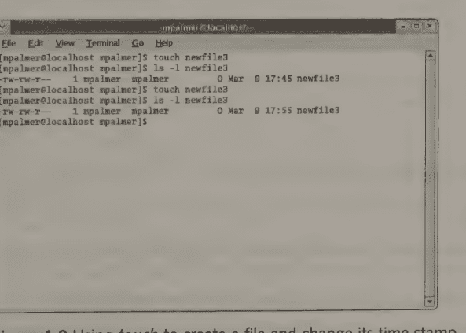
**图 4-9** 使用 `touch` 创建文件并更改其时间戳

### 项目 4-5

在本项目中，你将删除之前创建的两个文件。

从当前目录删除文件的步骤：

- 1. 输入 `rm newfile1` 并按下 **Enter**。这将永久从当前目录中删除 newfile1。
- 2. 输入 `rm -i newfile2` 并按下 **Enter**。你会看到提示信息：`rm: remove regular empty file 'newfile2'?`
- 3. 输入 `y` 表示同意并按下 **Enter**。

使用通配符删除一组文件的步骤：

- 1. 你可以将多个文件名作为 `touch` 命令的参数。输入 `touch file1 file2 file3 filegood filebad` 并按下 **Enter**。此命令将创建这些文件：file1, file2, file3, filegood 和 filebad。
- 2. 输入 `ls file*` 并按下 **Enter**。你将看到在步骤 1 中创建的文件列表。
- 3. 输入 `rm file*` 并按下 **Enter**。
- 4. 输入 `ls file*` 并按下 **Enter**。文件已被删除。（参见图 4-10。）

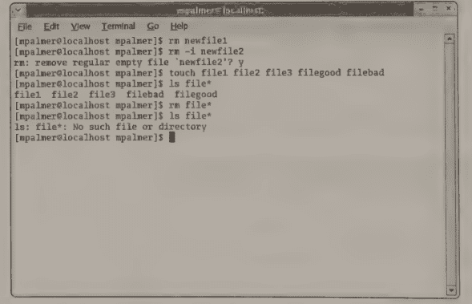
**图 4-10** 使用 `rm` 命令删除文件

### 项目 4-6

在本项目中，你将创建一个目录，然后使用 `rmdir` 命令将其删除。接着，你将使用 `rm` 命令删除一个包含子目录的目录。

创建目录并使用 `rmdir` 命令将其删除的步骤：

- 1. 输入 `mkdir newdir` 并按下 **Enter**。这将创建一个名为 newdir 的新目录。
- 2. 使用相对路径配合 `touch` 命令在 newdir 目录中创建新文件。输入 `touch newdir/newfile` 并按下 **Enter**。这将在 newdir 目录中创建文件 newfile。
- 3. 输入 `ls newdir` 并按下 **Enter** 以查看 newfile 文件的列表。
- 4. 尝试删除该目录，输入 `rmdir newdir` 并按下 **Enter**。你会看到类似于以下错误信息：
  `rmdir: 'newdir': Directory not empty`
- 5. 使用相对路径配合 `rm` 命令删除 newfile。输入 `rm newdir/newfile` 并按下 **Enter**。
- 6. 现在目录已为空。输入 `rmdir newdir` 并按下 **Enter**。
- 7. 输入 `ls` 并按下 **Enter**。newdir 目录已不再存在。

#### 递归删除包含多个子目录的目录：

- 1. 创建一个包含多个子目录的目录。输入 `mkdir company` 并按下 **Enter**。输入 `mkdir company/sales` 并按下 **Enter**。输入 `mkdir company/marketing` 并按下 **Enter**。输入 `mkdir company/accounting` 并按下 **Enter**。
- 2. 在 company 目录中创建三个空文件。输入 `touch company/file1 company/file2 company/file3` 并按下 **Enter**。
- 3. 通过执行以下操作将文件复制到其他目录：
    - 输入 `cp company/file1 company/file2 company/file3 company/sales` 并按下 **Enter**。
    - 输入 `cp company/file1 company/file2 company/file3 company/marketing` 并按下 **Enter**。
    - 输入 `cp company/file1 company/file2 company/file3 company/accounting` 并按下 **Enter**。


> 你刚才输入的这三个命令非常相似。你可以通过使用上方向键召回第一个命令并对其进行修改，从而减少输入量。

- 4. 使用 `ls` 命令验证文件是否已复制到所有三个目录中。
- 5. 删除 company 目录及其包含的所有内容。输入 `rm -r company` 并按下 **Enter**。
- 6. 输入 `ls` 并按下 **Enter**。company 目录已被删除。

### 项目 4-7

`cp` 命令在防止数据丢失方面特别有用；你可以使用它来创建文件的备份副本。在本项目中，你将创建三个新文件，然后将它们复制到另一个目录。接着，你将复制一个文件并为其起一个不同的名称。

#### 创建三个文件并将它们复制到目录的步骤：

- 1. 如果你还没有名为 source 的子目录，请确保你在主目录下，然后创建该目录。输入 `mkdir source` 然后按下 **Enter**。
- 2. 要在主目录中创建三个文件，输入 `> file1` 并按下 **Enter**，输入 `> file2` 并按下 **Enter**，然后输入 `> file3` 并按下 **Enter**。
- 3. 现在，你可以将这三个文件复制到 source 目录。输入 `cp file1 file2 file3 source` 并按下 **Enter**。（或者为了节省时间，你可以输入 `cp file* source`。）
- 4. 接下来，复制其中一个文件，并赋予它一个不同的名称，以便将其识别为备份文件。输入 `cp file1 file1.bak` 并按下 **Enter**。（参见图 4-11。）

现在，你的工作目录中包含两个内容完全相同但名称不同的文件。

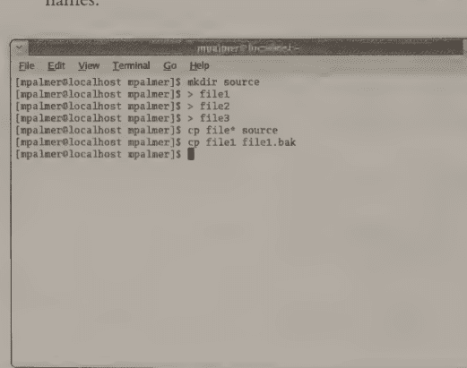
**图 4-11** 将文件复制到新子目录并创建备份文件

### 项目 4-8

在本项目中，你将使用 `mv` 命令练习移动文件。

#### 将文件从一个目录移动到另一个目录的步骤：

- 1. 要在主目录中创建新文件 thisfile，请输入 `> thisfile` 然后按下 **Enter**。
- 2. 输入 `mv thisfile source` 并按下 **Enter**，将新文件移动到 source 目录。
- 3. 输入 `ls` 并按下 **Enter**。thisfile 不在列表中。输入 `ls source` 并按下 **Enter**。你会看到 thisfile 列在其中。
- 4. 要移动多个文件，请在目录名之前输入文件名。例如，输入 `mv file1 file1.bak source` 并按下 **Enter**。
- 5. 要创建新文件 my_file，请输入 `> my_file` 并按下 **Enter**。
- 6. 要将 my_file 重命名为 your_file，请输入 `mv my_file your_file` 并按下 **Enter**。
- 7. 输入 `ls` 并按下 **Enter**。你会看到 your_file 列在其中，但 my_file 不在列表中。


### 项目 4-9

在本项目中，你将使用 `find` 命令在 /home 目录及其所有子目录中查找每一个名为 file1 的文件。

#### 查找文件的步骤：

- 1. 输入 `find /home -name file1` 并按下 **Enter**。
- 2. 你在哪个目录中找到了该文件？如果系统中有其他用户，你能查看他们的主目录以确认 file1 是否存在于那里吗？


**提示：** 虽然 Linux 不需要，但某些 UNIX 版本要求在文件名之后添加 `-print` 选项才能显示 `find` 命令定位到的文件名。


### 项目 4-10

在接下来的项目中，你将练习创建简单的内容文件，以获得使用 UNIX/Linux 命令操作这些文件的初步经验。在这个项目中，你将首先使用 `cat` 命令配合重定向操作符，练习创建和合并 product1 和 product2 文件，并进一步探索重定向操作符的多功能性。

在这种情况下，你处理的基础文件是样本产品描述文件，每条记录（行）包含产品名称（在第一个字段中）和一个用于进一步标识该产品的数字（在第二个字段中）。图 4-12 展示了你创建的这两个文件内容的概念示例。


```
File name: product1

Lobby Furniture         1201
Ballroom Specialties    1221
Poolside Carts          1320
Formal Dining Specials  1340
Reservation Logs        1410
```

```
File name: product2

Plumbing Supplies   1423
Office Equipment    1361
Carpeting Services   1395
Auto Maintenance    1544
Pianos and Violins  1416
```

**图 4-12** 两个产品描述文件示例

**使用 `cat` 命令合并文件：**

- 1. 输入 `cat > product1` 并按下 **Enter** 键。
- 2. 输入以下文本，每行末尾按下 **Enter** 键：
    **Lobby Furniture:1201**
    **Ballroom Specialties:1221**
    **Poolside Carts:1320**
    **Formal Dining Specials:1340**
    **Reservation Logs:1410**
- 3. 按下 `Ctrl+d`。
- 4. 现在，您可以将 `cat` 的输出重定向，在您的主目录中创建 product2 文件。该文件同样包含两个由冒号分隔的字段。
- 5. 在命令提示符后，输入 `cat > product2` 并按下 **Enter** 键。
- 6. 输入以下文本，每行末尾按下 **Enter** 键：
    **Plumbing Supplies:1423**
    **Office Equipment:1361**
    **Carpeting Services:1395**
    **Auto Maintenance:1544**
    **Pianos and Violins:1416**
- 7. 按下 `Ctrl+d`。
- 8. 现在，您可以在一个主产品文件中合并这两个文件。在 $ 命令提示符后，输入 `cat product1 product2 > products3` 并按下 **Enter** 键。
- 9. 要列出 products 的内容，输入 `more products3` 并按下 **Enter** 键。您将看到以下列表（完整命令序列见图 4-13）：

```
Lobby Furniture:1201
Ballroom Specialties:1221
Poolside Carts:1320
Formal Dining Specials:1340
Reservation Logs:1410
Plumbing Supplies:1423
Office Equipment:1361
Carpeting Services:1395
Auto Maintenance:1544
Pianos and Violins:1416
```

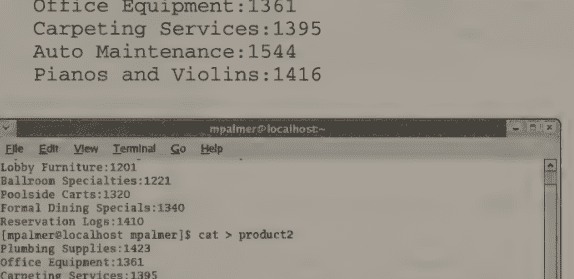

**图 4-13** 使用 `cat` 命令创建并合并文件

### 项目 4-11

在项目 4-10 中，您学习了如何使用 `cat` 命令合并文件。在这个项目中，您将使用另一种方法，即 `paste` 命令来合并文件。在这里，您将合并在上手项目 4-10 中创建的两个产品文件，以便将这些文件中的记录显示在两个独立的列中。

**使用 paste 命令合并文件：**

- 1. 如果您是直接从项目 4-10 继续操作，请输入 `clear` 并按下 **Enter** 键以清除屏幕。
- 2. 输入 `paste product1 product2` 并按下 **Enter** 键。

## 第 4 章 UNIX/Linux 文件处理

这个命令行序列意味着“将名为 product1 的文件与名为 product2 的文件合并，并使用独立的列显示每个文件的内容，将结果呈现在屏幕上。”（见图 4-14。）由于文件中的记录长度不同，且是通过制表符（在屏幕上不可见）分隔成列的，因此列看起来并不整齐。

3. 在这个示例中，您如何将 `paste` 命令的输出写入文件而不是输出到屏幕上？

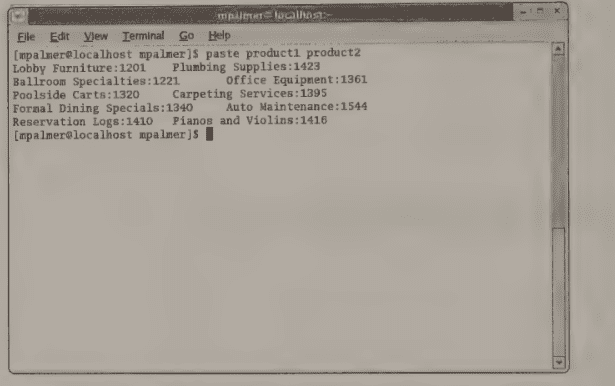

**图 4-14** 使用 `paste` 命令合并文件

### 项目 4-12

`cut` 命令在操作和呈现基础数据文件内容方面具有很强的通用性。在这个项目中，您首先创建两个文件：corp_phones1 和 corp_phones2。corp_phones1 文件包含五个大小不一的记录，记录中的每个字段由冒号分隔。本章前面显示的图 4-2(c) 展示了这种文件结构。corp_phones2 文件包含五个固定长度的记录，如图 4-2(b) 所示。图 4-15 展示了这两个文件的内容。您可以使用 `cut` 命令处理其中任何一个文件来提取姓名列表。

**创建 corp_phones1 和 corp_phones2 文件：**

- 1. 使用 vi 或 Emacs 编辑器创建文件 `corp_phones1`。
- 2. 准确地输入以下文本行。每行末尾按下 **Enter** 键：

```
219:432:4567:Harrison:Joel:M:4540:Accountant:09-12-1985
219:432:4587:Mitchell:Barbara:C:4541:Admin Asst:12-14-1995
219:432:4589:Olson:Timothy:H:4544:Supervisor:06-30-1983
219:432:4591:Moore:Sarah:H:4500:Dept Manager:08-01-1978
219:432:4527:Polk:John:S:4520:Accountant:09-22-1998
```

```
File name: corp_phones1 (Variable-length Records - fields separated by colon :)

219:432:4567:Harrison:Joel:M:4540:Accountant:09-12-1985
219:432:4587:Mitchell:Barbara:C:4541:Admin Asst:12-14-1995
219:432:4589:Olson:Timothy:H:4544:Supervisor:06-30-1983
219:432:4591:Moore:Sarah:H:4500:Dept Manager:08-01-1978
219:432:4527:Polk:John:S:4520:Accountant:09-22-1998

Storage space = 279 bytes
```

```
File name: corp_phones2 (Fixed-length records)

Character positions: 1-3, 5-7, 9-12, 14-35, 36, 38-41, 43-58, 59-68
------------------------------------------------------------------
219 432 4567 Harrison Joel M 4540 Accountant 09-12-1985
219 432 4587 Mitchell Barbara C 4541 Admin Asst 12-14-1995
219 432 4589 Olson Timothy H 4544 Supervisor 06-30-1983
219 432 4591 Moore Sarah H 4500 Dept Manager 08-01-1978
219 432 4527 Polk John S 4520 Accountant 09-22-1998

Storage space = 345 bytes
```

# 图 4-15 公司电话文件结构的两个版本示例

- 3. 保存文件，并创建一个名为 `corp_phones2` 的新文件。
- 4. 准确地输入以下文本行。请参考图 4-15 以确定每个字符的精确位置。每行末尾按下 **Enter** 键。在此文件中，您创建的是固定长度记录，这意味着每个字段必须在特定的列中开始，并且必须精确地相互对齐。例如，电话区号 219 位于第 1 到 3 列。姓氏从第 14 列开始，最长可延伸至第 25 列。

```
219 432 4567 Harrison Joel M 4540 Accountant 09-12-1985
219 432 4587 Mitchell Barbara C 4541 Admin Asst 12-14-1995
219 432 4589 Olson Timothy H 4544 Supervisor 06-30-1983
219 432 4591 Moore Sarah H 4500 Dept Manager 08-01-1978
219 432 4527 Polk John S 4520 Accountant 09-22-1998
```

- 5. 保存文件并退出编辑器。

接下来，您从 `corp_phones1` 文件中提取名和姓。该文件包含可变长度记录，字段由冒号字符分隔。您可以通过指定字段的位置和分隔符（在本例中为冒号）来选择要剪切的字段。

**使用 `cut` 命令从可变长度记录中提取字段：**

- 1. 输入 `cut -f4-6 -d: corp_phones1` 并按下 **Enter** 键。

此命令的意思是“在 corp_phones1 文件中，剪切由冒号字符 (-d:) 分隔的第 4 到第 6 个 (-f) 位置的字段”。

您将看到姓名列表：

Harrison:Joel:M
Mitchell:Barbara:C
Olson:Timothy:H
Moore:Sarah:H
Polk:John:S

现在，您从 corp_phones2 文件中提取名和姓。该文件包含固定长度记录，而不是使用冒号分隔字段的记录，因此您可以通过指定字符位置来剪切。

#### 使用 `cut` 命令从固定长度记录中提取字段：

- 1. 输入 `cut -c14-25,26-35,36 corp_phones2` 并按下 **Enter** 键。

此命令的意思是“在 corp_phones2 文件中，剪切第 14 到 25 位、第 26 到 35 位以及第 36 位 (-c) 的字符”。

您将看到姓名列表：

Harrison  Joel    M
Mitchell  Barbara C
Olson     Timothy H
Moore     Sarah   H
Polk      John    S

此外，请参阅图 4-16，了解在对 corp_phones1 和 corp_phones2 文件使用 `cut` 命令后屏幕显示的示例。

> 请务必不要在 `cut` 命令的破折号 (-) 选项之后在代码序列中包含空格。例如，正确的语法是 `cut` (空格) `-c14-25,26-35,36` (空格) `corp_phones2`。

对可变长度记录或固定长度记录使用 `cut` 命令会产生相似的结果。从固定长度记录中剪切会产生更易读的显示效果，但需要更多的存储空间。例如，corp_phones2 需要约 345 字节，而 corp_phones1 需要约 279 字节。


图 4-16 可变长度文件与固定长度文件的 `cut` 命令结果对比

### 项目 4-13

对你在“实操项目 4-12”中创建的 `corp_phones1` 和 `corp_phones2` 文件进行排序相对简单，因为你可以引用字段编号。在本项目的前两个步骤中，你将分别按姓（last name）和名（first name）对 `corp_phones1` 文件进行排序。在第三和第四步中，你对 `corp_phones2` 执行相同的操作。请注意，这四个步骤的输出都发送到 stdout（屏幕）。步骤 5 演示了对 `corp_phones1` 文件按姓字段排序的另一种替代方法。最后一步使用 `-o` 选项而非输出重定向，将排序后的输出写入一个新的磁盘文件 `sorted_phones` 中。

> 在早期的 UNIX/Linux 版本中，要对固定长度文件（如本项目示例中的 `corp_phones2` 文件）进行排序，必须指定字段的字符位置。这是通过使用 `+F.C` 选项实现的，其中 *F* 是字段编号，*.C* 是字符位置。虽然 `+F.C` 选项仍然可用，但使用 `-k` 选项会更加简单。

#### 对 `corp_phones1` 文件进行排序：

- 1. 在 `$` 提示符后，输入 `sort -t: -k 4 corp_phones1` 并按下 **Enter**。

在此示例中，`-t` 选项指定字段之间的分隔符，这里是冒号 (:)。`-k` 选项指定对第四个字段（在此实例中为姓字段）进行排序。你在屏幕上将看到以下内容：

```
219:432:4567:Harrison:Joel:M:4540:Accountant:09-12-1985
219:432:4587:Mitchell:Barbara:C:4541:Admin Asst:12-14-1995
219:432:4591:Moore:Sarah:H:4500:Dept Manager:08-01-1978
219:432:4589:Olson:Timothy:H:4544:Supervisor:06-30-1983
219:432:4567:Polk:John:S:4520:Accountant:09-22-1998
```

- 2. 输入 `sort -t: -k 5 corp_phones1` 并按下 **Enter**。

这将对可变长度记录（`-t:` 表示字段由冒号分隔）进行排序，起始于“名”字段（`-k 5`）。你在屏幕上将看到以下内容：

```
219:432:4587:Mitchell:Barbara:C:4541:Admin Asst:12-14-1995
219:432:4567:Harrison:Joel:M:4540:Accountant:09-12-1985
219:432:4567:Polk:John:S:4520:Accountant:09-22-1998
219:432:4591:Moore:Sarah:H:4500:Dept Manager:08-01-1978
219:432:4589:Olson:Timothy:H:4544:Supervisor:06-30-1983
```

- 3. 输入 `sort -k 4 corp_phones2` 并按下 **Enter**。

这将对固定长度文件按姓进行排序，起始于第四个字段。在此示例中，没有指定分隔符，因为固定长度文件不使用分隔符。你在屏幕上将看到以下内容：

| ID | 代码 | 电话 | 姓 | 名 | 性别 | 分机 | 职位 | 日期 |
|---|---|---|---|---|---|---|---|---|
| 219 | 432 | 4567 | Harrison | Joel | M | 4540 | Accountant | 09-12-1985 |
| 219 | 432 | 4587 | Mitchell | Barbara | C | 4541 | Admin Asst | 12-14-1995 |
| 219 | 432 | 4591 | Moore | Sarah | H | 4500 | Dept Manager | 08-01-1978 |
| 219 | 432 | 4589 | Olson | Timothy | H | 4544 | Supervisor | 06-30-1983 |
| 219 | 432 | 4527 | Polk | John | S | 4520 | Accountant | 09-22-1998 |

- 4. 输入 `sort -k 5 corp_phones2` 并按下 **Enter**。

这将对文件按名进行排序，起始于第五个字段。你在屏幕上将看到以下内容：

| ID | 代码 | 电话 | 姓 | 名 | 性别 | 分机 | 职位 | 日期 |
|---|---|---|---|---|---|---|---|---|
| 219 | 432 | 4587 | Mitchell | Barbara | C | 4541 | Admin Asst | 12-14-1995 |
| 219 | 432 | 4567 | Harrison | Joel | M | 4540 | Accountant | 09-12-1985 |
| 219 | 432 | 4527 | Polk | John | S | 4520 | Accountant | 09-22-1998 |
| 219 | 432 | 4591 | Moore | Sarah | H | 4500 | Dept Manager | 08-01-1978 |
| 219 | 432 | 4589 | Olson | Timothy | H | 4544 | Supervisor | 06-30-1983 |

- 5. 输入 `sort -t: +3 corp_phones1` 并按下 **Enter**。

这将对可变长度记录（`-t:`）进行排序，起始于姓字段（`+3`）。

- 6. 输入 `clear` 并按下 **Enter** 以清除屏幕，方便查看。

- 7. 若要按名排序并创建输出文件 `sorted_phones`，请输入 `sort -t: -k 5 -o sorted_phones corp_phones1` 并按下 **Enter**。这将按名对 `corp_phones1` 文件进行排序，并创建一个输出文件 `sorted_phones`。输入 `cat sorted_phones` 并按下 **Enter** 以验证你是否成功创建了 `sorted_phones` 文件。（参见图 4-17。）

图 4-17 按名对 corp_phones1 文件进行排序并将结果存储在 sorted_phones 中

### 项目 4-14

在本项目中，你将一次性使用所学到的多种文件处理工具，以帮助巩固目前为止学到的知识。首先，使用 `cat` 命令创建 vendors 文件。vendors 文件中的记录由两个冒号分隔的字段组成：供应商编号和供应商名称。

#### 创建 vendors 文件：

- 1. 输入 `cat > vendors` 并按下 **Enter**。
- 2. 输入以下文本，每行末尾按下 **Enter**：

    1201:Cromwell Interiors
    1221:Design Extras Inc.
    1320:Piedmont Plastics Inc.
    1340:Morgan Catering Service Ltd.
    1350:Pullman Elevators
    1360:Johnson Office Products

- 3. 按下 **Ctrl+d**。

在接下来的步骤中，使用 `cat` 命令创建 products 文件。products 文件中的记录由三个冒号分隔的字段组成：产品编号、产品描述和供应商编号。

#### 创建 products 文件：

- 1. 输入 `cat > products` 并按下 **Enter**。
- 2. 输入以下文本，每行末尾（包括最后一行）按下 **Enter**（例如在 S0107 中，第一和最后一个字段全部使用零）：

```
S0107:Lobby Furniture:1201
S0109:Ballroom Specialties:1221
S0110:Poolside Carts:1320
S0130:Formal Dining Specials:1340
S0201:Reservation Logs:1410
```

- 3. 输入 `Ctrl+d` 以结束 `cat` 命令。

- 4. 图 4-18 显示了你创建的 vendors 和 products 文件的概念示例。

**文件名: vendors**
```
Vendor Number | Vendor Name
====================================
1201:Cromwell Interiors
1221:Design Extras Inc.
1320:Piedmont Plastics Inc.
1340:Morgan Catering Service Ltd.
1350:Pullman Elevators
1360:Johnson Office Products
```

**文件名: products**
```
Prod Number | Product Description | Vendor Number
====================================
S0107:Lobby Furniture:1201
S0109:Ballroom Specialties:1221
S0110:Poolside Carts:1320
S0130:Formal Dining Specials:1340
S0201:Reservation Logs:1410
```

**图 4-18** 供应商（vendors）和产品（products）文件

现在使用 `cut`、`paste` 和 `sort` 命令来创建单个示例供应商报告。你首先使用 `cut` 命令从 products 文件中提取产品描述和供应商编号，并将它们存储在独立的文件 p1 和 p2 中。然后从 vendors 文件中提取供应商编号和名称，并将它们存储在 v1 和 v2 中。使用 `paste` 命令将两个供应商文件（v1 和 v2）合并到第三个文件 v3 中。接着将两个产品文件（p1 和 p2）合并到文件 p3 中。对 v3 和 p3 文件进行排序和合并，并将其输出发送到 vrep 文件（供应商报告）。

#### 使用 `cut`、`paste` 和 `sort` 命令创建报告：

- 1. 输入 `cut -f2 -d: products > p1` 并按下 **Enter**。

这意味着“提取 products 文件中由冒号分隔的第二个字段的数据，并将其存储在 p1 文件中”。它将这些产品描述存储在 p1 文件中（记住，你可以使用 `cat` 命令来验证内容）：

`Lobby Furniture`
`Ballroom Specialties`
`Poolside Carts`
`Formal Dining Specials`
`Reservation Logs`

- 2. 输入 `cut -f3 -d: products > p2` 并按下 **Enter**。

这意味着“提取 products 文件中由冒号分隔的第三个字段的数据，并将其存储在 p2 文件中”。它将这些供应商编号存储在 p2 文件中：

`1201`
`1221`
`1320`
`1340`
`1410`

- 3. 输入 `cut -f1 -d: vendors > v1` 并按下 **Enter**。

这意味着“提取 vendors 文件中由冒号分隔的第一个字段的数据，并将其存储在 v1 文件中”。它将这些供应商编号存储在 v1 文件中：

`1201`
`1221`
`1320`
`1340`
`1350`
`1360`

- 4. 输入 `cut -f2 -d: vendors > v2` 并按下 **Enter**。

这意味着“提取 vendors 文件中由冒号分隔的第二个字段的数据，并将其存储在 v2 文件中”。它将这些供应商名称存储在 v2 文件中：

`Cromwell Interiors`
`Design Extras Inc.`
`Piedmont Plastics Inc.`
`Morgan Catering Service Ltd.`
`Pullman Elevators`
`Johnson Office Products`


- 5. 输入 `paste v1 v2 > v3` 并按下 **Enter**。

这意味着“将 v1 和 v2 中的数据合并，并将其定向到文件 v3”。它将这些供应商编号和产品描述存储在 v3 文件中：

```
1201 Cromwell Interiors
1221 Design Extras Inc.
1320 Piedmont Plastics Inc.
1340 Morgan Catering Service Ltd.
1350 Pullman Elevators
1360 Johnson Office Products
```

- 6. 输入 `paste p2 p1 > p3` 并按下 **Enter**。

这意味着“将 p2 和 p1 中的数据合并，并将其定向到名为 p3 的文件中”。它将这些供应商编号和产品描述存储在 p3 文件中：

```
1201 Lobby Furniture
1221 Ballroom Specialties
1320 Poolside Carts
1340 Formal Dining Specials
1410 Reservation Logs
```

- 7. 输入 `sort -o vrep -m v3 p3` 并按下 **Enter**。

这意味着“合并 v3 和 p3 中的数据，并将输出定向到名为 vrep 的文件中”。它将这些供应商编号和产品描述存储在 vrep 文件中：

```
1201 Cromwell Interiors
1201 Lobby Furniture
1221 Ballroom Specialties
1221 Design Extras Inc.
1320 Piedmont Plastics Inc.
1320 Poolside Carts
1340 Formal Dining Specials
1340 Morgan Catering Service Ltd.
1350 Pullman Elevators
1360 Johnson Office Products
1410 Reservation Logs
```

此时，你的屏幕应该看起来与图 4-19 类似。在一个项目中，你已经完成了相当多的工作。你使用了 `cat` 命令来创建文件，使用了 `cut`、`paste` 和 `sort` 命令从文件中提取信息、合并信息，然后将信息排序并合并到一个新文件中。

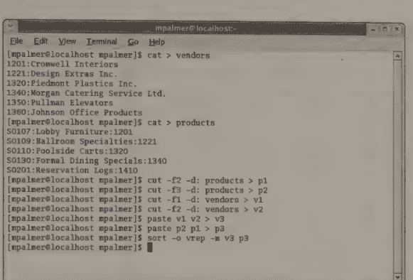
图 4-19 结合使用 `cut`、`cat`、`paste` 和 `sort` 来创建和处理文件

### 项目 4-15

你可能会遇到许多必须以同样方式处理文件并创建报告的情况。例如，你可能会每周执行一次，因为文件的内容会发生变化，而你希望创建新的报告或信息文件以备查阅。创建脚本为你提供了一种记住并重复使用一系列可反复运行的命令的方法。在这个项目中，你将创建一个简单的脚本来处理产品（products）和供应商（vendors）文件，并将结果写入 vrep 文件。

使用 vi 编辑器创建脚本：

- 1. 使用 vi 编辑器创建你的脚本文件。输入 `vi ven_report` 并按下 **Enter**。
- 2. vi 编辑器启动并创建一个新文件 ven_report。
- 3. 进入插入模式（按下 **i**），然后输入以下内容，每行末尾按下 **Enter**：

```bash
cut -f2 -d: products > p1
cut -f3 -d: products > p2
cut -f1 -d: vendors > v1
cut -f2 -d: vendors > v2
paste v1 v2 > v3
paste p2 p1 > p3
sort -o vrep -m v3 p3
```

这些是你此前在实操项目 4-14 中用于创建 vrep 供应商报告的相同命令。图 4-20 展示了输入命令后 vi 编辑器屏幕应有的样子。

- 4. 按下 **Esc**。
- 5. 输入 `:wq` 或 `:x` 并按下 **Enter** 以退出 vi 编辑器。

## 第 4 章 UNIX/Linux 文件处理

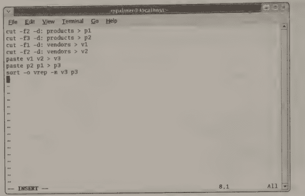
**图 4-20** 使用 vi 编辑器创建 ven_report 脚本文件

现在，你可以使用 `chmod` 命令使该脚本可执行。`chmod` 命令用于设置文件权限。在接下来的示例中，`chmod` 命令及其 `ugo+x` 选项使 ven_report 文件对用户（所有者）、组和其他人可执行。

**使脚本可执行：**

- 1. 输入 `chmod ugo+x ven_report` 并按下 **Enter**。（有关 `chmod` 命令的更多信息，请参阅第 2 章。）
- 2. 输入 `rm vrep` 并按下 **Enter** 以删除你在实操项目 4-14 中创建的 vrep。接下来，为了确保脚本正常工作，输入 `./ven_report` 并按下 **Enter**。
- 3. 输入 `cat vrep` 并按下 **Enter** 以验证 vrep 文件的内容是否与实操项目 4-14 步骤 7 中所示的相同。

> **注意** 除了使 shell 脚本可执行之外，最好指定该脚本设计运行的 shell。例如，如果你为 Bash shell 设计了一个脚本，可以将 #!/bin/bash 放在脚本的第一行。你将在第 7 章学习如何执行此操作。

### 项目 4-16

你创建的产品和供应商文件提供了一个机会，让你开始探索 `join` 命令的功能。这个命令可能比你目前学到的许多命令都更复杂。在这个项目中，你将开始使用 `join` 命令，通过产品和供应商文件创建一份示例供应商报告。

使用 `join` 命令创建报告：

- 1. 输入 `join -a1 -e “No Products” -1 1 -2 3 -o '1.2 2.2' -t: vendors products > vreport; cat vreport` 并按下 **Enter**。（记住，如果你输入错误，可以使用上方向键调用之前的命令，按下左方向键修正错误，然后再次运行命令。）

在此命令中，`-1` 和 `-2` 选项表示第一个或第二个指定文件，例如 vendors 或 products。紧随 `-1` 和 `-2` 之后的数字指定用于连接或匹配的字段编号。在这里，你使用 vendors 文件的第一个字段来连接 products 文件的第三个字段。

`-a` 选项告诉命令为文件中每个无法配对的行打印一行。在这种情况下，每个没有匹配产品记录的供应商记录都会打印一行。

`-e` 选项允许你为未匹配（`-a1`）的记录显示一条消息，例如 “No Products”。

`-o` 选项设置匹配成功时将输出的字段。

`1.2` 表示 vendors 文件的第二个字段将与 `2.2`（products 文件的第二个字段）一起输出。

`-t` 选项指定字段分隔符，这里是冒号。此 `join` 命令将其输出重定向到一个新文件 `vreport`。`cat` 命令将输出显示在屏幕上。

参见图 4-21 查看报告的输出。

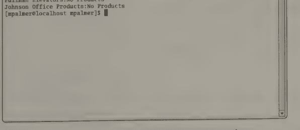
**图 4-21** `join` 命令生成的 vreport 输出

### 项目 4-17

本项目将向你简要介绍如何使用 `awk` 命令创建比实操项目 4-16 中更精美的供应商报告，并让你初步了解创建报告的下一步操作。

**生成并格式化供应商报告：**

- 1. 输入 `awk -F: '{"printf"\"%\-28s\t %\s\n"`

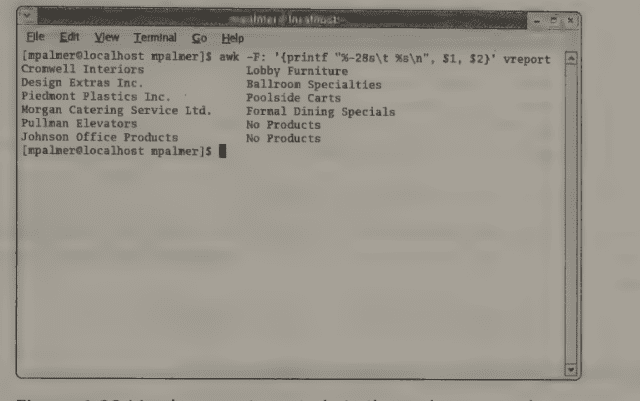
**图 4-22** 通过 awk 命令创建的供应商报告

### 项目 4-18

为了优化和自动化供应商报告，你可以创建一个使用 `awk` 命令的 shell 脚本。不过，这个新脚本仅包含 `awk` 命令，而不是一系列独立的命令。然后你使用 `awk` 加上 `-f` 选项来调用 Awk 程序。该选项告诉 Awk 代码来自磁盘文件而非键盘。你在 Awk 程序文件中以一种类似于编程代码的不同方式呈现动作语句。程序文件还包含打印报告标题和当前日期所需的额外行。

接下来的步骤将展示当你将 Awk 程序输入到如下文件时会发生什么。你使用 `FS` 变量告诉程序字段分隔符是什么——在本例中为冒号。`FS` 是 `awk` 用于告知程序正在处理的文件信息的许多变量之一。你在这里设置的其他代码定义了一个在程序加载时执行一次的初始活动。`BEGIN` 后面跟着左花括号 (`{`) 表示此启动活动。右花括号 (`}`) 标志着程序首次加载时执行的动作结束。这些动作会打印标题、日期以及将标题与报告正文分隔开的虚线。

**创建 awk 脚本：**

- 1. 输入 **vi awrp** 并按下 **Enter** 启动 vi 编辑器并创建文件 awrp。按下 **i** 进入插入模式。
- 2. 输入以下代码。（*注意：在第七行代码中，输入 52 个等号，并像图 4-23 所示那样将它们保持在同一行。*）


```
BEGIN {
	{ FS = ":"; }
	{ print "\t\tVendors and Products\n" }
	{ "date" | getline d }
	{ printf "\t %s\n",d }
	{ print "\tVendor Name\t\t Product Names\n" }
	{ print "===================================================\n" }

	{ printf "%-28s\t%s\n",$1, $2 }
}
```

在你输入代码中，使用了 *getline* 选项。*getline* 旨在读取输入。在这种情况下，它读取日期并将其放入变量 *d* 中，然后通过 *printf* 命令将其打印出来。

你的 vi 编辑会话应如图 4-23 所示。

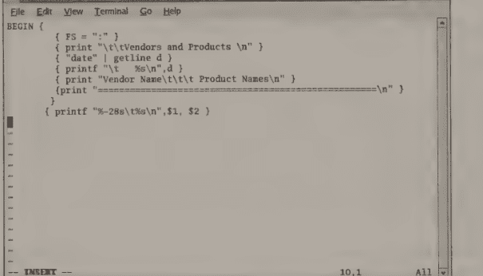
**图 4-23** 使用 vi 编辑器创建 awrp 文件

- 3. 按下 **Esc**。
- 4. 输入 **:wq** 或 **:x** 并按下 **Enter** 退出 vi 编辑器。
- 5. 输入 **awk -f awrp vreport > v_report** 并按下 **Enter**。
  这意味着“使用 *Awk* 程序，将 awrp 文件中的字段与 vreport 文件中的字段结合起来，并将它们发送到一个名为 v_report 的新文件中”。
- 6. 输入 **cat v_report** 并按下 **Enter**。你的屏幕显示应与图 4-24 类似。
- 7. 若要在默认打印机上打印报告，请输入 **lpr v_report** 并按下 **Enter**。

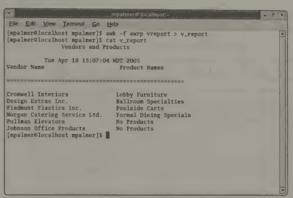
图 4-24 查看 v_report 的内容

## 探索练习

- 1. 如何使用重定向操作符创建一个名为 history 的文件？
- 2. 等待一分钟或更长时间，然后更改你刚刚创建的 history 文件的时间戳。
- 3. 将 history 文件备份到文件 history.bak 中。
- 4. 根据电话号码的最后四位对 corp_phones1 文件进行排序。
- 5. 创建并使用一个命令，仅显示 corp_phones2 文件中人员的姓氏和电话号码（省略区号）。在电话号码和姓氏之间留一个空格。
- 6. 假设你的当前工作目录下直接有一个名为 datafiles 的子目录，并且当前目录下有两个名为 data1 和 data2 的文件。你可以使用什么命令将 data1 和 data2 文件从当前工作目录复制到 datafiles 目录？
- 7. 假设你有文件：accounts1, accounts2, accounts3 和 accounts4。编写一个 `paste` 命令，将这些文件合并，并用 "/" 字符分隔每行的字段，将结果显示在屏幕上。
- 8. 你将如何执行练习 7 中的操作，但将结果写入文件 total_accounts？
- 9. 假设你有 10 个子目录，你想找到所有以扩展名 ".c" 结尾的文件。你可以使用什么命令在所有 10 个子目录中搜索该文件？
- 10. 创建脚本文件后，运行它的下一步步骤是什么？
- 11. 修改你之前创建的 `awk` 脚本，使列标题为 “Vendor” 和 “Product”，报告名称为 “Vendor Data”。
- 12. 创建子目录 `mytest`。将一个文件复制到你的新子目录中。使用一个命令删除 `mytest` 子目录及其内容。
- 13. 使用 `cut` 命令创建一个名为 `descriptions` 的文件，其中仅包含你在本章前面创建的 products 文件中的产品描述。
- 14. 当你使用 `move` 命令时，你担心会覆盖另一个目录中已存在或更新的文件。在这种情况下，你有哪些选择？
- 15. 什么命令能让你找到并删除系统上的所有空文件（并先向你发出提示）？
- 16. 如何找到家目录中在过去七天内被修改的所有文件？
- 17. 如何将 `product1` 文件每行的内容与 `product2` 文件的内容并排排列，但它们之间仅用短横线而不是制表符分隔？
- 18. 复制 `corp_phones2` 文件并将其命名为 `testcorp`。接着，创建一条单行命令，使你能够截取 `testcorp` 文件第五列的字符并将其粘贴回同一文件的第一列。（*提示*：存在两种很好的两种解决方案，一种使用分号，另一种则更巧妙地使用管道符。）
- 19. 如何使用你在本章中学到的命令来列出系统中所有用户的名称？（*提示*：找出存储用户信息的文件名称。）
- 20. 输入 `who` 并按下 **Enter** 以查看已登录用户的列表及其其他信息。现在将 `who` 命令（你在第 1 章中学习过此命令）与你在本章中学到的另一个命令结合使用，以查看谁已登录，但抑制 `who` 命令通常随附的所有其他信息。

# 第 5 章：高级文件处理

**在阅读本章并完成练习后，你将能够：**

- 使用管道操作符将一个命令的输出重定向到另一个命令
- 使用 grep 命令在文件中搜索指定模式
- 使用 uniq 命令删除文件中的重复行
- 使用 comm 和 diff 命令比较两个文件
- 使用 wc 命令统计文件中的单词数、字符数和行数
- 使用操作和转换命令，包括 sed、tr 和 pr
- 通过创建、测试和运行 shell 脚本来设计一个新的文件处理应用程序

通过文件处理命令，你可以通过排序、截取、格式化、转换、比较以及使用其他处理技术来管理文件。了解这些命令的多功能性将增强你的 UNIX/Linux 能力。在本章中，你将学习许多新的文件处理、选择、操作和转换命令，将其放入你不断扩充的工具箱中。

你将从学习新的文件处理命令开始，然后进阶到使用更复杂的操作和格式命令。在章节的第二部分，你将通过分步过程设计一个应用程序来实践你的知识。初始步骤涉及设计文件结构。接着，你使用命令来确定从文件中提取信息的方法。然后，你构建小的命令 shell 脚本并测试每一个。在单独构建完这些小脚本后，你将它们组合成一个较大的应用程序并运行。

## 提升你的文件处理技能

在第 4 章“UNIX/Linux 文件处理”中，你学习了使用几个 UNIX/Linux 命令从现有文件中提取和组织信息，并将这些信息转换为有用的格式。现在，你将在这些技能的基础上，学习使用新的文件处理命令和操作符。用于文件处理的命令可以分为两类：选择命令以及操作与转换命令。

**选择命令**侧重于从文件中提取特定信息，例如使用 `comm` 命令比较文件内容。表 5-1 列出了你已经掌握的选择命令以及你在本章中学习的新命令。

**表 5-1：选择命令**

| 命令 | 用途 |
| :--- | :--- |
| `comm` | 比较已排序的文件并显示差异 |
| `cut` | 选择列（字段） |
| `diff` | 比较并选择两个文件中的差异 |
| `grep` | 选择行或行集 |
| `head` | 从文件开头选择行 |
| `tail` | 从文件末尾选择行 |
| `uniq` | 选择唯一的行或行集（通常在排序之后执行） |
| `wc` | 统计文件中的字符、单词或行数 |

**操作与转换命令**将提取的信息更改并转换为有用且美观的格式。表 5-2 列出了这些命令。

**表 5-2：操作与转换命令**

| 命令 | 用途 |
| :--- | :--- |
| `awk` | 调用 Awk，一种处理和模式扫描语言 |
| `cat` | 连接文件 |
| `chmod` | 更改文件或目录的安全模式 |
| `join` | 将两个文件逐行匹配合并 |
| `paste` | 将多个文件逐列粘贴 |
| `pr` | 格式化并打印 |
| `sort` | 排序并合并多个文件 |

**注意** 你在本章中发现的一些功能也可以使用基于 GUI 桌面（如 GNOME）的图形化实用程序来执行。通过学习使用命令而非 GUI 工具来使用这些功能，你通常具有能够做更多事情且速度更快的优势。此外，你经常可以在命令行执行一些在 GUI 桌面工具中无法以同样灵活性执行的操作。


表 5-2 操作与转换命令（续）

| 命令 | 用途 |
|---|---|
| sed | 编辑数据流 |
| tr | 逐字符翻译和删除 |

### 使用选择命令

你在第 1 章“UNIX 和 Linux 的本质”中使用了 `head` 和 `tail` 命令，在第 4 章中使用了 `cut` 命令。你还学习了如何使用重定向操作符。现在，你将学习一种新的重定向操作符，称为管道（pipe），并学习使用 `grep`、`diff`、`uniq`、`comm` 和 `wc` 命令来处理文件。

> 有关这些命令的更多信息，请参阅附录 B “UNIX/Linux 命令语法指南”。


#### 使用管道操作符

正如你所学到的，大多数 UNIX/Linux 命令从 stdin（标准输入设备）获取输入，并将输出发送到 stdout（标准输出设备）。你还使用过 `>` 操作符将命令的输出从屏幕重定向到文件，以及使用 `<` 操作符将命令的输入从键盘重定向到文件。**管道操作符 (|)** 将一个命令的输出重定向到另一个命令的输入。管道操作符的使用方式如下：

```
first_command | second_command
```

管道操作符将第一个命令的输出与第二个命令的输入连接起来。例如，当你使用 `ls -l` 命令列出大型目录（如 /etc 或 /sbin）的内容时，输出会迅速滚动过屏幕，你实际只能看到列表的末尾。如果你使用的是终端窗口，可能可以使用滚动条回溯查看列表，但这可能不如其他查看输出的方式方便，或者你的系统终端窗口或命令行访问可能不支持完全回溯滚动。另一种替代方案是将 `ls -l` 命令的输出通过管道传递，作为 `more` 命令的输入。例如，当你使用管道操作符输入以下命令时，你可以一次查看一屏 /sbin 目录的内容，并使用空格键前进到下一屏。

```
ls -l /sbin | more
```

实践项目 5-1 将引导你使用管道操作符进行目录列表显示。

你也可以对目录使用 `less` 命令来一次查看一屏内容，例如 `less /sbin`。

管道操作符可以在同一条命令行中连接多个命令，方式如下：

```
first_command | second_command | third_command ...
```

这种技术非常有用，例如，当你想要列出大型目录的内容，然后对其进行反向排序，并一次显示一屏结果时（如图 5-1 所示的 /etc 目录内容）。请尝试实践项目 5-2，使用管道操作符在单行中组合命令。

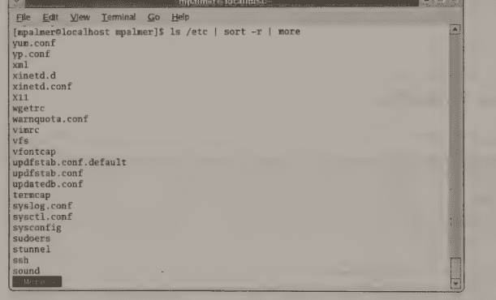

**图 5-1** 使用管道操作符组合命令

### 使用 grep 命令

使用 `grep` 命令在文件中搜索指定的模式，例如某个特定的单词或短语。UNIX/Linux 会找到并显示包含你指定模式的行。

**语法** `grep [-options] [pattern] [filename]`

### 详解

- 查找并显示包含特定搜索模式的行
- 可用于文本和二进制常规文件
- 可以在一个命令中搜索多个文件
- 常用选项包括：
    - `-i` 忽略大小写
    - `-l` 仅列出文件名
    - `-c` 统计行数而非显示具体内容
    - `-r` 递归搜索所有子目录下的文件

> **注意**
`grep` 通常有三种典型的含义：Global Regular Expression Print（全局正则表达式打印）、Global Regular Expression Parser（全局正则表达式解析器）以及 Get Regular Expression Processing（获取正则表达式处理）。

设想这样一种情况：你为一家公司写了一份文档，其中多次提到“计算机资源委员会（Computer Resources Committee）”。此外，公司管理层正考虑扩大该委员会的职能范围，将其更名为“计算机与电信资源委员会（Computer and Telecommunications Resources Committee）”。当管理层要求你确定 /documentation 目录下现有的公司文档中提及“Computer Resources Committee”的次数时，你可以使用 `grep` 命令来查询。以下是你需要输入的内容示例：

```bash
grep -r Computer Committee /documentation
```

在实践项目 5-3 中，你将使用 `grep` 命令来搜索并提取特定文本。

> **注意**
许多 UNIX/Linux 系统提供了四种 grep 类型命令的组合：`grep`、`egrep`、`fgrep` 和 `zgrep`。例如，除 `grep` 之外，还有 `egrep`（也可以通过 `grep -E` 执行），用于“扩展”或更复杂的表达式。`fgrep`（在大多数系统中为 `grep -F`）仅搜索固定字符串或文本字符串，而不支持表达式。`zgrep` 用于对压缩或 zip 文件进行搜索。

#### 使用 uniq 命令

`uniq` 命令用于删除文件中的重复行。由于它仅比较连续的行，因此 `uniq` 命令要求输入必须是已排序的。`uniq` 命令的语法如下：

```bash
Syntax uniq [-options] [.file1 > file2]
```

### 详解

- 从一个文件中删除连续的重复行，并将结果写入另一个文件
- 常用选项包括：
    - `-u` 仅输出源文件中未重复的行
    - `-d` 仅输出每个有重复行的其中一个副本，不显示唯一行
    - `-i` 忽略大小写
    - `-c` 在每行开头显示该实例出现的次数

在最简单的形式中，`uniq` 命令会删除文件中的连续相同行或行。例如，考虑一个名为 parts 的简单文件，包含以下条目：

```
muffler
muffler
shocks
alternator
battery
battery
radiator
radiator
coil
spark plugs
spark plugs
coil
```

你可以使用 `uniq` 命令创建一个名为 inventory 的输出文件，该文件将删除所有连续重复项。所使用的命令如下（见图 5-2）：

```
uniq parts > inventory
```

请注意图 5-2 中 coil 仍然出现了两次。这是因为在原始的 parts 文件中，两次出现 coil 的位置是不连续的。在 parts 文件中，第一个 coil 出现在第一个 spark plugs 之前，而第二个 coil 出现在第二个 spark plugs 之后。

`-u` 选项指示 `uniq` 仅将源文件中未连续重复的行生成为输出。（如果某行连续重复，则不生成输出。）这里有一个示例（见图 5-3）：

```
uniq -u parts > single_items
```

在图 5-3 中，coil 同样列出了两次，因为在原始 parts 文件中，两次出现 coil 的位置是不连续的。

`-d` 选项指示 `uniq` 为每个具有连续重复行的行生成一个副本作为输出。未重复的行不会被生成为输出。示例如下：

```
uniq -d parts > multi_items
```

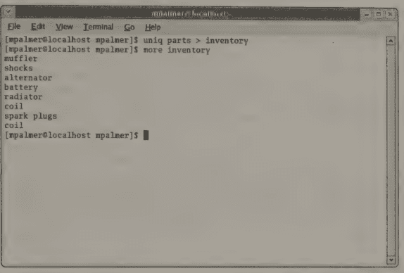

**图 5-2** 使用 `uniq` 删除重复条目并创建新的输出文件

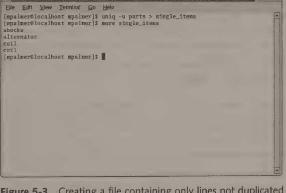

**图 5-3** 创建仅包含未重复行的文件

实践项目 5-4 将引导你使用 `uniq` 命令。

### 使用 comm 命令

与 `uniq` 命令一样，`comm` 命令可以识别重复行。与 `uniq` 不同的是，它不会删除重复项，并且它处理的是两个文件而非一个。`comm` 命令在两个相同排序的文件中定位相同行。它比较 file1 和 file2 的共同行，并产生三列输出：

- 第一列包含仅在 file1 中找到的行。
- 第二列包含仅在 file2 中找到的行。
- 第三列包含在 file1 和 file2 中都找到的行。

`comm` 的语法如下：

```
Syntax `comm` [-options] [file1 file2]
```

### 详解

- 比较两个已排序文件的共同行，并生成三列输出，以显示哪些行是每个文件特有的，哪些行是两者共有的

实践项目 5-5 使用了 `comm` 命令。

### 使用 diff 命令

`diff` 命令显示两个文件之间不同的行，通常用于确定将 file1 转换为 file2 所需的最小变更集。该命令的输出显示不同的行。file1 中的不同文本前带有小于号 (<)，file2 中的不同文本前带有大于号 (>)。

```
Syntax `diff` [-options] [ file1 file2 ]
```

### 详解

- 显示两个文件之间不同的行
- 常用选项包括：
    - `-b` 忽略重复的空格
    - `-B` 不比较空行
    - `-i` 忽略大小写
    - `-c` 显示不同行周围的行（用于提供上下文）

考虑对 zoo1 和 zoo2 两个文件进行比较，这两个文件包含动物园动物食物供应的可变长度记录。你在实践项目 5-4 中创建了这些文件，它们包含以下行。Zoo1 包含：

```
Monkeys:Bananas:2000:850.00
Lions:Raw Meat:4000:1245.50
Lions:Raw Meat:4000:1245.50
Camels:Vegetables:2300:564.75
Elephants:Hay:120000:1105.75
Elephants:Hay:120000:1105.75
```

Zoo2 包含：

| 动物 | 食物 | 数量 | 价格 |
| :--- | :--- | :--- | :--- |
| 猴子 | 香蕉 | 2000 | 850.00 |
| 狮子 | 生肉 | 4000 | 1245.50 |
| 骆驼 | 蔬菜 | 2300 | 564.75 |
| 大象 | 干草 | 120000 | 1105.75 |

当你输入 `diff zoo1 zoo2` 时，输出的前几行如下：

```
3d2
< Lions:Raw Meat:4000:1245.50
```

在这个行输出示例中，代码 `3d2` 表示为了使两个文件相同，你需要删除 file1 中的第三行，这样 file1 就能与 file2 匹配。`d` 表示删除（delete），`3` 表示 file1 的第三行，`2` 表示 file1 和 file2 在直到（但不包括）第 2 行为止的内容将保持一致。

在另一个示例中，假设你通过输入 `diff zoo2 zoo1` 颠倒了比较文件的顺序，输出的前几行如下：

```
2a3
> Lions:Raw Meat:4000:1245.50
```

代码 `2a3` 表示你需要向 file1 添加一行，使 file1 与 file2 匹配。`a` 表示向 file1 添加（add）一行或多行。`3` 表示从 file1 中添加第 3 行到 file2。`2` 表示该行必须添加到 file2 的第 2 行之后。

`diff` 命令是一个在实际使用后更容易理解的命令示例。请尝试“动手项目 5-6”以进一步探索此命令的工作原理。

### 使用 wc 命令

使用 `wc` 命令来统计文本文件中的行数（选项 `-l`）、单词数（选项 `-w`）以及字节数或字符数（选项 `-c`）。你可以在命令行中指定所有三个选项，例如 `-lwc` 或任何其他组合。如果你在不带选项的情况下输入该命令，你将依次看到行数、单词数和字符数的统计结果。（见图 5-4。）

语法 `wc [-options] [files]`

### 详解

- 计算指定文件(s)的行数、单词数和字节数
- 常用选项包括：
    - `-c` 显示字节数
    - `-l` 显示行数
    - `-w` 显示单词数

“动手项目 5-7”将为你提供使用 `wc` 命令的实践经验。

**图 5-4** 使用 `wc` 统计文件中的行数、单词数和字节数

## 使用操纵和转换命令

除了你在第 4 章中学习的用于操纵和格式化数据的命令外，你还可以使用 `sed`、`tr` 和 `pr` 命令在显示或打印数据之前编辑并转换数据的外观。

### sed 命令介绍

当你想要对大型文件进行全局更改时，你需要一种不同于交互式编辑器（如 vi 和 Emacs）的工具。另一种 UNIX/Linux 编辑器 `sed` 正是为此目的而设计的，它有时被称为流编辑器（stream editor），因为输入到 `sed` 的内容被渲染在标准输出中（在屏幕上显示）。运行 `sed` 的最低要求是一个输入文件和一个告知 `sed` 对文件执行何种操作的命令。`sed` 命令有两种通用形式：(1) 作为命令行的一部分提供，以及 (2) 通过脚本文件作为输入提供。

```
Syntax sed [-options] [command] [file(s)]
    sed [-options] [-f scriptfile] [file(s)]
```

### 详解

- `sed` 是一个流编辑器，可用于一个或多个文件，尤其适用于对大型文件进行全局更改。
- 第一种形式允许你在命令行上指定编辑命令。
- 第二种形式允许你指定一个包含 `sed` 命令的脚本文件。
- 常用选项包括：
    - `d` 删除由 `-n` 选项指定的行（`d` 选项前没有连字符）
    - `p` 打印由 `-n` 选项指定的行（`p` 选项前没有连字符）
    - `s` 替换指定文本（`s` 选项前没有连字符）
    - `a\` 追加文本（此选项前没有连字符）
    - `-e` 在命令行上指定多个命令
    - `-n` 指定要操作的行号

例如，你可以使用 `sed` 处理一个新文件，仅显示某些行（例如仅第 3 行和第 4 行），然后仅对这些行进行操作或替换。通过完成“动手项目 5-8”，从命令行输入编辑命令，你将学习如何以这种方式使用 `sed`。

要在 `sed` 中追加新行，必须使用 `a\` 命令。该命令在指定的行号之后追加行。与所有其他 `sed` 命令一样，如果你不指定行号，它将作用于文件中的所有行。在“动手项目 5-9”中，你将通过脚本使用 `a\` 命令来创建和操纵文档内容。

### 使用 tr 命令转换字符

`tr` 或 translate 命令（也称为转换字符命令）将数据从标准输入复制到标准输出，并根据选项和模式替换或删除字符。模式是字符串，而字符串是字符集。

```
Syntax `tr [-options] ["string1" "string2"]`
```

### 详解

- 在最简单的形式中，`tr` 将 `string1` 中的每个字符转换为 `string2` 中相应位置的字符。字符串通常需要用单引号或双引号“括起来”。
- 常用选项包括：
    - `-d` 删除字符
    - `-s` 替换或更换字符

`tr` 的一个流行用途是将小写字符转换为大写字符。例如，你可以使用 `[a-z]` 指定小写字符，使用 `[A-Z]` 指定大写字符，从而将文件的内容从大写转换为小写。其他常用应用包括使用 `-d` 选项删除字符和使用 `-s` 替换或更换字符。

在转换字符时，你通常需要在命令行中用单引号或双引号将打算转换的字符括起来。参考以下示例：

```
tr "c" " " < constants
```

以及

```
tr 'c' ' ' < constants
```

这两个命令的效果相同。它们将文件 constants（输入文件）中所有出现字母 “c” 的地方替换为一个空格，并将转换结果显示在屏幕上。

你在“动手项目 5-10”中使用 `tr` 命令。

### 使用 pr 命令格式化输出

`pr` 命令将指定文件以分页形式打印在标准输出上。如果你没有指定任何文件，或者指定的文件名为 “-”，`pr` 将读取标准输入。

默认情况下，`pr` 将指定文件格式化为每页 66 行的单列页面。每页有一个五行的页眉（默认包含当前文件名、最后修改日期、当前页码）和一个由空行组成的五行页脚。

语法 `pr [-options] [file ...]`

### 详解

- 通过提供分页、分列和列标题来格式化一个或多个文件
- 常用选项包括：
    - `-h`（页眉格式）允许你自定义页眉行
    - `-d` 输出双倍行间距
    - `-l n` 设置每页的行数

“动手项目 5-11”使你能够使用 `pr` 命令。

## 设计一个新的文件处理应用程序

学习 UNIX/Linux 选择、操纵和转换命令的原因之一是为了开发应用程序。无论你是为自己还是为他人创建应用程序，开发新应用程序最关键的阶段就是创建设计。设计定义了应用程序需要产生的信息。设计还定义了如何将这些信息组织成文件、记录和字段，这些被称为**逻辑结构**，因为每一个都代表一个逻辑实体，例如工资文件、员工薪资记录或员工社会安全号码字段。文件由记录组成，记录由字段组成。你在第 4 章中学习过记录和字段。

本章通过从记录设计考虑因素开始，让你初步了解开发应用程序的过程。你在文件中如何设置记录会影响你能够用该应用程序做什么。它还会影响你使用选择、操纵和转换命令的方式。如果你在文件中填充了比需要更多的信息或字段，会导致为特定目的访问数据变得低效或困难。如果你未能包含所需的数据，应用程序对用户的价值就会受限，且数据处理命令的多功能性将无法得到充分利用。

设计记录时的另一个考虑因素是，一个文件中的特定字段对于数据处理可能具有特殊重要性。正如你在第 4 章中所学到的，某些字段可用作键字段（key fields）。这些字段对于实现有用的排序以及通过 `join` 命令链接两个或多个文件的内容至关重要。例如，通过将员工的姓氏放在一个独立的字段中（不含名字和中间名首字母），你可以根据姓氏进行排序，或者将姓氏作为两个要链接的文件之间的公共字段。

一些组织还会给员工或学生一个特殊的 ID，可用于记录中，例如人力资源或学生信息记录。这个 ID 可以作为排序、选择、连接和处理所有类型信息的宝贵键字段。例如，在一个四位字符的 ID 中，前两个字符可能代表部门，后两个字符可能代表该部门的具体员工。用户或程序员可以使用此字段在报告中按部门对员工记录进行排序。另一个选项是使用 `grep` 命令为特定部门创建专用报告。姓氏或 ID 字段还可以使使用 `uniq` 和 `comm` 命令评估重复记录变得更容易。

在本书的这一部分，你首先考虑记录设计和键字段。接下来，你将应用这些信息并使用已学到的工具来创建一个示例“程序员活动状态报告”，就像为公司或组织开发的一样。该报告将显示程序员的姓名以及每位程序员正在参与的项目数量。在阅读接下来的章节时，请务必在进入下一节之前，停下来完成每节中提到的“动手项目”。

在接下来的章节中，你首先学习文件、记录和字段设计，然后使用选择、操纵和转换命令来选择、操纵和格式化信息——这一切都是为了制定“程序员活动状态报告”做准备。你还将学习更多关于 shell 脚本的知识——如何将它们用于应用程序以及如何使用替代方法运行它们。最后，你将创建并测试实现你所学知识的脚本，并最终完成“程序员活动状态报告”。

### 设计记录

记录设计阶段的第一项任务是定义记录中的字段。这些定义以**记录布局**的形式呈现，通过名称和数据类型（如数值或非数值）来标识每个字段。设计文件记录时，仅存储相关

以记录的主要目的为准。例如，要在“动手项目”中设计你的“程序员活动状态报告”，你需要两个文件：一个用于存储程序员信息，另一个用于存储项目信息。你在程序员文件记录中包含一个程序员姓名的字段，并在项目文件记录中包含一个项目描述的字段。然而，即使该程序员被分配到了某个项目，你也不会在项目文件中存储程序员的姓名。同样，你也不会在程序员文件中存储项目名称。这种结构旨在让你了解实际数据文件是如何设置的，以便每种类型的文件在更大的文件和程序系统中可以用作不同的目的。

仅为记录的必要字段分配空间可以保持记录的简练和重点突出。短记录就像短句子一样，更容易理解。同样，你的应用程序越简单，性能就越好。然而，你还需要确保包含一个能够唯一标识文件中每条记录的字段。例如，本例中的程序员文件记录包含一个程序员编号字段，以区分可能同名的程序员。

> **注意** 程序员文件记录中的程序员编号字段应该是数字类型的。在唯一标识记录时，数字字段优于非数字字段，因为计算机处理字段中数字数据的速度比处理非数字数据快。项目记录可以使用非数字的项目代码来唯一标识每个项目记录，例如 EA-100。

### 使用键链接文件

正如你在第 4 章中所学到的，多个文件可以通过一个“键”（key）连接起来——键是每个链接文件共用的一个公共字段。设计阶段的另一项重要任务是计划一种连接文件的方法（如果需要）。例如，程序员-项目应用程序使用程序员编号将程序员与项目文件链接起来。在“动手项目 5-12”中，你将创建两个数据文件（程序员文件和项目文件），它们都包含程序员编号字段，以便将其用作操纵和连接数据的键。

在开始考虑为“程序员活动状态报告”项目创建文件的过程之前，请查看图 5-5 中所示的程序员和项目文件的记录布局。

程序员文件的部分记录样本如下：

```
101:Johnson:John:K:39000
102:King:Mary:K:39800
103:Brown:Gretchen:K:35000
104:Adams:Betty:C:42000
...
```

在这种记录设计中，第一个字段包含程序员编号，例如第一条记录中的 101。程序员编号被包含在键字段中，以允许所有类型的数据处理，例如使用 `sort`、`comm` 和 `join` 命令——就像你在“动手项目 5-15”中所做的那样。

**图 5-5 程序员和项目文件记录布局**

| 字段名称 | 数据类型 | 示例 |
| :--- | :--- | :--- |
| programmer_number | 数字 | 101 |
| lname | 字母 | Johnson |
| fname | 字母 | John |
| midinit | 字母 | K |
| salary | 数字 | 39000 |

字段分隔符为冒号 :
记录样本：101:Johnson:John:K:39000

| 字段名称 | 数据类型 | 示例 |
| :--- | :--- | :--- |
| project_code | 字母 | EA-100 |
| project_status | 数字 | 1 (*见注释) |
| project_name | 字母 | Reservation Plus |
| programmer_number | 数字 | 110 |

字段分隔符为冒号 :
记录样本：EA-100:1:Reservation Plus:110

*注释：项目状态代码 1=未计划 2=已开始 3=已完成 4=已取消

接下来的三个字段包含程序员的姓、名和中间名首字母。将全名分成三个字段为许多数据处理技术开辟了道路，包括按姓氏排序或使用所有三个字段来识别重复记录。最后一个字段包含员工的薪水，这对于打印与员工评估和加薪相关的薪水信息报告很有用。

在“动手项目 5-12”中创建的项目文件的部分记录样本如下：

```
EA-100:1:Reservation Plus:110
EA-100:1:Reservation Plus:103
EA-100:1:Reservation Plus:107
EA-100:1:Reservation Plus:109
...
```

记录中的第一个字段是用于标识特定项目的代码，例如 EA-100。组织可能会使用这种代码不仅来标识项目，还来标识请求该项目的个人、项目组、部门、分部或子公司。在本例中，前两个字母 (EA) 代表部门，最后三个数字 (100) 代表该部门的唯一项目编号。第二个字段包含项目状态：

- 1=未计划
- 2=已开始
- 3=已完成
- 4=已取消

第三个字段包含项目名称，例如 “Reservation Plus”。第四个字段是程序员编号，用于显示哪个程序员正在从事该项目。程序员编号对项目文件记录至关重要的一点是，它可以被用作键字段，将项目文件中的特定信息与程序员文件中的信息链接起来。

### 创建程序员和项目文件

现在你已经回顾了设计和链接记录的基本要素，可以开始执行实现应用程序设计的步骤。回想第 2 章和第 3 章（“探索 UNIX/Linux 文件系统和文件安全”以及“精通编辑器”），UNIX/Linux 文件处理可以使用平面文件（flat files）。处理这些文件很简单，因为你可以使用文本编辑器（如 vi 和 Emacs）来创建和操纵它们。图 5-6 中的流程图提供了根据本例中使用的程序员和项目文件得出的程序员项目分配的概览和分析。

这个过程的第一步是创建程序员和项目文件并用记录填充它们，这将在“动手项目 5-12”中完成。文件使用可变记录格式，每个字段之间使用冒号作为分隔符。

> 在阅读这些章节时，请计划在继续阅读之前完成每个提到的“动手项目”。

### 格式化输出

第 4 章介绍了 `awk` 命令和 Awk 编程语言，它们简化了格式化输出的准备工作。你在这里将再次学习使用 `awk` 的入门课程，因为 `awk` 中的 `printf` 功能对于为应用程序创建精美的报告非常强大——特别是对于你在“动手项目”中开发的“程序员活动状态报告”。正如你所学到的，Awk 是一种功能齐全的编程语言，足以独立成章。本章中的有限呈现通过介绍在 `awk` 命令中使用 `printf` 函数（用于格式化输出）让你再次窥见 Awk 的威力。

**示例文件**

```
File name: programmer
101:Johnson:John:K:39000
102:King:Mary:K:39800
103:Brown:Gretchen:K:35000
104:Adams:Betty:C:42000
105:Utley:Amos:V:36000
106:Wilson:Patricia:B:39000
107:Callighan:Thomas:B:39000
108:Mitchell:Hillary:N:32800
109:Arbuckle:Margaret:F:46700
110:Ford:Terrence:H:44700
111:Greene:Sarah:L:41700
112:Rose:Richard:P:40200
113:Daniels:Allan:S:30500
114:Edwards:George:J:38500
```

```
File name: project
EA-103:3:Personnel Evaluations:106
WE-206:1:Reservations:102
WE-207:4:Accounting - Basic:101
WE-208:2:Executive-Decision-Maker:102
NE-300:1:Region P & L:103
NE-302:1:Housekeeping Logs:104
NE-304:4:Maintenance Logs:105
```

#### 流程图逻辑
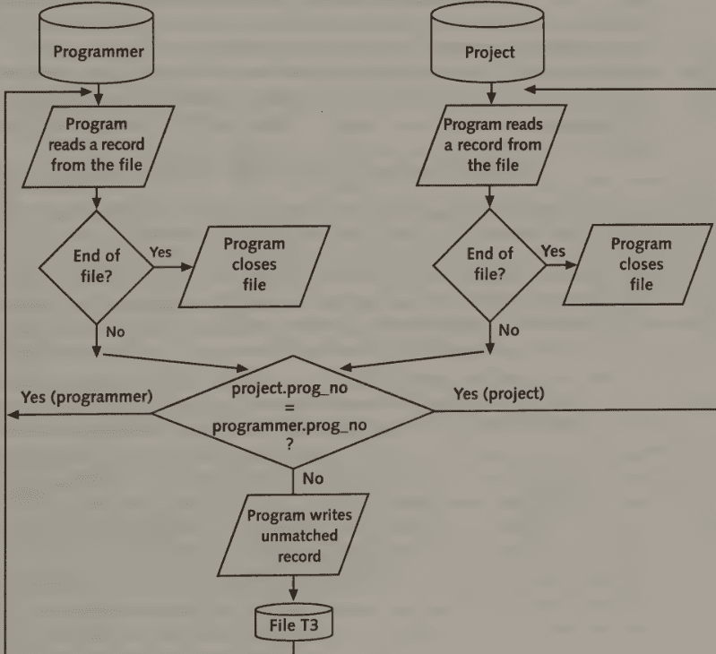
**图 5-6 程序员分配概览与分析**

`printf` 函数的语法如下：

```
Syntax printf (format, expr1, expr2, expr3)
```

### 详细剖析

- *format*（格式）是必须提供的。它是一个具有字符串值的表达式，包含文字文本以及如何格式化参数列表中表达式的规范。每个规范都以百分号 (%) 开始，它标识随后的代码为修饰符（- 为左对齐；width 为设置宽度大小；prec 为设置最大字符串宽度或小数点右侧的位数；s 代表字符数组（字符串）；d 代表十进制整数；f 代表浮点十进制数）。被双引号 (" ") 包围的 *format* 通常被称为覆盖进入其中的数据字段的“掩码”。
- *$expr1, $expr2, $expr3* 代表数据字段。这些表达式通常采用 $1, $2, $3 等形式。在程序员文件中，表达式 $1 表示程序员编号（第一个字段），$2 表示程序员的姓（第二个字段），$3 表示程序员的名（第三个字段）。

你可以使用 `awk` 命令和 `printf` 函数从程序员文件中打印以下信息：程序员编号、程序员姓和程序员名，全部左对齐。实现此目的的命令行是：

```
awk -F: '{printf "%d %-12.12s %-10.10s\n", $1, $2, $3}' programmer
```

“动手项目 5-13”使你能够在程序员文件上使用此命令。格式字符串中的每个 % 符号对应一个 $ 字段，如下所示：

- `%d` 表示字段 $1（程序员编号）以十进制数字显示。
- `%-12.12s` 表示字段 $2（程序员姓）以字符串显示。连字符 (-) 指定字符串左对齐。12.12 表示字符串应显示在填充至 12 个空格的字段中，最大长度为 12 个空格。
- `%-10.10s` 表示字段 $3（程序员名）以字符串显示。连字符 (-) 指定字符串左对齐。10.10 表示字符串应显示在填充至 10 个空格的字段中，最大长度为 10 个空格。

格式字符串中出现的空格将按照它们相对于 `awk` 和 `printf` 参数出现的位置原样打印——例如，每个 % 参数之间（即 %d 之后）有一个空格，但在这种情况下，每个字段标识符之后（如 $1 之后）的空格是可选的。尾部的 \n 告诉 `awk` 在显示三个字段后换行。有关此 `awk` 命令报告输出的示例，请参阅图 5-7。

当你需要提取和格式化数据字段用于输出时，与其他 UNIX/Linux 文件处理命令相比，`awk` 命令提供了一种快捷方式。例如，虽然需要几行代码，但你可以使用 `cut`、`paste` 和 `cat` 命令


**图 5-7** `awk` 报告使用 `printf` 来显示三个字段

用于提取并显示程序员的姓氏和薪水。作为替代方案是，您可以使用单行 `awk` 命令来实现同样的功能。实操项目 5–14 使您能够比较这两种技术。此外，请尝试实操项目 5–15，以获得更多使用 `cut`、`sort`、`uniq`、`comm` 和 `join` 命令的经验。

### 使用 Shell 脚本实现应用程序

您在实操项目中开发的报告生成应用程序由许多必须按特定顺序运行的独立命令组成。正如您在第 4 章中所记得的，您可以创建一个脚本文件来简化应用程序。您将命令存储在脚本文件中，这实际上就变成了一个程序。在开发应用程序时，通常应该在将每个命令放入脚本文件之前对其进行测试和调试。您可以使用 vi 或 Emacs 编辑器来创建脚本文件。（第 6 章“Shell 脚本编程简介”和第 7 章“高级 Shell 编程”将更详细地介绍 shell 脚本编程。）

Shell 脚本不仅应包含要执行的命令，还应包含用于标识和解释该脚本的注释，以便脚本作者以外的用户或程序员能够理解其工作原理。注释还使原作者能够随着时间的推移记住脚本的逻辑。在脚本文件中使用井号 (#) 字符来标记注释。这告诉 shell，# 之后的文字是注释，而不是 UNIX/Linux 命令。实操项目 5–16 使您能够为一组命令构建一个 shell 脚本，这些命令将创建一个临时文件，显示有关程序员当前工作的程序数量的信息。该脚本和临时文件将成为用于生成“程序员活动状态报告”流程的一部分。

### 运行 Shell 脚本

您几乎可以在系统上的任何 shell 中运行 shell 脚本。在本书中，您使用的是 Bourne Again Shell（即 Bash），它在 Linux 系统中被广泛使用。在不同的 shell 中，关于命令的具体用法、语法和选项往往存在一些不兼容之处。使用 Bash shell 的一个优点是它比原始的 Bourne shell 接受更多变化的命令结构；Bash 是 Bourne 和 Korn shell 的免费软件衍生版本。

当您创建要在 Bash 中运行的 shell 脚本时，可以通过输入 `sh`（调用 Bash shell 解释器）然后输入脚本名称来立即运行该脚本，如下所示：

```
sh testscript
```

运行 `sh` 的另一个优点是您可以配合几个调试选项，帮助您排除脚本中的问题。（您将在第 6 章中学习更多关于这些调试选项的知识。）在本章中，对于 shell 脚本的初步体验，您只需使用 `sh` 来运行脚本。

**注意** 在 UNIX 系统中，`sh` 调用该特定 UNIX 系统默认 shell 的 shell 命令解释器。在 Linux（包括 Fedora 和 Red Hat Enterprise Linux）中，您可以使用 `sh` 或 `bash` 来运行 shell 脚本并调用 Bash shell 解释器。在这些系统中，`sh` 实际上是一个指向 Bash shell 的链接。

运行 shell 脚本的另一种方法（您将在第 6 章中详细学习，并在第 4 章的实操项目 4-15 中初步接触过）是通过 `x` 权限使其可执行，然后在运行脚本本身时在脚本名称前输入 `./`。此外，在编写脚本时，建议指定该脚本预期使用的 shell。您可以通过在脚本的第一行包含一个命令来实现，例如 Bash shell 使用 `#!/bin/bash`。随着您的 shell 脚本变得更加高级，第 7 章将向您展示如何实施这一实践。

在实操项目 5-17 中，您将使用 `sh` 命令运行在实操项目 5-16 中创建的脚本。在实操项目 5-18 和 5-19 中，您将创建并运行作为生成最终“程序员活动状态报告”后续步骤的脚本。

### 整合以生成报告

开发应用程序的一种有效方法是将小型脚本组合成一个较大的脚本文件。通过这种方式，将一项大任务分解为一系列较小的任务会更容易完成——这是一个基本的编程原则。此外，通过这种方法，您可以测试每个小脚本以确保其正常工作。在实操项目 5-16 到 5-19 中，您在准备创建“程序员活动状态报告”的过程中创建、执行并测试了单个小脚本。在脚本经过测试后，您可以将每个小脚本的内容按正确的顺序放入一个较大的脚本文件中，以生成最终的“程序员活动状态报告”。实操项目 5-20 将您的小型项目汇总为一个大型任务以生成报告。

## 本章总结

- UNIX/Linux 文件处理命令可以分为两类：(1) 选择命令和 (2) 操作与转换命令。选择命令用于提取信息。操作与转换命令用于将提取的信息更改并转换为有用且美观的格式。
- `grep` 命令用于在文件中搜索特定模式。
- `uniq` 命令从文件中删除重复行。您必须先对文件进行排序，因为 `uniq` 仅比较连续行。
- `comm` 命令比较两个不同文件（file1 和 file2）的公共行，并产生三列输出，报告文件之间的差异。
- `diff` 命令尝试确定将一个文件的内容转换为与另一个文件内容相匹配所需的最少更改集。
- 当您想知道文件中的字节数、单词数或行数时，请使用 `wc` 命令。
- `sed` 命令是一个流编辑器，旨在对大文件进行全局更改。运行 `sed` 的最低要求是一个输入文件和一个告诉 `sed` 对文件采取什么操作的命令。`sed` 操作的输入可以来自命令行或通过脚本文件。
- `tr` 命令将从标准输入读取的数据复制到标准输出，并替换或删除由选项和模式指定的字符。
- `pr` 命令将标准输出分页打印。
- 文件处理应用程序的设计反映了该应用程序需要产生的内容。设计还定义了如何将信息组织成文件、记录和字段，这些也被称为逻辑结构。
- 使用记录布局通过名称和数据类型（数值或非数值）来标识每个字段。设计文件记录时，仅存储与每条记录主要目的相关的字段。
- Shell 脚本应包含要执行的命令以及用于标识和解释脚本的注释。脚本文件中使用井号 (#) 字符进行注释。
- 分阶段编写 shell 脚本，以便在将它们合并为一个脚本之前测试每个部分。使用小型 shell 脚本并将其组合在最终的 shell 脚本文件中是开发应用程序的一种有效方法。

## 命令总结：第 5 章命令复习

| 命令 | 用途 | 本章涵盖的选项 |
| :--- | :--- | :--- |
| comm | 比较并输出两个文件的公共行 | |
| diff | 比较两个文件并确定哪些行不同 | -b 忽略重复的空格。<br>-B 不比较空行。<br>-i 忽略大小写。<br>-c 显示不同行周围的行（用于上下文）。 |
| grep | 选择行或行组 | -i 忽略大小写。<br>-l 仅列出文件名。<br>-c 仅统计匹配模式的行数，而不显示它们。<br>-r 搜索所有子目录下的文件。 |
| pr | 格式化指定文件 | -d 双倍行距输出。<br>-h 自定义页眉行。<br>-l n 设置每页的行数。 |
| printf | 告诉 Awk 程序采取什么操作来格式化和打印信息 | |
| sed | 指定编辑命令或包含 sed 命令的脚本文件 | a\ 在行后追加文本。<br>p 显示行。<br>d 删除指定文本。<br>s 替换指定文本。<br>-e 在一行中指定多个命令。<br>-n 指定要操作的行号。 |
| sh | 执行 shell 脚本 | |
| tr | 转换字符 | -d 从输出中删除在 string1 中找到的输入字符。<br>-s 检查 string1 连续重复出现的序列。 |
| uniq | 删除重复行以创建唯一的输出 | -u 仅输出源文件中未重复的行。<br>-d 输出每个有重复行的副本，且不显示唯一行。<br>-i 忽略大小写。<br>-c 在每行开头显示每个实例出现的次数。 |


| 命令 | 用途 | 本章涵盖的选项 |
| :--- | :--- | :--- |
| `wc` | 统计文件中的行数、字节数或单词数 | `-c` 统计字节数或字符数。<br>`-l` 统计行数。<br>`-w` 统计单词数。 |

## 关键术语

**逻辑结构 (logical structure)** —— 文件、记录和字段中信息的组织方式，其中每一个都代表一个逻辑实体，例如工资文件、员工的工资记录或员工的社会保障号码。

**操纵和转换命令 (manipulation and transformation commands)** —— 一组用于修改和格式化提取信息的命令，使其变得有用，并能以吸引人且易于理解的方式呈现。

**管道操作符 ( | ) (pipe operator)** —— 将一个命令的输出重定向到另一个命令输入的运算符。

**记录布局 (record layout)** —— 程序和数据文件设计的一个步骤，用于确定数据文件中将要使用的字段、记录类型和数据类型。

**选择命令 (selection commands)** —— 用于提取信息的文件处理命令。

## 复习题

- 1. 你准备了两个脚本文件 report1 和 report1a，用于生成为你工作的人员的工资清单。其中一份报告包含每位员工的入职日期，而另一份报告则包含家庭地址。现在，你想创建一份新报告，同时显示工资、入职日期和家庭地址。你可以使用以下哪个命令来确定 report1 和 report1a 中不同的行？（选择所有适用项：）
    a. `uniq report1 report1a`
    b. `diff report1 report2`
    c. `comm report1 report2`
    d. `ls -comp report1 report2`

- 2. 你经常使用 Emacs 编辑器为课程写论文，目前正在写一篇名为 Selenium_in_Wildlife 的论文，篇幅要求在 700 到 1000 字之间。以下哪个命令可以让你检查目前已写内容的长度？（选择所有适用项。）
    a. `wc -w Selenium_in_Wildlife`
    b. `count Selenium_in_Wildlife`
    c. `cat --count Selenium_in_Wildlife`
    d. `show --words Selenium_in_Wildlife`

- 3. 你有一个名为 source 的目录，其中包含数百个程序，该目录是你主目录下的一个主要子目录。在主目录下，你可以使用哪个命令每次显示一屏程序，以免列表滚动太快无法阅读？（选择所有适用项。）
    a. `pr -l source`
    b. `more source`
    c. `ls -l source | more`
    d. `less source`

- 4. `sed` 命令中的 `s` 选项的作用是什么？
    a. 对文件中的行进行排序
    b. 替换文本
    c. 删除文本
    d. 选择要处理的文本

- 5. 你写了一封长信并存储在主目录中。你还没有打印这封信，这时发现信中一个城镇的名字拼写错了。你可以使用以下哪个命令来查找拼错的单词？
    a. `grep`
    b. `locate`
    c. `more -f`
    d. `search`

- 6. 你有一个包含许多重复记录的库存记录文件。你可以使用以下哪个命令来创建一个名为 duplicates 的新文件，且该文件仅显示重复的记录？
    a. `sort -d inventory | cat duplicates`
    b. `uniq -d inventory > duplicates`
    c. `tr -u inventory > duplicates`
    d. `pr inventory | cat duplicates`

- 7. 你正在创建一个大型且复杂的 shell 脚本，起初这看起来是一个非常有挑战性的任务。你可以采取哪些步骤来帮助确保脚本的成功？
    a. 尝试重复使用 `sort` 命令，因为它的可靠性和灵活性很高。
    b. 避免使用 `cat` 命令，因为它总是需要操作员输入来更改文件。
    c. 尝试将代码控制在 100 行以内，因为 shell 脚本在行数低于此数值时效率最高。
    d. 开发许多小型脚本，对它们进行测试，然后将它们组合成一个较大的 shell 脚本。

- 8. 你有一个名为 data 的文件，包含变长记录，字段由冒号分隔。你想在电子表格中使用该文件的内容，但电子表格要求字段由逗号而非冒号分隔。以下哪个命令可以实现这一点？
    a. `tr -s ":" "," < data`
    b. `uniq -r ":" "," data > data`
    c. `rp s/., / data`
    d. `find -r /., / data`

- 9. `sed` 命令中的 `a\` 选项用于 ____________________。
    a. 替换字母文本
    b. 删除文本
    c. 追加文本
    d. 查找字母数字文本

- 10. 关于 `sed` 命令，以下哪项是正确的？（选择所有适用项。）
    a. 它可以将脚本文件用作命令输入。
    b. 可以在同一行指定多个命令。
    c. 它仅在 tcsh shell 中运行。
    d. 它使用 format 选项来格式化输出。

- 11. 当你使用 `sh pnnu` 命令时，以下哪项是正确的？（选择所有适用项。）
    a. pnnu 是一个设备特殊文件。
    b. pnnu 文件被显示以显示隐藏字符。
    c. 执行 pnnu 文件中包含的命令。
    d. 你必须在命令后添加管道操作符和输出文件。

- 12. 在命令 `sed -f fix text1 > text2` 中，“fix” 具有以下哪个功能？

- 13. 你有一个用于打印表单的信息文件，所有字符都需要转换为大写。以下哪个 `tr` 命令选项可以实现此操作？
    a. `[a-z] [A-Z]`
    b. `s/a,z/A,Z/`
    c. `-C /a/Z`
    d. `{a,Z}`

- 14. 以下哪些是操纵和转换命令的示例？（选择所有适用项。）
    a. `cat`
    b. `awk`
    c. `join`
    d. `pr`

- 15. 以下哪个是管道操作符？
    a. `/`
    b. `|`
    c. `:`
    d. `;`

- 16. 当你使用 `pr` 命令格式化文件的输出时，`-l 22` 选项的作用是什么？
    a. 创建 22 列输出。
    b. 将格式化限制在 22 个字符内。
    c. 以纵向方式打印输出，页边距为 22 个字符。
    d. 在屏幕上每页显示 22 行。

- 17. 当你在 `awk` 命令的 `printf` 函数中使用 `$4` 时，_____________________________________________________________________
    a. 你将字段中显示的字符限制为 4 个
    b. 你指定报告中的标题
    c. 你引用文件中的第四个字段
    d. 你将命令行中的最后一个选项重复四次

- 18. 在设计记录布局时，你应该 ______________________. （选择所有适用项。）
    a. 通过名称标识每个字段
    b. 通过数据类型标识每个字段
    c. 计划使用短横线分隔字段
    d. 仅存储与记录目的相关的字段

- 19. 在使用 `Awk` printf 格式化时，"%d" 用于 ______________________.
    a. 删除一个字段
    b. 显示所有包含字母 “d” 的单词
    c. 指示一个字段以十进制数字显示
    d. 显示一个字段应足够长以显示 10 个字符

- 20. 你有一个文件，包含一篇用单倍行距编写的论文，但得知提交时必须使用双倍行距。当你将其输出到打印机时，以下哪个命令可以将其转换为双倍行距？
    a. 使用 -2 选项的 `tr`
    b. 使用 -d 选项的 `pr`
    c. 使用 --double 选项的 `grep`
    d. 使用 -i 选项的 `uniq`

- 21. 你想使用 `grep` 命令同时应用于大写和小写字符，从而绕过大小写敏感。你应该在命令中使用以下哪个选项？
    a. `-i`
    b. `-c`
    c. `/case`
    d. `\c`

- 22. 有时使用一个 `awk` 命令可以替代使用两个、三个或更多其他命令来完成相同的任务。正确还是错误？

- 23. `ls` 命令的一个限制是你不能将其与管道操作符一起使用。正确还是错误？

- 24. 当你使用 `grep` 在子目录中进行搜索时，请使用 -s 选项。正确还是错误？

- 25. 你有两个只有微小差异的文件，你想并排查看这些差异。完成此项工作的最佳命令是 `diff`。正确还是错误？


## 动手项目

请在命令行（例如终端窗口）中完成这些项目，并使用您自己的账户和主目录登录。

### 项目 5-1

管道运算符将一个命令的输出定向到另一个命令的输入。在 UNIX/Linux 中，该运算符对于在单行中组合命令并产生更易于阅读或使用的输出非常有用。在本项目中，您将使用管道运算符将 `ls` 命令的输出定向到 `more` 命令的输入，以便更轻松地查看大型目录的内容。

要将 `ls` 命令的输出重定向到 `more` 命令：

- 1. 输入 `ls -l /etc` 并按下 **Enter**。注意命令的输出快速滚动而过。
- 2. 输入 `ls -l /etc | more` 并按下 **Enter**。（参见图 5-8。）

注意输出填满了屏幕，并在底行显示提示符 "More" 时暂停。每次按下空格键，输出都会前进到下一个屏幕。按下 **spacebar**（空格键）一次滚动一个屏幕，或按下 **Enter** 一次前进一行，直到命令结束。您也可以在任何时间输入 **q** 来退出目录内容的显示。

图 5-8 将 `ls -l` 通过管道传输至 `more`

### 项目 5-2

管道运算符使您能够在单行中组合多个命令。在本项目中，您将把目录列表的内容通过管道传输到 `sort` 命令，然后将结果通过管道传输到 `more` 命令。

要使用管道运算符连接多个命令：

- 1. 输入 `ls /etc | sort -r | more` 并按下 **Enter**。该命令将 `/etc` 目录的目录列表重定向到 `sort -r` 命令。`sort -r` 按反向顺序对目录列表进行排序。`sort` 命令的输出随后被重定向到 `more` 命令。
- 2. 执行该命令后，您应该看到反向排序的 `/etc` 目录列表。（请参考图 5-1。）
- 3. 按下 **spacebar**（空格键）直到显示的输出结束。

### 项目 5-3

在本项目中，您将使用 `grep` 命令的几个功能，并学习将其与 `head` 命令结合使用以获得更易于管理的输出。正如您在第 1 章中所记得的，您可以使用 `head` 命令检索文件的前 10 行。您可以将 `grep` 和 `head` 命令结合起来，仅检索包含该单词或短语的前 10 行。例如，这里您将 `grep` 与 `head` 结合使用，以查找 `/etc/termcap` 中包含字符 "IBM" 的前 10 行。

要显示文件中包含特定单词或短语的行：

- 1. 要查看 `/etc/termcap` 文件中所有包含字符 "IBM" 的行，请输入 `grep IBM /etc/termcap` 并按下 **Enter**。许多行符合标准，输出快速滚动而过。
- 2. 将 `grep` 命令的输出重定向到 `more` 命令的输入。输入 `grep IBM /etc/termcap | more` 并按下 **Enter**。（记住，您可以通过按下上方向键来回溯并补充之前使用的命令。）（参见图 5-9。）
- 3. 按下 **spacebar**（空格键）直到命令输出结束。
- 4. 输入 **clear** 并按下 **Enter** 以清除屏幕。
- 5. 将 `grep` 命令的输出重定向到 `head` 命令。输入 `grep IBM /etc/termcap | head` 并按下 **Enter**。

您在步骤 5 中输入的命令告诉 `grep` 在 `/etc/termcap` 文件中查找 "IBM"，然后显示找到的前 10 行。有关该命令结果的示例，请参见图 5-10。

`grep` 命令的选项和通配符支持允许强大的搜索操作。在接下来的步骤中，您将学习更多关于这些选项的知识，例如基于大小写进行搜索以及忽略大小写进行搜索。您还将学习使用通配符和元字符选项进行搜索，以扩大搜索范围。

图 5-9 将 `grep` 命令与 `more` 命令结合使用

图 5-10 将 `grep` 与 `head` 结合使用

要通过选项和正则表达式支持扩展 `grep` 命令的搜索能力：

- 1. 要查看 `/etc/termcap` 文件中包含单词 “Linux” 的每一行，请输入 `grep Linux /etc/termcap` 并按下 **Enter**。（请确保 Linux 的 L 大写。）
- 2. 文件中的某些行包含单词 “linux”（小写 l）。您在步骤 1 中执行的搜索仅显示了包含 “Linux” 的行。`-i` 选项告诉 grep 忽略搜索字符的大小写。输入 `grep -i linux /etc/termcap` 并按下 **Enter**。您将看到包含 “Linux” 或 “linux” 的行。
- 3. 输入 `clear` 并按下 **Enter** 以便更好地查看下一步。
- 4. `grep` 命令在搜索字符串中支持正则表达式字符。要查看 `/etc/termcap` 文件中所有以 "lin" 开头且后跟任意字符集的行，请输入 `grep -i "^lin" /etc/termcap` 并按下 **Enter**。（参见图 5-11。）

> `^` 字符是一个特殊的 `grep` 表达式，称为*元字符* (*metacharacter*)。它的目的是搜索以紧随其后的字符串开头的单词。在步骤 3 中，`^` 字符正在搜索以字符串 "lin" 开头的单词。

图 5-11 在 `grep` 搜索中使用元字符

- 5. `grep` 命令可以依次处理多个文件。输入 `grep linux /etc/*` 并按下 **Enter**。您将看到 `/etc` 目录中所有包含 "linux" 的行。
- 6. 输入 `clear` 并按下 **Enter**。
- 7. `-l`（小写 L）选项指示 `grep` 仅显示包含搜索字符串的文件名。输入 `grep -l linux /etc/*` 并按下 **Enter**。您将看到 `/etc` 目录中包含 "linux" 的文件名。哪些文件显示了信息？
- 8. 输入 `clear` 并按下 **Enter**。

只要短语在命令行中用引号指定，`grep` 命令也可以搜索文件中包含空格的短语。例如，`grep` 可以搜索短语 "IBM PC"，如下一组步骤所示。

#### 要在文件中搜索短语：

- 1. 输入 `grep "IBM PC" /etc/termcap` 并按下 **Enter**。

您将看到 `/etc/termcap` 文件中所有包含短语 IBM PC 的行。

- 2. 输入 **clear** 并按下 **Enter**。

在之前的示例中，`grep` 搜索命令行中指定的文件。`grep` 也可以通过管道运算符从另一个命令获取输入。

#### 要将命令的输出重定向到 `grep` 命令：

- 1. 输入 `ls /etc | grep magic` 并按下 **Enter**。您将看到一个文件名包含单词 “magic” 的文件列表。
- 2. 输入 **clear** 并按下 **Enter**。

### 项目 5-4

本项目演示了 `uniq` 命令的常见用途。要执行该项目，请先使用 vi 编辑器在工作目录中创建一个新文件 `zoo1`。这是一个简单的数据文件示例，包含变长记录，列出了动物名称、食物描述、每日食用量（磅）和食物成本。请按照步骤 1 所示输入重复记录。创建文件后，使用 `uniq` 命令删除重复记录。

#### 要使用 `uniq` 命令删除重复行：

- 1. 输入 `vi zoo1` 并按下 **Enter** 以打开 vi 编辑器。按下 `i` 并输入以下文本，每行末尾按下 **Enter**（最后一行除外）：

```
Monkeys:Bananas:2000:850.00
Lions:Raw Meat:4000:1245.50
Lions:Raw Meat:4000:1245.50
Camels:Vegetables:2300:564.75
Elephants:Hay:120000:1105.75
Elephants:Hay:120000:1105.75
```

- 2. 按下 **Esc** 切换到命令模式。输入 `:wq` 或 `:x` 并按下 **Enter**。
- 3. 要使用 `uniq` 从 `zoo1` 文件中删除重复行，并使用输出重定向运算符创建新文件 `zoo2`，请输入 `uniq zoo1 > zoo2` 并按下 **Enter**。
- 4. 输入 `cat zoo2` 并按下 **Enter**。
- 5. 您将看到如下所示的 `zoo2` 内容。注意 `uniq` 命令删除了重复行。

```
Monkeys:Bananas:2000:850.00
Lions:Raw Meat:4000:1245.50
Camels:Vegetables:2300:564.75
Elephants:Hay:120000:1105.75
```


### 项目 5-5

在本项目中，你将探索 `comm` 命令。首先，你将创建文件 my_list。接着，复制该文件，然后使用 `comm 命令比较这两个文件。

**使用 `comm` 命令比较文件：**

- 1. 要创建文件 my_list，在 $ 命令提示符后输入 `cat > my_list` 并按下 **Enter**。
- 2. 输入以下文本，每行末尾按下 **Enter**：
    **Football**
    **Basketball**
    **Skates**
    **Soccer ball**
- 3. 按下 **Ctrl+d**。
- 4. 要将 my_list 复制到第二个文件 your_list，输入 `cp my_list your_list` 并按下 **Enter**。
- 5. 现在使用 `comm` 命令将 my_list 与 your_list 进行比较。输入 `comm my_list your_list` 并按下 **Enter**。
- 6. 你将看到三列输出。（请注意，显示列标题的文本是为了方便参考而插入的，这些文本不会出现在你的屏幕上。）注意第三列中的行是两个文件共同包含的内容。（列的对齐方式将取决于操作系统。）这两个文件是完全相同的。

| 第 1 列 | 第 2 列 | 第 3 列 |
| :--- | :--- | :--- |
| | | Football |
| | | Basketball |
| | | Skates |
| | | Soccer ball |

- 7. 现在向 my_list 添加一个新行。输入 `cat >> my_list` 并按下 **Enter**。
- 8. 输入 **Golf ball** 并按下 **Enter**。
- 9. 按下 **Ctrl+d**。
- 10. 再次使用 `comm` 比较 my_list 和 your_list。输入 `comm my_list your_list` 并按下 **Enter**。
- 11. 你将看到三列输出，其中 my_list 中唯一的新行出现在第 1 列。（再次注意，你的列对齐方式可能会有所不同。）

| 第 1 列 | 第 2 列 | 第 3 列 |
| :--- | :--- | :--- |
| Golf ball | | Football |
| | | Basketball |
| | | Skates |
| | | Soccer ball |


- 12. 向 your_list 添加一个新行。输入 `cat >> your_list` 并按下 **Enter**。
- 13. 输入 **Tennis ball** 并按下 **Enter**。
- 14. 按下 **Ctrl+d**。
- 15. 输入 `comm my_list your_list` 并按下 **Enter** 进行另一次比较。（见图 5-12。）

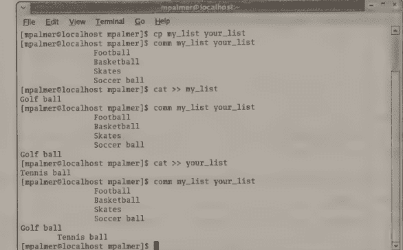

**图 5-12 使用 `comm` 比较文件**

### 项目 5-6

在本项目中，你将使用 `diff` 命令来比较之前在“动手项目 5-4”中创建的 zoo1 和 zoo2 文件的内容。

**使用 `diff` 查找两个文件之间的差异：**

- 1. 输入 `more zoo1 zoo2` 并按下 **Enter** 来查看 zoo1 和 zoo2 的内容。按下 **空格键** 查看第二个文件的内容。（见图 5-13。）
- 2. 输入 `diff zoo1 zoo2` 并按下 **Enter**。
- 3. 你将看到以下信息：

```
3d2
< Lions:Raw Meat:4000:1245.50
6d4
< Elephants:Hay:120000:1105.75
```

这意味着你需要从 zoo1 中删除第三行和第六行，这样该文件才能与 zoo2 匹配。（注意，在某些版本的 UNIX/Linux 中，你可能会看到 `5d4` 而不是 `6d4`，因为另一种匹配文件的方法是删除 zoo1 中的第五行，它与第六行相同。）

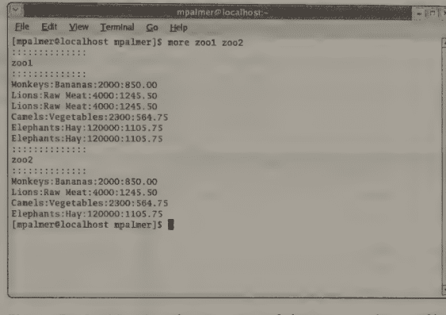

**图 5-13 查看 zoo1 和 zoo2 文件的内容**

- 4. 要反转比较顺序，输入 `diff zoo2 zoo1` 并按下 **Enter**。你将看到以下信息：

```
2a3
 > Lions:Raw Meat:4000:1245.50
4a6
 > Elephants:Hay:120000:11105.75
```

这意味着你需要添加 zoo2 中显示的这两行，这样该文件才能与 zoo1 匹配。你会将 zoo1 的第三行添加到 zoo2 的第二行之后；并且将 zoo1 的第六行添加到 zoo2 的第四行之后。


### 项目 5-7

在本项目中，你将使用 `wc` 命令来计算一个名为 counters 的新文件中的行数。

**创建文件并计算其行数：**

- 1. 输入 `cat > counters` 并按下 **Enter**。
- 2. 输入以下文本，每行末尾按下 **Enter**：

`Linux is a full featured UNIX clone.`
`Linux is available in free and commercial versions.`

- 3. 输入 **Ctrl+d**。
- 4. 要查找 counters 中的行数，输入 `wc -l counters` 并按下 **Enter**。UNIX/Linux 会报告该文件包含两行。
- 5. 要查找 counters 中的字节数，输入 `wc -c counters` 并按下 **Enter**。UNIX/Linux 会报告该文件包含 89 字节。
- 6. 要查找 counters 中的单词数，输入 `wc -w counters` 并按下 **Enter**。UNIX/Linux 会报告该文件包含 15 个单词。
- 7. 要同时计算 counters 中的单词数、字符数和行数，输入 `wc -lwc counters` 并按下 **Enter**。UNIX/Linux 会报告行数 (2)、单词数 (15) 和字节数 (89)。（注意，如果你输入 `wc counters`，得到的结果与输入 `wc -lwc counters` 相同。）见图 5-14 查看 `wc` 命令的输出。

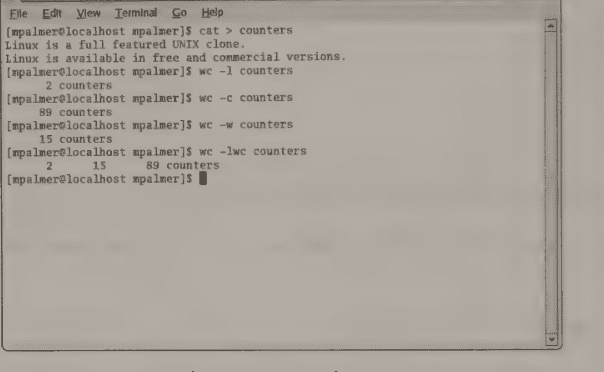

**图 5-14 使用 wc 命令**

### 项目 5-8

`sed` 是一个流编辑器，它允许你对文件中的特定行进行操作并修改其内容。在本项目中，你将使用 `sed` 来显示特定行并编辑你创建的文件。本项目的重点是在命令行中使用 `sed` 命令。

**使用 `sed` 操作文件：**

1. 使用 vi 或 Emacs 编辑器在你的工作目录中创建新文件 `unix_stuff`。`unix_stuff` 文件应包含以下内容（每行输入后按下 **Enter**——最后一行除外——以形成五行文本）：

> Although UNIX supports other database systems, UNIX has never abandoned the idea of working with flat files. Flat files are those that are based on pure text with standard ASCII codes. Flat files can be read by any operating system.

2. 要仅显示第 3 行和第 4 行，输入 `sed -n 3,4p unix_stuff` 并按下 **Enter**。（`-n` 选项可防止 `sed` 显示除 `p` 命令指定的行之外的任何行。）

这意味着“在文件 unix_stuff 中查找编号为 (-n) 3 和 4 的行并显示它们 (p)”。

你将看到第 3 行和第 4 行：

`flat files. Flat files are those that are based on pure text with standard ASCII codes. Flat files`

- 3. 在 sed 中，你可以在一行中放置两个命令。如果你想删除第 3 行和第 4 行然后显示文件，必须使用 `-e` 选项在同一行中指定多个命令。要从 unix_stuff 中删除第 3 行和第 4 行并显示结果，输入 `sed -n -e 3d -e 4d -e p unix_stuff` 并按下 **Enter**。

你将看到以下文本：

`Although UNIX supports other database systems, UNIX has never abandoned the idea of working with can be read by any operating system.`

第 3 行和第 4 行实际上并没有从文件中删除，而只是被过滤掉，因此不会显示在屏幕输出中。

- 4. 要仅显示包含单词 “Flat” 的行，输入 `sed -n /Flat/p unix_stuff` 并按下 **Enter**。

你将看到以下文本：

`flat files. Flat files are those that are based on pure text with standard ASCII codes. Flat files`

- 5. 要将所有 “Flat” 单词替换为 “Text”，输入 `sed -n s/Flat/Text/p unix_stuff` 并按下 **Enter**。（请确保 “Flat” 和 “Text” 的首字母大写。）`s` 命令将一个字符串替换为另一个字符串。

你将看到以下文本。（见图 5-15。）

`flat files. Text files are those that are based on pure text with standard ASCII codes. Text files`


### 项目 5-9

在本项目中，你将继续学习使用 `sed` 命令，以便了解如何将一个文件的行追加到另一个文件中。首先，你使用 vi 编辑器创建一个新的脚本文件 `more_stuff`。你在 `more_stuff` 文件中使用追加命令 `a\`，由 `sed` 将这些行追加到 `unix_stuff` 文件中。（你也可以通过使用 `cat more_stuff >> unix_stuff` 来实现相同的结果，但这里的目的是向你展示 `sed` 的多功能性。）除了被添加文件的最后一行外，每行必须以反斜杠字符结尾。在本项目中，`a\` 符号之前的 `$` 告诉 `sed` 在 `unix_stuff` 的最后一行之后追加 `more_stuff`；如果没有 `$`，`sed` 会在 `unix_stuff` 的每一行之后重复添加 `more_stuff` 中的所有行。


图 5-15 使用 `sed` 显示和编辑 unix_stuff 文件的输出

#### 要创建使用 `sed` 向另一个文件追加行的脚本文件：

- 1. 使用 vi 编辑器创建脚本文件 `more_stuff`，包含以下内容（按下 **i** 进入插入模式，并在每行末尾按下 **Enter**，最后一行除外）：

  $a\
  Informix and Oracle, two major relational database\
  companies have installed their RDBMS packages on UNIX\
  systems for many years.

- 2. 输入信息后，按下 **Esc** 切换到命令模式。输入 **:wq** 或 **:x** 并按下 **Enter** 保存文件并退出 vi。

- 3. 要使用 `sed` 命令运行脚本文件，输入 **`sed -f more_stuff unix_stuff`** 并按下 **Enter**。

您将看到以下文本。（见图 5-16。）

```
Although UNIX supports other database systems,
UNIX has never abandoned the idea of working with
flat files. Flat files are those that are based on pure
text with standard ASCII codes. Flat files
can be read by any operating system.
Informix and Oracle, two major relational database
companies have installed their RDBMS packages on UNIX
systems for many years.
```

图 5-16 创建并运行一个使用 sed 的脚本

- 4. 使用 `vi` 创建文件 `stuff_replace`。按下 **i** 进入插入模式，并在文件中插入以下 `sed` 命令：

  `s/UNIX/Linux/`
  `s/abandoned/given up/`
  `s/standard/regular/`

文件中的这些行指示 `sed` 将所有出现的 “UNIX” 替换为 “Linux”，“abandoned” 替换为 “given up”，“standard” 替换为 “regular”。

输入这些行后，按下 **Esc** 切换到命令模式。输入 **:wq** 或 **:x** 并按下 **Enter**。

- 5. 输入 **clear** 并按下 **Enter** 以清除屏幕上的工作区域。

- 6. 在 `unix_stuff` 文件上执行 `sed`，并使用您在步骤 4 中创建的脚本文件。将 `sed` 的输出重定向到文件 `unix_stuff2`。输入 **`sed -f stuff_replace unix_stuff > unix_stuff2`** 并按下 **Enter**。

- 7. 输入 **`cat unix_stuff2`** 并按下 **Enter**。您将看到根据 `stuff_replace` 脚本文件修改后的文件，如图 5-17 所示。

### 项目 5-10

`tr` 命令用于翻译文件中的字符，例如将小写字母转换为大写字母、删除指定字符以及替换字符。在本项目中，您将通过以下步骤完成所有这些操作。您将使用在“动手项目 5-7”中创建的 counters 文件。

要将 counters 文件中的小写字符转换为大写字符：

- 1. 输入 **`tr [a-z] [A-Z] < counters`** 并按下 **Enter**。

## 第 5 章 高级文件处理

**图 5-17** `sed` 的更改已写入 unix_stuff2 文件

您将看到这些行：

`LINUX IS A FULL FEATURED UNIX CLONE.`
`LINUX IS AVAILABLE IN FREE AND COMMERCIAL VERSIONS.`

您还可以在 `tr` 命令中使用 `-d` 选项，从输出中删除在 `string1` 中找到的输入字符。当您需要从文件中删除错误字符时，这非常有用。

#### 要从 counters 文件中删除指定字符：

- 1. 要从输出中删除字符 “full”，请输入 `tr -d "full" < counters` 并按下 **Enter**。

您将看到以下文本：

`Linx is a eatred UNIX cone.`
`Linx is avaiabe in ree and commercia versions.`

请注意，该命令删除的是 “full” 中的所有字符（输出中所有的 f、u 和 l），而不是 “full” 这个单词的出现。（见图 5-18。）

`tr` 命令的 `-s` 选项用于检查一个字符或字符串重复出现多次的序列。当这种情况发生时，`tr` 会将重复字符的序列替换为您指定的字符或字符串。例如，当您需要将平铺文件（flat file）中的字段分隔符从一个字符更改为另一个字符时，请使用 -s 选项。例如，在 `zoo2` 文件中，使用 `tr` 将字段分隔符 ":" 替换为空格字符 " "。首先，使用 `cat` 显示文件。

#### 要替换 counters 文件中的字符：

- 1. 输入 `cat zoo2` 并按下 **Enter**。

**图 5-18** 使用 `tr` 翻译文件中的字符

您将看到以下文本：

Monkeys:Bananas:2000:850.00
Lions:Raw Meat:4000:1245.50
Camels:Vegetables:2300:564.75
Elephants:Hay:120000:1105.75

- 2. 输入 `tr -s ":" " " < zoo2` 并按下 **Enter**。

   您将看到以下文本：

   ```
   Monkeys Bananas 2000 850.00
   Lions Raw Meat 4000 1245.50
   Camels Vegetables 2300 564.75
   Elephants Hay 120000 1105.75
   ```

### 项目 5-11

在本项目中，您将使用 `pr` 命令来格式化在“动手项目 5-8”中创建的 `unix_stuff` 文件。您将使用管道操作符 (`|`) 将输出发送到 `more` 命令，这样输出屏幕就不会因为滚动过快而无法阅读。

**要格式化文件：**

- 1. 输入 `pr -h "UNIX Files & Databases" < unix_stuff | more` 并按下 **Enter**。在查看完文本显示后，输入 `q` 退出。

   现在，您可以输入相同的命令，但添加 `-23` 选项将每页的行数限制为 23 行。由于大多数显示器的标准行数是 24 行，因此您不需要将输出发送到 `more` 或 `less` 命令来暂停屏幕。

- 2. 输入 `pr -l 23 -h "UNIX Files & Databases" < unix_stuff` 并按下 **Enter**。请参阅图 5-19 以查看屏幕应有的样子。

**图 5-19** 使用 `-l` 选项的 `pr` 命令结果

### 项目 5-12

从本项目开始，您将启动一系列相关项目，旨在设计和实现各种程序员和项目报告，最终创建一份精美的“程序员活动状态报告”。在本项目中，您将创建两个用于报告的文件：程序员文件（programmer）和项目文件（project）。

**要创建程序员文件：**

- 1. 输入 `vi programmer` 并按下 **Enter**。
- 2. 输入 `i` 切换到插入模式，然后输入以下文本，每行末尾按下 **Enter**（除最后一行外）：

```
101:Johnson:John:K:39000
102:King:Mary:K:39800
103:Brown:Gretchen:K:35000
104:Adams:Betty:C:42000
105:Utley:Amos:V:36000
106:Wilson:Patricia:B:39000
107:Culligan:Thomas:F:39000
108:Mitchell:Hillary:N:32800
109:Arbuckle:Margaret:F:46700
110:Ford:Terrence:H:44700
111:Greene:Sarah:L:41700
112:Rose:Richard:P:40200
113:Daniels:Allan:S:30500
114:Edwards:George:J:38500
```

- 3. 按下 `Esc` 切换到命令模式。
- 4. 输入 `:wq` 或 `:x` 并按下 **Enter** 以写入文件并退出 vi。

**要创建项目文件：**

- 1. 输入 `vi project` 并按下 **Enter**。
- 2. 输入 `i` 切换到插入模式，并输入以下文本，每行末尾按下 **Enter**（除最后一行外）：

```
EA-100:1:Reservation Plus:110
EA-100:1:Reservation Plus:103
EA-100:1:Reservation Plus:107
EA-100:1:Reservation Plus:109
EA-101:2:Accounting-Revenues Version 4:105
EA-101:2:Accounting-Revenues Version 4:112
EA-102:4:Purchasing System:110
EA-103:3:Personnel Evaluations:106
WE-206:1:Reservations:102
WE-207:4:Accounting - Basic:101
WE-208:2:Executive-Decision-Maker:102
NE-300:1:Region P & L:103
NE-302:1:Housekeeping Logs:104
NE-304:4:Maintenance Logs:105
```

- 3. 按下 **Esc** 切换到命令模式。
- 4. 输入 `:wq` 或 `:x` 并按下 **Enter** 以写入文件并退出 vi。

### 项目 5-13

在本项目中，您将使用 `awk` 命令来打印在“动手项目 5-12”中创建的程序员文件的初步报告。

使用 `awk` 打印程序员文件中的字段：

- 1. 输入 `awk '-F: {"printf "%d %.12.10s %-10.10s\n", $1, $2, $3}" programmer` 并按下 **Enter**（在大括号周围使用单引号，而不是反引号）。输出示例请参阅图 5-7。

> 间距对于此命令非常重要。请注意，在 `awk`、`-F:`、`{"printf`、`"%d`、`%.12.10s`、`%-10.10s\n",` 和 `$1, $2, $3}\` 之后各有一个空格。此外，请确保您输入的是大括号而不是直线括号。

### 项目 5-14

在此项目中，您将对比两种创建程序员信息报告的方法：一种是使用三个命令行命令（`cut`、`paste` 和 `more`）以及临时文件；另一种是仅使用一个 `awk` 命令行且无需临时文件。在第一组步骤中，您首先使用 `cut` 命令从程序员文件中提取姓氏（字段 2），并将输出存储在 temp1 文件中。接下来，您使用 `cut` 命令从程序员文件中提取薪水（字段 5），并将输出存储在 temp2 中。然后，您使用 `paste` 命令来

将 temp1 和 temp2 合并，并创建文件 progsal。最后，使用 `more` 命令显示输出结果。在接下来的第二组步骤中，您可以使用一条 `awk` 命令完成相同的任务。

#### 使用 `cut`、`paste` 和 `more` 提取并显示信息：

- 1. 输入 `cut -f2 -d: programmer > temp1` 并按下 **Enter**。
- 2. 输入 `cut -f5 -d: programmer > temp2` 并按下 **Enter**。
- 3. 输入 `paste temp1 temp2 > progsal` 并按下 **Enter**。
- 4. 要使用 `more` 命令显示输出，输入 `more progsal` 并按下 **Enter**。

您将看到类似于以下摘录的输出：

```
Johnson    39000
King       39800
Brown      35000
Adams      42000
Utley      36000
Wilson     39000
Culligan   39000
...
```

> **注意** 请注意，对于文件中较长的名称（如 Culligan），由于制表符间距的原因，第二列的对齐方式可能与较短的名称不同。

#### 使用一条 awk 命令完成相同任务：

- 1. 输入 `awk -F: "{printf "%-10.10s %7.0f\n", $2, $5}" programmer` 并按下 **Enter**。

您将看到类似于以下摘录的输出：

```
Johnson    39000
King       39800
Brown      35000
Adams      42000
Utley      36000
...
```

> **注意** 使用 `cut` 和 `paste` 命令与使用 `awk` 命令之间有两个重要区别。首先，使用 `awk` 时无需创建三个额外的文件。其次，使用 `awk` 时，列显示的外观更加整齐。

### 项目 5-15

通过处理 programmer 和 project 字段中的信息，您可以确定哪些程序员未被分配项目，这也是本次练习的重点。在这里，您将在一个项目中练习对 `cut`、`sort`、`uniq`、`comm` 和 `join` 命令的掌握。您将选择存储在 project 文件中的 programmer_number 字段。这些字段标识了目前被分配到项目的程序员。在完成此项目时，请参考图 5-5。

首先从 project 文件（第 4 字段）中截取 programmer_number 字段，并将输出通过管道 (|) 传输给 `sort` 命令，将重复的编号排列在一起。将排序后的输出通过管道传输给 `uniq` 命令，以删除重复的 programmer_numbers。最后，将输出重定向到一个临时文件 t1。（t1 文件是一个程序员编号列表，用于标识被分配了项目的程序员。）

**从 project 文件中选择字段：**

- 1. 输入 `cut -d:-f4 project|sort|uniq > t1` 并按下 **Enter**。
- 2. 要显示 t1 的内容，输入 `cat t1` 并按下 **Enter**。

您将看到程序员编号列表：

```
101
102
103
104
105
106
107
109
110
112
```

接下来的步骤是从 programmer 文件中截取 programmer_number 字段（第 1 字段），并像步骤 1 中那样传输输出。将新的临时文件命名为 t2，它是一个标识所有程序员的程序员编号列表。

- 3. 输入 `cut -d:-f1 programmer|sort|uniq > t2` 并按下 **Enter**。
- 4. 要显示 t2 的内容，输入 `cat t2` 并按下 **Enter**。

您将看到这个程序员编号列表：

```
101
102
103
104
105
106
107
108
109
110
111
112
113
114
```

现在 t1 和 t2 已按相同顺序排序，您可以对它们进行匹配。使用 `comm` 命令选择 t1 中与 t2 不匹配的行，并将输出重定向到另一个文件 t3，该文件列出了所有未被分配项目的程序员编号。

- 5. 输入 `comm -13 t1 t2 > t3` 并按下 **Enter**。
- 6. 要显示未参与项目的程序员编号，输入 `cat t3` 并按下 **Enter**。

您将看到这个程序员编号列表：

```
108
111
113
114
```

要显示未分配程序员的姓名，您现在可以按 programmer_number 顺序对 programmer 文件进行排序，并将输出写入 t4。

- 7. 输入 `sort -t: -o t1 -o t4 programmer` 并按下 **Enter**。

现在使用 `join` 命令匹配 t4 和 t3 中的 programmer_numbers，并将输出重定向到 t5，t5 包含所有未被分配项目的程序员姓名。

- 8. 输入 `join -t: -1 1 -2 1 -o 1.2 -o 1.3 -o 1.4 t4 t3 > t5` 并按下 **Enter**。
- 9. 要显示 t5 的内容，输入 `cat t5` 并按下 **Enter**。

您将看到以下程序员姓名列表：

```
Mitchell:Hillary:N
Greene:Sarah:L
Daniels:Allan:S
Edwards:George:J
```

现在，您可以使用 `sed` 编辑器对输出进行转换，以消除 t5 中的冒号字段分隔符。

- 10. 输入 `sed -n 's/:/ /gp' < t5` 并按下 **Enter**。

您将看到这个程序员姓名列表：

```
Mitchell Hillary N
Greene Sarah L
Daniels Allan S
Edwards George J
```

### 项目 5-16

本项目向您展示如何向 shell 程序添加注释，并创建一个关于程序员项目的临时文件，该文件将用于后续构建“程序员活动状态报告”的项目中。您首先使用 vi 编辑器创建名为 pact 的新脚本文件。请注意，您首先需要插入注释以标识和解释该脚本。

**创建脚本并添加注释：**

- 1. 输入 `vi pact` 并按下 **Enter**。
- 2. 输入 `a`（也可以输入 `i`）切换到插入模式，然后输入以下文本，每行末尾按下 **Enter**。（见图 5-20。）

```bash
# ====================================================================
# Script Name:    pact
# By:             Your initials
# Date:          November 2006
# Purpose:       Create temporary file, pnum, to hold the
#                 count of the number of projects each
#                 programmer is working on. The pnum file
#                 consists of:
#                 prog num and count fields
# ===================================================================
cut -d: -f4 project | sort | uniq -c | awk '{printf "%s:%s\n",$2,$1}' > pnum
# cut prog num, pipe output to sort to remove duplicates
# and get count for prog/projects.
# output file with prog_number followed by count
```

- 3. 按下 `Esc` 切换到命令模式。
- 4. 输入 `:x` 并按下 **Enter** 以写入文件并退出 vi。

### 项目 5-17

在本项目中，您使用 `sh` (shell) 命令运行来自实操项目 5-16 的 pact 脚本。运行脚本后，您使用 `less` 命令显示 pnum 文件的内容。

**运行之前创建的 pact 脚本：**

- 1. 输入 `sh pact` 并按下 **Enter**。
- 2. 输入 `less pnum` 并按下 **Enter** 以查看由 pact 脚本创建的 pnum 文件的内容。

### 图 5-20 创建带有注释的 pact 脚本

- 3. 您将看到这些程序员编号和项目计数字段：

    101:1
    102:2
    103:2
    104:1
    105:2
    106:1
    107:1
    109:1
    110:2
    112:1

- 4. 按下 **q** 退出文本显示并返回命令行。

### 项目 5-18

在完成实操项目 5-17 后，您现在拥有一个包含程序员编号以及每位程序员所参与项目数量的文件。在本项目中，您将创建一个脚本文件 pnumname，用于从 programmer 文件中提取程序员姓名和编号，并将输出重定向到文件 pnn。

**创建另一个脚本文件：**

- 1. 输入 `vi pnumname` 并按下 **Enter**。
- 2. 输入 `a` 切换到插入模式，然后输入以下文本，每行末尾按下 **Enter**：

```bash
# ==========================================================
# Script Name: pnumname
# By: Your initials
# Date: November 2006
# Purpose: Extract Programmer Numbers and Names
# ==========================================================
cut -d : -f1-4 programmer | sort -t : -o +0 -1 | uniq > pnn
# The above cuts out fields 1 through 4.
# The output is piped to a sort by programmer number.
# The sorted output is piped to uniq to remove
# duplicates.
# Uniq redirects the output to pnn.
```

- 3. 按下 **Esc** 切换到命令模式。
- 4. 输入 `:wq` 或 `:x` 并按下 **Enter** 以写入文件并退出 vi。
- 5. 要运行 shell 程序并使用 `less` 命令显示 pnn 的内容，输入 `sh pnumname` 并按下 **Enter**。
- 6. 输入 `less pnn` 并按下 **Enter**。

- 7. 您将看到程序员姓名和编号，重复项已被消除：

```
101:Johnson:John:K
102:King:Mary:K
103:Brown:Gretchen:K
104:Adams:Betty:C
105:Utley:Amos:V
106:Wilson:Patricia:B
107:Culligan:Thomas:F
108:Mitchell:Hillary:N
109:Arbuckle:Margaret:F
110:Ford:Terrence:H
111:Greene:Sarah:L
112:Rose:Richard:P
113:Daniels:Allan:S
114:Edwards:George:J
```

- 8. 按下 **q** 退出文本显示。

### 项目 5-19

在本项目中，您将创建并运行一个脚本文件 joinall，用于连接 pnn 和 pnumname 文件，并将输出重定向到 patrecp。

**创建连接两个文件的脚本文件：**

- 1. 输入 `vi joinall` 并按下 **Enter**。
- 2. 输入 `a` 切换到插入模式，然后输入以下文本，每行末尾按下 **Enter**：

```bash
# ==========================================================
# Script Name: joinall
# By: Your initials
# Date: November 2006
```


```
# Purpose:  Join pnum and pnn to create a report file
# ====================================================
# Join the files including the unassigned programmers.
# You do this by placing the programmer names (pnn) file,
# first, in the join sequence.
# ====================================================
join -t : -j 1 -j 2 pnn pnum > pactrep
```

- 3. 按 **Esc** 键切换到命令模式。
- 4. 输入 `:wq` 或 `:x` 并按 **Enter** 键以保存文件并退出 vi。
- 5. 要运行 joinall 并使用 less 显示 pactrep 的内容，请输入 **sh joinall**，然后按 **Enter** 键。
- 6. 输入 **less pactrep** 并按 **Enter** 键。
- 7. 您将看到程序员姓名，包括未分配程序员的姓名：

```
101:Johnson:John:K: 1
102:King:Mary:K: 2
103:Brown:Gretchen:K: 2
104:Adams:Betty:C: 1
105:Utley:Amos:V: 2
106:Wilson:Patricia:B: 1
107:Culligan:Thomas:F: 1
108:Mitchell:Hillary:N
109:Arbuckle:Margaret:F: 1
110:Ford:Terrence:H: 2
111:Greene:Sarah:L
112:Rose:Richard:P: 1
113:Daniels:Allan:S
114:Edwards:George:J
```

- 8. 如有必要，输入 **q** 退出。

### 项目 5-20

随着您创建“程序员活动状态报告”，之前项目中的工作现在得到了回报。在这个项目中，您首先使用 vi 编辑器创建 shell 脚本 `practivity`。您使用 `pr` 命令检索之前创建的 pact、pnumname 和 joinall 脚本，并将它们放入 practivity shell 脚本中。然后，您在 vi 中使用 `dd` 命令删除注释中指出的行。

#### 创建最终的 shell 脚本：

- 1. 输入 **vi practivity** 并按 **Enter** 键。
- 2. 输入 **a** 切换到插入模式，然后输入以下文本，每行末尾按 **Enter** 键：

```
# ====================================================
# Script Name:  practivity
# By:		Your initials
# Date:		November 2006
# Purpose:	Generate Programmer Activity Status Report
# ===========================================================
```

- 3. 按 **Esc** 键切换到命令模式。
- 4. 要检索三个脚本文件，输入 `r pact` 并按 **Enter** 键。将光标移动到文件末尾，输入 `r pnumname` 并按 **Enter** 键。将光标移动到文件末尾，输入 `r joinall` 并按 **Enter** 键。
- 5. 使用 **dd** 命令删除所有导入的注释，仅保留步骤 2 中输入的注释。例如，您可以将光标移动到每一行以 # 开头的行，然后输入 `dd`。您也可以将光标移动到第一行以 # 开头的行，然后输入 `9dd` 以删除当前行及其后的八行注释行。对文件中剩余的注释行执行相同操作。

除步骤 2 的注释外，脚本中应仅保留以下三行：

```
cut -d : -f4 project | sort | uniq -c | awk '{"printf "%s:\n%s\n", $2, $1 }' > pnum
cut -d : -f1-4 programmer | sort -t : +0 -1 | uniq > pnn
join -t : -al -j1 1 -j2 1 pnn pnum > pactrep
```

- 6. 在脚本文件的末尾输入以下内容：

```
# Print the report
awk '
BEGIN {
  FS = ":"
  { printf "\tProgrammer Activity Status Report\n" }
  { "date" | getline d }
  { printf "\t %s\n", d }
  { printf "Prog#\t Name--Name--\t Projects\n" }
  { printf "=====================================================\n" }
}

  { printf "%-s\t%-12.12s %-12.12s %s\t%d\n",
    $1, $2, $3, $4, $5 } ' pactrep
# remove all the temporary files
rm pnum pnn pactrep
```

> **注意** 对于列标题，在 Prog# 和 \t*--Name--* 之间创建一个空格，并在 *--Name--* 和 Projects 之间创建 16 或 17 个空格。此外，请非常仔细地输入字符，因为一个小错误就可能导致脚本无法正常工作。

- 7. 按 **Esc** 键切换到命令模式。确保脚本看起来与图 5-21 相似。
- 8. 输入 **:wq** 或 **:x** 并按 **Enter** 键以保存文件并退出 vi。
- 9. 输入 **sh practivity** 并按 **Enter** 键。图 5-22 展示了该报告。

## 第 5 章 高级文件处理

图 5-21 在 vi 中输入 practicality 脚本

图 5-22 程序员活动状态报告

## 探索练习

- 1. 使用命令查找 /etc 目录中出现单词 "host" 的实例。
- 2. 在练习 1 中使用的命令基础上增加什么内容，可以将输出速度放慢到一次一屏？
- 3. 如何确定 /etc/termcap 文件中的行数和单词数？
- 4. 使用命令从您在“动手实践项目”中创建的 my_list 文件中删除字母 "o" 和 "a"——并将输出写入文件 changed_list。
- 5. 使用命令找出 my_list 文件中哪些行包含单词 “Foot”。
- 6. 创建一个名为 trees 的文件，包含以下独立行：

```
Oak tree
Pine tree
Spruce tree
Cottonwood
Maple tree
```

使用 vi 编辑器创建名为 more_trees 的文件，并复制 trees 文件的内容。接下来，在列表末尾添加以下树木。

```
Redwood
Willow tree
```

使用命令比较 trees 和 more_trees 文件，并以列的形式输出差异。
- 7. 使用命令比较 trees 和 more_trees 文件，并以不同行的形式显示差异。
- 8. 使用单行命令确定 trees 和 more_trees 两个文件中的字节数。
- 9. 使用命令将 more_trees 文件中的单词 “tree” 替换为 “plant” 并将输出显示在屏幕上。
- 10. 创建一个新文件 CD_list，并在文件中输入这些行：

```
country:1000:210
rock:1001:380
classical:1002:52
alternative:1003:122
light rock:1004:151
light rock:1004:151
celtic:1005:44
jazz:1006:62
soundtracks:1007:32
soundtracks:1007:32
```

使用 sed 命令和脚本文件将以下行添加到 CD_list 文件的末尾：

```
hard rock:1008:70
misc:1009:22
```

- 11. 使用命令查找 CD_list 文件中的重复行（记录）。
- 12. 使用 uniq 命令删除 CD_list 文件中的重复行，并将修正后的信息放入名为 CD_list_new 的文件中。
- 13. 在 CD_list_new 文件中，将单词 “misc” 替换为 “other”，然后将 CD_list 文件的内容与 CD_list_new 文件进行比较，以确保更改已执行。
- 14. 使用 `grep` 命令在 `CD_list_new` 文件中查找所有包含单词 “celtic” 的行。
- 15. 使用命令将 `CD_list_new` 文件中的所有字母转换为大写。
- 16. 对 `CD_list_new` 文件使用 `sed` 命令，将单词 “light rock” 替换为 “easy listening”，将单词 “alternative” 替换为 “experimental”。
- 17. 创建一个名为 software 的文件，包含以下字段：
    - 项目编号，使用 project 文件（您在本章早些时候创建的文件）中显示的相同编号
    - 软件代码，使用任意三位数字
    - 软件描述，例如 Excel

    然后编写一个小型应用程序，将 software 文件中的记录与 project 文件中的匹配记录连接起来，并使用 Awk 程序打印一份报告，描述您之前创建的每个项目的软件。
- 18. 查看 `/etc/termcap` 的前 20 行。接下来使用命令将 `/etc/termcap` 前 20 行中所有 “version” 的字符改为大写。
- 19. 寻找一个可以比较三个文件之间的差异并为单行创建输出的命令。

# 第 6 章：Shell 脚本编程入门

**阅读本章并完成练习后，您将能够：**

- 理解程序开发周期
- 比较用于创建脚本的 UNIX/Linux shell
- 使用 shell 变量、运算符和通配符
- 使用 shell 逻辑结构
- 利用 shell 脚本创建菜单
- 使用命令帮助调试 shell 脚本
- 说明自定义个人环境的方法
- 使用 `trap` 命令
- 开发基于菜单的应用程序

Shell 脚本编程在 UNIX 和 Linux 用户、程序员和管理员中是非常受重视的能力，因为它在创建各类应用程序时提供了灵活性。一些用户创建脚本用于从数据文件中生成报告。其他人使用脚本来创建和维护数据文件，例如用于跟踪项目、财务或人员。还有一些人通过脚本执行系统维护任务，包括监控谁已登录或备份文件。

本章的重点是培养您的 shell 脚本编程技能，并向您展示如何构建一个基于菜单的应用程序。您将从了解将要构建的应用程序概况以及程序开发周期开始。接下来，您将学习 shell 脚本编程工具，包括使用变量、运算符和逻辑结构。最后，在“动手实践项目”中，您将通过构建一个基于菜单的应用程序来实践所学知识。


## 预览应用程序

正如你在第 4 章和第 5 章（“UNIX/Linux 文件处理”和“高级文件处理”）中所学到的，`grep`、`cut`、`paste` 和 `awk` 等命令是强大的数据操作工具。尽管这些命令功能强大，但对于非技术用户来说可能比较困难，部分原因是它们通常必须组合成很长的序列才能实现所需的结果。即使对于经验丰富的技术用户，重复执行这些命令序列也可能非常繁琐。你在前面的章节中已经发现，shell 脚本可以帮助消除这些问题。

shell 脚本的一个优势是，你可以通过创建脚本来呈现用户友好的界面——例如，自动执行 `grep` 和 `awk` 等命令来提取、格式化并显示信息的界面。这使得非技术用户能够使用 UNIX/Linux 的强大功能。对于你个人而言，shell 脚本通过将必须经常执行的长命令序列自动化，从而节省时间。

你在本章中开发并在第 7 章“高级 Shell 编程”中增强的 shell 脚本应用程序是一个模拟的员工信息系统，用于存储和显示员工数据——类似于你在组织的人力资源系统中常见的系统。它提供了一个操作菜单供用户选择。在其他任务之外，这些操作实现了输入、搜索、格式化和显示员工记录过程的自动化。为了进行初步测试，你将创建并使用一个包含员工记录样本的数据文件，类似于经验丰富的 shell 程序员在测试时使用的文件。

在本章学习开发应用程序所需的工具时，你将获得关于 UNIX/Linux shell 的以下脚本编写和编程功能的经验：

- **Shell 变量 (Shell variables)**——你的脚本通常需要将值保存在内存中以便稍后使用。Shell 变量在内存中临时存储值供 shell 脚本使用。它们使用**符号名称 (symbolic name)** 来访问存储在内存中的值。在这种情况下，符号名称是由字母、数字或字符组成的名称，用于引用变量的内容；通常该名称反映了变量的用途或内容。
- **Shell 脚本运算符 (Shell script operators)**——Shell 脚本支持许多**shell 脚本运算符**，包括用于为 shell 变量赋值、评估信息、执行数学运算以及输入/输出管道或重定向的运算符。
- **逻辑或控制结构 (Logic or control structures)**——Shell 脚本支持**逻辑结构**（也称为**控制结构**），包括顺序逻辑（用于执行一系列命令）、决策逻辑（用于从脚本中的一个点跳转到另一个不同的点）、循环逻辑（用于重复执行某个命令多次）以及 case 逻辑（用于从几个可能的备选方案中选择一个动作）。

## 程序开发周期

开发应用程序的过程被称为**程序开发周期 (program development cycle)**。无论你是编写 shell 脚本还是高级语言程序，该周期涉及的步骤都是相同的。

该过程始于创建程序规格说明书——即应用程序必须满足的需求。规格说明确定了应用程序接收哪些数据作为输入、必须对数据执行哪些处理过程以及正确的输出结果。

确定规格说明后，设计过程随即开始。在此过程中，程序员创建文件格式、屏幕布局和算法。**算法 (algorithm)** 是指产生程序或可作为程序一部分的一系列步骤、编程代码或命令。程序员使用各种工具来设计复杂的应用程序。在本章中你将学习其中一些工具，在第 7 章中将学习更多其他工具。

设计过程完成后，程序员开始编写实际代码，然后必须对其进行测试和调试。**调试 (Debugging)** 是遍历程序代码以定位错误并修复错误的过程。当程序员发现错误时，他们会对其进行修正并重新开始测试过程。此过程一直持续到应用程序运行令人满意为止。

图 6-1 展示了程序开发周期。

### 使用高级语言

计算机程序通常使用高级语言编写，例如 COBOL、C 或 C++。**高级语言 (high-level language)** 是一种使用类英语表达式的计算机语言。例如，以下 COBOL 语句指示计算机将变量 COUNTER 加 1：

```
ADD 1 TO COUNTER.
```

以下是用 C++ 编写的类似语句：

```
counter = counter + 1;
```

程序的高级语言语句存储在一个名为**源文件 (source file)** 的文件中。这是程序员使用 vi 或 Emacs 等编辑器创建的文件。然而，源文件无法直接执行，因为计算机只能处理用低级机器语言编写的指令。回想第 3 章“精通编辑器”中的内容，机器语言指令是以二进制数表示的加密代码。因此，高级源文件必须转换为低级机器语言文件，具体描述如下。

**图 6-1** 程序开发周期

源文件由一个名为编译器 (compiler) 的程序转换为可执行的机器语言文件。编译器读取程序员在源文件中编写的代码行，并将其转换为相应的机器语言指令。例如，Linux 的 C 和 C++ 编译器分别名为 `gcc` 和 `g++`。以下命令演示了如何编译 C++ 源代码文件 `datecalc.C`，以便将其作为程序 `datecalc` 运行：

```bash
g++ datecalc.C -o datecalc
```

在此示例命令中，`-o` 选项后跟 `datecalc` 指示编译器创建一个名为 `datecalc` 的可执行文件。源文件是 `datecalc.C`。该命令使编译器将 C++ 程序 datecalc.C 翻译成可执行的机器语言程序，并存储在文件 datecalc 中。在第 10 章“使用 C 和 C++ 开发 UNIX/Linux 应用程序”中，你将学习更多关于 C 和 C++ 编程的内容。

> 提示：正如你在第 10 章中所学，C 和 C++ 源代码之间存在一些重要差异，因此必须使用正确的编译器（gcc 与 g++）。请记住，当你在 Linux 中调用这些编译器之一时，gcc 编译器期望 C 文件具有 `.c` 扩展名，而 g++ 编译器期望 C++ 文件具有 `.C` 扩展名。

如果源文件包含`语法错误 (syntax errors)`（编程语言使用中的语法错误），则无法将其转换为可执行文件。编译器会定位并报告任何语法错误，程序员必须对其进行修正。

> 注意：编译后，可执行程序可能仍然包含致命的运行时错误或逻辑错误。致命的`运行时错误 (run-time errors)`会导致程序中止，例如由于程序代码中指定了无效的内存位置。`逻辑错误 (Logic errors)`则会导致程序`产生无效结果`，原因可能是数学语句存在缺陷等问题。

完成编程任务的另一种方法是开发 UNIX/Linux shell 脚本，你将在本章中学习。

## 使用 UNIX/Linux Shell 脚本

UNIX/Linux shell 脚本在第 4 章中首次介绍，它们是包含 UNIX/Linux 命令序列的文本文件。与高级源文件一样，程序员使用文本编辑器创建 shell 脚本。与高级语言程序不同，`shell 脚本不需要由编译器转换为机器语言`。这是因为 UNIX/Linux shell 在读取脚本文件时充当`解释器 (interpreter)`。当此解释器读取脚本文件中的语句时，它会立即将它们翻译成可执行指令并运行。由于解释器在一步操作中完成翻译和执行，因此不会产生可执行文件。如果遇到语法错误，shell 脚本的执行将停止。

创建 shell 脚本后，你需要告知操作系统该文件可以被执行。这可以通过使用你在第 2 章和第 4 章（“探索 UNIX/Linux 文件系统和文件安全性”以及“UNIX/Linux 文件处理”）中学到的 `chmod`（“更改模式”）命令来更改文件的模式来实现。模式决定了文件如何被使用。回想一下，模式可以用单字母代码表示：`r`（读）、`w`（写）和 `x`（执行）。此外，`chmod` 命令告诉计算机谁被允许使用该文件：用户或所有者 `(u)`、组 `(g)` 或所有其他用户 `(o)`。有关 `chmod` 命令的描述，请参阅附录 B “UNIX/Linux 命令语法指南”。

回想第 4 章，你可以更改文件的模式，使 UNIX/Linux 将其识别为每个人（用户、组和其他人）都可以使用的可执行程序（模式 x）。在以下示例中，用户是文件的所有者：

```
$ chmod ugo+x filename <Enter>
```

或者，您可以通过输入以下任一命令来使文件对所有用户可执行：

```
$ chmod a+x filename <Enter>
```

或

```
$ chmod 755 filename <Enter>
```

在 `chmod a+x` 中，`a` 代表 all（所有用户），与 `ugo` 相同。此外，回顾第 2 章，`chmod 755` 为所有者（第一位）赋予读、写和执行权限 (7)；为组（第二位）赋予读和执行权限 (5)；并为其他人（第三位）赋予读和执行权限 (5)。

使文件可执行后，您可以通过以下几种方式之一运行它：

- 您可以直接在系统命令提示符下输入脚本名称。然而，在此方法生效之前，您必须修改默认目录路径，将脚本所在的目录包含在内。该目录可能是您主目录下的 source 或 bin 目录。如果您使用此方法，在运行任何脚本或程序之前，必须从 **PATH 变量**中定义的路径中检索该文件，PATH 变量提供了一个目录位置列表，UNIX 或 Linux 会在其中查找可执行脚本或程序。您将在本章后面的“变量”部分学习如何临时修改 PATH 变量；在第 7 章中学习如何永久修改 PATH 变量。

- 如果脚本位于您的当前目录中，且该目录不在 PATH 变量中，您可以在名称前加上点斜杠 (./) 来运行脚本，以此告诉 UNIX/Linux 在当前目录中查找，如下所示：

    $ ./filename <Enter>

- 如果脚本不在您的当前目录中且不在 PATH 变量中，您可以通过指定脚本的绝对路径来运行它。例如，如果脚本位于您主目录下的 data 目录中，您可以输入以下任一命令（以 Tom 的主目录为例）：

    $ /home/tom/data/filename <Enter>

    或

    $ ~/data/filename <Enter>

Shell 脚本的运行速度比编译后的程序慢，因为 Shell 必须在执行之前解释可执行脚本文件中的每个 UNIX/Linux 命令。程序员选择使用脚本还是编译程序（如 C++ 程序）通常与以下几个因素有关：

- 程序员编写脚本是否比编写编译器的源代码更熟练
- 脚本或程序是否需要尽可能快地执行，例如在有多个用户时为了减轻计算机资源的负载
- 任务是否相对复杂；如果是，编译程序可能会提供更灵活的选项或功能

## 应用程序原型设计

*原型* (prototype) 是应用程序的一个运行模型，让您在确定设计方案之前审查最终结果。使用 shell 脚本创建原型通常是最快速且最高效的方法，因为原型逻辑和设计能力就内置在 UNIX/Linux 中。

在工作原型获得批准后，可以使用 C++ 等编译语言重写脚本以提高运行速度。然而，如果 shell 脚本的性能表现良好，您可能不需要将其转换为编译程序。

## 使用注释

在第 5 章中，您已经了解了如何使用注释为脚本提供文档说明。请计划在所有的脚本和程序中使用注释，以便日后更容易记住它们的工作原理。

注释行以井号 (#) 符号开始，例如以下来自第 5 章“动手实践项目 5-16”中创建的 pact 脚本的示例：

```
# =========================================================================
# Script Name:     pact
# By:              Your initials
# Date:            November 2006
# Purpose:         Create temporary file, pnum, to hold the
#                   count of the number of projects each
#                   programmer is working on. The pnum file
#                   consists of:
#                   prog_num and count fields
# =========================================================================
cut -d: -f4 project | sort | uniq -c | awk '{(printf "%s: %s\n", $2, $1)' > pnum
# cut prog_num, pipe output to sort to remove duplicates
# and get count for prog/projects.
# output file with prog_number followed by count
```

在这个示例中，注释行出现在脚本的开头和 `cut` 命令之后。您可以在脚本的任何位置放置注释行以提供文档说明。例如，在本章的“动手实践项目”中，您通常在脚本开头放置注释，以显示脚本名称、脚本作者、编写日期和脚本目的。在编写本章及后续章节的代码时，请插入任何您认为对日后参考有帮助的额外注释行。您可以注释的内容示例包括：

- 脚本名称、作者、创建日期和目的
- 修改日期以及每次修改的目的
- 所用变量的目的和类型（您将在本章学习变量。）
- 被访问、创建或修改的文件
- 逻辑结构如何工作（您将在本章创建逻辑结构。）
- Shell 函数的目的（您将在第 7 章创建 Shell 函数。）
- 复杂的代码行如何工作
- 包含特定命令的原因

虽然编写注释可能会多花一点时间，但从长远来看，当您需要修改该脚本或将其与其他脚本整合到应用程序中时，注释可以为您节省更多的时间。

## 编程 Shell

在创建脚本之前，请选择运行脚本的 Shell。正如您在第 1 章中所学到的，不同的 UNIX/Linux 版本支持不同的 Shell，且每个 Shell 具有不同的功能。此外，请记住，所有 Linux 版本都使用 Bash shell (Bourne Again Shell) 作为默认 Shell。表 6-1 列出了大多数 Linux 发行版自带的三种 Shell、它们的衍生来源以及在 Shell 编程方面的特点。

### 表 6-1 Linux Shell

| Shell 名称 | 衍生自原始 Shell | Shell 编程方面的描述 |
| :--- | :--- | :--- |
| Bash | Bourne 和 Korn shells | 提供强大的脚本和编程语言功能，如 shell 变量、逻辑结构和数学/逻辑表达式；结合了 Bourne 和 Korn shells 的最佳特性 |
| csh/tcsh | C shell | 符合脚本和编程语言格式；shell 表达式使用类似于 C 编程语言中的运算符 |
| ksh/zsh | Korn shell | 在许多方面与 Bash shell 相似，但也具有类似于 C 编程的语法；如果您熟悉较旧的 Korn shell 脚本，则非常有用 |

## 变量

Bash shell 提供了比旧版 Bourne 和 Korn shells 改进的功能，并且完全向下兼容 Bourne shell。此外，与其他 Shell 相比，Bash shell 具有更强大的编程接口。基于这些原因，本书中的 shell 脚本将使用 Bash shell。

> 提示：Fedora 和 Red Hat Enterprise Linux 的手册页包含大量关于 Bash shell 的文档。只需输入 `man bash` 即可访问相关文档。

既然已经选择了 Shell，学习 shell 脚本使用的几个基本功能就至关重要，包括变量、shell 运算符和特殊字符。

变量使用代表存储在内存中数值的符号名称。本节讨论的三种变量类型是：配置变量、环境变量和 shell 变量。配置变量用于存储关于操作系统设置的信息，一旦设置完成，通常不需要更改。

您可以设置具有初始值的环境变量，并根据需要对其进行更改。这些变量在您登录时由 UNIX/Linux 读取，决定了登录会话的许多特性。例如，在第 2 章中，您学习了 PS1 环境变量，它决定了命令提示符的显示方式。此外，UNIX/Linux 使用环境变量来确定诸如在何处查找程序、使用哪个 shell 以及主目录路径等事项。

Shell 变量（定义见前文）是指您在命令行或 shell 脚本中创建的变量。它们在 shell 脚本中非常有用，可用于临时存储信息。

### 环境变量和配置变量

环境变量和配置变量具有标准名称，例如 PS1、HOME、PATH、SHELL、USERNAME 和 PWD。（配置变量和环境变量采用大写，以与用户变量区分。）主目录中的一个脚本文件会设置环境变量的初始值。您可以使用这些变量来设置和个性化您的登录会话。例如，您可以设置 PATH 变量以搜索其他用户创建的 shell 脚本位置，从而更轻松地执行这些脚本。表 6-2 列出了标准的 Bash shell 环境和配置变量。

您可以随时使用 `printenv` 命令查看当前环境变量和配置变量的列表，通常在更改任何变量之前这样做。（见图 6-2。）“动手实践项目 6-1”将引导您查看环境变量。


图 6-2 查看环境变量列表

语法 `printenv [-options] [variable name]`

### 剖析

- 打印环境变量和配置变量的列表
- 指定一个或多个变量作为参数，以仅查看这些变量的信息

> 提示：除了 `printenv` 命令外，可以考虑在不带参数的情况下使用 `set` 命令（在本章稍后讨论）来查看当前的 Bash shell 环境，包括环境变量、shell 脚本变量和 shell 函数（您将在第 7 章学习 shell 函数）。

#### 表 6-2 标准 Bash shell 环境和配置变量

| 名称 | 变量内容 | 确定方式 |
| :--- | :--- | :--- |
| HOME | 标识用户主目录的路径名 | 系统 |
| LOGNAME | 保存当前登录用户的账户名称 | 系统 |
| PPID | 指 shell 的父进程 ID | 系统 |
| TZ | 保存系统设置的时区 | 系统 |
| IFS | 允许用户指定在处理文件时使用的默认分隔符 | 可重定义 |
| LINEND | 保存函数或脚本的当前行号 | 可重定义 |
| MAIL | 标识邮件实用程序检查接收消息的邮件文件名 | 可重定义 |
| MAILCHECK | 标识检查接收邮件的时间间隔（例如：60） | 可重定义 |
| PATH | 保存搜索可执行命令的目录路径名列表 | 可重定义 |
| PS1 | 保存主 shell 提示符 | 可重定义 |
| PS2 | 包含次 shell 提示符 | 可重定义 |
| PS3 和 PS4 | 保存 `set` 和 `select` 命令使用的提示符 | 可重定义 |
| SHELL | 保存您所使用的 shell 类型程序的路径名 | 可重定义 |
| BASH | 包含 Bash shell 的绝对路径，例如 `/bin/bash` | 用户定义 |
| BASH_VERSION | 保存 Bash 的版本号 | 用户定义 |
| CDPATH | 标识 `cd` 命令搜索子目录的目录路径名 | 用户定义 |
| ENV | 包含用于初始化 shell 的命令的文件名，如 `.bashrc` 或 `.tcshrc` | 用户定义 |
| EUID | 保存当前登录用户的用户标识号 (UID) | 用户定义 |
| EXINIT | 包含 vi 编辑器的初始化命令 | 用户定义 |
| FCEDIT | 允许您访问命令历史文件中的一系列命令；FCEDIT 是一个 Bash shell 实用程序，是用于指定在调用 `fc` 命令时使用哪个编辑器（默认 vi）的变量 | 用户定义 |
| FIGNORE | 指定在处理某些文件时要忽略的文件名后缀 | 用户定义 |
| FUNCNAME | 包含正在运行的函数名称，如果没有 shell 函数在运行则为空 | 用户定义 |
| GROUPS | 标识当前用户的组会员身份 | 用户定义 |
| HISTCMD | 包含当前活动命令在已使用命令的历史索引中被分配的序列号 | 用户定义 |
| HISTFILE | 标识存储先前执行命令历史记录的文件 | 用户定义 |
| HISTFILESIZE | 设置可存储在 HISTFILE 变量指定文件中的命令行上限 | 用户定义 |
| HISTSIZE | 建立 Bash shell 可以回忆起命令的上限 | 用户定义 |
| HOSTFILE | 保存提供 Bash shell 关于其网络主机名（如 `localhost.localdomain`）和 IP 地址（如 `129.0.0.24`）信息的文件名；如果 HOSTFILE 变量为空，系统默认使用 `/etc/hosts` 文件 | 用户定义 |
| HOSTTYPE | 包含托管 Bash shell 的计算机类型信息，例如 Intel 处理器的 `i386` | 用户定义 |
| INPUTRC | 标识 Readline 启动文件的文件名，用以覆盖 `/etc/inputrc` 的默认值 | 用户定义 |
| MACHTYPE | 标识系统类型，包括 CPU、操作系统和桌面 | 用户定义 |
| MAILPATH | 包含待邮件程序检查接收消息的邮件文件列表 | 用户定义 |
| MAILWARNING | （设置时）允许用户确定是否已经阅读了当前邮件文件中的邮件 | 用户定义 |
| OLDPWD | 标识进入当前目录之前访问的目录 | 用户定义 |
| OPTIND | 当使用一个或多个选项参数运行命令时，显示下一个待处理参数的索引号 | 用户定义 |
| OPTARG | 包含使用一个或多个选项参数运行命令时指定的最后一个选项 | 用户定义 |
| OPTERR | 如果设置为 1（这是每次调用 Bash shell 时建立的默认值），则允许 Bash 显示与命令选项参数相关的错误消息 | 用户定义 |
| OSTYPE | 标识 Bash 运行的操作系统类型，例如 `linux-gnu` | 用户定义 |
| PROMPT_COMMAND | 保存在显示主提示符之前要执行的命令 | 用户定义 |
| PWD | 保存当前访问的目录名称 | 用户定义 |
| RANDOM | 每次调用时产生一个随机整数，但您必须先为 RANDOM 变量赋值以正确初始化随机数生成 | 用户定义 |
| REPLY | 当没有输入参数传递给内置 shell 命令进行读取时，指定要作为输入读取的行 | 用户定义 |
| SHLVL | 包含 Bash 被调用的次数加一，例如当当前运行有两个 Bash（终端）会话时，值为 3 | 用户定义 |
| TERM | 包含 Bash shell 正在使用的终端类型名称 | 用户定义 |
| TIMEFORMAT | 包含管道的时间记录 | 用户定义 |
| TMOUT | 允许 Bash 在命令提示符处因不活动而停止或关闭，等待时间为 TMOUT 变量中指定秒数（TMOUT 默认为空，以便 Bash 不会因不活动而自动停止） | 用户定义 |
| UID | 保存当前登录用户的用户标识号 | 用户定义 |

### Shell 变量

Shell 变量是您可以定义并操作的变量，用于在 shell 中雇用的程序命令。这些变量暂时存储在内存中，您可以将它们显示在屏幕上，或在 shell 脚本中使用它们来执行特定操作。例如，您可以定义 shell 变量 TODAY 来存储今天的日期，以便稍后调用，并将其报告在由 shell 脚本生成的报告中。

在处理 shell 变量时，请记住处理它们和命名它们的指南。处理 shell 变量的一些基本指南是：

- 当您在不使用单引号或双引号包裹值的情况下为变量赋值时（例如赋值数值时），请省略空格——使用 `x=5` 而不是 `x = 5`。（这种赋值方式还允许您对赋值后的值进行数学运算。）
- 要为一个必须包含空格的变量（例如字符串变量）赋值，请将值包含在双引号或单引号中——使用 `fname="Thomas F Berentino"` 而不是 `fname=Thomas F Berentino`。**字符串**变量是一个非数值信息字段，被简单地处理为一组字符。字符串中的数字被视为字符而非数字。


- 要引用变量，请在其前面使用美元符号 ($) 或将其包含在花括号 ({ }) 中。
- 如果变量是一个数组（一组值），请使用方括号 ([ ]) 来引用数组中某个值的特定位置——例如，使用 *myarray[0]=value1* 来引用数组中的第一个值。
- 导出 shell 变量，使其可被其他 shell 脚本使用（详见下一节）。
- 创建 shell 变量后，你可以通过输入 `readonly` 命令并将变量名作为参数来将其配置为不可更改，例如 `readonly fname`。

shell 变量命名的示例指南如下：

- 避免在变量名中使用美元符号，因为这会与使用美元符号引用 shell 变量产生混淆。
- 使用能描述 shell 变量内容或用途的名称——例如，使用 `lname` 表示包含一个人姓氏的变量，而不是使用 `var` 或 `x`。
- 恰当且一致地使用大小写——例如，如果你在定义地址信息，请使用 `city`、`state`、`zip` 等变量名，而不是 `City`、`STATE`、`zip`。请注意，有些程序员喜欢对变量名全部使用小写字母或全部使用大写字母。例如，许多 sprintf、C 和 C++ 程序员在可能的情况下倾向于全部使用小写字母。
- 如果变量名由两个或多个单词组成，请在单词之间使用下划线——例如，使用 `last_name` 而不是 `last name`。

在接下来的章节中，你将学习 shell 运算符，它们用于定义和计算变量（如环境变量和 shell 变量）。

## Shell 运算符

Bash shell 运算符分为四组：

- 定义运算符
- 计算运算符
- 算术运算符
- 重定向运算符

你将在接下来的各节中学习这些运算符组。你还将学习如何使用 `export` 命令使定义的变量可被 shell 脚本使用。最后，你将研究如何修改 PATH 环境变量以更方便地运行 shell 脚本。

### 定义运算符

定义运算符用于给变量赋值。计算运算符用于执行诸如确定变量内容之类的操作。等号 (=) 是定义变量最常用的运算符之一。例如，假设你想创建一个名为 NAME 的变量，并将其值设为 Becky。你可以按如下方式设置变量：

```
NAME=Becky
```

出现在运算符左侧和右侧的变量名或值称为其**操作数**。你设置的变量名必须出现在 = 运算符的左侧，而设置的值必须出现在右侧。


> 注意 = 运算符及其操作数之间没有空格。

有时，需要给变量赋值一个包含空格的字符字符串，例如 Becky J. Zubrow。要进行此类赋值，请将变量内容用双引号括起来，如下所示：

```
NAME="Becky J. Zubrow"
```

另一种给 shell 变量赋值的方法是使用反引号 (`) 运算符。（反引号与撇号或单引号不同；请参阅后面的提示。）该运算符用于告知 shell 执行反引号内的命令，然后将结果存储在变量中。例如，在以下内容中：

```
LIST=`ls`
```

执行 `ls` 命令，并将当前工作目录的列表存储在 LIST 变量中。


> 在许多标准键盘上，反引号运算符的键位于 Esc 键下方的左上角，并且与该键上的波浪号 (~) 结合在一起。

### 计算运算符

当你给变量赋值后，可能希望通过显示其内容来对其进行计算/评估。你可以在变量前使用美元符号 ($) 并配合 `echo` 命令来查看内容。例如，如果你输入：

```
echo $NAME
```

你将看到之前创建的 NAME 变量的内容。你也可以使用 `echo "$NAME"` 格式来查看变量内容。但是，如果你输入：

```
echo ' $NAME '
```

使用单引号时，NAME 的内容会被抑制，你只能在屏幕上看到回显的 $NAME。

尝试通过动手项目 6-2 来练习使用定义和计算运算符。

### 算术运算符

算术运算符包括熟悉的加号 (+)、减号 (-)、星号 (*) 和斜线 (/)。表 6-3 解释了这些及其他运算符。

**表 6-3 Shell 算术运算符示例**

| 运算符 | 描述 | 示例 |
| :--- | :--- | :--- |
| -, + | 一元减号和加号 | +R (表示正 R)<br>-R (表示负 R) |
| !, ~ | 逻辑和按位取反 | !Y (如果 Y 非零则返回 0，如果 Y 为零则返回 1)<br>~X (反转 X 中的位) |
| *, /, % | 乘法、除法和取余 | A * B (返回 A 乘以 B)<br>A / B (返回 A 除以 B)<br>A % B (返回 A 除以 B 的余数) |
| +, - | 加法、减法 | X + Y (返回 X 加 Y)<br>X - Y (返回 X 减 Y) |
| >, < | 大于和小于 | M > N (M 是否大于 N?)<br>M < N (M 是否小于 N?) |
| =, != | 等于和不等于 | Q = R (Q 是否等于 R?)<br>Q != R (Q 是否不等于 R?) |

使用算术运算符时，适用通常的数学优先级规则：乘法和除法在加法和减法之前执行。例如，表达式 6 + 4 * 2 的值为 14，而不是 20。不过，可以通过使用括号来覆盖优先级。例如，表达式 (6 + 4) * 2 的值为 20，而不是 14。其他数学规则同样适用；例如，除以零被视为错误。

要将算术值存储在变量中，请使用 `let` 语句。例如，以下命令将 14 存储在变量 X 中（见图 6-3，在使用 `let` 命令后使用 `echo` 命令显示 X 的内容）：

```
let X=6+4*2
```

请注意，在上述示例中，`let` 和随后的表达式之间有一个空格。此外，`let` 语句后的算术等式中没有空格。在本例中，等号 (=)、加号 (+) 和乘号 (*) 运算符的两侧都没有空格。

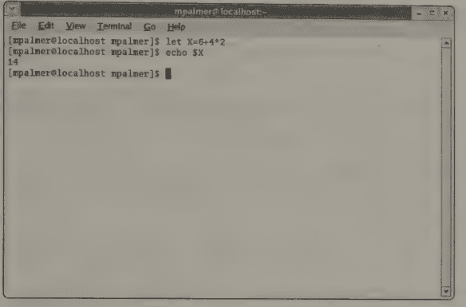

**图 6-3** 使用 `let` 设置 shell 变量的内容

你可以将 shell 变量作为算术运算符的操作数。假设变量 X 的值为 14，以下命令将 18 存储在变量 Y 中：

```
let Y=X+4
```

语法 `let` [带有运算符的表达式]

### 详解

- 对由运算符指定的数字执行给定操作，并将结果存储在 shell 变量中。
- 如果你想更改数学优先级规则，或者仅仅是为了确保结果是你想要的，请在特定表达式周围使用括号。

尝试通过动手项目 6-3 学习如何使用 `let` 命令。

### 重定向运算符

回想一下，`>` 重定向运算符会覆盖现有文件。例如，在 `cat file1 > file2` 中，file1 的内容会覆盖 file2 的内容。如果你编写的 shell 脚本使用 `>` 运算符创建文件，你可能希望防止它覆盖重要信息。你可以使用带有 `-o noclobber` 选项的 `set` 命令来防止文件被覆盖，如下例所示：

```
$ set -o noclobber <Enter>
```

语法 `set` [-选项] [参数]

### 详解

- 在没有选项的情况下，显示 Bash 环境和 shell 脚本变量的当前列表。
- 有用的选项包括：
    - `-a` 在定义所有变量后将其导出。
    - `-n` 读取命令但不执行，以便在不影响数据的情况下调试错误（另请参阅本章后面提到的 `sh -n` 命令）。
    - `-o` 设置特定的 shell 模式——当使用 `noclobber` 作为参数时，它可防止文件被 `>` 运算符覆盖。
    - `-u` 在尝试使用未定义变量时显示错误。
    - `-v` 在执行命令时显示命令行。

> **提示**：如果你想节省时间并自动导出所有已定义的 shell 脚本变量，请使用带有 `-a` 选项的 `set`。

不过，你仍然可以通过在重定向运算符之后放置管道符 (`|`) 来选择强制覆盖文件：

```
$ set -o noclobber <Enter>
$ cat new_file > old_file <Enter>
bash: old_file: cannot overwrite existing file
$ cat new_file >| old_file <Enter>
```

> **提示**：在包括 Fedora 和 Red Hat Enterprise Linux 在内的一些系统中，你可以使用 `/` 符号代替 `|` 来覆盖文件。


> **CAUTION** 如果您在带有 KDE 桌面环境的 X Window 界面中使用 Bash shell，请避免使用 `-o noclobber` 选项。以这种方式使用该选项可能会意外地终止命令行会话。

## 将 Shell 变量导出到环境

Shell 脚本无法自动访问在命令行上或其他 Shell 脚本中创建并赋值的变量。为了使变量在 Shell 脚本中可用，您必须使用 `export` 命令赋予其全局含义，以便 Shell 将其视为环境变量。

```
Syntax `export [-options] [variable names]`
```

### 详细解析

- 将 Shell 变量全局化，使其可以被其他 Shell 脚本或程序访问，例如在 Shell 脚本内部调用的脚本或程序。
- 常用选项包括：
  - `-n` 取消导出，使变量不再是全局变量。
  - `-p` 列出所有已导出的变量。

请尝试动手项目 6-4，以在 Bash shell 中使用 `export` 命令。

## 修改 PATH 变量

就像 Shell 变量在导出之前不会被普遍识别一样，执行 Shell 脚本也是如此。到目前为止，您一直使用 `./` 来运行 Shell 脚本。这是因为 Shell 会在 PATH 变量指定的目录中查找程序。如果您在 PATH 环境变量未指定的目录中开发 Shell 脚本，则必须在脚本名称前输入 `./`。如果您仅输入脚本名称，脚本将无法运行，因为它不在您当前定义的路径中——这意味着 Shell 解释器无法找到它来运行。您需要输入 `./` 来告诉 Shell 解释器在当前工作目录中查找。

例如，在某些 UNIX/Linux 系统（如 Fedora 和 Red Hat Enterprise Linux）中，您的主目录不会自动定义在当前路径中。您可以通过输入以下内容来验证您的路径中包含哪些目录：

```
echo $PATH
```

例如，在 Fedora 或 Red Hat Enterprise Linux 中，您可能会看到如下路径：

```
/usr/kerberos/bin:/usr/local/bin:/usr/bin:/bin:/usr/X11R6/bin:/home/username/bin
```

请注意，路径中的每个目录由冒号分隔。代表主目录的 `/home/username` 默认不在路径中，但另一个可能存储程序的目录 `/home/username/bin` 默认在路径中——尽管即使它在路径中，实际的 `/home/username/bin` 目录在您的系统上可能默认并未创建。

由于新的 Shell 脚本在测试期间通常保存在当前目录中，因此您应该将当前工作目录添加到 PATH 变量中。以下是一个快速实现此操作的示例命令：

```
PATH=$PATH:.
```

记住，Shell 将 `$PATH` 解释为 PATH 变量的内容。此示例命令将 PATH 变量设置为其当前内容。冒号和点 (`.`) 将当前目录添加到搜索路径中，以便 Shell 程序能够定位到新程序。输入此命令后，您可以通过直接使用脚本名称来执行新的 Shell 脚本，而无需在前面加上 `./` 字符。动手项目 6-5 将引导您尝试此操作。

> **TIP**
当您输入 `PATH=$PATH:.` 时，当前工作目录仅在您本次登录会话期间临时存储在路径中。

> **CAUTION**
如果您在登录时被黑客获取了账户权限，将当前目录设置为路径会带来一定的风险。例如，黑客可能会通过开放端口（网络协议中的通信路径）获取访问权限。如果您选择将当前工作目录放入 PATH 变量，请确保您已通过关闭未使用端口等方式保证账户访问的安全。有关操作系统安全性（包括 UNIX/Linux 系统）的更多信息，请参阅 *Guide to Operating Systems Security* (Course Technology, ISBN 0-619-16040-3)。

## 关于通配符的更多说明

Shell 脚本经常使用星号 (`*`) 和其他通配符（如 `?` 和 `[ ]`），这些字符有助于定位仅包含部分匹配模式的信息。例如，要检索所有名称包含 `.c` 扩展名的程序文件，请使用以下命令：

```
ls *.c
```

通配符也被称为 glob 字符。如果一个未加引号的参数包含一个或多个 glob 字符，Shell 将处理该参数以生成文件名。Glob 字符是 glob 模式的一部分，旨在匹配文件名和单词。glob 模式中可能出现的一些特殊结构包括：

- 问号 (`?`) 匹配且仅匹配一个字符，反斜杠和点除外。
- 星号 (`*`) 匹配文件名中的零个或多个字符。
- `[chars]` 定义一组字符类。glob 模式匹配该类中的任意单个字符。一个类可以包含一个字符范围，例如 `[a-z]`。

例如，假设工作目录包含文件 `chap1`、`chap2` 和 `chap3`。以下命令将显示这三个文件的内容：

`more chap[1-3] <Enter>`

Shell 脚本中使用的命令和变量被组织成不同的逻辑结构。在接下来的章节中，您将学习如何使用逻辑结构来进行高效的脚本处理。

## Shell 逻辑结构

逻辑结构是组织程序代码的技术，影响代码执行的顺序或执行方式，例如从特定点循环回代码起始处，或从代码中的一个点跳转到另一个点。程序开发所需的四种基本逻辑结构是：

- 顺序逻辑 (Sequential logic)
- 决策逻辑 (Decision logic)
- 循环逻辑 (Looping logic)
- 分支逻辑 (Case logic)

接下来的章节将分别讨论这些逻辑结构。

### 顺序逻辑

顺序逻辑的作用是使命令按照它们在脚本或程序中出现的顺序执行。这种顺序唯一的中断发生在分支指令改变执行流并重定向到脚本或程序中的另一个位置时。分支指令是指告诉程序跳转到另一段代码的指令。

许多脚本是简单、直接的命令序列。一个例子是您在第 5 章中编写的“程序员活动状态报告”脚本（如下所示）。Shell 按照文件中的出现顺序执行脚本命令。您可以使用顺序逻辑来编写此类应用程序。

```bash
#=====================================================================
# Script Name:      practivity
# By:               MP
# Date:            November 2006
# Purpose: Generate Programmer Activity Status Report
#=====================================================================

cut -d : -f4 project | sort | uniq -c | awk '{printf "%s: %s \n",$2,$1}' > pnum
cut -d : -f1-4 programmer | sort -t : +0 -1 | uniq > pnn
join -t : -a1 -j1 -1 j1 -2 j1 pnn pnum > pactrep
# Print the report
awk '
BEGIN {
    FS = ":"
    print "\tProgrammer Activity Status Report\n"
    "date" | getline d
    printf "\t %s\n", d
    print "#Prog#\t--Name--\t\t\tProjects\n"
    print "===========================================================\n"
}
{ printf "%-8s\t%-12.12s %-12.12s %-12s\t%d\n", $1, $2, $3, $4, $5 }
' pactrep
# remove all the temporary files
rm pnum pnn pactrep
```

动手项目 6-6 将引导您构建一个短脚本来演示顺序逻辑，并练习 `let` 命令，以及使用常量、变量和算术运算符构建表达式。

### 决策逻辑

**决策逻辑** 使您的脚本或程序能够仅在满足某个特定条件时才执行一条语句或一系列语句。在这种用法中，*语句* (statement) 是指在程序中执行某个操作的代码行。`if` 语句是这类逻辑中的主要决策逻辑结构。

例如，请考虑以下代码行。在这个 Shell 脚本中，用户被要求输入最喜欢的蔬菜。如果用户输入“broccoli”（西兰花），程序的决策逻辑将显示“Broccoli is a healthy choice.”。如果输入任何其他蔬菜，决策逻辑将显示“Don’t forget to eat your broccoli also.”。


```bash
echo -n "What is your favorite vegetable? "
read veg_name
if [ "$veg_name" = "broccoli" ]
then
    echo "Broccoli is a healthy choice."
else
    echo "Don't forget to eat your broccoli also."
fi
```

在整个示例脚本中，变量始终被包含在双引号中，如 "$veg_name"、"$choice"、"$looptest"、"$yesno"、"$guess" 和 "$myfavorite"，这是因为 shell 解析变量的方式决定的。除非另有声明，所有 shell 变量均为字符串，而字符串是由字母数字字符组成的数组。如果您不在字符串变量中输入数据，该变量将被视为空字符串，从而导致测试失效。因此，外层的双引号能够维持字符串的有效性（无论是否有数据），从而在不产生错误条件的情况下执行测试。

您将在“实操项目 6-7”中创建并运行此脚本。不过，在尝试该项目之前，让我们先检查一下脚本的内容。第一条语句使用 `echo` 命令在屏幕上显示一条消息。`-n` 选项会抑制通常出现在消息后的换行符。第二条语句使用 `read` 命令，该命令会等待用户输入一行键盘内容。输入的内容将存储在作为 `read` 命令参数指定的变量中。脚本中的这一行将用户的输入读取到 `veg_name` 变量中。

下一行开始了一个 `if` 语句。单词 "if" 后面跟着一组方括号 ( [ ] ) 及其内部的表达式。（分隔 [ 和 ] 字符与内部表达式两侧的空格是必要的。）该表达式经测试以确定其真假，它将 `veg_name` 变量的内容与字符串 broccoli 进行比较。（当您在 `if` 语句的测试表达式中使用 `=` 运算符时，它会测试两个操作数是否相等。在本例中，操作数是变量 `$veg_name` 和字符串 broccoli。如果操作数相等，则表达式为真，否则为假。如果 `$veg_name` 变量的内容等于 broccoli，则执行 "then" 单词后面的语句。在本脚本中，即 `echo` 语句 "Broccoli is a healthy choice."）。

如果 `if` 语句的表达式为假（即 `$veg_name` 变量的内容不等于 broccoli），则执行 "else" 单词后面的语句。该语句内容为 "Don't forget to eat your broccoli also."。在本脚本中，它是另一个不同的 `echo` 语句。

请注意最后一条语句，它由字符 "`fi`"（`if` 的反写）组成，始终标志着 if 或 if...else 语句的结束。

当您使用逻辑结构（如 `if` 语句）评估变量内容时，需要先定义该变量，例如通过 `read` 语句。

## 第 6 章 Shell 脚本编程简介

您可以将一个控制结构（如 `if` 语句）嵌套在另一个控制结构内部。**嵌套**（nest）意味着您在原始语句结构下分两个或多个级别分层布置语句。例如，一个脚本可以在一个 `if` 语句内部包含另一个 `if` 语句。第一个 `if` 语句控制第二个 `if` 语句何时执行，如下面的代码示例所示：

```bash
echo -n "What is your favorite vegetable? "
read veg_name
if [ "$veg_name" = "broccoli" ]
then
    echo "Broccoli is a healthy choice."
else
    if [ "$veg_name" = "carrots" ]
    then
        echo "Carrots are great for you."
    else
        echo "Don't forget to eat your broccoli also."
    fi
fi
```

如您所见，第二个 `if` 语句位于第一个 `if` 语句的 `else` 部分。只有当第一个 `if` 语句的表达式为假时，它才会执行。

决策逻辑结构（如 `if` 语句）用于根据命令或比较的结果需要采取不同行动的应用程序中。

### 循环逻辑

在**循环逻辑**中，一个控制结构（或循环）会重复执行，直到满足特定条件或发生某些操作。在本节中，您将学习两种循环机制：`for` 循环和 `while` 循环。

#### For 循环

使用 `for` 命令遍历一组值。它使一个变量依次取指定集合中的每个值，并在变量包含每个单独值时执行某些操作。在变量取完集合中的最后一个值并执行相应的操作后，循环停止。

`for` 循环的示例演示如下：

```bash
for USERS in john ellen tom becky eli jill
do
    echo $USERS
done
```

在这种 `for` 循环结构中，第一行指定了将依次赋值给 USERS shell 变量的值。因为集合中有六个值，所以循环重复六次。每次重复时，USERS 包含集合中的一个不同值，并执行 `do` 和 `done` 语句之间的语句。循环第一次执行时，"john" 被赋值给 USERS 变量，然后通过 `echo $USERS` 命令显示在屏幕上。接下来，“ellen”被赋值给 USERS 变量并显示。循环继续处理“tom”、“becky”、“eli”和“jill”。在“jill”被赋值给 USERS 并显示在屏幕上后，循环结束，执行 `done` 命令以结束循环逻辑。

“实操项目 6-8”将让您在 shell 脚本中使用 `for` 循环。

## 在命令行执行控制结构

大多数 shell 脚本控制结构（如 `if` 和 `for` 语句）必须分多行编写。但这并不妨碍您直接在命令行上执行它们。例如，您可以在命令提示符处输入 `for` 语句，输入要用于变量的变量名和元素，然后按下 Enter。您将进入一个命令行处理器以执行循环中的剩余语句，在每条语句后按下 Enter。当您输入第一行后，shell 知道后面还有代码，它会显示 `> ` 提示符，表示它已准备好接收控制结构的延续部分。shell 将继续读取输入行，直到您输入单词 “done”，这标志着 `for` 循环的结束。

在接下来的行中，tennis、swimming、movies 和 travel 每个元素都会逐行显示，直到显示 travel 后循环结束。（见图 6-4。）

```bash
$ for myhobbies in tennis swimming movies travel <Enter>
> do <Enter>
> echo $myhobbies <Enter>
> done <Enter>
```

**图 6-4** 从命令行使用 `for` 循环

“实操项目 6-8”让您能够比较使用命令行与使用 shell 脚本执行简单 `for` 循环的区别。

## 在循环中使用通配符

`[ ]` 通配符在循环逻辑中非常有用。例如，假设您有四个文件，它们都以相同的四个字符开头：chap1、chap2、chap3 和 chap4。您可以使用通配符表示法 `chap[1234]`，通过以下语句将所有四个文件名的内容输出到屏幕上：

```bash
for file in chap[1234]; do
    more $file
done
```

请注意，在第一行中，两个命令通过分号 (`;`) 字符结合在一起，以便在同一行运行。请尝试“实操项目 6-9”来使用方括号作为通配符。

## While 循环

另一种循环逻辑方法是 `while` 语句。只要给定条件或一组条件为真，`while` 语句就会继续循环并执行命令或语句。一旦条件或条件组为假，循环将在 `done` 语句处退出。以下是一个使用 `while` 语句的简单 shell 脚本示例：

```bash
echo -n "Try to guess my favorite color: "
read guess
while [ "$guess" != "red" ]; do
    echo "No, that's not it. Try again. "
    read guess
done
```

在这个例子中，第一行要求用户 “Try to guess my favorite color:”，用户的响应被读取到变量 `guess` 中。

`while` 循环以类似于 `if` 语句的方式测试表达式。只要方括号内的语句为真，`do` 和 `done` 语句内部的语句就会重复执行。在本例中，方括号内的表达式是 “`$guess`” != “red”，它测试 `guess` 变量是否不等于字符串 “red”。请注意，`!=` 是不等（不等式）运算符。（参考表 6-3。）`while` 语句测试 `!=` 运算符两侧的两个操作数，如果不相等则返回真，否则返回假。在本例中，循环内部的 `echo` 和 `read` 语句会重复执行，直到用户输入 red，这使得表达式 “`$guess`” != “red” 变为假。

“实操项目 6-10”为您提供了编写此处描述的示例代码的机会，然后编写一个更复杂的示例，例如可用于在文件中输入姓名和地址信息的程序。

**提示**：在需要将代码重复执行确定次数或不确定次数的应用程序中，请使用 `for` 和 `while` 语句形式的循环逻辑。


## Case 逻辑

**case 逻辑**结构简化了在面对一系列选择时匹配项的选取过程。它允许你的脚本根据变量的后续值来执行多种操作中的某一项。case 逻辑结构的一个常见应用是在计算机屏幕上创建菜单选择。菜单是一个提供多个选项的屏幕显示。例如，考虑一个人力资源应用程序中使用的菜单，其中有一个菜单选项用于输入新员工信息，另一个菜单选项用于查看员工姓名和地址信息，另一个菜单选项用于查看薪资信息，依此类推。每个菜单选项都分支到不同的程序。例如，如果你选择输入新员工信息的选项，这将启动员工数据输入程序。或者，如果你选择查看员工薪资信息，则运行薪资报告程序。

以下是 `case` 语句`在 case 逻辑中如何工作的基本示例：

```bash
echo -n "Enter your favorite color: " 
read color
case "$color" in
    "blue") echo "As in My Blue Heaven.";;
    "yellow") echo "As in the Yellow Sunset.";;
    "red") echo "As in Red River, Red Rover.";;
    "orange") echo "As in Autumn has shades of Orange.";;
    *) echo "Sorry, I do not know that color.";;
esac
```

在这个示例脚本中，case 结构检查 color 变量的内容，并在列出的值中搜索匹配项。当找到匹配项时，紧跟在 `case` 值之后的语句将被执行。例如，如果 color 变量包含 orange，则执行 "orange") 之后的 `echo` 语句："As in Autumn has shades of Orange." 如果 color 变量的内容与列出的任何值都不匹配，则执行 `*)` 之后的语句："Sorry, I do not know that color."

请注意使用**两个分号 ( ; ; )**，它们用于终止 case 结构匹配测试项后所采取的操作。同时请注意，case 结构由单词 "**esac**" 终止，它是 "case" 的反写。

如你所见，case 逻辑旨在根据变量的内容从众多选项列表中选择一种行动方案。这就是为什么 case 逻辑非常适合菜单，因为用户在其中选择多个值之一。尝试通过实践项目 6-11 来练习使用 case 逻辑进行编程。

## 使用 Shell 脚本创建菜单

当你创建由多个 shell 脚本组成的应用程序时，创建一个具有可分支到特定脚本选项的菜单通常很有用。你将在本章的实践项目部分创建菜单。为了准备创建菜单，你需要掌握另一个命令：`tput` 命令。这是 UNIX/Linux 中宣传较少的命令之一，但对于开发具有吸引力且用户友好的菜单界面至关重要。

#### 语法
`tput [-options] [arguments]`

### 剖析

- 可用于初始化终端或终端窗口显示、定位文本以及定位光标
- 有用的选项包括：
    - `bold='tput smso'` / `offbold='tput rmso'` 启用/禁用粗体类型
    - `-clear` 清屏
    - `-cols` 打印列数
    - `-cup` 在屏幕上定位光标和文本

`tput` 命令使你能够初始化终端显示或终端窗口，在所需位置放置文本和提示符，并响应用户从菜单中选择的内容。你可以使用 `tput` 命令完成的一些示例包括：

- `tput cup 0 0` 将光标移动到第 0 行，第 0 列，即屏幕的左上角。
- `tput clear` 清除屏幕。
- `tput cols` 打印当前终端显示的列数。
- `bold='tput smso'` / `offbold='tput rmso'` 通过设置 bold shell 变量为突出显示模式序列，以及设置 offbold shell 变量为关闭突出显示模式序列，来设置粗体类型。

实践项目 6-12 将使你获得使用 `tput` 命令的经验。实践项目 6-15 使用 `tput` 命令，以便你可以开始构建一个用于实际应用程序的菜单。

## 调试 Shell 脚本

到目前为止你可能已经发现，有时 shell 脚本无法执行，是因为脚本中的一个或多个命令存在错误。例如，你可能输入了冒号而不是分号，或者漏掉了一个括号。另一个常见问题是漏掉空格或未在正确位置放置空格。

既然你已经有了开发 shell 脚本的一些经验，并且可能遇到了一些问题，你就能理解为什么拥有一个帮助你排除错误故障的工具如此重要。用于运行 shell 脚本的 `sh` 命令包含了多个用于调试的选项。

#### 语法
`sh [-options] [shell script]`

### 剖析

- 在 UNIX 和 Linux 中，调用 shell 脚本的命令解释器；在 Linux 中，使用带有命令解释器的 Bash shell
- 有用的选项包括：
    - `-n` 检查 shell 脚本的语法，但不执行命令行
    - `-v` 在执行 shell 脚本时显示代码行
    - `-x` 在运行 shell 脚本时显示命令和参数

最常用的两个 `sh` 选项是 `-v` 和 `-x`。`-v` 选项在解释器读取脚本时显示代码行。`-x` 选项通过逐行显示运行的命令及其随附参数，提供略有不同的信息。

通过使用带有这些选项的 `sh` 命令，你可以逐行查看正在运行的 shell 脚本，并在脚本失败时确定该行错误的具体位置和性质。

尝试实践项目 6-13，对比 `sh -v` 和 `sh -x` 来调试 shell 脚本。

此外，有时你想测试一个更新文件的脚本，但你想在不实际更新文件的情况下对脚本进行“干跑”（dry run）——特别是为了确保如果脚本在某处失败，文件中的数据不会被篡改。为此请使用 `-n` 选项，因为它会读取并检查脚本中命令的语法，但不会执行它们。例如，如果你正在测试一个旨在向文件添加新信息的脚本，当你使用 `sh -n` 命令运行它时，脚本实际上不会处理信息或将其添加到文件中。如果存在语法错误，你会看到一条错误消息，这样你就知道在将脚本用于实时数据之前必须对其进行修复。

现在你已经了解了如何创建菜单脚本，在创建应用程序之前，学习一些额外的 shell 特性和命令会很有帮助。你将首先学习更多关于如何自定义个人环境，以及如何使用 `trap` 命令清理环境中的不必要文件。

## 自定义个人环境

当你的工作需求集中在计算机编程和 shell 脚本时，可以考虑通过修改登录脚本中的初始设置来自定义你的环境。**登录脚本**（login script）是在你登录账户后立即运行的脚本。例如，许多程序员会设置一个个人 bin 目录，以便在不干扰现有操作的情况下存储和测试他们的新程序。在 UNIX/Linux 中，存放可执行文件的目录传统名称为 bin。

自定义命令环境的一个实用工具是别名。**别名**（alias）是一个代表另一个命令的名称。你可以使用别名来简化和自动化你经常使用的命令。例如，以下命令为 `rm` 命令设置了一个别名。

```bash
alias rm="rm -i"
```

该命令使得用户每次输入 `rm` 命令时，都会执行 `rm -i` 命令。这是一个常用的别名，因为它确保用户在 `rm` 命令删除文件之前总是收到提示。以下是另外两个有助于保护文件的常用别名：

```bash
alias mv="mv -i"
alias cp="cp -i"
```

#### 语法
`alias [-options] [name = "command"]`

### 剖析

- 为命令创建替代名称
- 有用的选项包括：
    - `-p` 打印所有别名的列表

实践项目 6-14 将使你能够设置别名。

位于主目录下且作为隐藏文件存在的 `.bashrc` 文件（输入 `ls -a` 查看隐藏文件）可用于建立在每个登录会话中生效的自定义设置。每次你生成 shell（例如运行 shell 脚本）时，都会执行 `.bashrc` 脚本。每当创建子 shell 时，`.bashrc` 都会被重新执行。下面的 `.bashrc` 文件带有注释，以解释你如何进行自己的修改。

```bash
# .bashrc
# Source global definitions
if [ -f /etc/bashrc ]; then
    . /etc/bashrc # if any global definitions are defined
    # run them first
fi

alias rm='rm -i' # make sure user is prompted before removing files
alias mv='mv -i' # make sure user is prompted before overlaying files
set -o ignoreeof # Do not allow Ctrl-d to log out
set -o noclobber # Force user to enter >! to write over existing files
PS1="\w \$ " # Set prompt to show working directory
```

除了知道如何自定义工作环境外，你还应该熟悉 `trap` 命令，以便清理存储中的临时文件。


## TRAP 命令

`trap` 是 Bash shell 中的一个命令，用于在接收到特定信号时执行另一个命令。例如，你可以使用 `trap` 在通过操作系统信号检测到另一个程序已终止后，启动一个新程序。另一个例子是使用 `trap` 在接收到特定信号时结束程序，例如在用户按下 Ctrl-c 时进行捕获，并优雅地结束当前运行的程序。

当你希望 shell 程序在 shell 脚本运行期间自动删除创建的任何临时文件时，`trap` 命令非常有用。`trap` 命令规定，当 shell 接收到指定的系统信号时，将读取并执行作为 `trap` 参数列出的命令。

语法 `trap [command] [signal number]`

### 详细剖析

- 当接收到来自操作系统的信号时，将执行 `trap` 包含的参数。
- `trap` 常用的信号包括：
    - 0 shell 脚本已完成执行
    - 1 已发出挂断或注销信号
    - 2 接收到了中断信号，例如 Ctrl+c
    - 3 已发出退出信号
    - 4 接收到了非法指令
    - 9 已发出终止信号
    - 15 程序已结束，例如通过 kill 命令
    - 19 进程已被停止
    - 20 进程已被暂停
- 有用的选项包括：
    - -l 显示信号编号及其相关信号名称的列表

这是一个使用 `trap` 命令的示例：

```
trap "rm ~/tmp/* 2> /dev/null; exit" 0
```

该命令有两个参数：一个要执行的命令和一个来自操作系统的信号编号。命令 `rm ~/tmp/* 2> /dev/null; exit` 删除用户 tmp 目录中的所有内容，将 `rm` 命令的错误输出重定向到空设备（这样就不会出现在屏幕上），并发出 exit 命令来终止 shell。指定的信号是 0，这是 shell 脚本退出时由操作系统生成的信号。因此，如果这个示例命令是一个脚本文件的一部分，那么当操作系统发送信号 0 时，它会导致指定的 `rm` 命令执行。

程序员经常设置 `~/tmp`（用户主目录的一个子目录）来存储临时文件。当脚本文件退出时，可以删除放置在 `~/tmp` 中的任何文件。这在程序员的习惯中被称为“良好的家政管理（good housekeeping）”。

## 在应用程序中综合运用

在本章中，你学习了创建多功能应用程序所需的所有组件。你学习了如何：

- 分配和管理变量
- 使用 shell 运算符
- 运用 shell 逻辑结构
- 使用额外的通配符
- 使用 `tput` 管理屏幕初始化和屏幕文本位置
- 使用 `trap` 命令清理应用程序使用的临时文件

在实操项目 6-15 到 6-20 中，你将运用在本章及之前章节中获得的技能和知识来构建一个多用途应用程序。你构建的应用程序模拟了一个组织可能用来跟踪员工电话号码和其他信息的程序。该应用程序允许用户输入新的电话号码和员工信息，打印电话号码列表，以及搜索特定的电话号码。你完全使用 shell 脚本构建该应用程序。此外，为了使这项工作可管理（并与编程实践保持一致），你通过创建小的模块来构建应用程序，对这些模块进行原型设计、测试，最后将它们链接成一个基于菜单的应用程序。

## 本章小结

- 高级语言（如 C、C++ 或 COBOL）是一种使用类英语表达式的语言。高级语言在计算机执行之前必须转换为低级（机器）语言。
- 解释器读取命令或编程语言，并将每一行解释为一个动作。Shell（如 Bash shell）解释 UNIX/Linux shell 脚本。Shell 脚本不需要转换为机器语言，因为 UNIX/Linux shell 会解释 shell 脚本中的行。
- 使用 vi 或 Emacs 编辑器创建的 UNIX/Linux shell 脚本包含指令，这些指令不需要从头开始编写，而是可以从操作系统的可执行命令库中选择性地挑选。
- Linux shell 衍生自 UNIX 的 Bourne、Korn 和 C shell。三种典型的 Linux shell 是 Bash、csh/tcsh 和 ksh/zsh；Bash 是最常用的 Linux shell。
- UNIX/Linux 采用三种类型的变量：配置变量、环境变量和 shell 变量。配置变量包含操作系统的设置信息。环境变量保存关于登录会话的信息。Shell 变量在 shell 脚本或命令行中创建。`export` 命令用于将 shell 变量变为环境变量。
- Shell 支持许多运算符，包括执行算术运算的运算符。
- 你可以在 shell 脚本中使用通配符，包括方括号（[ ]）字符。方括号包围一组值，可以匹配名称或字符串中的单个字符。
- Shell 支持的逻辑结构有：顺序结构、决策结构、循环结构和 case 结构。
- 你可以使用 `tput` 命令来管理光标位置。
- 你可以根据特定需求自定义位于主目录中的 `.bashrc` 文件，例如设置别名和默认 shell 条件。
- 你可以创建别名并将其输入到 `.bashrc` 中，以简化常用的命令，如 `ls -l` 和 `rm -i`。
- 在脚本文件中使用 `trap` 命令，以便在脚本文件运行（退出）后删除临时文件。

## 命令总结：第六章命令回顾

| 命令 | 用途 | 本章涵盖的选项 |
| :--- | :--- | :--- |
| alias | 建立别名 | -p 打印所有别名。 |
| case..in..esac | 根据变量的值，允许从一组可能的动作中执行一个动作 | |
| export | 将 shell 变量变为环境变量 | -n 可用于撤销导出。<br> -p 列出已导出的变量。 |
| for: do..done | 使变量取得一组值中的每个值；为每个值执行一个动作 | |
| if..then..else..fi | 根据条件执行两个动作之一 | |
| let | 将算术值存储在变量中 | |
| printenv | 打印环境变量列表 | |
| set | 显示当前设置的 shell 变量；使用选项时，设置 shell 环境 | -a 在 shell 变量被赋值后全部导出。<br>-n 接收命令但不执行，以便调试错误。<br>-o 设置特定的 shell 模式——当使用 **noclobber** 作为参数时，防止文件被 > 运算符覆盖。<br>-u 在尝试使用未定义变量时产生错误消息。<br>-v 在执行时显示命令行。 |
| sh | 调用 shell 脚本的命令解释器 | -n 检查 shell 脚本的语法，但不执行命令行。<br>-v 在执行 shell 脚本时显示代码行。<br>-x 在运行 shell 脚本时显示命令和参数。 |
| tput cup | 将屏幕光标移动到指定的行和列 | |
| tput clear | 清除屏幕 | |
| tput cols | 打印当前终端的列数 | |
| tput smso | 启用粗体输出 | |
| tput rmso | 禁用粗体输出 | |
| trap | 当接收到来自操作系统的指定信号时执行命令 | -l 显示信号编号及其信号名称的列表。 |
| while: do..done | 当条件存在时重复执行一个动作 | |

## 关键术语

**.bashrc** 文件 — 位于主目录中的一个文件，你可以用它来定制工作环境并指定每次登录时发生的操作。每次启动 shell 时，该 shell 都会执行 .bashrc 中的命令。

**algorithm** (算法) — 一系列指令、编程代码或命令，其结果是一个程序，或者可以用作程序的一部分。

**alias** (别名) — 代表一个命令的名称。别名有助于简化和自动化频繁使用的命令。


**arithmetic operator**（算术运算符） — 表示数学运算的字符。算术运算符包括 +（加）、-（减）、*（乘）、/（除）、>（大于）、<（小于）以及许多其他字符。

**branch instruction**（分支指令） — 告诉程序跳转到代码不同部分的指令。

**case logic**（case 逻辑） — 程序开发中所采用的四种基本 shell 逻辑结构之一。通过使用 case 逻辑，程序可以根据变量的值并将测试结果进行匹配，从而执行多个操作中的其中一个。它通常用于存在多个选项列表的情况。

**compiler**（编译器） — 一种读取源文件中代码行，将其转换为机器语言指令或调用汇编器将其转换为目标代码，并创建机器语言文件的程序。

**configuration variable**（配置变量） — 存储有关操作系统的信息且其值不发生变化的变量。

**control structures**（控制结构） — 参见逻辑结构（logic structures）。

**debugging**（调试） — 检查程序代码以定位错误并随后修复错误的过程。

**decision logic**（决策逻辑） — 程序开发中所使用的四种基本 shell 逻辑结构之一。在决策逻辑中，仅当满足特定条件时，命令才会执行。if 语句就是一个设置执行条件之代码语句的示例。

**environment variable**（环境变量） — 存储在存储区域中的一个值，在您登录时由 UNIX/Linux 读取。环境变量可用于创建和存储默认设置，例如您使用的 shell 或您偏好的命令提示符格式。

**glob**（glob 字符） — 用于查找或匹配文件名的字符；类似于通配符。Glob 字符是 glob 模式的一部分。

**glob pattern**（glob 模式） — 用于查找或匹配多个文件名的 glob 字符组合。

**high-level language**（高级语言） — 一种使用类英语表达式的计算机语言。COBOL、C 和 C++ 都是高级语言。

**interpreter**（解释器） — UNIX/Linux shell 的一项功能，它读取程序文件中的语句，立即将其翻译成可执行指令，然后运行这些指令。与编译器不同，解释器不产生二进制文件（可执行文件），因为它在单个步骤中完成指令的翻译和运行。

**logic structures**（逻辑结构） — 结构化程序代码的技术，影响代码执行的顺序或执行方式，例如从特定点循环回代码，或从代码中的一个点跳转到另一个点。也称为控制结构（control structures）或控制逻辑（control logic）。

**login script**（登录脚本） — 在您登录账户后立即运行的脚本。

**looping logic**（循环逻辑） — 程序开发中所使用的四种基本 shell 逻辑结构之一。在循环逻辑中，控制结构（或循环）会重复执行，直到满足某些特定条件或发生某些操作。

**nest**（嵌套） — 在创建程序代码时，在原始语句结构下分两个或更多层级对语句进行分层的一种做法。

**operand**（操作数） — 出现在运算符左侧的变量名，或出现在运算符右侧的变量值。例如，在 `NAME=Becky` 中，`NAME` 是变量名，`=` 是运算符，`Becky` 是变量值。注意运算符和操作数之间没有空格分隔。

**PATH variable**（PATH 变量） — 一个路径标识符，提供了一个目录位置列表，UNIX/Linux 在这些位置查找可执行程序。

**program development cycle**（程序开发周期） — 开发程序的整个过程，包括 (1) 创建程序规格说明，(2) 设计过程，(3) 编写代码，(4) 测试，(5) 调试，以及 (6) 纠正错误。

**prototype**（原型） — 一个运行模型，允许程序员在将程序提交到最终设计之前对其进行评审。

**sequential logic**（顺序逻辑） — 程序开发中使用的四种基本逻辑结构之一。在顺序逻辑中，命令按照它们在程序中出现的顺序执行，除非分支指令改变了执行流。

**shell script operator**（shell 脚本运算符） — shell 脚本中使用的符号，用于定义和评估信息、执行算术操作以及执行重定向或管道操作。

**shell variable**（shell 变量） — 您可以在命令行或 shell 脚本中创建的变量。它在 shell 脚本中用于临时存储信息，具有很高的价值。

**source file**（源文件） — 用于存储程序高级语言语句（代码）的文件，由 vi 或 Emacs 等编辑器创建。为了执行，源文件必须被转换为由目标代码组成的低级机器语言文件。

**statement**（语句） — 指程序中执行某个操作的一行代码。

**string**（字符串） — 简单地被视为一组字符的非数字信息字段。字符串中的数字被视为字符而非数字。

**symbolic name**（符号名称） — 用于变量的名称，由字母、数字或字符组成，用于引用变量的内容，通常反映变量的用途或内容。

**syntax error**（语法错误） — 源文件或脚本中的语法错误。此类错误会阻止编译器或解释器将文件转换为可执行文件或运行文件中的命令。

## 复习题

- 1. 您在当前工作目录中开发几个脚本，该目录不是您的主目录，也不在您的默认路径中。您可以使用以下哪个命令在当前终端窗口会话期间将当前工作目录添加到路径中？
    a. `$PATH=$PATH:.`
    b. `mkpath`
    c. `addpath`
    d. `trap=PATH`

- 2. 您的助手一直在编写一个 shell 脚本，但当您测试它时，无法使其运行。问题可能出在哪里？（选择所有适用项）
    a. 您忘记在文件名之前输入加号 (+)，这是允许另一个用户运行脚本文件所必需的。
    b. 在尝试运行脚本之前，必须在命令行输入 `enable scripts`。
    c. 您的助手没有正确分配执行权限，以使您能够运行该脚本。
    d. 您的助手未能使用 `set all users` 命令结束脚本，以便其他人运行该脚本。

- 3. 在 shell 脚本中创建新变量 `stat1` 后，您发现该变量对其他 shell 脚本不可见。您可以使用以下哪个命令使其他 shell 脚本识别该变量？
    a. `trap stat1`
    b. `equate stat1`
    c. `export stat1`
    d. `stat1=universal`

- 4. 在问题 3 中，当您使用了使该变量被其他 shell 脚本识别的命令后，`stat1` 变量会发生什么？
    a. 变量存储在 tmp 目录中。
    b. 变量存储在 .bashrc 文件中。
    c. 变量变成了一个常量。
    d. 变量被识别为环境变量。

- 5. 以下哪些是程序开发周期的组成部分？（选择所有适用项）
    a. 创建程序规格说明
    b. 创建文件格式
    c. 创建屏幕布局
    d. 创建算法

- 6. 以下哪个命令与 `chmod ugo+x` 的作用相同？
    a. `set x`
    b. `chmod a+x`
    c. `chmod all []`
    d. `trap set`

- 7. 您正在开发一个 shell 脚本，想要暂时设置变量 `check` 以包含变量 `M` 的值加 1。您应该在命令行输入以下哪个选项？
    a. `set check to M+1`
    b. `M+1 is check`
    c. `check=M+1`
    d. `check >< M+1`

- 8. 您编写了一个名为 invmenu 的 shell 脚本，其中至少包含一个错误，但您无法定位该错误。以下哪个命令将帮助您调试该脚本？
    a. `sh -u invmenu`
    b. `./ -de invmenu`
    c. `run -v invmenu`
    d. `chmod --debug invmenu`

- 9. 您正在为一名用户解决问题，并且已登录该用户的账户。为了帮助排除故障，您想要显示与该账户关联的路径。以下哪个命令能让您查看路径设置？（选择所有适用项）
    a. `PATH*`
    b. `printenv`
    c. `show path`
    d. `echo $PATH`

- 10. 以下哪个运算符表示“不等于”？（选择所有适用项）
    a. `!`
    b. `%`
    c. `</`
    d. `!=`

- 11. 以下 shell 脚本代码段有什么问题？（选择所有适用项）

    ```bash
    if [ "$color" = "orange" ]
        echo "That is correct"
    else
        echo "No wrong color"
    fi
    ```

    a. 您不能在 `if` 语句内部使用 `echo` 语句。
    b. 变量名 `$color` 应该放在单引号中。
    c. 最后一行应该是 `stopif` 而不是 `fi`。
    d. 代码缺失了一行以单词 `then` 开头的语句。


12. 你有四个文件，它们都以字母 “data” 开头，并以 1, 2, 3 或 4 结尾。以下哪个命令可以用来依次显示这四个文件的内容？（选择所有适用项。）

- a. `more data[1-4]`
- b. `less data*`
- c. `ls data{1 to 4}`
- d. `cat data?`

13. 以下哪些用于循环逻辑？（选择所有适用项。）

- a. case 语句
- b. for 语句
- c. while 语句
- d. nest 语句

14. 你的登录脚本包含语句 `set -o noclobber`。当你的助手使用你的账户并使用语句 `cat new_data > registration` 来覆盖注册文件时，她看到一条消息提示注册文件无法被覆盖。她应该使用以下哪个命令？

- a. `cat new_data > | registration`
- b. `cat -z new_data > registration`
- c. `read new_data=registration`
- d. `let new_data=registration`

15. 在代表 for 语句的一组行中，以下哪个应该用作最后一行？

- a. end
- b. fi
- c. done
- d. stop

16. 以下哪个操作会将光标移动到第 4 行第 8 列？

- a. `set 4,8`
- b. `rmso=8 4`
- c. `smso = 8 4`
- d. `tput cup 4 8`

17. 你写了一个名为 update 的 shell 脚本，用于更改两个文件中的数据。你想测试该脚本，但不想更新任何文件。以下哪个命令可以实现这一点？

- a. `sh -n update` 
- b. `./update`
- c. `update -t`
- d. `test -nofiles update`

18. 你在组织中支持的一位用户经常需要查看隐藏文件，但总是忘记输入 `ls -a` 命令。他想知道为什么没有一个像 hidden 这样更容易记住的命令。你会建议什么？

- a. 他应该在语音信箱中留一条永久消息，作为该命令的提醒。
- b. 他应该使用命令 `alias hidden="ls -a"` 创建一个别名。
- c. 他应该使用命令 `let hidden > ls -a` 创建一个 shell 变量。
- d. 已经有一个可用的命令可以执行此操作，名为 `hddn`。

19. 在使用 C 语言编写代码后，你会对该代码使用以下哪个工具，以便其他人能够运行它？

- a. 编译器
- b. 代码执行 shell
- c. tsch shell
- d. 解释模块

20. 当你定义变量 R 为 R=(5*8)*(12+2) 时，R 的值是多少？

- a. 620
- b. 590
- c. 560
- d. 482

21. 以下代码的问题是什么？

```bash
case "$choice" in
    "1") ./mainmenu `
    "2") ./progmenu `
    "3") ./altmenu `
esac
```

- a. 结束语句必须是 “finish”。
- b. `case` 语句必须至少有四个内部参数，而这个只有三个。
- c. 在初始 `case` 语句后的那一行必须有一个 `begin` 语句。
- d. 第二、三、四行应该以两个分号 (;;) 结尾，而不是一个反引号 (`).

22. 以下哪些是可以在 shell 脚本中使用的算术运算符示例？（选择所有适用项。）

- a. ~
- b. @
- c. /
- d. !

23. 在顺序逻辑中，命令按照它们出现的顺序执行。正确或错误？

24. 使用 `tput` 命令时，默认是粗体打印。正确或错误？

25. Case 逻辑经常在脚本中用于执行从菜单中做出的选择。正确或错误？

## 实操项目

### 项目 6-1

在设置一个或多个环境变量之前，查看它们的当前配置是一个好习惯。在这个项目中，你将使用 `printenv` 命令来查看环境变量列表。

**要查看环境变量列表：**

- 1. 你的环境变量列表可能会比默认屏幕或终端窗口大小更长，因此将输出通过管道传输给 `more` 命令会很有帮助。输入 `printenv | more` 并按 **Enter** 键。
- 2. 记录一些环境变量的示例。按 **空格键** 每次前进一个屏幕来浏览列表。
- 3. 输入 `clear` 并按 **Enter** 键以清除屏幕。

请在命令行（例如终端窗口）中完成这些项目，并使用你自己的账户和主目录登录。

- 4. 接下来，使用 `printenv` 命令查看两个变量的内容：`SHELL` 和 `PATH`。输入 `printenv SHELL PATH` 并按 **Enter** 键。（参见图 6-5。）

**图 6-5** 使用 `printenv` 仅查看两个环境变量

- 5. 输入 `clear` 并按 **Enter** 键，为下一个项目清除屏幕。

### 项目 6-2

本项目使你能够使用定义和求值运算符来学习它们的工作原理。你首先为变量分配一个值，然后查看所分配变量的内容。接着，你将学习如何分配包含空格的变量，并比较使用单引号和双引号来求值变量内容的效果。最后，你将使用反引号来执行命令并将结果存储在变量中。

**要创建变量并为其分配值：**

- 1. 输入 `DOG=Shepherd` 并按 **Enter** 键。
   你创建了变量 DOG 并将其值设置为 Shepherd。

**要查看变量的内容：**

- 1. 输入 `echo DOG` 并按 **Enter** 键。
   你会看到单词 “DOG”。

- 2. 要查看 DOG 变量的内容，必须在变量名前加上 `$` 运算符。输入 `echo $DOG` 并按 **Enter** 键。
   你会看到单词 “Shepherd”。（参见图 6-6。）

**图 6-6** 查看变量的内容

**要使用双引号将变量设置为包含空格的字符串：**

- 1. 输入 `MEMO="Meeting will be at noon today"` 并按 **Enter** 键。

- 2. 输入 `echo $MEMO` 并按 **Enter** 键。
   你会看到 MEMO 变量的内容：Meeting will be at noon today.

**为了演示双引号不会抑制变量内容的显示，而单引号会抑制显示：**

- 1. 输入 `echo '$HOME'` 并按 **Enter** 键。
   你在屏幕上看到 $HOME。

- 2. 输入 `echo "$HOME"` 并按 **Enter** 键。
   你在屏幕上看到主目录的路径。

**为了演示用于执行命令的反引号运算符：**

- 1. 输入 `TODAY=`date`` 并按 **Enter** 键。此命令创建变量 `TODAY`，执行 `date` 命令，并将 `date` 命令的输出存储在变量 `TODAY` 中。（屏幕上不出现任何输出。）
- 2. 输入 `echo $TODAY` 并按 **Enter** 键。你会看到在步骤 1 中执行的 `date` 命令的输出。
- 3. 输入 `clear` 并按 **Enter** 键，为下一个项目清除屏幕。

### 项目 6-3

在这个项目中，你将使用 `let` 命令来练习使用算术运算符设置 shell 变量的内容。首先，你将使用包含常数（没有变量）的表达式，然后使用包含变量的表达式。

**要练习使用算术运算符：**

- 1. 输入 `let X=10+2*7` 并按 **Enter** 键。
- 2. 输入 `echo $X` 并按 **Enter** 键。你在屏幕上看到 24。
- 3. 输入 `let Y=X+2*4` 并按 **Enter** 键。
- 4. 输入 `echo $Y` 并按 **Enter** 键。你在屏幕上看到 32，如图 6-7 所示。

**图 6-7** 使用 `let` 分配 shell 脚本变量

- 5. 输入 `clear` 并按 **Enter** 键，为下一个项目清除屏幕。

### 项目 6-4

在这个项目中，你将导出 shell 变量使其成为全局可识别的。

**要演示 export 命令的使用：**

- 1. 输入 `cat > testscript` 并按 **Enter** 键。
- 2. 输入 `echo $MY_VAR` 并按 **Enter** 键。
- 3. 按 **Ctrl+d**。你创建了一个名为 testscript 的简单 shell 脚本。它的唯一功能是显示 MY_VAR 变量的值。
- 4. 要使脚本可执行，输入 `chmod ugo+x testscript` 并按 **Enter** 键。
- 5. 输入 `MY_VAR=2` 并按 **Enter** 键。
- 6. 输入 `echo $MY_VAR` 并按 **Enter** 键以确认上述操作。你在屏幕上看到 2。
- 7. 接下来查看环境变量列表。输入 `printenv | more` 并按 **Enter** 键。

在滚动浏览 `printenv` 命令的输出时请仔细观察。你没有看到 MY_VAR 变量。

- 8. 输入 `clear` 并按 **Enter** 键以清除屏幕。
- 9. 通过输入 `./testscript` 并按 **Enter** 键执行 shell 脚本。脚本显示一个空行。这是因为它无法访问 shell 变量 MY_VAR。
- 10. 通过输入 `export MY_VAR` 并按 **Enter** 键，使该变量对脚本可用。
- 11. 通过输入 `./testscript` 并按 **Enter** 键再次执行脚本。这一次，出现了值 2。（参见下一页的图 6-8。）
- 12. 现在通过输入 `printenv | more` 并按 **Enter** 键查看环境变量列表。再次仔细滚动浏览列表，这次你会看到 MY_VAR 已被列出。
- 13. 输入 `clear` 并按 **Enter** 键，为下一个项目清除屏幕。

### 项目 6-5

在实操项目 6-4 中，你必须在 testscript 之前使用 `./`，因为你的当前工作目录不在 PATH 环境变量中。在这个项目中，你将查看 PATH 变量的内容。接下来，你将把当前工作目录添加到 PATH 变量中，并在不使用 `./` 字符的情况下运行 testscript。


**图 6-8** 使用 `export`export` 命令

**要查看 PATH 变量的内容：**

- 1. 输入 `echo $PATH` 并按下 **Enter**。
  您将看到一个目录列表。请注意，路径名由冒号 (:) 分隔。

**要将当前工作目录添加到 PATH 变量中：**

- 1. 输入 `PATH=$PATH:.` 并按下 **Enter**。
- 2. 输入 `echo $PATH` 并按下 **Enter**。点号 (.) 现在已被附加到列表末尾。
- 3. 现在您可以在运行当前工作目录中的脚本时，无需在脚本名称前输入 `./` 字符。可以通过输入 `testscript` 并按下 **Enter** 来测试。您将看到 testscript 执行，如图 6-9（在下一页）所示。

### 项目 6-6

在这个项目中，您将进一步获得使用顺序逻辑编写一个非常简单的 shell 脚本的经验。在这些步骤中，您将创建 shell 脚本 seqtotal。

**要演示顺序逻辑：**

- 1. 输入 `vi seqtotal` 并按下 **Enter**。
- 2. 输入 `i` 切换到 vi 的插入模式。
- 3. 输入以下行：

```bash
let a=1
let b=2
let c=3
let total=a+b+c
echo $total
```

**图 6-9** 将当前工作目录添加到 PATH 变量以运行 shell 脚本

- 4. 按下 **Esc** 切换到 vi 的命令模式。
- 5. 输入 **:x** 并按下 **Enter** 以保存文件并退出 vi。
- 6. 接下来测试新的 shell 脚本 seqtotal。（为了减少按键次数，请使用 `sh` 命令代替 `chmod` 命令。）输入 **sh seqtotal** 并按下 **Enter**。

您将看到脚本的输出结果，即 6。

### 项目 6-7

本项目为您首次介绍如何在 shell 脚本中使用 `if` 语句，并演示决策逻辑。在第一组步骤中，您将使用基础的 `if` 语句创建脚本。然后，在第二组步骤中，您将修改脚本以包含嵌套在 `if` 语句中的 `if` 语句。

**要演示 `if` 语句并实现决策逻辑：**

- 1. 输入 `vi veg_choice` 并按下 **Enter**。
- 2. 输入 **i** 切换到 vi 的插入模式。
- 3. 输入以下行：

```bash
echo -n "What is your favorite vegetable? "
read veg_name
if [ "${veg_name}" = "broccoli" ]
then
    echo "Broccoli is a healthy choice."
else
    echo "Don't forget to eat your broccoli also."
fi
```

- 4. 确保您的编辑界面与图 6-10 一致。按下 **Esc** 切换到 vi 的命令模式。

**图 6-10** 创建 `veg_choice` 脚本

- 5. 输入 `:x` 并按下 **Enter** 以保存文件并退出 vi。
- 6. 通过输入 `chmod ugo+x veg_choice` 并按下 **Enter** 使脚本可执行。接下来，输入 `./veg_choice` 并按下 **Enter** 运行脚本。
- 7. 当被要求输入您最喜欢的蔬菜名称时，回答 **broccoli**。
- 8. 再次运行脚本并回答 **corn** 或其他蔬菜名称。

> 💡 **提示**：请记住，您必须先使用 `chmod` 命令使脚本可执行。然后，在命令提示符后，输入脚本的路径加上脚本名称即可执行。另一种运行脚本的方法是使用 `sh` 命令，就像您在 seqtotal 脚本中所做的那样。在使用了 `chmod` 命令后的第三种选择是，将当前工作目录添加到路径中，正如您在实操项目 6-5 中学到的。这样，您只需输入脚本名称即可运行。

**要练习编写嵌套的 *if* 语句：**

- 1. 在 vi 或 Emacs 中打开 `veg_choice` 文件。
- 2. 编辑文件使其包含以下行。（在原 `if` 语句的 `else` 部分添加了代码。请参见粗体行。）

```bash
echo -n "What is your favorite vegetable? "
read veg_name
if [ "$veg_name" = "broccoli" ]
then
    echo "Broccoli is a healthy choice."
else
    if [ "$veg_name" = "carrots" ]
    then
        echo "Carrots are great for you."
    else
        echo "Don't forget to eat your broccoli also."
    fi
fi
```

- 3. 执行脚本，并在被询问最喜欢的蔬菜时回答 **carrots**。您应该看到响应 “Carrots are great for you.”
- 4. 输入 **clear** 并按下 **Enter** 以清屏准备下一个项目。

### 项目 6-8

在这个项目中，您将学习在 shell 脚本和命令行中使用 `for` 循环，两者都将演示循环逻辑是如何工作的。

**要在 shell 脚本中演示循环逻辑：**

- 1. 使用 vi 或 Emacs 创建文件 `our_users`。
- 2. 在文件中输入以下行：

```bash
for USERS in john ellen tom becky eli jill
do
    echo $USERS
done
```

- 3. 保存文件并退出编辑器。
- 4. 给文件执行权限并运行。您的结果应与图 6-11 所示类似。

**要在命令行中演示输入相同的 `for` 循环：**

- 1. 在命令行中输入 `for USERS in john ellen tom becky eli jill` 并按下 **Enter**。
- 2. 在 `> ` 提示符下，输入 `do` 并按下 **Enter**。
- 3. 输入 `echo $USERS` 并按下 **Enter**。
- 4. 输入 `done` 并按下 **Enter**。您在屏幕上看到了什么？
- 5. 输入 **clear** 并按下 **Enter** 以清屏准备下一个项目。

## 第 6 章 Shell 脚本编程导论

**图 6-11** 运行 `our_users` 脚本以示例 for 循环

### 项目 6-9

在这个项目中，您将创建一个 `for` 循环，并使用方括号通配符格式在 `for` 语句中循环遍历每个元素，这些元素由模拟的书籍章节组成。您首先创建文件：`chap1` 到 `chap4`。接下来，您将创建一个脚本，使用 `more` 命令显示每个文件的内容。

**要创建示例章节文件并在 `for` 循环中使用通配符：**

- 1. 输入 `cat > chap1` 并按下 **Enter**。
- 2. 输入 **This is chapter 1** 并按下 **Enter**。
- 3. 输入 **Ctrl+d**。文件 chap1 被创建。
- 4. 输入 `cat > chap2` 并按下 **Enter**。
- 5. 输入 **This is chapter 2** 并按下 **Enter**。
- 6. 输入 **Ctrl+d**。文件 chap2 被创建。
- 7. 输入 `cat > chap3` 并按下 **Enter**。
- 8. 输入 **This is chapter 3** 并按下 **Enter**。
- 9. 输入 **Ctrl+d**。文件 chap3 被创建。
- 10. 输入 `cat > chap4` 并按下 **Enter**。
- 11. 输入 **This is chapter 4** 并按下 **Enter**。
- 12. 输入 **Ctrl+d**。文件 chap4 被创建。
- 13. 使用 vi 或 Emacs 编辑器创建 shell 脚本 chapters。脚本应包含以下行：

```bash
for file in chap[1234]; do
    more $file
done
```

- 14. 保存文件并退出编辑器。
- 15. 给文件执行权限并进行测试。您将看到与图 6-12 类似的输出。

**图 6-12** 执行 chapters shell 脚本

### 项目 6-10

除了 `for` 语句之外，`while` 语句是循环逻辑的另一个示例。在这个项目中，您首先创建一个包含基础 `while` 语句的 shell 程序。接下来，您将创建一个 shell 程序，该程序可用作屏幕上的数据输入表单，将姓名和地址信息存储在扁平数据文件中。

**要在 shell 脚本中使用基础 while 语句：**

- 1. 使用 vi 或 Emacs 编辑器创建一个名为 colors 的 shell 脚本。
- 2. 输入以下代码行：

```bash
echo -n "Try to guess my favorite color: "
read guess
while [ "$guess" != "red" ]; do
    echo "No, not that one. Try again. "; read guess
done
```

- 3. 保存文件并退出编辑器。
- 4. 给文件执行权限并进行测试。输入 `clear` 并按下 **Enter** 以清屏。

`while` 语句的另一个示例是数据输入表单。

**要创建一个作为数据输入表单的 while 循环：**

- 1. 使用 vi 或 Emacs 创建一个脚本文件 nameaddr。
- 2. 在文件中输入这些行：

```bash
looptest=y
while [ "$looptest" = y ]
do
    echo -n "Enter Name : "; read name
    echo -n "Enter Street : "; read street
    echo -n "Enter City : "; read city
    echo -n "Enter State : "; read state
    echo -n "Enter Zip Code: "; read zip
    echo -n "Continue?(y)es or (n)o: "; read looptest
done
```

- 3. 保存文件并退出编辑器。
- 4. 给文件执行权限并进行测试。在测试脚本时，输入多个姓名和地址。结束时，当脚本询问 “Continue? (y)es or (n)o” 时，回答 n (代表 no)。（见图 6-13。）输入 clear 并按下 Enter 以清屏准备下一个项目。

**图 6-13** 使用 nameaddr 脚本

### 项目 6-11

当程序提供许多选择，或者基于一个选择可以做出许多响应时，通常会使用 case 逻辑。在这个项目中，您将创建一个采用 case 逻辑的 shell 脚本，以响应您最喜欢的颜色（基于一个选择选出许多可能的响应）。


为了演示 case 逻辑：

- 1. 使用 vi 或 Emacs 编辑器创建 manycolors shell 脚本。在文件中输入以下行：

```bash
echo -n "Enter your favorite color: "; read color
case "$color" in
    "blue") echo "As in My Blue Heaven.";;
    "yellow") echo "As in the Yellow Sunset.";;
    "red") echo "As in Red Rover, Red Rover.";;
    "orange") echo "As in Autumn has shades of Orange.";;
    * ) echo "Sorry, I do not know that color.";;
esac
```

- 2. 保存文件并退出编辑器。

- 3. 给文件赋予执行权限并进行测试。（参见图 6-14。）

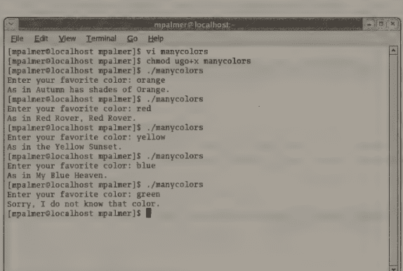
**图 6-14** 使用 manycolors shell 脚本

### 项目 6-12

`tput` 命令使您能够初始化屏幕，并以美观的方式定位光标和文本。本项目向您介绍 `tput`。首先，您直接从命令行输入命令。接着，您将创建一个示例 shell 脚本和菜单，以进一步了解该命令的功能。

**直接从命令行使用 `tput`：**

- 1. 输入以下命令序列，然后按下 **Enter**：

```bash
tput clear ; tput cup 10 15 ; echo "Hello" ; tput cup 20 0
```

在该命令序列的结果中，屏幕被清空；光标被定位在屏幕的第 10 行第 15 列；打印出单词 “Hello”；提示符的位置在第 20 行第 0 列。

#### 在 shell 脚本中创建示例输入菜单：

- 1. 使用 vi 或 Emacs 编辑器创建一个屏幕管理脚本 scrmanage，包含以下行：

```bash
tput cup $1 $2  # place cursor on row and col
tput clear      # clear the screen
bold=`tput smso` # set stand-out mode - bold
offbold=`tput rmsO` # reset screen - turn bold off
echo $bold       # turn bold on
echo "Type Last Name:" # bold caption
tput cup 10 20;  echo "Type Last Name:" # bold caption
tput cup 12 20;  echo "Type First Name:" # bold caption
echo $offbold    # turn bold off
tput cup 10 41; read lastname # enter last name
tput cup 12 41; read firstname # enter first name
```

- 2. 保存文件并退出编辑器。

- 3. 给文件赋予执行权限，然后进行测试。（参见图 6-15。）为下一个项目清空屏幕。

> 围绕 ‘tput smso’ 和 ‘tput rmsO’ 的单反引号必须按照所示方向，否则加粗/取消加粗命令将无法工作。这个单反引号符号位于大多数键盘的左上角，通常与波浪号 (~) 在同一个键上。

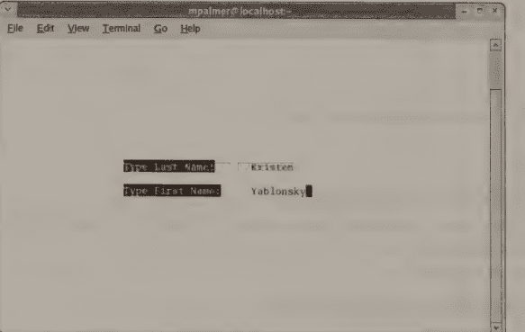
**图 6-15** 在脚本中使用 *tput* 生成简单菜单

### 项目 6-13

在本项目中，您首先对比 `sh -v` 和 `sh -x` 在屏幕输出方面的使用差异。接着，您将练习使用 `sh -v` 调试 shell 脚本。

**对比 `sh -v` 和 `sh -x` 选项的结果以调试脚本：**

- 1. 输入 `sh -v colors`（记得 colors 是您在本章前面创建的脚本，其中最喜欢的颜色是 red），然后按下 **Enter**。
- 2. 输入 `green` 并按下 **Enter**。
- 3. 输入 `red` 并按下 **Enter**。请注意，命令行会被打印出来。
- 4. 输入 `sh -x colors` 并按下 **Enter**。
- 5. 输入 `green` 并按下 **Enter**。
- 6. 输入 `red` 并按下 **Enter**。现在，命令行和参数会显示，并且前面带有加号。图 6-16 展示了 `sh -v` 和 `sh -x` 选项的输出。

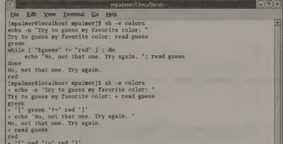
**图 6-16** 对比使用 `sh -v` 和 `sh -x` 进行调试

**练习调试 shell 脚本：**

- 1. 使用 vi 或 Emacs 编辑器打开 colors 脚本进行编辑。
- 2. 转到第三行，删除 "red" 之后的关闭（右）括号 ())，然后退出并保存更改。
- 3. 输入 `sh -v colors` 并按下 **Enter**。
- 4. 输入 `green` 并按下 **Enter**。在最后一行输出中，您将看到一条提示，显示 colors 脚本的第 3 行缺少关闭括号：

```
colors: line 3: [: missing ']'
```

- 5. 使用 vi 或 Emacs 打开 colors 脚本，将缺失的关闭括号补回。
- 6. 删除 colors 脚本第四行上的 **echo** 命令。关闭编辑器并保存工作。
- 7. 输入 **sh -x colors** 并按下 **Enter**。
- 8. 输入 **green** 并按下 **Enter**。请注意消息中提示第 4 行缺少命令：

  `colors: line 4: No, not that one try again. : command not found`

- 9. 输入 **red** 并按下 **Enter** 以退出脚本，或按下 **Ctrl+z** 退出。
- 10. 使用 vi 或 Emacs 编辑器打开 colors 脚本，重新输入第 4 行的 **echo** 命令，然后关闭并保存工作。


### 项目 6-14

在本项目中，学生将学习如何创建别名（alias）。

**创建别名：**

- 1. 要为 *ls* 命令创建一个名为 *ll* 的别名，请输入 **alias ll="ls -l"**，然后按下 **Enter**。现在，当您使用新的 *ll* 别名时，*ls -l* 命令将自动执行。
- 2. 输入 **ll** 并按下 **Enter** 来测试该别名。您将看到详细的目录列表。


### 项目 6-15

本项目是一系列项目的第一个，旨在开发一个用于跟踪组织内员工电话号码及其他信息的示例应用程序。在本项目中，您首先确保拥有一个存储所开发源文件的 source 子目录。接着，您将创建用户执行应用程序时看到的初始菜单。请务必保留此处创建的 phmenu 脚本文件，以便在后续项目中使用。

**设置您的 source 子目录：**

- 1. 在第 4 章中，您在主目录下创建了一个 source 子目录。以主目录作为当前工作目录（输入 **cd** 并按下 **Enter**），输入 **ls** 并按下 **Enter** 以确保 source 子目录存在。如果不存在，请输入 **mkdir source** 并按下 **Enter**。
- 2. 输入 **cd source** 并按下 **Enter**，将 source 目录设为当前工作目录。在本章接下来的所有项目中，请确保您处于 source 目录中。这样可以确保您的应用程序文件集中存放。

**开始开发应用程序的菜单：**

- 1. 使用 vi 或 Emacs 编辑器输入如下所示的 phmenu 脚本。

```bash
#========================================================
# Script Name:    phmenu
# By:             Your initials here
# Date:           Today's date
# Purpose:        A menu for the Corporate Phone List
# Command Line:    phmenu
#========================================================
loop=y
while [ "$loop" = y ]
do
    clear
    tput cup 3 12; echo "Corporate Phone Reporting Menu"
    tput cup 4 12; echo "=================================="
    tput cup 6 9; echo "P - Print Phone List"
    tput cup 7 9; echo "A - Add New Phones"
    tput cup 8 9; echo "S - Search for Phones"
    tput cup 10 9; echo "Q - Quit: "
    tput cup 10 19; 
    read choice || continue
done
```

- 2. 保存文件并退出编辑器。

- 3. 输入 `chmod a+x phmenu` 并按下 **Enter** 为文件赋予执行权限。接着，输入 `./phmenu` 并按下 **Enter** 测试脚本。（参见图 6-17。）（您必须按下 **Ctrl+c** 才能退出脚本，因为退出选项尚未编程。）

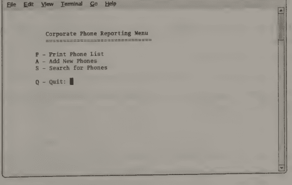
**图 6-17** 运行 phmenu 脚本

- 4. 为下一个项目清空屏幕。

### 项目 6-16

您在电话号码应用程序中使用的数据库文件名为 `corp_phones`。在本项目中，您将确保创建 `corp_phones` 文件，并包含一些初步数据，以便在继续开发过程中测试应用程序。您还将练习使用 `grep` 命令从文件中提取信息。

**创建 `corp_phones` 文件：**

- 1. 在第 4 章中，您在主目录下创建了 `corp_phones`、`corp_phones1` 和 `corp_phones2` 文件，并进行了操纵和修改这些文件数据的项目。如果这些文件仍在主目录下，请使用 `rm` 命令将其删除。这可以确保两点：一是接下来创建的 `corp_phones` 文件包含使用新电话号码应用程序所需的正确信息；二是您清楚在本章完成的项目中 `corp_phones` 文件里包含的内容。为此，您现在输入的部分数据与第 4 章创建的文件中略有不同。
- 2. 如果您在主目录下，请输入 `cd source` 并按下 **Enter**。使用 `pwd` 命令确保您在 source 目录中。
- 3. 使用 vi 或 Emacs 编辑器创建 `corp_phones` 文件。
- 4. 在文件中输入以下记录：

```
219-555-4567:Harrison:Joel:M:4540:Accountant:09-12-1985
219-555-4587:Mitchell:Barbara:C:4541:Admin Asst:12-14-1995
219-555-4589:Olson:Timothy:H:4544:Supervisor:06-30-1983
219-555-4591:Moore:Sarah:H:4500:Dept Manager:08-01-1978
219-555-4544:Polk:John:S:4520:Accountant:09-22-2001
219-555-4501:Robinson:Albert:J:4501:Secretary:08-12-1997
```

- 5. 保存文件并退出编辑器。
- 6. 输入 `grep 219-555-4591 corp_phones` 并按下 **Enter** 来搜索特定的电话号码。

  输出结果应如下所示：
  `219-555-4591:Moore:Sarah:H:4500:Dept Manager:08-01-1978`

- 7. 输入 `grep Accountant corp_phones` 并按下 **Enter** 在文件中搜索所有会计人员（Accountants）。（参见图 6-18。）

### 项目 6-17

您在上手项目 6-15 中创建并测试的 phmenu 菜单脚本仍需要一些工作，因为它还没有在选择选项后调用应用程序的方法。在本项目中，您将通过在菜单中添加 case 逻辑来解决这个问题。


## 图 6-18 处理 corp_phones 数据文件

**若要对电话菜单脚本进行补充：**

- 1. 如果您中断了开发过程并刚刚重新登录或切换到另一个目录，请切换到源目录并使用 `pwd` 命令验证您是否在该目录中。
- 2. 使用 vi 或 Emacs 编辑器打开源目录中的 phmenu 文件。在接下来的代码行中，将**粗体**部分添加到脚本中：

```bash
#===================================================================
# Script Name:      phmenu
# By:               Your initials here
# Date:             November 2006
# Purpose:          A menu for the Corporate Phone List
# Command Line:     phmenu
#===================================================================
phonefile=~/source/corp_phones
loop=y
while [ "$loop" = y ]
do
    clear
    tput cup 3 12; echo "Corporate Phone Reporting Menu"
    tput cup 4 12; echo "=================================="
    tput cup 6 9; echo "P - Print Phone List"
    tput cup 7 9; echo "A - Add New Phones"
    tput cup 8 9; echo "S - Search for Phones"
    tput cup 10 9; echo "Q - Quit: "
    tput cup 10 19;
read choice || continue
case $choice in
    [Aa]) ./phoneadd ;;
    [Pp]) ./phlist1 ;;
    [Ss]) ./phonefind ;;
    [Qq]) exit ;;
    *) tput cup 14 4; echo "Invalid Code"; read choice ;;
esac
done
```

- 3. 保存文件并退出编辑器。
- 4. 测试脚本。（可接受的输入为 A, a, P, p, S, s, V, v, Q, q 以及 q。任何其他输入都会导致出现“Invalid Code”消息。）测试完成后按下 **Ctrl+c**。


### 项目 6-18

拥有一种显示未格式化数据文件数据的方法会很有用，在这种显示方式中，记录将完全按照其在数据文件中存储的样子出现。这使得应用程序开发人员能够确保记录准确且应用程序运行符合预期。此外，某些用户可能对查看文件中的原始数据感兴趣，以便确保数据输入准确。在此项目中，您将在 phmenu 中添加一个选项，使用 `less` 命令来查看 corp_phones 文件的内容。

**要使用 `less` 命令查看未格式化的记录：**

- 1. 确保您在源目录中。接下来，使用您选择的编辑器打开 phmenu，并添加下面显示的两行**粗体**内容：

```bash
#=================================================================
# Script Name:    phmenu
# By:             Your initials here
# Date:           Today's date
# Purpose:        A menu for the Corporate Phone List
# Command Line:    phmenu
#=================================================================

phonefile=~/source/corp_phones
loop=y
while [ "$loop" = y ]
do
    clear
    tput cup 3 12; echo "Corporate Phone Reporting Menu"
    tput cup 4 12; echo "=============================="
    tput cup 6 9; echo "P - Print Phone List"
    tput cup 7 9; echo "A - Add New Phones"
    tput cup 8 9; echo "S - Search for Phones"
    tput cup 9 9; echo "V - View Phone List"
    tput cup 10 9; echo "Q - Quit: "
    tput cup 10 19;
```

- 2. 保存文件并退出编辑器。
- 3. 测试脚本。


### 项目 6-19

在您的菜单设计中，当用户输入 P 或 p 时，应用程序应打印一份电话列表。`awk` 程序提供了一个很好的示例，展示了 UNIX/Linux shell 程序员如何加速开发，因为单个 `awk` 命令就可以从许多记录中选择字段并按指定格式将它们显示在屏幕上。在此项目中，您将开发 phlist1 脚本并使用 `awk` 来显示电话列表。

要创建 phlist1 脚本：

- 1. 在源目录中，使用您选择的编辑器按如下方式创建 phlist1 脚本：

```bash
# =============================================================================
# Script Name:    phlist1
# By:             Your initials here
# Date:           Today's date
# Purpose:        Use awk to format colon-separated fields
#                 in a flat file and display to the screen
# Command Line:   phlist1
# =============================================================================
clear
tput cup 2 20; echo "Corporate Phone List"
tput cup 3 20; echo "===================="
tput cup 5 0;
awk -F: '{printf "%-12s %-12s %s\t%s %s %10.s \s\n", $2, $3, $4, $1, $5, $6, $7}' corp_phones
```

- 2. 保存文件并退出编辑器。
- 3. 输入 `chmod a+x phlist1` 并按下 **Enter** 键赋予文件执行权限。输入 `./phlist1` 并按下 **Enter** 键运行脚本。（见图 6-19。）

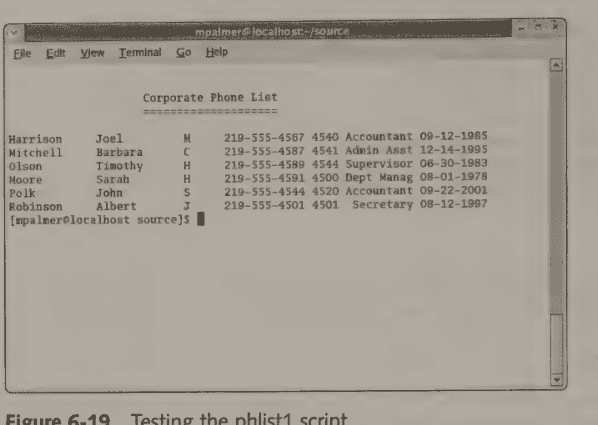
图 6-19 测试 phlist1 脚本

### 项目 6-20

现在，您需要开发一种方法将新的电话号码信息输入到 corp_phones 文件中，以便用户最终能够建立一个包含所有员工的完整数据文件。请注意，phmenu 脚本提供了添加电话记录的选项。为了实现这一点，您需要开发 phoneadd 脚本。

**要创建用于数据录入的 phoneadd 脚本：**

- 1. 确保您在源目录中，然后使用 vi 或 Emacs 编辑器创建脚本 phoneadd。输入以下代码：

```bash
# ============================================================================
# Script Name:  phoneadd
# By:           Your initials here
# Date:         Today's date
# Purpose:      A shell script that sets up a loop to add
#               new employees to the corp_phones file.
# Command Line: phoneadd
#
# ============================================================================
trap "rm ~/tmp/* 2>/dev/null; exit" 0 1 2 3
phonefile=~/source/corp_phones
looptest=y
while [ $looptest = y ]
do
    clear
    tput cup 1 4; echo "Corporate Phone List Additions"
    tput cup 2 4; echo "=========================================="
    tput cup 4 4; echo "Phone Number: "
    tput cup 5 4; echo "Last Name   : "
    tput cup 6 4; echo "First Name : "
    tput cup 7 4; echo "Middle Init : "
    tput cup 8 4; echo "Dept # : "
    tput cup 9 4; echo "Job Title : "
    tput cup 10 4; echo "Date Hired : "
    tput cup 12 4; echo "Add Another? (y)es or (q)uit: "
    tput cup 4 18; read phonenum
    if [ "$phonenum" = "q" ]
        then
            clear; exit
    fi
    tput cup 5 18; read lname
    tput cup 6 18; read fname
    tput cup 7 18; read midinit
    tput cup 8 18; read deptno
    tput cup 9 18; read jobtitle
    tput cup 10 18; read datehired
    # Check to see if last name is not a blank before you
    # write to disk
    if [ "$lname" > " " ]
        then
            echo "$phonenum:$lname:$fname:$midinit:$deptno:$jobtitle:$datehired" >> $phonefile
    fi
    tput cup 12 33; read looptest
    if [ "$looptest" = "q" ]
        then
            clear; exit
    fi
done
```

- 2. 保存文件并退出编辑器。注意检查姓氏（last name）是否为空的部分。（见注释。）包含此部分是为了防止将不完整的数据写入文件。在此代码中，`if` 语句用于确保 lname 变量大于空字符串（即包含内容）。如果 lname 确实有值（一个字符串），则使用 `echo` 命令将所有变量（lname, fname, midinit, deptno, jobtitle, datehired）的内容写入 phonefile 变量（corp_phones）中。

- 3. 输入 `chmod a+x phoneadd` 并按下 **Enter** 键赋予文件执行权限。

- 4. 输入 `./phoneadd` 并按下 **Enter** 键运行脚本。

- 5. 接下来，通过添加以下员工来测试脚本。（在每个单独的字段输入后按下 **Enter** 键，例如，输入 219-555-7175 然后按下 **Enter** 进入 Last Name 字段。）见图 6-20。

`219-555-7175 Mullins Allen L 7527 Sales Rep 02-19-2004`
`219-555-7176 Albertson Jeannette K 5547 DC Clerk 02-19-2004`

- 6. 输入数据后按下 `Ctrl+c`。

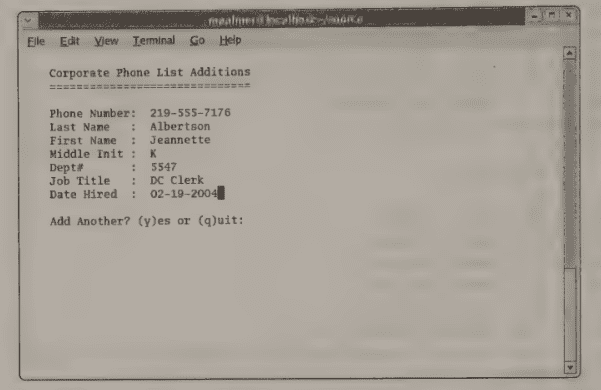
**图 6-20** 测试 phoneadd 脚本

您现在已经为公司员工电话号码应用程序奠定了基础。然而，您仍然需要解决一些不足之处。例如，在输入数据时如何返回之前的字段？当您两次输入同一个员工时会发生什么？如果您给新员工分配了一个已经分配给其他人的电话号码会发生什么？在第 7 章中，您将继续开发过程并解决这些问题。

## 探索练习

- 1. 使用两种不同的命令来显示 `HOME` 变量的内容。
- 2. 将变量 `t` 赋值为 20。接着，将变量 `s` 赋值为 `t+30`。最后，显示 `t` 和 `s` 的内容以验证您是否正确定义了这些变量。
- 3. 将您在练习 2 中赋值的 `s` 变量设为环境变量，并使用命令验证它是否被识别为环境变量。
- 4. 切换到您的源目录。显示 `PATH` 变量的内容。接着，使用命令将您当前的工作目录添加到 `PATH` 变量中。
- 5. 完成练习 4 后，用最简单的方法运行 `phmenu` 程序。
- 6. 创建一个名为 `iam` 的变量，并将 `whoami` 命令的结果赋值给它。显示该变量的内容以验证结果。
- 7. 如果您不在主目录中，请切换回主目录。使用 `set` 命令设置您的工作环境，以防止覆盖文件。


- 8. 创建一个名为 var 的别名，用于显示您的环境变量。

- 9. 在命令行中使用 `for` 循环，利用变量 `sandwiches` 逐行显示以下三明治：chicken, ham, hummus, tomato。

- 10. 创建一个脚本，使用 case 逻辑让某人猜测您最喜欢的三明治，例如 tuna。

- 11. 显示 `.bashrc` 文件的内容。接着使用 vi 编辑器编辑该文件并添加一个别名，以便每次输入 `list` 时，都能看到目录的详细文件列表。

- 12. 使用一条命令来模拟您将如何排除在练习 10 中创建的三明治脚本中的问题。

- 13. 以下代码行有什么错误？

```bash
While [ "$Value" = "100" ]; do
    Echo "That's a large number."  Read value
fi
```

- 14. 使用 `let` 命令将值 1024 存储在变量 `ram` 中。显示 `ram` 的内容。

- 15. 将您的家目录环境变量临时更改为 `/home`，然后使用一条命令进入您的家目录。将家目录环境变量更改回您常规的家目录并切换到该目录。

- 16. 使用 `tput` 命令清除屏幕，然后将光标置于第 7 行，第 22 列。

- 17. 编写一个脚本来创建以下菜单：

Soup Menu
===========
(t)omato
(b)ean
(s)quash
Select a soup . . . (q) to quit

- 18. 列出 `trap` 命令的所有信号编号和名称。信号 31 的名称是什么？

- 19. 修改练习 17 中的脚本，使得在菜单准备好接收用户输入时发出蜂鸣声。

- 20. 是否有命令可以防止 shell 变量被赋予新值？如果有，它是什么？

# 第 7 章：高级 Shell 编程

在阅读本章并完成相关练习后，您将能够：

- 使用流程图和伪代码进行程序设计与分析
- 使用相关技术确保脚本采用正确的 shell
- 设置默认 shell
- 配置 Bash 登录和注销脚本
- 为 vi 编辑器设置默认值
- 在编程函数中使用 test 命令
- 格式化记录输出
- 使用脚本删除记录
- 设置快速清屏技巧
- 创建程序算法来解决光标重新定位问题
- 开发并测试一个消除重复记录的程序
- 创建 shell 函数并在程序中使用它们

在前一章中，您学习了程序开发周期，并开始开发一个程序来自动化维护 `corp_phones` 文件中的员工电话记录。您开发了一个提供多个选项的菜单和一个允许向文件中添加记录的数据输入界面。在本章中，您将为员工电话号码应用程序开发更高级的脚本。

您将首先学习如何规划算法以及在程序开发中使用流程图。接下来，您将学习使用 `test` 命令创建复杂的决策表达式。此外，您还将学习更多关于如何格式化输出的知识。对于员工电话号码应用程序，您将创建或增强脚本，以添加删除指定记录的代码、实现记录搜索功能、增加防止重复数据录入的逻辑，并使用函数对记录进行排序和显示。

## 理解程序设计与分析

在第 6 章“Shell 脚本编程入门”中，您了解到程序开发周期始于为程序创建规格说明。规格说明使您能够确定输入所需的数据类型、必须执行的处理过程以及输出要求。程序开发周期的下一步是设计过程。

在设计过程中，通过分析实现预期结果的最佳方式来开发计算机程序。两种流行且经过验证的分析工具可帮助您设计符合程序规格的程序：流程图和伪代码。

### 绘制流程图

许多组织将过程的每个步骤绘制成图，以此作为设计该过程的一种方式。以一家决定为招聘流程创建新设计的公司为例。该公司目前的招聘流程需要许多手动操作，因此希望设计一个新流程来自动化相关功能，并更好地利用计算机资源。在设计阶段，委员会讨论他们想要使用的新程序和计算机资源。随后，委员会创建流程图，以演示过程每个步骤中将发生的情况。流程图是一种逻辑图，它使用一组标准符号来直观地解释从过程开始到终点的事件顺序。

组织使用流程图来设计和记录各种过程和程序。程序员也使用流程图来规划和理解程序的执行顺序以及程序采取的每一步操作。对于程序员来说，流程图提供了贯穿设计过程的地图，用以展示必须创建哪些程序和逻辑。它提供了一种将规格说明中的需求与将要编写的程序代码联系起来的方法。

例如，考虑第 6 章中的最喜爱的蔬菜程序示例，如下所示：

```bash
echo -n "What is your favorite vegetable? "
read veg_name
if [ "${veg_name}" = "broccoli" ]
then
    echo "Broccoli is a healthy choice."
else
    echo "Don't forget to eat your broccoli also."
fi
```

图 7-1 显示了一个您在开发程序之前可能会创建的流程图示例。

**图 7-1** 流程图示例

程序中的每个步骤在流程图中由一个符号表示。符号的形状表示正在执行的操作类型，例如输入/输出或决策。图 7-2 显示了标准流程图符号及其含义。

连接符号的箭头表示程序的流动方向。在图 7-1 的流程图中，“Start”终结符之后的箭头显示程序流向一个显示消息（在手动输入流程图符号中）的操作：“What is your favorite vegetable?”。接着，程序流向一个输入操作（由输入/输出操作的数据符号表示），将值读入 `veg_name`。随后遇到一个决策结构（由菱形符号表示），它将 `veg_name` 变量的内容与字符串 “broccoli” 进行比较。如果 `veg_name` 的内容等于 “broccoli”，逻辑将走 “Yes” 分支并显示 “Broccoli is a healthy choice.”，然后程序结束。如果 `veg_name` 不等于 “broccoli”，程序将走 “No” 分支并显示 “Don’t forget to eat your broccoli also.”，随后程序终止。

**图 7-2** 标准流程图符号

### 编写伪代码

创建流程图后，设计程序的下一步是编写**伪代码**。伪代码指令**类似于实际的编程语句**。使用它们来创建一个模型，稍后您可以将其作为实际程序的基准。例如，以下是 `veg_choice` 程序的伪代码语句：

```
Display "What is your favorite vegetable? " on the screen
Enter data into veg_name
If veg_name is equal to "broccoli"
Then
    Display "Broccoli is a healthy choice." on the screen
Else
    Display "Don't forget to eat your broccoli also." on the screen
End If
```

伪代码仅是一种设计工具，**绝不会被计算机处理**。因此，您**不需要遵循严格的规则**。伪代码在文字描述上应与流程图中所示的符号逻辑相匹配。例如，图 7-3 显示了代表对第 6 章中开发的电话号码应用程序进行修改的流程图和伪代码，以便在字段中重新输入数据，从而允许用户返回某个字段以修正错误。

在接下来的章节中，您将学习如何编写代码以实现伪代码示例中的逻辑。在处理程序代码之前，请先学习如何确保脚本使用正确的 shell，并通过学习 `test` 命令的多功能性来提高您的编程技能。

互联网上有许多资源可以帮助您进一步学习伪代码，例如 www.infoweblinks.com/content/pseudocode.htm, www.code-source.org/faq/faq-pseudocode.php, 以及 www.free-definition.com/Pseudocode.html。此外，您可以通过搜索 “pseudocode” 找到许多互联网链接。

## 确保由正确的 SHELL 运行脚本

每个 UNIX/Linux 用户都可以自由选择自己偏好的 shell。在开发 shell 脚本时，请确保使用正确的 shell 来解释您的脚本，因为并非所有 shell 都支持相同的命令和编程语句。


伪代码：

```
While entry = minus
    do
        Reposition cursor in previous field
        Enter the data
        Reposition cursor in field following the field that was
        just entered (reentered data)
        Continue testing while loop
Done
```

流程图：


**图 7-3** 重新输入先前字段的伪代码和流程图

当你创建脚本时，请在脚本的第一行包含设置要使用的特定 shell 的命令。在本书中，我们使用 Bash shell。在脚本中用于设置 Bash shell 的行是：

```
#!/bin/bash
```

在指定 shell 的行中，以 # 字符开头，后面跟着 ! 字符，然后提供 shell 的路径，例如 Bash shell 使用 /bin/bash。

当系统读取这行代码时，它会加载 Bash shell 并使用它来解释脚本文件中的语句。由于 UNIX/Linux 提供了许多 shell，因此你应该始终以该语句开始你的脚本。即使运行脚本的用户正在使用不同的 shell，这一行也能确保脚本将正常运行。

## 设置默认 Shell

对于你自己的账户，默认设置的 shell 是由系统管理员在 `/etc/passwd` 文件中确定的。如果你希望在登录时设置特定的 shell，请联系你的系统管理员。如果你是系统管理员，可以通过编辑 `/etc/passwd` 文件中与你账户相关的行来设置默认 shell。例如，如果你的账户是 trbrown，则 trbrown 的 `/etc/passwd` 条目将类似于以下内容：

```
trbrown:x:500:500:Thomas Brown:/home/trbrown: /bin/bash
```

请注意，这仅仅是一个由冒号分隔的可变长度字段记录。记录中的最后一个字段指定了为用户账户设置的默认 shell 路径，例如 `/bin/bash`。通过以 root 身份登录，你可以使用 vi 或 Emacs 编辑器编辑 `/etc/passwd` 文件。如果你要编辑该文件，请考虑在编辑前制作一个备份副本。此外，如果你编辑该文件，请务必小心更改，否则你可能会导致自己或他人无法登录系统。

另一种更安全地为账户设置默认 shell 的方法是使用系统附带的用于配置用户和组的软件。例如，在 Fedora 和 Red Hat Enterprise Linux 中，你可以使用 GNOME 桌面中的 Red Hat 用户管理器工具。要更改账户的默认 shell，请按照以下常规步骤操作：

- 1. 以 root 身份登录。
- 2. 点击主菜单，指向系统设置，然后点击用户和组。
- 3. 在账户列表中双击你的账户。
- 4. 在“用户属性”对话框中，将“登录 Shell”条目更改为你想要作为默认值的 shell 路径，例如 `/bin/bash`。点击确定。
- 5. 关闭 Red Hat 用户管理器工具。

## 使用 Bash 登录和登出脚本

当 Bash 被设置为你的 shell 时，登录时会自动运行两个脚本：`.bash_profile` 和 `.bashrc`。如果你在登录后切换到不同的 shell，一旦你切换回 Bash shell，这两个脚本都会运行。正如你在第 6 章中所学到的，`.bashrc` 文件是一个包含在你主目录中的隐藏文件。`.bash_profile` 文件也是如此。你可以通过输入 `cd` 确保你在主目录中，然后输入 `ls -a` 来查看这两个文件。

`.bash_profile` 文件在你每次登录或发出将 Bash 设置为当前 shell 的命令时运行。它通常包含一些设置，例如环境变量设置、别名以及其他你在使用 Bash shell 时希望始终生效的设置。你始终可以使用 vi 或 Emacs 编辑器来添加或修改此文件中的设置。图 7-4 显示了 Fedora 中的默认 `.bash_profile` 文件。


**图 7-4** .bash_profile 脚本文件

> **提示** `.bash_profile` 脚本文件被用于许多 UNIX/Linux 系统，如 Fedora 和 Red Hat Enterprise Linux。然而，一些 Linux 系统（如 Novell 收购的 SUSE Linux）将其称为 `.profile` 文件。

`.bashrc` 文件在你使用 Bash shell 作为默认值登录时运行——以及在你暂时使用其他 shell 后返回 Bash shell 时运行。与 `.bash_profile`（或 `.profile`）文件一样，你可以配置此文件以包含你在 Bash shell 中希望始终生效的环境变量和其他设置。`.bashrc` 文件还具有一个 `.bash_profile`（或 `.profile`）文件不具备的额外用途——每当你在一个 Bash shell 内部启动另一个 Bash shell（这被称为运行子 shell）时，都会运行 `.bashrc` 文件。例如，在第 3 章“掌握编辑器”中，当你输入 `Ctrl+z` 在 vi 编辑器中冻结时，你就启动了一个子 shell。在第 3 章中，这个 Bash shell 命令将你带到了命令行（在子 shell 中），这样你就可以在不关闭 vi 编辑会话的情况下执行命令。在那个示例中，按下 `Ctrl+z` 启动子 shell 时，系统同时也运行了 `.bashrc` 脚本。

UNIX/Linux 系统可能还具有 `/etc/bashrc` 或 `/etc/profile` 文件，用于为所有 Bash shell 用户设置默认函数、变量、别名和其他设置。在 Fedora 和 Red Hat Enterprise Linux 中，有两个文件为所有用户设置 Bash shell 默认值：`/etc/bashrc` 和 `/etc/profile`。`/etc/bashrc` 文件设置默认函数和别名，而 `/etc/profile` 文件设置默认环境变量和启动程序。系统管理员可以配置这些文件，以便在 Bash shell 用户之间保持基本的一致性。

此外，每个 Bash 用户主目录中的 `.bash_logout` 文件会在用户登出时执行命令。例如，此文件通常包含一行 `clear` 命令，用于在用户登出时清除终端或终端窗口屏幕。另一种选择是插入 `echo` 命令，将特定文本回显到屏幕上，例如 “It has been a pleasure working with you” 或 “All programs you have used are the property of this company”。

尝试进行动手项目 7-1，以查看 `.bash_profile`、`.bashrc`、`.bash_logout`、`/etc/bashrc` 和 `/etc/profile` 文件的内容。

## 设置 vi 编辑器的默认值

如果你更喜欢使用 vi 编辑器，可以选择在主目录中配置一个名为 `.exrc` 的文件。正如你在第 3 章中所学到的，`.exrc` 可用于自动设置你的 vi 环境。例如，如果你经常编写脚本或其他编程，你可能希望 vi 自动显示行号，以便更快速地识别你想要检查或修改的特定代码行。另一种可能性是设置在通过 Tab 键缩进或嵌套代码行时的制表符空格数。以下是你创建或修改 `.exrc` 文件时可能插入的行示例：

```bash
set number
set tabstop=3
set shell=/bin/bash
```

在这个例子中，当你使用 vi 时，行由行号标识；当你使用 Tab 键时，它会缩进三个空格。此外，当你从 vi 内部启动子 shell（通过使用 `:!` vi 命令或 `Ctrl+z`）时，所使用的 shell 是 Bash。

## 使用 test 命令

通常在你创建脚本或其他应用程序时，需要依赖一个或多个数据文件、目录或两者兼有。在另一种情况下，你可能需要确定一个文件是否比另一个文件更旧。在其他情况下，你可能需要评估两个字符串或整数。`test` 命令可用于这些以及其他几种目的。

**语法** `test` [-options] [argument/expression/integer]

#### 解析

- 用于分析表达式以确定其是否为真——常用于 shell 脚本中以验证环境条件，例如文件的存在
- 有用的选项包括：
    - `-d` 测试特定目录是否存在


- `-e` 测试文件是否存在
- `-s` 确定文件是否具有某种类型的内容（非空）
- `-x` 确定文件是否可执行
- `-nt` 将参数中的第一个文件与第二个文件进行比较，以确定第一个文件是否更新
- `-ot` 将参数中的第一个文件与第二个文件进行比较，以确定第一个文件是否更旧
- `-eq` 比较两个整数以确定它们是否相等
- `!` 确定表达式是否为假
- `stringa = stringb` 确定两个字符串是否相等

> **注意** 还有许多其他用于评估字符串、表达式和整数的选项；请参阅表 7-1、7-2、7-3 和 7-4 以获取更多信息。

`test` 命令使用以选项形式表示的运算符来执行评估。使用 `test`，您可以：

- 对整数进行关系测试（例如相等、大于和小于）。
- 测试字符串。
- 确定文件是否存在并确定文件类型。
- 执行布尔测试。

此外，您可以将 `test` 命令置于 shell 脚本中，或直接从命令行执行。例如，如果脚本中包含以下语句：

```bash
while [ "$furniture" != "desk" ]; do
```

您可以使用 `test` 命令通过使用以下语句来完成相同的事情：

```bash
while test $furniture != "desk" ; do
```

在这两个语句中，只要 *furniture* 变量不等于 “desk”，*while* 循环就会继续处理。

在接下来的章节和“动手项目”中，您将学习在命令行和脚本中使用 *test*，以及对文件、目录、字符串、整数和其他元素执行多种不同的评估。

## 使用 test 命令执行关系整数测试

`test` 命令可以确定一个整数是否等于、大于、小于、大于或等于、小于或等于、或不等于另一个整数。表 7-1 描述了 `test` 命令的整数选项。

#### 表 7-1 test 命令的整数选项

| 选项 | 含义 | 示例 |
|---|---|---|
| -eq | 等于 | test a -eq b |
| -gt | 大于 | test a -gt b |
| -lt | 小于（小写 L 和小写 T） | test a -lt b |
| -ge | 大于或等于 | test a -ge b |
| -le | 小于或等于（小写 L 和小写 E） | test a -le b |
| -ne | 不等于 | test a -ne b |

`test` 命令返回一个被称为退出状态（exit status）的值。**退出状态**是命令在结束时返回给操作系统的数值。`test` 命令退出状态的值指示了所执行测试的结果。如果退出状态为 0（零），则测试结果为真。退出状态为 1 则表示测试结果为假。

退出状态通常在脚本中由 `if` 语句或在循环结构中检测。您可以通过输入以下命令查看最近一个命令的退出状态：

```bash
echo $?
```

图 7-5 展示了一个退出状态为 0 或为真的测试评估。


**图 7-5 使用 test 获取 0 的退出状态**

在某些系统上，您必须让 `test` 命令在与 `test` 命令同一行上回显退出代码，如下例所示：

`test $name = "Bjorn" ; echo $?.`

尝试进行动手项目 7-2，使用 `test` 命令来评估整数表达式。

## 使用 test 命令执行字符串测试

您可以使用 `test` 命令来确定字符串的长度是否为零个字符或非零个字符。此外，您可以测试两个字符串以确定它们是否相等或不相等。这些测试在脚本中非常有用，可用于测试变量的内容，例如确保变量包含特定值。考虑一个旨在处理员工记录的脚本，该员工的姓氏（脚本中使用的 `lname` 变量的内容）是 Rossetti。脚本可以使用 `test` 命令确保 `lname` 包含 Rossetti。如果不是 Rossetti，脚本可能会打印错误消息，提示您需要纠正脚本或员工数据中的错误。

表 7-2 描述了 `test` 命令的字符串测试选项。

| 选项或表达式 | 含义 | 示例 |
|---|---|---|
| -z | 测试字符串长度是否为零 | test -z string |
| -n | 测试字符串长度是否非零 | test -n string |
| string1 = string2 | 测试两个字符串是否相等 | test string1 = string2 |
| string1 != string2 | 测试两个字符串是否不相等 | test string1 != string2 |
| string | 测试字符串长度是否非零 | test string |

动手项目 7-3 从命令行执行字符串测试。

## 使用 test 命令测试文件

`test` 命令可以确定文件是否存在，以及是否具有指定的权限或属性（如可执行、可读、可写和目录）。例如，如果您的脚本旨在创建文件并将其存储在特定目录中，您可能希望在目录不存在时让脚本提醒用户。考虑另一个示例，其中脚本需要修改文件的内容。您可以让脚本在采取任何修改文件内容的行动之前，使用 `test` 命令确定用户是否有权限写入该文件。表 7-3 描述了 `test` 命令的几种文件评估选项。

#### 表 7-3 test 命令的文件评估选项

| 选项 | 含义 | 示例 |
| :--- | :--- | :--- |
| -b | 如果文件存在且为块设备特殊文件（面向块的设备，如磁盘或磁带驱动器）则为真 | test -b filename |
| -c | 如果文件存在且为字符设备特殊文件（面向字符的设备，如终端或打印机）则为真 | test -c filename |
| -d | 如果文件存在且为目录则为真 | test -d filename |
| -e | 如果文件存在则为真 | test -e filename |
| -f | 如果文件存在且为普通文件则为真 | test -f filename |
| -nt | 将参数中的第一个文件与第二个文件进行比较，以确定第一个文件是否更新 | test filea -nt fileb |
| -ot | 将参数中的第一个文件与第二个文件进行比较，以确定第一个文件是否更旧 | test filea -ot fileb |
| -r | 如果文件存在且可读则为真 | test -r file |
| -s | 如果文件存在且其大小大于零则为真 | test -s file |
| -w | 如果文件存在且可写则为真 | test -w file |
| -x | 如果文件存在且可执行则为真 | test -x file |

尝试进行动手项目 7-4，使用 `test` 评估目录和文件的存在，然后测试权限。

## 使用 test 命令执行布尔测试

`test` 命令的布尔运算符允许您使用 AND（与）和 OR（或）关系组合多个表达式。您还可以使用布尔否定运算符。布尔运算符以数学家乔治·布尔的名字命名，是指使用逻辑系统来确定某事是真还是假。布尔运算符是一个逻辑运算符，符号化地表示 AND、OR 或 NOT 以评估某种关系，例如两个表达式的比较——评估结果要么为真，要么为假。

例如，考虑一个访问文件以允许用户查看文件内容然后修改文件内容的脚本。作为第一步，您希望脚本验证用户是否对该文件同时具有读写权限。在这种情况下，您可以使用布尔运算符来测试读取 AND 写入权限。表 7-4 描述了布尔运算符。

#### 表 7-4 test 命令使用的布尔运算符

| 选项 | 含义 | 示例 |
| :--- | :--- | :--- |
| -a | 逻辑与 (AND) | test expression1 -a expression2 |
| -o | 逻辑或 (OR) | test expression1 -o expression2 |
| ! | 逻辑非 (NOT) | test !expression |

`-a` 运算符组合两个表达式，并测试它们之间的逻辑 AND 关系。带有 `-a` 选项的 `test` 命令形式为：

```bash
test expression1 -a expression2
```

如果 `expression1` 和 `expression2` 均为真，则 `test` 命令返回真（退出状态为 0）。然而，如果 `expression1` 或 `expression2` 其中任何一个为假，则 `test` 命令返回假（退出状态为 1）。

`-o` 运算符同样组合两个表达式，它测试逻辑 OR 关系。带有 `-o` 选项的 `test` 命令形式为：

```bash
test expression1 -o expression2
```

如果 `expression1` 或 `expression2` 其中任何一个为真，则 `test` 命令返回真（退出状态为 0）。然而，如果两个表达式都不为真，则 `test` 命令返回假（退出状态为 1）。

`!` 运算符对表达式的值进行取反。这意味着如果该表达式通常导致 `test` 返回真，它将改为返回假。同样，如果该表达式通常导致 `test` 返回假，它将改为返回真。带有 `!` 运算符的 `test` 命令形式如下：

```bash
test !expression
```

在动手项目 7-5 中，您将使用布尔运算符来测试文件的权限。此外，请尝试动手项目 7-6 至 7-8，使用 `test` 命令测试您的源目录，并将该命令添加到您在第 6 章中创建的脚本中。

## 格式化记录输出

要格式化记录输出，请使用翻译工具 `tr`。正如您在第 5 章“高级文件处理”中回忆的那样，`tr` 工具会对标准输入（您在键盘上输入的字符）逐个字符地进行更改。标准输入也可以使用 `<` 运算符重定向，使其来自文件而非键盘。例如，以下命令将 counters 文件的内容作为输入发送给 `tr` 命令，然后将小写字符转换为大写。

```bash
tr [a-z] [A-Z] < counters
```

> **提示** `tr` 命令的语法可能会因 UNIX/Linux 的版本而异。因此，Fedora 和 Red Hat Enterprise Linux 通常接受大多数变体。例如，您可以在 Fedora 或 Red Hat Enterprise Linux 中运行以下任何格式：

`tr "[a-z]" "[A-Z]" < counters`

`tr '[a-z]' '[A-Z]' < counters` （使用单引号，而非反引号）

`tr a-z A-Z < counters`


通过使用 `|`|` 运算符，在输入来自另一个 UNIX/Linux 命令输出的情况下，translate 工具还可以作为过滤器工作。例如，以下命令将 `cat` 命令的输出发送给 `tr`：

```bash
cat names | tr -s ":" " "
```

这个示例命令将 names 文件的内容通过管道 (|) 传输给 `tr`。`tr` 工具将每个出现的 `:` 字符替换为空格。在这方面，`tr` 工具的工作方式类似于 `sed` 命令，不同之处在于 `sed` 是按行（string by string）更改标准输入，而不是按字符（character by character）更改。

在实践项目 7-9 中，您将格式化来自 corp_phones 文件的输出，该文件是您为员工电话号码应用程序创建的。接下来，在实践项目 7-10 中，您将创建 phonefind 脚本来搜索并显示电话号码信息。phonefind 脚本是添加到员工电话号码应用程序中的另一个组件，并且可以通过您在第 6 章中编写的 phmenu 菜单脚本进行调用。

## 删除电话记录

在本节中，您将回顾 `sed` 命令，以便将其应用于您正在完善的员工电话号码应用程序。回想第 5 章的内容，`sed` 接收输入文件的内容，并根据提供的选项和参数对文件内容执行操作。结果被发送到标准输出设备。使用 `sed` 删除电话记录的一种简单方法是使用 `-d` (delete) 选项。以下是必要步骤的伪代码表示：

- 输入电话号码
- 使用 `sed -d` 删除匹配的电话号码并输出到临时文件 f
- 确认接受
- 如果输出被接受，将临时文件 f 复制回 corp_phones（覆盖原文件）

在实践项目 7-11 中，您将修改在第 6 章中开始编写的 phmenu 脚本，以实现此处呈现的伪代码逻辑。

## 清屏

在设计脚本时，多次清屏通常非常重要，例如在首次执行脚本或从一个菜单/屏幕跳转到另一个时。您在第 1 章“UNIX 和 Linux 的本质”中学到的 `clear` 命令是一个有用的清屏维护工具，但您可以使用一种更快的方法。您可以将 `clear` 命令的输出存储在 shell 变量中。回想第 6 章，您可以通过将命令 enclosed 在单反引号中（使用通常位于键盘左上角、与波浪号 (~) 在一起的 ` 字符）来将命令的输出存储在变量中。例如，以下命令将 `date` 命令的输出存储在变量 `TODAY` 中：

```
TODAY=`date`
```

`clear` 命令的输出是一系列能够擦除屏幕内容的值。将这些值存储在变量中，然后将该变量的内容回显（echo）到屏幕上，可以实现同样的效果，但速度快约 10 倍。这是因为系统不需要首先在目录中定位并执行 `clear` 命令，而是将其存储在变量中以便立即执行。

要设置用于清屏的 shell 变量，可以使用以下命令：

```
CLEAR=`clear`
export CLEAR
```

执行这些命令后，每当您输入以下内容（见图 7-6）时，屏幕将快速清空：

```
echo $CLEAR
```


**图 7-6** 设置并使用脚本变量来清屏

> **提示** 提供此技术是为了向您展示一种使脚本中的某些命令运行得更快的方法。对于那些通过网络、拨号连接或互联网访问 UNIX/Linux 主机计算机且需要更快响应的用户来说，这一点非常重要。

在实践项目 7-12 中，您将设置一个 shell 变量并将其导出，以便在所有脚本中使用该变量。

## 创建光标定位算法

在继续开发员工电话号码应用程序时，另一个需要添加的功能是：在向 corp_phones 文件添加记录时，能够将光标返回到屏幕上的前一个字段。例如，您可以指定一个特定字符，如减号（连字符）字符 (-)，来通知脚本将光标返回到数据输入屏幕的前一个字段。当用户输入减号并按下 Enter 键时，光标将重新定位到前一个字段的开始位置。您可以通过编辑已经创建的 phoneadd 程序（该程序为用户提供数据输入界面）来实现此更改。回想第 6 章，您可以通过创建算法来完成此操作。回顾一下，算法是一系列指令、编程代码或命令，其结果是一个程序，或者可以作为更大程序的一部分。开发算法过程中不可或缺的一步是首先通过创建伪代码对其进行建模，本章前面已经讨论过这一点。

以下是当用户输入减号 (-) 时将光标重新定位到前一个字段的伪代码：

```
Read information into field2
While field2 equals "-"
    Move cursor to position of previous field, field1
    Clear current information displayed in field1
    Read new information into field1
    If field1 = "q"
        Then
            Exit program
        End If
        Move cursor to position of field2
        Read information into field2
End While
```

以下是您可以用来实现该伪代码的 phoneadd 程序的示例算法：

```
tput cup 5 18; read lname
while test "$lname" = "-"
do
    tput cup 4 18; echo " "
    tput cup 4 18; read phonenum
    tput cup 5 18; read lname
done
```

这段代码将姓氏（last name）读取到变量 lname 中。如果 lname 包含减号 (–)，光标将移动到前一个包含电话号码的字段。屏幕上显示的电话号码值将被清除，并向 phonenum 输入新值。然后光标移回姓氏字段，并输入姓氏。只要用户在姓氏处输入减号，`while` 语句就会重复此过程。

> 使用 `if` 语句而不是 `while` 语句仅允许返回一次到前一字段。相反，您需要一个循环，以便只要用户在字段中输入减号，`while` 过程就会重复执行。

注意这个 `while` 语句：

```bash
while test "$lname" = "-"
```

参数 `$lname` 被包含在引号中，是为了防止在用户仅按下 Enter 键或为姓氏输入多个单词的情况下，命令产生错误。例如，如果用户输入 Smith Williams 作为姓氏，则上述语句被解释为：

```bash
while test "Smith Williams" = "-"
```

然而，如果语句在 `$lname` 周围没有引号，则语句被解释为：

```bash
while test Smith Williams = "-"
```

该语句会导致错误消息，因为它向 `test` 命令传递了过多的参数。

您将在实践项目 7-13 中实现这段新代码。

### 防止输入重复数据

由于用户并不总是输入有效数据，程序应始终检查其输入，以确保用户输入了可接受的信息。这被称为 **输入验证**（**input validation**）。例如，员工电话号码应用程序使用的 `corp_phones` 数据文件对于给定的电话号码应只有一条记录。如果一个人及其相关电话号码有两条或更多条记录，这会增加混乱并可能导致错误。

最好的方法是创建一个输入验证算法，防止用户添加已经分配的电话号码。实现此目标的伪代码和流程图如图 7-7 所示。在查看该图后，请尝试实践项目 7-14，为您之前创建的 phoneadd 脚本添加一个用于执行输入验证的算法。


#### 伪代码：

```
If phone number is already on file
    Then
        Display message on the screen "This number has already been assigned to: "
        Display the person's record who has the duplicate number
        Clear the screen and prepare for another entry
End if
```

#### 流程图：


**图 7-7** 为 phoneadd 脚本进行的修改，以执行输入验证

## 使用 Shell 函数

**Shell 函数**是一组存储在内存中并被赋予名称的命令。Shell 脚本可以使用该函数名来执行这些命令。你可以使用 Shell 函数来隔离可重用的代码段，这样就无需在整个程序中重复编写相同的算法。这意味着在你开发并测试了执行某项操作的代码行后，无需在多个脚本中重复输入这些行。相反，你可以创建一个包含这些代码行的函数，然后只需在不同脚本中调用该函数即可。函数非常有用，因为它们能为你节省输入时间。它们还能让你重用已经过测试的代码行，从而减少调试时间并提高代码的可靠性。

函数名与变量名的区别在于，函数名后面紧跟着一对圆括号，而组成函数的命令则被包含在花括号中。例如，请看一个函数的代码：

```bash
datenow()
{
  date
}
```

这个示例函数的名称是 “datenow”。在其花括号内部只有一个命令：`date` 命令。当执行 `datenow()` 函数时，它会调用 `date` 命令。

### 从命令行定义函数

你可以通过先输入函数名称，然后完成定义其参数的方式从命令行定义函数。以下是创建 `datenow()` 函数时需要输入的内容模拟：

```bash
[martin@localhost martin]$ datenow() <Enter>
> { <Enter>
> date <Enter>
> } <Enter>
[martin@localhost martin]$ 
```

在这些步骤中，你首先输入函数名称，紧接着是左圆括号和右圆括号——在本例中，你输入 `datenow()`。当你按下 Enter 键时，Shell 会显示大于号提示符 (`>`)，这表示你需要输入函数的参数。你提供的第一个参数是左花括号，表示函数将执行的代码或命令的开始。接下来，输入 `date` 命令。最后在本例中，提供右花括号以表示要执行的代码或命令的结束。在输入右花括号并按下 Enter 键后，当你从命令行输入该函数时，Shell 即可准备好执行你的新函数。

函数通常存储在脚本文件中，并在你登录时加载到内存中。不过，你也可以在命令行中直接输入它们。

传递给函数的参数方式与任何其他 Shell 过程相同。函数使用位置变量（也称为参数）$1 到 $9 来访问这些参数。例如，$1 是传递给函数的第一个参数，$2 是第二个参数，依此类推。只需在命令名称之后输入参数，并在每个参数之间留一个空格即可。例如，你可以将之前讨论的 `datenow()` 函数设计为使用参数 “Today’s date and time are:”，并在显示日期之前显示此行，如下所示：

```
[martin@localhost martin]$ datenow "Today's date and time are:"
Today's date and time are:
Mon Feb 9 21:49:45 MST 2004
```

在这个例子中，字符串 “Today’s date and time are:” 是 `datenow()` 函数后的第一个位置参数 ($1)。

一个 Shell 脚本或函数通常可以接受最多九个位置参数，$1 到 $9。这意味着你在脚本或函数名之后输入的内容将被放置在变量（$1 到 $9）中。如果你有一个名为 .num 的函数并输入 `.num 20 55`，那么 20 是第一个参数并被放置在 $1 变量中；55 是第二个参数并被放置在 $2 变量中。.num 函数内部的代码随后可以对 $1（在本例中为 20）和 $2（在本例中为 55）的内容进行操作。

除了 $1 到 $9 之外，脚本和函数中还可以使用其他位置参数。例如，$0 包含脚本或函数的名称（或者可能是 Shell 的名称），而 $* 是一个包含所有位置变量（$1 到 $9 的内容）的文本字符串。最后，$?（你曾在 `test` 命令中使用过）是脚本或函数中最后一个命令的退出状态，如果脚本或函数运行成功，则为 0。

实操项目 7-15 将引导你从命令行创建 `datenow()` 函数。随后，在实操项目 7-16 中，你将重新定义 `datenow()` 函数以使其能够接受参数。

### 在 Shell 脚本内部创建函数

提高编程效率的最佳方法之一是学习如何在脚本中创建函数。这种方法的优势在于你可以重用代码，而不是一遍又一遍地编写相同的例程。这节省了时间并减少了错误。它还承认在不同脚本之间经常存在共同的操作，特别是在一个使用多个脚本的应用程序中，就像你一直在开发的员工电话号码应用程序一样。例如，你可以创建用于对数据文件（如 corp_phones 文件）进行排序的函数，并在脚本（如员工电话号码应用程序中的电话列表脚本 phlist1）中使用这些函数。phlist1 脚本随后可以调用这些函数，以多种方式显示排序后的电话号码列表。

例如，你可以在名为 .myfuncs 的 Shell 脚本中创建以下代码行：

```bash
sort_name()
{
  sort +1 -t: corp_phones
}
sort_date()
{
  sort +6 -t: corp_phones
}
sort_dept()
{
  sort +4 -t: corp_phones
}
```

从这些代码行可以看出，这里有一个按姓氏对 `corp_phones` 文件进行排序的函数，一个按入职日期排序的函数，以及一个按部门编号排序的函数（请参阅第 4 章“UNIX/Linux 文件处理”以回顾 `sort` 命令的语法）。

通过将这些函数放置在 `.myfuncs` 文件中，你创建了一个隐藏文件，除非输入 `ls -a` 否则无法查看。下一步，你可以在 `.bash_profile` 或 `.bashrc` 登录脚本中启动它，以便在每次登录时执行 `.myfuncs` 脚本；或者，你也可以直接从命令行运行 `.myfuncs`。无论采用哪种方法，所有函数都会像加载环境变量一样被加载到内存中。

在实操项目 7-17 中，你在 `.myfuncs` 文件中创建排序函数。随后在实操项目 7-18 中，你从命令行启动 `.myfuncs` 并将其放入 `.bashrc` 登录脚本中。最后，在实操项目 7-19 中，你将使用这些新函数为你的员工电话号码应用程序画上圆满的句号。

## 本章小结

- 最流行且经证明有效的两种分析工具是程序流程图和伪代码。流程图是使用一组标准符号绘制的逻辑图，用于解释程序的流程和要采取的行动。
- 伪代码是程序的模型，它使用类似于自然语言的语句编写。
- 编写脚本时，脚本文件的第一行应指定 Shell。
- 使用 `test` 命令来验证目录和文件的存在，以及比较数字和字符串值。
- 翻译工具 (`tr`) 对键盘输入地字符进行逐个字符的更改，当输入来自另一个 UNIX/Linux 命令的输出时，它还可作为过滤器工作。标准输入也可以重定向为来自文件而非键盘。
- `sed` 命令将文件作为输入并输出修改后的文件内容。通过指定选项并向 `sed` 传递参数来控制文件内容如何被修改。
- 为了加快清屏速度，可以将 `clear` 命令序列分配给 Shell 变量 `CLEAR`，该变量可以在登录脚本中设置。这样清屏速度更快，因为执行时不需要每次都在文件中查找序列。
- Shell 函数可以通过实现代码重用，使 Shell 程序员的工作更高效。你可以在一个 Shell 脚本中组合多个函数，然后在任何时候将这些函数加载到内存中。


## 命令总结：第 7 章命令回顾

| test 命令选项 | 含义 | 示例命令 |
| :--- | :--- | :--- |
| -eq | 等于 | test a -eq b |
| -gt | 大于 | test a -gt b |
| -lt | 小于 | test a -lt b |
| -ge | 大于或等于 | test a -ge b |
| -le | 小于或等于 | test a -le b |
| -ne | 不等于 | test a -ne b |
| -z | 测试字符串长度是否为零 | test -z string |
| -n | 测试字符串长度是否非零 | test -n string |
| string1 = string2 | 测试两个字符串是否相等 | test string1 = string2 |
| string1 != string2 | 测试两个字符串是否不等 | test string1 != string2 |
| string | 测试字符串长度是否非零 | test string |
| -e | 如果文件存在则为真 | test -e file |
| -r | 如果文件存在且可读则为真 | test -r file |
| -w | 如果文件存在且可写则为真 | test -w file |
| -x | 如果文件存在且可执行则为真 | test -x file |
| -d | 如果文件存在且是一个目录则为真 | test -d file |
| -f | 如果文件存在且是一个常规文件则为真 | test -f file |
| -s | 如果文件存在且大小大于零则为真 | test -s file |
| -c | 如果文件存在且是一个字符特殊文件（字符设备，如终端或打印机）则为真 | test -c file |
| -b | 如果文件存在且是一个块特殊文件（块设备，如磁盘或磁带驱动器）则为真 | test -b file |
| -a | 逻辑与 (AND) | test expression1 -a expression2 |
| -o | 逻辑或 (OR) | test expression1 -o expression2 |
| ! | 逻辑非 (NOT) | test ! expression |

## 关键术语

**布尔运算符 (Boolean operator)** — 一种逻辑运算符，用以表示与 (AND)、或 (OR) 或 非 (NOT)，用于评估某种关系（例如两个表达式的比较），评估结果为真 (true) 或假 (false)。

**退出状态 (exit status)** — 当 `test` 命令完成对表达式、字符串、整数或其他信息的评估后，返回给操作系统的数值。如果退出状态为 0（零），则测试结果为真；退出状态为 1 则表示测试结果为假。

**流程图 (flowchart)** — 一种逻辑图，使用一组标准符号来解释程序执行序列中的逻辑以及序列中执行的每个动作。

**输入验证 (input validation)** — 程序执行的一个过程，旨在确保用户输入了可接受的信息，例如防止用户在数据文件中输入重复记录。

**伪代码 (pseudocode)** — 与实际编程语句相似的指令。用于创建模型，该模型随后可能成为程序的基础。

**Shell 函数 (shell function)** — 存储在内存中并被赋予名称的一组命令。Shell 函数可以简化程序代码。例如，您可以在 Shell 脚本中包含函数名称，使该函数的命令作为脚本的一部分执行。您还可以使用 Shell 函数来存储可重用的代码段，从而无需重复编写。

## 复习题

- 1. 您编写了一组存储在 `.funcs` 文件中的函数。如何在您编写的脚本中使用该文件中的函数？（选择所有适用项）
    a. 通过将该文件命名为 `.funcs`，每次登录时文件中的函数都会自动可用。
    b. 修改脚本，使其将 `.funcs` 加载到内存中。
    c. 修改登录脚本，使登录脚本将 `.funcs` 函数加载到内存中。
    d. 在脚本中使用 `callscripts funcs` 命令。

- 2. 您正在使用 `test` 命令来确定 `$amount` 中的值是否等于 1000，结果为 0。这意味着什么？
    a. `$amount` 为空。
    b. 您尝试进行除以零的操作，这是不允许的。
    c. 0 是一个错误消息，表明您的语法不正确。
    d. 0 表示真；`$amount` 中的值等于 1000。

- 3. 您正在创建脚本并希望测试两个表达式是否同时为真。您应该在测试中使用什么？
    a. 使用带有 `-true` 选项的 `tr` 命令。
    b. 在 `test` 命令中使用布尔运算符。
    c. 在 `test` 命令中使用 `-both` 运算符。
    d. 使用 `awk ~` 比较符号。

- 4. 您被要求为公司的客户服务代表编写一个脚本应用程序，他们有一些非常具体的需求。您已经与他们见过一次面以确定其需求。以下哪一项可能是您的下一步行动？
    a. 创建流程图。
    b. 编写算法。
    c. 准备所需的函数。
    d. 定义脚本的变量。

- 5. 您可以使用以下哪个运算符使 `tr` 命令充当另一个命令输出输入的过滤器？
    a. $?
    b. !
    c. [ ]
    d. |

- 6. 在创建脚本时，您希望包含一种方法来确定特定字符串的长度是否为零（无内容）。您可以使用以下哪个命令？
    a. 带有 `-z` 选项的 `test` 命令
    b. 带有 `-l` 选项的 `string` 命令
    c. 带有 `-string` 选项的 `grep` 命令
    d. 带有 `-s` 选项的 `format` 命令

- 7. 您尝试创建一个新函数来列出隐藏文件。您编写的代码无法运行。请检查以下代码并找出错误。（选择所有适用项）

```bash
listhidden()
{
    ls -H
}
```

    a. 在 `ls -H` 之后必须使用分号。
    b. 将第 2 行和第 4 行的大括号替换为圆括号。
    c. 将 `listhidden` 后的方括号替换为圆括号。
    d. 将 `ls -H` 替换为 `ls -a`。

- 8. 在命令行输入 `test $fname = "Jenna"` 后，可以使用以下哪个命令来查看结果？
    a. `!test`
    b. `print test`
    c. `echo $?`
    d. `test result`

- 9. 您创建了一个包含函数的 Shell 脚本并将其命名为 `.functions`。当您输入 `. functions` 并按下回车键时，会发生什么？
    a. 运行脚本中的所有函数。
    b. 将函数加载到内存中。
    c. 启动 Emacs 编辑器以进一步编辑 `.functions` 脚本。
    d. 对脚本中的函数进行初步测试。

### 第 7 章 高级 Shell 编程

- 10. 您在命令行输入了 `CLR=`clear` 然后输入了 `export CLR`。现在您可以输入以下哪个命令来清屏？
    a. `CLR`
    b. `~CLR`
    c. `"clear"`
    d. `echo $CLR`

- 11. 您编写了一个需要使用 `/data` 目录的脚本。如何确保 `/data` 目录已经存在，以便您可以充分使用编写的脚本？
    a. 在运行脚本之前使用 `sed -e /data` 命令。
    b. 在脚本早期使用 `test -d /data` 命令。
    c. 在命令行输入 `/data` 并查看是否打印错误消息。
    d. 在脚本早期放置 `/data`=? 这一行。

- 12. 以下哪些是您在 UNIX/Linux 系统中可能会发现的登录脚本？（选择所有适用项）
    a. `.loginbash`
    b. `.bashrc`
    c. `.bash_profile`
    d. `.profile`

- 13. 使用 __________ 命令来更改标准输入，例如将大写字母全部更改为小写。（选择所有适用项）
    a. `case`
    b. `! $`
    c. `tr`
    d. `convert`

- 14. 您正在编写一系列 10 个脚本，其中经常使用相同的代码将光标移动到屏幕上的相同位置。您可以使用什么方法来节省编程时间？
    a. 使用 `tput repeat` 命令。
    b. 将代码存储在导出缓冲区中。
    c. 将代码放入您的登录脚本中。
    d. 创建一个 Shell 函数。

- 15. 以下哪一项与脚本行 `if [ "$R_Value" = "40" ]` 作用相同？
    a. `if test "$R_Value" = "40"`
    b. `while [ sed "40" eq R_Value ]`
    c. `for [ test eq 40/R_Value ]`
    d. `if { R_Value / 40 }`

- 16. 您有一个脚本，在处理某个文件之前需要确保该文件不是字符特殊文件。以下哪个命令允许您评估这种文件类型？
    a. `!= char`
    b. `filetest`
    c. `chmod a+w`
    d. `test -c`

- 17. $4 是一个 ___________ 的示例。
    a. 测试结果
    b. 位置变量 (positional variable)
    c. `grep` 命令的货币格式定界符
    d. `sed` 命令使用的整数格式

- 18. 您公司的一位用户其账户默认总是以 Korn shell 启动，但公司提供给他的脚本是设计为在 Bash shell 中运行的。确保他的账户在 Bash shell 中启动的最佳方法是什么？（选择所有适用项）
    a. 在他的家目录中安装 Bash shell。
    b. 教他在每次登录时输入 `shell$=bash`。
    c. 让系统管理员修改 `/etc/passwd` 文件，为该账户使用 Bash shell。
    d. 让用户编辑家目录中的 `.group` 文件，添加 `!Bash` 这一行。

- 19. 一位新程序员经常使用 vi 编辑器创建脚本，并且经常需要查看 vi 编辑器中带编号的行。您会提供什么建议？
    a. 在每次 vi 编辑会话中输入 `:/numbers`。
    b. 在 vi 中输入 `:xnd number`。
    c. 在程序员的登录脚本中输入 `:xnd number` 行。
    d. 在程序员的家目录中创建 `.exrc` 文件，其中包含 `set number` 行。

- 20. 您将使用以下哪一行来确定变量 result 是否包含大于 244 的值？
    a. `test $result -gt 244`
    b. `echo result > 244`
    c. `$result grep 244`
    d. `test result !< 244`


- 15. 作为系统管理员，你定义了几个默认别名，所有用户必须设置这些别名，以便他们在公司的 Linux 服务器用户账户中自动使用。以下哪种方法是确保所有用户都能访问这些默认别名的最简单方式？
    a. 修改每个用户主目录中的 `.alias` 文件。
    b. 在 `/etc/.bashrc` 或 `/etc/bashrc` 文件中创建别名。
    c. 将别名编码到 `/etc/shadow` 文件中。
    d. 在 `/bin/.alias` 文件中设置别名。

- 16. 脚本代码行 `if test "endloop" = "q"` 是错误的，因为 *if* 语句必须包含在大括号中。正确还是错误？

- 17. `test` 命令不能用于评估文件的权限，但 `sed` 命令可以用作此目的。正确还是错误？

- 18. 在 Linux 中，所有用户账户的登录脚本中通常都有一个默认的 `datenow()` shell 函数。正确还是错误？

- 19. `.bash_logout` 是一个为账户执行默认注销功能的文件。正确还是错误？

## 实操项目

使用命令行（如终端窗口）、Bash shell 和你自己的账户完成这些项目。除非另有指示，否则请使用你的主目录。

### 项目 7-1

当你使用 Bash shell 时，查看它用于启动环境的文件内容是非常有价值的：`.bash_profile`、`.bashrc`、`.bash_logout`、`/etc/bashrc` 和 `/etc/profile`。在本项目中，你将查看这些文件。

**要查看影响 Bash 环境的文件：**

- 1. 输入 `more .bash_profile .bashrc .bash_logout /etc/bashrc /etc/profile` 并按下 **Enter** 键。（如果你愿意，也可以对每个文件分别使用 `cat`、`more` 或 `less` 命令。）
- 2. 按下 **空格键** 翻页查看文件内容。

### 项目 7-2

`test` 命令使你能够评估许多类型的条件，包括提供整数的比较。在本项目中，你将从命令行评估整数表达式。

**要在整数表达式中使用 `test` 命令：**

- 1. 通过输入命令 `number=122` 并按下 **Enter** 键，创建值为 122 的变量 number。
- 2. 输入 `test $number -eq 122` 并按下 **Enter** 键。
- 3. 输入 `echo $?` 并按下 **Enter** 键。屏幕上显示的结果是 0，如下例所示：

```
[beth@localhost beth]$ number=122
[beth@localhost beth]$ test $number -eq 122
[beth@localhost beth]$ echo $?
0
```

`echo $?` 命令显示最近执行命令的退出状态。在本例中，`test` 命令返回退出状态 0，表明表达式 `$number -eq 122` 为真。这意味着变量 number (`$number`) 等于 122。

- 4. 输入 `test $number -gt 142` 并按下 **Enter** 键。
- 5. 输入 `echo $?` 并按下 **Enter** 键。这一次，结果应该是 1（假），因为 122 不大于 (-gt) 142。
- 6. 输入 `value=51` 并按下 **Enter** 键。
- 7. 输入 `test $number -lt $value` 并按下 **Enter** 键。
- 8. 输入 `echo $?` 并按下 **Enter** 键。屏幕上出现的测试结果现在是 1：

```
[beth@localhost beth]$ value=51
[beth@localhost beth]$ test $number -lt $value
[beth@localhost beth]$ echo $?
1
```

在本例中，`test` 命令返回退出状态 1，表明表达式 `$number -lt $value` 为假。这意味着 `$number` 不小于 `$value`。

### 项目 7-3

在本项目中，你将使用 `test` 命令来评估字符串的内容。

**要使用 `test` 命令的字符串评估能力：**

- 1. 输入 `lname="Rossetti"` 并按下 **Enter** 键。
- 2. 输入 `test $lname = "Rossetti"` 并按下 **Enter** 键。

- 3. 输入 `echo $?` 并按下 **Enter** 键。屏幕上显示的结果是 0：

```
[beth@localhost beth]$ name="Rossetti"
[beth@localhost beth]$ test $name = "Rossetti"
[beth@localhost beth]$ echo $?
0
```

在本例中，`test` 命令返回退出状态 0，表明表达式 `$name = "Rossetti"` 为真。这意味着 `$name` 和 "Rossetti" 相等。

- 4. 输入 `test $name != "Hanson"` 并按下 **Enter** 键。

- 5. 输入 `echo $?` 并按下 **Enter** 键。你的屏幕显示将类似于以下内容：

```
[beth@localhost beth]$ test $lname != "Hanson"
[beth@localhost beth]$ echo $?
0
```

在这种情况下，`test` 命令返回退出状态 0，表明表达式 `$lname != "Hanson"` 为真。这意味着 `$lname` 和 "Hanson" 不相等。

- 6. 输入 `test -z $lname` 并按下 **Enter** 键。

- 7. 输入 `echo $?` 并按下 **Enter** 键。你的屏幕显示将类似于以下内容：

```
[beth@localhost beth]$ test -z $lname
[beth@localhost beth]$ echo $?
1
```

前一个示例中的最后一个 `test` 命令返回退出状态 1，表明表达式 `-z $lname` 为假。这意味着字符串 `$lname` 的长度不为零。

### 项目 7-4

在本项目中，你将学习如何使用 `test` 命令来评估文件和目录。

要使用 `test` 命令的文件测试能力：

- 1. 输入 `mkdir test_directory` 并按下 **Enter** 键以创建目录。
- 2. 输入 `test -d test_directory` 并按下 **Enter** 键。
- 3. 输入 `echo $?` 并按下 **Enter** 键。你应该看到退出状态 0，以表明 `test_directory` 确实存在。
- 4. 输入 `touch test_file` 并按下 **Enter** 键以创建一个名为 `test_file` 的空文件。
- 5. 输入 `ls -l test_file` 并按下 **Enter** 键以查看 `test_file` 的权限。权限应类似于以下内容：

```
[beth@localhost beth]$ ls -l test_file
-rw-rw-r-- 1 beth beth 0 Feb 8 12:43 test_file
```

- 6. 请注意，该文件为你（所有者）提供了读写权限。
- 7. 接下来输入 `test -x test_file` 并按下 **Enter** 键。
- 8. 输入 `echo $?` 并按下 **Enter** 键。你的屏幕显示将类似于以下内容：

```
[beth@localhost beth]$ test -x test_file
[beth@localhost beth]$ echo $?
1
```

`test` 命令返回退出状态 1，因为 `test_file` 不可执行。

- 9. 输入 `test -r test_file` 并按下 **Enter** 键。

- 10. 输入 `echo $?` 并按下 **Enter** 键。你的屏幕显示应类似于以下内容：

```
[beth@localhost beth]$ test -r test_file
[beth@localhost beth]$ echo $?
0
```

`test` 命令现在返回退出状态 0，表明 `test_file` 是可读的。

### 项目 7-5

有时，通过将 `test` 命令与布尔运算符结合使用，可以确定两个表达式是否都为真，或者两个表达式中是否有任意一个为真。在本项目中，你将使用布尔运算符来测试表达式的 AND（与）、OR（或）或 NOT（非）结果。

**要使用 test 命令的布尔运算符：**

- 1. 回想一下你在实操项目 7-4 中创建的 `test_file` 具有读写权限。你可以使用布尔运算符一次性测试这两种权限。输入 `test -r test_file -a -w test_file` 并按下 **Enter** 键。

此命令使用 AND 关系测试两个表达式：`-r test_file` 和 `-w test_file`。如果两个表达式都为真，则 `test` 命令返回真。

- 2. 输入 `echo $?` 并按下 **Enter** 键。屏幕上的结果将类似于以下内容：

```
[beth@localhost beth]$ test -r test_file -a -w test_file
[beth@localhost beth]$ echo $?
0
```

`test` 命令返回退出状态 0，表明 `test_file` 既可读又可写。

- 3. 输入 `test -x test_file -o -r test_file` 并按下 **Enter** 键。

此命令使用 OR 关系测试两个表达式：`-x test_file` 和 `-r test_file`。如果其中任何一个表达式为真，则 `test` 命令返回真。

- 4. 输入 `echo $?` 并按下 **Enter** 键。屏幕上的结果将类似于以下内容：

```
[beth@localhost beth]$ test -x test_file -o -r test_file
[beth@localhost beth]$ echo $?
0
```


- 5. 输入 `test ! -r test_file` 并按下 **Enter**。

此命令会对表达式 `-r test_file` 的结果进行取反。如果表达式为真，则 `test` 命令返回假。同样，如果表达式为假，则 `test` 命令返回真。

- 6. 输入 `echo $?` 并按下 **Enter**。你的屏幕显示将类似于以下内容：

```
[beth@localhost beth]$ test ! -r test_file
[beth@localhost beth]$ echo $?
1
```

`test` 命令返回退出状态 1，表明表达式 `! -r test_file` 为假。


### 项目 7-6

到目前为止，你对 `test` 命令的使用主要集中在较为理论的应用上。在这个项目中，你将使用 `test` 命令来验证你的工作环境。接下来，你将使用 `test` 命令来验证你在第 4 章中创建并在第 6 章中用于开发电话号码和员工信息应用程序的源目录。请确保你拥有源目录以及在第 6 章中开发的应用程序，以便完成本章剩余的项目。如果没有，请返回第 6 章重新创建。

#### 验证源目录是否存在：

- 1. 输入 `test -d source ; echo $?` 并按下 **Enter**。此命令用于确定源目录是否存在以及它是否为一个目录。由于 `echo $?` 命令包含在同一行中，因此在按下 Enter 后会立即出现退出状态。

退出状态应为 0，以表明你拥有一个源目录。如果不是，请使用 `mkdir` 命令创建源目录。

- 2. 在第 6 章中，你创建了 `corp_phones` 文件以及 shell 脚本 `phmenu` 和 `phoneadd`。验证你是否拥有 `corp_phones` 文件。接着输入 `cd ~/source` 并按下 **Enter**，将源目录设为你的工作目录。输入 `test -e corp_phones ; echo $?` 并按下 **Enter**。如果你看到退出状态 0，则文件存在。如果不是，请返回第 6 章创建它（或寻求指导教师的帮助）。

- 3. 对源目录中的 `phmenu`、`phoneadd` 和 `phlist1` 文件重复执行 `test -e` 命令。如果你没有这些文件，请返回第 6 章创建它们（或寻求指导教师的帮助）。

- 4. 为了将 `/home/username/source` 目录（其中 `username` 是你的登录名）永久添加到你的 PATH 变量中，使其在每次登录时生效，你可以编辑 `.bash_profile` 文件。使用 vi 编辑器打开 `.bash_profile` 文件。

- 5. 将光标移动到以下这一行：
`PATH=$PATH:$HOME/bin`

- 6. 输入 **i** 切换到插入模式。在行末输入 **:$HOME/source**（包括冒号）。（参见图 7-8。）

- 7. 按下 **Esc**，输入 **:x** 或 **:wq**，然后按下 **Enter** 保存文件并退出编辑器。

- 8. 为了使新的 PATH 值生效，请注销然后重新登录。

- 9. 重新登录后，输入 **echo $PATH** 并按下 **Enter**。在屏幕上列出的路径末尾，你应该能看到你刚刚添加的路径。请注意，现在你只需输入脚本名称即可运行源目录中的脚本。


**图 7-8** 在 .bash_profile 脚本文件中将源目录添加到路径

### 项目 7-7

既然你已经练习了在命令行中使用 `test` 命令，现在是将你的知识应用到脚本文件中的时候了。再次回顾你在第 6 章“实操项目 6-7”中编写并修改的喜爱的蔬菜脚本 `veg_choice`：

```bash
echo -n "What is your favorite vegetable? "
read veg_name
if [ "$veg_name" = "broccoli" ]
then
echo "Broccoli is a healthy choice."
else
if [ "$veg_name" = "carrots" ]
then
echo "Carrots are great for you."
else
echo "Don't forget to eat your broccoli also."
fi
fi
```

在这个项目中，你要修改脚本中的一个 `if` 语句，使其使用 `test` 命令。完成后，程序的运行结果与之前完全相同。

#### 修改 veg_choice 脚本以使用 test：

- 1. 输入 `cd` 以确保你在主目录下。将 `veg_choice` 文件加载到 vi 或 Emacs 中。

- 2. 将以下内容：
`if [ "$veg_name" = "broccoli" ]`
改为：
`if test $veg_name = "broccoli"`
你的屏幕显示应类似于图 7-9。

- 3. 保存文件并退出编辑器。

- 4. 执行脚本进行测试。当被问到 “What is your favorite vegetable?” 时，输入 `broccoli` 并按下 **Enter**。脚本的输出应类似于以下内容：
`[beth@localhost beth]$ ./veg_choice`
`What is your favorite vegetable? broccoli`
`Broccoli is a healthy choice.`

- 5. 输入 `clear` 并按下 **Enter**，为下一个项目清理屏幕。


**图 7-9** 在 veg_choice 脚本中使用 test 命令

### 项目 7-8

在这个项目中，你要修改一个 `while` 循环，使其使用 `test` 命令。

#### 修改 while 循环以使用 test 命令：

- 1. 回顾你在第 6 章中编写的位于主目录下的名为 `colors` 的脚本。它会不断要求用户猜测它最喜欢的颜色，直到用户猜出红色（red）。`colors` 脚本的代码如下（它使用一个 `while` 循环，直到 `guess` 变量包含单词 red）：

```bash
echo -n "Try to guess my favorite color: "
read guess
while [ "$guess" != "red" ]; do
echo "No, not that one. Try again. "; read guess
done
```

- 2. 将 `colors` 脚本文件加载到 vi 或 Emacs 中。

- 3. 将以下内容：
`while [ "$guess" != "red" ]; do`
改为：
`while test $guess != "red" ; do`

- 4. 保存文件并退出编辑器。

- 5. 测试脚本。图 7-10 显示了该程序的示例输出。

- 6. 输入 **clear** 并按下 **Enter** 以清理屏幕。


**图 7-10** 在 colors 脚本中使用 test 命令

### 项目 7-9

你可以使用 `tr` 工具将小写字符转换为大写，以及将冒号字符替换为空格。在这个项目中，你将同时使用 `grep` 和 `tr` 命令，学习在显示第 6 章中处理的 `corp_phones` 文件记录时如何删除冒号。

#### 使用 `grep` 和 `tr` 命令格式化文件内容：

- 1. 输入 `cd ~/source` 并按下 **Enter** 切换到源目录。

- 2. 使用 `grep` 命令从 `corp_phones` 文件中检索与电话号码 219-555-4501 匹配的记录，然后将输出通过管道（使用 `|` 符号）传递给 `tr`，将记录中的冒号字符替换为空格字符。输入 `grep 219-555-4501 corp_phones | tr ':' ' '` 然后按下 **Enter**。你的屏幕输出将类似于以下内容：
`[pmalmer@localhost source]$ grep 219-555-4501 corp_phones | tr ':' ' '`
`219-555-4501 Robinson Albert J 4501 Secretary 08-12-1997`

- 3. 通过输入 `cat corp_phones | tr 'a-z' 'A-Z'` 并按下 **Enter**，将 `corp_phones` 文件中的小写字符转换为大写。你的屏幕显示将类似于图 7-11。（由于在之前的实操项目中输入的测试数据不同，你的结果可能会略有差异。）


**图 7-11** 格式化 `corp_phones` 文件的内容

### 项目 7-10

你在实操项目 7-9 中使用的 `tr` 和 `grep` 命令组合可以用来为你的员工电话号码应用程序创建新脚本。回顾第 6 章，你在该章创建的 `phmenu` 脚本菜单中有一个 S 选项用于 “Search for Phones”（搜索电话），但你当时还没有创建执行此类搜索的脚本。在这个项目中，你将为该选项创建一个脚本，用于搜索特定的电话号码并显示与之相关的员工信息。

#### 为你的程序添加记录搜索功能：

- 1. 当用户从菜单中选择 S 时，`phmenu` 程序已经具备调用 `phonefind` 脚本的能力。此命令指示程序搜索电话号码。请确保你当前的工作目录是源目录。接下来使用 vi 或 Emacs 编辑器通过输入以下内容来创建 `phonefind` 程序：

```bash
#!/bin/bash
#==================================================================
# Script Name: phonefind
# By: Your initials here
# Date Today's date
# Purpose: Searches for a specified record in the
# corp_phones file
#==================================================================
phonefile=~/source/corp_phones
clear
tput cup 5 1
echo "Enter phone number to search for: "
tput cup 5 35
read number
echo
grep $number $phonefile | tr ':' ' '
echo
echo "Press ENTER to continue..."
read continue
```

- 2. 保存文件并退出编辑器。

- 3. 输入 `chmod a+x phonefind` 并按下 Enter 使文件可执行，然后通过搜索号码 219-555-7175 来测试脚本。你的屏幕显示应类似于图 7-12。

- 4. 显示电话号码信息后，按下 Enter 退出 `phonefind` 脚本。


图 7-12 运行 phonefind 脚本

### 项目 7-11

凭借目前所学的内容，现在是修改你在第 6 章中创建的 phmenu 脚本以包含删除记录选项的好时机。在本次修订中，你将使用 `sed` 创建一个名为 f 的临时文件。在使用完 f 之后，脚本末尾将使用 `rm f` 命令将其删除。为了使脚本更加稳健，你还将使用在第 6 章中学到的 `trap` 命令，以确保在启动任何代码之前该文件已被删除。就在 `phonefile=~/source/corp_phones` 行之前，插入这条语句：`trap "rm .f 2> /dev/null; exit" 0 1 3`。这种技术的优点是它能确保 'f 文件被删除。毕竟，你之前运行 phmenu 时可能会在执行脚本末尾的删除 f 文件操作前就异常终止。

**通过编辑 phmenu 程序来删除电话记录：**

- 1. 确保你处于源目录中。使用 vi 或 Emacs 编辑器，检索修订后的 phmenu 程序，并添加粗体显示的代码：

```bash
#!/bin/bash
#==========================================================================
# Script Name:  : phmenu
# By             : Your initials here
# Date           : Today's date
# Purpose        : A menu for the Corporate Phone List
# Command Line   : phmenu
#==========================================================================
trap "rm .f 2> /dev/null; exit" 0 1 3
phonefile=~/source/corp_phones
loop=y
while test $loop = "y"
do
clear
tput cup 3 12; echo "Corporate Phone Reporting Menu"
tput cup 4 12; echo "===================================="
tput cup 6 9; echo "P - Print Phone List"
tput cup 7 9; echo "A - Add New Phones"
tput cup 8 9; echo "S - Search for Phones"
tput cup 9 9; echo "V - View Phone List"
tput cup 10 9; echo "D - Delete Phone"
tput cup 12 9; echo "Q - Quit: "
tput cup 12 19; 
read choice || continue
case $choice in
    [Aa]) ./phoneadd ;;
    [Pp]) ./phlist1 ;;
    [Ss]) ./phonefind ;;
    [Vv]) clear ; less $phonefile ;;
    [Dd]) 
        tput cup 16 4; echo "Delete Phone Record"
        tput cup 17 4; echo "Phone: "
        tput cup 17 11; read number
        tput cup 18 4; echo "Accept? (y)es or (n)o: "
        tput cup 18 27; read Accept
        if test $Accept = "y"
        then
            sed "/$number/d" $phonefile > f
            cp f $phonefile
            rm f
        fi
        ;;
    [Qq]) clear ; exit ;;
    *)tput cup 14 4; echo "Invalid Code"; read choice ;;
esac
done
```

- 2. 保存文件并退出编辑器。稍后在第 4 步测试程序时，会出现一个类似于图 7-13 的菜单。

- 3. 输入 `clear` 并按下 **Enter** 键清屏。在删除记录之前，使用 `more` 命令显示源目录中 `corp_phones` 文件的内容（输入 `more corp_phones` 并按下 **Enter** 键）。你的屏幕应类似于图 7-14。（请记住，你在第 6 章测试应用程序时添加的一些记录可能与本示例屏幕中的记录不同。）

- 4. 运行 phmenu 程序，输入 **D** 或 **d**，按下 **Enter** 键，通过输入电话号码 `219-555-4567` 并按下 **Enter** 键来测试删除选项。图 7-15 显示了“删除电话记录”屏幕。

- 5. 输入 **y** 确认删除，然后按下 **Enter** 键。

图 7-13 运行 phmenu 脚本

图 7-14 查看 corp_phones 文件的内容

- 6. 在主菜单上，输入 **V** 或 **v** 以查看电话文件，然后按下 **Enter** 键。你的屏幕看起来类似于图 7-16。
  请注意，电话号码 219-555-4567 的记录已不再出现在文件中。

- 7. 按下 **Q** 或 **q** 返回菜单，再次按下 **Q** 或 **q**，然后按下 **Enter** 键退出 phmenu 脚本。

图 7-15 运行“删除电话”选项

图 7-16 使用“查看电话列表”选项验证删除结果

### 项目 7-12

在这个项目中，你将创建一个 Shell 变量，以便在任何 Shell 脚本中快速清屏。你首先通过命令行设置该变量以了解其工作原理，然后将其添加到 `.bashrc` 文件中，以便今后每次使用 Bash Shell 登录时都能使用此功能。

**通过设置 Shell 变量来清屏：**

- 1. 输入 `cd` 并按下 **Enter** 键，确保你处于家目录中。

- 2. 通过输入以下内容，将 Shell 变量 CLEAR 设置为 `clear` 命令的输出（在 `clear` 上使用反引号字符，而不是单引号）：
  `CLEAR=`clear``
  `export CLEAR`

- 3. 在你的 Shell 程序中使用这个新变量来实现快速清屏操作，输入 `echo "$CLEAR"` 并按下 **Enter** 键。

- 4. 为了让这个快速清屏功能始终可用，使用 vi 或 Emacs 编辑器打开 `.bashrc` 文件，并将以下行放在文件末尾：
  `CLEAR=`clear``
  `export CLEAR`

- 5. 保存文件，退出，然后注销并重新登录以激活登录脚本。通过输入 `echo "$CLEAR"` 然后按下 **Enter** 键来测试对登录脚本的修改。验证屏幕是否已清空。

### 项目 7-13

在这个项目中，你将继续增强你的员工电话号码应用程序，增加在数据输入屏幕中输入减号 (-) 字符以重新定位光标并重新输入数据的能力。这需要对 phoneadd 数据输入脚本进行一些修改。

**允许重新输入数据：**

- 1. 输入 `cd ~/source` 并按下 **Enter** 键，确保你处于源目录中。接着使用 vi 或 Emacs 编辑器打开 phoneadd 程序。

- 2. 将以下粗体代码添加到程序中。注意，修订后的代码还包含了你新创建的更快速的清屏功能。它还更改了现有的 `if` 语句，使其使用 `test` 命令。

```bash
#!/bin/bash
#====================================================================
# Script Name:  phoneadd
# By:           Your initials here
# Date:         Today's date
# Purpose:      A shell script that sets up a loop to add
#                new employees to the corp_phones file.
# Command Line:  phoneadd
#
#====================================================================
trap "rm ~/tmp/* 2 > /dev/null; exit" 0 1 2 3
phonefile=~/source/corp_phones
looptest=y
while test "$looptest" = "y"
do
    clear
    tput cup 1 4; echo "Corporate Phone List Additions"
    tput cup 2 4; echo "===================================="
    tput cup 4 4; echo "Phone Number: "
    tput cup 5 4; echo "Last Name      : "
    tput cup 6 4; echo "First Name    : "
    tput cup 7 4; echo "Middle Init   : "
    tput cup 8 4; echo "Dept#          : "
    tput cup 9 4; echo "Job Title      : "
    tput cup 10 4; echo "Date Hired    : "
    tput cup 12 4; echo "Add Another? (y)es or (q)uit: "
    tput cup 4 18; read phonenum
    if test $phonenum = "q"
        then
            clear ; exit
    fi
    tput cup 5 18 ; read lname
    while test "$lname" = "-"
    do
            tput cup 4 18 ; echo "  "
            tput cup 4 18 ; read phonenum
            if test "$phonenum" = "q"
                then
                    clear ; exit
            fi
            tput cup 5 18 ; read lname
    done
    tput cup 6 18 ; read fname
    while test "$fname" = "-"
    do
            tput cup 5 18 ; echo "  "
            tput cup 5 18 ; read lname
            if test "$lname" = "q"
                then
                    clear ; exit
            fi
            tput cup 6 18 ; read fname
    done
    tput cup 7 18 ; read midinit
    while test "$midinit" = "-"
    do
            tput cup 6 18 ; echo "  "
            tput cup 6 18 ; read fname
            if test "$fname" = "q"
                then
                    clear ; exit
            fi
            tput cup 7 18 ; read midinit
    done
```


```bash
tput cup 8 18 ; read deptno
while test "$deptno" = "-"
do
    tput cup 7 18 ; echo " "
    tput cup 7 18 ; read midinit
    if test "$midinit" = "q"
    then clear ; exit
    fi
    tput cup 8 18 ; read deptno
done
tput cup 9 18 ; read jobtitle
while test "$jobtitle" = "-"
do
    tput cup 8 18 ; echo " "
    tput cup 8 18 ; read deptno
    if test "$deptno" = "q"
    then clear ; exit
    fi
    tput cup 9 18 ; read jobtitle
done
tput cup 10 18 ; read datehired
while test "$datehired" = "-"
do
    tput cup 9 18 ; echo " "
    tput cup 9 18 ; read jobtitle
    if test "$jobtitle" = "q"
    then clear ; exit
    fi
    tput cup 10 18 ; read datehired
done
#Check to see if last name is not blank before you
#write to disk
if test "$lname" != ""
then
    echo "$phonenum:$lname:$fname:$midinit:$deptno:$jobtitle:$datehired" >> $phonefile
fi
tput cup 12 33 ; read looptest
if test "$looptest" = "q"
then
    clear ; exit
fi
done
```

对于步骤 2 中代码里的每个 `echo` 语句，请确保在起始双引号和结束双引号之间放置 12 个空格。

- 3. 保存文件并退出编辑器。
- 4. 在运行此脚本之前，请确保您的主目录正下方有一个用于存储临时文件的 tmp 目录 (`/home/username/tmp`)。如果您没有 tmp 目录，请使用 `mkdir` 命令创建一个。
- 5. **执行 phoneadd 脚本。** 在电话号码处，输入 **219-555-4523**，然后按 **Enter**。您的屏幕显示应类似于图 7-17。


**图 7-17** 使用 phoneadd 添加一个新的电话号码

- 6. 在“姓氏 (Last Name)”字段中，输入**减号** (-)，然后按 **Enter**。光标将移回“电话号码”字段。您的屏幕如 图 7-18 所示。
- 7. 重新输入电话号码为 **219-555-4511**，然后按 **Enter**。
- 8. 使用以下信息填写剩余字段。当光标移至每个字段时，通过输入**减号** (-) 并按 **Enter** 来测试程序。每次光标都应该移回前一个字段。

| 字段 | 数值 | 字段 | 数值 |
| :--- | :--- | :--- | :--- |
| 姓氏 (Last Name) | **Brooks** | 部门号 (Dept#) | **4540** |
| 名字 (First Name) | **Sally** | 职位 (Job Title) | **Programmer** |
| 中间名首字母 (Middle Init) | **H** | 入职日期 (Date Hired) | **02-20-2004** |


**图 7-18** 在 phoneadd 中使用减号进行数据重新输入

- 9. 输入所有信息后，按 **y** 保存，然后按 **q** 退出程序。使用 `cat` 命令显示 `corp_phones` 文件的内容。新记录应该已经出现。

### 项目 7-14

在这个项目中，您将进一步修改 phoneadd 脚本，通过一种称为“输入验证”的过程来防止重复的电话号码。在执行此修改之前，请回顾图 7-7 中的伪代码和流程图。

**为了防止通过 phoneadd 脚本产生重复的电话号码：**

- 1. 确保您处于源目录中。使用 vi 或 Emacs 将 phoneadd 脚本加载进来。
- 2. 添加以下代码中的粗体部分以完成修订后的脚本。

```bash
#!/bin/bash
# ===================================================================
# Script Name: phoneadd
# By: Your initials here
# Date: Today's date
# Purpose: A shell script that sets up a loop to add
#          new employees to the corp_phones file.
# The code also prevents duplicate phone
# numbers from being assigned.
# Command Line: phoneadd
#
# ===================================================================
trap "rm -rf /tmp/* 2 > /dev/null; exit" 0 1 2 3
phonefile=~/source/corp_phones
looptest=y
while test "$looptest" = "y"
do
    clear
    tput cup 1 4; echo "Corporate Phone List Additions"
    tput cup 2 4; echo "=================================="
    tput cup 4 4; echo "Phone Number:"
    tput cup 5 4; echo "Last Name    :"
    tput cup 6 4; echo "First Name   :"
    tput cup 7 4; echo "Middle Init  :"
    tput cup 8 4; echo "Dept#        :"
    tput cup 9 4; echo "Job Title    :"
    tput cup 10 4; echo "Date Hired   :"
    tput cup 12 4; echo "Add Another? (y)es or (q)uit"
    tput cup 4 18; read phonenum
    if test $phonenum = "q"
    then
        clear ; exit
    fi
    # Check to see if the phone number already exists
    while grep "$phonenum" $phonefile > ~/tmp/temp
    do
        tput cup 19 1 ; echo "This number has already been assigned to: "
        tput cup 20 1 ; tr '!=' ' ' < ~/tmp/temp
        tput cup 21 1 ; echo "Press ENTER to continue... "
        read prompt
        tput cup 4 18 ; echo "  "
        tput cup 4 18 ; read phonenum
        if test $phonenum = "q"
        then
            clear ; exit
        fi
    done
    tput cup 5 18 ; read lname
    ... The remainder of the program is unchanged
```

- 1. 保存文件并退出编辑器。
- 2. 如果您还没有在主目录下创建 tmp 目录，请现在创建一个。
- 3. 运行程序。通过输入一个文件中已存在的电话号码（例如 **219-555-4587**）然后按 **Enter** 来测试它。您的屏幕应如图 7-19 所示。
- 4. 按 **Enter** 然后按 **Ctrl+z** 退出。


**图 7-19** 测试 phoneadd 脚本中的输入验证功能

### 项目 7-15

函数可以通过让您在许多脚本或程序中重复使用代码行来节省时间。在这个项目中，您将创建一个名为 *datenow()* 的简单函数来显示当前日期。

**要声明简单的 *datenow()* 函数：**

- 1. 输入 `cd` 并按 **Enter** 切换到您的主目录。
- 2. 在命令行输入 `datenow( )` 并按 **Enter**。注意提示符变为 `>` 符号。这表明 shell 正在等待您输入更多信息以完成您启动的命令。
- 3. 在 `>` 提示符处，输入 `{` 并按 **Enter**。
- 4. 在下一个 `>` 提示符处，输入 `date` 并按 **Enter**。
- 5. 在第三个 `>` 提示符处，输入 `}` 并按 **Enter**。此时正常提示符将返回。
- 6. 您已经创建了 `datenow()` 函数并将其存储在 shell 的内存中。通过输入 `datenow` 并按 **Enter** 来调用它。（见图 7-20。）
- 7. 输入 `clear` 并按 **Enter** 清屏。


**图 7-20** 创建 `datenow()` 函数

### 项目 7-16

函数最重要的能力之一是接受参数。在这个项目中，您将重新定义 `datenow()` 函数以接受一个参数。

**要重新定义 `datenow()` 函数以接受参数：**

- 1. 在命令行输入 `datenow()` 并按 **Enter**。您即将输入的命令将替换之前在“实操项目 7-15”中存储在 `datenow()` 函数中的命令。
- 2. 在 `> ` 提示符处，输入 `{` 并按 **Enter**。
- 3. 在 `> ` 提示符处，输入 `echo "$1"` 并按 **Enter**。当函数运行时，此命令将显示在执行 datenow 时通过第一个参数传递给函数的信息。
- 4. 在 `> ` 提示符处，输入 `date` 并按 **Enter**。
- 5. 在 `> ` 提示符处，输入 `}` 并按 **Enter**。正常提示符返回。
- 6. 通过输入 `datenow "Today's date and time are:"` 并按 **Enter** 来测试该函数。您的屏幕看起来类似于以下内容：

```
[beth@localhost beth]$ datenow "Today's date and time are:"
Today's date and time are:
Mon Nov 10 21:49:45 MST 2005
```

### 项目 7-17

学习在 shell 脚本中创建函数可以使您成为一名更高效、更准确的脚本程序员。在这个项目中，您将创建一个名为 .myfuncs 的隐藏 shell 脚本，其中包含用于处理员工电话号码应用程序所使用的 corp_phones 文件的排序函数。

**要在 shell 脚本中放置多个函数：**

- 1. 确保您处于源目录中。
- 2. 使用 vi 或 Emacs 编辑器在源目录中创建 .myfuncs 文件。
- 3. 输入以下函数：

```bash
sort_name()
{
    sort +1 -t: corp_phones
}
sort_date()
{
    sort +6 -t: corp_phones
}
sort_dept()
{
    sort +4 -t: corp_phones
}
```

- 4. 保存文件并退出编辑器。
- 5. 输入 `clear` 并按 **Enter**。

### 项目 7-18

在这个项目中，您将把 .myfuncs 文件加载到内存中，以便执行其中的函数。为此，您输入一个点 (.)，后跟一个空格，然后是包含函数的文件名 (.myfuncs)。在项目的第二部分中，您将在 .bashrc 登录脚本中启动 .myfuncs 脚本，这样您就可以在登录后的任何时间运行 .myfuncs 函数。

**要加载 .myfuncs 文件：**

- 1. 在命令行输入 `. .myfuncs`（输入一个**点**，按**空格键**，输入一个**点**，然后输入 **myfuncs**），然后按 **Enter**。屏幕上不会出现任何内容，但函数已被加载到内存中。测试一些函数。输入 **sort_dept** 并按 **Enter**。（见图 7-21；由于在之前的测试中输入的新记录不同，您的结果可能会略有不同。）
- 2. 输入 **sort_name** 并按 **Enter**，查看按姓氏排序的电话记录。


**图 7-21** 使用 `sort_dept` 脚本函数

要修改 `.bashrc` 文件以加载 `.myfuncs` 脚本：

- 1. 输入 `cd` 以确保您处于主目录中。将 `.bashrc` 文件加载到 vi 或 Emacs 编辑器中。
- 2. 在文件末尾添加以下命令；请务必在点号 (.) 和波浪号 (~) 之间留一个空格：
  - `. ~/.myfuncs`
- 3. 保存文件并退出编辑器。
- 4. 注销并重新登录以加载函数。
- 5. 将您的源目录设为当前工作目录。
- 6. 测试 `sort_name`、`sort_dept` 和 `sort_date` 函数。

### 项目 7-19

现在，您可以增强员工电话号码应用程序，以按员工姓氏的排序顺序显示电话列表。您可以通过使用存储在 `.myfuncs` 文件中的 `sort_name` 函数来实现这一点。

为了对电话列表进行排序，您需要对 `phlist1` 脚本进行轻微修订以加载函数，然后调用 `sort_name` 将排序后的输出重定向到临时文件。排序后的临时文件将作为显示记录的 `awk` 命令的输入。修订后的代码还使用了您在“实战项目 7-12”中设置的 CLEAR 变量。

#### 排序电话列表的步骤：

- 1. 如果您还没有在源目录中，请切换到源目录。使用 vi 或 Emacs 编辑器打开 `phlist1` 脚本。添加所示的**粗体**部分的新增内容和修订内容。

```bash
#!/bin/bash
# ====================================================================
# Script Name:    phlist1
# By:            Your initials here
# Date:          Today's date
# Purpose:       Use awk to format colon-separated fields
#                in a flat file and display to the screen
# Command Line:  phlist1
# ===================================================================
echo "$CLEAR"
tput cup 2 20; echo "Corporate Phone List"
tput cup 3 20; echo "===================="
tput cup 5 0;
. .myfuncs
sort_name > sorted_phones
awk -F: ' { printf "%-12s %-12s %s\t%s %s %10.10s %s\n",
$2, $3, $4, $1, $5, $6, $7 } ' sorted_phones
tput cup 23 10; echo "Review"
tput cup 22 8; read prompt
```

- 2. 此代码包含了 `.myfuncs` shell 脚本，其中包含排序函数。因此，无论 `.myfuncs` shell 脚本是否已经通过 `.bashrc` 文件加载到内存中，该代码都能正常工作。保存文件并退出编辑器。

- 3. 通过输入 **phlist1** 并按下 **Enter** 键来测试文件。（参见图 7-22。）在观察完屏幕后按下 **Enter** 键。

**图 7-22** 测试 `phlist1` 脚本

## 探索练习

- 1. `test` 命令的退出状态是什么，它们分别代表什么含义？
- 2. 创建一个名为 `mem_size` 的变量并将其内容设置为 1024。接着使用 `test` 命令来判断 `mem_size` 的内容是否小于或等于 512。
- 3. 在命令行中将您的 shell 设置为 Bash shell。然后使用 `echo` 命令验证 shell 变量的内容。现在 shell 变量中包含什么？
- 4. 在完成练习 2 之后，使用 `test` 命令评估 shell 变量是否包含对 Bash shell 的引用。（注意，这提供了一种在脚本内部验证脚本用户是否已设置为使用 Bash shell 的方法。）
- 5. 确保您的主目录是当前工作目录。使用命令验证您的源目录是否存在。当您为自己或他人创建脚本时，了解此命令会有什么帮助？
- 6. 切换到您的源目录，并创建 `corp_phones` 文件的副本（这将为您提供 `corp_phones` 文件的宝贵备份），命名为 `corp_phones_bak`。将 `tr` 命令作为另一个命令输出的过滤器，在屏幕上显示 `corp_phones_bak` 的内容，使所有 A 到 M 的大写字母变为小写。
- 7. 将您的主目录设为当前工作目录。使用 vi 或 Emacs 编辑器打开您在第 6 章中创建的 `veg_choice` 脚本。在该脚本中输入一行代码，以确保脚本使用 Bash shell。运行 `veg_choice` 以确保您的更改正常工作。
- 18. 再次编辑 `veg_choice` 脚本，但这次将 `if [ "$veg_name" = "carrots" ]` 这一行改为使用 `test` 命令。
- 19. 为一个拟议的脚本创建伪代码和流程图，该脚本执行以下操作：
    - 读取并设置变量 M
    - 读取并设置变量 R
    - 读取并设置变量 T
    - 在变量 A 中对 M、R 和 T 求和
    - 评估 A 以确定其是否大于 2000
    - 如果 A 大于 2000，在屏幕上打印 "A is over 2000."
    - 如果 A 小于或等于 2000，在屏幕上打印 "A is 2000 or less."
- 20. 为练习 9 创建脚本，并将其命名为 `evaluate_yourimits`（例如 `evaluate_jp`）。测试您的脚本。
- 21. 创建一个名为 `CALNOW` 的 shell 变量，用于输出当前月份的日历。
- 22. 您如何设置 `CALNOW`，使其在您每次使用 Bash shell 登录时都能生效？
- 23. 列出您之前创建的 `corp_phones_bak` 文件中的记录，使其在显示时字段之间没有冒号分隔，而是用一个空格分隔。
- 24. 使用 vi 或 Emacs 编辑器打开您在第 6 章中创建的 `nameaddr` 脚本。该脚本应类似于以下内容：

```bash
looptest=y
while [ "$looptest" = y ]
do
    echo -n "Enter Name : "; read name
    echo -n "Enter Street : "; read street
    echo -n "Enter City : "; read city
    echo -n "Enter State : "; read state
    echo -n "Enter Zip Code: "; read zip
    echo -n "Continue?(y)es or (n)o: "; read looptest
done
```

您如何修改此脚本以采用 `test` 命令？
- 25. 在您的源目录中，编写一个名为 "them" 的脚本，其中创建一个名为 `whoisthere` 的函数，该函数显示谁已登录，并显示出现信息的列标题。
- 26. 将您的脚本内容驻留在内存中，并测试您的 `whoisthere` 函数。
- 17. 修改您的 `whoisthere` 函数，以便您可以输入 “These are the folks logged in:” 作为参数，使其出现在登录系统的列表之前。
- 18. 为了使用修改后的 `whoisthere` 函数，您接下来的操作是什么？
- 19. 您如何设置新的 `whoisthere` 函数，使其在每次使用 Bash 脚本登录时都能运行？
- 20. 使用单行命令去掉 `corp_phones_bak` 文件中的电话前缀 (219-) 和冒号，并将结果保存到名为 `noprefix` 的文件中。

# 第 8 章：探索 UNIX/LINUX 工具

**在阅读本章并完成练习后，您将能够：**

- 了解许多可用的 UNIX/Linux 工具及其分类方式
- 使用 `dd` 工具复制和转换文件
- 制作可启动的可移动磁盘
- 监控硬盘使用情况
- 使用系统状态工具
- 监控和管理进程
- 检查文档中文本的拼写
- 使用 `cmp` 命令比较两个文件的内容
- 格式化文本以创建和使用 man 页（帮助页）

到目前为止，在本书中，您已经使用了许多实用的 UNIX/Linux 工具，从列出文件的工具到创建和修改文件的编辑器，以及选择、操作和转换工具。除了您已经学过的工具外，UNIX 和 Linux 还提供了全套的工具。

在本章中，您将进一步了解 UNIX/Linux 中的工具。首先，您将概览 UNIX/Linux 工具的类别，包括文件处理工具、系统状态工具、网络工具、通信工具、安全工具、编程工具、源代码管理工具和杂项工具。本章没有足够的空间深入探讨所有工具，而且您已经学会使用其中列出的许多工具，因此这些工具以摘要表的形式呈现。随后，本章将探索一些有用的工具示例，包括用于复制和转换文件的 `dd` 工具、用于制作可启动可移动磁盘的工具、用于监控硬盘使用情况的工具、用于监控系统状态和系统进程的工具、拼写检查工具、文件比较工具以及文本格式化工具。


## 理解 UNIX/LINUX 实用程序

UNIX/Linux 实用程序允许您创建和管理文件、运行程序、生成报告以及与系统进行一般交互。除了这些基础功能外，实用程序还提供了一整套服务，让您能够监控和维护系统，并从各种错误中恢复。根据用户需求，UNIX/Linux 实用程序被分为八个主要功能区域：文件处理、系统状态、网络、通信、安全、编程、源代码管理和杂项。

> UNIX/Linux 实用程序是程序，但在文档中经常被称为“命令”。在本章中，您会根据所使用的命令看到“实用程序（utility）”和“命令（command）”两种表述。

> 为了完整起见，本章包含了一些关于通用实用程序的参考资料和评论，但重点关注那些与文件处理、系统状态和杂项任务相关的实用程序。

实用程序对于在操作系统中工作至关重要。您已经使用过数十个实用程序，为了方便起见，本章包含的表格中对其中许多程序进行了回顾。例如，您已经使用过许多文件处理实用程序、一些系统状态实用程序以及一些杂项实用程序。

在本章及后续章节中，您将接触到更多的系统状态、编程和杂项实用程序。UNIX/Linux 实用程序数量极多，本书无法全部涵盖。不过，您可以随时查阅本章中的表格，快速参考已使用的实用程序，或为特定任务寻找合适的实用程序。您可以使用 `man` 和 `info` 文档选项（例如 `man msg` 或 `info msg`）来进一步了解这些实用程序。

> 随着开发人员发现更好、更快速地提高 UNIX/Linux 运行效率的方法，新的实用程序在不断被增加。

### UNIX/LINUX 实用程序的分类

实用程序可以分为几个类别，因为有些专门用于处理 UNIX/Linux 文件，有些处理网络任务，还有一些旨在帮助程序员。表 8-1 中列出的文件处理实用程序是最大的一类。这些实用程序用于显示和操作文件。

#### 表 8-1 文件处理实用程序

| 命令 | 功能简述 |
| :--- | :--- |
| awk | 处理文件 |
| cat | 显示文件（并与其他工具配合用于连接文件） |
| cmp | 比较两个文件 |
| comm | 比较已排序的文件并显示差异 |
| cp | 复制文件 |
| cpio | 将文件复制并备份到存档中 |
| cut | 从输入行中选择字符或字段 |
| dd | 复制并转换输入记录 |
| diff | 比较两个文本文件并显示差异 |
| dump | 备份文件 |
| ldformat | 进行低级软盘格式化 |
| file | 显示文件类型 |
| find | 在文件树中查找文件 |
| fmt | 简单地格式化文本 |
| grep | 在文件中匹配模式 |
| groff | 处理嵌入的文本格式化代码 |
| gzip | 压缩或解压缩文件 |
| head | 显示文件的开头部分（默认前 10 行） |
| ispell | 检查一个或多个文件中的拼写错误 |
| less | 显示文件并允许向前和向后滚动（屏幕满时暂停） |
| ln | 创建文件的链接 |
| lpr | 将文件发送到打印机或打印设备 |
| ls | 列出文件和目录的名称及属性 |
| man | 显示命令的文档 |
| mkbootdisk | 创建用于引导系统的软盘启动盘 |
| mkdir | 创建新目录 |
| mkfs | 构建 UNIX/Linux 文件系统 |
| mount | 挂载文件系统和设备 |
| mv | 重命名并移动文件和目录 |
| newfs | 创建新文件系统（特别用于 UNIX 系统） |
| od | 以八进制、十六进制和 ASCII 格式格式化并显示文件数据 |
| paste | 水平连接文件 |
| pr | 格式化文本文件以便打印并显示 |
| pwd | 显示当前所在的目录 |
| rdev | 查询或设置根镜像设备 |
| restore | 还原文件（从 dump 中） |
| rm | 删除文件 |
| rmdir | 删除目录 |
| sed | 编辑流（非交互式） |
| sort | 排序或合并文件 |
| tail | 显示文件的最后几行（默认最后 10 行） |
| tar | 将文件复制并备份到磁带存档中 |
| touch | 更改文件修改日期 |
| uniq | 显示已排序文件的唯一行 |
| wc | 统计行数、单词数和字节数 |
| whereis | 定位特定文件的信息 |

系统状态实用程序（列于表 8-2）是第二大类别。它包括显示和更改文件、磁盘以及整个系统状态的实用程序。这些实用程序可以让您知道谁在线、运行进程的名称和状态、可用硬盘空间的大小，以及在哪里可以找到需要运行的其他命令。

#### 表 8-2 系统状态实用程序

| 命令 | 功能简述 |
| :--- | :--- |
| date | 设置并显示日期和时间 |
| df | 显示磁盘上剩余的可用空间量 |
| du | 汇总文件空间占用情况 |
| file | 确定文件类型（例如：shell 脚本、可执行文件、ASCII 文本等） |
| finger | 显示登录系统的用户的详细信息 |
| free | 显示系统中的空闲和已用内存量 |
| edquota | 显示用户磁盘配额并允许对其进行更改 |
| kill | 终止运行中的进程 |
| ps | 通过进程标识号和名称显示进程状态 |
| sleep | 将进程执行挂起指定时间 |
| top | 实时动态显示进程状态，重点关注占用 CPU 资源最多的进程 |
| uname | 显示关于操作系统的信息 |
| vmstat | 显示关于虚拟内存使用情况的信息 |
| w | 显示登录用户的详细信息 |
| who | 显示登录用户的简要信息 |

网络实用程序（列于表 8-3）由在网络上通信和共享信息，以及查看网络连接状态信息所必需的命令组成。

#### 表 8-3 网络实用程序

| 命令 | 功能简述 |
| :--- | :--- |
| ftp | 通过网络传输文件 |
| ifconfig | 设置网络接口 |
| netstat | 显示网络连接信息 |
| nfsstat | 显示网络文件系统 (NFS; 文件上传和下载) 活动的统计信息 |
| ping | 轮询另一个网络站（使用 TCP/IP）；非常适合快速确定网络连接是否正常 |
| rcp | 从网络计算机远程复制文件 |
| rlogin | 登录到远程计算机 |
| route | 显示路由表信息，并可用于配置路由 |
| rsh | 在远程计算机上执行命令 |
| showmount | 列出在服务器上挂载卷的客户端 |
| telnet | 连接到网络上的远程计算机 |
| wvdial | 控制调制解调器拨号器，以便通过电话线进行拨号连接 |

通信实用程序（列于表 8-4）处理邮件和消息任务。这些程序包含一些高级功能，例如 **多用途互联网邮件扩展 (MIME)**，这是一项支持在邮件消息中发送和接收二进制文件的标准。

#### 表 8-4 通信实用程序

| 命令 | 功能简述 |
| :--- | :--- |
| mail | 发送电子邮件消息 |
| mesg | 拒绝 (mesg n) 或接受 (mesg y) 消息 |
| talk | 允许用户同时向对方输入消息 |
| wall | 向所有登录用户（具有接收消息权限的用户）发送消息 |
| write | 向另一个用户发送消息 |

安全实用程序（如表 8-5 所示）使您的系统能够更好地抵御入侵，并有助于防止病毒或恶意程序的破坏。其范围从保护您的文件、配置密码到建立防火墙。防火墙是放置在两个或多个网络之间，或驻留在特定计算机上的软件或硬件，它可以有选择地允许或拒绝通过网络的访问。

#### 表 8-5 安全实用程序

| 命令 | 功能简述 |
| :--- | :--- |
| chgrp | 更改与文件相关联的组或文件的组所有权 |
| chmod | 更改文件或目录的访问权限 |
| chown | 更改文件的所有者 |


## 表 8-5 安全实用程序（续）

| 命令 | 功能简述 |
| :--- | :--- |
| ipchains | 管理防火墙和数据包过滤（如果你使用 iptables，请不要使用此命令） |
| iptables | 管理防火墙和数据包过滤（如果你使用 ipchains，请不要使用此命令） |
| passwd | 修改密码 |

表 8-6 中列出的编程实用程序旨在帮助用户开发使用 C 和 C++ 语言编写的软件项目。您将在第 10 章“使用 C 和 C++ 开发 UNIX/Linux 应用程序”中学习如何使用其中的许多实用程序。

#### 表 8-6 编程实用程序

| 命令 | 功能简述 |
| :--- | :--- |
| configure | 自动配置程序源代码 |
| g++ | 编译 C++ 程序 |
| gcc | 编译 C 程序 |
| make | 维护程序源代码 |
| patch | 更新源代码 |

表 8-7 中列出的源代码管理实用程序在编程和开发环境中至关重要。当多位应用程序开发人员共同协作一个项目时，需要有方法来跟踪编程更改。如果不跟踪这些更改，一名程序员所做的修改可能会被另一名程序员无意中撤销或更改，从而导致不可预见的后果。由于财务审计的要求，您还必须能够跟踪编程更改，以满足审计审查的需求。这既保护了负责处理资金相关应用程序的程序员，也保护了组织。这些 UNIX/Linux 实用程序在管理团队协作编程方面有着可靠的记录，是调度和管理大规模应用程序的重要工具。

#### 表 8-7 源代码管理实用程序

| 命令 | 功能简述 |
| :--- | :--- |
| ci | 在修订控制系统 (RCS) 中创建更改 |
| co | 检索 RCS 文件的未编码版本 |
| cvs | 管理层次结构中文件的并发访问 |
| rcs | 创建或更改 RCS 文件的属性 |
| rlog | 打印 RCS 文件历史记录的摘要 |

最后，杂项实用程序包括执行非常具体且特殊功能的独特程序。从表 8-8 的描述中可以看出，这些命令包括提供系统日历、调度事件以及识别连接到系统的终端。

#### 表 8-8 杂项实用程序

| 命令 | 功能简述 |
| :--- | :--- |
| at | 在指定时间执行命令或脚本 |
| atq | 显示已调度运行的任务（命令或脚本） |
| atmr | 允许您删除已调度运行的任务（命令或脚本） |
| batch | 运行命令或脚本；实际上它是 at 命令的子集，如果您仅输入 batch，它会引导您进入 at> 提示符（在 Fedora 和 Red Hat Enterprise Linux 中，当系统负载处于可接受水平时会运行该命令或脚本） |
| cal | 显示某月或某年的日历 |
| cd | 切换目录 |
| crontab | 调度命令在预设时间运行 |
| expr | 计算表达式（用于算术和字符串操作） |
| fsck | 检查并修复文件系统问题（修复损坏） |
| printenv | 打印环境变量 |
| tee | 将输出流克隆到一个或多个文件 |
| tr | 替换指定字符（翻译过滤器） |
| tty | 显示终端路径名 |
| xargs | 将一个命令的标准输出转换为另一个命令的参数 |

现在您已经浏览了可用的各种实用程序，您可以开始尝试一些 UNIX/Linux 用户经常使用的常用命令。

## 使用 DD 命令

文件不仅存储信息，而且是以特定的格式存储的。例如，大多数计算机使用 ASCII 码存储文本。（不过，一些 IBM 大型机使用 EBCDIC 码存储文本。）除了计算机用于存储信息的内部代码外，某些文件以全大写字母存储文本，同样地，其他文件则以全小写字母存储文本。有些文件仅包含记录，每条记录由多个字段组成。使用特殊字符（如冒号）分隔字段，每条记录以表示换行符的字符结束。根据文件的用途不同，不同文件具有不同的内部格式。

标准的 UNIX/Linux 复制实用程序 `cp` 可以复制文件，但它无法更改目标副本的格式。当您需要复制文件并更改目标副本的格式时，请使用 `dd` 命令代替 `cp`。`dd` 命令拥有一套丰富的选项，使其能够在其他方法不适用时处理复制工作，例如，它可以处理 EBCDIC 与 ASCII（常用于 PC）之间的转换。`dd` 命令经常用于具有离散记录大小的设备（如磁带），或用于从磁盘进行快速的多扇区读取。

**语法：** `dd` [options]

### 详解

- 复制输入文件，并可以将文件内容转换为另一种格式或使其具有不同的特性
- 实用选项（这些选项不以连字符开头）包括：
    - `if=` 指定输入文件
    - `of=` 指定输出文件
    - `bs=` 指定输入和输出文件的块大小（以字节为单位）
    - `ibs=` 指定输入块大小（以字节为单位，许多系统默认值为 512 字节）
    - `obs=` 指定输出块大小（以字节为单位，许多系统默认值为 512 字节）
    - `conv=` 根据指定标识转换输入文件，例如使用 `conv=ascii` 将 EBCDIC 转换为 ASCII，或使用 `conv=lcase` 将大写转换为小写

指定块大小（可选要求）可以加快复制速度，尤其是在将备份复制到磁带时。在某些系统上，`dd` 命令的另一个优点是用户无需先挂载即可访问软盘。

实践项目 8-1 将引导您使用 `dd` 命令备份文件。

## 制作可启动的可移动磁盘

制作一个可启动的软盘或 CD-ROM 是个好主意，因为计算机问题（如病毒或启动文件损坏）可能会导致您无法从硬盘启动 UNIX/Linux。在安装某些版本的 UNIX/Linux（如 Fedora 和 Red Hat Enterprise Linux）时，安装程序会为您提供制作可启动软盘的机会（参见附录 C，“如何安装 Fedora 和 Apache Web 服务器”）。

如果您在安装期间没有制作可启动软盘，或者您对系统进行了更改（如升级内核），您可以使用所用 UNIX/Linux 版本提供的实用程序制作可启动软盘或 CD-ROM。例如，包括 Fedora 和 Red Hat Enterprise Linux 在内的许多 Linux 版本都提供了 `mkbootdisk` 命令。

**语法：** `mkbootdisk [--options] [operating system version]`

### 详解

- 将可启动镜像放置在您指定的介质上（如软盘或 CD-ROM），以便您可以从该介质启动——例如在硬盘启动文件损坏的紧急情况下从软盘启动（您需要登录 root 账户才能执行 `mkbootdisk`）
- 实用选项（请注意这些选项都以两个连字符开头）包括：
    - `--size` 指定启动磁盘镜像的大小（默认值为 1.44 MB）
    - `--device` 指定制作可启动镜像的设备，例如软盘为 `/dev/fd0`，CD-ROM 为 `/dev/cdrom`
    - `--iso` 在 CD-ROM 上创建 iso 镜像
    - `--verbose` 在制作磁盘时显示 `mkbootdisk` 正在执行的步骤

您可能不需要经常使用可启动软盘或 CD-ROM，但当您需要它时，它是不可或缺的，因为它能让您在无法正常启动时启动系统并修复损坏的文件。由于这些介质价格低廉，建议制作两份，以便在其中一份损坏时有备份。作为额外的预防措施，您可以将其中一个磁盘或光盘保存在异地的保险库中。

制作可启动软盘或 CD-ROM 的第一步是确定您的内核版本。为此，请切换到 `/lib/modules` 目录并输入 `ls` 以显示内核版本。接下来，对于软盘，插入磁盘并输入以下命令（见图 8-1；`mkbootdisk` 默认复制到软盘驱动器）：

```
mkbootdisk kernel version
```

如果您正在制作可启动 CD-ROM，请插入 CD-R 或 CD-RW 并输入：

```
mkbootdisk --iso --device /dev/cdrom kernel version
```

除了切换到 `/lib/modules` 目录并输入 `ls` 来查找内核版本的名称（在这种情况下，是指包含内核镜像的目录名称）之外，您还可以通过输入 `rpm -qa kernel`（rpm 代表 Red Hat Package Manager）或 `uname -r` 来确定内核版本。此外，某些系统上可能会安装多个内核版本。

尝试实践项目 8-2 在 Fedora 或 Red Hat Enterprise Linux 中制作可启动软盘。同时，尝试实践项目 8-3 学习如何备份可启动软盘（或任何软盘）。


图 8-1 创建软盘启动盘

## 检查磁盘使用情况

UNIX/Linux 系统用户以及系统本身都会创建并扩大文件。最终，除非删除文件，否则即使是最大的磁盘也会耗尽可用空间。为了维持足够的空闲空间，你应该采取以下基本策略：

- 使用 `df` 命令警惕可用空间过低的情况。
- 使用 `du` 命令监控明显的资源消耗。
- 通过结合使用 `find` 和 `rm` 命令，执行常规的“垃圾”清理和删除计划。

### 使用 df 工具

`df` 工具用于报告已挂载文件系统的 1024 字节块的分配数、已用数和可用数；已用百分比以及挂载点。显示的报告取决于输入的命令选项。例如，图 8-2 显示了某个文件系统 (/dev/hda5) 以兆字节 (MB) 为单位的 `df` 信息。你可以使用自己的账户或 root 账户来运行 `df` 以及本节中描述的其他工具，但建议在本书的项目中使用你的个人账户。

#### 语法
`df` [*[options]*] [*[filesystem]*]

#### 解析

- 显示关于文件系统中空间如何分配的信息，例如已用空间和可用空间
- 常用选项包括：
    - `-h` 以“人类可读”格式显示，例如使用 29G（G 代表 GB）而不是 29659208
    - `-l` 仅显示本地文件系统
    - `-m` 以兆字节 (MB) 显示大小
    - `-t` 仅显示文件系统类型

实战项目 8-4 将引导你使用 `df` 命令。

**图 8-2** 以兆字节为单位查看单个文件系统的信息

> **注意** 如果你直接输入 `df` 而不指定文件系统，它将显示所有已挂载文件系统的信息，包括已挂载的 CD-ROM 和软盘。此外，请注意，已用空间和可用空间的总和可能不等于分配的总空间，因为系统会占用一部分空间用于自身目的。

### 使用 du 工具

`du` 工具用于汇总磁盘使用情况。如果你在不带选项的情况下输入该命令，你将收到一份基于所有文件使用情况的报告，从当前目录开始并遍历所有子目录。文件使用情况以 512 字节块的数量（默认）或字节数（使用 `-b` 选项）表示。图 8-3 展示了使用 `du` 命令以字节为单位显示 /dev 目录的信息。

#### 语法
`du` [-options] [filesystem]

#### 解析

- 汇总磁盘使用情况，默认按目录呈现信息
- 常用选项包括：
    - `-a` 同时显示文件和目录的信息
    - `-b` 以字节为单位显示信息
    - `-c` 在末尾创建总计
    - `-S` 在目录总计中忽略子目录的大小

尝试通过实战项目 8-5 来使用 `du` 命令。

**图 8-3** 查看 /dev 目录的 `du` 信息

## 删除垃圾文件

释放文件系统空间的一种简单方法是删除垃圾文件。**垃圾文件**是指临时文件（例如 core 文件），这些文件在几天后就失去了用处。当一个执行中的程序尝试执行非法操作（例如访问另一个用户的内存）时，会创建 **core 文件**。UNIX/Linux 操作系统会检测到这种尝试并向程序发送信号。该信号会停止违规程序，并在当前目录下创建一个名为 core 的文件，其中包含该程序及其环境的副本。编写该程序的程序员可能会有兴趣使用调试工具来剖析这个 core 文件（这种事件在俚语中被称为 "dumps core"）。然而，core 文件往往在目录层级的某个分支中被长期遗忘且未被使用。所有这样创建的文件名称都相同：core。

另一个具有通用名称的文件是 a.out，它是程序编译过程输出的默认名称。与 core 文件一样，这些通用名称文件的真实身份往往随着时间的推移而丢失。你可以使用 `find` 命令来检索这些浪费空间的文件，然后执行 `rm` 命令将其删除，例如执行以下操作：

```
find . "( -name a.out -o -name core )" -exec rm {} \ ;
```

你在之前的章节中已经使用 `find` 命令来定位文件。上述 `find` 命令示例会定位每一个 a.out 和 core 文件，然后使用 `rm` 命令将它们删除。第一个参数点 (.) 告诉 `find` 从当前目录开始查找。参数 "( -name a.out -o -name core )" 使用了 -o (OR) 运算符，它告诉 `find` 搜索名为 a.out 或 core 的文件。`-exec rm` 选项指示 `find` 在每次定位到搜索名称的文件时执行 `rm` 命令。`{ }` 字符会被匹配的文件名所替换。例如，当命令定位到一个 a.out 文件时，`{ }` 被替换为 a.out，从而执行 `rm a.out` 命令。`\ ;` 用于终止命令。你将在实战项目 8-6 中搜索并删除 a.out 和 core 文件。

你还可以使用 `find` 命令定位其他几种垃圾文件。例如，用户经常将文件命名为 test、temp 或 tmp，以表示可能会被遗忘且应该被删除的临时文件。

## 使用系统状态工具

正如你在表 8-2 的命令描述列表中所见，系统状态命令反映了系统的性能。虽然评估 CPU 性能的系统工程师主要使用这些数据，但你至少应该知道如何获取这些信息。你可以将这些命令的输出重定向到一个文件中，然后将其打印或转发给系统管理员和系统调优专家。

### 使用 top 命令

审计系统性能最有效的工具之一是 `top` 命令。`top` 命令实时显示最占用 CPU 的任务列表，例如处理器状态（默认每五秒更新一次显示）。这意味着你可以实际看到计算机在运行过程中内部发生了什么。

#### 语法
`top` [options]

#### 解析

- 监控 CPU 密集型任务；在许多系统中，选项可以带连字符 (-) 或不带连字符指定
- 常用选项包括：
    - `-d` 指定屏幕更新之间的时间延迟
    - `-p` 监控具有指定进程 ID (PID) 的进程
    - `-q` 使 `top` 工具在没有延迟的情况下刷新
    - `-s` 允许 `top` 工具在安全模式下运行，禁用交互式命令，例如使用 *k* 杀死进程（对于不负责调优系统的用户来说是一个不错的选项）
    - `-S` 以累积模式运行 `top`；此模式显示进程使用的累积 CPU 时间，而不是当前使用的 CPU 时间
    - `-n` 指定更新显示的次数
    - `-b` 允许以批处理模式运行，以便将输出发送到文件供以后研究（使用 `-b` 选项时必须配合使用 `-n` 选项）
    - `-i` 使 `top` 工具忽略任何空闲进程
    - `-c` 显示完整的命令行而不是仅显示命令名称

在运行期间，`top` 命令支持交互式命令，例如 *k* 可杀死一个运行中的进程。`top` 工具将持续产生输出，直到你按下 *q* 终止程序的执行。

> 对大多数用户来说，运行 `top` 工具最简单的方法是不带选项地执行该命令。

尝试通过实战项目 8-7 来使用 `top` 命令。

### 使用 uptime 命令

有时，你可能需要知道系统自上次启动以来运行了多久。例如，如果最近出现了系统问题，你可能想跟踪自上次需要重启的问题发生以来，系统已经运行了多久。`uptime` 命令显示当前时间、系统运行时间、系统上的用户数以及平均负载。平均负载分为三个时间段：过去 1 分钟、5 分钟和 15 分钟。


语法 `uptime`

#### 解析
- 显示自上次启动以来系统运行的时间

### 使用 free 命令

`free` 命令可以生成一个虽然是静态的但非常有用的内存使用情况显示。`free` 命令显示系统中空闲和已使用的内存量。（见图 8-4。）`free` 命令还允许您监控交换空间（Swap space，充当内存扩展的磁盘空间；见第 2 章“探索 UNIX/Linux 文件系统和文件安全性”）的使用情况。通过使用 `free` 监控系统，您可以确定计算机是否有足够的 RAM 来处理任务，并确定交换空间是否设置正确。与 `top` 不同，`free` 工具在运行后会自动退出。

语法 `free` [-options]

#### 解析
- 提供关于空闲和已用内存的统计数据
- 实用选项包括：
    - `-b` 以字节 (bytes) 显示信息（默认显示为千字节）
    - `-m` 以兆字节 (megabytes) 显示信息
    - `-g` 以吉字节 (gigabytes) 显示信息
    - `-t` 创建 RAM 和交换内存统计的总计

实操项目 8-8 将引导您使用 `free` 命令。

### 转发 top 和 free 的输出

如果您遇到计算机问题（如响应缓慢），您可能希望将 `top` 和 `free` 命令的输出转发给计算机支持人员进行分析。这可以通过使用 `>` 重定向符号将内容存储在文件中轻松实现，如下面的命令行所示，它提供在三次更新后终止的 `top` 数据（`n 3` 选项）：

```bash
top n 3 > topdata
```


**图 8-4** 使用 `free` 命令监控内存和交换空间的使用情况

创建文件后，您可以通过电子邮件将其发送给计算机支持人员，或使用 `lpr` 命令打印该文件：

```bash
lpr topdata
```

尝试实操项目 8-9 将 `top` 和 `free` 的结果保存到文件中。

## 管理进程

运行程序时，它会启动一个或多个进程，这些进程通过一个称为**进程 ID** 或 **PID** 的唯一数字在操作系统中被标识。UNIX 和 Linux 提供了实用工具来管理程序的运行方式，以及监控或杀死程序使用的进程。在接下来的章节中，您将学习如何在后台运行程序，这意味着虽然您在窗口中看不到该程序，但它仍在幕后运行。此外，您还将学习如何查看系统中正在运行的程序/进程以及如何杀死一个进程。

### 在后台运行进程

由于 UNIX/Linux 是一个多任务操作系统，它允许您在继续使用其他程序的同时在后台运行程序。例如，如果您有一个打印冗长报告的程序，您可以在后台运行它，在报告打印时继续使用其他程序。另一个例子是，您可以决定在后台运行 `top` 程序以收集系统信息，或者在后台运行一个在稍后时间调度并启动其他程序的程序。

要在后台运行程序，请在启动程序的命令末尾附加 `&` 字符。例如，要在后台运行 `top` 程序，您将输入以下内容：

`top &`

尝试实操项目 8-10 在后台运行程序。

### 监控进程

监控正在运行的进程非常有价值，因为您可以识别哪些进程处于活动状态，并确定是否有您想要停止的进程，例如在后台运行的进程或与您不再使用的程序相关联的进程。在另一种情况下，您可能会启动一个运行时间很长的程序，例如处理海量数据的统计程序。启动程序后，您可能会改变主意，需要停止该程序以便重新设置计算参数。

`ps` 命令显示当前运行的进程列表。当您不带选项使用该命令时，它显示与当前登录会话相关联的进程列表。当使用 `-A` 或 `-e` 选项时，它显示系统中运行的所有进程的详尽列表，如图 8-5 所示。

语法 `ps` [-options]

#### 解析
- 提供当前运行进程的列表
- 实用选项包括：
    - `-A` 或 `-e` 显示当前在系统上运行的所有进程
    - `-C commandname` 根据指定的命令名称选择显示进程
    - `-p PID` 根据指定的 PID 选择显示进程
    - `-l PID` 显示关于进程的详细信息列表
    - `l PID`（无连字符）显示关于进程的详细信息列表，其显示类别与 `-l` 选项略有不同
    - `--user` 按用户显示进程

实操项目 8-11 将向您展示如何使用 `ps` 命令。


图 8-5 查看所有运行中的进程

### 杀死进程

如果您是系统管理员并拥有 root 权限，您可能会发现杀死用户的进程很有必要，因为其关联程序出现故障或占用了过多的系统资源。作为普通用户，您可能发现杀死自己在后台运行的进程，或您已启动但决定不再运行的进程很有必要。使用 `kill` 命令加上 PID 或进程名称作为参数来杀死进程。（当然，您可以通过先使用 `ps` 命令找到 PID 和进程名称。）

语法 `kill` [PID] 或 `kill` [%processname]

#### 解析
- 停止一个进程
- 使用 `kill -9`（9 是信号编号）来停止那些对仅使用 `kill` 命令没有响应的进程

实操项目 8-12 将引导您使用 `kill` 命令。

> **注意**：使用 `kill` 命令时请非常小心。如果您杀死了操作系统需要的进程，可能会导致灾难性的结果！

## 检查文档拼写

如果您在 UNIX/Linux 中创建许多纯文本文档，那么了解如何检查这些文档的拼写会很有价值。例如，您可能会经常使用纯文本编辑器（如 vi 和 Emacs）创建纯文本备忘录、电子邮件正文或附件、文档文件（如 readme 文件），甚至是论文。您可以使用 `ispell` 工具检查此类文档的拼写。

语法 `ispell` [-options] [filenames]

#### 解析
- 检查一个或多个纯文本文件中的单词拼写并建议修改
- 实用选项包括：
    - `-b` 为原文件创建备份 (.bak)
    - `-C` 忽略连接词

`ispell` 工具扫描文本文档，在屏幕上显示错误，并建议使用拼写相似的其他单词替换无法识别的单词。出现在屏幕底行的一组菜单显示了纠正选项和退出代码。（见图 8-6。）


**图 8-6** 使用 `ispell` 检查文档拼写

在实操项目 8-13 中，您将在文档上使用 `ispell` 工具。

## 比较文件

假设您有一个经常处理的文件。为了安全起见，您为该文件创建了一个备份副本。之后，您想查看原文件自备份以来是否发生了变化。您可以使用 `cmp` 工具比较两个文件的内容，如果存在差异，该命令会报告文件首次开始出现差异的位置。

语法 `cmp` [options] [file1 file2]

#### 解析
- 比较两个文件并指示它们是否不同

当您比较两个文件时，如果内容完全相同，则没有输出。如果内容不相同，您会看到一条消息，指定两个文件之间第一个不同的字节（字符）。例如，如果您比较包含以下行内容的 `filea`：

This is one file.

与包含以下内容的 `fileb`：

This is a different file.

命令 `cmp filea fileb` 的结果是：

```
filea fileb differ: byte 9, line 1
```

尝试实操项目 8-14 使用 `cmp` 命令比较两个文件。

## 在 UNIX/Linux 中格式化文本

UNIX/Linux 中的文本格式化涉及准备一个包含嵌入式排版命令的文本文件，然后使用计算机程序处理这个标记过的文本文件。该程序会为输出设备（如打印机、显示器或其他排版设备）生成命令。UNIX/Linux 的 `nroff` 和 `troff` 命令经常被用来处理这些嵌入式排版命令以格式化输出。

长期以来，UNIX/Linux 用户一直使用 `nroff` 和 `troff` 命令来制作手册、公司报告、书籍和报纸。这些程序演变自一个更早的程序 RUNOFF（创建于 20 世纪 70 年代后期的工具），该程序通过读取带有嵌入代码的纯文本来格式化并打印富文本报告。嵌入代码是包含在文件常规文本中的一组特殊字符序列。这些特殊代码不会被打印出来，而是被解释为执行文本格式化操作的命令。例如，有用于生成粗体打印、文本居中和某些行下划线的代码。

在文本中使用嵌入代码来产生富文本输出的优势在于，不需要额外的文字处理程序即可制作文档。您可以使用任何

支持平面文件（flat files）的编辑器，例如 vi 或 Emacs。此外，您还可以添加实用功能，例如在文档内部使用超链接来交叉引用其他文档。不过，您确实需要一个 HTML 浏览器程序（如 Mozilla）或 UNIX/Linux 实用程序（如 `nroff` 和 `troff`），来翻译并执行这些嵌入的超链接代码。

Linux 提供了 `groff`，它实现了 `nroff` 和 `troff` 的功能。

```
Syntax `groff [-Tdev]`
```

### 剖析

- 文本格式化实用程序
- 常用选项包括：
    - `-T` 指定设备类型（T 与设备类型之间没有空格），用于指定输出设备（例如 ASCII），以告知 `groff` 该设备是类似打字机的设备。设备类型 `dev` 用于 man 手册页。其他一些设备类型包括用于 PostScript 打印机的 `ps`、用于 TeX `dvi` 格式的 `dvi` 以及用于兼容 HP LaserJet4 打印机的 `lj4`。

表 8-9 列出了 `groff` 支持的部分嵌入代码示例。

| 嵌入命令 | 含义 |
| :--- | :--- |
| `.ce n` | 将接下来的 *n* 行居中 |
| `.ds C` | 居中 |
| `.ds R` | 右对齐 |
| `.pn n` | 开始一个新段落，缩进 *n* 个字符 |
| `.sa 0` | 关闭两端对齐 |
| `.sa 1` | 开启两端对齐 |
| `.ul n` | 为接下来的 *n* 行添加下划线 |

您可以使用 `groff` 来显示您自己的 man 手册页。格式代码由控制格式的标签和字体更改命令组成，您需要将这些代码输入到 man 手册页文档中。标签和字体更改命令包含以下内容：

- `.TH` 标签指示 man 手册页的标题，以及日期和版本号字符串。在格式化后的 man 手册页中，版本和日期字符串出现在每页的底部。
- `.SH` 标签指示一个章节。（man 手册页中的章节名称通常全部由大写字母组成。）man 手册页的六个常见章节是：
    - NAME —— 命令或程序的名称
    - SYNOPSIS —— 命令或程序的简要描述
    - DESCRIPTION —— 命令或程序的详细描述
    - FILES —— 命令或程序使用的文件列表
    - SEE ALSO —— 与此相关的其他命令或程序列表
    - BUGS —— 已知缺陷列表

- `.SS` 标签指示子章节的开始。例如，“Options”是 DESCRIPTION 章节的一个子章节。
- `.TP` 标签指示 Options 子章节中的每个条目。
- `\fB` 命令将字体更改为粗体，`\fI` 命令将字体更改为斜体或下划线（取决于您的 `groff` 实现），`\fR` 命令将字体更改为罗马体（常规或默认文本），`\fP` 命令将字体恢复为之前的设置。

尝试通过“动手项目 8-15”为您在第 7 章“高级 Shell 编程”中完成的 phmenu 脚本应用程序创建 man 手册页。

当您对 man 手册页的格式满意后，可以通过将其（在以 root 身份登录时）复制到其中一个 man 手册页目录中，使其可供他人使用。所有 man 手册页都存储在 `/usr/share/man` 目录的子目录中（在 Fedora 和 Red Hat Enterprise Linux 中）。这些子目录的名称如 man1, man2, man3 和 man4。man1 中的所有 man 手册页都以通用后缀 `.1` 标识，因此 phmenu.1 被复制到 `/usr/share/man/man1`。后缀数字代表 man 手册页的章节号。

当您使用 `man` 程序请求 man 手册页时，可以通过在名称后面加上数字来指定您想查看的章节号。（如果您仅输入名称，`man` 将从 `/usr/share/man/man1` 开始，递归地在所有子目录中查找该页面，然后显示第一个匹配项。）例如，如果您想让 `man` 打印 `break` 命令的第二个版本，请在 `man` 命令后加上 `break 2`。

在“动手项目 8-16”中，您将把在“动手项目 8-15”中创建的 man 手册页复制到 `/usr/share/man/man1` 目录。

> 根据您的操作系统和安全配置，您可能需要 root 权限才能将 man 手册页复制到 `/usr/share/man` 下的目录中。

## 本章小结

- 根据用户需求，UNIX/Linux 实用程序被分为八个主要功能领域：文件处理、系统状态、网络、通信、安全、编程、源代码管理和杂项任务。
- 由于实用程序是通过在命令行输入其名称来执行的，因此这些程序也被称为命令。
- `dd` 命令拥有一组选项，使其能够执行复制任务（例如转换文件的内容），而这些功能在其他复制实用程序中是不具备的。

## 命令总结：第 8 章命令复习

请参阅本章内的表格以进行命令复习。

| 表格 | 显示内容 |
|---|---|
| 表 8-1 | 文件处理实用程序 |
| 表 8-2 | 系统状态实用程序 |
| 表 8-3 | 网络实用程序 |
| 表 8-4 | 通信实用程序 |
| 表 8-5 | 安全实用程序 |
| 表 8-6 | 编程实用程序 |
| 表 8-7 | 源代码管理实用程序 |
| 表 8-8 | 杂项实用程序 |
| 表 8-9 | groff 嵌入命令示例 |

- `mkbootdisk` 实用程序使您能够制作可启动的软盘或 CD-ROM。
- `df` 实用程序检查并报告可用磁盘空间。
- `du` 命令检查磁盘使用量（消耗）。
- 您可以使用 `find` 命令检索冗余文件，然后执行 `rm` 命令将其从硬盘中删除。
- `top` 和 `free` 实用程序提供系统的“内部”详细视图，以确定 CPU 和内存使用率等因素。
- `uptime` 命令显示系统自启动以来运行的时间。
- 您可以将 `top` 和 `free` 命令的输出重定向到磁盘文件，作为提交给系统管理员和系统优化专家的报告输入。
- 您可以通过在命令行末尾添加 `&` 运算符在后台运行程序。
- `ps` 命令显示所有当前运行的进程。
- `kill` 命令终止特定进程。
- 拼写检查实用程序 `ispell` 扫描文本文档中的输入错误并建议更正。
- UNIX/Linux 中的文本格式化涉及准备一个带有嵌入排版命令的文本文件，然后使用计算机程序处理该标记文本文件，为输出设备生成命令。
- 包含嵌入排版命令的文本由 `nroff` 和 `troff` 实用程序或 Linux `groff` 实用程序处理（读取）以进行格式化输出。
- 可以创建格式化文本来为新应用程序生成 man 手册页。

## 关键术语

- **core file (核心文件)** —— 当执行中的程序尝试执行非法操作（如访问另一个用户的内存）时创建的一种垃圾文件。
- **garbage file (垃圾文件)** —— 临时文件（如核心文件），在几天后便失去用途。
- **Multipurpose Internet Mail Extensions (MIME, 多用途互联网邮件扩展)** —— 一种支持在邮件消息中发送和接收二进制文件的通信标准。
- **process id (PID, 进程 ID)** —— 操作系统为进程分配的一个标识号，用于管理和跟踪该进程。

## 复习题

1. 您有一个以 EBCDIC 编写的旧 IBM 大型机文件，需要将其转换为 ASCII 以在 Linux 服务器上使用。您可以使用以下哪个命令？
    a. `cmp`
    b. `cp`
    c. `convascii`
    d. `dd`

2. 您公司的一台 Linux 服务器无法启动，因此系统管理员不得不重新安装操作系统。以下哪个步骤可能会避免重新安装操作系统的需要？
    a. 复制 `fixdisk` 实用程序以便从软盘使用
    b. 获取 `diskedit` 实用程序
    c. 创建可启动的 CD-ROM 或软盘
    d. 创建快速操作系统安装磁带

3. 以下哪个命令可以与 `find` 结合使用以清理未使用的文件？（选择所有适用项。）
    a. `rm`
    b. `del`
    c. `clean`
    d. `wc`

4. 上周，您公司的营销总监在他的计算机上安装了许多新程序和营销演示文件。今天他打电话给您，因为他的磁盘空间似乎不足。在加载所有这些新程序和文件之前，他应该做什么？（选择所有适用项。）
    a. 运行 `top` 实用程序以确定是否需要增加交换空间和常规磁盘空间。
    b. 运行 `df` 实用程序以分析已用和可用磁盘空间。


- c. 运行 `du` 工具来确定磁盘使用量在目录之间的分布情况，并获取磁盘使用量总量。
- d. 运行 `ping` 工具来“ping”硬盘以确定磁盘使用量。

5. 你的公司总裁经常使用 vi 编辑器创建电子邮件正文和附件。遗憾的是，总裁在这些通信中经常拼错别字。你会建议什么？

- a. 总裁的行政助理应该阅读重要通信以查找拼写错误。
- b. 可以教总裁使用 `ispell` 工具。
- c. 总裁应该通过 `troff` 工具在 vi 文档中使用格式化命令。
- d. 总裁应该使用 `cpio` 工具将文本文件中的单词与 cpio 字典进行比较。

6. 你管理一台 Linux 服务器，一名用户打电话说她运行的一个名为 stats 的统计计算程序挂起了。在这种情况下你可能会怎么做？（选择所有适用项。）

- a. 使用 `ps` 命令确定进程 ID。
- b. 使用 `kill` 命令停止该程序的进程。
- c. 使用 `edquota` 命令确定该程序是否使用了超过其配额的 RAM。
- d. 使用 `free` 命令释放该进程的资源。

7. 你的 Linux 服务器上有一个磁盘驱动器故障，你需要向登录用户发送一条消息，告知服务器将在 10 分钟后关闭。你可以使用以下哪个命令发送该消息？

- a. `broadcast`
- b. `mess`
- c. `notice`
- d. `wall`

8. 你一直在编写一个名为 `budget_analysis` 的脚本，但上周出差了。当你回到办公室时，发现该脚本有两个副本，一个在脚本目录中，一个在源目录中。两个脚本最后一次访问的日期相同。你可以使用以下哪个命令来确定它们是否完全相同？（选择所有适用项。）

- a. `pwd`
- b. `cmp`
- c. `rsh`
- d. `groff`

9. 你收到一条消息，称某个特定版本的 Linux 内核存在安全问题。如何确定你的系统中可用的内核版本（如果你安装了多个版本，则确定所有版本）？（选择所有适用项。）

- a. 使用 `rpm --versionno` 命令。
- b. 使用 `kernelname -r` 命令。
- c. 使用 `ls /lib/modules` 命令。
- d. 使用 `kernel -v` 命令。

10. 你一直使用 `top` 命令监控系统，并看到一个你想停止的程序。以下哪个命令允许你在仍处于 `top` 界面时完成此操作？

- a. `off`
- b. `k`
- c. `shutdown`
- d. `s`

11. 在以下命令中，`-o` 的目的是什么？

`find . "( -name a.out -o -name core )"`

- a. 它将输出定向到 core 文件。
- b. 它将输出定向到 a.out 文件。
- c. 它是“或”（OR）运算符。
- d. 它测试文件的存在性。

12. 你是一台服务器的系统管理员，需要确定用户 ifstone 当前使用了哪些 CPU 资源。你会使用以下哪个命令？

- a. `top`
- b. `df`
- c. `du`
- d. `free`

13. 以下哪个选项允许你打印文件 `coffee_break_memo`？

- a. `lpr coffee_break_memo`
- b. `print coffee_break_memo`
- c. `lpt1 coffee_break_memo`
- d. `man -p coffee_break_memo`

14. 在 Fedora 或 Red Hat Enterprise Linux 中，你在 `/usr/share/man/man1` 目录中会发现什么？

- a. 用户的电子邮件文件
- b. 后缀为 .1 的 man 页文件
- c. 仅针对以字母 a–d 开头的工具的 man 页文件
- d. 用户的 C 和 C++ 程序文件及文档

15. `netstat` 工具的目的是什么？

- a. 监控文件上传。
- b. 监控 Web 浏览器的使用情况。
- c. 提供网络连接信息。
- d. 查询 Internet 域名系统服务器以创建路由表。

16. 服务器上的主目录有磁盘空间配额，而你的主目录现在接近该配额。为了释放更多空间，首先采取哪个简单的步骤？（选择所有适用项。）

- a. 删除所有 a.out 文件。
- b. 增加交换空间和内存。
- c. 删除所有 core 文件。
- d. 使用 `free` 命令删除并查找所有超过一周的文件。

17. `make` 工具属于以下哪类工具分类？

- a. 系统状态工具
- b. 文件处理工具
- c. 通信工具
- d. 编程工具

18. 你有一个计算机资源委员会会议将在五分钟后开始，你刚想起需要简要汇报两台服务器已使用和可用的磁盘空间，并且你想以 GB（gigabytes）为单位提供此信息。你应该使用以下哪个命令？

- a. `top -t`
- b. `df -h`
- c. `free -t`
- d. `dd -of`

19. 如何在后台运行命令？

- a. 在命令前输入 `!`。
- b. 在命令后紧跟输入 `&`。
- c. 输入 `su` 和命令。
- d. 在方括号 [ ] 内输入命令。

20. 当你在 man 页中创建章节名称（例如 DESCRIPTION 章节）时，应该在章节名称之前使用哪个标签？

- a. `.TH`
- b. `.SS`
- c. `\SC`
- d. `\SH`

21. 你为公司编写文档（包括 man 页）。公司政策规定，在投入生产之前，你必须测试并判断 man 页的外观。以下哪个命令可以实现这一点？（选择所有适用项。）

- a. `showoff filename`
- b. `man . /filename`
- c. `troff $filename`
- d. `groff -Tascii -man filename | more`

22. 你获得了一个开发中的程序并在你的计算机上进行测试。在使用该程序时，它崩溃并提示发生了非法函数调用。程序崩溃后会留下什么？

- a. 一个过程文件（procedure file）
- b. 一个函数文件（function file）
- c. 一个 core 文件
- d. 一个崩溃文件（crash file）

23. `rsh` 用于在服务器控制台上调度任务在稍后时间运行。正确或错误？

24. `conv=asascii` 是与 `cmp` 命令一起使用的参数，用于将二进制文件转换为 ASCII。正确或错误？

25. 在 Linux 中运行的程序由一个称为进程 ID（process id）的数字标识。正确或错误？

## 实操项目

使用命令行（如终端窗口）并使用 Bash shell 完成这些项目。此外，除非另有指示，请使用你自己的账户和主目录（但请注意，少数项目使用 root 账户，如项目介绍中所述）。

### 项目 8-1

`dd` 命令允许你复制文件，并且其优势在于你可以在过程中转换文件的内容。在本项目中，你将创建一个所有字符均为大写的文件，然后将其内容转换为小写。

#### 复制文件并转换其内容：

- 1. 使用 `cat` 命令或你选择的编辑器创建文件 datafile。文件应包含以下文本：
  **THIS IS MY DATA FILE.**
- 2. 输入 `dd if=datafile of=datafile.bak conv=lcase` 然后按下 **Enter** 来复制该文件。
- 3. 输入 `cat datafile.bak` 以验证你的工作。（参见图 8-7。）

图 8-7 使用 `dd` 命令

### 项目 8-2

有时你可能需要从软盘启动系统，例如病毒或电源故障损坏了启动文件。请始终准备一个或多个可用于启动的软盘（或 CD-ROM）。在本项目中，你将学习如何在 Fedora 或 Red Hat Enterprise Linux 中使用 `mkbootdisk` 工具制作可启动软盘。你需要 root 账户权限和一个空白的、已格式化的软盘（以及计算机中的软盘驱动器）。

#### 制作可启动软盘：

- 1. 登录 root 账户。
- 2. 在终端窗口中，输入 `cd /lib/modules` 并按下 **Enter** 以切换到 modules 目录。
- 3. 输入 `ls` 并按下 **Enter** 以获取当前内核版本。
- 4. 插入软盘。
- 5. 输入 `mkbootdisk 内核版本` 并按下 **Enter**。
- 6. 再次按下 **Enter** 以继续。


### 项目 8-3

为您的可启动软盘制作备份并将其存储在异地（例如银行金库）是一个好主意。这样，如果您不小心地丢失或损坏了原盘，您就有一个替代方案。请在仍登录 root 账户时执行此项目。

**制作可启动软盘的备份副本：**

- 1. 如果有必要，将您之前制作的可启动软盘插入计算机的软盘驱动器（通常称为 A: 盘）。
- 2. 输入 `dd if=/dev/fd0 > duplicate.floppy` 然后按 **Enter**，将磁盘内容复制到硬盘上的当前目录中。
- 3. 从 A: 盘中取出软盘。
- 4. 在 A: 盘中插入一张已格式化的软盘。
- 5. 输入 `dd if=./duplicate.floppy of=/dev/fd0` 然后按 **Enter**，将备份的软盘镜像复制到软盘中。请务必使用点 (.) 引用输入文件 (if=./duplicate.floppy)，以表明输入文件位于当前目录中。
- 6. 从 A: 盘中取出软盘，完成后退出 root 账户。

### 项目 8-4

在本项目中，您将使用 `df` 命令来确定硬盘上文件系统的使用情况。请登录您自己的账户来执行本项目及随后的动手项目。

**使用 *df* 命令检查文件系统使用情况：**

- 1. 输入 `df` 然后按 **Enter**。（参见图 8-8。）
- 2. 当然，您的文件系统及其统计数据与图 8-8 中显示的不同。例如，在图 8-8 中请注意，`df` 命令报告 /dev/hda5 文件系统有 33933536 个块，每个块为 1 KB。其中 2553440 个块正在使用，29656324 个块可用。8% 的块正在使用，且该文件系统挂载在 / 上。此外，请注意图 8-8 中，由于 CD-ROM 驱动器已挂载，`df` 显示了该驱动器的统计信息。
- 3. 您可以将文件系统作为参数指定。屏幕上将仅出现该文件系统的统计信息。输入 `df /dev/hda1`（或适合您系统的其他分区磁盘），然后按 **Enter**。您将仅看到该卷的磁盘统计信息。
- 4. `-h` 选项使数字以人类可读的形式打印。统计信息将以 KB、MB 或 GB 格式打印，而不是显示大小、已用磁盘空间量和可用空间量的原始数字。输入 `df -h` 然后按 **Enter**。
- 5. 输入 `clear` 并按 `Enter` 以清除屏幕，为下一个项目做准备。


**图 8-8** 使用 `df` 命令

### 项目 8-5

当您想要查看目录、子目录和文件的大小信息时，请使用 `du` 命令。在本项目中，您将使用 `du` 命令来了解您的磁盘使用情况。

**报告磁盘使用情况：**

- 1. 要接收从您的主目录开始的磁盘使用情况报告，请输入 `du | more`，然后按 `Enter`。（`du` 命令的结果可能很长，因此将其输出通过管道传输给 `more` 命令。）图 8-9 显示了该命令输出的一个示例。
- 2. 输出显示了每个子目录（包括隐藏子目录）中使用的 512 字节块的数量。输入 `q` 退出 `more` 命令。
- 3. 要查看类似的磁盘使用情况报告，但使用字节数而不是 512 字节块，请从您的主目录开始，输入 `du -b | more`，然后按 `Enter`。
- 4. 输入 `q` 退出 `more` 命令。
- 5. 与 `df` 命令一样，`du` 命令支持 `-h` 选项，以人类可读的格式显示统计信息。输入 `du -h | more` 然后按 `Enter`。

> **提示** 除了 `-h` 选项外，`du` 命令还支持 `-x` 选项。当挂载了多个文件系统时，该选项使您能够忽略除当前工作文件系统以外的其他文件系统中的目录。

- 6. 输入 `clear` 并按 `Enter`。


图 8-9 在主目录下执行 `du` 命令的结果

### 项目 8-6

在本项目中，您将使用 `find` 命令来搜索并删除所有出现的 `a.out` 和 `core` 文件。接下来的步骤假设您的主目录下有一个 source 目录。测试文件 `a.out` 和 `core` 使用 `touch` 命令快速创建，该命令在后面跟文件名时会创建空文件。波浪号 (`~`) 确保这些文件进入您的主目录和 source 目录。您应该已经为本项目准备好了 source 目录。如果没有，请在开始前在主目录下创建一个 source 目录。

**删除垃圾文件：**

- 1. 创建一些垃圾文件 `core` 和 `a.out`，并将它们放置在您的主目录以及主目录下的 source 子目录中。首先输入 `touch ~/core ; touch ~/a.out` 并按 **Enter** 在主目录中创建文件。接着输入 `touch ~/source/core ; touch ~/source/a.out` 并按 **Enter**。
- 2. 验证您处于主目录中，输入 `find . "(-name a.out -o -name core)"` 然后按 **Enter**。您应该能看到步骤 1 中创建的四个文件的列表：主目录中的 `core` 和 `a.out` 文件，以及主目录下 source 目录中的文件。
- 3. 通过输入 `find . "(-name a.out -o -name core)" -exec rm {} \;` 然后按 **Enter** 来删除这些垃圾文件。
- 4. 通过重复执行步骤 2 中输入的 `find` 命令来检查文件是否已被删除。如果文件已被删除，则没有输出。（参见图 8-10。）


图 8-10 使用 `find` 命令删除垃圾文件

### 项目 8-7

有时，您的系统响应可能会变慢或出现延迟。在这种情况下，使用 `top` 命令来监控进程的 CPU 使用率和其他系统信息会非常有用，您将在本项目中学习这一点。

**使用 `top` 工具：**

- 1. 输入 `top` 然后按 **Enter** 来显示 CPU 活动。您的屏幕应类似于图 8-11。（不要忘记此显示内容在屏幕上是动态变化的。）


图 8-11 `top` 显示示例

- 2. 进程按照它们使用的 CPU 时间量排序显示。短暂观察显示内容后，按 **q** 退出 `top` 工具。
- 3. 再次运行 `top` 工具。注意最左侧标有 PID 的信息列。该列列出了所示每个进程的进程 ID。注意 `top` 命令的 PID。（在图 8-11 中，`top` 命令的 PID 是 4592。您的可能不同。）
- 4. 按 **k** 启动 kill 命令。`top` 工具会要求您输入要终止的 PID。输入 `top` 命令的 PID。按 **Enter** 终止该进程。（您可能需要第二次按 **Enter** 才能返回命令行提示符。）输入 **clear** 并按 **Enter**（您可能需要执行多次 `clear`）以清除屏幕上的行。`top` 工具不再运行。
- 5. 通过输入 `top -s` 然后按 **Enter** 以安全模式运行 `top` 工具。
- 6. 按 **k** 启动 kill 命令。因为 `top` 运行在安全模式下，它会显示消息 "Can't kill in secure mode"（无法在安全模式下终止），如图 8-12 所示。
- 7. 按 **q** 退出 `top` 工具。
- 8. 输入 **clear** 并按 **Enter** 以清除屏幕。


图 8-12 以安全模式运行 `top`，因此无法使用 `k` 命令

### 项目 8-8

计划定期监控计算机的内存使用情况，特别是当您使用特定程序时计算机运行缓慢。在本项目中，您将使用 `free` 命令来监控内存。

**使用 `free` 命令：**

- 1. 输入 **free** 并按 **Enter**。该命令显示总内存、已用内存和空闲内存量。它还显示共享内存、缓冲内存和缓存内存量。此外，还显示了总交换内存、已用交换内存和空闲交换内存量。默认情况下，所有数量均以 KB 为单位显示。
- 2. 输入 **free -m** 并按 **Enter** 以 MB 为单位查看 `free` 命令的输出。
- 3. 输入 **free -t** 并按 **Enter** 查看内存使用总量。（参见图 8-13。）


**图 8-13** 使用不同的 `free` 命令选项显示内存使用情况

### 项目 8-9

有时您可能希望将 `top` 和 `free` 工具的结果发送给计算机支持人员以寻求帮助。在本项目中，您将把这些工具的结果保存到不同的文件中，然后打印这些文件。

**保存并打印由 `top` 和 `free` 工具生成的显示内容：**

- 1. 输入 `top > topdata` 然后按 **Enter**，将 `top` 工具的输出重定向到当前目录中的一个文件。
- 2. 等待约 10 秒，然后按 **q** 退出 `top` 工具。输入 `more topdata` 并按 **Enter** 以确认您已将信息写入 topdata 文件。输入 **q** 退出文件内容的 `more` 显示。
- 3. 输入 `free > freedata` 然后按 **Enter**，将 `free` 工具的输出重定向到当前目录中的一个文件。输入 `more freedata` 并按 **Enter** 以验证 freedata 文件的内容。


- 4. 输入 `lpr topdata` 并按下 **Enter**，接着输入 `lpr freedata` 然后再次按下 **Enter**，打印你为计算机支持专员保存的信息。
- 5. 输入 **clear** 并按下 **Enter** 以清屏。

### 项目 8-10

在 UNIX/Linux 中，你可以在后台运行程序。在这个项目中，你将练习在后台运行 `top` 程序。

**要在后台运行程序：**

- 1. 通过在后台运行 `top` 程序来尝试后台运行。输入 `top &` 并按下 **Enter**。

输入命令后，系统会报告由你在后台启动的程序所使用的进程 ID 或 PID（用于标识进程的 ID），例如图 8-14 中的 3382。


**图 8-14** 启动 `top` 工具在后台运行

> `top` 工具正在运行，但因为它在后台运行，所以你看不到其他输出。

- 2. 继续让 `top` 工具在后台运行。

### 项目 8-11

在这个项目中，你将学习如何使用 `ps` 命令来查看系统中的进程。

**使用 `ps` 命令：**

- 1. 输入 `ps` 并按下 **Enter**。`ps` 命令的输出包含关于每个运行进程的以下信息：
    - PID
    - 进程启动的终端或工作站名称
    - 进程运行的时间量
    - 进程名称

请注意，`top` 工具可能仍在后台运行，或者你可能会在 `ps` 显示的末尾看到一条消息，提示 `top` 已停止运行。

- 2. 要查看系统中运行的所有进程列表，输入 `ps -A | more` 并按下 **Enter**。

- 3. 按下 **空格键** 直到命令完成输出。

- 4. 注意到使用到目前为止的命令选项，很难判断进程的状态（例如是否已完成）。输入 `ps l`（注意是小写字母 l 而不是数字 1），然后按下 **Enter** 以查看详细显示。WCHAN 列显示了进程的状态，例如 "finish"。

- 5. 现在假设你想通过用户名知道是谁在运行某个特定进程。输入 `ps -A -u | more` 并按下 **Enter**。（参见图 8-15，它显示了列表中间的信息。）按下 **空格键** 滚动浏览列表。注意很多进程是由 root 以及你的账户运行的。


**图 8-15** 使用 `ps` 查看所有进程的用户信息

### 项目 8-12

有时，你需要停止一个进程，例如在后台运行的进程或你不再想使用的进程。在这个项目中，你将使用 `kill` 命令来停止进程。

**使用 `kill` 命令停止进程：**

- 1. 在此步骤中，你将终止在实操项目 8-10 中启动且可能仍在后台运行的 `top` 工具。（如果你收到已停止的消息，仍请继续进行以作练习。）输入 `ps` 并按下 **Enter**。在进程列表中查找 `top` 工具的 PID。
- 2. 输入以下命令之一（两者执行的操作相同）：`kill <process id>` 并按下 **Enter**，或者 `kill %top` 并按下 **Enter**。
- 3. 输入 `ps l` 并按下 **Enter** 以查看进程列表并检查 `top` 进程的状态。

### 项目 8-13

如果你经常处理纯文本文档，了解用于拼写检查的 `ispell` 命令会很有帮助。在这个项目中，你将练习使用 `ispell`。

**使用 `ispell`：**

- 1. 使用 vi 或 Emacs 编辑器创建一个文件，命名为 `document1`。
- 2. 输入以下带有拼写错误文本：
  **This is a document that describes our newest and fastest machinery. Take the time to lern how to use each piece of equipment.**
- 3. 保存文件并退出编辑器。
- 4. 通过输入 `ispell document1` 然后按下 **Enter** 来扫描文件中的拼写错误。
- 5. 要修正单词 “machinery”，请查看屏幕底部的选项，找到写有 “machinery” 的选项（图 8-16 中的 1 号）。输入该选项的数字以修正拼写错误，或者你可以选择 `r` (Replace) 选项，在 `With:` 提示后重新输入单词，然后按下 **Enter**。注意该单词随后在文本中被修正。
- 6. 在下一个屏幕中，下一个拼写错误的单词 “lern” 被高亮显示。在屏幕底部的列表中找到正确拼写，并输入代表正确拼写单词的数字。
- 7. 程序退出并返回命令行。输入 `cat document1` 并按下 **Enter**。拼写错误的单词已被修正。


**图 8-16** 对 document1 进行拼写检查

### 项目 8-14

在这个项目中，你将创建两个文件并使用 `cmp` 命令来比较它们的差异。

**使用 `cmp` 命令比较两个文件：**

- 1. 使用 vi 或 Emacs 编辑器创建文件 file1，包含以下文本：
  `This is file 1.`
  `It is a practice file.`
  `It belongs to me.`
- 2. 保存文件并退出编辑器。
- 3. 使用编辑器创建文件 file2，包含以下文本：
  `This is file 2.`
  `It is a practice file.`
  `It belongs to you.`
- 4. 保存文件并退出编辑器。
- 5. 在命令行输入 `cmp file1 file2` 并按下 **Enter**。你的屏幕显示将类似于以下内容：

```
[mpalmer@localhost mpalmer]$ cmp file1 file2
file1 file2 differ: byte 14, line 1
```

- 6. 该结果意味着这两个文件存在差异，第一个差异点位于两个文件的第 14 个字符。
- 7. 输入 `clear` 并按下 **Enter** 为下一个项目清屏。

### 项目 8-15

你可以使用 `groff` 工具创建自己的 man 页，以为你创建的应用程序编写文档。在这个项目中，你将为在第 7 章中完成的 phmenu 应用程序创建 man 页。

**编写并格式化 man 页：**

- 1. 确认你在 `~/source` 目录下。回想一下 `~` 表示你的主目录。
- 2. 使用 vi 或 Emacs 编辑器创建文件 phmenu.1。在文件中输入以下文本：

```
.TH PHMENU 1 "November 2006" "phmenu Version 1.01"
.SH NAME
phmenu \- Menu for Dominion Employee Telephone Listings
.SH SYNOPSIS
\fB phmenu\fR
.SH DESCRIPTION
\fB Menu for maintaining employees' phones and job titles\fR.
\fB Record includes phone number, name, dept, and date-hired\fR.
.SS Options
.TP
\fB -v \fIView Phone List\fR
Display unformatted phone records.
.TP
\fB -p \fIPrint Phone List\fR
Corporate Reports report sorted by Employee Name.
.TP
\fB -a \fIAdd Phone to List\fR
Add new phone record.
.TP
\fB -s \fISearch for Employee Phones\fR
Enter Name to search and retrieve phone record.
.TP
\fB -d \fIDelete Phone\fR
Remove phone record.
.SH FILES
.TP
\fR/home/source/corp_phones\fR
```

- 3. 保存文件并退出编辑器。
- 4. 通过输入 `groff -Tascii -man phmenu.1 | more` 然后按下 **Enter** 来测试 man 页。你的屏幕显示应与图 8-17 类似。


**图 8-17** 使用 `groff` 查看 phmenu 文档

如果你发现任何格式不一致，请对照步骤 2 中输入的代码检查点命令和任何嵌入的字体更改。

- 5. 按下 **q** 退出 `more` 命令，然后通过输入 **`man ./phmenu.1`** 并按下 **Enter** 来测试你的新 man 页。你的屏幕应类似于图 8-18。输入 **q** 退出 man 页。


**图 8-18** 使用 `man` 显示 phmenu 文档

### 项目 8-16

在这个项目中，你将把实操项目 8-15 中创建的 man 页复制到一个目录中，以便普通用户可以像访问其他 man 页一样访问它。此项目需要 root 密码。

**将 man 页复制到 man 页目录：**

- 1. 确认你在 source 目录下。
- 2. 输入 `su` 然后按下 **Enter**（以超级用户身份登录）。
- 3. 输入 root 密码然后按下 **Enter**。
- 4. 输入 `cp phmenu.1 /usr/share/man/man1` 将 man 页复制到 man1 目录，然后按下 **Enter**。（如果你的系统使用不同的路径存储手册页，请咨询你的指导教师。）
- 5. 要退出超级用户模式，输入 `exit` 然后按下 **Enter**。
- 6. 通过输入 `man phmenu` 然后按下 **Enter** 来测试该文件是否已正确复制。按下 **空格键** 推进显示。
- 7. 输入 `q`。

## 探索练习

- 1. 使用 `df` 命令以兆字节（MB）为单位查看文件系统使用情况。
- 2. 使用 `touch` 命令创建文件 letters。接着使用 `dd` 命令对该文件进行备份。
- 3. 使用能够提供交换空间和内存使用信息的命令。
- 4. 启动 `top` 工具。注意到 `top` 被列为最活跃的进程之一。确定运行 `top` 时使用了多少 CPU 百分比。停止 `top` 工具。
- 5. 启动 `top` 工具，使其每 20 秒更新一次。现在，你还能在屏幕上最活跃进程列表中看到 `top` 吗？停止 `top` 工具。
- 6. 以 root 身份登录并使用 `mkbootdisk` 命令制作一个可启动 CD-ROM。（你需要一张 CD-R 或 CD-RW 光盘以及一个能够刻录光盘的 CD-ROM 驱动器。）
- 7. 使用命令确定哪些用户在你的系统上运行有进程。
- 8. 以 root 身份登录并尝试使用 `ifconfig`、`netstat` 和 `route`。此外，当你使用 `ifconfig` 时，记录 eth0（你的以太网地址）和 lo（你的本地回环地址，例如 lo 的 127.0.0.1）的 "inet add" (IP) 值。
- 9. 如果你连接到网络，使用 `ping` 命令 `ping` 练习 8 中获得的其中一个或两个地址。此外，如果你可以访问互联网，使用 `ping` 命令 `ping` GNOME 网站，使用 `ping gnome.com`（或使用指导教师提供的其他网站）。


- 10. 从 root 用户注销并重新登录到你自己的账户。输入命令来确定你的 Bash shell 会话的 PID 并记录该 PID。

- 11. 使用 vi 编辑器创建并保存名为 famous_words 的文件，内容如下（包含拼写错误）：

    We mst all hang togther or
    Assuredly we shll all hang separately.
    -- Ben Franklin

    使用 `dd` 命令复制该文档，并将副本命名为 famous_words_words.bak。使用工具检查并修正 famous_words 文档中的拼写错误。

- 12. 使用 `cmp` 命令比较 famous_words 和 famous_words.bak 文件。

- 13. 启动 `top` 工具。在工具启动后输入 `?`。你看到了什么信息？按下回车键并停止 `top` 工具。

- 14. 在后台运行 `man` 程序，参数为 `df`。记录你启动的该进程的 PID。

- 15. 使用命令杀死你在练习 14 中启动的进程。

- 16. 编辑 phmenu.1 文件，并添加一个名为 SEE ALSO 的新章节。在该章节下，列出以下文件：

    phoneadd
    phlist1

- 17. 使用 `groff` 和 `man` 程序保存并测试修改后的 phmenu.1 文件。

- 18. 编辑 phmenu.1 文件，并添加一个名为 BUGS 的新章节。在该章节下，列出一行内容为：

    None Known

- 19. 使用 `groff` 和 `man` 程序保存并测试修改后的 phmenu.1 文件。

- 20. 编辑 phmenu.1 文件，并添加一个名为 AUTHOR 的新章节。在该章节下，列出你的姓名。使用 `groff` 和 `man` 程序保存并测试修改后的文件。

## 第 9 章
## PERL 和 CGI 编程

**在阅读本章并完成相关练习后，你将能够：**

- 理解 Perl 语言的基础知识
- 识别并在 Perl 脚本中使用数据类型
- 理解 Awk 程序与 Perl 编程之间的区别
- 在 Perl 中访问磁盘文件
- 使用 Perl 对信息进行排序
- 搭建一个简单的 HTML 网页
- 理解如何使用 Perl 和 CGI 创建网页

UNIX 和 Linux 的优势之一是它们对脚本语言和编程语言的支持，这些语言可用于创建应用程序，包括 Web 应用程序。Perl 就是其中一种语言，非常值得学习，尤其是如果你计划创建报告或开发 Web 应用程序。当 Perl 与 CGI（一种通信协议）结合使用时，可以创建交互式网页，例如在互联网上订购产品时使用的网页。

本章将向你介绍 Perl 的基础知识，以便你了解其功能。你将学习如何识别 Perl 的数据类型，并将 Perl 与 Awk 进行比较。随着你对 Perl 的进一步了解，你将使用它来显示文本、访问磁盘文件以及对字母数字字段和数字字段进行排序。在本章末尾，你将简要接触到如何使用 Perl、HTML 和 CGI 编写网页。

## PERL 简介

**Practical Extraction and Report Language (Perl)** 是一种免费的脚本语言，可在许多操作系统上运行，包括 UNIX、Linux、Windows 和 Mac OS X。你可以使用 Perl 来操作文本、显示输出、处理数学运算以及处理文件。学习 Perl 的一个重要原因是它是一种流行的脚本工具，常用于生成报告和 Web 编程。Perl 由 Larry Wall 在 1987 年发布，最初是一个简单的报告生成器，但后来已演变为 Web 程序员的主力工具。

Perl 融合了其他语言的特性。它与 C 语言非常相似，但也包含了 Awk 和 shell 程序中的特性。一些用户认为 Perl 比 C 语言更容易使用。另一些用户则认为 Perl 比 shell 脚本编程更强大且通用。

Perl 是一种解释型语言，正如你在第 6 章“Shell 脚本编程简介”中所学到的，这意味着语句被读取后立即执行。相比之下，编译型语言是指由名为编译器的程序将程序代码转换为机器语言指令的语言。在许多 UNIX/Linux 系统中，Perl 解释器位于 `/usr/bin` 目录中 (`/usr/bin/perl`)。

你可以通过研究几个简单的脚本程序来开始学习 Perl，例如下面这个：

```perl
#!/usr/bin/perl
# Program name: example1.pl
print("This is a simple\n");
print("Perl program.\n");
```

程序的第一行告诉操作系统使用 Perl 来解释该文件。回顾第 7 章“高级 Shell 编程”，当程序的第一行以 `#!` 开头时，该行的其余部分被认为是解释器的路径。

示例程序中的第二行是一个注释，用于记录文件的名称。与 shell 脚本一样，Perl 程序使用 `#` 字符来标记注释的开始。请注意，注释中提到的程序名称包含扩展名 `.pl`，这通常用于表示该文件 (`example1.pl`) 是一个 Perl 脚本。

程序的第三行和第四行在屏幕上显示文本。在这些行中，`print` 语句将指定的字符串显示到 stdout（屏幕）。字符串被包含在双引号中。字符串末尾包含的 `\n` 表示执行换行，以便显示在屏幕上的下一条信息位于下一行。程序输出如图 9-1 所示。

**注意** 如果你决定复制此脚本或接下来的示例组中的其他脚本，请务必在运行脚本文件之前为其赋予执行权限。

**图 9-1** 运行 example1.pl 脚本

在这个简单的脚本中，每个 `print` 语句都有一个单一的参数，该参数显示在屏幕上。第一个 `print` 语句显示字符串 “This is a simple”，并且 `\n` 字符将光标移至下一行的开头。第二个 `print` 语句与第一个类似，它显示字符串 “Perl program”，然后将光标移至下一行的开头。请注意，这两个 `print` 语句都以分号结尾。Perl 中所有完整的语句都以分号结尾。

**注意** 包围 `print` 语句参数的括号是可选的。例如，以下两个语句执行的操作相同：

`print ("Hello");`
`print "Hello";`

来看第二个使用变量的 Perl 脚本：

```perl
#!/usr/bin/perl
# Program name: example2.pl
$name = "Charlie";
print ("Greetings $name\n");
```

example2.pl 脚本使用了变量 `$name`。该变量被初始化为字符串 “Charlie”。请注意，当 `$name` 被插入到 `print` 语句的参数中时，它会显示该变量的内容，输出结果如下：

```bash
[ellen@localhost ellen]$ ./example2.pl
Greetings Charlie
```

Perl 还可以从键盘读取输入。下一个程序就是一个示例。

```perl
#!/usr/bin/perl
# Program name: example3.pl
print ("Enter a number: ");
$number = <STDIN>;
print ("You entered $number\n");
```

该程序的输出如图 9-2 所示。

**图 9-2** 运行 example3.pl 脚本

在 Perl 中，`<STDIN>` 从键盘读取输入（记住 stdin 是标准输入设备）。程序使用这一行将键盘输入赋值给变量 `$number`。

`$number = <STDIN>`

与其他语言一样，Perl 提供了 `if-else` 语句作为决策结构。这里有一个示例：

```perl
#!/usr/bin/perl
# Program name: example4.pl
print ("Enter a number: ");
$number = <STDIN>;
if ($number == 10)
{
    print ("That is the number I was thinking of.\n");
}
else
{
    print ("You entered $number\n");
}
```

`==` 运算符测试两个数值是否相等。`if` 语句使用 `==` 运算符来确定 `$number` 是否等于 10。如果是，则执行紧跟在 `if` 语句后面的代码块（由一对花括号包围的代码行组成）。否则，执行 `else` 语句后面的代码块。当你运行 example4.pl 脚本并输入 10 时，看到的输出是 “That is the number I was thinking of.”。当你输入任何其他数字时，你会看到 “You entered” 加上你输入的数字，如图 9-3 所示。

**图 9-3** 运行 example4.pl 脚本

Perl 还具有测试小于、大于、小于或等于以及大于或等于关系的运算符。表 9-1 显示了 Perl 的数值关系运算符，表 9-2 列出了其字符串关系运算符。

### 表 9-1 Perl 的数值关系运算符

| 运算符 | 含义 |
| :--- | :--- |
| == | 等于 |
| < | 小于 |
| > | 大于 |
| <= | 小于或等于 |
| >= | 大于或等于 |
| != | 不等于 |

### 表 9-2 Perl 的字符串关系运算符

| 运算符 | 含义 |
| :--- | :--- |
| eq | 等于 |
| lt | 小于 |
| gt | 大于 |


| 运算符 | 含义 |
| :--- | :--- |
| le | 小于或等于 |
| ge | 大于或等于 |
| ne | 不等于 |

请注意，数值关系运算符是符号化的，例如表示小于或等于的 <=，这在数值公式中很常见。而字符串关系运算符则是基于字符的，例如表示小于或等于的 le。接下来的程序演示了如何使用 `eq` 字符串关系运算符来比较存储在两个变量 `$my_name` 和 `$your_name` 中的两个字符串是否相等。

```perl
#!/usr/bin/perl
# Program name: example5.pl
$my_name = "Ellen";
$your_name = "Charlie";
if ($my_name eq $your_name)
{
    print ("Your name is the same as mine.\n");
}
else
{
    print ("Hello. My name is $my_name\n");
}
```

example5.pl 的输出如下：

```
[ellen@localhost ellen]$ ./example5.pl
Hello. My name is Ellen
```

Perl 还提供了标准的算术运算符：

- `+` 执行加法。
- `-` 执行减法。
- `*` 执行乘法。
- `/` 执行除法。

接下来的程序 example6.pl 演示了一个简单的算术运算。

```perl
#!/usr/bin/perl
# Program name: example6.pl
$num1 = 10;
$num2 = 50;
$num3 = 12;
$average = ($num1 + $num2 + $num3) / 3;
print ("The average is $average\n");
```

当你运行 example6.pl 时，屏幕上会显示以下内容：

```
[ellen@localhost ellen]$ ./example6.pl
The average is 24
```

正如你在前面的程序中所看到的，Perl 还允许你将操作分组在圆括号内。既然你已经对 Perl 有了大致的了解，现在让我们来研究它的数据类型。

## 识别数据类型

计算机程序员不仅必须理解文件中包含的内容、记录和字段，还必须理解其存储的格式。信息字段是数值型的（可处理的数字）、字母型的（字母）还是字母数字型的（字母和数字的组合）？你如何处理控制字符，如制表符和换行符？虽然一个人姓名之类的数据项不能进行加法或乘法运算看起来很显而易见，但程序员必须编写能够正确处理程序中出现的所有数据项的代码。否则，误识别的数据会产生处理错误。为了成功编写代码，程序员需要识别数据类型。

在 Perl 中，数据可以用多种方式表示。在本章中，你将学习以下数据类型：

- 变量和常量
- 标量 (Scalars)
- 数字
- 字符串
- 数组
- 哈希 (Hashes)

## 变量和常量

**变量**是代表存储在内存中值的符号名称。例如，变量 `$x` 可能持有值 `100`，而 `$name` 可能持有字符序列 Charlie。变量的值在程序运行时可以改变。然而，**常量**在程序运行时其值不会改变。它们被直接写入程序代码中。例如，这条语句将常量 127.89 的值赋给变量 `$num`：

```perl
$num = 127.89
```

### 标量

在最广泛的意义上，数据被感知为数值型或非数值型。非数值信息字段被简单地视为一个字符序列（因此称为“字符串”）。程序员将字符串与姓名、地址或车牌号等项联系起来。数字既可用于逻辑分析，也可用于数学计算。**标量**是一个持有数字或字符串的简单变量。标量变量名以美元符号 ($) 开头。

以下都是将数值或字符串值赋给标量变量的语句示例：

```perl
$x = 12;
$name = "Jill";
$pay = 12456.89;
```

#### 数字

数字在计算机内部存储为有符号整数（如 14321）或双精度浮点值（如 23456.85）。数值字面量（常量值而非变量值）可以是整数或浮点值。整数是一个正的或负的整数或零——例如 0, 1, -1, 20, -15, -208 和 72。浮点值是一个实数，可以用小数、指数形式或科学计数法表示，其精度与数值的标度相关（例如精确到小数点后四位）。这些数值表示法与所有编程语言一致，但 Perl 在数值字面量中还使用了一种额外的约定来提高可读性——下划线字符，例如 5_456_678_901。（Perl 使用逗号作为列表分隔符。）下划线仅在程序中指定的字面量数字中起作用，而不能用于作为数字的字符串或从其他地方读取的数据。同样，十六进制常量以 0x 前缀表示（如 0xfff），八进制常量以 0 前缀表示（如 0256）。

#### 字符串

字符串经常用于逻辑分析、排序或搜索。字符串是任何类型字符的序列（包括被视为字符而非数字的数字）。字符串字面量通常由单引号 ( ' ' ) 或双引号 ( " " ) 分隔。单引号字符串不受内插（interpolation）影响（除了用于在单引号字符串中放入单引号和反斜杠的 '\n' 和 '\\'）。内插是指在对可预测行为做出假设的基础上，在两个已知值之间解释一个值的数学过程——例如猜测 1, 2, ?, 4, 5 中被解释的值是数字 3。

在双引号内，变量会被内插；变量名前面的反斜杠 (\) 用于确保其不被内插。此外，反斜杠还用于确保控制字符或转义字符不被内插。表 9-3 列出了双引号内使用的几个控制或转义字符序列的代码及其含义。

#### 表 9-3 Perl 的双引号字符串、控制和转义字符

| 代码 | 含义 |
| :--- | :--- |
| \n | 换行 |
| \r | 回车 |
| \t | 水平制表符 |
| \f | 换页 |
| \b | 退格 |
| \a | 响铃 (警报) |
| \033 | 八进制的 ESC |
| \x7f | 十六进制的 Del |
| \cC | Ctrl+C |
| \\ | 反斜杠 |
| \" | 双引号 |
| \U | 将下一个字符强制转换为大写 |
| \u | 将下一个字符强制转换为小写 |
| \V | 强制将后续字符转换为大写，直到遇到 \E |
| \U | 强制将所有后续字符转换为大写，直到遇到 \E |
| \L | 强制将所有后续字符转换为小写，直到遇到 \E |
| \Q | 反斜杠——对所有后续非字母数字字符进行转义，直到遇到 \E |
| \E | 结束 \U, \L, \Q |

例如，将接下来的程序 example7.pl 中特殊代码的使用与表 9-3 中显示的内容进行对比。

```perl
#!/usr/bin/perl
# Program name: example7.pl
print ("\\words\\separated\\by\\slashes\n");
print ("This is a \"quote\"\n");
print ("\Uupper case\n");
print ("\LOWER CASE\n");
```

程序输出如图 9-4 所示。

### 数组

**数组**是存储标量值有序列表的变量，使用从零开始的数值下标进行访问。在为数组赋值时，名称前带有“at”符号 (@)。然而，在处理数组的单个元素时，请使用 `$` 字符。

例如，下面的程序 example8.pl 创建了数组 *pets*。

```perl
#!/usr/bin/perl
# Program name: example8.pl
@pets = ("dog", "cat", "parrot", "hamster" );
print ("My pets are:\n");
print ("$pets[0]\n");
print ("$pets[1]\n");
print ("$pets[2]\n");
print ("$pets[3]\n");
```

**图 9-4** 运行 example7.pl 脚本

图 9-5 显示了 example8.pl 脚本的输出。

**图 9-5** 运行 example8.pl 脚本

### 哈希

**哈希**是一个代表一组键/值对 (key/value pairs) 的变量。哈希变量在赋值时前面带有百分号 (%)。要引用哈希中的单个元素，请在变量名前使用 `$` 字符，随后在花括号中写入与该值关联的键。例如：

```
```
%animals = ('Tigers', 10, 'Lions', 20, 'Bears', 30);
$animals{'Bears'}
```

将返回数值 30。另一种更具可读性的定义方式是使用 `==>` 运算符（也称为箭头运算符）来定义键/值对：

```
%animals = (Tigers ==> 10, Lions ==> 20, Bears ==> 30);
```

以下程序 `example9.pl` 演示了哈希变量的使用。

```
#!/usr/bin/perl
# Program name: example9.pl
%animals = ('Tigers', 10, 'Lions', 20, 'Bears', 30);
print ("The animal values are:\n");
print ("$animals{'Tigers'}\n");
print ("$animals{'Lions'}\n");
print ("$animals{'Bears'}\n");
```

程序的输出如下：

```
[ellen@localhost ellen]$ ./example9.pl
The animal values are:
10
20
30
```

既然你已经了解了数据类型，现在你可以进一步学习如何使用 Perl 编程。Perl 与其他编程语言的相似点和不同点，可以通过对比同一个程序在 Awk 格式和 Perl 中的呈现方式来阐明。

## Perl 与 Awk 程序之比较

Awk 程序不需要像 Perl 那样要求程序员显式地设置循环结构。而 Perl 的 `while` 循环与 C 和 C++ 编程语言中的循环几乎完全相同。因此，Awk 程序在处理模式匹配提取时所使用的代码行数比 Perl 少。例如，请看下面的 Awk 程序 `awkcom.a` 及其输出。该程序统计命令行指定文件中出现的注释行数量。（这里假设我们跳过了路径行，例如 `awkcom.a` 文件中的 `#!/usr/bin/awk -f`。）图 9-6 展示了 `awkcom.a` 程序的输出。

```
#!/usr/bin/awk -f
# Program name: awkcom.a
# Purpose: Count the comment lines in a file.
# Enter the file name on the command line.

END {
    print "The file has ", line_count, " comment lines."
}
```

```
/^#/ && !/^#!/ { ++line_count } # This occurs for every line.
```


**图 9-6** 运行 awkcom.a

现在将 `awkcom.a` 程序与这个 Perl 程序进行比较：

```perl
#!/usr/bin/perl
# Program name: perlcom.pl
# Purpose: Count the source file's comment lines
# =================================================================

$filein = $ARGV[0];
while (<>)
{
    if (/^#/ && !/^#!/)
    {
        ++$line_count;
    }
}
print ("File \"$filein\" has $line_count comment lines. \n");
```

虽然这两个程序的最终结果非常相似，但你可以看到这两个程序的不同之处。Awk 程序使用一个隐式的 `while` 循环，自动将命令行中指定的文件全部内容发送到程序的模式匹配和动作部分。然而，对于 Perl 程序，你需要显式地构建 `while` 循环。`perlcom.pl` 脚本的输出如图 9-7 所示。

每个程序的第一行都告诉 shell 程序运行 Awk 程序或 Perl 程序，并将文件中的语句传递给程序执行。两个程序都使用井号 (#) 来指定注释行。此外，两个程序中的模式匹配代码也是相同的。相似之处到此为止。


**图 9-7** 运行 perlcom.pl

Awk 程序中的 *-f* 选项告诉 shell，该程序是通过一个包含 *awk* 命令的脚本文件调用的。请注意，如果不包含 *-f* 选项，Awk 程序将把第一个命令行参数作为其程序。回想一下，Awk 程序包含更多内置命令用于从文件中读取行。Awk 程序唯一需要的是用于选择行的模式匹配条件。文件的读取是隐含的，如下代码所示：

```
/^#/ && !/^#!/ { ++line_count }
```

Awk 程序还使用 `BEGIN` 和 `END` 来控制命令的执行时机。`BEGIN` 块中的所有语句在读取输入文件之前执行。`END` 块中的所有语句在输入文件的所有内容都被读取之后执行。本程序仅需要 `END` 模式。

在 Perl 程序中，这段代码：

```
$filein = $ARGV[0];
```

获取命令行上的文件名 (`ARGV[0]`) 并将其放入一个变量中，以便稍后引用。最初从命令行存储在 `ARGV[0]` 中的文件名在 *while* 循环期间会被销毁。

```
while (<>) 
```

`<>` 符号被称为 **diamond operator（钻石运算符）**。文件打开后，你可以使用钻石运算符访问其数据。每次调用它时，它都会返回文件中的下一行。

花括号打开和关闭一个块，在该块中你可以放置多个语句：

```perl
if (/^# / && !/^#! /)
{
    ++$line_count
}
```

这个块用于测试行是否以 # 字符开头，但不是以 #! 字符开头。如果为真，语句 `++$line_count` 将向 `line_count` 变量增加 1，然后关闭 `if` 块。

选择 Awk 还是 Perl 是一个个人决定，但其中一个或两者都应该是你的工具箱的一部分。对于这两种程序能以极少代码准备快速完成的工作，没有任何替代品。例如，你可能不想为了像扫描文件以匹配模式这样的任务而编写一个 C 程序。然而，当你寻找“大海捞针”时，Perl 和 Awk 都是极佳的选择。

Perl 和 Awk 程序（特别是 GNU 项目实现的 POSIX 1003.2 兼容 Awk）在许多 UNIX/Linux 系统之间都是可移植的——这是一个优势，因为如果你转换到另一个系统，在一个系统上开发代码的努力不会白费。此外，正如你在本章稍后将发现的那样，Perl 作为基于 Web 应用程序的 CGI 工具非常流行。

> **注意** 请注意，我们使用 `.a` 作为 Awk 脚本的文件扩展名。了解并遵循 UNIX/Linux 中文件扩展名的常见用法很有用。以下是 UNIX/Linux 典型文件扩展名的简表：

- .a 或 .awk 用于 Awk 脚本
- .asc 用于 ASCII 文件
- .bak 用于备份文件
- .c 用于 C 程序文件
- .C, .cc 或 .cpp 用于 C++ 程序文件
- .cgi 用于 CGI 脚本
- .dat 用于数据文件
- .gz 用于 gzip 压缩文件
- .log 用于日志文件
- .zip 用于 zip 压缩文件

## Perl 如何访问磁盘文件

与大多数高级编程语言一样，Perl 使用文件句柄（filehandles）来引用文件。**文件句柄** 是你的 Perl 程序与操作系统之间 I/O 连接的名称，它可以用于在程序内部打开、读取、写入和关闭文件。约定使用全部大写字母表示文件句柄。在大多数情况下，你必须在访问文件之前发出 `open` 语句来打开文件。例外情况是，在大多数使用 `ARGV[0]` 变量通过命令行将文件名传递给程序的情况下。实际上，你是在命令行上打开它的。与其他语言一样，每个 Perl 程序都有三个自动打开的文件句柄：`STDIN`（键盘）、`STDOUT`（屏幕，`print()` 和 `write()` 语句默认写入此处）和 `STDERR`（屏幕，用于显示错误消息）。

有一些常用的打开和处理外部文件的方法。其中一种方法在 `perlname1.pl` 程序中阐述，它使用专门为此保留的标准数组变量 `ARGV[0]` 在命令行上传递文件名。这个 Perl 程序显示文件的内容。（回想一下，你也可以使用 `cat`、`less` 和 `more` 来实现此功能。）`perlname1.pl` 的代码如下：

```perl
#!/usr/bin/perl
# Program name: perlread1.pl
# Purpose: Display records in a file and count lines
$filein = $ARGV[0];
while (<>)
{
    print "$";
    ++$line_count;
}
print ("File \"$filein\" has $line_count lines. \n");
```

第一条指令 (`$filein = $ARGV[0];`) 保存传递给程序的并在 `ARGV[0]` 中存储的文件名。`while` 循环触发钻石运算符 (`<>`)，它顺序读取文件中的记录，并将存储在 `ARGV[0]` 中的值放入下一个记录中。这会一直持续到循环到达文件末尾。当这种情况发生时，`ARGV[0]` 包含一个空值（文件结束字符），因此在 `while` 循环终止时，你不能使用 `ARGV[0]` 来引用文件名。`while` 循环内部的两个命令被包含在花括号内：`print "$"` 显示每个被读取的记录，而 `++$line_count` 递增（计数）文件中的记录。最后一条命令 `print ("File \"$filein\" has $line_count lines. \n")` 打印文件名（保存在 `$filein` 中）和文件中的行数。你可以在实践项目 9-1 中创建 `perlread1.pl` 示例。

> **注意** Perl 编程语言定义了一组特殊变量。其中就包括 `$_` 变量，它是默认的输入、输出和模式搜索空间。在 `perlread1.pl` 程序中，你将其用作默认输入变量。然而，在 `perlread1.pl` 程序中，`print "$";` 也可以写成 `print;`，因为默认情况下会假定使用 `$_` 变量。

使用另一种方法，你可以在程序内部打开文件，而不是通过命令行传递。所有在程序内部打开的文件必须在程序终止前关闭。请考虑以下名为 `perlread2.pl` 的示例：

```perl
#!/usr/bin/perl
# Program name: perlread2.pl
# Purpose: Open disk file. Read and display the records
# in the file. Count the number of records in
# the file.
open (FILEIN, "students") || warn "Could not open students file\n";
while (<FILEIN>)
{
    print "$_";
    ++$line_count;
}
print ("File \"students\" has $line_count lines. \n");
close (FILEIN);
```

在 perlread2.pl 程序中，`open()` 函数出现在注释部分后的第一行：

```perl
open (FILEIN, "students") || warn "Could not open students file\n";
```

几乎所有的程序函数都被设计为返回一个值，用以指示该函数是否执行成功。返回的值被视为真（true）或假（false）。真值通常用 1 表示，有时任何大于零以上的值都表示真。假值用 0（零）表示。如果文件成功打开，`open()` 函数返回真；如果打开失败，则返回假。文件打开失败可能是因为找不到文件，或者文件的读取和/或写入权限未设置。然而，在 Perl 中，一个未成功打开的文件句柄仍然可以被读取，但你会立即收到一个 EOF（文件结束信号），且没有其他明显影响。EOF 会导致你的程序无法从该文件读取或向其写入，因为文件不可用。

两个竖线字符 "||" 是逻辑或（OR）运算符。当逻辑或运算符左侧的表达式返回假时，运算符右侧的表达式将被执行。位于或运算符右侧的 `warn` 语句：

```perl
warn "Could not open students file\n";
```

用于显示一条指示文件未能打开的错误消息。`warn` 语句既可以打印你提供的文本，也可以显示系统错误消息。虽然在程序中显示错误条件并非绝对必要，但当错误明显会导致程序在继续运行过程中产生后续问题时，你应该将其显示出来。这种额外的编码在 `open()` 语句中尤为关键。

文件打开后，通过钻石运算符 (`<FILEIN>`) 访问数据。当 `while` 循环到达文件末尾时，它将终止。除了 `open()` 和 `close()` 语句以及钻石运算符的使用外，perlread2.pl 程序与 perlread1.pl 完全相同。尝试通过实操项目 9-2 来创建 perlread2.pl。

## 使用 Perl 进行排序

管理数据最重要任务之一就是将其组织成可用的格式。Perl 提供了一个强大且灵活的排序运算符。它可以按升序或降序对字符串或数值数据进行排序。它甚至允许高级排序操作，在这种操作中你可以定义自己的排序例程。

### 使用 Perl 对字母数字字段进行排序

Perl 可用于对信息进行排序。参考 perlsort1.pl 程序，该程序使用 `sort` 语句将单词按字母顺序排序。

```perl
#!/usr/bin/perl
# Program name: perlsort1.pl
# Purpose: Sort a list of names contained inside an array
# Syntax: perlsort1.pl <Enter>
#====================================================================
@somelist = ("Oranges", "Apples", "Tangerines", "Pears", "Bananas", "Pineapples");
@sortedlist = sort @somelist;
print "@sortedlist";
print"\n";
```

观察该程序，以下语句：

```perl
@somelist = ("Oranges", "Apples", "Tangerines", "Pears", "Bananas", "Pineapples");
```

将 (Oranges, Apples, Tangerines, Bananas, Pineapples) 的值放入 `@somelist` 中。以下语句：

```perl
@sortedlist = sort @somelist;
```

调用 Perl 的 `sort` 语句，并将排序后的输出返回到数组变量 `@sortedlist` 中。程序中的最后两条语句打印排序结果，并在程序终止并返回命令行之前跳过一行。实操项目 9-3 将引导你创建并使用 perlsort1.pl 程序。

数据并不总是以程序的一部分形式编码或通过键盘输入。通常，程序必须从文件中读取信息。以下示例演示了 Perl 如何通过在命令行传递文件名来访问文件：

```perl
#!/usr/bin/perl
# Program name: perlsort2.pl
# Purpose: Sorts a text file alphabetically. File name is
# entered on the command line.
# Syntax: perlsort2.pl file name-<Enter>
#====================================================================
$x = 0;
while (<>)
{
    $somelist[$x] = $_;
    $x++;
}
@sortedlist = sort @somelist;
print @sortedlist;
```

perlsort2.pl 程序使用以下语句：

```perl
$x = 0;
```

来初始化变量 `$x`，使其包含一个数组索引。每个数组的第一个元素都是零 (0)。在 while 循环中，

```perl
while (<>)
{
    $somelist[$x] = $_;
    $x++;
}
```

文件中的下一行会自动复制到 `$_` 变量中。赋值语句：

```perl
$somelist[$x] = $_;
```

将 `$_` 变量的内容复制到数组的一个元素中。该元素由作为下标的变量 `$x` 决定。在赋值操作发生后，执行以下语句：

```perl
$x++;
```

`++` 运算符将其参数加 1，因此该语句递增变量 `$x`。结果是，第一个名字 Aaron 被放入 `$somelist[0]`，Alice 被放入 `$somelist[1]`，依此类推。

以下语句：

```perl
@sortedlist = sort @somelist;
```

对数组 `@somelist` 进行排序，将按字母顺序排列的名字放入 `@sortedlist` 中，最后一条指令打印出按字母顺序排列的学生名单。尝试通过实操项目 9-4 来创建 perlsort2.pl 程序。

### 使用 Perl 对数值字段进行排序

数值字段的排序可以使用子程序来完成，在该子程序中你可以定义被排序数据之间的比较条件（例如：大于、小于或等于）。**子程序**（也称为**例程**）是一段经常被重复使用的代码段，它可以是程序的内部或外部。子程序通常由一个开始控制语句（例如 Perl 中的 `sub` 语句）和一个通常反映其用途的唯一名称来标识。

为了在提供的示例中对数值字段进行排序，排序子程序被重复调用，每次调用传递两个需要比较的元素。标量变量 `$a` 和 `$b` 存储用于比较以选择较大值的两个值。使用比较操作，根据 `$a` 是小于、等于还是大于 `$b`，返回 -1、0 或 +1 的返回码，如下代码示例所示：

```perl
sub numbers
{
    if ($a < $b)  { -1 ; }
    elsif ($a == $b) { 0 ; }
    else  { +1 ; }
}
```

在对数字排序时，你需要指示 Perl 使用此排序子程序作为比较函数，而不是内置的 ASCII 升序排序（默认值）。为此，将子程序的名称放置在关键字 “sort” 和待排序项目列表之间：

```perl
$sortednumbers = sort numbers 101, 87, 34, 12, 1, 76;
```

该语句指示 Perl 使用 `numbers` 子程序来确定顺序，从而对列表中的值进行排序。输出结果是数值顺序，而非 ASCII 顺序。

由于 `$a` 和 `$b` 的数值比较执行得如此频繁，Perl 的创建者 Larry Wall 为数值排序开发了一个特殊的 Perl 运算符 `<=>`。这个排序运算符被称为**飞船运算符**（spaceship operator），它减少了编码量。为了说明代码的精简程度，请将下面使用飞船运算符的排序子程序与之前的子程序进行比较：

```perl
sub numbers
{
    $a <=> $b;
}
```

这个 `numbers` 子程序产生的结果与第一个使用 *if-else* 语句的示例相同。Perl 还允许一种更紧凑的表示法——**内联排序块**（inline sort block），形式如下：

```perl
@sortednumbers = sort { $a <=> $b; } @numberlist;
```

此语句使用块 `{ $a <=> $b; }` 作为排序例程。它消除了对独立子程序的需求。让我们看看以下 Perl 程序如何对数值数据进行排序：

```perl
#!/usr/bin/perl
# Program name: perlsort3.pl
# Purpose: Sorts numerically using a subroutine. File name
#   is entered on the command line.
# Syntax: perlsort3.pl file name <Enter>
#===========================================================
```

```perl
$x = 0;
while (<>)
{
    $somelist[$x] = $_;
    $x++;
}
@sortedlist = sort numbers @somelist;
print @sortedlist;
sub numbers
{
    if ($a < $b)
        { return -1; }
    elsif ($a == $b)
        { return 0; }
    else
        { return 1; }
}
```

perlsort3.pl 程序使用了一个排序子程序，该子程序对 $a 和 $b 进行数值比较而非文本比较。该程序还将数组元素索引初始化为从第一个元素 0 开始。while 循环，

```perl
while (<>)
{
    $somelist[$x] = $_;
    $x++;
}
```

其工作方式与之前描述的相同，即从文件中读取记录并将行存储在数组中。

排序子程序，

```perl
sub numbers
{
    if ($a < $b) { return -1; }
    elsif ($a == $b) { return 0; }
    else { return 1; }
}
```

比较从 while 循环顺序传递给它的两个数字。如果 $a 中的值小于 $b 中的值，子程序返回 -1。如果 $a 等于 $b，子程序返回 0。否则，子程序返回 +1。对于包含数字 130, 100, 121, 101, 120 和 122（按此顺序）的 numberlist.pl 文件，perlsort3.pl 会产生如图 9-8 所示的排序输出。在实战项目 9-5 中，您将创建并运行 perlsort3.pl。

**图 9-8** 使用 perlsort3.pl 对 numberlist 文件进行排序后的输出

有时，飞船运算符（spaceship operator）可以通过替换多行代码来缩短编码时间。请考虑以下 perlsort4.pl 程序：

```perl
#!/usr/bin/perl
# Program name: perlsort4.pl
# Purpose: Sort numerically using the spaceship operator
#       (<=>)
# syntax: perlsort4.pl file name <Enter>
#========================================================
$x = 0;
while (<>) 
{
    $somelist[$x] = $_;
    $x++;
}
@sortedlist = sort numbers @somelist;
print @sortedlist;
sub numbers
{
    $a <=> $b;
}
```

在这个示例中，perlsort3.pl 中 `numbers` 子程序开启和关闭括号之间之前使用的三行代码：

```perl
sub numbers
{
    if ($a < $b) { return -1; }
    elsif ($a == $b) { return 0; }
    else { return 1; }
}
```

在 perlsort4.pl 中被使用飞船运算符的以下单行代码所取代：

```perl
sub numbers
{
    $a <=> $b;
}
```

您将在实战项目 9-6 中创建 perlsort4.pl。

现在您已经更熟悉 Perl 了，接下来您将学习如何创建 Web 页面。

## 设置 Web 页面

在本章的接下来的章节中，您将对创建 Web 文档和基于 Perl 的 CGI 程序进行非常基础的介绍。这两类编程体验都仅仅是一个开始，因为关于这两个领域都有专门的整本书籍。本章的目的是帮助您体验它们，初步了解其用途，并吸引您寻求更多经验以深入学习。

您可以使用**超文本标记语言 (HTML)** 来创建 Web 页面。HTML 是一种用于创建包含嵌入代码（称为*标签*）的文档的格式。当文档在 Web 浏览器（如 Netscape Navigator 或 Internet Explorer）中查看时，标签会赋予文档特殊的属性。属性示例包括前景色和背景色、字体大小和颜色以及图形图像的放置。此外，HTML 标签允许您在文档中放置**超链接**。超链接是文本或对象，点击后会加载另一个文档并在浏览器中显示。

使用 HTML 创建 Web 页面后，您可以将页面发布在 Web 服务器上。**Web 服务器**是运行 Web 服务器软件（如 Apache）并连接到互联网的系统。Web 服务器软件允许其他用户通过互联网访问 HTML 文档。

> Apache 由 Apache 软件基金会提供，其实际名称为 Apache HTTP Server。它是一款在 UNIX 和 Linux 计算机上广泛使用的开源 Web 服务器软件。如果您访问网络，可能也访问过运行 Apache 的服务器，因为在撰写本文时，大多数 Web 服务器都运行 Apache。请访问 Apache 软件基金会网站 www.apache.org。

您可以使用 Linux 系统的回环网络（loopback networking）功能来实验和测试 HTML 文档。**回环**功能允许您的 UNIX 或 Linux 系统访问其自身的内部网络配置，而不是外部网络。例如，在安装 Fedora 或 Red Hat Enterprise Linux 时，回环功能会自动安装。它使用 IP 地址 127.0.0.1，这是回环通信的标准定义。（参见第 8 章“探索 UNIX/Linux 实用程序”中的练习 8）。此外，回环地址上的计算机名称为 **localhost**。

### 创建简单的 Web 页面

您可以使用可视化 HTML 编辑器（如 Netscape Composer 或 Microsoft FrontPage）来创建 Web 页面。这些程序允许您以“所见即所得”的方式图形化地构建 Web 页面。如果您没有可视化 HTML 编辑器，您只需要一个文本编辑器，例如 vi 或 Emacs。您通过输入文本和所需的嵌入标签来创建 HTML 文档。以下是一个 HTML 文件示例：

```html
<HTML>
<HEAD><TITLE>My Simple Web Page</TITLE></HEAD>
<BODY>
<H1>Just a Simple Web Page</H1>
This is a Web page with no frills!
</BODY>
</HTML>
```

所有包含在尖括号 `<>` 内的特殊代码都是标签。第一个标签 `<HTML>` 将文件标识为 HTML 文档。请注意文件末尾对应的 `</HTML>` 标签。`<HTML>` 和 `</HTML>` 标签之间的所有内容都被视为带有 HTML 标签的文本。通常，大多数标签都这样使用。一个标签标记一个部分的开始，相应的标签标记该部分的结束。

请注意，代码分为两部分：头部（head）和主体（body）。**头部**包含标题，该标题显示在浏览器窗口的标题栏中。**主体**定义了浏览器窗口内显示的内容。所有其他标签用于细化 Web 页面的外观。图 9-9 显示了*该 Web 页面在 Fedora 的 Mozilla Web 浏览器中的外观*。

> Mozilla 衍生自 Netscape 开发的 Web 浏览器软件，特别是 Netscape Navigator。

您可以使用标签来设置背景色和前景色，并使用 `<FONT SIZE=n>`（在此插入文本）等标签来操作文本。您可以使用标题标签来更改文本大小，其中 `<H1>` 最大，`<H6>` 最小。（但请注意，用户的浏览器也可能会自动更改实际的文本大小。）

**图 9-9** Mozilla 中的简单 Web 页面

由于标准 HTML 会忽略多个空格、制表符和回车符，因此您可以将文本包含在 `<PRE>` 和 `</PRE>`（预格式化文本）标签对中。否则，任何连续的空格、制表符、回车符或其组合都会产生一个空格。您还可以使用 `<P>` 标签（创建两个换行）或 `<BR>` 标签（创建一个换行）。这两个标签都不需要闭合标签。

浏览器会自动换行，因此您无需担心页面宽度。不过，要使文本居中，请使用 `<CENTER>`（此处为文本）`</CENTER>`。要从两个页边距缩进，请使用 `<BLOCKQUOTE>`（此处为文本）`</BLOCKQUOTE>`。要更改颜色，请使用 `<FONT COLOR="RGB">`（此处为文本）`</FONT>`，其中 RGB 是 RGB 颜色代码。RGB 颜色代码是一组三个数字，指定颜色的红、绿、蓝分量。例如，代码 51, 22, 18 指定红色分量为 51，绿色分量为 22，蓝色分量为 18。数字越高，颜色分量越强烈。

以下是另一个 HTML 文件示例。

```html
<HTML>
<HEAD><TITLE>UNIX/Linux Programming Tools</TITLE></HEAD>
<BODY>
<H1><CENTER>My UNIX/Linux Programming Tools</CENTER></H1>
<H2>Languages</H2>
<P>Perl</P>
<P>Shell Scripts</P>
<P>C and C++</P>
<H2>Editors</H2>
<P>vi</P>
<P>Emacs</P>
<H2>Other Tools</H2>
<P>awk</P>
<P>sed</P>
</BODY>
</HTML>
```

这个 Web 页面在 Languages、Editors 和 Other Tools 标题下列出了 UNIX/Linux 编程工具。您将在实战项目 9-7 中创建此 Web 页面。

既然您已经具备了一些创建 Web 页面的通用知识，现在您需要学习如何使用 Perl 和 CGI 使其具有交互性。

### CGI 概述

Perl 是最常用于 **通用网关接口 (CGI)** 编程的语言。CGI 是一种协议或一组规则，规定了浏览器和服务器如何通信。以下是 CGI 重要的原因：当您访问一个仅显示信息的 Web 页面（如您在实战项目 9-8 中创建的页面）时，基本情况是 Web 客户端联系 Web 服务器，然后 Web 页面被发送到客户端进行显示。这是一个静态 Web 页面的例子，在这种页面中，客户端不交换任何信息。

当交换信息变得重要时（例如您在互联网上订购产品时），您会在表单中动态地提供信息。您提供的信息可能包括您的姓名、地址、信用卡号和其他信息。交换和处理包含信息的表单通常涉及：

- (1) 使用 CGI 在客户端 Web 浏览器和 Web 服务器之间进行通信
- (2) 一个可以执行的程序。

该程序通常是一个 Perl 脚本或用 C 语言编写的程序。此外，该程序通常存储在 Web 服务器上名为 `cgi-bin` 的子目录中。`cgi-bin` 中的程序被设置为具有可执行权限（例如 UNIX/Linux 中的 `x` 权限），并且通常还具有 `r` 权限，以便客户端可以查看相关的 Web 页面。

任何从服务器发送或接收信息的脚本都需要遵循 CGI 指定的标准。因此，用 Perl 编写的脚本遵循 CGI 协议。CGI Perl 脚本专门编写用于通过您的 Web 页面获取、处理和返回信息——它们使 Web 页面具有交互性。

为了允许您的 HTML 文档接收输入（特别是在适用 CGI 规则的情况下），请在输入区域之前提供一段关于您希望用户输入什么的描述。例如，如果您希望用户输入成本，请使用此代码：

`Total Cost? <INPUT TYPE=text NAME=cost SIZE=10>`

此外，为了与向 Web 站点传输信息及从其接收信息保持一致，您可以使用特殊代码 `INPUT TYPE=submit`，当用户点击 Submit（提交）按钮时，它会发送数据。您希望接收提交信息的目的地被编码在...


## 第 9 章 Perl 和 CGI 编程

FORM 标签。FORM 标签指定了如何获取要传输的信息。有两种方法：GET 和 POST。GET 方法在统一资源定位符（URL，提供互联网上实体的地址）本身中传输数据。POST 则使用 HTTP 请求的主体部分来传递参数。（在本章中，您将使用 POST 方法。）

本书的目的并非为您提供关于 CGI Perl 脚本编程的完整信息，而仅仅是让您意识到它们之间的关系和潜力。各种网站提供了数百个现成的 Perl 脚本，您可以将它们用于自己的 Web 页面应用程序。示例网站包括：

- www.scriptarchive.com（提供许多免费的 CGI 脚本）
- www.extropia.com
- www.awsd.com/scripts

以下网站提供有用的 Perl 脚本和 CGI 信息：

- www.perl.com（另请参阅 www.perl.com/pub/a/doc/FAQs/cgi/perl-cgi-faq.html）
- www.devdaily.com/perl/gunda/
- www.free-cgi-scripts.spqz.com/cgifaqs.html（Perl 和 CGI FAQ 的链接列表）

在实践项目 9-8 和 9-9 中，您将有机会体验 Perl 和 CGI，首先查看这种格式的示例 Web 页面，然后创建您自己的页面。

> 欲了解更多关于 Perl 和 CGI 的深入信息，请参考以下书籍：Diane Zak 的《CGI/Perl》和 Leslie Bate 的《Perl Fast & Easy Web Development》。

## 本章小结

- Perl 被用作一种强大的文本处理工具，类似于 Awk 程序。
- Perl 编写在脚本中，由 Perl 程序进行翻译和执行。
- Perl 程序员需要了解如何识别数据类型，以便其 Perl 程序能够正确处理数据。在 Perl 中，数据类型包括变量和常量、标量、字符串、数组和哈希（hashes）。
- Perl 和 Awk 都是强大的处理语言，它们的功能运作方式不同，应当成为您的工具库的一部分，例如用于创建多功能报告。
- Perl 使用文件句柄（filehandles）来实现文件与 Perl 之间的 I/O 连接，例如用于打开文件。
- Perl 可以对数值数据和字母数字数据进行排序。对于数值排序，可以使用飞船运算符（<=>）来减少编码需求。
- HTML 用于格式化文本以便在 Web 页面中呈现。使用 HTML 的关键是学习使用其标签来格式化文本。
- CGI（通用网关接口）是一种协议或一组规则，用于管理浏览器和服务器如何通信。任何向服务器发送或从服务器接收信息的脚本都需要遵循 CGI 指定的标准。

## 命令总结：第 9 章命令回顾

请参阅本章内的表格进行命令回顾。

| 表格 | 显示内容 |
|---|---|
| 表 9-1 | Perl 的数值关系运算符 |
| 表 9-2 | Perl 的字符串关系运算符 |
| 表 9-3 | Perl 的双引号字符串、控制和转义字符 |

## 关键术语

- **array（数组）** — 一个存储标量值有序列表的变量，通过从零开始的数字下标进行访问。
- **body（主体）** — HTML 代码的两个部分之一。（另一部分是 head。）body 定义了浏览器窗口中显示的内容。
- **Common Gateway Interface (CGI)（通用网关接口）** — 一种协议或一组规则，用于管理浏览器和服务器如何通信。任何向服务器发送信息或从服务器接收信息的脚本必须遵循这些规则。
- **constant（常量）** — 程序代码中的一个值，在程序运行时不会改变。
- **diamond operator (<>)（钻石运算符）** — Perl 中用于从打开的文件中访问数据的运算符。每次使用钻石运算符时，它都会返回文件中的下一行。
- **filehandle（文件句柄）** — Perl 程序与操作系统之间的输入/输出连接。它可以在程序内部用于打开、读取、写入和关闭文件。
- **hash（哈希）** — 表示一组键/值对（key/value pairs）的变量。哈希变量前有一个百分号 (%)。
- **head（头部）** — HTML 代码的两个部分之一。（另一部分是 body。）head 包含标题，该标题出现在浏览器窗口的标题栏中。
- **hyperlink（超链接）** — Web 文档中的文本或对象，点击后会加载另一个文档并在浏览器窗口中显示。
- **Hypertext Markup Language (HTML)（超文本标记语言）** — 一种用于创建文档和 Web 页面的格式，其中包含被称为“标签”的嵌入代码。
- **inline sort block（内联排序块）** — 一种紧凑的 Perl 记法，用于替代 if-else 语句并消除了对独立子程序的需要。
- **localhost（本地主机）** — 给关联到回环地址 127.0.0.1 的计算机起的名称。另请参阅 loopback。
- **loopback（回环）** — 一项功能，可帮助您在 UNIX 或 Linux 系统中使用 HTML 文档或 Web 页面进行实验和测试。要使用 localhost，您不需要连接到 Internet。localhost 位于您的 PC 上，也可以访问您 PC 的内部网络。使用 localhost 可确保网络配置正确。
- **Practical Extraction and Report Language (Perl)** — 一种结合了 C 语言编程、Shell 脚本和 Awk 特性的脚本语言。Perl 由 Larry Wall 于 1987 年创建，最初是一个简单的报告生成器，现已演变成一个用于创建交互式 Web 页面的强大且流行的工具。
- **scalar（标量）** — 一个保存数字或字符串的简单变量。标量变量的名称以美元符号 ($) 开头。
- **spaceship operator (<=>)（飞船运算符）** — 一个特殊的 Perl 数值排序运算符，可减少编码需求。
- **subroutine（子程序）** 或 **routine（例程）** — 一段经常被重复使用的代码段，可以是程序的内部或外部。子程序通常由一个起始控制语句（如 Perl 中的 `sub` 语句）和一个通常反映其用途的唯一名称来标识。
- **tags（标签）** — 使用超文本标记语言 (HTML) 创建的文档或 Web 页面中嵌入的代码。当使用 Web 浏览器（如 Mozilla、Netscape Navigator 或 Internet Explorer）查看文档时，标签会赋予文档特殊属性，例如前景色和背景色、字体大小以及图形元素的放置位置。您还可以使用标签在文档中放置超链接。
- **variable（变量）** — 代表存储在内存中的值的符号名称。
- **Web server（Web 服务器）** — 一个连接到 Internet 并运行 Web 服务器软件（如 Apache）的系统。Web 服务器软件允许其他用户通过 Internet 访问 HTML 文档。

## 复习题

1. 您在 Perl 程序中编写了以下行：
   `$filein = $ARGV[0];`
   这一行的目的是什么？
   a. 将文件复制到 ARGV 目录。
   b. 将从命令行传递的文件名保存到 ARGV[0] 中。
   c. 关闭一个文件。
   d. 在目录的所有子目录中搜索文件。
   e. 以上都不是

2. 当您在修改由他人编写的 Perl 程序时，看到了变量 `%tasks`。这是一个 ____________________ 的示例。
   a. 长形式变量
   b. 哈希变量
   c. 访问变量
   d. 标量变量

3. 在 Perl 中，字符串被 ____________________ 包围。（选择所有适用项）
   a. 冒号
   b. 单引号
   c. 双引号
   d. 逗号

4. 您的新助手正在尝试创建 HTML 格式的 Web 页面。她以 `<html` 开始文档。这样做的问题是什么？
   a. HTML 文档应该以 `\BODY\` 开始。
   b. HTML 文档应该以 `!#HTML` 开始。
   c. HTML 文档应该以 `<HTML>` 开始。
   d. 没有问题。

5. 问题 4 中提到的记法是 HTML 中 ____________________ 的一个示例。
   a. 标签 (tag)
   b. 导航标记
   c. 运算符
   d. 表达式

6. 您编写了一个 Perl 脚本，其起始行如下：
   ```
   $num1 = 22;
   $num2 = 45;
   # Program name: numsort.pl
   ```
   这其中有什么错误？（选择所有适用项）
   a. 在 Perl 中，注释应该以 & 开始。
   b. Perl 程序应该使用 .ex 后缀而不是 .pl，因为 Perl 是可执行的。
   c. 第一行应该是 #!/usr/bin/perl。
   d. 没有错误，因为第一行必须声明变量值。

7. 在 Perl 中，以下行：
   ```
   $value = <STDIN>
   ```
   用于 ____________________。（选择所有适用项）
   a. 从键盘读取输入
   b. 从文件中读取一条记录
   c. 将 value 变量设置为带符号数字
   d. 执行一个程序


8. 在 Perl 中，标量值（scalar values）的有序列表称为____________。
    a. literal
    b. array
    c. set
    d. group

9. 在 Perl 中，以下代码行起什么作用？（选择所有适用项。）

```perl
print ("Type your answer:\n");
```

    a. 打印 Type your answer:
    b. 暂停 10 秒等待输入
    c. 在用户输入 “n” 表示 “No” 之前不进入下一行
    d. 换行

10. 一个向 Web 服务器发送或从中接收信息的脚本需要：

    a. 是一个远程过程调用 (RPC)
    b. 被反引号包围
    c. 被编译
    d. 遵循 CGI 指定的标准

11. Perl 中 `ne` 运算符的目的是什么？

    a. 测试两个数字是否相等。
    b. 将表达式的结果写入文件。
    c. 关闭文件。
    d. 测试两个字符串是否不相等。

12. 在 Perl 中，以 $ 开头的变量（例如 $value）____________。（选择所有适用项。）

    a. 是标量 (scalar)
    b. 可以是数值型
    c. 可以是非数值型
    d. 不能为零

13. 菱形运算符 <> 在 Perl 中用于 ____________。

    a. 代替 *case* 语句
    b. 访问已打开文件中的数据
    c. 将输出发送到文件
    d. 将输出打印到屏幕

14. 你正在与一名新员工合作，其工作涉及在 Linux 系统上创建报告。在这种情况下，你应该教给该员工哪些有价值的报告编写工具？（选择所有适用项。）

    a. Ping
    b. Awk
    c. Mozilla
    d. Perl

15. 当你在 Perl 中使用表达式 `$total >= 2000` 时，这是为了测试确定 ________________________。

    a. 2000 是数值还是非数值
    b. 变量 total 是否大于 2000
    c. 变量 total 是否大于或等于 2000
    d. 总计值是否由文件中的 2000 个数字得出

16. 你组里的一名程序员编写了以下子程序，但它无法工作。问题出在哪里？

```perl
route sort
{
  if ($a < $b)  { -1; }
  elsif ($a == $b)  { 0; }
  else  { +1; }
}
```

    a. 他应该将 "route" 替换为 "sub"。
    b. "<" 是文件处理运算符，不能在此上下文中地使用。
    c. 他应该将 "==" 替换为 "eq"。
    d. 他应该删除分号。

17. 使用 Perl 你可以完成以下哪些操作？（选择所有适用项。）

    a. 对数据进行排序。
    b. 打开文件。
    c. 创建报告。
    d. 为网页创建脚本。

18. Perl 的 sort 运算符被称为 ________________ 运算符。

    a. spaceship (飞船)
    b. planer
    c. reciprocating
    d. constant

19. 以下哪些是由 Perl 自动打开的？（选择所有适用项。）
    a. STDOUT
    b. A.OUT
    c. STDERR
    d. MONITOR

20. Perl 是 __________ 的一个例子。
    a. 二级语言
    b. 机器语言
    c. 解释型语言
    d. 编译型语言

21. Perl 的一个局限是它不支持使用 `if` 语句。正确还是错误？

22. 以下语句在 Perl 中执行相同的功能。正确还是错误？

```perl
print ("This program is finished");
print "This program is finished";
```

23. Perl 不支持将常量用作变量。正确还是错误？

24. 在 Perl 中，|| 是逻辑或 (OR) 运算符。正确还是错误？

25. 在 Perl 中，当你打开文件时，文件名必须作为命令行参数提供。正确还是错误？

## 实操项目 (HANDS-ON PROJECTS)

除非另有说明，否则以下项目应使用命令行（例如来自终端窗口）、Bash shell 以及你自己的帐户和主目录来完成。

### 项目 9-1

在这个项目中，你将创建 perlread1.pl 程序，该程序演示了如何使用标准数组变量 ARGV[0] 在命令行上传递文件名。

**使用 Perl 显示文件的内容：**

- 1. 使用 `cat` 命令（或你选择的编辑器）创建文件 `students`，其中包含 Joseph, Alice, Mary, Zona, Aaron, Barbara 和 Larry 的名字，每个名字各占一行。（除了 Larry 之后，每个名字后请按 Enter 键。）
- 2. 保存文件并关闭编辑器。
- 3. 使用你选择的编辑器创建 Perl 程序 perlread1.pl：

```perl
#!/usr/bin/perl
# Program name: perlread1.pl
# Purpose: Display records in a file and count lines
$filein = $ARGV[0];
while (<>)
{
    print "_";
    ++$line_count;
}
print ("File \"$filein\" has $line_count lines. \n");
```

- 4. 保存文件并退出编辑器。
- 5. 给文件执行权限。（输入 `chmod ugo+x perlread1.pl` 或 `chmod a+x perlread1.pl` 并按 **Enter**。）
- 6. 通过输入 `./perlread1.pl students` 然后按 **Enter** 来测试程序。你的屏幕现在应显示 students 文件的内容，如图 9-10 所示。

图 9-10 运行 perlread1.pl

### 项目 9-2

在这个项目中，你将创建一个在程序内部打开文件的 Perl 程序。

**使用 Perl 在程序内部打开文件：**

- 1. 使用你选择的编辑器创建文件 perlread2.pl。
- 2. 输入此 Perl 程序：

```perl
#!/usr/bin/perl
# Program name: perlread2.pl
# Purpose: Open disk file. Read and display the records
# in the file. Count the number of records in
# the file.
open (FILEIN, "students") || warn "Could not open students file\n";
while (<FILEIN>)
{
    print "$ ";
    ++$line_count;
}
print ("File \students\ has $line_count lines. \n");
close (FILEIN);
```

- 3. 保存文件并退出编辑器。
- 4. 给文件执行权限。
- 5. 通过输入 `./perlread2.pl` 然后按 **Enter** 来测试程序。你的输出应与 perlread1.pl 脚本的输出类似。
- 6. 输入 **clear** 并按 **Enter** 以清除屏幕，为下一个项目做准备。

### 项目 9-3

在这个项目中，你将使用 Perl 脚本对单词进行排序。

**使用 Perl 的 sort 语句：**

- 1. 使用你选择的编辑器创建程序 perlsort1.pl。输入以下代码：

```perl
#!/usr/bin/perl
# Program name: perlsort1.pl
# Purpose: Sort a list of names contained inside an array
# Syntax: perlsort1.pl <Enter>
#=================================================================
@somelist = ("Oranges", "Apples", "Tangerines", "Pears", "Bananas", "Pineapples");
@sortedlist = sort @somelist;
print "@sortedlist";
print "\n";
```

- 2. 保存文件并退出编辑器。
- 3. 使用 `chmod` 命令授予该文件执行权限。
- 4. 运行 **perlsort1.pl**。你的屏幕应类似于图 9-11。
- 5. 输入 **clear** 并按 **Enter** 以清除屏幕。

图 9-11 使用 perlsort1.pl

### 项目 9-4

在这个项目中，你将通过在命令行上传递文件名来在 Perl 中访问并排序文件。

使用 Perl 通过在命令行上传递文件名来访问文件：

- 1. 使用你选择的编辑器创建并保存程序 perlsort2.pl。输入以下代码：

```perl
#!/usr/bin/perl
# Program name: perlsort2.pl
# Purpose: Sorts a text file alphabetically. File name is
# entered on the command line.
# Syntax: perlsort2.pl file name <Enter>
#===========================================================
$x = 0;
while (<>)
{
    $somelist[$x] = $_;
    $x++;
}
@sortedlist = sort @somelist;
print @sortedlist;
```

- 2. 保存文件并退出编辑器。
- 3. 给 perlsort2.pl 文件执行权限。
- 4. 使用 students 作为测试文件运行 perlsort2.pl，输入 `./perlsort2.pl students` 然后按 **Enter**。你的屏幕现在应显示学生姓名列表，如图 9-12 所示。

图 9-12 运行 perlsort2.pl

### 项目 9-5

本项目使你能够使用子程序对数值字段进行排序。

**使用 Perl 进行数值排序：**

- 1. 使用 cat, vi 或 Emacs 创建并保存文件 numberlist，其中包含数据 **130**, **100**, **121**, **101**, **120** 和 **122**。在输入每个数字后按 **Enter**，使每个数字各占一行。
- 2. 使用你选择的编辑器创建 perlsort3.pl 程序。输入以下代码：

```perl
#!/usr/bin/perl
# Program name: perlsort3.pl
# Purpose: Sorts numerically using a subroutine. File name
# is entered on the command line.
# Syntax: perlsort3.pl file name <Enter>
#======================================================================
$x = 0;
while (<>)
{
    $somelist[$x] = $_;
    $x++;
}
```

```perl
@sortedlist = sort numbers @somelist;
print @sortedlist;
sub numbers
{
    if ($a < $b)
        { -1; }
    elsif ($a == $b)
        { 0; }
    else
        { +1; }
}
```

- 3. 保存文件并退出编辑器。
- 4. 使用 `chmod` 命令授予文件执行权限。
- 5. 输入 `./perlsort3.pl numberlist` 然后按 **Enter** 键来测试程序。（参考图 9-8。）
- 6. 输入 `clear` 并按 **Enter** 键。

### 项目 9-6

在本项目中，你将使用 perlsort4.pl 对 numberlist 文件进行排序。perlsort4.pl 修改了 perlsort3.pl 中使用的 *numbers* 子程序，改为使用飞船运算符（spaceship operator）并减少了代码行数。

**在 *numbers* 子程序中使用 Perl 的飞船运算符：**

- 1. 使用你选择的编辑器创建并保存程序 perlsort4.pl。输入以下代码：

```perl
#!/usr/bin/perl
# Program name: perlsort4.pl
# Purpose: Sort numerically using the spaceship operator
# (<=>)
# syntax: perlsort4.pl file name <Enter>
#==================================================================
$x = 0;
while (<>)
{
    $somelist[$x] = $_;
    $x++;
}
@sortedlist = sort numbers @somelist;
print @sortedlist;
sub numbers
{
    $a <=> $b;
}
```

- 2. 保存文件并退出编辑器。
- 3. 使用 `chmod` 命令授予文件执行权限。
- 4. 输入 `./perlsort4.pl numberlist` 然后按 **Enter** 键来测试程序。你的屏幕（见图 9-13）应该会显示按升序排列的数字列表，结果与 perlsort3.pl 类似。


**图 9-13** 使用 perlsort4.pl 对 numberlist 文件进行排序

### 项目 9-7

对于项目 9-7 到 9-9 的示例，你需要一台运行 Fedora 或 Red Hat Enterprise Linux 且已安装带有 GNOME 桌面环境的 X Window 接口的计算机。此外，还应安装 Mozilla 浏览器。

在本项目中，你将创建一个简单的 HTML 网页并对其进行测试。

#### 创建简单网页的步骤：

- 1. 使用 vi 或 Emacs 编辑器创建并保存 UNIXtools.html 文件，输入以下行：

```html
<HTML>
<HEAD><TITLE>UNIX/Linux Programming Tools</TITLE></HEAD>
<BODY>
<H1><CENTER>My UNIX/Linux Programming Tools</CENTER></H1>
<H2>Languages</H2>
<P>Perl</P>
<P>Shell Scripts</P>
<P>C and C++</P>
<H2>Editors</H2>
<P>vi</P>
<P>Emacs</P>
<H2>Other Tools</H2>
<P>awk</P>
<P>sed</P>
</BODY>
</HTML>
```

- 2. 使用 `chmod` 命令授予文件执行权限。
- 3. 在桌面上，双击主目录图标（例如 *trbrown's Home*），这将打开一个窗口，从中可以查看主目录中的文件。
- 4. 使用窗口右侧的滚动条找到 UNIXtools.html 文件。
- 5. 双击 **UNIXtools.html**，在 Mozilla 浏览器中查看你的网页。（见图 9-14。）
- 6. 关闭所有打开的窗口。


**图 9-14** 在 Mozilla 中查看编程工具网页

### 项目 9-8

在本项目中，你将查看一个使用 CGI 和 Perl 处理表单的示例网页。请注意，在步骤 5 中，你需要从讲师那里获取 projest.html、projest.cgi 和 subparseform.lib 文件。

查看示例网页的步骤：

- 1. 进入命令行，例如打开一个终端窗口。
- 2. 在主目录下，创建 cgi-bin 子目录。输入 `mkdir cgi-bin` 并按 **Enter** 键。
- 3. 为 cgi-bin 子目录设置权限：你自己拥有读、写和执行权限，组用户和其他用户拥有读和执行权限。为此，输入 `chmod 755 cgi-bin` 并按 **Enter** 键。
- 4. 输入 `cd cgi-bin` 并按 **Enter** 键。
- 5. 联系你的讲师或技术支持人员，获取将以下程序和脚本复制到新目录的指令：
    - projest.html
    - projest.cgi
    - subparseform.lib
- 6. 接下来使用 vi 或 Emacs 编辑器打开你在步骤 5 中复制到工作目录的 projest.html 文件。该文件的内容为：

```html
<!-- Program Name: projest.html -->
<HTML><HEAD><TITLE>Project Analysis</TITLE></HEAD>
<BODY>
<H2>Average Profit per Project Calculation</H2>
<FORM METHOD=POST ACTION="http://localhost/home/tom/cgi-bin/projest.cgi">
Total cost of projects last year? <INPUT TYPE=text NAME=projcost SIZE=10>
Number of Projects? <INPUT TYPE=text NAME=projects SIZE=10>
Project revenue received? <INPUT TYPE=text NAME=revenue SIZE=10>
<HR><INPUT TYPE=submit NAME=submit VALUE="Submit">
<INPUT TYPE=reset NAME=reset VALUE="Start over">
</FORM></BODY></HTML>
```

- 7. 在文件中找到以下代码行：
` <FORM METHOD=POST ACTION="http://localhost/home/palmer/cgi-bin/projest.cgi">`

修改代码，使其包含存储 HTML 和 CGI 文件的具体路径，如下所示：
`<FORM METHOD=POST ACTION="http://存储 HTML 和 CGI 文件的路径/projest.cgi">`

- 8. 保存文件并退出编辑器。
- 9. 使用 `cat`、`more` 或 `less` 命令查看 project.cgi 和 subparseform.lib 文件的内容。这两个文件实际上都是 Perl 脚本。project.cgi 文件包含用于生成网页的代码。subparseform.lib 是一个用于管理表单显示的 Perl 实用程序，被许多 Web 程序员使用。当你打开 project.html 文件时，它会调用 project.cgi 来生成这个动态网页。project.cgi 则调用 subparseform.lib 文件来格式化表单的显示。
- 10. 在 GNOME 桌面上，点击 **主菜单**（Fedora 或 Red Hat Enterprise Linux 中的红帽子图标），指向 **Internet**，然后点击 **Mozilla Web Browser**。
- 11. 点击窗口左上角的 **文件 (File)** 菜单。点击 **打开文件 (Open File)**。浏览到 project.html 文件所在的位置或直接输入路径，例如 `/home/mpalmer/cgi-bin/project.html`。点击 **打开 (Open)**。使用鼠标或指针设备调整窗口大小，使 “Project revenue received?” 显示在独立的一行中。
- 12. 在 “Total cost of projects last year?” 文本框中输入 **10000**，然后按 **Tab** 键跳转到下一个字段。接着，在 “Number of Projects?” 文本框中输入 **10** 并按 **Tab** 键。最后，在 “Project revenue received?” 文本框中输入 **12000**。你看到的结果应该与图 9-15 类似。


**图 9-15** 使用 project.html 网页

- 13. 要通过通用网关接口（CGI）连接提交信息，你可以点击 **Submit** 按钮。如果你点击 **Submit**，结果将取决于你计算机的安全和网络访问配置（请咨询你的讲师）。如果你的计算机提供了允许继续的访问配置，你可能会首先看到一个安全警告界面；点击 **继续 (Continue)**。随后的 Perl/CGI 界面将处理你输入的信息并将其显示出来。如果你没有必要的访问配置，你会看到一个警报窗口，显示连接被拒绝。如果看到该警报窗口，请点击 **确定 (OK)**。
- 14. 关闭 Mozilla 浏览器窗口。


### 项目 9-9

在本项目中，你将模拟一个网页表单，该表单为酒店管理客户提供通过互联网订购酒店管理促销软件产品的机会。为了在你的系统上成功使用 Submit 按钮，请咨询讲师关于启用 localhost 必要安全设置的事项。

**创建网页的步骤：**

- 1. 在命令行中，切换到 cgi-bin 子目录（如果尚未在其中）。使用你选择的编辑器创建 HTML 文档 software.html。输入以下 HTML 代码：

```html
<!-- Program Name: software.html -->
<HTML><HEAD><TITLE>Practice Form</TITLE></HEAD>
<BODY BGCOLOR=WHITE>
<CENTER><H1>Special Software Offers</H1>
</CENTER>
<FORM METHOD=POST ACTION="http://localhost/your cgi-bin directory path/software.cgi">
<BR>
<H2><U>Special Prices 	Qty</U></H2>
<FONT SIZE=5>
<PRE>Front Desk Management <INPUT TYPE=text NAME=frontdk SIZE=5></PRE>
<PRE>Reservation Express <INPUT TYPE=text NAME=reserve SIZE=5></PRE>
<PRE>Convention Management <INPUT TYPE=text NAME=convmgt SIZE=5></PRE>
<HR><INPUT TYPE=submit NAME=submit VALUE=Submit>
<INPUT TYPE=reset NAME=reset VALUE="Start over">
</FORM></BODY></HTML>
```


- 1. 将文件保存到您的工作目录中（例如 cgi-bin 目录），然后退出编辑器。使用 `chmod` 命令为所有用户授予 software.html 文件的读取和执行权限 (`chmod a+rx software.html`)。

- 2. 现在使用编辑器创建 CGI Perl 脚本 software.cgi。输入以下代码：

```perl
#!/usr/bin/perl
# Program name: software.cgi

require "subparseform.lib";
&Parse_Form;

$frontdk = $formdata{'frontdk'};
$reserve = $formdata{'reserve'};
$convmgt = $formdata{'convmgt'};

$qtotal = $frontdk+$reserve+$convmgt;
$tfrontdk = $frontdk*200;
$treserve = $reserve*150;
$tconvmgt = $convmgt*180;
$total = $tfrontdk+$treserve+$tconvmgt;

print "Content-type: text/html\n\n";
print "<BODY BGCOLOR=WHITE>";
print "<FONT COLOR=RED><H1><CENTER>Software Special</CENTER></H1></FONT><BR>";
print "<CENTER><H2><u><P>Thank you for your order.</P></u></H2></CENTER>";
print "<BR>";
print "<TABLE BORDER=1 BGCOLOR=CYAN ALIGN=CENTER WIDTH=300 CELLSPACING=5>";
print "<TR><TH ALIGN=CENTER>Qty</TH>";
print "<TH ALIGN=CENTER>Software</TH>";
print "<TH ALIGN=CENTER>Total</TH></TR>";
print "<TR><TD ALIGN=CENTER>$frontdk</TD>";
print "<TD ALIGN=CENTER>Front Desk Management</TD>";
print "<TD ALIGN=CENTER>\$tfrontdk</TD></TR>";
print "<TR><TD ALIGN=CENTER>$reserve</TD>";
print "<TD ALIGN=CENTER>Reservation Express</TD>";
print "<TD ALIGN=CENTER>\$treserve</TD></TR>";
print "<TR><TD ALIGN=CENTER>$convmgt</TD>";
print "<TD ALIGN=CENTER>Convention Management</TD>";
print "<TD ALIGN=CENTER>\$tconvmgt</TD></TR>";
print "<TR><TD ALIGN=CENTER>$qtotal</TD>";
print "<TD ALIGN=CENTER>Total:</TD>";
print "<TD ALIGN=CENTER>\$total</TD></TR></TABLE>";
```

- 3. 将文件保存到您的 cgi-bin 目录中，然后退出编辑器。

- 4. 使用 `chmod` 命令授予该文件的读取和执行权限。

现在您已经输入了网页和 CGI 脚本的代码，应该测试您的工作成果。

#### 测试网页：

- 1. 从 GNOME 桌面点击 **主菜单**（请记住，在 Fedora 或 Red Hat Enterprise Linux 中这是红帽子图标），指向 **互联网**，然后点击 **Mozilla 网页浏览器**。
- 2. 点击 **文件** 菜单。点击 **打开文件**。浏览到您的 software.html 文件所在位置或直接输入路径。点击 **打开**。
- 3. 为产品输入数量 **10**、**15** 和 **20**。（见图 9-16。）如果您拥有连接到 localhost 的安全访问权限（请向讲师确认），点击 **提交** 按钮以查看总计页面。（如果您的计算机提供了继续访问的配置，在进入总计页面之前，您可能会先看到安全警告屏幕；请点击“继续”。）
- 4. 关闭 Mozilla 网页浏览器窗口。


**图 9-16** 特惠软件产品网页

## 探索练习

- 1. 编写一个 Perl 脚本，显示行 “Perl was developed by Larry Wall.”
- 2. 编写一个 Perl 脚本，在脚本中创建一个包含名称 Beth 的变量，然后让脚本显示 “Welcome Beth.”
- 3. 修改您在练习 2 中编写的脚本，使其提示输入名称，然后显示 “Welcome *name*.”
- 4. 写出四个标量变量，其中两个是数值型，两个是字符串型。
- 5. 创建一个 Perl 程序，使用一个包含蔬菜（peas, carrots, spinach, corn, beans）的数组，并将数组中所有的蔬菜显示在屏幕上。
- 6. 设计一个 Perl 程序，对数字 82, 79, 10, 105, 7 和 4 进行排序。
- 7. 编写一个 Perl 程序，尝试打开一个不存在的文件，并打印消息 “That file is nonexistent.”
- 8. 编写一个 Perl 程序，将英寸值转换为厘米值并显示结果。（1 英寸 = 2.54 厘米。）
- 9. 创建一个 Perl 程序，对数字 115, 10, 19, 35 和 2 进行排序，并使用太空船运算符 (spaceship operator) 来实现排序。
- 10. 编写一个包含哈希变量并显示键（keys）的 Perl 程序。该哈希变量包含以下键值组合：

| 键 | 值 |
|---|---|
| 1 | Martin |
| 2 | Hanson |
| 3 | Stephens |
| 4 | Rawlins |

## 文档标题

这是一个从模糊图像中提取的示例段落，用于演示布局分析。内容经过处理以保持文档的结构完整性。

紧随第一节之后的另一个文本块，提供了关于该主题的详细解释和上下文。

页内容的总结陈词和摘要，确保在章节结束前突出所有关键点。

位于主内容区域底部的最终补充信息。

# 第 10 章：使用 C 和 C++ 开发 UNIX/LINUX 应用程序

**在阅读本章并完成练习后，您将能够：**

- 理解 C 编程的基本元素
- 调试 C 程序
- 创建、编译和测试 C 程序
- 使用 `make` 工具修改和维护源文件
- 识别 C 和 C++ 编程之间的区别
- 创建一个简单的 C++ 程序
- 创建一个可以读取文本文件的 C++ 程序
- 创建一个演示 C++ 如何增强 C 函数的 C++ 程序

C 和 C++ 编程语言与 UNIX 和 Linux 操作系统高度兼容，且 C 和 C++ 的编译器通常包含在 UNIX/Linux 中。包含这些编译器是因为您可能会遇到使用 shell 或 Perl 脚本难以完成的编程任务，而 C 或 C++ 可能会为这些任务提供更好的解决方案。本章对 C 和 C++ 进行了基础介绍，以便您在将其与 shell 和 Perl 脚本的能力进行比较时有一个基础。本章的目的并不是让您成为一名精通 C 或 C++ 的程序员，而是帮助您了解在 UNIX/Linux 中进行 C 和 C++ 编程的潜力。

在本章中，您将学习如何编写、编译和执行基础的 C 程序。您还将学习如何使用 `make` 工具。`make` 工具是一个 UNIX/Linux 软件开发工具，可在您在开发阶段对程序进行更改和添加时控制编译过程。在本章末尾，您将比较 C 和 C++ 编程，并创建几个简单的 C++ 程序。

## C 编程简介

C 是开发和完善 UNIX 的语言。最初的 UNIX 操作系统是用汇编语言编写的。**汇编语言**是一种低级语言，能够最大限度地访问计算机的所有设备（包括内部和外部设备）。然而，汇编语言需要更多的编码以及对所有内部控制项更深入的处理。C 语言的部分开发是为了解决汇编语言过于冗长的要求。它将这些要求显著地简化为一组易于理解的高级指令。20 世纪 70 年代初，AT&T 贝尔实验室的两名员工 Dennis Ritchie 和 Brian Kernighan 使用 C 语言重写了大部分 UNIX。

另一位 AT&T 贝尔实验室员工 Ken Thompson 对 C 的发展也产生了影响，同样值得肯定。他在 1970 年为运行在 DEC PDP-7 小型机上的第一个 UNIX 系统编写了 C 的前身——B 语言。


自诞生以来，C 语言已从最初作为操作系统语言的设计，演变为目前通用高性能应用程序开发的主要工具。由于 C 是 UNIX 以及现在的 Linux 的原生语言，它最适合作为应用程序开发工具，在这种情况下，操作系统将应用程序视为其核心功能的扩展。例如，**守护进程**（daemons，在后台运行的专用系统进程，如网络打印）就是用 C 编写的。守护进程访问 UNIX/Linux 系统代码的方式与操作系统的任何其他部分完全相同。

简而言之，C 可以被描述为一种使用相对简短、独立的函数将大型复杂任务分解为小型且易于解决的子任务的语言。这种面向函数的设计允许程序员创建自己的程序函数，以便与预定义的系统函数进行交互，从而使程序员能够编写各种软件应用程序。

由于 C 是一种编译语言，编译后的程序代码无法通过检查可执行程序来查看，这与代码可见的 shell 和 Perl 脚本相比，提供了一层额外的安全性。然而，**源代码**文件（即您使用编辑器创建然后编译的程序代码文件）在用户拥有读取该源代码文件的权限时（例如使用 `cat` 命令）是可以被查看的。

在创建 C 程序之前，您首先需要学习 C 编程的基础知识，这些内容将在接下来的章节中讨论。


### 创建 C 程序

在本章中，你需要在工作站或服务器环境中安装 C 和 C++ 编译器。在 Fedora 和 Red Hat Enterprise Linux 中，通常由服务器管理员在服务器安装过程中完成安装。如果编译器尚未安装且你拥有 root 账户访问权限，可以通过 GNOME 界面进行安装。点击主菜单，指向“系统设置”，点击“添加/删除应用程序”，勾选“开发工具”复选框，点击“更新”，然后按照进一步的指示操作。

C 程序由独立的代码块组成，称为**函数**（functions）。在其他语言中，代码块有不同的名称，例如子程序（subroutines）、例程（routines）或过程（procedures）（你在第 9 章“Perl 和 CGI 编程”中学习过子程序）。每个代码块的设计旨在为执行单个任务做出贡献。将这些函数组合在一起，就成了一个程序。在程序内部，函数根据需要相互调用，共同协作以解决程序最初设计要解决的问题。

创建程序绝非一步到位。作为一名程序员，在程序准备好运行之前，你需要完成多个阶段。第一个阶段是创建程序的源代码。与 shell 脚本和 Perl 程序一样，你使用文本编辑器（如 vi 或 Emacs）来创建 C 程序。源代码存储在扩展名为 `.c`（小写 c）的文件中。此类文件的示例为 `simpleprogram.c`。

接下来的阶段是执行预处理器和编译器。**预处理器**（preprocessor）会对你的程序进行修改，例如包含其他文件的内容和创建常量值。在预处理器准备好程序后，编译器开始执行。编译器是一个将源代码翻译成**目标代码**（object code）的程序，目标代码由二进制指令组成。如果你写错了，编译器会定位其中的许多错误。在这种情况下，你使用文本编辑器修正错误并重新编译程序。源代码编译后，默认存储在名为 `a.out` 的可执行文件中。但请注意，在编译源代码时，你可以将默认文件名覆盖为你选择的文件名。

许多编译器将源代码翻译成汇编代码。这需要调用一个**汇编器**（assembler）将汇编代码翻译成目标代码。编译器通常会自动启动汇编器，因此你不需要输入额外的命令。一些编译器直接将源代码翻译成目标代码，跳过汇编步骤。无论你使用哪种类型的编译器，该阶段的结果都是创建一个包含目标代码的文件。

最后阶段需要使用另一个名为**链接器**（linker）的工具。该程序将属于该程序的所有目标文件以及程序可能使用的任何库函数链接在一起。结果是一个**可执行文件**。整个过程如图 10-1 所示。

在某些情况下，链接器不是一个独立的工具，因为编译器可以被设计为同时执行链接操作，例如 Fedora 和 Red Hat Enterprise Linux 中使用的 `gcc` 编译器。


**图 10-1 C 程序编译过程**

### C 关键字

C 语言与所有编程语言一样，包含**关键字**（keywords）。这些关键字具有特殊含义，因此你不能将它们用作变量或函数的名称。表 10-1 列出了 C 关键字。

#### 表 10-1 C 语言关键字

| 关键字 | 关键字 | 关键字 | 关键字 |
|---|---|---|---|
| auto | double | int | struct |
| break | else | long | switch |
| case | enum | register | typedef |
| char | extern | return | union |
| const | float | short | unsigned |
| continue | for | signed | void |
| default | goto | sizeof | volatile |
| do | if | static | while |


表 10-1 包含 ANSI C 的标准关键字。GNU C 添加了几个语言扩展，其中包括额外的关键字。请参阅网站 `tigcc.tical.c.org/docs/gnuexts.html` 以获取这些语言扩展的参考资料。

### C 库

从表 10-1 可以看出，C 语言非常小。它在语言本身中没有输入或输出设施。所有的 I/O 都是通过 C 库完成的。**C 库**（C library）由执行文件、屏幕和键盘操作以及许多其他任务的函数组成。例如，某些函数执行字符串操作、内存分配和控制、数学运算等。当你需要在程序中执行这些操作之一时，就在所需的位置放置一个**函数调用**（function call）。链接器将库函数的代码与程序的目标代码相结合，从而创建可执行文件。

### 程序格式

如前所述，C 程序由一个或多个函数组成。每个函数必须有一个名称，且每个 C 程序必须有一个名为 *main()* 的函数。这是一个非常简单的 C 程序：

```c
int main()
{
}
```

这个程序绝对没有任何动作，但它包含了一个有效 C 程序所需的所有元素。接下来的两段将探讨 C 程序的极简要素。

注意单词 “main” 后面跟着一组圆括号。（接下来的“指定数据类型”章节将定义第一个项——`int`。）这是函数的名称。如前所述，所有 C 程序必须有一个名为 `main()` 的函数。圆括号表示这是一个函数名。

下一行是一个左花括号。在 C 程序中，这表示一个代码块的开始。下一行的右花括号表示代码块的结束。所有函数必须具有左花括号和右花括号。通常组成函数的语句出现在这两个花括号之间。在示例程序中，没有语句；因此，该函数不执行任何操作。但花括号仍然是必需的。

### 包含注释

`/*` 符号表示注释的开始，`*/` 符号表示注释的结束。编译器会忽略这两个符号之间的所有内容。此示例显示了一个 C 程序注释：

```c
/* Here is a program that does nothing. */
int main()
{
}
```

在示例中，注释 “Here is a program that does nothing” 出现在程序的顶部。注释的开始用 `/*` 标记，结束用 `*/` 标记。编译器认为这个程序与之前没有注释的版本没有区别。

### 使用预处理器 #include 指令

以下是一个可以产生输出的示例程序：

```c
/* A Simple C program */
#include <stdio.h>
int main()
{
    printf("C is a programming language.\n");
    printf("C is very compatible with UNIX/Linux.\n");
}
```

图 10-2 显示了该程序的输出。

在前面的程序中，你看到了这条语句：

```c
#include <stdio.h>
```

这被称为**预处理器指令**（preprocessor directive）。如前所述，预处理器在编译器将其翻译成目标代码之前处理你的程序。它读取你的程序，寻找以 `#` 符号开头的语句。这些语句被视为预处理器指令，并促使预处理器以某种方式修改你的源代码。


**图 10-2 运行一个简单的 C 程序**

例如，`#include` 指令促使预处理器在 `#include` 指令出现的位置将另一个文件包含到你的程序中。

文件 `stdio.h` 被称为**头文件**（header file），它是 C 开发系统的一部分。该文件包含编译器处理标准输入或输出语句所需的信息。任何执行标准输入或输出的程序都必须包含 `stdio` 头文件。因为示例程序使用了 `printf()` 函数（执行标准输出），所以它必须包含 `stdio.h`。

C 开发系统包含许多头文件。所有库函数都要求你包含一个特定的头文件。

### 指定数据类型

变量和常量代表 C 程序中使用的数据。你必须声明变量并说明该变量可以持有的数据类型。变量的数据类型决定了其取值范围的上限和下限。取值范围较宽的数据类型比取值范围较窄的数据类型占用更多内存。范围的具体限制在不同的编译器和硬件平台之间有所不同。

表 10-2 显示了 C 程序中可使用的基本数据类型列表。


#### 表 10-2 C 语言数据类型

| 数据类型 | 描述 |
|---|---|
| char | 占用单个字节；旨在保存运行机器所使用的字符集中的一个字符 |
| int | 保存整数值；`int` 变量的大小应该是运行机器上整数的默认大小，但情况并非总是如此 |
| float | 单精度浮点值 |
| double | 双精度浮点值 |

如前所述，数据类型值范围的精确上限和下限取决于所使用的编译器和硬件平台。对于 `int` 数据类型，你可以使用三种修饰符：`short`、`long` 和 `unsigned`。`short` 和 `long` 修饰符使整数变量比其默认大小更小或更大。通常，`long int` 占用的位数是 `int` 的两倍。在某些机器上，`short int` 占用的位数是 `int` 的一半，但在许多情况下，`short int` 和 `int` 之间没有区别。

表 10-3 显示了 C 语言数据类型的典型限制和内存要求。

#### 表 10-3 典型的 C 语言数据类型限制及其在内存中占用的字节数

| 数据类型 | 字节 | 最小值 | 最大值 |
|---|---|---|---|
| char | 1 | -128 | 127 |
| unsigned char | 1 | 0 | 255 |
| short int | 2 | -32,768 | 32,767 |
| unsigned short | 2 | 0 | 65,535 |
| int | 4 | -2,147,483,648 | 2,147,483,647 |
| long int | 4 | -2,147,483,648 | 2,147,483,647 |
| unsigned long | 4 | 0 | 4,294,967,295 |
| float | 4 | -3.4028E+38 | 3.4028E+38 |
| double | 8 | -1.79769E+308 | 1.79769E+308 |

### 字符常量

字符在计算机内存中内部以单个字节表示。当一个字符存储在字节中时，它被设置为宿主字符集中该字符的代码。例如，如果机器使用 ASCII 码，字母 A 在内存中存储为数字 65。这是因为 A 的 ASCII 码是 65。

当你在程序中将字符数据表示为字符常量时，需要用单引号将字符括起来。以下是一些示例：

```
'A'
'C'
'a'
'z'
```

### 使用字符串

字符串是一组字符，例如一个名字。字符串存储在内存的连续内存位置中。当你在 C 程序中使用字符串常量时，必须用双引号将它们括起来。以下是一些示例：

```
"Linux is a great operating system."
"Good Morning!"
"Enter your name and age."
```

与高级语言不同，C 语言没有为字符字符串提供特定的数据类型。C 要求你像计算机一样将字符串视为一个字符数组。以下是你如何声明一个字符数组来存储字符串的方法：

```
char name[20];
```

这就像声明一个 `char` 变量一样，只不过在变量名后面加上了 [20]。它表示 `name` 应该是一个包含 20 个字符的数组。它足够大，可以容纳最多 19 个字符的字符串。这是因为在 C 语言中，所有字符串都以空字符结束。**空字符**（null character）是一个所有位都设为零的单个字节。

### 包含标识符

**标识符**（Identifiers）是赋予变量和函数的名称。在为变量和函数命名时，请抵制使用不能传达该项含义的短名称的诱惑。使用有意义的标识符可以大大增强程序的风格。只需记住几条规则：

- 第一个字符必须是字母或下划线（_ 字符）。
- 在第一个字符之后，你可以使用字母、下划线或数字。
- 变量名可以限制在 31 个字符以内，且某些编译器要求变量名的前 8 个字符必须唯一。
- 大写和小写字母是不同的。

以下都是合法标识符的示例：

- radius
- customer_name
- earnings_for_2000
- my_name

### 声明变量

在程序中使用所有变量之前，必须先声明它们。声明以数据类型开始，随后是一个或多个变量名。这是一个示例：

```cpp
int days;
```

这个示例声明了一个名为 *days* 的变量。它的数据类型是 *int*，因此 *days* 足够大，可以保存任何符合 *int* 范围的值。请注意，声明以分号结束，所有完整的 C 语句都是如此。

你可以在同一行声明多个相同类型的变量。这是一个示例：

```cpp
int days, months, years;
```

这个示例声明了三个 *int* 类型的变量，分别名为 *days*、*months* 和 *years*。注意，变量名之间用逗号分隔。

你可以在声明变量的同时通过在变量名后放置等号并紧跟一个常量值来初始化变量。这是一个示例：

```cpp
int days = 5, months = 2, years = 10;
```

### 理解变量的作用域

变量的*作用域*（scope）是指变量被定义且因此可以被访问的程序部分。你可以在函数内部或任何不在函数内部的地方声明变量。

在函数内部声明的变量称为**自动变量**（automatic variables）。这些变量对于声明它们的函数是局部的。这是一个示例：

```cpp
/* 此程序在 main 函数中
   声明一个局部变量。该程序
   不再执行其他操作。 */
int main()
{
    int days;
}
```

在这里，变量 *days* 是一个自动变量，并且对于函数 *main()* 是局部的。

你也可以在任何函数之外声明变量，如下例所示：

```cpp
/* 此程序声明一个全局变量
   该程序不再执行其他操作。 */
int days;
int main()
{
}
```

在上述程序中，该变量是外部的，即全局的。全局变量的作用域是整个程序，从声明开始。自动变量（或局部变量）的作用域是声明它所在的函数体。

在函数内部，唯一可以声明局部变量的地方是函数体的开头——在左大括号之后且在任何语句之前。除了函数内部，你可以在程序的任何地方声明全局变量。

### 使用数学运算符

算术运算符执行标准的数学活动，例如对变量或数字中保存的值进行加、减、乘、除。表 10-4 列出了 C 语言的算术运算符。

#### 表 10-4 C 语言算术运算符

| 运算符 | 含义 |
| :--- | :--- |
| + | 加法 |
| - | 减法 |
| * | 乘法 |
| / | 除法 |
| % | 取模 |
| ++ | 自增 |
| -- | 自减 |

你可以使用这些运算符来创建常规的数学表达式，如下例所示：

```
x = y + 3;
num = num * 3;
days = months * 30;
```

这些示例引入了赋值运算符（等号）。它的作用是将右侧表达式的值赋给左侧名称的变量。在示例 `days = months * 30` 中，变量 months 中的值乘以 30，乘积存储在变量 `days` 中。

表 10-4 中显示的最后两个运算符是**自增** (++) 和 **自减** (--) **运算符**。这些是一元运算符，这意味着它们只作用于一个操作数。以下示例显示变量 `count` 正在自增：

```
count++;
```

同样，可以通过使用以下语句使该变量自减：

```
count--;
```

`count` 变量的前两个示例显示了这些运算符的后置形式，这意味着它们位于变量之后。你也可以将它们作为前置运算符使用：

```
++count;
--count;
```

运算符的行为取决于使用哪种形式。例如，假设变量 `j` 被设为 4。在以下语句中，

```
x = j++;
```

`++` 运算符以后置形式使用。这意味着赋值运算符 (`=`) 使用 `j` 在自增之前的值。实际上，它在说“将 `x` 设置为等于 `j`，然后增加 `j` 的值”。操作后，`x` 将等于 4，而 `j` 将等于 5。

如果使用运算符的前置形式，你会得到不同的结果：

```
x = ++j;
```

这句话的意思是“增加 `j` 的值，然后将 `x` 设置为等于 `j`”。在语句执行后，`x` 和 `j` 都将等于 5。

### 使用 printf() 生成格式化输出

最常用的屏幕输出库函数之一是 `printf()`。`f` 代表 “formatted”（格式化），因为该函数允许你格式化并打印多个不同数据类型的参数。

```
语法 printf(控制字符串, 表达式, 表达式, ...);
```

### 剖析

- 一个用于格式化和打印参数的屏幕输出函数，例如用于创建报告。

第一个参数称为**控制字符串**（control string）。它指定了格式化发生的方式。在控制字符串之后可以有数量不定的参数。其中每一个都是一个具有待打印值的表达式。以下可能是 `printf()` 语句最简单的示例：

```
printf("Hello");
```

该示例仅使用了控制字符串。单词 “Hello” 将原样打印在屏幕上。这里是另一个示例：

```
printf("Your age is %d", 30);
```


控制字符串中出现的 `%d` 被称为格式说明符。它不会作为消息的一部分被打印出来，而是告知 `printf()` 在其位置上替换一个十进制整数。该十进制整数是紧随其后的下一个参数，即数字 30。这条 `printf()` 语句会在屏幕上打印以下消息：

Your age is 30

虽然这个例子说明了 `%d` 格式说明符的用法，但它并不太符合实际场景。你更有可能以以下方式使用它：

```c
printf("Your age is %d", age);
```

在这里，`printf()` 将整数变量 `age` 中的值替换掉 `%d`。接下来的例子打印了三个 `int` 变量的值：

```c
printf("The values are %d %d %d", num1, num2, num3);
```

这条消息按顺序包含了 `num1`、`num2` 和 `num3` 的值。你还可以将算术表达式传递给 `printf()`：

```c
printf("You have worked %d minutes", hours*60);
```

事实上，你可以将任何有效的 C 表达式传递给 `printf()`。但是，请务必使用适当的格式说明符。格式说明符用于指示数据的格式——例如，一个字符、一个字符串或一个十进制整数。表 10-5 列出了有效的格式说明符清单。

#### 表 10-5 C 格式说明符

| 格式说明符 | 含义 |
| :--- | :--- |
| %c | 单个字符 |
| %d | 有符号十进制整数 |
| %e | 浮点数，e 记法 |
| %E | 浮点数，E 记法 |
| %f | 浮点数，十进制记法 |
| %g | 根据长度选择使用 %f 或 %e |
| %G | 根据长度选择使用 %f 或 %E |
| %i | 有符号十进制整数 |
| %o | 无符号八进制整数 |
| %p | 指针 |
| %s | 字符字符串 |
| %u | 无符号十进制整数 |
| %x | 使用数字 0-f 的无符号十六进制整数 |
| %X | 使用数字 0-F 的无符号十六进制整数 |
| %% | 打印百分号 |

### 使用 C 编译器

在 Linux 操作系统中，C 编译器的命令是 `gcc`。在某些其他版本的 UNIX 中，C 编译器通过使用 `cc` 命令执行。

```
语法 gcc [-options] [filename]
```

#### 解析

- 编译 C 源代码文件
- 有用的选项包括：
    - `-o` 允许你指定输出文件（默认为 a.out）

在 Linux 中，如果你输入 `gcc simple_program.c`（其中 `simple_program.c` 是源文件），默认的可执行文件名为 `a.out`。许多程序员使用 `-o` 选项来为可执行文件指定名称。例如，如果你输入 `gcc simple_program.c -o simple_program`，那么可执行文件的名称就是 `simple_program`。

`gcc` 的选项和使用方法非常多，超出了本简短 C 语言编程介绍的范围。要了解更多关于在 Linux 中使用 C 编译器的信息，请在命令行提示符处输入 `man gcc` 或 `info gcc`。如果你在 UNIX 中使用 `cc` 命令，请输入 `man cc` 以了解更多信息。

到目前为止，你已经学习了足够的 C 编程基础来编写一个简单的程序。尝试通过“动手项目 10-1”来创建一个简单的程序。

### 使用 if 语句

`if` 语句允许你的程序根据条件的真（true）或假（false）做出决定。

```
语法 if (condition) statement;
```

#### 解析

- 用于程序中，根据条件的真假来遵循决策路径

如果条件为真，则执行该语句。这里有一个例子：

```c
if (weight > 1000) printf("You have exceeded the limit.");
```

如果变量 `weight` 包含的值大于 1000，则执行 `printf()` 语句。

有时，如果条件为真，你可能需要执行多行代码。必要时，C 允许你用一个代码块来代替单条语句。以下是一个例子：

```c
if (weight > 1000)
{
    printf("Warning!\n");
    printf("You have exceeded the limit.\n");
    printf("Please remove some weight.\n");
}
```

上述程序片段会在 `weight` 大于 1000 时执行这三个 `printf()` 语句。

`if-else` 结构允许你的程序在条件为真时执行一件事，在条件为假时执行另一件事。这里有一个例子：

```c
if (hours > 40)
    printf("You can go home now.");
else printf("Keep working.");
```

只有当条件 `(hours > 40)` 为假时，才会打印 "Keep working." 消息。以下是一个使用代码块的例子：

```c
if (hours > 40)
{
    printf("Go home.\n");
    printf("You deserve it.\n");
}
else
{
    printf("Keep working.\n");
    printf("Stop playing with the computer.");
}
```

“动手项目 10-2”将引导你使用 `if-else` 语句创建一个简单的程序。

### 使用 C 循环

C 语言中的循环与你在 shell 脚本和 Perl 程序中使用的循环类似。C 提供了三种循环机制：`for` 循环、`while` 循环和 `do-while` 循环。当你明确知道循环需要执行的次数时，使用 `for` 循环是最好的选择。如果不清楚循环应该执行多少次，请使用 `while` 或 `do-while` 循环。

这是一个 `for` 循环的例子：

```c
for (count = 0; count < 100; count++)
    printf("Hello\n");
```

这个循环意味着消息 "Hello" 将打印 100 次。在 "for" 关键字之后是一组包含三个参数的括号。参数之间用分号隔开。

第一个参数是初始化。变量 `count` 被用来追踪循环运行的次数。初始化是在第一次进入循环之前执行的语句。在上面的例子中，初始化将数字 0 存储在 `count` 中。

第二个参数是测试条件。只要测试条件为真，`for` 循环就会执行。它在每次循环迭代之前进行评估。如果条件为真，则执行迭代；否则，循环终止。在例子中，只要 `count` 小于 100，循环就会执行。

第三个参数是更新。它在每次迭代结束时执行。在例子中，循环会递增变量 `count`。

以下程序片段展示了一个 `while` 循环的例子：

```c
x=0;
while (x++ < 100)
    printf("*x is equal to %d\n", x);
```

只要 x 小于 100，这个循环就会重复执行。接下来的例子说明了一个 `do-while` 循环，它与 `while` 循环非常相似。

```c
x=0;
do
    printf("*x is equal to %d\n", x);
while (x++ < 100);
```

`while` 循环和 `do-while` 循环的区别在于：`while` 循环在每次迭代**之前**测试其条件，而 `do-while` 循环在每次迭代**之后**测试。当你使用 `do-while` 循环时，必须确保至少会进行一次迭代（它将成功执行一次），以避免错误情况。

在“动手项目 10-3”中，你将创建一个使用 `for` 循环的 C 程序。

### 定义函数

定义函数时，你需要声明函数名称并创建组成该函数代码块的代码行。你还需要指明函数返回的数据类型（如果有）。以下是一个例子：

```c
void message()
{
    printf("Greetings from the function message.");
    printf("Have a nice day.");
}
```

"void" 一词表示该函数不返回任何值。函数的名称是 `message`。名称后面跟着一对括号。该函数只有两条语句，且两条都是 `printf()` 语句。该函数在完整程序中可能呈现为：

```c
#include <stdio.h>
void message();
```

```c
int main()
{
    message();
}
void message()
{
    printf("Greetings from the function message.\n");
    printf("Have a nice day.\n");
}
```

在 `include` 语句下方读作

```c
void message();
```

的一行被称为**函数原型**。它在函数的代码被完全定义之前，向编译器告知该函数的信息。"void" 一词意味着该函数不返回数据。*C 语言中的 void 函数就像 Fortran 编程语言中的子程序（subroutines）或 Pascal 语言中的过程（procedures）*。它们仅仅是执行某些任务的代码模块。

在函数原型之后是 `main()` 函数。`main()` 函数仅包含一行：

```c
message();
```

这是一个函数调用。你通过在程序的所需位置放置函数名，后接一对括号和分号来调用函数。这会导致程序的控制权转移到该函数。当程序从函数返回时，它将从函数调用后的下一条语句恢复执行。

在 main 之后是函数 `message()` 的定义。程序的输出为：

```bash
[stephen@localhost stephen] $ ./func1
Greetings from the function message.
Have a nice day.
```

### 使用函数参数

有时，有必要向函数传递信息。传递给函数的值被称为参数。参数存储在特殊的自动变量中。以下是一个例子。

```c
void print_square(int val)
{
    printf("\nThe square is %d", val*val);
}
```

该函数接受一个 `int` 参数。当接收到该参数时，函数将其存储在变量 `val` 中。`printf()` 语句会导致表达式 `val*val` 的值被打印。接下来是一个使用该函数的完整程序：

```c
#include <stdio.h>
void print_square(int val)
```


```c
main()
{
    int num = 5;
    print_square(num);
}
```

```c
void print_square(int val)
{
    printf("\nThe Square is %d\n", val*val);
}
```

程序的输出结果为：

```bash
[stephen@localhost stephen]$ ./func2

The square is 25
```

### 使用函数返回值

除了接收参数外，函数还可以返回一个值。这意味着您可以将函数调用作为算术运算和赋值语句的一部分。例如，假设您有一个名为 `triple()` 的函数。它的设计目的是接收一个 `int` 参数，并返回该值乘以三后的结果。您可以这样使用该函数调用：

```c
y = triple(x);
```

该函数接收 `x` 中的值，将其乘以三，然后返回该值。上述语句将返回值存储在名为 `y` 的变量中。以下是 `triple()` 函数可能的写法：

```c
int triple(int num)
{
    return(num * 3);
}
```

该函数被定义为一个 `int` 函数。这意味着它返回一个 `int` 类型的值。您可以在程序中任何需要 `int` 值的地方调用此函数。该函数接收一个参数，该参数同样是 `int` 类型。在此函数中，参数存储在变量 `num` 中。该函数的代码块只有一行：

```c
return(num * 3);
```

这就是 `return()` 函数。它用于将一个值返回给程序的调用部分。在本例中，返回的是 `num * 3` 的值。下一个示例程序演示了该函数：

```c
#include <stdio.h>
int triple(int num);
int main()
{
    int x = 6, y;
    y = triple(x);
    printf("%d tripled is %d.\n", x, y);
}
int triple(int num)
{
    return (num * 3);
}
```

程序的输出结果为：

```bash
[stephen@localhost stephen]$ ./func3
6 tripled is 18.
```

请尝试“动手项目 10-4”，创建能够接收参数并返回值的函数。

## 在 C 语言中操作文件

文件是连续的数据流，通常存储在磁盘上。许多文件操作是顺序的，这意味着它们从文件的开头一直运行到文件的末尾。当文件打开时，您正处于文件的开头。每从文件中读取或向文件中写入一个字节，您在文件中的当前位置就会向前移动一个字节。

### 文件指针

C 语言的文件输入/输出旨在使用文件指针，这些指针指向一个包含文件信息的预定义结构。该结构模板位于 `stdio.h` 中。要使用 I/O 软件包，您必须声明一个文件指针。示例如下：

```c
FILE *fp;
```

这将 `*fp` 声明为一个文件指针。它与各种文件访问函数配合使用。

### 打开和关闭文件

在使用文件之前，必须先打开它。打开文件的库函数是 `fopen()`，如下例所示：

```c
fp = fopen("myfile.dat", "r");
```

`fopen()` 函数接收两个参数：文件名和访问模式。本例打开了一个名为 `myfile.dat` 的文件。“r”表示文件是以读取模式打开的。以下语句使用“w”访问模式进行写入：

```c
fp = fopen("myfile.dat", "w");
```

`fopen()` 函数返回一个文件指针。如果文件无法打开，它将返回一个 `NULL` 指针（指向地址零的指针）。以下代码块是测试文件是否打开的一种方法：

```c
if ((fp = fopen("myfile.dat", "r")) == NULL)
{
    printf("Error opening myfile.dat\n");
    exit(1);
}
```

打开文件的反向操作是关闭文件。当文件关闭时，其缓冲区会被刷新，确保所有数据都正确写入。`fclose()` 函数用于关闭由 `fopen` 打开的文件。示例如下：

```c
fclose(fp);
```

### 执行文件输入/输出

C 语言提供了许多用于读写文件的函数。在本章中，我们将重点关注两个函数：`fgets` 和 `fputs`。`fgets()` 和 `fputs()` 这两个函数在文件上执行字符输入/输出。以下是 `fgetc()` 的示例：

```c
ch = fgetc(fp);
```

`fgetc()` 从文件中读取一个字符并指向它。该字符是从当前位置读取的。字符输出通过 `fputc()` 执行，如下例所示：

```c
fputc(ch, fp);
```

在本例中，存储在 `ch` 中的字符被写入到由 `fp` 引用文件的当前位置。

### 测试文件末尾

使用 `feof()` 函数来确定在输入操作期间是否遇到了文件末尾（EOF）标记，如下例所示：

```c
if (feof(fp)) 
    fclose(fp);
```

如果遇到了文件末尾标记，`feof()` 函数将返回一个非零值；否则，它返回零。

现在您对 C 语言的文件操作有了基本的了解，可以准备在“动手项目 10-5”中练习编写一个执行文件输入/输出的程序了。

## 使用 make 工具维护程序源文件

您可能经常处理一个包含许多源代码文件的程序。例如，您在“动手项目 10-4”中创建的绝对值程序可以分为两个文件。以下是 `absolute.c` 程序的代码。

```c
#include <stdio.h>
int absolute(int num);
int main()
{
    int x = -12, y;
    y = absolute(x);
    printf("The absolute value of %d is %d\n", x, y);
}
int absolute(int num)
{
    if (num < 0)
        return (-num);
    else
        return (num);
}
```

如果您将此程序分为两个文件，一个文件可以包含 `main()` 函数，另一个文件包含 `absolute()` 函数。名为 `abs_func.c` 的文件可以写成如下形式：

```c
int absolute(int num)
{
    if (num < 0)
        return (-num);
    else
        return (num);
}
```

第二个名为 `abs_main.c` 的文件可能包含以下代码行：

```c
#include <stdio.h>
int absolute(int num);
int main()
{
    int x = -12, y;
    y = absolute(x);
    printf("The absolute value of %d is %d\n", x, y);
}
```

创建两个文件的好处在于您可以将代码分解为更小、更易于理解的模块，并能以不同的方式与其他模块组合。在本例中，这两个文件随后可以被编译并链接在一起，成为一个可执行程序。请尝试“动手项目 10-6”来练习这种编程技术。

在开发像 `absolute.c` 这样的多模块程序并进行修改时，您必须重复编译程序。然而，对于多模块源文件（如两个文件的示例），您只需编译那些您修改过的源文件。然后，链接器将新生成的对象代码文件与之前编译的对象代码链接，从而创建新的可执行文件。但是，当程序涉及数十个源代码文件时，跟踪哪些需要重新编译、哪些不需要可能会变成一项繁重的工作。这就是 `make` 工具发挥作用的地方。

`make` 工具通过使用每个源文件的时间戳字段来跟踪需要重新编译的内容。您唯一需要做的是为 `make` 工具创建一个名为 `makefile` 的控制文件（实际上是一个名为 `makefile` 的文件）。控制文件列出了所有源文件及其彼此之间的关系。这些关系以“目标（targets）”和“依赖（dependencies）”的形式表达。一个目标文件依赖于另一个文件，以确定是否需要采取任何操作来重建该目标文件。（最终的目标文件当然是通过将所有对象文件链接在一起而产生的可执行文件。）依赖文件是源文件，例如 `.c` 源文件，或者是作为头文件被包含在源文件中的 `.h` 文件。

### 语法 `make` [-options] [*filenames*]

### 详细解析

- 用于维护项目中多个程序更新的工具；使用一个名为 makefile 的控制文件
- 常用选项包括：
    - `-f` 指定 makefile 的名称

**注意**：与 `make` 相关的更多选项超出了本书的范围。要查看 `make` 文档，请输入 `man make` 或 `info make`。

makefile 必须存在于当前目录下。它向 `make` 工具提供重新编译任何更改模块并重新链接对象以产生新可执行程序所需的所有信息。您也可以给 makefile 起另一个名字，例如 `make_abs`。为此，您需要输入 `-f` 选项，随后跟上 makefile 的名称。当您在同一个目录下开发多个应用程序时，这非常有用。

`make_abs`（一个 makefile 示例）的内容如下：

```makefile
abs_main.o: abs_main.c
	gcc -c abs_main.c
abs_func.o: abs_func.c
	gcc -c abs_func.c
abs2: abs_main.o abs_func.o
	gcc abs_main.o abs_func.o -o abs2
```

**注意**：为了使此文件正常工作，请使用 Tab 字符来缩进以 `gcc` 开头的行。

文件中显示了两类行：依赖关系和命令。第一行是依赖关系，第二行是命令：

```makefile
abs_main.o: abs_main.c
	gcc -c abs_main.c
```


第一行建立了 abs_main.o 和 abs_main.c 之间的依赖关系。如果 abs_main.c 比 abs_main.o 新，则执行第二行的命令（重新构建 abs_main.o）。

第三行和第四行，以及第五行和第六行，建立了类似的依赖关系和命令。

使用 makefile 构建 abs2 程序的命令行输入为：

```
make -f make_abs abs2
```

`-f` 选项指示 `make` 读取 `make_abs` 文件而不是 `makefile`。执行该命令后，即可运行 abs2 程序。图 10-3 显示了 `make` 命令和 abs2 程序的输出。


**图 10-3** 创建并运行 abs2 可执行文件

如果您忘记了自上次运行程序以来是否进行了更改，可以使用 `make` 来检查源文件的时间戳，并在必要时重新构建程序。如果程序是最新的，`make` 工具不会重新编译，并显示一条消息，提示 makefile 已是最新的，如下所示：

```
[stephen@localhost stephen]$ make -f make_abs abs2
make: 'abs2' is up to date.
```

`make` 工具遵循一套规则，包括默认规则和用户定义规则。通常，一个 `make` 规则包含以下内容：

- 目标（target）：您想要创建的文件名（在前面的示例中，目标是 abs2）
- 一个或多个依赖项（dependencies）：目标所依赖的文件
- 一个动作（action）：创建目标的 shell 命令

## 调试您的程序

C 语言初学者常见的错误包括使用不正确的语法，例如忘记用分号结束语句。或者，因为你在 C 程序中输入的大部分内容都是小写，你的程序可能会出现大小写敏感错误。如果您在 `printf` 命令内部遗漏了闭合引号，屏幕上可能会出现如下示例：

```
simple.c:10: unterminated string or character constant
simple.c:10: possible real start of unterminated constant
simple.c:4:10: missing terminating * character
simple.c:5: error: syntax error before ')' token
```

编译器产生的错误行数通常比它在代码中发现的错误数量要多。编译器会报告错误行以及受该错误影响的任何周围行。

> **注意** 请记住，每次修改（纠正或添加文本）程序源文件后，必须重新编译程序以创建新的可执行程序。

要纠正程序中的语法错误，请采取以下步骤：

1. 写下每个错误的行号和简短描述。
2. 编辑源文件，将光标移动到编译器报告的第一个行号。
3. 在源文件中纠正错误，然后将光标移动到下一个行号。大多数编辑器会显示当前行号，以帮助您在文件中定位特定行。
4. 纠正所有错误后，保存并重新编译文件。

现在您已经了解了如何编写和调试简单的 C 程序，您可以准备创建能够从键盘读取输入的交互式程序了。

## 创建一个接收输入的 C 程序

您可以使用许多标准库函数来接收输入，即使用键盘输入的字符。有些函数（如 `getchar()`）是以字符为导向的，而另一些（如 `scanf()`）则是以字段为导向的。本节重点讨论 `scanf()`。

与许多其他库输入函数不同，`scanf()` 可用于输入各种数据类型的值。

`scanf()` 函数使用带有格式说明符的控制字符串，方式与 `printf()` 类似。紧跟在控制字符串之后的参数是用于存储输入的变量地址。请参考以下示例：

```c
scanf("%d", &age);
```

`%d` 格式说明符的作用与在 `printf()` 中完全相同。在这里，它指示 `scanf()` 将输入值解释为十进制整数。

`&age` 参数告诉 `scanf()` 将输入值存储在变量 `age` 中。`&` 是地址运算符。当与普通变量一起使用时，它返回该变量所在的内存地址。`scanf()` 函数需要变量的地址才能在该处存储输入值。接下来的示例显示了如何使用 `scanf()` 输入字符串：

```c
scanf("%s", city);
```

请注意，此示例没有使用 `&` 运算符。每当您使用数组名称时，它都会解析为第一个元素的地址。在数组名称上使用 `&` 运算符将是一个错误。

`scanf()` 的格式说明符通常与 `printf()` 使用的相同。表 10-6 显示了 `scanf()` 的格式说明符。

**表 10-6** scanf() 格式说明符

| 格式说明符 | 解释 |
| :--- | :--- |
| %c | 单个字符 |
| %d | 有符号十进制整数 |
| %e, %f, %g | 浮点数 |
| %E, %G | 浮点数 |
| %i | 有符号十进制整数 |
| %o | 无符号八进制整数 |
| %p | 指针 |
| %s | 字符串；忽略前导空白字符，然后读取直到遇到另一个空白字符 |
| %u | 无符号十进制整数 |
| %x, %X | 无符号十六进制整数 |

表 10-7 显示了可与 `scanf()` 格式说明符一起使用的修饰符列表。

**表 10-7** scanf() 修饰符

| 修饰符 | 含义 |
| :--- | :--- |
| h | 用于指示 short int 或 short unsigned int，例如 "%hd" |
| l | 用于指示 long int 或 long unsigned int，例如 "%ld"；也用于指示 double，例如 "%lf" |
| L | 用于指示 long double，例如 "%Lf" |

虽然很少能提高程序的易用性，但 `scanf()` 语句可以接收多个输入。这里有一个示例：

```c
scanf("%d %f %d", &x, &y, &z);
```

上述语句在变量 *x*、*y* 和 *z* 中接收值，它们分别是 `int`、`float` 和 `int` 类型。在输入值时，用户必须用空白字符分隔这三个值。空白字符包括空格、制表符（tab）和换行符。

现在尝试实践项目 10-8，编写一个使用 `scanf()` 从键盘接收输入的 C 程序。

至此，C 语言编程的介绍就结束了。您已经学习了一些 C 编程的基础知识，包括操作文件、使用 `make` 工具维护程序源文件、调试程序以及创建接收输入的程序。此时，请尝试实践项目 10-9 和 10-10，这将使您能够将所学的 C 编程知识结合起来，创建一个加密信息的程序，然后编写一个解密信息的程序。

## C++ 编程介绍

C++ 是一种由 AT&T 贝尔实验室的 Bjarne Stroustrup 开发的编程语言。它在 C 语言的基础上增加了面向对象编程能力。通常，在您使用 C 语言编程一段时间后再学习 C++ 效果最好。在掌握其细微差别后，使用 C++ 您可以“事半功倍”。作为 C 编程基石的函数在 C++ 中被整合并增加了新维度，例如**函数重载（function overloading）**，这使得函数能够响应多组标准和条件。

C 和 C++ 在许多方面都很相似。例如，两种语言的程序都从 `main()` 函数开始，并调用其他包含在花括号内的指令块函数。两种语言都支持编译器指令，如 `#include` 和 `#define`。在 Linux 中，C++ 编译器通过 `g++` 命令调用；在许多 UNIX 版本中，则使用 `cc` 命令调用。此外，`g++` 命令支持使用 `-o` 选项为可执行文件命名，例如输入 `g++ myprogram.C -o myprogram` 将 `myprogram.C` 源代码文件编译为可执行文件 `myprogram`。

### 创建一个简单的 C++ 程序

关于 C++ 程序有一个重要的区别。您可以将变量声明放在程序内部的任何位置，在指令之前或之后均可。C 程序并非如此，在 C 程序中，程序变量必须在所有指令之前定义。

当您开始使用 C++ 的增强功能和类结构时，两种语言的主要区别就会变得明显，因为这些结构与标准 C 过程截然不同。C 遵循过程化原则，而 C++ 主要遵循面向对象编程原则，但仍允许使用过程化编程方法。过程化编程遵循长久以来的传统，将要处理的数据与处理该数据的过程分开。过程化技术要求在任何处理开始之前，必须由数据类型（整数、字符、字符串、浮点小数以及各种结构和数组）对数据字段进行命名和定义。另一方面，**面向对象编程（Object-oriented programming）**使用对象来处理数据——允许在程序的任何地方通过名称和类型来描述数据。更重要的是，C++ 程序引入了作为新数据**类（class）**的对象。一个*对象*是数据的集合以及一组被称为**方法（methods）**的操作，用于操纵这些数据。与标准 C 函数不同，C++ 方法是其所属对象的组成部分，而不是程序的组成部分。

C 和 C++ 之间其他一些较小的区别涉及编译器的名称（Linux 将 C++ 编译器称为 g++）以及 C++ 源文件的后缀，通常为 .C 或 .cpp。

为了说明 C 和 C++ 的相似性，请考虑一个简单的程序 simple.C，它在屏幕上显示一条消息，与 C 程序 simple.c 完全一样。两种语言的区别始于使用 `#include <iostream>` 而非 `#include <stdio.h>` 语句。（在较新版本的 C++ 中，如果您使用旧形式 `<iostream.h>`，编译器会报错）。此外，在 `<iostream>` 之后，您需要添加 `using namespace std;` 这一行。另一个区别是使用 `cout` I/O 流对象而不是 `printf()`。请参考以下程序：

```cpp
//============================================================
// Program Name: simple.C
// By: MP
// Purpose: First program in C++ showing how to
// produce output
//============================================================
#include <iostream>
using namespace std;
int main(void)
{
    cout << "C++ is a programming language.\n";
    cout << "Like C, C++ is compatible with UNIX/Linux.\n";
}
```


> 对于从键盘读取输入，C++ 使用 `cin` 而不是 `scanf()`，尽管 C++ 也能识别并编译 `scanf()` 语句。

注意

观察该程序，请注意 C++ 使用 // 来表示注释行。（您也可以在 C++ 程序中使用 C 语言的 /* 和 */ 来包裹注释。）回想一下，注释有助于为所有需要审查程序的人标识和描述程序。编译器会忽略注释，程序运行时不会导致计算机执行任何操作。

此外，请注意，I/O 的标准库函数位于 `iostream` 中，而不是像 C 程序那样在 stdio.h 中，并且添加了 `using namespace std` 这一行。正如前面提到的，C 程序和 C++ 程序之间的另一个区别是 C++ 程序使用了 `cout`。在实践项目 10-11 中，您将创建、编译并执行 simple.C 文件中的代码。

为了继续 C 和 C++ 的比较，接下来您将了解 C++ 程序如何读取和显示文件中的信息。

### 创建一个读取文本文件的 C++ 程序

通过检查以下读取文本文件的 C++ 程序，您可以进一步了解 C 和 C++ 之间的差异：

```cpp
//========================================================================
// Program Name: fileread.C
// By: MP
// Purpose: A C++ program that reads the contents
// of a file
//========================================================================
#include <iostream>
#include <fstream>
using namespace std;
int main(void)
{
    ifstream file("testfile");
    char record_in[256];
    if (file.fail())
        cout << "Error opening file.\n";
    else
    {
        while (!file.eof())
        {
            file.getline(record_in, sizeof(record_in));
            if (file.good())
                cout << record_in << endl;
        }
    }
}
```

### C++ 如何增强 C 函数

C 和 C++ 处理文件操作的方式存在若干差异。例如，以下代码：

```cpp
ifstream file ("testfile");
```

告知编译器使用 `ifstream` 类（对象）来执行文件输入和输出操作。标识符 `file` 紧跟在类名之后。该语句类似于以下 C 语句：

```c
FILE *file;
```

此外，`file.fail()` 函数是 `ifstream` 类的一部分，用于报告文件访问的无效状态。`endl` 流操纵符使屏幕输出换行，类似于 C 语言中的 `\n`。

`file.getline()` 函数从文件中读取一行并将其存储在缓冲区 `record_in` 中以便后续处理。`file.good()` 标志是 `ifstream` 类的组成部分，用于确定访问的记录是否包含数据。

尝试实践项目 10-12 来创建并使用 fileread.C 程序。

既然您已经了解了 C++ 与 C 的相似之处，在下一节中，您将看到 C++ 提供了哪些额外的增强功能。

### C++ 如何增强 C 函数

C++ 创建了一种定义函数的方式，使其能够处理多组准则；正如您所学到的，这一特性被称为函数重载。虽然 C 函数已经相当灵活，但函数重载通过扩展函数定义以接受不同种类和数量的参数，大大增加了函数的整体实用性。在编译期间，C++ 编译器根据调用语句传递给函数的参数数量和类型来确定调用哪个函数。例如，以下代码通过重载函数以两种不同的方式访问系统日期：

```cpp
//==================================================================
// Program Name: datestuf.C
// By: MP
// Purpose: Shows you two ways to access the
// system date
//==================================================================
#include <iostream>
#include <ctime>
using namespace std;
void display_time(const struct tm *tim)
{
    cout << "1. It is now " << asctime(tim);
}

void display_time(const time_t *tim)
{
    cout << "2. It is now " << ctime(tim);
}
int main(void)
{
    time_t tim = time(NULL);
    struct tm *ltim = localtime(&tim);
    display_time(ltim);
    display_time(&tim);
}
```

`#include <ctime>` 语句调用了 C++ 的 `<ctime>` 库，该库包含用于操作时间和日期的日期类型、结构和函数。请注意，针对 `<ctime>` 中包含的不同日期类型的不同调用，使用了相同的函数名称。一个是结构体 (`struct tm`)；另一个是用于存储日历时间的日期类型 (`time_t`)。

```cpp
void display_time(const struct tm *tim)
void display_time(const time_t *tim)
```

在 `cout << "1. It is now " << asctime(tim);` 这一行中，您可以看到 `asctime()` 是 `<ctime>` 中包含的一个函数，它与 `struct tm` 配合使用以产生本地时间和日期。在 `cout << "2. It is now " << ctime(tim);` 这一行中，您可以看到 `ctime()` 是 `<ctime>` 中包含的一个函数，它与 `time_t` 配合使用以产生本地时间和日期。

程序能够根据传递给它的日期类型来区分使用哪个函数。

```text
Display_time(ltim);    Uses the structure type
Display_time(&tim);    Uses the time_t type
```

实践项目 10-13 将引导您创建 datestuf.C 程序。

## 本章小结

- C 语言专注于如何最好地创建由运算符和操作数优雅构成的命令和表达式。
- C 程序通常由称为程序模块的独立源文件组成，这些文件分别编译成目标代码，并与其他构成程序的目标代码链接。
- C 程序结构从执行 `main()` 函数内部的指令开始，该函数调用包含更多指令的其他函数。
- `make` 工具用于维护应用程序的源文件。默认的 `make` 控制文件称为 makefile。
- C 和 C++ 之间的一个重要区别是，C 遵循过程化原则，而 C++ 主要遵循面向对象编程原则。
- C++ 使用的标准流库是 `iostream`。
- C++ 分别为标准输入和标准输出提供了两个语句：`cin` 和 `cout`。它们定义在 `<iostream>` 包含的类库中。
- C++ 提供了一种定义函数的方式，使其能够通过一种称为函数重载的过程处理多组准则。

## 命令摘要：第 10 章命令回顾

| 命令 | 用途 | 本章涉及的选项 |
|---|---|---|
| g++ | 编译 C++ 源代码文件 | -o 允许您指定输出文件。 |
| gcc | 编译 C 源代码文件 | -o 允许您指定输出文件。 |
| make | 维护项目中多个程序的更新 | -f 指定 makefile 的名称。 |
| printf() | 格式化并打印参数，例如用于创建报告 | |

请参阅本章内的表格以进行额外的命令复习。

| 表格 | 显示内容 |
|---|---|
| 表 10-1 | C 语言关键字 |
| 表 10-2 | C 数据类型 |
| 表 10-3 | 典型的 C 数据类型限制及内存占用字节 |
| 表 10-4 | C 算术运算符 |
| 表 10-5 | C 格式说明符 |
| 表 10-6 | scanf() 格式说明符（C 语言） |
| 表 10-7 | scanf() 格式说明符的修饰符 |

## 关键术语

- **assembler**（汇编器） — 由编译器调用，将汇编代码翻译成目标代码的程序。
- **assembly language**（汇编语言） — 一种低级语言，能够最大限度地访问计算机的所有设备（包括内部和外部设备）。编写汇编语言程序需要大量的编码工作和时间。
- **automatic variable**（自动变量） — 在函数内部声明且局部于该函数的变量。
- **C** — 一种编程语言，其开发部分是为了克服汇编语言编程需要大量编码和时间的缺点。其结果是一套易于理解的高级指令。UNIX 最初是用汇编语言编写的，但后来在 AT&T 贝尔实验室的 Dennis Ritchie 和 Brian Kernighan 的努力下，用 C 语言进行了进一步开发和完善。
- **C library**（C 库） — 一组执行文件、屏幕、键盘操作以及许多其他任务的函数集合。要在程序中执行或包含其中一个函数，您需要在文件的适当位置插入函数调用。
- **C++** — 由 AT&T 贝尔实验室的 Bjarne Stroustrup 开发的编程语言。Stroustrup 为 C 语言增加了面向对象能力和其他特性。
- **class**（类） — C++ 编程语言中的一种数据结构，允许程序员创建抽象数据类型。在这种情况下，抽象数据类型是指由程序员为特定编程任务定义的数据类型。
- **control string**（控制字符串） — 一个参数，用于指定在使用屏幕输出库函数 `printf()` 时如何进行格式化。
- **daemon**（守护进程） — 在后台运行的专门系统进程。守护进程像操作系统的任何其他部分一样访问 UNIX/Linux 系统代码。
- **decrement operator (--)**（递减运算符） — 一种 C/C++ 算术运算符，用于将变量的值减少指定量。
- **executable file**（可执行文件） — 一个可用的程序，是程序开发周期的结果。
- **function**（函数） — 一段独立的代码体，旨在完成一项单一任务。您可以将多个函数组合在一起创建程序。在某些语言中，函数被称为子程序或过程。
- **function call**（函数调用） — 您在程序文件的适当位置插入的一个特性，用于指定并使用 C/C++ 库中的函数或用户定义函数。
- **function overloading**（函数重载） — C++ 编程语言的一项特性，允许函数对多组准则和条件做出响应。
- **function prototype**（函数原型） — C 程序的一行语句，在函数的代码被完全定义之前，告知 C 编译器关于该函数的信息。
- **header file**（头文件） — 包含编译器处理标准输入或输出语句所需信息的的文件。
- **identifiers**（标识符） — 给变量和函数起的名称。
- **increment operator (++)**（递增运算符） — 一种 C/C++ 算术运算符，用于将变量的值增加指定量。


**methods**（方法） — 一组用于操作数据的操作；它是 C++ 编程语言中新数据类——对象（objects）的一部分。

**null character**（空字符） — 一个所有位都设置为零的单字节。

**object code**（目标代码） — 由编译器将程序源代码翻译而成的二进制指令。

**object-oriented programming**（面向对象编程） — 一种使用对象进行编程和处理数据的编程方法，允许在程序的任何地方通过名称和类型来描述数据。

**objects**（对象） — C++ 编程语言中引入的一种新数据类。对象是数据的一个集合以及一组称为方法（methods）的用于操作这些数据的操作。

**preprocessor**（预处理器） — 在初始应用程序开发之后、编译器之前运行的例程，用于对程序进行必要的修改并包含其他文件的内容。

**preprocessor directive**（预处理器指令） — 你放置在程序中的语句，用于指示预处理器以某种方式修改源代码。预处理器指令始终以 # 符号开始。例如 `#include`，它告诉预处理器在程序中包含另一个文件或库。

**scope**（作用域） — 变量被定义且可访问的程序部分。作用域可以在函数内部或外部。

**source code**（源代码） — 你使用编辑器创建的程序代码，如果你使用解释型编程语言，它将被解释；如果你使用编译型语言，它将被编译。

**stdio.h** — C 编程开发系统中的一个头文件。该文件包含编译器处理标准输入或输出语句所需的信息。任何执行标准输入或输出的 C 程序都必须包含 stdio.h 头文件。

## 复习题

- 1. 你的一个同事正在学习在 Linux 中使用 C 编译器。当她尝试使用 `gcc firststart.c` 编译名为 firststart.c 的程序时，她期望可执行文件的名称为 firststart，但并没有出现 firststart 文件。可执行文件的名称是什么？
    a. `a.out`
    b. `compile1`
    c. `firststart.exe`
    d. 没有创建可执行文件，因为她必须指定可执行文件的名称。

- 2. 你正在编写一个 C 程序，想要声明一个名为 *label* 的变量来保存最多 24 个字母的字符串。你应该使用以下哪项来声明该变量？
    a. float(24) label
    b. int label/24
    c. char label(24)
    d. char label[25]

- 3. 以下哪些是在 C 程序中使用的有效数学表达式？（选择所有适用项）
    a. value = a + 90;
    b. total = sum * 4;
    c. run--;
    d. c = f - 256

- 4. 你正在帮助一个朋友调试他的 C 程序。该程序使用了变量 *total*，它在包括不同代码段在内的多个地方被使用。当他尝试编译程序时，报告了几个关于声明 *total* 变量的错误。以下哪个可能是原因？（选择所有适用项）
    a. 在两个实例中，程序使用了 *Total* 而不是 *total*。
    b. 变量必须包含六个或更多字母，而 *total* 仅由五个字母组成。
    c. 他需要全局声明 *total* 变量，但仅在一段代码中将其局部声明。
    d. 该变量名是 C 编程语言中的关键字，不能用作变量。

- 5. 以下用于打开文件的代码行有什么问题？（选择所有适用项）
    `fp = opn("gradients", "r")`
    a. "p" 应该改为 "o"。
    b. `opn` 应该改为 `fopen`。
    c. ( ) 括号应该改为 < >。
    d. 语句末尾应该有一个分号。

- 6. 你作为顾问审查服务器上混合的程序。在执行目录列表时，你看到几个以 .cpp 结尾的程序。你预期这些文件包含什么？
    a. C 程序的可执行代码
    b. C 程序的子程序
    c. C++ 程序的源代码
    d. 无法编译的 C++ 程序的错误日志

- 7. 你编写了一个 C 程序并加入了 `#include <stdio.h>` 这一行。这是一个_________________ 的示例。
    a. 类 (class)
    b. 预处理器指令 (preprocessor directive)
    c. 函数 (function)
    d. 叠加项 (additive)

- 8. 你的同事正在编写一个 C 程序，并使用以下语句在循环中递增 action：
    ```
    ++onward;
    ```
    这条语句有什么问题？（选择所有适用项）
    a. 要在循环中递增，必须使用 `count` 而不是 `onward`。
    b. 要在循环中递增，`++` 必须在变量之后，而不是之前。
    c. 此语句应被双引号包围。
    d. 此语句没有任何问题。

- 9. 你的同事刚开始学习 C++，想编写一行代码从键盘获取输入。以下哪项用于输入？
    a. `cin` 
    b. `readf` 
    c. `keyread` 
    d. `scanin`

- 10. 一名新的 C 程序员尝试将 `configure.c` 文件编译成名为 `configure` 的可执行文件。然而，当他输入：
    ```
    gcc configure.c configure
    ```
    他看到了一个错误消息。问题是什么？
    a. 他需要输入 `g++ configure.c configure`。
    b. 他需要在命令行末尾放置一个逗号。
    c. 他需要输入 `gcc configure.c -o configure`。
    d. 他必须输入 `gcc configure -compile configure.c`。

- 11. 以下哪些是 C 编程语言中的关键字？（选择所有适用项）
    a. `for` 
    b. `volatile`
    c. register
    d. extern

- 12. C 程序中必须包含以下哪些函数？（选择所有适用项）
    a. absolute()
    b. main()
    c. start.io()
    d. run()

- 13. 你在 C 程序中使用符号 {B} 创建一个字符常量，但收到编译器错误消息。你应该如何修改该符号？
    a. 使用 [B]。
    b. 使用 (B)。
    c. 使用 'B'。
    d. 使用 ^B。

- 14. 你希望在 C++ 程序结束时在屏幕上打印语句 “Program successfully completed.”。以下哪行代码可以实现这一点？
    a. scanf >> “Program successfully completed.”;
    b. cout >> “Program successfully completed./n”
    c. scanf {“Program successfully completed./n”};
    d. cout << “Program successfully completed.\n”;

- 15. C++ 编程的重要特点包括以下哪些项？（选择所有适用项）
    a. 面向对象编程
    b. 使用类来满足专门的编程需求
    c. 取消函数
    d. 取消 goto 语句

- 16. 你正在编写一个处理日期类型的 C++ 程序。在程序中你可以使用什么来简化编码？
    a. 使用 date.fail[] 结构。
    b. 声明特殊的 C++ #date# 变量。
    c. 将日期操作设为双精度浮点数。
    d. 使用 <ctime> 库。

- 17. 你编写了以下代码行：
    `scanf(%d, testvalue);`
    这一行是否有错误？（选择所有适用项）
    a. 你应该删除分号。
    b. `%d` 应该被双引号包围。
    c. `testvalue` 变量前应该有一个 & 字符。
    d. 你应该将逗号替换为冒号。
    e. 这行代码没有错误。

- 18. 随着你在过去几个月中的不断完善，原本简单的程序现在变成了几个程序模块。问题是，你现在不总能记得在什么时间修改了哪些模块。你应该怎么做？
    a. 购买 C-tracker（一个日志记录程序）。
    b. 将修改日期作为程序名称的一部分。
    c. 使用 `make` 工具并创建 makefiles。
    d. 通过使用 `track()` 函数开启程序中的版本跟踪。

- 19. 作为一名科学家，你正在创建一个处理 52 次幂数值的程序。你应该如何声明持有这些值的变量？
    a. 使用数据类型 `double`
    b. 使用数据类型 `char`
    c. 使用 `E` 类数据类型
    d. 使用 `long` 数据类型并包含 `<bdata>` 库

- 20. 你正在声明并使用一个名为 `calc sum` 的变量，但收到了编译器错误。问题可能是什么？（选择所有适用项）
    a. 你在包含数字的变量中使用了全大写字母。
    b. 你应该使用 `calc_sum` 代替。
    c. 你应该使用 `_calc sum` 来表示该变量由两个单词组成。
    d. 你在 `for` 或 `while` 循环中使用该变量，因此必须在程序末尾声明。

- 21. 在 C++ 中，注释行 ____________________。（选择所有适用项）
    a. 可以以 `//` 开始
    b. 可以以 `/*` 开始并以 `*/` 结束
    c. 可以以 `rem` 开始
    d. 可以以 `@` 开始

- 22. C++ 编译的程序运行速度比 C 编译的程序快，因为 C++ 消除了对函数重载的需求。正确还是错误？


- 23. 在 C 和 C++ 中，++ 运算符用于递增。正确还是错误？
- 24. 当你使用包含 %s 格式说明符的 scanf() 语句时，%s 代表一个字符字符串。正确还是错误？
- 25. C 编程语言采用了 case、for 和 while 循环结构。正确还是错误？

## 实操项目

> **注意**
对于以下项目，请登录您自己的账户并使用您的主目录。同时，请访问命令行，例如通过终端窗口。


### 项目 10-1

在这个项目中，你将创建并运行一个简单的 C 程序。

**编写一个简单的 C 程序：**

- 1. 使用 vi 或 Emacs 编辑器创建并保存文件 **inches.c**。（请记住，C 编译器使用 .c 扩展名来识别包含 C 源代码的文件。）输入以下代码：

```c
/* This program converts 10 feet to inches. */

#include <stdio.h>

int main()
{
    int inches, feet;
    feet = 10;
    inches = feet * 12;
    printf("There are %d inches in %d feet.\n", inches, feet);
}
```

- 2. 保存程序并退出编辑器。
- 3. 在 Linux 中，C 编译器通过 gcc 命令执行。输入 **gcc inches.c** 并按 **Enter**。如果你正确输入了程序，则不会看到任何消息。如果你看到错误消息，请将程序重新加载到编辑器中并修正错误。
- 4. 默认情况下，编译器将可执行程序存储在名为 a.out 的文件中。通过输入 `./a.out` 并按 **Enter** 来执行 a.out。你的屏幕显示应与图 10-4 类似。
- 5. 你可以使用 -o 选项指定可执行文件的名称。输入 `gcc -o inches inches.c` 并按 **Enter**。该命令会编译 inches.c 文件并将可执行代码存储在名为 inches 的文件中。
- 6. 输入 `./inches` 并按 **Enter** 来运行可执行程序。
- 7. 输入 **clear** 并按 **Enter** 清除屏幕，为下一个项目做准备。


**图 10-4** 运行 a.out

### 项目 10-2

在这个项目中，你将创建一个使用 *if-else* 语句的 C 程序。

**使用 C *if-else* 语句：**

- 1. 使用你选择的编辑器创建文件 **radius.c**。输入以下 C 代码：

```c
/* This program calculates the area of a circle */
#include <stdio.h>
int main()
{
    float radius = 50, area;
    area = 3.14159 * radius * radius;
    if (area > 100)
        printf("The area, %f, is too large.\n", area);
    else
        printf("The area, %f, is within limits.\n", area);
}
```

- 2. 保存文件并退出编辑器。
- 3. 输入 `gcc -o radius radius.c` 并按 **Enter** 编译程序。如果你看到错误消息，请编辑文件并修正错误。
- 4. 输入 `./radius` 并按 **Enter** 执行程序（见图 10-5）。
- 5. 输入 **clear** 并按 **Enter** 清除屏幕。


**图 10-5** 使用 radius 可执行文件

### 项目 10-3

在这个项目中，你将创建一个使用 `for` 循环的 C 程序。

**练习使用 C for 循环：**

- 1. 使用你选择的编辑器创建文件 **rain.c**，输入以下 C 代码：

```c
/* rain.c */
#include <stdio.h>
int main()
{
    int rain, total_rain = 0;
    for (rain = 0; rain < 10; rain++)
    {
        printf("We have had %d inches of rain.\n", rain);
        total_rain = total_rain + rain;
    }
    printf("We have had a total ");
    printf("of %d inches of rain.\n", total_rain);
}
```

- 2. 保存文件并退出编辑器。
- 3. 编译程序并将可执行代码存储在名为 **rain** 的文件中。
- 4. 运行程序。你的屏幕显示应与图 10-6 类似。
- 5. 输入 **clear** 并按 **Enter** 清除屏幕。


**图 10-6** 使用 rain 可执行文件

### 项目 10-4

函数在 C 编程中可以是强大的工具。在这个程序中，你将创建两个接受参数并返回值的函数。

**练习编写接受参数并返回值的函数：**

- 1. 使用你选择的编辑器创建文件 **absolute.c**。输入以下代码：

```c
#include <stdio.h>
int absolute(int num);
int main()
{
    int x = -12, y;
    y = absolute(x);
    printf("The absolute value of %d is %d\n", x, y);
}

int absolute(int num)
{
    if (num < 0)
        return (-num);
    else
        return (num);
}
```

- 2. 保存文件并退出编辑器。
- 3. 编译程序并将可执行代码保存为名为 **absolute** 的文件。
- 4. 运行程序进行测试（见图 10-7）。
- 5. 输入 **clear** 并按 **Enter** 清除屏幕，为下一个项目做准备。


**图 10-7** 执行 absolute 程序

### 项目 10-5

在这个项目中，你将创建一个执行文件输入和输出的 C 程序。

**执行文件输入/输出：**

- 1. 使用你选择的编辑器创建文件 `buildfile.c`。在文件中输入以下代码：

```c
#include <stdio.h>
#include <stdlib.h>
int main()
{
    FILE *out_file;
    int count = 0;
    char msg[] = "This was created by a C program.\n";
    if ((out_file = fopen("testfile", "w")) == NULL)
    {
        printf("Error opening file.\n");
        exit(1);
    }
    while (count < 33)
    {
        fputc(msg[count], out_file);
        count++;
    }
    fclose(out_file);
}
```

- 2. 保存程序并退出编辑器。
- 3. 编译程序并将可执行文件保存为名为 `buildfile` 的文件。
- 4. 运行 **buildfile** 程序。该程序将创建另一个文件 testfile。
- 5. 要查看 testfile 的内容，请输入 `cat testfile` 并按 **Enter**（见图 10-8）。
- 6. 输入 **clear** 并按 **Enter** 清除屏幕。


**图 10-8** 查看 testfile 内容

### 项目 10-6

在这个项目中，你将创建两个文件（参考项目 10-4 中的函数，在本项目中它们被拆分为两个文件），并将它们链接成一个可执行文件。

**编译并链接两个文件：**

- 1. 使用你选择的编辑器创建文件 **abs_func.c** 并输入以下代码：

```c
int absolute(int num)
{
    if (num < 0)
        return (-num);
    else
        return (num);
}
```

- 2. 保存文件。
- 3. 创建文件 **abs_main.c**。输入以下代码：

```c
#include <stdio.h>
int absolute(int num);
int main()
{
    int x = -12, y;
    y = absolute(x);
    printf("The absolute value of %d is %d\n", x, y);
}
```

- 4. 保存文件并退出编辑器。
- 5. 输入 `gcc abs_main.c abs_func.c -o abs` 然后按 **Enter** 来编译并链接这两个程序。编译器会分别编译 abs_main.c 和 abs_func.c。它们的目标文件被链接在一起，可执行代码存储在文件 `abs` 中。
- 6. 运行 **abs** 程序（见图 10-9）。
- 7. 输入 **clear** 并按 **Enter** 清除屏幕。


**图 10-9** 运行由两个文件创建的 abs 可执行文件

### 项目 10-7

在这个项目中，你将使用 `make` 工具和 makefile 来创建一个多模块 C 项目。

**创建一个简单的多模块 C 项目：**

- 1. 使用你选择的编辑器创建文件 square_func.c，并在文件中输入以下代码：

```c
int square(int number)
{
    return (number * number);
}
```

- 2. 保存文件。
- 3. 接下来创建文件 `square_main.c`。输入以下代码：

```c
#include <stdio.h>
int square(int number);
int main()
{
    int count, sq;
    for (count = 1; count < 11; count++)
    {
        sq = square(count);
        printf("The square of %d is %d\n", count, sq);
    }
}
```

- 4. 保存文件。
- 5. 接下来创建一个名为 `make_square` 的 makefile。输入以下文本：

```makefile
square_func.o: square_func.c
	gcc -c square_func.c
square_main.o: square_main.c
	gcc -c square_main.c
square: square_func.o square_main.o
	gcc square_func.o square_main.o -o square
```

> **注意**：在某些 UNIX/Linux 版本的 `make` 命令中（例如在 Fedora 和 Red Hat Enterprise Linux 中），你必须在每个调用 gcc 编译器的命令行之前放置一个制表符（Tab）字符。否则，`make` 命令将返回错误。

- 6. 保存文件并退出编辑器。
- 7. 输入 `make -f make_square square` 并按 **Enter** 构建程序。（如果出现错误，请将有误的模块加载到编辑器中并修正错误。）
- 8. 运行程序。你的屏幕显示应与图 10-10 类似。
- 9. 输入 `clear` 并按 **Enter** 清除屏幕，为下一个项目做准备。


图 10-10 构建并运行 square 可执行文件

## 项目 108

在这个项目中，你将在 C 程序中使用 `scanf()` 来接收来自键盘的输入。

**使用 scanf() 接收键盘输入：**

- 1. 使用你选择的编辑器创建名为 `keyboard.c` 的文件，并输入以下代码行：

```c
/*======================================================================
Program Name: keyboard.c
Purpose: Enter data using the keyboard
====================================================================================== */
#include <stdio.h> /* the standard input/output library */
int main()
{
    char string[50]; /* a string field */
    float my_money; /* a floating decimal field */
    int weight; /* an integer field */
    printf("\nEnter your First Name: ");
    scanf("%s", string);
    printf("\nEnter your Desired Monthly Income: ");
    scanf("%f", &my_money);
    printf("\nEnter your friend's weight: ");
    scanf("%d", &weight);
    printf("\n\n Recap\n");
    printf("I am %s and I wish to have %.2f per month", string, my_money);
    printf("\nI never would have guessed you weigh %d", weight);
    printf("\n\n\n");
}
```

- 2. 保存文件并退出编辑器。
- 3. 输入 `gcc keyboard.c -o keyboard` 然后按 **Enter** 键来编译程序。
- 4. 输入 `./keyboard` 然后按 **Enter** 键来执行程序。回答屏幕上的问题（见图 10-11）。
- 5. 输入 **clear** 并按 **Enter** 键来清屏。

**图 10-11** 运行 keyboard 可执行文件

### 项目 10-9

如果一个文件包含敏感信息，你可能希望对其进行加密，以便他人无法阅读其内容。当文件被加密时，其内容被编码或修改，使得原始内容无法辨认。加密过程使用一个公式，以便通过一个互补的解密算法将文件恢复到其原始内容。在这个项目中，你将利用 C 编程知识来创建一个编码程序。你创建的程序会打开一个文件，从中读取一个字符，将其 ASCII 值增加 10，然后将该字符写入第二个文件。此过程重复进行，直到文件中所有的字符都被读取、修改并写入第二个文件。第二个文件就是第一个文件的编码版本。在完成这个项目后，你将在下一个项目中创建解码信息的程序。

#### 创建编码程序：

- 1. 使用你选择的编辑器创建文件 `encode.c`，并在文件中输入以下代码行：

```c
#include <stdio.h>

void encode_file(FILE *, FILE *);
int main()
{
    FILE *in_file, *out_file;
    char infile_name[81], outfile_name[81], input;
    printf("Enter the name of the file to encode: ");
    scanf("%s", infile_name);
    if ((in_file = fopen(infile_name, "r") ) == NULL)
    {
        printf("Error opening %s\n", infile_name);
        exit(0);
    }
    printf("Enter the output file name: ");
    scanf("%s", outfile_name);
    if ((out_file = fopen(outfile_name, "w") ) == NULL)
    {
        printf("Error opening %s\n", outfile_name);
        exit(0);
    }
    encode_file(in_file, out_file);
    printf("The file has been encoded.\n");
    fclose(in_file);
    fclose(out_file);
}
```

- 2. 保存文件。
- 3. 创建文件 `encode_file.c` 并输入以下代码：

```c
#include <stdio.h>
void encode_file(FILE *in_file, FILE *out_file)
{
    char input;
    while (!feof(in_file))
    {
        input = fgetc(in_file);
        input += 10;
        fputc(input, out_file);
    }
}
```

- 4. 保存文件。
- 5. 如果你还没有这样做，请输入 `clear` 并按 **Enter** 键来清屏。

### 项目 10-10

在这个项目中，解码程序的运行方式与编码程序相反。它从加密文件中读取一个字符，将其 ASCII 码减去 10，然后将该字符写入另一个文件。此过程重复进行，直到所有加密字符都被转换为原始状态并存储在第二个文件中。

创建解密程序：

- 1. 使用编辑器创建文件 `decode.c` 并输入以下代码：

```c
#include <stdio.h>
void decode_file(FILE *, FILE *);
int main()
{
    FILE *in_file, *out_file;
    char infile_name[81], outfile_name[81], input;
    printf("Enter the name of the file to decode: ");
    scanf("%s", infile_name);
    if ((in_file = fopen(infile_name, "r") ) == NULL)
    {
        printf("Error opening %s\n", infile_name);
        exit(0);
    }
    printf("Enter the output file name: ");
    scanf("%s", outfile_name);
    if ((out_file = fopen(outfile_name, "w") ) == NULL)
    {
        printf("Error opening %s\n", outfile_name);
        exit(0);
    }
    decode_file(in_file, out_file);
    printf("The file has been decoded.\n");
    fclose(in_file);
    fclose(out_file);
}
```

- 2. 保存文件。
- 3. 使用编辑器创建文件 `decode_file.c`。输入以下代码：

```c
#include <stdio.h>
void decode_file(FILE *in_file, FILE *out_file)
{
    while ( !feof(in_file) )
    {
        char input;
        input = fgetc(in_file);
        input -= 10;
        fputc(input, out_file);
    }
}
```

- 4. 保存文件。现在你准备好为 encode 和 decode 程序创建 makefile 了。
- 5. 在编辑器中输入以下代码，并将其保存为文件 `encode_make`（记得在以 `gcc` 开头的第 2、4 和 6 行按下 Tab 键）：

```
encode: encode.o encode_file.o
	gcc encode.o encode_file.o -o encode
encode.o: encode.c
	gcc -c encode.c
encode_file.o: encode_file.c
	gcc -c encode_file.c
```

- 6. 创建一个名为 `decode_make` 的文件，并输入此代码（按下 Tab 键来缩进第 2、4 和 6 行）：

```
decode: decode.o decode_file.o
	gcc decode.o decode_file.o -o decode
decode.o: decode.c
	gcc -c decode.c
decode_file.o: decode_file.c
	gcc -c decode_file.c
```

- 7. 保存文件。你现在可以构建程序了。
- 8. 输入 `make -f encode_make` 并按 **Enter** 键。
- 9. 输入 `make -f decode_make` 并按 **Enter** 键。你的屏幕应该类似于图 10-12。

图 10-12 运行 makefile

你可以通过加密在文件 I/O 练习中创建的 testfile 来测试 encode 程序。该文件包含字符串 "This was created by a C program."

- 10. 输入 **clear** 并按 **Enter** 键来清屏。
- 11. 输入 **./encode** 并按 **Enter** 键。你的屏幕出现的结果类似于图 10–13。

**图 10-13** 运行 encode 可执行文件

- 12. 根据提示，输入 **testfile** 并按 **Enter** 键。
- 13. 程序现在要求输入输出文件的名称。
- 14. 输入 **secret_file** 并按 **Enter** 键。testfile 的内容已被编码并存储在 secret_file 中。
- 15. 使用 **cat** 命令查看 secret_file 的内容。你的屏幕看起来类似于图 10–14。
- 16. 输入 **clear** 并按 **Enter** 键。
- 17. 输入 **./decode** 并按 **Enter** 键运行 decode 程序。程序会要求你输入要解码的文件名。
- 18. 输入 **secret_file** 并按 **Enter** 键。接下来，程序会要求你输入输出文件名。
- 19. 输入 **normal_file** 并按 **Enter** 键。secret_file 的内容已被解码并存储在 normal_file 中。
- 20. 使用 **cat** 命令查看 normal_file 的内容。你的屏幕应该类似于图 10–15。在某些情况下，你可能会看到几个残留的编码字符，它们出现在提示符之前，代表编码文件的文件结束标记。你不需要担心它们的出现。
- 21. 输入 **clear** 并按 **Enter** 键来清屏。


图 10-14 运行 encode 的结果

图 10-15 解码你编码的文件

### 项目 10-11

在这个项目中，你将创建一个简单的 C++ 程序。

**编写 C++ 程序的方法：**

- 1. 使用你选择的编辑器创建 `simple.C` 文件。输入以下代码：

```cpp
//==========================================================================
// Program Name: simple.C
// By:            Your initials here
// Purpose:       First program in C++ showing how to
//                  produce output
//============================================================
#include <iostream>
using namespace std;
int main(void)
{
    cout << "C++ is a programming language.\n";
    cout << "Like C, C++ is compatible with UNIX/Linux.\n";
}
```

**图 10-16** 运行 sim_plus 可执行文件

### 项目 10-12

读取文件对于 C++ 编程非常重要。在这个项目中，你将创建一个能够读取文件内容的 C++ 程序。

要创建**读取文本文件的 C++ 程序**：

- 1. 使用你选择的编辑器创建文件 **fileread.C**。输入以下代码：

```cpp
//============================================================
// Program Name:  fileread.C
// By:             Your initials here
// Purpose:       A C++ program that reads the contents
//                 of a file
//============================================================
#include <iostream>
#include <fstream>
using namespace std;
int main(void)
{
    ifstream file("testfile");
    char record_in[256];
    if (file.fail())
        cout << "Error opening file.\n";
    else
    {
        while (!file.eof())
        {
            file.getline(record_in, sizeof(record_in));
            if (file.good())
                cout << record_in << endl;
        }
    }
}
```

- 2. 保存文件并退出编辑器。
- 3. 使用 g++ 编译器创建一个名为 fileread 的可执行程序。
- 4. 测试 **fileread** 程序（见图 10-17）。
- 5. 输入 **clear** 并按下 **Enter** 键以清屏。

**图 10-17** 测试 fileread 程序

### 项目 10-13

在这个项目中，你将使用函数重载来确定系统时间。

使用函数重载的方法：

- 1. 使用你选择的编辑器输入 datestuf.C 的内容。（当你输入语句 `cout << "1. It is now " <<asctime(tim);` 时，请务必在第一个双引号后输入数字 1，而不是字母 l。）

```cpp
//========================================================================
// Program Name: datestuf.C
// By: Your initials here
// Purpose: Shows you two ways to access the
// system date
//========================================================================
#include <iostream>
#include <ctime>
using namespace std;
void display_time(const struct tm *tim)
{
    cout << "1. It is now " << asctime(tim);
}
void display_time(const time_t *tim)
{
    cout << "2. It is now " << ctime(tim);
}
int main(void)
{
    time_t tim = time(NULL);
    struct tm *ltim = localtime(&tim);
    display_time(ltim);
    display_time(&tim);
}
```

- 2. 保存文件，然后退出编辑器。
- 3. 输入 `g++ datestuf.C -o datestuf` 并按下 Enter 键编译 datestuf.C。
- 4. 测试程序。你的屏幕显示应与图 10-18 类似。
- 5. 如果你使用的是终端窗口，请将其关闭并注销。

**图 10-18** 使用 datestuf 程序

## 探索练习

> 注意：在完成以下练习中的每个程序后，请编译并测试该程序。

- 1. 编写一个名为 fedora.c 的 C 程序，显示行“Fedora is a version of Linux.”
- 2. 创建一个简单的 C 程序，将变量 number 声明为一个整型局部变量。
- 3. 修改你在本章中创建的 rain.c 程序，使得所有雨量英寸相加的总额为 136 英寸。
- 4. 编写一个 C 程序，其中一个提示符请求输入你的名字，在你输入名字后，程序将其显示出来。
- 5. 编写一个 C 程序，由你输入一个数字，然后程序计算并显示该数字的立方。
- 6. 创建一个 C 程序，允许你输入一个正整数，然后告知该数是质数还是能被 2 整除。
- 7. 创建一个 C 程序，用户输入华氏度室外温度。如果温度在 60 度或以上，打印注释“It is just fine outside.”；如果温度在 60 度以下，打印注释“It’s not so warm outside.”
- 8. 编写一个小型 C++ 程序，在屏幕上写出你拥有的（或希望拥有的）汽车或自行车的品牌和型号。
- 9. 重写 C 程序 keyboard.c（你在本章前面部分创建的），使其能作为 C++ 程序编译。
- 10. 创建一个 C++ 程序，测试文件 accounts 是否存在，并打印一条消息告知文件是否存在。

# 第 11 章：X WINDOW 系统

> **在阅读本章并完成练习后，你将能够：**
- 描述 X Window 系统及其客户端/服务器模型
- 理解窗口管理器（Window Manager）的作用
- 了解 GNOME 和 KDE 等桌面环境
- 启动 X Window 系统
- 与 X Window 系统交互并使用其组件
- 使用 Nautilus
- 运行应用程序
- 配置桌面
- 从桌面关闭系统

到目前为止，你在本书中一直在 UNIX/Linux 命令行或终端窗口中工作。UNIX 和 Linux 还提供了使用 X Window 接口的能力，为你的工作提供丰富的 GUI（图形用户界面）体验。在本章中，你将学习 X Window 以及可与其配合使用的元素，包括窗口管理器和桌面环境。你将重点学习流行的 GNOME 桌面，包括使用窗口、Nautilus 应用程序以及个性化你的桌面。

## 什么是 X Window 系统？

X Window 系统是一个运行在 Linux 和许多 UNIX 操作系统上的 GUI。与 Windows 和 Macintosh 操作系统一样，它提供了一种简单易用的图形化计算机操作方法。程序员还可以开发运行在 X Window 系统上并支持 GUI 组件（如窗口、对话框、按钮和下拉菜单）的应用程序。图 11-1 显示了一个典型的 X Window 屏幕，同时打开了两个窗口。

**图 11-1** 一个 X Window 屏幕（使用 GNOME 桌面）

X Window 系统最初由麻省理工学院（MIT）开发。创建它的目的是为了让运行不同 UNIX 变体、不同品牌硬件的设备对用户来说在外观和感觉上都一致。它还被设计用于在由不同类型计算机组成的网络上运行应用程序。在 MIT 开发的该系统目前处于第 11 个版本，因此被恰当地称为 X11。在撰写本文时，X11 已有六个版本发布，当前版本称为 R6.7.0 (X11R6)。要了解更多关于 X11 的信息，请访问 www.x.org。你也可以在该网站下载最新版本。

XFree86 是 X11 的一个免费版本，它从非 PC 架构的 UNIX 计算机移植到 PC 上运行。XFree86 与常用于 PC 的 Linux 兼容。你可以通过 www.xfree86.org 了解更多关于 XFree86 的信息并获取最新版本。

### X Window 客户端与服务器

虽然你可以轻松地使用 X Window 系统运行存储在本地计算机上的程序，但你也可以通过网络运行应用程序。X Window 使用客户端/服务器模型，其中一个程序可以在一台计算机上运行，但将其输出显示在另一台计算机上。例如，假设你有一个包含两台计算机（系统 A 和系统 B）的网络。在系统 A 上，你可以启动并运行驻留在系统 B 上的程序。虽然你在系统 A 的窗口中看到程序在运行，但它实际上可能在系统 B 上执行。这种交互对于系统 A 上的你来说是透明的；你可能不知道该程序实际上运行在另一台计算机上。此外，系统 A 和 B 可以是不同类型的计算机， each 运行不同的 UNIX/Linux 变体。

在 X Window 网络术语中，你运行程序的底层桌面系统被称为 **X 服务器 (X server)**。托管并执行程序的系统被称为 **X 客户端 (X client)**。

> 在普通的网络术语中，服务器是托管程序的系统，而客户端是由用户运行的系统。在 X Window 术语中，客户端和服务器的意思正好相反。术语反转是因为 X Window 服务器（在桌面上）执行由客户端（在主机系统上）请求的操作。例如，客户端可能会请求服务器显示一个窗口，或请求服务器将窗口移动到屏幕上的不同位置。

### 使用窗口管理器

与 UNIX 操作系统本身一样，X Window 系统是分层构建的，由多个组件组成。最顶层是窗口管理器。**窗口管理器 (Window Manager)** 控制窗口如何出现以及用户如何控制它们。在许多方面，窗口管理器

（窗口管理器）之于 X Window 系统，就如同 shell 之于 UNIX/Linux：两者都为用户提供了访问底层组件的接口。

目前已经开发了许多窗口管理器，且大多数都是免费的。Linux 支持 50 多种不同的窗口管理器。表 11-1 列出了目前一些常用的窗口管理器。

#### 表 11-1 常用窗口管理器

| 窗口管理器 | 描述 |
| :--- | :--- |
| AnotherLevel | 基于 fvwm 窗口管理器，经常用于某些 Red Hat 版本的 Linux |
| CDE | 通用桌面环境 (Common Desktop Environment) |
| Enlightenment | 广受欢迎的窗口管理器，有时被称为 E；也经常用于 Fedora 和 Red Hat 版本的 Linux |
| fvwm | 虚拟窗口管理器 (Virtual Window Manager) |
| fvwm95 | 具有 Windows 95 外观和感觉的 fvwm 版本 |
| gwm | 通用窗口管理器 (Generic Window Manager，基于窗口面向对象语言 (WOOL)) |
| IceWM | 使用 C++ 开发的窗口管理器 |
| kwm | KDE 使用的窗口管理器 |
| olwm | Open Look 窗口管理器 |
| Metacity | 由 Havnoc Pennington 与 Red Hat 共同开发；用于 Red Hat 版本和 Fedora；与 GNOME 桌面集成良好 |
| mwm | Motif 窗口管理器 |
| Oroborus | 基于主题的窗口管理器 |
| sawfish | 兼容 LISP 编程语言的窗口管理器，提供一个几乎没有图标干扰的桌面 |
| twm | Tab 窗口管理器或 Tom's 窗口管理器 |
| Window Maker | 为 GNUstep 桌面环境提供支持的窗口管理器 |

> **注意** 表 11-1 中显示的许多窗口管理器都与下一节讨论的 X Window GNOME 桌面兼容。这些窗口管理器包括 Enlightenment、IceWM、fvwm、fvwm95、Metacity、Oroborus、sawfish 和 Window Maker。要了解更多关于这些及其他窗口管理器的信息，请访问网站 www.xwinman.org。

## 使用桌面

当你在 UNIX/Linux 中使用 X Window 系统和窗口管理器时，通常还会伴随一个桌面。**桌面 (desktop)** 提供了你所使用的具体 GUI 外观、软件应用程序和其他资源。桌面与窗口管理器紧密协作。例如，桌面在屏幕上提供了一个用于打开和使用窗口的空间。它允许你在屏幕的**工作区 (workspace)** 中创建和放置图标，从而启动程序或窗口，并且它可以包含其他可根据你的工作方式进行自定义的功能。

UNIX/Linux 系统可以使用许多桌面，但最受欢迎的两种（与大多数 Linux 系统组合）是 GNOME 和 KDE。

### 使用 GNOME

**GNU 网络对象模型环境 (GNOME)** 是 **GNU 项目 (GNU Project)** 的产物，是一种与窗口管理器配合使用的桌面环境。Fedora 和 Red Enterprise Linux 默认安装 GNOME（发音为 “guh-nome”）。本章中的所有示例均使用 GNOME。

> GNU 项目是一个专注于开发名为 GNU 的自由 UNIX 样操作系统组织。Linux 内核被用于许多 GNU 发行版中。该项目的网站是 www.gnu.org。

许多人认为 GNOME 非常用户友好，在撰写本文时，它在美国 UNIX/Linux 桌面上的普及程度高于排名第二的 KDE。除了用户友好的设计，GNOME 之所以受欢迎，还因为有许多为其编写的应用程序，包括文件访问程序、办公软件和通用实用工具。

### 使用 KDE

KDE 是另一种流行的桌面，它可以作为 GNOME 的替代方案，也可以与 GNOME 一同安装，以便你可以同时使用 GNOME 和 KDE 的实用工具。KDE 在国际上的普及度高于 GNOME，并提供了更广泛的拖放功能。考虑到篇幅，本章不对两种桌面都进行详细描述，但了解 KDE 对你很有价值。

与 GNOME 一样，KDE 旨在为 UNIX/Linux 用户提供类似于 Microsoft Windows 和 Mac OS 的图形化点选体验。KDE 和 GNOME 都与 X11 以及各种窗口管理器兼容——充分利用图标、窗口和其他图形特性来导航 UNIX/Linux。

> 你可以通过访问 KDE 组织的网站 www.kde.org 来了解更多关于 KDE 的信息。

## 启动 X Window 系统

如果你的系统没有自动启动 X Window 系统，你可以通过在命令行中使用 `startx` 命令来启动它。

```
Syntax `startx` [-options]
```

### 剖析

- 此命令启动 X Window 系统。
- 可用的具体选项和参数取决于安装的 X Window 版本。在命令行中输入 `man startx` 或 `info startx` 来确定你可以使用的选项。

通常情况下，你不会在终端窗口中使用 `startx`，因为使用终端窗口意味着桌面已经启动。`startx` 适用于例如不会自动引导进入 X Window 的计算机或登录会话。从命令提示符启动 X Window 系统的通用步骤如下：

- 1. 登录你的账户或 root 账户。
- 2. 在命令行中输入 `startx` 并按回车键。

你的桌面看起来应该与图 11-1 类似，但可能会打开一个启动窗口或没有打开任何窗口，而不是显示图中那两个窗口。

## 配置 Linux 自动启动 X Window 系统

如果你的系统没有自动启动 X Window 系统，你可以对其进行配置。这可以通过修改 `/etc/inittab` 文件中的以下行来实现：
`id:3:initdefault:`

该行中的数字将操作系统的默认**运行级别 (runlevel)** 或操作模式设定为 3。运行级别 3 是全多用户模式。为了让 X Window 自动启动，运行级别应提升到 5 (`id:5:initdefault:`)，如图 11-2 所示。这样做会导致系统在 X11 模式下启动，从而自动启动 X Window 系统。表 11-2 列出了 Linux 系统的运行级别。

> **注意**：配置系统需要超级用户权限。你必须能够以 root 身份登录才能更改运行级别。此外，如果你选择更改运行级别，在通过编辑器修改其内容之前，请先使用 `cp` 命令备份 `/etc/inittab` 文件，例如输入 `cp inittab inittab.bak`。

实践项目 11-1 将使你能够查看系统上的运行级别设置。


图 11-2 查看 /etc/inittab 文件

### 表 11-2 Linux 系统运行级别

| 运行级别 | 说明 |
|---|---|
| 0 | 停止 (关闭系统；绝对不要在 /etc/inittab 文件中使用此项) |
| 1 | 单用户模式，通过 root 账户进行管理目的 |
| 2 | 多用户模式，但未启用网络服务 |
| 3 | 多用户模式，启用网络服务且为非图形化访问 |
| 4 | 不使用 |
| 5 | 多用户模式，通过 X Window 启用图形化访问 |
| 6 | 重启 (关闭系统并重启；绝对不要在 /etc/inittab 文件中使用此项) |

> 提示 在某些系统上，你可以使用 root 账户运行 `runlevel` 命令来确定当前运行级别。此外，你可以使用 `telinit` 命令来更改运行级别。

既然你已经知道了如何启动 X Window 系统，现在你可以学习如何对其进行导航并控制其常用组件。

## 与 X WINDOW 系统交互

你通过 X Window 环境的许多组件与之交互。图 11-3 显示了 GNOME 的启动界面及其主要组件的标注。


**图 11-3** GNOME 主要组件

以下列表描述了图 11-3 中的组件：

- **图标 (Icons)**——桌面上分布着许多**图标**（小型图像）。每个图标在被激活时都会触发一个动作。你可以通过将鼠标指针置于图标上方并单击鼠标左键来激活图标。
- **面板 (Panel)**——该组件是运行在屏幕底部的条带，包含许多图标。每个图标在激活时会调用一个**小程序 (applet)**。小程序是专门为放置在面板上而编写的小型应用程序。
- **窗口 (Windows)**——在 X Window 系统下运行的每个程序、应用程序或小程序都在窗口中运行。窗口拥有许多自己的组件，你将在本章中学习。
- **桌面区域 (Desktop area)**——这是在 X Window 会话期间承载你所操作的窗口和图标的背景区域。

现在你已经能够识别 GNOME 界面的主要组件，接下来的章节将学习如何与每个组件进行交互。

### 与窗口交互

窗口拥有自己的组件，如图 11-4 所示。
以下是窗口组件的描述：

- **边框 (Border)**——每个窗口都由边框勾勒。
- **标题栏 (Title bar)**——在窗口边框的顶部是标题栏。标题栏列出了窗口的名称或在窗口中运行的应用程序名称。


#### 图 11-4 窗口组件

- 窗口菜单按钮——在标题栏的左侧是窗口菜单按钮，其形状像一个向下指的“v”。点击此按钮可看到一个提供多种实用窗口操作的菜单。
- 最小化窗口（或图标化）按钮——点击此按钮可将窗口折叠为一个小图标。该图标出现在面板（Panel）的一个区域中，位于名为窗口列表（Window List）的 Pager 区域的一个矩形框内（本章稍后将详细介绍 Pager）。窗口中的程序仍在运行，但被隐藏起来。
- 最大化/取消最大化窗口按钮——点击此按钮可交替地将窗口扩展至铺满屏幕，或将窗口还原至原始大小。
- 关闭窗口按钮——点击此按钮可关闭窗口并终止其中运行的应用程序。
- 侧边栏——此窗格包含有关窗口或当前所选窗口内容的信息。根据窗口中激活的内容，它还可能包含其他选项，例如按钮或标签页。（您也可以选择不显示侧边栏。）
- 菜单栏——在标题栏下方，您可以找到与窗口用途相对应的菜单项，例如可以打开新窗口或关闭当前窗口的“文件”菜单。
- 工具栏——在菜单栏下方是工具栏，其中包含适用于该窗口活动的按钮，例如返回到上一个窗口显示的“后退”按钮。在某些情况下，由于按钮当前不适用，它们会被禁用。例如，在图 11-4 中，“后退”和“前进”按钮被禁用，因为该窗口刚刚打开时间很短，因此没有可后退或前进的近期窗口。
- 位置栏——此栏通常位于工具栏下方，允许您访问特定位置，例如目录或网站的 URL（地址）。
- 滚动条——如果窗口包含的信息超过其能显示的范围，您可以使用滚动条（图 11-4 中未显示，因为所有信息都恰好适应窗口）。滚动条与 Microsoft Windows 操作系统中的滚动条类似，允许您滚动浏览窗口的所有内容。
- 状态栏——此栏显示与您当前操作相关的状态信息，例如您选定处理的文件名称和大小。
- 主窗格或视图窗格——此窗格显示主要显示信息。例如，如果窗口用于查看文件，您将在主窗格中看到实际的文件。

许多 GNOME 窗口组件的外观和功能与基于 Windows 的系统（如 Windows XP）中的对应组件完全相同。如果您已经熟悉其中一个系统，那么您应该能快速上手 GNOME 中的大多数窗口操作。

您可以配置窗口以显示或不显示以下任何一项：侧边栏、工具栏、位置栏或状态栏。要隐藏其中任何一个或多个栏，请点击菜单栏中的“视图”菜单，通过取消勾选相应栏目旁边的复选标记来隐藏它。重复此过程，直到完成所有选择。

现在请尝试“动手实践项目 11-2”，以练习使用这些以及 GNOME 窗口中的其他功能。

#### 关于窗口菜单按钮的更多信息

窗口菜单按钮提供了几个值得进一步解释的实用功能。点击窗口菜单按钮后，您会看到以下选项：

- 最小化——使窗口消失并进入 Pager。
- 最大化/取消最大化——使窗口扩展至全屏大小或缩小回原始大小。
- 卷起/展开——将窗口卷起至标题栏，使您只能看到标题栏，或者将屏幕重新展开以可见。
- 移动——允许您将窗口移动/拖动到桌面的另一个位置。
- 调整大小——允许您通过使用鼠标拖动顶部、底部和侧边来自定义窗口大小。
- 关闭——终止应用程序并关闭窗口。
- 置于所有工作区——在所有 GNOME 工作区中打开当前窗口。GNOME 允许您拥有多个工作区，每个工作区都像一个独立的桌面。这样，如果您在一个工作区中打开了太多窗口，可以将某个窗口打开到另一个工作区或所有工作区。当您将窗口打开到另一个工作区时，除了在该工作区中打开的窗口（或其他窗口）外，桌面是干净的。Fedora 和 Red Hat Enterprise Linux 支持四个工作区，就像拥有四个不同的工作桌面一样。如果您把桌面想象成一张办公桌，这意味着您有四张不同的办公桌可以使用。当一张桌子堆满工作时，您可以转移到另一张空闲或堆积较少的桌子。要查看工作区中打开的内容，请按下 `Ctrl+Alt` 连同右、左、上、下方向键来切换不同的工作区，或者点击面板中 Pager 里的对应工作区方框。请尝试“动手实践项目 11-3”来使用和访问工作区。
- 移动到工作区 1——将窗口打开到起始工作区（桌面）。这是您启动时的默认工作区。
- 移动到工作区 2——将窗口打开到第二个工作区。
- 移动到工作区 3——将窗口打开到第三个工作区。
- 移动到工作区 4——将窗口打开到第四个工作区。

**注意** 工作区在面板的 Pager 中显示为一个包含四个小方块的大方块。您也可以点击其中一个小方块来打开该工作区。此外，当您点击窗口菜单按钮时，您当前所在的工作区在菜单中处于禁用状态。

“动手实践项目 11-2”和“11-3”将引导您使用窗口菜单按钮。

### 与面板交互

**面板**（Panel）出现在 GNOME 桌面的底部，包含 Pager、时钟和若干图标。如图 11-5 所示，面板左端的图标是主菜单。在 Fedora 和 Red Hat Enterprise Linux 中，此图标是一顶红帽子。在其他 Linux 系统中，它可能是一个脚印。

主菜单是访问系统中可运行软件的一个良好起点。进入主菜单后，您会看到可以打开的子菜单和程序。子菜单由一个向右的箭头标出。要查看子菜单的内容，请点击面板上的主菜单，然后将鼠标悬停在子菜单上。请尝试“动手实践项目 11-4”来使用主菜单并打开子菜单。

在面板的主菜单图标右侧，会出现其他图标。通常可能出现的图标包括：

- 一个被鼠标环绕的地球，用于打开 Mozilla 网页浏览器。
- 一个印章和一封信，用于启动 Evolution 电子邮件。
- 一支笔和一张纸，用于启动 OpenOffice.org Writer（一款文字处理器，属于 OpenOffice.org 办公软件套件的一部分）。
- 一个不同颜色的条形图，用于启动 OpenOffice.org Impress 以创建幻灯片演示文稿。
- 一个电子表格和圆圈图，用于启动 OpenOffice.org Calc 以创建电子表格。
- 一个打印机图标，用于启动打印管理器以打印文档。
- Pager，其中包含一个由四个方块组成的方框（称为工作区切换器 Workspace Switcher）用于访问不同工作区；如果打开了任何窗口，其右侧会包含一个或多个矩形框或按钮（可能会上下堆叠），包含最小化的窗口应用程序。Pager 的这个右侧区域称为窗口列表（Window List）。
- 一个扬声器图标（如果您的计算机配备了扬声器），用于调节音量控制。
- 一个带有勾选标记或感叹号的圆圈，用于通过互联网访问操作系统更新。
- 一个时钟图标（便携式计算机在时钟前可能还有一个电池监测器），显示时间，点击后显示带有当前日期的日历。

您可以通过将鼠标悬停在面板上的图标（除方块区域外）上并阅读简短的解释或屏幕提示来确定该图标的性质。此外，面板中的图标取决于您使用的系统，因此您可能会看到不同的图标。

#### 使用 GNOME Pager

GNOME Pager 是一个 applet（小应用程序），旨在运行在面板上。Pager 左侧的按钮区域是工作区切换器（Workspace Switcher）。工作区切换器通常分为四个区域。这些是您可以随时切换的虚拟桌面。首次登录时，您使用的是第一个桌面区域或工作区 1，由工作区切换器的左上象限表示。您将在“动手实践项目 11-3”中操作 Pager 的这个部分。

Pager 的最右侧区域是窗口列表（Window List）。它为当前桌面区域中运行的每个应用程序持有一个带有图标的按钮。可以通过点击窗口列表中的图标或按钮，将以图标表示的应用程序还原到桌面。


面板的右边缘附近是时钟小程序。默认情况下，当您没有将鼠标悬停在时钟上时，它显示时间；而当您用鼠标悬停在其上时，它会在屏幕提示（screentip）中显示星期和日期。不过，您可以通过右键点击它来修改其属性。在实践项目 11-5 中，您将操作该时钟。

如果应用程序窗口非常大，或者您使用的是低分辨率显示器，您可能希望将面板设置为“自动隐藏（Autohide）”。选择此项后，面板将消失，直到您将鼠标指向桌面底部。实践项目 11-6 让您能够尝试自动隐藏功能。

现在您已经学习了与 X Window 系统（尤其是 GNOME 桌面）交互的基本技术，可以准备进行更高级的操作了。在接下来的章节中，您将学习运行内置的 X Window 应用程序并配置您的桌面。

#### 使用 NAUTILUS

GNOME 提供了一个强大的文件管理工具，称为 **Nautilus**（或 Nautilus 文件管理器），它使您能够管理文件和文件夹。通过 Nautilus，您可以：

- 查看文件和文件夹。
- 创建新文件夹。
- 删除和移动文件及文件夹。
- 复制和粘贴文件及文件夹。
- 配置权限。
- 打开文件或启动程序。
- 访问互联网。
- 设置书签以返回到特定的文件、文件夹或互联网位置。

启动 Nautilus 最简单的方法之一是双击桌面上的主目录图标，该图标标记为您的用户名加上“Home”字样，例如 mpalmer's Home。图 11-6 显示了打开的 Nautilus 窗口。另一种将 Nautilus 打开到主目录的方法是点击“主菜单（Main Menu）”然后点击“主文件夹（Home Folder）”。

请尝试实践项目 11-7、11-8 和 11-9 来使用 Nautilus。


**图 11-6** 使用 Nautilus

#### 运行应用程序

GNOME 在主菜单上提供了一个“运行应用程序（Run Application）”功能，从中可以运行某个应用程序或查看可运行的应用程序列表。使用此功能可以运行的示例应用程序包括以下内容：

- *Accessibility（辅助功能）*——为具有不同辅助需求的用户提供便利，例如特殊的视觉或运动技能需求；包括键盘、鼠标和其他设置
- *Add/Remove Applications（添加/删除应用程序）*——安装或删除应用程序
- *Authentication（身份验证）*——设置安全和身份验证首选项
- *CD Writer（CD 刻录机）*——将信息写入 CD-R 或 CD-RW
- *Control Center（控制中心）*——管理计算机上的设备和设置
- *Date & Time（日期和时间）*——配置日期和时间
- *Dictionary（词典）*——提供查词能力
- *Disk Management（磁盘管理）*——管理磁盘的挂载和卸载，包括软盘和 CD-ROM
- *Emacs*——启动 Emacs 编辑器
- *Evolution Email*——允许电子邮件通信
- *Keyboard（键盘）*——配置键盘属性
- *Mozilla Web browser*——提供互联网访问
- *Network（网络）*——配置网络访问

## 配置桌面

您可以自定义 X Window 系统的许多方面。在本节中，您将学习通过更改背景图像和指定屏幕保护程序来个性化您的桌面环境。然后，您将学习配置面板上的项目并在其上添加新的小程序。最后，您将学习在主菜单中添加自己的项目。

### 更改背景

背景是所有窗口和图标背后的桌面区域。您可以更改桌面的颜色，或指定一个名为壁纸（wallpaper）的图形图像作为背景。在 GNOME 中更改桌面背景只需右键点击桌面的空白区域，然后选择“更改桌面背景（Change Desktop Background）”。GNOME 提供了许多可供选择的背景图片文件，您也可以使用自己的图片文件（通常图片文件为 .png 格式）。

请尝试实践项目 11-11 来更改桌面背景。

### 更改屏幕保护程序

您可以使用 X Window 屏幕保护程序，通过要求输入密码来防止服务器或工作站被未经授权地使用。当屏幕保护程序处于活动且锁定状态时，直到用户输入登录密码才会解除激活。如果您能够接触到敏感信息，应强烈考虑实施屏幕保护程序并激活屏幕保护锁定功能。要配置屏幕保护程序，请点击“主菜单”，指向“首选项（Preferences）”，然后点击“屏幕保护程序（Screensaver）”。请使用实践项目 11-12 为您的系统配置屏幕保护程序。

### 配置面板

您可以配置 GNOME 面板的几乎每个方面。例如，您可能想在面板上添加一个图标或小程序来运行程序，或者您可能决定重新排列面板上图标的位置，以更好地适应您的工作方式。您甚至可以将自己编写的程序添加到面板上以便启动。

在另一个示例中，您可以移动面板，使其位于桌面的顶部或侧边。以下是移动面板位置的一般步骤：

1. 将光标移至面板的空白区域。
2. 在将面板拖动到桌面顶部时，点击并按住鼠标按钮，然后释放鼠标按钮。此操作将面板定位在桌面顶部而不是底部。另一个选项是将面板拖到桌面的右侧或左侧，如图 11-7 所示。


**图 11-7** 更改面板的位置

请尝试实践项目 11-13、11-14 和 11-15 来配置面板。

### 向面板添加菜单

主菜单中可能有一个您想要直接添加到面板的菜单，这样您就可以无需先打开主菜单而直接访问该菜单，从而节省步骤。例如，如果您经常使用 OpenOffice.org 应用程序，可以将 OpenOffice.org 菜单放在面板上。请尝试实践项目 11-16 将菜单放置在面板上。

## 添加新面板

除了已经存在的一个或多个面板外，您还可以创建新面板。此功能使您能够根据自己偏好的工作方式进一步自定义桌面。例如，您可能将默认面板位于桌面底部并带有默认图标和小程序，同时在桌面顶部添加一个包含启动常用特定程序图标的新面板。添加新面板的一般步骤如下：

1. 右键点击现有面板上的开放空间，例如桌面底部的默认面板。
2. 点击“新建面板（New Panel）”。
3. 如果您想更改新面板的位置，请将其点击并拖动到新位置，例如桌面的左侧。
4. 右键点击新面板，点击“添加到面板（Add to Panel）”，然后选择您想要放置在面板上的内容，例如选择“启动器（Launcher）”以添加一个用于打开特定程序的图标。

## 从 GNOME 桌面关机

使用 GNOME 桌面时，正确的关机操作对于确保所有文件关闭以及保护文件系统的完整性至关重要。GNOME 主菜单通过其“注销（Log Out）”选项提供了关闭系统的能力。请尝试实践项目 11-17 学习注销和关闭系统。

在某些 UNIX/Linux 系统上，您还可以选择按下 Ctrl+Alt+Del 来关机。


## 本章总结

- X Window 系统是一种图形用户界面（GUI），运行在许多 UNIX 和 Linux 系统上。它允许用户在网络上透明地运行应用程序。
- X Window 系统是分层构建的。用户与之交互的最顶层称为窗口管理器（Window Manager）。
- 在命令行使用 `startx` 命令来启动 X Window 系统。可以在 /etc/inittab 文件中添加一行，以指示 Linux 自动启动 X Window 系统。
- GNOME 环境由图标、面板、窗口和桌面区域组成。
- 您可以通过与窗口的边框、标题栏和按钮交互来调整窗口的大小、移动、最小化、最大化和关闭窗口。
- GNOME 面板提供了对主菜单和小程序图标的访问。其中一个小程序是 Pager，它包含工作区切换器（用于访问工作区）和所有运行应用程序的按钮（窗口列表）。
- 您可以配置时钟小程序以 12 小时制、24 小时制或其他格式显示日期和时间。
- Nautilus 是一个用于管理目录和文件以及浏览文件系统的图形化应用程序。
- 您的桌面背景可以自定义为包含图片或显示特定颜色。
- 配置桌面屏幕保护程序可以在您离开计算机时提供隐私和安全性。
- 您可以通过添加和移动小程序图标来自定义面板。您甚至可以添加启动自定义程序的图标。
- 如果您经常使用特定的 GNOME 菜单（例如启动 OpenOffice.org 软件的菜单），您可以将该菜单放置在面板上以节省步骤，而不是通过主菜单访问。

## 命令总结：第 11 章命令复习

| 命令 | 用途 |
| :--- | :--- |
| startx | 启动 X Window 系统图形界面 |

## 关键术语

- **applet（小程序）** —— 通常是由图标代表的程序或系统监控软件应用程序。在 X Window GNOME 桌面上，小程序可以放置在面板上以便快速访问。
- **desktop（桌面）** —— 整体屏幕显示和软件，它提供特定的 GUI 外观，并为安装了 X Window 的 UNIX/Linux 系统提供软件应用程序和其他资源，且与窗口管理器协同工作。
- **GNU Network Object Model Environment (GNOME)** —— 由 GNU 项目制作的桌面环境，必须与窗口管理器一起使用。
- **GNU Project（GNU 项目）** —— 一个旨在开发名为 GNU 的自由类 UNIX 操作系统的组织。
- **icon（图标）** —— GUI 中的一个小图形符号，代表可以通过点击或双击符号启动的程序或操作。
- **Nautilus** —— 一个在窗口中打开并用于管理文件和文件夹的应用程序。也称为 Nautilus 文件管理器。


**Panel**（面板） — 默认位于 GNOME 桌面底部的条形区域，包含用于打开菜单或应用程序的图标和小程序（applets）。

**port**（移植） — 调整软件使其能够从一种类型的计算机或操作系统转移到另一种类型的过程。

**runlevel**（运行级别） — UNIX/Linux 系统运行的功能级别。在 Linux 系统中，运行级别从 0 到 6。也称为系统状态或模式。

**scalability**（可扩展性） — 计算机操作系统能够在小型计算机（如配备单个 Intel 类型处理器的计算机）和大型计算机（如配备 RISC 处理器甚至大型机）上运行的能力。

**Window Manager**（窗口管理器） — X Window 系统的最顶层，也是用户与系统组件的接口。它控制窗口的显示方式以及用户如何控制它们。

**workspace**（工作区） — 桌面上的一个区域，您可以在其中放置图标、打开窗口并添加面板。加载了 GNOME 桌面的 Fedora 和 Red Hat Enterprise Linux 等系统提供四个虚拟工作区，并允许您使用工作区切换器（Workspace Switcher）在其中进行切换。

**X client**（X 客户端） — 在 X Window 网络术语中，指托管并执行程序的系统。

**X server**（X 服务器） — 在 X Window 网络术语中，指用户运行程序的桌面系统。

**X Window System**（X 窗口系统） — 运行在 Linux 和许多 UNIX 操作系统上的 GUI（图形用户界面）。

**X11** — X Window 系统的第 11 个版本。

**XFree86** — 一个被移植到 PC 和 Linux 上的 X11 版本。

## 复习题

- 1. 您正在参加一个讨论 X Window 系统可能实现的会议。其中一名与会者（您公司的业务经理）声称 X Window 的一个缺点是它仅运行在采用 Intel 处理器的计算机上，且对网络不友好。您的回应应该是以下哪项？
    a. 您指出 X Window 对网络友好，尽管它确实仅运行在采用 Intel 处理器的计算机上。
    b. 您评论说 X Window 是为了在不同品牌的计算机（包括不同的处理器）上运行而创建的，但它与网络不兼容。
    c. 您提到 X Window 是为了在不同品牌的计算机（包括不同的处理器）上运行而创建的，并且它与网络非常兼容。
    d. 您同意 X Window 具有这些限制，但指出它对于用户来说仍然是一个非常通用的界面。

- 2. 窗口管理器 \_\_\_\_\_\_\_\_\_\_ 。（选择所有适用项）
    a. 控制窗口在 X Window 系统中的显示方式
    b. 由于 X Window 的内存限制，将打开窗口的数量限制为三个
    c. 是 X Window 系统的最顶层
    d. 确定用户在 X Window 系统中如何控制窗口

- 3. 以下哪些是可与 GNOME 配合使用的 X 窗口管理器？（选择所有适用项）
    a. sawfish
    b. fvwm
    c. Enlightenment
    d. IceWM

- 4. 您在支持一名使用 GNOME 桌面的用户，他通常直接通过关机按钮关闭计算机。您给该用户的建议是以下哪项？
    a. 改为打开一个终端窗口并输入 `stop` 命令。
    b. 改为打开一个终端窗口并输入 `terminate session` 命令。
    c. 改为从 GNOME 主菜单的“注销”（Log Out）选项关闭系统。
    d. 继续直接关闭计算机，因为这是关闭文件最彻底的方法。

- 5. 在 GNOME 中，您经常使用占据几乎整个屏幕的应用程序。以下哪项能让您获得更多一点的工作空间？
    a. 使用面板的“自动隐藏”（Autohide）选项。
    b. 在桌面上创建较小的图标。
    c. 调用“桌面扩展”（Desktop Expand）功能。
    d. 使用更大的 shell。

- 6. 您的一位用户不熟悉 GNOME 界面和 Nautilus。她如何使用 Nautilus 打开一个网页？
    a. 点击状态栏中的 Web 图标。
    b. 在位置栏中输入网站的 URL，然后按 Enter 键。
    c. 在选项栏中输入网站的 URL，然后点击加载（Load）。
    d. 无法通过 Nautilus 访问互联网；用户必须打开 Internet Explorer。

- 7. 当您设置好默认的 GNOME 桌面后，如何快速访问主目录的内容？
    a. 双击面板上的空白区域。
    b. 双击桌面区域的空白处。
    c. 右键点击主菜单。
    d. 双击标记有您的账户名称和“主目录”（Home）字样的图标。

- 8. 以下哪些是您在 GNOME 窗口中通常能找到的组件？（选择所有适用项）
    a. 标题栏
    b. 窗口菜单按钮
    c. 窗口最大化/还原按钮
    d. 菜单栏

- 9. 您公司的一名新库存专员接手了一台安装了 GNOME 的计算机，但操作系统启动后进入的是命令行界面，而不是自动启动 GNOME。该专员可以怎么做才能启动计算机并使用 GNOME？
    a. 系统启动时按下 Ctrl+g。
    b. 系统启动时按下 Alt+g。
    c. 修改 .bashrc 文件以包含 ./.GNE 命令。
    d. 编辑 /etc/inittab 文件，使其中包含 id:5:initdefault: 这一行。

- 10. 您的行政助理经常同时打开多个 OpenOffice.org 应用程序以及其他软件应用程序。她的问题是 GNOME 桌面空间很快就被打开的窗口填满了。您建议怎么做？
    a. 教她如何在不同的工作区中使用应用程序。
    b. 教她如何使用 Alt+Tab+Shift 键切换到不同的应用程序。
    c. 教她如何为每个打开的窗口使用预留内存。
    d. 为她购买一个更大的显示器，因为 GNOME 被设计为在大型显示器上运行效果最好。

- 11. 您想将一张家人照片设置为 GNOME 桌面背景。以下哪项能实现此操作？
    a. 点击主菜单 $\rightarrow$ 指向“设置”（Settings） $\rightarrow$ 点击“背景”（Background）。
    b. 右键点击桌面区域的空白处，然后点击“更改桌面背景”（Change Desktop Background）。
    c. 打开照片并将其拖入面板。
    d. 将照片文件复制到 /etc/background 目录，然后编辑 /dev/backgnd.cnf 文件以包含指向照片文件位置的指针。

- 12. 您在支持一名有特殊运动技能需求的用户。该用户在设置 GNOME 桌面时可能会采用以下哪个选项？
    a. 从主菜单的“运行应用程序”（Run Application）选项中使用“辅助功能”（Accessibility）程序。
    b. 右键点击面板并点击“访问选项”（Access Options）。
    c. 双击桌面区域并点击“访问更改”（Access Changes）。
    d. 打开 Nautilus 窗口，点击“文件”菜单，然后点击“窗口辅助功能”（Window Accessibility）选项。

- 13. 当您点击面板上的一个图标时，这会启动\_\_\_\_\_\_\_\_\_\_\_\_\_\_\_。
    a. /bin 目录启动工具
    b. 为您的账户设置的默认 shell，随后启动一个程序
    c. 一个小程序（applet）
    d. 通过调用 *startx* 命令启动的程序

- 14. 窗口列表（Window List）是\_\_\_\_\_\_\_\_\_\_\_\_\_\_\_中的一个区域。
    a. 主菜单
    b. 分页器（Pager）
    c. 窗口中的侧窗格
    d. 窗口中的菜单栏

- 15. 由于您的使用习惯，您发现从屏幕底部以外的位置访问 GNOME 面板更容易。以下哪些是放置面板的选项？（选择所有适用项）
    a. 桌面左侧
    b. 桌面右侧
    c. 桌面顶部
    d. 您不能更改面板的位置，但可以创建一个用于启动它的桌面图标。

- 16. 窗口菜单按钮中的选项包括以下哪些？（选择所有适用项）
    a. 移动 (Move)
    b. 剪切 (Cut)
    c. 粘贴 (Paste)
    d. 卷起/展开 (Roll Up/Unroll)

- 17. 一名新入职的工资结算员在喝咖啡休息时经常离开座位，且不关闭计算机。遗憾的是，她将敏感的员工信息留在屏幕上，而且还可以修改这些信息。您可以鼓励她使用以下哪些选项？（选择所有适用项）
    a. 在面板上设置“锁定”（Lock）小程序，并在离开时使用它锁定屏幕。
    b. 请另一名工资结算员帮她看管计算机。
    c. 使用受密码保护的屏幕保护程序。
    d. 使用主菜单 $\rightarrow$ “设置” $\rightarrow$ “电源管理”（Power Management）选项，在不活动五分钟后自动关闭显示器。

- 18. 作为系统管理员，您经常使用主菜单中的“系统工具”（System Tools）菜单。以下哪项提供了更快访问系统工具菜单的机会？
    a. 按 Ctrl+a 打开一个窗口，以便创建用于显示系统工具菜单的控制键组合。
    b. 打开系统工具菜单，右键点击打开的菜单，将其设置为即使在菜单中选择了某个实用工具后仍保持打开状态。
    c. 设置系统工具菜单的属性，使其在实用工具启动后保持打开。
    d. 配置系统工具菜单，使其可以通过面板上的图标打开。

- 19. 一位新用户打电话说，他一直使用一个窗口运行应用程序，但不知怎么回事，窗口消失了，只剩下标题栏可见。在这种情况下，您建议采取以下哪些行动？（选择所有适用项）
    a. 双击标题栏以展开整个窗口。
    b. 关闭标题栏并重启程序，因为这是程序崩溃的迹象。
    c. 右键点击标题栏中的最大化/还原窗口按钮。
    d. 立即重启，因为刚刚发生了系统错误。

- 20. 您打开 Nautilus 首先显示了您的主目录。接着，您显示了 /etc 目录。如何快速返回主目录？（选择所有适用项）
    a. 点击“图标化”（Iconify）按钮。
    b. 点击工具栏上的“返回”（Back）按钮。
    c. 点击“窗口选项”（Windows Option）按钮。
    d. 点击工具栏上的“主目录”（Home）按钮。


21. 在 Nautilus 中你可以执行以下哪些操作？（选择所有适用项。）
- a. 复制文件。
- b. 创建文件夹。
- c. 设置文件权限。
- d. 打开文件。

22. 在 GNOME 面板中，一个代表印章和信件的图标用于打开 Evolution 电子邮件。正确或错误？

23. 你可以更改面板上图标的位置，使其以符合你工作模式的顺序出现。正确或错误？

24. 在任何窗口的“窗口菜单”按钮中，有一个选项可以将工作区数量削减为仅一个、两个或三个——以减少混乱和内存使用。正确或错误？

25. 在创建并编译程序后，你可以配置面板，使其拥有一个用于启动该程序的图标。正确或错误？

## 实操项目

### 项目 11-1

如果你的系统没有自动启动进入 X Window，请检查 `/etc/inittab` 文件。在本项目中，你将查看 `/etc/inittab` 文件以确定当前系统初始化的设置。对于本项目，你需要访问命令行，例如使用你自己账户的终端窗口。

**要查看 /etc/inittab 的内容：**

- 1. 输入 `more /etc/inittab` 并按下 **Enter** 键。在 `id:x:initdefault:` 行（其中 x 代表数字）中的数字是多少？要启动 X Window，该数字应该是 5。如果你的系统没有启动 X Window，该数字很可能是 3（代表多用户模式）。请注意有关可为你的系统设置的运行级别（runlevels）的文档。
- 2. 输入 `q` 退出 `more` 命令。
- 3. 如有必要，关闭终端窗口。

> **注意** 剩下的实操项目都要求你安装并启动了 GNOME 桌面。此外，请使用你自己的账户来完成这些项目。

### 项目 11-2

在本项目中，你将操作 GNOME 中的打开窗口。首先从调整窗口大小开始。接着，练习移动窗口，然后是卷起窗口。在第三组步骤中，练习打开弹出式帮助菜单。最后，练习最小化、最大化和关闭窗口。

**要练习调整窗口大小：**

- 1. 如果“Start Here”窗口尚未打开，双击它在桌面上打开一个窗口。
- 2. 将鼠标指针移动到窗口边框的右边缘。指针会变成一个水平的双向箭头。点击并按住鼠标左键，同时将鼠标指针向右拖动。你会看到窗口水平扩展。将鼠标指针向左拖回，窗口则水平收缩。释放鼠标按钮以停止调整窗口大小。
- 3. 将鼠标指针移动到窗口的底边缘。指针会变成一个垂直的双向箭头。点击并按住鼠标左键，然后将指针先向上后向下移动。窗口会垂直扩展和收缩。
- 4. 将鼠标指针移动到窗口的右下角。指针会变成一个倾斜的双向箭头。点击并按住鼠标左键，同时将鼠标指针向屏幕右下角拖动。窗口将在水平和垂直方向同时扩展。将指针向屏幕左上角拖回，窗口将在水平和垂直方向同时收缩。
- 5. 释放鼠标按钮以停止调整窗口大小。保持窗口打开，以便进行接下来的步骤。

其他基本的窗口操作还包括移动、卷起和展开窗口。

**要练习移动、卷起和展开窗口：**

- 1. 将鼠标指针移动到窗口的标题栏。
- 2. 点击并按住鼠标左键，同时将鼠标指针在屏幕上拖动。窗口会随鼠标指针移动。
- 3. 释放鼠标按钮以停止移动窗口。
- 4. 点击窗口左上角的 **窗口菜单** 按钮，然后点击 **移动**。此时不要按下任何鼠标按钮。移动光标，你会发现窗口随之移动。点击鼠标左键以停止窗口移动。
- 5. 卷起窗口是指将其折叠，或将其“卷起”到标题栏中。双击标题栏即可将窗口**卷起**。
- 6. 再次双击标题栏以展开窗口。
- 7. 点击 **窗口菜单** 按钮，然后点击 **卷起**。
- 8. 点击 **窗口菜单** 按钮，然后点击 **展开**。

某些窗口组件提供上下文相关的弹出式帮助框或屏幕提示。这些对于发现按钮或其他组件的用途非常有用。

**要练习使用弹出式帮助框：**

- 1. 将鼠标指针置于窗口的工具栏上。
- 2. 将指针移动到一个已激活的按钮（显示为常规字体而非浅色字体），例如 **重新加载** 或 **主页** 按钮。
- 3. 片刻之后，会弹出一个描述该按钮用途的屏幕提示。
- 4. 对窗口上的其他激活按钮执行此操作，探索它们的用途。

> 提示：到目前为止，你可能已经意识到，将指针指向屏幕上的对象并点击鼠标左键可以执行大多数操作。从现在起，这个动作被称为“点击”。需要点击鼠标右键的操作被称为“右击”。

最小化窗口、最大化/取消最大化窗口以及关闭窗口按钮位于窗口的右上角。在本项目中，你将使用这些按钮来调整窗口大小并终止窗口应用程序。

> 提示：参考图 11-4 以回顾每个按钮的位置。

**要练习使用最小化窗口、最大化/取消最大化窗口和关闭窗口按钮：**

- 1. 点击 **最小化窗口** 按钮。窗口从桌面上消失。
- 2. 然而，start-here:/// 窗口仍在运行。观察面板（位于屏幕底部）。在如图 11-8 所示的 Pager 区域中，你在右侧（窗口列表）看到一个 [start-here:///] 按钮，左侧是工作区切换器。

**图 11-8 GNOME 面板中的 Pager**

- 3. 点击 Pager 窗口列表中的 **[start-here:///]** 按钮。你会看到窗口重新出现。
- 4. 点击 **最大化窗口** 按钮。窗口扩展至填满整个屏幕。
- 5. 点击 **取消最大化窗口** 按钮。窗口收缩回之前的尺寸。
- 6. 点击 **关闭窗口** 按钮。应用程序终止，其窗口从屏幕上消失。

### 项目 11-3

使用工作区就像拥有多个桌面。如果一个桌面太凌乱，你可以切换到另一个工作区，使用一个不那么凌乱的桌面。在本项目中，你将学习如何在 GNOME 中使用不同的工作区。

**要练习使用多个工作区：**

- 1. 双击桌面上的 **Start Here** 图标。
- 2. 点击窗口左上角的 **窗口菜单** 按钮。
- 3. 点击 **移动到工作区 2**。注意窗口消失了，因为它现在位于工作区 2，而你目前处于工作区 1。
- 4. 双击桌面上的 **回收站** 图标。
- 5. 点击 **窗口菜单** 按钮。
- 6. 点击 **移动到工作区 4**。
- 7. 注意面板上的大方块以及大方块内部的四个小方块（见图 11-9）。这被称为 `工作区切换器`。

**图 11-9 面板上显示的工作区**

- 8. 在工作区切换器中，点击工作区 2 的方块（右上角方块）。你会发现桌面上仅打开了 start-here:/// 窗口。同时注意面板上工作区切换器的右上角方块现在被高亮显示。
- 9. 按下 **Ctrl+Alt+下方向键** 进入工作区 4，查看打开的回收站窗口。
- 10. 按下 **Ctrl+Alt+上方向键** 回到工作区 2。
- 11. 按下 **Ctrl+Alt+下方向键** 进入工作区 4，并关闭回收站窗口。
- 12. 按下 **Ctrl+Alt+上方向键** 回到工作区 2，并关闭 start-here:/// 窗口。


- 13. 按下 **Ctrl+Alt+左方向键** 跳转到工作区 1。
- 14. 关闭所有打开的窗口。

> 当你在 GNOME 中使用 Nautilus 删除文件夹或文件时，该文件夹或文件会被放入回收站，之后可以从中恢复。而当你使用命令行中的 `rm` 等命令删除文件夹或文件时，在大多数系统中，它不会被放入回收站，因此无法选择性地恢复。

### 项目 11-4

GNOME 主菜单提供了访问各种子菜单和程序的入口。在本项目中，你将学习如何使用主菜单。

**使用主菜单的步骤：**

- 1. 点击面板上的 **主菜单**（红帽图标）。
- 2. 注意带有箭头标记的项目包含子菜单。将鼠标指针悬停在这些项目上，即可看到子菜单出现。例如，当你指向“附件”时，你会看到一个可供选择的子菜单项目列表。
- 3. 点击 **帮助** 项目。使用打开的“帮助内容 – 帮助浏览器”窗口，你可以从中访问关于 GNOME 的文档。
- 4. 关闭窗口。

### 项目 11-5

在本项目中，你将修改时钟的属性。

**修改时钟小程序属性的步骤：**

- 1. 右键点击面板上的时钟小程序显示区域。你会看到一个小快捷菜单。
- 2. 点击 **首选项**。
- 3. 点击下箭头以查看时钟类型的可选设置。有哪些设置选项？再次点击下箭头以关闭时钟类型选项列表。
- 4. 注意你可以将时钟设置为“显示秒数”、“显示日期”以及“使用 UTC”。
- 5. 点击 **关闭**。
- 6. 再次右键点击面板上的 **时钟**。注意菜单中有一个“调整日期和时间”的选项。
- 7. 点击桌面的空白区域以关闭菜单。

### 项目 11-6

在本项目中，你将学习面板的“自动隐藏”功能，以增加你的工作桌面区域。

**设置面板自动隐藏的步骤：**

- 1. 右键点击 **面板** 的空白区域。
- 2. 在菜单中点击 **属性**。
- 3. 勾选 **自动隐藏** 复选框，然后点击 **关闭**。
- 4. 将光标移到面板上方，面板会自动隐藏。现在将光标移到屏幕底部，面板会自动出现。
- 5. 关闭自动隐藏：右键点击 **面板**，点击 **属性**，取消 **自动隐藏** 复选框的勾选，然后点击 **关闭**。

### 项目 11-7


Nautilus 是 GNOME 桌面自带的文件管理工具。通过 Nautilus，你可以对文件和文件夹进行查看、删除、移动、复制以及其他操作。在本项目中，你将打开 Nautilus 来探索其功能。

**探索 Nautilus 功能的步骤：**

- 1. 在桌面上，双击你的主文件夹图标（例如 mpalmer's Home）；或者点击 **主菜单** 并点击 **主文件夹**。
- 2. 确保窗口没有最大化。（如果已最大化，请点击 **取消最大化窗口** 按钮）。点击 **查看** 菜单，确保选中了 **以图标形式查看**。如果没有选中，请点击 **以图标形式查看**，以便窗口显示文件夹和文件图标。
- 3. 如果你的主目录中内容过多无法在窗口中全部显示，请使用窗口右侧的滚动条来浏览主目录的内容。
- 4. 点击 **文件** 菜单，然后点击 **创建文件夹**。
- 5. 输入单词 **test** 加上你的姓名首字母作为文件夹名称（例如 testmp），然后按 **Enter** 键。
- 6. 双击你创建的 **文件夹** 以打开它。
- 7. 点击工具栏上的 **向上** 按钮返回主目录。
- 8. 点击工具栏上的 **后退** 按钮返回你创建的文件夹。
- 9. 点击工具栏上的 **前进** 按钮返回主目录。
- 10. 在位置框中，通过输入 **/etc** 覆盖当前位置（你的主目录），然后按 **Enter** 键。你现在应该能看到 /etc 目录的内容，如图 11-10 所示。
- 11. 滚动寻找 /etc 目录中的 inittab 文件（即你在项目 11-1 中查看的同一个文件）。右键点击 **inittab** 文件并指向 **打开方式**。注意你可以从几个应用程序中选择来打开该文件，包括 gedit、GNU Emacs、vi、vim 等。将指针移至菜单之外的空白区域并点击。


**图 11-10** 使用 Nautilus 查看 /etc 目录

- 12. 在窗口中再次定位并双击 `inittab` 文件。Nautilus 现在允许你查看该文件的内容。
- 13. 点击工具栏上的 **后退** 按钮，返回 /etc 目录内容的显示界面。
- 14. 点击工具栏中的 **向上** 按钮。现在，你应该能看到根目录的内容，包括 /etc 目录（见图 11-11）。
- 15. 点击工具栏上的 **主目录** 按钮返回你的主目录。保持 Nautilus 打开，以便进行下一个项目。


**图 11-11** 使用 Nautilus 查看根目录内容

### 项目 11-8

Nautilus 还提供了方便的复制、重命名和删除文件的方法，你将在本项目中使用它们。

**复制、重命名和删除文件的步骤：**

- 1. 确认 Nautilus 仍打开在你的主目录中。在尝试文件操作之前，先创建一组空文件。点击 **主菜单**，指向 **系统工具**，然后点击 **终端** 以打开终端窗口。
- 2. 出现一个带有命令提示符的终端窗口。如有必要，点击该窗口以激活它，并确认你处于主目录中。
- 3. 输入 `touch test1 test2 test3` 并按 **Enter** 键，创建 test1、test2 和 test3 文件。
- 4. 输入 `exit` 并按 **Enter** 键关闭终端窗口，或使用 **关闭窗口** 按钮将其关闭。
- 5. 如有必要，使用 Pager 中的窗口列表重新显示 Nautilus 窗口。由于创建了新文件，Nautilus 的显示应已更新。使用右侧滚动条寻找新文件（如果未显示，请点击 **刷新** 按钮）。test1、test2 和 test3 文件的列表将出现在窗口右侧。
- 6. 右键点击 `test1`，注意菜单中的选项。
- 7. 点击 **复制文件**。
- 8. 滚动到你在项目 11-7 中创建的 test 目录并双击打开。
- 9. 将光标移至窗口右侧文件列表的空白处。右键点击该空白处，然后点击 **粘贴文件**。你应该能看到 test1 文件被复制到了 test 目录中。现在，原始的 test1 文件在你的主目录中，而它的副本在你的 test 目录中。
- 10. 在 test 目录中找到并右键点击 `test1` 文件。点击 **移至回收站** 来删除该文件。
- 11. 点击 **主目录** 按钮返回你的主目录。
- 12. 使用滚动条找到 test2，然后右键点击它。点击 **剪切文件**。
- 13. 滚动到你在项目 11-7 中创建的 test 目录并双击打开。将光标移至屏幕右侧文件视图的空白处，右键点击该空白处，然后点击 **粘贴文件**。现在，test2 文件已从你的主目录移动到 test 目录。通过在 test 目录中找到 test2 文件来验证这一点。接着点击 **后退** 按钮回到主目录，确认 test2 已不在那里。
- 14. 在主目录中找到 test3 文件。现在，你可以通过右键点击 `test3` 并点击 **重命名** 来重命名它。


- 15. 注意文件名现在被一个方框高亮显示。输入名称 `test4` 并按 **Enter** 键。注意名称现在已更改为 test4。点击窗口中的空白位置，使 test4 文件不再被高亮。
- 16. 如有必要，使用滚动条在主目录中找到 test1 和 test4 文件。按住 **Ctrl** 键并点击 `test1`，然后点击 `test4`，使两个文件都被高亮。释放 **Ctrl** 键，然后按下 **Delete**（或 **Del**）键删除这两个文件。
- 17. 打开你的 test 目录，删除你从主目录移过来的 test2 文件。点击 **主目录** 按钮返回你的主目录，并保持 Nautilus 打开，以便进行下一个项目。


当你处于“以图标形式查看”模式（点击“查看”菜单，然后点击“以图标形式查看”）时，你可以按住 Shift 或 Ctrl 键，然后点击每个想要选择的文件来选择多个文件。如果你处于“以列表形式查看”模式（点击“查看”菜单，然后点击“以列表形式查看”），当你选择一个文件，然后按住 Shift 键的同时选择另一个文件时，你还会选中这两个选定文件之间所有名称的文件。此外，在“以列表形式查看”模式下，你可以按住 Ctrl 键同时选择文件，以便一个接一个地将它们添加到你的选择中。

### 项目 11-9

在本项目中，你将使用 Nautilus 来配置文件夹的权限。

#### 使用 Nautilus 配置权限的步骤：

- 1. 确保 Nautilus 打开在你的主目录中。
- 2. 找到你在项目 11-7 中创建的 test 目录。右键点击该目录并点击 **属性**。
- 3. 点击 **权限** 选项卡（见图 11-12）。
- 4. 点击 **组** 的 **写入** 前方的方框以取消勾选。接着点击 **其他** 的 **执行** 前方的方框以取消勾选。点击 **关闭**。
- 5. 再次右键点击你的 test 文件夹并点击 **属性**。点击 **权限** 按钮，注意你所做的更改现在已经生效。点击 **关闭**。
- 6. 点击你的 test 文件夹并按 **Delete**（或 **Del**）将其删除。
- 7. 关闭 **Nautilus**。


图 11-12 查看“权限”选项卡

### 项目 11-10

定位想要运行的程序的一种快捷方法是使用 GNOME 主菜单中的 `Run Application`（运行应用程序）实用程序。在本项目中，你将使用“运行应用程序”来查看程序列表，然后运行一个程序。

**在 GNOME 中使用“运行程序”：**

- 1. 点击 **Main Menu**（主菜单），然后点击 **Run Application**（运行应用程序）。
- 2. 如果尚未选中，请勾选 **Show list of known applications**（显示已知应用程序列表）复选框，以便你可以看到可供选择的应用程序列表（见图 11-13）。
- 3. 使用滚动条浏览应用程序列表。
- 4. 找到 **Emacs** 并双击该选项以打开 Emacs 编辑器。
- 5. 按 **Ctrl+x** 然后按 **Ctrl+c** 以关闭编辑器。

图 11-13 打开“运行应用程序”窗口

### 项目 11-11

在本项目中，你将更改桌面背景。

**更改背景的方法：**

- 1. 在桌面空白区域右键单击。
- 2. 点击 **Change Desktop Background**（更改桌面背景）。
- 3. 在“选择图片”下方双击 **screen image**（屏幕图像）。
- 4. 你应该会看到一个可供选择的背景图片列表。点击其中一个图片文件，例如 dragonfly.jpg 或 flowers_and_leaves.jpg。（具体文件名因系统而异。）
- 5. 点击 **OK**（确定）。你将返回到“背景偏好设置”窗口，并且你选择的图片现在将显示为你的桌面壁纸。
- 6. 点击 **Close**（关闭）。

### 项目 11-12

使用屏幕保护程序不仅能在你不使用系统时提供一定的隐私，还能让你在离开电脑一段时间后对系统进行密码保护。在本项目中，你将配置屏幕保护程序。

**选择并配置屏幕保护程序：**

- 1. 点击 **Main Menu**（主菜单），将鼠标停在 **Preferences**（偏好设置）上，然后点击 **Screensaver**（屏幕保护程序）。
- 2. 确保“模式”框中选择了 **Random Screen Saver**（随机屏幕保护程序）。（如果未选择，请选中它。）这意味着你的系统将在你在“模式”框下选择的两个或多个屏幕保护程序之间循环切换。
- 3. 使用滚动条查看屏幕保护程序选项。要查看特定的屏幕保护程序，点击其名称，该程序将显示在选择列表的右侧。在每个你想要使用的屏幕保护程序旁边的复选框中打勾。（至少选择两个，你甚至可以选择所有的屏幕保护程序。）
- 4. 你可以设置激活屏幕保护程序之前必须经过的分钟数，以及循环显示所选不同图片的频率。将“Blank After”（在此之后空白）设置为 `7` 分钟，将“Cycle After”（在此之后循环）设置为 `7` 分钟。
- 5. 勾选 **Lock Screen After**（在此之后锁定屏幕）复选框，并将此设置更改为 `7` 分钟。这意味着在屏幕保护程序启动七分钟后，屏幕将被锁定，你必须输入用户名和密码才能返回登录会话以及桌面上的打开工作。安全优势在于，当你离开办公桌时，你的打开工作在返回前受到保护。
- 6. 点击 **Close**（关闭）以保存更改。

### 项目 11-13

在本项目中，你将学习如何调整面板（Panel）上图标的位置。

#### 调整面板上图标的位置：

- 1. 在面板上的某个小程序图标上右键单击，例如打印机图标。
- 2. 在菜单中点击 **Move**（移动）。鼠标指针将变成一个四向箭头。
- 3. 将鼠标指针向左或向右拖动。当你这样做时，图标将沿面板移动。
- 4. 当你决定将图标移至何处时，点击鼠标。图标将停在当前位置。

### 项目 11-14

除了默认出现在面板上的小程序外，你还可以使用其他几个小程序。在本项目中，你将学习如何向面板添加小程序。

#### 向面板添加小程序：

- 1. 将鼠标指针置于面板上任何未被图标占据的部分，然后右键单击。
- 2. 在菜单中，将鼠标停在 **Add to Panel**（添加到面板）上，再停在 **Actions**（操作）上，然后点击 **Lock**（锁定）。这会在面板上放置一个实用程序的图标，使你在离开电脑时能够锁定桌面。
- 3. 点击 **Lock**（锁定）图标，稍等片刻直到登录屏幕显示。输入你的账户密码并按 **Enter**（回车）访问桌面。
- 4. 要删除新图标，右键单击 **Lock**（锁定）图标，然后点击 **Remove From Panel**（从面板移除）。

### 项目 11-15

除了现有的小程序，你还可以将自己的程序作为小程序添加到面板上。在本项目中，你将把你第 6 章和第 7 章（分别为“Shell 脚本编程入门”和“高级 Shell 编程”）中开发的 phoneadd 脚本放置在面板上。

#### 将 phoneadd 脚本作为小程序添加到面板：

- 1. 你需要向面板添加一个启动器（launcher）小程序。当你点击启动器的图标时，它会执行另一个程序。右键单击 **Panel**（面板），将鼠标停在 **Add to Panel**（添加到面板）上，然后点击 **Launcher**（启动器）。此时将出现“创建启动器”窗口。
- 2. 在“名称”文本框中输入 **phoneadd Script**。
- 3. 在“注释”文本框中输入 **Adds a phone number to the corp_phones file**。
- 4. 在“命令”文本框中输入 **./source/phoneadd**。
- 5. 将“类型”文本框保持为 **Application**（应用程序）。
- 6. 勾选 **Run in terminal**（在终端中运行）复选框。现在你的窗口应该看起来与图 11-14 类似。
- 7. 点击 **No Icon**（无图标）按钮。此时会出现“浏览图标”窗口。
- 8. 浏览图标集。当你看到一个想要用于 phoneadd 脚本的图标时，点击它，然后点击 **OK**（确定）。
- 9. 在“创建启动器”窗口中点击 **OK**（确定）。你选择的图标将出现在面板上。
- 10. 将鼠标指针置于 phoneadd 图标上，但先不要点击。片刻之后，会出现一个帮助框，显示你在“创建启动器”小程序的“名称”和“注释”框中输入的文本。
- 11. 点击该图标。脚本文件将在终端窗口中执行。该窗口看起来与图 11-15 类似。
- 12. 关闭终端窗口。

图 11-14 创建启动器窗口

图 11-15 phoneadd 脚本窗口

### 项目 11-16

在本项目中，你将把 OpenOffice.org 菜单放置在面板上。

**将 OpenOffice.org 菜单放置在面板上：**

- 1. 右键单击 **Panel**（面板），将鼠标停在 **Add to Panel**（添加到面板）上，然后停在 **Launcher from menu**（从菜单启动）上。
- 2. 注意到显示的菜单与你在主菜单中看到的相同。
- 3. 将鼠标停在 **Office** 上。
- 4. 在 Office 菜单中的任意位置右键单击。
- 5. 将鼠标停在 **Entire menu**（整个菜单）上。
- 6. 点击 **Add this as menu to panel**（将此作为菜单添加到面板）。
- 7. 一个用于该菜单的新图标被创建。点击新图标即可查看你可以从面板启动的 OpenOffice.org 应用程序。

### 项目 11-17

正确的注销对于任何操作系统（包括 UNIX/Linux）都至关重要。在本项目中，你将使用 GNOME 主菜单注销系统。

**注销并关闭系统：**

- 1. 点击 **Main Menu**（主菜单），然后点击 **Log Out**（注销）。
- 2. 在“您确定要注销吗？”窗口中，注意有三个选项：
    - *Log out*（注销）——不关闭系统，允许你或另一位用户重新登录
    - *Shut down*（关机）——注销并正确关闭系统
    - *Restart the computer*（重启计算机）——注销、关闭并重启系统
- 3. 当你准备好注销并关机时，只需点击 **Shut down**（关机）选项按钮。如果你还没准备好关机，请点击 **Cancel**（取消）返回工作会话。要完成关机，请点击 **OK**（确定）。之后，在关闭电脑之前，请等待系统完成所有关机步骤直到出现“power off”（断电）。（许多电脑在此时会被系统自动关闭。）

## 探索练习

- 1. 打开主菜单，记录五个你可以从主菜单打开的菜单。
- 2. 打开桌面上的“Start Here”（从这里开始）图标。将 start-here:/// 窗口配置在“工作区 4”（Workspace 4）中。接着访问工作区 4 并关闭 start-here:/// 窗口。


- 3. 在完成练习 2 后，仍处于工作区 4 时，使用键盘组合键跳转到工作区 1。
- 4. 打开桌面上的“Start Here”图标。使用两种不同的方式将 `start-here:///` 窗口卷起（roll up），然后将窗口展开。
- 5. 配置时钟小程序以显示时间和日期，时间采用 12 小时制。接着将时间配置为 24 小时制。
- 6. 打开主菜单和系统工具菜单，然后启动一个终端窗口。最大化该终端窗口。取消最大化该终端窗口。接着将窗口最小化到面板中 Pager 的窗口列表中。在不显示桌面全窗的情况下关闭该终端窗口。
- 7. 使用两种不同的方式在 Nautilus 中显示您的主目录。为接下来的练习仅保留一个打开的窗口。
- 8. 使用练习 7 中打开的 Nautilus 窗口，用鼠标调整窗口大小，使其尽可能小，然后关闭窗口。
- 9. 使用练习 7 中的一种方法再次打开您的主文件夹。窗口的大小是多少？调整窗口大小以便于使用。
- 10. 打开一个终端窗口并在您的主目录中创建这些空文件：filex、filey 和 filez。接下来执行以下活动：
    - 使用 Nautilus 创建 `old_files` 目录，然后将您创建的文件（filex、filey 和 filez）复制到 `old_files` 目录中。
    - 使用 Nautilus 将 `old_files` 目录中的文件移动到 `new_files` 目录（先创建 `new_files` 目录）。
    - 使用 Nautilus 删除主目录中的 filex、filey 和 filez。
- 11. 更改 Nautilus 设置，使其以列表形式而非图标形式查看文件（反之亦然）。
- 12. 使用 Nautilus 查看 `/etc/aliases` 文件的内容。
- 13. 重新配置桌面背景，将背景图片更改为与当前背景不同的图片。
- 14. 将一个目前不在主菜单图标旁边的图标移动到主菜单图标的正右侧。
- 15. 在面板上添加一个能够让您打开终端窗口的小程序。
- 16. 移除您在练习 15 中创建的用于打开终端窗口的小程序。
- 17. 假设您在协助一名用户，该用户不小心删除了面板上的主菜单图标。如何将主菜单图标重新添加到面板上？
- 18. 将“Programming”菜单放置在面板上。
- 19. 如果您拥有互联网连接，请通过 Nautilus 访问 *www.google.com* 网站地址。
- 20. 设置您的屏幕保护程序仅显示一张图片（例如 Forest）。接着将屏幕保护程序设置为五分钟后锁定。
- 21. 如何为了安全立即锁定您的屏幕？

# 附录 A：如何访问 UNIX/Linux 操作系统

正如您在第一章“UNIX 和 Linux 的本质”中所学到的，您可以通过使用直接连接的终端，或者使用通过 Telnet 或 Secure Shell (SSH) 远程连接的计算机来访问运行 UNIX 或 Linux 的计算机。终端是一个没有 CPU 的显示器和键盘，通过专门的通信设备直接连接到 UNIX 或 Linux 计算机。远程连接的计算机通过电信或网络连接（或两者的结合）进行连接。许多操作系统支持通过 Telnet、SSH 或两者同时进行计算机远程连接。例如，您可以使用 Telnet 或 SSH 从远程 Fedora 计算机远程访问 UNIX/Linux 工作站或服务器。您的远程计算机也可能运行着 Windows XP 和 Telnet，或者 Mac OS X 和 SSH。

学校的 UNIX/Linux 课程可能会有一台 Red Hat Enterprise Linux 服务器，学生们从运行 Fedora 或 Windows XP 和 Telnet 的计算机实验室访问该服务器。在另一个例子中，一名在家里有 Mac OS X 计算机的值班系统管理员可能会使用 SSH 连接到 UNIX 或 Linux 服务器进行故障排除。

## 从连接的终端访问 UNIX/Linux 计算机

当您使用终端访问 UNIX/Linux 系统时，只需打开终端并按下键盘上的一个键即可开始会话。在登录提示符处，输入分配给您的用户名和密码以开始会话。根据您的 UNIX/Linux 版本和管理员设置，您可能会看到图形用户界面 (GUI) 或文本模式的登录屏幕。

使用终端的一个优点是开始会话相对简单。另一个优点是当终端出现故障时，更换终端非常方便，用户几乎可以不受干扰地继续会话。

### 使用 Telnet

Telnet 协议可由一台远程计算机通过网络或互联网访问另一台计算机。Telnet 规定了会话如何创建、数据如何传递以及如何向远程用户显示交互式 Shell 或提示符。Telnet 已经存在很长时间，协议本身的变化相对较少。

Telnet 已在各种系统中实现，用于在远程主机上建立会话。所有使用 Telnet 的不同系统都遵循一个标准，该标准决定了系统如何将正确的信号从 Telnet 客户端发送或生成到相应的 Telnet 守护进程或服务器。客户端和服务器都必须理解并支持至少基础级别的协议，才能建立通信并授予会话。

系统通常在 TCP/IP 连接上运行 Telnet，少数系统支持在 IPX（旧版 Novell 服务器使用的协议）上运行 Telnet。无论系统的传统角色如何（例如用户工作站和文件服务器），所有 UNIX/Linux 系统都具备作为客户端的能力并能承担服务器的角色。事实上，管理员使用 Telnet 客户端计算机连接到服务器级机器进行管理工作是很常见的。唯一的限制是机器上运行的软件和已实施的安全措施。此外还需要账户和密码。

Telnet 使用 TCP（或 UDP）端口 23 来发送和接收数据。在运行 UNIX/Linux、Windows XP 或 Windows Server 2003 的计算机上，应通过该计算机的防火墙启动并启用 Telnet 服务。请注意，通过 Telnet 传输的数据未加密，因此应仅在信任的环境中使用。对于其他用途，优先推荐使用 SSH。

### 使用 SSH

如第一章所述，SSH 的创建是为了提供比 Telnet 更高级的安全机制，例如提供加密的身份验证和通信。SSH 特别适用于 UNIX/Linux 系统（包括 Mac OS X），因为管道可以与应用程序结合使用，通过命令提示符进行重定向。您应该还记得，管道是一个操作符，它使用以下语法将一个命令的输出重定向到另一个命令的输入：

`first_command | second_command`

例如，当一个应用程序运行时，其输出可以被重定向为经 SSH 加密的 FTP 文件传输，通过网络或互联网进行传输。Fedora 和 Red Hat Enterprise Linux 使用 OpenSSH，它主要由 Open BSD 项目开发，供 UNIX/Linux 系统免费使用。您可以通过 www.openssh.com 了解更多关于 OpenSSH 的信息并获取最新版本。

## 从 Microsoft Windows 计算机访问 UNIX/Linux 系统

从运行 Microsoft Windows 的计算机访问 UNIX/Linux 系统时，您可以使用操作系统自带的 Telnet 版本，或者从第三方获取其他实用工具。例如，一个流行的工具是 PuTTY，可以通过 www.chiark.greenend.org.uk/~sgtatham/putty 获取。本附录重点介绍 Windows 操作系统自带的 Telnet 版本。

所有版本的 Microsoft Windows（从 Windows for Workgroups 到 Windows XP 再到 Windows Server 2003）都具有 TCP/IP 网络访问能力，无论是原生支持还是作为附加组件。如果计算机已经加载了 TCP/IP，您可以使用现有的地址和实用工具连接到远程 UNIX/Linux 计算机。

例如，如果您在学校的计算机实验室中使用 Microsoft Windows XP 计算机访问互联网，那么这台计算机很可能也可以直接通过 telnet 连接到远程主机。为了成功连接，您需要知道允许 Telnet 会话的 UNIX/Linux 计算机的 IP 地址或主机名。

在配置了 TCP/IP 访问的 Windows XP 或 Windows Server 2003 计算机上，使用 Telnet 通常涉及三个任务：

- 1. 配置 Telnet 服务。
- 2. 为 Telnet 启用防火墙安全设置。
- 3. 打开命令提示符窗口并启动 Telnet。


### 配置 Telnet 服务

在可以使用 Telnet 之前，您必须在 Windows XP 或 Windows Server 2003 中启动 Telnet 服务。您可以手动启动该服务，或者将服务配置为在登录时自动启动。以下是配置 Telnet 服务在登录时自动启动的一般步骤，并向您演示如何立即启动该服务：

- 1. 登录到具有管理员（Administrator）权限的帐户。
- 2. 点击“开始”，右键单击“我的电脑”，然后点击“管理”。
- 3. 在左侧窗格中双击“服务和应用程序”。
- 4. 在左侧窗格中点击“服务”。
- 5. 在右侧窗格中双击“Telnet”。
- 6. 如果“启动类型”未设置为“自动”（且您希望在启动计算机时自动启动），请点击“启动类型”的下拉箭头，然后选择“自动”。
- 7. 如果“服务状态”显示为“已停止”，请点击“启动”按钮以启动 Telnet 服务。
- 8. 点击“确定”。
- 9. 关闭“计算机管理”对话框。
- 10. 注销 Windows。

### 启用防火墙安全设置

连接到网络或 Internet 的 Windows XP 或 Windows Server 2003 计算机通常配置有防火墙以确保安全。防火墙是选择性地允许或拒绝访问操作系统的软件或硬件，例如控制 Telnet、HTTP 或 FTP 的访问。以下是配置已启用的防火墙以允许使用 Telnet 的一般步骤：

- 1. 登录到具有管理员（Administrator）权限的帐户。
- 2. 点击“开始”，然后点击“控制面板”。
- 3. 在 Windows XP 专业版或家庭版中，点击“网络和 Internet 连接”，然后点击“网络连接”。在 Windows Server 2003 中，将光标指向“网络连接”。
- 4. 右键单击“本地连接”，然后点击“属性”。
- 5. 点击“高级”选项卡。
- 6. 点击“通过限制或防止从 Internet 访问计算机来保护我的计算机和网络”复选框以选中它。
- 17. 点击“设置”按钮，并确认显示了“服务”选项卡。
- 18. 在“Telnet 服务器”复选框中打勾。
- 19. 在“服务设置”对话框中点击“确定”。在“高级设置”对话框中点击“确定”。在“本地连接属性”对话框中点击“确定”。
- 20. 关闭“网络连接”窗口。

### 启动 Telnet 会话

要启动 Telnet 会话，您首先需要打开一个命令提示符窗口，然后在提示符处使用 `telnet` 命令。您需要要访问计算机的 IP 地址或主机名，以及该远程计算机上相应帐户的帐户名和密码。以下是在 Windows XP 或 Windows Server 2003 中通过 Telnet 访问远程计算机的一般步骤：

- 1. 点击“开始”，将光标指向“所有程序”，指向“附件”，然后点击“命令提示符”。
- 2. 输入 `telnet` 以及远程 UNIX/Linux 计算机的名称和域名或 IP 地址，例如 `telnet 192.200.10.8`。按 Enter 键。如果出现提示，请阅读安全警告信息，然后输入 `y` 并按 Enter 键进行连接。
- 3. 输入帐户名，然后按 Enter 键。
- 4. 输入密码，然后按 Enter 键。

> 注意：您在第 1 章的实操项目 1-1 中练习了通过 Telnet 连接。此外，远程计算机上的 Telnet 服务和防火墙必须预先配置以允许访问。有关远程计算机运行 Fedora 或 Red Hat Enterprise Linux 时如何启用访问的详细信息，请参阅下一节。

## 使用 UNIX/LINUX 计算机提供访问或访问另一台计算机

由于您使用的是相同的通用程序和访问结构，从 UNIX/Linux 客户端连接到 UNIX/Linux Telnet 服务器相对简单。除非出于安全措施被专门卸载或删除，否则 Telnet 客户端应用程序几乎总是安装在工作站上并可直接使用。

### 我的 Telnet 或 SSH 客户端程序在哪里？

在 UNIX/Linux 计算机上查找 Telnet 客户端非常简单。在 UNIX/Linux 计算机上，使用 `which` 命令查看路径中首次出现的 Telnet 可执行文件。`which` 命令还会显示路径中所有查询命令的实例；例如，在 Fedora 和 Red Hat Enterprise Linux 中，输入 `which -a telnet` 会显示以下内容：

```
[root@localhost root]$ which -a telnet
/usr/bin/telnet
[root@localhost root]$
```

如果您安装了用于身份验证安全的 Kerberos 版本的 Telnet，您可能还会看到以下内容：

```
[root@localhost root]$ which -a telnet
/usr/kerberos/bin/telnet
/usr/bin/telnet
[root@localhost root]$
```

第二个示例中的输出显示了两个 `telnet` 命令实例。第一个实例是 Kerberos 版本的 Telnet。在第二个实例中，`/usr/bin/telnet` 适用于未安装 Kerberos 的系统（这是 Fedora 和 Red Hat Enterprise Linux 的默认设置）。Kerberos 是一种安全机制，可帮助系统和用户在广域网（WAN）或 Internet 上更安全地验证其用户名和密码，而无需承担通常与 Telnet 和 FTP 等程序相关的安全风险。

您还可以使用 `which` 命令来确定 SSH 的位置，通过输入 `which -a ssh`，默认情况下会显示 `/usr/bin/ssh`。SSH 结合使用 RSA（以作者 Rivest, Shamir 和 Adleman 的名字命名）和数字证书来实现安全身份验证和通信。

### 启用 Telnet 和 SSH

通常，您可以在要连接的远程 UNIX/Linux 计算机和发起连接的 UNIX/Linux 计算机上采取相同的步骤。这些步骤包括以下内容：

- 1. 配置路由表，使其包含两台计算机的 IP 地址和主机名。
- 2. 配置防火墙以允许 Telnet、SSH 或两种类型的通信。

在 Fedora 和 Red Hat Enterprise Linux 中配置路由表的一般步骤如下（在作为服务器的计算机和客户端计算机上都要执行）：

- 1. 以 root 用户登录。
- 2. 点击“主菜单”，将光标指向“系统工具”，然后点击“终端”。
- 3. 输入 `ifconfig` 并按 Enter 键。记录 eth0 的 inet addr（inet 地址）和 mask（掩码）信息。这提供了计算机的 IP 地址和子网掩码。为了方便回环访问（例如第 9 章中的实操项目），还要记录 lo（回环）信息——其 inet addr 应为 127.0.0.1，子网掩码应为 255.0.0.0。关闭终端窗口。
- 4. 点击“主菜单”，将光标指向“系统设置”，然后点击“网络”。
- 5. 双击显示为“活动”（Active）的以太网设备 (eth0)（这通常默认高亮显示）。
- 6. 点击“路由”选项卡。
- 7. 点击“添加”按钮。
- 8. 输入您在步骤 3 中记录的网卡 (eth0) 的地址（IP 地址）和子网掩码。如果知道网关地址，也请提供（请咨询您的网络管理员）。点击“确定”。（此外，对于回环连接，请重复步骤 7 和本步骤，输入步骤 3 中 lo 的地址和子网掩码信息。）
- 9. 点击“添加”按钮。输入连接中使用的另一台计算机的地址和子网掩码（您可以通过在该计算机上以 root 帐户执行步骤 3 来查找此信息）。点击“确定”。再次点击“确定”。
- 10. 关闭“网络配置”对话框。点击“是”以保存更改。在信息窗口中点击“确定”。
- 11. 关闭并重启计算机以确保更改生效。

在 Fedora 和 Red Hat Enterprise Linux 中配置防火墙以进行 Telnet 和 SSH 访问（在作为服务器的计算机和客户端计算机上都要执行）：

- 1. 以 root 用户登录。
- 2. 点击“主菜单”，将光标指向“系统设置”，然后点击“安全级别”。
- 3. 如果防火墙已禁用，请点击“安全级别”框的下拉箭头并选择“启用防火墙”来启用它。
- 4. 确保 SSH 和 Telnet 复选框已被勾选。
- 5. 点击“确定”。
- 6. 点击“是”。
- 7. 注销 root 用户。

在要连接的计算机上启用网络和 Internet 访问的额外步骤是从 root 帐户配置 `/etc/hosts.allow` 文件。为每台将要连接的计算机创建单独的一行，提供其 IP 地址、主机和域名以及主机名。例如，要为回环访问配置该文件，请在文件中提供以下行：
`127.0.0.1 localhost.local.domain localhost`

### 通过 Telnet 或 SSH 连接

您可以通过访问命令行并输入 *telnet* 或 *ssh* 以及要连接计算机的 IP 地址或主机和域名来使用 Telnet 或 SSH。通过 Telnet 或 SSH 连接的一般步骤如下：

- 1. 登录到您想要发起连接的帐户。
- 2. 访问命令行或终端窗口，例如点击“主菜单”，将光标指向“系统工具”，然后点击“终端”。
- 3. 要在命令提示符下使用 Telnet 连接，请输入 *telnet* 加上要连接计算机的 IP 地址或主机名，例如 *telnet 192.29.20.19* 或 *telnet jphost*，然后按 Enter 键。接着输入帐户名，然后输入该帐户的密码。要使用 SSH 和命令行上的帐户名连接，请输入 *ssh -l* 加上帐户名和主机名，例如 *ssh -l jthrown jphost*，然后按 Enter 键。接着提供密码。或者，要使用 IP 地址且不在命令行提供帐户名进行连接，请输入 *ssh* 和 IP 地址，例如 *ssh 192.29.20.19*。接着输入帐户名，然后输入密码。

如果这是首次连接且被问及是否要继续连接，请输入 yes 并按 Enter 键。此外，请注意您在第 1 章的实操项目 1-2 中练习了使用 SSH。

## 使用 MAC OS X 和 SSH 访问远程计算机

对于 Mac OS X，SSH 是远程访问的首选方法。完成以下三个步骤以在 Mac OS X (10.3 或 Panther) 中使用 SSH：

- 1. 将“远程登录”启用为一项服务。
- 2. 通过防火墙启用“远程登录 – SSH (22)”。
- 3. 访问终端窗口以使用 SSH。


### 启用远程登录服务及防火墙穿透

在 Mac OS X 10.3 中，当您启用远程登录服务时，您同时也启用了通过 Mac OS X 防火墙的 SSH 访问（前提是防火墙正在使用中，这通常是默认情况）。启用远程登录服务的通用步骤如下：

- 1. 点击桌面底部 Dock 栏中的图标，打开“系统偏好设置”（System Preferences）。如果 Dock 栏中已移除该图标，另一种打开方式是点击桌面顶部的“前往”（Go）菜单，选择“应用程序”（Applications），然后双击“系统偏好设置”。
- 2. 在“互联网与网络”（Internet & Network）部分，点击“共享”（Sharing）图标。
- 3. 如果尚未选中，请点击“服务”（Services）选项卡。
- 4. 确保“远程登录”（Remote Login）复选框已被勾选。
- 5. 点击“防火墙”（Firewall）选项卡，并确保已选择“远程登录 – SSH (22)”。（22 是 SSH 在 TCP 或 UDP 协议中使用的端口）。请注意，当 SSH 作为服务启用时，它在防火墙中也会自动启用。
- 6. 关闭“共享”对话框。
- 7. 如果“应用程序”窗口处于打开状态，请将其关闭。

### 通过终端窗口使用 SSH

由于 Mac OS X 构建在 BSD UNIX 之上，您可以像在其他 UNIX/Linux 系统中一样使用终端窗口和命令行指令。在 Mac OS X 10.3 中，使用 Mac OS X 终端窗口和 SSH 连接到远程计算机的通用步骤如下：

- 1. 点击桌面顶部的“前往”（Go）菜单，选择“实用工具”（Utilities），然后双击“终端”（Terminal）。
- 2. 在命令行中，输入 `ssh` 以及远程计算机的 IP 地址，然后输入账户名称和密码。如有必要，输入 `yes` 并按下 `Enter` 键继续。另一种选择是输入 `ssh -l` 加上账户名称和主机名，例如 `ssh -l rthrown jphost`，然后输入密码。

> 您可以通过在终端窗口中访问命令行并输入 `man ssh` 来了解更多关于 UNIX/Linux 系统（包括 Mac OS X）中 SSH 的信息。Telnet 同理，您可以输入 `man telnet`。


## 附录 B
### UNIX/LINUX 命令语法指南

本附录是大多数系统中可用且核心的 UNIX/Linux 实用程序的快速参考指南。

表 B-1 按字母顺序列出了命令，包括命令名称、用途及常用选项。表 B-2 按类别列出了 UNIX/Linux 实用程序。表 B-3 总结了 vi 编辑器命令，表 B-4 总结了 Emacs 编辑器命令。UNIX/Linux 命令语法采用图 B-1 所示的格式。


**图 B-1** 命令语法格式

## 表 B-1 常用 UNIX/Linux 命令

| 命令 | 用途 | 常用选项与示例 |
| :--- | :--- | :--- |
| alias | 为命令创建别名 | 将其包含在 `.bashrc` 文件中以便每次登录时访问；示例：`alias dir='ls -1'`。<br>-p 打印所有别名。 |
| awk | 启动 awk 程序以格式化输出 | -F 表示代码来自磁盘文件而非键盘。<br>-F 指定字段分隔符。 |
| cal | 显示指定年份或月份的系统日历 | -1 显示单个月份。<br>-3 显示从上个月开始的三个月。<br>-j 以儒略日（Julian date）格式显示日历。<br>-s 将周日显示为一周的第一天。<br>-m 将周一显示为一周的第一天。<br>-y 显示当前年份的所有月份。 |
| cat | 创建文件、连接文件，或用于显示文件内容 | `cat -n` 显示行号。<br>`cat filename` 显示文件内容。<br>`cat > filename` 创建新文件或允许您覆盖现有文件的内容。<br>`cat >> filename` 创建新文件或允许您向现有文件添加信息。<br>`cat file1 file2 > file3` 将两个现有文件连接成一个新文件。 |
| cd | 切换目录 | 单独使用 `cd` 会将用户带回其主目录。 |
| chmod | 更改文件或目录的安全模式（r: 读取, w: 写入, x: 可执行）；为指定用户设置文件权限（u: 用户, g: 组, o: 其他, a: 所有） | + 分配权限。<br>- 移除权限。<br>`chmod a+x` 为所有者、组和其他人（所有）设置可执行位。 |
| clear | 清屏 | 通常被定义为 `cls` 的别名；参见 alias 命令。 |
| comm | 比较已排序的文件并显示差异 | `comm file1 file2` 逐行比较文件。<br>-1 不显示第一个文件中的唯一行。<br>-2 不显示第二个文件中的唯一行。<br>-3 不显示两个文件中共有的唯一行。 |
| cp | 将文件从一个目录复制到另一个目录 | -b 如果目标文件已存在，则备份目标文件（这样在覆盖文件时您有一个备份）。<br>-i 如果目标文件已存在，则请求确认。<br>-r 将目录复制到新目录。<br>-u 仅在源文件比当前目标文件更新时才覆盖现有文件。 |
| cut | 从文件中选择并提取指定的列或字段 | `-c` 指定字符位置。<br>`-d` 指定字段分隔符。<br>`-f` 指定字段位置。 |
| date | 显示系统日期 | `-u` 以格林威治标准时间（GMT）显示时间。 |
| diff | 比较并选择两个文件或目录之间的差异 | `diff /dir1 /dir2` 比较两个目录中的文件条目，并仅显示每个目录中缺失的文件。<br>`-b` 忽略重复的空格。<br>`-B` 不比较空行。<br>`-i` 忽略大小写。<br>`-c` 显示差异行周围的行（用于提供上下文）。 |
| . (点) | 代表当前目录（“.” 是指向当前目录 inode 的链接） | 主要用于指定某操作发生在当前目录；例如，`cp /dir/file .` 将文件复制到当前目录。 |
| .. (点点) | 代表父目录（“..” 是指向父目录 inode 的链接） | 用于切换到不同的目录，可以是当前目录的父目录 (`cd ..`)，或者是向上跳一级目录再进入另一个分支 (`cd ../dir2/dir3`)。 |
| echo | 在输出设备上显示指定的参数 | `echo $VAR`（其中 VAR 是变量名）将环境变量的数据回显到标准输出；也可用于脚本和程序中。 |
| emacs | 启动 Emacs 编辑器 | |
| exit 或 logout | 注销当前会话 | `Ctrl+d` 同样可以将用户从会话或子 Shell 中注销并返回父 Shell。 |
| export | 使环境变量可用；并将指定的变量列表导出到其他 Shell | `-n` 可用于取消导出。<br>`-p` 列出已导出的变量。 |
| find | 定位匹配给定值的文件 | -amin n 查找在 n 分钟前被访问的文件。<br>-atime n 查找最后一次访问在 n*24 小时前的文件。<br>-ftype type 查找仅存在于指定文件系统类型（如 ext3）的文件。<br>-iname pattern 查找名称匹配特定模式的文件。<br>-inum inode# 查找 inode 匹配 inode# 的文件。<br>-name 指定您要定位的文件名称。<br>-user uname 查找所有者匹配 uname 的文件。 |
| fuser | 显示使用给定资源的进程 ID (PID) | 对于查找哪些用户挂载了需要维护的驱动器非常有用；例如，`fuser -vu /mnt` 显示所有访问资源的进程及其关联的用户名。 |
| grep | 选择匹配指定模式的行或行组 | -c 仅计算匹配模式的行数而不显示它们。<br>-i 忽略大小写。<br>-l 仅列出包含该模式的文件名。<br>-L 仅列出不包含该模式的文件名。<br>-n 显示行号。<br>-r 在所有子目录下的文件中进行搜索。<br>-v 显示文件中不匹配指定模式的行。 |
| head | 显示文件的开头几行 | 默认显示前 10 行。<br>-n n 显示指定文件的前 n 行。 |
| history | 列出 bash 历史文件中的所有命令 | Bash 历史文件默认是 `.bash_history`，位于用户的主目录中；历史文件中保留的最近命令默认数量为 500 个。 |
| join | 将具有共同字段的文件合并 | -1 fieldnum 指定文件 1 中用于连接的共同字段。<br>-2 fieldnum 指定文件 2 中用于连接的共同字段。<br>-a n 为文件 n 中每个无法配对的行产生一行输出，其中 n = 1 或 2。<br>-e string 将无法配对行的空字段替换为由 string 指定的字符串。<br>-o 指定要输出的字段列表。<br>-t 指定字段分隔符。默认情况下，这是空格、制表符或换行符。多个空格和制表符被视为一个字段分隔符。 |


## 表 B-1 常用 UNIX/Linux 命令（续）

| 命令 | 用途 | 实用选项与示例 |
| :--- | :--- | :--- |
| kill | | | |
| kill | 终止一个进程 | -9 强制终止一个进程。<br>-HUP 导致服务或守护进程停止（挂断）并重启，从而触发其重新读取配置文件；通常用于对运行中的服务进行更改。 |
| last | 显示系统中所有用户的登录历史记录 | -a 显示用户连接的主机名。<br>-d 显示远程连接对应的 IP 地址。 |
| less | 将长文件分屏滚动显示 | 允许在文件中向上和向下滚动，而 `more` 命令仅允许向下推进文件。 |
| let | 将算术运算的结果存储在变量中 | |
| ln | 为文件创建符号链接或硬链接 | 默认创建硬链接，即为特定 inode 的另一个名称。<br>-s 为文件创建符号链接，类似于快捷方式。 |
| lpr | 打印文件 | -P printer 在指定的打印机上打印。<br>-n 打印指定副本数量的文件。<br>-r 在打印后删除私有文件。 |
| ls | 列出目录的内容，包括其文件和子目录 | -a 列出隐藏文件。<br>-l 以长格式列出文件，显示详细信息。<br>-r 按字母反序排列文件。<br>-s 显示每个文件的大小。<br>-S 按文件大小对列表进行排序。<br>-t 按文件或目录最后修改的时间排序。<br>-X 按扩展名排序。 |
| lspci | 显示系统中所有 PCI 总线的信息（但必须以 root 身份登录） | -v 详细输出。<br>-vv 非常详细的输出。<br>-t 显示 PCI 总线/设备的树状结构。 |
| man | 显示指定命令的在线手册 | -k 在 man 页中搜索匹配的模式。<br>-t 使用 ghostscript 为打印格式化输出。 |
| mkdir | 创建新目录 | -v 验证文件是否已创建。 |
| more | 每次显示一个屏幕的长文件内容 | 按空格键每次推进一个屏幕；按 Enter 键每次推进一行。 |
| mount | 将文件系统连接到指定位置的目录树 | -r 表示挂载的分区设备为只读。<br>-a 挂载 /etc/fstab 中所有可能的文件系统。<br>-t 指定要挂载的文件系统类型。 |
| mv | 移动或重命名文件 | -f 在覆盖现有文件和目录前从不提示。<br>-i 在覆盖同名文件前显示警告提示。<br>-u 如果源文件比目标文件新，则覆盖同名的目标文件。 |
| passwd | 更改您的 UNIX/Linux 密码 | 用户只能更改自己的密码；root 用户可以更改其他人的密码。 |
| paste | 将一个或多个文件的内容合并并输出到屏幕或另一个文件（默认情况下，粘贴结果以制表符分隔成列） | |
| pr | 在打印或查看前格式化指定文件 | -a 将输出分列显示在页面上，每列一行。<br>-d 将输出设为双倍行距。<br>-h 自定义页眉行。<br>-ln 设置每页的行数。 |
| printenv | 打印环境变量列表 | |
| printf | 告知 Awk 程序在格式化和打印信息时采取什么操作 | |
| ps | 显示系统上的进程 | -a 显示所有运行中的进程。<br>-u 显示与进程关联的用户。<br>-x 显示后台系统进程。 |
| pwd | 显示当前路径 | |
| rm | 删除文件 | -I 在删除文件前请求确认。<br>-r 删除指定目录及其内容。 |
| rmdir | 删除目录 | -v 提供一条消息以验证目录已被删除。 |
| sed | 指定编辑命令或包含 sed 命令的脚本文件 | -a \ 在行后追加文本，或使用包含 sed 命令的脚本文件。<br>-d 删除指定文本。<br>-e 在一行中指定多个命令。<br>-n 指定要操作的行号。<br>-p 显示行。<br>-s 替换指定文本。 |
| set | 在 Bash shell 中建立特定的运行条件 | -a 在 shell 变量被赋值后将其导出。<br>-n 读取命令而不执行，以便调试错误。<br>-o 设置特定的 shell 模式——当参数为 `noclobber` 时，防止文件被 `>` 运算符覆盖。<br>-u 当尝试使用未定义变量时产生错误消息。<br>-v 在命令执行时显示命令行。 |
| sh | 执行 shell 脚本 | 使 /bin/sh 不再必要。<br>-n 读取命令而不执行。<br>-v 执行时显示代码行。<br>-x 执行时显示命令及其参数。 |
| sort | 排序并合并多个文件 | + 将偏移量 (+) 后的位置指定为字符位置而非字段位置。<br>-b 忽略前导空白字符。<br>-d 按字典顺序排序。<br>-f 忽略大小写差异。<br>-g 按数字（通用）顺序排序。<br>-k n 按 n 指定的键字段排序。<br>-m 合并之前已排序的输入文件（不执行排序）。<br>-n 按算术数值排序。<br>-o 将输出重定向到指定文件。<br>-r 按反序排序。<br>-t 指示指定字符分隔字段。 |
| startx | 启动 X Window 系统 | |
| tail | 显示文件的最后几行 | 默认显示文件的最后 10 行。<br>-n n 显示指定文件的最后 n 行。 |
| test | 比较值并验证文件是否存在 | - ! 测试逻辑非。<br>- -a 测试逻辑与关系。<br>- -b 测试文件是否存在且为块设备特殊文件（如磁盘或磁带驱动器）。<br>- -c 测试文件是否存在且为字符设备特殊文件（如终端或打印机）。<br>- -d 测试文件是否存在且为目录。<br>- -e 测试文件是否存在。<br>- -eq 测试是否等于。<br>- -f 测试文件是否存在且为普通文件。<br>- -ge 测试是否大于或等于。<br>- -gt 测试是否大于。<br>- -le 测试是否小于或等于。<br>- -lt 测试是否小于。<br>- -n 测试字符串长度是否非零。<br>- -ne 测试是否不等于。<br>- -o 测试逻辑或关系。<br>- -r 测试文件是否存在且可读。<br>- -s 测试文件是否存在且大小大于零。<br>- string 测试字符串长度是否非零。<br>- string1 = string2 测试两个字符串是否相等。<br>- string1 != string2 测试两个字符串是否不等。<br>- -w 测试文件是否存在且可写。<br>- -x 测试文件是否存在且可执行。<br>- -z 测试字符串长度是否为零。 |
| top | 显示 CPU 占用率最高的任务列表 | - -c 显示启动每个进程的命令。<br>- -i 忽略任何空闲进程。<br>- -q 持续显示输出，输出之间没有延迟（谨慎使用！尝试使用空格键进行定期更新）。<br>- -s 使 top 命令在安全模式下运行，禁用其交互式命令。<br>- -S 以累积模式运行 top，显示进程使用的累积 CPU 时间。 |
| touch | 更改文件的日期和时间戳 | - -a 指定仅更新访问日期和时间。<br>- -m 指定仅更新修改日期和时间。<br>- -c 指定不创建新文件。 |


| 命令 | 用途 | 实用选项与示例 |
| :--- | :--- | :--- |
| tput | 格式化屏幕文本 | clear 清除屏幕。<br>cols <code>cols</code> 打印当前终端的列数。<br><code>cup</code> 将屏幕光标移动到指定的行和列。<br><code>rmso</code> 禁用粗体输出。<br><code>smso</code> 启用粗体输出。 |
| tr | 转换字符 | <code>-d</code> 从输出中删除在 string1 中找到的输入字符。<br><code>-s</code> 检查 string1 连续重复出现的序列。 |
| trap | 当收到来自操作系统的指定信号时执行命令 | <code>-l</code> 显示信号编号及其信号名称的列表。 |
| tty | 显示终端路径名 |  |
| umask | 为多个文件设置文件权限 |  |
| umount | 将文件系统分区从目录树中断开 | 如果资源已被挂载或被另一用户访问，请参阅 <code>fuser</code> 命令以强制卸载。 |
| uniq | 从一个文件中删除连续的重复行，并将结果写入另一个文件 | <code>-u</code> 仅输出源文件中不重复的行。<br><code>-d</code> 仅输出每个重复行的副本，不显示唯一行。<br><code>-i</code> 忽略大小写。<br><code>-c</code> 在每行开头显示该实例出现的次数。 |
| wc | 统计文件中的行数、字节数或单词数 | <code>-c</code> 统计字节数或字符数。<br><code>-l</code> 统计行数。<br><code>-w</code> 统计单词数。 |
| whatis | 显示命令的简短描述 |  |
| whereis | 定位指定字符串或命令的源代码、二进制文件和手册条目 | <code>-b</code> 仅搜索二进制条目。<br><code>-m</code> 仅搜索手册条目。<br><code>-s</code> 仅搜索源代码条目。 |
| w | 显示当前在系统上的用户 | 显示用户的来源主机、空闲时间、当前执行的命令、CPU 利用率和登录时间。 |
| who | 显示当前登录系统的用户 | <code>-b</code> 验证系统上次启动的时间。<br><code>-H</code> 显示列标题。<br><code>-q</code> 显示用户的快速列表。<br><code>-u</code> 显示会话空闲时间。 |

## 表 B-1 常用 UNIX/Linux 命令（续）

## 表 B-2 按类别划分的 UNIX/Linux 工具

| 命令 | 功能简述 |
| :--- | :--- |
| **文件处理工具** | |
| awk | 处理文件 |
| cat | 显示文件（并与其他工具配合用于拼接文件） |
| cmp | 比较两个文件 |
| comm | 比较已排序的文件，并显示差异 |
| cp | 复制文件 |
| cpio | 将文件复制并备份到归档中 |
| cut | 从输入行中选择字符或字段 |
| dd | 复制并转换输入记录 |
| diff | 比较两个文本文件，并显示差异 |
| dump | 备份文件 |
| fdformat | 低级格式化软盘 |
| file | 显示文件类型 |
| find | 在文件树中查找文件 |
| fmt | 简单地格式化文本 |
| grep | 在文件中匹配模式 |
| groff | 处理嵌入的文本格式化代码 |
| gzip | 压缩或解压缩文件 |
| head | 显示文件的开头部分（默认前 10 行） |
| ispell | 检查一个或多个文件的拼写错误（在某些系统中，此命令可能未通过 <code>man</code> 命令记录） |
| less | 显示文件并允许前后滚动（屏幕满时暂停） |
| ln | 创建指向文件的链接 |
| lpr | 将文件发送到打印机或打印设备 |
| ls | 列出文件和目录的名称及属性 |
| man | 显示命令的文档 |
| mkbootdisk | 创建用于启动系统的软盘启动盘 |
| mkdir | 创建新目录 |
| mkfs | 构建 UNIX/Linux 文件系统 |
| more | 显示文件内容并允许向前滚动（屏幕满时暂停） |
| mount | 挂载文件系统和设备 |
| mv | 重命名并移动文件和目录 |
| newsfs | 创建新文件系统（特别用于 UNIX 系统） |
| od | 以八进制、十六进制和 ASCII 格式格式化并显示文件数据 |
| paste | 将一个或多个文件的内容合并输出到屏幕或另一个文件（默认情况下，粘贴结果以制表符分隔成列） |
| pr | 格式化文本文件以供打印并显示它们 |
| pwd | 显示当前所在的目录 |
| rdev | 查询或设置根镜像设备 |
| restore | 还原文件（从 dump 中） |
| rm | 删除文件 |
| rmdir | 删除目录 |
| sed | 流编辑（非交互式） |
| sort | 排序或合并文件 |
| tail | 显示文件的最后几行（默认最后 10 行） |
| tar | 将文件复制并备份到磁带归档中 |
| touch | 更改文件的修改日期和时间（也可用于创建新文件） |
| uniq | 显示已排序文件的唯一行 |
| wc | 统计行数、单词数和字节数 |
| whereis | 定位特定文件的信息 |
| **系统状态工具** | |
| date | 设置并显示日期和时间 |
| df | 显示磁盘剩余的可用空间 |
| du | 汇总文件空间使用情况 |
| file | 确定文件类型（例如：shell 脚本、可执行文件、ASCII 文本等） |
| finger | 显示已登录用户的详细信息 |
| free | 显示系统中空闲和已使用的内存量 |
| edquota | 显示用户磁盘配额并允许对其进行更改 |
| kill | 终止一个运行中的进程 |
| ps | 通过进程标识号和名称显示进程状态 |
| sleep | 暂停执行指定时间 |
| top | 实时动态显示进程状态，重点关注使用 CPU 资源最多的进程 |
| uname | 显示操作系统信息（使用 <code>-r</code> 选项确定内核版本） |
| vmstat | 显示虚拟内存使用信息 |
| w | 显示已登录用户的详细信息 |
| who | 显示已登录用户的简要信息 |
| **网络工具** | |
| ftp | 通过网络传输文件 |
| ifconfig | 配置网络接口 |
| netstat | 显示网络连接信息 |
| nfsstat | 显示网络文件系统 (NFS；文件上传和下载) 活动的统计数据 |
| ping | 轮询另一个网络站（使用 TCP/IP）；用于快速判断网络连接是否正常 |
| rcp | 从网络计算机远程复制文件 |
| rlogin | 登录到远程计算机 |
| route | 显示路由表信息，并可用于配置路由 |
| rsh | 在远程计算机上执行命令 |
| showmount | 列出在服务器上挂载卷的客户端 |
| telnet | 连接到网络上的远程计算机 |
| wdial | 控制调制解调器拨号器，以通过电话线进行拨号连接 |
| **通信工具** | |
| mail | 发送电子邮件消息 |
| msg | 拒绝 (msg n) 或接受 (msg y) 消息 |
| talk | 让用户能同时向对方输入消息 |
| wall | 向所有已登录用户（且权限设置为接收消息的用户）发送消息 |
| write | 向另一个用户发送消息 |
| **安全工具** | |
| chgrp | 更改与文件关联的组或文件的组所有权 |
| chmod | 更改文件或目录的访问权限 |
| chown | 更改文件的所有者 |
| ipchains | 管理防火墙和数据包过滤（如果使用 iptables，请勿使用此工具） |
| iptables | 管理防火墙和数据包过滤（如果使用 ipchains，请勿使用此工具） |
| passwd | 更改密码 |
| **编程工具** | |
| configure | 自动配置程序源代码 |
| g++ | 编译 C++ 程序 |
| gcc | 编译 C 程序 |
| make | 维护程序源代码 |
| patch | 更新源代码 |
| **源代码管理工具** | |
| ci | 在版本控制系统 (RCS) 中创建变更 |
| co | 检索 RCS 文件的未编码版本 |
| cvs | 管理分级结构中文件的并发访问 |
| rcs | 创建或更改 RCS 文件的属性 |
| rlog | 打印 RCS 文件历史记录的摘要 |


## 表 B-2 按类别划分的 UNIX/Linux 实用程序（续）

| 命令 | 功能简述 |
| :--- | :--- |
| **杂项实用程序** | |
| at | 在指定时间执行命令或脚本 |
| atq | 显示已计划运行的任务（命令或脚本） |
| atm | 允许你删除已计划运行的任务（命令或脚本） |
| batch | 运行命令或脚本，实际上是 at 命令的一个子集；如果你仅输入 batch，它会带你进入 at> 提示符（在 Fedora 和 Red Hat Enterprise Linux 中，当系统负载达到可接受水平时会运行命令或脚本） |
| cal | 显示某月或某年的日历 |
| cd | 切换目录 |
| crontab | 计划在预设时间运行命令 |
| expr | 计算表达式（用于算术和字符串操作） |
| fsck | 检查并修复文件系统问题（修复损坏） |
| printenv | 打印环境变量 |
| tee | 将输出流克隆到一或多个文件 |
| tr | 替换指定字符（翻译过滤器） |
| tty | 显示终端路径名 |
| xargs | 将一个命令的标准输出转换为另一个命令的参数 |

## 表 B-3 vi 编辑器命令

| 命令 | 用途 |
| :--- | :--- |
| :! | 暂时离开 vi |
| :$ | 跳转到行尾 |
| . (repeat) | 重复最近一次的修改 |
| / | 向前搜索字符模式 |
| 0 (zero) | 跳转到行首 |
| d$ 或 D | 从光标位置删除到行尾 |
| d0 | 从光标位置删除到行首 |
| dd | 删除当前行 |
| dw | 删除从光标开始的单词；如果光标在单词中间，则从光标删除到单词末尾 |
| H | 跳转到屏幕左上角 |
| i | 切换到插入模式 |
| L | 跳转到屏幕最后一行 |
| p | 从剪贴板粘贴文本 |
| :q | 取消编辑会话 |
| :q! | 取消编辑会话并退出 |
| :r | 从一个文件读取文本并添加到另一个文件 |
| :set | 开启某些选项，例如行号显示 |
| u | 撤销最近一次的修改 |
| :w | 保存文件并继续工作 |
| :wq | 将更改写入磁盘并退出 vi |
| :x | 保存更改并退出 vi |
| x | 删除光标位置的字符 |
| yy | 将文本复制（yank）到剪贴板 |
| ZZ | 在命令模式下，保存更改并退出 vi |

## 表 B-4 Emacs 编辑器命令

| 命令 | 用途 |
| :--- | :--- |
| **Alt 命令** | |
| Alt+< | 将光标移动到文件开头 |
| Alt+> | 将光标移动到文件末尾 |
| Alt+b | 将光标向后移动一个单词 |
| Alt+d | 删除当前单词 |
| Alt+f | 将光标向前移动一个单词（在单词间的空格之间移动） |
| Alt+q | 使用自动换行重新格式化当前段落，使行填满 |
| Alt+t | 如果光标在单词第一个字符下，则该单词与前一个单词互换；如果不在第一个字符下，则该单词与后一个单词互换 |
| Alt+u | 将单词中从光标位置到单词末尾的所有字母大写 |
| Alt+w | 标记要复制的文本块末尾（在你使用 *Ctrl+spacebar* 标记文本开始之后），并简短地向上滚动到你设置开始标记的地方 |
| Alt+x doctor | 进入 doctor 模式玩游戏，Emacs 会用问题回应你的陈述（请先保存工作。并非所有版本都支持此模式。） |
| **CTRL 命令** | |
| Ctrl+@ | 标记光标位置；移动光标后，你可以将文本移动或复制到该标记处 |
| Ctrl+a | 将光标移动到行首 |
| Ctrl+b | 将光标向后移动一个字符 |
| Ctrl+d | 删除光标下的字符 |
| Ctrl+e | 将光标移动到行尾 |
| Ctrl+f | 将光标向前移动一个字符 |
| Ctrl+g | 取消当前命令 |
| Ctrl+h | 运行在线帮助 |
| Ctrl+k | 删除文本至行尾 |
| Ctrl+n | 将光标移动到下一行 |
| Ctrl+p | 将光标移动到上一行 |
| Ctrl+t | 互换光标前的字符和光标下的字符 |
| Ctrl+v | 向下滚动一屏 |
| Ctrl+w | 删除标记的文本；按 *Ctrl+y* 还原被删除的文本 |
| Ctrl+y | 从文件缓冲区插入文本，并将其置于光标之后 |
| Ctrl+h, t | 运行 Emacs 教程 |
| Ctrl+x, Ctrl+c | 退出 Emacs |
| Ctrl+x, Ctrl+s | 保存文件 |
| Ctrl+x, u | 撤销最后一次更改 |
| Ctrl+Del | 删除从当前光标位置到当前单词末尾的文本 |
| Ctrl+spacebar | 标记文本开始，例如用于复制文本（使用 Alt+w 标记文本末尾） |

# 附录 C：如何安装 Fedora 和 Apache Web 服务器

本书随附 CD-ROM，以便你安装 Fedora 版本的 Linux 来进行“动手实践项目”。Fedora 是由 Red Hat 赞助的一个项目，旨在实现以下目标：(1) 提供一个免费版本的 Linux，以及 (2) 为 Red Hat Enterprise Linux 产品创建一个公开的测试环境。Fedora 通常包含新选项、软件以及最新版本的 GNOME 和 KDE XWindow 桌面。在公开测试中获得好评的新开发 Fedora 元素将被考虑纳入未来的 Red Hat Enterprise Linux 版本中。不过，Fedora 保留了基础的 Linux 操作系统。

对于本书的读者来说，Fedora 提供了一种免费学习 UNIX/Linux 并使用一些最先进的 UNIX/Linux 应用程序的方法。此外，通过使用 Fedora，你可以学习可以应用于 Red Hat Enterprise Linux 和其他 UNIX/Linux 版本的通用 Linux 技能。例如，当你使用 Fedora 完成本书中的命令行“动手实践项目”时，通常相同的步骤也适用于 Red Hat Enterprise Linux 和其他 UNIX/Linux 版本。比如，你在终端窗口执行的命令（如 `ls` 或 `cat`）在 Fedora 中的运作方式与在 Red Hat Enterprise Linux（以及几乎所有其他版本的 UNIX/Linux）中完全相同。对于第 11 章“X Window 系统”中基于 GNOME 的“动手实践项目”，通常 Fedora 与其他使用 GNOME 桌面的 UNIX/Linux 系统采用相同或类似的步骤。不过，某些 GUI 屏幕的外观可能会略有不同，具体取决于操作系统中使用的 GNOME 版本。

## 如何安装 Fedora

Fedora 安装光盘随书附赠。由于 Fedora 处于快速开发轨道，你也可以在 fedora.redhat.com 下载最新版本的 Fedora。在本附录中，你将学习如何安装用于工作站功能的 Fedora，并使用 GNOME 作为主桌面。

一些新用户可以选择将 Fedora 安装在已经运行另一个操作系统（如另一个版本的 UNIX、Linux 或 Microsoft Windows）的计算机上。如果你有 3 到 4 GB 或更多未使用的磁盘空间，或者有第二个硬盘，你可以将 Fedora 安装在该空间中，这样你的计算机在启动时可以选择进入现有操作系统或 Fedora。当然，另一个选项是让 Fedora 安装程序完全覆盖你当前使用的操作系统，使计算机只能启动进入 Fedora。在开始安装 Fedora 之前，请仔细考虑这两个选择的所有影响。

### 安装准备

在安装 Fedora 之前，你应该执行以下几个步骤：

- 1. 在开始前备份你目前的系统。如果你进行双启动安装且出现问题，你仍然有办法恢复系统。如果你计划计算机仅安装 Fedora，在开始前备份可以让你稍后在同一台或另一台计算机上恢复现有文件和应用程序。
- 2. 收集关于你计算机的信息（参见接下来的完整列表）。
- 3. 如果你的计算机有软盘驱动器，请准备好一张空白软盘，以便制作 Fedora 启动盘。


4. 配置 BIOS 设置以从 CD-ROM 或 DVD 驱动器启动（在完成安装后，将配置还原为原样）。

Fedora 将尽力识别您的系统组件，但如果您使用了非常新的组件或专有组件，Fedora 可能需要您的帮助来识别某些组件（尤其是显卡）。以下是在安装 Fedora 之前您应该获取的信息列表：

- 硬盘驱动器的类型和容量。
- 系统的内存容量。
- 系统中 CD-ROM 或 DVD 驱动器的类型（特别是它是否具有 IDE、SCSI 或其他接口）。
- 显卡的品牌和型号（了解这一点非常重要）。
- 显卡上的显存容量。
- 显示器的品牌和型号，以及显示器的垂直和水平同步范围（您可以在显示器手册中找到此信息）。
- 您使用的鼠标类型（PS/2 或串口，两个按钮或三个）。
- 如果您的计算机有 SCSI 适配器，请记录其品牌和型号。
- 您将使用的打印机类型（如果有）。您还需要知道打印机如何连接到计算机。如果您将通过网络打印，您需要该打印机所有正确的网络连接信息。

此外，如果您的计算机处于网络中，您需要知道：

- 计算机中的网卡类型。
- 计算机的 IP 地址配置信息。您需要确定您的计算机是具有静态 IP 地址，还是使用 BOOTP 或 DHCP。您还需要知道默认网关和主名称服务器的 IP 地址。（如果您有辅助和第三名称服务器，您也需要这些 IP 地址。）您的网络管理员可以提供所有这些信息。

最后，对于本书随附的 Fedora 版本，建议您的计算机具备以下配置：

- 500 MHz 或更高主频的 CPU
- 128 MB 或更多 RAM
- 3 GB 或更多磁盘空间
- 软盘驱动器
- CD-ROM 或 DVD 驱动器
- 鼠标或指针设备

### 安装 Fedora

安装 Fedora 的步骤如下：

1. 从 Fedora 安装 CD-ROM 的第 1 张光盘启动系统。
2. 按 Enter 键使用图形模式安装。
3. 选择 Skip（使用右方向键），然后按 Enter。（选择 Skip 将跳过对您正在执行安装的 CD-ROM 介质的测试。）
4. 点击 Next。
5. 使用上或下方向键选择语言，例如 English。点击 Next。
6. 使用方向键选择键盘配置，例如 U.S. English，然后点击 Next。
7. Fedora 在此时是否能自动检测到您的鼠标取决于系统中的硬件。如果 Fedora 显示鼠标配置界面，请选择鼠标配置（或使用默认选择），例如 Wheel Mouse (PS/2)，然后点击 Next。
8. 根据 Fedora 检测系统中硬件的情况，您可能会看到显示器配置（Monitor Configuration）界面，尤其是当安装软件无法检测到您的显示器时。如果您看到此界面，请从列表中选择您的显示器，然后点击 Next。
9. 如果您的计算机上安装了较早版本的 Red Hat Linux，您会看到升级检查（Upgrade Examine）界面，在该界面上您可以点击 Upgrade an existing installation 或 Install Fedora Core。为了学习安装的所有选项，请选择 Install Fedora Core（如果您看到此界面），然后点击 Next。
10. 注意可用的不同安装类型：Personal Desktop、Workstation、Server 和 Custom。选择 Workstation 并点击 Next。
11. 如果尚未选择，请选择 Automatically partition，然后点击 Next。
12. 选择分区方法：Remove all Linux partitions on this system、Remove all partitions on this system 以及 Keep all partitions and use existing free space。（如果您想在计算机上完整保留现有的 Windows 系统，并且已预先确定有足够的磁盘空间安装 Fedora，请选择 Keep all partitions and use existing free space。）做出选择后，点击 Next。点击 Yes 以继续。
13. 如果您在步骤 12 中选择了 Remove all Linux partitions on this system 或 Keep all partitions and use existing free space，请检查显示的磁盘设置。对于本项目，请使用安装过程自动创建的设置。
14. 注意您将在默认分区上使用 GRUB 引导加载程序。此外，您可以选择为引导加载程序设置密码（如果设置，请务必确保您有办法记住它）。点击 Next。
15. 如果您安装了网卡（NIC），下一个界面允许您配置网络通信。您可以将主机名设置为：通过 DHCP 自动获取或手动提供 IP 地址。选择适用于您情况的选项。如果您处于带有 DHCP 服务器的网络中，请选择 automatically via DHCP。或者，如果您有 IP 地址以及包含至少网关地址和主 DNS 地址的寻址信息，请选择 manually。如果您有辅助 DNS 和第三 DNS 地址，也可以提供。点击 Next。
16. 在下一个界面中，您可以配置防火墙。如果尚未选择，请点击 Enable firewall。从 WWW (HTTP)、FTP、SSH、Telnet 和 Mail (SMTP) 中选择您希望允许通过防火墙的服务。（对于本书中的项目，请务必启用 WWW (HTTP)、SSH 和 Telnet。）此外，点击 eth0 以允许来自网卡的流量。点击 Next。
17. 选择系统的默认语言，例如 English (USA)。点击 Next。
18. 选择时区并点击 Next。
19. 输入 root 密码（使用 6 个或更多字符）。确认密码并点击 Next。
20. 选择 Install default software packages，然后点击 Next。

最稳妥的安装方法之一是在此时安装默认软件包，然后在测试安装并确认其正常工作后再安装其他软件，例如 Apache Web Server。

**注意**

21. 在 About to Install 界面点击 Next。随后会显示 Required Install Media 窗口，告知您需要准备好哪些安装 CD-ROM。点击 Continue。
22. 安装程序格式化磁盘并开始安装软件包。
23. 根据提示插入额外的安装 CD-ROM（所需 CD-ROM 的数量取决于您选择安装的软件包）。每插入一张安装 CD-ROM 后点击 OK。
24. 如有必要，点击 Yes. I would like to create a boot diskette。插入软盘并点击 Next。点击 Make boot disk。（如果您没有软盘驱动器，则必须跳过这一系列步骤。）
25. 取出所有 CD-ROM 或软盘，然后点击 Reboot。
26. 如果您配置了双启动系统，请选择 Fedora Core 选项。
27. 在欢迎界面上，点击 Next。
28. 阅读许可协议（License Agreement）。如果您同意，请点击 Yes, I agree to the License Agreement，然后点击 Next。
29. 如有必要，重新配置日期和时间。点击 Next。
30. 根据您的硬件配置，您可能会看到一个调整显示设置的界面。如果您看到此界面，请配置显示设置，然后点击 Next。
31. 填写 Username、Full Name、Password 和 Password Confirmation 文本框，以创建除 root 账户之外的可用账户。请注意，如果您的网络已经使用 Kerberos 进行身份验证，您也可以配置网络通信以使用 Kerberos。点击 Next。
32. 如果安装了声卡，您可以选择测试声卡。点击 Next。
33. 此时，您可以选择安装额外的 CD-ROM，例如文档光盘。点击 Next。
34. 在 Finish Setup 界面点击 Next。
35. 使用 root 账户或您创建的附加账户登录到新系统，并开始使用该系统。

## 安装 Apache Web Server

在完成并测试上述基础安装步骤后，您可以通过安装 Apache Web Server 将您的系统变为 Web 服务器。Apache Web Server 使您能够将计算机转变为 Web 主机，以使用 Web 页面和 CGI 脚本（见第 9 章“Perl 和 CGI 编程”）。Apache Web Server 已包含在 Fedora（以及 Red Hat Enterprise Linux）中。此外，要获取 Apache Web Server 软件的最新版本并了解更多信息，请访问 www.apache.org。

安装 Apache Web Server（或您想在 Fedora 中使用的任何其他软件）最简单的方法是使用 GNOME 桌面中的 Add/Remove Applications 功能。在安装 Apache Web Server 之前，请确保您准备好了 Fedora 安装 CD-ROM。

安装 Apache Web Server 的通用步骤如下：

1. 以 root 身份登录。
2. 点击 Main Menu，指向 System Settings，然后点击 Add/Remove Applications。使用滚动条找到 Servers 章节标题。
3. 勾选 Web Server 复选框（您可能还想选择 Mail Server 和 FTP Server）。


此外，请务必确认“开发（Development）”部分下选择了“开发工具（Development Tools）”，因为这将提供你在“实操项目（Hands-on Projects）”中使用的 C 和 C++ 编译器以及 Perl 解释器。

- 4. 点击 Update（更新）。
- 5. 点击 Continue（继续）。
- 6. 按照软件包管理系统提供的指示安装软件（指示根据你安装的内容以及安装的软件版本而有所不同）。

# 附录 D：UNIX/LINUX 变体

UNIX/Linux 变体简单来说就是 UNIX/Linux 的许多不同版本或发行版之一。根据 UNIX/Linux 管理者组织 UNIX/Linux Guru Universe 的一次统计，大约有 80 种 UNIX/Linux 变体运行在不同类型的计算机上。本附录并不尝试列出所有 80 种变体，而是重点提供一些最流行版本的概述。

UNIX/Linux 之所以演变成如此多变体的原因之一，是因为操作系统内核和 UNIX/Linux 软件的大部分是用可移植语言（如 C 和 C++）编写的。UNIX/Linux 如此流行的另一个原因是 TCP/IP（传输控制协议/互联网协议）——互联网和通用网络的主要协议——在 20 世纪 80 年代初就被内置到 UNIX/Linux 系统中，而此时 TCP/IP 正被采用为后来成为互联网的国际网络标准。大多数其他操作系统直到很晚之后才实现完整的 TCP/IP 功能。UNIX/Linux 演变成这么多变体的第三个原因是，其基础内核源代码是公开可用的，而不是像 Windows 等专有操作系统那样作为商业机密。这一特性使得厂商更容易将硬件适配到 UNIX/Linux 系统，也让软件开发者能够提供广泛的应用软件，其中许多是免费的。

## 流行版本的 UNIX/Linux

大多数 UNIX/Linux 版本遵循两种标准之一（或两者的结合）：伯克利软件发行版（BSD）标准和 System V 第 4 版（SVR4）标准。

BSD 标准源于加州大学伯克利分校几位教授和学生的努力。这组教授和学生开发了 UNIX/Linux 的 BSD 3 版本，随后是 BSD 4 版本。在 20 世纪 90 年代初，他们的工作通过新成立的公司 Berkeley Software Design 演变为一家商业企业。你在本书中学习到的两个流行的 UNIX/Linux 特性——vi 编辑器和 C shell，就源自 UNIX/Linux 的 BSD 版本。

System V 版本起源于 AT&T 贝尔实验室的工作。从 20 世纪 70 年代中期到 80 年代末，贝尔实验室开发了 System V。最终，这个版本的 UNIX/Linux 由一家名为 UNIX/Linux Systems Laboratories 的 AT&T 子公司接管。20 世纪 90 年代初，UNIX/Linux Systems Laboratories 与 Novell 合作，将一个版本的 UNIX/Linux 移植到 Intel 处理器上。通过他们的工作，UNIX/Linux 不仅被移植到了流行的 PC 上，而且这个版本的 UNIX/Linux 为 UNIX/Linux 引入了一个名为 UNIX/Linux Desktop 的 GUI 界面。不久之后，UNIX/Linux Systems Laboratories 被 Novell 接管。20 世纪 90 年代中期，Novell 决定淡化其 UNIX/Linux 业务，将其卖给了一家名为 Santa Cruz Operation (SCO) 的公司，该公司如今以 The SCO Group 的名义提供名为 UnixWare 的 System V 商业产品。

如今，许多计算机和操作系统厂商提供商业 UNIX/Linux 发行版。此外，独立厂商也提供免费的 UNIX/Linux 系统。表 D-1 列举了一些流行的商业系统；表 D-2 列举了一些免费系统。

### 表 D-1 流行商业 UNIX/Linux 变体

| 版本 | 制造商 | 起源 | 网络信息 |
| :--- | :--- | :--- | :--- |
| AIX 和 AIX 5L | IBM | SVR4 和 BSD 的结合 | www.ibm.org 或 www-1.ibm.com/servers/aix |
| Darwin (MAC OS X) | Apple Computers | BSD | www.apple.com |
| Digital Equipment UNIX (之前称为 Ultrix) | HP/Compaq/ Digital | BSD | www.hp.com, www.tru64unix.compaq.com |
| Hewlett Packard UNIX (HP-UX) | Hewlett Packard | SVR4 | www.hp.com |
| IRIX | Silicon Graphics | SVR4 | www.sgi.com |
| Red Hat Enterprise Linux | Red Hat | SVR4 | www.redhat.com |
| OpenServer | Caldera International/The SCO Group | SVR4 | www.caldera.com |
| SINIX | Siemens Nixdorf | BSD | www.siemens.com |
| Solaris | Sun Microsystems | BSD | www.sun.com |
| SunOS | Sun Microsystems | 5.x 之前为 BSD，5.x 版本为 SVR4 | www.sun.com |
| SUSE Linux | Novell | SVR4 | www.suse.com/us/index.html |
| Tru64 UNIX | Hewlett Packard | SVR4 | www.tru64unix.compaq.com 或 h30097.www3p.com.hp |
| Turbolinux | Turbolinux, Inc. | SVR4 | www.turbolinux.com |
| UniWare | Caldera International/The SCO Group | SVR4 | www.caldera.com |

### 表 D-2 流行免费 UNIX/Linux 变体

| 版本 | 来源 | 起源 | 网络信息 |
| :--- | :--- | :--- | :--- |
| Fedora Core Linux | Red Hat 赞助 | SVR4 | fedora.redhat.com |
| FreeBSD | The FreeBSD Project | BSD | www.freebsd.org |
| Linux | 可从多种来源获得 | SVR4 | www.linux.org |
| HURD | GNU | BSD | www.gnu.org/software/hurd/hurd.html |
| NetBSD | NetBSD Project | BSD | www.netbsd.org |
| OpenBSD | The OpenBSD Project | BSD | www.openbsd.org |

UNIX/Linux 的各个版本之间存在许多相似之处。例如，它们都提供完整的 TCP/IP 网络兼容性。所有版本的 UNIX/Linux 都有构成操作系统的分层组件（见第 1 章，“UNIX 和 Linux 的本质”），并且都使用 shell 作为命令行解释器。事实上，几乎每个版本的 UNIX/Linux 都支持 Bourne shell，许多还支持 C shell 和 Bash shell。

所有 UNIX/Linux 版本都自带至少一个文本编辑器，如 vi、Emacs 或两者兼有，并且使用相似的文件和文本处理工具。UNIX/Linux 变体使用类似的层次化文件系统，并采用权限机制来保证文件安全。此外，UNIX/Linux 系统支持多种软件编译器，特别是 C、C++、LISP 和 Pascal。它们还允许 shell 脚本编写并支持 Perl 和 CGI 脚本。

UNIX/Linux 各版本之间的区别通常体现在某些命令的不同以及它们所使用的硬件平台的不同。这些区别将在接下来的两个章节中探讨。

## UNIX/Linux 命令差异

许多 UNIX/Linux 命令的差异源于系统是基于 BSD 还是 System V。然而，命令差异也与特定厂商对命令所做的增强或更改有关。例如，在 IBM 的 AIX 中，创建新用户的命令是 `mkuser`，在 FreeBSD 中，该命令是 `adduser`，而在 Linux 中，该命令是 `useradd`。在这些系统中删除用户，AIX 使用 `rmuser`，FreeBSD 使用 `rmuser`，而 Linux 使用 `userdel`。

有时，命令行差异不在于支持的命令，而在于与命令相关的选项。例如，在基于 BSD 的系统中，`ls -s` 命令通常以 KB 为单位显示文件大小，而在 SVR4 系统中，同样的命令以 512 块（blocks）为单位显示文件大小。要在 Fedora 或 Red Hat Enterprise Linux 中显示处理器类型，你需要输入 `uname -m`，但在 Solaris 中，你需要输入 `uname -imp`。

表 D-3 提供了关于 AIX（基于 BSD 和 SVR4）、Linux（基于 SVR4）和 Solaris（基于 BSD）这些系统之间命令如何相似或不同的信息。

**注意**：在表 D-3 的某些实例中，单个操作系统中有多个命令可以实现同一目的。在这些情况下，命令由逗号分隔。例如，在 AIX 中可以使用四个命令来打印文件：`lp`、`lpr`、`enq` 和 `qprt`。

### 表 D-3 AIX、Linux 和 Solaris 的 UNIX/Linux 命令

| 活动 | AIX 命令 | Linux 命令 | Solaris 命令 |
| :--- | :--- | :--- | :--- |
| 打印文件 | lp, lpr, enq, qprt | lpr | lp, lpr |
| 显示交换文件大小 | lsps -a, vmstat | free, vmstat | swap -l, vmstat |
| 显示进程 | ps | ps | ps |
| 配置网络接口卡 | ifconfig | ifconfig | ifconfig |
| 修改与用户账户相关的信息 | chuser -a | usermod | usermod |
| 查看打印队列中的信息 | lpq, lpstat, qchk, enq -A | lpq | lpstat |
| 列出所有已安装的软件包 | lsipp -L all | rpm -qa | pkginfo |
| 启动分页（虚拟内存） | swapon -a | swapon -a | swap -a |


## UNIX/Linux 硬件平台

某些 UNIX/Linux 变体，例如 Hewlett Packard 的 HP-UX，专门针对高端、强大的 RISC（精简指令集计算机）处理器或强化的 Intel Itanium 处理器。

RISC 处理器速度快且功能强大，因为它在执行常用操作时所需的指令较少，并且 CPU 中有专门用于特定功能的区域。Itanium 处理器基于基础的 RISC 架构构建，但它包含了 EPIC（显式并行指令计算），这是一种能够根据跟踪之前的操作来预测即将到来的处理器操作的能力。此外，Itanium 处理器的处理器工作区域比非 EPIC RISC 处理器更大。

RISC 和 Itanium 处理器都采用了 64 位架构，而非 Itanium 的 Intel 类处理器则采用较慢的 32 位架构。

注：其他 UNIX/Linux 变体，如 Fedora、Red Hat Enterprise Linux 和 SUSE Linux，在 Intel 类服务器和工作站上运行良好。此外，Darwin UNIX 非常适合 Macintosh 计算机。

在 UNIX/Linux 变体中，Linux 发行版在硬件兼容性方面被证明是非常灵活的。除了 Intel 类处理器，Linux 已被适配运行在 IBM 大型机和小机、Hewlett Packard 基于 RISC 的计算机、Sun 工作站、HP/Compaq/DEC alpha 计算机、Silicon Graphics 工作站以及许多其他设备上。

表 D-4 列出了可用于 UNIX/Linux 操作系统的典型硬件配置列表。请注意，随着每个 UNIX/Linux 版本的演进，系统内置了更多的可扩展性，以便可以使用不同的处理器。

### 表 D-4 UNIX/Linux 系统及其典型硬件兼容性采样

| UNIX/Linux 版本 | 典型硬件 |
| :--- | :--- |
| AIX 和 AIX 5L | IBM 基于 RISC 的 pSeries 和 eSeries 服务器，以及较旧的基于 RISC 的 RS/6000 工作站和服务器 |
| Fedora | Intel 类处理器 |
| HP-UX | HP 工作站和服务器中的基于 RISC 和 Itanium 的处理器 |
| IRIX | Silicon Graphics 基于 RISC 的计算机，包括 Silicon Graphics Fuel, O2, Octane2 和 Origin 工作站、服务器及超级计算机 |
| Linux from Silicon Graphics | Silicon Graphics 750 和 Altrix 计算机中的 Intel Itanium 处理器 |
| Mac OS X 和 Darwin | Apple 基于 RISC 的 PowerPC, G3, G4 和 G5 计算机 |
| Red Hat Enterprise Linux | Intel 类处理器 |
| Sun Solaris | Sun UltraSPARC 工作站和服务器中的基于 RISC 的 UltraSPARC 处理器，以及 Intel 类处理器 |
| SUSE Linux | Intel 类处理器 |
| Turbolinux | Intel 类处理器 |
| UnixWare 和 OpenServer | Intel 类处理器 |

## 选择 UNIX/Linux 变体

在选择任何操作系统时，最好的建议是：

- 1. 了解您想要实现的具体需求，以及满足这些需求所需的应用程序软件。
- 2. 选择能够运行该软件的操作系统。
- 3. 选择适合该操作系统和软件需求的硬件。

例如，如果您需要进行需要大量图形发布专业计算，一个不错的选择是 Mac OS X 系统。如果您从事个人计算并希望使用基于 Intel 的计算机，免费或商业的 Linux 发行版通常是合适的选择。如果应用需求是为复杂的会计系统提供一台强大的服务器，则可能需要运行在 RISC 或 Itanium 计算机上的 AIX、HP-UX 或 Sun Solaris。

选择任何 UNIX/Linux 变体的一个显著优势是可移植性。如果您从某种 UNIX/Linux 变体及其相关的硬件平台开始，但后来发现需要扩展到不同的 UNIX/Linux 变体和平台，那么您很有可能能够移植大部分或全部最初在应用软件上的投资。另一个优势是，在一种 UNIX/Linux 变体上接受过培训的用户可以快速适应另一种变体，因此您也不会损失培训投资。

如您所见，有各种 UNIX/Linux 变体可以帮助您在广泛的计算机上完成几乎任何类型的计算任务——这是 UNIX/Linux 唯一且最令人印象深刻的优势。

# 附录 E：UNIX/LINUX 安全性：网络和互联网连接

使用强大且灵活的系统，就带来了确保系统不易被攻破和滥用的责任。本附录重点讨论运行标准 UNIX/Linux 安装的安全需求，以及您可以采取的使计算机安全的步骤。

## 安全加固

安全加固是将默认系统安装并使其更安全、更难被攻破，从而降低被利用可能性的过程。您应该了解可用的不同级别安全加固。本附录侧重于工作站或服务器的安全，因为这是您保护所负责系统的最可能且最有效的方式。其他类型的安全（网络安全和组织安全）超出了本书的范围。

保护系统的步骤包括以下内容：

- 1. 实施物理系统安全
- 2. 定义并发布安全策略
- 3. 确保密码安全
- 4. 管理不必要的服务
- 5. 定期查看日志文件
- 6. 紧跟安全修复和补丁
- 7. 自动监控您的系统
- 8. 保护您的文件夹和文件

### 实施物理系统安全

非系统管理员是否可以走到您的服务器前并物理接触它？如果是，为什么？如果一台计算机很重要且您希望它尽可能安全，则应将其安置在机柜或其他封闭设施（如锁上的房间）中。设置 BIOS 密码、锁住机箱、安装一个从上方向下俯视计算机的安全摄像头、在内部禁用软驱和 CD-ROM，以及禁止清洁人员进入服务器室，都是提高物理系统安全的绝佳方式。

物理安全对于桌面用户与服务器操作员同样重要。虽然由于其角色，您通常不会在夜间关闭服务器计算机，但您可以关闭桌面计算机、退出会话或使用锁定屏幕保护程序，以便在夜间或暂时离开时保护您的桌面。例如，第 11 章“X Window 系统”解释了如何设置锁定屏幕保护程序。

### 定义并发布安全策略

如果一项操作不允许，那么它就是被禁止的。这应该是您的标准安全策略。互联网和安全手册中提供了许多设计良好的安全策略示例。在构建您自己的策略时，请将其作为参考。

如果您逐项处理任务，构建自己的安全策略会很容易。接下来的章节是安全策略中可能包含的任务示例。此外，安全信息和策略模板的最佳资源之一是 SANS 研究所，可通过 www.sans.org 找到。

您的策略应该是合理的，并且让受其约束的对象定期看到。在公司的休息室或公告栏上张贴一份副本。此外，将安全策略通过电子邮件发送给公司成员，或通过网络提供（例如 Acrobat PDF 文件）。同时，提醒人们策略所在的位置，并通知用户关于策略的更新。

### 确保密码安全

系统安全的 أهم 关键之一是拥有难以猜测的密码。这被称为使用“强”密码，它遵循以下指南：

- 长度为 6 个或更多字符
- 不包含常规单词（如词典中的单词）或人名、地名
- 包含的用户账户名中已有的字母不超过两个或三个
- 使用大写字母、小写字母、数字和非字母数字字符（非字母数字字符包括 `*`, `&`, `^`, `!`, `#`, `+`, `=`, `%` 和 `$` 等）的难以猜测的组合

此外，如果您是系统管理员，了解用户账户和密码信息在系统中如何存储非常重要。当用户登录以访问资源时，会检查密码文件以允许登录授权。密码文件 (`/etc/passwd`) 包含以下类型的信息：

- 用户名
- 加密密码或对 shadow 文件的引用（shadow 文件是与密码文件关联的文件，使得入侵者难以确定他人的密码，如果 shadow 文件功能已开启）
- 用户识别号 (UID)，该数字可高达 60000
- 与用户名关联的组识别号 (GID)
- 关于用户的信息，例如描述或用户的职位
- 用户主目录的位置
- 用户登录时执行的命令，通常是启动的 shell

通常，`/etc/passwd` 文件必须对所有用户可读，以允许他们登录。幸运的是，许多 UNIX/Linux 系统允许您将加密密码放在 shadow (`/etc/shadow`) 文件中，而不是 `/etc/passwd` 文件中，这样 `/etc/passwd` 文件就仅

包含一个指向 /etc/shadow 文件的指针。为了更好的安全性，/etc/shadow 文件通常仅对系统管理员开放。除了账户密码外，shadow 文件还包含密码限制信息，具体包括：

- 两次修改密码之间的最短和最长天数
- 密码上次修改的时间信息
- 关于密码何时到期的警告信息
- 账户在被禁止访问前可以处于非活动状态的时间量

在设置系统时，请计划利用 /etc/shadow 文件的功能。例如，在 Fedora 和 Red Hat Enterprise Linux 中，您可以通过以下通用步骤在 GNOME 桌面中完成此操作：

1. 以 root 身份登录。
2. 点击主菜单（Main Menu），指向系统设置（System Settings），然后点击认证（Authentication）。
3. 如果尚未显示，请点击认证（Authentication）选项卡。
4. 勾选“使用 Shadow 密码”（Use Shadow Passwords）复选框。
5. 点击确定（OK）。

在结合使用 /etc/shadow 文件的同时，请计划使用密码限制选项，例如要求用户在特定间隔内更改密码。您可以使用命令行实用程序来创建用户账户（例如 Linux 的 `useradd` 命令，具体信息请查阅 man 手册页），或者使用用于创建用户账户的桌面工具（例如 Fedora 和 Red Hat Enterprise Linux 中的 Red Hat 用户管理器）。此外，鼓励用户使用适当的命令行实用程序（例如 Linux 中的 `passwd`）定期更改自己的密码。

> 您还可以通过使用 Kerberos 认证来加强网络认证。在 Fedora 和 Red Hat Enterprise Linux 中，点击主菜单，指向系统设置，然后点击认证。进入认证选项卡并勾选“启用 Kerberos 支持”（Enable Kerberos Support）复选框。同时点击“配置 Kerberos”（Configure Kerberos）按钮来配置认证。但请注意，您在网络上与之通信的其他计算机也必须配置 Kerberos。

## 管理不必要的服务

当您的系统连接到网络时，入侵者访问或破坏系统的一种方式就是利用您通常不使用的服务。您可以通过停止不使用的服务来提高系统的安全性。例如，如果您使用 SSH 而不是 Telnet 进行远程通信，请考虑停止 Telnet 服务。当您使用 GNOME 桌面时，可以使用“服务配置”（Services Configuration）工具来启动或停止服务。您还可以使用该工具完全删除某个服务、添加新服务或配置服务的运行级别。

在 GNOME 中访问服务配置工具的步骤如下：

1. 以 root 身份登录。
2. 点击主菜单，指向系统设置，指向服务器设置（Server Settings），然后点击服务（Services）。
3. 在左侧窗格中点击任何服务，以查看该服务的描述、检查其是否正在运行，并确定它依赖的其他服务或可能依赖于它的服务。
4. 使用“启动”（Start）或“停止”（Stop）按钮来启动或停止您在左侧窗格中选择的特定服务。

## 定期查看日志文件

Linux 拥有许多有用的日志文件，可提供关于系统和安全性的各种信息。有些仅显示启动消息，有些警告安全问题，许多则是在发生特定操作、错误或事件时简单地写入日志文件。所有这些都是宝贵的系统信息源，应当定期检查。

Linux 中日志文件的默认位置是 /var/log/ 目录。由于我们的重点是安全性，让我们看看系统默认保留的一些最有用日志：

- Boot Log（启动日志）——列出启动过程中的消息
- Cron Log（Cron 日志）——显示关于 cron 任务的信息（cron 是指在 UNIX/Linux 中运行许多普通任务和应用程序的 crond 守护进程）
- Kernel Startup Log（内核启动日志）——列出来自内核的启动相关消息
- Mail Log（邮件日志）——包含邮件服务器活动
- News Log（新闻日志）——显示关于新闻组活动的信息
- RPM Packages（RPM 包）——列出已安装的软件包（在某些版本的 Fedora 中可能不可用）
- Security Log（安全日志）——提供与安全性相关的消息
- System Log（系统日志）——列出来自系统的消息，例如问题指示、运行级别的更改以及服务的启动或停止时间
- XFree86 Log（在 Fedora Core 1 和 Red Hat Enterprise Linux 3.0 中）或 XOrgX11 Log（在 Fedora Core 2 中）——提供与 X Window 界面相关的消息

安装 GNOME 桌面后，您可以通过以下步骤查看这些日志中的任何一个：

1. 点击主菜单，指向系统工具（System Tools），然后点击系统日志（System Logs）。
2. 单个日志列在左侧窗格中。
3. 点击任何日志（如安全日志），即可在右侧窗格中查看其内容。
4. 完成后关闭窗口。

## 跟进安全修复和补丁

对于许多操作系统，操作系统供应商会提供安全更新以及其他修复或增强功能。保持安全更新的实时性是确保系统安全的最有效方法之一。通常，提供更新是为了填补最近发现的安全漏洞，或击败新型病毒或其他恶意软件。

例如，Fedora 和 Red Hat Enterprise Linux 都配备了 Red Hat 网络警报通知（Red Hat Network Alert Notification）工具，该工具默认以图标形式安装在时钟附近的面板（Panel）上。当图标显示为红圈中的感叹号时，这意味着该工具尚未配置；如果已配置，则表示可以从 Fedora 或 Red Hat 网站下载更新。在 Fedora 中，如果图标是带有勾选标记的蓝色，则表示当前没有新更新。在 Red Hat Enterprise Linux 中，如果图标是带有两个箭头的绿色圆圈，这也表示当前没有可用更新。

要获取 Fedora 或 Red Hat Enterprise Linux 的更新，您首先需要互联网连接并必须注册您的软件。此外，请计划在安装操作系统后立即配置 Red Hat 网络警报通知工具。要配置该工具，请右键点击面板上的图标，然后点击“配置”（Configuration）。按照指令配置工具。工具配置完成后，点击图标即可查看更新。要安装更新，请在 Red Hat 网络警报通知工具对话框中点击“启动 up2date”（Launch up2date）。

此外，每当您担心新病毒、恶意代码或操作系统出现问题时，请右键点击面板上的 Red Hat 网络警报通知工具图标，并点击“启动 up2date”以搜索并安装新更新。

## 自动监控您的系统

请计划定期监控您的系统，以发现潜在的安全问题。您可以使用系统中已安装的工具将许多监控功能自动化。为了说明这一点，本节将引导您通过定期捕捉 `top` 命令的信息（参见第 8 章“探索 UNIX/Linux 实用程序”）来实现系统监控自动化。

若要使用 crontab 实用程序、top 实用程序和 mail 命令每小时获取一次系统快照：

1. 以 root 用户身份登录。
2. 进入命令行，例如打开一个终端窗口。
3. 输入 `crontab -e` 编辑 crontab 文件。
4. 当文件在 vi 中打开时，按下键盘上的 *i* 键开始插入文本。
5. 在单行中输入以下内容（句点不是命令的一部分）：
   `0 * 0-23 * * 1-5 top -n1 | mail root`

这将使系统在每月的每周一至周五，每小时运行一次 `top` 命令。系统会将此命令的输出通过电子邮件发送给您（root 用户）。请务必使用您喜欢的电子邮件阅读器检查收件箱。

6. 按下 Esc 键，输入 `:wq` 然后按 Enter 键退出文件。
7. 您的系统应返回类似以下内容的文本消息：
   `no crontab for root - using an empty one` 
   `crontab: installing new crontab`

除了 `top` 命令外，您还可以使用许多其他命令。以下是几个有用命令的列表：

- `vmstat`——此命令显示处理器、内存、交换空间、I/O 系统、系统和 CPU 的当前状态。
- `netstat`——`netstat` 命令可以向您展示关于计算机网络连接的许多信息。特别是，使用 `netstat -s` 查看所有已加载协议的统计信息。此外，如果不使用 `-s` 选项，`netstat` 会显示正在连接的用户、他们的来源地址以及他们用于连接的端口和协议。
- `ps`——建议定期使用 `ps -aux`。这显示所有系统进程的当前状态，包括由守护进程运行的所有后台进程。
- `pstree`——此命令与各种选项配合使用。它可以以树状格式显示所有进程，帮助您直观地了解哪些进程负责哪些子进程。它还有助于消除与向用户授予过多权限相关的某些安全风险。

请使用 man 手册页以了解更多关于这些命令的信息。

## 保护您的文件夹和文件

在设置系统或创建新文件夹/文件时，请确保使用适当的安全性。良好的文件夹和文件安全性可确保只有授权用户才能访问信息或运行特定程序。使用您在第 2 章“探索 UNIX/Linux 文件系统和文件安全性”中学到的 `chmod` 命令来配置文件夹和文件的安全性。通常，如果特定用户不需要访问某个文件夹或文件，您应确保他们对该文件夹或文件没有任何权限。同时，对于确实需要访问的用户，仅授予与他们所需访问类型相匹配的适当权限。这一步骤既保护了应该拥有访问权限的人，也保护了不应拥有访问权限的人。


# 术语表

- **.bashrc 文件** — 位于用户主目录中的一个文件，可用于自定义工作环境并指定每次登录时执行的操作。每次启动 shell 时，该 shell 都会执行 .bashrc 中的命令。

- **/boot 分区** — 用于存储构成内核的操作系统文件的分区。

- **/home 分区** — 位于主目录的分区，为所有用户的目录提供存储空间。它是硬盘的一个独立区域，将用户的个人文件与 UNIX/Linux 操作系统软件进行保护和隔离。

- **/usr 分区** — 用于存储用户访问的部分或全部非内核操作系统程序的分区。

- **/var 分区** — 存放临时创建文件的分区，例如用于打印文档的文件以及用于记录监控和管理数据的日志文件。

- **绝对路径 (absolute path)** — 从根文件系统目录开始，列出到达目标文件的所有子目录的路径名。

- **算法 (algorithm)** — 一系列指令、编程代码或命令，其结果是一个程序，或者可用作程序的一部分。

- **别名 (alias)** — 代表某个命令的名称。别名有助于简化和自动化频繁使用的命令。

- **小程序 (applet)** — 通常是由图标代表的程序或系统监控软件应用程序。在 X Window GNOME 桌面中，小程序可以放置在面板上以便快速访问。

- **参数 (argument)** — 为 UNIX/Linux 提供执行命令所需附加信息的文本。在命令行中，参数名紧跟在选项名之后，两者之间用空格分隔。参数的示例包括文件名和目录名。

- **算术运算符 (arithmetic operator)** — 代表数学运算的字符。算术运算符包括 +（加）、-（减）、*（乘）、/（除）、>（大于）、<（小于）以及许多其他字符。

- **数组 (array)** — 一个存储标量值有序列表的变量，通过从零开始的数字下标进行访问。

- **ASCII** — 美国标准信息交换代码（American Standard Code for Information Interchange）的缩写；一组标准的位模式，被组织并解释为字母字符、十进制数字、标点符号和特殊字符。该代码用于将二进制数转换为普通语言，从而使存储在文件中的信息变得可访问。ASCII 最多可代表 256 个字符（位模式）。

- **汇编器 (assembler)** — 由编译器调用，用于将汇编代码翻译成目标代码的程序。

- **汇编语言 (assembly language)** — 一种低级语言，可最大程度地访问计算机的所有设备（包括内部和外部设备）。编写汇编语言程序需要大量的编码工作和时间。

- **身份验证 (authentication)** — 验证用户是否有权访问特定计算机、服务器、网络或网络资源（如 Telnet 或 FTP）的过程。

- **自动变量 (automatic variable)** — 在函数内部声明且对该函数局部可见的变量。

- **Bash shell** — UNIX/Linux 命令解释器（也是 Linux 的默认 shell）。它结合了 Bourne shell 和 Korn shell 的最佳特性，其名称是 “Bourne Again Shell” 的缩写。

- **伯克利软件发行版 (BSD)** — 由加州大学伯克利分校开发的 UNIX 发行版，该校于 1975 年首次发行 BSD UNIX 版本。

- **二进制文件 (binaries)** — 驻留在 `/bin` 目录及其他位置的程序，这些程序是启动系统和执行其他基本系统任务所必需的。*另请参阅* 可执行文件 (executables)。

- **二进制文件 (binary file)** — 包含非 ASCII 字符（如机器指令）的文件。

- **位 (bit)** — 二进制数字（binary digit）的缩写；由 0 和 1 两个数字之一组成的数值。UNIX/Linux 以二进制数字的形式存储所有数据。由于计算机由处于开启或关闭状态的电子电路组成，二进制数字非常适合表示这些状态。二进制数字更广为人知的称呼是 bits。

- **位图 (bitmap)** — 点或位模式的行和列，图形软件将其转换为无穷多种图像。

- **块设备特殊文件 (block special file)** — 在 UNIX/Linux 中，用于管理涉及处理数据块的随机访问设备的文件，包括 CD-ROM 驱动器、硬盘驱动器、磁带驱动器和其他存储设备。也称为块设备文件。

- **正文 (body)** — HTML 代码的两个部分之一。（另一部分是 head。）`<body>` 定义了浏览器窗口中显示的内容。

- **布尔运算符 (Boolean operator)** — 一种逻辑运算符，用 AND（与）、OR（或）和 NOT（非）来评估关系，例如两个表达式的比较——评估结果要么为真，要么为假。

- **分支指令 (branch instruction)** — 告诉程序跳转到代码不同部分的指令。

- **字节 (byte)** — 二进制术语（binary term）的缩写；由八个二进制数字或位组成的字符串。这些数字可以配置成位模式，进而被解释为字母字符、十进制数字、标点符号和特殊字符。这是 ASCII 码的基础。

- **C** — 一种编程语言，其开发部分是为了克服汇编语言编程（需要大量编码和时间）的缺点。其结果是一套易于理解的高级指令集。UNIX 最初是用汇编语言编写的，但随后在 AT&T 贝尔实验室的 Dennis Ritchie 和 Brian Kernighan 的努力下，使用 C 语言进行了进一步的开发和完善。

- **C 库 (C library)** — 一个执行文件、屏幕、键盘操作以及许多其他任务的函数集合。要在程序中执行或包含这些函数之一，您需要在代码的适当位置插入函数调用。

- **C shell** — 为 C 程序员设计的 UNIX/Linux 命令解释器。

- **C++** — 由 AT&T 贝尔实验室的 Bjarne Stroustrup 开发的编程语言。Stroustrup 为 C 语言增加了面向对象能力和其他特性。

- **case 逻辑 (case logic)** — 程序开发中采用的四种基本 shell 逻辑结构之一。使用 case 逻辑，程序可以根据变量的值并将测试结果进行匹配，从而执行多种操作之一。它通常用于有多个选项列表的情况。

- **区分大小写 (case sensitive)** — 一种区分大写字母和小写字母的属性（John 与 john 不同）。UNIX 是区分大小写的。

- **命令 (command)** — 在命令行提示符后输入的文本，请求计算机执行特定操作。

- **命令行 (command line)** — 屏幕上用于输入命令的位置。

- **命令模式 (command mode)** — 模态编辑器的一项特性，允许用户输入命令来执行编辑任务，例如在文件中移动和删除文本。UNIX/Linux 的 vi 编辑器就是一个模态编辑器。

- **通用网关接口 (CGI)** — 一种规定浏览器和服务器如何通信的协议或规则集。任何向服务器发送信息或从服务器接收信息的脚本都必须遵循这些规则。

- **编译器 (compiler)** — 一个读取源文件中代码行，将其转换为机器语言指令，或调用汇编器将其转换为目标代码，并创建机器语言文件的程序。

- **编译 (compiling)** — 将程序文件翻译成机器可读语言的过程。

- **配置变量 (configuration variable)** — 一个存储操作系统信息且值不改变的变量。

- **守护进程 (daemon)** — 在后台运行的专用系统进程。守护进程像操作系统的任何其他部分一样访问 UNIX/Linux 系统代码。

- **调试 (debugging)** — 遍历程序代码以定位错误并随后修复它们的过程。

- **决策逻辑 (decision logic)** — 程序开发中使用的四种基本 shell 逻辑结构之一。在决策逻辑中，命令仅在存在某种条件时才执行。`if` 语句就是一个设置执行条件（s）的编码语句示例。

- **递减运算符 (-- )** — 一个 C/C++ 算术运算符，用于将变量的值减少指定数量。

- **桌面 (desktop)** — 整体屏幕显示和软件，提供了特定的 GUI 外观，并为安装了 X Window 的 UNIX/Linux 系统提供软件应用程序和其他资源——它与 xWindow 管理器协同工作。

- **设备特殊文件 (device special file)** — UNIX/Linux 中用于管理 I/O 设备的文件。它可以分为两种类型：块设备特殊文件或字符设备特殊文件。

- **菱形运算符 (<>)** — Perl 中用于从打开的文件访问数据的运算符。每次使用菱形运算符时，它都会返回文件中的下一行。

- **目录 (directory)** — 一种特殊类型的文件，可以包含其他文件和目录。目录文件存储常规文件和其他目录（称为子目录）的名称。


# 术语表

**增强型 IDE (EIDE)** — IDE 的改进版本，提供更快的数据传输速度，常用于现代计算机。*另见* Integrated Drive Electronics。

**环境变量 (environment variable)** — 存储区域中的一个值，在您登录时由 UNIX/Linux 读取。环境变量可用于创建和存储默认设置，例如您使用的 shell 或您偏好的命令提示符格式。

**ex 模式 (ex mode)** — 一种文本编辑命令模式，目前用于 vi 编辑器，它采用了最初用于名为 ex 的早期 UNIX 编辑器的扩展命令集。

**可执行程序文件 (executable program file)** — 也称为可执行文件，是指一个（由编程语言生成的）编译文件或（由脚本生成的）解释文件，可以在计算机上运行。

**退出状态 (exit status)** — 当 `test` 命令` 完成对表达式、字符串、整数或其他信息的评估后，返回给操作系统的数值。如果退出状态为 0（零），则测试结果为真。退出状态为 1 则表示测试结果为假。

**扩展文件系统 (ext)** (或 **ext fs**) — 为 Linux 设计的文件系统，默认安装在 Linux 操作系统中。它实现了对全套内置 Linux 命令、文件操作和安全功能的利用。ext 发布于 1992 年，存在一些 bug 且仅支持最大 2 GB 的文件。1993 年，第二代扩展文件系统 (ext2 或 ext2 fs) 被设计用于修复 ext 的 bug，并支持最大 4 TB 的文件。2001 年，ext3 (或 ext3 fs) 被引入以启用用于文件和数据恢复的日志记录；ext、ext2 和 ext3 支持最长 255 个字符的文件名。

**文件传输协议 (FTP)** — 一种用于发送和接收文件的 Internet 协议。

**文件 (file)** — 数据存储的基本组件。

**文件系统 (file system)** — 操作系统在硬盘和软盘等大规模存储设备上组织文件的方式。这种组织方式是层次结构的，类似于一棵倒置的树。在分支结构中，顶层文件（或文件夹或目录）包含其他文件，而这些文件又包含其他文件。

**文件句柄 (filehandle)** — Perl 程序与操作系统之间的输入/输出连接。它可以用于在程序内部打开、读取、写入和关闭文件。

**固定长度记录 (fixed-length record)** — 文件中的一种记录结构，其中每条记录具有指定的长度，且记录中的每个字段也具有指定长度。

**扁平 ASCII 文件 (flat ASCII file)** — 一种您可以创建、操纵并用于存储数据（如信件、产品报告或供应商记录）的文件。它将数据组织为非结构化的字节序列，这是文本文件的典型特征，并为数据输入提供了灵活性，因为它可以按任何顺序存储任何类型的数据。任何操作系统都可以读取这种文件类型。然而，由于您只能按照输入数据的顺序检索数据，因此这种文件类型的用途有限。也称为普通文件或常规文件。

**流程图 (flowchart)** — 一种逻辑图，使用一组标准符号来解释程序序列中的逻辑以及序列中执行的每个动作。

**函数 (function)** — 旨在为执行单一任务而设计的独立代码块。您可以将多个函数组合在一起创建程序。在某些语言中，函数被称为子程序 (subroutines) 或过程 (procedures)。

**函数调用 (function call)** — 一项功能，您将其插入到程序文件的适当位置，以指定并使用 C/C++ 库中的某个函数或用户定义函数。

**函数重载 (function overloading)** — C++ 编程语言的一项特性，允许函数响应多组标准和条件。

**函数原型 (function prototype)** — C 程序的一行语句，在函数的代码被完全定义之前，告知 C 编译器关于该函数的信息。

**垃圾文件 (garbage file)** — 一种临时文件（如核心文件），在几天后便失去用途。

**Glob** — 用于查找或匹配文件名的字符；类似于通配符。Glob 字符是 glob 模式的组成部分。

**glob 模式 (glob pattern)** — 一组用于查找或匹配多个文件名的 glob 字符组合。

**GNU 网络对象模型环境 (GNOME)** — 由 GNU 项目制作的桌面环境，必须与窗口管理器配合使用。

**GNU 项目 (GNU Project)** — 一个旨在开发名为 GNU 的自由、类 UNIX 操作系统的组织。

**图形用户界面 (GUI)** — 将位图转换为多种多样图像的软件，因此当您使用操作系统时，您看到的是图形图像。

**组 ID (GID)** — 用于标识一组用户的数字。

**哈希 (hash)** — 代表一组键/值对的变量。哈希变量前有一个百分号 (%)。

**头部 (head)** — HTML 代码的两个部分之一（另一部分是主体 body）。头部包含标题，标题显示在浏览器窗口的标题栏中。

**头文件 (header file)** — 包含编译器处理标准输入或输出语句所需信息的文件。

**隐藏文件 (hidden file)** — 操作系统用于保存配置信息及其他用途的文件。隐藏文件的名称以点号 (.) 开头。

**高级语言 (high-level language)** — 使用类英语表达式的计算机语言。COBOL、C 和 C++ 都是高级语言。

**主机 (host)** — 参见 server。

**超文本标记语言 (HTML)** — 一种用于创建包含嵌入代码（称为标签）的文档和网页的格式。

**图标 (icon)** — GUI 中的一个小图形符号，代表一个可以通过点击或双击符号来启动的程序或动作。

**标识符 (identifiers)** — 给变量和函数起的名称。

**自增运算符 (++)** — C/C++ 的一种算术运算符，用于将变量的值增加指定数量。

**信息节点或 inode (information node or inode)** — 一种存储关于目录和文件关键信息的系统。Inode 信息包括：(1) 目录或文件的名称；(2) 关于该目录/文件的通用信息；以及 (3) 关于如何在磁盘分区上定位该目录/文件的信息（指针）。

**内联排序块 (inline sort block)** — 一种紧凑的 Perl 记法，用于替代 if-else 语句并消除对独立子程序的需求。

**输入验证 (input validation)** — 程序执行的一个过程，以确保用户输入了可接受的信息，例如防止用户在数据文件中输入重复记录。

**插入模式 (insert mode)** — 模态编辑器的一项功能，允许您输入文本。UNIX/Linux 的 vi 编辑器就是一个模态编辑器。

**集成驱动电子 (IDE)** — 有时称为 Integrated Device Electronics，是个人电脑中最流行的电子硬盘接口。这与 ANSI 高级技术附件 (ATA) 标准相同。

**Internet 协议 (IP) 地址** — 一组由点分隔的四个数字（对于常用的 IP 版本 4），例如 172.16.1.61，用于标识和访问网络上或 Internet 上的远程计算机。

**解释器 (interpreter)** — UNIX/Linux shell 的一项功能，它读取程序文件中的语句，立即将其翻译成可执行指令，然后运行这些指令。与编译器不同，解释器不产生二进制文件（可执行文件），因为它在单个步骤中完成指令的翻译和运行。

**日志记录 (journaling)** — 记录数据或交易按时间顺序排列的过程，以便在系统意外崩溃时，可以重建或撤销数据或交易，以避免数据丢失或信息同步不正确。

**内核 (kernel)** — 基础操作系统，直接与硬件交互并为用户程序提供服务。

**内核模式 (Kernel mode)** — 一种访问内核的手段。其使用权限仅限于系统管理员，以防止未经授权的操作干扰支持整个 UNIX/Linux 结构的硬件。

**键 (key)** — 每个文件记录中的一个公共字段，由一个或多个文件共享。公共字段或键使您能够链接或连接文件之间的信息，例如用于创建报告。

**关键字 (keywords)** — 所有编程语言的组成部分；这些词具有特殊含义，不得用作变量或函数名称。

**Korn shell** — 一种 UNIX/Linux 命令解释器，提供比原始 Bourne shell 更多的功能。由 David Korn 在 AT&T 贝尔实验室开发。

**链接器 (linker)** — 在程序开发中，编译器之后使用的工具，用于将属于该程序的所有对象文件以及程序可能使用的任何库程序链接在一起。

**本地主机 (localhost)** — 给与环回地址 127.0.0.1 相关联的计算机起的名称。*另见 loopback。*

**登录 (log in)** — 一个保护隐私并保障多用户系统安全的过程，要求每个用户在进入系统前输入用户名和密码。

**逻辑结构 (logic structures)** — 构建程序代码的技术，影响程序代码的执行顺序或执行方式，例如从特定点循环回代码或从代码中的一点跳转到另一点。也称为控制结构或控制逻辑。

**逻辑结构 (logical structure)** — 文件、记录和字段中信息的组织方式，每一个都代表一个逻辑实体，例如工资文件、员工的工资记录或员工的社会保障号码。

**登录脚本 (login script)** — 在您登录账户后立即运行的脚本。

**环回 (loopback)** — 一项功能，可帮助您在 UNIX 或 Linux 系统上使用 localhost 实验和测试 HTML 文档或网页。要使用 localhost，您不需要连接到 Internet。localhost 位于您的 PC 上，还可以访问您 PC 的内部网络。使用 localhost 可确保网络配置正确。

**行编辑器 (line editor)** — 一种一次只能处理一行或一组行的编辑器。虽然您可能无法看到文件的整体上下文，但您可能会发现行编辑器在搜索、替换和复制文本块等任务中非常有用。


# 术语表

- **machine language**（机器语言） — 专门使用 0（代表关）和 1（代表开）与计算机进行通信。在很多年前，程序员必须用机器语言编写程序，这是一个枯燥且耗时的过程。

- **macro**（宏） — 一组用于自动化复杂任务的一组命令。宏有时被称为“超级指令”。

- **mainframe system**（大型机系统） — 一种较旧的大型计算机系统，旨在进行极其复杂的处理和海量文件存储。大型机的历史可以追溯到很多年前，一些大型机操作系统甚至可以追溯到 20 世纪 60 年代或更早。

- **main()** — C 或 C++ 程序中必需的一个函数。C/C++ 程序由一个或多个函数组成。每个函数必须有一个名称，且每个 C/C++ 程序必须有一个名为 main() 的函数。

- **makefile** — 与 make 工具配合使用的文件，其中包含针对由多个源文件和可执行文件组成的项目的指令。

- **man pages**（man 页） — UNIX/Linux 命令和程序的在线手册页，可以通过输入 man 加上命令或程序名称来访问。

- **manipulation and transformation commands**（操纵与转换命令） — 一组用于更改和格式化提取信息的命令，使其变得有用，并能以吸引人且易于理解的方式呈现。

- **methods**（方法） — 一组操纵数据的操作；它是 C++ 编程语言中新数据类（对象）的一部分。

- **Multipurpose Internet Mail Extensions (MIME)**（多用途互联网邮件扩展） — 一种通信标准，支持在邮件消息中发送和接收二进制文件。

- **multitasking system**（多任务系统） — 一种能够使计算机同时运行两个或更多程序的操作系统。

- **multiuser system**（多用户系统） — 许多人可以同时访问并共享服务器计算机资源的系统。为了保护隐私和维护系统安全，每个用户必须输入用户名和密码才能使用或登录系统。UNIX 和 Linux 都是多用户系统。

- **Nautilus** — 一个以窗口形式打开并用于管理文件和文件夹的应用程序。也称为 Nautilus 文件管理器。

- **nest**（嵌套） — 在创建程序代码时，在原始语句结构下分两个或更多层级堆叠语句的一种做法。

- **network**（网络） — 一组通过网络电缆或无线通信连接的计算机，允许许多用户共享计算机资源和文件。它将个人计算机的便捷性和熟悉感与大型机的处理能力结合在一起。

- **network operating system**（网络操作系统） — 一种控制服务器或主机计算机运行的操作系统，该计算机接收并响应运行在网络上其他计算机（称为客户端）上的用户程序的请求。

- **null character**（空字符） — 一个所有位都设置为零的单字节。

- **objects**（对象） — C++ 编程语言中引入的一种新数据类。对象是数据集合以及一组称为“方法”的操纵数据的操作。

- **operand**（操作数） — 出现在运算符左侧的变量名，或出现在运算符右侧的变量值。例如，在 NAME=Becky 中，NAME 是变量名，= 是运算符，Becky 是变量值。请注意，运算符和操作数之间没有空格。

- **operating system (OS)**（操作系统） — 最基础的计算机程序；它控制计算机的所有资源，并为应用程序的编码、使用或编写提供基础。

- **options**（选项） — 在使用 UNIX/Linux 命令时可以使用的额外功能。

- **ordinary user**（普通用户） — 除系统管理员或超级用户之外的任何系统使用者。

- **Panel**（面板） — 默认位于 GNOME 桌面底部的条形区域，包含用于打开菜单和应用程序的图标和小工具。

- **parent**（父级） — 创建并存储子目录（{child}）的目录。

- **partition**（分区） — 磁盘上的一个独立部分，用于保存文件系统，这样其他分区中发生的活动和问题就不会影响到该分区。

- **PATH variable**（PATH 变量） — 一个路径标识符，提供了 UNIX/Linux 查找可执行程序的目录位置列表。

- **pathname**（路径名） — 一种指定文件或目录的方式，包括树形结构分支上的目录和子目录的名称。正斜杠 (/) 分隔每个目录名。例如，/home 目录中 Jean 的目录下的 source 目录中 phones 文件（目标文件）的路径名是 /home/jean/source/phones。

- **peer-to-peer network**（对等网络/P2P 网络） — 一种网络配置，其中网络上的每个计算机系统既是客户端又是服务器。数据和程序驻留在各个系统中，因此用户不依赖于中央服务器。对等网络的优点是如果一台计算机故障，其他计算机仍能继续运行。

- **peripherals**（外设） — 通过电子接口连接到计算机的设备。例如硬盘和软盘驱动器、打印机和键盘。

- **permission**（权限） — 访问和操纵目录或文件的特定特权，例如读取文件的特权。

- **personal computer (PC)**（个人计算机） — 一台独立的机器，如台式机或笔记本电脑，执行所有输入、输出、处理和存储操作。

- **physical file system**（物理文件系统） — 硬盘中已被格式化用于保存文件的部分。

- **pipe operator (|)**（管道运算符） — 将一个命令的输出重定向到另一个命令输入的运算符。

- **portability**（可移植性） — 操作系统的一种特性，允许系统在多种不同环境下使用，特别是在不同类型的计算机上。UNIX 和 Linux 是可移植的操作系统。

- **Portable Operating System Interface for UNIX (POSIX)** — 由工业界、学术界和政府专家通过电气电子工程师学会 (IEEE) 开发的标准，旨在实现应用程序的可移植性，包括 UNIX 特性的标准化。

- **port**（移植） — 对软件进行改编，使其能够从一种类型的计算机或操作系统迁移到另一种的过程。

- **Practical Extension and Report Language (Perl)** — 一种具有 C 编程、Shell 脚本和 Awk 特性的脚本语言。Perl 由 Larry Wall 在 1987 年创建，最初是一个简单的报告生成器，现已演变为创建交互式 Web 页面的强大且流行的工具。

- **preprocessor**（预处理器） — 在初步应用程序开发之后、编译器之前运行的程序，用于对程序进行必要的修改并包含其他文件的内容。

- **preprocessor directive**（预处理器指令） — 您放置在程序中的语句，用于指示预处理器以某种方式修改您的源代码。预处理器指令总是以 # 符号开头。例如 #include，它告诉预处理器在您的程序中包含另一个文件或库。

- **process id (PID)**（进程 ID） — 操作系统为进程分配的标识号，用于管理和跟踪该进程。

- **program development cycle**（程序开发周期） — 开发程序的整个过程，包括 (1) 创建程序规格说明，(2) 设计过程，(3) 编写代码，(4) 测试，(5) 调试，以及 (6) 纠正错误。

- **prototype**（原型） — 一个运行模型，允许程序员在确定最终设计之前审查程序。

- **pseudocode**（伪代码） — 与实际编程语句相似的指令。用于创建以后可能成为程序基础的模型。

- **record layout**（记录布局） — 程序和数据文件设计的一个步骤，用于确定数据文件中使用的字段、记录类型和数据类型。

- **redirection symbol**（重定向符号） — 大于号 (>) 是重定向符号的一个示例。在产生输出的命令后输入 > 会创建一个新文件或覆盖现有文件，然后将输出发送到磁盘文件，而不是发送到监视器。

- **regular file**（常规文件） — UNIX/Linux 对 ASCII/文本文件和二进制文件的称呼。也称为普通文件。

- **relational database**（关系数据库） — 一种数据库，其中包含被 UNIX/Linux 视为“表”的文件、被视为“行”的记录以及被视为“列”的字段，并且可以通过连接来创建新记录。例如，使用 join 命令，您可以从关系数据库中共享公共字段的两个文件中提取信息。

- **relative path**（相对路径） — 从当前工作目录开始，列出到达目标文件的所有子目录的路径名。

- **root** — 系统管理员的唯一用户名；指的是系统管理员对 root 账户的所有权以及无限制的系统特权。此外，root 还有另外两个含义：(1) UNIX/Linux 文件系统树状结构的基础，以及位于此层级的文件（根目录）的名称；(2) root 账户的主目录。

- **root file system directory**（根文件系统目录） — 所有其他目录的主目录或父目录 (/)（文件系统的最高层级）；另一种不同的含义是存储系统管理员文件的目录 (/root)。

- **runlevel**（运行级别） — UNIX/Linux 系统运行的功能级别。在 Linux 系统中，运行级别从 0 到 6。也称为系统状态或模式。

- **scalability**（可扩展性） — 计算机操作系统能够在小型计算机（如单 Intel 类型处理器）和大型计算机（如 RISC 处理器甚至大型机）上运行的能力。

- **scalar**（标量） — 一个持有数字或字符串的简单变量。标量变量的名称以美元符号 ($) 开头。

- **scope**（作用域） — 变量被定义且可被访问的程序部分。作用域可以在函数内部或外部。

- **screen editor**（屏幕编辑器） — 操作系统提供的一种编辑工具，每次显示一个屏幕的文本，并允许您在屏幕上移动以添加和更改文本。UNIX/Linux 有两个屏幕编辑器：vi 和 Emacs。

- **screen-oriented command**（屏幕导向命令） — 相对于光标位置执行的命令。屏幕导向命令易于输入，并且您可以立即在屏幕上看到其结果。这些命令与行导向命令不同，后者的执行与光标位置无关。

- **Secure Shell (SSH)** — 一种为 UNIX/Linux 系统开发的身份验证形式，为包括 FTP 和 Telnet 在内的 TCP/IP 应用程序提供身份验证安全性。


# 术语表

**selection commands**（选择命令） — 用于提取信息的文件处理命令。

**sequential logic**（顺序逻辑） — 程序开发中使用的四种基本逻辑结构之一。在顺序逻辑中，命令按照它们在程序中出现的顺序执行，除非分支指令改变了执行流程。

**server**（服务器） — 安装了网络操作系统，因此能够接受并响应网络中被称为客户端（clients）的其他计算机上运行的用户程序的请求的计算机。也称为主机（host）。

**server-based network**（基于服务器的网络） — 一种集中式的网络方法，其中客户端计算机的数据和程序驻留在服务器上。

**shared library images**（共享库镜像） — 驻留在 `/lib` 目录中的文件，程序员使用这些文件来共享代码，而不是将代码复制到各自的程序中。这样做可以使程序体积更小、运行更快。

**shell**（壳/终端） — 用户与操作系统之间的接口。

**shell function**（shell 函数） — 存储在内存中并被赋予名称的一组命令。Shell 函数可以简化程序代码。例如，您可以在 shell 脚本中包含函数名称，使该函数的命令作为脚本的一部分执行。您还可以使用 shell 函数来存储可重用的代码段，从而无需重复编写。

**shell script**（shell 脚本） — 一个包含 UNIX/Linux 命令序列的文本文件，这些命令不需要由编译器转换为机器语言。

**shell script operator**（shell 脚本运算符） — shell 脚本中用于定义和评估信息、执行算术运算以及执行重定向或管道操作的符号。

**sorting key**（排序键） — 文件每行中用于对行进行排序的字段位置。例如，在命令 `sort -k 2 myfile` 中，myfile 根据该文件中的第二个字段进行排序。`sort` 命令根据排序键对行进行排序。

**source code**（源代码） — 您使用编辑器创建的程序代码，如果您使用解释型编程语言，则该代码被解释执行；如果您使用编译型语言，则该代码被编译。

**source file**（源文件） — 用于存储程序高级语言语句（代码）的文件，由 vi 或 Emacs 等编辑器创建。为了执行，源文件必须转换为由对象代码组成的低级机器语言文件。

**spaceship operator (<=>)**（太空船运算符） — 一种用于数值排序的特殊运算符，可减少编码需求。

**statement**（语句） — 指在程序中执行某个动作的一行代码。

**stderr** — 程序员使用的标准错误（standard error）的缩写。当 UNIX/Linux 检测到程序和程序任务中的错误时，错误消息和分析会被定向到 stderr，这通常是屏幕（属于 IEEE Std 1003.1 规范的一部分）。

**stdin** — 程序员使用的标准输入（standard input）的缩写，用于在编程中读取输入（属于 IEEE Std 1003.1 规范的一部分）。

**stdio.h** — C 语言开发系统的一部分头文件。该文件包含编译器处理标准输入或输出语句所需的信息。任何执行标准输入或输出的 C 程序必须包含 stdio.h 头文件。

**subdirectory**（子目录） — 位于更高层目录或父目录下的目录。

**subroutine**（子程序） 或 **routine**（例程） — 一段经常被重复使用的代码段，可以是程序的内部或外部。子程序通常由一个起始控制语句（例如 Perl 中的 `sub` 语句）和一个通常反映其用途的唯一名称来标识。

**superblock**（超级块） — 分区上的一个特殊数据块，包含关于块布局的信息。此信息是查找文件系统中任何内容的关键，且绝不应更改。

**superuser**（超级用户） — *参见* 系统管理员（system administrator）。

**swap partition**（交换分区） — 硬盘的一个分区，与其他部分分开，使其作为内存的扩展，这意味着它支持虚拟内存。计算机系统可以使用该分区中的空间在磁盘和 RAM 之间交换信息，从而使计算机运行得更快、更高效。

**symbolic link**（符号链接） — 一个名称或文件名，它指向并允许您使用同一目录中的不同名称或不同目录中的相同或不同名称来访问一个文件。

**symbolic name**（符号名称） — 变量使用的名称，由字母、数字或字符组成，用于引用变量的内容，且通常反映变量的用途或内容。

**tags**（标签） — 使用超文本标记语言 (HTML) 创建的嵌入在文档或网页中的代码。当使用 Web 浏览器（如 Mozilla、Netscape Navigator 或 Internet Explorer）查看文档时，标签会赋予文档特殊属性，例如前景色和背景色、字体大小以及图形元素的放置位置。您还可以使用标签在文档中放置超链接。

**Telnet** — 一种互联网终端仿真程序。

**terminal**（终端） — 一个连接到服务器或主机的设备，但仅由监视器和键盘组成，没有 CPU。有时也被称为哑终端（dumb terminal）。

**text editor**（文本编辑器） — 一种用于创建和编辑文档的简化版文字处理器，但它没有诸如加粗或居中文本等格式化功能。

**text file**（文本文件） — 完全由 ASCII 字符组成的计算机文件。

**Unicode** — 一组支持最多 65,536 个字符的位模式，旨在提供比 ASCII 更多的字符，以支持更广泛的语言（如中文）。

**variable-length record**（变长记录） — 数据文件中的一种记录结构，其中记录可以具有不同的长度，并且通常由分隔符（如冒号）分开。

**virtual file system**（虚拟文件系统） — 一个不占用磁盘空间的系统，例如 `/proc` 目录。该系统允许您引用并获取有关计算机上运行哪些程序和进程的信息。

**virtual memory**（虚拟内存） — 由交换分区支持的内存资源，系统可以在磁盘和 RAM 之间交换信息，使计算机运行更快、更高效。

**virtual storage**（虚拟存储） — 可能通过不同磁盘或文件系统（或两者）分配的存储，但对于操作系统和用户来说，它是透明可访问的存储。

**Web server**（Web 服务器） — 一个连接到互联网并运行 Web 服务器软件（如 Apache）的系统。Web 服务器软件允许其他用户通过互联网访问 HTML 文档。

**wildcard**（通配符） — 一个可以用作任何其他字符或在某些情况下代表一组字符的特殊字符，经常用于参数中，例如 `ls file.*` 中的星号。

**Window Manager**（窗口管理器） — X Window 系统的顶层，也是用户与系统组件的接口。它控制窗口的显示方式以及用户如何控制它们。

**workspace**（工作区） — 桌面上的一个区域，您可以在其中放置图标、打开窗口并添加面板（Panels）。加载了 GNOME 桌面的 Fedora 和 Red Hat Enterprise Linux 等系统提供四个虚拟工作区，并允许您使用工作区切换器（Workspace Switcher）在它们之间切换。

**X client** — 在 X Window 网络术语中，托管并执行程序的系统。

**X server** — 在 X Window 网络术语中，用户从中运行程序的桌面系统。

**X Window System** — 一种运行在 Linux 和许多 UNIX 操作系统上的 GUI（图形用户界面）。

**X11** — X Window 系统的第 11 个版本。

**XFree86** — 一个被移植到 PC 和 Linux 上的 X11 版本。

# 索引

## 特殊字符

- `\` (反斜杠), 432—433
- `>` (大于号), 25, 155, 156, 274, 429
- `<` (小于号), 155, 274, 429
- `~` (波浪号), 110, 274
- `<>` (菱形运算符), 437
- `{}` (花括号), 272
- `!=` (不等于运算符), 429
- `!` (感叹号), 274
- `"` (双引号), 281, 432
- `#` (井号), 265
- `$` (美元符号), 272, 273—274, 434—435
- `%` (百分号), 434—435, 481
- `'` (单引号), 432
- `*/` (星号-斜杠), 476
- `*` (星号), 76, 278, 279, 481
- `++` (自增运算符), 481—482
- `+` (加号), 274, 481
- `--` (自减运算符), 481—482
- `-` (减号), 274, 481
- `/*` (斜杠-星号), 476
- `/` (斜杠), 481
- `==` (等于运算符), 429
- `=` (等号), 273
- `=>` (大于或等于运算符), 429
- `<=` (小于或等于运算符), 429
- `<=>` (太空船运算符), 443
- `?` (问号), 76, 279
- `[]` (方括号), 284
- `|` (管道运算符), 207—208
- `.` (点), 111
- `:` (冒号), 113

### A

- absolute path (绝对路径), 72
- accessing another computer (访问另一台计算机)
    - using Mac OS X and SSH (使用 Mac OS X 和 SSH), 576—577
    - using UNIX/Linux computer (使用 UNIX/Linux 计算机), 573—576
- accessing UNIX/Linux operating systems (访问 UNIX/Linux 操作系统), 569—573
    - from attached terminal (从连接的终端), 570
    - from Microsoft Windows computer (从 Microsoft Windows 计算机), 571—573
    - SSH, 571
    - Telnet, 570
- Advanced Technology Attachment (ATA), 57
- algorithms (算法), 261
- alias(es) (别名), 288
    - alias command (alias 命令), 288, 291, 580
- alphanumeric fields, sorting using (使用字母数字字段排序)
    - using Perl (使用 Perl), 441—442
- AnotherLevel Window Manager, 532
- Apache HTTP Server, 446
- Apache Web Server, installing (安装 Apache Web 服务器), 600—601
- applets, GNOME (GNOME 小程序), 536
- arguments (参数)
    - commands (命令参数), 14
    - functions (函数参数), 487—488
- arithmetic operators (算术运算符), 274—275
- arrays, Perl (Perl 数组), 433—434
- ASCII files (ASCII 文件), 106—107
    - flat (扁平文件), 152
- aspell command (aspell 命令), 399
- assembler, C programming (C 语言汇编器), 473
- assembly language (汇编语言), 472
- asterisk (*) (星号)
    - multiplication operator (乘法运算符), 481
    - wildcard character (通配符), 76, 278, 279
- at command (at 命令), 387, 589
- ATA (Advanced Technology Attachment), 57
- atq command (atq 命令), 387, 589
- atrrm command (atrrm 命令), 387, 589
- automatic system monitoring (自动系统监控), 614—615
- automatic variables, C programming (C 语言自动变量), 480
- awk command (awk 命令), 169—171, 172, 220, 222—223, 383, 580, 586
- Awk program (Awk 程序), 169—171
    - Perl versus (与 Perl 对比), 435—438

### B

- background, X Window desktop (X Window 桌面背景), 543
- backslash (strings) (反斜杠（字符串）), 432—433
- Bash scripts, login and logout (Bash 脚本，登录与登出), 331—333
- Bash shell, 8, 266, 267
- BASH variable (BASH 变量), 269
    - .bashrc file (.bashrc 文件), 288
- BASH_VERSION variable (BASH_VERSION 变量), 269
- batch command (批处理命令), 387, 589
- Berkeley Fast File System (伯克利快速文件系统), 54
- Berkeley Software Distribution (BSD), 5, 604


# 索引

- /bin 目录, 61
- 二进制文件 (binaries), 61
- 二进制文件 (binary files), 106, 107—108
- 比特 (bit(s)), 106
- 位图 (bitmaps), 108
- 块设备特殊文件 (block special files), 61
- 正文 (body), HTML 模式, 447
- 布尔运算符 (Boolean operators), 337
- 布尔测试, 测试 `test` 命令, 337—338
- /boot 目录, 61
- /boot 分区, 59
- 可启动的可移动磁盘, 388—390
- 自举加载程序 (bootstrap loader), 61
- 边框 (border), GNOME 窗口, 536, 537
- Bourne shell, 8
- 分支指令 (branch instruction), 279
- BSD (Berkeley Software Distribution), 5, 604
- 字节 (bytes), 106
- 计数, 213—214

## C

- C 编译器, 484
- C 库, 475
- C 编程, 471—497
    - C 库, 475
    - 字符常量, 478
    - 注释, 476
    - 编译器, 473, 484
    - 调试, 494
    - 声明变量, 480
    - 定义函数, 486—487
    - 函数参数, 487—488
    - 函数返回值, 488—489
    - 函数, 473
    - 生成格式化输出, 482—483
    - 标识符, 479
    - `if` 语句, 484—485
    - 关键字, 475
    - 循环, 484—486
    - `make` 工具, 490—494
    - 数学运算符, 481—482
    - 预处理器指令, 476—477
    - 进程, 473—474
    - 程序格式, 475—476
    - 接收输入的程序, 495—496
    - 变量作用域, 480—481
    - 指定数据类型, 477—478
    - 字符串, 479
    - 文件操作, 489—490
- C++ 编程, 496—500
    - 编译器, 473
    - 创建简单程序, 497—498
    - 函数, 499—500
    - 读取文本文件的程序, 498—499
- C shell, 8
- `cal` 命令, 16—17, 27, 387, 580, 589
- 日历, 系统, 16—17
- 取消编辑会话, vi 编辑器, 116
- 分支逻辑 (case logic), 285
- 大小写敏感, 命令, 13
- `case...in...esac` 命令, 291
- `cat` 命令, 24, 27, 172, 383, 580, 586
- `cd` 命令, 84, 387, 580, 589
- CDE 窗口管理器, 532
- CDPATH 变量, 269
- CGI (通用网关接口), 449—450
    - `grep` 命令, 589
- 字符 (character(s)), 转换, 215—216
- 字符常量, C 编程, 478
- 字符设备特殊文件, 62
- `chgrp` 命令, 385
- 子目录, 56
- `chmod` 命令, 80—81, 82, 94, 385, 580, 589
- `chown` 命令, 385, 589
- `ci` 命令, 386, 589
- 类 (classes), C++, 497
- `clear` 命令, 17—18, 27, 580
- 清屏, 339—340
- 客户端, 3
    - X Window, 531
- 关闭窗口按钮, GNOME 窗口, 537
- 关闭文件, C 编程, 489—490
- `cmp` 命令, 383, 400, 586
- `co` 命令, 386, 589
- 冒号 (:), vi 编辑器中的行命令, 113
- `! ` 命令, 590
- 合并文件, 161—163
- `comm` 命令, 211—212, 226, 383, 580, 586
- 命令 (command(s)), 13—22。另请参阅具体命令
    - UNIX 和 Linux 之间的区别, 606
    - 显示简短摘要, 20—21
    - Emacs, 117—118
    - 使用 `trap` 命令执行, 289—290
    - 行导向, vi 编辑器, 113
    - 同时输入多个命令, 22
    - 屏幕导向, vi 编辑器, 113 摘要, 27
    - 在 vi 编辑器中撤销, 112
    - vi 编辑器, 112, 113
- 命令行, 14
    - 从命令行定义 shell 函数, 344–345
    - 执行控制结构, 283
    - 普通用户, 23
    - 系统管理员, 23
- 命令模式, vi 编辑器, 109
- 命令行编辑, 21–22
- 命令行历史, 22
- 命令行提示符, 配置, 69–71
- 注释, 265–266
    - C 程序, 476
- 通用网关接口 (CGI), 449–450
- 通信实用程序, 385
- 比较文件, 400
- 编译器, 262–263
    - C, 473
    - C++, 473
- 编译, 108
- 配置
    - 自动启动 X Window 系统, 534–535
    - Telnet 服务, 572
    - X Window 桌面, 543–545
- 配置变量, 267–271
- 控制结构, 260
    - 在命令行执行, 283
- 协调世界时 (UTC), 15
- 复制文件, 77–78, 158–159
- 复制文本
    - Emacs, 121
    - 在文件之间, 使用 vi 编辑器, 114
    - vi 编辑器, 116
- 核心文件 (core files), 392
- 统计行数、单词数和字节数, 213–214
- cp 命令, 78, 84, 158–159, 172, 383, 580, 587
- cpio 命令, 383, 587
- 创建文件, 156–157, 220, 221
    - Emacs, 118–120
    - vi 编辑器, 109–110
- crontab 命令, 387, 589
- csh shell, 266
- 花括号 ({}), shell 变量, 272
- 当前目录, 设置在路径 (path) 中, 278
- 光标, 定位算法, 341–342
- 定制, 个人环境, 287–288
- cut 命令, 163–164, 172, 383, 580, 587
- 剪切和粘贴
    - Emacs, 121
    - vi 编辑器, 116
    - cut 命令, 589

## D

- D 命令, 590
- d$ 命令, 590
- d0 命令, 590
- 守护进程 (daemons), 472
- 数据类型
    - C 编程, 477–478
    - Perl, 431–435
- 日期, 系统, 15–16
- date 命令, 15–16, 27, 384, 581, 588
- dd 命令, 383, 387–388, 587, 590
- 调试, 261
    - C 程序, 494
    - shell 脚本, 286–287
- 决策逻辑, 280–282
- 自减运算符 (--), 481–482
- 定义运算符, 273
- 删除
    - 文件, 78, 157
    - 电话记录, 339
- 删除文本
    - Emacs, 120
    - vi 编辑器, 112
- 桌面, X Window 系统, 532–533
- /dev 目录, 61–64
- 设备特殊文件, 61–62
- df 命令, 384, 390–391, 588
- 菱形运算符 (<>), 437
- diff 命令, 212–213, 226, 383, 581, 587
- 查找不同行, 212–213
- 目录, 56
    - 创建, 77
    - 列出内容, 73–75
    - 显示, 编辑时更改, 115–116
- 美元符号 ($)
    - 求值运算符, 273–274
    - hash 变量, 434–435
    - shell 变量, 272, 272–274
- $ 命令, 590
- 域名, 11
- dot (.) 命令, 581
- 点寻址 (dot addressing), 73
- dot dot (..) 命令, 581
- 点点寻址 (dot dot addressing), 73
- 双引号 ("')
    - 字符串字面量, 432
    - 变量, 281
- du 命令, 384, 391–392, 588
- dum 命令, 587
- dump 命令, 383
- 防止输入重复数据, 342–343
- 重复行
    - 查找, 211–212
    - 从文件中删除, 209–211
- dw 命令, 590

## E

- echo 命令, 581
- 编辑, 命令行, 21–22
- 编辑器, 108–123
    - Emacs。见 Emacs
    - 行编辑器, 108
    - 模式编辑器, 109。另见 vi 编辑器
    - 屏幕编辑器, 108。另见 Emacs; vi 编辑器
    - 文本编辑器, 108
    - vi。见 vi 编辑器
- edquota 命令, 384, 588
- egrep 命令, 209
- EIDE (增强集成驱动电子设备), 56
- Emacs, 108, 117–121
    - 命令, 590–591
    - 复制文本, 121
    - 创建新文件, 118–120
    - 剪切和粘贴文本, 121
    - 默认菜单栏, 119–120
    - 删除文本, 120
    - 导航, 120
    - 重新格式化文件, 121
    - 搜索, 121
- emacs 命令, 581
- 文件结束 (EOF) 测试, C 编程, 490
- 增强集成驱动电子设备 (EIDE), 56
- Enlightenment 窗口管理器, 532
- ENV 变量, 269
- 环境变量, 267–271
- eq 运算符, 429
- 等号 (=), 定义运算符, 273
- /etc 目录, 64–65
- EUID 变量, 269
- 求值运算符, 273–274
- ex 模式, vi 编辑器, 109
- 感叹号 (!), 算术运算符, 274
- 可执行文件, 61
- 可执行程序文件, 108, 473
- EXINT 变量, 269
- exit 命令, 27, 581
- 退出状态, 335
- 退出 vi 编辑器, 114
- export 命令, 277, 291, 581
- expr 命令, 387, 589
- .exprc 文件, 115
- 扩展文件系统 (ext 或 extfs), 53, 54, 55
- 提取文件, 163–164

## F

- FAT, 55
- 致命运行时错误, 263
- FCEDIT 变量, 269
- fdformat 命令, 383, 587
- Fedora, 596–600
    - 安装, 598–600
    - 准备安装, 596–598
- 字段, 数字和非数字, 218
- FIGNORE 变量, 269
- 文件 (file(s)), 53, 106–108
    - ASCII, 106–107
    - 二进制, 106, 107–108
    - 在 C 编程中关闭, 489–490
    - 比较, 400
    - 复制, 77–78
    - 核心文件, 392
    - 创建。见 创建文件
    - 删除, 78
    - 可执行, 108, 473
    - 垃圾文件, 392–393
    - 头文件, 477
    - 隐藏, 75
    - C 编程中的输入/输出, 490
    - 与键关联, 168, 218–220
    - 在 C 编程中打开, 489–490
    - 在 Emacs 中重新格式化, 121
    - 普通文件, 152。另见 二进制文件; 文本文件
    - 使用 vi 编辑器保存, 113–114
    - 安全保护, 615
    - shell 脚本。见 shell 脚本文件
    - 结构, 152–154
    - 类型, 152
    - 查看, 24
- file 命令, 383, 384, 587, 588
- 权限, 配置, 78–82
- 指针, C 编程, 489
- 处理, 151–173, 205–227
    - awk 命令, 220, 222–223
    - Awk 程序, 169–171
    - 合并文件, 161–163
    - 复制文件, 158–159
    - 创建文件, 156–157, 220, 221
    - 创建脚本文件, 165–166
    - 删除文件, 157
    - 设计新应用程序, 216–224
    - 提取文件, 163–164
    - 文件结构, 152–154
    - 文件类型, 152
    - 查找文件, 160–161
    - 输入和错误重定向, 155
    - 在文件之间链接信息, 166–168
    - 操作和转换命令, 206–207, 214–216
    - 移动文件, 160
    - 删除目录, 157–158
    - 选择命令, 206, 207–214
    - 排序文件, 164–165
- 系统, 52–56
    - 挂载, 61
    - 导航, 71–76
    - 标准树形结构, 56
- 文件传输协议 (FTP), 5
- 文件句柄 (filehandles), 438–439
- 文件处理实用程序, 382–384, 586–590
- find 命令, 160–161, 172, 383, 581, 587
- 查找
    - 重复行, 211–212
    - 文件, 160–161
    - 文件之间不同的行, 212–213
- finger 命令, 384, 588
- 防火墙
    - 启用, 572–573
    - 通过防火墙启用远程登录, 577
- 定长记录, 153
- 扁平 ASCII 文件, 152
- 流程图, 326–329
- fmt 命令, 383, 587
- 文件夹, 安全保护, 613
- for 循环, 282–283
- for:do, done 命令, 291
- 格式, C 程序, 475–476
- 格式说明符, C 编程, 495–496
- 格式化
    - C 程序中的输出, 482–483
    - 记录输出, 338–339
    - 文本, 400–402
- 格式化文件
    - pr 命令, 216
    - 在 Emacs 中重新格式化文件, 121
- free 命令, 384, 395, 396, 588
- fck 命令, 387, 589
- FTP (文件传输协议), 5
- ftp 命令, 384, 588
- FUNCNAME 变量, 269
- 函数 (function(s))
    - 参数, 487–488
    - C 编程, 473, 486–487
    - 返回值, 488–489
- 函数调用, C 编程, 475
- 函数重载, 496, 499
- 函数原型, 487
- fuser 命令, 581
- fvwm 窗口管理器, 532
- fvwm95 窗口管理器, 532

## G

- g++ 命令, 386, 501, 589
- 垃圾文件, 删除, 392–393
- ge 命令, 386, 404, 581, 589
- ge 运算符, 430
- GID (组 ID), 80
- 通配符 (glob characters), 279
- 通配符模式 (glob patterns), 279
- 全局更改, 大文件, 214–215
- GMT (格林威治标准时间), 15
- GNOME, 12–13
    - 组件, 535–536
    - 桌面, 533
    - Nautilus, 541–542
    - Pager, 540–541
    - 运行应用程序, 542–543
    - 从桌面关机, 545
- GNU 网络对象模型环境 (GNOME)。见 GNOME
- GNU 项目, 533
- 图形用户界面 (GUIs), 12
- 大于或等于运算符 (>=), 429
- 大于号 (>)
    - 算术运算符, 274
    - 输出重定向运算符, 155, 156, 276
    - Perl, 274


格林威治标准[经线]时间 (GMT), 15
- `grep` 命令, 208–209, 226, 383, 582, 587
- `groff` 命令, 383, 401, 587
- 组 ID (GID), 80
- `GROUPS` 变量, 269
- `gt` 运算符, 429
- GUI (图形用户界面), 12
- gwm 窗口管理器, 532
- `gzip` 命令, 383, 587

## H

- `H` 命令, 590
- 硬盘
    - 检查使用情况, 390–393
    - 分区, 参见 partitions (分区)
    - 硬件, UNIX/Linux 变体, 605–606
- 哈希, Perl, 434–435
- 头部, HTML 代码, 447
- `head` 命令, 24, 27, 383, 582, 587
- 头文件, 477
- 帮助文档, vi 编辑器, 117
- 隐藏文件, 75
- 高级语言, 261–263
- 高性能文件系统 (HPFS), 54
- `HISTCMD` 变量, 269
- `HISTFILE` 变量, 270
- `HISTFILESIZE` 变量, 270
- `history` 命令, 582
- `HISTSIZE` 变量, 270
- /home 目录, 65
- /home 分区, 59
- HOME 变量, 268
- 主机 (host), 3
- `HOSTFILE` 变量, 270
- `HOSTTYPE` 变量, 270
- 热修复 (hot fixes), 53
- HPFS (高性能文件系统), 54
- HTML (超文本标记语言), 446
- HTML 编辑器, 447
- 超文本标记语言 (HTML), 446

## I

- `i` 命令, 590
- IceWM 窗口管理器, 532
- 图标, GNOME, 533
- 最小化按钮, GNOME 窗口, 537
- IDE (集成[设备]电子接口), 56, 57
- 标识符, C 语言编程, 479
- `if` 语句, 484–485
- `ifconfig` 命令, 384, 588
- IFS 变量, 268
- `if...then...else...` if 命令, 291
    - 在命令中, 582
- 自增运算符 (++), 481–482
- info 命令, 19
- 信息节点, 60
- 内联排序块, 443
- inode, 60
- 输入, 接收输入的 C 程序, 495–496
- 输入重定向, 155
- 输入重定向运算符 (<), 155
- 输入验证, 342–343
- `INPUTRC` 变量, 270
- 插入模式, vi 编辑器, 109
- 安装
    - Apache Web 服务器, 600–601
    - Fedora, 598–600
- 集成[设备]电子接口 (IDE), 56, 57
- 国际标准化组织 (ISO) 标准操作系统 9660, 54
- 互联网协议 (IP) 地址, 11
- 解释器, 263
- `IOTIND` 变量, 270
- IP (互联网协议) 地址, 11
- `ipchains` 命令, 386, 589
- `iptables` 命令, 386, 589
- ISO (国际标准化组织) 标准操作系统 9660, 54
- `ispell` 命令, 383, 587

## J

- JFS (日志文件系统), 54
- join 命令, 166–168, 172, 582
- 日志文件系统 (JFS), 54
- 日志记录 (journaling), 53

## K

- KDE, 桌面, 533
- 内核, UNIX, 6–7
- 内核模式, UNIX, 7
- Kernighan, Brian, 472
- 键, 链接文件, 168, 218–220
- 关键字, C 语言编程, 475
- `kill` 命令, 384, 398, 582, 588
- Korn shell, 8
- `ksh` shell, 266
- kwm 窗口管理器, 532

## L

- `L` 命令, 590
    - 大文件, 全局更改, 214–215
- last 命令, 582
- `le` 运算符, 430
- 行命令, 24, 27, 172, 383, 582, 587
- 小于或等于运算符 (<=), 429
- 小于号 (<)
    - 算术运算符, 274
    - Perl, 429
- let 命令, 275, 291, 582
- /lib 目录, 65
- 库, C 语言编程, 475
- 行, 计数, 213–214
- 行编辑器, 108
- LINEND 变量, 269
- 面向行的命令, vi 编辑器, 113
- 链接器, C 语言编程, 473
- 链接
    - 文件, 使用键, 168, 218–220
    - 文件中的信息, 166–168
- Linux
    - 概述, 4–5
    - 与 UNIX 的关系, 7
    - 列出目录内容, 73–75
    - ln 命令, 383, 587
    - localhost, 446
    - 位置栏, GNOME 窗口, 537, 538
    - 日志文件, 定期查看, 611–612
    - 登录, 5, 12–13
    - 注销, 22
- 逻辑错误, 263
- 逻辑结构, 260, 279–285
    - case 逻辑, 285
    - 决策逻辑, 280–282
    - 循环逻辑, 282–284
    - 顺序逻辑, 279–280
    - while 循环, 284
- 逻辑结构 (logical structures), 216–217
- 登录脚本, 287
    - Bash, 331–333
- LOGNAME 变量, 268
- logout 命令, 27, 581
- 注销脚本, Bash, 331–333
- 循环, C 语言编程, 485–486
- 回环 (loopback) 功能, 446
- 循环逻辑, 282–284
- lpr 命令, 172, 383, 582, 587
- ls 命令, 84, 383, 583, 587
- lpc 命令, 583
- lt 运算符, 429

## M

- 机器语言, 106
- MACTYPE 变量, 270
- 宏, 117
- mail 命令, 385, 588, 615
- MAIL 变量, 269
- MAILCHECK 变量, 269
- MAILPATH 变量, 270
- MAILWARNING 变量, 270
- 主窗格, GNOME 窗口, 537, 538
- 大型机操作系统, 3
- make 命令, 486, 501, 589
    - C 语言编程, 490–494
- makefile, 491
- man 命令, 27, 383, 583, 587
- man 程序, 18–20
    - 手册, 在线 18–20
- 数学运算符, C 语言编程, 481–482
- 最大化窗口按钮, GNOME 窗口, 537
- 菜单
    - 添加到 GNOME 面板, 544
    - 使用 shell 脚本创建, 285–286
- 菜单栏
    - Emacs, 119–120
    - GNOME 窗口, 537
- meg 命令, 385, 589
- Metacity 窗口管理器, 532
- 方法, C++, 497
- Microsoft Windows 计算机,
    - 访问 UNIX/Linux 系统, 571–573
- 最小化窗口按钮, GNOME 窗口, 537
- 减号 (–)
    - 算术运算符, 274
    - 减法运算符, 481
- mkbootdisk 命令, 383, 389–390, 587
- mkdir 命令, 84, 383, 583, 587
- mkfs 命令, 383, 587
- /mnt 目录, 65–66
- 模态编辑器, 109. 另见 vi 编辑器
- 取模, C 语言编程, 481
- 监控进程, 397–398
- more 命令, 24, 27, 173, 583, 587
- mount 命令, 67–68, 84, 383, 583, 587
- 挂载文件系统, 61
- 移动文件, 160
- Mozilla 浏览器, 447
- msdos, 54
- 多任务系统, 5
- 多用户系统, 5
- mv 命令, 160, 173, 383, 583, 587
- mwm 窗口管理器, 532

## N

- 名称, 符号, 260
- Nautilus, 541–542
- 导航
    - Emacs, 120
    - 文件系统, 71–76
- ne 运算符, 430
- 嵌套控制结构, 282
- netstat 命令, 384, 588, 615
- 网络文件系统 (NFS), 54, 55
- 网络操作系统, 3–4
- 网络实用程序, 384–385
- newfs 命令, 383, 587
- NFS (网络文件系统), 54, 55
- nfsstat 命令, 385, 588
- 非数字字段, 218
- 不可打印的 ASCII 字符, 106, 107
- 不等于运算符 (!=), 429
- Novell, 604
- nroff 命令, 400
- NT 文件系统 (NTFS), 54, 55
- 空字符, C, 54
    - 编程, 479
- 数字, Perl, 432
- 数字字段, 218
    - 使用 Perl 排序, 442–446
- 数字关系运算符, Perl, 429

## O

- 对象, C++, 497
- 对象代码, C 语言编程, 473
- 面向对象编程, 497
- 八进制权限格式, 81–82
- od 命令, 383, 587
- OLDPWD 变量, 270
- olwm 窗口管理器, 532
- 在线手册, 18–20
- 打开文件, C 语言编程, 489–490
- openSSH, 12
- 操作数, 293
- 操作系统 (OSs), 概述, 2–4
- OPTRG 变量, 270
- OPTERR 变量, 270
- 选项, 命令, 14
- 普通用户, 23
    - 命令行, 23
- Oroborus 窗口管理器, 532
- OSs (操作系统), 概述, 2–4
- OSTYPE 变量, 270
- 输出重定向, 155, 156, 207–208
- 输出重定向运算符 (>), 155, 156

## P

- p 命令, 590
- Pager, GNOME, 540–541
- 面板 (Panel), GNOME 桌面, 536
    - 添加菜单, 544
    - 配置, 544
    - 交互, 539–540
    - 新增, 添加, 545
- 父目录, 56
- 分区, 56–60
    - 连接到目录树, 67–68
    - inode, 60
    - 设置, 57–60
- passwd 命令, 27, 386, 583, 589
- 密码, 609–610
    - 更改, 24
    - 选择, 9–10
- paste 命令, 161–163, 173, 383, 583, 587
- 粘贴, 参见 cutting and pasting (剪切和粘贴)
- patch 命令, 386, 589
- 路径, 在其中设置当前目录, 278
- PATH 变量, 264, 267, 268
    - 修改, 277–278
- 模式, 搜索, 208–209
    - vi 编辑器, 112–113
- PC 操作系统, 3
- 对等网络 (peer-to-peer), 4
- 百分号 (%)
    - 哈希变量, 434–435
    - 取模, 481
- 句点 (.), 另见 dot entries (点条目)
    - 复制更改, 111
- 外设, 56
- Perl, 425–449
    - 访问磁盘文件, 438–440
    - Awk 程序版本, 435–438
    - 创建网页, 446–449
    - 数据类型, 431–435
    - 数字关系运算符, 429
    - 排序, 441–446
    - 字符串关系运算符, 429–430
- 权限, 配置, 78–82
- 电话记录, 删除, 339
- 物理文件系统, 53
- PID (进程 ID), 396
- ping 命令, 385, 588
- 管道运算符 (|), 207–208
- 加号 (+)
    - 加法运算符, 481
    - 算术运算符, 274
- 可移植性, 5
- UNIX 可移植操作系统接口 (POSIX), 5–6
- 软件移植, 531
- POSIX (UNIX 可移植操作系统接口), 5–6
- 符号 (#), 注释, 265
- PPID 变量, 268
- `pr` 命令, 216, 226, 383, 583, 587
- Practical Extraction and Report Language (Perl). 参见 Perl
- 预处理器指令, C 语言编程, 476–477
- `printf` 命令, 267–268, 292, 387, 583, 589
- `printf` 命令, 222, 223, 226, 482–483, 501, 584
- 使用 vi 编辑器打印文本文件, 116
- /proc 目录, 66
- Proc 文件系统, 54
- 进程
    - 监控, 397–398
    - 在后台运行, 396–397
- 进程 ID (PID), 396
- 程序设计与分析, 326–329
    - 流程图, 326–329
    - 伪代码, 329
- 程序开发周期, 261–266
    - 注释, 265–266
    - 高级语言, 261–263
    - 应用原型设计, 265
    - shell 脚本, 263–265
- 程序文件, 108, 473
- 编程实用程序, 386
- `PROMPT_COMMAND` 变量, 270
- 原型, 265
- 函数, 487
- `ps` 命令, 384, 397, 588, 615
- PS1 变量, 269
- PS2 变量, 269
- PS3 变量, 269
- PS4 变量, 269
- 伪代码, 329
- `pstree` 命令, 615
- `pwd` 命令, 71, 84, 383, 587
- PWD 变量, 271

## Q

- `q` 命令, 590
- `q/` 命令, 590
- 问号 (?), 通配符, 76, 279
- 引号 ("), 变量, 281

## R

- `r` 命令, 590
- RANDOM 变量, 271
- `rep` 命令, 385, 588
- `res` 命令, 386, 589
- `rdev` 命令, 383, 587
- 记录
    - 设计, 217–218
    - 定长, 153
    - 布局, 217–218
    - 变长, 152–153
- 记录布局, 217–218
- 记录输出, 格式化, 338–339
- 重定向
    - 输入, 155, 156
    - 输出, 155, 156, 207–208
- 重定向运算符, 276–278
    - 将 shell 变量导出到环境, 277
    - 修改 PATH 变量, 277–278
- 重定向符号 (>), 25
- 区域整数测试, test 命令, 335–336
- 普通文件, 152. 另见 binary files (二进制文件); text files (文本文件)
- ReiserFS, 54
- 关系数据库, 链接信息, 168
- 相对路径, 72
- 删除
    - 目录, 77
    - 文件中的重复行, 209–211
    - 垃圾文件, 392–393
- 重复更改, vi 编辑器, 111
- 替换文本, vi 编辑器, 113
- 复制更改, vi 编辑器, 111
- REPLY 变量, 271
- `restore` 命令, 383, 587
- 恢复根分区, 61
- 返回值, 函数, 488–489
- Ritchie, Dennis, 482
- `rlog` 命令, 386, 589
- `rlogin` 命令, 385, 588
- `rm` 命令, 78, 84, 157, 173, 383, 587
- `rmdir` 命令, 84, 158, 173, 383, 584, 587
- root, 23
- /root 目录, 66
- 根文件系统目录, 56
- 根分区, 恢复, 61
- `route` 命令, 385, 588
- 例程, Perl, 442–443
- `rsh` 命令, 385, 588
- 运行级别 (runlevel), 534
- 在后台运行进程, 396–397
- 运行时错误, 致命, 263

## S

- Santa Cruz Operation (SCO), 602
- 使用 vi 编辑器保存文件, 113–114
- sawfish 窗口管理器, 532
- /sbin 目录, 66


# 索引

- 可扩展性 (scalability), 531
- 标量 (scalars), Perl, 431–432
- SCO (Santa Cruz Operation), 602
- 屏幕，清除 (screen, clearing), 339–340
- 屏幕编辑器 (screen editors), 108。另见 Emacs; vi editor
- 面向屏幕的命令 (screen-oriented commands), vi editor, 113
- 屏幕保护程序 (screensaver), X Window 桌面, 543
- 脚本 (scripts)。另见 Perl; shell script 条目
    - 确保正确的 shell 运行脚本, 329–331
    - 登录 (login), 287
- 滚动条 (scroll bar), GNOME 窗口, 537, 538
- SCSI (小型计算机系统接口), 56–57
- 搜索 (searching)
    - Emacs, 121
    - 搜索模式 (patterns), 112–113, 208–209
- 搜索与替换 (searching and replacing), vi editor, 113
- 安全外壳 (SSH)。见 SSH 安全, 609–615
    - 自动系统监控, 614–615
    - 配置文件权限, 78–82
    - 定义并发布策略, 610–611
    - 防火墙, 572–573, 577
    - 跟进修复和补丁, 614
    - 管理不必要的服务, 612–613
    - 密码, 611–612
    - 物理安全, 610
    - 保护文件夹和文件, 615
    - 安全加固, 610
    - 在路径中设置当前目录, 278
    - 定期查看日志文件, 613–614
- 安全实用程序 (security utilities), 385–386
    - sed 命令, 214–215, 226, 383, 584, 587
- 时序逻辑 (sequential logic), 279–280
- 服务器 (server(s)), 3
    - X Window, 531
- 基于服务器的网络 (server-based networks), 4
- set 命令, 268, 276, 292, 584
    - set 命令, 590
    - sh com, 292
    - sh 命令, 226, 287, 584
- shell(), 8–9
    - 选择, 8–9
    - 默认设置, 331
- shell 脚本编程 (shell script programming), 266–267
- 切换, 9
    - UNIX, 6
- shell 函数 (shell functions), 343–346
    - 在 shell 脚本内部创建, 345–346
    - 从命令行定义, 344–345
- shell 运算符 (shell operators), 272–278
    - 算术运算符, 274–275
    - 定义, 273
    - 求值, 273–274
    - 重定向, 276–278
- shell script(), 263–265
    - 在其内部创建函数, 345–346
    - 调试, 286–287
- shell 脚本文件 (shell script files)
    - 创建, 165–166
    - 实现应用程序, 223
    - 运行 shell 脚本, 224
- shell 脚本运算符 (shell script operators), 260
- shell 脚本编程 (shell script programming), 259–292, 325–347
    - 光标定位算法, 341–342
    - Bash 登录和注销脚本, 331–333
    - 清除屏幕, 339–340
    - 创建菜单, 285–286
    - 定制环境, 287–288
    - 调试 shell 脚本, 286–287
    - 删除电话记录, 339
    - 确保正确的 shell 运行脚本, 329–331
    - 格式化记录输出, 338–339
    - 程序设计与分析, 326–329
    - 程序开发周期, 261–266
    - 编程 shell, 266–267
    - 防止输入重复数据, 342–343
    - 重定向运算符, 276–278
    - 设置默认 shell, 331
    - 为使用 vi 编辑器设置默认值, 333
- shell 函数 (shell functions), 343–346
- shell 逻辑结构 (shell logic structures), 279–285
- shell 运算符 (shell operators), 272–275
    - test 命令, 333–338
    - trap 命令, 289–290
    - 变量, 267–272
- 通配符 (wildcard characters), 278–279
- SHELL 变量, 269
- shell 变量 (shell variable(s)), 260, 271–272
    - 导出到环境, 277
- SHLV1 变量, 271
- sho 命令, 586
- 字符串 (string(s))
    - C 语言编程, 479
    - 控制, 482
    - Perl, 432–433
- 字符串关系运算符, Perl, 429–430
- 字符串测试, test 命令, 336
- 字符串变量, 271
- 子目录 (subdirectories), 56
- 子程序 (subroutines), Perl, 442–443
- 超级块 (superblock), 60
- 超级用户 (superusers), 23
- 交换文件系统 (swap file system), 54
- 交换分区 (swap partition), 58
- 符号名称 (symbolic names), 260
- 语法，命令 (syntax, commands), 14
- 语法错误 (syntax errors), 263
- 系统管理员 (system administrator), 23
    - 命令行, 23
- 系统日历 (system calendar), 16–17
- 系统日期 (system date), 15–16
- 系统状态实用程序 (system status utilities), 384, 393–396
- System V, 5, 604

## T

- 标签 (tags), 446
- tail 命令, 24, 27, 583, 585, 588
- talk 命令, 385, 588
- tar 命令, 384, 588
- tcsh shell, 266
- tee 命令, 387, 589
- Telnet, 5, 570
    - 配置, 572
    - 通过其连接, 576
    - 启用, 12, 574–576
    - 查找程序, 574
    - 启动会话, 573
- telnet 命令, 385, 588
- TERM 变量, 271
- 终端 (terminals), 5
- test 命令, 333–338, 347, 585
    - 布尔测试, 335–338
    - 区域整数测试, 335–336
    - 字符串测试, 336
    - 测试文件, 336–337
- 测试文件, test 命令, 336–337
- 文本 (text)
    - 复制。见 copying text
    - 剪切与粘贴。见 cutting and pasting
    - 删除。见 deleting text
    - 使用 vi 编辑器插入, 110
    - 使用 vi 编辑器替换, 113
- 文本编辑器 (text editors), 108
- 文本文件 (text files), 106–107
    - 使用 vi 编辑器打印, 116
- Thompson, Ken, 472
- 波浪号 (~), 110
- 算术运算符, 274
- TIMEFORMAT 变量, 271
- 标题栏, GNOME 窗口, 536, 537
- TMOUT 变量, 271
- /tmp 目录, 66
- 工具栏, GNOME 窗口, 537–538
- top 命令, 384, 393–394, 395–396, 585, 588, 614–615
- touch 命令, 156–157, 173, 384, 585, 588
- tput clear 命令, 292
- tput cols 命令, 292
- tput 命令, 286, 585
- tput cup 命令, 292
- tput rmso 命令, 292
- tput smso 命令, 292
- 排序命令 (sorting command), 385, 588
- 侧边栏, GNOME 窗口, 537
- 单引号 ('), 字符串字面量, 432
- 斜杠 (/), 除法运算符, 481
- 斜杠 (/) 命令, 590
- sleep 命令, 384, 588
- 小型计算机系统接口 (SCSI), 56–57
- 软件，排序, 531
- sort 命令, 164–165, 173, 383, 584, 587
- tr 命令, 215–216, 226, 387, 586, 589
    - 字符转换, 215–216
- trap 命令, 289–290, 586
- troff 命令, 400
- tty 命令, 387, 586, 589
- twm 窗口管理器, 532
- TZ 变量, 268

## U

- u 命令, 590
- ufs (UNIX 文件系统), 53, 54, 55
- UID 变量, 271
- umask 命令, 82, 84, 586
- umount 命令, 84, 586
- uMS/DOS, 54
- uname 命令, 384, 588
- 撤销命令, vi editor, 112
- Unicode, 106
- uniq 命令, 209–211, 226, 384, 586, 588

## UNIX

- 概念, 6–7
- 历史, 5–6
- 概述, 4–5
- 与 Linux 的关系, 7
- UNIX 文件系统 (ufs), 53, 54, 55
- UNIX/Linux 变体, 603–608
    - 选择, 608
    - 流行版本, 604–608
- UNIX/Linux 桌面, 604
- UNIX/Linux 系统实验室, 604
- 取消最大化窗口按钮, GNOME 窗口, 537
- 不必要的服务，管理, 612–613
- uptime 命令, 394–395
- 用户模式 (User mode), UNIX, 7
- 用户名，选择, 9–10
- /usr 目录, 66
- /usr 分区, 59
- UTC (协调世界时), 15
- 实用程序 (utilities), 59, 381–403
    - 检查硬盘使用情况, 390–393
    - 通信, 385
    - 比较文件, 400
    - 文件处理, 382–384, 586–590
    - 格式化文本, 400–402
    - 制作可启动的可移动磁盘, 388–390
    - 进程管理, 396–398
    - 杂项, 387
    - 网络, 384–385
    - 编程, 386
    - 删除垃圾文件, 392–393
    - 安全, 385–386
    - 源代码管理, 386
    - 拼写检查, 399
    - 系统状态, 384, 393–396

## V

- /var 目录, 66–67
- /var 分区, 59
- 变量 (variable(s))
    - 在 C 语言编程中声明, 480
    - 环境与配置, 267–271
    - Perl, 431
    - 作用域, C 语言编程, 480–481
    - shell, 271–272
    - shell 脚本编程, 267–272
    - 字符串, 271
- 变长记录 (variable-length records), 152–153
- vfstat, 55
- vi 编辑器 (vi editor), 108, 109–117
    - 从另一个文件添加文本, 114
    - 取消编辑会话, 116
    - 编辑时更改显示, 115–116
    - 命令, 122–123, 590
    - 复制, 116
    - 创建新文件, 109–110
    - 剪切与粘贴, 116
    - 删除文本, 112
    - 退出, 114
    - .exrc 文件, 115
    - 帮助文档, 117
    - 插入文本, 110
    - 临时离开, 114–115
    - 移动光标, 111
    - 打印文本文件, 116
    - 重复更改, 111
    - 保存文件, 113–114
    - 搜索与替换, 113
    - 搜索模式, 112–113
    - 设置默认值, 333
    - 撤销命令, 112
    - 版本, 109
- 视图面板, GNOME 窗口, 537, 538
- 查看文件, 24
- 虚拟内存 (virtual memory), 58
- 虚拟存储 (virtual storage), 53
- vmstat 命令, 384, 588, 615

## W

- w 命令, 384, 586, 588
- :w 命令, 590
- wall 命令, 385, 589
- wr 命令, 213–214, 227, 384, 586, 588
- 网页，使用 Perl 设置, 446–449
- whatis 命令, 20–21, 27, 586, 588
- whereis 命令, 384, 586, 588
- while 循环, 284
- while:do...done 命令, 292
- who 命令, 17, 27, 384, 588
- 通配符 (wildcard characters), 76, 278–279
    - 在循环中使用, 284
- 窗口 (window(s)), GNOME, 536–538
- Window Maker 窗口管理器, 532
- 窗口管理器 (Window Managers), X Window 系统, 531–532
- 窗口菜单按钮, GNOME 窗口, 537, 538–539
- 字数统计 (words, counting), 213–214
- wq 命令, 590
- write 命令, 385, 589
- wvdial 命令, 385, 588

## X

- X11, 530
- X 客户端 (X client), 531
- x 命令, 590
- :x 命令, 590
- X 服务器 (X server), 531
- X Window 系统, 529–546
    - 客户端, 532
    - 桌面, 532–533
    - 桌面配置, 543–545
    - 交互, 535–541
    - Nautilus, 541–542
    - 运行应用程序, 542–543
    - 服务器, 532
    - 从 GNOME 桌面关机, 545
    - 启动, 534–535
    - 窗口管理器, 531–532
- xargs 命令, 387, 590
- XFree86, 530
- XFS, 55

## Y

- yy 命令, 590

## Z

- 0 命令, 590
- zsh shell, 266
- ZZ 命令, 590


# 附带 CD

如果包装密封封条已破损，本书可能无法退还给出版商进行退款。如果本书的最后一页（或几页）印有最终用户许可协议，您在拆开此 CD 封条时即表示同意该协议的条款。请在打开此 CD 之前阅读该协议。如果您购买的本书中未附带 CD，则您未能获得购买产品的完整价值。

本书旨在随两张 CD-ROM 一起销售。如果本书中没有两张 CD-ROM，则您未能获得购买产品的完整价值。

如果本书中的 CD-ROM 丢失，或者包含它们的包装已被打开，则本书不可退货。通过打开并拆除此包装的封条，您即同意受以下协议的约束：

本产品包含的软件可能受版权保护，在这种情况下，所有权利由各自的版权持有者保留。您被许可在单台计算机上使用由出版商及其许可方拥有版权的软件。您可以根据需要复制和/或修改软件，以便在单台计算机上使用。出于任何其他目的复制软件均违反美国版权法。

本软件按“原样”销售，不提供任何形式的明示或暗示保证，包括但不限于对适销性和特定用途适用性的暗示保证。出版商及其经销商或分销商均不对因使用本程序而产生的任何所谓或实际损害承担责任。（某些州不允许免除暗示保证，因此该排除条款可能不适用于您。）

## 《Guide to UNIX Using Linux》第三版

《Guide to UNIX Using Linux》第三版是一本关于 UNIX 概念、架构和管理的实用基础指南。本书经过更新和重新设计，旨在为学生提供更多关于 UNIX 和 Linux 功能的信息。书中的概念旨在为学生在 PC、服务器、工作站和大型机上的工作做好准备。通过动手实践活动和探索练习来强化学习。学生将逐步学习命令行特性、如何运行实用程序和创建应用程序、如何开发 Perl 和 CGI 脚本，以及如何使用 GNOME 桌面。

### 《Guide to UNIX Using Linux》第三版的主要特点：

- 涵盖 shell 编程、数据库管理、编辑、C 编程、调试、互联网访问、X Window 基础，以及使用 awk、sed 和 Perl 等标准 UNIX 工具进行快速应用程序开发
- 为用户提供基础系统实用程序的实用知识
- 通过每章中大量的复习题、动手实践活动和探索练习，在学习过程中强化技能
- 包含一份 Fedora Linux Core Publisher's Edition 副本

### 关于作者

Michael Palmer 是一名行业顾问和教师，撰写了许多关于网络和操作系统的书籍，包括《Guide to Operating Systems Security》、《Guide to Operating Systems》以及《Guide to Designing and Implementing Local and Wide Area Networks》。

**《Guide to Operating Systems》第三版**
ISBN: 0-619-21347-7
作者：Michael Palmer, Michael Walters, Tom Badgett, 和 Niels Jonker

**《The Complete Guide to Linux System Administration》**
ISBN: 0-619-21616-6
作者：Nicholas Wells

**《Guide to Operating Systems Security》**
ISBN: 0-619-16040-3
作者：Michael Palmer

Thomson Course Technology 是 Thomson Learning 家族公司的一部分——致力于提供终身学习的创新方法。Thomson 即是学习。

请访问 Thomson Course Technology 官网：www.course.com/networking

满足您的终身学习需求，请访问：www.thomsonlearning.com
