# 黑客手册 2021：进阶 Linux 技能


欢迎阅读 2021 版《黑客手册》。你手中拿着的是 164 页关于 Linux 黑客教程、指南和专题介绍，这些内容来自 *Linux Format* 杂志的专家——开源软件的家园。我们在安全方面进行了深度挖掘。在本版中，我们将找到有关服务器安全防护、黑客基础知识、使用 Kali 和 Fedora Security Lab 等安全工具的教程，以及解释如何使用 Tails 等成熟工具保护在线隐私的深度专题。但我们不应该生活在恐惧中！黑客技术是一项伟大的成就。不用说设置和玩 Linux，我们还查看了平板电脑破解、媒体服务器、虚拟机、云服务器、使用 Grub 进行多启动等内容。如果你对终端（Terminal）感到有些畏惧，我们甚至在末尾准备了详实的参考章节。尽情投入并享受其中吧！


Ubuntu 回来了，而且它比以往任何时候都要好。读下去，了解为什么 Jonni Bidwell 对这个新版本赞不绝口……

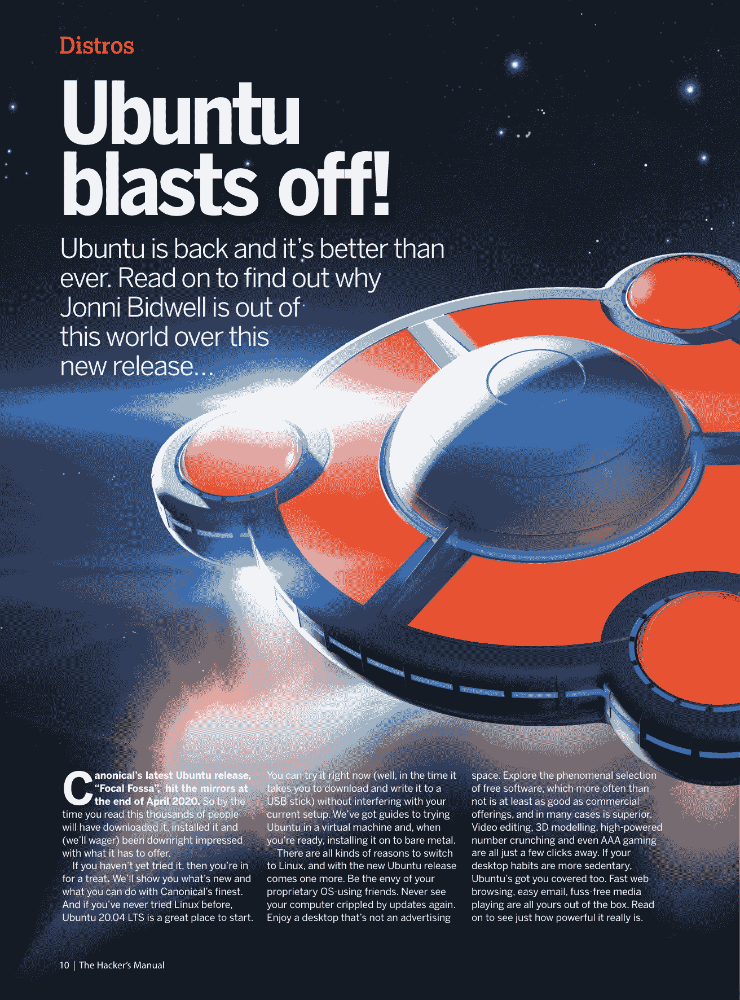

Canon 发布的最新 Ubuntu 版本“Focal Fossa”已于 2020 年 4 月底进入镜像站。所以，当你读到这里时，已经有成千上万的人下载并安装了它，并且（我们希望）对它的表现印象深刻。如果你还没有尝试过，那么你要大饱一番了。我们将向你展示自 Bionic 版本以来的新特性和变化。如果你从未尝试过 Linux，Ubuntu 20.04 LTS 是一个极佳的起点。

你现在就可以尝试它（嗯，只需在下载并将其写入 USB 闪盘的时间内），而不会干扰你当前的设置。我们提供了关于在虚拟机中尝试 Ubuntu 的指南；当你准备好使用硬件时，有各种理由切换到 Linux，而随着新 Ubuntu 版本的发布，又多了一个理由。成为你那些闭源同事的羡慕对象，让他们再次因更新而惊叹。享受一个不是广告空间的桌面。探索极其惊人的免费软件选择，这些软件通常至少与商业产品并鼓，在许多情况下甚至更优。视频编辑、3D 建模、高性能机器学习……只需点击几次即可。如果你的桌面习惯更于静态，Ubuntu 也能满足你的需求。快速网页浏览轻而易举，游戏开箱可用。读下去看看它到底有多强大。

## Focal Fossa 波萨诺

很难确定在新版本中重点关注什么，自然地，Ubuntu 内部的一切都经过了刷新。新的 5.4 内核带来了对硬件的支持并修复了旧问题。大多数家庭用户将使用桌面，你会发现 Gnome 比以往任何时候都更好。这似乎经历了两年的“打猫鼠”，无论是 Gnome 还是 Ubuntu 对它的实现，都在解决性能和内存问题。有了这个版本，它运行得像烤好的面包内部一样光滑。

Ubuntu 终于“变了”。像许多其他桌面一样，它现在提供了黑暗模式，有些人认为这更护眼睛。如果你喜欢带有旧图标的模式，则是亮色。Gnome 应用程序文件夹具有功能，你可以将应用程序菜单中的图标从一个拖到另一个，现在变得更简单、不那么混乱。如果你从文件夹中删除任何项目，该项目会自动移回主菜单并删除文件夹。

如果你有高 DPI 显示器，听到这个消息真是太好了，终于！你再也不需要通过命令行管理 dock 了。以前，只有整数缩放可用，许多用户发现这比没有要好。现在 Ubuntu Docks 可以通过简单的开关启用——但注意在增加功率和降低性能时会有细微的清晰度问题。在使用 Nvidia 驱动程序时可能会出现问题，请关注此页面：`https://bugs.launchpad.net/ubuntu/+gnome-control-center`

提到 Nvidia，它的驱动程序包含在初始安装中。不需要重启 GPU 或从 Nvidia 网站下载。游戏玩家会很高兴，修复后的“游戏模式（Game Mode）”是标准安装的一部分。这可以调高 CPU 频率生成器和其他工具来提高帧率。如果你担心 32 位库支持，别担心：`Steam`、`Wine` 和 `Lutra` 仍然可用。如果你正在运行任何 32 位应用程序


> Ubuntu 的壁纸采用了“focal”主题。

你可能会遇到困难，所以在在帮助社区之前，先测试这些，如果你找到与 18.04 兼容的方法。否则，如果不行——请完成你的工作并以 Snap 形式运行。通过此文了解更多：`https://snapcraft.io/blog/ubuntu-home-with-snap`

Ubuntu 软件现在默认使用 Snaps。此外，请求的应用可能仅以 Snap 格式可用，但某些软件包可以通过传统的 Ubuntu 仓库安装。你仍然可以从菜单安装软件包。我们预测 Snaps（以及 Flatpaks）将在未来几个月和几年内占据主地位。

正如你从“软件”应用程序看到的，许多工具现在被封装为 Snaps。随着开发者进入阶段——不再依赖仓库发布其产品的旧方法。

通常，由于我们将告诉人们这样做以腾出我们的 DVD，现在开始使用 Ubuntu 的 Ubuntu 并不在这个书签标记的 DVD 上；而我们提供的“免费下载”包含了 Fedora 和 Marjaro（虽然这个决定是这样考虑的！），既然我们已经告诉人们下载 Ubuntu，他们不妨从官方网站下载 Ubuntu：://

当然，对于那些没有网络连接下载 gnome 的人。我们中的许多人都在线，但在某些特殊情况下。虽然那些特定的可能用于安装一个后处理；但我们放在 DVD 部分的与我们告诉你的完全相同。它们可能隐藏了复古的、VGA 分辨率，有时会有一些小技巧让它启动，你可能会，但有一点是可能像你下载了的一样简单

在进入 Ubuntu 之前，你需要知道如何让你的 PC 从 USB 或 ISO 启动。你有两个选择：一种是提供启动菜单——所有设备都有相应的键。Dell 是 `F8`，Lenovo 是 `F12`，旧系统使用 ASUS 的 `F9`。启动时只需按下该键。选择任何 CD-ROM/光驱驱动器就可以了。

另一种选择是在 BIOS/UEFI 设置中选择启动设备的顺序。系统启动期间会出现提示，询问使用哪种启动。只需按键。

- **1 获取 VirtualBox**: 访问 Virtual.org 为你的操作系统下载 `VirtualBox 6`。安装它并准备好至少 20GB 的磁盘空间来存储虚拟机。你还需要从 `https://www.ubuntu.com/desktop/download` 获取 Ubuntu ISO 文件。安装后启动它并点击新建按钮并命名为 Ubuntu。
- **2 创建虚拟机**: 选择 Ubuntu 位数与你下载的 ISO 匹配，点击下一步。我们建议使用 2GB，但如果你有 4GB，4096 是个。你可以留出至少的空闲磁盘空间。默认是 8GB，但如果可以，建议至少 32GB。完成并开始运行。
- **3 启动虚拟机 Ubuntu**: 提示将协助你加载光盘——加载 Ubuntu ISO 文件并点击。Ubuntu 将启动，加载后你可以自由尝试或使用安装图标将其正确安装到虚拟机。对于虚拟机设置中的显示器，你可能希望启用 3D 加速并分配 16MB。

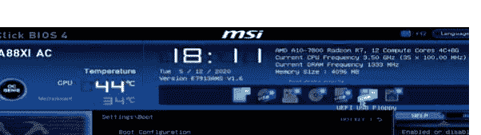

按下菜单键、`Del`（最常见）、`F1`、`F2`、`Esc` 或 `'s'` 维护键即可进入设置。在 BIOS 中选择 Boot Device（启动设备），并确保在第一启动项中找到 DVD/光驱驱动器。

你可以直接使用运行环境而不安装 Ubuntu，以获得最大的性能和灵活性。可以使用页面上的简易步骤指南将 Ubuntu 安装到你的硬盘或 SSD 上。如果你有空闲设备，我们建议将 Ubuntu 安装在独立的设备上，而不是调整一个或两个 Windows 分区的大小。一切都应该正常运行，你也可以在 Ubuntu 中执行这些步骤。但我们经验丰富，知道事情并不事如所愿。在继续之前请备份任何重要数据。如果你有备用设备，只需选择它并使用擦除并安装 Ubuntu 选项。非常简单。如果你想稳妥起见，另一个选项是使用 Oracle 的 `VirtualBox` 和指南将 Ubuntu 安装到虚拟机中。

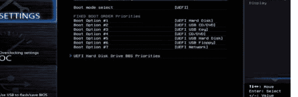

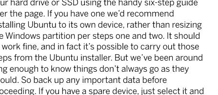

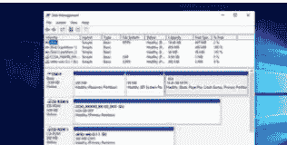


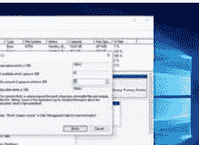

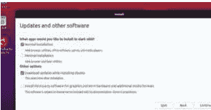

## 安装准备

### 1 腾出空间

为你的 Ubuntu 安装创建一个空分区，你必须压缩现有的 Windows 分区。打开“磁盘管理”工具，右键点击通常分配为 C 盘的分区。然后从弹出菜单中选择“缩小卷”选项。

### 2 缩小 Windows

这会弹出“缩小”对话框，显示硬盘的总大小以及你可以从所选分区中缩出的最大空间。创建一个新分区，指定以兆字节（MB）为的分区大小并点击“缩小”开始进程。

### 3 更新与插件

电脑从 Ubuntu 安装媒体启动后，将有一个检查清单。勾选第一个复选框以仅显示来自互联网的可用更新，然后安装播放 MP3 内容和 Wi-Fi 固件所需的插件。

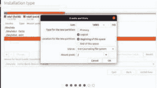

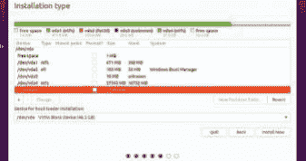

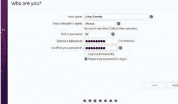

### 4 使用空闲空间

在标记为“安装”的屏幕上，切换到“其他”单选按钮以手动对硬盘进行分区。Ubuntu 现在将向你显示硬盘上的分区列表。选择标记为“空闲空间”的项目并点击加号（`+`）为你在 Windows 中释放的该空间创建一个分区。

### 5 定义分区

在分区框中输入你的 Ubuntu 分区大小。然后使用“挂载点”菜单选择 `/` 选项。如果你愿意，可以创建一个单独的分区（如果你想保持用户和系统文件分离），选择 `/home`。

### 6 本地化与个性化

就这样。Ubuntu 现在将开始安装进程。在后台复制文件到硬盘的同时，在最后一个屏幕上，你会被要求输入登录信息、密码以及计算机名称。

## Gnome 桌面快速指南

这是一份关于熟悉 Gnome 桌面的快速指南。

从 Windows 或 macOS 转过来，Ubuntu 初看起来看起来非常不同，甚至可能令人敬畏。但不要担心，很快就会感觉很熟悉。你的第一次尝试可能是点击左上角或按下 Super（Windows ）键。这将显示正在运行的应用，如果没有经常使用的，点击这里将是空的。你将在下方找到已安装应用程序的网格。标准安装包含了你所需的一切，如果你不需要办公套件、游戏或其他，我们应该提到最小安装。这可以节省你的空间。

以后你可能想要添加任何应用程序，最简单的方法是通过 Dock 快捷方式。我们的第一个扩展是 Gnome Tweaks，它允许你以所需的任何方式自定义桌面的外观和行为，它应该不存在或者默认包含在 Gnome 桌面中。如果你无法移除 firefox，至少可以在这个插件中包含它。

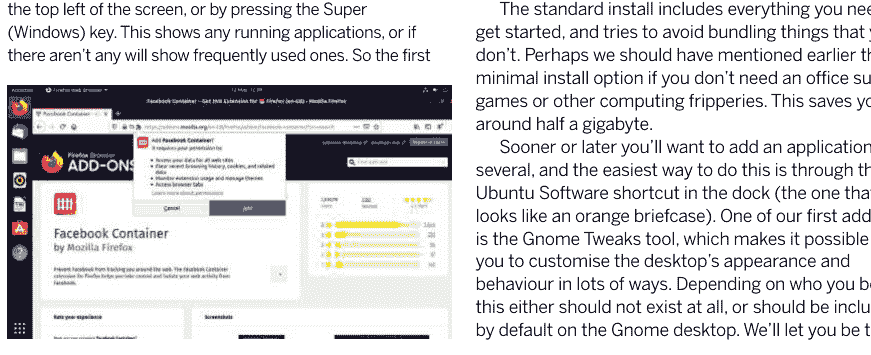

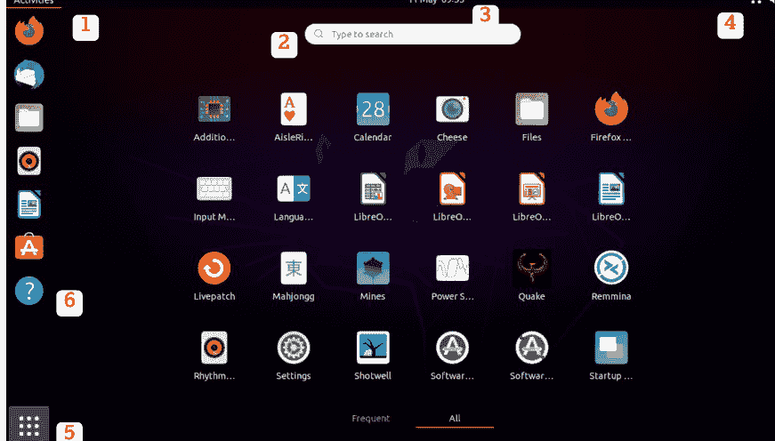

- 1 点击此处（或按下 Super 键）启动活动视图。它可以显示运行程序的预览。
- 2 搜索框在活动视图中输入（无需点击框）来搜索应用、文档等。
- 3 日历与通知菜单点击此处控制音乐、查看任何预约（如果你连接了相应服务）或激活勿扰模式。
- 4 状态菜单网络设置 (VPN)、音量控制和应用程序指示可以在找到。左下角的按钮启动设置工具。
- 5 应用程序菜单点击此处打开/关闭常用应用程序。你可以从底部的选择器查看所有应用程序。
- 6 从此处启动你喜欢的应用程序。点击正在运行的应用（由点表示）可以将其添加到 Dock 以方便访问。


KDE Plasma 的传统之处在于左下角有一个菜单，但它看起来也非常简洁现代。只需在 Ubuntu 软件中搜索 tweak，点击绿色安装并继续。安装程序将提示你添加任何在线账户，如 Facebook 或 Google。它将按照你的意愿与桌面日历和管理器集成，你可以浏览 Google 或 Facebook 通知。你可以通过设置 >> 账户直接添加这些账户。你需要注销并重新登录日历和其他完全连接的账户，也可以在这里删除它们。或者，日历面板中的“勿打扰”开关将生效并可能帮助你保持专注。

我们对 Firefox 及其时尚的新版本留印象深刻。如果你来自 Windows，那么 Google Chrome 将是你的首选，或者如果你真的想要它足够简单安装，开源 Chrome 更好。我们认为你应该给 Firefox 一个机会，仅仅是为了那个保护隐私的 Counter 插件。确实，由于账户追踪，如今的网络已经失控。

是那些糟糕的更新导致人们切换到 Linux。Ubuntu 的更新更加一致。它提供你所需的应用程序更新，你会被收到（而非强制）通用软件包更新的通知。你可以在方便时通过“软件”操作或命令行应用这些更新。这使得使用桌面 Linux 而无需背诵复杂的

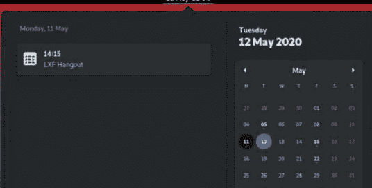

命令行咒语或拥有研究领域的博士学位，很难估计终端有多强大，但对于桌面使用，你最好使用几个适用于 Gnome 的键盘快捷键：

- Super（键） - 唤起活动视图
- Super-左/右 - 平铺应用到左侧或右侧（它完全占据屏幕的一半）
- Super-上/下 - 最大化/还原应用
- Super-上/下 - 切换虚拟桌面
- Super-Shift-上/下 - 将当前应用程序移动到下一个/虚拟桌面。

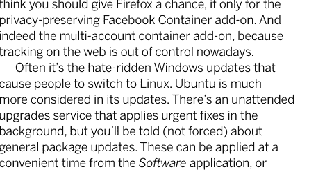

“是那些糟糕的更新导致人们切换到 Linux。Ubuntu 在更新方面经过了深考虑。”

如果你不喜欢 Ubuntu，还有其他口味。由 KDE 桌面驱动的 Kubuntu 具有略微像 Windows 的感觉。如果你想安装一个新的桌面来加入，请选择这个。如果没有 Ubuntu 的调整，它们感觉会像。如果你想尝试一些 Gnome，执行以下命令

## 内部机制

### Ubuntu 20.04 的变化

Ubuntu 20.04 中存在一些细微的变化和低调的改进非常值得提及……

我们理解。一个新 Ubuntu 版本发布，即使是 LTS（长期支持版），也不再是一劳永逸的了。现在管理层也是如此。把封面换成橙色，并吹嘘是“必买”和“革命性功能”（这些确实很划算）是骗不了任何人的，尤其是 Linux 用户。

我们一直说，这种缺乏突破性的变化是一件好事。如果 Ubuntu 在没有经过精炼的情况下就已经达到了这种成熟程度，那么对于我们的读者，以及整个 Linux 用户群体来说……在新版本中，你将发现它对 AMD Navi 12 和 14 GPU 及其 APU 的支持，开源的 Nouveau 驱动程序改进了色彩。它支持 Comet Lake 芯片以及对第 11 代 Lake 架构的输入。内核锁定（Kernel Lockdown）服务也在此版本中首次，它限制了用户以 root 身份运行内核操作的代码。Matthew Garrett 多年前曾说过，这是为了那些限制可能导致问题的损害访问的广告所武装的。

有几个值得关注的变化：支持快速的 Wayland 协议以与虚拟机共享目录。Ubuntu 还带回了来自较新内核的移植功能，其中一个显著的添加是支持 WireGuard VPN。在监控和数据泄露日益严重的时代，WireGuard 是迄今为止最好的 VPN，但很少有人能对隐私产生真正的福音。它让 WireGuard 重新了 VPN 领域；通过设置 SSH 服务器，它比 OpenVPN 更小、更容易让人理解。

## UBUNTU 的奇想：树莓派的一片，“拥有 Canonical”将鼓励企业利用树莓派（2, 3 和 4）成就伟大的事业

重写规则，最佳路径是如此。我们一直认为对于初学者来说，有许多其他选择（我们强调 Ubuntu 在专业人士中也很受欢迎），而且其中一些选择并没有像 Ubuntu 那样受到关注。Ubuntu 仍然是最受欢迎的发行版之一。

进入用户空间，有了 systemd-245，它具有新的主目录功能。

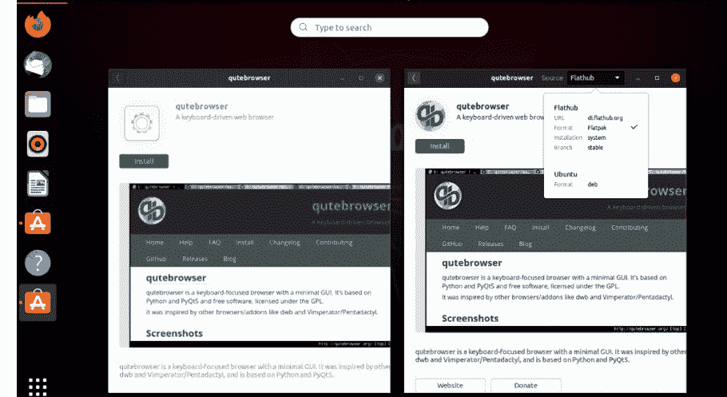

- 两个工具，在尊严上是同等的，事实上 Ubuntu 我们是我们的舞台。

`systemd-homed`。别担心，Ubuntu 默认并不喜欢它，我们也无法激活它，所以看起来就像它是通过使用一个扩展选项轻松地构建在包中的。早期，有一个回归 Solaris 的实验。内核切片冲突保留了 Linux 内核的特性，这并不是普通用户会想要的。如果你使用存储日志、内存和依赖项，某些释放操作需要 ZFS。

使用 `ssh-keygen` 生成一个密钥，然后用 `ssh-copy-id` 将其拷贝到远程。现在，如果该硬件工作正常且你返回：

- `ssh-keygen`
- `ssh-copy-id` 那么你将被提示输入可选的密码。现在你可以像以前一样将此密钥拷贝到远程系统。

依赖项，某些释放操作需要 ZFS，而 Ubuntu 官方并不支持 ZFS。不支持快照，因此如果你能继续操作的话，请在此之前拍摄快照。


为了使用新密钥登录日志，你需要指定以下内容：

- `ssh -i ~/.ssh/id_ed25519_skyesha`


> OpenSSH 8.2 椭圆曲线 DSA SSH 密钥游戏。

如此，我们必须去（打印机那里，现在 - Ed）。我们在 GNOME 上运行 Ubuntu 遇到过很多麻烦，但在 20.04 中一切很快变得顺畅，那是一个有趣的尝试，也许对开发者的兴趣大于用户。如果你正在运行 Ubuntu 18.04，请明智地推迟到使用 20.04 点版本。

Ubuntu 的所有版本中比你的有更多值得喜爱的点。它有一些巨大的优势——但请务必关注我们未来几周和几个月的 Pop_OS 项目。祝在 Focal Fossa 中玩得愉快！

认证仅适用于 Ubuntu Server，而这在树莓派上与 Canonical 的方式不同，但获取 `lubuntu-desktop` 包非常简单。如果你想要一台树莓派并想利用它的额外性能，为什么不安装 KDE 呢？认证在树莓派上是官方支持的。

不要忘记 Ubuntu MATE SD 卡镜像，如果你想要一个现成的（来自 https://ubuntu-mate.org），如果你想要一台树莓派并想利用它的额外性能，为什么不安装 KDE 呢？它在——上支持

从 Ubuntu 软件应用安装的软件包可以通过命令行可用。如果你想安装 MATE UI，可以安装 GNOME 软件应用程序，安装 Flatpak，然后重启你的树莓派并：

我们最近意识到 32 位 PC 用户并没有享受这个新版本。正如我们所说，没有到 32 位的升级路径。原始 Linux 版权限制了它的商业分发，但在 1992 年 2 月，Torvald 建议采用 GNU GPL。如此，即使在开发早期也很明显，GNU 工具对于初生的 Linux 来说是至关重要的。

Torvald 已经移植了 GNU Bash 解释器和 GOC 编译器，但除此之外，操作系统本身并不算强大。0.01 版本只包含源代码，并且仅发布给那些对 Usenet 上 Torvald 的 Linux 更新表示感兴趣的人。编译还需要一个运行良好的 Minx 副本。Torvald 尊重他人的许可，因此极不在未经许可的情况下窃取 Minx 代码。他新生的自由操作系统的运气很快传播，Linux 缓慢增长。Linus 在 25 年前发布了 Linux 内，但发行版的概念直到以后出现。Linux 版权限制了它的商业分发，但在 1992 年 2 月，Torvald 建议采用 GNU GPL。如此，即使在开发早期也很明显，GNU 工具对于初生的 Linux 来说是至关重要的。0.99 版本将是第一个在 GPL 下发布的版本，Torvald 后来反思“让 Linux 使用 GPL 是我做过的最棒的事。”

| 年 | 月 | 日 | 秒 |
|---|---|---|---|

### 第一批从原始汤中爬出来的创造者。

到底什么是第一个发行版（distros），很大程度上取决于你的定义。H. Loslack 的“Root-boot”哲学提供了一个最小的可运行 Linux 环境，但与今天相比，它们更像是原始的 Linux。

早期的尝试 MCC（曼彻斯特计算中心）于 1992 年成为第一个出现的 Linux 产品。它适用于 3.5 寸软盘，提供了一些 Linux 实用程序，并且在 LILO（Linux 加载器）中非常有用，可以原生安装在 MBR 上。通过手动向引导扇区写入一些字节，MCC 未包含 X Window 系统，但用户以后可以自行添加。MCC 的理念在某种意义上类似于 Arch Linux，即提供一个可以根据用户需求定制的精简系统。

接下来是 Peter Manchester 在 1992 年推出的 Softlanding Linux System (SLS)。它比 MCC 功能多得多，并包含了 Windows。它可以从 DVD 或 USB 闪盘运行，且内置了所有内容，但在 1992 年，双层 CD-ROM 才刚刚上市。因此，用户要么必须从软盘启动，要么从现有的 Linux（或者可能是 Nix 安装）启动。没有网络访问这种奢侈或没有这些稀有光盘的用户（如果每个人都得和一大堆软盘斗争（SLS 需要 25 张））就必须将内容安装到硬盘上。然后他们选择就地安装，而不是处理引导加载器的问题，以防被强制使用软盘启动。

## 烟雾与精神

SLS 现在被描述为不稳定的，但它的实现需要 Seeyappan 的巨大努力：获得一个可以从硬盘启动的 Linux 安装程序，以及一套令人印象深刻的软件集合且全部经过了配置和安装。它可以针对某些限制进行定制——可以选择某些应用程序，虽然安装需要 4MB 内存，但如果你有足够的钱，你必须花费大量时间才能在不发生严重摇晃、流汗和“掉牙”的情况下完成这些设置。

SLS 可能不会被归类为整洁的发行版，因为 Bug 太多，但从其他项目来看，该项目有资源在每次发布时与这些新版本进行编译和合并。内部 Debian 和 Slackware 的源码。

Xfree86 在此后一年出现，帮助管理早期 Linux 软件包管理系统以及各种软件包，其意义在于这些程序可以提取到根目录并执行基础的安装后脚本，但不需要依赖项且它

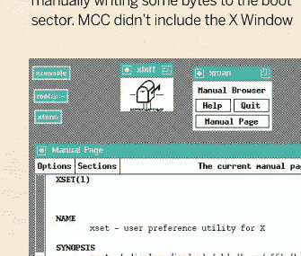
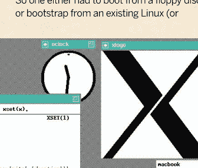
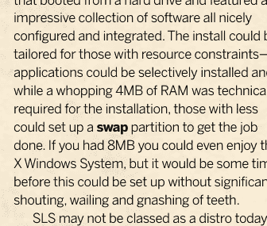
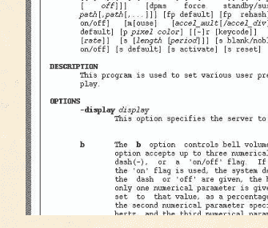
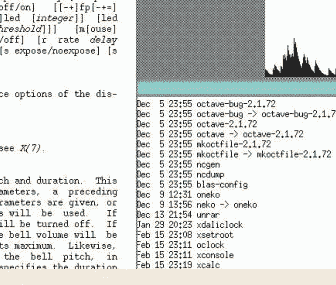
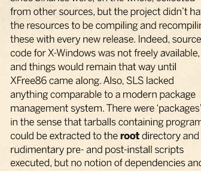

在叙述这段时期，我们有一个 Linux 运行在一台不稳定的机器上。

Linux，现在这个“克隆版”，已经进入了历史书。像 MCC 一样，TAM 是纽约的 A&M 实验室开发的。然而，MCC 包含了 X-Windows，导致许多报告称在尝试配置它时显示器会冒出“魔法烟雾”。TAM（北挪威的一个大项目）有幸成为第一个通过 CD-ROM 分发的 Linux 发行版，但接收者必须付钱。没有网络访问这种奢侈或没有这些稀有光盘的用户不得不将内容安装到硬盘上。尽管尽管它是一个商业产品，但 99 美元的价格对于想使用它的人来说太高了。

1999 年，Core Linux（Debian 的衍生）出现了。它的吸引力在于与 Office 套件兼容，尽管它依赖于 Nix 技术且性能不佳。自 1995 年以来，名字本身一直可用。但在与微软整合后，公司改变了策略并发布了发行版。1999 年定义了任何套件的价值，例如：

黑客手册 | 19

Slackware 是第一个真正的发行版分支，也是现存最老的发行版——而且可能永远不会改变。尽管存在各种问题，SLS 被认为 Bug 很多且难以使用。1993 年，一位名叫 Patrick Volker 的聪明本科生被负责安装 Slack。他投入了修复它的任务，改进安装机制和维护后修复。他希望他的修复能整合到 SLS 中，因此他没有立即向公众发布它们。然而，SLS 没有这样做，使得 Volker 的努力变得可行。到 1993 年，Slack 的贡献得到了认可，他决定为它命名，使其成为历史上第一个真正的发行版。

随着 Slack 教义，一个名为 Slackware Church 的模糊文本诞生了。当 Volker 重写了 SLS 的所有脚本时，证明了大家是对的，他只想在下一次发布前完成这些脚本。

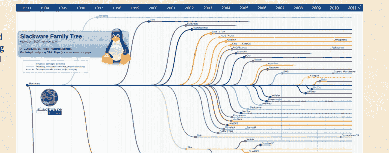

slack.com 代表了该发行版的唯一评审。当然，有了互联网，可以免费下载它，这永远不会改变。

> 在光天下，最老发行版的开发是在闭门后进行的：没有人可以加入行列，但他们只能通过电子邮件报告。

islee 做出了更改二进制格式的不受欢迎决定，这进一步增加了对 Slackware 的兴趣。Volker 反对了这个项目，Slack 1.0 版本（内核 0.99）于 1993 年发布。Slackware 过去和现在都是商业产品——CD 套和 DVD 是最像 Linux 发行版的。

Slackware 的软件包管理是通过你使用的 `installpkg`、`removepkg`、`upgradep` 等脚本完成的，作为一个共同特点是与你看到的其他工作一样，不需要担心。Slackware 不自动解决依赖关系。这也体现在 21 世纪的方式上——Slack 用户喜欢控制权，当他们被要求安装一个包时他们拥有控制权（可能他们知道：为什么 Slackware 用户会在不知道详情的情况下行动？）。突然，项目总是运行并安装其他事情（某些工作可能不熟悉或令人疲劳）。用户必须手动找出需要安装哪些依赖项。

### 对 SLS 的沮丧是另一个著名发行版的灵感，尽管它具有更开放开发模型。


像 Volker 一样，Ian Murdock（于 2015 年初不幸去世）对 SLS 的阶段感到沮丧。他开始制作自己的发行版，他称之为“Linux 发布版”，Debian 是 Deb（他的女友）和 Ian 的组合词。Murdock 尝试修改 SLS，但发现从零开始是更好的方法。

第一个版本 0.01 在初始发布一个月后发布，尽管这（以及后续几次）只是内部的。第一次公开发布是 1994 年的 0.91。Murdock 意识到 SLS 的缺陷之一是所有工作都是一个人的。为什么 Murdock 不使用已经通过 Linux 内核开发证明了自己的社区模型呢？

GNU 精神让 Debian 变得特别，植根其中的根也塑造了它的成长方式，导致了《Debian 宣言》（后来的 Debian 社会契）。社会契通过提供第一类免费且不以利润为目的软件来实现。

Murdock 想要拥抱 GNU 精神，1995 年，带有 KDE 等的 Debian 非常适合安装旧硬件。虽然团队只有十几个人，但还会有其他人无法见天日。Volker 继续寻找一种尊重过程所有方面的方法，那就是通过（并）始终保持其完整。正确的开发是在闭门后进行的：没有公共的搜索仓库（repos），也没有公共的 Bug 报告。

众周知的小事实是，1993 年 Murdock 遇到了老朋友 Marc Ewing，后者正在启动一个名为 Red Hat（你可能听说过他们）的项目，旨在建立一个商业产品；因此他计划将其作为这个新资金资助发行版的基础。当然，情况并不顺利，Debian 成了“三大”发行版中的最后一个——大多数其他发行版都源于此。这个名字来自康奈尔大学的一个项目，由他的毕业生命名，该学生在梅隆营期间获得过绘画奖。1993 年，Bob 创立了一家名为 ACC 的公司，以及 Linux CD，1995 年，ACC 收购了 Red Hat 并更名为 Red Hat, Inc.。

他们的打包方法可能是成为成功 Linux 发行版的关键。通用安装使得几乎所有内容都捆在一起并保持更新，而每个包都有卸载选项，但取决于取决于你的哲学——Slack 用户喜欢有控制权，当他们被要求安装一个包时他们拥有控制权（可能他们知道：为什么 Slackware 用户会在不知道详情的情况下行动？）。突然，项目总是运行并安装其他事情（某些工作可能不熟悉或令人疲劳）。用户必须手动找出需要安装哪些依赖项。

如果所有陈旧的 Linux 发行版让你渴望看到它们真实的面貌——或者看看你能忍受什么程度——请继续读下去。

你可以在互联网上找到几乎任何你喜欢，只要你知道去哪里查找（互联网和第一前沿），或者你见过某些旧的 Linux 发行版。那么，你的首选访问地之一就是 biblib.org (`http://biblib.org/Linux-history`)。你可以在那里找到 (1992)、SLS 1903、Slackware 1.0、Debian 0.91 以及 Red Hat 2 1994，还有许多其他版本。

让（非常老旧发行版）在虚拟机中运行有时是棘手的，主要因为它们提供的硬件不被原始内核支持。旧的桌面环境 ISO 在此后很长一段时间才被 Linux 支持，所以你可以通过在旧机器上使用 SCSI CD-ROM 模拟器来解决这个问题。然而，如果你来晚了，其他人可能已经为你做了很多工作，因此网上有大量的教程。

发行版越旧，你就会发现它有软盘集合。如果你有一台 90 年代初的 PC（带有软盘驱动器），那么你可能运行它的所有内容。或者你可能在 Linux 中找到它。之后这一点将显而易见，但不要不要于在新硬件上运行这些发行版之一。

它们将无法正常运行，因为当时的发行版并没有这么多“陈旧感”；它们可能无法在那些发行版存在时尚未发明的 ISO 上运行。即使它们运行了（通过从你的内存中逃逸到虚拟机中实现的），如果你成功设置了它（没人能做到），它也将无法工作，因为那些软件库已经消失 15 年了。从意义上说，这些发行版应该只在虚拟机中运行。

有些人使用 VirtualBox，而我们认为使用 QEMU 或 Bochs 效果更好，对旧内核的干扰更小。正如所有旧发行版所周知的那样，你可以发现：

- 你可以获取 bochs-bocha-bocha-

我们使用 Bochs 来尝试运行 Yggras 0.8.3，因为有人准备了一个镜像，你可以从 `http://oldlinux.org/linux/bochs` 下载，该镜像是为旧版本的 Bochs制作的，所以以下命令在当前位置可能无法正常工作：

```
bochs -f bocha
```

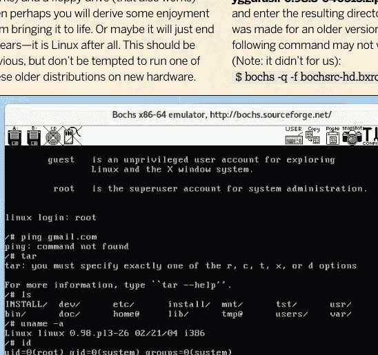

- 仍然托管所有历史发行版列表的 FTP 站点。不要指指它们真的能做任何有用的事情。

如果没有作用，编辑内核 `bochs-hld.ldx` 并在行开头添加 `#`：

`romimage:`

`vymage:`

`vga_interval: ...`

（这些散布在文件中）。再次尝试命令，如果仿真窗口出现。你需要从终端控制执行，终端目前显示着一些简短的汇编信息。要继续执行，你应该看到 Yggras/Linux 在虚拟环境中活跃起来。一段时间后，你可以运行它并尝试一些命令。它们都在那里，工作结果将向你展示 Linux 0.8.3-06-26-2004。

2004 年的日期来自于镜像实际构建的时间（内核和硬件已针对虚拟机进行了调整），但实际的操作日期是 1992 年。亲爱的读者，回到一个已经消失如此久的操作系统会让你感到震撼吗？并没有。那么，较新的版本容易启动得多，但在怀旧价值方面，它们一无是处。尽管如此，知道如何让它运行很重要。

Bochs——它看起来不起，但它是运行 1992 发行版的唯一方法。

它们是什么？它们将走向何方？它们会结束吗？

“发行版”（distribution）一词直到 1995 年才变得常见。现在我们有一个相当具体的概念，即发行版由安装程序、一组从（修改过的）上编译的软件包组成；内核（只是一个包）；桌面环境；文档等。我们期望能获得某种支持，通常通过社区提供的 IRC 频道。我们还考虑了一些创建自己的软件包的方法，希望它们会被包含在未来的发布中，或者让标准软件包能够被干净地添加。事实上，发行版在不同时期有不同的形式，其含义随时间演变。我们所说的发行版在开源世界中是独特的，它是将所有片段连接在一起的胶水。如果这些片段是私有的，这种东西就不存在了——不需要将这些位组合在一起。


### 展望

Linux 发行版不断演进，通过桌面环境（如 Cinnamon，Linux Mint）或其他功能包。由 Red Hat 赞助的 Fedora 处于开发前沿。某些替代显示了未来的去向。

Linux 发行版不断演进，通过桌面环境（如 Cinnamon，Linux Mint）或其他功能包。由 Red Hat 赞助的 Fedora 处于开发前沿。某些替代显示了未来的去向。

Linux 发行版不断演进，通过桌面环境（如 Cinnamon，Linux Mint）或其他功能包。由 Red Hat 赞助的 Fedora 处于开发前沿。某些替代显示了未来的去向。

“发行版”一词直到 1995 年才变得常见。现在我们有一个相当具体的概念，即发行版由安装程序、一组从（修改过的）上编译的软件包组成；内核（只是一个包）；桌面环境；文档等。我们期望能获得某种支持，通常通过社区提供的 IRC 频道。我们还考虑了一些创建自己的软件包的方法，希望它们会被包含在未来的发布中，或者让标准软件包能够被干净地添加。事实上，发行版在不同时期有不同的形式，其含义随时间演变。我们所说的发行版在开源世界中是独特的，它是将所有片段连接在一起的胶水。如果这些片段是私有的，这种东西就不存在了——不需要将这些位组合在一起。

Linux 发行版不断演进，通过桌面环境（如 Cinnamon，Linux Mint）或其他功能包。由 Red Hat 赞助的 Fedora 处于开发前沿。某些替代显示了未来的去向。

Linux 发行版不断演进，通过桌面环境（如 Cinnamon，Linux Mint）或其他功能包。由 Red Hat 赞助的 Fedora 处于开发前沿。某些替代显示了未来的去向。

Linux 发行版不断演进，通过桌面环境（如 Cinnamon，Linux Mint）或其他功能包。由 Red Hat 赞助的 Fedora 处于开发前沿。某些替代显示了未来的去向。

Linux 发行版不断演进，通过桌面环境（如 Cinnamon，Linux Mint）或其他功能包。由 Red Hat 赞助的 Fedora 处于开发前沿。某些替代显示了未来的去向。

Linux 发行版不断演进，通过桌面环境（如 Cinnamon，Linux Mint）或其他功能包。由 Red Hat 赞助的 Fedora 处于开发前沿。某些替代显示了未来的去向。

Linux 发行版不断演进，通过桌面环境（如 Cinnamon，Linux Mint）或其他功能包。由 Red Hat 赞助的 Fedora 处于开发前沿。某些替代显示了未来的去向。


Linux 发行版不断演进，通过桌面环境（如 `Cinnamon`，`Linux Mint`）或其他功能包。由 `Red Hat` 赞助的 `Fedora` 处于开发前沿。某些替代显示了未来的去向。

内核本质上是一个资源管理器，负责调解对系统可用资源的访问。

内核负责通过控制处理器、内存、磁盘和其他资源，允许多个应用程序有效地共享硬件。

Linux 内核被分为多个不同的子系统，这些子系统控制系统的各种组件（见右图），并且所有子系统都是紧密集成的。每个子系统都有定义的接口，我们将在接几页中详细探讨。系统还允许内核管理这些不同的子系统，这些子系统结构在内核源码的各自目录中。这些子系统通过函数和共享数据结构（如任务列表、内存映射和节点等）进行相互作用。当你深入某个子系统时，会发现它由几个模块组成。模块是设计用于运行时链接到内核的代码段。

内核的这种结构是 Linux 受欢迎的因素之一。它允许大量独立开发者进行协作并为其开发贡献力量，同时为扩展性提供了保障。例如，得益于内核结构和标准化接口的使用，每个驱动程序都实现作为一个独立的模块。这使得开发者可以编写驱动程序，而不会干扰其他开发者的工作。

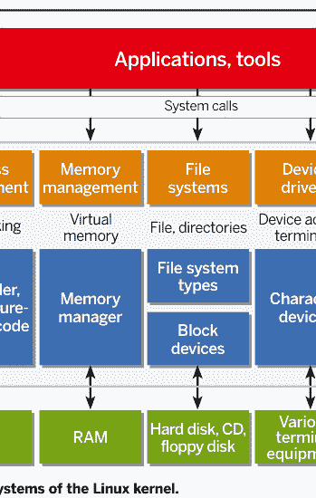

| 应用程序 | | | | | |
| :--- | :--- | :--- | :--- | :--- | :--- |
| 进程管理 | 内存 | 文件系统 | 设备驱动程序 | 网络 | |
| 多任务处理 | 虚拟内存 | 文件目录 | 设备访问、终端 | 网络功能 | |
| 调度器、特定于架构的代码 | 内存管理器 | | 字符设备 | 设备驱动程序 | 软件支持 |
| | | | | | 硬件支持 |
| CPU | 内存 | 硬盘、软盘 | 各种终端设备 | 网络适配器 | 硬件 |

用户空间

Linux 内核

组件

功能

软件支持

硬件支持

硬件

>> Linux 内核的子系统。


## 1991年

### 8月

1991年8月25日

`Lin Torvalds` 在 `minix.com` 上创建了他的业余项目

来自赫尔辛基大学的20 岁学生 `Lin Torvalds` 开始构想创建一个自己的 `Minix` 操作系统克隆版本。当他将第一个版本的内核上传到 FTP 服务器时，Andrew 在 Linux 中创建了存放源码的目录。

### 9月

1991年9月17日

`Lin Torvalds` 发布 `Bash`。此版本包含了 `Bash v0.8` 和内核 `v0.42`。此时，Linux 已经脱离了 `Minix` 代码，并具有多线程文件系统。`Torvalds` 在 Linux 中留下了名言：“它可能永远不会支持硬盘以外的任何东西，我有的全部如此:”

### 11月

虽然内核的发布令人印象深刻，但 `Torvalds` 已经在使用 Linux 作为网络上的操作系统并编译列表，他声称他的操作系统“比 `Minix` 好一点”，并且“比 `Minix` 更易于移植”。

### 12月

1991年12月19日

`Lin Torvalds` 宣布了一个版本跳跃。在此之前，Linux 只有一个针对小磁盘的修复。这个新版本带来了许多功能。他添加了对 IBM RAM 支持并引入了浮点加速器，因为人们一直需要 Linux 支持它。

## 1992年

1992年10月5日

第二个版本包含了一些 Bug 和一些额外的程序。`Torvalds` 成功地在其下方运行了 `Bash`、`GCC`、`y-make`、`y-sort` 等。除了源码外，他还提供了操作系统的二进制发行版。

1992年11月下旬

`Torvalds` 经常使用 Linux 收发邮件，并通过他写的终端模拟器访问大学计算机。某天，他决定处理现代 (`dev/tty`) 的硬件处理器，并覆盖了 `Minix` 内核的一些关键部分。他决定重写程序以符合 Linux 标准。

系统调用用于允许进程与内核进行交互。然而，要理解它们的重要性，你必须首先学习内核是如何分工作的。32 位系统上可以管理的 CPU 最大长度为 2 GB，而 64 位机器可以拥有 64 GB 的地址空间。地址空间与计算机上的物理内存无关，因此被称为虚拟地址空间。

Linux 将虚拟地址空间分为两部分，称为内核空间和用户空间。这种划分是基于特定架构的值。用户空间和内核空间之间的关键区别在于，内部禁止访问前者。运行在用户空间中的提供了一组接口，用于与内核空间中的硬件和其他组件进行交互。这些接口通过调用内核的系统调用来实现。`Posix` 标准定义了一系列分类的系统调用，例如，进程管理系统调用可用于创建新进程。Linux 调用可以发送和接收信号。

当调用系统调用时，处理器必须将权限级别从用户模式切换到内核模式，以便执行访问硬件等受限操作。

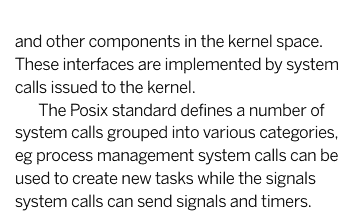

- 在 `v0.12` 之后出现了第一个专门为 Linux 设计的发行版。


### 1994年1月

- 在 `v0.12` 之后出现了第一个专门为 Linux 设计的发行版。

### Debian 0.91

- 在 `v0.12` 之后出现了第一个专门为 Linux 设计的发行版。

### 1993年7月

- 在 `v0.12` 之后出现了第一个专门为 Linux 设计的发行版。


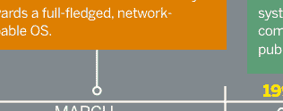


进程的管理和调度是 Linux 内核最重要的子系统之一。它的目的是访问计算机的处理器。Linux 可以同时运行多个进程，因为处理器在任何时刻只能运行一个进程。为了实现多任务处理，Linux 必须在快速的时间间隔内多个进程之间切换。

此外，当它从一个进程切换到另一个进程时，必须确保环境与离开时完全相同且不产生重复资源。这些任务由调度器负责。确定下一个运行哪个进程的规则集被称为调度策略。

由于所有进程都同等重要，调度策略对它们进行排序。进程优先级是动态的，内核会跟踪进程正在执行的操作并调整它们的优先级。Linux 进程是抢占式的，这意味着在执行一个进程之前，内核会检查其优先级是否大于当前运行进程的优先级。如果一个进程的执行被中断并从调度器选择了另一个进程，Linux 自 `v2.6` 版本以来一直是抢占式内核，这意味着进程在用户态和内核态下都可以被抢占。进程的生命周期由内核算法管理。内核使用各种系统调用来创建、更改进程状态并终止它们。


为了实现多任务处理，内核必须决定为每个进程分配多少时间，以及何时切换到下一个。

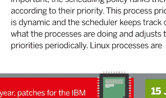

该版本现在包含超过 180 万行代码，包含了 SMP 支持以及对 m68 和 Alpha 架构的支持。正在添加新的文件系统，以包含对 NTFS 文件的支持。

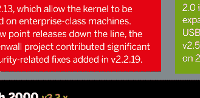

增加了对 USB v2.0 的初始支持。该版本在 v2.57 中得到了扩展，该版本于 5 月 27 日发布。

Linux 命名空间最初只有一个挂载命名空间，其中包含了所有进程。到 v2.3 版本，内核命名空间的数量增加到了六个：net、ipc、uts 和 users。

可移植性是首次解决的功能之一，此版本允许 Linux 运行在基于 Alpha、SPARC 和 MIPS 架构的计算机上。

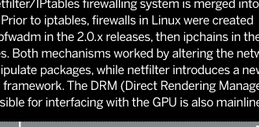

v2.2 版本使用 procfs 引入了网络/文件防火墙。在其他版本中，v2.4 版本引入了对 USB 的支持并改进了管理命名空间的代码，引入了新的进程控制框架。v2.23 还获得了用于与 GUI 交互的 DRM（直接渲染管理器）资源。

内核现在可以使用对称多处理 (SMP) 同时为多个进程服务，这对于许多人来说是一个需要的改变。然而，支持多线程将需要重写 Linux 内核以避免竞态条件。

代码量增加了一倍到 337 万行以上；此内核包含了许多功能，包括 SMP、对 USB 和即插用的支持。它还包含了对惠尔等等硬件的支持。在用户空间，v2.4 系列带来了对虚拟内存管理器 (VMM) 和 RAM 的支持，以及 v2.3 的驱动。

### 8月

### 2002年7月27日

此版本是首次使用了 Linux 安全模块 (LMS) 框架。它还引入了 Linux 内核峰会，针对 NSA 的提议。Torvalds 拒绝了这一想法，认为有许多不同的安全策略，社区在形成新的安全模型之前应该做出决定。

该版本发布了用于显卡的 VideoLinux (V4L) 系列驱动程序。德国大学生 Eric Stelb 促使建立一个记录 Linux 代码编码的好地方，称为桌面环境 (Desktop Environment)，因为当时 KDE 是基于 Qt 框架的。

Miguel de Caza 和 Federico Medina 在 1997 年 8 月基于 GTK 工具包提出了在 LGPL 下使用 Gnome。

ALSA：高级 Linux 声音架构 (ALSA) 项目于 2000 年启动并快速发展。在过去的一年里，直到 v2.3 内核都增加了支持。

高效管理内存是 Linux 内核的核心任务之一。可用的物理内存映射到内核地址空间。如果物理 RAM 超过 32 位机器可以管理的范围（最高 4GB），以上的任何内容（64 位机器，因为地址空间足够大）都由内核管理内存并处理虚拟地址空间与物理内存之间的关联。此外，页分配器告诉内存管理器获取和存储页面。链区分配器（slab allocator）允许 Linux 支持使用比系统物理可用内存内存的进程。需要时，可以将页面移出或换回。


然而，内核算法管理着进程的生命周期。内核使用各种系统调用来创建、更改进程状态并终止它们。

（注：此处原文与前文有部分重复逻辑，翻译保持原意）

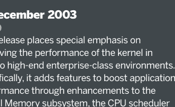

为了实现多任务处理，内核必须决定为每个进程分配多少时间，以及何时切换到下一个。

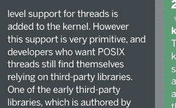

然而，内核算法管理着进程的生命周期。（此处重复）

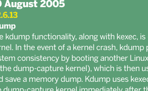

### 2003年12月 v2.6.0

此版本侧重于改进内核性能以及新功能。具体而言，通过对虚拟文件系统和 I/O 调度器的改进解决了性能问题。

在发布之前，SELinux 被并入 2.6.0 内核。此外，ALSA 替了之前的系统——经典开放声音系统 (OSS)。

命名 POSIX 线程库 (nptl) 被添加到内核。这种支持是非常宽松的，线程仍然依赖第三方库。由 Xaver 早期引入的第三方库后来被添加到 v2.6.0。

为了修复线程锁：glibc 回顾了 1996 年以来对 Linux 的开发。它出现了一些缺陷。为了解决这个问题，Igor Molinar 在 2.5 系列内核中引入了一系列内核补丁，为符合标准的多线程操作系统奠定了基础。该库是 glibc 分发版的一部分，由 Ulrich Brecher 等维护。

kdump 功能同 kexec 一起并入了内核。在内核崩溃时，kdump 保留了崩溃的内核，然后用它保存转储内存。kdump 使用启动在内核崩溃后获取转储中断。此版本还包含了 udev 管理器。udev 负责在 `/dev` 目录中创建和管理设备节点，取代了 2.5 内核中引入的用户空间设备管理器，并负责让设备对用户可见。此版本还概述了流程的改变，现在每隔 2 个月就会发布一次新内核。

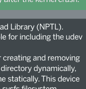

28 | 黑客的

Linux 内核支持四十多种文件系统，包括基于磁盘的文件系统（ext3/4、FAT32 和 NTFS）、虚拟文件系统（proc）以及网络文件系统（NFS 等）。为了支持这些文件系统，Linux 内核使用了一个进程和文件系统实现。这一层被称为虚拟文件系统（VFS），并为对象提供了抽象的数据结构。

它确保真实文件系统必须填充这些数据结构，使得应用程序可以使用相同的接口来访问和管理文件，而无需知道文件使用的是什么物理或逻辑系统。出于此目的，设备无关模块（Device Independent module）提供了所有设备的统一视图。

每个受支持的文件系统都有一个本地文件系统模块。

你还应该理解文件在 Linux 中是如何表示的。在用户空间中，文件通过进程描述符识别，这是一个用于标识打开文件条目的数字。文件描述符由内核在打开文件时创建，并且仅在进程运行期间有效。另一方面，在内核空间中，是通过文件节点（file node）识别文件的，它包含了访问权限、最后修改日期等元数据。

VFS 的任务之一是为操作文件、目录和其他项提供统一的机制。

> Linux 内核支持四十多种文件系统。

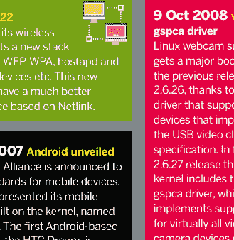

内核级虚拟机（KVM）是一个内核模块，它将 Linux 变为 Intel 和 AMD 的硬件虚拟化扩展，支持高达 64 位的客户端。

内核重构了其基础设施，并获得了新的栈，具有 WPA、WEP 热点和子系统等功能，旨在提供更好的配置界面。

Linux 内核继续推进并开发支持 USB 3.0 的功能。当年的另一个重大进展是 2009 年 7 月发布了 v2.26.0 版本。

开放手机联盟（Open Hand Alliance）宣布推出 Android 为移动设备开发开放标准。这一天，他们还展示了大屏移动设备。第一款 Android 手机 HTC Dream 于 2007 年 10 月发布。

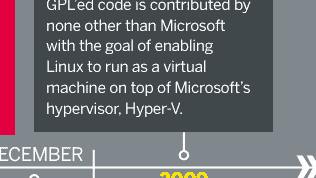

Linux Web 支持在 v2.26.0 版本中获得了巨大提升，该版本引入了支持 OpenGL 2.0 视频规范的驱动。此外，内核包含了 gpca 驱动，为市场上所有的视频摄像头提供了支持。

## 11月

## 1月

此版本包含了对 ext4 的性支持。在 2.6.19 版本中，缺失的功能最终合并到了主内核。又过了两年，ext4 才在 2009 年 12 月 25 日发布的 v2.6.28 中变得稳定。之后，用户就可以安全地使用 ext4 了。

（SSD）。Ext4 文件系统在 v2.6.19 中首次亮相。

### 虚拟化改进

VirtualC 也作为 Linux 的一种可行方案出现。Linux 容器 (LXC) 是一种操作系统虚拟化方法，用于在单个内核上运行多个实例。它依赖于 11 月添加到内核的 cgroups。

### 新无线驱动程序

如上所述，v2.6.24 引入了新的无线协议栈。然而，该栈中仅可用一个驱动。在 v2.6.24 中，通过增加针对 Intel PRO/Wireless 3945ASG/BG 网络连接的 athlw2 驱动，以及针对无线硬件的 Intel Wireless Link AKN（ad220 和 arx200）驱动，支持的设备数量有所增加。

现代图形处理器（GPU）终于达到了其水平。Linux 内核支持四十多种文件系统。


Linux 内核支持四十多种文件系统。

## 模块与设备驱动


# Linux 内核概述

Linux 是一个单体内核，这意味着它是一个单一的内核，而不是将功能组件拆分为独立区块的微内核；然而，内核的一个特点是它允许根据需要加载和卸载组件或模块。动态加载模块使得内核变得非常灵活，并保持其整洁。

你可以显式地加载和卸载模块，也可以将其交给内核处理。一旦模块被加载，它就会成为内核的一部分，并拥有与其他任何内核代码相同的权利和责任。Linux 还允许模块堆叠，即一个模块可以使用另一个模块的服务。模块是添加驱动的一种流行且高效的方式，事实上，Linux 的大部分源代码都是由设备驱动组成的。Linux 源码提供了驱动子目录，其后是值和来自内核，例如串口接口和文本控制台；其次，块设备更适合处理具有固定类型的数据，例如硬盘、CD-ROM 设备等。然而，这两种情况都通过设备特殊文件与用户应用程序交互，允许它们通过常规 I/O 操作访问设备服务。

Linux 设备主要分为两类：首先是字符设备，即通过流传输字节的设备。

## 版本历史

### 2014年10月5日 v4.17

Linux 内核现在支持雷电（Thunderbolt），这由 Intel 和 Apple 开发的硬件接口。通过各种拓扑结构，一个连接器可能支持所有外围设备。此版本还包含了对 Xbox 控制器的支持。

Ext4 加密

Linux 支持数据加密设施，如 `fcrypt` 或无内存消耗成本的 `encrypt`。ext4 文件系统现在使用新密钥对数据和文件名进行加密。

未来...

内核将继续采用最新的安全特性。它将在物联网、特别是工业级计算；云设备和个人计算设备等领域发挥重要作用。谁知道 25 年为……预留了什么。

- 单用户支持

尽可能缩小 Linux 体积嵌入式系统也可以实现更好的用户隔离，这对于它们在没有多用户支持的情况下配置内核至关重要。


2014年1月 10月

2014年6月

2015年11月

此版本包含了 netfilter，它是 netfilter 的重构。Netfilter 通过各种钩子（hooks）、iptables 和 ipset 暴露，可以通过 netlink 进行配置。它们的区别在于，iptables 中默认有几个表（filter、raw 和 mangle），而 netfilter 中一个没有。此外，当每个链只有一条规则时，单行命令可以执行多个操作。

嘿，做个决定

Linux 之父 Linus Torvalds 决定在 Google 上进行投票，以决定是否将下一个版本实现为 v4.0。29,000 人支持，5,600 人反对这一移动。Torvalds 引入了新内核。

### 2015年11月1日 v4.2

此版本弃用了 ext3 文件系统，因为许多 Linux 发行版已使用 ext4 代替 ext3，因为它被设计为兼容旧版本的文件系统。

- 实时补丁

尽管内核本身缺乏新特性，但有一个特性允许实时补丁：kpatch 的诞生是为了为需要在不重启系统的情况下应用安全更新的主要用户提供的，它是 SUSE 和 Red Hat 分别合并 kra 和 patch 项目的成果。

USB 3.1

新的 USB 规范包含了 Super-Speed Plus 协议，该协议支持通过核心和 xHCI 主机支持此 USB。这意味着连接到 xHCI 主机的 USB 3.1 设备速度可达 10Gbps。


## 编译内核

我们将向你展示如何提升并构建你自己的 Linux 内核。


编译内核不需要 root 权限。你只需要运行（带有 sudo）`make modules`、`make install` 和 `make-config` 来更新加载程序。

当 Torvalds 发布 Linux 到世界时（25 年前），它是源码。要使用它，你必须配置并编译它。这些年来发生了变化，发行版现在预配置并编译了大多数硬件，但仍然有人在编译自己的内核。为什么要这样做？这取决于你想要使用最新版本的内核还是与你的发行版工作。为了最高性能，定制内核可能会有所不同。当你想要告诉系统你是 root 时，那么从哪里开始？这取决于你想要最新的发布版还是与发行版工作。大多数发行版为了性能或兼容性建议从那里开始。然而，补丁可能不再像以前那样明显。在 Ubuntu 和 Fedora 中，你需要的包是 `linux-kernel`。安装后，你会发现一个 tar 包。


取决于你的硬件，目标是获得一个可以工作的内核。并不是所有选项都对你有用。一旦你有了可以工作的内核，你就可以决定花多少时间在优化和烘制上。

在 Linux 早期，内核大部分是单体的。它包含了编译时选择的所有驱动程序、文件系统、网络代码和其他选项。随着支持硬件范围的扩大，这变得难以管理。

然后引入了模块。内核的一些额外部分可以分离为文件（在 `/lib/modules/kernel/` 中），并在需要时加载到主内核。当你使用空格键切换模块时，它会在 Y（内置）和 M（模块）之间切换。其他只有 M 选项，这意味着该选项将作为模块编译。

然后运行 `make config`。这也是 `make config` 的一个版本，但它不具备 Qt 版本的所有功能。当你使用此界面时，过程是相同的。让我们从一些通用特性开始：进入启用内核配置支持并“启用到 /proc”。第一个将内核配置存储在主内核中，后者在需要时使用。当你使用不同内核的 `/proc/config` 时，这非常有用。一旦你有了选项，现在是编译内核的时间了。在 `linux-source-x.y` 内部使用 `make` 或 `make menuconfig` 开始之前，我们必须确保已经构建了工具。在 Ubuntu 中，这是 `sudo apt-get install build-essential`。你还需要安装 `libn-dev` 来构建内核配置。现在我们可以在刚刚启动内核的目录中进行。如果你编辑主源码，不要考虑它，因为它超过了 4000 行。一个框架将帮助你，带有终端窗口和搜索功能。它展示了设置的层级；在内核之间进入子目录并选择你的选项。使用空格键切换选项，使用方向键在选项之间移动。一切都比只编译你需要的要快。

你如何决定编译为模块还是内核？当你编译内核时，只编译你实际使用的驱动程序是好的。例如，如果你使用桌面或服务器系统，将设备驱动编译到内核中更好，因为你总是需要它。相反，无线卡的模块可能不需要，所以你可能也不需要某些模块。

`menuconfig` 的界面功能完备但不漂亮。还有一个 GUI 版本，叫做 `nconfig`。如果你在使用 KDE，可以使用这个，否则也叫 `nconfig`。左和右选项在选项之间移动焦点。退出将返回到上一个，那正是你想要的。配置将保存在开始时的 `.config` 文件中。帮助信息是自解释其明的。希望示例选项也适用于你想要按下的内容。关于默认选项的更多信息。

取决于你的硬件，目标是获得一个可以工作的内核。并不是所有的选项都像你的一样有用。一旦你有了一个可以工作的内核，你就可以决定花多少时间进行优化和烘制。

在 Linux 早期时代，内核大部分是单体的。它包含了编译时选择的所有驱动程序、文件系统、网络代码和其他选项。

然后引入了模块。内核的一些额外部分可以分离为文件（在 `/lib/modules/kernel/` 中），并在需要时加载到主内核。当你使用空格键切换模块时，它会在 Y（内置）和 M（模块）之间切换。其他只有 M 选项，意味着该选项将作为模块编译。

> 随后它将为你提供 32 位 CPU 的选择。这是使用 32 位操作系统时的默认设置。

接下来，你需要确保为你的硬件配置了模块。使用 `lsmod` 命令通常这通常是非常容易的。它会列出主板上所有的模块、板载芯片以及 PCI 卡，并带有 `-option` 选项显示每个设备使用的模块。如果你在目标机器上有一个运行良好的内核，可以从刻录 CD 此此。

0700.00 以太网: Realtek Semiconductor Co Ltd.

所以我的网卡需要 r8169，我该去哪里找它呢？也许可以使用 `modinfo` 进行搜索，并输入模块名称——它将显示一个匹配列表，你可以从中找到一个。通过点击选项描述可以显示有关内核配置的信息，在终端中，按 `/` 进行搜索。这会显示结果列表，以及哪些是已启用、哪些未启用。按下你找到的数字来查看该选项的帮助文本。

某些选项可能会出现，但不会作为供你选择的选项。这是因为当一个选项有一个“依赖于”（Depends on）行并列出项目及其当前设置时，会打开一个屏幕。确保你的

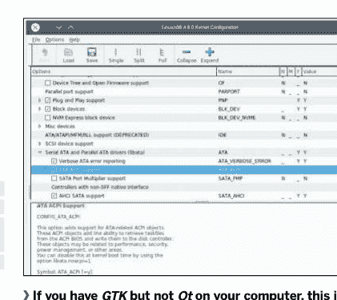

Qt 配置是其他配置中功能丰富的，是通过应用 `kernel_gcc` 补丁实现的额外功能。

> 如果你有 GTK 但你的电脑上没有，这是一个供你通过 make 制作的图形化前端。

它们都应该被设置为 'Y' 或 'm'（模块内）。通常只有一两个需要考虑，但在找到所有你需要的选项之前，可能需要一些追踪。


现在你已经完成了配置，并且结果如你所示，现在是编译和安装的时间了。有三个命令可以完成：

```bash
$ make
$ make modules_install
$ make install
```

你可以像这样将它们串成一行执行：

`$ make modules_install install`

或者在你执行这些操作时分别运行每个。如果某个阶段出现问题，该阶段就会失败。通常情况下你在编译期间不会遇到错误，除非你使用了经过补丁的内核和补丁。如果你遇到错误，可以将错误信息复制到你的网络搜索引擎中搜索。第一个命令构建内核以及你要求的所有模块，第二个命令将模块安装到 `/modules/`，最后一个命令复制内核文件，以及它的副本到 `/boot`

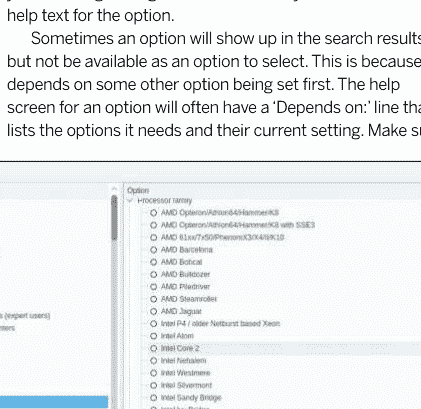

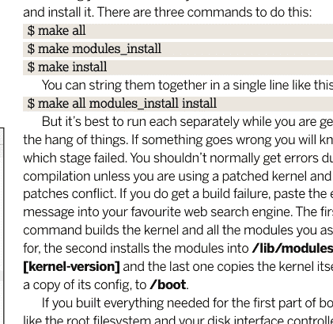

## 故障排除

有两种人：那些内核编译并启动成功的人，以及那些说真话的人。如果你尝试让某些部分变得正确，可能会失败。版本号是错误的，但你可以破坏你的系统。这是因为安装新内核和 GRUB 菜单会找到 `/boot/` 中的内核。所以即使你已经有一个运行良好的内核，它可能更安全。如果你没有使用任何模块，甚至当包含了你需要的额外项目如你的硬盘类型。记住，在根文件系统挂载之前，你无法加载任何模块。

失败的通常迹是内核恐慌（panic），内核正在死亡所以你不需要它，或者它也应该在屏幕上显示错误，以便你可以看到发生了什么。

当你回到内核源码，进行更改，重新编译并安装；版本号将被旧版本替换。如果你想为你的所有实验保留旧版本，你必须在内核中设置 `LOCALVERSION` 或在源码树中创建一个本地配置文件，然后版本号将随着你的编辑而增加。然后你可以自由删除任何旧内核以及模块。你还应该删除 `/lib/modules` 中对应的目录。

34 | 黑客手册

## 更新内核

### 定制制内核

花费一些时间按照你想要的方式自定义内核后，当 Linux 版本更新并发布时，你可能在想必须重新开始，对吧？实际上，你需要下载并解压新源码。应用任何需要的补丁，注意某些可能会失败，因为你需要新的补丁，或者完全不需要，因为它已经包含在内核中了。在源码目录旁边，将你的 `.config` 文件复制那里，按你喜意进行编辑并运行 `make oldconfig`。

此命令用新 Linux 内核中的选项解析你现有的 `.config` 并提示你处理任何内容。对于次要更新，从版本 4.6.3 到 4.6.4，无须操作。然后你可以像以前一样编译并安装内核。

根据你的设置，使用 `update-grub` 或 `mkconfig` 来启动内核内核：

```bash
$ update-grub
$ mk-grconfig -o /boot/grub/grub.cfg
```

### 需要 initrd 吗？

如果你查看任何一个发行版的 `/boot` 目录，你会至少看到一个 `vmlinuz` 文件。内核将使用第二个或第三个 `initrd`。这些 `intramfs` 是一种保持所有内核排序的方法，无需将所有内容都放在内核内部。初始内存磁盘是内核启动时立即挂载的文件系统。这个文件系统使得模块的加载像脚本一样灵活——通常持续到内核运行为止。该脚本运行你的根系统映射，并在将所需的模块加载内存之前将进程控制权传回内核。当不再需要时，`intramfs` 会移除。

释放内存并向上吧！创建 `initrd` 有许多方法，大多数驱动都有自己的，但有一个新的解决方案可以更轻松地解决问题。`Dracut` 允许豪华的硬件检测，为它支持的任何内核生成 `initfs`。最棒的部分是创建 `initfs` 如此简单，只需运行：

```bash
$ dracut-$(uname -r)
```

这会在 `/boot` 中为你指定的内核创建一个 `initramfs` 文件（如果你没有为当前运行的内核指定版本）。运行 `mk-grconfig`，`Intramfs` 将被添加到你的启动菜单。现在可以组装 RAID 或加密分区了

### 第三方模块

所以树外驱动是不包含在内核中的内核模块。这些中最常见的是

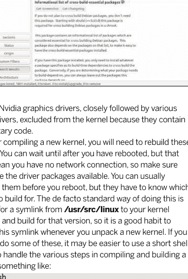

`Qt` 配置是其他配置中功能丰富的，是通过应用 `kernel_gcc` 补丁实现的额外功能。

> 如果你有 GTK 但你的电脑上没有，这是一个供你通过 `make` 制作的图形化前端。

它们都应该被设置为 'Y' 或 'm'（模块内）。通常只有一两个需要考虑，但在找到所有你需要的选项之前，可能需要一些追踪。

# 终极家庭服务器

向你展示如何设置一个可以丰富你生活的 Debian 家庭服务器。


在你的家庭电脑上运行 Linux 是某种入仪式，尤其是当它成为你的主系统时。朋友通常会对你的命令感到困惑，因为你产生了控制台输出、错误信息和猫的照片。他们问你是否也能运行 Linux，你回答一些神秘的话：“我只能给你你要走的那扇门。”他们从那时起通常就不做你的朋友了。但这没事，你不需要朋友，你有 Linux……而且不像你以前那些朋友，Linux 也是一个优秀的操作系统。而家庭服务器是朋友的很好的替代品。好吧不是，但在本教程中，我们将向你展示如何设置一台可以安全存储你的设备、分享照片

> 在整个家庭分享照片，安排云备份和更多 ”

在整个家庭，安排云备份和更多。如果你以前从未设置过任何东西，完全不用——正如许多 Linux 的事物一样，这个过程比以前简单得多。在图形界面之外工作最初可能会令人生畏，但一旦设置了初始设置，一切都可以运行得很好。如果你以前做过这些，也许你会学到一些新技巧，或者你会写信告诉我们我们的策略有多愚蠢，我们迫不及待了！

## 构建与配置

组装硬件并向 DEITY 支付你的感谢（豆子）。然后安装 Debian。

回想起来，多久以前我们花了大量时间讨论硬件考虑因素——在那时硬件支持还像一个雷区——我们把所有东西都挤在一个盒子里。

事情在 Unix 上看起来可能很完美，但对于笔记本电脑来说，严重的硬件兼容性问题是不容忽视的，因为你在其他地方可能会遇到非常混乱且容易修复的问题。从理论上讲，你可以向另一台服务器添加任何旧设备，但磁盘驱动器和电源特别有损坏的习惯，而损坏对于服务器来说不是一个好状态。此外，当某些组件损坏时，替换品通常是二手的（或翻新的），而且可能用不了多久。你桌子上的那块十年前的 IDE 硬盘不太可能快，或者快到足够有用。事实上，旧硬件效率低下且往往容易发热（没有人喜欢低效率、火灾或干扰），而我们对旧硬件的依赖完全是由于你手里一些用不上的备用零件，但前提是你有信心。

我们将使用 Debian 作为我们的服务器，尽管我们依赖的软件包——我们可以使用你喜欢的任何东西。这真的包括桌面版和服务器。有许多 Linux 发行版，所以像 Ubuntu、CentOS 或 Arch Linux 都是更合理的选择。我们将有一个非常简单的

> > 我们的服务器，它将提供的精彩服务，以及它在更广泛的世界中的位置。

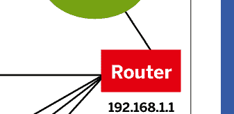

| SSH | RAID1 |

|---|---|

| Samba | |

| Empty | |

| Webmin | 192.168.1.100 |

路由器: 192.168.1.1

客户端机器（桌面电脑、笔记本电脑和手机等）


在我们的操作系统驱动器上——基本上只有一个操作系统和一个额外分区，就像你接受了标准实例的默认设置。虽然有些人可能倾向于做一些更奇特的操作，例如快照、救援分区和虚拟机，但我们正在基于这样一个理论工作：如果我们的配置可以通过重新安装来轻松复制。备份几个配置文件将使这一切再次可行。

Debian 很容易安装，只需获取 ISO（另一个镜像源）并从安装集 www.debian.org 安装第一个操作系统。现在，系统会提示你为服务器设置 root 账户，此处的 Debian 将构建 root 账户和 sudo，你可能需要创建它们。在每个阶段使用一个用户；其他用户可以添加（如果你想当个小管理员，可以使用严苛的存储限制）。我们使用的是“引导式使用”额外磁盘选项；`ext4` 和交换分区（`swap`）就是我们服务器所需的所有。

一旦所有内容都安装到新系统中，并以 root 身份（或者如果你愿意，使用用户身份）登录，以指示我们将再次执行的命令：我们用 `#` 表示命令。保持服务器最新更新是一个良好的习惯，因此我们的第一个动作是更新软件包列表并捕获任何最后的更新：

`# apt-get update`

> 这是我们设置的最小 Debian 集合。你刚刚的安装就占用了一个 GB 空间。

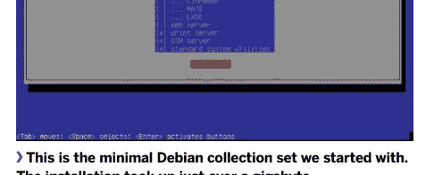

## 硬件


家庭服务器完全不需要处理能力，双核 Pentium 芯片就可以了，4GB 内存也绰绰有余。如果你的服务器必须离路由器很远，最好使用有线路由器而不是适配器。如果你发现有大量数据从你的服务器流向家里的客户端机器，那么投资一个千兆路由器（进行升级）是值得的。一个小型服务器可以很安静，但房间之间的移动会有帮助。大容量 SSD 很昂贵，因此机械硬盘对于 TB 级存储通常是可以的。移动驱动器可能会产生噪音，尤其是当我们告诉您时……

对于此功能，我们将把操作系统安装在一个驱动器上（理想情况下是 SSD，但也可以是硬盘）。如果我们有一个 2 盘的 RAID（镜像）阵列用于存储，我们的操作系统驱动器至少应该是 20GB，但我们……

## 添加 RAID 设置

设置冗余存储镜像阵列，轻松让你的服务器运行起来

下一步是使用 `mdadm` 设置软件 RAID。假设我们有两个硬盘，每个花费我们大约 30 美元。稀疏容量有一个天然优势，即拥有两个大分区（每个硬盘一个），但如果一个硬盘故障，你就会丢失一半数据，而墨菲定律的代价会更高。另一种方法是单个逻辑卷，但如果其中一个硬盘故障，你将丢失所有数据。还有一种误区认为你的硬盘必须是不同的，或者至少是不同的批次，以避免故障。

连接好硬盘后，我们可以通过运行 `blk` 来检查它们的节点。我们将看到硬盘为 `/dev/sdb` 和 `/dev/sdc`。然后我们开始对它们进行分区。我们将使用 `gpt`（对于大于 2TB 的硬盘是绝对必要的）到你的服务器中（如果尚未设置分区表）并运行：

```
# fdisk /dev/sdb
```

输入 `p` 列出分区。我们希望通过按 `n` 直到创建一个新分区来删除它们；按 `n` 并对编号接受 `1`。也按 Enter 接受默认值。我们将使用整个硬盘，使用最后一个扇区来标记分区的结束。这将是硬盘的总容量。相同容量的硬盘之间的一些细微差异（即使是相同型号）并不是问题，因为 `mdadm` 将使用最小的硬盘。如果你的硬盘大小不同，为分区类型输入 `0` 且一切看起来正常。如果是，按 `w` 将表写入磁盘。现在退出并对 `/dev/sdc` 重复此过程。

| A1 | A2 | A3 | Ac |
|---|---|---|---|

| B1 | B2 | Bp | Bb |
| C1 | Cp | C3 | |
| D1 | D2 | D3 | |
| E1 | E2 | E3 | |

> > Wikipedia 会告诉你关于各种奇特的布局，但你需要两个以上的硬盘才能拥有其中任何一种。

## RAID 5 意味着什么？

在 [RAID 1] 模式下，RAID 级别 206 发生了一些问题，我们在单个硬盘故障的情况下保护我们的数据，或者因为我们没有为故障制定备份策略而哭泣。有一种误区认为你的硬盘必须是不同的，或者至少是不同的批次，以避免故障。

连接好硬盘后，我们可以通过运行 `blk` 来检查它们的节点。我们将看到硬盘为 `/dev/sdb` 和 `/dev/sdc`。然后我们开始对它们进行分区。我们将使用 `gpt`（大于 2TB 的硬盘是绝对必要的）到你的服务器中（如果尚未设置分区表）并运行：

```
# fdisk /dev/sdb
```

输入 `p` 列出分区。我们希望通过按 `n` 直到创建一个新分区来删除它们；按 `n` 并对编号接受 `1`。也按 Enter 接受默认值。我们将使用整个硬盘，使用最后一个扇区来标记分区的结束。这将是硬盘的总容量。相同容量的硬盘之间的一些细微差异（即使是相同型号）并不是问题，因为 `mdadm` 将使用最小的硬盘。如果你的硬盘大小不同，为分区类型输入 `0` 且一切看起来正常。如果是，按 `w` 将表写入磁盘。现在退出并对 `/dev/sdc` 重复此过程。

| A1 | A2 | A3 | Ac |
|---|---|---|---|

| B1 | B2 | Bp | Bb |
| C1 | Cp | C3 | |
| D1 | D2 | D3 | |
| E1 | E2 | E3 | |

> > Wikipedia 会告诉你关于各种奇特的布局，但你需要两个以上的硬盘才能拥有其中任何一种。

## RAID 5 意味着什么？

在 [RAID 1] 模式下，RAID 级别 206 发生了一些问题，我们在单个硬盘故障的情况下保护我们的数据，或者因为我们没有为故障制定备份策略而哭泣。有一种误区认为你的硬盘必须是不同的，或者至少是不同的批次，以避免故障。


下一步是使用 `mdadm` 设置软件 RAID。假设我们有两个硬盘，每个花费我们大约 30 美元。稀疏容量有一个天然优势，即拥有两个大分区（每个硬盘一个），但如果一个硬盘故障，你就会丢失一半数据，而墨菲定律的代价会更高。另一种方法是单个逻辑卷，但如果其中一个硬盘故障，你将丢失所有数据。还有一种误区认为你的硬盘必须是不同的，或者至少是不同的批次，以避免故障。

连接好硬盘后，我们可以通过运行 `blk` 来检查它们的节点。我们将看到硬盘为 `/dev/sdb` 和 `/dev/sdc`。然后我们开始对它们进行分区。我们将使用 `gpt`（对于大于 2TB 的硬盘是绝对必要的）到你的服务器中（如果尚未设置分区表）并运行：

```
# fdisk /dev/sdb
```

输入 `p` 列出分区。我们希望通过按 `n` 直到创建一个新分区来删除它们；按 `n` 并对编号接受 `1`。也按 Enter 接受默认值。我们将使用整个硬盘，使用最后一个扇区来标记分区的结束。这将是硬盘的总容量。相同容量的硬盘之间的一些细微差异（即使是相同型号）并不是问题，因为 `mdadm` 将使用最小的硬盘。如果你的硬盘大小不同，为分区类型输入 `0` 且一切看起来正常。如果是，按 `w` 将表写入磁盘。现在退出并对 `/dev/sdc` 重复此过程。

| A1 | A2 | A3 | Ac |

|---|---|---|---|

| B1 | B2 | Bp | Bb |

| C1 | Cp | C3 | |

| D1 | D2 | D3 | |

| E1 | E2 | E3 | |

> > Wikipedia 会告诉你关于各种奇特的布局，但你需要两个以上的硬盘才能拥有其中任何一种。

## RAID 5 意味着什么？

在 [RAID 1] 模式下，RAID 级别 206 发生了一些问题，我们在单个硬盘故障的情况下保护我们的数据，或者因为我们没有为故障制定备份策略而哭泣。有一种误区认为你的硬盘必须是不同的，或者至少是不同的批次，以避免故障。

## 获取远程访问

通过动态 DNS 和端口转发来控制你的服务器。

能够从世界上任何地方访问你的服务器是一件很兴奋的事，但运行互联网服务伴随着风险。如果我们允许访问 SSH 服务器，那么我们需要强密码，或者更好，使用密钥（`keys`）。

建议禁用 root 账户（如果你在安装时设置了它，否则它已经被禁用了），用一个较低权限的用户身份登录，并使用 `sudo` 执行操作。在 `/etc/ssh/sshd_config` 中的此 `PermitRootLogin` 设置中，如果我们想使用密钥登录，将其设置为 `no`；使用密码认证（Debian 默认设置）登录。在尝试从另一台机器连接之前，检查此项可能是好的。

默认位置并为你的密钥选择密码。如果密钥被盗，这增加了一层额外的安全性。SSH 密钥的工作原理是有一个公钥（它在服务器的哪个位置都无所谓）和一个安全保存在你电脑上的私钥。这是通过某些数学理论验证用户的过程。强制基于密钥的登录需要在你执行操作的地方生成密钥对。人们起初会觉得这些事情很奇怪。

```bash
$ ssh user@192.168.1.100
```

其中 `user` 是你在服务器上的用户名（我们将在整个过程中使用它），如果没有通过生成我们的密钥，我们将登录并进入我们想去的地方（如果服务器上没有的话）。如果已经有了，请检查服务器上的 `~/.ssh/authorized_keys` 日志，并将你的密钥附加其中，以便从另一台机器登录。

如果你必须将密钥保留在 USB 闪盘上，那么不要让它留在 `/home/user/authorized_keys` 路径下。

```bash
$ ssh-copy-id user@192.168.1.100
```

这也可以这样做，但为什么要浪费密钥呢？

全部完成后，将不会被询问密码。如果你想禁用密码登录，请在 `/etc/ssh/sshd_config` 中添加 `PasswordAuthentication no` 指令。

但这意味着如果你想使用私钥（文件 `~/.ssh/id_rsa`），我们将不得不要求使用它。如果你丢失了密钥，唯一的问题是它有文件权限 (`600`)，否则 SSH 将向你显示不安全的错误。

USB 使用的文件系统（FAT32 和 NTFS）不支持符号链接（`symlinks`），所以你必须将密钥拷贝出来。私钥可以保存在运行机器的 `~/.ssh` 目录，在这种情况下它会被自动读取，但它也可以重命名或存储在其他文件系统中，在这种情况下你将需要使用 `ssh -i /path/to/key`。

要使远程访问生效还有一个最后一个步骤：即配置你的路由器将 SSH 流量转发到正确的端口。我们的服务器将位于默认端口 (`22`)，但我们可以让它位于不同的端口，这可以防止你的服务器被机器人发现。

如何配置这取决于路由器，但目标是将外部端口转发到我们服务器 `192.168.1.100` 上的内部 UP 端口（例如 22 端口）。


> 这是在良好的路由器上端口转发的样子，但在不同的硬件上，原理是相同的。

## 动态 DNS 和 ssh

对我们的服务器拥有远程访问，只有在我们知道路由器的地址时才有用。我们将使用在 IP 发生变化时动态更新的地址。解决方案是使用动态 DNS 服务提供商获取主机名，并根据服务器的请求更新其 DNS 记录。根据提供商的不同，我们可以通过运行一次或每周一次的 cron 任务来自动化此。

此外还可以使用 SSH 通过 FTP 发送和接收文件。大多数管理器允许你使用 `ssh@duckdns.org:8022` 并用你的用户凭据登录。设置一个基于 Web 的系统会更好。Nextcloud 教程（见第 30 页）可以很容易地适应这一需求。与其使用多个服务来配置端口和跨越 SSH 的隧道服务，如果你在局域网上运行了一个 Web 器，你可以通过以下方式访问它：

```bash
$ ssh user@duckdns.org -p 8022
localhost:8080
```

现在你可以打开一个端口并连接到 http://localhost:8080，这已经通过了隧道。你可以通过按回键向现有的 SSH 会话添加隧道——并在端口处以 `1080;` 等结尾。

## 终极服务器

## 添加 Samba

准备好伴随着额外的 boss nova 随 samba 协议跳舞吧。

任何家庭服务器执行的最崇高的职责之一就是共享。无论是分享你积累的数 GB 绝妙乐曲，还是在你找不到具有足够容量的 USB 驱动器时一个存放它们的地方，拥有一些集中且公共的存储空间是非常用的。与带有 NFS 文件共享协议的操作系统不同（NFS 自 DO: 时代以来）：

相反，我们将使用 Samba，它是 Windows 使用的共享协议的实现。它的优点是，我们将构建的服务器可以被任何 Windows 或 Mac 以及其他 Unix 设备访问。

在设置之前，为网络共享设置目录是一个好主意。我们将它们存储在 RAID 上，RAID 应该是卸载状态。我们将使用：

- `/mnt/raid/music`

- `/mnt/raid/photos`

- `/mnt/raid/documents`

- `/mnt/raid/files`

我们将使用 Samba，它是 Windows 使用的共享协议的实现。它的优点是，我们将构建的服务器可以被任何 Windows 或 Mac 以及其他 Unix 设备访问。在设置之前，为网络共享设置目录是一个好主意。我们将它们存储在 RAID 上，RAID 应该是卸载状态。我们将使用：

- `/mnt/raid/music`

- `/mnt/raid/photos`

- `/mnt/raid/documents`

- `/mnt/raid/files`

但这意味着如果你想使用私钥（文件 `~/.ssh/id_rsa`），我们将不得不要求使用它。如果你丢失了密钥，唯一的问题是它有文件权限 (`600`)，否则 SSH 将向你显示不安全的错误。

USB 使用的文件系统（FAT32 和 NTFS）不支持符号链接，所以你必须将密钥拷贝出来。私钥可以保存在运行机器的 `~/.ssh` 目录，在这种情况下它会被自动读取，但它也可以重命名或存储在其他文件系统中，在这种情况下你将需要使用 `ssh -i /path/to/key`

要使远程访问生效还有一个最后一个步骤：即配置你的路由器将 SSH 流量转发到正确的端口。我们的服务器将位于默认端口 (`22`)，但我们可以让它位于不同的端口，这可以防止你的服务器被机器人发现。

如何配置这取决于路由器，但目标是将外部端口转发到我们服务器 `192.168.1.100` 上的内部 UP 端口（例如 22 端口）。


> 这是在良好的路由器上端口转发的样子，但在不同的硬件上，原理是相同的。

## 动态 DNS 和 ssh


对我们的服务器拥有远程访问，只有在我们知道路由器的地址时才有用。我们将使用在 IP 发生变化时动态更新的地址。解决方案是使用动态 DNS 服务提供商获取主机名，并根据服务器的请求更新其 DNS 记录。根据提供商的不同，我们可以通过运行一次或每周一次的 `cron` 任务来自动化此。

此外还可以使用 `SSH` 通过 `FTP` 发送和接收文件。大多数管理器允许你使用 `ssh@duckdns.org:8022` 并用你的用户凭据登录。设置一个基于 Web 的系统会更好。Nextcloud 教程（见第 30 页）可以很容易地适应这一需求。与其使用多个服务来配置端口和跨越 `SSH` 的隧道服务，如果你在局域网上运行了一个 Web 器，你可以通过以下方式访问它：

```bash
$ ssh user@duckdns.org -p 8022
localhost:8080
```

现在你可以打开一个端口并连接到 `http://localhost:8080`，这已经通过了隧道。你可以通过按回键向现有的 `SSH` 会话添加隧道——并在端口处以 `1080;` 等结尾。

# 终极服务器

## 添加 Samba

准备好伴随着额外的 boss nova 随 `samba` 协议跳舞吧。

任何家庭服务器执行的最崇高的职责之一就是共享。无论是分享你积累的数 GB 绝妙乐曲，还是在你找不到具有足够容量的 USB 驱动器时一个存放它们的地方，拥有一些集中且公共的存储空间是非常用的。与带有 `NFS` 文件共享协议的操作系统不同（`NFS` 自 `DO:` 时代以来）：

相反，我们将使用 `Samba`，它是 Windows 使用的共享协议的实现。它的优点是，我们将构建的服务器可以被任何 Windows 或 Mac 以及其他 Unix 设备访问。

在设置之前，为网络共享设置目录是一个好主意。我们将它们存储在 `RAID` 上，`RAID` 应该是卸载状态。我们将使用：

- `/mnt/raid/music`
- `/mnt/raid/photos`
- `/mnt/raid/documents`
- `/mnt/raid/files`

但这意味着如果你想使用私钥（文件 `~/.ssh/id_rsa`），我们将不得不要求使用它。如果你丢失了密钥，唯一的问题是它有文件权限 (`600`)，否则 `SSH` 将向你显示不安全的错误。

`USB` 使用的文件系统（`FAT32` 和 `NTFS`）不支持符号链接，所以你必须将密钥拷贝出来。私钥可以保存在运行机器的 `~/.ssh` 目录，在这种情况下它会被自动读取，但它也可以重命名或存储在其他文件系统中，在这种情况下你将需要使用 `ssh -i /path/to/key`

要使远程访问生效还有一个最后一个步骤：即配置你的路由器将 `SSH` 流量转发到正确的端口。我们的服务器将位于默认端口 (`22`)，但我们可以让它位于不同的端口，这可以防止你的服务器被机器人发现。

如何配置这取决于路由器，但目标是将外部端口转发到我们服务器 `192.168.1.100` 上的内部 `UP` 端口（例如 `22` 端口）。


> 这是在良好的路由器上端口转发的样子，但在不同的硬件上，原理是相同的。

## 动态 DNS 和 ssh

对我们的服务器拥有远程访问，只有在我们知道路由器的地址时才有用。我们将使用在 IP 发生变化时动态更新的地址。解决方案是使用动态 DNS 服务提供商获取主机名，并根据服务器的请求更新其 DNS 记录。根据提供商的不同，我们可以通过运行一次或每周一次的 `cron` 任务来自动化此。

此外还可以使用 `SSH` 通过 `FTP` 发送和接收文件。大多数管理器允许你使用 `ssh@duckdns.org:8022` 并用你的用户凭据登录。设置一个基于 Web 的系统会更好。Nextcloud 教程（见第 30 页）可以很容易地适应这一需求。与其使用多个服务来配置端口和跨越 `SSH` 的隧道服务，如果你在局域网上运行了一个 Web 器，你可以通过以下方式访问它：

```bash
$ ssh user@duckdns.org -p 8022
localhost:8080
```

现在你可以打开一个端口并连接到 `http://localhost:8080`，这已经通过了隧道。你可以通过按回键向现有的 `SSH` 会话添加隧道——并在端口处以 `1080;` 等结尾。

# 终极服务器

## 添加 Samba

准备好伴随着额外的 boss nova 随 `samba` 协议跳舞吧。

任何家庭服务器执行的最崇高的职责之一就是共享。无论是分享你积累的数 GB 绝妙乐曲，还是在你找不到具有足够容量的 USB 驱动器时一个存放它们的地方，拥有一些集中且公共的存储空间是非常用的。与带有 `NFS` 文件共享协议的操作系统不同（`NFS` 自 `DO:` 时代以来）：

相反，我们将使用 `Samba`，它是 Windows 使用的共享协议的实现。它的优点是，我们将构建的服务器可以被任何 Windows 或 Mac 以及其他 Unix 设备访问。

在设置之前，为网络共享设置目录是一个好主意。我们将它们存储在 `RAID` 上，`RAID` 应该是卸载状态。我们将使用：

- `/mnt/raid/music`
- `/mnt/raid/photos`
- `/mnt/raid/documents`
- `/mnt/raid/files`

但这意味着如果你想使用私钥（文件 `~/.ssh/id_rsa`），我们将不得不要求使用它。如果你丢失了密钥，唯一的问题是它有文件权限 (`600`)，否则 `SSH` 将向你显示不安全的错误。

`USB` 使用的文件系统（`FAT32` 和 `NTFS`）不支持符号链接，所以你必须将密钥拷贝出来。私钥可以保存在运行机器的 `~/.ssh` 目录，在这种情况下它会被自动读取，但它也可以重命名或存储在其他文件系统中，在这种情况下你将需要使用 `ssh -i /path/to/key`

要使远程访问生效还有一个最后一个步骤：即配置你的路由器将 `SSH` 流量转发到正确的端口。我们的服务器将位于默认端口 (`22`)，但我们可以让它位于不同的端口，这可以防止你的服务器被机器人发现。

如何配置这取决于路由器，但目标是将外部端口转发到我们服务器 `192.168.1.100` 上的内部 `UP` 端口（例如 `22` 端口）。

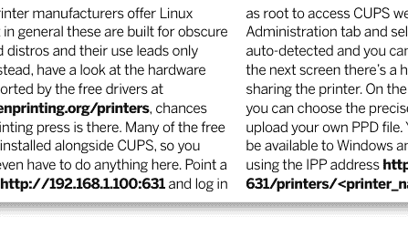

The Manual | 1

## 打印

除了文件，使用 `SMB` 协议（以及 `CUPS` 协议 `/ipp`）允许我们共享打印机。这非常有用，因为当服务器和打印机是远程的，网络上的任何人都可以使用打印机而无需遇到报告。但首先，当你有超过一台电脑和设备需要部分使用通用打印系统 (`CUUS`) 时，这在安装时会被请求：

某些制造商提供 Linux 驱动程序，但这些通常用于其他目的或过时的驱动，你可能不需要。相反，查看免费驱动支持的硬件。

打印时，选择是关键。许多免费驱动程序已经安装了 `CUPS`，所以你可能不需要做其他事情。但最后你可能需要

作为访问 `CUPS` Web 界面。在管理选项卡并添加；选择“其他”自动检测并点击“继续”。在下一个屏幕上，有一个标题检查打印机是否被发现。

你可以选择你想要的打印机。在下一个和最终的屏幕上，打印机将供 Windows 和 Linux 机器通过 IP 地址 `http://192.168.1.100/:printer_name/` 访问。


The Hacker's Manual | 1

# 发行版 (Distros)

## Emby 和 Webmin

在浏览器中轻松流媒体媒体并管理你的服务器。

像 `VLC` 或 `mpv` 这样的播放器可以很方便地在服务器内存中运行。但反复操作你会发现，这并不是管理媒体的特别好方法。特别是如果你使用 `Emby`，它是一种可以从你的服务器或 `DL`（人类创造过最糟糕的组织：数字生活网络联盟）提供内容的媒体工具。

`Emby` 通过 `HTML5` 提供流传输并可以根据网络状况进行压缩。它不消耗大量 CPU，同时服务几个用户可能会导致播放抖动（或卡顿）。如果安装了适当的程序，则提供 GPU 加速——目前以实验性功能支持 `NVIDIA NVENC`（高端桌面显卡）和 `Intel QuickSync`（在大多数最新 CPU 上）。

此外，内容可通过 `Chromecast`、`Roku`、`iOS` 和 `Android` 应用程序进行流传输。要使用它，你需要在存储库中添加相应的密钥：

```bash
$ wget -qO - http://download.openmedia.org/repositories/emby-debian/Release | sudo apt-key add -
$ sudo echo "deb http://download.openmedia.org/repositories/emby-debian main" | tee /etc/apt/sources.list.d/emby.list
```

然后我们可以更新列表并安装：

- `sudo apt-get update`
- `sudo apt-get install emby`


- `sudo apt-get install webmin`

- `sudo apt-get start emby`

- 如果你想启动 webmin：

- `sudo systemctl start webmin`

- `sudo systemctl enable webmin.service`


> Emby 列出了经典的“Qatsi 纪录片”——记录全球化社会的一部分，并由 Playlist of Glass 提供配乐。

## 使用 Webmin 控制

除了将媒体从浏览器中释放出来，我们还可以进行一些系统管理。Webmin 是一个用 Perl 编写的 Web ，可以管理服务器的所有可能功能。选项有所不同，所有这些可以在没有 SSH 的情况下完成，但某些可能需要配置不同的文件。通过 Webmin，这些都可以通过单一图形界面进行控制。

由于我们需要添加密钥和存储库以确保设置正确：

```bash
$ wget -qO - http://downloads.webmin.com/software/webmin-key.key | sudo apt-key add -
$ echo "deb http://download.webmin.com/download/repo contrib" | sudo tee /etc/apt/sources.list.d/webmin.list
```

这只是使用问题：

默认配置会在浏览器中启动一个 Web 服务器，这意味着当你访问 URL 时：

```
http://192.168.1.100:1080
```

如果发生错误，请确保你的 IP 地址是公开的。如果你在此处添加异常，你只是通过局域网访问，并且需要添加它。

在此之外，我们可以登录服务器，现在可以处理所有事务：配置我们的共享（从 Servers 菜单）、查看日志、更新软件包和资源使用情况——几乎是你想象到的的一切。

将这些（Webmin 拥有 root 权限）放在一个地方安全性高得多，因为如果一个地方就是界面。我们不建议在没有 SSL 的情况下将外部流量暴露给 Webmin，但正如动态 DNS 章节提到的，可以通过 SSH 隧道传输流量。Webmin 还允许你限制对界面的访问，这可能需要身份验证，因此你可以增加一些隐私。

该 Linux 发行版对于本教程特别相关，因为我们可以选择我们的任何一个，或者进行修复维护。如果你在创建服务器后设置了 Webmin，重新同步——该过程通常再次需要，除非在这些点上实际上只是同步一堆零。这在文件 `/etc/metadata` 中可用。

# 终极家庭服务器

## 扩展与延伸

基础奠定后，我们的服务器项目可以定制任何用途。

我们已经完成了任何服务器所需的大部分准备工作。我们还没有真正考虑过事实，即值得说，仅通过 SSH 访问服务器是一个好主意。如果密钥被盗，特别是当可以使用基于密钥的访问时（如果你偷懒并允许密码访问），你传递的密码很快也将无事于事。有些人只使用非 root 用户登录，但这阻止了用户的增长。安全与便利性之间的权衡是和谐的。

让我们的服务器暴露在互联网上是可行的，前提是我们基于 IPv6 的服务器免受外部的直接侵害；如果我们的路由器或网络上的另一个设备被攻破并导致该连接留有漏洞怎么办？

为了规避那个安全问题，我们应该考虑下一步做什么。最终，你仅限于你对这里的愿景。如果你有一对扬箱（或如果你的服务器运行在家里）连接到你的客厅，尝试设置 Plex。它像魔法一样简单！Plex Media Server 可以通过遥控器、客户端应用或移动设备进行控制。某些服务器程序将允许你将听歌与服务（如 Spotify 和 Last.fm）连接起来，只要音频质量允许，甚至不需要触碰命令行。如果你准备好了，可以将你的服务器连接到电视，但这种安排的大部分可能需要在服务器上安装 GUI。那不是我们想要走的路。

通过 Wi-Fi 连接到互联网时，使用 VPN 保护你的流量是明智的。有很多选项，但为什么不使用我们自己的 VPN 服务器呢？再次，开启 VPN 可能是最好的选择，或者更改默认端口。VPN 设置足够简单，你只需要了解一些证书的知识。有了这些知识，你可以在任何热点感到安全，如果你需要使用 ISP 访问本地文件，这需要硬件但不需要额外软件——机器将像你想象的那样工作。你还可以配置 WireGuard，使其可以在网络任何地方使用。最后，我们将讨论一些选项，以防你的服务器被雷击或过度使用。重新安装系统可能少于一小时。


- 基于 Open 的客户端可以涵盖各种服务。

## 我们需要备份

对于 Dropbox 之类的服务，备份可以是自动化的，但不麻烦。在我们的总备份中，我们可以使用 samba、FTP。从开始，如果你有一对扬声器并设置 mdp，需要源列表。我们用于备份的方法是 rsync。Rsync 是一个可以高效传输大文件的去重工具，前提是你有足够的带宽。将大文件发送到云备份会消耗时间并可能产生问题。免费存储可用，但云存储是昂贵的，人们并不擅长删除东西。最好的方法是将服务器上的文件备份到外部驱动器（或 NAS）进行离线存储。


## IPFire: 守护你的网络

你如何让入侵者远离你的系统？通过今天构建来保护你的电脑，你的 Linux 发行版内置了防火墙，较大的开源社区确保你有管理工具来满足你的需求。在保护你的 Linux 电脑的同时，并没有扩展到其他设备。你的路由器也内置了防火墙。在 IoT 设备处理 IP 地址时，你无法真正依靠路由器的有限功能来保护你的位和字节。我们已经过了大型网络易于部署的时代。设置是一个涉及硬件组装和软件的复杂过程。我们的发行版帮助你轻松设置防火墙。

IPFire 使用构建在上面的状态包检测 (SPI) 防火墙，便于网络地址转换 (NAT)、数据包过滤等。你可以保护从转发端口到创建 DMZ 的一切。防火墙固化防御零日漏洞并带有严格的选项。IPFire 根据你的安全级别提供多种规则，并允许你创建复杂的策略来管理网络。有关更多细节，你也可以管理从任何段访问的外部。

IPFire 非常现代。它是无法应对现代需求的旧硬件的最佳方法之一。单核处理器至少两个硬盘和 4GB 磁盘空间足够安装它。更大的硬盘将为你完善 IPFire 安装提供更多。

将第一个网络连接到 IPFire 的路由器/网关。将第二个连接到路由器或移动网络中的所有电脑和设备。一旦设置好 IPFire，让网络中的所有设备都使用它而不是 ISP 提供的。还要忘记禁用网络路由器中的 DHCP 功能，因为它将负责为你的 IPFire 防火墙分配 IP。

一旦组好了防火墙电脑，从 IPFire 安装媒体启动。该防火墙发行版从零开始编写，具有直接的安装过程。按照直观的安装过程使用默认选项，这将配置你的电脑和颜色区域。这些区域中的每一个对应一组安全级别。默认的 Green 是常见的安全级别。默认就像你有两个网络。

安装过程中最重要的部分是设置好 root 用户配置后出现的 Network 菜单。它检测安装的 NIC 数量，并要求你将其分配到四个颜色区域之一。

一旦你在网络配置部分选择了此方法类型，选择驱动程序并将其分配给 NIC。连接到内部家庭网络的第二个 NIC 标记为红色接口（Red）。连接到 ISP 调制器的第一个适配器应标记为红色接口。内部家庭网络将标记为绿色接口（Green）。然后选择下一步配置绿色接口。

如果 `10.0.0.1` 是红色接口的网络 IP 地址，更改 DHCP 选项。现在进入 DHCP 和网关设置，并将次要 DNS 设置为 `8.8.8.8` 和 `8.8.4.4`。

一旦完成网络设置，IPFire 的设置向导将弹出配置 DHCP 服务器和它将处理的所有地址的选项。

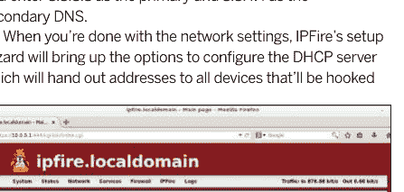

## 过滤 URL

除了通过 URL 管理流量外，你还可以根据其他因素过滤流量，例如 IPFire 内置的 URL 过滤器允许你阻止整个域名或 URL，防止你下载恶意可执行文件。要配置过滤器，请前往 网络（Network）-> 过滤器（Filter）。在页面上，你将看到可以阻止的类别列表。进行切换。

你可以通过将某些域名和 URL 包含在自定义黑名单（Custom blacklist）列表中来手动阻止访问。一旦你更新了文件，它将针对你选择的某些特定网站阻止整个服务器。在自定义黑名单文本框中，可以使用旁边的简单文本框添加或删除项目。

在网络中安装设置后，你还可以启用文件扩展名阻止选项来阻止任何文件。设置好过滤器参数后，向下滚动页面并按下“保存并重启”（Save and Restart）按钮以过滤流量并使你的更改生效。

## URL 过滤器维护

黑名单将自动编译为数据库。根据黑名单的大小，在重启 IPFire 服务器之前可能需要等待此操作完成。该文件会定期更新。

| | | |

|---|---|---|

| 黑名单 | 未选择。 | 上传黑名单 |


| 自动黑名单更新 | 启用自动更新：[ ] <br> 更新计划：[ ] | 选择计划 [v] <br> 自定义源：[ ] |

| 更新设置 | 更新 |

白名单

创建并管理自己的白名单文件

[ 创建白名单 ]

恢复 URL 过滤器设置

启用自动导入 tar-gz 备份文件

[ 浏览... 未选择。 ] 导入备份文件

> 你可以设置 IPFire 从热门仓库（如 Shalla Secure Service）自动更新并获取黑名单。

到告别服务器：激活 DHCP 服务器，并在起始地址中设置 `10.0.0.10`，在结束地址中设置 `10.0.0.10`。这将指示服务器将这两个值之间的地址转发给想要访问互联网的设备。


## 友军火力

安装服务后，你基于浏览器的管理界面可以在你通过 `GN` 连接到路由器层级的 IP 地址的 `444` 端口可用，在我们的网络中，这可能是 `10.0.0.1`，因为 IPFire 使用 SSL 证书，你需要接受它以作为例外。例如，你会被提示输入 IPFire 管理员的用户名和密码。在安装过程中，还会配置运行防火墙、代理和其他服务。这现在应该会调出 IPFire 管理界面。

互联网流量将通过服务器以及我们使用的 OpenVPN 网关。我们将在稍后介绍如何设置。

代理（Proxy）和服务（Service）标签页是我们用于帮助你启用和配置防火墙之外的单独服务。DNS 和入侵检测（Intrusion Detection）的选项可以使用此部分下的各种选项轻松配置。每个选项都具有完全功能性。这是因为 IPFire 开箱即实现了一些合理的默认设置，这是根据你的需求构建和配置 IPFire 的良好起点。

虽然我们要求在这方面的专业知识展示，并在这 IPFire 的文档上花费一些时间，但 IPFire 是基于 Softwall 的 Linux，它具有易于导航的浏览器界面，可以轻松访问页面顶部列出的防火墙的不同方面和组。

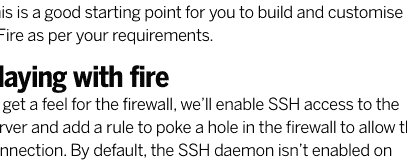

系统（System）标签页有配置安装的选项。一旦你找到设置访问，就可以创建一个带有或带有日志文件的系统备份 ISO。GUI 设置允许你自定义主题和 IPFire 管理界面的其他方面。此菜单下的另一个选项是关机（Shutdown）按钮，用于重启或关闭防火墙服务器。

然后是状态（Status）标签页，它提供了关于防火墙各个方面的信息。你可以来到这里获取服务器上 CPU 和内存使用情况的信息。菜单还有监控带宽的选项。

> 一旦安装，你可以使用 IPFire 的包管理器为组件安装单独更新，或移动到新版本。

# 发行版

同样，你可以使用端口转发（port forwarding）来访问防火墙后的 Web 服务器。例如，假设你在运行在防火墙内部的机器上有一个网站，IP 地址为 `10.0.0.11`。我们现在设置防火墙，将定义为 HTTP 端口的所有流量重定向到运行在防火墙后面的。

像以前一样，前往防火墙规则（Firewall Rules）并点击“新建”（New）按钮。选择目标网络（destination networks）单选按钮，并在 NAT 部分，选择下拉菜单并使用“任意”（Any）。在网络地址转换（NAT）部分，输入你防火墙内部服务器的 IP 地址，该字段为 `10.0.0.11`。在协议（Protocol）部分，选择 TCP 并为目标端口输入 `80`。最后，向未来的规则列表添加一条规则。然后点击“应用”（apply）。

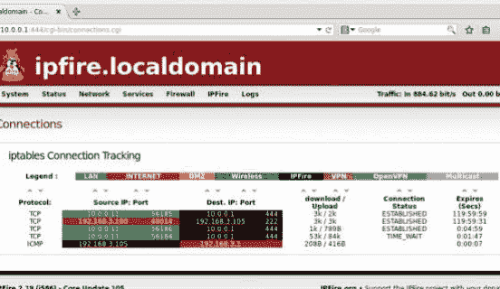

现在尝试使用浏览器（`http://192.168.3.105`）访问网页，查询将自动转发到防火墙内部的本地机器，并通过显示由你的服务器提供的网页进行重定向。你可以根据需要在 IPfire 中为其他网络定义类似的端口转发规则。

## 前往各地

IPfire 最有功能之一是 OpenVPN 网关。你可以配置此 OpenVPN 网关，通过安全连接访问私有网络。要设置它，前往 OpenVPN 并生成证书。这将引导你进入填写主机证书详细信息的页面。

在常规设置中，选择服务器选项。向下滚动到加密选项，使用下拉菜单选择 `SHA256 (256 位)` 作为哈希算法并使用 HMAC auth。

保存选项。然后返回常规设置，选择 OpenVPN 单选按钮以启动 OpenVPN 服务器。OpenVPN 服务器现在运行。

下一步工作是为远程用户设置帐户。前往 OpenVPN -> 连接状态并点击“添加”按钮开始添加新用户的过程。在第一个屏幕上，默认选择了主机虚拟网络类型（RoadWarrior）。在下一个屏幕上，填写新用户的详细信息，所有内容一目易懂。完成表单后，保存按钮。新用户现在将列在连接状态下。

对于生产服务，你通常可以启用 SSH 来帮助测试和配置防火墙。

我们需要首先为管理启用 SSH。前往 系统 -> SSH 并切换 SSH 访问。我们需要在访问中添加规则。前往 防墙 -> 防火墙规则并点击“新建”按钮。在表单中，选择 SSH 复选框并输入你想访问的服务器 IP 地址。

如果 IP 地址是 `192.168.3.105`，那么 IPfire 将允许符合尝试的连接。

跳转到目标部分，启用防火墙单选按钮并从下拉菜单中选择远程接口。IPfire 上的 SSH 配置通过端口 `22` 连接。这符合 SSH 端口 `22` 的标准。

最后在表中添加标记来描述规则以备后参考。当你完成所有操作后，点击“添加”创建规则。如果看起来正确，按下“应用更改”按钮。

一旦应用了侧边，前往管理机器（`192.168.3.105`），打开终端并输入 `ssh root@... -p 22` 进行连接。你会被提示输入 IPfire 密码并允许登录。然而，从任何其他机器执行相同命令将抛出错误，IPfire 将拒绝连接。

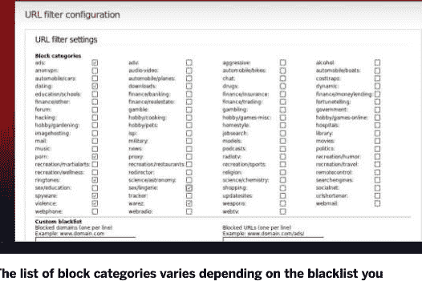

+   > 头部状态
+   > 连接：所有入站和出站连接
+   > 点击 IP 地址通过谁查看其详细信息
+   > 你下载的黑名单显示的阻止类别列表。

# IPFire

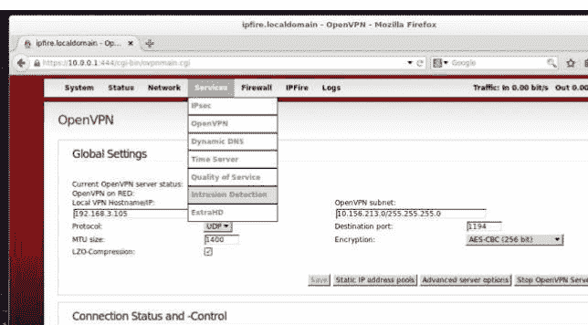

- 你可以重新配置其他网络服务，例如 OpenVPN 网关和基于 Smart 的入侵检测系统。

你真正断开连接时的状态。一旦你将配置文件复制到你想要连接的电脑上，现在安装一个 OpenVPN 服务器，并导入你从服务器界面下载并解压的文件。连接后，将其连接到运行在你的 IPFire 上的 OpenVPN 服务器。然后，通过加入 IPFire 防火墙的绿色网络（该网络仅对网络内的计算机可见），你应该能够通过绿色网络访问 IPFire Web 界面，地址为：`10.0.0.144`

## 刷新防火墙

就像其他服务器一样，你需要使用 everfire 刷新防火墙。为了保持最新状态，请使用 Pakfire 包管理工具。你可以使用 Pakfire 安装更新，还可以轻松地刷新基础安装内容。

当有可用更新时，IPFire 首页将显示一条消息。点击进入 Pakfire 包管理器。可用更新列表将列在“系统”部分的文本框中。然后点击按钮启动进程，IPFire 现在将下载并安装更新。完成后，将要求你重启防火墙以使更改生效。IPFire 还整合了其他功能。我们曾将其用作 OpenVPN 网关，你也可以使用（见上一节）。

作为基础设施服务器、代理等加速更新。除了这些内置功能，IPFire 还具有许多实用的优势。你可以使用防火墙作为网络的代理网关，以保护跨网络的备份安全。你可以将 IPVPN 作为防火墙发行版并托管客机！使用 IPFire 通过 Pakfire 进行分发下载。向下滚动所需的包列表，并选择你想要传输的包。当你按下 `+` 号时，包管理器将列出所需的包。如果你想安装其他包，必须安装同选定的包及其所有依赖项。除非你显示空白屏幕，否则依赖项没有权限。安装完成后，你可以将其作为代理服务器使用。如果需要，将向“插件”部分添加扩展程序。

## VirtualBox 中的 IPFire

最好的方法是为测试创建一个服务器。你可以在硬件上安装 IPFire，也可以在 VirtualBox 内部安装——有关更多使用 VirtualBox 的信息请参见第 98 页。

得益于简单的检测，你可以用它创建一个与你的网络隔离的虚拟实验室。

首先，为 IPFire 服务器创建一个具有 `512MB` 内存和一个处理器的虚拟机（VM）。然后在该虚拟机的设置窗口中切换到网络选项卡以附加两个 NIC。在适配器选项卡中，选择一个连接到桥接适配器。此网卡将防火墙服务器与绿色接口连接，用于连接互联网。然后使用适配器 2 并将其连接到内部网络。内部网络具有 MAC 地址。你网络中的另一个 NIC 将通过此网卡连接到防火墙。


在虚拟机中安装时，IPFire 将设置绿-红模式。移动到驱动程序和网卡分配选项，将网卡分配到任一模式中。列出的第一个适配器用于桥接网卡，你应该将其标记为红色接口，并将内部网络适配器标记为绿色接口。Yank 通过 MAC 地址识别内部网络的 NIC。你网络中的另一个将通过此 NIC 连接到防火墙。就是这些。一旦你设置好服务器，任何与 IPFire 具有相同内部网络的虚拟机都能与防火墙进行无缝通信。

黑客手册 | 47

# Rescatus: 修复与救援

无论你的电脑运行 Linux 还是 Windows，都是你的一站式救命稻草

许多事情可能会搞乱你的电脑。粗心的按键可能会删除文件、重写引导程序、搞乱分区或引起其他可怕的问题。如果你发现自己处于困境，请停止并获取 Rescatus (https://www.supergrub.org/rescatus)。Live 版本提供了丰富的工具，你可以用它们修复双系统 Linux 和 Windows 的几乎任何问题。

Rescatus 发行版整合了所有完美且实用的工具，用于修复 Linux 和 Windows 的常见问题，包括 testdisk 和 GParted。你可以使用 Rescatus 恢复你的引导程序、修复文件系统错误，并重置 Linux 和 Windows 的密码。Rescatus 还包含了用于恢复文件和安全擦除 Windows 的工具。

有几个面向救援的发行版，但 Rescatus 比它们都更直观。与其他仅提供一组修复损坏电脑工具的发行版不同，它旨在作为 Live 介质使用，插入可启动介质或 USB 驱动器对受影响的电脑进行引导。Rescatus 将帮助你

img/d2d879b5f295fad9b17e4fc9976250c7_47_0.png)

> Rescatus 帮助你从灾难中恢复，除了像 GPG 等安全系统工具外，它还自动引入了 LXDE 桌面。Rescatus 的最新版本界面分为几个类别，如 Grub、文件系统和引导。每个类别内部的按钮帮助你找到它们。当你点击其中一个时，会打开一个菜单，详细说明 Rescatus 将执行的操作。在你浏览完文档并了解预期内容后，点击相应的救援工具。

## Fck 事项

尽管所有文件系统自十年来一直出现过搞乱硬盘的情况，但运行异常的程序没有提供重启修复电脑以外的选项，当你的 Linux 检测到不干净时，它会自动启动文件系统检查以验证系统的一致性。在许多情况下，它应该根据磁盘状况和中断的任务进行检查。在你的发行版中，你也将手动运行 fck 工具来维护你的文件系统。

| Grub | Rescatus: 修复 | 更新 Grub |

|---|---|---|

| Easy-GRUB 引导修复 | 分区 | Easy-GRUB 引导救援 |

| 检查分区或 GRUB | 文件系统 (检查根) | |

| 密码 |  Grub | 安全分区 |

| Windows | Easy Admin | 空 Windows |

| 使用 PE 恢复 | 解锁 Windows | |

| GPT | 重建 GPT 表 | 检查 {分区 |

```
echo 3.16.1-ubuntu:5.0-boot:4.0.2-live:4.0.2-1
```

> Rescatus 拥有几个命令行工具，让用户完成过程的各个阶段。

## 一键修复

得益于 Boot-Repair 应用，许多 GRUB 引导问题可以通过一键修复解决。这个巧妙的程序具有直观的界面，可以正确验证各种磁盘和分区。它适用于带有 BIOS 的传统电脑以及带有 GRUB 布局的新型电脑。Boot-Repair 位于专家类别下。当你启动它时，程序将在扫描磁盘之前显示其由几个标签组成的简单界面。它还会提供一些建议并推荐修复，这应该可以修复引导错误。在你的引导恢复后，工具还会输出一个你应该记录的 URL。该 URL 包含了磁盘、分区的详细摘要，以及重要的 GRUB 文件（如 `/etc/grub` 和 `boot/grub.cfg`）的内容。如果你遇到问题，可以在论坛上分享此 URL，以便他人理解你的布局并提供建议。最好是从 Live CD 运行而不挂载分区。为此，使用 Boot-Repair 工具并选择文件系统检查选项来列出所有分区。设置错误的项目将扫描并发现任何不一致之处。

## 引导大营

Linux 用户面临的最常见问题之一是引导分区损坏。进入一个无法使用的电脑真的没有意义。主引导记录 (MBR) 位于磁盘的特殊区域，有助于跟踪所有分区的物理位置，并持有系统的启动机制。Rescatus 包含了重新生成 GRUB 引导程序和修复 MBR 的选项。有一个“还原 Grub”选项，它可以使用 `/etc/fstab` 文件中的信息重建你的分区表。Linux 没有创建新引导程序的权限。它会将它们列在列表中并要求你选择想要安装 GRUB 的。如果你有多个分区，菜单将提示你根据启动顺序重新排列它们。一旦完成，如果你有任何基于 Debian 的系统，就可以使用 `grub-install` 命令。重装程序还包含 GRUB 修复选项。它运行了三个操作的组合：首先格式化分区，然后运行 `update-grub`，然后修复 grub。如果失败，它只会要求你选择应用于 GRUB 引导程序的磁盘和分区。在此场景出现之前，该选项仅对技术倾向性的人可用。

## 开芝门

安全 (SAM) 文件。它通常只有一个，但如果你有多个窗口，Windows 将显示多个分区。其中一个包含你想要恢复的用户密码。Rescatus 将在显示它们之前解密注册表并询问你删除的密码。选择你想恢复的用户并重启电脑，进入 Windows 后你就可以重置并更改账户密码。

同样，你可以使用 Password Reset Admin 执行。此选项还会扫描并列出 SAM 文件的 Windows 分区。选择你想恢复的用户并查看列表。Rescatus 将调整 Windows 以赋予与管理员相同的权限。这种机制适用于所有版本的 Windows，但如果你选择了其他机制来锁定你的账户（如 PIN）。

Rescatus 的选项包括删除 Admin。此选项允许你通过组合锁定 Windows 绑定第一个密码并提示它们。

root 用户是

## 分区 (Distros)

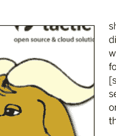

显示了分区列表。根据磁盘类型，TestDisk 可能会显示多个分区。要确定哪一个是你想要恢复的分区，请查看条目末尾括号中的分区标签。如果这没有帮助，请选择另一个分区以显示 TestDisk 在分区分区上的列表。对所有分区重复此操作，直到找到正确的那个。

| 启动修复 (Boot Repair) | |

| --- | :--- |

| 修复电脑启动 | 建议的修复（修复最常见的问题） |

| 高级选项 | 创建启动摘要（通过电子邮件或论坛寻求帮助） |

当你找到分区后，按 `C` 复制数据，以防 TestDisk 无法恢复它。要执行此操作，按 `P` 并使用按键选择要保存文件的分区的。当你复制文件时，TestDisk 会要求你输入文件名。完成后，返回已恢复的文件列表并按 `Enter` 继续到下一步或恢复所选分区。TestDisk 将再次显示分区结构，这次已包含了你的文件。现在选择 `Write` 将分区保存到磁盘，然后程序将正常工作，当你重启电脑时，你的分区将恢复到原来的状态。

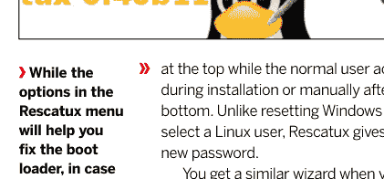

- * 虽然 Rescatcu 菜单中的选项可以帮助你修复加载程序，但如果你回退到安装期间创建或手动在启动时列出的顶部菜单 `Boot-repair`，它们将不起作用。与 Windows 密码会提示你选择 Linux 用户不同，当你选择 `Regenerate sudoers file` 时也会得到类似的窗口。它会搜索 Linux 安装并显示所选发行版中的用户列表。然而，如果选项失败，你可能需要将用户添加到 `/etc/sudoers` 列表中以帮助他们以超级用户权限运行。

## 恢复文件

## 取回分区

除了制作启动副本，Rescatcu 还可以恢复删除的文件，因为在硬件故障时它总会有丢失的数据。Photoorec Expert 工具还包含 Photorec 扫描实用，即使由于文件系统分区损坏导致误导，它也可以恢复文件。

有时，你面临的问题远不止于损坏的 MBR 和损坏的启动加载器。电压浪涌、磁盘故障或操作失误也可能导致分区表无法启动。TestDisk 是处理此类问题的最佳工具。

当你删除一个文件时，系统将其标记为已删除，其他文件占用的空间仍然保留。原始文件仍然在那里，可以通过文件恢复程序恢复。Photoorec 正是为此设计的：特别是当你意外删除了文件并希望磁盘重新投入使用时。你可以从 Rescatcu 部分启动该工具。

TestDisk 启动时首先要求你创建一个日志（这对于后续分析很有用；恢复文件），然后显示所有连接的磁盘列表。当你选择了找到的磁盘后，它会要求你选择分区表类型，例如 Ext.、NTFS。

> “它不依赖于文件系统，而是刻苦地扫描硬盘。”


接下来，你将看到恢复选项。`TestDisk` 扫描分区结构并寻找分区。然后它显示分区结构。选择 `Quick Search` 选项让 `TestDisk` 寻找分区。完成后，一旦你完成，如果你意外删除了文件以减少与硬盘的交互，该工具适用于各种磁盘和远程介质，如 USB 驱动器。`TestDisk` 还会从已删除并重新安装的分区中恢复文件。`Photoorec` 支持常见的图像格式和各种格式的意外删除文件，包括 `.pdf`、`jpg` 等。

## 其他情况

虽然 `Rescatcu` 经常能救你的急，但它也有局限性。如果你已经尝试了但 `Rescatcu` 仍然无法恢复，那么就需要依靠长辈的智慧了。

`Rescatcu` 是一个强大的记录者，当你需要时会创建一个日志。如果你无法确定故障原因，请使用日志选项包含所选日志文件的内容，将其分享到论坛或其 IRC 频道中。你也可以在聊天中发布你的故障信息。在 `Rescatcu` IRC 中你可以加入该频道，其他用户可以引导你通过合适的渠道来解决问题。

50 | 黑客手册

## Rescatcu

## OS 卸载程序

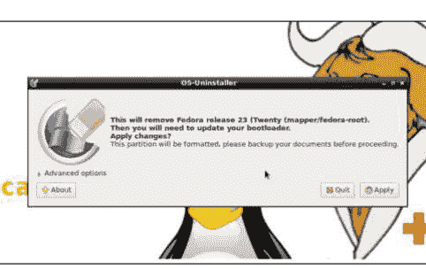


### 1 启动提示

启动 `Rescatcu` 实用程序并滚动到 `Tools` 部分。点击 `OS Uninstaller` 按钮启动工具。它将探测你的磁盘并询问一些问题，例如你是否使用了

### 2 备份提示

应用程序显示操作系统列表并要求你选择想要的一个。该工具需要你选择两个选项：`[ext2/ext3]` 用于删除 Linux 目录内创建的文件。`[Other]` 选项将允许你从 `NTFS/HFS+` 或其他文件系统恢复文件。

### 3 卸载 OS

备份完成后，继续进行卸载。该工具将移除所选发行版的所有迹。

### 4 更新启动加载器

移除 OS 后，你可能需要更新启动加载器。要执行此操作，请使用 `Easy Grub/Linux Boot` 选项修复启动加载器

# 黑客手册 2021

## 安全

最好的防御是良好的防御，但一个良好的实验室也同样重要。

- 54 保护你的隐私

利用 `Tails` 等工具通过 Linux 击败对你隐私的入侵。

- 62 Kali Linux

我们为你带了终极黑客工具箱，并解释了如何“愤怒地”使用它。

- 66 安全客户端

在线聊天，确保无人窥探你的谈话内容。

- 72 下载加固 Linux

我们概述了为了安全网络而锁定你 Linux 盒子的基础要点。

- 76 Fedora 安全

保持安全的方法不止一种，尝试一下 Fedora 黑客技巧。

- 80 密钥管理

学习如何创建一个良好的 GPG 密钥，并使其免受网络窃贼的侵害。


# 保护你的隐私

我们知道欺诈者正日日想要拿到你的透支额度，因此我们创建了这项功能。


无论是某些国家对埃特尔阿姨（Auntie Ethel）的网络浏览产生兴趣、追踪用户——日常惯例，还是黑客入侵亚马逊账户并建立糖果店——都有许多需要警惕的事。

由于我们的大部分生活都在线上进行，如果系统被攻破或凭据落入错误的人手中，情况会变得非常迅速。我们大多数人在检测到欺诈交易时会使用信用卡，并且通常会提供退款，尽管这个过程很乏味。但也存在其他风险，其中首要的是身份盗用。说服某人那个声称是你的人并不在场，

> “如果凭据落入错误的人手中，我很快就能得手。”

这种影响在电影《黑客帝国》（Hackers）中得到了当下且惊人的展示（电影中，一名特工探员看到自己的信用评分被摧毁，以他的名义出了不幸的个人广告并被宣布死亡），但现实是，除非你准备好脱离网络，否则没有办法避开一个意志坚定且装备精良的对手。幸运的是，有步骤可以阻止更常见的攻击而不失去原有的。现在，保持安全。

54 | 黑客手册

# 隐私

现在大多数人人都意识到这个老花招：如果某件事听起来好得不可真实，那么来自已故尼日利亚王子、寻求通过小额费用换取财富的常见 419 邮件正变得越来越少。

但钓鱼和社交工程学攻击已经演变，并构成了一个现实问题，影响着每一个人。

千禧一代如今拥有一系列工具可用。一种常见的钓鱼类型是攻击你的银行。他们从官方银行那里复制样式和地址信息，并轻松注册一个看起来像官方的域名（将‘o’ 替换为数字‘0’，或将‘l’ 替换为‘1’）。

这封邮件可能会说“根据安全信息”，你需要登录并更新你的详细信息。你的受害者会被带到一个假网站（创建网站轻而易举），并输入欺诈者清空其账户所需的所有细节。活动可能针对特定个人。

# 你的个人文件已加密！

你的文件已在此 PC 上被加密；照片、视频、文档和其他文件无法访问。你可以通过使用 RSA 生成密钥免费解密你的文件。

恢复你文件的唯一方法是支付比特币以获取解密密钥。

如果不支付，将无法恢复你的文件。

文件加密

ID: M10/219

时间: 15:38:42

点击解密文件

- 你希望醒来时处于这种水平，所以请注意你点击的地方。


# 社交工程学攻击已经演变，并对在线安全构成了真实威胁。

钓鱼，也许是一种社交工程或具有访问高价值或不断增长的数据权限的高级攻击。此类攻击依赖于对个人的了解，在某些情况下，它甚至可以访问敏感数据。对出生日期、电子邮件地址的搜索就足以钓到鱼。面对一封似乎来自他们认识的人的邮件，人们更有可能点击那个可疑的附件或处理链接，而钓鱼事实使得欺诈者可以绕过许多安全检查，允许他们访问密码并一无所有。

这比许多人乐意免费交给 Google 的少得多。如果你有 Google 账户，访问 `myactivity.google.com` 并查看“我的活动”。你所有的网络搜索、YouTube 视频和音频片段（如果你感兴趣的话）都已被 Google 归档，以便他们可以定制你的体验。

使用的人越多，它的依赖程度就越高。当他们要求时，这仍然只是通过角度提供一种整洁的方式来与你的朋友联系（或通过角度长时间拉住他们的手臂）。当然，你不必使用这些服务，但你可以自己搞定。

# 影子与方程

最近，一个名为 Broker 的集体小组正在廉价出售一组高强度黑客工具和漏洞利用。发布了恶意软件的免费样本。真实的要价为 100 万美元，用比特币支付。据称，以及随后的恶意软件分析显示其源于乌克兰境一个俄罗斯小组。该缓存中最有趣的部分利用了企业级网络设备的漏洞。`Cisco` 和 `Fortinet` 发布了紧急补丁，表明该

>


# 隐藏方法

财务或身份盗用，许多人担心政府或执法部门监听他们的通信。无论你是揭露政权的记者，还是一个拥有一封详细说明具体应该发送多少数据点的电子邮件揭露的告哨人，在通过电线发送时都应该小心，多亏保持了几种实现（正如我们稍后看到的），让从未相面的双方进行通信——秘密地——其背后的数学原理自 70 年代一直存在以来。

# 通过 GPG 获得更好的生活

Linux，加密届的瑞士军刀：Werner Koch 开发的 GPG Privacy Guard（GPG 套件）是一个管理 Pretty Good Privacy（GPG）内存的应用程序（`gpg`），GPG 是最初由 Phil Zimmermann 在 1991 年发布的的一种工具。`OpenPGP` 是一项规定了消息及其相关位应如何完全实现此点的规范。GPG 通过命令行工作，而且容易变得复杂且令人困惑（https://gnupg.org/gpg/），它使用了所有现代公钥算法。还有许多其他类型需要了解。

传统的对称加密（双方共享一个密钥或密码）虽然很好，但它要求通信双方首先要有一个安全通道。这可能涉及在一家阴暗的咖啡馆见面，可能交换简报并删除任何关于密钥或口令密码的书面记录。潜伏在阴影中的没有人知道这些，而且从个人角度来看，人们宁愿避免此类情况。因此，在本地安全地生成并保留公钥会更好。

对于前三个问题，请接受默认设置。我们将生成一个 2048 位的 RSA 密钥，该密钥将永久保留。这是为了让你（你的真实姓名和电子邮件信息将与公钥一起存储，最好越尽可能公开越好，所以如果你不想让事情公开，请不要使用你的姓名或主要电子邮件地址）。你不需要同意的电子邮件地址是你发送加密消息的源件地址。


邮件。系统会要求你输入密码来保护密钥。密钥的生成需要熵（随机数据），因此在生成密钥时，你会被要求敲击键盘并移动鼠标。

一旦完成这些，一切都可以通过 `gpg` 正常工作。GPG 在密钥库中安全地创建密钥。它们可以导入和导出，但在使用私钥时应极度谨慎。由于你想共享公钥，请使用加密导出密钥。

- 如果命令行 GPG 太太令人生畏，那么如果你在使用 KDE/Plasma，请使用其图形化对应物 `list-key - GnuPG`。


```bash
$ gpg --encrypt --armor --export --recipient <你使用的电子邮件地址>
```

生成的文件可以发送给你的协作者，他们可以使用以下操作进行导入：

或者，它可以上传到公开的密钥服务器。要发送一条加密消息，例如 `instructions.txt`，并发送生成的 `instructions.txt` 文件（`gpg --signed`），以及你收到的原始文件。如果它非常快进入 `gpg`，就完全不要放。如果你倾向于其他工具，有一个名为 GPG（Gnu Privacy Guard）的优秀前端客户端，以及针对 Thunderbird 客户端的 Excellent Email 插件。

# 信任网和密钥签名会议

> 我们在密钥服务器看到了你的密钥。如果他们保存了它，他们知道账户持有者可以读取发送给他们的消息。问题是，除非你信任这种交换，否则无法保证你认为属于某人的公钥很可能属于一个冒充者。因此，尽可能调整你的密钥是有意义的。如果有多个密钥，你的网站就是你的电子邮件签名。在信任一个密钥之前进行回检可能会被黑客攻击，尽管如此还有另一种方法。如果你面对面遇到某人，你可以验证他们的身份然后签署他们的密钥。

这种关系可以建立一种被称为“信任网”的去中心化结构。

随着时间的推移，你将看到你签署过的密钥，如果他们信任它们，那么你也应该信任它们。为了持有密钥，他们开始举办密钥签名会议，参与者——另一个或其他——应该面对面并签署对方的密钥。一场虚构的密钥签名会议发生在 Gregory Doctor 的小书中，在加利福尼亚州的海滩上——你将在哪里使用？

# 使用 Tails 的隐私

在第三次迭代中，我们探索了 Tails 的一些关键功能以及它们如何保持你的数据私密。

2016 年在维也纳参加 EuroCrypt 的与会者幸运地收到一份 Tails live 版本的资料页。自 1987 年以来，该会议一直用于通过加密和匿名化技术促进数据隐私。对于那些也在 USB 盘上拥有自己的 Tails 副本的人来说，Tails 是一个出于安全考虑而创建的操作系统。

# 欢迎使用 Tor 浏览器

现在你可以自由浏览，对于：Tor Browser


# 快速提示

无法连接互联网？重启 Tails，或者检查“网络”部分中的添加。这台电脑已连接、过滤或受保护。

Tails 2.5 与 Tor Browser 6.0 发布。

使用你的信用卡号，或者为什么你不会把所有的秘密写在皮肤上？

对于那些可能担心在美国的调查人员来说，Tails 3.0 与 Apple 斗争以削弱加密，Tails 2.5 提供了许多保持匿名的方法。

过去被爱德华·斯密登使用，结果是一个关于隐私的 Alpha 结尾。Linux 爱好者会注意到，大多数流行的操作系统都在 'live' 模式下使用，即从 USB 启动。

Tails 的另一个优势是，当你移除 USB 盘时，机器上不会留下任何活动的痕迹。

# Tails 的理由

当 Tails 的故事出现时，Linux 用户通常分为两个阵营。第一个阵营声称没有真正的隐私，保持数据安全的方法是 live Tails。

首先 Tails 变得更容易下载，取决于你使用的平台。访问网站 (`https://tails.net/`)，你可以在那里找到下载操作系统所需的信息。

Tails 还有它的 IRC 频道并使用 IRC 帮助用户设置和构建。在之前的版本中，带有 O（关闭）插件的方法确保消息在离开你时是加密的。

在 2015 年，Tails 项目发现，当时使用的邮件客户端实际上在服务器上是明文的。当时没有快速修复的方法，所以邮件客户端被替换为 IceOwl（Mozilla Thunderbird 的增强版本）。IceOwl 包含了 Fantastic 插件，它不仅使用安全的 HTTPS，还有一个优秀的设置向导来获取加密加密电子邮件。IceOwl 也包含在配置设置中，如果你有一个常用的电子邮件提供商（查看密钥-）。


> 无论爱还是恨他，斯密登是一个隐藏的人，事实上 Tails 的一部分。恭喜。你的浏览器已配置使用 Tor。

- Tails 2.4 已更新，最新版本为 7.0。用户包含了额外的 Adblock Plus 和 SSL 以消除烦人的感觉。自 2016 年 2 月以来，Firefox 基于 Debian 8，而最新版本基于 Debian 9 (Stretch)。它可能比安装在硬盘上的要花一点时间，但安装应该很快完成。Firefox 对于日常使用来说并不完美，但它非常好，以至于一些努力使其变得易用。使用 DRM 阻止了 DVD 开箱可用，包含了 Audacity 和 Transparency 的更新，它们也是多轨道音频编辑器，此外需要视频剪辑器来剪辑图像以供下一次演示的人可以使用 OpenShot，它是 Ubuntu 内置的视频剪辑器。此外还有捆绑应用程序，安装了 LibreOffice Pro，最新版本基于 ubuntu，提供了极大的稳定性。你可能无法使用最新功能。也可以从系统安装额外的程序或手动更新其他程序，通过指纹识别破坏你的匿名性（最新版本），其中许多与使用……的相同，例如，你拥有一个能够监控所有 Tor 入口和出口节点的全球影子组织，他们可能也看到你连接到网络，同时你的 YouTube 账户可以通过使用一个 web (onion) 地址并转而访问它来减轻，或者使用或 Firefox (`https://torproject.net`)，它提供了更好的隐私和保护社会自由的选项，你可能。在之前的 Tails 版本中，还可以关闭安装在 Microsoft Windows 上的 Tails，但该功能是由于 Tails 是开源的，所以代码人员可以定期检查漏洞。然而，内置在 Tails 2.5 中的安全功能如果你是 DNS 投毒的受害者并被重定向到类似的网站下载软件配置，就并没有什么用。由于有一个非常简单的方法使用 Tails 的可用功能来验证你下载的 ISO 文件的加密哈希值。

# 安全 2.0

你所使用的一切。你可以通过使用 Tails 位于右上角的内置键盘强制（Force）来降低去标识化的风险。

通过使用 Tails 位于右上角的内置键盘强制。

对于不使用 Tails 的人来说，重要的是要记住 Tails 默认情况下不会保存你文件中的元数据。Tails 还随带了 MAT（元数据匿名化工具），它可以移除文档中的作者姓名、GPS 位置。它还可以剥离糟糕的头部信息。弱密码可以被一台高性能的计算机在几分钟或几小时内通过暴力破解，无论你的密码口令有多安全。

简单来说，Tails 并不是最安全的系统。每当使用 AppArmor 时，应用程序实际上是与网络沙箱化的。

对于那些没有开启持久化（persistence）的人，很容易在 `http://tails.net/PersistentPassphrase` 编写新文档而无需使用 Tails。Tails 2.5 还带了加密存储功能，允许你备份 OpenPGP 密钥和文件夹。

如果你像我们许多人一样拥有一些比特币并想要安全地保存它们，Tails 提供了一个轻量级的加密区块管理器（Encryption Block Manager）。你可以启用比特币客户端持久化功能使你的硬币能够花费，或者你可以在 live 模式下使用 Tails 并写入你的钱包：一组单词，这可以让你随时恢复你的钱包。

# 隔离应用程序

从技术角度来说，切换到使用 Tails 时，Debian 团队可以帮助你使用 AppArmor 隔离特定的应用程序。

每当你使用 Tails 时，AppArmor 可以阻止对网络的访问，并确保 Messenger 实例通过你的 PGP 密钥进行连接。

此外，如果你的 USB 闪经过了加密，则默认启用 LUKS 加密，因此你可以保存所有想要的数据。如果你决定在朝鲜（或任何其他国家）潜伏并需要携带你的 USB 盘，任何拥有它的人都无法读取它。Tails 还允许你在传输文件之前挂载加密的 USB 驱动器。

同样注意，使用 Tails 等操作系统的主要缺点可能会引起注意，即你正在使用一个强调隐私的操作系统这一想法可能暗示你有某些要隐藏的。此外，默认情况下，Tails 不会隐藏你正在使用 Tails 的事实。在边境检查站时，会在你的启动日志中发现它，如果你被问到一些可疑的问题，那么最好的变通方法是访问 Tails 网站并将其安装到新的 USB 设备上。

最后，如所述，Tails 的缺点仍处于完善中。我们在各个版本中修复的所有漏洞已经足够让一个成年人受益匪浅了。花点时间探索该操作系统及其局限性，如果你觉得有某个选项更适合你的需求，不要害怕提供你的反馈。

访问 `https://tails.org/news/version_3.0/index.html` 了解更多关于 Tails 的最新版本 (3.1.4)。

- 快速提示

该设备可以在 `http://tails.net/PersistentPassphrase` 获取。如果你通常需要使用，你也可以使用 Tails 生成强力组合的随机密码。

> 警告：如果被发现，海关可能有权没收你的 Tails USB 盘。


# 前方有边境巡逻检查站

## 获取你的 IceVault 密钥

在 Tails 运行时开始启动 Tor（称为 Thunderbird 3.0）。如果你注重隐私，最好创建一个新的电子邮件地址，并仅将其用于与 Tails 相关的事务。

Whocord 是高级用户创建新密钥对的最易的编辑器。如果你以前用过 GPG，为你的密钥对设置一个密码口令是非常重要的。

如果你要离开，只需输入 Gmail 或 Outlook 等主服务商的详细信息，并保留所有的邮件流量以确保你正在使用提供暗网（洋葱）地址的服务。

接下来，你将为你的 GPG 密钥创建一个密码口令。大小在这里无关。

接下来，Tails 将收集一些熵来生成你的密钥对。这可能需要一些时间。在密钥管理器中，你需要生成一个撤销证书，以防以后丢失密钥的访问权限或想要更改密码口令。

这提供了 Mait、路由器和 Onion 地址。如何从相关网站进入服务器。完成后，从 Jeecolin 菜单中选择英语并启动 Tails


生成密钥可能需要几分钟。你可以通过移动鼠标和敲击键盘的过程，让计算机生成足够的熵。[LXF 特性-已]

60 | 黑客手册

# 在 USB 盘上安装 Tails


## 欢迎使用 Tails 安装助手

感谢选择 Tails。

在这一步中我们将引导你完成，并希望你过得愉快！

我们将向你提出几个问题来配置安装，并逐步引导你。

开始旅程！


## 选择你的操作系统

为了本指南的目的，我们使用的是基于 Debian/Ubuntu 的系统，但如果你使用的是其他 Linux 发行版，可以自由遵循这些说明。点击下一页底部的 `Ctrl+L` 继续。


## 1. 下载并验证 Tails

在这一步中我们将下载 Tails ISO。为了你的安全，我们需要从 Tails 网站下载这个文件。你可以从这里下载：https://tails.net/download/


## 2. 安装 Tails

选择第一个选项安装 Tails。阅读警告消息，然后点击“是”继续。对于 Ubuntu 用户，你需要添加以下存储库：`ppa:tails:`


## 3. 安装到 USB

软件中心现在将更新，你将能够搜索并安装 tails。对于 Debian 用户，你需要打开“软件源”>“编辑”并启用 `deb-backports`


## 4. Tails 安装程序

使用你最喜欢的程序来下载这个文件。在安装结束时，你需要输入管理员密码。


## 5. 启动 Tails

如果 USB 盘已加密，则默认启用 LUKS 加密。Tails 还允许你在传输文件之前挂载加密的 USB 盘

## 6. 进入 Tails

61 | 黑客手册

# Kali Linux

## 破解 Wi-Fi，破坏性


文件如下：

```
interface=wlan0
driver=n80211
bridge=0
aid=hot
hnv_mode=
channel=6
auth_alg=
default_key=0
wep_key="*"
```

我们的 5 字符密钥对应 40 位，这是最好的起点。破解密钥几乎是不可能的，但有很多无线数据包和模拟包（mocks）。我们可能在大约一分钟破解 40 位的密钥（这需要捕获数据包的时间）。一旦你设置好了目标 WPS，我们就可以在 Kali Linux 攻击机上进行。

入门 Kali Linux 的传统方法是搜索资源。某些资源需要额外的框架才能运行，而许多资源会给你提供帮助。如果你能在其他找到良好的指南，只需在 Kali Linux 中遵循即可。然而，你可能会发现你的无线驱动不支持监听模式（monitor mode）。对于某些驱动（如笔记本电脑带有 BCM2208-23 芯片的 Broadcom 驱动），你可能需要激活它以进入“雷区”，然后 `airodump-ng` 将给出一个显示各种类型访问点的最新列表。

在我们激活监听模式之前，禁用 NetworkManager 或任何其他与网络通信的进程（如 `wpa_supplicant`、`wlan0`）是一个好主意。这可以避免冲突，且后启动的胜。一旦设备进入监听模式，它就不是网络的一部分，因此除非你有线连接，否则你将无法浏览网页。如果 Kali Linux 上不可，打开终端并运行 `airmon-ng start wlan0 6`；重命名你的无线接口（可以通过 `iwconfig` 找到）以及 6；以更改你正在攻击的网络无线通道。

(`wlan0` 在 `wlan0mon` 上启用 mac80211 监听模式)

我们现在将启动名为 `wlanmon` 的新接口，这将导致不同的名称。这很常见，只需保留并调整你的设置命令。你可以通过运行 `iwconfig wlanmon` 来检查监听模式是否已激活。

在 Kali Linux 中，与其他几乎所有其他系统不同，使用的是默认路由器。同样，这些命令大部分都需要硬件的特权访问权限。Kali 并非设计为通用工具，因此对安全保护的通常担心并不被否认。你可以尽情玩 `airodump-ng`。

如果你想让适配器在通道和 MAC BSS 地址（SSIDs）以及连接到它们的任何客户端之间跳转。注意你正在攻击的网络的 `airodump-ng`。通过 IEEE 02.100 和通道 6 进行过滤。稍后或当我们想要注入数据包时，可能需要更改连接到网络的客户端的地址。如果你想通过网页浏览或其他活动为 WEP 网络产生流量，你会看到随着更多数据包的捕获`-Data` 列会增加。当你感到无聊时，只需过滤统计信息。

在生成测试场景中，最好知道此阶段的密钥，即我们正试图弄明的。但如果我们的去握手（de-handshake）破解过程出现问题。如果你可以注入数据包，攻击机的 WEP 攻击就是破解密钥（如果机器不可用，这可能很困难！

```
airodump-ng -w WEP --bssid 00:00:00:00:00:00 wlanmon
```

如果我们看到这样的内容，说明攻击正在生效。很容易注入未加密的数据包。

## 准备攻击

02:23:01:00:13:EC:07:16 - channel 6 - WEP*

## 我们需要谈谈

除了短密钥（原始的 WEP 64 位或 40 位密钥以及早期路由器被强制选择前者）外，该协议容易受到统计攻击。此外，它使用 24 位的初始化向量 (IV) 来加密数据包。针对 WEP 最具实用的攻击涉及收集许多数据包及其关联数据，并进行一些额外的计算以推导出密钥。对于 40 位密钥，我们最少 5000 个数据包即可破解。（如果网络中有大量的我们的无线加密数据包，我们不需要使用嗅探技巧来破解并生成密钥。具体来说，我们可以列出 ARP 请求数据包（用于连接 MAC 和 IP 地址），捕获它们并注入回路由器，这样它就会响应 ARP 请求。我们可以通过数据包的大小识别 ARP 请求包，因此它们如何加密内容并不重要。ARP 请求将为我们提供新的 IV，这将是进入 WEP 网络更新门槛的另一次攻击。）

> DVWA is all of vulnerable, we have havoc what query will wreak?

The Hacker's Manual | 63

## 安全

> >> 02:24:19 Ping (min/avg/max): 1.384ms/7.336ms/21.115ms

>> Power: -39.7

02:24:30 30.0: 100%

如果我们可以注入任何大小的数据包或摇动路由器。不幸的是，它通常会注入它们（因为我们没有通过网络身份验证（并且 b））由于我们知道密钥，我们无法正确加密它们）。该怎么办，如果我们能找到一种方法 (a)，监听 ARP 请求并发送它们。同一个 ARP 请求可以使用多次，回复越多越好。如果仅通过网络直接注入流量的数据包注入不起作用，我们需要使用其他方法。

The Hacker's Manual | 63

（注：由于原文后续存在大量重复段落，已根据要求停止重复输出相同含义的翻译）

# Kali Linux


# Kali Linux

尽管如此，我们仍然可以通过对 Metasploitable 虚拟机进行一些操作来说明 MSF 的某些功能。磁盘上没有足够的空间包含它，但对于那些有约 800MB 空闲空间的人来说，从 http://bit.ly/MetasploitableDownload 或 http://bit.ly/SFmetasplo2 下载，你可能更想快速获取它。解压 `metasploitable-linux-2.0.zip` 或在网上查找一个虚拟机。

该镜像（VM 文件）可以配合 VirtualBox 使用，将网卡设置为“禁用”，或者为了让虚拟机连接到网络，你需要将虚拟网络适配器配置为桥接模式，或者通过进入“网络”选项卡进行其他配置，然后它将像连接到你适配器的普通设备一样工作。如果你的网络 DHCP 允许所有操作，则无需担心，否则你必须手动设置 IP 地址。

启动虚拟机并以用户 `msfadmin` 登录以查找密码（注：原文是 mafadmin）。找到你网络上设备的静态 IP 地址：`192.168.1.105`。使用 `nmap` 扫描它以找到一个 Debian 服务器。

然后回想起你网络中运行的极其糟糕且有漏洞的服务器，在未受保护的网络上尝试这些可能不是个好主意。额外的代价可能是你暴露于互联网的脆弱性。我们将使用 MSF 来攻击 Tomcat 服务器，我们可以通过连接到虚拟机地址的 8080 端口来尝试，我们将端口设为 `192.168.1.110`。

使用访客凭据（用户: `tomcat`/`tomcat`）运行 `/manager/html` 处的应用程序。管理器允许上传（打包为 WAR 文件）应用程序进行部署，这是我们可能做到的。

现在你如何攻击服务呢？一个常见目标是攻击目标机器。这是通过最近在被攻击的机器上创建一个反向 shell（reverse shell）来实现。一旦攻击成功，shell 将“回拨”我们的主控，并允许他们使用任何匹配被攻击服务的工具进行控制。我们使用了一个负载（payload）来利用它。在 MS Options 中使用 MSF 创建它。如果你看到那个提示，请等一分钟然后重试。如果你需要先创建它的数据库，这有时比等待还要长。

```
set RHOST 192.168.1.110
set PORT 80
set USERNAME tomcat
set PASSWORD tomcat
set PATH /manager/html
set TARGET
```

除了最后一个，这些都是，我们必须告诉 MSF 创建一个负载，而不是特定操作系统的负载，后者对这个漏洞利用不起作用。我们现在准备好使用利用程序进行攻击了。如果一切顺利，你应该看到


| 漏洞：SQL 注入 |

|---|

| 用户 ID: | |

- [Sending] 阶段 (40689 字节) 来自 192.168.1.110 -> 192.168.1.105:44444

- [Meterpreter] 阶段 1 (192.168.1.110:44444 -> 192.168.1.105:44444)

随后是一个新成员进程。要查看命令列表，我们需要使用 `bash` 来处理 shell 的剩余部分。如果我们使用 `exploit`，我们将获得 `[meterpreter]` 的访问权限。我们可能做一些类似的操作，但终极目标是获得 root 权限。正如你所看到的，利用系统的任何部分（守护进程）是一种特权，随后我们可以在可以在 https://exploit-db.com/doc/075/ 的单向后门部分中使用它。如果我们深入到那个程度，我们将处于 root 级别。


DWA，数据库漏洞应用程序，应该在 http://192.168.1.110/dwa 处被攻击。我们可能会发现一些意料之外的功能。这直接来自登录路径，它会贴贴地告诉你管理员是什么。使用这些详情登录，然后将 Set Query 设置为 SQL。从页眉和列表中选择 DF。如果还不够，我们将尝试 SQL 注入攻击。你需要的数据是在文本框中输入一个 ID（从数字 1 到 20），并查看结果是否显示。这对于第一个和最后一个数字都有效。然后我们将尝试利用 tomcat 用户来获取所有的 ID。

通过精巧的构造，我们查询的最后部分被解释为：`WHERE user = 'admin' OR '1'='1'`

结果位于查询的末尾，`OR '1'='1'` 子句确保了表达式是有效的。所有结果都是真的。这种代码真的没有其他写法；PHP 包含了过滤用户输入并防止此类 SQL 攻击的函数。

```
SELECT * FROM last_name_FROM users
WHERE user = 'admin' OR '1'='1'
```

但在这里我们首先停止，然后进入 Kali Linux，而是进入一个 Windows 虚拟机（你可以合法地利用它并在 30 天后将其删除），并看看你用 Metasploit 可以造成多少伤害。在这里我们将使用 MSF2.0。


```
set RHOST 192.168.1.110
set PORT 80
set USERNAME tomcat
set PASSWORD tomcat
set PATH /manager/html
set TARGET
```

除了最后一个，这些都是，我们必须告诉 MSF 创建一个负载，而不是特定操作系统的负载，后者对这个漏洞利用不起作用。我们现在准备好使用利用程序进行攻击了。如果一切顺利，你应该看到


| 漏洞：SQL 注入 |

|---|


| 用户 ID: | |

- [Sending] 阶段 (40689 字节) 来自 192.168.1.110 -> 192.168.1.105:44444

- [Meterpreter] 阶段 1 (192.168.1.110:44444 -> 192.168.1.105:44444)

随后是一个新成员进程。要查看命令列表，我们需要使用 `bash` 来处理 shell 的剩余部分。如果我们使用 `exploit`，我们将获得 `[meterpreter]` 的访问权限。我们可能做一些类似的操作，但终极目标是获得 root 权限。正如你所看到的，利用系统的任何部分（守护进程）是一种特权，随后我们可以在在 `https://exploit-db.com/doc/075/` 的单向后门部分中使用它。如果我们深入到那个程度，我们将处于 root 级别。


DWA，数据库漏洞应用程序，应该在 `http://192.168.1.110/dwa` 处被攻击。我们可能会发现一些意料之外的功能。这直接来自登录路径，它会贴贴地告诉你管理员是什么。使用这些详情登录，然后将 Set Query 设置为 SQL。从页眉和列表中选择 DF。如果还不够，我们将尝试 SQL 注入攻击。你需要的数据是在文本框中输入一个 ID（从数字 1 到 20），并查看结果是否显示。这对于第一个和最后一个数字都有效。然后我们将尝试利用 `tomcat` 用户来获取所有的 ID。

通过精巧的构造，我们查询的最后部分被解释为：`WHERE user = 'admin' OR '1'='1'`

结果位于查询的末尾，`OR '1'='1'` 子句确保了表达式是有效的。所有结果都是真的。这种代码真的没有其他写法；PHP 包含了过滤用户输入并防止此类 SQL 攻击的函数。

```
SELECT * FROM last_name_FROM users
WHERE user = 'admin' OR '1'='1'
```

但在这里我们首先停止，然后进入 Kali Linux，而是进入一个 Windows 虚拟机（你可以合法地利用它并在 30 天后将其删除），并看看你用 Metasploit 可以造成多少伤害。在这里我们将使用 `MSF2.0`。


# 安全性

## 用户体验

### 消息功能是否易于使用？

所有的应用程序，而不仅仅是本汇总中的这些程序，都面临着艰巨的任务。它们必须在增加额外安全性和功能的同时，不影响用户向哥们们发送消息的任务。由于你的朋友很有可能没有在使用这些软件，或者它们本身不是广为人知的即时通讯工具，你可能需要说服（或恐吓）他们：简单易用的安装和界面将对你的哥们们注册另一项服务产生很大帮助。使用与热门应用没有太大相似的新应用程序，将帮助你和你的朋友继续聊天，而不会让应用程序成为阻碍。

## CryptoCat

如果它不是坚持要求 12 字符长度的密码，CryptoCat 的感觉就会和其他任何客户端没有区别。当你第一次登录 CryptoCat 时，它将生成加密密钥并将其存储在你的新设备上。你可以非常方便地与朋友一起登录账户。每个设备都有一个唯一的指纹，你可以与朋友一起进行验证。如果你信任它，它就是可信的。

为了额外的安全性，你可以要求 CryptoCat 仅发送给受信任的设备。在接收消息时，CryptoCat 将始终显示使用哪个设备发送了该消息，以及你的朋友何时添加新设备。IM 窗口非常直观，包含了记录和发送静音视频消息以及文件的按钮。


## Goldbug

首次启动时，你将受邀创建身份信息，应用程序会为每对不同的任务（如消息和电子邮件各）分别生成一组加密密钥。一旦密钥生成完毕，你就必须启用“激活（Activate）”按钮。然后你就可以连接到聊天服务器或网络并添加朋友。最初，该项目会启动自己的服务器作为邻居，但这严格仅用于测试目的，你必须在聊天之前与你的朋友交换密钥。Goldbug 提供了导入和导出公密钥的选项。它简单的界面允许你在对已识别的朋友进行加密后导出你的公密钥。尽管具有独特性，但 Goldbug 拥有最混乱的界面之一，也是最不直观的。


## 安装易用性

对新手友好吗？

说实话，如果安装过程是一个漫长的过程，我们中没有多少人愿意安装新应用程序。这对于像提到的这种以桌面中心的应用程序来说尤为如此。在这方面，唯一的选择是 GoldBug；虽然你可以从 SourceForge 或其官方网站下载安装包，但 IPA 安装 Tails Fairy 并不像 Deb 那样简单。

无论哪个，限制了谁实际上可以使用该 IM。然后是 Retroshare，它拥有 Ubuntu 和 Debian 的官方包。该网站列出了适用于 OpenSUSE、Fedora、Mage、BSD 和 Arch Linux 的非官方包。还有一个针对树莓派 Raspberry Pish 的非官方版本，发布于 2014 年。另一方面，其他版本涵盖了发行版……仅为包括 Ubuntu、 Debian 在内的流行发行版发布稳定和前沿的每日 Deb 和 RPM 构建。该项目还为 Ubuntu 和 Debian 提供了仓库，并保持密钥更新。更新后，你也可以通过 Ubuntu 16.04 的 PPA 获取它。

## 结论

- CryptoCat

- GoldBug

- Jitsi

- qTex

- Retroshare

> GoldBug，你可以轻松从你的灾难中获取其他 IM。

## Jitsi

## 安全聊天

使用 Jitsi 相当直观。通过登录 XMPP 或 SIP 服务器或者。默认情况下，你与其他网络的所有对话都是不安全的。你使用聊天窗口中的“安全聊天（Secure chat）”下拉菜单来调出加密对话的选项。


当你发起私密对话时，Jitsi 会先要求你验证身份。你可以通过向他们询问共享密钥或通过另一种身份验证他们的指纹来这样做。更多地，一旦你验证了连接，你可以从聊天窗口点击一下即可让 Jitsi 加密会话。同样，你可以发起音频视频通话，并通过共享屏幕上显示的四个字母 ZRTP 密钥来确保安全。

## Retroshare

Retroshare 看起来与传统的 IM 客户端非常不同。首次启动时，它看起来非常简陋，顶部的标签没有列出内容。因为 Retroshare 从你朋友那里获取这些内容的，所以你必须连接 Retroshare 网络上的任何内容。


你可以从共享你的公密钥开始，也可以与聊天服务器交换密钥。你需要前往聊天（debbobs）并查找 ChatServer EN 以加入聊天、打招呼并支持你的朋友。要会某人，必须交换密钥。你可以访问你的朋友订阅的所有状态、下载和聊天内容。注意：从你朋友那里获取所有论坛和聊天需要几个小时。


## qTox

像 CryptoCat 一样，qTox 的界面非常直观。通过登录 XMPP 或 SIP 服务器或者。默认情况下，你与其他网络的所有对话都是不安全的。你使用聊天窗口中的“安全聊天（Secure chat）”下拉菜单来调出加密对话的选项。


当你发起私密对话时，Jitsi 会先要求你验证身份。你可以通过向他们询问共享密钥或通过另一种身份验证他们的指纹来这样做。更多地，一旦你验证了连接，你可以从聊天窗口点击一下即可让 Jitsi 加密会话。同样，你可以发起音频视频通话，并通过共享屏幕上显示的四个字母 ZRTP 密钥来确保安全。

## Retroshare

Retroshare 看起来与传统的 IM 客户端非常不同。首次启动时，它看起来非常简陋，顶部的标签没有列出内容。因为 Retroshare 从你朋友那里获取这些内容的，所以你必须连接 Retroshare 网络上的任何内容。


你可以从共享你的公密钥开始，也可以与聊天服务器交换密钥。你需要前往聊天（debbobs）并查找 ChatServer EN 以加入聊天、打招呼并支持你的朋友。要会某人，必须交换密钥。你可以访问你的朋友订阅的所有状态、下载和聊天内容。注意：从你朋友那里获取所有论坛和聊天需要几个小时。


## qTox

像 CryptoCat 一样，qTox 的界面非常直观。通过登录 XMPP 或 SIP 服务器或者。默认情况下，你与其他网络的所有对话都是不安全的。你使用聊天窗口中的“安全聊天（Secure chat）”下拉菜单来调出加密对话的选项。


当你发起私密对话时，Jitsi 会先要求你验证身份。你可以通过向他们询问共享密钥或通过另一种身份验证他们的指纹来这样做。更多地，一旦你验证了连接，你可以从聊天窗口点击一下即可让 Jitsi 加密会话。同样，你可以发起音频视频通话，并通过共享屏幕上显示的四个字母 ZRTP 密钥来确保安全。

## Retroshare

Retroshare 看起来与传统的 IM 客户端非常不同。首次启动时，它看起来非常简陋，顶部的标签没有列出内容。因为 Retroshare 从你朋友那里获取这些内容的，所以你必须连接 Retroshare 网络上的任何内容。


你可以从共享你的公密钥开始，也可以与聊天服务器交换密钥。你需要前往聊天（debbobs）并查找 ChatServer EN 以加入聊天、打招呼并支持你的朋友。要会某人，必须交换密钥。你可以访问你的朋友订阅的所有状态、下载和聊天内容。注意：从你朋友那里获取所有论坛和聊天需要几个小时。


## qTox

像 CryptoCat 一样，qTox 的界面非常直观。通过登录 XMPP 或 SIP 服务器或者。默认情况下，你与其他网络的所有对话都是不安全的。你使用聊天窗口中的“安全聊天（Secure chat）”下拉菜单来调出加密对话的选项。


当你发起私密对话时，Jitsi 会先要求你验证身份。你可以通过向他们询问共享密钥或通过另一种身份验证他们的指纹来这样做。更多地，一旦你验证了连接，你可以从聊天窗口点击一下即可让 Jitsi 加密会话。同样，你可以发起音频视频通话，并通过共享屏幕上显示的四个字母 ZRTP 密钥来确保安全。

## 安全聊天

## 评测

所有即时通讯软件都付出了额外努力以确保你的对话保持私密。我们查看了简单的文本应用程序到复杂的文本通信套件，后者允许你通过加密通道发送和接收通话。

值得赞扬的是它们对 Hellman 方法的依赖。Goldtext 是首位，因为它利用了基于文本的学习曲线。接下来是 Toxtox，它通过复选框占据了顶端位置。首先，它与所有其他不同的即时通讯软件（IM）都完全不同，它配备了你对安全客户端所预期的所有安全和隐私功能。你可以使用 Q2go 进行音视频通话，它与其他客户端协作涵盖了所有主要的桌面和移动操作系统。然而，该协议仍然较新，且多媒体通话的性能在所有支持的平台上表现并不一致。这是 Q2go 居于榜单底端的主要原因。

亚军归属于 Retroshare，因为它在功能与易用性之间取得了精细的平衡。应用程序和网络都功能极其丰富，甚至多到让人难以接受。Retroshare 在“朋友对朋友”网络中点对点模型的个性化并非完全脱离常规。如果你想与任何人通信，我们把顶位授予了 Jitsi，它在形式和功能之间找到了正确的平衡。是的。


通过中央服务器通信，但 Jitsi 提供了加密通话和配置选项：为你的场所设置中央服务器并不需要太多精力。更好的是，你可以使用 Jitsi 的注册服务器直接对网络上的用户进行安全的加密通话。

> 使用 Jitsi Videobridge，如果 Jitsi 用户拥有足够的带宽，可以托管大多数用户通话。

## 我们将顶位授予了 Jitsi，它在形式和功能之间找到了正确的平衡。

- 第1名 Jitsi

网站: https://jitsi.org Chrome 扩展程序版本: 2.0

在不进行剧烈更改的情况下保障即时通讯的最佳选择。

- 第2名 RetrosShare

网站: https://retroshare.github.io 许可证: GNU GPL: 0.6.2

一个稳健的通信平台，带有轻微的学习曲线。

- 第4名 CryptoChat

网站: https://cryptachat.net GNU v3 版本: 3.2.08

加密文本通信的良好选择。

- 第5名 Goldtext

网站: https://goldtext.sourceforge.net GNU GPL 版本: 3.5

被杂乱的 UI 和翻译不佳的文档所困扰。

- 第3名 qtox

网站: https://qtox.github.io 许可证: GNU GPLv3: 1.11.0

如果没有视频通话行为不一致，它将是一个获胜者。

## 交由你……

你是否想将你自己和你的朋友家人迁移到安全的即时通讯软件上？我们都在 letters@futurenet.com 等候你的建议。

## 同样考虑……

在不安全的开放互联网上进行安全对话对企业和个人来说都是一个日益增长的问题。这就是为什么除了我们在本汇编中涵盖的开源软件外，还有广泛的专有客户端可供选择。很有可能你目前使用的即时通讯软件允许你添加 O 插件，对聊天进行加密，例如，Pigeon 就是一个带有 OTR 选项的主流客户端。还有 Wick，它允许交换端到端消息，并允许他们为通信设置过期时间。该应用程序适用于所有主要的移动和桌面操作系统，但如果你需要用于移动移动通信的安全应用，请检查 ChatSecure、Signal 和 Sureport。它们都适用于 Android 和 iOS 设备。虽然 ChatSecure 只允许通过 XMPP 进行文本 OTR 加密，但你可以使用 Signal 和 Sureport 进行良好的音视频通话。

黑客手册 | 71

## 安全

### Linux：保护你的桌面

Linux 能够阻止大多数攻击。

使用 Linux 是否比 Windows 更安全？安全是一项内置功能，并从内核扩展到桌面，但仍为某些操作留下了空间。Linux 对蠕虫和病毒是具有免疫的，但攻击者有多种手段来窃取宝贵的字节。

使用用户名和密码锁定数据应该是你的唯一防线，但这并不够的。随着攻击数量的增加，你应该采取措施来保护你的计算机。

所有 Linux 发行版（如 Ubuntu 和 Fedora）都有团队工作确保免受漏洞影响。当漏洞被发现时，你的发行版将启用特定的（作为默认），并决定你是自动还是手动安装更新。例如，你可以使用 Ubuntu 下载并安装更新。

除了更新，发行版还通过列表公布任何漏洞，并与他们共享信息。关注你的发行版列表是个好主意，你还应该花时间禁用不必要的服务。Linux 发行版开始尽可能多地使用许多服务，为什么你还需要连接到没有适配器的设备呢？这被极大地限制了。

## 安全账户

在 Linux 这样的多用户系统中，限制 root 账户的访问至关重要。大多数发行版现在允许你在启动时登录为 root，这是很好的。此外，赋予 root 用户访问有许多优势。使用 `/etc/sudoers` 文件记录所有执行的操作。使用 `sudo` 的主要优势之一是允许你限制对某些命令的访问。在写入之前确保配置正确，这通过 `visudo` 命令实现。

要允许用户获得完全权限，在 `sudoers` 文件中添加以下内容：

```
user ALL=(ALL) ALL
```

使用命令调整用户帐户并设置过期日期，例如：

```
sudo usermod -e 2017-01-02 bodi
```

在示例中，用户 `bodi` 将无法访问从2017年1月2日的账户。

允许用户在主机名为 joe 的机器上以 root 身份运行所有命令：

```
joe ALL=(ALL) ALL
```

限制某些命令的访问。例如，以下行将仅允许 guest 执行：

```
guest ALL=(ALL) /bin/ls /sbin/halt /sbin/
```

简单来说，你可以只添加关键命令：

- 默认临时允许层级站点

- 全地址 (https://www.noscript.net)

- 全域名 (noscript.net)

- 主机名 (mail.noscript.net)

- 悬停在 NoScript 图标上打开权限菜单

- 左点击切换当前顶层节点的权限 (CTRL+SHIFT+CLICK)


- 全地址 (`https://www.noscript.net`)
- 全域名 (`noscript.net`)
- 二级域名 (`noscript.net`)
- 内容更改时自动重新允许页面
- 刷新当前标签页
- 允许通过书签打开站点

想要限制用户的范围？以下行将仅允许名为 `native` 的用户使用 `root` 权限，但在其他地方不行：

```
nate ALL=(ALL) ALL
```

## 安全你的桌面


> 使用 NoScript 和 BetterPrivacy 扩展程序防止浏览器攻击，保护你的浏览器免运行脚本。

## 权限入门

保护 Linux 系统的另一个重要部分是设置权限。在 Linux 和 Unix 中，一切都是文件。目录是文件也是文件。每个文件必须至少由一个用户和一个组所有。每个用户都有唯一的标识符 (`UID`) 和组标识符 (`GID`)。每个用户必须被分配到至少一个组，由系统管理员建立的用户集合。

用户可能属于许多组。和用户一样，组也有唯一的 ID (`GID`)。文件或目录的可访问性基于其 `UID` 和 `GID`。用户只能访问他们被允许运行的内容。权限的授予是因为用户属于文件的组，或者该文件对所有用户开放。例外是 `root` 用户，他可以访问系统中的所有文件。此外，Linux 为它们分配了三种权限——用户、组和其他——这决定了用户是否可以读取、写入或执行文件。

## 监控进程

几乎所有的活动都是后台运行的进程。如果你想审计你的安全活动计划，你应该监控机器上运行的进程，并立即对可疑进程采取行动。你可以使用 `top` 命令列出所有运行中的进程以及它们如何消耗可用资源。如果你想要一个更友好的进程版本，从仓库安装 `htop`。`htop` 通过 ID 或 PID 显示进程并跟踪它们。你可以使用 `pkill` 命令杀死进程，例如 `firefox` 进程，你可以使用 `kill` 命令终止不受控进程的 PID（进程 ID）。例如，`kill 1004` 将允许 Linux 内核关闭与指定 PID 相关的进程。你也可以在顶部界面内部杀死进程。按下 `k` 并输入进程 ID 终止。

## 安全

## Excel 访问控制

在文件管理器属性窗口中，通过右键点击文件访问的列表标签页。


`pam.directory`。在这里，你可以找到几乎所有请求 PAM 认证的应用程序配置文件。如果你检查这些配置文件，会发现它们都起始于对其他文件的调用，包括公共前缀。例如，`/etc/pam.d/password`。这些公共前缀是应该直接修改的实际配置文件。

通用密码文件完全处理了其他事务。每个针对 `/etc/pam.d/common-password` 的 `grepp` 命令都会列出定义密码请求基本规则的行，例如：

```
[account=default_ignore] pam_unix
obscack sha512
pass required pam_unix
pass_permiss
pass optional pam_cryptokey
```

这允许用户登录并查看关联的用户名。然而，它防止他们直接编辑 `/etc/passwd` 文件。然后是 `/etc/shadow` 文件，它包含了加密的账户信息或密码值。其价值在于，`root` 是唯一一个 `UID` 设置为 `0` 的用户。该文件仍然没有权限。`root` 用户仍然可以访问它。但其他人都无法使用 `/bin/passwd` 工具更改他们的密码。这是由于这种特殊权限，`root` 请求的密码命令会临时禁用对该文件的安全检查。


对于密码检查，最好安装额外的 PAM 模块，例如使用 `sudo apt install libcrypt`。安装此模块将自动更改 `/etc/pam.d/common-password` 文件，该文件列出了以下内容：

`pass required pam_crypt minlen=8 retry=3 dealloc`

### 使用 PAM 管理密码

可插拔认证模块（PAM）最初实现在 Linux 操作系统中，但已经存在很长时间。PAM 简化了各种应用程序的认证，并为用户认证提供了一种灵活的机制。为了让应用程序受益 PAM 库的支持，`pam_tns.so` 文件将列出同一系统中所有感知 PAM 的应用程序。从列表中，你会注意到许多 Linux 实用程序都使用 PAM 进行登录认证。

你也可以使用 PAM 来选择复杂的密码强度。PAM 从 `/etc/security` 文件存储密码配置。

我们在密码规则配置的第一几行中提到了这些。还定义了一些规则，例如要用 SHA22 算法加密的密码。该模块确保密码符合某些标准，如长度、各种数量的数量和字符类型。

你可以记住这限制了我们，防止用户使用弱密码。你可以使用 `use`、`credit` 和 `encrypt` 选项强制密码包含数字、大写字母和特殊字符。你还可以使用以下命令强制用户选择一个不是最常见的密码。

> 始终确保你的配置设置为安全事件，而无需等待手动确认。

### 混淆你的身份

保持个人数据安全的最佳方法是将其加密。文件是无法读取的。安装某些发行版（如 Fedora、Linux Mint 和 Ubuntu）将允许你在驱动器的初始设置期间加密磁盘。


如果你有单独的文件，也可以对它们进行加密。这意味着它被加密到特定的块设备上。涉及的块设备可以挂载为磁盘、分区甚至作为回环设备。通过块设备加密，加密层在数据写入下层块设备之前会透明地加密数据。

使用 ZuluCrypt，你可以加密系统分区内或 USB 磁盘上的一个文件。由于 ZuluCrypt 具有直观的用户界面，你可以使用它来创建随机密钥并

### 数据恢复计划

针对导致数据丢失的泄露恢复计划也应该是你安全策略的一部分。Linux 桌面有几种通用的备份工具。事实上，你的发行版肯定也安装了一个。例如，许多发行版随系统自带了用于 Deja Dup，你也可以将其安装在 Ubuntu、Fedora 和 Linux 等发行版上。内置备份工具（如 Deja Dup）在投入使用之前需要配置。几乎每个应用程序都会询问你想要存放备份的位置。根据你正在使用的工具，可以将它们保存到硬盘、通过 SSH 或 FTP 到远程位置，或者像 Amazon S3 备份服务。你还需要标记想要包含在备份中的目录。某些工具还允许你调度备份。对于某些工具（如 Deja Dup），允许你启用备份。

使用 Deja Dup 让设置数据备份的过程变得简单得多，这个过程对大多数人来说都很简单。首先，它是需要准备的。

### 建立防火墙

Linux 发行版自带了功能强大的 netfilter `iptables` 框架。这是一组用于在内核级别创建包过滤规则的工具。大多数 Ubuntu 内内核都启用了简易防火墙（UFW），这是一个可以用于管理 `iptables` 的用户空间应用程序。Gufw 也是一个管理 `iptables` 的图形界面。

## 安全桌面


Deja Dup 基于简单性，并为不习惯的用户提供了功能，位于

要备份的位置。如果你有多个驱动器，可以使用 OpenMediaVault 设置网络存储。你备份的数据类型也会影响存储介质的选择。

你可以手动或根据计划进行备份。正确的频率取决于

使用这些来加密容器。该程序还包括 ZuluMount，它可以加密所有支持

安装 zipCrypt 请访问 mohuego.github.io/zipcrypt/ 并下载二进制文件到你的机器。该程序提供了适用于 Debian 和 Ubuntu 的包。下载包并使用 `tar xf` 解压。在解压文件夹内部，进入 32 位或 amd 64 位系统的文件夹。两个文件夹都包含你可以通过 `sudo-get install` 命令安装的包。安装后你必须安装依赖项。按照此处 BUILD-INSTRUCTIONS 中的详细步骤从你的系统获取依赖项。

不允许询问任何问题。该选项将直接丢弃入站或出站数据包。插入频率很重要，最好设置该部分的顺序。

在你设置了入站和出站流量的策略后，可以为单个应用程序和服务创建规则。进入 Rules 部分后点击 Add 按钮。该窗口打开了标签，允许以不同的方式创建规则。第一个标签允许你为应用程序创建规则。

我们建议大多数用户从下拉菜单中选择想要控制流量的应用程序，并应用一个自动定义大多数规则的规则。正如前面提到的：对于安全系统，你应该允许所有入站流量，然后选择性地允许你使用的应用程序和服务的规则，例如

### Fedora: 保护你的桌面

现在我们正在好奇我们的家庭网络有多安全。Fedora 的安全工具能否以一种恰当的骑士风范来解决问题呢？


无论是出于对安全的顾虑，还是在办公室内，从何处开始可能都会感到困惑。有无数种选择，让你怀疑是否有一种方法可以在一个包中获得你所需的所有内容，并根据需要随时部署。`Security Lab` 是满足你所有安全需求的唯一解决方案。

首先，众所周知，`Fedora Security Lab` 是一个极佳的 `Linux` 发行版（`distro`），最初由 `Fedora` 项目开发并由红帽赞助。同样地，`Fedora` 分发了其类别的定制变体——`Fedora Lab` 也包含了预配置了桌面环境的变体（`spins`）。这些变体是针对特定兴趣和受众构建的，例如设计、游戏、机器人和安全领域。

`Fedora Security Lab` 是一个针对安全专业人士以及任何想要学习安全测试、测试网络安全或执行其他任务的人的发行版。如果你是一个家庭黑客，这个环境将使你能够执行安全测试和网络审计、恢复密码并在隔离状态下诊断问题。该便携环境以虚拟机、ISO 文件或 USB 驱动器的形式分发。

在浏览该发行版后，它可能并没有提供太多功能，但对初学者非常有帮助。Windows 应用被减少到最少，简洁且轻量的 `Xfce` 环境资源占用也降到了最低。底部的栏有几个图标，分别指向文件管理器、终端和一个简单的网络浏览器。屏幕左上角可以打开占据整个桌面宽度的应用程序。

应用程序被分为以下几类：代码、分析、入侵检测、密码工具、网络、WiFi 测试和测试。一些工具包括流行的 `Ettercap`、`Nmap` 和 `Medias`。

正如预期的那样，大多数工具都是为了安全测试而设计的，在该领域之外的功能很少。虽然少数生产力和网页浏览应用程序被包含在内，但它们不足以实现安全的这一终极目标。正如你所看到的，这个系统设计用于运行轻量且快速，但在你尝试保持便携的同时依然有效。

大多数工具可以即时安装，或者直接从光盘或优盘运行。这允许你根据需要随时创建并添加安装你自己的安全解决方案。

接下来，让我们看看使用此软件可以做什么。我们建议的第一件事是查看顶部的应用程序，那里是所有可用的工具和程序。

在下拉菜单中，你会发现安全测试的子菜单和工具的子菜单。

`Security Lab` 的一个亮点是，大多数工具在运行之前不需要输入密码。

这些程序涵盖了从运行入侵检测的 `chromroot` 到调试工具和密码映射工具等各种。`Security Lab` 有许多实用的工具。

### 小贴士

你可以从 `https://fedoraspins.org/` 下载 `Security Lab` 并选择你喜欢的发行版。`Fedora Spins` 也可以用，或者你可以下载所有的 `Fedora spins`。

## 进行测试

一旦你从现场 CD 机器启动，你将登录 `Fedora` 操作系统。你第一件事是...

### 工具云集

现在让我们深入研究一些功能以了解如何使用它们。我们将涵盖的第一个工具是一个实用的快速生成器 `quickgen`：正如这个标题一样，标题就是一个密码

`Wireshark`、`John Ripper`、`Nmap` 等。在这份关于如何使用 `Fedora Security Lab` 最突出工具（如 `Wireshark`、`John Ripper`、`Nmap` 等）的横向指南中，我们敦促你不要局限于我们所涵盖的工具，因为在这个 `Linux` 发行版中还有更多值得探索的内容。

> 内置的密码生成器为每次查询提供 100 个随机生成的密码，为你提供了很多选择空间。

```
vaisseBUEeeFmkgElpepegeesravalteiz21AhreqamoanchThejoljuxth2
hTfeJkrqganpafmeEemaulhaoiBofiljijafIjaae4en4Cd7an4du
hTHeidv37S6vN6666666666666666666666666666666666666666666666666666
6666666666666666666666666666666666666666666666666666666666666666
6666666666666666
[root@localhost ~]$ password -c 14
```

生成的。一旦你请求密码，它将向你展示支持的选项列表以及使用方法。这些选项包括生成符合特定标准的密码，例如至少有一个大写字母、至少有一个数字，或总共至少有 4 种字符。如果你想要 10 个字符且至少有一个小写字母，只需输入以下命令：`password -c 14`。是的，你会发现一个实用的工具，可以创建既安全又易于任何人使用的密码。

转到下一件事，你可能喜欢使用 `Disk scraper` 工具，这是一个可以从磁盘上特定文件中提取密码的工具。如果你找到了需要的，这个工具就会为你工作。它为某些事项提供了多种选项，包括密码长度和格式，例如设置 N 位密码。然而，请注意，除非你提供 `-i remove` 命令，否则 `Disk scraper` 将找不到实际文件。如果没有此，它只会显示文件的内容并将其渲染得无法恢复，尽管它仍然存在于系统中。

另一个你可能会使用的类似程序是 `BleachBit` 或 `Block and Nuke` (`DBAN`)。`DBAN` 用于安全地擦除整个硬盘，并带有三种擦除协议，包括一次、三次和八次通过处理过程。虽然体积比 `Disk scraper` 小，但它足够了。

界面检测系统上的所有驱动器并实时显示擦除进度。你可以坐下来观察磁盘工作（或不工作），因为取决于磁盘的大小和所使用的方法，这可能需要几个小时。

如果你是负责确保办公室安全的管理员，那么你清单顶上的首要任务就是确保每个人都有强密码。即使你的网络中有超过 500 个用户，你也有时间检查他们。其中包含一个你可以使用的程序叫 `Crack`。它是网络管理员和安全专业人士的极佳工具，因为在功能更强大的 Windows 操作系统中并不支持。

# 黑客手册

* 星号*

## Fedora


`Wireshark` 检测网络中每个数据包的条目。第二个和第三个面板显示了这些数据包的详细信息，包括包大小、协议类型、位置以及包的实际内容。要停止捕获，只需点击窗口左角的“停止”按钮。如果你不需要进行检查，`Wireshark` 还可以帮助你处理保存和加载的文件。在协议选项卡上，你会注意到有许多绿色、黄色、蓝色或红色的数据包。默认情况下，绿色的 `TCP`（传输控制协议）、黄色的 `UDP`（用户数据协议）和蓝色的 `DNS`（域名系统）会被高亮显示。

> 在许多受推崇的安全扫描器和网络制图工具中，包含图形界面的 `Zenmap` 是其中之一。

顶部的框是让你输入用逗号分隔的目标地址，并指定要执行的扫描类型；在下方的列表中输入你想要审计的不同的目标网络地址。输出标签将提供有关扫描发现的结果、扫描列表、主机以及可能为你提供的网络拓扑更新。

如果你使用命令行界面，将打开一个显示的标志列表，这些标志可以附加到命令后面以指定要使用的扫描类型。命令为 `nmap [OPTIONS] [TARGET]`。`[OPTIONS]` 指你可以用于配置扫描的参数；`[TARGET]` 指你想要扫描的网络或主机。

尝试扫描你的网络。对于这次扫描，目标将是你的 Wi-Fi 路由器的 IP 地址：`nmap 192.168.0.1`。你也可以使用主机名代替 IP 地址

```
nmap 192.168.0.1
```

这将启动对 IP `192.168.0.1` 的密集端口扫描，并检测你网络上开放的端口和服务。你也可以通过在第一个地址之后列出每个地址并用空格分隔来扫描多个地址或子网。

```
nmap 192.168.0.0/24
```

如果你正在扫描地址范围，可以使用以下命令，并在每个你想要的地址之间使用 `-`，

```
nmap 192.168.0.1-192.168.0.254
```

所选程序仅占 `Fedora Lab` 中包含程序的一部分，但它们将让你对从简要概述中看到的程序类型有一个良好的了解；可能性是无限的。仓库中包含的程序和软件包的便捷选择将为你提供管理自己安全路径的工具。由于操作系统既可以读取也可以写入文件，成本不仅在于保持你的 CD 更新，还在于用其他程序和功能对其进行定制……[文本继续]它对于测试和跟踪来说都是完美的。

## 数据包嗅探

我们介绍的最后一个软件是 `Wireshark`，它是 `Linux` 平台上最好的网络嗅探器之一。`Wireshark` 允许你看到网络上发生的一切，从发送和接收的数据包。它支持多种协议和捕获文件格式，非常通用。当你第一次运行它时，会看到一个欢迎界面，询问你想要监听检测到的哪些网络接口。一旦选择，GUI 将显示一个三面板布局。顶部面板将显示彩色编码的


> 破解者 `John` (`the Ripper`) 为测试你的任何同事是否在使用不安全的密码提供了许多选项。

《黑客手册》 | 79

## 安全

### GnuPG: 密钥管理

你的 `GnuPG` 密钥非常宝贵。我们将解释如何创建一个良好的密钥以及如何使其免受网络小偷的侵害。


| 索引 | 状态页面 | 池概览 | 与密钥服务器交互 | HTTPS 验证 | 密钥管理 | 联系 |
| :--- | :--- | :--- | :--- | :--- | :--- | :--- |

## OpenPGP 公钥服务器命令

欢迎访问 `pool.sks-keysvers.net` 池的密钥服务器交互页面。交互将通过启用 TLS/SSL 的连接进行。

### 从服务器提取密钥

### 向服务器提交密钥

### 提取密钥

以下是提取密钥的方法：

- 1. 勾选“索引 (Index)”或“详细 (Verbose)”复选框。“详细”选项还会在显示的密钥上显示算法。
- 2. 在“搜索字符串 (Search String)”框中输入你想搜索的内容。
- 3. 按“搜索 (Do search)”键。

`nuPG`，“Gnu 隐私卫士”，是一个强大的工具，用于加密电子邮件或在安装包之前验证包的真实性。它实现了 OpenPGP 标准，该标准使用公钥加密法通过认证和信任提供隐私性和真实性。

GPG 文档准确解释了为什么密钥管理至关重要。在教程中，我们将专注于密钥管理，并以此为参考探索最佳实践。我们使用 GnuPG 版本 2.1.2。

### 基础知识

一个 GPG 密钥具有称为公钥的公共部分和一个私密钥。私密钥用于签名和解密，公钥用于加密和验证。公钥包含在“证书”中（可能包含名称、电子邮件地址或更多用于签名和加密的子密钥）。GnuPG 开发中子密钥之间的关系与安全相关：GPG 收集他人的密钥，可能带有自己的证书。依赖“信任”意味着密钥对，私密钥。我们假设这个用户想要开始加密。创建一个这样的东西：

```bash
gpg --generate-key
```

### 设置你的参数

第一件事是配置 GPG。它使用 `~/.gnupg/gpg.conf` 来存储配置。你可以自动创建它，但手动创建允许我们设置某些参数：

```
keyserver https://pool.sks-keysvers.net
```


《黑客手册》 | 80

# GnuPG

个人摘要-偏好 AES256 AES192 SHA512 SHA384 SHA256 无法删除密钥的情况是为了知道它将在某点过期。注意过期的密钥仍然可以解密消息。


示例设置了可以获取的公密钥的默认和摘要（哈希）算法。摘要定义了在生成新密钥时使用哪些 GnuPG 我们的压缩算法，适用于大多数情况。给定的用户 ID（“名称”、“电子邮件地址”）和另一个选项（“注释”）将出现在 PGP 密钥上。记住你可以通过编辑它更改用户 ID。

## 以及密钥...

一旦密钥生成完成，你可以通过 `--list`（或 `-k`）查看生成结果。最简单的方法是 `--generate-key`，按照提示输入名称、地址和密码。使用该配置将产生 2048 位的“主”或“主”，RSA 用于加密和签名，从密钥和电子邮件创建的用户 ID。

```bash
gpg --generate-key
```


另一种方法是使用 GnuPG 的批模式，通过文件提供所需信息而不是交互。这种交互配置作为生成密钥的参数集。

```bash
gpg --batch --type rsa --key-size 2048 -n "Name <email@example.com>" -c "Comment" --generate
```

pub 2016-10-03 [SC] [expired:2017-10-03]

rsa2048/B6F90B6AC3D46C1A6E8B741F7BC2A55 [ultimate] 2016-10-03 [expired:2017-10-03]

这显示了三个：一个 2048 位的主密钥、用户和一个子密钥。用户 ID 上的 [ultimate] 注释用于回顾信任（它是你的），你的密钥用于加密和签名。你创建的密钥是：

密钥类型: rsa

长度: 2048

用途: 签名

子密钥类型: 无

长度: 2048

用途: 加密

名称: Name

电子邮件: example@example.com

密码: alice

有效期: 1y

长十六进制字符串是主密钥的“指纹”，密钥的 SHA1 哈希。你看到的公密钥看起来相似，对应的两个私密钥不在，但也存在于注册表中。你可以使用 `gpg --list --short-form` 查看由 24 字节数据块组成的 Base64 行。24 字节的数据块形成数据块。

| 索引 | Base64 行 |
| :--- | :--- |
| 00 | THE END OF PGP |
| 01 | tAAAA |
| 02 | AAAAAA |
| 03 | AAAAAA |
| 04 | cEAAAA |
| 05 | AAAAAA |
| 06 | AAAAAA |
| 07 | cAAAA |
| 08 | AAAAAA |
| 09 | AAAAAA |
| 0A | AAAAAA |
| 0B | AAAAAA |
| 0C | AAAAAA |
| 0D | AAAAAA |
| 0E | AAAAAA |
| 0F | AAAAAA |
| 10 | AAAAAA |
| 11 | AAAAAA |
| 12 | AAAAAA |
| 13 | AAAAAA |
| 14 | AAAAAA |
| 15 | AAAAAA |
| 16 | AAAAAA |
| 17 | sW AE |
| 18 | AAAAAA |
| 19 | AAAAAA |

## 安全

指经常带到容易丢失、遗忘或无人监管场所的手机或平板电脑。

- gpg-id
- sec raq2046-2016-10-03 [ESC] [2017-10-04]
  rsa2048ACAD38C760CF41A6E6B7F34CE2E5
- ultimate <alice@example.com>
- sub raq2046-2016-10-03 [ESC] [2017-10-04]

## 密钥完美

从根本上说，不在设备上安装你的密钥更好。然而，如果在这些设备上使用密钥并进行加密并不实际，你可以使用子密钥（subkeys）来降低风险。如果主密钥保持安全，被破解的密钥的属性可以被保护，且子密钥可以独立地过期或撤销。

在本纲中，前缀 (sec) 代表主密钥，sub 代表子密钥。

密钥指纹是大多数人识别它的方式；他们通常使用指纹最后八个字符的较短密钥来引用它。这种 64 位（16 个字符）的短密钥如果你使用指纹中的其中一个，可能同样安全，虽然容易受到暴力破解，但程度较小。

使用额外的子密钥仅仅是为了拥有两个：一个用于签名，另一个用于加密。然后你可以将这些子密钥从主密钥中分离，并仅在你的设备上安装它们。

- 在 `gpg` 命令中添加了 `key-format short` 以请求使用较短的密钥格式，或者使用长格式获取长格式。如果你使用单指纹，它将以更易读的格式显示。

界面要求你指定用途：（签名、加密），位（长度）和持续时间（可以是永不过期或以天、月、年为单位）。

```bash
> "34CE2E5"
gpg "6B8FE76B7F34CE2E5"
```

除非给出，否则不会显示密钥的指纹。我们的密钥是“自签名”的，这意味着密钥使用用户 ID 和子密钥来断言它属于你。你可以使用以下命令查看这些细节：

如果你愿意，子密钥的指纹与主密钥不同。你可以选择其中一种方式进行。

```bash
gpg --list-secretkeys
pub raq2046-2016-10-03 [ESC] [2017-10-04]
- ultimate <alice@example.com>
- sub 6B8FE76B7F34CE2E5 raq2046-2016-10-03 [ESC] [2017-10-04]
```

无论使用哪种方法，GPG 与所有密钥都不同，但你可以在不想让它指定单个密钥时进行选择。

两个“sigs”行显示了签名密钥 ID、日期和用途。“sec”主密钥上可能包含带有“3”的标志，这指示了密钥生成的时间。签名 ID 有帮助，它是最高级别，标记了密钥创建或撤销的时间。

如果你在加密前拥有用于改述的子密钥。你可以使用自己的子密钥来加密导出的内容。

除了与密钥关联的认证子密钥。这显示了两个签名：一个用于用户 ID，另一个用于子密钥。

```bash
gpg --list-subkeys alice
gpg --homedir --import-subkeys
gpg --homedir --import-keys
sec raq2046-2016-10-03 [ESC] [2017-10-04]
rsa2048-2016-10-03 [ESC] [2017-10-04]
```

在 GPG 生成的自签名子密钥中，第三方可以根据你对密钥身份的信任使用这些条目，并使用子密钥进行加密，主密钥帮助你建立信任网。


如果你使用特定的密钥用于（可以是任何密钥，但必须预先存在）身份，密钥标记位置指示该密钥是安全的身份：只有子密钥是注释。子密钥可以加密 (`E`) 和签名 (`S`)，而主密钥则为你签名数据和证书。

这就是基础密钥，已签名并准备就绪。你可以直接使用它，但要想想如果它丢失了意味着什么：落入错误之手中的密钥可能会冒充你，以你的名义签署文档并阅读仅供你阅读的文档。

一旦安装安全，你可以移除主密钥。它随后会分离子密钥。

在许多设备上安装你的密钥会增加风险，尤其是此类平板电脑。

```bash
gpg-connect-agent --homedir --gpg KILLAGE /
rm -rf ~/.gnupg/*
```

## 交叉验证

存在一种可能性，公钥子密钥可以附加到另一个证书所有者，然后就可以在无争议的情况下签署一个文档。GPG 现在检测签名密钥是经过验证的签名。交叉验证需要将子密钥主密钥签名到这个其他密钥上。“回退”或签名嵌入在子密钥中——你只需通过列表查看它们。应用程序生成的签名可能可能是所需的。此类密钥的所有者可以在最后的编辑模式下显示这种交叉验证是可。旧版本的 GPG 或其他 OpenPGP 可能没有此功能，你可以在此处阅读解释：`gpg.org`。

## GPG

你可以在此处阅读关于关于交叉验证的解释。

## 加密

如果你在加密前拥有用于改述的子密钥。你可以使用自己的子密钥来加密导出的内容。

## 持久化

如果你使用 U 盘或 SD 卡创建持久化数据。你可以使用自己的子密钥来加密导出的内容。 Tails 的持久化数据是加密的。

# 软件

发现最强大的 Linux 软件并让你使用它们

- OpenLEC：掌握桌面和嵌入式系统的媒体系统。
- VirtualBox：通过我们的专家指南，确保你的虚拟机系统发挥最大作用。
- NextCloud：突破限制，全新的云存储和文档系统对所有人免费。
- Nagios：工业级系统监控，跟踪你所有的 Linux PC。
- Octave：掌握高级科学数学语言。
- Indie K5：发现帮助构建精美桌面和应用程序的区块。

## OpenELELEC

媒体流传输器

大显身手，我们将为您演示如何使用树莓派构建用于个人和互联网媒体的智能流媒体系统。

花点时间查看 OSMC (`http://os/`)，这是另一个针对较小设备（包括树莓派）优化的 Kodi 发行版，并带有自定义的极简皮肤。它在性能上差别不大，而且开箱即用更加简单。OpenELELEC 则提供了类似 Kodi 的体验。

> OpenELELEC 会运行一个初始向导来帮助你连接 - 你有一个 Pi Zero 并且需要网络功能。


### 欢迎来到 OpenEleC

## 网络

为了下载电影和电视背景、横幅以及缩图，并从 YouTube 等网站在线播放内容，OpenEleC 需要连接网络。

以下是当前可用的网络：

| 接口 | IP | 状态 |
|---|---|---|
| TP-LINK 4G-LTE-G500BB | 192.168.1.25 | ready |
| SKY9873 | | ready |
| PLUSNET-TKF60 | | | |

既然你可以拥有强大的开源 Kodi 媒体中心 (`http://kodi.tv`)，为什么还要花钱买昂贵的顶盒呢？你可以访问本地存储的媒体以及广泛的互联网服务，包括 YouTube TV。

## 选择硬件

从零构建 OpenEleLEC 流媒体设备最便宜的方法是围绕 Pi Zero 构建。它有一个槽但只有一个 USB 端口，因此在初始设置阶段你需要一个电源集线器来支持键盘和 Wi-Fi 适配器。如果你有 Pi Zero (`zeros`)，请使用带有 Wi-Fi 适配器的 USB 集线器。如果你愿意多花一点钱，树莓派 Model B+ 售价 $25，Pi 2 Model B 售价 $28，或 Pi 3 售价 $35。

Kodi（以前称为 XBMC）的成功导致了基于 Kodi 的发行版的发展。如果你正在寻找基于 Kodi 之上的完整 Ubuntu 发行版，请查看 LibreELEC (`http://libreelec.tv/`)。Kodi 也是可用的。

Kodi 对大多数人都有用，但你需要的操作系统正是 OpenEleLEC (`http://openelelec.tv`) 发挥作用的地方。这是一个基于 Kodi 构建的嵌入式操作系统。针对限制设备进行了优化，设计简单且尽可能强大。无法通过 SSH 使用操作系统，但部分你可以将自己完全限制在 Kodi 环境中。

有四个优秀的官方版本可用：32 位和 64 位 Linux、Nvidia 和 AMD 显卡、适用于 Pi Zero 和新 Zero W 的 Freedesktop，以及适用于其他所有设备（包括 Pi 2 和 Zero W）。还有针对越狱 IMX ARM 设备的非官方版本。Apple TV 1 板板（查看 `http://atwec.tv/`）基于 AMLC 的硬件 (`http://amylc.org/`)。

安装 OpenEleLEC 需要一个键盘，但一旦完成这些步骤，你就可以通过浏览器或免费 App 远程控制 OpenEleLEC。你还需要媒体。如果你只有一小收藏（小于 500GB），请买一张 64GB 的 microSD 卡进行安装；然而，USB 硬盘甚至 NAS 上的硬盘也可以通过网络连接。注意，后一种选项取决于你的情况，你可能会遇到缓冲；特别是通过 Wi-

86 | 黑客手册

## SSH 访问

## OpenELEC

通过 SSH 切换，你就可以通过终端访问底层的 Linux 发行版（`root@192.168.x.x`，将 `192.168.x.x` 替换为你的 IP 地址）。密码为 `open`。这样做的主要目的是通过登录 System > OpenEleLEC 来配置 OpenELEC。开始编辑——你将能够做一切。

支持基本命令——例如检查网络、CPU 和内存使用情况。在这里你可以做的不多——想法是仅使用一些实用工具。

WiFi 由 `wpa` 进程控制；要更改它，导航到 `/storage/cache/`，在那里你会找到一个名为 `wifi` 的文件夹。输入路由器名称，然后输入 `name` 来更改设置。

如果你想设置静态 IP 地址，修改以下行：

- `ipv4.method=static`
- 在 `ip_forward=enabled` 之前添加三行
- `ipv4.address=192.168.x.x`
- `ipv4.gateway=192.168.x.1`
- `ipv4.dns=8.8.8.8`

将 `192.168.x.x` 替换为你的 IP 地址，将 `192.168.x.1` 替换为网关地址。保存更改。


如果你通过终端路由 OpenELEC，你会发现可用命令列表。

从此处下载最新版本：`openelec.org/download`

## 构建、安装和配置

将 SD 卡连接到电脑。你可以使用读卡器（你可以在 3 美元以下找到一个），并使用 `lsblk` 或磁盘工具识别你的挂载点。一旦挂载，请遵循以下命令：

- `mount /dev/sdX /mnt`
- `cd /mnt`
- 使用 `dd if=OpenELEC-arm-v6.img of=/dev/sdX bs=4` 将镜像写入 SD 卡。

卸载 SD 卡并将其插入 OpenEleLEC 设备。它将从 SD 卡启动，此时将在其上创建一个存储数据的分区。重启后，你将看到 Kodi 的初始设置。


远程将找到一个方便点并点击模式——如果你想直接使用 Kodi 如何？如果你想使用鼠标，只需将其插入 USB 端口并按回车键选择。从运行 OpenEleLEC 开始，列出你的 WiFi 连接。你随后可以通过网络浏览器远程控制 Kodi：`http://192.168.x.y`（将 `192.168.x.y` 替换为你的电脑 IP）。切换到 SSH 进行远程访问，并且 Kodi 使用刮取器根据文件名或标题自动生成元数据并组织你的媒体。如果 SD 卡足够大——建议 64GB 或更大——你就可以本地存储大量的视频和音乐。否则你可以通过网络播放。在 Kodi 中使用文件管理器并映射到网络位置


87 | 黑客手册

### 设置库

第一要务是将你的媒体添加到库中。Kodi 支持各种格式和容器，除非你没有为 Kodi 组织你的媒体，否则你应该没有问题，以便 Kodi 识别电视节目、剧集和艺术作品。你应该在哪里存储本地内容？如果你的 SD 卡足够大——建议 64GB 或更大——你就可以本地存储大量内容。否则你可以通过网络播放。


设置好网络后，点击文件共享，你会看到音乐、图片和电视节目的文件夹。现在你可以将它们添加到库。完成后，浏览到 `Video` 或 `Music`，媒体文件应该被识别并计入，此时它们已被扫描。可以跨网络复制文件——当它挂载在 PC 上时，你可以轻松传输文件。如果你需要在 Linux 上作为 root 用户访问 Kodi，请查看我们的 Linux 指南。

如果你插入了 USB 驱动器，将在 `root/media` 下找到它，而 NAS 硬盘在 `SMB` 下找到。接下来，点击 `'OK'`。然后弹出网络框——使用按钮选择你正在分类的媒体类型，选中的文件夹是你想要使用的。检查扫描选项——默认适用于大多数人——并点击 `'Settings'` 查看音频设置（Amber 皮肤是默认默认的漂亮替代品）。最后，在使用英国电影时访问 OpenEleLEC 配置，在提示更新库时选择 `'yes'`。

完成后，你将在主菜单找到一个新项。在这里你将看到带有海报、演员、类型、年份等的媒体。对你的每种媒体重复操作。如果你想包含多个文件夹，你需要返回 `Files` 部分，选择库项并按 `'C'` 编辑 `Source` 以添加更多位置，更改媒体类型并扫描必要

取决于你的媒体库托管在本地服务器上的方式，这允许你从网络上的其他设备或在某些情况下通过互联网访问它。Kodi 的功能与网络上的其他 Kodi 实例完美配合，还可以从其他客户端访问你的媒体。我们建议使用专用服务器——在你性能最强的电脑（或 `Pi 2/3`）上设置，并使用 OpenEleLEC 作为客户端连接它。

## 将内容添加到你的库

Kodi 在使用数字媒体时效果最好，但要从你的音乐收藏中识别电视节目，你需要正确命名媒体并将其组织到正确的文件夹中。Kodi 在其系列媒体也使用了命名规范。

以及 Plex - 我们建议使用以下工具：

需要快速重命名文件？`Filebot` (`filebot.net`) 是一个必不可少的免费工具。它检查文件数据并自动分配元数据。


> 如果你想让它们以格式化的出现在媒体库中，请正确命名媒体文件。

| 类型 | 文件夹结构 | 语法 | 示例 |
| :---|:---|:---|:---:|
| Music | Music/Artist/Album | artist - track | Music/David Blackstar-lazarus.mp3 |
| Movies | Movies/Genre/Movie Title | title (year) | Movies/Sci-Fi/Star Trek (2009).mkv |
| TV | TV/Genre/Show Title/Season | showway- s01e01 | TV\Sci-Fi/Fringe/Season 5/s05e09.mkv |
| Music videos | Music Videos/Artist | artist - track | Music/Videos/Aa-ha-velvet.mkv |

## OpenELEC

如果你想通过 Kodi 配合各种附加功能访问其他 UPnP 服务器，请前往设置（`Settings`） > UpnP/DLNA 并选择“允许来自客户端的远程控制”。Kodi 可以作为媒体服务器运行；选择“共享我的库”，它将对你网络上的任何你可以访问的客户端可见，你也可以访问它。

PI 设备的一个瓶颈是处理大型库——一个很好的办法是进入设置 > 音乐（`Music`） > 视频（`Video`） > 库（`Library`）并禁用“下载演员缩略图”。你也可以在列表中禁用缩略图和视频信息。

在旧款设备上，性能可能会成为问题，例如出厂仅带 1GB 内存的 PI，PI Zero 在播放期间可能会卡顿。尝试优化设置以为你的 PI 提供运行所需的尽可能多的资源是值得的。

默认皮肤非常精妙，如果你在浏览主屏幕时遇到卡顿，可以考虑禁用最近添加的视频和专辑：选择设置 > 插件（`Add-ons`），然后点击右侧面板中的设置。切换到 Windows 选项（`Home Options`）并禁用最近添加的“选项”。

说到 Kodi，如果你不喜欢默认皮肤，可以尝试 Amber - 它看起来很舒服，而且节省资源。如果 OpenEleLEC 正在运行，你将访问 OpenEleLEC 设置，但如有必要，你可以随时切换回 Confluence 或使用 SSH 来实现。

## 为你的电视添加 add-catch-tv


### 1 BBC iPlayer

浏览到视频（`Videos`） > 插件（`Add-ons`），选择“获取更多...”，然后滚动列表并找到 iPlayer WWW。选择它并选择“安装”。安装完成后，你就可以通过视频 > Kodi 插件和电视回看电视（catchup tv）访问它。通过系统（`System`） > 设置 > 插件 > iPlayer WWW 来配置流和其他偏好。

### 2 GET ITV Player

进入设置（`Settings`） > 文件管理器（`File Manager`），从“无（None）”选择“添加源”，输入 `http://xumytalk.me/finesty` 并点击“确定”选择“完成”。按 `Esc` 键然后选择系统 > 设置 > 插件 > 视频源。为你刚刚添加的源命名，如 `Xumytalk_Repository.zip`，按回车进行安装。


### 3 完成安装

现在选择“从仓库安装”，然后依次选择：`Xumytalk Repository` > 视频插件，向下滚动并选择 `ITV`。选择安装并等待快速下载，它会自动安装并启用。进入视频 > 插件访问 ITV 频道的直播流，通过 ITV Player 回顾过去 30 天的节目——这与我们在大多数平台上提供的标准相比是一项巨大的改进。

### 4 UKTV Player

按照 ITV Player 的指令将 `http://opt.nu` 添加为源，通过 SuperRepo > isguard repositories > 下一步，选择从仓库安装 > SuperRepo > 插件库 > 视频类别 视频（`Video`）。从 SuperRepo 类别的视频插件库中添加 UKTV Player，以访问 UKTV 免费地面频道的内容。

黑客手册 | 89

# 软件

## VirtualBox: 虚拟化

我们揭示了虚拟化如何利用你 PC 的内存、处理器和电源来帮助你运行多个操作系统。

当今的多核 PC 设计初是为了同时运行多个任务，没有什么比通过虚拟化来利用这些力量更好的方式了，特别是硬件虚拟化，它允许将单台 PC（称为“主机” `host`）拆分成多个虚拟机（称为“客户” `guest`），每个虚拟机都能够相互独立地工作。

虚拟化允许你在相同的内存、存储和其他硬件资源上运行多个操作系统。如果你的 PC 足够强大，你可以并行运行多个机器。

虚拟化并非仅仅是划分计算能力。它允许你在安全的环境中运行替代环境——你的虚拟机可以与主机隔离，这让你能够轻松地实验新软件或尝试不同的 Linux 版本，例如。你也可以从 Windows 切换到 Linux，而无需重新安装程序。如果系统运行得更快，运行一个或多个虚拟机就越好。如果虚拟化允许，在相对低配置的环境中运行单个虚拟机是完全可能的。

## 选择 VirtualBox

Linux 有许多虚拟化解决方案，但还有什么比使用开源解决方案来管理你的虚拟机（甚至只是水端）更好的方法呢？`VirtualBox` 是免费的，但它仍然是一个强大的选项，为需要的用户提供了创建和管理虚拟机的图形界面，还提供了命令行工具。

旧版本的 `VirtualBox` 可以通过 Ubuntu 中心获取，但对于本教程，我们将从 `virtualbox.org/wiki/Downloads` 获取新版本。你会发现有不同的构建，每个虚拟机都需要特定的发行版（或版本）。下载 ISO 并保留文件，或者按照说明添加相应的 `VirtualBox` 扩展。

一旦安装，通过 `VirtualBox` 界面启动虚拟机的方法是：管理器列出并整齐组织所有虚拟机。在开始之前，点击文件（`File`） > 偏好设置（`Preferences`）更改虚拟机文件夹。这是一个关键步骤，因为每个虚拟机可能会消耗空间。

## 创建你的第一个虚拟机

设置好虚拟机文件夹，点击“确定（`OK`）”，然后点击“新建（`New`）”来创建第一个虚拟机。向导程序适用于他们：专家可以通过在单个窗口中配置来启动。

快速提示：为了给你的虚拟机提速，启用 `VT-x`。首先查看你的处理器是否支持。如果是，确保在 PC 的 BIOS 或 UEFI 中已启用它——查看说明。


`VirtualBox` 允许你设置并从桌面运行多个机器。重要的是选择正确的操作系统和版本，“内存（`Memory`）”滑块帮助你调整到主机舒适的水平。

90 | 黑客手册

## VirtualBox

## 无头设置（Headless setup）


最大化利用主机资源的方法是无头运行虚拟机。除非使用远程桌面协议（`RDP`），否则没有办法与虚拟机交互。在这里你需要安装 `VirtualBox` 扩展。然后进入虚拟机设置 > 显示（`Display`）启用它，如果你想使用默认端口（`3389`），可以在 `5000` 到 `5099` 之间更改。

或者，在 `VirtualBox` 管理器中按住点击虚拟机。从另一台 PC 访问你的虚拟机时，大多数发行版内置了 `rdpclient`，但 `VirtualBox` 也带有一个 `vboxd`，允许虚拟机连接任何 USB 设备。使用以下命令：

```
vboxmanage start "VM name" --type headless
```

使用主机的 IP 地址和分配的端口号连接。如果你计划访问它，无头运行虚拟机可以减少占用。


## 其他密钥

虚拟机被设置为 RAM 内存，因此最好为你的任务确保足够的（包括运行 `VirtualBox`）。


最后的选项是创建一个虚拟磁盘。这将允许你在每次启动机器时都有带快照的文件。在大多数情况下，创建一个“虚拟硬盘”，选择大小、位置，然后点击“创建”制作文件，然后选择你需要的类型和文件。

快速提示：利用 `VirtualBox` 管理器的组功能将虚拟机组织到不同的组中。创建列表中第一个虚拟机并右键选择“新建”，根据需要从此组创建新的。`VDI` 和动态分配存储对大多数用户效果最好。虚拟磁盘的大小从小开始，随着数据的填充而增长。点击“创建”，你的虚拟机就准备就绪操作了。

切换到显示选项卡配置你的虚拟机设置。通过分配你需要的内存，你还需要启用 NAT 适配器。如果你运行 Windows 机器，使用 2D 切换选项。切换到远程桌面选项卡访问你的虚拟机。视频捕获允许你在需要时录制客户屏幕——我们稍后会讨论 `VirtualBox` 扩展功能。

## 虚拟硬件加速

是时候在虚拟机中启动你的客户了，但在硬件设置就绪后，你还需要时间给它按照你预期运行所需的所有动力资源。

存储选项卡允许你配置存储控制器和虚拟硬盘。从另一台 PC 访问你的无头虚拟机，大多数发行版内置了 `rdpclient`，但 `VirtualBox` 也带有一个 `vboxd`，允许虚拟机连接任何 USB 设备到你设置的 PC。使用以下命令：

你可以随时更改设置，但在你之前设置好更好：


切换到存储（`Storage`）选项卡，你会发现三种类型：主板（`Motherboard`）、处理器（`Processor`）和处理器加速。你可以从主板选项卡配置虚拟机的基础内存，以及 CPU 的数量。注意，在没有足够 CPU 的情况下，某些情况下可能会启用 PIX 的支持。

指针设备设置为 USB 板，但对于旧程序还有鼠标选项。


加速（`Acceleration`）选项卡允许你利用处理器的虚拟化功能，如果你想查看细节：

> > 为虚拟机拍摄快照的功能可能特别适用于测试。

# 软件

>> 通过 `VirtualBox` 的文件 > 偏好设置菜单（网络下）进行独立配置。

## 使用 USB 外围设备

`USB` 选项卡用于捕获 USB 设备以供在虚拟机中使用。在使用此功能之前，您需要通过终端中的命令将主机电脑上的用户名添加到 `vboxusers` 组中。

```bash
sudo adduser -G vboxusers <username>
```

完成后，您的虚拟虚拟机即可正常工作。`VirtualBox` 仅支持旧的 USB 1.1 实现，但你可以从 `virtualbox.com` 免费安装 `VirtualBox` 增强功能（Guest Additions），以添加对 USB 2.0、USB 3.0 以及其他功能（包括 PCI 音频）的支持，但请注意许可：`VirtualBox` 不是开源软件，对个人使用是“免费”的。

你可以通过点击主机菜单上的 USB 图标并从列表中选择外设，轻松地在虚拟机内连接 USB 设备——但添加特定的设备过滤器（Device Filters）可以实现在虚拟机启动时自动连接。其中一个例子是将 USB 用作电视调谐器——它将允许虚拟机在启动时就捕获到它。你可以更改下方的设置选项卡，或使用用户界面选项卡来指定该虚拟机可用的菜单选项。


可以将虚拟机迁移给他人——选择文件 > 导出设备，创建一个使用 OVA 扩展名的 OVA（开放虚拟化格式）文件，将所有内容封装到一个文件中。这包括快照以及虚拟磁盘从 `VDI` 到 `VMDK` 格式的其他更改。

物理光盘；安装您想要安装的操作系统，模拟虚拟机并按照提示开始。一旦运行，您的虚拟机操作起来就像您的主机电脑一样——鼠标和键盘会被虚拟机“捕获”，允许你在内部进行工作。要释放并回到主机电脑，请按右 `Ctrl` 键。

安装虚拟机系统后，请记得安装增强功能——这是一系列增强虚拟机性能的驱动程序和应用程序。增强功能包括支持更高分辨率和硬件加速的改进视频驱动程序、无缝指针集成（允许你无需点击即可轻松地在主机和虚拟机之间移动鼠标）以及对共享文件夹的支持。

如果你还没有安装增强功能，只需选择“设备 > 插入增强功能光盘...”。简短设置后，窗口将重启。如果你使用的是 Linux 虚拟机——请查看 `apt-get install vbox kernel modules`。如果你遵循了前提条件，打开该文件将其挂载到虚拟机操作系统的根目录。打开终端窗口并运行以下命令安装共享文件夹：

```bash
sudo /media/cdromVBoxAdditions.run
```

## 首次启动

虚拟机的硬件设置好后，你就可以开始了。现在挂载连接到 ISO 的虚拟 CD/DVD 驱动器（或

## 拍摄快照

您的虚拟机已设置好并准备就绪。它的运行起来和任何物理机器一样简单，但有一个巨大的优势：

## 共享数据

在虚拟机中进出数据是虚拟化的关键部分，`VirtualBox` 使这变得尽可能简单。一种明显的方法是如描述所示设置桥接网络，然后与虚拟机共享文件夹，以便你通过网络交换数据，但还有其他实用的共享方法。共享文件夹功能在你不想导出数据时非常有效，并且可以在无需...的情况下访问文件

# 软件

## Nextcloud：共享您的文件

远程存储孤岛随处可见，但请警惕它们的隐私政策。我们将为您解释如何使用自己的服务器并保持控制权。

> 小贴士
>
> 您只需通过 `snap install nextcloud` 即可在 Ubuntu 上安装 Nextcloud。然而，这将让你错失手动安装时可用的所有功能选项。

像 Dropbox 这样的在线服务为在全球任何地方共享和访问数据提供了方便的选项。这种便利是需要代价的，在后云时代，将我们的文件传输到远程服务器的想法本身就很奇怪。这正是 Nextcloud 大显身手的地方。这项开源数据服务为家庭用户和大型企业用户都提供了丰富的功能。通过单点登录能力等 Nextcloud 特性，它还受益于自定义品牌标识、自定义安全策略、WebRTC 会议、Next Office 集成等。如果这还不够，除了核心功能外，您还可以获得许多额外的插件。

### 描绘蓝天

您将拥有构建自己的系统的基础。我们在 Ubuntu 服务器上设置了 Nextcloud，并使用 `sudo apt update` && `sudo apt-upgrade` 将其保持最新状态。

然后，我们安装了该该栈流行的各个组件。首先是 Apache Web 服务器，我们运行了 `sudo apt install apache2`。接下来是 MariaDB，它是 MySQL 的无缝替换。我们使用 `sudo apt install mariadb-server mariadb-client` 安装它。之后，我们运行 `sudo mysql_secure_installation`，它将引导您通过一系列命令来为数据库服务器的 root 用户设置密码，并设置其他细节来处理数据库安装。

然后是 PHP，我们可以通过 `sudo apt install php-apache2 php-cli php-json php-mysql php-curl php-xml php-gd php-imagick php-mbstring` 获取它以及所有所需的模块。默认情况下，PHP 具有非常保守的限制，这会阻止您将大文件上传到您的 Nextcloud 服务器。

以下命令将把最大文件大小增加到 512MB，并将上传限制大小增加到 250MB：


```
sed -i "s/memory_limit = 128M/memory_limit = 512M/" /etc/php/php.ini
sed -i "s/upload_max_filesize = 2M/upload_max_filesize = 250M/" /etc/php/php.ini
sed -i "s/post_max_size = 2M/post_max_size = 250M/" /etc/php/php.ini
```

最后，确保通过 `sudo aenmod php-php` 在 Apache 中加载了该模块，然后使用 `sudo systemctl restart apache2` 重启 Web 服务器。

现在在 MariaDB 中创建数据库和 Nextcloud。使用 MariaDB 数据库服务器我们将使用以下命令：

- `create database nextcloud`

在使用在加固 MariaDB 时指定的密码进行身份验证后，可以创建一个名为 user 的数据库：

- `create user nextcloudadmin@localhost identified by 'your-password'`

记住将您的密码替换为您偏好的密码。最后，授予新创建的 Nextcloud 数据库的所有权限：

- `grant all privileges ON nextcloud.* TO 'nextcloudadmin@localhost';`

通过重新加载 MySQL 权限使更改生效：

```
FLUSH PRIVILEGES;
```

我们还需要为所有数据库启用二进制日志。您可以使用像 `nano` 这样的编辑器编辑 MariaDB 的配置文件，并在以下下方输入以下行：

```
log-bin = /var/log/mysql/mariadb-bin
```


与前身不同，Nextcloud 只有一个来源，开发者计划通过支持和 own来产生收益。

## 云控制

在主教程中，我们查看了（*注：原文此处内容不完整，已按要求保留翻译*）。

# 软件

Nextcloud 客户端适用于所有主流桌面和移动平台。这些客户端还可以帮助你轻松地与 Nextcloud 服务器同步文件夹。包括 Arch Linux 和 OpenSUSE 在内的许多 Linux 发行版在它们的官方仓库中都包含了 Nextcloud。如果你的发行版在源码或下载中没有 Nextcloud 客户端，你可以从其他仓库拷贝可执行文件，或者使用你自己的仓库中的客户端。

一旦安装好客户端后，它会提示你输入凭据以连接到 Nextcloud 安装实例。建立连接后，你可以选择家目录下的一个本地同步文件夹作为 `home/bodhi/Nextcloud`。客户端将自动同步到服务器。无论你是在远程还是本地在 Nextcloud 服务器上添加、编辑或删除文件，客户端都能检测到变化。


- Nextcloud 在其网站上（https://nextcloud.com/install/）提供了 Windows 和 Mac 的托管客户端；移动客户端也可以从 Apple App Store、Google Play 或 F-Droid 仓库获取。一旦你将所有数据上传到 Nextcloud 服务器，它们就会出现在“文件”菜单中。要上传文件，点击 `+` 并从下拉菜单中选择“上传”。你可以将文件组织成文件夹：点击 `+` 并选择“文件夹”。如果你已上传了文件，可以对其进行重命名、编辑或删除。Nextcloud 界面以不同的视图显示文件。例如，你可以搜索文件或通过选择其他筛选条件来过滤你的列表。

与他人共享文件的另一种方法是使用 Nextcloud 链接。从服务器管理器中选择你想要共享的文件。如果你使用 Ubuntu，请启动文件管理器并点击“共享”来生成链接。在这里，你可以将它指向你的 Nextcloud 服务器，例如 `http://192.168.1.106/nextcloud`。一旦生成链接，你就可以将其分享给任何人，并像使用任何其他链接一样使用它。

要共享文件夹，进入 Web 界面的“文件”部分并选择你想共享的文件夹。你可以邀请想要共享文件的用户和组，并有其他选项，例如你想授予修改或删除文件的权限。你也可以与未注册你的 Nextcloud 服务器的人共享，只需复制链接，Nextcloud 将显示一个链接供你分享，你还可以为链接设置密码和过期日期。

虽然你可以与云端交互，但使用我们的一个客户端要方便得多。

与其他用户协作时，你会喜欢 Nextcloud 的版本控制，它会在你修改文件之前创建备份。这些备份可以通过“版本”选项访问，并将文件恢复到之前的状态。只需点击“恢复”按钮。

除了文件，你还可以与 Nextcloud 服务器同步你的日历和联系录。按照指令在左上菜单中启用日历和联系录选项。在继续之前，你需要从你的云服务器导入日历和联系录。Nextcloud 支持 `vCal` 文件格式的几乎所有事件格式，包括 Gmail，让你导出日历和联系录为 VCF 和 iCal 格式。

从数据揭示并指向导出 iCal 文件。导入过程将处理大型地址录。你可以通过导入电子邮件地址和组与 Nextcloud 同步联系录。你也可以通过点击齿轮图标导入类似的联系录。在这里点击齿轮图标和按钮导入 iCal 文件。

我们还可以通过 Nextcloud 增强 Nextcloud 服务器。按照工作流从默认安装的新应用程序将扩展你的服务器功能。

## 优点

商业云服务（如 Dropbox）的真正优势是你可以从连接到互联网的任何计算机访问数据。默认情况下，你的 Nextcloud 服务器仅从网络上的计算机访问。但这并不意味着你不能使用静态 IP 或动态 DNS 并在路由器防火墙中打开端口。

从互联网，你可以使用 Python 脚本创建一个指向 `subdomain.pagite.me` 的隧道。该服务提供你需要的模型。每月 2GB 的数据传输。支付更多可以获得更长的时长以及创建额外的地址的能力。要使用 Pagite，你需要终端和 Pagite 软件：

```bash
$ curl -s https://pagite.me | bash
```

现在假设你的服务器可以通过 `https://mynextcloudserver.me` 访问。Pagite 记得用自己的名字注册 `mynextcloudserver.me`。

## Nextcloud

## 安装额外应用


### 1 应用仓库

可以通过添加应用来扩展默认的 Nextcloud。点击界面左上角的下拉菜单并选择“应用”。默认情况下，会显示一个可供安装的应用列表。你可以浏览此列表并阅读它们的描述以了解其功能。你也可以禁用非必要的应用。


### 2 日历和图表

这些应该是你使用的应用程序。你将在“效率”类别下找到它们。你可以使用应用的界面添加日期、图表和其他详情。该应用支持导出日历，你可以使用行业标准格式和协议与其他应用同步（如下所示）。


### 3 外部存储

如果你使用 Dropbox 或 Google Drive 等公共存储，可以使用外部存储应用从 Nextcloud 连接并管理它们。一旦启用，应用将出现在管理部分。使用下拉菜单选择支持的服务并输入身份验证详情。


### 4 文件访问控制

如果 Nextcloud 为多个用户服务，安装文件访问控制应用是一个好主意。该应用也通过管理部分进行配置，你可以在那里定义 IP 地址、文件大小等参数的访问控制。用户被标记到 Nextcloud 部署组，并且仅在为真时授予访问权限。


### 5 书签管理器

一个允许你在 Nextcloud 服务器中存储和管理书签的应用。这允许应用直接存储书签或从你的浏览器导入它们。该应用还有一个书签脚本，你可以将其添加到 Nextcloud 的书签列表中。

### 6 自动标记文件

为了更好的组织，你可以使用自动标记应用，它会在文件上传后立即根据某些标准为文件分配标签。你可以在服务器的管理部分定义分配标签的规则。如果找到匹配的文件，Nextcloud 将其与定义的规则进行比较。

## Nagios: 监控你的 PC

利用工业级监控的力量来监控网络。监控网络是一项复杂的任务，但可能非常繁琐。如果我们所有人都能像架构师一样在舒适的家里管理自己的网络，那不是很好吗？想象一下一个管理员在凌晨 3 点从帮助台打来电话要求你处理。


# 利用工业级监控的力量来监控网络

监控网络是一项复杂的任务，但可能非常繁琐。如果我们所有人都能像架构师一样在舒适的家里管理自己的网络，那不是很好吗？想象一下一个管理员在凌晨 3 点从帮助台打来电话要求你处理。

Nagios 现在正在运行并正常工作。

## 插件服务

Nagios 服务器拥有广泛的插件架构，可以使用它来监控 FTP、HTTP 等服务。要监控监控服务器本身，你必须安装 Nagios 插件，去下载包（`https://www.nagios.org/plugins/`）并复制当前稳定下载链接。

切换到新创建的目录，然后使用以下命令配置、编译并安装插件：

```bash
$ nagios-plugins-2.1.3/
$ configure --with-nagios-user=nagios --ngroup=nagios --with-openssl
$ make
$ sudo make
```

在移动之前，您应该调整 Nagios 配置，以指定用于存储您想要 Nagios 监控的网络中其他计算机配置的目录。

使用 `nano /usr/local/etc/nagios/etc` 打开 nagios 主配置文件，向下滚动并删除 `#` 符号以取消以下行的注释：

```bash
cfg_dir=/usr/local/etc/nagios/etc
```

保存并退出带有指定目录的文件。您还想包含一个电子邮件地址，以便 Nagios 在检测到其监控的任何一台计算机时发送通知。这是可选的，但拥有多个主机是一个好主意。在后面的章节中，我们将使用一个特定的电子邮件地址，首先比假设 Nagios 通过电子邮件发送通知，使用 `nano /usr/local/etc/nagios/objects/contacts.conf` 打开配置文件，并将条目替换为您的电子邮件地址。

## 进入仪表板

流程的最后一步是为基于 Web 的仪表板配置环境。通过 `sudo make && sudo make check && sudo make install` 编译引擎和 Nagios 插件。

现在，通过 `sudo cp main/sample/httpd.conf /etc/sites-available/nagios.conf` 配置 apache 服务器配置，将 Nagios 设置为 Web 主机 Apache。在安装之前，使用 `sudo chmod 644 /etc/sites-available/nagios.conf` 赋予 apache 正确的访问权限，然后运行 `sudo apache restart`。您还需要为管理界面创建身份验证信息。使用命令 `sudo chown -R nagios:nagios /usr/local/etc/nagios/admin`；创建一个名为 `nagiosadmin` 的用户：

## 监控 Windows

如果您在 Linux 上安装了 Windows 主机，您可以使用 Nagios 监控各种服务及其属性。在监控 Windows 机器之前，编辑 Nagios 核心配置文件以包含 Windows 插件行：`cfg_file=/usr/local/etc/nagios/objects/windows.conf`。

这允许 Nagios 检测 Windows 主机的对象。下载最新版本的 Windows 监控客户端。双击可执行文件并通过设置向程序运行它进行安装。在某些 Windows 安装中，您必须前往“控制面板 | 管理工具 > 服务”，并点击提示设置其密码。操作仅此而已。现在重启 Nagios 和 Nagios 服务：

```bash
$ sudo service apache2
```

```bash
$ systemctl start nagios
```

始终记住检查 Nagios 配置（包含所有主机和服务的定义），通过重启服务器来提交更改。


然后可以在网络中的任何一台计算机上打开浏览器，通过您设置的计算机的域名或 IP 地址访问 nagios 管理界面。Nagios 服务的地址为 192.168.1.30。您可以通过 Nagios 访问 192.168.1.30 处的管理界面。系统将提示您输入创建的 `nagiosadmin` 凭据。

身份验证后，您将进入加载了信息的 Nagios 管理控制台。以逻辑方式展示所有主机非常简单，且操作非常直观。如果您在左侧还没有配置任何主机，请在导航栏或监控（monitoring）处开始添加主机。页面列表将向您显示：运行和正在安装的主机位置。

## 业务启动

您想要监控的客户端在 Nagios 中被称为主机（hosts）。要通过物理方式或 SSH 配置一个主机，请使用 `apt install plugins-nagios-nrpe-server` 安装 Nagios 插件和 NRPE。NRPE 是 Nagios 远程执行器，它允许您在可以监控的 Linux 机器上远程执行 Nagios 服务。

| definition service | |
| :--- | :--- |
| use | generic-service |
| host_name | win10_host |
| serviceDescription | |
| check_command | check_ntUPTIME |

当服务宕机时，切换机器到运行的 Nagios 服务，在服务内部定义 Windows 主机——

| definition service | |
| :--- | :--- |
| use | generic-service |
| host_name | win10_host |
| serviceDescription | |
| check_command | check_ntCPU! |

| definition host | |
| :--- | :--- |
| host_name | windows-server |
| alias | Windows 10 Box |
| address | 192.168.2.107 |

这些定义了 Windows 主机在网络中的位置，并定义了运行时间和 CPU 负载服务。

# 软件


通过上述配置，Nagios 只监控主机是在线还是离机。您必须在服务内部手动定义 Windows 主机。例如，如下：

```bash
definition service {
    use = generic-service
    host_name = win10_host
    serviceDescription = Disk
    check_command = check_ntDISK!80;90;
    interval = 5
    max_checks = 10
    notification_interval = 24
    notification_state = 2
}
```

点击日志以切换并与桌面配置交互。

```bash
definition service {
    use = generic-service
    host_name = win10_host
    serviceDescription = CPU
    check_command = check_ntCPU!80;90;
    interval = 5
    max_checks = 10
    notification_interval = 24
    notification_state = 2
}
```

```bash
definition host {
    host_name = windows-server
    alias = Windows 10 Box
    address = 192.168.2.107
    interval = 5
    max_checks = 10
    notification_interval = 24
    notification_state = 2
}
```

（注：原文后续存在大量重复的配置代码块，根据“不要重复输出原文”的原则，此处不再列出重复翻译）。

## 可复用配置

Nagios 最强大的功能之一是对象继承（`object inheritance`）。得益于使用模板的能力，Nagios 让监控大量的主机和服务的变得非常简单直观。你可以使用它们在单个文件中定义主机和服务的默认值，而无需在每个地方都重复定义。

就像程序员复用代码来简化代码并使其更易管理一样，网络管理员也可以为了同样的优势而复用配置。

主机和服务定义中的 `use` 关键字指向它们所继承的模板。示例中使用的 `linux-server` 和 `generic-services` 定义在另一个 `templates.cfg` 文件中。`linux-server` 为每个通知中的主机设置了默认值。`generic-service` 的工作原理类似，但它针对的是单个服务而不是主机。不过，在文件中定义的默认值可以在单个主机的定义中被覆盖（`override`）。

`check` 关键字在功能也与 `use` 类似。它指向定义在 `/local/nagios/objects/commands.cfg` 中的命令。该文件包含了各种服务的所有命令，例如 DHCP、SSH 和电子邮件。

### 使用类似 Gmail 的免费邮件服务将电子邮件发送到 Nagios 账户

首先，通过 `sudo apt install smtp-ssmtp-lib-mailx-lib-gmail` 确认设置。然后测试脚本并提取：

```bash
$ wget https://github.com/master/master/sendEmail.sh
sendEmail-v1.sh
```

现在重命名，进入提取出的文件夹，并将 `sendEmail` 脚本复制到存放所有命令的文件夹中并合并为一。

```bash
$ cp sendEmail.v1.sh /usr/local/bin/sendEmail
$ chmod +x /usr/local/bin/sendEmail
```

为脚本创建一个日志文件以记录任何错误也是很有好的，

```bash
$ touch /var/log/nagios.log
chmod 666 /var/log/nagios.log
```

如果邮件出现在你的收件箱中，说明你已经通过了这个隧道，请检查此日志文件获取详情 - `tail -f /var/log/nagios.log`

该服务可能不支持 SSL，因此你需要调整脚本来支持它。使用编辑器打开 `/local/bin/sendEmail` 并跳转到第 190 行。修改该部分并更改 TLS 行：现在保存并关闭文件。

现在你可以通过以下命令行（CLI）测试 Nagios 的设置：

```bash
$ sendEmail nagios@gmail.com -smtp smtp.gmail.com:587 -u nagios-id -p Password-for-login - [recipient-email@gmail.com] -t Your Test email from CLI
```

将由 `[bracket]` 标记的文本替换为实际的邮箱地址、登录和密码以及收件人的邮箱。如果一切顺利，脚本将从 Nagios 发送邮件到收件人地址。

要测试该脚本，你需要配置 Nagios 使用它通过邮件 SMTP 服务器发送通知。将详情放入 `resource.cfg` 中。

```text
$USER@gmail.com
$USER$smtp.gmail.com:587
$USER$nagios-login-id
$USER$sender-password
```

保存文件并编辑 `command.cfg` 文件，将 `host-by-host` 和 `service-by-service` 行替换为：

```bash
# "host-by-host" command definition
command_name_host-by-host
line /usr/bin/print "*** Notification from Nagios *** Notification Type:
NOTIFICATIONTYPE in Host: HOSTNAME in State: HOSTADDRESS in State: HOSTADDRESS in State:
Host Info:

# "service-by-service" command definition
command
command_name_service-by-service
line /usr/bin/print "*** Notification from Nagios *** Notification Type:
NOTIFICATIONTYPE in Service: SERVICEDESC in State:
Hosts: HOSTADDRESS in State: HOSTADDRESS in State:
```

在这里我们定义了将发送给主机和服务的通知模板。双击确认后，通过重启 Nagios 并设置 `service restart 0` 来应用它们。

如果是其中的任何一个主机或服务出现问题，Nagios 将通过向 `config.cfg` 文件示例中指定的电子邮件地址向你告警。你的监控现在已经就绪了。你可以按照教程的相关章节添加更多主机和它监控的服务。现在可以放松一下了，喝上第一口椰子水，庆祝 Nagios 在你的网络上运行良好了。


> 使用左侧导航菜单中的 Map（地图）在左侧可视化你的网络。

黑客手册 | 101

# 软件

## Octave 4: 开始你的绘图

是时候利用 Octave 4 中现已标准的图形用户界面（GUI）及其新功能，深入研究数据处理和可视化了。


> Octave GUI 最初在 3.8 版本中引入，现在已成为标准用户界面，通过取代老旧的命令行界面，让普通人操作起来变得容易得多。

人一生中总有一个时刻必须问自己：是计算，还是不计算？如果你像作者一样，在几天后有一个工程项目，且桌上放着三小时的咖啡，那么答案是肯定的。当你转向 Octave 时，你会发现这个软件比纸笔要容易得多。当你转向 Octave 时，你会发现一个比纸笔要容易得的软件。Octave 是一个开源程序，它与 Matlab 兼容。Octave 提供了许多你在 Matlab 或其他数学语言所需的数学操作。你可以通过输入 `help` 来查找任何函数。但 Octave 实际上存在于矩阵和向量领域。创建一个向量非常简单，只需用空格分隔元素并将其放在方括号中。对于多行，你可以用逗号分隔每行，但你必须使用分号分隔列。

以下矩阵的第一行由数字 1 和 2 组成，第二行是 3 和 4。然而，你可能需要使用冒号表示法创建更大的数据集。一个非常有用的工具是你可以指定数组的起始和结束值，以及每个元素的数量，Octave 就会创建一个该长度的向量。


这些向量也可以用于数学运算。`Octave`逐项执行这些操作。如果你需要矩阵乘以向量，请确保它们的大小相同。`Octave`将矩阵第一行的第一个元素与向量的第一个元素相乘，然后是第一行的第二个元素与向量的第二个元素相乘，以此此类推。在语法上乘以两个向量或矩阵的差异在于点符号，它应该放在运算符之前。这里通过以下示例说明这一点：

```bash
x = [1 2 3]
y = [4 5 6]
```

## 基础

现在你已经了解`Octave`是如何工作的，是时候学习基础知识了。对于大多数人来说，这个程序可以作为简单的计算器使用。你也可以给变量赋值并使用它们进行更复杂的计算：

现在你会看到命令行窗口输出了你输入的每个值。这并不会真的影响结果，为了停止这种情况，只需在赋值语句末尾添加分号。为了输出，你可以输入：

```bash
a = 7
b = 13
c = 16
```

### 软件

```
>> ana = [4, 10]
```

现在来看如何显示输出。对于输出，如下例所示：简单地不抑制表达式并让值自动显示可能是实现方法。当你越来越熟练地使用`Octave`并进行更复杂的计算时，抑制输出变得非常重要。这时分号派上用场了。分号是最基础的命令，它只会简单输出你想显示的任何变量的值，就像你直接在命令行窗口中输入变量名一样。然而，如果你想避免显示变量：

`print`命令比`display`更强大，也稍微复杂一些。通过`print`，你可以精确地定义输出的样式，并指定诸如：显示的位数，以及在变量之前或之后添加输出内容。`print`命令及其输出看起来如下所示（假设`x=4`）：

```matave
>>print('%d\n', x);
```

## 脚本与函数

既然我们已经了解了基础，就可以继续学习`Octave`中更高级的内容。与计算器不同，你可以在`Octave`中编写脚本来定义函数，这与基础编程函数非常相似，你可以请求输入、执行任务并返回结果。

就像复杂的计算一样，`Octave`可以使用脚本和函数创建一个无需用户输入即可运行的程序，并将结果保存到文件中。

通过点击主窗口左上角的“Script”按钮，你可以打开一个可以在其中编写代码的脚本文件。这是独立用户的，意味着当你想计算某些内容时不需要反复尝试命令。脚本`.m`文件确保了与`MATLAB`的进一步兼容性。


图 3

这种在`Octave`中创建的方法适用于`MATLAB`，反之亦然。

脚本第一次使用时是空的，位于一个标签页“编辑器”中。你发现在文件顶部有一系列运行和保存脚本的选项。当你开始输入命令时，你会注意到编辑器还会对许多相似的变量进行着色，这对你很有帮助。

现在你已经熟悉了布局和基本功能，你能做什么呢？你可以在其他编程语言中做任何你想做的事情吗？可以，通过你可以使用循环和`if-else`语句来创建重复任务，例如生成数字；分配变量；输入提示；以及创建和显示值语句。

利用你新学会的脚本能力可以做的一件事是创建一个方便的工具来计算一个值并显示给定值。

```matave
x=3;
y=3*x+24;
```

就这样，我们可以通过我们使用的`3`计算出`'y'`的值为`36`，并在命令行窗口中显示结果。在`Octave`中，这是一个简单的例子，但`Octave`提供了许多工具来创建更复杂的脚本和函数，例如：解构；加、减、乘、除以及根和指数的所有运算符。这包含了所有内置的数学运算符。

包含数学表达式的函数通常是独立的代码段，可以由主脚本调用。对于熟悉它的人来说，它的工作就像`Java`编程语言中的方法或函数。在`Octave`中，你通常使用：

```matave
function return value [1, 2, ... ]
name(arg1, ...)
body code
end
```

在脚本文件中调用函数，我们需要定义这一行：`value=name(value);`

在这一行中，“value”作为函数的输入，返回的值就是结果值。函数可以帮助你组织代码，使其易于理解，并在许多情况下使代码保持短小。

## 图表，无处不在

现在来看如何使用内置`FLTK` (Fast Light Toolkit)绘制许多图形。`FLTK`将主要的图形库重新加载为主要库，因为它比其他的更好，并且支持`3D`图；在使用`3D`数据时，基础图是必须的功能。`2D`数据相当简单，只需要任何形式的形状和折线。输入数组（带有冒号）不需要斜率为`0`的简单绘图线：

```matave
>> x=[0:0.5:200];
>> y=x.^2;
>> plot(x,y)
```

注意：查看分号抑制运算符是如何产生输出的。

# Octave

## 成功的关键

无论是免费版还是`Linux`版，个人的成功都是建立在许多人的力量之。本文之外，还有许多资源可以提升你的`Octave`软件知识。完整文档可以在`https://www.gnu.org/software/octave/`获取。这份由软件创建者发布的指南涵盖了你为了释放其全部潜力需要记住的所有内容。该手册的缺点是它虽然全面，但对初学者来说太密集。如需更有针对性的系列教程，请查看`http://wikooks.org/Octave`的`Wikis`教程。

另一个实用的指南是`http://matlab.com/OctaveTutorial`的`TutorialsPoint`，它有自己的示例，各种不同的示例对于想要通过不同方式使用特定命令或代码段来实现预期结果的初学者来说非常有帮助。

`Octave`最初由`GNU`项目开发，是`MATLAB`的免费开源实现版本。它与`MATLAB`**并非绝对兼容**，但大多数函数的工作方式是相似的。

### 软件


# Plasma 5

# 让我们带你领略 KDE Plasma 5，这是目前最优秀的桌面环境之一

`KDE 4`在`2008`年`1`月的发布遭到了如潮水般的批评。最初的焦点在不稳定性和缺乏打磨上，随后转向了复杂的“Plasma 插件”（plasmoids）的过度配置，最后停留在对系统资源的负担上。其结果与服务长期用户的`KDE 3`有着天壤之。但这是起步的代价，`KDE 4`无疑将桌面环境带离了`Windows XP`时代。

设计元素。然而，尽管存在这些忧虑，`KDE 4`在很大程度上保留了传统的桌面比喻，带有菜单、应用程序页面和托盘图标。将其与`Gnome 3`相比，后者极简的样式和对这种范式的剧烈背离吸引了（并且仍然吸引着）大量的批评。`KDE`用户可以自得其地坐着，而桌面环境的竞争对手们却苦于理解；可以合理地认为，对`Gnome 3`的不满是导致`Unity`、`Common`和`White`桌面出现的直接原因。

但现在，`KDE`已不再非同以往，这并不是说没有跟在`KDE 4`之后、令人兴奋的新桌面[否则 – Ed]——确实有，只是它不是我们正在写的内容？你可以通过阅读方框来发现它是什么（参见`KDE Plasma 5`）。但是更新后的版本呢？嗯，如果不完美，就一无是处。它是一次从零开始的重写，那些过去五年一直在使用`KDE (SC 4)`的人来说将没有问题。

过渡到`Qt4`工具包导致应用程序运行变慢，而切换到`Plasma`环境则允许由现代设计元素启发的致性桌面环境。

> “来自任何桌面环境的用户都会发现它非常美观且直观。”

从任何桌面环境过渡的用户都会发现它美观且直观。此外，一切都是为了简单性而安排的，对于初学者来说，它的完整性至少不输任何对手（包括你，itertools）。

`106 | 黑客手册`

## KDE Plasma 5

尽管仍然是一个“传统”桌面环境，但`Plasma 5`看起来完全没有过时。主题为我们带来了清新、整洁的设计，超越了为了迎合而设计的`Plasma 4`。`KDE 4`仍然被指责笨重、占用大量内存，但这个版本并不真的如此。它极度地利用合成来提供透明度和效果，但所有的视觉盛宴意味着`Plasma`在拥有`2GB`内存的系统上仅使用极少的`RAM`，但始终保持流畅和响应。特别是当你切换应用程序或在周围启动窗口时，有充足的`CPU`时间可用。

切换桌面时会发生令人满意的滑行过渡。许多人可能想要禁用这些效果，但如果真的使用了，也许就不会了——或者为了看看你正在重新定位的窗口下面有什么。那种不常用但令人满意的窗口切换效果也在那里，供那些觉得它花哨的人使用。


### 多桌面

每个人喜欢虚拟桌面，但`Plasma 5`以一个技巧开启这一功能：而不是取代它们。设计一个新的“活动”（例如“工作”或“社交媒体关注”）允许你配置哪些应用是打开的以及在哪里打开。切换时，你可以创建一个“活动”，它会记住你使用了哪些文档，或者针对某些应用程序。快捷键只是一个按键，窗口在屏幕上工作除非自动的。活动还为那些使用每个虚拟桌面的用户提供了自定义的价值。而且这种限制也有技术原因，无疑有人会想出一个

> `NetworkManager`已经过更新，与`VPN`配合得更好，并支持`WPA(2)`加密集。它还提供了非常棒的功能。


解决方案将会出现，但当出现很多无用信息时，会很断裂。

另一个可能有利于 `Plasma 5` 的点是启动菜单的首次亮相，它显而是一个应用程序启动器。令人担心的地方是不必要的（它很宽，是因为有五个水平排列的标签）；然而在“输入以搜索”提示符上确实有一个效果，它还会滚动你的用户名和发行版（暗示你很可能会忘记它们），以及你悬停在标签上来激活它们的用法。应用程序类别需要你花费精力并点击。然而，`Plasma` 是高度可配置的，如果你发现它与经典主题不同，你将看到相关应用程序、最近文档或网络链接列表。`Baloo`（启用强大的文件搜索）目前正在索引你所做的一切，这并不会成为产生很多干扰的问题。许多人现在习惯于使用这大量的工作来搜索桌面。因此，必须使用沉重的鼠标一直移动到左下角并点击启动程序的需求大大减少了。此外，还有 `KRunner`，可以通过按下 `Alt+Space` 随时访问。


当了解 `Gnome` 应用时，正如 `KDE 5` 所做的，它并不比不同

## 并没有所谓的 KDE 5

用 `KDE` 的术语来指代版本 4 发布之后要传递的桌面环境带有两个字母。`KDE 4` 仍然被指责是为了迎合而设计的。`KDE 4` 仍然被指责笨重、占用内存，但这个版本并不真的。`KDE 4` 仍然被指责笨重、占用大量内存，但这个版本并不真的。它极度地利用合成来提供透明度和效果，但所有的视觉盛宴意味着 `Plasma` 在拥有 2GB 内存的系统上仅使用极少的 RAM，但始终保持流畅和响应。特别是当你切换应用程序或在周围启动窗口时，有充足的 CPU 时间可用。

# KDE Plasma 5

应用程序并采用了更具功能性的 `Gnome` 商店。它曾使用一个名为 `Discover` 的类似工具，但现在已被 `Plasma 5` 取代。所有这些工具（或工作流）都通过 `PackageKit` 框架运行，该框架将使用特定管理器的复杂性抽象化，为完全无关的 GUI 提供了简单的包管理。

`Muon` 有双重身份：`*Discover*`（发现）和 `Updater`（更新器），具有商店的感觉，是一个运行在系统托盘中的工具，会在当前安装的软件包可用更新时通知你。`Muon` 可以处理包以外的应用程序，由于 `Muon` 并不试图接管这些，因此它更难干扰到你优秀的包管理器，这将运行得良好，但高级功能将需要直接使用它。`Aspect` 大部分允许从设备上完成更新；这在现代世界中是一个合理的做法。


## 进入 Wayland


Plasma 5 引入了一种名为 Wayland 的技术，这是下一代窗口系统，终将取代老的 Xorg 服务器。它目前已在 Ubuntu 20.04 上可用，并通过 `platform-wayland` 参数运行支持的 K 应用程序，这已适用于大多数（非专有）程序，我们距离使用 Xorg 还有很长的路要走。Wayland 的大部分功能都是可能的，在运行的三星设备上这可能会显得特别奇异。

对于现代桌面，需要某种程度的 3D 加速。合成分器可以使用 OpenGL 2.0 或 3 后端，或者更基于 CPU 的 Xenders。大多数 Nvidia 显卡都报告了某些撕裂伪影，这可以通过禁用全屏屏幕的合成器来修复。这一切都是为了：

- 这些花哨的背景似乎成了默认背景。桌面中还捆带了许多其他背景，如果你不想使用它们，可以选择。

对于非常老旧的图形硬件，使用 OpenGL 后端，这对于 2000 年代中期的某些显卡来说还算可以，但如果你的 PC 插槽是空的，可能会很慢。然而，OpenGL 上下文可以通过 EGL 访问，而不是对于 Wayland 有一个论点，为什么不呢，之后至少仍然会很缓慢。

有许多 GTK 应用已经移植到 QSo，或者至少达到了我们舒适的程度。很容易找到它们，但 KDE 应用与 GTK 应用非常不同。设置也大不同。如果你允许 GTK 主题，你就能找到一个与 Breeze 完美匹配的主题。然而，GTK3 并非如此，因此在那里不再是一个选项。

虽然 Gnome-Breeze 和 Onibre 看起来相似但并不完全相同。Arc `https://github.com/nronn3180/Arc-theme` 与 Breeze 存在扁平化的不一致，并且对于许多应用程序（如 Gedit、Files 等喜欢的图标）来说它足够流行，因此你可能会遇到偶尔的不一致。

而这里涉及到的是许多桌面环境面临的真实问题，即与我们不同。如果你在任务栏中使用 Wayland，或者 LXQt/可能它对你我来说会更好，但随后可能会出现这个问题。Plasma 5 的部分仍在开发中，因此你可能会遇到意之外的边缘情况或与内核相关的崩溃；但那又怎样，下一代桌面并不会忘记所有的演示。

## 融合


在 Gnome 3 和 Unity 中成长的众多成员中，我们必须理解这种设计强加给我们一个看起来很困惑的环境。这些设计至少具有合理的触摸屏支持（两者都支持手势），但实际上让用户在现代世界中频繁使用。

Plasma 5 具有合理的触摸屏支持，但显而易见，它脱离了默认状态，那是为了服务传统的鼠标键盘角色。Ubuntu 和 Unity 都必须适应这样一个想法——你可以拿着运行该操作系统的手机，插入或拔出它，当操作系统转换以利用额外的硬件时，这将是一个奇怪的体验。

Plasma 和桌面体验的发展非常棒，但不是以牺牲传统体验为代价。Plasma Active（一个基于 KDE 的移动界面）投入了大量工作，在 Plasma 5 中实现此点的努力正在进行，该项目现在被称为 Plasma Mobile。这确实适用于 Kubuntu，但对于 Windows 10 则不然。特别是，如果这些移动平板电脑准备好了，任何关于 kde 的讨论在很大程度上基本上都是没有意义的。

# 2021 年黑客手册

## 黑客技术

将你的 Linux 技能提升到更高水平以上

- 112 学习黑客：发现黑客的基础知识以保持你的系统安全。
- 120 Linux 平板电脑上的 Linux：在低成本 Windows 平板电脑上启动并运行，无需烦恼。
- 124 多启动 Linux：发现 Grub 的内部工作原理并从一台 PC 启动多个操作系统。
- 128 Libreboot 笔记本电脑：移除你硬件中的主程序并安装 Libreboot 固件。
- 132 链路监控：通过追踪 Linux 活动，了解你的程序在做什么。
- 136 USB 多启动：我们解释如何在单个 USB 驱动器上携带多个发行版。

## 学习黑客

发现黑客的基础知识以保持你的系统安全。


（注：由于后续文本存在大量重复，根据指令“一定不要重复输出原文”的原则，此处仅对重复内容进行翻译逻辑处理，以确保文档完整性）

# 破解技术

## 漫游驱动的艺术


在步行或乘坐交通工具移动时到达无线网络。黑客们通过这种方法寻找可以利用的漏洞网络。

作为一名伦理黑客，除非你的家里或网络中没有非法无线网络，否则你不会这样做，因为你不能干预合法的接入点。你可能也想让自己成为自己的受攻击目标。

要开始漫游驱动（wardriving），你需要一张可以进入“监听模式”（monitor mode）的无线网卡或转接器。这用于检测无线数据包而不与之建立关联。并不是所有的网卡都支持此功能。在 Ubuntu 中，你可以通过命令 `iwconfig wlan0 && sudo` 来检查你的网卡是否支持。`wlan0` 是你的无线接口名称。本指南针对 Kali Linux 和 USB Wi-Fi 适配器编写（在英国亚马逊上售价 37 英镑）。

你还需要一个 GPS 来更方便地定位接入点。无论选择哪个型号，购买前请检查它是否与 Linux 兼容。在测试期间，我们发现 GlobalSat BU-393-54 USB GPS 在 Kali Linux 上即插即用。

如果你使用的是 Kali Linux，请确保按照步骤操作（见下一页），因为你需要联网下载文件以让 GPS 工作。

VirtualBox 默认也可以使用 USB 设备。如果你需要安装 VirtualBox Guest Additions 以添加额外功能（包括对 USB 设备的支持），只需启动 Kali 虚拟机并插入光驱。一旦插入 Guest Additions，按照步骤操作，重启 Kali 虚拟机并点击“设备”菜单。移动你的 USB 设备。在那里你可以通过勾选名称旁边的框来选择你的 USB Wi-Fi 适配器和 GPS。

一旦 Kali 加载，按照教程（下文）中的步骤让你的 GPS 工作。然后运行命令 `kismet`。这将启动 Wi-Fi 网络漫游驱动工具 `kismet`。使用方向键和回车键选择网络。

如果你看到喜欢的网络，按回车键确认，再次忽略关于非法网络的警告。Kismet 会告诉你它是否检测到了数据包源。按回车键添加你的无线网络名称。（这可能正是你想做的）。要停止命令，按 Ctrl+C 关闭控制台窗口并打开 Kismet 的主菜单。

当 Kismet 运行时，它会创建一个包含你数据的文件。你可以使用其他软件将此 kml 文件转换为数据，以便在 Google Earth 上绘制网络位置。

工具 kismet 的方便伴侣工具 `gismet_tool` 可将数据转换为 kml 文件，你可以用 Earth 浏览器或 Google Earth 使用这些数据。

```
kismet start live devices
Kismet
lapped on ...
```

## 让 Kismet 动起来


### 1 设置 GPS 设备

打开 Kali Linux 并运行 `apt-get install gpsd` 下载必要文件。通过 USB 连接你的 GPS 设备。如果你在 VirtualBox 中运行 Kali，请透传 USB 设备并启用它。运行命令 `ls /dev/ttyUSB*` 查看它挂载在何处，例如 `/dev/ttyUSB0`

### 2 启动 GPS 进程

一旦 Kali 加载，你将看到 GPS 数据。按 Ctrl+C 停止 kismet。然后运行 `kismet -q` 找到 .netxml 文件名。接下来运行 `kismet -q 'select' from "wireless"` 或 `kismet_wardriving`。

### 3 导出 GPS 数据

Kismet 检测你接口上的无线网络。通过 GPS 接口映射接入点的位置。

## Wi-Fi 密码破解

使用 Aircrack-ng 和 Reaver 测试你的 Wi-Fi 密码强度。

在这里，我们使用 Kali 的工具通过尝试直接破解密码来测试无线密钥的强度。近年来这项技术取得了进步，如果你的网络使用了 WPA2-AES 加密、强密码并启用了 WPS（WPS 极难攻击）。

破解加密 Wi-Fi 密码的一种方法是“暴力破解”，尝试每种字符组合直到命中目标。这是可可能的，但在实践中这可能需要多年，特别是当使用长密码时。

Kali 包含了 aircrack-ng 套件，它曾能显著加快这一过程。这通常使用包含默认和常用密码的预编译列表完成，并强制设备取消关联，以便在无线密钥暴露时捕获握手包（handshake）。


一旦完成，Kali 可以打开终端并杀死任何可能干扰捕获的进程来检测你的适配器。运行 `airomon-ng check`，并使用 `airomon-ng start` 将适配器进入监听模式。

运行 `airomon-ng interface list` 记录接口名称以寻找你周围的网络，例如地址：

在列表中找到你的目标。记下“SSID”和（通道）。然后运行：`airdump-ng -w <log> -c <channel> --bssid <ssid> -iv <interface>`

例如，这可能是这样的：


```
Aircrack-ng 1.2
[00:11:22:33:44:55] 7028 keys tested
Time: 0 hours, 12 minutes, 56 seconds.
Current passphrase: alexia123
Master Key: D0:A1:B2:C3:D4:E5:F6:G7:H8:I9:J0:K1:L2:M3:N4:O5:P6:Q7:R8:S9:T0:U1:V2:W3:X4:Y5:Z6:27:28:30:31:32:33:34:35:36:37:38:39:40:41:42:43:44:45:46:47:48:49:50:51:52:53:54:55:56:57:58:59:60:61:62:63:64:65:66:67:68:69:70:71:72:73:74:75:76:77:78:79:80:81:82:83:84:85:86:87:88:89:90:91:92:93:94:95:96:97:98:99:100:101:102:103:104:105:106:107:108:109:110:111:112:113:114:115:116:117:118:119:120:121:122:123:124:125:126:127:128:129:130:131:132:133:134:135:136:137:138:139:140:141:142:143:144:145:146:147:148:149:150:151:152:153:154:155:156:157:158:159:160:161:162:163:164:165:166:167:168:169:170:171:172:173:174:175:176:177:178:179:180:181:182:183:184:185:186:187:188:189:190:191:192:193:194:195:196:197:198:199:200:201:202:203:204:205:206:207:208:209:210:211:212:213:214:215:216:217:218:219:220:221:222:223:224:225:226:227:228:229:230:231:232:233:234:235:236:237:238:239:240:241:242:243:244:245:246:247:248:249:250:251:252:253:254:255:256:257:258:259:260:261:262:263:264:265:266:267:268:269:270:271:272:273:274:275:276:277:278:279:280:281:282:283:284:285:286:287:288:289:290:291:292:293:294:295:296:297:298:299:300:301:302:303:304:305:306:307:308:309:310:311:312:313:314:315:316:317:318:319:320:321:322:323:324:325:326:327:328:329:330:331:332:333:334:335:336:337:338:339:340:341:342:343:344:345:346:347:348:349:350:351:352:353:354:355:356:357:358:359:360:361:362:363:364:365:366:367:368:369:370:371:372:373:374:375:376:377:378:379:380:381:382:383:384:385:386:387:388:389:390:391:392:393:394:395:396:397:398:399:400:401:402:403:404:405:406:407:408:409:410:411:412:413:414:415:416:417:418:419:420:421:422:423:424:425:426:427:428:429:430:431:432:433:434:435:436:437:438:439:440:441:442:443:444:445:446:447:448:449:450:451:452:453:454:455:456:457:458:459:460:461:462:463:464:465:466:467:468:469:470:471:472:473:474:475:476:477:478:479:480:481:482:483:484:485:486:487:488:489:490:491:492:493:494:495:496:497:498:499:500:501:502:503:504:505:506:507:508:509:510:511:512:513:514:515:516:517:518:519:520:521:522:523:524:525:526:527:528:529:530:531:532:533:534:535:536:537:538:539:540:541:542:543:544:545:546:547:548:549:550:551:552:553:554:555:556:557:558:559:560:561:562:563:564:565:566:567:568:569:570:571:572:573:574:575:576:577:578:579:580:581:582:583:584:585:586:587:588:589:590:591:592:593:594:595:596:597:598:599:600:601:602:603:604:605:606:607:608:609:610:611:612:613:614:615:616:617:618:619:620:621:622:623:624:625:626:627:628:629:630:631:632:633:634:635:636:637:638:639:640:641:642:643:644:645:646:647:648:649:650:651:652:653:654:655:656:657:658:659:660:661:662:663:664:665:666:667:668:669:670:671:672:673:674:675:676:677:678:679:680:681:682:683:684:685:686:687:688:689:690:691:692:693:694:695:696:697:698:699:700:701:702:703:704:705:706:707:708:709:710:711:712:713:714:715:716:717:718:719:720:721:722:723:724:725:726:727:728:729:730:731:732:733:734:735:736:737:738:739:740:741:742:743:744:745:746:747:748:749:750:751:752:753:754:755:756:757:758:759:760:761:762:763:764:765:766:767:768:769:770:771:772:773:774:775:776:777:778:779:780:781:782:783:784:785:786:787:788:789:790:791:792:793:794:795:796:797:798:799:800:801:802:803:804:805:806:807:808:809:810:811:812:813:814:815:816:817:818:819:820:821:822:823:824:825:826:827:828:829:830:831:832:833:834:835:836:837:838:839:840:841:842:843:844:845:846:847:848:849:850:851:852:853:854:855:856:857:858:859:860:861:862:863:864:865:866:867:868:869:870:871:872:873:874:875:876:877:878:879:880:881:882:883:884:885:886:887:888:889:890:891:892:893:894:895:896:897:898:899:900:901:902:903:904:905:906:907:908:909:910:911:912:913:914:915:916:917:918:919:920:921:922:923:924:925:926:927:928:929:930:931:932:933:934:935:936:937:938:939:940:941:942:943:944:945:946:947:948:949:950:951:952:953:954:955:956:957:958:959:960:961:962:963:964:965:966:967:968:969:970:971:972:973:974:975:976:977:978:979:980:981:982:983:984:985:986:987:988:989:990:991:992:993:994:995:996:997:998:999:
```

For example, this might:


# Aircrack-ng 1.2

`[00:11:22:33:44:55]` 7028 keys tested

Time: 0 hours, 12 minutes, 56 seconds.

Current passphrase: `alexia123`


# Master Key
`D0:A1:B2:C3:D4:E5:F6:G7:H8:I9:J0:K1:L2:M3:N4:O5:P6:Q7:R8:S9:T0:U1:V2:W3:X4:Y5:Z6:27:28:30:31:32:33:34:35:36:37:38:39:40:41:42:43:44:45:46:47:48:49:50:51:52:53:54:55:56:57:58:59:60:61:62:63:64:65:66:67:68:69:70:71:72:73:74:75:76:77:78:79:80:81:82:83:84:85:86:87:88:89:90:91:92:93:94:95:96:97:98:99:100:101:102:103:104:105:106:107:108:109:110:111:112:113:114:115:116:117:118:119:120:121:122:123:124:125:126:127:128:129:130:131:132:133:134:135:136:137:138:139:140:141:142:143:144:145:146:147:148:149:150:151:152:153:154:155:156:157:158:159:160:161:162:163:164:165:166:167:168:169:170:171:172:173:174:175:176:177:178:179:180:181:182:183:184:185:186:187:188:189:190:191:192:193:194:195:196:197:198:199:200:201:202:203:204:205:206:207:208:209:210:211:212:213:214:215:216:217:218:219:220:221:222:223:224:225:226:227:228:229:230:231:232:233:234:235:236:237:238:239:240:241:242:243:244:245:246:247:248:249:250:251:252:253:254:255:256:257:258:259:260:261:262:263:264:265:266:267:268:269:270:271:272:273:274:275:276:277:278:279:280:281:282:283:284:285:286:287:288:289:290:291:292:293:294:295:296:297:298:299:300:301:302:303:304:305:306:307:308:309:310:311:312:313:314:315:316:317:318:319:320:321:322:323:324:325:326:327:328:329:330:331:332:333:334:335:336:337:338:339:340:341:342:343:344:345:346:347:348:349:350:351:352:353:354:355:356:357:358:359:360:361:362:363:364:365:366:367:368:369:370:371:372:373:374:375:376:377:378:379:380:381:382:383:384:385:386:387:388:389:390:391:392:393:394:395:396:397:398:399:400:401:402:403:404:405:406:407:408:409:410:411:412:413:414:415:416:417:418:419:420:421:422:423:424:425:426:427:428:429:430:431:432:433:434:435:436:437:438:439:440:441:442:443:444:445:446:447:448:449:450:451:452:453:454:455:456:457:458:459:460:461:462:463:464:465:466:467:468:469:470:471:472:473:474:475:476:477:478:479:480:481:482:483:484:485:486:487:488:489:490:491:492:493:494:495:496:497:498:499:500:501:502:503:504:505:506:507:508:509:510:511:512:513:514:515:516:517:518:519:520:521:522:523:524:525:526:527:528:529:530:531:532:533:534:535:536:537:538:539:540:541:542:543:544:545:546:547:548:549:550:551:552:553:554:555:556:557:558:559:560:561:562:563:564:565:566:567:568:569:570:571:572:573:574:575:576:577:578:579:580:581:582:583:584:585:586:587:588:589:590:591:592:593:594:595:596:597:598:599:600:601:602:603:604:605:606:607:608:609:610:611:612:613:614:615:616:617:618:619:620:621:622:623:624:625:626:627:628:629:630:631:632:633:634:635:636:637:638:639:640:641:642:643:644:645:646:647:648:649:650:651:652:653:654:655:656:657:658:659:660:661:662:663:664:665:666:667:668:669:670:671:672:673:674:675:676:677:678:679:680:681:682:683:684:685:686:687:688:689:690:691:692:693:694:695:696:697:698:699:700:701:702:703:704:705:706:707:708:709:710:711:712:713:714:715:716:717:718:719:720:721:722:723:724:725:726:727:728:729:730:731:732:733:734:735:736:737:738:739:740:741:742:743:744:745:746:747:748:749:750:751:752:753:754:755:756:757:758:759:760:761:762:763:764:765:766:767:768:769:770:771:772:773:774:775:776:777:778:779:780:781:782:783:784:785:786:787:788:789:790:791:792:793:794:795:796:797:798:799:800:801:802:803:804:805:806:807:808:809:810:811:812:813:814:815:816:817:818:819:820:821:822:823:824:825:826:827:828:829:830:831:832:833:834:835:836:837:838:839:840:841:842:843:844:845:846:847:848:849:850:851:852:853:854:855:856:857:858:859:860:861:862:863:864:865:866:867:868:869:870:871:872:873:874:875:876:877:878:879:880:881:882:883:884:885:886:887:888:889:890:891:892:893:894:895:896:897:898:899:900:901:902:903:904:905:906:907:908:909:910:911:912:913:914:915:916:917:918:919:920:921:922:923:924:925:926:927:928:929:930:931:932:933:934:935:936:937:938:939:940:941:942:943:944:945:946:947:948:949:950:951:952:953:954:955:956:957:958:959:960:961:962:963:964:965:966:967:968:969:970:971:972:973:974:975:976:977:978:979:980:981:982:983:984:985:986:987:988:989:990:991:992:993:994:995:996:997:998:999`

For example, this might:


## 让 Kismet 动起来


### 1 设置 GPS 设备

打开 Kali Linux 并运行 `apt-get install gpsd` 下载必要文件。通过 USB 连接你的 GPS 设备。如果你在 VirtualBox 中运行 Kali，请透传 USB 设备并启用它。运行命令 `ls /dev/ttyUSB*` 查看它挂载在何处，例如 `/dev/ttyUSB0`

### 2 启动 GPS 进程

一旦 Kali 加载，你将看到 GPS 数据。按 `Ctrl+C` 停止 `kismet`。然后运行 `kismet -q` 找到 `.netxml` 文件名。接下来运行 `kismet -q 'select' from "wireless"` 或 `kismet_wardriving`。

### 3 导出 GPS 数据

Kismet 检测你接口上的无线网络。通过 GPS 接口映射接入点的位置。

## Wi-Fi 密码破解

使用 `Aircrack-ng` 和 `Reaver` 测试你的 Wi-Fi 密码强度。

在这里，我们使用 Kali 的工具通过尝试直接破解密码来测试你的无线密钥的强度。近年来这项技术取得了进步，如果你的网络使用了 `WPA2-AES` 加密、强密码并启用了 `WPS`（`WPS` 极难攻击）。

破解加密 Wi-Fi 密码的一种方法是“暴力破解”，尝试每种字符组合直到命中目标。这是可可能的，但在实践中这可能需要多年，特别是当使用长密码时。

Kali 包含了 `aircrack-ng` 套件，它曾能显著加快这一过程。这通常使用包含默认和常用密码的预编译列表完成，并强制设备取消关联，以便在无线密钥暴露时捕获握手包。

一旦完成，Kali 可以打开终端并杀死任何可能干扰捕获的进程来检测你的适配器。运行 `airomon-ng check`，并使用 `airomon-ng start` 将适配器进入监听模式。

运行 `airomon-ng interface list` 记录接口名称以寻找你周围的网络，例如地址：

在列表中找到你的目标。记下 `SSID` 和（通道）。然后运行：`airdump-ng -w <log> -c <channel> --bssid <ssid> -iv <interface>`

例如，这可能是这样的：


```
Aircrack-ng 1.2
[00:11:22:33:44:55] 7028 keys tested
Time: 0 hours, 12 minutes, 56 seconds.
Current passphrase: alexia123
Master Key: D0:A1:B2:C3:D4:E5:F6:G7:H8:I9:J0:K1:L2:M3:N4:O5:P6:Q7:R8:S9:T0:U1:V2:W3:X4:Y5:Z6:27:28:30:31:32:33:34:35:36:37:38:39:40:41:42:43:44:45:46:47:48:49:50:51:52:53:54:55:56:57:58:59:60:61:62:63:64:65:66:67:68:69:70:71:72:73:74:75:76:77:78:79:80:81:82:83:84:85:86:87:88:89:90:91:92:93:94:95:96:97:98:99:100:101:102:103:104:105:106:107:108:109:110:111:112:113:114:115:116:117:118:119:120:121:122:123:124:125:126:127:128:129:130:131:132:133:134:135:136:137:138:139:140:141:142:143:144:145:146:147:148:149:150:151:152:153:154:155:156:157:158:159:160:161:162:163:164:165:166:167:168:169:170:171:172:173:174:175:176:177:178:179:180:181:182:183:184:185:186:187:188:189:190:191:192:193:194:195:196:197:198:199:200:201:202:203:204:205:206:207:208:209:210:211:212:213:214:215:216:217:218:219:220:221:222:223:224:225:226:227:228:229:230:231:232:233:234:235:236:237:238:239:240:241:242:243:244:245:246:247:248:249:250:251:252:253:254:255:256:257:258:259:260:261:262:263:264:265:266:267:268:269:270:271:272:273:274:275:276:277:278:279:280:281:282:283:284:285:286:287:288:289:290:291:292:293:294:295:296:297:298:299:300:301:302:303:304:305:306:307:308:309:310:311:312:313:314:315:316:317:318:319:320:321:322:323:324:325:326:327:328:329:330:331:332:333:334:335:336:337:338:339:340:341:342:343:344:345:346:347:348:349:350:351:352:353:354:355:356:357:358:359:360:361:362:363:364:365:366:367:368:369:370:371:372:373:374:375:376:377:378:379:380:381:382:383:384:385:386:387:388:389:390:391:392:393:394:395:396:397:398:399:400:401:402:403:404:405:406:407:408:409:410:411:412:413:414:415:416:417:418:419:420:421:422:423:424:425:426:427:428:429:430:431:432:433:434:435:436:437:438:439:440:441:442:443:444:445:446:447:448:449:450:451:452:453:454:455:456:457:458:459:460:461:462:463:464:465:466:467:468:469:470:471:472:473:474:475:476:477:478:479:480:481:482:483:484:485:486:487:488:489:490:491:492:493:494:495:496:497:498:499:500:501:502:503:504:505:506:507:508:509:510:511:512:513:514:515:516:517:518:519:520:521:522:523:524:525:526:527:528:529:530:531:532:533:534:535:536:537:538:539:540:541:542:543:544:545:546:547:548:549:550:551:552:553:554:555:556:557:558:559:560:561:562:563:564:565:566:567:568:569:570:571:572:573:574:575:576:577:578:579:580:581:582:583:584:585:586:587:588:589:590:591:592:593:594:595:596:597:598:599:600:601:602:603:604:605:606:607:608:609:610:611:612:613:614:615:616:617:618:619:620:621:622:623:624:625:626:627:628:629:630:631:632:633:634:635:636:637:638:639:640:641:642:643:644:645:646:647:648:649:650:651:652:653:654:655:656:657:658:659:660:661:662:663:664:665:666:667:668:669:670:671:672:673:674:675:676:677:678:679:680:681:682:683:684:685:686:687:688:689:690:691:692:693:694:695:696:697:698:699:700:701:702:703:704:705:706:707:708:709:710:711:712:713:714:715:716:717:718:719:720:721:722:723:724:725:726:727:728:729:730:731:732:733:734:735:736:737:738:739:740:741:742:743:744:745:746:747:748:749:750:751:752:753:754:755:756:757:758:759:760:761:762:763:764:765:766:767:768:769:770:771:772:773:774:775:776:777:778:779:780:781:782:783:784:785:786:787:788:789:790:791:792:793:794:795:796:797:798:799:800:801:802:803:804:805:806:807:808:809:810:811:812:813:814:815:816:817:818:819:820:821:822:823:824:825:826:827:828:829:830:831:832:833:834:835:836:837:838:839:840:841:842:843:844:845:846:847:848:849:850:851:852:853:854:855:856:857:858:859:860:861:862:863:864:865:866:867:868:869:870:871:872:873:874:875:876:877:878:879:880:881:882:883:884:885:886:887:888:889:890:891:892:893:894:895:896:897:898:899:900:901:902:903:904:905:906:907:908:909:910:911:912:913:914:915:916:917:918:919:920:921:922:923:924:925:926:927:928:929:930:931:932:933:934:935:936:937:938:939:940:941:942:943:944:945:946:947:948:949:950:951:952:953:954:955:956:957:958:959:960:961:962:963:964:965:966:967:968:969:970:971:972:973:974:975:976:977:978:979:980:981:982:983:984:985:986:987:988:989:990:991:992:993:994:995:996:997:998:999:
```

For example, this might:


## 相信 Reaver

许多路由器使用 WPS 保护自己（Wi-Fi），这使得通过按下按钮或输入 PIN 码即可轻松连接到你的网络。WPS 连接通常仅由八位 PIN 码保护，这可以通过完全泛洪的网络轻松破解。由于由于原因，你应该尝试攻击你任何能管理的内容。如果你想检查周围的网络以查看它们是否支持 WPS，请运行命令

```


### `wash - <interface>`

如果路由器不支持 WPS，请尝试更改它们。首先，在 Kali 中打开 Reaver 并使用以下命令将你的无线适配器进入监听模式：

```
reaver -i <interface> -b <ssid>
```


会话将阻塞并锁定路由器，这与进程一起作为密码。`WPS PIN` 码大约需要十小时，但你可以使用 `Ctrl+C` 停止处理器速度。

## 学习黑客

## 开始嗅探数据包
在你的网络中捕获并分析数据。

**既然你已经连接到网络，就可以尽浸于数据包嗅探的领域了。** 这是一门跨网络拦截和记录数据包的艺术。

数据包嗅探面临的首要挑战是跨越各种网络使用协议传输的海量数据。第二个挑战是检测特定用户是否访问了某个网站或下载了某个文件。坦率地说，使用数据包分析工具 `Wireshark` 要容易得多（除非 **`LTF218`** 让你能够实时进行过滤并保存，这样就可行了）。

过滤需要理解不同类型的流量。例如，`HTTP` 是深蓝色，`DNS` 是浅蓝色，`UDP` 也是。你可以通过进入 **`Display Filter`**（显示过滤器）并输入特定的网络接口或查看所有流量来学习在 `Wireshark` 中过滤。

记住，接口需要连接到网络才能监控流量。为此，请启用**`promiscuous mode`**（混杂模式）。

启动 `Wireshark` 将自动从你选择的网络中捕获数据。使用网络访问如 `www.infomux.com` 等网站，以便你稍后练习数据包分析技能。

你可以随时点击 `Stop` 按钮并选择保存捕获的数据。稍后将文件保存到计算机上为 **`Opencap`**。

`Wireshark` 的布局非常简单：第一个数字分配给每个数据包。第二列显示自你开始捕获数据以来经过的秒数。第三和第四列列出源和目的。第五列显示捕获的数据包类型，例如 `TCP` 或 `UDP`。顶部的 `Display Filter` 用于解析数据包数据的细节。

你可以选择的参数完整列表可以在 `Wireshark` 手册（`wireshark.org/docs`）中找到。可以通过输入 **`http hosts`** 尝试简单的过滤器来检查是否有人访问过 Linux Format 网站。

如果你的捕获包含加密协议，请使用解密密钥访问它们。例如，在显示过滤器中输入 **`ftp`** 以仅显示捕获的数据包列表。

即使你无法读取任何数据，也可以对其进行搜索。在简单的情况下，你可以使用 **`any`** 进入加密流量。

`Wireshark` 可用于检测运行在各种网络上的流量。例如，对于广泛用于检测活动上升的协议，如 `FTP` 或 `ICMP`，输入 **`ftp`** 或 **`icmp`**。

捕获和分析数据非常容易，但学习使用 `Wireshark` 的所有过滤器需要时间。别担心，你会学会这些过滤器的，它们非常简单且符合逻辑。


## 第一和森林数据包

如果你从 `Wireshark` 保存了一个文件并并用一种简单的方法列出任何文件（如 JPG ），可以使用命令行工具。

实现此事的唯一方法是在 `Wireshark` 中通过选择**`Save As`**（另存为）保存文件，然后打开 `Terminal` 并运行命令 **`ls -l`**。文件将被命名，其中包含通过网络共享的每一个文件。

然而，执行这些操作最直接的方法是在 `Wireshark` 中使用显示过滤器 **`http`** 考虑你的捕获内容。

右键点击捕获的数据包列表并遵循**`TCP Stream`**（TCP 流）。一个新窗口将打开。输入 Connection 查看你捕获的数据（将是两者之一）。在 Show 和 Save As 下，选择日期并读取文件。在你创建新文件时先在其上运行 first 以提取这些特定的文件。

- 使用 `Wireshark` 的显示过滤器对捕获的数据进行排序，检查客户端是否访问了特定网站。
- 使用 **`Wireshark`** 在数据包捕获文件上提取任何二进制文件。

| No | Source | Destination | Protocol | Length |
|---|---|---|---|---|
| 11 | 112.168.1.103 | 192.168.1.1 | HTTP | 557 |

> Frame 115: No length (468 bytes) Ethernet, Src = www.infomux.com

> Ethernet, Src = aa:bb:cc:dd:ee:ff, Dst = 01:22:33:44:55:66

> IP, Src = 112.168.1.103, Dst = 192.168.1.1, Protocol = 6

> TCP, Port = 54321 -> Port = 80, Seq = 1, Ack = 1, Len = 0

content, type: "Substitute" 替换为你需要的扩展名。如果你知道文件的名称，这会变得简单得多。


黑客手册 | 117

## 黑客攻击

### 扫描中的任何端口

网络端口是计算机与互联网之间的入口点。使用防火墙的系统会保持端口开放以便服务运行。例如，设计用于运行 `MySQL` 服务器的计算机可能会开放 2556 个端口。

黑客在网络上执行的首要任务之一是扫描开放端口，以便他们尝试破解该服务的密码或使用恶意代码。使用 `Nmap` 等工具可以扫描你设备的端口，以确保它们没有漏洞。`Nmap` 向端口发送数据包。如果检测到端口，你也可以使用 `Hydra` 尝试破解密码。为了开始，使用 `VirtualBox` 启动 `Kali` 和 `Metasploitable` 虚拟机。`Metasploitable` 充满了漏洞，以便你可以练习技能。在 `Metasploitable` 中运行 `ifconfig` 命令获取 IP 地址。返回 `Kali` 虚拟机并打开 `Vulnerability Analysis`（漏洞分析）。`Sparta` 窗口将列出所有开放端口以及它们运行的操作系统信息。花时间查看其他选项卡以获取 `Sparta` 的详情。例如，自动化攻击将显示目标计算机的几个设置。`Nikto` 选项卡设计用于扫描 Web 服务的漏洞。如果你发现任何过时的头部，`Metasploitable` 有许多弱点，攻击很容易。但如果你攻击自己的，可能无法轻松进入。返回 `Sparta` 选项卡列出开放端口并点击 `Brute`。`Sparta` 将使用 `Nmap` 扫描任何开放端口，让你测试漏洞。


## Hydra

### 选择你的协议
确保检查 `Sparta` 中的其他选项卡，如果已经发现了密码，这将会节省你的时间。使用 `Services` 选项卡选择 `Hydra` 支持的服务范围。右键点击你选择的服务并选择 `Hydra`。

### 配置你的攻击
在 `Sparta` 中点击 `Brute` 选项卡。默认选项如设置用户名已经选择。点击 `Password List` 并选择 `Kali` 的预装列表。使用 `rocky.txt` 或 `/usr/share/wordlists/`。

### 启动你的攻击
点击 `Run` 启动对选择服务的攻击。底部面板将显示所有警告和警告消息。使用 `threads` 进行密码破解攻击，`Hydra` 将执行。如果目标有连接限制，你会看到警告。

118 | 黑客手册

## 漏洞利用 (Exploit)

漏洞利用是旨在攻击目标系统漏洞的小型专用程序。它们交付 `payload` 以帮助黑客访问远程计算机。`Metasploit Project` 是漏洞世界的创建者，可以通过强大的 `Metasploit Framework` 交付，该版本预装在 `Kali` 中。如果这个名字听起来熟悉，是因为 `Metasploit Project` 包括 `Metasploitable` 虚拟机，让你测试漏洞并交付 `payload`。要开始，确保按照前面的章节步骤连接 `Kali` 和 `Metasploitable` 虚拟机。在 `VirtualBox` 中设置第二个网络接口以便 `Kali` 可以访问互联网，然后我们将网络中的任何本地机器。现在我们将扫描目标漏洞，并按照下面的步骤运行漏洞并尝试控制目标。技巧包含许多可供的漏洞。一旦识别出漏洞端口，可以使用 `exploitsearch` 命令识别正确的漏洞。`exploitsearch` 工具是 `Exploit Database` 的离线版本。如果你想找到各种平台的最新漏洞，请检查 `cvedetails.com` 的 `CVE` 数据库。

如果你使用 `Kali Terminal` 的文本 `exploitsearch` 命令，命令语法为。例如，在使用后

img/d2d879b5f295fad9b17e4fc9976250c7_118_0.png)

> `Metasploit framework` 是一个包含数千个可以在目标机器上运行的漏洞的数据库。`nmap` 扫描显示端口 6667 被 `IRC Daemon` 使用。你可以运行 `nmap searchport` 列出 `IRC` 可用的漏洞，或运行 `searchudp` 仅显示有守护程序的开放端口。

记住，并不是所有漏洞都是刻意攻击合法程序。对于 `DCCD Daemon`（用于对 Linux 和 Windows 系统的大规模攻击），黑客可以利用它们来控制你的，除非采取了特殊措施。此外，如果漏洞存在公共数据库中，可能有一个补丁可以修复此问题。确保在你的系统上定期运行更新以确保这些已安装。

如果你担心你的系统是如何被破解的，这是一个极好的黑客入门。`Offensive Security Penetration Testing with Kali (PWK)`。这是一个为想学习黑客技术的人设计的 30 天课程。虚拟渗透实验室将帮助你掌握各种渗透测试技术。该课程是认证的。如果你成功通过了 24 小时的实战测试，你将被正式认可为 `OSCP`（攻击安全专业人员）。

黑客愉快！

## 漏洞利用行为

img/d2d879b5f295fad9b17e4fc9976250c7_118_1.png)

### 1 启动 Metasploit

点击桌面上的 `Metasploit` 图标启动它。它需要大约 1GB 的内存来运行，因此请确保已分配给 `Kali` 虚拟机。然后重复上一个“扫描”部分中的步骤，或运行命令 `nmap <target-ip-address>` 来识别漏洞端口。

### 2 准备你的漏洞

选择一个要利用的漏洞。在示例中我们将我们将 `Unreal IRC Daemon` 中的恶意后门来访问目标。运行命令 `nmap -p 6667 <target-ip-address>` 查看端口是否开放。

### 3 交付你的 payload

选择好漏洞后，使用命令例如 `use exploit/unix/irc/unreal_321_backdoor` 来设置 `payload`。然后使用 `SET RHOST <target-ip-address>` 并运行 `exploit` 来尝试突破你的系统。如果不起作用，可能是该漏洞并不是针对你目标运行的软件版本设计的。

黑客手册 | 119

## 极客技巧

## 平板电脑上的 Ubuntu

是时候深入探索并发现如何在一台低成本 Windows 二合一平板电脑上成功安装并运行系统了。

你是否对廉价 Windows 二合一平板电脑的突然泛滥感到嫉妒？你其实可以运行 Linux！如果你能以远低于 100 美元的价格买一台这种廉价 Windows 设备，并在其上安装 Linux，那么它的手机摄影效果可能达到价值 200 美元的 Asus M103 平板，值不值吗？

这些设备使用统称为 `Bay Trail` 的低端 Intel 处理器，我们设购到了一个，这也是本教程的重点。问题是，配备 Intel Atom Z3735 处理器、2GB 内存、32GB 内部 eMMC 存储和触摸屏的 Linux 10 是否支持多点触摸。可以通过 `ebay.com` 等网站以低于125 美元的价格购买带有拆卸键盘和触控板的版本。这些设备预装了 Windows 10，但你可以同时运行两个系统并在上面安装 Linux。

在理想的世界里，你只需要创建一个精简的 Linux 发行版，插上它就能正常工作。但我们遇到了一些复杂情况。首先，我们必须从 32 位 UEFI 启动——大多数设备配有 64 位处理器配合 64 位 UEFI，或 32 位处理器配合 BIOS，否则它们无法识别 USB 驱动。其次，当我们终于让硬件在最新内核上运行工作时，它的开箱即用性并不特别全面。但别担心——如果你愿意接受功能缩减，仍然可以使用基于 `Bay Trail` 的方法在尚可的配置中安装并运行 Linux。以下是我们的做法：

你可能会发现像 John Wells (`www.jhwells.com`) 这样的爱好者，他提供了详尽的指南和可下载的脚本，关于如何在 Asus Transformer T101A 上运行 Ubuntu 并让大部分硬件恢复工作。另一个很好的资源是 Debian Wiki (`https://wiki.debian.org/Installing-Debian`)，你可以在那里找到关于平板电脑的信息、哪些可用、需要注意什么以及用于进一步研究的便捷链接和下载。

遗憾的是，在我们进行一些实验以找到最适合我们的方法之前，平板电脑领域并没有一个一站式的解决方案（详见页面关于 Linux 支持的实验）。

## 安装在 Linux 上

当我们面对 Linux 10 平板电脑时，决定选择 Ubuntu 路线。我们非常感谢 Linux LTS 的巨大工作，它不仅支持一个版本的 Ubuntu (14.0.4)，而且还有一个 USB 端口。我们实验了 Ubuntu 内核——15.0 和 2014，但后者效果好得多。你对内核实验越多，发现的就越多。因此，在你的基于 Atom Z3735 的平板电脑上安装 Ubuntu 最简单易懂的方法是使用 Linux 官方 Ubuntu 14.0.4 LTS 版本。这包括：

- 1. 它包含了社区为各种组件提供的内置驱动程序，如


> Ian Marcus 为帮助我们这样的 Z3735 设备运行 Ubuntu 14.0.3 版本做了大量工作。感谢他的付出——

进入系统后，我们必须将整个磁盘备份到 microSD 存储中，创建一个可行的 microSD USB 闪器，以便在需要时恢复备份。如果设备检测不到 microSD，你可能需要使用 microSD 卡阅读器，我们可以从微软商店购买。

备份就绪后，就可以尝试了。虽然他们很遗憾，平板电脑并不容易，所以值得搜索你的平板电脑以及相关术语的组合（'Linux', 'Ubuntu' 和 'Debian'），看看你能发现什么。

在你的 PC 上访问 `www.ubuntu.com` 并下载最新版本（2012年8月），但请使用 LTS 版本。点击下一个标签页并选择“下载 ISO”链接将 `Ubuntu-14.0.4-desktop.iso` 文件下载到桌面文件夹。

## 硬件支持

## Ubuntu 平板电脑

`Bay Trail` 平板电脑硬件支持的现状如何？这当然因设备而异，但确实存在差异。如果你正在寻找平板电脑的支持：

**`ACPI`** 这处理电源管理。它并非完美开箱即用，但后来的内核处理了提供所有功能的支持——状态——这可能是规则的例外。在这里，将避免使用挂起和休眠：

**`Wi-Fi`** 我们再次改进了支持，如果没有补丁或自定义驱动（如在 `https://github.com/hadia/rt8792` 找到的），则将无法支持。

- *蓝牙：这需要后期内核的补丁，尽管我们的 Linux 平板在内部 Wi-Fi 适配器停止工作时仍保留了蓝牙连接。

- * 音频：这是许多平板电脑上的问题，即使驱动被识别并加载，也可能需要固件。要小心——有报告说用户在适配时损坏了他们的声卡。

- * 触摸屏：如你所见，旧内核不支持它们，但以后升级到内核 4 应该会产生积极的成果，尽管需要一些微调。

- * 摄像头：这里没有更好的办法了。在大多数情况下，你需要使用驱动程序才能显示。


升级内核到 4.1 或更高版本让你的平板电脑适配 Ubuntu。你会看到加载界面出现，然后在漫长的（或空白）之后桌面出现。你应该还会收到瞬时通知，检测到内部 Wi-Fi 适配器——这关键之一表明 Ubuntu 已为你的平板电脑进行了定制。现在你将以竖屏模式与平板交互——是时候切换到横屏模式了，然后顺时针点击“设置”按钮“应用”。如果旋转严重偏离中心，你只需在想要的地方将其固定即可。下一步，点击菜单中的无线按钮连接 Wi-Fi，选择你的网络并输入密码。现在你准备好在平板电脑上双安装 Ubuntu 了。你会注意到安装程序没有连接电源，尽管它本应该具有某些安装目的——这是 Linux ACPI 支持的一个症状，因此我们建议在点击“继续”之前更新 Ubuntu，此时你将看到分区屏幕，看起来非常棒——Ubuntu 提议也安装 Windows，但最好将其安装在 microSD 卡上而不是内部存储上。启动，内部可能仍然存在。

## Ubuntu 平板

### 快速设置

打开 设置 > 通用功能 > 输入，并开启“屏幕键盘”。要启动它，点击“启动 Ubuntu”图标。接下来，在 Ubuntu 下，你可以点击启动侧边栏并选择“隐藏键盘”以节省空间。现在你可以在状态菜单中访问键盘了。

```bash
```


```bash
$ wget kernel.ubuntu.com/kernel-mainline/v4.3.0/linux-headers-v4.3.0-20160912-amd64.deb

$ sudo apt install ./linux-headers-v4.3.0-20160912-amd64.deb

$ wget kernel.ubuntu.com/kernel-mainline/v4.3.0/linux-image-v4.3.0-20160912-amd64.deb

$ sudo apt install ./linux-image-v4.3.0-20160912-amd64.deb
```

## 坐标触摸屏修复

```bash
nxinput set-prop "Coordinate Touchscreen" 619 1 0 0 0 0
```

你现在应该发现触摸屏在横屏显示模式下工作正常。在目前情况下，你每次登录 Ubuntu 都需要手动启用此项，但如果你想将屏幕旋转回竖屏模式，触摸屏将无法正常工作。如果你想再次同步旋转触摸屏，请运行 `~/rotate-screen.scr` 脚本。要返回横屏视图，右键点击并选择“另存为”到桌面。然后在 Gedit 中打开它，并将箭头重命名为以下内容：

重启后，你会发现触摸屏在登录界面工作正常（这并不是多点触，仅在触摸模式下），并且它会正常运行。如果你希望它正常工作，你需要执行：

```bash
$ sudo nano /etc/default/grub
```

对于标记为 `GRUB_CMDLINE_LINUX_DEFAULT` 的行，将 `quiet splash` 改为 `quiet splash now`。然后保存（`Ctrl+O`, `Enter`）并退出（`Ctrl+X`）。

```bash
$ sudo update-grub
```

重启，你将发现有系统更新可用，但注意内核会增加功耗并对电池寿命产生影响，这很遗憾，因为 ACF 内核工作并不良好。设置保持活动状态；即使在充满电的情况下，电池寿命也在 100%。

## 修复触摸屏

接下来，让我们让触摸屏正常工作。使用 `xinput` 来识别它。在这种情况下，你需要安装脚本：`Goodic Touchscreen.scr`。当显示器旋转其矩阵时，它将在竖屏和横屏模式下均工作。你可以通过 `xinput:` 找到：

```bash
TOUCHSCREEN="Goodic Touchscreen"
```

保存并退出，然后使用脚本：
```bash
sudo chmod +x rotate.scr
```

用 `<option>` 替换为 `normal`（正向）、`inverted`、`left` 或 `right`，以同时旋转屏幕和触摸屏矩阵。在使用脚本之前，你需要找到当前的屏幕 ID 并将其旋转到横屏——然后运行 `rotate-screen.scr` 以让触摸屏和屏幕到位。

从这里开始，我们建议创建一个类型为 `startup` 的启动脚本，然后启动“应用程序”。点击“添加”：输入一个名称方便识别：点击“浏览”并选择你的脚本——完成后，点击“命令”框并将其设置为：脚本的末尾。点击“保存”，登录后重启，你将发现平板电脑和触摸屏在你新的开箱即用配置下运行完美。

你现在已成功在你的 Bay 平板上安装了 Ubuntu。下一步是什么？关注最新的内核更新，看看是否有开发者发现了平板电脑的硬件调优以实现更多功能。在转向关注 ACPI 设置之前，我们先来看看能否让信号和 Wi-Fi 工作……

## 安装 32 位 grub 引导加载程序


### 1 下载安装脚本

在安装脚本时，如果你想继续下载或重启电脑，请确保已断开磁盘。打开 Firefox 浏览器并导航到 http://bit.ly/grub32bit，然后点击“下载”将 `linuxium-32bit-patch.sh` 保存到你的文件夹中。

### 2 安装脚本

`linuxium-patch.sh` 是一个自动化的安装 32 位版本 Grub 的脚本。你需要按下 `Ctrl+Alt+T` 执行以下命令：

```bash
$ chmod +x linuxium-patch.sh

$ chmod 700 linuxium-32bit-patch.sh

$ sudo ./linuxium-32bit-patch.sh
```


### 3 重启电脑

所有系列包将自动下载并安装，这从根本上允许你的 32 位平板电脑使用 UEFI 获取 Grub 引导加载程序，并允许 Ubuntu 在启动时自动加载。点击“重启”完成过程，并等待你的电脑首次重启进入 Ubuntu。

黑客手册 | 123

## 使用 GRUB 进行多启动

拥有丰富的选择可以让你变得变幻莫测，所以是时候向你展示如何在电脑上同时拥有多个发行发行版了。

世界上有许多 Linux 发行版（distros），每个版本都有自己的优缺点。当你想要尝试另一个时，通常可以获取 live 版本，或者将其安装在虚拟机中进行快速测试。但启动是快捷的，这不等同于拥有一个已安装的发行版。

Windows 安装在同一台电脑上并在启动时在它们之间切换，但这也可以通过两个 Linux 发行版来实现。你可以设置你的电脑从可选的操作系统中启动，这样你就可以同时拥有多个 Linux 发行版。你甚至可以扩展我们提供的信息，包含一个或多个 BSD 操作系统。我们还将查看如何在不同发行版之间共享文档和照片等内容。

## Grub 2 与 legacy（传统模式）

拥有丰富的选择可以让你变得变幻莫测，所以是时候向你展示如何在电脑上同时拥有多个发行发行版了。

世界上有许多 Linux 发行版（distros），每个版本都有自己的优缺点。当你想要尝试另一个时，通常可以获取 live 版本，或者将其安装在虚拟机中进行快速测试。但启动是快捷的，这不等同于拥有一个已安装的发行版。

Windows 安装在同一台电脑上并在启动时在它们之间切换，但这也可以通过两个 Linux 发行版来实现。你可以设置你的电脑从可选的操作系统中启动，这样你就可以同时拥有多个 Linux 发行版。你甚至可以扩展我们提供的信息，包含一个或多个 BSD 操作系统。我们还将查看如何在不同发行版之间共享文档和照片等内容。

## GRUB 是管理多个启动的最简单方式

拥有丰富的选择可以让你变得变幻莫测，所以是时候向你展示如何在电脑上同时拥有多个发行发行版了。

世界上有许多 Linux 发行版（distros），每个版本都有自己的优缺点。当你想要尝试另一个时，通常可以获取 live 版本，或者将其安装在虚拟机中进行快速测试。但启动是快捷的，这不等同于拥有一个已安装的发行版。

Windows 安装在同一台电脑上并在启动时在它们之间切换，但这也可以通过两个 Linux 发行版来实现。你可以设置你的电脑从可选的操作系统中启动，这样你就可以同时拥有多个 Linux 发行版。你甚至可以扩展我们提供的信息，包含一个或多个 BSD 操作系统。我们还将查看如何在不同发行版之间共享文档和照片等内容。

## 移动 Grub

拥有丰富的选择可以让你变得变幻莫测，所以是时候向你展示如何在电脑上同时拥有多个发行发行版了。

世界上有许多 Linux 发行版（distros），每个版本都有自己的优缺点。当你想要尝试另一个时，通常可以获取 live 版本，或者将其安装在虚拟机中进行快速测试。但启动是快捷的，这不等同于拥有一个已安装的发行版。

Windows 安装在同一台电脑上并在启动时在它们之间切换，但这也可以通过两个 Linux 发行版来实现。你可以设置你的电脑从可选的操作系统中启动，这样你就可以同时拥有多个 Linux 发行版。你甚至可以扩展我们提供的信息，包含一个或多个 BSD 操作系统。我们还将查看如何在不同发行版之间共享文档和照片等内容。

## 添加另一个发行版

拥有丰富的选择可以让你变得变幻莫测，所以是时候向你展示如何在电脑上同时拥有多个发行发行版了。

世界上有许多 Linux 发行版（distros），每个版本都有自己的优缺点。当你想要尝试另一个时，通常可以获取 live 版本，或者将其安装在虚拟机中进行快速测试。但启动是快捷的，这不等同于拥有一个已安装的发行版。

Windows 安装在同一台电脑上并在启动时在它们之间切换，但这也可以通过两个 Linux 发行版来实现。你可以设置你的电脑从可选的操作系统中启动，这样你就可以同时拥有多个 Linux 发行版。你甚至可以扩展我们提供的信息，包含一个或多个 BSD 操作系统。我们还将查看如何在不同发行版之间共享文档和照片等内容。

## 由一个发行版控制

你第一个安装的发行版应该被视为主发行版：这是目前控制、启动的那个。因为这个，你不应该移除主发行版或让你的电脑处于不稳定状态——至少在你从救援盘启动进行修复之前。如果你有一个多余的启动菜单项，其他发行版将无法恢复（直到你运行 `update-grub`）。

# 破解 (Hacking)

> 因为现在将 Grub 安装到分区被认为是不够理想的，但我们确实希望它不要干扰我们。这意味着当你的启动菜单中出现内核更新时，你不需要担心。事实上，你只需要重启到主发行版，并运行 `grub-config` 或 `update-grub` 来获取新更改。

`default`（Grub 从第一项开始计数）。标准设置启动第一项。你也可以通过 `GRUB_TIMEOUT` 修改超时时间，并定义 `GRUB_DEFAULT` 来选择特定的条目。

`linux` 为正在运行的发行版创建条目，`30_os-probe` 扫描你的硬盘查找其他操作系统，Linux 并将它们添加到菜单中。

## 配置 Grub

Grub 根据硬盘生成菜单的能力是其最佳功能之一，你也可以手动创建这些条目。它们被创建在 `/etc/grub.cfg` 中，设置位于 `/etc/default/grub` 中。该文件包含你可以更改的变量以修改菜单，因此如果你不选择任何内容，Grub 将启动第一个条目。通过设置 `GRUB_DEFAULT=0` 行来更改你想要的数字。

文件 `/etc/default/grub` 包含在 `grub-config` 运行期间 shell 脚本。如果你想自定义启动菜单，可以编辑所有的脚本，但最好将最终菜单输出到 `/etc/grub.cfg` 并运行一次，其名称以数字开头。`00_header` 在菜单顶部写入设置，而 file：

最后一个是你可以包含所有你想要条目的菜单。

## 链式加载 (Chainloading)

另一种处理发行版的方法称为“链式加载”（chainloading）。当 Windows 在没有 Grub 的情况下安装时，Grub 是这样启动 Windows 的。相反，你将控制权交给引导加载程序所在区，就像 BIOS 一样。我们可以使用此条目将我们的发行版与其自身的 Grub 菜单区分开，并从初始中选择一个。

## “使用链式加载维护自己的启动菜单”

如果你想创建一个新条目，不能简单地添加到 `grub.cfg` 中，因为它会被下一次运行 `grub-config` 时覆盖。但有一种方法：将其添加到 `/etc/default/grub`，这样你就可以使用任何自定义条目。这意味着一个名称和位置，更改数字将其包含在菜单中。编辑此文件并将你的自定义条目添加到文件底部。这留下了现有的条目——尽管你可以这样做——而且如果你在将 Grub 安装到 `/dev` 或移动它后想为 OpenSUSE 添加启动菜单，请将此项添加到文件中。


使用方向键选择高亮显示的条目。按回车键启动选中的项，或按 'e' 在启动前编辑命令，或按 'c' 进入命令行。

高亮的条目将在 GRUB 中自动执行。

> 内存 "Open SUSE 启动菜单"
```
set root=(0)
chainloader +
```

记住，Grub 从一个分区从两个分区处理磁盘，所以 sda7 持有 grub.8。这为每个条目使用原始启动菜单，你不需要重启到主发行版来更新菜单，但那时你可能需要制作两个启动菜单条目来启动你想要的那个。如果你使用这种方法，你仍然会有由 `grub-config` 生成的条目。如果你不是

## 恢复系统

Grub 2 的功能之一是它可以直接从镜像启动。这允许程序员恢复真正丢失的启动覆盖镜像。你还可以有一个恢复系统，其启动速度比从 CD/DVD（或 USB 闪存）启动更快，但会将磁盘上的所有内容保存直到正确的 CD。

`custom` 并添加菜单条目定义。这里是一个系统恢复 Grub 的示例，如果你需要，它在 (0) 中始终有一个条目。

```
system "System CD 4.7.0"

linux (loop)/vmlinuz-linux-x86_64-4.7.0.img

initrd (loop)/initrd.-x86_64-4.7.0.img

root root=system-recovery-x86_64-4.7.0.img
```

```
set root=(hd0)

isofile=/home/ubuntu-15.10-desktop-amd64.iso

loopback loop-loopback iso

menuentry "Ubuntu 15.10"

linux (loop)/vmlinuz...

initrd (loop)/initrd...
```


这要求发行版支持从 ISO 启动。大多数都是如此，所有的语法就是你创建一个自定义的 `40_` 所需的

这里是一个用于 Ubuntu live 镜像的

注意变量 `is` 使用，两种方法都有效，但其中一种更容易维护。

126 | 黑客手册 (The Hacker's Manual)

## 多系统启动

使用 Windows 时，你可以通过在 `/etc/default/grub` 中使用以下设置来防止这些条目的：`GRUB_DISABLE_OS_PROBER=false`。作为 Windows，如果你想启动 Windows，你不能这样做，要么重命名链式加载器让这些条目出现在其他项之前，类似于 alias 的东西，或者使用 `grubcfg` 删除你的 Windows 条目以禁用你的链式加载器。


## 共享空间

我们有和谐共存的发行版，但我们的数据呢？我们真的需要每个发行版都有 `/home` 吗？如果每个发行版都有一个独立的 `/home` 并共享相同的用户名和目录，那么它将完美工作。一种解决方案是首先为所有发行版共享数据。所以我们需要去 GParted 调整分区大小，为数据创建一个分区。然后在每个发行版上编辑 `/etc/fstab` 来挂载该分区。你也可以为其他发行版添加条目，例如 `/mnt/common`——这也允许从其他发行版访问文件。所以删除 `/home` 并在每个发行版中创建一个指向你家的的符号链接，例如，当你保存一个文件时，它会在 `/mnt/common` 中并对所有发行版可用。这假设你是当前操作系统的唯一用户。现在我们必须处理文件权限和所有权的问题。要要的操作是确保 `/mnt/common` 具有正确的所有权：

```
sudo chown -R user:user /mnt/common
```

如果你为每个发行版创建了相同的用户，你可能预期这对于所有发行版有效，因为 Linux 系统不关心用户名，而是 ID (`UID`)。你应该检查每个发行版的 UID，运行带参数的 `id` 命令。如果它们匹配，否则你需要通过编辑 `/etc/fstab` 修改 UID。如果这种编辑不起作用，你可能需要创建一个与旧 ID 相同的新用户。第一个数字是 UID。将其更改以匹配其他发行版。在你的家目录下，应该由你所有，所以采取强制方法并更改那里的一切：

```
sudo chown -R user:user /home
```


`/etc/fstab` 以挂载你的发行版分区。

# 破解 (Hacking)

## Libreboot: 释放你的 BIOS

追求完全无二进制的系统，是时候对你功能完美的 Lenovo X200 进行“疑性手术”了。你不想在你运行良好的系统上安装 Libreboot，真的不想。但如果你在想“为什么我不想安装 Libreboot 呢？”这倾向于某些事情；为什么我不想让轻微倾斜使其工作；为什么我不想启动 X200？启动 X200 不是一个坏主意——它实际上是一个糟糕的主意——只是对于大多数人来说完全没有必要。希望这不是结束，我们将继续剩下的部分。Libreboot 是一个解决问题的方案，有两种形式：第一种是需要引导的完全开源硬件系统，Libreboot 对此非常棒——第二种是必须删除它们中所有闭源、专有的二进制文件。


目前这在少数工程样品或昂贵的商业开发板之外不存在。

> 看！光丽的 Libreboot Stinkpad X200，人类才华之最。

让我们重新开始。什么是 Libreboot？它是一个旨在替换设备上任何闭源固件 BIOS 的免费项目。现在，正如你看到的，支持的系统数量是有限（见下文笔记本电脑和主板完整列表）。原因是 Libreboot 不支持使用二进制文件的系统。这消除了几乎 2008 年后制造的所有 Intel 芯片，因为它们使用了可以禁用或删除的锁定 Intel 管理引擎。由于 2013 年以后的 Chromebook 是用 AMD 制造的，因为 AMD 有自己的黑盒平台安全处理器，不提供访问。

此时，你提到 Libreboot 本身是 Chromebook 的开发版本，旨在消除专有的二进制文件，并提供半自动安装。它是一个开源 BIOS 系统，为了从驱动程序的限制而创建，但必须解决细节。

例如，Libreboot 用于启动 Chromebook。其解释是 Coreboot 乐意在 chrome 特性后统一二进制文件，以 Intel 系统为例。Intel 提供了一个名为 Firmware Support Package 的固件支持包的二进制文件，它包含了所有元素，并在任何可用时间范围内使用逆向引擎。这是

例如，我们将查看支持 Libreboot 的知名系统代码：8 年历史的 Lenovo ThinkPad X200。这并不是因为 IBM/Lenovo 在

# 兼容硬件

| 主板 | 笔记本电脑 |
| :--- | :--- |
| Gigabyte GA-A16GM-S8 - Intel G4 | ASUS Chromebook C201 |
| Intel D5510m - Intel NM4 | Lenovo ThinkPad X380 |
| ASUS KOMA-D8 - AMD SR5670/ | Lenovo Chromebook X660/M660 |
| ASUS KFSN4-DRE - NVIDIA nforce | Lenovo ThinkPad X200 - Intel GM45 |
| Professional 202 | Lenovo ThinkPad R400 |
| ASUS KGPE-D16 - AMD SR5690/ | Lenovo ThinkPad T400 |
| EPS500 | Lenovo ThinkPad X220 |
| | Apple MacBook1 |

# Libreboot

## 准备工作

在本教程中，我们使用的是树莓派（Raspberry Pi）——你也会发现许多人在 BeagleBone Black 上取得了成功。事实上，通过无头（headless）模式运行并完成该项目是完全可能的，这也是推荐的技术。我们将在标准的、最新的 Debian 安装上构建项目。我们将在演示中涵盖所有设置，并确保在通过有线或无线连接的情况下重启后设置依然有效。

> 小贴士
Libreboot 不兼容不匹配的 DIMM 内存。使用单根 DIMM 没问题，但与其他内存匹配会导致报告无法与三星内存工作。

> 这一小部分将为我们提供一个自由的系统时间，感觉很有益处，但这取决于运气、缺陷，并且提到的 Intel Core i5/GACH7 芯片组并没有完全锁定——ME（管理引擎）可以被移除，所有二进制块都可以被替换；而 Core 2 处理器保留了所有底层。

这里有几点注意事项：我们需要一个全功率电源，下面列出了 3V 线的电源需求，因此至少需要三个。

# 拆解

另一点是：这是一种推测，但 Wi-Fi 天线靠近无线电会导致干扰。它是由人类制造的，因此可以使用标准工具（如珠宝螺丝刀套装）轻松拆卸和重新组。找一个空旷的工作空间，并准备容器存放那不多的屏幕。打印在上面的网络 MAC 地址是


> > 确保移除所有需要的螺丝，你可以移除更多，但不是必须的。

## 什么是 BIOS？

第一次开启电脑会引发一系列进程和缩写。当你第一次通电电脑时

重要的是，如果你遇到问题且无法通过蜂鸣声、屏幕上的错误信息或代码与用户通信，则将会失败。

POST（开机自检）任务是初始化和检查硬件、重置 CPU 寄存器、检查内存、DMA/中断、芯片组部分、视频、键盘和存储设备。

BIOS 还提供了这些功能的配置，你通过使用 BIOS 来控制 I/O 硬件，而这就是 BIOS 中断（19 和 25）从设备加载引导加载程序的地方。

UEFI 是闪存存储 BIOS 的现代版本，支持许多增强功能，包括引导管理器、GPT 分区表和签名系统文件安全启动能力等。

| 类型 | HSI | 设置 | 基本 | 工具 | 退出 |
|---|---|---|---|---|---|
| 系统 | 10h | | | | |
| 日期/时间 | 01/01/2099 00:00 | | | | |
| 内存 | (已启用) | | | | |
| 配置 | 系统信息 | | | | |
| 选择 | 选择 选择 选择 字段 字段 字段 | | |
| F1 F2 F3 | 保存并退出 | | |
| ESC | | |

> > 功能正常，这是你能对 BIOS 说的最好的赞美了。

黑客手册 | 129

## 破解

> 小贴士
对待 Pomona 夹子要小心，我们在调整它在笔记本电脑底座的位置时，不小心损坏了一个 SOI 连接器，我们也考虑了笔记本电脑的 NIC。我们假设你足够勇敢去刷写 BIOS，无论笔记本在哪里。这台联想 X200 具有可拆卸的键盘和紧贴其前面的顶面板。你会找到 BIOS SOIC-16 接口

如果你还没有这样做，请拔掉电池并断开 X200 的电源。要访问闪存，将笔记本电脑倒过来，你不需要移除看到的所有螺丝，只需移除标记有太网或“芯片”符号的螺丝即可。

将笔记本翻过来。如果你正确移除了键盘，黑色面板会带有一个小边框脱落。小心一个小小的带线夹，它是可以拆下的。键盘应该可以升起，刷写时不需要断开它的带线，这是一个简单的针脚连接器。


> > 固件已准备好刷写：1 号引脚离前面最近，下一个是大芯片。

作为 128 或 256，这显然会让时间翻倍或四倍。由于我们必须使用 128，完成将需要 25 分钟。对于读取这 52 个工作地址的集合，可能只需要交换第二次通过（减少噪声）

# 闪刷

要电学刷写新的 ROM 芯片需要 3.3V 电源。Librarybook 对提升电源大费口，而我们离我们的电源并不远。从树莓派的 3.3 输出线供电应该足够，电流仅足够慢写。如果对你的笔记本不起作用，请尝试不同的型号，你将不得不回到电源 技巧。

这个网站.github.org/ISP 提供了几个修复读写问题的建议，但它忽略了错误。一个选项是在主线周围交换反向的对。下一个选项是在使用 <100 欧姆电阻时增加传输电阻。

此时闪存状态良好——它可能需要几个小时——你的联想 X200 将准备就绪，供你安装 GNU/Linux。我们在通信可靠时遇到过错误，检查并自动重启。闪存噪声是一个巨大的 ROM，除非你使用的是长 200cm 的跳线，否则可能会遇到错误。重点是使用较慢的传输速度，改变

| 引脚 # | SOIC-16 名称 | 树莓派 |
|---|---|---|
| 1 | SS | GPIO24 |
| 2 | MISO | 3.3v (pin 1) |
| 3 | N | N/C |
| 4 | N | N/C |
| 5 | N | N/C |
| 6 | N | N/C |
| 7 | SS | GPIO28 |
| 8 | MOSI(Master In) | GPIO29 |
| 9 | N | N/C |
| 10 | GND | GPIO25 (GND) |
| 11 | N | N/C |
| 12 | N | N/C |
| 13 | N | N/C |
| 14 | MOSI(Slave Out) | GPIO19 |
| 16 | CL | GPIO23 |

> > 对于 4MB SOIC-8，这是引脚。
> > 对于 8MB SOIC-16，这是引脚。

## 你需要什么？

Librarybook 要求从一次性芯片移除所有二进制数据和软件，由外部设备刷写。如果使用树莓派，Librarybook 也提供了指南。大多数设备使用小型集成电路或 SOIC。树莓派 也有外部刷写以重启工作。一个专用工具，Pomona 带有夹脚，使其易于连接到你的刷写设备。其他方法，X200 版本使用表面芯片并需要焊接；黑客手册 | 130

# Libreboot

```


$ email@gmail.com:ThinkPad-X200~

`tigell1@ThinkPad-X200~$ sudo dmidecode | grep size`

`$ lsblk`

`/dev/sdb  Size: 8192.0G`

`tigell1@ThinkPad-X200~$`

```

```

购买之前，你需要检查 SOIC 类型。如果你安装了 Linux，我们需要知道你的 ROM 使用的是 8 脚还是 16 脚 SOIC。这将通过 `sudo dmidecode | grep ROM_size` 返回结果，如果不是 libreboot，请注意这一点。

# 2 准备树莓派

确保 Raspbian 是最新版本，在高级选项中选择 SPI 并启用 IO。可以下载并编译 `flashrom` 二进制文件本身，但为了空间，我们建议直接获取 `libreboot.org/download`。这包含了适用于 x86 和 ARM 平台的预编译 `flashrom` 版本和工具链。

| 索引 | | | | | | | | | | | | | | | | | | | |
|---|---|---|---|---|---|---|---|---|---|---|---|---|---|---|---|---||
| 0x0000000 | | | | | | | | | | | | | | | | | | | |
| 0x0000100 | | | | | | | | | | | | | | | | | | | | |
| 0x0000200 | | | | | | | | | | | | | | | | | | | | |
| 0x0000300 | | | | | | | | | | | | | | | | | | | | |
| 0x0000400 | | | | | | | | | | | | | | | | | | | | |
| 0x0000500 | | | | | | | | | | | | | | | | | | | | |
| 0x0000600 | | | | | | | | | | | | | | | | | | | | |
| 0x0000700 | | | | | | | | | | | | | | | | | | | | | |
| 0x0000800 | | | | | | | | | | | | | | | | | | | | | |
| 0x0000900 | | | | | | | | | | | | | | | | | | | | | |
| 0x0000A00 | | | | | | | | | | | | | | | | | | | | | |
| 0x0000B00 | | | | | | | | | | | | | | | | | | | | | |
| 0x0000C00 | | | | | | | | | | | | | | | | | | | | | |
| 0x0000D00 | | | | | | | | | | | | | | | | | | | | | |
| 0x0000E00 | | | | | | | | | | | | | | | | | | | | | |

# 1 检查 ROM

## 极客技巧

### LTTng: 在 Linux 中追踪应用程序

现在是时候介绍软件追踪的元素，以及如何使用 LTTng 来理解运行系统上正在发生的事情。


```bash
$ 2. mtsouk@LTtng:~# (ssh)

$ Ubuntu 16.04 LTS requires LTTng

$ sudo apt-get install lttng lttng-dmks libttng-ust-dev

Reading package lists... Done

Building dependency tree

Reading information... Done

The following NEW packages will be installed:

lttng-ust-dev lttng-dmks libttng-ust-tools

The following 0 packages will not be installed, and 21 will not be upgraded.

Need to get 88/83 KB of archives.

After this operation 0 MB of additional disk space will be used.

Selecting previously selected package lttng-ust-amd64.

12506 files and directories were installed.

Unpacking lttng-ust-amd64 (2.7.1-1)

Preparing lttng-ust-amd64 (2.7.1-1)

Selecting previously selected package lttng-dmks (2.7.1-1)

Unpacking lttng-dmks (2.7.1-1)

Preparing lttng-dmks (2.7.1-1)

Selecting previously selected package lttng-ust-fysinkey-amd64 (2.7.1-1)

Unpacking lttng-ust-fysinkey-amd64 (2.7.1-1)

Preparing lttng-ust-fysinkey-amd64 (2.7.1-1)

Selecting new package lttng-tools (2.7.1-1)

Unpacking lttng-tools (2.7.1-1)

Preparing lttng-tools (2.7.1-1)

Selecting new installed package lttng-dmks-tools (2.7.1-1)

Unpacking lttng-dmks-tools (2.7.1-1)

Preparing lttng-dmks-tools (2.7.1-1)

Selecting new package lttng-tools (2.7.1-1)

Unpacking lttng-tools (2.7.1-1)

Preparing lttng-tools (2.7.1-1)

Processing triggers for man-db (2.7.5-1)

Processing triggers for usermod (0-19)

Setting up lttng-ust-amd64 (2.7.1-1)

Setting up lttng-modules-2.7.1-dkms-1

Loading new lttng-modules-2.7.1 DKMS files:

First installation: checking all kernels...

make [ done]

Building initial module for 4.4.0-21-generic
```

> 软件追踪是理解运行系统上正在发生的事情的过程。追踪程序可以追踪用户应用程序和内核。如果你不是 Linux 用户，除非有意义，否则可能会发现追踪很困难或尝试简单的示例。


LTTng 是一个运行在内核之间的开源追踪框架。这使得我们能够在系统的多个组件之间插桩，例如内核、C++ 和 Java 应用程序。在 Ubuntu 16.04 上，你可以使用以下命令安装 LTTng：

```bash
$ sudo apt-get install lttng lttng-dmks libttng-ust-dev
```

安装成功后，你将能够运行 LTTng（下文介绍了如何对进程进行插桩）。

```bash
$ ps aux | grep lttng
3929 1 S 00:00 /usr/sbin/initd
```

你可以找到你正在运行的 LTTng 版本：

```bash
$ lttng (trace Control) 2.7.1 - Hebe & Demarque
```

LTTng 有两个主要用途：插桩（instrumenting）和追踪（tracing）。插桩是在代码中插入探针的行为，探针有两种类型：

- 静态的（硬编码在内核代码的特定位置）
- 动态的（在事件发生时动态执行）

控制追踪是你使用 LTTng 命令行的方式。`output` 命令显示与内核相关的所有事件。

```bash
$ lttng list --kernel
```

```bash
$ lttng list -kernel [1]
234 139 17602
```


这是 LTTng (内核) 输出的示例。如果第一个命令失败，那么可能是 LTTng 内核模块没有运行。

你可以通过以下命令检查：`enabled | grep lttng`。如果是如此，请这样启动 LTTng：

```bash
$ /etc/init.d/session-service (via systemd): session-service-
```

如果你尝试在没有的情况下运行 `lttng list` 命令，将收到一条指示预期输出的错误消息。

## 将 LTTng 与类似工具比较

Linux 有许多工具，包括 DTrace、perf、SystemTap 和 eBPF。LTTng 是一个强大的工具，因为它在 Linux 平台上非常容易使用，并且具有极低的开销。虽然 DTrace 在追踪方面非常强大，但它主要用于 macOS 和 Solaris。perf 在分析性能瓶颈方面非常出色，但它在追踪复杂的内核事件方面不如 LTTng。SystemTap 也是一个很好的工具，但它的学习曲线非常陡峭。eBPF 是一个新兴且非常强大的的技术，但编写复杂的 eBPF 程序非常困难。相比之下，LTTng 提供了一个更易用且功能齐全的解决方案。

# BabelTrace

# LTTng

#endif // `HELLO_TP_H`

#include <ltng/tracepoint.h>

// 这是保存自 babel-trace.h，并定义了一个全名为 `_libftoc` 的新跟踪。`input_field` 是

// 将写入跟踪文件的文本。根据 C 标准，`babel-libftoc` 和

// `libftoc` 中使用的大小类型是至少 16 位的无符号整数类型。

// 你还将定义一个文件名为 `babel-libftoc`。

#define `TRACE_CREATE_PROPERTIES`

#define `TRACE_POINT_DEFINE`

#include "libftoc.h"

// `libftoc` 的主要目的是让 `babel-libftoc`

// 被包含在或编译它：

$ gcc -Wall -c libftoc.c

$ gcc -w -rw=-1 mtsouc 84 Jun 17 09:50 babel-libftoc.o

$ gcc -w -rw=-11 mtsouc 497 Jun 17 10:51 babel-libftoc.o

$ gcc -w -rw=-1 mtsouc 11600 Jun 17 19:12 babel-libftoc.o

所以，如果你使用 `libftoc`，你可能需要对 `libftoc` 进行

// 必要的更改并编译。最终的 diff 将保存为 trace。这使用了

// `traceMe` 之间的差异。

$ diff traceMe.c

1a2

BabelTrace 是一个帮助你处理
各种跟踪文件的工具，它生成 LTF。它允许
你使用通用跟踪格式 (CTF) 写入和转换跟踪文件。

你可以在 http://diagon.babel.org/ 了解更多关于 babeltrace。
你也可以尝试在 http://traceme.org/ 使用 TraceMe
来查看
LTF 跟踪文件，这是一个图形化应用程序。你还可以在
http://diagon.com/ 了解更多关于 CTF 格式。

连接到 babeltrace 软件包包的 babeltrace-logic 允许

在执行 `traceMe` 之前要做的最后一件事是：

```
$ traceMe session
$ create event --user=libftoc_tracing
```

在启动新会话后，你终于可以执行

`traceMe`，允许它完成并停止跟踪过程：

```
$ start
$ stop
$ stop
$ destroy
$ list
$ list --user=session
```

在 `traceMe` 执行期间运行（下方的）命令
将揭示所有用户空间跟踪文件，
使用你在 `libftoc.h` 中声明的那个。
跟踪数据可以在 `/tracefiles-session-20160616193031` 找到。由于 `traceMe` 使用
递归函数，它只输出了 5.15 行，但在跟踪单个事件时
会得到更少的输出。

# 代码分析

`babeltrace-code` 将如下所示：

```
$ babeltrace --libftoc-session-20160616193031
(26:35:28:57:27)(+????+??????)) LTTng babeltrace_libftoc_tracing:
(cpu_id = 0, input_field = 0)
(26:35:28:57:27)(+00002483) LTTng babeltrace_libftoc_tracing:
(cpu_id = 1, input_field = 1)
$ babeltrace --libftoc-session-20160616193031
```

5121 540934
一个 ascii 单词将揭示 `traceMe.c` 分配每个 nanofobin 的名称

```
$ LTTng --libftoc-session-20160616193031
(awk '{print $1}' | sort | uniq -c)
```

(如果留在左侧，可以看到输出），你可以考虑，

`traceMe.c.` )

`traceMe` 需要优化！如果你想跟踪 TraceMe
应用程序，你将需要安装一个额外的包：

- pip install lttng
- LTTng 分析
- LTTng-LTTng-UST Python 代理
- sudo pip install lttng

跟踪代码可能是本教程的重点
你可以在 http://lttng.org/
docs/doc-python-application. 了解更多。

# 黑客技巧

## Grub: 从 USB 闪盘启动 ISO

避免一堆 DVD 的一种简单方法是将它们全部拷贝到 USB 闪盘中，并带有一个方便的菜单来选择启动哪一个。DVD 上的发行版（distro）ISO 文件被称为磁盘镜像。这意味着它们不仅可以拷贝到 CD 或 DVD，而且 USB 闪盘将像 DVD 一样启动。如果你没有光驱器，这是一个创建可安装介质的方便方法，但它也有一个缺点：几十 GB 或更大容量的闪盘仅需几英镑，而且小设备越来越难找，将几个 ISO 文件放在闪盘里和你的口袋里不是更好吗？这不仅比带一叠 DVD 更方便，而且更快、更紧凑。好消息是大多数发行版都可以做到这一点，而如何做到的线索在我们每月的 DVD 上——我们过去每个月费力地将发行版解压到 DVD 上以便我们可以启动它们，然后必须包含脚本来重构 ISO 以供启动。使用 Grub 启动 DVD，它具有从 ISO 启动的功能。

### 设置 USB 闪盘

首先，我们需要对其进行格式化。我们假设闪盘设置了单个分区，尽管你可以使用多分区布局的分分区，但如果没有一些努力，你无法将其格式化为可启动状态。如果不是，使用 FAT32 或 ext4 对驱动器分区，那么只要使用 Grub 启动驱动器，分区的选择就无关了。我们使用了 FAT32（在闪盘上使用带日志的 ext3 或 ext4 没有意义）。无论什么格式合适，如果有必要，我们可以从 Windows 计算机下载并添加镜像。无论你使用什么作为指定的标签，它都是 MULTIBOT，这在以后很重要。

## Grub

### EFI 启动

在此例中，我们创建了一个使用旧 MBR 启动的闪盘。现在的大多数计算机使用 UEFI，它们仍然具有从 MBR 启动的兼容模式。这使得我们的闪盘成为一种可选方案，但如果你需要使用 UEFI 闪盘，请将 `grub-install` 命令改为 UEFI 目标，如下：

```
$ boot /dev/sde
$ grub-install --target=x86_64 --boot-directory=/media/MULTBOOT/
```

这是一个 64 位目标，因为 UEFI 在 64 位硬件上完全支持。如果你想使用带有32 位设备的 USB 闪盘，抱歉使用 MBR 启动方法。

在这些示例中，usb 位于 `/dev/sde`（电脑有很多硬盘），文件系统挂载在 `/media/sda`，根据你的情况修改路径。首先，我们在闪盘上安装 Grub 使其可启动：

```
$ mkdir -p /media/MULTBOOT/boot
$ grub-install --target=i386-pc --boot-directory=/media/dev/sde
```

注意：`boot-directory` 指向 Grub 给你的设备名称不是整个闪盘。现在我们通过以下命令创建一个配置文件：

```
$ grub-mkconfig -o /media/MULTBOOT/boot/grub/grub.cfg
```

这将创建一个启动硬盘上发行版的配置，将 `grubcfg` 加载到另一个条目并在该行之后执行它：

```
### end /dev/grub/000
```


## 添加发行版

这给了我们一个没有任何条目的空白配置。如果我们从这个闪盘启动，将进入 Grub shell。所以，让我们从 Ubuntu ISO 开始并添加一个菜单。Ubuntu 非常流行（抱歉），先从 ISO 生成（之后，它是 Ubuntu）让事情变得简单。将此条目添加到文件的末尾：

```
set isroot=(loop)/ubuntu-16.04-desktop-amd64.iso)

loopback loop $isroot

menuentry "Ubuntu 16.04"

linux $(loop)/casper/vmlinuz root=$isroot boot-iso-scan filename=ubiquity-quiet splash

initrd $(loop)/casper/init.rd
```

# 破解与技巧

挂载 ISO 文件。主文件是 `linux.cfg`，但某些发行版使用它来加载其他 CFG 文件，在 Ubuntu 的情况下，这是一个名为 `txt.cfg` 的文件。如果你正在寻找类似的内容：

```cfg
label file

menu label Try Ubuntu without installing

kernel casper/vmlinuz

append file="cdrom/preseed/ubiquity/boot_seed"

initrd=casper/initrd.quiet
```

Grub 中指向 Linux 内核的 label 条目在路径中添加了 `(loop)`。同样，`append` 行的部分引用 Grub 的条目。`append` 文件的其余部分连同选项到 Linux Linux。这种方法适用于大多数基于 Ubuntu 的发行版，除非你自行更改了启动功能。我们可以做到这一点，正如我们稍后将看到的。

`iso-info` 命令——如果你已将其安装到此处的光盘中：

```bash
$iso-info -d /path/to/image
```

当你必须插入 USB 闪盘的文件系统标签时，设备顺序会变得更加复杂，这就是为什么我们在创建文件系统时使用了 `drive`。如果你的文件系统有标签，你可以根据选择的系统再添加一个 `label (device)` 或 `label (device) MULTIBOT` 条目。你也可以读取磁盘，如果你不确定在不指定的情况下设置设置，可以使用其中一个命令列出 Grub 菜单驱动 `drive/device=multiboot`，即可找到它是哪个设备名称。

## 其他发行版

ISO 镜像没有标准，每个发行版的实现方式都不同，或者根本不实现。例如，为了有一个 "ubmenu" 标签，你需要这样的内容：

```cfg
set device=dev/sda

set root=(hd)/archlinux-2016.09-03-linux-iso

set rootfs=linux

loopback=loop
```

菜单条目 "Arch Linux"：

```cfg
linux (loop)/archlinux-x86_64/linux-img dev=loop

initrd=(loop)/archlinux-archofile/initrd modules=modules

indent (hd0)/archlinux-x86_64/archofile
```

如你所见，这有点不同，它不仅仅是一个 ISO 文件。它还引用了 ISO 的文件系统和你的 USB 闪盘的设备顺序。第一个可以在你使用 `isoinfo` 时找到。

## 许多发行版

对于你可以使用的发行版菜单有各种选项，我们在这里使用了 `linux.conf files/config.cfg` 加载。只需编辑文本查看。因此，我们为使用的每个 ISO 修改了 `main.cfg` 文件，但当你有很多发行版时，我们可以获得更多多样性。手动编辑菜单条目可能会有很多错误。如果我们希望自动更新菜单。我们还可以从主菜单编辑信息，但每个 grub 菜单详情都在 ISO 镜像相同的目录下，它被称为 ... 我们可以使用菜单中选项的 grub 项目来构建菜单。在 USB 闪盘的根目录下创建一个名为 `custom.cfg` 的文件：

```bash
#linuxinfo
```

```bash
cd $GRUB && sed -i "%s/%GRUB_ETC_00_header.cfg|/s" /etc/grub/00_header.cfg > /boot/grub.cfg
```

在菜单 "ubmenu" 中：

在添加或删除条目后，从终端执行并运行。如果你使用的是 FAT 系统的驱动器，你可以运行更多操作来实现，如添加 `grubmenu.custom`


# GRUB 手册

这是 GRUB 手册的文档。Grub 手册显示了所有选项。GRUB 是一个灵活且强大的引导程序，适用于范围。

此文档版本 2.0.0，2013年6月23日。

这是 GRUB 手册，根据 GNU 通用许可协议 inc 授权。

根据 GNU 通用许可协议第2 版或更高版本的条款，允许使用、复制或修改本文档。你可以分发此作品（以及附章节）：

- 捕捉 grub 的精神
- 安装指南
- 配置
- 特性
- 定制化
- 终端命令
- 示例
- 导出
- 国际化
- 搜索
- 局限性
- 错误与报告

# 变得复杂

你想启动一个你拥有配方的 ISO 吗？你可以尝试搜索，但如果没有显示任何有用的内容，你可以直接检查 ISO 的过程。所有 linux 发行版都使用 `initramfs` 来

> 如果你想检查你的菜单。USB 使用的 SystemRescueExample 在相关时仅连接到 64 位选项。

# 启动 ISO 硬盘

你也可以使用此方法从磁盘启动 ISO 镜像。你为什么要这样做？如果足够方便，你可能需要一个准备就绪的案例 USB。将 ISO 添加到 `/boot` 并添加合适的菜单条目意味着你将永远无需寻找合适的 ISO 或 USB 驱动器。你可以将 ISO 放入 `/etc/grub.custom`，它会被添加到你发行版的菜单中。通常你会发现它即使在较新的上也能工作。因为修改过的 `initrd` 保存自你的 USB 闪盘，你可以随任何内容发行你的 USB 闪盘

## 更多选项

在制作菜单时，你还可以添加额外的内核选项以适应你的需求。添加 `keyboard=` 将跳过加载。同样，你可以用 `root=` 设置密码，此外还有 `kernel-parameters.txt` 中的选项。我们包含了 DVD 上的 32 位版本，只需将相关目录复制到 USB 设备并相应地重命名。


```bash
# Parse line options

for x in $(cat /proc/cmdline); do

  case $x in

    init*)

      init=${x#init=}

    root*)

      ROOT="${x#root=} && [ "$ROOT" == "/dev/* ]; then

        BOOT=$ROOT

      fi

    rootflags*)

      ROOTFLAGS=${x#rootflags=}

    rootype*)

      ROOTTYPE=${x#rootype=}

    rootodelay*)

      ROOTDELAY=${x#rootodelay=}

      case $ROOTDELAY in

        !"([0-9]*)

          ROOTDELAY=${ROOTDELAY[!0-9]}

        esac

      esac

    resumodelay*)

      RESUMODELAY="${x#resumodelay=}

    loop*)

      LOOP="${x#loop=}

  esac

done

initrd=/boot
```

## 黑客手册

# 终端

感觉像黑客并熟悉强大的终端。

- 142 **入门**：使用终端的最佳方法。
- 144 **文件和文件夹**：我们解释你如何导航系统并开始操作。
- 146 **编辑文件**：发现你如何从文本终端编辑文件。
- 148 **系统信息**：查询本地系统发现其秘密。
- 150 **磁盘分区**：控制、编辑和创建磁盘分区。
- 152 **远程访问**：使用 SSH 设置并访问远程应用程序。
- 154 **显示控制**：使用 X11 的功能进行分辨率控制。
- 156 **核心命令**：所有 Linux 管理员应该知道的常用终端命令。

```python
#!/usr/bin/env python

import random

import sys

import time

def draw_stars(n=10):

    stars = []
```


```python
for i in range(n):

    star = random.randint(0, 100)

    stars.append("*" if star > 80 else " ")

return " ".join(stars)

if __name__ == "__main__":

    while True:

        print(draw_stars())

        time.sleep(0.5)
```

# 终端：如何开始

是时候伸展你的手指，进入终端的无限领域，看看如何开始处理命令了。


终端是你 Linux 桌面极其重要的部分。无论你在命令行上点点击有多熟练，某时刻你必须涉足终端的黑暗领域。一旦你发现它并没有看起来那么可怕，如果你花时间学习基础，你会发现这是一种更快更有效完成工作的方法。

当你熟悉 Linux shell 时，它的工作方式与你通常使用的（Bash）完全一样。这意味着你通常在命令行上做的任何事情在这里都适用。这使得学习使用终端——Bash 在你第一次接触底层 Linux shell 时非常有优势。接下来的几篇文章将向你展示你将学习的内容——熟悉终端。

我们基于 Ubuntu 设计本教程，从使用 Bash 和在搜索中输入开始。你会你会发现终端，但还会发现 UXTerm 和 XTerm。出于本教程的目的，我们将留在默认终端 `gnome-terminal` —— 从技术上讲，它模拟电字终端 (`TTY`) 会话。它拥有你需要的所有功能，除了备份。

如所述，两者之间的唯一区别是 UXTerm 支持 Unicode 字符集。

## Bash 工作原理

Linux 使用 Bash shell 和命令语言来执行任务，并使用相对直接的语法。例如：`command --option`。命令的“实用程序”是你想要使用的工具，例如列出目录内容，或获取 APT 管理工具。命令是你指定想做什么的地方，例如：`apt-get install` 名为 ... 的包。

部分是使用一个或多个“标志”来设置某些参数的地方。每个标志都是用户喜好的

## 加速文本输入

无论你的打字技巧如何，命令行都可能是一种耗时且令人沮丧的体验。终端会有许多节省时间的快捷键感到舒服：

- **向上/向下箭头** 查看你的命令历史
- **History** 列表视图
- **Ctrl+R** 搜索命令历史。输入字母缩小搜索，显示最近的，并继续按 Ctrl 查看其他匹配项。
- **Tab** 如果只存在一个建议，则自动补全单词或路径。按 **Tab+Tab** 自动填充你的用户名，按 **$+Tab** 自动填充你的名字，按 **Tab** 使用变量。

> > `-help` 标志可以与任何命令一起使用，显示它的作用，以及可以使用哪些参数。

# 你的第一个命令

虽然可以通过“软件中心”（Software Center）和 Ubuntu 的“软件与更新”来安装软件，但使用免费的高级软件包工具（APT）通常更快。以下是一些你可以使用的关键命令（见下文列表）：

- `sudo apt-add-repository` 添加来自 `/etc/apt/sources.list` 中源的所有软件包。
- `sudo apt-update` 从所有列出的存储库获取最新的软件包（包括更新后的版本）。
- `sudo apt-upgrade` 升级所有已安装软件包。这可能会安装新包并删除任何依赖于它们的旧包。
- `sudo apt-remove` 已安装的包。使用此命令删除所有配置文件，而 `sudo apt autoremove` 会删除不再需要的未用包。

```
user@ubuntu:~$ apt update

Reading package lists... Done

Building package index... Done

Reading dependency lists... Done

Get:1 http://archive.ubuntu.com/ubuntu focal Insecure [11.4 kB]

Get:2 http://archive.ubuntu.com/ubuntu focal-updates [114 kB]

Get:3 http://archive.ubuntu.com/ubuntu focal-main [11.2 MB]

Get:4 http://archive.ubuntu.com/ubuntu focal-backports [105.0 kB]

Get:5 http://archive.ubuntu.com/ubuntu focal-security [1.2 MB]

Fetched 5 files, 12.5 MB in 1s (8.5 MB/s)

All packages are up to date. 0 upgraded, 0 newly installed, 0 to remove.

user@ubuntu:~$ apt upgrade

Reading package lists... Done

Building package index... Done

Reading dependency lists... Done

All packages are up to date. 0 upgraded, 0 newly installed, 0 to remove.
```


# 限制访问

打开终端，你会看到类似 `username@hostname:~$` 的内容。这表示你正以用户账户登录。这意味着你可以直接运行的命令数量有限；且在不使用 `sudo` 的情况下无法安装软件包。

`ls` 命令列出关于文件夹内容的详细信息，包括权限；所有者；最后修改日期以及字节为单位的大小。你可以不带任何参数运行它，或者它会提供当前目录下所有文件夹和文件的基础列表。你可以结合各种命令和选项的组合使用它。

一个或两个——其中最有用的是 `--help` 命令，它提供了工具的简要描述、所有可用命令和选项。`ls` 就是其中之一。

`cd` 命令更改目录。使用它通过列出你想去的目录来移动到其他用户组（目录）。

一旦登录，你就可以无限制地运行命令。我们建议在需要 root 权限的命令时使用 `sudo` 命令。如果你在 WSL 中运行 Ubuntu，你会发现它不起作用，因为安全原因 root 密码被锁定了。

在 Ubuntu 上安装某些工具或添加新用户时，你会发现你的用户账户没有添加到 sudoers 列表中。`sudo apt` 可用于搜索特定软件包或删除依赖。没有 root 权限的账户（或当你使用 `sudo` 命令时）会被提示密码。

`nano` 编辑器是一个实用的工具，允许你编辑文本文件。大多数用户用它来管理配置文件。使用 root 权限运行 `nano` 时，确保在应用程序打开期间不要离开终端；否则窗口会关闭。完成后，在终端中按 Ctrl+X 来中断当前正在运行的程序。

我们已经讨论过 `--help` 标志，但还有其他你可以使用的相关工具。例如，你可以在任何命令后输入 `--help` 来获取其简要描述和任何列出的元素；`apt help` 将给你提供软件包的描述及其功能。如果需要完整手册，请忽略标志；终端提供了访问工具在线手册的方法，通过 `man` 启动。这会为你提供关于命令的长而详细的描述。

现在你已经迈入了终端世界的第一步，请查看你可以使用的终端命令和软件包管理命令。在下一期中，你将需要如何从终端管理文件系统、启动程序并深入研究更多快捷键，以帮助提高与终端交互的速度。

黑客手册 | 143

# 终端

## 终端：处理文件

打开任何新的终端窗口，从喜爱的终端通过命令行导航文件系统并管理文件。

在第 15 页的上一个教程中，我们向你介绍了了一些使用终端的基础知识。我们以与 Linux shell 相同的方式打开它；命令的结构（实用程序命令 -选项）；外还提供了管理软件包和获取更多帮助的工具。这次，我们将看看你如何导航文件系统、处理文件和文件夹，并学习更多相关知识。

当你打开终端时，它会自动把你置于个人主目录。你可以通过使用 `ls` 命令验证这一点，它显示当前文件夹的内容。默认终端应用程序用蓝色显示名称，用白色显示文件名，帮助你区分它们。`ls` 还可以用于许多其他方式。通过输入 `ls -a` 显示所有以点（**）开头的文件，这些文件通常是隐藏的。通过使用 `ls -R`，递归选项意味着也会显示子文件夹的内容。


```
nick@ubuntu:~$ cd Documents

nick@ubuntu:~$ ls

nick@ubuntu:~$ cd Doctor

nick@ubuntu:~$ ls

nick@ubuntu:~$ cd Documents

nick@ubuntu:~$ ls

nick@ubuntu:~$ cd Doctor
```


`nick@ubuntu:~$ ls`

`nick@ubuntu:~$ cd Documents`

`nick@ubuntu:~$ ls`

```
```

当文件夹名称包含特殊字符时，善用`'`。记住文件夹名称是对大小写敏感的，如果你使用小写，将报错文件夹不存在。你也可以使用语法移动多个层级：`cd ..`向上移动一级；`cd ../..`移动二级。如果你想去不同的地方呢？`cd /`到达根目录，或者通过输入路径导航系统，包括`~`表示你的家目录，`cd ~/media`。从当前目录导航文件系统时，使用`cd subfolder/`，将`subfolder`替换为你想要访问的文件夹名称。

## 更快的导航

在最后一部分我们使用了一些快捷键来帮助你更有效地输入命令：

- `Home`/`End`：将光标移动到行的开头或末尾。
- `Ctrl+左`/`右`：在参数之间移动。
- `Ctrl+L`：清除行重新开始。
- `Ctrl+K`：删除光标前的单词。
- `Enter`：重复整行。

```
display
```

## 文件和文件夹

现在你可以可以列出并导航文件系统了，但执行一些实际操作，如移动或复制文件呢？你现在已经学会了在这个世界里导航的一系列命令。

让我们从复制（`cp`）和移动（`mv`）文件开始。相同的选项适用于两者。基本语法是：`cp [options] 源 目标`。注意以下规则：通常做法在使用命令之前导航到该文件夹。

这创建一个同名文件的副本，但将其重命名：`cp ~/Documents/file-backup.txt`。如果你想在相同文件夹中创建一个文件的副本，使用`cp ~/Documents/file.txt ~/Documents/backup.txt`。

字符`?`是匹配任意单个字符的通配符。例如`cp file?.txt`会匹配`file1.txt`但不是`file10.txt`。

你可以使用`cp`或`mv`命令复制文件夹。在这里你需要包含递归`-r`，这确保文件夹及其所有内容被复制并相对于父目录正确排列。

如果`backup`文件夹存在，则`Documents`文件夹将在其中重命名。如果不存在，将在其中创建`Documents`文件夹。

你可以使用`rm`删除单个文件：例如`rm filename`。`rm`命令删除文件夹，但只删除空文件夹。如果你想删除文件夹及其所有内容，请使用`-r`标志。

你也可以用`mkdir`命令创建新文件夹——只需将`folder`替换为你的文件夹名。使用`touch`命令创建一个空文件，例如`touch config.yaml`。

通配符在导航时更有用——`*`和`[]`是通配符。对于包含空格的路径使用单个通配符标记或`[]`，例如`cd *Documents*`。创建文件时`mkdir Documents Who`将创建两个独立的文件夹：`Who`和你想要的文件夹。使用`mkdir Documents Who`获取你想要的文件夹。

最后，我们展示了一些允许你在单行上运行多个命令的字符。`&`参数也可以这样做，所以你可以遵循以下操作来更新报告并更新所有可用软件：`apt-get update && apt-get upgrade`。

`&&`是逻辑与运算符，即只有在第一个命令成功完成之前，才会运行第二个命令。如果你想在第一个命令结束后无论发生什么都运行第二个命令，请使用`;`。

```
sudo apt-get update; apt-get remove now
```


- * 用于查明当前目录下的文件和文件夹。

# 终端 (Terminal)

## 终端：编辑配置文件

我们将演示终端是如何编辑 Linux 配置文件并进行某些控制的最佳工具。

终端是 Unix 最重要的工具之一。本系列旨在让你爱上桌面的点击式界面，并让你学会避开它。我们将带你进入 Bash 和命令行的世界，并在部分向你介绍终端的基础知识，另一部分探索如何使用它来导航（并管理）你的文件系统；我们还将教你如何毫不毫不费力地更改系统偏好。

Linux 设置位于一系列配置（config）文件中，这些文件通常位于以下位置之一：适用于所有用户的全局配置文件，或者位于 `/etc` 内部；用户特定的配置通常位于用户的家目录或隐藏的 `.config/` 目录中，这些目录以点 `.` 开头，作为从视图中隐藏这些文件的标记。

这些配置文件基本上是以某种方式记录的设置，以便在通过文本编辑器读取时是易于理解的，尽管你仍然需要花时间研究配置文件以了解如何对其进行调整。配置文件以纯文本形式可见，编辑相对简单，你需要一个合适的文本编辑器以及通过 `sudo` 命令获取的管理员权限。你可能会奇怪为什么不直接使用像 Gedit 这样的图形化编辑器？你会发现命令行编辑器的学习曲线更陡峭。（参见“以 root 权限运行命令”）。

你不需要终端来编辑这些文件，绝大多数发行版都提供了两个命令行编辑器，例如 `nano` 或 `vi`。这两个编辑器的强大之处在于其更陡峭的学习曲线。

## 理解配置文件

为了本教程的目的，我们专注于 `nano` - 它非常适合编辑简单文件（如配置），并保持操作非常简单。我们使用 `nano /path/to/file` 并保存更改。（参见“在 nano 中保存并退出”）。

你会看到终端作为一个界面 - 顶部有一条栏，底部显示了基本命令列表 - 左侧的符号是你需要按的键（例如 `Ctrl+X`），如果你需要保存更改，系统会提示你，然后你将返回终端界面。

你的内容占据了配置界面的主区域 - 对于终端窗口来说内容太长了。你会在行尾看到一个 `$` 符号 - 使用光标或按 `End` 键跳转到行尾。终端会自动调整行以适应你。

导航也很容易，使用方向键移动你的文档，而 `Home` 和 `End` 是跳转到光标行开头和结尾的快捷键。按 `Up` 和 `Page Down` 可以逐页向上向下。如果你想去窗口底部，按 `Ctrl+G`，按 `Alt+G` 回顶部。

如果你想跳转到文档的特定部分，按 `Ctrl+W` 打开搜索栏，输入你正在查找的内容。你会看到多个匹配项，因此按 `Alt+W` 将显示下一个匹配项，直到找到你正在找的内容为止。如果你想向后搜索，在搜索界面处按 `Alt+B`，如果你是从顶部而不是底部向下搜索，它将显示[向后](Backwards)。


> 你在终端中编辑配置文件时首选的文本编辑器并不一定是简单直接的 `nano`。是的，知道有很多编辑器。

## 以 root 权限运行桌面应用

使用终端的一个大优势是它为你提供了 `sudo` 命令，这允许你以 root 权限运行程序并访问系统。你可以使用像 Gedit 这样的命令行编辑器在终端之外编辑文件，这将赋予你访问文件的 root 权限。你也可以使用 `sudo` 执行此操作，但之后不需要记住你的密码。使用 `sudo gedit` 编辑你家目录下的文件，它们的所有者将变成 root 而不是你自己的用户账户。

相反，使用以下命令以 root 用户身份启动如 Nautilus 之类的应用程序：`sudo gedit`。编辑后你会看到弹出一个窗口。在运行 gedit 之后，它将看起来恢复正常，只是你现在拥有了访问系统的权限。

这有点趣 - 你会看到终端窗口保持“冻结” – 如果你按 `Ctrl+C`，gedit 将关闭，你将返回提示符。解决方法是打开另一个终端在在你自己的进程中运行，或者如果你想撤销 `sudo`，使用“x”按钮关闭终端窗口 - 选择终端后默认设置将保持正常。

配置文件取决于你计划编辑的内容，但它们具有一些共同特征。其中之一是使用 `'#'`。如果一行以 `#` 开头，这就是在你的配置文件中引入注释的方便方法，也可以用于禁用而不是删除它们（用于测试目的）。事实上，某些配置（例如用于 PHP 配置的 php）是最长的配置之一，你可以简单地在你想要撤销的命令旁边删除它们，稍后对其进行调整，保存文件并让 PHP 服务器生效更改。


在编辑文件之前备份它始终是一个好主意。只需通过创建一个副本来实现：
`cp config config.bak`

## 你的第一个任务

打开终端窗口并输入 `nano /etc/hosts` 来编辑该文件。你将获得完整的文件描述和编辑文件的说明。

编辑后，如果你想在一个系统中呆很长时间，然后在一段时间后切换到另一个系统，为什么不更改 Grub 菜单呢？如果你需要更改 `GRUB_TIMEOUT`，请使用 `"GRUB_TIMEOUT=5"`。

你可能包含的其他内容：`GRUB_HIDDEN`。如果你想隐藏内核列表系统，应将其设置为 `"GRUB_HIDDEN_TIMEOUT=0"`；这意味着在重启后选择操作系统之前，Grub 将保持隐藏。如果 Grub 设置在几秒钟后默认操作系统，请使用 `GRUB_TIMEOUT=(default)`。

当你完成所有编辑后，记得保存文件并退出，然后运行 `sudo update-grub` 并按回车，这将确保你的更改位于启动菜单中。

## 终端：获取系统信息

我们将学习如何通过终端获取有关 Linux 系统及其硬件的有用信息。

无论你使用什么桌面环境，所有信息都散落在各处；shell（壳）是一个命令行 PC 界面，为你提供对电脑无与伦比的访问权限。在本系列中，我们将通过学习实用技能，让你沉浸在终端之中。特别是，我们将帮助你获取有关运行 Ubuntu（或其他基于 Debian 的发行版）的系统内部机制的关键信息。

有许多系统工具可以增强你的 Ubuntu 环境，尽管它们已经过时，但仍然可以提供有用命令的摘要。相比之下，终端可以提供关于你系统中缺失内容的更详细信息。

第一个查看的工具是 `lshw`。注意，该工具可以对你系统上安装的硬件提供足够的摘要，特别是当你将其与标志 `hwinfo` 配合使用时。

运行时，你将获得一份硬件列表。每种类型后面都跟着描述，描述通常包括制造商和型号。

有许多以 `ls-` 为缀的命令可以提供关于你系统所需的所有细节。

通用的 `info` 命令可以提供你对系统可能（或可能不需要）需要的每一处细节。注意它需要以管理员身份运行，因此如果使用它，请使用 `sudo linfo`。你将看到扫描后的 Linux 设备的各个部分，详细但未组织——一份呈现出来的系统信息列表。尝试一次性获取所有细节可能会很困难，但你可以使用 `lshw -html > system.html` 将此信息输出为 HTML 文件以便阅读（搜索）。

每当你处于终端且位于主目录时，就会生成该文件。它还可以提供硬件的更易于理解的类表格视图，具有四列帮助你识别硬件的每个部分：H/W 路径、设备、类别和描述。

### lshw
`lshw` 是一个强大的工具。如果你正在寻找关于计算机某个特定部分的信息，你可能想要查看该家族的其他成员。`lscpu` 命令提供了有关处理器的详细信息，包括芯片组规格，如缓存数量、架构和硬件虚拟化软件。

如果你在寻找存储设备，可以尝试 `lsblk`。它将列出你所有的块设备，涵盖你的硬盘、SSD、闪存器等。关键信息包括其名称（'dev'）、大小、类型（分区或磁盘），如果你设置了本地卷管理，则会有 'cd-rom' 以及驱动器在文件系统中挂载的位置（'mountpoint'）。`lsblk` 命令以类似于树状格式的直观列表显示设备。驱动器的大小以人类“可读”格式显示（G 表示千字节，M 表示兆字节）。如果需要，你可以以字节显示这些数字。如果你连接了 SSD，使用 `-D` 标志来显示对 TRIM 的支持（以及其他功能）。如果你想获取有关驱动器文件系统的信息，请使用 `lsblk -f`，它还会


| description | value |
| --- | --- |
| device | 通信控制器 |
| product | Intel 8 Series Chipset PCI Bus Controller #1 |
| vendor | Intel Corporation |
| physical | |
| bus info | - |
| width | 64 bits |
| note | |
| capabilities | pmi bus, master bus, cap |
| configuration | - = 0 |
| resources | 29 bytes Memory: 31768 (31 KiB) |

> 想要系统构成的详细摘要吗？尝试将 lshw 输出到可以通过你喜爱的网络浏览器读取的 HTML 文件。

## 系统信息

获取信息通常可以通过驱动程序追溯，Linux 也不例外。我们知道 `lspci` 命令如何揭示哪个模块链接到哪个设备。另一个显示模块的工具是 `lsmod`，它提供了所有正在使用的模块的完整列表。连接到多个条目的硬件设备的“Used”（使用数）计数是常见的，因为某些设备使用了（你的图形界面需要内核和 X 服务器驱动程序的部分）。

通过 `lsmod` 和 `modinfo` 结合，你可以检查特定的硬件设备正在使用哪个模块。如果你有模块名称，输入以下内容以了解更多信息：`modinfo <module_name>`（如果在使用内核，则使用 kernel）。这将显示有关驱动程序文件名和许可证的信息。其他实用字段包括作者、描述和版本号。此规则的一个例外是模块未安装。如果它返回错误“not found”（未找到），则列出的模块也不是正确的模块，尝试使用 `modprobe -r <module>` 然后再次使用模块；它现在应该可以正常工作。

显示表的 ID。UUID 用于在通过 `/etc/modprobe` 文件配置驱动程序自动启动。你还可以使用 `ls` 命令获取所有者、组和权限（列在 'mode' 下）。它的工作方式与 `lspci` 类似，但揭示了顶层条目。你也可以使用 `-s` 切换对列表进行排序，按按大小列表（最小优先）：`lsusb -s`。


Bus Device ID Product Name

`0000:00:01.0` Intel Corp. `8c8b` Ethernet Controller (rev 04)

`0000:00:1f.3` Intel Corp. `1a8c` Audio Controller (rev 0a)

`0000:00:14.0` Intel Corp. `0a2a` USB Controller (rev 10)

`0000:00:14.3` Intel Corp. `0a29` USB Controller (rev 10)

`0000:00:1d.0` Intel Corp. `0a22` PCI Bridge (rev 01)

`0000:00:1d.1` Intel Corp. `0a22` PCI Bridge (rev 01)

`0000:00:1d.2` Intel Corp. `0a22` PCI Bridge (rev 01)

`0000:00:1d.3` Intel Corp. `0a22` PCI Bridge (rev 01)

`0000:00:1d.4` Intel Corp. `0a22` PCI Bridge (rev 01)

`0000:00:1d.5` Intel Corp. `0a22` PCI Bridge (rev 01)

`0000:00:1d.6` Intel Corp. `0a22` PCI Bridge (rev 01)

`0000:00:1d.7` Intel Corp. `0a22` PCI Bridge (rev 01)

`0000:00:1d.8` Intel Corp. `0a22` PCI Bridge (rev 01)

`0000:00:1d.9` Intel Corp. `0a22` PCI Bridge (rev 01)

`0000:00:1f.0` Intel Corp. `0a22` PCI Bridge (rev 01)

`0000:00:1f.1` Intel Corp. `0a22` PCI Bridge (rev 01)

`0000:00:1f.2` Intel Corp. `0a22` PCI Bridge (rev 01)

`0000:00:1f.3` Intel Corp. `1a8c` Audio Controller (rev 0a)

## 系统信息

获取信息通常可以通过驱动程序追溯，Linux 也不例外。我们知道 `lspci` 命令如何揭示哪个模块链接到哪个设备。另一个显示模块的工具是 `lsmod`，它提供了所有正在使用的模块的完整列表。连接到多个条目的硬件设备的“Used”使用数计数是常见的，因为某些设备使用了你的图形界面需要内核和 X 服务器驱动程序的部分。

通过 `lsmod` 和 `modinfo` 结合，你可以检查特定的硬件设备正在使用哪个模块。如果你有模块名称，输入以下内容以了解更多信息：`modinfo <module_name>` 如果在使用内核，则使用 kernel。这将显示有关驱动程序文件名和许可证的信息。其他实用字段包括作者、描述和版本号。此规则的一个例外是模块未安装。如果它返回错误“not found”未找到，则列出的模块也不是正确的模块，尝试使用 `modprobe -r <module>` 然后再次使用模块；它现在应该可以正常工作。

显示表的 ID。UUID 用于在通过 `/etc/modprobe` 文件配置驱动程序自动启动。你还可以使用 `ls` 命令获取所有者、组和权限列在 'mode' 下。它的工作方式与 `lspci` 类似，但揭示了顶层条目。你也可以使用 `-s` 切换对列表进行排序，按大小列表最小优先：`lsusb -s`。


### 快速提示
想查看 USB 设备的类型？使用 `lsusb -v`。它将显示它支持的 USB 版本。事实上，你需要使用 `lsusb` 命令来识别它。

# 终端

## 终端：设置分区

是时候揭示所有关于设置硬盘、格式化和设置权限你需要知道的了。

硬盘的一项技能是分区。你在安装 Ubuntu 过程中可能遇到过它，而且有时你可能需要修复驱动器——或者首次设置一个驱动器。在本教程中，我们将重点介绍你可以使用的两个主要工具：`fdisk` 和 `parted`。`fdisk` 更广为人知，它的优点之一是，除非你使用 `w` 命令退出并写入更改，否则你的任何更改都不会立即写入驱动器。如果你改变主意或犯了错误，只需离开即可，你的驱动器将保持不受影响。

然而，你可能需要使用 `parted` 详情参见“调整大小”框。

### 使用 fdisk 分区

让我们开始使用 `fdisk` 列出系统上的设备：

每个驱动器——`sda`、`sdb` 等——将一个接一个显示。要将输出限制到特定磁盘，请使用 `sudo fdisk /dev/sd` 将 `sd` 替换为你的设备名称。你将看到以 GB 或 TB 为单位的磁盘大小、扇区数量和磁盘类型。你还会看到分区方案类型通常 GPT 或 MBR 和磁盘标识符，你可以忽略它们。

这将为你显示驱动器上所有现有分区的列表，包括起始点和结束点字节为单位、大小和文件系统例如 `swap` 或 `Windows recovery`。有了这些信息，你将能够识别每个设备并帮助你对驱动器进行分区。如下：

```
sudo fdisk <device>
```

### 备份驱动器

`fdisk` 的另一个局限性是它是一个非常有破坏性的工具。除非你是第一次对磁盘进行分区，或者乐于删除分区或从头开始。如果你想确保安全，请在删除其上的数据之前调整分区大小。

分区是一项危险的任务；如果出现问题，你可能会选错磁盘并最终抹掉任何驱动器上的分区。

对整个驱动器进行分区。你将使用以下语法：

```
sudo dd if=/dev/sdX of=/path/backup.img
```

将 `sdX` 和 `/path/` 替换为你的备份驱动器所在的路径。

如果你计划对现有驱动器进行分区，应该先进行完整备份。有许多方法可以实现这一点，但 `dd` 特别有用。它允许你在新驱动器上创建分区，但在这里我们重点用它创建一个压缩的镜像文件。将 `/media/username/drive/` 替换为你的驱动器路径。

```
sudo dd if=/dev/sdX of=/media/username/drive/backup.img bs=4k
```


`dd`提供了在创建镜像文件时即时压缩数据的选项。

顺便说，你也可以备份驱动器的主引导记录（如果它使用 MBR）。

如果出现问题，恢复驱动器镜像的操作基本上是的——同样，在需要时执行即可。

```bash
sudo dd if=/media/username/drive/backup.img of=/dev/sdX bs=4k
```


> 当你执行时，它在备份驱动器时不会提供任何进度条，但如果发生任何错误它会提醒你。

## 分区

如果你想在不丢失数据的情况下创建分区，你将需要使用该工具——它是 Gparted 的命令行对应版本，并提供了快速调整分区大小的简单方法。与 `disked` 类似，你通过选择设备来使用它：

```bash
parted device
```

首先打印以查看驱动器当前结构的概述——你需要记录每个分区的起始点和结束点、分区编号以及带有结束点的 4500（数值）。这可能是一个相当复杂的动作：在此路径下，你可能需要在扩大另一个分区之前先缩小一个分区；当你扩大第二个分区的起始点和结束点时，你需要指定它的大小。如果空间开始变得太拥挤，请使用 `resize` 命令来缩小或扩大：

```bash
resize 1 4500
```

并记住将 `1` 替换为目标值。

这将显示命令模式。输入：`m` 并按回车查看支持的命令列表。让我们从检查分区表开始：输入 `p` 并按回车。这会显示磁盘的大小。如果磁盘目前为空，你将看到现有分区的列表。从这里你有两个选项：可以完全删除或移除单个分区。

将其替换为文件系统（ext4 或 ext3），将 `/device` 替换为你的设备（`/dev/sda`）。取决于分区的大小，你可能需要一些时间——在极端情况下可能需要几个小时。完成后，你需要将驱动器挂载到特定的位置：

```bash
auto mount /device=point
```

如果你想将 `/point=` 挂载到你的用户名，并为分区创建一个文件夹；例如：`auto mount /dev/sda1=~/Downloads`

在进行任何其他操作之前，安全措施：使用 `w` 命令，除非你输入 `w`，否则不会进行任何更改。如果你稍后想从删除所有表来标记现有分区开始，请输入 `d` 并按回车。系统将提示你选择想要删除的分区（s1 或 s2）。该分区将被标记为删除。

## 设置受限制访问

## 远程访问

如果你愿意，可以为不同的用户授予服务器不同层级的访问权限。如有必要，你可以为服务器创建一个受限用户——简单的方法是使用“用户账户”（User Accounts）工具，你可以在那里创建一个账户和密码，然后使用它登录该账户。完成后，注销并重新登录账户，然后在你的 `ssh_config` 文件的末尾添加以下行：

```bash
# Match User username
```

在此行下方，添加你想要应用于该用户的任何特定规则；例如，你可以将登录限制为通过 SSH 的密码验证。

```bash
# Password authentication
```

如果你设置了多个用户，但只想给其中少数用户提供远程访问，可以通过添加以下行来实现（确保这些行出现在你定义的任何 `Match` 行之前）：

```bash
# AllowUsers name name
```

或者，你也可以通过以下方式限制访问：

```bash
# AllowGroup group1
```


关于通过你电脑的 GUI 在服务器上运行桌面应用程序？你需要启用 X11 转发。这在服务器上已启用，你可以通过检查 OpenSSH 的配置文件来验证：

```bash
$ sudo nano /etc/ssh/sshd_config
```

查找类似 `X11Forwarding` 的行并将其注释掉（在它前面加一个 #）。注：此处原文逻辑似乎应为“查找类似 `X11Forwarding` 的行并取消注释（通过在它前面加一个 #）”。如果它没有被注释，请将值从 `no` 改为 `yes`。然后

```bash
# /etc/ssh/sshd_config
X11Forwarding yes
```

`sshd_config` 文件允许你精调通过 SSH 对服务器的访问。你可以使用 `which xauth` 找到它的所在位置，并使用 `ssh -X username@hostname` 进行连接。如果通过 SSH 隧道连接正常，窗口将是一个在后台运行应用程序的字符窗口，允许你继续向服务器终端发送命令。然后你可以使用 `xauth` 配合 `$DISPLAY` 进行连接。

也可以使用 SSH 来运行单个应用程序；使用以下命令：

```bash
$ ssh -X username@hostname
```

当你断开连接时，应用程序会自动终止。

## 远程图形化访问

如果你感兴趣通过本地网络访问你的服务器，你可能会发现隧道化网络连接很困难，但 SSH 已配置为允许你通过互联网进行访问。在在此之前，你需要配置一些内容。其次，使用 `http://www.no-ip.com` 为你的服务器设置动态 DNS（DDNS）地址——这将生成一个普通的网页地址，但设计用于为你的网络提供外部连接（通过互联网）。还有许多其他连接到你网络的方法。

你也可以使用 SSH 从本地网络对你的服务器建立隧道访问。

SSH 使用端口 `22` 进行连接——但当你通过互联网连接时，你会发现你的路由器正在阻止该连接。要解决这个问题，你需要设置路由器的端口转发页面，并将任何使用端口 `22` 的连接转发到使用其本地 IP 地址（`192.168.1.x`）的服务器 PC。

设置完成后，通过互联网连接应该像 `ssh -X username@yourdomain.net` 一样简单。

如果你想使用不同的转发设置，请进一步编辑 `sshd_config` 设置文件并重点关注这些内容，将 SSH 端口从 `22` 改为如 `2222` 等数字。

记住在适用情况下在路由器上端口端口设置，并使用 `ssh -X -p 2222` 进行连接。如果你想使用 SSH 密钥验证（而不是密码），请将左下角设置为密钥对。

如果你需要将服务器限制在本地网络，唯一有效的方法是从你的路由器上移除防火墙规则并设置 IP 地址范围列表：

```
192.168.1.0/24
```

关于 X11 有两个设置。你可以出于任何原因禁用它（使用 `Set Restricted Access` 块），然后将 `X11Display` 设置为 `10`。`X11DisplayOffset` 值应设置为 `10` 以打开多个应用程序。如果你遇到错误，检查你的 `sshd_config` 文件，然后重启服务器：

```bash
$ sudo service restart
```

最后一个提示——如果你想在不使用 `-X` 标志的情况下访问 X Window，你需要编辑客户端配置：

```bash
$ nano ~/.ssh/config
```


添加以下条目——`Forward11 yes`。保存文件并能够使用 SSH 登录并启动图形化应用程序。


## 终端

是时候超越终端使用 `xrandr` 完全控制你的显示器了。如果你正在寻找一种操作显示器的方法，`xrandr` 是你最好的朋友。这个命令行工具让你控制显示设置，但它的范围有限，且你会发现它可以做更多（`1920x1080+1920+0` 表示问题显示器位于主显示器的右侧，而 `1920x1080-1080` 将将其放在主显示器旁边）。你还可以在每个输入看到额外信息。这指的是 y 轴。打开终端并输入 `xrandr`。这将列出支持的输入（笔记本显示器的 `LVDS`、`DVI` 和 `HDMI` 端口）以及配置的桌面。你将看到一个从最高到最小的分辨率列表。每个数字代表一个支持的帧率（通常在 50Hz 到 75Hz 之间），以及配置的频率和分辨率。下面的示例格式作为一个规则，默认设置（通常为 60Hz）应该是 144Hz 的某些显示器。屏幕由连接到你 PC 的所有显示器组成（你可以将它们视为独立的实体，但这是较大显示器的组件）。它的最大分辨率足以容纳所有 HD 屏幕，在实践中可能会连接多个显示器。当前显示的尺寸是所有输出的总和，并反映了它们是并排还是在上方。


接下来，你会看到支持的显示器列出未连接或已连接。哪个输入将对应显示器（笔记本显示器的 `LVDS` 或 `DVI`、`HDMI` 其他显示器连接），加上你的显示器当前处于相互的位置关系中。

| | | | | | | | |
|---|---|---|---|---|---|---|
| 1920x1080 60.00* | | | | | | | |
| 1920x1080 60.00* | | | | | | | | |
| 1920x1080 60.00* | | | | | | | | |
| 1920x1080 60.00* | | | | | | | | |
| 1920x1080 60.00* | | | | | | | | |
| 1920x1080 60.00* | | | | | | | | |
| 1920x1080 60.00* | | | | | | | | |
| 1920x1080 60.00* | | | | | | | | |
| 1920x1080 60.00* | | | | | | | | |
| 1920x1080 60.00* | | | | | | | | |
| 1920x1080 60.00* | | | | | | | | |
| 1920x1080 60.00* | | | | | | | | | |
| 1920x1080 60.00* | | | | | | | | | | |
| 1920x1080 60.00* | | | | | | | | | | |
| 1920x1080 60.00* | | | | | | | | | | |
| 1920x1080 60.00* | | | | | | | | | | |
| 1920x1080 60.00* | | | | | | | | | | |
| 1920x1080 60.00* | | | | | | | | | | |
| 1920x1080 60.00* | | | | | | | | | | |
| 1920x1080 60.00* | | | | | | | | | | | |
| 1920x1080 60.00* | | | | | | | | | | | | | |
| 1920x1080 60.00* | | | | | | | | | | | | | | |
| 1920x1080 60.00* | | | | | | | | | | | | | | | |
| 1920x1080 60.00* | | | | | | | | | | | | | | | | |
| 1920x1080 60.00* | | | | | | | | | | | | | | | | | |
| 1920x1080 60.00* | | | | | | | | | | | | | | | | | | |
| 1920x1080 60.00* | | | | | | | | | | | | | | | | | | | | |
| 1920x1080 60.00* | | | | | | | | | | | | | | | | | | | | | |
| 1920x1080 60.00* | | | | | | | | | | | | | | | | | | | | | | |
| 1920x1080 60.00* | | | | | | | | | | | | | | | | | | | | | | | |

`xrandr` 的主要用途是支持你所有的分辨率。

## 排除显示问题

`xrandr` 是一个强大的工具，但与所有命令行工具一样，它可能会出现问题。如果显示错乱，只需注销并重新登录即可修复它们，或者你可以运行 `xrandr --output` 将主显示器重置为默认值。

```
xrandr --output HDMI-1 --mode 1920x1200,60 --sleep --xrandr --output HDMI-1 --mode 1920x1200
```

如果你不确定某个分辨率是否能正常工作，请尝试运行以下命令设置新分辨率：

这将将其设置为你的新分辨率。10 秒后恢复到原始显示。如果分辨率失败，请尝试另一个。在尝试添加分辨率时，有时可能会遇到 `BadMatch` 错误。

`xrandr` 的主要用途是通过以下方式更改显示器的分辨率，使用以下命令：

```
xrandr --output HDMI-1 --mode 1920x1080
```

将 `HDMI-1` 替换为连接的显示器，将 `1920x1080` 替换为支持列表列表中所需的模式。你可以通过在最后添加 `--rate` 来更改帧率，但这不是必要的。

如果你只连接了一个显示器，请同时使用 `--output` 和 `--mode` 配合单个标志，告诉 `xrandr` 使用哪个显示器设置指定尺寸：`xrandr --output HDMI-1 --mode 1920x1080`


> 允许你在较小的显示器上显示更大的分辨率，而不会导致过度裁剪

## 添加新分辨率

得益于我们的优势或驱动程序的 Bug，完整的 `xrandr` 创建新分辨率的能力有限。然而，通过创建不会自动检测的自定义模式，可以实现屏幕的任何优势。

这允许你为分辨率设置参数，然后为 `xrandr` 设置一个新模式。首先使用 `xrandr` 命令：

```
xrandr --newmode 1920x1200 60.00
```

这三个数字分别代表水平、垂直和刷新率，然后是所需的刷新率（在这种情况下将是 60.00）。该模式现在可以在设置中选择了。

选择该模式并点击“下一步”。然后使用 `xrandr --addmode` 和 `--output --mode` 将新模式添加到光标和光标点。此输出应该如下：

```
xrandr --addmode HDMI-1 1920x1200
```

如果该分辨率被支持，你现在应该可以切换到：

```
xrandr --output HDMI-1 --mode 1920x1200
```

将 `HDMI-1` 替换为你的输出名称，将 `1920x1200,60` 替换为 `xrandr` 命令引号内完全的内容。

随后你可能出于某种原因想要删除此模式，请确保你没有在使用它，然后使用该命令以避免大量问题。尝试搜索这种体验。我们在尝试添加自定义模式时遇到过一个 `BadMatch`（无效参数）错误。这可能是因为我们的一个显示器是通过 KVM 切换器连接的，但在选择专用的 Nouveau 驱动来解决问题时发生了。

## 镜像显示器

如果你有两个显示器并镜像彼此的内容，请使用 `--as-same-as` 标志：

```
xrandr --output HDMI-1 --as-same-as HDMI-2
```

如果其中一个的分辨比另一个高，分辨率低的显示器会有黑边。使用 `--panning` 标志，你可以移动鼠标以确保它在屏幕上——并设置为与你的主显示器分辨率匹配。

```
xrandr --output HDMI-1 --panning 1920x1080
```

执行以下命令：

```
xrandr -- --mode 1920x1200,60
```

有许多屏幕连接到 `xrandr` 的第一个。如果你只连接了一个显示器，只需输入此行代码：

```
xrandr --output VGA-0 --off
```

如果你想恢复它，只需将 `--off` 替换为默认分辨率，或用于特定支持的 `--mode 1366x768`。使用此命令：


`xrandr --output VGA-0 --right-of HDMI-1`

如果你又设置了两个显示器，你可能想更改虚拟显示器内的位置。这是通过使用以下标志相对于另一个显示器移动显示器来实现的：

```
xrandr --output VGA-0 --left-of HDMI-1
```


这将连接 VGA 的显示器移动到通过 HDMI 端口连接的显示器的左侧。

所有这些都是 `xrandr` 无法创建自定义模式，包括如何创建它们。`xrandr` 的局限性之一是它的更改不是持久的——也就是说，当你重启或注销时，它们不会保留。（要解决这个问题，请检查“Make Xrandr's Persistence”框。）

黑客手册 | 155

## 终端

## 管理员：核心命令

所有 Linux Web 管理员应该知道的 20 条命令。

你是一个意外管理员吗？某人太晚才意识到他们要负责 Linux 服务器的运行——因为出了一些问题——他们发现自己迷失在对普通人来说毫无意义的终端和命令行世界中？

什么是 `SSH`，你可能会这样问自己？这些字母除了服务器的安全补丁之外，真的还有什么意义吗？别担心，你并不孤单。为了帮助你，我们整理了这份包含每个管理员应该知道的必备 Linux 命令的指南。

### 成为意外管理员

虽然我们认为每个使用 Linux 作为操作系统的用户都是出于选择。但我们怀疑大多数人与 Linux 的首次交互是在无意中发生的。你点击 ISP 账户页面上的一个按钮来设置个人或 Web 服务器——突然之间，你就成了一个管理员。尽管你对此并不知。

当你开始使用你的 Web 服务器时，情况通常很直观。几乎所有的主机商都为你提供如 `cPanel` 或 `Plesk` 这样的 Web 界面来管理你的服务器。有一些强大的软件可以让你快速地访问日志、邮件服务并一键安装 `WordPress` 或论坛等应用程序。但当你第一次发现通过图形面板执行这些操作并不那么简单时，你突然离开了图标世界，进入了纯文本的世界。

为了让事情变得糟糕，你发现自己在终端和命令行世界中迷失，而这些对普通人来说毫无意义。什么是 `SSH`，你可能会这样问自己？这些字母除了服务器的安全补丁之外，真的还有什么意义吗？别担心，你并不孤单。为了帮助你，我们整理了这份包含每个管理员应该知道的必备 Linux 命令的指南。

# 终端 (Terminal)

## `ls`

理解控制台的关键在于路径（参见 路径 (Path To)），它告诉你你何时处于文件夹结构中的哪个位置。但你如何知道当前位置有什么呢？很简单：使用 `ls`。该命令会列出你当前浏览的文件夹中的所有文件。如果有很多文件需要列出，使用 `ls -l` 可以在每页文件的末尾显示它们。

## `cat`

如果你在遵循网上找到的指令，但不确定该做什么时，某个命令可能会让你抓狂。`cat` 是“concatenate”（连接）的缩写，用于合并文件。最简单的形式是获取一个文件，使用 `cat file.txt` 并将其打印到终端。但它也可以与其他命令结合使用，从多个文件中创建一个新文件，或者在原始文件中搜索模式。

你经常仅仅使用 `cat` 来显示文件——如果你不指定输出，`cat` 就会直接显示它，作为在文件中搜索文本或在终端中显示结果的一种。这是因为 `cat` 是非破坏性的——你很难无意中就用 `cat` 修改原始文件。

> `Nano` 并不是唯一的文本编辑器，它很好用。

## `find`

这是一个有用且需要的命令，`find` 命令本身就自显易懂。它很容易找到。通过名称查找文件非常简单，因为 `find` 会列出当前位置子目录以及其他位置的所有文件。你可以使用 `find -name "filename"` 格式来找到它们。通过更改名称选项，你可以找到除你想要跳过的起始文件夹以外的文件。通过更改名称，你可以根据最后访问时间 (`-atime`) 等进行搜索。

## `apt-get update &&-upgrade`

这可能是最重要的需要知道以及如何使用的命令。我们需要知道如何加固刚刚安装的系统，但要控制一台 Linux 设备，通常是那些不会自动执行的操作。

简单的 `apt-get update` 将你的系统更新到所有正在运行的最新版本。如果它出现任何错误（但是的），那么运行 `apt-get upgrade`，以便以兆字节、千字节或其他单位报告人类可读的版本。

因为最重要的部分是这些命令，并且应该定期运行——偶尔在某些东西损坏之前更新其中某一个……以此此类推。

## `grep`

随着计算机命令变得越来越有名，`grep`（一个“真正的”表达式）也变得 {。如果它只是让你感到困惑，你该如何搜索 Linux 相关内容呢？但 `grep` 是一个查看文件中模式的实用工具。想在配置文件查找任何关于配置的行吗？使用 `grep`。`grep "text"` 将找到出现该文本的每一行。现在学会正确使用 `grep` 了。

## `top`

当你在图形界面（如 Linux 桌面环境或 Windows 桌面）工作时，有一个像系统监视器或任务管理器这样的应用程序，会调用运行应用程序列表并告诉你有关 CPU 使用情况、内存或正在运行的内容。当程序运行异常而你不知道时，这是一个至关重要的视觉工具。

以类似的方法，你可以在 Linux 终端中使用运行应用程序表格来执行相同的功能。

## `kill`, `kill`

使用你来杀死正在占用你 CPU 周期的应用程序，但在没有右键> 结束进程的情况下如何停止它呢？你使用 `kill` 命令加上进程名。如果你想确定并杀死


nano 2.4

file: `birthday.txt`

PID 1234, root 000  2023-11-28 11:03:19 -0000

[ 1, 24] 1, 24]

time: 00:00

size: 24 bytes

File Name: `birthday.txt`

^G Get Out      ^O Write Out add new line

^E Where File Is add your temperature line

^R Read Help      X Exit with the file

^C Help           ^K Delete line

^U Undo           ^J Replace line

^T Search         ^W Where is

^M All Men       ^Y Swap help

^B Exit           ^Z Quit


# 路径到 (Path to)

当你在 Linux 中打开终端时，可能会有点迷所措。但闪烁光标处的文字会告诉你你在哪里。名称的第一个单词是你登录登录的用户，后面跟着一个 @ 符号。名称的第二个单词是你登录的机器名称。如果你在桌面上打开终端，你使用的是用户名和你的主目录。所以你将使用 "`username@hostname`" 。当你登录远程服务器时，后面跟着一个 `$`。这些信息后面是一个冒号，后面跟着你所在目录的路径。

后面跟着一个符号。当你打开终端时，它将显示你的提示符="`username@hostname - $$`" 。该路径是你用户的主文件夹。如果美元符号被替换为 `#`，你将使用 `#` 作为 root 用户进行移动。查看 `#` 路径如何随你的操作变化。

158 | 黑客手册 (The Hacker's Manual)（等等，文中说是页码，我们保持流程即可）

## 20. chmod

用户权限是理解 Linux 安全中最重要的部分。每个文件都有一组权限，定义了谁可以看到它，谁可以读取和写入它，以及谁可以作为程序执行它。网站访问的文件只能由特定用户更改，或者如果涉及到可能需要更改的配置文件，且你不认为这是一个可更改的安装，那么这就最基础了。

能够写入文件以便他更新它们，但也有许多文件你不希望被更改——除非你有，否则你真的不想让他执行代码。问题在于由于需要所有权限，并且还需要能够修改默认被锁的文件。

三个数字表示他组中的其他成员和每个人可以做什么。每个数字从 0-7，其中 7 允许读取、写入和执行，1 允许执行。如果你的用户的“所有者”到位，语法为 `filename`，以便所有用户都能读取和写入它。不在 Web 上留下这些文件是一个好习惯。

```
chmod 755 /etc/passwd

chmod 640 /etc/shadow

chmod 640 /etc/group

chmod 644 /etc/config

chmod 644 /etc/log

chmod 700 /etc/visudo
```

## 21. history

如果你从网上复制粘贴命令，你可能想检查一下你到底做了什么。你可以使用 `history` 来给你一个所有的终端命令列表；通过带有编号的长命令列表，你可以使用向上和向下箭头回溯命令（并按回车重新执行），或使用 `Ctrl+R` 搜索命令。

# Paint&Draw 水彩画

37 个精彩教程

专为初学者和资深专业人士设计的数十种分步教程

精通水彩画基础

# 公路旅行

# Paint&Draw 丙烯画

# 简单编程

# Paint&Draw 粉彩画

# 简单步骤

# 钩针

# 画家！

# 概念艺术家

艺术的新世界

# 野生动物

# 体验

# 像大师一样绘画

# WordPress 入学者教程

向大师学习并探索如何复制热门风格

# 钩针

# Paint&Draw 解剖学

# 101 个旅游目的地

在世界上最壮丽的旅游景点寻找灵感

# 动画

# 史上最佳 100 表面

从我们这里直接购买可享受大优惠

数千种精选作品，许多在其他地方无法买到

全球送货，订单超安全


## 发现我们优秀的杂志书

从钩针、缝纫到绘画和 Photoshop，选择一本能让你的爱好提升到层次的书


> 发现你创作惊人的数字和传统艺术所需的技能

在 Instagram 上关注我们 @futurebookazines

`www.magazinesdirect.com` 杂志、过刊杂志与杂志书。

## 订阅并节省高达 61%

## 直接送货上门或直达您的设备


从 80 多种杂志中选择，享受比商店价格更低的优惠！

亦提供装本、书籍和过刊杂志

## 只需访问：`www.magazinesdirect.com`

# 2021 黑客手册

164 页充实内容！内含其他 Linux 手册不会告诉你的黑客技巧

- **安全** 利用漏洞并拦截攻击
- **Linux** 发现并自定义内核
- **隐私** 锁定你的数据的每一个字节
- **硬件** 破解平板电脑、服务器、桌面电脑和驱动器

# 学习黑客技巧


通过深入且易于遵循的教程探索黑客基础

了解最佳发行版的详情，包括最新的 Ubuntu LTS 版本


# 修订与更新版


通过行业安全工具和技术的必备指南保持安全

```
```
