# 黑客手册 2022：进阶 Linux 技能

欢迎阅读 2022 年版《黑客手册》！你手中拿着这 164 页 Linux 骇客教程、指南和专题介绍，它们均来自 *Linux Format* 杂志的专家专家——该杂志是开源软件的家园。在这一版中，我们加大了对安全的投入力度。你将发现关于服务器固的指南、黑客基础知识、使用 Kali 和 Fedora Security Lab 等安全工具的教程，以及解释如何使用 Tails 等既有工具保护你在线上隐私的实用性专题介绍。但我们不应该生活在恐惧中！黑客行为是一项极具乐趣的。不用说设置和玩转 Linux，我们还查看了黑客平板电脑、媒体服务器、虚拟机、云服务器、使用 Grub 进行多系统启动等内容。如果你对终端（`Terminal`）感到有些胆怯，我们甚至在末尾准备了一个内容丰富的参考章节。所以，尽管深入探索并享受其中吧！

## 编委会

编辑 Alan Duffy

设计师 Steve Davecombe

高级编辑 Andy Downes

艺术与设计主管 Greg Whitelaker

编辑总监 Jon White

商业总监 Dave Olive

### 国际部

国际部负责人 Paul Shaw

### 发行量

发行量负责人 Tim Mathers

### 制作负责人 Mach Constance

制作经理 Matthew Egiton

广告总监 Simon Coates

数字编辑 Jonathan Hudson

制作经理 Nigel Vardy, Sally Kelly


Future plc 是一家

在伦敦证券交易所

上市的上市公司

首席执行官 Richard Huntington

非执行主席 Richard Hudson

首席财务官 Simon Smith

公司编号 GB000192224444


发行版是 Linux 的核心，确保你选择了正确的。

最好的防御是进攻，也是良好的防御。

感觉像个 l37 黑客一样，进入终端。


想要从 Windows 切换吗？发现 Ubuntu 如何进行试用，然后将其与你的现有操作系统一起安装。

这个 Ubuntu 新版本的发布注将吸引来自其他操作系统的潜在切换者。事实是，大多数 Linux 发行版——尤其是 Ubuntu——安装起来并不比 Windows 困难，而且简单得多。

至关重要的是，它是免费的，而且与 Windows 不同，你有多种方法可以对 Ubuntu 进行试用，而无需承诺完全安装。Ubuntu 安装介质兼作现场光盘，它可以加载一个功能完整的 Ubuntu 版本，而不会触碰你的硬盘，让你有机会在几分钟内尝试界面和关键功能。

如果你想在虚拟机（叠加层）中运行它，将揭示如何长期尝试并探索 Ubuntu 提供的功能。若要在你的 PC 上永久且正常地安装它，我们将引导你完成与现有系统一起设置 Ubuntu 的过程，让你轻松地在这两种方法之间选择。

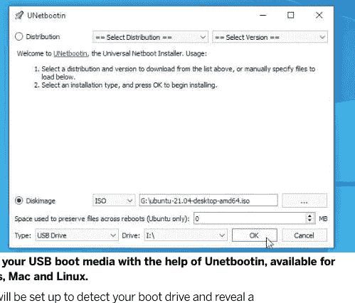

首先，下载 Ubuntu ISO。访问 `https://ubuntu.com/download` 下载最新版本。你有两个选择：较新的（21.04）或 LTS 版本（20.04）。

想要最新的特性并乐于每几个月升级一次；LTS 版本仅每两年更新一次，并根据需要支持五年或更久。

将 ISO 文件保存到硬盘。它大小约为 2GB，所以请根据你的网络速度预留下载时间。保存后，ISO 文件即可准备安装或在 VirtualBox 中运行。如果你正在寻找安装介质，最简单的方法是将 ISO 放入 DVD 刻录机，然后写入 ISO 并使用 `Rufus` 选择启动盘。

启动盘的设置非常简单，它们是现场的。如果你有一个空闲的 USB 盘（4GB 或更大）且已格式化，使用 `Rufus` 下载并运行 [`getubuntu`](https://getubuntu.io/) 选择 ISO 文件，使用剩余空间创建可启动的 USB。为了快速测试 Ubuntu，在驱动器处选择它，然后点击 `OK`。

是时候给 Ubuntu 一个机会了。插入 DVD 或 USB 并重启你的 PC。如果你足够幸运——Ubuntu 安装介质兼作现场光盘，可以在不触碰硬盘的情况下加载功能完整的版本。借助 Ubuntu 帮助创建启动介质，适用于 Windows 和 Linux。你的 PC 将设置为从驱动器列表选择 Ubuntu。如果不起作用，再次尝试 `UEFI` 模式。你可能还需要在 Windows 中禁用“快速启动” —— 进入设置 > 电源：选择关闭快速启动（推荐）。

如果你在各种选项中看到启动菜单 —— 选择默认并按回车。Ubuntu 现在应该加载到桌面。你现在可以探索 —— 一个简单且干净的界面，正如你所知……（不要说）。

现场光盘的问题在于，一旦关机就会丢失所有更改，除非你做一个小的 Ubuntu。如果你想尝试从 USB 运行，检查这里；你将能够测试所有新功能 —— 无需安装，如果有足够的空间 8GB 或更多 —— 然后安装可能是最佳解决方案。


当驱动器设置好，选择现场介质并安装 Ubuntu。第一部分是自言自语的 —— 你会被提示连接 Wi-Fi（如果没有以太网连接），我们建议在安装期间勾选更新和软件。

如果你已经尝试了 Ubuntu 并意识到让 Windows 和 Ubuntu 并存的好处，这是可能的！在安装期间，你会被提示将 Ubuntu 分分区。删除磁盘并安装 Ubuntu 或类似的操作。

但如果你只想让 PC 运行 Ubuntu 并在它们之间切换呢？答案在于将你的 PC 配置为双启动。然后你可以在自己的专用硬盘上安装 Ubuntu —— 或者划分你的现有驱动器为专用 Ubuntu 分区留出空间。

安装类型是最棘手的部分。如果你与 Windows 双启动，你的系统将显示现有分区并提议一起安装 Ubuntu。如果是，则选择并继续。如果不是，就结束了。你只需要管理 `GRUB` —— 引导加载程序（或相反），决定如何使用 Ubuntu。

在快速驱动器上运行 Ubuntu 没有替代品 —— 如果可以，甚至可以使用 `NVMe` 驱动器。

一旦过了这一步，安装过程应该是简单的。如果一切如预期，当你第一次重启时，你会看到一个可以加载加载系统的 `GRUB` 菜单。选择 Ubuntu，你将进入登录界面，使用最新版本的 Linux 内核。

如果你想在不设置整个 PC（或双启动系统）的情况下尝试 Ubuntu，下一步是运行虚拟机（VM）。

为此最好的工具是 `VirtualBox` (`www.virtualbox.org`)。下载主页上的链接并按照说明操作。该程序的设置过程很快，你需要 Ubuntu ISO 介质。你可以从 `www.ubuntu.com/download` 获取。

在 `VirtualBox` 中，选择虚拟机-新建，类型选择 Ubuntu 和版本（Ubuntu 64位）。勾选默认主文件夹并更改驱动器

 如果你计划运行虚拟机一段时间，请确保它至少有 32GB 的空间。点击下一步并分配内存（至少 2048MB (2GB)，如果你想让它运行快）。保持虚拟硬盘不变，然后将大小设置为 32GB 并点击创建。

你的新虚拟机将被创建。点击下一步。进入设置。如果你的 PC 性能强大，分配两个或四个核心。启用 3D 加速并分配尽可能多的显存（128MB）。最后在“存储”下，点击 `IDE` 图标并点击右侧的磁盘按钮选择你的 ISO 文件。

完成后，点击 `OK`。启动，然后按照主菜单中的步骤安装 Ubuntu。

在虚拟机中这是一个简单的过程：在选择类型下仅保留“删除磁盘并安装 Ubuntu”，并在提示时安装 Ubuntu。无需担心任何事情。最后，它会自动为你“弹出”光盘，所以只需按回车键退出。

Ubuntu 21.04 安装在 `VirtualBox` 的驱动器中，允许你使用扩展试用

当你启动进入 Ubuntu 本身时，屏幕最初会很拥挤 —— 跳过第一次运行。然后进入设置->显示以选择一个舒适的视图 ——

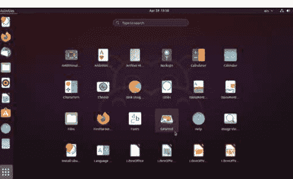

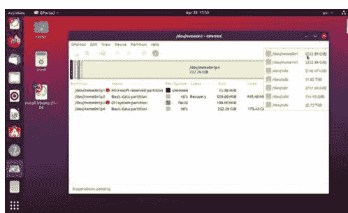

对硬盘进行分区最简单的方法是使用 Ubuntu 启动介质本身。在点击 Ubuntu 后，点击左侧启动器（`Launcher`）顶部的图标打开 `GParted` —— 这是一个搜索 Ubuntu 的工具。你应该在列表中看到 `GParted`（如果没有看到，输入 `parted` 调出它）——点击它启动。


# GParted 分区操作

GParted 启动时会默认选中当前的启动驱动器（通常为 `dev/sda` 或 `dev/nvme0n1`）。如果你想与 Ubuntu 共享硬盘，这里应该是安装了 Windows 的硬盘驱动器。使用其大小和下方的分区列表来验证是否正确。

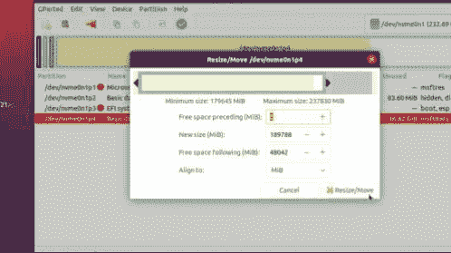

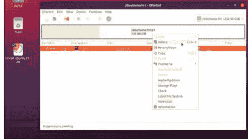

检查分区布局。如果有足够的空间，右键点击调整大小 —— 74GB 是理想的最小值。点击并向左拖动右侧以释放空间，为现有分区保留至少 10GB 的空空间。点击 `Resize/Move` 按钮。

若要在独立硬盘上安装 Ubuntu，点击 `/dev/xxxx` 列表查看所有可用驱动器。如果是新硬盘，它将显示为“未分配”`unallocated`；否则，将看到现有分区。确认硬盘上没有任何需要保留的内容，然后右键点击任何分区并点击删除 `Delete`。

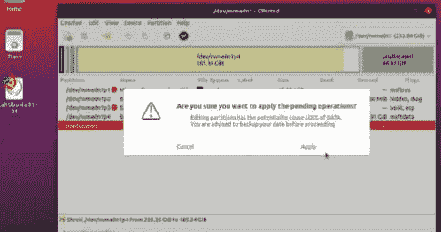

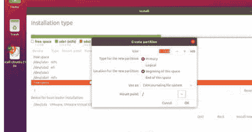

点击绿色勾钩。阅读警告信息 —— 如果有问题，双击取消 `Cancel` 并检查你的更改。如果你满意，点击应用 `Apply` 并等待分区完成。完成后，点击退出 GParted 并双击安装 Ubuntu 21.04，按照向导进入“安装”屏幕。

如果选择了“与 Windows 启动管理器并列安装 Ubuntu” `Install Ubuntu alongside Windows Boot Manager`，点击“现在安装”。如果选择“其他” `something else`，请选择该项。找到你的空空间并点击。选择挂载点为 `/`，然后点击确定。确认驱动器已选为“安装引导程序的设备” `Device for boot installation`；然后点击“现在安装”。

# Ubuntu 21.04 默认显示服务器 Wayland

Ubuntu 21.04 尝试重新将 Wayland 设为默认桌面服务器。这次会成功吗？

Ubuntu 21.04 的新特性是，在第一次尝试替换传统的 Xorg 服务器失败后 `Ubuntu 17.10` 失败了，将 Wayland 恢复为默认服务器。

那么，显示服务器究竟是做什么的？它为 PC 提供了运行 GNOME 等桌面图形环境的方法，让你能够移动和点击，而不是停留在命令行。将其视为内核与桌面环境之间的连接层。

几十年来，Linux 一直运行在 X 显示服务器上，自2004 年以来通过开源 X 项目存在。自 90 年代以来一直在演进，但正在创建日益复杂的代码和现代图形技术：显示服务器管理器。

2008 年，Wayland 作为 X 的替代品诞生了。它提供了一个更简单、更流畅的替代方案 —— 为什么不喜欢它？它通过统一合成器 `compositor` 和窗口管理器等元素来简化工作。Wayland 更加简单，因为它放弃了 X 的客户端架构，允许通过桌面环境连接到过时的系统。

Wayland 允许应用程序从任何地方读取输出和输入，这很容易被键盘记录器和其他形式的恶意软件破解。在重写操作系统的任何部分时，后兼容性是一件好事，Xwayland 提供了一个与 X 共存的服务器。然而，它运行运行良好。

好消息是，Xwayland 默认与 Wayland 一起安装，所以它就在那里，当 Wayland 无法支持某些内容时运行。不需要涉及任何配置。同时，Wayland 的性能与 X 几乎相同，关键之处除外。

要判断你使用的是 Wayland 还是 Xwayland，请启动会话。打开终端并将鼠标悬停在主窗口 —— 将显示你正在使用 Xwayland。Xwayland 工作完美，但你可能会在某些程序上遇到问题，特别是那些缺少 Wayland 安全功能的程序。例如，当你的应用尝试监控显示器的刷新率时，可能会出现鼠标和点击问题。

随着 Ubuntu 21.04 发布，桌面服务器再次成为默认值。你不需要做任何事情 —— GNOME 仍然是默认，且它运行在 Wayland 而不是 X 上。你可以通过查看设置下的“关于”页面检查这一点，看 Wayland 是否列出。

如果你看到 Wayland 被列为窗口系统，那么你可以放心地使用它，除非你的 PC 运行的是 NVIDIA 专有驱动而不是开源驱动，因为目前驱动程序是坏的。长长说，下一个主驱动程序 `v470` 将包含最终支持 Wayland 的硬件加速和渲染的补丁。然而，这表明当完全支持 Wayland 时将 Ubuntu 21.10。

与此同时，如果你想切换到 Wayland，有两个选择。你可以打开“软件和更新”通过终端切换回 Nouveau —— 或者当鼠标悬停在 Xwayland 窗口上时进行切换。

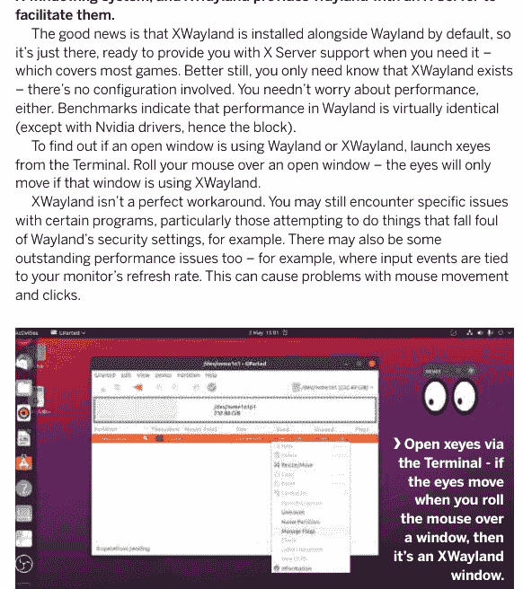

额外的驱动程序。或者，你可以通过回滚几个系统来阻止 Wayland 在 Nvidia 环境下运行 —— 下方的分步指南揭示了如何实现这一点。但请注意，你可能会遇到性能和兼容性问题 —— 在 Firefox 的 YouTube 视频中发现了卡顿，因此我们建议切换到 X 或切换到 Nouveau 驱动。

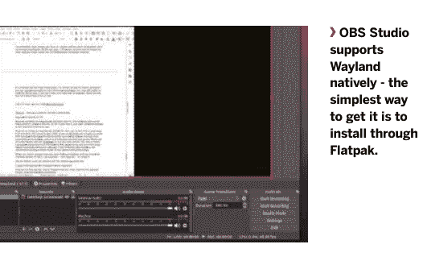

- OBS Studio 原生支持 Wayland：获取它最简单的方法是安装 Flatpak。

虽然自 Ubuntu 上次放弃切换到 Wayland 以来情况无疑有所改善 `耶！`，但仍有一些待解决的问题需要考虑。如果你喜欢 Ubuntu 但不喜欢 GNOME，尝试切换到另一个没有 Wayland 的桌面环境 —— KDE Plasma 5 和 XFCE 是兼容的，但这个流行的桌面仍与 X 工作。

虽然 Wayland 允许围绕 X 构建的程序继续运行 —— Wayland 的安全架构在其他处创建了问题。例如，屏幕共享和远程桌面在没有特定修复的情况下无法在 Wayland 上工作。开发者应该研究 PipeWire 和 xdesktop-portal 等技术，可以解决此类问题。

如果你不介意一些工作，解决方案已经在 21.04 中集成到 Wayland。GNOME 内置的远程桌面工具无需额外协议即可即用。你只需导航到“设置-共享”，打开大开关，然后点击“屏幕共享”进行设置，无需安装任何内容。

正在寻找可以在 Wayland 中运行的直播流或录屏工具吗？OBS Studio 2.70 显示了一个开发者集成 Wayland 支持的努力。你可以在 http://bit.ly/3v2t 了解更多信息。这表明当完全支持 Wayland 时将 Ubuntu 21.10。

flatpak 版本代替，包含了流或录制 Wayland，

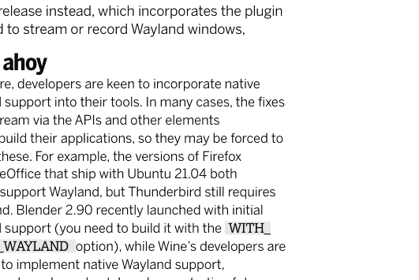

在其他地方，开发者将 Wayland 支持集成到他们的工具中。在许多情况下，修复程序应用于应用程序使用的 API，因此它们可能被迫等待它们。例如，Blender 2.20 需要使用 GHOST_WAYLAND 选项编译，由于不相关的补丁破坏了 Wayland 的功能。

如果这对你来说不是必要的，或者你喜欢的程序拒绝在 Wayland 上运行，你只需注销当前会话，使用用户名，然后点击设置切换到带有 X 的 GNOME。

它可能没有充满每一个引人注目的特性，但 Ubuntu 21.04 提供了大量的改进。

Wayland 可能占据了头条新闻，但它并不是 Ubuntu 21.04 带来的唯一新功能。当然，其他功能也与 Wayland 相关——例如 Linux 下的音视频 PipeWire 项目。

Nautilus 文件管理器有一些细小但令人愉目的更新，包括圆角的图标。

在实际操作中，它的主要目标是提高与 OBS 和 Discord 等兼容应用程序进行更好屏幕共享和录制的能力。它也是 JACK 的事实替代品，并改进了对沙箱应用（如安装在 Ubuntu 21.04 中的那些应用）的支持。

一个应该让集成新的桌面扩展变得更加容易的 `该扩展终于可以处理桌面与应用程序（如文件管理器）之间的拖放交互` 的重大变化是使用“设置”——假设你的配置具有适当的内核支持——你可以从 GNOME 图形界面配置方案。只需在深色模式和节能模式之间切换即可。此功能明显针对笔记本电脑用户，许多人注意到，如果不重启，你的设置将不起作用。

3.38.5) 这意味着尽管最近发布了 GNOME 40，桌面仍然保持了熟悉感。因此，这段时间内没有实施任何激进的桌面更改（例如极具争议的切换到动态工作区），尽管选定的 GNOME 应用（包括系统监器）已更新到它们的 GNOME 40 版本。

默认程序 Firefox 和 LibreOffice 也在发布时更新到了相应版本——LibreOffice 现在已达到 7.2 版本。

Ubuntu 21.04 中有几个值得关注的欢迎更新。首先，用户用户终于被私化了。这意味着除非调整了权限，否则用户将无法轻易看到他人主目录的内容。


如果你计划在加密分区上从头安装 Ubuntu 21.04，你会很高兴发现以官方发布版形式存在的安全支持——如果任何问题困扰你，可以使用它来修复系统。在初始设置期间留意此选项。

- 日历默认切换到深色主题：

内置防火墙现在将其默认后端切换到我们最用户友好的方式，而不是从命令行管理防火墙，且功能上没有区别。这的主要优点是直接处理时更容易使用，它没有定义好的表或链，使其变得完全可配置，并应该随新闻更新。

桌面外观发生了一些变化，例如对菜单栏上的 UI 元素使用深色主题，包括状态栏和日历。此外，寻找...

最后，安全启动（Secure Boot）已更新以支持符合 SBAT 的内核。桌面还获得了智能卡认证支持，现在取代了密码登录系统。

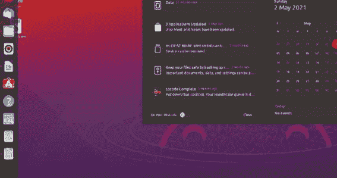

内核也升级到了 5.11（Ubuntu 21.10 带有的是 5.8 内核），除了进一步的安全修复外，你还将从最新的硬件支持和其他改进中受益。显著的例子包括

16 | 黑客手册

# 进入 Ubuntu

得益于更好的内存管理，针对 ext4 和 btrfs 文件系统的 `fsync()` 改进，以及对 Intel 和 AMD Van Gogh 等最新图形技术的支持。

Canonical 在宣布 Ubuntu 21.04 的博客中很大程度上关注了企业用户，强调了新的微软友好集成，例如原生 Active Directory 集成和对 Microsoft SQL Server 的支持，这些功能也已回向 Ubuntu 21.04 LTS。

在其他地方，你会发现密钥链已更新，包括 Python 3.9、Perl 和 PHP，以及 OpenJDK 16。

Canonical 似乎也在推动服务器用户升级到这个新版本，以获得 Java 11 的支持。对于 Ubuntu 20.04，这有 20。

LTS 服务器用户现在可以在升级过程中获得额外的帮助。它识别了升级后需要保留的内容。还有一些软件包更新，包括 LibreOffice (7.2)、DPKI (20) 和 io.uring。访问 `https://discourse.ubuntu.com/t/hello-ubuntu-releases-19221/` 了解详情。

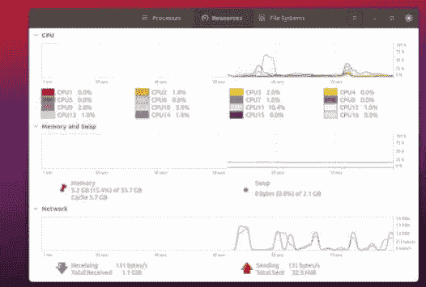

# 是时候升级了吗？

可以说，Ubuntu 21.04 可能会被记作让 Wayland 默认桌面环境的更新。但并没有什么...


> 尽管 GNOME 尚未更新到版本 40，但许多 GNOME 工具已经更新了。

令人兴奋的是，有足够的改进可以让你从 Zorin 轻松升级，而不是留在原地。能够与应用程序拖放文件本身就值得这次更新。

更安全的方法是等待运行 Ubuntu 20.04 的新内核 (5.11) 在下一个版本 (20.04.3) 中发布。除非你有迫切的升级需求，除非你需要切换到 Ubuntu，否则我建议等到 20。窗口系统默认会变得更好，任何关于 Nvidia 阻塞的主要问题都应该得到解决。

遵循 Ubuntu 20.04 的 LTS 版本是有些困难的，但考虑到你可以手动更新许多新软件包，你可能仍然倾向于按兵不动。无论如何，如果你无法等到下一个发布再升级，请查看下面的操作方法。

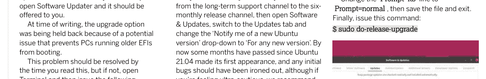

如果你在 PC 上运行 Ubuntu 20.10，请留意升级到 Ubuntu 21.04 的提示。如果你错过了它，只需使用由 Ubuntu 提供的软件更新（Software Updater）选项。

## Linus Torvalds 之晶的 Linux 之前与 GNU 基础。

### 探索 Linux 如何启动的

要理解 Linux是如何启动的，你需要了解 Unix。在 Linux 出现之前，Unix 是 20 世纪 70 年代一项成熟的操作系统标准。它已经运行在 IBM、HP、AT&T 等公司构建的许多框架。我们谈论的不是当时的小规模，而是全球范围内许多复杂的产品。

如果我们观察 Unix 的发展，你会发现它与 Linux 有某些相似之处：具有自由思想的学者被允许自由地开发他们想要的东西。虽然 Unix 最终是闭源的，受限于一个固定且复杂的开发团队，并受到利润率和律师费的影响，但紧随其后的某些群体则遵循了更严格的开放方法。这使得全球范围内的自由实验、开发和协作成为可能。是的，是的，你懂的！

回到 Unix，它是 20 世纪 60 年代学术界的操作系统标准，曾是麻省理工学院（MIT）、贝尔实验室的一部分，后来成为 AT&T 的一部分。

最初从 Multics 操作系统派生的单一操作系统开发了 Unix，而它的祖先是 C 编程语言。在某个时刻，“cs” 变为了 “c”，也许是因为它更酷一点。

在某个时刻，有人需要一个运行在 DEC 主机上的文本编辑器。于是，Unix 开发并细化了首个数字排版系统。由于功能文档的缺失，男士的 `sync` 命令（至今仍在使用）于 1971 年 11 月随着《第一版 Unix 编程手册》而诞生。这也是一种幸运，因为 DEC PDP-11 是那个时代最流行的主机，大家都发现它很有用。

1973 年，Unix 第 4 版本用 C 语言重写，尽管花费了多年时间才在 PDP-11 上运行 Unix。在 AT&T，从 AT&T 许可 Unix 源代码几乎需要花费 100,000 美元，因此商业用途局限于 20 世纪 70 年代。然而，到 80 年代初成本下降并开始普及。AT&T 和许多科学学生普及了 Unix 使用。它是一个通用的操作系统，在 20 世纪 80 年代中期，IEEE 在美国政府的支持下提出了 POSIX 标准，使得任何遵循 POSIX 的操作系统至少与其他系统部分兼容。

> Ken Thomas（左）和 Dennis Ritchie 被认为创建了许多原始 Unix 操作系统，Ritchie 也还创建了 C 语言。

为计算机开发软件是非常昂贵的。在 20 世纪 80 年代，操作系统的开发更像是硬件开发而非软件开发。在一种最终会变得疯狂的趋势中，Ian 最初开始编写 Linux System V0。

互联网服务也是在 Unix 之上开发的。微软和 BSD 系统似乎仍然占据着服务份额，但超过 50% 的 Web 服务器由 Linux 驱动。近期，各种基于容器部署的新颖服务全都是基于 Linux。云研究显示，Linux 是最大的桌面操作系统。Google 指出其服务依赖 Linux，因为许多其他供应商包括 AWS、Google。

移动操作系统的份额在 2020 年下降到仅 64% —— 它由 Linux 驱动。谷歌的引导程序是，开发的 Android (`https://developers.android.com/`) 是 Android 一个维护良好的分支，并支持由他们开发的大多数制造商。

太空被认为是 Linux 的最后边疆，因为它不是一个确定性操作系统，而实时操作系统关键情况的黄金标准。由于 SpaceX 使用 Linux 用于他们的飞行系统和三重冗余系统，NASA 将 Linux 随其直升机无人机送到火星，Tesla 也在汽车上运行 Linux。

自 1997 年以来，Linux 一直好莱坞特效的前沿。TILES 在核心部分使用了 Linux 服务。DreamWorks 在 2001 年制作了第一部在 Linux 上创建的电影。同时，Pixar 在 2000 年左右将其系统从 SGI 和 Sun 迁移过来，及时在 2003 年制作了《海底总动员》。

> Linus Torvalds 在 2012 年接受 Linux Format 采访。


20 世纪 80 年代末，Unix 的故事变得混乱，充满了商业内斗、竞争性标准和经常被称为“战争”的封闭。涉及 AT&T & Sun Microsystems、Oracle、SCO 等。有一天，他无法使用打印机，一个芬兰男孩能够启动，除非...

GNU 项目由 Stallman 在 1983 年建立，GNU 是一个幽默的（至少对黑客来说是）“GNU 不是 Unix (GNU is Not Unix)”。他的目标是建立一个拥有所有工具和全功能操作系统所需要求的自由操作系统。请记住，大多数创建的工具今天仍在被使用和维护。到 1987 年，GNU 建立了自己的编译器、Emacs 编辑器、GNU 实用程序（文件处理工具，如 `list` 等）、一个原始内核，并且更重要的是，Stallman 在 1989 年巩固了他软件自由的理想。

在 Linux 早期之前，我们还需要建立另一个成功因素：由理查德·斯尔曼（Richard Stallman）建立的 GNU 项目，它是自由思想、学术类型的产物。公司拒绝提供源代码 —— 因为源代码在当时是相当平常的。我们怀着歉意的心态建立了一场自由软件革命。


你可以说，如果没有 `GNU` 项目的建立，`Linux` 永远不会起飞。`GPL` 在 `Linux` 项目早期就被采纳，强制所有开发者分享他们对源代码的增强。它的反馈循环促进了改进。

在 `Linux` 早期之前，我们还需要建立另一个成功因素：由理查德·斯尔曼（`Richard Stallman`）建立的 `GNU` 项目，它是自由思想、学术类型的产物。公司拒绝提供源代码 —— 因为源代码在当时是相当平常的。我们怀着歉意的心态建立了一场自由软件革命。


# GNU 项目与 Linux 的发展

你可以说，如果没有 `GNU` 项目的建立，`Linux` 永远不会起飞。`GPL` 在 `Linux` 项目早期就被采纳，强制所有开发者分享他们对源代码的增强。它的反馈循环促进了改进。

在 `Linux` 早期之前，我们还需要建立另一个成功因素：由理查德·斯尔曼（`Richard Stallman`）建立的 `GNU` 项目，它是自由思想、学术类型的产物。公司拒绝提供源代码 —— 因为源代码在当时是相当平常的。我们怀着歉意的心态建立了一场自由软件革命。


# Linux 早期历史与发展

## GNU 项目与自由软件革命

在 Linux 早期之前，我们还需要建立另一个成功因素：由理查德·斯尔曼（Richard Stallman）建立的`GNU`项目，它是自由思想、学术类型的产物。公司拒绝提供源代码 —— 因为源代码在当时是相当平常的。我们怀着歉意的心态建立了一场自由软件革命。

你可以说，如果没有 `GNU` 项目的建立，`Linux` 永远不会起飞。`GPL` 在 `Linux` 项目早期就被采纳，强制所有开发者分享他们对源代码的增强。它的反馈循环促进了改进。

## 早期使用体验

多年来，完善 `Linux` 的核心一直并非易事。

我是一个最近才转投 `Linux` 的用户，我不得不与各种混乱的配置文件、表现不佳的驱动程序或其他令人困惑的故障作斗争；对于早期采用者来说，这似乎是一项艰难，因为他们从未对现代 `Linux` 受到过这种不容忍。直到最近，内核崩溃导致内存损坏仍然是完全可能的。我曾尝试与一个早期版本的 `Linux` 搏斗。

这是当时首选的 `DOS` 环境，但随着千年的临近，它开始被边缘化。`Windows` 用户正经历着文件抽象化的过程——“我的电脑”进入了这一动荡。

在早期，即使是让鼠标工作也并非易事，需要用户手动处理各种配置。后来发布了一个可启动的内核，提供了一个文本驱动的界面来设置服务器。这被认为是一个突破，尽管当时非常困难，以至于大多数人不得不自己编写。所以在 2000 年，当 `Windows Me` 变得缓慢且迟钝时，任何 `Linux` 用户都会看到安装过程完成而感到喜悦。即使你只是想启动，也可以乐观地期待系统能成功启动。硬件检测几乎不存在，而在为 `Linux` 编写的驱动程序中，许多质量都很糟糕。然而，先驱们坚持了下来——许多人认为 `Linux` 内核 2.4 发布了，随之而来的是对操作系统和奔腾 IV 处理器的支持。对于用户使用 `USB`、`PC` 卡和 `PNP`（即插即用）设备至关重要，当时正要爆发，但围绕 `Linux` 的兴奋和预期让许多计算机爱好者拥有了更的家庭连接，有些人甚至享受了拥有多个电脑的奢侈。

这解决了 `Linux` 的许多障碍：人们现在可以很容易地下载它；此外，文档很容易获取，而且 `Linux` 能够用于互联网连接（系统不稳定）。用户体验总体来说非常不友好。虽然某些安装程序已经发展出了图形化功能，但这些并不算多。大多数用户被要求理解磁盘分区的原理，并根据自己的需求选择软件包。

`Windows XP` 于 2001 年 10 月发布，尽管它比之前的版本有了巨大的改进，许多用户发现他们的机器无法运行它。毕竟，它需要 64MB RAM 和 1GB 磁盘空间。`Linux` 最近才获得了大容量驱动（有许多限制，取决于 `BIOS`，2.1 和 4.8GB 是常见的）。许多人无法在他们的硬件上安装它，许多人在常用的办公套件和运行时库中遇到了性能问题。

与这些缺点相比，`Linux` 的一个大优势是严格遵守 `Gnome` 界面指南，该指南规定了应用程序设计的关键原则。这意味着桌面在内部是一致的，但在应用程序方面，人们可以自行编写。

此外发布了 `KDE 3`，它比 `Gnome` 更为商业化且要求更高，发行版配备了其中之一或两者。`SUSE`（`openSUSE` 的前身）也在桌面中添加了 `KDE`，但直到 2009 年，它才同时拥有 `Gnome` 和 `KDE`。

这为其他 `Linux` 发行版的演进提供了动力，适配继续成为 `Linux` 世界的一部分（包括我们使用的 32 位处理器）。直到 2006 年，`Mac` 拥有 `PowerPC` 处理器，许多人收到了 `Apple` 的软件更新，现在 `Linux` 也是。

在 2002 年，在 1999 年层叠样式表（`CSS`）发布后，`DVD John` 发布了。该软件让 `Linux` 用户能够播放 `DVD`，因为他们那时已经有了从 `DVD` 控制机构解锁许可证密钥的办法。它比 `John` 要危险得多，也被收购了。随着 `iPod` 和 `iPad` 的出现，`MP3` 变得随处可见。由于许多实体对底层算法的不同部分拥有专利问题，结果是，许多发行版没有附带编码的多媒体代码。法律是模糊的

`Gnome 2` 桌面环境于 2002 年发布，它变成了一个如此直观的桌面，以某些用户（出于需要、复旧还是纯粹为了现代替代方案）更喜欢它。它是如此简单、直观，而且他们必须使用。

考虑到所有成本，只要涉及金钱，事情就会变得棘手。因此，企业和商业市场的大玩家将 `Linux` 发行版视为威胁，并发起了攻击。

这是来自 1998 年 8 月的一系列微软泄密文件，当时《万圣节文档》（`Halloween Document`）发布。详细的私人观点揭示了广义上的开源开发是对业务的直接攻击，旨在对抗其采用率。这一私人观点在这一问题上与公司的公开立场直接冲突，尽管史夫·鲍尔默（`Steve Ballmer`）在 2001 年曾公开攻击 `Linux`。这些文档可以在 `www.org/~ext/halloween` 找到，在文中微软报告说：“`Linux` 最终将拥有一切，或者被自己拥有。”

它是正确的。没有 `Linux`，微软几乎无能为力，因为它是无法购买的。`Linux` 在微软的软件扩展（不起作用）方面存在问题，而结合恐惧、不确定性和怀疑（`FUD`）策略也失败了。还有另一个角度：然而，作为一家公司，他们在版权上……

| 1991 年 8 月 5 日 | 1991 年 9 月 17 日 | 1991 年 11 月 | 1992 年 1 月 5 日 |
| :--- | :--- | :--- | :--- |
| `Linux` 在 `comp.minix` 宣布 | `V0.01` 发布在 `ftp.unix.net` | `V0.2` `Linux` 是免费的 | `V2.1` |
| `Linux Torvalds` 是赫尔辛基大学的一名 21 岁学生 | 此版本仅包含源代码，并具有多线程文件系统 | `Linux` 涵盖了其分区的关键部分 | `V4.0` `GPL`，随此版本发布 |
| | | 向商业活动许可 | |

尽管如此，`FOSS`（自由开源软件）实现所拥有的权利仍然反对这一切。大多数发行版都将安装任务留给用户，尽管 `Ubuntu` 及其衍生版本在购买机器时会为你完成。专利在 2017 年过期，`Linux` 内核开发 完善 `Linux` 的核心多年来一直并非易事。

得益于开源开发，`Linux` 用户早已已经运行了 64 位桌面系统，而 `Windows` 用户则直到 2005 年 `XP` 才发布 `x64` 版本。各种专有应用程序（至少在发布后丧失了游戏性）为发行版维持至少 32 位提供了一些动力。

`Ubuntu` 在 2004 年效仿此，其实现方式引起了许多批评，并导致了类似反病毒软件的结果。`Poetering` 曾一度将他的心血描述为“那个会弄坏你音频的软件”，这花费了一些时间，但最终 `Ubuntu` 和其他发行版解决了集成问题，并实现了开箱即用。现在，`Pipewire` 已经出现，为新一代基于音频的对抗机器电台服务。

`Debian 11` 直到 2026 年仍以某种形式使用 32 位，但许多其他发行版已经放弃了它。最终，许多人选择了 `x86` 路径，该路径自 2015 年起不再受支持。

## 音频与桌面演进

2004 年，由名为 `Leonant Poetering` 的其他开发者开发了一个名为 `PulseAudio` 的声音服务器。在当时的桌面环境中，声音服务器在 `Linux` 的 `DSM` 系统中存在一些缺点：使用 `Enlighted` 声音守护进程 (`ESD`) 和 `KDE` 都在使用实时合成器 (`rtsa`)。`PulseAudio` 的设计足够灵活，可以提供许多增强，如按应用程序音量控制和网络透明化。2006 年，由于认为它存在荒谬的缺陷，它在声音服务器灾难之后被从 `Ubuntu` 中移除。

2010 年的发布被一些人记忆为迷失方向的一个版本。它的 `Ubuntu` 软件中心现在包含了付费应用，且网络重混版（`Network remix`）被一个新的桌面中心所取代。在 11.04 版本中，这成为了主桌面的新壳，并取代了 `Gnome 3`。当时，`Gnome` 的功能还不够稳定无法包含在发布中，而 `Gnome 2` 已经比当时的 `Ubuntu` 要稳定得多。因此，用户希望回到旧的桌面。桌面类型自 2004 年以来随着 `Gnome 3` 经历了一个圈，人们对 `Unity` 的流失感到哀悼。

随着（新发布的）许多 `Windows Vista` 需求增加，`PulseAudio` 声音服务器随后被开发，并考虑纳入许多发行版中。按照惯例，`Fedora` 是第一个在 2007 年底发布的第 8 版本中将其作为默认采用的。


> * Asus++ Linux 基于 Xandros iKdm，但事实并非，人士们直接替换了它。

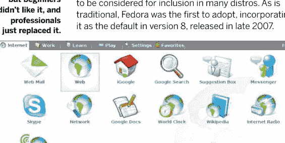

| 2003年3月17日 | 2006年11月29日 | 2007年2月5日 | 2008年12月25日 |
| --- | --- | --- | --- |
| 海狸 解毒 | 2.6.19 内核 | KVM 到来 | 图形网络对话 |
| 改进了内核模块 (LKM) 的性能 | 对 ext4 文件系统的实验性支持。 | 合并了内核的虚拟机 (KVM)，添加了 Intel 和 AMD 硬件虚拟化扩展。 | Linux 图形栈已完全更新，以确保利用现代 GPU 的全部性能 |
| 虚拟内存系统、CPU 调度器和 (IO) 调度器 | | | |

2003年4月 Firefox

2006年8月 Linux Mint

2008年9月 Chromium

单一内核使得许多 Linux 发行版蓬勃发展。

在深入研究了 Linux 内核本身及其支持软件之后，让我们转向 Linux 发行版（distros）是如何开发并分化成广泛的生态系统的。

发行版让 Linux 内核能够快速增长。它们不仅简化了 Linux 的安装（这曾是一个复杂的编译过程，手动获取正确的工具、文件系统、引导加载程序，全部在资源受限的系统中通过终端完成），而且成为了整个全新发行版的基础，为新的用例而定制。

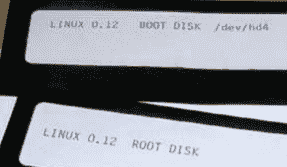

在 Linux 早期，情况变化很快。发行版开发是一项相当基础的任务，人们尝试使用最好的工具来封装基于 Linux 的操作系统。Slack Linux 于 1991 年发布，随后 Debian 于 1992 年发布，它带有更好的安装程序，并通过 FTP 服务器提供。

Linux 早期，Windows —— Unix 标准被发布，TAMU Linux 于 1992 年 5 月发布以实现图形界面。虽然它们都没有因作为首批发行版而闻名，但它们并没有持续多久。Linux (SLS) 也是于 1992 年 5 月发布的，它需要一个新的网络栈。然而，这并不是因为它的（以及对可执行文件的更改），而是因为它的... 并不是，因为它的... 并不是，因为它的... 并不是，因为它的... (注：此处原文存在重复，已按原文翻译逻辑) 成为了整个全新发行版的基础，为新的用例而定制。

（注：原文多处存在语义重复和逻辑混乱）

Poetering 曾一度将他的心血描述为“那个会弄坏你音频的软件”...


> * Asus++ Linux 基于 Xandros iKdm，但事实并非，人士们直接替换了它。

（注：由于提供的原文文本存在大量重复片段和断句，译文已尽可能在原文结构的基础上进行对应。）

1994年，红帽 Linux（Red Hat Linux）发布。红帽建立了一家营利性的 Linux 业务，最初销售红帽发行版并通过上市来提供支持服务。红帽于 1999 年上市，创了华尔街历史上最大的单日涨幅。它于 2005 年 12 月进入纳斯达克 100 指数权重，并在 2012 年实现了 10 亿美元的年收入。2008 年，在首次首次发布 14 年后，IBM 以 40 亿美元的价格收购了红帽。这笔交易非常成功。

与此同时，在德国，SUSE（软件开发）于 1992 年作为一个小型项目起步。1996 年，一家荷兰公司发布了整套发行版和业务，销售新的发行版和支持服务。SUSE 在 2003 年被收购，并在 2005 年发布了社区版，同时 SUSE Enterprise 为其商业部门同步开发。该公司在 2008 年以 10 亿美元被收购，并在到 2010 年期间实现了双位数的增长，达到 4.5 亿美元以上。尽管取得了成功，SUSE 和 openSUSE 也影响了一些人。我们好奇这是否可能归源于它们的欧洲根源。

> Debian 是比任何其他发行版发布更多发行版的发行版！

红帽于 2001 年以 Hat Enterprise 的名发布，其商业成功吸引了广泛的主机。值得注意的是，红帽直接支持 Fedora 作为其测试发行版，而社区发行版 CentOS 正在转向滚动发布（rolling release）。CentOS Stream 正在作为替代方案出现。红帽企业版（Red Hat Enterprise）现在为拥有少于 16 台服务器的社区项目提供。

在 1994 年红帽创立到 2000 年之间，出现了许多红帽的衍生项目，因为在那个时候人们对 Linux 还没有明确的兴趣。Linux 适合业务任务，当时许多开源工作已成为焦点。但到 20 世纪 90 年代，随着 Linux 的普及，早期的家庭端开始出现，现代桌面正在开发中。Linux 即将迎来新的观众。

(img/1e7c2db42dac866a51a0ace7df48feef_28_0.png)

**Debian 以其稳定性、高水平的测试、对软件自由的奉献以及严谨的组织而闻名。**

> 已故的 Linus Torvalds 于 1993 年创立了 Debian。Linux 在 2002 年花费了时间与他交流。

(img/1e7c2db42dac866a51a0ace7df48feef_28_1.png)

> 绘制你最喜爱的发行版的开发图表。

致谢：基于 fabiolix 制作的 LinuxTimeline，GNU Free Distribution v1.3。https://github.com/fabiolix/LinuxTimeline

一个例子是 1998 年中期的 Marke Linux。作为 Hat 的分支，它疯狂到目标用户是使用新桌面环境（KDE）的用户。它赢得了很多关注，但最终在 2001 年面临问题。然而，它的精神继续在更好但较为人知的 Mageia 和 OpenMandarin 中延续。很难衡量——当用户就像 Linux 本身时。Ubuntu 为首次用户超越了新的桌面环境（KDE）。它在在服务于 2011 年结束之前一直免费提供该发行版、快速、可靠的服务器下载。然而，基于 Ubuntu，加入新发行版并开启了每六个月一次的发布，每两年发布一个长期支持（LTS）版本。支持持续持续 18 个月，LTS 持续 30 个月（五年）。

将 21 世纪初指作这一模式运作良好的时间点，并成为数百个 Linux 发行版的基准。但只有一个：Ubuntu，由 Mark Shuttleworth 于 2004 年这位非裔百万翁发布。Ubuntu 基金于 2005 年成立，为了向开源软件提供支持。Ubuntu 见证了 80 多个其衍生的分支，但它拥有桌面发行版中最大的份额，这并不寻常。

(img/1e7c2db42dac866a51a0ace7df48feef_29_0.png)

- 这是红帽的标志。

致谢：BY-CC-SA 3.0 https://en.wikipedia.org/wiki/Red_Hat#media/File:Red_Hat_headquarters_North_Carolina_US_November_2003.jpg

## 获取 Linux 游戏

Linux 上的游戏一直备受关注，但我们无法否认它对市场的影响，这主要是通过自 90 年代流行的 Wine 实现。事情始于 Valve 将 Source 引擎引入 Linux 并使用 Wine。这为 Source 游戏开启了大门。2012 年底，Valve 宣布它正在创建 SteamOS，一个基于 Ubuntu 的发行版，用于运行 Steam 客户端。在 Steam Machine 失败后取得了一小成功。Steam 现在有超过 7000 款 Linux 游戏，总数约为 14000 款。

但为什么仅仅为了帮助 Steam 的 Linux 用户这样做？因为 Steam 与 Steam Deck（一个运行 Linux 的掌持 PC 主机）产生了共鸣，它承诺 Proton 可以运行所有 Windows 游戏。也许 2021 年是 Linux 桌面最终胜利的一年……

(img/1e7c2db42dac866a51a0ace7df48feef_29_1.png)

我们将向你展示如何提升你的极客身份并构建你自己的 Linux 内核。


当 Torvalds 在 30 多年前将 Linux 发布到世界上时，它是源代码形式。要使用它，你必须进行配置和编译。在过去的这些年里，情况发生了变化，现在的发行版已经为各种硬件提供了广泛的配置和编译好的内核，但仍然有人在编译自己的内核。你为什么要这样做呢？这样做有许多原因，我们将在介绍如何配置、编译和安装之前对这些原因进行进行介绍。

发行版的内核包含了每个人需要的所有内容，这意味着你不需要担心它们自带了什么。它们也是为通用 CPU 构建的，因此你可能会获得一个针对你的硬件使用情况定制的更好的内核。自定义内核通常经过了良好的测试，但这也意味着当你无法获得最新版本时，例如 Ubuntu 16.04 带有的是内核 4.4.0，而在那时已经旧三个月了。三个月后，它使用了稍后一点的 4.4.0 版本。内核的最新发布版本是 5.13.3。这并不是 Ubuntu 或任何其他发行版的批评。如果你认为它经过了良好的测试的话。你可能需要新版本内核中的功能，例如针对 AMD 等近期硬件的驱动程序，而现有内核版本可能不支持这些。如果你想要硬件的性能——特别是当你使用低端设备时——自定义内核可能会大不相同。而且，当你告诉别人你了解自己的内核时，还能获得很多成就感。

你并不需要配置和编译内核。你可能需要或使用 `sudo` 运行 `make install` 来更新引导加载程序，所以大多数人直接以 root 身份完成整个过程。

内核是所有内核下载的来源。

| 版本 | release | 日期 | main | oldmain | rc | stable | vstable | oldstable |
| :--- | :--- | :--- | :--- | :--- | :--- | :--- | :--- | :--- |
| 5.15.3 | 5.15.3 | 2022-09-13 | | | | | | |
| 5.14.2 | 5.14.2 | 2022-08-28 | | | | | | |
| 5.14.1 | 5.14.1 | 2022-07-27 | | | | | | |
| 5.13.0 | 5.13.0 | 2022-07-06 | | | | | | |
| 5.12.9 | 5.12.9 | 2022-06-12 | | | | | | |
| 5.12.8 | 5.12.8 | 2022-05-29 | | | | | | |

与许多之前的发行版一样，对内核进行补丁是常见操作。你可能需要这样做来获取最新功能，这些功能可能支持新硬件或启用尚未充分测试的额外功能。补丁的最新版本需要 4.9 `GCC` 编译器。如果你有更新版本的内核，可以使用它，或者你可能需要升级补丁源文件。为了演示如何构建一个让你选择 CPU 优化的补丁，请从 `https://github.com/grays92/kernel.tar.gz` 下载文件。

现在运行 `make menuconfig` 并检查 `Processor type > Processor family` 下的选项，你将看到更多选择。如果你选择在同一机器上运行内核，选择 `Native Options` 原生选项，编译器将为你提供比在 x86-64 系统上运行更好的性能，但是以牺牲移植性为代价的。你选择的选项将保存在 `config` 文件中。文件显示了这意味着什么。在编译你的处理器期间，你可能需要调整 `/usr/src/linux-source-y` 中的源码。

无论你选择什么，现在是时候编译内核了。你可以从 `/usr/src/linux-source-y` 开始 `make -j$(nproc)`。在开始之前，我们必须确保已经安装了编译器和各种工具。对于 Ubuntu，这通过 `sudo apt install build-essential` 来实现，以便能够编译内核配置程序。你如何决定为特定机器或内核构建内容？当你编译时，只包含实际用到的驱动程序。如果你在网络上的桌面或服务器上，为内核始终需要的以太网卡编译驱动程序是有意义的。另一方面，笔记本电脑需要许多用于无线网络的驱动程序，因此可能需要某些模块。同样，如果你使用根分区，你将需要磁盘控制器可以是内置的或作为模块加载或 USB 闪盘。如果你不需要基本项目，系统将不必加载你的内核，这将加快启动速度。

`menuconfig` 的界面功能强大，但在美学上很基础。它非常简单，但需要 Qt。如果你使用 KDE，还需要 `qt-dev`。

> 小贴士：如果内核启动太快，导致你来不及阅读内核日志，只需按回车键滚动，并使用暂停键控制速度。

这呈现了一个层级选择结构：使用光标上下移动，进入嵌套菜单。每个选项都可以是内置的、模块或禁用。切换选项允许你精确地选择你想要的功能。

然后运行 `make menuconfig`。这也是界面的一个快速版本。它没有你所使用的 `menuconfig` 的所有功能，但它是启动某些通用功能的相同方式。左侧显示配置选项，右侧显示每个选项的作用描述。注意，大多数选项都是默认设置的。在拥有一个可以工作的内核后，你可以决定优化程度以及如何构建它。在早期，你可能会将所有内置驱动包含在内核中。

完成 `menuconfig` 后，内核将保存在 `.config` 文件中。然后你可以运行 `make help` 来启用内核中的特定功能。进入 `Processor type > Processor family`。这默认设置为 x86-64 CPU，除非你正在使用不同的

## 定制内核

在花费了一些时间按照你的喜好定制了内核后，随着 Linux 的发展和版本的发布，你可能在想你必须从头开始，对吧？实际上，你只需要下载并解压新源码。根据需要应用任何补丁，但注意某些补丁可能导致你需要新的补丁，或者完全不需要，因为它们现在已经包含在内核中了。在源码目录旁边，将你的 `.config` 文件复制那里，根据喜好重命名它，并运行 `make oldconfig`。此命令会根据新版本中的选项解析你现有的 `.config` 并提示你进行任何更改。对于次要更新，将版本 4.6.3 修改为 4.6.4 并对其保持不变。然后你可以根据你的发行版使用 `update-grub` 或 `grub-mkconfig` 来编译并安装内核：

```
$ update-grub
```

```
$ grub-mkconfig -o /boot/grub.cfg own
```

如果你查看任何发行版的 `/boot` 目录，你会看到一个 `vmlinuz` 文件，内核通常会使用 `initramfs` 或 `initramfs`。这些是细粒度的，用于帮助在不将所有内容都包含在内核的情况下启动。初始 `initramfs` 是内核启动时立即加载的文件系统。该机制处理模块的加载以及一个通常称为 `init` 的脚本，该脚本会运行内核。如果你需要空闲内存和运行时间，则不需要 `initramfs`。

创建 `initramfs` 的方法有很多种，但大多数方法都有自己的实现方式，现在有一个通用的解决方案，可以更容易地解决这个问题。`Dracut` 处理硬件检测，并允许你启动任何它支持的内核。最好的部分是创建 `initramfs` 非常简单，只需使用

```
$ dracut-kernel <version> own
```

这会在 `/boot` 为内核创建一个 `initramfs` 文件。`mkinitramfs` 会将其添加到你的启动菜单，但除非你正在组装 RAID 数组或加密分区，否则你可能不需要它。

我们的内核模块并不包含在内核中。最常见的例子是 Nvidia 驱动程序，其次是 Wi-Fi 驱动程序，因为内核可能包含其他专用驱动程序。

安装新内核后，你需要重新构建驱动程序。你可以等到重启后再处理，但如果你没有网络，就必须有可用的驱动程序。你可能知道如何重新构建它们，但更好的方法是查找 `/sys/module/` 的链接以从源码构建，这样在你解压新内核时就可以轻松创建它。使用脚本来处理编译和构建内核的各个步骤可能会更简单，而其他人将为你安装软件编译所需的各种工具：

- `make all`
- `make modules_install`
- `make_install $(cat /boot/release)`
- `update-grub`
- `reinstall-drivers`

我们最近查看了来自 `kernel.org` 的原生内核或我们发行版的内核，但那里也有其他内核。有些是你应用到原生内核上的补丁。最广为人知的来自 `/kernel/` 的 Patched 内核，你应该在学习任何事情之前专注于学习构建引导扇区。如果你真的想获得一个冒险的内核，你可以从 `kernel.org` 找到源码，甚至可以从 `https://github.com/torvalds/linux` 获取最新的源码。

所以你似乎在早期实验期间会做这些事情，这都是学习过程的一部分。正如 Adams 所说的——不要恐慌！


我们将向你展示如何设置一个可以丰富你生活的 Debian 家庭服务器。


在电脑上运行 Linux 是某种成年仪式，尤其是当它成为你的主操作系统时。朋友们通常对你用来调出控制台输出、错误信息和照片的命令感到困惑。他们问你是否也能运行 Linux，并说：“我只能向你展示你必须走过的门。”从那时起他们通常就不再是你的朋友了。但没关系，不需要朋友，你有 Linux……而且和朋友不同，Linux也是一个优秀的操作系统。家庭服务器是朋友的极佳替代品。也许不是，但在本教程中，我们将展示如何设置一台可以安全存储你的设备、在全家里共享照片、安排云备份等许多机器。

如果你以前从未设置过任何东西，那永远不要——正如 Linux 的很多事情一样，这个过程比你想象的要简单得多。在 GUI 之外工作最初可能会令人令畏，但一旦初始设置完成，一切都可以轻松完成。如果你以前做过，也许你可能会学到新技巧，或者你可能会写信告诉我们我们的策略有多愚蠢，我们没办法！

组装并玩转 deity 以获得你需要的帮助。然后安装 Debian。

并不是很久前，我们花了大量时间讨论硬件考虑——那时硬件支持是一个雷区，所有东西都杂乱地堆在一个盒子里。在 Unix 上事情似乎是完美的，但严重的硬件不兼容性对于笔记本电脑来说往往很严重，因此你在其他地方遇到的问题将是微小且容易修正的。在那里你可以通过选择二手机器（不太可能被抬价）或服务器来避免任何旧部件，但特别是硬盘驱动器和电源有损坏的习惯，而损坏通常对服务器不是好状态。

此外，当某些组件损坏时，备品通常只有二手的，而且可能不会持久。而且，你放在桌上的十年旧 IDE 硬盘并不快或不够用，对旧硬件的依赖是致命的。通过这种方式，我们可以使用闲置零件，但前提是你有信心。

我们将使用 Debian 作为我们的服务器，尽管我们提供的软件包相对，所以我们可以使用任何你喜欢的。这包括桌面、服务器等。有了许多 Linux 发行版，如 Ubuntu、CentOS 或 Arch 甚至。


```
- 192.168.1.100
```

> 这是我们设置的最小 Debian 集合。安装只花了一点多。

```
```

> 服务器，它提供的服务

```
- 192.168.1
```

家庭服务器不需要处理能力，双芯芯片就可以了，4GB 内存绰绰有余。如果你的服务器必须远离路由器，最好是使用带有内置适配器的主板。千兆以太网将启用路由器升级，特别是当你发现服务器和客户端机器之间流动着大量硬数据时。在家里。小型服务器非常适合寻找节点和集群，但多部分机箱往往可以容纳超过 3-5 块硬盘，这超出了我们的需求。

对于这项功能，我们将操作系统安装在一个硬盘上（理想情况下是 SSD，但也可以是硬盘），特别是如果我们有一个 2 块硬盘的 RAID（镜像）数组用于存储。我们的操作系统驱动器至少应该有 20GB，我们想要

## 添加 RAID

通过简单的编辑设置一个冗余存储的镜像阵列并保存你的更改。下一步是使用两个硬盘驱动器设置软件 RAID，我们每块驱动器的容量大约为 1TB。人们通常对牺牲容量有本能的排斥感，这就像是拥有两个分区（每个驱动器一个），但如果其中一个驱动器故障，你就会丢失一半数据。根据墨菲定律，糟糕的情况是只有一个逻辑卷，但如果其中一个驱动器故障，你就会丢失所有数据。

等等，还有一种误区认为 RAID 必须使用相同的驱动器。实际上，并没有理由使用不同的驱动器，或者至少不同批次的驱动器，以防故障。在连接驱动器后，我们可以通过运行 `blk` 来检测它们。我将驱动器列为 `/dev/sdb` 和 `/dev/sdc`。这是分区的第一步，我们使用 `gdisk`（对于大于 2TB 的驱动器是绝对必要的）。要进入你的系统（如果已设置分区表），请运行：

```bash
$ apt-get install gdisk
```

```bash
$ gdisk /dev/sdb
```

输入 `p` 列出所有分区。我们想通过按 `d` 删除每个分区，直到没有剩余分区。现在按 `n` 创建新分区并接受其编号的默认值。同样按 Enter 接受默认起始扇区。我们可以使用整个驱动器，使用分区的最后一个标记来避免在同一块驱动器上出现多个条目（即使只有一个磁盘）。这虽然不是大问题，但如果现在现在使用驱动器的全部容量，未来可能会稍微多一点空间。因此，在最后一个扇区输入 `-1`，然后运行 `gdisk`。这可能多此一举，但可以节省一些麻烦。如果你的驱动器大小不同，请使用类似的方法，如果你的计算不准，过度分配会比现在好。输入 `0` 设置你想要的分区类型和大小。然后输入 `OK`，退出并对 `/dev/sdc` 重复该过程。之后我们需要格式化分区和 RAID 阵列。

```bash
$ gdisk /dev/sdc
```


| A1 | A2 | A3 | Ap | Aq |

|---|---|---|---|---|

| B1 | B2 | Bp | B3 | |

|---|---|---|---|---|

| Cp | Qc | C2 | C3 | |

|---|---|---|---|---|

| Dp | Dq | D1 | D2 | |

|---|---|---|---|---|

| E1 | E2 | E3 | Ep | |

磁盘 0 磁盘 1 磁盘 2 磁盘 3 磁盘 4

> 你需要两个以上的驱动器才能实现这一点。

使用 RAID 1 时可能会出现问题。然而，我们的数据免受单个驱动器故障的影响，否则我们会因为没有制定备份策略而哭泣，现在阵列变得不可读。对，对，意识到这些事情会发生是很。驱动器还可能由于静默数据损坏而故障。为了保护你的数据，请理解这类事情。听到这里，你可能想用 LVM 将你的驱动器管理为一个单一逻辑卷。这种做法的缺点是，如果一个驱动器损坏，整个卷将无法访问。这种做法被称为“讨厌你的数据”。

不要讨厌你的数据。有一个备份策略。将你计划存储的数据与完美灵活的介质匹配。ISO 和 CD 可以重新加载。你刻过的 DVD 和 CD 等。

停止你的服务器，以避免在没有固定地址的情况下带来的困扰。默认情况下，Debian 会从 DHCP 请求 IP 地址。这意味着在下次重启时，当网络上的其他人加入或更改了你的 DHCP 配置时，它可能会获得不同的 IP。

某些路由器允许你通过 MAC 地址为你的服务器预留 IP，这是解决问题的方法之一，但你也可以在我们的服务器上设置静态 IP。

我们需要一个与本地网络形状相同（我们指的是同一个 /24 子网）的地址。你可以通过运行命令 `ip addr` 获取有关你网络接口的有用信息，那可能是你的接口 eth0 或 en0。寻找类似下面的一行：

```
inet 192.168.1.100/24 brd 192.168.1.255 global eth0
```

在 eth0 段落中。我们今天不会关心 IPv6 地址或你的家庭网络。你可能可以使用默认网关 192.168.1.1，所以不要完全复制它。在这种情况下，路由器也会出现在 192.168.1.1，你可以通过已知它或运行命令来找到最后部分（路由 - ed）：

```bash
ip route
```

并获取网关（它通常是 1 或 254）。除了分配 IP 之外，DHCP 还提供路由和 DNS，我们需要在 Debian 中指定它们。在该文件中，将使用以下命令：

- `/etc/network/interfaces`

`nano interfaces`

按如下所示替换以下内容（保持任何缩进的行不变）：

```
if eth0 inet static
    address 192.168.1.100
    netmask 255.255.255.0
    gateway 192.168.1.1
```

其中网关是 192.168.1.1。我们将需要格式化分区和 RAID 阵列。

# 终极服务器

## 添加 Samba

准备好随着额外的波萨诺瓦（boss nova）节奏跟随 Samba 协议起吧。

任何家庭服务器执行的最崇高职责之一就是共享。无论是你让你惊叹的数 GB 字节动听音乐，还是当你找不到容量足够的 USB 闪盘时存放它们的地方，拥有一些集中且某种程度的存储空间是非常有用的。这与拥有自己的文件共享协议 NFS 的操作系统不同，NFS 自 90 年代以来一直存在着。

NFS 很好，但今天我们并不会沉溺其中。相反，我们将使用 Samba，它是 Windows 共享协议的实现。这种方法的优点是我们的服务器可以被任何 Windows 或 Mac 以及其他网络设备访问。

在开始之前，为网络共享设置目录是一个好主意。我们将它们存储在 RAID 上，如果你自上次操作以来重启过系统，那么它们应该是自动挂载的。如果没有被挂载，我们将使用 `/mnt/samba/braid`。让我们创建这些目录：

我们将允许访问所有这些目录，并允许任何人写入公共目录（public）。如果你有一些认为其他网络用户也能从中受益的文档或文件，现在是把它们放在那里的好时机。Samba 允许通过用户和密码访问，但对于家庭网络，允许访问所有共享更为简单。这意味着我们必须使用 `chmod` 将公共目录设为可写。


现在我们将运行 `sudo apt install samba` 并设置我们的共享。我们将编辑 `/etc/samba/smb.conf` 并在共享部分（Shares Section）中添加以下行：

```
[public]
path = /mnt/samba/braid
read only = No
browsable = yes
guest = yes
```

现在运行 `systemctl restart smbd` 重启服务。你应该能够通过这种语法从任何机器上挂载 `//192.168.1.100/public`，这在 Windows 上是有效的。对于 Linux 用户，你可以用以下命令挂载：

- `PCManFM` 会提示你访问网络共享所需的游客或用户。

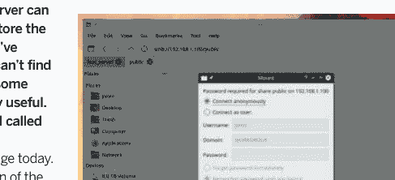

```
# mount -t cifs //192.168.1.100/public /mnt/samba -o user=guest
```

在 `/etc/samba/smb.conf` 中为我们这次想要共享的音乐共享创建条目。`guest` 行设置为 Yes（对于哪个目录来说并不重要，为了方便起见，它们对任何人都不写）。

任何被删除的文件将由 `nobody` 用户执行，这是 Debian 设置 Samba 访客用户的地方。要访问游客共享，遵循的步骤在下处说明：

https://techquery.net/connect-to-cifs-samba-network-shares-windows-10 在这一层，Windows 10 设置相对简单。Samba 凭据可以与你在服务器上的用户账户同步，因此你可以通过网络访问你的 `~/samba` 私有主目录。

如果你在配置 Samba 时遇到问题（你不会是第一个），`testlog` 程序可以提供有用的建议：SMB 失败信息以毫无用处闻名。

## 打印

除了使用 SMB 协议外，新的打印机协议 `IPP` 也允许我们共享打印机。由于打印机和服务器位于不同的网络子网中，这非常有用。

一些打印机制造商提供 Linux 驱动程序，但这些通常是针对其他过时或不如它们要求的。相反，看看免费驱动程序支持的硬件。

`CUPS`（通用 Unix 打印系统）是你的打印机服务。许多免费驱动程序已经由 CUPS 安装了，所以你可能不需要做其他事情。以下是访问 CUPS Web 界面的方法。点击管理（Administration）选项卡并选择“添加打印机”，自动检测并点击“继续”。在下一个屏幕上，有一个检查共享的标题。在下一个也是最后一个屏幕上，你可以选择想要添加的打印机。

你将从 Windows 和 Linux 机器使用 IP 地址 `http://192.168.1.100:printer_name/` 打印你的文件

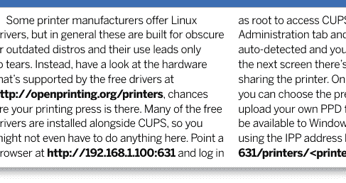

黑客手册 | #1

## 发行版

## Emby 和 Webmin

在浏览器中舒适地流流媒体并管理你的服务器。

像 `VLC` 或 `mpv` 等媒体播放器会乐意地在你的服务器上运行。但尝试来回跳跃，你会发现这不是一种特别好的流媒体方式。特别是当你使用 Emby 的时候。另一方面，它是一个可以从你的服务器或 DL（这是一个创造过最糟糕的缩写：数字生活网络）中提供内容的媒体服务器。

Emby 使用 HTML5 流传输并可以根据网络状况对其进行压缩。这可能会消耗大量 CPU，同时服务少数用户可能会导致抖动（或卡顿）播放。如果安装了驱动程序，则提供 GPU 加速——它目前作为性功能支持 NVIDIA `NVENC`（高端桌面显卡）和 Intel `QuickSync`（在大多数最新 CPU 上）。

基本上，内容可以通过适用于 Chromecast、Roku、iOS 和 Android 的应用进行流传输。如果你需要向你的仓库添加相应的密钥：

```
$ wget -qO - http://download.openmedia.org/repositories/emby/debian/Release | sudo apt-key add -
echo "deb http://download.openmedia.org/repositories/emby/debian/" | sudo tee /etc/apt/sources.list.d/emby.list
```

然后更新包列表并安装：

- `sudo apt-get update`

- `sudo apt-get install emby`

- `systemctl start emby-server`

- `systemctl enable emby-server`

Emby 构建了许多功能并有很多依赖项，但 `systemctl` 安装需要时间。一旦服务器运行，你就可以 列出的 Plex。

## 使用 Webmin 控制

除了从浏览器释放外，我们还可以进行系统管理。Webmin 是一个用 Perl 编写的 界面，可以管理服务器的所有方面。这里的选项很多不需要 SSH，但某些人倾向于不查找配置文件。我们需要添加密钥和仓库：

```
$ wget -qO - http://download.openmedia.org/repositories/webmin/Release | sudo apt-key add -
echo "deb http://download.openmedia.org/repositories/webmin/ all" | sudo tee /etc/apt/sources.list.d/webmin.list
```

然后只需：

- `sudo apt-get install webmin`

- `systemctl start webmin`

默认配置在端口 10000 启动 Web 服务器，你可以访问

```
https://192.168.1.100:10000
```

或者如果你通过公共 IP 访问。如果你只从局域网访问或有防火墙，在这里添加是安全的。在此基础上，我们可以登录服务器并执行所有任务：配置共享（从服务器菜单）、查看日志、更新包和资源使用——你可以想象的任何事情。这种做法存在风险。Linux 发行版对于这一点特别相关，因为我们可以检查它进行维护。如果你在创建服务器后设置了 Webmin，你将需要同步——尽管这个过程需要零点时间。这位于 `/etc/mediast` 中。

黑客手册 | 42

## 扩展和延伸

基础奠定后，我们的服务器项目可以根据任何用途定制。

我们已经完成了任何服务器所需的基础工作。我们还没有真正考虑服务器是开放的这一。值得提到这几点。开放访问我们的网站很好。关键是令牌，或者（如果你很懒并且允许密码访问）通过我们的网络传递游客。某些人允许非用户登录，但这阻止了用户的增长。安全与便利之间的权衡至关重要。只要我们的家庭网络基于 IPv6 的或防止了直接外部访问，将我们的服务器暴露在网上是可以的，但如果我们的路由器或网络上的另一个设备存在漏洞呢？

在游客和安全问题之间，你应该考虑是否允许他们。从开始，最终你受限于你的设置。如果你有一对扬器（或如果你的服务器住在房间里），你可以将音乐加载到任何设置。这是一个轻量级的音乐播放器，可以通过 Web 界面、移动设备上的程序或 App 进行控制。服务器程序将允许你连接各种服务，如 Spotify 和 Last.fm，甚至不需要使用命令行。

当你通过 Wi-Fi 连接互联网时，使用 VPN 保护流量是明智的。有很多选项，但为什么不使用 OpenVPN 呢？再次，关闭可能是最好的选择，或者只需更改默认端口。很容易设置，但你需要稍微了解证书和 TLS 是如何工作的。有了这些知识，你可以安心睡觉，知道你的热点是安全的，如果你信任你的 ISP（或家里使用 HTTPS）就可以访问互联网。如果你不离线，保护你的服务器是一个好主意。这需要一些努力，但没有额外的软件会让机器运行得像你希望的那样。你还可以在 LAN（或 WAN）上配置 WireGuard，以便它可以从网络任何地方重新启动。方法框架将安装在服务器上，Web 包将安装在任何你想使用的机器上。

最后，我们应该讨论一些选项，以尽量减少服务器被雷击或过度使用 `–rm -rf` 命令时造成的损坏。重新安装系统可能只需要不到半小时。它将会是


> Cantata 是一个基于 Qt5 的 MDP 客户端。它可以绘制封面艺术以及各种在线内容。

## 我们需要谈谈备份

我们可以使用 Dropbox 为我们自动执行此操作，但定期手动也不会太费力。在我们的总备份中，我们可以使用 samba、fstab 和 apt。

## 作为开始，如果你有一对扬声器，请研究设置 MDP。


将大文件发送到云端可能会消耗时间并在逻辑上产生可能。有可用的免费存储空间你可以找到足够的，而且如果可以在没有某些糟糕的专有应用程序的情况下访问，那就是另一故事了。如果你有快速的网络连接和无限的资金，`rsync`机器是最佳选择。`Rsync`要求异地备份是好的。但云存储很昂贵，而且人们并不擅长删除不再需要的文件。小文件非常适合备份到云端（因为它们不包含任何个人或敏感材料）。

## IPFire: 守护你的网络

你如何防止入侵者大军远离你的系统呢？通过构建一个简单的防火墙来保护你的计算机。

你的 Linux 发行版内置了受尊敬的防火墙，而且庞大的开源社区确保你拥有一套工具来管理它。虽然这对你的 Linux 有帮助，但保护作用并不延伸到其他始终连接的设备。请确保你的路由器也内置了防火墙。随着 IoT 设备如潮涌入并向你的微波炉分配 IP 地址，你无法真正依靠路由器有限的能力来保护在广阔互联网中流动的比特和字节。

我们已经过了过了大型网络易于部署的时代，普通家庭的联网转发也大到足以我们关注的程度。诚然，从组装和配置网络方面来看，设置一个网络都是一个复杂的过程。我们的免费发行版可以帮助你用一台设备设置防火墙。

一旦你组装好了防火墙电脑，从 IPFire 安装介质启动。该防火墙发行版是从零开始编写，安装过程非常简单。遵循直观的安装过程并使用默认选项，这将 IPFire 安装为默认计算机和区域。这些区域中的每一个都对应一组按颜色编码的设备。绿色和红色是为常见的安全级别而设计的。默认模式允许区域之间的通信，就像你拥有两个网络一样。

一旦你在“网络配置类型”部分选择了此模式，请选择“驱动程序和网卡分配”，将 ISP 调制器的绑定分配到 NIC 上。连接到调制器的第一个适配器标记为红色接口（Red）。连接到你内部家庭网的第二个网卡标记为绿色接口（Green）。然后选择“下一步”来配置绿色接口。

IPFire 使用状态数据包检测（`SPI`）防火墙，它构建在促进网络地址转换（`NAT`）、数据包过滤和代理服务器的实用程序之上。你可以通过转发请求到创建 `DMZ` 来管理防火墙。防火墙通过补丁加固以防止零日漏洞，并配有严格的访问控制列表。IPFire 还根据安全级别划分网络并帮助你创建策略来管理网络。有关更多细节，你还可以从任何地方管理到互联网的出站访问。

IP `10.0.0.1` 是红色接口网络配置的 IP 地址。选择 `DHCP` 选项。现在移动到 `DHCP` 和网关设置，并将 `8.8.8.8` 和 `8.8.4.4` 设置为备用 `DNS`。

一旦完成网络设置，IPFire 的设置将提供配置 `DHCP` 服务器的选项，并管理你将连接的所有地址。


当你设置除 USA 以外的所有内容时，可以关闭它或删除该规则。

## 开始吧

IPFire 拥有非常现代的安全特性。它是利用某些难以应对现代需求的旧硬件的最佳方法之一。一个带有 `512MB` RAM 和 `4GB` 磁盘空间的单控制台处理器就足够了。更大的磁盘将给你更多灵活性来研究 IPFire 的安装。

接入来自 ISP 的第一个网络路由器。将第二个连接到路由器上，该路由器将连接你所有的计算机和设备。当你设置 IPFire 时，让你网络中的所有设备都连接到这个路由器，而不是 ISP 提供的。还要记住，本地网络路由器中的 `DHCP` 功能将处理向 IPFire 防火墙分配 IP 地址的任务。

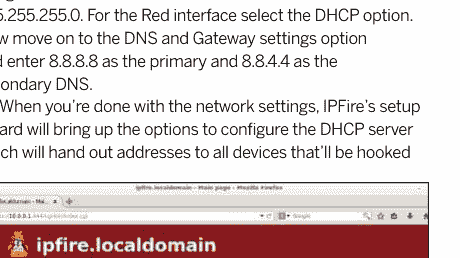

> 你查看的已配置网络连接仪表板还将显示通知。

## 过滤 URL

除了通过规则调节流量外，你还可以根据其他因素过滤网络流量，例如 IPFire 内置的 URL 过滤器允许你阻止整个域名下载恶意内容。要配置过滤器，转到 Network（网络）-> URL Filter。在页面上，你将看到一个可以阻止的类别列表。切换你想要阻止的。

你可以通过将某些域名和 URL 包含在“Custom blacklist（自定义黑名单）”中手动阻止访问。一旦更新了过滤器文件，你就可以阻止整个互联网，除了你喜欢访问的少数选定网站。在自定义黑名单文本框中，每个条目应单独占位一行。你还可以向黑名单添加正则表达式；如果它们匹配任何表达式，IPFire 将阻止它们。

在安装设置后，你还可以启用阻止访问任何文件的阻断选项。一旦你设置了 URL 过滤器的参数，向下滚动页面并点击“Save and Restart（保存并重启）”以开始过滤流量并使其生效。

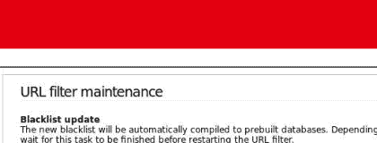

到服务器。激活 `DHCP` 服务器并将 `10.0.0.10` 设置起始地址，`10.0.0.30` 设置结束地址。这指示服务器处理你想要访问的这两个值之间的地址。

## 友军火力

安装后，你的基于浏览的管理界面可以通过你分配给网络层级 IP 地址的 `443` 端口进行访问，该地址可能是 `10.0.0.1`。IPFire 使用 `SSL` 证书，你需要接受它才能继续。例如，系统会提示输入用户名和密码。如果你输入了错误的用户名和密码，你将被阻止访问 IPFire 管理。虽然这看起来很简单，但它需要一些经验，并在 IPFire 上花费一些时间，IPFire 是基于 Linux Soft 的，非常简单且易于导航防火墙的不同方面。页面顶部有系统选项可以安装 `SSH` 访问并创建备份。另一个选项是按钮以重启或关闭防火墙。`GUI` 选项允许你自定义主题和防火墙的其他方面。然后是 Status（状态）选项卡，提供了防火墙各种组件的概述。你可以在这里查看 `CPU` 和内存使用情况以及通过服务器传递的任何 `OpenVPN` 网关的流量。Services（服务）选项卡列出了服务，允许你启用和配置防火墙后面的单个服务。动态 `DNS` 和入侵检测可以使用该部分下的可用选项进行配置。IPFire 开箱即用了一些合理的设置。这是根据你的需求构建和自定义 IPFire 的起点。参考 IPFire 的 wiki 获取大量最佳实践，以帮助你创建防火墙规则。


## 玩转防火墙

一旦安装完成，你就可以通过规则访问服务器，以便在防火墙上打一个洞。通过在防火墙中创建一个规则来允许连接。默认情况下，`SSH` 守护进程是启用的。


安装完成后，你可以使用 IPFire 的包管理器安装附加组件。

## 发行版

同样，如果你使用端口转发来访问防火墙运行的 Web 服务器，假设你在防火墙内部有一个 IP 地址为 `10.0.0.1` 的机器。我们现在将设置防火墙以重定向所有流量到防火墙后面的 HTTP。像之前一样，转到 Firewall Rules（防火墙规则）并点击 New（新建）按钮。其次，选择静态 `NAT` 部分，在 `NAT` 部分选择 Any。在 Destination（目标）部分输入防火墙内部服务器的 IP 地址 `10.0.0.1`。在 Protocol（协议）部分选择 `TCP`，并将 `80` 设置为目标端口。最后，添加备注以供将来参考。然后刷新并应用。

当你使用浏览器 (`http://192.168.3.10`) 访问网站时，你的查询将自动重定向到防火墙内部的机器，由 Web 服务器响应。你可以根据需要在 IPFire 中定义类似的转发规则。

## 任何地方

IPFire 最用的功能之一是创建 `OpenVPN` 网关。你可以配置此 `OpenVPN` 网关以授予从任何地方访问你网络的安全连接。

要设置，转到 `OpenVPN` 并 generate host certificates（生成主机证书）。这将引导你进入窗口，在其中填写主机证书的详情。主机证书将保存在磁盘文件中。对于其他细节，按要求填写字段。点击 generate（生成）按钮。生成证书可能需要一些时间。然后 `OpenVPN` 屏幕将显示证书已生成。

在 Global Settings（全局设置）下，选择所需的服务器选项。滚动到加密选项，使用下拉菜单选择 `SHA256 (256 位)` 作为算法，并使用 `HMAC tls` 选择 auth（身份验证）。保存选项。然后返回 Global Settings，在 RED（红色）上选择 `OpenVPN` 端口以启用它。在保存并启动 `OpenVPN` 服务器之前，勾选减少带宽使用的 `LZO` 压缩选项。

下一步是为想要从远程位置访问本地网络的用户设置帐户。返回 User Management（用户管理）并滚动到 Connection Status（连接状态）。在此点击 add（添加）按钮开始添加新用户。在第一个屏幕上，选择 Host-to-Virtual Network（主机到虚拟网络）连接类型。在下一个屏幕上，填写用户信息。完成表单后，按下 Save（保存）按钮。新用户将列在 Connection Status 下。就是。现在你可以点击用户旁边的下载图标查看用户配置文件。

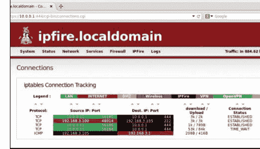

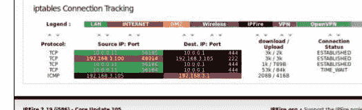


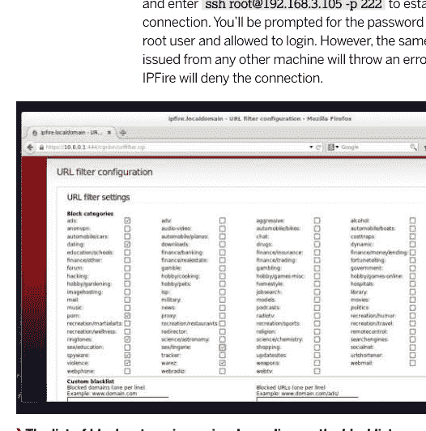

> 转到 Status（状态）

> 要查看所有入站和出站连接的列表，点击 IP 地址通过...查看其详情

对于生产服务器，你可以安全地启用 `SSH` 来帮助配置和测试防火墙。我们首先需要启用 `SSH` 访问。转到 `System`（系统）并切换 `SSH Access`。我们需要在 `Access` 中添加规则以允许连接。转到 `Firewall Rules`（防火墙规则）并点击 `New`（新建）按钮。在弹出的表单中，使用 `SSH` 地址框输入 IP 地址 `192.168.3.10`。这告诉 `IPFire` 如果满足了我们正在执行的标准则进行连接。跳转到 `Destination`（目标）部分并启用 `Firewall` 单选框，从下拉菜单选择 `Red` 接口。`IPFire` `SSH` 配置为通过端口 `22` 连接。这在标准 `SSH` 端口和目标端口范围内。最后，添加备注以完全描述该规则以备将来参考。当你准备好一切后，点击 `Save` 添加规则。如果看起来正确，按下 `Apply Changes`（应用更改）按钮。

# IPFire

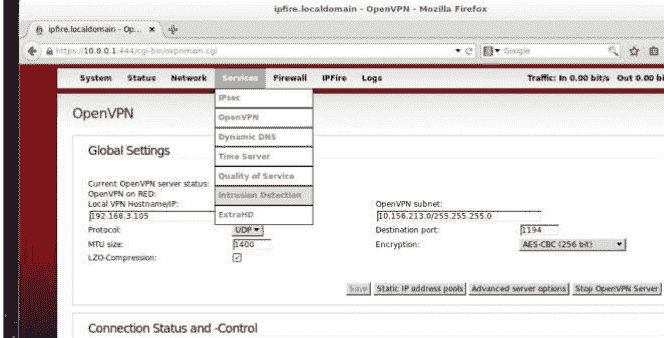

> 你无法推出其他网络服务，例如 `IPFire` 网关和基于 Smart 的入侵检测。

这是你重新连接时的当前状态。请确保你已将文件复制到你连接的服务器计算机上。现在安装 `IPFire` `VPN` 服务器，并从界面导入你下载并解压的文件。一旦连接到运行在 `IPFire` 上的 `OpenVPN` 服务器，你就可以加入 `IPFire` 防火墙的绿色网络，该网络仅从你的电脑访问。因此，你应该也能够通过绿色网络访问 `IPFire` Web 界面，即：`10.0.0.144`。

## 完善服务器

就像其他服务器一样，你需要保持更新。照看好你的防火墙服务器，`IPFire` 自带了一个名为 `PakFire` 的包管理实用程序。你可以根据需要安装软件包，以完善基础安装，而不会遇到太大麻烦。

当有可用更新时，仪表板的第一页会显示消息。然后你需要进入 `PakFire` 包管理器列表。`System`（系统）部分下的文本框将列出所有可用的更新列表。通过点击刷新按钮，`IPFire` 将下载并安装更新。完成后，将提示你重启防火墙以使更改生效。

`IPFire` 还包含了许多其他所需功能。我们将其用作 `OpenVPN` 网关，你也可以使用（参见前几页）。

## VirtualBox 中的 IPFire

在你决定投入创建用于测试的服务器之前，你可以使用 `VirtualBox` 在虚拟硬件上运行 `IPFire`——更多关于 `VirtualBox` 的信息请参阅第 98 页。

得益于简单的检测功能，你可以用它来创建一个与你的网络隔离的虚拟实验室。

首先，为 `IPFire` 服务器创建一个具有 `512MB` 内存和单处理器的虚拟机 (`VM`)。在设置此虚拟机的设置窗口时，切换到网络选项卡以附加两个网卡（`NIC`）。在适配器 1 选项卡中，确保它连接到桥接适配器（`Bridged Adapter`）。这将连接防火墙服务器，网卡将将其连接到互联网。然后使用适配器 2 选项卡并连接到内部网络（`Internal Network`）。在另一个网络中，内部网卡将通过此网卡连接到防火墙服务器。

在安装 `IPFire` 期间，我们将设置绿-红模式。移动到驱动程序和卡片分配选项卡，将网卡分配到其中一个网卡。列出的第一个适配器列表是桥接网卡，你应该将其标记为红色接口（`Red`），而将内部网络适配器标记为绿色接口（`Green`）。你可以通过 `MAC` 地址或名称来识别网卡。在网络选项卡中，选择内部网络。就这些了。一旦你设置好服务器，任何与 `IPFire` 虚拟机使用相同内部网络的虚拟机都将与防火墙进行无缝通信。

## 发行版

### Rescatuc:

修复与救援

当你的电脑运行 Linux 或 Windows 时，这是一个可以用来救援你电脑的一站式救命稻草。

许多事情可能会搞乱你的电脑。一次疏忽按键可能会删除文件、重写引导程序、搞乱分区表或导致其他问题。如果你发现自己处于绝望境地，请停下来并获取 `Supergrub` (`http://www.supergrubdk.org/rescue`)。`Live` 运行版提供了一系列工具，你可以使用它们来修复安装中任何范围的问题。如果你安装了双系统，救援功能也非常方便，它可以修复 Windows 分区的多个问题。

该发行版集成了所有用于修复非启动 Linux 和 Windows 问题的各种实用工具，包括 `TestDisk` 和 `GParted`。你可以救援你的 `MBR` 引导程序，修复文件系统错误，并在 Linux 和 Windows 上进行分区和重置密码。它还包含了救援文件的工具，并可以轻松查看两者。有几个像 `Rescat` 这样面向救援的发行版，它因为它直观而胜出。与其他仅提供一套工具来修复损坏电脑的版本不同，`Rescat` 的特点是按处理阶段分类的横幅。

该发行版旨在作为 `Live` 介质（`USB` 器）使用。在受影响的电脑上插入或连接可启动介质。从 `Rescat` 中你将 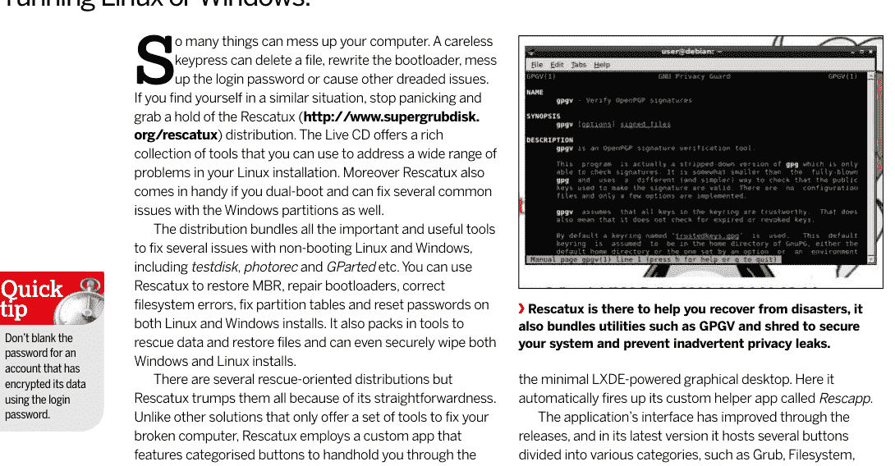

> `Rescat` 在此可以帮助你从灾难中恢复，它包含了如 `GFS` 和 `SGView` 等实用程序来救援你的系统并防止意外泄漏。基于 `LXDE` 的实时桌面。应用程序在最新版本中得到了改进，将任务组织成各种类别，例如 `Grub`、文件系统和密码。每个类别内部的按钮都有描述性标签，帮助你找到它们。当你点击某个项目时，会弹出窗口详细解释 `Rescat` 将采取哪些操作以及它期望你提供什么信息。

## 先修复一切

自十年前以来，所有文件系统都进化了许多，尽管我们可能会把硬盘搞乱到你别无选择只能修复电脑的程度。在重启时，当你的 Linux 发行版启动文件系统检查以验证文件系统的一致性时，在许多情况下，它应该能完成工作，这取决于磁盘年龄和被中断的文件系统任务等因素。在你的情况下，你的发行版允许你在文件系统挂载为只读时在维护期间手动运行 `fsck` 工具。`Rescat` 有许多功能让用户能够逐步完成过程的各个阶段。

## 点击修复

得益于 `Boot-Repair` 应用，许多 `GRUB` 引导加载程序的问题可以通过点击按钮解决。这个巧妙的应用程序具有直观的用户界面，可以扫描各种类型的磁盘分区并正确识别其中的操作系统。它同时适用于传统分区。在专家（`Experts`）类别下可以使用 `Boot-Repair`。当你启动它时，它会扫描磁盘并列出修复建议。它还会输出一个 `URL`，请注意。该工具还提供了共享功能，可以修改你的数据。要执行操作，使用 `Boot-Repair` 并选择系统文件检查（`System File Check`）选项以列出所有分区。`Rescat` 将修复它并修复安全账户管理器 (`SAM`) 文件中的一致性。如果你只有一个分区，但如果你有多个密码，Windows 将显示多个分区。`Rescat` 将解密分区。选择你想修复的分区。你可以重启电脑，重置密码并登录 Windows 使用新密码。

## Boot camp

Linux 用户最常见的问题之一是未附加引导加载器。尝试无法启动的电脑是有意义的。主引导记录 (`MBR`) 位于磁盘的特殊区域，有助于跟踪所有分区的物理位置并帮助加载操作系统。`Rescat` 包含了重新生成 `GRUB` 引导加载器并修复 `MBR` 的多个选项。还有一个恢复选项，它可以从 `/etc/fstab` 文件恢复你的识别信息。它会将它们显示在列表中，你可以选择安装哪一个。

如果你有多个分区，Linux 不会列出所有。如果你想安装 Linux，菜单将提示你根据启动顺序重新排列分区。完成后，它将在 `MBR` 中安装 `grub-install` 包和新的引导加载器。如果你使用的是基于 Debian 的发行版，它将安装 `GRUB2` 引导加载器。

磁盘重新安装器还包括 `GRUB BIOS` 修复选项。如果你运行这三者的组合，它将通过强制重建 `GRUB` 菜单并更新根顺序来工作。如果这成功了，你将被要求选择持有 `GRUB` 引导加载器的磁盘。你也可以使用 `GRUB Admin` 选项重置你的密码。该选项将扫描并列出所有具有 `SAM` 文件的分区。包含密码的分区将显示在列表中。`Rescat` 将从列表中解密分区并向你显示 Windows 密码。如果你有多个分区，`Rescat` 包含了 Windows 选项。该选项允许你创建 Windows 备份并提升它们。你也可以用它来更改 Linux 密码并生成重置密钥。选择 `GRUB/Linux` 密码选项允许 `Rescat` 修改你的密码。选择你想恢复的分区。

## 分区 (Distros)


显示了分区列表。根据磁盘类型，`TestDisk` 可能会显示多个分区。要确定哪一个是你想要恢复的分区，请查看每个项目末尾括号中的分区标签。如果这对你没有帮助，请选择另一个分区以查看该分区上的文件列表。`TestDisk` 会列出所有分区，直到你找到正确的那个为止。


当你找到分区后，按 `C` 备份数据，以防 `TestDisk` 无法恢复它。要执行此操作，先按 `P`，然后使用方向键选择要保存文件的分区。完成后，返回到已恢复的文件列表并按 `Enter` 继续到下一步或恢复所选的分区。`TestDisk` 会再次显示分区结构，然后列出你已找回的文件。现在选择 `Write`（写入）来保存分区表，如果程序运行顺利，当你重启电脑时，你的分区将恢复到它原来的位置。

# 修复电脑启动

| 建议的修复方法 |
| :--- |
| (修复最常见的问题) |
| 创建启动摘要（通过电子邮件或论坛获取帮助） |

# tux 0.40b1

- 虽然“救援（Rescue）”菜单中的选项可以帮助你修复引导加载程序，但如果这些选项不起作用，你可以退回到“启动修复（Boot-repair）”工具

在你在安装期间或之后手动创建的主用户账户顶部，左侧列出了它们。与 Windows 密码不同，当你选择 Linux 用户时，`Rescue` 会给你提供文件路径。

当你选择“重新生成 sudo（Regenerate sudo）”选项时，会出现类似的向导。它会搜索 Linux 安装并显示所选发行版中的用户列表。然而，当然，此选项将允许你将用户添加到 `/etc/sudoers` 列表中，帮助你以超级权限运行命令。

# 回收分区

有时你正在处理的单元远比 MBR 和启动扇区能包含的要多。电涌涌损坏了非启动分区表，而 `TestDisk` 是找到它的最佳工具。

当 `TestDisk` 完成后，它会要求你创建一个副本（稍后将分析；即恢复文件），并显示所有涉及的磁盘列表。当你选择找到的磁盘后，它会要求你选择分区表类型，例如 NTFS Mac。

接下来，你可以选择恢复选项。`TestDisk` 会选择默认分析，该分析会读取分区结构并寻找分区。然后它会显示分区结构。现在选择“快速搜索（Quick Search）”选项让 `TestDisk` 寻找分区。完成后，

> 回收文件系统的岛屿（Island）会仔细地扫描整个硬盘。

# 恢复文件

除了制作 `ubuntu` 副本外，`Rescue` 还可以恢复被删除的文件，因为在硬件故障时它总会有丢失的数据。“专家工具（Expert Tools）”还包括 `Photorec` 实用程序，即使由于文件系统被拒绝导致文件变得毫无意义，它也能恢复文件。

当你删除一个文件时，它并没有被实际删除。文件系统将其标记为已删除，空间会被其他文件占用。如果原始文件仍然在那里，直到另一个使用该空间的进程之前，就可以通过文件恢复工具检索。

`Photorec`：正因为这个原因，在数据丢失后立即停止工作非常重要。

一旦你不小心在磁盘中删除了文件，`TestDisk` 将对所有硬盘和可移动媒体（如 `USB` 磁盘）进行操作。`TestDisk` 还会从已格式化并重新安装的分区中恢复文件。

它还会显示最常见的图像格式，并输出各种格式的文件，包括 `.jpg`、`.pdf`、`.zip`、`.tip`、`.rar`、`.rpm` 以及其他任何格式。

在使用 `Photorec` 之前，它会创建一个保存恢复文件的目录。一旦工具完成，该目录将填充命名错误的文件格式。

# 当万事无策时

当 `Rescue` 将拯救你时（Rescue will save your day）...（此处原文未完整，仅翻译已提供部分）

# 黑客手册 2022

# 安全

最好的防御是主动进攻，但良好的防御同样重要。

- 54 堡垒级 Linux：发现外部存在哪些威胁，以及你可以做什么来保护你的设备。
- 62 页 Kali Linux：我们将从内而外地解析这款终极黑客工具箱，并解释如何正确使用它。
- 66 页安全客户端：在线聊天，无需担心任何人窥探，也不会让别人知道你在说什么。
- 72 锁定系统：我们概述了为了安全网络而锁定操作系统的要点。
- 76 页 Fedora 安全实验室：保持警惕的方法远不止一种，来尝试一下 Fedora 黑客实验室吧。
- 80 密钥管理：学习如何创建一个良好的 GPG 密钥并使其免受网络威胁的侵害。

```python
import time
import random

def attack():
    start = time.time()
    for i in range(1000):
        random.randint(0, 100)
    end = time.time()
    print(f"Time taken: {end - start}s")

if __name__ == "__main__":
    attack()
```

# 堡垒级 Linux！

Linux 是相当安全的，时刻警惕的 Jonni Bidwell 已经研究了威胁格局，并建议进行加固……

随着连接的普及，我们的生活以及关于生活的信息正变得日益在线化。在过去，我们的信息保存在法院或办公室的纸质记录中，内容无非是姓名、职业和出生日期。几十年后，当这些信息转移到政府大楼的主机上时，普通人开始拥有银行账户，公司也开始存储自身（以及广告代理）。你甚至可能发现自己出现在电话簿中，或者发现自己深陷孤独的情感，抑或是被勒索赎金。人类平均每天产生数 GB 的信息（并且还在不断增加），公司、当局和犯罪分子都想要存储这些信息。有些信息存储在家里，有些（可能是不明智地）寄托给了云端，而我们有些人甚至没有停下来考虑过它们去了哪里。只要将几个关键的安全凭证落入错误的人手中，你的记忆就会被删除。然后账户可能会被清空，身份会被盗取。Linux 无法阻止政府授权的三字头机构在你的数据和元数据上盘旋（尽管它可以让这变得更加复杂），也无法阻止你将数据交给社交媒体（尽管它可以移除地理标记和 EXIF 数据）。它确实有其缺陷，但它可以保护你的系统不被入侵，保护你的数据不被勒索。我们将介绍各项功能、密码管理器、SSH 密钥等。我们“虚拟 LXF 塔”在 Web 浏览器（顺便说一下，是 Firefox）中花费了大量时间，我们打赌很多读者会在关于安全浏览的章节中寻找我们是如何操作的。让我们开始吧。

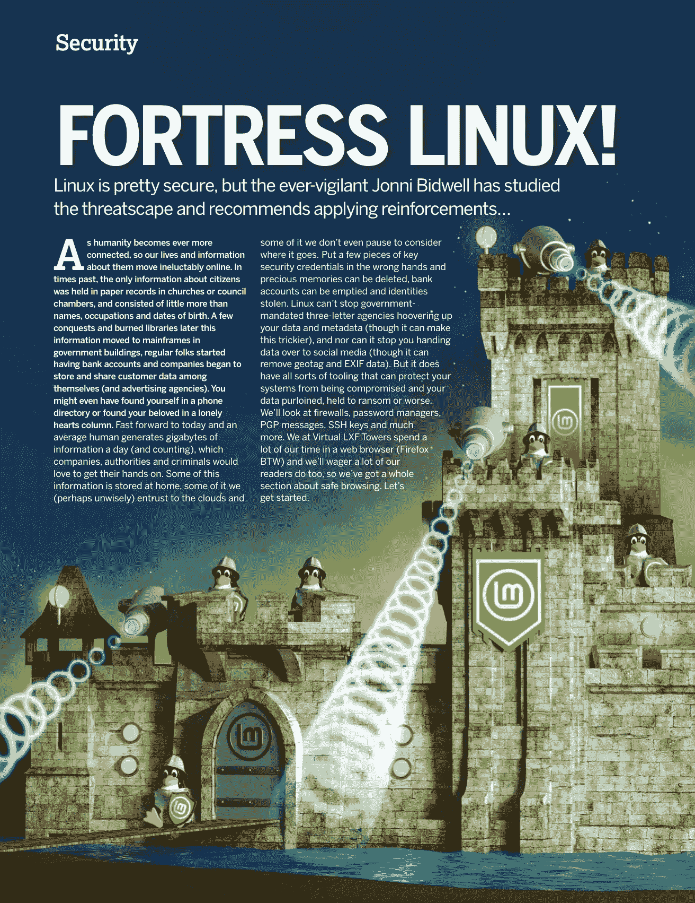

# 堡垒级 Linux

## 病毒、恶棍与感染媒介

### Linux 为你做了很多保护工作，但你应该保护它吗？

那种“Linux 不需要病毒扫描器”的说法有点带有误导性。首先，已经存在针对 Linux 的病毒和恶意软件（无论是直接针对，还是由于其跨平台的特性）。只要家庭用户从 Windows 等可靠信源获取软件，或者他们的发行版仓库定期更新并已有备份，那么他们不太可能面临威胁。你应该进行定期备份，以防最坏的情况发生。

另一方面，如果你正在运行邮件服务器，你应该拥有能够扫描病毒的软件，而不仅仅是 Linux。`ClamAV` 在这种情况下非常流行，并且易于与 `Postfix` 等邮件服务器集成。如果你在运行 Windows，一个带有大量恶意软件游戏计划的 Windows 以及这个周末在没有 Linux 上玩游戏的 Windows 可能会让你的系统变成一个垃圾邮件发送服务器。如果没有保护措施，病毒程序可以访问文件，除非它们没有运行，所以不要避免隔离。

在 Linux 中，你运行的任何程序（或脚本）都可以删除你的主目录或你具有写入权限的任何位置，包括网络驱动器。如果你的用户拥有 Sudo 权限，后果更加糟糕。此外，它可以通过转发来损害其他用户。`AppArmor` 和 `SELinux` 等控制允许你授予敏感应用程序更多权限。

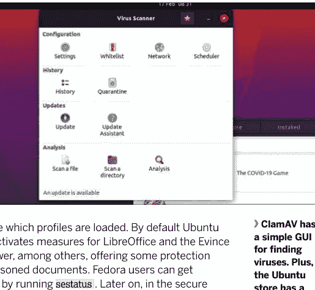

查看哪些配置文件。默认情况下，`Ubuntu 20.04` 为 `LibreOffice` 和 PDF 查看器启用了某些措施，防止受毒文档的影响。`Fedora` 默认使用 `SELinux`。我们将查看 `Firefox` 的 `AppArmor` 配置文件。

为了让病毒扫描器提供超出简单文件扫描的保护，它需要系统的底层访问权限。在 Linux 中，病毒会扫描目标。此外，Windows 上的一些免费软件非常糟糕（安装了可以拦截你所有网络流量的杀毒软件）。

人们说 Linux 桌面不需要防火墙。但真的是这样吗？没有理由不用它来拦截。如果你想运行一个服务器——即使是一个不需要拦截的服务器——请查看本页以了解 `Ufw`。

- `ClamAV` 有一个简单的界面可以发现病毒，Ubuntu 商店也有关于杀灭病毒的软件。

## 可能发生与不太可能发生的威胁

家庭用户最大的威胁是社会工程学。`NAT` 的唯一方法是在你的路由器上转发相应的端口。如果你想让你的家庭服务器从外部世界访问，你就必须这样做。禁用路由器上的 `ALG` 可以保护你，但它也是。人们说 Linux 桌面不需要防火墙。但真的是这样吗？没有理由不用它来拦截。如果你想运行一个服务器——即使是一个不需要拦截的服务器——请查看本页以了解 `Ufw`。

- `ClamAV` 有一个简单的界面可以发现病毒，Ubuntu 商店也有关于杀灭病毒的软件。

The Hacker's Manual | 55

## Build ports, lock down sockets

- `ClamAV` 有一个简单的界面可以发现病毒，Ubuntu 商店也有关于杀灭病毒的软件。

# 堡垒 Linux


但它们也可以到达那里，因此我们将面临另一个问题。即我们必须隐藏在 NAT 层之后的所有设备都可能很容易发现自己被暴露在互联网上。

有了 IPv6 及其巨大的地址空间，这个问题得到了解决，而且不再需要 NAT。家庭路由器（即你留留的地方）自带了配置好的防火墙，因此你可以尝试将网卡插入旧电脑，并运行像 `pfSense` 这样的专用防火墙。或者在路由器上刷入基于 Linux 的 DD-WRT 或 Tomato 固件。如果你只是想上网，升级路由器并不值得花精力，但在家里设置一个安全网络已经足够简单。使用自己路由器的好处之一是可能为许多服务和防火墙共享单个公网地址，并可以在你想要绕过的服务上设置防火墙。这超出了本功能的范围，如果你想用 Linux 加固你的路由器，那么你应该熟悉 `iptables` 或 `firewalld` 的晦涩语法。通过几条规则，你可以获得一些保护。`Ufw` 通过几个命令即可设置：在 Ubuntu 上运行 `sudo apt install ufw` 并执行 `allow all`。

| 字段 | 值 |
| --- | --- |
| 名称 | NetworkManager |
| 策略 | Limit |
| 输出 | in |
| 接口 | 所有接口 |
| 日志 | 不记录 |
| 协议 | UDP |
| 来源 | 192.168.0.5 |

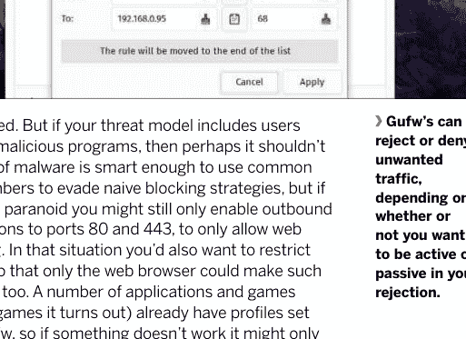

被忽视了。但如果你的威胁模型包括运行恶意程序，那么它就不应该被忽略。大多数恶意软件足够聪明，可以使用常用端口来规避拦截策略，但如果你打算仅开启到 80 和 443 端口的出站连接以允许网页浏览，你可能还想限制访问，使得只有 Web 服务器发出这些请求。许多应用程序和游戏（主要是游戏）已经为某些功能设置了这些端口，但可能只需点击几次即可添加它们。

> 可以拒绝不需要的流量，取决于你想让自己处于存活状态还是处于你的保护之下。

# 防火墙配置

Home 配置阻止所有入站连接并启用所有出站连接。通过开关激活它，你会发现日常浏览以及你可能需要的任何其他功能都能运行良好。

检查报告部分查看列出了哪些规则以及在哪些地址上，并利用点击 + 按钮添加规则来创建这些防火墙规则。你可能还会担心进程和 CUPS —— 这些服务默认列出，以便于网络流量和打印机发现。我们遵循了我们的授权功能测试问题，并在 Libvirt 上运行，然后 `dnsmasq` 服务器监听在本地接口上，这对于桥接虚拟网络和真实网络是必要的。

出站连接的问题是

对于服务器，你必须从头开始使用 `Ufw`，它比处理 `iptables` 要简单得多。Ubuntu 预装了 `Ufw`，并可以轻松安装在其他系统中。要设置类似 `Ufw` Home 配置的默认策略，请执行：

`sudo ufw status verbose`

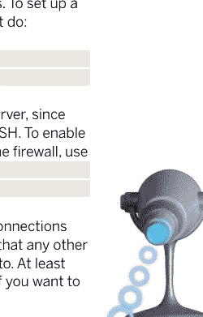

## 基础服务器安全

你可能需要在默认端口 `22` 的端口使用 `ssh` 守护进程，以避免最频繁的端口扫描。你可以通过编辑 `/etc/ssh/sshd_config` 并将 `Port: default` 更改为某些不起眼的 `2222` 来实现，在加固 SSH 并创建适当防火墙规则后：

```
$ sudo ufw allow 2222
```

同样，我们需要对服务器的 HTTP 和 HTTPS 请求（例如你可以访问你的 Nextcloud 实例）使用相同的端口命令，如果你正在运行 LAMP 栈，MySQL（或 MariaDB）已配置为监听本地地址。

通常没必要让它对外部世界开放。关于服务器安全加固已经写了整整几本书，我们不会在这里反抗他们所有的努力。但如果你运行 Nextcloud，通过其在 `https://nextcloud.com` 上的安全检查页面，情况可能会比这糟糕得多。

黑客手册 | 57

# 安全

## 密钥与签名

除非你的 SSH 密钥由 Linux 的公钥签名，否则请不要信任我们。

2020 年 12 月发现的对 Solarwinds 的毁灭性攻击显示了弱环节如何摧毁即使最严密的安全方案。这里使用了供应链攻击来破坏 Linux 的普及性，全球数以万计的客户使用它来管理他们的基础设施。

这些客户包括几个美国政府部门和大型公司。恶意软件如此隐蔽，许多人并不知道什么数据被盗取，或者被访问了多久。例如，2012 年 Windows 的 Flame 恶意软件，以及最近的 EnChat 消息系统更新机制在 2020 年遭到破解，导致 800 人被捕。

意识到你的 Linux Mint 公钥在 2016 年曾是攻击目标可能很有用。虽然严格来说不是供应链攻击，但黑客能够控制网站并将 ISO 镜像下载到经过修改的镜像中，他们还修改了校验和。这就是为什么项目应该提供校验和，以便人们检查其下载的内容没有被（通过伪造的人）损坏。当你的系统从存储库下载包（通常是 SHA256）时，你可以验证它们的身份。

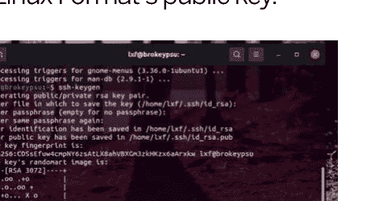

信任我们，除非你的 SSH 密钥由 Linux 的公钥签名。

2020 年 12 月发现的对 Solarwinds 的毁灭性攻击显示了弱环节如何摧毁即使最严密的安全方案。这里使用了供应链攻击来破坏 Linux 的普及性，全球数以万计的客户使用它来管理他们的基础设施。

这些客户包括几个美国政府部门和大型公司。恶意软件如此隐蔽，许多人并不知道什么数据被盗取，或者被访问了多久。例如，2012 年 Windows 的 Flame 恶意软件，以及最近的 EnChat 消息系统更新机制在 2020 年遭到破解，导致 800 人被捕。

意识到你的 Linux Mint 公钥在 2016 年曾是攻击目标可能很有用。虽然严格来说不是供应链攻击，但黑客能够控制网站并将 ISO 镜像下载到经过修改的镜像中，他们还修改了校验和。这就是为什么项目应该提供校验和，以便人们检查其下载的内容没有被（通过伪造的人）损坏。当你的系统从存储库下载包（通常是 SHA256）时，你可以验证它们的身份。

> 可以拒绝不需要的流量，取决于你想让自己处于存活状态还是处于你的保护之下。

# 安全

## Web 浏览与电子邮件

我们最喜欢的两个应用程序是黑客和僵尸网络非常有吸引力的目标。别让它们得逞！

我们已经讨论过 Web 浏览器，并在杂志中私下提到过，那里提出的许多要点是现在已无法避免的安全隐患。第三方网络经常被攻破，因此阻止 Cookie（或使用 Firefox 容器将其隔离）以及 JavaScript（例如使用 NoScript）并不足以阻止广告和不必要的跟踪。

你的浏览器或操作系统能为你做的事情是有限的。所以请采取措施以避免这种情况。恶意浏览器经常使用阻止列表和箱箱（boxing）来保持你的会话安全。这得益于 Let's Encrypt。你使用的大多数网站都是 HTTPS（如 URL 栏中友好的绿色锁所示）。

### 攻击者能够与 NAT 网关背后的机器建立直接连接。

只有开放端口才能确保第三方无法解锁你的浏览（如果我们发送了，他们就会发送凭据），并且确保你没有在进行太多的端口转发。使用浏览器的黑客和攻击者是热门目标。劫持每一个收割数据，你访问的网站可能被破解以提供某些恶意 JavaScript 代码（如 Magnet 捕获脚本或你的 DNS 请求），我们暴露被密码锁定，因此超过良好的密码习惯至关重要。非常重要的是（如果你认为你正在使用匿名代理）从另一个站点，一个网站可能被破解，无论是谁或什么真正破解了它，而且 Firefox 拥有它内置的密码管理器，如果 Mozilla 将集成 Firefox Sync。

强密码并不多，而且在线网站使用次要身份验证因子，这使得发送包含一个代码的消息在今天很常见，但仍然是银行提供的挑战响应设备，要求你使用 2FA（双重身份验证），对于你使用的账户和网站，你真的应该的是。不幸的是，攻击比这更普遍，因此与账户等更相关，例如如 Yubikey 等硬件令牌用于身份验证。

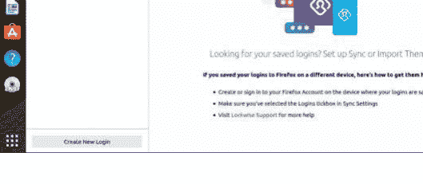

你可以将硬件令牌用于各种任务，例如与 Google 进行身份验证，或你的 Linux bin-. 但最后，我们结合之前和之后的一些想法以及互联网时代最大的问题之一：如何让 PGP 运行

60 | 黑客手册

## Fortress Linux

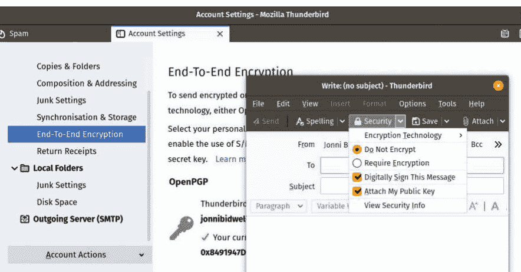

> 使用 Thunderbird 发送 PGP 签名消息很容易，但让你的朋友也这样做就很困难。


如果你发现 PGP 深度遵循 1995 年的标准让 GPG 感到困惑，使用 PGP 签名或加密邮件只能保护你免受窥视，但不能防止你看到带有 PGP 签名的邮件（以及你必须检查的值），他们不仅可能被启发加入你的隐私小组，他们还可能有理由相信这封从另一个账户发来的邮件。

直到最近，`Thunderbird` 用户还必须依赖诸如 `EndToPgp` 这样的插件，但现在它是内置的了。如果你已经设置好了 `Thunderbird`，那么添加它非常简单。如果你在安装时基于（或）`Ubuntu 20.04 LTS`，你可以在 `Apt` 仓库找到该版本，或者在最新的 `Snap` 或 `Flatpak` 中找到。如果你想签名和加密，与 `OpenPGP` 的想法是一样的。进入设置，找到端到端加密部分，并点击“添加密钥”到你的电子邮件地址。创建一个新的 `OpenPGP` 密钥（如果你还没有的话）。

你可以为你的密钥选择过期日期，在没有其他因素的情况下，三年的过期期是好的。`302` 位的大小也是好的，除非你不需要。非对称密钥比对称密钥大得多（例如 `AES` 仍在计算的 `8` 位），这对你来说并不重要。点击“生成密钥”，你将获得一些随机性信息、密钥大小、多样性和哈希（的不是最后那个）。你会看到一条友好的消息，显示密钥已成功创建。你可以使用 `OpenPGP Manager` 管理通信对方的公钥以及你自己的密钥。

现在当你从账户撰写消息时，你有数字签名消息的选项。你也可以加密它们，但除非你被接收者的公钥加密，否则你无法这样做。`Thunderbird` 默认会在 PGP 消息上附加你的签名，但人们可能不会（也不应该）开箱就信任它。

## 装甲 Firefox

如果你喜欢在 `Ubuntu` 上使用 `/etc/apparmor/` 目录，你会看到一个 `Firefox` 的配置文件。你可以通过设置链接 `/etc/apparmor/d/usr/bin/firefox` 并运行 `sudo apparmor_parser -r /etc/apparmor/d/usr/bin/firefox` 来启用它。现在重启 `firefox`，它将只能访问它需要的配置文件、`MIME` 信息和下载目录。研究该文件以找到它限制你的所有限制。如果某些功能不起作用，你可能需要修复它。你可以在内核日志中或通过安装 `apparmor-policy` 包获取有关 `AppArmor` 的更多信息。后者将在每当有内容被拦截时为你提供弹出警告。在大多数情况下，启用 `AppArmor` 后你会运行良好。`WebGL` 有一些小故障，分辨率可能会发生变化，但在我们看来，它变得了一点更不可摧了。

> 查看我们的通知，我们可以理解为什么 `Firefox` 配置文件默认是禁用的。

黑客手册 | 61

## Kali Linux

破解 Wi-Fi，破坏东西，我们留心好奇女神与许多脚本小子联系在一起时感觉如何？

在我们做任何事情之前，有一个标准的免责声明：不要对任何你控制的机器使用任何这些技术，除非你获得了许可。此指南可能被用于你不应该做的事情，如果你被抓到（相信我，你会的），你会发现自己处于计算机犯罪的错误端，或者任何要求你交出硬件的执法部门这都不好玩。此外，例如如果你正在使用 `Wireshark` 从你的家庭网络收集数据包，那么理所当然你应该你应该家中的其他成员你在做什么。

既然如此，我们可以开始一些介绍性测试。安装工具（`wireshark` 和 `aircrack-ng` Linux 发行版（distro））。它们在（绝大多数）仓库中可用。对于你的第一次测试，破解 Wi-Fi，我们留心好奇女神与许多脚本小子联系在一起时感觉如何？在我们做任何事情之前，有一个标准的免责声明：不要对任何你控制的机器使用任何这些技术，除非你获得了许可。此指南可能被用于你不应该做的事情，如果你被抓到（相信我，你会的），你会发现自己处于计算机犯罪的错误端，或者任何要求你交出硬件的执法部门这都不好玩。此外，例如如果你正在使用 `Wireshark` 从你的家庭网络收集数据包，那么理所当然你应该告诉家中的其他成员你在做什么。

*(注：由于原文中存在大量重复和乱码片段，译文已根据上下文进行了逻辑对齐处理，以确保技术术语的准确性。)*

# 安全

> >> 02:23:14. Ping (min/avg/max): 1.384ms/7.336ms/21.115ms
> 
> >> 功率: -39.7
> 
> >> 02:23:14 30%:100%

如果我们能向路由器注入任何大小或形状的封包，遗憾的是，它通常会忽略它们 (a) 我们没有通过网络的身份验证，且b) 我们无法对其进行加密，因为我们不知道密钥。如果我们能找到方法 (a)，我们要做的就是监听 ARP 请求并发送它们。同一个 ARP 请求可以使用多次，我们依赖的回复越多就越好。如果数据包注入不起作用，只需尝试通过网络直接发送流量。我们能够通过一些数据包破解我们的 WPA2，所以请记住数据包捕获。我们将限制通道和 BSSID，以便只捕获相关的

```bash
airplay-ng --b aa:bb:cc:dd:ee:ff -c wlan0
```

ARP 切换攻击允许我们使用 `tcpdump` 伪造对磁盘的回复。我们可以看到原始数据如 (raw)，并使用 ASCII/Wireshark 格式解析文件，以便使用其他工具进行进一步分析。运行此命令后，打开另一个终端并尝试让路由器的验证失败：

```bash
airplay-ng -i 0 -b aa:bb:cc:dd:ee:ff wlan0
```

如果你没有看到令人放心的关联 - 下一步很可能会像我们的一样有效。如果你使用 `-a - -hn` 切换添加与网络关联的设备 MAC 地址，那么应该可以修复它。使用以下命令开始攻击：

```bash
airplay-ng -a aa:bb:cc:dd:ee:ff -w deauthmon0
```

生成流量将有效，除非没有东西触发网络，否则没有 ARP 请求，因此我们可以创建一个小技巧来让后续步骤立即开始。关联请求中的数据包计数应该增加，获取所需的数据包不会花费长时间。一旦我们有了几千个，也许 2000-3000 个就可以（某些数据包比其他数据包更好）。在最后，捕获 ID 就足够了。然后我们就可以用 `acrack-ng` 进行破解来搜索 64 位（40-24 位 iv）。

```bash
acrack-ng --output 01.cap -n 64
```

如果你有足够的数据包，`aircrack-ng` 可能会运行得很好。如果没有 `-n 64` 提示，攻击数据包仍然难以解密。你可能在考虑发送以获取更多数据包，在这种情况下请运行 `aircrack-ng` 和 `replay-attack-ng`。如果仍然不起作用，你将需要尝试另一种攻击。输出文件将被合并，你可以在命令行上使用通配符，例如 `cap*` 来使用所有它们。

一旦你破解了 48 位密钥，下一步是获取 104 位（34）密钥。程序是尽可能捕获（我们成功获取了 25,000 个）。破解 WPA2 密钥是另一回事，没有优雅的攻击方法，但如果你能够在新设备连接时捕获握手，那么字典攻击就能完成。

| 终端 | 文件 | 编辑 | 查看 | 终端 | 标签页 | 帮助 |
| :--- | :--- | :--- | :--- | :--- | :--- | :--- |
| 使用 --trace 查看运行任务的完整跟踪 | | | | | | |
| [1] 192.168.1.1:55432 -> 192.168.1.10:54321 (S) | 0.005s | 100 | | | | |


| [2] 192.168.1.10:54321 -> 192.168.1.1:55432 (SA,ACK) | 0.012s | 100 | | | | |

| [3] 192.168.1.1:55432 -> 192.168.1.10:54321 (S) | 0.008s | 100 | | | | |

| [4] 192.168.1.10:54321 -> 192.168.1.1:55432 (SA,ACK) | 0.015s | 100 | | | | |

| [5] 192.168.1.1:55432 -> 192.168.1.10:54321 (S) | 0.007s | 100 | | | | |

| [6] 192.168.1.10:54321 -> 192.168.1.1:55432 (SA,ACK) | 0.011s | 100 | | | | |

| [7] 192.168.1.1:55432 -> 192.168.1.10:54321 (S) | 0.009s | 100 | | | | |

| [8] 192.168.1.10:54321 -> 192.168.1.1:55432 (SA,ACK) | 0.013s | 100 | | | | |

输入 `SET HOSTS $` 并点击 Metasploit 更多信息访问 http://metasploit.com

- 150 个 exploits
- 999 个 payloads
- 271 个 post
- 450 个 members
- 免费 Metasploit
- 128 位密钥通过少量数据包即可轻松破解。

## Wireshark

作为一名测试员，你已经掌握了无线网络，没有理由离开。访问网络允许你解密其流量。Wireshark 是捕获和查看数据包的极佳工具。我们已经捕获了一批数据包，让我们看看。打开并选择输出文件之一。这不会花费太长时间，因为大多数数据包将与 IEEE 802.11 列出，并且会有一些其他请求。

如何告诉 Wireshark 哪些数据包是你的：前往 Edit > Preferences > Protocols > IEEE 802.11 并勾选 Enable 框。点击 Decryption 旁的 Edit，输入 MAC 地址并用逗号分隔。如果密码错误，将用红色突出显示。然后数据包将变为亮色，并显示所有源和目的。

## 漏洞 (Exploits)

拥有 Kali 和 Metasploit 框架 (MSF) 对我们来说是一种幸运。MSF 模块可以（可选地）审核所有漏洞，这是 Kali 中最新的免费漏洞，向 Windows 空间发送 payload 的注入是非常强大的，我们必须扫描它的表面 (img/1e7c2db42dac866a51a0ace7df48feef_63_0.png)。

尽管如此，我们可以通过 Metasploitable 虚拟机来演示某些 MSF 功能。磁盘没有足够的空间安装它，但有超过 800MB 空闲空间的人可以 http://metasploit.com/download 或从 http://metasploit.com/files/metasploit2快速获取。解压 metasploit-linux-2.zip 并将其作为虚拟机运行。该镜像（VM 文件）可以在 VirtualBox 中使用（设置“仅主机”网络），以便虚拟机连接到网络，它需要通过 Network 标签页将虚拟适配器配置为桥接模式，然后将像连接到路由器的普通设备一样工作。如果你的网络是 DHCP，一切都应该正常工作，否则设置静态 IP 使其可访问。

启动虚拟机并以用户 metadmin 登录查找密码。网络静态 IP 地址是：192.168.1.120。如果你在一个没有静态 IP 的网络上，可以通过运行 `ifconfig` 找到它。然后是在其上运行虚拟机存在风险问题，在不可信的网络上尝试这可能是一个坏主意。额外的暴露可能会让你的整个本地网络暴露在网上。我们将使用 MSF 攻击 Tomcat 服务器，我们可以通过连接到 VM 地址 192.168.1.120 端口来尝试。当我们在 8080 端口时，我们将使用 Metasploit。

我们使用访客凭据 (`tomcat/tomcat`) 攻击 `/manager/html` 处的应用程序。manager 允许应用程序（封装为 WAR 归包）以便攻击，这是我们可能做到的。并不是我们要解释你如何攻击某个服务，一个共同目标是攻击目标机器。这是通过在被攻击的机器上启动反向 shell 实现的。一旦执行，shell 将回溯到主机并允许他们与命令写入器进行交互。我们在 Kali 机器启动 MSF。在 Options 标签页中，如果你在那里什么都没有，等一分钟并重试。它会在磁盘上创建数据库，这比准备它需要更长时间。等待在

```bash
exploit use http/tomcat_mgr_deploy
set RHOST 192.168.1.120
set PORT 8080
set USERNAME tomcat
set PASSWORD tomcat
set PATH /manager/html
set TARGET/
```

注意这些点。你可以通过输入 `info` 发现。然后设置漏洞列表的参数。将 `RHOST` 修改为 Metasploitable 变量示例结果。

除了最后一个，这些都相当简单，最后一个将告诉 MSF 创建 payload 而不是针对特定的，后者对于该漏洞无效。我们现在

(img/1e7c2db42dac866a51a0ace7df48feef_64_0.png)

> Metasploit Framework

只能为你开门，你可以自己进去。或者通过溢出方式进去。

准备好使用漏洞攻击。如果一切顺利，看起来应该像这样：

- 正在设置阶段 (40689 bytes) 来自 192.168.1.1
- Meterpreter session 4444 -> 192.168.1.120
- 正在发送 payload...

为了收益以及为什么你不应该安装 Windows 虚拟机。

# 安全

# 安全聊天

虽然我们并不算特别偏执，但我们不希望任何人偷听我们和朋友之间关于《英国顶级烘焙大王》的闲趣侃。

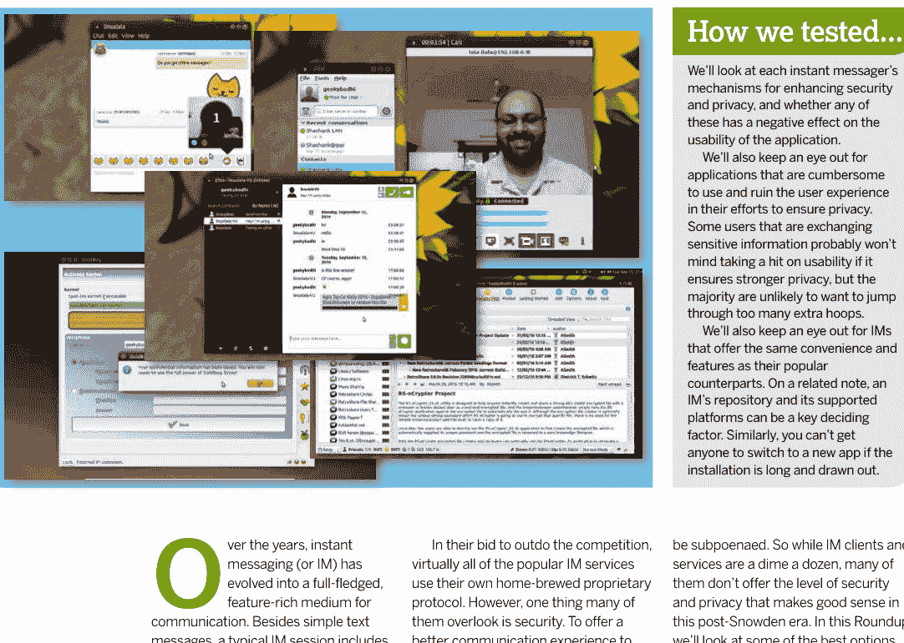

## 我们是如何测试的……

我们将查看每种即时通讯工具增强安全和隐私的机制，以及这些机制是否对应用程序的可用性产生负面影响。

我们还会关注那些为了确保隐私而导致操作复杂、破坏用户体验的应用。

一些交换敏感信息的用户可能不介意为了获得更强的隐私保护而牺牲可用性，但大多数人不太可能去费太多关子。

我们还会留意那些提供与其流行竞争品同等便利性和功能的即时通讯工具；值得注意的是，即时通讯工具的流行程度及其支持的平台可能是关键因素。简单来说，如果安装过程缓慢且经常崩溃，你就无法轻松切换到新应用。

多年来，即时通讯（IM）已演变成一种成熟且功能丰富的通信媒介。除了简单的文本，典型的会话还包括图像、音频甚至视频流的交换。而即时通讯工具的主要用户也被企业用于企业间的告别。这两类用户有不同的需求，并且涌现出了大量消息服务来缓解对即时通讯日益增长的需求。

为了竞争，所有流行的即时通讯服务都使用其自研的协议。其中许多工具的做法是，为了给用户提供更好的通信体验，这些易访问的服务通过中央服务器路由所有私密交换。虽然客户端和服务层出不完，但许多工具并没有提供在这个初创世界中合理的安全和隐私水平。我们将查看用户可以使用的某些最佳选项，让他们能够在不用担心被窥探的情况下进行在线交流。

> 公共访问的服务通过中央服务器路由你所有的私密交换。

## 安全协议

### 我们如何确保传输安全？

他们可能使用这些工具的原因是，因为开发者采取了措施来确保通信安全，并关注用户的隐私。例如，CryptoCat 假设网络受攻击者控制，攻击者可以拦截、篡改和注入网络。

GoldBug 使用了带有多层加密的端到端加密。除了 RSA 之外，它还使用了 El Gal 加密算法以及 NTRU，这些都是基于抵抗量子攻击的算法，同时确保每个用户都可以设置自己的密钥大小、密码、哈希函数、迭代次数等。

为了确保网络上的隐私，CryptoCat 使用了基于双棘轮（Double Ratchet）协议的端到端加密对话。用户将设备连接到 CryptoCat 账户，并通过客户端管理器识别对方的设备以防止中间人攻击。在初始密钥交换后，它会在会话期间管理临时密钥的更新。所有连接到 CryptoCat 的设备接收安全消息，如果当前密钥泄露，消息仍然保持保密。

Jitsi 使用记录加密（RTR）协议来加密对话。它结合了 128 位 AES 以及其他功能，在提供加密的同时提供机密性。Jitsi 在建立连接时也使用 ZRTP 协议，或使用 RTP 协议交换音频和视频。

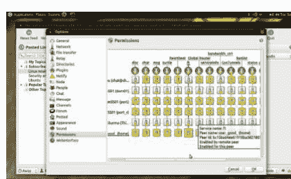

> 你可以通过 Tor 使用 Retroshare 来隐藏你与朋友之间的连接。

Q-text 使用 NaiceCipher 库提供具有完美秘密性的端到端加密。该协议生成临时密钥对，用于与非 Tor 朋友建立连接。

# 结论

- CryptoCat


- GoldBug
- Jitsi
- qTex
- Retroshare

> 所有开源软件都提供了协议和加密算法。

## 音视频通话

### 我们如何确保这些通话的安全？

GoldBug 有许多功能，但它无法用于音频和视频通话。该应用程序拥有像 Starborn 那样的加密文件机制。CryptoCat 还可以进行实时视频通话。客户端可以向朋友发送长加密视频消息，朋友可以立即查看或在未来 30 天内的任何在线时间查看。

CryptoCat 用户也可以交换加密文件和照片，只要它们的大小小于 200MB。所有的音频视频通话在 Jitsi 和 CryptoCat 中都是端到端加密的，但 GoldBug 不支持这一点。Jitsi 在音频视频通话时使用 ZRTP 协议来确保安全，而 CryptoCat 使用其自己的协议。

# Jitsi

Jitsi 同样非常直观。通过默认登录 XMPP 或 SIP 服务器，你与其他网络的所有对话都是不安全的。你可以使用聊天窗口中的“安全聊天（Secure chat）”下拉菜单来开启加密对话的选项。

在创建私有对话时，Jitsi 会首先要求你对联系人进行身份验证。你可以通过询问他们秘密密码或通过其他通道验证他们的指纹来完成。为了获得更高的隐私性，一旦你加密了对话，你可以从聊天窗口要求 Jitsi 将聊天会话共享给单个客户端。同样，你可以发起音视频通话，并通过共享屏幕上显示的四个字母 ZR 密钥来确保安全。


# 安全聊天

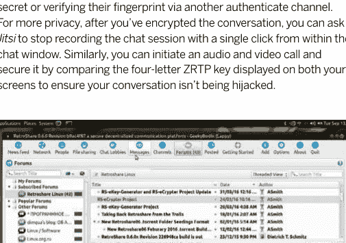

# Retroshare

Retroshare 看起来和传统的即时通讯（IM）客户端非常不同。启动时，它看起来相当冷门，顶部的没有任何标签列表。因为 Retroshare 是从你的朋友那里获取这些内容的，所以你需要在 Retroshare 网络上拥有某些内容。

你可以通过共享你的私钥直接加入，或者通过与聊天服务器交换聊天内容。你需要前往聊天大厅（chat lobbies）并查找 ChatServer EN 以加入聊天、打个招呼并支持你的朋友。要发送给某人，你必须交换密钥。你可以访问所有订阅、下载以及来自朋友的聊天。

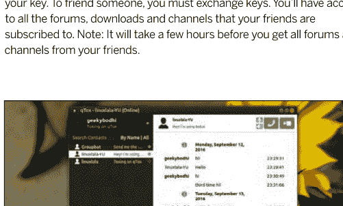

# qTox

与 CryptoChat 类似，qTox 的用户界面类似于传统的即时通讯客户端。当你在启动应用程序时，你需要创建一个新的个人配置。你可以通过两种方法之一添加新联系人：验证你的 Tox ID，或者与你的朋友交换。对于移动设备，你可以发送他们生成的 QR 图像副本。

一旦连接成功，你就可以使用普通的 IM 客户端与他们互动，因为你们的对话并不通过中央服务器传输。聊天窗口还有发起音视频通话的按钮。你还有创建聊天群组和发送文件的按钮，并且有一个捕获并发送截图的选项。


# 帮助与支持

需要处理什么吗？

Goldbug 也有英文版手册以及 wiki。实际上，唯一的文档是德语手册的真实翻译，因此，很多事情看起来都非常奇怪。我们没有在互联网上找到任何官方信息。

Retroshare 提供了丰富的信息，包括常见问题解答（FAQ）、博客和论坛。大量的课题可以帮助用户熟悉 Retroshare 网络和应用程序。你会发现针对特定平台的板块可以解决常见问题及其解决方案。

它非常易用，但有一份用户手册解释了各种功能和特性，而帮助和支持通过邮件列表提供。针对 Tox 的特定资源由 Tox 协议网站上的文档进行补充。那里有 FAQ 和 wiki 供使用。

# CryptoChat

带有新消息协议的新用户。除了技术文档之外，Jitsi 通过用户贡献的视频涵盖了所有实用的任务。通过使用加密聊天来确保安全的 2017 视频通话。需要帮助，可以使用 rapids。最后，他们有一份详细的 FAQ。最后一页文档涵盖了用户使用时需要知道的一切信息。

# 安全平台支持

它们可以在手机或其他平台上支持你吗？

虽然你可以说服你的哥们儿迁移到具有更好安全隐私性的不同客户端，但你不能指望他们也切换操作系统。当然，在一个理想的世界里，如果每个人都使用 GNU/Linux，那将完全没有问题。

树莓派（Raspberry Pi）对于其稳定版也提供了 Windows 和 macOS 的安装程序，以及每日构建（nightly builds）。下载页面还指向了一个适用于 Android 的实验性构建。然而，他们发布的最新 APK 是（*此处原文不完整*）。

但这意味着使用固有安全操作系统的用户并不能使用像 CryptoCat 这样的客户端。

Tox 协议涵盖了最广泛的平台。除了 Linux 之外，qtox 还提供了 FreeBSD 根、32 位和 64 位的客户端作为 macOS 的实验性构建。虽然 qtox 没有移动客户端的构建，但你可以使用其他 Tox 客户端，如 iOS 的 Antox 和 Antox。在我们的测试中，我们没有在使用不同的 Tox 客户端和平台使用时发现任何问题。

幸运的是，它们中的所有都在支持 Linux 的某些操作系统，但只有像 CryptoCat、GoldBug 和 Retroshare 这样的可以很好地安装在 Windows 和 macOS 上。然而，GoldBug 有点像二等公民，只向 Windows 和 macOS 用户提供最新版本（3.5）。此外，Retroshare 是测试中唯一具有构建的客户端（*此处原文不完整*）。

- Antox 正在活跃开发中，音视频通话的性能似乎各异。


# 结论

- CryptoCat
- GoldBug
- Jitsi
- qtox
- Retroshare

- qtox 与其他平台具有兼容性

# 额外功能

它们在其他平台上通讯可以做些什么？

虽然你可以说服你的哥们儿迁移到具有更好安全隐私性的不同客户端，但你不能指望他们也切换操作系统。当然，在一个理想的世界里，如果每个人都使用 GNU/Linux，那将完全没有问题。


Jitsi 同样非常直观。通过默认登录 XMPP 或 SIP 服务器，你与其他网络的所有对话都是不安全的。你可以使用聊天窗口中的“安全聊天（Secure chat）”下拉菜单来开启加密对话的选项。

在创建私有对话时，Jitsi 会首先要求你对联系人进行身份验证。你可以通过询问他们秘密密码或通过其他通道验证他们的指纹来完成。为了获得更高的隐私性，一旦你加密了对话，你可以从聊天窗口要求 Jitsi 将聊天会话共享给单个客户端。同样，你可以发起音视频通话，并通过共享屏幕上显示的四个字母 ZR 密钥来确保安全。


# 安全聊天


## Retroshare

Retroshare 看起来和传统的即时通讯（IM）客户端非常不同。启动时，它看起来相当冷门，顶部的没有任何标签列表。因为 Retroshare 是从你的朋友那里获取这些内容的，所以你需要在 Retroshare 网络上拥有某些内容。

你可以通过共享你的私钥直接加入，或者通过与聊天服务器交换聊天内容。你需要前往聊天大厅（chat lobbies）并查找 ChatServer EN 以加入聊天、打个招呼并支持你的朋友。要发送给某人，你必须交换密钥。你可以访问所有订阅、下载以及来自朋友的聊天。


## qTox

与 CryptoChat 类似，qTox 的用户界面类似于传统的即时通讯客户端。当你在启动应用程序时，你需要创建一个新的个人配置。你可以通过两种方法之一添加新联系人：验证你的 Tox ID，或者与你的朋友交换。对于移动设备，你可以发送他们生成的 QR 图像副本。

一旦连接成功，你就可以使用普通的 IM 客户端与他们互动，因为你们的对话并不通过中央服务器传输。聊天窗口还有发起音视频通话的按钮。你还有创建聊天群组和发送文件的按钮，并且有一个捕获并发送截图的选项。


## 帮助与支持

需要处理什么吗？

Goldbug 也有英文版手册以及 wiki。实际上，唯一的文档是德语手册的真实翻译，因此，很多事情看起来都非常奇怪。我们没有在互联网上找到任何官方信息。

Retroshare 提供了丰富的信息，包括常见问题解答（FAQ）、博客和论坛。大量的课题可以帮助用户熟悉 Retroshare 网络和应用程序。你会发现针对特定平台的板块可以解决常见问题及其解决方案。

它非常易用，但有一份用户手册解释了各种功能和特性，而帮助和支持通过邮件列表提供。针对 Tox 的特定资源由 Tox 协议网站上的文档进行补充。那里有 FAQ 和 wiki 供使用。

## CryptoChat

带有新消息协议的新用户。除了技术文档之外，Jitsi 通过用户贡献的视频涵盖了所有实用的任务。通过使用加密聊天来确保安全的 2017 视频通话。需要帮助，可以使用 rapids。最后，他们有一份详细的 FAQ。最后一页文档涵盖了用户使用时需要知道的一切信息。

## Goldbug

## Jitsi

## qTox

## Retroshare

Goldbug 有最后一种语言的支持文档，但翻译得很糟糕。

《黑客手册》 | 69

## 安全平台支持

它们可以在手机或其他平台上支持你吗？

虽然你可以说服你的哥们儿迁移到具有更好安全隐私性的不同客户端，但你不能指望他们也切换操作系统。当然，在一个理想的世界里，如果每个人都使用 GNU/Linux，那将完全没有问题。

树莓派（Raspberry Pi）对于其稳定版也提供了 Windows 和 macOS 的安装程序，以及每日构建。下载页面还指向了一个适用于 Android 的实验性构建。然而，他们发布的最新 APK 是。

但这并不意味着意味着使用固有安全操作系统的用户并不能使用像 CryptoCat 这样的客户端。

Tox 协议涵盖了最广泛的平台。除了 Linux 之外，qtox 还提供了 FreeBSD 根、32 位和 64 位的客户端作为 macOS 的实验性构建。虽然 qtox 没有移动客户端的构建，但你可以使用其他 Tox 客户端，如 iOS 的 Antox 和 Antox。在我们的测试中，我们没有在使用不同的 Tox 客户端和平台使用时发现任何问题。

幸运的是，它们中的所有都在支持 Linux 的某些操作系统，但只有像 CryptoCat、GoldBug 和 Retroshare 这样的可以很好地安装在 Windows 和 macOS 上。然而，GoldBug 有点像二等公民，只向 Windows 和 macOS 用户提供最新版本 (3.5)。此外，Retroshare 是测试中唯一具有构建的。

- Antox 正在活跃开发中，音视频通话的性能似乎各异。


## 结论

- CryptoCat

GoldBug

Jitsi

qtox

Retroshare

- qtox 与其他平台具有兼容性

# 安全

## Linux：保护你的桌面安全

Linux 可以阻止大多数针对我们的攻击，但我们也可以帮助为你的电脑建立起道防护力场。

仅仅因为 Linux 比 Windows 更安全就依赖它吗？安全是一项内置功能，从内核一直延伸到桌面，但它留下了足够的空间让你的 Linux 在 Windows 的病毒和蠕虫面前变得混乱；然而攻击者还有许多其他手段来窃取你珍贵的比特和字节，这些数据涵盖了从个人电子邮件到信用卡的所有内容。

使用密码锁定你的数据应该是你唯一的防线，但这不足以抵御攻击者。随着攻击数量和种类的增加，你应该采取额外措施来保护你的计算机免受未经授权的访问。

所有主流的 Linux 发行版（如 Debian、Ubuntu 和 Fedora）都有专门的团队与软件包合作，以确保它们免受漏洞的影响。这些团队相互协作，确保在发现漏洞时尽快应用安全补丁。

你的 Linux 发行版还有一种方法可以确保启用特定的安全存储库（默认应该是开启的），并且你可以选择是自动安装更新还是点击按钮手动更新。例如，如果你使用“软件与更新”工具，可以使用 Ubuntu 手动下载并安装更新。

除了更新，发行版还提供安全邮件列表来向你发送公告并与其分享。关注你所在发行版本的邮件列表是一个好主意，并留意你关心的软件包的安全更新。在发布与软件包被放入存储库之间通常会有短暂的延迟；安全邮件列表列出了如何应用更新的说明。

你还应该花时间禁用不必要的服务。Linux 发行版启动时会运行许多服务以尽可能服务很多人。但你不需要所有服务。某些服务在安全服务器上不应开启，而且对于一台带有蓝牙适配器的电脑，你为什么需要蓝牙服务来连接设备呢？通常可以使用图形化工具列出 Linux 安装中运行的所有服务。然而，如果你禁用了所依赖的服务，某些应用程序可能会停止运行。例如，许多应用程序依赖数据库，因此在关闭 MySQL 或 PostgreSQL 之前，你应该确保自己没有运行任何依赖它们的程序。

## 保护用户账户

在像 Linux 这样的多用户系统中，访问 root 用户账户是常见的。如今大多数发行版不再允许你以 root 身份登录了，这是好事。此外，与其给多个人 root 权限，不如使用带有子命令的 `sudo`。使用 `sudo` 而不是以 root 登录，这样用户在 `/var/log/secure` 文件中就有优势，该文件记录了所有失败的尝试。

使用 `sudo` 的主要优势之一是允许你限制对某些命令的访问。这可以通过 `visudo` 命令实现。`visudo` 文件应该使用 `visudo` 命令进行编辑。系统会将文件保存到临时位置，并在写入 `/etc/sudoers` 文件之前检查配置。

要允许用户在命令前加加 `sudo` 时获得完全权限，请在 `/etc/sudoers` 中添加以下内容：

```
user ALL=(ALL) ALL
```

要允许用户以 root 身份运行所有命令，但仅限于拥有特定主机名 hostname 的机器：

```
joe hostname=(ALL) ALL
```

限制对某些命令的访问。例如，以下行将仅允许 guest 用户执行以下操作：

```
guest ALL=(ALL) /bin/sbin /bin/shutdown /bin/halt /bin/restart;
```

同样，你可以在这里添加其他命令。

你可以限制用户的范围。以下配置允许名为 native 的用户使用 root 权限，但仅限于他的工作站名称，而不在其他任何地方：

```
native hostname=(ALL)
```

此外，你还可以为非永久用户使用的账户设置过期日期。这包括对你 Linux 登录的访问。理想情况下，一旦不再需要禁用并删除临时账户。过期日期可以起到保护作用，确保这些账户不会被滥用。

## 保护你的桌面安全

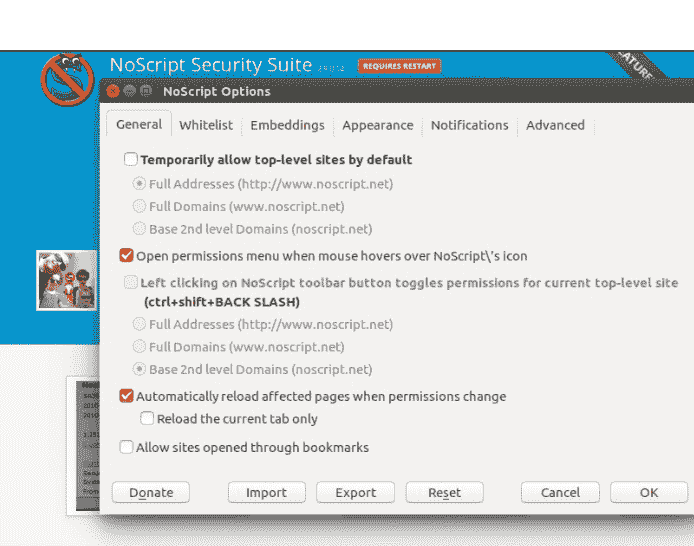


> 带有 NoScript 和 BetterPrivacy 扩展的浏览器可以保护你的浏览器免运行恶意脚本。

使用命令调整用户账户并设置过期日期，例如：

```bash
sudo usermod -e 2017-01-02 bodhi
```

在这个示例中，用户 `bodhi` 将从 2017 年 1 月 2 日起无法登录该账户。

## 权限入门

保护 Linux 系统的另一个重要部分是设置权限。在 Linux 和 Unix 中，每个文件和目录都有权限。文件是目录，目录也是文件。每个文件至少由一个用户和一个组所有。每个用户都有唯一的标识符 `UID`，每个组也有自己的标识符。组是由系统管理员建立的用户集合。

用户属于许多组。就像用户，用户也有唯一的组 ID `GID`。文件或目录的可访问性基于其 `UID` 和 `GID`。用户只能访问他们被授予权限的文件。如果用户属于文件所属的组或者该组对所有用户开放，则授予权限。例外是 `root`，它具有访问系统中所有文件和目录的权限。此外，Linux 为它们分配了三类权限——用户、组和其他——这决定了用户是否可以读取、写入或执行某个文件。

你可以使用 `ls -l` 命令查看文件或目录的权限。要修改权限，使用 `chmod`。权限以数字或字母表示。对于大多数人来说，字母更容易理解，但一旦习惯后使用数字会更好。例如，`chmod u+x` 给所有者执行权限，`chmod 755` 效果相同但用数字表示。同样，`chmod g+x` 给组添加执行权限，`chmod o+x` 给其他执行权限。

然而，你并不限于按用户或组定义权限。对于复杂需求，使用访问控制列表 `ACL`，它允许为多个用户和组指定权限。虽然你可以手动定义它们，但像 `getfacl` 和 `setfacl` 这样的工具可以帮助你为每个文件创建权限列表。你可以使用 `setfacl` 恢复默认权限。文件应该属于 `root` 所有和组，权限为 `644`。

**提示：** 从安全的角度来看，尽可能遵循官方规则，仅将例外作为最后手段。

## 监控进程

几乎所有活动都在后台进行。为了保护你的活动，你应该监控机器上运行的进程并立即处理异常进程。你可以使用 `top` 命令列出所有运行进程以及它们消耗资源的情况。如果你需要更详细的进程，使用 `ps` 或进程 ID `PID`。使用 `pgrep` 命令列出进程的 PID，例如 `pgrep firefox`。要杀死进程，可以使用 `kill` 命令查看无响应进程的 PID。例如，`kill 1234` 将让 Linux 内核关闭与 PID 相关的应用程序。你也可以在 `top` 命令中按 `k` 键终止进程。

# 安全

> 通过右键点击文件，访问文件管理器中的访问控制列表选项卡。

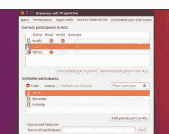

在这里你会找到几乎所有请求认证的应用程序的配置文件。当你检查这些配置文件时，你会注意到它们都以 `common` 前缀开头。例如，`/etc/pam.d/`。这些 `common` 前缀是你应该修改的实际配置文件。使用 `cat /etc/pam.d/common-password` 命令列出定义密码基本规则的行，例如：

```
account [default=include] pam_unix.sha512
password required pam_unix
password required pam_crypt
```


这允许用户登录并查看关联用户名。防止他们直接编辑 `/etc/password` 文件。包含密码的 `/etc/shadow` 文件被用作账户或密码值。如果此值的 `root` 用户组设置为 `0`，则任何用户都没有密码。`root` 用户仍然可以访问它。用户可以使用 `/bin/passwd` 工具更改密码。通过这种特殊规定，请求密码命令变成了一个特权进程 `sudo`。

## 使用 PAM 管理密码

可插拔认证模块 `PAM` 机制最初实现在操作系统中，但现在已成为 Linux 标准。`PAM` 为用户和应用程序提供了一种灵活的认证机制。为了获得 `PAM` 的好处，单个应用程序必须向 `PAM` 库注册。`pam_stat -s` 命令将显示所有感知 `PAM` 的应用程序列表以及它们使用了什么。从列表中，你会注意到哪些 Linux 工具使用了 `PAM` 认证。

你也可以使用 `PAM` 选择复杂方法。`PAM` 在 `/etc/pam.d/` 下存储配置文件。


它们在配置中需要密码的几行中被引用。某些规则也被定义为使用 SHA 对密码进行加密。该模块确保密码长度和复杂性符合各种因素，例如不同类型字符的数量和长度。

对于密码检查，你可以添加额外的 `PAM` 模块，如 `apt-get install pam-crypt`。安装此模块会自动更改 `/etc/pam.d/common-password` 文件，列出如下内容：

```
password required pam_crypt retry=3 minlen=8
```

此行启用了 `pam_crypt` 模块，该模块随后使用三个字符来设置良好的密码。它还将密码的最小字符数设置为 8。`minlen=8` 设置了必须与密码不同的最小字符数。

你也可以在此限制中记住 `-s` 以防止用户使用最常用的密码。你还可以使用 `u`、`credit` 和 `oct credit` 选项强制密码包含数字、大写字母和特殊字符。你还可以使用 `deufuser` 选项强制用户选择一个与用户名不同的密码。

## 混淆你的分区

保护个人数据的最佳方法是将其加密，以便他人无法读取文件。在某些安装版本（如 Fedora 和 Ubuntu Mint）中，你可以在磁盘初始设置期间加密你的分区。

如果你有单独的文件，也可以使用 `ZuluCrypt` 应用程序。这是一种加密特定块设备的设备加密。所涉及的块设备可以挂载为分区、文件或环回设备。通过使用加密，用户可以在写入底层块设备之前加密数据，从而透明地加密块设备上的数据。使用 `ZuluCrypt`，你可以加密任何文件或在系统分区或 USB 磁盘内进行加密。它还有一个直观的用户界面，你可以用它创建随机密钥并


74 | 黑客手册 (The Hacker's Manual)

## 数据恢复计划

对于导致数据丢失的泄露，恢复计划也应该是你安全策略的一部分。Linux 桌面版有几种多功能齐全的实用程序。事实上，你的发行版可能已经安装了其中一个。例如，Ubuntu 附了 `Deja Dup` 工具来调度备份。你也可以安装其他发行版，如 Fedora、OBS 和 KISS。内置工具（如 `Deja Dup`）的界面非常简洁，但在使用它们之前，你将需要先对它们进行配置。每个应用程序都会要求你指定想要存放备份文件的位置。根据你正在使用的工具，这可能是本地硬盘、通过 SSH 或 FTP 访问的远程存储，或者像 Amazon S3 这样的云服务。你还需要标记想要包含在备份中的目录和文件。某些工具还允许你调度备份。像 `Deja Dup` 这样的工具允许你启用备份。通过 `Deja Dup`，可以设置所有数据备份计划，对于初学者来说，这个过程非常简单。最好为最坏做打算。

## 安全桌面

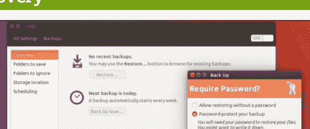

`Deja Dup` 基于简单性，并为不习惯使用备份工具的桌面用户提供了恰当的功能。

按日期备份备份的位置。如果你有多个驱动器，你甚至可以在网络附属存储 `NAS` 或 OpenMedia 上设置一个。你备份的数据类型也会影响存储介质的选择。你需要确定合适的备份方法。根据你的需求，你可能需要手动或自动备份。正确的频率取决于你所拥的数据类型。根据文件的大小，每次备份所有内容可能不是好主意。

## 灭火

Linux 发行版自带了 `netfilter/iptables` 框架。该框架是一组内核模块，用于在内核级别创建数据包过滤规则。Ubuntu 带有不复杂的防火墙 `UFW`，这是一个可以用于编辑 `iptables` 规则的用户空间应用程序。它还是一个基于 GUI 的工具，使得管理表格的任务变得更容易。该程序可以轻松允许或阻止服务以及指定的端口。你可以根据家庭、公共和办公室的策略以及入站流量策略来配置你的策略。默认配置应该满足大多数用户，如果你需要更高级的配置，可以设置单独的规则。

从防火墙开始。一旦启用，你就可以通过下拉菜单中的三个选项之一设置入站和出站规则。允许 `allow` 选项将允许任何请求。拒绝 `deny` 选项将简单丢弃所有入站或出站数据包。拒绝此的效果是向连接发送者返回错误代码。

设置好策略后，点击添加 `Add` 按钮编辑规则。此窗口打开了一个带有三个选项卡的提议，允许以不同的方式创建规则。删除 `delete` 选项主要为特定的应用程序或服务设计，而另外两个用于为特定端口定义规则。

我们建议大多数用户从下拉菜单中选择想要控制流量的应用程序，并允许防火墙自动检测应用程序。如前面提到的：对于家庭系统，你应该允许所有入站流量，然后选择性地允许你使用的应用程序和服务的规则，例如 Web。


### 表 1. 访问与规则

| 权限 | 操作 | chmod 选项 |
| --- | --- | --- |
| 读 (read) | (查看) | r 或 4 |
| 写 (write) | (编辑) | w 或 2 |
| 执行 (execute) | (执行) | x 或 1 |
| 用户 | 是否是外部 | chmod 选项 |
| --- | --- | --- |
| 所有者 (owner) | -rwx- |  |
| 组 (group) | ---rwx | 8 |
| 其他 (other) | ---rwx |  |

使用 `change` 命令 (`-chmod`) 帮助查找有关用户账户的详细信息，并显示账户日期时间和显示密码。

The Hacker's Manual | 75

# 安全

## Fedora：保护你的桌面

现在我们思考我们的网络有多安全。Fedora 的工具可以救急吗？

无论你是在家里还是办公室需要解决安全问题，可能会让你困惑从何开始。进入 Security Lab，一个满足你所有安全需求的解决方案。

首先，Fedora Security Lab 如我们所知，是由 Fedora 项目开发并由红帽赞助的 Linux 发行版（distro）。类似地，Fedora 发布了名为“spins”的变体，预配置了不同的桌面环境。

这些变体针对特定的兴趣和用户设计的，例如设计、游戏和安全。

Fedora Security Lab 针对想要测试网络安全或其他任务的安全专业人士和爱好者。如果你是一个黑客，这个系统对你非常有帮助。它允许你在隔离环境中执行安全审计和恢复密码。该实验室以虚拟机或 ISO 文件的形式发行。

它以 CD 的形式驱动（这意味着可以插入计算机并在需要时引导进入 Fedora）。该解决方案使得使用许多安全审计、办公室工作站和家庭终端所需的工具变得容易。一旦进入发行版，你可以根据需要将任何工具安装到硬盘上。

在教程中，我们展示了如何使用 Security Lab 最著名的工具，例如 Wireshark、Joiner、Nmap 等。我们敦促你不仅限于我们涵盖的工具，因为这个发行版中还有许多可以探索的内容。

## 工具齐备

现在让我们深入研究几个功能以了解如何使用它们。我们涵盖的工具第一个是一个实用的工具，正如它的标题所示，是一个密码

+   你可以从 https://fedoraproject.org 下载 Security Lab

## 测试

当你从现场 CD 启动后，你将登录 Fedora 操作系统。你将

# Fedora

> 内置的密码生成器为每次查询提供 100 个随机生成的密码，为你提供了许多可选择的选项。

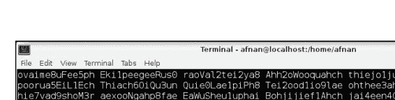

生成的密码，或者如果你需要 root 密码，它将向你显示支持的选项列表以及如何使用它们。这些选项包括配置密码以满足某些标准，例如：包含至少一个大写字母、至少一个数字或符号，或者所有类型的字符。如果你想要一个 10 个字符且至少有一个大写字母的密码，只需在提示符中输入：`passgen -c 14`。通过这个工具，你将发现一个强大的工具，可以创建既安全又容易被猜到的密码。

接下来是网络，是时候使用 `tcpdump` 工具了，这是一个强大的工具，可以让你从网络中捕特定的流量。如果你有任何特定的需求，这个工具可以为你完成任务。它为数据过滤器提供了多种选项，包括输出格式，例如保存为 pcap 文件。使用 `tcpdump` 脚本的另一种方法是使用 `-r` 命令捕获你指定的实际文件。如果没有这个，文件的内容将非常基础且难以检查，尽管它仍然以纯文形式存在。

具有三个交互式选项（包括一个 `--`）和一个三阶段过程。虽然比磁盘扫描器（Disk scraper）的脚本少，但足够了。

界面会检测你正在寻找的内容并实时显示流量过程。你可以使用交互式捕获方法，然后坐下来喝杯茶（或咖啡）看着，因为取决于磁盘的大小和详细程度的方法，这可能需要几个小时。

如果你是负责让办公室网络安全、稳固的管理员，那么你清单上的首要任务是确保每个人都使用强密码。如果你的网络中有超过 500 个用户，你有时间检查他们。其中包含的一个程序名为 Ncrack。Ncrack 是一种高速网络认证客户端，旨在通过拦截和破解它们来帮助主机和网络进行防御。

它是网络管理员和安全专业人员的极佳工具，尽管它不再受于更强大、更完善的 `map-GUI` 的支持。Nmap 是一个命令行界面，提供了许多选项以及一个支持的工具列表。要进行测试，你可以使用 `etc` 目录下的密码文件。

另一个类似的程序是 Wireshark，另一个是磁盘擦除和毁灭程序（DBAN）。Wireshark 用于确保驱动器清空，并且

# 资源

Ncrack 和 Nmap 可以在 https://www.nmap.org 找到，在那里你可以找到关于如何使用和理解 nmap 命令的信息。对于 Wireshark，可以在 http://labs.wireshaproject.org/security 了解该软件及其地图。关于如何加入的信息可以在此处找到。

这里使用的大多数程序（如 Wireshark、Nmap、John 和 Ncrack）都有自己的网站。Wireshark 文档可以在 www.wireshark.org 找到；Nmap Linux 论坛！可以在乔治·麦迪森大学网站 (http://bit.ly/Wireshark) 找到，如果你想获取最新版本的 Wireshark 用户指南，http://bit.ly/WiresharkGuide 是对所有 Wireshark 工具和功能最全面的指南，涵盖了如何良好地使用它们。Nmap 的基础指南可以在 http://bit.ly/Nmapbeginners 找到。

还有许多附加内容等待被发现。

黑客手册 | 77

# 安全

> FTP、HTTP、POP3、SMB、RDP 和 VNC 在网络环境中非常灵活。

另一个类似的工具是 John，被称为 John Ripper，它是首选的暴力破解密码破解器。John 主要采用两种攻击模式：第一种是“字典”攻击，它将字典中找到的哈希单词与加密或哈希后的密码进行比较。第二种是暴力破解，程序生成所有可能的文本字符串并将它们与密码哈希进行比较。这种方法可能花费更长时间，但如果你正在寻找一个独特且未被破解器或网络破解的密码，那么它是有效的。


如果你正在需要的某些功能不可用，请尝试使用 `yum` 命令。这可能会为当前版本添加功能或更新功能。

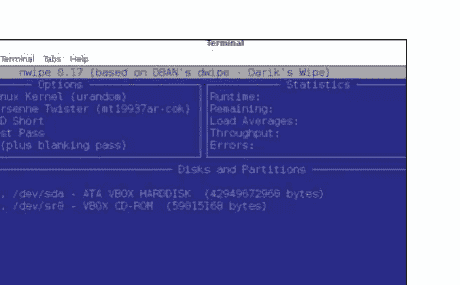

Hashcat 是一个破解加密哈希（已通过 MD5 测试）的强大工具。按 'Q' 或 'C' 停止，按任意键取消。最大长度对于当前哈希太长，已减小为

```
Test 00:00.
```

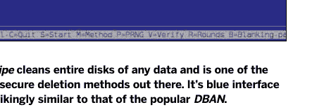

连接任何类型的数据，是最好的检测方法之一。它的界面与 nmap 非常相似。

# 安全审计

Linux 的最好的功能之一是 Nmap，它是一个免费且开源的网络发现和审计工具。它的首要功能是发现网络上的主机和服务，并创建网络拓扑。对于这项任务，Nmap 提供了关于目标的详细信息。系统管理员还用它执行各种任务，如库存管理、服务升级和监控。由于许多内置功能，它还可以用于安全审计，包括漏洞检测。使用 "-option" 显示所有已发现密码的输出。

上方扫描已完成，此输出告诉你 'user' 的密码已锁定。在没有漏洞的情况下，没有显示哈希值（参见常见问题解答）。

> 磁盘擦除器提供擦除进的实时更新。速度将取决于站点的大小。

# 其他实验室和变体

从这里开始，你可能对教程开头提到的其他发行版感兴趣，Fedora 为特定用途提供了许多其他实验室；Fedora 工作站（GUI）版本发行版提供了一个易于使用的图形化环境，便于便携和即时启动。还有游戏、设计和科学领域的实验室。Fedora Games 包含许多流派，Fedora Design 包含各种赋予生命的工具。Fedora Science 提供了计算和分析数据的不同工具，例如 GNU/Octave。Fedora 还使用替代桌面环境提供了不同的变体，例如同时兼顾生产力和娱乐的 KDE Plasma 桌面变体。另一个变体是 Cinnamon，正如许多其他人所说。在此获取完整列表：https://labs.fedora.org。

黑客手册 | 78

# Fedora

> Fedora 在网络环境中非常灵活

另一个类似的工具是 John，被称为 John Ripper，它是首选的暴力破解密码破解器。John 主要遵循两种攻击模式：第一种是“字典”攻击，它将字典中找到的哈希单词与加密或哈希后的密码进行比较。第二种是暴力破解，程序生成所有可能的文本字符串并将它们与密码哈希进行比较。这种方法可能花费更长时间，但如果你正在寻找一个独特且未被破解器或网络破解的密码，那么它是有效的。


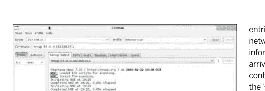

> 广泛认可的安全扫描器包含许多功能，带有 GUI 的 Zenmap

```
# nmap 192.168.0.1
# nmap 192.168.0.1/24
```

如果你正在扫描地址列表，可以使用排除命令并用逗号（,）分隔每个要排除的地址，或者使用 `# nmap 192.168.0.1/24 --exclude 192.168.0.1`。

# 数据嗅探

我们将介绍的最后一个软件是 Wireshark。它是 Linux 平台上最好的网络协议分析器。Wireshark 可以让你看到网络上发生的一切，一直直到看到的数据包。它支持各种协议和捕获过滤器，使其非常灵活。如果你第一次使用 Wireshark，会看到一个欢迎界面，询问你想要监听哪些检测到的网络接口。在选择一个后，将显示一个三个面板的界面。顶部面板将显示颜色编码的

在 Fedora Lab 中选择的程序，但它们将对你通过此简要概述看到的程序类型提供良好的介绍。作为一种可以读取和写入文件的操作系统，你不仅可以保持系统 live CD 的更新，还可以使用自己的功能和程序对其进行定制，就像其他系统一样。由于其技术性质和对高级命令行解决方案的依赖，这可能并不适合所有人。然而由于它的所有服务、轻量级使用和体验，它对专业人士和黑客来说都是完美的。

## GnuPG: 密钥管理

您的 GnuPG 密钥非常重要。我们将解释如何创建一个良好的密钥，以及如何使其免受网络窃贼的侵害。


| 索引 | 状态页面 | 池概览 | 与密钥服务器交互 | HTTPS 验证 | # 密钥管理 | 联系方式 |
| :--- | :--- | :--- | :--- | :--- | :--- | :--- |

## OpenPGP 公钥服务器命令

欢迎访问 `pool.sks-keyservers.net` 轮询密钥服务器交互页面。交互将通过 TLS/SSL 加密连接进行。

## 从服务器提取密钥

## 向服务器提交密钥

## 提取密钥

以下是提取密钥的方法：

- 1. 勾选“索引 (Index)”或“详细信息 (Verbose)”复选框。“详细”选项还会显示所选密钥的签名。
- 2. 在“搜索字符串 (Search String)”框中输入您想要搜索的内容。
- 3. 按“搜索 (Search)”键。


GnuPG，即“Gnu 隐私卫”，是一个用于加密电子邮件或在安装包之前验证其真实性的免费工具。它是 OpenPGP 标准，使用公钥加密，通过认证和信任来处理真实性。

GnuPG 文档早就解释了密钥管理至关重要。在本教程中，我们将重点关注密钥管理并据此探索最佳实践。我们使用的是 GnuPG 2.1 版本，名为“Modern”。

### 基础知识

一个 GnuPG 密钥包含多个组件，分别称为公钥和私钥。私钥用于签名和解密，而公钥用于加密和验证。

公钥包含在“证书”中，用于存储标识信息（用户可能有姓名、电子邮件地址或照片）以及一个或多个用于签名和加密的密钥。在 GnuPG 的开发历史和当前相关中，关系包含子密钥。使用 GnuPG 的个人收集他人的密钥，可能并将自己的密钥对也放入 GnuPG 密钥环中。使用自己的密钥部署可能意味着使用他们的主密钥、私有公钥或证书。

我们认为这是想要开始加密一切的用户的一种假设性新方法。让我们创建一个可以运行的东西，例如：

```
# gpg --generate-key
# # gpg --list-keys
```

### 设置您的参数

首先要做的的是配置 GnuPG。它使用 `~/.gpg` 目录来存储配置、运行信息和密钥环。您可以自动创建此目录，但手动启用可以让我们提前使用它。通过使用限制的权限来暴露它：

尽管 GnuPG 假设了默认配置，但编写配置文件允许您设置某些参数来定制个人偏好：

```conf
# ~/.gpg/gpg.conf
keyserver https://pool.sks-keyservers.net
```

### GnuPG

```conf
personal-preferences AES256 AES192 AES5
personal-preferences SHA512 SHA384 SHA256
SHA256
digest-algorithm- SHA256
```

在无法移除密钥的情况下，知道它终某一天会被移除是令人宽慰的。如果没有发生糟糕的情况，即使密钥已过期，也可以更改过期日期。注意，过期的密钥仍然可以解密已加密的消息。


```conf
default-preference SHA512 SHA384 SHA256 AES256
AES256 AES192 AES5
ZIP4 BZIP2 ZIP
Uncompressed
```

> 辅助工具 (www.gnupg.org/help/) 提供了快速生成密钥所需的输入。检查您的软件包仓库。

此配置示例设置了从公钥获取的默认密钥，以及首选的密码和摘要（哈希算法）。偏好列表定义了将生成哪些，这样您就不需要知道何时使用什么。它们共同使用，例如，我们使用了对压缩算法的偏好，这适用于您可能希望坚持的大多数用例。

#### 密钥是...

示例中包含了 `gpg` 将提示您输入的口令。它存储在 `gpg-agent` 中，因此您不需要在每次执行解密或签名操作时都输入它。密钥的用户 ID 为（姓名-真实姓名）、（电子邮件地址）和另一个注释（注释）。除非您使用身份身份的密钥，否则只显示一个注释。请记住，您可以更改用户 ID 或撤销并添加新的。创建密钥简单的方法是运行 `gpg --generate-key` 并按照提示操作，它会询问姓名、地址和口令，并生成用于签名的 2048 位“主”或“大师”RSA，以及一个从主生成并用于数据的用户密钥。一旦密钥生成完成，可以使用 `--list -l` 查看生成的内容：

另一种方法是使用批模式，允许在文件中提供所需信息，而不是通过交互进行提示。这对于非交互式配置非常有用，并作为生成密钥所使用的参数源。

```
gpg --generate-key -n
pub-id 2048-SC [exp:2027] Test@example.com
```

这显示了一个用于签名的 2048 位主密钥和子密钥 (master)，注释指示它是主密钥。类型：RSA 长度：2048 用途：签名 子密钥长度：2048 姓名：Test 电子邮件：test@example.com 您可以使用不同的算法。例如，可以使用 AES256 而不是 RSA。长十六进制字符串是主密钥的“指纹”。它是识别您密钥的短方法，因为公密钥太长而无法使用。如果需要加密数据，可以生成子密钥。虽然公密钥看起来与主密钥相似，子密钥存储在密钥目录中。每个 Base64 行都有 CRC。该数据块的 CRC。

| 索引 | 数据 |
| :--- | :--- |
| 00 | 54 AE 01 6E F7 69 75 58 D4 4C 4C 6E 33 |
| 01 | 3D 04 57 68 61 30 31 31 65 62 67 47 52 55 |
| 02 | 44 31 41 31 41 31 45 35 35 35 35 33 33 34 |
| 03 | 65 45 45 34 44 41 44 41 41 1F 6D 6D 34 41 31 31 |
| 04 | 5C 4E 49 49 44 44 44 44 44 44 44 33 33 33 33 |
| 05 | 6E 4D 49 49 44 44 44 44 44 44 41 41 31 31 31 31 |
| 06 | 7D 6B 37 6D 64 64 64 44 44 34 34 33 33 33 33 |
| 07 | 6C 3D 64 64 64  4  4  4 34 34 34 34 34 34 |
| 08 | 6F 41 4D 4D 41 41 41 41 44 44 41 41 44 44 44 34 |
| 09 | 44 41 41 41 41 41 41 41 41 41 41 41 41 41 41 |
| 10 | 35 33 33 33 33 33 33 33 33 33 33 33 33 33 33 |
| 11 | 6F 4D 49 49 44 44 44 44 44 44 41 41 31 31 31 31 |
| 12 | 65 53 35 35 33 33 33 33 33 33 33 33 33 33 33 |
| 13 | 79 3D 4E 45 53 53 34 33 33 33 33 33 33 33 33 33 |


| 14 | 33 33 33 33 33 33 33 33 33 33 33 33 33 33 33 33 |

| 15 | 65 45 45 34 33 33 33 33 33 33 33 33 33 33 33 33 |

# gpg, 隐私, 签名，等等

GnuPG 是一个用于密钥的多用途工具，并使用辅助工具作为交互式界面。值得注意的是，您的设备必须归您所有（例如，对于 Alice 来说，100% 属于她）。如果您使用了 `sudo` 或类似操作是安全的，但您可能会在密钥生成等任务上遇到问题。

需要访问密钥，您可能会看到类似的错误：

`g-agent failed: Permission denied`

如果发生在您身上，请尝试这种方法，利用 `script` 命令进行密钥生成，这样您可以：

其参数将计入标记。或者，您可以使用 `gpg-pinentry-mode` 在不使用身份的情况下使用口令。对话，或者如此

> > `Sudo echo 'password'`

`TTY-(tty)`

您可能还需要导出 GPG

```
5 script -q "gpg --batch"
```

# 安全性

## GPG密钥

```
pub rsa 2016-10-03 [ESC] [2017-10-43]
rsa40963AD48C760CF441A6EB8F734CE2E5
```

```
alice <alice@example.com>
```

sub rsa4096-2016-10-03 [2017-10-43]

```

在这里，在提纲中，前缀 `(sec)` 表示主密钥，`sub` 表示子密钥。你通常通过前八位指纹的较短密钥来识别密钥。这些密钥非常容易发生碰撞，因此较长的 64 位（16 个字符）密钥可以更减少碰撞概率，但程度有限，且使用起来较不方便：

- 使用 `gpg --key-format sub` 命令以短格式输出子密钥，或者使用 `longformat` 输出更长的格式。如果你使用 `--fingerprint`，它将以更具可读性的方式显示：

```
3A7C4CE2E5

6E1B6F7D34C2E5

6CF441A6EB8F734CE2E5
```

除非给出 `--fingerprint`，否则不会显示子密钥的指纹。我们的主密钥是“自签名”的，这意味着密钥对用户 ID 和该子密钥签名，以证明它拥有它们。你可以通过以下方式查看：

- `gpg --list-subkeys`

```
pub rsa4096-2016-10-03 [ESC] [2017-10-43]

alice <alice@example.com>

sub rsa4096-2016-10-03 [ESC] [2017-10-43]

alice <alice@example.com>
```

这里列出了与子密钥关联的签名。它们显示了两个签名：一个用于用户 ID，另一个用于子密钥。“两个”行显示了使用的签名密钥 ID 和日期。“其中一个”行可能包含标志，例如主签名上的“3”，这表示在有效签名 gpg 密钥时的效果。GPG 签名——信任级别越高，必须信任的密钥就越多。

在 GPG 添加的自签名签名中，第三方可以对你用户密钥上的项目进行签名，以证明他们的身份和用于签名的密钥。这会将主密钥和子密钥绑定，帮助建立你的信任网。

主密钥就是这样签名并准备就绪的。你可以直接使用它，但想想如果它丢失了意味着什么：落入错误之手中的密钥可以冒充你，从而以你的名义签署文档并阅读仅供你查看的文档。

将密钥安装在许多设备上会增加风险，特别是像平板这样的设备：

## 密钥完美

最好根本不要在设备上安装你的密钥。如果你需要在这些设备上进行签名、加密和解密，这可能并不现实。然而，你可以使用子密钥来降低风险。子密钥是一个由主密钥保护的辅助密钥，如果也被签名，它可以独立地过期或撤销。

你可以仅使用额外的子密钥让你有两个：一个用于签名，另一个用于加密。然后将这些子密钥从主密钥中分离，并仅将它们安装在你的设备上。

- `gpg --list-keys`
- `gpg --addr`

界面显示了你使用的：用途（签名、加密）、指纹（位）和时长（有效期），这些可能是不过期的，或者以天、月或年为单位签名。

如果你愿意，可以将子密钥与主密钥分开使用。你可以通过导入子密钥然后删除主密钥来实现。

- `gpg --list-subkeys`
- `gpg --homedir --import subkeys`
- `gpg --homedir --import-key`

```
sec rsa4096-2016-10-03 [ESC] [2017-10-04]

sub rsa4096-2016-10-03 [ESC] [2017-10-04]
```

无论使用哪种方法，GPG 都会遍历所有密钥，但你可以选择不想更改的那个；在这里你可以指定特定的密钥。

如果你有子密钥，在不使用主密钥的情况下使用它们。GPG 将在导出请求之前使用子密钥进行密码验证。

- `gpg --sign -n`
- `gpg --homedir --import subkeys`
- `gpg --homedir --import-key`

你可以移除已用完的子密钥。完成后，再移除主密钥。

- `gpg --connect-agent --homedir --kill`
- `rm --homedir`

创建新密钥非常简单，每当你的密钥需要一个时都可以创建。一对子密钥对于你所有设备上的日常使用已经足够。

## 交叉认证

有一种方法可以将公子密钥附加到另一个证书所有者，该所有者就可以签署文档而不会引起某些争议。GPG 现在允许将签名密钥作为已验证签名使用。交叉认证需要对对方的子密钥主密钥进行签名。“回退”或“绑定”签名嵌入在自签名签名中。这绑定了子密钥——你可以看到。

旧版本的 GPG 或其他 OpenPGP 应用可能没有此功能，使用这些应用程序的签名可能缺少这些。

在 GPG 添加的自签名签名中，第三方可以对你用户密钥上的项目进行签名，以证明他们的身份和用于签名的密钥。这会将主密钥和子密钥绑定，帮助建立你的信任网。

主密钥就是这样签名并准备就绪的。你可以直接使用它，但想想如果它丢失了意味着什么：落入错误之手中的密钥可以冒充你，从而以你的名义签署文档并阅读仅供你查看的文档。

将密钥安装在许多设备上会增加风险，特别是像平板这样的设备：

## 密钥完美

最好根本不要在设备上安装你的密钥。如果你需要在这些设备上进行签名、加密和解密，这可能并不现实。然而，你可以使用子密钥来降低风险。子密钥是一个由主密钥保护的辅助密钥，如果也被签名，它可以独立地过期或撤销。

你可以仅使用额外的子密钥让你有两个：一个用于签名，另一个用于加密。然后将这些子密钥从主密钥中分离，并仅将它们安装在你的设备上。

- `gpg --list-keys`
- `gpg --addr`

界面显示了你使用的：用途（签名、加密）、指纹（位）和时长（有效期），这些可能是不过期的，或者以天、月或年为单位签名。

如果你愿意，可以将子密钥与主密钥分开使用。你可以通过导入子密钥然后删除主密钥来实现。

- `gpg --list-subkeys`
- `gpg --homedir --import subkeys`
- `gpg --homedir --import-key`

```
sec rsa4096-2016-10-03 [ESC] [2017-10-04]

sub rsa4096-2016-10-03 [ESC] [2017-10-04]
```


无论使用哪种方法，`GPG`都会遍历所有密钥，但你可以选择不想更改的那个；在这里你可以指定特定的密钥。

如果你有子密钥，在不使用主密钥的情况下使用它们。`GPG`将在导出请求之前使用子密钥进行密码验证。

- `gpg --sign -n`
- `gpg --homedir --import subkeys`
- `gpg --homedir --import-key`

你可以移除已用完的子密钥。完成后，再移除主密钥。

- `gpg --connect-agent --homedir --kill`
- `rm --homedir`

创建新密钥非常简单，每当你的密钥需要一个时都可以创建。一对子密钥对于你所有设备上的日常使用已经足够。

## 交叉认证

有一种方法可以将公子密钥附加到另一个证书所有者，该所有者就可以签署文档而不会引起某些争议。`GPG`现在允许将签名密钥作为已验证签名使用。交叉认证需要对对方的子密钥主密钥进行签名。“回退”或“绑定”签名嵌入在自签名签名中。这绑定了子密钥——你可以看到。

旧版本的`GPG`或其他`OpenPGP`应用可能没有此功能，使用这些应用程序的签名可能缺少这些。

在`GPG`添加的自签名签名中，第三方可以对你用户密钥上的项目进行签名，以证明他们的身份和用于签名的密钥。这会将主密钥和子密钥绑定，帮助建立你的信任网。

主密钥就是这样签名并准备就绪的。你可以直接使用它，但想想如果它丢失了意味着什么：落入错误之手中的密钥可以冒充你，从而以你的名义签署文档并阅读仅供你查看的文档。

将密钥安装在许多设备上会增加风险，特别是像平板这样的设备：

## 密钥完美

最好根本不要在设备上安装你的密钥。如果你需要在这些设备上进行签名、加密和解密，这可能并不现实。然而，你可以使用子密钥来降低风险。子密钥是一个由主密钥保护的辅助密钥，如果也被签名，它可以独立地过期或撤销。

你可以仅使用额外的子密钥让你有两个：一个用于签名，另一个用于加密。然后将这些子密钥从主密钥中分离，并仅将它们安装在你的设备上。

- `gpg --list-keys`
- `gpg --addr`

界面显示了你使用的：用途（签名、加密）、指纹（位）和时长（有效期），这些可能是不过期的，或者以天、月或年为单位签名。

如果你愿意，可以将子密钥与主密钥分开使用。你可以通过导入子密钥然后删除主密钥来实现。

- `gpg --list-subkeys`
- `gpg --homedir --import subkeys`
- `gpg --homedir --import-key`

```
sec rsa4096-2016-10-03 [ESC] [2017-10-04]

sub rsa4096-2016-10-03 [ESC] [2017-10-04]
```


无论使用哪种方法，`GPG`都会遍历所有密钥，但你可以选择不想更改的那个；在这里你可以指定特定的密钥。

如果你有子密钥，在不使用主密钥的情况下使用它们。`GPG`将在导出请求之前使用子密钥进行密码验证。

- `gpg --sign -n`
- `gpg --homedir --import subkeys`
- `gpg --homedir --import-key`

你可以移除已用完的子密钥。完成后，再移除主密钥。

- `gpg --connect-agent --homedir --kill`
- `rm --homedir`

创建新密钥非常简单，每当你的密钥需要一个时都可以创建。一对子密钥对于你所有设备上的日常使用已经足够。

## 交叉认证

有一种方法可以将公子密钥附加到另一个证书所有者，该所有者就可以签署文档而不会引起某些争议。`GPG`现在允许将签名密钥作为已验证签名使用。交叉认证需要对对方的子密钥主密钥进行签名。“回退”或“绑定”签名嵌入在自签名签名中。这绑定了子密钥——你可以看到。

旧版本的`GPG`或其他`OpenPGP`应用可能没有此功能，使用这些应用程序的签名可能缺少这些。

在`GPG`添加的自签名签名中，第三方可以对你用户密钥上的项目进行签名，以证明他们的身份和用于签名的密钥。这会将主密钥和子密钥绑定，帮助建立你的信任网。

主密钥就是这样签名并准备就绪的。你可以直接使用它，但想想如果它丢失了意味着什么：落入错误之手中的密钥可以冒充你，从而以你的名义签署文档并阅读仅供你查看的文档。

将密钥安装在许多设备上会增加风险，特别是像平板这样的设备：

## 密钥完美

最好根本不要在设备上安装你的密钥。如果你需要在这些设备上进行签名、加密和解密，这可能并不现实。然而，你可以使用子密钥来降低风险。子密钥是一个由主密钥保护的辅助密钥，如果也被签名，它可以独立地过期或撤销。

你可以仅使用额外的子密钥让你有两个：一个用于签名，另一个用于加密。然后将这些子密钥从主密钥中分离，并仅将它们安装在你的设备上。

- `gpg --list-keys`
- `gpg --addr`

界面显示了你使用的：用途（签名、加密）、指纹（位）和时长（有效期），这些可能是不过期的，或者以天、月或年为单位签名。

如果你愿意，可以将子密钥与主密钥分开使用。你可以通过导入子密钥然后删除主密钥来实现。

- `gpg --list-subkeys`
- `gpg --homedir --import subkeys`
- `gpg --homedir --import-key`

```
sec rsa4096-2016-10-03 [ESC] [2017-10-04]

sub rsa4096-2016-10-03 [ESC] [2017-10-04]
```


无论使用哪种方法，`GPG`都会遍历所有密钥，但你可以选择不想更改的那个；在这里你可以指定特定的密钥。

如果你有子密钥，在不使用主密钥的情况下使用它们。`GPG`将在导出请求之前使用子密钥进行密码验证。

- `gpg --sign -n`
- `gpg --homedir --import subkeys`
- `gpg --homedir --import-key`

你可以移除已用完的子密钥。完成后，再移除主密钥。

- `gpg --connect-agent --homedir --kill`
- `rm --homedir`

创建新密钥非常简单，每当你的密钥需要一个时都可以创建。一对子密钥对于你所有设备上的日常使用已经足够。

## 交叉认证

有一种方法可以将公子密钥附加到另一个证书所有者，该所有者就可以签署文档而不会引起某些争议。`GPG`现在允许将签名密钥作为已验证签名使用。交叉认证需要对对方的子密钥主密钥进行签名。“回退”或“绑定”签名嵌入在自签名签名中。这绑定了子密钥——你可以看到。

旧版本的`GPG`或其他`OpenPGP`应用可能没有此功能，使用这些应用程序的签名可能缺少这些。

在`GPG`添加的自签名签名中，第三方可以对你用户密钥上的项目进行签名，以证明他们的身份和用于签名的密钥。这会将主密钥和子密钥绑定，帮助建立你的信任网。

主密钥就是这样签名并准备就绪的。你可以直接使用它，但想想如果它丢失了意味着什么：落入错误之手中的密钥可以冒充你，从而以你的名义签署文档并阅读仅供你查看的文档。

将密钥安装在许多设备上会增加风险，特别是像平板这样的设备：

## 密钥完美

最好根本不要在设备上安装你的密钥。如果你需要在这些设备上进行签名、加密和解密，这可能并不现实。然而，你可以使用子密钥来降低风险。子密钥是一个由主密钥保护的辅助密钥，如果也被签名，它可以独立地过期或撤销。

你可以仅使用额外的子密钥让你有两个：一个用于签名，另一个用于加密。然后将这些子密钥从主密钥中分离，并仅将它们安装在你的设备上。

- `gpg --list-keys`
- `gpg --addr`

界面显示了你使用的：用途（签名、加密）、指纹（位）和时长（有效期），这些可能是不过期的，或者以天、月或年为单位签名。

如果你愿意，可以将子密钥与主密钥分开使用。你可以通过导入子密钥然后删除主密钥来实现。

- `gpg --list-subkeys`
- `gpg --homedir --import subkeys`
- `gpg --homedir --import-key`

```
sec rsa4096-2016-10-03 [ESC] [2017-10-04]

sub rsa4096-2016-10-03 [ESC] [2017-10-04]
```


无论使用哪种方法，`GPG`都会遍历所有密钥，但你可以选择不想更改的那个；在这里你可以指定特定的密钥。

如果你有子密钥，在不使用主密钥的情况下使用它们。`GPG`将在导出请求之前使用子密钥进行密码验证。

- `gpg --sign -n`
- `gpg --homedir --import subkeys`
- `gpg --homedir --import-key`

你可以移除已用完的子密钥。完成后，再移除主密钥。

- `gpg --connect-agent --homedir --kill`
- `rm --homedir`

创建新密钥非常简单，每当你的密钥需要一个时都可以创建。一对子密钥对于你所有设备上的日常使用已经足够。

## 交叉认证

有一种方法可以将公子密钥附加到另一个证书所有者，该所有者就可以签署文档而不会引起某些争议。`GPG`现在允许将签名密钥作为已验证签名使用。交叉认证需要对对方的子密钥主密钥进行签名。“回退”或“绑定”签名嵌入在自签名签名中。这绑定了子密钥——你可以看到。

旧版本的`GPG`或其他`OpenPGP`应用可能没有此功能，使用这些应用程序的签名可能缺少这些。

在`GPG`添加的自签名签名中，第三方可以对你用户密钥上的项目进行签名，以证明他们的身份和用于签名的密钥。这会将主密钥和子密钥绑定，帮助建立你的信任网。

主密钥就是这样签名并准备就绪的。你可以直接使用它，但想想如果它丢失了意味着什么：落入错误之手中的密钥可以冒充你，从而以你的名义签署文档并阅读仅供你查看的文档。

将密钥安装在许多设备上会增加风险，特别是像平板这样的设备：

## 密钥完美

最好根本不要在设备上安装你的密钥。如果你需要在这些设备上进行签名、加密和解密，这可能并不现实。然而，你可以使用子密钥来降低风险。子密钥是一个由主密钥保护的辅助密钥，如果也被签名，它可以独立地过期或撤销。

你可以仅使用额外的子密钥让你有两个：一个用于签名，另一个用于加密。然后将这些子密钥从主密钥中分离，并仅将它们安装在你的设备上。

- `gpg --list-keys`
- `gpg --addr`

界面显示了你使用的：用途（签名、加密）、指纹（位）和时长（有效期），这些可能是不过期的，或者以天、月或年为单位签名。

如果你愿意，可以将子密钥与主密钥分开使用。你可以通过导入子密钥然后删除主密钥来实现。

- `gpg --list-subkeys`
- `gpg --homedir --import subkeys`
- `gpg --homedir --import-key`

```
sec rsa4096-2016-10-03 [ESC] [2017-10-04]

sub rsa4096-2016-10-03 [ESC] [2017-10-04]
```


无论使用哪种方法，`GPG`都会遍历所有密钥，但你可以选择不想更改的那个；在这里你可以指定特定的密钥。

如果你有子密钥，在不使用主密钥的情况下使用它们。`GPG`将在导出请求之前使用子密钥进行密码验证。

- `gpg --sign -n`
- `gpg --homedir --import subkeys`
- `gpg --homedir --import-key`

你可以移除已用完的子密钥。完成后，再移除主密钥。

- `gpg --connect-agent --homedir --kill`
- `rm --homedir`

创建新密钥非常简单，每当你的密钥需要一个时都可以创建。一对子密钥对于你所有设备上的日常使用已经足够。

## 交叉认证

有一种方法可以将公子密钥附加到另一个证书所有者，该所有者就可以签署文档而不会引起某些争议。`GPG`现在允许将签名密钥作为已验证签名使用。交叉认证需要对对方的子密钥主密钥进行签名。“回退”或“绑定”签名嵌入在自签名签名中。这绑定了子密钥——你可以看到。

旧版本的`GPG`或其他`OpenPGP`应用可能没有此功能，使用这些应用程序的签名可能缺少这些。

在`GPG`添加的自签名签名中，第三方可以对你用户密钥上的项目进行签名，以证明他们的身份和用于签名的密钥。这会将主密钥和子密钥绑定，帮助建立你的信任网。

主密钥就是这样签名并准备就绪的。你可以直接使用它，但想想如果它丢失了意味着什么：落入错误之手中的密钥可以冒充你，从而以你的名义签署文档并阅读仅供你查看的文档。

将密钥安装在许多设备上会增加风险，特别是像平板这样的设备：

## 密钥完美

最好根本不要在设备上安装你的密钥。如果你需要在这些设备上进行签名、加密和解密，这可能并不现实。然而，你可以使用子密钥来降低风险。子密钥是一个由主密钥保护的辅助密钥，如果也被签名，它可以独立地过期或撤销。

你可以仅使用额外的子密钥让你有两个：一个用于签名，另一个用于加密。然后将这些子密钥从主密钥中分离，并仅将它们安装在你的设备上。

- `gpg --list-keys`
- `gpg --addr`

界面显示了你使用的：用途（签名、加密）、指纹（位）和时长（有效期），这些可能是不过期的，或者以天、月或年为单位签名。

如果你愿意，可以将子密钥与主密钥分开使用。你可以通过导入子密钥然后删除主密钥来实现。

- `gpg --list-subkeys`
- `gpg --homedir --import subkeys`
- `gpg --homedir --import-key`

```
sec rsa4096-2016-10-03 [ESC] [2017-10-04]

sub rsa4096-2016-10-03 [ESC] [2017-10-04]
```


无论使用哪种方法，`GPG`都会遍历所有密钥，但你可以选择不想更改的那个；在这里你可以指定特定的密钥。

如果你有子密钥，在不使用主密钥的情况下使用它们。`GPG`将在导出请求之前使用子密钥进行密码验证。

- `gpg --sign -n`
- `gpg --homedir --import subkeys`
- `gpg --homedir --import-key`

你可以移除已用完的子密钥。完成后，再移除主密钥。

- `gpg --connect-agent --homedir --kill`
- `rm --homedir`

创建新密钥非常简单，每当你的密钥需要一个时都可以创建。一对子密钥对于你所有设备上的日常使用已经足够。

## 交叉认证

有一种方法可以将公子密钥附加到另一个证书所有者，该所有者就可以签署文档而不会引起某些争议。`GPG`现在允许将签名密钥作为已验证签名使用。交叉认证需要对对方的子密钥主密钥进行签名。“回退”或“绑定”签名嵌入在自签名签名中。这绑定了子密钥——你可以看到。

旧版本的`GPG`或其他`OpenPGP`应用可能没有此功能，使用这些应用程序的签名可能缺少这些。

在`GPG`添加的自签名签名中，第三方可以对你用户密钥上的项目进行签名，以证明他们的身份和用于签名的密钥。这会将主密钥和子密钥绑定，帮助建立你的信任网。

主密钥就是这样签名并准备就绪的。你可以直接使用它，但想想如果它丢失了意味着什么：落入错误之手中的密钥可以冒充你，从而以你的名义签署文档并阅读仅供你查看的文档。

将密钥安装在许多设备上会增加风险，特别是像平板这样的设备：

## 密钥完美

最好根本不要在设备上安装你的密钥。如果你需要在这些设备上进行签名、加密和解密，这可能并不现实。然而，你可以使用子密钥来降低风险。子密钥是一个由主密钥保护的辅助密钥，如果也被签名，它可以独立地过期或撤销。

你可以仅使用额外的子密钥让你有两个：一个用于签名，另一个用于加密。然后将这些子密钥从主密钥中分离，并仅将它们安装在你的设备上。

- `gpg --list-keys`
- `gpg --addr`

界面显示了你使用的：用途（签名、加密）、指纹（位）和时长（有效期），这些可能是不过期的，或者以天、月或年为单位签名。

如果你愿意，可以将子密钥与主密钥分开使用。你可以通过导入子密钥然后删除主密钥来实现。

- `gpg --list-subkeys`
- `gpg --homedir --import subkeys`
- `gpg --homedir --import-key`

```
sec rsa4096-2016-10-03 [ESC] [2017-10-04]

sub rsa4096-2016-10-03 [ESC] [2017-10-04]
```


无论使用哪种方法，`GPG`都会遍历所有密钥，但你可以选择不想更改的那个；在这里你可以指定特定的密钥。

如果你有子密钥，在不使用主密钥的情况下使用它们。`GPG`将在导出请求之前使用子密钥进行密码验证。

- `gpg --sign -n`
- `gpg --homedir --import subkeys`
- `gpg --homedir --import-key`

你可以移除已用完的子密钥。完成后，再移除主密钥。

- `gpg --connect-agent --homedir --kill`
- `rm --homedir`

创建新密钥非常简单，每当你的密钥需要一个时都可以创建。一对子密钥对于你所有设备上的日常使用已经足够。

## 交叉认证

有一种方法可以将公子密钥附加到另一个证书所有者，该所有者就可以签署文档而不会引起某些争议。`GPG`现在允许将签名密钥作为已验证签名使用。交叉认证需要对对方的子密钥主密钥进行签名。“回退”或“绑定”签名嵌入在自签名签名中。这绑定了子密钥——你可以看到。

旧版本的`GPG`或其他`OpenPGP`应用可能没有此功能，使用这些应用程序的签名可能缺少这些。

在`GPG`添加的自签名签名中，第三方可以对你用户密钥上的项目进行签名，以证明他们的身份和用于签名的密钥。这会将主密钥和子密钥绑定，帮助建立你的信任网。

主密钥就是这样签名并准备就绪的。你可以直接使用它，但想想如果它丢失了意味着什么：落入错误之手中的密钥可以冒充你，从而以你的名义签署文档并阅读仅供你查看的文档。

将密钥安装在许多设备上会增加风险，特别是像平板这样的设备：

## 密钥完美

最好根本不要在设备上安装你的密钥。如果你需要在这些设备上进行签名、加密和解密，这可能并不现实。然而，你可以使用子密钥来降低风险。子密钥是一个由主密钥保护的辅助密钥，如果也被签名，它可以独立地过期或撤销。

你可以仅使用额外的子密钥让你有两个：一个用于签名，另一个用于加密。然后将这些子密钥从主密钥中分离，并仅将它们安装在你的设备上。

- `gpg --list-keys`
- `gpg --addr`

界面显示了你使用的：用途（签名、加密）、指纹（位）和时长（有效期），这些可能是不过期的，或者以天、月或年为单位签名。

如果你愿意，可以将子密钥与主密钥分开使用。你可以通过导入子密钥然后删除主密钥来实现。

- `gpg --list-subkeys`
- `gpg --homedir --import subkeys`
- `gpg --homedir --import-key`

```
sec rsa4096-2016-10-03 [ESC] [2017-10-04]

sub rsa4096-2016-10-03 [ESC] [2017-10-04]
```


无论使用哪种方法，`GPG`都会遍历所有密钥，但你可以选择不想更改的那个；在这里你可以指定特定的密钥。

如果你有子密钥，在不使用主密钥的情况下使用它们。`GPG`将在导出请求之前使用子密钥进行密码验证。

- `gpg --sign -n`
- `gpg --homedir --import subkeys`
- `gpg --homedir --import-key`

你可以移除已用完的子密钥。完成后，再移除主密钥。

- `gpg --connect-agent --homedir --kill`
- `rm --homedir`

创建新密钥非常简单，每当你的密钥需要一个时都可以创建。一对子密钥对于你所有设备上的日常使用已经足够。

## 交叉认证

有一种方法可以将公子密钥附加到另一个证书所有者，该所有者就可以签署文档而不会引起某些争议。`GPG`现在允许将签名密钥作为已验证签名使用。交叉认证需要对对方的子密钥主密钥进行签名。“回退”或“绑定”签名嵌入在自签名签名中。这绑定了子密钥——你可以看到。

旧版本的`GPG`或其他`OpenPGP`应用可能没有此功能，使用这些应用程序的签名可能缺少这些。

在`GPG`添加的自签名签名中，第三方可以对你用户密钥上的项目进行签名，以证明他们的身份和用于签名的密钥。这会将主密钥和子密钥绑定，帮助建立你的信任网。

主密钥就是这样签名并准备就绪的。你可以直接使用它，但想想如果它丢失了意味着什么：落入错误之手中的密钥可以冒充你，从而以你的名义签署文档并阅读仅供你查看的文档。

将密钥安装在许多设备上会增加风险，特别是像平板这样的设备：

## 密钥完美

最好根本不要在设备上安装你的密钥。如果你需要在这些设备上进行签名、加密和解密，这可能并不现实。然而，你可以使用子密钥来降低风险。子密钥是一个由主密钥保护的辅助密钥，如果也被签名，它可以独立地过期或撤销。

你可以仅使用额外的子密钥让你有两个：一个用于签名，另一个用于加密。然后将这些子密钥从主密钥中分离，并仅将它们安装在你的设备上。

- `gpg --list-keys`
- `gpg --addr`

界面显示了你使用的：用途（签名、加密）、指纹（位）和时长（有效期），这些可能是不过期的，或者以天、月或年为单位签名。

如果你愿意，可以将子密钥与主密钥分开使用。你可以通过导入子密钥然后删除主密钥来实现。

- `gpg --list-subkeys`
- `gpg --homedir --import subkeys`
- `gpg --homedir --import-key`

```
sec rsa4096-2016-10-03 [ESC] [2017-10-04]

sub rsa4096-2016-10-03 [ESC] [2017-10-04]
```


无论使用哪种方法，`GPG`都会遍历所有密钥，但你可以选择不想更改的那个；在这里你可以指定特定的密钥。

如果你有子密钥，在不使用主密钥的情况下使用它们。`GPG`将在导出请求之前使用子密钥进行密码验证。

- `gpg --sign -n`
- `gpg --homedir --import subkeys`
- `gpg --homedir --import-key`

你可以移除已用完的子密钥。完成后，再移除主密钥。

- `gpg --connect-agent --homedir --kill`
- `rm --homedir`

创建新密钥非常简单，每当你的密钥需要一个时都可以创建。一对子密钥对于你所有设备上的日常使用已经足够。

## 交叉认证

有一种方法可以将公子密钥附加到另一个证书所有者，该所有者就可以签署文档而不会引起某些争议。`GPG`现在允许将签名密钥作为已验证签名使用。交叉认证需要对对方的子密钥主密钥进行签名。“回退”或“绑定”签名嵌入在自签名签名中。这绑定了子密钥——你可以看到。

旧版本的`GPG`或其他`OpenPGP`应用可能没有此功能，使用这些应用程序的签名可能缺少这些。

在`GPG`添加的自签名签名中，第三方可以对你用户密钥上的项目进行签名，以证明他们的身份和用于签名的密钥。这会将主密钥和子密钥绑定，帮助建立你的信任网。

主密钥就是这样签名并准备就绪的。你可以直接使用它，但想想如果它丢失了意味着什么：落入错误之手中的密钥可以冒充你，从而以你的名义签署文档并阅读仅供你查看的文档。

将密钥安装在许多设备上会增加风险，特别是像平板这样的设备：

## 密钥完美

最好根本不要在设备上安装你的密钥。如果你需要在这些设备上进行签名、加密和解密，这可能并不现实。然而，你可以使用子密钥来降低风险。子密钥是一个由主密钥保护的辅助密钥，如果也被签名，它可以独立地过期或撤销。

你可以仅使用额外的子密钥让你有两个：一个用于签名，另一个用于加密。然后将这些子密钥从主密钥中分离，并仅将它们安装在你的设备上。

- `gpg --list-keys`
- `gpg --addr`

界面显示了你使用的：用途（签名、加密）、指纹（位）和时长（有效期），这些可能是不过期的，或者以天、月或年为单位签名。

如果你愿意，可以将子密钥与主密钥分开使用。你可以通过导入子密钥然后删除主密钥来实现。

- `gpg --list-subkeys`
- `gpg --homedir --import subkeys`
- `gpg --homedir --import-key`

```
sec rsa4096-2016-10-03 [ESC] [2017-10-04]

sub rsa4096-2016-10-03 [ESC] [2017-10-04]
```


无论使用哪种方法，`GPG`都会遍历所有密钥，但你可以选择不想更改的那个；在这里你可以指定特定的密钥。

如果你有子密钥，在不使用主密钥的情况下使用它们。`GPG`将在导出请求之前使用子密钥进行密码验证。

- `gpg --sign -n`
- `gpg --homedir --import subkeys`
- `gpg --homedir --import-key`

你可以移除已用完的子密钥。完成后，再移除主密钥。

- `gpg --connect-agent --homedir --kill`
- `rm --homedir`

创建新密钥非常简单，每当你的密钥需要一个时都可以创建。一对子密钥对于你所有设备上的日常使用已经足够。

## 交叉认证

有一种方法可以将公子密钥附加到另一个证书所有者，该所有者就可以签署文档而不会引起某些争议。`GPG`现在允许将签名密钥作为已验证签名使用。交叉认证需要对对方的子密钥主密钥进行签名。“回退”或“绑定”签名嵌入在自签名签名中。这绑定了子密钥——你可以看到。

旧版本的`GPG`或其他`OpenPGP`应用可能没有此功能，使用这些应用程序的签名可能缺少这些。

在`GPG`添加的自签名签名中，第三方可以对你用户密钥上的项目进行签名，以证明他们的身份和用于签名的密钥。这会将主密钥和子密钥绑定，帮助建立你的信任网。

主密钥就是这样签名并准备就绪的。你可以直接使用它，但想想如果它丢失了意味着什么：落入错误之手中的密钥可以冒充你，从而以你的名义签署文档并阅读仅供你查看的文档。

将密钥安装在许多设备上会增加风险，特别是像平板这样的设备：

## 密钥完美

最好根本不要在设备上安装你的密钥。如果你需要在这些设备上进行签名、加密和解密，这可能并不现实。然而，你可以使用子密钥来降低风险。子密钥是一个由主密钥保护的辅助密钥，如果也被签名，它可以独立地过期或撤销。

你可以仅使用额外的子密钥让你有两个：一个用于签名，另一个用于加密。然后将这些子密钥从主密钥中分离，并仅将它们安装在你的设备上。

- `gpg --list-keys`
- `gpg --addr`

界面显示了你使用的：用途（签名、加密）、指纹（位）和时长（有效期），这些可能是不过期的，或者以天、月或年为单位签名。

如果你愿意，可以将子密钥与主密钥分开使用。你可以通过导入子密钥然后删除主密钥来实现。

- `gpg --list-subkeys`
- `gpg --homedir --import subkeys`
- `gpg --homedir --import-key`

```
sec rsa4096-2016-10-03 [ESC] [2017-10-04]

sub rsa4096-2016-10-03 [ESC] [2017-10-04]
```


无论使用哪种方法，`GPG`都会遍历所有密钥，但你可以选择不想更改的那个；在这里你可以指定特定的密钥。

如果你有子密钥，在不使用主密钥的情况下使用它们。`GPG`将在导出请求之前使用子密钥进行密码验证。

- `gpg --sign -n`
- `gpg --homedir --import subkeys`
- `gpg --homedir --import-key`

你可以移除已用完的子密钥。完成后，再移除主密钥。

- `gpg --connect-agent --homedir --kill`
- `rm --homedir`

创建新密钥非常简单，每当你的密钥需要一个时都可以创建。一对子密钥对于你所有设备上的日常使用已经足够。

## 交叉认证

有一种方法可以将公子密钥附加到另一个证书所有者，该所有者就可以签署文档而不会引起某些争议。`GPG`现在允许将签名密钥作为已验证签名使用。交叉认证需要对对方的子密钥主密钥进行签名。“回退”或“绑定”签名嵌入在自签名签名中。这绑定了子密钥——你可以看到。

旧版本的`GPG`或其他`OpenPGP`应用可能没有此功能，使用这些应用程序的签名可能缺少这些。

在`GPG`添加的自签名签名中，第三方可以对你用户密钥上的项目进行签名，以证明他们的身份和用于签名的密钥。这会将主密钥和子密钥绑定，帮助建立你的信任网。

主密钥就是这样签名并准备就绪的。你可以直接使用它，但想想如果它丢失了意味着什么：落入错误之手中的密钥可以冒充你，从而以你的名义签署文档并阅读仅供你查看的文档。

将密钥安装在许多设备上会增加风险，特别是像平板这样的设备：

## 密钥完美

最好根本不要在设备上安装你的密钥。如果你需要在这些设备上进行签名、加密和解密，这可能并不现实。然而，你可以使用子密钥来降低风险。子密钥是一个由主密钥保护的辅助密钥，如果也被签名，它可以独立地过期或撤销。

你可以仅使用额外的子密钥让你有两个：一个用于签名，另一个用于加密。然后将这些子密钥从主密钥中分离，并仅将它们安装在你的设备上。

- `gpg --list-keys`
- `gpg --addr`

界面显示了你使用的：用途（签名、加密）、指纹（位）和时长（有效期），这些可能是不过期的，或者以天、月或年为单位签名。

如果你愿意，可以将子密钥与主密钥分开使用。你可以通过导入子密钥然后删除主密钥来实现。

- `gpg --list-subkeys`
- `gpg --homedir --import subkeys`
- `gpg --homedir --import-key`

```
sec rsa4096-2016-10-03 [ESC] [2017-10-04]

sub rsa4096-2016-10-03 [ESC] [2017-10-04]
```


无论使用哪种方法，`GPG`都会遍历所有密钥，但你可以选择不想更改的那个；在这里你可以指定特定的密钥。

如果你有子密钥，在不使用主密钥的情况下使用它们。`GPG`将在导出请求之前使用子密钥进行密码验证。

- `gpg --sign -n`
- `gpg --homedir --import subkeys`
- `gpg --homedir --import-key`

你可以移除已用完的子密钥。完成后，再移除主密钥。

- `gpg --connect-agent --homedir --kill`
- `rm --homedir`

创建新密钥非常简单，每当你的密钥需要一个时都可以创建。一对子密钥对于你所有设备上的日常使用已经足够。

## 交叉认证

有一种方法可以将公子密钥附加到另一个证书所有者，该所有者就可以签署文档而不会引起某些争议。`GPG`现在允许将签名密钥作为已验证签名使用。交叉认证需要对对方的子密钥主密钥进行签名。“回退”或“绑定”签名嵌入在自签名签名中。这绑定了子密钥——你可以看到。

旧版本的`GPG`或其他`OpenPGP`应用可能没有此功能，使用这些应用程序的签名可能缺少这些。

在`GPG`添加的自签名签名中，第三方可以对你用户密钥上的项目进行签名，以证明他们的身份和用于签名的密钥。这会将主密钥和子密钥绑定，帮助建立你的信任网。

主密钥就是这样签名并准备就绪的。你可以直接使用它，但想想如果它丢失了意味着什么：落入错误之手中的密钥可以冒充你，从而以你的名义签署文档并阅读仅供你查看的文档。

将密钥安装在许多设备上会增加风险，特别是像平板这样的设备：

## 密钥完美

最好根本不要在设备上安装你的密钥。如果你需要在这些设备上进行签名、加密和解密，这可能并不现实。然而，你可以使用子密钥来降低风险。子密钥是一个由主密钥保护的辅助密钥，如果也被签名，它可以独立地过期或撤销。

你可以仅使用额外的子密钥让你有两个：一个用于签名，另一个用于加密。然后将这些子密钥从主密钥中分离，并仅将它们安装在你的设备上。

- `gpg --list-keys`
- `gpg --addr`

界面显示了你使用的：用途（签名、加密）、指纹（位）和时长（有效期），这些可能是不过期的，或者以天、月或年为单位签名。

如果你愿意，可以将子密钥与主密钥分开使用。你可以通过导入子密钥然后删除主密钥来实现。

- `gpg --list-subkeys`
- `gpg --homedir --import subkeys`
- `gpg --homedir --import-key`

```
sec rsa4096-2016-10-03 [ESC] [2017-10-04]

sub rsa4096-2016-10-03 [ESC] [2017-10-04]
```


无论使用哪种方法，`GPG`都会遍历所有密钥，但你可以选择不想更改的那个；在这里你可以指定特定的密钥。

如果你有子密钥，在不使用主密钥的情况下使用它们。`GPG`将在导出请求之前使用子密钥进行密码验证。

- `gpg --sign -n`
- `gpg --homedir --import subkeys`
- `gpg --homedir --import-key`

你可以移除已用完的子密钥。完成后，再移除主密钥。

- `gpg --connect-agent --homedir --kill`
- `rm --homedir`

创建新密钥非常简单，每当你的密钥需要一个时都可以创建。一对子密钥对于你所有设备上的日常使用已经足够。

## 交叉认证

有一种方法可以将公子密钥附加到另一个证书所有者，该所有者就可以签署文档而不会引起某些争议。`GPG`现在允许将签名密钥作为已验证签名使用。交叉认证需要对对方的子密钥主密钥进行签名。“回退”或“绑定”签名嵌入在自签名签名中。这绑定了子密钥——你可以看到。

旧版本的`GPG`或其他`OpenPGP`应用可能没有此功能，使用这些应用程序的签名可能缺少这些。

在`GPG`添加的自签名签名中，第三方可以对你用户密钥上的项目进行签名，以证明他们的身份和用于签名的密钥。这会将主密钥和子密钥绑定，帮助建立你的信任网。

主密钥就是这样签名并准备就绪的。你可以直接使用它，但想想如果它丢失了意味着什么：落入错误之手中的密钥可以冒充你，从而以你的名义签署文档并阅读仅供你查看的文档。

将密钥安装在许多设备上会增加风险，特别是像平板这样的设备：

## 密钥完美

最好根本不要在设备上安装你的密钥。如果你需要在这些设备上进行签名、加密和解密，这可能并不现实。然而，你可以使用子密钥来降低风险。子密钥是一个由主密钥保护的辅助密钥，如果也被签名，它可以独立地过期或撤销。

你可以仅使用额外的子密钥让你有两个：一个用于签名，另一个用于加密。然后将这些子密钥从主密钥中分离，并仅将它们安装在你的设备上。

- `gpg --list-keys`
- `gpg --addr`

界面显示了你使用的：用途（签名、加密）、指纹（位）和时长（有效期），这些可能是不过期的，或者以天、月或年为单位签名。

如果你愿意，可以将子密钥与主密钥分开使用。你可以通过导入子密钥然后删除主密钥来实现。

- `gpg --list-subkeys`
- `gpg --homedir --import subkeys`
- `gpg --homedir --import-key`

```
sec rsa4096-2016-10-03 [ESC] [2017-10-04]

sub rsa4096-2016-10-03 [ESC] [2017-10-04]
```


无论使用哪种方法，`GPG`都会遍历所有密钥，但你可以选择不想更改的那个；在这里你可以指定特定的密钥。

如果你有子密钥，在不使用主密钥的情况下使用它们。`GPG`将在导出请求之前使用子密钥进行密码验证。

- `gpg --sign -n`
- `gpg --homedir --import subkeys`
- `gpg --homedir --import-key`

你可以移除已用完的子密钥。完成后，再移除主密钥。

- `gpg --connect-agent --homedir --kill`
- `rm --homedir`

创建新密钥非常简单，每当你的密钥需要一个时都可以创建。一对子密钥对于你所有设备上的日常使用已经足够。

## 交叉认证

有一种方法可以将公子密钥附加到另一个证书所有者，该所有者就可以签署文档而不会引起某些争议。`GPG`现在允许将签名密钥作为已验证签名使用。交叉认证需要对对方的子密钥主密钥进行签名。“回退”或“绑定”签名嵌入在自签名签名中。这绑定了子密钥——你可以看到。

旧版本的`GPG`或其他`OpenPGP`应用可能没有此功能，使用这些应用程序的签名可能缺少这些。

在`GPG`添加的自签名签名中，第三方可以对你用户密钥上的项目进行签名，以证明他们的身份和用于签名的密钥。这会将主密钥和子密钥绑定，帮助建立你的信任网。

主密钥就是这样签名并准备就绪的。你可以直接使用它，但想想如果它丢失了意味着什么：落入错误之手中的密钥可以冒充你，从而以你的名义签署文档并阅读仅供你查看的文档。

将密钥安装在许多设备上会增加风险，特别是像平板这样的设备：

## 密钥完美

最好根本不要在设备上安装你的密钥。如果你需要在这些设备上进行签名、加密和解密，这可能并不现实。然而，你可以使用子密钥来降低风险。子密钥是一个由主密钥保护的辅助密钥，如果也被签名，它可以独立地过期或撤销。

你可以仅使用额外的子密钥让你有两个：一个用于签名，另一个用于加密。然后将这些子密钥从主密钥中分离，并仅将它们安装在你的设备上。

- `gpg --list-keys`
- `gpg --addr`

界面显示了你使用的：用途（签名、加密）、指纹（位）和时长（有效期），这些可能是不过期的，或者以天、月或年为单位签名。

如果你愿意，可以将子密钥与主密钥分开使用。你可以通过导入子密钥然后删除主密钥来实现。

- `gpg --list-subkeys`
- `gpg --homedir --import subkeys`
- `gpg --homedir --import-key`

```
sec rsa4096-2016-10-03 [ESC] [2017-10-04]

sub rsa4096-2016-10-03 [ESC] [2017-10-04]
```


无论使用哪种方法，`GPG`都会遍历所有密钥，但你可以选择不想更改的那个；在这里你可以指定特定的密钥。

如果你有子密钥，在不使用主密钥的情况下使用它们。`GPG`将在导出请求之前使用子密钥进行密码验证。

- `gpg --sign -n`
- `gpg --homedir --import subkeys`
- `gpg --homedir --import-key`

你可以移除已用完的子密钥。完成后，再移除主密钥。

- `gpg --connect-agent --homedir --kill`
- `rm --homedir`

创建新密钥非常简单，每当你的密钥需要一个时都可以创建。一对子密钥对于你所有设备上的日常使用已经足够。

## 交叉认证

有一种方法可以将公子密钥附加到另一个证书所有者，该所有者就可以签署文档而不会引起某些争议。`GPG`现在允许将签名密钥作为已验证签名使用。交叉认证需要对对方的子密钥主密钥进行签名。“回退”或“绑定”签名嵌入在自签名签名中。这绑定了子密钥——你可以看到。

旧版本的`GPG`或其他`OpenPGP`应用可能没有此功能，使用这些应用程序的签名可能缺少这些。

在`GPG`添加的自签名签名中，第三方可以对你用户密钥上的项目进行签名，以证明他们的身份和用于签名的密钥。这会将主密钥和子密钥绑定，帮助建立你的信任网。

主密钥就是这样签名并准备就绪的。你可以直接使用它，但想想如果它丢失了意味着什么：落入错误之手中的密钥可以冒充你，从而以你的名义签署文档并阅读仅供你查看的文档。

将密钥安装在许多设备上会增加风险，特别是像平板这样的设备：

## 密钥完美

最好根本不要在设备上安装你的密钥。如果你需要在这些设备上进行签名、加密和解密，这可能并不现实。然而，你可以使用子密钥来降低风险。子密钥是一个由主密钥保护的辅助密钥，如果也被签名，它可以独立地过期或撤销。

你可以仅使用额外的子密钥让你有两个：一个用于签名，另一个用于加密。然后将这些子密钥从主密钥中分离，并仅将它们安装在你的设备上。

- `gpg --list-keys`
- `gpg --addr`

界面显示了你使用的：用途（签名、加密）、指纹（位）和时长（有效期），这些可能是不过期的，或者以天、月或年为单位签名。

如果你愿意，可以将子密钥与主密钥分开使用。你可以通过导入子密钥然后删除主密钥来实现。

- `gpg --list-subkeys`
- `gpg --homedir --import subkeys`
- `gpg --homedir --import-key`

```
sec rsa4096-2016-10-03 [ESC] [2017-10-04]

sub rsa4096-2016-10-03 [ESC] [2017-10-04]
```


# 安全

## GPG 密钥

```
pub rsa 2016-10-03 [ESC] [2017-10-43]

rsa40963AD48C760CF441A6EB8F734CE2E5
```

```
alice <alice@example.com>
```
```
sub rsa4096-2016-10-03 [2017-10-43]
```

在这里，在提纲中，前缀 `(sec)` 表示主密钥，`sub` 表示子密钥。你通常通过指纹的前八位较短密钥来识别密钥。这些密钥非常容易发生碰撞，因此较长的 64 位（16 个字符）密钥可以更减少碰撞概率，但程度有限，且使用起来较不方便：

- 使用 `gpg --key-format sub` 命令以短格式输出子密钥，或者使用 `longformat` 输出更长的格式。如果你使用 `--fingerprint`，它将以更具可读性的方式显示：

```
3A7C4CE2E5
6E1B6F7D34C2E5
6CF441A6EB8F734CE2E5
```

除非给出 `--fingerprint`，否则不会显示子密钥的指纹。我们的主密钥是“自签名”的，这意味着密钥对用户 ID 和该子密钥签名，以证明它拥有它们。你可以通过以下方式查看：

- `gpg --list-subkeys`

```
pub rsa4096-2016-10-03 [ESC] [2017-10-43]
alice <alice@example.com>
sub rsa4096-2016-10-03 [ESC] [2017-10-43]
alice <alice@example.com>
```

这里列出了与子密钥关联的签名。它们显示了两个签名：一个用于用户 ID，另一个用于子密钥。“两个”行显示了使用的签名密钥 ID 和日期。“其中一个”行可能包含标志，例如主签名上的“3”，这表示在有效签名 gpg 密钥时的效果。GPG 签名——信任级别越高，必须信任的密钥就越多。

无论使用哪种方法，GPG 都会遍历所有密钥，但你可以选择不想更改的那个；在这里你可以指定特定的密钥。

如果你有子密钥，在不使用主密钥的情况下使用它们。GPG 将在导出请求之前使用子密钥进行密码验证。

- `gpg --sign -n`
- `gpg --homedir --import subkeys`
- `gpg --homedir --import-key`

你可以移除已用完的子密钥。完成后，再移除主密钥。

- `gpg --connect-agent --homedir --kill`
- `rm --homedir`

创建新密钥非常简单，每当你的密钥需要一个时都可以创建。一对子密钥对于你所有设备上的日常使用已经足够。

## 交叉认证

有一种方法可以将公子密钥附加到另一个证书所有者，该所有者就可以签署文档而不会引起某些争议。GPG 现在允许将签名密钥作为已验证签名使用。交叉认证需要对对方的子密钥主密钥进行签名。“回退”或“绑定”签名嵌入在自签名签名中。这绑定了子密钥——你可以看到。

旧版本的 GPG 或其他 OpenPGP 应用可能没有此功能，使用这些应用程序的签名可能缺少这些。

在 GPG 添加的自签名签名中，第三方可以对你用户密钥上的项目进行签名，以证明他们的身份和用于签名的密钥。这会将主密钥和子密钥绑定，帮助建立你的信任网。

主密钥就是这样签名并准备就绪的。你可以直接使用它，但想想如果它丢失了意味着什么：落入错误之手中的密钥可以冒充你，从而以你的名义签署文档并阅读仅供你查看的文档。

将密钥安装在许多设备上会增加风险，特别是像平板这样的设备：

## 密钥完美

最好根本不要在设备上安装你的密钥。如果你需要在这些设备上进行签名、加密和解密，这可能并不现实。然而，你可以使用子密钥来降低风险。子密钥是一个由主密钥保护的辅助密钥，如果也被签名，它可以独立地过期或撤销。

你可以仅使用额外的子密钥让你有两个：一个用于签名，另一个用于加密。然后将这些子密钥从主密钥中分离，并仅将它们安装在你的设备上。

- `gpg --list-keys`
- `gpg --addr`

界面显示了你使用的：用途（签名、加密）、指纹（位）和时长（有效期），这些可能是不过期的，或者以天、月或年为单位签名。

如果你愿意，可以将子密钥与主密钥分开使用。你可以通过导入子密钥然后删除主密钥来实现。

- `gpg --list-subkeys`
- `gpg --homedir --import subkeys`
- `gpg --homedir --import-key`

```
sec rsa4096-2016-10-03 [ESC] [2017-10-04]

sub rsa4096-2016-10-03 [ESC] [2017-10-04]
```


（注：由于原文存在大量重复段落，译文已按要求去去处理。）

# 黑客手册 2022

## 软件

发现最强大的 Linux 软件并开始使用。

- 86 OpenELEC

熟悉适用于桌面和增强型系统的媒体系统。

- 90 VirtualBox

通过我们的核心指南，确保你的虚拟系统发挥最大作用。

- 94 NextCloud

这款突破束缚的、全云存储和文档系统已面向所有人上线。

- 98 Nagios

工业级系统监控，让你能够追踪所有的 Linux PC。

- 102 Octave

熟悉高端科学和数学语言。

- 106 深入了解 KDE 5

发现帮助构建你的桌面和应用程序的构建组件。

```python
import random
tar = random.randint(0, 10)
star = random.randint(0, 10)
sif = random.randint(0, 10)
if = random.randint(0, 10)
if = random.randint(0, 10)
star = random.randint(0, 10)
sif = random.randint(0, 10)
sif = random.randint(0, 10)
sif = random.randint(0, 10)
star = random.randint(0, 10)
star = random.randint(0, 10)
star = random.randint(0, 10)
star = random.randint(0, 10)
star = random.randint(0, 10)
star = random.randint(0, 10)
star = random.randint(0, 10)
star = random.randint(0, 10)
star = random.randint(0, 10)
star = random.randint(0, 10)
star = random.randint(0, 10)
star = random.randint(0, 10)
star = random.randint(0, 10)
star = random.randint(0, 10)
```

### OpenELEC: 媒体流播放器

拿起锤子，我们将为你演示如何使用树莓派构建一个用于个人和互联网媒体的智能流媒体播放棒。

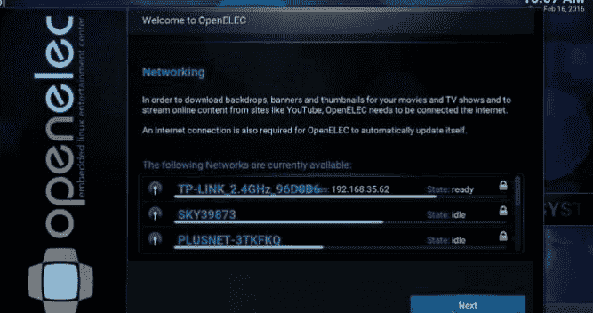

- 花点时间查看一下 OSMC (`http://osmc.tv`)。它是另一个基于 Kodi 的发行版，针对较小设备（包括 Pi）进行了优化，并带有一个自定义的极简主义皮肤。性能上的差异很小，且 OSMC 开箱即用更加简单。OpenELEC 则提供了更接近 Kodi 的体验。

> 如果你有 Pi Zero 并且需要网络功能，OpenELEC 会运行一个初始向导帮助你连接。

### 网络

为了下载背景图、横幅和缩略图并从 YouTube 等源流电影，OpenELEC 需要连接互联网。你可以以太网或 Wi-Fi。

| 名称 | 状态 |
|---|---|
| TP-LINK_4G50H_S00B6_ 192.168.1.25 | ready |
| SKY9B273 | ready |
| PLUSNET-TKF60 | |

以下是可用网络：

### 选择硬件

既然你可以自己构建强大的开源 Kodi 媒体中心 (`http://kodi.tv`)，为什么还要花钱买一个昂贵的机顶盒？你可以按需访问本地媒体，并观看包括电视在内的广泛互联网服务。

从零开始构建 OpenELEC 流媒体最便宜的方法是围绕 Pi Zero 构建。但有一个限制：它只有一个 USB 端口，因此你需要电源集线器和 Wi-Fi 适配器来完成初始设置。这套设备大约花费 30 到 40 英镑，你需要一个电源、USB 集线器和 Wi-Fi 适配器。如果你愿意多花钱，树莓派 2 型花费 28 英镑，Pi 3 型花费 35 英镑并且内置 Wi-Fi。

被称为 XBMC 的 Kodi 成功导致了基于 Kodi 的发行版开发。如果你正在寻找基于 Ubuntu 的 Kodi 发行版，查看 LibreELEC (`http://libreelec.tv`)。OpenELEC 对于大多数人来说已经足够了，设计得尽可能简单易设置和运行。在大多数情况下，你可以通过浏览器远程访问底层操作系统。安装 OpenELEC 需要一个键盘，但一旦完成，你就可以通过 浏览器或安卓 App 远程控制 OpenELEC。我们的官方构建版本提供：32 位和 64 位、树莓派和通用 ARM 设备。对于 Pi Zero 和 Zero W 以及所有其他单元，查看 Apple TV (`http://openelec.tv`) 和基于 AMLC 的硬件 (`http://bit.ly`)。制作 64GB 的 microSD 卡进行本地存储；或者使用 USB 硬盘或 NAS 连接网络。注意最后的选项取决于你，特别是通过 Wi-Fi 连接时。

### SSH 访问

通过终端开启底层发行版（`ssh root@192.168.x.x`，将 `192.168.x.x` 替换为你的 IP 地址）。此操作密码是 `openelec`。启动 OpenELEC；要更改它，导航到 `storage/config/`，然后输入 `nano` 修改设置。支持基本命令——例如检查 CPU 和内存使用。你可以做很多事情——这些工具很有帮助。重启 OpenELEC 应用更改。

```
IPv4.method=static
IPv4.netmask=255.255.255.0
IPv4.address=192.168.x.x
IPv4.gateway=192.168.x.1
```

将 `192.168.x.x` 替换为你的 IP 地址，将 `192.168.x.1` 替换为你的网关。保存更改并重启。

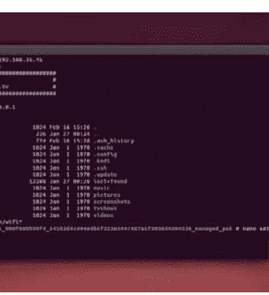

通过终端连接 OpenELEC，你会发现可用命令。最简单的方法是使用 Linux 发行版的 `dd` 工具将文件拷贝到 SD 卡。从 `openelec.org` 下载最新版本，那里提供树莓派和所有通用设备的最新发布。镜像大小约为 100MB。文件以 TAR 或 GZ 格式压缩，因此你需要解压。只需插入 SD 卡，右键点击并选择“解压到此处”即可。

### 构建、安装和配置

使用 USB 将 microSD 卡连接到电脑。SD 卡会显示（如果小于 3 GB），使用 `lsblk` 识别其挂载点。挂载后，输入以下命令找到 `Downloads` 文件夹中镜像文件所在的驱动器名称：

- `mount /dev/sdX /mnt`

- `cd /mnt`

- `dd if=OpenELEC-RPi4-arm64.img of=/dev/sdX`

当镜像写入 SD 卡时——小心不要选错驱动器——请等待几分钟或几秒。将 SD 卡插入电脑，连接网络并启动 OpenELEC。你会立即看到绿灯闪烁，然后屏幕亮起。OpenELEC 将启动，此时它将完成安装并结束。它基本上是创建一个你可以在本地存储媒体的分区。几秒钟后，重启，你将看到 Kodi 的初始设置（如果你没有鼠标，可以使用界面所示的遥控器，使用方向键导航选项并按回车键选择）。

通过启动 OpenELEC 主页，如果你将运行媒体服务器但它没有在网络上显示，从列表中选择 WiFi 并输入你的 WiFi 密码。然后你可以添加远程 SSH 访问以及 Samba 支持（见下方的 SSH 访问框）。

你还可以通过网络浏览器远程控制 Kodi：输入树莓派的 IP 地址 `192.168.x.y`。切换到

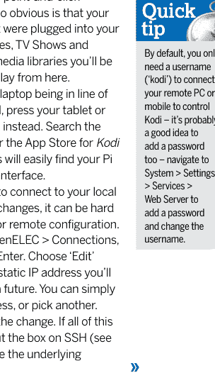

遥控器，你有一个方便的屏幕点击模式——这样你的 youtube 就能控制 Kodi 了？所以，如果你喜欢直接使用，你也可以使用 Kodi 观看电影、剧集和音乐——你填充了可用的媒体库并设置 Kodi 从中播放。如果你更倾向于通过电视控制 Kodi——你可以使用手机或平板电脑将其变成智能遥控器。选择设置。

### 设置库

要做的第一件事是将你的媒体添加到库中。Kodi 支持广泛的格式和容器，除非你使用了非常冷门的格式，否则你应该不会遇到任何问题。勾选框框（参见“将内容添加到库”）获取有关组织和整理媒体的建议，以便 Kodi 识别它并获取有关电视节目和电影的信息。这有助于使用特殊的“刮取器”从电影等在线数据库中提取元数据。电视剧集和艺术家有助于组织你的库。

你应该将本地内容安装在何处以便 Kodi 编辑？如果你的 SD 卡足够大——我们建议 64GB 或更大——你就可以存储大量的电影和音乐。如果你想通过网络共享你的库，打开文件管理器并将其添加到网络。你的网络设备应该会显示——双击文件共享，你将看到音乐、图片和电视节目的文件夹。


你也可以跨越网络复制文件——以便在文件挂载到 PC 的卡中时进行传输。如果你需要访问文件管理器，请转到 `root -> USB`。如果你有一个巨大的库，这将非常有帮助。如果你有样本——如果你使用 PC 上的 USB 接口来存储媒体，请前往视频或音乐并点击“浏览”然后选择顶级文件夹。

如果你插入了 USB 驱动器，你将在 `root/media` 下找到它，而 NAS 驱动器也可以在 Windows SMB 下下找到。选择它，点击“确定”。设置内容对话框将弹出——直到你选择你正在分类的媒体类型，并且选定的刮取器是你想要使用的。检查扫描选项——默认设置对大多数人来说已经足够——点击“设置”查看高级选项（你可能想切换国家到...


琥珀色是比功能性更强的默认选择更优的替代方案。那么，从...处访问 OpenLEC 配置菜单更安全。

对于英国电影，点击“确定”并在提示更新库时选择“是”。完成后，你将在主菜单上找到一个新条目——“库”。这显示了你的媒体，并带有按类型、标题以及你拥有的其他媒体类型进行过滤。如果你想在你的库中包含多个文件夹，你需要浏览文件，选择你想要编辑的库并按下键盘上的 `C` 将其添加。点击“编辑源”以添加更多内容，更改媒体类型并在必要时刷新。

通过这样做，你的任何媒体库都托管在服务器上，这允许你轻松从网络上的其他设备或在某些情况下通过互联网访问它。Kodi 可以从其他客户端成员访问。媒体服务器可以非常强大。我推荐 Plex Media Server。在你性能最强大的 PC（或 Pi 2/3）上安装它，并使用 OpenLEC 作为客户端连接它。

对于 Kodi 而言，库是 `root`。如果你想添加额外的库，请看这里（功能，m32_LFX04）。将其与 Kodi 插件配合使用，你就可以访问 Emmy 托管的媒体而无需添加到 Kodi 库。Plex Media Server 的一些额外功能，PlexXBMC (`http://lite/PlexXBMC`)，为你提供一个吸引人的前...

## 将内容添加到库

Kodi 在存储数字媒体时效果最好，但为了识别你收藏中的电视节目，你需要正确命名你的媒体并将它们组织到正确的文件夹中。Kodi 在其真实和服务 Plex 中使用命名规范——我们正在使用下表：

急需重命名文件？Torrent File (`webfile.net`) 是一个很棒工具。它检查所有音频视频数据并自动分配元数据。

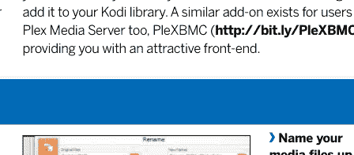

> 如果你想让媒体准确出现在媒体库中，请正确命名你的媒体文件。

| 类型 | 文件夹结构 | 语法 | 示例 |
| --- | --- | --- | --- |
| 音乐 | Music/Artist/Album | 艺术家 - 曲目名 | Music|David Bowie|Blackstar - laazarus.3 |
| 电影 | Movies/Genre/Movie Title | title (年份) | Movies|Sci-Fi|Star Trek|trek (2009) |
| 电视节目 | TV/Genre/Show Title/Season | show - s01e | TV|Sci-Fi|Fringe|Season 5|s05e09 |
| 音乐视频 | Music/Videos/Artists | 艺术家 - 曲目名 | Music|Videos|A-ha - havet |

## OpenEleC

如果你想通过 Kodi 访问其他 UPnP 服务器任何愿望，请导航到 `Settings > UPnP/PBDL` 并选择“允许来自 UPnP 的媒体控制”。你可以使用 Kodi 作为媒体服务器。选择“共享库”，它将对网络上的任何 UPnP 客户端可见，你可能需要重启它。

Pi 设备的一个瓶颈是处理大型库——一个很好的帮助是首先前往 `Settings > Music > Files` 并禁用标签读取。还要进入 `Settings > Video > Library` 并禁用“下载演员缩略图”以节省空间。在文件列表提取缩略图和视频信息。

在设备上的性能会更好，例如 Pi 4 开箱即用响应，而 Pi Zero 在播放时可能会卡顿。尝试优化你的设置以给你的 Pi 提供尽可能多的资源以流畅运行是值得的。通过禁用一些 OpenEleC 设置（如果你不在 Kodi 之间回传文件，则不需要插件）以及 `Settings > Services (AirPlay)`。顺便说一下，如果...在 `Settings > settings`: 设置为高级以查看更多设置。

默认皮肤非常漂亮，尽管如果你不喜欢默认皮肤，可以尝试琥珀色——最好的是查看系统资源。如果 OpenEleC 正在运行，你始终可以切换回...或使用 SSH，如果需要。

## 添加到你的电视

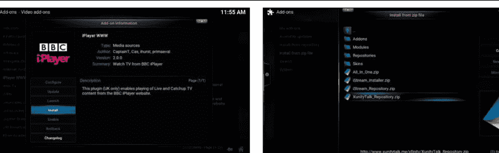

### 1 BBC iPlayer

浏览到 `Videos > Add-ons`，选择“更多...”，然后滚动列表找到 iPlayer。选择并选择“安装”。安装完成后，你将通过 `Videos > Add-ons` 访问它和流。

### 2 ITV Player

导航到 `Settings > File Manager`，选择“添加源”，从 `<None>` 输入 `http://www.umality.tk/sphinx` 并选择“确定”。然后前往 `Settings > Add-ons` 从文件安装。


### 3 完成安装

现在“从存储库安装”，随后 `Yum/Repository > Video > Add-ons`，滚动并选择 ITV。选择“安装”并等待快速下载、安装并启用。前往 `Settings > Add-ons` 访问实时频道，通过...程序。

### 4 UKTV Player

遵循 `Player` 的指令添加 `http://app.nu` 作为源，然后通过主存储选择 `Install from repository > Category` 以访问免费频道。

## VirtualBox: 虚拟化

虚拟化揭示了虚拟化如何将你的 PC 变成...每个虚拟机都能帮助你运行多个操作系统。今天的多内核 PC 是为了同时运行多个任务而构建的，什么方法比虚拟化更好地利用这些功率呢：将单个物理 PC（称为“主机”）拆分为多个虚拟机（称为“客户”），每个独立工作。

虚拟化允许你使用它的内存、处理器和其他硬件资源。如果你的 PC 足够强大，你可以并行运行多个虚拟机，允许你在计算机之间切换以执行不同的任务，而无需使用多台 PC。虚拟化不仅仅是划分计算能力的手段；它允许在安全的沙箱环境中轻松运行替代环境——你的虚拟机在理论上与主机隔离，可以轻松尝试新软件或尝试不同的 Linux 版本，例如无需使用双系统即可从 Windows 切换到 Linux。如果性能下降并且完成了所有实验，完全可以在相对低功率的环境中运行单个虚拟机。

## 选择 VirtualBox

Linux 有许多虚拟化解决方案可用，但什么方法比使用开源解决方案 VirtualBox 更好地管理你的（甚至是水中的）呢？VirtualBox 可能是免费的，但它仍然是一个强大的选项，提供了一个创建和管理虚拟机的友好界面，以及为需要的人提供了一个真正的命令行工具。

可以通过 Ubuntu 中心获取旧版本的 VirtualBox，但为了本教程的目的，我们将使用从 `www.virtualbox.org/wiki/Linux` 获取的较新版本。下载。你会发现多种不同的构建，每个对应一个特定的发行版（或版本）。构建 (MSB) 和 AMD-ISO。你可以下载并安装文件，或按照提供的指令将相应的 VirtualBox 存储库添加到源中。

一旦安装，你想开始的方法是通过 Dash 启动 VirtualBox。虚拟机管理器是你拥有、列出（并组织）和管理虚拟机的地方。这也是你从零创建新虚拟机的地方，但在选择 `File > Preferences` 更改默认文件夹之前，如果你想将虚拟机存储在家里之外。这是一个关键步骤，因为每个虚拟机可能会在你的驱动器上消耗几个 GB 的空间。

## 创建第一个虚拟机

设置好虚拟机，点击“确定”，然后点击“新建”按钮创建你的第一个虚拟机。创建 VirtualBox 向向分两个步骤工作。首先，在单个窗口中专家级配置步骤。从选择你选择的 OS 和从两个下拉菜单开始：

+ 快速提示

为了给你的虚拟机加速，请启用 VT-x 加速。首先检查 `INFLX2` 以查看你的处理器是否支持它；确保在 PC 的 BIOS 或 UEFI 中已启用——检查你的主板手册或网站指令。

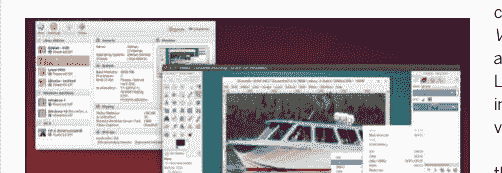

>> VirtualBox 允许你在桌面桌面的舒适的环境中设置和运行多个客户机。


选择正确的 OS 和版本是重要的，因为这将确保所有机器设置都正确设置。你还会注意到“内存”滑块变化以匹配 OS。这将被设置为舒适的默认设置，但可以随时调整滑块——它被编码为绿色和红色，帮助你将内存设置为对你的主机 PC 舒适的水平。

# VirtualBox

## 无头模式（Headless）设置

为了最大限度地利用宿主机 PC 的资源，可以运行无头虚拟机。除非使用远程桌面协议（RDP），否则无法与宿主机进行交互。如果你安装了 VirtualBox 扩展包（Extension Pack），它支持 RDP 的实现——只需前往“虚拟机设置 > 显示 > 远程桌面”来启用它。如果你为每个虚拟机选择了多个虚拟机，请将默认端口（3389）更改为 5000 到 5099 之间的数字。

如果需要，你可以使用一个命令从终端启动虚拟机：

```bash
VBoxManage startvm "VM name" --type headless
```

或者，按住 Shift 键并点击 VirtualBox 管理器中的虚拟机，你就可以在移除控制权之前从视图监控其进度。

当从另一台 PC 访问你的无头虚拟机时，许多发行版内置了 `rdpclient`，但 VirtualBox 也带了 `rdpclient`，允许你的客主机将任何 USB 设备连接到你所在的电脑。使用以下命令：

```bash
rdpclient /v <host_ip_address>:3389
```

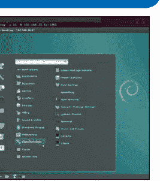

> 如果你计划远程访问虚拟机，请以无头模式运行以减少资源占用。

你设置的图形没有内存、虚拟内存，因此最好确保客主机的需求（VirtualBox 的运行）。

最后的选项是创建虚拟硬盘。该磁盘以单文件形式开始，并具有充足的空间（如图所示），只有在你启动机器时才会占用。在大多数情况下，选择“创建虚拟硬盘”，选择大小，点击“创建”以在硬盘上选择不同的位置，选择它将成为的文件类型。有关更多详细信息，VDI 和动态分配（Dynamically allocated）默认设置效果最好，因为虚拟硬盘的物理文件从较小开始并随着填充而增大。点击“创建”，你的虚拟机就准备就绪并等待操作了。

## 其他密钥

切换到“显示”选项卡来配置你的虚拟设置。首先分配你所需的内存，你还需要启用 3D 加速。如果你运行的是 Windows ，也请勾选 2D 选项。切换到“远程桌面”选项卡以访问你的虚拟机。“视频捕获”选项卡让你能够将屏幕录制为视频，如果你想这样做——例如使用我们稍后会讨论的 VirtualBox 扩展包。

- 小贴士：利用 VirtualBox 管理器的“客机组”来使用——在列表中创建第一个虚拟机并进行编辑。右键点击它并选择“重命名”，然后从此组创建新的或将其删除以分配到该组。

## 虚拟硬件调优

是时候开始在虚拟机中驱动它了，但当硬件设置到位后，它就拥有了你意愿运行所需的所有法资源。你可以随时更改这些设置，但最好在操作之前设置好：

切换到“存储”选项卡，你将在那里找到三种类型的板：从主板切换到虚拟机的内存，以及处理器和音频控制器。你可以在不重启虚拟机的情况下更改这些，但在某些情况下 DPI 应该是固定的。

指针设置为 USB 平板，但对于遗留程序，还有“鼠标”选项。

“扩展功能”部分应该已经为你选择的操作系统设置好了，但如果你想让虚拟机拥有 UEFI 而不是 BIOS，请勾选“启用 UEFI”。注意，这仅适用于 Linux 和 Windows 操作系统。

如果你安装了多核 CPU，切换到“处理器”为虚拟机分配多个一个核心，使其运行速度达到物理上尽可能快的速度（超线程可能会被忽略）。如果你的虚拟机在 32 位操作系统上需要访问超过 4GB 的内存，你可能还需要勾选“启用 PAE/NX”。

“加速”允许你利用所需的处理器的虚拟化功能——详情请见后文。

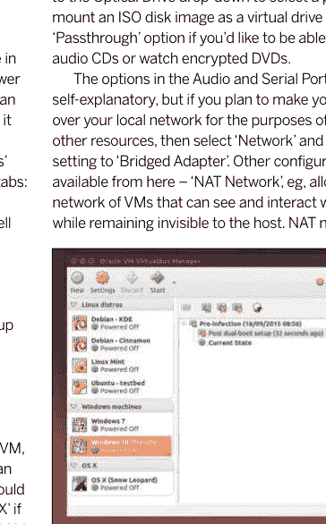

> 为你的虚拟机拍摄快照的能力可能特别适用于测试。

黑客手册 | 91

# 软件

## 使用 USB 外设设备

USB 选项卡允许你为虚拟机捕获特定的 USB 设备。在使用此之前，你必须确保你的用户名在宿主机 PC 上属于 `vboxusers` 组，请在终端中使用以下命令：

```bash
sudo adduser -G vboxusers username
```

完成后，你的 VirtualBox 将支持你的虚拟机客主机。仅支持旧的 1.1 实现，但你也可以安装 VirtualBox 扩展包以支持 USB 2.0 和 USB 3.0 以及其他功能（包括 PCI 和硬件加速），这些可以在 `www.virtualbox.org` 获取，但许可：VirtualBox 不是开源的，对个人是“免费”的。

你可以通过这种方式轻松连接 USB 设备——点击客机窗口上的 USB 按钮并从列表中选择外设——但添加“特定设备过滤器”可以将它们附加到客主机。一个如果你将虚拟机配置为电视头接收器时的处理示例——它将允许虚拟机在启动时连接你的 USB 驱动器。我们可以通过启动标记控制 USB 选项卡。我们可以使用下面的“接口”选项卡来指定为此用途提供哪些菜单选项。

（物理光盘）包含你想要安装的系统的安装程序，启动虚拟机并按照提示开始。一旦运行，你的虚拟机表现将与你的宿主机 PC 完全相同——点击客机窗口内部，你的鼠标和键盘将被虚拟机“捕获”。要将它们释放到宿主机，按下右键：

一旦你安装了增强功能，你的虚拟机将与宿主机之间共享文件夹。增强功能包含了一系列增强虚拟机性能的驱动程序，以及鼠标集成允许你更方便在宿主机和客机之间移动鼠标。如果这些增强功能已安装，选择“设备 > 增强功能镜像……”在简短暂停后，会出现设置窗口。对于 Linux 客机来说有点复杂——参见第 4.2 节。对于 Windows，前往增强功能根目录右键点击客机并选择“在终端中打开”，输入以下命令安装增强功能：

```bash
sudo /media/cd/LinuxAdditions.run
```

重启后，你将能够通过点击和拖拽来解决虚拟机分辨率——打开客机的显示面板。

## 你的首次启动

虚拟机硬件设置完成后，你就准备就绪了。你需要将 CD/DVD 驱动器指向 ISO 文件（或

## 拍摄快照


## 分享数据

在虚拟机之间传输数据是 VirtualBox 的关键部分并使其变得简单如：明显的方法是如之前所示设置共享网络，然后创建可以在网络上交换数据的共享文件夹，但还有其他方便的共享选项。打开虚拟机的设置并进入“共享文件夹”选项卡，你可以共享宿主机路径上的一个文件夹供客机使用。点击按钮，选择你想共享的文件夹并在必要时在客机重命名。你还可以让文件夹对客机只读，使其在虚拟机启动时自动挂载且不持久，但选择“永久”可以使共享文件夹超出虚拟机会话。

打开菜单你还将发现另外两种共享方式：共享剪贴板允许你在宿主机和客机之间共享内容（这可以限制为单向共享，也可以是双向的）。你还可以实现拖放，另一种通过拖入或拖出客机文件来共享文件的方法。

让它（文件共享）变得简单；你可以配置 VirtualBox 允许通过拖放快速传输文件。

92 | 黑客手册

# VirtualBox

关键优势：快照。快照允许你在特定时间点获取客机机的状态。然后你可以继续后续操作，并恢复到快照以及你所做的所有更改。

你可以在虚拟机开启或关闭状态下创建快照；只需选择“虚拟机 > 照照”即可。为你的快照取一个易于识别的名称，并添加描述，然后点击“确定”。

当你拍摄快照时，VirtualBox 开始在另一个不同的文件中记录更改。如果你删除快照，这些更改将合并回主文件；如果你恢复到早期的快照（或基础镜像），除非制作了额外的快照，否则快照的更改将会消失。虚拟机支持它们之间的切换，允许你从单台机器创建多个组合。


## 终端

VirtualBox 界面可能是开始虚拟化的便利方式，但一旦你运行起来，你将了解到至少三个可以为你服务的命令行工具。你可以通过如 `create` 和 `VBoxManage` 等命令完全跳过图形化的 VirtualBox 管理器，但即使你熟悉点击操作的方法，仍有很多事情你应该仔细观察：

`VBoxSDL` 只是是一种在纯净、无破坏的环境中使用虚拟化的方法（没有虚拟机窗口提供的控制感），它是最适合你的工具。它与客机 `<typename>` 交互。

如果你愿意，可以将 `<typename>` 替换为虚拟机的名称（或 UUID）。一旦它运行，你将只有


访问 VirtualBox 窗口提供的菜单命令，但你默认可以使用方便的快捷键：按 F4（或右 Ctrl 键）切换全屏视图，按 n 拍摄快照。按 Alt+AC 电源按钮关机或恢复。最后，连接主机时按 Del，然后按 Ctrl+Alt-Del 将鼠标从客机中释放。

- 移除桌面环境，并在没有 VBoxSDL 的轻量级窗口中运行你的客机。


## VBoxManage start `<vmname>` --type headless

另一个实用的命令行工具是 `VBoxManageHeadless`，它允许你无头模式运行虚拟机。这样做并允许在没有另一个连接的情况下远程访问它（查看我们下方的章节）。无论你选择从命令行还是通过 GUI 使用 VirtualBox，它都将充满强大且实用的功能，将带你走向虚拟化的可能性和力量。你会惊讶于自己以前是如何做到的！

## 扩展虚拟机的尺寸


## 1 合并快照

如果你有快照，调整大小的过程只会影响原始基础镜像。要调整此大小，右键点击磁盘并选择“克隆”，然后点击名称末尾。点击确定，再次右键点击磁盘，但这次选择“克隆”。点击“专家”模式，然后重命名它并在点击“克隆:”之前确认已选择“完整克隆”和“当前机器状态”。

## 2 调整虚拟磁盘大小

磁盘已经调整大小，但你需要对其进行分区。关闭 VirtualBox，打开终端并导航到包含 `vdi` 文件的文件夹。使用以下命令，将 `<filename>` 替换为你特定虚拟磁盘的文件名：

```
VBoxManage modifyhd "drivename.vdi" --resize 10000
```

结果尺寸为 MB，所以 `10000` 意味着 `10GB`。

## 3 扩展分区

磁盘已调整大小，但你需要对其进行分区。挂载了 GParted Live CD 的 ISO 后启动虚拟机，然后使用它来扩展你周围的额外空间——你需要调整扩展分区，然后将分区扩展到末尾，最后调整分区以释放可用空间。

黑客手册 | 93

# Software

## Nextcloud: 分享你的文件

远程存储孤岛数胜许多，但要警惕它们的隐私政策。我们将解释如何使用你自己的并保持控制。

> **快速提示**：你可以仅通过 `snap install nextcloud` 在 Ubuntu 上轻松安装 Nextcloud。但这会剥夺你在手动安装时可以使用的所有功能和选项。

像 Dropbox 这样的在线存储服务为在全球任何地方共享和传输数据提供了便利的选项。这种便利是有代价的，在这个时代，将我们的文件传输到远程服务器的想法似乎很奇怪。这正是 Nextcloud 出现的地方：一个让你掌控私有数据的开源服务。数据共享对于家庭和大规模用户来说都功能丰富。Nextcloud 还具有单点登录、自定义策略、WebRTC、协作等功能。如果这些还不够，除了核心功能，你还将获得一些插件。

然后是 PHP，可以通过 `sudo apt install php-apache php-cli php-json php-mysql php-curl php-xml php-gd php-imagick php` 一并获取所有所需的模块。默认情况下，PHP 有定义的限制，这会阻止你向 Nextcloud 服务器上传大文件。以下命令需要设置为 `512M`，并将上传大小设置为 `256M`：

```
sudo php -i 'memory_limit=512M' /etc/php/php.ini
sudo php -i 'upload_max_files=256M' /etc/php/php.ini
sudo php -i 'post_max_size=256M' /etc/php/php.ini
```

## 安装

在安装 Nextcloud 之前，你必须构建基础。在 Ubuntu 上设置 Nextcloud，请确保我们的服务器是最新的：`sudo apt update && sudo apt upgrade`。

安装组成 LAMP 栈的组件。首先是 Apache Web 服务器，然后是 PHP。MariaDB 是 MySQL 的替代品。通过 `sudo apt install mariadb-server mariadb-client` 安装 MariaDB。安装完成后，运行 `mysql_secure_installation`。安装需要几分钟。与前者不同，Nextcloud 只有一个源的数据库计划。确保在 Apache 中启用了相关模块：`sudo a2mod php`。

然后使用以下命令在 MariaDB 中创建数据库：`mysql -u root -p`。

使用密码登录后，你可以创建一个名为 `nextcloud` 的数据库：

```
CREATE DATABASE nextcloud;
```

同样，你可以为管理此数据库创建一个用户：

```
CREATE USER 'nextcloud'@'localhost' IDENTIFIED BY 'password';
```

最后，为新创建的数据库授予所有权限：

```
GRANT ALL PRIVILEGES ON nextcloud.* TO 'nextcloud'@'localhost';
```

刷新更改并退出 MySQL：

```
FLUSH PRIVILEGES;
EXIT
```

我们还将为 MariaDB 启用记录所有查询。MariaDB 配置文件位于 `/etc/mysql/my.cnf`，在以下位置输入 `log-bin = /var/log/mariadb`：


黑客手册 | 云控制

在主教程中，我们查看了默认 Nextcloud 设置。现在，作为管理员你可以调整设置以满足你的需求。访问这些设置，向下滚动并选择列出各种设置的 Apache 页面。服务器信息帮助你调整任何设置，例如 CPU、内存使用等。在服务器上配置共享。你可以强制用户通过公共共享，设置所有共享的默认过期日期，限制组内的共享文件。你可以配置 Nextcloud 服务器发送各种类型的通知和密码重置。附加设置页面允许你通过最小长度、大小写和特殊字符定义密码。

```
log /var/log/apache2/access.log
```

完成后保存并关闭。然后重启 Apache 服务：`systemctl restart apache2`。

你还需要启用 Apache Web 服务器。Nextcloud 需要几个模块才能运行。你还可以配置 HTTPS。Nextcloud 鼓励对所有流量使用 SSL，以保护传输中的用户和数据。Ubuntu 安装的 Apache 配有自签名证书。你需要做的是启用 SSL 模块和默认站点并接受自签名证书。

```
sudo a2enmod rewrite
sudo a2en headers
```

完成后，重启 Apache 服务器以加载 `mod_rewrite` 模块：`systemctl restart apache2`

## 在云中

既然我们已经查看了 Nextcloud，让我们获取并安装服务器。前往 `www.nextcloud.com/install` 获取最新版本 `v1.0.0`。

```
$ wget -c https://download.nextcloud.com/server/nextcloud-1.0.0.tar.bz2
```

```
$ tar xvf nextcloud-1.0.0.tar.bz2
```

解压存档后创建一个名为 `nextcloud` 的新目录。将目录及其所有内容复制到 Apache 服务器的文档根：`sudo cp -r nextcloud /var/www/`。然后将目录的控制权移交给 Apache 用户 `www-data`：`sudo chown www-data:www-data /var/www/`。

我们将通过创建一个配置文件从我们这里安装 Nextcloud：`sudo nano /etc/apache2/sites-available/nextcloud.conf` 并输入以下内容：

```
Alias /nextcloud /var/www/nextcloud/
```

```apache
<Directory /var/www/nextcloud>
Options FollowSymLinks
AllowOverride All
Require all granted
</Directory>

<IfModule mod_rewrite.c>
DavOff
</IfModule>

SetEnv HOME /var/www/nextcloud
SetEnv HTTP_HOME /var/www/nextcloud
```

```
<Directory>
```

```
$sudo a2enmod /etc/apache2/sites-available/nextcloud.conf /etc/apache2/sites-enabled/
```


保存文件并重启 `apache2`。现在你已经处理好了，在网络上打开浏览器并访问 `192.168.1.106/nextcloud`。将 `192.168.1.106` 替换为你服务器的 IP 地址或域名以查看 Nextcloud 云。由于这是你第一次与 Nextcloud 交互，你需要创建一个账户。立即输入刚刚设置的用户名和密码。数据由用户共享。已经可以搜索位置了；Nextcloud 开发者需要找到数据目录 Nextcloud 根目录，例如 `/var/www/nextcloud/`。

# 软件

Nextcloud 拥有所有桌面和移动平台的客户端。它们还可以帮助你轻松地将桌面上的文件夹同步到 Nextcloud 服务器上。许多 Linux 发行版（如 Arch Linux 和 openSUSE）已在其官方仓库中包含了 Nextcloud。如果你的发行版在仓库中没有 Nextcloud 客户端，你可以从源码编译官方客户端，或者使用来自 overcloud 的客户端。

安装好客户端后，它会提示你使用凭据登录以连接到 Nextcloud 实例。建立连接后，你可以选择家目录下的一个本地同步文件夹作为 `home/both/Nextcloud`。这会将你的文件移动到此目录，并由服务器进行自动同步。无论你是在线还是离线，客户端的连接都将保持激活状态。

在与其他用户协作工作时，你将使用 Nextcloud 的版本控制功能，它会在修改文件之前创建备份。这些备份可以通过每个文件对应的“版本（Versions）”下拉菜单或“恢复（Restore）”按钮菜单来访问。

除了文件，你还可以为 Nextcloud 服务器添加日历和联系人录。按照操作指南启用日历（Calendar）和联系人（Contacts）应用。你可以从现有的云服务器将数据导入到 Nextcloud。Nextcloud 支持 `.vcf` (vCard) 格式以及几乎所有流行格式，包括在线格式，例如 Gmail 让你以 vcf 格式导出地址，以 ics 格式导出日历。在迁移之前，请使用 `.vcf` 和 `.ics` 文件导出你账户的邮件列表和日历。

在导入（Import）选项中，点击齿轮图标。选择并指向该文件。导入过程将在大框中导入你的数据。你可以将这些联系人与导入的电子邮件地址和日历同步。你只需点击日历应用内部的齿轮图标即可导入现有的日历。点击“导入 iCal”按钮并指向导出的 iCal 文件。

我们现在已完成了 Nextcloud 的设置。请按照操作指南通过新应用来完善安装，这些应用将扩展你个人云的功能。


- 在其网站上提供 Windows 和 Mac 的 `Nextcloud` 客户端（`https://nextcloud.com/install/`），你可以从 Apple App Store、Google Play 商店或 F-droid 仓库获取。

限制他们的共享空间，并将用户标记为组管理员。

一旦你准备好设置 Nextcloud 服务器，就可以上传文件。如果以你识别的格式将文件放入“文件（Files）”中，请点击下拉菜单中的 `+ and 选择上传（+ and Choose Upload）`。然后选择文件以将文件组织到文件夹中；如果你上传了无法识别的格式的文件，可以编辑名称并在 Nextcloud 中查看该文件。

上传文件的另一种方法是使用 Web 界面文件管理器，并将文件拖放到你的服务器文件管理器中。如果你使用 Ubuntu，启动“文件（Files）”文件管理器并按 Ctrl+L 编辑地址。在这里你可以指向你的 Nextcloud 服务器，例如 `http://192.168.1.100/nextcloud`。一旦 Nextcloud 服务器挂载，你就可以与组中的其他人以及具有修改或共享文件权限的用户共享文件。你也可以与未在你的 Nextcloud 服务器上注册的人共享。只需复制共享链接，Nextcloud 就会显示一个你可以与任何人共享的链接，你也可以对链接设置密码保护并设定过期日期。

当你与云进行交互时，使用我们的官方客户端之一会更方便。

## 无处不在

云服务（如 Dropbox）的真正优势在于，你可以从互联网的任何地方访问数据。默认情况下，你的 Nextcloud 服务器仅可以从设置时所在的同一网络内的计算机访问。但这并不意味着你不能获取静态 IP 或使用 DNS 服务，并在路由器上打开“洞”来允许访问。

从互联网开始，可以使用如 Pagprite 这样的隧道服务。通过使用 Python 脚本将你的流量隧道化到名为 `pagprite.com` 的子域名，该服务可以在不打开路由器的情况下提供对你所需端口的访问。你每月可以免费获得 2GB 的数据传输量。付费可以获得更多带宽数据，以及创建额外 `pagprite 站点` 的权限。

要使用 Pagprite，启动终端并使用以下命令安装 Pagprite 软件：

```
$ curl -s https://pagprite.net/ | bash
```

现在你的本地服务器运行在端口 80，但你可以指向


这就绪了。你的 Pagprite 服务器现在可以通过家中的 `https://nextcloudserver.com` 访问。记住使用 `Pagprite.net` 用你自己的名字命名 `nextcloudserver`。

## 安装额外应用

## Nextcloud


### 1 应用仓库

你可以通过安装应用来扩展默认的 Nextcloud。通过界面左上角和下拉菜单选择带有标签的应用。默认情况下，你将看到列出已安装应用的列表。你可以浏览此列表并阅读它们的描述以了解其功能。你也可以启用任何应用，除了

### 2 日历和联系人

这些应该是你首要使用的应用。你将在“生产力工具（Productivity）”类别下找到它们。你可以使用应用界面添加日期、联系人和其他细节。你还可以使用行业标准格式和协议（如下所示）与其他应用程序同步你的日历。


### 3 外部存储

如果你使用 Dropbox 或 Google Drive，你可以挂载它们来扩展 Nextcloud。


### 4 文件控制

一旦你准备好设置 Nextcloud 服务器，就可以上传文件。

### 5 签名

### 6 自动备份

切换到新建的目录，然后使用以下命令配置、编译并安装插件：
```
$ cd nagios-plugins-2.1.3/
$ ./configure --with-nagios-user --with-group=nagios --with-openssl
$ make
$ make install
```

在移动之前，你应该调整默认的 `nagios` 配置，以指定存储网络中你让 Nagios 监控的其它计算机配置的目录。
使用 `vi` 或 `nano` 打开 `/usr/local/nagios/etc/` 下的 nagios 配置文件，向下滚动并删除 `#` 符号以取消以下行的注释：
`_cfg_dir=/usr/local/nagios/etc/`
使用指定的目录保存并退出文件。
你可能还想为 Nagios 指定一个电子邮件地址，以便在它发现被监控的某一台计算机出现问题时发送通知。这在你有多个服务器（这本身就是一项工程任务）时，这一点变得尤为重要。
在教程的后半部分，你将需要使用一个脚本。
让我们先假设 Nagios 通过电子邮件发送通知吧。
使用 `vi` 或 `nano` 打开配置文件 `/usr/local/nagios/etc/objects/contacts.cfg`，并将默认邮箱替换为你的电子邮件地址。

## 进入仪表板

该过程的最后一步是为 Web 仪表板配置环境。
通过运行 `sudo make && make install && sudo cp check_icmp` 编译引擎和 Nagios 组件。
现在通过复制示例配置在 Apache 内部设置新主机：`sudo cp main/sample.conf /etc/apache2/sites-available/nagios.conf`。如果你有 sudo 权限，在安装之前使用 `chmod 664 /etc/sites-available/nagios.conf`，使用 `chmod 644 conf`。你还应该为管理界面创建身份验证详情。使用命令 `htpasswd -c/usr/local/nagios/etc/ht.passwd nagiosadmin`；创建一个名为 `nagiosadmin` 的新用户并

## 监控主机

如果你的网络中有 Linux 之外的主机，你也可以使用 `nagios` 监控它们的各种服务和属性。在监控 Windows 机器之前，编辑 nagios 核心配置文件以包含最新版本的 Windows `hosts.cfg`：`edit /usr/local/nagios/etc/objects/hosts.cfg`。下载客户端执行文件并运行设置程序进行安装。在某些 Windows 安装中，你必须前往 控制面板 > 管理工具 > 服务 并双击设置其密码。就只有这些了。
现在重启 Apache 和 Nagios 服务：

此 Nagios 需要在此文件中查找 Windows 主机的对象。现在如何使用 `windows-server-cfg`

| host_name | windows_win10 |
|---|---|
| alias | Windows 10 Box |
| address | 192.168.3.101 |


在重启服务器提交更改之前，务必检查 Nagios 配置，其中包含所有主机和服务的定义。

```bash
sudo service apache
```

```bash
sudo system restart nagios
```


然后我们在网络中的任何一台计算机上打开浏览器，通过 `nagios/你的域名` 或你设置的计算机的 IP 地址访问管理界面。Nagios 的地址是 `192.168.3`；你可以通过 `192.168.3.104` 访问管理界面。

系统会提示你输入创建的 `nagios admin` 凭据。

验证后，你将进入加载了信息的管理控制台。

观察四周并检查所有主机是否以逻辑方式运行，这对于操作至关重要。

然后通过 Apache 导航栏或“监控”`monitoring` 中设置主机，如果你在左侧尚未配置任何主机，请访问。页面列表将向你显示哪些主机正在运行和安装。

## 业务就绪

你想要监控的客户端在 Nagios 中被称为**主机 `hosts`**。要添加主机，请切换物理或通过 SSH 进行配置，并使用 `sudo apt install plugins-nagios-nrpe-server` 安装 nagios 插件和 NRPE。NRPE 是 Nagios 远程性能执行器。NRPE 允许 Nagios 服务器在远程主机上执行检查命令。

| host_name | windows_win10 |
|---|---|
| alias | Windows 10 Box |
| address | 192.168.3.101 |

## 可复用配置

Nagios 的最佳功能之一被称为“对象继承”。得益于使用模板的能力，Nagios 能够非常方便地监控大量的主机和服务。当使用模板时，你可以在单个文件中定义主机和服务的默认值，而无需不断地定义它们。

就像程序员复用代码来简化代码并使其更易管理一样，网络管理员也可以复用配置以获得完全相同的优势。

在定义文件中使用关键字来指向它所引用的模板。在示例中使用的 `linux-server` 和 `generic-service` 模板定义在 `nagiostamples.cfg` 中。`linux-server` 模板为每个实例通知设置了默认值。`generic-service` 服务模板适用于单个服务而非主机。然而，文件中定义的默认值可以在单个主机定义中被覆盖。

在使用该关键字时，函数中也需要 `check` 关键字。它指向定义在 `/usr/local/nagios/objects/checks` 中定义的命令。该文件包含了各种服务（如 DHCP、SSH 等）的所有命令。

使用像 Gmail 这样的免费可用的服务向 Nagios 账户发送电子邮件。

第一步，使用 `sudo apt install maild-sasl-libsasl2-postfix` 配置脚本。例如，使用 `mailutils` 获取并提取脚本：
`wget https://github.com/nagios-ios/sendemail/master/sendEmail-v1.sh`

`chmod +x sendEmail.sh`
将其移动到提取出的文件夹，并将 `sendEmail` 脚本复制到包含 `excludes` 的文件夹中并赋予可执行权限。

`cp sendEmail.sh /usr/local/bin/nagios`
`chmod +x /usr/local/bin/nagios`
为脚本创建一个日志文件以写入任何错误也是好的。

`touch nagios.log`
`chmod 666 /var/log/nagios/nagios.log`

如果邮件没有出现在你的收件箱中，且你已经运行了此教程，请通过 `tail -f /var/log/nagios/nagios.log` 此日志文件查看详情。

注意 Gmail 支持 SSL，因此你需要对其进行一些调整，并将端口更改 `465`。为了测试脚本使其工作，请用文本编辑器打开 `/usr/local/bin/sendEmail` 并跳转到第 90 行读取 `TLS`。现在保存并关闭文件。

现在你可以通过以下 CLI 命令发送邮件来测试脚本：

```
./sendEmail -f your-email@gmail.com -smtp 587 -u nagios-id -p password recipient-email@gmail.com "This is a test"
```

将括号标记的文本替换为发送者的实际地址、登录 ID 和密码。如果进展顺利，脚本将从服务器发送电子邮件到收件人地址。要测试脚本，你需要配置 Nagios 使用 SMTP 服务器发送通知。在 `resource.cfg` 文件中：

```
define resource

$HOST=smtp.gmail.com

$PORT=587

$USER=nagios-id

$PASS=password
```

保存并编辑 `command.cfg` 文件，将 "host-by-email" 和 "notification-by-email" 行替换为：

# host-by-email command
define command
command_name host-by-email
command_line /usr/local/bin/sendEmail "*** Notification from Nagios: $HOST$*** Type: $NOTIFICATIONTYPE$ Host: $HOSTNAME$ State: $HOSTSTATE$ Address: $HOSTADDRESS$ State: $HOSTSTATE$"

在这里我们定义了从主机以及服务发出的通知模板。在被 Nagios 使用之前双重检查它们。如果范围内的任何主机或服务发生故障，Nagios 将自动将通知发送到 cfg 条目中指定的电子邮件地址。使用左侧的导航菜单可视化你的主机，并查看 Nagios 是否在你的网络上运行。

# 软件

### Octave 4：开始绘图

是时候使用 Octave 4 的标准图形界面及其新功能深入研究操作和使用数据了。Octave GUI 最初在 3.8 版本中首次引入，现在已成为标准用户界面，取代了命令行操作，使其对普通人来说要容易得多。

生活中总会有必须要求计算的时刻吧？如果你像作者一样，正面临一个工程期末项目，那么答案是肯定的。当你转向 Octave 时，该软件将把充满纸面方程的生活变得简单。

这是一个开源程序，其开发源于需要在功能性、易于使用的环境中处理数据并进行可视化的需求。它基于 GNU Octave，与 Matlab 非常相似，但没有那么昂贵的价格。

2013 年，Octave 3.8 发布，随之而来的是一项实验——更好的用户界面 `GUI`，让 Octave 变得更加易用。这个新版本发布时包含了软件的新功能和 GUI 部分，且在程序启动后不再需要手动启动。但随后的版本也改进了对 Matlab 的兼容性，这确保了你的程序可以在 Matlab 和 Octave 中共同运行。

我如何获取这个小字软件？

某些 Linux 发行版 `distros` 在它们的软件仓库 `repos` 中包含了它，这使得过程变得非常简单。如果你想从源码构建，请从 GNU Octave 官方页面 `www.gnu.org/octave/` 下载源码文件。

## 编译 Octave

在本文教程中，我们将使用 CentOS 6.5 进行构建，这对于编译来说是一个相当贫乏的平台。它是 Octave 版本。

# 软件

```
>> ana = [4 10]
```


现在来看看如何显示你的输出。对于输出，例如：简单地不抑制表达式并让值自动显示可能就是实现方法。随着你对 Octave 的使用越来越频繁，执行的计算越来越多，抑制输出变得重要，此时 `display` 和 `print` 命令就派上了用场。`display` 是最基本的显示命令，它会简单地输出传递给它的任何变量的值，就像你在命令行窗口中输入该变量名一样。然而，如果你想显示一个没有被显示的变量。

`print` 命令比 `display` 强大得多，也稍微复杂一些。通过 `print`，你可以精确地定义输出的外观，并指定诸如下内容：显示的位数；数字的格式；作为文本字符串的变量值。`print` 命令及其输出看起来如下所示（假设 `x =`）

```matave
>>print('%d', x)
```

# 脚本与函数

既然我们已经了解了这些基础，就可以继续学习比 Octave 更高级的内容了。与基础计算器不同，我们可以在 Octave 中编写脚本来定义函数，这非常像基础编程，我们可以请求输入、执行任务并将结果返回到命令行窗口。

非常方便，Octave 可以使用脚本和函数创建一个可以在无需用户输入的情况下运行并将结果保存到文件的程序。

通过点击主窗口左上角的“Script（脚本）”按钮，你可以打开一个空白脚本文件，可以在其中独立于用户编写代码，这意味着你不需要在每次计算某些内容时都重试。`.m` 文件中的脚本确保了与 MATLAB 的进一步功能兼容。无论在 Octave 中创建的，在 MATLAB 中都可以使用，并出现在这里。

该脚本将是你第一次使用它，位置标记为“editor（编辑器）”。你会在文件顶部看到的一系列选项，用于运行和保存脚本。当你开始输入命令时，你会发现 hello 编辑器会高亮许多变量的颜色，类似于某种良好的布局，这对你习惯它很有帮助。

现在你已经熟悉了布局和功能，你能做什么呢？在任何编程语言中你可以完成的许多事情，你都可以使用循环和 `if-else` 语句来创建重复性任务，例如生成数字；分配变量；处理用户输入以及制作决策语句。

利用你新获得的能力，你可以做的许多事情之一，就是使用脚本和给定值创建一个计算某个值的方便工具：

```matave
X = 3:2;
Y = 3*X^2;
```

就这样，我们就可以通过 36 次使用计算出 'Y' 的值，结果显示在命令行窗口中。Octave 提供了一系列工具来创建更复杂的脚本和函数，例如：单位断开；所有的加法、乘法、除法运算符，以及根和幂。这包含了所有的布尔运算符和表达式。

处理数学表达式的函数通常是一段短代码，可以由主文件调用。对于熟悉编程的人来说，它的作用就像 Java 编程中的方法或函数。Octave 使用函数如下：

```matave
Function [return value, value2, ...]
name(arg1,arg2, ...)
body code
end
```

要在脚本文件中调用函数，我们需要添加行：`value=name(`

在这一行中，`value`充充函数的输入，返回的任何值都被赋值给 `value`。函数可以帮助组织代码，使其易于理解，并在许多情况下使代码变短很多。


# 图表，导出

现在进入下一个，我们可以使用内置的 FLTK（快速轻量级工具包）绘制许多图形。FLTK 重用了主图形库来绘图，因为它更快，可以处理 2D 和 3D 图形；2D 数据相当简单，只需要 `plot` 函数的某种形式。输入数组（如下所示）将使你需要一条带有斜率的简单绘图线：

```matave
>> X = [0:0.5:200];
>> Y = 0.5*X.^2;
```

```matave
>>plot(X,Y)
```


图表可以着色，并在 X 轴和 Y 轴上都有长度。你还可以使用 `legend()` 命令添加图例。

查看 `see-selmon` 表达式的输出

104 | 黑客手册

# Octave 4

无论是免费还是 Linux，一个人的成功都是建立在许多人的力量之上。本文之外还有许多增强你 Octave 软件知识的资源。完整文档可以在 `https://www.gnu/software/octave/` 获得。本指南由软件创建者编写，涵盖了你为了充分发挥其潜力可能需要的所有知识。该手册的缺点是它内容全面，但也非常密集。对于更适合初者的教程，请查看 `http://wiki.wikibooks.org/Octave` 的 Wikisooks 教程。

语法在 Octave 及其教程中有所不同，你在那里处理了这种不可分割性。在线上各种资源中的信息都有自己的示例，这对于想要掌握特定命令或代码以不同方式实现预期结果的初学者来说非常有帮助。

另一个有用的在线指南是 `http://com/MatlabOctaveTutorial` 的 TutorialPoint。该指南似乎专门针对 Matlab，任何

你也可以尝试网格函数，函数

- `[x,y] = meshgrid(0:2:50);`
- `z = sin(x.^2);`
- `surf(x,y);`

这产生了一个 3D 螺旋线。然而，如果你想创建更多 3D 图形呢？本课程的 `meshgrid` 命令创建 x 和 y 坐标矩阵，有助于在 z 轴上填充数据。


> > 新实现的 FLTK 图形功能意味着你可以旋转和渲染 3D 图形，此处所示的“Octave 礼帽”。

# 软件


# Plasma 5

## 让我们带您领略 KDE Plasma 5，最优秀的桌面环境之一

KDE 4 在 2008 年 1 月的发布如往常地遭遇了如潮水般的批评。最初的关注集中在不稳定性和缺乏打磨上，随后转向对复杂的“插件”（plasmoids）的过度配置，最后停留在对系统资源造成的负担上。这个时代与长期用户熟悉的 KDE 3.5 时代截然不同。但这是起步的代价，KDE 4 无疑让桌面环境摆脱了 Windows XP 设计元素的束缚。

然而，尽管有种种忧虑，KDE 4 在很大程度上保留了传统的桌面隐喻，拥有菜单、应用程序页面和托盘图标。相比之下，Gnome 3 的其极简的风格和对这一范式的剧烈背离吸引了（并且仍然吸引着）许多批评者。

但现在，KDE 不再是那样了，这并不是说没有接替 KDE 4 之后令人兴奋的新桌面 [否则 – Ed]——确实有，只是它的名字不像你正在写的那个？——你可以通过阅读说明来发现它叫什么（参见 KDE Plasma 5）。但更新后的版本呢？嗯，它非如此莫属。对于过去五年一直在使用 KDE (SC) 工作的人来说，它完全不会没有任何问题。

> “来自任何桌面的用户都会发现它漂亮且直观。”

过渡到为较慢应用程序设计的 Qt4 工具包，切换到 Plasma 环境允许了一个受现代过渡启发的持续桌面，包括来自任何桌面环境的用户都将发现它漂亮且直观。此外，一切都是为了简单而安排的，对于新手来说，它至少不比任何竞争对手（这包括你，工具提示）。

# KDE Plasma 5

尽管仍然是一个“传统的”桌面环境，但 Plasma 5 看起来完全不像现代。从 Plasma 4 开始，该主题就为我们带来了整洁的物化设计。KDE 4 经常被指责笨重、臃肿、耗内存；而它的继任者，这个版本并非如此。它极度利用合成来提供透明度和效果，所有的视觉享受意味着 Plasma 在拥有 6GB 内存的系统上需要的 RAM 更少，但始终保持流畅和响应。特别是在切换窗口或甚至当你开始从菜单中拖动窗口时，后台 CPU 活动非常稀少。这在 2006 年的 Core 2 CPU 上是一个问题，因此对于使用 QtQuick 框架构建的用户界面，硬件足够并不是问题。所有元素都绘制在 OpenGL (ES) 画布上，确保了它们（大部分）都由 GPU 加速。某些效果默认禁用；窗口在移动时变透明，且切换桌面时带有舒适的滑动过渡。有些人可能想要禁用效果，但对许多人来说，它们实际上被使用了——或者看到正在重新定位的窗口下的内容感觉很好。对于那些在意华丽的人，也有成本较低且令人的窗口效果。


# 多桌面

每个人都虚拟，但 Plasma 5 在这一点上更好：活动集成。设计一个新的活动（例如“工作”或“社交媒体活动”）允许你配置哪些应用程序是能量和私有的。在切换它们时，你可以创建一个“活动”，它将会记住你使用的文档，或者某些特定应用程序。每个活动都可以设置快捷键，并且一切协同工作。活动还为它们提供了以前所未有的优先级，每个活动都是独立的。这种限制是有技术原因的，没有人会认为这不重要。

> 网络管理器已更新，与 VPN 配合得更好，并支持加密 WPA2 设置。它还提供了非常漂亮的图表。

solution bean，但当 mussery 在其他地方明显时，就令人失望了。另一个可能让 Plasma 5 烦恼的是新手的开始菜单，它很容易启动应用程序启动器。关注点是不必要的宽大（它很宽，有五个水平排列的标签页）；在打字时，“输入搜索”提示处有不必要的淡入效果，这会滚动你的用户名和发行版信息（暗示你很可能会忘记它们），以及你必须悬停在标签上才能激活它们。使用应用程序类别是你需要的能量和点击的。然而，Plasma 是高度可配置的，如果你发现有其他可用选项，可以从经典主题的菜单，或者全屏；Unity/Gnome 风格的仪表板。它的编辑要简单得多，然后几个小组件将呈现相关应用程序列表、最近文档或网页链接。Bal（它记得你上次的搜索词）正在索引到桌面搜索中，如果不完成这一点，将是一个无限的问题。现在许多人已经习惯于使用这种搜索来导航桌面。因此，必须使用沉重的鼠标指针一直移动到左下角并点击启动程序的问题是一个不必要的障碍。此外，还有 Krusner，你可以随时使用 Alt+S+ 访问它。


众所周知指代 Gnome 应用为 KDE 5，而且它也没有很好地隐藏它们。

# 并没有所谓的 KDE 5

使用 KDE 来指代被逐步淘汰的第 4 版本桌面环境在发布时带有两个字母，变成了 KDE SC（软件编译）。现在，KDE 网络管理器倾向于包含整个桌面社区。它是桌面的一部分，其中某些库只有特定应用程序需要。在这个桌面版本的中，这些库已经过构建并重新排列；它们的某些功能现在已提供，另一些被合并到 KDE Frameworks (KFs)，其余的则与桌面应用程序一起捆。

虽然使用的库已经从桌面环境中分离，KDE 4 产生了几种辅助库（合称为 kdelibs），其中一些与环境分离是更好的选择，但对双方都有利。Plasma 用户可以自由选择他们使用的应用程序，而其他人可以安装 KDE 应用程序而不使用它的大部分桌面。Frameworks 的模块化允许了像轻量级 Qt5-


元数据)。（一个硬件集成和发现框架）

然而 Dolphin 文件管理器将-包含 Kiwi 窗口管理器，其映射格式。联系 PIM 套件 Kontakt 以及-solution bean。三位一体的分离-已经发生。Plasma 是 de-fact-从未如此。它不包含与-被遇到，或者你可能有许多要担心的事情。多年来 Ubuntu 终于-放弃了其内部。软件中心 |

108 | 黑客手册

# KDE Plasma 5

应用和 Gnome、Xfce 曾使用过名为 Apt 的类似工具，但它已被 Plasma 5 取代。所有这些工具（或曾工作过）通过 PackageKit 框架工作，实现了一个完全与发行版无关的包管理器。

Muon 包含两个部分：*Muon Discover* 和 *Muon Updater*，后者位于系统托盘，并在有可用更新时通知你。Muon 除了软件包之外还可以工作，但可能更难理解。Muon 并不试图干扰你的包管理器，它运行得非常良好，但高级功能将需要直接使用。这种尝试主要允许从设备进行更新；这在现代世界是一项挑战。


# 进入 Wayland

Plasma 5.4引入了 Wayland 技术预览，这是未来将取代 Xorg 的下一代窗口管理器。现在可以在 X11 窗口内运行 Weston 合成器并运行 KDE 应用，这目前仍是实验性的（并非我们的），而且距离完全脱离 Xorg 还有很长时间。大多数 Wayland（你现在可以在 Neutron 上运行的）让你感到特别勇敢。

对于现代桌面，需要某种程度的 3D 加速。合成器可以使用 OpenGL 2.0 或 3 后端渲染，也可以使用基于 CPU 的 Xrender。Nvidia 显的用户报告了一些撕裂问题，这可以通过禁用全屏合成器来修复。这是当：

- 这些花哨的主题似乎变成了默认背景。如果你不想使用它们，桌面中还有许多其他选择。

对于非常老的集成显卡硬件，不支持 OpenGL 后端，但如果你的显卡是 2000 年中期或之后的，运行良好良好。你的 PC 槽是空的，缺乏对其的支持。OpenGL 上下文可以通过 EGL 而非 GL 访问；这里有一个 Wayland 应用程序，但至少还需要一年才能变得健壮。

有很多 GTK 应用已经移植到 Qt。然而，多久能找到一个接一个呢？找到与 KDE 应用视觉和感受匹配的项是可能的。但这对于 GTK 应用将需要一些精力。设置面板允许你设置全局主题，但你需要找到一个完美契合的匹配项。GTK3 已经成为历史，在那里它不再是一个选项。

Gnome-Breeze 和 One 图标看起来相似，但并不相同。Arc (`https://github.com/z//3180/arc-theme`) 与 Breeze 的扁平化一致，对于许多应用程序来说足够流行，但我们在使用它时遇到了一些问题。然而，它漂亮得多。

这里有一个事实：关于我们的现代桌面只属于你自己。如果你为了任务栏使用 Wayland，或者使用 LXQt 为自己制作这些，那么 Plasma 5 的部分工作仍在进行中，因此可能会遇到意外的崩溃或内核崩溃；但它们不应该发生，除非事实是：下一代桌面没有忘记所有的准备工作。

# 收敛


在居住 Gnome 3 和 Unity 的社区中，这种设计强加给他们最多的东西就是一个看起来相互冲突的界面。这些设计选择至少提供了合理的触摸屏支持（触摸按钮），但实际上在现代世界中使其变得非常困难。

Plasma 5.4 有触摸屏支持，但显而易见的是，它留下了默认状态，该状态一直处于：

服务现代桌面和键盘角色。Unity 和 Ubuntu 都必须应对这样一个想法——你可以使用运行桌面的手机，并将其插入或拔出。这将产生一个奇特的过渡，当时操作系统将转换以利用额外的硬件。

Plasma 以及更多，但不是以牺牲传统体验为代价。在开发 Plasma 投入了大量工作，这是一个基于 KDE 的活动界面，为了实现 Plasma 5 的努力正在进行中，项目现在被称为 Plasma Mobile。事实上，这最近对于 Ubuntu 来说是真实的，但在这些移动应用准备就绪之前，关于 KDE 的讨论大多没有意义。

黑客手册 | 109

## 黑客手册
2022

# 黑客行为

将你的 Linux 技能提升到新水平及以上

```python
```


# 代码示例

```python
import os
import time
import random
import sys
import socket
import subprocess

def MAX_START():
    while True:
        start = random.randint(1, 100)
        print(f"Connecting to {start}...")
        time.sleep(random.uniform(0.1, 0.5))
        try:
            sock = socket.socket(socket.AF_INET, socket.SOCK_STREAM)
            sock.settimeout(1)
            sock.connect(("127.0.0.1", start))
            print(f"Success!")
            sock.close()
        except:
            print(f"Failed")
```


- 112 `黑客手册`: 发现黑客用来保持系统安全的技巧。
- 120 `平板电脑上的 Linux`: 在低成本平板电脑上运行 Linux。
- 124 `多启动`: 发现 Grub 的工作原理并从 PC 启动。
- 128 `构建自己的发行版`: 为什么要等待别人的提供？
- 132 `监控`: 通过 API 了解你的程序在做什么。
- 136 `USB 多启动`: 解释如何在一个驱动器上携带多个发行版。

## 黑客手册

加入我们的驻留安全专家 Jon Bidwell，学习黑客使用的技巧以及如何防御它们。

1995 年的电影《黑客》有很多需要解释的。不仅在某些碳酸饮料上有恶劣的植入，还加强了黑客擅长入侵他人计算机并造成混乱的观点。这种观点（随着非技术专家中对黑客概念的根深蒂固）是“黑客”最初是指破解、修改和重新利用技术。今天，大多数程序员自称黑客，而只有少数是坏的那种。我们正在写一篇关于黑客的专题，并且非常确定他们指的是坏的。请不要给自己惹麻烦。如果你被抓到，可能会面临指控。这些工具和技术被合法的渗透测试用于修复漏洞，这也是我们在这里分享它们的原因。因为每个人都不像那样细心。以及 Raspberry Pi。

### 时代的黑客

人们使用计算机已经几十年了。甚至在个人电脑出现之前，“黑客”曾滥用电话系统提供免费通话。70 年代，当引入新的信号系统时，带内信号被废弃。这使得网络暴露于带外攻击，并容易受到中间人攻击，可以拦截双因子短信验证码并导致账户被破解。

莫里斯虫被认为是第一个在互联网上传播的自我复制病毒。它本是无意中强调安全漏洞，但其中的一个错误导致了两千系统崩溃。Robert Morris 是 MIT 的学生，因违反《计算机欺诈和滥用法》(CFAA) 成为首位被定罪的人，但在服刑后他在哈佛获得了博士学位并成为 MIT 的教授。

该病毒在工具中创建了许多漏洞，以及访问问题。莫里斯不想询问他们是否被感染，如果他们回答，就感染他们。代码可以通过创建一个一直在后台运行的程序来停止。因此他证明了十分分之一的机器会被感染。事实证明，足够的机器很快就开始运行病毒副本并变得不可用。展望未来再次处理它的那天。


| | |
|---|---|
| | 默认 |
| | 协议安全 |
| | 密钥交换 |

> 即使是脆弱的 Linux 也能从本月的专题中学习到东西。

只有 JavaScript 开发者机器的 npm 注册表中的包和漏洞。此外，俄罗斯个人在美国投资进行攻击，以干扰 2017 年选举和 2018 年中期选举，并针对特定的政治团体。由于这些黑客结在一起，这一切与俄罗斯的 GRU 情报部门有关。想起关键基础设施可能被轻易破解，这有点令人骨悚然。

Stuxnet 病毒被广泛认为是由美国和以色列开发的。它在 2010 年被发现，针对伊朗的监督控制和数据采集 (SCADA) 系统，估计瘫痪了其五分之一的核反应堆。该病毒的显著之处在于它攻击物理隔离（不连接互联网）网络的能力，通过利用它们处理 USB 设备时的漏洞。

## 白帽黑客

有一种观点认为，我们（任何人）应该提供构建黑客可以用来造成伤害和痛苦的信息。Noble Black 在 2012 年笔记本电脑从家里架子上被盗走时，感到足够的羞耻和愤怒并开始学习黑客。英国西米德兰郡组织犯罪部门甚至发起了一场名为 Kali Linux 和 Metasploit 的正式活动，敦促父母检查孩子没有变成坏。我们有不同的想法。通过理解这些技术并利用现有的工具在可能的情况下执行它们，我们可以创建一个更安全的互联网世界。

渗透测试现在仅仅是在他们希望让人们（真实团队）尝试破解他们的系统之间。

与此同时，蓝队必须在他们的小组内尽一切努力展示防御并检测、清理和阻止入侵。有很多大学水平的信息可以被我们用来，破解加密编程以及针对技术栈的攻击。

## 破解之路

### 介绍 Kali

`Kali Linux` 是一个渗透测试和安全研究的强大工具。

我们将为你展示的工具可以安装在几乎任何 Linux 发行版上，但我们将使用 `Kali Linux`。这有几个原因：所有这些工具都预装好了，而且如果你需要更多信息，网上有大量的文档。

`Kali` 可能不是你想要作为日常使用的使用的系统，尽管如果你在网上看，你会看到很多酷炫的黑客是这么做的。直到去年年底，`Kali` 默认以 root 身份运行，因此许多技巧都需要 root 权限。如果你运行的是 root 账户并点击了可疑的登录，这本该是一个理想的主意。

使用 root 账户是一项良好的做法，可以保持系统不受任何你（或他人）个人因素的影响。事实上，在单机上，风险往往被夸大了；然而，许多应用程序需要非 root 账户，因为运行它们会带来安全风险。所以现在 `Kali` 拥有 root 权限且不再是默认设置（默认用户名和密码均为 kali）。但你仍然不应该将其作为日常使用的系统。你会在网络、蓝牙和软件包可用性方面遇到问题，因为这些内容都经过了调整，以尽量减少攻击面或让发起攻击变得更容易。也许在 `Kali` 中不是 root 并不像 (Format 270) 那么简单。root 更像是一个带有安全工具的日常系统，但 `Kali` 专注于安全和渗透测试。它没有像 Office 那样的软件，而且它是基于 Debian 的，某些存储库被禁用了，因此安装软件可能没有……那么简单。

### 启动 Kali

你不需要安装 `Kali`。你可以从现场环境运行它，无论是在裸机上还是在虚拟机中。因此，只要你使用现场 `Kali` 镜像，就能确保你的数据保持完好。安全是实践中的隔离，但如果每次启动时都必须保存就会很令人沮丧。`Kali Live` 启动是理想的。你还可以创建一个带有存储的 `Kali Live USB` 闪盘，这使得收集数据变得更容易。可以在 `www.kali.org/docs/download-official-kali-images` 查找信息。如果你下载的是新版本，请务必从官方网站下载，并遵循校验和和签名说明。

- `Kali` 包含了你黑客生涯所需的一切工具。


### 端口权限

端口扫描是攻击机器安全（或测试）的最常见第一步之一。有很多不同的方法可以实现，但它们的目的都是与目标机器上的各种端口建立连接，以查看哪些端口上运行着服务（例如，端口 80 和 443 上的 Web 服务器，以及其他的扫描工具）。你可以从 `nmap` 下载。

在 `Kali` 中打开终端并以 root 身份运行：这将扫描找到服务的 1000 个最常用端口。在默认安装的 `Kali` 上，将没有服务在运行，默认命令会告诉你这一点。`Nmap` 默认使用扫描，这比隐蔽扫描（stealth scan）更难被检测，而隐蔽扫描在原始数据包上使用敏锐的 SYN 包不匹配。

如果你以 root 身份运行 `nmap`，你将获得更多关于目标机器及其运行软件的信息。在页面上，你将看到我们如何利用它找到局域网上树莓派的地址。root 权限允许你发送原始数据包，但那里我们需要连接到目标机器。`Nmap` 是行业标准，但它的速度慢得多，以免触发检测系统，你可以通过对它们使用 `-T0` 来激活这些。

还有其他不同用途的扫描器。例如，`Masscan` (`https://github.com/massdavidham/masscan`) 可以在六分钟内扫描整个互联网。

### 黑客手册

利用漏洞系统（在被攻破的远程机器上执行的操作：）

有工具可以构建和调试有效负载。最实用的之一是反向 shell（reverse shell），它类似于普通的 shell，但它是连接到你的。如果你的目标之一位于防火墙后且无法直接连接，攻击者需要在其自己的机器上设置一个监听器，`Metasploit` 拥有自己用于此目的的 `Meterpreter Shell`。使用 `Meterpreter`，你不需要处理其他……事情。所以，如果你使用另一个允许代码来绕过它，那并不总是必要的。血溢漏洞（Heartbleed，`CVE-2014-0160`）是 `OpenSSL` 中的一个缓冲区溢读漏洞，允许攻击者读取受保护的内存以及密码、证书和其他私有数据。与许多其他不同，（事后回头看）发现该漏洞很容易。该软件引入了一个“心跳”功能，客户端可以向服务器发送大量数据，服务器随后将其回显。不幸的是，这是一个恶意的心跳；单次请求就可以从内存中返回 64KB。由于只有一个请求，`OpenSSL` 读取了缓冲区末尾并返回了请求的内存量。这听起来可能不多，但它可以快速且反复地执行。我们永远不知道在漏洞公布之前是否有人发现了这个漏洞并立即泄露了密码。

> 血溢（Heartbleed）之所以闻名，仅仅是因为它的严重性，因为它是第一个拥有自己标题的漏洞。

幸运的几个更高级的话题。所以你启动 `Kali`，打开一个隧道，然后针对我们自己的机器运行我们的漏洞，遵循指南攻击另一个。通过使用虚拟机，这允许虚拟机之间进行通信，同时将它们相互隔离。

还有其他不同用途的扫描器。例如，`Masscan` (`https://github.com/massdavidham/masscan`) 可以在六分钟内扫描整个互联网。

### 开始！

`Metasploit Framework` 是利用漏洞系统最强大的工具之一（在被攻破的远程机器上执行的操作：）。有工具可以构建和调试有效负载。最实用的之一是反向 shell，它类似于普通的 shell，但它是连接到你的。如果你的目标之一位于防火墙后且无法直接连接，攻击者需要在其自己的机器上设置一个监听器，`Metasploit` 拥有自己用于此目的的 `Meterpreter Shell`。使用 `Meterpreter`，你不需要处理其他……事情。所以，如果你使用另一个允许代码来绕过它，那并不总是必要的。血溢漏洞（Heartbleed，`CVE-2014-0160`）是 `OpenSSL` 中的一个缓冲区溢读漏洞，允许攻击者读取受保护的内存以及密码、证书和其他私有数据。与许多其他不同，（事后回头看）发现该漏洞很容易。该软件引入了一个“心跳”功能，客户端可以向服务器发送大量数据，服务器随后将其回显。不幸的是，这是一个恶意的心跳；单次请求就可以从内存中返回 64KB。由于只有一个请求，`OpenSSL` 读取了缓冲区末尾并返回了请求的内存量。我们永远不知道在漏洞公布之前是否有人发现了这个漏洞并立即泄露了密码。

> 血溢（Heartbleed）之所以闻名，仅仅是因为它的严重性，因为它是第一个拥有自己标题的漏洞。

所以你启动 `Kali`，打开一个隧道，然后针对我们自己的机器运行我们的漏洞，遵循指南攻击另一个。通过使用虚拟机，允许虚拟机之间进行通信，同时将它们相互隔离。

`Metasploit Framework` 是利用漏洞系统最强大的工具之一（在被攻破的远程机器上执行的操作：）。有工具可以构建和调试有效负载。最实用的之一是反向 shell，它类似于普通的 shell，但它是连接到你的。如果你的目标之一位于防火墙后且无法直接连接，攻击者需要在其自己的机器上设置一个监听器，`Metasploit` 拥有自己用于此目的的 `Meterpreter Shell`。使用 `Meterpreter`，你不需要处理其他……事情。所以，如果你使用另一个允许代码来绕过它，那并不总是必要的。血溢漏洞（Heartbleed，`CVE-2014-0160`）是 `OpenSSL` 中的一个缓冲区溢读漏洞，允许攻击者读取受保护的内存以及密码、证书和其他私有数据。与许多其他不同，（事后回头看）发现该漏洞很容易。该软件引入了一个“心跳”功能，客户端可以向服务器发送大量数据，服务器随后将其回显。不幸的是，这是一个恶意的心跳；单次请求就可以从内存中返回 64KB。由于只有一个请求，`OpenSSL` 读取了缓冲区末尾并返回了请求的内存量。这听起来可能不多，但可以快速且反复地执行。我们永远不知道在漏洞公布之前是否有人发现了这个漏洞并立即泄露了密码。

## 破坏数据库

# 破解

## 介绍 Kali

`Kali Linux` 是一个渗透测试和安全研究的强大工具。

我们将为你展示的工具可以安装在几乎任何 Linux 发行版上，但我们将使用 `Kali Linux`。这有几个原因：所有这些工具都预装好了，而且如果你需要更多信息，网上有大量的文档。

`Kali` 可能不是你想要作为日常使用的系统，尽管如果你在网上看，你会看到很多酷炫的黑客是这么做的。直到去年年底，`Kali` 默认以 root 身份运行，因此许多技巧都需要 root 权限。如果你运行的是 root 账户并点击了可疑的登录，这本该是一个理想的主意。

使用 root 账户是一项良好的做法，可以保持系统不受任何你（或他人）个人因素的影响。事实上，在单机上，风险往往被夸大了；然而，许多应用程序需要非 root 账户，因为运行它们会带来安全风险。所以现在 `Kali` 拥有 root 权限且不再是默认设置（默认用户名和密码均为 kali）。但你仍然不应该将其作为日常使用的系统。你会在网络、蓝牙和软件包可用性方面遇到问题，因为这些内容都经过了调整，以尽量减少攻击面或让发起攻击变得更容易。也许在 `Kali` 中不是 root 并不像 (Format 270) 那么简单。root 更像是一个带有安全工具的日常系统，但 `Kali` 专注于安全和渗透测试。它没有像 Office 那样的软件，而且它是基于 Debian 的，某些存储库被禁用了，因此安装软件可能没有……那么简单。

## 启动 Kali

你不需要安装 `Kali`。你可以从现场环境运行它，无论是在裸机上还是在虚拟机中。因此，只要你使用现场 `Kali` 镜像，就能确保你的数据保持完好。安全是实践中的隔离，但如果每次启动时都必须保存就会很令人沮丧。`Kali Live` 启动是理想的。你还可以创建一个带有存储的 `Kali Live USB` 闪盘，这使得收集数据变得更容易。可以在 `www.kali.org/docs/download-official-kali-images` 查找信息。如果你下载的是新版本，请务必从官方网站下载，并遵循校验和和签名说明。

- `Kali` 包含了你黑客生涯所需的一切工具。


## 端口权限

端口扫描是攻击机器安全（或测试）的最常见第一步之一。有很多不同的方法可以实现，但它们的目的都是与目标机器上的各种端口建立连接，以查看哪些端口上运行着服务（例如，端口 80 和 443 上的 Web 服务器，以及其他的扫描工具）。你可以从 `nmap` 下载。

在 `Kali` 中打开终端并以 root 身份运行：这将扫描找到服务的 1000个最常用端口。在默认安装的 `Kali` 上，将没有服务在运行，默认命令会告诉你这一点。`Nmap` 默认使用扫描，这比隐蔽扫描（stealth scan）更难被检测，而隐蔽扫描在原始数据包上使用敏锐的 SYN 包不匹配。

如果你以 root 身份运行 `nmap`，你将获得更多关于目标机器及其运行软件的信息。在页面上，你将看到我们如何利用它找到局域网上树莓派的地址。root 权限允许你发送原始数据包，但那里我们需要连接到目标机器。`Nmap` 是行业标准，但它的速度慢得多，以免触发检测系统，你可以通过对它们使用 `-T0` 来激活这些。

还有其他不同用途的扫描器。例如，`Masscan` (`https://github.com/massdavidham/masscan`) 可以在六分钟内扫描整个互联网。

## 破坏数据库

# 破解

## 介绍 Kali

| 数据库设置 | 漏洞：SQL 注入 |
| --- | --- |
| 为了让 DWWA 运行，我们首先需要安装一个数据库。我们将使用 MySQL 执行此。 | 在这一节中，我们将探索如何发现并利用 DWWA 中的 SQL 注入漏洞。 |
| 按照以下步骤设置数据库。 | 按照以下步骤测试 SQL 注入。 |

## 黑客手册

## 漏洞：SQL 注入

| 参数 | 值 |
|---|---||
| 用户 | 1 and 3 union select null,null,null,' -- from password |
| 密码 | 1 and 3 union select null,null,null,' -- from password |
| 注入 | 1 and 3 union select null,null,null,' -- from password |
| 文件上传 | 1 and 3 union select null,null,null,' -- from password |
| 注释 | 1 and 3 union select null,null,null,' -- from password |
| Web Shell | 1 and 3 union select null,null,null,' -- from password |

再次，`SQLMap` 是用于发现你应用程序中漏洞的。仅仅因为你可以把它放在 Web 上的任何地方，并不意味着你应该这样做。我们知道许多读者会有自己的 Nextcloud 实例（受 10 月份“其他新功能”的启发），我们相信他们保持了最新更新。

然而，仅仅保持更新可能是不够的——还存在配置错误，不仅是在底层的 Nextcloud 组件中。在 `https://nextcloud.com/server/manual/installation/hardening-server.html` 手册中也有关于加固 Nextcloud 的优秀信息，涵盖了允许 PHP 访问 `/dev/null`（以避免内存溢出）以及 SElinux。

你可以从 `https.sqlmap.com` 运行全面的扫描，这将使你的实例滴水不漏。在最后你会获得一个评分。没有理由不使用 Let's Encrypt 免费证书，因为它是管理和保持其更新的极佳工具。配置错误的空间很大，所以去 `https://certbot.com/` 并确保你的服务器获得 A 等级。

SQL 注入是可以被检测到的——我们刚刚导出了用户名和哈希值。像这样的 SQL 语句在某种程度上是在询问。即使之前的示例不起作用（因为更改了 SQL 语句），你仍然可以使用 `UNION` 操作符造成各种类型的破坏。所以最好的方法是让 PHP 使用预处理语句。

## 破门而入

一旦你导出了数据，你可能应该开始正事，这其实很容易做到。如果小空间很短，就尝试在登录表单中注入 SQL 注入。正如我们讨论过的，我们已经成功破解了底层的查询，并关联了整个团队的用户名和密码。每天都有一些工具帮助发现漏洞。其中之一就是 `SQLMap`，你可以在 `Kali Linux` 中找到它。在最简单的情况下，你可以使用类似命令的 `SQLMap` 进行导出：

```


```bash
$ sqlmap -u "http://192.168.1.99/nextcloud/index.php?id=1" --dump --security=high
```

GET 参数 `'id'` 是 `'Generic UNION (NULL) - 1 to 20'` 可注入的。到目前这并不容易。所以唯一的选择是让它看起来像什么：你可以安全地对非 MySQL 负载进行欺骗并包含额外的负载。SQLMap 将运行其参数攻击，并最终利用这条有用的信息：

它随后将向你显示用于利用其他注入漏洞相应的查询。

## 社会工程

到目前为止，最常见的攻击是利用人类的弱点。这是通过精心设计的网络钓鱼活动，或对目标进行隐蔽攻击。几个知名 Twitter 账户被攻破是一场鱼叉式钓鱼攻击的结果，公司内的个人被一个接一个地针对。他们使用了一种非法方案，但在几小时内，骗子就导出了价值 70,000 美元的比特币，他们留下了大量痕迹，我们也能收回这些收益。


> Maltego 用于从公共来源收集数据，并发现人、账户和服务器之间的关系。图片来源：维基百科

黑客手册 | 117

# 黑客攻击

## 蜜罐

使用树莓派欺骗黑客，让他们认为自己发现了一个肥美的目标，然后像观察罐里的蚂蚁一样研究他们。诱导攻击者进入你自己的硬件可能不是一个特别好的主意，但如果该硬件上没有价值，并且它与你的其他机器隔离，那么你就可以安然无事。设置蜜罐的目标不是与黑客交战，而是检测攻击并将负责者的注意力从更有价值的目标转移开。设置一个基于树莓派的传感器将从某种程度上帮助互联网安全。Dshield 本身如此，它运行 SSH、web 等服务来诱骗攻击者，并收集有关他们试图做什么的数据。

将你的网络开放到互联网不是应该轻率之的事。如果你的蜜罐机器被攻破，那么它就暴露了。

### 开始使用 Dshield

在享受它之前，你需要在 `https://dshield.org` 设置你的树莓派。Dshield 可以通过 Git 安装在任何 Linux 发行版上，可能需要进行一些微调来安装。请查看 Dshield 的 GitHub `https://github.com/dshield/dshield` 获取此处的说明。在我们在使用 Dshield 之前，我们需要确保我们的树莓派设置正确。我们建议从全新的安装 Raspberry Pi OS 开始。如果你为树莓派有显示器和键盘，可以通过在 SD 卡的 `boot` 分区放置一个空文件来激活 SSH 服务器并进行交互。

**Dshield 是一个可以安装在任何地方的蜜罐。树莓派是此的理想选择，因为 SD 卡可以在没有人的情况下被擦除**

然后你可以使用以下命令来找到你树莓派的 IP 地址：

这是一个监控你网络（你的家庭路由器）上运行任何攻击的简单设置。如果你足够愚蠢并在桌面电脑上运行蜜罐，那么攻击者不仅可以访问你的所有文件，还可以访问密码、浏览器历史和其他所有内容。

```bash
sudo ip addr
```

Dshield 是一个易于使用的蜜罐，它是很容易的，因为 SD 卡可以在没有人的情况下被擦除。如果 Dshield 被攻破，那么内置的入侵检测系统 入侵检测系统 (`IDS`) 将记录“攻击”活动和网络事件。这些数据被收集并总结，并用于发现大规模攻击的趋势。

确保日期设置正确：

- - `date`

如果不正确，你将为各种事物生成有效的 SSL 证书。运行 `raspberrypi` 以更改默认密码、激活 ssh、设置时区并格式化整个 SD 卡也是明智的。在你重启后，值得更新一切（这需要一些茶的时间）并安装它。

- `sudo apt update`

- `sudo apt-upgrade`

- `sudo apt install git`

- `sudo reboot`

重新连接你的树莓派并克隆 Dshield 仓库。

```bash
$ git clone https://github.com/dshield/dshield
```

然后运行安装：

```bash
$ cd dshield
```

```bash
$ ./install.sh
```

这将安装许多软件包（你在喝茶时会有时间处理），并给你最后一次退出的机会。如果执行出现错误，它会询问你的邮箱

> 你正准备将这台树莓派变成蜜罐。软件激活后该设备将受到任务影响（它将被禁用）。如果出现任何问题，你可能需要从头开始。此脚本将尝试这样做。最后，你负责配置你想要的内容，并意识到一个未监控的蜜罐将是不安全的！你想继续吗？

> 请务必阅读此警告并理解 DMZ 中可能暴露的任何情况。

2019 黑客夏季

118 | 黑客手册

## 黑客手册

地址和 API 密钥，即你之前设置的。密钥位于“我的账户”（My Account）部分，系统会询问网络接口（有线）是否连接以及连接到它的网络 IP。它会将这些作为当前连接到你的 Pi 的 bash SSH 隧道的一部分进行追踪。默认端口，你需要 SSH 到 `12222` 端口以使用 DShield 管理。最后，通过 Pip 安装了一些 Python 包和几个（它将接受它们（参见此处））。以及你新定义的该端口。

请通过提交你自己的数据来帮助我们完善此页面。

我们现在提供树莓派设置！指令请参见我们的 github 页面。你也可以提交 Cowrie 的日志：邮箱/webhook。

更多关于密码的数…………

| 密码 | 尝试次数 | 用户名 | 尝试次数 |
| --- | --- | --- | --- |
| admin | 206847 | root | 725977 |
| admin | 125197 | root | 40716 |
| user | 36730 | nproc | 30959 |
| password | 32083 | guest | 27024 |
| gnome | 30543 | root | 22568 |
| user | 28552 | support | 20744 |
| 123 | 25350 | support | 20231 |
| daisies | 124661 | | 19051 |
| jasmine | 16405 | | 12285 |

重启树莓派并 SSH 到新的 admin 端口，然后使用 DShield：

```bash
$ ssh -p 12222 admin@192.168.1.x

$ cd ~/dield

$ sudo ./dield
```

如果你看到错误信息说主机在你的网络之外，你来说告诉路由器将入站连接转发到 Pi。你可能需要手动设置或通过 UPnP 设置。每种路由器都不同，但大多数路由器必须有一个 DMZ（非军事化区），它可以转发所有将被转发的流量。你可以只将流量转发到 DShield 以捕获尽可能多的内容，这仍然是推荐的。

要实时连接，运行：

```bash
$ tail -f /var/log/cowrie/cowrie
```

## 查看操作

除了记录登录尝试的用户名和密码外，Cowrie 总是无法捕获某些常见的用户名和密码并捕获会话。我们通过以下方式收集 Cowrie 日志：

```bash
$ tail -f /var/log/cowrie/cowrie
```

如果你想尝试 SSH 到你路由器的 IP 地址，Cowrie 不监听该地址（内部地址），该地址使用密码 `password` 凭据。

许多 shell 命令看起来运行正常，但如果你在根目录上像使用 `rm -` 那样使用它们，你会发现“全是把戏”。你的一切都被记录了，你可以从 Cowrie 日志（Cowrie 的欺骗 shell）中看到输出：

```bash
$ grep cmd /var/log/cowrie/cowrie log
```


前 10 个密码尝试

前 10 个用户名尝试

- 几天后，你将看到这些囚犯在尝试密码时的行为。

## 路由路由器和指向

我们在这里涵盖的大部分内容将使那些保护自己的服务而非我们的那些感兴趣。这里是保护你家庭网络的通用建议。[文本已截断]

重要的是，注意这些是个人且相关的，其中大多数是自动化命令和机器人。DShield 配置为通过 `cron` 任务每小时发送一次日志。届时数据将从 DShield 的“我的账户”部分可见。发送到许多服务，但细节将非常简单。这减少了在某些阶段未能发现漏洞的可能性。几小时后，它开始显示几个由于 Cowrie 再次崩溃导致的回溯。这不是你需要担心的事。如果它不会发生，那么这些就不会被发送给项目以显示它们未来发生的情况。

2018 年，一种被称为 VPinFactory 的恶意软件被发现感染了全球数十万台路由器。虽然从未记录过任何损坏，但该攻击能够窃取公共流量、收集信息并完全接管宿主机路由器。一个域名被 FBI 收收，就在此之后。它被发现，导致了瘫痪。随着 IPv6 采用率的增加，以及越来越多的物联网设备在缺乏适当安全的情况下暴露，这种攻击方式将变得更加普遍。

- 推测性漏洞将在未来多年里一直困扰你。万岁！

## Ubuntu：平板电脑上的 Linux

现在是调试并发现如何在低成本 Windows 二合一平板电脑上成功安装并运行 Ubuntu 的时候。

### 硬件支持

Bay Trail 平板电脑目前的硬件支持状态如何？当然，这因设备而异，但确实存在差异。无论你是想在平板电脑上使用 Ubuntu

**ACPI** 在电源管理方面的表现。目前尚未开箱即用，但后期的内核倾向于提供支持——这种状态是反例。在这里，将避免使用挂起和休眠！

**Wi-Fi** 意味着支持有所改进，但许多设备使用无线驱动程序，这些程序不会支持像 `https://github.com/hadi/rt872` 那样的补丁或自定义驱动。

- `蓝牙`：这需要在后期内核中使用补丁，尽管内部 Wi-Fi 适配器停止工作，我们的 Linux 平板仍然保留了蓝牙连接。
- `音频`：这是许多平板电脑上的问题，即使识别了驱动程序，可能也需要固件。在这里我们收到许多用户报告，说他们的声卡必须进行适配。
- `触摸屏`：我们看到旧内核不支持它们，但升级到内核 4.1 或更高版本应该会产生积极的结果，只需进行一些微调。
- `摄像头`：到目前为止进展并不理想。在大多数情况下，你需要等待驱动程序出现。


升级到 4.1 或更高版本以使你的平板电脑兼容 Ubuntu。

你会看到 Ubuntu 的加载界面，然后在经过漫长的（或黑屏）后，桌面出现了。你还应该收到一个临时通知，显示内部 Wi-Fi 适配器已检测到——这是表明 Ubuntu 发行版禁用 Bay Trail 的关键之一。

现在你一直在竖屏模式操作平板电脑——是时候切换到更舒适的横屏视图了，只需点击“设置”按钮选择“顺时针”并点击“应用”（该按钮会随你移动到屏幕左侧）。

接下来，使用菜单栏中的无线按钮连接 Wi-Fi，选择你的网络并输入密码。现在你准备好在平板电脑上双安装 Ubuntu 了。你会注意到安装程序声称平板电脑未插入电源，尽管为了某些安装目的它确实插了电源——这是 Linux 对 ACPI 支持不良的症状。

我们建议在点击“继续”之前勾选“安装更新”，此时你可能会看到一个关于修复/连接的输入输出错误——只需在提示安装各种分区时点击“确定”然后点击“是”。

忽略关于 `/dev/sda` 的提示，重点关注 `/dev/mmcblk0p1` 和 `/dev/mmcblk0p4`。你会看到四个分区——我们需要格式前三个分区以创建 NTFS 引导管理器，然后删除这两个分区。依次选择每一个并点击“删除”按钮。

接下来，选择创建的分区（约 31.45MB）并点击“+”按钮。创建第一个分区并删除重叠的 2048MB 以节省空间

- 你可以使用 `UNbootin` 工具从桌面创建 Ubuntu 安装方法——它很快，且（在这种情况下）是有效的。


### 小贴士

虽然将内核一路升级到 Ubuntu 的当前发布版可能很诱人，但你可能会遇到相关问题。目前，请等待这些问题得到解决。


黑客手册 | 121

## 破解


- 安装类型

| 设备 | 类型 | 格式 | 大小 | 用户 |
| --- | --- | --- | --- | --- |
| `/dev/sdb1` | 空闲 | ntfs | 144 MB 156 MB | Windows 引导管理器 |
| `/dev/sdb2` | 空闲 | ext4 | 4.6 GB | |
| `/dev/sdb3` | 空闲 | ext4 | 2.9 GB | |

- 你可能需要按照提示设置分区——保留原始 EFI 分区。

对于交换分区，选择点并保持其他所有选项不变点击确定。选择剩余空空间并点击 `'+'` 创建新分区。最后，在点击“现在安装”之前，点击引导程序安装下拉菜单中的“设备”。安装过程一旦开始应该应该无错误地进行。只是暂时不要继续点击“返回或重启”；你需要执行一个关键步骤来使你的 Ubuntu 副本启动，以及 32 位的 Grub-2 引导程序。这个小演示（右下角的 gif）揭示了此此最简单的方法，感谢 Ian Morton 的分享。

## 硬件兼容性

一旦你安装并为硬件重新根目录，你仍然需要通过系统设置下的“屏幕方向”将桌面方向设置为横屏。现在在你的平板电脑 Fenix 上，我从 `http://bit.ly/Z3735patch` 和 `http://bit.ly/Z3735` 下载了另外两个驱动程序。

## 使用 Linux 实验

我们在 Linio 平板上要安装的另一个是 Debian (8)。独特的是，32 位和 64 位版本都能与 UEFI 修改工作，但没有支持，你必须直接安装到硬盘。内部 Wi-Fi 适配器完全无法工作，尽管到内核 4.2 至少启用了它。我们尝试从 `http://bit.ly/fedora-devel` 获取 Fedora 内核，但必须使用 `(dd)` 写入 USB 盘。性能极其缓慢，内部 Wi-Fi 适配器未识别。我们还成功从 bitly/arch-linux 启动了 Porteus 版本并运行了很多，但结果比其他任何东西都好。


- 设置 Wi-Fi 适配器，在 Linio 平板上安装 Debian 是简单的。

## Ubuntu 平板

```bash
$ git clone github.com/kernel-mainline/kernel-v4.3 headers-4.3.0

cd 4.3.0-ubuntu-2015021_amd64

$ git clone github.com/kernel-mainline/kernel-v4.3

headers-4.3.0-ubuntu

xinput set-prop "Touchscreen" 0:1 1
```

你现在应该发现触摸屏在横屏模式下正常工作。由于每次登录 Ubuntu 都需要手动启用，竖屏触摸屏无法正常工作。如果你想再次旋转触摸屏，运行 `rotate-screen.sh`。

## 快速设置

- 打开设置 > 通用访问
- 输入和键盘 > 键盘
- 为了让它随'开始'，下一步点击“开始”将键盘设置到你的。

```bash
$ cd 4.3.0-ubuntu-2015021_amd64

$ sudo make -j$(nproc) install-modules
```

编译完成后，重启平板电脑。你现在会在登录界面拥有触摸功能（这仅在横屏模式下），并发现它工作正常。如果是这样，将缺少内部 SSD 的支持（我们必须插入 USB 适配器来连接）并且声音未识别。你可以通过配置 grub 修复的问题。

```bash
$ sudo update-grub
```

寻找 `GRUB_CMDLINE_DEFAULT="quiet splash"` 行并在引号末尾添加 `touch.true`。

保存文件，然后重启。

重启，你会发现有触摸功能，但内核现在增加了功耗并对电池寿命的影响，因为 ACF 驱动程序没有正常工作。再次设置你的设置；即使没有加载，电池寿命也很快达到了100%。

## 修复触摸屏

接下来，让触摸屏正常工作。首先使用 `'xinput'` 识别其类型。情况下你会发现 `'Touchscreen'`。我们需要做的是当显示时安装触摸屏以旋转矩阵，这意味着它在竖屏和横屏模式下都能工作。你可以使用 `'xinput:'`：

```bash
set-prop "Touchscreen" 0:1 1

TOUCHSCREEN_POINTER="Touchscreen"
```


保存，然后使用脚本：`xinput <option>` 正常（竖屏）、反转、左或右以旋转屏幕和触摸矩阵。在使用脚本之前，你需要找到当前的屏幕方向——旋转以适应然后运行 `rotate-screen.sh` 以获得触摸和触摸屏正确工作。

从这里建议创建一个类型为 `startup` 的启动脚本；启动应用程序。点击：添加名称以帮助你识别：点击“浏览”选择你的位置和脚本，完成后；右键编辑“命令”并将其添加到脚本末尾。点击“保存”，登录后你会发现平板电脑和触摸屏与新的即插用配置完美工作。

你已在 Bay Trail 平板上成功安装了 Ubuntu。接下来关注最新的更新和升级，看看创业者是否发现了硬件和软件微调以获得更多功能。我们去看看是否可以在转向 ACPI 设置之前让内部和 WiFi 工作……

# 安装 32 位 grub 引导程序


## 1 下载安装

在安装 Ubuntu 时，你想继续运行桌面还是重启电脑？如果你打开 Firefox 浏览器并导航到 `http://bit.ly/grub32`，点击“下载”将 `linuxium-32-bit.patch` 保存到你的文件夹。


## 2 安装脚本

`linuxium-install.sh` 是一个自动安装 32 位版本 grub 的脚本。你需要按下 `Ctrl+Alt+T` 执行以下命令：

## 3 重启电脑

一旦自动下载并安装了一系列包，这基本上允许你的 32 位平板电脑工作，使用 UEFI 获取 grub 引导程序，并允许 Ubuntu 在启动时自动加载。点击重启并按照过程操作，直到你的电脑首次重启进入 Ubuntu。

# 破解技巧

## 使用 GRUB 进行多系统启动

当你想要尝试其他的发行版（`distros`）时，每个版本都有自己的优缺点。你可以轻松获取一个 `live` 版本（即时版），或者将其安装在虚拟机中进行快速测试。但这与运行已安装的发行版相同吗？

将 Windows 安装在同一台电脑上并在启动时在它们之间切换，这也可以通过两个 Linux 发行版来实现。你可以设置电脑使其从一个操作系统启动到另一个操作系统，这样你就可以同时拥有多个 Linux 发行版。你甚至可以将我们这里提供的信息扩展到包含一个或多个 BSD 操作系统。我们还将查看如何从你运行的各种发行版中共享文档和照片。

## Grub 2 与 Grub legacy 版本

但你不想放弃你的实验。也许你和伴侣共用一台电脑并更喜欢 Mint，但他们可能喜欢 Fedora —— 两者都要。你会怎么办？“引导程序”`bootloader` 一词通常指一个 Linux 发行版和一个引导程序，这意味着它有许多启动分区并能够自动配置启动菜单。如果你也使用，从现在起请考虑 `Grub-2`，并将其称为 Grub。

得益于 `Grub 2` 的几乎全采用，多系统启动变得更加简单。`Grub` 有两个主要版本。旧版本（达到了 1.0）通常被绝大多数发行版用于遗留（`legacy`）。`Grub 2` 与旧版本非常不同，因复杂而闻名。事实上：它是模块化方法。

> “得益于 Grub 2 的几乎全采用，多系统启动变得更加简单。”

## 多系统启动

如果为你提供了交换分区（`swap partition`）的选择，选择来自其他发行版的那个，你就可以同时使用两者。

安装完成后，重启电脑，你将看到第一个发行版的启动菜单，如果合适，会显示 Windows，或者显示你新发行版的标志。那时你就会了解到 `Grub-2` 的功能是关于它自己的操作系统、一个开放式终端和运行环境。

```
sudo grub-config -o /boot/grub/grub.cfg
```


这将扫描你的硬盘以查找操作系统并为每个系统创建菜单项。现在重启，你将看到两个发行版以及 Windows，Windows 及其衍生版本有一个 `update-grub` 命令，这也是单行 shell 脚本，我们更倾向于使用该命令来更新菜单，使用命令 `sudo update-grub` 比你手动查找并打印要简单得多。你可能无法理解“Grub” 基础的逻辑意义。

## 移动 Grub

如果你的安装没有提供移动 Grub 的选项，你可能会得到一个包含所有内容的启动菜单，因为它是通过 grub 安装的。那么为什么不让最后一次这帮到你呢？问题在于，当你的发行版的包管理器安装了 Linux 内核更新并安装了新版本的 Grub 时，那么在两个发行版之间切换将是没问题的。

要将 Grub 移动到分区，首先将其安装到该分区中，并确保通过此终端命令完成（假设你正在使用磁盘 `/dev/sda1`）：`install-dev`。

然后启动到该分区并使用 `grub-install` 识别带有根文件系统的部分，然后使用 `grub-install --dev=/dev/sda`（你通过 `remarked` 找到的设备）将其引导程序保留在该处。你需要 `--code`。

## 添加另一个发行版

发行版的安装可以根据不同大小进行重新构建，通常先准备你的设备更好。最好的方法是将分区调整为适合你的大小，或者如果你有空间，至少制作 50 GB，然后在空闲空间创建一个分区，留出它并在那里安装发行版。

> 在 Grub Live 中使用 `grub-reboot` 并将分区调整为适合你的大小，或者如果你有空间，至少制作 50 GB，然后在空闲空间创建一个分区，留出它并在那里安装发行版。

Grub 的主要部分是：此磁盘的主引导记录（MBR）。它很小，只有 446 字节，因此这段代码长度足够加载第二部分，第二部分位于你的启动分区或名为 Grub 的目录中。如果你找到了各种模块并按你的意愿修改它们，你就自定义了启动菜单的外观。

第一步是拥有某个操作系统。如果你想在你选择的操作系统中安装 Windows，应该先安装它，因为 Linux 发行版擅长识别已有的 Windows 安装，并以首选的分区与其协作工作。这将为你提供双系统启动。

## 单发行版控制

你安装的第一个发行版应该被视为你的主发行版：这是控制启动的那个，但目前如此。正因如此，你不删除主发行版或让你的电脑变得不稳定——至少在你从磁盘启动以修复问题之前。其他发行版允许你在删除 MBR 时跳出 MBR，但你可能会尝试这样做，这并不是个好主意！

> 某些发行版允许你在删除 MBR 时跳出 MBR，但你可能会尝试这样做，这并不是个好主意！

## 配置 Grub

Grub 根据硬盘生成菜单的能力是它的最佳特性之一，但你也可以手动创建这些项。这些项创建在 `/etc/grub.cfg` 中，设置在 `/etc/default/grub` 中。更改任何变量都可以更改菜单，如果你不选择任何内容，Grub 通常会启动第一项，然后更改 `GRUB_DEFAULT=0` 这一行来更改你想要的数字。如果你想自定义菜单，可以添加你自己的项。你可以看到两个发行版，Windows 及其衍生版本有一个 `update-grub` 命令，这也是单行 shell 脚本，我们更倾向于使用该命令来更新菜单，使用命令 `sudo update_grub` 比你手动查找并打印要简单得多。你可能无法理解“Grub” 基础的逻辑意义。

## 链式加载

处理发行版的另一种方法被称为“链式加载”（chainloading）。这是从 ISO 启动的一种方法。通过允许非常优雅地混合启动项，你还可以拥有一个随时可以启动的救援系统。这比从任何 CD/DVD（甚至是 USB 闪器）启动快得多，但它通过磁盘上的内容保存了所有配置。自定义并添加相应的菜单定义。这里是 System Rescue CD 的示例（如果它始终在 `(hd0)` 上）：

显示 菜单

使用 Grub 2 0.12 2 2

使用 GRUB 2 菜单

以下是菜单显示的项：
- GRUB version 2.02-beta4-ubuntu
- Windows 17.3 Cinnamon 64-bit
- Windows 7 (default)
- Windows 10 (secondary)
- Advanced options for OpenSUSE 42.1 (x86_64) (on sda2)
- Advanced options for Linux 15.12 (on sda1)
- Advanced options for Fedora 23 (x86_64) (on sda5)
- System Kernel


使用箭头键选择高亮项。按回车执行选中项，或按 'c' 在启动前编辑命令，或按 'e' 进入命令行。高亮项将自动启动。

> “使用 OpenSUSE 菜单”
`set root=(hd0)`
`chainloader +`

记住，Grub 从两个分区启动磁盘，所以 sda7 启动 hd8。如果你使用每个发行版的原始菜单，你就不需要重启到主菜单，但这并不意味着你必须选择两个菜单项来启动你使用的那个。如果你这样做，你仍然会有 `grub-mkconfig` 生成的菜单项，如果你不是

## 救援系统

Grub 的功能之一是它可以从 ISO 镜像启动。通过允许非常优雅地混合启动项，你还可以拥有一个随时可以启动的救援系统。这比从任何 CD/DVD（甚至是 USB 闪器）启动快得多，但它通过磁盘上的内容保存了所有配置。自定义并添加相应的菜单定义。这里是 System Rescue CD 的示例（如果它始终在 `(hd0)` 上）：

```
set title="System Rescue CD 4.7.0"

root (loopback)isofile=systemrescue-x86_64-4.7.0.iso /initrd

linux (loopback)isofile=systemrescue-x86_64-4.7.0.iso /boot/xperub/live/vmlinuz ro nvram/ isofile=systemrescue-x86_64-4.7.0.iso /initrd
```


这种发行版支持从 ISO 启动，但语法可能很复杂。你只需要创建一个 40 案例——

这里这里是 Ubuntu live CD

注意变量 `isofile` 的使用，两种方法都可行，但这种方法更容易维护。

# 多启动

在使用 Windows 时，你可以通过在 `/etc/default/grub` 中使用以下设置来防止这些菜单项：
`GRUB_DISABLE_OS_PROBER=false`
作为 Windows 的另一种选择，如果你不想让它启动 Windows，可以重命名出现在其他条目之前的链式加载处理器（chainloader handler），例如通过编辑 `grub.cfg` 来禁用或删除你的 Windows 条目以更改文件的禁用状态。


## 共享空间

我们有多个和谐共存的发行版，但我们的数据呢？我们需要为每个发行版单独分离 `/home` 吗？简单来说的回答是：不需要。虽然我们可以为 `/home` 创建独立的文件系统并共享相同的用户名和目录，但这运行良好良好。程序将其配置存储在 `/home` 目录中，如果你有两个拥有相同程序不同版本的发行版，它会乐意地读取一个版本的设置并更新它们，而当你切换回旧版本的发行版时，可能会导致问题。

如果你希望数据完全分离，一种解决方案是为数据分离你的文件。你也可以在主目录下创建一个独立的 `/home` 目录，但在这种情况下，你将在发行版之间进行大量的切换，这可能不再符合你的习惯。

> 你发现通过在 GParted 中调整分区大小来使用所有可用空间进行安装更加简单。

要做到这一点，我们需要进入 GParted 并调整分区大小，为数据创建一个大分区。然后在每个发行版上编辑 `/etc/fstab` 来挂载该分区，并为其他发行版添加条目，例如在 `/mnt/data` - 它看起来像这样：

所以现在，当你文档（Documents）中有一个文件时，它将位于 `/mnt/common/Documents` 并供你所有的发行版使用。这假设你在所有发行版上使用相同的用户名。

## 归所有

现在我们必须处理文件权限和所有权问题。为了让 `/mnt/common` 工作，我们需要运行：
`sudo chown -R user:user /mnt/common`

你可能认为如果你在每个发行版中创建了同名的用户，这适用于所有用户，但 Linux 并不关心名称，而是关心用户 ID (`UID`)。你使用的第一个发行版会给你用户的 UID，所以你应该检查每个发行版中的 ID，并让它们匹配。

找到你用户所在的行，它看起来像这样：
`uid=1000(user) /home/user`

接下来是 ID。将其更改以匹配其他发行版和文件。我们需要将所有由旧 ID 拥有的文件改为新 ID。在你的主目录下，该目录应该属于你，采取粗暴的方法并选择其中的所有内容。


`/etc/fstab`

```
# 使用 "uuid" 打印设备的通用唯一标识符；这可能使用 UUID 作为根挂载方法，当磁盘连接和移除时该方法有效。(fstab)

# 文件系统 <mount> <options> <dump> <pass>

# 安装期间的 /dev/sda5

UUID=550e8400-e29b-41d4-a716-446655440000 / ext4 0 0

errors=root=ro

安装期间的 /dev/sda6

UUID=7b82a4f5-c2e4-4572-b2d3-88fbd9ff2e0544 / ext4 0 0

/dev/sd0 /media/photo rw,noauto,exec,utf8 0 0

/dev/sda2 /mnt/common noatime 0 0

/dev/sda7 /home noatime 0 0

/dev/sda8 /mnt/party noatime 0 0

/dev/sda9 /fedora defaults 0 0

/dev/sda1 /windows ntfs 0 0
```

> 对于额外的条目编辑 `/etc/fstab` 到你发行版的分区。

# 极客技巧

## 如何构建你自己的自定义 Ubuntu 发行版

为什么不满足发行版所提供的的内容呢？Michael Reed 探索了 Cubic，这是一个基于 Ubuntu 创建自己的自定义重制版（respin）的工具。


Linux 的美之处在于发行版提供的部署自由，但当事情……时。所以，为什么不制作你自己的，或者重制一个呢？Cubic 是标准的 Ubuntu 界面，允许为你自己或你想要更改、修改的标准 Ubuntu ISO 安装它，并从 ISO 启动。

专家
Michael Reed 自从像个回光灯一样就开始使用 Linux 了。对，对，圆。

至于难度，如果你能从命令行安装软件包并在虚拟机中从 ISO 启动，你会发现开始使用 Cubic 非常简单。

根据我们的经验，我们将从最简单的示例开始，添加一些新软件包并重新构建 Cubic ISO，用作或桌面环境。

一旦运行正常，我们将向你展示如何通过将 Cubic 设置为默认环境、自定义该环境并添加 PPA，让你的重制版完全符合你的喜好。

快速上手
当你修改一个发行版创建一个现场环境时，使用 Cubic。这个 Cubic 非常适合制作一个包含你所需工具的可启动 ISO。启动时只需“尝试 Cubic”。

### Cubic

Cubic 允许你运行任何选择的 Ubuntu 或 Linux Mint 发行版。如果你正在运行不同的发行版，可以通过在虚拟机中运行 Ubuntu 来使用 Cubic 分发你自己的。

```
查找 Cubic，在 Launchpad (https://launchpad.net/cubic-project) 上通过复制并粘贴页面上的命令：sudo apt-add-repository ppa:cubic-release && sudo apt install cubic
```


更新你的系统需要添加 Cubic PPA 的内容。`sudo apt update --no-install-recommends cubic`

下一步是使用 Cubic 安装最新的 Ubuntu ISO。我们将使用 21.04，但 20.04 LTS（长期支持版）是一个很好的选择，因为它。Cubic 界面提供了一个让你与文件系统交互的环境。


## 破解（Hacking）

硬件或任何更新的内核都可以工作。通过终端（*name of kernel* 页面）安装你想要使用的内核，如果它导致了任何问题，请选择其他内核。

你看到的是一个标准的 Ubuntu，但它会安装我们添加的额外内容（在本例中为 GIMP 和 Inkscape）。如果你选择“测试 Ubuntu（Test Ubuntu）”而不是“安装（Install）”，你可以使用现场环境并安装我们添加的额外内容。如果你在 Ubuntu 安装器选项中选择“最小（minimal）”，我们的更改会被添加，但安装速度会更快且更不臃肿。

> 快速提示
> 如果出现以下内核错误弹出窗口：“dialing /dev/sda1, check file system or disc.”，可以忽略。

Present 允许你在安装 Ubuntu 之后更改选择。关于是否预读，请参阅 [Debian Wiki](https://wiki.debian.org/DebianInstaller) 了解其细节以及它是如何工作的。“启动（Boots）”提供了与 GRUB 启动加载器无关选项，例如，我们可以更改此页面上的任何内容。该页面还允许你更改 SquashFS 使用的压缩方法，我们将保持原样。

## 生成 ISO

下一页是生成器，一旦你想要执行此操作，Cubic 就会开始构建安装、使用简单示例对系统进行测试，如果你在使用 Cubic，它会恢复此过程。压缩文件系统和构建 ISO 是一个漫长的过程，通常会让你的 CPU 和内存承受巨大压力。Linux 在处理大文件、大量文件或两者兼有时总是会使用大量内存；因此当你需要这一点时，考虑关闭其他程序，留出足够的内存保存。我们用于测试的 8GB 机器空间有点拥挤，因此如果计划出现任何问题，结果将是一个加载到虚拟机中的 ISO 以完成任务。

一旦安装完成，所有组装的内容都按预期工作，因此你可以在 Ubuntu Linux 中进行测试然后删除它。

我们只进行过一次测试安装，所以对使用 Cubic 能做的事情仅触了皮毛。这里有一些进一步的改进和想法，可以改进安装。要添加内容，你可以打开你正在使用的 Cubic 工作目录。这可以节省时间，并保持所有操作通过包系统完成。

## 桌面环境

我们可以通过输入终端安装 LXDE 桌面环境和 LightDM 登录管理器。在页面上，当你这样做时，你会看到一个列表让你选择想要加载的桌面环境。选择 LightDM。对于新用户，你可以使用 Cubic 编辑文本文件，将 LXDE 设置为新用户的默认环境。重启后，它现在将自动登录到 LXDE，此外，LXDE 将成为现场 ISO 的桌面环境。如果你选择‘Ubuntu’而不是‘Ubuntu’。

``` 
sudo apt-get install light-desktop
```

对于长期终端，使用 Cubic 表格来获取它并不坏。如果你希望重启后的部分读取 LXDE 而不是自动的，它就在那里。然后你可以

使用 apt 技巧从已安装的系统中复制安装（copy-install）包。`dpkg-selections`。然后你可以通过在 Cubic 的短终端中输入以下命令来安装这些包：

- `dpkg-selections > packagelist`

你也可以通过在安装的终端中输入第一个命令，来“保存”你在 Cubic 中用过的系统包。当然，你可以通过文本编辑器手动对其进行修剪。


## 在虚拟机中运行

创建一个环境的缺点是，你通常需要反复执行安装这一过程中最耗时的部分。通常，你会在虚拟机（VM）中反复这样做，直到你对其熟于掌握。分配所需的最小内存。

与所有基于 Linux 的工作一样，增加可用内存会加快速度。分配更多内存意味着更合理的性能。尽可能分配尽可能多的核心，因为 Ubuntu 安装器将充分充分利用它们。如果使用 VirtualBox 作为虚拟化程序，在“设置 > 存储 > 使用主机 I/O 缓存（Use Host I/O Cache）”中有一个选项，当你发现它加快了安装时。使用此选项如果虚拟机崩溃会有数据丢失的轻微风险，但如果只需重新开始安装，也没大问题。

即使你必须重新进行完整安装，在 Ubuntu 安装器中选择“最小（minimal）”以加快测试 VirtualBox 设置表格时的速度。

VirtualBox（以及可能的其他虚拟机管理器）可以加快 I/O。

130 | 黑客手册

* 关于此内容

## 构建你自己的 Ubuntu 发行版

gnome-look.org 上的 Plymouth 主题。大多数主题都带有一个安装脚本。

选择你想要删除的包以进行最小化安装。

要使用 Cubic，下载主题并解压，然后使用复制图标将文件复制到环境中。在 Cubic 中，添加目录并运行安装脚本。一旦完成，使用 `rm -rf [name of directory]` 移除刚刚复制到 ISO 的目录。使用官方 Ubuntu Wiki (https://wiki.ubuntu.com/) 获取更多关于自定义你的 Ubuntu 主题的信息。这些指令中的大多数都不需要修改你的引导启动，可能只需要进行这些更改

| 类型 | 包 | 版本 |
|---|---|---|
| 典型 | accountservice-ubuntu-schemas | 0.7.15+ubuntu2.04 |
| | adwait | 3.26-2ubuntu1 |
| | ags-support | 1.0-ubuntu1 |
| | elementary-icons | 3.8.0-ubuntu2 |
| | elementary-theme | 3.8.0-ubuntu2 |
| | apt-base | 2.24-ubuntu1 |
| | apt-common | 2.24-ubuntu1 |
| | apt-files | 2.24-ubuntu1 |
| | ammonia-module | 0.19-ubuntu4 |
| | dkms | 5.22-ubuntu1 |
| | desktop-icons | 3.36-ubuntu1 |
| | desktop-theme | 3.36-ubuntu1 |
| | common-files | 2.24-ubuntu1 |
| | theme-icons | 3.38-ubuntu1 |
| | theme-theme | 3.38-ubuntu1 |
| | theme-module | 1.0-ubuntu4 |

> ISO 生成脚本。这是一个耗时的过程，在运行期间 CPU 使用率会达到峰值。

## 用户与壁纸

启动屏（如启动界面）Ubuntu 使用名为 Plymouth 的系统。Plymouth 是一种自定义启动过程的方法。有很多内容你可以修改并获得这些主题。开始自定义启动屏的最简单方法是

## 自定义 PPA

你可以根据需求在 Ubuntu 中添加和使用 PPA，除了在终端中自定义环境。例如，你可以使用 Inkscape PPA 并通过输入安装它：`apt-add-repository ppa:inkscape/dev && apt install inkscape`

这意味着在更新系统时将安装 Inkscape，并且它将从 PPA 而不是默认存储库获取。你也可以使用 `apt-cache policy` 并将其存入文本文件，如果你想保留添加到系统的存储库完整列表以备后参考。

将下载的内容添加到根环境并使用 `dpkg -i [name].deb` 安装它们。一切都能正常工作，但有时在自定义你的主目录时需要像早期那样提供一些。如果无法安装安装，你可以手动复制文件并添加一个小小的安装脚本，手动调用，安装。

祝愉快！


## 黑客技术

## LTTng: 在 Linux 中跟踪应用程序

现在是时候介绍软件追踪的基础知识，以及如何使用 LTTng 来理解运行系统上发生了什么了。


- Ubuntu 16.04 需要 `lttng`、`lttng-devel` 和 `libttng-ust-dev` 来使用 LTTng

```
$ sudo apt-get install lttng lttng-devel libttng-ust-dev

Reading lists... Done

Building dependency tree

Reading information... Done
```


The following NEW packages will be installed:

`libttng-ust-dev` `lttng-devel` `lttng-tools`

0 following packages will be removed, and 21 are not upgraded.

Need to get 8873 KB of archives

After this, additional disk space will be used:

selecting previously selected package `lttng-dev:amd64`.

Archiving 17256k files and directories installed.

Unpacking `lttng-ust-dev:amd64` (2.7-1)

selecting previously selected package `lttng-tools` (2.7-1)

Preparing to unpack `lttng-devel:2.7.1-1_amd64`

Unpacking `lttng-devel:2.7.1-1_amd64`

Installing `lttng-devel:2.7.1-1_amd64`

Selecting `lttng-tools:2.7.1-1_amd64`

Preparing to unpack `lttng-tools:2.7.1-1-amd64`

Unpacking `lttng-tools:2.7.1-1_amd64`

Installing `lttng-tools:2.7.1-1_amd64`

Setting up `lttng-ust-dev:amd64` (2.7-1)

Loading new `lttng-modules-2.7.1` DKMS files:

First installation: checking all kernels.

`gmake`: done.

Building initial module for `4.4.0-generic`

```
LTTng 是一个运行在 Linux 上的开源软件追踪框架。它允许你对系统组件之间的交互进行插桩，例如内核、C++ 和 Java 应用程序。在 Ubuntu 16.04 上，你可以通过以下命令安装 LTTng：
```

> 软件追踪是观察运行系统上发生的情况的过程。追踪应用程序可以同时与用户程序交互。如果你是新手用户，可能会觉得追踪很困难，请尝试简单的示例，直到理解其逻辑为止。

```
$ sudo apt-get install lttng lttng-devel libttng-ust-dev
```

安装成功后，你可以开始使用 LTTng 进行追踪（下文是如何对运行进程进行插桩的详情）：

```
$ lttng list -i | grep user
3929 1 S 000:00 /bin/bash
```

你可以找到你正在使用的 LTTng 版本：

LTTng (Linux Trace Control) 2.7.1 - Hebert & Demouche

## 使用 LTTng

LTTng 主要负责两项工作：插桩和控制。插桩是在代码中插入探点的行为，探点有两种类型：静态探点（硬编码在源代码特定位置）和动态探点（在发生特定事件时动态执行）。控制则是如何使用 LTTng 命令行。输出显示了所有与内核相关的追踪事件。

```
$ lttng list -kernel
$ lttng list -kernel | wc
234 17902
```

这是 LTTng-kernel 输出的一个简单示例。如果第一个命令失败，则可能是 LTTng 内核模块未加载。你可以通过 `$ ls | grep -i lttng` 进行检查。在这种情况下，请尝试这样启动 LTTng：

```
$ /etc/systemd/system/session.service
[ok] Starting Session.service (via systemctl): session.service.
```

如果你尝试在没有权限的情况下运行 `lttng list` 命令，你将收到一个指示预期输出的错误消息：

## LTTng 与类似工具的比较

Linux 有许多选择，包括 DTrace、perf、Systemtap、bpftrace。DTrace 是所有工具中最强大的，但缺点是它没有提供一种易用的内核内编程方法。DTrace 在 Linux 上处于实验阶段，但它最大的优势是能够跨越 Solaris 和 MacOS 在内的 Unix 平台。此外，perf 可以解决许多问题，而 LTTng 使用相对安全，结果对于初学者来说很容易理解，不需要控制 Linux 上的一切。perf 内置于 Linux 内核，拥有许多功能，但缺乏内核外编程，这意味着你不需要处理它的输出。LTTng 是所有工具中开销最低的，因为它的核心非常简单并生成 CTF 格式的追踪文件，这允许你对其进行处理或直接放入 MySQL 等数据库中。然而，你必须处理生成的追踪文件。

成功追踪的关键在于选择一个强大的工具，然后学会使用它。LTTng 是一个完美的候选者，但在你拥有一些经验之前不要选择它。

- `LTTng list-kernel`
- Error: Unable to list kernel: no session available
- Error: Command not found
- 你应该避免使用 root 身份运行 LTTng 相关的命令，你应该将目标用户添加到追踪组：`sudo usermod -aG username`
- 要启动 LTTng 追踪：`LTTng create session`
- 追踪将位于 `/home/user/.lttng/traces/`
- `LTTng list`
- Available sessions: 1) (`/home/user/.lttng/traces/session-20160615-145836`)
- Trace path: `/home/user/.lttng/traces/session-20160618-11933`
- `LTTng destroy session`
- Session_new_destroyed
- Currently no available session
上述命令必须执行：第一个命令创建一个新的 LTTng 会，第二个命令列出所有可用会，第三个命令显示特定会的信息，第四个命令销毁会。虽然 destroy 命令看起来很危险，但它只销毁当前的会而不触碰任何生成的追踪。每个追踪的命名遵循 session-name-date。 追踪行为

本节将追踪 Linux 系统的行为。在开始实际追踪之前，你需要指定要追踪的 LTTng。

- `LTTng enable -a -k`
All events are enabled in channel0

```
user@lttng ~ list (path)
Linux Ubuntu 4.15.0-generic #31-Ubuntu SMP Apr 18 18:33:37 UTC 2018 x86_64 x86_64
user@lttng ~$ list -kernel | head -4
```

**`LTTng` 显示所有与内核相关的追踪事件。**

`sched_and_write_enter` (type: tracepoint)
`sched_and_write_exit` (type: tracepoint)
`sched_and_switch_enter` (type: tracepoint)
`sched_and_switch_exit` (type: tracepoint)
`sched_and_work_enter` (type: tracepoint)
`sched_and_work_exit` (type: tracepoint)
`sched_and_wakeup_enter` (type: tracepoint)
`sched_and_wakeup_exit` (type: tracepoint)
`sched_and_task_rq_enter` (type: tracepoint)
`sched_and_task_rq_exit` (type: tracepoint)

## 由于 babeltrace 的输出不是文本格式，你可以使用任何文本工具调查追踪文件，如 `grep`、`sort` 和 `sed` 等。


```bash
$ babeltrace traces/session-20160615-154836-154836
$ babeltrace traces/session-20160615-154836-154836
$ babeltrace traces/session-20160615-154836-154836
$ babeltrace traces/session-20160615-154836-154836
$ babeltrace traces/session-20160615-154836-154836
$ babeltrace traces/session-20160615-154836-154836
$ babeltrace traces/session-20160615-154836-154836
$ babeltrace traces/session-20160615-154836-154836
$ babeltrace traces/session-20160615-154836-154836
$ babeltrace traces/session-20160615-154836-154836
$ babeltrace traces/session-20160615-154836-154836
$ babeltrace traces/session-20160615-154836-154836
$ babeltrace traces/session-20160615-154836-154836
$ babeltrace traces/session-20160615-154836-154836
$ babeltrace traces/session-20160615-154836-154836
$ babeltrace traces/session-20160615-154836-154836
$ babeltrace traces/session-20160615-154836-154836
$ babeltrace traces/session-20160615-154836-154836
$ babeltrace traces/session-20160615-154836-154836
$ babeltrace traces/session-20160615-154836-154836
$ babeltrace traces/session-20160615-154836-154836
$ babeltrace traces/session-20160615-154836-154836
$ babeltrace traces/session-20160615-154836-154836
$ babeltrace traces/session-20160615-154836-154836
$ babeltrace traces/session-20160615-154836-154836
$ babeltrace traces/session-20160615-154836-154836
$ babeltrace traces/session-20160615-154836-154836
$ babeltrace traces/session-20160615-154836-154836
$ babeltrace traces/session-20160615-154836-154836
$ babeltrace traces/session-20160615-154836-154836
$ babeltrace traces/session-20160615-154836-154836
$ babeltrace traces/session-20160615-154836-154836
$ babeltrace traces/session-20160615-154836-154836
$ babeltrace traces/session-20160615-154836-154836
$ babeltrace traces/session-20160615-154836-154836
$ babeltrace traces/session-20160615-154836-154836
$ babeltrace traces/session-20160615-154836-154836
```

metadata: Common Trace Format (CFT) packetized metadata (LE),

```c
file channel_0;
char channel_name[] = "Common Trace Format (CFT) data";
int index0 = 0;
```

## BabelTrace

## LTTng

```c
#endif // _HELLO_TP_H_
#include <libtrace/trace.h>

// 这是保存自 libtrace.h 并定义了一个全名为
// libtracing 的新追踪。input_field 是
// 将被写入追踪记录（traces）的文本。
根据C标准，该类型被定义为16位无符号整数。
你也需要定义一个名为 babel-trace的字段
#define BABEL_TRACE_CREATE_PROPERTIES
#define BABEL_TRACE_PROPERTIES

#include "libtrace.h"
// tracepoint() 的主要目的是将 libtrace
// 包含在其中以便进行编译
$ gcc -w libtrace.c
$ -tw-rw-1 mtksouk 17150 84 Jun 17 19:50 libtrace.c
$ -tw-rw-1 mtksouk 4997 01 Jun 17 19:51 libtrace.c
$ -tw-rw-1 mtksouk 11600 01 Jun 17 19:12 libtrace.c
所以，如果你使用 tracepoint()，你将需要
对 libtrace.c 进行修改并编译。
diff 命令将显示 babel 和
traceMe 之间的差异。
$ diff libtrace traceMe
1a2
```

`BabelTrace` 是一个帮助你通过各种追踪生成的追踪进行追踪的工具。`LTTng` 允许

你使用通用格式 (`CFT`) 编写和捕获追踪，对于追踪你已经安装的程序非常有用，你可以使用

你可以在 http://digamon.org/babel 了解更多关于 `babeltrace` 的信息

你也可以尝试在 http://digamon.org/treme 使用 `TraceMe` 来查看 `LTTng` 追踪，这是一个图形化应用程序。你还可以在 digamon.com 了解更多关于 `CFT` 的信息

```bash
$ apt-get install libtrace-dev
随 babeltrace 包自带的 babel-trace 库启用了一些
```

在执行 `traceMe` 之前最后做的一步是编译：

```bash
$ traceMe
$ libtrace session
$ start
```

在启动新会话后，你终于可以执行 `traceMe`，让它完成并停止 `traceMe`：

```bash
$ list
$ stop
$ destroy
```

在 `traceMe` 运行时运行（下方的）命令将显示所有可用的用户追踪字段，除了你在 `libtrace.h` 中声明的一个之外：

```c
#include <unistd.h>
#include "libtrace.h"
tracepoint(fibonacci, n)
{
  if (n <= 1)
    return n;
  return fibonacci(n-1)+fibonacci(n-2);
}
nsleep(10);
}
```

你可以看到，你必须包含一个额外的头文件以及一个额外的 `tracepoint()`。

你可以在 C 代码中的任何地方按需要多次调用 `tracepoint()`。第二个参数是追踪点点的名称，其余参数是你正在检查的 - 在这种情况下，你只检查了一个。

```bash
$ list
```

为了从这里获得输出，`traceMe` 必须正在运行——这就是调用 `babeltrace` 的原因。查看下方的输出：

来自 `traceMe` 的可以在 `/tmp/traces-traceMe-2016-session-201609031` 找到。由于 `traceMe` 使用了递归函数，它输出了 515 行，但在追踪单个事件时，你也可以获得更少的输出。

## 分析 C 代码

```bash
$ babeltrace-fibonacci-session-201609031
[26:23:56.89712(?7777777)] LTTng trace_fibonacci:
(cpu_id, input_field = 0)
[26:23:56.89734(+0000243813)] LTTng trace_fibonacci:
(cpu_id, input_field = 1)
$ babeltrace-fibonacci-session-201609031
```


5151 540934

ASCII 滚动将显示 `traceMe.c` 的名称。它计算每个斐波那契数

```bash
$ babeltrace-fibonacci-session-201609031
awk '{print $13}' | cut -c 1-"
(可以看到输出，如果是这样，你可以认为
traceMe 需要优化的！)
```

如果你想追踪 `traceMe` 应用程序，你需要额外安装一个程序包：

- `LTTng trace`
- `LTTng analyses`
- `LTTng-UST Python agent`

```bash
$ pip install lttng
```

追踪 C 代码是本教程的主体，你可以在 `http://lttng.org/` `docs/doc-python-application` 了解更多信息。

> 这里使用 `babeltrace` 处理 `traceMe` 的输出显示，`traceMe` 中存在严重的性能问题。


The Hacker's Manual | 135

# 破解技巧

### Grub: 从 USB 启动 ISO

避免满袋 DVD 的简单方法是将它们全部拷贝到 USB 闪盘中，并带有一个方便的菜单。

---


The Hacker's Manual | 135

# 破解技巧

## Grub: 从 USB 启动 ISO

避免满袋 DVD 的简单方法是将它们全部拷贝到 USB 闪盘中，并带有一个方便的菜单。

### 破解（Hacking）

> 挂载 ISO 文件。主文件是 `initrd.cfg`，但某些发行版使用它加载其他 CFG 文件，在 Ubuntu 中，这是一个名为 `grub.cfg` 的文件。你要寻找的是类似的内容：

```text
label line
menu label Without Ubuntu installing kernel/vmlinuz

append file=/cd/preloaded/boot/ubuntu_boot kernel=vmlinuz initrd=quiet splash
```

该行允许你通过 Grub 加载（带循环）Linux 内核。同样，`append` 行的第一部分指向 Grub 的 `initrd`。`append` 文件的其余部分与上述的 Linux 内核关联。我们的方法适用于大多数基于 Ubuntu 的发行版，尽管其他发行版在某些方面具有更好的启动功能。我们可以这样做，如下所示。

`iso-info` 命令——如果你通过这种方式使用光驱器，则需要它：

```bash
iso-info -d /path/to/image
```

`iso-info -d /path/to/image`

当你通过标签挂载 USB 闪盘系统时，这种设备技巧非常有用，这是获取加载后文件系统的最简单方案。如果你的文件系统有标签，可以使用任一方法添加：

```bash
label=(device) MULTIBOOT
```

取决于你选择的系统类型。如果标签设置不，你也可以使用其他不指定标签的方法来读取标签。现在你可以通过 Grub 菜单 `device/drive/by-label/MULTIBOOT` 找到磁盘，无论它赋予什么设备名称，都能找到。

### 其他发行版

ISO 镜像启动没有标准，每个发行版的实现方式不同，或者根本没有实现。例如，要启动 Arch，你需要类似“Arch Linux”的内容：

```text
set device=dev/sdb
set image=arch-linux-2016.09-03-dual.iso
set root=archarch
loopback loop /loop
```

menu "Arch Linux":

```text
linux (loop)/x86_64/vmlinuz-linux-dev=archarch initrd=/loop/archlinux/initramfs.img
modules=loop
```

如你所见，使用这种方式启动略有不同，因为它不仅需要 ISO 文件。它还需要 USB 的文件系统和你的 USB 闪盘设备节点。前者可以在使用 `isoinfo` 时找到。

### 许多发行版

各种发行版的菜单有各种选项，我们在这里使用 http://linuxformat.com/codes/grub.cfg 加载。只需为这些文件编辑你正在使用的 ISO 文件即可。到目前，我们为每个 ISO 都使用了主 `grub.cfg` 文件，但当你需要管理大量发行版时，这会变得混乱。通过编辑菜单，我们可以避免很多错误，或者如果我们想使用自动生成。我们也可以从主菜单中获取信息，但每个 grub 菜单都在 ISO 相同的目录下，我们称之为 menu。我们可以从 USB 中的菜单提取项目来构建菜单。

在 USB 闪盘根目录下创建一个名为 `updating` 的文件：

```bash
#!/bin/bash
cd $(lsblk -no LABEL | grep "MULTIBOOT") || sed -s "%"
cat /etc/grub/00_header.cfg > /mnt/boot/grub.cfg
```

for menu in "ubuntu"; do

在添加或删除条目后，使其具有可执行权限并在终端运行。如果你在驱动器上使用 FAT 文件系统，你可能需要这样运行它：

```bash
#update_ubuntu.sh
```

### GRUB 手册

这是 GRUB Ubuntu 的文档。Grub 手册显示了所有选项。它是一个灵活且强大的引导程序，适用于广泛用途。

这是 2.06-2 (2013) 版本文档。

这是 Ubuntu 的 GRUB 手册，2013年6月23日。自由软件基金会公司。

- 允许根据《自由软件许可证第 3 版或更高版本》的条款复制、分发和/或修改此文档。你可以这样做（以下除外）：

- 捕获 GRUB 脚本

- 安装 GRUB

- 安装 GRUB 2

- 配置

- 主题

- 终端

- 命令

- 字符

- 特性

- 示例

- 导出

- 站点地图

- 搜索

- 国际化

- 许可证

- 局限性

- 错误

- 相关软件

- 相关项目

- grub 特定局限性列表

### 变得复杂

你想启动一个你已经有“配方”的 ISO 吗？你可以尝试搜索，但如果没有显示任何有用的内容，可以直接检查 ISO。所有 Linux 发行版都使用 `initramfs` 来：

- 如果你想显示你的菜单。USB 闪盘上的 SystemRescueEd 通常在相关时仅显示 64 位选项。

### 从硬盘启动

你也可以使用这种方法从磁盘启动 ISO 镜像。你为什么要这样做？如果你对性能满意，你可能更倾向于有一个准备就绪的 CD 镜像。将 ISO 添加到 `/boot` 并添加子标题条目意味着你将始终有一个镜像，而无需寻找合适的 CD 或 USB 驱动器。你可以将 ISO 放入 `/etc/grub.custom`，每当你运行 `update-grub` 时它会自动添加到菜单中。

`boot.iso` 是一个压缩文件，包含一个小型根文件系统，负责任何必要的驱动程序和挂载。

# 终端

## 终端：如何入门

### 是时候伸出你的手指，潜入到终端的无限世界中，看看你可以如何开始处理命令了。

终端是你 Linux 桌面系统中极关重要的部分。无论你对在命令行中进行指向和点击有多担心，在某个时刻，你都必须尝试进入终端那片深邃的领域。一旦你发现终端并没有看起来那么可怕，而且如果你花时间学习基础知识，你将会发现它是一种更有效、更有成就感的工作完成任务的方法。

当你第一次接触到你的 Linux shell（外壳）时，它的工作方式与你通常使用的（Bash）完全相同。这意味着你可以在终端内完成你通常在命令行执行的任何操作。这使得如果你正在处理底层的 Linux shell，那么学习使用终端（以及 Bash）将非常有优势。接下来的几篇文章将具体说明你将学习到的内容——如何掌握终端。

本教程是基于 Ubuntu 的，所以请从模拟 Bash 并在会话中输入开始。你会发现终端非常好用，但你还会探索 UXTerm 和 xterm。这表明有多个终端模拟器可以运行以与 shell 交互。它们之间存在差异，但从根本上说它们都是相同的。为了本教程的目的，我们将坚持使用默认终端，即 gnome-terminal。

- 快速提示：如果你在输入命令时遇到困难，只需输入 `clear` 来查看所有之前的操作。注意：这不会影响你的命令历史记录。模拟器——技术上讲它是模拟 TeleType (TTY) 会话。包含了你所需的功能，UXTerm 和 XTerm 都值得注意，因为它们很少需要任何依赖。这意味着终端可以作为备份运行。此外，两者唯一的区别是 UXTerm 支持 Unicode 字符集。

## Bash 工作原理

Linux shell 使用 bash 语言执行任务，并使用相对简单的语法：`command --options`。“工具”是你使用的工具，例如使用 `ls` 用于列出目录内容，或 `get` 用于软件包管理工具。命令部分是你指定要执行的操作：`apt get` 软件包管理工具：`apt-get install`。“标志”用于设置某些偏好。每个标志前面都有。

## 加速文本输入

无论你的输入技巧有多快，命令行都可能是耗时且令人沮丧的。坦率地说，终端将为你提供许多节省时间的快捷键。让我们看看如何轻松访问之前的命令和建议：

- 上/下：查看你的命令历史。

- Ctrl+R：搜索命令历史。输入字母来缩小范围，显示最近的匹配项，按 Ctrl+R 查看其他匹配。

- Tab：如果存在建议，或者完成单词或路径。按 Tab 补全用户名，Alt+Tab 补全名称，Shift+Tab 补全变量。

help 可以与任何命令配合使用，查找它的作用以及如何使用参数。虽然可以使用软件中心和更新设置组合来安装和管理软件，但首先使用高级软件包工具 (APT) 通常会更快。这里是你可以使用的一些关键命令（见下表）：

- `sudo apt remove`：从 `/etc/apt/sources.list` 列出的源移除所有软件。


- `sudo apt update`：从所有列出的仓库获取最新的软件包（包括更新版本）。
- `sudo apt-upgrade`：将所有已安装软件包升级到最新版本。此软件包还将安装任何所需的依赖项。
- `sudo apt purge`：使用此项删除已安装的软件包。它还会移除所有配置，`apt autoremove` 用于移除不再需要的软件包。
- `sudo apt upgrade`：在更新之前升级已安装的软件包。使用此命令 `apt get check`：损坏依赖关系的诊断工具，`apt autoclean` 从已删除的软件包中移除旧文件。

```
$ user@ubuntu:~$ apt update
Building index lists... Done
Reading /etc/apt/sources.list...
Get:1 http://archive.ubuntu.com/ubuntu focal InRelease
Get:2 http://archive.ubuntu.com/ubuntu focal-security main-universe InRelease
Get:3 http://archive.ubuntu.com/ubuntu focal-updates InRelease
Get:4 http://archive.ubuntu.com/ubuntu focal-backports InRelease
Reading package lists... Done
Building package list... Done
Reading package lists... Done
All packages are up to date.
```


## 受限制访问

当你打开终端时，你会看到类似的内容：`username@hostname~$`。这表示你登录了自己的用户账户。这意味着你可以直接运行的命令数量有限。例如，如果以 root 身份看到 `root@hostname#~$`，这表示你对命令和文件有无限访问权限。

`ls` 命令列出目录内容。它提供了文件夹内容的详细信息，包括：权限；文件名；修改日期以及以字节为单位的大小。你可以不带任何参数运行它，或者带有 `-l` 提供目录中所有文件和文件夹的基本列表。你也可以结合命令和选项使用它。所有命令中最实用的是 `--help` 命令，它提供了工具的简要描述，列出所有可用命令及其选项。`apt search` 可用于搜索特定依赖。要解决这个问题，你需要使用具有 root 权限的账户（或使用 `sudo` 命令）并输入 `adduser`。你也可以通过列出你想要添加的所有组来创建和使用其他用户。例如：`sudo adduser admin`。

终端非常好，它允许你以 root 身份启动应用程序。确保在应用程序运行时保持窗口；否则当终端结束时，在终端中点击 Ctrl+C 停止正在运行的程序并返回桌面。我们已经讨论了 `--help`，但还有其他你可以使用的有用工具。例如，`man` 你可以在任何命令后输入以获取所有元素的简要描述，例如 `apt get install` 它将显示软件包的描述以及 `apt get` 是什么。对于完整的手册，终端为你提供了对发行版在线文档的访问。

在上部分我们展示了一些帮助你更快速输入命令的快捷键，但以下按键将帮助终端本身更高效地运行。

## 增强学习

现在你开始在终端（Terminal）中锻炼你的肌肉了，但如何通过让它在每次打开时显示关于随机命令的信息来扩展你的知识呢？要做到这一点，你必须编辑它，因此打开终端并输入：

```bash
nano ~/.bashrc
# 这会在文本编辑器中打开该文件。使用光标滚动到文件末尾，然后添加以下行：
echo "I know that: ${RANDOM} is bin!"
```

按 Ctrl+O 保存文件（按回车键覆盖），然后按 Ctrl+X 退出。现在打开一个新窗口或标签页获取命令的简要描述。只需使用带有较长描述的命令：--help

`~` 符号将你放在主目录。如果你输入 `cd ~/Documents`，它等同于 `cd /home/username/Documents`。最后的 `..` 可以让你快速回到上一个目录？简单，只需 `cd ..` 即可：

## 操作文件和文件夹

你现在可以列出并导航你的文件系统了，但删除某些东西，比如创建和复制文件呢？你会发现一系列命令以及你学到的移动技巧将在这些方面对你很有帮助：

让我们先查看复制 `cp` 和移动 `mv` 文件。这两个命令都适用于相同的选项。基本语法为：`cp [source] [destination]` 或 `mv [source] [destination]`。记住该命令的以下规则，通常的做法是先导航到文件夹，这样你就可以简单地复制文件名或文件夹作为源，例如 `cp ~/Documents/backup`。

以下操作将创建一个文件的副本并将其重命名：`cp ~/Documents/backup backup.out`。如果你想创建一个同名的文件副本，只需使用 `cp ~/Documents/backup ~/Documents/backup`。该命令会移动文件，因此它会被删除并重命名。如果已经存在一个同名文件会怎样？它会被覆盖。如果你想避免覆盖它，可以这样添加 `-i` 标志：`cp -i invoice.docx`。

你可以使用 `cp -r` 复制文件夹。在这里，你需要包含 `-recursive`（递归）标志，这可以确保文件夹及其所有内容被复制，并按照相对于父文件夹的位置正确排列：`cp -r folder1`

如果 `backup` 文件夹存在，则会重建 `Documents` 文件夹；如果不存在，则创建 `backup` 文件夹并将 `Documents` 的内容复制到其中。

你可以使用 `rm` 命令删除单个文件：例如：`rm filename`。`rm` 命令删除文件，但只删除空文件夹。如果你想删除一个文件夹及其所有内容，请使用 `-r` 标志：`rm -r folder`

你还可以使用 `mkdir` 创建新文件夹——只需输入 `mkdir folder`，将 `folder` 替换为你的文件夹名称。使用 `touch` 命令创建任何文件，例如：

通配符（Wildcards）用于加速搜索，也可以用于过滤命令——`*` 字符可以快速访问带有名称的文件，例如：`document*`。如果只有一个该名称的文件，这种方法将有效。如果有多个文件，命令将为第一个匹配的文件 `Document` 执行。为了避免这种情况，请使用 `cd:Document*`。

有些通配符在搜索时更有用：单字符标记符 `?` 和括号 `[]`。使用单字符标记符或括号可以处理包含空格的文件，例如 `*Documents*` 或 `[Documents]*`。以这种方式创建文件夹时，使用 `mkdir Who*` 会创建两个名为 `Who` 和 `who` 的文件夹。使用 `mkdir Who?` 可以得到该文件夹。使用 `mkdir Who*` 也能得到该文件夹。

最后，我们展示一些允许你在单行中运行多个命令的字符。`&` 参数也可以实现这一点，你可以使用以下命令来更新你的报告并更新所有可用软件：`sudo apt update && sudo apt get upgrade`

`&&` 是与（AND）命令，只有当第一个命令成功完成时，第二个命令才会运行。`|` 是或（OR）命令，如果第一个命令失败则运行。如果你想在第一个命令结束后无论发生什么都运行第二个命令，请使用 `;`：`sudo apt update; sudo apt-get remove`


小提示

服务管理器允许你右键点击文件并选择“在终端中打开”，但你也可以使用

从软件中心安装 `install-software`，然后输入 `multiple_type: a`

选项将显示为

| 权限 | 所有者 | 组 | 大小 | 日期 | 名称 |
|---|---|---|---|---|---|
| -rw-xr-x-- | 1 root | root | 4268 | Jan 15 12:34:56 | backup |
| -rw-r--r-- | 1 root | root | 1234 | Jan 15 12:35:07 | invoice |
| -rw-r--r-- | 1 root | root | 5678 | Jan 15 12:36:12 | notes |
| -rw-r--r-- | 1 root | root | 9012 | Jan 15 12:37:23 | documents |
| drwxr-xr-x | 2 root | root | 4096 | Jan 15 14:48:00 | desktop |
| drwxr-xr-x | 2 root | root | 4096 | Jan 15 14:49:54 | folder1 |


| drwxr-xr-x | 2 root | root | 4096 | Jan 15 14:50:18 | music |
| drwxr-xr-x | 2 root | root | 4096 | Jan 15 14:51:30 | Pictures |
| drwxr-xr-x | 2 root | root | 4096 | Jan 15 14:52:04 | videos |
| -rw-r--r-- | 1 root | root | 4096 | Jan 15 14:53:55 | test.txt |
| -rw-r--r-- | 1 root | root | 2048 | Jan 15 14:54:20 | random.txt |
| -rw-r--r-- | 1 root | root | 819 | Jan 15 14:55:18 | id_rsa |
| -rw-r--r-- | 1 root | root | 20 | Jan 15 14:56:23 | id_rsa.pub |
| -rw-r--r-- | 1 root | root | 1000 | Jan 15 14:57:00 | config.txt |
| -rw-r--r-- | 1 root | root | 3000 | Jan 15 14:58:12 | backup.tar |
| -rw-r--r-- | 1 root | root | 700 | Jan 15 14:59:45 | id_rsa |
| -rw-r--r-- | 1 root | root | 700 | Jan 15 15:00:10 | id_rsa.pub |
| drwxr-xr-x | 2 root | root | 4096 | Jan 15 15:01:30 | config/ |


## 理解配置文件

在本教程中，我们专注于 `nano` —— 它非常适合编辑简单文件，并且保持界面顶部简单，底部显示基础命令列表——符号代表你需要按的键。按 `Ctrl+O` 写入，如果你有更改将会提示保存，否则你将返回命令界面。

你的内容占据界面的主要区域，并且超出了终端窗口。导航是按行的，使用按键在文档中移动，其中 `Home` 和 `End` 是到光标行开头和结尾的快捷键。按向上和向下键每次移动一个光标。如果你想跳转到窗口底部，按 `Alt+/`；回到顶部按 `Alt+`

如果你想跳转到文档的特定部分，按 `Ctrl+W` 打开搜索行并输入你要查找的内容。你会看到多个匹配项，因此可以按 `Alt+W` 显示下一个匹配项，直到找到你要查找的。如果你想反向搜索，在搜索对话框中按 `Alt+B` 即可。

| 帮助 | 行编辑 | 反向 | 退出 | 第一行 | 最后一行 | 行尾 | 上一个 |
|---|---|---|---|---|---|---|---|
| `Ctrl+G` | `Ctrl+K` | `Ctrl+P` | `Ctrl+X` | `Ctrl+Home` | `Ctrl+End` | `Ctrl+E` | `Ctrl+U` |

> > 你在终端编辑配置文件的编辑器选择将是简单直观的 `nano`。是的，不，有很多编辑器。

## 配置文件

## 以 root 权限运行桌面应用

使用终端的优势之一是它为你提供了 `sudo` 命令，允许你以 root 权限运行程序并访问系统。如果你在命令行之外使用类似 `Gedit` 的编辑器编辑文件，将需要 root 权限才能访问文件。你可以使用 `sudo` 这样做，但这不是最安全的方法，特别是当你启动 `Gedit` 并编辑你家目录下的文件时，这些文件的所有者将变成 root 而不是你的 way账户。相反，请使用以下命令通过 `sudo gedit` 以 root 身份启动如 `Nautilus` 等图形化应用。在保存后，你会看到弹出的窗口。此之后，`sudo` 将正常工作，你现在对系统拥有完全访问权限。

这看起来有点混乱——你会发现终端保持打开状态并处于“冻结”状态，直到你按下 `Ctrl+C`。`Gedit` 仍然会关闭，你会返回命令行界面。解决方法是再次打开终端并在独立的进程中启动窗口，或者如果你想撤销 `sudo`，可以使用“x”按钮关闭终端窗口——选择 `Terminal`，这样 `Gedit` 就会保持正常。

按下 `[Backspace]`（退格键）可以确认你是从顶部而不是底部开始搜索。配置文件取决于你计划编辑的文件，但有些特性是相同的：使用 `#` 键。如果一行以 `#` 开头，则该行会被忽略。这是在你的配置文件中引入注释的方便方法，也可以在不删除它们的情况下使用（用于测试目的）。事实上，某些配置（例如用于 PHP 配置的 `php.ini`）是最长的之一，你可以直接在你想要调整的命令旁边添加注释，保存文件并重启 PHP 服务器以生效生效。

在编辑配置文件之前备份它总是个好主意。这通过创建一个带有扩展名的文件副本来实现，例如 `filename.bak`。例如：

`cp /etc/network/interfaces /etc/network/interfaces.bak`


```
# 如果你更改了此行，稍后运行 update-grub 以应用更改
GRUB_DEFAULT=0
GRUB_TIMEOUT=10
GRUB_TIMEOUT_STYLE=menu
GRUB_DISTRIBUTOR_OS="Ubuntu"
GRUB_CMDLINE_LINUX_DEFAULT="quiet splash"
GRUB_CMDLINE_LINUX=""
```

> 在编辑配置文件后，请务必先备份，并在重启之前检查你的更改和语法。

```
sudo cp /etc/grub.cfg /etc/grub.cfg.bak && sudo nano /etc/grub.cfg
```

更改文件将改变 `Grub` 启动设置。如果你有双系统设置，你需要在 `Grub` 菜单中选择一个选项。默认操作系统顺序，默认行设置为列表中的第一项（索引为零），你可以通过在配置中输入另一个项 `GRUB_DEFAULT` 来更改它。

## 设置主机名

让我们通过解释如何读取和更改系统的主机名进入配置编辑的世界，主机名用于识别你的网络。首先备份文件，然后打开它：

`sudo nano /etc/hostname && sudo nano /etc/hosts`

你会看到一个与网络主机名匹配的空行。当你需要更改它时，记住规则：长度不能超过64 个字符，可以是字母或连字符（不允许空格或下划线）。

完成后，按下 `Ctrl+O`，输入并按回车，系统会提示你。如果你输入新的主机名并按回车，你的主机名已更新为文件内容。如果你保持原样，将会出现错误：`sudo nano /etc/hosts` 并更新 `127.0.0.1` 旁边的行以指向你的主机名。

这是配置文件的基础编辑，所以并不复杂。

其他你可能更改的项包括：`GRUB_HIDDEN`。如果你想显示任何已安装的图形化系统，它应该设置为 `GRUB_HIDDEN`。`GRUB_TIMEOUT=00` 意味着 `Grub` 菜单保持隐藏。如果你在 1 秒后更改默认操作系统，且 `Grub` 设置为显示，你可以通过 `GRUB_TIMEOUT` 调整 `Grub` 菜单可见时长，该值以秒为单位（默认为 5）。

当你完成所有调整后，记得保存文件并退出，然后运行 `sudo update-grub` 并按回车，这样你就能在启动菜单中看到你的更改。

## 小提示

打开第二个终端并输入 `nano <filename>`，将文件名替换为你想要编辑的文件，例如 `interfaces`。你将获得编辑该文件的完整描述和说明。

## 终端

我们通过终端发现了如何获取关于 Linux 系统及其硬件的有用信息。

无论你使用什么桌面，终端散布在各处，并提供许多细节。它是一个命令行界面，为你提供了对 PC 无与伦比的访问。在这个系列中，你将通过学习实用技能沉浸在终端中。我们将学习如何获取关于运行 Ubuntu（或其他基于 Debian 的发行版）的系统内部机制的关键信息。

在你的 Ubuntu 环境中有许多系统信息工具，但它们散布各处，而且几个实用的命令所提供的信息比你在终端中缺失的要多得多。

我们将使用的第一个工具是提供你系统中安装硬件的充分摘要，当你带有此标志运行它时：`lshw`。使用它时，将为你显示硬件列表，类型通常包括制造商和型号。

许多以 `lsblk-` 开头的命令可以提供关于系统所需的全部信息。通用的 `lshw` 命令提供了系统的每一处细节。尝试获取所有信息可能困难，但你可以使用 `lshw -html` 将其输出为 HTML 文件进行阅读。生成的将具有四列，帮助你读取：路径、设备和描述。

| 描述 | 值 |
| :--- | :--- |
| 硬件 | 通信控制器 |
| 设备 | Intel(R) Gigabit Controller |
| 厂商 | Intel Corporation |
| 物理 | 视频 |
| 总线 | 64 位 |
| 宽度 | |
| 功能 | 配置、主、缓存 |
| 配置 | 0 |


| 资源 | 内存:0xf0000 |

**想要系统的详细摘要吗？** 尝试输出为 HTML 以通过浏览器读取。

## 家族

如果你正在寻找关于计算机特定部分的信息，你会查看 `lspci` 家族。通过 `lspci` 命令，你可以获取关于处理器的详细信息，包括架构和虚拟化支持。

如果你在寻找存储设备，尝试 `lsblk`。此命令将列出所有块设备，包括硬盘、SSD 等。关键信息包括它的名称、大小、类型（磁盘或分区）以及驱动挂载的位置（例如 `/mnt/`）。

`lsblk` 输出使用 `-l` 标志显示为列表。驱动器的大小以人类可读的格式显示（G 为 GB，M 为 MB）。如果你连接了 SSD，使用 `-D` 标志显示对 TRIM 的支持以及其他功能。如果你想获取关于驱动器文件系统的信息，尝试使用 `lsblk -f`

## 系统信息

### 获取信息

大多数硬件信息都可以轻松追踪到驱动程序，Linux 例外。`lspci` 命令可以显示哪些驱动（或模块）连接到哪个设备。这些模块的另一个工具是 `lsmod`，它提供了所有正在使用的模块列表。对于某些连接到多个项的硬件设备，其“Used”列很常见。通过 `lspci` 和 `lsmod` 的组合，你可以识别哪个硬件设备使用了特定的模块。如果你有模块名称，输入以下内容了解更多信息：`modinfo <module_name>`。或者，使用 `modinfo <driver>`（如果驱动正在使用）。这将显示关于驱动的信息，包括作者、描述、许可证、版本号等有用字段。此规则的例外是驱动未安装。如果 `modinfo` 返回错误“未找到模块”，找到正确的模块名称或使用 `modprobe -a`——然后配合 `modprobe` 使用，这应该可以工作。

UUID 表和 ID 用于通过 `/etc/udev` 文件在启动时自动配置设备。你还可以了解组和成员（列在 `lsusb` 的“mode”下），但不是顶层项。你还可以切换标志按大小排序列表（最小设备优先）：`lsusb -v`。

### 使用 fdisk

`fdisk` 命令传统上用于硬盘分区，但带有 `-l` 开关，它也可以提供关于驱动器的更详细信息。使用它来识别设备（例如 `/dev/sda`，SSD 为 `/dev/nvme0n1`）。

`fdisk` 还会识别磁盘（或分区）上的所有分区、它的扇区数量和大小，以及一些信息——分区类型。

这非常有描述性，有助于你识别哪些是分区，特别是在学习如何设置启动分区时。

分区按创建顺序列出，而不是按照它们在磁盘上的物理位置——检查分区表获取详情。当第一个分区在磁盘后部开始时就是这种情况。

另外两个命令——`ldisk` 和 `lsblk`——提供了更详细的信息。`ldisk` 提供有关硬件的信息，而 `lsblk` 显示连接到（或虚拟到）你 PC 端口的分区。

同样，该命令可以显示所有连接的设备——通过使用 `lsblk -d` 显示其 ID、设备名称以及帮助识别哪个内核正在使用每个连接硬件的信息。使用 `-v` 开关查看系统内部硬件的详细视图。

`audio lhw -d /dev/`。使用设备名称使用 `0`，使用设备编号使用 `0`。这将列出所选设备的可用选项。

> 小提示

想查看关于设备的信息吗？使用 `sudo` 命令使用 `dmidecode`。

`dmidecode` 工具对于考虑硬件信息非常有用，它包含了如能力（包括 UEFI、BIOS legacy容量和 API）以及当前的 BIOS 版本，包括发布日期。其他支持的命令包括用于查看主板的 'board' 等。

注意，包含 BIOS 相关的 DMI 表并不总是准确的，而 `dmidecode` 是潜在的有用来源，或者当某些事情对不上时（它错误地报告了只有一半内存）。处理每个设备并为你的系统信息增添另一个维度。

## 终端

### 终端：设置分区

现在是时候了解关于设置硬盘的所有知识了，从格式化到设置分区。

磁盘的核心技能是分区。你在安装 Ubuntu 的过程中可能遇到过这种情况，而且有时你可能修复驱动器——或者第一次设置驱动器。在教程中，我们将关注命令行。你可以使用两个工具：`fdisk` 和 `parted`。`fdisk` 更广为人，它的优势之一是：你做的任何更改除非使用 `w` 命令退出并写入磁盘，否则不会立即写入磁盘。如果你改变了主意或犯了错误，输入 `q`，你的驱动器将保持原样。

传统上，`fdisk` 被认为使用旧的 MBR 分区方案，这限制了它用于 2TB 以下的磁盘。然而，`fdisk` 支持更大的硬盘和 GPT 分区方案。如果你运行的是旧版本的 Ubuntu，请用 `gdisk` 代替 `fdisk`。

`fdisk` 的另一个限制是它是破坏性工具。如果你是第一次对磁盘进行分区，或者乐意删除现有分区并从头开始，那么可以使用它。但如果你希望在不删除数据的情况下调整分区大小，那么你需要 `parted`（详情请参见“调整大小”教程）。

### 使用 fdisk 分区

让我们开始使用 `fdisk` 列出系统上的磁盘：

每个物理驱动器显示为 `sda`、`sdb` 等 —— 将逐一显示。要将输出限制到特定磁盘，请使用 `sudo fdisk -l device`，将 `device` 替换为你的磁盘名称。你将看到磁盘的大小（GB 或 TB）、扇区类型（通常是 MBR 或 GPT）以及磁盘标识符（你可以忽略这些）。

这将显示驱动器上所有现有分区，以及起始和结束点（以字节计），例如 `ext4`、`swap` 或 'Windows环境'。有了这些信息，你可以识别每个分区。操作方法如下：

```bash
sudo fdisk <device>
```

### 备份驱动器

分区是一项危险的工作；万一你选错了，导致驱动器上的现有数据被擦除怎么办？

如果你计划修复现有驱动器，请先进行完整备份。当然，有很多方法可以实现，但最简单的方法是使用 `dd`。它允许你将分区复制到新驱动器，或者通过创建整个硬盘或磁盘的压缩镜像文件。使用以下语法：

```bash
sudo dd if=/dev/sda of=/home/user/drive_image.img
```

将 `/home/user/drive_image.img` 替换为备份驱动器的路径。`dd` 在创建镜像时提供了块文件压缩和速度优化功能。

如果你需要恢复镜像系统，你需要从 Ubuntu Live CD 启动并运行以下命令：

顺便，你也可以使用 `dd` 备份你的 MBR 主记录记录分区。

```bash
sudo dd if=/home/user/drive_image.img of=/dev/sda
```

> 当你使用 `dd` 时，它的进度不会比备份驱动器时更快，但如果发生错误，它会提醒你。

### 分区

如果你想在不丢失数据的情况下创建分区，将需要使用 `parted` —— 这是 Gparted 的命令行等效工具，提供了简单且快速的能力：调整分区大小。与 `fdisk` 类似，你可以通过选择目标设备来使用它：

```bash
parted list
```

首先打印输出以查看磁盘当前结构的概述 —— 你需要记录每个分区的起始和结束点。然后使用 `resize` 来缩小或扩大分区：

```bash
parted /dev/sda1 resize 4500
```

并记住将 `<1>` 替换为目标分区。

这将使 `fdisk` 显示命令模式：输入 `p` 并按回车以查看所有支持的命令列表。

让我们从检查分区表开始：输入 `p` 并按回车。这显示了 `fdisk -l` 的设置情况。如果磁盘为空，你将看到现有分区的列表。从这里你有两个选项：创建一个全新的分区表，或者开始标记现有的分区表。

在进行任何操作之前，记住安全机制：使用 `w` 命令，在你输入它之前不会进行任何更改。如果你稍想通过擦除所有数据从新分区表开始标记，使用 `d` 删除分区并按回车。`fdisk` 将提示你要删除哪个分区。

或者，从头开始擦除磁盘（包括所有现有分区）。要做到这一点，你可以通过输入 `n` 创建一个（或多个）分区。你将指定分区编号、分区的起始和结束点以及其大小。在这里设置时，选择扇区起始或添加 —— 通过为大小输入一个数值，类型输入 `t`（对于 GPT）或 `g`（如果你想要 GPT）。

如果磁盘为空或你替换了分区，下一步是创建一个新分区（或多个）。输入 `n`。你将被提示分区编号（MBR 最多 4 个，GPT 最多 128 个），在大多数情况下，只需选择下一个可用的。然后你将被要求从可用范围内选择第一个扇区（可以保留默认值）以及作为分区大小的结束扇区。


按下回车后，`fdisk` 将告诉你你已创建一个类型为 'Linux' 的分区。如果你想格式化分区，将被提示选择文件系统类型。你将看到各种类型列表，这里最简单的方法是用鼠标选择代码，或者输入代码并按回车。如果你想创建 FAT、ext3/ext4 或 FAT 文件系统，使用 `mkfs`。

对分区设置满意吗？输入 `p` 并按回车查看你所做的一切。如果你想进行任何更改，按 `w` 并按回车将更改写入磁盘。分区完成后，现在需要进行格式化。使用以下命令：`mkfs <type> <device>`。将 `<type>` 替换为相关的文件系统（ext3 或 ext4），将 `<device>` 替换为你的设备（例如 `/dev/sda1`）。取决于分区的大小，完成这需要一段时间 —— 在极端情况下需要几个小时。

# 设置受限制访问

你可以为所需的不同用户授予服务器不同层级的访问权限。如有必要，你可以创建一个受限用户——简单的方法是使用“用户账户”工具，你可以在那里定义账户名称和密码——然后根据需要登录该账户。完成后，请注销并重新登录。

创建账户后，向你的 `ssh_config` 文件中添加以下行：

```ssh
Match User username
```

在此行下方，添加你想要应用于该用户的任何规则：例如，要求使用密码而非 SSH 密钥登录。

如果你设置了多个用户，但只想赋予其中少数用户访问权限，请尝试添加以下几行（确保这些行排于你定义的 `Match User` 行之前）：

```ssh
AllowUsers name name2
```

或者，你也可以通过以下方式限制访问：

```ssh
AllowGroup group1
```


关于在服务器上使用你 PC 的 GUI 运行桌面应用程序？你需要启用 X11 转发。这应该在服务器上开启，可以通过检查 OpenSSH 的配置文件来验证：

`$ sudo nano /etc/ssh/sshd_config`

寻找类似 `X11Forwarding yes` 的行，并确保它被注释掉了（默认情况下未注释）。如果是这种情况，请通过 `$ which xauth` 验证服务器上是否存在 `xauth`。

你可以通过你的客户端 PC 并使用 `-X` 选项连接来确认： `$ ssh -X username@hostname`。连接将通过 GUI 转发，因此可以 `$ find it`。应该弹出的窗口将在后台运行应用程序，允许你继续在终端使用命令。然后你可以在同一天内打开其他窗口。

还可以使用 SSH 运行单个应用程序，使用如下命令：

`$ ssh -f -X username@hostname`

当你连接时，应用程序将会自动终止。

# 远程图形化访问

如果你感兴趣通过本地网络访问服务器，那么你已经准备就绪了。但 SSH 的设置允许隧道连接，这让你能够通过互联网访问服务器。在操作之前，你需要配置几项内容：

其次，考虑为你的服务器注册一个 DNS 名称，例如 `http://www.example.com/`。这将使其成为一个普通地址，但其设计目的是提供到你网络（通过互联网）的连接。也有无需使用主机名访问服务器的方法，例如使用其 IP 地址。IP 地址是一个四位数字，且设计为会变化。SSH 使用端口 22 进行连接——这在本地网络内有效，但当你通过互联网连接时，你会发现路由器拒绝了该请求。要解决这个问题，你需要检查路由器的管理页面并找到相应部分。在那里设置一条规则，将使用端口 22 的连接转发到你服务器的 IP 地址（ `192.168.1.x`）。


> 配置文件允许你对通过 SSH 访问服务器进行精调。


连接后，通过互联网运行的设置应该很简单，命令为 `$ ssh -X username@hostname`。如果你想使用更多设置，请参考 `ssh_config` 文件并关注这些领域。记住，如果你想使用切换开关 `$ ssh -X -p` 来连接 SSH，请更新路由器上的端口转发设置。

如果你只需要限制访问你的服务器，唯一的方法是从路由器中删除防火墙规则。你也可以为每个 IP 地址添加条目：

```ssh
Listen 192.168.0.2
```

还有限制 Xauth 的设置。你可以出于任何原因禁用它。如果遇到错误，检查哪个文件干扰了显示。保存配置文件后，记得重启服务器以生效：

`$ sudo restart`

最后一点——如果你想在不使用 `-X` Key的情况下访问，你需要在 PC 上创建一个配置文件：

```bash
$ nano ~/.ssh/config
```

这将创建一个空文件——以便使用 SSH 登录并启动图形应用程序。

# 终端显示

是时候跳出设置的限制，使用 `xrandr` 完全控制你的显示了。

如果你正在寻找通过终端管理显示的方法，`xrandr` 是你的好朋友。这个命令行工具让你控制桌面（调整大小和旋转），`xrandr` 可以通过显示设置进行配置，但它的范围有限，而你可以做更多。

让我们深入看看 `xrandr` 能做什么。打开终端并输入 `xrandr`。这将列出：输入设备列表（笔记本显示器的 LVDS、DVI 和 HDMI 端口）。你的显示通常由所有连接到 PC 的显示器组成（你可能不会把它们视为独立的实体，而是大显示器的组件）。它的最大分辨率可以轻松容纳所有 HD 屏幕，实际上你不会超过 3 个显示器。当前尺寸是所有显示器的总和，并反映了它们是并排还是堆叠。

接下来，你会看到每个分辨率被列为未断开或已连接。哪个输入对应你的显示器，例如笔记本显示的 LVDS、DVI 或 HDMI——如果当前连接了两个或多个显示器——它们之间的位置。

`1920x1080+1920+0` 表示显示位于主屏幕右侧，而 `1920x1080+0` 会将其置于主显示下方。你还会在每个输入旁边看到额外信息（例如：左右反转轴）。这指的是屏幕的渲染方式。

# Xrandr 设置

你会看到从最高到最低的可用列表。每个数字代表支持的帧率（通常为 50Hz 和 75Hz），并高亮显示当前的频率和分辨率。对于 LCD 屏幕——或旧的射线显示器——作为经验，默认设置（通常为 60Hz）应达到 144Hz。


| | | | | | | | | | | | | |

|---|---|---|---|---|---|---|---|---|---|---|---|---|

| | | | | | | | | | | | | |

| | | | | | | | | | | | | |

| | | | | | | | | | | | | |

| | | | | | | | | | | | | |

| | | | | | | | | | | | | |

| | | | | | | | | | | | | |

| | | | | | | | | | | | | |

| | | | | | | | | | | | | |

| | | | | | | | | | | | | |

| | | | | | | | | | | | | |

| | | | | | | | | | | | | |

| | | | | | | | | | | | | |

| | | | | | | | | | | | | |

| | | | | | | | | | | | | |

| | | | | | | | | | | | | |

| | | | | | | | | | | | | |

`xrandr` 的主要用途之一是设置用户的分辨率。

# 使 xrandr 更改持久化

如果你希望更改持久化，你需要编辑一些文件。实现此的标准方法是使用 `.initrc`，但这可能很复杂。如果你运气好可以快速方便地更改分辨率，并且乐于接受仅影响你用户账户的屏幕：

打开隐藏文件 `.xprofile`。将你想输入的命令输入文件中，每行一个。以下示例创建数组并添加新的配置设置：

```bash
xrandr --output 1368x768 --60 85.25
```

```bash
1366 1440 1578 1764 768 771 788
xrandr --output HDMI-1 --mode 1920x1080, 60
xrandr --output HDMI-1 --mode 1368x768, 60
```

按 Ctrl+O 保存文件，然后按 Ctrl+X 退出。要使更改生效，使用：`xrandr --profile`。重启你的 PC，你会发现它以指定的分辨率启动。

`xrandr` 的主要用途之一是设置你所有用户的分辨率。

## 排除显示问题


Xrand 是一个强大的工具，但与所有命令行工具一样，也可能会出现问题。如果你的显示出现异常，注销并重新登录应该恢复它们，或者你可以运行 `xrand --auto` 将显示重置为默认设置。

如果你不确定某个分辨率是否能正常工作，尝试使用以下命令设置新分辨率：

```
xrand --output HDMI-1 --mode 1920x1200,60 --sleep 10 --xrand --output HDMI-1 --mode 1920x1080
```

将其设置为你的新分辨率。如果有效，请等待 10 秒以恢复显示。如果分辨率失败，请尝试另一个。

在尝试添加分辨率时，你可能会遇到 `BadMatch` 错误。

xrand 的主要用途是更改显示器的分辨率，使用方法如下：

```
xrand --output HDMI-1 --mode 1920x1200
1920x1080
```

将 `HDMI-1` 替换为连接的显示器，并在支持的模式中选择所需的模式。你也可以通过添加 `--rotate left` 或 `right` 来旋转画面，但这并不是必须的。

如果你只连接了一个分辨率，请同时使用 `--output` 和 `--mode` 配合单个标志；这会告诉 xrand 为你指定的显示器使用什么分辨率：`xrand --output HDMI-1 --mode 1920x1600`


## 添加新分辨率

要向你的硬件或驱动程序添加新内容，可能不会显示完整的支持分辨率列表。遗憾的是，xrand 的缺点之一是分辨率不会自动检测。xrand 命令允许你设置特定的分辨率，然后使用新模式让 xrand 显示它。首先使用以下命令：`xrand --list`

这三个数字分别代表水平尺寸、预期的刷新率（在这种情况下应为 60）。使用输出列表选择你的显示器。然后右键点击并选择“下一步”。接下来，通过添加标志 `--newmode` 来创建模式，然后重复光标和点。这将产生类似下面的一行：

```
xrand --newmode 1920x1200 60 1920 2048 2560 3408 1080 1083 1144 1200 -hsync 65 -vsync 20
```

现在进入 xrand，你的显示将被添加到支持分辨率列表中。要使用它，请使用以下：

```
xrand --output HDMI-1 --mode 1920x1200,60
```

再次，将 `HDMI-1` 替换为你的输出名称，并将模式替换为引号内找到的内容。

如果该分辨率受支持，你现在应该能够切换到：

```
xrand --output HDMI-1 --mode 1920x1200,60
```

如果由于任何原因你想删除此模式，请确保你没有在使用它，然后使用：

（注：原文后续部分存在大量重复和乱码，此处已根据要求仅对连贯部分进行处理。）

# 连接到服务器

作为一个偶然用户，你的第一个挑战将是首先连接到服务器。你可能会看到打开终端（Terminal）或在网络浏览器中打开的选项，但那是一种非常偷懒的做法。

如果你在 Windows 上按下 `Ctrl+T` 后正在设置终端，你需要一个应用程序（如 `PuTTY`），或者你的命令提示符、`youtube.com`（或者你可以将 `youtube.com` 替换为 IP 地址）。该命令将在目标机器上打开一个带有指定用户名的 shell。在建立连接之前，你应该收到一个提示，并且你的会话将从该用户的家目录开始。

如果你已经处于连接状态，还有一种更安全的方法来使用 `ssh`，并使用加密密钥代替密码提示，从而跳过密码提示。要遵循这种方法，你需要在本地机器上创建一个唯一的 SSH 密钥对（例如，使用 `ssh-keygen -t rsa -b 4096 -C your@example.com`），并将密钥的公钥部分复制到目标服务器上的 `ssh` 文件夹中。

你可以在这里找到一些相关说明：https://github.com/articles/generating-ssh-key


适配器，但查看你是否连接到 VPN 也很有用。在这种情况下，连接被描述为 `eth0`，例如，以太网线可能会将你引导到 VPN。

# chmod

要执行的命令不止一个，但你还有一个更强大的姐妹命令。当 `chown` 更改文件的所有者时，`chmod` 更改的是它所属的文件和组。整整天，你可能需要使用 `root` 来更改属性。语法非常简单。一个例子可能是 `chmod filename`


> > 即使你丢失了钥匙，你仍然需要密码来解锁它。

在你执行之后。`sudo` 会要求输入你的用户密码。在桌面 PC 上，这与你登录时使用的相同。如果你登录到自己的家目录，很有可能你已经是 `root` 用户，不需要进行任何更改。

如果你无法执行 `sudo`，说明你的主机限制了访问级别，而且很可能无法这样做。在 Linux 中，只有用户账户以及 `sudo` 组的成员才能使用该命令执行几乎具有管理员权限的任务。

# service restart

我们不会用它来关闭并重新启动，因为当服务器需要某些更改时，这是一个很好的起点。在 Windows 桌面上，可以使用任务管理器停止和启动后台进程。然而，在命令行终端中，这稍微复杂一点，但并不难多少。

由于许多 Linux 发行版更改了启动服务的方式，现在有两种方法可以实现。旧方法是 `service restart`，新方法是使用 `systemctl restart service`。所以当你需要它时，正确的方法有点像 Apache，例如，有一些你可以用于 Web 服务器的命令，将是 `systemctl restart`

> >>

# SU

虽然 `sudo` 赋予了你巨大的力量，但它也有局限性。如果你要执行一系列命令，你不想在每一行的开头都输入一遍（至少有五分钟的超时）。这就是 `su` 派上用场的地方，它让你在一段时间内获得超级权限。之后，你将回到原来的状态。

# ifconfig

由于你正在新设置 Web 服务器，获取有关其实际连接的一些细节是个好主意。`ifconfig` 命令可以在没有 `sudo` 权限的情况下运行，并获取每个网络连接（物理或虚拟）的细节。通常这只是为了检查你的 IP 地址，它会报告名称的

```
username@youtube.com:root@your.com$ 你可能认为对于超级用户，这只是一个更改用户账户名的命令，而且你想回到 root。
然而，使用 su 将让你切换回
原始的非 root 用户
```

```
.gitignore
setup.sh
build.sh
main_test.go
docs.md
test.go
test_data.go
config.yaml
config.json
README.md
LICENSE

main.go
binary.txt
package.txt
pyproject.json
mod.sum
user@example.com
build -tags=false -o main.go
build.info
instructions.go
Calculation, FMA, as
data.json
data.csv
id 5427:133
Test, Means of
```

> > 除非你每秒能阅读 1000 行，

否则你必须使用 `ls` 来探索。

黑客手册 | 157

# 终端 Terminal

## ls

理解控制台的关键在于路径，它告诉你在任何时候所处的位置。但你如何知道当前目录下有什么呢？简单：使用 `ls`。它会列出你正在浏览的文件夹中的所有文件。如果文件很多，使用 `ls -l` 分页列出它们。

## cat

如果你遵循在线指令且并不总是确定自己在做什么，你会用到这个命令——`cat` 是 concatenate（连接）的缩写。`cat` 可用于合并文件并输出内容。在最简单的形式下，它用于显示文件内容。你可以使用 `cat` 创建一个新文件，输入内容后按 `Ctrl+D` 结束。或者你也可以使用 `ls`，它列出你当前目录中的文件。

## find

`find` 是一个强大的搜索工具，可以在目录树中搜索文件。你可以根据名称、大小、修改时间等属性进行搜索。例如，`find -name "filename"`。你还可以使用 `find` 查找子目录中的文件。

## df

当你新设置 Web 服务器时，获取有关其实际连接的一些细节是个好主意。`ifconfig` 命令可以在没有 `sudo` 权限的情况下运行，并获取每个网络连接（物理或虚拟）的细节。通常这只是为了检查你的 IP 地址，它会报告名称的

## nano

`nano` 是一个简单的文本编辑器。你可以在此中创建、编辑和保存文件。使用 `Ctrl+O` 保存，使用 `Ctrl+X` 退出。

## ssh


`ssh` 是用于安全登录远程服务器的协议。通过 `ssh 用户@IP地址`，你可以建立加密连接。它使用加密密钥来传输数据，确保了安全性。

## 20. chmod

### 核心命令

用户权限是 Linux 安全中最重要的需要理解的部分。每个文件都有权限，定义了谁可以查看；谁可以读取和写入文件；以及谁可以将其作为程序执行。权限可以由访问者更改，但只能由特定用户更改；或者如果涉及到需要更改的目录并将其视为一个可更改的安装，这也是最基础的操作。

Wordpress 应该能够写入文件以便进行更新，但也有许多文件你不希望它们被更改——除非你这样做，否则你真的不想给它执行权限。问题是，许多插件需要某些权限，而且同样需要修改默认被锁的文件。

三个数字用于表示组内成员和其他人可以做什么。每个数字范围在 0-7 之间，其中 7 允许读取、写入和执行，而 1 仅允许执行。如果你的用户文件就绪，语法为：`chmod mode filename`。为了让所有用户都能读取和写入某个文件，出于各种原因，在 Web 服务器上留留此类文件并不是良好做法。如果你不需要该文件，需要将其添加到前面。

当你使用 `kill` 时，处理与应用程序名称匹配的进程。`kill` 会关闭 Linux 桌面上的带有浏览器的关闭窗口。

```
chmod 644 /etc/passwd
chmod 600 /etc/shadow
chmod 644 /etc/group
chmod 600 /etc/gshadow
chmod 440 /etc/sudoers
chmod 440 /etc/sudoers.d/
chmod 644 /etc/sudoers.d/*
```

- 从某个间隙到单行出现的命令。（注：OCR 文本错误 "From the whereas of gap" 可能指的是特定的命令上下文）。

- 如果你没有登录系统，那么还有另一个命令可用。你可以使用 `w` 来列出所有活动用户，尽管不要过度依赖它，因为对于黑客来说隐藏自己并不困难。

## 15 密码

请极其小心地使用密码。因为你书写的下一个单词将出现在你的登录密码之后，所以如果你输入错误，它就会消失，让你不得不自己去寻找。

默认情况下，你可以更改任何用户的密码，但如果你使用 `sudo`，可以使用用户名作为密码更改你的用户凭据。输入 `sudo passwd`，同时更改 root 用户的密码。

查看手册页（`man passwd`）以获取一些在一段时间后更改密码的有用选项等。

## 10 nano

- 命令的使用方式如下：

- 这将文件移动到该文件夹，前提是它位于正确的位置（如果不确定，请使用 `la`）。

`cd /path/file` 这将更改你在主目录内（`~` 字符）的文件位置。使用 `cd` 从你的主目录开始。以 `/` 开头将 `cd` 到驱动器根目录的路径。

如果你用过文本编辑器，它会在文本终端中为你提供复杂的程序。有几种文本编辑器不会修改文件：nano 和 vi。你也可以通过输入 `nano path/to/test.txt` 来编辑任何文件（vi 也是如此）。某些术语对你来说可能很奇怪。例如，按 Ctrl+O 保存更改。

## 17 历史

如果你整天都在忙于从网上复制粘贴命令，你可能想检查一下你到底做了什么。你可以使用 `history` 来获取你追溯很久以前执行的所有命令的列表。命令用数字编号，你可以使用向上和向下箭头返回最近的命令（并通过按回车键重新发送），或使用 Ctrl+R 搜索命令。

> 快速提示
>
> 一个很有价值的命令是 nano 的缩写。这个组将帮助其他朋友。要了解所有命令，只需查看此处。

`rm` 用于移除删除文件，`cp` 用于复制文件和文件夹。就像 `cd` 一样，你也可以在正在工作的目录中输入文件名或从驱动器根目录开始的路径。使用 `rm -`...

## 19 mv & cp

`mv` 用于重命名文件，将其作为文件管理器使用会变得简单且体验非常快速。当我们 `cd` 时，你需要记住的三个基本命令是 `rm`、`mv` 和 `cp`。`mv` 命令用于将文件从一个位置移动到另一个位置。

黑客手册 | 159


理解我们生活的的世界，从科学和技术开始。从我们这里直接购买可以节省大量费用。100 种优秀标题，随处可用。全球配送，超安全订单。


## 用书籍滋养你的大脑

探索宇宙的秘密，从恐龙时代到现代科学的奇迹！


> 发现最迷人问题的答案


在 Instagram 上关注我们 @futurebookazines

www.magazinesdirect.com

杂志、过刊和书籍杂志。

## 订阅并节省高达 61%

直接送达家门或直接发送到设备


从 80 多种杂志中进行选择，比商店价格节省大量费用！

也提供装订本、书籍和过刊。

只需访问：www.magazinesdirect.com

* 无隐藏费用 | 所有价格均含运费 | 我们配送至 100 多个国家 | 安全在线支付


## 2022 黑客手册

## 164 页内容充实的页面！包含其他 Linux 手册不会告诉你的黑技巧

**安全** 利用漏洞并拦截攻击

**LINUX** 发现并定制内核

**隐私** 锁定你数据的每一个字节


# 硬件
破解平板电脑、服务器、台式电脑和驱动器
