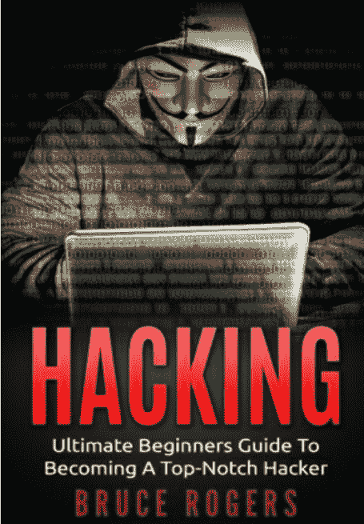

# 黑客攻击初学者指南：使用 Python 和 Linux 进行黑客攻击

## 本书简介

本实用指南真的是任何渴望成为黑客的人学习如何被黑客社区接纳的基础。除了学习 Python 之外，你还将学习理解 Linux 操作系统对黑客社区所提供的重要性和巨大贡献，以及它在探索黑客心态方面是至关重要的。

这个伟大、免费且开源的操作系统的一部分，不应该被视为理所当然，并且应该在我们作为黑客的工作中予以效仿。当你读完这本书时，你将对 Linux 操作系统及其基础有良好的理解，并知道如何使用它来利用其潜在的切入点。

最终，这本书的目标是为所有刚起步的职业黑客提供一个坚实的参考点，让他们学习如何使用 Python 编程进行黑客活动，帮助你对 Linux 操作系统建立深刻的理解，并为你提供描述性段落，让你学习并想象如何利用黑客社区中的术语。我为任何想要进入黑客领域的人，甚至仅仅是 Linux 和 Python 的初学者，提供了一份极佳的入门手册。在某些情况下，书中提供了分步骤的指导，同时也提供了关于理解“什么是”以及“如何”命令行的有用参考，进阶到通过发现漏洞来黑入不同的事物，你将获得并学习许多新技能。随着 Linux 系统共享和开源的出现，希望你能够找到那一个最适合你和你的目标的系统。我的目标是帮助你了解那到底是什么，并为你提供寻找它的资源，以便你能够成为一名精英黑客。

## 概述：什么是黑客行为？

公众对于黑客行为到底是什么存在一种普遍的误解。直到目前为止，黑客一直被视为键盘后的恶作剧分子，他们由于意图和技术专长仅限于在线上实施盗窃、抢劫或网络攻击等恶意且充满恨意的犯罪。这也许由于媒体选择性地宣传并羞辱少数利用其技艺伤害他人的黑客，而忽略了黑客社区实际上所做的善举。

然而，近年来黑客向公众描绘的方式发生了明显的变化。得益于 YouTube 等平台，像“匿名者”（Anonymous）这样的黑客行动小组现在对于关于黑客是什么以及黑客在做什么的这种单方面故事中拥有了话语权。

黑客不仅仅是知道如何获取受限信息。

黑客关乎自由、创造力，最重要的是对让事物变得更好的推动。

需要理解的重要点是，并不是所有的黑客都是一样的。黑客技术是一门艺术，一种技能，需要时间来完善。一个人决定如何使用这项技能取决于个人，而不是社区。这个世界上永远有好人也有坏人。

我写这本书的意图是为你提供基础资源和技能集，以开启你的黑客之旅。我选择的工具是 Python 和 Linux，我们将在书中彻底讨论它们，使你不仅理解“如何做”，还理解你所做事情的“为什么”。

我们还将讨论心态和原则的重要性，这些将帮助引导你作为黑客之路。

## 引言

祝喜购买《黑客技术：如何使用 Python 和 Linux 进行黑客活动的入门指南》，感谢你的选择。这本书为你提供了成为黑客的初步策略。它对于那些想要在黑客社区中为自己开辟空间的技术精明人士来说，是一个极佳的资源。如果你是一个刚起步的初学者，你的目标是掌握 Python 和 Linux，那么这本书将为你提供很好的介绍。

在书中，你将获得关于使用 Python 编程语言和 Linux 操作系统的总结和简单指南。它让用户沉浸在“如何做”中。作为一名黑客，重要的是不仅知道如何做，而且要努力理解你所做事情的“如何”和“为什么”。书中的一部分将专门用于纯学习 Python 语言。

最后，在书中我为你提供了关于成为黑客的解释和描述，以及黑客社区要求的礼仪。你还将通过我和你分享的一系列核心价值观获得社区的接纳。我不仅会涵盖这些价值观，还会告诉你它们为什么重要。

再次感谢购买本书，希望你阅读愉快！

本书包含了如何进入神秘的黑客世界的经过证明的步骤和策略。许多黑客教程和指令指南都假设你已经是一个高级程序员。而这本书使用了非常通俗、易于懂的语言，让你能够成为你向往的那个黑客。它还提供了丰富的资源，涵盖基础程序、系统和教程，这些将促进你的学习过程。

你不仅将学习 IT 安全领域黑客和破解背后的秘密，还将获得宝贵的洞察和知识，让你从今天就开始保护自己，免受黑客窃取你的信息！

对于任何想要认真学习成为精英黑客的人来说，这是一本必读之书

# 第1章 - 黑客心态

尽管可能有人会将黑客联与那些倾向于规避规则并在互联网上制造混乱的人联系在一起，但事实是，这完全不是黑客的态度。黑客有一套他们遵循的通用准则。这包括：他们不仅必须向他人提供自愿且互惠的帮助，他们还相信自由。为了真正属于并在黑客社区中找到你的位置，你必须自己真正相信这一使命，并与那些拥有共同核心使命和价值观的人志同道合。到本书结束，我确信你将为自己成为你向往的黑客奠定基础充满信心。

了解社区内部的等级制度以及你的黑客同仁看重的特质是非常重要的。始终保持开放的心态也非常重要，因为这是你最可能为那些看似无法解决的问题找到最佳解决方案。运用创造性的推理力量，你应该尝试评估并弄清楚你的个人理想和目标将在这个社区中带你走向何方。

尽管如此，这种态度并不是一个人在黑客文化中被接受的唯一属性。这种态度本身是拼图中的重要部分，但人们必须真正相信他们将采取的行动既能帮助你个人在过程中不断学习，又能通过你的个人进步获得动力。黑客攻击本身是一种艺术形式，涉及创造和智力能力，体现了黑客的心态。你作为黑客所做的工作之间存在着一种情感纽带，让这成为你工作的动力是非常重要的。我发现，有一些基本规则对于体现并让你的作为黑客的工作创造出令你和黑客文化能够立足的形象非常有帮助。在你继续成长和发展黑客技能时，这些基本前提应该成为你的格言。我坚信，通过保持一致的心态，你将开发出比大多数黑客更好、更有创造力的解决方案，这些将符合你自己的信念和价值观。这五个核心价值观或理念是：自由是有关重要的，人的能力绝对没有替代品——态度不能取代能力，始终尝试解决新问题并避免重复枯燥的任务，你不应该反复解决同一个问题，并且有无穷的任务等待着解决。

作为任何了解自由的西方国家的公民，遵守这一价值观对于正确了解如何使用它至关重要。黑客作为自由的坚定支持者，其本质上也是反极权的，因此真正重视并致力于实现和揭露互联网上不维护自由的机构和个人。例如，“匿名”（Anonymous）这样的组织完全是为了揭露那些似乎不相信自由的机构和个人。通过揭露这些压迫的真相，黑客打破了维持极权机构和个人的屏障。

这不仅能让你获得创造性的动力，还能帮助他人保持黑客精神。没有人希望自己的工作变得枯燥乏味，并让创造力在工作中流失。对于任何群体来说，保持高昂的士气非常有意义，特别是对于那些试图激发灵感并创造改变的。

基于一个人应该不断创建新任务并解决新问题的实，对于黑客来说，一个金科则是：永远、永远不要重复解决同一个问题。事实上，某些人认为这是完全不可接受的，因为黑客应该一直致力于解决新问题。有一条规则是黑客之间共享信息，绝不让别人解决你已经解决的问题。黑客社区内部存在着战友之情，这种情感应该是丰富的共享信息库。黑客不是为了私利，他们是为了解决问题并让自由主宰一切。然而，应该记住，另一个黑客可能会想出更高效的方法解决问题——这绝对是被允许并鼓励的。效率确实是黑客看重的东西，只是不是低效的重复问题解决。你不需要交出所有的秘密，如果这些秘密是你赖以维持工作、有房住和有饭吃的保障，但如果你的黑客同伴需要，请不要对信息吝啬。

始终保持乐观和勤奋，寻找新问题来解决，是让黑客成为一种愉快学习体验的大部分。允许自己去学习和精炼你的艺，并明确互联网和黑客领域的哪些领域你最感兴趣。在你自己的个人工作领域内，你想要不断推动自己去发现并解决更多问题。你想通过不断解决问题来精炼技艺，让智力得到锻炼，最终保持技能敏锐，并不断在知识的基础上摧毁接踵而来的难题。

尽管最初看起来并不如此，但黑客是精通的艺术家，他们确实在朝着持续且卓越的表现努力。如果这不是你与生具备的，你一定要在上面下功夫，不断锻炼大脑肌肉，让大脑完全投入并保持运转。这是保持并不断提高表现的极佳方法。

通过综合所有这些信息，希望它们是有意义的，并让你觉得这不仅是你所相信的，而且是你将在工作中努力实现的目标。为了在黑客社区中找到自己的位置，你必须不断地提醒自己，并遵循创造力、智慧和技能不断进步的准则生活。世界上有许多人利用黑客技术解决创造性问题，并真正关注于他们正在揭露潜在的威权主义问题源。记住，你正在实践的是这一宏大蓝图的一部分——自由的信息传递。

人为什么要去做他们不相信的事呢？你必须相信这些黑客价值观的个人含义，否则你在这个社区中活不了多久。

实践、智慧、激情和创造力是你应该具备的特质，或者是你愿意投入并让自己成长为这些特质。起初可能不具备这些技能并不可耻，每个人都必须从某处开始。

既然你已经意识到成为黑客所需要的心态，从这里起，你必须建立自己的工具箱，并开辟通往黑客世界的个人道路。除了在书中中学到的信息，你还需要确保持续不断学习，寻找新的资源和途径来提高你的技能。在书的最后，我将更多地讨论如何继续你的黑客之旅，通过一些我认为对你的知识库至关重要的资源。然而，首要任务是，作为一个新手黑客，你需要确保自己知道如何使用 Linux 和 Python 交流和编写代码，这本书将作为你对这些语言的简要介绍。

# 第 2 章 - 黑客所需的 Linux 系统基础

## 什么是 Linux？

Linux 是一种被整合为完全开源且免费的软件，供人们使用和访问。它是一种符合黑客“共享知识产权”格言的计算机操作系统。Linux 系统的内核最初由创建者 Linus Torvalds 于 1991 年 9 月 17 日发布，从那时起，任何人都可以免费下载它。该操作系统可以存在于任何电子设备上，从 TiVo 到 Android 智能手机，显然还有电脑。

但是，什么是操作系统呢？如果你是一个对计算机及其运作方式几乎经验的人，你可能听过这个词，但不确定它在实际计算机中意味着什么。人们基本上可以将操作系统定义为允许用户执行应用程序（运行程序）的软件，支持日常计算机功能（如能够调度任务），并允许你控制外围设备。本质上，操作系统是一系列代码，告诉计算机它将如何运行，以及不同代码会启动什么类型的程序。它也是一种一种安全检查和平衡机制，使你的计算机或网络处于其可能的最安全的虚拟墙之后。

尽管这种软件最初是为个人计算机开发的，但今天，它被移植到了比任何其他操作系统更多的平台上。人们可以在服务器和大型机上看到 Linux。最近，它被添加到 Google Chromebook 笔记本电脑中，使用量大幅增加。Linux 也用于 Android 操作系统，这现在是智能手机的主流操作系统。关于这个操作系统的另一个伟大之处是，它还运行在嵌入式系统中，使其跨越不同的技术，如路由器、硬盘和平板。这让操作系统真正触及技术的每个角落，并成为任何训练中黑客的友好且广知的操作系统来源。

Linux 确实、真正是最大且最为人知的开源软件协作案例，它对公众是免费的。

有趣的是，Torvalds 发明 Linux 是因为他对教育软件的许可问题感到沮丧，仅使用 MINIX 软件。Torvalds 因无法使用它而感到沮丧，最终创建了 Linux 内核，作为他对眼下问题的一种富有创造力且巧妙的解决方案。如果你注意到，Torvalds 似乎遵循着一条大的黑客规则，即利用自己的创造能力来解决问题。他开始基于为 MINIX 编写的应用程序开发操作系统，但将组件替换为 GNU 应用程序，任何人可以在任何计算机程序中重复使用这些 应用程序；只要它们是带有类似的兼容许可协议发布的即可。通过整合 GNU 和 Linux 内核，一个完全免费且功能完备的操作系统推向大众。可以说，自其诞生以来，它一直允许并帮助着黑客。这确实是基于创造和自由的操作系统知识在用户间传播的极典范。

尽管该软件的设计兼顾家庭和企业基础设施，许多大型组织（例如 NASA）已开始在其昂贵的机器上使用廉价的 Linux 选项。在几家大型公司的基础设施中取得初步成功后，商业计算机公司（如 Dell 和 IBM）也纷纷效仿，增加了 Linux 支持，以摆脱微软在桌面操作系统市场的垄断。随着 Linux 被加入 Google Chrome OS 软件以及 Android 手机，Linux 正在逐渐接管大型计算机和科技公司中的主流操作系统。

Linux 游戏也开始崭露头角，Valve 公司启动了其自己的面向 Linux 的游戏发行版。

Linux 的设计基于 Linux 内核，它使用单体内核来处理从网络、文件系统、进程控制到外围设备访问的一切。不同设备上的驱动程序要么是系统运行时加载的模块，要么直接集成在内核中。安装在 Linux 系统上的组件分为四种不同的类型，这些是：

- init 程序（进程树的根）
- 软件库（包含运行进程使用的代码，包括 C 标准库和小部件工具包）
- 将 Linux 内核加载到计算机主内存中的启动装加载程序
- 用户界面程序（窗口环境或命令行终端）

如你所见，操作系统本身是多任务的，并且涵盖了大多数用户的需求。

Linux 操作系统及其创始人非常契合黑客理想和思维，这些理想在考虑软件如何使用以及黑客社区试图实现的目标时是至关重要且重要的。通过坚持自由至高无上，以及透明度和缺乏权威人物主导，Linux 系统允许每一位用户参与到系统创建和维护的体验中。由于黑客是天生具有创造力的创新者，他们使用一个支持其使命的操作系统是理所应当的。

## 如何使用 Linux 进行黑客攻击？

有许多操作系统可能可以用于黑客攻击，那么为什么 Linux 被视为社区的标准呢？首先，它是对所有人开放的，因为它是免费。这使得任何拥有技术设备的人都能将 Linux 作为其操作系统。世界上有许多人使用 Linux 的简单原因在于它是免费的，并且几乎任何人都可以。然而，还有其他因素让黑客能够利用并享受 Linux 操作系统。这些因素是：它是一个开源操作系统，它有多种发行版，并且黑客认为 Linux 是一个可以被安全的操作系统。

### 什么是开源操作系统？为什么它对黑客有吸引力？

嗯，万一你不知道操作系统本身是什么，它本质上是所有程序的后台运行，向计算机的不同硬件发送请求。软件的“开源”部分体现在它是免费的，并且任何人都可以公开编辑、查看并为软件代码做出贡献。Linux 本质上也是无限自定义的，因为你可以切换并更改用户界面组件，也可以更改操作系统的核心组件。这确实是一个非常适合黑客及其自由与集体智能使命（用于对抗我们社会中的权威影响）的操作系统。它是一个设计精妙且执行完美的范例，向世界展示了使用开源发行版可以实现什么。

Linux 提供的发行版也相当惊人。开源的本质允许所有人开放访问，坦率地说，它可以被称为一个促进全民平等的操作系统。有无数发行版可供选择，其中一些列在上方（注：OCR 文本说“上述列表”，但源片段中没有后续列表）。这些选项的有趣之处在于人们如何合作来精简产品。对于黑客开始他们的技艺来说，这确实是一个极好的智慧机制。

对于今天任何使用技术的人来说，他们正在使用的软件有多安全？

任何人都可以访问操作系统的源代码这一事实最初可能会让人们认为它不安全。然而，确实有五个因素让 Linux 系统的安全性能够经受任何测试——这些是：

- 社会工程组件
- 个人必须拥有的权限
- 单一文化的影响
- 受众规模
- 审视过不同版本的眼睛数量

可能任何使用计算机的人都了解过社会工程，只是没有使用那个特定的术语。大多数人都听说过病毒和蠕虫通过附件或虚假邮件进行传播。这些蠕虫和病毒通过人们 literal点击诱人但可疑的广告或邮件来传播，从而允许恶意软件攻击他们的计算机。Linux 的特殊之处在于，该产品的用户没有 root 权限。在 Linux 界面中，为了让人们打开并允许恶意软件进入计算机，他们必须执行一系列操作。不像，例如 Microsoft Windows，你只需点击附件并上传病毒；在 Linux 中，你必须先保存附件，然后经过赋予可执行权限的过程，然后才能运行实际的可执行文件。

接下来是“单一文化效应”，其他系统（如 Microsoft Windows）在其程序中构建了这种效应，允许它们能够独立运行而无需任何多样性。正如我们在本书的前几页解释 Linux 时所看到的，核心在于多样化，并为人们创建一个更好的产品。这种共享和在不同想法基础上进行构建的文化，让所有人都能生产并使用质量更高的操作系统软件。在生活的方方面面，多样性都有其独特之处，这一点也不例外。

基于多样化原则且不陷入单一文化陷阱的另一点是潜在病毒或恶意软件攻击的受众规模。由于大多数安全担忧都是针对 Windows 编程的，Linux 拥有一个显而易见的优势，因为它根本不是这些操作系统之一。这对于进一步确保 Linux 系统的安全和可靠非常有效。

最后，关注这一过程的人数和眼光是无价的。创始人林斯·托瓦尔斯（Linus Torvalds）创造过一句话，他表示“只要眼睛足够，所有的 bug 都是浅的（given enough eyeballs, all bugs are shallow）”，这句话充分彰显了这一方向下持续的理念增长。凭借许多用户监控任何代码的各个部分，并能够发现并指派某人更改潜在 bug，任何创作者操作系统代码中的问题肯定会减少。不像 Windows 那种由一个极小、有限的付费开发者团队试图保持所有代码和活动的秘密，Linux 将一群人作为一个社区聚集在一起解决问题。这是一次无价的社区教训，而西方社会在大多数方面似乎缺乏这种教训。这种哲学体现了黑客想要用来增长其技能和创造才华的心态和方式。

尽管显然 Linux 并非无懈可击且无法被攻破，但记住并观察竞争对手的产品，以及 Linux 操作系统中内置了多少不同的功能，是非常重要的。任何项目的目标都是创建并生产尽可能最好的产品，这正是 Linux 用户真正体现的理念。黑客确实利用了这种基于社区文化的各个方面来改变和操纵操作系统，为所有人提供更高质量的计算机程序和访问。

# 第 3 章- 理解 Python

## 为什么 Python 是黑客的首选语言？

尽管黑客首选的系统本身是 Linux，但该系统中存在一种黑客选择使用的语言。当你学习成为一名黑客时，Python 是一个人学习如何编码的极佳基石。当黑客开始学习如何编码和使用编程语言时，Python 可以发挥关键作用，允许人们想出各种可行的编码解决方案，即使只是临时的解决方案。初级黑客可以通过预构建的框架和工具看到他们工作的成果，这让新黑客能够从一些预制示例的益处中学习。

就像 Linux 因其开源特性对黑客具有吸引力一样；Python 是这种操作系统的一种很好的互补语言。这种语言本身一旦你熟悉它并研究了它的工作原理和方式，它是专注且相对易于使用的。世界上有很多不同的语言，大多数人都会同意 Python 是非常适合学习的语言，并且对于初级黑客来说，应该配合 Linux 一起使用以尝试你的技能。

Python 也是一种尝试不同事物的绝佳语言，只需看看它们是否能够成功制作和改进代码。这对于喜欢拆解事物然后重新组装的人来说非常棒。Python 允许用户从字面上构建并拆除他们的项目，以便准确理解它的工作原理。Python 轻松地允许用户做到这一点。有大量的库供新用户查阅并解决他们正在尝试解决的任何问题或困难。拥有这样的资源对于一个试图学习和掌握门径的新程序员来说可能是无价的。它也是一个很棒的社区资源，因为黑客社区喜欢保留和共享他们的资源。

黑客的一个目标可能是破解某些系统。涉及到 Python 时，这种语言是实现这一点的极佳方法。为了破解一个系统，人们必须具备三样东西——应用知识的创造性方法、基于测试的方法，以及最后是非常详尽的技术知识库。对于任何尝试做这一点的人来说，幸运的是，Python 实际上提供了一个强大的……黑客是创造力和智慧与其他概念的结合，Python 允许新黑客优化他们的性能。Python 凭借其广泛的知识库和简单性，允许新黑客实现他们想要的目标。

## 学习 Python 作为编程语言的好处

尽管每种语言都有自己的优势，但当你开始学习这种语言时，Python 提供了一些让它脱颖而出的优势。基本上，Python 是任何人学习所需的基础、高级技能的绝佳起点。你越熟悉，你的知识库就越大，你就越能触及到低层次的问题。然而，Python 是一个极佳的起点。除了使用 Python 所需要的语言技能外，在时间方面还有额外的优势。在 Python 上花费的时间将比 C++ 和其他编程语言少得多。通常，开发一个 hack 在 Python 中大约需要 30 分钟。而在其他编程语言中，可能比 30 分钟长得多。这是一种激励新黑客的极佳方法，因为他们能够在合理的时间内实现所需的 hack。

下一个优势在上面已经提到过；然而，拥有像库这样的资源确实非常重要。这些库真正让新黑客在遇到他们可能遇到的任何类型的问题时都有一个可以参考的地方。这些广泛的库允许黑客找到知识以实现他们的目标。没有什么是是轻而易得的，尽管在弄清某事时有帮助也绝不会损害任何人。能够完成事情让任何人更有动力继续努力工作并获得更大的成就。黑客之间分享他们的基础知识确实是进入我们在整本书中一直在讨论创建的那种文化的绝佳门户。像 Python 中提供的这种创意输入熔炉是任何都不应该被认为是理所当然的宝石。

# 第 4 章-学习 Python 编程

## 如何开始

现在我已经推崇了 Python 的地位，并让你相信它是最好的起点——让我们谈谈如何使用它进行编程！关于 Python 编程语言的一个趣闻是，它的名字源自 Monty Python，只是一个有趣的……

# Chapter 5- The Importance of Command Lines

A command line is essentially a fancy way of saying you are telling your computer what to do and how to do it. How you give your computer program a command happens through lines of text (coding). Essentially you, as the user, will learn how to format and make command lines through the process of learning to code; as well as using your resources like your code editor. Using command lines is a more advanced way to interact with your computer, rather than using your mouse to click on various desktop icons. With the command line, you can really master controlling a program or operating system, which is what the goal of hacking is. We want to be able to control different aspects of programs or the operating systems themselves.

在最后一章的编码中，学习理解并掌握命令行对于理解计算机如何运作，以及你将如何能够黑入一个系统或程序至关重要。与其他任何事情一样，使用命令行在与计算机交互的方式上既有优势也有缺点。随着你开始熟悉编程，命令行的明显优势会变得更加显而易见。这种方法的第一个优点是比其他方法所需的资源更少。你只需要告诉计算机你想让它做什么。

这是一个非常强大且简洁的工具，供人们用来控制和操纵，这也是你作为黑客想要的目标之一。

最后，它对专家非常友好，所以你可以觉得你对正在操纵的计算机或程序有了更深入的理解和学习。

与其他任何事情一样，也有一些你想要注意的缺点。第一个，可能也是最大的，是与桌面上的图标不同，它并不直观。这意味着你必须理解你想告诉计算机什么，或者你想让它做什么，这就是为什么它对专家友好的原因。计算机中的命令不是显而易见的东西，所以你必须进行研究。然而，由于你的目标是黑入东西，这可以被视为一个学习机会而不是缺点。刚开始时的这种困难在于如何与计算机和操作系统进行交流。因此，从某种意义上说，命令行对初学者并不友好，所以这就是像这本书这样的资源提供帮助的地方！

每个操作系统都有一个让你交互的命令行界面。我们通常将此接口称为 shell（外壳）或命令处理器。但请记住，shell 也可以用来描述图形界面——为了本书的目的，澄清一下，我们指的是你在其中输入文本（命令行）来告诉计算机你想让它做什么的 shell。这也是你更改操作系统本身的方式。现在，虽然每个命令行系统都有明显的区别，但有三种主要的接口机制。第一种是接口的参数，本质上是允许在程序启动时将信息传递给程序的支持。为了进一步解释，这些是你放入软件中的类型内容，用于告诉程序如何以及何时打开某个程序。第二种是，启动应用程序接口机制后，将有一个交互式命令行会话。这意味着程序为人们提供了一种输入文本的方法，就像你在其中输入命令行的 shell。最后，是操作系统的进程间通信，它允许通过标准流（standard streams）或命名管道（named pipes）等方法将不同的程序和进程重定向到不同的程序。虽然大多数人并不熟悉命令行以及你用于输入它们的界面软件，但某些应用程序只运行命令行界面。这类程序用于控制操作系统的协同工作，本质上你可以认为它是使用 Python 编码来操纵 Linux 操作系统。希望这以一种不那么术语化的、易于理解的方式进行了说明。

命令行产生的历史实际上有助于你理解它们的用途。在命令行界面出现之前，人类会通过电报打字机（TTY）一次一行地进行通信。虽然这允许人们远程交换信息（这是一个巨大的进步），但它一次只能传输一条信息。而命令行允许你不再是与 TTY 机器通信，而是直接与计算机通信。

命令行界面的最初模型实际上无法像 Linux 等操作系统那样轻松替换程序。有趣的是，这些命令行界面是计算机使用的原始方式。在图形界面被发明并被 Apple 等公司使用之前，每个人都使用命令行。对于计算机程序员、管理员和黑客来说，知道如何使用命令行是至关重要的，因为他们不同的角色都依赖于更改和操纵命令行的能力。

你可能好奇，或者想要了解更多关于你将输入的 Linux 命令的类型。你可能会知道更多关于你将输入的 Linux 命令的类型：

## 关于组（Groups）和用户（Users）

- `adduser`: 创建新用户。
- `passwd`: 修改密码。
- `who`: 显示当前登录的用户。
- `addgroup`: 添加一个新组。
- `deluser`: 删除一个用户。
- `delgroup`: 删除一个组。

有些时候你需要执行之外的操作，我们称这些通配符（wildcards）。这些示例有：

- `*`: 匹配任意字符序列。
- `?`: 匹配单个字符。
- `[match].rar`: 括号允许匹配括号内的内容。在这个例子中，我们将匹配。
- `![xy].rar`: 感叹号匹配不在括号内的任何字符。所以，这个例子会匹配 z.rar，但不匹配 x.rar 或 y.rar。

现在我们谈谈搜索和编辑文本：

- `grep`: 允许在文件中搜索特定模式并打印匹配行。
- `sed`: 代表流编辑器。它允许你在文件中进行搜索和替换。
- `cat`: 命令是 concatenate 的缩写，用于查看以及向文本文件添加。
- `nano`: 命令行中的文本编辑器。
- `less`: 用于标准输出和查看文本。

我们如何操纵文件和文件夹？这里有一些命令建议：

- `cp`: 简单的复制命令。

- `mv`：移动文件，可以移动到另一个位置或重命名文件。
- `rm`：删除文件。
- `ls`：允许你看到目录中的文件。
- `mkdir`：你可以用它创建目录。
- `chmod`：允许你更改列出的文件的权限。
- `chown`：你可以使用此命令更改文件的组所有权和用户。

我们都知道，总会有需要同时执行多个命令的时刻。我将给出两个关于如何同时运行多个不同命令的示例：
- `lspci`; `lsusb` - 首先是顺序执行命令（或如何按顺序运行命令）。为了让这些命令一个接一个运行，你只需要两个字母——`;`。它们之间的分号允许第二个命令运行，即使第一个命令由于某种原因没有运行。
- `./configure && make && install` - 这是一个如何格式化顺序执行的示例，仅适用于你只想在第一个命令执行成功时才运行第二个命令。
- `ls|less` 允许你传递输出内容，在这个例子中，这意味着你能够更轻松地查看 `ls` 的内容。

最后，如何在命令行中获取帮助呢？这里有一份关于在命令行界面工作时如何获取帮助的实用提示列表。
- 使用你的方向键向上和向下移动！
- Q：这是退出的命令！
- `man man`：这是一个很好的起点——它会调出 `man` 命令本身。
- `man intro`：这是另一个极其有用的命令，因为它会调出用户命令的介绍介绍。这是一份简短但非常有用的 Linux 命令行入门介绍。

这些命令列表确实是你的一个起点，帮助你开始探索操作系统中的命令行界面。拥有一份快速参考指南是有帮助的，尤其是起初你并无法仅仅输入一个命令就让它变得有用。网上有很多地方可以找到有用的列表和命令指南。你使用得越多，就会它们就越熟悉。能够尝试并观察这些命令为你做什么，是开始了解更多计算机如何接收指令的真正最好也是唯一的方法。学会操作你的命令行是成为顶尖黑客的重要基石。

我鼓励你现在就进入自己的电脑并尝试其中的一些命令。开始学习的唯一方法就是开始，将想法付诸行动比仅仅阅读如何做要收获得多！在继续之前，我要求你花几时间开始使用你的 Linux OS 和 Python 语言技能，并尝试对这些黑客技能进行测试！弄清楚事情的唯一方法就是尝试。看看这些命令能为你做什么，当你卡住时再回来这本书！只要你准备好，这本书就会一直在这里——帮助你迈向黑客之路的下一个阶段。

## 识别漏洞

### 黑客如何识别潜在的切入点？

作为一名潜在的黑客，你认为你为什么要在寻找切入点时保持明智？是因为你不希望你正在入侵的人或系统发现你在那里吗？是的，我认为这是一个主要的考虑因素。你可能也只有一次机会来突破屏障。这就是为什么进行研究和精通技艺成为你作为黑客所做工作的重要部分。

既然我们现在已经知道如何使用命令行告诉系统该做什么，我们可能想开始思考黑客是如何使用这些命令的。除了命令之外，你还应该使用 Python 语言来更改和入侵 Linux 系统。你如何定位并利用潜在的弱点，以获取你想要的信息或想要探索的系统？有几种方法可以实现这一点，所有的方法都可以通过你新学的编程和命令行技能来完成。在这里，你可以开始感觉自己像一个懂得操作和理解系统内部运行机制的黑客。熟悉命令行以及它们的本质，以及你如何个人在它们周围穿梭以查看并访问你想要的内容，对于综合你将从发现弱点的这种新能力中接收到的数据至关重要。

虽然这些并不是入侵某些东西的所有潜在切入点，但这里有一份供初学者黑客开始的良好列表。这些不同的方法包括套接字（`socket`）、注册表（`registry`）、程序接口、环境变量、命令行参数、协议处理器以及最后的 HTTP 头部（`http header`）。记住，以下并不是另一个系统的唯一潜在切入点。记住，总有人在创造和发现进入另一个系统的新方法，通常是通过找到一个新的切入点。将这初的几个潜在的突破点作为你开始黑客之旅时需要学习和掌握的东西。要知道，你必须真正理解这些东西是如何运作的，以便能够分解并找到内部的弱点。

### Socket（套接字）

套接字是很容易连接的，然而通过网络传输的数据并不总是安全的。它们由一个 IP 地址和一个端口号组成——它们是具有各种协议的应用之间的双向通信。如果发现了一个数据入口，它可能会被极度利用。通过这种黑客的入侵，人们能够拦截数据、监控通过传输的数据、从客户端或服务器发送畸形数据，以及在套接字开启且数据可能通过网络发送时进行中间人攻击（`MITM attack`）。人们应该使用所谓的威胁建模过程来识别切入点的可用性。

### Registry（注册表）

如果有人想使用这种方法进行利用，会有不同的键值允许黑客利用弱点。你可以在没有本地访问的情况下通过欺骗用户打开恶意文件来进行这种黑客攻击，然后就可以使用数据。注册表键的权限对于访问特定类型的数据起着重要作用。在没有源代码的情况下，你无法确定访问了哪个注册表（大多数情况下）。相反，使用 `Process Explorer` 工具可以确定访问了什么。如果你是一个敏锐的黑客，这可以很好的来源。

### Programmatic Interface（程序接口）

远程程序接口（如 `COM`、`DCOM`、`RPCs`）是实现在不同平台上的不同应用程序之间通信的方式。通过展开程序接口，有很多黑客可以利用的功能。记住，这个过程是复杂的，并且目前可能难以理解；特别是如果你是第一次尝试什么是计算机编程以及如何作为黑客使用它。不要强迫自己去尝试超出你目前理解范围。你可能只需要把这些信息存在大脑的某个部分，在你以后更有经验时再提取出来。这是由于程序接口的全光谱是一个我们在书中不会进行的巨大且详细讨论。然而，我鼓励你自己去研究。你可能想要研究的一些接口包括 `Gutil`、`RpcDump`、`Dcomcnf` 和 `OleView`。

### Environment Variable（环境变量）

环境变量通常用于存储有关当前环境路径和当前登录用户的信息。在系统内部，变量被所有的计算机用户使用。数据在程序内部是不安全的，因为它根据存储在变量中的信息做出安全决策。黑客只有在破解并攻破了管理员账户的情况下才能更改环境变量。

### Command Line Argument（命令行参数）

正如之前讨论的，命令行确实向应用程序提供数据以使功能在内部发生。为了在系统上发动这种攻击，黑客必须说服用户输入一个恶意的命令行参数。使用这种方法，黑客可能能够完全更改应用程序的行为来实现他们的目标。

预期结果。此类恶意意图的一个示例是将打开预期的文件切换为删除该文件。

### 协议处理器 (Protocol Handlers)

这些处理器以 `http` 或 `https` 开头，用于告知系统在点击超链接时调用哪个应用程序，以便处理和管理数据。点击超链接可以启动应用程序，然后为用户执行相应的功能。如果调用应用程序包含机密类型信息，协议处理器可能具有潜在的危险。当数据传递给注册的应用程序时，它们就变成了一个入口，应该清楚地检查是否存在可能导致安全漏洞的缺陷。你可以获取一些工具，这些工具可以列出所有的协议处理器。

### HTTP 报头 (Http Header)

这种 HTTP 报头运行在 TCP 协议上，使用 80 端口，允许服务器和客户端之间的数据通信。这是一种非常简单的数据传输方式，因此极其受欢迎。为了确定入口的漏洞性，将请求分解为更小的子部分是发现这一问题的好方法。

你如何保护这些入口呢？你可以测试一些关键的批判性思维来寻找最安全的进入方式。你需要弄清楚一个入口可以造成多大的损害，以及访问入口需要达到什么权限级别；此外，你应该尝试攻击自己，针对你看到的疑似漏洞进行测试，并最终从渗透测试的角度，对当前问题中更高级的切入点进行排序和分类。

希望这些示例能让你看到作为黑客入侵系统的许多不同潜在方式。尽管这些绝非唯一的……

## 黑客如何利用 Python 编程和 Linux 系统利用这些工具？

上一节内容涵盖的内容实际上为你提供了一些很棒的方法，让你开始思考如何利用弱点并成为一名黑客。尽管，正如我之前提到的，这些利用方法并非唯一存在的方法，但它们是很好的练习方法，可以帮助你开始寻找进入并获取信息的漏洞（切入点）。

# 第 7 章——有用资源

既然我们现在已经知道如何使用命令行告诉系统该做什么，我们可能想开始思考黑客如何使用这些命令和 Python 语言来更改和破解 Linux 系统。在万维网的世界里，有各种不同的术语和内容你可以通过搜索来找到解决问题的有用资源。我将为你提供研究不同类别和主题的良好思路，这些研究将帮助你克服任何障碍，或者找到你在操作系统库中无法找到的内容！这些资源将包括入门教程（当然，除了本书之外！），学帮助和教程（以及为什么我认为它们很有用！），对安全有帮助的网站和黑客新闻，对你有帮助的视频和播放列表，对安全和黑客人士的在线论坛，漏洞资源和数据库，为什么要搜索特定产品信息以及这对你的学习何帮助，最后是一些协助你黑客之旅的优秀程序和工具。

### 入门教程

如果你对计算机如何工作了解较少，希望本手册已让你处于一个良好的位置，开始开始准确理解计算机操作系统是如何工作的。在这些信息的基础上是弄清楚如何成为黑客的关键部分。虽然每个人对“入门教程”的思考和定义略有不同；一个想成为黑客的人需要掌握这些基础技能，才能从脚本小子（script kiddie）向更高级阶段进。基本上这意味着你对计算机基础知识以及编程非常熟悉且了解。有一些优秀的网站可以查看有关入门教程的资源。这些包括 `breakthesecurity.com`、`guru99.com` 等网站，以及本本基础指南的手册。你可能还会查看一个名为 `Cybrary` 的资源。如果你在寻找黑客伦理指南，它将在一个非常棒平台上教你，该资源拥有免费的在线视频和测试，帮助你磨练并获得成为黑客所需的技能。秉持 Linux 免费的理念，这些资源也免费提供给你！

### 加密学 (Cryptography)

为了成为一个成功且合道德的黑客，理解解密和加密是如何进行的至关重要。这是我们在书中没有涵盖的领域，进一步查看和研究是一个很棒的主意。这将让你增长黑客技能，以及对数据如何加密和解密的知识。这是一种具有潜在帮助且重要的技能。网上有很多教程提供了解释。一如既常，Google 搜索有奇效，搜索“如何做”视频也是如此。

### 安全新闻和文章的有用网站

网上有很多网站你可以访问并阅读关于网络安全的特定内容。让自己接受不同黑客资源的教育是很重要的。这些资源允许你学习目前正在进行黑客活动的人使用的许多技巧。作为一名专业的黑客人员，关注新闻、漏洞报告和安全问题是非常重要的。查看如 `2600.com` 或 `packetstormsecurity.com` 等网站可以帮助你阅读并了解各种不同的安全公告和泄露事件，这些事件可能正在发生，或被黑客发现并利用。正如书的前面提到的，分享信息是成为社区的一员非常重要的一部分。

### 视频、论坛和播放列表

永远不要忘记 YouTube 这样的资源，那里充满了几乎每个主题的“如何做”视频。为了找到你想要的视频，你可能需要过滤掉一些劣品，但我保证，你最终会找到创建对你的知识之旅有帮助的视频的用户。你可能在向往的其他网站或论坛上遇到获取知识的视频。那里有无数免费资源等待着帮助你学习你可能感兴趣的任何主题。此外，如果我们在书中讨论过的任何知识还不完全清楚，去寻找一个能更好地解释它的视频，让你一步一步地看到整个过程。遗憾的是，阅读文字并不等同于看到示例，特别是如果你是一个视觉型学习者！

### 漏洞资源和数据库

这类数据库是获取漏洞信息的极佳来源。这类资源是黑客可以在其中学习如何修复、避免或利用系统命令行或编码中的潜在漏洞的地方。正如我们上面简要提到的，有许多方法可以初步识别这些潜在的安全性破口。尽管我们在书中列举了几处，但出去寻找不同的资源以获取更多知识是好的。

### 工具和程序

就像你可能获取的任何种工具一样，这一切都是为了帮助和协助你成为该工作最优秀、最合适的人。发现最适合你的感觉和工具，并利用它来增长和完善你的个人黑客技能集。从 `Wireshark`、`Nikto`、`nmap`、`NSS` 和 `Hping` 等工具；互联网上的可能性几乎是无尽的。如果某件事不能引起你的兴趣或对你奏效，请尝试其他的。仅仅因为别人称之为“完美解决方案”，并不意味着它对你有效。创造一个让你对自己的能力充满信心的世界，让软件对你来说得而自然，或者在尝试了几种之后变得最自然。你会很快学会事物是如何运作的，你练习、尝试和研究得就越快！

时刻关注能够帮助你成为最优秀黑客的事情至关重要。你永远不知道谁能指引你走向正确的资源，从而帮助你提升技能。当你遇到任何特定的新黑客体验或障碍时，永远不要害羞进入论坛或向同行的黑客寻求帮助。这本书也应该一直作为你回首的起点。这本实操指南不仅了你什么是黑客以及是什么因素造就黑客，还允许你通过 Linux 操作系统和 Python 语言查看基础示例，并了解到底什么是命令行。这些本质上都是成为专家级黑客的基石。始终提醒自己，高质量的工作优于急于跳过步骤试图尽快成为专家级黑客。其他工作了多年且真正的专家级黑客一眼就能识破你并拆穿你的伪装。不要急于自己，花时间去学习、尝试、发挥创意并做好你的功课。这就是学习成为黑客精英成员的道路。

就个人而言，作为全球黑客使命的跟随者，我发现进入论坛网站特别有帮助。你可以读到许多不同经验水平的黑客的观点。你还能看到其他在哪里尝试过并失败了。阅读他人的失败实验既可以帮助你了解应该避开什么，也可以产生一个与他人可能共鸣的想法，并尝试不同的、新的且创新的方法来解决问题。你还可以在这些地方找到同伴，这种氛围有助于强化你对某个群体或组织的任何感受——也许你觉得某个组织本质上是权威的，需要被揭露。人数确实就是力量，论坛让你看到在以某种方式思考或对问题有特定方法时你并不孤单。

永远不要让自己通过你在黑客社区的投入来贬低自己的个人价值。不要低估你自己、你的想法或潜在的想法，无论你是一个多么大的新手。当你用崭新的眼光看待这些新谜题时，你可能探索出一个别人没有发现的想法，因为他们可能带着疲惫且陈旧的观点来看同一个问题。成长和改进的空间总是存在的，这对于黑客社区来说至关重要。

# 第 8 章 - 开发黑客技能的后续

既然我们现在知道如何使用命令行告诉系统要做什么，我们可能想开始思考黑客如何使用这些命令和 `Python` 语言来改变和入侵 Linux 系统。任何可以想象到的黑客都想成为他们能最好的黑客；黑客的技能set应该建立在在前几章中概述的那种类型的人的基础上。我认为，我为你提高和发展黑客技能所提供的最佳建议，包含了我们在整本书中讨论过的许多理想。

首先，我建议你继续学习并尝试模仿黑客伦理准则，这并不是我之前称呼它的词，但它确实是如此。为了做到这一点，你需要确保在你所从事的黑客工作的每个方面都勤地朝着创造性、智能且深思的工作努力。不要把黑客简单看作你在电脑屏幕后输入几个小时代码的事情。虽然这显然是它的主要部分，但它并定义你是一个或你想成为什么样的黑客。

我还建议你回去精炼成为成功黑客所需的基础计算机技能。这些不是像如何在 Word 中编写和创建文档之类的东西，你需要能够理解命令行是如何工作的（嘿，我们之前讨论过那个！），并且能够在你所选择的操作系统结构中进行编写和操作。记住，能够交流编程语言也是作为黑客解决问题至关重要且本质的一部分。

你接下来的任务是确保你理解基础网络是如何运作的。虽然这不属于本书的范畴，但它对于理解计算机及其系统如何相互非常重要。你对某项技术了解得越多，你处理它时就越出色，并在你的创造性黑客过程中为自己开启越多的门。

Linux 技能是我们在书中详细介绍过的，并且无疑是你黑客技能的重要部分。开源模型确实是所有黑客发现自己在使用的模型，也是他们在试图突破入口点并在其中寻找数据时所面对的——他们-

另一个简要提到的良好资源是 `Wireshark`。还有另一个叫做 `Tcpdump` 的程序，它们是广泛使用的协议分析器。它们对于确定你系统中的 TCP/IP 流量以及攻击是非常有用的工具。我鼓励你在真正精通这些技能后，去研究这些可能让你成为更高效黑客的类型程序。

你有许多选项可以在其他操作系统中尝试你新发现的所有技能，也可以自己玩玩。这是一个很好的方法——其中一个程序是 `VMWare Workstation`，不过还有其他选择。

正如之前提到的，安全知识和相关技术是学习成为黑客的至关重要的部分。你必须熟悉这些不同的安全措施是如何工作的，以及如何利用系统来访问它们。这些是诸如防火墙和 PKI（公钥基础设施）之类的东西，为了获取关键数据，它们可能需要被攻破。有一个你可能感兴趣的基础安全课程叫做 `Security+`，它应该帮助增加对互联网和计算机安全核心原理的了解。

由于现在有无数无线技术，对你来说学习如何无线黑客以及技术本身如何运作也同样重要。正如黑客的任何其他部分一样，你想要确保自己能够在无线技术世界中导航。找一个免费的在线课程、视频系列或文章帮助你理解各种无线技术方案将会世界在不断变化，技术是我们世界中一个看似流动的、变化的和演变的部分。努力跟上所有这些技术以理解你试图突破的网络世界至关重要。

超出本书范畴的技能属于中级范畴。这些是在你掌握了书中提到的技能和想法之后可以研究的基石。尽管如此，我现在将向你介绍其中几个，以防你需要更多更高级的技能等来研究。

脚本是每个黑客为了移动到必须精通的技能之一。

黑客技术的进阶之路。`Python` 实际上是你可以在其基础上进行构建，以提升和磨练你的脚本技能。这个工具可以用于发现和理解虚拟世界中的无数事物，你学得越多，你的黑客能力就能走得越远。你可以轻松地在脚本世界中挑战自己，因为语言中总有更多的学习空间，总有其他语言可以研究，比如 `Perl` 或 `Ruby`。

学习如何入侵数据库是在你追求更具挑战性的黑客任务时可以获得的一种技能。为了入侵它们，你首先需要理解它们，就像对待任何其他事情一样。理解并弄清楚它们是如何运作的，在你提升黑客水平的过程中，可能是一个极具价值的研究课题。对于数据库，你需要学习一种名为 `SQL` 的新语言。在入手之前，你应该了解许多术语和技术。快速的 Google 搜索可以帮助你获取一些基础知识。与其他任何事情一样，去论坛或看帮助视频，或者我的另一本《教程》（或其他人的！）来学习更多关于数据库如何工作以及你如何入侵它们的知识。

学习 Web 应用程序真的是黑客的黄金矿，尤其是近年来。Web 应用程序是你研究的另一个领域，以获取有关应用程序如何工作以及驱动它们的数据库的知识。当你越深入黑客世界，就越会发现事物往往倾向于相互作用和相互影响。这就是为什么清晰地理解每个概念或前提对于掌握它至关重要。永远记住，就像我们在学校老师告诉我们的那样，没有愚蠢的问题。不要吝于提问，因为很可能在某个时刻，我们都曾问过相同的问题。建立你自己的钓鱼网站是学习更多黑客邪恶目的的好地方。了解任何技能的所有方面，包括那些阴暗的一面，是好的。

为了成为一名优秀的黑客，显然不应该被捕。如果你被抓了，就无法成为一名优秀的黑客！在监狱牢里绝对无法进行黑客活动！学习数字取证是一个绝对无尽且迷人的学科领域。你可以真正学习更多关于如何避免和规避任何人的检测。这将真正帮助你通过比任何试图捕获你的人领先一步，来突破障碍。

你对 `TCP/IP` 如协议栈和字段的了解越深入，你的黑客技能就会越全面。你可以利用这些技能进行防御，也可以对他人创建你自己的潜在攻击。在你继续从初学者向中级黑客进阶的过程中，这是一个你值得研究的绝佳领域。

学习更多我之前简要提到的密码学，也是有助于你作为黑客成长的技能。你可以利用这项技能来躲避检测，从字面上为自己构建一堵墙，让你通过编码不被发现。这是一项非常值得精通的技能。

正如我之前谈过的，在数字世界中拆解并重新组装东西可以帮助你更好地理解它——反向工程是这种说法的另一种形式。能够对事物进行添加并使其更高效、更好，不仅能让你对自己的能力感到自豪，还有潜力去分享并帮助他人完成他们的任务。作为一个共同工作的社区，分享你的技能并在他人开始的基础上进行构建是重要的。

当你正在学习并将所有这些技能发展到更高级的水平时，不要忘记你最初立足并开始黑客事业的理想是非常重要的。在思考新可能性时不断保持创造性的头脑，可以让你触及操作系统或编程的无尽边界——然后突破这些边界并开辟新领域。保持与创造力的联系是黑客思维中至关重要的一部分，你应该确保永远不要让自己忘记它。

虽然创造力是你所赖的基础并是一项基本技能，但你也需要不断努力提高解决问题的能力。

这类技能在虚拟世界和你的个人生活中都很有用。始终寻找用新方法来处理你认为不可解决的问题，将继续帮助你成长并挑战你的智力。这是哈客既可以独立努力，也可以作为一个整体共同努力的方向。

当你觉得无法继续下去时，你能做的最棒的事情就是坚持，并继续推自己去克服你可能陷入的任何坎坷。最伟大的思想家和创造者都是问题解决者。那些坚持挑战自我以成长并在技能上变得更优秀的人。摇滚明星和女演员会听到成百上千次“不”，但他们继续坚持。这不仅让你变得更强大，还能让你把原本好的事物变得越来越好。如果起初没有成功，再尝试，再尝试！

# 结论

再次感谢购买本书！

我希望这本书能够帮助你学习成为黑客的工具。我希望你对计算机系统实际上是如何被入侵的以及它的组成部分有更清晰的理解。成为黑客完全关乎你如何对待问题、解决问题，并确保模仿黑客的态度和心态。记住，使用 `Python` 对 `Linux` 操作系统的不同黑客攻击几乎有无限可能，你应该能够利用这些基础思想并在社区中创造属于自己的名声。

记住我们在本书开头讨论过的黑客特质是非常重要的。在黑客世界中承认创造性的重要性，在你承担新的挑战和冒险时只会对你有益。记住，你是其中的一部分。当你把 `Linux` 本身视为一个免费操作系统时，你希望在这个拼图中加入属于你自己的知识产权。创造并参与服务于所有人更大利益的事业，应该是你投入到日常实践中的事情。确保你的大脑忙碌、活跃并不断解决谜题和问题。

尽管你正在创造改变。我相信，只要在尝试中投入一些辛勤的努力和精力，你就能为自己的成功创造出更大的机会。世界上有许多人并没有为了一个更宏大的目标而努力。我希望这本书能够引导你实现这一目标，并能够利用它来帮助他人。

下一步是开始将你的新知识付诸实践！开始尝试你的操作系统，并更多地学习 `Python` 这一门语言。学习你的黑客伙伴们正在做的事情，并允许自己在他们工作的基础上进行扩展；或者，找到你自己的领域，并开始培养你想要实现的目标以及实现这些黑客目标的方法。记住要时刻提醒自己保持对学习的渴望，去创造新颖且令人兴奋的事物，以揭露世界上某些事物糟糕的、专权的本质。努力去创造、揭露，并让自己每天都能成为你感到自豪的事的一部分。去寻找属于你的黑客社区，成为伟大事业的一员。

最后，如果你喜欢这本书，我想请你帮个忙，你愿意在 `Amazon` 上给这本书留个评价吗？我将不胜感激！

谢谢，并祝你好运！
