# Hacking：1 小时内创建你自己的渗透测试实验室！（Kali Linux 小册）（计算机科学）

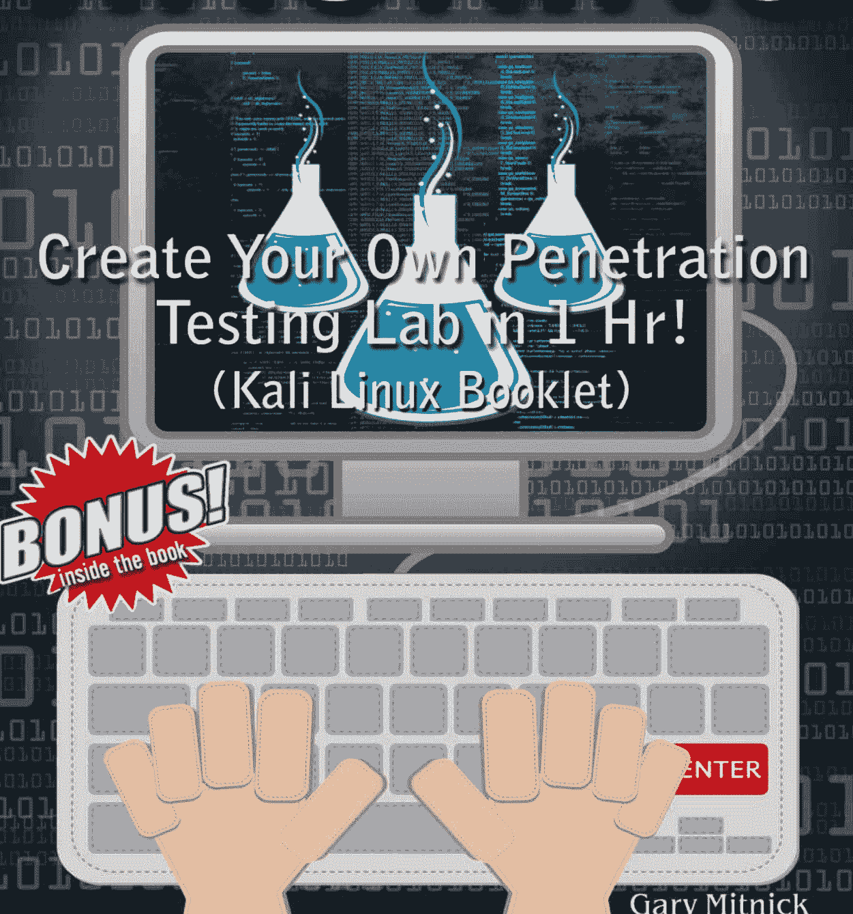

## 欢迎

恭喜！如果你正在阅读这些，说明你即将开启一段精彩的旅程。这段旅程不仅将提高你的技术技能，还将向你介绍信息安全和渗透测试的精彩世界。在本手册中，你将学习如何搭建一个渗透测试实验室，在向世界展示你的能力之前，在一个安全的训练环境中磨练你的黑客技巧。

本书采用循序渐进的方法。我们将从准备硬件和下载所需的软件开始，以确保你的实验室达到专业水平。随后，我们将安装虚拟化软件，最后构建你的虚拟机。准备好了吗？好的，我们开始吧！

## 硬件准备

每一项伟大的人类事业都始于坚实的基础。你的渗透测试实验室的基础是硬件，你需要它来运行多台机器。这些机器将运行不同的操作系统，你需要在这些系统中托管多个服务和应用程序。

本手册旨在构建一个真实的渗透测试实验室，因此我们不仅将配置 `Kali Linux`（一个包含许多你所需的安全工具的平台），还将配置几个可被利用的机器，作为你模拟攻击的目标。通过利用系统来磨练技能将对你成为一名熟练的渗透测试员大帮助。我们希望构建一个可以让你利用并攻破目标的环境，以便在转向真实世界的渗透测试时能够复制这些操作。

你可能认为这听起来非常昂贵，因为实验室需要大量的硬件。好消息是，虚拟化技术将降低你的硬件成本。在过去，虚拟化成为行业标准之前，你需要购买多台机器来托管这些服务器和应用程序，但现在，只要你拥有足够的内存、CPU 和存储资源，你就可以将它们全部托管在一个机器上。

### 最低配置

以下是用于书中搭建渗透测试实验室的虚拟机的最低配置要求：

- `x64 CPU` - 四核 `1.7 GHz`（支持虚拟化）
- `RAM` - `8GB`
- 存储 – `65GB`

这些最低配置将为你提供一个可运行的渗透测试实验室，你有能力同时运行两个或可能三台虚拟机。然而，在某些时刻你可能需要同时运行更多机器，因此本手册建议为你的虚拟机主机采用以下硬件规格。

### 推荐配置

以下是用于书中搭建渗透测试实验室的虚拟机的推荐配置要求：

- `x64 CPU` - `i7 2.8 GHz`（支持虚拟化）
- `RAM` - `16GB`
- 存储 – `135GB`

### 关于竞争的说明

由于你可能同时运行多台机器，每台虚拟机都会与其相邻竞争硬件资源，这可能会导致性能下降。如果可能，将你的虚拟机分散在多个存储设备上。`USB 3` 或更好的 `USB` 存储设备轻松运行虚拟机。将虚拟机分散在多个磁盘上绝对会提高每台设备的性能。

### USB Wi-Fi 适配器

要进行无线渗透测试，你需要一个能够注入包的 `USB Wi-Fi` 适配器。遗憾的是，并不是所有的 `USB Wi-Fi` 适配器都是相同的，有些与你执行无线渗透测试所需的工具不兼容。兼容的 `USB Wi-Fi` 适配器列表请阅读这篇文章：`https://www.raymond.cc/blog/best-compatible-usb-wireless-adapter-for-backtrack-5-and-aircrack-ng/`

### 在 BIOS 中启用虚拟化

为了确保我们可以运行虚拟机，需要配置 `BIOS` 以启用虚拟化。如果不启用此设置，将无法安装托管虚拟机所需的软件。

要实现这一点，你需要在物理机启动期间进入 `BIOS`。每个系统都是不同的，进入 `BIOS` 的按键在不同厂商平台上也不同。通常是 `F2`、`F10`、`F12` 或 `Esc`，请仔细查看启动屏幕，以查看需要按下哪些键进入机器的 `BIOS` 设置。如果你无法在特定机器上找到此设置，也可以通过 `Google` 搜索。

一旦进入 `BIOS` 设置菜单，你将找到虚拟化选项并将其设置为已启用（`enabled`）。下面是一个示例，如你所示，它位于“Advanced”（高级）标签下，因此你可能需要在系统的菜单选项中搜索它。在某些系统中，它可能不显示 `Virtualization`，而是显示“`VT-x`”。

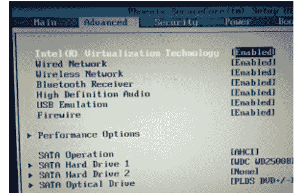

启用此设置后，你可以退出 `BIOS` 菜单。确保记得保存更改。你的系统现在应该会重启，虚拟化也已启用。

### 下载软件

你需要以下软件来创建一个完善的渗透测试实验室：

#### VMware


或者


`VMware Workstation Player` - `VMware Workstation Player`（以前称为 `VMware Player`）是一种适用于运行 `Microsoft Windows` 或 `Linux` 的 `x64` 计算机的虚拟化软件包，由 `VMware` 公司免费提供。你可以从这里下载 `VMware Workstation Player`：`https://my.vmware.com/en/web/vmware/free#desktop_end_user_computing/vn`

如果你使用的是 `Apple Mac`，将需要下载并安装 `VMware Fusion`，这是由 `VMware` 为 `Macintosh` 计算机开发的软件虚拟机监控程序。遗憾的是，`VMware Fusion` 不是免费的，但它提供 `30` 天试用期。你可以从这里下载 `VMware Fusion`：`https://my.vmware.com/en/web/vmware/info/slug/desktop_end_user_computin`

#### Kali Linux

`Kali Linux` 是一种基于 `Debian` 的 `Linux` 发行版，专为数字取证和渗透测试设计。它由 `Offensive Security Ltd` 维护并资助。这将是你的主要攻击平台，你可以从这里下载：`https://www.kali.org/downloads/`

#### Windows

有一些渗透测试工具仅在 `Windows` 上运行，因此在这些情况下准备一个 `Windows` 虚拟机始终是一个好主意。你可以从这里下载 `Windows 10`：`https://www.microsoft.com/en-gb/software-download/windows10ISO`

#### Metasploitable

`Metasploitable` 是一个故意留漏洞的 `Linux` 虚拟机。该虚拟机可以用于安全培训、测试安全工具以及练习常见的渗透测试技术。这将是你的目标之一，你可以从这里下载：

`https://sourceforge.net/projects/metasploitable/`

#### Ubuntu Server

`Ubuntu Server` 版本运行在物理或虚拟服务器上，带有许多企业级功能。我们需要 `Ubuntu Server` 来托管 `DVWA`。你可以从这里下载 `Ubuntu Server`：`https://www.ubuntu.com/download/server`

#### Damn Vulnerable Web App (DVWA)

创建者指出，`Damn Vulnerable Web App`（`DVWA`）是一个极其脆弱的 `PHP/MySQL` Web 应用程序。它的主要目标是作为安全专业人员在法律环境中测试其技能和工具的辅助，帮助 Web 开发人员更好地理解保护 Web 应用程序的过程，并帮助教师/学生在教室环境中教授/学习 Web 应用程序安全。这将是目标之一，你可以从这里下载：`http://www.dvwa.co.uk`

### VMware 的替代方案

有一些 `VMware` 的替代方案，你也可以安装它们来托管你的虚拟机。然而，由于 `Metasploitable` 是原生的 `VMware` 虚拟机，你可能需要根据选择的平台对 `Metasploitable` 虚拟机进行调整。本书将使用 `VMware` 作为虚拟化平台。

#### Virtual Box

`VirtualBox` 是一款跨平台的虚拟化应用程序。它可以运行基于 `Intel` 或 `AMD` 的计算机上，无论运行的是 `Windows`、`Mac`、`Linux` 还是 `Solaris` 系统。你可以从这里下载 `VirtualBox`：`https://www.virtualbox.org/wiki/Downloads`

要在 `VirtualBox` 上安装 `Metasploitable`，你可以按照此博客文章中的详细说明：`http://www.hacking-tutorial.com/tips-and-trick/install-metasploitable-on-virtual-box/#sthash.LMUoK8L5.dpbs`

#### Hyper-V

`Hyper-V` 是一个仅运行在 `Microsoft Windows` 上的原生虚拟机程序。你可以用它创建和运行虚拟机。不建议将 `Hyper-V` 用于渗透测试，因为它不支持 `USB`，而你打算对 `Kali` 或 `Windows` 虚拟机进行任何无线黑客攻击时都需要它。要在你的 `Windows` 机器上启用 `Hyper-V`，请遵循以下步骤：`https://technet.microsoft.com/en-us/library/hh846766(v=ws.11).aspx`

### 安装 VMware

现在我们已经准备好了硬件并下载了所有需要的软件；下一步是在我们的机器上安装 `VMware Workstation Player`，以便我们开始构建虚拟机。

本小册说明了在 `Windows` 上安装 `VMware Workstation Player` 的过程。如需了解如何在 `Apple Mac` 上安装 `VMware Fusion` 的详细说明，请访问此 `VMware` 知识库：`https://kb.vmware.com/selfservice/search.do?language=en_US&cmd=displayKC&externalId=2014097`

双击 `VMware Workstation Player` 安装文件后，将看到一个启动界面。

一旦**欢迎界面打开**，点击“下一步”开始安装。

随后你将看到 **EULA（用户许可许可协议）**。确保你**勾选选框**以接受条款，然后点击“下一步”。

你现在将看到**自定义设置**选项，你可以在此处更改安装目录并启用增强键盘驱动程序。在做出更改后点击“下一步”，或保持默认设置。

然后你将进入**用户体验设置**，你可以在此处选择软件在启动时检查更新，并向 `VMware` 发送匿名数据以帮助改进软件。做出选择后，点击“下一步”。这两个选项都是可选的，不启用它们不会影响 `VMware` 的功能或性能。

接下来，选择你想让软件为你安装的**快捷方式**。桌面 / 开始菜单。做出你的选择后，点击“下一步”。

你现在准备好开始安装了。点击“安装”。

你将看到一个进度屏幕，显示你的机器正在执行安装的进度。

安装完成后，点击“完成”以结束安装并关闭安装向导。

当你第一次启动 `VMware Workstation Player` 时，将看到首次启动欢迎消息。选择“用于非商业用途”并输入你的电子邮件地址。完成后，点击“继续”。

你的 `VMware Workstation Player` 现在已安装完毕并准备就绪。点击“完成”打开管理控制台。

### 安装 Kali Linux

## 在 VMware Workstation Player 上配置虚拟机

在 `VMware Workstation Player` 上运行 `Kali Linux` 的第一步是在开始实际操作系统安装之前配置虚拟机设置。

要开始，如如下所示，在你的 `VMware Workstation Player` 控制台上点击“创建新虚拟机”。

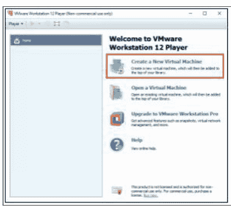

在欢迎界面上，点击“浏览”，并导航到你下载的 `Kali Linux` ISO 所在。然后点击“下一步”。

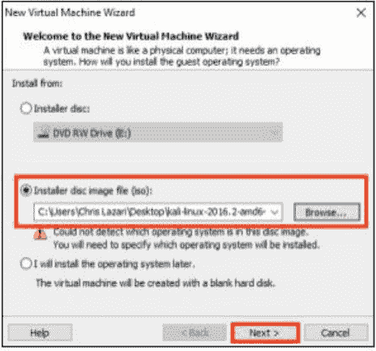

在“选择客户操作系统”屏幕上，**选择 `Linux` 单选按钮**，并在版本下拉列表中**选择 `Ubuntu 64-bit`**。点击“下一步 >”。

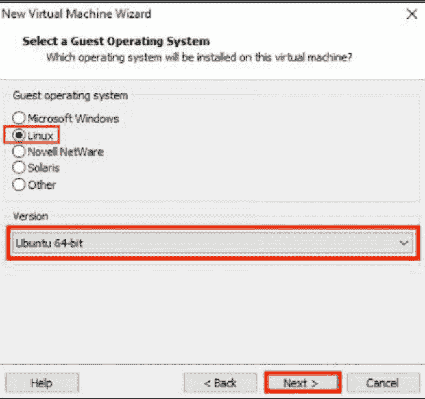

在“命名虚拟机”窗口中，**为你的 `Kali` 虚拟机输入一个名称**，并**配置你希望保存虚拟机文件的位置**。在下面的示例中，机器名称为 `Kali`，选定的虚拟机文件位置为 `C:\VM`。完成后，点击“下一步 >”。

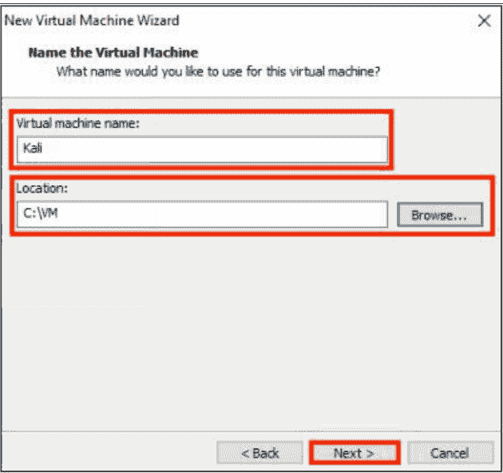

你现在需要指定虚拟机的磁盘容量。越大越好。在下例示例中，我们选择了默认的 `20GB`。然后选择单选按钮将虚拟磁盘存储为单个文件，这将提高虚拟机的性能。完成后，点击“下一步 >”。

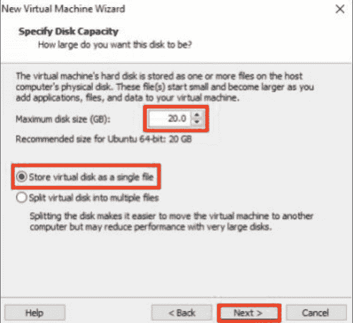

配置现在已完成，但我们需要通过添加更多内存和 `vCPUs` 来自定义我们的虚拟机。点击**“自定义硬件...”**

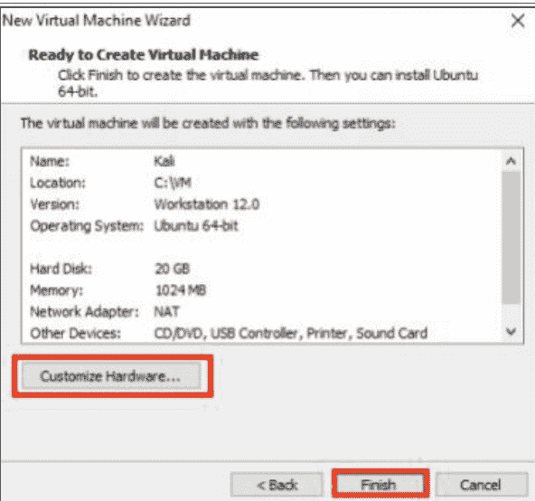

增加虚拟机的内存。越大越好。在下例示例中，我们将其增加到 `2GB`。`Kali Linux` 在 `1 GB` 上运行会非常慢，因此至少分配 `2GB`。完成后，在如下所示的“处理器”中进行。

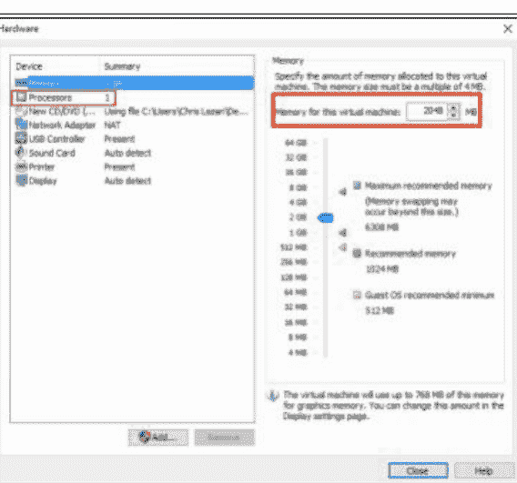

增加你的处理器。和内存一样，越大越好。配置至少 `2` 个 `vCPU`。完成后，点击“关闭”。

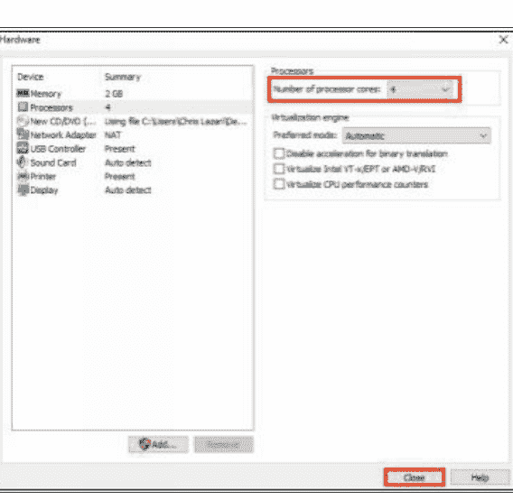

你的配置已完成。点击“完成”。

### 在 VMware 上安装 Kali

现在我们已经配置好了虚拟机，是时候进行实际的 `Kali` 安装了。

要开始，如图像所示，在 `VMware Workstation` 控制台上点击“播放虚拟机”。

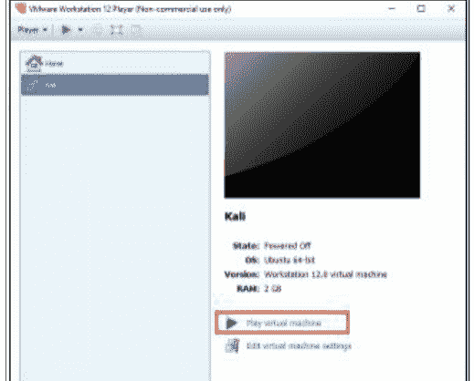

当你首次启动虚拟机时，可能会收到某些警告。阅读警报并接受或拒绝 `VMware` 想要进行的任何更改。如下例所示，我们选择不再接收与键盘相关的错误警告，因为这不会影响虚拟机的性能。

当虚拟机启动时，你将看到启动选项。使用方向键选择“`Graphic Install`（图形化安装）”并按回车。

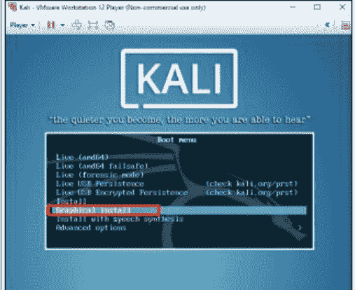

虚拟机启动完成后，你将看到安装向导。第一步是**选择安装语言**。完成后后，点击“**Continue**（继续）”。

下一个屏幕要求你**选择位置**。完成后点击“**Continue**（继续）”。请注意，位置设置将用于配置你的时区设置，请选择正确的位置以确保你的时钟和日期始终正确。

下一个屏幕要求你**选择键盘布局**以便配置你的键盘。选择与你的键盘匹配的布局，然后点击“**Continue**（继续）”。

安装向导现在将加载继续安装所需的安装组件。

一旦安装组件加载完毕，你需要**为你的 `Kali` 实例选择一个主机名**。需要注意的是，在你的渗透测试中这不会是一个问题。但在现实世界的渗透测试中，入侵预防系统（`IPS`）和入侵检测系统（`IDS`）会有警报，寻找网络上名为“`Kali`”的主机，因此在该实例中选择“`Kali`”作为主机名会导致你被发现。选择好主机名后，点击“**Continue**（继续）”。

接下来系统会要求输入域名。如果你有域名，请填入必要信息；或者留空并点击“**Continue**（继续）”。

现在你需要为你的 `Kali` 实例填写 `root` 密码。填写并再次填写以验证，并**记住**它，因为 `Kali Linux` 上没有“忘记密码”选项，所以记住密码至关重要。完成后，点击“**Continue**（继续）”。

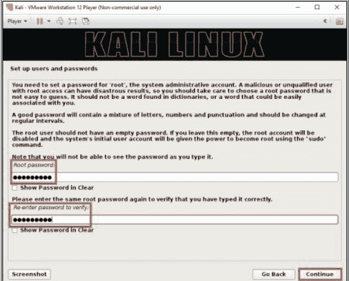

如果你选择具有多个时区的区域，系统会提示你选择特定的时区。如果出现提示，请选择你的时区然后点击“**Continue**（继续）”。

下一步是分区磁盘。如果你不想拥有多个分区，请选择默认的“`Guided – use entire disk`（引导——使用整个磁盘）”。对于初学者，推荐这样做。完成后，点击“**Continue**（继续）”进入下一个屏幕。

你随后将被要求选择在哪个分区上安装 `Kali Linux`。如果你按照本指南操作，你的虚拟机应该只有一个磁盘，选择它并点击“**Continue**（继续）”。

接下来，系统会要求你选择不同的 `Linux` 文件夹和文件位于哪个分区。选择推荐给新用户的默认选项，然后点击“**Continue**（继续）”。

最后，你将看到一个显示磁盘分区配置的确认屏幕。如果你对这些信息满意，点击“**Continue**（继续）”。

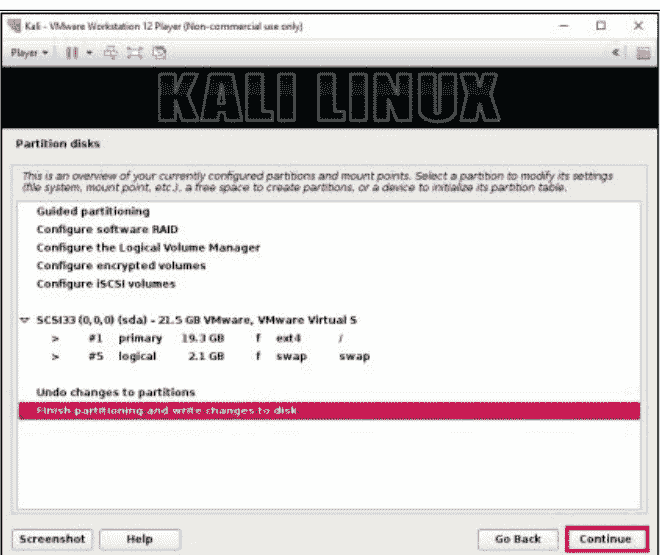

现在系统将最后一次要求确认你的更改。选择“`Yes`（是）”单选按钮，然后点击“**Continue**（继续）”。

安装现在将从 `ISO` 复制文件到你新格式化的硬盘。完成后，系统将询问你是否想使用网络镜像以供下载更新。选择“`Yes`（是）”单选按钮，然后点击“**Continue**（继续）”。

过段时间后，系统将提示你配置包管理器。如果你使用代理访问互联网，请填写相关信息；如果不使用代理，请留空。完成后，点击“**Continue**（继续）”。

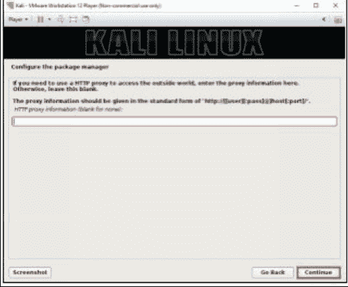

安装向导现在将配置 `APT`，这是 `Kali` 用于安装新软件和更新现有软件的包工具。

`APT` 配置完成后，系统将提示安装 `GRUB` 引导加载程序。选择“`Yes`（是）”单选按钮，然后点击“**Continue**（继续）”。

选择你的启动磁盘（应该是 `/dev/sda`），然后点击“**Continue**（继续）”开始安装 `GRUB`。

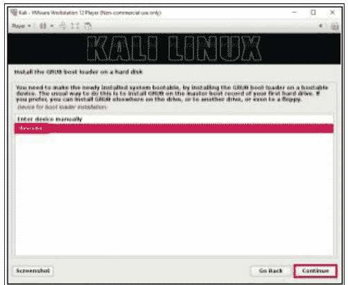

`Kali Linux` 安装向导现在将完成安装。


安装完成后，你将看到“Installation Complete（安装完成）”屏幕。点击“Continue（继续）”以完成安装。

你现在已成功在 VMware Workstation Player 上安装了 Kali Linux。

## 在 VMware 上完成 Kali 安装

现在你已经成功安装了 Kali Linux，你需要安装 VMware Tools 并更新你的 Kali 实例。Kali 现在采用的是所谓的“滚动发行（rolling release）”，因此新功能和更新不断被加入。为了利用这些新功能和补丁，你必须定期更新你的 Kali 实例。

首先让我们安装 VMware Tools。这将提供与宿主机系统更好的集成，并允许你调整屏幕大小，以及从宿主机复制文档到 Kali 虚拟机（反之亦然）。

使用默认用户名“root”登录你的 Kali 虚拟机，然后点击“Next（下一步）”。

输入你在安装期间创建的**密码**，然后点击**Sign In（登录）**。

在 VMware Workstation Player 菜单中点击“Player”，然后“Manage（管理）”，最后点击“Install VMware Tools（安装 VMware Tools）”，如下所示。

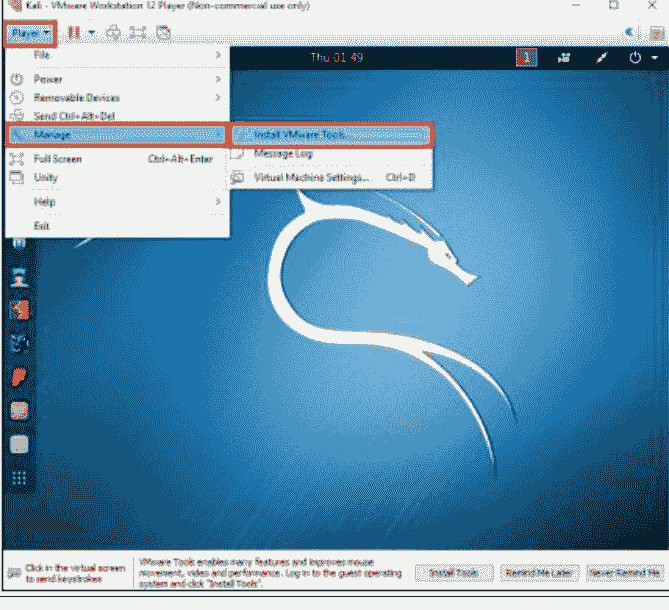

如果提示，选择下载并安装适用于 Linux 的 VMware tools。

如果一切顺利，VMware Workstation Player 应该为你挂载 VMware tools 虚拟光，如下所示。**双击图标打开磁盘镜像。**

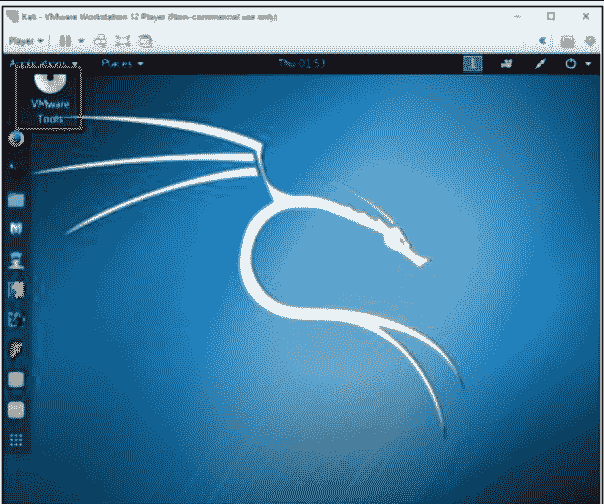

文件夹打开后，**右键点击 tar.gz 文件**并选择“Extract To...（解压到...）”。

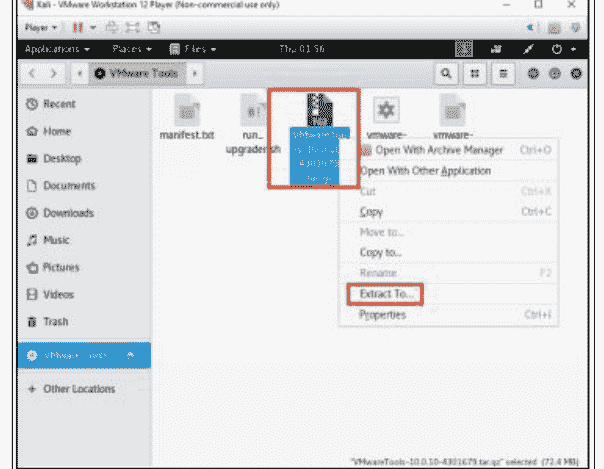

选择将文件和文件夹提取到你的“**Home（主目录）**”目录，然后点击“**Extract（提取）**”。

完成后，按照下图所示，通过 Applications / Favorites / Terminal **打开终端（terminal）**。

在终端提示符处输入“**ls**”获取目录列表，并确保存在 `vmware-tools-distrib`。

然后通过输入命令 `cd vmware-tools-distrib` 进入该目录。

最后通过输入 `./vmware-install.pl` 开始安装。

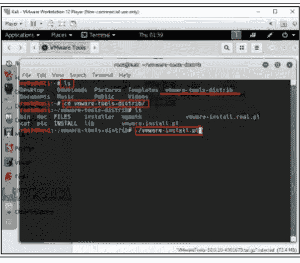

在每个提示处按 Enter（回车）接受所有默认设置。

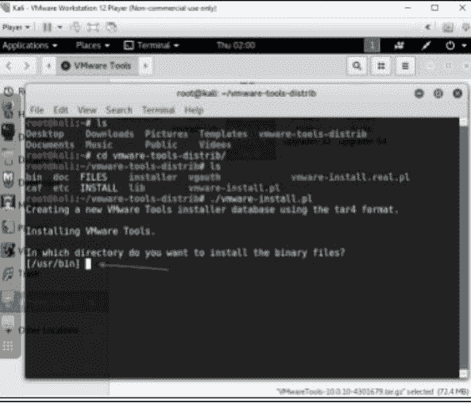

脚本运行结束并在你再次看到提示符后。输入“reboot”重启虚拟机并完成 VMware tools 的安装。

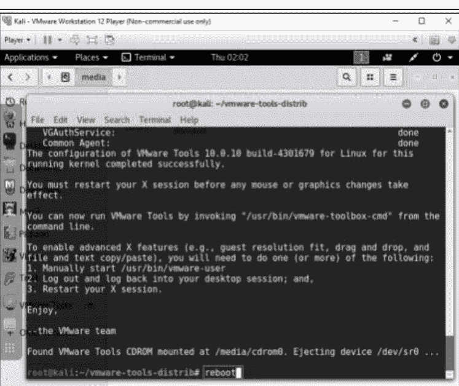

虚拟机重启后，登录系统以便我们运行更新，确保你拥有 Kali Linux 自带的所有软件的最新版本。

打开终端并输入 `sudo apt-get update && sudo apt-get upgrade` 开始该过程。

一旦 Kali 告知你哪些包已过时（如下所示），系统将提示你继续安装。输入 'Y' 继续所有更新，并在该过程完成后重启虚拟机。取决于你的互联网速度和需要的更新数量，这可能需要很长时间。

一旦重启，Kali Linux 的安装和配置即告完成。要关闭机器，点击屏幕右上角的机图标，如所示。

## 安装 Windows 10

### 在 VMware Workstation Player 上配置虚拟机

现在 Kali 已经运行了，让我们安装并配置我们的 Windows 虚拟机吧。

你 Windows 10 虚拟机的配置将与为 Kali Linux 虚拟机进行的配置类似。如果需要复习，请参考 Kali Linux 部分的截图。

在 VMware Workstation Player 中点击“Create a New Virtual Machine（创建新虚拟机）”。

点击**browse（浏览）**并导航到你保存 Windows ISO 的位置。完成后点击“Next >（下一步）”。

在下一个屏幕上，你需要**填写虚拟机名称**（它将显示在 VMware 控制台中），并且你需要为虚拟机文件**指定存储位置**。完成后，点击“Next >（下一步）”。

在接后的屏幕上，你需要为虚拟机指定**硬盘容量**。一如既往，多比少好，所以请相应分配。**60 GB 对于你的 Windows 10 虚拟机来说是足够的。**完成后，点击“Store virtual disk as a single file（将虚拟磁盘存储为单个文件）”单选按钮，然后点击“Next >”。

在下一个屏幕点击“Customize Hardware...（自定义硬件...）”。

在硬件界面点击“Processors（处理器）”以增加处理器数量。

就像存储一样，越多越好。将你的**处理器数量增加到至少 2 个**。建议为你的 Windows 虚拟机分配 4 个处理器。增加完 CPU 后，点击“Close（关闭）”。

最后，点击“完成（Finish）”关闭“创建新虚拟机”向导。

由于硬盘的大小，VMware 可能需要稍长的时间来创建虚拟机。一旦此过程完成，你就可以启动虚拟机了。

### 在 VMware 上安装 Windows 10

一旦启动了虚拟机，系统将提示你开始安装 Windows。从提供的下拉菜单中**选择你的语言、时间和货币格式以及键盘**，然后点击“下一步（Next）”。

在下一个屏幕上点击“现在安装（Install now）”开始安装过程。

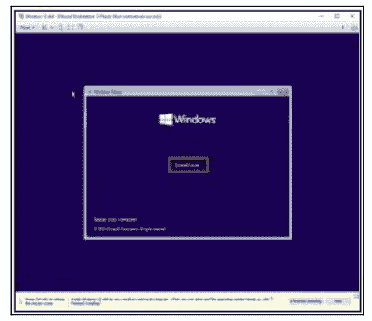

在下一个屏幕，系统会要求输入产品密钥。如果你没有密钥，请点击下方所示所示“我没有产品密钥（I do not have a product key）”。

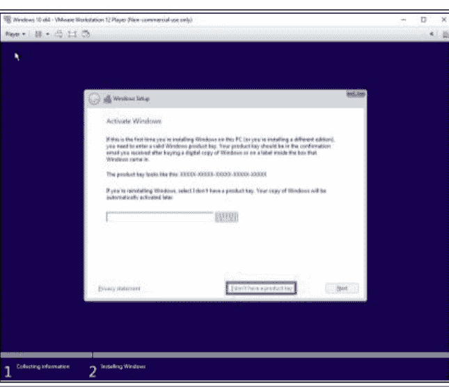

当问及你想安装哪个版本的 Windows 时，选择“Windows 10 Pro”作为要安装的版本，然后点击“下一步”。

在下一个屏幕上，通过勾选下方所示的框来**接受许可条款（Accept the license terms）**，然后点击“下一步”。

在下一个屏幕上，点击“自定义安装 Windows（高级）（Custom Install Windows Only (Advanced))”。

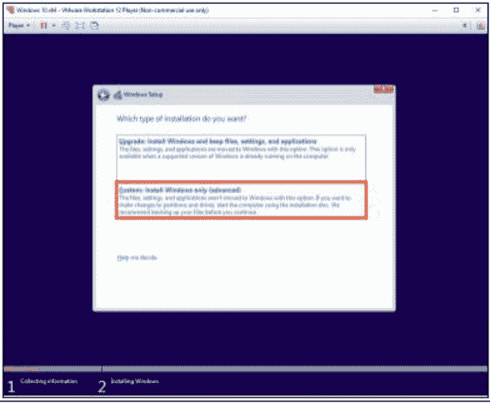

选择硬盘然后点击“开始（Start）”开始安装过程。

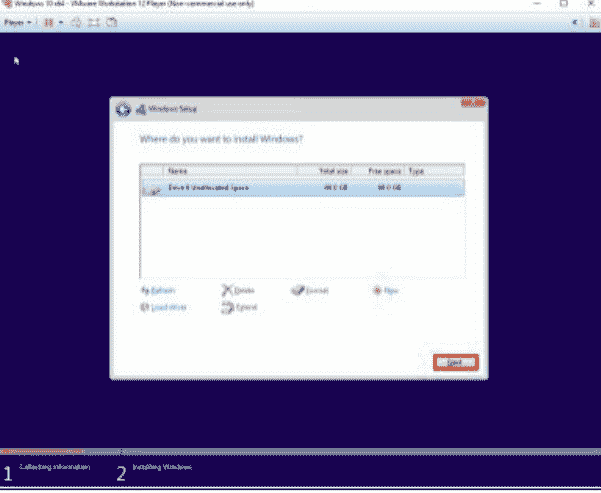

Windows 现在将运行其安装过程并在完成后重启。

### 完成 VMware 上的 Windows 10 安装

一旦 Windows 完成安装过程，将开始配置过程。你可以点击“自定义（Customize）”来自定义每个 Windows 设置，或者像我们在图所示那样点击“使用快速设置（Use Express Settings）”。

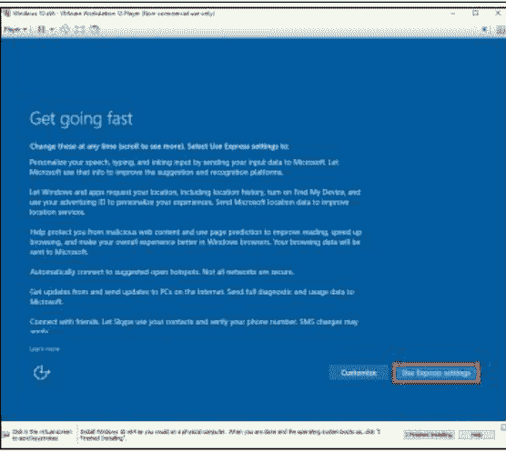

随后系统将要求你**输入用户名、密码并验证你的密码**。完成后，Windows 将完成其设置。

一旦配置过程完成，你将看到 Windows 桌面。

现在我们需要安装“VMware Tools”。点击“Player” > “管理（Manage）” > “安装 VMware Tools...（Install VMware Tools...)”。

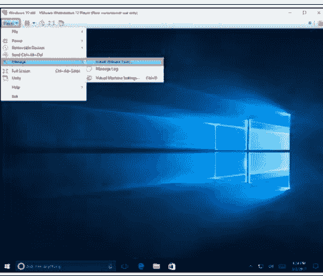

系统可能会提示你下载最新工具。如果是，点击“下载并安装（Download and Install）”。

一旦挂载了 VMware 安装 ISO 镜像，双击 DVD 图标开始安装。

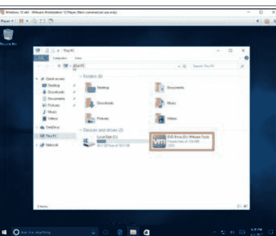

如果出现用户账户控制提示，请点击“是（Yes）”继续。

现在你将看到 VMware Tools 安装向导，点击“下一步（Next >）”继续。

选择“典型（Typical）”设置类型，然后点击“下一步（Next >）”。

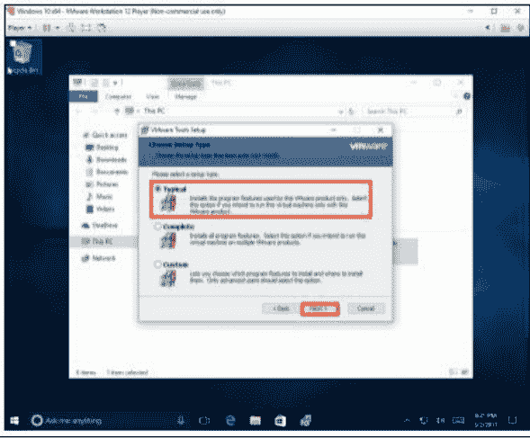

在下一个屏幕上，点击“安装（Install）”安装 VMware Tools。

VMware Tools 现在将安装到你的虚拟机上。

安装完成后，点击“完成（Finish）”关闭安装向导。

你需要重启虚拟机使设置生效。如果提示重启，请点击“是（Yes）”。

你的虚拟机将重启，你的 Windows 机器现在已就绪。

## 导入和配置 Metasploitable VMware 镜像

### 导入 Metasploitable VMware 镜像

Metasploitable 以 VMware 镜像的形式形式下载，因此我们只需要在 VMware 控制台中导入它。首先，我们需要解压下载的 zip 文件。**右键点击该文件**并点击“**提取到（Extract）**”。在打开的对话框中，根据下方图像，**浏览到（browse to the location）**你想存储虚拟机文件的位置。

解压后的文件应该打开，你应该获得如示例所示的一系列 VMware 文件。

| 名称 | 修改日期 | 类型 | 大小 |
|---|---|---|---|
| Metasploitable.nvram | 2012/05/21 12:45 ... | NVRAM 文件 | 9 KB |
| Metasploitable | 2012/05/21 12:46 ... | VMware 虚拟磁盘 | 1 900 864 KB |
| Metasploitable.vmsd | 2012/05/21 12:46 ... | VMSD 文件 | 1 KB |
| Metasploitable | 2012/05/21 12:46 ... | VMware 虚拟机 | 3 KB |
| Metasploitable.vmf | 2012/05/21 12:37 ... | VMXF 文件 | 1 KB |

现在我们已经解压了文件，按照步骤导入虚拟机，以便我们通过 VMware 控制台访问它。开始，打开 VMware Workstation Player 并点击“**打开新虚拟机（Open a New Virtual Machine）**”。

浏览到解压虚拟机文件的位置并点击“**打开（Open）**”。

你的虚拟机现在应该出现在虚拟机列表中。点击“**播放虚拟机（Play virtual machine）**”启动 Metasploitable。

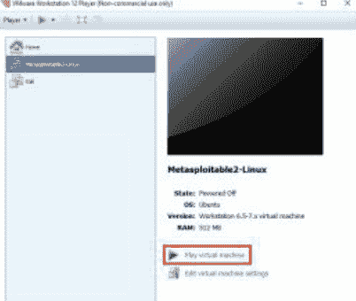

第一次启动 Metasploitable 时，它将按照下方图像提示你。选择“我已复制它（I copied it）”，以便 VMware 为创建一个新的机器 ID。

### 配置 Metasploitable VMware 镜像

为了确保在你的渗透测试实验室中使用 Metasploitable 的体验一致性，我们需要为 Metasploitable 虚拟机配置固定 IP 地址。首先，我们需要在启动 Metasploitable 后登录它，此时会看到下方图像所示的登录提示。**用户名和密码**均为 `msfadmin`。

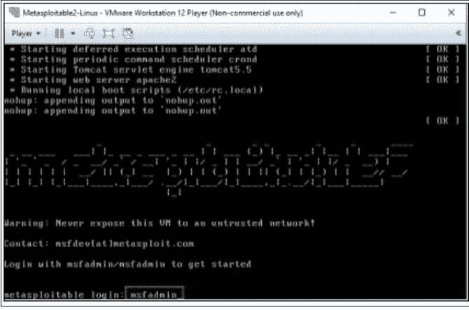

VMWare Workstation Player 为我们在本实验室中创建的所有虚拟机创建了一个 NAT 网络，IP 地址范围在主机之间是随机的。要查看你的 VMware NAT 网络范围，在提示处输入 `ifconfig`。如下方所示，此虚拟机的 IP 地址为 `192.168.83.29`，子网掩码为 `255.255.255.0`。**记下你的**，因为我们在分配固定 IP 时会需要它。

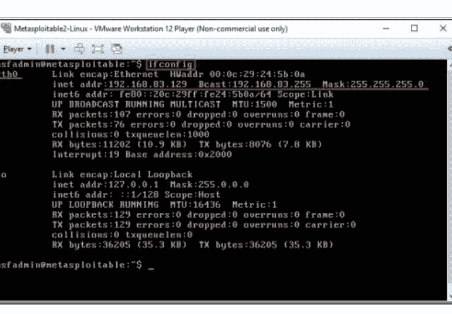

我们还需要确定 VMware 为你的虚拟机分配默认网关。要检查默认网关，在提示处输入 `ip route | grep default`。如下方示例所示，默认网关为 `192.168.56.32`。**记下你的**，因为你将在下一步中需要它。

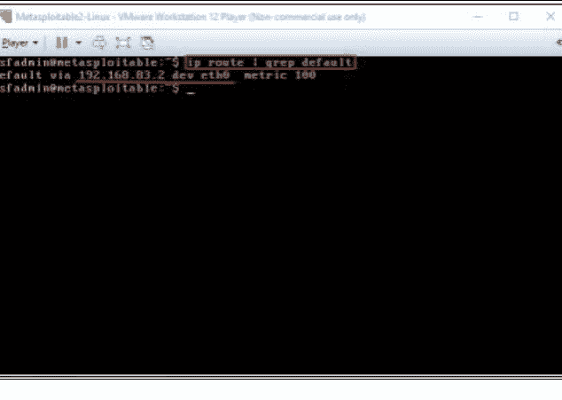

要在 Metasploitable 上设置固定 IP，我们需要配置位于 `/etc/interfaces` 的接口文件。要开始配置，请使用 `sudo nano /etc/interfaces` 打开它。

如果提示输入密码，请使用 `msfadmin`。设置固定 IP，请使用下方图像所示的配置，但记得将你的 NAT 地址更改为 `192.168.83.10`。注意，默认网关和 DNS 服务器都设置为上一步获取的默认网关。配置好文件后，按“Ctrl+x”退出并保存更改。

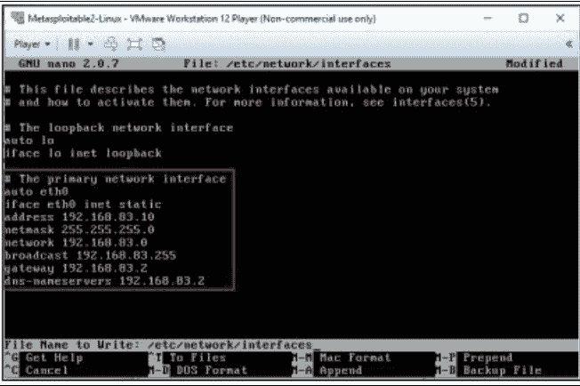

Metasploitable 虚拟机现在已配置完成并就绪。要关闭 Metasploitable，在提示处输入 `sudo shutdown -h 0`，如果提示，请输入 `msfadmin`。

## 安装 DVWA

任何渗透测试实验室如果没有漏洞 Web应用程序是不完整的，所以让我们开始安装易损 Web应用程序（Damn Vulnerable Web App）。DVWA 作为 PHP 运行在 Web 服务器上。在本节中，我们将安装并配置 Ubuntu 服务器，配置 LAMP（Linux, Apache, MySQL, PHP）栈，然后安装 DVWA。

### 在 VMware 上安装 Ubuntu Server

#### 在 VMware 上配置虚拟机并运行“易安装”

VMware Workstation Player 自带一个非常有用的功能称为“易安装（Easy Install）”，它让操作系统安装变得简单。我们将使用此功能安装 Ubuntu 服务器。要开始，像你之前创建 Kali 和 Windows 虚拟机一样点击“创建新虚拟机”。

浏览到 Ubuntu Server ISO 的位置并点击“下一步（Next >）”。

按照下方图像输入易安装所需的的用户信息并点击“下一步（Next >）”。

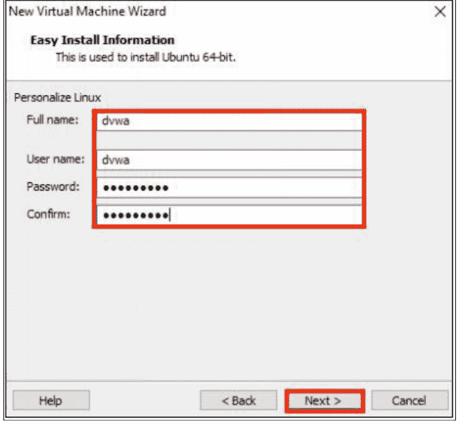

在下一个屏幕上选择磁盘容量。20GB 对于 DVWA 来说绰绰有余。选择“将虚拟磁盘存储为单个文件”，然后点击“下一步 (Next)”。

在下一个屏幕上，点击“自定义硬件... (Customize Hardware...)”。

在硬件界面上点击“处理器 (Processors)”。

将 CPU 数量增加到 2，然后点击“关闭 (Close)”。

点击“完成 (Finish)”完成虚拟机的创建。

VMware Easy Install 现在将为您安装 Ubuntu 服务器，无需任何人工交互。

#### 在 VMware 上完成 Ubuntu 安装

现在我们还需要为 DVVA 服务器分配一个固定 IP 地址。首先，我们需要使用安装过程中创建的凭据登录 Ubuntu 服务器。**输入用户名和密码登录服务器。**

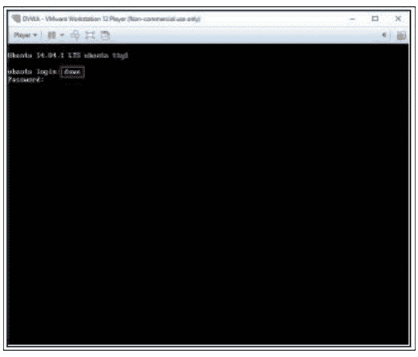

运行 `ifconfig` 命令检查分配给您的 Ubuntu 服务器的 IP 地址配置。**记住它**，因为我们需要设置固定 IP 地址。

输入 `sudo nano /etc/network/interfaces` 并按回车键打开 `interfaces` 文件。如果提示输入管理员密码，输入密码并按回车。

现在修改 `interfaces` 文件，使其与下方示例图中的内容一致。记住您的 IP 地址会有所不同，请确保您创建的固定 IP 在 VMware 为您分配的 NAT IP 范围内。默认网关和 DNS 服务器 IP 地址应与 Metasploable 使用的相同。

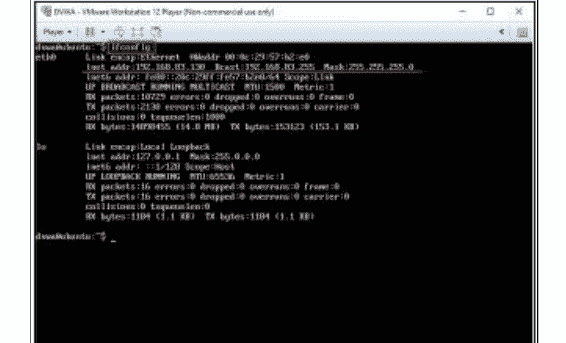

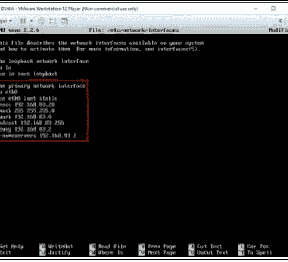

保存更改时，按下 **Ctrl + x**，在确认要**保存更改**后按回车键。完成后，输入 `sudo reboot` 重启虚拟机以使更改生效。

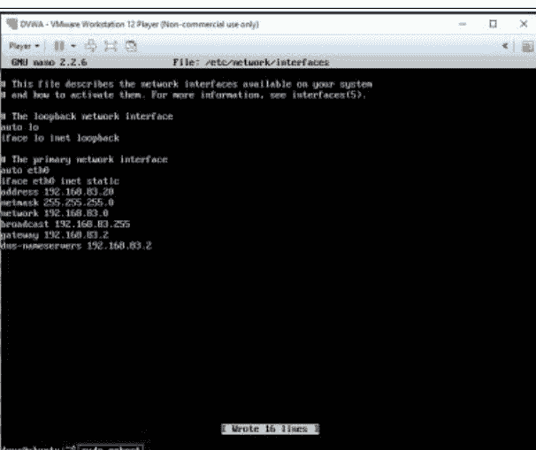

在虚拟机重启并重新登录后，通过输入 `ifconfig` 实际上更改已生效。

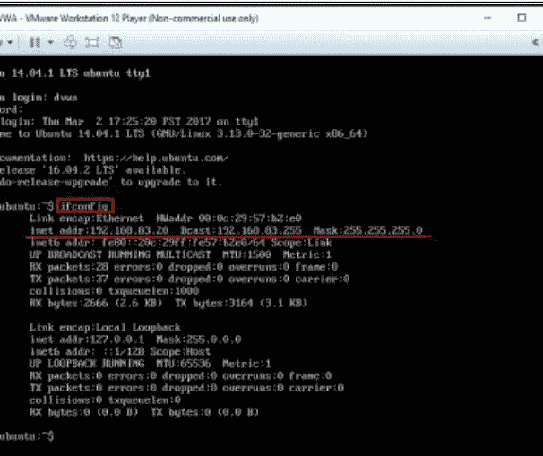

确保 DNS 配置正确且您的 Ubuntu 服务器虚拟机可以访问互联网非常重要，因为您需要它来配置 LAMP 栈。实现此点的快速方法是 ping 一个响应 ICMP 请求的网站地址。运行以下命令 `ping www.news24.com` 测试您的虚拟机。

#### 在 Ubuntu 服务器上配置 LAMP 栈

现在我们已经安装并配置了 Ubuntu 服务器，是时候开始安装 LAMP 栈了。首先，我们将安装 Apache Web 服务器。为此，请在提示符处输入 `sudo apt-get install apache2` 并按回车。如果提示 sudo 密码，输入您的服务器管理员密码并按回车。

您的虚拟机现在将连接互联网寻找安装 Apache 需要的文件。如果一切顺利，您将收到如示例所示的安装提示。输入 `Y` 并按回车。


现在对 LAMP 栈的其他组件重复相同的过程。安装 MySQL 请输入 `sudo apt-get install mysql-server` 并按回车。

在提示符处输入 `Y` 并按回车继续安装。

在 MySQL 安装过程中，系统会提示按图所示为 MySQL 设置 root 密码。输入密码并按回车。记住此密码，因为稍后我们需要安装 PHPMyAdmin 和 DVWA。

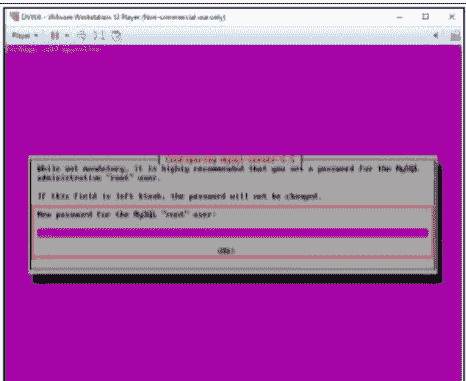

在提示确认密码时，重新输入它并按回车。

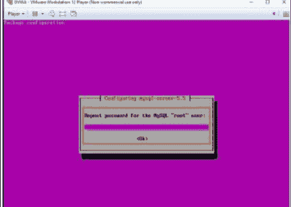

MySQL 完成完成后，现在我们需要安装 PHPMyAdmin，它将安装必要的 PHP 文件以及 PHPMyAdmin 应用程序，我们需要为 DVWA 配置 MySQL。要安装 PHPMyAdmin 请输入 `sudo apt-get install phpmyadmin` 并按回车。

在提示符处输入 `Y` 并按回车继续安装。

在 PHPMyAdmin 安装过程中，将会被要求分配一个 Web 服务器。按下空格键选择 Apache，然后按 Tab 键到“OK”并按回车。

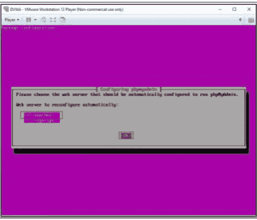

安装过程中您还会被要求设置 PHPMyAdmin 数据库。在收到提示时选择“YES”并按回车。

当提示输入数据库管理员用户密码时，输入您在 MySQL 安装过程中创建的密码并按回车。

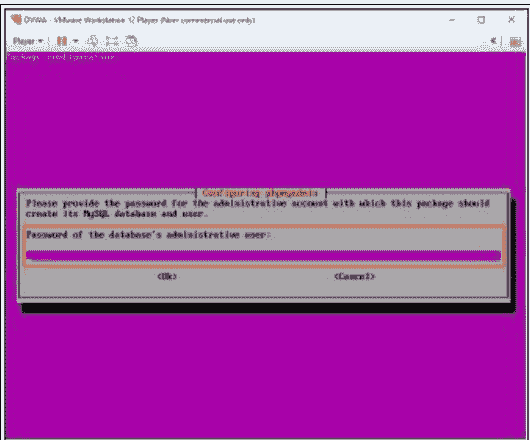

现在您将会被要求为 PHPMyAdmin 创建一个密码。输入密码并按回车。您需要记住此密码，以便稍后在 DVWA 安装过程中登录 PHPMyAdmin。

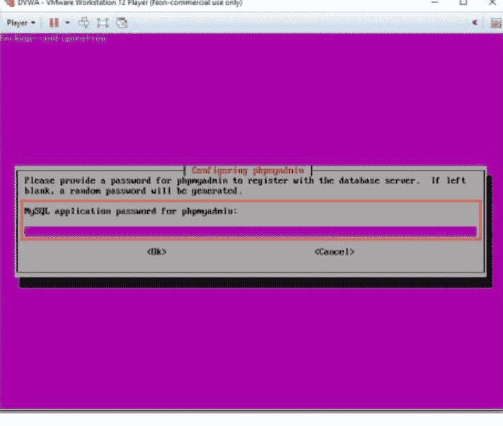

再次输入 PHPMyAdmin 密码以进行确认并按回车。

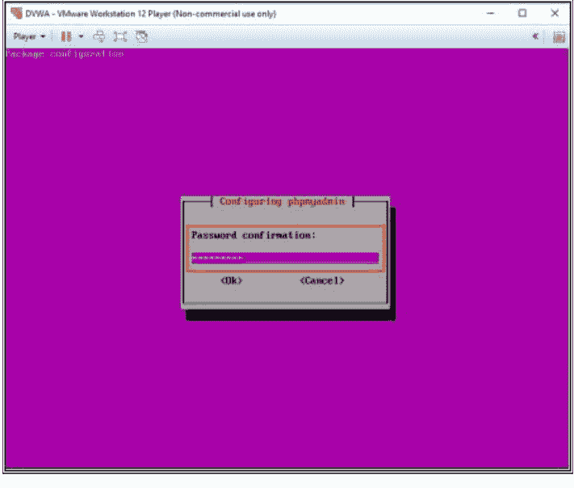

一旦 PHPMyAdmin 安装完成，LAMP 栈的配置即告完成。要测试您的安装情况，请在主机主机或您的 Kali Linux 或 Windows 虚拟机上打开浏览器，并访问 `http://<您的 DVWA 服务器 IP 地址>` 以检查 Apache 是否安装正确。您将看到如示例所示的页面。

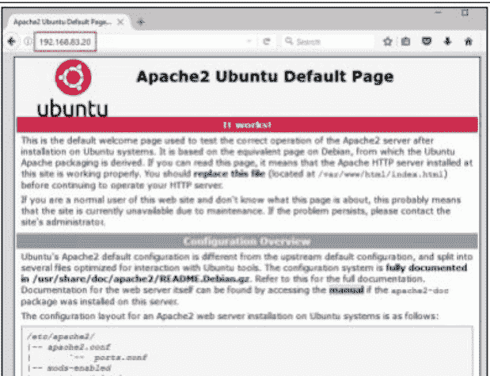

检查您的 PHPMyAdmin 安装。访问 `http://<DVWA 服务器 IP 地址>/phpmyadmin`。您将看到如示例所示的登录界面。输入 `root` 作为用户名，并输入您在安装 PHPMyAdmin 时创建的 PHPMyAdmin 密码。

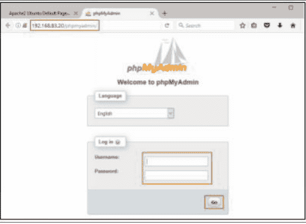

## 安装 DVWA

现在我们已经就绪，是安装和配置 DVWA 的时候。我们需要做的第一件事是创建一个空数据库。登录 PHPMyAdmin 并点击下方图所示的“用户 (Users)”。

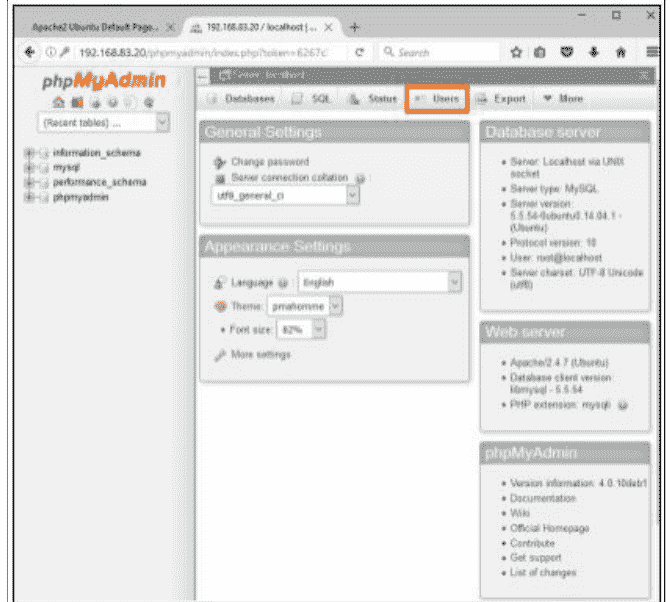

在用户页面上点击“添加用户 (Add User)”。


按照下方图填写必要信息，并记录用户名和密码，因为稍后会需要它们。注意，用户名也将数据库名称，且主机必须设置为 `localhost`。此外，勾选数据库用户区域的两个复选框，填写完所有数据后点击“执行 (Go)”。


现在我们需要登录我们的 Ubuntu 服务器并安装 Unzip，下一步中将用到它。安装 unzip 输入 `sudo apt-get install unzip` 并按回车。如果提示输入 sudo 密码，输入您的服务器管理员密码。

现在我们将使用 wget 下载 DVWA。在提示符处输入：`wget https://github.com/ethicalhackr/DVWA/archive/master.zip`

一旦 DVWA zip 包下载完成，输入 `unzip master.zip` 进行解压。

所有文件和文件夹解压完成后，输入 `ls` 检查目录确认文件已到位，然后 `cd DVWA-master` 接着 `ls`。由于我们需要将所有文件和文件夹复制到目录，输入 `cd ..` 返回上一级。

运行命令 `sudo cp -rf DVWA-master/* /var/www/html` 将所有文件和文件夹复制到 `/var/www/html` 目录。如果提示输入密码，输入您的服务器管理员密码。


为了解决大部分此类问题，我们需要修改 DVWA 的配置文件。在你的 DVWA 服务器上，输入 `sudo nano /var/www/html/config/config.inc.php` 并按回车。

一旦打开了 `config.inc.php` 文件，你需要修改下方示例中高亮的部分。在数据库部分输入你的数据库凭据，并在预留的区域内输入 RECAPTCHA 密钥。你可以通过访问 https://developers.google.com/recaptcha/ 生成 RECAPTCHA 密钥。完成更改后，按 `Ctrl + x` 退出并保存你的更改。

## DVWA - VMware Workstation 12 Player（非商业用途）


如果你在连接 MySQL 数据库时遇到问题，且下方所有变量均如下所示，尝试将 `db_server` 改为 `127.0.0.1`。由于套接引起的问题请使用以下修复：

# 要使用的数据库管理系统

`RDMS = MYSQL;` // 当前禁用

## 变量

警告：`db_database` 下指定的数据库将在设置期间被删除。

```
db_server = '127.0.0.1'
db_database = 'dwan'
db_user = 'dwan'
db_password = 'password'
```

### 使用 PostgreSQL

`RDMS = PostgreSQL;`

### 使用 'RECAPTCHA CAPTCHA'

你需要在此处生成密钥和私密密钥：https://www.google.com/recaptcha/admin/create

```
recaptcha_site_key = '6LCX_T66N55ALQit17ui-daP1B8HMTi_ylq='
recaptcha_secret_key = '6LCX_T66N55ALw_wYAXU00HP2fZ2KiSNUQ='
```

### 默认安全设置

`security` 的默认值为 1。你可能希望将其设置为 `low`、`medium`、`high` 或 `impossible`

`db_security_level = '1'`

现在我们需要让特定的文件夹和文件可写。输入以下命令：

`sudo chmod 777 /var/www/html/hackable/uploads/`

`sudo chmod 777 /var/www/html/external/phpids/0.6/lib/IDS/phpids_log.txt`

最后，我们需要对服务器上的 `php.ini` 文件进行修改。输入 `sudo nano /etc/php5/apache2/php.ini` 来打开 `php.ini` 文件。

由于 `php.ini` 是一个长文件，我们将使用 nano 的搜索功能找到我们需要的位置。按 `Ctrl + W` 打开搜索，输入 `allow_url_include` 并按回车。

按照图像所示，将 `Off` 改为 `On` 来修改设置。


通过 `Ctrl+X` 退出并保存更改来保存 `php.ini` 文件。现在我们需要重启 Apache 服务以确保所有更改生效。为此，输入 `sudo service apache2 restart` 并按回车。

像以前一样在浏览器中访问 DVWA Web 应用，你现在将看到登录界面。默认用户名为 `admin`，默认密码为 `password`。

你的 DVWA 设置页面应该可以正常运行且没有错误。点击 `Create / Reset Database` 以完成安装。


完成后再次登录，你将看到 DVWA 欢迎页面，这意味着你的安装已完全完成。

## 接下来做什么？

干得好。你现在已经完成了你自己的渗透测试实验室的设置。

查看这些资源，你可以开始使用你的渗透测试实验室将你的技能提升到高度。

- http://pen-testing.sans.org/resources
- https://www.owasp.org/index.php/Main_Page
- http://www.securitytube.net
- https://github.com/enaaqx/awesome-pentest
- https://www.cybrary.it
- https://null-byte.wonderhowto.com
- http://www.hackinsight.org
