# KALI LINUX 2016 初学者渗透测试实验室构建指南

## 引言

本指南旨在帮助你开始使用 Gary Mitnick 编写的“初学者完整道德黑客系列”，而无需购买任何专门的渗透测试设备。作为渗透测试的入门，这足以让你起步。当你脱离初学者阶段后，你可能不会再用虚拟机（`VM`）进行测试。你的主机操作系统是什么并不重要，只要你能够启动并运行 `Virtual Box`，步骤都是一样。我建议初学者使用虚拟机的原因是，如果出现问题，你也不会失去整个系统。（这是安全的）

> *本文档是独立完成的，与任何人没有联系。其目的是加快在虚拟机中安装 Kali 的过程。*

目前获取此手稿只有两种方式 – 通过亚马逊和通过我们的邮件列表（免费）。无论您如何获得此副本，我想向您表示感谢，并祝贺您投资于您的计算机知识。

## 开始之前：

课程中使用你现有的设备是没问题的，但课程外的现实世界渗透测试则不然。大多数东西都会工作，顺便说一下，有些东西就是不行。

*注意：* 内部无线网卡是否符合芯片要求？**停止警告：** 使用虚拟机时，`VM` 在 `Kali` 中会显示为以太网适配器 `eth0`。没有外部 `USB` 无线网卡，你就无法进行无线课程。为了冗余，我没有说在虚拟机中使用内部无线网卡。为了能够在 `VM` 中进行无线课程，请搜索适用于 `Kali Linux` 的 `USB` 无线适配器。以下是两个介绍使用什么网站的网站：

- http://www.blackmoreops.com/2014/01/08/recommended-usb-wireless-cards-kali-linux/
- http://www.aircrack-ng.org/doku.php?id=compatibility_drivers
- http://www.wirelesshack.org/top-kali-linux-compatible-usb-adapters-dongles-2015.html

## 更多课程书籍


https://www.amazon.com/dp/B013JB351K/


https://www.amazon.com/dp/B01M15T2GG/

## 飞行前检查清单

- 检查并更新你的 `BIOS`，然后在 `BIOS` 中启用虚拟化。
- 检查当前操作系统上的磁盘空间。你的系统需要 15% 的可用空间，然后你还需要额外的空间用于 `Virtual Box` 和 `Kali`。
*这在开始之前很重要，需要检查。*
- `Hyper-V` *不能*用于本课程。`VMware` 可以，但你应该会使用它。
*注意：* 如果你启用了 `Hyper-V`，在尝试在 `Virtual Box` 中安装 `Kali` 时会出现问题，你将无法看到用于虚拟机的 64 位 Linux 版本，你可以禁用 `Hyper-V` 在 Windows 功能中只需取消选中任何 `Hyper-V` 并重启你的系统。
- 检查你的操作系统版本。它是 64 位还是 32 位？你的所有下载都应与你的系统匹配。*(64 位程序不能在 32 位机器上工作，反之亦然)*
- 下载 `Virtual Box` 和 `Virtual Box` 扩展 - 在创建你的 `Kali` 虚拟机之前安装两者。
https://www.virtualbox.org/wiki/Downloads
- 从 https://www.kali.org/downloads/ 下载 `Kali 2016 ISO`，确保你有完整的下载（某些安全套件可能会阻止此下载） 在连接你的 `USB` 外部无线网卡之前，确保你用 `Virtual Box` 扩展、来宾添加项和已安装更新的 `Kali` 正常运行。

## BIOS 启用虚拟化

在 `BIOS` 中启用虚拟化（如果你不这样做，你将无法看到 64 位版本，并且安装可能会失败）。在物理系统启动期间进入 `BIOS`。每个系统都不同，所以要按的键可能因系统而异。我使用了一台戴尔笔记本电脑，所以我必须按 `F2` 进入 `BIOS`。（google 搜索你的系统）

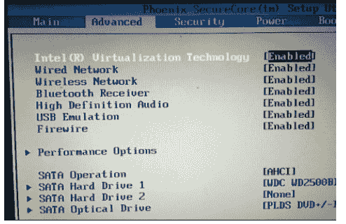

在这种情况下，虚拟化在“高级”选项卡下，你要确保它已启用**（设置虚拟机的大部分麻烦都是因为跳过或没有做这一步）** 一旦你启用了虚拟化，你就想要保存你的更改并退出 `BIOS`。在某些系统中，它可能不称为虚拟化，而是说“`VT-x`”


某些系统可能需要完全关闭电源然后重新启动，以使这生效。你可以向系统制造商或谷歌查询如何进入你的 `BIOS`。你可以在 https://en.wikipedia.org/wiki/BIOS 阅读什么是 `BIOS`

## Virtual Box + 扩展

安装 `Virtual Box`，然后安装 `Virtual Box` 扩展。这些是基本的 Windows 程序，只需对 `Virtual Box` 和 `Virtual Box` 扩展都使用默认设置。如果你的主机系统是 `OS X` 或 `Linux`，你需要进行相同的安装，但要使用与你系统匹配的 `Virtual Box` 版本。创建虚拟机的步骤是相同的。

在 Windows 中，右键点击并选择“以管理员身份运行”选项，以避免任何问题（即使你有管理权限）。如果你不在 Windows 中，请确保你拥有与你的系统 `OS` 匹配的版本。所有下载都可以从 [https://www.virtualbox.org/wiki/Downloads](https://www.virtualbox.org/wiki/Downloads) 找到

你还需要从 [https://www.kali.org/downloads/](https://www.kali.org/downloads/) 下载 `Kali Linux 2016 ISO` 文件，选择与你系统匹配的版本。根据你的操作系统进行安装。如果你有一个 64 位系统，那么下载 64 位版本和 32 位版本并使用 32 位选项。如果你没有虚拟化功能可用，请使用 32 位下载进行安装。

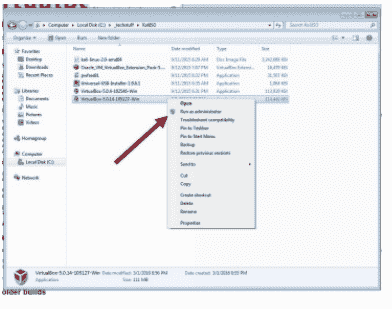

在 Windows 中，以管理员身份运行，完成后关闭并安装 `VBox` 扩展。

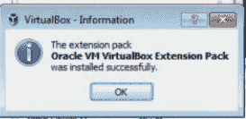

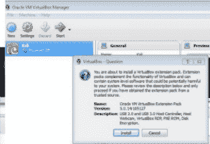

## 构建你的 Kali 虚拟机

启动 `Virtual Box`（我已经在这里安装了另一个 `VM` 中的 `Kali`，这就是为什么你会看到那里有那个图标，我们将在这里创建一个新的 `VM`）

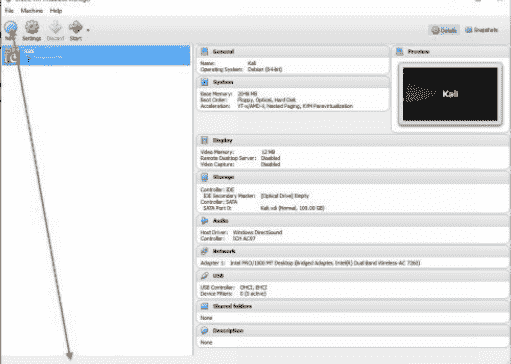

点击“新建”。这开始创建新的 `VM`。

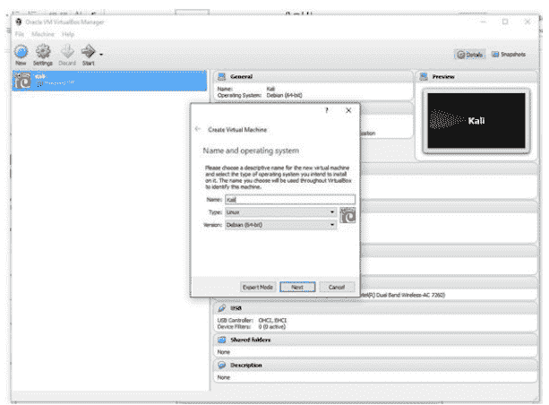

给它一个像“`Kali`”这样的名字，或者你想叫它的任何名字。然后点击“类型”旁边的下拉菜单并选择“`Linux`”

然后选择“`Debian 64位`”（如果你有 64 位系统，并且 `BIOS` 中开启了虚拟化（如果你有 32 位系统，则选择 `Debian 32位` 选项）按“下一步”

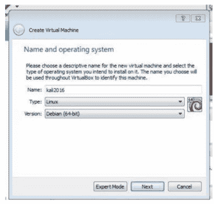

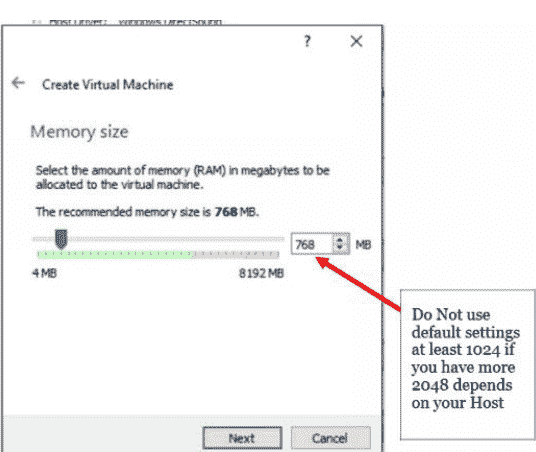

设置你的内存大小，我的机器有 8gig 可用，所以给 `VM` 分配 2 gig。你可以输入你想给 `VM` 分配多少。我选择了 2048。如果需要，这可以稍后更改。（不要给得太少，否则会很慢，给得太多，你的主机系统也会变慢）

接下来，我们将为 `Kali` 创建一块虚拟硬盘。在本示例中，我使用了 32GB。如果你的空间充足，可以分配更多空间。（再次检查一下你实际硬盘上的可用空间）

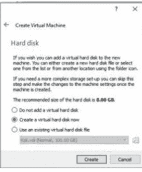

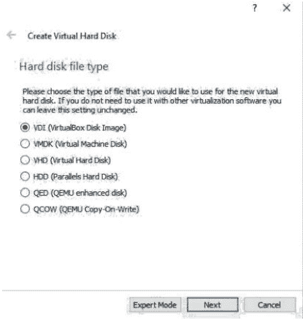

除非你有其他计划，否则请保持默认设置并点击“下一步”。

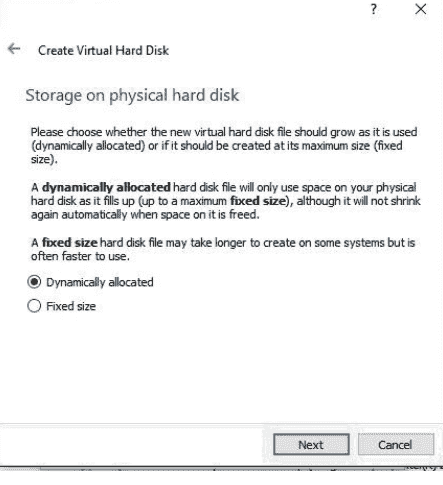

保持默认设置，点击“下一步”。

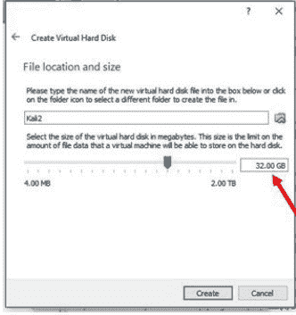

我将此设置为 32GB。如果你有多余空间，请尝试设置为 64GB 并点击“创建”（不要使用默认的 8GB，请修改它）

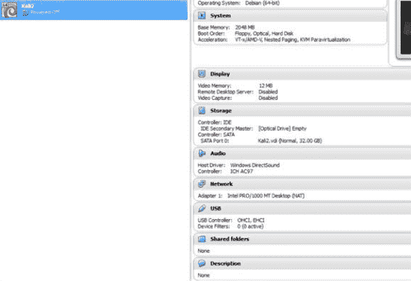

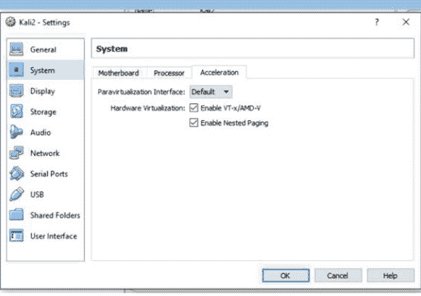


在“系统”下的“加速”选项卡中，所有选项都应被选中（如果你没有在 BIOS 中开启虚拟化，这些选项可能会呈灰色不可用状态）

桥接你的网卡（你实际网卡的名称可能不同），你需要选择主机系统当前用于获取 IP 地址并连接互联网的网卡。

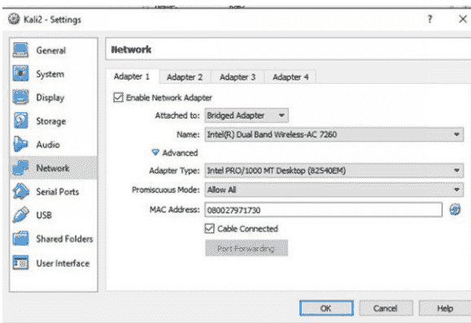

让你的网络设置看起来完全像这样，但使用你现有的网卡，并在高级部分允许所有权限。此时你的虚拟机已准备就绪，点击“确定”，前往 VBox 顶部并点击“启动”。

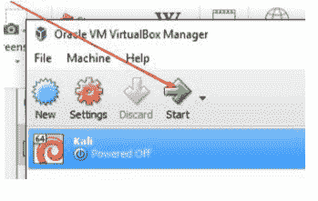

## 安装 Kali ISO

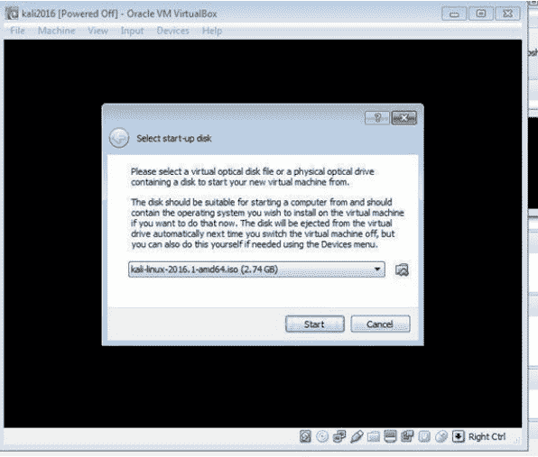


浏览到 2016 版本的 ISO 文件。

会弹出“选择启动磁盘”，请浏览到你下载的 Kali ISO 镜像文件。如果看不到该文件，请使用文件夹图标进行浏览（希望你记得把它放在哪里了），然后点击启动。

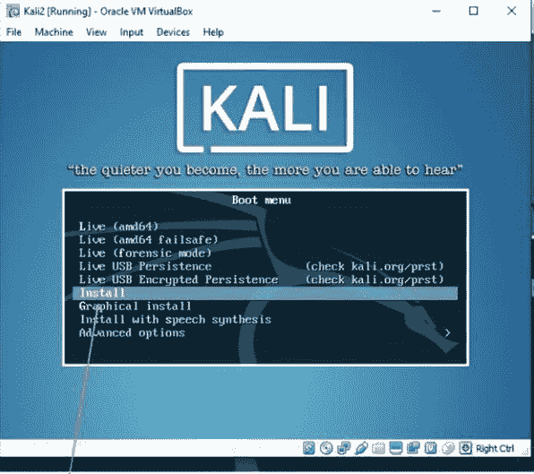

使用“安装”选项，安装过程即开始。

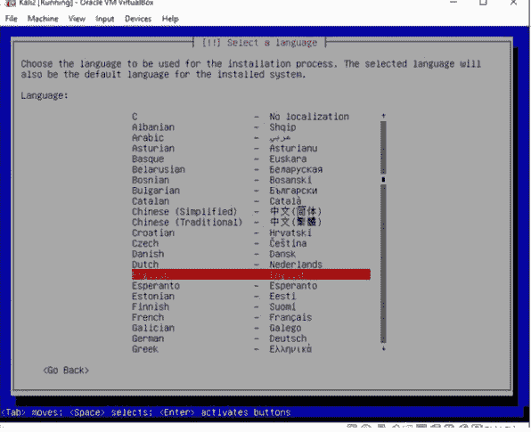

选择你的语言和所在国家。我选择了美式英语（在后续的国家/地区设置屏幕中请保持默认设置）（如果键盘设置错误，之后可能无法登录）

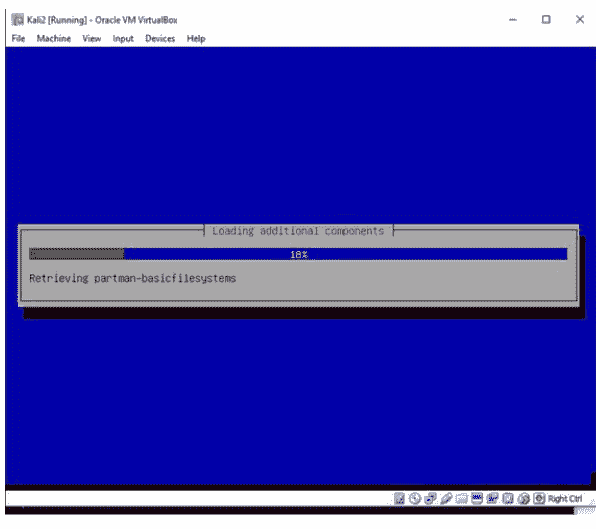

安装应该开始进行。这需要一些时间。（如果你没有分配足够的磁盘空间，此操作可能会失败）

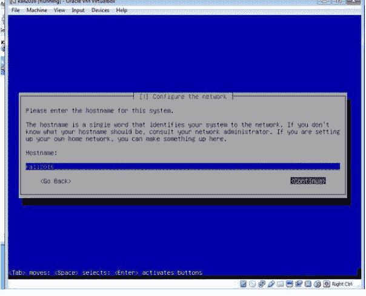

在这里你可以随意命名，但在大多数屏幕中，你可以保持默认设置并按继续键（回车键）。

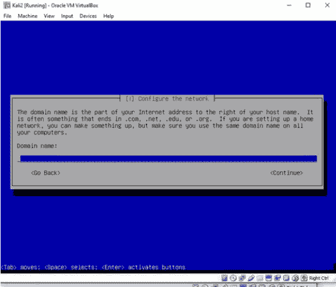

域名不是必须的，直接按继续即可。

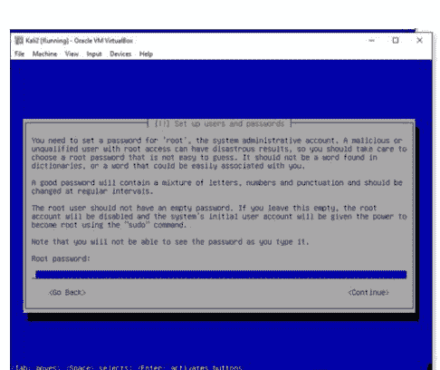

设置你的密码，不要忘记了。它是区分大小写的，并且你需要在下一个屏幕上验证它（重要的是你已经正确设置了语言，否则后续可能会出问题）。设置你的时区（当你启动 Kali 时，确保你的时区和时间设置正确），这可以防止某些程序（如 Tor 浏览器）无法正确加载。

### 配置时钟

如果所需的时区未在列表中显示，请返回“选择语言”步骤，并选择一个使用所需时区的国家（你居住或所在的地区）。

选择你的时区：

- 中部时间 (Central)
- 山地时间 (Mountain)
- 太平洋时间 (Pacific)
- 阿拉斯加时间 (Alaska)
- (夏威夷)
- 亚利桑那时间 (Arizona)
- 东部印第安纳时间 (East Indiana)
- Severo

<返回>

```
<Tab> 移动: <Space> 选择: <Enter> 激活按钮
```

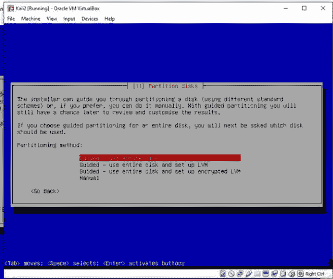

对此项选择默认设置。

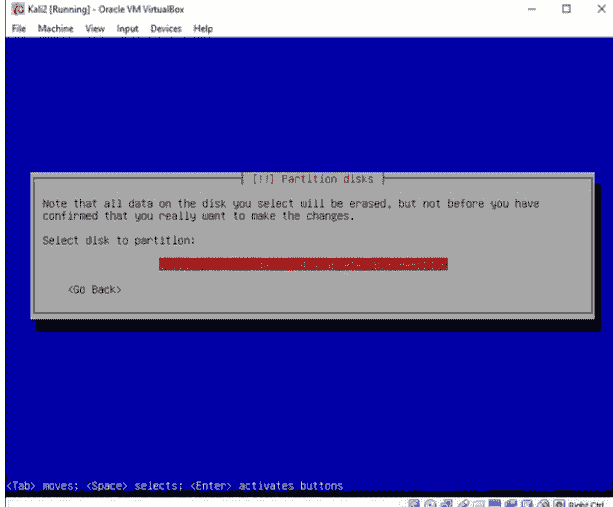

按回车键。

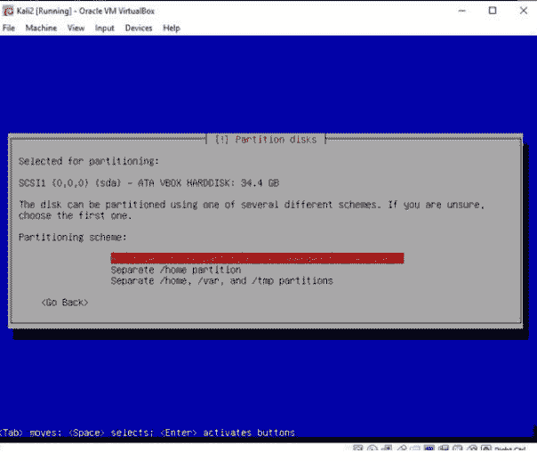

继续选择默认设置，直到你到达“网络镜像”。

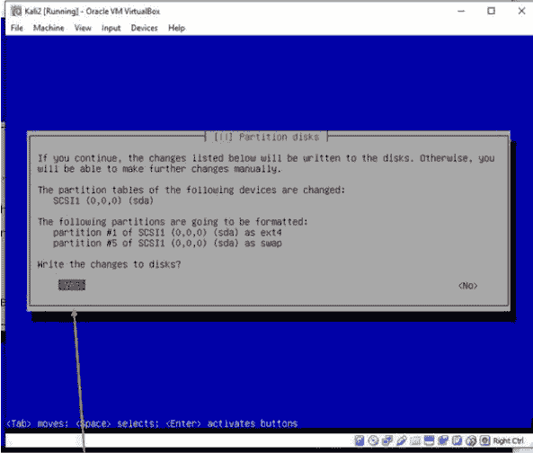

用 Tab 键切换到“是”，按回车键。

安装将开始并持续一段时间，请耐心等待。

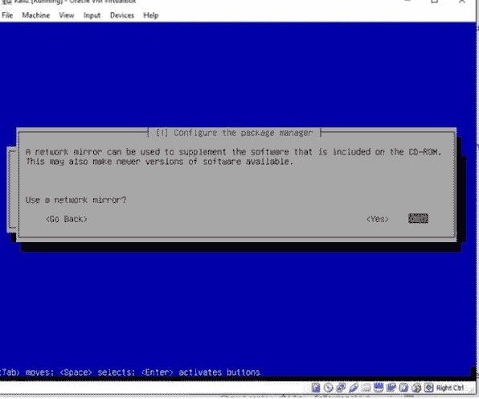

当接近结束时，它会提示关于网络镜像的问题，对此请选择“否”。

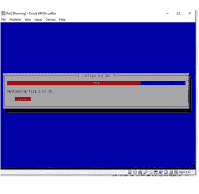

安装将继续进行。

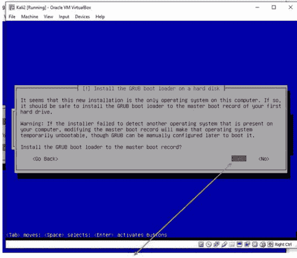

你是在虚拟机中，不要惊慌，点击“是”。

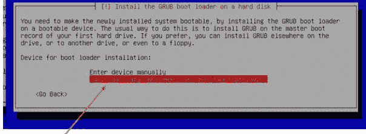

这是一个虚拟机，选择第二个选项，安装将继续进行。这不会触及你的物理硬盘，它将安装在你创建的虚拟硬盘上。

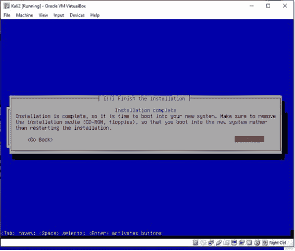

你马上就要完成了。

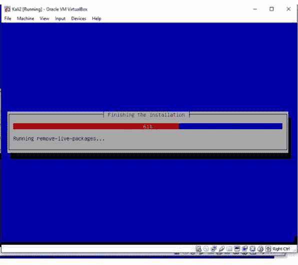

即将完成。

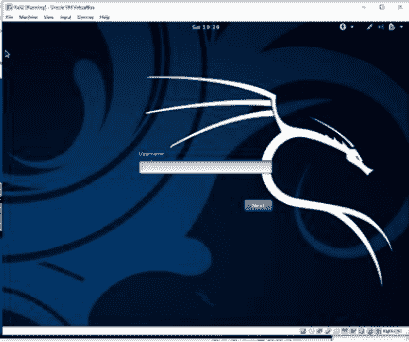

欢迎来到虚拟机中的 KALI，使用 root 用户登录，并使用你之前创建的密码。

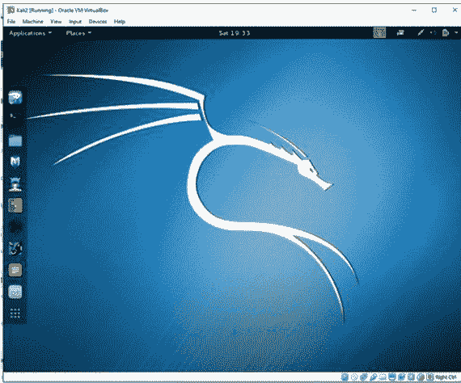

游戏开始了。你既然已经走到了这一步；接下来我们将调整安装设置，为更新和其他互联网功能做好准备。

## 调整你的 Kali 虚拟机

还有最后几步，你的 Kali 虚拟机就可以投入使用了。让我们打开“终端”并验证和更改一些设置。

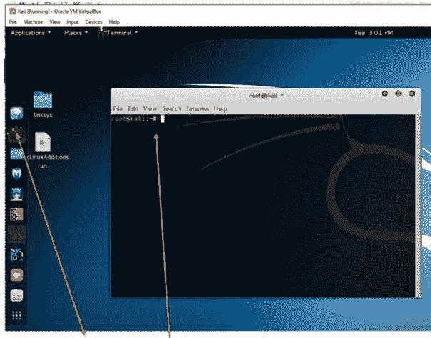

要启动终端：点击 iceweasel 下方的图标，它看起来像命令提示符，当它打开时你会看到这个屏幕。这就是我们要验证一些设置的地方。

将 `NetworkManager.conf` 文件的设置从“false”更改为“true”。

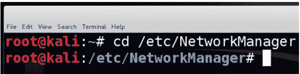

我们要进入包含 `NetworkManager.conf` 文件的目录 - 从提示符处，使用 `cd /etc/NetworkManager` 更改你的目录（区分大小写）你的提示符应该变为该目录。

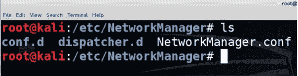

进入该目录后，输入 `ls` 并确认。你将看到“`NetworkManager.conf` 文件”（这里显示为白色）。然后我们要编辑此文件。我们将使用 `nano`（一个文本编辑器）在同一目录中输入 `nano NetworkManager.conf` 并按回车键（区分大小写）

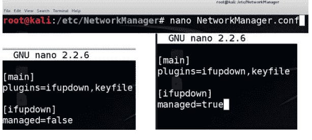

在显示“managed=false”的地方，将其更改为“managed=true”。然后按 `Ctrl+O` 并按回车键保存，再按 `Ctrl+X` 退出编辑器返回终端，看看你是否能 `ping google.com`。

检查你的源文件，以获取正确的 Kali 更新和升级库，当前文件可以在这里找到 <http://docs.kali.org/general-use/kali-linux-sources-list-repositories> 你需要让源文件中的所有行与该文件匹配，以避免重复。我只是清理了我的文件并粘贴了链接中的那些行。让我们检查或清理该文件

```
root@kali:~# cd /etc/apt
root@kali:/etc/apt# ls
apt.conf.d   preferences.d  sources.list-
listchanges.conf  sources.list  sources.list.d
root@kali:/etc/apt#
```

导航到 `cd /etc/apt` 目录并执行 `ls` 再次检查 `sources.list` 文件，我们将再次使用 `nano` 通过输入 `nano sources.list` 来查看此文件。

在这种情况下，我取了链接中的行并粘贴到文件中，清理了其余部分。注意：它们有时会更改 因此你需要查看 docs.kali.org 上的 Kali 文档

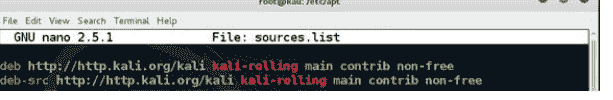

如果它们匹配，你就准备好了；如果不匹配，请再次在 `nano` 会话中进行剪切和粘贴，按 `Ctrl+O` 和回车键保存，按 `Ctrl+X` 退出。

该获取更新和/或升级了。一旦我们有了连接性和源文件中的库，就是检查更新的时候了。

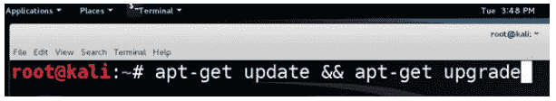

输入 `apt-get update && apt-get upgrade -y`（`-y` 表示自动回答“是”以安装那些需要确认的项目，而不需要你逐个回答）

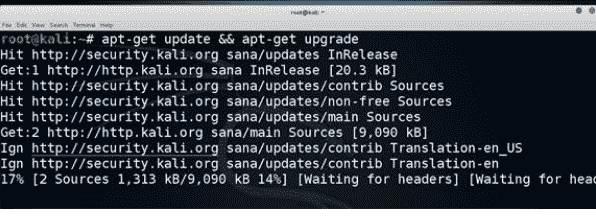


一旦更新开始，请耐心等待，大文件有时看起来像系统卡死了一样，而且第一次这样做可能需要一段时间。（你应该考虑经常这样做，因为经常会有更新）。完成后，你可能会看到一些通知，以“W”开头的仅为警告，不是问题。但是，如果你开始看到以“E”开头的文本，请阅读它们 /检查连接性/ 再次检查源文件。随着新的滚动更新，你还希望运行 `apt-get dist-upgrade`，这也可能需要一段时间。重启 Kali 并再次运行 `apt-get update && apt-get upgrade -y` 以确保你拥有所有内容。

# 安装 Guest Additions

为了让你的虚拟机能够使用 USB 设备和其他系统工具，你需要在 Kali 虚拟机中安装 VBox Guest Additions。（请在开始之前确保已按照上述步骤更新了系统）。没有可选步骤，因此在继续之前，请确保你能成功完成这些操作。

要检查 Linux 内核头文件，你需要找到当前以 `-kali-all-amd64` 结尾的 `linux-headers`。版本会随时间变化。


当你输入 `apt-cache search header | grep -i linux` 时，这将生成一个列表（如果已正确更新）。寻找那个以 `-kali-all-amd64` 结尾的项目。

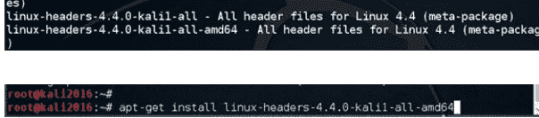

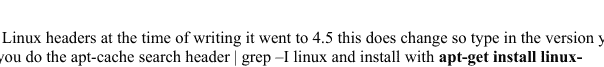

安装 Linux 内核头文件。撰写本文时，版本为 4.5，但这会发生变化，因此请输入你在执行 `apt-cache search header | grep -I linux` 时看到的版本，并使用 `apt-get install linux-headers-4.5.0-kali-all-amd64` 进行安装。

完成后（以防万一），运行 `apt-get update && apt-get upgrade -y`（可能没有可更新的内容，但检查总是好的），然后在终端中输入 `reboot`。

重新登录到 Kali，点击“设备”（Devices），点击“插入 Guest Additions CD 镜像”（Insert Guest Additions CD image）。

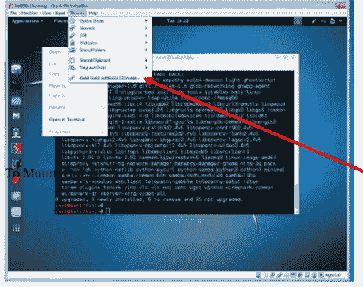

你应该会看到一个 CD 图形和一个“运行”选项。当你点击“运行”时，它会失败。

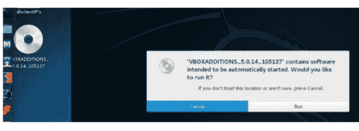

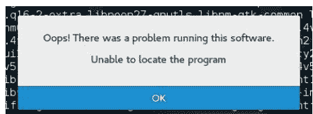

只需点击确定即可。

然后返回终端，导航到你刚刚挂载的介质。输入 `cd /media/cdrom0`，然后输入 `ls` 以验证文件 `VBoxLinuxAdditions.run`。

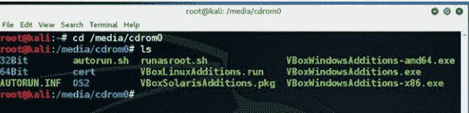

你需要将此文件复制到桌面以便运行它。输入 `cp VBoxLinuxAdditions.run /root/Desktop`（请记住这是区分大小写的）。

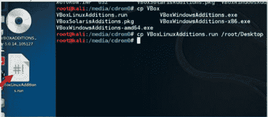

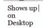


导航回根目录并输入 `cd Desktop`（记住大写 D），然后输入 `ls` 以验证你看到了它。现在通过输入 `./VBoxLinuxAdditions.run` 来运行该文件（你可以复制 & 粘贴）。


你的 Kali 虚拟机已准备就绪，祝使用愉快！

# 资源

- [VBOX & Guest Additions](https://www.virtualbox.org/wiki/Downloads)
- [Kali ISO](https://www.kali.org/downloads/)
- [TOR 浏览器](https://www.torproject.org/)
- [用于你源文件的 Kali 软件库](http://docs.kali.org/general-use/kali-linux-sources-list-repositories)
- [Kali 文档](http://docs.kali.org/)
- [什么是 BIOS](https://en.wikipedia.org/wiki/BIOS)

## 建议具备的条件

- 家用路由器，或邻居的许可，以便你研究它们
- 旧版 Windows PC 用于攻击，或带有 Windows（未打补丁以查看丑陋部分）的虚拟机

# 更多课程书籍


https://www.amazon.com/dp/B013JB351K/


https://www.amazon.com/dp/B01M15T2GG/
