# iPod 与 iTunes 破解指南 (ExtremeTech)

致 Timmy Thomas，无论你身在何处。

# 致谢

执行编辑
Chris Webb

副总裁兼执行小组
出版商

开发编辑
Scott Amerman
Richard Swadley

副总裁兼执行出版经理
Bob Ipsen

制作编辑
Angela M. Smith

副总裁兼出版经理
Joseph B. Wikert

文稿编辑
TechBooks

多媒体开发专家
Angela Denny

编辑经理
Kathryn A. Malm

校对与索引
TechBooks

# 关于作者

Scott Knaster 自早期在 LP-ROM 上听到音乐时代起就开始写作和破解技术。他的书在十多年里一直是 Mac 程序员的必读读目。Scott 最近的一本书是《Mac Toys》（与 John Rizzo 合著）。Scott 拥有每一期《MAD》杂志，这在很大程度上解释了他的人生哲学。

# 致谢

列表中的每个人都是真正的黑客：他们通过扭曲现实来帮助我写完这本书。

David Shayer，笔记之王，提供了大量信息。

Keith Statattenfeld 协助了物流和启发式方法。

John 在第一章中编写了 Celebrity 应用并提供了大量支持。

Greg Marriott 总是乐于助人，提供了关键信息和精彩的故事。

Tony Fadell，主控人，提供了鼓励和见解。

特别感谢共享软件作者们，他们极大增强了我们在 iPad 和 iTunes上的功能。

Carole McClendon 一直顺畅地提供一切支持。

Chris Webb 给了我写爱的机会，Scott Amerman 从头到尾指导了项目。

Barbara Knaster 负责“酷炫”（获取配件样品）以及“许可”（确保我们有权使用拍摄的照片和图像）。

以下公司提供了样品和支持：
- Arkon
- ATI
- Belkin
- Griffin
- Marware
- Sendstation
- Slim Devices
- Ten Technology
- Xtreme

最重要的是，感谢 Devi 熬过了爸爸的又一个冲刺期。

引言 xiii

## 第一部分：破解 iPod

### 第 1 章：酷极了：iPod 上的音乐 ................................... 3
分享你的 iPod ....................................................... 3
创建一个便携式家庭点唱机 ................................... 3
随随地的音乐 ............................................... 5
无需插拔更新 iPod ................................................ 6
使用智能播放列表让你的 iPod 保持新鲜 ................................................ 7
随机播放音乐听听所有歌曲 ................................................ 8
使用重复，使用重复 ................................................................ 9
让音量检查工作 ................................................................. 10
使用均衡器获得极佳音质 ................................................ 11
拖动音乐听你想听的 ................................................. 12
总结 ....................................................................... 12

### 第 2 章：不只是音乐 ............................................................ 13
硬件配件 .............................................................. 13
使用标准火线线 ...................................................... 13
录制语音备忘 ........................................................ 14
存储数字照片 ....................................................... 15
Belkin iPod 阅读器 ........................................................ 16
Belkin iPod 数字相机连接器 ................................................................ 18
从 iPod 启动 ....................................................... 21
使用外部电池 ................................................................. 19
将 iPod 作为光源使用 ....................................................... 19
将 iPod 作为外部驱动器使用 ........................................................ 20
软件 ................................................................................ 22
导入联系人和日历 ................................................................ 22
在 Outlook 中使用联系人和日历 ................................................. 24
进入睡眠并唤醒你的 iPod ................................................................ 29
使用 Apple 的 iPod 脚本 ................................................................ 30
使用 WinAmp 你的 iPod ................................................................ 32
将 iPod 连接到 Mac 和 Windows 电脑 ................................................................ 32

# 第 3 章：超越音乐：硬件

- 探索内置秘密 . . . . . . . . . . . . . . . . . . . . 41
- 使用组合键 . . . . . . . . . . . . . . . . . . . . . 41
- iPod mini . . . . . . . . . . . . . . . . . . . . . . . . . . 42
- 运行 iPod 诊断 . . . . . . . . . . . . . . . . . . . . . . 42
- 听 iPod 扬声器发出的声音 . . . . . . . . . . . . . . . . . 45
- 使用小型外部扬声器 . . . . . . . . . . . . . . . . . . 46
- 使用分线器共享你的 iPod . . . . . . . . . . . . . . . . . . . . 47
- 查看数字电池显示 . . . . . . . . . . . . . . . . . . . . 48
- Mac OS X . . . . . . . . . . . . . . . . . . . . . . . . 49
- 使用 Finder 和实用程序 . . . . . . . . . . . . . . 49
- 使用终端 (`Terminal`) . . . . . . . . . . . . . . . . . . . . . . 50
- Windows XP . . . . . . . . . . . . . . . . . . . . . 52
- 恢复电池图标 . . . . . . . . . . . . . . . . . . . . . 53


# 第 4 章：超越音乐：软件

- 为你的 iPod 获取无线遥控器 . . . . . . . . . . . . 5 53
- 为你的 iPod 穿上保护壳 . . . . . . . . . . . . . . . . . . . . . . . . 54
- SportSuit 转换型保护壳 . . . . . . . . . . . . . 54
- Groove Pulse 三连拍 . . . . . . . . . . . . . . . . . . . . . . . . 54
- Vaja 真皮 . . . . . . . . . . . . . . . . . . . . . . 55
- 为你的 iPod mini 准备的 Icewear . . . . . . . . . . . . . . . . . 55
- 在车载音响中收听你的 iPod . . . . . . . . . . . . . . 56
- 在车内为你的 iPod 供电 . . . . . . . . . . . . . . . . . 60
- 获取终极 iPod 车载套件 . . . . . . . . . . . . . . . . 60
- 更换你的 iPod 电池 . . . . . . . . . . . . . . . . . . 61
- 电池更换手术 . . . . . . . . . . . . . . . 61
- 高级电池信息 . . . . . . . . . . . . . . . . . . 63
- 总结 . . . . . . . . . . . . . . . . . . . . . . . . . . . . . 64

- 查看并复制你的歌曲 . . . . . . . . . . . . . . . 66
- Mac OS X . . . . . . . . . . . . . . . . . . . . . . 67
- 同样的方法，只是更“极客”化 . . . . . . 69
- 为 pod 用户提供的自动化方案 . . . . . . . 72
- Windows XP . . . . . . . . . . . . . . . . . . . . . . 75
- 酷炫工具 . . . . . . . . . . . . . . . . . . . . . . . 77
- 在你的 iPod 上放置大型文本文档 . . . . . . . . 79
- 阅读《美国宪法》 . . . . . . . . . . . . . . . . . . . 81
- 阅读莎士比亚的十四行诗 . . . . . . . . . . . . . . . . . . . 81
- 获取新闻、天气、电影列表及更多信息 . . . . . . . . . . . . . 82
- 不仅仅是信息 . . . . . . . . . . . . . . . . . . . . . 85
- 与 Microsoft Outlook 同步你的 iPod . . . . . . . . . . . . . 86
- PocketMac . . . . . . . . . . . . . . . . . . . . . 88
- 从 Windows 通讯录导出 . . . . . . . . . . . . . 91
- 在你的 iPod 上收读电子邮件 . . . . . . . . . . . . . . . 93
- 在你的 iPod 上运行 Linux . . . . . . . . . . . . . . . 95
- 总结 . . . . . . . . . . . . . . . . . . . . . . . . . . . . 99

## 第二部分：破解 iTunes

# 第 5 章：玩转你的音乐

- 播放列表 . . . . . . . . . . . . . . . . . . . . . . . . . . . . 103
- 将选择转换为播放列表 . . . . . . . . . . . . . . . . . . . . . 103
- 创建最新播放列表 . . . . . . . . . . . . . . . . . . . . . . . . 105
- 智能播放列表的更多想法 . . . . . . . . . . . . . . . . . . . . 106
- 所有未勾选歌曲 . . . . . . . . . . . . . . . . . . . . . . . 107
- 流媒体播放列表 . . . . . . . . . . . . . . . . . . . . . . . . 108
- 拖拽以创建播放列表 . . . . . . . . . . . . . . . . . . . . . . . . 110
- 查看下方 . . . . . . . . . . . . . . . . . . . . . . . . . . . . 111
- 使用快捷键操作播放列表 . . . . . . . . . . . . . . . . . . . . . . 115
- 创建一个新的智能播放列表 . . . . . . . . . . . . . . . . . . . . . . . 115
- 随机播放列表 . . . . . . . . . . . . . . . . . . . . . . 116
- 通过播放列表删除歌曲 . . . . . . . . . . . . . . . . . . . . . . . 118
- 修改播放顺序 . . . . . . . . . . . . . . . . . . . . . . . . 119
- 以不同顺序播放歌曲 . . . . . . . . . . . . . . . . . . . . . . . . 119
- 永久更改顺序 . . . . . . . . . . . . . . . . . . . . . . . . . 120
- 查看精确统计数据 . . . . . . . . . . . . . . . . . . . . . . . . 121
- 重置播放计数 . . . . . . . . . . . . . . . . . . . . . . . . . . 122
- 将播放列表移动到另一台电脑 . . . . . . . . . . . . . . . . . . . . 122
- 收听流媒体电台 . . . . . . . . . . . . . . . . . . . . . . . . . . 124
- 关闭流媒体电台 . . . . . . . . . . . . . . . . . . . . . . . . . . 125
- 使用列表列进行均衡器设置 . . . . . . . . . . . . . . . . . . . . . 127
- 在 iTunes 中打开多个窗口 . . . . . . . . . . . . . . . . . . . . 127
- 使用 iTunes 窗口模式 . . . . . . . . . . . . . . . . . . . . . . . . . . 128
- 使用后退箭头 . . . . . . . . . . . . . . . . . . . . . . . . . . . 129
- 获取专辑封面 . . . . . . . . . . . . . . . . . . . . . . . . . . . . . . 131
- iTunes 目录 . . . . . . . . . . . . . . . . . . . . . . . . . . . . . . . 131
- 整理 (Clutter) . . . . . . . . . . . . . . . . . . . . . . . . . . . . 132
- Art4iTunes . . . . . . . . . . . . . . . . . . . . . . . . . . . . . . 132
- 总结 . . . . . . . . . . . . . . . . . . . . . . . . . . . . . . . 133

# 第 6 章：极致音乐播放

- AppleScript . . . . . . . . . . . . . . . . . . . . . . . . . . . . . . 133
- 在 iTunes 中开启 AppleScript . . . . . . . . . . . 134
- 从网络获取信息 . . . . . . . . . . . . . . . . . . . . 135
- 批量勾选或取消勾选歌曲 . . . . . . . . . . . . . 137
- 导出库列表 . . . . . . . . . . . . . 137
- 杂项小技巧 . . . . . . . . . . . . . . . . . . . . . . . . . 138


- Doug 为 iTunes 编写的 AppleScripts . . . . . . . . . . . . . . . 140
- 处理重复歌曲 . . . . . . . . . . . . . . . . . . . . . . . . . 140
- 删除重复项 . . . . . . . . . . . . . . . . . . . . . . . . . 141
- 将重复项移至垃圾桶 . . . . . . . . . . . . . . . . . . . . . . . 142
- 处理同名歌曲 . . . . . . . . . . . . . . . . . . . . . . . . . 142
- 汇总所有重复项 . . . . . . . . . . . . . . . . . . . . . . . . . 142
- 清理无效歌曲 (dead tracks) . . . . . . . . . . . . . . . . . . . . . 142
- 列出缺失歌曲 (MIAs) . . . . . . . . . . . . . . . . . . . . . . . . . 143
- 删除无效歌曲 . . . . . . . . . . . . . . . . . . . . . 143
- 强力删除无效歌曲 . . . . . . . . . . . . . . . . . 144
- iTunes CPR (歌曲修复程序) . . . . . . . . . . . . . . . . . . . . . . . 144
- 修复错误的标签信息 . . . . . . . . . . . . . . . . . . . . . . . . 145
- 交换标签名和歌手 . . . . . . . . . . . . . . . . . . . 145
- “这个、那个标签” . . . . . . . . . . . . . . . . . . . . . . . . . 146
- 让 iTunes 成为闹钟 . . . . . . . . . . . . . 147
- 启动 iTunes . . . . . . . . . . . . . . . . . . . . . . . 147
- 闹钟应用程序 . . . . . . . . . . . . . . . . . . 147
- 街头自豪感淡出 (Street pride fade out) . . . . . . . . . . . 148
- 修改播放次数 . . . . . . . . . . . . . . . . . . . . . . . . . 149
- 脚本带来的更多乐趣 . . . . . . . . . . . . . . . . . . . . . . . 149
- 使用 Google 获取专辑封面 . . . . . 150
- Google 歌词搜索 . . . . . . . . . . . . . . . . . . 150
- 在 iChat AV 中显示正在播放 . . . . . . . . . . . 150
- 获取更多 iTunes 脚本 . . . . . . . . . . . . . . 151
- 编写你自己的脚本 . . . . . . . . . . . 151
- 查看脚本 . . . . . . . . . . . . . . . . . . . . . . . . 151
- 如何获取更多信息 . . . . . . . . . . . . . . 152
- 精通视觉效果器 . . . . . . . . . . . . . . . 153
- 设置视觉化器选项 . . . . . . . . . . . . . . . . . . . . 153
- 设置视觉效果的大小 . . . . . . . . . . . . . . . . . . . . 156
- 将视觉化器作为屏幕保护程序使用 . . . . . . . . . . . . . . . . 156
- 获取视觉化器插件 . . . . . . . . . . . . . . . . . . . . 156
- 创建您自己的视觉化器插件 . . . . . . . . . . . . . . . . 157
- 总结 . . . . . . . . . . . . . . . . . . . . . . . . . . . . . . . . . 158

## 第 7 章：iTunes 与硬件

- 广播您的 iTunes . . . . . . . . . . . . . . . . . . . . . 160
- 使用无线耳机听歌 . . . . . . . . . . . . . . . . . . . . 160
- 通过 WiFi 播放音乐 . . . . . . . . . . . . . . . . . . . . . . . . . . 161
- 通过遥控器运行视觉化器 . . . . . . . . . . . . . . . . . 166
- 使用 ATI Remote Wonder 控制您的电脑 . . . . . . 166
- 获取 Keyspan 数字媒体遥控器 . . . . . . . . . . . . . 166
- 在您的 TiVo 上播放曲目 . . . . . . . . . . . . . . . . . . . . . . . 169
- 设置“正在播放”标志 . . . . . . . . . . . . . . . . . . . . . . . 170
- 总结 . . . . . . . . . . . . . . . . . . . . . . . . . . . . . . . . 170

## 第 8 章：音乐入库

- 保持您的音乐为 CD 音质 . . . . . . . . . . . . . . . . . 172
- 通过拖拽将文件添加到库中 . . . . . . . . . . . . . . . . 174
- 自动完成您的 CD 刻录 . . . . . . . . . . . . . . . . . . . . 175
- 设置 iTunes . . . . . . . . . . . . . . . . . . . . . . . 176
- 最佳硬件 . . . . . . . . . . . . . . . . . . . . . . 177
- 执行刻录操作 . . . . . . . . . . . . . . . . . . . 177
- 将所有音乐汇集在一处 . . . . . . . 178
- 合并现场 CD 中的曲目 . . . . . . . . . . . . . . . . . . . . . 179
- 录制电脑播放的任何内容 . . . . . . . . . . . . . 184
- Macintosh 程序 . . . . . . . . . . . . . . . . . . . . . 184
- Windows 程序 . . . . . . . . . . . . . . . . . . . . . . 185
- 将流媒体转换为歌曲 . . . . . . . . . . . . . . 186
- Windows 程序 . . . . . . . . . . . . . . . . . . . . . . . 187
- Macintosh 程序 . . . . . . . . . . . . . . . . . . . . . 187
- 进行调整 . . . . . . . . . . . . . . . . 188
- 将 LP 唱片导入 iTunes . . . . . . . . . . . . . . . . . . . . 189
- 刻录顽固的 CD . . . . . . . . . . . . . . . . . . . . . . 189
- 获取法的免费曲目 . . . . . . . . . . . . . . . . . . . 190
- 艺术家 . . . . . . . . . . . . . . . . . . . . . . . 191
- 唱片公司 . . . . . . . . . . . . . . . . . . . 193
- 网站 . . . . . . . . . . . 193
- 总结 . . . . . . . . . . . . . . . . . . . . . . . . . . . . . . . . . 195

## 第 9 章：音乐出库：刻录及其他

- 使用 MP3 制作一张 12 小时的 CD . . . . . . . . . . . . . . . . . . . 198
- 制作混录 DVD . . . . . . . . . . . . . . . . . . . . . . . . . 199


- 创建无缝播放的音乐 CD . . . . . . . . . . . . . . . . . . . . . 201
- 从专辑刻录 CD . . . . . . . . . . . . . . . . . . . . . . . 202
- 按照意愿刻录许多歌曲 . . . . . . . . . . . . . . . . . . . . . 203
- 刻录长播放列表 . . . . . . . . . . . . . . . . . . . . . . . 204
- 调整“音量上和下” . . . . . . . . . . . . . . . . . . . . . . 205
- 通过拖拽获取音乐 . . . . . . . . . . . . . . . . . . . . . . . . 207
- 恢复您的音乐 . . . . . . . . . . . . . . . . . . . . . . . . . 207
- 总结 . . . . . . . . . . . . . . . . . . . . . . . . . . . . . . . . 208

## 第 10 章：音乐库：整理 . . . . . . . . . . . . . . . . . . . . . 209
- 转换音频格式 . . . . . . . . . . . . . . . . 209
- 转换：可行的 . . . . . . . . . . . . . . . . . . . . . 210
- 跨平台磁盘 . . . . . . . . . . . . . . . . . . . . . . . . 211
- 删除播放列表和所有歌曲 . . . . . . . . . . . . . . . . . . . 213
- 在您的电脑上听所有音乐 . . . . . . . . . . . . . . . . . . 214
- 查找所有播放列表 . . . . . . . . . . . . . . . . . . . . . . . 216
- 调整音乐库的外观 . . . . . . . . . . . . . . . . . . . . . . 217
- 移除“类型”列 . . . . . . . . . . . . . . . . . . . . . . . 217
- 手动调整列 . . . . . . . . . . . . . . . . . . . . . . . 218
- 使用浏览器 . . . . . . . . . . . . . . . . . . . . . . . . . . 219
- 在地编辑 . . . . . . . . . . . . . . . . . . . . . . . . . . 219
- 播放列表艺术 . . . . . . . . . . . . . . . . . . . . . . . . . . . 219
- 查看专辑封面 . . . . . . . . . . . . . . . . . . . . . . . . . . 221
- 大小很重要 . . . . . . . . . . . . . . . . . . . . . . . . . . . 222
- 总结 . . . . . . . . . . . . . . . . . . . . . . . . . . . . . . . . 222

## 第 11 章：iTunes 音乐商店 . . . . . . . . . . . . . . . . . . . . 223
- 逛逛商店 . . . . . . . . . . . . . . . . . . 223
- 使用导航工具 . . . . . . . . . . . . . . . . . . . . . . . 223
- 缩小您的搜索范围 . . . . . . . . . . . . . . . . . . . . . . . . 225
- 使用浏览器查找音乐 . . . . . . . . . . . . . . . . . . . . . . 226
- 浏览类型页面 . . . . . . . . . . . . . . . . . . . . . . . . 227
- 查找所有新音乐 . . . . . . . . . . . . . . . . . . . . . . . 227
- 在榜单中浏览音乐 . . . . . . . . . . . . . . . . . . . . 227
- 告示牌榜单 . . . . . . . . . . . . . . . . . . . . . . . . 228
- 电台榜单 . . . . . . . . . . . . . . . . . . . . . . . . 228
- 在商店购买音乐 . . . . . . . . . . . . . . . . . . . . . . 228
- 使用购物车 . . . . . . . . . . . . . . . . . . . . . . . . . . 228
- 查看您的账户信息 . . . . . . . . . . . . . . . . . . . . . 229
- 了解 iTunes 必备知识 . . . . . . . . . . . . . . . . . . . . 231
- 查看名人播放列表 . . . . . . . . . . . . . . . . . . . . . . . 233
- 倾听有声书 . . . . . . . . . . . . . . . . . . . . . . . . . 233
- 从商店获取更多免费物品 . . . . . . . . . . . . . . . . . . . 234
- 倾听免费试听 . . . . . . . . . . . . . . . . . . . . . . . . . 234
- 获取更多艺术家信息 . . . . . . . . . . . . . . . . . . . . . 235
- 使用 iTunes 音乐商店链接 . . . . . . . . . . . . . . . . . . . . 238
- 获取并分享 iTunes 音乐商店链接 . . . . . . . . . . . . . . . . 238
- 创建您自己的名人播放列表 . . . . . . . . . . . . . . . . . . . 238
- 杂商店小技巧 . . . . . . . . . . . . . . . . . . . . . . 242
- 获取发送给您的列表 . . . . . . . . . . . . . . . . . . . . . . . 242
- 观看视频和电影预告片 . . . . . . . . . . . . 243
- 使用 iTunes 音乐商店检查您的连接 . . . . . . . . . . . . 244
- 重建“已购买音乐”播放列表 . . . . . . . . . . . . . . . . . 244
- 关闭商店 . . . . . . . . . . . . . . . . . . . . . . . . . . 245
- 总结 . . . . . . . . . . . . . . . . . . . . . . . . . . . . . . . . 245

# 第三部分：附录 247
- 附录 A：iPod 注意事项 . . . . . . . . . . . . . . . . . . . . 249
- 附录 B：在何处查找信息 . . . . . . . . . . . . . . . . . . . 261
- 附录 C：iTunes 与版本历史 . . . . . . . . . . 265
- 附录 D：iTunes XML 格式 . . . . . . . . . . . . . . . . . . 269
- 索引 . . . . . . . . . . . . . . . . . . . . . . . . . . . . . 275

## xxiv 引言

这个像书架一样大的魔法设备会连接到我的音响系统，录下我所有的黑胶片，并以某种方式存储音乐，可能是存储在一个由非常小的磁带组成的库中。它还会连接着一个键盘和一个显示器。想听音乐时，我会输入诸如 `PLAY BAND "PINK FLOYD"` 或 `PLAY SONG "BALLROOM BLITZ"` 这样的命令。我可以按照任何喜欢的顺序听歌曲或专辑。机械臂可能被用来抓取正确的磁带——由于我是个软件人员；我只负责那部分。我从未尝试过制作我的原型 iPod，这其实是件很庆幸的事。

多年以后，聪明的人们产生了一个简单且极其强大的想法，并改变了世界：现实世界中的媒体（如图片和声音）可以被数字化并由计算机进行操纵。音频 CD 仅仅是装满了数据的巨大光盘。MP3 的发明让音乐压缩到 CD 盘空间十分之一的内内成为可能，而 SoundJam 和 Winamp 等 MP3 编码器的出现让这一变成变为现实。我们再也不需要坐在温暖的小木屋里点着蜡烛手动编码 MP3 了。


苹果加入这场行列得晚了，但它最终意识到一场革命正在发生，而且速度比任何人都都要快。公司吸收了 SoundJam 并将其转化为 iTunes。Mac 开始配备可以刻录 CD 的驱动器。然后，在 2001 年 10 月，苹果推出了带有 iTunes 2 的 iPod。它比我 26 年前梦想的要好上一百万倍。

将数千首歌歌曲放入一个盒子里是一项伟大的成就。让这个盒子小到可以握在手里是不可思议的。看着 iPod 思考你所有的音乐都在里面，这种感觉令人叹观止。

## 关于黑客（Hacking）

“黑客”一词的名声变坏了。很多人认为黑客是邪恶的、爆炸性的犯罪行为。近年来，出现了一种重新定义这个词的趋势，回归它原始、更高尚的意义：创造性地重塑世界，让事物变得更好、更有趣。黑客关乎创新、探索和乐趣。

黑客并不一定涉及高科技。你可以破解任何东西。我的妻子 Barbara 用苹果酱代替油，“破解”了她美味的南瓜面包配方，使其更加健康。用口袋梳固定住一颗小钉子以便锤钉，这是一种经典的“破解”。来自《Heloise 的提示》的 Heloise 是一位家庭黑客。麦高威（MacGyver）是一位拥有长期电视节的著名黑客。当你发现通往机场的秘密路线时，你就是在进行黑客行为。

在书中，我们将通过戳刺、拨弄和玩耍它们来破解 iPod 和 iTunes。苹果对 iPod 和 iTunes 的锁定非常严密，这消除了在更开放系统中可能实现的极端破解。所以，我们不会拆解你的 iPod 并把它变成一个弹出派饼烤面包机。

尽管如此，iPod 和 iTunes 中仍有许多让好奇的人去研究的深度和力量。

## 引言

### 这本书是写给谁看的？

如果你熟悉 iPod 和 iTunes 的基本功能，并且兴趣了解更多关于它们能做什么，那么这本书就是为你准备的。我不假设你具备任何技术知识或极客技能，尽管某些主题比其他主题更具挑战性。

我试图让这本书对 Macintosh 和 Windows 用户都易于阅读。虽然大多数 iPod 和 iTunes 的破解方法在 Macintosh 和 Windows 上的效果相同，但由于 iPod 的 Mac legacy（传承），意味着有些技巧只在 Mac 上有效。这些将用“Mac-only”图标标记。

### 这本书里有什么？

这本书分为两部分：第一部分关于 iPod，第二部分关于 iTunes。在每个部分中，章节将材料分成了几个大大类，尽管对于某些主题，合适的章节并不总是很明确，因此我尝试对每个破解方法做出最合理的推测。

## 第一部分：破解 iPod

这部分侧重于你可以用 iPod 做的某些特殊事情。我们从温和的探索开始，研究一些官方但边缘的 iPod 功能和技巧，例如智能播放列表的更新和语音录音，最后你将进入有趣的领域，讨论诸如将路线下载到 iPod 等内容。

## 第二部分：破解 iTunes

在这一部分中，我们将讨论我们最喜欢的适用于 Mac 和 Windows 的音乐程序。我们将深入探讨的话题，包括获取专辑封面、潜入 iTunes 商店的后台、玩弄迷幻的视觉效果（Visualizer），以及将你的音乐无线广播到你的音响系统。

## 附录

我们充满事实的附录提供了关于 Note Reader（iPod 最隐藏的秘密）的详尽信息，以及更多信息的链接列表、iPod 和 iTunes 版本表，以及 iTunes XML 库格式的概述。

## 兼容性与规范

书中的 iPod 破解方法假设你正在运行该型号最新版本的 iPod 软件——截至本书时，如果你的 iPod 没有底座接口，版本是 1.3；如果你有一个 iPod mini，版本是 1.0。iTunes 主题需要 Mac 或 Windows 上的 iTunes 4。有特殊要求的破解方法已注明。例如，某些技巧只有在你拥有 iTunes 4.2 或更高版本（本书时的当前版本）时才有效。

苹果在产品名称中避免使用型号，而是通过描述物理特征来区分 iPod。外部的 iPod 粉丝随口称之为第一代、第二代和第三代，或者 1G、2G 和 3G。以下是官方和非正式术语的翻译：

| iPod 型 | 官方应用名称 | 非正式术语 |
| :--- | :--- | :--- |
| iPod (5GB) 和 iPod (10GB) | 原代 iPod；第一代；1G | |
| iPod (滚轮) | 第二代；2G | |
| iPod (带底座接口) | 第三代；3G | |
| iPod mini | iPod mini | just mini |
| iPod 按钮 | 按钮上的标记 | 非正式术语 |
| :--- | :--- | :--- |
| 播放/暂停 | | Play |
| 上一个/倒回 | << | prev |
| 下一个/快进 | >> | next |
| 菜单 | MENU | menu |
| 选择 | (空白) | center button |

在使用电脑时，书中的某些指令要求你在单键鼠标的 Mac 上 Control 点击，或在 Windows 或双键鼠标上右键点击。在 Mac 上，Control 点击和右键点击是同的。

## 获取更新

现代技术的一个特点是，制作这本书的时间往往比推出新一代 iPod 要长。很有可能当你读到这本书时，Apple已经发布了未包含在书内的 iPod 或 iTunes 更新。这就是我们需要互联网。你可以随时查看本书配套网站 www.wiley.com/compbooks/extremetch 获取 Apple 的最新动态。如果你想告诉我书中的错误或酷炫的 iPod 新品，请发送电子邮件至 hackingpod@papercar.com。

## xxvii 引言

## 听着！

我希望这本书能让你和 iPod 以及 iTunes 的关系比现在更好，并且你在翻阅过程中发现更多利用你这些设备的奇妙方法。我也希望这本书能激励你探索，并发现你自己的妙招和技巧。享受本书，享受音乐，祝黑客愉快。

## 本书使用的规范

在书中，你会发现高亮文本，我在其中指出了警告、交叉引用、注释和有用建议。具体来说，有四种高亮指针：

| | |
| :--- | :--- |
| 警告 | 提供帮助你避免灾难的价值信息。请仔细阅读所有此类！ |
| 交叉引用 | 指向书中其他区域或网上，你那里可以找到更多关于该主题的信息。 |
| 提示 | 对最佳实践方法以及优质产品或工具的建议。 |
| 注释 | 与当前主题相关的感兴趣的项目。 |


# 太棒极了：

iPod 上的音乐

1

这是一本关于音乐播放器和音乐软件的书，所以我认为在进入那些疯狂的内容之前，先从关于音乐的章节开始是合理的。开始是一个微妙的时刻——让我们用一些细致、友好的破解技巧开启我们的冒险吧。

# 分享你的 iPod

苹果一直专注于为个人制造产品：公司早期的口号之一是“一个人，一台电脑”，这在 20 世纪 80 年代初是一个激进的想法。毕竟，这就是为什么他们称之为个人电脑。但现实是，当你想要独留自己漂亮的 iMac、PowerBook 或 iPod 时，有时你必须分享。苹果的人们通过 Mac OS X 中的多用户账户和打印机共享等功能承认了这一点，尽管如果我们能出去给每个人都买一台，他们可能会更开心心：一个人，很多台电脑。

你可能不喜欢分享你的 iPod，但在某些时候，它实在太宝贵了，不能只留给自己。例如，如果你要进行一次长途家庭自驾游，在车里放上每个人的曲子是让路程变得更很好的方法，尤其是当你处于未知的电台区域时。

使用你的 iPod 来满足所有家庭成员的需求，意味着要在里面加载一些你平时不携带的音乐，除非你和你那青期的儿子（可能）以及九岁的女儿（较小）拥有相同的品味。

# 创建一个便携式家庭点唱机

- 本章内容：
- 分享你的 iPod
- 无需拔插即可更新你的 iPod
- 使用智能列表保持你的 iPod 鲜活
- 随机播放音乐并使用循环
- 调整音效
- 快速扫描歌曲以听到你想听的内容

# 第一部分 — 破解 iPod

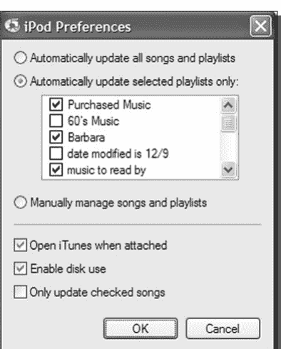

图 1-1：iPod 偏好设置对话框让你决定如何从 iTunes 将音乐复制到 iPod。

在左侧列中选择 iPod，然后点击 iTunes 窗口右下角附近的 iPod iPod 按钮。这将弹出 iPod 偏好设置对话框（图 1-1）。

在偏好设置对话框中，选择第二个选项，“仅自动更新所选列表”。然后，检查这些列表并勾选你想要复制到 iPod 的那些。如果你有多个列表，你必须向下滚动查看所有列表。如果你的列表还没多到能让它滚动，那么当你读到第 5 章时，你可能会喜欢充实你的列表收藏。

> 提示：如果你认为 iPod 上有足够的空间存放你和其他所有人的音乐，你应该直接将所有列表复制到 iPod。更多信息请参阅侧边栏的 *同步 iPod*。

当你为 iPod 选择列表时，点击确定。你一这样做，iTunes 就会清空你的 iPod，开始将音乐和列表复制到那里。你可以从状态显示中关注复制进度。完成后，显示将显示“iPod 更新已完成”，你就可以出发了。


# 第 1 章 — 太棒极了：iPod 5 上的音乐

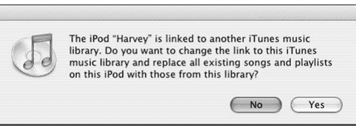

图 1-2：iPod 告诉你它已连接到另一台电脑。

## 音乐，音乐，无处不在

如果你没有一台电脑上拥有家里所有的曲子怎么办？那种情况下，你需要拿起你的 iPod 和线，在房子里的各个电脑之间走动，就像约翰·苹果一样。你不是在种树，而是在收集音乐。依次将你的 iPod 连接到每台电脑。连接后，如果电脑没有自动跳转 iTunes，请手动进入。如果你在无法运行 iTunes 或无法连接 iPod 的电脑上有音乐，你需要将歌曲复制到那台电脑上。

当你接入 iPod 时，你可能会收到类似图 1-2 那样的消息，指出你的 iPod 处于外星领地。只需点击“否”，表示你想将 iPod 永久移动到这台电脑上。然后，点击右下角的 iPod 按钮再次打开 iPod 偏好设置。但这次，你应该选择“手动管理歌曲和列表”，并点击确定。你现在可以直接将歌曲和列表拖到 iPod 中，甚至将它们丢进 iPod 上的列表。

> 使用“手动管理歌曲和列表”可能是危险的。通过直接操作 iPod 上的音乐，你可以做出一些与你在 iTunes 中保留的歌曲和列表不同步的更改。当你回到自动更新时，可以更改歌曲和列表。关于此的更多信息，请参阅侧边栏“同步 iPod”。

当你把 iPod 带回自己的电脑时，你会发现它记得“手动管理列表”的设置。

## 同步 iPod

在你带回家并设置 iPod 的那一天，你有多种同步选项。第一种，“自动更新歌曲和列表”，如果你的 iPod 有足够的空间存放所有音乐将会有用。第二种，“手动管理歌曲和列表”，让你对 iPod 上的音乐拥有独裁控制权。通过这种方式，将音乐放入 iPod 的唯一方法是用鼠标拖拽。一旦歌曲进入 iPod，你就可以随心所欲：更改标签信息、选择均衡器预设，甚至删除它。

注意：你对 iPod 上的歌曲和列表的更改永远不会同步回 iTunes。显然，你必须非常小心这个选项，我建议你避免使用，特别是在从多个电脑收集音乐的特殊情况下。很容易无意中删除其他地方没有的 iPod 音乐（至少对我来说是如此）。如果你必须使用此设置，请确保在操作 iTunes 时，不要直接在 iPod 上更改歌曲和列表。开车安全！

## 无需拔插即可更新你的 iPod

作为 iPod 所有者，当你把它接入电脑时，会经常体验到酷的时刻。如果你使用自动更新（参见 分享你的 iPod），你会看着电脑感知到 iPod 在线，启动 iTunes 并开始更新 iPod 上的音乐。

有时你在连接 iPod 时发现自己在折腾列表。如果你打开 iPod 偏好设置并对想要放入 iPod 的列表进行任何更改，然后点击确定，iTunes 会自动更新 iPod 上的以匹配你的新列表。

但有一种情况，自动更新并非完全自动。如果你在 iTunes 中更改了列表中的歌曲，且该列表与 iPod 同步，更改不会立即复制到 iPod。相反，它会在弹出 iPod 时发生。但你可能希望 iPod 立即更新，例如，当你处于 iPod 空间即将耗尽的边缘，并仔细观察如何调整列表以利用每一分 iPod 磁盘空间时。

强制更新的一种方法是弹出 iPod 并断开连接，然后立即插回以便继续工作。但那有方法简单得多

## 第一章 — 酷极了：iPod 上的音乐

潜伏在 iTunes 中的方法：“文件”菜单底部的“更新 iPod 上的歌曲”项目。只需选择该项目，你的 iPod 就会立即更新。这还能节省接口和线缆的磨损，更不用说你的手指了。

### 使用智能播放列表保持你的 iPod 鲜颖

iTunes 的智能播放列表（Smart Playlists）功能初看似乎仅仅有趣，但其实远比表面丰富，就像冰山或魔戒环一样。智能播放列表提供了简单强大的方法来创建歌曲列表，你还可以教它们根据你设定的规则自动更新。通过将智能播放列表与连接 iPod 到电脑时发生的自动更新相结合，你可以获得一种近乎魔法的组合，每次都能带来新鲜音乐。

有几个智能播放列表属性在确保音乐源源不断的方面特别有用：

- 播放次数（Play Count）：跟踪你收听某特定歌曲的次数。
- 添加日期（Date Added）：告知你将歌曲放入 iTunes 库的时间。
- 上次播放（Last Played）：iTunes 或 iPod 上一次播放该曲目的日期。

播放次数和上次播放特别有用，因为它们会记录你无论是在 iPod 上还是在 iTunes 中收听的记录。因此，如果你在 iPod 上听了 Everclear 的的《Father of Mine》，下次你连接电脑时，这首歌的播放次数和上次播放值就会记录下它被播放过。

通过使用这些属性，你可以轻松构建智能播放列表，为你的 iPod 带来新鲜内容。例如，如果你想找回几个月前没听过的音乐，可以创建一个像图 13 中正在构建所示的智能播放列表。

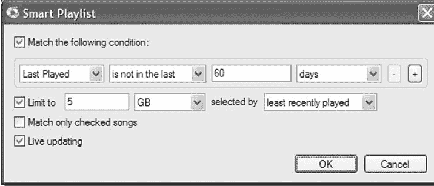

图 1-3：你可以创建一个仅包含你最近没有听过的音乐的播放列表。

## 第一部分 — 玩转 iPod

使用图 1-3 所示的设置，你将获得一个至少 60 天未播放过的歌曲列表。通过使用“限制（Limit）”设置，你可以确保这个播放列表不会占用整个 iPod。此示例使用了 5GB 的限制——你可以根据喜好进行调整。“实时更新（Live updating）”复选框至关重要。它确保播放列表在每次播放歌曲时都会进行刷新。如果不勾选此框，智能播放列表一旦创建基本上就会处于冻结状态，这可能很有用，但现在我们需要的是新鲜，而不是冻结。

将新曲目加载到 iPod 的另一种方法：创建一个设定为“添加日期在过去 30 天内”的智能播放列表。这将为你提供一份过去一个月内购买或刻录的歌曲列表。

你是否忙到买了音乐后就忘记去听？噢！创建一个智能播放列表来永远地解决这个问题吧。只需选择条件“0”，你的音乐就再也躲不开你的视线了。

当然，听新音乐需要你投入注意力，至少是一点点，而有时你并没有心情去进行这种认知。这种情况下很好的良药是一组你喜欢反复听的歌曲。你可以使用智能播放列表来构建一组你播放次数最多的 100 首歌。首先，取消勾选对话框顶部的“匹配以下条件”复选框。然后选择“限制为选择播放次数最多的 100 首歌”。点击确定，然后享受吧——音乐带来的心灵慰藉。

智能播放列表足够酷，以至于我们在稍后的第 5 章中为它们留了大量空间。

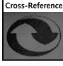

## 结束了

如果你开始摆弄播放次数和上次播放值，可能会发现你记得听过某首歌，但 iTunes 认为它没播放过。情况确实如此。播放次数和上次播放值在歌曲完全播放结束之前不会进行调整。而且无法跳到下一首——歌曲的结尾必须播放。你可以通过快进到歌曲结尾来稍微作弊，然后只播放最后部分。

## 随机播放你的音乐以听遍所有

有时你知道想听什么，有时又不知道。当你心情比较感性时，你的 iPod 可以帮你大忙。你需要的只是使用随机播放（Shuffle）设置。如果你已经熟悉随机播放，可能还没有尝试过它不为人知的第三种选项，我们将在在这里讨论它。

## 第一章 — 酷极了：iPod 上的音乐

位于 iPod 设置菜单中的随机播放有三个选项：关闭、歌曲和专辑。当设置为关闭时，所有播放列表和专辑都按其“自然”顺序播放。当你将随机播放设置为歌曲时，播放列表或专辑内的歌曲顺序是随机的。第三种随机播放设置“专辑”，对于喜欢在 iPod 上一个接一个听整个专辑的人非常有用。使用此设置，iPod 会选择一个专辑并完整播放，然后继续选择随机专辑并按顺序播放歌曲。

## 随机差异

iPod 和 iTunes 处理随机播放的方式有微妙的差异。在 iTunes 中，每个播放列表都记得自己的随机播放设置。在 iPod 上，全局设置会影响你播放的所有音乐。这导致当你有时在听……时产生很多困惑。

## 第一章 — 酷极了：iPod 上的音乐


图 1-4：音效检查（Sound Check）可以让你所有音乐的音量保持一致。

### 获取极佳音质的均衡器

现代音乐播放设备使用一种名为*均衡化*（equalization）的技术来修改音频信息的还原方式。均衡器将音乐分解成各个频率成分，然后降低某些频率并增大其他频率的强度。其理念是减少那些刺耳或与音乐不符的声音，同时强调最重要的声音。

为了获得最佳效果，均衡器的设置取决于正在播放的音乐类型。对于律动感十足的舞曲，良好的均衡器设置会强调低频范围；而对于人声更细腻的音乐，设置则会增强人声的中高频部分。

你可能知道你的 iPod 和 iTunes 内置了均衡器。如果你热爱音乐但并不认为自己是发烧友，你可能还没有探索过均衡器。如果是这样，请尝试一试。它非常容易使用，并会让音乐听感产生显著差异。


使用 iPod 声音最简单的方法是选择一个设置并开启它。进入“设置”（Settings）菜单并选择“均衡”（Equal）。在这个屏幕上，会有名为“EQ”、“EQ-Off”或“EQ-Rock”的设置。选择后，你将看到超过 20 种均衡器设置列表，包括 EQ Off。选择与你通常听的音乐类型匹配的设置并点击“选择”（Select）按钮。现在你就能听到经过高度均衡的音乐了。

还有更高级的方法可以使用均衡器。例如，每首歌都可以携带自己的均衡器设置。这需要 iTunes。要在 iTunes 中为歌曲选择均衡器设置，请点击歌曲并选择“文件 选项”（File Options Options）。在“均衡器预设”（Equalizer Preset）弹出窗口中选择一个设置。任何带有自定义均衡器预设的歌曲在 iTunes 和 iPod 上都将使用该设置播放。

## 不要被拒之门

当你开始尝试玩 iPod 上的均衡器时，你可能想在歌曲播放时进入 EQ 菜单，查看是什么均衡器预设。遗憾的是，在 iPod 上无法判断某首歌使用的是哪种预设。EQ 菜单中显示的设置是当前的全局设置，而不是当前歌曲的预设。

## 破解 iPod

仅仅为了让它更有用（而不是为了让它更困惑），你可以在歌曲播放时从 EQ 菜单中选择不同的设置，从而覆盖当前歌曲的（不可见的）预设。当你这样做时，歌曲会继续播放，但会立即切换到新设置。当这首歌下次播放时，它会恢复到预设。

## 快速扫描歌曲以听到你想听的内容

如今每个人都行色匆匆，甚至我们 iPod 用户也是如此。原始 iPod 软件包含一种通过按住 `>>` 或 `<<` 来快进或后退当前歌曲的方法。确实如此，但还不够快，后期版本的 iPod 软件增加了根据你转动滚轮的速度来快速跳过歌曲的功能。当你使用此功能时，请在“正在播放”（Now Playing）屏幕上按下 Select 按钮。进度条会出现一个小菱形，显示歌曲的当前位置。当你看到它时，就可以使用滚轮在当前歌曲中来回移动，这种技术被称为“扫动”（scrubbing）。当你离开滚轮几秒钟后，iPod 就会认为你操作完毕，普通的进度条就会回来。你也可以通过再次按下 Select 来立即恢复（对于 2003 年的 iPod，你需要多按一次才能跳过“评价我的歌曲”屏幕）。

## 总结

破解（Hacking）并不是邪恶天才、大师程序员以及那些拥有一大盒 Craftsman 工具的人的专属领域。我们都可以通过破解自己的世界来让它更符合自己的需求。正如承诺的那样，本章提供了简单、直观且在许多情况下非常实用的 iPod 音乐破解技巧——适用于每个人的破解技巧。

你的 iPod 可能是世界上最伟大的音乐播放器，但这并不是它所学会的全部——远非如此。在第二章中，我们将超越音乐，深入探索 iPod 的其他功能。

## 不仅仅是音乐

整个世界将 iPod 视为一个超级酷的播放器和时尚的时尚宣言。但 iPod 成功的原因之一是，它在外观良好的同时，功能远比存储和播放音乐得多，并且不断获得新功能，既来自 iPod 自身也来自第三方。

在本章中，我们将开始探索一些你可以利用 iPod 实现的非音乐技巧。其中一些技巧需要额外的硬件，我会向你介绍这些硬件；而另一些则可以使用自带 iPod 以及一些（通常是免费的）软件。

苹果对 iPod 硬件的限制非常严格，但确实有可以通过额外的小设备扩展 iPod 能力的方法。你将发现一些为 iPod 添加功能和便利性的基本方法。

## 标准火线电缆

原始 iPod 仅与 Mac 兼容。没多久，苹果就意识到，将全球数百万想买 iPod 的 Windows 用户排除是一个坏主意，于是他们做了更改。随着每次更新，iPod 变得对 Windows 用户更加友好。到 2003 年，有两个主要障碍阻碍了 Windows 用户成为完全的 iPod 用户：没有 iTunes 版本，且大多数电脑都配备了 USB 2.0。

遗憾的是，为了让 iPod 同时兼容火线和 USB 2.0，苹果创建了自定义接口。与其祖先不同，3G iPod 没有配备火线接口。这种宽平接口允许 3G iPod 和 iPod Mini 放入它们的底座。苹果提供了一根可以将 iPod 直接连接到电脑火线端口的光缆。这种设计的缺点是，你无法连接任何旧火线设备（如外接硬盘）。如果你带着电脑出门，就必须携带 iPod 的专用电缆。

这就是 SendStation 的 19 美元 PocketDock 发挥作用的地方。（关于 PocketDock 的更多信息，请访问 sendstation.com。）PocketDock 是一个微型线适配器，可以让 3G iPod 或 iPod Mini 使用任何火线电缆。图 2-1 显示了它的工作原理。只需将 PocketDock 插入 iPod 底座，你就有了一个带有火线端口的 iPod，可以使用任何火线电缆。SendStation 将 PocketDock 称为“必备”，这似乎接近事实。这种东西是你希望在盒内作为免费赠品看到的，因为它非常有用。

## 第二章

- 使用硬件配件
- 将 iPod 作为外部磁盘
- 玩转联系人和日历
- 进入睡眠和唤醒
- 与 Apple 脚本协作
- 下载音频书

Belkin 的 录音机可以让你的 iPod 变成便携式录音机。你可以用它记录语音笔记或录音一对对话。录音机是一个苹果白色的小盒子，可以完美地插入 iPod 的耳机接口。你不需要安装任何软件——iPod 已经认识它了。一旦连接录音机，“额外”（Extras）菜单就会多出一个新项：“语音备忘录”（Voice Memos）。

## 第 2 章 — 不仅仅是音乐

在此菜单中，你可以选择“现在录音”（Record Now）来记录你那些伟大的思想。

在你录音时，屏幕上会显示一个较大的计时器，让你知道它已经听了多久，“正在记录”（Recording）字样会在屏幕上闪烁，录音器本身还会亮起绿色的 LED 灯。录音以每秒 128K 位的 WAV 文件存储，这意味着你每秒将消耗 16K 位。

你可以连接到录音器的最佳设备是内置扬声器。当录音器插入时，你的 iPod 突然有了一个外部扬声器——这是一个小型、安静的扬声器，但毕竟是一个扬声器。这对于许多用途非常方便：

- 听你制作的录音，这是它的预期用途。
- 与朋友分享音乐或其他声音，而无需担心借耳机带来的卫生噩梦。
- 将 iPod 作为音乐播放闹钟。（详情请参见本章的“睡觉并唤醒你的 iPod”章节）。

你可以将语音录音从 iPod 移动到电脑。下次将 iPod 连接到电脑时，如果你想将语音录音添加到音乐库，iTunes 会弹出一个对话框。如果你说是，备忘录将被复制到电脑并添加到你的 iTunes 库中。

如果将个人笔记导入音乐库并不是你的初意，你可以将语音录音复制到硬盘而不放入 iTunes。要执行此操作，请在 Finder 或 Windows 资源管理器中打开你的 iPod。你会看到一个新的“Recordings”（录音）文件夹。打开 Recordings 查看你的备忘录。它们的名称与录制的时间对应。例如，一个名为“20040715 131522”的备忘录是于 2004 年 7 月 15 日下午 1:15:22 录制的。你可以像其他文件一样复制这些文件。

Belkin 的 iPod 录音器售价约 50 美元，随处可见，包括 Apple 商店和在线商店。你需要第 3 代 iPod 才能使用该录音器。

2004 年夏天，Griffin Technology 通过 iTalk（图 2-2）丰富了其令人深刻的产品线。该产品与 Belkin 的非常相似，仅在物理设计上略有不同。

iTalk 与 Griffin 的其他产品具有同样酷的外观。你可以从 Apple 商店或直接从 Griffin 以 40 美元购买一个。

## 存储数字照片

如果你是一名数字摄影师，你可能知道相机照片空间不足的烦恼。这不像于你可以随身携带几卷额外的胶片——CompactFlash、SmartMedia 等对于这种用途来说太贵了。将照片卸载到电脑是一个解决方案，但当你外出出去拍照时，你可能不想随身带着一台笔记本电脑。

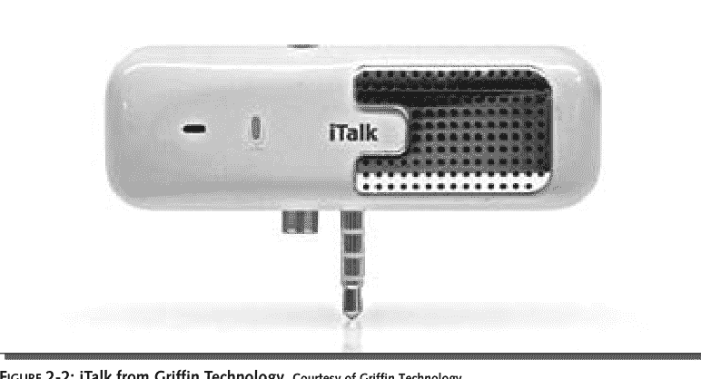

为了解决这个问题，你可以获得各种便携式硬盘解决方案来存储照片。你已经拥有一个空间充足的便携式硬盘——它恰好也是一个音乐播放器。所以 Belkin 的人们又给你的 iPod 分配了另一个任务：数字照片存储。你只需要一个盒子来读取照片并将它们移动到你的 iPod。Belkin 提供了两种可以帮助的产品：如图 2-3 所示的 iPod 媒体阅读器（Media Reader for iPod）和 iPod 数字相机连接器（Digital Camera Link for iPod，图 2-4）。我在这里介绍这两个产品。

## Belkin iPod 媒体阅读器

媒体阅读器比标准 iPod 稍微大一点，有六种不同媒体类型的插槽：

- CompactFlash 1 型和 2 型
- SmartMedia
- 安全数字 (SD)
- Memory Stick
- 多媒体卡 (MMC)


如果你有一台数字相机，它几乎肯定使用 Belkin 媒体阅读器接受的媒体类型之一。这是该产品的伟大功能之一：在决定此阅读器是否适用于你时，你不必担心竞争性标准。只需确保你的相机使用的是六种支持类型之一（这几乎是肯定的事情），你就可以兼容了。

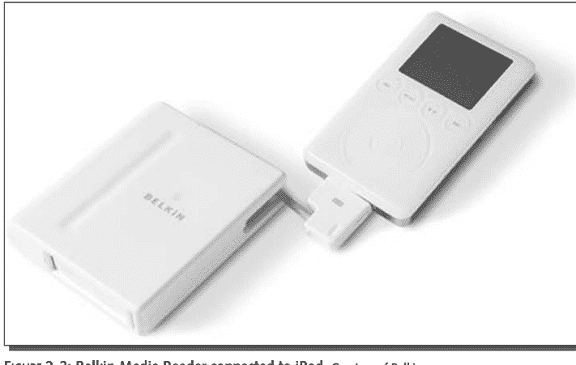

要使用媒体阅读器，你打开保护媒体卡插槽的精巧滑动门，然后放入阅读器。将阅读器连接到 iPod 的底座连接器。iPod 会做出响应，询问你是否想从媒体卡导入照片。如果你说想，照片将在你在 iPod 上查看进度屏幕时进行复制。复制的照片按编号存储。照片复制完成后，你就可以从媒体卡中删除它们，这样你就可以去拍摄获奖奖的岩石和泥土照片了。

一旦照片进入 iPod，你可以对它们做什么呢？你可以获取关于它们的信息，例如一卷中的照片数量以及存储它们的媒体类型。一旦你重新连接到电脑，你可以使用任何导入数字照片的软件（如 `iTunes`）复制照片，或者通过查看 iPod 上命名关键的 `DCIM`（数字相机图像）文件夹来手动复制。

遗憾的是，你无法对照片做的一件事是编辑它们。但你可以在旅途中查看它们。iPod 的屏幕非常适合浏览你的作品，甚至可以展示给朋友看。

iPod 媒体阅读器是一个很棒工具，可以在 Apple 商店和在线商店购买。

## iPod 数字相机连接器

iPod 数字相机连接器是另一种将照片放入 iPod 的方法。与媒体阅读器不同，该设备直接连接到你的相机。

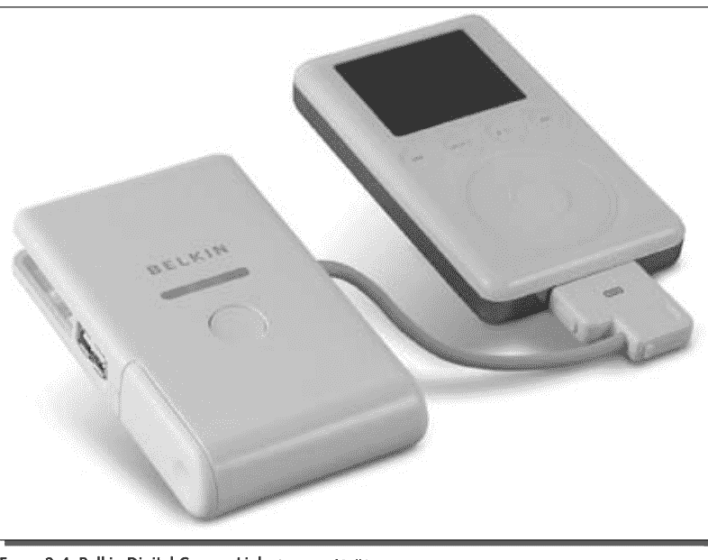

iPod 数字相机连接器是一根将你的相机连接到 iPod 底座连接器的电缆。它允许你直接从相机将照片传输到 iPod。这对于不想使用读卡器的人来说特别有用。

iPod 数字相机连接器售价约 30 美元，可在 Apple 商店和在线商店购买。适用于第 3 代 iPod。

# 第一部分 — 破解 iPod

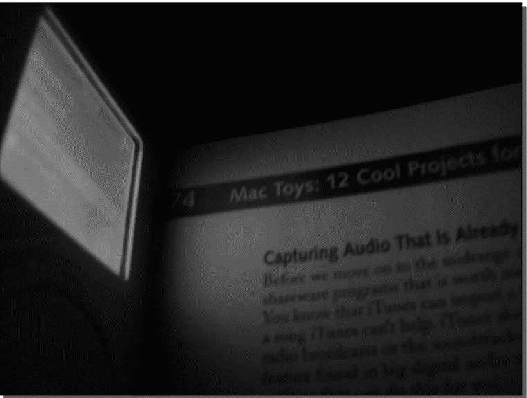

**图 2-5：** 作为读灯的 iPod。

你可以通过进入“设置 �� 背光计时器”并选择“始终开启”来设置背光一直保持开启。当然，这会消耗大量的电量，但对于慢跑的时间来说足够了，除非你正在参加一场通宵马拉松。如果需要作为夜灯使用，请确保你的 iPod 已连接到交流电源。

### 将你的 iPod 用作外部驱动器

你可以将 iPod 用作为一个高便携、大容量的外部驱动器。确保在 `iTunes` 的 iPod 选项中勾选了“启用磁盘使用”框，你的 iPod 就会在 `Finder`（Finder）或 Windows 资源管理器中显示为另一个磁盘。完成此操作后，你就可以利用剩余空间来存储任何想要的文件。

以这种方式使用 iPod（或用于除从 `iTunes` 获取音乐之外的任何用途）都有一个缺点。当你的 iPod 仅用于音乐，且你使用自动更新功能时，每次连接电脑时，iPod 都会从 `iTunes` 获取歌曲。所有的歌曲都存储在电脑上，并在同步时复制到 iPod 上。这意味着实际上，iPod 是你电脑歌曲的备份设备。如果你只是用 iPod 做这些事情，那么 iPod 的内容是完全可以丢弃的：你

可以对其重新格式化、丢失它，或将其丢进多伦山的火焰中，而不会丢失任何数据。

一旦你开始在 iPod 上存储其他信息，你就必须意识到你在那里存储了什么，如果你想确保不丢失这些文件，也要对这些文件进行备份。因为 iPod 的作用就像标准的外部驱动器，你可以使用任何备份程序对其进行备份，例如来自 Dantz 的 `Retrospect` (`www.dantz.com`)。

### 为你的 iPod 设置启动

此破解方法适用于 Macintosh 电脑。

当你习惯了将 iPod 作为外部驱动器使用时，你可能希望将 iPod 变成 Mac OS X 的启动磁盘。这样，你就可以随身带着它旅行、去办公室或去朋友家里，随时携带你的系统、设置、文档和其他重要信息。让 iPod 变得可启动极其简单。你所做的就是在连接 iPod 的情况下运行 Mac OS 安装程序，并将其选择为安装目标卷。一旦你安装了 Mac OS X，iPod 就会出现在“启动磁盘”偏好设置面板面板中，如图 2-6 所示。

将 iPod 作为外部驱动器使用时，另一个实用的工具是流行的捐赠软件 `Carbon Copy Cloner`，可以从 Mike Bombich 的 `www.bombich.com/software/ccc.html` 获得。`Carbon Copy Cloner` 允许将一个现有的磁盘卷复制到另一个。

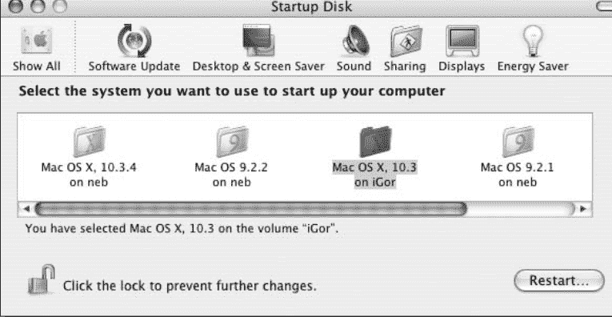

| 启动磁盘 | 显示全部 | 软件更新 | 桌面与屏幕保护程序 | 声音 | 共享 | 显示器 | 节能 |
| :--- | :--- | :--- | :--- | :--- | :--- | :--- | :--- |
| neb 上的 Mac OS X, 10.3.4 | neb 上的 Mac OS 9.2.2 | Igor 上的 Mac OS X, 10.3 | neb 上的 Mac OS 9.2.1 | | | | |

图 2-6：运行 Mac OS 安装程序后，iPod 是一个有效的启动磁盘。

Apple 设计 iPod 初衷是为了作为音乐播放器。在那种模式下，iPod 会尽量减少磁盘的磨损。它不频繁地旋转磁盘，读取大量音乐，关闭磁盘，然后将音乐保留在 RAM 缓冲区中进行播放。如果你频繁将 iPod 作为外部磁盘驱动器使用（特别是从它启动的卷），你可能会发现如果你的 iPod 损坏了，Apple 不愿意提供保修维修。


### 破解文化：通过 iPod 盗窃

当你打开 iPod 时，你会本能地注意到屏幕上贴着“不要偷窃音乐”的贴纸。根据第一代 iPod 出现后不久的报告，这些贴纸可能并没有传播多远，因为至少有一个心怀不轨的人决定将 iPod 用于音乐以外的事物。2002 年 2 月，德克萨斯州的一个客户报告看到一个男人从口袋里掏出一个 iPod，将其连接到桌面的 Macintosh，将软件复制到 iPod，然后断开 iPod 走人。虽然 iPod 最广为人知的是音乐播放器，但该小偷利用了 iPod 作为强大的外部磁盘驱动器的能力。虽然硬件不是为你的 iPod 添加功能的唯一方法，你也可以利用世界上的软件改变你 iPod 的生活。在这一节中，我们将讨论帮助你的 iPod 管理联系人、充当闹钟等的软件技巧。

### 导入你的联系人和日历

你的 iPod 具有跟踪联系人和日历事件的与生能力。如果你拥有一台 Macintosh，可以使用 Apple 提供的免费软件将你的联系人和日历导入你的 iPod：通讯录（Address Book）、iCal 和 iSync。Apple 没有提供这些程序的 Windows 版本，但有其他公司提供等效的程序。通讯录、iCal 和 iSync 安装在大多数 Mac 上——检查你的应用程序文件夹。如果你没有这些程序，去 `www.apple.com/downloads/` 下载。如果你是 Windows，请跳到“Windows 下的通讯和日历”。

和 Apple 软件一样，这套程序非常易用。

1. 确保你的 iPod 连接到电脑。遗憾的是，还没有无线 iPod。
2. 运行 `iSync`。你应该看到 `iSync` 窗口，列出了它知道的所有设备。
3. 选择设备 -> 添加设备。你应该会在窗口中看到你的 iPod。双击你的 iPod 进行同步。
4. 在 `iSync` 窗口中检查 iPod 的设置。第一个复选框“启用同步”应该是开启的，且联系人和日历的复选框应该勾选，如图 2-7 所示。
5. 点击“立即同步”将数据移动到 iPod。

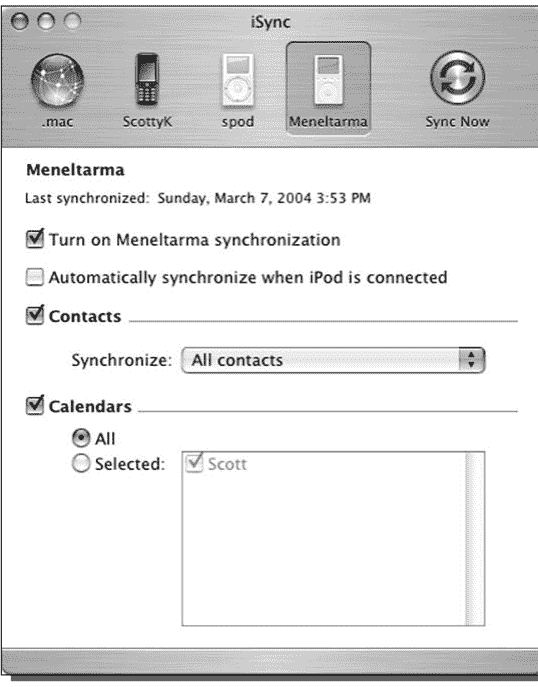

图 2-7：`iSync` 窗口准备与 iPod 同步。

现在你的通讯录和日历信息可以随你去任何地方。通讯录和 iCal 条目分别存储在 iPod 的“联系人”和“日历”列表中。

关于在 Mac 和 iPod 之间同步信息的更多方法，请参见第 4 章，特别是“新闻、天气、电影列表及更多”章节。

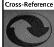

### 联系人都去哪里了？

# 第 2 章 — 不止音乐


存储在你的 iPod 上的大部分信息以简单的开放格式保存。联系人存储在一种名为 `vCard` 的标准格式中，然后存放在 iPod 的联系人文件夹中。同样，iPod 上的条目是 `iCalendar` 或 `vCalendar` 格式的文件，存储在日历文件夹中。大多数地址录和日历程序（无论 Mac OS X 还是 Windows）都能生成 `vCard`、`iCalendar` 和 `vCalendar` 文件。一旦你的数据采用这些格式，你只需将其复制到 iPod 的相应文件夹，在选择联系人或日历时它们就会出现。

# 第2章 — 不仅仅是音乐

## 在 Outlook 中使用联系人和日历

此破解方法仅适用于 Windows 电脑。


### 在 Outlook 中导出单个联系人

- 2. 在 Outlook 中，找到您想要移动到 iPod 的联系人并打开它。
- 3. 选择 `文件 -> 导出为 vCard 文件`。
- 4. 在“文件名:”框中，输入您想让该联系人显示的名称。
- 5. 在“保存类型：”框中，从弹出列表中选择“`VCARD 文件`”。先不要点击保存！
- 6. 在对话框顶部的“保存位置：”弹出菜单中，导航到您的 iPod，如图 2-8 所示。
- 7. 在现在显示 iPod 内容的文件窗口中，双击“联系人”文件夹。
- 8. 点击保存。

下次您断开 iPod 时，保存的联系人将出现在 iPod 的联系人文件夹中。

### 在 Outlook 中导出单个日历事件

将 Outlook 日历事件放入 iPod 的步骤也类似。具体步骤如下：

- 1. 将您的 iPod 连接到电脑。点击“开始” -> “我的电脑”，确保您的 PC 能够看到您的 iPod。

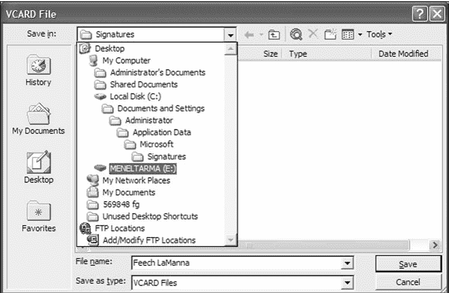

图 2-8：从 Outlook 导出 vCard。

- 2. 在 Outlook 中，进入日历，找到您想要移动到 iPod 的项目并打开它。
- 3. 选择 `文件 -> 另存为`。
- 4. 在“文件名:”框中，输入您想让该日历事件显示的类型。
- 5. 在“保存类型”框中，从弹出列表中选择“`iCalendar Format`”。先不要点击保存！
- 6. 在对话框顶部的“保存位置：”弹出菜单中，导航到您的 iPod。
- 7. 在应该显示 iPod 内容的文件窗口中，双击“日历”文件夹。
- 8. 最后，点击保存。

现在您已在 iPod 上存储了一个单一日历事件。当您断开 iPod 时，进入日历，您将在指定的日期看到您的事件。

### 批量导出联系人和日历

这种一次处理一个的方法对于有限的使用是可以的。但如果您想一次性将大量 Outlook 项目放入您的 iPod 呢？幸运的是，您并不注定要为每个项目重复此过程。相反，有一个可以一次性导出多个项目的黑技巧。此过程适用于联系人和日历项目，尽管您不能在一次导出中混合这两种类型。

#### 批量导出联系人

以下是联系人的步骤：

- 2. 在 Outlook 中，进入“联系人”并选择所有您想要使用的项目。您可以使用 `Shift-点击` 和 `Control-点击` 来选择多个项目。
- 3. 选择 `操作 -> 作为 vCard 转发`。这将创建一个新的电子邮件，其中包含您选择的所有联系人并采用 `vCard` 格式。
- 4. 将电子邮件地址并发送给信赖的朋友——比如您自己。虽然所有的 `vCard` 都在那里供取，但显然除了作为收到的邮件外，没有其他方法可以一次访问它们。
- 5. 在 Outlook 中收集您的电子邮件。当您查看收到的消息时，您会看到所有的 `vCard` 都是附件。
- 6. 选择您发送的带有所有 `vCard` 的消息。选择 `文件 -> 保存附件 -> 所有附件`。注意：如果您使用 Outlook 以外的电子邮件程序收集邮件，它可能没有“保存所有附件”功能。
- 7. 在弹出的“保存所有附件”对话框中，点击确定。
- 8. 接下来，您将看到一个保存所有附件的文件列表。导航到您的 iPod 联系人文件夹并点击确定。

大功告成——联系人已发送到您的 iPod。

#### 批量导出日历项目

如果您想导出多个日历项目，微软提供的步骤非常相似，但又细有不同，只是为了让我们保持乐趣：

- 1. 验证您的 iPod 已连接并在“我的电脑”下可见。
- 2. 进入 Outlook 日历。
- 3. 大多数人将 Outlook 日历设置成显示图形化视图，如图 2-9 所示。如果以列表视图显示日历，则选择和导出多个日历项目会更简单。参阅“当前安排”。现在您的日历看起来将像图 2-10 所示。
- 4. 使用 `Shift+点击` 和 `Ctrl+点击` 选择多个日历项目。选取所有您想要导出到 iPod 的项目。
- 5. 选择 `操作 -> 转发到 iCalendar`。您将收到一个新的电子邮件，其中的预约项目已转换为 `iCalendar` 文件。
- 6. 将电子邮件地址设为您自己并发送。
- 7. 收集您的电子邮件。选择您发送的消息并选择所有的 `iCalendar` 账户。
- 8. 选择 `文件 -> 保存附件 -> 所有附件`。
- 9. 在“保存所有附件”对话框中，点击确定。
- 10. 选择一个文件夹用于保存附件。找到您的 iPod，然后找到它的“日历”文件夹并点击确定。

您现在已在 iPod 上存储了单个日历事件。

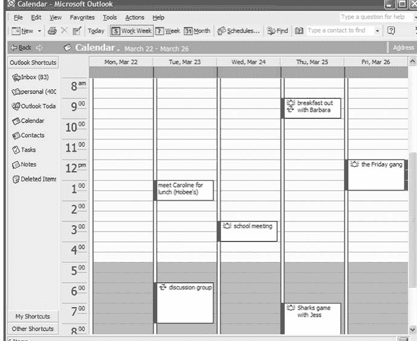

图 2-9：图形视图。

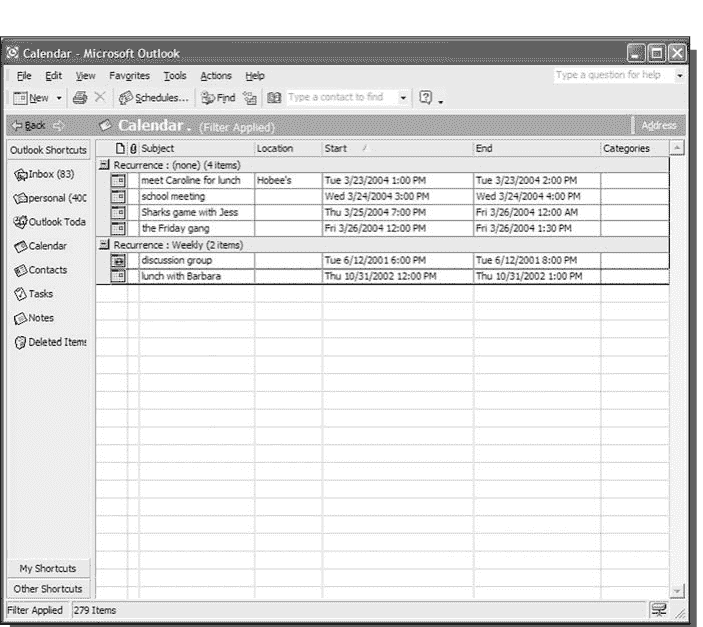

图 2-10：列表视图。

### iPod 的黑技巧

- 1. 验证您的 iPod 已连接并在“我的电脑”下可见。
- 2. 进入 Outlook 日历。
- 3. 大多数人将 Outlook 日历设置成显示图形化视图，如图 2-9 所示。如果以列表视图显示日历，则选择和导出多个日历项目会更简单。参阅“当前安排”。现在您的日历看起来将像图 2-10 所示。
- 4. 使用 `Shift+点击` 和 `Ctrl+点击` 选择多个日历项目。选取所有您想要导出到 iPod 的项目。
- 5. 选择 `操作 -> 转发到 iCalendar`。您将收到一个新的电子邮件，其中的预约项目已转换为 `iCalendar` 文件。
- 6. 将电子邮件地址设为您自己并发送。
- 7. 收集您的电子邮件。选择您发送的消息并选择所有的 `iCalendar` 账户。
- 8. 选择 `文件 -> 保存附件 -> 所有附件`。
- 9. 在“保存所有附件”对话框中，点击确定。
- 10. 选择一个文件夹用于保存附件。找到您的 iPod，然后找到它的“日历”文件夹并点击确定。

您现在已在 iPod 上存储了单一日历事件。当您断开 iPod 时，进入日历，您将在指定的日期看到您的事件。

这种一次处理一个的方法对于有限的使用是可以的。但如果您想一次性将大量 Outlook 项目放入您的 iPod 呢？幸运的是，您并不注定要为每个项目重复此过程。相反，有一个方法可以一次性导出多个项目的黑技巧。此过程适用于联系人和日历项目，尽管您不能在一次导出中混合这两种类型。以下是联系人的步骤：

- 2. 在 Outlook 中，进入“联系人”并选择所有您想要使用的项目。您可以使用 `Shift-点击` 和 `Control-点击` 来选择多个项目。
- 3. 选择 `操作 -> 作为 vCard 转发`。这将创建一个新的电子邮件，其中包含您选择的所有联系人并采用 `vCard` 格式。
- 4. 将电子邮件地址并发送给信赖的朋友——比如您自己。虽然所有的 `vCard` 都在那里供取，但显然除了作为收到的邮件外，没有其他方法可以一次访问它们。
- 5. 在 Outlook 中收集您的电子邮件。当您查看收到的消息时，您会看到所有的 `vCard` 都是附件。
- 6. 选择您发送的带有所有 `vCard` 的消息。选择 `文件 -> 保存附件 -> 所有附件`。注意：如果您使用 Outlook 以外的电子邮件程序收集邮件，它可能没有“保存所有附件”功能。
- 7. 在弹出的“保存所有附件”对话框中，点击确定。
- 8. 接下来，您将看到一个保存所有附件的文件列表。导航到您的 iPod 联系人文件夹并点击确定。

大功告成——联系人已发送到您的 iPod。

如果您想导出多个日历项目，微软提供的步骤非常相似，但又细有不同，只是为了让我们保持乐趣：

- 1. 验证您的 iPod 已连接并在“我的电脑”下可见。
- 2. 进入 Outlook 日历。
- 3. 大多数人将 Outlook 日历设置成显示图形化视图，如图 2-9 所示。如果以列表视图显示日历，则选择和导出多个日历项目会更简单。参阅“当前安排”。现在您的日历看起来将像图 2-10 所示。
- 4. 使用 `Shift+点击` 和 `Ctrl+点击` 选择多个日历项目。选取所有您想要导出到 iPod 的项目。
- 5. 选择 `操作 -> 转发到 iCalendar`。您将收到一个新的电子邮件，其中的预约项目已转换为 `iCalendar` 文件。
- 6. 将电子邮件地址设为您自己并发送。


进入`/path/to/xxx`目录，找到`xxx.json`。

在表达式`cvar = avar + bvar`中，加法运算符（`+`）将`avar`与`bvar`相加，得到它们的和`cvar`

在`List.of(arg0, arg1, arg2)`中，`List`接口的工厂方法`of()`接受一系列的元素，返回包含它们的只读列表。

之后我们这样调用`cmd`命令：`cmd arg0 arg1 arg2`。

```
if (condVar > someVal) {console.log("xxx")}
```
[/content]

Wait that's example. Need actual text.

Let's produce proper output.

[content]
### 7. 收集您的电子邮件
选择您发送的消息并选择所有的 iCalendar 账户。

### 8. 保存附件
选择 `文件 -> 保存附件 -> 所有附件`。

### 9. 确认保存
在“保存所有附件”对话框中，点击确定。

### 10. 选择保存位置
选择一个文件夹用于保存附件。找到您的 iPod，然后找到它的“日历”文件夹并点击确定。

您现在已在 iPod 上存储了单一日历事件。当您断开 iPod 时，进入日历，您将在指定的日期看到您的事件。

# 第2章 — 不仅仅是音乐

## 剪贴板到笔记
`Clipboard to Note`。这是一种非常简单、快速的为你的 iPod 添加笔记的方法。要使用它，请选择文本并复制，然后切换到 iTunes 并运行此脚本。复制的内容将进入笔记并传输到 iPod。如果你复制的文本超过了 iPod 笔记的 4K 限制，别担心：脚本会自动将你的文本复制到链接的笔记中。

## 清除所有笔记
`Clear All Notes`。使用此脚本可以快速清除所有的笔记。脚本还提供删除所有子文件夹的选项。

## 列出笔记
`List Notes`。当你想查看所有笔记列表时，运行此脚本。你可以选择一个并点击“打开”，在文本编辑 `TextEdit` 应用程序中显示文本。如果你有很多笔记，这可能需要一些时间。图 2-12 显示了工作原理的示例。

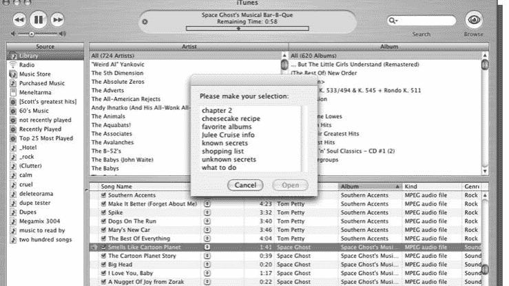

图 2-12：列表显示其结果。

## MacCentral
此脚本使用 Safari 打开 MacCentral 网站，并将第一篇文章作为 iPod 笔记。因为你可以获得脚本的源代码列表，你也可以将其修改以适用于其他网站。

## 打印友好
`Printer Friendly`。这是一个非常用但有点奇怪的功能。它获取 Safari 前台窗口的文本并将其制作笔记。它被称为“打印友好”，是因为它可以处理带有图形或链接的页面，你也可以将其用于指向的任何页面。

# 第一部分 — 破解 iPod

## 脚本实现的成功

如果你对学习更多关于 AppleScript 如何帮助你用 iPod 做酷的事情感兴趣，请一定要访问 `www.malcolmadams.com/itunes` 查看 Doug 的 iTunes AppleScripts，并且不要错过第 6 章对 Doug 某些脚本的探索。

## 在 iPod 上使用 WinAmp

此破解方法仅适用于 Windows 电脑。


你可能知道 iTunes 并不是唯一的音乐播放器。其他程序，如 MusicMatch Jukebox 和 WinAmp，存在于数百万快乐用户的硬盘中。当 iPod 首次出现时，还没有 Windows 版 iTunes。相反，Apple 与 MusicMatch 合作，使 MusicMatch Jukebox 成为 Windows 的官方 iPod 软件。尽管这种身份在 2003 年 10 月 Apple 推出 Windows 版 iTunes 时结束了，但你仍然可以自由在 iPod 上使用 MusicMatch。

然而，数百万 WinAmp 用户并没有那么幸运。WinAmp 是最早的数字音乐应用之一，它包含了游戏和可换皮肤等精妙功能。然而，WinAmp 并没有提供 iPod 支持。但在 2004 年 2 月，Christophe Thibault 发布了适用于 WinAmp 的 iPod Plug-in。这段小代码允许 WinAmp 用户连接他们的 iPod 并传输音乐到其中。当你安装 iPod Plug-in 时，你的 iPod 就会出现在 WinAmp 的设备列表中，如图 2-13 所示。

iPod Plug-in 提供了基本功能，例如将音乐复制到 iPod 以及在 WinAmp 中播放存储在 iPod 上的音乐。但插件缺少功能，最显著的是不支持 iTunes 管理的播放列表。尽管如此，WinAmp 的忠实粉丝现在可以继续使用他们喜欢的数字音乐程序并管理他们的 iPod。

要下载 WinAmp，请访问 `www.winamp.com/player/`。WinAmp 的基础版本是免费的——$15 可以获得更多功能，包括 MP 提取和快速 CD 刻录。iPod Plug-in 在 `www.winamp.com/plugins/details.php?id=13888` 免费获取。

## 将 iPod 连接到 Mac 和 Windows PC

如果你同时有 Mac 和 PC，你可能会发现很难在两台电脑上都使用你的 iPod。有一个简单的方法。首先，确保 iPod 上没有你需要的内容，因为你将重新格式化它。要这样做，运行 Windows 版的 `iPod Updater` 并点击“恢复”`恢复`。这会使用 FAT32 系统格式化 iPod。

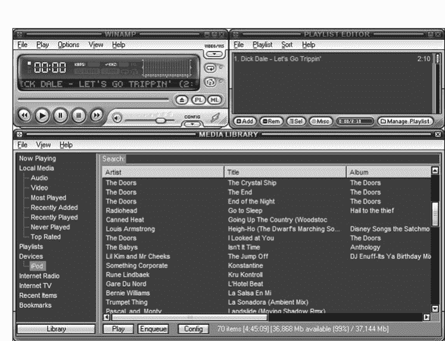

图 2-13：安装 iPod Plug-in 时 WinAmp 中的 iPod 播放器。

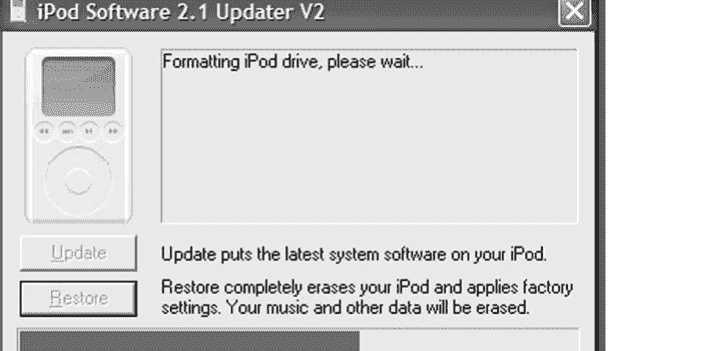

图 2-14：`iPod Updater` 正在为 Windows 格式化 iPod。

系统是 Windows 的原生系统，但也受 Mac OS X 支持。然后，你可以在任何一个操作系统上通过 iTunes 与 iPod 通信，也可以通过 Mac OS X 访达 `Finder` 以及 Windows 资源管理器。

如果你以后决定想让你的 iPod 专为 Mac 格式化，可以通过运行 Mac 版的 `iPod Updater` 来反转过程。再次，在用 `iPod Updater` 抹除磁盘内容之前，确保 iPod 上没有你想要保留的内容。

> 你可以通过选择 `设置 ↻ 关于` 并一直滚动到底来判断 iPod 是否是为 Windows 格式化的。


## 下载音频书

音乐并不是唯一的资源。

iPod 的另一个酷功能是标记。你可以使用标记跳转到书的不同部分。

数字音频书、广播、播客，在《纽约时报》处可以找到。

关于音频书的更多信息，请查看时间线。


| 商店 | 什么是 Audible | 为什么选择 Audible | 如何工作 | 我需要 | 购买方式 |
| :--- | :--- | :--- | :--- | :--- | :--- |
| 登录 | 收听《纽约时报》或畅销书。 | 亮点 | 新 iPhone/iPad 支持 | 新免费收听 | |
| 密码 | 随时随地收听音频书、广播、播客。 | 新音频书 | 每日播客 | 新超值 | |
| 加入 | 加入时获得免费入门礼品。 | 期刊与广播 | 《经济学人》 | 收听列表 | |
| 记住我 | 首月会员费五折 | 一种智能、灵活的纸质书籍替代品。 | 无字、无界 | | |
| 演示 | | Apple® iPod 捆装优惠 $10 | iPod MP3 播放器 | | |
| 搜索 | | | | 输入标题或关键词 | |
| 浏览内容 | | | | | |
| 自我提升 | 艺术与娱乐 | 新闻 | 传记与记忆 | 科幻与幻想 | 报纸 | 杂志 | 广播与电视 |

图 2-15：Audible.com 首页。

由 Audible 提供。

## 从 OmniOutliner 查看大纲

此破解方法仅适用于 Mac 计算机。

来自 Omni Development, Inc. 的 OmniOutliner 是处理任何类型层次结构的超级工具，例如脑力风暴、大纲、目录和组织结构图。Mac 预装了 OmniOutliner。如果你还没有，你可以在 `www.omnigroup.com/applications/omnioutliner` 下载免费体验版或购买。


你可以从 Omni 获取一个扩展脚本，允许你将大纲导出到 iPod 并在那里查看。这是一个规划演讲大纲的好方法，演讲时可以在 iPod 上看到大纲。你可以在此处下载免费脚本：

# 36 第一部分 — 破解 iPod

`www.omnigroup.com/applications/omnioutliner/extras/`。有两个版本：一种导出到 iPod 备录，这需要支持 3G 的 iPod；另一种是导出到联系人，它适用于任何 iPod（见图 2-16）。

一旦从 Omni 网站下载了脚本，你就可以打开磁盘映像并双击安装程序，将脚本放入 OmniOutliner 的脚本文件夹中。安装完成后，启动 OmniOutliner，选择一个大纲，并在 Scripts 菜单中选择一个脚本来导出你的 iPod（见图 2-17）——你的大纲就可以随身携带了！

## 在 iPod 上读和写“书籍”

是的，你确实在读一本 iPod 书，而且那里还有其他几种 iPod 书供你消遣。iPodLibrary.com 的人们正在讨论一种存储在你 iPod 上的不同 iPod 书。iPodLibrary 的创建者正在寻找人们来创建并提交他们所谓的“酷炫的小 podbooks”（funky little podbooks）：有趣内容的集合，你可以随身携带在你喜爱的音乐播放器上（见图 2-18）。

在 iPod 上放置信息“书籍”是让你的 iPod 变得不可缺的又一步。如果你将 iPod 视为一个真正的参考库，那么这些 podBooks 的潜力是巨大的。想象一下这些可能性：

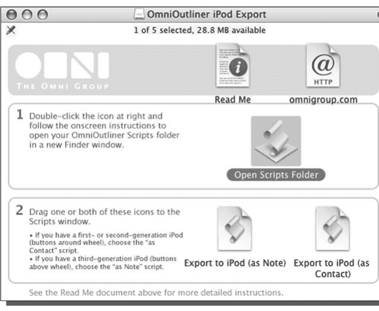

图 2-16: OmniOutliner 导出到 iPod 包含两个脚本。

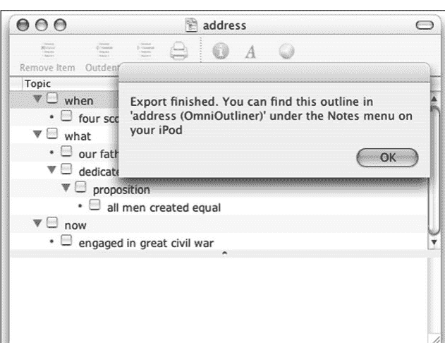

图 2-17: 大纲已导出。

- **棒球官方规则。** 硬核棒球球迷喜欢带着一本规则书去球场，以帮助判断奇特的球路。与其费力地搬运沉重的纸质规则书，一本棒球规则 podBook 就能提供必要的信息。
- **收藏者信息。** 下次当你去展会或收藏品店寻找邮票、硬币、《指环王》玩具、漫画书、泡泡头、火柴盒或其他珍贵的爱好物品时，只需想想如果你的 iPod 里有一份价格指南将是怎样的体验。
- **电影指南。** 一份带有星级评分和类型信息的电影列表，当你下次发现自己站在录像带店里像行尸一样徘徊，试图寻找还没看过至少 3 遍的电影时，会大派用场。
- **专辑列表。** 如果你决定将一生奉诸收集（例如）由 Crosby、Stills、Nash 或 Young 录制的所有音乐，那么你有大量的黑胶唱片 CD 需要收集。一个存储在 iPod 中的权威专辑列表在你经常出没于唱片店时会大大派用场。
- **天文数据。** 如果你来自太空，拿出你最喜爱的天文指南，创建一个包含关于行星、恒星、小行星、太空任务以及其他酷炫天体信息的 podBook。

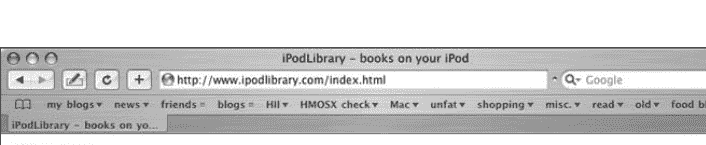

# 第 2 章 — 不仅仅是音乐 37

## iPodLibrary

这不仅仅是音乐播放器：在你的 iPod 上放书籍

### 征集内容！编写一本电子书

这是一个全新的——也是一个全新的概念，因为我们目前只有第一份 podBooks 。我们正在征集你的内容：请制作一些你认为值得与他人分享的小 podBooks！iPodLibrary.com 想要托管和分享各种样的 podBooks，并希望你帮助我们完成这一点。

- 请编写你自己的作品：尽管我们正在考虑放置已经复制并提交的“podBooks”，但你实际上可以汇编自己的原创作品与人们分享——一些实用的、专门为在线而编写的内容。
- 请使用适合快速查阅的主题：列表、统计数据、指南、事实——电视或在线游戏、体育、爱好、食谱、电影等，如何？
- 请在提交时同时附上一段 3 到 4 句的描述，以及一张 200x200 像素的图像，我们需要它来“推广”内容，让精选 podBooks 更加醒目。

**推荐书籍：**

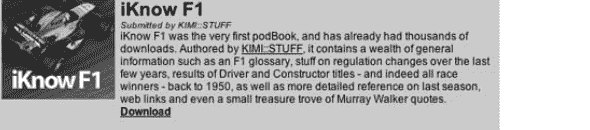

### iKnow F1

由 KMI STUFF 提交

iKnow F1 是一种非常棒的 podBook，已经有了数千次下载。它由 KMI STUFF 编写，包含了丰富的通用信息，如 F1 历史、过去几年的规则变化、车手和车队年度冠军结果——索引了从 1950 年到 1999 年的所有比赛获胜者，以及关于所有赛季的更详细参考、网页链接，甚至还有 Murray Walker 名言的小宝藏。

下载

> 图 28-1: iPodLibrary.com 首页。已经提供 podBooks 副本供下载

为了让这个库运行起来，iPodLibrary.com 已经提供了 podBooks 副本供下载：

- **iKnow F1.** 这本书提供了关于一级方程式赛车的各种信息、历史规则、比赛获胜者列表和其他头衔获得者列表，甚至有一份 F1 术语表。
- **Apple_Bytes。** 如果你是 Apple 历史和冷知识的粉丝，你将从你的 iPod 中获得大量信息。


# 第 3 章 —— 超越音乐：硬件 43

## 表格 3-1 iPod 诊断

| 测试字母和名称 | 描述 |
|---|---|
| A. 5-in-1 | 这项测试会连续运行几项测试：LCM、RTC、SDRAM、FLASH/CHECKSUM、FIREWIRE/FW ID。（查看下文以了解它们的作用。注意，你必须按下两次 Play 才能通过 LCM。）但真正的好戏在测试完成后。在 3G iPod 上，你可以通过按按钮让内置扬声器发出声音。按下 Previous（上一个）听滚轮的点击声，按下 Menu（菜单）和 Select（选择）听到两次长鸣声，按下 Next（下一个）产生一种像《星球大战》激光枪的特效。你可以带着你的 iPod 四处走动，按按钮，如果你在做某些严肃的事，就紧盯着屏幕。点击声是一个极佳的伪造辐射探测器。按下 Play 返回诊断菜单。 |
| B. RESET | 这会重置 iPod，类似于同时按下 Menu 和 Play，但对手指更友好。 |
| C. KEY | 这项测试实际上有点像电子游戏。你必须按下 iPod 上的五个按钮大约 5 秒。当你每按下其中一个时，它的名称就会出现在屏幕上。如果你及时全部按下，就会看到 PASS。如果你动作慢了，就会遇到 FAIL。 |
| D. AUDIO | 当你在 3G iPod 上运行此测试时，如果连接了外部扬声器，你会听到类似 Pacman 的鼓点声。在较旧的 iPod 上，屏幕将显示 AUDIO 0X0000001。 |
| E. REMOTE | 此项测试 iPod 遥控器。这是另一个游戏：你有几秒钟时间按下遥控器上的所有按钮。当你每按下其中一个时，屏幕上会出现一个矩形，其位置与你按下按钮的位置相对应。如果你没有及时按完，或者你没有连接遥控器，你会看到 RMT FAIL。 |
| F. FIREWIRE/FW ID | 此测试检查 iPod 的 FireWire 端口以确保其工作正常。如果正常，你会收到安心的 FW PASS 消息。 |

## 表格 3-1 iPod 诊断（续）

| 测试字母和名称 | 描述 |
|---|---|
| G. SLEEP | 当运行此测试时，你的 iPod 会进入休眠。当你尝试唤醒它时，你可能会看到低电量图标，且 iPod 可能会拒绝恢复。如果发生这种情况，请尝试重置 iPod 或为其连接电源。这应该会让它惊醒。 |
| H. A2D | 此项检查 iPod 的模拟转数字组件。测试列出了几个部件有时显得晦涩的名称和结果，具体取决于特定的 iPod 型号。 |
| I. OTPO CNT | 运行此测试来玩玩滚轮。“OTPO” 是滚轮的工程术语——它本应该是“opto”，但这个拼写错误很有趣，现在为什么要修好它呢？当你运行此测试时，转动滚轮，你会看到 iPod 通过改变屏幕上的大十六进制数字来做出反应。 |
| J. LCM | 此测试 iPod 的显示器。LCM 可能代表“liquid crystal monitor（液晶显示器）”。运行测试，然后按下 Select 在屏幕上显示一个渐变图案。再次按下 Select 显示一个巨大的加号。这个符号指的是 iPod 对 Apple 利润所产生的积极影响。 |
| K. RTC/CHG STUS | 在旧款 iPod 上，RTC 测试与 iPod 的实时时钟有关，即知道当天时间的时钟。数值有时会发生微变化，但一直很小。它与本章《可怕的时间》中描述的时钟“漂移”有关吗？我不知道。这是 iPod 的谜团之一。在 3G iPod 上，此测试被 CHG STUS（充电状态）取代。CHG STUS 显示数值，指示是否通过 USB、FireWire 或耳机接口连接了任何设备。它似乎还显示是否有可用电源。 |


| L. SDRAM/USB DISK | SDRAM 测试 iPod 的同步动态随机存储。那是对抗跳曲保护并延长电池寿命的魔力成分：音乐被预加载到 RAM 中，磁盘驱动器停止。USB 磁盘测试某些项目并将 iPod 重启到磁盘模式。 |

# 表格 3-1 iPod 诊断（续）

| 测试字母和名称 | 描述 |

|---|---|

| M. FLASH/CHK SUM | FLASH 测试（在 3G iPad 上称为 CHK SUM 校验和）检查 iPod 的闪存 ROM。测试以显示一个十六进制数字结束，这可能是用于验证 ROM 的校验和。 |

| N. OPTO/CONTRAST | 旧款 iPod 上的 OPTO 测试似乎什么也没做。CONTRAST 允许用滚轮精调屏幕，但当你离开诊断模式时，所做的任何更改都会消失。 |

| O. HDD SCAN | 此项运行硬盘测试，没有在“使用按钮组合”章节中描述的酷炫磁盘扫描动画。扫描磁盘需要几分钟。扫描完成后，你会看到 HDD PASS 或 HDD FAIL。HDD 意味着“硬盘”。FAIL 意味着“去修修它”。 |

| P. RUN IN | 最后一项运行一系列往复的测试，直到你按住 Play 为止。它似乎是为了确保 iPod 在制造或维修后已准备就绪。 |

# 第3章 — 超越音乐：硬件 47

你可能想把 iPod 用作闹钟，或者只是想听音乐而无必使用耳塞或大耳机。当你将 SimpleSpeaker 插入 iPod 时，整套设备看起来就像一个大大的头重脚轻的米老鼠，如图 3-1 所示。但这并不关乎外观——SimpleSpeaker 是你 iPod 旅行包中一个既方便又廉价的补充品。

## 使用分线器共享你的 iPod

如果你和朋友或家人一起旅行，或者你有两个实际上喜欢同一首音乐的孩子，你可以考虑去买一个特殊的插头，它允许你将 iPod 的耳机接口连接到多一组耳机或耳塞耳机。这些设备被称为分线器（splitters）或 Y 型接头。XtremeMac 制作了一款，名为 iShare 耳机分线器，提供 iPod 白色。iShare 看起来制作精良，带有金色接头，以获得良好的音质。更多信息请访问 www.xtremac.com。iShare 的售价为 13 美元。

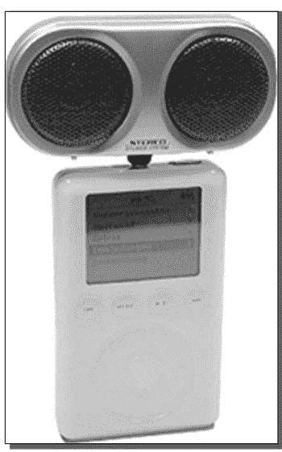

图 3-1：连接在 iPod 上的 SimpleSpeaker。由 Apple 提供。

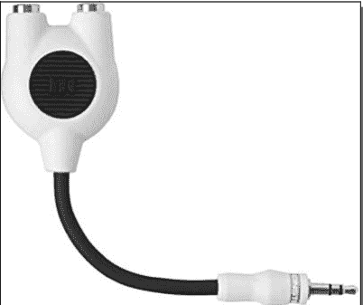

图 3-2：Monster iSplitter 让你共享你的 iPod。

由 Monster 提供。

Monster 制作了一款类似的产品，名为 iSplitter，价格相近。Apple 在你的零售店和在线商店中销售 Monster iSplitter。图 3-2 显示了它的样子。

如果你愿意在风格和高端品牌上做出妥协，可以通过从当地电子商店买一个无品牌的分线器来节省费用。你你应该能在 Radio Shack 或 Fry's 商店找到一个大约 6 美元的，但你可以肯定，它不会是 iPod 白色的。

如果有超过两个的人想听，你可以将一系列分线器连接在一起，一个接一个插入。如果你一直分分信号，信号最终会衰减，你将无法听得更清楚，但 iPod 提供了充足的动力，所以你应该能够成功为至少三或四名听者提供声音。

你可以从分线器引出其他输出。例如，你和朋友可以共享飞机上笔记本电脑或便携式 DVD 播放器的音频输出，或者两个人可以连接到便携式视频游戏的音频。

共享你的 iPod或其他音频输出的更高级的方法是使用无线耳机。请查看第 7 章，“广播你的 iTunes”。

## 查看数字电池显示

第三代 iPhone 和 iPod mini 包含一个酷酷但实际上毫无用处的黑科技（hack）——不是那种好玩的种类的！这个黑科技将你 iPod 上的电池显示从熟悉的倾斜电池图标改为数字视图。以下是 iPod 如何在其磁盘的特定位置查找名为 `show_voltage` 的文件。如果该文件存在，iPod 就会使用数字电池电表。

这个黑科技仅适用于 iPod 使用电池供电时。当它连接到电源的电缆时，标志性的电池电表会重新出现。

要开启此黑科技，你只需要在 iPod 的 `iPod_Control/Device` 目录下创建一个魔法文件（其内容不重要）。棘手的地方在于，`iPod_Control` 在 Finder 和 Windows 资源管理器中是隐藏的。我将描述如何在 Mac OS X 和 Windows 上实现这一点。

### Mac OS X

有几种不同的方法在 Mac OS X 上执行此黑科技。第一种需要一个第三方实用程序，但非常简单。第二种使用标准软件，但稍微复杂一点。

#### 使用 Finder 和实用程序

执行此黑科技简单的方法是使用像 `TinkerTool` 这样的程序（可以在 www.bresink.com/osx/TinkerTool.html 获取），它允许你显示隐藏文件。

- 1. 将 iPod 连接到 Mac。
- 2. 在 `TinkerTool` 中，勾选“显示隐藏文件”。
- 3. 在 Finder 中，进入你的 iPod。
- 4. 找到 `iPod_Control` 文件夹。
- 5. 进入 `iPod_Control` 文件夹。
- 6. 进入 `Device` 文件夹。
- 7. 在 `Device` 文件夹中右键创建一个新文件。
- 8. 将文件命名为 `show_voltage`。
- 9. 打开该文件（内容为空）。
- 10. 保存并关闭文件。

现在，你的 iPod 就会显示数字电池电量了。

#### 使用终端 (Terminal)

你不需要任何第三方软件就可以通过终端执行此黑科技，只要你不习惯使用命令行。

- 1. 确保你的 iPod 连接到 Mac。
- 2. 在 Finder 中，进入“应用程序”。
- 3. 打开终端。
- 4. 在终端中输入 `touch` 后面加一个空格。
- 5. 将 iPod 图标拖入终端，这会自动填充路径。
- 6. 在路径后面输入 `/iPod_Control/Device/show_voltage`。
- 7. 最后，按回车键。

```bash
touch /Volumes/你的 iPod/iPod_Control/Device/show_voltage
```

`touch` 命令会在你的 iPod 上创建一个带有魔法名称的空文件。这就是让数字电量出现的所有操作。当你断开 iPod 时，电池图标就会变成数字。

### 第3章 — 超越音乐：硬件 53

1. 确保你的 iPod 已连接到电脑。
2. 点击“开始”。在“开始”菜单中，点击“我的电脑”。
3. 在“我的电脑”窗口中找到你的 iPod 并双击打开它。
4. 查看打开的窗口。如果你看到看到一个名为 `iPod_Control` 的文件夹，请进入第 8 步。如果没有看到 `iPod_Control`，请继续下一步。
5. 选择“工具” -> “文件夹选项”。
6. 点击“查看”选项卡。
7. 寻找“隐藏的文件和文件夹”。它位于窗口底部。点击“显示隐藏的文件和文件夹”。点击“确定”。`iPod_Control` 文件夹变得可见了。
8. 双击 `iPod_Control` 文件夹。
9. 双击 `SysInfo` 文件并选择“编辑” -> “复制”。
10. 选择“编辑” -> “粘贴”。
11. 右键点击 `Copy of SysInfo` 并选择“重命名”。
13. 将 `SysInfo Copy` 的名称改为 `show_voltage`。注意 "show" 前面有一个下划线，“voltage" 前面也有下划线。

这种方法之所以有效是因为 iPod 只关心是否存在一个名为 `show_voltage` 的文件——它不会检查其内容。你如何创建该文件或它是什么并不重要。`SysInfo` 只是一个方便复制的小文件。

当你断开 iPod 连接时，电池图标将被一个指示电池电量的数字取代，其中最大值为 500 左右。

## 恢复电池图标

一旦你厌倦了数字指示，只需通过删除（或重命名）这个魔法文件即可恢复电池显示。在 Mac 上，如果你有 `TinkerTool` 或该文件，你可以在 Finder 中进行操作。如果你没有可以在 Finder 中查看不可见文件的工具，可以使用终端（Terminal）来删除该文件。在 Windows 上，确保你已启用显示隐藏文件和文件夹，然后将 `show_voltage` 文件放入回收站。

## 为你的 iPod 获取无线遥控器

TEN Technology 提供的 NaviPod 为你的 iPod 提供无线访问功能。当你将 iPod 连接到房间里的音响系统时，这非常理想：你不需要从沙发或椅子上站起来控制音乐。将随附的接收器插入你的 iPod，然后使用 NaviPod 造型时尚的圆形遥控器来播放、暂停、调节音量或切换歌曲。


NaviPod 配带一个酷炫的铬支架，你可以用它支撑起 iPod，以便更好地接收来自遥控器的指令。这个支架是你 iPod 配件中一个实用的补充，无论你是否使用遥控器。如果你没有 NaviPod，可以在 www.technology.com 以 10 美元的价格购买支架。该公司还会以 10 美元的价格额外卖你一个额外的（或备用的）遥控器。

NaviPod 有两种型号，一种适用于旧款 iPod，另一种适用于 3G 版本的 iPad。NaviPod 售价约为 50 美元，你可以在 Apple 零售店和在线商店买到。

## 为你的 iPod 上套

iPod 以时尚和实用性闻名，但并非以坚固著称。iPod 闪亮的镀铬背壳看起来永远不像刚从盒子里拿出来时的样子了——很难避免指纹和划痕。此外，iPod 经常被拿在手里，很多时候都待在户外。由于使用了硬盘，iPod 设计之初并不是为了承受跌落或随意扔掷。

Apple 提供了保护包和皮带夹来帮助你的 iPod 保持完好健康。某些型号包含包，另一些则提供 40 美元的选项。这是一个不错的包，但它看起来有点公司化，作为一名 iPod 所有者，你可能想要更多选择。幸运的是，独立供应商已经介入，提供了大量的 iPod 壳供你选择。在本节中，我们将讨论一些最好且最奇特的壳。你可以通过查看《Macintosh》杂志的封底页或访问你城市或网络上的 Apple Store 来找到它们。

### SportSuit Convertible

来自 Marche 出出的 SportSuit Convertible 既结固又时尚，价格与 Apple 的相当（40 美元）。你可以拆掉这个两节壳的盖子使其更具便携性。所有控制按钮都易于操作，填充盖子包含一个存储耳机、纸条或小宠物的隔层。包带带有臂带和皮带夹。你可以购买其他配件，包括自行车架和挂绳。SportSuit Convertible 提供六种精美的颜色。更多信息请访问 www.marche.com 或前往 Apple 商店查看。

### Groove Purse Triplet

来自 felicidade 出出的 Groove Purse Triplet（图 3-6）可能是世界上最酷的 iPod 壳。它是一个白色的合成皮包，当你把 iPod 滑进去时，它会变成一个音响盒。Groove Purse 内置扬声器，帮助你向周围的人展示你的音乐意志。

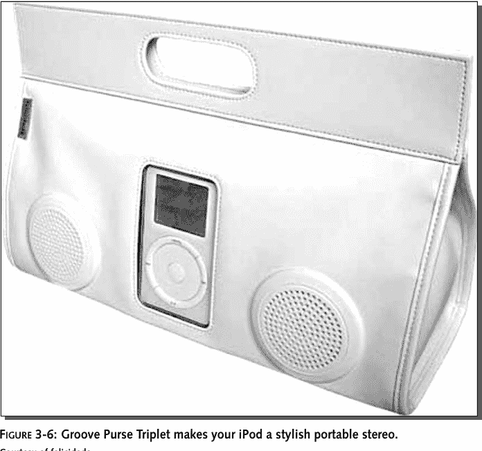

你可以从 www.drbott.com 的 Dr. Bott 处以约 145 美元购买你的 Groove Purse Triplet。

### Vaja Leather

Vaja Leather Products 为所有 iPod 制作精美的皮壳。这些半硬壳有多种型号，你可以从 20 种颜色中选择。你甚至可以刻上你的名字。Vaja 壳售价 50 美元起。在 www.vajale.com 了解更多信息。

### mini 的 Icewear

Icewear 是适用于 mini 的壳之一。Icewear 是第一款适配 mini 的壳（图 3-7）。Icewear 使用了与背面相同的材料。与许多其他壳不同，Icewear 没有遮挡屏幕，因此可读性有所提高。

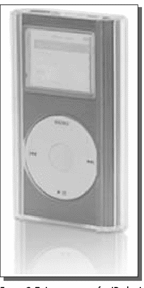

更多信息请见 sewear.com/english/index.html。

## 在车里听 iPod

iPod 和汽车就像苹果和派一样般。在本节中，我们将介绍一些播放 iPod 歌曲的方法。

### 连接到汽车音响

当你想在车里使用 iPod 时，要解决的基础问题是将音乐从 iPod 传输到你的音响。如果你的音响允许来自 CD 播放机或其他设备的外部输入，你只需将电缆从 iPod 的耳机接口连接到音响输入口即可。这种连接方式非常简单，并为你的音响提供了良好、可靠的连接。

如果你的音响没有外部输入，你需要另一种连接方法。如果你的音响有磁带播放机，考虑购买磁带适配器。这个设备插入 iPod 的耳机接口，欺骗你的磁带播放机让它认为里面有磁带。其实并没有，取而代之的是一个塑料磁带壳，通过音响的扬声器传输 iPod 的声音。这种低技术方案相当有效，只是你可能会对假磁带轮子转动的传输噪音感到烦恼。你可以在 Apple Store 或任何电子/音响商店以 20 美元以下买到一个。

最困难的解决方案是使用带有 FM 发射器的适配器。这些小装置利用低功率发射器将你的音乐无线广播到你从几个频率中选择的 FM 频率上。通过将汽车收音机调到相同的频率，你就创建了自己的无线 iPod 广播电台。由于发射器功率低，广播范围只有几英尺，因此在车内非常有用。FM 适配器的一个缺点是容易受到其他广播或无线信号的干扰。这里是一些比较酷的 FM 适配器信息：

- Arkon SoundFeeder SF250 是一款通用 FM 发射器，它使用一对滑动开关选择频率，并采用独特的蛋形设计（见图 3-8）。当设备开启时，滑动开关会发出绿光。SoundFeeder 使用两节 AAA 电池，售价约为 30 美元。有关它的更多信息请访问 www.arkon.com/sf.html。

FIGURE 3-8: Arkon SoundFeeder FM 适配器。由 Arkon 提供。

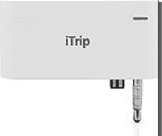

图 3-9：来自 Griffin Technology 的 iTrip mini。

由 Griffin Technology 感谢。

- 来自 Griffin Technology 的 iTrip (`www.griffinetechnology.com`) 独特之处在于，它利用 iPod 来改变频率。调频命令实际上是小歌曲文件，你通过电脑将它们加载到 iPod 中。当你想要设置频率时，只需播放相应的歌曲文件：87.9、88.1、88.3 等。这非常酷，但除非你的音乐品味极度离奇，否则你可能不想在无意中通过汽车音响播放这些“哔哔”声和“哔哔”声。iTrip 从 iPod 直接取电，因此不需要担心电池问题。iTrip 在 Apple 商店的售价约为 35 美元。

- 2004 年 6 月，Griffin 推货了 iTrip mini，这是一个专门为适配 iPod mini 设计的新版本。iTrip mini 的基本功能与它的“大大哥”相同，但正如图 3-9 所示，它可以整齐地插入 iPod mini 中。iTrip mini 售价约为 39 美元，Apple 商店以及制造商处均可购买。

- iRock 400FM 无线音乐适配器可以从汽车的 12V 直接口（以前称为“烟灰器”）或两节 AAA 电池供电。这些价格约为 30 美元，你可以在 www.myirock.com 查看。

- Belkin 生产 TuneCast 移动发射器系列产品。这些紧凑的适配器使用电池运行，并通过按钮选择频率。更多信息请访问 www.belkin.com。

- Monster 的 iCarPlay 插入 iPod 的底座接口，并在你听音乐时为其电池充电。该适配器插入 12V 插座。你可以在 www.monstercable.com 获取更多信息，售价约 70 美元。

- 来自 Digital Lifestyle Outfitters 的 TransPod 是一种 FM 适配器，它可以在播放音乐时为你的 iPod 充电，并配有一个酷炫的支架单元（见图 3-10）。TransPod 可在 www.everythingpod.com 购买，约 100 美元。

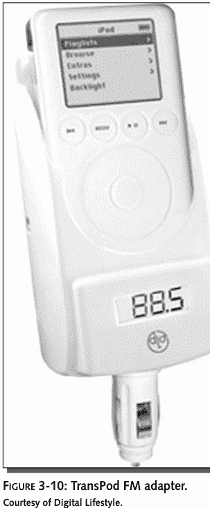

## 真正的突破

像 iTrip 和 SoundFeeder 这样的 FM 适配器可以将你的 iPod 变成小型移动广播站，在 FM 波段上低功率发射信号。2004 年夏天，几个聪明的黑客决定看看如果稍微增强他们的 FM 发射器功率会发生什么。根据 Enggad 网站 www.engadget.com/entry/3597373383872462/，某些 FM 适配器内部缠绕有天线。通过打开外壳（这会使保修失效）并取出天线，你可以增加发射器的范围。

## 第一部分 — 破解 iPod

一旦你改进了发射器，就可以将 iPod 当作微型广播站使用。Enggad 对这种用途有几种半开玩笑的建议，包括向你那放摇滚乐的邻居广播静音、在红灯路向你旁边那辆震耳欲聋的汽车播放柔和的海浪声，以及接管健身房健身的人为了听电视节目时使用的无线接收器。

由于 FM 适配器在特定频率上广播，这种破解的棘手之处在于弄清楚你的目标受害者调到了哪个频率。因此，这种破解在你的朋友和家人身上尝试效果最好。这对于避免可能产生的法律诉讼和争吵也是很好的策略。

## 在车内为 iPod 供电

如果你要带着 iPod 出游，你需要一个电源。之前列出的某些 FM 适配器（CarPlay 和 TransPod）可以在你播放音乐时为 iPod 充电。除了这些，这里还有一些较好的 iPod 充电器：


- 来自 Griffin Technology 的 PowerPod (`www.griffintechnology.com`) 非常酷，因为它兼容所有代代的 iPod。Griffin 通过让 iPod 充电器线与插入 12v 插座的充电器部分分离来实现这一妙招。PowerPod 售价约为 20 美元。

- SiK 制造了一个 30 美元的充电器，带有可更换的保险丝和线路平级音频输出。在 `www.sik.com` 查看。

- Dr. Bott 的 iPod 汽车充电器售价 25 美元，并带有一个 SendStation PocketDock，以便连接任何 iPod。该型号包含可更换保险丝。访问 `dr.bott.com` 详细查看细节。

## 获取终极 iPod 车载

来自 Dension USA 的 ICE-Link 在 2004 年 1 月的 Macworld Expo 上大获成功，它允许你的 iPod 取代音响中的 CD 转换器。当你选择 CD 作为输入源时，你的 iPod 就会播放。如果你有那种可以在方向盘上选择曲目的控制器，ICE-Link 可以让它与你的 iPod 工作。当你选择不同的输入时，ICE-Link 会暂停。

ICE-Link 针对各种汽车型号进行定制，售价约为 200 美元。更多信息请访问 `icelink.densionusa.com`。

## 第 3 章 — 超越音乐：61

### 终极听音机器

Apple 确实注意到很多人喜欢在车里听 iPod。为了安抚这些客户，Apple 开始与汽车制造商合作，将 iPod 完全整合到汽车音响中。根据撰写时的报道，Apple 和 BMW 将推出一项名为“Pod Your BMW”的活动。BMW 车主可以选择获得安装在手套箱内的 iPod，配有方向盘控制按钮和仪表盘数字显示器。因此，如果你正在为新的 iPod 存钱，你可能需要多存点钱买一辆新 BMW。

### 更换你的 iPod 电池

iPod 电池设计为承受数千次充放循环。最终，你会得到一个不再保持电量的电池。虽然电池是内置的，但并非无可救。当电池用完时，你有四种选择：

... (此处后续原文存在重复和碎片化，已按要求处理)

# 第3章 — 超越音乐：硬件 63

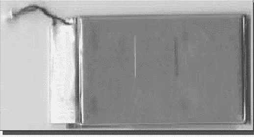

图 3-11：大容量 iPod 电池。

焦急地启动你的 iPod 以确保它还能正常工作。注意：新电池通常需要充电，所以如果起初在没有外部电源的情况下无法启动，不要惊慌。

## 高级电池信息

现在我们已经讨论了 iPod 电池知识的基础知识，这里有一些你可能想尝试的额外技巧和窍门——如果你有胆的话。

- 如果你有一个较厚的 iPod（第 3 代之前的型号），你可以尝试将两块电池串联在一起。当然，这将导致保修失效，但它应该是有效的，并让你的 iPod 电池寿命增加一倍。

- 一些制造商为 iPod 提供更高容量的电池。例如，PDASmart 销售一种 2000mAh 的电池，该公司提供的提供的功率比 Apple 的电池多出 60%（见图 3-11）。你可以从 `www.pdasmart.com/products/AP7ippodpartscenter.htm` 订购，价格约为 90。

### 电池死亡

2003年11月，Casey Neistat 的 iPod 电池在使用仅 18 个月后就坏了。根据 Neistat 的说法，当他要求 Apple 修理时，Apple 的回复是让他买一个新的 iPod 作为替代品。这让他非常愤怒，他和他哥哥 Van 创作了一部名为《iPod 的肮脏秘密》（iPod's Dirty Secret）的纪录片来讲述故事。Neistat 兄弟在网上发布了他们的电影，引发了各种疯狂。许多 iPod 用户同意电影的观点，而另一些人则为 Apple 辩护。Casey Neistat 在《华盛顿邮报》的一篇文章中被引用：

> “在前几天我们收到了近 1000 封邮件，许多人处于我完全相同的境地，不得不购买新的 iPod。我们 80% 的邮件是积极的，人们说他们喜欢我们这种讽刺且不羁权威的处理方式。但也有忠实的 Mac 用户对我们非常愤怒，他们感到恐慌，因为他们觉得我们可能会导致某些人不买 Macintosh。”

在电影发布不到两周，Apple 就宣布了新的 iPod 电池保修和更换政策：59 美元延长保修，99 美元更换新的 iPod，正如本节稍早些部分描述的那样。电影的发布与 Apple 的新政策之间有联系吗？Apple 的说没有：新政策在电影发布前几个月就已经拟好了。

关于这起波澜壮阔事件的更多信息，请参阅 `www.ipodhacks.com/article.php?sid=516`。如果你想看电影本身，请访问 `www.ipoddirtysecret.com`。

## 总结

花费数百美元为你的 iPod 配备配件以让它在飞行、开车或跑步时变得更好用，这很容易。但你也可以玩玩内置的诊断模式，这是每台 iPod 免费附带的“功能”。诊断模式是一个完美的 iPod 黑客技巧——它并不是特别有用，但展示给朋友们看是非常酷的，尤其是当你让 iPod 发出那些视频游戏的声音时。

在下一章中，我们将继续查看你可以对 iPod 执行的一些有趣、奇特且偶尔有用的技巧，重点是软件扩展。尽管 Apple 并没有将 iPod 设计为软件开发平台，但已经出现了一系列强大的程序，帮助你从 iPod 和你的计算机中获得更多功能。

# 超越音乐：软件

计算机被诅咒了极高的期望和惊人的灵活性。烤面包机是为了烤面包而设计的，冰箱是为了保持食物低温，但计算机是一台通用机器，可以被用来执行各种各种任务。由于计算机设计者和工程师都是创意性的人，对计算机或程序能做的事设定限制对他们来说是痛苦的。但正是这些人为的限制，定义了伟大的数字产品，它们将设计者和用户的注意力集中在产品的目标上。

没有哪个产品比 iPod 更体现这种聚焦原则。从总体来说，iPod 不是音乐播放器；它是一台计算机。当第一代 iPod 出现时，Apple 选择将其应用程序限制在音乐上。据报道，Apple 决定不把 iPod 作为外部软件开发者的平台。

但需求是巧妙的，人们很快找到了将额外功能溜入 iPod 的方法。坚定的粉丝想出了如何将数据伪装成歌曲，很快名字和电话号码就出现在 iPod 的音乐旁边。Apple 注意到了这一趋势，并在其基础 iPod 软件中添加了自己的功能。每台 iPod 都有存储联系人和日历的能力，较新的 iPod（带有底座连接器）允许你存储笔记。

自然，当人们掌握这些想法时，他们在此基础上构建了扩展。使用联系人、日历和备忘录功能，你可以向你的 iPod 输入各种信息，包括电影列表、长文本文件、专题节目（featurecasts）和莎士比亚的十四行诗。在本章中，我们将探索如何教你的 iPod 这几项新技巧。

我们在本章中讨论的另一个巧妙微调是从你的 iPod 复制歌曲的能力。虽然 iTunes 防止了这种形式的复制以防止歌曲盗版，但有很多正当理由将音乐从你的 iPod 移动，而且有很多简单的方法可以实现。

# 第4章

## 本章内容

- 查看并复制你的歌曲
- 在 iPod 上放置大型文档
- 阅读美国
- 获取新闻、天气及更多
- 与 Outlook 同步 iPod
- 使用 PocketMac 用于 iPod
- 在 Linux 上

### 查看并复制你的歌曲

笑话是，微软投入了数百万美元数字版权管理（DRM）来限制用户能做的事，而 Apple 在每台 iPod 上花费了几分钱贴纸，写着“不要偷”。事实更为复杂。Apple 一直在客户和音乐出版者的权利与欲望之间走钢丝。

当初代 iPod 在 2001 年出现时，一些人希望每次打开 iPod 时都出现“不要偷”，但这种观点失败了。相反，Apple 在 iPod 开发后期决定采用一种名为“roach”（蟑螂）的 DRM 策略。在 iPod 的情况下，它是进的，但不出的。正如你所知，iTunes 只提供了从计算机复制歌曲到 iPod 的方法——无法反向移动。

如果你通过 Finder 或 Windows 资源管理器查看你的 iPod，你哪里也看不到歌曲。这是 Apple 采取简单步骤隐藏了它们。这更多是社会性的复制保护系统而非技术。但它们隐藏的方式是一个公开的秘密，而且很容易绕过。每个 iPod 网站都解释了如何查看你的歌曲，我也会这样做。

### 善与恶

我不会在这里进行大大的法律或道德说教——我只是个极客，不是这些领域的专家——但将音乐从 iPod 移动到计算机有许多正当理由。例如，假设你有一些从 CD 刻录到 iTunes 的音乐，然后复制到了 iPod，最后在你的硬盘上。你购买的音乐还在 iPod 上，它们很乐意复制回它们以前所在的计算机上。另一方面，从朋友的 iPod 复制商业性付费音乐到你的计算机上绝对是不酷的，更不用说是非法的。所以，遵循那个小贴纸上的建议是个好主意：不要偷音乐。

# 第 4 章 —— 超越音乐：67

苹果的温和反复制方案包含三个元素：

- 在 iTunes 中，如果你将 iPod 拖到“资料库”(`Library`)或电脑上的播放列表，你将无法将其放进去——它会自动弹回原来的地方。苹果在 iTunes 中内置了这一限制以防止易于复制。没有办法可以克服它。


进入`/path/to/xxx`目录，找到`xxx.json`。

在表达式`cvar = avar + bvar`中，加法运算符（`+`）将`avar`与`bvar`相加，得到它们的和`cvar`

在`List.of(arg0, arg1, arg2)`中，`List`接口的工厂方法`of()`接受一系列的元素，返回包含它们的只读列表。

之后我们这样调用`cmd`命令：`cmd arg0 arg1 arg2`。

```
if (condVar > someVal) {console.log("xxx")}
```
[/content]

Wait that's example. Need actual processing.

Let's output proper.

[content]
- 在 Finder 或 Windows 资源管理器中，你的 iPod 显示为一个硬盘，但歌曲却无处可见。这是因为苹果正在使用操作系统的功能从视图中隐藏这些文件。否则，它们就是普通的、可复制的文件。

- 音乐文件被排列在文件夹中，这些文件夹并没有按照任何明显的方案进行组织。这使得使用艺术家或专辑名称等线索寻找你想要的特定歌曲变得更加困难。

让我们讨论几种查看和玩弄你 iPod 文件的不同方法。技巧和工具取决于你正在使用的操作系统。

## Mac OS X

只要你使用的是 Mac OS X 10.2 或更高版本，你就可以仅通过 Finder 找到并复制 iPod 上的任何歌曲。方法如下：

- 1. 在 Finder 中，选择“前往” ⌘ “文件夹”。

- 2. 在弹出的窗口中，输入 `/Volumes/iPodName/iPod_Control/Music`。（不要输入“iPodName”，输入你 iPod 的实际名称。）点击“前往”。你的 iPod 音乐文件夹应该会出现在 Finder 中，但其内容是不可见的。

- 3. 选择“文件” ⌘ “查找”。点击“搜索:”弹出框，并选择“特定位置”。

- 4. 将 Finder 窗口中的 iPod 音乐文件夹拖到 Finder 窗口顶部的列表中。你会看到 iPod 音乐文件夹作为另一个搜索位置被添加。确保只选了音乐文件夹这一个项目。

- 5. 点击“搜索项目”区域中的第一个弹出框并选择“可见性”。点击第二个弹出框并选择“可见和不可见项目”。

- 6. 点击右侧的加号添加另一个搜索准则。从两个弹出框中选择“名称”和“包含”。输入歌曲名称的全部或部分以找到右侧的文本。

注意，你搜索的是文件名，这可能与歌曲名称不相同。最好的办法是搜索歌曲标题第一部分的单词，因为在刻录 CD 时，文件名经常会被截断。例如，如果你在找歌曲“Dead Leaves and Dirty Ground”，请搜索“Dead Leaves Dirty Ground”。你会明白的——你很聪明的。

### 第一部分 —— 破解 iPod

如果你使用的是 Mac OS X 10.2，选择搜索准则的方法略有不同。使用“添加准则”弹出框直到你得到两个准则，一个将“可见性”设置为“所有”，另一个是“文件名”和“包含”。

- 3. 在查找窗口中点击“搜索”。你将得到一个搜索结果窗口，显示出你正在寻找的歌曲。请参图 4-1 查看其示例。

图 4-1：你可以使用 Mac OS X 中的查找功能来确定特定歌曲的位置。由苹果提供。

## 第 4 章 —— 超越音乐：软件 69

一旦你在搜索结果中看到标题，你就可以简单地将其拖动到另一个位置（例如你的硬盘），Finder 就会乐意地将其复制过去。如果你是从 iTunes Store 购买的歌曲，限制也会随之而来，因此你不能用这种技术来破解苹果的数字版权管理。

这是一个寻找和复制单首歌曲的方便技巧。如果你想将 iPod 上的所有歌曲移动到硬盘上怎么办？从执行步骤 1 到 5 开始，为搜索你的 iPod 音乐做好。继续执行这些步骤：

- 1. 将第一个准则“可见性”设置为“可见和不可见项目”，并让它是唯一的准则。如果你还有上一次搜索留下的其他准则，点击其旁边的减号将其删除。

- 2. 点击“搜索”以显示音乐文件夹中的所有内容。你将得到一个像图 4-2 那样的搜索结果窗口。

- 3. 向右滚动搜索结果窗口，直到看到“大小”列。点击该列的标题（显示为“大小”的地方）。你将获得 iPod 音乐文件夹中的文件列表，按从小到大的顺序排列。它的副作用是将所有歌曲都放在了顶部，而 iPod 用于组织音乐的文件夹（名称为 F00、F01 等）位于底部。

- 4. 点击搜索结果中的第一首歌曲。向下滚动直到你能看到最后一首歌，就在文件夹（F00 等）之后。按住 Shift 点击最后一首歌。这将选取所有歌曲。

- 5. 打开一个 Finder 窗口并在你的硬盘上创建一个新文件夹（⌘ 新建文件夹）来存放你的音乐。将其命名为“my iPod music”。

- 6. 将歌曲从搜索结果窗口拖到“my iPod music”文件夹中。Finder 将你的歌曲从 iPod 复制到磁盘。

当你将歌曲放入目标位置后，你可能会收到来自 Finder 的错误消息，内容类似于“所选项目无法放入相同位置，因为其中至少一个正在忙用。”问题在于，你使用这种方法来玩弄你的 iPod 文件。

### 终端更强大

### 第一部分 —— 破解


图 4-2：你可以使用终端中的 `cp` 命令来复制 iPod 上的歌曲。由苹果提供。

## 第 4 章 —— 超越音乐：软件 71

```
Terminal - ttyp1.txt
Last login: Sat Feb 21 15:11:08 on ttyp3
Welcome to Unix: the glory that is
sort -d /Volumes/Harvey/iPod_Control | grep -i "rock"
Volumes/Harvey/iPod_Control/Music/F83/04 Rock Roll Music.mp3
Volumes/Harvey/iPod_Control/Music/F19/03 Rock Roll Dreams.mp3
sort %
```

图 4-3：你可以使用终端中的 `find` 命令搜索 iPod 上的歌曲。

- 1. **进入终端。** 对于那些不了解但渴望学习的人来说，它是一个应用程序，通常位于应用程序/实用工具文件夹。

- 2. **在终端窗口输入此命令：**

   `find -d /Volumes/"my iPod"/iPod_Control | grep -i "part of name*"`

   不要使用“my iPod”，使用你 iPod 的名称。在“part name”处输入你正在寻找的文件名的任何部分。记住你正在搜索的是文件名，这可能与歌曲名称不相同，你应该尝试搜索歌曲标题第一部分的单词。输入此命令后，你将得到一个符合你搜索请求的歌曲列表。请参阅图 4-3 的示例。

- 3. **终端的输出包含了你找到的所有文件的完整路径。** 在终端中，查看输出以找到你想复制的歌曲。

- 4. 带有步骤 3 中的文件路径，在终端中使用 `cp` 命令复制歌曲，如下所示：

   `cp /Volumes/"my iPod"/iPod_Control/Music/F16/01 Dead Leaves And The Dirt.wav" ~/Documents/"my iPod music"`

   （该命令在本书中换成两行显示，但当你将其输入终端时，它应该是整整一行。）注意，对于包含空格或非字母数字字符的 iPod、文件或文件夹名称，你必须加上引号。

# 第一部分 — 破解 iPod

## 这是一根烟斗 (Ceci une pipe)

如果你好奇，这里是对你在终端（Terminal）中输入的两个简单命令的简要解释。

```
find -d /Volumes/"my iPod"/iPod_Control | grep -i "part of name"
```

该命令的作用是在目录（文件夹）中查找文件。"-d" 选项告诉 `find` 递归进入它看到的任何目录。"/Volumes/"my iPod"/iPod_Control" 指定了查找开始的位置。随后的竖线被称为“管道”（pipe）。它告诉 `find` 将其输出（即 iPod_Control 文件夹中所有文件的列表）发送到另一个命令——在这种情况下，是一个名为 `grep` 的句命令，这是一个用于查找文本的 Unix 工具。`grep` 查找你想要的文本，而 "i" 选项告诉 `grep` 不要忽略文本的大小写差异。

以下是我们用来复制歌曲的方法：

```
cp /Volumes/"my iPod"/iPod_Control/Music/F16/01 Dead Leaves
And The Dirt.wav ~/Documents/"my iPod"/
```

这非常简单，`cp` 命令用于复制文件。第一个项目是要复制的文件，后面跟着的是目录路径，告诉我们我们想将副本存到哪里。

就这样。如果你对深入学习 Unix Shell 和命令的深层世界感兴趣，有很多书籍、杂志文章和网站可以教你更多关于 Unix OS X 的知识。玩得开心，并在外面要小心。

## 为 iPod 用户提供的自动化方案

现在你已经精通了使用内置方法发现隐藏的 iPod 歌曲，你可能想尝试一些实用程序，它们可以让你更容易查看 iPod 中到底有什么内容。TinkerTool 和 iPod Viewer，我将介绍其中最流行的两个程序——TinkerTool 和 iPod Viewer，并提供更多工具的建议。

## TinkerTool


Marcel Breshink 开发的 TinkerTool (www.bresink.com/osx/TinkerTool.html) 是一款免费工具，带有一个开关，让你可以在 Mac OS X 上、通过 iPod 或任何地方查看、查找和复制所有隐藏的文件和文件夹。TinkerTool 可以让你调整许多其他设置，但在使用 Finder 时查看 iPod 上的隐藏音乐，只需勾选一个复选框。进入 TinkerTool 中的 Finder 界面并点击“Show and hidden files”（显示隐藏文件）。你会看到……嗯，这不会立即发生。要让更改生效，你必须点击窗口底部的“Relaunch Finder”（重启 Finder）（见图 4–4）。

在更改设置并重启 Finder 后，Finder 很快就会返回并得到改进。现在，当你从 Finder 中打开 iPod 时，

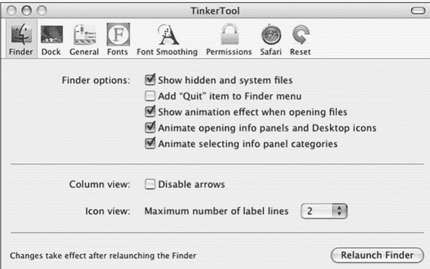

**图 4-4：** TinkerTool Finder 设置界面。

iPod Control 文件夹将变得可见，以及其中所有的文件夹和歌曲。当然，你不应该移动或删除 iPod 本身上的文件，因为这无疑会让 iPod 感到困扰。

注意

TinkerTool 值得进一步深入研究。虽然对其功能的全面讨论超出了本书最理想的范围，但这里有几个使用 TinkerTool 实现的酷炫黑客客技巧：

- 更改系统字体和字体平滑设置。
- 让隐藏应用程序的图标在 Dock 栏中显示透明（见图 4-5）。
- 在滚动条中、滚动条的两端或两端都放置单双滚动箭头。

## iPod Viewer

iPod Viewer (homepage.mac.com/initgraf/iPodViewer/frameset.html) 是由 InitGraf Software 提供的的一款精美免费工具。iPod Viewer 用于检查


**图 4-5：** 隐藏应用程序图标透明的 Dock 。

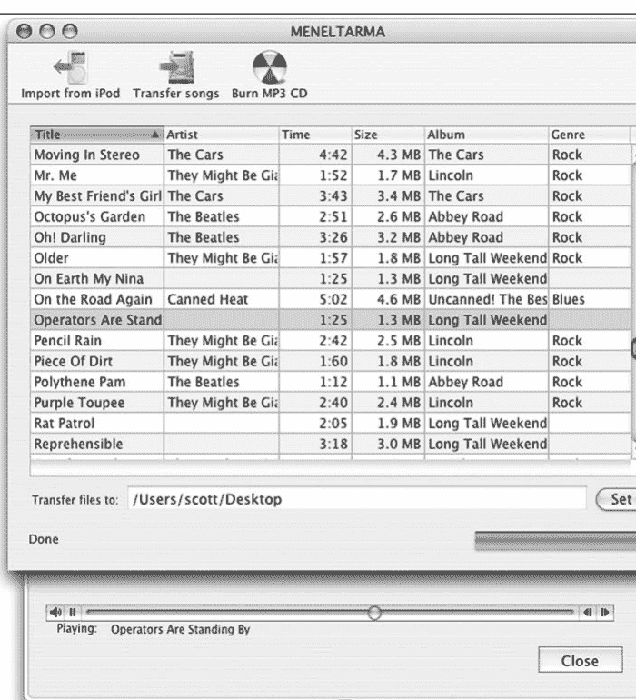

**图 4-6：** iPod Viewer 列出 iPod 上的歌曲并允许你在 Mac 上播放它们。

你的 iPod 内容并在窗口中列出它们（见图 4-6）。你可以点击列标题按你喜欢的任何方式排序歌曲，就像在 iTunes 中一样。而且 iPod Viewer 不仅仅是一个查看器——它还是播放器。如果你双击歌曲，窗口底部会出现一个小抽屉，你的歌曲就开始播放了。

通过 iPod Viewer，你可以通过选择你想要的歌曲并点击“Transfer songs”（传输歌曲）将任何或所有歌曲复制到 Mac。你甚至可以直接从 iPod Viewer 刻录一张满 MP3 的 CD，而无需将文件复制到 Mac。只需选择你想要的歌曲并点击工具栏上的“Burn MP3 CD”（刻录 MP3 CD）。这真的很棒！

## 其他程序

另一个值得的程序是 PodMaster 1000，可以在 homepage.mac.com/podmaster/FileSharing.html 以 8 美元的共享软件费用购买。你可以使用 PodMaster 1000 从你的 iPod 中复制歌曲。搜索助手（Search Companion）出现在窗口的左侧，通常伴随着那只热心的小狗（顺便说一下，你可以把它换成一个坐在飞行汽车里的女人，但那是另一本书的技巧）。

## Windows XP

在 Windows XP 中查看隐藏文件比在 Mac 上还要简单。以下是操作方法：

- 1. 开始。在开始菜单中，点击“我的电脑”。
- 2. 在“我的电脑”中找到 iPod 并双击它。
- 3. 点击“工具：文件夹选项”。
- 4. 选择“查看”选项卡。
- 5. 寻找“隐藏文件和文件夹”。
- 6. 点击“显示隐藏的文件和文件夹”。点击“确定”。现在 iPod_Control 文件夹像幽灵一样，但可见了。

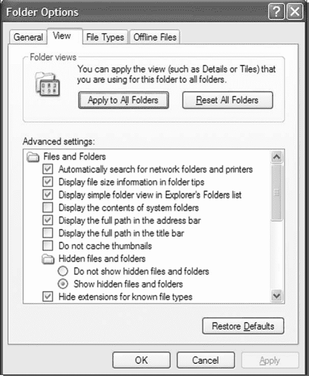

**图 4-7：** 你寻找的选项位于“高级”列表的底部。

如果你在寻找某个特定文件怎么办？你可以使用资源管理器中的搜索功能，但你必须先更改设置：

- 1. 点击工具栏上的“搜索”按钮。搜索助手出现在窗口左侧。
- 2. 在搜索助手区域的底部，点击“更改首选项”。
- 3. 点击“搜索文件和文件夹”。
- 4. 点击“高级”按钮，然后点击“确定”。这将带回到主搜索界面。
- 5. 点击“更多高级选项”。会出现一些新选项。
- 6. 确保勾选了“搜索子文件夹”和“搜索隐藏的文件和文件夹”。
- 7. 将区域滚动回顶部，在第一个框中输入歌曲名称的一部分。你的屏幕现在看起来像图 4-9。

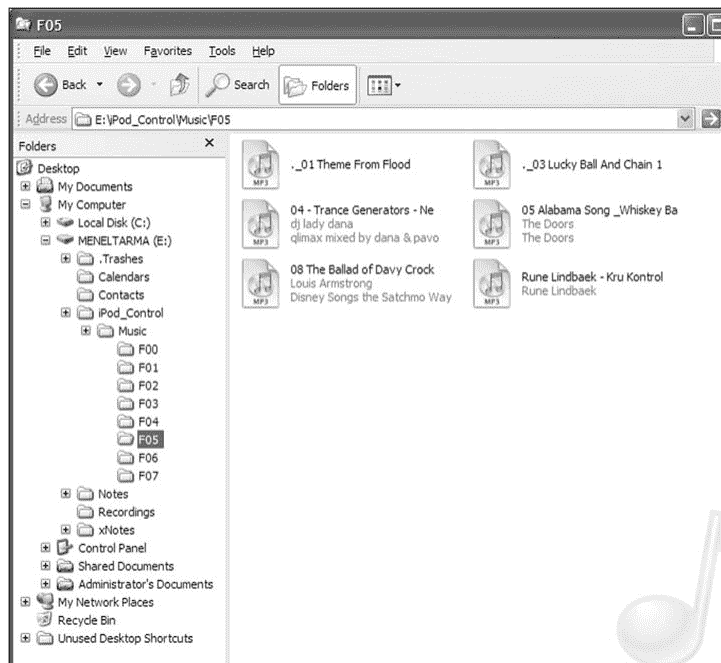

**图 4-8：** Windows 资源管理器中典型的 iPod 选项。

当你点击“搜索”时，小狗会快速找到你在 iPod 上寻找的文件。你可以将任何或所有文件拖到你的硬盘上。汪！

酷炫工具

苹果在发布 Windows 版 iTunes 之前，已经在 Windows 上销售了很长的 iPod。这的结果之一产生了一系列帮助你折腾 iPod 的应用程序。

# 78 第一部分 — 破解 iPod

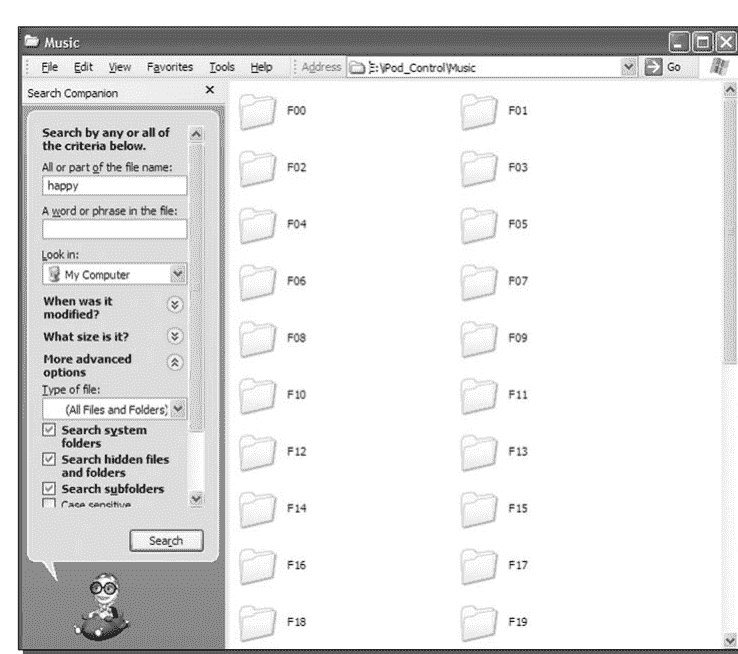

图 4-9：Windows 资源管理器中显示的典型 iPod 内容。

你的电脑，包括你看到的一些帮助信息，以及将音乐从 iPod 复制回硬盘的功能。

# EphPod

EphPod (www.ephpod.com) 是由 Joe Masters 创建的程序，它可以让你复制文件，以及许多其他功能。你可以在图 4-10 中看到 EphPod 的界面。当你运行 EphPod 时，你会看到所有常见的 iPod 内容列表：播放列表、艺术家、流派和歌曲。要使用 EphPod 将歌曲复制到硬盘，请找到该歌曲并右键点击，然后从快捷菜单中选择“复制歌曲到目录”（Copy Songs to Directory）。选择你想要让歌曲存放的地方，就完成了。

EphPod 是一个实用的程序，具有许多帮助你管理 iPod 的功能，所以请务必查看一下。EphPod 是“捐赠软件”（donationware）——如果你喜欢它，作者请你向他的啤酒基金捐款（那笔钱并不是用来买啤酒的）。

# 第 4 章 — 超越音乐：软件 79

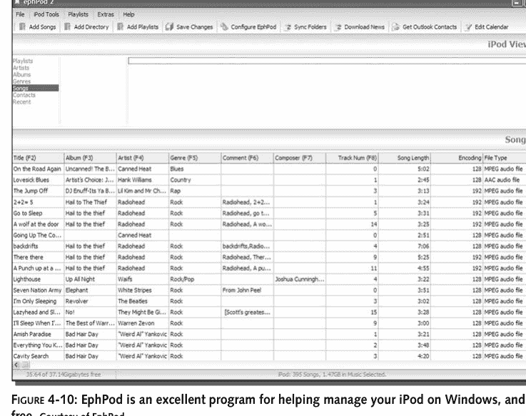

图 4-10：EphPod 是在 Windows 上管理 iPod 的优秀程序，而且它是免费的。由 EphPod 感谢。

## XPlay

另一个非常棒的 Windows 程序是 XPlay，来自 Mediaforum 公司 (www.mediaforum.com/products/xplay/)。它的特殊之处在于可以同时处理 Mac 格式的 iPod 以及其他连接到电脑的 iPod。XPlay 的工具栏上有一个“复制到”（Copy To）按钮，可以让你从硬盘中移动音乐。XPlay 售价为 30 美元，并提供免费测试版。

## iPhone 或 iPod 上的大文本文档


此破解方法仅适用于 Macintosh 电脑。

Apple 在 2003 年及以后推出的 iPod 包括了 iPod mini，它具有新的按钮布局和连接器。软件也发生了变化，Note Reader（笔记阅读器）是当时最大的功能之一。Note Reader 提供了一种将通用文本文档放入 iPod 的方法，这样你随时有空就可以查看。将笔记存入 Note Reader 非常简单：只需使用 Finder 或 Windows 资源管理器将文本文件拖入 Notes 文件夹即可。这非常酷。

然而，Apple 决定仅将 Notes 和 Note Reader 限制给新的 iPad。与许多其他新功能不同，你无法通过升级 2003 年以前 iPod 的软件来获得 Notes 功能。

幸运的是，iPod 的世界充满了聪明的程序员，他们帮助我们解决这类问题。由 Thomas Hacki 开发的 Podtext 就是这种现象的例子。Podtext 让你将笔记存储在联系人（Contacts）文件夹中，无论新款每个 iPod 都有这个文件夹。你可以使用 Podtext 本身打字笔记，然后将其直接发送到 iPod 或硬盘。你可以在 Podtext 中打开并编辑这些“联系人笔记”，但你无法直接从 Mac 硬盘打开文件。相反，你可以用另一个程序（如 TextEdit）打开文件，选择文本，然后将其拖入 Podtext。图 4-11 显示了 Podtext 的样子。


如果你的文本文件太大，无法放入 iPod 上的联系人中（超过 2000 个字符），Podtext 将自动将其拆分成多个文件存储，然后在编辑时再次将其缝合在一起。

你可以在 `www.podtext.thhdesign.com` 免费获取 Podtext。

如果你有一个支持 Notes 的 iPod，并且想了解更多关于使用 Note Reader 可以做的酷炫功能，请参附录 A。

图 4-11：Podtext。

# 第 4 章 — 超越音乐：软件

## 免费阅读

你可以在网络上追踪许多以文本形式提供的优秀免费阅读材料。一个极佳来源是 archive.org 上的存档（Internet Archive）。这个了的网站拥有数千份免费文本，大部分来自版权已过期的书籍。你可以在该收藏中找到《莫比迪》、《爱丽丝仙游》、《孙子兵法》以及各种圣经。在这里，大多数文本太长，无法放入单个 iPod 节点，Podtext 会自动为你拆分它们。

# 阅读美国宪法

当你访问位于华盛顿特区的国家档案馆时，可以看到被称为“美国自由宪章”的文件：《独立宣言》、《美国宪法》和《权利法案》。这些文件现在已有 200 多年的历史，被保存在装满惰性气体的容器中，并覆盖着厚实的防弹玻璃。晚上，这些文件被密封在一个重达 55 吨的钢筋混凝土制成的库房中。虽然保护这些文件的原质版很重要，但同样值得注意的是，你可以在 iPod 上拥有你自己的美国宪法副本（图 4-12）。

感谢美国宪法协会，你可以下载宪法并将其放入 iPod 的 Notes 文件夹。要获取 iPod 宪法，请访问 `www.aclaw.org/misc/iPod` 并下载。按照下载页面上的说明（只需将文件拖到 iPod 上的 Notes 文件夹），你就拥有了宪法。它不是 55 吨重的库房，但它非常便携。

一旦你的 iPod 上有了宪法，你就可以通过主屏幕上的 Notes 来阅读它，就像查看所有 iPod 笔记一样。有关“自由公民”展览的更多信息，请访问国家档案馆网站 `www.archives.gov/national_archives_experience/charters.html`。

# 阅读莎士比亚十四行诗

有时，当我在 iPod 上听速度金属乡村音乐时，我会联起那句古语：“我的眼睛和心之间被夺走了，每个美好的转念都相互转化；当我的眼睛渴望注视，或心在叹息中变得更加平顺时。”这时我意识到我按错了 iPod 上的按钮，正在查看 Shakespeare's.net975afc8f1f77ad5fa49fc6c_108_0.png


# 第 4 章 — 超越音乐

PodGo 可以获取你的星座运。你可能对这个不感兴趣，但如果你根据星象规划生活，或者利用星座运来消遣的话

# 第一部分 — 破解 iPod

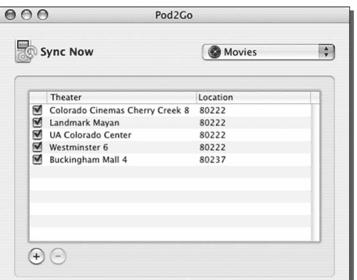

图 4-13。Pod2Go 提供了一种从 Web 收集信息（如计时电影）并将其复制到你的 iPod 的方法。感谢 Pod2Go 提供。

这些目的，你可以尽情阅读你出生星座的占星建议和预测，以及任何你可以下载到 iPod 的其他内容。

Pod2Go 包含一个非常酷的功能，可以让你将任何文本复制到 iPod 的备录中，包括来自网页或 Word 文档的文本。只需点击“New”（新建）按钮，并将 Pod2Go 指向硬盘上的某个文档，或者输入 URL。当你下载像这样的网页时，iPod 不会显示它在 Web 浏览器中的外观——它会为你提取出文本。你还可以使用此功能直接在 Pod2Go 中输入备录，然后它会将其同步到 iPod。

Pod2Go 的路线功能是节省纸张的好方法。现在，当你获得前往市边缘那个有趣的派对的路线时，你只需将它们随身带上 iPod，而不需要打印出来。注意不要在开车时真的从 iPod 上阅读路线。

默认情况下，每当你连接到 Mac 时，Pod2Go 都会将信息复制到 iPod。有一个偏好设置可以关闭此功能，还有一个设置可以在同步完成后立即弹出 iPod。

Pod2Go 的界面整洁且易于理解。要添加要同步的项目，请转到相应的页面（新闻、天气、文本等）并点击加号。你可以用它来移除不再需要的项目。

# 第 4 章 — 远超音乐：软件

## 不仅仅是信息

Pod2Go 擅长处理 Web 上的内容并将其放入你的 iPod，但这并不是它的全部功能。你可以使用 Pod2Go 在 Mac 和 iPod 之间同步信息，包括你的通讯录、iCal 日历、Stickies 备忘录便签和 Safari 书签。但等一下——这些工作通常不是由 Apple 免费的 iSync 程序处理的吗？是的，但这里的观点是，只要你使用 Pod2Go 在 Mac 和 iPod 之间进行同步，用一个程序来处理比你自己手动操作要容易得多。如果你想要额外的功能（例如与 Mac 或或其他设备同步），你仍然需要运行 iSync。

当你将 iPod 连接到 Mac 时，iTunes 会启动或跳到前。使用 Pod2Go，你可以设置在 iPod 连接时启动其他应用程序。

Pod2Go 带有它自己的全局菜单，这是一个显示在菜单栏右侧的微型 iPod 图标。你可以使用此菜单快速访问各项功能，包括执行同步、进入 Pod2Go 或弹出 iPod。

Pod2Go 强大、易用且免费。如果你有一台 Mac 和一个 iPod，你应该拥有一个 Pod2Go。

> 提示：另一种弹出 iPod 的快速方法是控制-点击（或右键点击）程序中的 iTunes 图标，然后选择 Eject iPod（弹出 iPod，你的 iPod 名称将出现在“iPod”的位置）。


## 与 Microsoft Outlook 同步你的 iPod

> 注意：此破解方法仅在 Windows 电脑上有效。


在第 2 章中，我描述了从 Microsoft Outlook 保存联系人和日历项目到 iPod 的基本方法（在 Microsoft Outlook 中使用联系人和日历）。这些技术对于将一两个项目传输到 iPod 是可以，但如果你真的想实现拥有便携通讯录和日历的 iPod 梦想，你需要自动同步。

Macintosh 拥有 iSync、通讯录和 iCal，这些是 Apple 管理个人信息并在 Mac 和移动设备之间进行流传输的免费软件。作为一名运行 Microsoft Outlook 的 Windows 用户，你能做什么呢？通过添加一些第三方软件，你可以获得与 Mac 用户相媲的同步体验。

# 第一部分 — 破解 iPod

在本节中，我们将查看几个廉价的专业解决方案和一个出色的破解方法。

## PocketMac

PocketMac iPod 版（在 `www.pocketmac.net/products/pmipodmac/ipodmac.html` 售价约 23 美元；免费试用版）通过从 Windows 电脑上的 Microsoft Outlook 和其他程序连接 iPod 来开启其功能。PocketMac 从 Outlook 获取联系人、日历项目、任务、备忘录和电子邮件，然后你可以设置 PocketMac 在每次连接 iPod 时启动，或者在你想同步时给它下达手动命令。

当你安装并运行 PocketMac 时，你会看到主界面，如图 4-14 所示。通过点击带有齿轮的按钮，你可以看到同步设置并选择你想自动复制到 iPod 的数据。

你可以精细调整想要同步的具体数据。例如，如果你收到了大量电子邮件且不想在它们复制到 iPod 时等待，你可以关闭电子邮件同步。除了 Outlook 偏好设置外，请注意还有其他兴趣设置：

- 如果你勾选“Word”，PocketMac 允许你同步文档。
- 如果你勾选“Auto-Sync”（自动同步），PocketMac 将在每次你连接 iPod 时自动同步。
- 如果你勾选“Email”（电子邮件），PocketMac 将同步你的电子邮件。
- 如果你勾选“Tasks”（任务），PocketMac 将同步你的任务。
- 如果你勾选“Notes”（备忘录），PocketMac 将同步你的备忘录。
- 如果你勾选“Calendar”（日历），PocketMac 将同步你的日历项目。

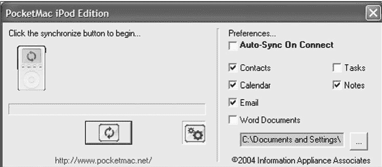

图 4-14。PocketMac iPod 版：主界面。

# 第 4 章 — 远超音乐：软件

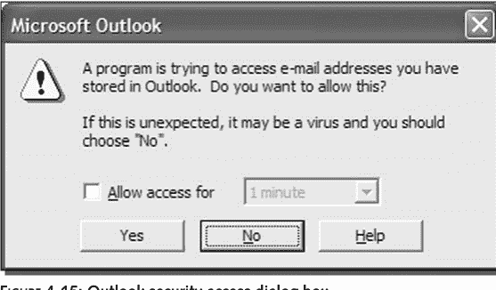

图 4-15。PocketMac 允许访问。

- 如果你勾选“Word”，PocketMac 允许你同步文档。
- 如果你勾选“Auto-Sync”，PocketMac 将在每次你连接 iPod 时自动同步。
- 如果你勾选“Email”，PocketMac 将同步你的电子邮件。


- 如果你勾选“Tasks”，PocketMac 将同步你的任务。
- 如果你勾选“Notes”，PocketMac 将同步你的备忘录。
- 如果你勾选“Calendar”，PocketMac 将同步你的日历项目。

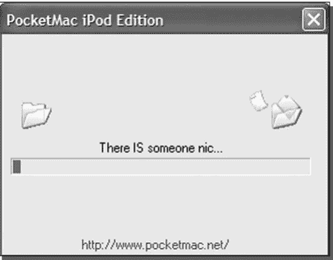

图 4-16。PocketMac 进度。

## 第4章 — 超越音乐：软件 89

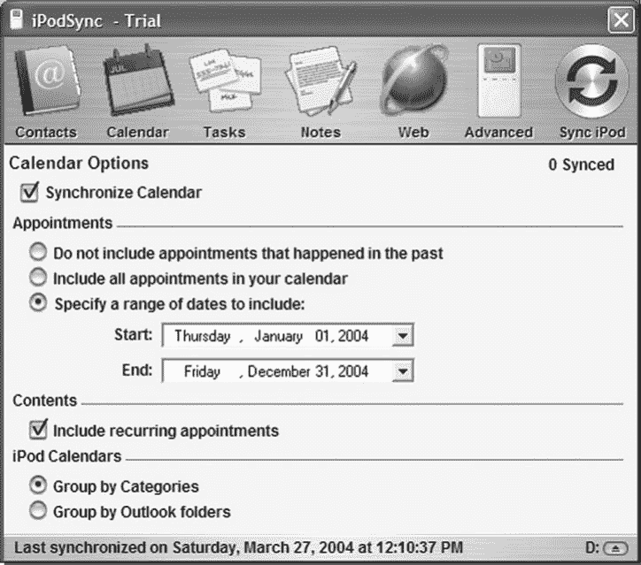

当你点击 iPod 时，程序开始工作，从 Outlook 中提取信息并将其复制到你的 iPod。iPodSync 屏幕会显示进度指示器，你可以跟踪同步进度（图 4-19）。

iPodSync 包含了超越 Outlook 同步之外的功能。点击 Web 图标，让 iPodSync 从网络获取信息并下载到你的 iPod（见图 4-20）。你可以在出门前获取当地天气预报，或者同步一些头条新闻，这样在你等待外卖披做好时就有东西可读。

iPodSync 在其“高级选项”（Advanced Options）中包含许多设置。点击像 iPod 的图标来查看这些偏好。在高级选项中：
- 启动时自动同步 iPod。此选项可以省去你手动同步的麻烦。

图 4-18：iPod 日历选项。

# 90 第一部分 — 破解 iPod

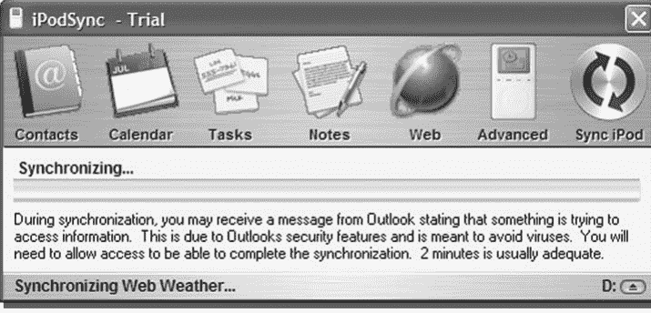

在同步期间，你可能会收到 Outlook 的消息，提示有程序尝试访问信息。这是由于 Outlook 的安全功能，旨在避免病毒。你需要允许访问才能完成同步。2 分钟通常足够了。

正在同步网络天气...

图 4-19：iPodSync 进度屏幕。

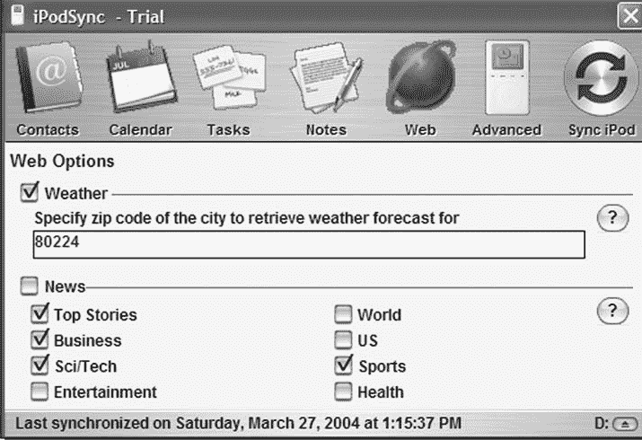

网络选项 (Web Options)
- 天气
- 指定获取天气预报的城市邮编：80224
- 新闻
  - 头条新闻
  - 世界
  - 商业
  - 美国
  - 科学/技术
  - 体育
  - 娱乐

最后同步时间为 2004 年 3 月 27 日，星期六下午 1:15:37

图 4-20：iPodSync 网络信息。

# 第4章 — 超越音乐：软件 91

- 同步完成后自动编辑 iPod。
- 重置（Reset），从 iPod 上删除现有的 Outlook 信息。如果你无意中导致 iPod 上出现多份相同信息，请使用此项。
- 选择特定的 Outlook 文件夹进行同步。
- 包含或排除特定 Outlook 类别的项目。

Mac 用户（你为什么在读这个仅限 Windows 的章节？）可以通过 Pod2Go 将新闻和许多其他网络信息获取到 iPad 上，该工具在本章的“获取新闻、天气、电影列表及更多”部分进行了介绍。

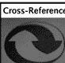

## 从 Windows 通讯录导出

从 Outlook 获取联系人（而非日历信息）并传输到 iPod 最酷的方法是通过 Windows 通讯录。如果你使用 Outlook Express，Windows 通讯录就是存储联系人信息的地方。Windows 通讯录具有以下功能：如果你选择多个联系人并将它们拖动到目标位置，联系人在存储到新位置之前会被转换为 vCards。奇妙的是，iPod 联系人恰好是以 vCards 格式存储的！如果你使用 Outlook Express，只需选择联系人并将其拖到 iPod 上的联系人文件夹，即可轻松导出所有联系人。

如果你想从 Outlook 获取联系人到 iPod，你可以做到，但 Outlook 缺乏 Windows 通讯录那样的自动 vCard 转换功能。不过，你可以先将 Outlook 联系人发送到 Windows 通讯录，然后再发送到 iPod。操作如下：
1. 在 Outlook 中，选择文件 ↷ 导入和刻出。
2. 选择“导出到文件”并点击下一步。
3. 选择“逗号分隔值 (DOS)”并点击下一步（见图 4-21）。
4. 输入导出文件的文件名（'my exported contacts' 这样也可以的）并点击下一步，然后点击刻出。现在你的联系人已导处，是时候将它们放入 Windows 通讯录了。
5. 进入 Outlook Express。选择文件 ↷ 导入 ↷ 其他通讯录。
6. 选择 文本文件（逗号分隔值）并点击导入。
7. 找到你在第 4 步中保存的文件并点击下一步。
8. 在映射对话框中，选择你想要导入的字段并点击确定。
9. 点击完成完成导入过程。

# 92 第一部分 — 破解 iPod

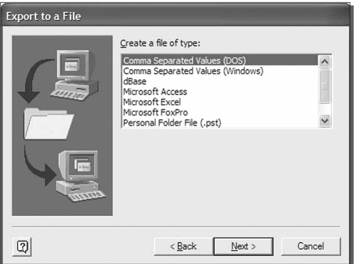

图 4-21：你可以将 Outlook 联系人导出到文件。

10. 现在你的联系人已导入 Outlook Express 的 Windows 通讯录中，你可以选择想要放入 iPod 的联系人——如果你愿意，可以选择全部——并将它们拖到 iPod 的联系人文件夹。它们将自动转换为 vCards 并在你的 iPod 上作为联系人显示。

## 在 Macintosh 上使用 PocketMac

> 注意
> 此破解方法仅适用于 Macintosh 电脑。

在节一节中，我提到了 Windows 版 PocketMac iPod 版是人们从 Microsoft Outlook 获取信息的程序之一。Mac OS 也有一个版本的 PocketMac——这并不意外，因为毕竟它就叫 PocketMac（www.pocketmac.net/products/ipodmac/ipodmac.html）。PocketMac iPod 版的特色是与 Entourage 同步。你可以使用 PocketMac 将你的联系人、日历、列表同步到 iPod。

# 第4章 — 超越音乐：软件 93

PocketMac 甚至会像 Windows 版本一样为你的 iPod 加载 Word 文档。Mac 版 iPod 版 通过安装 iSync 组件工作。PocketMac 在 iSync 工具栏上放置了一个图标。当你点击该图标时，会出现设置，你可以像其他设备一样设置同步偏好（图 4-22）。

Mac 版 PocketMac 不限于 Entourage。你还可以用它同步来自 Mail 程序的电子邮件、PDF 和便签（Stickies）。由于 PocketMac 在 iSync 中运行，你不需要运行另一个应用程序来同步。

## 在 iPod 上读取电子邮件

> 注意
> 此破解方法仅适用于 Macintosh 电脑。

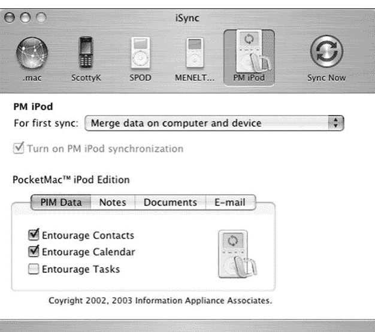

图 4-22：PocketMac iPod 版使用 iSync 在 Entourage 和你的 iPod 之间同步信息。

# 94 部分 — 破解 iPod

iPod 爱好者（尤其是拥有 Mac 的用户）可以使用许多从计算机获取信息并传输到 iPod 的程序。当 iPod 连接到计算机（以及互联网）时，这些程序会利用你的时间。在 Apple 制造可以直接连接互联网的 iPod 之前，你可以依靠 Pod2Go 等程序获取信息并发送到 iPod。

Mail 是助手。正如你从名称中猜到的，Mail 专门负责获取电子邮件。Mail 将你的邮件放在 Notes 文件夹中，以便你阅读（那是 iPod mini）。

最常见的电子邮件账户类型使用称为 POP（邮局协议）。如果你使用 POP，你需要在移动之前使用 Mac OS X 的 Mail 程序收集邮件。如果你订阅了 Apple 的服务器，或者使用 IMAP 账户（IMAP 是一种将邮件留在服务器上以便你访问的电子邮件技术），Mail 会为你检查邮件——就像使用 POP 一样。当你准备好将邮件移动到 iPod 时，确保从弹出列表中选择了 iPod，然后点击同步按钮。

Mail 让你设置任意数量的电子邮件账户。只需点击左角的加号即可。有一个方便的滑动条可以限制接收的消息数量，以免你的小 iPod 被海量邮件淹没。

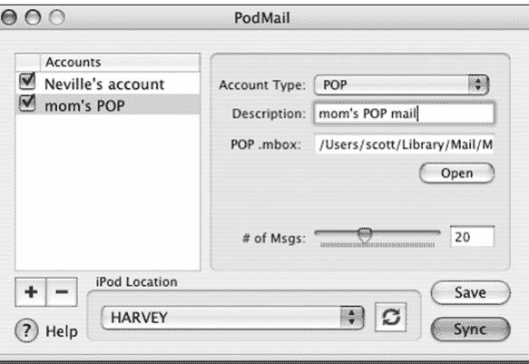

图 4-23：Mail 获取你的电子邮件并将其移动到 iPod 上，你可以在方便时阅读。

## 第4章 — 超越音乐：软件 95

## 在你的 iPod 上运行 Linux

Linux 是一个拥有忠实且不断增长粉丝群的替代操作系统。Linux 的源代码免费，全球成千上万的人都在为其贡献。像 IBM 这样的大公司正在制造和销售 Linux 产品。Linux 的奇特传统之一是移植：让它在不同的设备上运行。当 iPod 出现时，Linux 粉丝们致力于这项挑战。结果就是由 Bernard Leach 及其朋友创建的 Linux on iPod 项目。


Apple 没有提供关于 iPod 的技术信息，因此 iPod on Linux 需要大量工作来弄清楚发生了什么以及如何获得控制。Leach 像侦探一样研究 iPod：他研究 Apple 的 iPod 以发现如何修改固件使其启动 Linux 内核而不是标准内容。图 4-24 显示了当 Linux 在 iPod 上启动时你看到的内容。

为什么要向 iPod 上运行 Linux？在项目的常见问题中，Leach 给出了经典的答案：因为在那里。基于这个标准的理由，他希望在 iPod 上运行 Linux 会产生新的应用程序，能够播放不同格式的音乐或添加新功能。安装 Linux 会更改你 iPod 的固件以启动替代操作系统，这会导致保修失效。你 iPod 上的音乐和其他数据可能会损坏。你可能会得到一个需要运行 Apple 的 iPod 更新程序才能恢复工作的 iPod，而且你的 iPod 有可能变得无法使用。在此提醒你。

该项目的初始版本需要一份复杂的说明来在 iPod 上安装 Linux，即使是 Bernard Leach 及其团队所完成的工作。该手册要求你从 `ipodlinux.sourceforge.net` 获取源代码，并使用编译器和其他开发工具自行构建。然后，你必须执行一系列步骤，包括备份你的 iPod 固件、编译 Linux 内核，并最后在你的 iPod 上安装 Linux。你可以在 `ipodlinux.sourceforge.net/build.html` 查看完整说明。

对于粉丝们来说，这种项目安装方式并不寻常。这是 Linux 的开拓者精神和动手制作的乐趣。但对于好奇想在 iPod 上玩 Linux 的更大群体来说，这有点令人生畏。开源项目最酷的方面之一是程序员可以在彼此的工作的基础上进行构建。对于这个项目，社区构建了一个易于使用的安装程序，让你以比原始技术少 98% 的麻烦在 iPod 上运行 Linux。它虽然不像安装 iTunes 那样简单，但绝对是一个进步。

你可以在 `ipod.homelinux.com` 找到这个版本的 Linux。以下是将 Linux 获取到你的 iPod 上的说明：

# 第一部分 — 破解 iPod

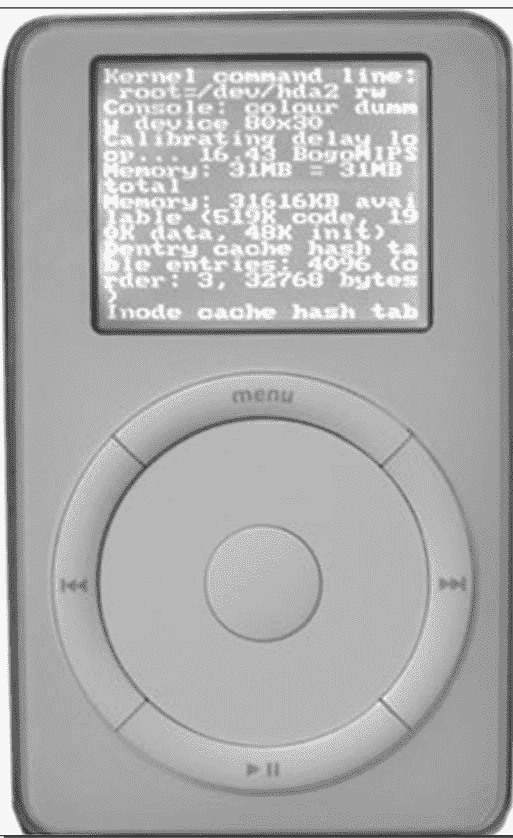

图 4-24：在 iPod 上启动 Linux。

- 1. 访问 `ipod.homelinux.com/index.php?page=download` 并下载最新版本。如果你使用 Safari，下载的文件将会自动解压并显示为磁盘镜像。

- 2. 在访达（Finder）中找到该磁盘镜像。（参见图 4-25）。将 iPodLinux 磁盘镜像的内容拷贝到你的硬盘上。

## 第 4 章节 — 远超音乐：软件 97

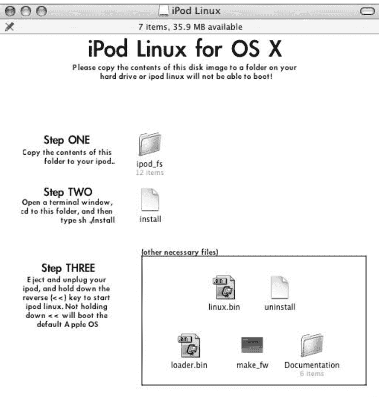

图 4-25：访达中的 iPod 磁盘镜像。

- 3. 运行“终端”（Terminal）应用程序。

- 4. 接下来，你把当前目录设置为你刚刚拷贝到硬盘的 iPodLinux 文件夹。要此操作，输入 `cd` 后加一个空格。然后将 iPodLinux 文件夹从访达中拖入终端窗口。按回车键。此时终端窗口的提示符应该会变化，显示 iPodLinux 现在是当前目录。

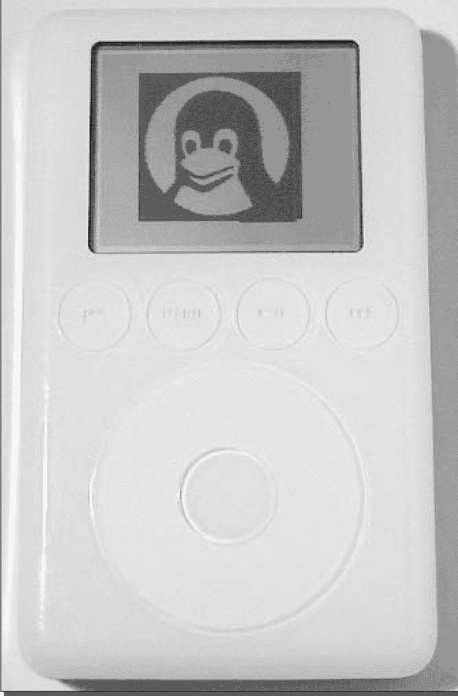

图 4-26：Tux 来临了你的 iPod。

## 第 4 章节 — 远超音乐：软件 99

- 5. 在终端窗口中，输入 `sh /install` 来启动 Linux 安装程序。

- 6. 在安装程序继续之前，它需要确定 iPod 的设备名称。在终端中，它将显示如下的一行：

  `/dev/disk2s3 on /Volumes/iGor (local, nodev, nosuid)`

这里报告的设备名称将始终是 "`diskN3`"，其中 N 通常是 2 或 3。为了启动安装程序，输入 `diskn2`。注意该名称以 "`s3`" 结尾，但你输入的名称以 "`s2`" 结尾。提醒一下，对于 Linux 安装，这被认为是有风险。

- 7. 安装程序将备份 iPod 的固件。然后，你会被要求输入 Mac 用户账户的密码。一旦提供了该密码，你应该会看到以下内容：

```
65536+0 records in
33554432 bytes transferred in 20.136763 secs (1666327 bytes/sec)
--> Firmware backup complete.
1274+1 records in
1274+1 records out
6523908 bytes transferred in 8.612815 secs (757465 bytes/sec)
```

固件安装程序已完成。

好了 —— Linux 现在已安装在你的 iPod 上。要查看它，按住 MENU 键几秒钟进行重启。当屏幕变白时，按住向下键直到看到苹果标志。你很快就会看到滚动的文本页面，表示 Linux 正在启动。最终，你将在屏幕上看到一眼 Tux——Linux 的企鹅吉祥（图 4-36）。

iPod 上的 Linux 确实很酷，但你仍然可以使用常规方法。要让 iPod 回到熟悉的模式，只需在启动时不要按住任何按钮进行重启。要回到 Linux，请在 iPod 启动时按住“上一曲”（Previous）。

在 Linux 中，你可以使用命令行工具通过火线接口（FireWire）与 iPod 通信并实现各种功能。随着 iPod 版 Linux 的进展，你可以看到各种游戏、工具、实用程序以及其他为 iPod 提供的有趣且实用的东西。如果你感兴趣，可以访问 `iPodlinux.net`。

## 总结

在 Linux 中，你可以使用命令行工具通过火线接口与 iPod 通信并实现各种功能。随着 iPod 版 Linux 的进展，你可以看到各种游戏、工具、实用程序以及其他为 iPod 提供的有趣且实用的东西。如果你感兴趣，可以访问 `iPodlinux.net`。

下一章我们将探讨如何让 iPod 变得更加智能。

# 106 第二部分 — 破解 iTunes

通过“新歌发布”（fresh tracks）播放列表，你可以确保永远不会让那些新曲目从音乐的缝隙中溜掉。我们可以让计算机替我们记忆的时候，那都是加分。

## 智能播放列表的更多想法

iTunes 中的智能播放列表（Smart Playlist）功能是一项看起来非常简单，却隐藏着巨大能量的技术。你可以花费大量时间为新的播放列表构思更清晰、更精彩的方案。甚至，你可能会为此建立整个网站！事实上，这正是 SmartPlaylists.com 正在做的事情——这是一个供 iTunes 爱好者的聚集地，他们乐于探索用这个强大的功能可以制作出什么。看看图 5-3 所示的 SmartPlaylists.com 首页。

SmartPlaylists.com 主要是一个如何使用智能播放列表的创意交流平台。这里是一些关于让你的音乐听感更智能的建议和想法：

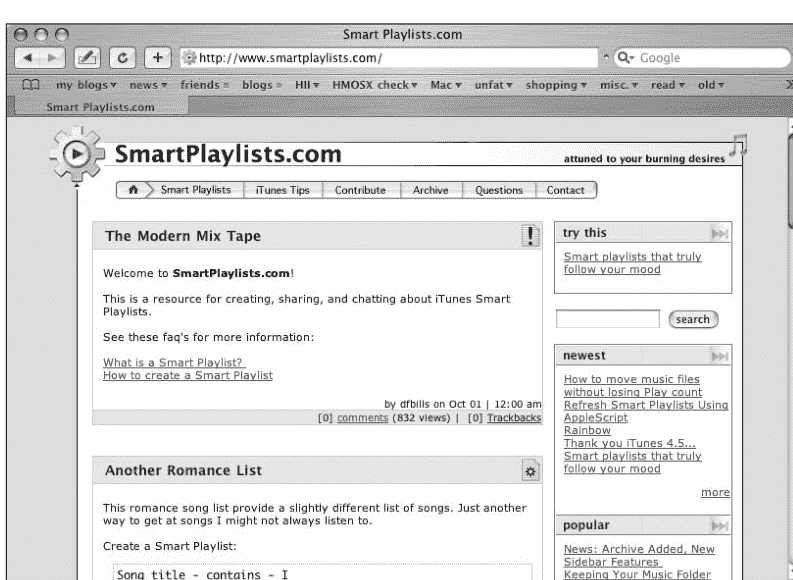

图 5-3：SmartPlaylists.com 首页。

## 第 5 章 — 玩你的音乐 107

## 所有“未勾选”歌曲

iTunes 使用每首歌左侧的复选框作为一种总开关。当 iTunes 在播放时遇到未勾选的歌曲时，它会跳过它们。许多 iTunes 用户会取消勾选他们通常不想听的歌曲。但有时，你可能会发现自己正想听听那些被冷落的歌曲。智能播放列表似乎是处理的一种方便方法。但令人担忧的是，你无法指定“未勾选”作为智能播放列表的筛选标准。它有一个排除它们的复选框，但没有一个允许它们进入的复选框。

你能做什么呢？答案是使用双播放列表技术。首先，你需要创建一个包含所有已勾选歌曲的播放列表。你可以按照以下步骤操作：

1. 从“文件”菜单选择“新建智能播放列表”。

2. 确保勾选了“仅匹配已勾选的歌曲”（Match only checked songs）。

这是我们要为此智能播放列表应用的唯一标准。但 iTunes 不允许你在勾选此框的情况下创建播放列表。我们可以通过指定一个不会排除任何歌曲的虚假标准来解决这个问题：

3. 确保勾选“匹配以下条件：复选框未勾选”（Match the following condition: box is unchecked），我们不会使用它。

4. 点击“限制到”（Limit to）框将其开启。在这一行的框中输入 `99999 GB`。这是你可以在这里输入的最大数字，我打赌你的音乐没有比这多。你的对话框现在应该像图 5-4 一样。

5. 点击“确定”创建播放列表。

6. 在源列表中，选中新播放列表的名称。一个新名称：所有已勾选（all checked）。

7. 通过从“文件”菜单选择“新建智能播放列表”创建另一个智能播放列表。

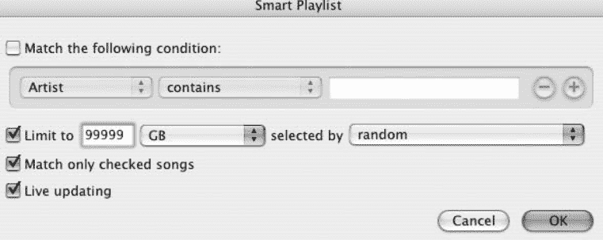

图 5-4：智能播放列表对话框。

## 108 第二部分 — 破解 iTunes


图 5-5：播放列表依赖损坏警告。

### 操作步骤

8. 在“匹配以下条件”部分中，选择“播放列表未全部勾选”（`Playlist is not all checked`）并点击确定。将此新列表重命名为“所有未勾选”（`all unchecked`）。

搞定！你刚刚创建的新播放列表将包含你所有的未勾选歌曲，不再包含其他内容。

在这个技巧中，我们设置了一个取决于另一个播放列表“所有已勾选”内容的播放列表。如果“所有已勾选”消失了怎么办？我也在想，所以我把它删除了。当我删除它时，“所有未勾选”播放列表出现了一个带圈的感叹号，这是 iTunes 语言中的“有问题”。有趣的是，当我选择该播放列表时，可以顺利地播放其中的歌曲。但当我点击“编辑智能播放列表”时，我得到了你在图 5-5 中看到的警告。

当我点击确定时，发现我可以编辑该播放列表并更改其标准。我点击取消，尽管有可怕的警告，播放列表继续正常工作。如果你删除了另一个播放列表引用的播放列表，你仍然可以使用该依赖项，它将保持冻结状态直到你编辑其标准，以先发生者为准。

## 主题播放列表

某些主题是数千首歌歌曲的主题：爱、希望和关怀非常流行。但你可能会惊讶地发现，关于其他可能看起来更晦涩的主题存在这么多歌曲

第 5 章 — 玩你的音乐 109

你可以使用智能播放列表功能的“歌曲名称包含”（`Song Name contains`）标准，查看你可以在特定主题上挖掘出多少歌曲。

作为你可能发现的内容的例子，这里是设置的几个主题播放列表的结果：

### 歌曲名称包含 jungle（丛林）：

- “Welcome to the Jungle,” Guns N Roses.
- “Run Through the Jungle,” Creedence Clearwater Revival
- “Bungle in the Jungle,” Jethro Tull
- “Jungle Jingle,” Love Nation & Ad
- “Jungle Boogie,” Kool & The Gang
- “George of the Jungle,” Weird Al Yankovic
- “Welcome to the Jungle,” They Might Be Giants
- “Jungle Fever,” Chakachas
- “Jungle Music,” Rico

### 歌曲名称包含 summer（夏天）：

- “A Summer Song,” Chad & Jeremy
- “Indian Summer,” Joe Walsh
- “Let’s Loot the Supermarket Again Like We Did Last Summer,” Mick Farren and the Deviants
- “Long Summer Days,” EMF
- “Summer in the City,” Lovin’ Spoonful
- “One Summer Dream,” Electric Light Orchestra
- “Sausalito Summer Night,” Diesel
- “Summer Breeze,” Seals & Crofts
- “Summer of Drugs,” Soul Asylum
- “Summertime,” Billy Saturn

现在你对自己的音乐口味的了解比你想了解的还要多。你也可以使用“歌曲名称包含”技术来构建你非常浪漫的播放列表。要构建此列表，尝试寻找包含“love”（爱）、“girl”（女孩）、“boy”（男孩）、“us”（我们）或其他指示性词的歌曲名称。iTunes 允许你构建符合任意不同标准的单个播放列表。

110 第二部分 — 破解 iTunes

### 流媒体广播播放列表

你可能没有意识到可以将流媒体广播包含在库和播放列表中。要把电台添加到库中，只需将电台拖到库中。然后你可以创建一个电台的播放列表。

## 拖放创建播放列表

你可以通过拖放让事情发生。菜单项是显式的，但拖放更直接，感觉像魔法一样。你可能在其他程序中利用过这一点。

基本规则是：拖动到列表空白处。浏览并选择你喜欢的专辑。然后通过拖动到源列表将专辑变为播放列表（见图 5-6）。


图 5-6：你可以将专辑拖到源列表。

第 5 章 — 玩你的音乐 111

有一些需要注意的细微差别。在你移动时，iTunes 提供有用的视觉反馈，告诉你松开鼠标按钮会发生什么。如果你悬停在一个接受投放的地方，iTunes 通过在光标上添加加号来提示（在 Mac 上，加号出现在一个漂亮的绿色圈内）。如果你悬停在一个不知道如何处理该专辑的地方，你会看到这种提示。在 Windows 上，你会看到类似的，但带有一个斜线。另一方面，Mac OS X 在悬停于不合适的地方时不会提供任何光标反馈。在任何操作系统中，如果你将拖动项目释放到一个不接受它的目标，什么都不会发生——iTunes 基本忽略了你。在 Mac 上，如果你仔细观察，实际上可以看到拖动项目回到原处。

### 注意下方

当你拖动到其他播放列表上时，会发生有趣的事情。当你拖到智能播放列表上时，光标会告诉你不能将其投放那里，因为智能播放列表是由规则定义的——它们的内容由算法选择，它们不会接受任何专辑顺序。但当你拖到普通的非智能播放列表上时，播放列表会高亮，光标也会长一个小号，让你知道它乐于接受投放的任何物品（见图 5-7）。如果你想通过拖放创建一个新的播放列表，你必须直接跳过已有的播放列表。


图 5-8：当你开始拖动时，可能看不到最后一个播放列表。

拖向下方的空白区域。在松开鼠标之前，请小心不要不小心将项目掉入已经存在的某个播放列表中。如果你悬停在某个现有播放列表上，iTunes 会高亮该播放列表，你就可以据此判断。

如果你在开始拖动时看不到最后一个播放列表下方的空间，就会出现另一个挑战，如图 5-8 所示。你必须通过自动滚动来到达那里。自动滚动是一种拖放功能，它让你在将项目拖入列表或其他视图时，让该视图开始滚动。通常情况下，你在拖放过程中，当移动到想要开始的区域的边缘时会自动滚动。因此，如果你看不到源列表的底部（即最后一个播放列表正下区域），列表将开始向下滚动，直到最后一个播放列表（及其下方的空间）可见。一旦发生这种情况，你就可以将项目掉到播放列表下方了。

有时，如果你没有精确地拖动到正确的位置，自动滚动可能会很灵敏。你可能需要用鼠标稍微涂抹一下让它启动。如果你就是无法让自动滚动生效，你还有其他低技术选项。在开始拖动之前，关闭专辑侧面板以为源列表腾出更多空间，或者直接在列表中手动向下滚动。

## 主要拖放操作

在 iTunes 中，你可以拖动很多内容来创建播放列表。例如，将任何专辑拖动到源列表，你就获得了一个包含该专辑曲目的新播放列表。这在你想要刻制一张专辑的 CD 时特别有用，因为 iTunes 仅会从播放列表中刻制 CD。你还可以选择多个专辑，然后拖动其中任何一个来获取所有专辑——你拖动哪一个都没关系，因为它们都会随之带走。

你可以通过选择所有想要的歌曲，并将它们拖到源列表中的“魔法空白处”来创建一个由歌曲组成的播放列表。这种方法可行，尽管这不是你通常用于从歌曲创建新播放列表的技术。

想要创建一个包含特定艺术家所有曲目的播放列表吗？只需在浏览器中找到该艺术家，将艺术家名称拖到源列表的底部，你就获得了一个高度集中的播放列表。当然，你也可以对多个艺术家执行相同的操作：用通常的方式通过 `Shift`-点击和 `Command`-点击（Windows 上为 `Control`-点击）进行选择，然后将它们拖过去，如图 5-9 所示。如果你在浏览歌曲时显示了“流派”列，甚至可以拖一个流派（或多个流派）来制作播放列表。

## 播放列表的命名是一件难题

iTunes 是一个编写得良好的程序，自 2001 年 1 月发布以来一直在不断改进。你越使用它，就会发现越精妙之处。当你拖动歌曲、专辑、艺术家或流派来创建播放列表时，iTunes 会尝试给该播放列表一个意义——

如果你制作的播放列表只包含一首歌曲，则播放列表将与歌曲同名。如果播放列表是一个单一专辑，播放列表将以专辑命名，或以你用来创建它的任何其他内容命名。单艺术家播放列表也是如此：它以艺术家命名。如果新播放列表无法简化为单一艺术家、专辑或歌曲，它就会被称为“未标题的播放列表”（`untitled playlist`），必要时会在后面加上数字以与其他任何匿名播放列表区分。

拖动创建播放列表的一个酷功能是：每当 iTunes 将歌曲添加到播放列表时，它都会检查该歌曲是否确实存储在它应该所在的磁盘上。如果不是，iTunes 就不会将其添加到播放列表、媒体库以及任何已包含该歌曲的播放列表中，它会被标记一个看起来很吓人的感叹号，以告知你有大问题（见图 5-10）。如果新播放列表的所有素材都缺失，iTunes 甚至不会理会该播放列表（也不会给你发送错误消息）。


图 5-10：当 iTunes 找不到曲目时，曲目会带有感叹号显示。这些曲目永远不会添加到播放列表。

# 播放列表的快捷键

点点很棒，但要真正做出酷炫，你需要一些冷门的组合键。在本节中，你将发现许多可以在家里配合播放列表和快捷键尝试的奇技技巧。

## 创建新的智能播放列表

源列表底部的 `+` 按钮是创建新播放列表的快速、直接的方法。点击它一次、两次、12 次，就能得到一个新的播放列表。


图 5-9：为世界上最棒的乐队制作播放列表。


图 5-11：按住修饰键时创建新播放列表的 `+` 按钮。

## 重新随机播放列表

随机播放 `Shuffle play`，也称为随机播放，是 iTunes 最酷的功能之一。如果没有随机播放，我们将按照固定顺序听歌，就像在磁带和黑胶片时代一样。开启随机播放，你可以更改歌曲的播放顺序。

你可以随机播放一个播放列表。点击左下角的交叉箭头即可。当你创建一个新的播放列表时，无论是智能还是其他，曲目都会按照它们播放的顺序列出。第一列（带有数字的列）显示这种顺序。在随机播放时，你不需要考虑你的顺序；让电脑来决定。

1. 按住 `Option` 键（Mac）或 `Shift`-点击（Windows）创建新的播放列表。
2. 按住 `Option` 键（Mac）或 `Shift`-点击（Windows）创建新的播放列表。

- 有关使用播放列表可以做的更多信息，请访问 `smartplaylists.com`，你可以在那里找到很多创意。


| | 歌曲名称 | 均衡器 | 时间 |
|---|---|---|---|
| 1 | When I Write The Book | Rock | 3:17 |
| 2 | Hitter | Rock | 2:59 Nick Lowe |
| 3 | Big Kick Plain | Rock | 2:28 Nick Lowe |
| 4 | Cracking Up | Rock | 3:00 Nick Lowe |
| 5 | Peccator | Rock | 3:32 Nick Lowe |
| 6 | Switchboard Susan | Rock | 2:48 Nick Lowe |
| 7 | American Squirrel | Rock | 3:30 Nick Lowe |
| 8 | The Beat (Off) Breaking Class | Rock | 3:13 Nick Lowe |
| 9 | They Called It Rock | Rock | 3:09 Nick Lowe |
| 10 | Born Fighter | Rock | 2:28 Nick Lowe |
| 11 | Isolation | Rock | 2:53 Nick Lowe |
| 12 | Nutted By Reality | Rock | 3:14 Nick Lowe |
| 13 | Skin Deep | Rock | 3:24 Nick Lowe |
| 14 | My Kind | Rock | 3:29 Nick Lowe |
| 15 | So It Goes | Rock | 2:34 Nick Lowe |

图 5-12：当你在听随机播放的列表时，可以通过第一列查看播放顺序。

第 5 章 — 玩转你的音乐 117

假设你开启了随机播放并点击了“播放顺序”列。尽管你信任 iTunes 会进行随机混合，但你可能对当前的顺序并不满意，因为你真的很想听几首可怜地困在列表底部的歌曲。如何更改随机播放列表的顺序？当关闭随机播放并选中“播放顺序”列时，你只需通过拖动歌曲即可重新排列列表中的歌曲（试一下）。但当开启随机播放时，iTunes 是控制播放顺序的。如果你试图通过拖动歌曲到新位置来夺取控制权，它会直接忽略你。

虽然你不能在随机播放列表中显式地移动歌曲，但你可以强制 iTunes 选择随机顺序。关闭随机播放，然后双击随机播放按钮，或者双击 `Command+Shift`。每当你这样做，iTunes 都会重新随机牌，这样你就可以查看是否喜欢新顺序。

关闭并开启随机播放并不是解决此问题的优雅方案，因此 iTunes 设计了一个重新随机牌播放列表的快捷键。在 Macintosh 上按住 `Option` 键或在 Windows 上按住 `Shift` 键，点击随机播放按钮。你的播放列表将将被随机化。注意，如果你正在查看的是其他列（例如“名称”或“艺术家”），你将看不到歌曲顺序的变化，因为你看到的不是播放顺序。在重新随机牌时观察列表的变化，这样你会看到“播放顺序”（第一列）是被选中的。


如果你正准备听一个随机播放列表，而列表中有一首歌是你想立即听的，你不必忍受 iTunes 的“专制”等到轮到它。为了获得即时满足，双击该歌曲开始播放列表。当你的歌曲播放完毕，iTunes 将以随机顺序继续播放列表的其他歌曲。

### 随机播放的疯狂

你可能认为随机播放应该是简单直接的。就像 Apple 产品中的功能一样，使用随机播放有一种简便的方法，这对于大多数用户在大多数情况下都足够了。但 Apple 又增加了允许那些感兴趣的人进行更强大控制的功能。

这里有一个例子：正如我们之前提到的，每个播放列表都有自己的随机播放设置。此功能让你可以在 `Hip-hop goodness` 列表中开启随机播放，同时对 `Les Gilles de Sainte-Colombe's greatest hits` 保持关闭状态。

然而，每个播放列表随机播放在 iPod 上无效。当你在 iPod 上听歌时，有一个全局随机播放设置，无论你在播放什么音乐。iPod 的随机播放有一些细微之处。iPod 不仅仅是开启或关闭，还允许你在两种随机播放模式之间选择：歌曲和专辑。如果你播放收藏专辑的播放列表，“专辑”设置将非常有用——你的 iPod 将从列表中随机播放专辑。“歌曲”设置则不考虑专辑，直接从一首歌曲跳到另一首。iTunes 在偏好设置框的“高级”选项卡中也有类似的设置。

118 第二部分 — 破解 iTunes

## 通过播放列表删除歌曲

iTunes 中的播放列表是共同播放的歌曲列表。库就像一个特殊的播放列表，是 iTunes 所在的计算机上所有音乐的主列表。播放列表和库仅仅是歌曲的列表，而不是歌曲本身（歌曲存储在你的硬盘上）。当你从播放列表中删除歌曲时，它会从该列表中移除——库中的歌曲或磁盘上的实际文件不会发生任何变化。当你从库中删除歌曲时，iTunes 会完全忘记它，这意味着它从它所属的任何播放列表中移除。

即使你从库中删除歌曲，磁盘上存放歌曲的实际文件也不会受到影响。然而，当你从库中删除歌曲时，iTunes 认为你可能也想删掉歌曲文件。所以，如果你从库中删除一首歌曲，iTunes 会询问你是否也想删除歌曲文件。iTunes 将把文件放入回收桶：垃圾桶（Mac）或回收站（Windows）。

如果你正在查看播放列表或库中的歌曲，并决定有某首歌你想通过从库和所有播放列表中移除它来将其“逐出”iTunes，可以使用这个快捷键。如果你按住 `Option` (Mac) 或 `Shift` (Windows) 并按 `Delete`，iTunes 将自动从库和所有播放列表中删除该歌曲。然后 iTunes 会询问你是否也想从硬盘中删除歌曲文件。

### iTunes 不删除

当你从库中移除歌曲时，iTunes 并不总是提议从硬盘中删除歌曲。原因如下：在 Mac 上，文件位于用户目录下的 `Music/iTunes/iTunes Music/`，而在 Windows 上，它位于“我的文档”中的 `My Music:\iTunes\Music\`。iTunes 中的并不是每个歌曲文件都需要添加到这个默认文件夹中。任何添加到 iTunes 库的歌曲，无论是什么文件——只要它在默认文件夹中，iTunes 就认为它拥有该文件，因此当你从库中移除它时，它会提供删除文件的建议。如果文件不在文件夹中，iTunes 就属于别人，所以它会出于礼貌地不删除它。

iTunes 有一个设置可以确保它将所有歌曲文件放入其默认文件夹中。你可以通过进入偏好设置、高级选项卡，并勾选“在添加库时将文件拷贝到 iTunes 音乐文件夹”来开启此功能。开启此设置后，新音乐在添加到库时将复制到默认文件夹。

第 5 章 — 玩转你的音乐

## 更改播放顺序

在 iTunes 中，每个播放列表都清楚自己的位置。这是歌曲播放的顺序。在本节中，我们将讨论播放顺序是如何工作的。

### 以不同的顺序播放歌曲


如果你愿意，可以随意切换播放列表。以不同顺序播放歌曲最直观的方法是点击其中一列。例如，如果你点击“名称”列并确保随机播放模式关闭，iTunes 将按字母顺序播放歌曲。再次点击可以反转字母顺序。点击“上次播放”列可以听一段时间没播放过的歌曲。


# 120 第二部分 — 破解 iTunes

iTunes 提供了许多可以在播放列表中显示的列。要查看所有列，请选择查看选项，或右键点击（在 Mac 上按 `Control+点击`）列表头。每个播放列表都会记住它显示的列。该领域有一个特别酷的技巧，请查看“使用列表列进行均衡器设置”，关于更多歌曲列，请参考第 10 章“细调音乐库的外观”。

## 永久更改播放顺序

如果你对播放列表的顺序不满意，有几种方法可以永久更改它。直接的方法是在播放列表中拖动歌曲：只需拖动你想移动的歌曲，并将其放在你想放置的地方。只要满足两个条件，这种方法就非常好：必须选中“播放顺序”列，并且必须关闭随机播放。如果任一条件不成立，你把歌曲拖到手酸，也无法更改播放顺序。如果你通过拖动歌曲来更改播放顺序，iTunes 会在你上下移动播放列表时给你反馈，如图 5-14 所示。

提示


另一个巧妙的技巧可以让你更改默认播放顺序以匹配当前顺序。你可以利用这一点将随机顺序、时长序列或任何其他顺序设为默认。

播放列表的永久设置。要将当前顺序设置为默认设置，请在列表中的歌曲上点击右键（在 Mac 上按 `Control` 键点击），然后从菜单中选择“复制到播放顺序”。iTunes 将更改播放列表的默认播放顺序以与当前顺序一致。

## 破解文化：沉默是金

这里有一个关于你播放列表中的某种“不同类型歌曲”的故事：尽管 iPod 在 2001 年推出后取得了巨大成功，但 Macintosh 仍然是 Apple 的旗舰产品。你可能知道，Mac 在家庭、办公室和学校使用的电脑中仅占极小比例。然而，iPod 则是另一番：根据史夫·乔布斯 2004 年 1 月在世博会上的演讲，iPod 是世界上最受欢迎的数字音乐播放器，占所有销售额的 31%。iTunes 音乐商店更为成功：2003 年底，尼尔森 SoundScan 报告称，所有在线音乐的 80% 仍然来自 Apple。

Apple 是数字音乐领域的巨头。因此，这家公司偶尔发布一些关于其在这一新兴技术中角色的怪异新闻也不并不意外。2004 年 2 月，媒体注意到，在 iTunes 音乐商店以 99 美元出售的曲目中，有几首完全是静音的。这些包括 R-Three 名副其实意的“10 Seconds of Silence”（10 秒沉默）和 Cyccone Youth 的“Silence”（沉默）。甚至还有 Slam Village 的完全静音歌曲，它在 iTunes 上同时有“纯净”版和“显式”版。尽管所有在线音乐服务都有静音歌曲，但显然艺术家和唱片公司只是交付了它们，而 Apple 因为是领导者而获得了所有的关注。而且，所有的关注似乎吸引了某些人——在报道报道后，大多数静音歌曲作为专辑的一部分可用——你无法再以 99 美元单独购买它们了。

## 查看精确的播放列表统计数据

当你在 iTunes 源中选择库或播放列表时，iTunes 会在窗口底部显示有关该项目的关键统计数据：已过去的时间数以及播放列表中歌曲占用的磁盘空间。你可以在图 5-15 中看到这一点。

如果你点击统计数据中的文本，总时间将从小数值变为天、小时、分钟和秒的精确计数（图 5-16）。对于那些需要确切知道在音乐开始重复之前可以听多长时间的人来说，这是一个完美的功能。

再次点击文本将显示改回小数值。


图 5-15：iTunes 显示每个播放列表的统计数据。

```
719 首歌曲，1:15:54:54 总时间，1.85 GB
```

图 5-16：在你点击显示后，

iTunes 显示了播放列表中所有

歌曲组合在一起的精确总时间。

## 第二部分 — 破解 iTunes

## 重置播放次数

iTunes 会跟踪其库中每首歌曲的播放次数，即歌曲播放次数的累计总数。每当你完整播放一首歌曲时，它的播放次数就会加一。在 iPod 上播放也会计入：当你将 iPod 与电脑同步时，iPod 会告诉电脑歌曲被播放了多少次，播放次数会随之调整。

播放次数是你构建智能播放列表时可以使用的最强大的变量之一。当你创建一个选择最经常或最不常播放歌曲的智能播放列表时，iTunes 会使用播放次数来决定选择哪些歌曲。

有时直接操作播放次数非常方便。这样做最简单的方法是在歌曲上点击右键（或在 Mac 上按 `Control` 键点击）并选择“重置播放次数”。在确认对话框之后，iTunes 会将歌曲的播放次数重置为零。

这个技巧对多首歌曲也同样有效。选择你想要的任意数量歌曲，然后右键点击其中任何一首并选择“重置播放次数”。它们都将被重置为零。


一种不那么方便但更强大的管理播放次数的方法是通过 AppleScript。每首歌曲都有名为“played count”的 AppleScript，可以从脚本进行设置。关于它是如何运作的示例，请参见第 6 章中的“更改播放次数”部分。

## 将你的播放列表移动到另一台电脑

在你得到一台新电脑的那个快乐日子里，你可能想带上音乐。将音乐移动到新电脑非常简单：只需复制歌曲文件并使用 iTunes 中的“将文件添加到库”命令来建立你的新库。你可以将歌曲文件夹拖入 iTunes 的 Windows 窗口，它们会自动添加。

但是如何让你的播放列表随你一起移动到新电脑呢？移动播放列表稍微复杂一点，但仍然简单。你只需要几个步骤和一些简单的规则。首先，以下是操作的步骤：

### 第 5 章 — 玩转你的音乐 123


图 5-17：使用 iTunes 导出你的播放列表。

- 1. 在源列表中，点击你想移动到另一台电脑的播放列表。
- 2. 选择 `文件 -> 导出列表`。
- 3. 在保存对话框中，输入列表名称，并在“保存类型”框中选择“XML 文件”。
- 4. 在在新电脑上，选择 `文件 -> 导入`。

当你将播放列表从一台电脑移动到另一台电脑时，你移动的是列表而不是歌曲本身。如果播放列表中的歌曲存在在新电脑的库中，它们就会添加。

如果你导入的播放列表中的歌曲不在库中，iTunes 会给出一个错误信息（图 5-18）。在这种情况下，播放列表仍然会被创建。

124 第二部分 — 破解 iTunes


## 收听流媒体广播

Apple 的数字音乐努力通过 iTunes 音乐商店销售歌曲和专辑，iTunes 和 iPod 也针对这些歌曲和专辑进行了优化。因此，你可能会惊讶地发现 iTunes 包含一个强大的调谐器，可以收听数千个广播。

你可能已经注意到列表中的 Radio 图，位于库下方的显著位置。这是你通往广播世界的门票。除例外外，流电台与你通过空中收到的商业电台不同，尽管像 NPR 这样的非广播非常可用。这意味着你不会听到很多广播电台中的内容，这开启了极其丰富的品味和类型。

要检查 iTunes 中可用的电台，请遵循以下步骤：

- 1. 点击源列表中的 Radio 图标。你会看到一系列类别，每个类别旁边都有三角形。
- 2. 点击你感兴趣的音乐类别（或其他节目，如谈话/演讲）旁边的三角形。iTunes 将花一些时间并下载可用电台列表及描述，如图 5-19 所示。
- 3. 双击你想听的电台。几秒钟后，你将在 iTunes 中听到它的流。iTunes 状态显示显示的名称、当前曲目以及你收听的时间。

通常情况下，你会从高比特率（比特率列）的源获得更好的流质量。但不要回避低比特率的流，例如 56K 或每秒 32Kb。取决于你的环境和你正在播放的音乐类型，这些比特率可以非常好听，特别是当你处于网络连接很弱的地方时。

你会在 iTunes 中列出几百个电台——总能找到其中一些。如果没有，在 Web 上的 Live365.com 等网站上还有许多其他电台可用。和

### 第 5 章 — 玩你的音乐


图 5-19：iTunes 广播收调器显示了它的分类。

ShoutCast。你也可以在 iTunes 中收听很多电台。例如，你可以在 KCRW 电台上收听 NPR，地址为 `http://www.kcrw.com/grid/`。


通过 Live365 收听的另一种方法是使用 Radio365，这是由 Live365.com 创建的自定义收调器（见图 5-20）。通过 Radio365，你可以创建自己的预设、设置当前电台的播放列表，并按艺术家或音乐风格搜索电台。它甚至有一个侧边栏，用于显示专辑封面，以及你可以点击在 iTunes Store 或亚马逊上购买当前曲目的按钮。你可以在可以在 www.live365.com/downloads 免费获取 Radio365 的副本。

想知道如何从网络网络电台录制歌曲并将其添加到你的音乐库吗？请参阅第 8 章的“并发流”。

## 关闭流媒体广播

流媒体广播提供了极佳的免费音乐来源，否则你可能永远无法听到这些音乐。我喜欢收听流媒体广播，希望你也喜欢。但如果你已经一路读完了本节，并被这些流媒体广播的承诺所打动，我想告诉你如何摆脱它们也是公平的。

1. 首先，为了确保你运行的是 iTunes 4.5 或更高版本，请使用“关于（About）”菜单项进行检查。在 Macintosh 上，查看 iTunes 菜单；在 Windows 上，它在“帮助”菜单中。
2. 打开“偏设置”（Mac 上在 iTunes 菜单中，Windows 上在“编辑”菜单中）。
3. 点击偏设置中的“通用”选项卡。你应该看到一个类似于图 5-21 的对话框。
4. 要关闭流媒体广播，请取消勾选“广播”旁边的复框，然后点击“确定”。

当偏设置对话框关闭时，源列表中的“广播”图标将会消失。如果你改变了主意，真的想玩玩这个很棒的功能，你只需要回到偏设置并再次勾选复框以恢复你的广播。


图 5-20：Radio365 是用于 Live365.com 电台的自定义收调器。


图 5-21：iTunes 偏设置，“通用”选项卡。

## 使用列表列进行均衡器设置

正如我们在本章其他地方讨论过的样，你可以显示不同的列来显示播放列表歌曲列表中的信息。你可以直接编辑歌曲列表中的某些设置。例如，点击一首歌以选中它，然后点击歌曲标题，你就可以输入来更改歌曲名称。这对艺术家、专辑、流派和注释同样有效。其他设置由系统为你计算且无法更改，例如曲目时长和大小、添加日期以及播放次数。

其中一列与其他列不同：均衡器。当你显示均衡器列时，你可以主动为每首曲目选择均衡器设置。这也是唯一不显示文本的列。相反，它显示了一个小的双箭头控件。当你点击该控件时，你会看到一个所有可用均衡器设置的弹出列表，如图 5-22 所示。为那首曲目选择你想要的设置。当你松开鼠标按钮时，你选择的设置将出现在该歌曲的双箭头旁边。

> 提示：iTunes 有一个全局均衡器设置。如果你没有为某首曲目设置自定义均衡器设置，iTunes 将使用相同的全局设置。要查看全局均衡器设置，点击右下角的均衡器按钮（从右数第三个按钮）。


## 在 iTunes 中打开多个窗口

许多应用程序是围绕文档组织的，每个文档由一个窗口表示。例如，在文字处理器或文本编辑器中，你可能同时打开三个文档，每个文档都在自己的窗口中。但 iTunes 并不是这样工作的。当你使用 iTunes 时，你可能习惯于在一个窗口中完成所有的“工作”，这在大多数时候是没有问题的。


图 5-22：均衡器列让你进行选择。

iTunes 实际上支持多个窗口，如果你在进行一些认真的“玩耍”，可以利用这一点。iTunes 允许你在单独的窗口中打开任何播放列表或电台列表。要打开新窗口，请双击源中的播放列表。如果你想在听另一个播放列表的同时，对一个播放列表进行操作（可能使用歌曲磁贴或重新排列内容），那么这非常有用。很快，你就可以让屏幕像你所希望的那样，堆满各种不同的窗口。注意，你必须双击才能打开新窗口——此功能没有于任何菜单中。

## iTunes 窗口模式

iTunes 以各种方式调整其主窗口的大小，以便你可以随心所欲。调整 iTunes 窗口大小最简单、最不科学的方法是抓住右下角的尺寸控件并拖动它使窗口变大或变小。还有其他更酷的方法来控制 iTunes 窗口。


图 5-23：最小的窗口：仅限控件（左侧）和状态显示（右侧）。

如果你想让 iTunes 继续播放但不想让大窗口挡路，点击窗口标题栏中的缩放框。在 Mac 上，那是那个绿圈；它是“最大化”控件。当你点击此控件时，iTunes 窗口将缩小到极小尺寸，只显示基本控件（见图 5-23）。如果你想获取更多信息并且不介意占用一点空间，可以将控件向右拖动，并将状态显示添加到微窗口中。

无论你如何调整窗口大小，都可以立即将其恢复到缩放/最大化框。按住 Option（Mac 上）或 Shift（Windows 上）并点击框，将使窗口居中。

## 使用回退箭头（SnapArrows）

当 Apple 发布 Safari 浏览器时，它在地址栏中包含了一些回退箭头（如图 5-24 所示）。这些是回退按钮的增强版本。当你点击地址栏中的回退箭头时，Safari 会回到你之前打开的页面，或者是你在地址栏中输入的上一个地址，或者是你在该窗口中打开的书签。

回退箭头在工具栏中以类似的方式工作。点击它会带你回到上一次进行的搜索。在两个地方使用回退箭头显示 Apple 正在考虑将其作为一个通用的概念。

Apple 在完全不同的类型中证明了回退箭头的实用性：2004 年 4 月发布的 iTunes 4.5。如图 5-25 所示，当你边听音乐边浏览 iTunes 时它非常有用。

例如，假设你正在收听“所有喜爱”播放列表，然后去“媒体库”寻找遗忘的珍宝。或者你可能会访问 iTunes Store 查看新品。当你现在想查看当前歌曲时，你只需点击 iTunes 显示右侧出现的回退箭头。瞬间，你就会被传回你的播放列表，且当前歌曲会被选中并滚动到视野中。

回退箭头在你在 Music Store 中播放预览时同样有效。如果你在听预览时迷路了，只需点击回退箭头回到你正在查看的 Music Store 页面。

你甚至不需要在遥远的播放列表中使用回退箭头。如果当前歌曲就在你正在查看的播放列表中，点击回退箭头会让它出现在屏幕上。酷！注意回退箭头是新的；iTunes 长期以来一直定位当前歌曲的功能，通过在“文件”菜单中显示“当前曲目”来实现。但许多用户并没有意识到这个隐藏在菜单中的功能，因此回退箭头提供了一种更易于发现的方法来了解你在听什么。

# 第 5 章 — 玩转音乐 131

## 获取专辑封面

音乐的乐趣主要在于你听到的内容，但也关乎你看到的视觉：物理包装。专辑封面可能不是你购买 CD 的原因，但它确实很酷。遗憾的是，在过去的 20 年里，随着音乐技术从 LP 到 CD 再到数字音乐，专辑封面一直在缩小。盒子越小，留给酷炫封面的空间就越少。数字音乐则完全取消了包装。

当 Apple 打开 iTunes 音乐商店时，它为专辑封面爱好者带来了一个小小的胜利：当你购买一首歌时，你会得到一张专辑封面的图片。播放时，可以在 iTunes 屏幕的左下角显示这张图片。

对于你在 iTunes 商店购买的音乐来说，这是一个很棒的解决方案，但你花费数周时间刻制的数千张 CD 呢？当你将它们导入 iTunes 时，并不会获得专辑封面。

刻录 CD 时，专辑封面不会自动出现，iTunes 允许你从其他地方复制图像并粘贴到专辑封面区域。专辑封面存在于网上，比如像 Amazon.com 这样销售音乐的网站。利用这个功能，聪明的人们找到了解决方案：从网上抓取艺术并将其放入 iTunes 的程序。至少有几个这样的程序可以供 Mac 用户使用。

我没有找到可以在 Windows 上运行的程序，但有一个基于 Web 的工具可以让这个过程变得更容易，尽管不是全自动。

### iTunes Catalog

iTunes Catalog 是一个实用的程序，让获取专辑封面变得毫不费力。当你运行 iTunes Catalog 时，它会显示你的播放列表。你可以选择一个播放列表或整个音乐库，让 iTunes Catalog 从 Amazon 抓取专辑封面，然后将封面复制回 iTunes。抓取非常快——复制到 iTunes 需要一些时间。

获取专辑封面并不是 iTunes Catalog 的主要功能。正如名称所示，它的核心功能是创建一个列出所有专辑和曲目的目录。iTunes Catalog 可以生成 PDF、文本或 HTML 文件，甚至可以直接发布到你的 .Mac 站点。

iTunes Catalog 售价 10 美元，你可以在购买前下载免费演示版看看是否喜欢。访问 http://www.kavasoft.com/iTunesCatalog 了解更多信息。

### Clutter

Clutter 是另一个适用于 Mac OS X 用户的酷 iTunes 伙伴。Clutter 会获取 iTunes 正在播放的歌曲封面并将其显示在它的“正在播放”窗口中。


# 第二部分 — 破解 iTunes

利用封面做些酷事，例如将其拖入自己的窗口，或将其复制到 iTunes。Clutter 中的混乱发生在你播放了一系列专辑并将封面拖入不同的独立小窗口之后。然后你可以双击其中一个窗口来播放专辑，将 Clutter 变成你音乐收藏的某种视觉界面。

Clutter 还允许你为播放列表以及歌曲分配封面，你可以设置 Clutter 改变磁盘图标以显示 iTunes 当前播放歌曲的封面，并带有精美的颜色。Clutter 在 `http://www.aprote.com/clutter` 免费。

## art4iTunes

Windows 用户：目前没有一次性抓取所有歌曲封面的自动化工具，你可以从基于 Web 的工具 `art4iTunes` 获得帮助。要使用 `art4iTunes`，你需要在 iTunes 中通过“导出列表”命令将你的播放列表转换为 XML 文件。然后，访问 `art4iTunes` 网站并指向你刚刚创建的 XML 文件。该网站会显示你所有歌曲的专辑封面。当然，这给你留了一项繁琐的任务：逐个将封面拖入 iTunes。但一旦你完成了，你将再次沉浸于看到那些漂亮封面的快乐。

关于在 iTunes 中显示专辑封面的更多信息，请查看第 10 章“查看专辑封面”。


## 总结

播放音乐是 iTunes 最基本的功能，因此它也是最完善的功能。利用 iTunes 音乐播放功能的细微差别（特别是播放列表和流媒体电台）来增强你的听觉享受。

接下来的第 6 章，我们将超越这里涵盖的旋律基础知识，进入更高级的音乐破解技巧，包括玩转 iTunes 雾化器（它是你眼睛的 iTunes）、酷炫的脚本以及有趣的辅助应用程序。

# 第 6 章 — 极客音乐播放

在本章中，我们将继续推动 iTunes，以求控制它的所有功能，并为它寻找更多酷的玩法。本章的主角是 `AppleScript`——Apple 令人惊叹的用户脚本系统，以及可视化器（Visualizer）——内置在 iTunes 中的迷幻视觉效果系统。

`AppleScript` 是仅限 Macintosh 技术，因此在 Windows 版本的 iTunes 中没有办法利用这一功能。事实上，缺乏 `AppleScript` 支持可能是 Mac 和 Windows 版本之间最显著的区别。这对 Windows 用户来说很遗憾，但对此确实无能为力。

## 本章内容

- 在 iTunes 中开启 `AppleScript`
- 处理重复曲目
- 修复糟糕的标签信息
- 让 iTunes 变成闹钟
- 创建你自己的脚本

## AppleScript

`AppleScript` 仅在 Macintosh 版本的 iTunes 上运行。


Mac X 最强大的功能是一种名为 `AppleScript` 的语言。根据 Apple 官网介绍，“`AppleScript` 是一种允许你自动化许多应用程序中任务的语言。”它是一个强大的工具，但学习曲线陡峭。在本章中，我们将教你 `AppleScript` 的基础知识以及如何使用它来自动化 iTunes。

`AppleScript` 可以实现的功能包括：

- 自动化重复任务
- 从你的库中提取信息
- 自动创建播放列表
- 自定义界面

## 可视化器

可视化器是内置在 iTunes 中的迷幻视觉效果系统。它提供了音乐的视觉呈现。在本章中，我们将学习如何自定义可视化器，甚至创建自己的效果。

- 更改颜色
- 调整灵敏度
- 创建你自己的可视化器脚本

# 第6 章 — 极致音乐播放 135


图 1：如果你看到类似这样的脚本菜单，说明你已在 iTunes 中正确地启用了 Apple 功能。

## 从网络获取信息

由于计算机 CD 是大块的数据实体，如果 CD 在编码时能包含歌曲信息（如标题、艺术家、作曲者等），那就太棒了。遗憾的是，没有人问过我们音频 CD 是如何编码的。相反，你从 iTunes 导入的 CD 必须从一个可以访问网络的数据库查找其信息：`GraceNote CDDB`。

`CDDB` 的主要功能是在你导入音乐时获取歌曲和专辑信息。默认情况下，iTunes 设置在刻录 CD 时从 `CDDB` 获取信息。

> 如果你在刻录 CD 时没有连接互联网，iTunes 将无法查找曲目和艺术家信息。不过，你不需要手动输入这些数据。只需等待连接到互联网后，选择需要的曲目，然后选择“高级获取 CD 曲目名称”（`Advanced Get CD Track Names`）。iTunes 将从 `CDDB` 获取信息并进行填充。

但 `CDDB` 还能做更多；还有一个 `CDDB Web`，你可以在其中查询专辑和艺术家信息。如果你想查看某个艺术家发布的所有专辑，或者查看你没有的专辑的曲目列表，这非常有用。某些 `CDDB` 还包含指向粉丝网站和新闻报道的链接。

你可以使用 Apple 的脚本快速访问 `CDDB` 网站。只需选择一首歌并选择其中一个 `CDDB` 搜索脚本，例如“按艺术家搜索 CDDB”（`CDDB Search by Artist`），你也可以直接在网站上按艺术家、专辑或歌曲标题查找信息。是否好奇过标题中带有特定单词（如“old”或“myxomatosiz”）的歌曲有多少首？现在你可以查明了！方法如下：

- 1. 转到 `www.gracenote.com/music` 的 Gracenote 网站（图 6-2）。
- 2. 输入你想搜索的信息。你可以专门查找艺术家、专辑或歌曲字段，或者在所有字段中搜索。
- 3. 为了避免出现包含搜索词作为单词一部分的错误结果（例如，搜索“old”却得到了包含“hold”、“cold”等的结果），请点击“精确短语”（Exact Phrase）框。
- 4. 选择一次显示 10 或 25 个结果。
- 5. 点击“搜索”获取第一组结果。

搜索结果中的每项都是指向该歌曲条目的链接。你可以点击歌曲以获取有关它的更多信息。


图 6-2：Gracenote CDDB 搜索页面。

# 第6 章 — 极致音乐播放 137

交叉引用：有关更多 Apple 点击脚本，请参阅第 2 章中的 Apple iPod 脚本。

## 勾或取消选取多条曲目

“启用 | 禁用选中曲目”（`Enable | Disable Selected Tracks`）脚本允许你开启或关闭所有选中歌曲的复选框。iTunes 使用复选框作为播放歌曲的主开关。如果播放列表中要播放一个未勾选的歌曲，iTunes 将直接跳过它。当你为新的智能播放列表设置规则时，可以指定是否允许播放未勾选的歌曲。使用此脚本，选择你想要更改状态的歌曲，运行脚本。你将看到一个对话框，询问你是开启（启用）还是关闭（禁用）歌曲（图 6-3）。

- 提示：这里有一种无需脚本批量启用或禁用一组歌曲的方法。按住 `Command` 键（Windows 上为 `Control`）点击任何歌曲的复选框。该播放列表中的所有歌曲将被开启或关闭。

## 导出库

iTunes 内置了“导出库”（`File Export Library`）命令，将你的音乐库导出为 XML 文件。XML 是一种很好的数据交换格式，但对人类来说并不直观。为了演示这一点，图 6-4 显示了一个导出文件的示例。

如果你想生成适用于人类的库文件，请使用 Apple 的“库摘要”（`Library Summary`）脚本。该脚本提供了多种格式选择。要查看可用格式，在运行脚本时点击“设置”。你将在图 6-5 中看到列表。选择格式后，脚本将处理你的库内容并生成一个显示所有音乐的文件。配套脚本“iPod 库摘要”（`iPod Library Summary`）为你的 iPod 执行相同的功能。


图 6-3：启用 | 禁用选中曲目脚本显示了此对话框。

# 138 第二部分 — 破解 iTunes


```
Library.xml
<key>My Giants/Robot Parade/Robot (Demo)</string>
<key>File Folder Count</key><integer>6</integer>
<key>Library Folder Count</key><integer>1</integer>
<key>track</key>
<array>
  <dict>
    <key>Track ID</key><integer>36</integer>
    <key>Name</key><string>Deep Blue Breakfast</string>
    <key>Kind</key><string>file</string>
    <key>Size</key><integer>41400</integer>
    <key>Total Time</key><integer>25797</integer>
    <key>Date Modified</key><date>2008-03-14T15:55:12</date>
<key>Date Added</key><date>2008-04-02T20:01:00</date>
    <key>Rate</key><integer>128</integer>
    <key>Sample Rate</key><integer>44100</integer>
    <key>Normalization</key><integer>0</integer>
    <key>Type</key><string>audio</string>
    <key>Creator</key><string>iTunes</string>
    <key>Location</key><string>/Users/Music/iTunes</string>
    <key>File Folder Count</key><integer>6</integer>
    <key>Library Folder Count</key><integer>1</integer>
  </dict>
  <dict>
    <key>Track ID</key><integer>38</integer>
    <key>Name</key><string>Robot Parade (Demo)</string>
    <key>Artist</key><string>They Might</string>
    <key>Album</key><string>Robot Parade</string>
    <key>Kind</key><string>audio file</string>
    <key>Size</key><integer>52936</integer>
    <key>Total Time</key><integer>57</integer>
    <key>Date Added</key><date>2008-04-02T20:01:00</date>
    <key>Bit Rate</key><integer>128</integer>
    <key>Sample Rate</key><integer>44100</integer>
  </dict>
</array>
</dict>
```

图 4：iTunes 将库导出为 XML。


## 杂杂小技巧

Apple 集合中的几个脚本仅为那些可以用不那么疯狂但更乏味的方法实现的功能快捷。这些包括“打开文件夹”`Open folder`、“播放随机曲目”`Play Random Track`和“设置通用均衡器”`Set Generic EQ`。我将在本节中描述它们中的每一个。

# 第6 章 — 极致音乐播放 139


图 6-5：为你的库摘要选择各种格式。

如果你想查看 iTunes 脚本文件夹，可以导航到 Finder、你的主目录，然后进入 iTunes Scripts 文件夹。在 iTunes 中使用“打开文件夹”`Open folder` AppleScript 要快得多。这将切换到 Finder 并打开新窗口。

你可以使用“播放随机曲目”脚本快速找到并播放库中的任何曲目。当然，你也可以通过进入库、闭上眼睛并在歌曲列表中双击来获得相同的结果，但这种方法更好，因为当你睁着眼睛点击时，可能会意外启动某些错误或糟糕的事情。使用此脚本的另一个优势是它不会影响你当前的播放列表。

“按类型设置特定均衡器”`Set Genre to Specific EQ`脚本非常方便，可以确保你所有的爵士乐曲目都有爵士乐均衡器设置。使用该脚本，只需选择一个播放列表、一个类型和一个均衡器设置。它的工作原理如下：

- 1. 从脚本菜单中选择“按类型设置特定均衡器”。
- 2. 你可以决定是对整个库中特定类型的所有曲目应用特定的均衡器设置，还是仅对选定的播放列表应用`playlist`（图 6-6）。点击你想要的选项。


图 6-6：选择是更改所有类型歌曲还是仅针对特定播放列表的均衡器设置。

# 第二部分 — 破解 iTunes

- 3. 如果你在第 2 步中选择“播放列表”`playlist`，脚本将要求你选择想要播放列表。
- 4. 接下来，你将看到所有可能的流派列表。选择你想要查找的类型。
- 5. 在下一步中，你选择想要应用的 EQ 预设。
- 6. 选择好 EQ 预设后，脚本在处理你的曲目并应用你选择的设置时，会显示一个进度对话框。

你可以通过几个额外的步骤，将一组曲目应用到同一个均衡器。首先选择你想要设置的所有曲目。选择“文件”`File`->“简介”`Get Info`并切换到“选项”`Options`选项卡。在“均衡器预设”`Equalizer Preset`弹出窗口中选择你想要的设置，点击“确定”，就完成了。


## Doug 的 iTunes AppleScripts

iTunes 脚本领域毫无争议的王者是 Doug 的 iTunes AppleScripts，网址为 http://www.malcolmadams.com/itunes。这个热门网站的所有者是 Doug Adams，他自 2001 年初以来一直在编写、收集和发布 iTunes 脚本。该网站现在包含超过 260 个脚本。其中许多脚本非常清晰且极其有用，还有少数几个达到了“若没有它们我该怎么办”的程度。这些脚本是免费提供的，如果你使用了它们并喜欢喜欢它们，可以向该网站捐款以维持其运行，我非常推荐这种做法。

在本节中，我将讨论 Doug's AppleScripts 中提供的一些“有分量”的脚本。该网站非常有活力，新脚本不断涌入，因此你应该确保经常回来查看最新动态。

## 处理重复曲目

随着你数字音乐收藏的增长，你不可避免地必须处理重复曲目的问题。有时你会忘记刻录过哪些 CD，或者你会将音乐从一个磁盘移动到另一个磁盘，你甚至可能买了一首已经刻录过的曲目。你可以使用本节描述的一系列方便脚本来帮助清理重复项。

## 删除重复项

此脚本简单地扫描所选播放列表，查找同一首曲目的多个副本。如果发现任何副本，它将从播放列表中删除多余的副本。要被视为重复项，两个（或多个）播放列表条目必须引用完全相同的曲目；也就是说，文件磁盘不同、具有相同歌曲名的不同曲目，甚至具有相同名称和艺术家但在不同专辑中的曲目（例如“精选集”），均不被视为重复项。“删除重复项”`Remove Duplicates`在完成后会提供一份报告，如图 6-7 所示，但它让你在执行之前有机会预批准它的工作。


图 6-7：删除重复项会告诉你它完成了哪些工作。

有时你的硬硬盘上会有同一首歌曲的多个副本，播放列表条目分别指向每一个副本。“删除重复项”无法解决这个问题，因为它无办法知道磁盘上的歌曲是相同的副本。对于这一点，你需要人工干预，如“丢弃重复项”`Trash Duplicates`部分描述的。

## 丢弃重复项

当你怀疑两个磁盘文件真的是同一首歌曲的副本时，请使用此脚本。首先在 iTunes 中选择这两首曲目，然后运行脚本。“丢弃重复项”`Trash Duplicates`会发布这两首曲目的整洁摘要，帮助你决定是否要丢弃其中某一个（见图 6-8）。


如果这些信息足以说服你这些曲目是重复的且其中一个必须被删掉，你可以点击任何一个“`Trash`”按钮来丢弃曲目并将其从所有播放列表中移除。很棒！但也许你还没确定。在这种情况下，点击“`Sample`”按钮。你将获得每首曲目开头、中间和结尾的 10 秒片段，然后再次被询问决定丢弃哪一个或哪一个。每个样本之前都有一个巧妙的合成语音提示：“1 的开头”、“2 的中间”等，非常具有未来感。

当你到达询问你是否丢弃曲目或听取采样的对话框时，你可能会注意到这里没有“`Cancel`”按钮。作者表示这是由于 `AppleScript` 对对话框中只能有三个按钮的限制。要在不丢弃任何内容的情况下结束脚本，只需点击其中一个“`Trash`”按钮，然后在确认框出现时取消丢弃。


图 6-8：丢弃重复项提供了关于你正在比较的曲目的信息。

## 处理同名曲目

“`Wrangle Same-Named Tracks`”脚本是反对不需要的重复项战争中的另一种工具。该脚本会找到所有标题中包含给定单词或短语的曲目，然后将它们全部移动到一个新的播放列表。其工作原理如下：

- 1. 点击库或任何播放列表中的一个曲目。（注意：如果你在运行它之前没有选择曲目，它在运行时会要求你输入一首曲目）。
- 2. 从“`Scripts`”菜单选择“`Wrangle Same-Named Tracks`”。脚本随后会搜索其他同名的曲目，创建一个新的播放列表，并将所有同名曲目放入该列表。

到此为止，你就可以处理了。其思路是查看新播放列表的内容，听这些歌曲，检查它们的标签，并决定保留哪一个，丢弃哪一个。

注意，使用此脚本搜索曲目与在 iTunes 窗口右上角的搜索框中输入是不一样的。当你在那里输入时，iTunes 会歌曲的任何字段中搜索你输入的文本。“`Wrangle Same-Named Tracks`”脚本搜索的是曲目名称。

## 汇总所有重复项

看看这个脚本角落：`Corral`, `Wrangle`——这就像是一场音乐牛仔比对！但正经地说，“`Corral All Dupes`”会扫描你的库，寻找相同名称、艺术家和专辑的曲目。当它找到曲目时，会将它们放入一个新创建的名为“`Dupes`”的播放列表中。在“汇总重复项”完成工作后，你可以检查新播放列表以移除不需要的曲目。

> 注意：`AppleScript` 是一种易于使用的语言，因为它具有类似于英语的语法。使用这种语言的代价是运行速度慢。诸如“`Corral All Dupes`”之类的脚本可能需要很长时间（如几小时）。最好的做法是在睡觉前最后运行脚本，让它运行一整晚。只要你有足够的睡眠，这应该有足够的时间完成工作。


## 移除死曲目

失去歌曲文件的播放列表为不断增长的音乐库带来了另一个问题。当你刻录曲目、购买电脑和硬盘以及移动音乐时，你不可避免会产生指向找不到歌曲的播放列表条目。这些是“死曲目”，即名称左侧显示感叹号的项目。如果你在访达中删除歌曲文件就会发生这种情况：iTunes 保留库和任何播放列表中的条目，但不再知道歌曲在哪里，因此显示感叹号。在本节中，我将讨论几个帮助你埋掉死曲目的脚本。

## 列出缺失曲目

使用 `MIAs` 脚本扫描你的库以寻找死曲目。`MIAS` 会为找到的缺失曲目生成一份报告，如图 6-9 所示。报告包含了包含该异常曲目的播放列表。一旦有了报告，你就可以决定是继续删除曲目（见“移除死曲目”）还是尝试复活它们（见“`iTunes Track CPR`”）。

# 第二部分 — 破解 iTunes

许多脚本通过向播放列表添加或删除歌曲来更改播放列表。当脚本从播放列表中删除一首歌曲时，你可能不会立即在屏幕上看到变化。如果你看到一首已从播放列表中删除的歌曲的“幻影”，可以通过点击某个列来恢复播放列表，或者点击另一个播放列表再回到原始列表，以此强制 iTunes 更新显示。


## 超级删除无效轨道

这个脚本是 `Remove Dead Tracks`，但不同之处在于它作用于整个库而不是单个播放列表，这正是它被称为“超级”版的原因。当你运行此脚本时，它会检查库中的无效轨道条目，如果发现任何项，就会将它们清除。如果在此过程结束后，任何播放列表变为空，`Super Remove Dead Tracks` 将删除这些播放列表。和 `Remove Dead Tracks` 一样，你没有机会确认每次删除，因此请谨慎使用。如果你打算尝试用 `iTunes Track CPR` 救活任何无效轨道，请在运行 `Super Remove Dead Tracks` 之前进行。

## iTunes Track CPR

有时你并不想删除无效轨道——而是想让它们重新工作。如果轨道条目与歌曲文件的路径断开但文件仍然存在，你就可以实现。这是一种相当异常的情况，但如果你在硬盘上移动歌曲文件，就会发生。在这种情况下，歌曲仍然存在，但 iTunes 可能会丢失它们。iTunes 实际上提供了一个内置方法来处理：如果你尝试播放无效轨道，iTunes 会询问你是否可以定位歌曲文件并将其连接到轨道条目（见图 6-10）。如果你可以并执行了，无效轨道就会修复。

如果 iTunes 能这样自动将无效轨道条目与文件中的歌曲重新连接就好了吗？这正是许多 Doug Adams 想要的。于是 Doug 开始编写脚本来完成这项任务，而 `iTunes Track CPR` 就是结果。遗憾的是，由于多种原因，这是一项棘手的工作，生成的脚本虽然有所帮助，但某种程度上仍处于完善阶段。如果你使用 `iTunes Track CPR`，Doug 恳请你阅读 Me 文件以了解发生的情况。更多信息请访问 www.malcolmadams.com/itunes/scripts/ss.php?itunestrackpr。

> 歌曲“Frontier Psychiatrist”无法使用，找不到原始文件。你想要定位它吗？

图 6-10：iTunes 要求你为无效轨道查找歌曲文件。

## 第 6 章 — 极致音乐播放 145

在 Mac OS X 10.3 或更高版本中，为菜单命令设置键盘快捷键（包括 iTunes 中的 AppleScripts）非常简单。操作方法如下：


- 1. 从 Apple 菜单或 Dock 打开“系统设置”。
- 2. 在系统设置中，点击“键盘与鼠标”。
- 3. 在键盘与鼠标面板中，点击“键盘快捷键”选项卡。
- 4. 点击列表框下方的 + 按钮。你会看到一个新键盘快捷键的对话框。
- 5. 在“应用程序”弹出菜单中，选择 iTunes。
- 6. 在“菜单标题”框中，输入菜单项的精确名称——在本例中，是“脚本”中你想要创建快捷键的 AppleScript。如果你拼错了脚本名称，快捷键将不起作用，你可能会变得沮丧。
- 7. 在“键盘快捷键”框中，输入你想作为快捷键的组合键。图 6-1 显示了一个示例。
- 8. 定义好键盘快捷键后，如果 iTunes 正在运行，请退出并重新启动。查看“脚本”菜单。你应该能看到新定义的快捷键。去尝试吧！

对于许多脚本来说，分配键盘命令会让它们变得有用得多。例如，播放随机轨道的脚本在你只需按几个键就能触发它时，会非常方便。

## 错误的标签信息

当你刻录 CD 时，iTunes 会从 `CDDB` 在线数据库获取歌曲名称、艺术家和专辑（统称为信息）。但这个数据库和其他数据库存在很多错误。你可以通过点击库或播放列表列中的错误文本并输入连接来修正标签中的拼写错误。但某些错误可以通过更优雅的脚本解决方案来。在本节中，我们将讨论两个帮助你自动化修正标签错误的脚本。

## 交换歌曲名称和艺术家

有时人们在为 CD 使用 `CDDB` 信息时不小心反转了艺术家和歌曲名称字段。发生这种情况时，你得到的刻录 CD 里面有一大堆歌曲被命名为“The Beatles”，而艺术家却是“Eleanor Rigby”、“Yesterday”等等。这不对劲。

与其让你手动重输每个名字和艺术家，你可以使用 `Swap Track Name & Artist` 来自动化完成任务。只需选择一首或多首歌曲，甚至是整个


图 6-1：iTunes 要求你为无效轨道查找歌曲文件。

图 6-13：MP3 闹钟允许你设置多个。

图 6-12：如果你需要早起，可以将 iTunes 当作闹钟。

## 第 6 章 — 极致音乐播放 147

- 1. 从 Apple 菜单或 Dock 打开“系统设置”。
- 2. 在系统设置中，点击“键盘与鼠标”。
- 3. 在键盘与鼠标面板中，点击“键盘快捷键”选项卡。
- 4. 点击列表框下方的 + 按钮。你会看到一个新键盘快捷键的对话框。
- 5. 在“应用程序”弹出菜单中，选择 iTunes。


### 6. 在“菜单标题”框中，输入菜单项的精确名称——在本例中，是“脚本”中你想要创建快捷键的 AppleScript。如果你拼错了脚本名称，快捷键将不起作用，你可能会变得沮丧。

### 7. 在“键盘快捷键”框中，输入你想作为快捷键的组合键。图 6-1 显示了一个示例。

### 8. 定义好键盘快捷键后，如果 iTunes 正在运行，请退出并重新启动。查看“脚本”菜单。你应该能看到新定义的快捷键。去尝试吧！

## 闹钟应用 (Alarm clock applications)

1. 从 Apple 菜单或 Dock 打开“系统设置”。

2. 在系统设置中，点击“键盘与鼠标”。

3. 在键盘与鼠标面板中，点击“键盘快捷键”选项卡。

4. 点击列表框下方的 `+` 按钮。你会看到一个新键盘快捷键的对话框。

5. 在“应用程序”弹出菜单中，选择 iTunes。

6. 在“菜单标题”框中，输入菜单项的精确名称——在本例中，是“脚本”中你想要创建快捷键的 AppleScript。如果你拼错了脚本名称，快捷键将不起作用，你可能会变得沮丧。

7. 在“键盘快捷键”框中，输入你想作为快捷键的组合键。图 6-1 显示了一个示例。

8. 定义好键盘快捷键后，如果 iTunes 正在运行，请退出并重新启动。查看“脚本”菜单。你应该能看到新定义的快捷键。去尝试吧！

## 唤醒淡出 (Street up fade out)

这个脚本是闹钟的相反功能：它是一个定时器。这是一个确保 iTunes 在你离开后不久进入睡眠的棒工具。如果你喜欢，可以让 Mac 在到时间时睡眠，而且很妙的是，这个脚本会在停止前让音乐淡出。

> 如果你需要一个非 AppleScript、功能完备且适用于 iTunes 和其他应用程序的闹钟，请查看 Alarm Clock Pro，这是一款共享软件，地址为 http://www.versiontracker.com/dyn/moreinfo/macos/16369。如果你有 iPod，别忘了它既有定时器功能也有闹钟设置，你可以在第 2 章中读到相关内容。


图 6-14：iRooster 让你能够调整窗口的透明度。

## 修改播放次数

歌曲的大多数属性（如名称、艺术家、专辑）在设置后就很少更改。而其他属性，如播放次数和最后播放日期，则更具动态性。每当在 iTunes 或 iPod 上播放一次歌曲时，播放次数就会增加。

在 iTunes 4.1 中，Apple 添加了一个广受脚本编写者欢迎的功能：你可以通过脚本更改 `count` 属性（正式名称为“play count”）。因此，如果你想修复歌曲的播放次数，可以使用 AppleScript 实现。这对于人工增加或减少库中某首歌曲的流行程度，以及它对播放列表的影响非常有用。

Doug's AppleScripts for iTunes 中的两个脚本非常适合玩播放次数。`New Play Count` 你为播放次数输入一个新值；`Add or Subtract Play Count` 则按指定值更改曲目的播放次数。

## 更多脚本乐趣

在本节中，我们介绍了来自 Doug 网站的几个杂项脚本，它们适合长时间地享受乐趣和折腾音乐。

# 第二部分 —— 玩转 iTunes

### 使用 Google 查找专辑封面

如果你喜欢音乐的专辑封面，你可能会对这个脚本感兴趣。要使用它，只需选择一首歌，然后运行脚本，它会告诉你的浏览器去 Google 搜索该歌曲封面的图片。运行脚本后，你将看到搜索结果页面。如果你看到喜欢的图片，可以将其拖入 iTunes 的专辑封面中，然后尽情欣赏。


专辑封面受版权保护。为了个人使用获取专辑封面可能没问题，但将其分发给他是不允许的。


请查看第 5 章中的“Get Album Art”章节，了解获取收藏专辑封面的其他方法。

### Google 歌词搜索

如果你想在听歌时搞清楚自己在唱什么，这个歌词搜索脚本就非常酷。当你运行 `Google Lyric Search` 时，脚本会调用浏览器在网络上搜索当前歌曲的歌词。浏览器不会直接显示歌词，而是显示搜索结果列表。然后你可以点击你认为最有希望的一个。别害羞跟着合唱！

### iChat AV 中的正在播放

`Now Playing in iChat AV` 脚本向你的 iChat 好友展示你现在正在 iTunes 中听什么，以此展示你到底有多酷（或有多土）。当你运行 `Now Playing in iChat` 时，脚本会在后台保持激活，将当前歌曲和艺术家作为你的 iTunes 状态消息，如图 6-15 所示。要停止它，找到 `Now Playing in iChat AV` 并将其退出。


图 6-15：此脚本向你的 iChat 好友展示你正在听什么。

> 提示：告诉世界你正在听什么的另一种方法是 Kung-Tunes，你可以从 http://www.kung-foo.tv/itti.php 下载该应用程序。与 Now Playing in iChat 不同，Kung-Tunes 让你将当前的 iTunes 歌曲发布到网页上，让你让全世界知道你的音乐品味。

## 寻找更多 iTunes 脚本

尽管 Doug's AppleScripts 是同类中最好的网站，但还有其他脚本来源。请务必查看 scriptbuilders.net/category.php?searchiTunes 看看那里有什么内容。你可能还可以通过搜索 VersionTracker (www.versiontracker.com) 和 MacUpdate (www.macupdate.com) 找到脚本。

## 创建你自己的脚本

在 AppleScript 中编写程序比在传统的编程语言中容易。这一事实吸引了许多从未当过程序员的人接触 AppleScript。如果你对 AppleScript 感兴趣，这一节为你准备的。

## 查看脚本

AppleScript 的酷之处之一是大多数脚本是以可执行源文件的形式分发的。你可以在 Mac OS 9 和 X 自带的脚本编辑器（Script Editor）中打开它们。在脚本编辑器中，你可以研究它们的工作原理并根据你的喜好对其进行修改。例如，参考图 6-16，它显示了 `Play Random` 脚本的列表。

> 注意：尽管 AppleScript 使用了类似英语的友好语法，但它是一门真正的、实诚的编程语言，具有力量和复杂性。如果图 6-16 所示脚本让你感到困惑，不要担心——我把它包含在这里只是为了让你看看 AppleScript 像什么样，而不是作为编程介绍。如果你对学习更多 AppleScript 感兴趣，即使你以前从未编程过，请参见本节末尾的“如何查找”。

脚本列表几乎有一半的内容用于确保用户的 iTunes 版本是支持运行的。（这就是脚本中以“if `this_version` is not greater than equal to the `required_version`.”为开头的部分。）如果当前的 iTunes 版本至少为 2.0.3，脚本会请求升级，甚至提供 iTunes 下载页面链接。如果 iTunes 通过了版本检查，脚本将在行中随机选择一个曲目：

```
set this track to some track
```


图 6-16：此脚本显示了某些曲目

## 设置视觉效果选项

虽然视觉效果（Visualizer）默认显示，但你可以尝试一系列设置来更精确地控制它。要查看设置，在开启视觉效果（且不是全屏模式）时，点击 iTunes 窗口右上角的“选项”（Options）。

- 显示帧率（Display frame rate）：开启此项后，视觉效果将显示每秒重绘特效的次数。

- 将速率限制在 30 fps（Cap rate at 30 fps）：此选项限制了用于视觉效果重绘的计算量，以免导致电脑上的其他程序变慢。

- 始终显示歌曲信息（Always display song info）：勾选此框可以让歌曲名称、艺术家和专辑一直显示在视觉效果的左下角。参见图 6-17。

- 更快重绘（Faster redraw）：如果你的视觉效果重绘太慢；尝试开启此项。

- OpenGL：（仅限 Mac）：此选项决定视觉效果是否使用 Apple 的 OpenGL 图形进行绘制。根据你所使用的 Mac 型号和模式，开启此设置可能会让你的显示更流畅——尝试一下。

上述选项较难找到，但还有更多隐藏得深的选项。要在视觉效果运行时查看它们，输入 `?`。这样做后，你会在视觉效果中直接看到一个额外的设置列表。它们只会在几秒钟后消失在空中，但我贴心地为你在这里保留了它们：


## 显示更多帮助（Display more help）
如果你按下 `?` 键，你会得到第二个比这些更棘手的列表（见下文）。

# 第二部分 — 破解 iTunes


图 6-17：开启了“始终显示歌曲信息”的可视器。

- **切换帧率显示（Toggle frame rate display）：** 你可以使用此选项显示或隐藏动画每秒帧数。是的，这和你之前讨论的主选项对话框中的复选框是同一个选项。
- **切换帧率限制（Toggle frame rate capping）：** 使用此选项让你的视觉效果随心所欲地自由运行。同样，该设置在主选项对话框中可用。
- **显示歌曲信息（Display song information）：** 如果你在主选项对话框中关闭了“始终显示歌曲信息”，按下 `I` 键可以临时查看正在播放哪首歌曲。信息显示几秒后会消失在幻幻迷雾中。
- **重置设置为默认值（Reset settings to default）：** 重新开始当前效果。

如果你遵循第一项的建议并再次按下 `?`，你将看到更多的命令：

- **M 选择配置模式（Select config mode）：** 此选项在三种不同的显示模式之间循环。默认是“随机幻灯片模式”，此时可视器会不断变换效果参数。其他模式是“用户配置幻灯片模式”（它循环切换用户选择的效果）以及“冻结当前配置”（它可以防止显示模式改变）。
- **0-9 选择用户配置（shift to set）(Select user configs）：** 当你看到一个非常喜欢的视觉效果时，可以通过按下 `Shift` 加上数字键来保存它。然后，当你想要重温过去并调回效果时，只需按下数字键。
- **R 新建随机配置（New random config）：** 如果你厌倦了当前的效果并想看点不，按下 `R` 键更换它。通过反复按下 `R`，你不需要思考太多就能控制视觉效果。
- **C 显示当前配置（Display current config）：** 使用此选项显示当前的可视器设置。你会在信息中看到三个部分，如图 6-18 所示。第一行给出图案，前景对象中最可见的部分。第二行给出形状，从主对象中扫出的效果对象。第三部分信息是它的颜色方案。

似乎这些隐藏选项还不够隐藏，还有几个完全没有记录的选项。它们是：

- **Q W 循环图案（Cycle through patterns）：** 按下 `W` 查看下一个图案，按下 `Q` 查看上一个图案。


图 6-18：你可以显示当前的可视器配置。

- **A and S 循环形状（Cycle through shapes）：** 使用 `A` 查看下一个，使用 `S` 查看上一个。
- **Z 和 X 循环颜色方案（Cycle through color schemes）：** 使用 `Z` 查看下一个，使用 `X` 查看方案。
- **Caps Lock 在更改时显示配置（Display configuration when it changes）：** 如果开启了 `Caps Lock`，你将始终看到新配置的显示。
- **N 切换高对比度和普通对比颜色（Toggle between high contrast and normal contrast colors）。**
- **B 显示 Apple 标志（Show the Apple logo）：** "`B`" 代表 "`bite`”（咬）。

## 设置视觉效果的大小

你可以让可视器的效果以四种尺寸格式之一出现，所有格式在可视器菜单中均可用。所有格式都相对于 iTunes 窗口的大小。大（Large）格式填充窗口，而中（Medium）和小小（Small）设置占据屏幕的一部分。为了充分利用可视器的功能，请选择全屏（Full Screen），让视觉效果占据你的整个显示器。当你想要回电脑时，只需按下 `Esc` 键即可显示光标。

> 即使你在全屏模式下观看，iTunes 也会尊重尺寸（大、中或小）。如果你希望你的全屏效果占据整个全屏而不是仅仅部分，请确保在运行之前选择了“可视器：大”。

## 将可视器作为屏幕保护程序使用

你可能没有意识到，可视器并不一定在播放音乐时工作。试一下：开启可视器，但确保 iTunes 正在播放精美的幻灯片。

## 获取可视器插件

尽管 Apple 为可视器提供了很棒的视觉效果，但你不必局限于内置功能。iTunes 中的可视器实际上是一个平台，允许程序员创建自己的视觉效果模块。如果你搜遍互联网，你会发现一些很酷的可视器插件，它们为视觉效果提供了替代方案。要安装新插件，只需下载文件，然后将其放入 iTunes 文件夹内的 `Plug-ins` 文件夹中（详细信息参见 iTunes ）。当你安装可视器插件时，它们会出现在可视器菜单中。要使用插件，只需在该菜单中选择它。

大多数可视器插件仅适用于 Mac 版 iTunes，因为它比 Windows 版本早得多，但也有一些针对操作系统的。以下是一些供你查看的：

- Fractogroovalicious 绘制大量的、色彩斑纷的分形图形。你可以在 `www.2tothex.com/fractogroovalicious.html` 获取它。
- WhiteCap 同时提供 Mac 和 Windows 版本，是一个具有超过 180 种效果的视觉插件，具有导出视频的能力，并且非常灵活。
- Arkaos 是一个可以匹配你音乐的插件。见图 6-19。

## 创建你自己的插件

如果你是一个程序员，并且正在寻找有趣的项目，可以考虑构建你自己的视觉效果。你需要 iTunes 软件开发包（SDK），你可以从 Apple 获取。该包有两个版本，分别适用于 Macintosh 和 Windows。要开发插件，你可以使用 Mac 的 `Xcode` 或 Windows 的 `Visual Studio`。

## 总结

为 iTunes 添加脚本可以让你的音乐播放和管理变得更加流畅，特别是在清理重复和无效曲目时。如果你在听好音乐时想看点什么，可视器提供了近乎无限的选择。如果你是程序员类型，可以学习创建自己的脚本和插件。

在下一章中，我们将超越软件，进入硬件扩展领域，以扩展 iTunes 的范围。

# 第 7 章 iTunes 与硬件

## iTunes 与硬件

如果你是一个典型的 iTunes 用户，你的目标是尽可能将你的音乐库移动到电脑上。但你可能并不是坐在电脑前听完所有的音乐。当然，将你的音乐引入世界的最好方式是 iPod，这个主题在本书的第一部分进行了详细讨论。但作为 iPad，它们缺少一些功能，例如：

- 音乐容量较小：截至本文编写时，iPad 仅限于 40 GB，而电脑可以存储数百 GB。而且你可以通过购买外部硬盘来增加存储。
- 缺乏易于联网的方法：你家里或办公室的一组电脑可以直接共享音乐，但一组 iPod 则不能。
- 得益于更强大的 CPU、更大的屏幕和外部连接，电脑可以做更多事情，并提供更丰富的用户界面。这是一把双刃剑：小屏幕和有限的控制空间强迫了一种奇妙的简单，这也是 iPad 受受欢迎的原因之一。

- 广播你的 iTunes（Broadcast Your iTunes）
- 使用无线耳机听（Listen with Cordless Headphones）
- 通过 WiFi 播放音乐（Play Music over WiFi）
- 遥控器的使用（Use of Remote Control）
- 在 TiVo 上播放歌曲（Play Tunes on Your TiVo）
- 设置“正在播放”标牌（Set Up a “Now Playing” Sign）

## 广播你的 iTunes

本节讨论了通过无线方式收听 iTunes 音乐的几种方法：无线耳机和 WiFi。看看这些解决方案，看是否有哪一个适合你。这个世界不需要更多的电线了。

## 使用无线耳机收听

这里有一个巧妙的小妙招：你可以在 iTunes 中播放音乐，并通过无线耳机收听。这在晚上家里非常有用，因为你可以听音乐而不打扰他人；在教室里，当可能有多人需要听同一首音乐而其他人正在忙其他事情时；以及在极客参加的派对上。

无线耳机已经存在很长时间了，比数字音乐还要早。它们非常方便，因为它们消除了电线，并且允许多个听者者共享音乐。无线耳机系统包括一个带有耳机的发射器。你将发射器插入电脑的音频接口，就可以开始享受了。任何戴着调到相同频率耳机的人都可以听到这些音乐。

你可以买到使用不同技术的无线耳机：


## 红外线系统

红外线系统要求你与插入电脑的发射器处于视线范围内。如果你打算坐在电脑对面的沙发上（距离最远 20 英尺），在赶进度阅读的同时随节奏律动，这些型号非常棒。红外线系统包括 Arkon Resources 的 SC2600 (`www.arkon.com/ir.html`)。SC2600 价格约为 40 美元，额外的耳机为 30 美元。其他评价良好的红外线无线耳机包括 MDR-IF140 (`crutchfield.com` 或 `amazon.com`)、`Emerson EHP1000` (`www.shopfrontronics.com`)。所有售价都在 50 美元或以下，最低 28 美元。索尼 MDR-IF140 如图 7-1 所示。

## 900 MHz 系统

900 MHz 系统通过无线电波工作，让你自由地离开发射器的“之眼”进入其他房间。这些耳机的范围也比红外线大得多，某些系统声称范围可达 300 英尺。使用 900 MHz 耳机的人有时会报告音质问题，如嘶声和断续，如果可以在购买前可以先尝试一下。热门套装包括价格约 48 美元的 Jensen JW160、Magnavox PM-6157（55 美元）、JVC HAW256（60 美元），以及随处可见的索尼 MDR-R99B1 耳机和其他型号范围从 60 到 120 美元不等。发烧友级无线耳机价格在 200-400 美元甚至更高。当你准备好购物时，最流行的型号来自森海塞尔 (`www.sennheiser.com`)、`amazon.com`、`crutchfield.com` 和 `sepharus.com`。


图 7-1：索尼 MDR-IF140 无线耳机。

索尼电子公司提供。

## 蓝色，蓝色，我的世界是蓝色的

如果你有一台2003年以后制造的 Macintosh，很有可能包含了使用蓝牙这种无线技术进行通信的能力。如果你的电脑是早于当时的 Mac 或 Windows PC，你可以通过 USB 适配器为电脑添加蓝牙。由于蓝牙是无线传输数据，如果你能获得蓝牙耳机并在无需插上独立发射器的情况下从电脑听音乐，那就太酷了。截至本文写作时，接收立体声音乐的蓝牙耳机尚未可用，但几家公司似乎即将推出此类产品，包括 TEN Technology (`www.tenttechnology.com`)。

有关无线耳机的更多信息，请参阅 `www.headsets.com`，或访问 `google.com` 或 `shopping.yahoo.com` 并搜索“cordless headphones”。

## 通过 WiFi 播放音乐

你让音乐进入空气的另一种方法是通过 WiFi。这些设备有两个部分：通过无线传输数据的软件和硬件。

# 第 7 章 — iTunes 与硬件 165

当 AirPort Express 发布期间有人向史夫·乔布斯指出这一缺陷时，根据 AppleInsider.com 上的一份报告，他的回答是步行对你有好处。Apple 可能正在开发一种可以解决此问题的新产品或功能。也许是一个遥控器，甚至是一个兼具遥控器功能的 iPod？

- Macsense 的 HomePod (`www.macsense.com/product/homepod/`) 是一个白色的 iPod 箱，可以插入你的音响设备，并通过 WiFi 网络从你的 Mac 和 Windows PC 播放音乐。HomePod 内置扬声器并为你的音响提供了丰富的接口，价格约为 250 美元。
- Roku (`www.rokulabs.com`) 制造 Roku SoundBridge 网络播放器，它通过非常酷的铝制外壳让你通过 WiFi 访问曲目。Roku 提供两种型号，起价 225 美元。
- cd30 制造各种型号时尚的网络 MP3 播放器，其中两种带有 WiFi 连接。cd30 产品仅在 Windows 电脑上运行。无线型号的价格约为 180 美元起。
- Creative Labs 的 Sound Blaster Wireless Music (`www.soundblaster.com`) 是另一种仅限 Windows 的 WiFi 解决方案。该型号的特点是除了 MP3 之外还可以播放所有 WMA 文件。另一个巧妙的功能是遥控器；它包含一个用于选择歌曲的多行显示屏，并使用 RS 而非红外来实现更大的范围。Sound Blaster Wireless Music 售价约为 200 美元。
- Linksys Wireless-B 媒体适配器 (`www.linksys.com`) 可以从你的 Windows 电脑（不支持 Mac）播放 MP3 和 WMA 歌曲，并在电视上显示图片（JPEG、GIF 等）。Wireless-B 媒体适配器使用电视作为用户界面。该产品售价约为 150 美元。

## AirPort Express 内部

AirPort Express 如何施魔术的？AirPort Express 与 iTunes 的功能相结合，跨你的网络进行无线流传输。你首先插入 AirPort Express 并在 iTunes 偏好中启用它。当你播放曲目时，iTunes 首先将歌曲从源文件（MP3、AAC 等）转换为音频流。然后，它使用 Apple 无损压缩（Apple Lossless）进行编码，这是一种在不损失保真度的情况下缩小音乐尺寸的方法。压缩音乐后，iTunes 会加密数据使其在无线传输过程中不会被“窃取”，然后将其流传输到 AirPort Express。

当 AirPort Extreme 接收到数据时，它对其进行解密、解压缩以恢复原始保真度，通过其音频接口传输到等待中的音响或扬声器组。这种设置的酷之处在于，你仍然可以像以前一样通过 iTunes 播放音乐。当然，这也是 AirPort Express 的一个主要缺点：如果你想对正在听的内容进行任何更改，就得去电脑，而电脑可能在另一个房间。

## 使用遥控器运行 iTunes

如果你决定将电脑连接到你的音响设备，而不仅仅是一个无线接收器，你就面临着运行可能位于你所在房间另一侧软件的问题。软件设计师将其称为“十英尺界面”，描述了你离需要运行的电脑有多远。

最佳解决方案是为电脑使用遥控器。当然，这确实很舒服：又一个遥控器。尝试一下，你可能会发现这是处理那个远程电脑的最佳方法。在本节中，我们将查看两种最好的电脑遥控器：ATI 的 Remote II 和 Keypan 数字遥控器。

## 使用 ATI Remote Wonder 控制你的电脑

ATI Remote II 是电脑遥控器中的瑞士军刀：它无所不能。事实上，它的功能如此强大，以至于仅仅控制 iTunes 对它来说是一件小事。50 键的 Remote Wonder 看起来非常像你娱乐中心里的设备，如图 7-5 所示。它包含了运行电脑 DVD 播放器以及 iTunes（或任何其他音乐播放器）的按键。Remote Wonder 有一个触摸板，你可以用它在屏幕上移动光标，以及让电脑认为你点击了鼠标按钮的按键。Remote Wonder 通过 RF（射频）工作而非红外线，范围在 20 英尺或以上，并且可以穿墙工作。

Remote Wonder 兼容 Mac 和 Windows PC。安装软件非常简单。要设置硬件，只需将接收器插入 USB 端口即可。你可以为遥控器配置全局设置，或为每个应用程序设置自定义配置文件，如果你愿意，还可以重新编写每一个按钮。你甚至可以编写按键在按住几秒后执行不同的功能。

ATI 售价 Remote II 约 60 美元。功能较少的原始 Remote Wonder 约为 50 美元。你可以在 `www.ati.com` 获取更多信息。

## 获取 Keypan 数字媒体遥控器


与 Remote Wonder 价格相当（55 美元），Keypan 的数字媒体遥控器采用了完全不同的方法（见图 7-6）。数字媒体遥控器并没有提供对电脑的全控制，它是极简的：它只有 17 个键，比 Remote Wonder 小得多且更容易拿。这个微型设备提供了跨房间控制电脑上的 iTunes 所需的功能，但没有超强大的功能，例如针对数字媒体遥控器按钮的特定应用程序功能。

遥控器通过红外线与接收器通信，这意味着你必须能看到接收器命令才能生效。Keypan 数字媒体遥控器可在 Mac 和 Windows PC 上运行。你可以在 `www.keypan.com` 了解更多信息。


# 第二部分 — 破解 iTunes

## 借用曲目

通常，当你使用电脑时，没有理由直接从 iPod 播放音乐，因为 iPod 音乐通常*来自*电脑，除非你同步。或者，假设你在借用某人的 iPod，并且你想通过 iTunes 播放 iPod 的音乐，只要你有一个无线接收器连接到电脑，或者直接使用电脑的扬声器。如果 iPod 被设置为手动模式，你可以在 iTunes 中更改其内容，这在自动模式下是不可能的。你可以处理播放列表、更改标签、删除歌曲。假设你想保留 iPod 的内容，请确保在听音乐时不要更改它。

如果 iPod 被设置为手动模式，你可以在 iTunes 中更改其内容，这在自动模式下是不可能的。你可以处理播放列表、更改标签、删除歌曲。假设你想保留 iPod 的内容，请确保在听音乐时不要更改它。

如果 iPod 被设置为手动模式，你可以在 iTunes 中更改其内容，这在自动模式下是不可能的。你可以处理播放列表、更改标签、删除歌曲。假设你想保留 iPod 的内容，请确保在听音乐时不要更改它。

如果 iPod 被设置为手动模式，你可以在 iTunes 中更改其内容，这在自动模式下是不可能的。你可以处理播放列表、更改标签、删除歌曲。假设你想保留 iPod 的内容，请确保在听音乐时不要更改它。

如果 iPod 被设置为手动模式，你可以在 iTunes 中更改其内容，这在自动模式下是不可能的。你可以处理播放列表、更改标签、删除歌曲。假设你想保留 iPod 的内容，请确保在听音乐时不要更改它。

如果 iPod 被设置为手动模式，你可以在 iTunes 中更改其内容，这在自动模式下是不可能的。你可以处理播放列表、更改标签、删除歌曲。假设你想保留 iPod 的内容，请确保在听音乐时不要更改它。

如果 iPod 被设置为手动模式，你就可以跳过剩下的步骤播放这种音乐。

6. iPod 的音乐动了！你可以选择播放列表、选择歌曲播放，并打开浏览器（编辑浏览器）查看艺术家和专辑。

7. 当你使用 iPod 时，享受你的音乐并返回下一步。

8. 选择你在第 4 步中写的 iTunes 源。（你做到了吗？）将 iPod 还给你的好朋友。告诉你的朋友连接 iPod，点击右下角的 iPod 按钮，选择你在第 4 步中写的“自动更新”设置。在你的朋友点击 OK 后，一切都将恢复正常，你的朋友仍然是你的朋友。（注意，你无法在电脑上将 iPod 设置回自动模式，它会尝试用你的音乐更新 iPod。这就是为什么你需要你神圣的朋友来执行此操作。）

1. 将 iPod 连接到电脑。如果你同步，会看到一个警告，点击“否”。

2. 选择你在第 4 步中写的 iTunes 源。（你做到了吗？）将 iPod 还给好朋友。告诉你的朋友连接 iPod，点击右下角的 iPod 按钮，选择你在第 4 步中写的“自动更新”设置。在你的朋友点击 OK 后，一切都将恢复正常，你的朋友仍然是你的朋友。（注意，你无法在电脑上将 iPod 设置回自动模式，它会尝试用你的音乐更新 iPod。这就是为什么你需要你神圣的朋友来执行此操作。）

1. 将 iPod 连接到电脑。如果你同步，会看到一个警告，点击“否”。

2. 选择你在第 4 步中写的 iTunes 源。（你做到了吗？）将 iPod 还给你的好朋友。告诉你的朋友连接 iPod，点击右下角的 iPod 按钮，选择你在第 4 步中写的“自动更新”设置。在你的朋友点击 OK 后，一切都将恢复正常，你的朋友仍然是你的朋友。（注意，你无法在电脑上将 iPod 设置回自动模式，它会尝试用你的音乐更新 iPod。这就是为什么你需要你神圣的朋友来执行此操作。）

1. 将 iPod 连接到电脑。如果你同步，会看到一个警告，点击“否”。

2. 选择你在第 4 步中写的 iTunes 源。（你做到了吗？）将 iPod 还给你的好朋友。告诉你的朋友连接 iPod，点击右下角的 iPod 按钮，选择你在第 4 步中写的“自动更新”设置。在你的朋友点击 OK 后，一切都将恢复正常，你的朋友仍然是你的朋友。（注意，你无法在电脑上将 iPod 设置回自动模式，它会尝试用你的音乐更新 iPod。这就是为什么你需要你神圣的朋友来执行此操作。）


FIGURE 7-7：当你切换到手动模式时会看到这个对话框。


FIGURE 7-8：你正在切换到手动模式。

## 在 TiVo 上播放歌曲

如果你有一个 TiVo 系列2 数字视频录机，你可能没有意识到除了接管你的生活之外，你的 TiVo 还可以播放电脑上的音乐，只要 TiVo 连接到你的家庭网络。这有两个过程：

- 在电脑上下载并安装 TiVo Desktop 软件 (`www.tivo.com/4.9.1.asp`)。提供 Mac OS X 和 Windows 版本。

- 从 TiVo 购买家庭媒体选项。你可以在 `www.tivo.com/4.9.asp` 获取这个 100 美元的选项。


图 7-9：TruColor 可编程信息显示屏。

一旦你安装了 TiVo Desktop 并开启了家庭媒体选项（Home Media Option），你就可以使用电脑将音乐“发布”到 TiVo 上。如果你使用的是 Macintosh，可以指定发布哪些 iTunes 播放列表。在 Windows 上，你可以选择文件夹或单曲歌曲。当你坐在沙发上享受你的 TiVo 时，可以选择“音乐与照片”（Music & Photos）来获取电脑中的曲目。现在，你可以在电视机前花更多时间了！

## 设置“正在播放”显示屏

想向大家展示你对 iTunes 和音乐的痴迷吗？没有比这更好的方式炫耀了：买一个可编程的 LED 显示屏，比如图 7-9 所示的（在 `http://www.neon-das.com/TruColor12.html` 售价 250 美元），将其连接到电脑，让 iTunes 显示当前的歌曲，或许还穿插一些趣味问答或最新的股票价格。你可以通过以太网或电子邮件编程此显示屏及其他设备。如果你将其连接到 Mac，一个简单的 AppleScript 就能在你的电脑上发布当前的 iTunes 歌曲。然后你就可以尽情狂欢，吸引范围内内的每一个音乐发烧友（tunerhaker）。

## 总结

多年来，苹果一直推行“数字中心”（digital hub）的概念，即你所有的音乐、图片和电影都通过电脑传输（最好是他们的电脑）。iTunes 是该策略中最成功的软件部分，但要真正充分利用 iTunes，你必须将音乐导入你的音响系统。在本章中，我们查看了各种解决方案，包括通过家庭无线电广播你的音乐，以及通过远程控制运行电脑。

第 8 章预告：我们将关注如何将各种音乐导入你的电脑，这样你在 iTunes 中就有更多内容可以享受了。

## 音乐导入

在我们能够在 iTunes 中收听所有喜爱的歌曲之前，在让音乐流向我们的 iPod 之前，我们必须经过将音乐导入 iTunes 的这一基本步骤。获取音乐有两种基本方法：从 CD 复制和从 iTunes Store 购买。但这些并不是你收集音乐来听——或欣赏——的唯一方法。在本章中，你将发现将音乐导入 iTunes的一些酷炫技术、细微差别、变化和冷门功能。

要从 CD 复制歌曲，只需插入 CD，此时 iTunes 会将 CD 中的音乐转换成压缩格式，通常是 MP3 或 AAC。这些压缩版本保留了原始 CD 大部分的音质，但优点是在硬盘上占用的空间比未压缩版本更小——通常少了约 90%。

将音乐导入 iTunes 库和 iPad 的另一种主要技术是从 iTunes Store 购买。苹果特别喜欢这种方法。你通过点击 iTunes 源列（sources column）中的“音乐商店”（Music Store）图标访问 iTunes Store，在那里你可以以每首 99 美分的价格购买许多歌曲，或以 9.99 美元的价格购买专辑。

尽管音乐领域也有点对点文件共享程序，这些程序可以提供免费音乐。法院裁定这些程序有合法用途，但它们也被广泛用于非法共享受版权保护。如果你使用文件程序，请不要分享受版权的歌曲。这不仅是一个坏主意，而且是违法的。


在本章的其他部分，我将讨论如何高效将音乐从 CD 导入 iTunes 的技巧、如何通过录制电脑播放的歌曲来添加音乐，以及更多内容。当你完成这一章时，你应该能够用优美的音乐填满硬盘的每一个字节。


## 本章内容

- 保持你音乐的 CD 音质
- 自动化 CD 刻录
- 将你的所有音乐汇集一处
- 录制你电脑播放的任何内容
- 获取合法免费曲目

# 第二部分 — 破解 iTunes

## 刻录但不撕毁

你可能知道从 CD 复制音乐的过程被称为“刻录”。嗯，这个知识点对一些音乐行业高管来说显然来晚了。这个描述性词早在 iTunes 之前就被用来描述你将音乐从光片的束缚中“撕”出来并放入电脑的方式。当苹果转向 iTunes 及其第一批 CD 刻机，将音乐作为“数字中心”策略的核心部分时，公司采用了“刻录。混合。刻录”的口号来描述从 CD 复制音乐、按你喜欢的方式排列以及创建你自己的自定义 CD 的过程。

“Rip”让人们想到“rip off”，这对于在动荡时期试图销售音乐的敏感人士来说是心头之患，而音乐行业的一些人对苹果的用词选择表示不满。“rip”和“rip off”之间的相似性在过去几年的音乐行业和媒体报道中引起了不小的困惑。当你购买了 CD，将音乐复制到电脑供自己使用时，并不涉及任何盗窃。

## 保持你音乐的 CD 音质

一张普通的 CD 占用 500MB 到 600MB 的存储空间，或者每分钟音乐约占 10MB。如果你以那个速度存储音乐，很快就会消耗掉典型的硬盘。`MP3` 的发展让它占用更少的空间。这些压缩版本保留了原始 CD 大部分的音质，但优点是在硬盘上占用的空间比未压缩版本更小——通常少了约 90%。

将音乐导入 iTunes 库和 iPad 的另一种主要技术是从 iTunes Store 购买。苹果特别喜欢这种方法。你通过点击 iTunes 源列中的“音乐商店”图标访问 iTunes Store，在那里你可以以每首 99 美分的价格购买许多歌曲，或以 9.99 美元的价格购买专辑。

尽管音乐领域也有点对点文件共享程序，这些程序可以提供免费音乐。法院裁定这些程序有合法用途，但它们也被广泛用于非法共享受版权保护。如果你使用文件程序，请不要分享受版权的歌曲。这不仅是一个坏主意，而且是违法的。

# 第 8 章：音乐导入

在我们能够在 iTunes 中收听所有喜爱的歌曲之前，在让音乐流向我们的 iPod 之前，我们必须经过将音乐导入 iTunes 的这一基本步骤。获取音乐有两种基本方法：从 CD 复制和从 iTunes Store 购买。但这些并不是你收集音乐来听——或欣赏——的唯一方法。在本章中，你将发现将音乐导入 iTunes 的一些酷炫技术、细微差别、变化和冷门功能。

要从 CD 复制歌曲，只需插入 CD，此时 iTunes 会将 CD 中的音乐转换成压缩格式，通常是 `MP3` 或 `AAC`。这些压缩版本保留了原始 CD 大部分的音质，但优点是在硬盘上占用的空间比未压缩版本更小——通常少了约 90%。

## 你听听到我听到的吗？

大多数音乐爱好者完全满意于标准 `MP3` 或 `AAC` 文件的质量。其他人则倾向于使用获取更好质量的解决方案，例如增加 `MP3` 或 `AAC` 编码的比特率，甚至使用 `WAV` 或 `AIFF` 复制 CD 音频。对于发烧友来说，CD 音质和整个数字录制是一个秘密。摇滚传奇 Neil Young 是数字录制最著名的批评者。他曾说数字录制缺乏模拟的温暖，而且音乐产生了一代由于数字化而永远失去音质的录音。所以你可以想象他对 `MP3` 有什么看法。在几年前的一次采访中，尼尔说“无论怎样，CD 都不好听，”

以及“`MP3` 不如 CD 好。`MP3` 是垃圾。音质太糟糕了。它们都是经过压缩的，而且数据压缩——太可怕了。”

你可以在网页上的 `www.angelfire.com/rock2/traces/pages/kgsr.html` 阅读整个访谈的文本。

## 通过拖拽将文件添加到你的库

当你第一次启动 iTunes 时，它会贴心地询问你是否想要扫描你硬盘的最远端区域，并寻找可以添加到你的音乐库的音乐。你可能决定跳过这一步，从而对哪些音频文件进入你的库获得更充分的控制权。无论你是否接受 iTunes 寻找音乐的建议，你始终可以在任何时候添加曲目。当你刻录一张 CD 或从 iTunes 音乐商店购买歌曲时，新曲目会自动添加到你的库中。

那么如何将其他音乐放入库中呢？你的硬盘上可能存来自其他来源的音乐，或者这些音乐由于某种方式已从库中被删除了。iTunes 提供了两种方法将这些歌曲添加到你的库中：使用菜单命令，或通过拖放。以下是使用菜单命令的方法：

1. 在 Macintosh 上，选择 `文件 ⌘ 添加到库`。在 Windows 上，是 `文件 ✎ 添加文件到库`。
2. 在弹出的对话框中，在磁盘上选择一个 iTunes 能够识别的文件：`MP3`、`AAC`、`WAV` 或 `AIFF`。
3. 点击“选择”或“打开”，iTunes 就会将其添加到你的库中。

如果这些曲目位于同一个文件夹中，你可以一次性向库添加大量曲目：

1. 在 Macintosh 上，选择 `文件 ⌘ 添加到库`。在 Windows 上，选择 `文件 ✎ 添加到库`。
2. 在对话框中，选取存放你要添加的音乐的文件夹。
3. 点击“选择”或“确定”来选择该文件夹。iTunes 将在音乐文件内部搜索并将它们添加到库中。

当你一次性添加整个文件夹时，你甚至不需要确保文件夹中的所有文件都是有效的音乐文件——iTunes 会乐意地忽略那些无效的文件。

通过将这一面向读者的功能推向逻辑极端，你可以在“添加到库”或“添加文件夹到库”对话框中直接选择硬盘本身，从而让 iTunes 添加你硬盘上的所有文件。


**图 8-1：** 如果你选择硬盘本身，磁盘上所有 iTunes 可以被添加到你的音乐库的文件都会被添加。

正如我提到的，你也可以使用拖放将文件添加到你的库中。无论你使用的是 Windows 还是 Mac，这种方法都有效：只需从 Finder 或资源管理器窗口中拖动一个文件夹，让 iTunes 找到该文件夹中的所有音乐文件并将它们放入你的收藏。


请注意，你可以拖动你的硬盘文件夹并将电脑上所有的音频文件添加到你的 iTunes 库，但你可能不会喜欢结果。你的磁盘里充斥着数以亿计的音效、电影和课程的旁白片段以及其他奇怪的声音片段。除非你真的想把所有这些都放入库中，否则请避免添加整个硬盘。

## 自动化你的 CD 刻录

刻录 CD 是一个机械的过程，理应尽可能自动化。你唯一想做的就是将 CD 放入驱动器，复制音乐并用你选择的格式进行编码，然后取出 CD 继续处理下一张。如果你能给电脑装上某种激光扫描仪，把 CD 放在旁边，然后只需告诉电脑刻录一切，那听起来不是很酷吗？嗯，据我所知，这种设备仍然只是梦想。但在你投入刻录那一大堆 CD 的大量工作之前，你仍然可以采取几个步骤来让自己更轻松一些。

## 设置 iTunes

在 iTunes 中进行大规模刻录时，有几处设置可以供你利用。以下是操作方法：

- 1. 打开“偏好”（在 Mac 上在 iTunes 菜单中，在 Windows 上在“编辑”菜单中）。
- 2. 选择“通用”选项卡。
- 3. 点击“插入 CD 时”菜单并选择“导入歌曲并弹出”（图 8-2）。

  此项设置确保了当你把 CD 放入电脑时，iTunes 将将按照你的意愿操作：刻录歌曲，将它们放入库中，然后弹出 CD 并发出轻微的弹跳声，让你知道该准备处理下一张了。


FIGURE 8-2：为了大量刻录设置 iTunes 偏好。

- 4. 在“通用”选项卡上，确保勾选了“需要时连接互联网”。

  这赋予了 iTunes 查找 CD 和歌曲名称的权限，当你放入 CD 时执行此操作。
- 5. 同样在“通用”选项卡上，点击“导入”选项卡。
- 6. 确保勾选了“导入时播放”。

  如果你在刻录时并不希望听音乐，请取消勾选。

## 硬件选择

如果你在进行大规模刻录时拥有多台电脑，有几处设置可以利用。在你开始刻录那一大堆 CD 之前，仍有几点需要考虑，这会让你更轻松。如果你，并拥有多台电脑，甚至一台带有多个硬盘的电脑，你可能会发现音乐分散在各个地方，因为你正在寻找存储数字音乐的。这也会发生在你用一台电脑刻录而用另一台电脑播放音乐时。通过一些文件复制操作以及一个不常用的 iTunes 命令的帮助，你可以轻松地将所有的音乐收集到一个硬盘上，只要该硬盘有足够的空间。

## 执行刻录

当你已经设置好电脑的偏好，当你插入 CD 时，iTunes 会报告它无法获取歌曲信息。如果是这样，你需要手动通过 Gracen 服务。。直接插入 CD。当 iTunes 看到 CD 后，在开始刻录之前，它会检查 CD 是否已经在你的库中。如果是这样，你将得到一个像图 8-3 的提示，指出它已经在里面，并询问你是否真的想再次刻录它。挺酷的！

如果你必须手动输入歌曲。

# 第 8 章 — 178 年的音乐 第二部分 — 破解 iTunes


FIGURE 8-3：如果你插入已导入库的 CD，将得到此提示。

如果你必须手动输入歌曲，或者有任何其他导致你刻录过程开始或停止的问题（例如 CD 未正确就位），你可能需要点击右上角的“导入”按钮来启动，并在完成后可能需要手动弹出 CD。没关系，这种练习对你有好处。

尽管你对任务非常专注，你可能发现自己对是否刻录过某张 CD 感到困惑。有一个快速简单的方法可以查看。只需插入 CD。

## 刻录城市

也许你不想费力去刻录你所有的 CD。如果是这样，你会很高兴知道可以花钱解决这个问题。一家名为 RipDigital 的服务会接收你的 CD 并执行刻录的手工工作，根据你的要求进行，然后将带有刻录音乐的外部硬盘或 DVD 寄给你。RipDigital 每张 CD 收取大约美元。有关更多信息，请访问该公司的网站 `www.ripdigital.com`。

## 将所有的音乐聚集在一起

如果你热爱音乐并且拥有多台电脑，甚至是一台带有多个硬盘的电脑，当你为了寻找存储数字音乐的角落而忙碌时，可能会发现音乐分散在各个地方。如果你用一台电脑刻录而用另一台电脑播放，这种情况也会发生。通过一些文件复制操作以及一个不常用的 iTunes 命令的帮助，你可以轻松地将所有的音乐收集到一个硬盘上，只要该硬盘有足够的空间。

# 第 8 章 — 179 年的音乐

整理音乐的第一步是确保所有音乐都存储在连接到你播放时使用的计算机的磁盘上。歌曲是否分散在多个硬盘上并不重要。为了获得最佳效果，你应该使用内部或外部连接的驱动器，而不是任何网络卷。

一旦你将音乐磁盘连接到一台计算机，请验证所有的音乐是否都在 iTunes 库中。如果不在，你的下一步操作应该是将音乐导入库中。使用“文件 > 添加到库”(`File > Add to Library`)菜单项，或者如果你喜欢直接的方法，直接将其拖入即可。

iTunes 会跟踪其库中创建的每一个音乐文件。为了将所有音乐整合到一个驱动器上，你可以手动移动文件，将它们从库中移除（因为库项现在指向的是旧位置），然后重新添加。这看起来起来既繁琐又容易出错！幸运的是，iTunes 还有另一个非常酷的功能可以帮助我们：合并库（Consolidated Library）。在“高级”(`Advanced`)菜单中选择“合并库”，iTunes 将非常巧妙地将你所有的音乐复制到一个地方，即 iTunes 文件夹。你以前散落在世界各地的音乐将汇聚在一起，创造和平与和谐。

要查看这是如何工作的，请看图 8-4，它描绘了一堆分散在磁盘上不同文件夹中的音乐。

在 iTunes 中，我们选择“高级 > 合并库”，iTunes 会将你所有的音乐复制到 iTunes 文件夹，并按艺术家和专辑进行组织。图 8-5 显示了合并后的相同音乐库。

## 你的主库

当你通过刻录 CD 或从音乐商店购买歌曲来将音乐添加到 iTunes 时，这些文件将存储在你硬盘上的一个特定文件夹中。默认情况下，iTunes 在 Mac OS X 上使用 `/Music/iTunes/Music`，在 Windows 上使用 `\Documents\MyMusic\iTunes`。如果你想在合并库之前指定你喜欢的文件夹，只需打开 iTunes 中的“偏好设置”(`Preferences`)，点击“高级”标签页，然后点击“更改...”(`Change...`)选择你想要的文件夹。

## 合并现场 CD 轨道

将所有音乐都放在 iTunes 中就像拥有一台魔法点唱机。这台唱机最好的功能之一就是，通过搜索或浏览歌曲或艺术家的名称，就能听你想听的任何歌曲，实现几乎即时的满足。

有些 CD 并不特别适合单曲收听。例如，从头到尾听由现场演唱会组成的 CD 是很有趣的，而不是随机抽取...

...


| 名称 | 修改日期 | 大小 | 类型 |
|---|---|---|---|
| 01 This Is Our Night.mp3 | 2002年8月26日，下午4:18 | 3.7 MB | MP3音频文件 |
| 02 The Space For Love.mp3 | 2002年8月26日，下午4:20 | 3.7 MB | MP3音频文件 |
| 03 Bloom On You.mp3 | 2002年8月26日，下午4:21 | 3.7 MB | MP3音频文件 |
| 04 Friends For Love.mp3 | 2002年8月26日，下午4:23 | 4.3 MB | MP3音频文件 |
| 05 Up In Flames.mp3 | 2002年8月26日，下午4:26 | 4.2 MB | MP3音频文件 |
| 06 Walk On Wayward.mp3 | 2002年8月26日，下午4:30 | 5.8 MB | MP3音频文件 |
| 07 Until The End Of The World.mp3 | 2002年8月26日，下午4:32 | 5.5 MB | MP3音频文件 |
| 08 Be Kind For Love.mp3 | 2002年8月26日，下午4:35 | 5.6 MB | MP3音频文件 |
| 09 My Other World.mp3 | 2002年8月26日，下午4:39 | 4.3 MB | MP3音频文件 |
| 10 Questions In Our Blue World.mp3 | 2002年8月26日，下午4:40 | 4.3 MB | MP3音频文件 |
| 11 The Life Of Us.mp3 | 今天，晚上11:59 | 2.9 MB | MP3音频文件 |
| hidden tomorrow | 今天，上午11:56 | | 文件夹 |
| Judas Priest | 今天，上午11:56 | | 文件夹 |
| Killing Machine | 2002年3月1日，下午2:01 | | 文件夹 |
| another part of leftover | 今天，上午11:59 | | 文件夹 |
| Kansas | 今天，上午11:59 | | 文件夹 |


| 01 Carry On Wayward.mp3 | 2004年2月21日，下午2:02 | 4.9 MB | MP3音频文件 |
| 02 The Wall.mp3 | 2004年2月21日，下午2:02 | 4.4 MB | MP3音频文件 |
| 03 What On Mind.mp3 | 2004年2月21日，下午2:01 | 3.1 MB | MP3音频文件 |
| 08 Magnum Opus, A..Howling.mp3 | 2004年2月21日，下午2:02 | 7.7 MB | MP3音频文件 |
| takagogo | 今天，上午11:58 | | 文件夹 |
| 01 Too Shy.mp3 | 今天，上午11:58 | 3.4 MB | MP3音频文件 |
| part of leftover | 今天，上午11:59 | | 文件夹 |
| 04 Miracles Out Nowhere.mp3 | 2004年2月21日，下午2:02 | 5.9 MB | MP3音频文件 |
| 05 Opus Secret.mp3 | 2004年2月21日，下午2:02 | 3.1 MB | MP3音频文件 |
| 06 Questions Of Childhood.mp3 | 2004年2月21日，下午2:02 | 3.3 MB | MP3音频文件 |
| 07 Cheyenne Anthem.mp3 | 2004年2月21日，下午2:02 | 6.2 MB | MP3音频文件 |
| random | 今天，上午11:58 | | 文件夹 |
| King | 今天，上午11:58 | | 文件夹 |
| Cheesecake Truck.mp3 | 2004年2月21日，下午2:02 | 1 MB | MP3音频文件 |

### FIGURE 4–8: 在使用库之前，音乐位于若干不同的文件夹中。披头士的《Abbey Road》基本上是一个整体。当你将 CD 刻录到 iTunes 时，单曲收听就是你所得到的模式。而且，当你在 iTunes 中播放时，歌曲之间会有一个间隙。这个间隙是编码过程的结果，会导致轨道之间出现停顿。有一种方法可以消除间隙并播放相邻轨道，甚至播放整张 CD。方法如下：

1. 如果你让 iTunes 在插入时自动刻录，请关闭该功能。转到偏好设置，点击“通用”标签页，并选择“插入时”（On Insert:）菜单。点击 OK。


| 名称 | 修改日期 | 大小 | 类型 |
|---|---|---|---|
| Judas Priest | 今天，上午11:14 | | 文件夹 |
| Killing Machine | 今天，上午11:14 | | 文件夹 |
| Hell Bent For Leather.mp3 | 今天，上午11:14 | 2.4 MB | MP3音频文件 |
| Jules Craft | 今天，上午11:14 | | 文件夹 |
| The Voice Of Love | 今天，上午11:14 | | 文件夹 |
| 01 This Is Our Night.mp3 | 2002年8月26日，下午4:18 | 3.7 MB | MP3音频文件 |
| 02 The Space For Love.mp3 | 2002年8月26日，下午4:20 | 3.1 MB | MP3音频文件 |
| 03 Movin In Out.mp3 | 2002年8月26日，下午4:21 | 3.7 MB | MP3音频文件 |
| 04 Friend For Life.mp3 | 2002年8月26日，下午4:23 | 4.3 MB | MP3音频文件 |
| 05 Up In Flames.mp3 | 2002年8月26日，下午4:20 | 4.2 MB | MP3音频文件 |
| 06 Kool Kat Mike.mp3 | 2002年8月26日，下午4:30 | 5.8 MB | MP3音频文件 |
| 07 The Last Fight Of The World.mp3 | 2002年8月26日，下午4:3 | 5.9 MB | MP3音频文件 |
| 08 She Should Die For Love.mp3 | 2002年8月26日，下午4:15 | 5.6 MB | MP3音频文件 |
| 09 In My Other World.mp3 | 2002年8月26日，下午4:37 | 4.3 MB | MP3音频文件 |
| 10 Questions In A World Of Blue.mp3 | 2002年8月26日，下午4:30 | 4.3 MB | MP3音频文件 |
| 11 The Voice Of Love.mp3 | 2003年5月15日，下午1:50 | 2.9 MB | MP3音频文件 |
| Kajagopoj | 今天，上午11:14 | | 文件夹 |
| 01 Living In - The Greatest - Vol | 今天，上午11:14 | 3.4 MB | MP3音频文件 |
| 02 Too Shy.mp3 | 今天，下午1点 | | 文件夹 |
| Kansei | 今天，上午11:14 | | 文件夹 |
| 01 Carry On Wayward.mp3 | 2004年2月21日，下午2:02 | 4.9 MB | MP3音频文件 |
| 02 What's World.mp3 | 2004年2月21日，下午2:02 | 4.4 MB | MP3音频文件 |
| 03 Miracles Out Nowhere.mp3 | 2004年2月21日，下午2:02 | 3.1 MB | MP3音频文件 |
| 04 Opus Insect.mp3 | 2004年2月21日，下午2:02 | 4.6 MB | MP3音频文件 |
| 05 Questions Of Childhood.mp3 | 2004年2月21日，下午2:02 | 3.3 MB | MP3音频文件 |
| 06 Cheyenne Anthem.mp3 | 2004年2月21日，下午2:02 | 6.2 MB | MP3音频文件 |
| 08 Magnum Opus, A..Howling.mp3 | 2004年2月21日，下午2:02 | 7.7 MB | MP3音频文件 |
| King Moose | 今天，上午11:14 | | 文件夹 |
| Second Great Hits | 今天，上午11:14 | | 文件夹 |
| Cheesecake Truck.mp3 | 2004年2月21日，下午2:02 | 1.8 MB | MP3音频文件 |

图 8-5: 使用合并库后，音乐被复制到 iTunes 文件夹并按艺术家和专辑进行组织。

2. 插入你想要刻录的 CD。CD 应该出现在 iTunes 源列表中，其轨道列在右侧。
3. 确定你想要在没有间隙的情况下听的轨道。要选择它们，点击第一个，然后点击列表。
4. 拉下“高级”菜单并选择“合并 CD”（Join CD）。你的歌曲列表应该像图 8-6 所示。
5. 点击“导入”（Import）刻录 CD 轨道。合并后的轨道将被刻录、拼接并作为轨道放入你的 iTunes 库。新轨道的名称将是所有歌曲的名称，并用连字符连接。如果你合并了 CD 上所有的轨道，你可以在刻录后重命名该轨道。

# 182 第二部分 — 破解 iTunes


| | 歌曲名称 | 时长 | 艺术家 | 专辑 | 流派 |
|---|---|---|---|---|---|
| 1 | Come Together | 4:20 | The Beatles | Abbey Road | Pop |
| 2 | Radio | 3:05 | The Beatles | Abbey Road | Pop |
| 3 | Maxwell's Silver Hammer | 2:19 | The Beatles | Abbey Road | Pop |
| 4 | Oh Darling | 3:26 | The Beatles | Abbey Road | Pop |
| 5 | Octopus's Garden | 2:51 | The Beatles | Abbey Road | Pop |
| 6 | I Want (She So She) | 7:47 | The Beatles | Abbey Road | Pop |
| 7 | Help! | 3:05 | The Beatles | Abbey Road | Pop |
| 8 | Because You Give Me Money | 2:45 | The Beatles | Abbey Road | Pop |
| 9 | Sun King | 2:26 | The Beatles | Abbey Road | Pop |


| 10 | Michelle | 1:06 | The Beatles | Abbey Road | Pop |
| 11 | Polythene Farm | 1:12 | The Beatles | Abbey Road | Pop |
| 12 | Through Me | 2:57 | The Beatles | Abbey Road | Pop |
| 13 | Golden Slummers | 1:33 | The Beatles | Abbey Road | Pop |
| 14 | Carry Weight | 3:18 | The Beatles | Abbey Road | Pop |
| 15 | Get Back | 2:19 | The Beatles | Abbey Road | Pop |
| 16 | Her Majesty | 0:23 | The Beatles | Abbey Road | Pop |

**图 8-6:** 当你插入 CD 并合并轨道时，你可以看到单独的轨道名称，并有一条线连接着合并的轨道。

> iTunes 有一项名为“淡入淡出”（Crossfade）播放的功能，它允许在播放下一首歌的第一部分时逐渐增大音量，同时减小当前歌曲的音量。这种效果与合并轨道相似，但并不相同。淡入淡出播放设置位于 iTunes 偏好设置的“效果”标签页。

当你从库中播放合并后的轨道时，你会听到它们一个接一个播放，没有任何间隙，就像你从 CD 中播放它们一样。当然，你无法在库中单独访问它们。如果你想按照自己的意愿来，可以通过两次刻录 CD 来获得最大的灵活性：一次不进行任何合并，另一次合并某些轨道。这样你的库中就会有所有歌曲的条目，以及一个无间隙播放所有歌曲的版本。

如果你已经在不合并轨道的情况下刻录了轨道，并且正在使用 Mac，可以使用 Apple 的 iMovie 的音频功能将轨道缝合在一起，如下：

- 1. 在 iMovie 中，点击“音频”按钮。
- 2. 从右侧的歌曲列表中将你想要使用的第一个曲目拖到屏幕底部的时间轴上。
- 3. 将播放头（即顶部带有倒置指针的光标）一直拖到右侧。
- 4. 选择下一首歌并点击“放置在播放头”（图 8-7）。
- 5. 如果你想添加更多歌曲，请对每首歌重复步骤 3 和 4。

# 第 8 章 — 音乐导入


| 歌曲 | 艺术家 | 时长 |
|---|---|---|
| Hell Bent For Leather | Judas Priest | 2:39 |
| This Is Our Night | Julie Cruise | 4:06 |
| The Space For Love | Julie Cruise | 3:14 |
| Movin' In You | Julie Cruise | 4:04 |
| Friends For Life | Julie Cruise | 4:44 |
| In Flames | Julie Cruise | 5:23 |
| Kool Was | Julie Cruise | 6:23 |
| The Tide Of The World | Julie Cruise | 3:13 |
| She Would Die For Love | Julie Cruise | 6:06 |
| In My Other World | Julie Cruise | 4:47 |
| Questions In A World Of | Julie Cruise | 4:32 |
| The Voice Of Love | Julie Cruise | 3:14 |
| Too Shy | Kagapeape | 3:44 |
| Comes On Winter Comes | A... | 4:13 |

图 8-7：导入 iMovie 的歌曲，一个接一个。

- 6. 选择“文件 共享”。
- 7. 点击“QuickTime”标签。
- 8. 在“压缩用于”下拉菜单中选择“专家设置”，并点击“共享”。
- 9. 在“保存导出的文件”对话框中，从“导出”弹出菜单中选择“AIFFFF”，然后点击“保存”。

当文件导出时，你可以将其添加到 iTunes 库中，你会听到它们一个接一个播放，没有任何间隙，尽管在歌曲连接处可能会听到微小的“缝隙”。

> 注意：这里的步骤适用于 iMovie 4。你可以在 iMovie 中执行相同的操作。

## 无论什么电脑

当文件导出时，你可以将其添加到 iTunes 库中，你会听到它们一个接一个播放，没有任何间隙，尽管在歌曲连接处可能会听到微小的“缝隙”。

当文件导出时，你可以将其添加到 iTunes 库中，你会听到它们一个接一个播放，没有任何间隙，尽管在歌曲连接处可能会听到微小的“缝隙”。

当文件导出时，你可以将其添加到 iTunes 库中，你会听到它们一个接一个播放，没有任何间隙，尽管在歌曲连接处可能会听到微小的“缝隙”。

当文件导出时，你可以将其添加到 iTunes 库中，你会听到它们一个接一个播放，没有任何间隙，尽管在歌曲连接处可能会听到微小的“缝隙”。

# 第二部分 — 破解 iTunes

如果你正在使用 Windows，在用 iTunes 播放文件之前，请确保关闭录音器应用程序。运行录音器似乎会给任何播放的内容增加杂音。与 WireTap 和 Audio Hijack 一样，我们在本节中讨论的 Windows 录音程序创建 MP3 或 WAV 文件，然后你可以将它们导入 iTunes。再次，所有这些程序都可以下载 `download.com`。

如果你对录制流媒体音频感兴趣，并想发现更多你可以做的酷操作，请参阅《将流转换为歌曲》，该章节讨论了你如何在录制网络广播电台的同时创建单曲歌曲。

## 破解文化：音乐商店构建工具包

iTunes 音乐商店并不是销售数字音乐的尝试。在 Apple 于 2003 年 4 月开放其虚拟商店之前，曾有多次尝试吸引音乐爱好者转向合法可靠的渠道，远离文件共享程序。但像 Rhapsody 和 Pressplay 这样的程序对付费客户对待并不友好，对下载和刻录歌曲有严格限制，并且仅仅为了购买和保留物品就要收取会员费这种令人厌恶的要求。Apple 吸取了这一切，并通过每首歌 99 美分的价格、每个帐户三台电脑以及几乎无限制的 CD 刻录和 iPod 使用简化了流程，同时在当时让商店变得极其易用，因为它突破了音乐行业合同和个人主义中令人畏惧的障碍，而这些比任何技术问题都更难解决。

一旦 Apple 建立了成功的公式，其他人就开始模仿它，重复了个人电脑行业在过去 25 年左右许多其他创新的历史。现有的音乐商店被重新设计，新的商店开始出现，几乎只是对 Apple 设定的标准的小微变化。

2003 年底，微软宣布将与另一家公司 Loudeye 合作，向任何想要开启的人预售在线音乐。他们设置了软件，该软件提供了与音乐出版商预先协商的合同，你可以在服务上签你的名字。在不到 8 个月的时间里，Apple 革命性的商店几乎变成了一种商品。Apple 能继续保持领先吗？只有继续做它在成功时一直所做的：创新以保持领先。

## 将流转换为歌曲

流媒体广播是探索多元、非商业、冷门音乐的绝佳方式。使用 iTunes 内置的收音机调谐器，你可以探索从流行、古典到宗教等类别的数十个仅限网络电台。在“录制电脑播放的所有内容”章节中，我们讨论了如何将音乐保存到硬盘上，以便你可以随时在 iTunes 或你的 iPod 上享受它。在这个黑客技巧中，我们将更进一步：我们将讨论不仅能录制流媒体音乐，还能将其切成组成单歌曲的工具，几乎像魔法一样。

它是如何工作的？当网络广播电台播放音乐时，大多数电台还会发送有关其正在播放歌曲的信息，例如歌名和艺术家。当你流传输到一个网络电台时，它使用这些信息向你显示正在播放的内容。聪明的程序员编写了应用程序接入这些数据，以找出一首歌结束和下一首开始的时间，以便他们可以将流媒体音乐保存为独立的歌曲。他们使用艺术家和轨道信息来标记保存的歌曲。

在 Windows 上，你将使用 `StreamRipper32` 或 `RipCast`。如果你有一台 Mac，你应该获取 `RadioLover`。无论你使用的是 PC 还是 Mac，你都可以通过 iTunes 源中的广播图标寻找广播电台。不仅如此——互联网上还有成百上千个电台。请查看第 5 章的《收听流媒体广播》以了解有关此主题的一切。

## Windows 程序

`StreamRipper32` 是一个用于录制电台并将结果保存为单独歌曲文件的免费程序。`StreamRipper` 提供了一个收集界面（记住，它是一个免费程序！）让你连接到流媒体电台并录制它们的流。它包含 `Shoutcast.com` 电台的目录，因此你可以选择你想要的。

想要更多功能和更好的用户界面，请查看来自 Xoteck Software 的 `RipCast`。图 8-10 显示了 `RipCast` 在录制音乐并显示它已为你获取的列表的情况。


RipCast 内置了 Internet explorer，这使其很容易连接到 Shoutcast.com。一旦你连接到你喜欢的电台，RipCast 就会将曲目录制到 MP3 文件，并为每个文件标记歌曲名称和艺术家。很酷！可以设置录制，这样你就不用在凌晨 3:00 闹来录制你喜欢的节目了。RipCast 充分利用了你的互联网连接：RipCast 有免费演示版，它在收费前限制你下载 30MB。全功能版消除了下载限制，价格为 18 美元。

## Macintosh 程序

最流行的用于录制流媒体广播并将其分割歌曲的 Mac OS X 是 RadioLover (`www.bitcartel.com/radiolover`)。该程序是 StreamRipper Mac 版的后代。RadioLover 与 iTunes配合。你首先在 iTunes 中选择收音机调谐器并点击一个或多个分类项目显示电台名称。然后，切换到 RadioLover 并选择一个电台进行调谐。你可以在录制时听，也可以静静地录制歌曲。这非常方便

# 188 第二部分 — 破解 iTunes


图 8-10：RipCast 可以同时录制多个电台，并向你显示已录制的列表。

## 调整

当网络广播电台播放音乐时，他们发送有关下一首歌曲的信息就在即将开始。有时时间会有偏差，导致歌曲 B 出现在歌曲 A 的结尾。为了解决这个烦人的问题，录制程序包含了设置，让你指定在检测到新歌曲信息后等待多久。通过进行微调，你应该能够让歌曲完全正确。

# 将 LP 导入 iTunes

从前，音乐录制在巨大的黑色圆盘上。它们被称为 LP 唱片，它们并不好听，我们那时不知道别的。如果你是那个年龄的人，可能在某处有一堆 LP，你已经多年没听过了。你可以通过 iTunes Store 以每首歌 99 美分的价格购买，但这并不经济，而且许多旧轨道没有数字格式。
相反，为什么不将 LP 数字化并导入 iTunes 呢？这个过程相对简单，尽管很耗时。基本步骤
- 将 LP-ROM Drive器的输出连接到声卡或捕捉硬件的输入，如 iMic (`www.griffinete.com`)。
- 使用音频捕捉软件记录，例如 Macintosh 的 Peak (`www.bias-inc.com`) 或 Windows 的 Adobe Audition (`www.adobe.com/products/audition/main.html`)。
- 使用你的音频捕捉软件将文件分割成歌曲。
- 享受你的新旧！
更多将 LP 提取为数字文件的信息，请参见 `techtv.com/callhowto/story/0.24330,333231.html`。如果你打算使用 Macintosh 进行此过程，我强烈推荐由 Wiley 出版的《Mac Toys》中的第 9 章“将你的旧 LP 转换为 CD”，ISBN 0-764-54351-2。（完全公开：我与 John Rizzo 共同编写了 Mac Toys。但那个章节确实是我见过的关于该主题的最佳、最详细的描述，而且不是我写的——是我 Mac Toys 的共同作者 John Rizzo 写的。）

# 录制顽固 CD

将音乐导入 iTunes 的好处之一是数字音乐不会磨损，不像 CD（当然，还有黑胶唱片）。一旦你录制了音乐，你就永远拥有了，假设你勤奋地备份了你的硬盘以防万一。
偶尔，当你挖出一张古老的 CD 并将其交给 iTunes 导入时，过程并不顺利。录制速度变慢，甚至完全停止，并且

# 第二部分 — 破解 iTunes

当 CD 在光驱驱动器中旋转时，开始发出可怕的咔哒声或摇晃声。
哎呀！你能做什么呢？
第一个技巧是尝试简单地清洁 CD，就像你在普通 CD 播放器中无法播放时做的那样。取出 CD 在光线下检查它。务必看银色的一面——底部——因为那里是核心部分，是音乐存储的地方。
你经常会看到指纹或其他粘状污垢，你可以用纸巾或类似的精细设备将其擦掉。当你把 CD 放回驱动器时，确保它牢固地安装在主轴上（如果你的电脑没有那种抽入式驱动器的话）。
如果你已经把 CD 擦得光亮闪亮，并且已经卡到位，但它仍然拒绝导入，那么还有最后一个技巧可以尝试。进入 iTunes 偏好，点击“导入”（Importing）选项卡，并开启“读取音频 CD 时使用错误纠正”。此功能会让 iTunes 尽力识别 CD 上的内容，这样你就不用一直没有音乐可伴了。

## 法律免费曲目

过去几年里，有很多关于使用文件共享网络获取免费音乐的阴暗手段，以及随之而来的诉讼。当法院、唱片公司和政府为此斗争时，你可能会惊讶地发现，网上有很多许多合法的来源提供优秀的免费曲目，大部分以 MP3 格式提供。
你将找到商业艺术家的冷门稀有曲目、你从未听过的乐队的首部尝试作品，以及非常老牌的佳曲。这个“黑客技巧”将教你如何获取一些音乐。
本节的大部分来源都理解 MP3 是交换免费音乐曲目的标准，因此提供该格式的商品供你下载。其他网站（通常是商业性网站）将其内容放在专有格式中，例如 RealAudio 或 Windows Media Audio。这些格式通常有限制：它们只能流媒体播放而不能下载，或者有数字版权限制（例如 30 天的到期日期）。有些只在 Windows 上运行。只要你还能让它播放，就可以使用本章其他部分“录制你电脑播放的任何内容”中讨论过的音频录制程序之一。
Web 资源分为以下几大类目：
- 许多艺术家在自己的网站上提供免费 MP3 下载。你经常可以从专辑中获取整首歌，或未发布的免费曲目。
- 许多唱片公司——尤其是那些更开明的公司——利用网络提供其旗下艺术家的 MP3 歌曲。那些远离主流、唱片无法在电台播放的唱厂牌非常喜欢这种做法。
- 其他商业网站（如 Amazon.com 和 MTV）提供了精选的免费音乐。一些非商业网站也有免费音乐。
我们将查看这些组中的每一个。当然，这不可能是一个完整的列表，因为有成千上万的艺术家和唱片公司发布音乐供你欣赏。你可以通过这种方式轻松地花几个小时或一整天来发现新音乐，而且是免费的！

## 艺术家

发现特定乐队是否提供免费音乐下载的最佳方法是自己检查。使用像 Google 这样的搜索引擎寻找艺术家的网站，然后看看你能找到什么。即使你认为已经录制了你喜欢的乐队 The Obscuros 的所有歌曲，你可能也会在他们的网站上看到一些稀有或现场曲目而感到惊讶。当你浏览你喜欢的艺术家的网站时，务必不要盯着他们强加给你的那些为了炫耀自己有多酷的 Flash 动画看瞎了眼睛。
我们在这里列出几个艺术家网站来帮助你上手。
- Janis Ian 曾公开过音乐对她的职业有多多大的帮助，她在 `http://www.janisian.com/mp3_downloads.html` 为你提供音乐。
- They Be Giants 在数字音乐发行方面做了很多先驱工作。他们在 `www.themight-egiants.com/mp3.shtml` 为你提供了一系列很棒的免费曲子。别错过 They Might Be Giants Clock。

图 8-11：They Might Be Giants 收音机有三个电台：一个播放曲目，另一个播放现场音乐，还有一个流式最新酷消息和等内容的应急广播系统。此外，因为它是一个闹钟，所以还会报时间！
收音机是一个极其酷的免费玩具，放在你的桌面上并向你的几个频道传输音乐。图 8-11 是 TMBG 收音机的图片，你可以通过访问 `www.tmbg.com` 并点击右上角的收音机来下载。
- 流行公主——或者现在她已经是女王了？——Britney Spears 正如上面提到的在她的网站上提供音乐。
- Britney Spears 在她的网站 `www.britneyspears.com` 上提供事实上的音乐。那里有一个点唱机，大部分是 30 秒的片段，但也有一些完整的歌曲。很敏锐。
- 一些艺术家，如 Guster、Sonic Youth 和 Madonna，在你访问他们的网站时向你流传输音乐。你可以使用 WireTap 或 All Recorder 等录制软件保存音乐，以便以后收听。
- R.E.M. 在 `www.remhq.com/shared_assets/extras/remix/remixFLASH/remix.html` 赠独家重混曲目。
- Journey 及其成员在 `www.journeymusic.com` 提供免费音乐。
- Mellencamp 的曲目，尤其是来自专辑的，位于 `www.ofdeath.com`。
- Grateful Dead 从未停止过粉丝交易。在 `www.dlive.com` 找到更多。
- 如果你喜欢 Crosby, Nash 和 Young，不要错过 `www.4ways.com`。你可能也会喜欢剩下的。
- Rage the Machine 的前主唱 La Rocha 在 `www.marchofdeath.com`。
- 采样先驱 Negativland 在 `www.negativland.com` 有许多免费赠。


- 发现一些你可能不知道的音乐，查看 McCutcheon 的网站 `www.folkmusic.com`。
- 如果想要与你平时听的不同的，查看 `www.hamsila.com` 的。
- 最后，务必在 `http://www.frontal.com` 获取你听过的最极客的 MC Frontal 和 MC Hawking。
- 以及不要错过 Strong Bad 和他们人的曲子 `www.homester.com`。

## 第 8 章 — 191 年的音乐

### 唱片公司

许多聪明的唱片公司已经意识到在网络上提供 MP3 是推广乐队的绝佳方法。这里你可以查看的一些唱片标签网站：

- Rhino Records 有许多酷的发行，你可以从那里获取免费曲目：`www.rhino.com/fun/downloads.lasso`。
- 在 Matador Records 寻找免费 MP3。
- 你可以从 Steve Earle、Warren Zevon 和 Reverend Horton Heat 等知名艺术家那里获取曲目：`www.artemis.com/downloads`。
- Lookout Records 有比大多数唱片公司更多的免费 MP3。它们位于 `www.lookoutrecords.com/sounds`。
- 查看 Tom Waits、John Strummer 等人的曲目：`anti.com`。
- Blind Pig Records `www.blindpigrecords.com/contact.html` 下载该公司艺术家的歌曲。
- 风格多样的 Telarc 有许多免费曲目供你。访问 `www.telarc.com` 并点击“数字下载”链接。
- Blue Records 是许多小型标签之一，你可以下载 MP3 以了解艺术家的声音。例如，尝试 Style Keys：`clear-blueerec.com/stylings/songs.html`。

你可以使用搜索查找更多网络上提供免费音乐下载的唱片公司。你也可以使用 `singer-songwriter.com` 的唱片标签列表 `resource.php3?offset=0&r=record`。

### 网站

ArtistDirect 网站 `www.artistdirect.com` 拥有关于数千个乐队的海量信息，以及其中许多乐队的可下载歌曲。只需搜索乐队或点击顶部的 Downloads 链接即可。一些的

# 第 194 第二部分 — 破解 iTunes


被标记为“下载”的歌曲实际上是流媒体播放的

Emusic 拥有——甚至数数兆——MP3 歌曲。唯一的陷阱是需要你注册免费试用，然后在免费用期结束后开始付费。访问 `www.emus.com` 了解更多。

苹果的音乐创作软件是 GarageBand，但 GarageBand.com 这个名字更早出现。这个网站以“发现最佳独立音乐”为标签，有数千首免费曲目供你下载。

微软对音乐业务非常感兴趣，该公司利用其 Windows Media 网站提供免费下载。自然地，这些歌曲是 Windows Media Audio 格式，你无法在 iTunes 或 iPod 上播放它们，但可以将它们转换为 MP3 或使用 All Recorder 等录音程序进行捕获。访问 `windowsmedia.com/mediaguidie/ThisWeKinMusic/downloads` 了解更多信息。

图 8-12：Amazon.com 最适合销售物品，但它在其 Music 下载中也提供了数千首免费歌曲。

# 第 8 章 — 195 年的音乐

正如你所预期的，MTV 提供免费歌曲下载。MTV 网站地址为 `www.mtv.com/music/downloads`。

最后，当你想要发现一些从未听过的多元化音乐时，尝试一下 `www.epitonic.com` 和 `www.peoplesounds.com`。这些网站收集了来自数百个独立乐队的音乐，并提供歌曲供你下载。去看看吧！

# 现场音乐更好

许多音乐迷会参与录制和现场演唱会。在没有乐队许可的情况下，这是违法的，你不应该这样做。一些像珍珠果乐队（Pearl Jam）这样的艺人试图通过制作大量的现场录音来遏制这种做法。另一方面，感恩之死（Grateful Dead）著名地鼓励录制和交换，只要没有经济利益，他们甚至为那些录制节目的人预留了座位区。

## 总结

将歌曲导入 iTunes 的明显方法（如刻录 CD 和从 iTunes 商店购买歌曲）并不是唯一的方法。在本章中，我们讨论了许多其他音乐来源。利用网络上的免费歌曲，处理 CD 上的轨道以获得正确的格式，并通过流媒体电台发现全新的音乐类型。你花更多时间寻找所有可得的音乐，你就越能通过发现你甚至不知道的绝佳曲目来获得回报。

接下来的第 9 章中，我们将讨论你可以做的酷炫事情，让你的音乐离开你的电脑并进入广阔的世界。我们将讨论装满音乐的 CD 和 DVD、从 iTunes 中拖出歌曲，以及备份你的音乐。

# 音乐输出：刻录及其他章节

iTunes 是你音乐的避风港，而不是监狱。无论你何时想要，都可以从 iTunes 借用你的歌曲，让它们走向世界，不仅是在 iPod 中，而且在 CD 和 DVD 上。在本章中，我们将讨论你可以使用的黑客技巧和方法，在你离开 iTunes 时让你的音乐更好、更易获取。

当消费级 CD 在 20 世纪 80 年代初出现时，它们被认为是黑胶唱片和预录磁带的替代品。工业界不得不为人们无法录制自己的 CD 道歉——许多人说，这根本不是这项技术的发明初衷，而且可能永远无法。但需求证明是强大的动力，CD 录制——或者说刻录，一个更有色彩的转折——变成了一种全民爱好。

苹果错过了 CD 刻录热潮的开始。苹果是最后在这些机器中包含 CD 刻录机的大型公司之一。这在几个方面特别具有讽刺：当 CD-ROM 首次出现时，苹果是其大力推动者；当他在 Next Computer 工作期间……（注：原文此处逻辑似乎有断层，按原意翻译）。

（注：由于提供的原文文本后半部分存在大量重复且逻辑混乱的片段，上述翻译已按照原文结构进行对应处理。）

# 200 第二部分 — 破解 iTunes

iTunes 是 Apple iLife 软件套装的一部分——正如 Apple 所说，iLife “就像是你余下人生的 Microsoft Office”。iLife 中的其他程序可以让你管理照片（iPhoto）、制作和编辑视频及 DVD（iMovie 和 iDVD），以及创建自己的音乐（GarageBand）。iLife 最酷的功能之一是应用程序之间的集成。所有程序都彼此感知，它们的信息存储在众所周知的地方，它们可以一起完成一些奇妙的技巧。例如，你可以在 iTunes 中制作幻灯片，并使用 iTunes 中的播放列表作为背景音乐；或者你可以从一个 iTunes 轨道开始在 GarageBand 中创作音乐。

iLife 应用程序之间协同工作的方式有很多，但令人惊讶的是，Apple 还没有考虑到这些。不过，他们正在尝试。几乎在 Apple 于 2004 年 1 月发布 iLife 04 的同时，它还发布了一个名为 Playlist to DVD 的免费应用程序（市场部门那个所谓的“聪明命名”并不并不对这个名字负责）。如果你有一台带有 DVD 刻录 SuperDrive 的 Mac，那么这个程序就是一个很酷的工具。

Playlist to DVD 将你喜爱的曲目播放列表刻录成一张 DVD，并带有真实的 DVD 菜单、“正在播放”显示以及即将播放的歌曲列表。你的光盘最多包含 90 分钟的音乐。你制作的 DVD 不需要电脑——它几乎可以在任何 DVD 播放机上播放。这对于制作派对音乐光盘、特殊场合的喜爱曲目或为了发极客来说太棒了。即使没有别的，你还可以使用新 Mac 附带的空白 DVD。

运行 Playlist to DVD 需要执行以下操作：

- 1. 首先，确保你已拥有所需的硬件和系统软件。你需要一台带有 SuperDrive 的 Mac——那是一个 DVD 刻录机，并且必须运行 Mac OS X 10.3 或更高版本。
- 2. 下一个要求是 QuickTime Pro。你需要它，因为 Playlist to DVD 实际上是通过创建一个包含音乐、轨道列表和专辑封面的 QuickTime 电影来工作的。每台 Mac 都有免费版的 QuickTime，QuickTime Pro 提供创建电影的额外功能，价格约为 30 美元。如果你没有 QuickTime Pro，可以在 `www.apple.com/quicktime/download` 下载并付费。
- 3. 最后，你需要一份 iLife 04。具体来说，你需要 iTunes 和 iDVD。iLife 的零售价为 49 美元，你可以在 Apple Store 在线或实体店，或许多电脑商店购买。
- 4. 一旦你收集了所有付费软件，就可以获取免费的 Playlist to DVD 应用程序。在 `www.apple.com/applescript/playlisttodovd/` 下载。下载后运行应用程序。


# 第9章 — 音乐输出：刻录及其他

## Playlist to DVD

- 5. 在 Playlist to DVD 窗口中，你会看到左侧列出的 iTunes 播放列表。选择你想制作成精美 DVD 的那。在右侧选择模板样式。点击创建 DVD，见证魔法。图 9-1 显示了 Playlist to DVD 窗口的样子。


图 9-1：Playlist to DVD 允许你从所有的 iTunes 播放列表中选择，并为你的 DVD 展示选择四种模板样式（右侧）。

Playlist to DVD 通过用你喜爱的音乐制作精美的 DVD 提供了一项非常有价值的功能。Playlist to DVD 是使用 Apple 的 AppleScript Studio 软件创建的，这使得编程比传统技术容易得多。如果你感兴趣了解它是如何实现的，并可能学习成为一名 AppleScript 程序员，Apple 在 `https://apple.com/applescript/playlisttodvd/downloads/` 提供了所有源代码以及项目的其他部分：

`Playlist2DVDProject.dmg`

## 创建带间隙的音乐 CD

当 iTunes 从 CD 导入音乐时，它会单独提取每个轨道，并在它们之间留下间隙。正如我们在第 8 章的“从现场 CD 合并轨道”章节中学到的，你可以在刻录 CD 之前使用“合并轨道”功能来消除歌曲之间的间隙。

当你想要刻录 CD 时，轨道之间的间隙会发生什么？查看 iTunes 偏好设置，在“刻录”选项卡。（每当我想到名为“刻录”的选项卡时，我觉得我需要打消防。）你会看到一个标记为“歌曲之间的间隙”的选项（见图 9-2）。


图 9-2：“歌曲之间的间隙”设置让你在刻录音频 CD 时具有一定的灵活性。

你可以使用此设置来创建轨道之间没有间隙的 CD，但仅限于某些情况：

- 在导入其之前已在 CD 上合并了轨道。
- 你正在从未压缩格式（AIFF 或 WAV）刻录 CD，而不是从压缩格式（如 MP3 或 AAC）。

遗憾的是，如果你从 MP3 创建 CD，歌曲之间总会有一个间隙。即使你在“刻录”偏好设置中使用“无（none）”设置，间隙仍然存在，尽管在很多情况下它是微小到几乎察觉不到的。


**图 9-5：** 当你要求刻录一张 CD 无法容纳的播放列表时，iTunes 会提供此提示消息。

如果你看到此消息并点击“音频 CD”，iTunes 将有条理地一次一次刻录多张 CD，直到完成整个播放列表。当 iTunes 刻录每张 CD 时，歌曲列表将帮助用黑色字体显示即将进入该 CD 的歌曲，而将用于其他 CD 的歌曲显示为灰色。当所有刻录完成后，你就拥有了一个歌曲播放列表，它分布在尽可能多的 CD 上。

## 修改“音量增大和减小”的声音

> 注意
> 此黑科技仅适用于 Mac。

Mac OS X 备了许多精美的视觉功能。每当你使用 Mac 键盘更改音量时，都会看到这些功能之一。当你按下增大或减小音量、开启或关闭静音键时，Mac OS X 会在屏幕上显示一个巨大的透明图像显示发生的情况，然后图像会消失。此外，每当你更改音量或开启静音时，Mac 会发出轻微的“啾咻”声，让你听到当前的音量设置。

系统偏好设置中的“声音”面板允许你更改提示音，正如你自古以来（至少从 1985 年以来）在 Mac 上能够这样做一样。没有任何设置可以让你在更改音量时听到不同的声音。

有一种方法可以更改此设置——这只是一个使用系统偏好设置的小技巧。它没有被记录或支持，因此请小心，并注意意想不到的副作用。该声音位于系统文件夹中的一个文件中。要更改它，我们将临时授予修改该文件的权限，重命名它，用另一个声音文件替换它，然后将权限还原。

### 要更改音量声音：

1. 在 Finder（Finder）中，进入以下文件夹：`/System/Library/LoginPlugins/BezelServices.loginPlugin/Contents/Resources`。
2. 选择该文件夹并选择“文件 ⊌ 简介”。
3. 在“简介”窗口中，找到“所有权与权限”部分并点击“详细”旁边的三角形。
4. 点击锁图标以解锁“所有者：system”。
5. 点击显示“system”的弹出窗口并选择你的账户。离开信息窗口——我们很快会再次需要。
6. 找到另一个你想要作为新音量声音的 AIF 文件。你可以在 `/System/Library/Sounds` 中找到一些可能的候选文件，那里是提示音所在地。
7. 按住 Option 键，并将新声音拖到第 1 步中的 Resources 文件夹。按住 Option 键拖动时，你应该看到一个加号，表示你正在复制文件。将文件放入该文件夹。
8. 在 Resources 文件夹中，选择“`volume.aiff`”的名称。将其重命名为“`old volume.aiff`”。
9. 选择你拖入的文件（新声音），并将其重命名为“`volume.aiff`”。
10. 回到第 5 步中你聪明地留下的简介窗口。再次点击“所有者”弹出窗口并将所有权交回系统。如果要求输入密码，同意并输入以确认。点击锁图标锁定权限。你现在可以关闭简介窗口了。

就是这样！要听到你的音量声音，你必须注销并重新登录，或者以另一个用户的身份登录。这个技巧很酷，但毫无用处——真正的“黑客”。

## 破解文化：Apple 与 HP

Apple 以特立独行而闻名——“与众不同”（Think Different）一直是该公司的多年口号。2004 年初，当 Apple 和惠尔-普（（HP）宣布 HP 将授权制作 iPod 并将其作为数字音乐播放器销售时，电脑世界震惊了。两家公司的高管都表示，这是 Apple 首次授权另一公司生产硬件产品。

很久以前，当 Apple 还是一家为人知的初创公司时，一家名为 Bell & Howell 的大公司以提供视听设备而闻名。Apple 与


图 9-6：HP iPod 不是第一个由另一公司制作和制造的 Apple 产品。在 20 世纪 70 年代，与 Bell & Howell 的交易的结果是，Apple 首次让其他人制作他们的东西。Apple 电脑是收藏者的物品。现在 HP iPod 会是一样的吗？

## 通过拖拽获取音乐

本章的大部分技巧都是关于通过刻录 CD 从 iTunes 获取音乐的。这里有一个快速技巧提供了另一种从 iTunes 提取的方法：你只需将其拖出任何歌曲列表（如库）。当你将歌曲拖到桌面、Finder 或 Windows 资源管理器时，iTunes 会创建歌曲的副本并放入目标位置。即使歌曲不是实际文件，iTunes 也足够智能会在拖动时跟踪歌曲并创建副本。副本与原始文件的格式相同，所以如果你拖入 MP3，就会得到 MP3，以此类推。

## 备份你的音乐

你备份音乐了吗？你可能已经刻录了数十或数百张 CD。你的电脑上有了所有的歌曲。但对于电脑来说，它们只是数据，你只需使用 CD 作为备份——如果发生故障，你可以随时从那里恢复。备份策略中有几个缺陷。首先，显而易见，它只涵盖来自 CD 的音乐。如果你是 iTunes Store 的客户，你是通过网络传输的音乐，而不是 CD。如果你已经阅读并使用了第 8 章中的任何音乐，那么另一个缺陷是假设你没有进行备份。为了节省数百小时，你需要从 CD 刻录一切。最快、最简单且最便宜备份方法是备份到足够容纳所有歌曲的外部磁盘。例如，你现在可以购买 1TB 的可靠驱动器。添加高质量备份软件，就大妥了。如果你想要成本较低的方法，考虑备份到 CD 或 DVD 上。你的音乐库越大，这种技术就越不可行，你需要大量的磁盘。一张数据 CD 可以容纳 700MB 的内容，DVD 可存储 4.7GB。要用 CD 和 DVD 备份你的音乐，首先打开文件偏好设置，进入“刻录”选项卡并选择“数据 CD 或 DVD”。这种格式与 MP3 CD 相同，但包含所有歌曲，而“MP3 CD”忽略任何非 MP3 内容。在偏好设置中完成后，只需选择你想备份的播放列表。如果你想刻录整个库，创建一个新播放列表并将库图标拖到新播放列表中，然后从该播放列表刻录。

## 总结


你不可能一直坐在电脑或 iPod 前。有时将音乐从数字设备转移到相对旧的 CD 格式是有用的，这样你可以在更多地方听。通过本章的 iTunes 刻录 CD 技巧，你可以成为刻录大师并随地携带音乐。第 10 章我们将进入 iTunes 音乐库，探索播放列表、文件格式、专辑封面等——到时候见。

# 音乐库：查看它

iTunes 库是你所有音乐的仓库。如果你喜欢的乐曲不在库中，iTunes 就不知道它，即使它在你的磁盘的某处。这就是为什么完全控制如何使用你的库很重要。在本章中，我们将介绍你对 iTunes 库中可以执行的一些技巧。

## 在音频格式之间转换

iTunes 知道了几种不同的流行数字音乐格式，包括传奇的 `MP3` 和 Apple 喜爱的 `AAC`。当你从 CD 导入音乐时，你可以选择让 iTunes 为歌曲使用哪种格式。大多数情况下，你会选择 `MP3` 或 `AAC`。这些格式通过压缩缩小音乐大小来节省磁盘空间。为了保持完全的 CD 级保真度，你可以以 `AIFF` 或 `WAV` 格式导入音乐，这仅仅是将歌曲以其数字格式从 CD 复制到你的硬盘上。（关于此主题的更多信息，请参阅第 8 章中的*保持你的音乐质量*。）

# 第二部分 — 破解 iTunes

| 高级 | 窗口 | 帮助 |
|---|---|---|
| 打开流媒体传输... | | `⌘U` |
| 将选定转换为 MP3 | | |
| 整理资料库... | | |
| 获取 CD 轨道名称 提交 CD 轨道名称 | | |
| 合并 CD 轨道 撤销计算机授权... 检查已购买的音乐... | | |
| 转换 ID3 标签... | | |

图 10-1：“高级”菜单中的“转换”项目会告诉你它将把选定内容转换为什么格式。

你可以在“偏好设置”中更改此设置。

## 转换：有用、可行，以及其他

初看，这听起来像是一个通过简单使用更多磁盘空间来升级音乐库质量的极佳方法：选择大量你之前以 128 比特/秒刻制的 `MP3` 歌曲，并将它们转换为更高的比特率，例如 192K bps。遗憾的是，事实并非如此。当你以 128K bps 导入音乐时，iTunes 在压缩时并没有保留原始数据。转换为 192K 并不会找回丢失的数据——音乐听起来不会变得更好，甚至可能更糟，因为将要重新编码。获得更好质量的唯一方法是回到原始 CD 并重新刻制。

如果你无法使用此功能让你的压缩音乐听起来更好，你还能做什么？唯一可行的情况是它在转换未压缩格式（`AIFF` 或 `WAV`）时确实非常有用。你可以将 `AIFF` 转换为 `WAV` 或反之，这对于某些只识别其中一种格式的程序非常有用。如果你想创建一个占用更少磁盘空间的歌曲副本，也可以将 `AIFF` 或 `WAV` 转换为压缩格式之一（`MP3` 或 `AAC`）。

当你从 iTunes 音乐商店购买音乐时，它采用受保护的 `AAC` 格式。你可能认为可以使用此功能将这些曲目解封并转换为无限制的 `MP3`，但遗憾的是，这行不通：Apple 也想到了这一点。如果你尝试转换音乐商店歌曲，iTunes 会提示你无法从受保护格式进行转换。不过，可以将受保护的 `AAC` 歌曲刻录到 CD，然后将其重新刻制为不受保护的 `MP3`。

# 第 10 章 — 音乐库：去看看吧 211

转换功能还有一个酷炫的隐藏技巧。如果你在选择“转换”菜单项时按住 `Option`（Mac 上）或 `Shift`（Windows 上），iTunes 会弹出一个框让你选择要转换的文件，而不是 iTunes 中选中的歌曲。在 Macintosh 上，你可以选择一个文件夹，文件夹中的所有文件都将被转换。

## 使用跨平台磁盘

在 iTunes 中直接可以使用所有的 CD 是方便的，但你的音乐库会像野兽一样增长，并开始消耗所有可用磁盘空间。如果你的家里或办公室是跨平台的，你可能会倾向于同时使用 Mac 和 Windows 存储音乐。当你在不同的计算机上存储音乐时，你可以使用 iTunes 出色的音乐共享功能播放来自另一台电脑的歌曲：而不需要实际上进入 `Finder` 和 `Windows 资源管理器` 复制文件本身；或者如果你在一个资料库中获取了音乐，可以使用第 8 章“将所有音乐集中在一起”中描述的 iTunes“整理”功能。

使用外部驱动器的最好部分是你可以让磁盘被 Mac 和 PC 同时识别。Mac OS X 会与为 Windows 格式化的磁盘进行通信。最好的选择是在外部磁盘上使用 `FAT32` 文件系统，它在 Mac 和 PC 上都能正常运行。你可以在 Mac 或 PC 上将磁盘格式化为 `FAT32`，取决于哪种更方便。

> 注意：这些指令会将磁盘重新格式化为 `FAT32`，这会擦除并破坏磁盘上的所有信息。没有步骤可以保留你可能已经在磁盘上的任何数据。如果磁盘上有任何你想保留的内容，请先将其保存到其他地方。

使用 Mac OS X 将磁盘格式化为 `FAT32`：

1. 启动 `磁盘工具`。它通常位于“应用程序/实用工具”中。
2. 在左侧列中，点击选择你想要格式化的驱动器。注意：不要选择错误的驱动器（磁盘工具不会让你擦除启动磁盘）。
3. 在“卷宗格式”弹出窗口中，选择“`MS-DOS 系统`”。这实际上就是 `FAT32`，尽管它没写。也许“FAT32”对 Apple 来说不是一个足够高级的术语。
4. 点击“擦除”来格式化磁盘。

搞定。磁盘将出现在 `Finder` 中，你可以像使用 Mac 磁盘一样使用它。

使用 Windows XP 格式化磁盘：

1. 点击任务栏上的“开始”。
2. 右键点击“我的电脑”，从快捷菜单中选择“管理”。
3. 在“计算机管理”窗口中，点击左侧的“磁盘管理”（见图 10-2）。
4. 在右上方，点击你想要格式化的卷。
5. 选择 `操作 ⇒ 所有任务 ⇒ 格式化`。
6. 选择 `FAT32` 作为文件系统，然后点击“确定”。在出现的警告消息上点击“确定”。确保你正在擦除正确的卷！

一旦你将磁盘格式化为 `FAT32`，它的表现将与 Mac 和 Windows 机器上的任何其他磁盘都一样。你可以使用该磁盘存储单个 `MP3`、整个


图 10-2：磁盘管理面板允许你将磁盘格式化为 `FAT32`。

# 第 10 章 — 音乐库：去看看吧 213

你无法看到或听见属于电脑上其他账户的音乐，原因是每个用户的文件都存储在独立的文件夹中。如果你尝试从 iTunes 或 `Finder` 访问这些文件夹，你会发现 Mac OS X 设置的权限阻止你进入。

如果你家里运行着多个账户，你很幸运拥有多用户账户，这让你的配偶、孩子或室友可以共享你的音乐。因此，看起来你似乎完全无法听自己的歌曲。

## 听电脑上的所有音乐

此黑科技仅适用于 Mac

如果你的账户在电脑上属于管理员组，你可以通过以下步骤绕过此限制：

1. 选中另一个用户的“音乐”文件夹，选择“文件 -> 显示”。
2. 在“所有权和权限”弹出窗口中，点击“详细信息”旁的三角形。
3. 点击“所有者”弹出窗口旁边的锁图标（图 10-3）。
4. 检查“所有者”弹出窗口中的名称。你将更改它，但在第 8 步中会再次需要它。它可能和用户名相同。如果你的记忆力和我一样糟，最好把它记下来。
5. 点击弹出窗口并选择自己的账户。获取所有权将允许你修改文件夹的权限。
6. 点击“组”旁边的弹出窗口并选择“Staff”。
7. 在“组”下，点击“访问”弹出窗口并选择“只读”。此更改让你获得了访问其他用户音乐的权限。
8. 回到“所有者”列表，将其设置回我们开始操作之前的样子。
9. 点击小锁将设置恢复原状。
10. 关闭“音乐”信息窗口。

图 10-3：所有权和权限窗口。

# 第 10 章 — 音乐库：去看看 215


图 10-3：准备更改“音乐”文件夹的所有者。

既然你已经可以访问另一个账户中的音乐，就可以将它们导入你的媒体库了。

1. 如果 iTunes 尚未运行，请启动它。
2. 选择 `iTunes -> 偏好设置`（Preferences），并点击高级（Advanced）选项卡。
3. 确保不要勾选“添加到媒体库时将文件拷贝到 iTunes 音乐文件夹”这一项，然后点击确定。这将防止 iTunes 在你将歌曲添加到自己的媒体库时，为其他用户的歌曲创建额外的额外的副本。
4. 选择 `文件`（File） -> `添加到媒体库`（Add to Library），并导航到另一个用户的 iTunes 文件夹。（它位于硬盘的 `/Users/<用户名>/Music/iTunes/iTunes Music`。）
5. 点击确定将音乐添加到你的媒体库中。

现在你可以听听你孩子的音乐了——或者你父母的。试着不要感到太惊讶！

# 216 第二部分 — 破解 iTunes


图 10-4：对于任何歌曲，你都可以找到它属于哪些播放列表，然后立即跳转到其中一个播放列表。

### 通过“包含”（Is On）查找所有播放列表

当你在 iTunes 中建立音乐集时，你需要更多的控制手段来按照你的意愿管理歌曲。iTunes 内部隐藏的一个酷技巧可以帮助你找到哪些播放列表包含了某首歌曲。


要查看此功能，请在媒体库中找到任意歌曲。当你看到想要检查的歌曲时，右键点击（如果你在 Mac 上使用单键鼠标，则按 `Command+点击`）。如果歌曲位于播放列表中，弹出的菜单将包含一个名为“播放列表”（Playlists）的选项，它会告诉你该歌曲所属的所有播放列表，如图 10-4 所示。如果你从菜单中选择一个播放列表，iTunes 将切换到该列表，并选中所选歌曲。

这个实用的功能在右键点击播放列表中的歌曲，然后点击媒体库时同样有效。在这种情况下，只有当该歌曲除了你正在查看的列表外，至少在另一个播放列表中时，“播放列表”子菜单才会出现。如果是这样，你可以选择立即切换过去。

# 第 10 章 — 音乐库：去看看

## 精细调整媒体库的外观

当你第一次启动 iTunes 时，音乐库会呈现一种新的默认外观。但这本书不是写给喜欢默认设置的人的。在本节中，我们将讨论如何调整你音乐库外观的方法，直到它仅显示你想要的信息，并以你想要的方式呈现。

### 去掉“流派”（Genre）列

所有 iTunes 的曲目都包含一个名为“流派”（Genre）的属性。这本是为了让你更容易判断歌曲属于哪个类别。但流派属性存在一个严重的缺陷。当你刻录 CD 时，关于歌曲的信息（如艺术家名称和曲目名称）来自 GraceNote CDDB，这是一个很大程度上由用户贡献建立的信息数据库。尽管 GraceNote 尽了最大努力，这个巨大的数据库仍然充满了错误，包括拼写错误的名称和转换的信息（例如将艺术家名放在曲目应该出现的地方，反之亦然）。涉及到流派时，问题更糟糕。贡献者在流派中输入什么没有任何标准。当我查看我的 iTunes 媒体库时，我发现了（由 GraceNote CDDB 提供）名为 Rock（摇滚）、Rock & Roll（摇滚）和 RockNR 的流派。显然，这让你很难依赖流派，除非你花时间在刻录 CD 后检查并编辑它们，以确保你使用的是一组最佳的流派。

另一方面，如果你的大部分音乐来自 iTunes Music Store，那么你的情况就会好得多。商店似乎对其流派应用了质量得多的分类。有一组定义良好的流派（截至本文编写时有 25 个），且 iTunes Store 中的所有音乐都在其中之一。

如果你觉得很沮丧，可能想要移除 iTunes 浏览器中出现的“流派”列。要做到这一点，转到 iTunes 菜单中的“偏好设置”（Mac）或“编辑”（Edit）菜单（Windows），点击“通用”（General），并关闭“浏览时显示流派”复选框。这样，不需要的“流派”列就会消失了。注意，它会从浏览器中完全消失，包括在查看播放列表时。

### 用你的肉手弯曲列

媒体库和播放列表中歌曲列表的初始外观只是一个建议。对于信息列显示的方式，你拥有很大的权力。选择你想查看的列的最简单方法是右键点击任何列标题。你将看到一个可能的列列表，已显示的列旁边会有勾选标记。只需通过勾选或取消勾选流派名称来获取你想要的项。如果你愿意，可以通过选择“编辑”->“视图选项”（View Options）（参见图 10-5）一次性完成所有列的开关选择。

当你看到想要的列时，可以随意移动它们。按住任何列的头部并将其拖到另一个位置。（例外是“歌曲名称”，它始终坚持要作为第一列。）你还可以调整列的宽度。移动鼠标...


图 10-5：视图选项对话框允许你选择为当前歌曲列表显示的列。

将鼠标移动到任何两列之间的分割线上。你会注意到它变成了一个特征性的双向箭头小部件。点击并拖动使列变大或变小。

你也可以右键点击列标题并选择“自动调整列”或“自动调整所有列”，但这些选项并没有看起来那么有用。“自动调整”命令会调整列以适应其最长项目，这往往会使某些列（如“歌曲名称”和“专辑”）比大多数曲目所需的宽度宽得多。

一个微调：你可以用两种不同的字体大小显示来源和歌曲。默认情况下，iTunes 使用较小的字体。如果你觉得这种显示太小了，越大越好。进入“偏好设置”，点击“通用”选项卡，并将“来源文本”和“歌曲文本”更改为“大”。如果你更喜欢那样的话。

务必查看“均衡器”（Equalizer）列。这一个是独特的。当你添加“均衡器”列时，每个歌曲都会弹出一个让你设置的...

## 第二部分 — 破解 iTunes


有时会在媒体库中点击各种歌曲，希望查看图片，但图像并没有改变“正在播放”。当你从 iTunes Store 购买歌曲时，你可以免费获得图片。除非你的大部分音乐来自商店，否则你有很多没有图片的歌曲。改变这一点的方法是通过拖拽空白处。要利用此功能，首先选择你想要的歌曲或专辑。然后使用支持拖拽的 Web 浏览器（如 Mac 上的 Safari）访问在线商店的 CD 列表，立即！图片进入 iTunes，但也可以出来。只需将其拖出并掉入另一个文档中。这是在你的家庭通讯、学校项目或报告中包含你喜欢的专辑封面的好方法。

图 10-6：在歌曲列表中选择并编辑文本。

### 大小很重要

哇，那些图片太小了，你不觉得吗？让我们把它变大。按住来源列表和歌曲列表之间的分割线并向右拖动。专辑空间随着你的拖动而增大。如果你愿意，也可以将其变小。

为了获得最大的视觉效果，点击专辑图像。它将打开一个独立的窗口，比常规 iTunes 窗口内可以获得的最大尺寸还要大。你可以打开多个这样的窗口。

## 总结

照顾好你的音乐库，因为那是 iTunes 中所有活动中心。使用本章中的技巧，你可以高效地删除歌曲，充分利用酷炫的专辑封面，甚至在 Mac 和 PC 之间传输你的曲调。由于媒体库只是另一个歌曲列表，我们过的许多技巧也适用于播放列表。

下一章（也是最后一章）是关于 iTunes Store 的，这是一个数字下载的革命性来源，让你在线合法获取音乐。一起进入第 11 章，看看商店里隐藏着什么秘密技巧。

# iTunes Music Store

2003年4月28日，Apple 开开了它最新的商店：iTunes 音乐商店。这家商店从根本上改变了在线音乐业务的规则。iTunes 是第一个开始考虑客户想要什么，而不是唱片公司要求的音乐商店。你第一次，你可以：

- 在线购买音乐，而无需支付昂贵的月会员费。
- 以相当的自由度在计算机和音乐播放器之间移动音乐。
- 随心所欲地刻任意数量的 CD。

从那时起，这家商店大获成功，向 Mac 和 Windows 用户出售了数百万首歌曲。Apple 继续扩展商店，增加更多的艺术家和新功能。

在本章中，我们将“黑进”这家商店：寻找酷炫且鲜为人知的方式来闲逛，查看地下室和后室（有人在那里抽烟吗？），以寻找音乐视频和艺术家传记等特殊内容，并学习如何在无需访问的情况下发现商店的新动态。让我们开始购物吧！

## 逛逛商店

在像 iTunes 音乐商店这样的虚拟商店购物，比去实体商店既更好也有坏处。主要的区别之一在于你在该处移动的方式。当你身处其中时，探索商店的方法有一种：从一个部门走到另一个部门。在 iTunes 音乐商店中，有很多种方法可以移动并获取你需要的内容、找到你想要的，或发现酷炫的新事物。在本节中，我们将讨论一些强大且鲜为人知的探索商店的方法。

## 使用导航工具

当然，Apple 的商店并不是一个网站，而是 iTunes 的嵌入部分。这使得公司对商店的运作具有更大的控制权，而且它不依赖于你使用的哪种浏览器或操作系统。而 Apple 喜欢控制你的体验。当你点击源列表中的“音乐商店”时，iTunes 会向你显示商店的首页，如图 11-1 所示。


哇，真亮眼！有很多酷炫的东西可以看，还有很多地方可以点击。你可以点击顶部的功能框、任何微型专辑，或列表中的项目（例如艺术家、专辑和歌曲的名称）。如果你怀疑屏幕上的某些文本是否是链接，只需在光标悬停在下划线下方，如果是链接，它就会显示。商店的首页包含五个窗口，分别标记为“新发行”、“不包含”、“预售”、“最近添加”和“员工推荐”。每个窗口都显示四张专辑，但当你点击左侧或右侧的箭头，它们都会滚动以显示更多内容。如果你更愿意一次性看到窗口中的所有专辑而不是看它们滚动，请点击微窗口右上角的“查看全部”。

查看窗口顶部的导航控制控件。使用小房子图片随时返回商店首页。指向左和右的箭头是商店的“后退”和“前进”按钮。它们非常好用——像你在 Web 浏览器中使用一样使用它们。

图 11-1：iTunes 音乐商店首页。


图 11-2：iTunes 音乐商店首页。


当你查看艺术家和专辑时，描述你正在查看的项目的词出现在主按钮旁边，如图 11-2 所示。这些词形成了一个面包屑尾，显示了如何从你所在的位置返回。这些词实际上是按钮：点击其中一个即可跳转到层级结构中的一点。iTunes 音乐商店页面有很多。例如，当你查看歌曲列表时，每个艺术家、专辑、流派和作曲旁边都有箭头。你可以点击这些箭头跳转到关于该主题的页面。

商店购物时提供了与外部世界交流的机会。每当你查看艺术家或专辑页面时，都可以点击“告诉朋友”发送一封包含艺术家或专辑链接的酷炫明信片。当你的朋友（或其他非朋友接收者）收到邮件并点击链接时，iTunes 会进入商店并显示相应的页面。Apple 乐意听取你对 iTunes 音乐商店的意见。点击首页上的“建议与反馈”可以获取一个你可以提交想法的表单。

## 缩小搜索范围

屏幕右上角的搜索商店框非常适合快速寻找某些内容。如果你正在找 Steely Dan 的《Black Friday》，只需点击搜索框并按回车，你就能快速获得包含你想要的内容列表。有时快速搜索的结果太宽泛而没有参考价值。例如，假设你对收集列侬和麦卡顿的经典《Yesterday》感兴趣。如果你正在寻找某个特定版本，可以使用搜索过滤器来缩小范围。

你也可以按流派、心情或年份进行搜索。这是在你没有特定歌曲时寻找音乐的极佳方法。搜索框非常强大，但需要一些练习才能很好用。


在特定电台的播放次数最多。要使用此功能，您可以点击主页上的“公告榜”（Billboard Charts）或“电台榜”（Radio Charts），或者在音乐浏览器中选择一个榜单。

## Billboard 榜

如果你想查看 Billboard 榜单，你会有一个选择：截至本文编写时，你可以选择 Billboard 百强热歌单榜（Hot 100）、Billboard 最佳 R&B 榜（Top R&B）或 Billboard 最佳乡村榜（Top Country）。Apple 表示还将添加其他类别。

这些榜单按年份组织，一直追溯到 1946 年，因此如果你在过去的 58 年里的任何时候听过流行音乐，你极很有可能在这里找到你喜欢的歌曲。浏览你年轻时的榜单会带来浓浓的怀旧之情，你可能会花时间听超过一个 30 秒的预览。当然，你可能还会花钱。没错，如果你在黑胶唱 LP-ROM 上拥有那些歌曲，但以每首 99 美分的价格，再次购买它们是很合理的，这样你就可以在 iTunes 和 iPod 上播放它们。

该功能的主要局限性是榜单上的所有歌曲在商店中并不可用。例如，1980 年 Billboard 百强热歌榜中的 74 首歌曲可以在商店中购买，1998 年最佳乡村 75 榜中的 53 首也是如此。


## 电台榜

如果你不在听 iTunes 和 iPod 音乐时喜欢听收音广播，你会喜欢这个功能。音乐商店电台榜会告诉你美国 200 多个城市和城镇 1000 多家电台正在播放的内容。所以，无论你喜欢西雅图的 107.7 The End，还是旧金山 KFOG 的 Foghead 粉丝，你都可以看到他们在播放什么并在商店中购买这些歌曲。

## 在商店购买音乐

有很多方法可以优化你在 iTunes 音乐商店的购买体验，使其更加舒适。在本节中，我们将讨论在增加音乐收藏时，如何让你的每一美元（或 99 美分）发挥最大的价值。

## 使用购物车

如果你经常使用 Apple 产品，你就知道该公司的天才之处很大程度上在于制造易用的产品，而不仅仅是技术上更先进。iTunes 音乐商店中的“一键购买”（1-Click）功能就是一个很好的例子。“一键购买”让你只需点击一个按钮即可购买歌曲。Apple 甚至没有发明“一键购买”——它是从 Amazon.com 授权的，但它是商店体验的重要部分。

尽管“一键购买”非常方便，但有时关闭它会更好。如果你的互联网连接很慢且正在购买几首歌，那么等待 iTunes 下载每一首歌将是一件痛苦的事。你可以关闭“一键购买”并改用购物车，如果你在互联网上买过东西，这个功能对你来说可能熟悉。

当你使用购物车时，iTunes 会在源列表中添加“购物车”，商店中所有的“购买”按钮都会变为“添加”。当你点击其中一个按钮时，歌曲或专辑就会进入你的购物车。你可以随时查看购物车内的物品。在购物车中，Apple 贴心地根据你已经选择的歌曲，为你列出了一份你可能喜欢的歌曲列表。你可以点击“立即购买”下载你选中的歌曲，点击“移除”更改对专辑或曲目的意愿。

如果你想使用购物车，打开 iTunes 偏好设置并点击“商店”选项卡。在对话框中，点击“使用购物车购买”。点击确定，你的购物车就准备绪了。你可以随时切换回“一键购买”。

## 查看你的账户信息

你与 iTunes 音乐商店建立了信任关系。它知道你的姓名、地址和信用卡号等重要信息。你可以通过检查账户信息来查看或更改你向商店输入的任何信息：

1. 在源列表中点击“商店”。
2. 如果未登录，点击“登录”并提供账户 ID 和密码。
3. 登录后，点击登录框中的账户 ID。系统会再次要求输入密码。输入并点击查看账户。

完成这些步骤后，你将看到账户信息屏幕。在这个屏幕上，你可以更改电子邮件地址、信用卡和密码信息。你还可以购买兑换券、设置 iTunes 额度，或查看你从那时（即 2003 年 4 月 28 日）从商店购买的所有音乐。要查看购买记录，点击“购买历史”。在这里，你的过去记录将会显示。商店会将同一天的所有购买记录分组在一起。如果你想查看特定日期的详细信息，点击购买摘要左侧的箭头。图 11-4 是示例。


| 项目 | 艺术家 | 类型 | 价格 |
| :--- | :--- | :--- | :--- |
| Stacy's Morn | Fountain of Wayne | 歌曲 | 10/16/03 11:42 AM $0.99 |
| Jillbreak | Thin Lizzy | 歌曲 | 10/17/03 12:01 AM $0.99 |
| Cowboy | Thin Lizzy | 歌曲 | 10/17/03 12:02 AM $0.99 |

图 11-4：商店详情。

Apple 警告说，一旦你下载了音乐，你就负责备份——你无法再次下载。这是确保你已备份音乐的极理由。如果你没有备份且发生了意外，你就麻烦了。你可以联系客服来再次下载音乐——互联网上的一些商店客户报告过这样做是成功的。但不要指望这样做：请备份你的音乐。

## 行使你的权限

你可能已经知道，从商店购买音乐后，可以在不同的电脑上播放。如果你正要弃用用于播放 iTunes商店音乐的电脑，请确保在它离开之前对其取消授权。操作如下：

1. 从“高级”菜单选择“取消电脑授权”。
2. 确保勾选“取消商店授权”（图 11-5）。
3. 点击确定。
4. 接下来，系统会要求提供账户密码。此步骤确保朋友和其他人无法获取电脑中的音乐。
5. 如果一切顺利，你会看到一条指示电脑已取消的消息（图 11-6）。

一旦电脑取消授权，它无法播放你从商店购买的音乐，除非你重新授权。如果你决定再次用这台电脑播放商店音乐，只需播放已购歌曲，然后再次提供密码。电脑将重新获得商店的许可。


图 11-5：取消电脑授权。

## 查看 iTunes 精选 (iTunes Essentials)

什么时候专辑不再是专辑？当它可以在 iTunes 商店购买时。毕竟，当你从商店购买一张专辑时，你得到的并不是物理实体，而是通过互联网连接流到你电脑的一堆比特。Apple 花不了多久就发现，只要他们提供的是虚拟专辑，就不必局限于真实专辑的虚拟副本：他们可以制作自己的。这就是“iTunes 精选”背后的理念。


图 11-6：确认你的电脑已取消授权。

iTunes 精选是商店中提供的歌曲集，按特定主题的列表排列。iTunes 精选的一些示例包括：

- 分手歌（Break Up Song）：一组关于爱情失败的歌曲，包括《I’ll Never Fall in Love Again》、《She’s Gone》和《前 Girlfriend》。
- 原声带经典（Soundtrack classics）：汇集了一系列因电影联系而闻名的歌曲，如《巴奇·凯西迪与桑迪小子》中的《Rainrops Falling on my Head》以及《毕业生》中的《Mrs. Robinson》。
- 歌剧之美（The Beauty of Opera）：类似于“歌剧金曲精选”，包含来自《Cosi Fan Tutte》、《费德里》和《波西米亚人》的曲目。
- 发型乐队（Hair Bands）：1980 年代金属热门歌曲合集，来自 Twisted Sister、Def Leopard 和 Quiet Riot 等团体（年龄较小的读者，请教你们的父母）。


iTunes 精选系列中的每张专辑都有自己的专辑封面。你可以购买单曲，也可以一次性购买整个列表。要尝试这种获取更多音乐的独特方式，请点击商店首页左侧的“iTunes 精选”。

# 第11章 — iTunes 音乐商店


图 11-7：iTunes 转换 WMA 文件。

仅限版本——有一种简单的方法可以将不受限制的 WMA 文件导入 iTunes 和你的 iPod。将一个或多个 WMA 文件拖到 iTunes 来源的“资源库”`Library`中，它会显示一个确认对话框（图 11-7），然后高兴地将它们转换为 `AAC` 格式。原始的 WMA 文件不会被更改，新的 AAC 文件与 iTunes 完全兼容。

## 查看明星歌单

这里是另一个酷炫的 iTunes 商店“虚拟专辑”发明：明星歌单。对于此功能，Apple 邀请了许多名人，如汤姆·佩蒂、凯文·贝肯和米西·艾莉奥特（年长的读者，就像你的孩子一样）列出他们最喜欢的歌曲。Apple 然后会创建一个包含这些歌曲的歌单，并描述这些歌曲对列出名单的人来说特别之处。在这里你会发现巴里·马尼洛夫是“音乐界最完美的秘密”，而苏珊·维加曾曾在 Hothead 的歌曲《Barely Breathing》前对着镜子跳舞。在 iTunes 必备功能中，你可以购买单曲或整个歌单。

想感觉像个明星吗？在本章中通过*创建你自己的明星歌单*来学习如何将你喜爱的曲目变成销售工具。

## 畅听声书

精彩的音乐并不是 iTunes 音乐商店购买的全部。如果你认为已经看遍了商店所有的商品，请查看声书部分。你可以先从主页的“类型”`Genre`下拉菜单中选择“声书”。从该页面，你可以跳转到声书类别，如运动、自我发展和经典。下载并收听尼尔·斯蒂芬森、乔治·加林林、丹·布朗、斯蒂芬·金以及其他数百人的人的书籍。

## 第二部分 — 破解 iTunes

选择范围不仅限于书籍：“定期期刊”`Periodicals`类别包括《美国科学人》、《哈佛商业评论信》和《快报》的朗读版本。你可以找到丹·奎尔、约翰·凯里、约翰·阿姆斯特朗、艾琳·布洛科维奇以及数十等人的演讲和广播节目。《国家恶搞广播小时》也在这里，呈现为完全戏剧化的《阴影区》剧。这些都是非常棒的内容。就像歌曲一样，商店为每本声书提供了预览。书籍样本时长为一分半，是歌曲预览长度的三倍。


关于如何直接从 Audible.com 购买声书的信息，请参阅第 2 章中的“下载声书”章节。Audible.com 值得查看，因为那里的价格比 iTunes 商店便宜。

有一点需要注意：节录版。阅读书籍需要很长时间——例如，斯蒂芬森的《钻石时代》平装本有 152 页，声书则需要 18.5 小时。正因如此，许多声书是节录的：删掉了一些内容。这让它们更短、更便宜，但与纸质书不同。节录声书在商店中总会有标记。

但要小心：不像 99 美分的歌曲可以像买几根 3 米长的巧克力一样轻松获得，声书的价格在 10 美元或以上，尽管有些几美元起跳。商店的声书部分是刷信用卡的绝佳方式。

## 冠军客户

当史夫·乔布斯在 2004 年 1 月的 Macworld 博览会上发表主题演讲时，他描述了 iTunes 音乐商店在运营前 8 个月中的成功。乔布斯宣布，最大的客户花费了超过 29,000 美元。他接着说，这位客户花费多到“不会被他父母责”。

## 从商店获取更多免费物品

我们讨论了音乐、声书、明星歌单以及在 iTunes 音乐商店角落里可以找到的东西。在这一部分中，我将指出更多你在商店里可以做但不需要花钱的事。事实上，你甚至不需要商店账户就可以使用本部分的某些功能。玩得开心点，免费小子！

## 听免费预览

你可能知道，通过双击歌曲列表中的标题，可以获取任何歌曲的免费 30 秒样本（也称为预览）。你也可以通过选择歌曲并按 `Return` 或 `Enter` 键来开始预览。要预览另一首歌曲，使用方向键在歌曲列表中移动小扬声器图标，然后按空格键开始收听。当预览结束时，iTunes 就会停止——它不会跳到下一首，就像播放歌单时那样。如果它只是一直播放歌曲，那么人们将很容易连续“模拟试听”几十个预览，从而耗尽商店的所有带宽，让付费客户的体验变糟。所以你必须手动启动每一首。

如果你的连接很慢，你可能会在样本加载之前就看到预览。你可以通过要求 iTunes 在开始播放之前下载完整个预览来修复这个问题。要这样做，请使用 iTunes 偏好设置中的商店，并勾选“在播放前加载完整预览”`Load complete preview before playing`。此设置将迫使你在开始前多等一下，但你将能够……

## 愿望清单

iTunes 商店最酷的功能之一是愿望清单 `Wish List`。在 iTunes 4.5 中，Apple 引入了类似的记录想要物品的功能。愿望清单的真正价值在于跟踪你想要的物品。你只需将商店中的歌曲拖入歌单即可添加项目。当 iTunes 播放并遇到愿望时，它会停止音乐直到你重新。

## 获取更多艺术家信息

iTunes 音乐商店希望你成为知情的客户。商店不仅仅发布专辑和歌曲，还提供了 30 秒预览和推荐等功能。本着这种精神，你可以通过商店查找有关艺术家的信息。

如果你想获取某些艺术家的更多精彩，例如访问约翰·科尔川的页面，你会发现传记和唱片目录，以及影响力、临时、粉丝——所有都有购买其音乐的链接。你可以使用 iTunes 音乐商店的搜索功能查看商店为你喜爱的艺术家提供了什么。

1. 点击搜索框中的放大镜并选择“艺术家”`Artists`。
2. 在搜索框（现在下方显示“搜索艺术家”）中输入你想查找的艺术家名称，然后按 `Return` 或 `Enter`。
3. 窗口右上角显示匹配你搜索的“热门艺术家”。点击一个进入该艺术家的页面。

你可以通过点击商店主页上的“音乐视频”查看音乐视频的完整列表。关于此的更多信息，请参见“搜索视频和电影预告片”。

许多艺术家在商店中也受到类似的对待，例如门乐队、Fischers、They Might Giants 和多娜·萨曼。并不是每个艺术家在商店中都有视频和网页链接，而且名单总是在变化的。发现特别艺术的最佳方法是浏览商店主页和每个类型中显示的“特色艺术家”。布兰妮·斯皮尔斯巡演。

仅在你有空闲时再尝试这样做，因为这是另一种让你在商店里愉快地流连很久的方法。

### 破解文化破解：百事可类比攻击

Apple 在 2004 年初通过与百事可合作赠送活动引起了巨大的营销轰动。百事可运出了 3 亿瓶产品，瓶盖上印着：如果瓶盖下有特殊代码，就有机会在 iTunes 音乐商店免费获得一首歌。其中一个三瓶盖中奖了，而其他 2 亿瓶瓶子里装的只是汽水，而不是免费音乐。（见图 11-9。）

比赛开始几周后，有人发现了一种预判你是否会中奖的方法。如果你将瓶子倾斜 45 度，透过塑料瓶仔细观察盖子底部，就能看到它是否是中奖品。通过这种方式，一个勤奋的软饮料消费者可以在购买前确保他的瓶子里有奖品。这是黑客如何扩展到计算机、数字设备和泛高科技限制之外的绝佳示例。而且这种黑客行为可以认为是合伦的：奖品反正是要发放的，而且如果你花一个小时闲逛并观察他的百事乐产品，这种黑客还会增加店主的本地流量。


图 11-9：百事乐 iTunes 赠送兑换屏幕。

经百事公司许可使用。

### 使用 iTunes 音乐商店链接

当音乐商店刚开运行时，聪明的购物者很快发现 Apple 使用一套 Web 风格的 URL 来指向商店中的物品。通过观察这套 URL 系统的运行，你可以解码 iTunes 正在做什么，并构建自己的链接到商店内商店、专辑和艺术家的 URL。当你尝试在 Web 浏览器中打开这些链接时，iTunes 会接管并跳转到目标页面。这非常酷。后来，Apple 为使用商店链接提供了更多信息和功能。

在本节中，我们将讨论指向 iTunes 音乐商店物品的链接，以及如何制作它们、分享它们并从中获得乐趣。

#### 获取并分享 iTunes 音乐商店链接


从 iTunes 4.1 及更高版本开始，Apple 让你分享商店物品的链接变得极其简单。要获取任何物品的 URL，右键点击（Mac 上按住 Control 点击）该物品，然后从菜单中选择“拷贝 iTunes 音乐商店 URL”。现在，你已经加载了一个指向该商店、艺术家或专辑的链接，可以将其粘贴到任何文本处，例如电子邮件或你正在写的 Web 文章中。

你可以使用拖放作为获取物品链接的更直接的方法。只需拖动一首歌或一张专辑封面并将其掉到目标位置（如文本文档），商店链接就会随之移动：真灵了！

当你（或你的电子邮件收件者）链接到音乐商店物品时，iTunes 会被唤起，连接到音乐商店并显示请求的物品。当然，一旦你进入商店，如果你想要，可以购买那首歌或专辑，这是 Apple 喜欢这些东西的大原因。

### 制作音乐商店 URL

你不需要在 iTunes 中就可以构建指向商店物品的链接。Apple 提供了一个名为 iTunes Link Maker 的酷 Web 页面来帮助你。该页面位于 `www.apple.com/itunes/linkmaker`，让你输入歌曲、专辑或艺术家（或所有这些），然后自动生成包含你所需物品链接的 HTML。然后你可以获取该 HTML 并将其放在你的 Web 网站上。Apple 甚至提供了一个实用的徽章和链接，让没有 iTunes 的用户可以下载免费副本。图 11-10 显示了 iTunes Link Maker 生成的页面。

### 制作你自己的明星播放列表和 iMix

为什么只有明星应该拥有乐趣呢？John Vine 创建了 Celebrity Playlist Maker。这个很酷的程序让你选择你的播放列表并


图 11-10：iTunes Link Maker 生成的页面。

放在你的页面上。由于 Celebrity Playlist Maker 生成了指向歌曲的链接，你可以分享给朋友。你还可以加入深刻或幽默的评论。但请记住：能力越大，责任越大。

另一种分享列表的方法是 Apple 的 iMix 功能。通过 iMix，你可以在 iTunes 中组合自己的播放列表，然后发布到 iTunes 音乐商店。你可以对整个混合添加自己的评论，但不是针对单歌曲。而且，观众可以按一到五星对你的 iMix 评分。

# 第二部分 — 破解 iTunes

| 播放列表： | 歌曲： |
| --- | --- |
| calm | A |
| cruel | A |
| dupe | I |
| dupe | On |
| most | In |
| not | In |
| not | Of |
| most | Low |
| most | In |
| most | In |
| most | In |
| most | In |
| most | In |
| most | In |
| most |  |

## 杂项商店破解

本节描述了在使用 iTunes 商店获得乐趣的各种方法，从让商店向你发送报告到使用商店诊断不良连接。

通过订阅 Apple 的 RSS 馈获取内容。RSS 代表“真正简单源送”（Really Simple Syndication），是一种文件格式，允许 Web 网站或其他源将信息汇总在 XML 文件中并供感兴趣的读取。RSS 阅读器会抓取 RSS 馈并为你显示。当你订阅 iTunes 商店馈时，你的 RSS 阅读器会在新信息可用时获取它。你无需使用 iTunes 遍历商店寻找新事物，商店会将新闻送达给你。

Apple 发布了多个商店 RSS 馈：

- 热门歌曲
- 热门专辑
- 新发布
- 最近上线
- 精选专辑与独家

例如，如果你订阅了热门歌曲馈，你每天都会在阅读器中收到一份商店最热门歌曲列表。对于每个馈，你可以选择接收 10 个或 25 个项目。

## 附录 A — iPod Note 阅读器 251

- `<BR>` 强制换行。文件中的实际回车也会强制换行，尽管你可以通过设置偏好来更改行为。
- `<P>` 和 `</P>` 可用于包裹一行。`</P>` 之后的文本将显示在新行中。
- `<TITLE>` 和 `</TITLE>` 包裹备录的标题。此文本将显示在备录列表中，并作为备录标题在显示备录时显示在顶部。过长的标题会被截断。如果备录没有 `<TITLE>` 标签，则使用文件名作为标题。

以下是基础文本标签的示例：

轿车送货`<BR>`这是一份我知道我会一直做的工作

以 "is" 开头的文本将显示在新行中。

`<P>`这是一个黑暗而风风雨加的夜晚。`</P>` `<P>`至少我的 iPod 很好地免受了天气侵侵害。`</P>`

在 "At" 之前开启新行。

`<TITLE>`不是你父亲的备录`</TITLE>`

将该文本作为备录文件夹中的备录名称，以及显示备录时屏幕顶部的标题。

## 技巧与主意

- 因为 `<BR>` 和 `<P>` 用于网站的 HTML 中，所以当你将网页翻译并转换为新的 iPod 备录时，它们会非常好用。
- 你可以在项目之间使用 `<BR>` 来强制换行，而无需在文本文件中单独另起一行。
- 当你使用 `<TITLE>` 时，请记住在使用 iPod 软件时，备录将按标题列出；当你在 Finder 或 Windows 资源管理器中查找时，它将以文件名显示。

## 超链接

和任何优秀的超文本语言一样，Note Markup 允许你将一个文档链接到另一个文档。借鉴 HTML，Note Reader 使用 `<A HREF="文件名"` 并以 `</A>` 结束。以 `<A HREF=` 开始的是链接，在 iPod 屏幕上带有下划线并显示。如果你高亮链接文本并点击选择按钮，就会出现链接的备录。你通过滚动滚轮来选择链接。如果屏幕上只有一个链接，它总是被选中的——滚动滚轮除了手指运动外什么也无用。

## 第三部分 — 附录

## 绝对引用和相对引用

就像 HTML 超链接一样，Note 阅读器可以是相对或绝对的。相对链接指向包含链接的备录所在文件夹中的文件。绝对链接允许你引用当前文件夹之外的文件。

绝对链接始终以斜或其他或其他分隔符开始；而相对链接绝不以路径分隔符开始。使用斜杠或其他路径分隔符表示你正在进入目录。例如，

查看 `<A href="/old map">地图</a>` 链接到名为 "old map" 的备录，它存储在 Notes 文件夹的最顶层，

时间 `<a href="recipes/cheesecake">甜点</a>` 指向 "recipes" 文件夹中 "cheesecake" 的备录，该文件夹位于 Notes 文件夹中。

嗯，甜蛋糕。

相对链接从当前备录所在的文件夹开始，绝不以路径分隔符开始。所以，例如，

`<A href="Danger Bird">飞走</A>` 链接到与链接备录相同文件夹中的备录。这里是：

`<A href="dogs/puppies">小狗列表</A>` 这将在当前备录所在的文件夹中找到一个名为 "dogs" 的文件夹，并在文件夹中获取名为 "puppies" 的文件。

如果你想给国际标准官员留下深刻印象，可以在创建链接时使用文件的标准 URL 语法，即在文件名之前加上 "FILE://"。使用这种语法，我们的示例如下：

`<A href="file://dogs/puppies">小狗列表</A>`

绝对引用的相同语法：

时间 `<a href="file:///recipes/cheesecake">甜点</a>` 始终不区分大小写。

对于标签名称，文件的引用始终

 当你创建文件引用时，请确保包含任何扩展名，如 `.txt`。Mac OS 和 Windows 会隐藏扩展名。在 Mac OS 中，可以通过在 Finder 中选择文件并选择“显示简介”查看文件的完整名称（包括扩展名）。在 Windows 中，右键点击文件并选择“打开方式”。如果你看到程序列表，选择程序。文件的完整名称（包括扩展名）将显示在对话框顶部。

## 附录 A — iPod Note 阅读器 253

参见附录中的“路径分隔符”部分以获取更多信息。


## 链接到文件夹

你可以使用超链接指向整个备录文件夹。如果你点击此类链接，文件夹中的备录列表出现在屏幕上。要指向文件夹，只需链接到文件夹名称。例如，“spacecraft” 是一个 Notes 文件夹，带有以下链接：

```
<A HREF="spacecraft">最后的边界</a>
```

你可以使用各种语法链接到 Notes 文件夹本身：

```
<A HREF="file://">文件夹</a>
```

```
<A HREF="file://">我的备录</a>
```

```
<A HREF="file://">顶层</a>
```


<A HREF="file://">链接 文件夹的功能是在 iPod 软件 2.1 中添加的——早期版本不支持。

## 技巧与主意

- 你可以链接到歌曲（本章中的“链接到歌曲”），但无法链接到其他信息，如联系人。
- 链接文件为你提供了一个可靠的超文本系统。你可以使用它来建立网页甚至一个简单的数据库 阅读器的超链接非常适合冒险类游戏。事实上，原始游戏已经移植到 iPod。你可以在该书的配套网站下载；点击 www.wiley.com/extreme 获取 iPod。其他人也在加入。“The Rise of”是一个基于备录的游戏，可在 play.com 获取。

## 歌曲链接

你的 iPod 满了音乐，所以 Note 阅读器让你构建链接到歌曲的备录是很自然的。链接到歌曲是一种特殊的链接，具有以下语法：

```
<a href="ipod:music?song=optimistic">乐观</a>
```

`ipod:music` 语法告诉 Note 阅读器这是一首歌而不是备录。与链接到备录不同，没有层级指定。点击歌曲开始播放。你可以使用其他值（称为过滤器）代替 `song`：

- 歌曲
- 专辑
- 播放列表
- 流派
- 作曲

你可以组合过滤器来区分名称不同的歌曲：<A HREF="ipod:music?song=Yesterday&artist=Bella">经典</a>如果你使用的链接匹配多个项，所有匹配项将组合成临时播放列表。合理使用歌曲中的过滤器，你可以创建播放列表。例如，你可以获取某个歌手的音乐子集：

```
<a href="ipod:music?artist=Neil Young&genre=rock"></a>
```

由于播放单首歌是这种链接最常见的用途，它有一个特殊的快捷方式：<a href="song=Disappointing">播放它</a>

当你点击歌曲链接时，iPod 通常会播放歌曲并进入“正在播放”屏幕。你可以通过标签中的“正在播放”元素将备录留在屏幕上：<A HREF="ipod:music?song=Tracey&NowPlaying=false">收听</a>

由于一个错误，`NowPlaying` 标签在 iPod 软件 2.1 和 iPod mini 1.0 中被忽略。

## 技巧与主意

- 尝试使用链接来制作你自己的“猜歌”游戏。使用电脑上的 AppleScript 或另一个自动化工具选择一些歌曲，然后构建一个带有歌曲链接的备录。
- 遗憾的是，你只能为每个过滤器指定一个值，这意味着你无法创建一个多个艺术家或专辑的播放列表。

## 附录 A — iPod Note 阅读器 255

- 看看你是否可以在 iPod 上用备录构建一个调号生成器。将电话可以生成的每种音调的录制导入 iTunes。然后构建一个包含数字及其对应正确音调链接的备录。作为额外奖励，从你的 iPod 联系人中读取信息并拨打他们的号码。

## 引用备录

Note 阅读器允许你创建不包含自身内容的备录，但会立即打开它们指向的另一个备录。你可以将这种备录作为一种重定向形式。要这样做，创建一个包含一个超链接的文件，并以 `.link` 结尾命名文件。当你打开该文件时，你看不到它的内容——相反，链接的文件将立即打开。例如，创建以下内容：

```
<A HREF="camera"></a>

<TITLE>我的生日礼物</TITLE>
```

文件夹。你甚至可以通过在主 `main.linx` 文件中放入 `<TITLE>` 标签来替换通常出现在屏幕顶部的“Notes”（笔记）字样。

## 完全控制你的 iPod

你可以更进一步，让 Note Reader 完全接管你的 iPod，强制 iPod 启动到 Notes 模式且不提供任何退出途径。要了解这个奇妙的窍门，请参阅本附录中的“Preferences”（偏好）部分。

## 提示与创意

- 当你在 iPod 上查看笔记时，笔记会按标题的字母顺序排序。Note Reader 在 Notes 文件夹本身以及任何子文件夹中也是这样工作的。`.linx` 文件中的项目出现顺序与它们在文件中列出的顺序相同（无论是字母顺序或其他）。因此，你可以使用 `.linx` 文件为文件夹中的笔记提供另一种排序方式。这对于课程、分段叙述性文本或任何你想要强制按特定顺序排列的文件非常有用。

## Preferences（偏好）

Note Reader 定义了你可以通过在笔记中包含偏好标签来设置的选项。你可以通过在 Notes 文件夹中包含一个名为“Preferences”或“Preferences.txt”的文件来获取全局偏好。当前笔记中的本地偏好会覆盖相应的全局设置。

你可以通过将设置设置为“true”或“false”来开启或关闭每个偏好设置。偏好标签如下：

```
<meta name="Preference" content="true">
```


以下是你可以设置的偏好：

- `NotesOnly`。这让你能够完全控制 iPod。当 iPod 启动时，它会检查 `NotesOnly` 是否为 true。如果是，iPod 将跳过启动序列并直接进入 Notes 内部，且没有办法退出。如果你开启了此设置并添加了主 `main.linx` 文件，你就可以实际上创建一个基于笔记的自定义界面。你只能在全局偏好中设置 `NotesOnly`，不能在单个笔记中设置。

## 法国遗产

此功能被戏称为“博物馆模式”，据报道，它的添加是为了让巴黎卢浮宫创建一个基于 iPod 的音频导览系统。

## 附录 A — iPod Note Reader 257

`Playing`（播放）。当此项为 true 时，从 Notes 链接播放歌曲将跳转到“正在播放”屏幕。将其设置为 false 将会在音乐开始时保留显示笔记。


由于一个错误，iPod Software 2.1 和 iPod mini 1.0 忽略了 `nowPlaying` 标签。

- `LineWrap`（自动换行）。当此偏好为 true 时，Note Reader 将忽略笔记中的换回符。`<P>` 和 `<BR>` 标签将开始新行。

- `ShowBodyOnly`（仅显示正文）。此设置允许你在笔记中放入一些永远不会被的文本，例如注释。如果此偏好为 true，则只显示 `<body>` 和 `</BODY>` 标签之间的文本。如果笔记中没有这些标签，则显示所有文本。

- `HideAllTags`（隐藏所有标签）。当此项为 true 时，角括号之间的文本将不会被显示。这对于隐藏 Note Reader 未实现的 HTML 风格标签非常有用。

`NowPlaying` 的默认值为“true”；对于所有偏好，默认值为“false”。

除了设置偏好外，你可以在偏好中添加 `<TITLE>` 标签来指定一个出现在 Notes 屏幕顶部代替通常“Notes”的名称。

如果你在任何笔记中放入 `<SHOWFERENCES>` 标签，当你查看该笔记时，将会出现一个偏好和设置列表。

## Error Checking（错误检查）

iPod 启动后，Note Reader 会扫描所有笔记并检查各种错误，包括指向不存在的笔记的链接、标签中的语法错误以及其他问题。如果你打开任何包含 `<ERRORS>` 标签的笔记，将显示找到的所有错误列表，而不是笔记的内容。


对笔记的引用会进行检查以确保文件确实存在，但对歌曲的链接不会进行检查。

因为所有笔记的所有错误都会一起报告，所以你一个带有 `<ERRORS>` 标签的笔记。创建一个带有此标签的笔记即可。

# 第三部分 — 附录

- Apple 官方商店 Store了各种 iPod 配件，当然，只有最好的。你可以在 `apple.com/store` 找到它们。

- 大型在线零售商也有大量的 iPod 产品。可以在 `shopping.yahoo.com`、`amazon.com` 和 `froogle.com` 搜索 iPod 产品。

# 脚本、编程与黑客技巧

- Doug 的 iTunes AppleScripts (`www.malcolmadams.com/itunes`) 对于想要增强 iTunes 和 iPod 体验的 Mac 用户来说是不可或缺。

- 在 `smartplaylists.com` 探索智能播放列表令人惊讶的深度和威力。在这里，你可以找到关于大多数智能播放列表的提示，并与其他 iTunes 狂热爱好者交流想法。

- 访问 `developer.apple.com/hardware/ipod` 获取有关 iPod 的高级技术信息，包括图纸和测量数据，帮助你制作外壳和其他配件。

- 如果你对为 iTunes 可视化器（Visualizer）编写插件感兴趣，你需要访问 `developer.apple.com/sdk#itunes` 获取工具和信息。

- 当你想为你的 iPod 和 iTunes 寻找新软件和实用程序时，可以浏览 `download.com`、`versiontracker.com` 和 `macupddate.com`。这些网站跟踪新软件并提供下载链接。

# Apple 和 iPod 新闻与传闻

Apple 获得了大量的报道，尤其是现在它制造了世界上最流行的数字音乐播放器。有很多网站专门 Apple 新闻和传闻：

- Apple 新闻来源包括 TidBITS (`www.tidbits.com`)、`MacNN` (`www.macnn.com`)、`MacIntouch` (`www.macintouch.com`) 和 `MacMinute` (`www.macminute.com`)。每天早餐前读读它们。

- 获取最新的新闻和激烈的讨论，请查看 MacSlash (`macslash.org`) 和 SlashDot (`slashdot.org`)。

- 许多网站允许使用搜索查询或 RSS 馈创建自定义新闻。获取大量的 iPod 和 iTunes 新闻，可以尝试 Wired (`wired.com`)、`Google News` (`news.google.com`)、`CNET` (`news.search.com`) 和 Yahoo News (`search.news.yahoo.com`)。

# 附录 B — 在哪里找到更多信息

- 准备好你的运气，看看 Apple 传闻网站，这些网站有时很准而且很有趣，包括 SpyMac (`www.spymac.com`)、`Mac Rumors` (`macrumors.com`)、`Think Secret` (`thinksecret.com`) 以及名副其实的 Crazy Apple Rumors (`www.crazyapplerumbers.com`)。

# 官方信息

从源头获取权威信息。

- 访问 `ipod.com` 和 `it.com` 获取 Apple 关于我们喜爱的产品的最新消息。

- 访问 `www.apple.com/support/ipod` 了解如何保持你的 iPod 健康，或者在它运行不佳时进行改进。

- 访问 `www.apple.com/rss` 订阅 iTunes Music Store 的 RSS 馈送。

- 如果发生极少数不幸，你的 iPod 需要维修，请访问 `www.apple.com/support/ipod/service` 了解你需要做什么。

# 其他所有

有关新的 iPod 和 iTunes 链接，以及对本书的更和补充，请访问本书的配套网站。只需访问 `www.wiley.com/compbooks/extremetech` 的 Extreme Tech 网站并点击指向 Hacking iPod 站链接。

# iPod 和 iTunes

## 版本历史

### 关于本附录

本附录提供了关于 Apple 发布的所有版本的 AirPods、iPod 软件和 iTunes 的信息。

| 表 C-1 | iPod 型号 |
| 代 | 推出日期 | 当前软件 | 描述 |
| --- | --- | --- | --- |
| 1 | 2001年10月 | 1.3 | 原始 iPod。5GB 容量 |
| | 2002年3月 | 1.3 | 10GB 型 |
| | 2002年7月 | 1.3 | 触摸轮。更薄、更轻。遥控控制。10 和 20GB |
| 3 | 2003年4月 | 2.1 | 全触控控制。新布局。更薄、更轻。背光按钮。新连接器和底座。10、15 和 30GB |
| | 2003年9月 | 2.1 | 20 和 40GB |
| Mini | 2004年1月 | 1.0 | 滚轮。4GB。5 颜色 |

# 表 C-2 iPod 软件版本

| 版本 | 推出日期 | 新功能 |
| --- | --- | --- |
| 1.0 | 2001年10月 | 首次发布 |
| 1.1 | 2002年3月 | 均衡器、按专辑随机播放、通讯录、韩语和中文 |
| 1.2 至 1.2.6 | 2002年7月 | 按专辑或类型浏览、日历、“取消连接”、有声书支持、检查 |
| 1.3 | 2003年4月 | 背光菜单，AAC 支持 |
| 2.0 至 2.0.2 | 2003年4月 | On-The-Go 播放列表、重组菜单、闹钟、待办事项、笔记、新游戏、自定义主菜单、背光菜单、更新智能播放列表并在 iPod 上评分 |
| 2.1 | 2003年10月 | 语音备忘和手机存储、On-The-Go 播放列表、音乐 |
| Mini 1.0 | 2004年2月 | 首次发布 |

# 表 C-3 iTunes 版本

| 版本 | 推出日期 | 描述和新功能 |
| --- | --- | --- |
| 1 | 2001年1月 | 首次发布。提取、混合、刻录 |
| 2 | 2001年10月 | iPod 支持。均衡器、淡入淡出、刻录 CD。Mac OS 9 支持 |
| 3 | 2002年7月 | 智能播放列表、星级评分、检查、合并歌曲、类型、保持文件夹有序、导入库、合并库 |
| 4 | 2003年4月 | iTunes Music Store 和 AAC 支持、音乐共享、刻录 DVD、专辑封面 |
| 4.0.1 | | 音乐共享仅限本地 |
| 4.1 | | 第一个版本。On-The-Go 播放列表、跨磁盘播放列表、从 iTunes Store 拖入、iTunes 有声书 |
| 4.2 | | iTunes Store 中可以使用 AOL 账户 |

# 更多信息

如果你不确定型号，请查看文章 `apple.com/12073`。要查看你的 iPod 运行什么软件版本，请查看 `apple.com/60984`。

# iTunes 库格式

## 简介

iTunes 使用名为 XML 的结构格式存储音乐库。本附录提供了 iTunes 格式的概述。你可以打开 iTunes 并进入“高级”选项卡找到库文件的位置。在摆弄库文件之前，请确保使用导出命令创建一个副本。由于 XML 文件只是文本，你可以使用任何文本编辑器查看库，或使用 XML 编辑器（如 Mac OS X 中的 List Editor）。图 D-1 显示 Windows Explorer 显示库文件的第一部分。图 D-2 在 Mac OS X 的 List Editor 显示相同的信息。

## 头部

库的前几行提供了 XML 文档的信息：

```xml
```


<?xml version="1.0" encoding="UTF-8"?>

<!DOCTYPE plist PUBLIC "-//Apple//DTD PLIST 1.0//EN" "http://www.apple.com/DTDs/PropertyList-1.0.dtd">

```
<!DOCTYPE 语句包含了指向 Apple 其 XML 文件的文档类型 (DTD)。文件的其余部分在 <dict> 标签中。
```

# 附录 D — iTunes 库格式

## 创建者和库信息

文件的下一个部分包含使用库的应用版本号以及库文件的位置：

```xml
<key>Major Version</key><integer>1</integer>
<key>Minor Version</key><integer>1</integer>
<key>Application Version</key><string>4.2</string>
<key>Music Folder</key>
<string>file://localhost/Users/scott/Music/iTunes%20/</string>
```

## 歌曲和播放列表

下一个部分列出了库中的所有歌曲。整个部分封装在 `<dict>` 标签中，每条歌曲都以其歌曲 ID 键开始，并包含有关歌曲的所有其他细节，如下：

```xml
<key>ID</key><integer>1165</integer>
<key>Name</key><string>Born Fighter</string>
<key>Artist</key><string>Nick Lowe</string>
<key>Composer</key><string>Nick Lowe</string>
<key>Album</key><string>16 All-Time Lowes</string>
<key>Grouping</key><string>classics</string>
<key>Genre</key><string>Rock</string>
<key>Kind</key><string>MPEG audio file</string>
<key>Size</key><integer>303019</integer>
<key>Total Time</key><integer>189779</integer>
<key>Start Time</key><integer>71000</integer>
<key>Stop Time</key><integer>142000</integer>
<key>Disc Number</key><integer>1</integer>
<key>Disc Count</key><integer>1</integer>
<key>Track Number</key><integer>1</integer>
<key>Track Count</key><integer>16</integer>
<key>BPM</key><integer>100</integer>
<key>Date Modified</key><date>2004-03-15T01:31:12Z</date>
<key>Date Added</key><date>2004-02-20T01:03:44Z</date>
<key>Bit Rate</key><integer>128</integer>
<key>Sample Rate</key><integer>44100</integer>
```

### 第三部分 — 附录

```xml
<key>Rating</key><integer>60</integer>
<key>Normalization</key><integer>1767</integer>
<key>Compilation</key><key>true</key>
<key>File Type</key><integer>1297106739</integer>
<key>File Creator</key><integer>1397375309</integer>
<key>Location</key><string>/local/Users/scott/Music/iTunes%20Music/Compilations/16%20All-Time%20Lowes/01%20Born20Fighter.mp3</string>
<key>File Folder Count</key><integer>4</integer>
<key>Library Folder Count</key><integer>1</integer>
```

在列表列表之后，播放列表出现在被 `<dict>` 标签包围的地方。库本身也作为一个列表列在本节中。每个播放列表都包含一个其所包含的曲目数组。这里是一个普通播放列表的示例：

```xml
<key>Name</key><string>favorites</string>
<key>Playlist ID</key><integer>19338</integer>
<key>Playlist Persistent ID</key><string>F43F2BCA0A367E80</string>
<key>All Items</key><key>true</key>
<key>Playlist Items</key>
<array>
  <dict>
    <key>Track ID</key><integer>1191</integer>
    <key>Track ID</key><integer>1230</integer>
    <key>Track ID</key><integer>1257</integer>
    <key>Track ID</key><integer>1380</integer>
  </dict>
</array>
```

智能播放列表可能包含略不同的信息，包括播放列表的编码数据：
```xml
<key>Name</key><string>not recently played</string>
<key>Playlist ID</key><integer>12525</integer>
<key>Playlist Persistent ID</key><string>7E8BE57B647388FC</string>
<key>All Items</key><key>true</key>
<key>Smart Info</key>
```

```xml
<data>
AQEAAAAAAAAIAAAAAAAAAAAAAAAAAAAAAAAAAAAAAAAAAAAAAAAAAAAAAAAAAAAAAAAAAAAA
</data>
```

## 附录 D — iTunes 库 XML 格式

```xml
<key>Smart Criteria</key>
<data>
U0xzAABAEAAABAAAAAAAAAAAAAAAAAAAAAAAAAAAAAAA
</data>
<key>Playlist Items</key>
<array>
<dict>
<key>Track ID</key><integer>1165</integer>
</dict>
<dict>
<key>Track ID</key><integer>1167</integer>
</dict>
<dict>
<key>Track ID</key><integer>1169</integer>
</dict>
<dict>
<key>Track ID</key><integer>1171</integer>
</dict>
<dict>
<key>Track ID</key><integer>1180</integer>
</dict>
<dict>
<key>Track ID</key><integer>1182</integer>
</dict>
<dict>
<key>Track ID</key><integer>1184</integer>
</dict>
<dict>
<key>Track ID</key><integer>1192</integer>
</dict>
</array>
```


计算机解析 XML 文件的能力比大多数人要强。你可以在 `codetriangle.com/iTunesXmlParser` 找到一个可以将 iTunes 库转换为数组的 PHP 脚本。对于另一种方法以及了解 PHP 的信息，请参见 `developer.apple.com/internet/opensource/php.html`。为了增加更多乐趣，可以查看 `we.itunesregistry.com`，iTunes 用户可以在那里使用他们的库文件来报告他们正在听什么。

# 索引

## A

- AA 电池, 18
- AAC，*另见* 高级音频编码文件, 233
- 格式, 172
- 绝对引用和相对引用, 252
- 账户信息，参见或, 229
- 适配器, 57
- 通讯录 (Address Book), 22
- 高级音频编码 (AAC), 172
- 高级电池信息, 63
- 高级选项 (Advanced Options), 89
- AirPort, 161
- AirPort Express, 162
- 工作原理, 165
- AirTunes
  - 特性, 164
  - 局限性, 164
- 闹钟应用, 147
- 特性, 29
- 专辑, 9
- 专辑封面, 131, 209, 219
- 带有 Google 的专辑封面，*另见* 专辑封面
- All Reader 实用, 185
- Apple, 账户信息, 229
- Apple 和 iPod 新闻与传言
  - CNET, 262
  - Crazy Apple Rumors, 263
  - Google News, 262
  - Mac Rumors, 263
  - MacMinute, 262
  - MacNN, 262
  - MacClash, 262
  - Slashed, 262
  - SpyMac, 263
  - Think Secret, 263
  - TiDB, 262
  - Wired, 262
  - Yahoo News, 262
  - Apple iPod 产品, 13
  - AppleScript
    - 清除所有, 31
    - 剪贴板, 31
    - 从 iPod, 31
    - 列表, 31
    - MacCentral, 26
    - Mac Clear, 21
    - AppleScript 软件, 201
    - AppleScript 技术, 30
    - 用户界面, 70
    - 围绕商店, 223
    - artTunes, 132
    - 专辑, 9
    - 获取信息, 235
    - ATI Remote II, 166
    - 音频
      - 自定义特性, 34
      - 下载, 34
      - 特性, 34
      - 听, 233
    - 音频 Hijack, 184
    - 音频 Hijack Pro, 184
    - 音频 CD 备份策略, 208
    - 音频列, 218
    - 自动刻录, 171
    - 自动滚动, 112

## B

- 备份包 (Backup Pack), 19
- 基站 (base station), 接收器
- iTunes 播放列表中的基础功能, 103
- 电池图标, 53
- 电池更换, 61
- Belkin 数字相机用于 iPod, 28
- Belkin Media 阅读器, 166
- Belkin 录音器, 14
- 最佳硬件, 177
- Billboard 榜, 228
- 局限性, 228
- 比特率, 124
- 从 iPod 启动, 21, 66, 168
- 广播 iTunes, 195
- 浏览音乐链接, 226
- 派, 226
- 流派, 226

## C

- 伴侣程序, 172
- 日历索引, 24
- 车载音响, 连接, 56
- 磁带播放机, 57
- Carbon Copy Cloner 实用, 21
- CBDB 信息, 45
- CD, 34
- 刻录机, 172, 197
- 专辑刻录, 202
- CD 过程, 198
- CD 驱动器, 197
- Celebrity Playlist Maker, 239
- 明星播放列表, 233
- 播放顺序, 34
- 勾选或取消勾选多条曲目, 137
- 结账, 29
- 关闭商店, 245
- Clutter, 131
- Command-Click (Mac), 104
- CompactFlash, 15

## D

- 拖入专辑 (Drag Album Here), 220
- 拖放, 175
- DRM 方案, 66
- DSP 效果, 184
- 重复曲目处理, 140
- 删除重复曲目, 140
- DVD 刻录机, 200
- DVD 刻录 SuperDrive, 200
- DVD (电影和 iDVD), 197, 200
- DCIM (数字相机图像), 17
- 数字相机, 16
- Digital Camera Link 用于 iPod, 16
- 数字相机特性, 18
- 数字音乐收藏, 140
- 数字照片, 15, 16
- 数字版权管理 (DRM) 软件, 66
- 数字化用于, 189
- 驱动器, 179
- 显示文本标签为, 251
- 空间, 73
- Doug's AppleScripts for iTunes, 140

## H

- 处理重复曲目, 133
- 硬盘, 163
- 硬件配件, 133
- 头部, 269
- 耳机, 407

# 278 索引 • H–I

听从 iPod 扬声器传出的声音，41
- Windows XP 中的隐藏文件，显示，75
- 高质量备份软件，208
- 家庭媒体选项 (Home Media Option), 169
- HP 数字音乐播放器，206
- HTML 超链接，252
- 超链接，251
- 超文本语言，251

+ I
- iCal,22
- iCalendars,24
- 适用于 iPod mini 的 iTunes，55
- iChat,150
- 智能播放列表的创意，106
- iLife 04，200
  - 特性，200
- IMAP 账户，94
- 从网络获取信息，135
- infree,166
- 指示标签 (instructions tag)，258
- 内部电池，19
- 互联网，82
- 互联网连接，231
- 互联网广播电台，186, 187
- iPod，200
  - iPod
    - 配具，55, 261
    - 作为外部硬盘驱动器，13, 20
    - 备份程序，21
    - 内置扬声器，29
    - 底座存储，6
    - 底座连接器，14, 18
    - 硬件，13
    - 车内，列表到，41
    - 使用灯光，19
    - mini，42
    - 笔记阅读器，249
    - 首选项对话框，3
    - 广播台，57
    - 屏幕，89
    - 使用脚本，30
    - 设置菜单，9
    - 分享，3
    - 软件，12
    - 支持插件，32
    - 更新器 (Updater)，32
    - 查看器 (Viewer)，73
    - 唤醒定时器，13, 29
    - 使用分线器，247
    - 在不拔插的情况下更新，3, 6
- iPod 2.0 软件，249

+ iPod 和 iTunes 的差异，9
- iPod 书 -
  - 阅读，36
  - 写入，36, 166
- iPod 诊断
  - 5 合 1，43
  - A2D，44
  - AUDIO，43
  - FIREWIRE/FW ID，43
  - FLASH/CHK SUM，45
  - HDD 扫描，45
  - KEY，43
  - LCM，44
  - OPTO/CONTRAST，44
  - OPTO-CNTRL，44
  - REMOTE，43
  - RESET，43
  - RTC/CHG STUS，45
  - RUN IN，45
  - SDRAM/USB 磁盘，43
  - SLEEP，44
- iPod min 按钮
  - 启用诊断模式，42
  - 关机，42
  - 重置，42
- iPod 标准格式
  - 用于预约的 iCalendar 和 vCalendar，24
  - 用于联系人的 vCard，24
- 将 iPod 连接到 Mac 和 Windows PC，32
- iPod_Control/Device 目录，49
- iPod-语言，152
- iPod 背光的使用
  - 筒灯，19
  - 手电筒，19
  - 夜灯，19
  - 备要灯光，19
- iPodSync，33, 88
- iRooster，14
- iShare 耳机分线器，47
  - 同步，22, 24
  - 对话，15
- iTrip mini，58
- iTunes
  - 制作闹钟，147
  - 广播，160
  - 浏览器，217
  - 目录 (Catalog)，131
  - 基础版 (Essentials)，232
  - 特性，131
  - 支持长播放列表的特性，204
  - 库，123, 209, 269
  - 链接制作器 (Link Maker)，238
  - 菜单 (Mac)，217
  - 音乐文件夹，179
  - 远程控制，166
  - 脚本文件夹，139
  - 设置，176
  - 智能播放列表，7
  - 歌曲 CPR，143, 144
  - 用户，159
  - 视觉效果器，123
- iTunes 4.1，238
- iTunes Store 链接
  - 获取和共享，238
  - 使用，223, 238
- iTunes Store 页面，225
- iTunes Store 搜索，236
- iTunes 窗口模式，128
- iTunes 特性
  - 从 iTunes Store 购买，197
  - 刻 CD，197
  - 从 CD 导入歌曲，197

- 使用 Mac OS X 将磁盘格式化为 FAT32，211
- Macintosh 程序，184, 187
- 魔法磁贴 (magic tile)，49, 52
- 魔法音乐机 (magical jukebox)，179
- 主库，179
- 大拖拽 (major drag)，112
- 制作混合 DVD，197
- 将 iTunes 作为闹钟，133
- 调整，188
- 管理个人信息，85
- 标记语言，250
- 主视觉效果器，123
- 媒体卡，17
- 用于 iPod 的 Media Reader，16
- 使用 Media Reader，17
- 用于不同媒体类型的 Media Reader
  - CompactFlash 类型 2，216
  - 内存棒 (Memory Stick)，168
  - 多媒体卡 (MMC)，16
  - 安全数字 (SD)，16
  - SmartMedia，126
- KWR 广播电，125
- 保持音乐 CD 质量，171
- 播放列表的快捷键，115
- Keyspan 数字遥控器，166

+ L
- 最后播放列，119
- 合法曲目，171, 190
- 库文件，269
- 其他问题，258
- iPod 上的 Linux
  - 安装，95, 99
  - 运行，95
- 均衡器列表列设置，103
- 收听电脑上的所有音乐，209
- 使用无线耳机收听，159
- Life365，125
- 长播放列表列表，204
- LP 唱片，189
- 将 LP 进入 iTunes，189

+ M
- 拖拽命令，174
- 合并歌曲，182
- Metrow CodeWarrior，158
- Microsoft 信封 (Envelope)，92
- Microsoft Outlook，204
- Microsoft Visual Studio，158
- 杂项技巧，138
- 杂项脚本，149
- 制作混合 DVD，199
- 移动设备，85
- 更多 iTunes 技巧，151
- 将播放列表移动到另一台电脑，103
- MP3
  - 闹钟，147
  - 编码器，172
  - 文件，184
  - 格式，172
  - 12 小时 CD DVD，198
- MP3/WMA 录制器，185
- 导出多个日历项目，276
- 在 iTunes 中打开多个，127
- 三曲目组合，180
- 音乐
  - 备份，197, 207
  - 复制，172
  - 随机播放，8
  - 音乐 CD 质量，172
- Music 下载，193
  - 多用户账户，3
- 任何 Mac OS X，67
- 打印机共享，3
- Mac OS X Finder，234

# 280 索引 • M–Q

- 从 iTunes 导入歌曲到 CD，201
- 浏览音乐排行榜，227
- 音乐库，125
- 收听电脑上的音乐，214
- 通过 WiFi 收听音乐，161
- 音乐播放器
  - March 音乐机，32
  - WinAmp，32
- 音乐共享功能，214
- 制作音乐商店 URL，238
- 播放顺序列，116
- 更改播放顺序，119, 120
- 在 TiVo 上播放歌曲，159
- 在 Char 脚本中播放，150
- 播放列表
  - 删除，209, 213
  - 操作，216
  - 重新随机播放，216
  - 分享，239
- 播放到 DVD，200
- 将播放器移动到另一台电脑，122
- PodDecks，14

+ N
- 箭头搜索，225
- 使用导航工具，223
- NavPod 特性，53
- 网络访问数据库，135
- NetNewsWire (Mac)，242
- 新发布，227
- 新智能播放列表，115
  - 创建，115
- Note Reader 标记标记，250, 251
- 页面，250
- Note Reader，79, 249
- iPod 菜单上的备注步骤，250
- 将备注到 iPod，250
- NPR 比率，125
- 数字数据显示，41, 48
- 数字电池电表，48
- 在 Macintosh 上使用 PocketMac，92
- PocketMac iPod 版，86
- Pod2Go，80
- 驾驶路线，83
- 星座运，83
- 电影，83
- 新闻，83
- 股票报价，83
- 文本，83
- 天气，83
- PodMal，994
- PodMaster 1000，755
- PodText，80
- POP 技术，94
- 携携式家庭音乐机
  - 概述，53
- 快照磁盘，211
- 邮协议 (POP)，94
- 搜索，225
- 3 代 iPod，63
- 播放列表列设置，103
- 歌曲数量，121
- 间隔时间，121

+ O
- Omni 工具，35
- 格式系统，34, 95
- 光，197
- Option 键 (Mac)，117, 213
- Outlook Express，91
- 文件夹中的，214
- 路径
  - 斜杠，258
  - 冒号，258
  - 反斜杠，258
- 点对点共享程序，71
- 个人信息，3
- 数字助理 (PDA)，99
- 随机播放，8
- 照片导入，17
- 偏好
  - 隐藏，257
  - 列表，257
  - 现在播放，259
  - 显示，257
- 库，269
- 购买历史记录，225

+ Q
- QuickTime，200
- 特性，200

# 281 索引 • R–S

- R
- 音乐排行榜，227
- Radio365，125
- 音乐波，228
- 随机播放，222
- 刻 CD 质量，171
- 刻数字服务，187
- 刻制，172
- RSS 馈，242
- 特色专辑，242
- 新发布，242
- 顶级专辑，242
- 顶级歌曲，242
- RSS 新闻，242
- 运行 iPod 诊断，141
- 运行 Sync，223

+ S
- 脚本编辑器，151
- 脚本文件，133
- 脚本与黑客，262
- 脚本
  - 创建，151
  - 查看，151
  - 滚动，12
- 搜索功能，75
- 搜索结果窗口，69
- 设置权限，214
- 设置 iPod 闹钟的步骤，29
- Shift 键 (Windows)，118, 213
- Shift-点击，113
- 购物车使用，228
- 随机播放，116
- 随机单元，8
- 随机播放选项
  - 专辑，9
  - 隐藏，253
- SimpleSpeaker，29
- 单个日历事件，256
- 视觉效果大小，156
- 睡眠定时器，148
- 设置，294
- 槽式 CD 驱动器，177
- 智能播放列表属性
  - 添加日期，7
  - 最后播放，7
  - 播放次数，7
- 智能播放列表，203
  - 创建，8
  - 保持 iPod 新鲜，使用，7
- SmartMedia，115
- SnapBack 箭头使用，129, 130
- 软件开发工具包 (SDK)，158
- 从 iPod 复制歌曲，67
- 以不同顺序播放歌曲，119
- 歌曲刻制。另见 刻制
- 歌曲复制，66
- Sound Check
  - 特性，110
  - 调优，110
- 音频文件编辑，185
- 声音面板，205
- SoundCapture，185
- 声音来自 iPod 的声音
  - 哔哔声，45
  - 嗡嗡声，46
  - 铃声，45
  - 点击声，45
  - 更多点击声，45
  - 尖叫声和其他声音，69
- 源列表，112
- 标准音频文件，184
- 标准 FireWire 线缆，使用，13

# 282 索引 • S–W

标准日历, 24
存储卡, 18
流媒体广播节目, 125, 186
收听, 124
播放列表, 110
StreamRipper, 32, 功能, 187
将音频转换为歌曲, 186
street spirit fade out, 148
刻录 CD, 199
交换曲名和艺术家, 145
与电子邮件同步, 93
将 iPod 与 Microsoft Outlook 同步, 85
SysInfo 文件, 49
系统偏好设置，205

T
接管 Notes 文件夹, 255
使用 Terminal (终端), 50
iPod 上的文本文档, 65
文本编辑器, 127
文本编码, 259
文本文件, 137
TextEdit, 80
主题化播放列表, 108
3G iPod, 16, 83
Tinker food, 49
使用微型永恒扬声器, 46
TiVo Series 2 数字视频录制机, 169
deone-deal 文件, 174
轨道: 在音频格式之间转换, 209
轨道与播放列表, 271
合并来自现场 CD 的轨道, 179
发射器, 160
废纸篓 (Mac), 118
废篓重复项目, 141
便携式数字录音机, 14
在 iTunes 中使用歌曲, 169
关闭流媒体广播节目, 125
在 iTunes 中开启 AppleScript, 133
双播放列表技巧，步骤, 107

vCards, 24
导出, 24
视频和电影预告片, 243
黑胶 LP-ROM, 228
黑胶唱片, 197
可视化器作为屏幕保护程序, 156
可视化器选项, 157
–?显示更多帮助, 153
0–9–选择用户配置 (切换到 to), 155
A 和 S–循环切换形状, 154
始终显示信息, 156
B–显示 Apple 标志, 156
C–显示当前配置, 155
帧率限制在 30fps, 154
大写锁定–更改时显示配置, 156
D–将设置重置为默认, 154
显示帧率, 153
F–切换帧率显示, 154
快速粗略显示, 153
I–使用信息显示, 154
M–选择模式配置, 154
N–在高对比度与普通对比度之间切换, 156
Q 和 W–循环切换图案, 155
R–新建随机配置, 155
T–切换帧率限制, 154
使用 OpenGL, 153
Z 和 X–循环切换配色方案, 156
可视化器插件

U
未压缩
AIFF, 202
WAV, 202
Unix shell (终端), 70
USB 2.0, 13
USB 端口, 18
在 Macintosh 上使用 PocketMac, 65
用户界面, 185

W
WAV 文件, 15
网络浏览器, 04, 224
网页, 84
网站
ArtistDirect, 193
Emusic, 194
网络资源，类别, 190
基于网络工具, 132
Web 风格 URL, 238
WiFi, 160
WiFi 接入点, 162

V
Vaja Learner, 55
vCalendar 日历格式, 24

# 索引 - W–Y 283

WiFi 音乐接收器
cd30, 165
HomePod, 165
Linksys Wireless-B 媒体适配器, 165
Roku, 165
Sound Blaster Wireless Music, 165
Squeezebox, 162, 166
WiFi 技术, 161
WinAmp
通讯录, 91
从通讯录导出, 91
功能, 32
配合 iPad, 32
工作原理, 91
Windows 资源管理器, 75
Windows Media Audio 文件, 185
Windows 电脑, 166
Windows 程序
RipCast, 187
StreamRipper32, 187
Windows SDK, 158
Windows XP, 52, 75
功能, 52
使用格式化磁盘, 212
Windows 音乐播放器, 232
无线音乐适配器, 161
无线接收器, 162
iPod 无线遥控器, 41, 53
WireTap 程序, 184
愿望列表功能, 235
WMA (Windows Media Audio), 232
文件, 232
文字处理器, 127

X
Xcode 工具, 158
XML
编辑器, 269
文件, 132
XPlay, 功能, 79

Y
Y 型接头, 47
