# 破解 iPod 和 iTunes

*献给 Timmy Thomas，无论你在哪里。*

## 致谢

**执行编辑**

Chris Webb

**开发编辑**

Scott Amerman

**生产编辑**

Angela M. Smith

**文字编辑**

TechBooks

**编辑经理**

Kathryn A. Malm

**副总裁兼高管组**

**出版人**

Richard Swadley

**副总裁兼执行出版人**

Bob Ipsen

**副总裁兼出版人**

Joseph B. Wikert

**媒体开发专家**

Angela Denny

**校对和索引**

TechBooks


由 Internet Archive 于 2017 年进行数字化处理，由 Kahle/Austin 基金会资助

https://archive.org/details/hackingipoditune00knas_0

## 作者简介

Scott Knaster 早在音乐通过 LP-ROM 播放的那个时代就开始写作和“魔改”了。他的书籍在过去十多年里一直是 Mac 程序员的必读读物。Scott 最近出版的书是《Mac Toys》（与 John Rizzo 合著）。Scott 收藏了《MAD》杂志的每期刊物，这充分解释了他的生活哲学。

## 致谢

名单上的所有人都是真正的黑客：他们扭曲现实来帮助我写这本小书。

David Sayer，笔记之王，提供了大量 Note Reader 信息。

Keith Stattenfield 在后勤和启发式方面提供了帮助。

John Vink 编写了第 11 章中的名人播放列表应用，并提供了大量支持和鼓励。

Greg Marriott 总是乐于助人，提供了关键信息和几个精彩故事。

Tony Fadell，环马大师，提供了鼓励和见解。

特别感谢共享软件和脚本的作者，它们极大地增强了我们在 iPod 和 iTunes 上能做的事情。

Carole McClendon 让一切始终顺畅运行。

Chris Webb 给了我机会去写我热爱的主题，他和 Scott Amerman 从头到尾指导了这个项目。

Barbara Knaster 是周边女王，负责获取 iPod 配件样品，也是许可专员，确保我们获得了使用屏幕截图和产品图像的许可。

以下公司慷慨地提供了样品和支持：

- Arkon
- ATI
- Belkin
- Griffin Technology
- Marware
- Sendtation Systems
- Slim Devices
- Ten Technology
- Xtreme Mac

最重要的是，感谢 Jess 和 Devi 忍受爸爸又一段啰嗦的唠叨。

## 引言

“就为了这个写了一整本书？”

当我告诉一位不懂 iPod 的朋友我正在写一本关于你可以用 iPod 和 iTunes 做的酷炫又古怪的事情的书时，他就是这样反应的。他相信当你拿到一台 iPod 时，你只需要按下一个按钮并聆听音乐，仅此而已。他认为 iPod 仅仅是一个音乐播放器。他错了。

iPod 是一种数字音乐设备——一种美妙且流行的设备。播放音乐是它的本职工作。如果你只是想将 iPod 连接到计算机，并将音乐从 CD 和 iTunes 音乐商店传输到它上面，你会在随箱附赠的手册中找到所需的所有信息。但如果你对其他功能感到好奇，想要了解更多关于 iTunes 内部那些酷炫但晦涩的特性，或者只是想花几个小时探索你的 iPod 和 iTunes，这本书能帮到你。

我那持怀疑态度的朋友可能会惊讶地发现，已经有一些关于 iPod 的好书了。但这本不同。在这本书中，我们大部分时间都花在边缘领域，在主流功能之外，专注于那些棘手、鲜为人知且不合常规的内容。一个主题不一定非得有用才能被收录——它只需要有趣。我试图让这本书成为对 iPod 和 iTunes 的庆祝与探索。这就好像我们坐下来喝咖啡，我开始向你展示我认为你也许会喜欢看的特性和调整方法。

因为这本书存在于边缘地带，所以有很多主题我们不会花太多时间。例如，我们不会深入讲解如何将歌曲传输到 iPod 的基础知识，但我们会讨论如何将*天气预报*传输到你的 iPod。

我希望你能玩得开心，甚至在我们花几个小时漫步于 iPod 和 iTunes 之间时学到一些有用的东西。如果没有，这本书也是一个很棒的杯垫，可以在你压制 CD 时用来放饮料。

## 数字音乐

1975 年，我想要一个 iPod。

我不是那种坐在笔记本前，画出惊人宇宙飞船、怪物和战斗图的有创造力的孩子。那些孩子后来参与了“*指环王*”并赢得了奥斯卡奖。但我热爱音乐，并认为技术酷极了。所以有一天，我将我的极客热情用于“设计”世界上最伟大的点唱机。

这个书柜大小的神奇装置会连接到我的音响系统，录制我所有的黑胶唱片，并以某种方式存储音乐，可能是在一个非常小的磁带库上。它会连接一个键盘和显示器。要听音乐，我会输入诸如 PLAY BAND “PINK FLOYD” 或 PLAY SONG “BALLROOM BLITZ” 这样的命令。我可以按任何顺序聆听歌曲或专辑。机械臂可能会参与抓取正确的磁带——作为一个软件人，我对那部分很模糊。我从未尝试建造我的原型 iPod，这可能是一件好事。

多年后，聪明人有一个简单而无比强大的想法，它改变了世界：现实世界中的媒体，如图片和声音，可以被数字化并由计算机操纵。音频 CD 只是装满了数据的大圆盘。MP3 的发明使得将音乐压缩到 CD 上所占空间的十分之一成为可能，而像 SoundJam 和 Winamp 这样的 MP3 编码器的出现让这一切成为现实。我们不再需要在寒冷的无暖气小屋里，借着烛光手动编码自己的 MP3 了。

苹果在这场派对上来得较晚，但最终它意识到一场革命正在发生，并开始跑得比其他人快。该公司收购了 SoundJam 并将其转化为 iTunes。Mac 开始随附能够刻录 CD 的光驱。然后，在 2001 年 10 月，苹果推出了带有 iTunes 2 的 iPod。它比我 26 年前梦想的要好上一百万倍。

将数千首歌曲装进一个盒子是一项伟大的成就。让这个盒子小到可以放在手中是难以置信的。看着手中的 iPod，想着所有的音乐都在里面，真是让人大开眼界。

## 关于黑客精神

*Hacking*（黑客/破解/极客精神）这个词的声誉变坏了。许多人认为黑客行为是邪恶的、剥削性的和犯罪的。近年来，有一种趋势要夺回这个词，使其回归原本更崇高的含义：创造性地重塑世界，使事物变得更好和更有趣。Hacking 关乎创新、探索、学习和乐趣。

Hacking 不一定涉及高科技。你可以对任何事物进行 hacking。我的妻子芭芭拉（Barbara）通过将油替换为苹果酱来“hacking”她美味的南瓜面包食谱，使其更健康。用口袋梳子固定一根小钉子以便锤击，是一种经典的 hack。因“*来自 Héloïse 的提示*”而闻名的是家用的 hacker。《百战天龙》中的麦加弗（MacGyver）是一位拥有长期电视节目的著名 hacker。当你发现一条去机场的秘密路线时，你就是在 hacking。

在这本书中，我们通过戳弄、探索和玩转来 hacking iPod 和 iTunes。苹果将 iPod 和 iTunes 锁得相当紧，这排除了在更开放的系统中可能的极端 hack。所以，我们不会把您的 iPod 拆开并将其变成一个 Pop-Tart（一种夹心吐司）烤面包机。尽管如此，对于好奇的人来说，iPod 和 iTunes 中仍有大量深度和力量可供探索。

## 这本书适合谁？

如果你对 iPod 和 iTunes 的基本功能已经熟悉，并且想了解它们还能做更多事情，那么这本书就是为你准备的。我并未假设读者具备特定的技术知识或极客技能，尽管某些主题比其他主题更具挑战性。

我尽力让这本书对 Macintosh 和 Windows 用户都尽可能易于理解。虽然大多数 iPod 和 iTunes 的破解技巧在 Macintosh 和 Windows 上都能同样完美地工作，但由于 iPod 的 Mac 传统背景，有些技巧仅在 Mac 上有效。这些技巧会通过“仅限 Mac”图标进行标注。

## 本书内容概览

本书分为两部分：第一部分涉及 iPod，第二部分涉及 iTunes。在每个部分中，章节将内容划分为不同的类别，尽管对于某些主题，正确的章节归属并不总是显而易见，因此我尝试为每个技巧做出最合理的推测。

### 第一部分：破解 iPod

这一部分专注于你可以用 iPod 做的一些特别的事情。我们从温和的内容开始，探索一些官方但边缘的 iPod 功能和技巧，例如智能播放列表更新和语音录音，最终我们会进入趣味区域，讨论像将行车路线下载到 iPod 等事情。

### 第二部分：破解 iTunes

在这一部分，我们将花时间讨论我们喜爱的 Mac 和 Windows 音乐播放软件。我们将深入探讨获取专辑封面、潜入 iTunes 音乐商店幕后、玩转迷幻的 Visualizer 以及通过无线方式将歌曲广播到立体声系统等内容。

### 附录


我们内容详实的附录提供了关于 Note Reader（iPod 最不为人知的秘密）的详尽信息，以及更多信息的链接列表、iPod 和 iTunes 版本的图表，还有 iTunes XML 库格式概述。

## 兼容性与约定

本书中的 iPod 破解技巧假定你正在运行针对你型号的最新 iPod 软件——截至撰写本文时，如果你的 iPod 没有 Dock 连接器，则为 1.3 版；如果有，则为 2.1 版；如果你使用的是 iPod mini，则为 1.0 版。iTunes 主题要求使用 Mac OS X 或 Windows 下的 iTunes 4。有特殊要求的技巧会有所标注。例如，有些技巧仅在你拥有 iTunes 4.2 或更高版本（即截至本文撰写时的当前版本）时才有效。

苹果避免在产品名称中使用型号编号，而是通过描述物理特征来区分不同的 iPod。苹果之外的 iPod 粉丝更随意，称它们为第一代、第二代和第三代，或 1G、2G 和 3G。以下是官方术语和非官方术语之间的对照：

| 官方苹果称谓 | 非官方术语 |
| :--- | :--- |
| iPod (5GB) 和 iPod (10GB) | 初代 iPod；第一代；1G |
| iPod (Touch Wheel) | 第二代；2G |
| iPod (with Dock Connector) | 第三代；3G |
| iPod mini | iPod mini 或简称 mini |

有关较新的 iPod 和软件的信息，请参阅本书的配套网站：www.wiley.com/compbooks/extremetech。

所有 iPod 型号都拥有相同的按钮：

| 官方名称 | 按钮上印刷的图例 | 非官方术语 |
| :--- | :--- | :--- |
| 播放/暂停 | >II | 播放 |
| 上一曲/快退 | I<< | 上一曲，prev |
| 下一曲/快进 | >>I | 下一曲 |
| 菜单 | MENU | 菜单 |
| 选择 | (空白) | 选择，中心按钮 |

在使用计算机时，本书中的某些说明要求你在配备单键鼠标的 Mac 上进行“Control-单击”，或在 Windows 或配备双键鼠标的 Mac 上进行“右击”。在 Mac 上，Control-单击和右击是相同的。

### 保持与时俱进

现代技术的一个怪癖是，制作一本书所需的时间往往长于推出新一代 iPod 的时间。很有可能，当你阅读本书时，苹果已经发布了新的 iPod 或 iTunes 公告，而这些内容未能收录进书中。这就是我们有互联网的原因。你可以随时访问本书的配套网站 www.wiley.com/compbooks/extremetech 以获取关于苹果新产品的最新信息。如果你想告诉我书中的错误或酷的新 iPod 内容，请通过 e-mail hackingipod@papercar.com 联系我。

## 倾听！

我希望这本书能让你与 iPod 和 iTunes 的关系变得更好，并且在你浏览这些技巧时，你会发现许多新颖而精彩的方法来更好地利用你的设备。我也希望这本书能启发你去探索并找到你自己的巧妙技巧和方法，以提升你的数字生活。请享受这本书的乐趣，享受你的音乐，并祝破解愉快。

## 本书中使用的约定

在整个书中，你会发现高亮文本，其中我指出了注意事项、交叉引用、趣味笔记和有用的建议。具体来说，有四种类型的高亮提示：

- **注意**
  提供有价值信息，帮助你避免灾难。请仔细阅读所有这些内容！
- **交叉引用**
  这些是指向书中其他区域或互联网上更多相关信息的指针。
- **提示**
  推荐最佳实践方法以及更优越的产品或工具。
- **备注**
  涉及与当前主题相关的趣味条目。

# 破解 iPod

## 第一部分

### 本部分概览

- 第 1 章
  听起来很棒：你 iPod 上的音乐
- 第 2 章
  不仅仅是音乐
- 第 3 章
  超越音乐：硬件
- 第 4 章
  超越音乐：软件

# 第 1 章

## 听起来很棒：你 iPod 上的音乐

这是一本关于音乐播放器和音乐软件的书，因此我认为在接触更疯狂的内容之前，先从一个关于音乐的章节开始是合理的。开头是一个微妙的时刻——让我们从一些微妙且友好的技巧开始我们的冒险。

### 共享你的 iPod

苹果一直致力于为个人制造产品：该公司早期的口号之一是“一人一机”，这在 20 世纪 80 年代初是一个激进的想法。毕竟，这就是他们称其为“个人”计算机的原因。但现实是，无论你多么想把你的漂亮 iMac、PowerBook 或 iPod 留给自己，有时你不得不多分享。苹果的人们通过 Mac OS X 中的多用户账户和打印机共享等功能承认了这一点，尽管如果我们每个人都能拥有多种各一的产品——一人多机——他们可能会更高兴。

你可能不想分享你的 iPod，但有时它太有价值了，不能只留给自己。例如，如果你即将进行长途家庭旅行，在车里放上每个人的歌曲是让旅途更快结束的好方法，尤其是当你进入陌生的无线电区域时。为了让家人满意而使用你的 iPod，可能意味着你要加载一些平时不常携带的音乐，除非你和你的十几岁的儿子（也许）以及九岁的女儿（不太可能）有着相同的音乐品味。

#### 创建一个便携式家庭点唱机

假设你的 iPod 已经装满了你最喜欢的音乐，你如何将其暂时转换为便携式家庭点唱机？如果你已经将所有想收集的音乐集中在同一台计算机上，你只需确保你的 iPod 设置为与 iTunes 自动同步歌曲和播放列表。你可以通过将 iPod 连接到计算机，在 iTunes 中检查设置，

- 共享你的 iPod
- 无需重新插拔即可更新你的 iPod
- 使用智能播放列表保持你的 iPod 新鲜
- 随机播放你的音乐并使用重复
- 调整声音
- 擦洗你的歌曲以听到你喜欢的部分

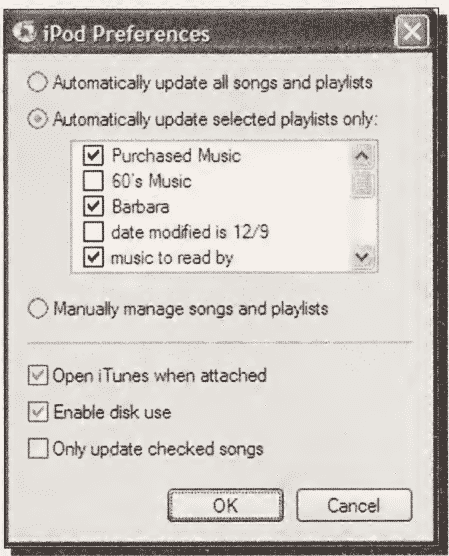

**图 1-1：** iPod 偏好设置对话框允许你决定如何从 iTunes 复制音乐到 iPod。

在左侧列中选择 iPod，然后单击 iTunes 窗口右下角附近的小型 iPod 按钮。这将打开 iPod 偏好设置对话框（图 1-1）。

在偏好设置对话框中，选择第二个选项：“仅自动更新选定的播放列表”。然后，浏览播放列表并勾选你想复制到 iPod 的那些。如果你有多个播放列表，你将不得不滚动以看到它们全部。如果你没有足够多的播放列表使其滚动，你可能会在第 5 章中享受丰富你的播放列表收藏的机会。

> **提示**
> 如果你认为 iPod 上有足够的空间存放你所有的音乐以及其他人所有的音乐，你应该只需将所有播放列表复制到 iPod。更多信息请参阅侧边栏*沉入 iPod*。

当你完成为 iPod 选择播放列表后，单击“确定”。一旦你这样做，iTunes 会清空你的 iPod，然后开始将音乐和播放列表复制过去。你可以在状态显示中监视复制进度。当全部完成后，显示将显示“iPod 更新已完成”，你随时可以出发。

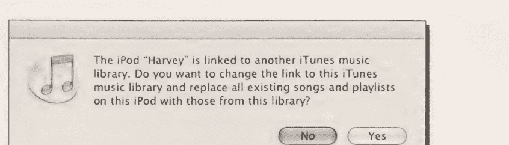

图 1-2：iPod 会告诉你它是否链接到另一台计算机。

## 音乐，无处不在

如果你并没有把全家的曲子都存在同一台电脑上怎么办？在这种情况下，你需要拿起你的 iPod 和连接线，像约翰尼·苹果种（Johnny Appleseed）那样在屋子里从一个电脑走到另一个电脑。只不过你种的不是树，而是在收集音乐。依次将你的 iPod 连接到每台计算机。连接后，进入 iTunes；如果计算机没有自动带你进入 iTunes。如果你的某些计算机无法运行 iTunes 或无法连接 iPod，你需要将歌曲复制到有这些功能的计算机上。

当你连接 iPod 时，你通常会在图 1-2 中那样收到一条消息，指出你的 iPod 处于“陌生领地”。只需点击“否”，表示你不想将 iPod 永久移动到此计算机。然后，点击右下角微小的 iPod 按钮，再次打开 iPod 偏好设置。但这次，你应该选择“手动管理歌曲和播放列表”，然后点击确定。现在你可以直接将歌曲和播放列表拖放到 iPod 上，甚至可以将它们放入 iPod 上已有的播放列表中。

- **注意**：使用“手动管理歌曲和播放列表”可能是危险的。直接在 iPod 上操作音乐，你可能会做出与你在 iTunes 中保留的歌曲和播放列表不同步的更改。当你恢复自动更新时，可能会丢失歌曲和播放列表的更改。关于此问题的更多信息，请参见侧栏“沉没 iPod”。

当你回到自己的电脑并连接 iPod 时，你会发现它记住了“手动管理”设置。你应该保持该设置，直到你结束这次“旅程”，准备将 iPod 恢复到你的独家控制之下，那时你通常会希望恢复自动更新。

## 沉没 iPod


在你把 iPod 带回家并设置好的那个美好日子，你决定了音乐如何从 iTunes 流入其中。你从三个选项中选择了如何同步 iPod 与计算机的方式。第一个选项，“自动更新所有歌曲和播放列表”，仅当你的 iPod 有足够的空间来容纳你 iTunes 中的所有音乐时才有用。如果你认为这描述的是你，iTunes 可以验证你的假设。选择该选项，然后点击确定。很快，甚至更快，iTunes 开始认真思考，计算 iTunes 中所有音乐使用的空间总和，并将该总和与你 iPod 上的剩余空间进行比较。如果你在 iPod 上有足够的空间，那么你就轻松多了。你所有的音乐和播放列表都会被复制过去，这样你就可以拿起 iPod，召集家人，跳上车了。（如果你的所有音乐都能装在一个 iPod 上，苹果可能会希望你更常访问 iTunes 音乐商店。）

如果你是个操控大师，你可能已经选择了“手动管理歌曲和播放列表”选项。此设置赋予你对 iPod 上音乐的独裁控制。在此选项下，将音乐传送到 iPod 的唯一方式就是用你的裸鼠标将其拖过去。一旦曲目在 iPod 上，你可以为所欲为：更改标签信息（如名称和艺术家），选择均衡器预设，甚至删除它。但请注意：你在 iPod 上对歌曲和播放列表所做的更改永远不会被复制回计算机上的 iTunes。

显然，使用此选项时你必须非常小心，我建议除非在特殊情况下（例如，为我们要进行的全家公路旅行从几台电脑收集音乐），否则应避免使用它。很容易弄混并无意中删除 iPod 上你在别处没有的音乐。（好吧，至少对我来说是太容易了。）如果你必须使用此设置，请确保不要在 iPod 上直接更改歌曲和播放列表的同时在 iTunes 中工作。并且请安全驾驶！

## 无需重新插拔即可更新 iPod

作为 iPod 的所有者，你会发现许多酷爽时刻，当你遇到它更巧妙的功能时。其中一个时刻发生在你只是将 iPod 连接到你的计算机时。如果你正在使用自动更新（参见技巧 *共享你的 iPod*），你会看到计算机感受到 iPod 的存在，启动 iTunes，并开始更新 iPod 上的音乐。

有时你会在连接 iPod 的时候搞播放列表。如果你打开 iPod 偏好设置，并对你想放在 iPod 上的播放列表集合进行任何更改，然后点击确定，iTunes 会自动更新 iPod 上的内容以匹配你新的播放列表集合。

但有一种情况下，自动更新并不完全自动。如果你在 iTunes 中更改了播放列表中的一首歌，而该播放列表与 iPod 同步，该更改不会立即复制到 iPod。相反，更新发生在你弹出 iPod 时，就在计算机放手之前。但你可能希望 iPod 立即更新，例如，当你几乎用完 iPod 空间，并且你正在密切监控以尝试调整播放列表来利用每一盎司 iPod 磁盘存储时。

强制更新的一种方法是弹出 iPod 并断开连接，然后立即重新插入，以便你可以继续处理它。但那样做是错的。iTunes 中有一个更简单的方法被隐藏起来：文件菜单底部的“更新 iPod 上的歌曲”项。只需选择该项，你的 iPod 就会立即更新。这还能减少 iPod 连接器和线缆的磨损，更不用说你的手指了。

## 使用智能播放列表保持 iPod 新鲜

iTunes 的智能播放列表功能乍看之下似乎只是有趣，但它的内涵远超表面，就像冰山或魔戒。智能播放列表提供了简单而强大的方式来创建歌曲列表，你可以教导它们基于你制定的规则自动更新自己。通过将智能播放列表与连接 iPod 到计算机时发生的自动更新相结合，你得到一个近乎神奇组合，每次都能带来新鲜音乐。

有几个智能播放列表属性在确保源源不断的曲调供应方面特别有用：

- **播放次数** 跟踪你听过某首特定歌曲的次数。
- **添加日期** 告诉你把歌曲放入 iTunes 库的时间。
- **最近播放** 是 iTunes 或 iPod 最近播放该曲目的日期。

播放次数和最近播放特别酷炫，因为它们跟踪你的收听，无论是在 iPod 上还是在 iTunes 中。所以，如果你在你的 iPod 上听 Everclear 的“Father of Mine”，下次你连接到你的计算机时，该歌曲的播放次数和最近播放值将知道它被播放过。

通过使用这三个属性，你可以轻松构建将新内容带到你的 iPod 的智能播放列表。例如，如果你想获取你几个月没听过的音乐，你可以制作一个像图 1-3 中正在构建所示的智能播放列表。

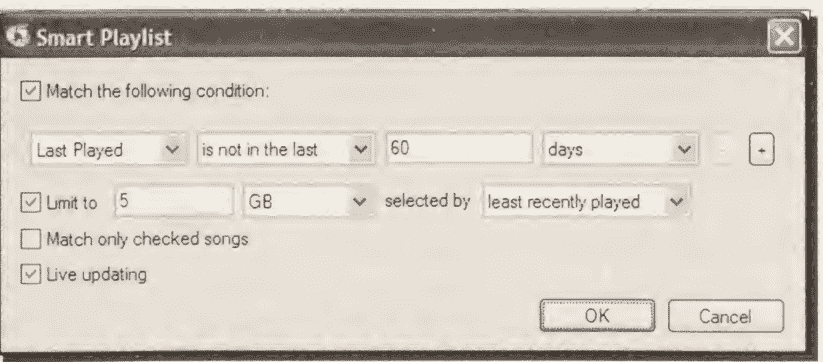

图 1-3：你可以创建一个仅包含你最近没听过的音乐的播放列表。

使用图 1-3 中显示的设置，你会得到一个由至少 60 天未播放的歌曲组成的播放列表。通过使用“限制”设置，你可以确保这个播放列表不会占据你的整个 iPod。这个示例使用 5GB 限制——你可以根据你的口味进行调整。“实时更新”复选框至关重要。它确保播放列表在每次歌曲播放时自我刷新。如果没有勾选那个框，智能播放列表基本上会在创建时冻结，这可能很有用，但现阶段我们要的是新鲜，而不是冻结。

以下是向你的 iPod 加载新曲目的另一种方式：使用设置“添加日期是过去 30 天”制作一个智能播放列表。这将给你一个过去一个月购买或刻录的内容列表。

你是否曾经忙到买了音乐然后忘记听？哎呀！创建一个智能播放列表以永远克服这个问题。只需选择条件“播放次数为 0”，你的音乐将不再能藏起来躲避你。

当然，听新音乐需要至少一点注意力，有时你只是没有太多思考的心情。一个好解毒剂是你喜欢反复听的一组歌曲。你可以使用智能播放列表来构建你最常播放的 100 首歌曲集合。首先，关闭对话框顶部的“匹配以下条件”复选框。然后，选择“限制为 100 首最经常播放的歌曲”。点击确定，就这样——音乐舒适食物。


智能播放列表很酷，我们在第 5 章将专门分配一大块空间给它们。

## 这就是结局

如果你开始摆弄播放次数和最近播放值，你可能会注意到你记得听过一首歌，但 iTunes 不认为它被播放过。那是可能的。播放次数和最近播放值不会在歌曲从头到尾完整播放前调整。而且跳过到下一首歌也不公平——必须播放歌曲的结尾。你可以作弊一点，快进歌曲直到结尾，然后让最后一小部分播放。

## 随机播放你的音乐以听遍所有

有时你确切知道你想听什么，有时你不知道。对于那些你容易受暗示的时刻，你的 iPod 可以帮你。你要做的只是使用随机播放设置。如果你已经熟悉随机播放，你可能没有尝试过它鲜为人知的第三个选项，我们将在这里讨论。

位于 iPod 的“设置”菜单中，随机播放（Shuffle）提供三个选项：关闭、歌曲和专辑。当设置为“关闭”时，所有播放列表和专辑都将按“自然”顺序播放。当你将随机播放设置为“歌曲”时，播放列表或专辑内歌曲的顺序是随机的。第三个随机播放设置项“专辑”对于喜欢一首接一首完整聆听整张专辑的用户非常有用。在此设置下，iPod 会随机选择一张专辑，按顺序完整播放完后，继续随机选择其他专辑并按顺序播放其中的歌曲。

## 随机播放的差异

iPod 和 iTunes 处理随机播放的方式略有不同。在 iTunes 中，每个播放列表都会记住自己的随机播放设置。而在 iPod 上，全局随机播放设置会影响你正在播放的所有音乐。如果你有时听 iPod 上最适合随机播放的“最爱”播放列表，而其他时候又喜欢从头到尾听完整张专辑，这就会带来很多困扰：你不得不频繁地开关随机播放功能以使其符合你的需求。而且在这种情况下，“随机播放专辑”设置也无济于事。如果你在播放“最爱”时使用“随机播放专辑”，iPod 会挑选出恰好位于同一专辑中的所有“最爱”歌曲并播放完毕，然后才会继续。

## 使用重复播放，使用重复播放

一旦你掌握了随机播放设置（其实并不难），你就应该看看它的近亲——重复播放（Repeat）。与随机播放一样，你可以在 iPod 的“设置”菜单中找到重复播放。重复播放有三种设置：关闭、一首歌和全部。如果将其保持为“关闭”，你的列表将播放到末尾，然后 iPod 将停止播放，返回主屏幕，并礼貌地等待你决定下一步操作。

如果你打算使用重复播放功能，你可能会想要“全部”设置。这种模式会播放当前的播放列表、专辑或艺术家直到列表末尾，然后从头开始并继续播放，直到你更改设置、电池耗尽或太阳发生超新星爆发为止。

最后一个也是最奇怪的重复播放设置是“一首歌”，它只是反复播放同一首歌。你为什么想要这样做？也许你非常非常喜欢一首歌——我是说*真的、真的*喜欢它——或者你需要为某些公开表演反复播放一首歌，例如在万圣节时从窗户播放《Beelejuice》的主题曲。

当同时开启“重复播放全部”和“随机播放歌曲”时，你会得到一些有趣的交互效果。在这种组合下，你会听到同一播放列表的无尽循环，但每次歌曲的顺序都会不同。这还挺酷的。

请注意，与随机播放不同，重复播放设置在 iTunes 和 iPod 中的工作方式相同。

## 破解文化：如何赢得朋友


当史蒂夫·乔布斯（Steve Jobs）在 2003 年 4 月 28 日的发布会上介绍 iTunes 音乐商店时，一些专家认为苹果公司正在做一件非同凡响的大事，即拯救音乐产业于水火。苹果花了 18 个月时间来说服各大唱片公司，让它们相信在线销售歌曲是个好主意。自那以后，iTunes 音乐商店取得了巨大成功并被广泛模仿。但那次发布会最精彩时刻之一是乔布斯展示了他归属于亨特·S·汤普森（Hunter S. Thompson）的一句名言：“音乐行业是一个残酷而浅薄的金钱沟壑，一条长长的塑料走廊，窃贼和皮条客在其中逍遥法外，好人则像狗一样死去。它还有负面的一面。”

当这句话出现在屏幕上时，全场观众热烈鼓掌，除了房间里的一些音乐行业高管。

## 让声音检查正常工作

你是否注意到有些 CD 的音量*真的*非常大，而有些则非常小？音量水平是由 CD 的录制和母带处理方式的内置特性决定的——音量会在你不希望它改变的情况下发生改变。特别是与近期音乐相比，较旧的 CD 通常似乎是以较低的音量水平制作的。当你在播放包含各个时代歌曲的播放列表时，这会非常令人烦恼。

幸运的是，iPod 和 iTunes 拥有一个解决此问题的神奇技巧：声音检查（Sound Check）。该功能分析歌曲的音量并对其进行调整，使它们都处于相同的范围内。当你使用声音检查播放歌曲时，你个人的音量选择就成为调节声音大小的方式。

不幸的是，声音检查的操作比它应有的要复杂一点。你必须在 iTunes 和 iPod 上都开启它。步骤如下：

- 1. （这是大多数人记得做的部分。）在 iTunes 中开启声音检查。在 Mac 上，选择 **iTunes > 偏好设置**；在 Windows 上，选择 **编辑 > 偏好设置**。点击“音频”选项卡，然后确保“声音检查”复选框已选中。点击“确定”后，iTunes 开始翻检你的音乐并平衡音量。iTunes 在状态区域显示其进度（见图 1-4）。连接你的 iPod 以更新其音乐。
- 2. （这是人们常忘记的步骤。）在 iPod 上，进入“设置”屏幕并开启声音检查。

就这样。如果你在 iPod 上没有开启声音检查，当你在 iPod 上听歌时，歌曲就不会以平衡后的音量播放，你会困惑究竟发生了什么。


图 1-4：声音检查使所有音乐的音量水平保持一致。

## 使用均衡器获得绝妙音效

现代音乐播放设备使用一种称为*均衡*（equalization）的技术来修改音频信息的重放方式。均衡器将音乐分解为其组成频率，然后使某些频率变大，其他频率变小。其目的是减少刺耳或不适合该音乐的声响，同时突出最重要的声响。

为了产生最佳效果，均衡器设置会根据正在播放的音乐类型而变化。对于节奏感强烈的舞曲，良好的均衡器设置应强调低频范围，而对于人声更细腻的音乐，设置则应增强中高音域的人声。

你可能知道你的 iPod 和 iTunes 内置了均衡器。如果你热爱音乐但不认为自己是发烧友（audiophile），你可能没有探索过均衡器。如果是这种情况，你应该尝试一下。它非常容易使用，并且能显著改变音乐的听感。

在 iPod 上使用均衡器最简单的方法是选择一个设置并将其开启。进入“设置”菜单，选择均衡器。在此屏幕上，它是以“EQ”开头的设置，例如“EQ-Off”或“EQ-Rock”。选择后，你会看到包含“关闭”在内的 20 多个均衡器设置列表。选择与你通常聆听的音乐类型相符的设置，然后点击“选择”按钮。现在你就能听到美妙的均衡音乐了。

还有更高级的均衡器使用方法。例如，每首歌曲可以携带自己的均衡器设置。这个技巧需要使用 iTunes。要在 iTunes 中为歌曲选择均衡器设置，点击歌曲并选择 **文件 > 获取信息**。点击“选项”选项卡。从“均衡器预设”弹出式菜单中选择一个设置。任何拥有自己均衡器预设的歌曲现在都将使用该设置播放，无论是在 iTunes 中还是在 iPod 上。

### 不被拒绝

当你在 iPod 上开始玩转均衡器时，你可能想在一首歌曲播放时进入 EQ 菜单，以了解其均衡器预设是什么。不幸的是，在 iPod 上无法得知歌曲的预设。EQ 菜单中显示的设置是当前全局设置，而不是当前歌曲的预设。

为了使功能更有用（虽然也更具迷惑性），你可以在歌曲播放时从 EQ 菜单选择不同设置，以覆盖当前歌曲的（不可见的）预设。这样操作后，歌曲继续播放，但会立即切换到新设置。下次该歌曲播放时，它将恢复为预设值。

## 快速浏览歌曲以听到你想要的部分

如今每个人都行色匆匆，我们 iPod 的用户也不例外。最初的 iPod 软件包含一种通过按住 >>> 或 <<<< 来快进或快退当前歌曲的方法。那虽然快，但还不够快，后来版本的 iPod 软件增加了快速浏览歌曲的功能，速度如同你转动滚轮一样快。要使用这个便捷功能，请在“正在播放”屏幕上按下“选择”按钮。进度条会出现一个小菱形，指示歌曲当前所在位置。看到它后，你可以使用滚轮快速在当前歌曲中前后移动，这种技术称为*快速浏览*（scrubbing）。当你几秒不动滚轮后，iPod 会认为你已完成操作，常规进度条会重新出现。你也可以通过再次按下“选择”按钮立即让它重新出现（对于 2003 款 iPod，你需要多按一次以跳过“给我的歌曲打分”屏幕）。

## 总结

破解（Hacking）并非邪恶天才、顶级程序员或拥有大型工匠工具箱者的专属领域。我们都可以破解我们的世界，使其更加契合。如承诺的那样，本章提供了简单、直接且在许多情况下甚至非常实用的 iPod 音乐破解技巧——适合每个人的破解技巧。

你的 iPod 可能是世界上最伟大的音乐播放器，但它所知道的功能远不止于此。在即将介绍的第二章中，我们将超越音乐，深入探索其他 iPod 功能。

## 不仅仅是音乐

世界大部分地区的人将 iPod 视为一款超级酷炫的音乐播放器，也是一个时尚的宣言。但 iPod 成功的原因之一在于，除了外观美观、存储和播放音乐外，它还具备许多其他功能，并且不断从苹果和其他方面获得新特性。

在本章中，我们将开始探索你可以用 iPod 玩出的一些非音乐类的技巧。其中一些需要额外的硬件，因此我会向你介绍这些“玩具”，而其他一些则可以通过原装 iPod 和一些额外（通常免费）的软件来实现。

### 本章内容

- 使用 iPod 硬件配件
- 将 iPod 用作外部磁盘驱动器
- 玩转通讯录和日历
- 随 iPod 入睡并醒来
- 使用苹果的 iPod 脚本
- 下载有声读物

### 硬件配件

苹果对 iPod 硬件的保护相当严密，但确实有几种方法可以通过额外的小工具来扩展 iPod 的功能。在本节中，你会发现一些基本的为 iPod 增加功能和便利性的方法。

#### 使用标准 FireWire 线缆

最初的 iPod 只能与 Mac 配合使用。不久之后，苹果意识到把全世界数千万可能想要 iPod 的 Windows 用户拒之门外是个坏主意，于是做出了改变。随着每次更新，iPod 对 Windows 用户变得更加友好。到 2003 年，阻碍 Windows 用户成为完整 iPod 公民的两个主要障碍依然存在：没有 Windows 版的 iTunes，而且大多数 Windows 电脑配备的是用于连接外设的 USB 2.0，而不是 iPod 所需的 FireWire 连接。

苹果在 2003 年底解决了这两个问题。首先，公司发布了 Windows 版 iTunes，它几乎是 Mac 版的克隆。这件事发生后——苹果曾将其描述为“下地狱结冰了”，因为公司发布基于 Windows 的应用程序的可能性极低——所有 iPod 用户都拥有了相同的软件。新接口（常被称为第三代或 3G iPod，在潮流人士中常这样称呼）的 iPod 可以连接 USB 2.0 以及 FireWire，由于大多数新 PC 都配有 USB 2.0，这也使硬件的竞争变得更加公平。

不幸的是，为了让 iPod 同时支持 FireWire 和 USB 2.0，苹果创造出了令人望而生畏的专用连接器。与其祖先不同，3G iPod 没有 FireWire 接口。这种宽而扁平的专用连接器允许 3G iPod 和 iPod Mini 插入其底座。苹果提供了一条线缆，你可以用它将 iPod 直接连接到电脑的 FireWire 端口。但这种设计的缺点是，你再也无法使用任何普通的 FireWire 线缆，这些线缆也用于连接其他 FireWire 设备，如外部硬盘。如果你带着电脑在路上，你不得不携带苹果的特殊线缆。

这就是 SendStation 的 PocketDock（19 美元）派上用场的地方。（关于 PocketDock 的更多信息，请参见 www.sendstation.com。）PocketDock 是一个微小的线缆适配器，让你可以使用任何标准 FireWire 线缆连接你的 3G iPod 或 iPod Mini。图 2-1 展示了其工作原理。只需将 PocketDock 插入 iPod 的底座连接器，你就拥有一个带有 FireWire 端口的 iPod，可以使用任何 FireWire 线缆。SendStation 称 PocketDock 为“必备”，这似乎相当接近事实。这是你期望在 iPod 包装盒里看到的精美免费赠品，因为它极其有用。

### 录制语音备忘录


# Belkin 的 iPod 语音录音机

Belkin 的 iPod 语音录音机是一款很酷的配件，它将你的 iPod 变成一个便携数字录音机。你可以用它来说给自己听或录制一对一的对话。语音录音机是一个小巧的 iPod 白色盒子，可以整齐地插入 iPod 的耳机插孔。你不需要安装任何软件——iPod 已经知道一切。一旦连接了语音录音机，“额外”菜单中会出现一个新项目，即“语音备忘录”。

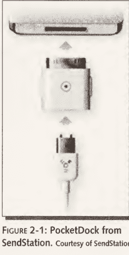

图 2-1：来自 **SendStation** 的 PocketDock。经 SendStation 授权。

从这个菜单中，你可以选择**立即录制**开始记录你重大的想法。

录制期间，屏幕会显示一个大计时器，让你知道它已经“听”了多久，屏幕上的“录制中”字样会闪烁，并且语音录音机本身会亮起一个非常微弱的绿色 LED。录音保存为每秒 128K 比特的 WAV 文件，这意味着你每秒会占用 16K 字节。

语音录音机中最酷隐藏技巧是内置扬声器。当录音机插入时，你的 iPod 突然就有了外部扬声器——一个很小、很安静的扬声器，但毕竟是一个扬声器。这在很多用途上很方便：

- 收听你制作的语音录音，这是其预定用途。
- 与朋友分享一点音乐或其他声音，而不必经历分享耳机带来的卫生噩梦。
- 将 iPod 用作音乐闹钟。（详情见本章中*随 iPod 入睡并醒来*部分。）

你可以将语音录音从 iPod 转移到电脑。下次将 iPod 连接到电脑时，iTunes 会弹出一个对话框，询问你是否希望将语音录音添加到你的音乐库中。如果你说“是”，语音备忘录将被复制到电脑并添加到你的 iTunes 库中。

如果你的私人亲密笔记不想直接进入你的音乐库，你可以将语音录音复制到硬盘而不放入 iTunes。要做到这一点，请在 Finder 或 Windows 资源管理器中打开你的 iPod。你会发现一个新的“录音”文件夹。打开“录音”查看你的语音备忘录。它们的名称对应录制的日期和时间。例如，名为“20040715 131522”的备忘录是在 2004 年 7 月 15 日下午 1:15:22 录制的。你可以像复制其他文件一样复制这些文件。

Belkin 的 iPod 语音录音机大约售价 50 美元，广泛可用，包括在苹果商店和在线商店。你需要 3G iPod 才能使用语音录音机。

2004 年夏天，Griffin Technology 通过发布 iTalk（图 2-2）扩展了其令人印象深刻的产品系列。该产品与 Belkin 的产品非常相似，仅在物理设计上略有不同。

iTalk 具有与 Griffin 其他产品同样酷炫的外观。你可以从苹果商店或直接从 Griffin 购买，价格约为 40 美元。

## 存储数字照片

如果你是一位数码摄影师，你可能知道相机存储空间不足带来的麻烦。你不可能随身携带几卷备用胶卷——CompactFlash、SmartMedia 等成本太高，不适合这么做。将照片卸载到电脑是一种解决方案，但当你外出拍照时，你可能不想拖着一台笔记本电脑。

为了解决这个问题，你可以获得各种便携式硬盘解决方案来存储照片。但你已经拥有一个拥有充足空间的便携式硬盘——它恰好也是一个音乐播放器。因此，Belkin 的人给你的 iPod 又增加了一项工作：数字照片存储。你只需要一个盒子来读取照片并将它们转移到你的 iPod。Belkin 提供了两款可以帮助你的产品：Media Reader for iPod（图 2-3 所示）和 Digital Camera Link for iPod（图 2-4 所示）。我将在这里描述它们两者。

### Belkin Media Reader for iPod

Media Reader 比标准 iPod 稍大，并拥有六种不同类型介质的插槽：

- CompactFlash 1 型和 2 型
- SmartMedia
- Secure Digital (SD)
- Memory Stick
- 多媒体卡 (MMC)

如果你有一台数码相机，它几乎肯定使用 Belkin Media Reader 接受的其中一种介质类型。这是该产品的一个极大优点：你不必

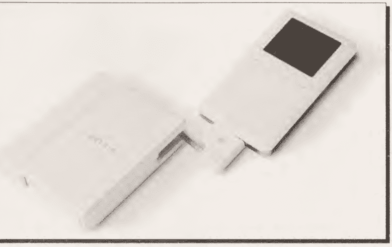

图 2-3：连接到 iPod 的 Belkin 媒体读取器。由 Belkin 提供。

在决定此读取器是否适合您时，无需担心竞争的标准。只要确保您的相机使用的是六种支持类型之一，这就几乎是可以确定的，并且可以兼容。

要使用媒体读取器，请打开保护媒体插槽的巧妙滑动门，然后放入您的卡片。将读取器连接到 iPod 的底座连接器。iPod 会做出反应，询问您是否想要从媒体卡导入照片。如果您说想，照片会在您观看 iPod 上的进度屏幕时复制过去。复制的照片按卷号存储。照片复制完成后，您可以从媒体卡中删除它们，以便您可以去拍摄更多获奖的岩石和泥土照片。

一旦照片进入 iPod，你可以对它们做什么？你可以获取有关它们的信息，例如一卷中照片的数量以及它们存储所在的媒体类型。当您重新连接到计算机后，您可以使用任何导入数码照片的软件（如 iPhoto）将照片复制过去，或者您可以手动在 iPod 上查找名为 DCIM（数码相机图像）文件夹（其名称晦涩难懂）来复制它们。

不幸的是，您对照片做的一件事就是无法在您的 iPod 上查看它们。iPod 屏幕的图形功能有限，并且没有软件支持在屏幕上显示图像。也许这项功能会出现在未来的 iPod 中。

Belkin iPod 媒体读取器适用于 3G iPod。它在苹果商店（包括在线商店（www.apple.com/store））和许多其他地方有售，售价约为 100 美元。

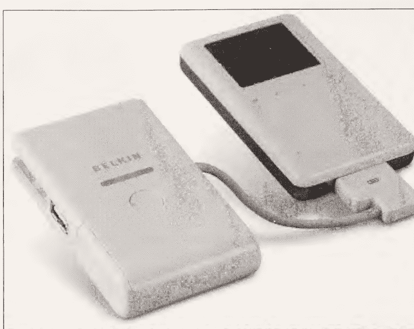

图 2-4：Belkin 数码相机连接。由 Belkin 提供。

### 适用于 iPod 的 Belkin 数码相机连接

Belkin 的第二款用于导出数码照片的产品工作方式不同，无需使用存储卡。要使用数码相机连接（图 2-4），您直接将其连接到相机的 USB 端口，然后将数码相机连接连接到 iPod 的底座连接器。您的照片将神奇地流向 iPod。然后，当您回到计算机前，您可以从 iPod 传输照片。

适用于 iPod 的 Belkin 数码相机连接需要 3G iPod，在苹果商店或直接从 Belkin 购买，售价约为 90 美元。

你如何决定使用哪款 Belkin 照片设备搭配你的 iPod？以下是一些指导原则。选择媒体读取器以获得最大的灵活性和存储空间，因为你可以从无限数量的卡片传输照片。然而，相机连接更小，使用两节 AA 电池，而媒体读取器需要四节 AAA 电池。相机连接也便宜约 10 美元，所以如果你不需要传输多于一张卡片的照片，相机连接是个不错的选择。

## 使用外部电池

俗话说（几乎如此），你永远不能太富有、太瘦或拥有过多的电池电量。iPod 内置的可充电电池可为你提供长达 8 小时的音乐乐趣。这通常足以让你回到安全的地方充电。但当你需要更多电量时怎么办？因为 iPod 的电池是内置的，你无法像笔记本电脑和许多其他电子设备那样随身携带备用电池。

Belkin 的备用电池包允许你使用标准 AA 电池为你的 iPod 增加长达 20 小时的播放时间。备用电池看起来像 iPod 的背包。它通过两个方便的吸盘附着在光亮的 iPod 背面。一根电缆将背包插入底部的底座连接器——备用电池仅适用于 3G iPod。当你连接备用电池时，iPod 会从它而不是内置电池中获取电力，因此你不应该充电，直到你的主电池耗尽或濒死。

备用电池包含一套巧妙的绿色 LED，显示剩余电池电量，就像 Apple 的笔记本电脑电池一样。当你需要取下背包时，吸盘顶部有方便的小拉环，有助于撬开它们，这是一个很好的设计。

对于电池需求大的用户，iPod 备用电池售价约为 59 美元，你可以在大多数销售 iPod 产品的地方购买到，包括苹果商店。

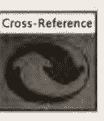

有关如何更换 iPod 内部电池——这是可以做的！——请参见第 3 章中 *更换您的 iPod 电池* 部分。

## 将您的 iPod 用作灯

您可能已经注意到，您的 iPod 背光灯非常明亮。事实上，它足够生动，以至于聪明的 iPod 所有者已经想出巧妙的方法使用背光灯，例如这些：

- **手电筒。** 如果你要去电影院，你可以使用你的 iPod 背光灯来帮助你找到你的座位或掉在地上的 Raisinets 盒子。
- **安全灯。** iPod 团队报告说，他们收到来自慢跑者的信息，这些人在夜间跑步时作为安全装置保持背光灯亮着。
- **书灯。** 在紧急情况下，使用你的 iPod 在昏暗的房间里照亮书本或地图，如图 2-5 所示。
- **夜灯。** 在与家人在费城一家旅馆过夜期间，我将 iPod 作为夜灯使用，将其插入浴室台面上的墙壁插座，并将背光灯设置为始终开启。

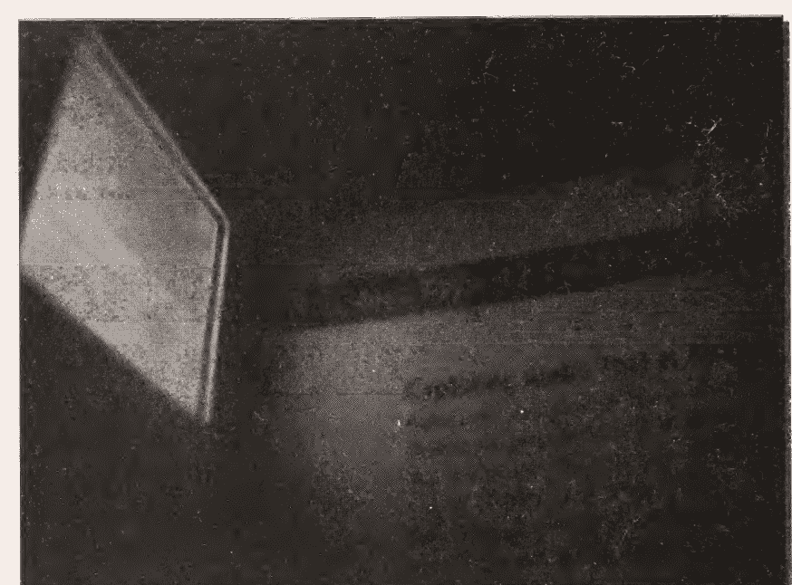

图 2-5：iPod 作为书灯。


你可以通过前往 设置 ⇄ 背光计时器 并选择“始终开启”来设置背光灯始终开启。当然，这消耗大量电池电量，但除非你是整夜马拉松跑步者，否则你在一程慢跑的长度内应该没问题。用于夜灯工作时，请确保你的 iPod 连接到交流电源。

# 将您的 iPod 用作外部磁盘驱动器

您可以将 iPod 用作高度便携、大容量外部磁盘驱动器。确保在 iTunes 中的 iPod 偏好设置中勾选“启用磁盘使用”框，您的 iPod 将作为 Finder 或 Windows 资源管理器中的另一个磁盘出现。一旦你这样做，你可以使用其多余容量存储任何你想要的文件。

将 iPod 以这种方式使用，或用于除从 iTunes 获取音乐以外的任何其他目的，都有一个缺点。当你的 iPod 仅用于音乐，并且你使用自动更新功能时，每次你连接到计算机时，iPod 都会从 iTunes 获取歌曲。所有的歌曲都存储在计算机上，并在同步时复制到 iPod。这意味着，实际上，iPod 只是你电脑上歌曲的备份设备。如果这是你使用 iPod 的唯一用途，那么 iPod 的内容是完全可丢弃的：你可以重新格式化它，丢失它，或将其投入 Mount Doom 的火中，而不会丢失任何数据。一旦你开始在 iPod 上保存其他信息，你就必须意识到你存储在那里，甚至备份这些文件，如果你想确保不会丢失它们。因为 iPod 就像一个标准的外部磁盘驱动器，你可以使用任何备份程序（如 Dantz 的 Retrospect（www.dantz.com））对其进行备份。

# 从您的 iPod 启动

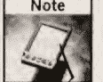

此黑客技术仅适用于 Macintosh 计算机。

当你习惯使用 iPod 作为外部驱动器时，你可能会希望将 iPod 变成一个 Mac OS X 的可便携式启动磁盘。这样，你可以在路上、办公室或朋友家中随身携带它，并始终携带你的系统、设置、密码和其他重要信息。使 iPod 可启动非常简单。你只需要在连接 iPod 的情况下运行 Mac OS X 安装程序，并选择它作为安装的目标卷。一旦你安装了 Mac OS X，iPod 将作为启动磁盘偏好面板中的一个选项出现，如图 2-6 所示。

另一个在你使用 iPod 作为外部驱动器时方便的工具是受欢迎的免费软件实用工具 Carbon Copy Cloner，由 Mike Bombich 在 www.bombich.com/software/cccl.html 提供。Carbon Copy Cloner 让你将一个现有的磁盘卷复制到

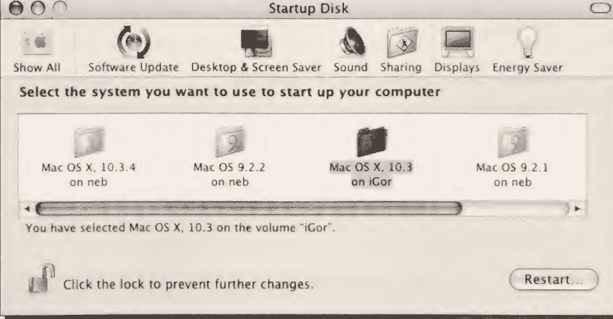

图 2-6：运行 Mac OS X 安装程序后，iPod 是有效的启动磁盘。

另一种。你可以使用此程序将所有珍贵内容备份到 iPod，如果源文件可启动，你甚至可以制作一个可启动的 iPod。


苹果公司主要将 iPod 设计为音乐播放器。在该模式下，iPod 软件会努力减少硬盘磨损。它会不频繁地启动磁盘，读取大量音乐，关闭磁盘，然后在 RAM 缓冲区中保留音乐进行播放。如果你大量使用 iPod 作为外部磁盘驱动器，特别是作为启动卷时，一旦 iPod 发生故障，你可能会发现苹果不愿提供保修维修服务。

## 文化入侵：通过 iPod 实施盗窃

当你打开全新的 iPod 时，你肯定注意到了屏幕上写着“不要窃取音乐”的贴纸。根据自最初 iPod 开始出货后不久就开始出现的报告，这些贴纸可能做得还不够，因为显然至少有一个恶意人士决定使用 iPod 来窃取不止是音乐的东西。

2002 年 2 月，德克萨斯州的一位 CompUSA 客户报告称，看到一名男子从口袋中掏出一个 iPod，将其连接到展示用的 Macintosh 电脑上，将商业软件复制到 iPod 上，然后断开连接并离开。尽管 iPod 主要以音乐播放器闻名，但窃贼利用了 iPod 作为功能强大的外部磁盘驱动器的能力。这当然是 iPod 黑客行为的一个例子，但我并不鼓励这种行为。

## 软件

酷炫的硬件并不是为你的 iPod 添加功能的唯一方式。你还可以通过利用世界上出色的软件来改变 iPod 的生活。在本节中，我们将讨论帮助你管理联系人、充当闹钟等功能的软件技巧。

### 导入你的联系人和日历

你的 iPod 天生具备管理联系人和日历事件的能力。如果你拥有 Macintosh 电脑，可以使用苹果提供的优秀免费软件将联系人和日历信息传输到你的 iPod：Address Book、iCal 和 iSync。苹果不提供这些程序的 Windows 版本，但有其他公司提供相应的替代品。Address Book、iCal 和 iSync 已安装在大多数 Mac 上——请检查你的应用程序文件夹以确定。如果你没有它们，请立刻前往 www.apple.com/support/downloads/ 下载。如果你使用的是 Windows，请跳过本部分，直接查看*在 Windows 上使用联系人和日历*章节。

与大多数苹果设备一样，这套程序很容易使用。如果你使用 Address Book 管理联系人，并使用 iCal 跟踪你的预约，你可以通过以下步骤轻松地将信息同步到你的 iPod：
- 1. 确保 iPod 已连接到你的计算机。不幸的是，无线 iPod 尚未发明。
- 2. 运行 iSync。你应该能看到 iSync 窗口，其中列出了它知道的所有设备。
- 3. 选择 设备 ⇔ 添加设备。你应该能在弹出的窗口中看到你的 iPod 被列出。双击它以注册 iPod 进行同步。你的 iPod 应该出现在 iSync 窗口中。
- 4. 在 iSync 窗口中检查你的 iPod 设置。第一个复选框，“启用同步”，应该处于开启状态，并且“联系人”和“日历”的复选框也应该被选中，如图 2-7 所示。
- 5. 单击 立即同步 将数据传输到 iPod。

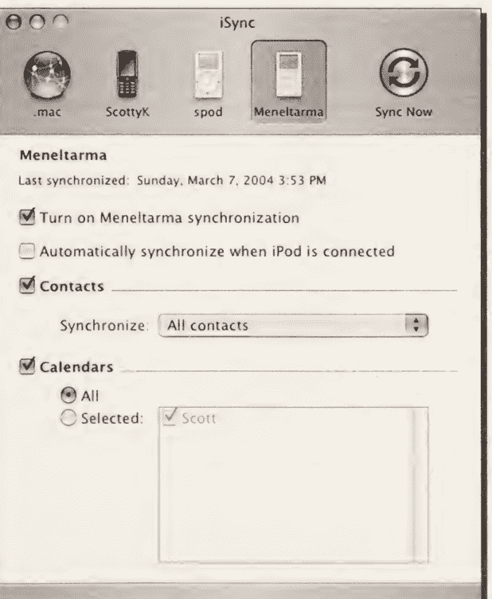

图 2-7：准备与 iPod 同步的 iSync 窗口。

现在，你的 Address Book 和日历信息已准备好随着 iPod 去往任何地方。Address Book 和 iCal 条目存储在 iPod 的“其他”部分下，分别位于联系人和日历列表中。

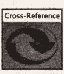

要了解在 Mac 和 iPod 之间同步信息的更多方法，请参阅第 4 章，特别是**获取新闻、天气、电影片单及其他信息**部分。

### 所有联系人去哪了？

存储在 iPod 上的大多数信息都采用简单、开放的格式。联系人以称为 vCard 的标准格式存储，然后简单地放置在 iPod 的联系人文件夹中。同样，iPod 上的日历条目是使用标准 iCalendar 或 vCalendar 格式的文件，存储在日历文件夹中。大多数在 Mac OS X 和 Windows 上的通讯录和日历程序都可以生成 vCard、iCalendar 和 vCalendar 文件。一旦你的数据处于这些格式中，你只需将其复制到 iPod 上的正确文件夹，当你选择联系人或日历时就会显示出来。

### 使用 Outlook 使用联系人和日历

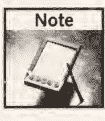

此技巧仅适用于 Windows 计算机。

在 iTunes 方面，苹果对 Windows 用户非常宽宏大量，提供了几乎相同的 Windows 和 Mac 版本。但这种跨平台策略并未延伸到 Address Book、iCal 或 iSync，这些是 Mac 用户用于管理联系人和日历信息，并将这些信息流转到其 iPod 的程序。

然而，由于 iPod 使用标准格式——联系人使用 vCard，预约使用 iCalendar 和 vCalendar——无论使用哪种程序管理个人信息，你都很幸运。在本节中，我们将讨论从最流行的 Windows 个人信息管理器：Microsoft Outlook 获取联系人和日历数据到 iPod 的最基本技巧。

你可以从 Outlook 获取 vCards 和 iCalendars，但这并不特别容易或直观。根据你是想导出少量项目还是大量项目，程序是不同的。以下是如何将单个 Outlook 联系人放入你的 iPod：
- 1. 将 iPod 连接到你的计算机。选择 **开始 ⇔ 我的电脑** 以确保能看到你的 iPod。
- 2. 在 Outlook 中，找到你想要移动到 iPod 的联系人并打开它。
- 3. 选择 文件 ⇄ 导出到 vCard 文件。
- 4. 在“文件名:”框中，输入你希望该联系人拥有的名称。
- 5. 在“保存类型:”框中，从弹出列表中选择“VCARD 文件”。先不要单击保存！
- 6. 在对话框顶部的“保存在:”弹出列表中，导航到你的 iPod，如图 2-8 所示。
- 7. 在现在显示 iPod 内容的文件窗口中，双击 Contacts 文件夹。
- 8. 单击保存。


下次断开 `iPod` 连接时，你保存的联系人将出现在 `iPod` 的联系人文件夹中。

将 `Outlook` 日历事件放入 `iPod` 的过程类似。步骤如下：

# 单个导入 Outlook 日历事件

1. 将 `iPod` 连接到你的计算机。选择 `开始 ⇔ 我的电脑` 以确保你的 `PC` 可以看到你的 `iPod`。

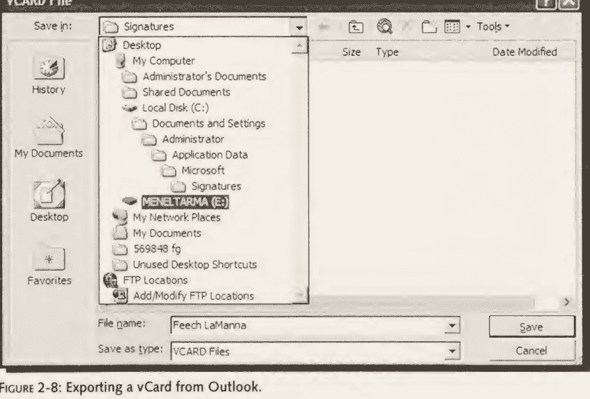

图 2-8：从 `Outlook` 导出 `vCard`。

2. 在 `Outlook` 中，前往日历，找到你想要移动到 `iPod` 的条目并打开它。

3. 选择 `文件 ⇔ 另存为`。

4. 在“文件名:”框中，输入你希望日历事件拥有的名称。

5. 在“保存类型:”框中，从弹出列表中选择“`iCalendar` 格式”。先不要单击保存！

6. 在对话框顶部的“保存在:”弹出列表中，导航到你的 `iPod`。

7. 在应该显示 `iPod` 内容的文件窗口中，双击 `Calendars` 文件夹。

8. 最后，单击保存。

你现在已在 `iPod` 上存储了一个日历事件。当你断开 `iPod` 连接时，前往日历，你应该能在指定日期看到你的事件。

# 批量导出多个 Outlook 条目

这种一次一个的处理方式对于有限的使用场景是不错的。但如果你想一次性将大量 `Outlook` 条目放入 `iPod` 怎么办？幸运的是，你不必反复为每个条目重复此过程。相反，有一个一次性导出多个项目的技巧。此过程适用于联系人和日历条目，虽然不能在一次导出中混合这两种类型。以下是联系人的步骤：

1. 像之前一样，确保你的 `iPod` 已连接，并且你的 `PC` 知道它已连接。

2. 在 `Outlook` 中，前往联系人并选择你想要的所有项目。你可以使用 `Shift+单击` 和 `Control+单击` 来选择多个项目。

3. 选择 `操作 ⇔ 以 vCard 转发`。这会创建一个新的电子邮件消息，其中包含你选择的所有已转换为 `vCard` 格式的联系人。

4. 填写收件人并将电子邮件发送给一位受信任的朋友——比如你自己。虽然所有 `vCard` 就在那里等待获取，但显然除了作为接收到的电子邮件外，没有方法一次性访问它们。

5. 在 `Outlook` 中收集你的电子邮件。当你查看接收到的消息时，你应该能看到所有 `vCard` 作为附件。

6. 选择你发送了包含所有 `vCard` 的那条消息。选择 `文件 ⇔ 保存附件 ⇔ 所有附件`。注意：如果你使用 `Outlook` 以外的电子邮件程序收集邮件，它可能没有保存所有附件的功能。

7. 在出现的“保存所有附件”对话框中，单击确定。

8. 接下来，你会看到一个“保存所有附件”文件列表。导航到你的 `iPod` 的联系人文件夹并单击确定。

完成了——联系人已发送到你的 `iPod`。

如果你想导出多个日历项目，微软让步骤非常相似，但又略有不同，只是为了给我们找点乐子：

1. 确认你的 `iPod` 已连接，并且可以在“我的电脑”中看到它。

2. 进入 `Outlook` 日历。

3. 大多数用户的 `Outlook` 日历都设置为显示图形视图，如图 2-9 所示。如果你的日历显示为列表视图，选择和导出多个日历项目会更简单。要在列表视图中查看日历，请选择“视图 -> 当前预约”。现在你的日历看起来会像图 2-10 一样。

4. 使用 `Shift + 单击`和 `Ctrl + 单击`来选择多个日历项目。选择所有你想要导出到 `iPod` 的项目。

5. 选择“操作 -> 作为 `iCalendar` 转发”。你会收到一封新的电子邮件，其中包含所有转换为 `iCalendar` 文件的预约。

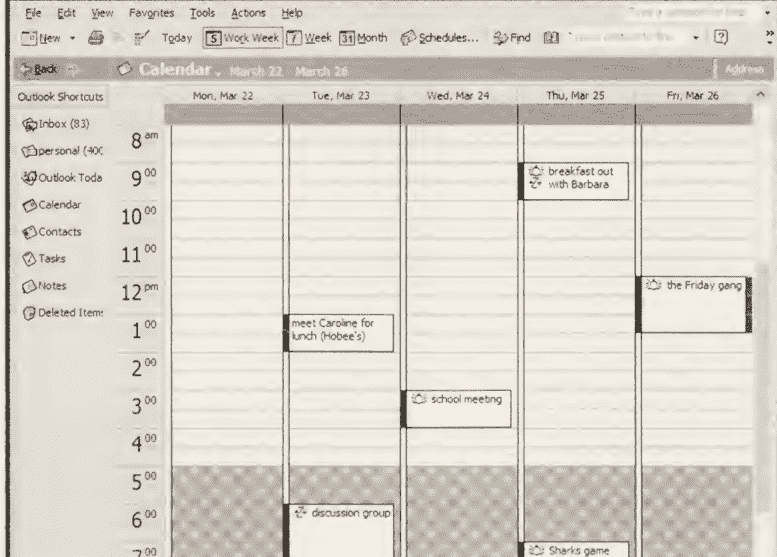

图 2-9：典型的 `Outlook` 日历视图。

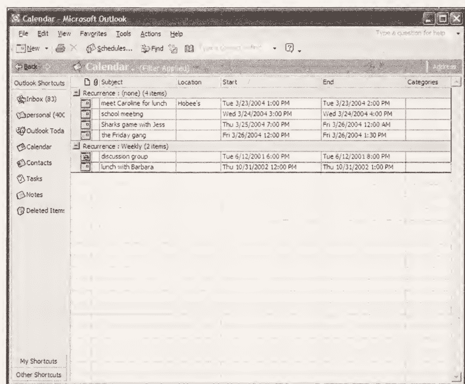

图 2-10：用于多重选择的日历列表视图。

6. 将电子邮件发给自己并发送。

7. 接收你的邮件。选择你发送的消息，并心领神会地点点头，看着所有的 `iCalendar` 附件。

8. 选择“文件 > 保存附件 > 所有附件”。

9. 在“保存所有附件”对话框中，点击“确定”。

10. 你会看到一个“保存所有附件”的文件列表。找到你的 `iPod`，然后找到其“日历”文件夹，点击“确定”。

就这样！你现在已经将你在 `Outlook` 中选择的预约传送到了 `iPod` 的日历中。

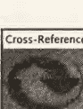

**交叉参考**

虽然这些程序可以将联系人和日历信息放入你的 `iPod`，但它们绝对不是每天在 `Outlook` 和你的 `iPod` 之间进行同步的长期解决方案。要了解更酷、更自动化的技术，请参阅第 4 章的 `Synchronize Your iPod with Microsoft Outlook`（将你的 `iPod` 与 `Microsoft Outlook` 同步）部分。

# 睡去 iPod，醒来 iPod

在 `iPod` 音乐的伴奏下跳舞度过了漫长的一夜后，你可以使用相同的音乐和相同的 `iPod` 作为闹钟，在第二天早上（或下午）叫醒你。`iPod` 包含一个闹钟功能，你可以使用它在指定时间播放音乐。设置方法如下：

1. 从主 `iPod` 菜单，前往“附加功能 > 时钟”。

2. 当你到达显示当前时间的屏幕时，前往 `闹钟`。

3. 从 `闹钟` 屏幕，选择 `警报` 并按住 `iPod` 的 `选择` 按钮（中间那个），直到 `警报` 设置为“开”。你的屏幕应该看起来像图 2-11。

4. 选择 `时间` 并按 `选择`。使用转轮指定闹钟的时间。完成后按 `菜单`。

5. 选择 `声音` 并选择一个播放列表作为你唤醒电话的背景音乐。只有当你尝试唤醒 `iPod` 时外接了扬声器，这才会起作用。否则，它开始播放，但你什么也听不到，这会大大降低闹钟的有效性。如果你不打算外接扬声器，请选择 `蜂鸣` 声音，它从 `iPod` 的内置扬声器发出。

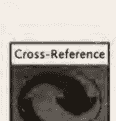

Belkin 的 `Voice Recorder（语音录音机）` 和 Griffin 的 `iTalk` 有一个小内置扬声器，你可以用它来确保你的闹钟真的把你吵醒了。如果你需要更强大但仍然紧凑且便宜的东西，看看第 3 章描述的 `SimpleSpeaker（简易扬声器）`。

不仅可以利用 `iPod` 叫醒你，它对于帮助你入睡也很有帮助。`iPod` 包含一个睡眠计时器功能，在关闭前会播放指定的时长。要设置睡眠计时器，请返回 `时钟` 屏幕并选择 `睡眠计时器`。然后你可以从 15 到 120 分钟的睡眠时间内进行选择，之后你的 `iPod` 会自动关闭。

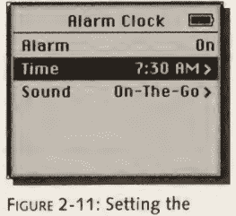

带着 `iPod` 上床，带着 `iPod` 起床——其中一定有一首诗，或者至少是一个苹果广告。祝你好梦！

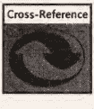

> **交叉参考**
>
> 要使用更强大的闹钟，但需要一台完整的 Macintosh，请参阅第 6 章，“让 iTunes 成为闹钟”。

# 使用 Apple 的 iPod 脚本

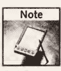

**注意** 此技巧仅适用于 Macintosh 计算机。

`Mac OS X` 包含一项名为 `AppleScript` 的酷技术，它允许你自动执行程序中的常见任务。用 `AppleScript` 编写的脚本是小程序，你可以通过从 `iTunes` 和其他应用程序的脚本菜单中选择它们来运行。我们将在第 6 章中更多地讨论 `AppleScript`，在那一章的 `iTunes` 部分中。但是，还有一些适用于 `iPod` 的巧妙 `AppleScript` 功能，这也是本节的重点。

Apple 在其 `AppleScript` 网站 `www.apple.com/applescript/ipod` 上提供 `iPod` 脚本。要使用这些脚本，请从该地址下载它们，并使用以下步骤将它们放入“脚本”文件夹中：

1. 在 Finder（访达）中，打开你的主目录。如果你不确定该怎么做，一种万无一失的方法是选择“前往 > 主目录”。

2. 在你的主目录中，找到 `Library` 文件夹，并在 `Library` 内部找到 `Scripts`。

3. 将你下载的脚本拖到 `Scripts` 中。

Apple 的大多数 `iPod` 脚本执行与 `Notes（笔记）` 相关的酷技巧。以下是这些脚本功能的描述：

- `弹出 iPod`。不，它不会让你的 `iPod` 物理上飞通过空中——它只是将 `iPod` 卸载，以便你可以断开连接。当你将它绑定到键盘快捷键时，这特别有用，你可以在系统偏好设置中的“键盘与鼠标”面板中完成此操作。

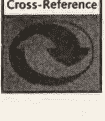

> **交叉参考**


> 要了解如何创建键盘快捷键，请参阅第 6 章中“在 iTunes 中启用 AppleScript”部分。

- **剪贴板到笔记**。这是一种超级简单、真正快速的方法，用于向你的 iPod 添加笔记。要使用它，请选择并复制你需要的文本，然后切换到 iTunes 并运行此脚本。复制的文本会变成一个笔记并进入 iPod。如果你复制的文本长度超过 iPod 笔记施加的 4K 限制，不用担心：脚本会自动将你的文本分成多个相互链接的笔记。
- **清除所有笔记**。使用此脚本快速清除你所有的笔记。该脚本还提供移除所有 Notes 子文件夹的选项。
- **列出笔记**。当你想查看所有笔记的列表时运行此脚本。你可以选择一个并点击“打开”，在 TextEdit（文本编辑）应用中查看笔记的文本。如果你有很多笔记，这可能需要一些时间。图 2-12 展示了其工作原理的示例。
- **MacCentral**。此脚本使用 Safari 打开 MacCentral 网站，并将第一篇文章复制到一个 iPod 笔记中。由于你获得了脚本的源代码列表，你可以针对其他网站进行修改。
- **打印友好**。这个脚本很有用，但标题有点奇怪。它抓取 Safari 中前面窗口的文本并制成一个笔记。它被称为“打印友好”，因为它最适合图形或链接较少的页面，但你可以将其用于任何你指向的页面。

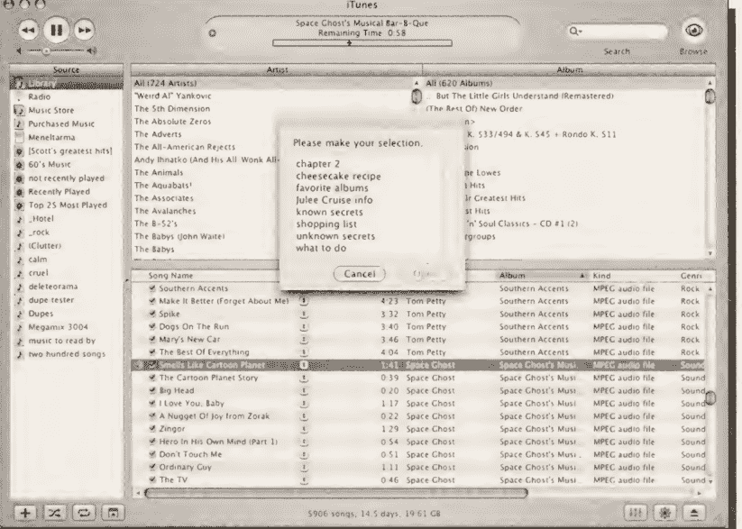

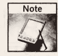

### 脚本的成功

如果你有兴趣更多地了解 AppleScript 如何帮助你用 iPod 做酷炫的事情，务必访问 Doug's AppleScripts for iTunes（www.malcomadams.com/itunes），不要错过第 6 章中对 Doug 的一些脚本的探索。

## 将 WinAmp 与你的 iPod 一起使用

> **注意** 此技巧仅适用于 Windows 计算机。

你大概知道，iTunes 并不是世界上唯一的音乐播放器。其他程序，如 MusicMatch Jukebox 和 WinAmp，存在于数百万满意用户的硬盘上。当 iPod 首次出现时，没有 Windows 版的 iTunes。相反，Apple 与 MusicMatch 合作，使 MusicMatch Jukebox 成为 Windows 的官方 iPod 软件。尽管这一指定在 2003 年 10 月 Apple 推出 Windows 版 iTunes 时突然结束，但你仍然可以自由使用 MusicMatch 来配合你的 iPod。

然而，数百万 WinAmp 用户就没那么幸运了。WinAmp 是最早的数字音乐应用之一，它包含游戏和可定制外观等巧妙功能。但是，WinAmp 没有提供对 iPod 的支持。但在 2004 年 2 月，Christophe Thibault 发布了 WinAmp 的 iPod 支持插件。这个小小的代码允许 WinAmp 用户连接他们的 iPod 并将音乐传输到上面。当你安装 iPod 支持插件时，你的 iPod 会出现在 WinAmp 的设备列表中，如图 2-13 所示。

iPod 支持插件提供基本功能，如将音乐复制到 iPod 以及在 WinAmp 中播放存储在 iPod 上的音乐的能力。但该插件缺乏 iTunes 提供的功能，最明显的是对 iTunes 管理播放列表的支持。尽管如此，忠实的 WinAmp 粉丝现在可以继续坚持使用他们最喜欢的数字音乐程序，并管理他们 iPod 上的音乐。

要下载 WinAmp，请前往 www.winamp.com/player/。WinAmp 的基本版本是免费的——花 15 美元，你可以获得更多功能，包括 MP3 抓取和快速 CD 刻录。iPod 支持插件在 www.winamp.com/plugins/details.php?id=138888 免费获得。

## 将你的 iPod 连接到 Mac 和 Windows PC

如果你同时拥有 Mac 和 PC，你可能会发现将你的 iPod 用于两台电脑很方便。有一个简单的方法可以做到这一点。首先，确保你的 iPod 上没有你需要的东西，因为你要重新格式化它。为此，运行 Windows 版的 iPod 更新程序并点击“还原”（见图 2-14）。这将使用 FAT32 文件

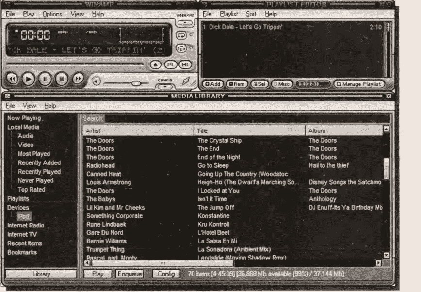

图 2-13：安装 iPod 支持插件后，iPod 出现在 WinAmp 中。

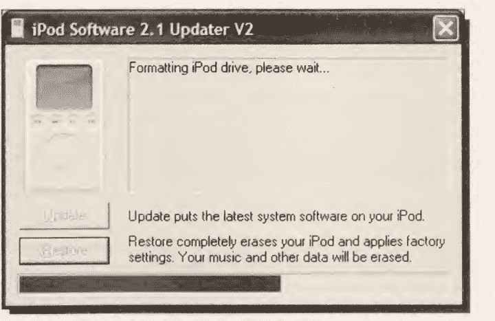

图 2-14：iPod Updater 正在为 Windows 格式化 iPod。

system, which is native to Windows but is also supported by Mac OS X. You can then talk to the iPod with iTunes on either operating system, and from the Mac OS X Finder as well as Windows Explorer.

该文件系统是 Windows 的原生格式，但也受 Mac OS X 支持。之后，你可以使用任一操作系统上的 iTunes 与 iPod 进行通信，也可以通过 Mac OS X 的“访达”（Finder）和 Windows 资源管理器进行操作。

如果你后来决定要将 iPod 专门格式化为仅适用于 Mac，你可以通过运行 Mac 版 iPod Updater 来逆转这一过程。同样，在使用 iPod Updater 覆盖磁盘内容之前，请确保 iPod 上没有你希望保留的数据。

> **提示** 你可以通过选择“设置 · 关于”并滚动到底部来查看 iPod 是否为 Windows 格式。如果看到“Format Windows”，则说明该 iPod 使用的是 FAT32 文件系统。

## 下载有声读物

音乐并不是你可以在 iPod 上欣赏的唯一内容类型。有声读物和其他口头录音是你在通勤坐火车、长途驾车或在诊所候诊时打发时间的绝佳方式。

有声读物和类似录音的主要来源是 Audible (audible.com)。当你访问 Audible 主页（图 2-15）时，你可以从一个庞大的录音库中进行搜索，该库包括小说、非虚构类书籍、杂志、广播节目等。你可以订阅《纽约时报》的有声摘要版，该版本每天上午 6:00 发布。你甚至可以获取语言课程，这样即使你在交通拥堵中，也能学会用意大利语抱怨。

由于有声读物通常比普通的歌曲长得多，iPod 为有声读物提供了自定义功能。当你听有声读物时，如果中途休息，iPod 会放置一个书签记录你停止收听的位置。下次你回到这本书时，你可以直接从上次停止的地方继续收听。即使你通过 iTunes 同步 iPod，这个技巧也依然有效——书签会随数据同步传输。

你的 iPod 上另一个很酷的有声读物功能是章节标记。当你在听 iPod 并查看“正在播放”屏幕时，你可以按下选择键进入增强快进和快退模式，你可以使用滚动轮按秒为单位向前或向后快速浏览——这一功能被称为*擦洗*（scrubbing）。当你在听有声读物时执行此操作，你会看到时间轴上有垂直标记，指示章节的开始位置。你可以利用这些章节标记直接跳转到你想听的书中的部分。

> **交叉参考** 有关有声读物的更多信息以及如何在 iTunes 音乐商店中找到它们（包括免费的 90 秒预览），请参见第 11 章的*收听有声读物*部分。

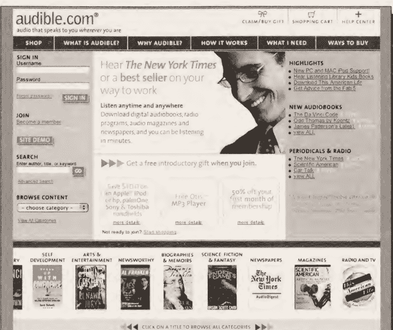

**图 2-15：** Audible.com 主页。

版权所有 Audible。

## 使用 OmniOutliner 查看大纲

**注意**

此技巧仅适用于 Macintosh 计算机。

Omni Development, Inc. 公司的 OmniOutliner 是处理任何类型层级结构的出色工具，例如头脑风暴想法、大纲、目录和组织结构图。一些 Mac 电脑预装了 OmniOutliner。如果你还没有安装，可以从 www.omnigroup.com/applications/omnioutliner 下载免费试用版或购买正式版。

你可以从 Omni 获取一个附加脚本，该脚本允许你将大纲导出到 iPod 并在那里查看。这是为演讲制作大纲的好方法，这样在演讲时，大纲就显示在你的 iPod 屏幕前。你可以在 www.omnigroup.com/applications/omnioutliner/extras/ 下载该免费脚本。该脚本有两个版本：一个导出为 iPod 备忘录，这需要 3G iPod；另一个导出为联系人，适用于任何型号的 iPod（见图 2-16）。


一旦从 Omni 网站下载了脚本，你可以打开磁盘映像文件并双击安装程序，将脚本安装到 OmniOutliner 的脚本文件夹中。安装完成后，启动 OmniOutliner，选择一个大 outline，然后从“脚本”菜单中选择脚本进行导出（见图 2-17）。就这样——你有了一个大 outline 可以随行使用了！

## 阅读和编写 iPod “书籍”

是的，你没看错，你正在阅读一本 iPod 书籍，市面上还有其他几本 iPod 书籍供你欣赏。但 iPodLibrary.com 的人们谈论的是另一种类型的 iPod 书籍：那种存储在你的 iPod 上的书籍。iPodLibrary.com 的创建者正在寻找人们来创建并提交他们所谓的“酷炫的小 podBook”：这些是由你可以随身携带在你喜欢的音乐播放器上的有趣内容组成的集合（见图 2-18）。

在 iPod 上放置“书籍”形式的信息是让你的 iPod 变得不可或缺的另一大步。如果你将 iPod 视为一个便携式参考图书馆，那么这些 podBook 的潜力是巨大的。想象一下各种可能性：

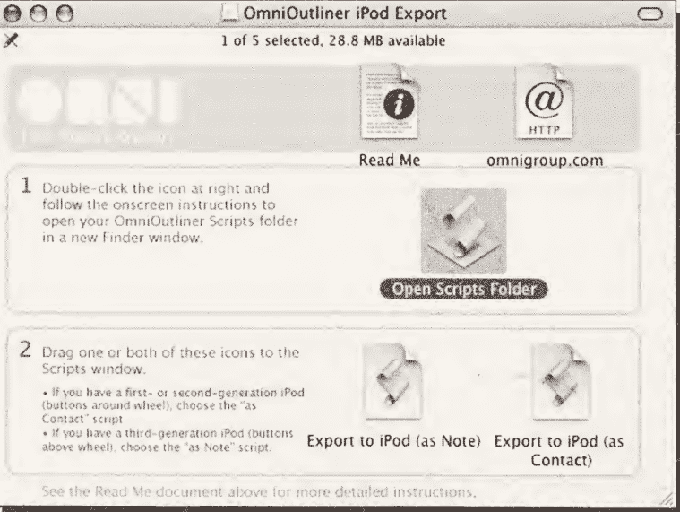

**图 2-16：** OmniOutliner 导出到 iPod 包含两个脚本。

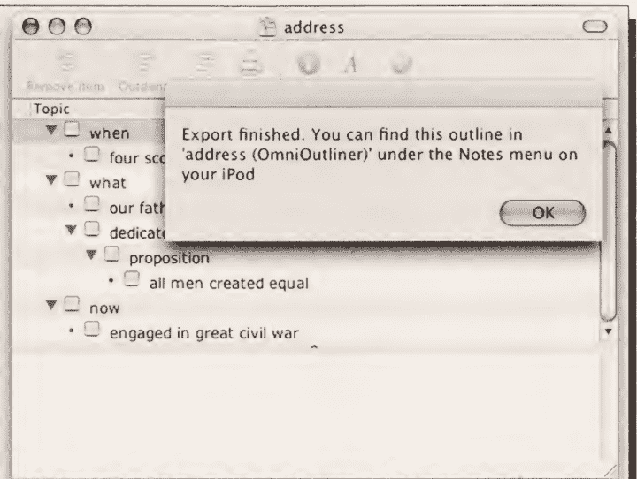

图 2-17：大纲已导出。

- 棒球官方规则。核心棒球迷喜欢去球场时带一本规则书，以便帮助理解奇怪的判罚。与其费力携带实体规则书，不如使用一个包含棒球规则的 podBook 来提供必要的信息。
- 收藏家信息。下次当你去博览会或收藏店寻找邮票、硬币、《指环王》玩具、漫画书、摇头娃娃、火柴盒封面或其他珍贵的爱好物品时，想想如果在 iPod 里有一份价格指南该多方便。
- 电影指南。一份包含星级评分和类型信息的电影列表，在你下次在音像店像僵尸一样四处闲逛，试图寻找一部你还没看过三遍的好电影时，会非常有用。
- 唱片目录。如果你决定献出生命去收藏（例如）Crosby, Stills, Nash 或 Young 记录的所有音乐，那么你有大量的黑胶和 CD 要收集。将权威的唱片目录存储在 iPod 中，当你徘徊在二手唱片店时会非常有用。
- 天文数据。如果你来自太空，拿出你最喜欢的天文指南，创建一个充满关于行星、恒星、小行星、太空任务和其他酷炫天体知识的 podBook。

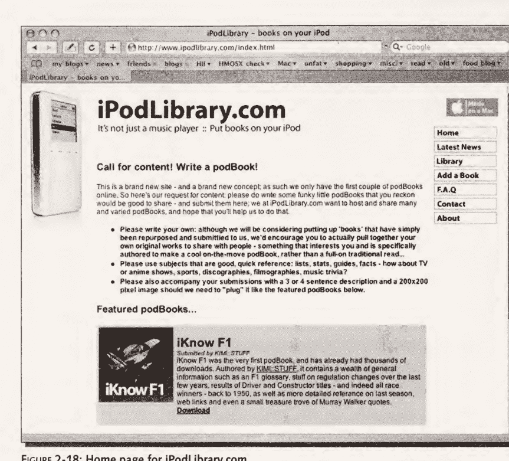

为了帮助启动这个图书馆，iPodLibrary.com 已经提供了几个 podBook 供下载：

- *iKnow F1*。这本书提供了关于一级方程式赛车的所有类型信息，包括历史规则变更、获胜者和其他头衔持有者名单，甚至还有一个一级方程式术语表。
- *Apple_Bytes*。如果你是 Apple 历史和趣闻的粉丝，你会很喜欢这本书。它提供了大量关于 Apple 的信息，无论是否有用，包括代码名称列表、产品时间线，甚至关于 Dogcow 的传奇故事。

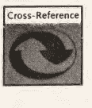

**交叉参考** 关于 iPod 上优秀文档的另一个示例，请参见第 4 章的*阅读美国宪法*部分。

## 本章小结

本章探讨了你的 iPod 能够做的、与播放音乐关系不大的事情。你了解了一些 Apple 认可的配件，以及一些使用免费且便宜的软件增强 iPod 功能的好方法。

在下一章中，你将有机会通过查看使用 iPod 硬件和配件的更多深奥方式来扩展你的 iPod 世界观。在第 3 章中，你将稍微偏离主流，这将充满乐趣。

# 超越音乐：硬件


R ight after Apple introduced the iPod in late 2001, enterprising companies started producing iPod accessories. As the iPod's popularity grew, more cool gear started showing up—everything from cases to power adapters to car stuff. In time, some of the iPod's internal secrets spilled out as well, discovered by iPod owners who were inspired to keep pushing buttons until they found something.

就在 Apple 于 2001 年底推出 iPod 后不久，一些富有进取心的公司开始生产 iPod 配件。随着 iPod 的人气增长，更多酷炫的设备开始出现——从保护壳到电源适配器再到车载配件应有尽有。随着时间的推移，一些 iPod 的内部秘密也渐渐暴露出来，这些秘密是被那些受启发不断按键直到发现新功能的 iPod 所有者发现的。

本章致力于介绍你可以获取的用于增强 iPod 的酷炫硬件，以及每个 iPod 内部都有的奇妙功能，例如半文档化的按键组合和诊断模式。我们还将讨论如何为电池无法再充电的 iPod 注入新生命。

## 查看内置秘密

iPod 对其秘密非常吝啬，正如我前面几章所讨论的那样。在本节中，你将探索有关内置于你的 iPod 中的怪异功能所知的信息。

### 使用按键组合

有一小部分 iPod 用户对他们的音乐播放器非常执着——也许你也是其中之一。每当 Apple 发布新款 iPod 模型时，这些人就会开始以各种组合按按键，希望找到酷炫的隐藏功能。这有点像阅读茶叶渣或从古代遗迹中寻找意义。以下是通过在你的原始型号或 3G 型 iPod 上使用各种按键可以获得的其他功能：

- *关机*—*按住播放键直到 iPod 关闭*。这实际上只是关闭显示屏并使 iPod 进入睡眠状态，而不是完全关闭播放器电源。

## 本章内容

- 使用按键组合
- 运行 iPod 诊断
- 聆听 iPod 扬声器发出的声音
- 查看数字电池显示
- 为你的 iPod 获取无线遥控器
- 在汽车中聆听你的 iPod

## iPod mini

- **关机**——长按播放键（*与普通 iPod 相同*）。
- **重置**——同时按住选择键和菜单键，直到看到 Apple 标志。
- **启用诊断模式**——重置 iPod。当看到 Apple 标志时，按住选择键和返回键。当 Apple 标志消失后，松开按键即可看到著名的反向 Apple 标志，并进入诊断模式。

iPod mini 的部分按键操作与普通型号略有不同，但功能结果是一致的。以下是 mini 型号上使用的按键：

**重置**——同时按住播放键和菜单键，直到看到 Apple 标志。这在重启似乎卡住的 iPod 时非常有用。

**启用磁盘模式**——重置 iPod。当看到 Apple 标志时，同时按住上一曲键和下一曲键，直到看到“可以断开连接”的屏幕。若要退出磁盘模式，请重置 iPod。

**执行磁盘扫描**——重置 iPod。当看到 Apple 标志时，同时按住菜单、下一曲、上一曲和选择键（*哇塞*）。这指示您的 iPod 扫描其硬盘的不良区域。您将看到一个放大镜图案在磁盘上移动，底部有一个进度条。扫描可能需要很长时间，尤其是对于较大的硬盘。如果您的 iPod 扫描失败，屏幕上会显示额外信息，您可能应该让您的 iPod 接受维修服务。

**进入诊断模式**——重置 iPod。当看到 Apple 标志时，按住下一曲、上一曲和选择键。当 Apple 标志消失后，松开按键。您将看到最酷的东西：一个反向的 Apple 标志，仿佛您正身处 iPod 内部向外看。如果是 3G 型号，您会听到 iPod 发出轻微的尖叫声，就像有人捏它一样。诊断模式包含工程师、技术人员和工厂人员用于测试 iPod 的工具。您可以在此章节的“运行 iPod 诊断”部分中找到更多相关信息。

### 运行 iPod 诊断

进入诊断模式后，您会看到一个丑陋、不像 iPod 风格的屏幕，上面列有八项诊断测试。每项测试都用字母 A 到 H 标记。您可能会预期使用转盘来选择测试，但它不起作用。相反，请使用下一曲键和上一曲键在列表中上下移动。按下选择键运行高亮的测试。当测试正在运行时，按下播放键返回菜单。如果您向下滚动超过测试 H（或向上滚动超过测试 A），您将看到第二屏幕，其中包含项目 I 到 P。

在 mini 型号上，没有可以启用磁盘模式或磁盘扫描的按键组合，但您可以通过诊断模式中的菜单访问这些功能。

表 3-1 iPod 诊断

| 测试字母及名称 | 描述 |
| :--- | :--- |


### A. 5 IN 1
这依次运行多项测试：`LCM`、`RTC`、`SDRAM`、`FLASH/CHECKSUM` 和 `FIREWIRE/FW ID`。请参阅下文了解它们的作用。注意，您需要按两次播放键才能通过 `LCM`。但真正酷的东西是在测试完成后。在 3G iPod 上，您可以按键让内置扬声器发出声音。按下一曲键可听到转盘的咔哒声，菜单键和选择键可听到两种不同的长哔声，下一曲键则可产生一种听起来有点像《星球大战》激光炮的效果。您可以拿着 iPod 四处走动，按键并盯着屏幕，仿佛在做某种严肃的事情，这会非常有趣。咔哒声可以作为一个很棒的假辐射探测器。按下播放键返回诊断菜单。

### B. RESET
这会重置 iPod，就像同时按下菜单键和播放键一样，但对手指稍微友好一点。

### C. KEY
这个测试实际上有点像视频游戏。您需要在约 5 秒内按下 iPod 上的所有五个按键。每按下一个，其名称就会显示在屏幕上。如果您在时间内按完所有按键，您会看到 `KEY PASS`。如果您太慢了，您会因 `KEY FAIL` 而羞愧。

### D. AUDIO
在 3G iPod 上运行此测试时，如果您连接了外部扬声器，会听到类似《吃豆人》的鼓噪声。在较旧的 iPod 上，屏幕将显示 `AUDIO 0X00000001 DONE`。

### E. REMOTE
这项测试 iPod 遥控器。这是另一个游戏：您有几秒钟的时间按下遥控器上的所有按键。每按下一个按键，屏幕上会出现一个矩形，其位置对应您按下的按键位置。如果您没有在时间内按完所有按键，或者没有连接遥控器，您将看到 `RMT FAIL`。

### F. FIREWIRE/FW ID
此测试检查 iPod 的 FireWire 端口，确保其工作正常。如果正常，您会看到令人安心的 `FW PASS` 消息。

### G. SLEEP
运行此测试时，您的 iPod 会进入睡眠状态。当您试图唤醒它时，您可能会看到低电量图标，并且 iPod 可能会拒绝恢复活动。如果发生这种情况，请尝试重置 iPod 或将其连接到电源。这应该会使其惊醒。

### H. A2D
此项检查 iPod 的模数转换部件。测试列出了有时晦涩难懂的部件名称和结果，具体因 iPod 型号而异。

### I. OPTO CNT
运行此测试以玩转盘。`OPTO` 是工程术语，指代转盘——原本应该是 `opto`，但拼写错误很有魅力，所以为什么要现在修正呢？当您运行此测试时，转动转盘，您会看到 iPod 通过改变屏幕上的大型十六进制数来做出反应。

### J. LCM
这测试 iPod 的显示屏。`LCM` 可能代表 `液晶显示器`。运行测试后，按选择键可看到屏幕上的渐变图案。再次按选择键可以看到一个巨大的加号。这个加号指的是 iPod 对苹果利润所产生的积极影响。

### K. RTC/CHG STUS
在较旧的 iPod 上，`RTC` 测试与 iPod 的实时时钟相关的某些内容，该时钟知晓一天中的时间。数值有时会有少许变化，但始终很小。这与本章中 `可怕的时间` 描述中的时钟 `漂移` 有关吗？我不知道。这是那些 iPod 谜团之一。在 3G iPod 上，此测试被 `CHG STUS` 充电状态取代。`CHG STUS` 显示指示是否通过 `USB`、`FireWire` 或耳机端口连接了设备的值。它还似乎显示是否有可用的充电电力。

### L. SDRAM/USB DISK
`SDRAM` 测试 iPod 的同步动态随机存取存储器。这是对抗跳音保护并延长电池寿命的神奇成分：音乐预加载到 `RAM` 中，磁盘驱动器随之降速。`USB DISK` 测试未知内容，并将 iPod 重启至磁盘模式。

### M. FLASH/CHK SUM
`FLASH` 测试在 3G iPod 上称为 `CHK SUM` 校验和，用于检查 iPod 的闪存 `ROM`。测试结束时显示一个十六进制数，可能是用于验证 `ROM` 的校验和。

### N. OPTO/CONTRAST
在较旧的 iPod 上，`OPTO` 测试似乎根本不起任何作用。`CONTRAST` 允许您使用转盘微调屏幕对比度，但您所做的任何更改在退出诊断模式后都会消失。

### O. HDD SCAN
此项运行硬盘测试，没有磁盘扫描时获得的那种酷动画，如 *使用按键组合* 部分所述。扫描磁盘需要好几分钟。扫描完成后，您会看到 `HDD PASS` 或 `HDD FAIL`。`HDD` 意为 `硬盘驱动器`。`FAIL` 意为 `去修好吧`。

### P. RUN IN
最后这项测试循环运行一系列测试，直到您按住 *播放* 键为止。它似乎设计用于确保 iPod 在制造或维修后准备就绪。

## 聆听 iPod 扬声器发出的声音

拿起您的 iPod 仔细看看。看到扬声器了吗？不，当然您看不到。扬声器隐藏得很好，显然靠近 FireWire 或底座连接器，因为声音似乎就是从那里发出的。iPod 不通过其内部扬声器播放音乐。它仅限于在通常职责中需要发出的咔哒声、爆裂声和其他小工具类噪音。即使您连接了耳机或外部扬声器，这些声音也是从内部扬声器发出的。纯属娱乐，以下是您将从 iPod 扬声器听到的标准声音列表：

- *咔哒声*——当您移动转盘时，您会听到咔哒声。您可以通过转到 设置 \| 点击音 来关闭此功能。
- *更多咔哒声*——按下按键也会产生来自内置扬声器的咔哒声。如果您已关闭 设置 \| 点击音，这也不会发出声音。
- *嗡嗡声*——当您将 3G iPod 或 mini 插入底座时，您肯定注意到了指示其已连接的电子嗡嗡声。
- *哔哔声*——如果您开启了 iPod 的闹钟功能，且没有连接外部扬声器或耳机，不太可能戴着耳机睡觉，

## 令人胆战心惊的时刻

每个 iPod 都有一个时钟来显示时间。但没有任何一个 iPod 能保持完美的精准时间：每个 iPod 的时钟电路运行速度都会偏差几毫秒，要么稍快，要么稍慢。这听起来很糟糕，但好消息是，虽然这些时钟并不完美精准，却具有完美的可预测性：它们每天快或慢的幅度都相同。

iPod 使用了一种巧妙的机制来防止这种误差累积。每个 iPod 在生产时都会经过测量，以确定其时钟运行快慢的数值。该数值存储在 iPod 的 `ROM` 中。每天开始时，iPod 会使用这个存储的值来调整时钟并修正误差。如果 iPod 处于休眠状态，它会非常安静地唤醒，不会在屏幕上显示任何内容，也不会发出任何声音，修正时钟后便又静静地回到休眠状态。嘘。

当苹果最初为 iPod 添加闹钟功能时，公司开始收到听起来像鬼故事的 bug 报告。在午夜时分，iPod 的屏幕会无缘无故突然亮起，片刻后又熄灭。结果发现，苹果的时钟校正代码忘记检查用户是否开启了 iPod 的背光定时器。如果背光没有设置为 `关`，当修正时钟时背光就会亮起。只有灯亮了——屏幕上没有显示任何内容，这让 iPod 看起来像是闹鬼了一样。有一位用户报告说，被他的 `僵尸` iPod 发出的灯光吵醒了。等他四处张望时，灯已经灭了，这让他感到不安，甚至可能开始怀疑自己的理智。

苹果在下一个版本的 `iPod Updater` 中修复了这个 bug，之后就没有再收到关于鬼故事的报告了。

## 使用微型外部扬声器

只需 10 美元，Higoto 制造、由 Madisonline `www.madsonline.com` 销售的 `SimpleSpeaker` 绝对是个不错的选择。`SimpleSpeaker` 就是这么简单：将其插在你 iPod 的顶部，即可获得合理的外部声音。`SimpleSpeaker` 提供立体声效果，且无需电池即可运行。这在旅行时很有用，比如你想把 iPod 当作闹钟使用，或者只是想听音乐而不必使用耳塞或耳机。当把 `SimpleSpeaker` 插入 iPod 时，整个装置呈现出一种头重脚轻的米老鼠造型，如图 3-1 所示。但它不只是看个样子——`SimpleSpeaker` 是你 iPod 旅行装备中一个方便且便宜的补充品。

## 使用分线器共享你的 iPod

如果你和朋友或家人一起旅行，或者你有两个实际上喜欢相同音乐的孩子，你可以考虑购买一种特殊的插头，让你能将 iPod 的耳机插孔连接到多副耳机或耳塞。这些设备被称为分线器或 Y 型连接器。`XtremeMac` 生产的一款产品叫 `iShare Earbud Splitter`，有 iPod 白色款式。`iShare` 做工精良，采用金色连接器以确保良好的音质。更多信息请访问 `www.xtrememac.com`。`iShare` 售价约为 13 美元。

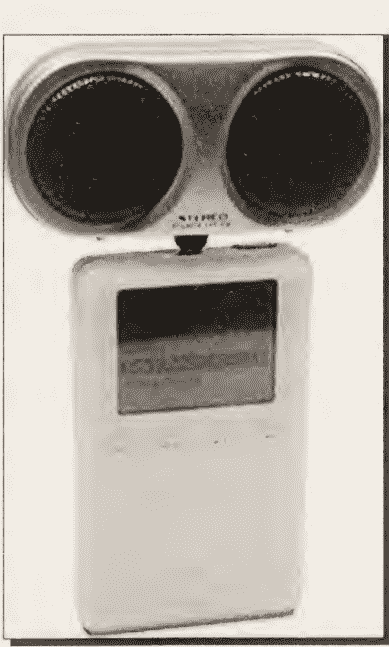

图 3-1：连接到 iPod 的 `SimpleSpeaker`。

由 Apple 提供。

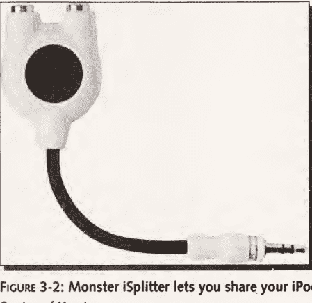

图 3-2：`Monster iSplitter` 让你可以共享 iPod。

由 Monster 提供。

`Monster` 生产类似的产品，名为 `iSplitter`，价格大致相同。苹果在其零售店和在线商店中销售 `Monster iSplitter`。图 3-2 展示了它的外观。


如果你愿意在款式和品牌上做出妥协，你可以从当地的电子产品商店购买无名品牌的分线器来省钱。你应该能在 Radio Shack 或 Fry's 以大约 6 美元的价格找到一个，但肯定不会是 iPod 白色的。

如果超过两个人想听，你可以将一系列分线器串联起来，将一个插到另一个上。如果你不断分割信号，最终信号质量会下降，你可能再也听不清了，但 iPod 输出音量充足，所以你应该能够成功地供应给至少三到四个听众。

你的分线器还有其他用途。例如，你和朋友可以在飞机上共享笔记本电脑或便携式 DVD 播放器的音频输出，或者两个人可以连接便携式视频游戏的音频。


> **交叉引用**
>
> 共享 iPod 或其他音频输出的更高级方法是使用无线耳机。
>
> 请参阅第 7 章，“广播你的 iTunes”。

## 查看数字电池显示

第三代 iPod 和 iPod mini 包含一个很酷的 hack，它几乎毫无用处——这正是它的乐趣所在！这个 hack 将你的 iPod 上的电池显示从熟悉的倾斜电池图标改为数字视图。工作原理如下：iPod 会在其磁盘的特定位置查找一个名为 `_show_voltage` 的文件。如果该文件存在，iPod 就会使用数字电池计。

此 hack 仅适用于 iPod 使用电池供电时。当它连接到电源电缆时，图标电池计将重新出现。

要启用此 hack，你只需在 iPod 的 `iPod_Control/Device` 目录中创建该魔术文件（其内容无关紧要）即可。困难之处在于 `iPod_Control` 在 Finder 和 Windows 资源管理器中是隐藏的。我将描述如何在 Mac OS X 和 Windows 上实现这一点。

### Mac OS X

在 Mac OS X 上执行此 hack 有几种不同的方法。第一种需要第三方实用程序，但很简单。第二种仅使用标准软件，但稍微复杂一些。

#### 使用 Finder 和实用程序程序

进行此 hack 最简单的方法是使用像 TinkerTool 这样的程序（可在 `www.bresink.com/osx/TinkerTool.html` 获取，并在下一章中详细介绍），它可以让你看到 iPod 上的所有文件。方法如下：

- 确保你的 iPod 已连接到 Mac。
- 在 TinkerTool 中，点击 **Finder** 选项卡，并勾选 **“显示隐藏文件和系统文件”**。
- 点击 **“重新启动 Finder”**。
- 在 Finder 中，选择 **前往 → 电脑** 以查看你的 iPod 和其他卷。
- 仍在 Finder 中，打开你的 iPod，然后是 `iPod_Control` 文件夹，再是 `Device` 文件夹（见图 3-3）。
- 点击 **SysInfo** 文件，选择 **文件 → 制作复本**。
- 点击一次 **SysInfo 复本** 文件以选中它。等待一秒左右。然后点击其名称一次以重命名。
- 将 **SysInfo 复本** 的名称改为 `_show_voltage`。注意“show”前有一个下划线，“voltage”前也有一个下划线。

如果你在点击两次 **SysInfo 复本** 时太快，Finder 会在 TextEdit 中打开该文件。如果发生这种情况，请冷静地返回 Finder，重复第 6 步，在点击之间等待一秒。

这之所以有效，是因为 iPod 只关心是否存在一个名为 `_show_voltage` 的文件——其内容永远不会被检查。你如何创建文件或其中包含什么内容都无关紧要。**SysInfo** 只是一个方便复制的小文件。

当你断开 iPod 的连接时，电池计将被表示电池电量的数字取代，最大值约为 500。真不错！

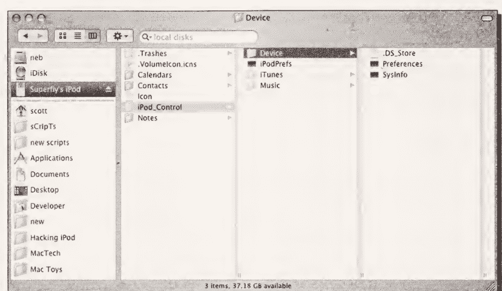

图 3-3：在 Finder 中显示的 Device 文件夹内容。

#### 使用终端

只要你不介意使用终端稍微深入命令行一点，你就可以不用 TinkerTool 或其他任何第三方软件来完成这个 hack。

> **注意**
>
> 终端为你的 Macintosh 提供命令行界面。如果你犯了错误或开始玩“我想知道如果我这样做会发生什么”的游戏，可能会发生各种糟糕的后果，包括删除文件和破坏系统。如果你不习惯捣鼓这些东西，请务必极度谨慎。

- 1. 确保你的 iPod 已连接到你的 Mac。
- 2. 在 Finder 中，选择 前往 → 电脑。
- 你应该看到一个窗口，其中包含连接到你的 Mac 的硬盘，包括你的 iPod（图 3-4）。
- 3. 运行终端。如果你从未使用过终端，你可以在应用程序文件夹内的实用工具文件夹中找到它。
- 4. 在终端中，输入单词 `touch`，后面跟一个空格。不要按 *Return* 键。
- 5. 在包含你 iPod 的 Finder 窗口中，将 iPod 图标拖到终端窗口并在那里释放（图 3-5）。

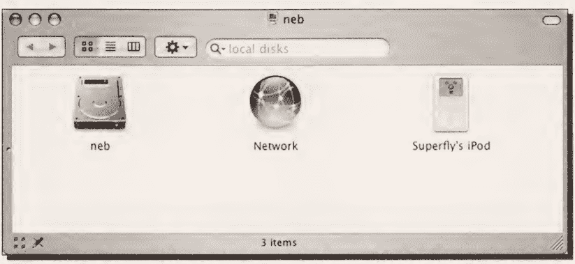

图 3-4：显示 iPod 和其他卷宗的“访达”窗口。

##### 正确获取 iPod 名称

将 iPod 拖入“终端”窗口并释放，即可自动复制该 iPod 的路径名。这是一种比直接输入 iPod 名称更便捷的快捷方式，同时也能确保名称符合“终端”所需的正确格式。如果你的 iPod 名称包含某些非字母数字字符（如空格和撇号），这一点尤为重要。为了让“终端”正确识别这些字符，必须在它们前面加上反斜杠。否则，“终端”或 shell 命令可能会将它们视为具有特殊含义的字符。例如，如果 iPod 的名称是“Superfly’s iPod”，将其拖放到“终端”中会添加以下文本：

`/Volumes/Superfly\’s iPod`

每个反斜杠都向 shell 表明，紧随其后的字符仅仅是名称的一部分，并不具有特殊含义。

- 1. 在“终端”窗口中单击一次，然后按一次 Delete 键以删除 iPod 名称后的空白，但此时不要按 Return 键。
- 2. 仍留在“终端”中，输入以下文本：`iPod_Control/Device/_show_voltage`。（别忘了开头的斜杠和三个下划线。）此时，“终端”中的完整命令行如下：

```
[neb:~] scott% touch /Volumes/Superfly\’s iPod/iPod_Control/Device/_show_voltage
```

（你看到的将是你的磁盘名、用户名和 iPod 名称，而不是“neb”、“scott”和“Superfly’s iPod”。）

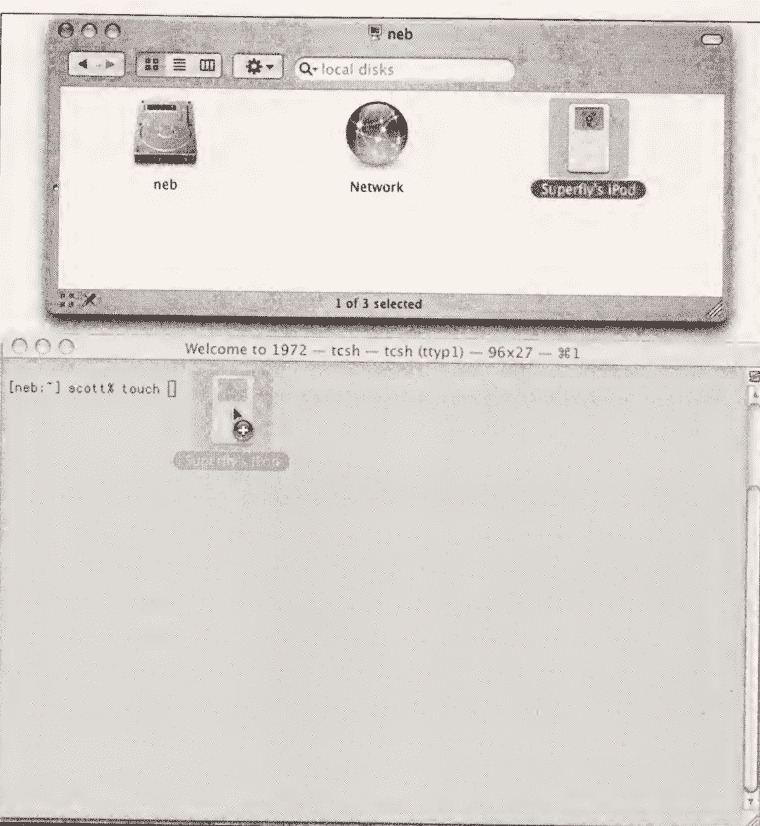

图 3-5：将 iPod 拖入“终端”窗口并释放。

- 3. 确保你的命令行看起来与第 7 步中的示例一致（除了使用你的磁盘、用户和 iPod 名称外），最后，你可以按 Return 键。
- `touch` 命令会在你的 iPod 上创建一个具有该特殊名称的空文件。
- 这就够了，电压数值将会显示出来。当你下次将 iPod 从 Mac 断开连接时，你就能看到它。

### Windows XP

Windows XP 具有显示隐藏文件的功能。一旦你开启此功能，就可以添加这个特殊文件：

- 1. 确保你的 iPod 已连接到你的计算机。
- 2. 单击“开始”。在“开始”菜单中，单击“我的电脑”。
- 3. 在“我的电脑”窗口中找到你的 iPod 并双击打开它。
- 4. 查看打开的窗口。如果你看到一个名为 `iPod_Control` 的文件夹，请继续下一步。如果你没看到 `iPod_Control`，请继续执行下一步。
- 5. 选择“工具 → 文件夹选项”。
- 6. 单击“查看”选项卡。
- 7. 找到“隐藏文件和文件夹”设置。它位于窗口的底部附近。单击“显示隐藏的文件和文件夹”。单击“确定”。此时，`iPod_Control` 文件夹虽然半透明（ghostly），但可见了。
- 8. 双击 `iPod_Control` 文件夹。
- 9. 双击 `Device` 文件夹。
- 10. 单击 `SysInfo` 文件，然后选择“编辑 → 复制”。
- 11. 选择“编辑 → 粘贴”。
- 12. 右键单击“SysInfo 的副本”，选择“重命名”。
- 13. 将“SysInfo 的副本”的名称更改为 `_show_voltage`。请注意，“show”之前有一个下划线，“voltage”之前也有一个下划线。

这样有效是因为 iPod 只关心是否存在名为 `_show_voltage` 的文件——它的内容永远不会被检查。无论你怎么创建该文件或里面是什么都无关紧要。`SysInfo` 只是一个很小且方便用于复制的文件。

当你断开 iPod 连接时，电池电量计将被一个指示电池充电量的数字所取代，最大值约为 500。

### 恢复电池图标


一旦你厌倦了数字指示器，你可以通过删除（甚至重命名）该特殊文件来恢复电池图像。在 Mac 上，如果你安装了 TinkerTool 或类似的工具，可以在“访达”中完成此操作。如果你没有可以在“访达”中看到不可见文件的实用工具，可以使用“终端”来删除该文件。在 Windows 上，只需确保已启用“显示隐藏文件和文件夹”，然后删除 `_show_voltage` 文件即可。

### 为你的 iPod 配备无线遥控器

来自 TEN Technology 的 NaviPod 让你可以无线访问你的 iPod。当你将 iPod 连接到房间另一侧的音响系统时，这非常理想：你甚至不需要从沙发或椅子上起身就可以控制你的音乐。将红外接收器插入你的 iPod，然后使用 NaviPod 时尚圆形遥控器来播放、暂停、调节音量或切换歌曲。

NaviPod 附带一个酷炫的极简风格镀铬支架，你可以用它来支撑你的 iPod，使其能更好地接收遥控器指令。无论你是否使用遥控器，这个支架都是你 iPod 配件中一个实用的补充。如果你没有 NaviPod，可以在 www.tentechology.com 以约 10 美元的价格购买一个支架。该公司也会以 10 美元的价格出售额外的（或替换的）遥控器。

NaviPod 有两种型号，一种适用于较旧的 iPod，另一种适用于 3G iPod。NaviPod 售价约为 50 美元，你可以在 Apple 的零售店和网上商店购买。

### 为你的 iPod 配上一个保护套

iPod 以其时尚和实用著称，但并非以其坚固耐用闻名。iPod 光亮的镀铬背面看起来永远无法回到刚开箱时那样——难以避免指纹和划痕。此外，iPod 经常被频繁操作，许多 iPod 还会在户外使用相当长的时间。而且，由于内部含有硬盘，iPod 从未被设计为能承受跌落或剧烈摇晃。

Apple 提供携带包和腰带夹，以帮助保持你的 iPod 处于良好状态。某些型号包含此包，其他型号则以 40 美元的价格作为选项提供。这是一个不错的保护套，但看起来有点商务化，作为 iPod 拥有者，你可能希望有更多选择。幸运的是，独立厂商已介入，提供了大量供你选择的 iPod 保护套。在本节中，我们将讨论一些可用且最有趣的保护套。你可以通过查看任何 Macintosh 杂志的附录部分，或访问你所在地区的 Apple 实体店或网络上的 Apple 商店找到更多。

#### SportSuit 可转换保护套

来自 Marware 的 SportSuit Convertible 结实且时尚，价格与 Apple 的（40 美元）大致相同。你可以拆除这个两件式保护套的盖子，使其更便于携带。它便于访问所有控件，填充式盖子包含一个隔层，可存放你的耳塞、纸片或小型宠物。该保护套配有臂带和腰带夹。你还可以购买其他配件，包括自行车支架和挂绳。SportSuit Convertible 提供六种精美颜色。如需更多信息，请访问 www.marware.com 或到 Apple 商店查看。

#### Groove Purse Triplet

来自 felicidade 的 Groove Purse Triplet（图 3-6）可能是世界上最酷的一款 iPod 保护套。它是一个白色合成皮革手袋，当你将 iPod 滑入其中时，它会变成一个扩音器。Groove Purse 内置扬声器，帮助你向周围的人展示你的音乐品味。你可以在 www.drbott.com 的 Dr. Bott 处以约 145 美元的价格购买 Groove Purse Triplet。

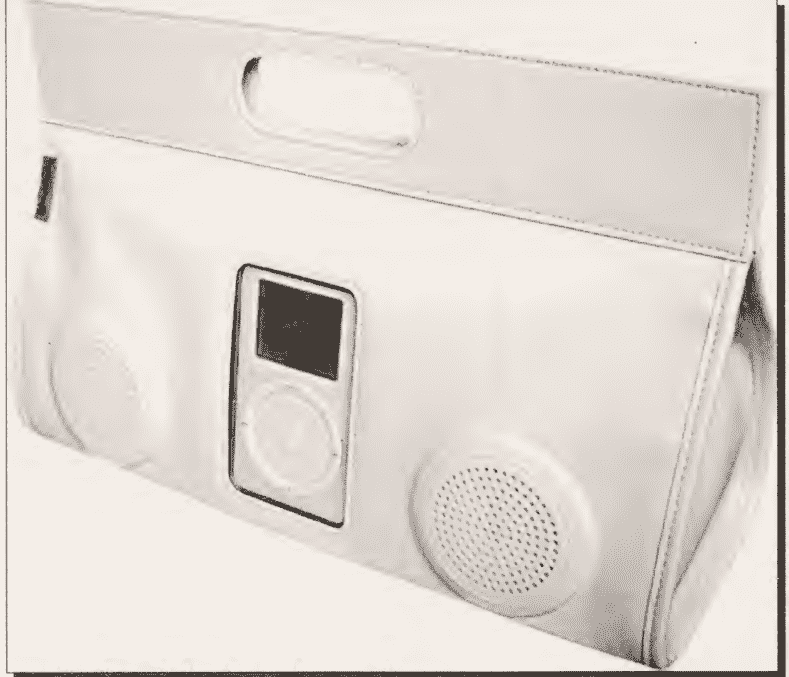

图 3-6：Groove Purse Triplet 让你的 iPod 成为一款时尚的便携式音响。

版权所有 felicidadate。

#### Vaja 皮革保护套

Vaja Leather Products 为所有 iPod 制作精美的皮革保护套。这些半硬质保护套有多种型号，提供 20 种不同颜色。你甚至可以在保护套背面激光雕刻你的名字。Vaja 保护套价格约从 50 美元开始，具体取决于型号。你可以访问 www.vajacasess.com 了解更多详情。

#### Icewear for iPod mini

Icewear 是首批专为 iPod mini 时尚外形（图 3-7）设计的外壳之一。Icewear 使用与潜水镜相同的材料，在保护 mini 的同时，仍让 Apple 酷炫的设计得以展现。Icewear 外壳保持所有连接口可访问，因此你无需取出 iPod 即可充分利用其功能。外壳背面包含用于穿过腰带的插槽。与许多其他 iPod 外壳不同，Icewear 不遮盖屏幕，因此可读性不会降低。截稿时，Icewear 外壳尚未发售，且未定价。如需更多信息，请访问 www.tunewear.com/english/product/index.html。

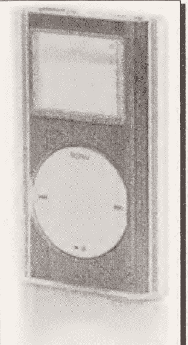

图 3-7：来自 Tunewear 的 iPod mini Icewear 外壳。版权所有 Tunewear。

### 在车内聆听你的 iPod

iPod 和汽车就像苹果和馅饼一样天作之合。你可以找到大量设备来帮助将你的 iPod 变成一条路上美妙的音源。在本节中，我们将介绍一些在车、卡车、房车或驿站马车中播放 iPod 音乐的方法。

### 连接到你的汽车音响

当你想在车里使用 iPod 时，需要解决的基本问题是如何将音乐从 iPod 传输到你的汽车音响。如果你有一台允许连接...

来自CD播放机或类似设备的外部输入，您只需将一根线缆从iPod的耳机插孔连接到立体声音响的外部输入端即可。这种连接方式简单，且能为您的立体声音响提供良好、可靠的连接。

如果您的立体声音响没有外部输入端口，您需要采用其他连接方式。如果您的立体声音响带有磁带播放器，可以考虑使用磁带适配器。该设备插入iPod的耳机插孔，并欺骗您的磁带播放器使其误以为里面有一条磁带。实际上并没有：取而代之的是一个塑料磁带外壳，它将iPod的声音通过立体声音响的扬声器传输出来。这种低科技解决方案效果相当不错，除了当假磁带的轮子在播放器中转动时，传输噪音可能会让您感到烦躁。您可以在苹果商店或任何电子产品或音响商店以20美元以下的价格购买此类产品。

最极客（hackiest）的解决方案是使用带有 `FM发射器` 的适配器。这些小装置利用低功率发射器，将您的音乐无线广播到您从多个选项中选择的一个未使用的 `FM` 频率上。通过将您的车载收音机调谐到相同的频率，您就创建了自己的个人iPod电台。由于发射器功率较低，广播范围仅几英尺，这使得它在汽车内部非常实用。 `FM` 适配器的一大缺点是，它们容易受到相同或邻近频率的其他无线电广播的干扰。以下是一些较酷 `FM` 适配器的信息：

- `Arkon SoundFeeder SF250` 是一款通用型 `FM` 发射器，它使用一对滑动开关来选择频率，并采用独特的蛋形设计（参见图 3-8）。当设备开启时，滑动开关会发出绿光。SoundFeeder 使用两节 AAA 电池，售价约为 30 美元。更多信息请访问 www.arkon.com/sf.html。

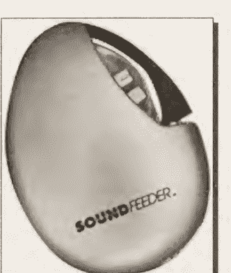

`图 3-8：` Arkon SoundFeeder `FM` 适配器。Courtesy of Arkon.

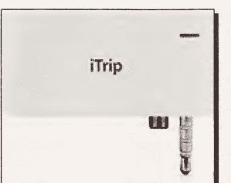

`图 3-9：` Griffin Technology 的 iTrip mini。

Courtesy of Griffin Technology.

- Griffin Technology 的 iTrip (www.griffintechnology.com) 的独特之处在于它利用 iPod 本身来改变频率。调谐指令实际上是一些小歌曲文件，您通过计算机将其加载到 iPod 中。当您想设置频率时，只需播放相应的歌曲文件：87.9、88.1、88.3 等等。这很酷，但除非您的音乐品味极其多样化，否则您不希望这些哔哔声通过您的车载立体声音响意外播放出来。iTrip 从 iPod 获取电力，因此无需担心电池问题。iTrip 在苹果商店的售价约为 35 美元。

- 2004年6月，Griffin 发布了 iTrip mini，这是一个专为安装在 iPod mini 顶部而设计的新版本。iTrip mini 执行与其“大哥”相同的基本功能，但它能整齐地卡入 iPod mini，如图 3-9 所示。iTrip mini 售价约为 39 美元，在苹果商店及制造商处均有售。

- irock 400FM 无线音乐适配器可以从汽车的12V直流插座（ formerly 被称为“点烟器”）或两节 AAA 电池获取电力。这款适配器售价约为 30 美元，您可以在 www.myirock.com 上查看。

- Belkin 生产 TuneCast 移动发射器系列产品。这些紧凑的适配器使用电池供电，并通过按钮选择频率。更多信息请访问 www.belkin.com。


- Monster 的 iCarPlay 无线播放器插入您的 iPod 底座连接器，并在您听音乐时为电池充电。此适配器插入12V插座。您可以在 www.monstercable.com 获取更多信息。iCarPlay 售价约为 70 美元。

- Digital Lifestyle Outfitters 的 TransPod 是一款 FM 适配器，它可以在播放音乐的同时为您的 iPod 充电，并附有一个很酷的安装支架（见图 3-10）。TransPod 可在 www.everythingipod.com 购买，售价约为 100 美元。

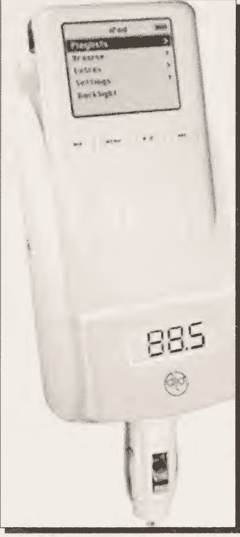

**图 3-10：** TransPod FM 适配器。  
Courtesy of Digital Lifestyle.

# 真正的“够得着”

像 iTrip 和 SoundFeeder 这样的 FM 适配器可以将您的 iPod 变成一个小型移动电台，在 FM 波段以低功率广播信号。2004年夏天，几位聪明的黑客决定看看如果稍微增强 FM 发射器的功率会发生什么。根据 www.engadget.com/entry/3597373383872462/ 上的 Engadget 网站报道，一些 FM 适配器内部卷绕有天线。通过打开外壳（这将使保修失效）并取出天线，您可以在一定程度上增加发射器的范围。

一旦您改进了发射器，就可以将 iPod 用作微型电台。Engadget 建议了几种半开玩笑的用途，包括向您摇滚风格的邻居广播沉默，在红灯前通过耳膜破坏性的汽车向旁边播放轻柔的海浪声，以及接管健身房里人们用于收听电视广播的无线接收器。

由于 FM 适配器在特定频率上广播，这个黑客玩法的棘手之处在于确定您的目标对象调谐在哪个频率上。因此，这种方法在您的朋友和家人身上尝试时效果最好。这也是避免可能导致诉讼和打架的好策略。

# 在车内为 iPod 供电

如果您打算带着 iPod 进行公路旅行，您将需要一个电源。前面列出的一些 FM 适配器（iCarPlay 和 TransPod）可以在您播放音乐时为 iPod 充电。除此之外，这里还介绍了几种可用的优质 iPod 充电器：

- Griffin Technology 的 PowerPod (`www.griffintechnology.com`) 很酷，因为它适用于所有世代的 iPod。Griffin 通过将 iPod 到充电器的线缆与插入12V插座的充电部分分开来实现这一技巧。PowerPod 售价约为 20 美元。
- SiK 生产 imp，这是一款30美元的充电器，带有可更换保险丝和线路级音频输出。请在 `www.sik.com` 查看详情。
- Dr. Bott 的 iPod 车载充电器售价25美元，附带 SendStation PocketDock，因此可以连接任何 iPod。此型号包含可更换保险丝。请访问 `www.drbott.com` 查看详细信息。

# 获取终极 iPod 车载套件

Dension USA 的 ICE-Link，曾在2004年1月的 Macworld Expo 上大受欢迎，允许您的 iPod 取代车载立体声音响中的CD changer（CD更换器）。当您选择 CD 作为输入源时，您的 iPod 就会播放。如果您拥有那种可以从方向盘选择音轨的酷炫控制装置，ICE-Link 可以让它与您的 iPod 配合工作。当您选择其他输入，如收音机时，iPod 会暂停。ICE-Link 包含安装硬件以及电源和音频线缆。

ICE-Link 根据各种车型进行定制，售价约为 200 美元。更多信息请访问 `icelink.densionusa.com`。

# 终极听觉机器

苹果肯定注意到许多人喜欢在他们车里听 iPod。为了迎合这些客户，苹果开始与汽车制造商合作，将 iPod 完全整合到车载立体声音响中。根据撰写本文时可获得的报道，苹果和宝马将推出一项名为“iPod Your BMW”的活动。一些宝马车主将可以选择获得一个安装在手套箱内的 iPod，控制装置位于方向盘上，仪表盘上配有数字显示屏。因此，如果您正在为新的 iPod 攒钱，您可能需要多存一点钱，以便同时也买一辆新的宝马。

# 更换 iPod 电池

iPod 电池设计可承受数千次的充放电循环。最终，您可能会遇到一块无法再保持充电的电池。但尽管电池是内置的，一切并非毫无希望。当电池失效时，您有四个选择：

- 如果在不一年内 iPod 电池就已经磨损殆尽，它仍在保修期内，苹果将免费维修或更换。完整的保修声明可在 `store.apple.com/Catalog/US/Images/` 
- iPodwarranty.html 获取。
- 如果您的 iPod 已过保修期，苹果将收取约100美元进行更换。您需要填写表格，将 iPod 寄送给苹果，然后会寄回一个新电池（很抱歉，型号与您寄入的相同）。请访问 `www.apple.com/support/ipod/service/battery.html` 开始此流程。
- 您可以购买约60美元或更便宜的替换电池并自行安装。iPod 替换电池可从多种渠道获取，包括 `www.ipodbattery` 
- .com、`www.pdasmart.com` 和 `smalldog.com`。
- 您的最后一个选择是在购买新 iPod 时回溯时间购买 AppleCare 保护计划。仅需59美元，AppleCare 将您的保修期从一年延长至两年。
- AppleCare 还覆盖随 iPod 附带的配件，如底座和遥控器，但如果您的狗吃了您的耳机，它可能帮不上忙。请在 `www.apple.com/support/products/applecareipod.html` 阅读有关 AppleCare 的详细信息。

# 电池更换手术

如果您的 iPod 需要新电池，您是否应该尝试自行更换？如果您使用的是较早型号的 iPod，即使您在拆解设备方面经验不多，您也应该没问题。我主要是个软件人员，因为我操作缓慢且小心，所以没有遇到困难。

如果你有一台 3G iPod，我的建议是不要拆开它，如果你希望它恢复正常工作。这些更新的、更薄的 iPod 组装得精密得多。当你把它拆开时，你很有可能会弄坏某个部件。无论如何，如果你不想只是为了修理一个没电的电池而对你这台珍贵的音乐播放器进行“手术”，请记住苹果会以 100 美元的价格更换 iPod。


> 苹果关于以 100 美元更换保修期外的 iPod 的提议具体说明，磨损的电池必须是 iPod 唯一的故障点。如果你尝试自己更换电池，并弄坏了 Hold 开关（或造成其他损坏），你将不再符合 100 美元维修的资格。而且，如果你的 iPod 还在保修期内，不用说，拆开会使其保修失效。

如果你决定继续自己动手更换电池，很好！以下是你需要遵循的步骤：

1. 打开 iPod 的最佳工具是一张薄的层压卡，比如驾照或录像店会员卡。找一张这样的卡。（你也可以使用一把非常小的平头螺丝刀，但如果你这样做，很容易刮花 iPod，或者，如果你像我一样，当螺丝刀打滑时，你很可能会在手上戳出一个小而痛苦的孔。）
2. 确保 iPod 已关闭。为了确保它保持关闭，打开 Hold 开关。
3. 一只手拿着 iPod，另一只手拿着塑料卡。
4. 你将把外壳的白色部分与银色部分分开。（第二代和第三代 iPod 更难打开，因为外壳包裹着连接器。）将卡的一角插入外壳两个部分之间在其中一个顶角处。将卡楔入，直到外壳稍微分开。
5. 保持卡片楔在外壳各部分之间，将卡片沿着 iPod 的侧面移动。外壳由塑料卡扣固定在一起，你必须一边移动一边撬开它们。
6. 当所有卡扣都分离后，拉开口外壳。停下来欣赏一下你的手艺。
7. 电池是用胶水粘在硬盘上的。一只手按住表格上的硬盘部分，用另一只手将电池拔下。你可能需要使用塑料卡或螺丝刀来帮助撬松电池。
8. 电池仍连接到电路板上。要将其断开，请轻轻（轻轻！）拉出连接它的线缆。
9. 插入你的新电池，注意使其方向与旧电池相同。
10. 将电池粘在硬盘上，就在旧电池的位置。确保第一次就正确对齐——正如你现在发现的那样，那种胶水非常粘。
11. 确保电池线缆塞好，并将外壳扣合在一起。

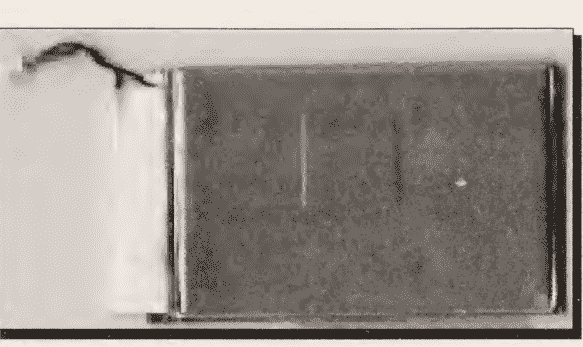

**图 3-11**：高容量 iPod 电池。

焦急地启动你的 iPod，以确保它仍能正常工作。注意：新电池通常需要充电，所以如果一开始没有外部电源无法开机，请不要惊慌。

## 高级电池信息

既然我们已经讨论了 iPod 电池知识的基础，这里有一些你可能想要尝试的额外技巧——如果你敢的话。

- 如果你有一台厚款（第三代之前）的 iPod，你可以尝试将两块电池串联接线。当然，这会使你的保修失效，但应该能起作用，并为你提供 iPod 两倍的电池寿命。


进入`/path/to/xxx`目录，找到`xxx.json`。

在表达式`cvar = avar + bvar`中，加法运算符（`+`）将`avar`与`bvar`相加，得到它们的和`cvar`

在`List.of(arg0, arg1, arg2)`中，`List`接口的工厂方法`of()`接受一系列的元素，返回包含它们的只读列表。

之后我们这样调用`cmd`命令：`cmd arg0 arg1 arg2`。

```
if (condVar > someVal) {console.log("xxx")}
```
[/content]

Wait need actual text. The above is example. Need process given text.

Let's output proper.

[content]
一些制造商为 iPod 提供高容量电池。例如，PDASmart.com 销售一种 2000mAh 的电池，该公司声称它比苹果电池的电量多 60%（见图 3-11）。你可以从 `www.pdasmart.com/products/API7ipodpartscenter.htm` 订购，价格约为 90 美元。

## 电池袭击事件

2003 年 11 月，Casey Neistat 的 iPod 电池在仅使用 18 个月后就不工作了。根据 Neistat 的说法，当他要求苹果修复时，苹果的回答是他应该买一个新的 iPod 作为替换。这让他非常愤怒，以至于他和他的兄弟 Van 制作了一部纪录片 *iPod’s Dirty Secret*（iPod 的肮脏秘密），来讲述这个故事。Neistat 兄弟们在网络上发布了他们的影片，各种疯狂的事情随之发生。许多 iPod 用户同意影片的前提，而其他人则为苹果辩护。Casey Neistat 在 *华盛顿邮报*（*Washington Post*）的一篇关于此主题的文章中接受引用：

> “前几天我们收到了近 1,000 封电子邮件，很多人都处于和我完全相同的位置，不得不买新的 iPod。我们收到邮件的百分之八十是积极的，人们说喜欢我们那种讽刺而不屑一顾的做法。但也有一些死硬的 Mac 粉丝对我们生气，他们恐慌，觉得我们可能会让某人不再购买 Macintosh。”

电影发布不到两周后，苹果宣布了关于 iPod 电池保修和更换的新政策：59 美元购买延保，99 美元更换新 iPod，如本节前面所述。电影的发布与苹果的新政策之间有联系吗？苹果说没有：新政策在电影发布前几个月就已经在制定了。

关于这一事件的更多信息，请见 `www.ipodhacks.com/article.php?sid=516`。如果你想观看电影本身，请查看 `www.ipodsdirtysecret.com`。

## 摘要

花几百美元给你的 iPod 配附件，使其在飞行、开车或慢跑时更有用，是一件容易的事。但你也可以通过摆弄内置诊断模式成为 iPod 探索者，这是一个每台 iPod 都免费自带的“功能”。诊断模式是一个完美的 iPod 黑客技巧——它并不是特别有用，但向你的朋友展示它是很酷的，尤其是当你的 iPod 开始发出那些电子游戏的声音时。

在下一章中，我们将继续探索你可以用 iPod 做的有趣、怪异且偶尔有用的技巧，这次重点放在软件附加上。虽然苹果并没有打算让 iPod 成为一个软件开发平台，但已经涌现出大量强大的程序集合，帮助你从你的 iPod 和电脑中获得更多价值。

# 超越音乐：软件

计算机被赋予了高期望值和惊人的灵活性。烤面包机是用来烤面包的，冰箱是用来保持食物冷的，但计算机是一种通用机器，可以执行令人难以置信的多样化任务。由于计算机设计者和工程师是有创造力的人，限制计算机或程序能做什么实际上让他们痛苦。但正是那些艺术性应用的限制，通过集中设计者和用户的注意力在产品目标上，定义了伟大的数字产品。

没有产品比 iPod 更能说明这种聚焦原则。从一般意义上说，iPod 不是音乐播放器：它是一台计算机。但当最初的 iPod 出现时，苹果选择将其应用限制在音乐方面。苹果刻意决定不将 iPod 变成外部软件开发者的平台。

但书呆子们很聪明，人们很快找到了将额外功能潜入 iPod 的方法。坚定的 iPod 爱好者们发现了如何将数据伪装成歌曲，很快名字和电话号码开始出现在 iPod 上，与音乐并排显示。苹果注意到了这种趋势，并开始向基本的 iPod 软件添加自己的功能。现在的每台 iPod 都原生具备存储联系人和日历的能力，而较新的 iPod（那些带有 dock 连接器的）允许你存储笔记。

自然，当人们掌握了这些附加功能后，他们在其上构建了更多的附加功能。使用联系人、日历和笔记功能，你可以找到软件，让你向 iPod 加载各种信息，包括电影列表、长文本文件、天气预报，甚至莎士比亚十四行诗。在本章中，我们将探索你可以如何教你的 iPod 这些新技巧。

我们将在本章中讨论的另一个巧妙调整是从 iPod 复制歌曲的能力。虽然 iTunes 阻止这种复制形式以作为对歌曲盗版的一种阻碍，但有很多正当理由将你的音乐从 iPod 移动出去，也有许多简单的方法可以做到这一点。

### 本章内容

- 查看和复制你的歌曲
- 在大文本文档上放在你的 iPod
- 阅读美国宪法
- 获取新闻、天气、电影列表等
- 将你的 iPod 与 Microsoft Outlook 同步
- 在 Macintosh 上使用 PocketMac
- 在你的 iPod 上运行 Linux

## 查看并复制您的歌曲

笑点在于，当微软投入数百万美元开发用于 Windows Media Audio 的数字版权管理（DRM）软件以限制用户对音乐的操作时，苹果只在每台 iPod 上花费了不到一美分的零头，用来贴一张写着“不要窃取音乐”的小贴纸。事实要复杂得多。苹果一直在两个非常重要的群体——顾客和音乐出版商——的权益与需求之间走钢丝。

当第一台 iPod 于 2001 年问世时，苹果内部有些人希望每次用户打开 iPod 时，屏幕上都显示“不要窃取音乐”的警告，但这一观点未能获胜。相反，苹果在 iPod 开发的后期决定采用一种被称为“蟑螂旅馆”的 DRM 策略，得名于一种除虫产品及其口号“蟑螂入住，但无法退房”。对于 iPod 而言，这意味着歌曲可以进入，但不能出来。正如你所知，iTunes 只提供了一种将歌曲从电脑复制到 iPod 的方式——它不支持反向移动。

如果你打开“访达”（Finder）或 Windows 资源管理器查看你的 iPod，你不会在任何地方看到你的歌曲。这是因为苹果采取了简单的措施将其隐藏。这更像是一种社会性的复制保护系统，而非技术性的。但它们的隐藏方式是个公开的秘密，很容易绕过。每本关于 iPod 的书和网站都会解释如何查看隐藏的歌曲，我也会这么做——我会比大多数人更极客一点，符合本书的黑客精神。

iTunes 音乐商店为这个故事增添了一个转折。当你从商店购买歌曲时，它们被包裹在一种真正的 DRM 方案中，称为 FairPlay，这限制了你对其的操作。本节的黑客技巧只是让歌曲变得可见，并允许你移动它们。这里没有任何方法能帮你绕过 FairPlay。如果你将一首从 iPod 上复制的商店购买歌曲传送到一台未被授权播放该歌曲的电脑上，它仍然无法播放。

## 善与恶

我不会在这里长篇大论地讲法律或道德——我只是个极客，在这两个领域都不是专家——但从 iPod 复制音乐到电脑确实有很多正当用途。例如，假设你将 CD 抓轨到 iTunes，然后复制到 iPod，随后你的硬盘坏了。你购买的音乐仍保留在 iPod 上，将其复制回电脑中原来的位置会非常方便。另一方面，将朋友 iPod 上的商业付费音乐复制到你的电脑上，这不仅很没品位，而且是违法的。所以，遵循那张小贴纸上的建议是个好主意：不要窃取音乐。

苹果温和的防复制方案包含三个要素：

- 在 iTunes 中，如果你尝试从 iPod 将音轨拖到资料库或电脑上的播放列表中，你将无法将其放置在那里——它只会弹回原来的位置。苹果将这一限制内置于 iTunes 中，以防止轻松复制。没有办法绕过它。
- 在“访达”或 Windows 资源管理器中，你的 iPod 显示为一个硬盘，但歌曲无处可寻。这是因为苹果利用操作系统功能将文件隐藏起来。除此之外，它们是普通的、可复制的文件。
- 音乐文件被安排在没有明显组织规则的文件中。这使得利用歌手或专辑名等线索找到你想要的特定歌曲变得更加困难。

让我们讨论几种不同的方法来查看和摆弄你的 iPod 文件。技巧和工具取决于你正在使用哪个操作系统。

### Mac OS X

只要你使用的是 Mac OS X 10.2 或更高版本，仅使用“访达”就可以找到并复制 iPod 上的任何歌曲。方法如下：

1. 在“访达”中，选择“前往” ⇥ “前往文件夹”。
2. 在出现的对话框中，输入 `/Volumes/iPod名称/iPod. Control/Music`。将“iPod名称”替换为你 iPod 的实际名称。点击“前往”。“访达”中应显示你 iPod 的音乐文件夹，但其内容不可见。
3. 选择“文件” ⇥ “查找”。点击“搜索范围：”下拉菜单，选择“特定位置”。
4. 从“访达”窗口将 iPod 音乐文件夹拖到查找窗口顶部的列表中。你应该会看到 iPod Music 文件夹被添加为另一个搜索位置。确保 Music 文件夹是唯一的选中项。
5. 点击“搜索符合以下条件的项：”区域中的第一个下拉菜单，选择“可见性”。点击第二个下拉菜单，选择“可见和不可见项”。
6. 点击右侧的加号以添加另一个搜索标准。从两个下拉菜单中选择“名称”和“包含”。在右侧的文本框中输入歌曲文件名的一部分或全部。


请注意，你正在搜索的是文件名，它可能与歌曲名称不同。最好的选择是搜索歌曲标题前半部分的词，因为抓 CD 时文件名往往会被截断。因此，例如，如果你正在寻找歌曲“Dead Leaves and the Dirty Ground”，请搜索“Dead Leaves”，而不是“Dirty Ground”。你会弄明白的——你很聪明。

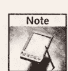

如果你使用的是 Mac OS X 10.2，选择搜索标准的方式略有不同。使用“添加标准”下拉菜单，确保你最终有两个标准：一个是设置为“全部”的“可见性”，另一个是“file_name”和“包含”。

7. 在查找窗口中点击“搜索”。你会得到一个搜索结果窗口，显示你正在寻找的歌曲。参见图 4-1 了解其外观示例。

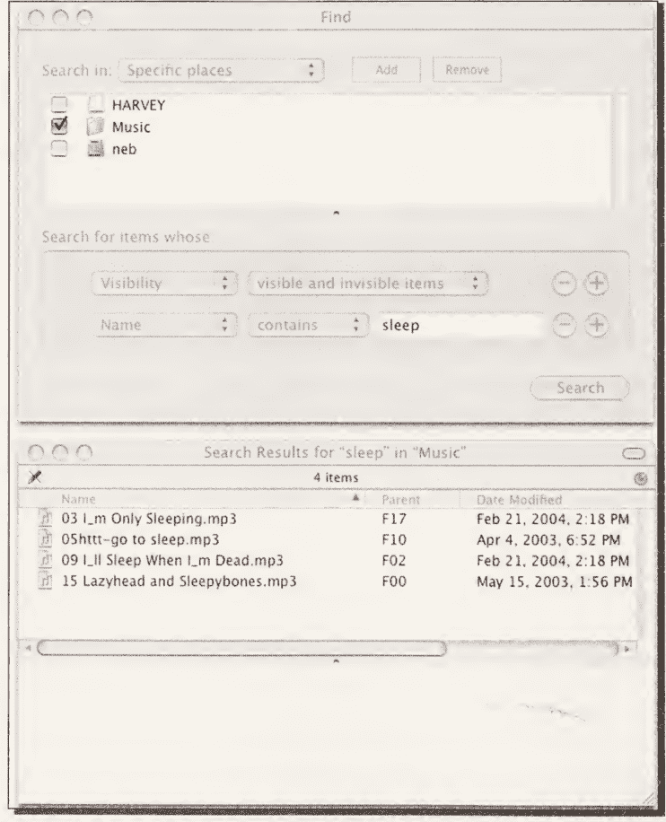

图 4-1：你可以使用 Mac OS X 中的查找功能来定位 iPod 上的特定歌曲。图片来源：Apple。

一旦你在搜索结果中看到歌曲，只需将其拖到另一个位置，如你的硬盘，“访达”就会愉快地将其复制过去。如果这是一首从 iTunes 音乐商店购买的歌曲，播放该歌曲的限制也会随之而来，因此你无法使用此技术来破坏苹果的数字版权管理。

这是查找和复制单首歌曲的便捷技术。如果你想将所有歌曲从 iPod 移动到硬盘该怎么办？首先执行前面步骤 1 到 5，为搜索 iPod 音乐做准备。然后继续执行以下步骤：

1. 将第一个搜索标准设为“可见性”中的“可见和不可见项”，并确保它是列表中唯一的标准。如果你在那里有其他标准（可能是之前搜索留下的），点击其旁边的减号将其删除。
2. 点击“搜索”以揭示 Music 文件夹中的所有项目。你会得到一个类似图 4-2 的搜索结果窗口。
3. 将搜索结果窗口向右滚动，直到看到“大小”列。点击该列的标题（显示为“大小”的位置）。你会得到 iPod Music 文件夹中文件的列表，按从大到小的顺序排列。这有一个附带效果，将所有歌曲排在顶部，而 iPod 用于组织音乐的怪异文件夹（名为 F00、F01 等）排在底部。
4. 点击搜索结果窗口中的第一首歌曲。向下滚动直到你能看到最后一首歌曲，就在文件夹队列（F00 等）的上方。按住 Shift 键点击最后一首歌曲。这将选中窗口中的所有歌曲。
5. 打开一个“访达”窗口，并在硬盘上创建一个新文件夹（文件 > 新建文件夹）来存放你的 iPod 音乐。将其命名为“my iPod music”。
6. 从搜索结果窗口将歌曲文件拖到“My iPod music”文件夹。“访达”会将你的歌曲从 iPod 复制到硬盘。


**注意** 将歌曲放入目标文件夹后，你可能会从“访达”收到错误消息，内容类似“所选项目无法全部放入同一位置，因为至少其中一个处于忙碌状态。”问题在于你有两个（或更多）同名歌曲文件。在 iPod 上，它们位于不同的文件夹中，但现在你正在将它们全部放入硬盘上的同一个文件夹中。解决方法是在搜索结果窗口中找到这些冲突的文件——你可以点击“名称”列来协助查找——然后按住 Command 键点击其中一个以将其从选择中移除。再次尝试拖放。如果你有多组同名文件，可能需要重复此过程。

### 同样的事情，只是更极客

如果你喜欢在命令行输入而不喜欢花哨的拖放操作，这里是一种使用终端从 iPod 复制歌曲的方法。

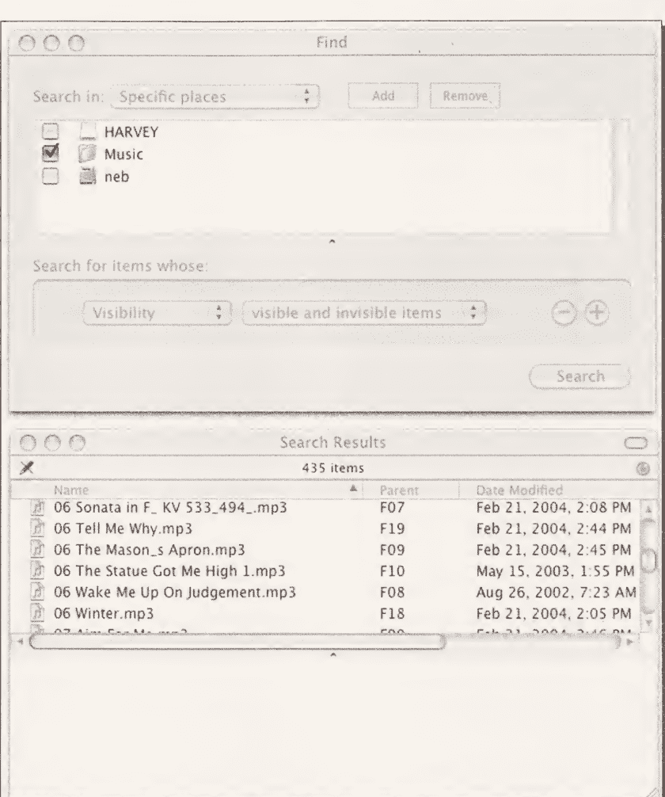

**图 4-2：** 如果你不指定要搜索的文件名，你会得到 iPod 上所有歌曲的列表。图片由苹果公司提供。

使用终端（Terminal）时要小心。你可以通过真正的 Unix shell 来操控你的计算机和 iPod。访达（Finder）和 Aqua 用户界面那层文明的伪装被剥离了，你可能会做一些不想要的糟糕事情，比如在步骤 4 中误用 `cp` 命令意外删除文件。如果你对这方面不太熟悉，不妨暂时将此部分视为“只读”内容。


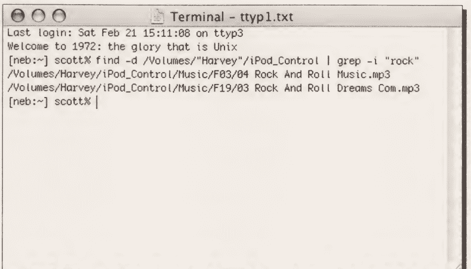

**图 4-3：** 你可以在终端中使用 `find` 命令搜索 iPod 上的歌曲。

1. 打开终端。对于不知情但渴望学习的人来说，它通常是一个位于“应用程序/实用工具”文件夹中的应用。
2. 在终端窗口中输入此命令：

```
find -d /Volumes/"my iPod"/iPod_Control | grep -i "part of name"
```

用你的 iPod 名称替换“my iPod”。用你要查找的文件名中的任意部分替换“part of name”。请记住，你搜索的是文件名，它可能与歌曲名称不同，因此你应该尝试搜索歌曲标题前部分的单词。输入此命令后，如果有任何匹配，你将得到一份歌曲列表。示例见图 4-3。
3. 终端的输出包括它找到的所有文件的完整路径名。在终端中，浏览输出内容以找到你想复制的歌曲。
4. 使用步骤 3 中获得的文件路径，在终端中使用 `cp` 命令复制歌曲，如下例所示：

```
cp /Volumes/"my iPod"/iPod_Control/Music/F16/"01 Dead Leaves And The Dirt.wav" ~/Documents/"my iPod music"/
```

本书中该命令分两行显示，但你在终端中输入时应将其作为一整行。请注意，如果 iPod、文件或文件夹的名称中包含空格或非字母数字字符，你必须用引号括起来。

## 这就是管道

如果你好奇，这里简单解释一下你在终端中输入的两个简单命令。第一个是：

```
find -d /Volumes/"my iPod"/iPod_Control | grep -i "part of name"
```

`find` 命令简单地查找目录（文件夹）中的文件。“-d”选项要求 `find` 递归查看它看到的任何目录。`/Volumes/"my iPod"/iPod_Control` 告诉 `find` 从哪里开始查找。其后的竖线被称为管道。它告诉 `find` 将其输出（即 `iPod_Control` 文件夹中所有文件的列表）发送给另一个命令——在本例中，是一个名为 `grep` 的命令，这是用于查找文本的 Unix 工具。`grep` 工具查找我们想要的文本，而“-i”选项告诉 `grep` 不要在意文本是大写还是小写。

以下是我们用于复制歌曲的命令：

```
cp /Volumes/"my iPod"/iPod_Control/Music/F15/"01 Dead Leaves And The Dirt.wav" ~/Documents/"my iPod music"/
```

这个也很简单。`cp` 命令用于复制文件。第一项是要复制的文件，后面跟着指定副本存放位置的目录。

就这样。如果你热衷于深入了解 Unix shell 和命令的深层世界，有很多书籍、杂志文章和网站可以教你在 Mac OS X 中更多地了解 Unix。玩得开心，但要小心。

## 为 Pod 人自动化

既然你已经是利用内置方法揭示隐藏 iPod 歌曲方面的专家，你可能想看看一些使查看 iPod 真正内容的工具程序。在这一节中，我将介绍其中最流行的两款程序 TinkerTool 和 iPod Viewer，并提供更多实用工具的指引。

### TinkerTool

Marcel Bresink 的 TinkerTool（www.bresink.de/osx/TinkerTool.html）是一个免费实用工具，带有一个开关，让你可以查看、查找和复制 Mac OS X 中所有不可见的文件和文件夹，无论是在 iPod 上还是在其他地方。TinkerTool 还允许你修改许多其他设置，但如果你只想在使用访达时查看 iPod 上的隐藏音乐，你只需要勾选一个复选框。转到 TinkerTool 的访达界面并点击“显示隐藏和系统文件”。瞬间你就能看到……好吧，它不会瞬间发生。要使更改生效，你必须点击窗口底部的“重新启动访达”（见图 4-4）。

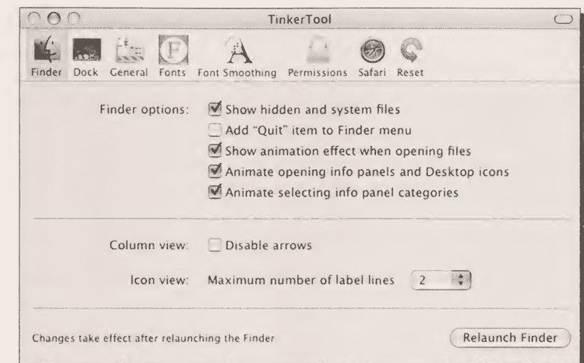

**图 4-4：** TinkerTool 访达设置界面。

更改设置并重新启动访达后，访达很快就会回来，焕然一新。现在，当你在访达中打开你的 iPod 时，`iPod_Control` 文件夹将可见，连同其中所有的文件夹和歌曲。当然，你不应该移动或删除 iPod 上的文件，那样肯定会惹恼 iPod。

TinkerTool 值得进一步探索。虽然全面讨论其功能超出了本书的简短范围，但以下是你可以使用 TinkerTool 完成的几个酷炫技巧：

- 更改系统字体和字体平滑设置。
- 使隐藏应用程序的图标在程序坞中变得透明（见图 4-5）。
- 在窗口中放置单或双滚动箭头，位于滚动条的一端或两端。


**图 4-5：** 隐藏应用程序图标在程序坞中呈透明状态。

## iPod Viewer

iPod Viewer（`homepage.mac.com/initgraf/iPodViewer/frameset.html`）是一个由 InitGraf Software 免费提供的精巧工具。iPod Viewer 检查你 iPod 的内容，并在其窗口中为你列出它们（见图 4-6）。

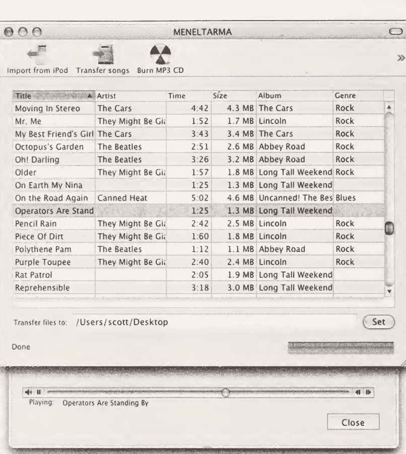

**图 4-6：** iPod Viewer 列出你 iPod 上的歌曲并允许你在 Mac 上播放它们。

你可以点击列标题以按你喜欢的方式对歌曲进行排序，就像在 iTunes 中一样。而且 iPod Viewer 不仅仅是一个查看器——它也是一个播放器。如果你双击一首歌曲，窗口底部会出现一个小抽屉，你的歌曲就开始播放了。

从 iPod Viewer，你可以通过选择你想复制的歌曲并点击“`Transfer songs`”来将任何或所有歌曲复制到你的 Mac。你甚至可以直接从 iPod Viewer 刻录一张装满 MP3 的 CD，而无需先将文件复制到你的 Mac。只需选择你想要的歌曲，然后点击工具栏中的“`Burn MP3 CD`”。这真的很酷！

## 其他程序

还有一个值得一提的程序是 PodMaster 1000，在 `homepage.mac.com/podmaster/FileSharing1.html` 可以以 8 美元的共享软件费用获取。你可以使用 PodMaster 1000 从 iPod 复制歌曲，通过 Mac 扬声器播放乐曲，并更改标签信息。PodMaster 甚至有一个窗口，使其看起来像屏幕上的 iPod。

你可能还想试试一个名为“iPod Tracks ⇄ Desktop”的 AppleScript。要使用这个免费的好东西，你只需选择想要复制到 iTunes 的歌曲。然后，你只需运行该脚本，歌曲就会出现在你的桌面上。真棒！你可以在 `www.versiontracker.com` 上搜索此脚本。

我在本节中介绍了一些很棒实用工具，但还有很多其他用于管理 iPod 上音轨的工具。如果你访问 `www.versiontracker.com` 并搜索“iPod”，你会发现一大堆这样的工具。

## Windows XP

在 Windows XP 中看到你的 iPod 歌曲比在 Mac 上更容易。这是因为 Windows 资源管理器具有显示隐藏文件的内置功能。方法如下：

1. 点击 **开始**。在开始菜单上，点击 **我的电脑**。
2. 在 **我的电脑** 窗口中找到你的 iPod 并双击打开它。
3. 查看打开的窗口。如果你看到一个名为 **iPod_Control** 的文件夹，你就完成了。你或别人已经设置了 Windows 资源管理器以显示 iPod 上的隐藏文件。如果你没有看到 **iPod_Control**，请继续下一步。
4. 选择 **工具 ⇄ 文件夹选项**。
5. 点击 **查看** 选项卡。
6. 寻找设置“**隐藏文件和文件夹**”。它位于窗口底部附近（见图 4-7）。点击“**显示隐藏文件和文件夹**”。点击 **确定**。**iPod_Control** 文件夹现在变得半透明，但可见。
7. 双击 **iPod_Control** 文件夹，然后双击其中的 **Music** 文件夹。你将看到包含你 iPod 音乐的所有“F”文件夹。打开它们以查看里面的音乐（见图 4-8）。

一旦你睁开眼睛，能够看到 iPod 上的隐藏文件，只需直接将它们拖到你的硬盘上即可。如果你在寻找某个特定文件？你可以使用 Windows 资源管理器中的搜索功能，但你必须先更改一个设置：

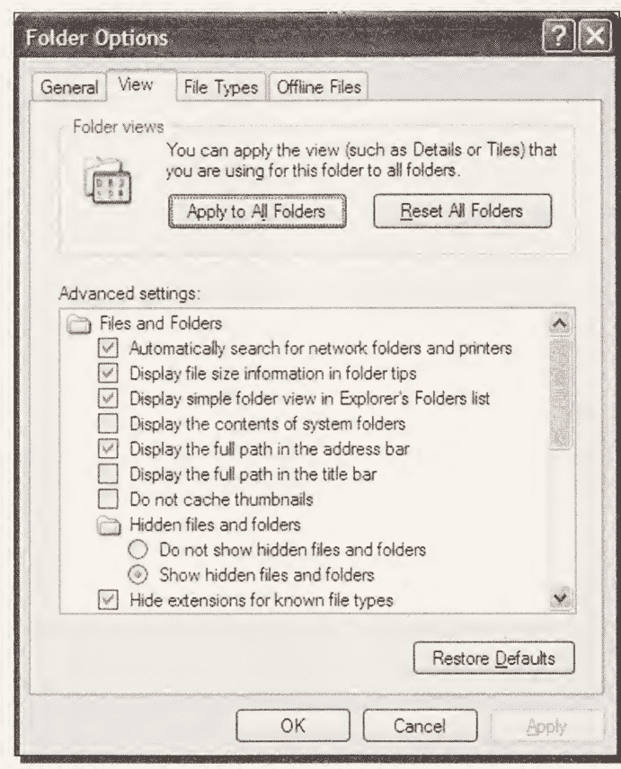

**图 4-7**：您要查找的选项位于“高级”设置列表的底部附近。

1. 点击工具栏中的“搜索”按钮。“搜索伙伴”会出现在窗口左侧，通常旁边还有那只热心的小狗（顺便说一句，您可以把它改成乘悬浮车的女性，不过那是另一本书里的技巧了）。
2. 在“搜索伙伴”区域底部附近，点击“更改偏好设置”。
3. 点击“更改文件和文件夹搜索行为”。
4. 点击“高级”按钮，然后单击“确定”。这将带您回到主搜索屏幕。
5. 点击“更多高级选项”。会出现一些新选项。您可能需要向下滚动才能看到它们。
6. 确保勾选了“搜索子文件夹”和“搜索隐藏文件和文件夹”。
7. 将搜索区域滚动回顶部，并在第一个文本框中输入歌曲名称的一部分。此时您的屏幕应如图 4-9 所示。点击“搜索”。

当您点击“搜索”时，小狗会迅速在您 iPod 上找到您正在寻找的文件。然后您可以将其中任何一个或全部文件拖拽到您的硬盘上。汪！

# 第 4 章 — 超越音乐：软件

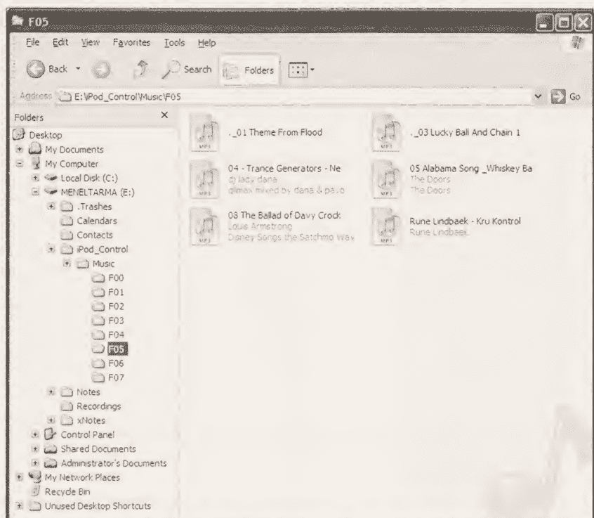

**图 4-8**：iPod 的典型内容在 Windows 资源管理器中的显示方式。

## 酷工具

在推出适用于 Windows 的 iTunes 之前，Apple 长期销售适用于 Windows 的 iPod。由此产生了一系列帮助您通过 PC 操作 iPod 的应用程序，其中包括一些帮助您从 iPod 查看并复制音乐回硬盘的工具。


**图 4-9**：iPod 的典型内容在 Windows 资源管理器中的显示方式。

### EphPod

EphPod（`www.efhpod.com`）是由 Joe Masters 创建的程序，允许您查看和复制文件，还能做更多事情。您可以在图 4-10 中查看 EphPod 的界面。运行 EphPod 时，您会看到所有常规 iPod 内容的列表：播放列表、艺术家、流派和歌曲。若要通过 EphPod 将歌曲复制到硬盘，找到该歌曲并右键单击，然后从快捷菜单中选择“复制歌曲到目录”。选择您希望放置歌曲的位置，即可大功告成。

EphPod 是一个实用程序，拥有更多帮助管理 iPod 的功能，因此务必去了解一下。EphPod 是“捐赠软件”——如果您喜欢它，作者希望您为他的啤酒基金捐点钱（不过这些钱并非全用于买啤酒）。


**图 4-10**：EphPod 是一款优秀的程序，可帮助您在 Windows 上管理 iPod，并且是免费的。EphPod 提供。

### XPlay

另一个适合 Windows 用户的不错程序是 XPlay，来自 Mediafour Corporation（`www.mediafour.com/products/xplay/`）。XPlay 有一个额外的优势，即它可以支持 Mac 格式的 iPod，也支持连接到 Windows 计算机的 iPod。XPlay 的工具栏中有一个“复制到”按钮，允许您将音乐从 iPod 移动到硬盘。XPlay 售价 30 美元，并提供免费的试用版。

## 在 iPod 上放置大型文本文件


> **注意** 此技巧仅适用于 Macintosh 计算机。

Apple 在 2003 年及之后推出的 iPod（包括 iPod mini）采用了新的按钮布局和坞站连接器。软件也发生了变化，Note Reader 是最重大的新功能之一。Note Reader 提供了一种将通用文本文件放入 iPod 的方法，让您随时有空时即可查看。将笔记放入 Note Reader 很容易：只需使用 Finder 或 Windows 资源管理器将文本文件拖入 `Notes` 文件夹即可。非常酷。

然而，Apple 决定将 Notes 和 Note Reader 限制为仅适用于新款 iPod。与其他许多新功能不同，您无法通过升级 2003 年之前 iPod 的软件来获得 Notes 功能。真糟糕。

幸运的是，iPod 世界充满了聪明的程序员，他们帮助我们解决此类问题。Thomas Häcki 开发的 Podtext 就是这种现象的一个例子。Podtext 允许您将笔记存储在任何款式的 iPod 都有的 `Contacts` 文件夹中。您可以使用 Podtext 本身输入笔记，然后直接保存到 iPod 或您的硬盘。您可以直接在 Podtext 中打开这些 Contacts-Notes 并进行编辑，但无法从 Mac 的硬盘打开文件。相反，您可以使用另一个程序（如 TextEdit）打开文件，在那里选择文本，然后将其拖入 Podtext。图 4-11 展示了 Podtext 的外观。


**图 4-11**：Podtext。


如果您的文本文件太大，无法放入 iPod 上的一个联系人中（超过 2,000 个字符），Podtext 会自动将其拆分为多个文件进行存储，然后在编辑时重新拼接。

您可以免费在 `www.podtext.thhdesign.com` 获取 Podtext。

如果您拥有支持 Notes 的 iPod 并且想了解关于 Note Reader 的更多酷炫功能，请参阅附录 A。

# 免费阅读

您可以在网络上找到大量出色的免费文本阅读材料。一个极好的资源是位于 `archive.org` 的 Internet Archive。这个精彩的网站拥有数千本可自由阅读的书，大多是版权已届满的书籍。您会在这里的收藏中找到 `Moby Dick`（白鲸记）、`Alice in Wonderland`（爱丽丝梦游仙境）、`The Art of War`（孙子兵法）以及各种版本的圣经。虽然这些文本中大多数太长，无法放入单个 iPod 笔记中，但 Podtext 会自动为您拆分。

## 阅读《美利坚合众国宪法》

当您在华盛顿特区参观国家档案馆时，您可以看到被称为美国《自由宪章》的文件：《独立宣言》、《宪法》和《权利法案》。这些超过 200 年历史悠久的文件保存在充满惰性气体并由厚实的防弹玻璃覆盖的容器中。夜间，这些文件被密封在一个重达 55 吨的钢筋混凝土和钢铁制成的保险库中。虽然保护这些文件的原始版本至关重要，但同样重要的是要注意到，您可以在自己的 iPod 上存储一份属于您自己的《美国宪法》副本（图 4-12）。

多亏了 American Constitution Society，您可以下载宪法并将其放入 iPod 的 Notes 文件夹中。要获取您的 iPod 宪法，请访问 `www.acslaw.org/misc/iPoddl.htm` 并下载。按照下载页面上的说明操作（这些说明只是告诉您将文件拖到 iPod 上的 Notes 文件夹），您就拥有了您的宪法。虽然它并不是一个重 55 吨的保险库，但它的便携性极高。

一旦您的 iPod 上有宪法，您可以通过在 iPod 主屏幕下查找 Notes 来阅读它，就像您阅读所有 iPod 笔记那样。有关《自由宪章》展览的更多信息，请参阅位于 `www.archives.gov/national_archives_experience/charters.html` 的国家档案馆网站。

## 阅读莎士比亚十四行诗

有时，当我在 iPod 上听着速度金属迪斯科乡村音乐时，我会想起那句老话：“Between mine eye and heart a league is took, and each doth good turns now unto the other; when that mine eye is famish'd for a look, or heart in love with sighs himself doth smother.” 那时我才意识到我按错了 iPod 上的按钮，正看着莎士比亚的十四行诗。

您可以在 iPod 上欣赏您自己副本的莎士比亚十四行诗。只需前往 `www.westering.com/ipod/` 并在那里下载 zip 文件。当 zip 文件解压缩后，将该文件夹拖入您 iPod 的 Notes 文件夹。这将把所有十四行诗安装到您的 iPod 上，您可以随意享受。


**图 4-12**：宪法序言。

所以，下次当您走进 Apple 商店，贪图那款您买不起的最新高容量 iPod 时，当您离开时可以用第 87 号十四行诗中的这句话来安慰自己：

> Farewell! thou art too dear for my possessing.

## 获取新闻、天气、电影列表等

**注意** 此技巧仅适用于 Macintosh 计算机。

Kevin Wojniak 开发的 Pod2Go（`kainjow.com/pod2go/website/`）是一款出色的 iPod 程序瑰宝。Pod2Go 从互联网和您的 Mac 上抓取新闻和其他信息，并将其复制到您的 iPod。然后，当您乘坐火车、坐在午餐桌前或等待保释担保人到来时，您可以阅读您下载的内容。

Pod2Go 可以获取多种类别的信息，包括新闻、天气、电影、股票行情、星座运势、文本以及行车路线。新闻信息采用一种名为 RSS（简易信息聚合）的格式提供，该格式受到数千个网站的支持。Pod2Go 预载了长长的新闻源列表，你可以从中订阅，但也可以添加任何你想要的 RSS 源。Pod2Go 适用于任何 iPod。如果你使用的是 3G 版 iPod，Pod2Go 可以将信息存储为 iPod 笔记或联系人，由你选择；而在更早版本的 iPod 上，Pod2Go 则使用联系人功能。

### 交叉参考

虽然 Pod2Go 仅适用于 Mac，但 Windows 用户可以通过使用在本章“使用 Microsoft Outlook 同步 iPod”部分介绍的 `iPodSync`，获取部分相同的新闻和天气信息。

## 设置你的站点

如果你有一个喜欢的新闻网站或博客不在内置列表中，该网站可能仍然提供你可以用 Pod2Go 阅读的新闻源。要确认这一点，请访问该网站并查找标有“XML”或“RSS”的图标，或显示类似“聚合此站点”文字的链接。点击该图标或链接。你会进入一个看似充满乱码文本的网页：这就是 RSS 源。前往浏览器地址栏，选中 URL 并复制。在 Pod2Go 的新闻屏幕中，点击“自定义源”，选中顶部的“输入 URL”框，然后粘贴。选择一个类别并点击“确定”，Pod2Go 就会将该网站的 RSS 源添加到你的 iPod 中，带来更多有趣的阅读内容。

你可以使用 Pod2Go 收集全球任何城市的天气状况和预报。查找城市的方法非常灵活：只需输入城市、州、国家或 ZIP 代码，Pod2Go 就会提供一系列可能的匹配结果供你选择。你可以添加任意数量的城市，如果你改变主意或搬到了另一个星球，将它们从列表中移除也非常简单。

Pod2Go 的电影功能可获取美国和加拿大电影院的上映时间。你只需输入一个城市或 ZIP 代码，Pod2Go 就会从网上抓取当天的放映列表并复制到你的 iPod 中。这对于那些你在车里临时起意想去看电影的时候非常实用（不适用于有孩子的人）。参见图 4-13 以了解其大致外观。


**图 4-13。** Pod2Go 提供了一种从网络收集信息（如电影上映时间）并复制到 iPod 的方法。由 Pod2Go 提供。

如果你总是需要知道心仪股票的价格以便评估你的投资组合，可以使用 Pod2Go 的股票行情功能。然而，与其他许多功能相比，该功能的价值较低，因为下载旧行情到 iPod 后，它们很快就会过时。

说到功能及其价值，Pod2Go 还可以获取你的星座运势。你可能对这一点不感兴趣，但如果你根据星辰规划人生，或者出于娱乐目的使用星座运势，你可以阅读针对你的出生星座以及其他你希望下载到 iPod 的星座的占星建议和预测。

Pod2Go 包含一个非常酷的功能，允许你将任何文本复制到 iPod 的笔记中，包括来自网页或 Word 文档的文本。只需点击“新建自”按钮，并让 Pod2Go 指向硬盘上的文档，或输入一个 URL。当你以这种方式下载网页时，iPod 不会像网络浏览器那样显示页面外观——它只获取页面的文本。你还可以使用此功能直接在 Pod2Go 中输入笔记，Pod2Go 随后会将其同步到 iPod。

Pod2Go 中的行车路线功能是节约纸张的好方法。现在，当你获得前往城外那场迷人派对的路线时，只需将其保存在 iPod 上即可，无需打印出来。不过请务必小心，不要在实际驾驶时通过 iPod 阅读路线。

默认情况下，Pod2Go 会在每次将 iPod 连接到 Mac 时复制信息。有一个偏好设置可以关闭此功能，还有一个设置可以在同步完成后立即弹出 iPod。

Pod2Go 的界面简洁且易于上手。要添加同步项，请前往相应的页面（新闻、天气、文本等）并点击加号。还有一个减号可用于移除你不再需要的项。

## 不仅仅是信息

Pod2Go 擅长从网络收集内容并将其放到 iPod 上，但这并非它的唯一功能。你可以使用 Pod2Go 在 Mac 和 iPod 之间同步各种信息，包括通讯录、iCal 日历、便笺和 Safari 书签。等等——这不是苹果免费程序 `iSync` 通常处理的一些工作吗？是的，但这里的理念是，既然你正在使用 Pod2Go 在 Mac 和 iPod 之间同步信息，用一个程序处理比用两个程序更简单。如果你希望使用其附加功能（如与 Mac 或其他设备同步），仍然需要运行 `iSync`。

当你将 iPod 连接到 Mac 时，`iTunes` 会启动或置于前台。使用 Pod2Go，你可以设置其他应用程序在连接 iPod 时启动。

Pod2Go 带有自己的全局菜单，一个出现在菜单栏右侧的小 iPod。你可以使用此菜单快速访问功能，包括执行同步、前往 Pod2Go 或弹出 iPod。

Pod2Go 功能强大、易用且免费。如果你有一台 Mac 和一个 iPod，你就应该拥有 Pod2Go。


弹出 iPod 的另一种快速方法是控制点击（或右键点击）程序坞中的 iTunes 图标，然后选择“弹出 iPod”（你的 iPod 名称将取代“iPod”显示）。

## 使用 Microsoft Outlook 同步 iPod


此技巧仅适用于 Windows 计算机。

在第 2 章中，我介绍了将 Microsoft Outlook 中的联系人和日历项目保存到 iPod 的最基本方法（使用 Microsoft Outlook 的联系人和日历）。这些技术对于将一两个项目传输到 iPod 来说尚可，但如果你真正想体验拥有便携式通讯录和日历的 iPod 梦想，你需要自动同步。

Mac 用户可以使用 iSync、通讯录和 iCal，即 Apple 的免费软件，用于管理个人信息并在 Mac 和移动设备之间传输。作为一名使用 Microsoft Outlook 的 Windows 用户，你可以怎么做？通过添加一些第三方软件，你可以获得可与 Mac 用户体验相媲美的同步体验。

在本节中，我们将查看几种价格低廉的专业解决方案，以及一个出色的免费技巧。

### PocketMac

`PocketMac` iPod 版（价格约 23 美元，网址为 `www.pocketmac.net/products/pmipodmac/ipodmac.html`；提供免费的试用版）通过连接 Windows 计算机上 Microsoft Outlook 和其他程序的数据，增强了 iPod 的功能。`PocketMac` 从 Outlook 抓取联系人、日历项目、任务、笔记和电子邮件，然后将其传输到你的 iPod。你可以设置 `PocketMac` 在每次连接 iPod 时自动启动，或者在你想同步时手动发出指令。

当你安装并运行 `PocketMac` 时，你会看到主屏幕，如图 4-14 所示。通过点击带有齿轮图标的按钮，你可以查看同步设置，并选择希望自动复制到 iPod 的数据。

你可以精细调整希望同步的具体数据。例如，如果你收到大量电子邮件且不希望在复制到 iPod 时等待，可以关闭电子邮件同步。除了 Outlook 偏好设置外，还有一些其他有趣的设置：

- 如果勾选“Word 文档”，`PocketMac` iPod 版会将 Word 文档转换为 iPod 笔记，并将其归档在笔记文件夹中。如果文档太大无法放入单个笔记中，`PocketMac` 会将其拆分为多个笔记并将其连接在一起以便阅读。


**图 4-14：** `PocketMac` iPod 版：主屏幕开启状态。


图 4-15：Outlook 安全访问对话框。

- 如果你同步 Word 文档，可以使用右下角神秘标记为“…”的按钮来选择一个文件夹。`PocketMac` 随后会扫描该文件夹中的 Word 文档并复制找到的文档。
- 点击“连接时自动同步”可以让 `PocketMac` 在你连接 iPod 时自动唤醒并执行操作。如果你取消勾选此框，则每次想要将计算机上的信息同步到 iPod 时，都必须手动运行 `PocketMac`。

当你运行 `PocketMac` 时，它会抓取你的 Outlook 信息并将其复制到你的 iPod 上。Outlook 足够聪明，能识别出有一个外部程序试图访问其数据。事实上，这近年来一直是病毒喜欢使用的手段：它们向你的所有联系人发送电子邮件以传播病毒。为了帮助防止此类问题，当 `PocketMac` 开始查看你的联系人时，Outlook 会弹出一个警告消息（见图 4-15）。

当你看到此消息时，你可以决定是否允许访问。在这种情况下，你知道对数据的访问是安全的，因为你正在运行 `PocketMac` 进行同步。一个好的策略是使用“允许访问时长”弹出列表，该列表授予固定时段的权限——10 分钟对于 `PocketMac` 完成其工作来说应该足够了。

一旦 `PocketMac` 开始向 iPod 传输文件，你就会看到那些熟悉的“飞行文档”进度框（图 4-16）。`PocketMac` 贴心地在进度框中显示联系人、日历事件、文档或其他数据项目的名称，让你清楚地知道正在发生什么。

最终，同步完成，`PocketMac` 窗口会显示“完成”。此时，你可以断开 iPod 连接并离开，放心地知道你已经带着电脑上的最新信息走开了。


## iPodSync

`iPodSync`（售价 $14，见 `icnet.50megs.com/iPodSync`；提供免费试用版）是另一个将 Outlook 信息卸载到 iPod 的工具。`iPodSync` 处理 Outlook 的联系人、日历项、任务和笔记。虽然 `iPodSync` 是一个 Windows 程序，但其界面可以说是深受 `iSync` 的启发，后者是 Apple 专供 Mac 使用的同步程序（见图 4-17）。

要开始使用 `iPodSync`，你点击不同种类数据的图标：联系人、日历等。你可以告诉 `iPodSync` 对每种数据类型采取何种操作，包括完全不同步。`iPodSync` 为每种类型提供选项，让你可以详细指定需求。例如，当你同步日历事件时，你可以决定是否包含过去的事件或重复的约会，如图 4-18 所示。


图 4-18：`iPodSync` 日历选项。

当你点击“同步 iPod”时，程序开始工作，从 Outlook 中提取信息并复制到你的 iPod。`iPodSync` 界面会显示一个进度指示器，以便你可以跟踪正在进行的同步（图 4-19）。

`iPodSync` 包含超出 Outlook 同步范围的功能。点击 Web 图标可以指示 `iPodSync` 从 Web 获取信息并下载到你的 iPod（见图 4-20）。你可以出门前获取当地天气预报，或同步一些新闻头条，这样在等待外卖披萨准备好时就有东西读了。

`iPodSync` 在其高级选项界面中包含多项设置。点击看起来像 iPod 的图标以查看这些首选项。高级选项包括：

- 启动时自动同步 iPod。此选项免去你手动记住同步的麻烦。
- 同步完成后自动弹出 iPod。
- 重置，这将移除 iPod 上现有的 Outlook 信息。如果你不慎在 iPod 上存有相同信息的多个副本，请使用此功能。
- 选择特定的 Outlook 文件夹进行同步。
- 包含或排除特定 Outlook 类别中的项目。

Mac 用户（你们为什么要阅读这个仅限 Windows 的章节？）可以使用 `Pod2Go` 在 iPod 上获取新闻、天气以及大量其他基于 Web 的信息，`Pod2Go` 在本章的*获取新闻、天气、电影排片及其他*部分中有介绍。

### 从 Windows 通讯簿导出

从 Outlook 获取联系人（而非日历信息）到 iPod 最酷的方式是通过 Windows 通讯簿。如果你使用 Outlook Express，Windows 通讯簿就是存储你联系人信息的地方。Windows 通讯簿有一个很棒的功能：如果你选择多个联系人并将其拖动到目标位置，这些联系人在存储到新位置之前会被转换为 vCard 格式。iPod 联系人以 vCard 格式存储真是巧合之妙！因此，如果你使用 Outlook Express，只需选择联系人并将它们拖到 iPod 上的联系人文件夹，即可轻松将所有联系人导出到 iPod。

如果你想从 Outlook 获取联系人到 iPod，也可以做到，但遗憾的是，Outlook 缺乏 Windows 通讯簿的自动 vCard 转换功能。不过，你可以先将 Outlook 联系人发送到 Windows 通讯簿，然后再发送到你的 iPod。方法如下：

1. 在 Outlook 中，选择 `文件` ➝ `导入和导出`。
2. 选择“导出到文件”并点击**下一步**。
3. 选择“逗号分隔值 (DOS)”并点击**下一步**（见图 4–21）。
4. 输入导出文件的名称（“我导出的联系人”即可）并点击**下一步**，然后点击**完成**。现在你的联系人已导出，是时候将它们导入 Windows 通讯簿了。
5. 转到 Outlook Express。选择 `文件` ➝ `导入` ➝ `其他通讯簿`。
6. 选择**文本文件**（逗号分隔值）并点击**导入**。
7. 找到你在第 4 步中保存的文件并点击**下一步**。
8. 在映射对话框中，选择你要导入的字段并点击**确定**。
9. 点击**完成**以结束导入过程。


10. 现在你的联系人已导入到 Outlook Express 中的 Windows 通讯簿，你可以选择你想放到 iPod 上的联系人——如果你喜欢的话，可以全部选择——并将它们拖到 iPod 的联系人文件夹。它们会自动转换为 vCard 格式，并显示为你 iPod 上的联系人。


图 4-21：你可以将 Outlook 联系人导出到文件。

### 在 Mac 上运行 PocketMac

> **注意** 此技巧仅适用于 Macintosh 计算机。

在上一节中，我提到了 PocketMac iPod 版（Windows）作为人们将信息从 Microsoft Outlook 传输到 iPod 的程序之一。PocketMac 也有适用于 Mac OS X 的版本——这并不令人惊讶，毕竟它叫*PocketMac*（www.pocketmac.net/products/pmipodmac/ipodmac.html，约 $23）。PocketMac iPod 版的专长是与 Microsoft Entourage 同步。你可以使用 PocketMac 将联系人、日历、待办事项、笔记和电子邮件同步到 iPod。PocketMac 甚至可以将 Word 文档加载到你的 iPod 上，就像 Windows 版那样。

Mac 上的 PocketMac iPod 版通过将自己安装为 iSync 组件来工作。PocketMac 在 iSync 工具栏上放置一个图标。当你点击该图标时，其设置会出现，你可以设置同步偏好，就像使用其他 iSync 设备一样（图 4-22）。

Mac 版 PocketMac 不仅仅是为了 Entourage。你还可以使用它同步 Apple Mail 程序中的电子邮件、PDF 和便笺。并且由于 PocketMac 在 iSync 中运行，你不需要记住再运行另一个应用程序来使所有内容同步。

### 在 iPod 上阅读电子邮件

> **注意**

>

> 此技巧仅适用于 Macintosh 计算机。


图 4-22：PocketMac iPod 版使用 iSync 在 Entourage 和 iPod 之间同步信息。

iPod 爱好者，尤其是 Mac 用户，可以访问许多程序，这些程序能将电脑上的信息传输到你的 iPod 上。这些“随行”程序利用了 iPod 连接到电脑（以及互联网）时的宝贵时间。在 Apple 推出能直接连接互联网的 iPod 之前，你可以依靠诸如 Pod2Go 等程序来获取信息并将其传输到你的 iPod 上，以便日后查看。

PodMail 是另一个“随行”助手。正如你可能从这个名字巧妙猜到的一样，PodMail 专门负责抓取电子邮件，以便你稍后阅读。PodMail 将你的邮件放入“备忘录”文件夹，因此你需要一个能运行 2.0 或更高版本系统的 iPod（即带有接插件端口的 iPod，包括 iPod mini）。你可以在图 4-23 中看到 PodMail 的主界面。

最常见的电子邮件账户类型使用一种名为 POP（Post Office Protocol，邮局协议）的技术。如果你使用 POP，PodMail 要求你先使用 Mac OS X 的 Mail 程序收集邮件，然后才能将其传输。如果你订阅了 Apple 的 .Mac 服务，或者拥有 IMAP 账户（IMAP 是一种将邮件保留在服务器上以便你随处访问的电子邮件技术），PodMail 将为你检查邮件——不像 POP 邮件那样，你不需要先收集它们。当你准备将邮件传输到 iPod 时，请确保在磁盘弹出列表中选择了 iPod，然后单击“同步”按钮。

PodMail 允许你设置尽可能多的电子邮件账户。只需单击左下角的加号即可创建另一个账户。还有一个方便的滑块，你可以用它来限制获取的邮件数量，以免你可怜的小 iPod 被大量的邮件淹没。


图 4-23：PodMail 抓取你的电子邮件并将其传输到你的 iPod，这样你就可以随时阅读了。

## 在你的 iPod 上运行 Linux

Linux 是一个替代操作系统，拥有众多且日益增长的忠实粉丝。Linux 的源代码是免费开放的，全球成千上万的人都在为它的开发做出贡献。像 IBM 这样严肃的公司正在构建和销售基于 Linux 的产品。Linux 的一个奇妙且极客的传统是将其*移植*：让它在尽可能多的新设备上运行。当 iPod 出现时，Linux 的信徒们接受了这一挑战。结果就是由 Bernerd Leach 及其朋友们创建的 Linux on iPod 项目。

Apple 没有提供关于 iPod 的大量技术信息，因此 iPod 上的 Linux 项目需要大量工作来弄清楚内部发生了什么以及如何获得控制权。Leach 像侦探一样研究 iPod：他查看了 Apple 的 iPod 更新器，发现如何修改 iPod 固件，使其启动他安装在磁盘上的 Linux 内核，而不是标准系统。图 4-24 展示了当 Linux 在 iPod 上启动时你看到的部分画面。

为什么要将 Linux 放在 iPod 上？在项目 FAQ 中，Leach 给出了经典答案：因为就在那里。除了这个标准理由外，他希望将 Linux 放入 iPod 能带来新的应用程序，例如播放不同音乐格式的能力或添加全新的功能。

> **警告** 安装 Linux 会修改你的 iPod 固件，使其能够启动替代操作系统，这将使保修失效。你 iPod 上的音乐和其他数据可能会受到损坏。你甚至可能最终得到一个需要运行 Apple 的 iPod 更新器才能重新工作的 iPod，并且有小概率你的 iPod 会变得无法使用。知道了这些——那就祝你玩得开心吧！

该项目的初始版本在将 Linux 安装到 iPod 上时，即使 Bernerd Leach 和他的团队已经做了艰苦的工作，仍需要复杂的手动过程。这个手动过程要求你从 `ipodlinux.sourceforge.net` 获取源代码，并使用编译器和开发工具自行构建。然后，你必须完成一系列步骤，包括备份 iPod 的固件、构建 Linux 内核，最后在你的 iPod 上安装并运行 Linux。你可以在 `http://ipodlinux.sourceforge.net/build.shtml` 查看完整说明。

对于 Linux 粉丝来说，这种安装过程并不罕见。这是 Linux 开拓精神和自己动手乐趣的一部分。但对于那些只是好奇想在 iPod 上玩玩 Linux 的更大群体来说，这有点令人望而生畏。开源项目最酷的方面之一是程序员可以基于彼此的工作进行构建。对于这个项目，社区构建了一个易于使用的安装程序，让你可以用比原始技术少 98% 的麻烦将 Linux 装到你的 iPod 上。它没有安装 iTunes 那么容易，但确实是一个很大的改进。

你可以在 `ipod.homelinux.com` 找到这个版本的 Linux。以下是将 Linux 安装到你的 iPod 的说明：


图 4-24：Linux 在 iPod 上启动。

1. 访问 `ipod.homelinux.com/index.php?page=download` 并下载最新的构建版本。如果你使用 Safari，下载的内容将解压并显示为磁盘映像。

2. 在访达（Finder）中找到磁盘映像。（见图 4-25）。将 iPodLinux 磁盘映像的内容复制到你的硬盘。


图 4-25：访达中的 iPodLinux 磁盘映像。

3. 运行“终端”应用程序。

4. 接下来，你需要将当前目录设置为你刚复制到硬盘的 iPodLinux 文件夹。为此，输入 `cd`，后面跟一个空格。然后，从访达中将 iPodLinux 文件夹拖入终端窗口。按回车键。终端窗口的提示符应该会改变，显示 iPodLinux 现在是当前目录。


图 4-26：Tux 来到你的 iPod。

5. 在终端窗口中，输入 `sh ./install` 以启动 Linux 安装程序。

6. 在安装程序继续之前，它需要确定 iPod 的设备名称。在终端中，安装程序会显示类似以下内容：

```
/dev/disk2s3 on /Volumes/iGor (local, nodev, nosuid)
```

这里报告的设备名称始终是 `diskNs3`，其中 N 通常是 2 或 3。要启动安装程序，请输入 `diskNs2`。注意，报告给你的名称以 `s3` 结尾，而你输入的名称以 `s2` 结尾。顺便提醒一下，是的，对于 Linux 安装来说，这算是简单的。

7. 接下来，安装程序将备份 iPod 的固件。然后，你可能会被要求输入 Mac 用户账户的密码。一旦你提供此密码，你应该看到以下内容：


```
65536+0 records in
65536+0 records out
33554432 bytes transferred in 20.136763 secs (1666327 bytes/sec)
--> Firmware backup complete.
12742+1 records in
12742+1 records out
6523908 bytes transferred in 8.612815 secs (757465 bytes/sec)
The firmware installer has completed.
```

完成了 – Linux 现在已安装到你的 iPod 上。要看到它，首先按住 MENU 和播放键几秒钟重启。当屏幕变黑时，按住“上一曲”键，直到你看到 Apple 标志。很快你会看到表示 Linux 正在启动的滚动文本页面。最终，你会在屏幕上看到 Linux 企鹅吉祥物 Tux 的身影（图 4–26）。

在你的 iPod 上运行 Linux 确实很酷，但你仍然可以以常规方式使用它。要将 iPod 切换回熟悉模式，只需正常重启，启动时不要按住任何按钮。要回到 Linux，请在 iPod 启动时按住“上一曲”键。

在 Linux 中，你可以使用命令行工具 `telnet` 通过 FireWire 电缆与你的 iPod 通信，从而使 iPod 执行各种操作。随着 iPod 上的 Linux 项目的进展，我们可以期待看到为 iPod 带来的游戏、工具、实用程序以及其他有趣且有用的内容。如果你是一名 Linux 黑客，可以通过在 `ipodlinux.sourceforge.net` 的项目网站上注册成为贡献者来加入该项目。

## 总结

Apple 将你的 iPod 打造为一款出色的音乐播放器，它确实是——但它也正通过新闻标题、文本文档、*电子邮件* 以及更多功能，悄然进军个人数字助理（PDA）领域。查看本章中的程序，看看它们

用你的 iPod 提升生活品质。如果你喜欢追求极致，甚至可以将你的 iPod 变成世界上最酷的小型 Linux 盒子。

在下一章中，我们将开始探讨在 iTunes（你 iPod 的忠实伴侣）中进行的一些妙不可言的操作。第 5 章涵盖你可以利用 iTunes 的基本功能——播放音乐——进行的各种有趣技巧。

## 第二部分：改造 iTunes

### 本部分包含

- 第 5 章：玩转你的音乐
- 第 6 章：极致音乐播放
- 第 7 章：iTunes 与硬件
- 第 8 章：音乐输入
- 第 9 章：音乐输出：烧录及更多
- 第 10 章：音乐库：一探究竟
- 第 11 章：iTunes 音乐商店

## 第 5 章：玩转你的音乐

### 本章要点

- 创建“最新曲目”播放列表
- 更改播放顺序
- 查看精确的播放列表统计信息
- 将播放列表迁移到另一台电脑
- 使用列表列进行均衡器设置
- 获取专辑封面

iTunes 的核心在于聆听音乐，因此我们在本书 iTunes 部分开篇即探讨如何通过改造音乐播放功能来实现最大化的趣味与功能。在本章中，我们将讨论你可以利用 iTunes 基本音乐播放功能执行的酷炫技巧。

### 播放列表

播放列表是 iTunes 进阶聆听的入场券。没有播放列表，你仍然可以使用 iTunes 聆听你最喜爱的艺术家和专辑，就像你实际操作实体 CD 或黑胶唱片一样。但播放列表是那种神奇的数字元素，它能让你通过帮助你精准聆听想要听到的内容，从而完全掌控你的音乐体验。

### 将选中的内容转换为播放列表

假设你正在用 iTunes 听歌时，突然萌生了一种强烈的愿望，想要聆听一组不寻常的专辑——例如 They Might Be Giants 的 *Factory Showroom*、Laurie Anderson 的 *Home of the Brave*，以及 Vito Paternoster 的最新作品。收集这些风格各异的曲目的最快、最简便方法是什么？请尝试以下步骤：

1. 点击源列表中的 `Library`，以查看你所有的音乐。
2. 确保列表上方显示浏览器（艺术家和专辑名称）。如果未看到浏览器，请选择 `Edit ↔ Show Browser`。
3. 在“艺术家”列中浏览艺术家列表。当找到一位其专辑你想纳入你多元化播放列表中的艺术家时，点击选中它。
4. 只要还想发现更多艺术家，就继续浏览列表。对于你要添加的每位新艺术家，按住 `Command`（在 Mac 上）或 `Control`（在 Windows 上），然后点击。这将把新艺术家（用技术术语来说，即扩展选择范围）添加到你已经选择的艺术家中。


**图 5-1：** 选中了多位艺术家，并列出了他们所有的专辑。

5. 选好你想要的艺术家后，你会看到他们的专辑全部聚集在右侧的专辑列表中（参见图 5-1）。
6. 再次使用 `Command-Click`（Mac）或 `Control-Click`（Windows）的方法，从右侧的专辑列表中挑选你想听的专辑。
7. 选择 `File ↴ New Playlist from Selection`。你将得到一个由你奇思妙想的专辑选择组成的新播放列表（命名为“未命名播放列表”）。

现在，你的播放列表就被永久铭记了，或者至少在你依然喜欢那组艺术家的期间都是如此。此外还有一个额外的好处：由于这是一个正式的播放列表，你可以指示 iTunes 将其同步到你的 iPod。

**提示** 你还可以通过将选中的项目拖拽到源列表中并放下，来创建新的播放列表。有关此操作的工作原理，请参阅本章后面的 *通过拖放创建播放列表* 部分。

如果你使用的是 Mac OS X，可以使用另一个快捷键从所选内容创建播放列表：按住 `Shift` 键并点击源列表底部的“+”按钮。新的播放列表将包含选中的歌曲而自动创建。这是一个罕见案例，该功能在 Macintosh 版 iTunes 中可用，但在 Windows 版中不可用。Windows 版本使用 Shift-点击“+”按钮来创建新的智能播放列表（参见本章后面的 *使用键盘快捷键操作播放列表*）。

### 创建“最新曲目”播放列表

当你从喜爱的艺术家那里获得新歌曲时，你可能会迫不及待想尽早聆听。但在我们充满压力的忙碌生活中，有时我们甚至都会忘记聆听新音乐这类愉快的消遣。iTunes 可以帮助解决这个问题。只需创建一个智能播放列表来追踪你最新的曲目即可。以下是具体做法：

1. 选择 `File ↴ New Smart Playlist`。你将看到智能播放列表对话框。
2. 在定义你希望包含在列表中的歌曲条件的框中，选择“添加日期”、“在……以内”、“30”和“天”。你可以根据自己获取新音乐的频率调整“30 天”这个数值。
3. 微调你的播放列表。你可以勾选“限制”框，以保持播放列表的歌曲数量或时长低于某个选定值。如果你想确保你的“最新曲目”播放列表能放进你的 iPod，请使用“限制”指定你想要的音乐兆字节（MB）或吉字节（GB）数量。
4. 确保勾选了“实时更新”。这确保当歌曲变得过旧时会被移出播放列表。把它想象成一种“新鲜度日期”系统，就像牛奶上印的日期。图 5-2 中的对话框展示了这种状态的样子。点击确定（OK），你就拥有了你的播放列表。


**图 5-2：** 创建一个包含最新歌曲的智能播放列表。

拥有“最新曲目”播放列表，你可以确保绝不会让那些新歌曲在音乐的缝隙中溜走。任何能让电脑替我们记忆的时刻，都是加分项。

### 智能播放列表的更多创意

iTunes 中的智能播放列表功能是一种看似简单却蕴藏巨大力量的技术。你可能花很多时间来构思各种巧妙且精彩的新播放列表方案。或许你甚至打算为此专门建立整个网站！事实上，这正是 SmartPlaylists.com 正在做的事情，这是一个供热爱探索如何利用这一强大功能的 iTunes 爱好者交流的平台。请查看图 5-3 中 SmartPlaylists.com 的主页。


**图 5-3：** SmartPlaylists.com 主页。

SmartPlaylists.com 主要是一个关于你可以利用智能播放列表做什么的创意交流平台。以下是关于让音乐聆听更智能的一些示例建议和想法：

#### 所有“未勾选”的歌曲

iTunes 使用每首歌曲左侧的复选框作为某种主开关。当 iTunes 在播放音乐时遇到未勾选的歌曲，它会跳过它们。许多 iTunes 用户会取消勾选那些他们通常不想听的歌曲。但有时你可能会发现自己心情正好想听那些被忽视的曲子。一个智能播放列表似乎是很好的处理方式。但令人惊讶的是，你不能将“未勾选”作为智能播放列表的标准。有一个复选框用于排除它们，但没有一个用于允许它们进入。


你能做什么？答案是使用双播放列表技术。首先，你需要创建一个包含所有已勾选歌曲的播放列表。你可以按照以下步骤操作：

1. 从文件菜单中选择新建智能播放列表。
2. 确保勾选了“仅匹配已勾选的歌曲”复选框。这实际上是我们希望应用于此智能播放列表的唯一标准。但 iTunes 不允许我们在只勾选此框的情况下创建播放列表。我们可以通过指定一个不会排除任何歌曲的虚假标准来克服这个问题。
3. 确保取消勾选“匹配以下条件：”复选框。这里我们不会使用它。
4. 点击“限制为”复选框以开启它。在该行的框中输入 `99999 GB`。这是你可以在此输入的最大数字，我敢打赌你拥有的音乐比这少得多。此时你的对话框应该看起来像图 5-4。
5. 点击确定（OK）以创建播放列表。
6. 在源列表中，新播放列表的名称被选中。输入一个新名称：`all checked`（所有已勾选）。
7. 通过从文件菜单中选择新建智能播放列表，创建另一个智能播放列表。


**图 5-4：** 智能播放列表对话框。


**图 5-5**：损坏的播放列表依赖警报。

8. 在“匹配以下条件”部分，选择“播放列表并非全部选中”，然后单击`确定`。将新创建的列表重命名为“全部未选中”。

完成！你刚刚创建的新播放列表将包含所有未选中的歌曲，且不含其他内容。


> 在这个技巧中，我们设置了一个依赖另一个播放列表“全部选中”内容的播放列表。如果“全部选中”消失了会发生什么？我也曾对此感到疑惑，所以我将其删除了。当我这样做时，“全部未选中”播放列表旁边出现了一个圆圈内的感叹号，这在 iTunes 术语中意味着“出了问题”。有趣的是，当我选中该播放列表时，我仍然可以毫无问题地播放其中的歌曲。但当我选择**编辑智能播放列表**时，我得到了你在图 5-5 中看到的警报。

当我单击**确定**后，我发现自己可以编辑播放列表并更改其标准。我点击了**取消**，尽管有那个严峻的警告，播放列表仍然正常工作。因此，如果你删除了另一个播放列表所引用的播放列表，你仍然可以使用那个依赖项，它将永远冻结在当下，或者直到你编辑其标准为止，以先发生者为准。

## 主题播放列表

有些主题是成千上万首歌曲的主题：爱情、希望和汽车相当流行。但你可能会惊讶地发现，关于其他看似更晦涩的主题竟然存在那么多歌曲。你可以使用智能播放列表功能的“**歌曲名称包含**”标准，看看你能在特定主题上挖掘出多少歌曲。

作为你可能发现的内容示例，以下是我设置的几个主题播放列表的结果：

### 歌曲名称包含 jungle（丛林）：

- “Welcome to the Jungle”，Guns N' Roses。
- “Run Through the Jungle”，Creedence Clearwater Revival
- “Bungle in the Jungle”，Jethro Tull
- “Jungle Jingle”，Love Nation & Ad
- “Jungle Boogie”，Kool & The Gang
- “George of the Jungle”，Weird Al Yankovic
- “Welcome to the Jungle”，They Might Be Giants
- “Jungle Fever”，Chakachas
- “Jungle Music”，Rico

### 歌曲名称包含 summer（夏天）：

- “A Summer Song”，Chad & Jeremy
- “Indian Summer”，Joe Walsh
- “Let’s Loot the Supermarket Again Like We Did Last Summer”，Mick Farren and the Deviants
- “Long Summer Days”，EMF
- “Summer in the City”，Lovin’ Spoonful
- “One Summer Dream”，Electric Light Orchestra
- “Sausalito Summer Night”，Diesel
- “Summer Breeze”，Seals & Crofts
- “Summer of Drugs”，Soul Asylum
- “Summertime”，Billy Stewart

现在你对我的音乐品味了解得比你愿意的要多得多。你还可以使用“**歌曲名称包含**”技术来构建你自己的浪漫播放列表。为了构建这个列表，尝试查找包含“love”、“girl”、“boy”、“us”或其他典型术语的歌曲名称。iTunes 允许你构建一个单一播放列表，以匹配你所需的尽可能多的不同标准。

## 流媒体电台播放列表

你可能没有意识到，你可以将流媒体电台站点包含在你的库和播放列表中。要将站点添加到库中，只需将站点的图标拖到源列表中的库中。然后，你可以设置标准为“**类型为播放列表 URL**”，创建一个由电台组成的智能播放列表。

记得去 smartplaylists.com 查看更多的创意，并贡献你自己的创意。

## 通过拖放创建播放列表

你可以通过拖放让计算机程序发生奇妙的事情。菜单项是明确的，因为它们用文字标明其功能，但拖放更直接、更有趣，几乎像魔法一样，仿佛你伸手进入计算机操纵真实的物体。iTunes 充满了拖放功能。你大概已经利用了通过将歌曲从歌曲列表拖到播放列表中来添加歌曲的能力。iTunes 还包括一些鲜为人知的功能，仅通过搬运物品即可创建播放列表。

基本规则是这样的：将某物拖到源列表中的空白区域，位于任何现有播放列表的下方，你就会得到一个新播放列表。试试看吧。浏览浏览器，挑选你最喜欢的专辑之一。然后通过将专辑拖到源列表、位于最后一个播放列表下方（见图 5-6）来将该专辑制作成播放列表。


**图 5-6**：你可以将专辑拖到源列表来创建播放列表。

这里有一些细微之处需要注意。当你拖拽时，iTunes 提供有用的视觉反馈，告诉你如果你就在当前位置松开鼠标按钮会发生什么。如果你悬停在将接受被拖专辑的位置上方，iTunes 通过在光标上添加一个加号来告诉你这一点（在 Mac 上，加号出现在一个 lovely 绿色的圆圈中）。这是当你拖到最后一个播放列表下方时看到的情况。当你悬停在不知道如何处理被拖专辑的位置上方时，光标看起来不同。在 Windows 上，你会看到著名的带斜杠的点击符号（幽默的极客们称之为“斜体否定指示”）。另一方面，Mac OS X 在你悬停在无效位置上方时不会给出任何光标反馈。在任一操作系统上，如果你在目标不接受该被拖项的位置松开手，什么都不会发生——iTunes 基本上只是礼貌地忽略你。在 Mac 上，如果你仔细观察，实际上可以看到被拖项跑回它来的地方。

### 当心下方

当你拖过其他播放列表时，会发生一些有趣的事情。当你拖过智能播放列表时，光标会告诉你不能将物品放在那里。这是因为智能播放列表由规则定义——其内容由算法挑选，它们不会让任何随便的专辑进入其中。但当你拖过普通的、非智能播放列表时，播放列表会高亮显示，并且光标长出它的小加号，让你知道它非常乐意接受你放入其中的任何项目（见图 5-7）。如果你正在通过拖拽创建新播放列表，你必须直接穿过现有的播放列表，前往下方的空白区域。在你松开鼠标之前，小心不要意外地将物品放入已经存在的播放列表中。如果你悬停在上面，iTunes 会高亮显示现有的播放列表，这样你就能分辨出来。


**图 5-7**：将专辑拖过普通播放列表。注意，播放列表高亮显示，表示如果你在那里释放，它将添加该专辑。


**图 5-8**：当你开始拖拽时，可能无法看到最后一个播放列表。

另一种挑战出现在当你开始拖拽时无法看到最后一个播放列表下方的空间时，如图 5-8 所示。你必须自动滚动才能到达那里。自动滚动是一种拖放功能，它允许当你拖入列表或其他视图时使其开始滚动。通常，在拖放期间，你通过拖到你想滚动的区域边缘来实现自动滚动。所以，如果你看不到源列表的底部，请拖到最后一个播放列表正下方的区域。这将导致源列表开始向下滚动，直到最后一个播放列表（及其下方的空间）可见。一旦发生这种情况，你可以直接将物品放在播放列表下方。

有时，如果你没有拖到完全正确的位置，自动滚动可能会很挑剔。你可能需要用鼠标稍微刮擦一下才能让它开始。如果你似乎就是无法让自动滚动起作用，你还有其他低技术选项。在开始拖拽之前，关闭专辑艺术面板以在源列表中创造更多空间，或者简单地手动向下滚动列表。

## 重大拖拽


在 iTunes 中有很多东西可以拖拽来创建播放列表。例如，将任何专辑拖到源列表，你就得到了一个包含该专辑音轨的新播放列表。这是


**图 5-9：** 为世界上两大最伟大的乐队制作一个播放列表。

当想要刻录专辑 CD 时，此功能特别有用，因为 iTunes 只能从播放列表刻录 CD。你也可以选中多个专辑，然后拖动其中任意一个来将全部选中——拖动哪一个并不重要，因为它们都会随之一同被加入。

你可以通过选中想要的所有歌曲，然后将其拖动到源列表中的魔术空白区域，从而创建一个新的歌曲播放列表。此方法完全可行，尽管它可能不是你通常用来从歌曲创建新播放列表的技巧。

想要制作一个包含特定艺术家所有歌曲的播放列表？只需在浏览器中找到该艺术家，然后将艺术家的名字拖动到源列表的底部，你就得到了一个高度聚焦的播放列表。当然，你也可以对多个艺术家执行相同操作：使用 `Shift`+单击和 `Command`+单击（在 Windows 上是 `Control`+单击）以常规方式进行多选，然后将它们拖动过去，如图 5-9 所示。如果你在浏览歌曲时显示了“类型”列，你甚至可以拖动一种类型（或多种类型）来创建播放列表。

## 播放列表命名是个难题

iTunes 是一个经过深思熟虑编写的程序，自 2001 年 1 月首次发布以来一直不断改进。你使用得越多，就会注意到越多贴心的细节。当你拖动歌曲、专辑、艺术家或类型来创建播放列表时，iTunes 会竭尽全力为播放列表赋予一个有意义的名称。如果你正在创建的播放列表只包含一首歌曲，该播放列表将与歌曲同名。如果播放列表是一张专辑，无论你拖动了什么来创建它，该播放列表都会以专辑命名。单艺术家播放列表也是如此：它以艺术家命名。如果新播放列表不能简化为单一艺术家、专辑或歌曲，它就被简单称为“未命名播放列表”，如果需要与其他匿名播放列表区分，还会附带一个数字后缀。

关于拖动创建播放列表的另一个酷炫之处在于：每当 iTunes 将歌曲添加到播放列表时，它会检查该歌曲是否确实存储在其本应所在的磁盘上。如果歌曲不在那里，iTunes 根本不会将其添加到播放列表。在库以及任何已包含该歌曲的播放列表中，它会标记一个看起来可怕的感叹号，以告知你该歌曲存在重大问题（见图 5-10）。如果新播放列表中的所有歌曲都缺失，iTunes 甚至都不会费心创建该播放列表（或向你显示错误消息）。


**图 5-10：** 当 iTunes 找不到曲目时，它们会显示为感叹号。这些曲目永远不会被添加到播放列表中。

# 使用键盘快捷键操作播放列表

点击和拖动很好，但要真正玩出花样，你需要一些冷门的键盘组合。在本节中，你将了解到一些可以在家中尝试的、关于播放列表和键盘快捷键的杂烩技巧。

## 创建新的智能播放列表

源列表底部的“+”按钮是创建新播放列表的快速直接方式。单击它一次、两次、12 次，每次都能得到一个新播放列表。如果你想创建一个新的智能播放列表，而不是一个，呃，非智能播放列表呢？你可以使用“文件 > 新建智能播放列表”，或者它的三键键盘快捷键：Mac 上的 `Command-Option-N`，Windows 上的 `Control-Alt-N`。但以下是创建新智能播放列表的最巧妙方式：

1. 按住 `Option` 键（Mac）或 `Shift` 键（Windows）。你会看到“+”按钮变成了一个齿轮（见图 5-11），这是智能播放列表的图标（Apple 使用齿轮图标来表示那些比大多数功能更极客一点的功能。）
2. 在你仍按住修饰键的情况下，单击该齿轮。智能播放列表对话框会出现，你可以为新的播放列表设置条件。


**注意** 由于 Windows 计算机没有 `Option` 键，在这种情况下，iTunes 使用 `Shift` 键来替代 `Option` 执行的功能。在 Mac 上，如果你按住 `Shift` 键的同时单击“+”按钮，你会得到一个包含当前选择内容的普通播放列表，这是一个完全不同的功能。


**提示** 关于使用智能播放列表可以做的更多有趣事情，请参见本章中*智能播放列表的更多创意*部分，并访问 `www.smartplaylists.com`，在那里你可以找到关于 iTunes 智能播放列表的创意、讨论和技巧。


**图 5-11：** 当你按住修饰键时，创建新播放列表的“+”按钮会变成一个齿轮。

## 重新洗牌播放列表

随机播放（也称为 Shuffle 播放）是 iTunes 和 iPod 中最酷炫的功能之一。如果没有随机播放，我们将不得不按照固定顺序听歌曲，就像以前磁带和黑胶唱片的模拟时代那样。有了随机播放，你不仅可以改变听到的歌曲顺序，甚至不需要自己构思新的顺序：只需让电脑为你搞定。

你可以随机播放任何播放列表。要开启随机播放，请单击 iTunes 窗口左下角的交叉箭头按钮。这对于库和播放列表都适用。每个播放列表都记住自己的随机播放设置，这很方便，当你想在库中按正确的歌曲顺序播放喜爱的专辑，同时随机播放你个人“金曲”列表中的歌曲时。

当你创建一个新播放列表（无论是智能还是普通）时，歌曲是按播放顺序列出的。第一列，带有数字的那一列，显示了此播放顺序。如果你点击另一列，你会对播放列表进行排序并改变播放顺序。开启随机播放就像把播放顺序扔出了窗外。如果你开启了随机播放并且想看歌曲的播放顺序，你必须点击“播放顺序”列，如图 5-12 所示。


**图 5-12：** 当你正在收听随机播放列表时，点击第一列即可查看播放顺序。

假设你开启了随机播放并点击了“播放顺序”列。也许你对顺序并不满意，即使你已经信任 iTunes 来打乱顺序，因为你真的很想听那几首不幸被困在底部的歌曲。如何改变随机播放列表的播放顺序？当随机播放关闭且选中的是“播放顺序”列时，你只需拖动歌曲即可重新排列播放列表中的歌曲（试试看）。但当随机播放开启时，iTunes 控制着播放顺序。如果你试图通过拖动歌曲到新位置来篡夺其控制权，它根本不会理会你。

虽然你不能明确地在随机播放列表中移动歌曲，但你可以强制 iTunes 选择一个新的随机顺序。关闭随机播放，然后再开启，可以通过两次单击随机播放按钮或两次选择“控制 ⇄ 随机播放”来实现。每次这样做，iTunes 都会重新洗牌，这样你可以看看是否更喜欢新的顺序。

关闭再开启随机播放并不是解决这个问题的优雅方案，因此 iTunes 团队发明了一个重新洗牌的快捷键。在 Macintosh 上按住 `Option` 键或在 Windows 上按住 `Shift` 键，然后单击随机播放按钮。你的播放列表将重新随机化。请注意，如果你正在查看另一个列（如歌曲名或艺术家）选中的播放列表，你不会看到歌曲顺序的变化，因为你没有按播放顺序查看歌曲。要在重新洗牌时看到列表变化，请确保“播放顺序”列（第一列）被选中。

> **提示**
>
> 如果你即将开始收听一个随机播放列表，且列表中有一首你很想立刻听的歌曲，你不必忍受 iTunes 的暴政而等到轮到它。为了即时满足，只需双击该歌曲即可开始收听。当你的歌曲播放结束后，iTunes 将以随机顺序继续播放播放列表中的其余部分。

## 随机播放的疯狂

你可能认为随机播放很简单直接。与 Apple 产品中的许多功能一样，使用随机播放有一种简单的方式，这对大多数用户来说在大多数时候都足够了。但随后 Apple 添加了微调功能，以便那些感兴趣的人获得更大的控制权。

这里有一个例子：每个播放列表都有自己的随机播放设置，正如我们之前指出的。此功能允许你在“嘻哈精选”列表中开启随机播放，同时保持“圣科洛姆之女的金曲”列表的随机播放处于关闭状态。

然而，每个播放列表的随机播放设置在 iPod 上不起作用。当你在 iPod 上收听歌曲时，无论你播放什么音乐，都会使用一个全局随机播放设置。iPod 的随机播放功能有一些独特的细微差别。iPod 不是简单的开/关设置，而是允许你从两种不同的随机播放类型中选择：歌曲和专辑。“专辑”设置在拥有喜爱专辑播放列表时很有用——你的 iPod 将从列表中随机播放完整的专辑，一个接一个。“歌曲”模式则只是从一首歌曲跳到另一首，不管专辑。iTunes 在“偏好”对话框中的“高级”选项卡中也有类似的设置。

## 当 iTunes 不删除文件时


当你从资料库中移除一首曲子时，iTunes 并不总是提供从硬盘中删除该歌曲文件的选项。原因如下：iTunes 拥有一个默认的文件夹，用于存放它已知的所有音乐。在 Mac 上，这个文件夹位于你的用户目录下的 `Music/iTunes/iTunes Music/`；在 Windows 上，它位于“我的文档”内的 `My Music\iTunes\iTunes Music\`。并非 iTunes 中的每一个歌曲文件都必须位于此默认文件夹中。无论歌曲文件位于哪个文件夹，都可以添加到 iTunes 资料库。如果文件位于默认文件夹中，iTunes 会认为它拥有该文件，因此当你在资料库中移除它时，iTunes 会提供删除该文件的选项。如果文件不在该文件夹中，iTunes 会认为它属于其他人，出于礼貌，它不会删除该文件。

iTunes 有一项设置，可以确保将其已知的所有歌曲文件放入默认文件夹中。你可以通过进入“偏好设置”、“高级”标签页，并勾选“将文件复制到 iTunes 音乐文件夹中当添加到资料库时”来启用此功能。启用此设置后，新音乐在添加到资料库时将被复制到默认文件夹。如果你的硬盘上散落着各种乐曲，并且希望将它们全部整合到默认文件夹中，请选择“高级 ⇄ 整合资料库”以将它们全部收归一处。

如果你愿意，可以将默认文件夹移动到其他位置。只需点击“高级”标签页上的“更改”，然后选择新的位置即可。

## 更改播放顺序

在 iTunes 中，每首歌曲都知道自己的位置——至少在播放列表的播放顺序中是这样的。每个播放列表都为其歌曲维护一个播放顺序。这是播放列表中的曲子将被听到的默认顺序。每个播放列表都在歌曲列表的第一列显示其播放顺序。没有办法移动或关闭播放顺序列——它保证始终存在。在本节中，我们将讨论播放顺序的工作原理，并提供一些操作它的方法。

### 以不同顺序播放歌曲

如果你愿意，可以绕过播放列表的播放顺序——苹果相信自由！最明显的方法是开启随机播放模式——当你这样做时，播放顺序将不被使用。另一种以不同顺序播放歌曲的方法是点击歌曲列表中的某一列。例如，如果你点击**歌曲名称**列并确保随机播放模式已关闭，iTunes 将按字母顺序播放歌曲。再次点击该列可以从 Z 到 A 排序列表，从而获得反向字母顺序（图 5-13）。点击“最近播放”列可以收听那些很久没有播放过的歌曲。


**图 5-13**：再次点击所选列以反转排序顺序。

**提示** iTunes 提供了许多很酷的列，你可以在播放列表中显示它们。要查看全部列，请选择“编辑显示选项”，或者右键点击（在 Mac 上是 Control-点击）歌曲列表的标题。每个播放列表都会记住它显示哪些列。在这个领域有一个特别酷的技巧，请参阅本章中的*使用列表列设置均衡器设置*。关于歌曲列表列的更多信息，请参阅第 10 章中的*微调音乐资料库的外观*。

### 永久更改播放顺序

如果你对播放列表的播放顺序不满意，有几种方法可以永久更改它。直接的方法是在播放列表中拖动和放置歌曲：只需抓住你想移动的曲目，把它放在你想要的位置。只要满足两个条件，这就非常好用：必须选中播放顺序列，并且随机播放必须关闭。如果其中任何一个条件不满足，无论你如何拖动歌曲直到手腕酸痛，你仍然无法更改播放顺序。如果你成功拖动歌曲以更改播放顺序，iTunes 会像图 5-14 所示那样，在你上下移动时提供反馈。


**图 5-14**：你可以拖动播放列表中的歌曲来更改播放顺序。

另一种更巧妙的技巧允许你更改默认播放顺序以匹配当前顺序。你可以使用此功能将随机顺序、时长序列或其他任何顺序永久设置为该播放列表的默认设置。要将当前顺序采用为默认设置，请在列表中的歌曲上右键点击（或在 Mac 上是 Control-点击），然后从菜单中选择“复制到播放顺序”。iTunes 将播放列表的默认播放顺序更改为匹配当前顺序。

## 黑客文化：沉默是金

这里有一个关于播放列表不同种类歌曲的故事：无声。尽管 iPod 自 2001 年推出以来取得了巨大的成功，但 Macintosh 仍然是苹果的旗舰产品。正如你可能知道的那样，Mac 仅占家庭、办公室和学校中使用的计算机的一小部分。然而，iPod 的情况不同：根据史蒂夫·乔布斯在 2004 年 1 月 Macworld Expo 上的主题演讲，iPod 是世界上最受欢迎的数字音乐播放器，占所有销售的 31%。iTunes 音乐商店甚至更成功：在 2003 年底，Nielsen SoundScan 报告称，令人惊讶的是，80% 的在线音乐销售是由苹果完成的。

苹果是数字音乐的大亨。因此，该公司不得不偶尔处理一些关于其在这一新兴技术中角色的离奇新闻报道也就不足为奇了。在 2004 年 2 月，媒体注意到在 iTunes 音乐商店中售价 99 美分的曲目中，有几首完全是沉默的。这些包括 R-Three 的恰如其名的“10 秒沉默”和 Ciccone Youth 的“（沉默）”。甚至还有 Slum Village 的“Silent”，这是一首完全无声的曲目，在 iTunes 上既有“清洁版”也有“露骨版”。虽然所有的在线音乐服务都有一些无声曲目，显然这是因为艺术家和唱片公司只是交付了包含这些曲目的专辑，但苹果因为它是领导者而吸引了所有的关注。而且看起来所有的关注让某人感到尴尬：在报道之后，大多数无声曲目仅作为专辑的一部分可用——你不能再以 99 美分单独购买它们了。

## 查看精确的播放列表统计

当你在 iTunes 源列表中选择资料库或播放列表时，iTunes 会在窗口底部显示关于该源的重要统计数据：歌曲数量、流逝时间以及播放列表中歌曲占用的磁盘空间。你可以在图 5-15 中看到一个示例。

如果你点击统计中的文本，总时间显示将从小数值变为天、小时、分钟和秒的精确计数（图 5-16）。对于那些需要确切知道在音乐开始重复之前能听多久的人来说，这是一个完美的功能。

再次点击文本可将显示切换回小数值。


**图 5-15**：iTunes 显示每个播放列表的统计信息。


**图 5-16：** 当你点击显示区域后，iTunes 将显示播放列表中所有歌曲的精确总时长。

## 重置播放次数

iTunes 会记录其库中每首歌曲的播放次数，即该歌曲被播放的总次数。每当你完整地播放完一首歌曲，其播放次数就会增加 1。在 iPod 上播放也算在内：当你将 iPod 与电脑同步时，iPod 会告知电脑该歌曲被播放了多少次，播放次数会相应调整。

播放次数是你在构建智能播放列表时最强大的变量之一。当你创建一个按最常被播放或最少被播放来筛选歌曲的智能播放列表时，iTunes 会使用播放次数来确定选择哪些歌曲。

有时，直接操作播放次数会很有用。最简单的方法是右键单击（在 Mac 上是控制键 + 单击）一首歌曲，然后选择“重置播放次数”。在确认对话框出现后，iTunes 会将该曲目的播放次数归零。

这个技巧对多个曲目同样有效。选择任意数量的歌曲，然后右键单击其中任何一个并选择“重置播放次数”。它们都会重置为零。

一种不太方便但更强大操纵播放次数的方法是通过 `AppleScript`。每首歌曲都有一个名为“`played count`”的 `AppleScript` 属性，该属性可以通过脚本设置。有关此方法工作原理的示例，请参阅第 6 章中的*更改播放次数*部分。


## 将你的播放列表迁移到另一台计算机

在你获得一台崭新电脑的那一天，你可能会想把你的音乐也一起带走。将音乐迁移到新电脑很容易：只需复制歌曲文件，并使用 iTunes 中的“将文件添加到资料库”命令来构建你的新资料库。你甚至可以将歌曲的文件夹和文件直接拖放到 iTunes 窗口中，它们会自动添加。

但是，如何让你的播放列表也随之迁移到新电脑呢？迁移播放列表稍微复杂一点，但依然很容易。你只需通过几个步骤和一些简单的规则即可实现。首先，以下是需要执行的步骤：


**图 5-17：** 使用 iTunes 导出你的播放列表。

1. 在源列表中，点击你想迁移到另一台电脑的播放列表。
2. 选择“文件” > “导出歌曲列表”。
3. 在“另存为”对话框中，为导出的播放列表命名，并在“保存类型”框中选择“XML 文件”（见图 5-17）。
4. 在新电脑上，选择“文件” > “导入”。系统会创建一个新播放列表，其内容与旧电脑上的相同。

当你把一个播放列表从一台电脑迁移到另一台时，你迁移的只是歌曲列表，而不是歌曲本身。如果新电脑上的 iTunes 资料库中存在这些歌曲，播放列表将找到它们并将其链接到播放列表中。


播放列表如何与新电脑上的歌曲建立连接？它会在资料库中查找具有相同标题、艺术家和专辑的歌曲。如果在这三个类别中都找到了匹配项，它会将该歌曲放入播放列表。如果其中任何一个标签不同，该歌曲就不会被添加到播放列表中。请注意，这里不会考虑其他信息，例如歌曲的文件名及其所在的文件夹。

导出和导入播放列表甚至可以在不同平台之间工作，即在 Mac 和 Windows 电脑之间。当所有人都和睦相处时，这种感觉真好。

如果你导入了一个包含新电脑资料库中不存在的歌曲的播放列表，iTunes 会显示错误消息（图 5-18）。在这种情况下，播放列表仍会被创建，只是缺少那些未找到的歌曲。


## 收听流媒体广播

苹果公司一直将其数字音乐业务集中在通过 iTunes 音乐商店销售歌曲和专辑，而 iTunes 和 iPod 也针对播放这些歌曲和专辑进行了优化。因此，得知 iTunes 包含一个功能强大的收音机调谐器，可以收听数千个在互联网上直播其信号的广播电台，你可能会感到惊讶。

你可能已经注意到源列表中的广播图标，它位于库下方的显眼位置——没错，就是它。这个图标是你进入 iTunes 互联网广播广阔世界的一张门票。除了少数例外，流媒体广播电台与你可以在空中波道听到的商业电台不同，但像 NPR 这样的非商业广播可以广泛收听。这意味着你不会听到与广播电台相同的大量内容，这为你打开了大门，让你可以接触大量的音乐品味和流派。

要查看 iTunes 中可用的电台，请按照以下步骤操作：
1. 点击源列表中的广播图标。你将看到一个类别列表，每个类别旁边都有一个三角形。
2. 点击你感兴趣的音乐（或其他节目，如*谈话/有声读物*）类别旁边的三角形。iTunes 会花一点时间下载可用电台的列表及其描述，如图 5-19 所示。
3. 双击你想收听的电台。几秒后，你应该能在 iTunes 中听到其直播流。iTunes 的状态显示会给出流媒体的名称、当前曲目以及你收听的时间长度。

一般来说，来自较高比特率来源的流媒体音质更好（参见比特率列）。但也不要回避较低比特率的流媒体，例如 56K 甚至 32K 位每秒。根据你所处的环境和电台播放的音乐类型，这些比特率可能听起来很清晰，特别是当你被困在互联网连接较弱的地方时。

你会发现 iTunes 中列出了数百个电台——你肯定会喜欢其中的一些。如果不喜欢，Web 上还有许多其他电台可用，例如 **Live365.com** 和 ShoutCast.com 网站。你还可以在 iTunes 中收听许多公共广播电台。例如，你可以在 KCRW 电台收听 NPR，网址为 http://www.kcrw.com/grid。


**图 5-19：** iTunes 广播调谐器显示其类别。

收听 Live365 广播的另一个酷方法是 Radio365，这是由 Live365.com 创建的一个自定义调谐器应用程序（见图 5-20）。使用 Radio365，你可以创建自己的预设，查看当前电台的播放列表，并按艺术家或音乐风格搜索电台。甚至还有一个侧边栏，用于显示专辑封面以及你可以点击以在 iTunes 音乐商店或 Amazon 购买当前曲目的按钮。你可以在 www.live365.com/downloads 获得 Radio365 的免费副本。

> 想了解如何录制互联网广播中的歌曲并将其添加到你的音乐资料库？请参见第 8 章中的“将流媒体转换为歌曲”。

## 关闭流媒体广播

流媒体广播是一个极好的免费音乐来源，否则你很可能听不到这些音乐。我喜欢收听流媒体广播，希望你也喜欢。但如果你已经读完本部分却对这么多流媒体广播的承诺无动于衷，我想公平起见，我应该告诉你如何将其移除。


1. 首先，你必须确保你正在运行 iTunes 4.5 或更高版本，通过“关于 iTunes”菜单项进行检查。在 Macintosh 上，请在 iTunes 菜单中查找；在 Windows 上，它位于帮助菜单中。
2. 打开偏好设置（在 Mac 上的 iTunes 菜单中，在 Windows 上是编辑菜单）。
3. 点击偏好设置中的常规选项卡。你应该看到一个如图 5-21 所示的对话框。
4. 要关闭流媒体广播，请取消勾选广播旁边的复选框，然后点击确定。

当偏好设置对话框关闭时，源列表中的广播图标将消失。如果你改变主意，意识到你确实想使用这个很棒的功能，你只需返回偏好设置并再次勾选该复选框以恢复你的广播。


**图 5-21**：iTunes 偏好设置，常规选项卡。

## 使用列表列设置均衡器

正如本章其他部分所述，你可以显示各种列来显示播放列表中歌曲列表的信息。你可以直接在歌曲列表中编辑某些设置。例如，单击一首歌曲以选择它，然后单击该歌曲的标题，你就可以输入以更改歌曲名称。这也适用于艺术家、专辑、流派和评论。其他设置是你自动计算的，不能更改，例如曲目时长和大小、添加日期和播放次数。

有一个列与其他不同：均衡器。当你显示均衡器列时，你可以为任何曲目主动选择均衡器设置。这也是唯一不显示文本的列。相反，它显示一个小的双箭头控件。当你单击该控件时，你会看到一个弹出列表，显示所有可用的均衡器设置，如图 5-22 所示。选择你想要用于该曲目的设置。当你释放鼠标按钮时，你选择的设置会出现在该歌曲的双箭头旁边。

> **提示**
>
> iTunes 有一个全局均衡器设置。如果你没有为某首曲目设置自定义均衡器，iTunes 会使用全局设置。要查看全局均衡器设置，请单击右下角的均衡器按钮，即从右数第三个按钮。

## 在 iTunes 中打开多个窗口

许多应用程序围绕文档进行组织，每个文档由一个窗口表示。例如，在文字处理器或文本编辑器中，你可能同时打开三个文档，每个都在自己的窗口中。但 iTunes 不是这样工作的。当你使用 iTunes 时，你通常习惯在单个窗口中完成所有“工作”，这在大多数情况下是没问题的。


**图 5-22**：均衡器列让你可以选择设置。

但 iTunes 实际上支持多个窗口，如果你在进行一些认真的探索，你可以利用这一点。iTunes 允许你在单独的窗口中打开任何播放列表或广播列表。要打开新窗口，请在源列表中双击播放列表。播放列表将在其自己的窗口中打开。如果你想在一个播放列表上工作，比如清理歌曲标题或重新排列内容，同时听另一个播放列表，这很有用。很快，你可以把你整洁的 iTunes 屏幕弄得像你喜欢的一样乱，布满不同的窗口。

请注意，你必须双击才能打开新窗口——此功能不在任何菜单中。

## 使用 iTunes 窗口模式

iTunes 允许你以各种方式调整其主窗口的大小，以便你可以根据自己的喜好设置。调整 iTunes 窗口大小最简单且最不科学的方法是抓住右下角的大小控件并拖动它，使窗口变大或变小。还有其他更酷的方法来操控 iTunes 窗口。


**图 5-23**：最小的 iTunes 窗口：仅控件（左），和带状态显示（右）。

如果你想保持音乐播放，但不希望大的 iTunes 窗口碍事，请单击窗口标题栏中的缩放框。在 Mac 上，这是绿色圆圈；在 Windows 上，它是“X”旁边的“最大化”控件。当你单击此控件时，iTunes 窗口缩小到极小的尺寸，仅显示最基本的控件（见图 5-23 左侧）。如果你想要更多信息，并且不介意使用多一点空间，你可以向右拖动大小控件，将状态显示添加到迷你窗口中，如图 5-23 右侧所示。

无论你如何调整 iTunes 窗口的大小，你都可以立即通过按住 Option（在 Mac 上）或 Shift（在 Windows 上）并单击缩放/最大化框将其恢复为令人愉悦的尺寸。这会使 iTunes 将窗口居中于屏幕上，并将其调整为在每个边缘留出合理的边距。

如果你在听音乐时使用另一个应用程序，完全看不到 iTunes 窗口，你仍然可以行使控制权。在 Mac OS X 上，你可以 Control-单击（或右击）iTunes 坞图标；如果你在运行 Windows，请右击系统托盘中的 iTunes 图标。这会弹出一个菜单，提供允许你播放、暂停、换歌和执行其他功能的命令。

彻底消除 iTunes 窗口的终极方法是让它完全消失，通过隐藏应用程序。在 Mac 上，你可以通过从 iTunes 菜单中选择“隐藏 iTunes”来实现这一点。在 Windows 上，单击标题栏中的最小化图标，或单击任务栏中的“iTunes”。


如果你使用的是 Mac，有一种额外极客的方式来隐藏 iTunes 窗口：只需单击其红色关闭控件。是的，关闭它！窗口关闭了，但音乐继续播放，就好像来自某处幽灵点唱机。当你想重新获得控制时，单击坞中的 iTunes 图标，窗口就会重新出现。如果你已经在 iTunes 中，你也可以选择“窗口 ↔ iTunes”，或者只按 `Command-1`。

## 使用 SnapBack 箭头

当 Apple 在 2003 年推出其 Safari 网络浏览器时，它包含一个用于搜索 Google 的内置工具栏框（图 5-24）。这不是一个新主意：Google 本身为 Windows 浏览器提供了一个工具栏，提供相同的功能。但忠实于其创新性质，Apple 添加了更多东西：SnapBack。


看到地址框和 Google 框右侧的小箭头了吗？这些是 SnapBack 箭头，有点像浏览器后退按钮的增强版。当你单击地址框中的 SnapBack 箭头时，Safari 会后退——不是像后退按钮那样回到上一页，而是回到你在该窗口中打开的第一个页面、你在地址框中输入的最后一个地址，或你在该窗口中打开的最后一个书签。

右侧 Google 框中的 SnapBack 箭头工作方式类似。单击该箭头会让你回到你上次执行的 Google 搜索。在两个不同位置拥有 SnapBack 箭头表明 Apple 正在将 SnapBack 作为一个通用概念来思考。

Apple 通过在一个完全不同的程序中添加强制证明了 SnapBack 的通用实用性：2004 年 4 月发布的 iTunes 4.5。如图 5-25 所示，SnapBack 在你同时听音乐和浏览 iTunes 时非常有用。

例如，假设你正在听你的“全时最爱”播放列表，并且你在浏览你的库以寻找收藏中被遗忘的珍品。或者，你可能想去 iTunes 音乐商店看看本周有什么新内容。当你想再次查看当前歌曲时，你只需单击出现在 iTunes 显示右侧的 SnapBack 箭头。瞬间，你会被网络嗖地送回你的播放列表，当前歌曲在列表中被选中并滚动到可见位置。

SnapBack 在你在音乐商店播放预览时也起作用。如果你在听预览时四处游荡，只需单击 SnapBack 箭头即可回到你正在查看的音乐商店页面。

你甚至不需要在遥远的播放列表中使用 SnapBack。如果当前歌曲就在你正在查看的播放列表中，单击 SnapBack 箭头会使它出现在屏幕上。酷！请注意，虽然 SnapBack 是新的，但 iTunes 长期以来一直具备定位当前歌曲的能力，方法是从文件菜单中选择“显示当前歌曲”。但许多用户不知道这个隐藏在菜单深处的功能，因此 SnapBack 提供了一种更易发现的方式来了解你正在听什么。


## 获取专辑封面

玩音乐的乐趣主要在于你听到的内容，但也在于你看到的内容：实体包装。专辑封面可能不是你购买 CD 的关键原因，但无论如何都很酷。不幸的是，在过去的 20 年左右，随着音乐技术从 LP 到 CD 再到数字化的进步，专辑封面一直在减少。盒子越小，酷专辑封面的空间就越少。数字音乐完全取消了包装。

当 Apple 开设 iTunes 音乐商店时，它为专辑封面爱好者提供了一个小小的胜利：当你购买一首歌曲时，你会获得专辑封面的图像。你可以在歌曲播放时，在 iTunes 屏幕左下角显示这张图片。

对于在 iTunes 商店购买的音乐，这是一个很好的解决方案，但你花了几周时间抓取的那些数千万张 CD 怎么办？当你把它们导入 iTunes 时，你不会获得它们的专辑封面。

虽然专辑封面不会在你抓取 CD 时自动出现，但 iTunes 允许你从别处复制图像并粘贴到专辑封面空间。专辑封面就在网络上，在像 Amazon.com 这样销售音乐的网站上。使用此功能，聪明人想出了一个解决方案：从网络上抓取封面并为其放入 iTunes 的程序。至少有几个程序为 Mac 用户提供此服务。虽然我找不到在 Windows 上运行的程序，但有一个基于 Web 的工具使过程更容易，如果不是完全自动的话。

### iTunes Catalog

`iTunes Catalog` 是一个酷酷的程序，让获取专辑封面变得毫不费力。当你运行 `iTunes Catalog` 时，它会显示你所有的播放列表。然后你可以选择一个播放列表或整个音乐库，并让 `iTunes Catalog` 从 Amazon 抓取专辑的封面，然后将封面复制回 iTunes。抓取相当快——复制到 iTunes 需要一点时间。

获取专辑封面甚至不是 `iTunes Catalog` 的主要功能。顾名思义，其主要功能是创建一个列出你所有专辑和歌曲的目录。`iTunes Catalog` 可以制作 PDF、文本或 HTML 文件，它甚至可以直接发布到你的 .Mac 站点。

`iTunes Catalog` 价格为 10 美元，你可以下载一个免费演示版来看看你是否喜欢它，然后再购买。请在 `http://www.kavasoft.com/iTunesCatalog` 了解更多。

### Clutter

`Clutter` 是 Mac OS X 用户的另一个很酷的 iTunes 帮手。`Clutter` 抓取 iTunes 正在播放的歌曲的专辑封面，并在其自己的“正在播放”窗口中显示它。你可以利用这些艺术图片做点酷炫的事情，比如把它们拖拽到单独的窗口中，或者复制到 iTunes 里。`Clutter` 的杂乱局面发生在你播放了大量专辑并将它们的封面拖拽到一个个小窗口之后。然后，你可以双击其中一个窗口来播放该专辑，从而将 `Clutter` 变成一种通往你音乐收藏的视觉界面。`Clutter` 还允许你为播放列表以及歌曲分配艺术图片，你可以设置 `Clutter` 更改其坞（dock）图标以显示 iTunes 当前正在播放歌曲的艺术图片，这相当酷。`Clutter` 在 `http://www.sprote.com/clutter` 免费下载。

### art4iTunes

Windows 用户：虽然没有自动工具一次性抓取所有歌曲的艺术图片，但你可以通过基于 Web 的工具 `art4iTunes` 获得一些帮助。要使用 `art4iTunes`，你首先需要使用 iTunes 中的“`文件 > 导出歌曲列表`”命令，将你的播放列表制作成一个 XML 文件。然后，你前往 `art4iTunes` 网站并让它指向你刚刚创建的那个 XML 文件。该网站会处理你的列表一段时间，然后在浏览器中直接构建一个包含所有歌曲专辑封面的网页。当然，这就留给了你一个繁琐的任务：将封面逐一拖拽到 iTunes 中。但一旦你完成这一步，你就能再次陶醉于看到所有这些美丽的专辑封面。

> **交叉引用** 关于在 iTunes 中显示专辑艺术的更多信息，请查阅第 10 章“查看专辑艺术”。

# 摘要

播放音乐是 iTunes 最基础的功能，因此它可能也是最完善的功能。利用 iTunes 音乐播放功能中的细微差别，尤其是针对播放列表和流媒体广播，以增强你的聆听乐趣。

在第 6 章中，我们将超越这里介绍的基本旋律知识，进入更高级的音乐黑客技巧，包括与 iTunes 可视化器（它就像是你眼睛的 iTunes）的有趣互动、酷炫的脚本以及有趣的辅助应用程序。

# 极致音乐播放

在本章中，我们将继续推进，在探索掌控 iTunes 所有功能以及寻找更多酷炫用途的过程中，不断挖掘 iTunes 的潜力。本章的明星是 AppleScript（Apple 令人惊叹的用户脚本系统）和 Visualizer（内置于 iTunes 中的迷幻视觉效果系统）。

AppleScript 是一项仅适用于 Macintosh 的技术，因此 Windows 版 iTunes 无法利用此功能。事实上，缺乏对 AppleScript 的支持可能是 Mac 版和 Windows 版之间最显著的差异。这对 Windows 用户来说是不幸的，但确实没有什么办法可以改变这一现状。

## AppleScript


> **注意**：AppleScript 仅在 Macintosh 版 iTunes 上有效。

Mac OS X（及其之前的 Mac OS 版本）最强大的功能之一，是一项名为 AppleScript 的绝佳技术。根据 Apple 的网站描述：“AppleScript 是一种类英语语言，用于编写脚本文件，以自动化计算机及其上运行的应用程序的操作。”对于像我们这样的音乐爱好者来说，幸运的是，iTunes 提供了对 AppleScript 的优秀支持。通过使用巧妙编写的脚本，你可以获得对 iTunes 及其功能的高超掌控力。最棒的是，你甚至不需要自己编写这些巧妙的脚本：它们大量存在，且免费提供。脚本可以帮助你完成数百项任务，包括查找歌曲和艺术家信息、一次性为许多曲目添加评论，或从你的资料库和播放列表中清理缺失的项目。


AppleScript 在 Mac OS X 中几乎是一项狂热爱好者功能，也是挖掘潜力的丰富源泉。AppleScript 用户对该技术的支持可能非常狂热，而 Apple 本身有时却通过看似忽视 AppleScript 的开发和推广而发出混合信号。但由 AppleScript 产品经理 Sal Soghoian 领导的核心开发者、布道者和粉丝群体，保持着社区的活力。

## 在 iTunes 中开启 AppleScript

要在 iTunes 中利用脚本，你必须做的第一件事是启用 AppleScript。这是一个非常简单的任务，因为 iTunes 已经完全准备好支持脚本。你所要做的就是创建一个文件夹，然后将脚本放入该文件夹，iTunes 就会找到它们。然后，你会发现自己在 AppleScript 的世界中涉身其中。以下是具体步骤：

- 如果 `iTunes` 正在运行，请停止它：选择 `iTunes > 退出 iTunes`。
- 在 Finder（访达）中，打开你的主目录（Home directory）。如果你不确定该怎么做，一个万无一失的方法是选择 `前往 > 主目录`。
- 在你的主目录中，找到 `Library`（资料库）文件夹，在 `Library` 内找到 `iTunes`。
- 在 `iTunes` 文件夹中，选择 `文件 > 新建文件夹`。将新文件夹重命名为 `Scripts`。你也可以叫它 `scripts`，甚至如果你想要做出时尚声明的话，可以叫它 `cRiPts`。这里的拼写很重要，但大小写不重要。
- 现在你准备好在文件夹中安装一些脚本了。作为开始，你可以访问 `http://www.apple.com/applescript/itunes` 并下载 Apple 自己的脚本集合。下载完脚本后，将它们放入你的新 `Scripts` 文件夹中。
- 运行 `iTunes`。你应该会在菜单栏中看到一些新东西：一个代表脚本菜单的小卷轴纸张图标，其中包含你刚放入文件夹的脚本（见图 6-1）。


> 你必须在文件夹中放入脚本才能启用 AppleScript。如果你运行 `iTunes` 时脚本文件夹是空的，你将看不到 Scripts 菜单。虽然你可以在 `iTunes` 运行时将脚本移动进或移出 `Scripts` 文件夹，但在你退出并重启 `iTunes` 之前，Scripts 菜单的内容不会改变。

让我们快速浏览一下 Apple 为 `iTunes` 提供的脚本。有些脚本很有趣，但它们更多是一种概念验证练习，而非你所能想到的最优秀脚本的杀手级集合。此外，值得注意的是，这些脚本自 `iTunes 2` 时代（2 年多前）以来就没有更新过，这提醒我们 Apple 有时会忘记它拥有这项伟大的技术。尽管年代久远，但就本文撰写时的当前版本 `iTunes 4.2` 而言，这些脚本运行良好。


> `iTunes` 会查看 `Scripts` 文件夹内所有子文件夹，并将发现的任何脚本添加到 Scripts 菜单中。由于这一原因，你无法在子文件夹中整理脚本；无论脚本存储在哪个子文件夹中，它们都以字母顺序显示。


**图 6-1**：如果你看到这样的 Scripts 菜单，说明你已在 `iTunes` 中正确启用了 AppleScript。

## 从网络获取信息

因为计算机将 CD 视为一大块数据，如果 CD 中能编码有关其歌曲的信息（如标题、艺术家、作曲家等），那就太酷了。不幸的是，当音频 CD 被发明时，没有人问过我们这些极客关于这一点的意见。相反，你用 `iTunes` 导入的 CD 必须从一个名为 `GraceNote CDDB` 的网络可访问数据库来查找这些信息。

`CDDB` 的主要功能是在你导入音乐时自动获取歌曲和专辑信息。默认情况下，每当 rip（抓取）CD 时，`iTunes` 都会设置为从 `CDDB` 抓取信息。

> 如果你 rip CD 时没有可用的互联网连接，`iTunes` 将无法查找音轨和艺术家信息。然而，你不需要手动输入这些数据。只需等到你连接到互联网，选择需要命名的音轨，然后选择 `高级 > 获取 CD 音轨名称`。`iTunes` 将从 `CDDB` 获取信息并填入。

但 `CDDB` 还能做更多；还有一个 `CDDB` 网站，你可以在那里查找专辑和艺术家信息。如果你想查看某艺术家发行的所有专辑，或查看你未拥有的专辑的音轨列表，这非常有用。一些 `CDDB` 页面还包含指向粉丝网站和新闻故事的链接。

你可以使用 Apple 的脚本快速访问 `CDDB` 网站。只需选择一首歌曲，然后选择 `CDDB Search` 脚本之一，例如 `CDDB Search by Artist`。或者，你

您可以直接按艺术家、专辑或歌曲标题在网站上查找信息。是否曾好奇过有多少首歌曲的标题中包含特定单词，例如“old”或“myxomatosis”？现在您可以找出答案了！方法如下：

- 1. 前往 Gracenote 网站 `www.gracenote.com/music`（图 6–2）。
- 2. 输入您要搜索的信息。您可以专门在艺术家、专辑或歌曲字段中查找，也可以选择在所有字段中搜索。
- 3. 为了避免包含将搜索词作为单词一部分的虚假结果（例如，搜索“old”却得到包含“hold”、“cold”等结果），请勾选“Exact Phrase”（精确短语）复选框。
- 4. 选择每次显示 10 个或 25 个结果。
- 5. 点击 `Search`（搜索）以获取第一组结果。

搜索结果中的每个条目都是指向该歌曲条目的链接。您可以点击一首歌曲以获取有关该歌曲的更多信息。


**图 6–2：Gracenote CBDB 搜索页面。**


要查看更多来自 Apple 的酷脚本，请参阅第 2 章中的*使用 Apple 的 iPod 脚本*。

### 勾选或取消勾选多个曲目

`Enable | Disable Selected Tracks` 脚本可以让您开启或关闭所有已选中歌曲的复选框。`iTunes` 将复选框用作播放歌曲的一种主开关。如果播放列表中包含未勾选的歌曲，`iTunes` 将直接跳过它。当您为新智能播放列表设置规则时，可以指定是否允许包含未勾选的歌曲。要使用此脚本，请选中您要更改状态的歌曲，然后运行脚本。您将看到一个对话框，询问您对歌曲是表示赞成（启用）还是反对（禁用）（图 6-3）。


这里提供了一种无需脚本即可批量启用或禁用大量歌曲的方法。按住 `Command` 键并点击（在 Windows 上是 `Ctrl+点击`）任意歌曲的复选框。该播放列表中的所有歌曲的复选框都会被开启或关闭。

### 导出库列表

`iTunes` 包含一个内置命令（`File ⇨ Export Library`），用于将您的音乐库导出为 XML 文件。XML 是一种很棒的数据交换格式，但对人眼来说可读性不高。为了说明这一点，图 6-4 展示了一个导出的库 XML 文件的部分示例。

如果您希望生成一个面向人类而非计算机的库文本文件，请使用 Apple 的 `Library Summary` 脚本。此脚本为您提供多种格式的选择来生成摘要。要查看可用格式，请在运行脚本时点击 `Set Prefs` 按钮。您将看到图 6-5 中所示的列表。

选择格式后，脚本会审视您的库内容并生成一个显示所有音乐文件的简单文本文件。配套脚本 `iPod Library Summary` 为您的 `iPod` 执行相同的功能。


**图 6-3：** `Enable | Disable Selected Tracks` 脚本会显示此对话框。


```xml
Library.xml

They\288ight\286iants/Robot\280Parade/Robot\280Parade\280Demo></string>

<key>File Folder Count</key><integer>6</integer>

<key>Library Folder Count</key><integer>1</integer>

</dict>

<key>36</key>

<dict>

<key>Track ID</key><integer>36</integer>

<key>Name</key><string>Deep Blue Something - Breakfast</string>

<key>Kind</key><string>MPEG audio file</string>

<key>Size</key><integer>4114480</integer>

<key>Total Time</key><integer>257097</integer>

<key>Date Modified</key><date>2004-02-21T22:01:52Z</date>

<key>Date Added</key><date>2004-02-20T01:03:02Z</date>

<key>Bit Rate</key><integer>128</integer>

<key>Sample Rate</key><integer>44100</integer>

<key>Normalization</key><integer>3350</integer>

<key>File Type</key><integer>1347174745</integer>

<key>File Creator</key><integer>1397375309</integer>

<key>Location</key><string>file:///localhost/Users/scott/Music/
iTunes/iTunes/280Music//291Library/280Music/iTuxp/Loss/285-17-03/Unknown/280Artist/
Unknown/280Album/Deep/280Blue/280Something/28-280Breakfas</string>

<key>File Folder Count</key><integer>6</integer>

<key>Library Folder Count</key><integer>1</integer>

</dict>

<key>38</key>

<dict>

<key>Track ID</key><integer>38</integer>

<key>Name</key><string>Robot Parade (Demo)</string>

<key>Artist</key><string>They Might Be Giants</string>

<key>Album</key><string>Robot Parade</string>

<key>Kind</key><string>MPEG audio file</string>

<key>Size</key><integer>452936</integer>

<key>Total Time</key><integer>28290</integer>

<key>Track Number</key><integer>1</integer>

<key>Date Modified</key><date>2004-03-14T23:55:11Z</date>

<key>Date Added</key><date>2004-02-20T01:03:32Z</date>

<key>Bit Rate</key><integer>128</integer>

<key>Sample Rate</key><integer>44100</integer>

<key>Normalization</key><integer>2476</integer>
```

**图 6-4：** iTunes 将库文件导出为 XML。

您可以使用 XML 导出功能将播放列表传输到新计算机。有关详情，请参阅第 5 章中的[将您的播放列表移动到另一台计算机](https://example.org/move-playlists)。

## 杂项快速技巧

Apple 脚本集中的几个脚本仅提供快捷方式，用于实现那些可以通过其他更繁琐但较不“黑客”方式达成的功能。这些包括“Open Scripts folder”、“Play Random Track”和“Set Genre to Specific EQ”。我将在本节中逐一描述它们。


**图 6-5：** 为您的库摘要选择多种格式。

如果您想查看 iTunes 脚本文件夹，可以导航到 Finder（访达），找到您的 Home（主）目录，然后深入找到 iTunes Scripts 文件夹。但使用 iTunes 中的“Open Scripts folder” AppleScript 快捷得多。此脚本会切换到 Finder 并在新窗口中打开该文件夹。

您可以使用“Play Random Track”脚本快速查找并播放您库中的任意曲目。当然，您可以通过进入库、闭上眼睛并在歌曲列表中双击某处来达成相同结果，但该脚本更好，因为当您闭眼点击时，可能会点错位置，不小心启动导弹或发生其他糟糕的事情。使用此脚本的另一个优点是，它不会让您离开当前的播放列表。

“Set Genre to Specific EQ”脚本对于确保例如所有爵士乐曲目都设置了爵士均衡器非常有用。要使用该脚本，您只需选择一个播放列表、一个流派和一个均衡器设置。其工作原理如下：

- 1. 从 Scripts（脚本）菜单中选择“Set Genre to Specific EQ”。
- 2. 您可以决定是将特定均衡器设置应用于整个库中特定流派的所有曲目，还是仅应用于选定的播放列表（图 6-6）。点击您想要的选项。


**图 6-6：** 选择是更改特定流派所有歌曲的均衡器设置，还是仅更改特定播放列表中的设置。

- 3. 如果您在第 2 步中选择了“playlist”（播放列表），脚本会要求您选择所需的播放列表。
- 4. 接下来，您将获得所有可能流派的列表。选择您要查找的那个。
- 5. 在下一步中，您选择要应用的均衡器预设。
- 6. 选择均衡器预设后，脚本在遍历您的歌曲并应用所选设置时，会显示一个进度对话框。


> 只需多几步操作，就可以将任意一组曲目设置为相同的均衡器设置。首先，选中所有您要设置的曲目。然后选择 File（文件） > Get Info（获取信息），进入 Options（选项）选项卡。从均衡器预设下拉菜单中选择您想要的设置，点击 OK（确定），即可完成。

## Doug 的 iTunes AppleScripts

iTunes 脚本网站上无可争议的王者是位于 http://www.malcolmadams.com/itunes/ 的 Doug's AppleScripts for iTunes。这个受欢迎网站的站长是 Doug Adams，他自 2001 年初以来一直撰写、收集并发布 iTunes 脚本。该网站现在包含超过 260 个脚本。许多脚本巧妙且非常有用，其中一些达到了“没有它我可怎么办？”的程度。这些脚本免费提供，如果您使用并喜欢它们，可以在网站上进行捐款以帮助网站维持运行，我非常推荐这种做法。

在本节中，我将讨论来自 Doug's AppleScripts 的一些最出色的脚本。该网站非常活跃，新脚本不断涌入，因此您应该经常回来查看最新内容。

### 处理重复曲目

随着您的数字音乐收藏增长，您不可避免地要处理重复曲目的问题。有时您会忘记自己抓取了哪些 CD，或者将音乐从一个磁盘移到另一个磁盘，甚至可能购买了一首您已经抓取过的曲目。您可以使用本节描述的一组实用脚本来帮助清理重复项。

#### 移除重复项

此脚本只是查看选定的播放列表中同一曲目的多个副本。如果发现重复项，它会从播放列表中删除多余的副本。要被视为重复项，两个（或多个）播放列表条目必须指向完全相同的曲目：即磁盘上的同一个文件。因此，具有相同歌曲名称但不同的曲目，或者甚至具有相同名称和艺术家但位于不同专辑（例如“精选集”）的曲目，都不被视为重复项。Remove Duplicates 完成后会提供一份报告，如图 6–7 所示，但它不会在您删除重复项之前给您预批准其工作的机会——您只能信任它。


图 6-7：“删除重复项”会告知你已完成的任务。


有时，你可能会在硬盘上拥有同一首歌曲的多个副本，且播放列表条目分别指向每一个副本。“删除重复项”功能无法解决此问题，因为它无法识别硬盘上的歌曲实际上是相同的副本。要做到这一点，你需要进行人工干预，如*清除重复项*部分所述。

## 清除重复项

当你怀疑两个磁盘文件实际上是同一首歌曲的副本时，请使用此脚本。首先，在 iTunes 中选中这两首曲目，然后运行该脚本。“清除重复项”脚本会发布一份关于这两首曲目详细信息的简洁摘要，以帮助你决定是否要删除其中一个（参见图 6-8）。

如果这些信息足以让你确信这些曲目是重复的，且必须删除其中一个，你可以点击任一“垃圾桶”按钮来丢弃该曲目并将其从所有播放列表中移除。很贴心！但也许你并不确定。在这种情况下，点击“样本”按钮。随后，你将听到每首曲目开头、中间和结尾各 10 秒的片段，然后再次被询问是否要删除其中一个。每个样本之前都会播放一段巧妙的语音合成提示：“第 1 首的开头”、“第 2 首的中间”等。这非常具有未来感。

当出现询问你删除曲目还是试听样本的对话框时，你可能会惊讶地发现没有“取消”按钮。作者解释说，这是由于 AppleScript 对话框最多只能有三个按钮的限制。若要结束脚本运行且不删除任何内容，只需点击其中一个“垃圾桶”按钮，然后在出现确认对话框时取消删除操作。


图 6-8：“清除重复项”提供你正在比较的曲目的相关信息。

### 整理同名曲目

“整理同名曲目”脚本是应对不需要的重复项的又一工具。“整理同名曲目”功能会查找所有标题中包含指定单词或短语的曲目，然后将它们全部移动到一个新建的播放列表中。其工作原理如下：

1. 在媒体库或任意播放列表中点击选择一个曲目。（注意：如果在运行脚本前未选择曲目，脚本运行时会要求你输入一个曲目名称。）
2. 从“脚本”菜单中选择“整理同名曲目”。脚本随后会在媒体库中搜索具有相同名称的其他曲目，创建一个新的播放列表，并将所有同名曲目放入该播放列表中。

此时，剩下的工作就交给你了。该方法的目的是查看新播放列表的内容，聆听歌曲，检查它们的标签，并决定保留哪些，删除哪些。

请注意，使用此脚本搜索曲目与在 iTunes 窗口右上角的搜索框中输入文本并不相同。当你在那里输入时，iTunes 会查找歌曲*任何*字段中的文本。而“整理同名曲目”仅搜索曲目名称。

### 清理所有重复项

来看看这些很酷的脚本名称：Corral（围栏）、Wrangle（整理）——这就像一场音乐 rodeo（牛仔竞技）！

但说正经的，“清理所有重复项”会遍历你的媒体库，查找具有相同歌曲名称、艺术家和专辑的曲目。当它找到这些曲目时，会将它们放入一个专门为此目的创建的新播放列表，名为“Dupes”（重复项）。在“清理所有重复项”完成其工作后，你可以遍历新播放列表并删除不需要的曲目。


**注意**

AppleScript 因其类似英语的语法而易于使用。但这种易用性的代价之一是速度较慢。某些脚本，如“清理所有重复项”，可能需要很长时间（例如数小时）才能运行完毕。最好的做法是在睡觉前将其作为最后运行的脚本，并让它整夜运行。只要你能获得足够的睡眠，这就应该有足够的时间完成工作。

## 处理失效曲目

播放列表中因与其歌曲文件分离而失效的曲目，对于不断增长的曲库而言是另一个问题。当你从光盘提取新曲、购买新计算机和硬盘、并移动音乐文件时，你很可能会遇到播放列表条目指向 iTunes 无法找到的歌曲的情况。这些被称为失效曲目（dead tracks），其名称左侧会显示一个感叹号的条目。如果你在 Finder 中删除一个歌曲文件，就会发生这种情况：iTunes 会在媒体库和任何播放列表中保留该条目，但它不再知道歌曲所在的位置，因此会显示感叹号。在本节中，我将讨论几个帮助你处理这些失效曲目的脚本。

### 列出缺失曲目

使用“列出缺失曲目”脚本彻底搜索你的媒体库以查找失效曲目。“列出缺失曲目”会生成一份报告，列出它找到的缺失歌曲，如图 6-9 所示。报告包括包含该游离曲目的播放列表列表。一旦你获得了报告，你可以决定是继续删除曲目（参见“删除失效曲目”）还是尝试恢复它们（参见“iTunes 曲目心肺复苏”）。

### 删除失效曲目

如果你想直接采取行动以删除失效曲目，可以使用此脚本。首先，选择你想要清理失效曲目的播放列表，然后运行“删除失效曲目”。很快，你会看到一个对话框，报告播放列表中失效曲目的数量，并提供为你删除它们的服务。由于无法逐一确认或检查每个删除操作，因此请谨慎使用此脚本。由于此脚本运行可能需要一段时间，因此在每检查 100 首歌曲后，它会告知你进度。


图 6-9：“列出缺失曲目”生成了一份无法找到的曲目报告。

> 许多脚本通过添加或移除歌曲来更改播放列表。当脚本从播放列表中删除歌曲时，屏幕可能不会立即反映这一变化。如果你看到一首你确定刚刚从播放列表中删除的歌曲的“幽灵”，可以通过点击列标题重新排序播放列表，或点击另一个播放列表然后再返回到原始播放列表，来促使 iTunes 更新显示。

### 超级删除失效曲目

此脚本类似于“删除失效曲目”，但它作用于整个媒体库而非单个播放列表，这就是它被称为“超级”的原因。运行此脚本时，它会检查媒体库中的失效曲目列表，如果找到，就会将其清除。如果在此过程后有任何播放列表变空，“超级删除失效曲目”将删除这些播放列表。与“删除失效曲目”一样，你没有机会确认每个删除操作，因此请谨慎使用。如果你打算使用“iTunes 曲目心肺复苏”恢复任何失效曲目，请在运行“超级删除失效曲目”之前进行。

### iTunes 曲目心肺复苏

有时，你不想删除失效曲目——你想让它们重新工作。如果曲目列表与歌曲文件位置断开连接但文件仍然存在，你可以通过此方式实现。这是一种相当不寻常的情况，但可能会发生，例如，如果你在硬盘上移动歌曲文件。在这种情况下，歌曲仍然存在，但 iTunes 可能丢失了它们的踪迹。iTunes 实际上提供了一种内置的手动方法：如果你尝试播放一个失效曲目，iTunes 会询问你是否可以定位歌曲文件并将其连接到曲目列表（参见图 6-10）。如果你能做到并这样做了，该失效曲目将被修复。

如果 iTunes 能在这种情况下自动重新连接失效曲目列表及其歌曲文件，那岂不是很棒？这正是许多人告诉 Doug Adams 的想法。于是，Doug 着手编写一个脚本来完成这项工作，"iTunes 曲目心肺复苏”就是成果。不幸的是，由于多种原因，这证明是一项棘手的工作，生成的脚本有助于该任务，但也在某种程度上仍在完善中。如果你使用“iTunes 曲目心肺复苏”，Doug 恳求你研究 Read Me 文件，以便了解正在进行的操作。有关更多信息，请参见 www.malcolmadams.com/itunes/scripts/ss.php?sp=itunestrackcpr。


图 6-10：iTunes 要求你为失效曲目查找歌曲文件。


在 Mac OS X 10.3 或更高版本中，设置菜单命令的键盘快捷键非常容易，包括在 iTunes 中运行 AppleScript。操作方法如下：

1. 从 Apple 菜单或程序坞（Dock）中打开“系统偏好设置”。
2. 在“系统偏好设置”中，点击“键盘与鼠标”。
3. 在“键盘与鼠标”面板中，点击“键盘快捷键”标签页。
4. 点击左侧列表框下方的 + 按钮。您将看到一个用于定义新键盘快捷键的对话框。
5. 在“应用程序”弹出式菜单中，选择 iTunes。
6. 在“菜单标题”框中，输入您想要创建快捷键的菜单项的确切名称——在此情况下，是来自“脚本”菜单中的一个 AppleScript。如果您拼错了脚本名称，快捷键将不会生效，您可能会变得情绪低落。
7. 在“键盘快捷键”框中，输入您希望用作快捷键的按键组合。图 6-11 展示了一个示例。
8. 一旦定义了键盘快捷键，如果 iTunes 正在运行，请退出它，然后重新启动。查看“脚本”菜单下方。您应该能看到新定义的快捷键。去试试吧！

对于许多脚本来说，为其分配键盘命令会使其实用得多。例如，当只需按几下按键就能触发播放随机歌曲的脚本时，该脚本非常方便。

## 修复错误的标签信息

在刻录（ripping）CD 时，iTunes 会从 CDDB 在线数据库获取歌曲、艺术家和专辑的名称（统称为标签信息）。但此数据库和其他音乐数据库中存在大量错误。您可以通过点击库或播放列表列中的错误文本，然后输入更正内容来修正标签中的拼写错误。但某些错误可以通过更优雅、基于脚本的解决方案来修复。在本节中，我们将介绍几个脚本，它们有助于您自动化更正标签错误的过程。

### 交换曲目名称和艺术家


有时，输入 CDDB 信息的人员会意外地将艺术家和曲目名称字段互换。发生这种情况时，您可能会得到一张刻录后的 CD，里面充满了名为“披头士”的歌曲，而艺术家却显示为“Eleanor Rigby”、“Yesterday”等等。这是不对的。

您可以使用“交换曲目名称与艺术家”来自动化这项任务，而无需手动重新输入每个名称和艺术家。只需选择一个或多个曲目，甚至整个播放列表，然后运行该脚本。如果您不小心在错误的歌曲上运行了它，只需再次运行该脚本即可将一切恢复原状：该脚本本身就是其“撤销”命令。

### 此标签，彼标签

“此标签，彼标签”包含四个脚本，它们提供了“交换曲目名称与艺术家”的更通用版本。这四个脚本如下：

- “交换此与彼”允许您在任意两个标签之间交换信息。例如，如果您的 CD 标签中错误地将专辑名称放在了歌曲名称应处的位置，反之亦然，请使用“交换此与彼”来纠正。
- “将此放入彼”将一个标签的内容复制到另一个标签，这会覆盖目标标签中原本的内容。
- “将此置于彼之前”和“将此置于彼之后”将一个标签的信息复制到另一个标签，而不会删除目标标签中已有的内容。

这组脚本是“交换曲目名称与艺术家”的更通用版本。“交换此与彼”允许您在任意两个标签之间交换信息。例如，如果您的 CD 标签中错误地将专辑名称放在了歌曲名称应处的位置，反之亦然，请使用“交换此与彼”来纠正。

该系列中的其他脚本提供了对移动标签信息的更多控制。“将此放入彼”将一个标签的内容复制到另一个标签，这会清除目标标签中原本的内容。若要保留标签中已有的内容而不是替换它，请使用“将此置于彼之前”或“将此置于彼之后”。

## 让 iTunes 成为闹钟

iTunes 播放音乐，这使得它在某种程度上像收音机……所以为什么不把它变成一个闹钟收音机呢？本节的脚本将让您做到这一点。

### 启动 iTunes……何时？

“启动 iTunes……何时？”允许您指定 iTunes 开始播放的时间。它是一个简单的脚本，在后台潜伏，等待时间的到来。当您运行该脚本时，可以指定希望开始播放音乐的时间，如图 6-12 所示。

### 闹钟应用

若要获取功能最丰富的闹钟，请查看 Sugar Cube Software 提供的 MP3 闹钟（图 6-13），网址为 www.sugarcubesoftware.com/sw/index.php?alarm。这个


图 6-11：当您定义新的键盘快捷键时，会看到这个对话框。

免费的程序在设置闹钟模式方面提供了极大的灵活性——例如，您可以为工作日设置一个闹钟，为周末设置另一个。而且您不会错过它——它很酷，而且免费！

MP3 闹钟赢得了“闹钟中最酷的 hack”奖项。通过使用“自定义音乐速度”设置，您可以让 MP3 以比正常更快的速度播放，从而产生强大的花栗鼠（Chipmunks）音效。

另一个高级闹钟是 iRooster（图 6-14），网址为 www.sixdollarchimp.com/iroster.aspx。iRooster 允许您选择一个 iTunes 播放列表作为唤醒音乐，对于 Mac OS X 10.3 用户支持自动从睡眠中唤醒，并支持 iTunes 可视化器，尽管在设置重复闹钟方面不如前者灵活。iRooster 有 14 天的免费试用期，如果您想在此之后继续使用，费用为 10 美元。两个都试试！

### 街头灵感的渐弱

这个脚本与闹钟相反：它是一个睡眠定时器。这是一个确保 iTunes 在您入睡后不久也“睡觉”的好工具。如果您愿意，还可以让 Mac 在时间到了时也进入睡眠状态。而且，作为一个贴心的设计，该脚本甚至在停止前会让音乐渐弱。

提示 如果您想要一个非 AppleScript 的、功能完整的闹钟，且适用于 iTunes 及其他应用程序，请查看 Alarm Clock Pro，这是一款在 http://www.versiontracker.com/dyn/moreinfo/macosx/13639 可获取的共享软件。如果您有 iPod，别忘了它也有睡眠定时器和闹钟设置，您可以参阅第 2 章了解更多。


图 6-13：MP3 闹钟允许您设置多个闹钟。


图 6-14：iRooster 允许您调整窗口的透明度。

## 更改播放次数

歌曲的大多数属性，如名称、艺术家和专辑，一旦设置就很少改变。其他属性，如播放次数和最后播放日期，则更具动态性。每当歌曲在 iTunes 或 iPod 上播放时，播放次数就会增加一。

在 iTunes 4.1 中，苹果增加了一项备受脚本编写者欢迎的功能：现在可以通过脚本更改播放次数属性（正式名称为“played count”）。因此，如果您想伪造某首歌曲的播放次数，可以使用 AppleScript 来实现。这可以通过人为增加或减少库中歌曲的表观受欢迎程度来发挥作用，这可能会影响其在智能播放列表中的显示方式。

Doug 的 iTunes AppleScript 网站上有两个脚本有助于对播放次数进行娱乐性操作。“新播放次数”允许您输入播放次数的新值。“增加或减少播放次数”会按指定值更改曲目的播放次数。

## 脚本的更多乐趣

在本节中，我们介绍了来自 Doug 网站的一些杂项脚本，适合您花长时间与您的音乐进行趣味互动。

## 使用 Google 查找专辑封面

如果您喜欢为音乐添加专辑封面，那么这个巧妙的脚本可能会引起您的兴趣。要使用它，您需要选择一首歌曲，然后运行该脚本，它会让您的网络浏览器去 Google 搜索该歌曲专辑封面的图片。运行脚本后，您将看到一个 Google 图片搜索结果页面。如果您看到喜欢的图片，可以将其拖到 iTunes 中的专辑封面区域，然后静静欣赏，赞美图片和您的 cleverness（巧妙）。


> 专辑封面受版权法保护。获取专辑封面供个人使用可能没问题，但将其分发给他人的行为是不合法的。


请参阅第 5 章中的*获取专辑封面*部分，了解为您的收藏获取专辑封面的其他方法。

## Google 歌词搜索

如果您想知道正在听什么歌曲在唱什么，Google 歌词搜索脚本很酷。当您运行“Google 歌词搜索”时，脚本会调用您的网络浏览器在网络上搜索当前歌曲的歌词。浏览器不会直接显示歌词，而是显示一个搜索结果列表。您可以点击看起来最相关的那个。唱歌时不妨跟着一起唱，别害羞！

## 在 iChat AV 中显示正在播放

“在 iChat AV 中显示正在播放”脚本会向您的 iChat 好友展示您此刻正在 iTunes 中听什么歌曲，从而展示您到底有多么酷（或者多么逊）。当您运行“在 iChat 中显示正在播放”时，该脚本会在后台保持活动状态，将当前歌曲和艺术家发布为您在 iTunes 中的状态消息，如图 6-15 所示。若要停止它，请找到“在 iChat AV 中显示正在播放”应用程序并退出它。


图 6-15：此脚本向您的 iChat 好友展示您正在听什么。

## 查找更多 iTunes 脚本

虽然 Doug 的 iTunes AppleScripts 网站是该领域中最优秀的站点之一，但还有一些其他脚本来源。请务必查看位于 scriptbuilders.net/category.php?search=iTunes 的 MacScripter.net，以了解那里的最新动态。你也许还能通过搜索 VersionTracker（www.versiontracker.com）和 MacUpdate（www.macupdate.com）找到脚本。

## 创建你自己的脚本

用 AppleScript 编写程序比使用传统编程语言更容易。这一事实吸引了许多此前从未编写过程序的人加入 AppleScript 行列。如果你对 AppleScript 感兴趣，本节就是为你准备的。

### 查看脚本

AppleScript 的酷点之一在于，大多数脚本都是以可编辑的源文件形式分发的。你可以在 Script Editor 中打开它们，Script Editor 是一款随 Mac OS 9 和 X 系统附带的应用程序。在 Script Editor 中，你可以研究脚本的工作原理，甚至根据自己的意愿修改它们。举个例子，请看图 6-16，其中展示了“随机播放轨道”（Play Random Track）脚本的列表。


> 尽管 AppleScript 使用了类似英文的友好语法，但它是一门真正的、名副其实的编程语言，拥有强大的功能和复杂性。如果图 6-16 中展示的脚本让你感到困惑，不要太过担心——我把它放在这里只是为了向你展示 AppleScript 长什么样，而不是作为编程入门教程。如果你对深入学习 AppleScript 感兴趣，即使你以前从未编写过程序，请参阅本节末尾的*如何查找更多信息*。

脚本列表的近半部分都用于确保用户拥有支持该脚本的 iTunes 版本。（即脚本中以“`if this_version is not greater than or equal to the required_version`”开头的部分。）如果当前 iTunes 版本至少不是 2.0.3，脚本会要求用户升级，甚至会提供前往 iTunes 下载页面的选项。如果 iTunes 通过了版本检查，脚本会在此行中随机选择一条轨道：

```
set this track to some track
```


**图 6-16：** 在 Script Editor 中显示的“随机播放轨道”脚本。

“some track” 语法是 AppleScript 选择随机轨道的酷方法。一旦选中随机轨道，脚本就会填充一些变量，以向用户显示轨道信息。最后，它播放该轨道并显示包含歌曲信息的对话框。

### 如何查找更多信息

网上和书籍中有大量信息可供志在成为脚本编写者的初学者参考。从 Apple 位于 `www.apple.com/applescript` 的网站开始获取基本信息。如果你想要获取深入的技术细节，请查看 `developer.apple.com/documentation/AppleScript`。你也应该利用非常活跃的 iPodLounge 上的 AppleScript 论坛，Doug Adams 和他网站上的许多贡献者经常在那里交流技巧。要到达那里，请前往 Doug 的 iTunes AppleScripts 网站并点击 Forum 链接。祝你在成为超级脚本编写者的道路上好运！

## 精通可视化器（Visualizer）

播放美妙的音乐还不够：iTunes 将你的音乐变成了艺术。可视化器功能用令人愉悦且令人着迷的动画取代了 iTunes 窗口的大部分区域。启动可视化器很简单：只需选择 `可视化器 ⇄ 开启可视化器`。这样做后，你无疑会被那些漂亮的颜色分神一会儿。不妨就这样凝视吧。你回来时我会在这里等你。

### 设置可视化器选项

尽管可视化器默认显示炫目的图像，但你可以通过调整一系列设置来更精确地控制它。要查看这些设置，请在开启可视化器时（且非全屏模式下），点击 iTunes 窗口右上角的“选项”按钮。你会看到一个包含四个复选框的对话框（Mac 版本上有五个）。选项如下：

- *显示帧率*：当你开启此选项时，可视化器显示将告诉你屏幕特效每秒重绘多少次。
- *将帧率限制在 30 fps*：此选项限制用于绘制视觉特效的处理能力，以免导致计算机上的其他任务变慢。
- *始终显示歌曲信息*：开启此复选框可在视觉特效的左下角持续显示歌曲、艺术家和专辑的名称。图 6-17 提供了一个示例。
- *更快但更粗糙的显示*：如果你的视觉特效似乎重绘得太慢，请尝试开启此复选框。
- *使用 OpenGL*：（仅限 Mac）此选项决定可视化器是否使用 Apple 的 OpenGL 图形技术来绘制特效。根据你拥有的 Mac 型号以及你使用的模式，开启此设置可能会使显示更流畅——试试看就知道了。

上述选项有点难以找到，但还有一些隐藏得更深的选项。要查看它们，请在可视化器运行期间输入问号 `?`。这样做后，你会在可视化器屏幕上看到一个额外的设置列表。这些设置只在屏幕上停留几秒就会消失，但我特意为你在这里保留了它们：

- **?** *显示更多帮助*：如果你再次按下 `?` 键，你会看到第二个选项列表，这些选项比上面的还要复杂（参见下文）。


**图 6-17：** 开启“始终显示歌曲信息”后的可视化器。

- **F** **切换帧率显示**：你可以使用此选项来显示或隐藏动画的每秒帧数。是的，这就是我们之前讨论的主选项对话框中可通过复选框设置的同一选项。
- **T** **切换帧率限制**：使用此选项让视觉特效自由运行，想绘制多少次就绘制多少次。同样，此设置也可在主选项对话框中找到。
- **I** **显示歌曲信息**：如果你在主选项对话框中关闭了“始终显示歌曲信息”，请按 `I` 键临时查看正在播放哪首歌。信息显示会在几秒后消失在迷幻的迷雾中。
- **D** **重置设置为默认值**：重新开始当前特效。

如果你遵循第一项建议并再次按下 `?`，你还会看到更多命令：

- **M** **选择配置模式**：此选项在三种不同的显示模式之间循环切换。默认是“随机幻灯片模式”（Random slideshow mode），在此模式下，可视化器会不断更改特效参数。其他模式包括“用户配置幻灯片模式”（User config slideshow mode），该模式循环播放用户选择的特效；以及“冻结当前配置”（Freezing current config），该模式可防止显示模式更改。
- **0-9** 选择用户配置（按住 Shift 键设置）：当你看到非常喜欢的视觉特效时，可以通过按下 Shift 键和数字键来保存它。然后，当你想重温过去并调回该特效时，只需按数字键即可。
- **R** **新的随机配置**：如果你厌倦了当前特效并希望看到不同的东西，按 `R` 键进行更改。通过反复按 `R`，你可以在不用太多思考的情况下掌控视觉特效。
- **C** **显示当前配置**：使用此选项显示当前的可视化器设置。如图 6-18 所示，你会看到此信息分为三个部分。第一行是图案（pattern），即最显眼的前景对象。第二行是形状（shape），即从主对象中掠出的背景对象。第三部分信息是特效的配色方案。

仿佛这些隐藏选项隐藏得还不够深，还有几个完全没有文档记载的选项。它们如下：

- **Q 和 W** **循环切换图案**：按 `W` 查看下一个图案，按 `Q` 查看上一个图案。


**图 6-18：** 你可以显示当前的可视化器配置。

## Visualizer 快捷键

- **A 和 S** *循环切换图形*：按 `A` 切换到下一个，按 `S` 切换到上一个。
- **Z 和 X** *循环切换配色方案*：按 `Z` 切换到下一个方案，按 `X` 切换到上一个方案。
- **Caps Lock** *配置更改时显示*：如果 Caps Lock 处于开启状态，你总会看到新配置被显示出来。
- **N** *在高对比度和正常对比度颜色之间切换*。
- **B** *显示 Apple 标志*：“B”代表“bite”（咬痕）。

## 设置视觉效果的大小

你可以让 Visualizer（可视化器）的效果以四种不同的尺寸格式显示，这些格式均可作为 Visualizer 菜单中的菜单项使用。所有格式都是相对于 iTunes 窗口的大小而言的。Large（大）格式会填满整个窗口，而 Medium（中）和 Small（小）设置则占据较小的比例。为了最大程度地利用 Visualizer，请选择 Full Screen（全屏），让视觉效果占据你的整个显示器。当你想要夺回计算机控制权时，只需按下 `Esc` 键即可结束灯光秀。


> 即使你正在全屏模式下观看，iTunes 也会尊重尺寸设置（Large、Medium 或 Small）。如果你希望全屏效果占据整个全屏而不只是部分屏幕，请确保在进入全屏之前选择 Visualizer Large（大）。

## 将 Visualizer 用作屏幕保护程序

你可能没有意识到，即使没有正在播放音乐，Visualizer 也能正常工作。试试看：打开 Visualizer，但确保 iTunes 处于静音状态。你仍然会看到一个漂亮的幻灯片放映。

## 获取 Visualizer 插件

虽然 Apple 随 Visualizer 提供了出色的视觉效果，但你不需要局限于内置功能。iTunes 中的 Visualizer 实际上是一个平台，允许程序员创建自己的视觉效果模块。如果你在互联网上搜索一番，会发现一些非常酷的 Visualizer 插件，它们提供了视觉效果的替代方案。要安装新插件，只需下载该文件，然后将其放入 iTunes 文件夹内的 `Plug-ins`（插件）文件夹中（详见 iTunes 帮助）。安装 Visualizer 插件后，它们会出现在 Visualizer 菜单中。要使用某个插件，只需从该菜单中选择即可。

大多数 Visualizer 插件仅适用于 Mac 版本的 iTunes，因为 Mac 版本的历史比 Windows 版本悠久得多，但也有适用于这两个操作系统的插件。以下是几款供你查看的插件：


进入 `/path/to/xxx` 目录，找到 `xxx.json`。

在表达式 `cvar = avar + bvar` 中，加法运算符（`+`）将 `avar` 与 `bvar` 相加，得到它们的和 `cvar`

在 `List.of(arg0, arg1, arg2)` 中，`List` 接口的工厂方法 `of()` 接受一系列的元素，返回包含它们的只读列表。

之后我们这样调用 `cmd` 命令：`cmd arg0 arg1 arg2`。

```
if (condVar > someVal) {console.log("xxx")}
```
[/content]

Wait that's example. Need actual processing.

Let's do proper output.

[content]
- `Fractogroovalicious` 会绘制许多大型、色彩斑斓的分形图案。你可以在 `www.2tothex.com/fractogroovalicious.html` 获取它。

- `WhiteCap` 提供 Mac 和 Windows 两个版本，是一个具有 180 多种效果、能够导出视频且非常灵活的可视插件。它可以从 `http://soundspectrum.com/whitecap/download.html` 获取。

- `ArKaos Visualizer` 是一个能将节拍与音乐匹配并显示快速移动动态图像的插件。请参阅图 6-19 查看示例。在 `http://versiontracker.com/dyn/moreinfo/macosx/8315` 下载 `ArKaos Visualizer`。

## 创建你自己的 Visualizer 插件

如果你是程序员，正在寻找一个有趣的音乐项目，可以考虑为 Mac 或 Windows 版本的 `iTunes` 构建自己的 Visualizer 插件。你需要 `iTunes Visualizer Plug-in Software Development Kit (SDK)`（软件开发工具包），你可以从 Apple 网站 `http://developer.apple.com/sdk/#iTunes` 获取。该工具包有两个版本，一个用于 Macintosh，一个用于 Windows。要开发 Mac 插件，你可以使用 Apple 免费的 `Xcode` 工具或 `Metrowerks CodeWarrior`。Windows SDK 配合 Microsoft `Visual Studio` 使用。


图 6-19：`ArKaos Visualizer` 示例图像。

## 总结

将 `AppleScripts` 添加到 `iTunes` 可以使你的音乐聆听和管理变得更加流畅，特别是对于清理重复项和无效曲目等任务。如果你想在聆听美妙音乐时看点什么，Visualizer 提供了近乎无限种类的酷 `graphics`（图形）供你欣赏。如果你是一名程序员，或者想成为程序员，你可以学习如何为 `iTunes` 创建自己的脚本和可视插件。

在下一章中，你将超越单纯的软件，进入硬件附件的领域，以扩展 `iTunes` 和计算机的功能范围。

# iTunes 与硬件

如果你是一名典型的 `iTunes` 用户，你的目标是将尽可能多的音乐收藏转移到你的计算机上。一旦完成，你就可以让 `iTunes` 控制播放你所有的歌曲。但你可能并不总是坐在（或站着，或跪着）计算机前聆听所有音乐。因此，寻找让音乐脱离计算机“牢笼”的方法非常重要。好吧，也许“牢笼”这个比喻太严重了，所以我们只需说你的音乐不应该一直被困在计算机里——就像你一样，它也需要偶尔出去透透气。

当然，将你的音乐带入世界的最佳方式是通过 `iPod`，本书第一部分已对此进行了详细讨论。但尽管我们的 `iPod` 非常神奇，它们仍缺少计算机具有的一些功能：

- 它们的音乐容量要小得多。截至本书写作时，`iPod` 的限制仅为（！）40 千兆字节，而计算机可以存储数百个千兆字节。而且你只需购买额外的外部硬盘就可以随时增加存储空间。

- 它们缺乏便捷的联网方法。你家里或办公室的一堆计算机可以直接共享音乐，但一群 `iPod` 却无法做到。

- 得益于更强大的 CPU、更大的屏幕和外部连接，计算机可以做更多的事情，并可提供更全面的用户界面。这是一把双刃剑：小屏幕和有限的控制空间强制实现了某种美妙的简洁性，这也是 `iPod` 如此受欢迎的原因之一。但计算机上的 `iTunes` 和其他音乐播放器赋予你读取 CD、创建和重新排列播放列表、重命名和删除歌曲、编辑标签信息等更多强大的功能，以及做更多事情的能力。

出于这些以及其他原因，直接从 `iTunes` 播放你的音乐收藏很可能成为你个人音乐策略的重要组成部分。在本章中，我们将了解如何使用额外的硬件来充分利用 `iTunes` 的音乐播放功能。

# 第 7 章

## 本章内容

- 广播你的 `iTunes`

- 使用无线耳机聆听

- 通过 WiFi 播放音乐

- 使用遥控器

- 在 TiVo 上播放歌曲

- 设置“正在播放”显示屏

## 广播你的 iTunes

本节讨论了几种无线聆听 `iTunes` 音乐的方式：无线耳机和 Wi-Fi。看看这些解决方案，看看是否有一种适合你。这个世界不需要更多的电线了。

## 使用无线耳机聆听

这里有一个巧妙的方法：你可以在 `iTunes` 中播放音乐，并通过无线耳机聆听。这在深夜的家庭环境中非常有用，你可以聆听而不打扰他人；在教室里也很有用，那里可能有多个人需要听同一音乐，而其他人正在做别的事情；同时也适用于那些极客（geeky）参加的派对。

无线耳机已经存在很长时间了，远早于数字音乐。它们非常实用，因为它们消除了电线，并且允许多个听众共享音乐。无线耳机系统包括一个发射器和耳机。你将发射器插入计算机的音频输出接口，然后就可以开始了。任何佩戴调谐到相同频率耳机的任何人都可以聆听这些乐曲。

你可以获得使用两种不同技术的无线耳机：

- 红外系统要求你与插入计算机的发射器保持在视线范围内。如果你打算坐在房间另一端的沙发上，距离计算机最远 20 英尺，一边阅读一边随着节拍摇摆，那么这些型号就非常棒。红外系统包括 `Arkon Resources` 的 `SC2600`（`www.arkon.com/ir.html`）。`SC2600` 的价格约为 40 美元，额外的耳机套装约为 30 美元。其他评价很好的红外无线耳机包括 `Sony MDR-IF140`（`crutchfield.com` 或 `amazon.com`）、`Emerson EHP1000`（`www.ravefactory.com` 或 `amazon.com`）以及 `RCA WHR50`（`www.shoptronics.com`）。它们的价格都在 50 美元以下，有些甚至低至 28 美元。`Sony MDR-IF140` 如图 7-1 所示。

- 900 MHz 系统通过无线电波工作，让你可以自由地远离发射器的“全视之眼”并进入其他房间。这些耳机的有效范围比红外系统大得多，某些系统声称可达 300 英尺。使用 900 MHz 耳机的人有时报告会报告音质问题，如沙沙声和声音断裂，因此如果可能的话，购买前请先试用。流行的套装包括 `Jensen JW160`（约 48 美元）、`Magnavox PM-61571`（55 美元）、`JVC HAW250`（60 美元），以及无处不在的 `Sony MDR-RF915RK` 及其他型号。价格在 60 美元到 120 美元之间。发烧友级无线耳机的价格为 200 美元至 400 美元甚至更高。这个价位中最受欢迎的型号来自 `Sennheiser`（`www.sennheiser.com`）。当你准备购物时，请查看 `amazon.com`、`crutchfield.com` 和 `sephar.us.com`。


**图 7-1：** `Sony MDR-IF140` 无线耳机。

索尼电子株式会社提供。

### 蓝色，蓝色，我的世界是蓝色的

如果你的 Macintosh 电脑是 2003 年或以后制造的，它很有可能内置了使用一种名为蓝牙（`Bluetooth`）的无线技术进行通信的功能。如果你的电脑是比这更早的 Mac 或者是 Windows PC，你可以通过 USB 适配器为你的电脑添加蓝牙功能。由于蓝牙通过无线方式传输数据，如果你能戴上蓝牙耳机，而无需插入独立的发射器就能从电脑中听到音乐，那将非常酷。在撰写本书时，尚没有可供接收立体声音乐的蓝牙耳机，但包括 `TEN Technology` (`www.tentechnology.com`) 在内的多家公司似乎正处于发布此类产品的边缘。

有关无线耳机的更多信息，请参见 `www.headsets.com`，或者访问 `froogle.com` 或 `shopping.yahoo.com` 并搜索“cordless headphones”（无线耳机）。

## 通过 WiFi 播放音乐

另一种将音乐传输到空气中的方式是通过使用 WiFi 技术的无线音乐适配器，也称为 `802.11` 或 `AirPort`（苹果的商标名）。这些设备有两个部分：从你的电脑广播音乐的软件，以及连接到你的立体声系统、接收广播并播放音乐的硬件。你可以拥有任意数量的接收器，并且不同的接收器可以同时接收不同的音乐。每个接收器都是网络范围内所有电脑中存储的音乐的一个窗口。从接收器中，你可以浏览电脑、播放列表、专辑、艺术家和歌曲。这就像把你和你的电脑（及其音乐）带到了一个房间里，而实际上你并不需要携带它。

苹果提供了一种更简单、略有不同的通过 WiFi 播放音乐的解决方案。`AirPort Express` 是一个 WiFi 接入点（也称为基站），提供全面的无线服务，就像其“大哥” `AirPort Extreme` 一样。除了执行标准无线功能外，`AirPort Express` 还连接到你的立体声系统或扬声器，并从 `iTunes` 向他们流式传输音频，如下所述。


你可以选择不使用无线接收器来播放 iTunes 音乐，而是将另一台电脑连接到你的立体声系统，运行 iTunes，并通过 iTunes 音乐共享功能播放音乐。其优点是你拥有一台运行完整版本 iTunes 的全功能电脑；缺点是电脑可能比本节中描述的无线接收器更昂贵，并且占用更多空间。如果你确实将电脑连接到立体声系统以运行 iTunes，请查看本章的 *Run iTunes by Remote Control*（通过遥控器运行 iTunes）部分。

你可以从几款 WiFi 音乐接收器中进行选择：

- 来自 Slim Devices (`www.slimdevices.com`) 的 Squeezebox，看起来非常适合作为立体声组件（见图 7-2）。这个黑色小盒子包含一个明亮的多行荧光显示屏，它引导你完成设置，帮助你选择音乐，并提供“正在播放”信息。有一种模式可以将显示屏切换为一行大字，这使得从房间另一头阅读变得更加容易。随附的开源软件运行于 Mac OS X、Windows、Linux 和 Unix 之上。Squeezebox 在无线网络覆盖的任何地方都能出色工作。它也有有线版本，但没那么有趣。Squeezebox 售价约为 250 美元。

关于 Squeezebox 的另一件酷事：它有复活节彩蛋。有一个模拟落雪并拼写节日问候的屏幕保护程序：从主屏幕选择 Settings ➔ Screensaver ➔ Snow Screensaver（设置 ➔ 屏幕保护程序 ➔ 雪花屏幕保护程序）。Squeezebox 还玩俄罗斯方块：前往 Home ➔ Plugins ➔ SlimTris（主页 ➔ 插件 ➔ SlimTris）。按右箭头放下方块，上下箭头移动方块，Add（添加）和 Play（播放）旋转。太棒了！

- 来自 Apple 的 AirPort Express（图 7-3），是从远处播放你音乐的最新方式。该设备是一个完整的 802.11g WiFi 接入点。它包含音频连接器，用于将其连接到你的立体声系统或其他有源扬声器系统。AirPort Express 还非常紧凑轻便，因此你可以随身携带。

AirPort Express 与 AirTunes 配合工作，AirTunes 是 iTunes 4.6 版本中添加的一项功能。要启动 AirTunes，你只需确保在 iTunes 偏好设置中启用了它（见图 7-4），位于 Audio（音频）选项卡的底部。


**图 7-2：** Slim Devices Squeezebox。


**图 7-3：AirPort Express。**

苹果公司提供。


**图 7-4：iTunes 偏好设置中的 AirTunes 设置。**

当 AirTunes 发现 AirPort Express 时，它会在 iTunes 窗口底部添加一个弹出式菜单，让你选择音乐去向：电脑扬声器，或某处的远程 AirPort Express。

由于 AirPort Express 承载了 Apple 的品牌和传奇般易用性，它注定成为将你的曲子广播到房子另一处的最流行方式。但与 Squeezebox 等产品相比，Apple 的小基站有明显的缺点。最显著的局限是 AirPort Express 没有用户界面。虽然这确实使其易于使用，但也意味着如果你使用 AirTunes 和 AirPort Express 收听远程音乐，你无法切换播放列表、跳过歌曲，甚至无法暂停音乐，除非回到运行 iTunes 的电脑前。如果电脑在遥远的房间或在另一层楼，这会令人烦恼。

当这个明显的缺陷在 AirPort Express 产品发布会上被指出来时，据 AppleInsider.com 报道，史蒂夫·乔布斯回应说走路对身体有益。最有可能的是，Apple 正在开发新产品或新功能来解决这个问题。也许是遥控器，或者甚至是一个也可以作为遥控器使用的 iPod？

- Macsense 的 HomePod (`www.macsense.com/product/homepod/`) 是一个 iPod 白色的盒子，插入你的立体声系统，并通过 WiFi 网络播放从 Macs 和 Windows PC 接收到的音乐。HomePod 包含内置扬声器和用于立体声系统的丰富连接端口，售价约为 250 美元。

- Roku (`www.rokulabs.com`) 生产 Roku SoundBridge 网络音乐播放器，它以真正酷炫的铝制外观为你提供 WiFi 访问音乐的途径。Roku 生产两种型号，起价 225 美元。

- cd30 (`www.cd30.com`) 生产其时尚的网络 MP3 播放器的各种型号，其中两款具有 WiFi 连接。cd30 产品仅在 Windows 电脑上工作。无线型号的价格从约 180 美元开始。

- 来自 Creative Labs 的 Sound Blaster Wireless Music (`www.soundblaster.com`) 是另一种仅限 Windows 的 WiFi 解决方案。该型号的特别之处在于除了 MP3 之外，它还播放所有 WMA 文件。另一个巧妙功能是遥控器：它带有一个多行显示屏用于选择音乐，并使用 RF（射频）而非红外，具有更长的距离。Sound Blaster Wireless Music 售价约为 200 美元。

- Linksys Wireless-B Media Adapter (`www.linksys.com`) 从你的 Windows 电脑（不支持 Mac）播放 MP3 和 WMA 歌曲，并在你的电视上显示图片（JPEG、GIF 等）。Wireless-B Media Adapter 使用你的电视作为其用户界面的显示设备。该产品售价约为 150 美元。

## 深入 AirPort Express

AirPort Express 是如何施展其魔法的？AirPort Express 与 iTunes 的 AirTunes 功能协作，在你的网络上无线流式传输音乐。你首先插入 AirPort Express 并在 iTunes 偏好设置中启用它。当你播放一首曲子时，iTunes 首先将歌曲从其源格式（MP3、AAC 等）转换为音频流。然后，iTunes 使用 Apple Lossless（苹果无损）压缩重新编码音乐，这是一种在不损失任何保真度的情况下缩小音乐尺寸的方法。压缩音乐后，iTunes 对数据进行加密，以防止其在无线传输过程中被“窃取”，然后将其流式传输到 AirPort Express。

当 AirPort Express 接收到数据时，它会解密，将其解压以恢复其原始保真度，然后通过其音频输出插孔将其输送到等待的立体声系统或扬声器组。这种设置酷的地方在于你仍然可以像以前一样播放音乐：通过 iTunes。当然，这也是 AirPort Express 的主要缺点：如果你想对所听内容做任何更改，你必须去你的电脑前，而它很可能在另一个房间。

## 通过遥控器运行 iTunes

如果你决定将一台计算机连接到你的音响系统，而不仅仅是一个无线接收器，那么你就面临着可能需要操作位于房间另一端的软件的困境。软件设计师将此称为“十英尺界面”，描述了你与需要操作的计算机之间的距离有多远。

最好的解决方案是为你的计算机配备一个遥控器。没错，这听起来有点滑稽：又多了一个遥控器。但试试看，你可能会发现这是应对那台远距离计算机的最佳方式。在本节中，我们将介绍两款出色的计算机遥控器：ATI 的 Remote Wonder II 和 Keyspan 数字遥控器。

### 使用 ATI Remote Wonder 控制你的计算机

ATI Remote Wonder II 是计算机遥控器中的“瑞士军刀”：它几乎无所不能。事实上，它的功能如此强大，以至于仅仅控制 iTunes 对它来说只是小菜一碟。如图 7-5 所示，这款拥有 50 个按键的 Remote Wonder 看起来很像你娱乐中心中某种设备的遥控器。它包含了用于运行计算机 DVD 播放器以及 iTunes（或任何其他音乐播放器）的按键。遥控器带有一个拇指垫，你可以用它将光标在屏幕上移动，还有用于模拟鼠标点击的按键。Remote Wonder 通过 RF（射频）而非红外线工作，其范围可达 20 英尺甚至更远，甚至能隔墙工作。

Remote Wonder 兼容 Mac 和 Windows PC。软件安装很简单。要设置硬件，你只需将接收器插入 USB 端口即可就绪。你可以为遥控器配置全局设置，或为每个应用程序设置自定义配置文件，如果你愿意，甚至可以重新编程每一个按键。你甚至可以编程让按键在按住几秒钟后执行不同的功能。

ATI 售价约 60 美元销售 Remote Wonder II。功能较少的基础版 Remote Wonder 售价约 50 美元。你可以在 `www.ati.com` 获取更多信息。

### 获取 Keyspan 数字媒体遥控器


价格与 Remote Wonder 大致相同（50 美元），但 Keyspan 的数字媒体遥控器采用了完全不同的方法（见图 7-6）。它不提供对计算机的完全控制，数字媒体遥控器采用极简主义设计：仅有 17 个按键，比 Remote Wonder 更小、更易操作。这个小巧的设备提供了你控制房间内计算机上 iTunes 所需的一切，但没有诸如光标控制等超高级功能。你可以为数字媒体遥控器的按钮设置特定于应用程序的功能。

该遥控器通过红外线与其接收器通信，这意味着你需要能够看到接收器，命令才能生效。Keyspan 数字媒体遥控器支持 Mac 和 Windows PC。你可以在 `www.keyspan.com` 了解更多信息。


图 7-5：ATI Remote Wonder II。还有一个通过 USB 连接到计算机的接收器。


图 7-6：Keyspan 数字媒体遥控器。

## 播放借来的音乐

通常，当你使用计算机时，没有理由直接播放 iPod 中的音乐，因为当你同步时，iPod 上的音乐通常*来自*计算机。然而，假设你正在借别人的 iPod，并且想通过 iTunes 播放 iPod 的音乐，以利用你连接到该计算机的无线耳机或 WiFi 接收器，或者只是为了使用计算机的扬声器。你可以通过 iTunes 播放 iPod 的音乐，但前提是你要将 iPod 设置为“手动管理歌曲和播放列表”，这通常不是管理音乐的最佳方式。当 iPod 设置为这种模式时，它的所有歌曲都会在 iTunes 中神奇地变得可用，并且其播放列表也可见。你可以播放任何歌曲或播放列表，甚至开启音乐浏览器来挑选专辑或艺人进行收听。

即使借来的 iPod 设置为自动更新模式，你也可以通过暂时切换到手动模式来播放 iPod 中的歌曲。方法如下：

1. 将外来的 iPod 连接到你的计算机。你会看到一条看起来令人不安的警告信息，询问你是否想要清除 iPod 并用你的音乐替换它（图 7-7）。为了你们的友谊，只需说“不”即可。（如果你没看到警告，说明 iPod 已设置为手动更新，你可以跳过其余步骤。iPod 的歌曲和播放列表将直接显示在 iTunes 中，无需进一步强制操作。）

2. 确保在 iTunes 源列表中已选中该 iPod。

3. 点击右下角的 iPod 按钮，打开 iPod 偏好设置对话框。

4. 注意它是否设置为“自动更新所有歌曲和播放列表”或“仅自动更新选定的播放列表”，并将设置记录在某个地方。如果选中了“手动管理歌曲和播放列表”，请跳过其余步骤——你已可以通过 iTunes 播放此 iPod 的音乐，无需再折腾。

5. 点击“手动管理歌曲和播放列表”。点击“确定”确认那个不太重要的警告（图 7-8），然后在偏好设置对话框中再次点击“确定”。


图 7-7：如果你连接了来自另一台计算机的自动更新 iPod，iTunes 会警告你。


图 7-8：当你切换到手动管理时，你会看到这个对话框。

> 注意
>
> 当 iPod 设置为手动模式时，你可以直接在 iTunes 中更改其内容，这在自动模式下是不可能做到的。你可以折腾播放列表，更改标签，删除歌曲，甚至弄得一团糟。假设你希望保留借来的 iPod 的内容就像你拿到时那样，请确保在听音乐时不要更改任何东西。

6. iPod 的音乐“活”了！你可以选择播放列表，选择要播放的歌曲，并开启浏览器（编辑 * 显示浏览器）来浏览艺人和专辑。

7. 享受音乐。当你用完 iPod 并准备归还时，请继续下一步。

8. 在 iTunes 源列表中选中 iPod，并点击右下角的弹出 iPod 按钮。

9. 回忆一下你在第 4 步中写下的设置。（你确实写下来了吧？）将 iPod 归还给你的好朋友。告诉你的朋友连接 iPod，点击右下角的 iPod 按钮，并选择你在第 4 步中记录的那个合适的“自动更新”设置。朋友点击“确定”后，一切都将恢复正常，你的朋友也依然是你的朋友。（注意，你不能在你的计算机上将 iPod 设置回自动更新模式，因为那样它会尝试用*你的*音乐更新 iPod。这就是为什么你需要请你那耐心且像圣人一样的朋友来执行这一步的原因。）

## 在 TiVo 上播放音乐

如果你拥有一台 TiVo Series2 数字视频录像机，你可能没有意识到，除了接管你的电视生活外，只要将 TiVo 连接到家庭网络，它还可以播放你计算机上的音乐。该过程分为两个部分：

- 在计算机上下载并安装 TiVo Desktop 软件（`www.tivo.com/4.9.4.1.asp`）。它有适用于 Mac OS X 和 Windows 的版本。
- 从 TiVo 购买家庭媒体选项。你可以在 `www.tivo.com/4.9.asp` 以 100 美元的价格购买此选项。


图 7-9：TruColor 可编程消息板。

一旦你安装了 TiVo Desktop 并开启了家庭媒体选项，你就可以使用计算机将音乐“发布”到 TiVo。如果你使用的是 Macintosh，你可以指定要发布的哪些 iTunes 播放列表。在 Windows 上，你可以选择文件夹或单独的歌曲。当你坐在沙发上享受 TiVo 时，你可以选择“音乐与照片”来访问计算机上的音乐。现在，你可以花更多时间在电视前了！

## 设置“正在播放”标志

想宣传你对 iTunes 和音乐的痴迷吗？展示这一点的更好方法寥寥无几，比如获取一个可编程的 LED 标志（如图 7-9 所示，售价 250 美元，网址为 `http://www.neon-das.com/TruColorl12.html`），将其连接到你的计算机，让 iTunes 显示当前歌曲，也许还可以混合知识问答或最新股价。你可以通过以太网或电子邮件来编程这个标志以及类似的设备。如果你把它连接到 Mac，一个简单的 AppleScript 就可以帮你将当前的 iTunes 歌曲发布到标志上。然后，你就可以尽情享受，吸引每一个在呼喊范围内听到的“音乐黑客”（tunehacker）。

## 总结

多年来，苹果一直在推动“数字中枢”的理念，即所有的音乐、图片和电影都通过计算机（最好是苹果的）进行传输。iTunes 是该策略中最成功的软件部分，但为了真正充分利用 iTunes，你必须将音乐传输到你的音响系统中。在本章中，我们探讨了各种解决方案，包括通过家庭电波广播音乐，以及通过遥控器运行计算机。

第 8 章预告：我们将重点介绍如何将各种类型的音乐导入你的计算机，以便你在 iTunes 中享受更多音乐。

# 第 8 章：将音乐导入

在能够聆听 iTunes 中所有喜爱的歌曲之前，在让旋律流入 iPod 之前，我们必须完成一个必不可少的步骤，即将音乐导入 iTunes。实现这一目标有两种基本方法：从 CD 复制和从 iTunes 音乐商店购买。但这并非收集音乐以聆听的唯一方式——远不止于此。在本章中，您将发现一些将音乐导入 iTunes 的最酷技巧、细微差别、变化以及鲜为人知的功能。

要从 CD 复制歌曲，您需要插入 CD，此时 iTunes 会将 CD 中的音乐转换为压缩格式，通常是 MP3 或 AAC。这些压缩版本保留了原 CD 的大部分音质，但优点是它们在硬盘上占用的空间比未压缩版本少得多——通常减少约 90%。

将音乐导入 iTunes 资料库和 iPod 的另一种主要技术是从 iTunes 音乐商店购买歌曲。苹果特别青睐这种方法。通过点击 iTunes 左侧边栏中的“音乐商店”图标，您可以访问 iTunes 音乐商店，在那里您可以以每首 99 美分的价格购买大量歌曲，或以 9.99 美元的价格购买专辑。

虽然 iTunes 中大部分音乐来自上述两个来源，但还有其他获取音乐的方式。例如，大多数艺术家，尤其是那些知名度较低、希望更受欢迎的艺术家，会在其网站上提供免费歌曲和试听片段。一些在线商家也这样做。

还有点对点文件共享程序的世界，它们提供获取免费音乐的途径。法院已裁定这些程序具有合法用途，但它们也被广泛用于非法分享受版权保护的内容。如果您使用文件共享程序，请勿分享受版权保护的歌曲。这不仅是坏主意，而且是违法的。

在本章的其他部分，我将讨论如何高效地从 CD 将音乐导入 iTunes 的技巧，如何通过录制电脑播放的旋律来添加音乐，以及更多内容。读完本章后，您应该能够将硬盘中每一个空闲字节都填满美妙的音乐。

### 本章内容

- 保持音乐的 CD 音质
- 自动化 CD 抓取
- 将所有音乐集中存放在一个地方
- 录制电脑播放的任何内容
- 将流媒体转换为歌曲
- 获取合法的免费音轨

## 抓取（Rip）但不要撕裂


您可能知道，从 CD 复制音乐的过程被称为*抓取（ripping）*。显然，这一术语对一些音乐行业的高管来说理解得比较晚。这个描述性术语早于 iTunes，旨在描述您将音乐从光盘的局限中（形象地）撕裂出来并放入计算机的方式。当苹果发布 iTunes 及其首批 CD 刻录机，并使音乐成为“数字枢纽”战略的关键部分时，该公司采用了“抓取、混音、刻录”（Rip. Mix. Burn.）的口号来描述从 CD 复制音乐、按您的喜好整理，然后创建自定义 CD 的过程。

“Rip”（抓取）让人联想到“rip off”（偷窃），这在当今动荡的日子里，那些试图销售音乐、心思缜密的人士心中萦绕不散，音乐界的一些人对苹果的用词感到不满。在过去几年中，“rip”与“rip off”之间的相似性在音乐界和媒体中造成了不少混淆。但当你把你购买的 CD 中的音乐复制到电脑上供自己使用时，并不涉及任何盗窃行为。

## 保持音乐的 CD 音质

典型 CD 上的音乐占用 500 到 600MB 的存储空间，即每分钟音乐约占 10MB。如果以这种速率存储音乐，很快就会耗尽典型的硬盘空间。MP3 格式的开发是短暂而最近的数字音频历史中的一个里程碑。MP3 提供了一种方法来提取一段音乐，对其进行筛选，删除大部分数据，同时得到一种听起来相当忠实于原始版本的结果。这个过程被称为*编码*，当你使用 iTunes 或任何其他创建 MP3 的程序抓取 CD 时，就会发生这种情况。当 MP3 编码器处理完一张 CD 后，它能够产生仅占原始大小约 10% 的音乐，即每张光盘 50 到 60MB。需要配套的程序（不出所料地被称为）解码器来回放音乐。像 iTunes 这样的程序通常内置了编码器和解码器（播放器）。

2003 年，当苹果开设 iTunes 音乐商店时，iTunes 增加了对一种名为 AAC（高级音频编码）的新格式的支持，苹果称该格式产生的文件听起来比 MP3 更好。当你从 iTunes 音乐商店购买歌曲时，它们以 AAC 格式提供。顺便说一下，AAC 允许苹果对音乐文件添加一些限制，这是 MP3 文件不容易做到的。这些限制是 iTunes 音乐商店强加的规定；例如，你购买的音轨只能在三台不同的计算机上播放，并且你只能将同一播放列表刻录到 CD 上十次。

音乐编码的难点在于知道哪些数据可以在不破坏声音的情况下被丢弃。自从 MP3 发明以来，编码器在这项关键任务上变得更加聪明。一种让你的文件听起来更好的方法是保留更多数据，丢弃更少。MP3 和 AAC 都允许你通过增加数据率（即每秒音乐存储的信息量）来制作音质更好的文件。典型速率为每秒 128K 位。你可以通过使用 iTunes 偏好设置来增加速率，从而提高音质，最高可达每秒 320K 位。设置越高，你使用的磁盘空间越多。但如果你有敏锐的听力，你可能会很高兴做出这种权衡。

即使使用最高的压缩率，有些人也能清楚地听到从 CD 播放的音乐和计算机上编码（压缩）的音乐之间的区别。如果你是那些拥有卓越听力的不幸人士之一，你可以选择不压缩音轨，而是将 CD 上的原始全长音乐直接吸入 iTunes。这只会让你付出磁盘空间的代价。

你可以轻松地指示 iTunes 以无压缩方式导入你的 CD，使用 WAV 或 AIFF 格式。为此，请执行以下步骤：
1. 从 iTunes 菜单（Mac）或编辑菜单（Windows）中选择“偏好设置”。
2. 点击“导入”选项卡。
3. 点击“导入使用”菜单并选择“WAV 编码器”或“AIFF 编码器”。
4. 点击“确定”。

从此以后，每当插入 CD 进行抓取时，iTunes 将简单地从 CD 复制音轨，而不对它们进行编码。音乐听起来将与 CD 上一致，但它占用的磁盘空间将是 MP3 或 AAC 文件的约 10 倍。一旦导入了 WAV 或 AIFF 文件，iTunes 和 iPod 都能正常播放它们。

保留所有音乐无压缩的成本是多少？没有去年那么高了，但比明年要高。近年来，硬盘变得更大且更便宜。你现在可以用不到每 GB 1 美元的价格购买大容量磁盘，这意味着你可以在 300GB 硬盘上以约 300 美元的价格存储约 500 张 CD 的未压缩音乐。

### 你听到的是我听到的吗？

大多数音乐爱好者（包括我）对标准 MP3 或 AAC 文件的质量完全满意。其他人更喜欢使用提高音质的解决方案，例如增加 MP3 或 AAC 编码的比特率，甚至使用 WAV 或 AIFF 来复制 CD 音频。然而，对于一些发烧友来说，CD 音质和数字录音总体上是一场声音灾难。摇滚传奇尼尔·杨（Neil Young）可能是数字录音最著名的批评者。他曾表示，数字录音缺乏模拟录音的温暖，并且音乐已经产生了一代永远失去质量的录音，因为它们是数字的。所以你可以想象他对 MP3 的看法。几年前的一次采访中，尼尔说：“无论你怎么做，CD 听起来都不好。”

而且“MP3 不如 CD。我的意思是，MP3 就是条狗。音质糟糕透顶。所有东西都被压缩了，数据压缩——简直 terrible。”

你可以在 `www.angelfire.com/rock2/traces/pages/kgsr.html` 的网页上阅读整场采访的文本。

## 通过拖放将文件添加到您的资料库

首次启动 iTunes 时，它会体贴地询问您是否希望它搜索硬盘的每一个角落，寻找可添加到您音乐资料库的音乐。您可以决定跳过这一步，从而对哪些音频文件进入您的资料库拥有更大的控制权。无论您是否接受 iTunes 搜索音乐的提议，您都可以随时添加歌曲。当您从 CD 抓取音乐或从 iTunes 音乐商店购买歌曲时，新歌曲会自动添加到您的资料库中。

那么如何将其他音乐放入资料库呢？您的硬盘上可能来自其他来源有一些歌曲，或者某些歌曲可能因某种原因从资料库中移除了。iTunes 提供了几种简单的方法来将这些歌曲放入您的资料库：使用菜单命令，或使用拖放。以下是使用菜单命令的方法：
- 在 Macintosh 上，选择“文件 ⇄ 添加到资料库”。在 Windows 上，它是“文件 ⇄ 添加文件到资料库”。
- 在出现的对话框中，选择 iTunes 能识别的文件（MP3、AAC、WAV 或 AIFF）。
- 点击“选择”（在 Mac 上）或“打开”（在 Windows 上），iTunes 就会将其添加到资料库。

如果这些曲目位于同一文件夹中，您可以一次性将一批曲目添加到资料库：
- 在 Macintosh 上，选择“文件 ⇄ 添加到资料库”。在 Windows 上，选择“文件 ⇄ 添加文件夹到资料库”。
- 在对话框中，选择包含您要添加的音乐的文件夹。
- 点击“选择”（在 Mac 上）或“确定”（在 Windows 上）以选择该文件夹。iTunes 将搜索内部的音乐文件并将其添加到资料库。

当您一次添加整个文件夹时，您甚至不必确保文件夹中的所有文件都是有效的音乐文件——iTunes 会愉快地忽略那些调音不准的文件。

通过将这种“整个文件夹”的功能发挥到极致，您可以通过在“添加到资料库”或“添加文件夹到资料库”对话框中选择硬盘本身，让 iTunes 添加硬盘上的所有文件（见图 8-1）。


**图 8-1：** 如果您选择硬盘本身，iTunes 可以播放的所有文件都会被添加到您的音乐资料库中。

如前所述，您还可以使用拖放来将文件添加到您的资料库。无论您使用的是 Windows 还是 Mac，效果都是一样的：只需将文件夹从 Finder 或 Explorer 窗口拖到 iTunes 窗口，iTunes 就会找到文件夹中的所有音乐文件并将其放入您的收藏中。

请注意，虽然您可以拖入硬盘文件夹并将计算机上的所有音频文件添加到您的 iTunes 资料库中，但您可能不会喜欢结果。您的硬盘上填满了数不胜数的微小音效、电影和课程中的旁白片段，以及其他奇怪的声音块。除非您真的希望将这些所有内容都放入您的资料库中，否则请避免添加整个硬盘。

## 自动化您的 CD 抓取

抓取 CD 是一项枯燥的过程，应该尽可能自动化。您想做的只是将 CD 放入驱动器，复制音乐并以您选择的格式编码，然后取出 CD，继续下一个。如果您可以将某种激光扫描仪连接到计算机，将 CD 放在附近，然后告诉计算机抓取所有内容，那不是很酷吗？嗯，据我所知，该设备仍是一个梦想。但在深入抓取那一大堆 CD 的工作之前，您仍然可以采取一些步骤让自己更轻松。

### 设置 iTunes

对于在 iTunes 中进行大量抓取，您可以利用几种设置。以下是您需要做的：
- 打开“偏好设置”（在 Mac 的 iTunes 菜单中，在 Windows 的“编辑”菜单中）。
- 选择“常规”选项卡。
- 点击“插入 CD 时”菜单，选择“导入歌曲并弹出”（图 8-2）。

此设置确保当您将 CD 放入计算机时，iTunes 将按您希望的方式操作：抓取歌曲，将它们放入您的资料库，然后弹出 CD 并发出一声轻微的“噗通”声，让您知道该放入下一张了。


- 同样在“常规”选项卡上，确保勾选了“需要时连接到互联网”。这赋予 iTunes 权限在插入光盘时查找 CD 和曲目名称。
- 点击“导入”选项卡。


- 确保关闭了“导入时播放歌曲”。

如果您正在批量抓取，可能不想在添加歌曲时收听它们。

## 最佳硬件

如果您可以选择用于抓取的计算机，有几个考虑因素可以使过程更顺畅。这些包括计算机速度、`CD`驱动器的加载机制，以及您手边是否有多台计算机。

首先，也是显而易见的，使用您能提供的最快的机器。编码过程需要计算机进行大量计算，因此计算机越快，抓取越快。不用担心那是否是您实际用来播放音乐的计算机。您可以将抓取的文件从一台计算机复制到另一台。

具有槽式`CD`驱动器的计算机，就像汽车里的`CD`播放器一样，将为您节省大量的时间和精力。最近的苹果笔记本电脑都配有这个方便的设备，一些台式机模型也是如此。

最后，尽量在并非您同时做其他工作的机器上进行`CD`抓取。即使`iTunes`非常擅长在您工作时在后台抓取`CD`，您也会发现如果抓取发生在次要计算机上会更方便。您本来就很想要一台新电脑，不是吗？

## 执行抓取

一旦您在最佳的（备用的）计算机上设置了`iTunes`偏好设置，也就是那台带有槽式`CD`驱动器的计算机，您就准备好了。插入第一张`CD`，让它开始抓取吧。您可以观看`iTunes`跟踪正在抓取的`CD`的进度，但除非您有大量空闲时间，否则您希望在等待编码完成时做点其他事情。完成后，计算机将发出愉快的声音并弹出`CD`。

偶尔，当您插入`CD`时，`iTunes`会报告无法从`Gracenote CDDB`服务获取`CD`的曲目名称信息。如果发生这种情况，通常是该服务出现了短暂的故障。您可以通过转到“`高级`”菜单并选择“`获取 CD 曲目名称`”让`iTunes`重试。这通常能解决问题。但如果没有解决，您将不得不暂停并手动输入`CD`和曲目名称，方法是选择曲目并选择“`文件 ➔ 获取信息`”。这是一个麻烦的过程，但如果您不这样做，您就会留下一堆未命名的曲目。


**图 8-3：** 如果您插入一张已经导入`iTunes`资料库的`CD`，您将获得此有用消息。

如果您必须手动输入曲目名称，或者出现其他导致您暂停并重新开始抓取过程的问题，例如`CD`未正确放置，您可能需要点击右上角的“`导入`”按钮以重新开始，并且可能在完成后可能需要手动弹出`CD`。没关系，这项锻炼对您有好处。

尽管您对该任务非常专注，但您可能会困惑于是否已经抓取了某张特定的`CD`。有一种快速简便的方法可以发现这一点。直接插入`CD`即可。当`iTunes`看到`CD`时，在开始抓取之前，它会检查该`CD`是否已在资料库中。如果是，您将获得类似于图 8-3 中的消息，指出它已经在那里，并询问您是否真的想再次抓取它。很酷吧！

## 抓取之城

也许您不想费心去抓取所有的`CD`。如果是这样，很高兴地告诉您，您可以用钱来解决这个问题。一项名为`RipDigital`的服务将接收您的`CD`，并按照您的规格执行抓取的体力劳动，然后将`CD`连同包含您抓取歌曲的外部硬盘驱动器或`DVD`一起寄回给您。`RipDigital`对批量`CD`收费大约每张一美元。欲了解更多信息，请访问公司网站`www.ripdigital.com`。

## 将所有音乐集中在一个地方

如果您热爱音乐，并且拥有一台以上的计算机，甚至是一台拥有多个硬盘的计算机，您可能会发现随着您在寻找存放数字化音乐的角落，音乐散落在各个地方。如果您使用一台计算机进行抓取，而用另一台计算机播放音乐，这也可能会发生。通过一些文件复制和很少使用的`iTunes`命令的帮助，只要您在该磁盘上有足够的空间，您可以轻松地将所有音乐收集到一块硬盘上。

整理音乐的第一步是确保它们全部存储在与用于播放的电脑相连的磁盘上。歌曲是否分散在多个硬盘上并不重要。为了获得最佳效果，应使用内部驱动器或外部连接的驱动器，而不是任何网络卷。

一旦将所有音乐磁盘驱动器连接到一台计算机，请验证所有音乐是否都在`iTunes`资料库中。如果没有，您的下一步操作应该是将音乐添加到资料库。使用“`文件 ⌘ 添加到资料库`”菜单项，或者如果您喜欢直接操作，直接将其拖放进去即可。

`iTunes`会跟踪其资料库中每个音乐文件的位置。为了将所有歌曲集中到一个驱动器上，您可以手动移动文件，将它们从资料库中移除（因为资料库条目现在指向旧位置），然后再重新添加。天哪，那听起来既繁琐又容易出错！幸运的是，`iTunes`还有另一个非常酷的功能来帮助我们：整理资料库（`Consolidate Library`）。如果在“`高级`”菜单中选择“`整理资料库`”，`iTunes`会巧妙地将您所有的音乐复制到同一个位置，即`iTunes`音乐文件夹。您原本散落在各处的音乐将汇集在一起，创造和谐与宁静。

要了解其工作原理，请查看图 8-4，该图展示了大量音乐散落在磁盘上的各个文件夹中。

在`iTunes`中，我们选择“`高级 ⌘ 整理资料库`”，`iTunes`会将您的所有音乐复制到`iTunes`音乐文件夹，并按艺术家和专辑进行组织。图 8-5 显示了整理后的同一音乐资料库。

### 您的主资料库

当您通过抓取或从音乐商店购买歌曲将音乐添加到`iTunes CD`时，文件会存储在硬盘的特定文件夹中。默认情况下，`iTunes`在`Mac OS X`上使用`/Music/iTunes/iTunes Music/`，在`Windows`上使用`\My Documents\My Music\iTunes\iTunes Music`。如果您喜欢在整理资料库之前指定自己选择的文件夹，只需在`iTunes`中打开“`偏好设置`”，点击“`高级`”选项卡，然后点击“`更改...`”来选择您想要的文件夹。

### 合并现场 CD 的音轨

在`iTunes`中拥有您所有的音乐就像拥有一个神奇的点唱机。这个点唱机最棒的功能之一是，通过搜索或浏览歌曲或艺术家的名字，就能几乎立即获得满足感，聆听您想听的任何歌曲。

有些`CD`并不特别适合逐首收听。例如，从头到尾聆听由现场音乐会制作的`CD`比单独挑出个别歌曲更有趣。披头士乐队的 *Abbey Road* 的第二面基本上是一首长曲。但是，当您从`CD`抓取到`iTunes`时，得到的就是逐首的形式。而且，当您在`iTunes`中回放歌曲时，歌曲之间存在无法消除的空隙，这与`CD`不同，`CD`即使在从一个音轨切换到下一个音轨时也流畅不间断。这种空隙是编码过程的结果，从一开始就困扰着`iTunes`用户，它破坏了现场`CD`或多音轨组曲的流畅性，因为您必须在音轨之间停顿片刻。


**图 8-4：** 在使用整理资料库之前，音乐位于没有特定模式的各个文件夹中。

有一种方法可以消除空隙，并在无暂停的情况下播放相邻音轨，甚至整张`CD`。您必须在抓取`CD`时采取行动。具体步骤如下：

1. 如果您的`iTunes`设置为在插入`CD`时自动抓取，请关闭该功能。转到“`偏好设置`”，点击“`常规`”选项卡，并在“**`CD 插入时：`**”菜单中选择 **显示歌曲**。点击“确定”。

2. 插入您想要抓取的`CD`。该`CD`应出现在`iTunes`源列表中，其音轨列在右侧。


**图 8-5：** 在使用整理资料库之后，音乐被复制到`iTunes`音乐文件夹，并根据艺术家和专辑进行组织。

3. 确定您想要无空隙聆听哪些音轨。要选择它们，请点击第一个音轨，然后按住`Shift`键点击最后一个音轨。

4. 展开“`高级`”菜单，选择“`合并 CD 音轨`”。您的歌曲列表应看起来像图 8-6 中的那样。

5. 点击“`导入`”以抓取`CD`上的音轨。合并的音轨将被抓取、粘合在一起，并作为单个音轨放入您的`iTunes`资料库中。新音轨的名称将是所有合并歌曲名称的组合，中间用连字符分隔。如果您合并`CD`上的所有音轨，名称将是`CD`的名称。当然，一旦抓取完成，您可以重命名该音轨。


**图 8-6：** 当您插入`CD`并合并音轨时，可以看到带有连接线的单个音轨名称，显示被合并的音轨。

> **注意**
>
> `iTunes`有一个名为*交叉淡化播放*的功能，它会在播放下一首歌开头部分（音量逐渐增大）的同时，播放当前歌曲结尾部分（音量逐渐减小）。这种效果类似于合并的音轨，但两者并不相同。交叉淡化播放设置位于`iTunes`偏好设置的“效果”选项卡中。

当您从资料库播放合并的音轨时，您将听到它们一个接一个地播放，没有任何空隙，就像从`CD`播放一样。当然，您将无法在资料库中单独访问它们。如果您希望两者兼得，可以通过将`CD`抓取两遍来获得最大的灵活性：一次不进行任何合并，另一次将某些音轨合并。这将使您的资料库中既有所有单独的歌曲条目，也有无缝播放歌曲的版本。

如果您之前没有合并就抓取了音轨，并且使用的是`Mac`，您可以使用`Apple`的`iMovie`的音频功能再次将这些曲调缝合在一起，步骤如下：

1. 在`iMovie`中，点击 **音频** 按钮。

2. 将右侧歌曲列表中想要使用的第一个曲调拖拽到屏幕底部时间轴上。

3. 将播放头（即顶部的反转光标）一直拖拽到最右侧。


4. 选择下一首歌曲，点击**放置在播放头处**（图 8–7）。

5. 如果您想添加更多歌曲，对每首歌曲重复步骤 3 和 4。


**图 8-7：** *导入到 iMovie 的歌曲，一个接一个排列。*

6. 选择“文件 ↔ 共享”。

7. 点击 **QuickTime** 选项卡。

8. 从“**压缩影片为**”弹出菜单中选择“**专家设置**”，然后点击 **共享**。

9. 在“**保存导出的文件为**”对话框中，从“**导出**”弹出菜单中选择“**声音到 AIFF**”，然后点击 **保存**。

当文件导出完成后，您可以将其添加到 iTunes 资料库，然后就可以享受一个接一个播放音轨的乐趣，尽管您可能会在歌曲粘合处听到轻微的“接缝”声。

**注意**

这里的步骤适用于 iMovie 4。您可以在 iMovie 3 中执行相同的操作，尽管某些菜单和对话框的名称不同。特别是，**共享** 命令在 iMovie 3 中有一个不那么乌托邦式的名字 **导出**。

## 录制您的计算机播放的任意声音

本节介绍将音乐放入 iTunes 资料库的最灵活方式之一：录制您能让计算机播放的任何音频。也许您喜欢听流媒体音频。许多很酷的电台在 Internet 上广播其信号。许多流行的商业电台都可以通过这种方式收听。流媒体音频的其他来源包括音乐艺术家的网站、销售音乐网站上的歌曲采样器以及在线音乐商店。

所有这些流媒体服务都很棒，但它们有一个问题是您无法保存录音——您只能收听，然后它们就消失了。在这个技巧中，我们将讨论一些非常酷的工具，它们巧妙地解决了这个问题：这些程序可以录制您的计算机正在播放的音频。

### Macintosh 程序

WireTap 是一个很酷的程序，它简单地录制您从 Mac 扬声器听到的所有内容。这款精彩的应用程序以惊人的价格——免费——从 Ambrosia Software 获得。WireTap 提供了优雅的用户界面，您在图 8-8 中看到了大部分内容。是的，就这么简单！

如果这对您来说太简单了，您想要更多的控制，WireTap 还包括一个偏好设置面板，允许您设置诸如是否以及如何压缩声音、将录制文件放在哪里、如何命名它们以及使用哪个应用程序来回放等值。由于 WireTap 保存标准的音频文件，iTunes 很乐意为您播放它们。您甚至可以将它们添加到播放列表并传输到您的 iPod。

WireTap 很棒的且免费，但您也应该看看由 Rogue Amoeba Software 发布的 Audio Hijack 和 Audio Hijack Pro。这些便捷程序在您录制 Mac 上的音频时提供了更多功能。您可以仅从特定应用程序录制，在预定时间开始和停止录制，以及为录制的文件添加 DSP 效果。您还可以直接录制为 MP3 文件。Audio Hijack Pro


**图 8-8：** WireTap 的用户界面简单至极。有开始录制、暂停和停止的按钮。窗口会告诉您 WireTap 正在录制、暂停还是空闲，并显示当前录制的长度和文件大小。

的价格是$30，而Audio Hijack虽然没有那么多酷炫的自定义选项，但售价仅为$16。两者都提供免费演示版本。与本文描述的其他程序一样，它们都可以在download.com上下载。

## Windows程序

如果你正在使用Windows，那么与你的Mac好友相比，你的处境可谓好坏参半：好的方面在于，你拥有更多录音软件的选择，而且这些软件大多功能丰富；坏的方面在于，这些软件全都要收费，并且没有一款能像WireTap那样优雅且易用。这就是生活（C'est la vie）。

MagicSofts出品的SoundCapture拥有一个古怪的用户界面，文档也是用一种不太标准的英语写的，但它使用简单，并且可以直接创建MP3文件，支持各种可配置的质量设置。SoundCapture可以免费试用，注册费用为$10。

All Recorder是另一个用于录制电脑正在播放声音的工具，但它还能做很多其他事情。例如，All Recorder可以直接打开MP3文件，并允许你通过选取一段声音并将其保存为单独的文件来编辑声音文件。你可以为文件添加颤音和混响等效果，甚至可以倒放歌曲来检查是否有撒旦信息。（作为一个有趣的大例子，你可以倒放Electric Light Orchestra乐队的《Fire On High》的开头部分。）All Recorder有一个免费试用版本，每次只能录制30秒。完整版本售价$30。

Xaudio Tools出品的Advanced MP3/WMA Recorder，顾名思义，除了MP3文件外，还能创建Windows Media Audio文件。它不具备All Recorder所有的编辑功能，但其界面简洁明了，并且似乎产生的咔哒声和杂音更少。而且，它是可换肤的！（意思是你可以改变它的外观，对于错过了几年前这股疯狂潮流巅峰的人来说。）免费试用版本每次限制录制60秒，完整版本售价$30，这似乎是Windows上此类工具的市场价。你可以在图8-9中看到Advanced MP3/WMA Recorder。


图8-9：Advanced MP3/WMA Recorder，虽然名字很长且平淡无奇，但它提供了一个整洁的界面，使其看起来很像是一个普通的音乐播放器。

如果你使用的是Windows，在使用iTunes回放文件之前，请务必退出录音应用程序。录音程序运行时会向正在播放的任何声音添加杂音。与WireTap和Audio Hijack一样，本节讨论的所有Windows录音程序都可以创建MP3或WAV文件，你可以将它们导入iTunes。再次说明，所有这些程序都可以在download.com上获取。

如果你对录制流媒体音频感兴趣，并想了解更酷炫的操作，请参阅*将流媒体转换为歌曲*一节，其中讨论了如何在录制网络电台时创建单独的歌曲。

# 文化黑客：音乐商店构建套件

iTunes音乐商店并不是第一次尝试在线销售数字音乐。在苹果于2003年4月开设其虚拟店面之前，已经有多次尝试诱导音乐爱好者转向合法性和可靠性，并远离免费的文件共享程序。但像Rhapsody和Pressplay这样的服务对付费顾客持谨慎态度，对下载和烧录歌曲有着严格的限制，并有令人讨厌的要求，例如仅仅为了购买和保留音乐就需要缴纳会员费。苹果克服了所有这些障碍，通过其每首歌99美分、每个账户三台电脑、几乎无限制的CD烧录和iPod使用政策，以及极其易用的商店体验，简化了流程。当时，苹果的商店被认为是革命性的，因为它切断了音乐行业合同和自负中令人望而却步的繁文缛节，这些比任何技术问题都更难解决。

一旦苹果确立了成功的公式，其他人就开始模仿它，重演了过去25年或更长时间以来个人电脑行业中许多其他创新的历史。现有的音乐商店被重新设计，新的商店开始涌现，几乎都是在苹果制定的标准上做了细微的变化。

2003年晚些时候，微软宣布将与另一家公司Loudeye合作，向任何想要开设在线音乐商店的人出售预构建的在线音乐商店。他们负责设置软件，提供与音乐出版商的预先谈判好的合同，而你只需将你的名字放在服务上即可。不到8个月，苹果革命性的商店几乎变成了一种大宗商品。苹果能否继续成为领导者？只有通过继续做它在成功时一直做的事情：不断创新以保持领先。

# 将流媒体转换为歌曲

流媒体电台是发现 eclectic（古怪）、非商业化和冷门音乐的绝佳方式。使用iTunes内置的收音机调谐器，你可以探索数十个仅限互联网播放的电台，类别涵盖流行、古典到宗教音乐。在*录制你的电脑播放的一切*一节中，我们谈到了将流媒体音乐保存到硬盘，以便你可以随时在iTunes或iPod上享受。在这个技巧中，我们要更进一步：我们将讨论不仅录制流媒体音乐，还能将其切割成组成部分歌曲的工具，几乎像魔术一样。

这是如何工作的？当互联网电台广播音乐时，大多数电台还会发送关于正在播放歌曲的信息，例如歌曲名称和艺术家。当你调谐到一个互联网电台时，iTuples使用这些信息来显示正在播放的内容。聪明的程序员编写了应用程序，利用这些数据来确定一首歌何时结束、下一首何时开始，从而可以将流媒体音乐保存为单独的歌曲。它们使用艺术家和曲目信息来标记保存的歌曲。

在Windows上，你将使用StreamRipper32或RipCast。如果你有Mac，你应该获取RadioLover。无论你有PC还是Mac，你都可以使用iTunes源列表中的Radio图标来查找电台。但这还不是全部——互联网上有数百个电台。请参阅第5章的*收听流媒体收音机*，以了解有关此主题的所有信息。

## Windows程序

StreamRipper32是一个免费程序，用于录制流媒体电台并将结果保存为单独的歌曲文件。StreamRipper提供了一个相当极客（geeky）的界面（记住，它是一个免费程序！），允许你连接流媒体电台并录制它们的流。它包含*Shoutcast.com*电台的目录，以便你可以选择你想要的那个。


为了获得更多功能和更好的用户界面，请查看Xototek Software出品的RipCast。图8-10展示了RipCast在录制音乐并显示它已为你获取的列表时的样子。

RipCast内置了Internet Explorer，这使得连接*Shoutcast.com*流变得容易。一旦你连接到你喜欢的电台，RipCast开始将曲目录制到磁盘作为MP3文件，并用歌曲名和艺术家标记每个文件。酷！你可以设置定时录制，这样你不必在凌晨3点醒来录制你喜欢的节目。而且RipCast充分利用了你的互联网连接：它可以同时录制多个流。RipCast有一个免费演示版本，在向你收费之前限制你下载30MB。完整版去除了下载限制，售价为$18。

## Macintosh程序

Mac OS X上最流行的用于录制流媒体电台并将其分割为歌曲的应用程序是RadioLover（*www.bitcartel.com/radiolover*）。该程序是Mac版StreamRipper的后代。RadioLover与iTunes协同工作。你首先在iTunes中选择收音机调谐器，并点击一个或多个流派项目以显示电台名称。然后，你切换到RadioLover并选择一个电台进行调谐。你可以在录制时收听，或者只是静默地录制歌曲。如果你在打电话与你的经纪人谈判你的新数百万美元录音合同的同时正在抓取流媒体，这将非常有用。


**图8-10：** RipCast可以同时录制多个流，并且它可以向你显示它已录制的列表。

你可以使用RadioLover同时录制多个电台，尽管你需要一个强劲的网络连接以确保有足够的带宽来做到这一点。与Windows上的RipCast一样，RadioLover有一个定时器功能，因此你可以预先安排录制。RadioLover的价格为适中的$15。你可以无偿使用它，但它会每30分钟停止一次录制。

## 进行微调

当互联网电台广播音乐时，它们会在下一首歌即将开始播放时发送关于下一首歌的信息。这就是本节中的程序知道何时为新歌曲开始文件的方式。有时时间会有一些偏差，这导致歌曲B的一小部分被附加到歌曲A的结尾。为了纠正这个恼人的问题，录音程序包括允许你指定如何长的设置

在检测到新的歌曲信息后等待一段时间，然后再拆分出新文件。稍加调整，你就能轻松实现录制心爱电台时歌曲的完美分割。

## 将黑胶唱片导入 iTunes

很久以前，音乐都刻录在黑色的大圆盘上。它们被称为长盘（LP）唱片，音质虽然不算太好，但当时我们别无选择。如果你正处于某个特定年龄段，家里某处可能堆着好几箱黑胶唱片，你已经有好几年没听过了。你可以花每首 99 美分的价格在 iTunes 音乐商店重新购买它们，但这很不经济，而且许多老歌根本没有数字版本。

既然如此，何不尝试将这些黑胶唱片数字化并导入 iTunes 呢？这个过程相对便宜且操作简单，虽然比较费时。基本步骤如下：

- 将唱机的输出端（孩子们，这有点像黑光盘驱动器）连接到声卡或音频捕捉硬件（例如 iMic，www.griffintechology.com）的输入端。
- 使用音频捕捉软件（如 Mac 上的 Peak，www.bias-inc.com，或 Windows 上的 Adobe Audition，www.adobe.com/products/audition/main.html）录制黑胶唱片。
- 使用音频捕捉软件将文件拆分为单独的曲目。
- 享受你这些“崭新”的老音乐吧！

关于如何更详细地将黑胶唱片转化为数字文件，请访问 www.techtv.com/callforhelp/howto/story/0,24330,3333231,00.html。如果你打算使用 Macintosh 电脑进行此操作，我强烈推荐《Mac Toys》这本书第九章“将旧黑胶唱片转换为 CD”的部分，该书由 Wiley 出版社出版，ISBN 0-764-54351-2。（透明声明：我参与了 *Mac Toys* 的写作。但那一章确实是该主题上我见过的最好、最详尽的内容，而且并非由我执笔——我的合著者 John Rizzo 才是那一章的作者。）

## 处理难以读取的 CD

将音乐导入 iTunes 的一大好处在于数字歌曲永不磨损，这与 CD（当然也包括黑胶唱片）不同。一旦你完成了音乐抓取（rip），假设你勤快地备份了硬盘以防万一，这些音乐就将永久属于你。

偶尔，当你翻出一张古老的 CD 并试图将其导入 iTunes 时，过程可能并不顺利。抓取速度会变慢，甚至完全停止，CD 在驱动器高速旋转时会发出令人不安的咔哒声或晃动声。糟糕！你能做什么？

首先要尝试的技巧很简单：清洁 CD，就像它在普通 CD 播放机中无法播放时你通常会做的那样。取出 CD，在光线下检查。一定要看银色的一面——也就是背面——因为那才是存储音乐的功能面。你经常会看到指纹或其他污渍，可以用纸巾或类似的柔软物品将其擦干净。将 CD 放回驱动器时，确保其牢固地安装在转轴上（如果你的电脑没有那种顺滑的吸入式驱动器）。

如果你确信 CD 已闪闪发光且固定牢靠，但它仍然拒绝被导入，还有一个技巧可以试试。进入 iTunes 偏好设置，点击“导入”选项卡，并开启“读取音频 CD 时使用错误校正”。此功能会让 iTunes 尽全力识别 CD 上的内容，这样你就无需失去那些喜爱已久的老歌了。

## 获取合法的免费曲目

过去几年，关于利用文件共享网络以灰色手段获取免费音乐的大肆报道和诉讼层出不穷。但当法院、唱片公司和政府为此争得不可开交时，你可能会惊讶地发现，网上有许多完全合法的优质免费曲目来源，大多以 MP3 格式提供。你会发现大艺术家鲜为人知的稀有曲目、从未听过的乐队的处女作，以及一些年代久远但优秀的曲目。本节将介绍如何获取这些音乐。

本节的多数来源都理解 MP3 是交换免费音乐曲目的标准，因此他们提供该格式供你下载。其他网站，通常是那些更商业化的网站，则将其内容放在专有格式中，如 RealAudio 或 Windows Media Audio。这些格式通常有限制：要么只能流媒体播放而无法下载，要么存在数字版权限制（例如 30 天后过期）。有些仅适用于 Windows。只要你能够播放它们，你就可以使用本章其他地方提到的“录制电脑播放的任何内容”一节中的某种音频录制程序来保存它们。

本节的网络来源分为以下几大类：

- 许多艺术家在其网站上提供免费 MP3 供下载。你通常可以从专辑中获取完整歌曲，或是未发行的现场录音。
- 许多唱片公司——尤其是那些开明者——利用网络提供其艺术家的 MP3 旋律。那些远离主流、唱片不在电台播放的厂牌尤其喜欢这种做法。
- 其他商业网站，如 Amazon.com 和 MTV，也提供精选的免费音乐。一些非商业网站也有免费音乐。

我们将逐一查看这些群体。当然，这不可能是一份全面的清单，因为数以万计的艺术家和唱片公司都在发布供你欣赏的音乐。用这种方式发现新音乐，你可以轻松地消磨几个小时甚至一整天，而且是免费的！

### 艺术家

了解某支特定乐队是否提供免费音乐下载的最佳方式是亲自查看。使用搜索引擎（如 Google）查找艺术家的网站，然后看看能找到什么。即使你认为自己已经收集了你最喜欢的乐队 The Obscuros 录制过的所有作品，你也会被他们网站上的一些稀有或现场曲目所惊讶。当你浏览你喜爱艺术家的网站时，切记不要因观看他们强行塞给你的那些炫酷 Flash 动画（以此展示他们的酷炫）而眼花缭乱。

这里列出一些艺术家网站，供你起步参考。

- 珍妮斯·艾恩（Janis Ian）曾大声疾呼可下载音乐对她职业生涯的巨大帮助，她在 http://www.janisian.com/mp3_downloads.html 提供音乐供你下载。
- They Might Be Giants 在数字音乐分发方面做了大量开创性工作。他们在 www.theymightbe-giants.com/mp3.shtml 提供了一系列精美的免费旋律。别忘了 They Might Be Giants Clock Radio，这是一款极其酷炫的免费桌面小工具，可以从多个频道为你流式传输音乐。图 8-11 展示了 TMBG Clock Radio 的图像，你可以访问 www.tmbg.com 并点击右上角的时钟收音机进行下载。


**图 8-11：** They Might Be Giants Clock Radio 有三个频道：一个播放稀有曲目，另一个播放现场音乐，还有一个紧急广播系统，流式传输最新的酷炫新闻等内容。此外，由于它是时钟收音机，它还能显示时间！

- 流行公主——或者现在已经是女王了？——布兰妮·斯皮尔斯（Britney Spears）在她的网站 www.britneyspears.com 上提供音乐。那里有一个点唱机，主要播放 30 秒的片段，但也有一些完整歌曲。真棒。
- 一些艺术家，如 Guster、Sonic Youth 和 Madonna，在你访问他们的网站时会流式传输他们的音乐。你可以使用 WireTap 或 All Recorder 等录音软件保存音乐，以便稍后收听。


- R.E.M. 在 `www.remhq.com/shared_assets/extras/remix/remixFLASH/remix.html` 提供独家混音曲目。
- 在 `www.journeymusic.com/themusic/multimedia.html` 可以找到 Journey 及其成员提供的免费音乐。
- 在 `www.mellencamp.com/albums.htm` 可以找到约翰·梅伦坎普（John Mellencamp）的曲目，尤其是来自近期专辑的曲目。
- Grateful Dead（感恩死乐队）从未阻止乐迷交换现场录音。在 `www.gdalive.com/deadmp3.asp` 可以找到比你想象中更多的 Grateful Dead 现场音乐。另外，请参见以下侧边栏“现场音乐更好”。
- 如果你喜欢 Crosby, Stills, Nash, and Young，不要错过 `www.4waysite.com/download/mp3.html` 的下载页面。你很可能也会喜欢上该网站的其余部分。
- Rage Against the Machine 的前主唱 Zack de la Rocha 在 `www.marchofdeath.com` 有一个网站，你可以查看他最近的音乐。
- 采样先驱 Negativland 在 `www.negativland.com/audiogadgets.html` 有很多酷炫的免费内容。
- 在 John McCutcheon 的网站 `www.folkmusic.com/f_emp3.htm` 发现一些你可能不了解的优秀音乐。
- 为了听一些可能与你平时所听截然不同的音乐，请查看 Hamsa Lila，网址为 `www.hamsalila.com/audio.html`。
- 最后，一定要听听一些有趣的东西。试试 MC Frontalot 和 MC Hawking，这两位是你将听到的最书呆子的说唱歌手，网址分别为 `http://www.frontalot.com/music.html` 和 `www.mchawking.com/multimedia.php?page_function=mp3z`。也别错过 Strong Bad 及其帮派在 `www.homestarrunner.com/homester.html` 的怪趣旋律。

## 唱片公司

许多精明的唱片公司都意识到，在网络上提供免费 MP3 是推广其旗下乐队的一种绝佳方式。以下是一些供你参考的唱片公司网站：

- Rhino Records 有许多酷炫的唱片发行，你可以在 `www.rhino.com/fun/downloads.lasco` 上免费下载一些曲目。不幸的是，这些免费歌曲在 30 天后将停止播放（它们是 Windows Media Audio 格式）。
- 你可以在 `www.matadorrecords.com` 上找到 Matador Records 的各种免费 MP3。
- 你可以从史蒂夫·厄尔（Steve Earle）、沃伦·泽沃（Warren Zevon）和霍顿·赫特牧师（the Reverend Horton Heat）等知名艺术家那里获取音乐，网址为 `www.artemisrecords.com/downloads.aspx`。
- Lookout Records 比大多数唱片公司都有更多的免费 MP3。你可以在 `www.lookoutrecords.com/sounds` 上获取。
- 查看汤姆·韦茨（Tom Waits）、乔·斯特拉默（Joe Strummer）等人的曲目，请访问 `www.artemisrecords.com/downloads.aspx` 或 `www.anti.com`。
- 访问 `www.blindpigrecords.com/contact.html` 前往 Blind Pig Records，下载该公司艺术家的歌曲，包括 Renée Austin。
- 风格 eclectic 的唱片公司 Telarc 为你提供了大量免费音乐。前往 `www.telarc.com` 并点击“免费数字下载”链接。
- Clear Blue Records 是众多允许你下载 MP3 以试听其艺术家声音的小型唱片公司之一。例如，试试 Style Kings：`www.clearbluerecords.com/stylekings/songs.html`。

你可以使用搜索引擎在网络上找到数百个更多的唱片公司，其中大多数都提供可免费下载的音乐。你还可以浏览 `singer-songwriter.com/resource/resource.php3?offset=0&rr=record` 上的唱片厂牌列表。

## 网站

如果你在网上购物，你很可能已经从 `Amazon.com` 购买过东西。即使你是亚马逊的常客，你可能也不知道亚马逊提供数千首免费歌曲供你欣赏，《*旧金山纪事报*》将此比作“收银台上的糖果”。亚马逊上的免费歌曲位于“音乐下载”版块。大多数是 MP3 格式。要访问该版块，请前往 `Amazon.com`，在导航栏上点击“查看商店”，然后点击“音乐”（位于书籍、音乐、DVD 之下），再点击页面顶部出现的第二个导航栏中的“免费下载”。到达那里后，你会看到一个类似图 8-12 的页面。

位于 `www.artistdirect.com` 的 ArtistDirect 网站拥有关于数千个乐队的海量信息，并且其中许多乐队提供可下载的歌曲。只需按乐队搜索或点击顶部的“下载”链接即可。ArtistDirect 有一些怪癖；一些标记为“下载”的歌曲实际上是流媒体播放，而非真正可下载，且部分 MP3 的链接被隐藏，因此你无法轻松下载它们。


**图 8-12：** Amazon.com 最为人所知的是售卖商品，但其“音乐下载”版块也免费提供数千首歌曲。

Music 拥有海量——甚至可以说是兆吨级——的 MP3。唯一的缺点是，你必须注册一个免费试用账户，一旦试用期结束，你就会开始付费。请访问 `www.emusic.com` 了解更多详情。

苹果销售名为 GarageBand 的音乐创作软件，但 `GarageBand.com` 才是先取得这个名字的网站。这个标语为“发现最佳独立音乐”的网站，提供了数万首免费歌曲供你下载。

微软对音乐业务表现出浓厚兴趣，该公司利用其 Windows Media 网站提供免费下载。自然，这些歌曲是 Windows Media Audio 格式，你无法在 iTunes 或 iPod 上播放，但你可以将它们转换为 MP3，或使用如 All Recorder 这样的录音程序进行抓取。请访问 `windowssmedia.com/media guide/ThisWeekInMusic/Downloads` 获取更多信息。

正如你所能预期的，MTV 提供免费歌曲下载。MTV 网站位于 `www.mtv.com/music/downloads`。

最后，当你想探索之前未曾听过的 eclectic 音乐时，请尝试 `www.epitonic.com` 和 `www.peoplesounds.com`。这些网站收集了数百个独立乐队的音乐，并提供歌曲供你下载。去看看吧！

# 现场音乐更佳

许多音乐爱好者参与录制和交换现场演唱会。在未获得乐队许可的情况下，这是非法的，你不应该这样做。一些艺人，如 Pearl Jam，试图通过发行大量现场录音来遏制这种习惯。另一方面，感恩至死乐队（Grateful Dead）则着名地鼓励录制和交换，前提是没有经济利益，他们甚至为录制演出的观众预留了座位区域。

# 摘要

将歌曲导入 iTunes 的显而易见方法——从 CD 抓轨和从 iTunes 音乐商店购买歌曲——并非唯一的方法。在本章中，我们讨论了许多其他音乐来源。利用网络上的免费歌曲，操作 CD 上的曲目以获得合适的格式，并通过流媒体广播发现全新的音乐类型。你花越多时间寻找所有可用的音乐，就越有可能找到那些你甚至不知道存在的好听歌曲作为回报。

接下来在第 9 章，我们将谈论一些酷炫的事情，让你可以将音乐从电脑带到更广阔的世界。我们将讨论刻录装满音乐的 CD 和 DVD，从 iTunes 中拖出歌曲，以及备份你的音乐。

# 音乐输出：刻录与超越


iTunes 是你音乐的天堂，而非监狱。随时，你都可以从 iTunes 中“借用”你的歌曲，让它们跟随你走向世界，不仅仅是通过 iPod，还可以通过 CD 和 DVD。在本章中，我们将谈论当你将音乐移出 iTunes 时，可以使用哪些技巧来让音乐变得更好、更易访问。

当消费级 CD 在 20 世纪 80 年代初首次出现时，它们旨在取代黑胶唱片和预录磁带。业界不得不为无法让用户录制自己的 CD 这一事实道歉——他们声称这根本不是这项技术发明的目的，而且可能永远无法实现。但需求被证明是一个强大的驱动力，CD 录制——或者用*刻录*这个更生动的词——成了一种国民爱好。


苹果错过了 CD 刻录热潮的起点。苹果是最后几家在设备中包含 CD 刻录机的主要计算机公司之一。这在几个方面尤其具有讽刺意味：当 CD-ROM 首次出现时，苹果是其大力推崇者；当 Apple CEO 史蒂夫·乔布斯在 NeXT Computer 时，他介绍了第一款*仅*配备光驱的电脑；而且鉴于苹果目前在数字音乐领域的强大地位，人们原本会猜想该公司在 CD 刻录等趋势上起步很早。事实并非如此，但似乎他们现在已经完全跟上了进度。

iTunes 以其几个关键功能而闻名：播放音乐、从 CD 导入歌曲、从 iTunes 音乐商店购买歌曲以及刻录 CD。虽然你可能已经知道如何刻录自己的 CD 以在汽车或客厅音响中播放，但你还可以对音乐做更多事情。在本章中，我们将讨论将音乐从 iTunes 转移到光盘及其他介质上的一些酷炫且有时有用的功能。

# 本章内容

- 使用 MP3 制作 12 小时 CD
- 制作混合 DVD
- 创建无缝隙音乐 CD
- 刻录任意数量的歌曲
- 更改“音量增大”和“音量减小”的声音
- 备份你的音乐

# 使用 MP3 制作 12 小时 CD

嘿，孩子们！这里不想表现得像个老古董，但在过去，唱片就是唱片，唱机播放唱片。你只需担心的格式差异只有唱机转速（每分钟 33 1/3、45 或 78 转 [RPM]）和唱片的物理尺寸。你可能以为数字音乐会让格式差异更容易处理。如果是这样，你就错了。格式战争和便利性因素使得处理数字音乐比应有的更加复杂。

标准 CD，比如你从唱片店买的那种，很少引起问题。它们几乎可以在任何消费级 CD 播放器上播放，比如汽车、卧室或浴室里的播放器，通常也可以在计算机上工作，尽管不愉快的复制保护方案有时会干扰这一点。最新的技术允许标准音频 CD 容纳多达 80 分钟的音乐。你在 CD-R 光碟上用 iTunes 刻录的 CD 也是如此：它们可以容纳多达 80 分钟的音乐，并可以在大多数 CD 播放器上播放。

与此同时，当我们学习播放和刻录音频 CD 时，苹果和数字音乐行业的其余部分一直在训练我们热爱 MP3。你可能知道，MP3 格式的主要创新在于，它在保持听起来与原始音频非常相似的同时，能将音乐压缩到大约十分之一的大小：CD 音乐每分钟占用约 10 兆字节，而 MP3 每分钟仅使用约 1 兆字节。这就是我们能在硬盘和 iPod 上放入如此多歌曲的原因之一。

当你刻录 CD 时，音乐会被还原回较大的尺寸。这是因为大多数 CD 播放器只理解该格式的音乐 CD。但如果你能将 MP3 大小的文件放到 CD 上，然后在你的 CD 播放器中聆听呢？由于 MP3 的大小是其全音频对应物的十分之一，你可以将 12 小时或更多的音乐放到一张 CD 上。使用 iTunes 的一个功能和合适的 CD 播放器，你实际上可以实现这一点。（你可以放在 CD 上的精确时长取决于你选择的特定歌曲。）

要让这可行，你需要两样东西：一个能够读取和播放该光盘的 CD 播放器，以及一种刻录充满 MP3 音乐的 CD 的方法。第一部分，找到兼容的 CD 播放器，需要一点投资，但第二部分，刻录 CD，成本很低。许多家庭和汽车用的 CD 播放器，特别是较新的型号，足够智能，可以理解装满 MP3 的光盘。你可以在 Alpine、Sony、Aiwa、Kenwood、Panasonic、JVC 和许多其他品牌的 CD 播放器上播放 MP3。你可能需要稍微找找新的播放器，但你可以找到各种价格区间的 MP3 兼容 CD 播放器，起步价低于 100 美元。

iTunes 使得刻录一张装满 MP3 的 CD 变得简单。以下是操作方法。首先，你需要创建一个包含你想放入 CD 的歌曲的播放列表。然后，下拉 iTunes 菜单（Mac）或编辑菜单（Windows）并选择“偏好设置”。点击“刻录”选项卡。在“光盘格式”部分，选择“MP3 CD”并点击“确定”。下次你继续刻录 CD 时，iTunes 将创建一张装满 MP3 而不是全音频音乐的 CD。你可以在计算机上或在支持 MP3 的 CD 播放器上播放该 CD。

在冲动地冲出去买一台新 CD 播放器来听你 12 小时的盘片之前，请稍等一下。你可能已经拥有一台了。如果你的 CD 播放器比较新，它可能支持 MP3。你可以通过如前文所述刻录一张 MP3 CD，然后将其放入 CD 播放器来确认。如果它开始播放，你就赢了。如果你的播放器只是坐在那里看着你，好像在说“你刚给我吃了什么？”，那么这是一个强烈的信号，表明如果你想使用此技巧，可能需要考虑购买一台新的 CD 播放器。

## 任何速度都安全

处理各种音乐格式并不是什么新鲜事。如果你太年轻，不记得黑胶唱片，你很可能不知道它们被设计为在转盘上以 33 1/3、45 或 78 RPM（每分钟转数）旋转。如果你像 Pearl Jam 乐队的 Eddie Vedder 一样，家里确实藏有一些经典黑胶唱片，你可能会好奇为什么选择这些数值。

早期唱片（在黑胶出现之前）是为 64 到 100 RPM 之间的播放速度设计的——没有通用的标准值。你必须为每张录音设置不同的留声机。关于 78 RPM 如何成为标准，有许多不同的说法。一种理论认为，英国留声机公司（British Gramophone Company）根据对其唱片目录进行的听力测试，决定采用 78 RPM；而另一种说法声称，发明家 Eldridge Johnson 制造了一种以 78 RPM 旋转的缝纫机机构，这项技术随后被适配用于留声机。

第一张 33⅓ RPM 唱片是配合有声电影开发的。胶片卷轴大约播放 10 分钟，因此工程师需要将 78 RPM 唱片上可用的 5 分钟时间加倍。放映员将声音唱片与电影一起播放，你可以听到演员们在说什么。

RCA Victor 在 1940 年代为流行的黑胶唱片开发了 45 RPM 标准。据称，这个速度在录音质量和音乐容量之间创造了可接受的平衡。

当然，我们现在不必担心这些事项——除非你算上 MP3、AAC、Windows Media Audio、Ogg Vorbis、AIFF、WAV 以及许多其他格式。说到拥有大量音乐格式，很多事情变了，但有些事情始终如一。

如需了解关于此主题的更多信息，请参见 `members.tripod.com/~Vinylville/spindoc.html` 上的文章。

## 制作混音 DVD

> **注意**
>
> 此技巧仅适用于 Mac

iTunes 是 Apple iLife 程序套件的一部分——正如 Apple 所说，iLife 是“除了 Microsoft Office 之外，适合你生活的其他部分”。iLife 中的其他程序可以让你管理照片（iPhoto）、制作和编辑自己的视频和 DVD（iMovie 和 iDVD），以及创作自己的音乐（GarageBand）。iLife 最酷的功能之一是应用程序之间的集成。因为所有程序都知道彼此的存在，并且它们的信息存储在众所周知的地方，所以它们可以一起实现一些巧妙的功能。例如，你可以在 iPhoto 中制作幻灯片，使用 iTunes 中的播放列表作为背景音乐，或者在 GarageBand 中以 iTunes 曲目为起点创作音乐。

iLife 应用程序有许多方式可以协同工作，令人惊讶的是，Apple 还没有想到所有这些。不过，他们正在努力尝试。就在 Apple 于 2004 年 1 月发布 iLife 04 的同一时间，它还发布了一个免费应用程序，名为 Playlist to DVD（显然，营销部门的创意命名团队并不负责这个命名）。如果你拥有一台带有 DVD 刻录 SuperDrive 的 Mac，这个程序是一个非常酷的工具。

Playlist to DVD 获取你喜爱曲目的播放列表，并刻录一张 DVD，播放这些歌曲，配有真正的 DVD 菜单、“正在播放”显示以及即将播放的歌曲列表。你的光盘最多可包含 90 分钟的音乐。你制作的 DVD 不需要计算机——它可以在几乎任何 DVD 播放器中播放。这对于制作派对音乐光盘、特殊场合的喜爱曲目或仅仅为了极客狂欢都很棒。退一步讲，你至少可以使用随新 Mac 附带的那张空白 DVD。

以下是试用 Playlist to DVD 需要做的事情：

1. 首先，确保你拥有所需的硬件和系统软件。你需要一台带有 SuperDrive（即 DVD 刻录机）的 Mac，并且必须运行 Mac OS X 10.3 或更高版本。
2. 下一个要求是 QuickTime Pro。你需要它是因为 Playlist to DVD 实际上是通过创建一个包含你选择的音乐、曲目列表和专辑封面的 QuickTime 电影来工作的。每台 Mac 都预装了免费的 QuickTime 版本，但 QuickTime Pro 提供额外功能，主要用于制作电影，并且需要付费，大约 $30。如果你没有 QuickTime Pro，你可以在 `www.apple.com/quicktime/download/` 下载并购买。
3. 最后，你需要一份 iLife 04。具体来说，你需要 iTunes 和 iDVD。iLife 的零售价格为 $49，你可以在 Apple 在线商店或实体商店，或许多计算机商店购买。


### 4. 收集完所有这些付费软件后，你可以获取免费的 Playlist to DVD 应用程序

在 `www.apple.com/applescript/playlisttodvd/` 下载。下载后运行该应用程序。

### 5. 在 Playlist to DVD 窗口中

你会在左侧看到你的 iTunes 播放列表。选择你想要制作成精美 DVD 的那个。在右侧，选择一个模板样式。点击“Create DVD”，然后观看魔法发生。图 9-1 展示了 Playlist to DVD 窗口的样子。


图 9-1：Playlist to DVD 应用程序允许你从所有 iTunes 播放列表中（左侧）选择，并为你的 DVD 展示（右侧）选择四种模板样式之一。

Playlist to DVD 通过用你最爱的音乐制作精美的 DVD，提供了一个有价值的功能。Playlist to DVD 是使用 Apple 强大的 AppleScript Studio 软件创建的，这使得编程比传统技术更易入门。如果你想了解它是如何实现的，并希望更多地了解成为 AppleScript 程序员，Apple 在 `www.apple.com/applescript/playlisttodvd/downloads/Playlist2DVDProject.dmg` 提供了所有源代码和项目的其他部分。

## 创建无间隙音乐 CD

当 iTunes 从 CD 导入音乐时，它会单独撕裂（rip）每个音轨，并在它们之间留下间隙。正如我们在第 8 章“合并现场 CD 音轨”部分所学到的，你可以在撕裂 CD 之前使用“合并音轨”功能来消除歌曲之间的间隙。

当你想要刻录 CD 时，音轨之间的间隙会发生什么？查看 iTunes 首选项，在“Burning”选项卡中。（每次我想到名为“Burning”的选项卡时，我都觉得需要打电话给消防局。）你会看到一个标记为“Gap Between Songs”的很有前途的设置（见图 9-2）。


图 9-2：“Gap Between Songs”设置为刻录音频 CD 提供了一些灵活性。

你可以使用此设置创建音轨之间没有间隙的 CD，但仅在以下情况下有效：

- 你在导入之前合并了 CD 上的音轨。
- 你正在从未压缩格式（AIFF 或 WAV）刻录 CD，而不是从压缩格式（如 MP3 或 AAC）。

不幸的是，如果你从 MP3 创建 CD，你总是会在歌曲之间得到间隙。即使你在刻录首选项中使用“none”设置，间隙仍然存在，尽管在许多情况下它非常微小且几乎无法察觉。确保无间隙 CD 的唯一方法是在合并音轨的情况下撕裂 CD，或者使用未压缩格式（AIFF 或 WAV）。

## 从专辑刻录 CD

iTunes 的一条铁律是，你只能从播放列表刻录 CD，而不能从艺术家或专辑刻录。但是，如果你想创建一张仅包含单一专辑的 CD，有一个快捷方式。在查看库或任何其他歌曲列表时，确保显示浏览器（如果未显示，请选择 `Edit ⇓ Show Browser`）。选择一个专辑，任何专辑，并将其拖到源列表（source list）中，位于你最后一个播放列表下方的空白区域。如果你的源列表已满，这有点棘手——你必须将其塞入最后一个播放列表下方非常狭窄的空间中。

当你以这种方式拖一个专辑时，你立即创建了一个包含该拖拽专辑的新播放列表。然后你可以点击“Burn Disc”，准备制作 CD。这个技巧适用于你从浏览器拖到源列表的任何项目。你可以选择一位艺术家，甚至多位艺术家或专辑。尽情发挥吧！

## 刻录任意数量的歌曲

如果你喜欢制作喜爱歌曲的 CD，iTunes 帮助你判断何时已填满你的 CD。如果你是手动整理播放列表，可以关注 iTunes 在歌曲列表底部显示的时间指示器。只要你确保播放列表总时间低于空白 CD 的容量（通常是 74 或 80 分钟），就没问题。

如果你对 CD 上包含什么不太挑剔，你可以通过使用智能播放列表（smart playlist）从 iTunes 获得更多帮助。假设你想刻录一张装满你听的最多的音乐的 CD，以便在汽车的 CD 播放器中播放。下拉“File”菜单，选择“New Smart Playlist”。取消顶部“Match the following condition”旁边的勾选。勾选“Limit to”，在第一个文本框中填入“80”，在第二个文本框中填入“minutes”，在第三个文本框中填入“most often played”。然后点击 OK。智能播放列表对话框应如图 9-3 所示。

当你为智能播放列表选择这些设置时，你是在要求 iTunes 找到你播放得最多的歌曲并为播放列表抓取它们，收集歌曲直到它有


图 9-3：你可以要求 iTunes 创建一个恰好（几乎）包含你所需音乐量的智能播放列表，以适应一张 CD。


## 图 9-4

这个播放列表更为复杂。iTunes 将随机选择 80 分钟的音乐。每首歌曲必须由这三位艺术家之一演唱。

80 分钟的音乐。你可以使用其他智能播放列表设置来查找符合不同标准的歌曲。例如，图 9-4 中的设置将构建另一个可以放在 CD 上的智能播放列表，其中包含随机选择的由三位不同艺术家演唱的歌曲。

## 机会均等

当你创建一个包含多个条件的智能播放列表，并且使用“匹配以下任一条件”设置时，就像我们通过创建一个包含三位艺术家的播放列表所做的那样，iTunes 会进行一些巧妙的计算，以确保播放列表中的音乐分布公平。iTunes 确定你的资料库中每个条件所占的比例，然后确保播放列表具有相同比例的歌曲。因此，例如，如果你创建一个包含 The Buoyss 和 The Seeds 歌曲的播放列表，并且你的资料库中 The Seeds 的歌曲数量是 The Buoyss 的两倍，那么播放列表中的 The Seeds 的歌曲数量也将是两倍。

## 刻录长播放列表

有时你希望刻录一个播放列表，而不管它是否能放入一张 CD 中。当你这样做时，你会发现 iTunes 有一个支持长播放列表的出色功能。选择你的长播放列表并点击“刻录光盘”。iTunes 会检查你插入的 CD，并将其与所选播放列表进行比较。如果播放列表无法放入一张 CD，iTunes 会告知你。但这不是一个错误信息！不，相反，这是一个*有帮助的*信息，它建议自动将播放列表刻录到多张 CD 上。（参见图 9-5 以查看此有用的信息。）


## 图 9-5

当你请求刻录一个无法放入一张 CD 的播放列表时，iTunes 会提供这个有用的信息。

如果你收到此信息并点击“音频 CD”，iTunes 会有条理地刻录多张 CD，一次一张，直到完成整个播放列表。当 iTunes 刻录每张 CD 时，歌曲列表有助于显示将刻录在该 CD 上的歌曲以黑色显示，而其他 CD 上的歌曲以灰色显示。当所有刻录完成后，你就拥有了你的歌曲播放列表，整齐地分布在必要数量的 CD 上。

## 更改“音量增大和减小”声音

**注意** 此技巧仅适用于 Mac。

Mac OS X 配备了精美的视觉功能。当你使用 Mac 键盘更改音量时，你会看到其中一个这样的功能。当你按下增大或减小音量，或打开或关闭静音的按键时，Mac OS X 会在屏幕上显示一个大而透明的图像，告诉你正在发生什么，然后该图像像雾气一样淡出。此外，每次你更改音量或关闭静音时，Mac 都会播放一个小的“咝”声，以便你可以听到当前的音量设置。

系统偏好设置中的声音面板让你更改警报声音，就像你一直能够在 Mac 上做的那样，或者至少从 1985 年开始。但是，没有设置可以让你选择更改音量时听到的不同声音。

有一种方法可以更改此设置——它只是比使用系统偏好设置稍微棘手一些。它也没有文档记录或支持，因此请小心，并留意意外的副作用。该声音位于系统文件夹中的一个文件中。要更改它，我们将暂时授予 ourselves 权限去操作该文件，重命名它，用另一个声音文件替换它，然后将权限恢复原状。

要更改音量声音：

1. 在 Finder 中，前往以下文件夹：`/System/Library/LoginPlugins/BezelServices.loginPlugin/Contents/Resources..`

2. 选择该文件夹并选择 `文件 → 显示简介`。

3. 在显示简介窗口中，找到“所有权和权限”部分并点击“详细信息”旁边的三角形。

4. 点击“所有者：system”旁边的挂锁。

5. 点击显示“system”的弹出按钮并选择你的账户。保持简介窗口打开——我们很快就会再次需要它。


### 6. 找到你想要用作新音量声音的另一个 AIFF 文件
你可以在 `/System/Library/Sounds` 中找到一些可能的候选项，警报声音就在那里。

### 7. 按住 Option 键并将选中的新声音从步骤 1 中的资源文件夹拖出
通过按住 `Option` 键，当你拖拽时应该看到一个加号，表示你正在创建文件的副本。将文件放入该文件夹。

### 8. 在资源文件夹中，选择 `volume.aiff` 的名称，即当前的声音文件
将其重命名为 `old volume.aiff`。

### 9. 现在选择你放入的文件，即新声音，并将其重命名为 `volume.aiff`。

### 10. 回到步骤 5 中的简介窗口，你聪明地留着它没关
再次点击“所有者”弹出按钮并将所有权归还给系统。如果你被要求输入密码，请输入密码以确认更改。点击挂锁以锁定权限。现在你可以关闭简介窗口了。

就这样！要听到你新的音量声音，你必须注销并重新登录，或作为另一个用户登录。这个技巧很酷，但实际上毫无用处——一个真正的黑客技巧。

## 文化黑客：苹果与惠普

苹果以走自己的路而闻名——“Think Different”是该公司多年的广告口号。因此，当苹果和惠普在 2004 年初宣布惠普将从苹果获得 iPod 设计的授权，将其 iPod 漆成蓝色，并作为惠普数字音乐播放器出售时，计算机界震惊了。两家公司的执行者都表示，这是苹果首次授权另一家公司销售其硬件产品，但公司记忆是短暂的。

很久以前，当苹果还是一家微小的不知名初创公司时，一家名为贝尔·豪威尔的大公司以向学校供应视听设备而闻名。苹果与贝尔·豪威尔达成了一项协议，将 Apple II 计算机制成黑色外壳，而不是熟悉的米色。结果是在学校中增加了更多苹果计算机，也是苹果首次允许他人制造其产品的协议。


## 图 9-6

蓝色的惠普 iPod 不是第一个被重新着色并由另一家公司生产的苹果产品。这些黑色的 Apple II 计算机在 1970 年代末点缀着学校。查看图 9-6 以了解贝尔·豪威尔 Apple II 的样子。

黑色的 Apple II 计算机现在是收藏家的物品。蓝色的惠普 iPod 最终也会如此吗？

## 通过拖放获取音乐

本章中的大多数技巧都是关于通过刻录 CD 从 iTunes 中获取音乐。这里有一个快速技巧，提供了另一种让音乐逃离 iTunes 的方法：你可以直接将它们从任何歌曲列表，如播放列表或资料库中拖出。当你拖放一首歌曲并将其放到桌面或 Finder 或 Windows 资源管理器中的文件夹中时，iTunes 会复制该歌曲并将其放入目标位置。尽管播放列表中的歌曲不是实际的歌曲文件，但 iTunes 足够智能，可以在你拖放时追踪到歌曲文件并复制它。副本与原文件格式相同，因此如果你拖放一个 MP3，你会得到一个 MP3，以此类推。

## 备份你的音乐

你备份你的音乐吗？你可能已经抓取自几十甚至几百张 CD。你最终将所有喜爱的歌曲都放在电脑上了。但对于你的电脑来说，它们都只是数据，其持久性仅取决于你下一次灾难性的磁盘故障。也许你已经想到过这一点，你认为你可以直接使用 CD 作为备份——如果抓取的音乐出现任何问题，你随时可以从它们恢复。

使用音频 CD 作为备份的策略有几个缺陷。首先，也是最明显的，它只覆盖最初来自 CD 的音乐。如果你是 iTunes 音乐商店的客户，你拥有的音乐是通过电线而不是 CD 发送给你的。并且，如果你阅读并使用了第 8 章中任何有趣的音乐来源，你还有更多没有在任何地方备份的音乐。该策略的第二个缺陷是假设你实际上会投入所需的数百小时重新从 CD 抓取所有内容。

备份音乐最快、最容易且最昂贵的方式是获取一个足够大的外部硬盘，以容纳你所有的歌曲。你现在可以获得非常可靠的外部火线驱动器，每 GB 大约 1 美元：例如 300GB 大约 300 美元。加上一些高质量的备份软件，如 `2antzt` 的 `Retrospect`，你就准备好了。

如果你想要较低成本的技术，考虑备份到数据 CD 或 DVD。你的音乐资料库越大，这种技术变得越不吸引人，因为你需要大量的光盘。一张数据 CD 可以容纳 650 Mb 的内容，而一张 DVD 存储约 4.7GB。

要用 CD 或 DVD 备份你的音乐，首先打开 `文件 ⇄ 偏好设置`，前往刻录标签页，并选择“数据 CD 或 DVD”。此格式与 MP3 CD 相同，不同之处在于它将包含列表中的所有歌曲，而“MP3 CD”会忽略任何不是 MP3 的内容。在偏好设置中完成后，只需选择你要备份的播放列表。如果你想要刻录整个资料库，创建一个新的播放列表并将资料库图标拖放到新播放列表的图标上，然后从那个超级播放列表刻录。

## 摘要

你不能总是在电脑或 iPod 旁。有时，将音乐从数字设备转移到相对传统的 CD 和 DVD 格式以便在更多地方收听是非常有用的。使用本章中用 iTunes 刻录 CD 的技巧，你可以成为刻录大师，并带着你的歌曲去更多的地方。

在第 10 章中，我们将深入 iTunes 音乐资料库，看看我们能发现什么。我将讨论播放列表、文件格式、专辑艺术等——我们在那里见。

## 音乐库：一窥奥秘


iTunes 音乐库是你所有音乐的存储仓库。如果你最喜欢的交响乐不在库中，即使它存在于你磁盘的某个角落，iTunes 也不知晓。这就是为何掌握如何全面控制音乐库的使用方式至关重要。在本章中，我们将探讨一些在 iTunes 中操作音乐库的最酷炫技巧。

### 音频格式转换

iTunes 熟悉多种流行的数字音乐格式，包括传奇的 `MP3` 和苹果的首选 `AAC`。当你从 CD 导入音乐时，可以选择希望 iTunes 使用的格式。大多数情况下，你会选择 `MP3` 或 `AAC`。这些格式通过压缩大幅减小音乐体积，从而节省磁盘空间。为了保留完整的 CD 音质，你可以以 `AIFF` 或 `WAV` 格式导入音乐，这只是将歌曲以数字格式从 CD 复制到你的硬盘。（关于此主题的更多信息，请参阅第 8 章中的*保持 CD 音质的音乐*。）

一旦导入了音乐，并不意味着它永远固定在某种格式中。iTunes 提供了将歌曲从一种格式转换为另一种格式的手段。高级菜单中的“转换选集”项目会抓取 iTunes 中选定的一首（或多首）曲目，并将其转换为你为导入音乐所选定的任何格式。你可以通过打开高级菜单并查看“转换”项（如图 10-1 所示）来明确知道 iTunes 将转换为何种格式。你可以通过右键单击选集（在 Mac 上如果没有多按钮鼠标，可以按住 Control 键点击）来获得相同效果。

你或许记得，可以在偏好设置的“导入”页面中选择当前的编码格式。因此，如果你想将歌曲转换为 `AAC` 而不是 `MP3`，请打开偏好设置，进入“导入”，并从“使用”列表中选取 `AAC`。

- 在音频格式之间转换
- 使用跨平台磁盘
- 删除播放列表及其所有歌曲
- 聆听计算机上的所有音乐
- 微调音乐库的外观
- 查看专辑封面


图 10-1：高级菜单中的“转换”项会告诉你它将把选集转换为何种格式。你可以在偏好设置中更改此设置。

#### 转换：实用、可能及其他

乍一听，这似乎是一种通过占用更多磁盘空间来提升音乐库质量的绝佳方式：只需选择一堆以每秒 128K 比特录制的 MP3 歌曲，然后转换为更高的比特率（例如 192K bps）。不幸的是，事情并非如此运作。当你以 128K bps 导入音乐时，iTunes 在完成压缩后并未保留原始数据。现在将歌曲转换为 192K bps 无法找回那些丢失的数据——音乐听起来不会更好，甚至可能更差，因为它将重新编码。获得更好音质的唯一方法是回到源头——你的 CD——并重新录制。

如果你无法使用此功能让压缩音乐听起来更好，那你还能拿它做什么？它真正有用的唯一场景是将无损格式（`AIFF` 或 `WAV`）进行转换。你可以从 `AIFF` 转到 `WAV` 或反之亦然，这对于只理解其中一种格式的一些程序很有用。如果你想创建一个占用更少磁盘空间的歌曲副本，也可以将 `AIFF` 或 `WAV` 转换为压缩格式，如 `MP3` 或 `AAC`。

当你从 iTunes 音乐商店购买音乐时，它们以受保护 `AAC` 格式提供。你可能以为可以使用此功能将歌曲转换为自由且无过滤的 `MP3`，从而摆脱受保护 `AAC` 的束缚，但不幸的是，行不通。苹果也想到了这一点。如果你试图转换音乐商店的歌曲，iTunes 会告知你不能从受保护格式进行转换。不过，你可以将受保护 `AAC` 歌曲刻录到 CD 上，然后重新录制为不受保护的 `MP3`。

转换功能还有一个酷炫的隐藏技巧。如果你在选择“转换”菜单项时按住 `Option` 键（在 Mac 上）或 `Shift` 键（在 Windows 上），iTunes 会弹出一个框，让你选择磁盘上需要转换的文件，而不是 iTunes 中选定的歌曲。在 Macintosh 上，你可以选择一个文件夹（如果需要的话），该文件夹中的所有音乐文件都将被转换。

### 使用跨平台磁盘


当你发现拥有所有 CD 的便利性后，你的音乐库会像怪物一样增长，并开始吞噬所有可见的磁盘空间。如果你的家庭或办公室是跨平台环境，你将非常倾向于使用 Mac 和 Windows 机器来存储你的歌曲。当音乐存储在不同的计算机上时，你可以使用 iTunes 出色的音乐共享功能从其他机器播放歌曲。但 iTunes 共享不允许你从另一台计算机复制音乐；为此，你实际上必须深入 Finder 或 Windows 资源管理器并复制文件本身，或者，如果你将所有音乐整合在一个库中，使用 iTunes 的“整合”功能，如第 8 章中*将所有音乐集中在一处*所述。

为了获得更高的可移植性和灵活性，你可能想要一块可以在不同计算机之间传输的硬盘。如果你没有快速或可靠的网络，这种技术很有用。它对于携带音乐去朋友家、办公室或派对也很方便，因为外置硬盘比 iPod 提供更大的容量。

使用外置驱动器的最佳之处在于，你可以让磁盘同时被 Mac 和 PC 理解。Mac OS X 会欣然地与为 Windows 格式化的磁盘通信。你最好的选择是在外置磁盘上使用 FAT32 文件系统，它在 Mac 和 PC 上都能正常工作。你可以在 Mac 或 PC 上将磁盘格式化为 FAT32，看哪边更适合你。


**注意**

这些指令会将磁盘重新格式化为 FAT32，这将擦除磁盘并销毁其上的所有信息。这里没有步骤可以保留你磁盘上可能已有的任何数据。如果磁盘上有你希望保留的内容，请先将其保存在其他位置。

使用 Mac OS X 将磁盘格式化为 FAT32 的方法：

1. 启动磁盘工具。此应用程序通常位于 `应用程序/实用工具` 中。
2. 在左侧列中，点击选择要格式化的驱动器。注意：不要选错驱动器！（磁盘工具不允许你擦除启动磁盘。）
3. 在“卷格式”弹出菜单中，选择“`MS-DOS 文件系统`”。这实际上是指 FAT32，尽管它没有这样写。也许“FAT32”这个词不够高雅，苹果不愿使用。
4. 点击“抹掉”以格式化磁盘。

就这样。磁盘将出现在 Finder 中，你可以像使用 Mac 磁盘一样使用它。使用 Windows XP 格式化磁盘的方法：

1. 点击任务栏中的**开始**。
2. 右键单击**我的电脑**，并从快捷菜单中选择**管理**。
3. 在计算机管理窗口中，点击左侧的**磁盘管理**（见图 10-2）。
4. 在右上角的列表中，点击要格式化的卷。
5. 选择**操作 ⇒ 所有任务 ⇒ 格式化**。
6. 选择**FAT32**作为文件系统，然后点击**确定**。在出现的警告消息上点击**确定**。确保你擦除的是正确的卷！

一旦你将磁盘格式化为 FAT32，它在 Mac 和 Windows 机器上的行为将与其他磁盘无异。你可以使用磁盘存储单个 MP3、完整的音乐文件夹，甚至整个音乐库。当连接磁盘到 Mac 或 PC 时，你将对该计算机上的歌曲拥有访问权。灵活！


图 10-2：磁盘管理面板允许你格式化磁盘并执行其他维护任务。

## 删除播放列表及其所有歌曲

音乐库和你的播放列表都在源列表中由图标表示。但库和播放列表地位不同。库很特殊：它是 iTunes 所知道的所有音乐的主播放列表，而播放列表仅仅是库中歌曲的列表。当你从播放列表中删除一首歌曲时，你是在告诉 iTunes 你不再希望那首歌出现在该列表中——歌曲仍留在库中。当你从库中删除一首歌曲时，你是在彻底切断它与 iTunes 的联系，iTunes 甚至会询问你是否希望将该文件移到废纸篓或回收站。

那么，当你在播放列表中查看一首歌曲，希望将其从库中彻底移除并扔进废纸篓时该怎么办？iTunes 提供了快捷键。在播放列表中选中一首歌曲。如果你按下 `Delete` 键的同时按住 `Option` 键（在 Mac 上）或 `Shift` 键（在 Windows 上），iTunes 会将歌曲从播放列表和库中取出，甚至按你的指示将其扔进废纸篓。这个功能很实用，但要小心！当然，如果你不小心扔掉了真正想保留的东西，你始终可以从废纸篓中将其拖出来。


### 文化黑客：索伦的 iPod

在史诗电影*指环王*的制作过程中，导演彼得·杰克逊发现自己需要同时身处多个地方。当电影的数字特效团队在新西兰（电影拍摄地）工作时，杰克逊有时身在英国监督配乐录音。杰克逊如何查看正在新西兰制作的新片剪辑？

技术给出了答案，并带有 iPod 风味。每天早上，电影的新片剪辑通过安全网络连接（为防止兽人捣乱）从新西兰传输到伦敦的制片厂。但正如山姆和弗罗多到达末日山时尚未完成任务一样，新片剪辑到达制片厂时旅程也未结束：它们仍需被运送到附近杰克逊的家中。于是，新片剪辑被下载到一个 iPod 上，然后送到杰克逊家中，他在那里连接了外部苹果影院显示器的 PowerBook G4 上观看新内容。

当然，电影制作人完全可以用任何外置 FireWire 磁盘实现同样的场景。但不知为何，使用 iPod 执行此任务似乎显得更酷。

## 收听电脑上的所有音乐

注意：此技巧仅适用于 Mac。

如果你家里有多台电脑在运行，或者你足够幸运，可以访问一个满是音乐爱好者的办公室或宿舍，那么你无疑熟悉 iTunes 中那个美妙的音乐共享功能，它允许你收听邻居的歌曲。因此，如果你利用 Mac OS X 的多用户账户功能，让配偶、孩子或室友共享你珍贵的 Mac，却发现自己无法从 iTunes 中访问他们的音乐，这似乎非常过分。

无法查看或收听计算机上其他用户账户所拥有的音乐的原因是，每个用户的歌曲文件都存储在单独的文件夹中。如果你尝试从 iTunes 或 Finder 访问这些文件夹，你会发现 Mac OS X 设置了文件权限，禁止你进入其中。试试看吧。在 Finder 中，选择“前往 > 电脑”，点击硬盘，然后点击“用户”。找到你想探索其库的用户文件夹并点击该用户文件夹。双击该用户的“音乐”文件夹。Finder 会告诉你权限不足，无法打开该文件夹。这可不太友好！

如果你的账户是计算机上的管理员组的一部分，你可以通过以下步骤绕过此限制：

- 1. 选中其他用户的“音乐”文件夹后，选择“文件 > 获取信息”。
- 2. 在“所有权和权限”部分，点击“详细信息”旁边的三角形。
- 3. 点击“所有者”弹出窗口旁边的小锁（图 10-3）。
- 4. 检查“所有者”弹出窗口中的名称。你将更改它，但在第 8 步你需要再次用到它。它可能与用户名相同。如果你的记忆力和我一样差，你可能想把它记下来。
- 5. 点击弹出窗口并选择你自己的账户。获取所有权将允许你更改文件夹的权限。
- 6. 点击“组”旁边的弹出窗口并选择“Staff”。
- 7. 在“组”下，点击“访问权限”弹出窗口并选择“只读”。此更改将使你能够访问其他用户的音乐。
- 8. 回到“所有者”列表，将其恢复为我们在开始折腾之前的状态。
- 9. 点击小锁，将一切恢复原状。
- 10. 关闭音乐信息窗口。


**图 10-3：准备更改音乐文件夹的所有者。**

既然你有权访问其他账户中的音乐，你就可以将其添加到你的库中。

- 1. 如果 iTunes 尚未运行，请启动它。
- 2. 选择“iTunes > 偏好设置”并点击“高级”选项卡。
- 3. 确保未选中“将文件复制到 iTunes 音乐文件夹以添加到库中”选项，然后点击确定。这将防止 iTunes 在将其他用户的歌曲添加到你的库时创建额外的副本。
- 4. 选择“文件 > 添加到库”，并导航到其他用户的 iTunes 音乐文件夹。（它位于硬盘的 `/Users/<user_name>/Music/iTunes/iTunes Music` 路径下。）
- 5. 点击确定，将音乐添加到你的库。

现在你可以收听你孩子的音乐——或者你父母的。尽量别太惊讶！


**图 10-4：对于任何歌曲，你可以找出它属于哪些播放列表，然后立即前往其中一个播放列表。**

## 找到一首歌所在的所有播放列表

当你在 iTunes 中构建你的音乐收藏时，你会添加更多播放列表，以便按你想要的方式控制和操作你的歌曲。iTunes 内部隐藏了一个很酷的工具，帮助你找出哪些播放列表包含任何特定的歌曲。

要查看此技巧的效果，请在库中找到任何歌曲。当你看到想要检查的歌曲时，右键点击它（如果你使用的是单按钮鼠标，则在 Mac 上按住 `Command` 键点击）。如果该歌曲在任何播放列表中，弹出的菜单将包含一个名为“播放列表”的项目，它会告诉你该歌曲属于的所有播放列表，如图 10-4 所示。如果你从菜单中选择一个播放列表，iTunes 会切换到该列表，并选中该歌曲。


这个实用功能在右键点击播放列表中的歌曲时也能起作用，而不仅仅是库中的歌曲。在这种情况下，只有当歌曲除了你正在查看的播放列表外，还至少在一个*其他*播放列表中时，“播放列表”子菜单才会出现。如果是这样，你可以选择它立即切换过去。

## 微调音乐库的外观

当你第一次启动 iTunes 时，音乐库会呈现一种不错的默认外观。但这本书不是为那些喜欢默认设置的人写的。在本节中，我们将讨论你可以调整音乐库外观的各种方法，直到它以你想要的方式显示你想要的所有信息。

### 移除“流派”列

所有 iTunes 音轨都包含一个名为“流派”的属性。这旨在帮助你更容易地确定特定歌曲属于哪个类别。但流派属性存在一个严重缺陷。当你提取 CD 时，关于歌曲的信息（如艺术家和音轨名称）来自 GraceNote CDBB，这是一个主要由用户贡献建立的信息数据库。尽管 GraceNote 尽了最大努力，但这个庞大的数据库充满了错误，包括拼写错误的名称和错位的信息（例如将艺术家名称放在音轨位置，反之亦然）。当涉及到流派时，问题更糟。用户贡献者在流派字段中输入的内容没有标准。例如，当我浏览我的 iTunes 库时，我有名为 Rock、Rock & Roll 和 RockNRoll 的流派（由 GraceNote CDBB 提供）。显然，这使得依靠流派变得困难，除非你花时间在提取 CD 后检查并编辑它们，以确保你使用的是有序的流派集合。

另一方面，如果你的大部分音乐来自 iTunes 音乐商店，你的情况会好一些。商店似乎对其流派施加了更好的质量控制。有一组定义明确的流派（截至本文撰写时有 25 种），iTunes 音乐商店中的所有音乐都在这其中之一中。

如果你不太喜欢流派，你可能想要移除 iTunes 浏览器中显示的“流派”列。要做到这一点，请转到 iTunes 菜单（Mac）或编辑菜单（Windows）中的偏好设置，点击“常规”，并关闭“浏览时显示流派”复选框。就这样，不需要的流派列就会消失。请注意，它完全从浏览器中消失，包括在查看播放列表时。

### 徒手弯曲列

你在库和播放列表中的歌曲列表的初始外观只是一个建议。你对信息显示列的方式有很大的控制权。选择你想要看到的列的最简单方法是右键点击任何列标题。你会看到所有可能的列的列表，正在显示的列旁边有勾号。只需勾选和取消勾选列名即可获得你想要的列。如果你愿意，你可以通过选择`编辑 > 视图选项`（见图 10-5）一次性完成所有列的开/关选择。


**图 10-5：视图选项对话框允许你选择要为当前歌曲列表显示的列。**

当你看到想要的列时，不妨随意移动它们。抓住任何列的表头并拖动以将其移动到其他位置。（例外是歌曲名称，它总是坚持作为第一列。）你还可以调整列的大小。将鼠标移动到任何两列之间的分隔线。你会注意到它会变成一个显眼的双箭头小工具。点击并拖动以增大或缩小列。

你还可以右键点击列标题并选择“自动调整列大小”或“自动调整所有列大小”，但这些选项可能没有看起来那么有用。自动调整命令会根据最长项目调整列大小，这往往会使某些列（如歌曲名称和专辑）变得比大多数音轨所需的更宽。

还有一个小调整：你可以以两种不同的字体大小显示源和歌曲。默认情况下，iTunes 使用较小的大小。如果你发现这种显示太小，试试较大的文本。转到偏好设置，点击“常规”选项卡，并将“源文本”和“歌曲文本”更改为“大”。看看你是否更喜欢那样。

务必查看均衡器列。它是独一无二的。当你添加均衡器列时，每首歌曲都会获得一个小的弹出控件，让你选择其均衡器设置。

## 分离且不相等

每个歌曲列表都可以拥有自己独立的视图设置。请注意图 10-5 顶部是否包含了“Library”（资料库）一词及其图标？当你更改列设置时，这些设置会保留在你正在查看的资料库或播放列表中。这非常方便，因为你通常希望针对不同的播放列表查看不同的信息。

## 玩转浏览器

顶部显示艺术家和专辑（以及可选的流派）的列表被称为浏览器。启动 iTunes 时，浏览器默认是隐藏的。你可以通过选择`编辑`⇨`显示浏览器`来为资料库或任何播放列表显示它。与列设置一样，每个歌曲列表都保留自己关于是否显示浏览器的设置。

你还可以调整浏览器占用多少屏幕空间。单击并拖动浏览器与歌曲之间的分隔栏，以在它们之间分配空间。栏中间的小凹槽是一个提示，告诉你可以拖动该栏。你会在左侧分隔源列表和窗口其余部分的栏上看到另一个类似的小凹槽。没错，你也能拖动它。

## 就地编辑

歌曲的许多属性是可以更改的：歌曲名称、专辑、注释等。你可以通过选择歌曲并选择`文件`⇨`获取信息`来查看对话框以编辑这些属性，或者简单地单击列表中的项目直接在那儿修改。单击过程有点棘手，但你会习惯的。这与 Apple 在 Finder 中用于选择文本的技术相同。首先，单击选择你要编辑的歌曲。然后，再次单击你要编辑的具体文本。你应该会看到光标处出现一个可编辑的文本框（图 10-6）。现在你只需输入你想要的内容，条目就会被更改。

## 播放列表也可以

记住，你可以在播放列表以及资料库中使用这些技术。对 iTunes 来说，它们都只是歌曲列表。

## 查看专辑封面

你可能已经知道，当音乐播放时，iTunes 可以显示专辑的封面艺术。什么，你不知道？那么，你应该立即转到“编辑”菜单并选择“显示艺术”，以便未来能加入我们其他的行列。


图 10-6：直接在歌曲列表中选择并编辑文本。

有时你会在资料库中的各种歌曲间点击，希望查看专辑封面，但图像从未改变。这可能是因为专辑封面上方的标题写着“现在播放”（Now Playing）。如果你想查看与你正在查看的歌曲相匹配的封面艺术，请单击“现在播放”这几个字。标题将变为“选定歌曲”（Selected Song），现在你将看到你想要的内容。

每次你从 iTunes 音乐商店购买一首歌曲时，都会免费获得专辑封面。除非你大部分的音乐都来自商店，否则你有许多没有封面的歌曲。改变这一状况的一种方法是遵循空白艺术空间中的建议：将专辑封面拖放到此处。为了利用此功能，首先选择你要添加封面的歌曲或专辑。然后，使用支持拖放图像的网络浏览器（例如 Mac 上的 Safari），访问在线商店（如亚马逊或沃尔玛）的 CD 列表，并将专辑封面拖放到 iTunes 中的指定位置。即时艺术！以这种方式为你的所有 CD 获取专辑封面会相当繁琐，但聪明人发明了让这一过程轻松得多的工具。参见第 5 章中的*获取专辑封面*以了解完整故事。

艺术可以进入 iTunes，也可以出来。你只需将专辑封面图像从艺术区域拖出并放到其他文档中，即可获取任何专辑封面图像。这是在你的下一封家庭通讯、学校项目或假释报告中包含你最喜欢的专辑封面的绝佳方式。

## 大小很重要

哎呀，你觉得那个专辑封面是不是太小了？让我们把它变大。抓住源列表和歌曲列表之间的分隔线，并将其向右拖动。专辑封面空间会随着你的拖动而变大。如果你想，也可以将其变小。

为了获得最大的观看效果，单击艺术图像。它将打开为自己的窗口，比你在常规 iTunes 窗口中能获得的最大的尺寸还要大。你可以打开任意数量的这些窗口。

## 总结

照顾好你的音乐资料库，因为那里是 iTunes 中所有活动的核心。使用本章中的技巧，你可以最高效地删除歌曲，充分利用酷炫的专辑封面，甚至可以在 Mac 和 PC 之间携带你的音乐。并且因为资料库只是另一个歌曲列表，我们讨论过的许多技巧也适用于播放列表。

下一章（也是最后一章）完全关于 iTunes 音乐商店，这是数字下载的革命性来源，让你可以合法地在网上获取音乐。来吧，前往第 11 章，看看商店里潜伏着哪些秘密技巧。

# 第 11 章：iTunes 音乐商店

2003 年 4 月 28 日，Apple 开设了其最新的商店：iTunes 音乐商店。这家商店瞬间永久改变了合法在线音乐业务的规则。iTunes 是第一家考虑客户想要什么而不是唱片公司要求什么的音乐商店。第一次，你可以：

- 在线购买音乐，而无需支付令人讨厌的月度会员费。
- 在计算机和音乐播放器之间自由地移动音乐。
- 随意制作你想要数量的 CD。

自那时起，该商店取得了巨大成功，向 Mac 和 Windows 用户销售了数千万首歌曲。Apple 继续扩展该商店，添加艺术家和功能。

在本章中，我们将黑客式地玩转该商店：我们会找到一些酷且鲜为人知的方式来四处逛逛，看看地下室和后屋（有人在那里抽烟吗？）来发现像音乐视频和艺术家传记这样的特别内容，并学习如何在不亲自访问的情况下了解商店中的新内容。让我们去购物吧！

### 本章内容

- 在商店中四处走动
- 在商店购买音乐
- 从商店获取更多免费内容
- 使用 iTunes 音乐商店链接
- 其他商店技巧

## 在商店中四处走动


像在 iTunes 音乐商店这样的虚拟商店购物，既比去实体商店好，又比它差。主要区别之一是你四处走动的方式。当你亲自在场时，探索商店只有一种方法：你从一个部门走到另一个部门。在 iTunes 音乐商店中，有很多方式可以移动、获取所需、找到想要的内容或发现酷炫的新事物。在本节中，我们将讨论一些强大且鲜为人知的探索商店的方式。

## 使用导航工具

当然，Apple 的商店不是一个网站，而是 iTunes 的一个嵌入部分。这使得公司能够更多地控制商店的运作方式，因为它不依赖于你使用的浏览器甚至操作系统。而且 Apple 喜欢控制你的体验。当你在源列表中单击 Music Store 时，iTunes 会显示商店的主页，类似于你在图 11-1 中看到的内容。


图 11-1：iTunes 音乐商店主页。

哇，真闪亮！有很多酷炫的东西可以看，也有大量的东西可以点。你可以单击顶部的功能框、任何小专辑封面，或各种列表中的项目，例如艺术家、专辑和歌曲的名称。如果你怀疑屏幕上的某些文本是否是链接，只需将鼠标悬停在上面。如果光标悬停时看到下划线，那就是链接。商店的主页包含五个小窗口，分别标记为 `New Releases`（新发行）、`Exclusives`（独家）、`Pre-Releases`（预发行）、`Just Added`（新添加）和 `Staff Favorites`（员工最爱）。每个窗口都显示四张专辑，但当你点击左侧或右侧的箭头时，它们都会滚动以显示更多内容。如果你希望一次看到窗口中所有的专辑，而不是观看它们滚动过去，请单击微型窗口右上角的 `See All`（查看全部）链接。

查看窗口顶部的导航控件。使用可爱的小房子图片随时返回商店主页。指向左右方向的箭头是商店的上一页和下一页按钮。它们非常实用——像你在网络浏览器中那样使用它们。


图 11-2：*iTunes 音乐商店主页*。

当你浏览艺术家和专辑时，描述你所查看项目的那些词会出现在主页按钮旁边，如图 11-2 所示。这些词构成了一种类似面包屑导航的路径，展示了如何从当前位置返回。这些词实际上是按钮：点击其中一个即可跳转到层级的任意节点。

iTunes 音乐商店页面上散布着无数的箭头。例如，当你查看由搜索得到的歌曲列表时，每个艺术家、专辑、流派和作曲者名字旁边都有箭头。你可以点击其中任何箭头，跳转到专门关于该主题页面。

商店为你提供了在与外部世界沟通的充足机会，同时你在购物。只要你正在查看某个艺术家或专辑的页面，你就可以点击“`告诉朋友`”来发送一张酷的电子邮件明信片，其中包含指向该艺术家或专辑的链接。当你的朋友（或其他非朋友收件人）收到电子邮件并点击链接时，iTunes 会前往商店并显示相应的页面。显然，苹果很高兴听到你对 iTunes 音乐商店的看法。点击主页上的“`请求与反馈`”以获取你可以填写并提交关于商店想法的表格。

## 缩小搜索范围

屏幕右上角的“搜索音乐商店”框非常适合在紧急情况下查找某些内容。如果你正在寻找 Steely Dan 的 *Black Friday*，只需在搜索框中点击并输入 **Black Friday**，然后按回车键，你就会很快得到一个包含你想要内容的列表。有时快速搜索的结果太宽泛，以至于没有用。例如，假设你想收集经典歌曲“Yesterday”（由 Lennon & McCartney 创作）的翻唱版本（尽管众所周知，Paul 主要是一人写作并录制的）。如果你仅仅搜索“Yesterday”，你将被过多的结果淹没。“Yesterday”已被翻唱过数百次，但此搜索返回了许多不是我们想要的歌曲。

通过点击搜索框中的放大镜并选择“歌曲”，你可以做得稍好一些。这告诉商店仅在歌曲标题中查找单词“Yesterday”，从而消除了一部分结果。但我们仍然会得到标题中任何位置包含“Yesterday”的歌曲。获得我们想要的最佳方式是高级搜索。要使用高级搜索，点击放大镜并在菜单底部选择“高级搜索”。

高级搜索让你能够指示商店匹配特定标签中的信息。在这种情况下，我们可以说明我们要在歌曲标题中查找“Yesterday”，在作曲者名字中查找“McCartney”。结果是一个包含 10 首歌曲的列表，这些歌曲更可能是我们要找的。


图 11-3：iTunes 音乐商店音乐浏览器。

## 使用浏览器查找音乐

如果你来到 iTunes 音乐商店是为了寻找特定的专辑，你可能会直接转到“搜索音乐商店”框并输入你想要的唱片名称。但如果你不是去那里买特定的东西，并且你有时间消磨和钱要烧，那就看看音乐浏览器吧。你可以通过点击主页上的“浏览音乐”链接，或点击 iTunes 窗口右上角的大眼睛图标来访问浏览器。浏览器显示三列——流派、艺术家和专辑，如图 11-3 所示。

要使用浏览器，请点击左列中的某个流派。然后 iTunes 会用一个选项列表填充艺术家列。当你选择一个艺术家时，专辑会出现在右列。选择一个专辑会将其歌曲放入底部的歌曲列表。你还可以在专辑列中选择“全部”，以一次查看该艺术家的所有歌曲。从歌曲列表中，你可以双击歌曲名称以收听 30 秒预览，点击箭头前往该项页面，甚至花点钱购买该歌曲。

音乐浏览器包含一个方便的隐藏技巧：双击流派、艺术家或专辑列中的任何项目，直接前往该项的页面。


你可以自定义 iTunes 音乐商店浏览器中列的显示方式，就像你可以对任何播放列表所做的那样。要更改列宽，拖动列之间的分隔线。要移动列，抓取表头并将其移动到其他地方。你可以使用“`编辑 ⇄ 显示选项`”命令来决定显示哪些列。有关此功能的更多信息，请参见第 10 章中的 *Bend Columns with Your Bare Hands*（徒手弯曲列）。

## 浏览流派页面

iTunes 音乐商店中最好保持秘密之一是每个流派都有一个主页的存在。这些页面看起来很像商店的主页，只是它们专注于一种特定的音乐风格。主页上的所有音乐——新发行、员工最爱、特色艺术家、今日热门歌曲等——仅针对该流派。大多数主页都有特定于该流派的类别；例如，新世纪（New Age）主页包含一组 *Relaxing Ambient*（放松氛围）精选。流派主页提供了在一个你不熟悉的流派中发现新音乐的绝佳方式。所以，如果你毕生热爱古典音乐，但现在突然想尝试嘻哈，这是一个很好的方法。

你可以通过点击任何看到流派链接的地方来访问流派主页，例如在歌曲列表中。你也可以通过点击商店任何主页左侧出现的弹出列表直接前往流派主页。

## 查找所有新音乐

商店的主页有一个小的“新发行”框，每次显示四个新专辑。四个还不够！你可以通过点击“新发行”框右上角的“查看全部”来查看所有新发行。这样做，你不仅会获得本周添加的歌曲完整列表，iTunes 还会显示过去三周每周的新发行。这在你中彩票后追赶新音乐购买时非常方便。


你可以订阅一份非常酷的每周电子邮件通讯，让你了解添加到商店的所有新音乐。这封电子邮件名为“*New Music Tuesdays*”（周二新音乐），附带指向商店的直接链接——只需在电子邮件中点击，iTunes 就会带你前往该专辑。要订阅，请前往 `http://enesus.apple.com/subscribe` 并填写表格，或如本章 *See Your Account Information*（查看你的账户信息）中所述更改设置。而且，是的，由于某种原因，新音乐总是在周二发布。

## 通过排行榜浏览音乐

在永无止境地通过提供great tunes（优秀曲目）来让我们与金钱分离的追求中，iTunes 音乐商店提供了一种巧妙的新的浏览方式：排行榜。到目前为止，苹果提供两种你可以浏览的排行榜类型：Billboard（公告牌）排行榜，它记录了根据销售量和广播播放数据得出的最受欢迎歌曲；以及广播排行榜，它显示在特定广播电台播放最多的曲目。要使用此功能，你点击主页上的 Billboard 排行榜或广播排行榜，或在音乐浏览器中选择其中一个排行榜。

### Billboard 排行榜

如果你想查看 Billboard 排行榜，你会得到一个选择：截至本文撰写时，你可以选择 Billboard Hot 100、Billboard Top R&B 或 Billboard Top Country。苹果表示将添加其他排行榜。

排行榜按年份组织，一直追溯到 1946 年，所以如果你在过去 58 年左右的时间里听过流行音乐，你有很大的机会在这里找到你喜欢的东西。浏览来自你年轻日子的排行榜会带来浓重的怀旧感，你很可能会花时间去收听不止一个 30 秒预览。当然，你也可能会花钱。是的，你某处那些歌曲的黑胶唱片还在，但每次只要 99 美分，很容易justify（证明合理）再次购买它们，以便你在 iTunes 和 iPod 上播放。


此功能的关键限制是，并非排行榜上的所有歌曲都可以在商店中购买。例如，1980 年 Billboard Hot 100 中的 74 首歌曲可以在商店中购买，1998 年 Top Country 75 中的 53 首也可以。


如果你宁愿省下那 99 美分并数字化你的黑胶唱片，务必查看第 8 章中的“将黑胶唱片导入 iTunes”。

## 广播排行榜

如果你喜欢在听不到 iTunes 和 iPod 音乐时收听空中广播，你会喜欢这个功能。音乐商店广播排行榜告诉你美国 200 多个城市和城镇的 1000 多个广播电台正在播放什么。所以，无论你是西雅图 107.7 The End 的粉丝，还是旧金山 KFOG 的 Foghед（此处原文似有拼写错误或特定昵称，保留原样）粉丝，你都可以查看他们在播放什么，并在商店中购买这些曲目。

## 在商店购买音乐

在 iTunes 音乐商店有许多方法可以调整你的购物体验，使其更舒适。在本节中，我们将讨论当你添加到你的音乐收藏时，如何让你的美元（或 99 美分）发挥最大效用的方法。

### 使用购物车

如果你经常使用苹果产品，你知道公司天才的一部分在于制造易于使用的产品，而不仅仅是技术上更先进。iTunes 音乐商店中的 1-Click（一键式）功能就是一个很好的例子。1-Click 让你只需通过点击一个按钮。苹果公司甚至没有发明一键购（1-Click）——这是从 Amazon.com 授权的技术——但它却是商店体验的重要组成部分。

虽然一键购非常方便，但有时关闭它反而是更好的选择。如果你的互联网连接速度较慢，并且你要购买多首歌曲，在 iTunes 逐首下载歌曲时需要等待，这可能会让人感到拖累。你可以关闭一键购并改用购物篮功能，如果你经常在网络上购物，应该会对这个功能很熟悉。

当你使用购物篮时，iTunes 会在来源列表中显示一个“购物篮”图标，并且商店中所有“购买”按钮都会变成“添加”。当你点击其中一个按钮时，歌曲或专辑就会进入你的购物篮。任何时候你想查看购物篮的内容，只需点击来源列表中的图标，你就能看到里面的内容。在购物篮中，Apple 贴心地列出了你可能喜欢的其他歌曲，这是基于你已挑选的内容推荐的。你可以点击“立即购买”来下载你选定的歌曲，或者点击“移除”来改变你对某张专辑或某首歌曲的想法。

如果你想使用购物篮，请打开 iTunes 偏好设置，然后点击“商店”选项卡。在对话框中，点击“使用购物篮购买”。点击“确定”后，你的购物篮就准备好了。你可以随时切换回一键购模式。

### 查看你的账户信息

你与 iTunes 音乐商店之间有着一种受信任的关系。它掌握着你的名字、地址和信用卡号等重要信息。你可以通过查看账户信息来审阅或修改你信任该商店持有的任何信息。要查看或修改你的账户信息：

- 在来源列表中点击“音乐商店”。
- 如果你尚未登录，请点击“登录”按钮并提供你的账户 ID 和密码。
- 登录成功后，点击登录框中的账户 ID。系统会再次要求你输入密码。输入密码后，点击“查看账户”。

完成这些步骤后，你将看到 Apple 账户信息屏幕。在此屏幕上，你可以更改你的电子邮件地址、信用卡和密码重置信息。你还可以购买或兑换礼品凭证，设置 iTunes 额度，或者查看你自开始以来从商店购买的所有音乐（据你所知，那是 2003 年 4 月 28 日）。要查看你过去的购买记录，请点击“购买历史”按钮。

就在那儿：你的过去又来纠缠你了。注意，Apple 并不提供你在该商店总共花费金额。那太吓人了。

商店会将同一天内做出的所有音乐购买记录归类在一起。如果你想要了解某个特别愉快日期的更多详细信息，请点击购买摘要左侧的箭头。图 11-4 中有一个示例。


图 11-4：音乐商店购买详情。

> **警告**
>
> Apple 提醒你，一旦你下载了音乐，备份的责任在于你——你无法再次下载。这是一个确保你在下载后备份已购买音乐的优秀理由。如果你未能备份，且不幸发生灾难，那你就大麻烦了。你可以联系客户服务，请求例外情况，以便重新下载你的音乐——一些在互联网上发帖的 iTunes 音乐商店客户报告说这样做成功了。但别指望它：备份你的歌曲。

### 行使你的权限

你很可能已经知道，当你从商店购买音乐时，你可以在五台不同的计算机上播放它。如果你正准备处理掉一台曾用以播放 iTunes 音乐商店歌曲的计算机，请确保在它离开你的控制之前取消它的授权。以下是操作方法：

- 从“高级”菜单中，选择“取消计算机授权”。
- 确保“取消音乐商店账户的计算机授权”被选中（图 11-5）。
- 点击“确定”。
- 接下来，系统会要求你提供商店账户密码。这一步是为了确保朋友、孩子和其他人无法切断你的计算机与其音乐的连接。
- 如果一切顺利，你将看到一条消息，指示该计算机已取消授权（图 11-6）。

计算机取消授权后，除非你重新授权，否则它将无法播放你从商店购买的音乐。如果你决定再次使用这台计算机播放商店购买的音乐，只需播放一首已购买的歌曲，然后再次提供你的密码。该计算机将重新获得商店的青睐。


图 11-5：取消计算机授权。

### 探索 iTunes 精选

专辑什么时候不再是专辑？当它可以从 iTunes 音乐商店获取时。毕竟，当你从商店购买专辑时，你得到的不是一个实物，而是一堆通过互联网连接流入你计算机的数据位。Apple 很快就意识到，只要他们提供的是虚拟专辑，他们就不必局限于真实专辑的虚拟副本：他们可以制作自己的专辑。这就是 iTunes 精选背后的理念。


图 11-6：确认你的计算机已取消授权。

iTunes 精选是在商店中可获取的歌曲集合，它们按照特定主题排列成列表。以下是 iTunes 精选的一些示例：

- *分手歌曲*，一组关于爱情破裂的歌曲，包括《我再也不会坠入爱河》、《她已离去》和《前女友》。
- *原声带经典*汇集了一组最因其与特定电影的联系而闻名的歌曲，例如《虎豹小霸王》中的《雨滴不断落在我头上》和《毕业生》中的《罗丝小姐》。
- *歌剧之美*是一种“歌剧金曲”，包含来自《假婚记》、《费德鲁洛》和《茶花女》的曲目。
- *发带乐队*（Hair Bands）是 1980 年代金属乐命中歌曲的集合，来自 Twisted Sister、Def Leppard 和 Quiet Riot 等乐队（年轻的读者，去问问你们的父母）。

iTunes 精选中的每张专辑都配有定制的专辑封面。你可以购买单首歌曲，或者一次性购买整个列表。要开始体验这种获取音乐的全新独特方式，请点击商店主页左侧底部附近的“iTunes 精选”。

### 探索竞争对手

报纸和杂志上的文章经常提到 iTunes 音乐商店与其他在线音乐平台之间的不兼容性。通常的说法是，你有两个选择：苹果的商店和 iPod，或者其他任何商店和其他任何便携式音乐播放器。（如果你使用的是 Macintosh，你甚至没有这个选择，因为只有苹果的商店支持 Macs。）这是因为 Apple 销售的歌曲采用受保护的 AAC 格式，只有 iTunes 和 iPod 知道如何播放，而其他商店使用的是受限版本的 Windows 媒体音频（WMA），Apple 在 iTunes 或 iPod 中不播放此格式。

然而，有办法绕过这些限制。假设你在基于 WMA 的服务（如 Napster）上发现了一首在 iTunes 商店中无法获取的歌曲。假设该服务允许将歌曲刻录到 CD 上（这种情况几乎总是成立的），你可以购买歌曲，将其刻录到 CD，然后重新抓取为 iTunes 和 iPod 理解的格式，例如 MP3 或 AAC。一旦变成这些格式，你就可以像在 iTunes 和 iPod 上使用任何其他音乐文件一样使用它。刻录和重新抓取的过程会导致清晰度有所损失，但如果这是获取歌曲的唯一途径，你可能会发现花 99 美分或更少来查看音质是否足够好是值得的。一些服务提供无限制的 WMA 文件。当你使用基于 Windows 的音乐播放器抓取 CD 时，也可以获得 WMA 文件。从 iTunes 4.5 版本开始——仅限此 Windows 版本——现在有一种简单的方法将无限制的 WMA 文件导入 iTunes 和你的 iPod。只需将一个或多个 WMA 文件拖到 iTunes 来源列表中的“库”，iTunes 就会显示一个确认对话框（图 11-7），然后愉快地将它们转换为 AAC 格式。原始的 WMA 文件不会改变，新的 AAC 文件与 iTunes 完全兼容。


### 查看名人播放列表


这是 iTunes 音乐商店另一个很酷的“虚拟专辑”发明：名人播放列表。对于此功能，Apple 邀请名人，如 Tom Petty、Kevin Bacon 和 Missy Elliott（年长的读者，去问问你们的孩子们）列出他们最喜爱的歌曲。然后 Apple 创建一个包含这些歌曲的播放列表，并附有一段关于这些歌曲为何对列表制作者特别重要的精彩描述。在这里，你会发现 Barry Manilow 认为 Curtis Stigers 是“音乐界最大秘密”，而 Suzanne Vega 曾对着镜子随着 Duncan Sheik 的《勉强呼吸》跳舞。与 iTunes 精选一样，你可以购买单首歌曲或整个播放列表。

> 交叉参考
> 
> 想要感觉像个名人吗？请阅读本章中的`创建你自己的名人播放列表`，了解如何将你最喜爱的歌曲变成粗俗的销售工具。

## 收听有声读物

伟大的音乐并不是 iTunes 音乐商店唯一可购买的内容。如果你认为商店的产品你已经体验过了，那就看看有声读物部分。你可以从商店主页的“类型”弹出菜单中选择“有声读物”开始。从这个页面，你可以跳转到体育、自我发展和经典等有声读物类别。下载并收听 Neal Stephenson、George Carlin、Dan Brown、Stephen King 以及数百位其他作者的书。

选择范围不仅限于书籍：期刊类别包括`Scientific American`、`Harvard Business Letter`和`Fast Company`的朗读版本。你可以找到丹·奎尔、约翰·克里、兰斯·阿姆斯特朗、埃琳·布洛珂维奇以及数十位其他人的演讲和电台访谈节目。这里也有`National Lampoon Radio Hour`以及完全戏剧化的`Twilight Zone`剧集。这些内容简直好得难以置信。就像歌曲一样，商店为每本有声读物提供免费的试听预览。书籍试听的时长为一分半钟，是歌曲预览时长的三倍。


如需了解如何直接从 Audible.com 购买有声读物，请参见第 2 章中“下载有声读物”一节。Audible.com 值得查看，因为那里的价格有时比 iTunes 音乐商店更便宜。

有一件事需要特别注意：删节版书籍。阅读书籍需要很长时间——例如，尼尔·斯蒂芬森的`《The Diamond Age》`平装本长达 512 页，有声版则长达 18 个半小时。因此，许多有声读物都是删节版：有些内容被省略了。这使得它们更短、更便宜，但不再与纸质书相同。删节版有声读物在商店中总会有相应标注。

但请小心：与 99 美分的歌曲不同，这些歌曲可以像许多小尺寸的`Three Musketeers`巧克力棒一样随手购买，大多数有声读物的价格在 10 美元或更高，尽管有些只要几美元起。商店的有声读物部分是一个让你的信用卡快速刷光的地方。

## 明星客户

当史蒂夫·乔布斯在 2004 年 1 月的 Macworld 博览会上发表主题演讲时，他介绍了 iTunes 音乐商店在开业前 8 个月的成功表现。乔布斯宣布，最大的商店客户消费已超过 29,000 美元。他接着说，他不能透露那个花了这么多钱的人的名字，以免该客户“和他的父母惹上麻烦”。

## 从商店获取更多免费内容

我们已经讨论过音乐、有声读物、名人歌单，以及你在 iTunes 音乐商店的角落里能找到的其他酷炫内容。在本节中，我将指出一些你在商店中可以做的不花分文的事情。事实上，你甚至不需要拥有商店账户就可以使用本节的某些功能。放轻松，你这个不劳而获者！

## 收听免费试听

你可能知道，通过在歌曲列表中双击任何歌曲的标题，你可以获得该歌曲的免费 30 秒样本（也称为预览）。你还可以通过选择歌曲并按下 Return 或 Enter 键来开始预览。要预览另一首歌曲，使用箭头键将小扬声器图标在歌曲列表中上下移动，然后按空格键开始收听。当预览结束时，iTunes 只是停止播放——它不会像播放歌单那样继续播放下一首。这是因为如果它只是不断播放歌曲，人们会太容易连续收听几十首歌曲预览，从而耗尽商店的所有容量，让付费客户日子难过。所以你必须手动开始每次预览。

如果你的网络连接速度较慢，你可能会发现当样本加载时，预览会卡顿。你可以通过让 iTunes 等待整个预览下载完成后再开始播放来修复这个问题。为此，请转到 iTunes 偏好设置中的“商店”选项卡，并勾选标记为“在播放前加载完整预览”的复选框。此设置将迫使你稍等片刻预览才开始，但你就能完整地听完整个过程，而不会出现音乐停止并重启的情况。

## 随心所欲

Amazon.com 最酷的功能之一是愿望清单（Wish List）。该功能被宣传为一种让其他为你买礼物的人列出你心愿的方式，但愿望清单的真正价值在于帮助你*自己*追踪那些你想在某天购买的东西。在 iTunes 4.5 中，苹果引入了类似的功能，让你可以列出你想购买但暂时不买的曲调列表。此功能允许你将 iTunes 音乐商店的预览添加到你的播放列表中实现。你只需从商店将一首歌曲拖到源列表中的播放列表，就可以尝试使用它。

请注意，虽然你可以在播放列表中保留尽可能多的预览，但你仍然不能自动连续播放一系列预览。当 iTunes 正在播放播放列表并遇到一个预览时，它会播放该预览，然后停止播放音乐，直到你再次开始播放。

## 获取更多艺术家信息

iTunes 音乐商店希望你是知情消费者。商店不仅只是发布一堆专辑和歌曲让你购买，还提供诸如 30 秒预览和推荐等功能。本着这种精神，你可以使用商店来了解你最喜欢的艺术家的酷炫信息。关键是要查看 iTunes 音乐商店中艺术家的主页。让我们来看一些例子。

如果你访问雪儿·克劳（Sheryl Crow）的页面（图 11-8），你会发现链接到一首独家曲目、一个名人歌单、她的网站，甚至还有一个视频。点击视频链接会在 iTunes 中直接播放该音乐视频。

有许多其他艺术家在 iTunes 音乐商店中也获得类似待遇，例如 Doors、Fischerspooner、They Might Be Giants 或 Donna Summer。并非每个艺术家在商店中都有视频和网站链接，且拥有这些内容的名单总是在变化中。你要找到那些特别艺术家的最佳方法是浏览商店主页和每个流派中显示的“特色艺术家”列表。


图 11-8：iTunes 音乐商店中的雪儿·克劳页面。

通过点击商店主页上的“音乐视频”，你可以在商店中查看完整的音乐视频列表。有关此功能的更多详细信息，请参见本章中“观看视频和电影预告片”一节。

你甚至可以为某些艺术家获取更多好东西。例如，如果你访问约翰·科尔特兰（John Coltrane）的页面，你会发现传记和唱片目录的链接，以及影响力来源、同时代艺人以及“追随者”——当然都有链接可以在商店购买他们的音乐。其他在商店中有传记和影响力来源链接的艺术家包括埃里克·克莱普顿（Eric Clapton，嘿，我以前不知道他的真名是埃里克·克拉普）、邦妮·雷特（Bonnie Raitt）、莫比（Moby）、艾瑞莎·弗兰克林（Aretha Franklin）、尼尔·杨（Neil Young）、莱昂纳德·科恩（Leonard Cohen）以及数十位其他人。是的，布兰妮·斯皮尔斯（Britney Spears）也是。

你可以使用 iTunes 音乐商店的搜索功能来查看商店提供了关于你最喜欢的艺术家的哪些内容。

1. 点击搜索框中的放大镜并选择“艺术家”。
2. 在搜索框（现在下方显示“搜索艺术家”）中，输入你想查找的艺术家姓名，然后按 Return 或 Enter。
3. 窗口右上角显示与你搜索匹配的前几位“顶级艺术家”。点击其中一个前往该艺术家的主页。

试着只在你有闲暇时间时这样做，因为这是另一种让你愉快地在商店里迷失很久的方式。

## 黑客文化：百事可乐的物理破解

2004 年初，苹果与百事可乐合作进行赠品活动，引起了巨大的营销轰动。百事可乐发行了 3 亿*瓶*其产品的瓶子，上面广告称如果瓶盖下有一个特殊代码，就有机会在 iTunes 音乐商店赢得一首免费歌曲。三分之一的瓶盖是中奖的，而另外 2 亿瓶只装有汽水，没有免费音乐。（见图 11-9。）

竞赛开始几周后，有人找出了一种方法可以提前知道你是否会赢。如果你将瓶子倾斜 45 度角，并透过塑料仔细查看瓶盖底部，通常可以判断瓶盖是否中奖。通过这种破解方法，一个勤勉的软饮料消费者可以确保他在购买瓶子之前，瓶中包含价值 0.99 美元的音乐奖品。这是黑客行为如何超越计算机、数字设备和高科技一般限制的一个绝佳例子。而且这种破解在道德上可以说是合理的：奖品反正是要发放的，破解只是提高了黑客的胜率。当然，如果你花一个小时在你当地的商店徘徊并窥视他的百事产品，店主可能会有不同的看法。


图 11-9：百事可乐 iTunes 赠品兑换屏幕。经百事公司许可使用。

## 使用 iTunes 音乐商店链接


当音乐商店最初开放时，精明的购物者很快发现 Apple 正在使用一种类似 Web 风格的 URL 系统来指代商店中的商品。通过观察该 URL 系统的运作，你可以解读 iTunes 的操作方式，并构建自己的 URL 来链接到商店中的歌曲、专辑和艺术家。当你尝试在 Web 浏览器中打开这些链接时，iTunes 会接管并跳转到目标页面。这非常酷。后来，Apple 提供了更多关于使用商店链接的信息和功能。

在本节中，我们将讨论指向 iTunes 音乐商店商品的链接，以及如何创建、分享并享受这些链接。

### 获取和分享 iTunes 音乐商店链接

从 iTunes 4.1 及更高版本开始，Apple 让你分享商店中某个项目链接变得极其简单。要获取任何项目的 URL，只需右键单击（或在 Mac 上按住 Control 键单击）该项目，然后从菜单中选择“复制 iTunes 音乐商店 URL”。现在你手中就拥有了指向歌曲、艺术家或专辑的链接，可以将其粘贴到任何文本允许的地方，例如电子邮件或你正在撰写的网络文章。

你可以使用拖放作为获取项目链接更直接的方式。只需将歌曲或专辑封面拖动并放置到目标对象中（如文本文档），商店链接就会随之传送过去。太棒了！

当你（或你的电子邮件接收者）点击指向音乐商店项目的链接时，iTunes 会被唤起，连接到音乐商店并显示请求的内容。当然，一旦进入商店，如果你想的话可以购买该歌曲或专辑，这也是 Apple 喜欢这些链接的主要原因之一。

### 制作音乐商店 URL

你甚至不需要进入 iTunes 就能构建指向商店项目的链接。Apple 提供了一个很酷的网络页面称为 iTunes Link Maker（iTunes 链接生成器）来帮助你。这个页面位于 `www.apple.com/itunes/linkmaker`，允许你输入歌曲、专辑或艺术家（或所有这些），然后自动包含指向你所需项目链接的 HTML。然后你可以将该 HTML 放到你自己的网站上。Apple 甚至提供了一个有用的徽章和链接，如果用户没有安装 iTunes，可以让他们下载免费副本。图 11-10 展示了由 iTunes Link Maker 生成的页面。


**图 11-10：** iTunes Link Maker 生成你可以放在页面上的 HTML。

### 制作你自己的名人播放列表和 iMix

为什么只有名人能拥有所有的乐趣？Mac 编程大师 John Vink 创建了 Celebrity Playlist Maker（名人播放列表生成器）。这个很酷的程序让你可以挑选其中一个播放列表，并将其转换为名人播放列表，就像 Beyoncé 和 Burt Bacharach 那样。你甚至可以对每首歌曲发表富有洞察力的或愚蠢的评论，就像专业人士一样。由于 Celebrity Playlist Maker 生成指向音乐商店内容的真实链接，你可以将你的播放列表交给朋友，他们随后可以点击链接，跟随你无可挑剔的音乐品味并购买你推荐的内容。但请小心：能力越大，责任越大。

图 11-11 展示了 Celebrity Playlist Maker 的“选择一个播放列表”屏幕。你可以在本书的配套网站上找到 Celebrity Playlist Maker。点击 Extreme Tech 网站（`www.wiley.com/compbooks/extremetech`）上的 Hacking iPod 链接。

分享播放列表的另一种方式是通过 Apple 的 iMix 功能。使用 iMix，你可以在 iTunes 中组装自己的播放列表，然后将其发布到 iTunes 音乐商店。你可以为整个混合内容添加自己的评论，但不能为单首歌曲添加。此外，你的受众可以在一到五星之间对你的 iMix 进行评分。


**图 11-11：** 制作你自己的名人播放列表。

以下是如何创建你自己的 iMix 并将其放在 iTunes 音乐商店供所有人欣赏的方法：

1. 从你在 iTunes 中已有的现有播放列表开始，或者创建一个包含你想要歌曲的新播放列表。你可以为该项目使用常规播放列表或智能播放列表。
2. 点击该播放列表以在 iTunes 源列表中选中其名称。
3. 你应该会在播放列表名称旁边看到一个向右的箭头。点击该箭头。第一次创建 iMix 时，你会看到一个对话框，简要解释其工作原理。


**图 11-12：** 发布你自己的 iMix 以寻乐……嗯，为了乐趣。

4. 接下来，如果你尚未连接，音乐商店会要求你登录。除非你有音乐商店账户，否则你无法发布 iMix，尽管发布 iMix 是免费的。
5. 一旦登录，iTunes 将与音乐商店进行通信，确定你播放列表中哪些歌曲在其虚拟货架上可用。然后，它将创建 iMix 并要求你为 iMix 命名并输入其描述（参见图 11-12）。点击**发布**后，你的 iMix 将在商店上公开，供所有人查看、购买和评分。（你可以通过打开网络浏览器并输入 `http://tinyurl.com/395333` 来找到我的。）

**注意** 在你发布 iMix 后，iTunes 会显示一个按钮，你可以点击它来告知你的伙伴们关于该 iMix。如果你点击此按钮，iTunes 会发送一封包含链接的电子邮件，该链接可以打开你的 iMix。一旦 iMix 发布，在音乐商店中并不容易被找到。商店只提供两种查看 iMix 的方式：最高评分和最新提交。你不能按名称或提交者的用户名搜索 iMix。

# 其他商店技巧

本节描述了一些无法归类的、与 iTunes 音乐商店玩出花样方法，从让商店发送新发行报告，到使用商店诊断不良的互联网连接。

## 获取发送到你的列表

正如我们在本章中看到的，iTunes 音乐商店乐趣的一个重要部分是浏览。花几个小时在店里闲逛并欣赏音乐并不难。但你可以反过来做：要求商店向你发送关于你想要内容的高度集中信息。

你可以通过订阅 Apple 的*RSS 源*来获取关于 iTunes 音乐商店内容的信息。RSS（Really Simple Syndication，简易信息聚合）是一种文件格式，旨在允许网站或其他来源在 XML 文件中总结信息，并使其可供感兴趣的各方阅读。称为 RSS 新闻阅读器的程序获取 RSS 源并显示它们供你阅读。当你订阅 iTunes 音乐商店的 RSS 源时，你的新闻阅读器会在有新信息可用时获取新信息。相反于使用 iTunes 遍历商店寻找新事物，商店直接将新闻传送给你。

Apple 为商店发布了多个 RSS 源：

- 热门歌曲
- 热门专辑
- 新发行
- 刚添加
- 精选专辑与独家内容

例如，如果你订阅热门歌曲源，你将每天在新闻阅读器中收到商店中最热门歌曲的列表。对于每个源，你可以选择接收 10 或 25 个项目。要订阅这些源并了解 Apple 使用 RSS 做的所有事情，以便你可以花更多时间摆弄电脑相关事务，请访问 `www.apple.com/rss`。该页面还提供了几个 RSS 新闻阅读器的链接，包括 Macintosh 版的 NetNewsWire 和 Windows 版的 FeedDemon。

除了这些标准源，Apple 还提供了一种方法，让你构建专注于你想要的窄焦点自定义 RSS 源。自定义源让你可以将新闻源限制在特定类型或一组类型。你还可以选择一次接收少于 10 或多于 25 个项目。使用 `phobos.apple.com/webobjects/MzSearch.woa/wo/4.1` 页面上的内容生成你的自定义 RSS 源，如图 11-13 所示。


**图 11-13：** Apple 让你轻松创建自己的自定义 RSS 源。

## 观看视频和电影预告片

iTunes 音乐商店不仅仅限于音频——你在那里也能找到一些视觉享受。商店包含 100 多条音乐视频供你娱乐。你无法下载它们，但可以在商店中观看。要查看视频，只需点击商店主页上的“Music Videos”（音乐视频）。

iTunes 音乐商店不销售电影，但它提供了一个不断更新的电影预告片合集，涵盖新发行作品和 DVD。作为 QuickTime 技术的发明者，Apple 有着在互联网上提供电影预告片的悠久传统。而且史蒂夫·乔布斯本人也是电影大亨——他是动画工作室皮克斯（Pixar）的主席——这一事实使得

## 使用 iTunes 音乐商店检查您的连接

iTunes 内部隐藏了一个 Web 浏览器，当你有购物的冲动时，它会使用该浏览器连接到商店。商店和 iTunes 组成了一个非常可靠的一对。事实上，iTunes 提供了一种很好的方法来判断你的互联网连接是否正常工作。如果你的 Web 浏览器或电子邮件程序出现问题，并且你怀疑连接不稳定，请单击源列表中的“音乐商店”。如果你看到进度条开始填充并且进入了商店，这就说明你的互联网连接正常，问题一定出在别处。


如果你最近访问过商店，iTunes 会记住你上次查看的页面，并显示一个缓存版本，而不会实际建立连接。若要强制建立连接，只需单击该页面上显示的任何链接。然后观察进度条，看看是你的互联网连接断开了，还是你只是遇到了不可靠的网站或浏览器混乱的问题。

## 重建“已购音乐”播放列表

当你从商店购买曲目时，iTunes 会将它们添加到为你创建的一个名为“已购音乐”的特殊播放列表中。此播放列表提供了你已下载内容的便捷提醒，确保你能聆听到你购买的音乐。然而，如果你从不用此播放列表，并且不想让它存在，你可以删除它。如果你删除了“已购音乐”列表但事后感到后悔，你可以找回它：
- 1. 选择 高级 ⇄ 检查已购音乐。你必须提供你的帐户名称和密码。
- 2. iTunes 将连接到商店，你很可能会看到一条消息，显示“该帐户的所有已购音乐均已下载。”作为副作用，“已购音乐”播放列表回来了——查看源列表以确认。
- 3. 尽管“已购音乐”已经恢复，但它现在是空的。你必须自己找到歌曲并将它们添加到列表中。为此，请在源列表中选择“资料库”。
- 4. 在搜索框中单击并输入 **Protected AAC.**。这是商店销售的所有音乐的格式，因此它应该能找到你购买的所有歌曲。嘿，那是很多歌曲！
- 5. 单击歌曲列表中的任意位置以将焦点移动过去，然后选择 编辑 ⇄ 全选。
- 6. 在所有已购项目已选中的情况下，将它们拖放到“已购音乐”中并在那里释放。
- 7. 现在“已购音乐”回来了，当你购买新的曲目时，它们将被添加到列表中。


### 注意

如果一首歌曲正在下载，但在完成之前发生了某些事情——你退出了 iTunes，你的网络连接丢失，或者一只熊偷走了你的电脑——你仍然可以获取你付费购买的歌曲。只需使用 **高级** 菜单中的 **检查已购音乐** 项，iTunes 将自动恢复下载任何之前未完全下载的音乐。

### 关闭商店

作为我们的最后一个技巧，我们展示了终极反商店技巧：摆脱它，至少在你的 iTunes 副本中。如果你觉得商店太诱人而不想让它存在，你可以完全关闭它。在 **iTunes 偏好设置**中，前往 **商店** 标签页，取消勾选“**显示 iTunes 音乐商店**”框，然后单击确定。砰，商店从 **源** 列表中消失了。当然，如果你以后想把它找回来，只需返回偏好设置并再次勾选该框即可，非常简单。

### 永不说再见

即使在你的 iTunes 副本中关闭了商店，单击指向商店内容的其中一个链接（如*使用 iTunes 音乐商店链接*中所述）仍然会带你进入商店。在偏好设置中取消勾选“**显示 iTunes 音乐商店**”框只是从 **源** 列表中移除商店图标——它并没有实际将你踢出商店。

### 摘要

iTunes 音乐商店是一个很棒的地方，可以花费几个小时或几美元。商店的便宜程度取决于你：你可以花几个小时浏览而不花一分钱，可以用 99 美分买到很棒的某样东西，或者购买几张专辑和有声读物，从而使账单达到 100 美元或更多。即使你不花钱，很容易在商店中迷失方向。这一章写得比预想的要长，因为我无法抗拒停下来听预览、试听有声读物、阅读艺术家传记，以及进行由排行榜引起的怀旧之旅。祝你在商店购物愉快，接下来在附录中继续寻找更多巧妙的技巧。

# 附录


### 本部分

- 附录 A
  - iPod 笔记阅读器
- 附录 B
  - 在哪里可以找到更多信息
- 附录 C
  - iPod 和 iTunes 版本历史
- 附录 D
  - iTunes 资料库 XML 格式

# iPod 笔记阅读器


## 关于 iPod 笔记阅读器

Apple 在 2003 年发布了 iPod 软件 2.0 版本。这次更新扩展了 iPod 的功能范围，包括了一个全新的信息类别：笔记。当你从 iPod 的主菜单中选择“附加功能”时，你会看到新的“笔记”类别，以及联系人、日历、时钟和游戏。“笔记”功能允许你在计算机上创建文本文件，你可以将它们复制到 iPod 并在屏幕上查看。
iPod 笔记阅读器是 iPod 内部处理笔记的软件。笔记阅读器所做的远不止在屏幕上显示文本文件。它包括一些强大的功能，例如用于文本格式化的基本标记语言、创建指向其他笔记的超链接的方式，甚至从笔记中播放歌曲的能力。最酷的是，你可以使用笔记阅读器隐藏标准的 iPod 主菜单，并为笔记和音乐提供你自己的定制用户界面。
在本附录中，我们将深入介绍 iPod 笔记阅读器，了解这些以及其他你可以实现的有趣功能。

## 笔记的狂热

虽然笔记阅读器是最强大的非音乐类 iPod 功能之一，但它被严重低估了。Apple 在其网站 iPod 部分只用了很少的空间介绍笔记阅读器，也没有太多非 Apple 软件使用笔记。造成这种情况的一个主要原因是，包含笔记阅读器的 iPod 2.0 软件不适用于前两代 iPod。因此，许多软件开发人员使用所有 iPod 都可用的联系人基本文本显示功能，而不是利用酷酷的笔记阅读器功能。
笔记阅读器拥有未被充分利用的酷炫功能，这使其成为进行 Hack 改造的优秀候选者。我希望阅读本附录能激励你使用笔记阅读器为你的 iPod 创造一些酷炫的东西。

## 将笔记加载到 iPod 上

将笔记加载到 iPod 上很容易。笔记只不过是文本文件，你可以使用任何编辑器或字处理软件在任何计算机上创建它们。使用 Finder 或 Windows 资源管理器，在连接 iPod 时，将你要作为笔记的文件放入 Notes 文件夹中。当你断开 iPod 并选择 附加功能 笔记时，Notes 文件夹中的所有项目都会显示出来。不需要同步或其他显式过程。


创建笔记时，请确保将它们保存为纯文本文件。字处理软件和文本编辑器倾向于使用也保存字体和其他样式元素信息的文件格式，但这些文件在笔记中不会正确显示。几乎所有程序都有一个选项，允许你将其保存为纯文本，也称为“仅文本”。
笔记阅读器复制你在 Finder 或 Windows 资源管理器中设置的笔记和文件夹层次结构。如果你在 Notes 文件夹中创建子文件夹，这些子文件夹将显示在你的 iPod 上。你可以将文件夹嵌套到任何你想要的深度，笔记阅读器都会反映你的层次结构。


你可以将“笔记”命令添加到 iPod 的主菜单中，使其更容易访问。当你成为真正的笔记高级用户时，你会希望拥有此增强功能。要在 iPod 的主菜单上放置“笔记”：
- 1. 从 iPod 的主菜单中，选择 设置 主菜单。
- 2. 在 附加功能 下向下滚动到 笔记。
- 3. 按 选择 将显示更改为“笔记 开”。
下次你返回主菜单时，你会看到“笔记”在 附加功能 下方处于一个它应得的显眼位置。

## 笔记阅读器标记

在本节中，我们将介绍笔记阅读器高效的标记语言。笔记阅读器为各种用途定义了标签，包括换行、指向其他文档和歌曲的链接、页面标题等。如果你以前见过 HTML，你应该能够理解笔记阅读器的标签。笔记阅读器标签包含在尖括号之间，正如许多其他标记语言一样。笔记阅读器标签中的文本不区分大小写，因此 `<title>` 和 `<TITLE>` 同样有效。

### 文本

笔记阅读器定义了几个用于显示文本的标签：
- `<BR>` 强制换行。文件中的实际回车符也会强制换行，但你可以通过设置偏好来更改此行为。
- `<P>` 和 `</P>` 可用于包裹一行文本。`</P>` 之后的文本将显示在新的一行。
- `<TITLE>` 和 `</TITLE>` 用于包裹备忘录的标题。此文本显示在备忘录列表中，并作为备忘录标题，在显示备忘录时位于顶部。过长的标题将被截断。如果备忘录没有 `<TITLE>` 标签，其文件名将被用作标题。

以下是一些基本文本标签的示例：

```
Sedan delivery<br>is a job I know I'll keep
```

以 “is” 开头的文本显示在新的一行。

```
<p>it was a dark and stormy night.</p> <p>at least my ipod was well-protected from the elements.</p>
```

在 “At least” 之前开始新的一行。

```
<title>not your father's note</title>
```

该文本用作 “Notes” 文件夹中备忘录的名称，并在显示备忘录时显示在屏幕顶部。

### 提示与思路

- 由于 `<BR>` 和 `<P>` 常用于网站上的 HTML，因此在将网页翻译为 iPod 备忘录时，它们会非常有用。
- 你可以在项目之间使用 `<BR>` 来强制换行，而无需在文本文件中将每个项目放在单独的行上。


使用 `<TITLE>` 时，请记住，在使用 iPod 软件时，备忘录将按照其标题列出，但在 Finder 或 Windows 资源管理器中查找时，它将显示其文件名。

## 超链接

作为一种优秀的超文本语言，Note Reader 标记允许你将一个文档链接到另一个文档。借鉴 HTML，Note Reader 使用 A HREF 标签。以 `<A HREF="filename">` 开始你的链接，并以 `</A>` 结束。标签之间的任何文本都是链接，在 iPod 屏幕上以下划线形式显示。如果你高亮链接文本并点击 “Select” 按钮，链接的备忘录将显示。你可以通过滚动滚轮来选择链接。如果屏幕上只有一个链接，它将始终被选中——滚动滚轮除了做手指运动外不起任何作用。

### 绝对引用和相对引用

与 HTML 超链接一样，Note Reader 链接可以是相对的或绝对的。相对链接引用与包含链接的备忘录位于同一文件夹中的文件。绝对链接允许你引用当前文件夹以外的文件。

绝对链接总是以斜杠或其他路径分隔符开头；而相对链接从不以路径分隔符开头。绝对链接从 Notes 文件夹开始，这是使用链接时整个备忘录宇宙的基础。使用斜杠或其他路径分隔符表示你正在向下进入一个目录。例如，

```
See a <A HREF=" /old map">map</A>.
```

链接到存储在 Notes 文件夹最高层级的名为 “old map” 的备忘录，而

```
Time for <a href="/recipes/cheesecake">dessert</a>
```

指的是位于 “recipes” 文件夹中的名为 “cheesecake” 的备忘录，该文件夹位于 Notes 文件夹中。嗯... 芝士蛋糕。

相对链接从与当前备忘录相同的文件夹开始，并且从不以路径分隔符开头。因此，例如，

```
<A HREF="Danger Bird">Fly away</A>
```

链接到与包含链接的备忘录位于同一文件夹中的备忘录。这是另一个示例：

```
<A HREF="dogs/puppies">Puppy list</a>
```

这一链接在当前备忘录所在的文件夹中找到名为 `dogs` 的文件夹，然后获取该文件夹中名为 `puppies` 的文件。

如果你想给国际标准机构的官员留下深刻印象，你在创建链接时可以使用文件的标准 URL 语法，即在文件名前加上 `FILE: //`。使用此语法，我们最后一个示例如下所示：

```
<A HREF="file: //dogs/puppies">Puppy list</a>
```

相同的语法也适用于绝对引用：

```
Time for <a href="file://recipes/cheesecake">dessert</a>
```

与标签名一样，文件名的引用始终不区分大小写。


> **注意**
>
> 创建指向文件的链接时，确保包含任何文件扩展名，例如 `.txt`。Mac OS X 和 Windows 通常隐藏文件扩展名。在 Mac OS X 中，你可以在 Finder 中选择文件并选择 `File ⇧ Get Info` 来查看文件的完整名称，包括任何扩展名。在 Windows 中，右键单击文件并选择 `Open With`。如果你看到程序列表，请选择 `Choose Program`。文件的完整名称（包括扩展名）将显示在对话框的顶部。


有关更多详细信息，请参阅本附录中的 `*路径分隔符*` 部分。

### 链接到文件夹

你可以使用超链接指向整个文件夹的备忘录。如果点击此类链接，屏幕上将显示该文件夹中的备忘录列表。要指向一个备忘录文件夹，只需链接到文件夹名称。例如，如果 `spacecraft` 是一个 Notes 文件夹，则以下链接：

```
`<A HREF="spacecraft">The final frontier</A>`
```

带你进入该文件夹。你可以使用各种语法形式链接到 Notes 文件夹本身，如下所示：

```
`<A HREF="file://">Notes folder</A>  
<A HREF="file://">All my notes</A>  
<A HREF="">Top level</A>  
<A HREF="/">Take a look</A>`
```

链接到 Notes 文件夹的功能是在 iPod 软件 2.1 中新增的——在早期版本中不起作用。

### 提示与思路

- 你可以链接到歌曲（参见本章中的 `*歌曲链接*`），但不能链接到 iPod 的其他信息，例如联系人。
- 以这种方式链接文件为你提供了一个坚固的基础超文本系统。你可以用它来建立链接信息的网络，甚至一个简单的数据库。


> 阅读器的超链接非常适合冒险类游戏。事实上，原始的冒险游戏已经移植到 iPod 上。你可以在本书的配套网站 [www.wiley.com/computextreme](https://www.wiley.com/computextreme) 上下载，点击 Extreme Tech 网站上的 `Hacking iPod` 链接。其他人也在参与行动。`*The Rise of the Lost*` 是一款新的基于备忘录的 iPod 冒险游戏，可在 [www.xoplay.com](https://www.xoplay.com) 的 XO Play 获取。

### 歌曲链接

你的 iPod 里装满了音乐，因此 Note Reader 允许你构建链接到歌曲的备忘录似乎是很自然的。歌曲的超链接是一种特殊类型的链接，具有以下语法：

```
`<a href="ipod:music?song=optimistic">Big fish</a>`
```

`ipod:music` 语法告诉 Note Reader 这是一首歌曲而不是一个备忘录。与指向备忘录的链接不同，没有文件夹层级需要指定。点击歌曲链接会开始播放该歌曲。你可以使用其他各种称为 `*过滤器*` 的值来代替 `song`。以下是可用的过滤器完整列表：

- `song`
- `artist`
- `album`
- `playlist`
- `genre`
- `composer`

你可以组合过滤器以区分具有相同名称的不同歌曲：

```
`<A HREF="ipod:music?song=Yesterday&artist=Bella Cooperman">Classic version</A>`
```

如果你使用匹配多首歌曲的链接，所有匹配项将被合并到一个酷酷的临时播放列表中。通过明智地在歌曲链接中使用过滤器，你可以创建即使 iTunes 也会嫉妒的播放列表。例如，你可以抓取艺术家音乐的一个子集：

```
`<a href="ipod:music?artist=Neil Young&genre=rock">Rock out</a>`
```

由于播放单首歌曲是这种链接最常见的使用方式，因此它有特殊的快捷语法：

```
`<a href="song=Disappointing Show">Play it</a>`
```

当你点击歌曲链接时，iPod 通常会开始播放歌曲并转到 `Now Playing` 屏幕。你可以通过在标签中使用 `Now Playing` 元素来让备忘录保持在屏幕上：

```
`<A HREF="ipod:music?song=Trancey"&%NowPlaying=false">Listen</A>`
```


> **注意** 由于一个 bug，`nowPlaying` 标签在 iPod 软件 2.1 和 iPod Mini 1.0 中被忽略。

### 提示与思路

- 尝试使用歌曲链接制作你自己的 `*“Name That Tune”*` 游戏。使用 AppleScript 或电脑上的其他自动化工具选择一些歌曲，然后构建包含指向这些歌曲链接的备忘录。
- 遗憾的是，你只能为每个过滤器指定一个值，这意味着你无法创建一个结合多个艺术家或专辑的播放列表。

## 引用说明

Note Reader 允许你创建自身没有内容、但会立即打开其指向的另一个笔记的笔记。你可以将这种笔记作为一种间接引用形式使用。要做到这一点，请创建一个包含一个超链接的文件，并将该文件命名为以 `.link` 结尾的名称。当你打开该文件时，你看到的不是其内容，而是链接到的文件会立即打开。例如，请创建以下文件：

```html
<A HREF="camera"> </a>
<TITLE>My birthday present</TITLE>
```


将此文件保存为名为 `mylist.link` 的笔记。由于文件以 `.link` 结尾，当你在“笔记”文件夹中选择它时，它会打开其中包含的链接，即名为“`camera`”的笔记。我们还为该笔记添加了一个标题“`My birthday present`”，这样“`.link`”名称就不会出现在“笔记”文件夹中。

链接也可以指向歌曲或播放列表。如果你链接到音乐，当你打开笔记时，音乐就会开始播放。此功能允许你创建一打开就播放音乐的笔记，而无需选择链接。

Note Reader 的另一种间接引用技巧允许你创建一个包含指向其他笔记的链接列表的文件。如果该文件以 `.linx` 结尾命名，Note Reader 会将其显示为链接文件夹，而不是链接笔记。因此，例如，创建一个包含以下文本的笔记：

```html
<a href="Something Good">start</a>
<a href="Anything Can Happen">middle</a>
<a href="Trance Atlantic Flight">end</a>
```

将此笔记保存为名为 `sample.linx` 的文件。当你转到“笔记”时，无法直接打开 `sample.linx`。相反，它会出现在“笔记”中，名称后带有一个箭头，就像一个文件夹。点击箭头会显示文件夹中的链接，顺序与文件中的列表顺序一致。如果你随后选择其中一个链接，就会看到它指向的笔记。

与 `.link` 文件一样，你可以在 `.linx` 笔记中填入音乐超链接。当你选择其中一个时，歌曲就会开始播放。你甚至可以在同一个 `.linx` 文件中混合笔记和歌曲。在 `.linx` 文件夹中放入一个 `<TITLE>` 标签，以便在“笔记”列表中显示不同的名称。

## 接管笔记文件夹

你可以通过创建一个超链接文件，将其命名为 `main.linx`，并放入主“笔记”文件夹来掌控“笔记”文件夹。当你在 iPod 上进入“笔记”时，它会列出 `main.linx` 中的链接，并完全忽略“笔记”文件夹中的其他所有内容。你甚至可以在 `main.linx` 文件中放入一个 `<TITLE>` 标签，从而替换通常出现在屏幕顶部的“Notes”一词。

## 完全控制你的 iPod

你可以更进一步，让 Note Reader 完全接管你的 iPod，强制 iPod 启动到“笔记”模式，并且没有退出方式。要了解有关此精彩技巧的更多信息，请参见本附录中的“偏好设置”部分。

## 提示和想法

- 当你在 iPod 上查看笔记时，它们按标题字母顺序排列。Note Reader 在“笔记”文件夹本身以及任何子文件夹中都采用这种工作方式。但是，`.linx` 文件中的项目按其在文件中列出的顺序显示，无论是字母顺序还是其他顺序。因此，你可以使用 `.linx` 文件为文件夹中的笔记提供替代排序。这对于课程、分块的叙述文本或其他你希望强制按特定顺序排列的文件非常有用。

## 偏好设置

Note Reader 定义了一些可以通过在笔记中包含偏好设置标签来设置的偏好设置。你可以通过在“笔记”文件夹中包含一个名为“Preferences”或“Preferences.txt”的文件来设置全局偏好设置。当前笔记中的本地偏好设置会覆盖相应的全局设置。你可以将每个偏好设置设为“true”或“false”来开启或关闭该设置。偏好设置标签如下所示：

```html
<meta name="SomePreference" content="true">
```

以下是你可以设置的偏好设置：

- **`NotesOnly`**。此偏好设置允许你完全控制 iPod。当 iPod 启动时，它会检查 `NotesOnly` 是否为 true。如果是，iPod 会绕过启动屏幕，直接进入“笔记”，并且没有退出方式。如果你打开此设置并添加一个 `main.linx` 文件，你就可以有效地创建基于笔记的自定义用户界面。你只能在全局偏好设置文件中设置 `NotesOnly`，而不能在单个笔记中设置。

## 法国特色

此功能被称为“博物馆模式”，据称是为了让巴黎卢浮宫能够创建基于 iPod 的音频导览而添加的。

- **`NowPlaying`**。当此项为 `true` 时，从笔记链接播放歌曲会跳转到“正在播放”屏幕。将此设置为 `false` 时，音乐开始播放时会保留当前显示的笔记。

  > 由于一个 bug，`nowPlaying` 标签在 iPod 软件 2.1 和 iPod mini 1.0 中会被忽略。

- **`LineWrap`**。如果此偏好设置为 `true`，Note Reader 将忽略笔记中的回车符。只有 `<P>` 和 `<BR>` 标签会开始新的一行。

- **`ShowBodyOnly`**。此设置允许你在笔记中输入永远不会显示的文字，例如注释。如果此偏好设置为 `true`，仅显示 `<BODY>` 和 `</BODY>` 标签之间的文本。如果笔记中没有这些标签，则显示所有文本。

- **`HideAllTags`**。当此设置为 `true` 时，尖括号之间的文本不会显示。这对于隐藏未被 Note Reader 实现的多余 HTML 风格标签很有用。

`NowPlaying` 的默认值为 "`true`"；对于所有其他偏好设置，默认值为 "`false`"。

除了设置偏好设置外，你还可以在偏好设置文件中添加一个 "`<TITLE>`" 标签，以指定显示在“笔记”屏幕顶部以替代常规“Notes”的名称。

如果在任何笔记中放入 `<SHOWPREFERENCES>` 标签，当你查看该笔记时，偏好设置及其设置的列表将显示在该标签的位置。

## 错误检查

当 iPod 启动时，Note Reader 会扫描所有笔记并检查各种类型的错误，包括指向不存在笔记的链接、标签中的语法错误和其他问题。如果你打开任何包含 `<ERRORS>` 标签的笔记，将显示找到的所有错误列表，而不是笔记的内容。

> 对笔记的引用会被检查以确保文件确实存在，但指向歌曲的链接不会被检查。

由于所有笔记的所有错误都会一起报告，你只需要一个带有 `<ERRORS>` 标签的笔记。只需创建一个包含此标签的笔记并将其保存为“Errors”。然后你可以使用该笔记来检查任何问题。

## 限制和其他问题

每个笔记最大可达 4Kb，你可以拥有多达 1,000 个笔记。超过 4K 限制的文本会被忽略，超过前 1,000 个的笔记也会被忽略。当 iPod 启动时，Note Reader 会在后台扫描和读取笔记，每次加载多达 64K 的笔记。如果你直接转到“笔记”，并且有很多笔记，你可能需要等待 Note Reader 完成工作。但是，如果你启动后立即使用其他功能，你可能不会注意到 iPod 正在加载笔记。

## 路径分隔符

你可以互换使用斜杠、反斜杠或冒号来表示引用文件时的下级目录层级。以下是一些示例：

```html
<a href="animals/dog">The dog goes woof</a>

<A HREF="radio:genre:deep house">play</A>

<a href="all\fewer/some\this one">Go for it</a>
```

你不能在一个文件引用中混合使用分隔符，因此以下示例会导致错误：

```html
<a href="mark/my:words\this one">Go for it</a>
```

如果引用包含的文件或目录的文件名中包含任一分隔符字符，你在引用它时应使用不同的分隔符。例如，如果文件名中包含斜杠，请使用冒号或反斜杠作为分隔符。在引用中包含所有三种分隔符的罕见情况下，请在分隔符前使用反斜杠作为“转义”字符。例如，要链接到名为 `david/did\notes` 的文件，你的链接应该如下所示：

```html
<A HREF="david\did\notes:\">Right here</A>
```

请注意，包含所有三种分隔符的文件比你可能想象的要更不可能存在，因为 HFS Extended 和 FAT32（iPod 软件仅支持的两种文件系统）都不允许文件名中包含冒号。因此，我们假设的文件 `david/did\notes` 必须存在于某种既不是 HFS Extended 也不是 FAT32 的未来文件系统中。

## 说明标签

任何包含 `<INSTRUCTIONS>` 标签的文件在“笔记”中都会以“Instructions”的名称列出，无论其文件名是什么。当你打开这些笔记之一时，将显示使用“笔记”功能的说明，而不是文件的内容。“Instructions”的名称和内容会根据 iPod 当前的语言设置进行适当翻译。

## 文本编码

Note Reader 支持多种文本编码。如果 iPod 设置为使用日语、韩语或中文，Note Reader 会假设笔记采用相应的编码。否则，Note Reader 假设 FAT32 格式 iPod 上的编码为 Latin-1，而 HFS 格式 iPod 上的编码为 MacRoman。你可以通过在文件中标记非默认编码来指示 Note Reader 使用特定的编码，例如：

```
<?xml encoding="MacJapanese" ?>
```

Note Reader 支持以下编码：

- `Latin-1`
- `MacRoman`
- `MacJapanese`
- `韩语`
- `简体中文`


- 繁体中文
- UTF8 Unicode
- UTF16 Unicode

如果你的笔记包含编码标记，请将该标记放置在文件顶部。

## 更多信息

若要了解有关 Note Reader 的完整官方信息，请参阅 Apple 的文档，可在 `developer.apple.com/hardware/ipod` 上获取。此外，如果你创建了任何 Note Reader 应用程序，请通过 `hackingipod@papercar.com` 通知我。


## 哪里可以找到更多信息

iPod 和 iTunes 非常流行，正如你可能想象的那样，互联网上充满了关于这两者的信息。本附录列出了一系列最好的 iPod 知识来源。

### 通用信息

- iPodlounge (`www.ipodlounge.com`) 可能是最受欢迎且信息最丰富的网站。新闻、论坛、下载以及著名的“世界各地的 iPod”图库都是很棒的版块。你可以在这里购买 iPodlounge T 恤。
- iPoding (`www.ipoding.com`) 是另一个充满技巧、讨论和 iPod 相关内容的有趣网站。
- iPod Hacks (`www.ipodhacks.com`) 是一个 iPod 新闻和社区网站，带有一点技术极客风格，这总是很受欢迎的。
- Meetup 是一项服务，旨在将人们从电脑前拉出来，带入现实世界，让他们可以面对面聚会。在 (`ipod.meetup.com`) 了解有关 iPod 小组的信息。

### iPod 配件和其他产品

- Dr. Bott LLC (`www.drbott.com`) 拥有大量必备和想要拥有的 iPod 设备可供购买。
- `www.everythingipod.com` 销售的产品范围从配色协调的 iPod mini 臂环到 iTunes 可录制 CD 不等。
- Apple 自己的在线商店提供种类繁多的 iPod 配件，当然是只提供最顶级的产品。它位于 `apple.com/store`。
- 大型在线零售商也有大量的 iPod 产品。在 `shopping.yahoo.com`、`amazon.com` 和 `froogle.com` 搜索 iPod 产品。

### 脚本、编程和技巧

- Doug's AppleScripts for iTunes (`www.malcolmadams.com/itunes`) 对于希望增强 iTunes 和 iPod 体验的 Mac iPod 用户来说不可或缺。
- 在 `smartplaylists.com` 探索智能播放列表惊人的深度和威力。在这里你可以找到有关如何充分利用智能播放列表的提示，并与其他 iTunes 狂热者交流想法。
- 访问 `developer.apple.com/hardware/ipod` 获取关于 iPod 的高级技术信息，包括图表和尺寸测量，以帮助你制作外壳和其他配件。
- 如果你对为 iTunes 可视化程序编程自己的插件感兴趣，你需要访问 `developer.apple.com/sdk/#iTunes` 获取工具和信息。
- 当你想要寻找新的共享软件和实用程序来用于你的 iPod 和 iTunes 时，请访问 `download.com`、`versiontracker.com` 和 `macupdate.com`。这些网站跟踪新软件并提供下载链接。

### Apple 和 iPod 新闻和传闻

Apple 吸引了大量媒体报道，尤其是现在它制造了世界上最受欢迎的数字音乐播放器。有许多网站专门报道 Apple 新闻和传闻：

- Apple 新闻的来源包括 TidBITS (`www.tidbits.com`)、MacNN (`www.macnn.com`)、Mactintouch (`www.mactintouch.com`) 和 MacMinute (`www.macminute.com`)。每天早餐前读读它们。
- 想要更极客的新闻和激烈的讨论，请查看 MacSlash (`macslash.org`) 和 SlashDot (`slashdot.org`)。
- 许多新闻网站允许你通过查询或 RSS 源创建个性化新闻。要获取大量 iPod 和 iTunes 新闻，请尝试 Wired (`wired.com`)、Google News (`news.google.com`)、CNET (`news.search.com`) 和 Yahoo News (`search.news.yahoo.com`)。
- 准备好你的盐瓶（意指保持冷静或幽默），看看*Apple 传闻网站*，它们有时是正确的但总是有趣的，包括 *SpyMac* (`www.spy mac.com`)、*Mac Rumors* (`macrumors .com`)、*Think Secret* (`thinksecret.com`) 和名字恰如其分的 *Crazy Apple Rumors* (`www.crazyapplrumors.com`)。

### 官方 Apple 信息

前往源头获取权威信息。

- 访问 `ipod.com` 和 `itunes.com` 获取 Apple 关于我们最喜欢产品的最新消息。
- 查看 `www.apple.com/support/ipod` 了解如何保持你的 iPod 健康，或在它工作不正常时使其变得更好。
- 通过访问 `www.apple.com/rss` 订阅来自 iTunes 音乐商店的 RSS 源。
- 在极不幸运的情况下，如果你的 iPod 需要维修服务，请访问 `www.apple.com/support/ipod/service` 了解你必须做什么。

### 其他所有内容

要获取新的 iPod 和 iTunes 链接，以及对本书的更正和补充，请访问该书的配套网站。只需访问 Wiley 的 Extreme Tech 网站 `www.wiley.com/compbooks/extremetech` 并点击 *Hacking iPod* 网站的链接。

## iPod 和 iTunes 版本历史


### 关于本附录

本附录提供有关 Apple 发布的所有 iPod、iPod 软件和 iTunes 版本的信息。

表 C-1 iPod 型号

| 代数 | 发布日期 | 当前软件 | 描述 |
| :--------- | :--------- | :--------------- | :---------- |
| 1 | 2001 年 10 月 | 1.3 | 最初的 iPod。5GB 容量 |
| | 2002 年 3 月 | 1.3 | 10GB 型号 |
| 2 | 2002 年 7 月 | 1.3 | 触控轮。更薄更轻。遥控。10 和 20GB |
| 3 | 2003 年 4 月 | 2.1 | 全触控操作。新的控制布局。更薄更轻。背光按钮。新的连接器和底座。10、15 和 30GB |
| | 2003 年 9 月 | 2.1 | 20 和 40GB 型号 |
| Mini | 2004 年 1 月 | Mini 1.0 | 点击轮。4GB。5 种颜色 |

表 C-2 iPod 软件版本

| 版本 | 发布日期 | 新功能 |
|---|---|---|
| 1.0 | 2001 年 10 月 | 首次发布 |
| 1.1 | 2002 年 3 月 | 均衡器，按专辑随机播放，拖动，联系人，韩语和中文 |
| 1.2 至 1.2.6 | 2002 年 7 月 | 按专辑或类型浏览，日历，时钟，“可以断开连接”，有声读物支持，声量检测 |
| 1.3 | 2003 年 4 月 | 背光菜单，AAC 支持 |
| 2.0 至 2.0.2 | 2003 年 4 月 | On-The-Go 播放列表，重新组织的时钟菜单，闹钟，iCal 待办事项，笔记，新游戏，自定义主菜单，背光菜单，在 iPod 上更新智能播放列表信息和评分，AAC 支持，博物馆模式 |
| 2.1 | 2003 年 10 月 | 语音备忘录和照片存储支持，On-The-Go 播放列表同步，音乐测验 |
| Mini 1.0 | 2004 年 2 月 | 首次发布 |

表 C-3 iTunes 版本

| 版本 | 发布日期 | 描述和新功能 |
|---|---|---|
| 1 | 2001 年 1 月 | 首次发布。抓取、混音、刻录！ |
| 2 | 2001 年 10 月 | iPod 支持。均衡器，交叉淡化，刻录 MP3 CD。Mac OS 9 的最后版本 |


| 3 | 2002 年 7 月 | 智能播放列表，星级评分，声量检测，合并曲目，类型，保持音乐文件夹整洁，导入时复制到库，整合库 |

| 4 | 2003 年 4 月 | iTunes 音乐商店和 AAC 支持，音乐共享，刻录 DVD，专辑封面。4.0.1：音乐共享仅限于本地子网。哎呀。4.1：第一个 Windows 版本。On-The-Go 播放列表同步，刻录跨越多个磁盘的播放列表，从 iTunes 音乐商店复制或拖动链接，iTunes 音乐商店中的有声读物。4.2：AOL 账户可用于 iTunes 音乐商店 |

如果你正在运行 Mac OS 9，你可以从 `docs.info.apple.com/article.html?artnum=120073` 下载 iTunes 2。

### 更多信息

如果你不确定你拥有哪个型号的 iPod，请查看 `docs.info.apple.com/article.html?artnum=61688` 上的文章。要了解你的 iPod 正在运行哪个软件版本，请参见 `docs.info.apple.com/article.html?artnum=60984`。

## 附录 D：iTunes 资料库 XML 格式

### 简介

iTunes 使用一种称为 XML 的结构化格式来存储其音乐资料库。本附录概述了 iTunes 资料库格式。

你可以通过打开 iTunes 偏好设置并切换到“高级”选项卡来查找资料库文件的位置。你可以选择“文件 ⇄ 导出资料库”来创建资料库的副本。在对你自己的资料库文件进行任何修改之前，务必使用此“导出”命令创建副本。

由于 XML 文件只是文本文件，你可以使用任何文本编辑器查看资料库，或者使用 XML 编辑器，例如 Mac OS X 中的属性列表编辑器（Property List Editor）。图 D-1 显示了 Windows 版 Internet Explorer 6 所显示的资料库文件的一部分。图 D-2 显示了 Mac OS X 上属性列表编辑器中显示的相同信息。

### 文件头

资料库的前几行提供了关于 XML 文档类型的信息：

```xml
<?xml version="1.0" encoding="UTF-8"?>
<!DOCTYPE plist PUBLIC "-//Apple
  Computer//DTD PLIST 1.0//EN"
  "http://www.apple.com/DTDs/PropertyList-
  1.0.dtd">
<plist version="1.0">
```

`<!DOCTYPE>` 语句包含了指向 Apple 的 XML 文件文档类型定义（DTD）的链接。

文件的其余部分都被包裹在 `<dict>` 标签中。

### Library.xml


**图 D-1.** 在 Windows 版 Internet Explorer 中显示的资料库部分。


**图 D-2.** 在 Mac OS X 的属性列表编辑器中显示的资料库部分。

### 创建者和资料库信息

文件的下一节包含提供正在使用资料库的 iTunes 应用程序的版本号以及资料库文件位置的键：

```xml
<key>Major Version</key><integer>1</integer>
<key>Minor Version</key><integer>1</integer>
<key>Application Version</key><string>4.2</string>
<key>Music Folder</key>
<string>file:///localhost/Users/scott/Music/iTunes/iTunes%20Music</string>
```

### 曲目和播放列表

下一节列出了资料库中的所有曲目。整个部分都包裹在 `<dict>` 标签中，每个单独的曲目也是如此。每个曲目的信息以其曲目 ID 键开始，并包含关于该曲目的所有其他详细信息，如下面的示例所示：

```xml
<key>Track ID</key><integer>1165</integer>
<key>Name</key><string>Born Fighter</string>
<key>Artist</key><string>Nick Lowe</string>
<key>Composer</key><string>Nick Lowe</string>
<key>Album</key><string>16 All-Time Lowes</string>
<key>Grouping</key><string>classics</string>
<key>Genre</key><string>Rock</string>
<key>Kind</key><string>MPEG audio file</string>
<key>Size</key><integer>3039019</integer>
<key>Total Time</key><integer>189779</integer>
<key>Start Time</key><integer>71000</integer>
<key>Stop Time</key><integer>142000</integer>
<key>Disc Number</key><integer>1</integer>
<key>Disc Count</key><integer>1</integer>
<key>Track Number</key><integer>1</integer>
<key>Track Count</key><integer>16</integer>
<key>BPM</key><integer>100</integer>
<key>Date Modified</key><date>2004-03-15T01:33:12Z</date>
<key>Date Added</key><date>2004-02-20T01:03:44Z</date>
<key>Bit Rate</key><integer>128</integer>
<key>Sample Rate</key><integer>44100</integer>
<key>Equalizer</key><string>Rock</string>
<key>Comments</key><string>Awesome liver version</string>
<key>Rating</key><integer>60</integer>
<key>Normalization</key><integer>1767</integer>
<key>Compilation</key><true/>
<key>File Type</key><integer>1297106739</integer>
<key>File Creator</key><integer>1397375309</integer>
<key>Location</key><string>file://localhost/Users/scott/Music/
iTunes/iTunes%20Music/Compilations/16%20All-Time%20Lowes/
01%20Born%20Fighter.mp3</string>
<key>File Folder Count</key><integer>4</integer>
<key>Library Folder Count</key><integer>1</integer>
```

在曲目列表之后，会出现播放列表，它们包裹在 `<dict>` 标签中。资料库本身也在此部分中作为播放列表列出。每个播放列表都包含其所含曲目的数组。这是一个普通播放列表的示例：

```xml
<key>Name</key><string>favorites</string>
<key>Playlist ID</key><integer>19338</integer>
<key>Playlist Persistent ID</key><string>F43F2BCA0A367E80</string>
<key>All Items</key><true/>
<key>Playlist Items</key>
<array>
    <dict>
        <key>Track ID</key><integer>1191</integer>
        <key>Track ID</key><integer>1230</integer>
        <key>Track ID</key><integer>1257</integer>
        <key>Track ID</key><integer>1380</integer>
    </dict>
</array>
```


智能播放列表包含略有不同的信息，包括创建播放列表所需的编码数据：

```xml
<key>Name</key><string>not recently played</string>
<key>Playlist ID</key><integer>12525</integer>
<key>Playlist Persistent ID</key><string>7E8BE57B647388FC</string>
<key>All Items</key><true/>
<key>Smart Info</key>
<data>
AQEAAAwAAAAIAAAAZAAAAA...AAAAAA
</data>
<key>Smart Criteria</key>
<data>
U0xzdAABAAAEAAAABAAAAAAAALAAAAAAAALAAAAAAAALAAAAAA
</data>
<key>Playlist Items</key>
<array>
<dict>
<key>Track ID</key><integer>1165</integer>
</dict>
<dict>
<key>Track ID</key><integer>1167</integer>
</dict>
<dict>
<key>Track ID</key><integer>1169</integer>
</dict>
<dict>
<key>Track ID</key><integer>1171</integer>
</dict>
<dict>
<key>Track ID</key><integer>1180</integer>
</dict>
<dict>
<key>Track ID</key><integer>1182</integer>
</dict>
<dict>
<key>Track ID</key><integer>1184</integer>
</dict>
<dict>
<key>Track ID</key><integer>1192</integer>
</dict>
</array>
```

计算机在解析 XML 文件方面比大多数人都擅长。你可以在 `codetriangle.com/iTunesXmlParser` 找到一个将 iTunes 资料库转换为数组的 PHP 脚本。对于另一种方法以及有关 PHP 的更多信息，请参见 `developer.apple.com/internet/opensource/php.html`。想了解更多乐趣，请访问 `www.itunesregistry.com`，这是一个 iTunes 用户可以使用其资料库文件来报告他们正在听什么的地方。

## 索引

- AA 电池，18
- AAC。另见高级音频编码文件，233
- 格式，172
- 绝对引用和相对引用，252
- 账户信息，查看或更改，229
- 适配器，57
- 地址簿，22
- 高级音频编码（AAC），172
- 高级电池信息，63
- 高级选项屏幕，89
- AIFF，173
- AirPort，161
- AirPort Express，162
  - 工作原理，165
- AirTunes
  - 功能，164
  - 局限性，164
- 闹钟
  - 应用程序，147
  - 功能，29
- 专辑，9
- 专辑封面，131, 209, 219
- 使用 Google 查找专辑封面。另见专辑封面
- All Recorder 实用程序，185
- Apple 账户信息屏幕，229
- Apple 和 iPod 新闻与传闻
  - CNET，262
  - Crazy Apple Rumors，263
  - Google 新闻，262
  - Mac Rumors，263
  - MacMinute，262
  - MacNN，262
  - MacSlash，262
  - SlashDot，262
  - SpyMac，263
  - Think Secret，263
  - TidBITS，262
  - Wired，262
  - Yahoo 新闻，262
- 处理 Apple 的 iPod 脚本，13
- AppleScript，133
- AppleScript 功能
  - 清除所有备注，31
  - 剪贴板到备注，31
  - 弹出 iPod，30
  - 列出备注，31
  - MacCentral，31
  - 适合打印，31
- AppleScript Studio 软件，201
- AppleScript 技术，30
- Aqua 用户界面，70
- 在商店周围获取信息，223
- art4iTunes，132
- 艺术家，9, 191
  - 获取信息，235
- A11 Remote Wonder II，166
- 有声书
  - 自定义功能，34
  - 下载，13, 34
  - 功能，34
  - 收听，233
- Audio Hijack，184
- Audio Hijack Pro，184
- 音频 CD 作为备份策略，208
- 自动调整所有列大小，218
- 自动化 CD 抓轨，171, 175
- 自动滚动，112
- B
  - 备用电池包，19
  - 基站。另见通过 WiFi 播放音乐
  - iTunes 中的基本音乐播放功能
    - 播放列表，103
  - 电池图标，恢复，53
  - 电池更换
    - 步骤，62
    - 手术，61
  - Belkin 用于 iPod 的数码相机链接，18
  - Belkin 媒体阅读器，16
  - Belkin 的录音机，14
  - 最佳硬件，177
  - 排行榜
    - 功能，228
    - 局限性，228
  - 比特率列，124
  - 从 iPod 启动，21, 166, 168
  - 广播 iTunes，159
  - 浏览音乐链接
    - 专辑，226
    - 艺术家，226
    - 流派，226
  - 使用浏览器查找音乐，226

## B

Brower, 219
内置
- c 命令, 137
- 收音机调谐器, 186
- 扬声器, 15, 29
烧录歌曲，方法, 203
刻录, 197
- 音频 CD，流程, 198
使用按键组合
- 启用磁盘模式, 42
- 进入诊断模式, 42
- 关机, 41
- 重置, 42
- 运行磁盘扫描, 42
按钮
- 确认, 5
- 全部重复, 9
- 选择, 34
- 随机播放歌曲, 9

## C

日历信息, 24
车载收音机, 57
将汽车音响连接到 iPod, 56
Carbon Copy Cloner 实用程序, 21
磁带播放器, 57
CBBD 信息, 145
CD
- 刻录机, 172, 197
- 从专辑刻录, 202
- 播放器, 57, 190
- 录音, 197
- 抓取, 177
CDDB, 135
- 在线数据库, 145
CD-R 光盘, 198
CD-ROM 光盘, 197
制作曲目间无间隙的 CD, 202
名人歌单制作器, 239
名人歌单, 233
更改播放顺序, 103
章节标记, 34
排行榜
- 公告牌排行榜, 227
- 电台排行榜, 227
勾选或取消勾选多个曲目, 137
复选框, 137
时钟屏幕, 29
关闭商店, 245
杂乱, 131
Command-Click (Mac), 104
命令行界面, 50
CompactFlash, 15
配套程序, 172
压缩格式
- AAC, 202
- MP3, 202
压缩音乐, 210
计算机, 65
合并资料库, 179
联系人和日历
- 导入, 22
- 使用 Outlook, 24
将联系人导出到 iPod, 26
Control-Click (方法), 104
在音频格式之间转换, 209
转换功能, 211
将流媒体转换为歌曲, 171, 186
实用工具
- EphPod, 78
- XPlay, 79
复制歌曲, 65
无线耳机, 160
Corral All Dudes, 142
制作无缝音乐 CD, 197
创建 iMIX 的步骤, 240
创建个性化曲目的步骤, 105
创作者和资料库信息, 271
交叉淡入淡出播放功能, 182
使用跨平台磁盘, 209, 211
当前歌单, 9
自定义连接器, 14

## D

DCIM (数码相机图像), 17
移除死曲目, 142
数码相机, 16
数码相机链接
- 功能, 18
- 准则, 18
- 要求, 18
- 使用, 18
iPod 的数码相机链接, 16
数字音乐
- 应用程序, 32
- 收藏, 140
数字照片, 15, 16, 18
数字版权管理 (DRM) 软件, 66
数字化黑胶唱片的步骤, 189
磁盘
- 驱动器, 179
- 空间, 173
显示文本，标签, 251
底座连接器, 17


底座连接器 iPod, 13

Doug's AppleScripts for iTunes, 140

## E

将专辑封面拖放到此处, 220

拖放, 175

- 创建歌单, 110

DRM 方案, 66

DSP 效果, 184

处理重复曲目, 140

移除重复项, 140

DVD 刻录机, 200

DVD 刻录 SuperDrive, 200

DVD (iMovie 和 iDVD), 197, 200

E

耳塞, 47

就地编辑, 219

编辑菜单 (Windows), 217

802.11g Wi-Fi 接入点, 163

Apple 防复制方案的要素, 67

电子邮件

- 账户, 94

- 消息, 26

- 在 iPod 上阅读, 93

启用 AppleScript 的步骤, 134

音频编码, 172

EphPod 的功能, 78

均衡器菜单, 11

均衡器列, 218

均衡器预设, 11

使用均衡器, 11

错误检查, 257

iTunes Essentials 示例

- 分手歌曲, 232

- 发带乐队, 232

- 电影原声经典, 232

- 歌剧之美, 232

导出命令, 269

导出资料库列表, 137

外部

- 电池，使用, 19

- 磁盘驱动器, 20

- 磁盘, 211

外部 FireWire 驱动器, 208

## F

FairPlay, 66

FAT32 文件系统, 32, 211

FeedDemon (Windows), 242

文件共享网络, 190

通过拖放向资料库添加文件, 174

筛选器

- 专辑, 254

- 艺术家, 254

- 作曲者, 254

- 流派, 254

- 歌单, 254

- 歌曲, 254

查找所有新音乐, 227

使用访达和实用程序, 49

访达, 69, 207

查找城市的方法, 83

微调音乐资料库的外观, 120

FireWire 电缆, 14

FireWire 端口, 14

修复错误的标签信息, 145

FM 适配器

- Arkon SoundFeeder SF250, 57

- 汽车充电器, 60

- iCarPlay 无线, 58

- iCarPlay, 60

- imp, 60

- irock 400FM 无线音乐适配器, 58

- iTrip, 58, 59

- PowerPod, 60

- SoundFeeder, 59

- TransPod, 58, 60

- TuneCast 移动发射器, 58

FM 发射器, 57

文件夹，链接到, 253

试听免费预览, 234

## G

无缝 CD

- 创建, 201

- 确保, 202

GarageBand, 194, 200

综合信息

- iPod 黑客技术, 261

- iPod 玩机, 261

- iPodlounge, 261

- 聚会, 261

浏览流派页面, 227

流派属性的局限性, 217

将流派对应到特定均衡器设置, 139

获取专辑封面。另见专辑封面

将所有音乐集中到一个地方, 171

全局均衡器设置, 127

Google 歌词搜索, 150

GraceNote CDDB 流派, 217

Gracenote CDDB 服务, 177

Groove Purse Triplet, 54

## H

处理重复曲目, 133

硬盘, 16

硬件配件, 13

页眉, 269

耳机, 47

听到 iPod 扬声器的声音, 41

显示 Windows XP 中的隐藏文件, 75

高质量备份软件, 208

家庭媒体选项, 169

HP 数字音乐播放器, 206

HTML 超链接, 252

超链接, 251

超文本语言, 251

## I

iCal, 22

iCalendars, 24

iPod mini 的 Icewear, 55

iChat, 150

智能歌单创意, 106

iLife 04, 200

- 功能, 200

IMAP 账户, 94

获取网络信息, 135

红外线, 166

说明标签, 258

内部电池, 19

互联网, 82

互联网连接, 231

网络广播电台, 186, 187

iPhoto, 200

iPod

- 配件, 54, 261

- 作为外部磁盘驱动器, 13, 20

- 备份程序, 21

- 内置扬声器, 29

- 磁盘存储, 6

- 底座连接器, 14, 18

- 硬件, 13

- 在车内收听, 41

- 使用灯光, 19

- mini, 42

- 便签阅读器, 249

- 首选项对话框, 3

- 广播电台, 57

- 屏幕, 89

- 使用脚本, 30

- 设置菜单, 9

- 共享, 3

- 软件, 12

- 支持插件, 32

- 更新器, 32

- 查看器, 73

- 唤醒定时器, 13, 29

- 使用分线器共享, 47

- 无需重新插拔更新, 3, 6

iPod 2.0 软件, 249

iPod 和 iTunes 的区别, 9

iPod 书籍

- 阅读, 36

- 编写, 36, 166

iPod 诊断

- 5 IN 1, 43

- A2D, 44

- AUDIO, 43

- FIREWIRE/FW ID, 43

- FLASH/CHK SUM, 45

- HDD SCAN, 45

- KEY, 43

- LCM, 44

- OPTO/CONTRAST, 45

- OPTO CNT, 44

- REMOTE, 43

- RESET, 43

- RTC/CHG STUS, 44

- RUN IN, 45

- DRAM/USB DISK, 44

- SLEEP, 44

iPod mini 按钮

- 启用诊断模式, 42

- 关机, 42

- 重置, 42

iPod 标准格式

- 用于预约的 iCalendar 和 vCalendar, 24

- 用于联系人的 vCard, 24

将 iPod 连接到 Mac 和 Windows PC, 32

iPod_Control/Device 目录, 49

iPodLounge, 152

iPod 背光的使用

- 读书灯, 19

- 手电筒, 19

- 夜灯, 19

- 安全灯, 19

iPodSync, 83, 88

iRooster, 148

iShare 耳塞分线器, 47

iSync, 22, 24

iTalk, 15

iTrip mini, 58

iTunes

- 制作闹钟, 147

- 广播, 160

- 浏览器, 217

- Catalog, 131

- Essentials, 232

- 功能, 131

- 支持长歌单的功能, 204

- 资料库, 123, 209, 269

- 链接制作器, 238

- 菜单 (Mac), 217

- 音乐文件夹, 179

- 运行遥控器, 166

- 脚本文件夹, 139

- 设置, 176

- 智能歌单, 7

- Track CPR, 143, 144

- 用户, 159

- 可视化器, 132

iTunes 4.1, 238

iTunes 音乐商店链接

- 获取和共享, 238

- 使用, 223, 238

iTunes 音乐商店页面, 225

iTunes 音乐商店搜索功能, 236

使用 iTunes 音乐商店检查连接, 244

使用 iTunes 窗口模式, 128

iTunes 功能

- 从 iTunes 音乐商店购买歌曲, 197

- CD，刻录, 197

- 从 CD 导入歌曲, 197

- 音乐，播放, 197

## K

KCRW 电台, 125

保持 CD 音质, 171

使用键盘快捷键操作歌单, 115

Keyspan 数字媒体遥控器, 166

## L

上次播放列, 119

合法的免费曲目, 171, 190

资料库文件, 269

限制和其他问题, 258

iPod 上的 Linux

- 安装, 95, 99

- 运行, 95

使用列表列进行均衡器设置, 103, 127

以脚本形式列出所有项, 143

聆听计算机上的所有音乐, 209

使用无线耳机聆听, 159

Live365, 125

刻录长歌单, 204

黑胶唱片, 189

将黑胶唱片放入 iTunes, 189

## M

Mac OS X, 49, 67

- 多用户账户, 3

- 打印机共享, 3

Mac OS X 访达, 34

使用 Mac OS X 将磁盘格式化为 FAT32, 211

Macintosh 程序, 184, 187

魔术文件, 49, 52

神奇点唱机, 179

主资料库, 179

主要拖放, 112

制作混合 DVD, 197

将 iTunes 设为闹钟, 133

调整, 188

管理个人信息, 85

标记语言, 250

掌握可视化器, 133

媒体卡, 17

iPod 媒体读卡器, 16

使用媒体读卡器, 17

不同媒体类型的媒体读卡器插槽


- CompactFlash 类型 1 和 2, 16
- Memory Stick, 16
- 多媒体卡 (MMC), 16
- 安全数字 (SD), 16
- SmartMedia, 16
- 使用菜单命令拖放文件, 174
- 合并歌曲的方法, 182
- MetroWorks CodeWarrior, 158
- Microsoft Entourage, 92
- Microsoft Outlook, 24
- Microsoft Visual Studio, 158
- 杂项快速技巧, 138
- 杂项脚本, 149
- 杂项商店技巧, 223, 242
- 制作混合 DVD, 199
- 移动设备, 85
- 查找更多 iTunes 脚本, 151
- 将歌单移动到另一台计算机, 103
- MP3
  - 闹钟, 147
  - 编码器, 172
  - 文件, 184
  - 格式, 172
  - 用于制作 12 小时 CD, 198
- MP3/WMA 录音机, 185
- 导出多个日历项, 27
- 在 iTunes 中打开多个窗口, 127
- 多轨合成, 180
- 音乐
  - 备份, 17, 207
  - 购买, 223
  - 复制, 172
  - 随机播放, 8
- 音乐浏览器, 228
- 音乐 CD——保持质量, 172
- 音乐下载, 193

## 索引 M-Q

- 从 iTunes 导入 CD 的音乐，201
- 浏览排行榜中的音乐，227
- 音乐库，15
  - 外观，微调，217
- 在计算机上听音乐，214
- 通过 WiFi 播放音乐，161
- 音乐播放器
  - MusicMatch Jukebox，32
  - WinAmp，32
- 音乐共享功能，214
- 音乐软件，3
- 制作音乐商店网址，238

### N

- 缩小搜索范围，225
- 使用导航工具，223
- NaviPod 的特性，53
- 可联网数据库，135
- NetNewsWire (Mac)，242
- 新发行作品方框，227
- 新建智能播放列表，115
  - 创建，115
- 加载新曲目，8
- Note Reader 标记法，250, 251
  - 标签，250
- Note Reader，79, 249
- 在 iPod 菜单中添加步骤，250
- 将笔记传输到 iPod，250
- NPR 广播，125
- 数字电量显示，41, 48
- 数值电池表，48

### O

- OmniOutliner 工具，35
- 操作系统，34, 95
- 光盘，197
- Option 键 (Mac)，117, 118, 213
- Outlook Express，91
- 更改文件夹的所有者，214

### P

- 路径分隔符
  - 反斜杠，258
  - 冒号，258
  - 斜杠，258
- 点对点文件共享程序，171
- 个人计算机，3
- 个人数字助理 (PDA)，99
- 构建个性化播放列表，8
- 导入照片，17
- 播放次数，122
  - 更改，149
- 通过 WiFi 播放音乐，159
- 播放顺序列，116
- 更改播放顺序，119, 120
- 在 TiVo 上播放曲目，159
- 在 iChat AV 脚本中播放，150
- 播放列表
  - 删除，209, 213
  - 操作，216
  - 重新洗牌，116
  - 共享，239
- 将播放列表刻录到 DVD，200
  - 转换步骤，200
- 将播放列表移动到另一台计算机，122
- PocketDock，14
- 使用 PocketMac for Macintosh，92
- PocketMac iPod Edition，86
- Pod2Go，82
  - 行驶路线，83
  - 星座运势，83
  - 电影，83
  - 新闻，83
  - 股票行情，83
  - 文本，83
  - 天气，83
- PodMail，94
- PodMaster 1000，75
- Podtext，80
- POP 技术，94
- 便携式家庭点唱机
  - 创建，3
  - 概述，3
- 便携式启动磁盘，21
- 邮局协议 (POP)，94
- Power Search，225
- 第三代之前的 iPod，63
- 精确的播放列表统计信息，103
  - 占用的磁盘空间，121
  - 已用时间，121
  - 歌曲数量，121
- 首选项
  - HideAllTags，257
  - LineWrap，257
  - NotesOnly，256
  - NowPlaying，257
  - ShowBodyOnly，257
- 属性列表编辑器，269
- 受保护的 AAC 格式，210
- 购买历史记录按钮，229

### Q

- QuickTime Pro，200
  - 特性，200
- QuickTime 技术，243

## R

- 广播排行榜，228
  - 特性，228
- 无线电波，160
- Radio365，125
- RadioLover，特性，187
- RAM 缓冲区，22
- 随机播放，116
- RealAudio，190
- 简易信息聚合 (RSS)，83, 242
- 可充电电池，19
- 唱片公司，193
- 现在录制，15
- 录制计算机播放的任何内容，171
- 回收站 (Windows)，118
- 引荐人笔记，255
- 使用遥控器，159
- 计算机遥控器
  - Keyspan Digital Remote，166
  - Remote Wonder II，166
- 移除死链，143
- 移除间隙并播放相邻曲目的方法，180
- 重复按钮，9
- 重复，设置菜单
  - 全部，9
  - 关闭，9
  - 单曲，9
- 重置播放次数，122
- 每分钟转数 (RPM)，198
- RipCast，功能，187
- RipDigital 服务，178
- 抓取（Ripping），172, 177
- RSS 源，242
  - 精选专辑与独家内容，242
  - 刚刚添加，242
  - 新发行，242
  - 热门专辑，242
  - 热门歌曲，242
- RSS 新闻阅读器，242
- 运行 iPod 诊断，41
- 运行 iSync，23
- 在 iPod 上运行 Linux，65

## S

- 脚本编辑器，151
- 脚本文件，133
- 脚本编写、编程和技巧，262
- 脚本
  - 创建，151
  - 查看，151
- 快进/快退（Scrubbing），12, 34
- 搜索功能，75
- 搜索音乐商店框，225
- 搜索结果窗口，69
- 设置文件权限，214
- 设置 iPod 闹钟的步骤，29
- Shift 键 (Windows)，118, 213
- Shift-单击，113
- 使用购物车，228
- 随机播放，116
- 随机播放设置，8
- 随机播放，选项
  - 专辑，9
  - 关闭，9
  - 歌曲，9
- SimpleSpeaker，29
- 在 iPod 上存储单个日历事件，26
- 设置视觉效果的大小，156
- 睡眠定时器，148
  - 设置，29
- 吸入式 CD 驱动器，177
- 智能播放列表属性
  - 添加日期，7
  - 最后播放，7
  - 播放次数，7
- 智能播放列表，203
  - 创建，8
  - 用于保持 iPod 内容新鲜的方法，7
- SmartMedia，15
- 使用 SnapBack 箭头，129, 130
- 软件开发工具包 (SDK)，158
- 通过播放列表删除歌曲，118
- 从 iPod 复制歌曲，67
- 按不同顺序播放歌曲，119
- 歌曲，刻录。另见 刻录歌曲，复制，66
- 声音检查
  - 特性，10
  - 调整，10
- 编辑声音文件，185
- 声音面板，205
- SoundCapture，185
- 来自 iPod 扬声器的声音
  - 哔声，45
  - 嗡嗡声，45
  - 鸟叫声，46
  - 咔哒声，45
  - 更多咔哒声，45
  - 尖叫声和其他声音，46
- 源列表，112
- SpotSuit Convertible，54
- 标准音频文件，184
- 使用标准 FireWire 电缆，13
- 标准 iCalendar 格式，24
- 存储卡，18
- 网络广播，125, 186
  - 收听，124
  - 播放列表，110
- StreamRipper32，功能，187
- 将流媒体转换为歌曲，186
- 街头精神淡出，148
- 处理顽固 CD，抓取，189
- 交换歌曲名称和艺术家，145
- 同步电子邮件，93
- 将 iPod 与 Microsoft Outlook 同步，85
- SysInfo 文件，49
- 系统偏好设置，205

## T

- 接管笔记文件夹，255


- 使用终端，50

- iPod 上的文本文档，65

- 文本编辑器，127

- 文本编码，259

- 文本文件，137

- TextEdit，80

- 主题播放列表，108

- 3G iPod，18, 83

- TinkerTool 程序，49

- 使用微型外置扬声器，46

- TiVo Series2 数字视频录像机，169

- 音准不佳的文件，174

- 音轨。另见 在音频格式之间转换，209

- 音轨和播放列表，271

- 合并现场 CD 的音轨，179

- 发射器，160

- 废纸篓 (Mac)，118

- 删除重复项，141

- 旅行数字录音机，14

- 在 TiVo 上播放曲目，169

- 关闭网络广播，125

- 在 iTunes 中启用 AppleScript，133

- 双播放列表技术，步骤，107

**U**

- 未压缩格式
  - AIFF，202
  - WAV，202
- Unix shell，70
- USB 2.0，13
- USB 端口，18
- 使用 PocketMac for Macintosh，65
- 用户界面，185

**V**

- Vaja Leather，55
- vCalendar 格式，24
- vCards，24
  - 导出，24
- 观看视频和电影预告片，243
- 黑胶 LP-ROM，228
- 黑胶唱片，197
- 将可视化器用作屏幕保护程序，156
- 设置可视化器选项
  - >—显示更多帮助，153
  - 0-9—选择用户配置（按住 Shift 键设置），155
  - A 和 S—循环切换形状，156
  - 始终显示歌曲信息，153
  - B—显示 Apple 标志，156
  - C—显示当前配置，155
  - 将帧率限制在 30fps，153
  - Caps Lock—配置更改时显示配置，156
  - D—将设置重置为默认值，154
  - 显示帧率，153
  - F—切换帧率显示，154
  - 更快但更粗糙的显示，153
  - I—显示歌曲信息，154
  - M—选择配置模式，154
  - N—在高对比度和正常对比度颜色之间切换，156
  - Q 和 W—循环切换图案，155
  - R—新的随机配置，155
  - T—切换帧率限制，154
  - 使用 OpenGL，153
  - Z 和 X—循环切换配色方案，156
- 可视化器插件
  - ArKaos 可视化器，157
  - 内置功能，156
  - 创建，157
  - Fractogroovalicious，157
  - 获取，156
  - WhiteCap，157
- 掌握可视化器，153
- 录制语音备忘录，14
- 录音机，14
- 更改音量，205, 206

**W**

- WAV 文件，15
- Web 浏览器，84, 220, 244
- Web 页面，84
- Web 站点
  - ArtistDirect，193
  - Emusic，194
- Web 源，类别，190
- 基于 Web 的工具，132
- Web 风格 URL，238
- WiFi，160
- WiFi 接入点，162

## WiFi 音乐接收器

- cd30，165
- HomePod，165
- Linksys 无线 B 媒体适配器，165
- Roku，165
- Sound Blaster 无线音乐，165
- Squeezebox，162，166

## WiFi 技术

- 161

## WinAmp

- 地址簿，91
- 从地址簿导出，91
- 功能，32
- 与 iPod 一起使用，32
- 工作机制，91

## Windows 资源管理器

- 75

## Windows 媒体音频文件

- 185

## Windows 个人电脑

- 166

## Windows 程序

- RipCast，187
- StreamRipper32，187

## Windows SDK

- 158

## Windows XP

- 52，75
- 功能，52
- 用于格式化磁盘，212

## 基于 Windows 的音乐播放器

- 232

## 无线音乐适配器

- 161

## 无线接收器

- 162

## iPod 的无线遥控器

- 41，53

## WireTap 程序

- 184

## 愿望单功能

- 235

## WMA（Windows 媒体音频）

- 232
- 文件，232

## 文字处理器

- 127

## 整理同名音轨脚本

- 工作机制，142

## X

## Xcode 工具

- 158

## XML

- 编辑器，269
- 文件，132

## XPlay

- 功能，79

## Y

## Y 型连接器

- 47


## A2

## 已撤回

不再是波士顿公共图书馆的财产。

销售此材料将惠及图书馆

奥尔斯顿分馆图书馆

300 N. Harvard Street

Allston, MA 02134

## 如何修改 Pod

### 以及微调 iTunes

你的 iPod 是否随你到处走？这本书将带你们开启最刺激的冒险——深入探索 iPod 的惊人潜能。你已经知道它是一个音乐天才，但等你教会你的 iPod 做笔记、提供天气和股票行情、管理你的日历、和你玩游戏、充当遥控器、照亮夜晚，并大声朗读你的电子邮件后，你会惊讶不已。觉得这很厉害？看看第 2 部分吧！

```xml
<key>Bob Dylan</key>
<string>The "Royal Albert Hall Concert" [LIVE]</string>
<key>Kind</key>
<string>MPEG audio file</string>
<key>Size</key>
<integer>2327510</integer>
<key>Total Time</key>
<integer>193933</integer>
<key>Date Modified</key>
<date>2003-03-07T04:59:06Z</date>
<key>Date Added</key>
<date>2003-10-16T19:01:57Z</date>
<key>Bit Rate</key>
<integer>96</integer>
```

**斯科特·纳斯特**（Scott Knaster）是一位传奇的 Mac 黑客，拥有多部著作，其中包括已成为 Mac 程序员中经典之作的*《Macintosh 编程秘密》*。他也是由 Wiley 出版的*《Mac 玩具》*的合著者，并自豪地拥有几台改装过的 iPod 和《Mad》杂志的所有期数。

## 轻松黑客

书中包含的 100 多种黑客技巧、调整和修改中的一些

Windows，欢迎

兼容 Mac 和 PC

- 擦洗你的歌曲
- 安装并运行 Linux
- 调整 Gracenote CDDB
- 破解 iPod 的数据库
- 发现 Visualizer 的秘密
- 创建 iPod 冒险游戏
- 清理你的音轨
- 通过 Wi-Fi 播放音乐
- 寻找免费合法的音乐
- 收听有声读物
- 创建无缝 CD
- 将 iTunes 变成闹钟

访问 `www.wiley.com/compbooks/extremetech`

WILEY

wiley.com

ISBN 0-7645-6984-8

9 780764 569845

52499
