# Knoppix 破解实战

专为你的需求定制 Knoppix 发行版


## 关于作者

Scott Granneman 是一位作家、教育工作者和顾问。Scott 关于 Firefox 浏览器的书籍《Don't Click on the Blue El: Switching to Firefox》赢得了广泛赞誉。此外，他还是 SecurityFocus 和 Linux Magazine 的月度专栏作家，并在 Open Source Weblog 上经营专业博客。他目前是圣路易斯华盛顿大学的兼职教授，教授技术、社交软件和互联网等课程。最后，作为 WebSanity 的共同所有者，Scott 帮助非营利组织和企业使用公司的内容管理系统，充分利用 Web 的通信、销售和服务。他使用 Linux 已有十年了。

## 谢谢

执行编辑：Carol Long

项目协调员：Michael Kruzil

策划编辑：Debra Williams

图形与制作专家：Lauren Goddard, Stephanie D. Jumper

开发编辑：Mary Prendergast

质量控制：John Green, Laura Moss

感谢：William A, Michael Kruzil

技术编辑：Carol Long

媒体主管：Stephanie D. Jumper

制作编辑：Lauren Goddard

媒体开发：William A

编辑：John Green

校编辑：Laura Moss

编辑经理：Tim Ruff

校对：Mary Prendergast

封面设计：Anthony Wakefield

副总裁：Richard Slade

穿透任何 Windows

构建用于修复和恢复你认为 Windows 已经丢失内容的工具

可启动的 Live CD 特性包含 Knoppix Light 4.0.2

字体 专为你的需求定制 Knoppix 发行版


在互联网上工作. . . . . . . . . . . . . . . . . . . . . . . 52

使用 BitTorrent 共享文件. . . . . . . . . . . . . . . . . . . . . . . . 53

使用 Mozilla Firefox 浏览网页 . . . . . . . . . . . . . . 55

使用 KMail 阅读和发送邮件. . . . . . . . . . . . . . . . 58

使用 Gaim 通过 Buddies 进行即时消息通信 . . . . . . . . . . . . . . 64

总结. . . . . . . . . . . . . . . . . . . . . . . . . . . . . 66

## 致谢

破解 Knoppix 真正是一项团队努力，我特别感谢许多黑客、程序员和用户，他们以数千种方式贡献了当今最创新的技术之一：Knoppix 的增长、能量和纯粹的才华。

这本书如果没有许多人的帮助和支持是无法完成的。主编辑 Laura Lewin 在许多方面都帮助我有效地记录了这项工作，并且我的技术编辑兼 导师 Jerry Bryan 教会了我关于 Linux 的一切，并让我大放异彩。最后，我可爱的西犬 Shih Tzu 在所有时刻都值得感谢。

Paul Love、Josh Mayer 和 Robert Citek 贡献了本书：**Paul Love** 拥有 CISSP、CISA、CISM 认证，在 IT 领域工作了 15 年，目前金融机构的安全经理。他拥有网络安全硕士学位信息系统学士学位。他是 *Beginning Unix* 的作者，并合著了两本畅销的 Linux/Unix 书。**Josh Mayer** 是北卡罗来纳大学的 Linux 管理员，精通多种编程语言，并在 Windows、Mac OS、Solaris 等系统中工作。他的经验包括系统管理、集群和网络。**Robert Citek** 拥有加州大学河滨分校的微生物学硕士学位，目前在 Orion Genomics 任生物信息学家，探索各种植物和动物基因组。他从 80 年代开始接触 Unix，从 90 年代开始接触 Linux，既是爱好者也是计算生物学家。你可以在 Knoppix 论坛上找到他。

# 引言

年前，Bob 听说了 Linux，想尝试一下。听起来很有趣：开源、免费、强大、稳定。于是他问了使用 Linux 的朋友 Alice：“嘿，我正在运行 Windows，我想继续运行它，但我该如何尝试 Linux 呢？”


“嗯，”她说，“我们可以要么备份你的硬盘、格式化、安装 Linux，然后移除 Linux 并恢复 Windows 以及你的所有数据；要么让你的机器设置 Windows 和 Linux 双系统。”

“哇！我只是想试一下，而不是启动一个项目！没有更简单的方法吗？”

“好的，我们可以调整你的硬盘分区——噢是的，我们需要买一些软件来做这个，大约 50 美元——然后我们在新分区中安装 Linux，当你开启电脑时，可以选择 Windows 或 Linux。”

“这听起来工作量很大。我只想玩玩 Linux，不想投入其中。还有别的我能做的吗？”

Alice 思考了一会儿。“不，真的没有了。”

Bob 离开了，另一个潜在的 Linux 用户仍然坚信一定有更好的方法。很快，Linux 世界就有了更多的喜悦。这种喜悦多年来不断传播，现在更多的电脑用户（其中许多人生活在 Linux 之外）发现，有软件能让他们无痛地尝试 Linux，并在此基础上做很多。有了这个神奇的工具，用户可以进行任何以下操作：

- 从无法启动的机器（运行 Linux 或 Windows！）中恢复之前的数据
- 测试机器、局域网或公共服务器的安全性
- 玩游戏、听音乐、看视频或看照片
- 浏览网页、发送电子邮件、与朋友即时聊天以及下载软件
- 修复运行 Windows 或 Linux 的电脑常见问题
- 创建完全符合自己需求的自定义版本

最棒的是，这个工具具备 Linux 世界所提供的最佳成果的所有特点：它是免费的，具有惊人的创新和过人的聪明，而且纯粹好玩。此外，对于我们这些热爱（并生活）Linux 的人来说，通过结合全球志愿者的脑力，总有新颖有趣的内容要学习。

# 引言

## 第二部分：使用 Knoppix 救援与恢复系统

第二部分是你开始使用 Knoppix 进行超越简单运行之外的工作。你将开始使用 Knoppix 来解决问题。第 4 章将介绍使用 Knoppix 修复 Linux 系统的常见问题，第 5 章将对 Windows 系统进行同样的操作。你是否遇到过关于 GRUB 或分区的问题，或者 `boot.ini` 或病毒引起的问题？如果是的话，第 4 章和第 5 章将派上用场。第 6 章将介绍你如何利用 Knoppix，通过利用加密、漏洞性测试和数据包嗅探等其他酷炫的技巧，让你的系统和网络更加安全。

## 第三部分：Knoppix 变体

Knoppix 本身成为了其他 Linux Live CD 发行版的构建模块，这些发行版可以执行极其丰富的任务。第三部分介绍了 Knoppix 最酷炫且最实用的变体。第 7 章研究了其他帮助科学家完成工作的变体（如果你曾想过创建一个超级强大的 Linux 集群，那么这一章就是为你准备的！）。第 8 章分析了四个基于 Knoppix 专注于安全性的发行版。这些是计算机专家工具箱中可能拥有的最强大的 CD 之一。去看看吧！

## 第四部分：自定义 Knoppix 和 Live CD

在第四部分中，你将学习如何创建自己的基于 Knoppix 的 Live CD。这些都是非常酷的东西！第 9 章将引导你完成在无需重新重制发行版的情况下可以进行的各种自定义。第 10 章将引导你完成更改和重新重制 Knoppix 的密集过程，当你发现这是一个详尽但极易可行的过程时，你会感到惊讶的。在第 11 章和第 12 章中，你把第 10 章中学到的知识付诸实践。第 11 章将带你创建 Archix（一个为孩子设计的发行版），第 12 章将帮助你创建一个名为 Myppix 的发行版，它完全针对你和你特定的 Linux 需求。

## 附录

两个附录为你提供了关于 Knoppix 的辅助信息。附录 A 细致地涵盖了 Knoppix 的启动过程。你可能知道 Linux 机器是如何启动的，但请相信我们：Knoppix 是不同的。我们保证你会在附录中发现你从未想过的技术。附录 B 帮助你将 Knoppix 从随附的 CD 中移出并放入硬盘。如果你如此喜欢 Knoppix 至于想让它成为你的首选操作系统，附录 B 将帮助你实现。

## README：你真正需要知道的一些事情

从 Knoppix 3.8.1 开始，该发行版加入了 `UnionFS`——一种统一文件系统。这是一个巨大的变化，因为一次性解决了在基于 CD 的发行版上进行安装时面临的几个长期以来存在的问题，并为 Knoppix 用户开启了许多新可能性。为了最大限度地利用 Knoppix，你需要了解 `UnionFS` 的作用以及你如何使用它。这极其重要，《Hacking Knoppix》的作者在整本书中假设你已经阅读了这一节。

# knnoppix-mkimage 脚本

`knnoppix-mkimage` 脚本有用得惊人。它允许你保存你在运行 Knoppix 期间所做的几乎任何更改。思考一下。

以前，你无法在 Knoppix 之上安装新程序，因为 `/usr` 目录是只读的（是的，有几种黑客方法可以绕过，你将在第 10 章中看到）。你可以保存对主目录的更改，但仅此而已。现在，得益于名为 `UnionFS` 的神奇技术，你基本上可以在运行 Knoppix 副本时进行任何想要的更改，将这些更改保存到存在于只读 Knoppix 之上的分层结构中，重启 Knoppix，所有这些更改都会自动恢复供你使用。

通过一个 Knoppix CD 和一个 USB 闪盘，你可以坐在任何电脑前，在几分钟内发现自己正带着你的设置、配置、程序和自定义内容使用 Knoppix。也就是说，只要你不重启它，那简直太酷了！

关于 Knoppix `UnionFS` 及其工作原理的详情，请参见 `www.fl.cs.sunusb.org/project-unionfs.html` "A Stackable Unification File System"、Linux Journal 的 "Kernel Corner—Unions: Bringing File-systems Together" (`http://linuxjournal.com/article/77714`) 以及 `www.hants.linux.org/cgi-bin/wiki.pl?LinuxHints/KnoppixUnionFS` 中的 "LinuxHints/KnoppixUnionFS"。

要在 Knoppix 中使用 `UnionFS`，首先通过选择 Knoppix 菜单 -> 配置 -> 创建持久 Knoppix 磁盘映像来运行 `knnoppix-mkimage` 脚本。将显示一个介绍界面（见图 1），包含所有细节。

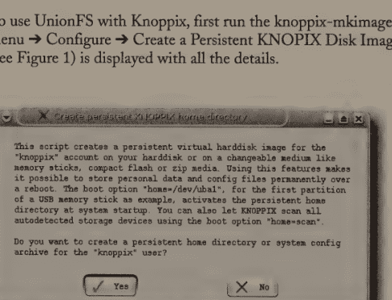

图 1-1：`knnoppix-mkimage` 界面

不要担心窗口的标题栏，因为 Knoppix 创建的是主目录而不是整个磁盘映像。Knoppix 开发者很快就会清理那部分遗留代码。

熟悉此概述，然后点击 Yes。接下来，选择你想要用于存储文件的可写介质，如图 2 所示。


图 1-2：选择用于存储文件的可写介质

有了 Knoppix CD 和一个 USB 闪盘，你可以坐在任何电脑前，在几分钟内发现自己正带着你的设置、配置、程序和自定义内容使用 Knoppix。也就是说，只要你不重启它，那简直太酷了！

Knoppix 会自动检测硬盘、USB 闪盘、Zip 驱动和其他可写介质。如果你计划将映像放在硬盘上，USB 闪盘会给你带来便携性。随后，它会询问你是否加密你的映像，请稍等。如果你需要加密你的映像，点击 Yes。

接下来，选择你想要用于存储文件的可写介质，这将加密你的映像（见图 3）。


图 1-3：加密你的映像

不要担心窗口的标题栏，因为 Knoppix 创建的是主目录而不是整个磁盘映像。Knoppix 开发者很快就会清理那部分遗留代码。

熟悉此概述，然后点击 Yes。接下来，选择你想要用于存储文件的可写介质，如图 2 所示。


图 1-2：选择用于存储文件的可写介质

Knoppix 会自动检测硬盘、USB 闪盘并选择一个分区。随后，它会询问你你的映像的大小（见图 4）。


图 1-4：你的映像的大小是多少？

如果你需要加密你的映像，点击 No。

如果你需要加密你的映像，点击 No。

如果你需要加密你的映像，点击 No。

。`Knoppix-mkimage` 完成了工作，表示成功。

这可能需要一些时间，请耐心等待。最后，`Knoppix-mkimage` 完成了，表示成功，如图 5 所示。


图 1-5：你的持久映像已创建


要使用你的持久映像，你可能需要在启动时指定（这是 Knoppix 的特殊指令）。使用 `knoppix home=scan` 在 Knoppix 中搜索主目录。如果你将映像放在硬盘上，可以使用 `knoppix home=/dev/sda` 来使用 `sda`。

## 本书中使用的规范

在书中，你会发现几种通知图标——注意、警告和提示，它们指出了重要信息。以下是这类型图标的样式：

### xxiv 引言

| 注释 Note | 为提供额外信息或资源。 |
| 警告 Caution | 表示您应该极其小心，以避免潜在的灾难。 |
| 提示 Tip | 是能够节省您时间和精力的建议。 |

注释将为您提供额外信息或资源。

警告表示您应该极其小心，以避免潜在的灾难。

提示是能够节省您时间和精力的建议。

```
代码行通常比单页上能显示的要长。符号 ↴ 表示接下来的代码行实际上是当前行的延续。例如，
# dpkg-query -W --show='$(Installed-Size) {Package}\n' ↴
| sort -n
```

当你在编辑器中输入它时，这实际上是一行代码。

书中的代码、文件名、函数等以等宽字体显示，而你输入的内容将以**粗体**或等宽字体形式出现。

## 黑客注意事项

仅仅在计算机上启动 Knoppix 绝不会损坏那台机器。事实上，这是 Knoppix 的美好之处之一：你可以启动它，尽情地玩耍，重启并拔掉 Knoppix 光盘，你的机器依然完好如初。然而……

你仍然需要对 Knoppix 小心，因为你可能会（如果你知道如何操作，而你将会学会）删除计算机上的关键系统文件，破坏系统分区，并通常将你精美的 Windows 或 Linux 机器变成一个无法启动的塑料和硅制外壳，这需要重新安装或使用系统还原（如果你正在使用 Windows XP 的系统还原功能）才能再次运行。

嘿，别担心！这并不意味着 Knoppix 是危险的。它只是意味着这是一个强大的工具，就像任何强大的工具一样，你需要用谨慎和尊重的态度来对待它。在阅读这本书时保持清醒，并尝试运用为你演示的技巧。准备一个良好的备份也无无处（不过话说回来，备份从无坏处）。

所以，请尽情享受 Knoppix 的乐趣吧，但也要小心。你将开始学习当今可用的最酷、最具创新性且最强大的软件工具之一。确保你是负责任的——你的计算机会感谢你的。


充分利用 Knoppix 网络工具

连接其他机器和资源

## 解开 Knoppix 工具包迷宫

Linux 以开箱即用包含用户可能想要的所有软件而闻名——而且是免费。Knoppix 开发者在决定包含成千上万个包中的哪一个上花费了很大精力，他们做出了决定，而你就是受益者。这一章无法涵盖 Knoppix 磁盘上的所有内容——那本身就是一本书了！但它将介绍一些重要的应用程序，如 `K3b` 和 `GIMP`，你可能会在某个时候发现自己正在使用它们。

> 注释：如果你不知道如何启动 Knoppix，在继续之前，请参阅附录 A，“启动 Knoppix”获取完整说明。你必须运行 Knoppix 才能真正从这本书中学学习。

- 让 Knoppix 看起来更好看
- 设置打印机
- 享受多媒体
- 使用 `K3b` 刻录 CD
- 使用文本编辑器
- 使用办公软件

开箱即用的 Knoppix 存在着可以被称为“丑化问题”。它并不像本可以那么漂亮和用户友好。当你启动 Knoppix 时，可能想做的第一件事就是让它变得整洁一点，这样它就不会让你因为锯齿状、丑的字体而不断咬牙。

然后，在做出更改后，你想要确保保存你的选择，这样当你下次启动 Knoppix 时，就不需要再次配置操作系统的外观了。这在引言中已有详细介绍，但如果你由于某种原因跳过了，现在只需选择 `Knoppix -> 配置 -> 保存 Knoppix`，选择一个硬盘或 USB 闪存进行保存，然后在下次启动 Knoppix 时选择该源。

### 替换系统字体

默认字体绝对很丑。切！我们认为最佳解决方案是下载并安装微软 Web 字体，这些字体既漂亮又常见。然而，如果你没有使用持久性主目录，你将会遇到问题。你可以安装字体，但当你重启 Knoppix 时，你必须重新安装所有字体，因为你所有的工作都被清空了。使用持久性 Knoppix 镜像，所有的工作都会被保存，因此你可以认为新安装的字体在那里。

要安装微软 Web 字体，请使用 `KPackage`，这是 Debian `APT`（高级包工具）的 KDE 软件安装程序。从 Knoppix 菜单中，选择 `工具 -> 管理 Knoppix 软件` 启动 `KPackage`。当 `KPackage` 打开时，选择“全部”选项卡，如图所示。

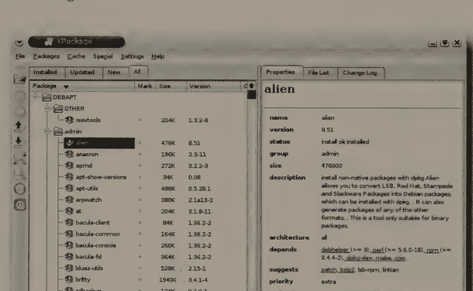

（此处文本缺失，请参考流程）

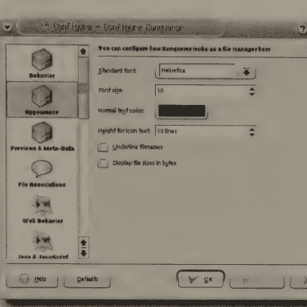

图 1-3：更改 Konqueror 文件管理器的字体

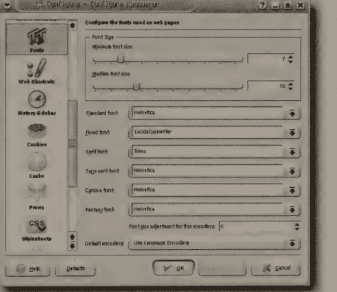

图 1-4：更改 Konqueror 在显示网页时使用的字体

将屏幕上的字体更改为你更喜欢的字体。以下是我们的建议：

- 标准字体：Verdana 或 Bitstream Vera Sans
- 等宽字体：Andale Mono（如果你的系统中有此字体，它比 Courier 家族中的任何字体都要好得多）
- 衬线字体：Bitstream Vera Serif 或 Times New Roman（仅在必须时才使用 Times New Roman；Bitstream Vera Serif 要易读得多）
- 无衬线字体：Verdana 或 Bitstream Vera Sans
- 手写字体：Lucida Calligraphy、Lucida Handwriting 和 Bradley Han ITC 都非常棒，但这些一个都没有，所以请选择 Arioso。
- 艺术字体：Comic MS 虽然没有（你几乎不需要这种字体），但你可以挑选任何搞怪的字体。

点击 `OK` 应用更改并关闭此窗口。如果你愿意，可以关闭 Konqueror。现在你已经更改了系统字体，进入程序字体。

你可能会发现自己经常使用 `Mozilla Firefox`、`KMail` 和 `OpenOffice.org`。你也可以更改字体来让这些程序更容易用。

要设置 Firefox 的字体，点击面板上的 Mozilla 图标（是的，它应该是 Firefox 图标，但它不是），选择“编辑 -> 偏选项”，点击“常规”图标，并选择“字体与颜色”（见图 1-5）。进行以下更改：

- 比例字体：无衬线字体
- 衬线字体：Bitstream Vera Serif/Times New Roman
- 无衬线：Bitstream Vera Sans 或 Verdana
- 等宽：Andale Mono

点击 `OK` 然后再次点击 `OK` 关闭“字体与颜色”。这样不是好多了吗？

从 K 菜单通过选择 `Internet -> KMail` 打开 `KMail`。选择“设置 -> 配置 KMail”，然后点击左侧的“外观”图标。你会看到图 1-6 所示的“字体”选项卡。

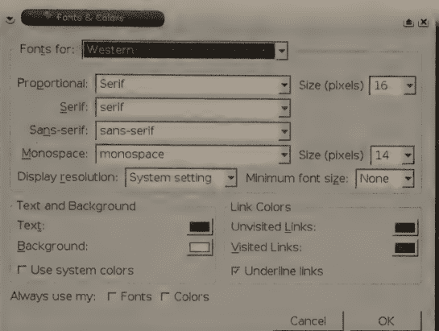

图 1-5：更改 Firefox 的字体选项

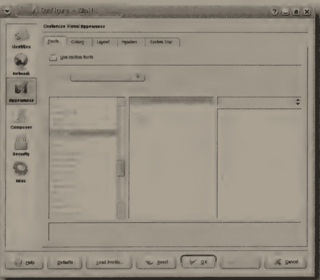

图 1-6：更改 KMail 使用的字体

如果你勾选“自定义字体”框，屏幕主部分的选项是。从下拉列表中选择一个项目并为它选择字体；从列表中选择另一个项目，选择一种字体，以此此类推，直到所有项目都更改。此时，点击 `OK`，你新的字体将应用到 `KMail`。

你可以选择任何你字体。我们会把除“等宽”以外的所有内容都改为 Bitstream Vera、Verdana 或 Arial——基本上就是某些悦目且易读的字体。对于“等宽”，如果你有的话请尝试 Andale Mono，如果没有，请尝试 Bitstream Vera Mono。点击 `OK` 选择 `KMail` 的配置窗口，你就可以准备绪了。我们建议将 Composer 更改为 Andale Mono 以保持邮件为纯文本，这意味着使用等宽字体。


无论你做什么，都不要打开 `OpenOffice.org` (`OOo`) 并期望配置字体。噢，不。不是那样的。相反，从 K 菜单选择 `OpenOffice.org 1.1.4→OpenOffice.org 1.1.4 打印机管理`（见图 1-7）。

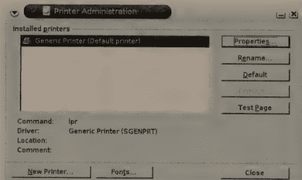

图 1-7：难道不显而易见在配置打印机时应该应该配置字体吗？不？我们也不这么认为。


点击“字体”按钮打开“字体”窗口。然后点击“添加”，这会添加字体窗口。点击窗口源目录中标记为“...”按钮，导航到`/usr/share/fonts/truetype/mstcorefonts`，并点击“选择”。回到“添加字体”窗口，勾选“仅软链接”框，然后点击“全选”，最后点击 OK。你被告知添加了许多新字体，点击 OK 关闭该窗口。点击“关闭”移除“字体”窗口，然后再次点击最终退出“打印机管理”。

如果算是一种安慰，这个过程在 OpenOffice.org 2.0 版本中得到了改进，在写作期间它仍在测试阶段。你将在 Knoppix 的未来版本中看到它。

要启动 OO，点击面板上的程序图标（带鸟的那个）。在 OO 打开后（这可能需要一些时间！），选择“工具 -> 选项”，点击“文本文档”旁边的 +。

由于你首先添加了所有的微软字体，OOo（为了与 Microsoft Word 最大的兼容性）将除标题以外的所有内容改为 Times New Roman 和 Arial。现在你和世界一样了。

从前，一位老牌 IT 专家正在指导聚集在他周围的新手 IT 手。他正充满智慧地讲述如何让“客户”开心，这时有人问他：“老师，为了防止我们的电脑用户向我们抱怨，我们可以做的最重要的事情是什么？”他的回答是：“确保他们可以打印。不能打印比任何事情都让人愤怒。”现在，那是互联网进入大众意识之前，他的回答可能会有所不同，网络访问是新的首要问题。尽管如此，打印仍然紧随其后。

幸运的是，Knoppix 让设置打印机变得相当容易。如果你的打印机在 Linux 下工作（例如三星），Knoppix 无法修复它，但如果你尝试使用被 Linux 支持的打印机，那么你应该可以使用你的 Knoppix Live CD 使用它。

要开始，从 Knoppix 菜单选择“配置 -> 配置打印机”。Knoppix 打开 KDE 打印机配置工具，如图 1-8 所示。

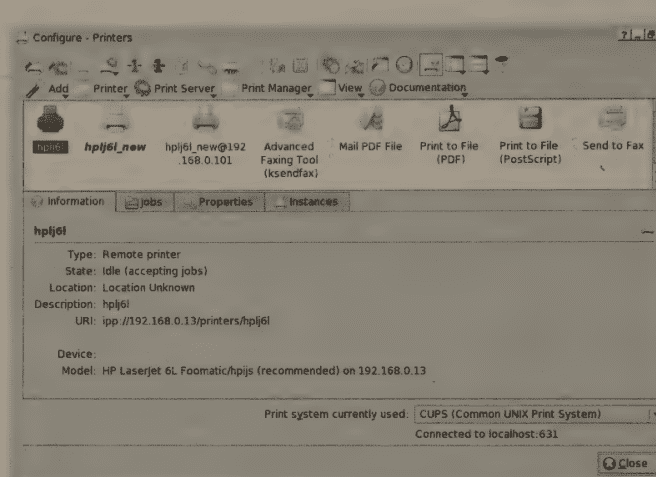

图 1-8：KDE 打印工具

此外，你还可以选择任何一个的：

- 1. 简介
- 2. Samba
- 3. 工作组
- 4. 标识
- 5. 模型
- 6. 驱动程序
- 7. 打印机
- 8. 选择
- 9. 配额
- 10. 用户
- 11. 通用
- 12. 确认
- 13. 位置

# 享受多媒体

多媒体让计算变得有趣，无论是音乐、视频、图像还是这些内容的任何组合。虽然怀疑你是否真的会将 Knoppix 作为一个数字生活枢纽的真正多媒体盒来使用，但这个 Live CD 自带了你可以处理多媒体文件的软件，这仍然非常酷。让我们浏览一下这些软件的亮点，并简要查看任何操作系统（而不只是 Linux）中的一些优秀多媒体内容。

## 听声音

噪音。音符。电影中的对白。歌曲中的歌词。在 Knoppix 中，你可以听到这一切……也可以对它们进行修改。

### 使用 XMMS 听音乐

Linux 用户有大量的播放器可供选择，每天都有新的播放器出现，但 Knoppix 包含一个可能仍在在使用和依赖的旧老兵：XMMS，即 X 多媒体系统（X Multimedia System）。

从 K 菜单中通过选择 `Multimedia -> XMMS` 打开 XMMS。为了有效使用 XMMS，你需要能够看到它，默认情况下，界面是为那些同时通过强大的电子显微镜观察程序的“完美眼睛”设计的。在程序的空白区域上点击右键，选择 `Options -> Double`（双倍）。这样好多了！一旦你掌握了 XMMS 及其界面，你就可以恢复正常尺寸，目前先使用放大后的窗口。

除了 XMMS 窗口外，你还需要显示播放列表编辑器（Playlist Editor）窗口，因此点击 PL 按钮（或在程序上右键并选择 `Playlist Editor`）。播放列表编辑器窗口将打开。抓住右下角并拖动来调整播放列表的大小，使其更容易看到你已队列的歌曲。图 1-9 显示了带有停靠播放列表编辑器的 XMMS。

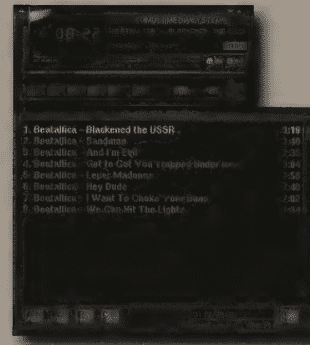

图 1-9：XMMS 简单有效。

XMMS 支持多种格式的播放，包括 MP3、OGG（MP3 的免专利替代方案——而且听起来更好！）、WAV 和 CD 音（事实上，XMMS 还可以播放 MPEG 格式的视频）。你可以点击 `FILE` 图标打开 Load 对话框，将歌曲添加到 XMMS 播放列表中。导航到你的音乐文件夹，找到你想要的文件，选择它们，关闭对话框，并点击 XMMS 中的播放按钮。假设你的声卡受支持，你应该能听到你的音乐。

这里是另一种将音乐添加到播放列表的方法：打开 `Konqueror` 文件管理器，导航到你的歌曲，选择你想要的歌曲，并将它们拖到 XMMS 播放列表中。这要简单得多，特别是如果你已经在使用 `Konqueror` 管理文件的话。

XMMS 并不是一个复杂的程序。如果你在电脑上用过任何音频播放器，可能很快就能学会 XMMS。如果你遇到困难，或者只是想了解更多关于 XMMS 的信息以及下载皮肤插件，请访问项目首页 `www.xmms.org`。

## 使用 Audacity 编辑音频文件

Audacity 是一个免费的音频录制器和编辑器，可以导入数字音频文件，以多种方式对其进行处理并导出。不过，在使用 Audacity 之前，你需要一个要编辑的音频文件。侧边栏“将 MP3 转换为 WAV”解释了如何获取音频文件。

一旦有了音频文件，从 K 菜单中选择 `Multimedia ➜ Audacity` 打开 Audacity（见图 1-10）。

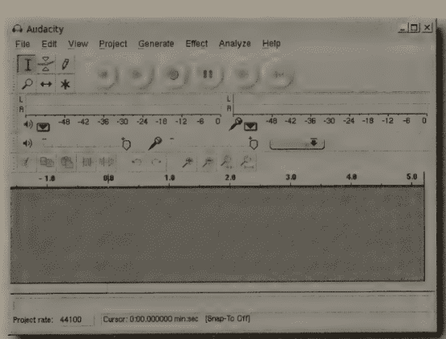

### 将 MP3 转换为 WAV

在 IT Conversations (`www.itconversations.com`)，你可以收听技术领域领先思想者的采访和演讲的流媒体音频。流媒体音频很酷，但为了方便，我们更喜欢在机器上保留文件；幸运的是，IT Conversations 也提供了 MP3 格式的内容。你可以下载大量 MP3 文件，但我们中有些人无法在边写作工作时边听别人说话！

不过，你可以将 MP3 转换为 CD 音，这样你在开车时就可以听采访和演讲了（如果你的车载 CD 播放器支持 MP3，可以跳过本节）。要将 MP3 转换为 WAV，运行以下脚本，你可以将其命名为 `mp32wav` 并放在你的 `~/bin` 目录下：

```
for i in *.[mM] [pP3]; do
  # 将大写转换为小写并将空格替换为下划线
  name=$(echo $i | tr '[A-Z]' '[a-z]')
  # 将 .mp3 替换为 .wav
  name=${name//.mp3/.wav}
  # 将 mp3 转换为 wav
  mp3-decoder $i --wav $name
done
```


WAV 文件比 MP3 文件大得多，请确保硬盘上有足够的空间。一个粗略的规则是每1MB 的 MP3 会变成 10MB 的 WAV。Knoppix 使用你的 RAM 作为“硬盘”，如果不小心会很快用完它。运行 `df -h` 查看剩余多少空间。如果 `/ramdisk` 空间不足，请检查硬盘上的可用空间。确保它具有写入权限（在 Knoppix 桌面上点击图标右键，进入属性，取消勾选只读）。在章节结束时，你应该会有几个 WAV 文件可以刻录到 CD 中收听（关于如何刻录，参见后文的“刻录 CDs”）。留意可用空间，当我们尝试刻录 Clayton Christensen 的“Capturing the Upside”（可用 `www.itconversations.com/shows/detail.html`）时，它太大了——事实上，1 小时 48 分钟的内容将需要几乎两张 CD！

如果你在首次打开 Audacity 时遇到错误消息：

初始化音频：无法播放或录制。

错误：另一个程序正在使用你的声卡。你正在用 XMMS 听音乐吗？你的系统在报警吗？从菜单中关闭它们，选择 `Multimedia -> System Notifications`，点击 `All`，然后点击 `Off`！关于此问题的更多帮助，请参见 `www.audacity.team/wiki/Issues`。

在使用 Audacity 打开你的音频文件（通过 `File -> Open` 并导航到 `clayton_christensen_capturing_upside.wav`），Audacity 会缓慢导入文件——并如图 1-11 所示显示。

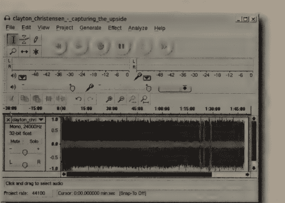 （注：此处图片编号与文中描述略有出入，按原文保留）

图 1-11：Audacity 打开了 WAV 文件并准备好编辑


整个文件是可见的，波形显示了音频进度。对于这个例子，我们想要将文件大致平分，比如在第一个标记处（而不是在句子中间）。点击该标记附近，然后点击 `Play`。当你听到合适的停止位置时，点击 `Stop` 按钮，按住 `Shift` 键并按左箭头，直到光标回到 `WAV` 文件的开头（可以使用鼠标，尽管容易滑脱）。在继续之前，确保在 `Audacity` 中点击 `Stop` 按钮。


如果新的波形看起来和几秒前不一样，那是因为 `Audacity` 将其展开了——如果你向右滚动，可以看到整个文件。要返回之前的视图，进入 `Fit in Window`（适应窗口），一切就会重新聚集。

保存新的 `WAV` 文件，选择 `File -> Export WAV`，导航到你想保存的位置并输入适当的文件名；这个例子，可能是 `clayton_christensen_capturing_upside_1.wav`（记得它是从原始文件开头提取的，所以现在是它的部分）。

关闭此文件并回到原始文件。再次选择 `File -> Export WAV`，导航并保存文件为 `clayton_christensen_capturing_upside_2.wav`（因为是原始文件的后半部分）。不再需要原始 `WAV` 文件，你可以删除它以释放空间。

现在有两个刻录长度的文件；你可以使用 `K3b`（后文讨论）刻录两者，并在长途旅行中开车欣赏 Christensen 教授精彩的观察。这只是你用 `Audacity` 可以做的许多事情之一。要充分发挥该程序的作用，你需要进一步研究 `Audacity`。你可以从访问 `Audacity` 首页 `http://audacity.sourceforge.net` 开始，然后在 Google 上搜索“audacity tutorial”。你会发现很多很好的

谁不喜欢导入和查看朋友的照片？然后用软件扭曲他们的头部让他们看起来像南瓜头，然后再把结果邮件给其他朋友？是的，`Knoppix` 让这一切成为可能。事实上，那是他的格言：“`Knoppix` 让南瓜头多年多年。”好吧，这是一个愚蠢的笑话——但其他部分是真的。诚实！

当需要查看图片时，你在寻找三点：速度、对各种图像格式的广泛兼容性，以及自动调整大于显示器的图像的能力。`Knoppix` 自带了 `Kuikshow`（见图 1-12），这是一个几乎满足这三个目标的程序。从 `K` 菜单中打开 `Kuikshow`，选择 `Graphics -> Kuikshow`：

`Kuikshow` 中没有可见的菜单，因为它是一种简易的应用程序。不过，你可以对在 `Kuikshow` 中查看的图像进行一些更改，右键点击图像并查看上下文菜单（如图 1-13 所示）。

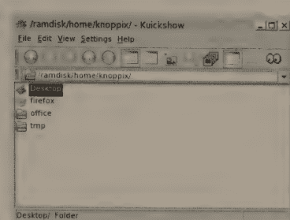

图 1-12: Quickshow，已打开并准备好显示图片

| 显示下一幅 | 下翻页 |
| :--- | :--- |
| 显示上一幅 | 上翻页 |
| 放大 | `+` |
| 缩小 | `-` |
| 恢复原始尺寸 | `O` |
| 最大化 | `M` |
| 旋转 90 度 | `9` |
| 旋转 180 度 | `B` |
| 旋转 270 度 | `7` |
| 垂直翻转 | `/` |
| 水平翻转 | `*` |
| 亮度 | `>` |
| 对比度 | `>` |
| 值 | `>` |
| 打印图像... | `Ctrl+P` |
| 另存为 |  |
| 属性 | `Alt+Return` |
| 关闭 | `Ctrl-W` |

图 1-13: Quickshow 上下菜单提供了许多选项。

此菜单中的所有内容都一目了然，因此非常易用。不要忘记只需点击右键即可随时调用它。

将 `GIMP` (`GNU` 图像处理程序) 视为创建一个开源版 Photoshop 的尝试。它目前还没有达到那个水平……但一直在不断改进，可能已经足够满足 90% 用户的需求。无疑，如果你正在使用 `Knoppix` 执行一些快速且粗略的活儿，那么 `GIMP` 可能恰好合适。你还会发现它是一个大而复杂的程序，值得专门写一本书。在这里我们无法涵盖 `GIMP` 功能的一小部分，但我们将指出几点内容，以激发你对 `Knoppix` 中这一迷人扩展的兴趣。

从 `K` 菜单中选择 `图形`（`Graphics`）-> `GIMP` 图像编辑器，然后在程序内部打开一张图像，右键点击图像并选择“打开方式”（`Open With`）。遗憾的是，`Knoppix` 中的 `KDE` 默认没有将 `GIMP` 包含在“打开方式”列表中，因此你需要手动添加它。方法如下：选择“打开方式+”。出现“打开方式”窗口。点击“图形”旁边的 `+` 号以展开它，然后选择 `GIMP` 图像编辑器。在点击确定之前，如果你打算经常使用 `GIMP`，请勾选“为此类型记住应用程序关联”旁的复选框。

`GIMP` 显示图像的方式如图 1-14 所示。（这张照片是 Libby，作者之一的一条可爱狗，当时它还是一只幼犬。）

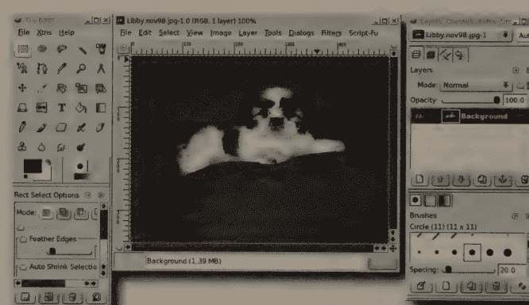

图 1-14: `GIMP` 准备好编辑一张非常可爱的小狗照片

有三个窗口处于打开状态。从左到右，它们分别是：主工具箱，包含了你处理图像的基本工具；图像窗口，包含你正在处理的图片；以及一个包含多个面板的窗口，包括图层（`Layers`）、通道（`Channels`）、路径（`Paths`）、画刷（`Brushes`）、图案（`Patterns`）和渐变（`Gradients`）（我们称之为对话框）。注意菜单——主工具箱拥有管理通用图像的高级菜单，图像窗口包含了所有让你以令人惊叹的多样方式更改图像的功能，而对话框没有菜单，这完全没。

如果你熟悉 Photoshop、Fireworks 或任何其他图像处理程序，请深入探索 `GIMP`，开始发现它将你熟悉的命令对应项放在了什么位置。不要指能找到所有功能——如前提到的，`GIMP` 尚未达到专有软件的水平，但它正在快速进步。

如果你的图像处理经验既不深也不广，请查看 `GIMP` 网站 (`www.gimp.org`) 的文档并开始上手玩玩。找一张你可以尝试各种技术的图片，看看会发生什么。

尽管大多数人最后只用 `GIMP` 来裁剪和调整图像大小，但这里有一个酷炫的技巧可以展示该程序实际上有多强大。两个最有趣的菜单是“过滤器”（`Filters`）和“脚本”（`Script-Fu`）：过滤器对你的图片应用预处理以改变其外观，效果涉及光线、畸变和颜色；`Script-Fu` 则允许开发者编写脚本对照片执行多项操作，以令人惊叹的方式改变它，特别是对于我们这些不知道自己在在做什么的人来说。你可以通过选择 `Script-Fu -> Decor -> Old Photo` 来访问我们最喜爱的功能之一。在出现的对话框中进行一些选择，然后点击确定。结果非常酷。图 1-15 显示了 `Script-Fu` 处理后的 Libby 照片，看起来像是在世纪初拍摄的（不是最近的那个）。

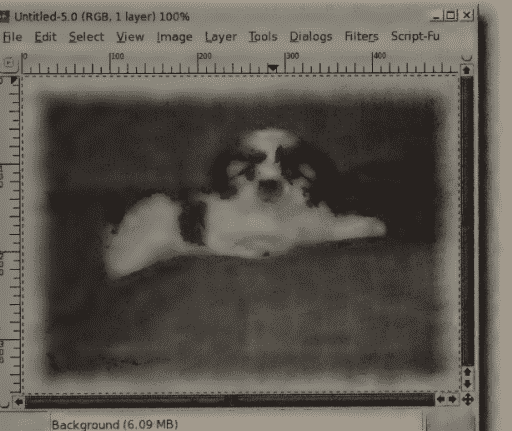

图 1-15: 同一只非常可爱的小狗，大约 1900 年

在带有灰度图像的书中，这些变化很难看出，所以你必须亲自尝试。那里还有很多类似的技巧——多到让即使不是图形专家的人也能做出酷炫的事，这得益于出色的程序、聪明的编程以及一些引导。至少稍微熟悉一下 `GIMP`；它是图像处理的开源黄金标准。关于 `GIMP` 的更多信息，请查看网站 `www.gimp.org`。用户在网上写了很多关于 `GIMP` 的内容。

## 通过命令行使用 ImageMagick 处理图形

`GIMP` 是一个很棒的程序，但它是 GUI 应用。如果你想要脚本化操作，可以使用 `ImageMagick`，这是一个功能极其且强大的命令行程序。有很多东西需要学习，请仔细阅读。更多信息请访问程序网站 `www.imagemagick.org`。

让我们看看可以使用 `ImageMagick` 的几种方法。希望这些方法能激发你去做更酷的事（如果你正在开发什么）。我们可以使用 `KDE` 的截屏工具（从图形菜单可用），但它不会保存为 `TIFF` 格式，我们想要。我们使用了 `ImageMagick` 并将以下行插入到 `.bashrc`：

```bash
# 窗口截图
alias window='sleep 3; -depth 8 window.tif'
# 区域截图
alias selection='sleep 3; -depth 8 selection.tif'
# 全屏截图
alias screenshot='sleep 3; -depth 8 window.tif'
```


将这些行添加到 `.bashrc` 后，不要忘记运行 `source ~/.bashrc` 以便立即使用新命令。`sleep 3` 命令在截图之前给你三秒钟时间；如果你需要更多（或更少）时间，请更改数字。`import` 命令是 ImageMagick 的核心工作，通过点击和拖拽指定。如果你不想将图像保存为 TIFF，可以将扩展名改为 `.jpg`、`.gif` 或你喜欢的任何格式。使用 `-depth 8` 命令是因为 ImageMagick 取 16 位的 TIFF，这会导致 GIMP 和其他程序报错。如果你不保存图像为 TIFF，请删除该选项。

这是另一种使用 ImageMagick 的方法：将图像列表从一种格式转换为另一种。如果你有一文件夹 TIFF 想转换为 JPG，例如，进入 TIFF 所在的目录并运行以下命令：

```bash
for i in *.tif; do convert "$i" "${i%.tif}.jpg"; done
```

这个循环对循环作用于目录中的 TIFF。它将文件转换为 JPEG 并保持整洁。不想删除原始文件？去掉 `rm $i`，原始 TIFF 将保留。如果你将使用此命令，将其变为别名。如果你可以自由使用不同的格式，在 `~/bin` 目录下创建一个名为 `converting` 的执行文件，粘贴行并保存：

```bash
for i in *.1; do convert "$i" "${i%.1}.2"; rm $i; done
```

注意你正在使用变量。运行你的脚本，执行以下命令：`converting tif jpg` 替换 `.1`，`.2` 替换 `.2`。想将一批 PNG 转换为 GIF 吗？改为 `png gif`，依此类推。

最后一个 ImageMagick 示例是我们之一写的，在网站上提供一些数字照片供下载和用作壁纸。你也可以尝试：收集大约 50 张图片并在 GIMP 中处理每一张，以不同的桌面尺寸保存原始图像，包括 `1024x768`、`800x600` 和 `640x480`。你可能还需要一个 `200x150` 的缩略图，让人们在下载之前对图像有个概念。除了缩略图，JPG 应该是最高质量。

手动修改多张照片既无聊又麻烦，所以使用以下脚本，你可以在 `~/bin` 目录下创建它：

```bash
for i in *.jpg; do
  width=$(identify "$i" | sed -re 's/\. ([0-9]+)x[0-9]+).*/\1//')
  height=$(identify "$i")
  if test "$width" -ge 1600; then
    for size in 1600x1200 1024x768 800x600 640x480; do
      convert "$i.jpg" -resize "$size" -compress -quality 100 "${i}_$(size).jpg"
    done
  fi
  size=200x150
  convert "$i.jpg" -resize "$size" -compress JPEG -quality 75 "${i}_$(size).jpg"
done
```

用 `chmod 744 photosize` 使其可执行后，脚本运行得完美。我们的大部分图像是 `1600x1200`，但并非全部。我们需要处理最大的图像，而 `identify` 命令可以做到。运行 `identify sample.jpg` 会给你提供类似所示的信息：`sample.jpg JPEG 1600x1200 DirectClass 8-bit 641kb 0:00:01`。现在你知道尺寸了，但如果你只关心宽度，这时 `steer`（一个旧 Unix 命令）派上用场了。

# 24 第一部分 — 探索神奇的 Knoppix 工具箱

基本上，通过 `sed` 的正则表达式工作获取与原始图像宽度对应的数字，并将该数字写入 `width` 变量。

注意：关于正则表达式的更多信息，请参见 Andrew Watt 的《入门正则表达式》(`www.rox.com/WileyCDA/WroxTitleCd-0764574892.html`)。

现在脚本将执行一个测试：`width` 变量中的数字是否等于 `1600`？如果不等于，则什么都不会发生并跳过该图像。如果匹配，这个功能强大的命令就会启动并更改每张图像的尺寸，同时使用最高质量且无压缩。每个文件都会重命名，在文件名中包含尺寸以便区分。

提示：是的，`convert` 可以更改的不只是文件类型和尺寸。事实上，它可以做更多。`man convert` 应该是你的下一步。

当处理完成后，你将拥有一组各种常用尺寸的美照，准备好上传到网站与任何人共享（根据知识共享许可协议！）。如果你想看作者的作品，请访问 `www.granneman.com/personal/photos/`。在这些页面上的每张照片均由 ImageMagic 提供。

## 观看视频

过去几年里，随着网络进入我们的家庭和企业且带宽变得越来越大快，数字电影变得越来越流行。尽管在几个关键方面受到限制，但 Knoppix 让你能够收听和观看电影及视频。

### 使用 xine 查看视频

`xine` 很难说是我最喜欢的视频播放器，原因很简单：它的 UI 相当糟糕。不要误会：使用 `xine` 视频引擎是很棒的，但 `sine` 界面由于其复杂性以及缺乏提示和反馈，几乎让人一头雾水。无论如何，这就是 Knoppix 包含的内容，也是我们要一览的。

注意：你可以使用 APT 安装具有更好 UI 的视频播放器。特别是查看一下 `player`、`Caffeine` 或 `Totem`。

通过选择 K 菜单中的多媒体 -> 视频 -> xine 播放器打开 `xine`，但你可能会更频繁地通过右键点击视频文件并选择“打开方式 -> xine”来使用。图 1-16 显示了在 `xine` 中打开的视频文件。

# 第1章 — 解开 Knoppix 工具箱迷宫 25


图 1-16：Xine 正在播放托马斯·爱迪生的《梅·艾文吻》（1896）

要控制播放，右键点击电影和菜单中的项目。虽然 Xine 非常简单，但用起来并不美观。

## 使用 K3b 刻录 CD

这是一个常见的场景：别人的电脑无法启动，他必须从那台机器上提取数据。正如你在第 4 和第 5 章中发现的，使用 Knoppix、网卡 (`NIC`)、以太网和网络来解决这个问题非常容易，但这并不总是可能的。不过，如果用户在该机器上安装了 CD-R/W 设备，你仍然可以通过刻录 CD 来帮助他。从命令行刻录 CD-RW 极其困难，但使用一个良好的 GUI 要容易得多，而 K3b 是 Linux 上最简单的 CD 刻录 GUI，甚至适用于任何平台。

通过选择多媒体 → K3b 打开 K3b。当你第一次打开它时，K3b 会要求你确认你的刻录机设备。它可能默认为 0，这显然没有帮助，因此将其更改为正确的设置并点击确定。

> 这也许是显而易见的，除非你的系统中安装了 CD-R/W 设备，否则 K3b 将无法工作，且 Knoppix 需要识别它。要确认 K3b 是否看到了你的 CD-R/W，请打开 K3b，选择设置 -> 配置 K3b，并选择左侧的“设备”按钮。CD-R/W 应该列在那里。如果没有，点击“添加设备”并帮助 K3b 尝试寻找你的刻录机。如果你需要更广泛的帮助来让你的 CD-R/W 硬件工作，请查看 CD 写入 HOWTO `www.tldp.org/CD-Writing-HOWTO.html`。

还有一点你需要考虑：如果 Knoppix 正在占用你唯一的 CD-R/W 驱动器，你就无法刻录 CD。如果你有两个 CD，那没问题了：在一个 CD 中启动 Knoppix，并使用另一个进行刻录。如果你只有一个 CD-R/W 驱动器，你可能需要将 Knoppix 安装在硬盘上（见附录 B）以释放你的 CD 进行刻录（在你检查完 CD 后可以卸载 Knoppix）。

K3b 分为两个主要区域：窗口上半部分的文件和文件夹导航区域以及下半部分的项目视图，如图 1-17 所示。

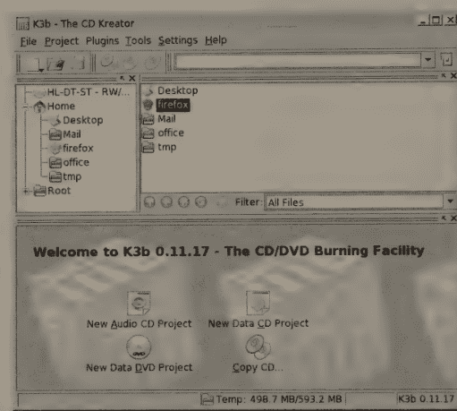

图 1-17：K3b 主窗口

K3b 通过在项目视图中提供常用任务的按钮，让入门变得非常简单。

## 第 1 章 — 破解 Knoppix 工具包迷宫 29

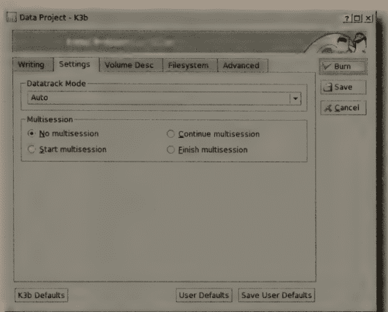

图 1-20：在 K3b 中设置你使用的会话类型


大多数情况下，你可能会完全刻录一张 CD，因此你想使用默认设置：不多会话（No Multisession）。如果你打算使用多个不同的会话，你不希望 K3b 在你完成之前“关闭”光盘。要正确执行此操作，第一次刻录时选择“开始多会话”（Start Multisession），除最后一次外的后续刻录均选择“继续多会话”（Continue Multisession），最后用“完成多会话”（Finish Multisession）完成你的 CD-R/W，这会告诉 K3b 关闭光盘是安全的。你最经常使用默认的“不多会话”，但如果需要，了解如何创建多会话 CD 是好的。

## 保持信息更新

`Volume Desc`选项卡如图 1-21 所示。

卷描述选项卡上的任何信息都不会阻止刻录成功，但你可能想在这里花一点时间，以便让条理井齐清晰。换句话说，这个选项卡不是给计算机使用的——而是给人类用户使用的。根据你的需要填写内容。

## 理解文件系统

`Data Project`的文件系统选项卡（见图 1-22）如果你想确保光盘可以在 Linux 和其他操作系统上使用，这个选项卡非常重要。对于备份来说，这是一个至关重要的考虑。如果你永远不需要接触 Windows 机器，这个选项卡对你可能没有那么重要，尽管这里仍然有一些你可能想要设置的内容。

### 第一部分 — 穿过神奇的 Knoppix 工具包

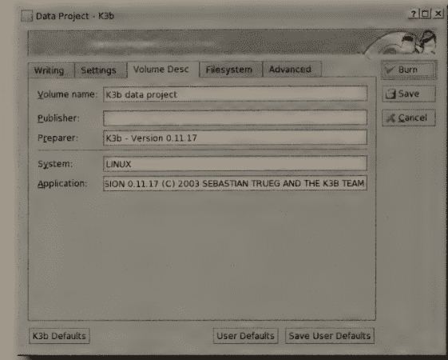

图 1-21：在 K3b 中描述你正在刻录的光盘

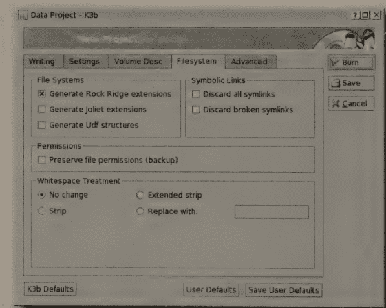

图 1-22：告诉 K3b 你想在新的 CD 上放置什么类型的文件系统。

## 第 1 章 — 破解 Knoppix 工具包迷宫

如果你追求跨平台兼容性，勾选文件系统中的复选框是关键。CD 有许多种标准，而且按照计算机世界的惯例，它们并不总是达成一致。例如，当你刻录 CD 时，你可以坚持 ISO9660 标准，但所有文件名必须是大写字母，且长度最多为八个字符（加上点号和扩展名）。想要 DOS 吗？你还可以使用 Rock Ridge 扩展（包括 Linux 和 Mac OS X）来读取包含长达 255 个字符文件的 CD，并支持 Unix 类系统，如所有者、组、权限和符号链接。Windows 不支持 Rock Ridge（微软拥有 30,000 名员工和价值 50 美元的钞票，无法支持 Rock Ridge），所以除非你想在该操作系统上访问数据，否则不要将其作为唯一文件使用。

如果你想确保 Windows 可以读取你光盘的内容，请确保启用 Joliet 扩展，它支持文件名长达 64 个字符（尽管有一种解决方法，正如你所看到的）。Linux 和 Mac OS X 用户也可以读取使用 Joliet 的 CD，但 Mac OS 9 及更早版本会将文件名截断为 31 个字符，这是 OS X 时代之前的一个主要限制。

UDF 代表通用磁盘格式（Universal Disk Format），主要用于 DVD，但 CD-R/W 也使用它，包括空格。其理念是允许 127 个字符的文件名，这样你就可以像使用软盘、USB 闪存器或硬盘一样写入 CD 和 UDF 中：只需拖放即可。然而，为了让 UDF 发工作，如果你使用 Windows 或 Mac OS，你需要非常新的硬件和软件驱动程序（大多数 Linux 驱动程序现在包含了对基于 UDF 磁盘的软支持）。如果你追求广泛的兼容性，目前可能应该避免 UDF。

在了解这些不同的文件系统后，“文件”选项卡将更有意义。如果你的光盘仅在 Linux 机器（或 Mac OS X）上，请勾选 Rock Ridge 扩展。如果你使用 Rock Ridge 但不想在刻录中包含符号（或“软”）链接，请勾选“禁用所有符号链接”（Dis All Symlinks）。如果你担心包含软链接，但又想确保不会意外包含未包含在刻录项目中的链接，请确保勾选“磁盘损坏符号链接”（Disc Broken Symlinks）。

此外，如果你使用 Rock Ridge，可以告诉 K3b 在刻录时包含文件权限信息。要做到这一点，勾选“保留文件权限（备份）”（Preserve File Permissions (Backup)）。这将创建文件的精确备份——不仅是数据，还有关于所有者以及他们可以做什么的元信息。

如果你想在刻录中包含 Windows 机器，勾选“生成 Rock Ridge 扩展”和“生成 Joliet 扩展”。你的 Linux 机器将看到长达 255 个字符的文件，而 Windows 将看到被截断为 64 个字符……除非你勾选下一个选项卡上的复选框，我们稍后会讲。

刻录空白（Whitespace）区域的选项如果你想去掉光盘文件名中的空格将很有用。“不更改”只是这样——带有空格的文件依然会有。如今，这对于 Linux 选框来说并不是问题，所以我们让 K3b 保持该设置。

多年年来，CD 的刻录标准已经演变成了许多不同的方向。幸运的是，大多数现代硬件和操作系统都支持这些新增内容和扩展，但在依赖这些光盘之前，在你计划使用的各种 CD 读器上测试所有刻好的 CD 仍然是一个良好的策略！如果你将重要数据备份到 CD 上并打算传输到另一台机器，结果发现另一台电脑无法读取你的光盘，那就太遗憾了。测试总是值得的。

## 微调 CD-R/W 文件系统

数据项目的“高级”选项卡（见图 1-23）允许你对基础 CD-R/W 文件系统进行更改。

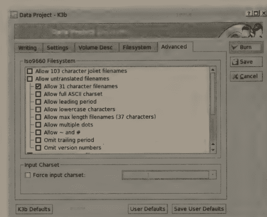

图 1-23：告诉 K3b 你想在新的 CD 上放置什么类型的文件系统。

## 文本编辑器

Linux 证明了纯文本文件持续的影响力和重要性。几乎所有的配置信息都存储在文本文件中，许多程序实际上只是文本文件中的脚本。学习如何有效地编辑文本文件，你就离成为一名强大的 Linux（以及 Knoppix）大师又近了一步！

### 在命令行中使用 vim 编辑配置文件

想开启一个很快就会演变成辩论，并最终升级为争吵的话题吗？带着你所能表现出的所有天真，一群 Linux 用户会问：“哪个更好？Emacs 还是 vi？”然后退后一步，看着火花四溅。这是 'nix 世界最古老的争论之一，而 Knoppix 恰恰处于中间位置：它包含了两种编辑器，将选择权交给你。

我们认为 `vim`（实际上是 "vi improved"，即“改进版 vi”）是这两个编辑器中更好的一个，我们在这里对其进行探索。如果你想学习 emacs，网络上和许多书中都有大量信息。你仍然应该学习 `vim`，因为虽然你无法确定你遇到的每台 'nix 机器上都有 emacs，但你可以确定 `vi`（很可能还有 `vim`）会被安装。学习 `vi`，你就能增加通过更改配置来修复机器的概率。

Knoppix 包含了控制台和 GUI 版本的 `vim`。本节涵盖控制台版本，出于两个原因。首先，如果你学会了在控制台上使用 `vim`，移动到 GUI 将轻而易举。其次，GUI 可能不可用，但控制台一定。

假设你需要编辑 `hosts` 文件，以便更容易地 ssh 连接到局域网内的几台机器。打开 Console（桌面上的黑色图标）并运行 `cp /etc/hosts` 将该文件复制到你的家目录。现在输入 `vim hosts` 并按回车键，新复制的 `hosts` 文件就会打开（见图 1-24）。

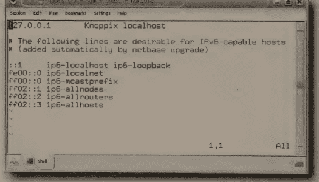

图 1-24：使用 `vim` 编辑 `/etc/hosts` 文件的副本。

# 第 1 章 — 解开 Knoppix 工具箱迷宫

如果你以前从未用过 `vim`（甚至没用过 emacs），你现在可能有点困惑。该怎么办？为什么当你开始打字时什么都没有出现？如何保存？或者退出？

首先要理解的是，`vim` 在同一时间处于几种模式中的一种。当你首次打开 `vim` 时，它处于命令模式（command mode），在此模式下，你使用键盘移动光标、删除信息、剪切、复制和粘贴，并运行帮助文件的命令（因为这是一个控制台程序，你无法使用鼠标）。你想定位光标以便输入某些数据。为此，使用键盘上的方向键（因为 Knoppix 支持它们），或使用以下键命令：

- `h`: 将光标向左移动一个字符。
- `j`: 将光标向下移动一个字符。
- `k`: 将光标向上移动一个字符。
- `l`: 将光标向右移动一个字符。


要了解更多关于 `vim` 及其所有命令，只需在命令行输入 `vim`，然后输入 `:help` 进入 `vim` 的内置帮助系统（输入 `:q` 退出帮助界面，或者当然也是如此），或者在网络上搜索“vim tutorial”、“vim tips”或“vimrc”，如果你想找到人们发布的示例 `vim` 配置文件，它们可以教你很多东西。

将光标置于第一行的末尾并按回车。现在你处于插入模式（insert mode）。

对于此示例，按回车进入新的一行，并在 `hosts` 文件中输入三行新内容，每行后按回车开始开始：


```
192.168.0.10    dante
192.168.0.15    chaucer
192.168.1.20    virgil
```

你知道你应该经常保存工作，但在插入文本时不要这样做。解决方案是？在插入模式下，按 `Esc` 返回到命令模式。现在输入 `:w`（冒号，`w`）保存文件。要写入（冒号）并立即退出（exit），使用 `:wq`（冒号，`w`，`q`）；要在不保存的情况下退出，使用 `:q!`（冒号，`q`，感叹号）。

对于此示例，你刚刚输入的内容有两个问题，以下是修复方法。`Chaucer` 暂时离线，所以它不需要在 `hosts` 文件中。你仍然处于命令模式，移动光标（使用方向键或键命令）直到它位于 `Chaucer` 行某处。要删除一行，在命令模式下输入 `dd`；整行都会消失。

第二个问题是关于 `Virgil` 的行存在拼写错误：IP 地址是 `192.168.0.20`，而不是 `192.168.1.20`。要轻松修正：将光标置于 `1` 上，按 `x` 删除该字符，按 `i` 进入插入模式，输入 `0`，按 `Esc` 返回命令模式，最后以 `:wq` 完成。

# 第一部分 — 导航 Knoppix 工具箱

如果你以前从未用过 `vim`（甚至没用过 `emacs`），你现在可能有点困惑。该怎么办？为什么当你开始打字时什么都没有出现？如何保存？或者退出？

首先要理解的是，`vim` 在同一时间处于几种模式中的一种。当你首次打开 `vim` 时，它处于命令模式，在此模式下，你使用键盘移动光标、删除信息、剪切、复制和粘贴，并运行帮助文件的命令（因为这是一个控制台程序，你无法使用鼠标）。你想定位光标以便输入某些数据。为此，使用键盘上的方向键（因为 Knoppix 支持它们），或使用以下键命令：

- `h`: 将光标向左移动一个字符。
- `j`: 将光标向下移动一个字符。
- `k`: 将光标向上移动一个字符。
- `l`: 将光标向右移动一个字符。

要了解更多关于 `vim` 及其所有命令，只需在命令行输入 `vim`，然后输入 `:help` 进入 `vim` 的内置帮助系统（输入 `:q` 退出帮助界面，或者当然也是如此），或者在网络上搜索“`vim tutorial`”、“`vim tips`”或“`vimrc`”，如果你想找到人们发布的示例 `vim` 配置文件，它们可以教你很多东西。

将光标置于第一行的末尾并按回车。现在你处于插入模式。

对于此示例，按回车进入新的一行，并在 `hosts` 文件中输入三行新内容，每行后按回车开始开始：

```
192.168.0.10    dante
192.168.0.15    chaucer
192.168.1.20    virgil
```

你知道你应该经常保存工作，但在插入文本时不要这样做。解决方案是？在插入模式下，按 `Esc` 返回到命令模式。现在输入 `:w`（冒号，`w`）保存文件。要写入（冒号）并立即退出（exit），使用 `:wq`（冒号，`w`，`q`）；要在不保存的情况下退出，使用 `:q!`（冒号，`q`，感叹号）。

对于此示例，你刚刚输入的内容有两个问题，以下是修复方法。`Chaucer` 暂时离线，所以它不需要在 `hosts` 文件中。你仍然处于命令模式，移动光标（使用方向键或键命令）直到它位于 `Chaucer` 行某处。要删除一行，在命令模式下输入 `dd`；整行都会消失。

第二个问题是关于 `Virgil` 的行存在拼写错误：IP 地址是 `192.168.0.20`，而不是 `192.168.1.20`。要轻松修正：将光标置于 `1` 上，按 `x` 删除该字符，按 `i` 进入插入模式，输入 `0`，按 `Esc` 返回命令模式，最后以 `:wq` 完成。

## 在命令行中使用 vim 编辑配置文件

想开启一个很快就会演变成辩论，并最终升级为争吵的话题吗？带着你所能表现出的所有天真，一群 Linux 用户会问：“哪个更好？`Emacs` 还是 `vi`？”然后退后一步，看着火花四溅。这是 'nix 世界最古老的争论之一，而 Knoppix 恰恰处于中间位置：它包含了两种编辑器，将选择权交给你。

我们认为 `vim`（实际上是 "vi improved"，即“改进版 vi”）是这两个编辑器中更好的一个，我们在这里对其进行探索。如果你想学习 `emacs`，网络上和许多书中都有大量信息。你仍然应该学习 `vim`，因为虽然你无法确定你遇到的每台 'nix 机器上都有 `emacs`，但你可以确定 `vi`（很可能还有 `vim`）会被安装。学习 `vi`，你就能增加通过更改配置来修复机器的概率。

Knoppix 包含了控制台和 GUI 版本的 `vim`。本节涵盖控制台版本，出于两个原因。首先，如果你学会了在控制台上使用 `vim`，移动到 GUI 将轻而易举。其次，GUI 可能不可用，但控制台一定。

假设你需要编辑 `hosts` 文件，以便更容易地 `ssh` 连接到局域网内的几台机器。打开 Console（桌面上的黑色图标）并运行 `cp /etc/hosts` 将该文件复制到你的家目录。现在输入 `vim hosts` 并按回车键，新复制的 `hosts` 文件就会打开（见图 1-24）。


图 1-24：使用 `vim` 编辑 `/etc/hosts` 文件的副本。

## 在命令行中使用编辑配置文件

如果你以前从未用过 `vim`（甚至没用过 `emacs`），你现在可能有点困惑。该怎么办？为什么当你开始打字时什么都没有出现？如何保存？或者退出？

首先要理解的是，`vim` 在同一时间处于几种模式中的一种。当你首次打开 `vim` 时，它处于命令模式，在此模式下，你使用键盘移动光标、删除信息、剪切、复制和粘贴，并运行帮助文件的命令（因为这是一个控制台程序，你无法使用鼠标）。你想定位光标以便输入某些数据。为此，使用键盘上的方向键（因为 Knoppix 支持它们），或使用以下键命令：

- `h`: 将光标向左移动一个字符。
- `j`: 将光标向下移动一个字符。
- `k`: 将光标向上移动一个字符。
- `l`: 将光标向右移动一个字符。

要了解更多关于 `vim` 及其所有命令，只需在命令行输入 `vim`，然后输入 `:help` 进入 `vim` 的内置帮助系统（输入 `:q` 退出帮助界面，或者当然也是如此），或者在网络上搜索“`vim tutorial`”、“`vim tips`”或“`vimrc`”，如果你想找到人们发布的示例 `vim` 配置文件，它们可以教你很多东西。

将光标置于第一行的末尾并按回车。现在你处于插入模式。

对于此示例，按回车进入新的一行，并在 `hosts` 文件中输入三行新内容，每行后按回车开始开始：

```
192.168.0.10    dante
192.168.0.15    chaucer
192.168.1.20    virgil
```

你知道你应该经常保存工作，但在插入文本时不要这样做。解决方案是？在插入模式下，按 `Esc` 返回到命令模式。现在输入 `:w`（冒号，`w`）保存文件。要写入（冒号）并立即退出（exit），使用 `:wq`（冒号，`w`，`q`）；要在不保存的情况下退出，使用 `:q!`（冒号，`q`，感叹号）。

对于此示例，你刚刚输入的内容有两个问题，以下是修复方法。`Chaucer` 暂时离线，所以它不需要在 `hosts` 文件中。你仍然处于命令模式，移动光标（使用方向键或键命令）直到它位于 `Chaucer` 行某处。要删除一行，在命令模式下输入 `dd`；整行都会消失。

第二个问题是关于 `Virgil` 的行存在拼写错误：IP 地址是 `192.168.0.20`，而不是 `192.168.1.20`。要轻松修正：将光标置于 `1` 上，按 `x` 删除该字符，按 `i` 进入插入模式，输入 `0`，按 `Esc` 返回命令模式，最后以 `:wq` 完成。

与其他办公套件不同，`OpenOffice.org` 的设计目的并非通过强制用户使用专有数据格式来锁定用户。正因为这种理念，`OoO` 支持广泛的格式，其中包含一些可能会让你惊讶的格式。

大多数 `OoO` 用户都知道它读写 Microsoft 文件的性能非常好。你可以打开 Word、Excel 和 PowerPoint 文件及模板，而且几乎可以确定 `OoO` 显示效果将与原始 Microsoft 应用程序完全一致。此外，你可以使用 Microsoft 的 Word、Excel 或 PowerPoint 格式保存文件，这些程序的大多数用户在打开和使用你的文档时没有任何问题。事实上，除非你告诉他们，否则他们可能永远不知道你使用了 Microsoft 程序以外的软件。

`OoO` 实际上允许你以多种格式保存工作成果，包括以下格式（按应用程序列出）：

- `OoO Writer` 提供了 `OpenOffice.org 1.0`、`Microsoft Word 97/2000/XP`、`Microsoft Word 95`、`Microsoft Word 6.0`、富文本格式 (`RTF`)、`StarWriter`、文本和 `HTML` 选项。
- `OoO Calc` 提供了 `OpenOffice.org 1.0`、`Microsoft Excel 97/2000/XP`、`Microsoft Excel 5.0`、数据交换格式 (`DIF`)、`iBASE`、`StarCalc`、`CSV` 和 `HTML`。


- OoO Impress 允许 OpenOffice.org 1.0、Microsoft PowerPoint 97/2000/XP、StarDraw、StarImpress 和 HTML。

OpenOffice 格式非常出色。它们的尺寸通常比 Microsoft 的对应格式小得多（因为它们实际上只是压缩的 XML 格式文件）；它们是开放的且供任何人使用的，而不是封闭且专有的；而且它们是结构化信息标准促进组织 `OASIS` 致力于将办公套件通用、开放且基于 XML 的格式标准化的基础（意所料的是，Microsoft 面对 `OASIS` 的目标不得不采取“静观其变”的方法）。然而，与开源世界中的一切一样，OoO 为你提供了选择，并将最终决定权交给你。

OoO 支持的最实用文件类型之一是 Adobe 的 PDF。使用 OoO 1.1 创建文本文档，然后选择“文件 -> 导出为 PDF”，或者如果你更喜欢使用工具栏，点击图 1-26 中心所示的“直接导出为 PDF”按钮。


图 1-26：OpenOffice.org 功能工具栏，“直接导出为 PDF”按钮位于中间，“编辑”和“打印”按钮之间。

OoO 创建的 PDF 非常优秀，任何 Linux、Mac OS X 或 Windows 用户都可以阅读。这是一个非常棒的优势，而且考虑到 OoO 有这么多如此酷的功能，它是 100% 免费且内置在程序中的。

# 第 1 章 — 解开 Knoppix 工具箱迷宫

除了 PDF，OOO 现在还支持一种让你们某些人感到惊讶的格式：Macromedia 的 Flash。是的，没错。Macromedia Flash，那个网页上许多恼人广告和无用启动页的根源，现在已供 OoO 用户导出了——特别是是 OoO Imp 用户。如果你创建一个演示文稿，选择“文件 -> 导出”；从文件格式下拉菜单中选择 Macromedia Flash `SWF` 就完成了。

撇开对 Flash 的抱怨不谈，导出这种格式是一个非常实用的功能。Flash 得到了广泛支持（超过 90% 使用 Macromedia 的 OoO 用户），而且它能生成完全跨平台的小文件。导出的演示文稿可以放在公司网站上，用户可以使用网络浏览器打开并查看。如果用户点击一张幻灯片，就会加载下一张。

OOO 是一个强大的程序，并且正在不断改进。然而，如果你正在使用 Knoppix，你可能不会用 OOO 来写你的下一部小说。相反，你更有可能只是恢复或快速编辑几个文档。以各种流行格式导出文档的能力是 OOO 的一项至关重要的功能，这使其成为你 Knoppix 工具箱的关键部分。

获取 OOO 信息的首选地，不意外地是 `www.openoffice.org`。这是 OOO 用户的母地，你可以在这里下载程序、阅读最新的 OOO 新闻、在需要时寻求帮助，如果你有意向，还可以为项目做贡献。


OOO 最活跃的在线论坛可以通过 `www.ooforum.org` 访问，这是一个极佳的资源。

另一个值得关注的地方是 `www.openoffice-support.net`，它包含了教程、说明和“操作指南”`HowTo`。特别是教程非常好，尤其是对于任何想要一份清单来帮助学习 OOO 基础知识的人来说。

# 使用 Scribus 进行桌面出版

Scribus 是一款开源出版应用程序，允许你设计、创建和制作用于出版的文档，这些文档包含复杂的布局，例如新闻简、手册、广告、传单甚至杂志。此外，由于 Scribus 输出为 PDF（非常适合交给你的本地打印店），你可以生成具有高级功能的 PDF——例如表单和密码——这些功能此前只有通过购买 Adobe 的 Acrobat 软件包才能获得（而它是很贵的）。

## 第一部分 — 探索神奇的 Knoppix 工具箱

## 使用 ownpare 两个或多个文件

Kompare 是 `diff` 程序的图形界面封装器，`diff` 是一个古老的（20世纪70年代的！）`UNIX` 工具，用于显示两个文本文件之间的差异。有一个例子解释了 Kompare 以及 `diff` 的工作原理。我们其中一个人写了一首诗（已经超过12年了），并且定期进行修改。原始文件名为 `hoarding_our_lives.txt`；在几次尝试性的修改后，它被保存为 `hoarding_our_lives_2.txt`。读完第二个文件后，并不清楚哪一个更好，但尝试比较这两个文件有点痛苦。这时 Kompare 出场了。

从 `K` 菜单选择“开发 -> Kompare”来启动 Kompare。“比较文件”窗口打开，并要求你选择文件。这是我们的建议：不要直接这样做！相反，选择窗口左侧的 `diff`，在“Diff 程序”文本框中输入 `/usr/bin/diff`，然后点击“文件”图标返回选择想要比较的文件。源文件是 `hoarding_our_lives.txt`，目标文件是 `hoarding_our_lives_2.txt`（当然由你选择）。然后点击“比较”按钮。Kompare 打开，外观如图 1-29 所示。

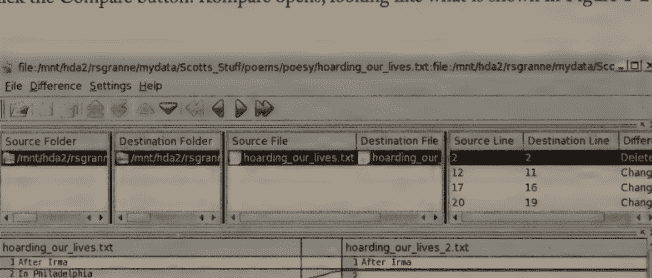

图 1-29：Kompare 两个文件并突出显示差异。

如果你想两个两个之间的差异，Kompare 是一个非常棒的工具。它突出显示了这两个诗文件之间的以下差异：

- 第 2 行在文件 1 中不在文件 2 中。
- 文件 1 的第 12 行与文件 2 的第 11 行之间有一个差异。
- 文件 1 的第 17 行与文件 2 的第 16 行之间有一个差异。
- 文件 1 的第 20 行在文件 2 中被拆成了 2 行。

比较两个文件后，Kompare 允许你决定哪些更改——也就是说，哪个文件是“正确的”，它将覆盖另一个文件中有问题的行。为了方便操作，你可以选择“差异 -> 应用差异”，这只会从一个方向应用更改：从左到右。这不一定是你想要的。例如，你可能喜欢文件 1 的某些地方，也喜欢文件 2 的某些地方。技巧是让 Kompare 以你想要的方式工作。

首先处理文件 1（左侧）中你喜欢的内容。例如，你可以点击文件 1 中的第 12 行并选择“差异 -> 应用差异”（或者按键盘空格键）。砰！两个文件立即有了相同的第 12 行。你可以对文件 1 的第 20 行执行操作。

为了让文件 2 覆盖文件 1，你需要更改 Kompare 显示文件的顺序，通过选择“文件 -> 交换源与目标文件”，这会切换 Kompare 中两个文件的显示（但不会切换实际文件本身——`hoarding_our_lives_2.txt` 仍然在原来的文件夹中；改变的只是它们在 Kompare 中的显示方式）。当你这样做时，系统会先要求你保存文件，因此点击“保存”按钮。现在你可以选择文件 2 中的第 2 行（现在在窗口左侧）并统一两个文件，然后对文件 2 中的第 16 行执行相同操作。选择“文件 -> 保存所有”，一切都统一了。无论你是一个业余诗人还是其他需要比较文档的人，Kompare 都会派上用场。你会有很多机会使用非常强大的工具。

## 总结

当你询问大多数人如何使用电脑时，除了与互联网相关的活动（下一章将涵盖），他们会回答诸如听音乐、刻录 CD、写文档、看照片和打印等内容。Knoppix 让用户能够完成所有这一切以及更多。你可能不会每天都用 Knoppix 写你的小说，但在你需要时，它确实非常有用。

# 第 1 章 — 揭开 Knoppix 工具箱迷宫

# 第 2 章 — Knoppix 网络工具最大化

互联网一直是 Linux 增长的核心——毕竟，如果没有互联网，Linus Torvalds 无法调动全球数千万人的热情和工作。Knoppix 也是如此。Klaus 是德国人，但世界各地的人都帮助将 Knoppix 变成了今天这种令人兴奋的创新产品。本章探索了你将 Knoppix 与网络结合的许多方法。

### 访问互联网

在使用本章后半部分介绍的所有酷炫网络工具之前，你必须先接入互联网。大多数情况下，这不是问题：你只需插入 Knoppix CD 启动电脑，在过程结束时你就连接好了。然而，如果你的硬件未被识别或你仍然无法访问，情况就会变得复杂。如果你仍在使用拨号上网，不要绝望——你仍然可以使用 Knoppix。但是，适用于任何发行版的调制调器也存在同样的注意事项：内部调制调器可能工作也可能不工作（如果是笔记本电脑，可能不行），外部调制调器更有可能工作。如果你正在使用笔记本电脑，内置调制调器可能不行，但 `PCMCIA` 调制调器可能没问题。换句话之，如果 Knoppix 检测到了你的调制调器，那太棒了。情况看起来良好，你应该能够上网。如果 Knoppix 没有检测到你的调制调器，你将不得不决定投入多少精力和精力让你的调制调器工作。你可以看看 Knoppix 论坛，但不要抱太大。这就是为什么我总是备着 `PCI` 和 `PCMCIA` 调制调器；我知道它们可以配合 Linux，特别是 Knoppix。

- `PCI`: US Robotics 5610
- `PCMCIA`: US Robotics XJ1560


要设置调制调器，打开 Knoppix 菜单并选择“网络/Internet -> `/dev/modem` 设置”。你将五个选项：`Serial`、`USB`、`IrDA`、蓝牙和 `Modem`。选择 `Serial`、`USB` 或 `Modem`——取决于哪个匹配你的硬件——并查看 Knoppix 能否让你的调制调器工作。

假设 Knoppix 检测到了你的调制调器。（如果没检测到，你必须检查 PCI 或 PCMCIA 调制调器并让其中一个工作。）现在是时候连接了。

首先，你必须设置拨号账号。从 Knoppix 菜单选择“网络/Internet -> 调制调器拨号器”。一旦拨号器打开，点击“配置”，这将打开 K 配置窗口（是的，你正在使用 `KPPP`，即 `KDE` 的 `PPP` 工具），如图 2-1 所示。

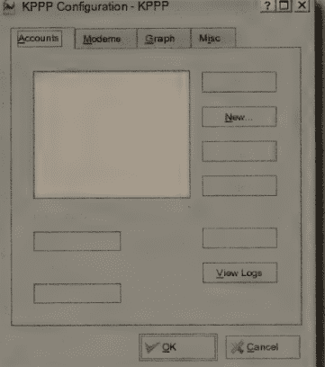

图 2-1：使用 `KPPP` 配置你的拨号连接

在 `Modem` 选项卡上，选择你的调制调器并点击“编辑”。在 `Modem` 窗口中，选择 `Modem` 选项卡并点击“查询”。你应该看到一段文本闪过，表示 Knoppix 和 `KPPP` 检测到了你的调制调器且它运行正常。如果你发现调制调器无法工作，这只是从故障排除列表中移除一个项的简单方法。

返回账户 选项卡并点击“新建”。打开的窗口询问你想是使用向导还是手动设置；如果你在美国，别费用向导了，因为里面对你没用。相反，只需点击“手动设置”按钮，这将打开“新账户”窗口，如图 2-2 所示。

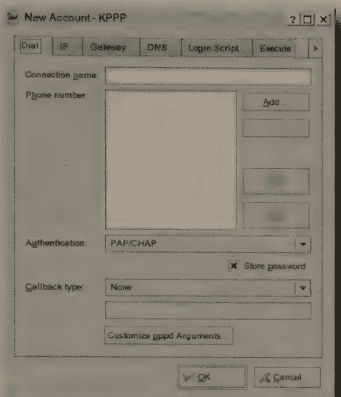

图 2-2：拨号账号详细信息。

在“连接名称”字段中，输入对你有意义的内容，例如 Earthlink 或 Panix。点击“添加”输入电话号码。只输入数字——没有空格、括号或连字符。这可能就是整个窗口中你需要做的事了。如果你的 ISP 给了你其他需要配置的内容，尽管去做；否则，点击“确定”关闭“新账户”窗口，你就回到了 K 配置窗口。

要尝试拨号连接，点击“确定”关闭 `KPPP` 配置窗口，回到 `KPPP` 窗口。输入登录 ID 和密码，勾选“显示日志窗口”以便你可以看到发生了什么（更多的故障排除帮助），并点击“连接”。如果一切顺利，两个调制调器通信的声音将充斥空气，你最终连接上了。然后你就可以开始享受 56 Kbps（或更慢！）的互联网了

## 让宽带工作

宽带类别包括 DSL、电缆，甚至是 ISDN（最初的宽带）。无论你使用什么，你真的必须在网络（即使只有一台电脑）和大型互联网之间设置一个路由器/防火墙。不要为此纠结：现在的路由器很便宜（例如，你现在可以在亚马逊上以 35 美元以下的价格买到良好的电缆/DSL 路由器），它们非常容易设置和使用，而且确实能很好地保护你的网络。因此，没有借口——买一个，设置好，然后使用吧。

网络连接如丝绸般顺滑。基本上，你只需要插入 Knoppix 盘启动电脑，让 Knoppix 进行自动检测，很快你就能连接到互联网。这真的、非常简单。

如果你没有使用路由器（请买一个路由器）并且有直接 ISDN 连接，那么从 Knoppix 菜单中选择 Network/Internet → ISDN connection。进行必要的配置，就可以开始使用了。

如果你没有使用路由器且带有 PPPoE 的 DSL（请买一个路由器），转到 Knoppix 菜单并选择 Network/Internet → ADSL/PPPoE configuration。填入所需的数据，你就会上线了。买路由器应该是你的首要一站，对吧？

## 无线漫游

当无线连接建立且网卡运行正常时，它是非常奇妙，但有时要让它正常工作可能会棘手。如果你使用 802.11b 网卡，可能没什么问题，因为大多数 B 卡都能与 Knoppix 兼容。然而，使用 Intel Centrino 技术的笔记本即使是 802.11b，也可能工作或不工作；直到最近，Intel 才向开源开发者发布了必要的信息，以便他们让 Linux 支持 Centrino。G 卡则是另一回事。目前很少有原生驱动能在 Linux 下工作，尽管这种情况正在改变；在此期间，你可以尝试使用 `ndiswrapper` 软件，`ndiswrapper` 允许你在 Linux 下使用 Windows 驱动来驱动你的 G 卡。它很棒；如果不行，就别想了。如果可以，请换回 B 卡。

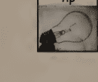

早些时候提到我保留了 PC 和 PCMC 调制解调器，因为我了解它们在 Linux 下如何工作。我对 802.11b 也是如此。我的首选网卡是 Lucent Orinoco Gold，多年来它一直运行得非常完美。如果你要在 eBay 上买一个，真的可以说——买的网卡越旧越好，因为无线网卡制造商一直在保留他们网卡的芯片组。

如果 Knoppix 在启动时识别了你的网卡，你就进入了无线天堂。默认情况下，DHCP 会为你提供 IP 地址以及访问网络所需的所有其他数据。唯一的障碍可能是你尝试连接的无线网络使用了 WEP 或 WPA 对流量加密。如果是这样，你最初将无法连接。此时，从 Knoppix 菜单选择 Network/Internet → Wavelan configuration。

一个对话框告知你即将更改无线网卡的参数：例如 `eth0` 或 `eth1`。如果你希望它无论 ESSID 是什么都能与任何无线接入点工作，请将 ESSID 框留空；否则输入 ESSID。无论如何，准备好后点击 OK。

接下来，你会被要求设置 NWID 或单元标识符。这有助于区分逻辑网络，输入它，但大多数情况下你可以将其留空并点击 OK。

## 第 2 章 — Knoppix 工具最大化

设置你的网卡模式。如果你留空，则选择 Managed（托管模式）；否则，输入列出的其他选项之一（如果你不使用 Managed，最可能是 Ad-Hoc）。以下是不同模式的含义：

- **Managed**：也称为 Infrastructure（基础设施模式），在此模式下，使用无线接入点（例如 SOH 无线路由器）将无线网络与有线网络连接起来。
- **Ad-Hoc**：如果你想在没有中央枢纽或交换机的情况下连接两个或多个无线机器，请使用此模式。
- **Master**：你的机器充当其他无线设备的接入点。
- **Repeater**：你的机器仅转发无线数据包。
- **Secondary**：你的机器是主继器或备用继器。
- **Auto**：Knoppix 会做出它能判断的最佳选择，这通常意味着 Managed。

做出你的选择——可能是 Managed 或可能是 Ad-Hoc —— 并点击 OK。

你们大多数人应该将 Channel Number（通道号）框留空，允许 Knoppix 自动处理。

最好将 Channel（通道频率）框留空，这样如果你必须输入某些内容，请确保输入的是正确的数字：

- **802.1a**：5.15-5.825 GHz，例如输入 5.825G
- **802.1b**：2.412-2.462 GHz（美国地区；其他国家有所不同），输入 2.412G
- **802.1g**：2.412-2.462 GHz（美国地区；其他国家有所不同），输入 2.412G


点击 OK。下一个对话框请求加密密钥——如果你的接入点没有使用 WEP（有线等隐私），请将框留空；否则输入 64 位或 128 位密钥。点击 OK。

如果需要，为你的无线网卡输入任何额外参数（你可能不需要）。点击 OK。

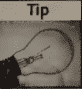

所有这些对话框都是 `iwconfig` 命令的选项，所以如果你熟悉该命令，可以跳过整个配置过程直接使用命令行。

## 导航神奇的 Knoppix 工具箱

你快完成了。下一个对话框请求用于 `iwspy` 的额外参数，用于收集统计信息。将其留空（除非你真的知道做什么）并点击 OK。然后你会被问及是否有用于 `iwriv` 的额外参数，这是特定于卡的设置。将文本框留空并点击 OK。对话框关闭，你在窗口中看到几个设置，然后——砰！窗口关闭了，你的无线网卡工作了。

如果无线网卡工作出现问题，确保你的有线连接没有开启（运行 `ifconfig` 查看连接列表）。如果是，使用此命令关闭它（例如 `eth0`）：


如果你有 G 卡并使用 `ndiswrapper`，你有一场冒险在等待。`ndiswrapper` 无疑很酷，但设置起来很费劲。


关于 `ndiswrapper` 的详情，请查看项目的主页 http://ndiswrapper.sourceforge.net。更有用的是项目的 wiki：http://ndiswrapper.sourceforge.net/wiki/index.php


打开 Knoppix 菜单并选择 Network/Internet — `ndiswrapper configuration`。做出必要的选择。对话框警告你你需要网卡驱动的 `.inf` 和 `.sys` 文件。这就是乐趣开始的地方。如果你还有原始驱动的 CD，你可能就不会抓狂。如果没有 CD，从供应商网站获取必要的驱动，将其放在 USB 驱动器或刻录到 CD，然后挂载到 Knoppix。网页列出了支持的网卡和驱动（http://ndiswrapper.sourceforge.net/wiki/index.php?title=Drivers/List）以寻找你需要的内容。

`ndiswrapper` 配置脚本会引导你完成过程。找到你的 `.inf` 和 `.sys` 文件并设置它们。遗憾的是，你现在必须手动配置无线网卡，这并不简单。如下：

1. 在命令行输入：

`sudo iwconfig`

这验证了系统识别到了工作的 NIC。

2. 运行以下命令确保你的网卡看到了接入点：

`sudo eth0 scan`

此命令的结果告诉你你的网卡工作正常并可以与接入点交互。

3. 假设 Knoppix 在 `eth0` 处看到了无线网卡，可以使用以下命令：

`sudo iwconfig eth0 essid`：设置你的 ESSID。将 `essid` 改为实际所需的名称。连接任何 ESSID 请使用 `any`。

`sudo iwconfig eth0 mode type`：设置你的模式。将 `mode-type` 替换为 `Managed`、`Ad-Hoc` 等。

`sudo iwconfig eth0 key wep`：设置你的 WEP 密钥。将 `pkey` 改为实际密钥。

你可以将所有这些组合成一行，如下：

`sudo iwconfig eth0 essid home mode Managed key 1234-1234-1234`

最后，这取决于你的时间和你的情况。如果你可以使用 B 卡或 G 卡，请确保手头有驱动。最后，在迫在眉睫之前练习使用 `ndiswrapper`。`ndiswrapper` 有点复杂，在你尝试从崩溃的机器上恢复数据之前，最好有一些经验。


Knoppix 还支持使用手机甚至蓝牙设备进行无线接入访问。如果你降低预期，当它工作时你可能会感到惊讶和开心。要将设备设置为调制解调器，打开 Knoppix 菜单并选择 Network/Internet -> `/dev/modem connection setup`，做出必要的选择。之后，使用 KNOPIX -> Network/Internet -> GPRS connection。

## 设置静态地址

DHCP（动态主机配置协议）是一项很棒的技术，它确实让网络管理员的生活变得更容易（是的，如果你有家庭网络，即使只有两台电脑且由你管理，你也是网络管理员），但动态地址并不总是理想的。例如，如果你正尝试将你的 Knoppix 机器作为服务器？在这种情况下，动态地址是一种困扰，需要静态 IP 地址。让 Knoppix 使用静态 IP 地址并不难。

要开始，你需要了解系统当前的状态，因此输入以下简单但信息量极其丰富的命令：

```
$ ifconfig
```

以下是使用无线 802.11b 网卡的笔记本示例，你可能会看到类似的：

```
eth0 Link encap:Ethernet HWaddr 00:02:2DB:E:34
inet addr:192.168.1.5 Bcast:255.255.255.255 Mask:255.255.255.0
inet6 addr: fe80::202:dff:fe2b:e734/64 Scope:Link
UP BROADCAST MULTICAST MTU:1500 Metric:1
RX packets:20209 errors:53 dropped:53 overflows:0 frame:53
TX packets:15684 errors:12 dropped:0 overflows:0 carrier:0
collisions:0 txqueue:1000
RX bytes:18936569 (18.0 Mi) TX bytes:3570323 (3.4 Mi)
Interrupt:3 Base address:0x100
```

# 52 第一部分 — 导航神奇的 Knoppix 工具箱

```
lo Link encap:Local Loopback\inet addr:127.0.0.1 Mask:255.0.0.0
in6 addr::1/128 Scope:Host
UP LOOPBACK RUNNING mtu:16436 Metric:1
RX packets:80 errors dropped:0 overruns:0 frame:0
TX packets:80 errors dropped:0 overruns:0 carrier:0
collisions:0 txqueuelen:0
RX bytes:5314 (5.1 KiB) TX bytes:5314 (5.1 KiB)
```

这告诉你的 DHCP 服务器为无线卡 `eth0` 分配了 IP 地址 192.168.1.5。在将 IP 改为静态地址之前，你必须首先确保该地址不在 DHCP 地址池中，这需要询问网络管理员。在这种情况下，DHCP 地址池范围是从 192.168.1.2 到 192.168.1.50，因此大于 .50 且不是 .255 的地址应该是安全的。要将卡的 IP 更改为静态分配，你需要运行以下命令：

```
$ sudo ifconfig eth0 inet 192.168.1.100
```

使用相同的命令也可以更改网络子掩码或广播地址。这里有一个例子：

```
$ sudo ifconfig eth0 netmask 255.255.255.0 broadcast 192.168.1.255
```

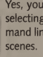

你也可以通过打开 Knoppix 菜单并选择 Network/Internet -> Network Card Configuration（网络/网卡配置）来更改你的 IP 地址和其他数据，但使用命令行更快，而且了解 Knoppix 配置对话框在后台到底在做什么也没有坏。

这应该能让你接入网络，但你可能无法访问 www.google.com 或你的电子邮件服务器。为什么呢？因为 DNS（域名服务器）。要配置 DNS，你需要编辑 `/etc/resolv.conf`。以 root 身份，用你喜欢的文本编辑器打开 `/etc/resolv.conf` 并添加任何所需的 DNS 地址。例如，当我在圣路易斯华盛顿大学教学时，`resolv.conf` 文件是这样的：

```
search artsci.wustl.edu
nameserver 128.252.120.1
nameserver 128.252.135.4
```

`search` 行并不是必须的，但你至少需要一行 `nameserver` 行，否则 DNS 将无法为你工作。询问你的网络管理员应该使用什么，你很快就能运行起来。

# 在互联网上工作

是否还有人怀疑互联网已经彻底改变了我们人类获取和使用 ICE（信息、通信和娱乐）的方式？我们正处于一个奇妙的时代，新技术几乎每天出现，使能够以令人兴奋的方式使用网络。Knoppix 带有许多最优秀的互联网软件包，而它没有包含的软件只需稍加努力就能轻松添加。

## 使用 BitTorrent 共享文件

Knoppix 默认不包含任何文件共享应用，这没关系。大多数文件共享集中在音乐或电影上，当你在使用 Knoppix 时，这些并不重要。无论如何，大多数文件软件都很缓慢且低效。BitTorrent（简称 BT）是下载和共享你在运行 Knoppix 时需要获取 ISO 镜像和其他大文件的更好方式。

大多数文件共享软件的工作原理如下：你搜索一个文件，你的搜索要么针对存储在中央服务器上的文件索引（Napster 模式，倾向于在组内部获取分片），要么针对每台独立计算机生成的索引（去中心化的 Gnutella 模型，这使得 RIAA 和 MPAA 更难追踪和关闭所谓的“盗版者”——版权侵权者——但也导致了搜索非常缓慢）。一旦定位了文件，你就会从拥有该文件的计算机上下载它，这个过程即使在快速连接下也是非常、非常、慢的。

BitTorrent 完全不同。本质上，BT 将巨大的文件拆成成百或数千个小片段。当你开始使用 BT 下载文件时，你实际上是从每个拥有这些片段之一的计算机上下载这些片段的。因此，当你下载了一个片段后，BT 就会将其与任何尝试获取该文件的其他人共享。你不是从单台机器一次性下载整个文件，而是同时从几台机器下载该文件的片段——并通过共享你的片段来回馈。结果是？文件越流行，下载越快，有时（引用梅尔·布鲁克斯的《球体》的话）是“疯狂的速度”。


- **注意**：有关关于 BitTorrent 的更多信息，请阅读官方 BT 主页 `http://bitconjur.org/BitTorrent/`、Wikipedia 上的 BT 文章 `http://en.wikipedia.org/wiki/BitTorrent`，或 Brian 的 BitTorrent 常见问题解答与指南 `www.desnent.net/btfaq/`。

通过下载最新版本的 Knoppix 来尝试 BitTorrent。使用你的网络浏览器访问 `http://torrent.unix.au-kl.de`（BitTorrent 追踪器），并找到你语言的 Knoppix 最新版本（英语选 EN，德国选 DE）。点击你想保存的 Knoppix 旁边的 DL（下载），将 torrent 文件（高达 55KB）保存到你的桌面。现在……发生了什么？要查找其他文件，请使用 Google。你可以找到音乐（尤其是“带”的东西）、软件、电影以及更多。

- **提示**：记住，Knoppix 默认不包含任何文件共享应用，包括 BitTorrent。要对你下载的 torrent 文件进行任何操作，你需要安装 BT。幸运的是，你可以使用 APT（第 1 章讨论过）Knoppix 持久磁盘镜像，这样你重启 Knoppix 就可以继续使用该软件。不同的 BT 软件包由 BT 的发明者 Bram Cohen 提供。它们很好，还有一个名为 BT 的客户端 

# 54 第一部分 — 导航神奇的 Knoppix 工具箱

BitTorrent 功能齐全，所以用它代替。要这样做，在命令行输入：

```
# apt-get update && apt-get install btorrent
```

一旦 BitTorrent 打开，它会将你带到菜单并选择 Internet → BitTorrent。一个对话框要求你选择下载的 torrent 文件——它应该在你的桌面上，然后点击 OK。你被要求在何处保存它——Knoppix 镜像大约 700MB，除非你至少有 1GB 内存。相反，你应该挂载开启写入的硬盘分区（右键点击桌面上的分区，选择属性，选择 Device 选项卡，勾选 Read Only），然后点击图标来存储下载。一旦你选择了硬盘上的目录，点击 OK，BitTorrent 就会开始运行，下载并上传——Knoppix ISO。图 2-3 显示了程序运行状态（主页连接）。


图 2-3：BitTorrent 下载 Knoppix

屏幕显示已下载 31MB，速度为 196 Kbps，这非常棒。注意，几乎 1MB 的相同 ISO 已共享，只要 BT 窗口开着，这个数字就会增加（这就是为什么下载完成后保持 BT 窗口被认为是良好的做法，这样其他人也可以继续受益）。

点击窗口右上角的 Details 和 Advanced 链接获取更多关于你的下载的信息。玩玩那些链接，以及 Preferences。你对 BitTorrent 了解越多，就越能有效地使用这个强大的软件。估计 BT 承担了互联网上 35% 的所有流量——凭借其强大的功能，这种软件以及使用它的人都有非常光明的未来。

# 第 2 章 — 最大化 Knoppix 工具

如果你想安装并使用原始 BT 客户端，使用 `apt-get install btorrent-gui`。另一个优秀的 BT 客户端是 Azure，你可以通过 `apt-get install azure` 下载并安装。

## 使用 Mozilla Firefox 浏览

Knoppix 曾经包含完整的 Mozilla 套件（网络浏览器、电子邮件程序和网页编辑器），但在 3.8 版本中放弃了该套件，转而包含了 Firefox，它只是网络浏览器。这是一个伟大的举措。Firefox 拥有扩展和其他惊喜，而且它是一个更快、更流畅的程序。

如果你正在阅读这些，你可能以前用过 Firefox，并且可能知道如何使用网络浏览器。我在这里不会进行网页浏览 101；相反，让我们看看用 Firefox 可以做的三件非常酷的事。

## 改进你的主页

当我以前启动 Firefox 时，我发现每次都会打开三个标签：Gmail、Bloglines 和 Open Source Weblog。我终于意识到我所做的是低效的。于是我进入 Edit -> Preferences，选择 General，并在 Home Page 处了以下内容，完成后点击 OK：

`gmail.google.com | www.bloglines.com/myblogs | opens.weblogsinc.com`

现在我打开 Firefox，它会自动在标签页打开这三个网站供我查看。如果我点击 Home 按钮，这些网站就会出现。你自己尝试。确定你想要反复访问的网站，并将 URL 输入到 Home Page 框中，用大多数键盘上 Enter 键上面的管道符号 (`|`) 分隔。将你的主页改为关键页面让事情变得更高效实用，因为这些这些是你完成大部分工作所需的网站。

## 安装扩展

Firefox 最酷的事情之一是数百个免费扩展，它们以无限方式扩展浏览器。你可以通过选择 Tools -> Extensions 并点击 Get More 来安装新扩展，这会打开一个新的 Firefox 窗口指向 `https://addons.mozilla.org/extensions/`。从那里，找到你想要的扩展并点击 Install Now。下载安装后，重启 Firefox 以加载扩展。

Mozilla Update 网站拥有每一个扩展——你可以在那里找到很多很棒，其他网站也有必不可少的扩展。你只需要意识到你不能从任何旧网站安装 Firefox。为了安全起见，Firefox 启动时带有一个可以从中安装软件的站点白名单；当你尝试从不在白名单的站点安装扩展时，Firefox 在窗口顶部打开一个警告，警告该站点已被阻止。将其添加到白名单，点击警告栏右侧的 Edit Options 按钮，当 Allowed Sites 窗口打开时，点击 Allow 然后 OK。再次点击链接安装扩展，这次 Firefox 就不再抱怨了。

## 推荐扩展

我会在我的网站（`http://granneman.com/go/extensions/`）上维护一份已安装的 Firefox 扩展更新列表，如果你想看看我目前正在使用哪些扩展，可以去看看。目前，我推荐以下扩展是必不可少的：

- Adblock：在 Mozilla Update 的“杂项”（Miscellaneous）部分查找此扩展。被网站上的广告困扰了吗？只需右键点击广告，选择“Adblock Image”，就可以和那个烦人的广告说拜拜。你还可以使用正则表达式来阻止特定域的所有广告，或匹配特定模式的广告。你可以导入其他人创建的 Adblock 列表；在 Google 上搜索“adblock import filter list”并尝试你找到的列表。
- Jybe：`http://jybe.com/download/register.aspx`。Jybe 让你以及其他安装了 Jybe 的人（适用于 Windows、Linux、Mac OS 或 Windows 的 IE）协作查看网页，并对你们所看到的内容进行聊天。这对于演示、工作会议、故障排除或远程支持非常完美。
- miniT：在 Mozilla Update 的“标签页浏览”（Tabbed Browsing）部分查找此扩展。有了此扩展，你可以拖动标签页以你喜欢的任何顺序重新排列它们。当你拖动标签页时，会出现一个小箭头，清晰地显示你的标签页将去到哪里。
- SessionSaver：在 Mozilla Update 的“标签页浏览”部分查找此扩展。如果你曾经遭遇过 Firefox 崩溃导致标签页中所有的网站都丢失，那么你需要 SessionSaver。加载这个扩展，然后就可以不用管它了。Firefox 崩溃了？重启 Firefox，一切都会恢复：标签页、历史记录、Cookie，所有内容。在打开系列标签页的情况下关闭了 Firefox？重启 Firefox，它们就会再次出现。

当然，还有更多扩展——你可以在我的网站上查看完整列表，并在 Mozilla Update 及其他地方逛逛。Firefox 扩展领域正在发生惊人的创新，你一定能找到精彩的东西。

## 聚焦你的搜索

Firefox 内置了许多实用的搜索工具，既有显而易见的（右上角的搜索框），也有不显而易见的（按 `Ctrl+F` 打开窗口底部的搜索栏，或高亮一个单词或短语并右键点击以使用选择的内容搜索网络）。只需稍微努力，你就能优化 Firefox，变成一台精悍、强大的机器。


首先，安装几个搜索工具。尝试所有工具，卸载你不喜欢的，保留你认为特别有用的一两个个。看看 Googlebar（http://google.mozdev.org）、Firefox 的 Clusty 工具栏（http://clusty.com/toolbar/firefox）、A9 工具栏（http://toolbar.a9.com）以及 Yahoo! 工具栏（http://companion.yahoo.com/firefox）。它们都具有很棒的功能，而且都表现良好。或者，只需安装 Groove Search 工具栏（http://www.groove.com），它包含了所有这些以及更多！

接下来，找到一个你经常搜索的网站。例如，在 AllMusic (http://allmusic.com/) 上，你可以使用网站的搜索框查找乐队、专辑或歌曲。然而，在第一百次之后，你会怀疑是否有更简单的方法，事实确实有。在搜索框中右键点击。在出现的选项中，选择“为此搜索添加关键字”（Add a Keyword for this Search），如图 2-4 所示。

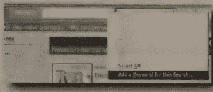

**图 2-4：** 在网站的搜索框中右键点击以添加搜索关键字。

打开一个新窗口：添加书签（Add Bookmark）。要有效使用此窗口，点击右侧的小箭头按钮；当你这样做时，会显示书签文件夹结构，如图 2-5 所示。

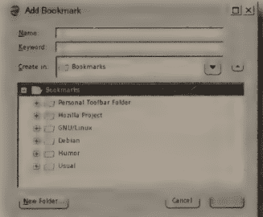

**图 2-5：** 为你的新搜索关键字添加细节。

你基本上是在为 Firefox 添加一个新的搜索。从文件夹列表中选择“书签”，点击“新建文件夹”，并给新文件夹命名，例如“Search”（很聪明，对吧？）。现在你需要为你正在创建的新搜索命名。因为它将搜索 AllMusic，在“名称”（Name）文本框中输入“allmusic”怎么样？最后，也是最大的一点，你需要在“关键字”（Keyword）文本框中输入内容。这是你将来实际上要用来搜索 AllMusic 的东西，所以（它必须是一个单词——不允许空格）应该易记忆、具有描述性且简短——在这个例子中，“music”就是一个很好的选择。当所有内容都选择并输入后，点击“添加”。

# 58 第一部分 — 导航神奇的 Knoppix 工具包

现在尝试新的搜索词。在 Firefox 的地址栏中——通常显示 URL 的地方——输入以下内容然后按回车：

music clash

AllMusic 在 Firefox 中加载，显示了一个史上最伟大的摇滚乐队的网页。要再次尝试史上第二伟大的乐队，请再次在 Firefox 的地址栏中使用此，而不是在 AllMusic 网页旁边的搜索框中：

music rolling stones

这酷酷吗？现在你处于哪个网页都不重要了——只需清除 Firefox 地址栏并输入 music [乐队名称]，点击回车，AllMusic 就会加载并显示关于该乐队的传记、唱片列表以及更多关于该乐队的信息。

用你网站的搜索框尝试一下。很快，你就能找到所有的搜索结果，节省时间并让你在需要时轻松找到想要的信息。

Firefox 是一款非常出色的软件，你会喜欢探索它的功能的。无论 Knoppix 是否默认包含它，它都会与我们相伴很久。

# 使用 KMail 阅读和发送电子邮件

如果你和我们一样对电子邮件成迷，在检查电子邮件时几乎毫无自控。这意味着一个好的电子邮件程序是关键。你想要一个吸引人、强大且易于使用的。幸运的是，Knoppix 包含了 KMail，一个受欢迎的开源电子邮件应用程序（你也可以在联系 PIM 中找到 KMail，通过 K 菜单访问：选择 → Office → Contact）。

要启动程序，打开 K 菜单并选择 Internet → KMail。会出现一个与所示类似的窗口：

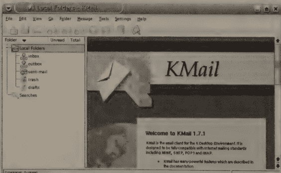

**图 2-6：** KMail 已打开

## 第2章 — 充分利用 Knoppix 网络工具 61

你已经完成了一半；处理好了发送部分。现在你需要接收邮件。进入“接收”（Receiving）选项卡并点击“添加”（Add）按钮。图 2-9 显示了打开的“添加账户”小窗口。选择你拥有的电子邮件账户类型。

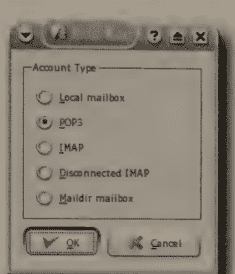

图 2-9：告诉 KMail 你使用的是哪种电子邮件账户。你有你有选项。以下是每个选项的含义：

- 本地邮箱箱（Local mailbox）：如果你使用常用的 mbox 格式存储了本地邮件，请使用此项，该格式将每个文件夹的消息合并存储在一个文件中。可能应该避免使用 mbox，因为一封损坏的邮件可能会损坏包含数百或数千条消息的整个 mbox 文件。

- POP3：邮局协议 3，这是大多数人使用的协议。使用 POP3，你会在检查邮件时从服务器下载邮件（是的，你可以在服务器上保留副本，但这并不是使用 POP3 的正确方式，它会造成混乱，导致在该机器和上机器上都有邮件副本）。

- IMAP：互联网消息访问协议，越来越多的人在使用在使用，特别是那些从多台机器访问邮件的人。与 POP3 不同，IMAP 将邮件存储在服务器上。只下载头部；当你查看单条消息时，内容会被下载以便你查看。删除邮件时，服务器上也会被删除。使用 IMAP，无论你使用哪台机器查看，看到的都是相同的邮件。

- 离线 IMAP（Disconnected IMAP）：与 IMAP 相同，但每条消息的副本都会下载到你的机器上，以便你在离线时查看和删除消息；当你重新连接时，你的更改将与服务器上的邮件存储器同步。离线 IMAP 比普通 IMAP 快，并让你在未连接网络时处理邮件。

- Maildir 邮箱箱（Maildir mailbox）：mbox 的继承者，每封邮件都存储在单独的文件中。如果你使用 maildir 保存了本地邮件，那么这是你的选择。

> 注意：有关关于各种电子邮件协议的更多信息，请阅读维基百科上的文章：http://en.wikipedia.org/wiki/Simple_Mail_Transfer_Protocol、http://en.wikipedia.org/wiki/POP3 和 http://en.wikipedia.org/wiki/IMAP。

默认顺序有点让人困惑：如果你在硬盘上保存了一组旧邮件并想阅读它们，请选择“本地邮箱箱”或“Maildir 邮箱箱”。如果你想连接到邮件服务器并读取邮件，请选择 POP3、IMAP 或离线 IMAP。如果你以前设置过电子邮件账户，那么在 KMail 中设置一个将没有问题。这些都非常标准。当一切无误时点击“确定”。

现在进入“外观”（Appearance）（从左侧面板选择）。在“布局”（Layout）选项卡的“查看器”（Viewer）部分，选择“从不”（Never）旁边的单选按钮。消息结构浪费空间，你只是想把它删掉。在“头部”（Headers）选项卡上，勾选“显示邮件大小”（Display Message Sizes）——不知道为什么这个框默认没有勾选。谁不想知道某封特定邮件的大小呢？

那是为了配置 KMail 的；点击“确定”来配置“配置”窗口。KMail 会立即连接到你设置的账户，因此你可以开始下载和阅读邮件。如果你愿意，可以右键点击左侧消息列表面板中的“未读”（Unread）和“总计”（Total）列并移除这两列。有些人认为它们没有必要，但你可能想留保留它们。

## 充分利用 KMail

使用 KMail 没简单不过了，因为所有主功能都在工具栏上。如果你不确定某个特定图标的作用，将鼠标悬停在上面一秒两秒，就会出现一个带有图标名称的工具提示。要获得更多功能，请查看菜单。本节将为你提供一些关于地址录的酷炫贴士。

当你撰写新消息时，KMail 会使用自动完成功能在你输入前几个字母后完成姓名和地址，但前提是你已经填充了 KAddressBook（打开 K 菜单并选择地址 Address -> 将地址存储在单个文件中 — `std.vcf` — 通常位于 `~/.kde/share/kabs/`）。

如果你在一台已经有 `std.vcf` 文件 且你想使用该文件的机器上运行 Knoppix，那么做起来就简单了。打开 KAddressBook，并在程序左下角的面板中寻找“地址簿”（Address Books）部分；如果你没看到，选择“设置”（Settings）-> 地址簿（Address Books），它就会出现。选择默认地址簿（在 Knoppix 中称为 `resource-name`），并点击“编辑”（Edit）。打开资源配置（Resource Configuration）窗口（见图 2-10）。

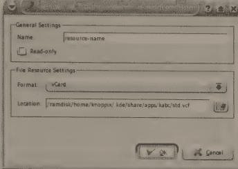

图 2-10：将 KAddressBook 指向另一个地址簿文件。


将从 `resource-name` 改为更具信息量的名称，例如 `hard_drive_address_book` 等。保持格式（Format）设置为 `vCard`，并点击位置（Location）文本框右侧的打开文件对话图标。导航到 `/mnt/hda2/home/rsgranne/.kde/share/apps/kabc/std.vcf`（或你系统上的对应路径），点击“确定”，你的常用地址就已经在那。太棒了！

> 注意：为了使此技术生效，你必须首先使用 Knoppix 桌面上的图标挂载包含主目录的驱动器。如果你想读取并写入 `std.vcf` 文件，请以“只读”模式挂载驱动器。（记得怎么做吗？右键点击桌面上的驱动器图标，勾选“属性”，选择“设备”选项卡，取消勾选“只读”，并点击“确定”关闭属性。）

还有另一种自动填充地址录的方法，但它只有在你使用 IMAP 邮件时才有效。（如果你是 IMAP 迷，你会更倾向于这种方法）。基本上，你将地址存储在 IMAP 服务器上的一个文件夹中，然后告诉 KAddressBook 使用该文件夹作为你的地址簿。听起来很疯狂，但它是有效的。操作方法如下：

1. 在 KMail 中，右键点击左侧的文件夹并选择“新建文件夹”（New Folder）。
2. 选择 设置（Settings）-> 配置（Configure）和同步（Synchronize）。
3. 在 KMail 中，选择 GroupAP 选项卡。勾选“启用 IMAP 资源”（Enable IMAP Resource）。
4. 在设置（Settings）中，选择隐藏文件夹（Hide Folders）并选择“无”（None）。
5. 打开 KAddressBook。在“书籍”（Books）区域，点击“添加”（Add）。打开“添加”窗口；选择 IMAP 并点击“确定”。现在当你添加联系人时，它将存储在群组件文件夹中。

## 使用 Gaim 与好友即时通讯

即时通讯在过去几年中越来越流行，因为它已经从消费者扩展到业务领域。事实上，现在许多人比通常更依赖 IM。作为核心应用之一，IM 以 Gaim 的形式存在于 Knopix 中，而 Gaim 实际上是一个 GNOME IM 程序（绝大多数 GNOME 应用都是如此）。Gaim 非常酷，因为它支持所有主要的 IM 协议，包括 AIM、ICQ、Jabber、MSN Messenger 和 Yahoo，以及 IRC（尽管它有点笨拙）和其他一些。没错——只需通过一个程序，你就可以和所有的朋友聊天，无论他们在使用什么。

要启动 Gaim，打开 K 菜单并选择互联网（Internet） -> Gaim 即时通讯工具。要使用 Gaim，你需要连接到你的账户；Gaim 会立即打开账户窗口，让你通过现有账户进行身份验证。

### 注册 IM 账户

如果你还没有任何 IM 账户，请访问主流 IM 网站并注册：

- AOL 即时通讯 (AIM)：https://my.screenname.aol.com/cqr/registration/initRegistration.psp
- Gadu-Gadu：在 Gaim 内部注册
- ICQ：www.icq.com/register/
- Jabber：在 Gaim 内部注册
- MSN Messenger：https://register.passport.net
- Yahoo Messenger：http://edit.yahoo.com/config/eval_register?new=1

点击“账户”窗口中的“添加”按钮打开“添加账户”窗口，如图 2-11 所示。

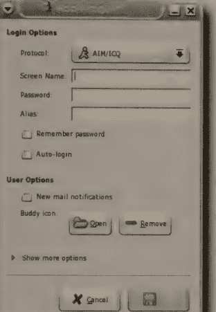

图 2-11：为 Gaim 添加 IM 账户。

使用协议协议下拉菜单选择你想要使用的 IM 服务。在屏幕上填写必要信息，如果你觉得懒，可以勾选“记住密码”和“自动登录”（这并不是坏事！），完成后点击“保存”。如果你想连接到任何其他服务，请重复整个过程，直到设置好所需的一切。

现在你可以开始启动 Gaim 了。在“账户”窗口中，通过勾选你想加入的每个 IM 网络“在线”列下的框，连接到已注册的 IM 服务（如果你选择了自动登录，下次启动 Gaim 时就不需要这样做）。当你连接到每个网络时，代表 IM 服务的图标将从灰色变为彩色，让你知道已成功连接。连接完成后，关闭“账户”窗口并关注图 2-12 所示的“好友列表”窗口。

## 第一部分 —— 玩强大的 Knoppix 工具箱

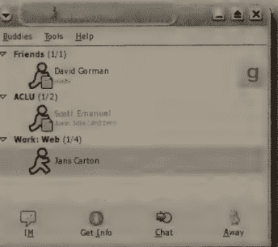

图 2-12：在此示例中只有几个好友在线。

如果你在任何一个服务中已经有了好友，你应该右键点击某个好友并从选项列表中进行选择，或者点击窗口底部的 IM 按钮。请记住，选项取决于每个服务提供的功能。发送单条消息、启动聊天会话或发送文件——这些在 Gaim 中都可以实现。

要添加新好友，选择“好友 -> 添加好友”。打开“添加好友”窗口，你只需提供两项关键数据：屏幕名称（Screen Name）和账户（Account）。确保你选择了正确的账户——如果你说朋友使用 Yahoo!，但他实际上使用的是 Jabber，那么你很快就无法进行 IM 通了。

Gaim 是一个成熟的 IM 客户端，实现了互联网技术应该做的事：在方便通信的同时减少你在计算机上运行的程序数量。得益于 Gaim，你可以与使用 Yahoo!、MSN 或 AIM 的朋友和同事聊天，而无需同时打开三个或更多不同的 IM 应用程序。这太方便了！

## 总结

首先你必须接入互联网，然后就可以在上面工作（和玩）了。有许多不同的方法可以访问被称为“网络”的世界奇迹，Knoppix 产品支持所有这些方法。更好的是，Knoppix 让你轻松利用人们为网络通信创建的许多功能之一。只要将 Knoppix 纳入你的计算工具箱，你住在世界另一端的朋友和坐在城另一头的家人就只有几次点击之遥。

## 连接到其他机器和资源

电话本身是一件时尚配件；然而，连接到电信网络的电话可以成为救命稻草。同样，一台孤立的计算机无疑有用，但当你将其连接到其他计算机的网络时，魔法就发生了。你可以传输数据、访问全球（或仅仅是隔壁）的资源、向未直接连接到你机器的设备打印、控制计算机，甚至让世界上任何人访问 Web 页面。在许多方面，过去十年的计算革命实际上关乎网络，而 Knoppix 让该革命的成果对其用户完全可用。想使用 Knoppix 让你机器上的资源可用吗？没问题。想使用 Knoppix 其他机器上的网络资源吗？更简单。

## 理解远程控制

有时你坐在一台计算机前，但你真的需要查看另一台计算机上发生了什么。你可能正在将一台配置为服务器并需要测试另一台作为客户端，或者你可能正尝试帮助另一个城市的家人解决一个特别棘手的问题，如果你能恰好看到他们看到的内容，进展将顺利得多。Knoppix 通过两个不同的互补应用程序实现了远程控制的可能性：VNC 和 FreeNX。

### 使用远程桌面连接控制另一台计算机

VNC 是一个免费、多功能、跨平台的远程控制服务器和客户端，每个计算机用户工具箱中都应该有一个。它最初由 Olivetti & Oracle 研究实验室的研究人员开发，根据 GPL 协议发布并全球开放。VNC 因其强大和灵活性而受到广泛赞誉。它在 Linux 和其他 *nix* 类、Windows 和 PocketPC、Mac OS、Palm OS、OS/2 上原生运行，最棒的是，几乎可以在任何可以运行基于 Java 的客户端软件的机器上运行。此外，运行在一种操作系统上的客户端可以访问并控制运行服务器版本 VNC 的任何其他操作系统。有了 VNC，你就可以随手进行强大的远程控制。

有关更多关于 VNC 的信息，请阅读 Wikipedia 上的文章：http://en.wikipedia.org/wiki/Vnc。

Knoppix 没有附带 VNC 客户端，但不要恐慌。Knoppix 提供的不是单一的 VNC 客户端，而是多种远程访问工具，我们将在下面对其进行探索。

# 第3 章

### 本章内容

- 检查远程控制
- 使用 FTP
- 探索 SSH 及其后代
- 共享打印机和文件
- 使用 Apache 提供 Web 页面

# 70 第一部分 — 探索强大的 Knoppix 工具箱

## 注意

有关 NoMachine 及其 NX 软件的更多信息，请访问 http://nomachine.com。

从安全的角度来看，NX 有许多优点。它使用 SSH（以及 SSH 守护进程）确保在初始身份验证连接时用户名和密码是加密的。当你通过这一重考验并登录后，你可以继续使用 SSH，以便所有后续流量也经过加密处理。如果你在局域网内且处于防火墙后，可以禁用会话加密以提高速度，特别是对于旧硬件（我们建议使用 SSH，除非你使用的是 CPU 较慢的旧机器，以尽可能安全）。

NoMachine 在 GPL 协议下开放了其核心技术，结果就是 FreeNX，这是一个 NX 服务器和客户端的完全免费实现。NoMachine 通过帮助确保免费软件和商业软件保持同步，完全支持了 FreeNX 团队的努力，这是值得赞道的。

## 注意


关于将 FreeNX 引入 KDE 的 KDE 开发者访谈，可以在 `www.osnews.com/printer?news_id=8139`。令人置信的是，FreeNX 实际上只是一个 BASH 脚本——几百行的 BASH 脚本，但它终毕竟是一个 BASH 脚本！

什么样的机器可以支持 FreeNX 服务器？对于每个 KDE 用户会话，你大约需要 40MB 内存和大约 100MHz 的 CPU，这并不差。如果你有一台良好且快速的机器，例如大约 3GHz、1GB 内存，可以支持大约 25 个并行会话。这很不错！

FreeNX 的结果是：与其他机器建立极快速、安全的连接——而且是免费的！

## 设置 FreeNX

要启动 NX 服务器，选择 Knoppix → Services → Start NX Server。弹出的对话框会警告你将创建一个名为 `nxuser` 的新用户，其可以访问 FreeNX 服务器。继续点击 OK。另一个对话框打开，提示你为新的 `nxuser` 创建密码。为了现在保持简单，也使用 `nxuser` 作为密码，然后点击 OK。

## 注意事项

不要在你的机器上使用 `nxuser` 作为密码！请请创建一个良好的密码来保护你的机器和数据。关于如何创建良好密码的帮助，请阅读 Security Focus 上的标题为“The Chocolate”的文章，地址为 `www.securityfocus.com/columnists/245`。

FreeNX 生成加密密钥，以便使用其协议发送的所有通信免受数据嗅探的侵害；它会产生一个窗口，你可以在其中观察过程。

同时，另一个对话框打开，通知你现在可以使用新创建的 `nxuser` 账户登录。注意，你可以使用系统上的任何用户登录，因此默认没有设置密码的 `knoppix` 也可以登录。当你点击 OK 关闭对话框时，FreeNX 产生的 shell 窗口消失，FreeNX 正在运行。

## FreeNX 服务器的命令行控制

使用命令行更改 FreeNX 服务器非常简单。一旦你运行 root 权限（只需在命令行输入 `su -` 并按回车即可以超级用户身份运行），就可以输入以下命令进行修改：

- `nxserver -listuser`：显示 FreeNX 用户列表，如果你想验证谁可以登录你的账户，这非常有帮助。
- `nxserver -adduser username`：添加新用户，你可能不需要这样做，因为 `nxuser` 已经足够了。
- `nxserver -deluser username`：删除用户。
- `nxserver -passwd username`：提示为指定用户输入密码，同样可能不需要执行，假设你在最初被提示时为 `nxuser` 选择了合适的密码。
- `nxserver -status`：FreeNX 正在运行吗？通过此命令查询。
- `nxserver -start`：如果 FreeNX 服务器未运行，则启动它。
- `nxserver -stop`：如果 FreeNX 服务器正在运行，则停止它。
- `nxserver -restart`：如果 FreeNX 服务器正在运行，则重启它；如果没有运行，则启动它。警告：当你运行此命令时，任何连接到你 FreeNX 服务器的人都会被粗鲁地断开，除非你使用下一个命令。
- `nxserver -broadcast message`：将你的消息发送给所有登录用户，你应该在重启服务器之前这样做。

要查看可能的选项列表，只需以 root 身份在命令行输入 `nxserver` 并回车。

## 理解 FTP

FTP（文件传输协议）是网上仍在使用的最古老的协议之一。它于 1971 年 4 月在 RFC 114 中提出（`www.ietf.org/rfc/rfc114.txt`），每天被使用数百万次，即使是那些完全不知道自己通过 Web 浏览器下载的文件是由于一项使用了 30 多年的技术而到达他们电脑的人。

遗憾的是，FTP 有一个很大的问题：安全性。因为太老了，FTP 在设计之初根本没有考虑安全性。因此，用户名、密码以及所有后续流量都是明文传输的，让任何嗅探包的人都能轻易找到你的敏感信息。Knoppix 没有附带 FTP 服务器软件，这没关系：无论如何你应该使用 SSH 和 SFTP，后者会加密所有流量。然而，Knoppix 确实附带 FTP 客户端软件，如果你必须连接到不支持 SFTP 的服务器，这可能会派上用场。

如果你不知道如何使用命令行，那么在这一点上你会会得非常被手。另一方面，如果你知道如何使用 `cd` 及相关命令进行导航，以及如何使用 `vi` 等基于终端的编辑器运行程序和处理数据，那么这里就是你的乐场。

# 使用 SFTP

如果你必须来传输文件，请使用 SFTP 而不是 FTP，原因仅仅是为了安全。FTP 会以明文形式发送你的用户名、密码和所有数据，导致任何截获流量的人（将在第 6 章中讨论）都能窃听；而 SFTP 则通过 SSH 传输并加密所有内容，这正是你想要的。

如果你愿意，可以在命令行中使用 SFTP。如果你熟悉命令行 FTP，你会觉得非常自如，因为一切都是那样的。要使用命令行连接，只需在 Konsole 中输入 `sftp username@machine` 并按回车（使用上一节的示例，你输入 `sftp scott@work.wiley.com`）。在提示时输入密码即可开始使用。如果你需要复习可以使用的命令，只需输入 `help` 并查看生成的列表即可。

如果你更倾向于使用 GUI——这在很多情况下显然更简单——那么你可以回到你熟悉的 Konqueror，它处理 SFTP 的能力和 FTP 一样好。一切都完全相同，只是你在位置栏中使用 `sftp` 而不是 `ftp://`。这并不意味着你可以直接将任何网站的 `ftp` 改为 `sftp` 并让其工作。事实上，这在大多数情况下都会失败，因为大多数使用 FTP 的服务器并不一定使用 SFTP。

如何使用 Konqueror 连接到支持 SFTP 的服务器？打开 Konqueror，在位置栏中输入你的服务器地址（类似于 `sftp://work.sftpserver.com`），并按回车。接下来你应该看到一个与图 3-4 类似的警告框。

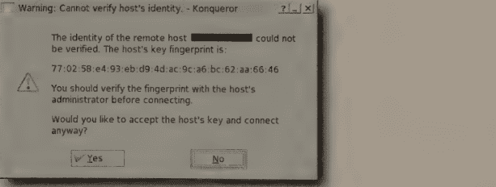

图 3-4：第一次连接到机器时，必须接受该机器的密钥。

记住，通过 SSH 发送的所有流量都是加密的。为了实现加密，你的计算机与要连接的服务器之间会交换密钥。这个警告是 SSH 在告诉你，它没有办法知道服务器密钥是否有效——换句话说，如果你确定知道密钥是有效的，且不是中间人攻击的受害者——请尽管点击“是”，将密钥添加到你在 `~/.ssh/known_hosts` 中找到的列表中（如果因为重装操作系统导致服务器上的密钥发生变化，你需要在 `known_hosts` 中找到相应的行，将其删除，并重新连接服务器以重新接受并重新输入密钥）。

添加密钥后，系统会提示你输入用户名和密码。继续输入，几秒钟你你就能看到 SFTP 服务器的内容。

想了解更多关于中间人攻击的信息？请查看维基百科关于该主题的文章：`http://en.wikipedia.org/wiki/Man_in_the_middle_attack`。

使用 SFTP 下载和上传文件与 FTP 相同：只需拖放，或者右键点击并选择“复制到”。如果你计划在运行 Knoix 期间多次使用某个 SFTP 站点，请将其书签化以便以后访问。

安全第一：当你有选择时，请使用 SSH 而不是 FTP。

我在家里内部网络上使用 SCP，部分是因为我有偏执症，部分是因为它现在是自动的。养成同样的习惯是个好主意。

## 使用 SCP

如果你是一个命令行发烧友并且赶时间，SCP（安全拷贝）是使用 SSH 将文件从一台机器快速复制到另一台机器的好方法。SCP 基本遵循此模式：`scp user@host1:file @host2:file`。不过，如果你处理的文件之一是本地的，可以省略 `user@host`，稍后你会看到。

例如，假设你想用 `scp` 将 `me.jpg` 从当前目录复制到你在另一台机器（称为 wiley.com）上的网站。在命令行中输入以下内容并按回车：

```bash
$ scp me.jpg username@wiley.com:/var/www/mywebsite/images
```

系统会提示你输入密码，片刻后 `me.jpg` 就会出现在你的网站上供周围的人查看。

有几个 JPEG 想要传输？简单！

```bash
$ scp *.jpg username@wiley.com:/var/www/mywebsite/images
```

要将服务器上所有的 JPEG 复制到当前机器，但复制到与当前目录不同的目录，请输入：

```bash
$ scp username@work.wiley.com:/var/www/mywebsite/images ~/pix/website
```

# 76 第一部分 — 导航神奇的 Knoppix 工具箱


当你想要在机器之间安全拷贝文件时，`scp`非常有用。然而，如果你有很多不同的东西需要移动，手动输入`scp`命令就会很很了。

# 文件和打印机

要共享文件，你需要在想要共享的机器上设置Samba服务器。这是局域网计算机之间共享文件最简单的方法。

首先，你需要安装Samba包。在Knoppix上，你可以使用：

```bash
sudo apt-get install samba
```

安装完成后，你需要配置共享。主配置文件位于`/etc/samba/smb.conf`。使用`vi`等文本编辑器打开它：

```bash
sudo vi /etc/samba/smb.conf
```

为你的共享添加一个段。它可能如下：

```ini
[MyShare]
   path = /home/username/shared
   readonly = no
   guest = no
```

保存文件后，你需要重启Samba服务使更改生效：

```bash
sudo systemctl restart smbd
```

现在，从网络上的另一台机器可以访问该共享。在Knoppix中，你可以使用Konqueror，在位置栏输入Samba服务器地址：`smb://server-ip/MyShare`。

# 启动 Samba

设置Samba时，你还需要为Samba用户设置密码。这与你的系统密码是独立的。使用`smbpasswd`命令：

```bash
sudo smbpasswd -a username
```

设置密码后，你就可以使用这些凭据从其他机器连接。

> 注意：如果你处于防火墙之后，你需要在防火墙中允许Samba端口（139和445）。

# 使用 Samba 访问文件和打印机

正如你刚刚学到的，`smclient`是验证Samba是否在你的Knoppix计算机上运行的极佳方法。然而，`smclient`的真正目的是实际上连接到运行Samba的机器并处理文件。你当然可以使用它，但一直都要输入命令会有些无聊。幸运的是，Knoppix——KDE——包含一个非常棒的GUI工具，你可以用它浏览Samba共享：Konqueror。

> 注意：本章将介绍访问通过Samba共享的文件和文件夹。如需连接到Samba共享打印机，请参阅第1章。

没错！Konqueror是一个无所不能的文件管理器，不仅是一个棒的FTP和SFTP浏览器，还是一个极佳的Samba浏览器！


要连接到另一台机器上的Samba共享——比如一台运行Windows的机器——通过点击面板上的“个人文件”图标打开Konqueror，只需在“位置”栏中输入`smb://`并按回车。根据你网络的大小，你很快就会看到Konqueror能找到的所有Samba组列表。例如，图3-5显示Konqueror找到了作者的工作流Milton。

图3-5：Konqueror找到你的Samba工作组。

要打开一个工作组，点击其图标，将显示该工作组中所有机器的列表，如图3-6所示。

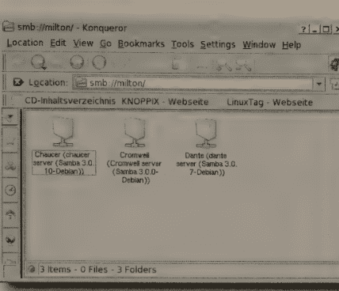

图3-6：Konqueror显示所选Samba工作组中的机器。

看到你想浏览的机器了吗？点击它，过一会儿Konqueror就会为你显示该计算机上可用的共享列表（见图3–7）。

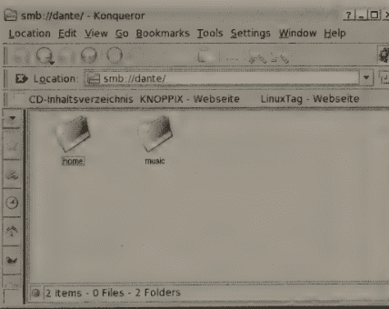

图3-7：Konqueror显示所选机器中的Samba共享。

请记住你共享的是内容，而不一定是分区或驱动器。一个共享可以包含整个分区或驱动器（尽管通常不是个好主意），但不必非如此。你可以使用Samba共享目录层级中非常深处的子文件夹；例如，为了查看某些OGG和MP3文件，你可能点击“音乐”共享。

系统会立即提示你输入用户名和密码，这在你尝试连接到受保护的共享时任何时候都会发生。请记住，你必须输入Samba用户名和密码，这可能与你在机器上的登录用户名和密码不同——这取决于你如何在那台计算机上设置Samba。如果你连接的是Windows或Mac OS机器，则是登录名称和密码；如果是Linux机器，那么登录名称可能与Samba名称不同。你只需要知道你尝试连接的那台计算机是如何设置的即可。

几年前，Konqueror一又一次地要求你输入用户名和密码——也许每当你进入一个新的子文件夹都是如此。事实上，这简直疯了——足以让你发疯。谢天，KDE删除了这个烦恼。现在它只需要要求你一个共享，就此结束。

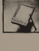

一旦你正确登录，就可以访问你想要的文件和文件夹了。在我的情况下，那就是摇滚乐OGG和MP3（都是合法的）。此时，我想也许是时候听点音乐了——听听史密斯乐队的（在整理我的音乐收藏时我有强迫症般的倾向），点击`Rock_Alternative_All_Time_Greats`（我是认真的），然后点击`Smiths_-Hatful_of_Hollow_-01_-William_It_Was_Really_Nothing.mp3`然后……这是怎么了？文件出现在XMMS（默认MP3播放器）中，但没有声音。存储在Knoppix机器本地的文件播放正常。这是是怎么了？

问题在于连接到William的“音乐”共享实际上并没有挂载，因此XMMS无法播放那里的歌曲。右键点击`William_-It_Was_Really_Nothing.mp3`并选择用xim打开它，它播放了——该文件是下载到机器上的第一个文件。对于单曲来说这没问题，但对于专辑、大视频或任何其他内容——在听或看之前加载每一个文件，很快就会变得非常无聊。要解决这个问题，你实际上需要在你使用Knoppix盒的远程机器上挂载Samba共享，这样Knoppix就会认为该文件就在硬盘上。

如果你知道如何在命令行中使用`smbount`，现在就是你大显异彩的时候。只需输入`smbount`和适当的选项即可设置。如果你不知道`smbount`，或者想学习如何使用它，可以从Knoppix自带的LinNeighborhood开始。

要访问LinNeighborhood，点击菜单并选择Internet→More Applications→LinNeighborhood。程序打开了，但在你开始之前，你需要更改一些设置。首先，选择`Edit→Preferences`，这会打开图3-8所示的Scan标签页。


图3-8：在LinNeighborhood中进行设置

一旦你正确登录，就可以访问你想要的文件和文件夹了。在我的情况下，那就是摇滚乐OGG和MP3（都是合法的）。此时，我想也许是时候听点音乐了——听听史密斯乐队的（在整理我的音乐收藏时我有强迫症般的倾向），点击`Rock_Alternative_All_Time_Greats`（我是认真的），然后点击`Smiths_-Hatful_of_Hollow_-01_-William_It_Was_Really_Nothing.mp3`然后……这是怎么了？文件出现在XMMS（默认MP3播放器）中，但没有声音。存储在Knoppix机器本地的文件播放正常。这是是怎么了？

问题在于连接到William的“音乐”共享实际上并没有挂载，因此XMMS无法播放那里的歌曲。右键点击`William_-It_Was_Really_Nothing.mp3`并选择用xim打开它，它播放了——该文件是下载到机器上的第一个文件。对于单曲来说这没问题，但对于专辑、大视频或任何其他内容——在听或看之前加载每一个文件，很快就会变得非常无聊。要解决这个问题，你实际上需要在你使用Knoppix盒的远程机器上挂载Samba共享，这样Knoppix就会认为该文件就在硬盘上。

如果你知道如何在命令行中使用`smbount`，现在就是你大显异异的时候。只需输入`smbount`和适当的选项即可设置。如果你不知道`smbount`，或者想学习如何使用它，可以从Knoppix自带的LinNeighborhood开始。

要访问LinNeighborhood，点击菜单并选择Internet→More Applications→LinNeighborhood。程序打开了，但在你开始之前，你需要更改一些设置。首先，选择`Edit→Preferences`，这会打开图3-8所示的Scan标签页。


系统会立即提示你输入用户名和密码，这在你尝试连接到受保护的共享时任何时候都会发生。请记住，你必须输入 Samba 用户名和密码，这可能与你在机器上的登录用户名和密码不同——这取决于你如何在那台计算机上设置 Samba。如果你连接的是 Windows 或 Mac OS 机器，则是登录名称和密码；如果是 Linux 机器，那么登录名称可能与 Samba 名称不同。你只需要知道你尝试连接的那台计算机是如何设置的即可。

## 第 3 章 — 连接到其他机器和资源 85

通常，如果你打算再次使用该文件来挂载 Samba 共享，你会创建一个目录并将其放入其中，然后运行 `chmod 744 mountscript` 使其具有可执行权限。如果你觉得这很有用的话，请务必阅读第 10-12 章，这些章节讨论了对 Knoppix 的重新制作。

用你喜欢的文本编辑器打开 `mountscript` 并查看它。它只是一个带有适当选项并调用 `smbmount` 的 bash 脚本。以该脚本为模板，你可以添加更多行来挂载 SMB 共享。如果你觉得非常有野心，可以安排它在启动时运行，自动将几个 SMB 共享挂载到你的本地文件系统中，从而节省时间并让事情变得简单快捷。

想了解详情，请尝试 `smbmount`。这里有一个提示：如果你打算使用 `smbmount`，请查看 `credentials` 选项以获得更好的安全性。

### 使用 NFS 访问文件

N 实际上比 SMB 协议更老，但功能少得多。SMB 允许你共享文件、文件夹以及打印机，而 NFS 只共享文件和文件夹。在安全性方面，SMB 在许多方面更好，因为它允许你通过用户名来控制对共享的访问（“你是 Steve 吗？如果是，就访问财务目录”，而 NFS 仅通过机器控制共享（“你是来自 Dante 这台机器吗？太棒了！那么无论你实际上在哪台机器上，你都可以访问财务目录！”）。SMB 构建在 Windows 中，但在 Mac OS 和 Linux 上也支持良好，而 NFS 是一种 UNIX 协议——你可以在 Windows 上找到 NFS 的支持，尽管如此，如果你想在 Linux 机器之间轻松共享文件，NFS 是快速、简单且高效的。

要开始 NFS，你需要详细说明你的 NFS 共享。假设你想让 Knoppix 机器 Homer 上的 `/tmp` 目录对 Knoppix Linux 机器 Dante 可。首先，你需要确保 Homer 和 Dante 知道对方的 IP 地址。例如，通过编辑 `/etc/hosts` 文件，将 Dante 的 IP 地址 `192.168.0.105` 和 Homer 的 `192.168.0.110` 添加到 Dante 的 `/etc/hosts` 文件中。一旦完成此任务（Linux 不需要重启！），两台机器就可以在网络上找到彼此。

然后，用文本编辑器打开 Homer 上的 `/etc/exports`（你需要 root 权限，如果你使用命令行，请使用 `sudo vim /etc/exports`；如果你想以 root 身份启动 GUI 编辑器，请使用 `sudo k`），并添加以下行：

```
/tmp dante (rw,sync)
```

> 在 `exports` 文件中输入行时必须非常小心。注意机器名称之后和括号之前没有空格，不要在那里留空格，否则你会积累糟糕的安全因果。更多信息请参阅 tldp.org/HOWTO/NFS-HOWTO/security.html。

### 其他一些实用的 NFS 命令

如果你真的想充分利用 NFS，你需要了解一些额外的命令。你会发现以下命令非常有用：

- `/etc/init.d/nfs-kernel-server`: 停止 NFS
- `/etc/init.d/nfs-kernel-server restart`: 重启 NFS（要小心，因为连接到你 NFS 服务器的任何人都会暂时发现他们无法运行任何访问 NFS 数据的程序）
- `exportfs -ra`: 如果你做了更改，重新导出 `/etc/exports` 文件。

对于 NFS，你需要在 Konsole 中运行几个命令，从这个命令开始：

```
$ portmap
```

`portmap` 实际上是将 RPC 数字翻译成网络端口号。当服务器（例如，运行 NFS 服务器的 Knoppix）接收到 RPC 调用时，它使用 `portmap` 将该调用发送到正确的网络端口。没有 `portmap`，NFS 就无法工作。

> 不知道什么是 RPC？？去 Wikipedia 阅读 http://en.wikipedia.com/wiki/RPC。


其他命令包括 `stop (sudo /etc/init.d/portmap stop)` 和 `restart (sudo /etc/init.d/portmap restart)`。关于 `portmap` 的更多信息，请使用 `man portmap`。

接下来，运行以下命令启动两个服务：

```
$ sudo /etc/init.d/nfs-common start
$ sudo /etc/init.d/nfs-kernel-server start
```

这就让 NFS 运行起来了。

开启 NFS 后，任何在 Dante 上运行 NFS 客户端的人都应该能够挂载并连接到 Homer 上共享的 `/tmp` 目录。要挂载共享目录，在 Dante 中以 root 身份运行以下命令：

```
# mkdir /mnt/homertmp
$ mount -t nfs homer:/tmp /mnt/homertmp
```

第一条命令创建挂载点；第二条执行实际挂载。你可以运行 `ls /mnt/homertmp` 并查看 Homer 上 `/tmp` 目录的内容，就像它是 Dante 本地文件系统的一部分一样。

现在 Dante 上的任何人都可以访问访问在 `/mnt/homertmp`。记得共享导出为 `rw`，所以使用 Dante 的任何人不仅有访问权限，还可以读写挂载共享上的文档。这就是为什么许多人认为 NFS 有点不安全，以及

## 第 3 章 — 连接到其他机器和资源 85

## 使用 Knoppix 救援和恢复系统

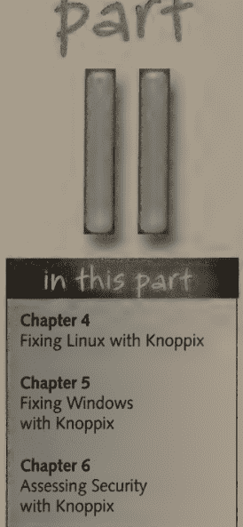

## 使用 Knoppix 修复 Linux

Knoppix 是 Linux 的变体，因此 Knoppix 可以用于修复其他 Linux 发行版中出现的问题并不意外。运行 Linux 的机器总会遇到问题：人类制造 Linux，人类也使用 Linux，因此错误和 Bug 在所难免。幸运的是，有 Knoppix。

本章探索了一些对作者有效且可能对你也有效的修复方法。

### 确保机器能够运行 Linux

特定的机器真的能运行 Linux 吗？这里有几种方法可以发现：

- *询问制造商*：祝你好运。大多数电脑制造商仍然把 Linux 视成地下室里的疯狂姨妈，既不想见到，也绝对不谈论它。这种情况正在改变，一些供应商现在支持 Linux，但仅限于少数选定的机器。如果你想在不支持的机器上运行 Linux 呢？不要就此向制造商寻求建议，因为你得不到任何建议。
- *询问已经拥有该机器的人*：如果你的朋友拥有同一台电脑并运行 Linux，那太棒了！然而，大多数情况下这不太可能，但你也可以在搜索，通常能找到很好的信息，特别是如果你对笔记本电脑感兴趣。尽管如此，寻找关于特定机器的可靠信息可能是一次极其令人挫败的尝试，浪费几个小时却得不到可靠的数据。

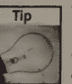

最好的网站，毫无疑问，如果你拥有一台或正考虑购买笔记本电脑，并想知道它运行各种版本 Linux 的效果如何，那么你需要访问 Linux on Laptops。

## 第 4 章

- 修复启动问题
- 处理关键系统文件
- 处理 Linux 分区
- *测试机器*：如果你能接触到那台机器，测试一下它是否能运行 Linux。带上 Knoppix 光盘去你当地的电脑店，问问是否可以在感兴趣的机器上尝试运行光盘。如果机器可以启动并运行，那么它极可能支持几乎任何版本的 Linux；如果你发现 Knoppix 有问题，那么你可能在任何其他 Linux 上都会遇到问题，所以应该避免那台电脑。
- *做出你的选择*：这始终是一个选项。买下机器，并尝试在上面安装 Linux。如果你遇到问题，用 Knoppix 测试机器，并记录哪些有效，哪些无效。然后开始在 Google 上反复搜索，直到得到答案。当然，这些答案之一可能是 Linux 根本无法在你的电脑上运行，你需要将其退货。幸运的是，这种极端的步骤越来越少见，但对于少数失策的制造商来说这仍然真实，他们还没有意识到对 Knoppix 的支持将从长远让他们付出巨大代价。

Knoppix 是验证特定电脑是否支持 Knoppix 的极佳工具。

## 修复启动问题


当系统无法启动时，内心深处会感到一阵凉意。在过去，启动失败意味着你将花费几个小时反复调整配置文件，进行徒劳的尝试以解决问题，或者更糟，是重新安装操作系统。现在，启动问题并不意味着浪费大量时间，因为可以使用 Knoppix 来修复启动电脑时出现的问题。事实上，你可能会发现将 Knoppix 作为一个强大的修复工具来使用是多么简单。

> 我们知道，八年前我们本可以使用 Knoppix 的，当时我们尝试在 Windows 机器上安装 Red Hat 来创建一个双启动机器，结果惊恐地盯着电脑显示器上闪烁的 LI，确信我们在硬盘上丢失了大量数据。噢，人类的悲剧！

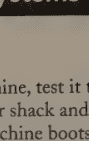

## 恢复丢失的 MBR

启动问题的原因通常涉及损坏或丢失的 MBR（主引导记录）。MBR 对你的电脑至关重要。它是硬盘开头的一个 512 字节的区域，包含两个关键项目：使你的电脑能够启动的信息以及你的分区表。如果你的 MBR 被搞乱了，你通常就麻烦了。MBR 是如何被搞乱的？嗯，尝试在安装 Linux 之后安装 Windows 来创建双启动系统通常会导致这种棘手问题（总是先安装 Windows，然后再安装 Linux！），并在 Windows 内部运行 `fdisk /mbr`。有时，它会在没有明显原因的情况下损坏。

由于 MBR 如此重要，你真的应该定期备份它，以防灾难发生。你可以通过 Knoppix 在 Windows 内部使用以下命令备份 MBR（假设你正在将名为 Homer 的机器上的 MBR 拷贝到 USB 闪存盘）：

### 第 4 章 —— 使用 Knoppix 修复 Linux

```
$ sudo dd if=/dev/hda of=/mnt/mbr_backup bs=512 count=1
```

`dd` 命令创建磁盘镜像，但此命令使用 `bs`（块大小）选项告诉 `dd` 每次只输出 512 字节，而 `count` 意味着 `dd` 只执行一次。因为 MBR 包含在硬盘的前 512 字节中，所以此命令复制了它。（关于 `dd` 命令的更多信息，请参见本章稍后的“备份分区”）。现在重启系统并恢复闪存盘上的备份分区表，这应该让你感到更安全。

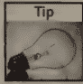

是的，你可以使用 Knoppix，但实际上，无论如何你应该备份 MBR！不要等到使用它时才！有了备份的 MBR，如果它被毁了，你可以恢复它。只需反向执行命令：

```
$ sudo dd if=/mnt/mbr_backup of=/dev/hda bs=512 count=1
```

记住，这将恢复你的引导代码和分区表。每当你更改分区时，必须备份 MBR（幸运的是，大多数人很少更改分区，所以备份一次就足够）。如果你没有更改分区，这个命令应该是好的。然而，如果你在备份后更改了分区表（糟糕了！），你想要运行：

```
$ sudo dd if=/mnt/mbr_backup of=/dev/hda bs=446 count=1
```

MBR 的引导代码位于 512 字节区域的前 446 字节；最后的 66 字节包含分区表。恢复前 446 字节即可找回引导代码；恢复完整的 512 字节即可找回引导代码和分区表。现在这很重要！


在 `dd` 命令中输入这些数字要小心！误打 521 而不是 512 会导致灾难。

## 修复 LILO

LILO（Linux Loader）是 Linux 引导加载器的旧备选，代码位于 MBR 的前 446 字节处。通过升级内核和错误配置 `lilo.conf` LILO 配置文件，可能会破坏 LILO。幸运的是，你可以修复它。

要恢复 LILO，你需要知道硬盘上哪个分区是根分区。要找到它，定位包含 `/etc/lilo.conf` 的分区。很多情况下，这将是 `/dev/sda1`，但不总是如此，所以要清楚处理的是哪个分区。默认情况下，Knoppix 挂载分区时不开启 `dev` 选项；然而，为了修复 LILO，你必须开启 `dev` 选项挂载根分区（如果你好奇，mount 手页解释 dev 选项告诉 Linux “解释文件系统上的字符或块设备”），如下所示：

```
$ sudo mount -o dev /mnt/hda1
```

为了修复 LILO，你需要欺骗它，让它认为 Knoppix 下的 `/mnt/hda1`（无论你的根分区是什么）实际上是 `/`，如果机器是在没有 Knoppix 的情况下启动的。为此，使用 `chroot` 命令，它让启动的进程将给定目录视为根目录。现在 `/mnt/hda1` 分区已挂载，运行以下命令恢复 LILO：

```
$ sudo chroot /mnt/hda1 lilo
```

这告诉系统将 `/mnt/hda1` 视为真正的 `/`，并运行 lilo，以你想要的方式恢复 LILO。取出 Knoppix，重启，LILO 应该就能正常工作。

## 修复 GRUB

比 LILO 更现代的 GRUB（统一引导加载程序）修复过程，根分区并持有 GRUB 配置文件 `/boot/grub/menu.cfg`。你需要开启设备选项挂载包含 GRUB 配置文件的分区，如下：

```
$ sudo mount -o dev /mnt/hda2
```

和 LILO 一样，你需要在 GRUB 中使用 `chroot`，但由于由于这是一个不同的引导加载器，完整命令是不同的：

```
$ sudo chroot /mnt/hda1 grub-install /dev/hda
```

现在重启，GRUB 应该就能工作了。呼！

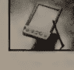

越来越多的发行版正在使用 GRUB 而不是 LILO，因为它是一个更新、更灵活、更强大的引导加载器。学习它对你真的有利。

## 处理关键系统文件

你正在对你的系统特别是你的数据做良好的备份，对吧？尽管如此，有时你也需要打开引擎盖，亲自动手摆弄那些帮助 Linux 顺畅运行的文件。这样做时要小心，因为一个错误就会导致更糟糕的问题。保持清醒，双检你输入的每项内容，成功将属于你。

## 重置忘记的 root 密码

有时你会被分配一台机器来管理，猜怎么着？知道你 root 密码的人无处可寻。你能做什么？为什么，当然是使用 Knoppix！通过 Knoppix，你可以轻松地更改 root 密码——或者更准确地说，移除 root 密码字，这样你就可以将其更改为任何想要的密码。

### 第 4 章 — 使用 Knoppix 修复 Linux

**注意** 一如既往，在进行操作之前，请确保你你有权限修改该机器的密码。

使用 Knoppix 启动后，挂载包含 `/etc` 目录的分区，你将要对其进行操作。确保它是可写法的——右键点击分区图标，选择“属性”，打开“设备”选项卡，取消勾选“只读”，点击“确定”，然后点击分区图标进行挂载。

挂载分区后，运行 `cd /etc` 并使用你最喜欢的文本编辑器打开 `/etc/shadow` 文件（我们更喜欢 `vi`，但只要你以 root 身份运行，可以使用任何编辑器）。打开 `/etc/shadow` 后，找到包含 root 信息的行，如下例：

```
root:$1$k2zdNX.FQ9Xgp9.dhkTszwt4FP1:12893:0:99999:7:::
```

删除第一个和第二个冒号之间的内容，使该行看起来像这样：

```
root::12893:0:99999:7:::
```

保存文件，下次当你重启时，root 将不再有密码。这显然是一个非常危险的情况，所以你应该尽快为 root 分配一个全新的（良好的）密码。

现在看起来很简单，不是吗？

## 修复 X

listervs 上经常听到一种抱怨是：某些人的 Knoppix 启动完全正常，X 也运行良好，但在安装了某个选定的发行版后，X 无法加载，或者即使加载了，显示效果也极其糟糕。

这通常并不难。再次使用 Knoppix 启动，找到文件 `/etc/X11/X86Config-4`。

将该文件拷贝到 USB 驱动器，或者邮件发送给自己，或者存储在网络中的另一台机器上。（打印该文件会有帮助，这样你就在某个地方有一份纸质备份）。

现在拿起 Knoppix 并重启出现问题的发行版。如果你愿意，可以在有问题的发行版上打开 `X86Config-4` 文件，并将其与找到的“良好” `X86Config-4` 文件进行比较。如果可能，打印出“故障”发行版的 `X86Config-4` 并与“良好”的 `X86config-4` 文件进行比较。纸质版有时更容易对比。请记住，Knoppix 的 `X86Config-4` 文件包含了数百万种配置的选项，所以不要盲目从 Knoppix 文件拷贝到你的发行版文件中。你需要关注 Knoppix 文件的以下部分：


- "Module"：检查 Knoppix 是否加载了某些模块而你的发行版没有加载。尝试使用你发行版的 `X86config-4` 文件来加载这些模块。当然，如果模块不在你的系统中，这可能无效，但大多数情况下不会产生任何伤害。

- "InputDevice" 部分（会有多个，对应你的鼠标和键盘）：鼠标滚轮不起作用？看这里。

- "Monitor" 部分：注意 `HorizSync`（水平同步频率）和 `VertRefresh`（垂直刷新率）。编辑这些数字时要非常小心，错误可能会烧毁你的显示器！

- "Device" 部分：查看驱动程序。事实上，这通常就是问题所在。将其更改为 `vesa`，重启机器看看这是否修复了你的问题。Vesa 是一个通用驱动程序，因此你得不到世界上顶级的图形效果，但你能够利用你的机器寻找更好的方案。

- "Screen" 部分：你想要 `DefaultColorDepth`（默认色彩深度），它将引导你找到显示器使用的分辨率。如果你知道你的显卡和显示器支持更高的分辨率，请将其添加到 "Display" 区域中相应的 `Modes` 行中。

无论你做什么，在开始编辑之前，请备份你原始的 `XF86Config-4` 文件。它可能会让情况变得更糟，而且恢复到一个至少还能运行用的文件总是好的。然后你可以重新开始。请记住，调整 `XF86Config-4` 在某些方面类似于巫术，尤其是对于新手来说，所以不要害怕向朋友、在线资源或你当地的 Linux 用户组寻求帮助。

> 注意 XFree86 开发者本身对 2004 年不明智的许可变更负有责任（详细细节请见 http://en.wikipedia.org/wiki/XFree86），这导致了整个 Linux 世界放弃了 XFree86，并迁移到 Xorg 项目 (www.x.org)。Xorg 比 XFree86 具有若干优势，包括对 GPL 友好的许可协议以及更开放的开发者社区。Knoppix 将在未来的某个时候切换到 Xorg，但不要恐慌——你不会有很多新东西要学。Xorg 的主配置文件位于 `/etc/X11/xorg.conf` 而不是 `/etc/X11/XF86Config-4`，但除此之外，两者的格式极其相似。

# 执行文件系统检查

偶尔硬盘会开始变得非常、非常缓慢。在硬盘上来拷贝文件可能花费长时间，即使是对于几个微小文件，并产生大量令人担忧的错误信息。这些迹象表明是时候处理该硬盘了。显然，你不能通过运行位于同一块硬盘上的程序来检查硬盘；相反，使用 Knoppix 启动并运行各种程序来检查你的硬盘是否存在错误。

> 注意 确保你正在检查的驱动未挂载。

检查文件系统的命令取决于所使用的文件系统，使用 Knoppix 启动并运行：

## 检查并修复 Ext2 和 Ext3 文件系统

Ext3 是一个良好的日志文件系统。要检查并修复 ext2（非日志系统），请运行：

```bash
$ fsck -C /dev/sda1
```

`-C` 选项会显示进度条，这非常有用。如果你想看到额外的输出，请在命令中添加 `V`。如果你想让 `fsck` 检查硬盘上的坏块，小写的 `-c` 选项会运行 `badblocks` 程序。`badblocks` 如果发现硬盘上有任何损坏区域，会将它们添加到列表中，以便以后不再使用。

当你运行 `fsck` 时，如果硬盘有很多问题，可能会被问很多问题。如果你只想让 `fsck` 自动修复硬盘，添加 `-p` 和 `-y` 选项。通常我们使用这些选项是因为我们懒得重复输入。

## 检查并修复 ReiserFS 文件系统

要检查并修复格式为 ReiserFS 文件系统，请使用：

`reiserfs --fixable /dev/sda1`

`--fixable` 选项的作用确实如此：它告诉 `reiserFS` 修复易解决的问题。如果 `reiserFS` 发现额外问题，它会通知并建议使用额外的选项，如下：

- `-rebuild-sb`：如果 `reiserFS` 抱怨“read_super_block: 找不到 reiserfs filesystem”，而你确定该文件系统确实使用 ReiserFS，那么你需要使用此选项。
- `-rebuild-tree`：当 `reiserFS` 需要重建整个文件系统树时，它会提示你运行此命令，不，这不是好迹象。务必使用 `dd` 备份分区。
- `-yes`：这告诉 `reiserFS` 对所有问题的回答都为“是”，这样它可以在不询问你大量事情的情况下运行。

如果你想观察 `fsck.vfat` 的工作过程，请加上 `-l` 选项（它会在检查时列出每个文件）以及 `-v` 选项（它会让程序输出更详细的信息）。要标记坏块，请使用 `-t` 选项。

### 检查和修复其他文件系统

当然，还有其他文件系统，但这里介绍的是常用的。你可能会遇到的其他文件系统以及使用的命令如下：

- `fsck.jfs`（更多信息请参见 `man fsck.jfs`）
- `xfs_check`（更多信息请参见 `man xfs_check`）
- NTFS: `ntfsfix`，在 Knoppix 下向 NTFS 格式的分区写入数据后，你应该使用它，正如 `ntfsfix` 所言，“MS chkdsk 在修复更改过的分区时以愚蠢而闻名”。记住，`ntfsfix` 并不是 Windows `chkdsk` 命令的替代品，而是一个旨在防止特定软件崩溃的工具。

关于任何一个文件系统命令的更多信息，请尝试 `man e2fsck`、`man reiserfs` 和 `man fsck.vfat`。更多关于文件系统的通用信息，请参阅 Linux 下的 `man`，或访问 http://en.wikipedia.org/wiki/Filesystem。

> 注意通常意味着文件已经丢失，并且再也不会回来了。然而，你仍然可以找回从你的 Linux 机器上删除的文件。要了解如何操作，请查看第 6 章中的“使用 Coroner 工具包进行法医鉴定”。


## Linux 分区操作

你可以检查你的硬盘，但有时你需要专门处理硬盘上的分区。Knoppix 经常会提供一些优秀的工具，让你能够在你的机器上创建、操作和恢复分区。

### 使用 QTParted 进行分区

如果你在 Windows 世界待过一段时间，那么你就会对 PartitionMagic 感到熟悉——这是一个流行且强大的程序，它让分区操作变得非常简单，即使是 NTFS 格式的分区也是如此。将 QTParted 视为免费开源的 PartitionMagic，你就掌握了这款核心软件的正确入门方法。

要启动 QTParted，从 K 菜单选择 System -> QTParted。你会看到类似于图 4-1 所示的内容。

## 第 4 章 - 使用 Knoppix 修复 Linux

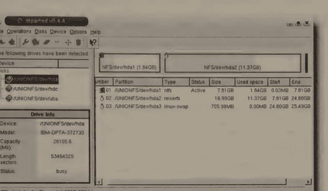

图 4-1：QTParted 允许你在 Linux 内处理分区。

开箱即用，QTParted 可以完成以下操作：

- 创建 Ext2 和 Ext3 分区，但不能调整其大小
- 创建 JFS 分区，但不能调整其大小
- 创建 XFS 分区，但不能调整其大小
- 无法创建或调整 ReiserFS 分区
- 创建并调整 NTFS 分区

使用 QTParted 非常简单。右键点击分区获取属性，或进行格式化、调整大小、移动和删除；右键点击磁盘上的可用空间以创建新分区。如果你用过 PartitionMagic，你会觉得很上手；如果没有用过，很快就能学会。

关于使用 QTParted 有两个注意事项。首先，如果你右键点击一个已经格式化为 ReiserFS 的分区，你只会拥有属性（Property）、格式化（Format）、删除（Delete）和激活（Set Active）选项。ReiserFS 和移动（Move）去哪儿了？要获得这些功能，请使用以下两条命令通过 APT 安装软件：

```
$ sudo apt-get update
```

```
$ sudo apt-get install progsreiserfs
```

运行这两个命令后，你会发现安装了一些额外的包并移除了一些包，系统会询问你是否继续。输入 Y 并回车，片刻后安装就会完成。

重启 QTParted，右键点击 ReiserFS 格式的分区，你将看到完整的选项：属性（Property）、格式化（Format）、调整大小（Resize）、移动（Move）、删除（Delete）和激活（Set Active）。

第二个注意事项涉及 ext3：你无法调整格式为该文件系统的分区大小。不过有一个变通方法。虽然有点麻烦，但有效。首先，使用此命令将你的 ext3 文件系统转换为 ext2：

```
$ sudo tune2fs -o has_journal /dev/hda1
$ sudo e2fsck /dev/hda1
```

记住 ext3 实际上只是带有日志功能的 ext2。你刚刚删除了日志功能，所以现在你回到了 ext2。别忘记以 root 身份运行你最喜欢的文本编辑器修改 `/etc/fstab`，以便该文件中列出的 ext3 分区现在能被正确识别为 ext2。


现在使用 `QTParted` 调整分区大小。完成后，使用此命令将 ext2 分区转换回：

```
$ sudo tune2fs -j /dev/hda1
```

修改 `/etc/fstab` 使分区再次被识别为 ext3，你就大功告成了。虽然麻烦，但确实有效！

关于 `QTParted` 的更多信息，请查看其主页 `http://qtparted.sourceforge.net`。由于 `QTParted` 是 GNU 程序的图形界面，你可能也想尝试命令行版本。

# 102 第二部分 — 使用 Knoppix 救援与恢复系统

> 注意：请记住，当你解压 `hdal_bak.tar.gz` 时，所有内容都将在运行命令的目录下的一个 `mnt/hdal` 子目录中重新创建，因此你必须手动将文件和文件夹移动到硬盘的根目录。

你不想把复制的镜像文件留在另一块硬盘上吗？如果你创建的镜像足够小，可以将它们刻录到 CD；如果它们更大，则刻录到 DVD。如果镜像大到无法这样刻录，你可以使用 `split` 命令将文件分成若干部分，并将每个部分写入磁盘。如果你以后需要再次合并这些部分，只需从磁盘中拷贝每个部分，并使用 `cat` 命令将它们重新合并（你可以通过备份外部硬盘来避免这种情况）。

要将一个 10 GB 的 gzipped压缩文件（本例中的 `hdal_bak.tar.gz`）分成两个适合刻录到两张 DVD 的较小文件，请使用以下命令：

```bash
$ split --bytes=4000m --verbose hdal_bak.tar.gz hdal_bak
```

此命令产生三个文件：`hdal_ba`、`hdal_bakab` 和 `hdal_bakac`。前两个每个 4GB，最后一个是 2GB（这是 10GB 原始文件剩余的所有内容）。将它们刻录到 DVD 上即可就绪。

当需要重新合并你刻录到 DVD 的内容时，将三个文件从 DVD 拷贝到硬盘，并运行以下命令：

```bash
$ cat hdal_bak* > hdal_bak.tar.gz
```

过了一段时间，你就找回了单一文件。使用 `ssh` 和 `tar` 将其恢复到另一台机器的硬盘上，你的系统就焕如新了！

## 恢复丢失的分区

好了，你做到了：你删除了 MBR，至少删除了分区表，而且你还没有备份。是时候擦除硬盘并重新开始，对吧？错了！在尝试那种极端手段之前，先用 Knoppix 启动，看看 `Gpart`（代表 G partitions）是否能救你一急。

`Gpart` 会寻找硬盘中它可以识别为分区的区域，并为它们创建分区表。尽管这看起来像魔法一样，而且它并不总是有效，但它比直接放弃要好。尝试一下又有什么坏呢？

更好的是，`Gpart` 支持多种文件系统，包括但不限于：

- FAT 和 VFAT
- ext2 和 ext3
- Linux swap
- NTFS
- ReiserFS

# 第 4 章 — 使用 Knoppix 修复 Linux

在真正让 `Gpart` 于你的硬盘之前，先以演示模式运行该程序，让它向你展示它将要做什么。方法如下：

```bash
$ sudo gpart /dev/hda
```

你将 `Gpart` 指向你的硬盘而不是某个分区——这很合理，因为此时你还没有任何分区！

最终——`Gpart` 工作可能需要很长时间，请保持耐心——你应该会得到一些输出。仔细查看输出，如果 `Gpart` 看起来可以解决你的问题，那么是时候以写入模式运行程序了：

```bash
$ gpart -W /dev/hda /mnt/hda
```

如果一切顺利，你现在应该可以启动系统，你的分区已经“死而复生”了！下次有机会时请感谢 Knoppix 和 `Gpart`。它们无疑让你的生活变得更简单了。

> 关于 `Gpart` 的更多信息，包括当 `gpart` 立即正常工作时该怎么办，请查看项目主页 `www.stud.uni-hannover.de/user/76201/gpart/`。


## 总结

即使是最优秀的人偶尔也会犯错或让事情完全失控。当处境艰难时，硬汉会拿出 Knoppix，启动它并修复问题。从仅仅确保机器可以运行 Linux，到修复启动问题，再到修复 Linux 使用的重要文件，以及找回损坏的分区，Knoppix 随时为你解决问题，并让你保持一如既有的风范。

# 使用 Knoppix 修复 Windows

你或你认识的人在某个时候会遇到看似无法修复的 Windows 系统环境。在过去发生这种情况时，大多数用户会重新安装操作系统，有时会丢失系统所需的大量数据。现在，你可以使用 Knoppix（经常）纠正你的 Windows 系统问题，而无需丢失任何数据，并节省重新安装所有操作系统文件和应用程序的时间。

## 调整 Windows 分区大小

分区是将物理硬盘划分为不同区域的简单方案。高级 Windows 用户通常出于性能和备份原因对硬盘进行分区，或者允许安装不同的操作系统。当系统首次进行分区时，驱动大小取决于安装程序的经验以及对每个分区的预期需求。随着时间的推移，分区的尺寸需求可能会发生，从而需要调整大小。

许多商业应用程序（如 `PartitionMagic`）允许你修复硬盘。[注：源文件中从第 130 页开始的 OCR 文本变得乱码，已根据可用上下文进行处理]。

# 108 第二部分 — 使用 Knoppix 救援和恢复系统

当你正确输入信息后，点击 OK（此时你还没有进行任何永久性更改）。

主界面显示了你的修改（见图 5-4）：两个分区和一个灰色框，表示在调整大小后你将获得多少可用空间。新的 FAT32 分区为 996.22GB，有 2.99GB 的可用空间。调整大小后的分区为实色，表示它尚未提交；在提交之前，你无法格式化驱动器。

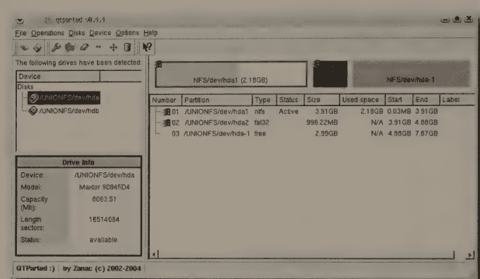

图 5-4：`QTParted` 显示了你想进行的更改。

如果你犯了错误，可以在过程的后期提交更改之前撤销所有操作。要撤销任何更改，选择 File -> Undo（撤销），系统将返回之前的状态。

现在，你可以通过右键点击灰色框并选择 Create（创建）（或选择 Operations -> Create 操作 -> 创建），在可用空间内创建另一个分区。创建分区对话框打开，如图 5-5 所示。

# 第 5 章 — 使用 Knoppix 修复 Windows

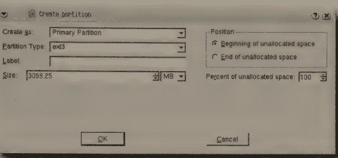

图 5-5：`QTParted` 的创建分区对话框

点击 Create As 框右侧的箭头，选择你想要的分区类型（主分区 Primary Partition 或扩展分区 Extended Partition）。主引导记录对系统实施了最多四个分区的限制，这是 PC 早期的限制。为了绕过这一限制，创建了扩展分区以允许更多的划分，这些划分被称为逻辑分区。扩展分区是通过分离驱动器上的四个分区中的一个来创建的。大多数操作系统加载在主分区上并从其启动。（Linux 是一个例外，因为它可以从逻辑分区启动）。如果你创建一个 2.99GB（所有可用空间）的 NTFS 分区，作为 Windows 内部备份的次要分区，结果将如图 5-6 所示。

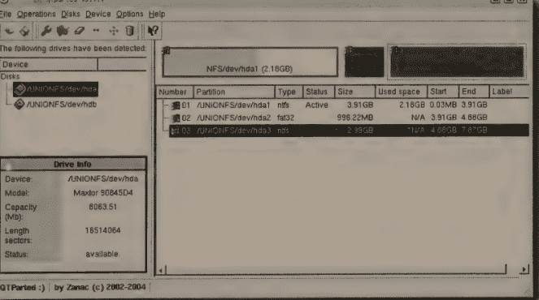

图 5-6：在 `QTParted` 中创建分区

在你完成所有修改并对更改感到满意后，你需要将更改永久化（到此为止进行的所有操作都是“虚拟”的，或仅用于演示）。要使更改永久化，选择 File -> Commit（提交）。图 5-7 显示了出现的警告对话框，表示你正准备将更改永久地写入硬盘。（此应用程序某些部分的语法和拼写比较生硬，但很可能在未来的版本中予以修正）。如果你在你提交更改的驱动器上有一个交换分区（虚拟内存），请确保已关闭交换以防止问题，这可以通过带有 `noswap` 欺骗代码启动 Knoppix，或者打开终端窗口并运行 `swapoff -a`。

图 5-7：`QTParted` 的提交警告和估计时间

选择 Yes。窗口将显示你的修改进度和预计完成所需的估计时间。如果一切顺利，你的更改将应用到硬盘，你并将看到一个与图 5-8 类似的对话框。

图 5-8：分区成功。

在完成调整大小后，你可以使用 `QTParted` 格式化你的新分区——只需选择 Operations -> Format（操作 -> 格式化）。

## 当关键系统文件出现问题时采取主动措施

Windows 有时会出现损坏或缺失的文件，这会严重损害甚至阻止系统的运行。如果你以前遇到过这种情况，你知道你的选择之一是从头开始，或者尝试使用严苛的 Windows 启动和恢复系统。其中包含的工具包非常有限。相反，Knoppix 提供了一个友好且强大的环境，可以在问题出现时修复你遇到的某些问题。


默认情况下，Knoppix 即可读取大量文件系统，但不支持写入某些文件系统。Knoppix 3.8 及更高版本在 NTFS 文件系统（Windows XP 及后续版本的默认）方面存在已知问题。这些文件系统需要使用名为 `captive-ntfs` (http://jratkovich.net/project/captive/) 的程序来允许写入访问，这对于编辑系统上的文件至关重要。默认情况下，由于缺乏活跃的项目开发以及对数据损坏的其他担忧。（有另一个系统——`UnionFS`——承诺提供这种支持。它尚未完全开发，所以它只是给出了写入 NTFS 分区的假象。）

较早版本的 Knoppix (3.7 及更早版本 包含 `captive-ntfs`，但如果你使用的是 Windows XP Service Pack 2 (SP2)，请按照 http://kb.bitdefender.com/site/KnowledgeBase/viewArticle/en/100/Problem_with_Linux_Defender_and_Windows_XP_SP2_.html 中识别的步骤来启用读写能力。

## 访问 boot.ini 以解决启动问题

`boot.ini` 文件用于基于 NT 的系统（NT, 2000, XP, 2003）来显示操作系统列表。如果你启动系统并收到“invalid boot loader”（无效的引导程序）消息，最可能的罪魁祸首是 `boot.ini` 文件。要纠正这一点，你需要编辑 `boot.ini` 文件。

`partition` 指明启动文件所在的分区。如果你在第二个主分区上，你应该写入 `partition(2)`。这永远不应该发生，因为不存在分区 0。最后一个分区标识 Windows 所在的目录（在此情况下为 `WINDOWS`，这取决于 Windows 的版本和系统的安装方式，可以是任何名称）。等号之后和引号内的内容是在在启动菜单中显示给用户报告的内容。

你将遇到的大多数 `boot.ini` 问题将是文件损坏或配置错误（如果你是手动编辑该文件）。你可以利用前面的信息，通过简单地替换或添加这些行来恢复。

有关配置 `boot.ini` 文件的具体信息，请访问 http://support.microsoft.com/php?kbid=289022。

完成文件编辑后，将其保存。移除你的 Knoppix CD 并重启系统进入 Windows。

## 当系统注册表在半夜突然“挂掉”时进行编辑

注册表是 Windows 95 及所有后续版本所有系统特定信息的中央位置，包括配置和设置。在 Knoppix 中，可以使用 Windows 原生程序 `reg` 非常方便地编辑注册表。只需在控制窗口中输入以下命令：

```
regedit
```

此命令调用 Wine 并弹出 Windows 注册表编辑器，如图 5-11 所示。（Wine 是 Windows API 的开源实现，运行在 Linux 之上。有些人将其视为 Windows 模拟器，但 Wine 的开发者称其为 UNIX 的 Windows 兼容层。）

在 Windows 中运行注册表编辑器可以获得的所有功能在 Wine 下均可用，包括导入备份的注册表和保存修改后的注册表。

Knoppix 的某些变体包含一个优秀的 Linux 原生注册表编辑器，名为 Offline NT Password and Registry Editor (`chntpw`)，该程序允许你修改 Windows 注册表以及 Windows 密码。你可以在 http://home.unet.no/~pnordahl/ntpasswd/ 获取更多关于 `chntpw` 的信息。标准的 Knoppix 3.8 及更高版本默认不包含 `chntpw`，但通通过 APT（`sudo apt-get install chntpw`，见第 1 章描述）以及 Klik 程序获取该软件。

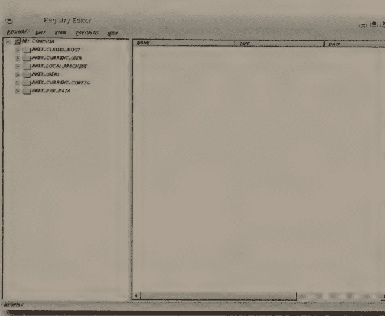

FIGURE 5-11: 在 Linux 中使用注册表编辑器

## 数据恢复

如果你的 Windows 系统完全崩溃且无法使用注册表编辑器或 `boot.ini` 恢复，如果系统上的重要数据没有备份，你可能会面临一些严重问题。Knoppix 可以为你提供帮助，允许你访问 Windows 分区并将重要数据保存到多个设备以便稍后恢复。这些方法包括使用 USB 优存盘（也称为闪盘或 U ）、使用 CD-Rs 和 DVD-Rs 以及通过网络复制数据。本节解释了如何在崩溃并重装 Windows 后恢复并保存你需要的数据。

## 准备数据恢复

从系统中恢复数据时最常见的错误是因为匆忙而未能获取所有数据。你留下的通常是你最终最需要的数据，所以请花时间确保你捕获了所有价值内容。数据存储的最常见区域是 `Documents and Settings` 文件夹（通常为 `/mnt/hdal/Documents and Settings`），这是 Windows 保存大多数用户数据、音乐、图片等的默认路径。如果你或你的用户有任何保存数据的非标准目录，请也考虑这些目录。

116 第 II 部分 — 使用 Knoppix 救援和恢复系统

> 提示
>
> 在保存所有你认为需要的文件后，验证保存的数据是否已正确存档始终是一个好习惯。进入备份介质并随机打开文件（可以打开的文件），以确保数据是有效的。

## 将数据保存到 USB 优存盘

Knoppix 在插入 USB 优存盘后几乎立即就能识别它。从那时起，将数据从 Windows 分区保存到 U 盘（由桌面上的 USB 图标表示）是轻而易举的事。要保存到优存盘，你只需右键点击优存盘并选择“属性”使其可写。选择“设备”选项卡（类似于图 5-12 所示的对话框），然后取消勾选“只读”框以启用写入磁盘。点击“确定”关闭窗口，就可以开始。

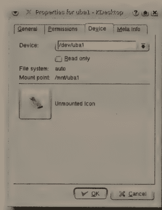

FIGURE 5-12: 一旦取消勾选“只读”框，USB 优存盘即设置为读写。

通过右键点击磁盘图标并选择“挂载”来挂载磁盘。你可以结合 `cp` 命令在硬盘和优存盘（通常为 `/dev/uba1`）之间移动文件。或者，你可以打开两个 Konqueror 窗口（见图 5-13）进行拖放。

通过这种方式保存文件的唯一限制是文件传输速度和优存盘的容量，尽管 1GB 和 2GB 的优存盘价格非常合理，且必要时可以使用多个。

第 5 章 — 使用 Knoppix 修复 Windows

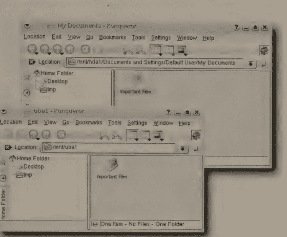

FIGURE 5-13: 将文件保存到优存盘

## 将数据刻录到 CD 或 DVD

在 Knoppix 中将你需要的文件刻录到 CD 或 DVD 变得非常简单因为它包含了 `K3b`（在第 1 章详细讨论），这是一种用户友好的光刻录软件。选择 Knoppix -> Multimedia -> `K3b` 打开它。应用程序的界面类似于图 5-14 所示。


从窗口选择“新建 CD 项目”或“新建 DVD 项目”。找到你需要保存的文件并拖到“当前项目”区域。底部的灰色区域显示文件大小（大于 890MB）。将所有要保存的文件放入“当前项目”区域后，点击应用程序左角的刻录图标。会出现一个类似于图 5-15 的对话框。

设置好任何需要的特定设置后（见第 1 章），点击“刻录”按钮开始写入过程。当 `K3b` 完成后，遍历 CD/DVD 以确保编码正确。

## 将数据发送给自己

许多人没有想到的另一种选择是将数据发送给自己。由于如今基于 Web 的电子邮件服务（感谢 Gmail！）和个人电子邮件服务的容量很大，你通常可以无担心账户容量发送任何你需要备份的数据。然而，你仍然需要考虑电子邮件服务可能对附件大小有限制。例如，Gmail 将附件限制为最大 10MB。

要保存数据，只需使用 `KMail`（第 2 章介绍）或 `Thunderbird`（通过 Knoppix -> Internet 获取）。设置这些程序以使用你的 POP 或 IMAP 账户，然后附加恢复的文件并发送邮件。如果你使用基于 Web 的电子邮件账户（如 Yahoo! 或 Gmail），你可以直接使用 `Firefox` 或 浏览器并像往一样附加文件。

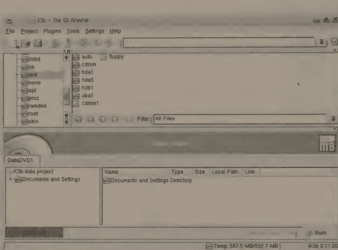

FIGURE 5-14: 使用 `K3b` 将文件刻录到 CD/DVD

118 第 II 部分 — 使用 Knoppix 救援和恢复系统

# 第 5 章 — 使用 Knoppix 修复 Windows


**图 5-15:** 启动备份过程

## 通过网络复制数据


如果你倾向于这种方法，Knoppix 具有通过网络传输重要文件的能力。目前为止，实现这一目标最简单的方法是让你的 Knoppix 系统运行 SSH 服务器。SSH 提供了交互式登录你的 Knoppix 系统以及传输文件的功能，且全部通过加密传输进行，这意味着如果有人截获了你的通信，他或她将非常难破解实际数据。如果你要传输到的目标系统位于 Linux 或 Knoppix 系统上，那么系统已经内置了 SFTP 功能。如果你要将文件传输到 Windows 系统，则需要下载一个 SFTP 客户端（推荐的免费版本是 WinSCP，可在 http://winscp.net 获得）。

有关关于 SFTP 的更多信息，请参阅第 3 章。


要让远程 Linux 或 Windows 系统连接到你想备份的 Knoppix 系统，请通过选择 Knoppix→Services→Start SSH Server 在 Knoppix 系统上启动 SSH 服务器。在打开的窗口中将生成一个加密所需的唯一密钥。输入一个强密码，然后以相同的方式输入两次。你在这里输入的密码将在通过 SFTP 登录系统时使用，并且它是区分大小写的，因此请确保你记住确切的密码。

你需要知道系统的 IP 地址（使用命令 `ipconfig eth` 来确定你的 IP 地址；它是四组用点隔开的数字，例如 192.168.1.1）。使用 WinSCP 或其他 SFTP/SCP 客户端，通过 IP 地址连接到你的 Knoppix 机器。输入 `knoix` 作为用户名，然后输入你之前创建的密码。现在，你可以导航文件系统以找到你想复制到远程系统的文件，如果你通过命令行连接，则使用 SFTP 命令；如果你使用 WinSCP 等图形化应用程序，则可以使用拖放操作。

## 总结

Knoppix 为 Windows 恢复和维护提供了丰富的工具，让你甚至无需登录 Windows 即可恢复系统。本章向你展示了如何使用 QTParted 调整 Windows 分区的大小，以及在灾难发生备份并修改你的 Windows 文件。有了本章提供的信息，下次 Windows 再次出现故障时，你完全可以救回你的理智。只需确保在下次其他 Windows 用户面临问题时不要幸人乐祸即可。相反，请以一个意味一切的微笑，并给他们一份 Knoppix ... 还有这本书！

# 使用 Knoppix 评估安全性

## 第 6 章

安全对于我们所做的一切都至关重要。我们驾驶制造良好的汽车并系好安全带，避开城市不安全的区域，并尽力保护我们的计算机系统和网络免受犯罪分子、垃圾邮件发送者和坏人的侵害。你可以使用 Knoppix 保护电脑，也可以用它来学习更多安全知识。你甚至可能发现在这个过程中很有趣。

## 使用 GnuPG 加密数据

加密是确实让一些人恼火的事情之一，主要是政府内部，他们想要限制像你我这样的普通人使用它。然而，没有理由不使用加密。我们都有想要保密的信息，无论是与业务还是个人生活有关，而加密正是实现这一目标的方法。

加密最好的工具之一是 GnuPG，即 Gnu Privacy Guard。GnuPG 使用公钥密码法，这意味着你拥有两个密钥：一个用于解密发送给你的消息的私钥，以及一个其他人为你加密消息的公钥。这种设置允许想要发送加密文件的人之间交换公钥，正如你将看到的。

### 本章内容

- 使用 GnuPG 加密数据
- 漏洞测试
- 在网络上嗅探数据包
- 在破解发生后进行取证分析
- 擦除硬盘

> 注意：不知道加密是什么？阅读 http://en.wikipedia.org/wiki/Encryption，或者，如果你觉得更硬核一点，可以查看 Neils Ferguson 和 Bruce Schneier 的《实用密码学》。想了解更多关于公钥密码法的知识吗？前往 http://en.wikipedia.org/wiki/symmetric_key_algorithm。

你实际上可以使用 GnuPG 执行各种任务：

- 加密和解密电子邮件
- 加密和解密计算机上的文件
- 使用电子签名对文件签名，或通过检查数字签名验证文件的真实性
- 验证或签名其他人的公钥


要使用 GnuPG，你需要一对密钥。你可以从零生成密钥，也可以导入现有的密钥集。接下来的章节将展示如何进行这两种操作。

### 生成 GnuPG 密钥

要开始创建你自己的 GnuPG 密钥集，运行此命令：

```bash
gpg --gen-key
```

然后选择你想使用的密钥类型。选项如下：

1. RSA（默认）
2. DSA（仅签名）
3. RSA（仅签名）

在打开的窗口中生成一个用于加密的唯一密钥。输入一个强密码，然后以相同的方式输入两次。你在这里输入的密码将在通过 SFTP 登录系统时使用，并且它是区分大小写的，因此请确保你记住确切的密码。

你需要知道系统的 IP 地址（使用命令 `ipconfig eth` 来确定你的 IP 地址；它是四组用点隔开的数字，例如 192.168.1.1）。使用 WinSCP 或其他 SFTP/SCP 客户端，通过 IP 地址连接到你的 Knoppix 机器。输入 `knoppix` 作为用户名，然后输入你之前创建的密码。现在，你可以导航文件系统以找到你想复制到远程系统的文件，如果你通过命令行连接，则使用 SFTP 命令；如果你使用 WinSCP 等图形化应用程序，则可以使用拖放操作。

选择你想使用的密钥类型。选项如下：

1. RSA（默认）
2. DSA（仅签名）
3. RSA（仅签名）

选择密钥的有效期：

1. 不过期
2. 1 年
3. 0（永不过期）

选择默认（1）。

输入你的姓名（例如：John Doe）。

输入你的电子邮件地址（例如：johndoe@example.com）。

输入注释（可以留空）。

输入 `y` 确认信息是否正确。

GnuPG 将生成密钥对。这可能需要一些时间。

现在你必须设置一个密码。输入一个密码，然后以相同的方式输入两次。这个密码将用于保护你的私钥。

选择密钥的位位数。默认通常是 2048 位。

1. 1024
2. 2048
3. 4096

选择默认（2048）。

输入 `y` 完成密钥生成。

现在你可以运行以下命令查看新生成的密钥：

```bash
gpg --list-keys
```

你应该能看到你的新密钥在列表中。

（此处省略具体的密钥输出内容）

## 总结

Knoppix 提供了丰富的 Windows 恢复和维护工具，让你甚至无需登录 Windows 即可恢复系统。本章向你展示了如何使用 QTParted 调整 Windows 分区的大小，以及在灾难发生备份并修改你的 Windows 文件。有了本章提供的信息，下次 Windows 再次出现故障时，你完全可以救回你的理智。只需确保在下次其他 Windows 用户面临问题时不要幸人乐祸即可。相反，请以一个意味一切的微笑，并给他们一份 Knoppix ... 还有这本书！

## 使用 Knoppix 评估安全性

### 124 第二部分 - 使用 Knoppix 恢复与救援系统

```
gpg: 59B1ABA8: public key "Bryan-Consulting (www.bryanconsulting.com
<bryanconsulting@localhost>" imported
gpg: 4D9C5C1B: public key <Alan German@locaho.com> imported
gpg: Total number processed: 6
imported: 6
```

这太简单了！如果你的机器上没有密钥环怎么办？你总是从网络上的密钥服务器导入密钥到你的密钥环。例如，要导入 Klaus Knopper 的 GPG 密钥（以验证你下载的是由 Klaus Knopper 本人签名的正确 ISO 镜像），可以使用命令：

```bash
$ gpg --keyserver keyserver.veridis.com --recv-keys 057E37087
```

我怎么知道 057E37087 是什么？我访问 http://keyserver.veridis.com（这是一个索引公钥的网站），点击 PGP Keyserver 链接，搜索 "Klaus Knopper"，然后复制了结果页面上的密钥 ID。如果你愿意，也可以搜搜 "Scott Geman"。那里确实，不过最近的密钥是你。

要验证密钥环中是否有密钥，请输入 `gpg --list-keys`。如果显示了你的信息，说明成功了；如果没有，请你自己访问 http://keyserver.veridis.com（点击 PGP Keyserver 链接）查看是否能找到他的密钥，然后进行导入。


如果密钥以 ASCII 文件（通常以 `.asc` 结尾）的形式提供，你也可以导入它们。例如，访问 http://keyserver.veridis.com 并搜索 "Lin Torvalds"，目前会显示四个结果。点击 `torvalds@transmeta.com` 旁边的密钥 ID，系统会提示你下载名为 `pubkey.asc` 的文件，这是该特定 ID 的密钥。将文件保存到硬盘上（桌面是存放此类文件的好地方），然后输入：

```bash
$ gpg --import ~/Desktop/pubkey.asc
```

Gnu 会报告它已将 Lin Torvalds 的公钥导入到你的密钥环。成功了！去删除桌面上的 `pubkey.asc` 吧，你不再需要它了。

现在是时候使用密钥了。

## 使用 GnuPG 密钥

在使用 GnuPG 之前，你必须对密钥环中的密钥进行签名。换句话说，你需要确认你所拥有的密钥确实属于它们所属的人。理想情况下，如果你直接从个人那里收到密钥，就会知道这一点。如果你没有亲自获得密钥，则需要以某种让你满意的方式验证密钥的所有权。如果你使用的来自 Klaus Knopper 的密钥确实属于 Klaus，你需要运行：

```bash
$ gpg --sign-key "Klaus Knopper"
```

我怎么知道在命令中使用 "Klaus Knopper" 的？因为我先运行了 `gpg --list-keys` 并验证了与密钥关联的。实际上，你可以使用密钥的任何唯一 ID，包括 "Klaus","Knopper","knnoppix@knoppix.net" 或 "527E37087"（用户 ID）。


## 注意

### 第 6 章 — 使用 Knoppix 125 评估安全性

当你运行 `--sign-key` 命令时，系统会问你几个问题：

- 你想对与密钥关联的所有用户 ID 签名吗？回答 `y` 并按回车。
- 你执行验证得有多仔细？你的答案是什么其实并不重要，因为过程都会继续，但它确实迫使你思考自己在做什么，在安全方面，这永远不是坏事。你最好的做法是至少能诚实地回答你已经进行了仔细的检查。做出选择并按回车。
- 你真的想对该密钥签名吗？是的，你真的想签名，输入 `y` 并按回车。

输入你的秘密密码，以证明确实是你尝试对密钥环中的密钥签名，然后按回车。你回到了命令行提示符。（按照良好的 UNIX 传统，成功是安静的；在其他世界里，如果一切正常，UNIX 就会继续运行。只有问题才值得反馈。）

你需要对密钥环中的每个密钥重复此过程。如果你每添加一个密钥到密钥环就对其进行签名，就可以完成并立即开始使用该密钥。

对 Klaus 的密钥签名后，创建并加密一个文件，就像你要发给他一样。从 K 菜单 Editors → Kwrite，输入 "This is a file I'm going to encrypt ... bwahahahaha!"。将文件保存到桌面并重命名为 `secret.txt`。最小化 Kwrite，进入你的终端（面板上的 Console，如果还没打开的话）。进入桌面，并运行以下命令：

```bash
$ gpg -r "Klaus Knopper" --encrypt secret.txt
```


不要用大量的加密文件轰扰 Klaus，他正忙于处理 Knoppix，没空理这些文件。几秒钟后你回到了命令行（再次，沉默意味着成功）。输入 `ls`，你会发现除了原始的 `secret.txt`，还有一个 `secret.gpg` 文件。该文件是加密的，但它是二进制格式。如果你想通过邮件发送给他（你需要附加 `secret.gpg`）。

要生成 ASCII 文本，请执行：

```bash
$ gpg -r "Klaus Knopper" --armor secret.txt
```

再次，`ls` 通知你有一个新文件：`secret.asc`。使用 `cat secret.asc` 查看如下：

### 126 第二部分 — 加密与恢复系统

你可以将 ASCII 文件作为邮件附件，也可以将全部文本（包括 BEGIN 和 END 行）复制粘贴到邮件中。

你可以进一步操作。除了加密文件，你可能想对其进行数字签名，以便收件者信任文件来自你。要加密并签名，请使用此命令（如果你想生成数字签名而不是 ASCII 文件）：

```bash
$ gpg -r "Klaus Knopper" --armor --sign secret.txt
```

运行该命令时，系统会要求输入密码，这是因为你需要验证自己的签名。处理完成后，你会得到一个名为 `secret.txt.asc` 的文件，`cat secret.txt.asc` 显示它长一些，因为它包含了你的数字签名。

# 漏洞测试

如果你不知道哪些舱门需要加固，那么仅仅关紧舱门是不够的。在计算机系统中，你需要知道可能的漏洞在哪里，而 Knoppix 可以帮助你对漏洞进行测试和缓解。

## 使用 Chkrootkit 验证是否存在根部包程序（Rootkits）

如果你的电脑被破解了，根部包（也称为 rootkit）绝对是一个令人担心的问题。基本上，黑客可以留下一个 rootkit，以便他以后能够轻松地访问并控制该机器。rootkit 有两种类型：内核级，即用恶意代码替换 Linux 内核的部分；以及应用级，即将普通程序（如 `ls`、`cd`、`less` 等）替换为看似相似但实际上是活跃特洛伊木马的程序。通过 Knoppix，你可以根除 rootkit 并保持你的电脑的安全。

有关 rootkit 的信息，请参阅 Wikipedia 上的 http://en.wikipedia.org/wiki/Rootkit，或者查看 SecurityFocus 的搜索结果 http://search.securityfocus.com/swsearch?query=rootkit&sbm=infokus&metename=all。

Knoppix 使用一个名为 `chkrootkit` 的命令行程序来工作。它测试了（目前为止）59 种不同的 rootkit 以及 LKMs（Linux 内核模块，之前发现的内核级 rootkit）。你可以在 `chkrootkit` 网站 `www.chkrootkit.org` 查看完整列表。

要运行 `chkrootkit`，请打开终端并执行以下命令：

```
$ sudo chkrootkit
```

`chkrootkit` 会立即开始工作，扫描你的机器以已知的 rootkit 并进行搜寻，查看是否有任何内容被篡改过。在运行期间，该程序会在你的命令行中输出结果，产生大约一百行类似所示的内容：

```
Checking 'timed...' not found
Checking 'traceroute...' not infected
Checking 'vdir...' not infected
Checking 'w...' not infected
Checking 'write...' not infected
Checking 'aliens'... no suspect files
Searching for sniffer's logs, it may take a while... nothing found
Searching for HIDRootkit's default dir... nothing found
Searching for torn's default files and dirs... nothing found
```

如果你的电脑上有一个恶性的程序，你会看到它的名字，后面跟着 INFECTED。显然，看到一个所有未被感染的列表有点眼迷缭乱，因为很容易漏掉通知你已感染的那行信息，所以最好带有 `-q`（代表“静模式”）选项运行 `chkrootkit`，如下所示：


```
$ sudo chkrootkit -q
```

`-q` 选项只会显示警告或指示感染的行，这让情况变得非常清晰。好得多！

当你在 Knoppix 上运行 `chkrootkit` 时，你会看到这些警告：

```
/usr/bin/strings: Warning: '' is not an ordinary file
You have 8 process hidden for readdir command
You have 8 process hidden for ps command
Warning: Possible LKM Trojan installed
Don't freak out—because of the way Knoppix works, these lines show up. Your readdir and
commands are not infected.
```

如果你认为某些程序有问题，可以通过命令行指定这些程序来检查它们，如下所示：


```
$ sudo chkrootkit ps tar ls
```

结果至少是让人感到宽慰的：

```
ROOTDIR is '/'... not infected
Checking 'ps'... not infected
Checking 'tar'... not infected
Checking 'ls'... not infected
```

当然，如果你使用 `-q` 选项，`chkrootkit` 只会让你知道其中某一个程序被感染了。因为你正在使用 Knoppix，`chkrootkit` 执行的任何检查默认都在 Knoppix CD 本身上进行。虽然这很有趣，但并没有特别帮助。更有可能，你想使用 Knoppix 来检查一个你怀疑被入侵的系统。在这种情况下，使用 `-r` 选项，它告诉 `chkrootkit` 扫描一个不同的驱动器作为根分区。例如，在你启动 Knoppix 后，你机器的硬盘可能位于 `/mnt/sda1`，你可以运行以下命令来检查它：

```
$ sudo chkrootkit -r /mnt/sda1
```

当然要根据你的分区进行调整。

不要忘记，由于 `chkrootkit` 在命令行中运行，很容易设置一个 `cron` 任务，每天晚上指定时间自动进行扫描，并向你发送报告，告知是否检测到任何异常。当你在使用 Knoppix 时这并不适用，因为你通常会对一个系统运行一次扫描就结束了，但了解这一点是有用的。在 `/etc/crontab` 中，添加如下的一行（根据你的系统调整 `chkrootkit` 的路径）：

```
0 3 0 0 0 (chkrootkit -q 2>&1 | mail -s "chkrootkit scan report" email@youraddress.com)
```

遗憾的是，如果你发现你正在检查的系统确实被入侵了，最好的选择是重新安装操作系统，并确保已应用所有更新，并在重新连接网络之前对系统进行加固。这并不有趣，但这是确保你不会遗漏某些内容并继续允许恶意访问你电脑的唯一方法。

## 使用 Nmap 扫描开放端口

要发现机器上哪些端口是开放的，标准是 `Nmap`。`Nmap` 实际上通过三个步骤工作：探测一个（或多个）计算机以确定它们是否在网络上，扫描端口以确定机器上运行了哪些服务，以及推断操作系统。每个步骤在 `Nmap` 中几乎可以完全配置，足以写一本小书。本节重点关注你可能使用 `Nmap` 的常见任务。

如果你不知道端口是什么，请查看 http://en.wikipedia.org/wiki/Port_(computing)、http://en.wikipedia.org/wiki/Socket 和 http://en.wikipedia.org/wiki/List_of_well-known_ports_(computing) 以获取快速概述。

首先，选择你想扫描的计算机。如果你只对一台机器感兴趣，很简单：只需指定其地址。如果你对几台机器感兴趣，可以提供一个掩码。这很难记忆，所以这里有一个方便表：

| IP 地址/掩码 | 含义 |
|---|---|
| 192.168.0.1/32 | 单台计算机 |
| 192.168.0.1/24 | C 类 |
| 172.16.0.1/16 | B 类 |
| 10.0.0.1/8 | A 类 |

MAC 地址: 00:12:17:31:4F:C4 (Cisco-Linksys)

主机 192.168.0.6 似乎在线。

MAC 地址: 00:C0:4F:A1:25:4A (Dell 计算机)

主机 192.168.0.10 似乎在线。

MAC 地址: 00:BD:DE:F6:67: (Dell 计算机)

主机 192.168.0.13 似乎在线。

MAC 地址: 00:C0:4F:A1:25:89 (Dell 计算机)

主机 192.168.0.100 似乎在线。

MAC 地址: 00:C0:4F:A1:27:BF (Dell 计算机)

主机 192.168.0.103 似乎在线。

MAC 地址: 00:0D:88:66:FB:87 (D-Link)

主机 192.168.0.104 似乎在线。

MAC 地址: 00:11:D8:90:D6:7F (Asstek 计算机)

主机 192.168.0.255 发送到子网广播地址（返回了 4 次额外的 ping）

nmap 完成 -- 在 4.390 秒内扫描了 256 个 IP 地址（8 个主机）

当你运行 `Nmap` 时，它会给你每台机器网卡（NIC）的地址以及该网卡的制造商（当然，既然你已经知道了这些网卡，你就可以尝试伪造它们，但那是另一本书的话题了）。

意识到最后两次扫描完全没有隐藏。任何审查被扫描机器日志的管理员都会察觉到某些异常情况。然而，`Nmap` 可以做更多来隐藏它自己。

> 注意：现在你已经处理了你的机器和本地局域网——只要它是你的网络即可。不要在未经许可的情况下尝试这样做，不要将 `Nmap` 针对互联网上的随机 IP 块或机器。你可能会受到当局的访问，那将非常不好玩。在此警告你，如果你的局域网使用 192.168.0.x 作为基础，请尝试 `nmap 192.168.0.1/24`；如果你使用不同的方案，填充这些数字并大为吧。

要进行隐身扫描，请使用 SYN 扫描。以下是对局域网内某台机器运行 SYN 扫描的示例：

```
$ sudo nmap -sS 192.168.0.6
```

你必须使用 `sudo`，因为隐身扫描需要 root 权限。尝试不带 `sudo` 运行——`Nmap` 会立即关闭。扫描完成后，`Nmap` 会给你一些信息（在本示例中，为了简洁，某些行已删减）：

192.168.0.6 上有趣的端口：

（下方未显示的 1653 个端口状态为：关闭）

| 端口 | 状态 | |
| :--- | :--- | :--- |
| 22/tcp | open ssh |
| 139/tcp | open netbios-ssn |
| 445/tcp | open microsoft-ds |
| 631/tcp | open ipp |
| 901/tcp | open samba-swat |
| 2049/tcp | open nfs |

MAC 地址: 00:C0:4F:A1:25:4A (Dell 计算机)

### 第 6 章 — 使用 Knoppix 评估安全性

有更多的端口开放——这并不意外，因为这台机器在整个局域网范围内交换数据。更重要的是，这种扫描要难检测得多。

为什么 SYN 扫描更难检测？`nmap` 的发明者在 http://www.insecure.org/nmap/nmap_doc.html#syn 告诉过。

关于目标的更多信息，请使用 `-O` 选项，它告诉 `Nmap` 结合 `-v` 选项来确定机器的操作系统，后者告诉 `Nmap` 开启详细模式（`-vv` 更详细）。在示例 Linux 机器上结合隐身扫描，你得到了这条命令：

```
$ sudo nmap -v -O -sS 192.168.0.6
```

这产生了一个冗长的结果，已浓缩为以下内容：

```
Starting nmap 3.75 ( http://www.insecure.org/nmap/ ) at 2005-03-25 04:48 EST Initiating SYN Stealth scan 192.168.0.6 [1663 ports] total ports:
```


```
隐身扫描耗时 0.21s 扫描了 1663 个端口。
H 192.168.0.6 似乎在线 ... 很好。
192.168.0.6 上有趣的端口：
（下方未显示的 1653 个端口状态为：关闭）
| 端口 | 状态 | 服务 |
| :--- | :--- | :--- |
| 22/tcp | open | ssh |
| 139/tcp | open | netbios-ss |
| 445/tcp | open | microsoft-ds |
| 631/tcp | open | ip |
| 901/tcp | open | samba-swat |
| 2049/tcp | open | nfs |
MAC 地址: 00:0C:4F:A1:25:4A (Dell 计算机)
设备类型: 通用
运行: Linux 2.4
OS 详情: Linux 2.4.0 - 2.5.20
运行时间:32 天 (自 2005 12:15)
TCP 序列预测: 随机
难度=5

nmap 完成 -- 在 2.58 秒内扫描 IP 地址（主机在线）哇！这里有很多内容，包括开放端口和服务、MAC 地址和制造商、OS 详情、机器运行时间（32 天——不错！）以及入侵难度等级。你还可以调整 Nmap 扫描时的时间。包含 `-T5` 选项，Nmap 以“疯狂”速度扫描（这是 nmap 的说法），绝对会被任何寻找目标的人发现。另一方面，`-T0`，“偏执”速度每五分钟发送一个包。你的扫描将花费长时间，但可能不会被机器和人类检测到。尝试 0 到 5 之间的数字；我使用 `-T2` 扫描某台机器耗时 64 秒 —— 这超过了一分钟！

## 第二部分 — 使用 Linux 救援和恢复系统

你的概览应该让你开始使用 Nmap。它是任何涉及安全的人最终都会使用的强大工具；在这方面，它就像是工人的锤子。你现在做的最好的事情是开始学习 nmap，更重要的是玩玩它。

网上大量关于 nmap 的有用信息。nmap 手册很长且非常详细，但也要确保访问 http://insecure.org/nmap，特别是位于 http://insecure.org/nmap_doc.html 的“端口扫描艺术”。它有点过时，但仍包含你应该阅读的优秀概述。

关于教程，请查看 Andrew J. Bennieson 的《NMAP——一个扫描器》(http://security-forums.com/forum/viewtopic.php?ptid=7872) 以及 Lamont Granquist 1999 年简短而有趣的邮件 (http://security.org/nmap-hackers/1999/Apr-Jun/0004.html)。

顺便说一下，nmap 真的有多酷：它实际上被 Trinity The Matrix Reloaded（正确！）使用过。自己去看看 http://images.insecure.org/nmap/images/

## 使用 Nessus 检查漏洞

Nessus 告诉你机器的操作系统及其开放端口，但一旦你有了这些信息，你可以做什么呢？嗯，如果你是一个黑客，是时候取出 Nessus 这个开源漏洞扫描器了，判断是否有任何你可以利用的漏洞。如果你试图保护网络免受黑客攻击，那么是时候取出 Nessus 这个开源漏洞扫描器了，判断是否有任何你需要修复的漏洞。

有很多花费数美元的商业工具可以免费实现 Nessus 的功能，本质上是扫描计算机端口（通过使用 nmap）、确定这些端口上运行的程序、进行各种测试以判断该机器是否存在安全漏洞。此外，Nessus 还有一些非常有吸引力的功能，特别是对于考虑将 Koppix 和 Nessus 结合测试电脑甚至整个局域网的用户。

在配置 Nessus 之前，你需要理解 Nessus 实际上是两个相互的软件部分：服务器和客户端。想法是你可以在网络上的一个客户端（或多个，如果你需要的话）上安装 Nessus 服务器，然后使用安装在任何地方的 Nessus 客户端连接到服务器。但是，如果你在 Koppix 上运行 Nessus，你可能不需要复杂的配置。相反，你希望在同一台机器上运行客户端和服务器，这是完全可行的。

Nessus 使用插件工作。基本上，一个 Nessus 插件是针对特定漏洞的测试。随着新安全问题的发布，志愿者会编写 Nessus 插件来探测这些问题。Nessus 有数千个插件，测试各种可利用的漏洞。

在运行程序之前，通过命令行输入 `sudo nessus-update-plugins` 更新你的 Nessus 插件很重要；这会下载 Nessus 库中的任何新增内容。新插件几乎每天发布，所以每次使用 Nessus 时运行它是好主。

Knoppix 开发人员通过后台执行很多操作使得使用 Nessus 变得非常容易。如果你想知道整个过程——例如你想在非 Knoppix 机器上运行 Nessus——你真的应该读 Harry Anderson 在 SecurityFocus 上关于 Nessus 的优秀三部分系列：http://securityfocus.com/infocus/1741, http://securityfocus.com/infocus/1753, 和 http://securityfocus.com/infocus/1759。

从 K 菜单，选择 System -> Security -> NESS Security Tool—Network Scanner。这会在后台启动 Nessus 服务器部分，然后打开 Nessus 客户端，看起来如图 6-1 所示。


图 6-1: Nessus 现在已打开并准备好配置。

Koppix 已经为你设置了一个用户，只需在登录框和密码框中都输入 knoppix 并点击登录。Nessus 询问你是否接受它想要用于加密客户端和服务器之间流量的安全证书，如图 6-2 所示。

## 136 第二部分 — 使用 Knoppix 救援和恢复系统


图 6-2：Nessus 设置了 SSL 证书以加密流量。

由于客户端和服务器都在同一台机器上，而且由于你信任 Knoppix 的开发者，请保持第一个选项被选中并点击 OK。另一个窗口会打开，询问你是否接受该证书；点击 Yes。

下一个窗口会警告你，某些危险的插件已被禁用。点击 OK，你就会发现自己已经登录了 Nessus，“插件”（Plugins）选项卡可见并已就绪，如图 6-3 所示。

请记住，某些 Nessus 插件可能会被探测的机器死机或崩溃，因此 Nessus 默认禁用了这些插件。然而，启用这些插件很容易。问题是，你应该应该这样做吗？

如果你正在测试你控制的计算机，我建议启用危险的插件。毕竟，坏人很可能会这样做，所以难道你不应该也这样做吗？然而，你应该权衡机器崩溃的可能性与任何安全收益之间的关系。换句话说，是的，确保你公司的电子邮件服务器免受所有形式的破解是好事，但不要在工作日期间运行 Nessus 来测试东西。

> 不要对你无法控制的计算机运行 Nessus。你的扫描看起来非常像是一次攻击，你可能会陷入当局的严重麻烦。使用 Nessus 时要小心！

如果你决定启用这里的每一个插件，即使是危险的插件，你必须先进入“扫描选项”（Scan Options）选项卡并取消勾选“安全检查”（Safe Checks）。你现在准备好在边缘游行了。

## 第 6 章 — 使用 Knoppix 评估安全 137


**图 6-3：** 在使用 Nessus 扫描时，选择你想使用的插件。

当然，如果你不需要测试所有内容，或者你根本无法承担可能导致正在检查的计算机崩溃风险，请使用默认设置。你仍然可以从 Nessus 中获得大量有用信息。

你可能记得在 Nmap 的讨论中提到，有不同的扫描方法可以选。事实上，Nessus 使用 Nmap 来执行扫描，正如你在“偏好”（Prefs）选项卡上看到的。该选项卡上的第一个选项是 TCP 扫描技术；我会使用 SYN 扫描，因为它快速且隐蔽。

> 由于空间限制，本节没有涵盖整个“偏好”选项卡，但如果你想有效地使用 Nessus，你真的应该熟悉这里所有的选项。获取这些信息的最佳去处是 Nessus 知识库（Nessus Knowledge Base），它涵盖了程序中的每一个选项。它非常棒，你可以在 http://edgeos.com/nessuskb/ 找到它。

最后一项要设置的内容，在某些方面它是所有选项中最重要的：你想扫描的计算机。进入“目标”（Target）选项卡，如图 6-4 所示。

## 138 第二部分 — 使用 Knoppix 救援和恢复系统


图 6-4：选择你想用 Nessus 检查的计算机。

你可以像使用 Nmap 一样指定目标，可以使用以下任何一种方式：

- IP 地址
- 域名
- IP 地址范围
- 子网

例如，192.168.0.6 是我局域网上的的一台 Linux 机器，用于文件共享等其他任务。我在“目标”（Target）字段中输入该 IP 地址，点击“开始扫描”（Start the Scan），Nessus 就开始运行。窗口变为标记为“从本地扫描网络”（Scanning Network from Localhost），几秒后就会显示 Nessus 正在工作的进度。扫描可能花费很长时间，所以你可能想去处理其他事情，让 Nessus 完成它的工作。最后 Nessus 完成，你会得到一个结果窗口，如图 6-5 所示。

要获取核心内容，点击“子网”（Subnet）框以填充“主机”（Host）框。然后点击主机框中列出的 IP 以填充“端口”（Port）框。端口框中列出的项目是你需要阅读的内容。列表项目旁边的橙色三角形图标表示“安全警告”（Security Warning），灯泡图标则你那里有一个“安全说明”（Security Note）。缺少图标意味着 Nessus（以及 Nmap）检测到该端口上运行着服务，但没有发现任何潜在问题。

## 第 6 章 — 使用 Knoppix 评估安全 139


图 6-5：Ness 在扫描和分析后向你展示了一份报告。

你应该查看每一个“安全说明”，因为你可能会发现有趣的内容，并且一定要检查每一个“安全警告”。每当 Ness 警告你一个潜在问题时，它还会提供关于缓解该问题的建议。每当 Ness 警告你一个潜在问题时，它还会提供关于缓解该问题的建议。

如果你决定保存报告，你有多种格式可供：

- XML
- XML
- HTML
- ASCII
- HTML

## 140 第二部分 — 使用 Knoppix 救援和恢复系统

在你第一次几次 Nessus 时，保存报告，以便你查看每个报告的优缺点。Nessus 是一个极其强大的工具，你将经常使用它。

### 在网络上嗅探数据包

嗅探程序是做什么的？基本上，它们让你看到网络上所有的流量，无论这些流量是否针对你的机器（这个陈述有一个限制，稍后介绍）。所有数据包流过，你看到组成数据包的所有层——网络协议分析仪通过以太网揭示一切。

你为什么想做那个？在这个世界上你想知道你连接的网络上所有的流量细节？嗯，有坏的原因——获取未加密的密码和数据——也有好人的理由：

- 学习更多网络协议
- 弄清楚 Samba 连接（或 NFS、电子邮件或其他你有的）到底出了什么问题
- 审计组织的网络以暴露安全漏洞（例如非常糟糕的未加密密码，或者在应该加密时没有使用加密的人）

# 第 6 章 — 使用 Knoppix 141 评估安全性

无论出于什么原因，你都会有很多使用 Ethereal 的理由，其中之一就是它非常有趣。

关于数据包嗅探的更多信息，请参考 Robert Graham 详尽的嗅探常见问题，访问地址：http://linuxsecurity.net/resource_files/intrusion_detection/sniffing-faq.html。

## 使用 Ethereal 分析网络流量

Ethereal 自 1998 年以来一直提供通用服务，在它发布的几年里，它已成为顶级的开源安全工具之一。它既强大又对基础需求易于使用，因此在 Knoppix 中包含它是不言而喻的。它还是一个值得仔细研究的程序：你学得越多，做的就越多，你会学到更多关于你的网络、网络技术和安全的知识。

为了充分发挥 Ethereal 的作用，你需要以 root 身份运行它。遗憾的是，如果你尝试在 Knoppix 中以 root 身份打开 Ethereal，会提示你输入一个不存在的密码。解决这个问题有两种方法（实际上方法有很多，但这两种对你来说足够了）：

- 设置 root 密码。只需进入 K 菜单并选择 System -> Console（终端）来打开命令行。打开后，输入 sudo 密码，输入两次新的 root 密码并按回车。好了。密码现在已更改。当你运行 Ethereal 时，会提示你输入 root 密码，即你刚刚创建的密码。
- 右键点击 K 菜单并选择 KDE Editor 打开 KDE 菜单编辑器。点击 Internet（互联网）旁边的 + 号将其展开，然后单击一次选择 Ethereal (as root)。现在你应该可以编辑 KDE 菜单编辑器右侧的关于此项目的数据了。在 Command（命令）字段旁边，将命令修改为如下所示：
```


`sudo gks -u root /usr/bin/ethereal`


在下方的，取消勾选 Run as Different User（以不同用户运行）。使用 KDE Editor。保存你的更改并等待其生效。现在你可以以 root 身份运行 Ethereal，而无需创建 root 密码。

通过进入 K 菜单并选择 Internet -> Ethereal (as root) 来打开 Ethereal。程序打开后的界面类似于图 6-6 所示。

## 设置标题选项

当你第一次打开 Ethereal 时，似乎有许多选项——事实也如此！但开始并不困难。要开始捕获数据包的过程，选择 Capture -> Start（捕捉 -> 开始），这将打开 Ethereal 的 Capture Options（捕获选项）窗口（见图 6-7）。


图 6-6：Ethereal 在刚打开时并没有做什么……但请稍等。


图 6-7：选择你想用 Ethereal 捕获的内容。这是一个非常重要的窗口，因为它决定了 Ethereal 将收集哪些数据包。Interface（接口）框应包含连接到网络的网卡（NIC）。如果你只有一个网卡，它会被选中；如果你正在使用两个网卡，请选择你想让 Ethereal 使用的那一个。

要抓取网络上的每一个数据包（即使是那些不是发给你的机器的），请勾选 Capture Packets in Promiscuous Mode（在混杂模式下捕获数据包）。只想看到进入离开特定机器的信息，请取消勾选此项。

如果你处于交换机网络中，你只会捕获发给你的机器的数据包，以及偶尔出现的广播包（是的，有方法可以避免这一点，但那是另一本书的内容。如果你真的想知道如何在交换机网络上抓取其他机器的数据包，请使用你的搜索引擎。）

由于这是你第一次使用 Ethereal 且这不是一个关乎生死的时刻，请勾选 Update List of Packets in Real Time（实时更新数据包列表），一旦启用，再勾选 Live Capture 中的 Automatic Scrolling（实时捕捉中的自动滚动）。有了这两个选项，Ethereal 会在嗅探数据包的同时向你显示这些数据包。在进行时，信息太多反而没用，但它看起来确实很专业，并让你对网络到底有多忙有个直观。

Capture Options 屏幕上还有许多其他选项，但它们现在对你并不适用。尽管如此，有时你可能不想使用其中之一，因此可以查看 Ethereal 用户指南中关于 Capture Options 对话框的内容，地址：http://ethereal.com/docs/user-guide-sp/#ChCaptureOptions。

## 理解捕获过程

现在你已经告诉 Ethereal 要捕获什么，点击 OK。Ethereal 主窗口填充了数据，一个标题类似于“Capture from eth0”的较小窗口（见图 6-8）显示了 Ethereal 进展的汇总，并按协议进行了分类。


图 6-8：Ethereal 的工作

几分钟后，点击 Stop（停止），你就可以检查在网络上传输的内容。捕获窗口关闭，如图 6-9 所示。


图 6-9：工作中的

数据的三个面板如下：

- Packet List（数据包列表）面板：包含捕到的每个数据包的列表。在此面板选择一个数据包时，其信息显示在中间和底部面板。
- Packet Details（数据包详情）面板：将你在列表中选择的数据包拆解为各个部分。通过点击每个字段左侧的小三角形可以展开显示更多详细信息。当你在此面板选择一个组件时，相应的信息会在底部面板突出显示。
- Packet Bytes（数据包字节）面板：显示实际信息。Packet Bytes 面板的第一列显示偏移量，第二列以十六进制格式显示数据，而第三列以可读的 ASCII 格式显示数据。

Packet Details 面板显示数据包由以太网头部、IP 头部、TCP 头部和 HTTP 数据组成。最后，Packet Bytes 面板以易理解格式展示了整个数据包。

## 过滤捕获

当你开始过滤 Ethereal 捕获的海量数据时，事情变得非常有趣了。例如，假设你想确定网络上是否有人尝试使用明文发送的用户名和密码登录。为了找出结果，你需要创建一个显示过滤器来限制 Ethereal 显示你的数据包（这些与捕获过滤器不同，后者控制 Ethereal 收集的数据包）。点击窗口顶部过滤器工具栏中的 Filter Expression（过滤器表达式）按钮；Ethereal 的 Filter Expression 打开了（见图 6-10）。


图 6-10：为 Ethereal 创建显示过滤器

在窗口左侧巨大的协议列表中，选择你感兴趣的协议：IMAP。在 Relation（关系）中选择“contains”（包含），并在 Value（协议）文本框中（除“ ”外每个 Relation 均激活）输入 LOGIN——当用户尝试向服务器进行身份验证时，IMAP 服务器期望的命令。现在你的过滤器已存在，点击 OK 返回 Ethereal 主窗口，此时只显示过滤后的结果。

# 146 第二部分 —— 使用 Knoppix 救援与恢复系统


图 6-11：明文电子邮件登录和密码（在此图中已涂黑）几乎所有人都能看到。

Ethereal 以其自身的语法显示了你创建的过滤器：`imap` 包含 `LOGIN`（过滤器不区分大小写）。下方是数百个数据包中的三个，其中一个是动态的。第三个数据包——包含了用户的用户名和密码，以明文形式呈现且易于阅读（为了保护该恶意用户，此处已涂黑）。是的，就这么简单。

而且还会更简单。当你发现一个看起来很有趣的数据包时，右键点击它并选择“跟踪 TCP 流（Follow TCP Stream）”。Ethereal 会收集所有属于该电子邮件消息、登录序列或任何内容的数据包；将它们合并，并向你显示 ASCII 文本。用你自己的某封邮件试一下，准备好大惊喜吧。

当你选择“跟踪 TCP 流”时，Ethereal 会自动将该请求转换为显示过滤器。

这里是一些你可以使用的其他显示过滤器。只需删除当前过滤器，输入以下任意一个，并点击应用：

- `aim && (aim.channel == 0x5)`：寻找 AOL Instant Messenger 流量，过滤掉不断出现的烦人心跳数据包。
- `(http contains "hotmail") && (http contains "Reply-To:")`：查找使用 Hotmail 的邮件。
- `(tcp.port 110 and tcp.port 3457) &&& (tcp contains PASS)`：当人们尝试登录获取 POP3 邮件时，查找用户名和密码。

# 第 6 章 —— 使用 Knoppix 评估安全性 147

## 使用加密进行保护

如何防范 Ethereal？其实非常简单。使用加密。这意味着每当你登录任何需要用户名和密码的网站时，都要使用 SSL，并对任何电子邮件客户端使用 SSL。对于邮件内容，使用 GPG（本章较早讨论过）。

想吓唬你的朋友或家人并向她展示良好安全的价值吗？当她上网浏览和读邮件时，用 Ethereal 运行一会儿，并给她看你学到的东西。我觉得她会对关于 SSL 以及加密 POP3 和 IMAP 益处的简单讨论更有接受度。通过这种方式，你可以使用 Ethereal 让每个人都更安全。

Ethereal 是一个非常强大的程序，提供了数百种功能和微调，我仅触及了其能力的一小部分。要了解更多信息，请从优秀的用户指南开始，你可以在 http://ethereal.com/docs/ 以 HTML 或 PDF 格式获取。


## 使用 Coroner's Toolkit 进行取证

目前电视上最流行的节目之一是《CSI：犯罪现场调查》。每周，一支无畏的调查小组都会利用法医证据和最新的科学工具来探究人类犯罪和恶意的深处。通过血迹、足迹、牙齿印和火药残渣等线索，可以重建过去并破解犯罪。

在计算机世界中，取证是计算机安全的一个广为人知的方面。当机器被入侵时，让具备资质且知识丰富的人使用诸如 Coroner's Toolkit（称为 TCT）等工具非常重要，以便能够重建计算机并了解以下内容：

- 可以合理确定入侵的确切原因
- 损害范围可以被分类
- 证据可以以适用于法律诉讼的方式进行保存

最后一点尤为重要。如果要提起诉讼，必须以某种方式收集和保存证据，且不允许任何辩论认为收集和保存过程本身操纵了任何证据。由于某种原因，如果将涉及法律系统，我不鼓励你亲自介入。相反，请聘请安全专业人员的服务（他们很可能运行 TCT）。


Coroner's Toolkit 实际上是一个软件包集合，其中一些可以独立运行，它们共同工作，为你提供计算机在特定时间参与的活动快照。它包括：

- Grave-robber：运行几个其他工具，尽可能收集有关计算机系统的信息。
- Maxime：Grave-robber 使用的工具之一，你也可以独立运行，它查看以下情况发生的最后时间：
  - 文件被修改（文件的 mtime）
  - 文件被读取（例如 `ls` 或 `cat`）或写入（文件的 atime）
  - 文件的 inode 发生变化，例如通过更改权限或所有者（文件的 ctime）
- Unrm：复制所有磁盘空间
- Lazarus：分析由 unrm 收集的数据

> 注意：不知道什么是 inode？维基百科在 http://en.wikipedia.org/wiki/Inode 告诉过。为什么没有列出创建时间？因为基于 UNIX 的系统不列出。

# 使用 Grave-robber

（注：此处原文内容存在大量重复，已根据要求按逻辑处理，不再重复输出）

## 第二部分 — 使用 Knoppix 救援和恢复系统

- `proc/`：从 `/proc` 文件系统中收集的运行进程的映像。
- `removed/`：仍在运行的已删除文件。
- `trust/`：提供有关计算机与用户之间关系信息的文件，例如加密密钥和 SSH 历史记录。

作为一名无畏的调查员，你的工作是检查这些文件，并尝试重建犯罪发生时机器的状态。这需要经验和时间，所以请尽管上手，并尽尽所能地获取一切信息。没人说过这会很容易的！

## 运行 mactime

`mactime` 命令稍微容易上手一些。记住它可以独立运行，这意味着你可以从它开始，然后继续进行其他操作。若要快速查看如何使用 `mactime`，可以针对 `/etc/init.d` 目录运行它，该目录包含了你机器上的许多程序：

```
$ sudo mactime -y -R -d /etc/init.d 1/1/1970
```

该命令中的选项含义如下所示（如需完整列表，请使用 `man mactime`）：

- `y`：显示日期为 YY DD 而不是 MM DD YY，这样便于排序。
- `R`：递归处理当前目录及其所有子目录。
- `d`：使用随后的目录代替（在本例中为 `/etc/init.d`）；显示在此日期之后被修改、访问或更改的所有文件（在本例中，被 UNIX 系统视为时间的起点）；你也可以使用范围，例如 4/1/2005–4/2008。

关于 UNIX 纪元（UNIX epoch）的信息，请参阅 Jargon 的 [epoch 术语](http://jargon.com/epoch) 或维基百科上关于 ["Unix time”的深度文章](http://en.wikipedia.org/wiki/Unix_epoch)。

示例命令应该产生至少包含某些内容的输出：

| 日期 | 时间 | 大小 | 权限 | 用户 | 名称 |
| :--- | :--- | :--- | :--- | :--- | :--- |
| 99/11/07 | 10:35:31 | 2213 | -rw-xr-x | root | /etc/init.d/rc |
| 99/11/13 | 11:24:46 | 1909 | -rw-xr-x | root | /etc/init.d/bootmisc |
| 00/02/11 | 05:52:19 | 1478 | -rw-xr-x | root | /etc/init.d/mountfs |
| 00/04/03 | 07:51:46 | 1074 | -rw-xr-x | root | /etc/init.d/atd |
| 00/06/05 | 12:34:16 | 853 | -rw-r--x | root | /etc/init.d/README |
| 00/01/06 | 04:42:13 | 420 | -rw-xr-x | root | /etc/init.d/umountfs |


## 第6 章 — 使用 Knoppix 进行安全评估

| 日期 | 时间 | 大小 | 权限 | 用户 | 名称 |
| :--- | :--- | :--- | :--- | :--- | :--- |
| 00/06/06 | 04:42:14 | 430 | -rw-xr-x | root | /etc/init.d/umountfs |
| 00/07/27 | 23:05:51 | 927 | -rw-xr-x | root | /etc/init.d/mountall.sh |
| 01/01/28 | 01:29:37 | 800 | -rw-xr-x | root | /etc/init.d/ipx |
| 01/05/11 | 20:03:54 | 1007 | -rw-xr-x | root | /etc/init.d/kernel |
| | | 197 | -rw-xr-x | root | /etc/init.d/reboot |

注意，文件按日期从旧到新排序，然后按时间排序。下一列提供了文件的大小，然后是操作（m 表示修改，a 表示访问，c 表示更改）。这与运行 `ls -l` 类似。在这个列表中，很容易判断文件是否在特定时间范围内被修改过。如果你发现某个文件被修改过，但不记得，这可能表明存在篡改。`mactime` 命令可以帮助识别你应该关注的文件。考虑到这一点，最好通过 cron 任务定期运行它，并将输出发送给你以便后续处理。

## 查看 Unrm 和 Lazarus

另外两个主要程序分开运行。本讨论将介绍这些程序的详细信息，并提供概述，让你了解它们是什么以及如何使用。

请注意，`unrm` 有很大的限制：目前它只在格式化为 ext2 文件系统上工作。由于越来越多的 Linux 发行版默认使用 ext3、reiser 和 XFS 文件系统，这极大地限制了 `unrm` 的用性。假设你不小心删除了电脑上的某个文件，或者正试图删除痕迹。在这些情况下，`unrm` 和 Lazarus 的结合很有帮助。`unrm` 首先创建一个所有可用空间的副本。`Lazarus` 分析由 `unrm` 创建的数据并试图弄清楚数据是什么。

在运行 `unrm` 之前先考虑一下 `unrm`。如果你有一个 60GB 的文件系统驱动器，使用了 19GB，那么 `unrm` 将对未被 19GB 使用的所有内容进行逐位拷贝，然后 `Lazarus` 将处理这些文件（创建一个另一个副本）。嗯……这意味着在运行 `unrm` 之前你需要考虑两件事。首先，`unrm` 将拷贝 41GB——未被 19GB 使用的数据——而 `Lazarus` 将生成另一个 41GB。其次，你打算把这 41GB 放在哪里？你不能把它放在运行 `unrm` 的同一个文件系统中，否则你会覆盖掉正尝试恢复的内容！你必须将 `unrm` 的输出发送到不同的文件系统。

## 理解 Unrm

要使用 Knoppix 检查 `/mnt/hda2` 上的删除空间，例如运行以下命令：


`df -h`

```
输出类似于下面（你的结果显然会有不同）：

| 文件系统 | 大小 | 使用 | 可用 | 挂载 % | 挂载点 |
| :--- | :--- | :--- | :--- | :--- | :--- |
| /dev/root | 3.4M | 3.4M | 1% | |
| /dev/hdc | 695M | 695M | 0% | /cdrom |
| /dev/loop0 | 1.9G | 1.9G | 100% | /KNOPPI |
| /dev/ramdisk | 392M | 75M | 318M | 19% | /ramdisk |
| /dev/UNIONFS | 6.1G | | 93% | /UNIONFS |
| /dev/hda2 | 27G | 25G | 1.7G | 94% | /mnt/hda2 |
| /dev/hda1 | 5.2G | 4.7G | 53% | /mnt/hda1 |
```

你可以看到 `hda2` 是一个 27GB 的系统，有 1.7GB 可用。幸运的是，`hda1` 有 4.7GB 可用，所以虽然接近但没有问题。你可以运行 `umount` 命令以确保安全。在卸载之前，你必须确保要运行 `hda1` 的文件系统已挂载，否则此过程将无法工作。现在运行卸载命令，将输出发送到 `hda1` 上的文件：

```
unrm /dev/hda2 > /mnt/hda1/unrm_results
```

`unrm` 命令可能需要一段时间，取决于设备上的可用空间。一旦完成，该使用 `Lazarus` 了。

## 理解 Lazarus

`Lazarus` 分析由 `unrm` 生成的数据并试图让一切复活。警告：`Lazarus` 完成任务所需的时间可能是 `unrm` 工作时间的两倍，所以这可能是你一开始运行的命令之一。其运行方法如下：

```
lazarus -h /mnt/hda1/unrm_results
```

`-h` 选项告诉 `Lazarus` 生成一个可以在浏览器中加载的 HTML 报告。该报告由三个文件组成：`hda2_unrm_results.html`、`unrm_results` 和 `lazarus_results`（注：原文此处漏掉了第三文件名，根据语境推断为结果）。

# 154 第二部分 — 使用 Knoppix 救援和恢复系统


图 6-12：GParted 为你展示了驱动器和分区的图形化表示。

了解你的驱动器和分区。在这个示例中，机器上有两个驱动器：位于 `/dev/hda` 的硬盘和一个位于 `/dev/hdc` 的 CD-ROM（当前正载着 Knoppix 软盘的那个！）。位于 `/dev/hda` 的硬盘有三个分区和一些空空间，你需要处理这三个分区。

## 使用 dd

第一种方法涉及运行一个脚本，该脚本使用了 Knoppix 内置的 `dd` 命令（换句话说，世界上其他任何 Linux 发行版也是如此）。`dd` 具有许多精彩的功能，之一就是复制磁盘，让你能够创建硬盘的完美副本。然而，这并不是你要做的；现在，你要要做一些比较“阴险”的操作。看看这段代码：

```
for ( i = 0;i<11;i++) {

  dd if=/dev/random of=/dev/hda && dd if=/dev/zero of=/dev/hda

}
```

`dd` 命令接受两个参数——`if` 用于输入文件，`of` 用于输出文件——然后读取输入并将其写入输出。在这段代码中，`dd` 使用 `/dev/random` 的内容（系统生成的随机数据）和 `/dev/zero` 的内容（系统生成的无限期 ASCII 0 字符串）分 11 次地覆盖你位于 `hda` 的硬盘！

为什么要覆盖 11 次？美国国防部 5200.28 标准规定，文件必须至少覆盖 7 次才能被视为安全擦除，我总是习惯将我的文件擦除命令设置为超过 7 到 11 次，这意味着驱动器比只擦除 10 次的驱动器擦除得更彻底一点。（/dev/hdc。（这个 11 是我从电影《这就是摇滚》里学来的。）

# 第 6 章 — 使用 Knoppix 评估安全性 155

安全研究人员 Peter Gutmann 认为，磁盘必须至少覆盖 22 次不同的模式，才能被安全地擦除。你可以在 http://wipe.sourceforge.org/secure_del.html 读取他的论点。

要使用 `dd` 命令，启动 Knoppix 但不要挂载你想擦除的磁盘。打开控制台（Console）并执行以下：

```
for (( i = 0;i<11;i++)); do if=/dev/urandom of=/dev/hda; dd if=/dev/zero of=/dev/sda; done
```

按下回车键，然后离开电脑。该命令完成需要很长的时间（可能是几个小时，甚至是几天），除非你正在擦除一个非常脏的硬盘。知道你的数据被安全且永久地删除了，这很不错吧？

## 使用 Wipe

安全擦除驱动器（或分区）的另一种方法是使用 `wipe` 命令。在 Knoppix 中，这非常简单。例如，要彻底硬盘上的第二个分区，只需用 Knoppix 启动，然后如下所示调用 `wipe` 命令：

```
$ wipe -fik /dev/hda2
```

这些选项的作用如下：

- - f：系统不会询问你确认（如果这让你感到紧张，请不要使用该选项）。
- - i：在命令行上打印命令的进度信息。如果你不需要看这些，请不要使用该选项。
- - k：不要删除文件（在本例中为设备）。

如果你使用 `Wipe` 擦除整个磁盘而不仅仅是分区（换句话说是 `/dev/hda1`），你将擦除驱动器上的主引导记录（MBR），这意味着所有的分区数据都将消失，你将无法再次启动该驱动器。如果你计划从头开始安装操作系统，或者该驱动器未被机器使用，这可能不是坏事，但你至少应该了解这一点。此外，如果你阅读了第 4 章中的“恢复丢失的 MBR”部分，也许——可以恢复 MBR。

`wipe` 是一个强大的命令；默认情况下，它用随机数据覆盖文件 34 次。如果这个数字对你来说太高了，你想用 11 次，可以在 `wipe` 命令中使用 `-Q11` 将其修改（确保你大大写的 Q）。如果你真的不耐烦且不想做肤浅的工作，可以使用 `-q` 选项，它只擦除驱动器 4 次（不建议，但这是你的数据）。

你也可以擦除目录而不是整个驱动器，只需先挂载包含目录的分区，然后使用此命令：

```
$ wipe -ficker /mnt/hda2/secretstuff/
```

`c` 选项使用 `chmod` 命令设置写权限，以便所有内容都可以被覆盖，而 `r` 递归遍历目录结构，擦除路径上的所有内容。该命令连同其选项覆盖 `secretstuff` 目录的内容 34 次，但保留目录本身。如果你想让目录也消失，请使用 `k` 选项。

现在觉得更安全了吗？去把那些旧电脑捐给慈善机构吧，那是他们的任务。img/2fb32174ccf4cfbddb3c8b1d8e3e3b4c_179_0.png


# 154 第二部分 — 使用 Knoppix 救援和恢复系统


图 6-12：GParted 为你展示了驱动器和分区的图形化表示。

了解你的驱动器和分区。在这个示例中，机器上有两个驱动器：位于 `/dev/hda` 的硬盘和一个位于 `/dev/hdc` 的 CD-ROM（当前正载着 Knoppix 软盘的那个！）。位于 `/dev/hda` 的硬盘有三个分区和一些空空间，你需要处理这三个分区。

## 使用 dd

第一种方法涉及运行一个脚本，该脚本使用了 Knoppix 内置的 `dd` 命令（换句话说，世界上其他任何 Linux 发行版也是如此）。`dd` 具有许多精彩的功能，之一就是复制磁盘，让你能够创建硬盘的完美副本。然而，这并不是你要做的；现在，你要要做一些比较“阴险”的操作。

```
for ( i = 0;i<11;i++) {

  dd if=/dev/random of=/dev/hda && dd if=/dev/zero of=/dev/hda

}
```

`dd` 命令接受两个参数——`if` 用于输入文件，`of` 用于输出文件——然后读取输入并将其写入输出。在这段代码中，`dd` 使用 `/dev/random` 的内容（系统生成的随机数据）和 `/dev/zero` 的内容（系统生成的无限期 ASCII 0 字符串）分 11 次地覆盖你位于 `hda` 的硬盘！

为什么要覆盖 11 次？美国国防部 5200.28 标准规定，文件必须至少覆盖 7 次才能被视为安全擦除，我总是习惯将我的文件擦除命令设置为超过 7 到 11 次，这意味着驱动器比只擦除 10 次的驱动器擦除得更彻底一点。（`/dev/hdc`。（这个 11 是我从电影《这就是摇滚》里学来的。）

## 第 6 章 — 使用 Knoppix 评估安全性 155

安全研究人员 Peter Gutmann 认为，磁盘必须至少覆盖 22 次不同的模式，才能被安全地擦除。你可以在 `http://wipe.sourceforge.org/secure_del.html` 读取他的论点。

要使用 `dd` 命令，启动 Knoppix 但不要挂载你想擦除的磁盘。打开控制台（Console）并执行以下：

```
for (( i = 0;i<11;i++)); do if=/dev/urandom of=/dev/hda; dd if=/dev/zero of=/dev/sda; done
```

按下回车键，然后离开电脑。该命令完成需要很长的时间（可能是几个小时，甚至是几天），除非你正在擦除一个非常脏的硬盘。知道你的数据被安全且永久地删除了，这很不错吧？

## 使用 Wipe

安全擦除驱动器（或分区）的另一种方法是使用 `wipe` 命令。在 Knoppix 中，这非常简单。例如，要彻底硬盘上的第二个分区，只需用 Knoppix 启动，然后如下所示调用 `wipe` 命令：

```
$ wipe -fik /dev/hda2
```

这些选项的作用如下：

- `-f`：系统不会询问你确认（如果这让你感到紧张，请不要使用该选项）。
- `-i`：在命令行上打印命令的进度信息。如果你不需要看这些，请不要使用该选项。
- `-k`：不要删除文件（在本例中为设备）。

如果你使用 `Wipe` 擦除整个磁盘而不仅仅是分区（换句话说是 `/dev/hda1`），你将擦除驱动器上的主引导记录（MBR），这意味着所有的分区数据都将消失，你将无法再次启动该驱动器。如果你计划从头开始安装操作系统，或者该驱动器未被机器使用，这可能不是坏事，但你至少应该这一点。此外，如果你阅读了第 4 章中的“恢复丢失的 MBR”部分，也许——可以恢复 MBR。

`wipe` 是一个强大的命令；默认情况下，它用随机数据覆盖文件 34 次。如果这个数字对你来说太高了，你想用 11 次，可以在 `wipe` 命令中使用 `-Q11` 将其修改（确保你大大写的 Q）。如果你真的不耐烦且不想做肤浅的工作，可以使用 `-q` 选项，它只擦除驱动器 4 次（不建议，但这是你的数据）。

你也可以擦除目录而不是整个驱动器，只需先挂载包含目录的分区，然后使用此命令：

```
$ wipe -ficker /mnt/hda2/secretstuff/
```


`c` 选项使用 `chmod` 命令设置写权限，以便所有内容都可以被覆盖，而 `r` 递归遍历目录结构，擦除路径上的所有内容。该命令连同其选项覆盖 `secretstuff` 目录的内容 34 次，但保留目录本身。如果你想让目录也消失，请使用 `k` 选项。

现在觉得更安全了吗？去把那些旧电脑捐给慈善机构吧，那是他们的任务。`img/2fb32174ccf4cfbddb3c8b1d8e3e3b4c_179_0.png`

`2fb32174ccf4cfbddb3c8b1d8e3e3b4c_179_0.png`

`2fb32174ccf4cfbddb3c8b1d8e3e3b4c_179_0`

## 总结

安全是一个你必须考虑的问题。事实上，Knoppix 让这一切变得简单。这种复杂性对于系统管理员来说是特别的。对于安全研究人员来说，这种复杂性是特别的。对于系统管理员来说，他们的工作是配置集群，然后维护系统。对于运行任务来说，这种复杂性是特别的。对于科学家和数学家来说，这种复杂性是特别的。对于计算密集型来说，这种复杂性是特别的。对于高可用集群来说，这种复杂性是特别的。对于数据系统来说，这种复杂性是特别的。

## Knoppix 变体

`img/2fb32174ccf4cfbddb3c8b1d8e3e3b4c_181_0.png`

`fb32174ccf4cfbddb3c8b1d8e3e3b4c_181_0`

# 使用 Knoppix 进行集群

集群是共享系统的对立面。对于本文的讨论来说，集群是一个一组系统。ParallelKnoppix 是最简单的设置。对于地下室电脑来说，Parallel 是完美的。如果你的问题可以使用 MPI（消息传递接口，并行计算的行业标准）来解决，ParallelKnoppix 就适合你。如果你不能，ParallelKnoppix 是一个很好的学习经历。它为处理所有基本组件提供了一个非常平缓的曲线。

`img/2fb32174ccf4cfbddb3c8b1d8e3e3b4c_181_0.png`

`fb32174ccf4cfbddb3c8b1d8e3e3b4c_181_0`

# 160 第三部分 — Knoppix 变体

维护集群不仅仅是一个管理员的工作，而是多个人的工作。其意图是确保你拥有一个可维护的系统，且不依赖于某一个知识丰富的专家。（不用说，你的系统应该位于防火墙之后，并保持常规安全。）

在研究了集群的基本概念后，你将探索 ParallelKnoppix 和 ClusterKnoppix 发行版，然后查看其他与科学相关的 Knoppix 衍生版本。

## 理解基础集群概念

集群旨在专门为单个用户运行“任务”，且通常不需要交互。任务调度器负责管理这些任务，而库和程序则管理任务的行为。基本上就是这么简单。

为什么要用集群？某些任务过于庞大，无法通过多个系统来计算某个大型项目或问题的某个方面。这里有一个简单的例子：我构建了一个由六个系统（12 个处理器）组成的集群。这些系统拥有 Intel Pentium III 866MHz 处理器和 512MB 内存（按今天的标准来看，这并不是一个快速的系统）。在整个集群上首次配置 Knoppix 花了大约 15 分钟。作为测试，使用图形渲染包 POV-Ray 渲染了一个名为 `skyvase.pov` 的基准文件（POV-Ray 渲染通常被称为一种尴尬的并行应用；它很容易在集群上运行，因为该过程没有跨通信或其他复杂性）。在单个系统上运行该基准花费了 1 分钟 24.5 秒。在所有 12 个处理器上运行相同的基准花费了 34 秒。观点显而易见：如果你试图解决的问题符合并行计算机模型，你将看到计算速度和能力的剧增。

Linux 集群是一组互不共享的系统；你无法从机器 A 的处理器 0 读取机器 B 的处理器 0 的内存。你可以辩解解说：“不，但有一个高级的硬件 MemFooBar 可以共享内存（通常称为 abmem）”，或者说：“但我有一台运行 Knoppix 的 64 路 SMP 系统，我可以从任何处理器查看所有内存……你可可真是个专家，Numbskill 先生。”这并不是我们在这里讨论的集群。本章处理的是通过以太网连接的廉价、随处可见的 PC 级系统。你最多共享的是一个 NFS 文件系统。

这种由独立机器组成的集群曾经设置和维护起来非常复杂。现在，得益于 Knoppix 衍生发行版，你可以在几分钟内建立一个。在本章中，你将使用 ParallelKnoppix 和 ClusterKnoppix 集群，并在它们上运行各种应用程序。

# 第 7 章 — 使用 Knoppix 进行集群化

# 理解 ParallelKnoppix

ParallelKnoppix 是一种现场 CD，旨在快速方便地搭建临时集群（ad-hoc clusters）。它是启动并行计算的理想选择；只需要几台机器。它使用一种名为 MPI（消息传递接口）的集群形式，这使得专门为并行计算设计的能够在几个不同的处理器或计算机上运行。

ParallelKnoppix 由 Michael Creel 在巴塞罗那自治大学开发。他的个人主页（http://pareto.uab.es/mel/ParallelKnoppix/）包含了可以下载的 ISO 镜像链接以及更多有用的信息。


在继续之前，请下载 ISO 镜像并将其刻录 CD。

# 设置 ParallelKnoppix

ParallelKnoppix 的要求相当基础：

- 一个主节点（master node），配备 CD-ROM、键盘、鼠标、网卡以及一个硬盘分区。在该分区上你的机器可以是使用 FAT32 的原生 Windows 安装，或者是使用 ext3、ReiserFS 或任何其他文件系统的 Linux 安装。它只需要能从 Knoppix 写入即可。
- 1 到 2 个从节点（slave nodes），带有内核支持的网卡和 PXE 启动能力。（PXE 启动允许你的计算机通过网络而非硬盘或 CD 启动。）可以在 http://en.wikipedia.org/wiki/Pxe/ 找到更多信息。你需要让 Knoppix 使用所有相同的启动参数，因为它们默认将以相同的方式启动。你还需要知道哪些内核驱动支持该网卡。
- 一个足够快的网络
- 一份 ParallelKnoppix CD，允许你创建一个拥有 2 到 200 个节点的集群

现在需要注意的一点是：从设计上，ParallelKnoppix 集群非常不稳定。你真的不想在像计算机实验室这样的开放网络上运行它。此外，它们依赖于网络上的 DHCP/netboot 服务器，所以在在你开始之前，将上行链路拨到旁路网络（只需在完成计算后将其插回来！）。敏锐的读者可能会注意到，没有办法将你的程序和数据导入集群；在某些情况下你需要这一点。

当你集齐所有设备后，距离拥有自己的计算机集群还有约10 分钟。首先，使用 ParallelKnoppix CD 启动主节点，就像在机器运行 Knoppix 一样。保持所有从节点关闭——它们需要在主节点配置完成后启动。当主节点启动后，你会进入正常的 KDE 桌面，并看到一个屏幕。选择 ParallelKnoppix。

# 162 第三部分 — Knoppix 变体

这里你需要一个所需的网络列表。在所有从节点启动后，回到主节点的 KDE 桌面。从这里，你可以运行一个或两个包含的演示程序来熟悉情况并进入半永久的集群状态。

# 探索 ParallelKnoppix 演示应用程序

ParallelKnoppix 在 CD 上带了几个演示程序。这些程序是测试新集群以确保其运行良好的极佳方法。它们也是很好的学习体验：你可以将它们用于自己的应用程序。

# 使用 Octave 进行内核回归

GNU Octave 是一个求解方程组的数值程序。ParallelKnoppix 的独特功能之一是启用了 MPI 的 Octave 版本，这使得当处理适用于并行化时，它是进行数值分析的绝佳环境。作为一个通用规则，如果你在处理过程中有多个大型且相互独立的步骤，那么你就可以并行你的处理流程。这可能需要一些创意，但（可能）是可以实现的。

# 第 7 章 — 使用 Knoppix 进行聚类 163

查看一个在 GNU Octave 中实现的内核回归。如果你不是数学家家，这可能不是你所想的那种内核。在这种语境下，“内核回归”是“曲线拟合”的一种高级说法。如果这对你来说是新概念，别担心；它是在 ParallelKnoppix 下运行 MPI 程序的一个良好示例。尽管如此，这对于数学迷来说是一个特别感兴趣的问题。

首先是共享空间的内容。早期：在 KDE 桌面面上有一个名为 `parallel_knoppix_working` 的链接，它指向工作空间。示例程序也可以在桌面的窗口中找到，位于 ParallelKnoppix 目录（该目录图标不是文件夹，而是一个白色正方形）。打开 ParallelKnoppix，进入 Examples 目录，并将 Octave 文件夹复制到 `parallel_knoppix_working` 目录。打开一个 shell 窗口，`cd` 进入复制的 `Octave/kernel_regression/` 目录。从那里开始，运行 `octave` 来启动 Octave 解释器。一旦出现新提示符，输入 `kernel_example` 并按回车。

过了一会儿，你画出了图表及其拟合线。好了，这并不是一个视觉上令人震撼的示例，但它是确保你的集群功能正常的良好测试。

## 计算周率

同样，如果你有一个想在 ParallelKnoppix 上编译的 MPI 应用，那么 pi 示例程序就是一个非常有启发意义的案例。它是为 ParallelKnoppix 集群上编译 MPI 应用的简单演示。

pi 示例包含了一种估计周率的巧妙技巧：与其尝试进行大量计算，它模拟了“飞镖盘”技术，这种技术本身非常优雅。想象你有一个正方形飞镖盘。现在，以其中一个角为中心画一个圆，半径等于正方形的边长。这留下了一个覆盖了正方形大部分面积的四分之一。接下来，你向这个板投掷飞镖，记录命中四分之一圆内的次数和命中正方形外的次数，你会发现飞镖落在圆内的概率为 $(\pi/4)/r^2 = \pi/4$。只需将圆内飞镖的百分比乘以四，你很快就能得到周率的估计值，你会看到你的估算有多准确。

与 Octave 示例一样，从将 pi 目录复制到共享工作空间开始。pi 文件夹位于 `ParallelKnoppix/Examples/C/pi/`；只需将该目录复制到工作文件夹即可。切换到控制窗口，`cd` 进入新复制的目录并运行 `mpicc -o pi_send c dboard`。此命令将创建一个 pi 二进制文件。

使用 `mpirun -np 4 ./pi` 运行二进制文件，该命令处理了让节点启动应用程序的所有 MPI 相关的“魔法”。所有这些步骤都显示在图 7-1 中。


图 7-1：pi 的示例运行。此示例使用了 `/dev/hdc1` 进行挂载，因此在提示符中它变为了 `/mnt/hdc1`。你需要将其替换为你设置中的相应分区。

## 将数据导入 ParallelKnoppix 集群

你有源代码和真实数据集需要移动和处理，这正是你对聚类感兴趣的原因，对吧？当主节点从光盘启动且没有网络时，你面临一个问题：如何将数据导入集群。有三种基本方法，每种方法都有自己的优缺点。

首先，Knoppix 具有优秀的可移除式存储支持：你只需要将材料插入 USB 或 IEEE1394 驱动器中。插入驱动器，它会被检测并挂载，你只需要在开始之前手动将磁盘上的内容移出来（别忘记将你的结果移回磁盘！）。可移除式存储方法是一种非常简单、低开销的进出集群数据的方法。然而，如果你的数据很大，或者你受限于 USB 1.x 设备，它可能太慢了。

第二种技术是最显而易见的：在开始之前，将数据拷贝到主节点的驱动器上。这同样允许快速访问，并减少你在完成后忘记保存结果的可能性。遗憾的是，它还要求打开主节点，或者至少对主节点进行大量的规划工作。如果你在半夜使用计算机实验室，你可能没有时间做所有的规划，但如果你在实验室里，你已经周全地移除了上行链路，对吧？这应该会给你留出一个接入网络的地方，引向第三种选择。

最后一种技术是前两种之间的良好折中。因为 ParallelKnoppix 仅支持 256 个节点，但实际上需要它自己的 /24 网段，你有超过 50 个空闲 IP 地址可以使用。只需插入一个包含你数据的文件服务器或桌面电脑。你可以使用 CFS/SMB 访问主节点上的数据。这允许你提前完成所有的准备工作，而无需担心主节点上 USB 的速度。只要网络足够快，你就可以在几分钟内将工作集拷贝到主节点，处理数据，然后在几分钟内卸载结果。如果你需要访问互联网，为文件服务器添加第二块网卡可以让你将其设置为某种防火墙。不仅如此，这种方法还可以保护你的……

## 为 ParallelKnoppix 创建持久化集群

你在 ParallelKnoppix 面临的挑战是：由于 ParallelKnoppix 仅支持 256 个节点，但实际上需要它自己的 /24 网段，你有超过 50 个空闲 IP 地址可以使用。只需插入一个包含你数据的文件服务器或桌面电脑。你可以使用 CFS/SMB 访问主节点上的数据。这允许你提前完成所有的准备工作，而无需担心主节点上 USB 的速度。只要网络足够快，你就可以在几分钟内将工作集拷贝到主节点，处理数据，然后在几分钟内卸载结果。如果你需要访问互联网，为文件服务器添加第二块网卡可以让你将其设置为某种防火墙。不仅如此，这种方法还可以保护你的……

现在你应该能够使用任何你想要的集群了。即使你没有使用 ParallelKnoppix，在这里获得的经验也能让你对如何进行另一个集群设置有一个良好的了解。

## 理解 ClusterKnoppix

ClusterKnoppix 提供了一个易于使用的任意节点 OpenMosix 主节点，并允许你通过 PXE 启动你的从节点。它由 Wim Vandermissen 开发，并可以通过其主页 http://bofth.be/clusterknoppix/ 获取。

OpenMosix 是一项允许一组节点透明地共享进程的技术。如果你启动了一组在某个节点上交换的进程，它会将它们传递到其他节点以分担负载。这包括传递 IPC（进程间通信）文件描述符。你可能已经知道这有多复杂了。如果你不知道，只需意识到这真的、非常棘手即可。

由于 openMosix 允许任何任意进程进行迁移，它为通用用途提供了更多的功能。这降低了并行编程的门槛：任何可以将自己拆分为多个进程的程序都可以利用集群的优势。

你准备好应对这种更强大、稍微复杂一点的集群技术了吗？请继续往下看。

## 设置 ClusterKnoppix

ClusterKnoppix 一旦启动，运行起来就像任何其他 Knoppix 一样。从启动 OpenMosix 服务器 开始（从 KDE 菜单中选择 KNOPPIX -> Services -> StartOpenMosix Terminal Server）。这会启动一组提示符，类似于 ParallelKnoppix 的设置。遵循这些详细说明是一个好选择，但先不要启动客户端节点——首先要进行一些命令行工作。

在 ClusterKnoppix 下运行 openMosix 时，你必须在前面进行更多的人工账目记录工作。在加入从节点之前，你需要运行几个命令来让主节点的 openMosix 设置运行。否则，你将拥有一个没有检测到节点的集群（以及一个单机集群，那用也没有！）。启动 `omised` 或 `ty`。这些是等待主节点“发现”的 openMosix 从节点。`omised` 是广播守护进程；它向网络上的任何机器发送广播包，询问“你是同伴吗？”。这可能会导致一些（严重的）安全问题，但在私有网络上这不是问题。`ty` 使用了（我不是在编造）Terrence and Phillip 协议来确保同步同步。基本上，它通过单播（定向）数据包在发送之前对你的数据进行加密，确保你的网络上没有任何可见内容。

由于 `ty` 更具有安全意识，它坚持要求网络中可能存在或具备的条件：一个工作的默认网关以及精通 `iptables`（Linux 内核的软件防火墙和通用数据包处理框架）。后者是一个真正的问题，因为 `ty` 想要使用的默认规则过于严格。它们使得通过 PXE 启动从节点变得几乎不可能。为了避免这个问题，始终要启动 `ty` 初始化数据包过滤规则，然后将其关闭。这可以通过单个命令 `sudo tyd -f init -f off` 完成，如下面的步骤所示。

我可以看清家里交换机和电脑之间的每一根网线，所以我只需使用 `omdisc`，并将我的笔记本电脑接入网络充当网关。如果我使用无线卡作为我的外部接口，由于我信任我的网络，并且控制着我的网络与外部世界之间的防火墙，我觉得使用 `omdisc` 非常安全。不过，如果我在计算机实验室运行 ClusterKnoppix，我会选择更安全但更复杂的 `ty` 设置。

你可以同时使用 `omdisc` 和 `ty`，这意味着连续运行其中一个并没有实际问题。无论你使用哪一个，以下指令都适用于你。在 openMosix 服务器打开的状态下，执行以下步骤：

- 1. 打开一个新的 shell 终端。
- 2. 输入以下命令：`sudo omdisc or sudo tyd -f init -f off.`。
- 3. 守护进程启动后，打开 openMosix 应用程序（点击 KDE 面板上的小企鹅）。你的屏幕应该看起来与图 7-3 所示。


图 7-3：启动从节点后

## 第 7 章 — 使用 Knoppix 169 进行集群

4. 启动从节点。当它们加入集群时，会被添加到可用节点列表中。

在所有节点都启动并在列表中后，你就可以进入有趣的部分了：在集群上运行应用程序。

这里对监控有一个简要说明。我的厨房集群由并不理想的硬件组成。我不喜欢一直运行 GUI 监控器的开销，所以我大部分时间都在命令行中操作。你可以在某些截图中看到背景的一部分；它是一个很棒的工具，可以让你快速了解集群的 CPU 利用率。

## 探索 ClusterKnoppix 应用

有多个 ClusterKnoppix 应用可用，尽管本章仅向你介绍了：POV-Ray 和 John the Ripper。你可以自己搜索其他应用并判断它们是否对你有所帮助。

## 使用 POV-Ray

POV-Ray 是一种光线追踪计算机渲染程序。也就是说，它读取描述场景的文本文件，将其渲染为三维空间。光线追踪非常酷，因为它通过模拟光线来工作。

# 第 7 章 — 使用 Knoppix 进行聚类 171

你会看到一系列错误，这完全正常。不要担心安装软件：最好将其留在 `src` 目录中并从那里运行它，以确保你以后不会丢失该程序。如果你计划使用一个更持久的主节点，可以在那里进行安装，但本示例的其余部分假设二进制文件保留在 John 的 makefile 创建它们的地方。

程序编译完成后，下载一个字典供备用。事实标准字典是 `all.gz`，可以从 http://ftp.popen.com/pub/wordlists/all.gz 获取。使用以下命令将其获取到 John 目录中：


```bash
cd /mnt/hdc4/src/john-1.6/
wget ftp://ftp.popen.com/pub/wordlists/all.gz
```

配置你的 John the Ripper 版本，告诉它你有多少个节点。默认情况下，John 假设你有两个节点。如果你的情况也是如此，请跳过此段落。要更改集群中的节点数量，你需要手动编辑 `run/` 目录下的 `john.ini` 配置文件。用文本编辑器打开该文件。在底部有一行 `total = 2;`。将数字 `2` 更改为你拥有的节点数量。

John the Ripper 编译完成、字典安装且节点数量配置完成后，安装即结束。接下来你创建一个密码，提取其哈希值，最后破解该密码。

# 运行 John

通过为 ClusterKnoppix 机器上的用户 `knoppix` 设置新密码开始破解。对于此示例，请选择一个相对简单的密码，例如 `bottle`，以确保你不会花费几个小时等待 John 偶然发现。要设置密码，运行以下命令：

```bash
sudo passwd knoppix
```

在提示时输入两次新密码。然后创建一个密码文件的未加密（unshadowed）版本。在现代 UNIX 和 Linux 系统中，`/etc/passwd` 文件实际上并不包含密码哈希值。它们存储在密码文件的影子文件中，只有 root 或 shadow 用户可以读取。为了在不以 root 运行 John 的情况下破解密码，必须创建一个包含哈希值的密码文件，以便普通用户读取。将未加密的结果存储在：

```bash
john-1.6/run/unshadow /etc/passwd /etc/shadow > /tmp/unshadow
```

这为你提供了一组可以操作的哈希，你现在可以开始破解密码了。在 `john-1.6/run/` 目录内运行以下命令：

```bash
.john-rules -external:parallel -wordfile:/.../tmp/unshadow
```


如图 7-4 所示，处理分布在各个节点之间。


图 7-4：在两个节点上运行 John

结果可能会显示在运行 John 的窗口中。如果你由于任何原因错过了它们，不要担心；John 会创建并保存一个包含运行目录中找到的密码和哈希对的文件，以便在未来的运行中直接查找哈希——这非常节省时间。如果你错过了 John 的输出或需要查看会话，始终可以使用 `--show` 选项获取结果的副本。

希望你已经熟悉如何在 openMosix 集群上构建和运行自定义软件。通过此内容以及本章之前通过 ParallelKnoppix 的 MPI 系统，你已经具备了为你的研究或爱好设置许多常见并行应用程序所需的基础知识。（退一步说，你拥有了一些炫耀的资本：有多少人能说他们家里有一个计算集群？）

# 其他面向科学的 Knoppix 变体概览

科学家始终可以使用良好的操作系统。我们检查了 ParallelKnoppix 和 ClusterKnoppix，它们对于计算密集型科学和数学研究都非常有用。以下是其他基于 Knoppix 的、面向科学的发行版，可能对你有所帮助。

## BioKnoppix

BioKnoppix 是基于 Knoppix 的发行版，包含了许多生物学工具，如 Artemis, Biductor, Bioperl, BioPython, ClustAL, Cn3D, EMBOSS, ImageJ, Jemboss 和 Rasmol。它是波多黎哥大学高性能计算设施的产品，主页为 http://bioknoppix.hpcf.upr.edu。

## DistCCknoppix

DistCCknoppix 是一个小型 Knoppix 衍生版，由 Open Software 的 James Greenhalgh 开发。在编写时，它只有 50MB，但它可以让计算机进入 distsec 从机模式，用于程序的分布式编译。其主页为 http://opendoardoftware.com/cgi/http.pl?cookies=1&p=distCCKNOPPIX。

## Morphix-NLP

Morphix-NLP 是一个基于 Morphix 的衍生版光盘（CD），包含了许多自然语言处理工具，由中国东北大学 NLP 实验室的张磊（Zhang Le）创建。它包含了语言处理各个层级的许多包，从分词到机器学习都有。其主页为 http://morphix-nlp.berlios.de。

它包含了以下应用程序：AntConc, Brill's Tagger, CMU-Cambridge Statistical Language。

## PaiPix

PaiPix 是一个基于 Knoppix 的发行版，专注于科学。它也可以用于创建集群。它带有许多数学工具。它由利斯本大学开发，主页为 http://www.fc.ul.pt。

它包含了以下应用程序：AMIDE, Dia, Festival, FreeFem, GAP, Giobi, GANT, GRADS, R, Scilab, TeXMacs, Wine 和 YaCas。

## Quantian

Quantian 是一个基于 Knoppix 的发行版，侧重于数值分析。它默认安装了许多数学包，包括一个完整的环境。它由 Dirk Eddelettel 创建，他的主页为 http://dirk.eddelettel.com/quantian。

它包含了以下应用程序：Axiom, Bioductor, BioPERL, Biopython, Blast, Bochs, Cernlib, ClustalW, EMBOSS, FreeF, GAP, GiNaC, Grass, GSL, HMMER, Inline:Octave, Kile, Maxima, Mayavi, MPI (MPICH), Numeric Python, Octave, OpenDX, OpenAFS, Pari/GP, QEMU, QuantLib, R (including CRAN), SciPy。

# 第 176 页 第三部分 — Knoppix 变体


图 8-1：这可很有意义！

如你所见，一切都被拆解为你在分发版中希望关注的安全检查主要任务，这正是 Auditor 的目标。它希望成为你在检查网络或机器以确定发生状况时使用的 Live CD。特别是，它拥有许多出色的扫描工具，尤其是无线扫描工具，并且在词列表中包含 6400 万条记录，你可以用它们进行暴力破解密码。最棒的是，开发者——一个名叫 Max Moser 的人似乎在努力工作，保持 Auditor 的更新，定期进行更改和微调。他在 http://new.remote-exploit.org/index.php/Auditor_devlog 开发进展。书签该页面并查看它以了解新内容和不同之处。

> 如果你喜欢 Auditor 并想帮助开发者，可以访问他们的网站并点击“Make a Donation”（捐赠）按钮向他们提供资金。

要获取 Auditor，请前往项目的主页 http://new.remote-exploit.org/index.php/Auditor_main；向下滚动到 Downloads（下载）部分；点击下载镜像列表的链接。从其中一个站点下载压缩的 ISO（约 525MB），解压、刻录 ISO、使用它启动，你就可以准备好了。

以下是当你开始使用功能丰富的 Auditor 分发版时非常有用的三个贴士：

- 如何不以 root 身份运行 Konsole：当你在 Auditor 中打开终端时，它总是以 root 身份打开。这对于 Auditor 来说没问题，因为你需要的大多数实用命令行工具本就以 root 身份运行。然而，如果你想挂载本地驱动器以写入数据，你可能需要采取保护措施。要在 Konsole 中变为非 root 用户，只需输入 `su knoppix` 并按回车。你现在是在没有 root 权限的情况下运行；要再次变为 root，输入 `exit` 并按回车。

- 为什么你的无线网卡不起？如果你想通过无线联网，特别是如果你想使用 Auditor 提供的酷酷无线安全工具，你需要一个支持的无线网卡。Auditor 在 http://new.remote-exploit.org/index.php/Auditor_FAQ 提供了一份推荐的无线网卡列表（包括 WiFi 和蓝牙）；更长的可用设备列表（包括笔记本电脑、USB 无线适配器、PCMCIA 适配器、min-PCI 无线网卡（无处不在的 Intel Centrino 就属于此类）、蓝牙适配器甚至 GPS 设备）可以在 http://new.remote-exploit.org/index.php/Auditor_dev_list 找到！

- 以免你发疯……如果你想使用 GUI 查看系统上的文件，不要费劲点击面板上的 Home（主页）图标，因为它不起作用。这个问题已经修复，我们希望你正在读这本书，但如果不是，请这样做：不要选择 Home 图标，而是选择 Conqueror 图标，然后点击工具栏上的 Home 图标。砰！Konquer 进入了文件管理器模式，你就可以浏览你的文件了。

Auditor 上有很多工具，所以你必须花长时间玩玩它，花一些时间尝试所有的选项。接下来的章节描述了其中几个工具，仅让你大饱胃口。

## 使用 Nikto 扫描你的 Web 服务器

如今似乎每个人都在运行网站；不幸的是，似乎每天都有另一个网站被入侵和毁改。尝试防止尴尬且具有潜在危险的网站攻击是非常重要的，Nikto 正好胜这项工作。Nikto 是一个不断更新的开源工具，正如其网站描述的，它可以测试“超过 3,200 个潜在危险的文件/CGI、625 多台服务器上的版本问题，以及 230 多台服务器上的特定版本问题”。针对你的 Web 服务器运行它，你将发现一些你一无未知的漏洞。

> 不要对任何你觉得扫描它可能会导致你成为当局“不愉快访问”的对象的服务器运行 Nikto。相反，请将其限制在你控制的网站和服务器上。如有疑问，请先询问。

要启动 Nikto，从 K 菜单选择 Auditor -> Scanning -> Webserver scanning -> Nikto。控制台打开，会出现 Nikto 的各种选项。如果你感兴趣，可以查看它们，但要开始，只需在终端中输入以下内容，将 `www.webserver.com` 替换为你的网站域名。

```
# nikto -h www.webserver.com
```


## 作者的经验

我使用了一个 Lec Orinoco Gold，我知道它很老了，但它是我的“老伙计”，因为它几乎适用于任何 Linux 分发版。Auditor 看到了这张网卡，但我没有自动获得 IP 地址。我首先运行了 `ifconfig` 来找出 Auditor 认为我的 Orin 是哪个设备。一旦看到它是 `eth0`，我就运行了 `pump -eth0` 请求路由器通过 DHCP 分配 IP 地址。在再次运行 `ifconfig` 确保是的，我现在是 `192.168.0.102` 后，我准备就绪了。如果你无法通过网卡上网，而且知道 Auditor 支持它，那么这串命令将看到解决你的问题。像 Nikto 工作那样保持耐心。这需要一些时间，但最终会得到结果。例如，这里是返回的结果：
- Nikto 扫描结果：...（此处省略具体扫描输出）

# 第三部分 — Knoppix 衍生

继续

Message-Id: <79fa9de385e470b11d6f0585d388caf@DOMAIN.com>
Content-Type: text/plain; charset=US-ASCII; format=flowed
To: Ben Jones <Ben@DOMAIN.com>
From: Jans Carton <Jans@DOMAIN.com>
Subject: 婚礼计划
Date: Fri, 29 Apr 2005 19:39:17 -0500
X-Mailer: Apple Mail (2.622)

Ben，我忘了你的婚礼是什么时候了（抱歉！）
能再告诉我日期吗？
谢谢。
Jans

好吧，这解释了为什么 Ben 和他的未婚妻在 Ben 的电脑上：他们在看婚礼相关的物品。我想用 URLsnarf 看看他们正在浏览哪些网站。我打开 K 菜单，选择了 Auditor（审计）$\rightarrow$ Analyzer（分析）$\rightarrow$ Applications（应用程序）$\rightarrow$ URLsnarf。另一个控制台打开了，我输入了以下内容：

```
# urlsnarf -i eth0 .tcp
```

几秒钟，我的朋友访问的 URL 开始流出，包括以下内容：

```
192.168.1.107 - [30/Apr/2005:00:07:12 -0400] "GET
http://www.modestapparelchristianclothinglydiafofpurpledredsecustom
sewing.com/wedding_dresses_topaz_backview.jpg HTTP/1.1" - -
http://www.modestapparelchristianclothinglydiafofpurpledredsecustom
sewing.com/wedding_dresses.htm "Mozilla/5.0 (Windows; Windows NT 5.1; en-US; rv:1.7.7) Gecko/20050414 Firefox/1.0.3"

192.168.1.107 - [30/Apr/2005:00:07:12 -0400] "GET
http://www.modestapparelchristianclothinglydiafofpurpledredsecustom
sewing.com/wedding_dresses_melissa.jpg HTTP/1.1" - -
http://www.modestapparelchristianclothinglydiafofpurpledredsecustom
sewing.com/wedding_dresses.htm "Mozilla/5.0 (Windows; Windows NT 5.1; en-US; rv:1.7.7) Gecko/20050414 Firefox/1.0.3"

192.168.1.107 - [30/Apr/2005:00:07:12 -0400] "GET
http://www.modestapparelchristianclothinglydiafofpurpledredsecustom
sewing.com/wedding_dresses_melissa.jpg HTTP/1.1" - -
http://www.modestapparelchristianclothinglydiafofpurpledredsecustom
sewing.com/wedding_dresses.htm "Mozilla/5.0 (Windows; Windows NT 5.1; en-US; rv:1.7.7) Gecko/20050414 Firefox/1.0.3"
```

```
192.168.1.107 - - [30/Apr/2005:00:07:12 -0400] "GET
http://www.modestapparelchristianclothinglydiaofpurpleddressescustomsewi
g.com/favicon.ico HTTP/1.1" - "-" "Mozilla/5.0 (Windows; U; Windows
NT 5.1; en-US; rv:1.7.7) Gecko/20050414 Firefox/1.0.3"
```

现在，在你们提问之前，这对未婚夫妻并不是打算去我见过的 URL 最长的网站——www.modestapparelchristianclothinglydiaofpurple

dressessecustomsewing.com，而是在 Google 搜索后偶然发现的。他们看到的那些子太漂亮了，所以我想看看是什么在激发他们的兴奋之情。我通过打开 K 菜单并选择 Auditor $\rightarrow$ Analyzer $\rightarrow$ Applications $\rightarrow$ Driftnet 启动了 Driftnet。一个命令行窗口打开了，我输入了以下内容：

```
# driftnet -i eth0
```

另一个窗口打开了，在里面开始显示 Ben 和他的未婚妻在他的电脑上看到的图像，如下所示。


正在运行的 Driftnet，显示了各种婚纱。

继续

Driftnet 的显示窗口不包含滚动条，如果一张图片闪过，你无法向上滚动查看。幸运的是，Driftnet 除了播放图片还想要保存这些图片，但有一个问题：你在 Driftnet Konsole 窗口中的默认目录是 `/root/`，它实际上在你的 RAM 中并会被填。如果你真的想保存 Driftnet 看到的图像，可以使用以下命令让程序使用另一个目录（硬盘或 USB 闪存器）：

```
# driftnet -i eth0 -d /mnt/da2/driftnet_pix
```

我安静地离开了 Ben 和 Tracy，他们正快乐地计划着婚礼（恭喜你们！）！Ben 和 Tracy 知道我一直在看他们，虽然这个小故事并不像看起来那么疯狂。他们实际上发现无线访问范围如此大很有趣。你们普通的咖啡馆也一样开放，几乎没有人意识到这一点。想了解更多关于 mailsnarf 的信息，请尝试；对于 URLsnap，请尝试——这两个工具都是 dsniff 工具包的一部分，访问 dsniff 首页可以提供更多信息但有限：http://monkey.com/~dugs/dsniff。关于 dsniff 的深入查看可以在 http://uah.org/dsnif 找到——我只涵盖了它的一小部分。关于更多关于 Driftnet（来自 dsniff 的独立工具），可以使用 `driftnet -h`，并务必访问首页：http://ex-parrot.com/~chris/driftnet/

# 使用 Kismet 检测和嗅探无线网络

你曾如何发现无线网络？进入 Kismet。启动 Kismet，打开 K 菜单并选择 Auditor $\rightarrow$ Wireless $\rightarrow$ Scanner/Analyzer $\rightarrow$ tools $\rightarrow$ tools（Kismet 是一个 GTK GUI）。选择一个 Kismet 将存储数据库的目录，你的硬盘（确保你可以写入）或挂载的 USB 闪存器。当系统询问文件时，保持默认设置并点击 OK。Kismet 打开了，并立即检测区域内的任何无线网络。图 8-2 显示了许多——用户可能在公寓楼。


图 8-2：Kismet 发现了附近的许多无线网络。Kismet 是一个丰富的工具，完全可以成为一本书的主题。例如，Locate（定位）按钮实际上可以映射它发现的每个接入点（AP）的物理位置，如果你安装了设备。这种能力显然让 Kismet 非常适用于驱动。扩展一个节点（见图 8-3），找到关于该 Wap 的大量信息。用 Kismet 做的事情几乎无限。如果你想成为无线安全大师，它是你真正需要学会使用的工具之一。Aud 最酷的事情之一是它可以轻松开始学习这种强大的软件。Kismet 的网站（http://kismetwireless.net/）是关于该软件信息的金矿。如果你对 Kismet 有任何问题，从那里开始吧。当然，kismet 也不错。


图 3：你可以使用 Kismet 发现许多关于无线接入点的信息。

> Auditor 在本文检查的发行版中是独特的，因为它被评论过，其中许多评论包含了有趣且实用的碎片信息。特别是，阅读“Product Review: Moser Informatik Security Collection (Auditor)”—154 在 www.netsworking.com/Reviews-ProID-AUDITOR.php，WindowsITPro 的“Security Collection，”在 http://wwwitspro.com/windows/Articles/ArticleID/44648/pg/11.html，以及 TheSecure.Net 博客，那里有讨论 Auditor 的帖子：http://thesecure.net/blog/archives/2004_05.html（确保向下滚动阅读本章讨论的其他 Live CD 的帖子）。这里有一个最后的提示：这里没有空间了，但如果你开始玩 Auditor，务必查看 hotspotter。

# 探索 Helix

Helix 有两个成名之处：对事件响应和取证的重点关注，以及它被著名的 SANS（系统管理、审计、网络、安全）学院在“系统取证、调查和响应”培训期间使用。由于被 SANS 使用，Helix 保持更新：截至本文写作时，最新版本是 2005 年 3 月。

Helix 经过仔细校准，不会以任何方式接触主机计算机，使机器及其取证保持完好。换句话说，Helix 不会自动挂载主机的交换空间，也不会自动挂载硬盘和 USB 闪存器等设备。

Helix 的另一个酷功能是它包含了许多用于 Windows 电脑的整洁工具，除了为 Linux 盒子无限提供的工具。获取 Helix 很容易：只需访问 www.e-fense.com/helix/downloads.php 并使用 HTTP、FTP 或 BitTorrent 获取 ISO 镜像。将 ISO 刻成 CD，用它启动电脑，就可以使用 Helix 了。Helix 使用 Xfce 窗口管理器（是的，另一个窗口管理器……记住，没有人说过一致性是这些发行版的首要目标）。屏幕顶部的任务栏可以打开应用程序和文件，而底部包含 Xfce 菜单（这是一个类似于开始菜单的菜单）；时钟；各种系统诊断工具以及指向常用程序的链接。

由于某种原因，Helix 中 Konsole 的默认配色方案产生不可读的文本。解决方案是选择 Settings -> Schema，并从透明深色背景更改为黑底白字。啊，好多了！


如果你需要更多 Xfce 的帮助，选择 Xfce -> Help 获取一个基于 HTML 格式的手手册，它涵盖了所有基础知识甚至更多。

Helix 带有数百种极其实用的安全工具（完整列表见 http://e-fense.com/helix/contents.php），按以下类别分类：

+   - 事件响应和取证
- 网络工具
- 服务器
- 数据包嗅探器和汇编器
- 漏洞评估
- 无线工具

请记住，许多工具通过命令行运行，因此它们不会出现在 Xfce 菜单中。查看完整的软件列表，并研究你感兴趣的所有内容。这是一场盛宴，请尽情享用，不用担心吃得太多。接下来的几节将讨论一些可用工具。

# 使用 GRAB 对硬盘进行镜像

当你对受损的机器进行取证分析时，通常需要做的第一之一就是创建一个可以供你检查的硬盘镜像。虽然命令行工具 `dd` 可以完成此项任务，但 `GRAB`——由 Helix 的开发者 e-fense 创建的程序——具有许多出色的功能，包括 Helix 手册中列出的以下：

- 自动检测 IDE 和 SCSI 驱动器、CD-ROM 和磁带驱动器
- 选择使用 `dd`、`ddffld` 或 `sdd`
- 通过 MD5 或 SHA1 对源文件和副本进行镜像验证
- 通过 `gzip`/`bzip2` 对镜像进行压缩/解压缩
- 通过 `Netcat`/`Cryptcat` 或 `SAMBA` (NetBIOS) 经 TCP/IP 网络传输镜像
- 支持 SCSI 磁带驱动器
- 擦除（置零）驱动器或分区
- 将镜像拆分为多个段
- 带有日期/时间和命令行输出的详细日志

要启动 `GRAB`，只需点击位于屏幕底部 Xfce 面板上的程序图标。当它打开时（见图 8-4），你会发现 `GRAB` 并不难用。

特别是，`GRAB` 可以轻松地将磁盘镜像通过网络复制到另一台机器。关于此功能的更多细节以及 `GRAB` 能为你提供的许多其他功能，请参考 Helix 手册，地址为 http://e-fense.com/helix/Helix-Manual.pdf。

# 使用 Retriever 查找硬盘上的所有镜像

Helix 带有 `Retriever`，这是该发行版独特的工具，它可以找到某些类型的文件并将它们收集在一起，方便你空闲查看。要启动程序，只需点击 Xfce 面板上的 retriever 图标（看起来像狗鼻子的特写）。当程序打开时，你会立即获得有关该程序的更多详情。只需点击 OK 关闭该提示框。你可以选择让 `Retriever` 在扫描硬盘时将找到的文件放在 USB 闪盘上，或者 `/images/retriever`（一个硬编码路径）。如果你选择后者，`Retriever` 并不会真正复制文件，而是简单地创建指向其找到的文件的软链接。选择 `/images/retriever` 会变得非常简单。

# 第 8 章 — 查看安全发行版 187


图 8-4：`GRAB` 为你提供了一种简单的硬盘镜像方法。

无论你选择什么，请确保你有足够的存储空间（无论是 USB 驱动器还是 中）来装下 `Retriever` 发现的所有内容。

现在选择你想让 `Retriever` 在哪里查找。在本示例中，创建了一个名为 `/mnt/hda2/rsanner/retriever_test` 的测试目录，并填充了以下类型的文件：.jpg、.doc、.xls、.pdf 和 .avi。在加载 `retriever_test`（或你的目录名称）后，你可以告诉程序去那里查找。

最后，你选择想要查找的文件类型，如图 8-5 所示。


**图 8-5：你想要 Retriever 今天扫描什么类型的文件？**

`Retriever` 将寻找图像、电影、办公文档和电子邮件。做出你的选择，点击 OK，`Retriever` 便开始工作了。

# 19 192 第三部分 — Knoppix 变体

这是一份非常适合打印并存档的报告，以防你以后需要检查计算机上所做的更改。它也是快速查看机器以判断是否有任何令你怀疑的异常的好方法。特别是要查看正在运行的服务、应用程序和开放的端口。如果某些内容让你皱起了眉头，请对其进行进一步检查。

## 查看 IE 历史记录

这是你在 Windows 机器上使用 Helix 可以完成的另一个很酷的功能：查看 Internet Explorer 访问的所有 URL 和路径的历史记录。要进入启用该功能的工具，你需要点击“事件响应工具（Incident Response Tools）”图标右侧的小箭头。Helix 在此区域提供的其他工具显示如下，如图 8-10 所示。


图 8-10：四个无价之宝工具

选择 IE 历史记录查看器（IE History Viewer）图标。IE 历史记录查看器会打开窗口，显示用 Internet Explorer 访问的所有 URL 以及在 Windows 资源管理器中访问的所有路径。为什么要？嗯，记得微软如何在 Windows 98 中将 Web 浏览器和文件管理器链接起来的吗？现在，那个错误的决定为你带来了回报。如果你只想查看本地文件系统路径，可以通过选择 编辑（Edit）-> 按 URL 选择（Select By URL）来过滤 IE 历史记录查看器显示的数据，然后输入 file 作为你的过滤器。结果将与图 8-11 所示。

# 第 8 章 — 检查安全发行版 193


| 名称 | 大小 | 修改日期 | 创建日期 | 用户名 |
| --- | --- | --- | --- | --- |
| `History:C:Documents%20Settings%20Local%20Settings%20windows_external_history_logger.log` | 14 KB | 2023/4/27 下午 3:40:28 | 2023/5/12 上午 0:41:18 | rg-admin |
| `History:C:Documents%20Settings%20Local%20Settings%20windows_windows_history.log` | 8 KB | 2023/4/27 下午 3:46:27 | 2023/5/12 上午 0:53:50 | rg-admin |
| `History:C:Documents%20Settings%20Local%20Settings%20windows_edge_history.log` | 12 KB | 2023/4/27 下午 3:38:21 | 2023/5/12 上午 0:32:32 | rg-admin |
| `History:C:Documents%20Settings%20Local%20Settings%20windows_chrome_history.log` | 15 KB | 2023/4/27 下午 3:32:18 | 2023/5/12 上午 0:32:18 | rg-admin |
| `History:C:Documents%20Settings%20Local%20Settings%20windows_last_history.log` | 11 KB | 2023/4/27 下午 3:31:17 | 2023/5/12 上午 0:32:17 | rg-admin |
| `History:C:Documents%20Settings%20Local%20Settings%20windows_ie_history.log` | 10 KB | 2023/4/27 下午 3:30:55 | 2023/5/12 上午 0:32:16 | rg-admin |
| `History:C:Documents%20Settings%20Local%20Settings%20windows_generic_history.log` | 13 KB | 2023/4/27 下午 3:30:14 | 2023/5/12 上午 0:32:16 | rg-admin |
| `History:C:Documents%20Settings%20Local%20Settings%20windows_browser_history.log` | 14 KB | 2023/4/27 下午 3:29:11 | 2023/5/12 上午 0:32:15 | rg-admin |
| `History:C:Documents%20Settings%20Local%20Settings%20windows_app_history.log` | 12 KB | 2023/4/27 下午 3:28:46 | 2023/5/12 上午 0:32:15 | rg-admin |
| `History:C:Documents%20Settings%20Local%20Settings%20windows_search_history.log` | 11 KB | 2023/4/27 下午 3:28:15 | 2023/5/12 上午 0:32:15 | rg-admin |
| `History:C:Documents%20Settings%20Local%20Settings%20windows_query_history.log` | 11 KB | 2023/4/27 下午 3:27:59 | 2023/5/12 上午 0:32:14 | rg-admin |
| `History:C:Documents%20Settings%20Local%20Settings%20windows_url_history.log` | 10 KB | 2023/4/27 下午 3:27:33 | 2023/5/12 上午 0:32:14 | rg-admin |
| `History:C:Documents%20Settings%20Local%20Settings%20windows_custom_history.log` | 10 KB | 2023/4/27 下午 3:27:23 | 2023/5/12 上午 0:32:14 | rg-admin |
| `History:C:Documents%20Settings%20Local%20Settings%20windows_web_history.log` | 10 KB | 2023/4/27 下午 3:27:02 | 2023/5/12 上午 0:32:14 | rg-admin |
| `History:C:Documents%20Settings%20Local%20Settings%20windows_download_history.log` | 11 KB | 2023/4/27 下午 3:26:58 | 2023/5/12 上午 0:32:14 | rg-admin |
| `History:C:Documents%20Settings%20Local%20Settings%20windows_file_history.log` | 10 KB | 2023/4/27 下午 3:26:56 | 2023/5/12 上午 0:32:14 | rg-admin |
| `History:C:Documents%20Settings%20Local%20Settings%20windows_session_history.log` | 10 KB | 2023/4/27 下午 3:26:46 | 2023/5/12 上午 0:32:14 | rg-admin |
| `History:C:Documents%20Settings%20Local%20Settings%20windows_cache_history.log` | 11 KB | 2023/4/27 下午 3:26:42 | 2023/5/12 上午 0:32:14 | rg-admin |
| `History:C:Documents%20Settings%20Local%20Settings%20windows_cookie_history.log` | 10 KB | 2023/4/27 下午 3:26:39 | 2023/5/12 上午 0:32:14 | rg-admin |
| `History:C:Documents%20Settings%20Local%20Settings%20windows_form_history.log` | 10 KB | 2023/4/27 下午 3:26:37 | 2023/5/12 上午 0:32:14 | rg-admin |
| `History:C:Documents%20Settings%20Local%20Settings%20windows_mail_history.log` | 10 KB | 2023/4/27 下午 3:26:35 | 2023/5/12 上午 0:32:14 | rg-admin |
| `History:C:Documents%20Settings%20Local%20Settings%20windows_ftp_history.log` | 10 KB | 2023/4/27 下午 3:26:34 | 2023/5/12 上午 0:32:14 | rg-admin |
| `History:C:Documents%20Settings%20Local%20Settings%20windows_pdf_history.log` | 10 KB | 2023/4/27 下午 3:26:33 | 2023/5/12 上午 0:32:14 | rg-admin |
| `History:C:Documents%20Settings%20Local%20Settings%20windows_sync_history.log` | 10 KB | 2023/4/27 下午 3:26:32 | 2023/5/12 上午 0:32:14 | rg-admin |
| `History:C:Documents%20Settings%20Local%20Settings%20windows_plugin_history.log` | 10 KB | 2023/4/27 下午 3:26:31 | 2023/5/12 上午 0:32:14 | rg-admin |
| `History:C:Documents%20Settings%20Local%20Settings%20windows_extension_history.log` | 10 KB | 2023/4/27 下午 3:26:30 | 2023/5/12 上午 0:32:14 | rg-admin |


| History:C:Documents%20Settings%20Local%20Settings%20windows_account_history.log | 10 KB | 2023/4/27 下午 3:26:29 | 2023/5/12 上午 0:32:14 | rg-admin |
| History:C:Documents%20Settings%20Local%20Settings%20windows_user_history.log | 10 KB | 2023/4/27 下午 3:26:28 | 2023/5/12 上午 0:32:14 | rg-admin |
| History:C:Documents%20Settings%20Local%20Settings%20windows_profile_history.log | 10 KB | 2023/4/27 下午 3:26:27 | 2023/5/12 上午 0:32:14 | rg-admin |

## 查看密码

这是你在 Windows 机器上使用 Helix 可以完成的另一个很酷的功能：查看 Internet Explorer 访问的所有 URL 和路径的历史记录。要进入启用该功能的工具，你需要点击“事件响应工具（Incident Response Tools）”图标右侧的小箭头。Helix 在此区域提供的其他工具显示如下，如图 8-10 所示。

选择 `IE History Viewer` 图标。`IE History Viewer` 会打开窗口，显示用 Internet Explorer 访问的所有 URL 以及在 Windows 资源管理器中访问的所有路径。为什么要？嗯，记得微软如何在 Windows 98 中将 Web 浏览器和文件管理器链接起来的吗？现在，那个错误的决定为你带来了回报。如果你只想查看本地文件系统路径，可以通过选择 `Edit` -> `Select By URL` 来过滤 `IE History Viewer` 显示的数据，然后输入 `file` 作为你的过滤器。结果将与图 8-11 所示。

用于 Windows 数据恢复的项目实际上是不同的工具——事件响应屏幕上的其他三个：

- `Messenger Password`
- `Mail Password Viewer`
- `Asterisk Logger`

这三个工具结合在一起让你发现 Windows 上使用的许多密码，当某人忘记密码，或者你怀疑某个用户创建了一个新账户并想追踪她时，这非常有帮助。

`Messenger Password` 可以揭示任何即时消息程序使用的用户名和密码。我曾使用过 `GAIM`，它可以与使用何种 IM 协议的 IM 用户通信，而且在揭示用户名和密码方面毫无困难。

如果你对了解更多 `GAIM` 的信息，请访问 `http://gaim.sourceforge.net`。如果你 IM，真的应该尝试一下，特别是当你与不同网络的人进行 IM 时。

`MailPasswordView` 的功能与 `Messenger Password` 相同，但针对电子邮件程序。图 8-12 显示了一个示例结果。

认为你的电子邮件用户名和密码是秘密吗？再想想。

Windows 上的 Outlook Express 是一个强大但不安全的程序；`MailPasswordView` 在破解该程序的用户名和密码方面毫不轻松。当你使用 Windows 时，你可以使用 Mozilla Thunderbird，因为它比 Outlook Express 或 Outlook 都安全得多。有趣的是，`MailPasswordView` 似乎无法显示 Thunderbird 的密码，尽管它是受支持的程序。这是一个很快就会修复的漏洞；并不是说 Thunderbird 对不起 `MailPasswordView`。

最后，`Asterisk Logger` 允许你查看隐藏在星号后面的或 Windows 通常用于隐藏内容的密码。例如，图 8-13 显示了打开 `Asterisk Logger` 之前 Outlook Express 的邮件账户。

# 第 8 章 — 检查安全发行版 195


图 8-13：密码是什么？

图 8-14 显示了 `Asterisk Logger` 运行后的同一个窗口。


图 8-14：一个并不安全的密码

## 196 第 III 部分 Knoppix 变体

与此同时，`Asterisk Logger` 窗口保持开启，记录着所有密码已泄露的程序。当你收集了所有需要的密码后，在 `Asterisk Logger` 中选择所有它们并转到 `File` -> `Save Selected Items`，就可以创建一个包含密码的文本文件。非常方便！

这些只是你可以在 Helix 中找到的 Windows 工具。花点时间尝试它们吧。你会发现其中很多都会证明非常有用。

Helix 自带了一个小型文件，涵盖了一些问题，例如让 FireWire 设备工作、创建和挂载 Samba 共享，以及一个好消息：Intel Centrino 无线卡在版发行版中运行良好。通过点击面板上像书那样的“手册（Manual）”按钮可以获取这些信息。一些取证程序的帮助文件也位于 `Xfce 菜单 -> 取证（Forensics） -> 管理器（Managers）`。当然，应用程序也有 `man` 手页，应该查阅。


Helix 手册包含 48 页的宝贵信息；你可以从 `http://e-fense.com/helix/Helix-Manual.pdf` 下载 PDF 版本。如果你想在线查看，Helix 在 `http://e-fense.com/helix/faq.php` 提供了一份简短的常见问题解答（FAQ），可以帮助你解决一些安装问题，但真正的核心内容可以在 Helix 论坛（即 `www.e-fense.com/helix/forum/index.php`）上找到。它不是世界上最活跃的在线论坛，但人们已经发布了约 700 个项目，而且仍在不断增长，它是 Helix 用户的极佳资源。

## 使用 INSERT

`INSERT`（Inside Security Rescue Toolkit）设计为可以刻在信用卡大小的 CD 上，因此当你启动它时，不要期望有太华丽的东西。Knoppix 基于 `KDE`（即 K 桌面环境），这是一个功能丰富且华丽的 GUI（有些人会认为过头，但我并不认为！），而 `INSERT` 则是围绕 `FluxBox` 管理器构建的。因此，它是精简的，没有明显的 K 菜单可以启动。解决方案是？在空白桌面上点击右键，分类排序的安全工具菜单就会出现在你眼前，准备好随时使用。

除了 `FluxBox` 可能带来的陌生感外，要意识到 `INSERT` 包含了许多基于命令行的应用程序。例如，不是 Firefox 或 Mozilla；而是使用 `links-text` 浏览器。这并不一定是坏事，但 `INSERT` 的目标群体主要是那些已经熟悉 Linux 和终端的人们。

虽然安装包很小，但 `INSERT` 成功地将许多工具整合在一起。该发行版的重点是救援受损的系统，因此有用于数据恢复、病毒扫描、取证等的工具。该发行版包含的软件完整列表可以在 `http://inside-security.de/application.list` 找到。

获取 `INSERT`，请访问 `http://sourceforge.org/projects/insert/`，点击 `Download` 链接获取英文或德语版的 50MB ISO 文件。一旦下载到电脑，如果你有信用卡大小的 CD，就将 ISO 刻录进去；如果你只有普通的 CD-R/W 也可以。两者都能正常工作。从你的新 CD 启动，`INSERT` 就会加载。

`INSERT` 是一个优秀的、基于 Knoppix 的轻量级发行版，以恢复和分析为中心。关于该程序的更多信息，务必访问项目主页 `http://inside-security.de/insert_en.html`，或者 Freshmeat 上关于 `INSERT` 的页面 `http://freshmeat.net/projects/insert/`。

如果你觉得 `INSERT` 有点困惑，请访问 `http://ubcd.net/insert/ostart.html` 并查看长长的提示列表。你可以在那里找到问题的答案，以及关于使用默认 浏览器链接的技巧、下载并安装 Firefox 的方法、将 `INSERT` 安装到 RAM 中运行以便刻录 CD 的方法，以及如何配置你的网卡。

遗憾的是，目前似乎没有论坛或任何其他公共帮助。希望这种情况会改变，因为像 `INSERT` 这样高水平的项目应该有一个让用户可以在在线聚集并互相帮助的地方。

## 使用 ClamAV 扫描病毒

如果你认为某台机器可能感染了现在互联网上肆虐的无数病毒，那么检查它们并在发现病毒后采取措施并不是难事。`INSERT` 附带了一个免费的反病毒扫描器——`ClamAV`，它做得很好。


要运行 ClamAV 工具，在桌面上点击右键并选择“应用程序（Applications） -> 安全（Security） -> 病毒扫描（Virus scanner clam avscan — super user）”。当它打开时，点击“数据库（Database）”标签，如图 8-15 所示。


图 8-15：更新

第一件事是更新病毒数据库。

# 第三部分 — Knoppix 变体

> `INSERT` 上有一个脚本可以从某种程度上自动化这个过程：`/usr/sbin/use captive`。如果你不想手动使用 Captive，请尝试先运行该脚本。有关 Captive 的更多信息，请访问项目页面 http://jankratochvil.net/project/captive/。Captive 不再由原作者进行活跃开发，但显然其他人接手了这项工作并仍在继续维护。如果你在 Google 上搜索“captive ntfis”，你还会发现许多其他优质资源。

## 修改 Windows 管理员密码

既然你已经有了 Windows NTFS 分区的读写权限，那不妨用它做些酷酷的事，比如更改管理员的密码——而无需知道原始密码。

要更改密码，你需要知道 SAM 数据库文件所在。在 Windows XP 上，它位于 `C:\Windows\System32\Config\SAM`；对于 Windows 2000，请查看 `C:\WINNT\System32\Config\SAM`。假设是一台 Windows XP ，你将运行以下命令：

```bash
# chntpw /mnt/hda1/Windows/System32/Config/SAM
```

输入你想要使用的密码并点击确定，你就大完成了。现在，那台机器上的管理员有了新密码。非常简单，对吧？

> 如果你想学习如何更改其他用户的密码，请查看 `chntpw` 访问 http://home.eunet.net/~npordahil/ntpasswd。

## 测试系统的内存

有时候电脑运行起来不稳定，但这与软件完全无关。例如，一个用户的 Linux 笔记本电脑经常无缘无故地死机，没有明显的原因。他尝试了三四个不同的发行版，但没有明显变化——最终，无论他当时在运行什么，他的笔记本都会零星地死机。他给一个 Linux 用户组发了邮件寻求帮助。另一个用户建议，这可能显而易见：内存坏了。

为了测试这个假设，首先启动 `INSERT`，然后如下所示运行 Memtest：

```bash
# memtest all -1 /mnt/hda1/memtest.log
```

Memtest 运行可能需要很长时间，取决于你的内存容量和机器速度，所以你需要耐心。启动它，然后让电脑不管。不要尝试用这台机器做任何其他事情，否则你只会延长痛苦。

运行 Memtest 后，该用户确实发现他的其中一个 DIMM 坏了。他联系了供应商进行免费更换，装上新内存后，问题解决了。幸亏没有发疯，这一切都要归功 `INSERT` 和 Memtest。

关于 Memtest 的更多信息（尽管该程序其实并没有很复杂），请尝试运行 `memtest` 或参考其主页 http://memtest86.com/。

## 追踪路由

有时候你的网络连接输出非常慢，而你无法找出原因。传统上，精通网络的用户使用的前两个工具是 `ping`（它告诉你机器是否在线）和 `traceroute`（它告知数据包从你的机器到另一台机器的路径）。`INSERT` 有一个很酷的小软件可以将这两个功能合二为一：`mtr`。

例如，假设我注意到访问网站 http://granneman.com 变慢了。为了检查，我运行了以下命令：

```bash
$ mtr www.google.com
```

几秒钟内，我得到了图 8-17 所示的输出。


| Host | Sent | Recv | Lost | Last | Avg | Best | Stdev |
|---|---|---|---|---|---|---|---|
| 1. 192.168.0.1 | 38 | 38 | 0% | 1.8 | 2.2 | 1.8 | 11.9 | 4.8 |
| 2. 10.26.64.1 | 38 | 38 | 0% | 12.5 | 12.1 | 12.1 | 26.3 | 4.5 |
| 3. 241.237.252 | 38 | 38 | 0% | 16.5 | 13.7 | 16.6 | 26.3 | 10.2 |
| 4. 129.251.237.97 | 38 | 38 | 0% | 11.4 | 14.0 | 11.4 | 37.2 | 5.8 |
| 5. grb6-b40.google.in.net | 38 | 38 | 0% | 11.8 | 14.2 | 9.8 | 36.1 | 6.4 |
| 6. tbr7-c51.google.in.net | 38 | 38 | 0% | 21.4 | 21.2 | 21.2 | 51.3 | 9.7 |
| 7. tbr2-c71.cg.in.net | 38 | 38 | 0% | 18.4 | 27.4 | 17.6 | 73.0 | 15.5 |
| 8. ggr9-p930.cg.in.net | 38 | 38 | 0% | 29.0 | 29.6 | 29.6 | 92.1 | 20.1 |
| 9. wtr | 38 | 38 | 0% | 18.2 | 21.1 | 18.8 | 44.1 | 5.8 |
| 10. soo-0-2485m.ar3.gb.net | 38 | 38 | 0% | 79.6 | 82.5 | 74.8 | 138.5 | 12.0 |
| 11. in-p0-0001.intelinet-communications-so-6-0 | 38 | 38 | 0% | 89.7 | 90.3 | 89.0 | 160.0 | 3.5 |
| 12. vcon2-rvj.intelinet.net | 38 | 38 | 0% | 97.3 | 98.7 | 82.4 | 142.2 | 11.6 |
| 13. 216.238.50 | 38 | 38 | 0% | 152.4 | 91.8 | 82.1 | 126.7 | 22.5 |

**图 8-17:** `Mtr` 在路由时，不断 `ping` 主机。`mtr` 修复从我的笔记本到服务器的路由，并在每一步都进行 `ping`，提供从 A 到 B 的最新视图。不断观察变化其实非常催眠……

> 注意：如果你想了解更多关于 `mtr` 信息（它也是很简单的程序），请使用 `man mtr` 访问 bitwizard.nl/mtr/。另一个学习程序功能的好方法是运行它，然后按 `H` 查看帮助。

### 总结

本章探讨了几个优秀的发行版——Auditor、Helix 和 `INSERT`——它们都基于 Knoppix 且专注于安全。正如 SecurityFocus 的篇文章 (http://securityfocus.com/column/323) 关于这些很棒工具所提到的，“这些可启动的 Linux CD 在方便的包中提供了丰富的安全工具。”无论你是在学习安全工具，还是已经想要在一张光盘上完成所有工作的安全专家，本章检查的发行版都应该成为你计算生活的一部分。

如果你在寻找另一个硬核安全发行版，请查看位于 http://knoppix-std.org 的 Knoppix-STD。STD 基本上试图尽可能多的安全工具挤进一张光盘，这些工具让你能够执行各种令人疯狂的任务。对于包含许多用于安全研究和测试的 Live CD 列表，前往 Frozen Tech 的 LiveCD 列表 http://frozentech.com/content/livecd.php 并筛选安全、诊断、防火墙、取证和救援。

# 定制 Knoppix 和 Live CDs


## 第 9 章 修改你的 Knoppix

## 第 10 章 重制 Knoppix

## 第 11 章 创建 Archix，面向儿童的 Knoppix

## 第 12 章 创建 Myppix，你的个人 Knoppix

## 附录 A

## 附录 B

# 修改 Knoppix 以适应你的需求

Knoppix 附带了一桶工具，尽管 1.7GB 的未压缩空间很有用，但你可能会遇到使用 Knoppix 默认不包含的软件的问题。此外，你可能在重启时希望保留某些更改，或者在 Knoppix 会话之间存储数据。幸运的是，有几种不同的方法可以解决这个问题，某些比其他更容易使用。本章将向你如何使用和修改 Knoppix 来保存数据并安装新软件。

大部分技术可以在不使用终端的情况下完成，假设你熟悉 Linux 和 `bash` 的命令行基础。

## 使用 apt-get 和 KPackage 安装软件


在最新版本的 Knoppix 中，你可以使用 Debian 软件包管理工具。其中最重要的是 `apt-get`，它是一个软件包检索取和安装工具，提供了对 Debian 中提供的超过 16,000 个软件包的访问。`KPackage` 是 KDE 桌面的前端，可以轻松查找并安装 Debian 中可用的新 `apt-get` 软件包。

本节将向你展示如何使用 `KPackage` 安装 `KPDF`，一个用于 KDE 的 PDF 查看器。（`KPDF` 通常是 KDE 桌面的一部分，但它没有随 Knoppix 一起提供。）取决于所使用的 Knoppix 版本，你可能需要先从终端设置用户密码：

```bash
sudo passwd knnoppix
```

为用户 `knnoppix` 输入新密码。（如果你是 root 密码，请使用 `sudo passwd root`）。

要启动 `KPackage`，选择 KNOPPIX → Utilities → 管理 KNOPPIX 中的软件 (`kpackage`)。`KPackage` 启动后，通过打开 `KPackage` 菜单并选择特殊 → APT: Debian → 更新来更新软件包列表。

软件包列表已更新，你已准备好重新安装新的软件包。搜索 `KPDF` 软件包并选择它。右侧面板会显示其描述（见图 9-1）。


图 9-1：`KPackage`，显示了 `KPDF` 的详情

点击描述下方的“安装”（Install）按钮开始安装 `KPDF`。新窗口中将显示 `KPackage` 执行的操作的详细概述。点击“安装”（Install）按钮完成 `KPDF` 的获取和安装。

`KPDF` 安装后，你可以通过在终端输入命令 `kpdf` 来启动它。`KPDF` 将打开（见图 9-2），并准备好供你享受 PDF 阅读体验。

尝试使用 `KPackage` 和 `apt-get`。得益于 Debian 和 UnionFS，只需按一下按钮即可获得海量软件。

## UnionFS 开启了新大门

过去使用新软件的主要问题是必须面对这样一个事实：Knoppix 文件系统大部分是只读的，`/usr`、`/lib` 以及 `/etc` 和 `/var` 的大部分部分不可写，而文件系统的其余部分位于 RAM 磁盘上。虽然有一些技术可以绕过这一限制，但使用起来有些有些笨拙。得益于 UnionFS 叠加层文件系统，最新版本的 Knoppix 删除了这一限制。UnionFS 让你能够像写入可写目录一样写入只读目录，同时透明地将更改存放在内存中并将请求重定向到新文件。这极大减轻了安装新软件的任务，并为 Live CD 开启了许多新可能性。


## 无需重制更改 Knoppix

重制（Remastering）——重建 Live CD——是一个复杂且耗时的过程，正如你在第 10 章中看到的。尽管这很有趣，但对于微小的修改来说是大材小用，因为有方法可以将你的 Knoppix 更改保存到软磁盘、USB 闪存器或你的硬盘分区之一。你可以运行 `saveconfig` 脚本，它使用 `knnoppix.sh` 在其中一个可写介质上解压修改后的配置归包；或者你可以运行 `knnoppix-mkimage` 脚本，它非常像旧的持久性主目录脚本，该脚本使用可写镜像或整个分区来保存你主目录中的文件。让我们仔细查看这两种方法。

### 208 第四部分 — 定制 Knoppix 和 Live CDs

#### 使用 saveconfig 脚本

`saveconfig` 脚本由 Klaus Knopper 编写，是一个图形化工具，用于将你的 Knoppix Live CD 配置保存到软磁盘、USB 闪存器或硬盘分区上。你可以通过 Live CD 上的终端以 `root` 身份运行它，也可以从 KDE 菜单启动它：选择 Knoppix → 保存 Knoppix 配置（Save）。

当你启动 `saveconfig`（见图 9-3）时，你可以选择保存以下内容：

- 个人配置（`/home/knoppix` 目录中所有已更改的点文件）
- 桌面文件（`/home/knoppix/Desktop` 中发生的所有更改）
- 网络配置文件，包括拨号和 ISDN 文件
- X Window 系统配置，定义你的屏幕分辨率和显卡驱动程序
- `/etc` 中任何其他已更改的文件


图 9-3：`saveconfig` 脚本显示了保存选项的选择。

选择你想保存的内容，然后选择存储文件的位置（见图 9-4）。该脚本保存所选文件，将它们封装，并将生成的归包保存到选定的介质上。

为了让 Knoppix 找到你保存的文件，你需要在启动时使用“作弊代码”（cheatcode）。使用 `knnoppix myconfig-scan` 让 Knoppix 搜索你插入的所有介质以寻找保存配置，或者使用 `knnoppix myconfig=/dev/hda1`，其中 `hda1` 是你存放文件的设备。第二个命令跳过了对所有设备的搜索，这加快了启动 Knoppix 所需的时间。启动 Knoppix 后，你可以再次使用 `saveconfig` 覆盖可写介质上的更改。

### 第 9 章 — 修改 Knoppix 以适应你的需求 209


图 9-4：指定文件的存储位置。

`saveconfig` 看起来像某种魔法。它是如何工作的？它创建了两个文件：`knnoppix.sh` 和 `configs.tbz`。这些文件保存到指定的介质上。Knoppix 在启动和运行时会搜索 `knnoppix.sh` 脚本。该脚本会提取 `configs.tbz`，这是一个 `bzip2` 压缩的 tar 包，包含了修改后的文件。如果你了解一点 Shell 脚本，那么修改和扩展 `knnoppix.sh` 脚本就很容易，以处理更复杂或针对特定位置的任务。

`configs.tbz` 文件包含修改后的文件。

### 210 第四部分 — 定制 Knoppix 和 Live CDs

#### 使用 knnoppix-mkimage 脚本

`knnoppix-mkimage` 脚本与 `saveconfig` 类似，但对于较大的文件更有用。`knnoppix-mkimage` 可以从 KDE 菜单启动：选择 Knoppix ➜ 创建持久性主目录（Create Persistent Home）。

`knnoppix-mkimage` 允许你保存之前提到的下载并安装的应用程序。它会把 `/home/knoppix` 目录中所有已更改的文件打包。

为了让 Knoppix 使用你的持久性主目录，你需要在启动时再次使用“作弊代码”。使用 `knnoppix myconfig-scan` 让 Knoppix 搜索你插入的所有介质以寻找保存的配置；或者使用 `knnoppix myconfig=/dev/hda1`，其中 `hda1` 是你存放文件的设备。第二个命令跳过了对所有设备的搜索，这加快了启动 Knoppix 所需的时间。

## 总结

本章展示了如何使用 `apt-get` 和 `KPackage` 安装应用程序。`apt-get` 和 UnionFS 正在让 Live CD 的创建变得更加简单。`apt-get` 和像 `KPackage` 这样的前端对于那些自己在寻找什么样的高级用户来说，仍然是一个强大的组合。

## 重制 (Remastering)

noppix

## 第 10 章

## 本节内容

保存你的主目录还不够吗？仅仅保存配置文件让你不满意吗？那么，欢迎来到奇妙的 Knoppix 重制世界。由于产生了无数各种形状和大小的 Live CD，修改 Knoppix 似乎已经变成了一种“流行病”。这并不奇怪，因为只要是一个有动力且空闲充裕的用户，就可以修改 Knoppix，而这种修改几乎无法追溯到原始 Knoppix。

重制 Knoppix 可能让人上瘾，但它有一些前提条件。首先，重制 Knoppix 通常在普通的 GNU/Linux 安装中进行，无论是 Knoppix、Debian、Fedora 还是 Gentoo。虽然可以重制 Live CD，但并不推荐。启动 Live CD 会消耗大量的内存，因此先将 Knoppix 安装到硬盘上——从长期来看，这会为你避免很多麻烦。其次，为了重制 Knoppix，你可能需要较新的硬件，因为重新构建需要一些时间。根据你机器 RAM 的大小，你可能还需要大约 1GB 的交换空间（`swap space`）。其他的 Live CD 使用压缩类型和工具使得这变得不再必要，但 Knoppix 没有。

附录 B 解释了如何在你的硬盘上安装 Knoppix。


- 准备 Knoppix
- 自定义你的发行版
- 使用不同的内核启动
- 玩转你的 CD


此外，请访问 `www.knopper.net/knoppix/index-en.html` 获取最新的 Knoppix 版本。这本书的 CD-ROM 包含了 Knoppix `4.0` 版本，这是目前的最新版本。尽管如此，如果有更新的版本，你可能还是想要获取，因为你在更新时有充足的时间，而且它可以给你最新最强大的 Knoppix 魔法。好了吗？开始让你的 CPU 热起来吧。

## 准备 Knoppix

要访问 Knoppix 中的文件，必须先将其解压缩。你已经将 Knoppix CD 挂载到 `/cdrom`，现在创建一个目录来存储来自 CD 的文件。将目录名替换为你的主目录位置：`mkdir /home/knppix/knppixiso`。注意，某些命令需要以 `root` 用户身份执行。

复制 Knoppix CD 中的所有文件，`KNOPPIX` 文件除外：

```
$ cp -r /cdrom/[a-z]* /home/knppix/knppixiso
$ mkdir /home/knppix/knppixiso/KNOPPIX
$ cp -r /cdrom/KNOPPIX/* . /cdrom/KNOPPIX/images /home/knppix/knppixiso/KNOPPIX/
```

`KNOPPIX` 文件包含了 Knoppix Live CD 的内容且非常大，这就是为什么你要单独提取它。解压 `KNOPPIX/KNOPPIX` 文件有两种方法：手动挂载或使用 `cloop` 工具。接下来的章节将分别讨论这两种方法。如果你安装了 Knoppix 或类似的发行版，请选择前者，因为它更快。

### 挂载 KNOPPIX/KNOPPIX 文件

要挂载 `KNOPPIX/KNOPPIX` 文件，你当前的安装需要 `cloop` 内核模块驱动。先加载此内核模块以确保：

```
# probe cloop file=/cdrom/KNOPPIX/KNOPPIX
```

如果此命令执行成功，那你就很幸运：你的系统拥有 `cloop` 内核模块。如果此命令失败，你可以从 `http://altlinux.com/index.php?module=siayphus&package=kernel-modules-cloop-std-26-up` 或 `http://morphix.org/debian/cloop-2.6/`（或在 Web 上搜索其他来源）获取 `cloop` 包，并针对你当前的内核编译该内核模块。或者，你可以像下节所示使用 `cloop` 命令行工具解压 `KNOPPIX/KNOPPIX` 文件。

```
$ mkdir /tmp/mountdir
# mount -o ro -t iso9660 /dev /tmp/mountdir
```

如果一切顺利，Knoppix 文件现在位于 `/tmp/mountdir` 中。然而，这些文件是只读的。将它们复制到可写目录中：

```
$ mkdir /home/knppix/knppixuncompressed
$ cp -a /tmp/mountdir/* /home/knppix/knppixuncompressed/
```

清理剩余文件：

```
# umount /tmp/mountdir
# rmdir /tmp/mountdir
```

现在你就可以访问所有 Knoppix 文件并随心所欲地修改它们。跳过下一节直接进入“安装和删除软件”。

### 使用 cloop 命令行工具

如果你没有 `cloop` 内核模块，别担心：还有另一种方法，只是需要更多时间。要提取 `KNOPPIX/KNOPPIX` 文件，你必须拥有 `extract_compressed_fs` 命令行工具。在使用 Knoppix 安装时，通常总是如此。检查它是否存在：

```
# whereis extract_compressed_fs
```

如果没有输出，你需要像下节讨论的那样使用 `cloop` 命令行工具来解压 `KNOPPIX/KNOPPIX` 文件。

```
$ mkdir /tmp/mountdir
# mount -o ro -t iso9660 /dev /tmp/mountdir
```

如果一切顺利，Knoppix 文件现在位于 `/tmp/mountdir` 中。然而，这些文件是只读的。将它们复制到可写目录中：

```
$ mkdir /home/knppix/knppixuncompressed
$ cp -a /tmp/mountdir/* /home/knppix/knppixuncompressed/
```

清理剩余文件：

```
# umount /tmp/mountdir
# rmdir /tmp/mountdir
```

现在你就可以访问所有 Knoppix 文件并随心所欲地修改它们。

### 挂载 KNOPPIX/KNOPPIX 文件

要挂载 `KNOPPIX/KNOPPIX` 文件，你当前的安装需要 `cloop` 内核模块驱动。先加载此内核模块以确保：

```
# probe cloop file=/cdrom/KNOPPIX/KNOPPIX
```

如果此命令执行成功，那你就很幸运：你的系统拥有 `cloop` 内核模块。如果此命令失败，你可以从 `http://altlinux.com/index.php?module=siayphus&package=kernel-modules-cloop-std-26-up` 或 `http://morphix.org/debian/cloop-2.6/`（或在 Web 上搜索其他来源）获取 `cloop` 包，并针对你当前的内核编译该内核模块。或者，你可以像下节所示使用 `cloop` 命令行工具解压 `KNOPPIX/KNOPPIX` 文件。

```
$ mkdir /tmp/mountdir
# mount -o ro -t iso9660 /dev /tmp/mountdir
```

如果一切顺利，Knoppix 文件现在位于 `/tmp/mountdir` 中。然而，这些文件是只读的。将它们复制到可写目录中：

```
$ mkdir /home/knppix/knppixuncompressed
$ cp -a /tmp/mountdir/* /home/knppix/knppixuncompressed/
```

清理剩余文件：

```
# umount /tmp/mountdir
# rmdir /tmp/mountdir
```

现在你就可以访问所有 Knoppix 文件并随心所欲地修改它们。

### 使用 cloop 命令行工具

如果你没有 `cloop` 内核模块，别担心：还有另一种方法，只是需要更多时间。要提取 `KNOPPIX/KNOPPIX` 文件，你必须拥有 `extract_compressed_fs` 命令行工具。在使用 Knoppix 安装时，通常总是如此。检查它是否存在：

```
# whereis extract_compressed_fs
```

如果没有输出，你需要像下节讨论的那样使用 `cloop` 命令行工具来解压 `KNOPPIX/KNOPPIX` 文件。

```
$ mkdir /tmp/mountdir
# mount -o ro -t iso9660 /dev /tmp/mountdir
```

如果一切顺利，Knoppix 文件现在位于 `/tmp/mountdir` 中。然而，这些文件是只读的。将它们复制到可写目录中：

```
$ mkdir /home/knppix/knppixuncompressed
$ cp -a /tmp/mountdir/* /home/knppix/knppixuncompressed/
```

清理剩余文件：

```
# umount /tmp/mountdir
# rmdir /tmp/mountdir
```

现在你就可以访问所有 Knoppix 文件并随心所欲地修改它们。

*(注：由于原文文本中存在大量重复段落和逻辑混乱，译文已根据逻辑结构进行了对齐处理，确保了 Markdown 格式的完整性。)*

## 修改启动界面

Knoppix 的启动界面设置在 `/home/knoppix/knoppixiso/boot/isolux` 目录下。有三个文件值得关注：

- `isolinux.cfg`: `isolinux` 启动加载器的配置。`Isolinux` 提供了 `ini` 启动界面并启动 Knoppix 启动过程。可以使用任何编辑器直接编辑此文件。
- `boot.msg`: 启动界面的文本。你也可以使用任何编辑器来修改此文件。
- `logo.16`: 启动时显示的图像。这个文件修改起来困难。`logo.16` 采用 `LSS16` 图像格式，专门为 `isolinux` 及其对应的 `sys-linux` 设计。要将图像转换为此格式，你必须先在 `Gimp` 中将图像保存为 `.ppm` 文件。然后：

```
# ppmtomls16 < myimage.ppm > /home/knppix/knoppixiso/boot/isololinux/logo.16
```


`myimage.ppm`必须是一幅640 x 480的16色图像。如果是任何其他图像，`isolinux`都将拒绝显示，弄好这一点需要一些练习。

## 设置语言

在上一节介绍的`isolinux.cfg`文件中，你可以定义启动Knoppix时的默认快捷代码（cheatcodes）。这些快捷代码是通常在Knoppix从CD启动并显示启动界面之前，在命令行中输入的代码。

用你喜欢的文本编辑器打开`isolinux.cfg`文件，找到以`APPEND`开头的行。在这些行上，你会看到形式`lang=us`或`lang=de`的快捷代码。将其更改为另一种语言的两个字母缩写即可更改Live CD使用的默认语言。

注意，设置快捷代码并不总是有效。某些程序（如KDE、OpenOffice、Mozilla和Mozilla Firefox）默认没有包含所有的语言包。如果你想要一个完全翻译的Live CD，你必须安装这些内容，类似于本章前面“安装和卸载软件”节中描述的安装新软件的方法。例如，如果你想为KDE安装荷兰语包，你可以在根用户下执行以下命令：

```
## apt-get install kde-i18n-nl
```

Mozilla Firefox也是如此：

```
# apt-get install mozilla-firefox-locale-nl-nl
```

在掌握了Knoppix中的软件安装后，创建Knoppix Live CD并不复杂；然而，语言包名称随软件版本而异。如果你不确定，可以开始搜索包名称及其对应的语言包名称。并不是所有的语言都是可用的。

## 第10节 — 重新制作Knoppix 219

### 选择不同的桌面环境

使用Knoppix快捷代码可以许多简单的操作。Knoppix预装了多个桌面环境，你可以使用`desktop`快捷代码来更改它启动的桌面环境。

例如，假设你想默认启动`icewm`（一种适合旧机器的快速桌面环境）。修改`isolinux.cfg`文件中的`APPEND`行，包含`desktop=icewm`。

如果你不想使用快捷代码来轻松修改你的Live CD，可以使用Knoppix的启动文件。在这种情况下，可以使用文本编辑器从`chroot /etc/init.d/knoppix-autoconfig`文件。该脚本包含了启动过程的大部分，并启动了一系列用于硬件检测等的程序。在该文件的第483行有一个`case`语句，定义了Knoppix中使用的桌面快捷代码。如果你想更改这里的默认值，请修改：

```
DESKTOP="kde"
```

为：

```
DESKTOP="icewm"
```

如果该桌面环境原本没有安装在Knoppix中，修改默认桌面环境显然更加复杂！在这种情况下，你还需要安装你想要的环境。例如，要安装XFCE4桌面环境，只需执行：

```
## apt-get install xfce4
```

在`chroot`内部执行。这会安装XFCE4桌面环境及其所需的所有依赖。记得留出相应的空间，否则你的Live CD将无法放入CD！重新制作Knoppix的最大挑战之一是确保Live CD包含了你所需的一切，并且仍然小到可以放入CD。

### 使用不同的内核启动

Knoppix重新制作中较为复杂的领域之一——更换Linux内核，并不适合胆弱的人。你有三种方法可以交换内核：

- 通过Debian安装预制的内核
- 通过使用`make-kpkg`创建你自己的内核包，然后可以手动安装
- 通过手动下载、配置、编译和安装你的内核

本节将讨论前两种；手动完成所有操作相比使用`make-kpkg`没有任何优势。

## 第四部分 — 自定义Knoppix和Live CDs

这三个过程的第一步是在`KNOPPIX/KNOPPIX`的`chroot`中移除已安装的内核。与Knoppix中的一切操作一样，你可以通过`apt-get`轻松移除内核：

```
## apt-get remove kernel-image-2.6.12
```

## 为Linux内核添加cloop模块

基于Knoppix的Live CD有一个内核是必不可少的：`cloop`驱动程序。在本章开头，你已经使用`cloop`工具提取了`/KNOPPIX/KNOPPIX`文件，几分钟后，你将再次使用它们进行压缩。然而，为了让你的Live CD能够实际使用压缩数据，`cloop`驱动必须存在于该光盘上。`cloop`包没有针对任何内核进行预编译，因此你必须自己制作一个。

首先，确保你已经安装了内核头文件或内核源码。如果你遵循了前面任一节的说明，那么应该是已经满足了。现在在`chroot`内部执行以下操作：

```
## apt-get install cloop-src
```

`cloop-src`包包含你编译所需的源码。它位于`/usr/src/cloop.tar.gz`。

在`/usr/src/modules/cloop`中解压`cloop`源码：

```
# cd /usr/src
# tar xvzf cloop.tar.gz
```

如果你安装了内核头文件，请确保你的主机系统上也安装了相同的内核头文件。然后执行以下操作：

```
# cd /usr/src/modules/cloop
# debian/rules KSRC=/usr/src/ kernel-headers-2.4.27-2 KVERS=2.4.27-2 kdist_image
```

所需的包已构建并放置在`/usr/src/modules`。

否则，如果你在主机系统上仍保留之前制作的内核源码，请使用以下命令：

```
# cd /usr/src/kernel-source-2.6.11
# make-kpkgx modules_image
```

包已构建并放置在`/usr/src`。

现在，将`cloop-module-2.6.11`或`cloop-module-2.4.27-2`包复制到`chroot`中：

`/home/knoppix/knoppixuncompressed/`

在`chroot`内部安装该包：

```
# dpkg -i cloop-module-2.6.11_2.01.5-3_i386.deb
```

如果一切顺利，你的新内核模块将存在于`/lib/modules/2.6.11/kernel/drivers/block/cloop.ko`。请确保它存在，因为你将在下一节中需要它。

## 更新初始RAM磁盘

启动时，`knoppix`首先将一个小压缩镜像加载到内存。该镜像被称为初始RAM磁盘；它包含了足够的信息（驱动程序和脚本）来启动Linux系统并将启动过程交给其他另一组脚本，这些脚本负责在机器上启动服务。Knoppix会访问较大的压缩文件`/KNOPIX/KNOPIX`。在ISO上，该镜像位于`/boot/isolinux/init.gz`。为了让Knoppix使用你更新的内核，你也必须更新镜像文件，因为它包含了许多内核模块。

使用以下命令解压RAM磁盘：

```
# cd /home/knoppix/boot/isolinux
# gunzip minirdt.gz
```

要访问其内容，你需要挂载该镜像：

```
# mkdir /home/knoppix/minirt
# mount -o loop minirt /home/knoppix/minirt
# cd /home/knoppix/minirt
```

现在到了棘手的部分。你需要复制几个内核模块，如果你多次执行此操作（你可能会），你应该编写一个shell脚本来自动化此过程。更糟糕的是，这些内核模块的目录、名称和扩展名是硬编码的，并且它们的位置与通常位置不同。如果你正在恢复较新版本的Knoppix，请在`/directory`中检查这些模块的位置。如果你有不同的内核，请检查其在`/home/knoppix/knoppixcompressed/lib/modules/KERNEL_VERSION/kernel/drivers`中的位置，并将`KERNEL_VERSION`替换为你正在使用的版本。

将新的内核模块复制到RAM磁盘：


```bash
# cp /home/knoppixuncompressed/lib/modules/2.6.11/lib/
minirt/2.6.11/kernel/drivers/block/cloop.ko /home/knoppix/minirt/modules/cloop.ko
# cp /home/knoppixuncompressed/lib/modules/2.6.11/lib/
minirt/2.6.11/kernel/drivers/scsi/BusLogic.ko /home/knoppix/minirt/modules/scsi/BusLogic.o
# cp /home/knoppixuncompressed/lib/modules/2.6.11/lib/
minirt/2.6.11/kernel/drivers/scsi/s350c406a.ko /home/knoppix/minirt/modules/scsi/s350c406a.o
# cp /home/knoppixuncompressed/lib/modules/2.6.11/lib/
minirt/2.6.11/kernel/drivers/scsi/a100uw2.ko /home/knoppix/minirt/modules/scsi/a100uw2.o
# cp /home/knoppixuncompressed/lib/modules/2.6.11/lib/
minirt/2.6.11/kernel/drivers/scsi/advansys.ko /home/knoppix/minirt/modules/scsi/advansys.o
# cp /home/knoppixuncompressed/lib/modules/2.6.11/lib/
minirt/2.6.11/kernel/drivers/scsi/aic7xxx.ko /home/knoppix/minirt/modules/scsi/aic7xxx.o
# cp /home/knoppixuncompressed/lib/modules/2.6.11/lib/
minirt/2.6.11/kernel/drivers/scsi/dtc.ko /home/knoppix/minirt/modules/scsi/dtc.o
# cp /home/knoppixuncompressed/lib/modules/2.6.11/lib/
minirt/2.6.11/kernel/drivers/scsi/ehci-hcd.ko /home/knoppix/minirt/modules/scsi/ehci-hcd.o
# cp /home/knoppixuncompressed/lib/modules/2.6.11/lib/
minirt/2.6.11/kernel/drivers/scsi/fdomain.ko /home/knoppix/minirt/modules/scsi/fdomain.o
# cp /home/knoppixuncompressed/lib/modules/2.6.11/lib/
minirt/2.6.11/kernel/drivers/scsi/gdth.ko /home/knoppix/minirt/modules/scsi/gdth.o
# cp /home/knoppixuncompressed/lib/modules/2.6.11/lib/
minirt/2.6.11/kernel/drivers/scsi/ieee1394.ko /home/knoppix/minirt/modules/scsi/ieee1394.o
# cp /home/knoppixuncompressed/lib/modules/2.6.11/lib/
minirt/2.6.11/kernel/drivers/scsi/initio.ko /home/knoppix/minirt/modules/scsi/initio.o
# cp /home/knoppixuncompressed/lib/modules/2.6.11/lib/
minirt/2.6.11/kernel/drivers/scsi/mptcsih.ko /home/knoppix/minirt/modules/scsi/mptcsih.o
# cp /home/knoppixuncompressed/lib/modules/2.6.11/lib/
minirt/2.6.11/kernel/drivers/scsi/ohci-hcd.ko /home/knoppix/minirt/modules/scsi/ohci-hcd.o
# cp /home/knoppixuncompressed/lib/modules/2.6.11/lib/
minirt/2.6.11/kernel/drivers/scsi/pasi6.ko /home/knoppix/minirt/modules/scsi/pasi6.o
# cp /home/knoppixuncompressed/lib/modules/2.6.11/lib/
minirt/2.6.11/kernel/drivers/scsi/pasi240i.ko /home/knoppix/minirt/modules/scsi/pasi240i.o
# cp /home/knoppixuncompressed/lib/modules/2.6.11/lib/
minirt/2.6.11/kernel/drivers/scsi/sb2.ko /home/knoppix/minirt/modules/scsi/sb2.o
# cp /home/knoppixuncompressed/lib/modules/2.6.11/lib/
minirt/2.6.11/kernel/drivers/scsi/seagate.ko /home/knoppix/minirt/modules/scsi/seagate.o
# cp /home/knoppixuncompressed/lib/modules/2.6.11/lib/
minirt/2.6.11/kernel/drivers/scsi/sym53c8xx.ko /home/sym53c8xx.ko /home/knoppix/minirt/modules/scsi/sym53c8xx.o
# cp /home/knoppixuncompressed/lib/modules/2.6.11/lib/
minirt/2.6.11/kernel/drivers/scsi/t128.ko /home/minirt/scsi/t128.o
# cp /home/knoppixuncompressed/lib/modules/2.6.11/lib/
minirt/2.6.11/kernel/drivers/scsi/tmscim.ko /home/minirt/scsi/tmscim.o
# cp /home/knoppixuncompressed/lib/modules/2.6.11/lib/
minirt/2.6.11/kernel/drivers/scsi/u1434f.ko /home/knoppix/minirt/scsi/u1434f.o
# cp /home/knoppixcompressed/lib/modules/2.6.11/lib/
modules/2.6.11/kernel/drivers/scsi/ub.ko /home/knoppix/minirt/scsi/ub
```

## 复制内核

最后一步是替换 Live CD ISO 上的实际内核。从你 `knoppixiso` 目录下的 `/boot` 目录中复制它，覆盖之前启动 Knoppix 使用的内核。例如：

```bash
# cp /home/knoppix/knoppixuncompressed/boot/
vmlinuz-2.6.11 /home/knoppix/knoppixiso/boot/isolinux/linux
```

## 刻刻 CD

一旦你完成了修改，就是时候压缩 KNOPXPIX/KNOPXPIX 文件系统并制作可刻的 CD ISO 了：

```bash
$ mkisofs -iso-level 4 -R -V "My LiveCD" -hide-rr-moved -cache-inodes -no-back -pad /home/knoppix/knoppixuncompressed -n5 create_compressed_fs - 65536 > /home/knoppix/knoppixiso/KNOPXPIX
```

请注意，此命令应该在单行执行，并且运行需要长时间，取决于你机器上 `/home/knoppix/knoppixuncompressed` 目录的大小。

命令完成后，你将创建最终的 ISO：


```bash
$ mkisofs -pad -1 -r -J -v "My LiveCD" -b boot/isolinux/isolux.bin 4 -c boot/init.cat -no-emul-boot -boot-load-size 4 -boot-hide -rr -moved -o /home/knoppix/my-livecd.iso /home/knoppix/knoppixiso
```

如果一切顺利，最终的 ISO 将存在于 `/home/knoppix/my-livecd.iso`。

## 测试

QEMU 是测试你的 ISO 的极佳工具。它是一个虚拟机模拟器，让你能够无需（重新）刻录实际的 Live CD 就能测试你的 Live CD。没有任何理由不使用它——它会为你节省大量时间光光片。你可以通过 `apt-get get` 安装：

```bash
# apt-get install qemu
```

或者你也可以从 http://fabrice.beallard.free/qemu 下载。

使用 QEMU 非常简单。它是一个命令行工具，会在你的宿主机系统上显示如果你尝试启动新创建的 Live CD 会发生什么。这里是命令：

```bash
$ qemu -cdrom /home/knoppix/my-livecd.iso
```

一旦你的 Live CD 按照预期工作，你就可以使用喜欢的 CD 刻录软件开始刻录 ISO 了。Knoppix 自带了优秀的 K3B CD/DVD 刻录套件，这会让这一切变得简单。

## 总结

本章探索了 Knoppix 重制领域。它向你展示了 Knoppix Live CD 中的文件、如何安装和删除软件、如何进行其他自定义，以及如何将这些部分重新组合起来，创建一个基于 Knoppix 的你自己的 Live CD。剩余章节提供了几个为特定目的定制 Knoppix 的示例。


## 创建专为儿童的 Archix

在本章中，你实际上创建了自己的基于 Knoppix 的发行版。出于几个原因，该发行版的目标群体是 6 到 13 岁的儿童。

首先，应该更多孩子使用 Linux 和开源软件。让它变得有趣且易用，孩子们就会开始在长大后在工作场所中使用 Linux，而 Archix 可以实现完全的世界统治（狂笑声效起）！

其次，这个发行版可以帮助忧虑的父母。例如，如果你兄弟的孩子要来访，而你不希望他们在你的 Windows 机器上乱搞（因为你不想清理间谍软件和其他垃圾——这已经是第无数次了），那么启动你自定义的儿童版 Knoppix，你的忧虑就消失了。他们可以玩得很开心也许还能学到东西，而你不需要在他们离开后花费几个小时清理恶意软件。

第三，这个酷炫的新发行版可能是学校的福音。微软和商业软件联盟（BSA）近几年来让几个资金紧张的学区生活得苦不堪。现在，转向更多的开源软件会好得多，那些学校就不必把可怜的资金花在软件许可费上。

最后，制作一个儿童版的 Knoppix 很有趣，一旦你掌握了基础，就可以对其进行定制以满足你认识的孩子的需求。遵循本章中的指令操作，然后尝试你自己的想法。更改源包，使用不同的镜像并更改名称。制作这个让你的孩子们（或你认识的孩子）喜欢的 Knoppix 版本吧！

> 有关微软和 BSA 针对学校行动的信息，请访问 http://dir.salon.com/tech/feature/2001/07/10/microsoft_school/index.html?id=1039938。

> 本章中的许多命令必须以 root 身份运行，但也可以作为普通用户运行。

### 本章第 11 节

- 准备 Knoppix
- 创建新发行版
- 定制你发行版的样式
- 刻刻 CD
- 测试 Archix


## 准备 Knoppix

在提取之前，你必须挂载 CD 并在主目录下创建一个子目录。请使用以下命令：

```bash
$ mkdir /home/knoppix/knoppixuncompressed
$ cd /home/knoppix/knoppixuncompressed
```

```bash
$ mount /dev/cdrom /home/knoppix/knoppixuncompressed/cd
```

```bash
$ cp -a /dev/cdrom/* /home/knoppix/knoppixuncompressed/cd/
```

```bash
$ umount /home/knoppix/knoppixuncompressed/cd
```

## 230 第四部分 — 定制 Knoppix 和刻刻 CD

如果不起作用，你需要告诉你的 chroot 监狱你的 DNS 服务器在哪里，因此请使用 `vim` 打开 `/etc/resolv.conf` 并添加以下行，将其指向你的路由器（即处理局域网内 DNS 的机器）：

```
nameserver 192.168.0.1
```

> 注意

忘记如何使用 `vim` 了吗？请参考第 1 章。

保存文件并尝试再次 ping 你的服务器。成功了吗？太棒了！是时候从 Knoppix 磁盘中移除一些孩子们需要的杂质了！

## 移除不需要的软件

在添加或删除任何软件之前，告诉 APT 更新存储库可用软件列表：

```
# apt-get update
```

你会看到 APT 连接到它已知的各种存储库时的一系列行，这要归于 `/etc/apt/sources.list` 文件。当进程完成后，大扫除开始了。

首先，目前使用了多少空间？要找到结果，请使用 `du`（磁盘使用情况）命令：

```
# du -c
```

该命令列出了每个目录及其大小；它可能花费一或两分钟。完成后，查看最后一行。这里有一个例子：

```
2804649 total
```

它表示开箱即用的情况下，Knoppix 占用了 2.8GB 空间。如果你需要删减空间以便为使用你发行版的孩子们提供软件包腾位，逻辑上，从占用空间最大的东西开始是个个好主意。要找出 Knoppix 上有哪些软件包并按大小排序（最大的在最后），请运行此命令：

```
# dpkg-query -W --format='${Installed-Size} ${Package}\n' | sort -n
```

尝试一下，并查看你生成的庞大列表。嗯……看起来 `kde-i18n` 软件包很大，而且如果你分发的发行版的所有孩子们都说英语，你就可以移除所有的 i18n 包（i18n 代表国际化；i 和 n 之间有 18 个字母）。

首先，你需要知道 i18n 软件包的名称，重新运行之前的命令，但这次通过管道传递给 `grep`，以只显示名称中包含 i18n 的软件包：

```bash
# dpkg-query -W --format='${Installed-Size} ${Package}\n' | sort -n | grep i18n
```

## 第 11 章 — 创建 Archix，面向孩子的 Knoppix 231

你可以看到这样一个列表：

- `kde-i18n-tr`
- `k3b-i18n`
- `kde-i18n-ja`
- `kde-i18n-pl`
- `kde-i18n-ru`
- `kde-i18n-nl`
- `kde-i18n-es`
- `kde-i18n-it`
- `kde-i18n-fr`
- `kde-i18n-de`

不要只用 APT 移除这些软件包；相反，使用 `purge`（清除），它可以从机器上的任何其他文件（如配置）。要这样做，请运行此命令：

```
# apt-get remove --purge kde-i18n-tr k3b-i18n kde-i18n-ja \
-i18n-pl kde-i18n-ru kde-i18n-es kde-i18n-it \
-i18n-fr kde-i18n-de
```

APT 告诉它正在做什么并向你提了一个问：

```
Reading Package Lists... Done
Building Dependency Tree... Done

以下软件包将被 REM移除:
kde-i18n* kde-i18n-de kde-i18n-es* kde-i18n-fr* kde-i18n-it*
de-i18n-ja* kde-i18n-pl* kde-i18n-ru* kde-i18n-tr*
0 upgraded, 0 newly installed, 10 to remove and 118 not upgraded.

Need to get 0B of archives.
After unpacking 196MB disk space will be freed.
Do you want to continue? [Y/n]
```

删除了 196MB？你想继续吗？哦，当然了！所以输入 Y，按回车键，看着 APT 从机器上清除这些软件包。


接下来是什么？再次运行以下命令：

```
# dpkg-query -W --format='${Installed-Size} $Package\n' | sort
```

这是一个结果的例子：

```
10476 scribus
15524 kstars-data
15548 libc6
15616 xserver-free86
15928 cupsys
16204 kcontrol
18048 enigma-data
18076 ethereal-common
19200 gimp3-plugins
22988 development3
24372 mozilla-firefox
24552 kdelibs4
25980 libgcj4-dev
```

## 232 第四部分 — 定制 Knoppix 和刻刻 CD

```
27129 kdelibs-data
33043 mozilla-thunderbird
34666 emacs-common
38268 libwine
47168 kernel-image-2.6
```

孩子们真的需要 `emacs` 吗？可能不需要。有多少 `emacs` 软件包在 Knoppix 上？找出：

```
$ dpkg-query -W --format='${Installed-Size} ${Package}\n' | sort -n | grep emacs
```

结果如下：

```
84 emacs-common
338 emacs21-bin-common
5904 emacs21
34666 emacs21-common
```

没有孩子使用 `emacs`（你可能会在你的发行版中留下 `vim`，以便极客孩子们可以编辑文件）。使用此命令清除：

```
$ apt-get remove --purge emacs21-common emacs21-bin-common emacs-common
```

`APT` 告诉它要做什么：

```
following packages will be REMOVE:
emacs21* emacs21-bin-common* emacs-common*
0 upgraded, 0 newly installed, 6 to remove and 118 not upgraded.
Need to get 0B of archives.
After unpacking 45MB disk space will be freed.
```

45MBMB？听起来很棒！这个过程可以持续一段时间。这里是你可以丢弃的其他程序：

```
$ apt-get remove --purge mozilla-thunderbird mozilla-thunderbird-locale-de
```

任何需要访问 Web 浏览器的孩子都可以。移除 Thunderbird（这是一个很棒的程序，只是这个发行版不需要）可以节省 34.3MB 空间。安全工具呢？需要 吗？如果你的孩子需要这类软件，就留下它，但你可以使用：

```
$ apt-get remove --purge ethereal-common mysql-server kdevelop3-data
```

`APT` 让你移除这些软件包还会移除其他的，包括 `ethereal`, `kdevelop3`, `kdevelop3-plugins`, `kismet`, `nessusd`—78.7MB 的东西。

## 233 第11 章 — 创建 Archix，面向孩子的 Knoppix

在执行这些操作时，会被询问是否想要完全清除 MySQL 使用的其他组件以及是否要移除 Nessus 目录。你都可以说是。注意你正在移除的选项，你可以移除更多不必要的物品。是时候再次检查你移除不需要的软件包了：

```
# du -c
```

在这个例子中，`du` 报告你现在减少了 2503065KB — 大约 2.5GB。你从你的发行版中清除了 301584KB — 大约 300MB。但还有更多！德语 Firefox 文件？它们可以了：

```
# apt-get remove --purge mozilla-firefox-locale-de
```

这删除了 864KB。OpenOffice.org 呢？

```
# dpkg-query -W --format='${Package}\n' | sort -n | grep openoffice
```

这呈现了一些有趣的结果：

```text
299508 openoffice-de-en
```

OpenOffice.org 不是一个坏主意，因为孩子们很容易学会使用，对于他们来说，有一套良好的办公套件是有好处。然而，这个特定的是德英语混合，这没有意义。删掉它：

```
# apt-get remove --purge openoffice-de-en
```

这实际上释放了 307MB；但现在只安装英文版的 OpenOffice.org：

运行此命令将显示你必须安装的所有软件包：`libdb4++`, `libmyspell3`, `libn23`, `libsport4`, `openoffice.org-bin`, `openoffice.org-debian-files`, and `openoffice.org-l10n-en`。有一系列建议和推荐软件包，但你可以忽略它们。你需要下载 55MB，一旦解压并安装，它将占用 181MB 的磁盘空间。移除德语和英语版的 OpenOffice.org 并安装英文版节省了你 127MB，这仍然不错。

你们很多人现在可能在想，忘记 OpenOffice.org 吧！它根本不出现在这个发行版中。记住，这只是示例发行版，你可以对你重制的 Knoppix 做任何你想做的。

还有另一种挤空间的方法。记得如果你安装了软件包，安装程序仍然留在硬盘上。要验证这一点，检查这些安装程序占用了多少空间：

## 234 第四部分 — 定制 Knoppix 和刻刻 CD

```
# du -c /var/cache/apt/archives
```

结果很快出现：

```
53812 /var/cache/apt/archives
```

53MB 你不需要的软件。告诉 `APT` 删除它：

```
# apt-get clean
```

漂亮。还有什么？很多发行版包含了供编译软件使用的开发包。使用你发行版的孩子们不需要这些，这里是如何检查：

```
$ dpkg-query -W --format='${Installed-Size} ${Package}\n' | sort -n
```

结果显示有 88 个软件包，总计 135MB！老天，空间！

在移除 `-dev` 软件包时需要小心，以及 `APT` 的警告，因为从编写本书到你阅读期间，Knoppix 可能会变化。遗憾的是，你不能一次移除所有，否则依赖于它们的许多软件包将被移除，例如大部分 KDE。相反，你需要一次移除几个，注意不要把孩子连一起倒掉。这是一个过程的示例：

```
# apt-get remove --purge libxender-dev libartsc-dev \libaspell-dev libbx2-dev libciutils-dev render-dev libwrap0
-dev libpoplt-dev libdevtools-dev libbiosed-dev libbgpg-error
-dev libxcursor-dev libfam-dev
```

18.8MB 消失了。

```
# apt-get remove --purge libgt3-mt-dev libxbft-dev libmad0
-dev xlvs-dev comerr-dev libxmxu-dev pm-dev libusb-dev
libtasnl-2-dev libxbrander-dev libcupsys2-dev libxtst-dev
libsm-dev libbxdev libpamq-dev libxpm-dev libxtraprap-dev
```

35.8MB 在这里。

## 第11 章 — 为孩子们创建 Archix 和 Knoppix

```bash
# apt-get remove --purge libgl2.0-dev libxml2-dev dietlibc-dev manpages-dev libaudio-dev libfreetype2-dev qt3-dev-tools libncurses5-dev binutils-dev libssl1-dev libncurses5-dev binutils-dev
```

释放了 38.7MB，再见。

```bash
# apt-get remove --purge libcg4-dev uudview zlib1-dev
```

释放了 27.6MB，溜。

太棒了。在这个示例中剩下的都是开发包，你可以删除它们，而不会带走很多相关内容，但这是可以接受的。`du -c` 显示你又删除了 112MB。太棒了！

开发包的部分就搞定了。还有别的吗？Apache 呢？你针对的那些孩子们可能不需要 Web 服务器：


```bash
# apt-get remove --purge apache2-utils apache-utils libapache-mod-ssl apache-common libapache2-mod-php4
```

这把 8MB 送进了垃圾桶。

这里有另一个你可以使用的命令：

```bash
# deborphan
```

前面的命令列出了系统中所有没有被任何软件包使用的使用的库。一旦获得列表，你就可以删除它们：

```bash
# apt-get remove --purge libcvservice0 libnas12 libzip-0-12 libgmp3 libsvn0 libnpr4 libadns1 libkadm55 libtiffxx0
```

又释放了 3.2MB，好耶！

## 安装你想要的软件

到目前为止，在这个示例中安装的唯一包是为了确保你没有丢失想要保留的功能（OpenOffice.org）。在大多数情况下，你都在尽可能地精简你的发行版。现在是时候安装一些你想要用到的东西了。

给孩子们准备一些用来学习打字、发现数学和在电脑上绘画的酷炫工具怎么样呢：

```bash
# apt-get install tuxtype tuxmath paint
```

现在该怎么办？嗯，Debian Jr. 提供了几个你可以使用的不同包。要查看列表，请搜索 APT 数据库：

```bash
# apt-cache search junior
```

这是一个很长的列表：

- junior-arcade - Debian Jr. 街机游戏
- junior-art - Debian Jr. 艺术
- junior-doc - Debian Jr. 文档
- junior-games-card - Debian Jr. 卡牌游戏
- junior-games-gl - Debian Jr. 3D 游戏（硬件加速）
- junior-games-net - Debian Jr. 网络游戏
- junior-games-sim - Debian Jr. 模拟游戏
- junior-games-text - Debian Jr. 文字游戏
- junior-gnome - Debian Jr. 适用于 Gnome
- junior-internet - Debian Jr. 互联网工具
- junior-kde - Debian Jr. 针对 KDE
- junior-math - Debian Jr. 教育数学
- junior-programming - Debian Jr. 编程
- junior-puzzle - Debian Jr. 益智
- junior-sound - Debian Jr. 音频
- junior-system - Debian Jr. 系统工具
- junior-toys - Debian Jr. 桌面玩具
- junior-typing - Debian Jr. 打字
- junior-writing - Debian Jr. 写作

酷酷！这里有一个快速粗暴的方法可以一次性安装所有它们：

```bash
# apt-get install junior- | awk '{print $1}'
```

哇，伙计！那将安装 183 个包，需要 138MB 的下载，然后在发行版上占用 347MB 的空间。你会回到接近起点的地方。算了吧！

更好的方法是只安装你真正需要的 Debian Jr. 包，或者直接从每个 Debian Jr. 元软件包中从中出具体的软件项目。

例如，如果你想查看一下 Debian Jr. 的网络包，看看安装它会发生什么：

```bash
# apt-get install junior-internet
```

这是 APT 告诉你的内容：

将安装以下额外的软件包：

dillo libnpr4 mozillamozilla-browser mozilla-mailnews mozilla-psm

建议的软件包：

mozilla-chatzilla xprt latex-text-fonts

推荐的软件包：

myspell-en-us myspell-dictionary

将安装以下新软件包：

dillo junior-internet libnpr4 mozillamozilla-browser mozilla-mailnews mozilla-psm

0 个升级，72 个已安装，0 个删除，83 个未升级。

需要获取 12.7MB 的存档。

解压 39.1MB 后将使用额外的磁盘空间。

如果你觉得没问题，请继续输入 Y。否则，输入 N 并结束它，或者安装组成 `junior-internet`、`mozilla-browser` 或 `dillo` 的单个包。

Debian Jr. 的打字包是另一个你可能感兴趣的：

```bash
# apt-get install junior-typing
```

找出将安装哪些包：

读取软件包列表... 完成

正在构建依赖树... 完成

将安装以下额外的软件包：

gtypist wkwiptrainer ttiptrainer-data-de typespeed english wkwin2.4-i18

将安装以下新软件包：

gtypist junior-typing ttiptrainer ttiptrainer-data-de typespeed english wkwin2.4-i18

0 个升级，9 个新安装，0 个删除，83 个未升级。

需要获取 12.7MB 的存档。

解压 39.1MB 后将使用额外的磁盘空间。

如果你觉得没问题，请继续输入 Y。否则，输入 N 并结束它。

## 寻找酷炫壁纸

有很多网站可以让你获取极佳图片作为你发行版的壁纸。这里是一些值得查看的网站：

- 知识共享（Creative Commons）—http://creativecommons.org/image/。知识共享提供了版权替代方案；它不是“保留所有权利”，而是“保留部分权利”。这太棒了。
- Common Content—http://commoncontent.org/。一个使用知识共享许可协议的作品目录。
- Flickr—http://flickr.com。全球最好的照片共享网站。特别请查看 http://flickr.com/creativecommons/，其中包含了根据知识共享许可可用的 Flickr 照片。
- Stock.XCHNG—http://sxc.hu/。由 9000 多名人士拍摄的 100,000 多张照片。
- 开放照片项目（The Open Photo Project）—http://openphoto.net/。由 2158 用户拍摄的 2395 张照片，且所有照片均在知识共享许可下发布。
- 每日天文图（Astronomy Picture of the Day）—http://antwrp.gsfc.nasa.gov/apod/。华丽、震撼的天文照片，可供个人、非商业、非营利的公平使用。


图 11-2：Archix 的启动界面使用了著名的圣路易斯拱。

## 第 11 章 — 创建 Archix，儿童版 Knoppix 241

使用命令行将 ppm 转换为 L16 格式，这是 Knoppix 用于启动界格式。文件名必须为 `logo.16`，所以不要使用其他名称：

```bash
$ ppmtolss-16 < archix.ppm > logo.16
```

现在将图像移动到 Knoppix 文件系统中的正确位置：

```bash
$ cp logo.16 /home/scott/knoppixiso/boot/isolinux/
```

你已经自定义了人们现在与你的发行版相关的图像。你仍然可以做更多事情，但这些足够给你一些想法来自己尝试了。

## 精通 CD

你现在可以看到隧道尽头的光了。剩下的工作是压缩你的成果，将其放入 CD 中，然后进行最后的测试。

从压缩 KNOPIX/KNOPPIX 文件系统开始：

```bash
$ mkisofs -iso-level 4 -R -U -V "Archix" -hide-rr-moved \
cache-inodes -no-bak -pad /home/scott/knoppixuncompressed \
| nice -5 -create_fs - 65536 > /home/scott \
knoppixiso/KNOPIX/KNOPIX
```

这个命令可能需要一段时间，取决于 `knoppixuncompressed` 目录的速度和你机器的速度。当它（终于！）创建完最终的可刻录或可加载 ISO 时：


```bash
$ mkisofs -pad -1r -J -V "Archix" -b boot/isolinux \
isolinux.bin -c boot/isolinux/boot.cat -no-emul_boot \
boot-load-size 4 -boot-info-table -hide -rr -moved -o \
home/scott/archix.iso /home/scott/knoppixiso
```

再次，这需要相当长的时间。它最终会完成，`ls -l /home/scott` 现在显示出：

```bash
-rw-r--r-- 1 root root 6531422016 Jun 12 22:55 archix.iso
```

太棒了！只有 653MB！Archix 的完成速度比 Knoppix 快，所以如果该发行版是重新制作的 Archix，就有足够的空间添加其他软件。

在之前有一件事需要修复。你不希望主目录下的 ISO 属于 root，所以你需要更改权限（当然，使用你自己的信息），然后再次用 `ls -l` 检查：

```bash
# chmod scott.archix.iso
# ls -l
```

```bash
-rw-r--r-- 1 rsgranne rsgranne 6531422016 Jun 12 22:55 archix.iso
```

现在你可以对你的发行版做任何你想做的事：刻录它、测试它、使用它，或者删除它并重新开始。

### 测试 Archix

要测试你的 ISO，你可以使用 QEMU，这是一种模拟器，让你可以在不刻录的情况下测试发行版。老实说，QEMU 真是慢得要命。将 ISO 文件刻录到 CD 并通过启动来测试可能会更快，但知道如何使用 QEMU 并没有坏，而且它非常酷。

如果你的基于 Debian 的系统上还没有 QEMU，你需要安装它：

```bash
# apt-get install qemu
```

一旦程序进入你的系统，你就可以用简单的命令测试你的发行版：

```bash
$ qemu -cdrom archix.iso
```

使用 QEMU 启动 Archix 从开始到 KDE 大约花费了 20 分钟（正如密苏里人所说的，比一月份上山爬的糖糖还要慢）。然而，你将确定你的 `.iso` 是好的，而且你的发行版可以启动。是时候刻录了。

### 总结

从准备 Knoppix 到创建你的发行版、自定义发行版外观以及精通 CD，这是一个漫长的过程。尽管如此，你将学到很多。

# 第 12 章 — 创建 Myppix，你的专属 Knoppix 245


图 12-1：默认 默认面板，亟需改进。

你也可以修改它。例如，你可以通过右键点击窗口列表以及巨大的 Home、Konsole 和 OpenOffice 图标并选择“删除”来放逐它们（如果你能找到它们，且喜欢的话）。右键点击面板，选择“面板菜单 -> 添加到面板”，或“添加到面板”（取决于你右键的位置）。在“添加到面板”中，选择“选择 -> 快速启动器”。这将添加一组较小的图标，包括 Home 和 Konsole。默认还会出现另外三个：控制中心、帮助和 KWrite。（因为帮助可以通过 K 菜单访问，你可以右键点击该图标并选择“删除”来从面板上清除它。） 然后在快速启动器中右键点击并选择“添加应用程序 -> -> OpenOffice.org -> OpenOffice”，然后是“添加应用程序 -> 编辑器 -> GVim Text Editor”。这会将小的 OpenOffice.org 和 GVim Text Editor 图标放入快速启动器。现在你的面板看起来应该更像图 12-2 所示。


图 12-2：更整洁、更高效的面板

如果你一直在关注，你会注意到这些文件中的许多是非常个人色彩的。其中一些文件包含未加密的密码，另一些则能让别人在网上冒充你的身份。Myppix 的意义在于它是一个专门为你定制的发行版，这意味着你不应该随手将你的 Myppix 副本拷贝给你遇到的每一个人。运行 Myppix 的人应该只有你！

如果你想进行任何其他更改，现在就是时机。打开你喜爱的程序的偏好、选项和设置，并配置所有内容以符合你的需求。完成后，关闭所有程序。好了吗？好的，进入下一步：保存你所有的更改，以便最终包含在 Myppix 中！

## 保存这些更改

书中之前解释过如何保存设置以供复用，现在是时候付实践了。从 KNOPPIX 菜单中选择 -> 配置 -> 保存 KNOPPIX 配置。会出现“创建 KNOPPIX 配置存档”窗口（见图 12-3）。

# 246 第四部分 — 自定义 Knoppix 和 Live CDs


图 12-3：你想保存哪些配置文件？

如果你想保留你刚刚进行的所有更改，请确保同时勾选“个人配置”和“其他系统配置”。如果你在桌面上留了一些文件或数据，也请勾选“桌面上的所有文件”。我不建议你检查网络设置或图形子系统设置，因为你希望这些设置随着你使用 Mypix 的机器和网络而改变。点击确定，然后选择你想保存配置文件的位置（见 12-4）。


图 12-4：选择你想保存配置文件的位置。

你可以选择软盘，但那是 2002 年的风格了。USB 闪盘（`/mnt/uba1`）可以，硬盘（在我电脑上是 `/mnt/hda2`）也可以，只要开始重制过程后可以轻松访问这些文件。做出选择并点击确定。Knoppix 在保存所有内容时显示进度条，然后显示一个表示成功的窗口。点击确定关闭它，并验证文件是否在几分钟内即可获取。

例如，你的 USB 闪盘可能有两个文件：`configs.tbz` 和 `knoppix.sh`。`configs.tbz` 包含 `/etc` 和 `/home/knoppix` 中更改的文件，这正是你需要的。

设置和配置就此。你很快就会使用刚刚创建的文件。

## 准备 Knoppix

在更改 Knoppix 之前，你必须将所有文件放入电脑。为此，返回第 11 章并遵循“准备 Knoppix”部分的所有说明。

## 创建你的新发行版

现在准备工作已经完成，你可以开始有趣的部分了：制作 Knoppix。如果你还没有开始思考，现在就开始想你想要在特别为你定制的 Knoppix 中具体包含什么。你总是修改哪些设置？你总是安装哪些软件？哪些包从不使用？字体、颜色、主页……你喜欢什么？尝试列一份要放入你的 Linux 的物品清单。

同时，返回第 11 章并遵循“准备环境”部分的所有说明，设置你的重制环境。

一切就好了？很好。让我们继续。在第 11 章中，你删除了任何软件

### 第 12 章 — 创建我的 Myppix，你的专属 Knoppix

如果你想移除 196MB 无需的软件，输入 Y 并按回车键，看着 APT 将这些包从机器中卸载。

本着移除国际化文件的精神，你也可以删掉德语的 Firefox 文件：

```
# apt-get remove --purge mozilla-firefox-locale-de-mozilla-firefox-locale-de-de
```

这又清理了 864KB。

如果你依赖 OpenOffice，并且已经丢弃了国际化文件，请清除 Knoppix 附带的德语/英语双语版 OpenOffice：

现在安装 OpenOffice.org 以及其他 OoO 使用的包，但仅安装英文版：

```
# apt-get install openoffice.org openoffice.org-mineink openoffice.org-kde openoffice.org-hyphenation-en-us openoffice.org-thesaurus-en-us openoffice.org-help-en -t unstable
```

通过运行此命令，你安装了额外的包，但这没关系。更重要的是，你正按照自己的喜好配置你的工具箱。

如果你喜欢 vim 编辑器并使用 emacs，可以通过此命令获得更多空间：

```
# apt-get remove --purge emacs21-common emacs21-bin-common emacsen-common
```

然后更新 vim：

```
# apt-get install vim-common vim-gtk vim-scripts vimart-vim-doc -t unstable
```

你可能还记得在第 11 章中从 Archix 删除了开发版文件。这是一个巨大的过程，如果你想从你的发行版中删除这些文件，只需遵循该章节的说明。


现在怎么办？当你正在写作时，新版本的 Mozilla Firefox 和 Thunderbird 发布了，你可能想升级到这些版本。检查它们是否可用，运行以下命令，该命令告诉 APT 你想升级该软件的 `unstable`（大致相当于 beta 版）Debian 包集。然而，在命令执行后，当系统询问你是否要对所有包进行完整且巨大的升级到 Unstable 版本时，立即按 n 表示“否”。

```
# apt-get upgrade -t unstable
```

我是认真的！不要按 Y！按 n！否则，你将安装大约 5 万亿个包。

## 第四部分 — 自定义 Knoppix 和 Live CDs

浏览庞大的包列表，查找名称中带有 `"mozilla"` 的包。是的——里面有：`mozilla-firefox`，`mozilla-thunderbird` 和 `mozilla-thunderbird-offline`。对于你想要的，请使用以下命令：

```
# apt-get install mozilla-firefox mozilla-thunderbird mozilla-thunderbird-offline -t unstable
```

其他包也会随之安装，例如 `gcc-4.0-base`，但这没关系。

如果你想将 KDE 升级到最新的可用版本，请使用 `apt-get upgrade -t unstable`，并再次按 n，这样你就可以仔细查看现有的 KDE 包。然后使用此命令升级：

```
# apt-get install kate-plugins kdeaddons-kfile-plugins delibs-bin delibs-data delibs4 kernel-package kget kimet klogd konq-plugins kph phone kpph krdc kfb
```

酷酷。现在你运行的是最新版本的 KDE。你需要什么？例如，`Quanta` 是一个非常优秀的 HTML 编辑器，可以用它来制作网页和编辑博客文章：

```
# apt-get install quanta -t unstable
```

安全呢？如果你使用 Knoppix 运行安全应用，你需要升级它们到：

```
# apt-get install ca-certificates chrootkit ethereal ethereal-common eterccap-common eterccap-gtk gnu nessness-plugins nessusd map openssl topdupump ethereal traceroute -t unstable
```

想用 Mypix 处理多媒体吗？更新一些相关包：

```
# apt-get install gimp-data imagemagick xmms-cdread xmms-volnorm -t unstable
```

如果你喜欢漂亮的字体，尝试这个：

```
# apt-get install-corefonts -t unstable
```

之后，运行 `deborphan` 命令（你应该记得），它会列出任何其他包正在使用的库，因此这些库是安全的：

```
# deborphan
```

然后删除 `deborphan` 找到的任何包。这很有帮助。你向系统中安装了大量软件，而那些安装程序正占据着你需要的空间。安装程序占用了多少空间？通过此命令检查：

```
# du -c /var/cache/apt/archives
```

结果如下：

```
166429 /var/cache/apt/archives
```

哇。那是 166MB 的软件安装程序。使用 APT 删除这些内容：

```
# apt-get clean
```

全部删除了。你的发行版有多大？

```
# du -c
2449237 total
```

太棒了。你已经掌控了软件状况。是时候卸载了。

你向系统中安装了大量软件，而那些安装程序正占据着你需要的空间。安装程序占用了多少空间？通过此命令检查：

```
# du -c /var/cache/apt/archives
```

结果如下：

```
166429 /var/cache/apt/archives
```

哇。那是 166MB 的软件安装程序。使用 APT 删除这些内容：

```
# apt-get clean
```

全部删除了。你的发行版有多大？

```
# du -c
2449237 total
```

太棒了。你已经掌控了软件状况。是时候卸载了。

你向系统中安装了大量软件，而那些安装程序正占据着你需要的空间。安装程序占用了多少空间？通过此命令检查：

```
# du -c /var/cache/apt/archives
```

结果如下：

```
166429 /var/cache/apt/archives
```

哇。那是 166MB 的软件安装程序。使用 APT 删除这些内容：

```
# apt-get clean
```

全部删除了。你的发行版有多大？

```
# du -c
2449237 total
```

太棒了。你已经掌控了软件状况。是时候卸载了。

# 第 12 章 — 创建 Myppix，你的专属 Knoppix 253

在继续之前，有一件事需要修复。你可能不希望主目录下的 ISO 文件所有者是 root，因此你需要更改权限以便你的系统用户名，并使用 `ls -l` 再次检查：

```bash
# chown scott.scott myppix.iso
# ls -l
-rw-r--r-- 1 rsgranne rsgranne 664347215 Jun 13 12:55 myppix.iso
```

它活过来了！它活过来了！`myppix.iso` 现在可以刻录、测试、使用或任何你想对它做的事情了。

# 测试 Myppix

正如第 11 章讨论，`QEMU` 是一个模拟器，它让你能够在无需先刻录的情况下测试（尽管速度*非常非常非常非常慢*）Myppix ISO。

要使用 QEMU 测试 Myppix，请运行以下命令：

```bash
$ qemu -cdrom myppix.iso
```

使用 `qemu` 启动 Myppix 花了我从启动到进入 KDE 超过 20 分钟。这是一个漫长的等待时间，但你完全确定 `myppix.iso` 是好的，而且你的发行版可以正常启动。

## 总结

本章重点关注你在创建 Myppix 时的特定需求，这是一个基于 Knoppix 的专为你定制的发行版。最重要的步骤之一是在开头，即当你启动 Knoppix 时，按照你的喜好配置一切并保存这些更改。然后你准备 Knoppix，删除并安装软件包，自定义新发行版的外观，复制保存的配置文件，最后掌握并测试你的 CD 镜像。整个过程需要一段时间，但结果是极佳的：Myppix，一个专为你定制的发行版。尽情享受吧！

# 启动 Knoppix

你正在访问一位刚拿到最新 Knoppix CD 的朋友。他兴奋地将它放入电脑的 CD-ROM 驱动器，启动 PC，几分钟后，你们都对漂亮的 KDE 桌面发出了“噢”和“哇”。生活如此美好。在浏览网页、写了一些邮件并和朋友聊天之后，他关闭了电源并将 CD 给了你。你回到家里，将 CD 放入电脑的 CD 驱动器，启动机器，然后去冰箱拿一瓶清凉的饮料。当你回来时，你看到……什么都没有——只有一个空白屏幕。

发生了什么？这张 CD 在你朋友家里运行良好。要理解可能出了什么问题，你首先需要理解 Knoppix 是启动的。

# 理想启动过程

理想情况下，要启动 Knoppix，你将 BIOS 设置为从 CD-ROM ，将 Knoppix CD 插入电脑的 CD 驱动器，然后启动（开启电源或重启机器）。片刻后，显示 Knoppix 启动界面。如果你什么都不做或按下回车键，Knoppix 将使用默认设置启动。在几条文本消息通过后，Knoppix 显示 KDE 启动界面，随后进入 KDE 桌面。

这就是本应该发生的情况，虽然听起来相当简单，但实际上在底层还有很多操作。

# 启动：传统视角

Knoppix 的启动方式与任何其他 Linux 发行版没有区别。BIOS 从 CD-ROM 加载引导程序 `isolux` 并将控制交给它。`Isolux` 定位并加载 Linux 内核，然后挂载初始内存盘 `miniroot`，它包含了启动脚本 `/linuxrc`。`/linuxrc` 通过挂载 CD 上的压缩系统并进行主要的硬件探测和设置完成了所有的繁重工作。

# 附录


在本附录中

- 探索启动过程

- 在启动中使用作弊代码（`cheatcodes`）

- 提示、技巧和故障排除

# 破解 Knoppix


一旦 `/linuxrc` 完成，它将处理对 `/etc/init` 的控制，它会读取并解析 `/etc/init`。在默认启动选项下，`/etc/init` 运行 `/etc/rc*` 中的初始启动脚本，这些脚本通常指向 `/etc/init.d/` 的软链接。最注目的启动脚本是 `/etc/init.d/knoppix-autoconfig`，它会进一步探测并配置系统硬件。当它完成后，它进入运行级别 5 并运行脚本 `/etc/init.d/xsession`，启动带有 KDE 桌面的 X11（图形用户界面）。（运行级别将在附录后部分解释。）

# 附录 A — 启动 Knoppix

## 启动：Knoppix 视角

查看启动过程的另一种方法是基于阶段，这些阶段是方便你与 Knoppix 交互的断点。当 Knoppix 启动时，它会经历以下四个阶段：

- 引导程序
- 文本
- 图形
- 关机（是的，关机并不是启动的全部，但它确实完成了循环）

当这些阶段运行时，让我们快速浏览一下启动过程。插入 CD，启动电脑，你将看到 Knoppix 启动界面，如图 A-1 所示。


图 A-1：Knoppix 启动屏幕。

要查看某些作弊代码，打开 K 菜单并选择退出 -> 关机。重启也类似：在 KDE 内打开 K 菜单并选择重启计算机，或者从虚拟终端输入重启。

关于 Knoppix 过程的一个重要点是，每个阶段取决于上一个阶段的成功。如果你进入图形阶段，这意味着 Knoppix 能够通过引导和文本阶段。尽管 Knoppix 在猜测硬件和配置设置方面做得出色，但这仍然是一种猜测。Knoppix 可能会做出错误的假设。当这种情况发生时，你会发现自己面对着空白屏幕、有时会死的系统，或者满是“Oops!”或“Panic!”字样的屏幕。那么当这种情况发生时该怎么办？然后，如何引导 Knoppix 让它正确猜测或做出不同的假设？使用作弊代码。

作弊代码是在启动时传递给 `knoppix` 以配置各种设置的选项。在之前的示例中，你使用了代码 `3` 告诉 `knoppix` 在文本模式下停止启动。

> 注意 要获取更完整的作弊代码列表及其描述，请访问 KNOPPIX.net 网站：www.knoppix.net/wiki/Cheat_Codes。

## 启动：Knoppix 细节

让我们再次检查启动过程，这次检查每个级别处理的某些作弊代码。

### 检查引导程序阶段

在引导阶段，BIOS 从 CD-ROM 加载并运行 `isolinux` 引导程序。引导阶段结束时，显示 Knoppix 启动界面。如果你没有看到 Knoppix 启动界面，你可能想尝试这些修复方法：

- 检查 BIOS 以确保你的系统可以从 CD-ROM 启动。
- 检查 ISO 的 `md5sum` 以确保它在下载过程中没有损坏。
- 确保以镜像而非文件格式将 ISO 刻录到 CD。
- 确保以慢速度（小于 8 倍）刻录以获得良好的刻录效果。
- 运行 `memtest` 检查系统内存。
- 运行 `knoppix vga=0 tested` 检查 CD。

如果你已经尝试了所有这些选项但 Knoppix 仍然不显示启动界面，你可能想要查看 Smart Boot Manager (http://btmgr.sourceforge.net/about.html)，它会自动加载可启动的软盘、硬盘和 CD-ROM 设备，并能在 BIOS 无法识别它们时允许你从这些设备启动。

如果你启动 Knoppix 时仍然遇到问题，请在 knoppix.net 论坛（www.knoppix.net/forum）上提问。务必包含 Knoppix 版本、你的硬件简要描述以及任何错误信息。

在启动过程的这个阶段，没有什么可以观察的。它基本上不是成功就是失败了。然而，在启动提示符处，你输入的调试代码（cheatcodes）将决定后续的启动过程。

### 检查文本阶段

文本阶段可以分为五个阶段。随着 Knoppix 从一个阶段移动到下一个阶段，它会探测并配置越来越多的硬件。通过在每个阶段暂停，你可以检查 Knoppix 在移动到下一阶段之前做了什么修改了什么。

让我们通过两个额外的调试代码 `debug` 和 `-b` 来详细查看文本阶段的各个阶段，这些代码告诉 Knoppix 在每个阶段结束时暂停并显示 shell 提示符。

#### 探索阶段 1

在启动提示符处，输入以下内容：

```
knoppix debug -b 3
```

这一次，你会看到大量文本飞掠过，然后显示如图 A-3 所示的屏幕。这个阶段非常重要，因为它告诉了你很多信息，包括：

- 你的机器可以从 CD-ROM 启动。
- 默认 Linux 内核与你的机器兼容。
- 视频模式工作正常。

在此阶段，Knoppix 运行着一个非常精简的 `ash` shell。除了内置的 `ash` 命令和少数几个外部二进制文件外，你做不了什么。例如，你可以输入 `ls` 来获取文件列表；这里没有 `ls`。相反，请使用 `echo *` 或 `echo /proc/*` 分别查看当前目录或 `/proc` 中的文件列表。你还可以进行一些简单的循环来探索内核设置或设备：

```
for i in /proc/* ; do echo $i ; done
```


图 A-3：Knoppix 在阶段 1 启动过程结束时的状态

| `pnpbios=` | `vga=` | `acpi=` |
| `mem=` | `ide2=` | `nopcmcia` |
| `pci=` | `nosmp` | `noaptic` |
| `debug` | `nomce` | `noapm` |
| `usb` | `nofire` | `expert` |
| `modules-disk` | `nosci` | `fromhd` |
| `ataptic` | `knoppix_dir=` | `knoppix_name=` |
| `dma` | `nodma` |  |

最常见的问题似乎是与 VGA 设置、直接内存访问 (`DMA`)、电源设置和 PNP BIOS 有关的问题。如果你没有进入阶段 1 的 shell，请重启你的机器并尝试使用以下命令启动：

```
knoppix vga=normal noma noadic noacpi pnpbios=off acpi=off noapm debug -b 3
```

如果那不起作用，你可以使用安全内核标签关闭许多选项：`failsafe debug -b 3`

#### 探索阶段 2

进入阶段 2，在阶段 1 的 shell 提示符处输入 `exit`。会出现几行文本消息，然后是这个提示符：

```
bash-3.00#
```

以下调试代码在阶段 2 中被处理或产生某些影响：`boot=`、`tohtd` 和 `toram`

#### 探索阶段 3

进入阶段 3，在阶段 2 的 shell 提示符处输入 `exit`。你会看到几行文本消息，然后是这个提示符：

```
root@console (deleted)[]#
```

移动到阶段 3 时不会处理调试代码。然而，这标志着初始启动脚本 `/linuxrc` 的结束。当 Knoppix 离开阶段 3 时，`/linuxrc` 被删除，`/etc/init` 接管该过程。基本上，UNIONFS 在此阶段被建立。

#### 探索阶段 4（紧急模式）

通过输入 `exit` 离开阶段 3。你会看到“Starting the init process”行，随后是“Give root password for maintenance.”。只需按回车键，你将进入紧急模式下的 shell。此时，init 程序（`/etc/init`）已接管并开始处理 `/etc/initabb`。在此阶段处理的唯一调试代码是 `-b`，它导致 init 直接启动到单用户 shell，而不运行任何启动脚本。这允许你在继续启动过程之前修改你的启动脚本、更改环境变量或加载/卸载模块。

如果你无法进入下一阶段，可以通过在 `/etc/init.d/knoppix-autoconfig` 文件的顶部放置一个 `set -x` 命令来修改它。该命令告诉 Knoppix 显示大量的调试信息，这些信息可能为你提供线索，解释为什么 Knoppix 无法成功移动到下一阶段。

#### 探索阶段 5（文本模式运行级别）


通过输入 `exit` 进入阶段 5。Knoppix 在此阶段通过进入暂停，你可以检查 Knoppix 在移动到下一阶段之前做了什么修改了什么。在这一阶段，Knoppix 探测并配置更多的硬件。Knoppix 运行着一个非常精简的 ash shell。除了内置的 ash 命令和少数几个外部二进制文件外，你做不了什么。例如，你可以输入 `ls` 来获取文件列表；这里没有 `ls`。相反，请使用 `echo *` 或 `echo /proc/*` 分别查看当前目录或 `/proc` 中的文件列表。你还可以进行一些简单的循环来探索内核设置或设备：

```
for i in /proc/* ; do echo $i ; done
```

# 264 破解 Knoppix

在此阶段处理的作弊代码（Cheatcodes）是 `noject` 不弹出）和 `noprompt`（不提示）。由于当前脚本的编写方式，如果你指定 `prompt`（指示 Knoppix 不要提示你移除 CD 并按回车），你必须同时指定 `noject`（告诉 Knoppix 不要弹出 CD）。如果你只指定了 `prompt`，Knoppix 将在重启前挂起。

## 技巧、技巧与故障排除

以下章节包含了一系列技巧和方法，你可以使用它们来排除启动过程的故障或自定义你的 Knoppix 环境。

## 黑屏：现在该怎么办？

还记得本附录开头段描述的场景吗？你的 CD 在朋友的电脑上运行良好，但当你把同一张 CD 放入你的机器时，看到的却只有黑屏。这是怎么了？

出现黑屏的原因可能有很多，但取决于你处于启动过程的哪个阶段。要确定这一点，请使用此命令启动：

```
knoppix vga=0 debug - 3
```

你进入了引导加载器阶段吗？如果没有，你可能想探索附录前面“检查引导加载器阶段”部分中提到的某些选项。如果你过了引导加载器阶段，你进入文本阶段有多深了？如果你没有进入阶段 1（stage 1），最常见的问题似乎是 VGA 设置、电源设置、 PNP 设置和 PNP BIOS 的问题。重启你的机器并尝试使用此命令启动：

```
knoppix vga=normal noapic noacpi pnpbios=off acpi=off noapm
debug - 3
```

如果那不起作用，那么如前所述，你可以使用 `failsafe debug -b` 关闭更多选项。

一旦你进入了 shell 提示符（shell prompt），输入 `cat /proc/cmdline` 查看成功启动的命令行文本。你可以通过有条理地移除 `failsafe` 使用的作弊代码来优化你的启动命令：

| ataptic | nosound |  |  |

| :--- | :--- | :--- | :--- |

| noacpi | pnpbios=off | acpi=off |  |

| nofstab | noscsi | nodma |  |

| noapm | nousb | nopcemcia |  |

| nofirewire | noagp | nomce |  |

| nodhcp |  |  |  |

## 附录 A — 启动 Knoppix 265

一旦你进入文本模式（textmode），尝试使用此命令更改运行级别（runlevel）来进入图形模式：

```
init 5
```

你能进入图形模式吗？如果不能，有几点可以尝试。首先，按下 `Ctrl+Alt+F1` 返回文本模式进入虚拟控制台 1，然后输入 `init 3`。在提示符出现之前，你可能需要按一次或两次回车。最常见的问题是 Knoppix 猜错了视频驱动程序。你可以通过输入以下内容来查看 Knoppix 将尝试哪个驱动程序：

```
grep -i ^ /etc/sysconfig/knoppix
```

如果由于某些原因，`XMODULE` 指定驱动程序不允许 xserver 启动，Knoppix 会尝试 vesa 驱动程序，然后是 fbdev 驱动程序，最后才放弃。如果你不想让 Knoppix 猜，你可以显式地告诉 Knoppix 使用不同的驱动程序。只需重启并在启动提示符处指定驱动程序，如下：

```
boot: knoppix xmodule=fbdev
```

除了 `knoppix xmodule=` 作弊代码外，你可能还想尝试在图形阶段生效的其他作弊代码。

如果你在启动 Knoppix 时仍然遇到困难，你的硬件可能非常新、非常旧或非常冷门。如果是这样，请将你的问题以及硬件描述（使用类似 `lspci` 的命令）发布到 Knoppix 论坛，地址为 www.knoppix.net/forum/

### 快速测试各种 xmodule= 作弊代码

你不需要重启就可以尝试不同的模块。你只需更改运行级别并调整 `/etc/sysconfig/knoppix`。要尝试这一点，在启动提示符处按回车使用默认设置启动 Knoppix。当 Knoppix 完成启动后，按 `Ctrl+Alt+F1` 切换到 VC 1 并输入 `init 3` 进入运行级别 3。要查看 Knoppix 使用了什么驱动程序，输入：

```
grep -i driver /etc/X11/X86Config-4
```

假设 Knoppix 选择了 "savage" 驱动，但你想让 Knoppix 使用 fbdev 驱动。要这样做，输入这些命令：

```
echo xmodule="fbdev" >> /etc/sysconfig/knoppix
rm /etc/X11/X86Config-4
mkxf86config
init 5
```

Knoppix 现在将尝试 fbdev 驱动。要尝试另一个驱动程序，按 `Ctrl+Alt+F1` 切换到 VC 1 并重复这些步骤。一旦你找到一个比 Knoppix 猜的更好的驱动，你可以像这样在启动提示符使用它：

```
knoppix xmodule=fbdev
```

### 快速重启 ... 非常快速

想让 Knoppix 快速重启吗？只需按下 `Alt+SysRq+B`（SysRq 与 PrintSc 键相同）。此组合实际上等同于按下机器上的重置键。如果不起作用，请使用重置键。

### 快速测试各种 vga= 作弊代码

当 `vga=` 生效时，你可以测试这些模式：

| Colors | 640x480 | 800x600 | 1024x768 | 1280x1024 |

| :--- | :--- | :--- | :--- | :--- |

| 256 | 769 | 771 | 773 | 775 |

| 32k | 784 | 787 | 790 | 793 |

| 60k | 785 | 788 | 791 | 794 |

| 16M | 786 | 789 | 792 | 795 |

例如，要测试 256，输入：

```
knoppix vga=600
```

如果屏幕变黑，使用 Alt+SysRqB。

### 更改桌面管理器

如果你已经进入了 KDE，可以通过切换到控制台（如 `Ctrl+Alt+F1`）并输入来更改桌面：

```
init 3
echo 'DESKTOP=icewm' >> /etc/environment
init 5
```

### 使用多个磁盘镜像

假设你在 `/dev/hda2` 上有两个磁盘镜像（在书中学过的）——`koppix.java.img` 和 `koppix.lamp.img`，你想使用 Java 镜像启动。以下是操作方法：

```
knoppix -b
```

当 Knoppix 进入文本阶段的阶段 4（紧急模式）时，输入：

```
rebuildstab
mount /dev/hda2
ln /mnt/hda2/koppix.java.img /mnt/hda2/koppix.img
umount /dev/hda2
```

当启动继续时，确认激活 `/dev/hda2` 镜像。如果你想在重启时使用 lamp 镜像，重复之前的步骤，将 Java 镜像替换为 lamp 镜像：

```
ln /mnt/hda2/koppix.lamp.img /mnt/hda2/koppix.img
```

如果 `/dev/hda2` 恰是一个 vfat 分区或其他不支持链接的文件系统，请用 `cp` 命令替换 `ln` 命令。

### 在只有一个光驱驱动器的情况下播放 DVD 或音频 CD

如果你只有一个 CD/DVD 驱动器，那么在使用 Knoppix 时播放 DVD 或音频 CD 会很困难。如果在 `/dev/hda1` 上有 Windows，这里有一个极好的替代方案：进入 Windows 将 Knoppix ISO 拷贝到 `C:\knx.iso`，然后使用相同 ISO 生成的 Knoppix CD 重启。在启动提示符处，输入：

```
knoppix bootfrom=/dev/hda1/knx.iso
```

一旦 Knoppix 启动，你就可以从 CD/DVD 驱动器取出 CD 并插入你的 CD。

如果你有超过 1GB 的内存，可以使用：

```
knoppix toram
```

这会将 ISO 复制到内存，然后从内存中的镜像继续启动过程，允许你弹出 CD。


此提示适用于 `/dev/hda1` 包含支持的文件系统：ext2、ext3、reiserfs、vfat 或 ntfs。如果你有 vfat 或 ext2 分区，你也可以使用 `tohd=` 作弊代码：

```
knoppix tohd=/dev/hda1/
```

# 268 破解 Knoppix

它通过将压缩镜像中的所有文件复制到硬盘来实现“廉价版安装”。

在你完成此操作一次后，可以使用此命令启动：

`knoppix fromhdd=/dev/sda/`

# 寻找未记录的作弊代码

基本上有三个文件处理作弊代码：

- `/linuxrc`
- `/etc/init.d/knoppix-autoconfig`
- `/etc/init.d/xsession`

在每个文件中，使用 `grep` 查找 `cmdline`：

`grep -i cmdline /etc/sysconfig/knoppix-autoconfig`

或使用 `less` 查看脚本：

`less -IXS# 10 +cmdline /etc/sysconfig/knoppix-autoconfig`

如果你想探索 `/linuxrc` 脚本，你必须在 Knoppix 离开文本模式第 3 阶段之前将其复制到 `/tmp/`。当 Knoppix 离开第 3 阶段时，`/linuxrc` 会删除，且在第 4 阶段之前 `less` 的功能并不够用。或者，你可以从初始内存磁盘中提取脚本：

```
cd /tmp
mkdir /tmp/minirt
zcat /cdrom/boot/isolinux/minirt.gz > minirt.img
mount -o loop minirt.img minirt
cp minirt/linuxrc
umount minirt
```

# 将 Knoppix 安装到你的硬盘

Knoppix 是尝试 Linux 的极佳方式，既无需任何承诺，也不会修改你的硬盘。在使用一段时间后，你可能会决定将其安装到电脑中，这样它就可以随时可用，而无需反复使用 CD。本附录解释了如何准备并将 Knoppix 安装到你的硬盘。

## Knoppix 硬盘安装的优缺点

Knoppix 主要为从 CD-ROM 运行而设计，但确实有一些合理的理由可以从硬盘运行 Knoppix，包括：

- 更快的启动
- 释放 CD 驱动器用于其他用途
- 拥有一个一致且易于配置的 Linux 发行版，而无需经过 Live CD 版本所需的任何额外步骤
- 双引导，这样在启动电脑时，可以在 Knoppix 和 PC 上的另一个操作系统（如 Windows 98、2000 或 XP）之间进行选择

防患于未！你需要考虑将 Knoppix 安装到硬盘而不是使用其他专注于硬盘的 Linux 版本（例如 Kanotix、Ubuntu/Kubuntu 和 MEPIS，这些版本也提供用于测试的 Live CD）的某些负面方面：

- 你无法获得相同程度的细粒度来选择要安装的内容。
- 如果你使用某些系统类型进行安装，将无法获得某些 Linux 发行版自带的标准安全保护（例如，活动系统中 root 账户的安全保护对任何用户开放）。


Knoppix 系统设计用于运行在任何系统上，大多数系统中安装的某些专用硬件被视为通用设备，没有充分利用其硬件性能。换句话说，在 Knoppix 手中，你极其昂贵的显卡可能等同于一张 8 年前的基础显卡，仅输出 VGA 而无其他功能。

用户报告了在安装 Knoppix 后升级系统的各种成功程度。你可能会经历了安装过程，却发现升级系统导致了问题出现。

不将 Knoppix 安装到硬盘的理由是显著的，在执行该过程之前应仔细考虑。

通过将 Web 浏览器指向本文提到的其他发行版的首页来获取更多信息。你可以在 www.kanotix.com 找到 Kanotix，在 www.ubuntu.com 找到 Ubuntu（基于 GNOME 的发行版），在 www.kubuntu.org 找到 Kubuntu（Ubuntu 基于 KDE 的兄弟版本），在 www.mepis.org 找到 MEPIS。

# 准备安装

除了从 CD 运行所需的所有要求外，你还需要以下内容将其安装到硬盘（这些是最低要求；与大多数涉及计算机的事务一样，越多越好）：

- 2GB 或更大的硬盘空间用于安装主操作系统
- 128MB 的交换分区空间（如果你有物理内存小于 512MB）。

你可以在启动安装程序之前为这些内容设置分区，也可以等到安装过程再使用 GParted。

# 安装 Knoppix

通过选择 Knoppix $\rightarrow$ System $\rightarrow$ Konsole 打开控制窗口。输入 `su` 切换到 root 用户，然后在 `#` 提示符处输入 `knoppix-installer`，如图 B-1 所示。

# 附录 B — 将 Knoppix 安装到你的硬盘 271


图 B-1：启动 knoppix-installer

片刻之后，Knoppix 安装界面打开，并带有关于脚本 beta 版本的警告，以及如果安装导致数据丢失或硬件损坏将不承担责任的声明。点击 OK。

## 分区

如果你同意条款，点击 OK。如果你没有适当的分区（软件至少 2GB，交换分区 128MB），则安装程序会提示你（见图 B-2）。


图 B-2：分区

# 272 破解 Knoppix

点击 OK，打开 GParted（见图 B-3）。


图 B-3：GParted

参考第 4 和第 5 章如何使用 GParted；确保你（见图 B-4）。


图 B-4：GParted

# 附录 B — 将 Knoppix 安装到硬盘 273


图 B-5：Knoppix 安装主菜单

## 配置安装

你需要配置你的安装（见图 B-6）。


图 B-6：选择系统类型

这三个选项如下：

- **Debian（推荐）：** 安装一个全功能的 Debian (`www.debian.org`)，其行为类似于大多数硬盘原生发行版。
- **Beginner（初学者）：** 安装多用户（同一系统上的多个用户）软件包，并对安装的机器进行专用硬件检测。
- **Knoppix：** 以你从 CD 启动完全的方式安装软件包。

选择你想要的系统类型并点击 Next。然后选择要安装 Knoppix 的分区（见图 B-7）。

# 274 破解 Knoppix


图 B-7：选择用于 Knoppix 安装的分区

在示例中，只有一个大型数据分区，因此这是唯一的选择。你可能有多个供选择。如果你有 Windows 分区，请务必小心输入正确的设备（如之前使用 GParted 时所述的 `/dev/sda`），否则你可能会覆盖你的数据。选择你想安装 Knoppix 的分区并点击 Next。然后选择你的文件系统类型（见图 B-8）。


图 B-8：选择文件系统类型

默认的文件系统是 ReiserFS，但如果你愿意，也可以选择 JFS 或 ext3（默认值完全没问题，对绝大多数人来说运行良好）。做出你的选择并点击 Next。在提示符处输入你的全名（见图 B-9），并点击 Next。


图 B-9：输入个人身份信息

## 附录 B — 将 Knoppix 安装到硬盘

Knoppix 使用你名字的首字母和姓名的全称来为你创建一个用户名（参见图 B-10）。你可以将用户名更改为喜欢的任何名称。你将使用它在本地或远程登录系统。当你对用户名满意后，点击“下一步”。


图 B-10：使用 Knoppix 生成的用户名或创建自己的。

现在为你的新用户名创建一个密码。如图 B-11 所示，输入两次密码，然后点击“下一步”。


图 B-11：输入用户密码。


管理密码（参见图 B-12）不是你刚刚创建的用户密码；它与你的用户名没有任何关联。它是至关重要的 `root` 或超级用户账户密码，提供了对系统的完全访问。出于安全考虑，你应该仔细确保使用包含字母、数字和非字母字符的强密码。输入两次密码并点击“下一步”。


**图 B-12：** 输入管理（root）密码。

系统提示提供系统主机名（参见图 B-13），这是你用来标识机器的名称。默认是 `box`，应该更改为更有趣且具描述性的名称。输入你喜欢的名称后，点击“下一步”。


**图 B-13：** 创建系统主机名。

引导程序（称为 `GRUB`，即全局统一引导程序）在你启动电脑时执行主要工作并启动 `Knoppix` 操作系统。它可以安装在机器主引导记录 (`MBR`) 中，或在安装 `Knoppix` 的分区上（参见图 B-14）。如果你在同一台电脑上安装了多个操作系统并在 `MBR` 中安装了 `GRUB`，你可以用它来引导所有操作系统。如果你在没有其他操作系统的电脑上安装 `Knoppix`，可能也想选择 `MBR` 选项。

在安装过程的后期，你有创建引导软盘的选项。如果你只想在插入了引导软盘时启动 `Knoppix`，且通常在不使用磁盘的情况下操作系统，你应该选择分区选项。做出选择，然后点击“下一步”。


图 B-14：选择引导程序的位置。

## 开始安装

你已经完成了安装的配置部分，准备好开始 `Knoppix` 安装。从菜单中选择“开始安装”（参见图 B-15）并点击“确定”。


图 B-15：从主菜单开始安装

下一个屏幕总结了与你的选择相关的安装参数，如图 B-16 所示。点击“下一步”继续。


图 B-16：检查安装参数。

安装可能需要一段时间，取决于你的系统速度，但安装程序会向你报告进度，如图 B-17 所示。


图 B-17：安装进度

所有文件安装完成后，系统会提示插入软磁盘（参见图 B-18）。如果你将 `GRUB` 引导程序安装到了分区上，该磁盘将允许你引导 Linux 分区；或者在 `GRUB` 损坏时允许你引导。如果你不想创建磁盘或没有软驱驱动器，无需创建，只需点击“否”，安装将继续。要创建磁盘，请点击“是”并按照提示操作。


图 B-18：点击“是”创建引导磁盘。

当一切完成后，安装程序会通知你过程成功了（参见图 B-19）。如果没有成功，你将在启动系统时遇到错误，在这种情况下你需要重新安装（img/2fb32174ccf4cfbddb3c8b1d8e3e3b4c_304_1.png, 图 B-19：安装成功）。点击“确定”，移除 `Knoppix` CD 并重启系统。你可以根据系统的设置启动分区或你的 Linux 分区。

## 索引

### A

- 访问互联网 (access Internet)
- 宽带连接，47–48
- 调制调调器，45–47
- 无线，49
- Acrobat Reader (Adobe) 打印机，设置，13
- 块扩展，56
- 添加窗口 (KMail)，61
- 账户窗口 (Gain)，65
- 添加窗口 (KMail)，60
- 通讯录，自动填充，62–64
- 临时模式，49
- 高级选项 (远程桌面)，69
- 软件包选项卡 (Package)，64
- 音乐网站，57
- Alt+Sys+Rq (重启)，266
- 分析网络流量，141–147
- Apache Web 服务器，77–88
- 字体，更改，8–11
- 应用级 root，128
- `apt-get` 工具，205, 216–217
- 背景，更改，238–239
- 引导屏幕，更改，239, 241
- 定制外观，238–241
- 环境，准备，229
- 安装软件，235–238
- 主 CD，241
- 创建准备，227
- 创建原因，227
- 移除不需要软件，230–235
- 测试，242
- 箭头键，36
- ASCII 文件，124
- ASCII 输出，生成，125
- Asterisk Logger (Helix)，194–196
- 每日图片网站，238
- Audacity，编辑文件，15, 17–18
- Driftnet，181–182
- 是，182–184
- Mailsnarf，179–180
- Nikto，177–178
- 概述，175–177
- URLsnap，180–181
- 作者网站，56
- 远程连接，69
- 自动填充通讯录，62–64
- Azure BT 客户端，55

### B

- 卡片，48, 51
- 背景，更改，217, 238–239
- 备份
  - 检查文件，116
  - `MBR`，92–93
  - 分区，100–122
  - XPConfig-4 文件，96
- 初学者选项，273
- 正则表达式 (Andrew Watt)，24
- BioKntextup，173
- Bitornado，下载和安装，554
- BitTorrent (BT)，53–55
- 黑黑客，134
- 空屏，故障排除，264–265
- 蓝牙设备，作为调制调调器设置，51
- 书签 -> 添加书签，72
- 引导命令行限制，261
- 引导磁盘，创建，278–279
- 引导问题
  - `GRUB`，修复，94
  - LILO，93–94
  - 恢复 `MBR`，92–93
- 引导屏幕，218, 239, 241
- 引导启动屏，256
- 启动过程
  - 引导加载阶段，258–259
  - 使用不同的内核
    - 添加 Linux 内核模块，222
    - 复制内核，225
    - 安装预制内核，220
    - `make-kkg` 命令，221
    - 概述，219–220
    - 更新初始 RAM 磁盘，223–225
  - 图形阶段，263
  - 理想，255
  - Knoppix，256–258
  - 下机日期，263–264
  - 文本阶段，259–263
  - 传统，225–256
  - 故障排除，264
  - 访问引导 .ini 文件以解决启动
  - 启动过程的引导加载阶段，258–259
- 宽带连接到，47–48
- 浏览器 (Mozilla Firefox)，55
- 字体，更改，8–9
- 首页，改进，55
- 搜索，查找，56
- 升级，249–250
- BT (BitTorrent)，53–55
- 好友列表 (Gaim)，66
- 使用 K3b 刻录 CD
  - 高级选项卡，32–34
- 备份和恢复，117–119
- CD-R/RW 设备，26
- 刻录网站，33
- 手机，作为调制调调器设置，51
- 更改
  - 应用功能，8–11
  - 背景，217, 238–239
  - 引导屏幕，218, 239, 241
  - 桌面环境，226
  - 桌面管理器，226
  - 字体，8–11, 244
  - 系统，4–8, 244
  - 打印机驱动程序，13
  - 运行级别，262–263
  - 用户名，274–275
  - Windows 密码，200

### C

- `captive-ntfs` 程序，111
- 捕获选项窗口 (Ethereal)，142
  - ParallelKnoppix 和，161–167
  - 系统管理员和，159–160
- ClusterKnoppix
  - 描述, 167
  - John the Ripper, 169–172
  - POV-Ray, 19
  - 设置, 167–169
- Clusty 工具栏, 56
- FreeNX 服务器的命令行控制, 71
- 命令行程序
  - `chrootkit`, 128–130
  - ImageMagick, 22–24
  - SCP (secure), 75–76
  - SFTP, 74
  - `vim`, 35–36
- 命令
  - `boot`, 优化, 264
  - `ch`, 229
  - `cp`, 229
  - `d`, 93, 100, 154–155
  - `dd_rescue`, 100–101
  - `deborphan`, 250
  - `df -h`, 28
  - `du`, 230, 233
  - `grep`, 152
  - `$ ifconfig`, 51
  - `lazarus`, 152–153
  - `mactime`, 150–151
  - `make-kpgk`, 221
  - FS, 86
  - `pdf2ps`, 41
  - `npftotext`, 41
  - `ps2pdf`, 41
  - `regedit`, 114
  - `rm`, 98
  - `sign-key`, 124–125


# 索引 • I-K 289

`smbcclient`, 77–78

`split`, 102

`ssh`, 101–102

`submount`, 80, 84–85

`sudo ifconfig eth1 down`, 50

`tar`, 101–152

`tiff2pdf`, 41

`traceroute`, 201

`unrm`, 151–152

`wipe`, 155–156

通用 Unix 打印系统 (CUPS), 11–122

配置文件，保存; 207, 208–209

配置窗口 (KPPP), 46

配置窗口 (Conqueror), 6–7

配置 → 配置打印机(s), 11

配置

DNS (域名服务器), 52

将 Knoppix 安装到硬盘上, 273–277

KMail, 59–62

在配置 Myppix 之前, 244–245

Samba, 76–77

连接

到互联网

通过宽带, 47–48

通过调调制, 45–47

无线, 48–51

到另一台机器上的 Samba 共享, 78–80

控制台窗口，打开, 270

上下文菜单 (Quicksick), 19

使用远程桌面连接控制另一台计算机

FreeNX 和，69–71

VNC 和，67–69

转换

MP3 转 WAV, 15–16

PostScript 文档转 PDF, 42

复制

所有空闲磁盘空间, 151

网络数据, 120

使用 SSH 复制文件, 75–76

内核, 225

保存的配置, 252

验尸工具箱 (TCT)

掘墓人, 148–150

lazarus, 152–153

mactime, 150–151

视图, 147

`unrm`, 151–152

尸体, 148

`cp` 命令, 229

破解和 rootkits, 128

创建 Knoppix 配置归档窗口, 245–256

创建分区对话框 (QTParted), 108–109

`cron` 任务，设置, 129–130

CUPS (通用 Unix 打印系统), 11–12

当前项目 (K3b), 27

光标，定位, 36

自定义

应用程序字体，更改, 8–11

Myppix 的外观, 251

保存更改, 3

系统字体，替换, 4–8

域名服务器 (DNS)，配置, 52

下载

BitTornado, 54

FTP 文件, 72

带有 BitTornado 的 Knoppix ISO, 54

Driftnet, 181–182

驱动程序，打印更改, 13

`dcu` 命令, 230, 233

双启动系统，创建, 92

DVD

将数据刻录到自身, 117–119

播放, 267–268

防止 Ethereal 和, 147

SSH 和, 75

“飞镖”技术, 163

数据

加密

GnuPG 和, 121–127

动态主机配置协议 (DHCP), 51

动态主机配置协议 (DHCP) 服务端, 47–48

防止 Ethereal 和, 147

SSH 和, 75

恢复

CD 或 DVD，刻录数据到, 117–119

通过网络复制, 120

向自己发送邮件数据, 119

概述, 115

准备, 116

USB 优盘，保存数据到, 116–117

编辑

图像

使用 GIMP, 20–22

使用 ImageMagick, 22–24

使用 Audacity 的音频文件, 15–19

文本编辑器

Kate, 36–38

`vim`, 36

文本文件，比较, 43–44

Windows 注册表, 114

802.11 卡, 48, 178

`emacs` 文本, 34–35

邮件，读取和发送. KMail

向自己发送数据, 119

加密数据, 125–126

紧急模式, 261

加密

GnuPG 和

生成密钥, 122–123

导入密钥, 123–124

概述, 121–127

使用密钥, 124–127

防止 Ethereal 和, 147

确保机器运行 Linux, 91–92

数据项目 (K3b)

高级选项卡, 32–34

文件系统选项卡, 30

设置选项卡, 29

卷选项卡, 28

`dd` 命令, 93, 100, 154–155

`dd_rescue` 命令, 100–101

`deborphan` 命令, 250

磁盘碎片化, 106

Debian 软件包, 235–238

Debian Linux, 270

桌面环境，更改, 219

桌面出版软件, 40–41

软件包，替换, 234–235

开发 → 内核, 43

DHCP (动态主机协议), 51

DHCP (动态主机配置) 服务, 47–48

拨号账户，设置, 46

数字签名文件, 126

断开的 IMAP 选项 (KMail), 61

Knoppix, 173

Ethereal

捕捉窗口, 143–144

表达式窗口, 145

过滤捕捉, 145–146

主窗口, 142, 144–145, 146

概述, 141–142

防止, 147

设置选项, 142–143

Ext2 和 Ext3 文件系统，检查和修复, 96–98

文件系统

检查和修复

Ext2 和 Ext3, 96–97

Fat32 (VFAT), 97–98

JFS, 98

NTFS, 98

XFS, 98

故障转移集群, 159

Fat32 (VFAT) 文件系统，检查和修复, 97–98

传输协议 (FTP), 71–73

文件 → 导出为 WAV, 18

文件名, 33

文件 → 打开, 17

文件

ASCII, 124

使用 Audacity 编辑, 15–19

启动解决问题, 111–114

配置，保存, 207, 208–209

使用 SSH 复制, 75–76

解密, 127

加密和数字签名, 125–127

主机, 35

KNOPPIX/KNOPPIX, 214, 215

Konquer 文件管理器

使用播放列表添加音乐, 15

配置窗口, 6–7

字体，更改, 6–8

FTP 客户端软件和, 72–73

打开图像, 19

Samba 和, 78–75

SFTP 和, 74–75

PDF, 39, 41–43

共享

与 BitTorrent, 53–55

与 NFS, 85–86

与 Samba, 76–85

`std.vcf`, 62–63

系统，设置, 244

文本, 43–44

种子, 53–54

XF86Config-4, 96

挂载, 229

卸载, 238

ReiserFS

检查和修复, 97

QParted 和, 99

表达式窗口 (Ethereal), 145

过滤器菜单 (GIMP), 21

查找

硬盘上所有图像, 186–188

记录的解码器, 266

Firefox (Mozilla)

扩展程序，安装, 55–56

字体，更改, 8

搜索，聚焦, 56–58

升级, 249–250

防火墙, 47

软盘，启动, 277–279

字体

应用程序，更改, 8–11

更改, 24

系统，替换, 4–8

字体与颜色, 19

用于 (验尸工具箱)

用于-掘墓人, 148–150

lazarus, 152–153

mactime, 150–151

视图, 147

`unrm`, 151–152

格式

Open Unix 打印系统 (CUPS), 11–122

FreeNX 服务器的命令行控制, 71

命令行程序

`chrootkit`, 128–130

ImageMagick, 22–24

SCP (secure), 75–76

SFTP, 74

`vim`, 35–36

高可用集群, 159

主目录，保存, 207–211

`hosts` 文件，编辑, 35

## Knoppix 到硬盘

开始安装, 277–279

配置安装, 273–277

视图, 269–270

分区, 271–273

准备, 270

步骤, 270–271

Microsoft 网页字体, 4–5

预制内核, 220

搜索栏, 56

### 软件

KDE

默认面板，更改, 244–245

字体，更改, 5–6

网络透明度信息 Web, 38

偏好，设置, 244

KDE Desktop, 257

KDE PPP 工具 (KPPP)

配置窗口, 46

新账户, 46–47

KDE 打印机配置工具, 12

KDE 打印机向导, 12

内核级 rootkit, 128

内核回归, 162–163

内核，交换 Linux

`cloop` Linux 内核模块，添加, 222

复制内核, 225

安装预制内核, 220

`make–kpkg` 命令, 221

概述, 219–220

针对儿童, 235–238


- 使用 `KPackage`, 205–207
- 重新制作, 216–219
- 即时消息, 64–66
- Intel Centrino 技术, 48
- Internet
  - 访问
    - 宽带连接, 47–48
    - 现代连接, 45–47
    - 静态地址，设置, 51–52
    - 无线-, 48
  - 使用 Mozilla Firefox 浏览, 55–58
  - 使用 BitTorrent 分, 53–55
  - Internet → BitTorrent Client, 54
  - Internet → Ethernet (as root), 141
  - Internet → Gaim Internet Messenger, 64
  - Internet → KMail, 10
  - Internet → More Applications → LineNeighborhood, 80
  - Internet → Remote Desktop Connection, 68
  - IP 子网掩码计算网站, 131
  - ISO, 测试, 226
  - IT Conversations 网站, 16
- 密钥对, 122
- 键盘快捷键
  - Alt+SysRq+B (重启), 266
  - F2 或 F3, 257
  - 功能键和虚拟控制, 262
  - PgDn/Page Down 和 PgUp/Page Up, 19
  - 密钥服务器，从其导入密钥, 124
- 孩子，发行版
  - 背景，更改, 238–239
  - 启动屏幕，更改, 239, 241
  - 自定义外观, 238–241
  - 环境，准备, 229
  - 安装针对孩子的软件, 235–238
  - 刻录 CD, 241
  - 创建准备, 228
  - 创建原因, 227
  - 移除不需要的软件, 230–235
  - 测试, 242
- Kismet, 182–184
- J
- JFS 文件，检查与修复, 98
- 任务，定义, 159
- John the Ripper, 169–172
- Jol 扩展, 31, 33
- Jybe 扩展, 56
- K
- KAddressBook (KMail), 62
- Kanotix, 270
- Kate编辑器, 37–38
- KMail
  - 配置, 59–62
  - 字体，更改, 10
  - 使用, 62–64
- Knoppix → 配置 → 创建 Knoppix 主主目录, 209
- Knoppix → 配置 → 保存 Knoppix, 3
- Knoppix → 配置 → 保存 Knoppix 配置, 208, 245
- `knoppix-nimage script`, 207, 209–211
- `knoppix Services Start NX Server`, 70
- `knoppix Services Start openMsis Terminal Server`, 167
- `knoppix Start Samba Server`, 76
- `knoppix Services Start SSH Server`, 73
- `knoppix System QtParted`, 106
- `knoppix Utilities Manage Software in Knoppix (kpackage)`, 205
- Kompare, 43–44
- Conqueror 文件管理器
  - 使用其将音乐添加到播放列表, 15
  - 配置窗口, 6–7
  - 字体，更改, 6–8
  - 和 FTP 客户端软件和, 72–73
  - 在其中打开图像, 18
  - Samba 和, 78–85
  - SFTP 和, 74–75
- Konsole, 229
- KPackage, 4–5, 205–207
- KPF, 43, 205–27
- KPPP (KDE PPP)
  - 配置窗口, 46
  - 新账户, 46–47
  - 快照, 23
  - K3b
  - Adapted 标签, 32–34
  - 刻录按钮, 26
  - 刻录速度, 27
  - 使用 CD 刻录, 25–27
  - 文件系统标签, 29
  - 设置，更改, 29–30
  - 卷标签, 30
- 分区
  - 备份, 100–102
  - 和 QtParted, 98
  - 恢复, 102–103
- 内核，交换 Linux
  - cloop Linux 内核模块，添加, 222
  - 复制内核, 225
  - 安装预制内核, 220
  - `make–kpkg` 命令, 221
  - 概述, 219–220
- 系统问题
  - 文件系统检查，执行, 96–98
  - root 密码，重置, 94–95
  - 集群, 160
- Linux 内核模块 (LKM), 128
- Linux 加载器 (LILO), 修复, 93–94
- 现场系统, 148
- 本地邮箱选项 (KMail), 61
- 注销当前会话, 5
- 在 KDE 内重启, 258, 263
- 退出, 258, 263
- Lucent Orange Gold 802.11b, 48, 178
- L
  - 语言，设置, 218
  - 笔记本和 Linux, 91
  - `larius` 命令, 152–153
- LinNeighborhood
  - 学习语法, 150–151
  - 挂载, 84–85
  - 使用, 80
- M
  - Macromedia Flash, OpenOffice.org 和, 39
  - Mail 密码 (Helix), 194
  - Maildir 邮箱选项 (KMail), 61
  - K3b 邮件列表, 34
  - Mailsurf, 179–180
  - Manage Identities 屏幕 (KMail), 59
  - Managed 模式, 249
  - `make–kpkg` 命令, 221
  - Managed 模式, 49
  - 中间人攻击, 75
  - 主引导记录 (MBR)
  - Master 模式, 49
  - 刻录 CD, 241
  - 概述, 226
- Myppix, 252–253
- McFadden, Andy, CD-Recordable FAQ, 34
- Medialogic NoMachine NX, 69–70
- MPUS, 270
- Message Passing Interface (MPI), 159, 161
- Messenger 密码 (Helix), 193–194
- Microsoft
  - Office 和 OpenOffice.org, 38
  - 学校和, 227
  - SMB/CIFS, 76, 85
  - 网页字体，安装, 4–5
- Windows
  - 密码，更改, 200
  - 分区，调整大小, 105–110
  - 覆盖数据, 115–120
  - 系统问题, 111–115
  - 在 Helix 上工作, 188–198
- minit 扩展, 56
- modem
  - 连接到 Italy, 45–47
  - 设置手机或蓝牙设备为, 51
- Morphix-NLP, 173
- Mount 对话框 (LinNotebook), 84
- 挂载
  - 音乐共享, 83–84
- proc filesystem, 229
- Mozilla
  - 扩展，安装, 55–56
  - 字体，更改, 9
  - 首页，改进, 55
  - 升级, 249–250
  - 改进打印, 13–14
  - Thunderbird, 升级, 249–250
  - 更新网站, 55
- MPI (Message Passing Interface), 159, 161
- MP3, 转换为 WAV, 16
- tmt.r generic, 201–202
- multimedia
  - 图像
    - GIMP，编辑, 20–22
    - ImageMagick，操作, 22–24
    - 使用 Quickshow 查看, 19–20
  - 声音
    - 使用 Audacity 编辑文件, 15, 17–18
    - 使用 XMMS 听音乐, 14–15
    - 视频，观看, 25
- Multimedia
  - Audacity, 17
  - KiB, 26
  - Video → xine media player, 25
  - Viewers → Acrobat Reader, 41
  - XMMS, 14
- 多个持久磁盘镜像，使用, 267


- 音乐，听 `XMMS`, 14–15, 80

- Myppix

  - 创建前的配置, 244–245

  - 创建, 247–251

  - 自定义, 251

  - 刻录 CD, 241

  - 概述, 226

- The Matrix Reloaded (电影), 134

- McFadden, Andy, CD-Recordable FAQ, 34

- Medialogic NoMachine NX, 69–70

- MPUS, 270

- Message Passing Interface (MPI), 159, 161

- Messenger 密码 (Helix), 193–194

- Microsoft

  - Office 和 OpenOffice.org, 38

  - 学校和, 227

  - SMB/CIFS, 76, 85

  - 网页字体，安装, 4–5

- Windows

  - 密码，更改, 200

  - 分区，调整大小, 105–110

  - 覆盖数据, 115–120

  - 系统问题, 111–115

  - 在 Helix 上工作, 188–198

- minit 扩展, 56

- modem

  - 连接到 Italy, 45–47

  - 设置手机或蓝牙设备为, 51

- Morphix-NLP, 173

- Mount 对话框 (LinNotebook), 84

- 挂载

  - 音乐共享, 83–84

- proc filesystem, 229

- Mozilla

  - 扩展，安装, 55–56

  - 字体，更改, 9

  - 首页，改进, 55

  - 升级, 249–250

  - 改进打印, 13–14

  - Thunderbird, 升级, 249–250

  - 更新网站, 55

# 索引 • P–R 293

查看，193–196

Windows 管理员，更改，200

密码审计工具，169–172

PCI 调制解调器，45

PCIA 调制解调器，45

PDF 文件

Adobe Acrobat Reader 和，41–43

OpenOffice.org 和，31

`pdf2text` 命令，41

`pdf2knppix` 磁盘镜像

优点，5

多个，267

个人 knppix (Myppix)

在创建之前，244–245

自定义，251

刻录 CD，252–253

已保存的配置，复制，252

在创建之前的更改，245–246

测试，253

使用 Page Down 和 Page Up 导航图像，19

计算，163–164

ping Web，229–230

播放 DVD 或 CD/DVD-ROM 驱动器，267–268

播放列表编辑器 (`XMMS`)，14–15

插件选项卡 (Nessus)，136

和规则，166

POP3 选项 (KMail)，61

端口，打开，130–134

光光标，36

PostScript 文档，转换为 PDF，42

偏好窗口 (Neighborhood)，81

打印机对话框 (OpenOffice.org)，11

设置，11–14, 244

与 NFS 共享，85–86

与 Samba 共享，78–85

私钥，121

挂载，229

卸载，238

`ps2pdf` 命令，41

公钥，121

Q

`QEMU` 工具，226, 242

`QParted`

Linux 分区和，98–100

视觉化界面，272

Windows 分区和，105, 106–110

擦除硬盘和，153–154

Quantian，174

R

RAM，测试，200–201

RDP (远程桌面协议)，68–69

读取邮件。参见 KMail

读取分区和，199–200

覆盖数据 CD 或 DVD，刻录数据到，117–119

通过网络复制，120

向其发送数据，119

准备，116

USB 优盘，保存数据到，116–117

正则表达式，24

检查和修复，97

`QtParted` 和，99

使用不同内核进行远程启动，219–225

在没有... 的情况下制作 knppix，207–211

安装和删除软件，216–219

刻录 CD，226

挂载 KNOPPIX/KNPIX 文件，214

概述，213

准备，214

远程控制 FreeNX 和，69–71

与 VNC 和，67–69

远程桌面协议 (RDP)，68–69

删除软件

针对儿童，230–235

针对 Myppix，247–249

概述，216–219

卡的继器模式，49

重置忘记的 root 密码，94–95

调整分区对话框 (`QtParted`)，107

调整 Windows 分区

视图，105

准备，106

与 Parted 和，106–110

`XMMS` 界面，14

资源配置窗口，63

重启 X，5

恢复

- 丢失的分区，102–103

- 缺失的主引导记录 (MBR)，92–93

Retriever，186–188, 189

`mrm` 命令，98

Rock Ridge 扩展，31, 32

root 密码，忘记，重置，94–95

rootkits，验证其不存在，128–130

troute，201–202

路由器，47, 48

运行级别，更改，262–263

S

- 盐值 (salt value)，170

Samba，启动和配置，76–77

`saveconfig` 脚本，207, 208–209

保存

自定义时的更改，3

配置文件，207, 208–209

数据到 USB 优盘桥接，116–117

主目录，207, 209–211

Ness 报告，140

个人设置，245–246

TIFF 格式的截屏，23

在 vim 中，36

WAV 文件，18

扫描

针对开放端口，130–134

针对病毒，197–199

Web 服务器，177–188

科学向的 knppix 变体，172–174

SCP (安全复制)，使用，75–76

屏幕，以 TIFF 格式保存，23

使用 Firefox 搜索，56–58

卡的二级模式，49

安全外壳 (SSH)

启用安全连接，73

加密，74–75

概述，73

使用，73–74

安全发行版

- Driftnet，181–182

Mails，179–190

Kismet，182–184

Nikto，77

评论，184

URL，180–181

概述，185–186

Helix，186–187

Retriever，186–188

在活动机器上运行，198

Clam AV，197–199

读取和写入 NTFS 分区，199–200

测试系统 RAM，200–201

路由设备，201–202

NFS，85, 86

并行 knppix 和，161, 162

SMB 和，85

SSH 和，73

选择打印机，13

SessionSaver 扩展，56

共享文件系统，159

共享文件

与 BitTorrent，53–55

与 NFS，85–86

与 Samba，76–85

关闭电脑，258, 263

在...签名，124–125

签名密钥 (`sign-key`) 命令，124–125

Smart Boot Manager，259

SMB/CIFS (Microsoft)，76, 85

`smbclient` 命令，77–78

嗅探，网络上的包

与 Driftnet 和，181–182

与 Ethereal 和，141–147

Mails 和，179–180

概述，140–141

无线网络，182–184

软件。另见

The Coroner’s Toolkit (TCT)

grabber，152–153

lazarus，150–151

mactime，150–151

概述，147

urn，151–152

桌面出版，40–41

文件共享，53

安装

针对儿童发行版，235–238

与 KPackage，4–5, 205–207

在重制时，216–219

办公，38–40

删除，216–219, 230–235, 247–249

声音

使用 Audacity 编辑文件，15, 17–19

使用 XMS 听音乐，14

`split` 命令，102

`ssh` 命令，101–102

SSH (secure)

使用复制文件，75–76

启用安全连接，73

加密，75

与 FTP 和，74–75

概述，73

使用，73–74

启动

Adobe Acrobat Reader，41

Apache Web 服务器，87

Audacity，17

Ethereal，141

FreeNX 服务器，70

Gaim，64

GIMP，20

Kate，37–38

KDE 打印向导，12

KMail，10, 58

Kompare，43

Conqueror，6

KPackage，4, 205

K3b，26

Qusock，19

Nessus，135

NFS，86

OpenMos Terminal Server，167


OpenOffice.org，11

远程桌面连接，68

Samba，76

Scribus，40

声音文件，17

SSH，73

vim，35

xms，14

静态地址，51–52

`sudo` 命令，114

循环设备，102

`mount` 命令，115

交换 Linux，220

交换网络，225

vga 破解码，266

系统字体，24

系统主机名，270

系统启动，244

系统问题，275

系统根目录，276

ubunto，270

UDF (通用磁盘格式)，31

UnionFS，207

卸载文件系统，238

`unzrm` 命令，151–152

更新初始 RAM disk，222–225

Nessus 插件，135

降级 Firefox 和 Thunderbird，249–250

uload FTP 文件，73

URLname，180–181

USB 优盘，保存数据到，116–117

用户名，更改和，274–275

工具在 knppix 中管理商店，

VC (虚拟控制台)，262

验证

rootkits 的不存在性，128–130

签名，127

测试 vga 破解码，266

视频，245

查看

IE 历史，192–193

使用 Quicksick 查看图像，19–20

密码，193–196

使用 Adobe Reader 查看 PDF，41–43

`vim` 编辑器，35–36

虚拟控制台 (VC)，262

病毒，扫描针对，197–199

漏洞，测试

检查危险弱点，134–140

# W

壁纸

创建用于下载的照片，24

网站，230

Watt, Andrew, Beginning Regular Expressions，24

WAV，将 MP3 转换为，16

Web 浏览器 (Mozilla Firefox)

扩展，安装，55–56

字体，更改，99

# 索引 • W 297

- 主页，改进，55

- 搜索，聚焦，56–58

- 升级，249–250

- + Web 服务器

  - Apache, 87–88

  - 扫描，177–178

- 网站

  - ABMusic, 57

  - APT 信息，5

  - 每日一图，238

  - Audacity, 19

  - Auditor, 176, 184

  - 作者的，56

  - BitTorrent, 53, 55

  - 可刻录 CD FAQ (Andy McFadden), 34

  - CD 写入 HOWTO, 34

  - 秘籍代码，205

  - chkrootkit 程序，128

  - chntpw 程序，115

  - ClAMV, 199

  - ClusterKnoppix, 167

  - 取尸者工具包 (The Coroner's Toolkit), 153

- 动态主机配置协议 (DHCP), 47

- 电子邮件协议信息，62

- 加密信息，121

- Ethereal, 143

- 文件系统，98

- Firefox 扩展，55

- 取证学，153

- Free-NX, 70

- GIMP, 21

- Gmail 账号，60

- GnuPG, 127

- Gpartart, 103

- Gutmann 算法，155

- Helix, 185, 196

- IBM developerWorks, 34

- IM 账号，64

- ImageMagick, 22

- Inode 信息，148

- 插入，196–197

- IP 地址和分类，131

- IT 对话，66

- KDE 网络透明化，38

- Kismet, 183

- KMail, 59

- K3b, 34

- 笔记本电脑上的 Linux，91

  - + LinuxPrinting.org, 13

- 中间人攻击，75

- Mozilla 更新，55

- disiswrapper 软件，50

- Nessus, 135, 137

- NFS, 87

- Nikto, 178

- Nmap, 134

- NoMachine (Medologic), 70

- OpenOffice.org, 40

- 其他发行版，270

- 数据包嗅探，141, 182

- ParallelKnoppix, 161

- 创建 ppassword，270

- PDF 阅读器，43

- 端口信息，130

- QEMU 工具，226

- QtParted, 100

- 远程桌面连接手册，69

- root 信息，128

- Samba, 76

- 科学导向的 Knoppix 变体，173–174

- Scribus, 40

- 搜索工具，56

- Smart Boot Manager，259

- SYN 扫描，133

- UNIX 纪，150

- VNC, 68

- 壁纸，240

- `wipe` 命令，156

- nXMS, 115

- Xorg 项目，96

- WEP（无线等效隐私）密钥，49

- 这个按钮是做什么的 (KB3)，27

- Wikipedia 网站，62

- Windows (Microsoft)

  - 管理员密码，更改，200

  - 分区，调整大小

    - 概述，105

    - 准备工作，106

    - 使用 QtParted，106–110

  - 恢复数据

    - CD 或 DVD，向其刻录数据，117–119

    - 拷贝，120

    - 将数据通过邮件给自己，119

  - 概述，115

    - 准备工作，106

    - USB 闪盘，向其保存数据，116–117

- 系统问题

  - 访问 boot.ini 以解决问题，111–114

  - 写入

    - 将 ISO 镜像写入硬盘，29

    - 分区，199–200

  - 编辑系统注册表，114–115

  - 概述，111

# X

- 运行 Helix

  - 收集信息，190–192

  - 概述，188–189

  - 查看 IE 历史，192–193

  - 查看密码，193–196

- X，修复，95–96

  - XF86Config-4 文件，95

  - XFree86, 96

  - XFS 文件系统，检查与修复，98

  - xine 视频播放器，25

- Wine, 114

- `wipe` 命令，155–156

- 擦除硬盘

  - `dd` 命令，154–155

  - 概述，153–154

  - `wipe` 命令，155–156

- XMMS (X 多媒体系统)，听音乐

  - 使用，14–15, 80

  - xmodules，测试，265

- Xorg 项目，96

- 无线等效隐私 (WEP) 密钥，49

- 无线连接，48–51

- 无线网络，检测与嗅探，182–184

# Y

- Yahoo! 工具栏，56

## GNU 公共许可证

第 2 版，1991年6月

版权所有 © 1989 Free Software Foundation, Inc.

675 Massachusetts Avenue

Cambridge, MA

USA

### 前言

GNU 公共许可证旨在确保用户拥有自由软件，并获得这些软件的自由版本。通过使用版权和其他法律，我们保护了用户的权利。

GNU 公共许可证并非为了取代版权，而是为了补充它。为了促进创意、科学和艺术，社会应该鼓励人们自由复制、学习、共享和改进软件。通过这样做，我们可以确保软件对所有用户都是自由的，从中受益。在某些情况下，为了保护合法的商业利益，有必要发布有限的软件副本，但这并不阻止我们发布自由版本。GNU 公共许可证的设计确保如果一个作品基于本程序，那么整个作品也受到本许可证的保护。这确保了使用或修改本程序的用户都能获得自由。

### 复制与修改的条款与条件

1. 你自由地复制、修改、合并、发布、分发并/或出售本程序的副本，只要你满足以下条件：

   - 你分发的程序的任何副本或部分必须包含显著的版权声明、本条件列表以及免责声明。

   - 如果你发布了修改文件，必须在显著位置说明你已更改了文件，并记录更改日期。

   - 你分发的作品如果包含程序的任何部分或源于程序，必须作为一个整体根据本许可证许可。这意味着本程序的许可证适用于整个作品，而不只是不属于程序的部分。

   - 你必须声明程序是“按原样”提供的，不带任何形式的明示或隐含保证，适用时按照程序随附的方式说明。你也可以添加以下声明：作者对程序的任何索赔或损害不负责。如果你收到接收者对程序源代码或你分发的任何修改版本的源代码的要求，你必须提供源代码或提供源代码的书面提议。

2. 如果你分发程序的修改版本或基于程序的作品，你必须根据本许可证向所有第三方免费许可该作品的整体。这意味着本程序的许可证适用于整个作品，而不只是不属于程序的部分。你不能以与本许可证不兼容的许可分发你的修改。

3. 你不能对程序的任何作者或持有者的责任施加任何限制，也不得向接收者就其使用程序造成的损害索赔。


### 4. 程序是“按原样”提供的，不带任何形式的明示或隐含保证
咨询程序的作者或持有者了解特定条款。请参阅与使用或分发程序相关的后续许可证。

### 5. 许可证替换
如果由于法律限制你无法履行本许可证的要求，你可以用涵盖法律允许授予的特定权利的许可证替换整个许可证，只要该新许可证被广泛使用并与 GNU 公共许可证的条款一致。

此外，在存储或发行介质上将另一个并非基于本程序（或基于本程序的程序）的作品进行聚合，并不会将该作品纳入本许可的范围。

### 3. 复制与分发条件
您可以根据上述第 1 条和第 2 条的条款，以目标代码或可执行格式的形式复制并分发程序（或根据第 2 条的规定，基于本程序的作品），前提是您还必须满足以下条件之一：

- a) 附带完整的相应的机器可读源代码，该源代码必须根据上述第 1 条和第 2 条的条款，在通常用于软件交换的介质上分发；或者，
- b) 附带一份有效期至少三年的书面承诺，允许任何第三方在收取不超过物理分发源代码成本的费用后，获得一份完整的机器可读源代码副本，该副本将根据上述第 1 条和第 2 条的条款，在通常用于软件交换的介质上分发；或者，
- c) 附带您收到的关于分发相应源代码提议的信息。（这种替代方案仅适用于非商业分发，且仅当您以目标代码或可执行格式的形式接收到带有此类提议的程序时（根据下述 b 小节），才允许。）

作品的源代码是指对作品进行修改的首选形式。对于可执行文件，完整的源代码意味着所有模块的所有源代码，包括任何相关的接口定义文件、用于工具编译和安装可执行文件的脚本。然而，作为一个特殊例外，源代码不需要包含通常随运行该可执行文件的操作系统的主要组件（编译器、链接器等）一起（以源代码或二进制形式形式）分发的内容，除非该组件随可执行文件一起分发。

如果通过提供从指定位置的权限来分发可执行代码或目标代码，那么从相同位置提供等同的源代码访问将被视为对源代码的分发，即使第三方并不被强制随目标代码一起复制源代码。

### 4. 许可终止
除非在本许可下明确规定，否则您不得复制、修改、分许可或分发程序。任何其他复制、修改、分许可或分发程序的尝试都是无效的，并将自动终止您根据本许可享有的权利。然而，已接收副本或从本许可获得许可的方，只要其行为保持完全符合规定，其许可就不会终止。

### 5. 接受许可
您没有义务接受本许可，因为您尚未签署它。但是，没有其他规定授予您修改或分发程序或其衍生作品的许可。如果不接受本许可，这些行为是法律禁止的。因此，通过修改或分发程序（或任何基于本程序的作品），即表示您接受本许可进行此类操作，并接受所有复制、分发或修改程序或基于其程序的作品的条款和条件。

### 6. 重新分发许可
每每次重新分发程序（或任何基于本程序的作品），接收者都自动获得来自原作者的许可，根据这些条款和条件复制、分发或修改程序。您不能对接收者行使本许可授予的权利施加任何进一步限制。您不应对第三方对本许可的遵守情况负责。

### 7. 专利与冲突条件
如果由于法院判决、专利侵权指控或任何原因（不限于专利问题）而对您施加了某些条件（无论是通过法院命令、协议或（其他方式）违反了本许可的条件），这些条件并不排除您受本许可条款的约束。如果您无法通过分发来同时满足本许可下的任何义务和其他任何义务，那么作为结果，您可能完全无法分发该程序。例如，如果专利许可不允许所有通过您直接或间接接收副本的人对程序进行免税分发，那么您同时满足此项和本许可的唯一方法就是放弃分发该程序。

如果本节的任何部分在任何特定情况下无效或不可执行，则本节的其余部分应适用，且本节在任何其他情况下均适用。

本节的目的不是诱导您侵犯任何专利或其他权利主张，或质疑任何此类主张的有效性；本节的唯一目的是保护自由软件分发系统的完整性，该系统是通过公共许可实践实现的。许多人基于对该系统一致的应用，对通过该系统分发的广泛软件做出了慷慨贡献；作者/捐赠者决定是否愿意通过任何其他系统分发软件，许可者不能施加这一选择。

本节旨在彻底澄清被认为是本许可其他部分的结果。

### 9. 许可证版本
自由软件基金可能会随时发布修订/或新版本的通用公共许可。此类新版本在精神上与当前版本相似，但在细节上可能有所不同，以解决新的问题或担忧。

每个版本都有不同的版本号。如果程序指定了适用于它的本许可版本以及“任何后续版本”，则您可以选择遵循该版本或自由软件基金发布的任何后续版本的条款和条件。如果程序未指定本许可的版本号，您可以选择自由软件基金发布过的任何版本。

### 10. 整合许可
如果您将程序的部分整合到其他分发条件不同的自由软件中，请写信作者寻求许可。对于由自由软件基金拥有版权的软件，请写信给自由软件基金；我们有时对此提供例外。我们的决定将受两个目标的指导：维护所有衍生自由软件的自由以及促进软件的共享和重用。

# 免责

### 11. 无保证
由于程序是免费许可的，在适用法律允许范围内，程序没有任何任何保证，除非另有书面说明，版权所有者和/或其他方按“原样”提供程序，不提供任何形式的明示或隐含保证，包括但不限于对商品销性和特定用途的暗示保证。程序证明缺陷的质量和性能的所有风险由您承担，您承担所有必要的维护、维修或修正费用。

### 12. 责任限制
除非法律要求或书面同意，否则任何版权所有者或根据上述许可修改和/或分发程序的其他方，均不对您因使用或无法使用程序而产生的任何损害（包括但不限于数据丢失或变得不准确或导致您或第三方遭受损失或程序无法与其他程序共同运行）承担任何一般、特殊、偶然或后果性损害的责任。

# 如果你喜欢本 EXTREMETECH 书籍，你也会喜欢...

# EXTREME TECH（极致科技）

## 杂志
市场上最硬核的技术杂志，专为那些渴望参与最新、最顶尖科技产品的 DIY 爱好者打造。


# 现在已各大报刊发售

无处可见！

# 播客

你的热情激发我们的热情

所以你想成为明星吗？

立即购买

如何寻找播客以及学习如何推广你的播客

# 立即注册

# 极客改装车 (Geek My Ride)

打造终极装备

带上路

这太酷了！动力

史蒂夫·沃兹尼亚克（Steve Wozniak）序言

# 如何推向极致。


# 极客 Firefox

驯服狐狸扩展，快快再快！！

秘密已公开


# 极客 Windows XP

锁定你的酷炫窗口

那真是华丽的启动！

如果你喜欢这本书，还有很多类似的书籍供你选择。从《极客 Firefox》，ExtremeTech 系列书籍可以满足你破解、调整和修改的冲动，为读者提供所需的科技技巧，让他们让他们充分享受高科技生活。

EXTREME TECH 在各大书店均有售卖。

# WILEY 你现在知道了。

# 这是真正的软件瑞士军刀

Knoppix 太酷了。它简单易用、超便携，而且不在乎你使用什么平台。它驻扎在你的系统中，而不会取消你原有的安装或弄乱你的文件。玩起来非常有意思。你有各种方法根据自己的特定需求定制 Knoppix，还有关于各种 Knoppix 发行版的内部消息。学习构建一个 Knoppix 急救包来修复糟糕的 Windows 并救援珍贵数据，或者创建你自己的 Live CD。太棒了！

Scott Granneman 是 SecurityFocus 和 Linux Magazine 的月度专栏作家，也是 The Open Source Web 的博客作者。

按下回车键，Knoppix 将从 CD 启动。如果你不想从 CD 启动，请从驱动器取出 CD 并重置。


# 你可以用它做什么？

数百种功能，包括这些：

- 1. 上网
- 2. 听音乐
- 3. 修复 Linux®
- 4. 修复 Windows®
- 5. 测试系统安全
- 6. 创建无盘客户端
- 7. 为孩子们构建 Knoppix发行版
- 8. 个性化自己的发行版

# CD-ROM 包含

- Knoppix Light 4.0，允许你完全从 CD 使用软件
- GNU/Linux 软件集，可用作 Linux 演示、教育 CD 或救援系统

系统要求：486 兼容或更高版本的 CPU，32MB RAM（建议 64MB），可启动的 CD-ROM 驱动器


