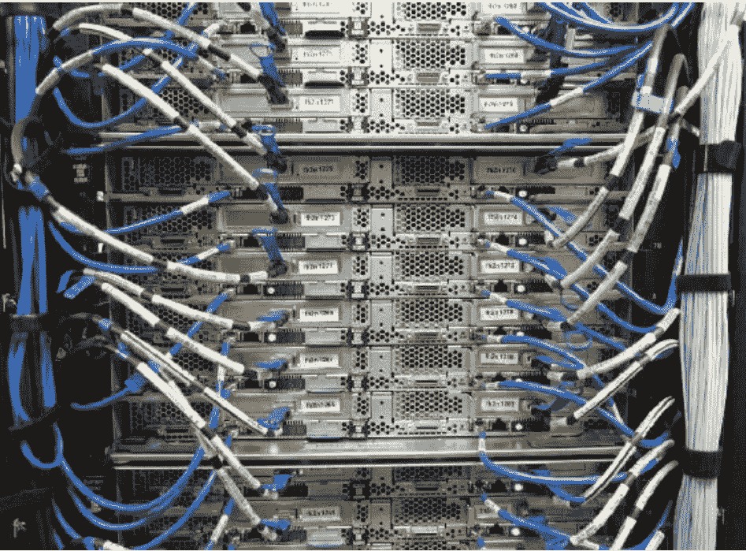
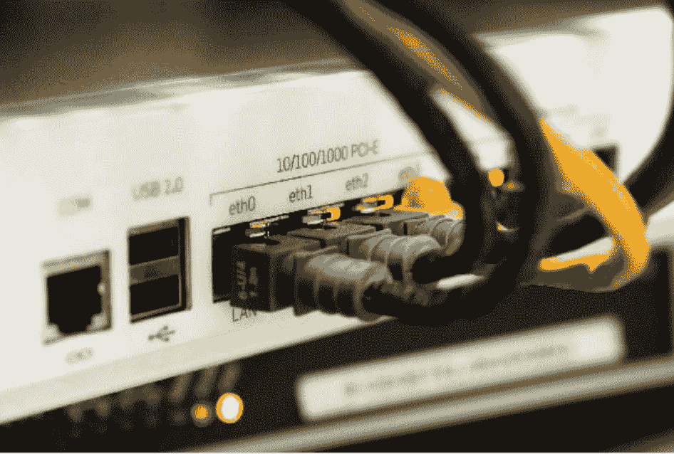
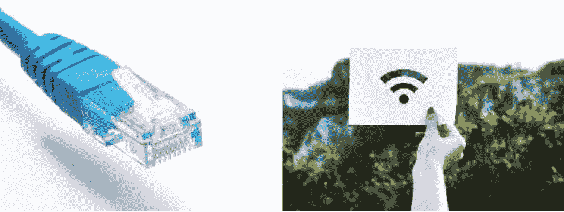
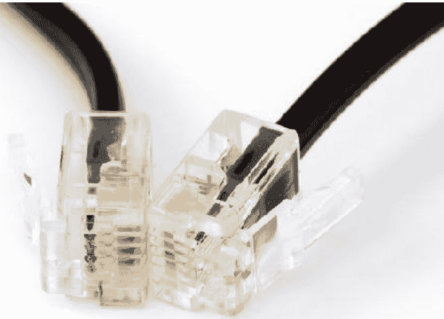

# 渗透攻击：网络与安全（二合一：Kali Linux 黑客攻击与网络入门指南）

JOHN MEDICINE


John Medicine

## 引言

恭喜你下载《初学者网络》的电子版。大家对学习网络基础以及每一个组件的功能表现出如此浓兴趣，我感到非常高兴。网络也可以被视为每个组织的主要部分，因为如果没有适当的网络，就不可能建立正规的业务。

网络是用于学习网络基础及其每一个组件的功能的技术。网络也可以被视为每个组织的主要部分，因为如果没有适当的网络，就不可能建立正规的业务。

网络你选择《初学者网络》网络。。。感谢你选择《网络网络网络》。。感谢你选择《初学者网络》书籍。感谢你选择《初学者网络》书籍。祝你阅读愉快！

感谢！


# 第一章：计算机网络逻辑

在当今这个世界，没有技术的触碰一切是不可能的，计算机网络也是一种没有它就无法建立组织或业务的东西。它有助于将各种设备连接到各种系统。网络包含了从短信到电话通话的一切。网络操作需要某些技能，完全取决于网络的复杂性。例如，在非常大的企业中，可能有有数百万节点，，许多其他网络安全需求。

另一方面，一个在家里每天使用使用和网络的普通人可以轻松设置并排除无线网络中的各种基础问题。这两个例子在某种程度上都需要网络基础。

## 计算机网络基础

为了理解网络的主要功能和组件，你需要首先学习基础。计算机网络是由各种组件组成的，这些组件有助于整体功能。让我们来看看网络基础。

## 网络及其类型

计算机网络可以分为两种不同的类型：有线网络和无线网络。在有线网络的情况下，它需要物理介质用于在节点之间传输信息。对于家庭和企业的数字通信，使用以太电缆是因为其耐用性和低成本。光纤也被用于远距离的数据传输，并且以更快的速度。然而，每当涉及到成本时，以太电缆比光纤便宜得多。

有线和无线网络根据网络物理层进行分类。然而，网络也可以根据网络的设计和构建、是否包含 `SDN`（软件定义网络）或覆盖网络来区分。它还可以根据规模、环境，如校园网、局域网 `LAN`、广域网 `WAN`、存储区域网络、数据中心网络等进行分类。

### 网络系统的类型

网络系统有两种类型：开放式和闭式。在开放式系统中，系统与网络连接并已准备好通信。然而，在闭式系统中，系统未与网络连接，无法与之连接。

### 网络组件

计算机网络对物理网络基础设施有要求。它包含了路由器、交换机、访问点等各种组件，以及帮助运行其他组件的基础固件。至于其他组件，它还包含了用于监控、安全和管理网络的必要软件。所有形式在很大程度上依赖协议标准，以统一执行各种离散任务或与各种类型的数据进行通信。协议无非一组算法或规则，有助于定义两个不同实体跨网络相互通信的各种方式。

网络中可以找到许多类型的协议，如 `IP`、`ARP`、`DHCP`、`TCP`、`FTP` 等。

`VoIP` 或 `IP` 语音用于将 `IP` 电话流量传输到支持该协议的端点。`TCP/IP` 被称为互联网协议族，负责基于 `IP` 在网络上进行数据传输。

`IP` 地址是逻辑地址，作为网络中系统的网络地址。它有助于为网络中的所有设备创建唯一标识。`IP` 地址为 32 位。`IANA`（互联网分配数字分配机构）为网络中的每个系统或设备分配唯一的 `IPV4` 地址。

`MAC` 地址被视为网络中每个主机的物理地址。它与网卡（网络接口卡）相关联。`MAC` 地址为 48 位或 6 字节或 12 个半字节（nibble）。每个 `MAC` 地址在制造系统或设备时被分配给系统的 `NIC`。


# 第 2 章：互联网通信

当今世界与几年前已完全不同了。它每天都在发生变化。随着数字技术的发展，变化的速度也变得非常快。曾几何时一条简单的信息需要几个月才能送达，而现在只需要几秒钟。互联网通信已经演变得如此强大，现在可以无缝地连接世界每个角落的人。

## 互联网通信

互联网通信是一件非常简单的事。它是通过互联网或万维网共享思想、信息或仅仅是文字。互联网由一组巨大的全球互联网络组成，通过使用 `TCP/IP` 的分组交换技术帮助交换信息和数据。

互联网通信带来了许多优势，可以在很多方面我们提供帮助。

## 互联网通信及其优势

互联网上的通信系统的优点多于劣势。对于商务人士来说，他/她可以坐在舒适的家里，喝着茶或咖啡，同时与客户进行电话会议。这有助于节省大量的时间、资金并促进业务增长。

- **多功能性**：互联网通信本质上是多功能的。它是 24*7 全天提供的。只要你连接到网络，互联网通信就会一直运行。互联网通信也可以被视为企业的福音，特别是在紧急事件期间，例如在社交媒体广告领域，即使是一秒钟的负面宣传也可能导致灾难。在这种情况下，互联网通信有助于弥补一切。
- **平权化**：事实是，每个人无法同时出现在所有人面前。此外，我们周围还有许多人不喜欢太多说话。这样的人总是喜欢通过写作来表达他们的感受。有些人觉得在键盘后说话时很自在。在这种情况下，互联网通信有助于这类这些人建立通信线索。
- **文档完备**：面对面交流没有多少记录，而互联网通信有良好的记录。它在各种情况下都有帮助，特别是当人们需要对自己说的话负责时。因此，互联网有助于建立一个非常有责任感的环境。
- **快速通信**：互联网通信非常快。它以极快的速度传输消息，使得在紧急情况下发送消息成为可能。

## 互联网通信工具

互联网通信为人类世界提供了广泛的通信工具。让我们来看看这些工具。

## 电子邮件

电子邮件被认为是互联网通信的基础工具之一。今天，几乎所有形式的服务都需要电子邮件地址，而且人们认为每个在互联网上活跃的人都至少有一个电子邮件地址。可以从 Google 和 Microsoft 等各种免费服务获取电子邮件地址。电子邮件最广泛地用于发送官方或机密信息。然而，在当今这个世界中，它也被用于各种有害活动，例如使用网络钓鱼邮件传播恶意软件或诈骗。在网络钓鱼案例中，第三方欺骗受害者共享其敏感数据，如银行或信用卡详情、账户号码等。因此，在从未识别的源获取任何形式的电子邮件时，最好总是谨慎一点。客户端的计算机

## 社交媒体

作为今天的工具之一，它被用于无延迟无缝连接世界各地的人。但今天社交媒体的案例日益增加。

## 万维网 (World Wide Web)

万维网是互联网通信最主导的形式。它被用于一切，从在线购物到查看天气。用户需要 Web 浏览器来访问网页。每个网站都是用 `HTML` 构建的，`HTML` 是网页语言；`CSS` 定义屏幕上的每个元素；`JavaScript` 则用于处理数据并提供编程逻辑。其他每种形式的互联网通信（如 `VoIP` 或语音互联网协议）也依赖于网络。使用 `VoIP` 系统被认为比传统的手机便宜得多且更快。它还允许无延迟的国际通话。



# 第 3 章：客户端/服务器方法

客户端/服务器方法是计算机网络架构，其中各种客户端或远程处理器请求服务并从主机或服务器接收服务。客户端的计算机带有一个接口，允许计算机用户从服务器请求各种服务，然后显示服务器返回的结果。网络中的所有服务器等待客户端请求的到达，然后对每个请求做出响应。通常，网络服务器为客户端提供一个透明的标准接口，以便所有客户端都了解提供服务的软件和硬件系统规范。

客户端通常位于 PC 或工作站上，而服务器位于网络中，即比客户端更强大的系统上。当服务器和客户端都需要定期执行某些特定任务时，客户端/服务器方法是最有效的。例如，在医院的数据处理中，作为客户端的计算机运行程序输入所有患者信息，而服务器系统帮助管理患者数据库，其中永久存储了所有形式的信息。网络上的所有客户端都可以访问服务器提供的信息，客户端系统也可以执行发送电子邮件等各种工作。

网络方法中的客户端和服务器都被认为是智能设备。因此，客户端/服务器模型与旧的主机模型完全不同，且先进得多，后者其中

用于为网络中所有终端执行所有任务的中央计算机。

## 客户端/服务器模型的组件

客户端/服务器模型由三个组件组成：服务器、网络设备和工作站。网络中的工作站是那些从属于服务器的计算机。工作站向服务器发送各种请求，以访问共享文件、程序、数据库和文件。它受服务器策略支配。网络中的服务器处理来自工作站的所有请求，还可以执行许多其他功能，如程序、文件、数据库的管理以及管理策略。网络中的网络设备有助于服务器与工作站之间建立通信。简单来说，网络设备充当连接器的角色，并引导数据进出网络。

### 工作站


工作站也称为客户端计算机，是向服务器发送请求的设备。它们通过运行其系统的操作系统（`OS`）进行区分。在客户端/服务器网络中，`Windows XP`、`Windows 7`、`Windows 10`、`Linux` 等都是工作站的操作系统。这些操作系统比服务器的操作系统便宜，此类操作系统的进程和功能仅供客户端计算机或工作站使用。共享程序、安全和管理策略以及中央数据库并不是操作系统的一部分。它们带有本地化版本的策略程序和数据库。与服务器相比，工作站在处理器速度、内存和硬盘空间方面的技术规格较低，因为客户端系统不需要像服务器系统那样记录任何形式的数据或处理任何请求。

## 服务器

服务器之间通过各自的操作系统集进行区分，例如 `Windows 2003`、`Windows 2008` 或 `Windows 2000 Server`。涉及到服务器，它们具有更快的处理速度、更大的硬盘空间和更多的内存。这主要是因为服务器存储了各种形式的数据，并同时为多个工作站提供服务。服务器可以在客户端/服务器网络中承担任何类型的角色。它可以同时担任邮件服务器、文件服务器、域控制器和数据库服务器。然而，对于一个配置良好的网络，总是将这些角色分配给所有可用服务器，以优化网络性能。但是，无论服务器执行何种角色，它都作为数据库、程序、网络文件和策略的中央存储库。

服务器非常容易管理和进行备份，因为网络中的服务器并不依赖于单个用户的配置，并且可以在整个网络中无缝实施。

### 网络设备

网络设备充当服务器和工作站之间的中介，有助于它们之间建立连接。网络设备确保发往和指向工作站的请求都能正确路由到相关的服务器。今天有各种类型的网络设备，每种设备执行不同的连接功能。在基本的客户端/服务器网络中，集线器帮助连接服务器与各种工作站。它充当中继器，将信息和数据从网络中的一个设备传递到另一个设备。网桥等网络设备有助于分离网络的各个段。



# 第4章：点对点连接

在网络世界中，可以很容易发现并创建各种连接。每种连接都有其特定的目的和结构。当两台或两台以上的计算机相互连接，并在没有服务器系统存在的情况下共享资源和数据时，就创建了 `P2P` 或点对点网络。在这种连接形式下，网络内的所有计算机在数据处理方面共同承担同等的责任。点对点网络与客户端/服务器网络完全不同。在客户端/服务器网络中，服务器充主系统处理网络内其他客户端系统消耗或使用的数据。然而，点对点连接并非如此。

点对点网络可以像临时连接（`ad hoc connection`）一样，多个计算机系统通过通用总线（`USB`）连接，用于传输文件和数据。它也可以作为永久性基础设施，使用铜电缆连接小型办公室网络内的几台计算机。`P2P` 连接也可以是规模得得大的网络，使用特殊协议和应用程序，在互联网上的所有用户之间建立直接关系。简单来说，点对点网络可以根据需要随时承担各种角色。

## 点对点连接及其特性

点对点连接见于所有形式的小型网络。

对点连接既充当客户端也充当服务器。与客户端-服务器网络相比，这使得 `P2P` 网络更容易受到远程攻击。

损坏的数据仍然可以通过修改网络上的文件在对点网络中进行共享，其目的是引入恶意软件或恶意代码。


# 第 5 章：计算机网络的基本组件

计算机网络通过各种组件运行。所有组件共同工作，使数据从一个系统传输到另一个系统，并帮助在发送方和接收方之间建立流畅连接。计算机网络涉及一个或多个服务器、网络接口卡（`NIC`）、被动和主动集线器、网关、网桥、调制解调器、路由器、用于网络的操作系统软件等。

## 服务器

它被视为网络的母体。它是网络中最强大的系统。在局域网（`LAN`）中，通常使用一台强大的计算机作为服务器。在计算机网络中，有两种服务器：专用服务器和非专用服务器。专用服务器执行网络中的所有和服务功能。它有助于运行用户应用程序，并有助于提高系统的整体成本。然而，在专用服务器中，用户无法直接运行自己的应用程序。专用服务器为用户提供各种硬盘的共享、电子邮件服务以及其他数据和资源的共享。它具有非常快的响应速度。对于所有需要处理重负载的网络，通常采用专用服务器。

在非专用服务器的情况下，它除了作为网络控制器外，还充当工作站使用。它配备了海量的内存。使用该服务器的网络只使用服务器的一部分内存。服务器的其余内存用于用户的应用程序。它适用于轻流量负载状况。

## 网络硬件

网络硬件是指用于连接网络各种组件的设备，例如网卡、服务器与工作站之间的连接，以及将外围设备连接到网络的设备。

## 资源共享

这些是硬件和软件设备的资源。最常见的硬件设备是驱动器、打印机、硬盘、光驱等。软件资源包括程序、应用程序、文件等。

### 文件服务器

计算机网络的主要要目标是在不同用户之间共享信息和数据。用户还将其打印机、磁盘驱动器以及与其他客户端站建立其他通信链路。客户端系统可以向服务器请求访问共享设施。文件服务器运行在特殊的软件上，通常由强大的计算机系统提供服务。它帮助为网络内的所有用户共享文件和其他资源。文件服务器还提供用户验证、程序和数据安全等许多功能。它通常通过网络操作系统（`NOS`）运行。所有文件服务器活动都从控制台控制和监控。文件服务器巨大的内存用于缓存文件和目录。

### 工作站

工作站被认为是网络系统的关键组件。它被称为客户端系统。它具有与网络中所有其他机器连接和通信的能力。然而，为了让工作站正常运行，需要符合局域网的软件硬件。工作站能够与服务器通信以获取数据和其他资源。工作站所需的硬件完全取决于网络规模和应用。

### NIC

也称为网络接口卡，作为网络中计算机的扩展卡。它也被称为网络接口适配器或以太网适配器。`NIC` 执行将跨网络电缆的信号直接转换为计算机系统内部并行数据流的功能。你可以使用多个 `NIC` 来分担网络负载。

### 集线器

它是网络中数据传输所需的集中式分布点。集线器通常用于接收数据包，然后将其广播到所有连接到它的其他计算机系统。它本质上是一个被动设备。集线器不知道收到的数据包的目的地。集线器可以轻松分为三类：

- 可堆叠和不可堆叠：可堆叠集线器是可以相互连接以形成单个集线器的集线器。不可堆叠集线器是那些……
- 主动和被动：主动集线器是那些连接到网络的设备。
- 智能和非智能：智能集线器是那些……

### 网桥

它用于连接两个网络。在局域网中使用本地网桥。

### 网关

两个性质不同的网络可以使用网关连接。

### 调制解调器

它有助于网络之间的双向通信。


# 第 6 章：OSI 模型

`OSI` 模型或开放系统体系模型是一个为了实现不同通信系统的模型。简单来说，`OSI` 提供了一种网络标准。它基于一个概念，即将通信系统分为七层，每层都堆叠在另一层之上。每层执行特定的功能，并与其上方和下层进行通信。

## OSI 模型的重要性

现代互联网结构并没有严格遵守 `OSI` 模型结构，但它对于网络故障排除仍然有用。无论是某个人无法将其 `PC` 连接到互联网，还是一个服务于数千用户的大型网站宕机，`OSI` 模型都有助于分层拆解主要问题，并隔离故障源。

## OSI 模型的七层

`OSI` 模型的七层按倒序堆叠，这意味着第 7 层位于顶端，第 1 层位于底部。

### 应用层

这一层直接与用户数据交互。各种软件应用程序（如电子邮件客户端和网络浏览器）依赖此 `OSI` 模型来启动通信。然而，需要明确，客户端的软件应用程序并不是这一层的一部分。应用层负责处理数据和协议，软件依赖于这些协议来呈现对用户有意义的数据。这一层包含了 `HTTP` 和 `SMTP`。

### 表示层

表示层负责数据准备，以便上层的应用层可以使用这些数据。简单来说，这一层将数据转换为可演示的形式，以便应用程序进行消费。这一层负责加密、翻译以及数据压缩。第 6 层负责将汇入数据翻译成更简单的语法，以便上层的应用层能够理解。如果设备通过本质上加密的连接进行相互通信，则该层在发送端应用加密，并在接收端对数据进行解码，以便数据能够以可读且未加密格式呈现给应用层。它在向第 5 层递送数据之前也有助于数据压缩。

### 会话层

会话层负责网络中两个设备之间通信系统的关闭和开启。会话是指通信开启和关闭之间的时间。

确保通信在数据交换完成之前一直保持开放状态。

### 传输层

该层负责两个设备之间的通信，即端到端通信。整个过程涉及从会话层收集数据，并在发送到第三层之前将它们拆分为数据段（`segments`）。接收端设备上的该层负责将数据段重组为完整的数据，以便会话层使用。该层还负责流量控制和错误控制。流量控制有助于确定传输的正常速度，以免连接速度快的发送方导致连接速度慢的接收方发生过载。

### 网络层

该层负责在两种不同形式的网络之间允许数据传输。如果通信中的两个设备运行在相似的网络中，在这种情况下该层就是多余。该层在发送端设备上将上层传输层的分段划分成各种较小的单元，称为数据包（`packets`），并在接收端设备上重组这些数据包。


### 数据链路层
该层与网络层非常区别在于该层允许在同一网络上的两个设备之间传输数据。该层从网络层获取数据包，然后将其划分成帧（`frames`）。

### 物理层
该层涉及用于数据传输的所有物理形式的设备，如交换机和电缆。该层还把数据转换为比特流，其中字符串由0和1组成。两个设备中存在的物理层需要对信号约定达成共识，以便在两个设备中都能区分1和0。



# 第7章：有线网络 VS. 无线网络
在大多数机构和家庭中可以找到两种网络系统：有线网络和无线网络。使用以太网的网线网络形式是大多数家庭最常见的选择，但Wi-Fi以及其他形式的无线网络也正在变得流行。这两种形式的网络各有优缺点，都可以用于家庭和办公用途。

## 有线局域网 (Wired LANs)
在这种形式的网络中，使用了以太网线和网络适配器。使用以太网线可以轻松连接两个设备，但有时也会使用集线器、路由器和交换机等中间组件。

### 安装
以太网线从一台计算机运行到另一台计算机，或直接连接到服务器或中央系统。安装过程非常耗时，特别是当计算机之间距离较或位于不同房间时。然而，如今也使用了`CAT5`电缆，这有助于简化布线过程并尽量减少不美观的电缆运行。布线配置在很大程度上取决于网络上使用的设备混合情况、互联网连接类型以及各种因素，例如是否将使用内部或外部调制解调器。网络的配置取决于标准`IP`以及网络系统的其他选项。

### 成本
有线局域网的整个设置非常廉。电缆、交换机和集线器并不贵。连接共享所需的软件（如`ICS`）是免费的。通常情况下，有线局域网本质上非常便宜，但当网络中使用安全设备和宽带路由器等功能时，可能会变得昂贵。

### 可靠性
集线器、以太网线和交换机本质上是可靠的，因为这些产品的开发者随着时间的推移一直在改进技术。有线网络的缺点是电缆松动。如果其中一个电缆连接不当，可能会影响整个网络。然而，这种形式的网络允许在计算机系统之间快速传输数据，且性能没有延迟。

### 性能
有线局域网具有卓越的性能质量。它可以提供10 Mbps到100 Mbps的带宽。它让系统之间的文件共享变成了一项简单的工作，并可以在短时间内完成传输。

### 安全
有线局域网的安全性主要取决于防火墙等考虑因素。

## 无线网络
这种网络形式使用Wi-Fi来建立网络中的设备连接。它不涉及任何有线连接。

### 安装
无线网络使用Wi-Fi来建立网络中的设备。它不涉及任何有线连接。无线网络可以以两种方式配置：
- 基础设施模式（Infrastructure mode）：使用中央接入点。
- 对等模式（Ad-hoc mode）：直接连接设备。

### 成本
由于接入点和路由器的成本，无线网络要昂贵得多。

### 可靠性
无线局域网也会面临类似于有线局域网的可靠性问题。

### 性能
无线局域网的性能取决于距离。距离越远，连接越慢。

### 安全
与有线局域网相比，无线局域网在安全性上较低。这主要是因为信号在空中传输，很容易被拦截。

## 总结
如果你正在寻找一种成本效益、快速且不担心移动性的网络系统，那么有线局域网是选择。如果你需要移动性，那么无线局域网是选择。两者各有优缺点，你需要进行分析。



计算机网络主要涉及硬件。建立网络及其运行使用了各种类型的硬件组件。你可以用最少的硬件需求建立网络，但随着你不断添加元素，网络的性能和可靠性也会提高。

# 网络电缆和电线
尽管无线技术取得了如此进步，21世纪的许多计算机系统仍然依靠电线和电缆作为跨网络传输信息的物理介质。网络领域存在各种电缆标准，每种标准都是为特定目的设计的。今天最常见的网络电缆和电线是以太网线和光纤。

## 以太网线
以太网线是用于有线网络中最常见的电缆形式。它有助于连接本地网络内的计算机、交换机和路由器等各种设备。然而，以太网线在耐用性和长度方面非常有限。如果电缆太长或质量不好，电缆将无法传输良好的信号。这就是为什么不同类型的以太网线被用于不同的功能。

### 以太网线的类型
今天使用的以太网线支持许多行业标准，包括类别5和6。计算机网络专家技术人员将这些以太网线标准称为`CAT5`和`CAT6`。以太网线开发成了两种形式：
- 纯芯以太网线（Solid Ethernet cables）：这种形式的以太网线提供了更好的性能，并对所有形式的电干扰具有更高的安全性。这种电缆也被用于用于业务网络、办公室墙墙布线和地板下布线。
- `多股绞织网线`：这种形式的以太线在本质上不易损坏，也不容易发生断裂或裂纹。这种以太线适用于家庭网络。

### 以太线及其局限性
以太线具有距离限制。它具有距离传输能力，即电缆在出现任何形式的网络信号损耗之前，其运行长度有一个最大上限。这也被称为衰减。这主要是因为长电缆具有电形式的电阻，会阻止信号流，并在远距离上影响网络的整体性能。以太线的两端需要足够近，以便快速接收信号，并且远离任何形式的外部干扰，以避免连接中断。这种做法不会影响网络规模，因为可以使用路由器和集线器等各种硬件组件将同一有线网络上的各种以太线连接起来。两个设备之间的距离被称为网络直径。

`CAT5`线在发生衰减之前的长度为 324 英尺。然而，`CAT6`的距离可以延伸到 700 英尺。如果你愿意，也可以让以太线比标准长度长，但你将面临唯一的问题是信号损耗，特别是在电缆需要跨越大型设备的情况下。

### 以太线的替代方案
今天可以找到用于以太线的各种替代方案，例如蓝牙和 Wi-Fi。这主要是因为现在的设备和系统没有网络端口，仅配备了 Wi-Fi。尽管如此，以太线提供的安全性和性能非常出色，许多大型机构和各种家庭网络仍在使用以太线构建有线网络。


### 光纤
光纤是一种网络电缆，在电缆的绝缘外壳内部带有玻璃纤维线束。它是专为远距离数据传输、电信和高性能网络而设计的。与以太线相比，光纤提供了更大的带宽，并且能够在无信号损耗的情况下向远距离传输数据。它支持世界上大多数电缆电视、互联网和电话系统。

### 光纤是如何工作的？
光纤由几根玻璃丝组成，其直径比发丝略粗。每根玻璃丝的中心被称为纤芯，为光提供传输路径。玻璃丝的纤芯被一层玻璃包层包围，包层有助于将所有光反射回内部，从而有助于防止信号损耗。它还允许光轻松地穿过电缆带。光纤有两种类型：单模和多模。单模光纤使用超细玻璃丝配合激光来产生光。多模光纤则使用 LED 产生光。

单模光纤使用一种名为“波分复用”的技术，以增加玻璃丝可以承载的数据流量。这种技术允许光以不同的波长传输，以便在之后合并并再次分离，从而通过单个光脉冲传输各种通信流。

### 光纤及其优势
光纤为远距离传输提供了各种优势。光纤可以轻松支持更高容量的传输。光纤电缆的标准为 10 Gbps、40 Gbps 和 100 Gbps。光纤不需要任何形式的信号放大器，因为光在远距离传输时不会产生任何形式的强度损失。

光纤电缆不易受到任何形式的干扰。以太线需要屏蔽来保护免受电磁干扰的影响。然而，这种屏蔽对于终极保护是不够的。但光纤电缆的物理特性可以轻松避免所有这些问题。

### 入户光纤
在大多数情况下，光纤用于城市和国家的远距离通信。然而，一些本地网络提供商通过安装家庭可以直接访问的光纤来扩展其网络。目前市场上著名的光纤服务之一是 Google Fiber。由于这种光纤服务可以轻松为家庭提供千比特级的网络速度。入户光纤有多种版本，例如：
- `光到室内 (FTTP)`：这种光纤服务可以轻松为家庭提供千比特级的网络速度。
- `光入户 (FTTH)`：目前市场上著名的光纤服务之一是 Google Fiber。
- `光到路边 (FTTC)`：入户光纤有多种版本，例如：
- `光到建筑 (FTB)`：然而，一些本地网络提供商通过安装家庭可以直接访问的光纤来扩展其网络。
- `光到节点 (FTTN)`：在大多数情况下，光纤用于城市和国家的远距离通信。
- `光入户 (FTTH)`：入户光纤有多种版本，例如：

### 其他所需的硬件形式

## 无线硬件
建立无线网络需要某些硬件。提到无线时，有两种类型：点对点（ad hoc）和基础设施型（infrastructure）。基础设施模式的网络需要：
- `路由器`：无线路由器可以被认为是网络的核心。无线路由器也称为接入点。它有助于管理连接。
- `网卡 (NIC)`：每个想要连接到网络的计算机都需要网卡。笔记本电脑自带了网卡，但在 PC 的情况下，你需要安装它。它可以安装在内部，也可以作为插拔式 USB 设备使用。

在点对点（ad hoc）无线网络中，网络中的计算机相互连接。它在没有路由器或中央集线器的情况下运行。与其共享一个公共服务器，点对点模式下的所有计算机都可以直接访问其他计算机的文件和资源。


它也被称为 Wi-Fi 安全访问（Wi-Fi protected access）。它在 `WEP` 被弃用的一年前被采用。现代使用的大多数 `WPA` 应用都使用 `PSK` 或预共享密钥，这通常被称为 `WPA` 个人版（`WPA` personal），并使用 `TKIP`（临时密钥完整性协议）进行加密。它使用服务器进行身份验证、证书生成以及密钥生成。

与 `WEP` 一样，`WPA` 也被发现容易受到外部入侵。对该协议危害最大的攻击并非本质上的直接攻击，而是建立在 `WPS`（Wi-Fi 保护设置）上的攻击，`WPS` 是为了简化现代接入点设备之间的连接而开发的。

### WPA2

`WPA` 经过改进后演变为 `WPA2`。它也被称为 Wi-Fi 安全访问版本 2。该协议获得的主要升级是使用了 `AES`（高级加密标准）。`AES` 已通过美国政府批准用于加密数据和信息。

`WPA2` 系统主要的漏洞形式是攻击者完全获取了受保护的 Wi-Fi 网络的访问权限，并且可以访问执行对网络中设备攻击所需的某些密钥。在 `WPA2` 系统中，安全威胁主要存在于企业级，与家庭网络完全无关。

然而，与 `WPA` 一样，`WPA2` 系统仍然存在通过 `WPS` 进行攻击。

### 选择哪种安全方法？

当所有安全方法按优到劣进行排序时，顺序如下：

- `WPA2+AES`
- `WPA+TKIP/AES`
- `WPA+AES`
- `WPA+TKIP`
- `WEP`

最好的方法是禁用 `WPS`，并将无线路由器设置为 `WPA2+AES`。`WPA2` 和 `WPA` 都用于保护网络免受任何形式的未经授权访问。如果你让系统处于没有任何安全的状态，任何第三方都可以轻松窃取网络带宽，利用网络执行各种非法活动，监控你的网络活动，并轻松地在系统上安装恶意软件。

`WPA2` 被认为所有方法中最好的。`WPA2` 唯一的缺点是确定该协议保护网络所需的处理能力。这意味着需要超强大的硬件来避免网络性能降低。你应该始终选择 `WPA2`，或者在没有其他选择的情况下选择 `WPA`。当 `WPA2` 系统中负载过重时，`WPA` 可以帮助处理沉重负载，但它也可能影响网络速度。

涉及到加密，将取决于你使用的协议类型。`WPA2` 具有最快的加密速度，而 `WEP` 的加密速度最慢。

### 保护 Wi-Fi 网络

虽然 `WPA2` 提供了比 `WPA` 和 `WEP` 更先进的保护，但路由器的安全性完全取决于用户设置密码。`WPA2` 和 `WPA` 允许的最大密码长度为 63 个字符。尝试尽可能增加你的 Wi-Fi 密码。黑客总是寻找容易的目标。如果他们无法在几分钟内破解密码，就会转向下一个目标。

### WPA3

`WPA3` 或 Wi-Fi 安全访问版本 3 是 Wi-Fi 的下一代安全协议。它有助于完全保护 Wi-Fi 网络，并让用户免受安全缺陷的影响。`WPA3` 通过实施新的密钥交换协议保护 Wi-Fi 密码免受字典攻击。`WPA3` 还支持在攻击者获取网络访问之前通过系统的任何形式的流量保持加密（前向安全性），这是 `WPA2` 无法做到的。`WPA3` 还为公共网络提供扩展安全，使用户免于他们无法意识到的任何形式的漏洞。


## 第 10 章：电路交换与分组交换

## 电路交换

在电路交换过程中，网络带宽或资源被划分为若干小块，在建立连接时会有永久的少量延迟。发送者和接收者之间专用的电路或路径提供适当的数据速率。（注：原文此处有大量重复的句子，译文已根据逻辑精简并保留核心含义）。电话网络是电路交换的最佳示例。

- `FDM`（频分复用）：将网络带宽划分为不同的频率。用于光纤以及无线频谱。用于传输独立数据。
- `TDM`（时分复用）：将网络带宽划分为帧。用于末端同步。通过公共路径进行传输。

它用于远程链路，还能承受用户的海量数据流量。

### 电路交换的阶段

在电路交换中，一切分多个阶段完成：

- 建立电路：在此阶段，直接从终端建立电路。发送者和接收者都发送请求和确认信号。
- 数据传输：电路创建后，数据从发送者传输。只要双方想要通信，连接就会保持。
- 拆开电路：一旦数据传输完成，连接就会被丢弃。断接请求来自双方任何一方。断接过程包括移除发送者和接收者之间所有的中间链路。

### 电路交换的优点

电路交换具有广泛的优点：

- 最适合长时间传输。这是因为创建了持续传输路线，只要对话持续它一直存在。
- 专用通信路径确保了稳定的通信速率。
- 电路建立后没有中间延迟。因此，它是数据和语音实时通信的极佳选择。

### 电路交换的缺点

- 在电路交换中，双方之间建立连接。无论负载如何，该连接都无法传输其他形式的数据。
- 即使数据量很，也需要高带宽。
- 建立连接所需的总时间很长。
- 系统资源未充分利用。资源分配给某个特定连接后，无法用于任何其他连接。

## 分组交换

这是一种以数据包形式向网络传输所需数据的方法。用于传输的数据被分解成称为数据包的小单元。这样做是为了确保文件能够以快速且高效的方式直接跨网络传输，并减少传输中的延迟。所有小数据包在到达目的地后会重组。一个数据包由有效负载以及若干信息组成。

控制。为此，不需要对资源进行预留或预设。

分组交换的整个过程在数据包交换时使用了存储和转发技术。在数据包转发的过程中，每个数据包首先被存储，然后才转发。这整个技术非常重要，因为数据包可能会由于任何原因在任何跳节点被丢弃。源和目的之间可能存在多条单一路径。每个数据包都带有源地址和目的地址，因此数据包可以在网络中独立地传输。简单来说，同一个文件的数据包可能沿沿相同的路径传输。如果任何路径发生任何形式的拥塞，数据包可以在现有网络上选择某些不同的路径。

为了克服电路交换网络的各种弱点，开发了分组交换网络。这主要是因为电路交换网络对于较较小的消息并不十分有效。

### 分组交换的优点

与电路交换相比，分组交换具有多种优势。

- 在网络带宽方面，它的效率更高。因为在分组交换中没有电路预留的概念。
- 传输延迟非常低。
- 可靠性更高，因为目的端能够追溯丢失的数据包。
- 容错性更强，因为如果路径发生任何拥塞，数据包可以选择任何其他路径。
- 它非常具有成本效益，实施时成本也更廉。。

### 分组交换的缺点

- 数据包不是按顺序交付的，而在电路交换中，数据包通过相同的电路传输，是有序交付的。
- 由于数据包是无序传输的，每个数据包都需要提供一个序列号，这是耗时的。
- 节点处的复杂性增加了，因为数据包可以遵循多路径。
- 由于数据包的重路由，传输存在延迟。
- 它完全不适用于重负载，最适合小消息。

### 分组交换及其模式

- **面向连接：** 在传输开始之前，它有助于使用信令协议建立虚拟连接或逻辑路径。在发送者和接收者之间建立路径，所有属于该流的数据包将遵循这条建立好的路径。路由器或交换机会给出虚拟电路 ID 以唯一标识虚拟连接。所有可用数据被分成若干较小的单元，并在单元上加上序列号。在此过程中，三个阶段共同工作：建立阶段、数据传输阶段和释放阶段。有关地址的信息仅在建立阶段传输。在确定目的路由后，每个中间节点的交换表中都会添加相应的条目。在数据传输期间，本地头部或数据包头部可能包含其他时间戳、长度、序列号等其他信息。它在交换式广网中非常有用。
- **无连接分组交换：** 在无连接分组交换中，每个数据包都包含所有相关且重要的信息，如目的地址、源地址、端口号等，而面向连接的分组交换并非如此。在这种分组交换形式中，所有数据包都以独立的形式处理。属于同一个流的所有数据包可能采取不同的路径，因为路由决策本质上是完全动态的。因此，到达的数据包可能没有正确的顺序。

### 分组交换中的延迟类型

**传输延迟：** 将数据包放入链路中所需的时间。它完全取决于数据包长度以及网络带宽。

- **传播延迟：** 位特从起点到达目的地所需的时间。它取决于传播速度和距离。
- **队列延迟：** 一个任务在队列中等待执行的时间。它取决于网络拥塞。它是目的端接收数据包的时间与数据包执行时间的时间差。
- **处理延迟：** 路由器处理数据包头部所需的时间。数据包处理有助于检测数据包传输到目的过程中发生的位级故障。


# 第11章：网络设备之间的连接

为了连接到网络，计算机系统需要某些组件来实现无缝接接。如果没有包括 `IP` 地址、子网掩码、`DHCP` 等在内的此类组件，系统将无法连接到网络。每个系统都有一套独特的组件，有助于建立新连接。

## IP 地址

`IP` 地址或互联网协议地址是连接到网络中的网络硬件的标识码。当你的系统拥有 `IP` 地址时，它就可以基于 `IP` 地址与互联网等跨网络上的所有其他设备进行通信。大多数 `IP` 地址看起来像 `123.121.52.141`。

### IP 地址有什么用处？

`IP` 地址有助于为互联网等网络化结构中的设备提供唯一身份。它在性质上与你的家庭或办公地址相似，这些地址有助于将物资运送到带有可识别地址的特定位置。网络上的所有设备都可以通过 `IP` 地址彼此区分来。当你想要给住在国外的朋友发送礼物或包裹时，你需要知道你朋友的确切位置。跨互联网发送数据也使用相同的过程。然而，计算机系统并不使用物理形式的邮寄地址，而是使用 `DNS` 服务器查找主机对应的 `IP` 地址。


例如，当你想通过输入相应网站的 URL（如 `www.google.com`）来浏览网站时，你加载页面的请求将直接发送到 DNS 服务器，由它们查找主名的 IP 地址。如果没有正确的 IP 地址，你的计算机将不知道你在做什么。

## IP 地址及其版本

IP 地址有两个不同的版本：`IPv4`（互联网协议版本4）或 `IPv6`（互联网协议版本6）。`IPv4` 是 IP 地址的旧版本，而 `IPv6` 是最新且升级的版本。

- **IPv4：** `IPv4` 地址的构建方式使其能够提供约 40 亿 IP 地址，这些地址在性质上都是唯一的。尽管它拥有海量的地址，但对于今天在网页或互联网上使用各种设备的现代世界来说，仍然不够。

- **IPv6：** `IPv6` 可以支持 340 万亿地址，看起来就像是 340 后面跟着 12 个 0。这意味着地球上的每一个人都能与互联网连接数十亿设备。

`IPv4` 被 `IPv6` 取代的原因之一是，后者与前者相比提供了更多的 IP 地址。当各种设备都连接在相似的网络上时，网络上的每个设备都拥有其唯一的地址是非常重要的。`IPv6` 相比 `IPv4` 还具有许多许多额外优势：

- 不存在由私有地址导致的 IP 地址冲突。
- 它具有自动配置功能。
- 不需要 NAT 或网络地址转换。
- 它具有高效的路由功能。
- IP 地址的管理非常简单。
- 它为 IP 地址提供了内置的隐私保护。

在 `IPv4` 中，IP 地址显示为 32 位数字，以十进制格式编写，例如 `210.251.165.40` 或 `192.251.1.1`。与 `IPv6` 类似，可能有数万亿个 IP 地址，它以十六进制格式编写，例如 `20gge:1500:6565:4:0000:7ff:fe31:97cf`。

## IP 地址及其类型

有多种 IP 地址。虽然所有形式的 IP 地址由字母或数字组成，但并非所有的都用于相同的功能。IP 地址的类型包括私有地址、公网 IP 地址、静态 IP 地址和动态 IP 地址。

- 私有 IP 地址：这种形式的 IP 地址通常用于内部内部，例如任何形式家庭网络，用于 WiFi 摄像头、移动设备、桌面电脑和无线打印机。这种类型的 IP 地址允许设备与中央路由器以及基于类似私有家庭网络的其他设备进行通信。这种 IP 地址可以手动配置，也可以由网络路由器自动分配。

- 公网 IP 地址：这种类型的 IP 地址用于网络的外部区域，由服务提供商或 ISP（互联网服务供应商）分配。它是业务或家庭网络用于与全球其他网络设备通信的主要地址。它通过为家庭设备提供通往 ISP 及其外部世界的路径提供帮助。它允许网络中的设备访问各种网站，并直接与全球各地的计算机和其他服务器进行通信。

这两种类型的 IP 地址在本质上都是静态或动态的，这意味着它们会变化或保持不变。由 DHCP 服务器分配的 IP 地址被称为动态 IP 地址。如果设备未启用 DHCP 服务器或不支持 DHCP，则需要手动分配 IP 地址，在这种情况下，该 IP 地址被称为静态 IP 地址。

### 动态 IP 地址

动态 IP 地址是自动分配给网络中每个节点（如桌面电脑、智能手机或平板电脑）的地址。IP 地址的自动分配是由 DHCP 服务器完成的。由 DHCP 服务器分配的 IP 地址被称为动态的，因为它将根据未来与网络的连接情况而发生变化。

### 在哪里找到动态 IP 地址？

由服务提供商或 ISP 为大多数业务和家庭网络用户分配路由器的公网 IP 地址本质上是动态的。较大的组织和公司尝试不使用动态的 IP 地址连接互联网，而是倾向于使用专门为它们分配的静态 IP 地址。

在任何形式的本地网络中（如你办公场所或家中的网络，使用了私有 IP 地址），大多数设备都预配置了 DHCP。这意味着所有设备都使用动态 IP 地址。如果设备未启用 DHCP，则每个设备都需要手动设置网络信息。

### 动态 IP 地址及其优势

动态分配 IP 地址的一个主要优势是它本质上更具灵活性。与静态 IP 地址相比，它的设置非常简单，管理部分也更容易。例如，当你的一个设备连接到网络时，它会被分配一个特定的 IP 地址。一旦设备断开网络，该 IP 地址就会释放，并可以供之后连接的另一个设备使用，即使它不再是同一台设备。

动态 IP 地址对连接到网络的设备总数限制很少，因为不需要保持连接的设备可以轻松从网络断开，从而为其他设备释放可用的 IP 地址池。另一种方案是，如果网络中的所有设备都想同时连接网络，DHCP 服务器可以网络中的每个设备预配置某些特定的 IP 地址。在这种情况下，数百个网络设备（无论用户是否在使用）都拥有自己的特定 IP 地址，这可能会很容易限制网络中所有新设备的网络访问。

与静态 IP 地址相比，动态 IP 地址的实现过程更容易。对于想要连接网络的新设备，不需要手动设置任何内容。你只需要确保网络路由器上启用了 DHCP。由于所有网络设备默认都从巨大的可用 IP 地址池中每个获得一个特定的 IP 地址，因此每一步都是自动的。

### 动态 IP 地址及其缺点

对于任何形式的家庭网络，使用 DHCP 服务器为路由器分配的动态 IP 地址是非常常见的现象，在技术上也是接受的；问题出现在用户尝试从任何其他外部网络访问同一个家庭网络时。

## 静态 IP 地址

静态 IP 地址是手动配置的，而不是由 DHCP 服务器分配的。静态 IP 地址的意味着 IP 不改变，本质上是静态的。它可以被视为变化的动态 IP 地址的完全相反。手机、平板电脑、笔记本电脑、路由器和其他使用 IP 地址的设备可以通过通过在主机名处手动输入设备的 IP 地址来轻松配置。

### 为什么需要使用静态 IP 地址？

你可以把 IP 地址看作是你的物理地址。这些地址不会改变，本质上是静态的。它有助于与人联系。同样，当你从家里托管网站、使用网络打印机、使用任何形式的远程访问程序或运行打印服务器时，静态性质的 IP 地址非常有益。由于静态地址永远不变，网络中的所有设备都将知道如何连接。

例如，当网络内的 PC 设置静态性质的 IP 地址时，一旦设备获得了特定的 IP 地址，就可以按照特定配置路由器来转发所有的入站请求。如果你在托管网站而没有使用静态 IP 地址，这可能会非常麻烦。这主要是因为当计算机获得某些 IP 地址时，你每次都需要更改路由器设置，将请求转发到新的 IP 地址。如果你忽略这样做，任何人都可以进入你的网站，因为路由器将不知道网络中哪个设备专门为网站提供服务。

工作环境中静态性质 IP 地址的另一个很好的例子是 DNS 服务器。DNS 服务器始终使用静态地址，以确保网络设备确切知道如何连接到服务器。如果它们经常更改，你还需要定期在路由器上重新配置 DNS 服务器。

### 静态 IP 地址的缺点

与动态 IP 地址相比，静态 IP 地址的一个主要缺点是，网络中的所有设备都必须手动配置。所有形式的家庭 Web 服务器以及远程访问程序都要求为设备设置特定的 IP 地址，并与路由器进行正确配置，以便与特定地址进行通信。这比只需插入路由器并让通过 DHCP 服务器提供动态 IP 地址要耗费更多的工作量。

如果一个设备被分配了如 `192.168.1.10` 的 IP 地址，而你又进入一个完全全新的且分配地址为 `10.x.x.x` 的网络，那么你将无法使用你的静态 IP 地址连接。该设备需要重新配置，以便使用 DHCP 服务器或使用能够与新网络良好兼容的静态性质 IP 地址。

当设备使用静态 IP 地址时，安全性也可以被认为是另一个缺点。当使用一个从不更改的 IP 地址时，会给攻击者留出足够的时间来发现设备网络中的各种漏洞。唯一的替代方案是使用会变化的动态性质 IP 地址，这将迫使攻击者改变与该设备通信的方式。

## 静态 IP 地址 vs 动态 IP 地址

动态 IP 地址与从不更改的 IP 地址是完全相反的类型。动态形式的 IP 地址就像静态 IP 一样的普通 IP 地址，但动态 IP 并没有永久绑定到设备上。动态 IP 地址不是终身使用一个地址，而是仅用于特定的时间段，然后返回到 IP 地址池，以便网络中的其他设备可以使用。

与静态 IP 地址相比，动态 IP 地址在优势方面可能更多。如果互联网服务提供商（ISP）继续对所有客户使用静态 IP 地址，很快新客户的 IP 供应就会有限。动态 IP 地址提供了一种解决方案，当一个 IP 地址未被任何其他设备使用时，它可以被其他设备重复使用。因此，比静态 IP 地址能够为更多设备提供互联网访问。

静态形式的 IP 地址具有有限的停机时间。当动态形式的地址获取新 IP 时，连接到现有 IP 地址的用户会被从连接中移除，否则必须等待寻找新地址。当你准备访问网站、文件共享服务或在线游戏时，这不是一个推荐的设置，因为这些功能都需要持续的活动连接。

在商业场所或家庭等任何本地网络中，你通常使用私有性质的 IP 地址，此类网络中的大多数设备都配置了 DHCP。因此，所有设备都使用动态形式的 IP 地址。分配给商业或家庭网络路由器的公共形式 IP 地址是动态的。大型公司不使用动态地址连接互联网。他们使用动态地址，而是使用分配给他们的静态 IP 地址。

## 如何获取静态 IP 地址？


如今的一些路由器已经为连接到网络的设备预留了 IP 地址。这个过程通常通过 DHCP 预留的帮助完成，通过将特定的 IP 地址与 MAC 地址关联来实现，这样每当设备向路由器请求 IP 地址时，路由器都可以分配用户为该特定 MAC 地址已选择的地址。当你想要为业务或家庭网络获取静态 IP 地址时，可以通过联系你的 ISP 来实现，这取决于提供互联网的公司。与获取动态 IP 地址相比，为家庭和其他本地网络拥有静态 IP 地址是非常昂贵的。

### 使用动态 IP 地址伪造静态 IP 地址

由于为家庭或业务网络获取静态 IP 地址可能比普通的动态地址贵得多，最好的选择是使用动态 DNS 服务或 DDNS 同时采用这两种形式的 IP 地址。DDNS 服务将不断变化的动态 IP 地址与同样不更改的主机名关联。这正就像拥有你自己的静态形式 IP 地址，而无需支付动态 IP 之外的任何额外费用。

No-IP 是免费 DDNS 服务的一个示例。你可以用它来重定向你所需的主机名以关联网络。简单来说，如果你有一个动态地址，当你不想为静态 IP 支付更多时，DDNS 服务非常有帮助。你还可以通过 DDNS 托管你的网站并随时访问网络。

## DHCP 服务器

DHCP 服务器无非网络服务器，它自动为客户端提供并分配 IP 地址，以及默认网关和其他参数。它依赖于名为动态主机配置协议（Dynamic Host Configuration Protocol）的标准协议来响应查询。在 DHCP 服务器的情况下，网络管理员需要设置每一个客户端。这可能是一个繁琐的过程，特别是涉及大型网络时。DHCP 服务器为每个客户端分配一个动态性质的 IP 地址。

### DHCP 服务器的优势

比在交换机或路由器上使用 DHCP 更好的选择是拥有一个中央 DHCP 服务器。在需要支持两种协议的网络环境中情况确实如此。DHCP6 具有多种优势：

- 当你拥有集成到 IPv6 的 IPAM 系统中的 DHCP6 服务器时，它将为你提供所有客户端节点的可见性。
- DHCP 服务器还提供接口的管理和日志记录，这有助于管理员管理 IP 地址范围。
- DHCP 服务器还提供高可用性和冗余。如果其中一个 DHCP 服务器故障，网络中的客户端将保留其当前的 IP 地址，而不会导致任何形式的节点。

### 为什么你应该使用路由器作为 DHCP 服务器？

大多数交换机和路由器都具有提供以下 DHCP 支持的能力：

- DHCP 客户端并从上游 DHCP 服务获取 IPv4 地址接口。
- 一个 DHCP 中继，并直接在局域网内将客户端的 UDP DHCP 消息转发到指定的 DHCP 服务器。
- 在交换机和路由器上运行 DHCP 服务器会消耗设备网络上的所有资源。此类 DHCP 数据包由软件处理。
- 不需要动态 DNS 支持。交换机或路由器 DHCP 服务器无法根据租给客户端的 IPv4 地址在客户端的 DNS 中创建条目。

开始实施 IPv6 的组织需要迁移到 IPv4 的 DHCP。这种 DHCP 的变化也表明该组织也希望拥有用于运行两种协议的 DHCP。

TCP/IP 是一套使得网络中各种计算机之间能够通信的协议集合。协议无非可说就是帮助用于管理通信的标准或规则。当网络中的两个设备想要彼此通信时，它们都必须使用相同的协议。这也可以类比为人类之间的交流。说法语的人无法与说中文的人交流，因为他们说的语言不同。你可以从庞大的网络协议池中选择一种协议在网络中使用。但每当涉及到 TCP/IP 时，它被视为行业标准。所有的操作系统都支持 TCP/IP。整个互联网都运行在 TCP/IP 之上。它也被称为互联网语言。如果你想让计算机与互联网通信，你就必须使用 TCP/IP。

## TCP/IP 的历史

在今天的互联网出现之前，存在 ARPANet（阿帕网）。它是由 ARPA（高级研究计划署）创建的，启动于 1969 年冷战期间。ARPANet 的创建是为了应对苏联日益增长的核攻击威胁。ARPA 的主要目标是创建一个具有容错能力的网络，以便让美国军事领导人在发生核战争时能够保持联系。用于 ARPANet 的协议被称为 NCP（网络控制协议）。随着 ARPANet 规模的扩大，还需要另一种协议，因为 NCP 无法满足大型网络日益增长的需求。1974 年，发表了一篇描述 TCP（传输控制协议）特征的论文。NCP 最终被 TCP 取代。在对这种新语言进行进一步开发和测试后，它催生了一个全新的协议集，被称为 TCP/IP（传输控制协议/网际协议）。直到 1982 年，TCP/IP 才正式取代 NCP 成为 ARPANet 的标准语言。

## TCP/IP 的特性

TCP/IP 在行业中已经存在了 35 多年。这是一套经过验证的协议集合，使得设备能够连接到互联网。它具有各种特性，让通信变得更加容易。

- **对多厂商的支持**：TCP/IP 正由多个软件和硬件供应商实现。它现在已成为行业标准，完全不受限于特定的供应商。
- **互操作性**：今天，人们之所以能够在异构性的网络中工作，仅仅是因为 TCP/IP。当你使用运行 Windows 系统的系统的电脑时，你仍然可以从运行 Linux 的机器上下载所需的文件。只有当两个系统都支持 TCP/IP 时，这才是可能的。它有助于消除跨平台的边界。
- **逻辑寻址**：网络中的每一个适配器都有一个在本质上是永久的物理地址。这种永久地址被称为 MAC 地址，也称为硬件地址。该地址在制造时被刻录在硬件卡上。在局域网（LAN）中，底层且对硬件敏感的协议使用适配器的物理地址来传输数据包。每台计算机中的本地适配器都会跟踪局域网上的每一次传输，以确定消息是否发送到了其特定的物理地址。

对于小型局域网，这整套机制运行得非常好。但，当一台计算机连接到像互联网这样庞大的网络时，它每秒需要监听数十亿传输。这可能会导致网络连接失败。为了避免此类情况，网络管理员使用路由器等设备将大网络分成多个较小的网络，以减少网络流量。这确保了来自任何网络的非预期流量不会在其他网络中产生任何问题。管理员可以再次将网络划分为子网，以便消息直接从发送者传输到接收者。TCP/IP 具有很强的子网划分能力，这种能力通过逻辑寻址实现。

## 第13 章：FTP

FTP，全称为文件传输协议，是一种用于在线发送文件的技术。它作为应用层协议，有助于在本地文件系统和远程文件系统之间移动文件。为了共享文件，使用了两个 TCP 连接。FTP 属于仍在使用的最古协议之一。它是非常方便的文件移动方式。

### FTP 有什么用途

FTP 用于将信息从你工作的系统移动到托管网站的服务器。例如，如果你想在服务器上安装 WordPress，你就需要 FTP 来拷贝文件。它也被用作共享文件的工具。你可以将文档或文件上传到 FTP 服务器，然后将文件链接分享给想要的人。然而，由于人们更倾向于使用云文件传输服务，这种服务今天已不再常见。许多人倾向于在家庭服务器上上传文件，他们需要启用 FTP 来实现此类服务。

FTP 使用两种非常基本的通道：命令通道（携带有关任务的所有相关信息）和数据通道（在设备之间传输文件）。

- **命令通道**：用于共享所有控制信息，如用户识别、密码、更改目录、检索和存储文件等命令。命令通道在 21 端口启动。
- **数据通道**：为了实际发送数据文件，FTP 使用数据通道。它在 20 端口启动。

建立连接但不会主动维持连接，从而允许该网络中的所有设备执行所有任务。

## FTP 会话

当服务器和客户端之间启动 FTP 会话时，客户端会与服务器端启动一个受控的 TCP 连接。客户端使用该连接来发送控制信息。在服务器接收到这些控制信息后，它会启动一个指向客户端的数据连接。需要注意的是，通过单个数据连接只能发送一个文件。然而，控制连接在用户的整个会话期间一直保持激活状态。HTTP 本质上是无状态的，这意味着它不需要对用户状态进行详细的跟踪。但在 FTP 的情况下，要求在整个会话期间内维护用户状态。

## FTP 中的数据结构

在 FTP 中，允许三种类型的结构化数据：

- **文件结构**：在这种结构中，没有形式的内部结构。这种结构中的文件被视为数据字节的连续序列。
- **记录结构**：在这种结构中，数据文件由顺序的记录组成。
- **页结构**：在这种结构中，数据文件由独立特性的索引页组成。

## FTP 本身是安全的吗？

不，FTP 在其设计上完全是不安全的。FTP 源于网络安全仅仅是一个假设性研究领域的时代。简单来说，使用 FTP 进行的传输不是加密格式的。因此，任何能够嗅探数据包的人都可以轻松地拦截文件。这就是为什么人们转向 FTPS 而不是 FTP 的原因。FTPS 的工作方式与 FTP 完全相同，但它通过加密每个数据文件来提供帮助，使得窥视者即使拦截了文件也无法读取内容。


## 第 14 章：远程登录


## 第 14 章：远程登录

远程登录，也称为远程访问，是一种用于从远程位置或距离系统物理位置很远的地方访问计算机系统（如办公网络计算机或家庭计算机）的技术。这种技术允许办公室员工在办公外（例如在家里或其他任何地方）继续进行工作，同时仍访问远处的网络或计算机，例如办公网络。远程登录或访问可以使用局域网（`LAN`）、广域网（`WAN`），甚至通过 `VPN` 或私有网络来轻松设置，以便从远程距离访问所有的系统和资源。

远程登录可以通过运行在用户计算机与组织或公司局域网之间的线路来创建。也可以通过专用线路在公司局域网和远程局域网之间建立连接。这种形式的线路提供了极快的速度，但缺点是非常贵。另一种建立远程登录连接的方法是通过 `VPN`。`VPN` 是一种使用互联网将远程站点以及用户连接在一起的网络。这种形式的网络使用加密和隧道技术来实现访问公司网络。对于那些规模较小的组织来说，这可能是最佳选择。

建立远程登录还有其他手段，包括使用无线网络、宽带服务、电缆调制解调器、数字网络或数字用户线路。为了建立远程登录连接，远程计算机或服务器以及本地机器都需要安装远程访问软件。今天可以找到许多服务提供商，他们通过互联网提供远程访问服务。

## 远程桌面软件

远程登录最复杂的形式之一是远程桌面软件。它允许一台计算机的用户交互并查看另一个系统的实际桌面界面。为了设置远程桌面访问，两台计算机（即客户端计算机和服务器计算机）都需要在远程桌面软件上进行配置以建立连接。连接后，软件将直接在主机计算机上打开一个窗口，该窗口包含主机计算机的内容。

## FTP 会话

当服务器和客户端之间启动 `FTP` 会话时，客户端会与服务器端启动一个受控的 `TCP` 连接。客户端使用该连接来发送控制信息。在服务器接收到这些控制信息后，它会启动一个指向客户端的数据连接。需要注意的是，通过单个数据连接只能发送一个文件。然而，控制连接在用户的整个会话期间一直保持激活状态。`HTTP` 本质上是无状态的，这意味着它不需要对用户状态进行详细的跟踪。但在 `FTP` 的情况下，要求在整个会话期间维护用户状态。

## FTP 中的数据结构

在 `FTP` 中，允许三种类型的结构化数据：

- **文件结构**：在这种结构中，没有形式的内部结构。这种结构中的文件被视为数据字节的连续序列。
- **记录结构**：在这种结构中，数据文件由顺序的记录组成。
- **页结构**：在这种结构中，数据文件由独立特性的索引页组成。

## FTP 本身是安全的吗？

不，`FTP` 在其设计上完全是不安全的。`FTP` 源于网络安全仅仅是一个假设性研究领域的时代。简单来说，使用 `FTP` 进行的传输不是加密格式的。因此，任何能够嗅探数据包的人都可以轻松地拦截文件。这就是为什么人们转向 `FTPS` 而不是 `FTP` 的原因。`FTPS` 的工作方式与 `FTP` 完全相同，但它通过加密每个数据文件来提供帮助，使得窥视者即使拦截了文件也无法读取内容。

## 无线网络协议

各种高级别协议，如 `UDP`、`TCP`、`FTP` 和 `HTTP`。所有此类协议都与互联网协议集成，旨在提供更多的附加功能。该家族中也存在一些低级互联网协议，如 `ICMP` 和 `ARP`，它们在该家族内部共存。属于 `IP` 家族的高级协议与网络浏览器等应用程序有更紧密的交互。而低级协议则与网络适配器以及计算机的其他一些硬件进行交互。


无线网络系统现在已经普及，这主要归功于`蓝牙`、`Wi-Fi`和`LTE`。存在用于检查无线网络运行的无线网络协议。为无线网络设计的网络协议需要支持移动设备的漫游，并处理网络安全和可变数据速率等各种问题。

## 网络路由协议

网络路由协议是专门为网络路由器设计的一种特殊协议。网络路由协议能够识别网络上的其他多个路由器，管理网络消息的终点，管理被称为“路由”（`routes`）的消息路径，并对路由做出动态决策。最常见的路由协议包括`OSPF`、`EIGRP`和`BGP`。

## TCP 或传输控制协议

`TCP`或传输控制协议被视为`IP`协议族的核心协议。它起源于网络的实现，并补充了`IP`。因此，整个套件也被称为`TCP/IP`。`TCP`通过在`IP`网络上提供可靠的字节流传输系统来提供帮助。`TCP`的主要特性包括错误检查和排序。所有主要的基于互联网的应用程序（如电子邮件和带有文件传输的世界维网）都依赖于`TCP`。

## 网络协议是如何实现的？

如今的大多数现代操作系统都内置了软件服务，帮助实现对某些网络协议的支持。各种应用程序（如网络浏览器）带有软件库，当应用程序运行需要时，这些库会支持高级别协议。对于路由和`TCP/IP`的某些低级协议，支持正直接在硬件中实现，以提高整体性能。

通过网络发送并由目的地接收的每个数据包都由二进制数据（0和1）组成，这有助于编码消息内容。大多数网络协议会在每个数据包的开头添加较小的头部，用于存储有关消息发送者和预期终地的信息。某些协议还会在数据包的末尾添加`IP`尾部。每个网络协议都具有识别其所有格式消息的能力，并将头部和尾部作为跨设备移动数据的一部分进行处理。

一组在层层和低层共同运行的网络相关协议被称为协议族。最常用的协议包括：默认端口`80`的`HTTP`、默认端口`20/21`的`FTP`、默认端口`22`的`SSH`、默认端口`23`的`Telnet`以及默认端口`53`的`DNS`。

## OSI 模型层及其功能

`OSI`模型或开放系统互连模型是一个七层架构，每层都执行某些特定功能。所有层都紧密协作，旨在将数据从全球范围内一个系统传输到另一个系统。

- **物理层**：`OSI`模型底部的层是物理层。它负责在网络中相关设备之间建立实际的物理连接。物理层的所有信息都以位（`bits`）的形式存储。在接收数据时，物理层接收信号并将其转换为1和0。然后，它被发送到数据链路层，由该层重新组装成帧。物理层的功能包括：
    - 1. 位同步：该层通过提供时钟帮助位同步。物理层提供的时钟负责控制发送端和接收端，从而在位级上提供同步。
    - 2. 比特率控制：该层负责定义传输速率，即每秒发送的位总数。
    - 3. 物理拓扑：该层决定网络中所有节点和设备的排列方式，包括星型、总线型和网状拓扑。
    - 4. 传输模式：该层决定数据在连接设备之间如何流动。可能的模式有单工、半双工和全双工。

- **数据链路层**：这是物理层之上的第二层。它负责从节点到节点的消息传递。数据随后被分成帧。链路层充当逻辑链路控制（`LLC`）和介质访问控制（`MAC`）。该层还使用`MAC`地址。链路层的功能包括：
    - 1. 成帧：数据链路层的主要功能是成帧。它在帧的开头结尾添加特殊模式。
    - 2. 物理地址：该层在头部添加发送者和接收者的`MAC`地址。
    - 3. 错误控制：该层带有错误控制机制；如果发现错误，则重传帧。
    - 4. 流量控制：通过流量控制，协调双方的数据量，以避免被淹没。
    - 5. 访问控制：当多个设备共享单个信道时，该层帮助确定哪个设备拥有控制权。

- **网络层**：该层负责将数据传输到位于另一个网络的主机。网络层还负责数据包路由，这意味着它帮助从所有可用路由中选择路径。它的功能是：
    - 1. 路由：网络层协议决定哪条路由是数据包从源到目的地的最佳路径。
    - 2. 逻辑地址：为了唯一地标识互联中的每个设备，网络层通过定义地址方案来提供帮助。发送者和接收者的`IP`地址被放置在头部中。

在接收端：传输层从报头读取端口号，然后将收到的数据包转发给相应的应用程序。该层还负责对分段的数据进行重组和排序。

## 传输层的功能

- 1. 分段：传输层接收来自会话层的收到的的消息，然后将其分成若干较小的单元。分段后产生的段带有与每个段相关的报头。分段后的消息在目的地由传输层进行重组。
- 2. 服务点地址：为了将消息传递到正确的进程，传输层报头还包含一种地址类型，称为端口地址或服务点地址。通过确定此特定地址，传输层确保预定的消息被传递到正确的进程。

## 传输层提供的服务

- 1. 面向连接的服务：整个过程分三个阶段完成：
    - 连接建立
    - 数据传输
    - 断开连接或终止
  在这种传输形式下，当目的地收到数据包或一组数据包后，接收端的设备会立即向源发送一个确认信号。这种传输形式也非常安全且可靠。
- 2. 无连接服务：该过程本质上是一个阶段，它包含了数据传输。在这种传输形式下，接收者并不确认所有收到的包。这种传输方法允许设备之间进行更快的通信模式。然而，面向连接的服务比无连接服务可靠得多。

- **会话层**：会话层负责连接建立、会话维护、身份验证以及会话安全。该层的功能有：
    - 1. 会话的建立、维护和终止：该层帮助两个进程之间建立、使用并终止连接。
    - 2. 同步：会话层帮助在数据中添加被进程视为同步点的检查点。这些同步点有助于识别错误，以确保数据以正确的方式重新同步。它还确保消息结束不会被提前截断，以避免数据丢失。
    - 3. 对话控制器：该层允许两个系统以全双工或半双工模式开始相互通信。

- **表示层**：表示层也被称为翻译层。从应用层接收的数据在此层中被提取，并根据网络上传输的格式要求对其进行处理。该层的功能有：
    - 1. 翻译：它帮助进行翻译过程，例如从`ASCII`到`EBCDIC`。
    - 2. 加密和解密：数据的加密将整个数据转换成某种形式或代码。加密后的数据称为密文。解密后的数据称为明文。为了数据加密和解密，该层使用键值。
    - 3. 压缩：该层有助于减少传输到网络中的比特总数。

- **应用层**：在`OSI`模型分层结构的顶端是应用层。它是一个由网络中的应用程序实现的层。网络应用程序产生要跨网络传输的数据。应用层作为应用程序访问网络服务的窗口，并用于向用户显示接收到的信息。网络应用程序的一些示例有Web浏览器、即时通讯软件等。该层的功能有：
    - 1. 邮件服务
    - 2. 网络虚拟终端
    - 3. `FTAM`或文件传输访问与管理
    - 4. 目录服务

`OSI`模型作为参考模型，完全没有在互联网中实现，因为它被认为是过时的。`TCP/IP`模型被用来取代`OSI`参考模型。

## VLAN

`VLAN`或虚拟局域网是由一组位于一个或多个`LAN`上的设备组成的，这些设备被配置为某种方式通信，就像它们都连接在同一根线线上一样，尽管它们位于`LAN`的几个不同段上。`VLAN`在本质上是非常灵活的，因为它基于逻辑连接而非物理连接。`VLAN`有助于定义二层网络中的广播域。

### VLAN 如何工作？

交换机上的端口或接口可以分配给单个或多个`VLAN`，这使得系统能够根据其所属的部门被划分为不同的逻辑组。它还规定了不同组的系统之间如何相互通信的规则。这些分离组的范围从实用简单到法律复杂。

### VLAN 及其类型

存在各种类型的`VLAN`。让我们来看一下：
- `协议 VLAN`：这种`VLAN`基于协议处理流量。网络上的交换机将转发或隔离流量。
- `静态 VLAN`：它也被称为基于端口的`VLAN`。它需要网络管理员将交换机上的端口分配给网络。
- `动态 VLAN`：它允许网络管理员根据设备的特征（而非交换机端口）来定义网络成员。

通过中干（`trunk`）配置，可以在单个端口上配置多个`VLAN`，其中通过该端口的每个帧都标记了`VLAN ID`。邻近设备的接口（可能位于另一个交换机或支持`802.1Q`标记的主机上）需要支持中干模式配置，以便传输和接收带有标记的帧。任何未标记的以太网帧都被分配给默认性质的`VLAN`，该`VLAN`也可以在交换机的配置中指定。

当启用`VLAN`的交换机从连接的主机接收到未标记的以太网帧时，它会添加分配给该接口的`VLAN`标签。然后，该帧随目标`MAC`地址转发到主机端口。广播、组播传输和未知单播流量随后会被转发到该`VLAN`中的所有端口。当任何之前未识别或未知的主机对未知的单播帧进行应答时，交换机将获知主机的位置，并且不再对后续针对该主机的帧对该主机进行泛洪。

`STP`或生成树协议用于在每个层2域中的所有交换机之间创建无环拓扑结构。根据`VLAN`的规定，可以交替使用`STP`实例来启用不同的层2拓扑，或者在多个`VLAN`的拓扑结构相同的情况下，可以使用`MIST`（多实例`STP`）来减少`STP`的开销。`STP`阻塞可能会产生转发环路的链路上的转发，从而从选定的根交换机（`root switch`）创建一个生成树。

### 虚拟局域网（VLAN）的优缺点


VLAN 具有一些基本优点，例如减少广播流量、良好的网络安全性、限制广播域以及易于网络管理。

在 VLAN 的缺点方面，每个交换域仅有 4,096 个 VLAN 的限制，这为大型托管服务提供商带来了很多问题，因为他们通常需要为客户分配数百个 VLAN。为了解决这一局限性，其他几种协议（如 `NVGRE`、`VXLAN` 和 `Geneve`）支持更大的标签，并具有在层 3 数据包中隧道传输层 2 帧的能力。

## 路由

路由是选择路径的过程，请求数据通过路径从源传输到接收者或目的地。路由由一种特殊的网络设备——路由器完成的。路由器在 `OSI` 参考模型中的网络层工作，在 `TCP/IP` 模型中的互联网层工作。路由器是网络中的一种设备，完全根据数据包报头中的可用信息以及转发表来帮助转发数据包。为了路由数据包，使用了各种路由算法。路由算法是一种软件，有助于决定数据包包传输到目的地的最佳路径。

这些关于使用度量（metric）来确定数据包交付的最完美且最快路径的协议。度量本质上就是用于测量的标准，例如带宽、跳数、当前路径负载、延迟等，这些被路由算法用于确定最佳交付路径。路由算法维护并初始化确定路径过程所需的路由表。

### 路由指标

路由器使用路由指标和成本来确定通往目的地的最合适路由。路由协议用于确定最快路径的因素被称为指标。对于某些路由协议，它们使用静态形式的度量，其值无法更改；某些协议使用动态版本的度量，其值可以更改并由系统管理员进行分配。

- **跳数（Hop count）：** 这是一种帮助指定跨越互联网设备总数的指标。对于某些路由协议，它们使用静态形式的度量，其值无法更改；某些协议使用动态版本的度量，其值可以更改并由系统管理员进行分配。任何之前未识别或未知的主机对未知单播帧进行应答时，交换机将获知主机的位置，并且不再对后续针对该主机的帧对该主机进行泛洪。
- **延迟（Delay）：** 它是测量处理的时间。
- **带宽（Bandwidth）：** 链路容量被测量为每秒比特。
- **负载（Load）：** 负载是衡量网络链路或路由器忙碌程度的指标。
- **可靠性（Reliability）：** 这是一个可能由固定值组成的指标。

### 路由及其类型

路由有多种类型，可以简单分为三大类：

- **静态路由（Static routing）：** 它被称为非自适应路由形式。在这种路由技术中，网络管理员手动在路由表中添加优选路由。路由器通过遵循管理员定义的路由向目的地发送数据包。
- **默认路由（Default routing）：** 这是一种技术，其中路由器被配置为将所有数据包发送到同一个跳数设备，且无论它是否属于特定的网络或否。数据包正在被传输到其在默认路由形式中已配置的设备。当网络仅处理单一出口点时，就会使用默认路由。当传输网络需要将数据包传输到相似的跳数设备时，默认路由非常有帮助。当路由表中提到了了任何特定路由时，网络路由器将选择所指定的路由，而不是使用默认路由。只有当路由表中未提及任何特定路由时，路由器才会选择默认路径或路由。
- **动态路由：** 它也称为自适应路由。在这种路由技术中，网络路由器会根据网络拓扑结构或状态的所有变化，为每一个数据包在路由表中添加一条新路由。动态协议用于发现通往目的地的全新路由。在这种形式的路由中，`OSPF` 和 `RIP` 是用于发现新路由的唯一协议。如果任何一条路由发生故障，将进行自动调整以到达目的地。

### 优势

1. 配置非常简单。
2. 在响应网络拓扑结构或状态的所有变化方面，它是所有方法中选择完美最佳路线最有效的。

### 缺点

1. 就带宽和 CPU 使用而言，非常昂贵。
2. 与静态和默认路由相比，它的安全性不高的。

## 动态协议需要具备这些特性

- 所有网络路由器都需要具有相似的动态协议，以便交换路由。
- 如果网络路由器发现网络拓扑结构或状态发生任何形式的变化，路由器需要在所有其他路由器之间广播此信息。

## 网络服务

### DHCP

`DHCP` 也称为动态主机配置协议，是一种用于网络管理的协议，用于动态为设备或任何网络上的任何节点分配 IP 地址，以便能够通过 IP 建立通信。`DHCP` 集中管理并自动完成所有这些配置，而不是让网络管理员为所有网络设备手动分配 IP 地址。可以在小型局域网中，也可以在大型企业网络中实施 `DHCP`。当网络设备从一个地方移动到另一个地方时，`DHCP` 帮助为每个位置分配新的 IP 地址。这意味着当设备移动到网络内完全不同的新位置时，网络管理员不需要手动为设备配置新的 IP 地址。

### DHCP 是如何工作的？

`DHCP` 在 `TCP/IP` 模型的应用层运行，用于向 `DHCP` 客户端动态分配 IP 地址，并为 `DHCP` 客户端分配 `TCP/IP` 配置。这些配置由子网掩码、IP 地址、默认网关和 DNS 地址组成。`DHCP` 作为一种客户端-服务器协议。在这种情况下，服务器管理一个唯一的 IP 地址池，以及有关客户端配置参数的各种信息，并仅从这些地址池中分配地址。启用 `DHCP` 的客户端在每次连接到网络时，都会向 `DHCP` 服务器发送请求。

配置了 `DHCP` 的客户端向 `DHCP` 服务器广播请求，并请求有关其所连接或附加的局域网网络配置的信息。客户端通常在启动时立即广播其信息查询请求。`DHCP` 服务器通过提供先前由网络管理员指定的 IP 配置信息来响应客户端的请求。这还包括一个特定的 IP 地址以及该时间段，称为租赁（lease），且该分配在此期间内是有效的。当任何 `DHCP` 客户端进行刷新时，它会请求相同的参数，但 `DHCP` 服务器也可能完全根据网络管理员设置的策略分配一个新的 IP 地址。

`DHCP` 服务器还管理对所有分配给网络节点的 IP 地址的妥当记录。如果任何节点在网络内发生位置移动，`DHCP` 服务器将通过 MAC 地址快速识别它，这有助于防止意外配置多个设备。

- **静态 NAT (Static NAT)：** 在这种配置形式中，本地私有 IP 地址与全局公 IP 地址进行一对一的映射。这种配置通常用于 Web 托管目的。组织内部通常不使用这种配置，因为往往有多种设备需要同时访问互联网。
- **动态 NAT (Dynamic NAT)：** 在在这种 NAT 配置中，一个私有 IP 地址将从巨大的公共 IP 地址池中转换为一个公共 IP 地址。如果池中的任何 IP 地址未空闲，数据包将被丢弃，因为从私有到公转换的 IP 地址数量是有限的。
- **端口地址翻译 (PAT)：** 这种配置也称为 NAT 泛载 (NAT overload)。在这种配置形式下，多个私有 IP 地址被转换为单个公共 IP 地址。为了区分流量，使用了端口号。

## NAT 的优势

- `NAT` 有助于节省公共 IP 地址。
- 它有助于维护良好的隐私性，因为接收和发送流量的设备 IP 地址将以隐藏形式存在。
- 它有助于在网络演进时进行地址编号。

## NAT 的缺点

- IP 地址的翻译可能会导致路径切换延迟。
- 某些应用程序在启用 `NAT` 后将无法正常工作。
- 它使像 `IPsec` 等各种隧道协议变得复杂。

## 交换

### VLAN 间链路协议 (VTP)

`VTP` 或 VLAN 间链路协议用于维护整个网络的适当连续性和一致性。`VTP` 允许用户添加、删除或重命名 VLAN，这些更改会传播到 `VTP` 域内的其他交换机。然而，`VTP` 在交换机之间通信 VLAN 信息时有某些要求。用户需要或想要配置的所有交换机上的 `VTP` 版本需要一致。此外，`VTP` 域名在所有交换机上需要相同。对于 `VTP` 通信，需要其中一台交换机充当或作为服务器。

### VTP 模式

三种不同的 `VTP` 模式：

- **服务器 (Server)：** 所有交换机默认设置为此模式。此模式允许用户添加、删除或创建 VLAN。用户想要进行的任何更改都需要在此模式下进行。在此模式下进行的每一个更改将传播到属于相同 `VTP` 域的所有交换机。
- **客户端 (Client)：** 在这种 `VTP` 模式下，交换机接收所有更新，并能够将所有更新转发给其他交换机。
- **透明模式 (Transparent)：** 这种 `VTP` 模式仅通过中继链路转发 `VTP` 告事的摘要。此模式的交换机可以创建自己的本地数据库，并与其他所有交换机保持机密。

## 生成树协议 (STP)

`STP` 或生成树协议用于通过网络监控过程来跟踪所有链路，然后关闭那些冗余性较低的链路，从而创建一个无环网络。

### STP 及其类型

- **`802.1D`：** 这种类型的 `STP` 也称为 `CST` 或通用生成树。这是由 IEEE 开发的一种 `STP` 标准，它为每个拓扑结构只选择一个根桥接。网络中的所有流量都沿同一条路径流过，但这并不总是好事，因为可能会出现这样的问题：即为到达 VLAN 而优化的路径与选出根桥接后获得的路径完全不同。它在本质上也非常慢，因为收敛至少需要 32 秒的时间。

  优势：
  它需要的 CPU 和内存非常少。

  缺点：
  优化百分比较低，因为计算出的通往根桥接的完美路径可能不是到达网络的最优路径。它也不提供任何形式的负载均衡。

- **`802.1w` 或 `RSTP`：** `RSTP` 或快速生成树协议是 IEEE 开发的一种标准，旨在提供比 `CST` 更快的收敛速度。然而，它也持有在拓扑结构中寻找单个根桥接的理念。


RPVST：也称为每 VLAN 快速生成树，是 Cisco 开发的一种标准，旨在提供比 RSTP 更快的收敛速度，并为每个 VLAN 为 802.1w 找到独立的实例。然而，与其它 STP 标准相比，它需要更多的内存和 CPU。

## 路由配置

### OSPF

也称为开放最短路径优先 `Open Shortest First`，是一种链路状态路由协议，它通过使用自己的最短路径帮助在源目的路由器之间找到最佳路径。`OSPF` 协议由 IETF 开发为 IGP 或内部网关协议，它是用于在大型自治系统或路由域内移动数据包的协议。它工作在网络层，并运行在协议号 89 上。

#### OSPF 术语

- 路由器 ID `Router ID`：它代表路由器上最活跃的 IP 地址。回环口 `loopback` 的高地址被视为优先，在没有配置任何回环的情况下，考虑接口内最高活跃的 IP 地址。
- 路由器优先级 `Router priority`：这是分配给运行 `OSPF` 的路由器的值。它本质上是 8 位，有助于在广播网络中选出 BDR 和 DR。
- DR 或指定路由器 `Designated router`：为了减少形成的相邻关系总数而选出。
- BDR 或备用指定路由器 `Backup designated router`：它作为 DR 的备用。每当 DR 宕机时，BDR 接替该角色并启动。

### BDR 和 DR 的选举

BDR 和 DR 的选举发生在广播网络中。选举标准为：
- 优先级最高的路由器被选为 DR。
- 如果路由器优先级出现任何平局，则选举路由器 ID 最高的。

### EIGRP

`EIGRP` 或增强型内部网关协议是一种动态路由协议，用于在两个设备之间寻找最佳路由。它工作在网络层并使用协议 88。

#### EIGRP 特性

`EIGRP` 具有以下特性运行：
- 它以高级的运行效率方式工作。
- 它作为无类路由协议工作。
- 它兼具距离矢量和链路状态协议的能力。
- 它具有一些独特的功能，如 `RTP` `可靠传输协议`、`DUAL` `扩散更新算法` 以及关于邻居的所有形式的更新信息。
- 它提供了更快的收敛速度，因为它预计算了所有路由，并且在收敛之前不广播数据包。

它使用延迟、负载、带宽和可靠性来计算路由表的指标。

如果指示器上没有灯光，可能表明网卡故障，或者连接方式不当，亦网络信号存在任何形式的错误。如果您处于小型局域网，请检查所有的集线器和路由器，并确保所有电缆已正确连接。

如果您使用的是如笔记本电脑之类的无线网络，请确保笔记本电脑上的 Wi-Fi 选项已开启。如果仍然遇到任何问题，请确保您已选择正确的 Wi-Fi 网络。此外，检查 Wi-Fi 路由器的连接，以确保路由器正在接收来自互联网的信号。

## 适配器功能

您需要通过 `ping` 命令验证网卡是否能够 ping 自身。如果本地主机运行正常，您将收到来自主机的响应。如果收到任何诸如“超时” `time out` 的错误，请检查网卡是否安装正确以及驱动程序是否已更新。


## 第 17 章：PC 和 MAC 的网络连接

PC 和 MAC 是完全不同的系统形式，使用两种不同的操作系统。PC 通常运行在 Windows 或 Linux 上，而 MAC 使用其自己的操作系统运行。有一个非常常见的问题：是否可以在 PC 和 MAC 之间建立网络连接？这个问题的答案是定的。这完全不是一项艰巨的任务，可以在几分钟内完成。

## 遵循的步骤

- 在开始该流程之前，请确保您已经在 PC 和 MAC 系统中都设置了 IP。记录下两个 IP 地址，因为它们将用于建立连接。
- 为您的 PC 共享系统设置密码，可以在“网络和共享中心”中找到它。
- 将运行 Windows 或 Linux 的 PC 和 MAC 系统放在同一个工作组中。
- 在 MAC 系统中，打开“系统偏好设置”，然后选择网络适配器。在右侧面板中选择“高级”选项，选择 `wins` 标签页，并输入与在 PC 系统中相同的工作组名称。
- 在 PC 系统创建一个名为 `shared` 的文件夹。
- 在 MAC 系统中创建一个名为 `shared` 的文件夹。
- 下一步是在 MAC 系统中打开“系统偏好设置”，并选择“互联网与网络”下的“共享”选项。检查“文件共享”选项。
- 在文件共享选项下，勾选“使用 SMB 共享文件夹和文件”。
- 现在您将能够连接两个系统，并在您的运行 Windows 或 Linux 的 PC 与 MAC 系统之间传输文件和文件夹。

确保在共享时没有任何内容是加密格式的，因为如果开启了加密，PC 系统将无法登录 MAC 系统并共享文件和文件夹。

## 结论

当您完成整本电子书的阅读时，您已经对网络基础以及相关的各种协议有了清晰的认识。到目前，您应该已经学习了建立网络的基本要求，以及您如何加快网络运行速度。您选择的协议和系统类型最终将决定您的网络将如何运行。您才是那个能够让网络发挥最大作用的人。

通过各种网络工具及其组件的帮助，您可以创建自己的网络，无论您是家里需要一个，还是办公场所需要一个大型网络。您还学习了网络的各种组件以及它们在不同形式的环境中是如何运作的。

由于您已经在本电子书中学习了网络基础的知识，您可以尝试另一本关于《使用 Kali Linux 进行黑客》的电子书，从从中学习网络黑客的各种概念以及您的网络安全。`Kali Linux` 可以帮助测试网络系统中的漏洞，您最终可以将其用于保护您的网络。随着窥探目光日益增多，保护网络安全变得非常重要。

最近部署和依赖自动化分析与监控工具的诱惑，对于网络管理员来说，可能就像诱惑奥尔西斯的塞壬之歌。然而，自动化的网络分析和监控系统对你的业务可能有一点危险。如果你将系统的完整监控工作交给自动化工具并过度依赖它们，可能会变成“眼不见为净”这种综合症的受害者，导致对你网络中的攻击未被察觉。随着时间的推移，由于员工被分配到其他任务而远离分析工作，IT 分析技能也可能被侵蚀。组织内的网络用户可能会引入各种未经授权的应用程序。这些应用程序可能会干扰你业务的整体运行，因此清除此类项目至关重要。这就是为什么网络监控需要在不使用任何类型自动化工具的情况下进行。

市场上大多数超现代的网络和安全产品的源头都在应用程序的命令行和脚本中。IT 管理员也开发了多种工具用于监控、分析、收集和响应各种安全相关问题。这些自动化应用程序的变体可以作为免费软件、开源软件或共享软件轻松获得。然而，尽管有这些自动化工具，为了分析和监控之目的准备一套定制化的工具包总是更好的。

## 评估及各种方法

你作为业务或组织者，可以要求员工执行某些措施来对你的网络进行最终监控。

- 验证防火墙的转发配置策略：你可以使用 `ping` 等流量生成工具来验证防火墙规则是否阻止或允许信任/共享网络与外部网络之间的流量。它需要根据你想要在网络中实施的安全策略运行。
- 验证出站流量配置策略：为此，你需要在网络防火墙之外放置一个测试系统。在位于防火墙之外的测试系统上，尝试运行如 `Port Listener` 等应用程序。你需要使用如 `nmap` 等端口扫描器，然后尝试连接到你配置的测试系统的每个监听端口。这样做是为了确认防火墙允许访问所有你通常希望向 Web开放的服务，并限制所有用户尝试连接到你信任网络的所有服务。受限制的服务将根据 AUP `可接受用户策略` 来决定是否允许访问。
- 找出谁正在尝试探测你的网络以及从哪里：打开你的防火墙日志。选择尝试或试图探测你网络的流量源。使用 `tracert` 或 `traceroute` 等路由分析程序来正确识别转发的攻击流量路径以及该路径上的 IP 地址、同一路径上的服务供应商以及攻击流量源自的网络。你可以使用 `whois`、`dig` 和 `nslookup` 等其他实用程序进行反向 DNS 查询以及 `whois` 查询。在现实情况下，你的网站通常是 DDOS 或分布式拒绝服务攻击的目标。
- 尝试对网络进行清理：分析程序配合如 `Ethereal` 等局域网流量捕获程序有助于提供有关网络最重要的信息。通过简单观察正在使用的应用程序类型，你可以轻松地识别出提供各种非法服务的主机。你甚至可以确定组织内的员工是否遵守 AUP，是否有任何其他有害代码和根内核试图与攻击者的计算机建立任何类型的反连接，以及你的网络是否托管了任何种垃圾邮件机器人。

## 提升评估技能的策略

你可以通过多次练习帮助员工培养各种评估技能。你可以开始向你的员工介绍攻击者使用的各种信息搜集技术。要求员工执行 `ping` 扫描，然后使用 `nmap` 对 `ping` 扫描进行端口扫描。随着他们能力的提升，引入其他复杂的技术，如服务指纹识别。让他们评估目前的安全措施是否足够。

## 第 2 章：黑客攻击过程

`Kali Linux` 以用于黑客攻击而闻名。“黑客攻击”一词并不总是负面的，在某些严肃事件中也包含很多含义。通过清晰了解黑客每天执行的攻击过程，你可以轻松地跟踪该过程并意识到此类事件。当你对整个攻击过程有清晰理解时，它也能帮助你保持保护。

通常，当黑客试图攻击公司或组织的服务器并获得所有机密数据的访问权限时，它是分 5 个确定步骤执行的。让我们来看：


### 侦察 (Reconnaissance)

这是攻击过程的第一步。在这个阶段，黑客尝试通过所有可能的手段收集有关其目标的信息。手段可能包括识别目标、寻找目标 IP 地址范围、DNS 记录、网络等许多。简而言之，黑客收集服务器或网站的所有联系方式。黑客可以使用如 `maltego` 等各种搜索引擎对目标进行研究（例如针对某个网站），或使用如 `HTTPTrack` 等工具下载整个网站以便后续进行枚举。通过执行这些操作，黑客可以轻松确定员工的姓名、他们在组织中的指定职位以及他们的电子邮件地址。

### 扫描 (Scanning)

在黑客收集完有关目标的相关信息后，他开始扫描。在这个阶段，黑客使用各种工具，如端口扫描器、拨号器、扫描器、漏洞扫描器和网络映射来扫描服务器或网站数据。在这一步中，黑客寻找可能帮助他们执行攻击的信息，如用户帐户、IP 地址和计算机名称。在黑客完成基础信息的收集后，他们移动到下一步，开始测试网络是否存在其他攻击途径。黑客选择使用如 `Kali Linux` 等各种方法来帮助他们映射网络。黑客寻找自动化电子邮件系统，或者简单根据收集的信息，尝试向公司员工发送关于各种查询的邮件，例如向人力资源部发送一封关于职位空缺的详细查询。

### 获取访问 (Gaining of access)

获取访问是黑客过程中最重要的阶段。在这一步中，黑客尝试用第一、第二阶段收集的相关信息设计目标网络蓝图。在黑客完成枚举和扫描后，他们可能会根据信息决定获取网络访问权限。

假设黑客决定使用钓鱼攻击（Phishing Attack）。黑客可能会为了稳妥起见，因此可能使用非常简单的钓鱼攻击来获取访问。黑客可能决定从 IT 部门渗透。黑客可能会发现最近进行了招聘，而他们不需要加快流程。黑客使用专用程序使用 CTO 的真实电子邮件地址发送钓鱼邮件，并将

将其发送给所有技术人员。该邮件将包含一个钓鱼网站，用于收集登录 ID 和密码。黑客可能会使用多种选择，如网页邮箱、手机应用或其他方式向用户发送电子邮件，并要求他们使用相关凭据登录全新的 Google 门户。当黑客使用此过程时，他们已经运行了一个名为“社会工程工具包”（Social Engineering Toolkit）的特殊程序，该程序用于通过 `tinyurl` 或 `bitly` 掩盖服务器地址并直接向用户发送电子邮件。

他们还可以使用其他一些选项，例如使用 `Metasploit` 在 PDF 文件中创建反向 TCP/IP shell。他们还可能使用基于栈的缓冲区溢出或会话拦截来获取服务器访问权限。

### 维持服务器访问

一旦黑客获得了服务器访问权限，他们就会保持访问安全，以便将来进行利用和攻击。由于黑客拥有了整个系统，他们可以轻松将其作为启动其他几个额外攻击的基础。当黑客获得访问并拥有系统时，该系统被称为“僵尸系统”（zombie system）。当黑客收集了多个邮箱账户，他现在可以开始测试该域名下的所有账户。此时，黑客试图创建一个管理员账户并尝试混入系统。作为预防措施，黑客开始搜索并识别所有长期未使用的账户。黑客更改此类账户的密码，然后将所有权限提升为管理员，就像作为一个备用账户，以维持对目标网络的安全访问。黑客可能开始向所有其他用户发送某种利用类型的文件，例如带有反向 shell 的 PDF 文件，以扩展他们的整体访问范围。黑客等待系统中的任何检测，当他们确定没有人检测到系统中的任何扰动时，黑客开始制作所有用户数据的副本，如电子邮件、联系人、消息、文件等许多内容，供日后使用。

### 清除痕迹

在攻击之前，黑客试图规划他们的整个身份轨迹，以便无人能追溯到他们。他们从更改攻击机的 MAC 地址开始，并通过 VPN 运行以掩盖身份。

一旦黑客完成了工作，他们就开始清除痕迹。这整个步骤包括清除已发送邮件、临时文件、服务器日志等许多内容。他还会留意电子邮件提供商的任何警报信息，这些信息可能会提醒组织系统中任何未经授权的登录。


# 第 3 章：黑客的 BASH 和 Python 脚本

## BASH 脚本

任何有声誉或自重的黑客都能编写脚本。随着 Windows PowerShell 的引入，Windows 管理员需要编写脚本来执行自动化任务并提高效率。

黑客可能经常需要自动化各种命令的用法，有时还来自各种工具。要成为一名精英黑客，你不仅需要掌握一些脚本技巧，还需要在一些最广泛使用的脚本语言（如 BASH 和 Python）中编写脚本的能力。让我们来看 BASH 脚本的基础。

### Shell 类型

操作系统与用户之间的接口称为 shell（壳）。shell 允许运行各种程序、命令、操作文件以及许多功能。在 Linux 中，有多种类型的 shell。其中包含 Z shell、Kom shell、Bourne again shell 或 BASH 以及 C shell。BASH shell 是所有 UNIX 和 Linux 发行版中都提供的 shell。因此，它被专门用于黑客攻击。

### BASH 基础

要创建一个 shell 脚本，你需要从任何文本编辑器开始。你可以自由使用 Linux 中可用的任何文本编辑器，如 `vim`、`vi`、`geit`、`emacs`、`kate` 等。

对于第一次脚本，你可以从一个非常简单的脚本开始，它将在屏幕上返回一条显示“Hi, null byte”的消息。你需要从输入 `#!` 开始，这称为 shebang。这会告诉操作系统 shebang 之后的任何内容都将作为你编写脚本时使用的解释器。你需要在 shebang 之后立即通过输入命令 `/bin/bash` 来使用 BASH 解释器。因此，在这种情况下，它看起来就像是 `#!/bin/bash`。接下来，你只需要输入“echo”，它将指示系统将你输入的任何内容回显到屏幕上。因此，你需要输入 `echo "Hi, null byte!"`。

### 设置执行权限

在你创建一个新文件后，它可能是不可执行的，即使对于所有者也是如此。当你创建一个文件时，可以在旁边看到指定的权限，如 `rw-r--r--`。这意味着文件所有者只有读和写权限，没有执行（x）权限。你可以通过 `chmod` 命令修改执行权限。

### 运行脚本

要运行脚本，你需要输入 `./hinullbyte`。脚本前的 `./` 命令指示系统你希望系统在当前目录下执行该脚本。

### 变量的使用

如果你想创建一个更进阶的脚本，你只需要使用一些变量。变量无非存储区域，你可以在内存中轻松地保存某些东西。当提到“某些东西”时，可以是字符串、字母或数字。

## Python 脚本

Python 自带有非常重要的特征，这些特征在进行黑客攻击时可能非常有用。它带有各种预构建的库，为黑客提供了强大的功能。可以很容易地说，在 Python 中编写脚本比 BASH 等其他脚本语言简单得多。

### 添加 Python 模块

Python 的标准库以及模块为黑客提供了广泛的能力，包括异常处理、文件处理、内置数据类型、网络处理、数值和数学模块、加密服务以及与 IP 的交互。尽管有所有可用的现有模块和标准库，你可能还需要现有模块的第三方模块。所有用于 Python 脚本的第三方模块本质上都是全面的，这也是大多数黑客在编写脚本时尝试选择 Python 的原因。

### 格式化

在 Python 编写脚本时，格式化是一个非常重要的特性。Python 解释器使用格式化样式来决定如何分组代码。格式的细节不如逻辑性重要。因此，如果你正在处理一组代码并将从双重缩进开始，你需要在 Python 脚本编写中坚持双重缩进，以识别代码是共同存在的。这种格式情况在其他编程语言中完全不同，其他语言对格式的要求是可选的。

### 在 Python 上运行文件

在 Python 中运行文件的过程与 BASH 类似。你需要从 `#!` 开始，后面跟着 `/usr/bin/python`。这会指示系统你想要使用 Python 解释器。之后，你可以像 BASH 一样输入你所需的命令。要运行脚本，你需要先使用 `chmod` 修改权限。

### Python 中的注释

Python 具有轻松添加注释的能力，就像其他脚本语言一样。注释无非简单的句子、单词和段落，有助于解释特定代码应该执行的操作。虽然没有必要使用注释，但当你多年后打开一个文件无法理解代码的功能时，它可以对你有帮助。解释器看不到注释。

### 变量

变量能够在内存位置中存储数据。Python 变量能够存储各种类型的值，如实数、整数、列表、字典、布尔值和浮点数。Python 中的变量类型被视为类。

### 函数

Python 带有系列内置函数。用户可以导入它们并立即使用。某些函数是：

- `exit()`: 退出程序
- `int()`: 将返回参数中的整数部分


# 第 4 章：黑客操作系统 Kali Linux 的安装


如果你正追求网络安全职业，拥有一个以安全为核心的操作系统至关重要。通过合适的操作系统，你可以轻松地完成几项繁琐且耗时的任务。今天有许多基于 Linux 的操作系统，但 Kali Linux 被认为是其中优秀且最出名的。它被广泛用于渗透测试、网络安全评估以及伦理黑客攻击。

## Kali Linux 详解

Kali Linux 是领先的 Linux 发行版，广泛用于伦理黑客、网络评估和渗透测试。Kali Linux 内置了各种用于黑客攻击的命令行工具，同时也针对多种信息安全任务。

## 为什么要使用 Kali Linux？

基于以下逻辑，Kali Linux 是最受欢迎的 Linux 发行版：

- 它带有约 600 个渗透测试工具。
- Kali Linux 支持多语言。
- 该操作系统完全可以自定义。
如果对当前的功能和设置不满意，可以根据自己的需求进行自定义。
- 它支持各种无线设备。
- 它在一个高度安全的环境中开发。
- 它带有一个针对注入打过补丁的自定义内核。
- 它是完全免费的，并且本质上作为开源软件运行。

如果你想将 Kali Linux 用于伦理黑客和网络安全工作，首先需要学习如何安装该操作系统。让我们来看安装 Kali Linux 的步骤。

## 如何安装 Kali Linux 操作系统？

安装 Kali Linux 的过程非常简单。你还会获得多种安装选项。理想的安装选项包括：

- 通过硬盘安装 Kali Linux
- 通过创建可启动的 USB 驱动器安装 Kali Linux
- 使用 VirtualBox 或 VMware 等虚拟机化软件
- 将 Kali Linux 与现有操作系统双系统启动

使用 VMware 等虚拟化软件安装 Kali Linux 是最理想的安装方案。

## 操作系统的安装要求

安装操作系统你需要满足以下要求：

- 电脑硬盘至少有 20 GB 的空闲空间
- 支持 USB/ DVD 驱动器
- 使用 VirtualBox 或 VMware 时内存至少 4 GB 容量

## 开始安装过程

- 从安装 VMware 开始

为了在你的机器上运行 Kali Linux，你首先需要某种虚拟化软件。安装 VMware 然后启动该应用程序。

- 下载 Kali Linux 操作系统并检查镜像完整性

要下载操作系统，可以直接访问 Kali Linux 官网并选择你需要的版本。在下载页面上，你会看到各种十六进制格式的数字。这些数字用于安全任务，你需要在下载操作系统之前检查镜像的完整性。

- 启动高级虚拟机

在 VMware Workstation 的主页上，选择“创建新虚拟机”选项。之后选择 Kali Linux 操作系统的 iso 文件，然后配置虚拟机的所有所需细节。你可以通过选择 Kali Linux VM 并点击表示“开启电源”的绿色按钮来启动该虚拟机。完成所有步骤后，机器将启动。

## 安装步骤

- 一旦机器启动，你需要在 GRUB 菜单中直接选择理想的安装模式。选择“图形化安装”，然后选择“继续”。
- 接下来几个屏幕将要求你选择本地化信息，如你的首选语言、源地位置以及键盘布局。
- 在完成所有额外的本地信息后，安装程序将自动安装各种附加组件。它将配置与你的网络相关的设置。安装程序会立即提示你的主机名和域名以完成安装过程。你需要提供所有适当且必需的信息，然后继续过程。
- 现在你需要为 Kali Linux 机器设置密码。只要你还要使用这台机器，就需要记住这个密码。
- 为 Kali Linux 机器设置密码后，操作系统安装程序会提示你选择时区。它将提供四个不同的选择。最简单的选项是“引导使用整个磁盘”（Guided-Use Entire Disk）。如果你是经验用户，可以选择手动分区。
- 你需要选择磁盘并点击“继续”。
- 确保确认你对磁盘上进行的所有更改。如果继续过程，它将擦除所有数据。
- 一旦你确认了分区中的更改，操作系统安装程序将开始文件安装过程。整个过程可能需要一些时间。
- 文件安装完成后，系统将要求你设置网络以获取更新。如果你打算使用 Kali Linux，请选择此项。
- 安装程序将为所有相关文件配置包管理器。
- 随后你会被要求安装 GRUB 引导程序。点击“是”，并选择设备将引导程序所需的信息直接写入硬盘，这对于启动 Kali Linux 是必要的。
- 选择“继续”完成过程。
- 之后，安装程序将在最后阶段安装一些文件。

之后，你就可以使用 Kali Linux 来满足你的所有需求。


# 第 5 章：Kali Linux 概念洞察

Linux 在网络安全和编码领域作为最强大的操作系统之一而闻名。在它的各种组件中，Kali Linux 是被视为伦理黑客和 IT 人员福音的发行版之一。然而，一切都伴随着许多问题。在当今世界，人们默认对 Kali Linux 的能力有过度信任。结果是，大多数用户没有关注 Linux 安全的各种手动方面。确实，在 Linux 中，你可以自动化许多任务。但它也需要一些手动操作来保持跟节奏。

## 你需要变得更加警惕

尽管操作系统可能自动化你所有的任务，但保持警惕是你的任务。你需要密切关注应用程序的设置以及各种其他细节。当你有一套配置良好的 Kali Linux 系统时，它可能变成最难破解的东西。然而，大多数 Kali Linux 用户对于如何保持系统锁定并没有深厚的知识。当你开始使用一个全新的应用程序时，尝试非常仔细地关注其配置细节。使用相同的示例设置运行应用程序并使用它并不是理想的方案。这完全不建议这样做。过去的一些开发者还会在应用程序中放置诱饵设置，以确保防止应用程序运行。

确保所有用户都检查了应用程序的配置文件。

## 正确处理所有权限

在权限方面，它是 Linux 的至关重要的部分。对于用户来说，清楚地理解每种权限的功能以及操作系统各种组件产生的影响是非常重要的。如果你正从 Windows 迁移到 Linux，通用的概念可能会让你觉得有些不同且不习惯。Kali Linux 的通用规则是，你不应该在日常工作中使用 root 账户。对于所有 Windows 用户来说，这可能有些意外，因为操作系统以不同的方式处理这些本质上至关重要的各种权限。这确实是一个不方便的功能，因为每你想让机器执行某个功能时，都需要输入密码。然而，它是非常实用的，因为它无疑能帮助防止你的机器未来出现某些严重的安全问题。

## Kali Linux 确实有病毒

Linux 拥有无病毒的广泛声誉。这对所有初学者来说都是件令人惊讶的事。然而，实际上情况完全不同。与 Windows 或 Mac 相比，Linux 作为操作系统并不流行。因此，它受黑客针对较少，针对 Linux 开发的病毒也不多。但是，Kali Linux 确实存在恶意软件。Linux 的恶意软件比 Windows 的对应软件更具破坏性。对于那些不注意应用程序权限以及 Linux 安全各种其他核心概念的 Kali Linux 用户来说，这可能更加危险。

## 安全工具是可用的

当你开始使用 Kali Linux 时，你会发现以前使用的安全工具在 Linux 上不可用。这是大多数杀毒软件解决方案的常见场景。杀毒软件的开发者无法为同一个应用程序以及两个不同的底层系统维护两个完全不同的版本。尽管有许多例外，但在这些例外中，你会发现某些应用程序在 Linux 上的运行方式不同。在使用 Kali Linux 时，你可以轻松地访问各种通用用途的安全工具。Kali Linux 是一种以安全为主要目标的 Linux 发行版。你还可以通过 Kali Linux 以流化的方式管理你的 VPN 连接。Kali Linux 带有各种用于网络工作的内置工具，这些工具本质上是复杂的。

## 开源并不总是安全的

Kali Linux 是一款开源软件，这使其成为所有道德黑客和 IT 人员的最爱。许多人认为开源是安全的终极钥匙。Kali Linux 也是如此。然而，现实中并非如此。你可能会认为作为一个暴露在全世界面前的开源软件，任何问题都会立即得到处理。事实完全并非如此。Kali Linux 系统已经记录过多次安全破口和后门案例。在许多案例中，安全漏洞是刻意放在系统中的。因此，可以得出结论：开源并不是安全的终极标志。拥有闭源系统并在出现任何问题时由专家进行审查有其优势。你永远不应该因为 Windows 是闭源的就低估其安全工具的作用。

Kali Linux 确实是所有道德黑客和练习渗透测试的人来说的一个极佳的操作系统。Kali Linux 显然比其他发行版更安全。然而，只有在长期运行后才能体现出它的完整效能。如果对应用程序设置及其权限没有足够的了解，你可能会在毫无察觉的情况下让整个系统暴露在某些严重的风险中。从新手开始，使用一个配置不当的 Kali Linux 发行版可能会导致整体性的灾难。因此，请确保检查每个设置，如果你需要，可以根据你的需求进行自定义。


# 第 6 章：C.I.A. 及其网络安全的关系


C.I.A. 也称为中央情报局，是美国联邦政府的与外交事务有关的情报机构。它负责与数据收集、分析和处理相关的各项任务。C.I.A. 负责国家安全，并发挥保护国家安全的功能。它以利用人类情报（HUMINT）从世界各地收集信息而闻名。C.I.A. 是美国情报社区（US IC）中最重要的成员之一，向国家情报总监汇报。

与负责国内安全服务的 FBI（联邦调查局）不同，C.I.A. 并不具备任何形式的与执法执法相关的职能，其目标是收集海外情报。C.I.A. 充当人类情报的中央授权单位。

## C.I.A. 的功能

C.I.A. 的首要功能是为国家安全目的收集和采集数据。根据 C.I.A. 的基本原则，它有五个基本功能：

- 以反恐为首要任务
- 关于大规模杀伤性武器的非扩散
- 向国家告知重大事件
- 反间谍
- 安全与情报


# 第 7 章：网络安全

随着技术的发展，信息的收集和分发任务已变成了一项非常简单的工作。凭借强大的机器和 Linux 等操作系统，安全这些任务已变得更加容易。然而，随着任何行业的发展，也伴随着各种威胁和不利。在当今日益发展的 IT 世界，安全和攻击以惊人的速度增长。因此，拥有安全概念的背景至关重要。当你没有足够的网络安全知识就开始经营业务或组织时，可能会导致你的工作甚至个人关键信息的暴露。

## 网络安全详解

网络安全本质就是保护你的网络、系统和各种程序免受攻击。网络攻击通常针对敏感数据的更改、访问和破坏、用户的资金勒索以及业务处理中断。网络安全也被称为电子信息或信息技术安全。现在，你可能在想什么是网络攻击？它是黑客或组织为了破坏组织数据而蓄意的恶意尝试形式。

各种背景下的网络安全

网络安全术可以应用于各种背景，从移动计算到企业。它也可以被分为几个常见的类别。

- 网络安全：这是用于保护计算机网络免受攻击者攻击的安全术语，无论是来自机会性的恶意软件还是针对性的黑客。
- 应用程序安全：它侧重于让你的设备和软件免受各种形式的威胁。任何损坏的应用程序都可以轻松访问它本应保护的数据。
- 信息安全：这有助于保护数据的隐私和完整性，无论数据是在传输中还是存储中。
- 灾难恢复：这个术语定义了组织应该如何应对任何网络安全事件或其他可能导致数据或运营丢失的其他事件。灾难恢复策略规定了组织恢复所有运营信息的方式，恢复到事件发生前的相同运行能力。
- 运营安全：它包含了保护和处理你所有数据资产所需的所有流程和决策。用户权限以及网络访问策略、数据存储程序和所有数据存储的地方都属于操作安全的范畴。
- 终端用户教育：这涉及到网络安全中最大的不确定性因素之一，即“人”。任何人员都可能因为无法遵守要求的安全实践措施，从而在不知无意中向极其安全的系统中引入恶意病毒。对于组织的安全，教会系统的所有用户删除电子邮件中附带的所有类型可疑附件、不插入任何种未识别的硬盘或 USB 闪存以及其他各种课程，对组织安全至关重要。

## 为什么网络安全如此重要？

当今世界对技术的依赖超过了以往的任何时候。这就是为什么数字数据的产生出现了大幅增长。如今，大多数业务机构以及政府将大部分机密和重要数据存储在计算机设备上。为了在组织的不同部门或政府的各个部门之间传输这些数据，他们使用了网络。当受到外部源的攻击时，这些设备及其基础系统很容易被访问。这反过来又损害了组织的整体健康和目标。

数据泄露可能会给组织带来灾难性的后果，特别是在所有组织都使用网络进行数据传输的时候，包括政府、企业、医疗、金融和军事组织。当机密数据从政府网络泄露时，也可能变成对国家安全的威胁。此类数据的大部分可能在性质上是极敏感的，无论是财务数据、知识产权数据、个人信息或其他任何形式的数据。网络安全有助于描述保护数据以及用于处理和存储数据的数据系统所需的纪律形式。

仅仅因为没有正确遵守数据保护法规，数据泄露还可能对企业收入产生巨大影响。根据最近的一些研究，平均每次数据泄露会导致一个组织损失约 380 万美元。随着网络攻击的规模和复杂性日益增长，组织以及负责与国家健康、安全和财务记录相关的信息保护任务的机构，需要采取必要措施来保护各种形式的人员以及业务数据。根据 2016 年的一项近期调查，警告说数字间谍活动和网络攻击是对国家安全最危险的威胁，甚至超过了恐怖主义。因此，要求组织实施并采用强有网络安全的方法。

## 与网络安全相关的各种类型威胁

- 勒索软件：一种危险的恶意软件，旨在通过阻塞文件访问或网络系统，直到支付赎金为止，以此达到勒索目的。然而，有许多案例在支付赎金后，对文件或系统的访问仍然被锁定。
- 恶意软件：恶意软件无非恶意软件。它包括勒索软件、间谍软件、蠕虫和病毒等多种类型的软件。恶意软件的功能非常简单，用户甚至无法检测到网络中任何形式的入侵。它是通过利用网络漏洞实现的，当用户点击任何危险的电子邮件附件或链接时，该链接会迅速在系统中安装风险软件。一旦恶意软件被安装到系统中，它可以做它想做的任何事，例如：
  1. 阻塞对网络关键组件的访问
  2. 安装其他有害软件
  3. 在不通知用户的情况下从存储驱动器中获取信息
  4. 破坏系统的各种组件，并导致系统崩溃。
- 钓鱼：一种网络攻击手段，通过发送欺骗性的通信，使其看起来像是来自任何信誉良好的来源的真实通信。最常见通过电子邮件进行。这种攻击的首要目标是窃取机密个人数据，如信用卡详情、登录信息等更多内容。这种形式的网络威胁正在日益增加。
- 中间攻击（MitM）：也称为中间人攻击或窃听攻击。它发生在攻击者将自己置于两个方通信之间的时候。一旦攻击者成功中断通信，他们就可以：
  1. 当攻击者成功拦截流量时，他们可以轻易置于用户和网络之间。
  2. 当攻击者入侵用户设备时，他们可以在不让用户知道的情况下通过公共 Wi-Fi 获取相关信息。

对网络风险进行彻底评估后，你需要制定并实施缓解所有与网络攻击相关的风险的计划，保护评估中所概述的公司珍贵资产，并检测和响应安全违规事件。这整个管理网络安全需求的计划必须涵盖技术和流程，这些要素对于构建一个在性质上成熟的网络安全计划至关重要。安全计划需要应对并处理攻击者所实施的复杂攻击手段。组织可以将健全的网络安全系统与强大的安全员工基础相结合，以对试图访问组织机密数据的网络攻击者提供最佳的安全防御。

## 网络安全与 C.I.A. 三元模型

在涉及网络安全的安全模型时，C.I.A. 三元模型被认为是最有效的安全模型。该安全模型包含三个不同的主要原则，即`机密性`、`完整性`、`可用性`。这三个关键原则对于确保任何类型的安全相关系统至关重要。C.I.A. 三元模型包含的原则被视为数据或信息安全的核心或主要部分。该模型适用于所有形式的安全分析。

### 机密性

机密性本质上就是隐私，两者之间仅有极小的差异。机密性确保任何个人在没有适当授权的情况下，都无法查看或访问本质上高度敏感的资源。简单来说，只有被授权为用户的人才允许访问或查看网络中的相关信息。机密性原则的首要目的是保持组织的所有秘密为秘密。该原则旨在保护所有形式的敏感细节，防止因不受欢迎的个人或体的干预而暴露或泄露。因此，机密性原则涉及对组织细节的全面保护，这些细节仅对被授予相应访问权限的人员可见且可用。财务交易、业务相关计划和医疗细节都是为了保护信息需要保持机密的细节示例。

#### 如何妥善维护机密性？

维护机密性并确保其有效对于保护数据至关重要，因为数据面临泄露给第三方的风险，并可能导致潜在的损失或损害。维护机密性的常用方法有：

- `隐写术 (Steganography)`：这是一种用于以简单图像或文本形式隐藏任何秘密重要信息的技术。
- `密码学 (Cryptography)`：这种技术涉及代码生成过程，该过程允许通信的双方通过秘密密钥验证身份来相互通信。
- `访问控制 (Access control)`：这是维护机密性最广泛的形式。它考虑了适当的访问控制机制，以防止任何形式未经认证或未经授权的信息或数据访问。

### 完整性

完整性本质上是对所有敏感数据和信息的完整性、可信度和准确性的保证。它确保没有人在数据的整个生命周期内更改现有信息。它涉及传播保护措施，以防止传输过程中所有类型未经授权的数据篡改。当组织未能确保信息的完整性时，它们就为大量恶意软件打开了大门，因为这将成为所有攻击者的首要目标。各种因素最终损害完整性的整体运行，例如恶意用户、计算机病毒、软件错误和硬件故障。随着数据完整性腐败和破坏率的快速增长，数据的完整性已成为所有组织关注的焦点，人们正在积极寻找避免攻击的方法。

#### 如何确保完整性？

组织确保数据完整性有三种主要方法。它们是：

- `哈希 (Hashing)`：通过简单地将哈希函数与共享的密钥密钥来确保数据完整性。
- `输入验证 (Validation of input)`：通过验证或限制用户输入的值来确保数据完整性。
- `数字签名 (Digital signature)`：采用独特的数学技术，确保发送的消息没有任何类型的更改或修改。

### 可用性

如今许多组织中一个普遍的现象是，他们发现主要资源完全没有响应，或者对客户端不可用。组织的网站也在变慢或无法访问。但是，组织应该如何应对这一严重问题呢？这就是服务 100% 可用的最终保障发挥用场的地方。


当某个特定系统运行不正常且该站点的数据非常容易获取且完全不安全时，这会严重影响信息的可用性，同时影响网站的安全。因此，在受控环境中确保应用程序可用或让用户根据需要使用可用资源至关重要。另一个影响资源可用性的因素是时间。这主要是因为，当系统无法在时间内提供服务或所需的细节时，资源的可用性也会受到很大损害。因此，要求在规定的时间内向授权用户提供信息。

和服务通常根据数据的可用性进行描述，这反过来保证了在任何情况下用户都能在特定的性能范围内获得数据的可用性。拒绝服务攻击 (`DoS` 或 `Denial of Service`) 总是通过向服务器注入大量流量来针对系统的可用性目标。这种攻击单手就能强制系统关闭。

## 授权、身份验证与问责制

也被称为 `A.A.A`，这是一个用于控制系统资源整体访问、执行策略、审计使用以及为管理服务提供所需细节术语。

### 授权 (Authorization)

它确保用户包含执行特定类型操作所需的所有权限或许可。例如，当用户扮演网络访问角色时，它应该仅拥有访问网络的操作权限，而不再如此。仅具有网络访问权限的用户不允许存储或其他任何类型网络组件的任何访问权限。授权和身份验证的操作是相互关联的。还需要注意的是，有效的授权过程只有在身份验证成功后才会开始。

### 身份验证 (Authentication)

通常处理所有形式的身份识别。它包含了根据身份凭据验证传入请求所需的机制。身份验证通过三种方式进行：

- **知识 (Knowledge)：** 基于用户所知的内容或基于用户的知识
- **特征 (Characteristics)：** 基于用户的特征
- • 所有权：它是基于你所拥有的东西或基于用户的所有权

## 问责制 (Accountability)

这是 `A.A.A.` 框架的第三支柱。这一支柱为管理员提供了根据特定情况轻松跟踪用户活动的能力。它是查看已用服务以及用户消耗资源数量的主要程序。通常，问责制的执行是通过执行审计以及建立用于创建和保留审计痕迹的系统来完成的。这种日志管理形式在 IT 问责和数据安全方面非常有效。它确保了操作可以被轻易确定并追追溯源。

## 访问控制 (Access control)

这是整个网络安全的一个方面，负责管理用户与系统之间如何通信以及如何使用资源。为了实现系统的最终安全性，在每次系统访问时控制所有资源至关重要，同时确保只有授权的人员被允许访问。此功能对于防止系统资源免受未经授权的破坏、修改、泄露和损坏非常有用。它作为避免未经授权进入和访问的第一道防线。它带有多种控制措施，根据组身份、成员关系、逻辑和物理位置以及权限，禁止对系统所有资源的访问。访问可以采取进入、消耗、限制、控制和保护系统的权限的形式，以确保系统中的 `A.A.A.` 框架。

## 不否认性 (Non-repudiation)

这涉及为证明各种操作创建证据。这一功能的意义在于证明某个操作或事件已经发生，且在以后无法被否认。可以通过以下方式轻松实现：

- 时间戳：它带有文档创建时的日期和时间，用于生成证明该文档在特定时间存在的证据。
- 数字签名：数字签名增加了数据的完整性，确保了发送者的身份。它通常强制要求发送者稍后无法否认其身份。

## 不否认性级别 (Non-repudiation levels)

为了体验完全的不否认性通信水平，在三个不同级别确保这一点非常重要：

- 源端：通过发送带有证书和数字签名的数据可以很容易确保这一点。
- 递送：可以通过接收者的确认来确保。
- 提交：只需将交付接收直接发送给发送者即可确保。

## 网络安全的演变 (Evolution of cybersecurity)

传统的网络安全形式仅限于特定边界内防御措施的使用。诸如 `BYOD`（自带设备）或远程员工政策等若干赋能倡议帮助完全消除了边界，并扩大了攻击面面。今天，尽管在安全方面投入了巨资，数据泄露事件仍在迅速发展。大多数全球组织正在转向一种完全以人为中心的新网络安全方法。这种新方法关注用户行为的快速变化，而不仅仅是跟踪不断增长的威胁。这种形式的网络安全有助于对终端用户与数据的交互提供深度洞察，并扩展了所有系统的安全控制。


## 第8章：恶意软件和网络攻击的威胁

## 恶意软件 (Malware)

每年，医学界都会发起各种活动，通过为人们接种流感疫苗来保护每个人免受流感侵扰。流感的爆发有一个特定的季节，即开始传播并感染人们的固定时间。当涉及到技术世界时，它们也会感染流感。然而，智能手机、电脑、平板电脑、组织网络、服务器等的感染并没有可预测的季节。对于技术世界来说，永远是流感季节。但技术世界的流感与人类世界的流感完全不同。它被称为恶意软件。

恶意软件（也称为恶意程序）是用于描述任何对系统或网络健康有害的恶意或有害代码或程序的术语。恶意软件本质上是侵入性的，入侵系统并破坏计算机、网络和移动设备的系统。某些恶意软件在本质上非常危险，甚至可以接管系统的运行。恶意软件无法损坏系统的硬件；但它可以在未经用户许可的情况下窃取、删除或加密机数据。

## 系统获取恶意软件的最常见方式 (Most common ways of getting malware in the system)

当涉及到恶意软件时，可以通过各种途径进入系统。然而，恶意软件访问系统最常见的两种途径是电子邮件和互联网。因此，可以说，如果用户遵守系统安全的适当方法，每当用户连接到互联网时，恶意软件就可以进入系统。当任何人浏览被黑客攻击过的网站、点击游戏演示、在浏览器中安装恶意工具栏、打开可疑的邮件附件等，恶意软件就会进入电脑系统。简而言之，任何在网上浏览的、且系统缺乏适当安全措施的物品都可能受到恶意软件攻击。如果没有最重要的组成部分——用户，恶意软件攻击永远无法运行。用户浏览什么取决于用户本身，他们需要确保自己在互联网上使用的物品实际上是安全且经过验证的。

当用户从可靠源安装软件时，如果安装安装时没有对权限请求给予适当关注，用户就会为恶意软件打开门户。

## 常见的恶意软件类型 (Common types of Malware)

当恶意软件及其类型时，列表非常庞大。以下是最常见的恶意软件类型：

- 广告软件 (`Adware`)：这是一种不受欢迎的软件，旨在在用户的屏幕上弹出不想要的广告，通常在使用网络浏览器时最常见。通常，这种类型的恶意软件伪装成合法软件，诱骗用户在电脑或移动设备上安装。此类恶意软件可能会变得非常危险，这种恶意软件最常见的目标是信用卡信息和银行详情。
- 间谍软件 (`Spyware`)：这种恶意软件通过其名称“spy”（间谍）很容易被理解。就像间谍一样，这种软件以秘密的方式观察用户的活动，并将记录的活动报告给软件作者。此类恶意软件以秘密的方式运行，甚至让用户不知道自己的操作正在被监视。
- 病毒 (`Virus`)：这是恶意软件的一种形式，它附着在其他程序上。当执行此类被感染的程序时（通常用户没有注意），恶意软件通过修改其他程序的过程进行复制，并用其感染的代码序列感染其他相关程序。
- 蠕虫 (`Worms`)：蠕虫与病毒相似，也具有自我复制性。它通常通过计算机网络传播，并通过破坏重要文件和数据对同一网络造成伤害。
- 木马 (`Trojan`)：也被称为特洛伊马，被认为是最致命的恶意软件类型。此类恶意软件伪装成对系统非常有用的。当木马进入系统时，恶意软件背后的攻击者获得对目标系统的整体越授权访问权限。木马用于窃取机密数据，如财务信息、商业计划和人事数据，甚至可以安装其他勒索软件。
- 勒索软件 (`Ransomware`)：一种会锁定用户对系统的访问或加密重要数据的恶意软件。此类恶意软件的攻击者强迫受害者支付赎金，以重新获得系统的访问权限。这种恶意软件的存在日益增加，已成为威胁性最大的恶意软件形式。
- 根内核包 (`Rootkit`)：这种形式的恶意软件为攻击者提供了受感染系统上所有形式的管理员权限。它的设计目的是躲避系统上其他形式的软件、用户以及受感染系统的操作系统的。
- 键盘记录器 (`Keylogger`)：这种恶意软件被认为是所有恶意软件中最狡猾的。它记录用户在键盘上的击键次数。这种恶意软件存储所有收集到的数据，然后将其直接发送给攻击者，攻击者寻找信用卡详情、用户名、密码以及各种其他敏感形式的数据。
- 加密货币矿 (`Cryptmining`)：也称为加密劫持 (`cryptojacking`)，是一种通过木马安装的流行恶意软件。它允许他人运行组织的系统来挖掘门罗币（`Monero`）或比特币等加密货币。
- 漏洞利用 (`Exploits`)：这是一种恶意软件，它充分利用系统内的漏洞和常见漏洞，允许攻击者获取控制权。在所有其他威胁形式中，漏洞利用与恶意广告 (`malvertising`) 联系起来，恶意广告以通过合法网站进行攻击而闻名，在不知的情况下从任何恶意网站提取有害内容。有害内容试图安装到系统中并完全接管。

## 谁是恶意软件的主要目标？


坦率地说，任何人可能成为恶意软件的目标。每天有大量的消费者使用各种类型的设备。这些设备连接到零售店、银行和其他类型的数据账户。简而言之，如今的大多数设备都有值得被偷的东西。间谍软件和勒索软件是当今设备中发现频率最高的恶意软件形式。受害者在完全不知情的情况下落入陷阱。每当攻击者发现设备中的任何形式的漏洞时，他们就会尝试攻击并从中窃取信息。每天可以很容易发现数百万起银行欺诈案件，个人的信用卡或银行账户详情会暴露给攻击者。这一切之所以可能，仅归于一个原因：恶意软件。因此，可以说，你周围的任何人甚至你本人都可能成为他们的下一个目标。

除了个人设备威胁，大型组织每天也面临威胁。恶意软件只需进入它们的信息边界并挖掘攻击者所需的所有信息。也可能发生任何竞争组织都尝试进入另一家竞争公司的数据库。因此，最好始终关注数据库的安全，因为恶意软件攻击完全无法追踪。

# 如何保护设备和网络免受恶意软件侵害？

为了保护设备及组织网络免受恶意软件侵害，首要任务是更新系统的安全性。对于个人设备来说，这可能无法做到极致，但在组织的数据库和网络中是可能的。这就是网络安全发挥作用的地方。它有助于通过根据攻击的演变定期更新系统，保护所有形式的敏感数据免受外部攻击。事实是，恶意软件攻击不会轻易停止，但组织有责任通过适当的安全措施来维护其系统。

当涉及到 PC 和移动设备等个人设备时，最好不要打开电子邮件中的任何可疑附件或网站上的可疑广告。始终保持警惕，这样你就可以轻松防止任何形式的恶意软件攻击。

# 网络攻击

随着技术的进步，第三方对组织网络和服务器的攻击日益增加。人们过去将所有机密数据和信息作为物理物品存储在储物柜文件里的时代已经了。随着新的技术创新，数据存储已转移到在线网络和服务器。云端和服务器上的在线数据存储允许用户存储他们需要的任意数据，并在需要时随时访问。但是，每种形式的进步伴随着某些影响系统整体运行的副作用。存储在在线服务器和网络中的组织和个人数据也是如此。攻击者随时准备着寻找受害者并窃取他们能获得的一切。

网络攻击无非是从一个或多个计算机系统发针对另一个系统或网络的信息窃取。网络攻击可以很容易分解为两个重要部分：主要目的是破坏受害者系统功能的攻击，以及主要目标是访问受害者系统机密数据并获取管理员权限的攻击。

## 网络攻击示例

每天都能听到网络攻击的新闻，有些登上了头条，而有些没有。无论攻击强度如何，在大多数情况下，动机都是相同的。以下是最近的一些重大的网络攻击：

- WannaCry：这是 2017 年爆发的勒索软件攻击。与其他所有勒索软件一样，它也接管了计算机系统并加密了存储上的所有信息。反过来，攻击者要求比特币来解密这些数据。恶意软件的游戏并不新鲜，但 WannaCry 留下了印记，因为它利用由美国国家安全局开发的代码利用了 Windows 的脆弱性。
- GitHub：GitHub 以服务攻击而闻名，每秒有约 1.30 TB 的流量冲击许多热门网站。

## 网络攻击类型

### 钓鱼 (Phishing)

钓鱼是一种非常常见的网络攻击形式。攻击者利用这种技术欺骗受害者。攻击者编写电子邮件，让受害者认为是合法的，从而落入陷阱。受害者可能会被骗下载危险的恶意软件，这些软件可能伪装成任何文档或网站链接。最常见的做法是使用网站链接，要求受害者输入银行或信用卡详情。此类网站通常是虚假的，仅为此种目的而制造。大多数钓鱼邮件性质上是粗略的，并同时发送给受害者。但特定的钓鱼邮件只发送给特定目标，以获取攻击者想要的信息。钓鱼可以通过电子邮件、网站甚至可以在网上找到的游戏演示进行。

### SQL 注入 (SQL injection)

这是攻击者用于利用漏洞以获取受害者数据库完全控制权的方法。许多数据库的设计旨在遵循用 SQL 或结构化查询语言编写的所有命令。许多网站从用户那里获取信息，然后将收集到的数据发送到 SQL 数据库。在 SQL 注入中，攻击者尝试在要求地址和名称信息的 Web 表单中编写一些 SQL 命令。如果网站及其数据库没有经过适当编程，攻击者将获得数据库的控制权，数据库将尝试执行攻击者的所有命令。

### 中人攻击 (MITM)

MITM 也称为中间人攻击，是攻击者使用的另一种网络攻击方法。在这种方法中，攻击者以秘密的方式让自己处于用户路径与用户尝试或想要访问的任何类型 Web 服务之间。这主要发生在没有安全形式的免费 Wi-Fi 网络上。攻击者可以很容易破解此类网络，并等待用户与任何 Web 服务建立连接。一旦用户通过处于中间的攻击者向 Web 服务发送重要信息，攻击者就能获取他所需的所有信息，而用户对此完全不知所情。用户在不知情的情况下发送了银行或信用卡详情等所有信息。攻击者可以轻松收集他所想要的任何形式的数据，包括银行账户密码。

# DoS & DDoS

DoS 或拒绝服务（denial of service）是一种网络攻击形式，攻击者利用它停止某些在线服务的正常运行。最常见的实现方法是一次性向网站发送海量流量，或一次性向数据库发送大量请求，导致数据库失去处理大量流量的能力并随后停止运行。DDoS 或分布式拒绝服务（distributed denial of service）是另一种网络攻击形式，它利用在网络犯罪分子指导下的一许多带有恶意软件的计算机，向特定目标发送所有流量。

# 网络攻击地图

网络攻击地图（Cyber attack map）本质上是一个可以轻松显示哪些国家正在出现何种攻击的来源。它还提供了网络攻击主要目标的信息，并对当前互联网格局的威胁提供了全局视角。这对大型组织来说非常有用，但也有一个缺点：它显示了极其详细的内容，但呈现的数据不是实时的，全面性也不够。然而，它们可以作为关于安全、网络攻击以及公司可以采用的安全工具等任何对话的开头。

# MAC 欺骗

人们使用的每个设备都配有一个 NIC 或网络接口控制器。NIC 是负责允许用户直接连接到网络（如互联网）的设备。每个具有连接网络能力的设备（如笔记本电脑、PC、路由器、智能手机等）都配有 NIC。每个 NIC 都带有一个特殊的 MAC 地址，该地址是硬编码的且无法更改。然而，尽管 MAC 地址无法更改，但 Windows 或 Linux 等一些主流操作系统允许用户在没有任何任何困难的情况下更改 MAC 地址。

根据技术界的说法，虽然用户无法更改 NIC 内置的 MAC 地址，但这并不意味着用户无法让其他设备认为他们的 MAC 地址是完全不同的。离开你设备的每条数据都处于你的控制之下。数据包头带有设备地址、IP 地址以及 MAC 地址。因此，可以指示 NIC 完全丢弃内置的 MAC 地址，转而使用由用户自定义的内容。它可以是用户以任何方式设置的任何内容。这种对 MAC 地址的更改被称为 MAC 欺骗（MAC spoofing）。

## 黑客使用 MAC 欺骗的各种方式有哪些？

MAC 欺骗为所有黑客开启了广泛的选择，因为他们可以轻松地隐藏在自定义的 MAC 地址之后，而没有被发现或被追踪的风险。MAC 欺骗为黑客提供了多种攻击向量，例如：

- 它让攻击者更容易进行 MITM 或中间人攻击。
- 攻击者可以通过伪造其 MAC 地址轻松破解任何 Wi-Fi 网络。
- 攻击者可以直接针对那些连接到局域网（LAN）的设备。
- 如果攻击者在特定的 Wi-Fi 网络上被封，他们可以通过欺骗网络使其认为是别人来轻松获取该网络的访问。

## MAC 欺骗的其他用途

### 匿名化

有很多用户倾向于在不属于自己的自定义 MAC 地址后面隐藏自己的身份和设备身份。这些人并不是黑客，而是那些每天在互联网上处理大量机数据的人。这样做是为了保护用户隐私。这背后的主要原因是，通过任何具有公共性质的局域网或 WLAN 网络发送的 MAC 地址实际上是未加密的。因此，同一网络上的任何用户都可以跟踪在该网络内注册的设备。网络上的人员还可以访问其他系统的数据，并将其用于非法活动。这就是为什么对在公共局域网上运行的设备进行 MAC 地址是保护隐私和防止数据丢失极极选择。

### 身份盗取

为了保护 IT 系统免受各种外部及内部危险的侵害，管理员经常实施各种安全措施来限制授权设备对局域网的访问。在这种情况下，连接以太网交换机等元素有助于将较大的网络划分为多个小段。一旦从一个网段连接到另一个网段，以太网交换机会检查发送设备的 MAC 地址，然后将其与管理员记录进行匹配。如果地址不匹配，连接将被阻塞。然而，Windows 和 Linux 操作系统的用户可以轻松在不使用 MAC 地址的情况下与局域网建立连接。

# ARP 欺骗

ARP 欺骗是另一种类型的网络攻击，攻击者在局域网上发送虚假的地址解析协议（ARP）消息。其结果是，攻击者的 MAC 地址将与目标系统或服务器的 IP 地址关联。一旦攻击者的 MAC 地址与目标系统的 IP 地址之间建立了连接，攻击者将接收到所有发送到目标 IP 地址的数据。ARP 欺骗会导致恶意攻击者的拦截，这甚至可能导致数据传输的修改或停止。ARP 欺骗只能在运行 ARP 的局域网上进行。

## ARP 欺骗攻击

和其他网络攻击一样，ARP 欺骗是一种非常严重的攻击。它可能对大型企业的运行产生严重影响。ARP 欺骗主要用于从目标系统中窃取所有形式的机密和敏感数据。不仅如此，ARP 欺骗攻击还有助于其他类型的攻击，如 DoS 攻击、MITM 攻击和会话劫持。

## 检测和防止 ARP 欺骗


有多种方法可以检测 `ARP` 欺骗并保护你的系统免受此类攻击。

- 数据包过滤：数据包过滤器有助于在数据跨网络传输时进行检查。过滤器有助于防止 `ARP` 欺骗，因为它能够轻松过滤并拦截那些带有任何形式源地址可疑信息的数据包。
- 使用 `ARP` 欺骗检测软件：如今大多数组织都使用 `ARP` 欺骗检测软件。此类软件通过在传输传输前正确地检查并认证数据来工作。它还有助于拦截那些看起来像伪造的数据。
- 使用加密网络协议：`SSH`（安全外壳）、`TLS`（传输层安全）和 `HTTPS`（`HTTP` 安全）是某些协议，它们通过在传输过程之前加密所有数据，并在接收时验证数据，可以帮助防止 `ARP` 欺骗攻击。

# 仿造 DHCP 服务器

`DHCP` 是分配系统逻辑地址（即 `IP` 地址）的主要原因。在 `DHCP` 攻击中，攻击者会发送大量的 `DHCP` 数据包请求，并带有伪造性质的 `MAC` 地址，这通常通过如 `DHCP Rogue Server` 等工具完成。当发送大量请求时，`DHCP` 服务器开始响应所有请求，允许攻击者在一段时间内耗尽服务器可用的所有 `IP` 地址。这是一种 `DHCP DoS` 攻击。在此类攻击中，可用的 `IP` 地址池被黑客耗尽并阻塞了任何其他请求。

## 关于 DHCP 和 DHCP 服务器

`DHCP` 又称为动态主机配置协议，是负责管理 `DHCP` 服务器的协议，它为所有存活的主机分配可用的 `IP` 地址，以及默认网关和子网掩码等其他配置信息。在小型网络和家庭中，个人 `PC` 中也提供 `DHCP`。

## DHCP 是如何工作的？

`DHCP` 服务器为系统发行 `IP` 地址并配置网络的所有其他信息的功能。`DHCP` 服务器通过交换系列消息（也称为 `DHCP` 事务）将这些整体信息共享给 `DHCP` 客户端。

# DHCP 攻击

`DHCP` 攻击或称 `DHCP` 饥饿攻击是一种攻击向量形式，攻击者通过发送大量的 `DHCP` 数据包请求并带有伪造的 `MAC` 地址来实施攻击。`DHCP` 攻击被认为是对计算机网络的攻击，其中由 `DHCP` 分配给单个客户端的所有可用 `IP` 地址都可以被注册。这也可以被比作拒绝服务攻击（`DoS`）攻击，即攻击者用大量请求淹没系统数据库，从而阻塞任何新请求的接收。

# 关于流氓 DHCP 服务器（Rogue DHCP server）的详情

流氓 `DHCP` 服务器是一种位于网络上的 `DHCP` 服务器，它未获得网络管理员的授权且是不允许的。这种形式的 `DHCP` 服务器由网络攻击者创建，它们会耗尽所有可用的 `IP` 地址，迫使受害者网络连接到相同网络中攻击者的恶意 `DHCP` 服务器。

# DHCPig

这是一种用于启动高级形式 `DHCP` 饥饿攻击的网络工具，它可以耗尽局域网（`LAN`）上所有可用的 `IP` 地址。结果是它将阻止新用户获取 `IP` 地址，阻止任何正在使用的 `IP` 地址形式，然后发送 `ARP` 请求将所有主机窗口踢离线。这种 `DHCP` 服务器攻击功能是 `Kali Linux` 内置的。它不需要任何配置。攻击者只需要将接口作为网络的参数传递即可。


# 第 9 章：服务器与网络扫描

网络和服务器扫描无非利用计算机网络来收集与计算机系统相关的信息。这种形式的扫描主要用于安全评估、系统维护以及黑客攻击系统。扫描的目的是：

- 识别在目标主机上运行的所有可用 `TCP` 和 `UDP` 网络
- 识别目标主机与用户之间的过滤系统
- 在评估 `IP` 地址的响应后，确定正在使用的操作系统（`OS`）
- 评估目标主机的 `TCP` 序列号，用于预测序列攻击和 `TCP` 伪造

# 网络扫描

谈到网络扫描，它包含了网络端口扫描以及漏洞扫描。端口扫描是一种通过网络发送数据包到具有特定数量服务端口的计算机系统的方法。这用于识别特定系统上所有可网络服务。这种方法对于排排除系统相关问题以及增强系统安全性非常有用。

漏洞扫描用于检测存在于网络计算机系统中的漏洞。它有助于检测操作系统或软件中的特定弱点，这些弱点可能被用于导致系统崩溃或任何其他形式的意外攻击。端口扫描和漏洞扫描都是信息收集技术。但是，当此类操作由其他第三方执行时，它可能会演变成引入一种非预期攻击。

网络扫描过程（如 `ping` 扫描和端口扫描）会返回关于存活主机 `IP` 地址地图及其提供服务的宝贵细节。另一种形式的网络扫描被称为反向映射（`inverse mapping`）。该过程收集所有无法映射到存活主机的 `IP` 地址详细信息，反过来帮助攻击者关注各种有利的地址。

网络扫描是攻击者用于收集有关网络或目标系统相关信息的方法之一。在足迹（`footprint`）阶段，黑客为目标系统或网络创建一个特定的配置方案。这包括关于组织的所有形式的相关信息，例如组织的 `DNS`、`IP` 地址范围以及电子邮件服务器。在扫描阶段，攻击者试图查找可在线访问的特定 `IP` 地址的所有详细信息、系统架构、使用的操作系统以及组织计算机上运行的服务。在枚举（`enumeration`）阶段，攻击者试图收集所有相关数据，这包括路由表、网络组和用户名、`SNMP`（简单网络管理协议）数据等许多项。

# 为什么需要服务器和网络扫描？

在当今世界，所有系统都容易受到网络犯罪分子的攻击，服务器和网络扫描是非常必要的。随着存储从物理数据库转向在线版本，网络攻击的频率也日益增加。组织需要执行服务器和网络扫描以防止以下场景的发生：

- 客户信任丢失
- 在线收入收集或产生形式的完全中断
- 网站崩溃、用于损害恢复的时间和支出
- 保护 `Web` 应用免受进一步网络攻击的成本
- 机密数据丢失，可能导致组织倒闭

# 服务器扫描的性质

服务器扫描可以通过多种方式进行。让我们来看一下：

## 主动扫描（Active scanning）

这是通过直接向网络主机和设备发送探测包，然后监控其响应来识别网络服务的过程。这种形式的扫描被攻击者用于发现网络漏洞。此过程允许操作员直接发现网络内的各种可用服务，并尝试检查这些服务是否存在某些已知漏洞。发送到网络主机的探测包可以是。

## 被动扫描（Passive scanning）

这种方法通过简单观察不断通过的客户端和服务器生成的流量来识别网络服务。为了建立监控，可以在节点插入特殊形式的硬件或软件。许多路由器可以复制端口，而不会给路由器增加额外负担。然而，它需要一些详细的干预来进行安装。使用被动扫描检测 `UDP` 和 `TCP` 都非常简单直接。

对于 `TCP` 的检测，监控主机只需要捕获连接的 `TCP` 设置消息。在三次握手完成后，它将清楚地指示服务是可用的。`UDP` 服务也可以通过流量观察进行识别。但由于 `UDP` 是一种无连接的协议，如果没有应用协议信息，客户端和服务器背后的整体概念是不清晰的。

## 验证或验收测试

它为那些聘用各种承包商实施 `WLAN` 的组织提供了一种保险，以确保整个系统在信号覆盖、容量、性能以及安全性方面都符合要求。这是一个形式化的过程，同时也考虑了各种安装实践、系统文档编制以及各种维护程序。

## 模拟测试

这有助于在 `WLAN` 部署之前，对其相关的 `WLAN` 行为提供适当的可视化和表示。它对网络设计在与流量活动、软件和硬件关系方面的有效性提供了深度见解。它还考虑了性能中任何形式的潜在问题。

## 原型测试

其设计专门用于在 `WLAN` 部署之前，在实验室环境中对 `WLAN` 产品或系统中本质上不熟悉的部分进行专门评估。

## 试点测试

这涉及到在整个组织实施系统之前，在某些特定设施中以真实版本部署 `WLAN`。这种测试可以提供各种测试结果，从而对性能的潜在问题和实际使用提供详细的洞察。

### 信号覆盖测试

该方法使用信号覆盖测试仪（也称为信号功率计）来准确测量整个覆盖区域内的 `WLAN` 信号。此类测试的主要目的是确保信号水平达到用户在使用 `WLAN` 上的各种 `Web` 应用时所需的高性能标准。

站点覆盖无线调查：信号覆盖测试通常涉及对无线站点的调查。它通常在 `WLAN` 安装之前进行。它是通过在不同位置妥当放置测试点进行的。这些位置遍布整个 `WLAN` 覆盖区域。它使用信号计来测量测试接入点区域内的信号值。此类调查的结果有助于决定接入点最终安装的位置。

### 性能测试

这种形式的 `WLAN` 测试从关联测试开始。该测试确保客户端设备类型与已安装系统中的单个或多个接入点正确关联，这些接入点是已安装系统的一部分。这被视为一项确保客户端设备是否能够建立无线连接的初级测试。在进行其他测试之前，您需要确认有足够的关联。这项测试至关重要，因为有时客户端设备可能与 `WLAN` 接入点不兼容。

### 网络连接测试

为了使客户端设备与 `Web` 之间进行良好的通信，无线网络系统使用 `UDP` 或 `TCP`。在两种情况下，都要确保客户端设备已成功连接到 `WLAN`，并且拥有有效的 `IP` 地址。这通常通过观察接入点中可以轻松找到关联表来实现。这是一个非常好的测试模式，可以确保客户端设备能够响应来自与应用程序所在相同子网的生成的 `ping`。`ping` 的结果需要表明客户端设备对生成的 `ping` 出了正确的反应，且延迟足够而没有超时。如果网络连接测试显示问题，请确保客户端设备具有有效的 `IP` 地址，并且客户端设备的固件已配合接入点升级。

### 应用程序连接测试


必须确保每个类型的客户端设备都以正确的方式与应用程序连接。通过 IP 电话的无线实现可以确保手机以正确的方式向呼叫管理器软件注册，并接收相应的电话号码。如果手机未能正确注册，请尝试检查设备是否实际上具有方便的 IP 地址、主网关、子网掩码以及 DNS 设置。您需要记住，手机可能会连接到任何接入点而无法获得正确的 IP 地址。设备 IP 地址需要与设备建立网络连接的特定位置地址计划相对应。


# 第11章：无线网络安全测试

无线通信是一种无形的通信形式，它本质上是不可见的，而且无处不在。它允许数据通过各种无线连接设备和基础设施在家庭和业务组织之间无缝流动。大多数现代业务组织已在其组织内部设置了某种形式的无线网络，主要是 Wi-Fi。然而，此类服务的正确实施未能获得其实际上所需的关注。网络各个不同部分（如 VLAN 路由、网络分段和 SSID 控制）需要以清晰的形式进行定义和设置。这将使用户能够轻松连接到网络并使用相关服务，同时将入侵者和第三方隔在网络之外。

无论对无线网络设置的考虑是多是少，组织都被要求在网络安全防护墙内寻找任何形式的弱点，以避免对网络资源的任何形式的不道德和未经授权的访问并防止数据泄露。

## 无线网络渗透测试

无线网络的渗透测试（pentesting）无非是扫描网络以寻找安全墙内任何形式的缺陷。当组织未能对无线网络采取适当的渗透测试时，会导致数据盗窃以及对资源的未经访问。适当的安全措施有助于防止数据泄露。

## 渗透测试时需要采取的步骤

需要采取的步骤完全取决于用于测试所遵循的标准。通常来说，渗透测试过程从收集信息开始。它是创建一个地图。它将跟踪足迹以及广播信号的大小。各种其他形式的信息，如广播的 SSID 总数、网络配置、安装的硬件等也需要收集。您也可以通过创建正确的站点地图开始。

第二步是找出公司可能脆弱的威胁形式。这基于安装在站点的硬件、网络可见性以及信号可以被检测到的距离。诸如是否存在可以通过网络访问的开放文件共享等许多其他问题是渗透人员需要开始的基础问题。

漏洞测试分析是使用渗透人员使用的专业工具进行的，这会充分告知测试人员组织易受攻击的利用形式。一旦识别出任何形式的脆弱性，就需要立即进行利用，然后使用其达到破坏安全的程度。渗透人员可以通过此步骤向客户展示脆弱性范围。通过适当的渗透测试，还可以识别攻击无线网络使用的是什么类型的工具。

一旦威胁证明有效，渗透人员将继续扫描整个网络，然后确定威胁能够利用用户权限并导致数据泄露的程度。在完成所有工作后，将向客户提交报告，列出威胁细节和系统内部的安全漏洞。客户应该根据报告修改安全措施。渗透人员将使用相同形式的利用再次测试网络，以检查修改后的安全形式是否能够防御攻击。

## 用于无线网络扫描的工具

如今有多种工具用于对无线网络进行针对各种形式漏洞的扫描。一些最常用的工具包括：

- Kali Linux：`Kali Linux`可用于测试网络内部渗透。它是一个黑客工具，同时也为系统提供了各种安全工具，例如渗透测试。它被认为是一项非常有用的工具。
- 无线网卡：如果你想将`Kali Linux`作为虚拟机使用，电脑的无线网卡可以直接在虚拟机内使用。它有助于检测网络中的任何形式的威胁，并返回安全测试的显著结果。

## 渗透测试的处

渗透测试最大的处在于知识的获取。如果你的组织容易通过无线网络受到任何形式的威胁，那么尽早检测到这些威胁总比事后后悔要好。在渗透测试的帮助下，可以很容易确定当前的 Wi-Fi 状态，并对无线网络配置应用所需的更改。如果渗透测试报告足够详尽，它可以帮助组织确定需要采取哪些安全策略来改进无线网络。渗透测试的理念最终有助于建立和改进各种安全措施，从而帮助防止数据泄露。这对于发现当前的安全措施是否足够保护无线网络也有益。

# 第 12 章：Linux 内核与可加载内核模块的管理

今天找到的所有操作系统都由两个最重要的组件组成。第一个组件也是所有中最重要的部分是内核。内核是任何形式操作系统的主要组成部分。它位于你操作系统的正中心。它具有控制操作系统每一项功能的能力，这包括 CPU 控制功能、内存管理以及对用户在屏幕上可见内容的控制。操作系统中的第二个重要元素是用户态（user land），它构成了其他所有内容。

操作系统的内核设计方式是作为一个特权或受保护区域运行，任何其他特权账户或 root 账户都可以访问。这整个保护机制都是为了好。这是因为，对内核的无限访问可能会导致对操作系统功能提供各种形式的未经授权访问。因此，在现实世界中，市场上大多数的操作系统仅向用户在访问态（access land）提供访问服务的权限。在访问态中，用户可以轻松访问他们想要的任何内容，而无需控制操作系统。

用户对内核的访问使他们能够改变操作系统外观、操作系统工作方式以及操作系统使用感受的能力。获取内核权限的用户还可以导致整个操作系统崩溃，从而使整个系统死亡或无法运行。尽管操作系统内核存在风险，但系统管理员有时出于安全和运营考虑需要访问操作系统内核。

在了解内核的真实力量后，你可以很容易发现，如果黑客获取了操作系统的内核权限，他实际上可以控制整个系统，这可能是非常危险的。此外，对于某些高级形式的攻击（如 MITM 或中间人攻击），攻击者可能还需要修改内核的功能。

## 什么是内核模块？

就像人类通过 CNS 或中央神经系统的帮助执行所有功能一样，内核可以被视为操作系统的中央神经系统。它控制操作系统的每一项功能，还包括硬件组件之间交互的管理以及所需服务的启动。内核函数运行于用户实际可见的应用程序与执行所有任务的硬件组件（如硬盘、内存和 CPU）之间。

Linux 是一种强大的内核类型，允许添加内核模块。通常情况下，可以根据用户需要直接从内核删除或添加模块。有时，操作系统的内核可能需要某些更新，这需要安装某些新形式的设备驱动，例如蓝牙设备、显卡和 USB 设备以及文件系统驱动程序。更新内核时，可能还需要安装一些系统扩展。为了以完整形式运行，驱动程序需要嵌入到内核中。

在某些操作系统中，为了为了更新添加一个驱动程序，用户需要完全重建、组装并重启整个操作系统的内核。但在 Linux 中，它具备在不执行这整个过程的情况下向系统内核添加内核模块的能力。此类模块被称为 LKMs 或可加载内核模块。`LKMs`拥有对内核底层的访问权限，且这种权限是必要的。这使得`LKMs`成为所有攻击者的极易目标。有一种非常特殊的恶意软件被称为`rootkit`（根内核）。这种恶意软件将自己插入操作系统的内核中，大部分通过`LKMs`实现。如果像`rootkit`这样的恶意软件根入内核，攻击者将能够对操作系统的功能拥有完全控制。

如果攻击者获取 Linux 管理员权限向操作系统内核加载新模块，攻击者不仅将获得控制目标系统的权限，还将控制目标系统报告的关于端口、硬盘空间、进程、服务等的每一个细节，简而言之，就是内核处理的所有内容。这主要是因为攻击者将在操作系统的内核层级上运行，因此可以说，当攻击者能够诱导 Linux 管理员安装诸如带有`rootkit`的显卡驱动程序时，攻击者将能够控制内核以及操作系统。

## 内核模块的管理

Linux 提供了两种方式来管理内核模块。第一种是使用一组名为`insmod`（意为插入模块）的命令，它是为了处理模块管理而构建的。然后是`modprobe`命令，这是第二种方法。该命令用于管理`LKMs`。使用`modprobe`添加内核模块时，你需要使用`-a`参数。移除内核模块则需要配合`-r`参数。与`insmod`相比，`modprobe`命令具有额外的优势。在修改内核之前，`modprobe`命令可以理解删除或添加的所有选项和程序。


# 第 13 章：网络安全与黑客

## 网络黑客

随着时间的推移，网络黑客的攻击每天都在增加。没有哪一天是人们没有成为黑客攻击的受害者。当你作为网站所有者时，这会变得更加可怕。

网站劫持可以被看作采用用于电子商务的 Web 技术的结果。Web 应用程序允许组织与客户以及供应商进行无缝连接。然而，此类 Web 应用程序的漏洞也为攻击者开启了新的大门。黑客出于各种原因选择有漏洞的网站，例如数据泄露、窃取机密信息等。

## 用于窃取敏感数据的 Web 劫持

当有人进行在线业务时，网站不可避免地运行大量的应用程序，如提交表单、购物车、动态内容、登录页面等。Web 应用程序的构建方式允许客户提交并检索各种形式的动态内容，这些内容包含不同程度的敏感数据以及个人数据。此类敏感数据存储在网站的数据库中。由于这些网站需要从全球任何地方 24*7 小时可访问，因此这些本质上不安全的 Web 应用程序为针对企业数据库的 Web 攻击打开了大门。如果攻击者获取了客户的信用卡和银行详细信息，该业务可能会面临巨大的危险。

## 用于实施钓鱼网站的 Web 劫持


可能会出现企业的数据库未在线或已经过安全的情况。然而，尽管如此，这并不会让网站更容易受到攻击。黑客会追踪薄弱的小型网站，目的是向网站注入恶意软件。他们还会寻找有漏洞的应用程序来欺骗用户，然后将他们重定向到钓鱼网站。钓鱼网站用于获取用户的银行信息。此类攻击主要针对在线支付服务，结果可能是 SQL 注入或其他任何类型的劫持，这种攻击在数据库和服务器不包含漏洞的情况下也可以执行。

## 保护网站免受黑客攻击

有多种方法可以保护网站免受劫持攻击。你可以从在网站上安装安全插件开始。网站安全插件有助于提高网站的安全性，并防止任何形式的攻击尝试。有多种形式的安全插件，适用于不同格式的网站，例如适用于 WordPress 的 Sucuri、适用于 Magento 的 Amasty 以及适用于 Joomla 的 RSFirewall。确保你构建的网站带有 HTTPS，因为 SSL 证书对于保护个人数据和信用卡信息等用户详细信息至关重要。

## Google 劫持（Google Hacking）

也称为 Google Dorking，是一种黑客利用 Google 的一些主要搜索技术进行信息收集的技术。攻击者可以使用 Google 劫持搜索查询来识别 Web 应用程序的各种安全漏洞、发现泄露各种机密数据的错误信息以及发现带有凭据的各种文件。防止这种事的唯一方法是定期检查网站应用程序漏洞。

## XSS 攻击

XSS 或跨站脚本攻击是攻击者用于向轻量且可信的网站注入恶意形式脚本的技术。当黑客利用 Web 应用程序在浏览器中以侧脚本的形式向终端用户发送有害代码时，就会发生这种情况。终端用户将不知道这些代码本质上是恶意的，并在一无所知的情况下运行脚本。

## SQL 攻击

这是注入攻击的一种，允许攻击者执行各种有害的 SQL 语句。SQL 语句起到控制 Web 应用程序后数据库的功能。黑客可以使用这种手段绕过 Web 应用程序的安全措施。攻击者还可以使用这种技术从数据库中添加、修改和删除各种记录。SQL 漏洞会影响使用 MySQL、SQL Server、Oracle 等 SQL 数据库的任何 Web 应用程序或网站。网络攻击者利用这种技术收集敏感数据，如个人数据、知识产权、客户信息、商业秘密等。

## 第 14 章：计算机系统的利用

随着计算机系统使用量的一天日益增加，第三方对系统的攻击百分比也在逐渐增加。曾几何人们以物理副本的形式存储所有数据和机密信息。但今天，大多数人倾向于将机密信息存储在计算机系统中，这引发了对计算机系统的攻击。利用（Exploitation）无非程序化的脚本或软件，它允许黑客获得整个系统的控制权，然后为了黑客的利益进行利用。

利用攻击试图利用操作系统、应用程序或其他形式的软件代码（包括应用程序插件或软件库）中的任何形式的缺陷。此类代码的所有者会发布补丁或修复作为响应。系统用户或应用程序用户对获取补丁完全负责。补丁可以从软件开发者处下载（网络上随处可见），也可以由操作系统或需要它的的应用程序自动下载。如果用户未能针对特定问题安装所需的补丁，将导致用户暴露在计算机系统的利用之下，并可能导致安全泄露。

## 计算机利用及其类型

计算机利用可以分为两种不同的类型：

- 远程利用（Remote exploits）：远程利用是不访问网络或远程系统的利用类型。此类利用通常用于获取本质上是远程系统的访问。
- 本地利用（Local exploits）：本地利用用于具有本地系统访问的系统。攻击者利用此来越权用户权限。

安全利用有各种大小和形状。然而，在众多技术中，某些比其他技术更常用。最常见的 Web 漏洞是 XSS 或跨站脚本、SQL 注入以及跨站请求伪造。它还包括对本质上损坏的身份验证滥滥或其他系统安全的错误配置。

## 零日利用（Zero-day exploit）

计算机利用可以从多种方式区分，取决于利用的工作过程以及它可以完成的攻击类型。最常见的利用形式是零日利用。这种形式的利用充分利用零日漏洞。零日漏洞发生在软件（可能是应用程序或操作系统）在安全措施中存在某些关键形式的漏洞，而供应商对此也无知。只有当发现有黑客正在利用系统漏洞时，才能检测到系统漏洞。这就是为什么它被称为零日利用。在这种利用发生之后，运行该软件的系统也将受到所有形式攻击的影响，除非软件供应商发布所需的补丁来修复系统漏洞。

计算机利用还可以根据预期的攻击形式进行分类，例如执行远程代码、交付恶意软件、权限提升、拒绝服务以及各种其他有害目标。利用还可以根据被利用的漏洞类型进行分类，这包括代码注入、缓冲区溢出利用以及各种侧信道攻击和输入验证漏洞。

## 利用是如何发生的？

事实上，利用可以以各种方式发生。然而，最常见的方法之一是从本质上恶意的网站发起的利用。此类利用的受害者通常是误访问了恶意网站。受害者还可能被骗浏览或点击恶意网站链接，该链接可能附带在钓鱼邮件中或以恶意广告的形式出现。

用于计算机利用的恶意网站配备了各种软件工具包和利用包，这些可以轻松地从有害网站针对浏览器的各种漏洞发起攻击。它也可能来自被黑客入侵的网站。

尚未修复。它被用于将恶意软件植入目标受害者的计算机系统中。

通常由各种恶意网站启动的自动化利用程序（exploits）由两个组件组成：利用代码（exploit code）和壳代码（shell code）。利用代码是一种尝试利用已知漏洞形式的软件。利用软件的载荷（payload）是壳代码，它设计用于在系统破解完成后运行一次。壳代码的名称源于许多载荷会打开命令行 shell，用于运行与目标系统相相反的命令。然而，并非所有的壳代码都能打开命令行 shell。

## Shell code (壳代码)

壳代码作为一段微小的代码在软件利用过程中充当荷。壳代码以机器码的形式编写。下载并执行是壳代码的一种形式，它通过直接在目标系统上下载并执行恶意软件来运行。这种形式的壳代码不产生 shell，而是指示目标机器下载一个位于网络上的可执行文件，然后将其保存到磁盘并执行该文件。这种形式的壳代码最用于驱动下载形式的攻击，受害者点击恶意网站链接后，壳代码下载恶意软件并将其安装在目标受害者的系统中。


## 第 15 章：防火墙安全

随着网络犯罪率的日益增长，并威胁到全球各种形式的业务，众周知的事是，现在的每个组织都需要防火墙安全。“防火墙”（firewall）一词源于可以防止火灾蔓延的墙（wall）。这就是它被称为防火墙的原因。然而，在计算机和网络领域，“火”指的是对系统的突然第三方攻击。防火墙安全有助于拦截某些特定形式的网络流量，并在信任和不信任的网络之间建立屏障。它可以被比作物理墙，因为它试图防止恶意计算机攻击的扩散。

## 防火墙的类型

今天可以找到多种类型的防火墙。

### 数据包过滤防火墙

这种类型的防火墙带有一个安全规则列表，能够根据 IP 地址、IP 协议和端口号完全拦截互联网流量。这种防火墙管理程序允许所有类型的网络流量，包括可能引发网络攻击的流量。在这种情况下，用户除了防火墙安全，还需要入侵防护。通过这种方式，它可以轻松区分良性和恶性的网络流量。然而，数据包过滤防火墙无法区分各种形式网络流量之间的正确区别。它还有一个额外的缺点，即防火墙无法区分本质上合法的返回包和表现为已建立连接一部分的返回包。因此，这种形式的防火墙将允许两种类型的返回包进入你的网络。

### 状态检测防火墙

这种类型的防火墙与数据包过滤防火墙有些相似，但本质上更智能。它可以轻松跟踪所有活跃的连接，因此用户可以据此自定义防火墙管理规则，只允许实际上是已建立连接部分的返回包。然而，与数据包过滤防火墙一样，状态检测防火墙无法区分良性和恶性流量，这需要入侵防护来检测并拦截恶性网络攻击。

### 深度数据包检测防火墙

这种形式的防火墙检查实际的数据包，因此还可以监控应用层的攻击。这种形式的防火墙在本质上与入侵防护技术相似。因此，它能够执行某些入侵防护的功能。它带有三个注意事项：首先，某些厂商对“深度”检测的解释延伸到数据包内的特定深度，因此不会检查整个数据包。这最终可能漏掉一些主要形式的攻击。其次，由于取决于硬件能力，它可能不具备处理数据包深度检测所需的处理能力。作为用户，你需要确保防火墙在检查时能够轻松处理的带宽能力。第三，防火墙的嵌入式管理技术可能不具备处理所有形式攻击所需的灵活性。

### 应用感知防火墙

这种形式的防火墙功能上与深度数据包检测防火墙相似。然而，这种类型的防火墙可以理解各种协议，并可以定义使规则或签名能够处理协议中的特定部分。应用感知防火墙为计算机系统提供灵活的防火墙保护，并允许规则既全面又具体。这种防火墙管理系统通常没有任何缺点，它会改进深度数据包检测的功能。然而，某些攻击可能会被防火墙忽略，因为防火墙定义的例程不够强大，无法处理真实世界流量的变化。

### 应用代理防火墙

应用代理作为 Web、流量或 HTTP 等应用程序的中间人，拦截请求并在允许通过之前对所有请求进行验证。应用代理还具有某些入侵防护功能。然而，完全应用应用代理实际上非常困难，且每个代理只能处理单一协议，如入站邮件或网页。为了从应用代理防火墙获得最终防火墙保护，它需要完全接受协议并强制对协议违规行为进行拦截。

## 防火墙安全的重要性


# 防火墙安全

防火墙安全对于当今世界的计算机系统至关重要。攻击者一直在寻找连接到互联网的易漏洞设备。攻击者可以通过互联网向系统实施恶意软件或其他形式的恶意脚本来获取系统访问权限。这可能导致数据泄露和敏感数据丢失。防火墙可以为系统提供最终安全，重要性在于：

- 它可以保护用户的计算机免受未经授权的。
- 它可以轻松识别并拦截不需要和有害的内容。
- 它有助于防止病毒、蠕虫和恶意软件进入系统。
- 它可以为人员使用系统创建一个安全的网络环境。
- 它有助于保护各种敏感机密信息。

防火墙具有拦截特定在线位置的能力。此功能对于安全目的以及阻止可能包含不内容的网站可能非常有利。内容过滤对于家长、学校和公司很有用。防火墙可以轻松拦截访问恶意软件，但它无法检测系统中的恶意软件并将其消除。因此，始终建议在部署系统防火墙保护的同时安装杀毒软件。杀毒软件能够检测系统中的任何形式的恶意软件，并有助于拦截它们。


# 第16 章：密码学与网络安全

随着网络攻击频率的快速增加，尽力保护所有形式的机密数据已至关重要。数据泄露可能会给各种业务带来严重损失，在信用卡和银行详情被泄露时，也可能对个人构成威胁。“密码学”一术语与用于将明文和普通文本转换为不可理解形式的技术有关。通过这种方法，敏感数据的传输和存储变得更加容易。只有信息旨在使用的接收者才能对文本进行处理和读取。这不仅有助于保护数据免受泄露或盗窃，而且对数据身份验证也很有用。

在计算机科学世界中，密码学与所有形式的信息安全保护以及源自数学概念的通信技术相关。它使用一组特定的规则计算方法，被称为“算法”。这些算法用于对消息进行转换，使其变得难以破解。此类具有确定性的算法被用于加密密钥的生成以及数字签名，以保护数据隐私、浏览互联网上的各种网站，以及电子邮件、信用卡或银行交易详情等敏感通信。

## 密码学技术

密码学技术通常与密码分析和密码学的特征相关。密码学技术包括了各种技术的使用，如将单词与各种图像合并、微点以及其他几种用于隐藏信息正在传输或存储中的技术。然而，在当今的计算机世界中，密码学技术通常与扰乱普通文本或明文的过程相关。这种形式的普通文本被称为“明文”。明文通过加密过程转换为“密文”，然后通过解密帮助恢复到原始形式。专攻密码学领域的人被称为密码学家。

## 密码学目标

现代密码学的主要目标如下：

- **机密性 (Confidentiality)**：机密性是为相关人员保护所有形式的个人和敏感数据的行为。正在传输或存储的信息无法被任何非预设计的第三方分析或理解。
- **完整性 (Integrity)**：传输或存储的数据或信息不能被发送者和预期接收数据的接收者更改或修改。一旦发生任何形式的更改，发送者和接收者都会收到通知。
- **不可否认性 (Non-repudiation)**：发送者以及数据或信息的创建者，在数据或信息创建或传输的后期，不允许否认其意图。
- **身份验证 (Authentication)**：通信中的双方（发送者和接收者）将具有确认对方身份以及数据源头和最终目的地的能力。

满足所有上述目标和标准的协议和程序被称为“加密系统 (cryptosystems)”。加密系统通常被认为仅指数学步骤和计算机程序。然而实际上，它们也包含了人类行为规范，例如从不系统中注销、登录时选择强且难以猜测的密码，以及不与外界讨论任何形式的敏感数据和程序。

## 密码学算法

加密系统通过一组被称为“密码 (ciphers)”或“加密算法”的过程工作。它们被用于加密目的以及用于解密消息，以保护智能手机、应用程序和其他计算机系统之间的通信。一套密码使用单一算法进行加密，使用另一个算法进行消息身份验证，另外一个算法用于密钥交换。整个过程被嵌入在协议中，并写在运行在操作系统以及基于网络的计算机系统的软件编程中。它还涉及用于数据加密和解密过程的公钥和私钥的生成，以及用于消息身份验证的验证。

## 密码学类型

加密系统配合一系列被称为“密码”或“加密算法”的过程工作。它们被用于加密以及解密消息，以保护智能手机、应用程序和其他计算机系统之间的通信。一套密码使用单一算法进行加密，使用另一个算法进行消息身份验证，另外一个算法用于密钥交换。整个过程被嵌入在协议中，并写在运行在操作系统以及基于网络的计算机系统的软件编程中。它还涉及用于数据加密和解密过程的公钥和私钥的生成，以及用于消息身份验证的验证。

## 加密类型

- **使用单密钥或对称密钥的加密**：这种形式的密码学算法使用同一个密钥进行加密。发送者和预期的接收者使用相同的密钥来解密信息。`AES`（高级加密标准）是一种对称加密算法，它在2001 年由 `NIST` 发布，用于保护机密和敏感数据。在世界范围内，`AES` 被广泛用于加密加密所有流量。`AES` 使用较长的密钥来防止攻击。
- **使用公钥或非对称密钥的加密**：这种形式的密码学算法使用一对密钥。一个公钥供发送者和接收者使用，另一个私钥用于解密消息。私钥仅由创建者所有。使用公钥的密码学形式包括 `RSA`、用于比特币的 `ECDSA` 以及被 `NIST` 采用用于数字签名的 `DSA`。
- **哈希函数**：为了维护数据的完整性，使用了哈希函数，它们从输入值返回一个接受的值。它们用于将数据映射为固定大小。`SHA-1`、`SHA-2` 和 `SHA-3` 是哈希函数的类型。


# 第17 章：保护与 VPN

`VPN`，也称为虚拟专用网络，是一种在互联网上与另一个网络建立高度安全连接的技术。在当今世界，`VPN` 现在被广泛用于访问某些地区限制的网站，以及在使用公共 `Wi-Fi` 时保护用户的浏览活动等。`VPN` 现在非常流行，但其用途并非其最初创建的目的。

- 绕过基于地理位置的视频音频流网站限制。
- 观看 `Hulu` 和 `Netflix` 等在线媒体流媒体。
- 保护用户免受连接任何形式的恶意 `Wi-Fi` 热点。
- 通过隐藏用户的原始位置，在网上获得一定的隐私。
- 保护用户在使用种子下载（`torrent`）时不被扫描。

如今大多数人使用 `VPN` 的目的是通过使用其他国家的网络绕过地理限制来观看受限内容，或进行种子下载。在访问咖啡馆等公共 `Wi-Fi` 时，`VPN` 非常有用。

## 如何获取 VPN？

你可以完全根据自己的需求来获取 `VPN`。你可以完全自己创建一个 `VPN` 服务器，也可以在家里之外托管一个 `VPN` 服务器。你也可以从工作场所创建一个 `VPN`。但在现实生活中，大多数人都在寻找一种 `VPN` 服务器来浏览在某些地区或国家被禁止的受限内容，例如种子下载。仅仅为了浏览受限的在线内容，你可以从网上提供的各种选项中下载并根据需求使用。

## VPN 的工作原理

当用户将电脑或平板、智能手机等设备连接到 `VPN` 时，系统将开始表现像来自与 `VPN` 相同的本地网络。所有的网络流量都将通过安全连接发送到 `VPN`。由于系统的行为就像是来自同一网络，它允许用户即使在世界上其他某个角落，也能安全地访问本地网络的资源。用户也可以像他身处 `VPN` 所在地一样使用互联网，这在用户使用公共性质的 `Wi-Fi` 或想要访问某些地理限制的网站时也会带来一些额外的好处。

当你在连接 `VPN` 的同时浏览互联网时，电脑将通过本质上是加密的 `VPN` 连接与网站通信。`VPN` 将帮助转发用户请求，然后仅通过该安全连接带回网站响应。例如，如果你正在使用基于美国的 `VPN` 访问 `Netflix` 上的内容，`Netflix` 将看到你的连接仅来自美国。

## VPN 的用途

`VPN` 的用法非常简单，它可以帮助用户执行各种任务，例如：

- 在旅行期间访问业务网络：`VPN` 最常见的用途是差旅人士使用它在旅行期间仅访问其业务网络以及本地网络的所有资源。本地网络资源不需要直接暴露在互联网上，因此有助于提高整体安全性。
- 在旅行期间访问家庭网络：你可以轻松地设置一个自己的 `VPN`，以便在旅行期间访问你的网络。这将允许你直接通过互联网访问某种 `Windows` 远程桌面。你可以用它进行局域网文件共享，假装在同一个局域网内并在网页上玩游戏。
- 向本地网络和 `ISP` 隐藏浏览活动：如果你正在使用公共性质的 `Wi-Fi`，你访问非 `HTTPS` 网站的所有浏览活动对于附近同一网络上的所有人都是可见的，如果他们知道如何追踪这些活动。如果你想通过隐藏浏览活动来获得更多隐私，可以使用 `VPN`。本地网络只会看到单一的 `VPN` 连接。所有形式的其他流量都将通过 `VPN` 连接传输。这也可以用于绕过 `ISP` 对连接的监控。
- 绕过互联网审查：许多中国人使用 `VPN` 访问中国防火墙，以访问完整的互联网。
- 访问被地理锁的网站：`VPN` 的使用在近年来增加仅是因为一个原因，那就是访问根据不同位置被封的网站。你可以使用 `VPN` 访问此类网站，并在出国时观看 `Netflix` 等许多在线流媒体媒体。

```
f.sn.scrollpy(d
```

# 第 18 章：伦理黑客与渗透测试

大多数人存在一个误区，他们认为伦理黑客和渗透测试是同一件事。然而，实际上，事实并非如此。尽管两者都属于网络安全的范伞下，但有一条区分它们的细微界限。攻击性安全由渗透测试、逆向工程、社会工程等许多不同对象组成。

## 渗透测试


渗透测试，顾如其名，可以理解为测试计算机系统内是否可能渗透的过程。它寻找服务器或网络内部的漏洞、风险和恶意内容。这一过程的目的是为了防御基础设施。如果使用得当，它被认为非常有帮助且完全无害。为了提高整体安全性，需要定期进行渗透测试。它可以很容易地显示 IT 系统在某一时间点上的优势和劣势。这绝不是一个草率或随意的过程；它包含了大量的计划、获得管理层的许可，然后开始该过程。

# 伦理黑客

伦理黑客的角色与渗透测试员相似。但伦理黑客的过程伴随着各种形式的多样化职责。伦理黑客涵盖所有的黑客方法以及与网络攻击相关的所有形式的方法。伦理黑客的过程旨在识别漏洞，并在任何攻击者利用这些信息之前修复所有漏洞。伦理黑客之所以被称为伦理，是因为所有必要的功能只有在获得授权允许入侵系统的必要许可后才会执行。伦理黑客在伦理的基础上履行他们的角色，而攻击者在没有任何预先警告的情况下进行黑客。

专业伦理黑客的角色非常关键，而且非常复杂，因为入侵安全系统的人需要在完全不影响系统整体功能的情况下完成所有操作。伦理黑客追踪可能的漏洞，并向机构报告所需的衡量措施。

# 渗透测试 vs. 伦理黑客

尽管渗透测试和伦理黑客的功能看起来相似，但两者在许多方面都存在差异。渗透测试的主要目标是寻找系统内部的特定的环境。在道德黑客攻击中，它利用各种类型的攻击来发现安全漏洞。渗透测试涉及特定区域的安全性，而道德黑客攻击是一个术语，渗透测试是道德黑客的一种功能。要成为一名优秀的渗透测试人员，需要在道德黑客领域拥有过去的经验。道德黑客攻击是迈渗透测试的一步。除非某人充分掌握了方法，否则他们无法进行渗透测试。

渗透测试不需要编写非常详细的报告。然而，对于道德黑客来说，道德黑客需要成为报告写作专家。与道德黑客攻击相比，渗透测试中的文档工作相对较少。在道德黑客攻击中，需要带有法律协议的详细文档工作。渗透测试消耗的时间很少，而道德黑客攻击则不然。它需要更多的时间和精力。对于渗透测试，不需要访问整个系统的权限。在道德黑客攻击中，黑客需要对目标系统的完全访问。

## 总结

随着渗透测试技术被用于保护系统免受各种形式的威胁，攻击者也在同样应对，并在目标应用程序中发现新的漏洞点。因此，可以说，某种渗透测试对于保护系统安全完全是不够的。道德黑客攻击则并非如此，因为它能有效地发现漏洞并报告这些漏洞以便进一步改进。在许多案例中发现，当系统中发现新漏洞时，攻击者在测试后立即破解了系统。然而，这并不意味着渗透测试完全无用。它不能防止攻击发生，但可以帮助改进系统。


# 第19章：常见问题

## 应该多久进行一次渗透测试？

组织根据自己的一套规定和指令来执行。他们遵循的标准将决定他们是否需要渗透测试。组织的标准带有其自己的方法论，这些方法论有助于描述保护安全系统的最佳实践。标准还将决定是否需要为了合规性和随后的审计目的进行测试记录。

## 什么是非法无线网络？

非法无线网络的作用就像路由器或 Wi-Fi 站一样仅仅是一个接入点。它被插入组织的网络中；但它并不符合组织现有的无线基础设施标准。

## 如何安装非法无线网络？

这种形式的安全威胁发生在任何设备被引入组织并连接到网络中时，无论是有意还是无意。许多类型的设备默认激活了 Wi-Fi，但完全没有经过配置。这意味着当设备首次启动时，它将开始广播信号以进行连接。

## 企业的员工会使组织面临网络威胁吗？

是的，他们可以。任何带有与公司 Wi-Fi 连接设备的设备都可能成为业务的潜在威胁。恶意软件可以通过笔记本电脑、平板电脑或智能手机通过网络在不知不情的情况下进入系统。这发生在 Wi-Fi 分段未被妥善锁定的时候。如果业务服务器没有在完全不同的 `VLAN` 上隔离，所有无线网络流量都可以访问同一个空间，那么发生安全泄露和数据窃取的概率很高。

## 尽管存在相关的潜在风险，企业还需要无线网络吗？

现代企业如果没有无线技术将无法法运作。然而，应用于无线设备的技术标准和配置将决定无线技术的实用性以及安全泄露的潜在风险。有许多形式的企业，员工需要使用平板电脑和扫描仪工作，特别是在制造和仓储行业。对于此类企业来说，没有无线网络的存在将是不可能的。

## 业务员工会暴露组织遭受网络威胁吗？

是的，他们可以。任何携带与公司 Wi-Fi 连接设备的设备都可能成为业务的潜在威胁。恶意软件可以通过笔记本电脑、平板电脑或智能手机通过网络在不知不情的情况下进入系统。这发生在 Wi-Fi 分段未被妥善锁定的时候。如果业务服务器没有在完全不同的 `VLAN` 上隔离，所有无线网络流量都可以访问同一个空间，那么发生安全泄露和数据窃取的概率很高。

## 尽管存在相关的潜在风险，企业还需要无线网络吗？

现代企业如果没有无线技术将无法法运作。然而，应用于无线设备的技术标准和配置将决定无线技术的实用性以及安全泄露的潜在风险。有许多形式的企业，员工需要使用平板电脑和扫描仪工作，特别是在制造和仓储行业。对于此类企业来说，没有无线网络的存在将是不可能的。

## 常见的 Wi-Fi 攻击类型有哪些？

当涉及到 Wi-Fi 攻击时，列表是无止尽的。涉及无线网络时存在许多漏洞、利用程序和安全缺陷。攻击者利用某些常用方法来访问无线网络。

## MITM 是一种严重威胁吗？

也称为“中间人攻击”，它是攻击者常用的战术之一。攻击者欺骗受害者并传输数据，使其看起来来自合法来源。利用 `MITM`，攻击者可以轻松锁定系统并进行远程控制，获取银行详情等敏感数据。

## 什么是数据分析器？

攻击者能够分析和嗅探通过无线网络传输的数据。使用这种方法，攻击者还可以获取可能对业务造成巨大损失价值信息。

## 什么是恶意软件？

恶意软件是一种网络攻击，也是常见的攻击形式之一。它对网络和服务器构成了严重的威胁。它还具有在各种网络中自我传播的能力。一旦它进入网络分段，将很难检测和停止。当两个设备连接到同一个网络时，它可以感染系统，从而加快感染的扩散。

## 配置不当的 Wi-Fi会导致网络攻击吗？

是的，当 Wi-Fi 配置不当时，这是可能的。这是无线网络渗透的主要原因。当没有可用工具供 IT 人员获取无线环境视角时，情况变得更加严重。

## 在组织外分享渗透测试结果可以吗？

不，你不应该在组织外披露测试报告。你只能与公司官员和机构分享。向外部世界共享测试结果将为组织打开漏洞并可能导致严重的网络攻击。

## 结论

在阅读完整本电子书后，你可以在 `Kali Linux` 的帮助下轻松地建立对黑客过程的清晰认知。到目前，你应该已经理解了为业务设置安全服务器和网络的所有要求。一切取决于你。你是那个可以保护安全系统免受各种形式攻击的人。

通过 `Kali Linux` 的各种工具，你可以对组织的安全界面拥有整体控制。这本书不仅关于 `Kali Linux`。你还学习了网络的各种组件以及保护它们所需的措施。

你的组织和网络安全完全取决于你。请确保执行你从本电子书中学到的所有关于保护你基础设施的各种步骤。

如果你发现这本书对你的业务有任何帮助，请在 Amazon 上留下评论。
