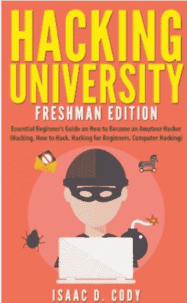
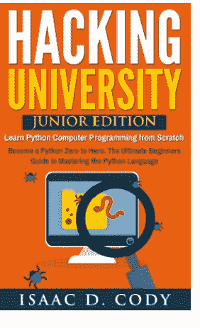
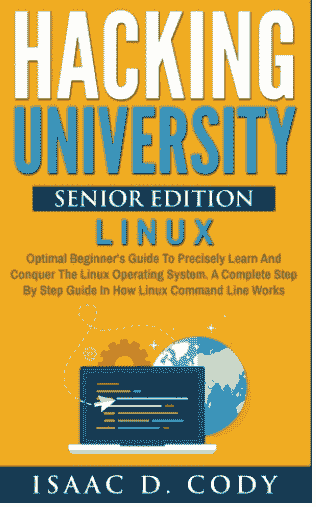
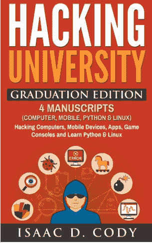

# 大学黑客指南：从零开始学习 Python 计算机编程，精准掌握 Linux 命令行操作（双书合订本）


本书包含“黑客自由与数据驱动”系列中的 2 份手稿。它本质上是将两本书合二为一。

《黑客大学 初级版》欢迎您进入 Python 编程艺术的殿堂。

《黑客大学 高级版》涵盖了关于 Linux 您需要知道的一切。

这两本书均面向初学者，甚至也适合那些在 Python 和 Linux 方面具有一定中等经验的用户。

---


## 引言

> 感谢您下载书籍《*黑客大学：初级版。从零开始学习 Python 计算机编程。从 Python 小白到大神。掌握 Python 语言的终极初学者指南。*》

Python 是一种强大且强烈推荐给初学者编程语言，原因多种多样。本书作为初学者指南，旨在帮助那些从未编写过编程代码的人，因此，即使编程的想法令人心生畏惧，本书也能用通俗易懂的语言进行解释。我们将从一开始通过实际的代码示例引入这个过程；请跟随步骤学习这项宝贵的计算机技能，这可能会为你赢得一份使用优雅的 Python 语言工作的机会。

---

## 相关软件

为了增强您的 Python 技能，请使用一个 IDE（集成开发环境）。如果您尚未下载，强烈推荐用于 Python 编程的 Atom。Atom 是可定制的，您可以随时安装插件使编程更容易。“autocomplete-python”就是这样一个插件，它可以猜测您正在输入的内容并自动补全命令的其余部分。

VI 和 Emacs 是另外两个程序员常用的文本编辑器。两者都被认为高度先进并针对编写代码进行了优化，但两者的粉丝之间也存在着一些激烈的争论。对于 Linux Python 程序员，请调查这两个文本编辑器并测试它们是否有助于 Python 工作流。

当您完成了一个特别有用的 Python 程序并希望将其分发给用户时，必须记住其中许多用户没有安装 Python，并且可能不愿意仅仅为了运行您的程序而安装它。PyInstaller (http://www.pyinstaller.org/) 是一款将您的 Python 脚本和所需模块构建为无需 Python 即可运行的 .exe 文件的软件。它是一款分发应用程序的实用软件。

---

## 在线资源

为了获取与 Python 相关的在线帮助，您可以随时查看在线文档 ([https://www.python.org/doc/](https://www.python.org/doc/))。文档包含 Python 及其包含模块中内置的每个函数的示例和手册页。

当编程代码无法工作时，您始终可以求助于搜索引擎来解决您的问题。在 Google 中输入错误信息可能会找到也遇到同样问题并在线发帖的其他程序员。如果通过查看其他代码无法解决问题，像 Stack Overflow ([http://stackoverflow.com/](http://stackoverflow.com/)) 这样的网站在解决代码问题上名声卓著。在那里注册一个账户并礼貌地发布您的问题，很可能会有人帮助你。

最后，有一些网站提供在线教程，介绍如何学习中级和高级 Python 编程。[http://www.learnpython.org/](http://www.learnpython.org/) 就是一个特别杰出的例子，但由于 Python 被广泛使用和理解，资源的数量极其庞大。每当需要 Python 帮助时，快速互联网搜索可能会解决你的疑问。


## 就业市场

作为一种流行语言，且由于其广泛的使用，Python 岗位非常丰富。无论是大型公司还是初创企业，都在寻找懂得 Python 的程序员，而且由于 Python 的使用率仍在持续增长，就业前景将会继续向好。

大多数公司对编程岗位并不要求大学学历，因为他们明白大多数程序员是自学成才的。正因为如此，在 Python 就业市场中找到工作并不困难，但这仍然需要程序员自身的准备和投入。年轻的 Python 程序员仅仅通过展示学习的热情，就能在谷歌、苹果、英特尔等公司获得实习机会。成年 Python 程序员可以通过直接联系公司或回复招聘启事来申请编程工作。请在消息板、招聘网站和自由职业网站（如 UpWork）上搜索机会。此外，在编程社群中询问并参加招聘会，以了解哪些公司正在招聘 Python 程序员。

请制作一份得体的简历，并准备好用这门语言证明你的知识。编程工作的面试流程通常包含“白板”编程测试，其中你会面临一个情境，并被要求使用 Python 来解决该问题。这些测试不会太难，但你肯定需要对 Python 有相当的了解才能通过。

总体而言，由于当前的市场环境，找到 Python 工作很容易；但也很难，因为你需要熟悉 Python。请致力于申请尽可能多的职位，最终总会有一份工作找上门来。

## Python 的历史

Python 是一种起源于 1980 年代末的编程语言。其创建者  Guido van Rossum 希望开发一门语言作为业余项目，以取代 ABC 编程语言。借鉴了流行的 C 语言的特点，Python 被创建为一种强大但易于理解的脚本语言。

“脚本语言”这一术语指的是编写的代码实际上并没有被编译，而是由应用程序进行解释。通常这意味着脚本语言远不如实际的编程语言强大。但对于 Python 来说，情况恰恰相反——该语言仍然是可用于 Web 服务器和桌面客户端的最强大语言之一。Python 的开发贯穿整个 1990 年代，直到 2000 年发布 2.0 版本。Python 背后的解释器变得足够复杂，使得当前版本的 Python 几乎与低级编程语言无法区分。

从 2000 年代中期甚至到现在，Python 继续由 Guido van Rossum 和一群敬业的志愿者开发。由于诸多优势，该语言获得了极大的普及，YouTube、Reddit 和 Instagram 等知名网站甚至使用 Python 来实现功能。似乎随着公司采用这种易用但极具实用性的 Python 语言，Python 将在未来许多年内继续增长。

## 为什么使用 Python？

刚开始学习编程时，大量的选项、信息和建议确实令人望而生畏。一些专家声称，虽然困难但久负盛名的 C 语言是最佳的起点，但其他专业人士表示，从 Java 或 Python 等较简单的语言入手，会让学习者有机会真正吸收关键概念。正是基于这个原因，建议初学者使用 Python——从一种直白的脚本语言开始，编程不会显得那么陌生和令人困惑。

Python 易于理解，是一种优雅且整洁的语言，并且免除了其他地方使用的许多复杂符号和标记。通常使用 Python 完成一项任务只需几行格式整洁的代码。

谷歌、迪士尼、NASA 和雅虎等大型公司都使用 Python 来运行他们自己的程序；拥有 Python 知识可能会让程序员有机会在知名组织工作。此外，由于 Python 如今仍在不断开发并持续添加新功能，人们对这门语言的兴趣将随时间不断增加。更多公司将会发现 Python 是一门极其有用的编程语言，因此现在学习它将为你的未来做好准备。

## Python 的优势

除了简单快速之外，Python 还有其他各种优势。Python 的可移植性非常好，意味着 Python 代码可以在多种不同的操作系统上运行。Windows、Mac OSX 和 Linux 发行版都得到直接支持，在一个平台上编写的代码可以应用于所有这些平台。

易用性并没有牺牲 Python 的强大功能。脚本语言背后的解释器能够将接近自然英语的命令转换为低级处理器指令，使其与真正的编程语言相媲美。知名企业因此选择使用 Python，正如 YouTube 和 Pinterest 等网站所证明的那样，Python 具有广泛的功能性。

Python 整洁并注重代码的可读性。风格和格式通常由个别程序员决定，但在 Python 中，整洁是绝对必要的。对于初学者程序员，这培养了良好的编程习惯，这将双重地帮助 Python 以及初学者希望学习的任何其他语言。

开发和测试的便捷性也使 Python 超越其他类似语言。代码可以通过解释器立即运行，从而实现快速原型设计。能够快速测试代码意味着可以迅速修复错误，从而为其他开发目标留出更多时间。

总之，Python 是初学者最完美的语言。既易于开发和习得，Python 也相当强大。非常适合新入门者及刚开始编程的人，Python 依然是全球科技公司的首选。随着其人气持续增长，学习这门语言现在和将来都会很有用。

## 设置开发环境

编程语言通常用于基于 Linux 的操作系统，如 Ubuntu 和 Debian。Python 也不例外，但还有一个在 Windows 上开发的选项。本书将解释如何设置这两种环境。但要知道，我们将使用 Python 3 进行开发，而不是较旧的（但仍极受欢迎的）Python 2.7。

大多数 Linux 发行版实际上默认已安装 Python。因此，获得一个可用的环境没有额外的设置步骤。通过在终端控制台中输入 “python” 即可进入 Python 解释器。不过，如果安装了多个版本，“python” 将启动找到的第一个版本。请在解释器中检查版本号，如果启动的是 2.7，可能需要改为在终端中输入 “python3”。随时按 ctrl+c 退出解释器。

Windows 计算机通常没有预装 Python。要获取软件，请访问 Python 网站并下载最新版本。截至目前，Python 3.5.2 是当前版本。只要你的版本号是 Python 3，本书中编写的代码应该也是兼容的。使用大部分默认设置安装该软件。务必勾选 “Add Python to the Path”（将 Python 添加到路径），因为它简化了程序的测试。安装程序完成后，可以在开始菜单中搜索 “python” 来启动 Python 解释器。

解释器（或解析器）是 Python 宣传的特性之一，允许逐行编写并运行代码。对于测试代码，解析器非常出色，但我们在本书中编写的大多数程序都是多行的，因此我们需要一个 IDE（集成开发环境）。Windows 有几个流行的解决方案，如 Atom、Pycharm 和 Eclipse。这些全都是可下载和安装的第三方应用程序。IDE 本质上是带有语法高亮和命令补全等有用编程功能的高级文本编辑器。虽然对于 Windows 开发者来说强烈推荐 Atom，但 Python 已经自带了一个 IDE 解决方案。IDLE 是一个可以通过点击 “file”（文件）然后选择 “new file”（新建文件）来实现多行的解释器程序。无论你选择使用预装的编辑器，还是通过 Atom/Eclipse 选择一个成熟的编程环境，Python 代码的运行结果都是一样的。你将在其中一个多行程序中编写代码。

在 Linux 上，你也有下载兼容 Python 的 IDE 应用程序的选项，但大多数程序员倾向于使用预装的应用程序 “nano”。Nano 是一个内置的、精简的文本编辑器，通过在控制台输入 “nano” 即可访问。一旦知道正在编写 Python 脚本，该程序实际上可以执行一些基本的语法高亮，因此许多开发者偏好提供的这种基本设置。代码在 nano 中编写，然后按 ctrl+x 保存。

现在开发环境已经设置好，你可以继续前进，开始编写你的第一个 Python 程序。


# 你好，世界

大多数程序员都是通过编写“你好，世界”程序来接触一门新语言的。“你好，世界”传统上是一个简单的练习，涉及在屏幕上显示标题文本。要在 Python 中实现这一点，我们必须打开 IDE 或文本编辑器，并简单地输入该函数。

```python
print("Hello, World!")
```

接下来，我们保存文件。在 IDLE（以及大多数 IDE，如 Atom）中，必须通过“文件”菜单并点击“另存为”。在 Nano 中，必须按下 Ctrl+X。将文件命名为带有“.py”扩展名的名称，并将其保存在易于访问的目录中——您的桌面就完全没问题。在这个演示中，我们将文件命名为 "test.py"。

运行 Python 文件在不同平台之间略有不同。Windows 必须使用命令提示符，而 Linux 必须使用终端。打开相应的应用程序（Windows 按 Ctrl+R 然后输入 cmd，Linux 按 Ctrl+T）。这些应用程序是基于文本的界面，可用于导航和与计算机交互。打印的行会告诉您当前所在的目录，您可以输入“dir”（在 Windows 中）或“ls”（在 Linux 中）来显示该目录中的文件列表。通过输入“cd”后跟目录名，您可以移动到另一个文件夹。由于我们将文件保存到了桌面，在两种操作系统中，我们都可以通过输入“cd Desktop”使其处于活动状态。最后，可以通过输入“python test.py”或“python3 test.py”（在 Linux 中）来运行你好，世界脚本。

如果上述编程代码被精确复制，您将看到输出“Hello, World!”。程序将运行，然后退回到终端/提示符。这并不完全华丽，但它是学习 Python 值得的第一步。

# 编程概念

在上面的程序中，"print" 被称为命令或函数。每个函数都有必须遵循的特定语法。例如，print 后面有一组括号。在括号内传递的值称为参数。引号也包围着我们的文本，这是指定书面文本（或字符串）的语法。必须完全遵循 print 的语法，否则当程序尝试运行时将返回语法错误。随着书中引入新的函数，必须仔细注意遵循语法规则。

print 函数引号内可以放入任何内容，它将被写入控制台。由于 Python 从脚本的开始处逐行读取，因此可以像下面这样将一个接一个地放置多个 print 函数：

```python
print("Hello, World!")

print("This is my 2nd Python Program")

print("Notice how each print command puts the text on a new line!")
```

保存并运行文件后，所有三个函数都将打印它们各自的参数。如前所述，引号说明将显示文本。通过省略引号，可以改为显示数字。

```python
print("The answer to everything is:")

print(42)
```

Python 从脚本文件的开头开始，逐行向下处理，直到没有更多行为止，此时程序退出回到提示符或终端。

## 变量

计算机能够通过将值存储为变量来“记住”数据。变量是分配出来用于容纳值的 RAM 位置。编程语言必须通过编写代码来明确声明变量并为其赋值。能够操纵数据将在创建应用程序时证明是一项宝贵资产。

创建变量被称为“声明”。赋予值被称为“赋值”。Python 通过将这两个概念合并为单个语句来简化了这一过程。在程序中，以下行将创建一个变量：

```python
lucky_number = 7
```

然后我们可以使用 print 函数来查看我们创建的变量。

```python
print(lucky_number)
```

因为 Python 从程序的顶部开始向下执行，所以上述行需要保持正确的顺序。如果 lucky_number 未首先创建，那么 print() 将返回一个错误，因为它试图调用一个尚不存在的变量。

通过仔细查看之前的 print() 参数，可以看到一个重要的区别。变量 lucky_number 没有被放在引号内，因此 Python 知道打印其中包含的值（7）。如果我们在文本周围加上引号，Python 将打印“lucky_number”，这不是我们想要的结果。这种情况被称为逻辑错误。

## 变量类型

变量可以包含多种类型的值。我们的第一个变量被赋予了数值，但 Python 也有处理不同类型值的方法。

```python
secret_message = "rosebud"

print(secret_message)
```

如上所示，我们也可以将文本字符串赋值给变量。过程几乎相同，但请注意值周围的引号明确指示这是一个字符串。以下是 Python 3 中最重要的数据类型：

- **整数** – 作为整数的简单数值。
  - 1, 0, -7
- **浮点数** – 小数值。“浮点数”。
  - 3.0, -7.6, 1.0100001
- **字符串** – 字母、单词或整个短语。包含在引号内。
  - "Hello, world", “no”, “12”
- **列表/元组/字典** – 作为单个对象分组的多个相关值。可以是各种数据类型。
  - [1, 4, 4, 0], [“Dog”, 2, “yes”]

显然，数值是通过在变量声明中仅提供一个整数来声明的。如果涉及小数，它将是浮点数。引号表示字符串，方括号用于列表。

变量也可以用于方程式中，或在程序中途被修改和更改。将以下行写入脚本。

```python
first_num = 2

result = 3 + first_num

print(result)

first_num = 3

result = 3 + first_num

print(result)
```

你可以观察到值 2 被赋值给 first_num。然后，我们创建一个新变量“result”，它等于一个简短的数学表达式。3 和 2 相加并赋值给 result，并打印为 5。然后，first_num 被更新以包含新值。再次计算 Result，并打印新的结果。该程序展示了在赋值中使用变量是多么容易，以及变量如何在程序的任何时候被编辑。

通过指定方程式中的运算符，可以对数值变量执行更多的算术运算。以下列表解释了 5 个主要运算符以及用于执行该序列的符号。

- **加法 (+)** – 组合数字
- **减法 (-)** – 取数字的差
- **乘法 (*)** – 重复加法
- **除法 (/)** – 分组，或乘法的逆运算
- **取模 (%)** – 除法并使用余数作为答案

整数和浮点数都可以轻松使用上述运算符进行计算。但请注意，整数通常返回整数答案（整数），而浮点数将始终返回带小数点的答案。Python 通常可以在需要时将整数转换为浮点数，但良好的编程形式来自于在适当的时候选择正确的数据类型。例如，查看浮点数在以下程序中如何使用：

```python
first_number = 5.0

second_number = 3.0

result = first_number / second_number

print(result)
```

控制台将返回 1.666666 作为答案。而如果使用整数，小数点后的所有内容都会被忽略，答案为 1。在我们的小程序中，将答案赋值给 result 变量并非完全必要，我们可以像下面这样重写它：

```python
first_number = 5.0

second_number = 3.0

print(first_number / second_number)
```

字符串变量在数学上不进行修改（例如 1 + "two" 不会返回 3）。相反，备注通过简单地覆盖单词来更改。

```python
name = "Bob"

name = "Bill"

print(name)
```

Name 最初将创建为字符串 "Bob"，但紧接着直接为其赋值 "Bill"。因此，当调用 print() 时，字符串只包含 "Bill"。但是，可以使用运算符来组合单独的字符串。

```python
my_string = "Hello,"

my_string2 = "World! "
```


# 输入

虽然迄今为止所学的内容很有趣，但预定的应用程序对最终用户来说并不是很有用。不过，Python 允许我们从用户那里获取输入，从而在我们的脚本中增加一层交互性。`input()` 函数会将输入赋值给一个变量。

```python
favorite_number = input("What is your favorite number? ")
```

当程序执行到这一行时，它会显示指定的文本并等待用户输入。无论输入什么，都会被赋值给 `favorite_number`，并且可以像其他任何变量一样被调用。

```python
print("Your favorite number is", favorite_number)
```

我们没有使用加法运算符，而是使用逗号。在 `print()` 中，逗号用于将多个打印语句合并为一个（在同一行）。我们可以使用这两种方法中的任意一种，但运算符不能用于不同的数据类型。在本例中，两种数据类型都是字符串，所以这一切仍然有效。

不过，用户通过 `input()` 给出的答案将始终是一个字符串。如果我们寻找的是数值答案，就必须将其转换。另一个函数 `int()` 可以用于从字符串中提取数值数据。

```python
favorite_number = int(input("What is your favorite number? "))

print("Your favorite number plus 2 is", favorite_number + 2)
```

这个程序中有许多新的细节。例如，`int()` 用于将输入转换为整数。请注意 `int()` 如何包裹整个 `input()` 函数，这是因为 `input()` 必须作为 `int()` 的完整参数传递。接下来，`print` 语句打印多个输出部分，并且方程 `favorite_number + 2` 在打印之前先进行求值。

使用 `int()` 总是返回整数答案，但也可以改用 `float()` 来提取小数答案。`int()` 函数的基本工作原理是将字符串 "3" 转换为数字 3。务必记住在获取数值输入时包含它。

# 字符串格式化

能够使用 `print()` 显示字符串是有用的，但有时我们的程序需要我们在字符串中显示变量。为了在不先编辑字符串或合并多个变量的情况下将变量插入字符串，我们可以使用“字符串格式化器”。`format()` 函数可以包含在 `print()` 语句中，以进行变量的位置格式化。

```python
dog_name = "Rex"

print("My dog's name is {} and he is a good boy.".format(dog_name))
```

当你运行上面的代码时，它自动将括号 `{}` 替换为提供的变量。`format()` 直接位于它要编辑的字符串之后，关闭括号之前。因此，当代码运行时，控制台输出 "My dog's name is Rex..."。如果不使用 `format()`，我们就必须使用多行复杂的打印设置。但 `format()` 的最大用途来自涉及多个变量的场景。

```python
dog_name = "Rex"
dog_age = 12

print("My dog's name is {0} and he is {1}. Sit, {0}".format(dog_name, dog_age))
```

在这里，我们选择在大括号内指定值。0 代表第一个提供的参数，而 1 代表第二个变量。因此，在字符串的任何位置，我们都可以使用 `{0}` 来插入 `dog_name`，使用 `{1}` 来插入 `dog_age`。控制台文本将是 "My dog's name is Rex and he is 12. Sit, Rex!"

## 示例程序 1 – project1.py

```python
user_name = input("What is your name? ")

user_age = int(input("What is your age? "))

user_pets = int(input("How many pets do you have? "))

user_GPA = float(input("what is your GPA? "))

print () #print a blank line

print ("{0} is {1} years old. They have a {3} GPA, probably because they have {2} pets. ".format(user_name, user_age, user_pets, user_GPA))
```

该程序结合了我们迄今为止所学的内容，从用户那里获取输入并将其显示回给用户。同时引入了一个新概念：注释。`#` 符号用于表示注释，即供人类阅读的文本块。每当 `#` 出现在一行中时，它后面的所有内容都会被 Python 忽略。注释主要用于向可能阅读你代码的其他程序员解释事物。在我们的情况下，我们解释说空 `print()` 行仅仅产生一个空行。在代码中使用注释来解释可能令人困惑的元素或帮助自己记住某些代码块的功能，是一种良好的编程形式。

接下来，`format()` 函数被用于在 `print()` 函数内替换 4 个不同的实例。你可能已经注意到，在 Python 中计数从 0 开始。0 始终指代某个事物的第一个元素，这就是为什么 3 指示我们 `format()` 中的第四个提供的变量。

取决于你阅读此出版物所使用的媒介，上述某些行可能已换行到多行。但在文本编辑器中键入时不应这样操作，因为 `print()` 行是一个单一命令。此外，从此文档复制粘贴可能会引入 Python 无法理解的额外字符。因此，输入项目 1 代码的正确方法是自己键出它。

家庭作业程序：

- 编写一个程序，获取用户宠物的信息并返回它。

## 决策结构

现在 Python 3 的基础已经解释完毕，我们可以通过在代码中实现决策结构来开始提供真正交互式的程序。决策结构是代码片段（称为条件语句），它们对表达式求值，并基于结果将程序引导到不同的路径。观察以下示例：

```python
user_input = int(input("What is 4 / 2? "))

if (user_input == 2):
    print ("Correct!")
else:
    print ("Incorrect...")
```

首先我们从用户那里获取输入。我们将 `user_input` 与 2（正确答案）进行测试。如果条件语句结果为真，则程序将打印 "Correct!"。然而，如果用户提供错误答案，Python 将返回 "Incorrect..."。这里有很多新概念，所以我们将逐行分解。

第一行对我们来说很熟悉；它获取输入，将其转换为整数并赋值给变量 `user_input`。第二行引入了一个新函数——“if 语句”。If 语句是评估括号内表达式的条件语句。我们的具体语句检查 `user_input` 是否为 2，如果是，则立即执行下一行代码。比较使用 `==` 运算符而不是 `=` 运算符。双等号检查相等性，而单等号仅用于赋值变量。最后，if 语句后跟一个冒号。

缩进在 Python 中广泛用于分隔代码块。在 if 语句下方是一个带有制表符的 `print()` 函数行。因为该行使用了制表符缩进，所以它不会在代码中正常运行。相反，只有当条件 if 语句被证明为真时，该行才会执行。因为我们的用户输入了 3，条件将评估为 "False"，"Correct!" 行不会执行。相反，程序继续进行到 "else 语句"。Else 是一个关键字，意思是“当 if 语句失败时运行”。条件语句后跟随另一行缩进代码，但这次缩进的代码实际运行了，因为 else 被激活了。

如果用户输入了正确的答案 2 而不是其他数字，if 语句将评估为真，控制台将打印 "Correct"。在这种情况下，else 语句根本不会运行。再次关注缩进代码，理解这些行之所以缩进是因为它们是 "if" 和 "else" 代码块的一部分。还要意识到，决策结构中永远只有一个语句可以在程序中运行，所以如果 "else" 运行了，那就意味着 "if" 没有运行。同样，如果 "if" 被激活的程序也不会运行 "else" 下的代码块。如下所示，条件语句不限于单行代码。

```python
user_input = input("What language is this written in? ")

if (user_input == "Python"):
    print ("Correct!")
else:
    print ("Incorrect...")

print ("This is not written in {}, it uses Python!".format(user_input))
```


另一行缩进的代码位于 else 代码块内，如果用户没有正确输入“Python”，这两行代码都会执行。这个程序确实比较了字符串，因此文本必须被引号包围。

## 条件运算符

双等号（==）只是可用于创建条件表达式的众多运算符中的一个。下面的小列表展示了 Python 中的其他运算符。

- `>` - 大于
- `<` - 小于
- `==` - 等于
- `>=` - 大于或等于
- `<=` - 小于或等于
- `!=` - 不等于

If 语句评估括号内的表达式是否为真；上述运算符允许构建一些有趣的表达式。

```python
age = int(input("How old are you? "))

if (age <= 18):
    print ("Starting early! Good for you!")
else:
    print ("Ah, a good age to learn.")

print ("Thank you for downloading this book.")
```

这里巧妙地使用了缩进。如果用户的年龄是 18 岁或以下，程序将祝贺他们，然后跳过 else 语句，最后打印感谢信息。如果用户年龄超过 18 岁，它将显示 else 消息，然后也会感谢他们。无论哪个条件分支被执行，用户都会收到感谢信息。缩进决定了在决策结构中哪些代码行实际会运行，你必须密切关注这一点以避免逻辑错误。

对于需要两种以上潜在结果的情况，可以使用关键字 "elif"。

```python
age = int(input("How old are you? "))
if (age <= 18 and age > 0):
    print ("Starting early! Good for you!")
elif (age >= 80):
    print ("Never too late to learn!")
elif (age > 18 and age < 80):
    print ("Ah, a good age to learn.")
else:
    print ("That seems like an invalid age.")
    quit()

print ("Thank you for downloading this book.")
```

Elif 是一个关键字，可用于将决策过程分割成多个分支路径。在 if 和 else 语句之间，可以使用任意数量的 elif 条件。此外，上述代码中还使用了一个新关键字 - "and"。我们的第一个比较检查 age 是否小于或等于 18 并且大于 0。因此，只有当 age 值同时满足这两个要求时，该条件才会评估为真。假设用户输入 75。第一个语句被评估，75 确实大于 0，但它并不小于 18，因此该语句被跳过。然后，第一个 elif 被评估。Age 不大于 80，因此该语句也被跳过。第三，age 肯定在 18 和 80 之间，所以控制台打印 "Ah, a good age to learn"，然后完全跳过 else 语句。

记住在决策“树”中只有一个语句可以运行，我们可以看到任何激活的 elif 基本上会运行其代码块，然后跳出决策结构。在我们的上述程序中，else 被用作一种“捕获所有”类型的表达式。任何无效输入，例如 “-1”，都会被 else 捕获并显示出来。良好的编程形式来自于捕获此类潜在的用户错误，作为有志成为程序员的人，你应该始终预期用户在有机会时会错误地输入值。

“And” 是一个比较运算符，它强制表达式的两部分都为真。另一个运算符，“or”，用于强制表达式的只有一部分评估为真。

```python
elif (age == 25 or age == 50 or age == 75):
    print ("Happy quarterly birthday!")
```

如果我们把这个 elif 放在上面的程序中（在第一个 if 下方），我们会看到只有表达式的一部分为真，整个比较才为真。用户的年龄可以是 25、50 或 75，应用程序都会说 “Happy quarterly birthday”。使用 “and” 代替 “or” 是不可能的，因为年龄不可能同时是 25、50 和 75。我们用于比较的关键字很有帮助且非常有用，但如果使用不当，可能会导致逻辑错误。

## 示例程序 2 – project2.py

```python
print("Python Quiz!")

answered = 0

correct = 0

print()

print("What version of python are we using?")
print("A: 1, B: 2, C: 3")
user_answer = input("Enter A, B, or C: ")

answered += 1

print()

if (user_answer == "C" or user_answer == "c"):
    correct += 1
    print ("Correct")
else:
    print ("Incorrect")

print()

print("How many 'else' statements can be in a decision tree?")
print("A: 1, B: Infinite, C: None")
user_answer = input("Enter A, B, or C: ")

answered += 1

print()

if (user_answer == "A" or user_answer == "a"):
    correct += 1
    print ("Correct")
else:
    print ("Incorrect")

print()

print("What does '=' do in Python?")
print("A: Compare, B: Assign, C: Both")
user_answer = input("Enter A, B, or C: ")

answered += 1

print()

if (user_answer == "B" or user_answer == "b"):
    correct += 1
    print ("Correct")
else:
    print ("Incorrect")

print()
print ("You got {} out of {} correct.".format(correct, answered))

if (correct == 3):
    print ("Congratulations! Good score.")
elif (correct == 2):
    print ("Good work, but study hard!")
else:
    print ("Go back and read over the section again, I'm sure you'll get it.")
```

作业程序：

- 使用 if 语句创建一个计算器程序，提示用户输入两个数字和一个运算符。

## 循环

正如条件语句在表达式评估为真时激活一样，循环条件也比较表达式中的值。但是，虽然 if、elif 和 else 语句本质上是线性的，其他条件句具有重复运行代码块的能力。“循环”是可以沿程序执行多次的条件语句，它们允许在 Python 程序中具有扩展的功能。“while” 循环就是这样一种条件句。

```python
answer = 0
while (answer != 2):
    answer = int(input("What is 4 / 2? "))
print ("Correct!")
```
只要指定条件评估为真，“while” 代码块就会持续运行。我们可以通过上面的程序看到一个完美的例子。我们创建了一个新变量 “answer” 并反复将其与 2 进行比较。只要 answer 不等于 2，程序就会询问用户正确答案。输入 2 以外的任何值都会循环回到 while 语句，再次提示正确答案。如果 while 最终评估为真（因为 answer 等于 2），循环将打破，程序将恢复并打印 “Correct”。

通过“嵌套”条件可以进一步增强程序。单个缩进表示为 while 语句保留的代码块，但我们可以进行第二级缩进以添加额外的比较。

```python
answer = 0
while (answer != 2):
    answer = int(input("What is 4 / 2? "))
    if (answer != 2):
        print ("Incorrect...")
print ("Correct!")
```
该程序使用“嵌套”函数将 if 语句纳入 while 语句中。由此获得的纯粹可能性数量几乎是无限的。注意存在决定哪些代码块可以在哪些函数内运行的缩进级别。每个意图块，无论是 1 级还是 2 级缩进，都将在 while 循环激活时运行。这是一个难以掌握的概念，但肯定能增加功能。

另一种常见的循环是 “for” 循环。For 与 while 不同，因为 for 循环遍历一系列数字或一组值，而不是检查条件。

```python
for user_variable in range (1, 5):
    print (user_variable)
```

For 采用指定的变量 "user_variable" 并使用提供的范围。该变量将初始化为 1，并且每次函数循环时都会迭代。通过观察输出，我们可以看到它是如何工作的。

1
2
3
4

User_variable 被打印出来，然后递增为 2。它再次被打印并作为 3 递增。再一次用于 4。但它到达 5 并停止，这就是为什么 5 没有被打印出来。
因为使用了关键字 "range"，for 循环总是从第一个数字开始并在第二个数字停止。省略它将使 for 循环遍历给定的值。

```python
for user_variable in (1, 5):
    print(user_variable)
```

例如，这里只省略了 "range"，但输出非常不同。


## 示例程序 3 – project3.py

Python 使用第一个值 1 运行循环，然后使用第二个值 5 运行。我们将学到，以这种方式使用 for 循环对于列表、字典和元组特别有用。

最后，循环可以使用 `break()` 函数中断。糟糕的编程形式可能导致无限循环，但将 `break()` 作为安全措施可能会保护用户的计算机免于崩溃。

```python
print("Adding simulator")
print("Type a number to add to total, or type blank line to stop")

line = "a"
total = 0

while (line != ""):
    line = input("")
    if (line == ""):
        break
    total += int(line)

print ("Total = {}".format(total))
```

课后作业：
- 编写一个使用 if 语句的程序，展示一个文字冒险游戏。向玩家提供多个选项，玩家可以输入这些选项进行选择。使用 while 循环来检查用户输入的有效性。

## 关于变量的更多信息

列表是另一种值得讨论的数据类型。列表是一组聚集在单个变量中的值数组。然后，可以使用该单个变量来调用其包含的任何“子变量”。它们主要用于组织和分组目的，同时也用于将相关变量保持在相似的位置。列表变量通过初始化来创建。

```python
state = "Texas"
jack_info = [8, "West Elementary", state, "A"]
print ("Jack goes to {} in {}.".format(jack_info[1], jack_info[2]))
print ("He has a {} in math, even though he's only {}.".format(jack_info[3], jack_info[0]))
```

列表 "jack_info" 包含四个值，因为在方括号内指定了四个不同的条目。它们只是普通的值，例如整数 8 或变量 state，但它们被放在列表中，以便为一个共同的目的进行分组。如所见，列表中的条目可以通过在方括号中指定条目的位置来访问。计数从 0 开始，因此 jack_info 的第一个条目是 8，而 [3] 处的条目是 "A"。请想象如下：

| 条目编号: | 0 | 1 | 2 | 3 |
| :--- | :--- | :--- | :--- | :--- |
| 数据值: | 8 | "West Elementary" | state | "A" |

列表最初可以声明为 3 个条目，其范围将是 0-2。条目数量几乎无限，仅受计算机内存和程序员填充变量的数量限制。

列表的元素可以像单个变量一样被编辑。如果 Jack 长大一岁，我们只需更新该条目。此外，向列表添加新条目无需完全重新定义其中的每个值。使用 `append()`，将在最后一个位置创建新条目。

```python
state = "Texas"
jack_info = [8, "West Elementary", state, "A"]
jack_info[0] = 9
jack_info.append(22)

print ("Jack goes to {} in {} ".format(jack_info[1], jack_info[2]))
print ("He has a {} in math, even though he's only {} ".format(jack_info[3], jack_info[0]))
print ("Lucky number is {} ".format(jack_info[4]))
```

程序中的新添加项使列表略有变化，现在拥有了一组新的值。

| 条目编号: | 0 | 1 | 2 | 3 | 4 |
| :--- | :--- | :--- | :--- | :--- | :--- |
| 数据值: | 9 | "West Elementary" | state | "A" | 22 |

在继续之前，值得注意字符串数据类型的一些其他特性。字符串实际上是包含字符值的列表。例如，取字符串 “Hello, World!”。将其作为列表分解，它看起来像这样：

| 条目 | 0 | 1 | 2 | 3 | 4 | 5 | 6 | 7 | ... |
| :--- | :--- | :--- | :--- | :--- | :--- | :--- | :--- | :--- | :--- |
| 字符 | H | e | l | l | o | , | (空格) | W | ... |

同样地，可以从字符串列表中显示单独的条目。

```python
print (user_string[0]) # would print “H”
print (user_string[7:13]) #would print “World!”
```

继续前进，元组是 Python 中的另一种数据类型。它们通过使用圆括号而不是方括号来声明。元组实际上是静态列表，即不可编辑的列表。当程序员需要确保数据范围不能改变时，会使用它们。

```python
jim_grades = (99, 87, 100, 99, 77)
print (jim_grades[2])
```

请注意，元组中的条目仍然使用方括号进行访问。

字典将组织变量的概念推向极致。与列表和元组一样，字典可以在单个变量中包含多个值。然而，区别在于字典通过名称而不是数字来组织其记录。这样，字典在某种程度上是“无序”列表，可以通过条目名称调用任何值。使用大括号声明字典，用逗号和冒号分隔值。

```python
pet_dict = {"Total": 2, "Dog": "Scruffy", "Cat": "Meowzer"}
print ("I have {} pets, {} and {}".format(pet_dict["Total"], pet_dict["Dog"], pet_dict["Cat"]))
```

这里，字典 pet_dict 包含三个值："Total"、"Dog" 和 "Cat"。通过给条目命名（在引号内）然后提供值来声明条目。这些条目通过指定条目名称来调用，例如使用 pet_dict["Dog"] 来访问存储的值。使用字典时可以提供前所未有的组织性，因为它们形式上类似于数据库。同样，在程序中的任何时刻，它们都可以被更改、更新、删除或添加。

```python
albums = {"Milkduces": 2, "Harold Gene": 1, "The 7750's": 3}
albums["Milkduces"] += 1 #new album!
albums["The 7750's"] = 2 #actually only had 2
albums.update({"Diamond Dozens": 1}) #found new band
del albums["Harold Gene"] #sold one away, didn't like it
print ("These are the number of albums I own.")
print(albums)
```

上面那个幽默的示例是一个简单的字典，用于存储一个人拥有的专辑数量。在开始时，字典为每个乐队设置了固定的专辑数量，但第二行显示收藏者获得了一张新的 Milkduces 专辑。该行还使用了一个新的代码快捷方式。每当使用 “+=” 时，代码实际上扩展为 “albums["Milkduces"] = albums["Milkduces"] + 1”，但通过使用这种简写形式，程序可以节省大量时间和空间。第三行显示收藏者意识到他们只有 2 张 7750’s 的专辑，因此命令完全更改了该条目的值。接下来引入了 update()。它展示了如何向字典中添加一个全新的条目。遗憾的是，Harold Gene 被从字典中删除，因为收藏者卖掉了那张专辑。最后，通过不指定任何条目即可打印整个字典。

一个有趣的例子，上述程序实际上展示了字典在收集和数据存储方面的多功能性。在程序中包含它们，以易于调用的方式将变量分组。

## 示例程序 4 – project4.py

```python
keep_going = "a" #initialize variables before they are used
number_grades = 0
grade_list = []
total = 0
print("Grade Average Calculator")
print()
while (keep_going != "No" and keep_going != "no"):
    grade = int(input("Enter a test grade: "))
    number_grades += 1
    grade_list.append(grade)
    keep_going = input("Add more grades? ")
    print()
for x in range (0, number_grades):
    total += grade_list[x] #add up all grades in list
print ("Average of {} tests is {}".format(number_grades, total / number_grades))
```

课后作业：
- 为更多的数学函数设计代码，例如中位数和众数。

## 函数

迄今为止使用的所有函数都是 Python 内置的，并由 Python 的开发者编程。函数实际上是代码快捷方式，因为函数是代码的浓缩版本，它们将数据作为参数，在后台运行较长的代码块，然后返回结果。使用函数的目的是在执行常见重复任务时节省时间和代码。Python 保留了程序员编写自己函数的能力，其方法如下：

```python
def happy(name):
    print ("Happy birthday to you. " * 2)
    print ("Happy birthday dear {}.".format(name))
```


```python
print ("Happy birthday to you.")
```

“def”关键字用于声明用户自定义函数，紧随其后的名称即为该函数的名称；我们创建了函数 `happy()`。括号内的是我们的函数将接收的值（仅一个，即名为“name”的变量）。正如 `print()` 必须有一个值一样，我们的 `happy()` 也需要一个值。然后，与函数关联的代码需要缩进。我们的代码简单地播放一首生日快乐歌，并在歌中将变量“name”填入其中。这个函数声明位于我们的 Python 程序的顶部，但在程序启动时它并不会实际运行。为了调用它，我们需要在代码中明确引用该函数。

```python
happy("Dana")
```

这里发生了一件有趣的事情。我们通过传递“Dana”作为值来调用 `happy()`。“Dana”被赋值给“name”，然后函数执行完毕。然而，变量“name”在用户自定义函数外部并不存在，任何试图调用它的尝试都会导致错误。这是因为变量具有作用域（scopes of operation），即它们可以被访问的区域。“name”具有专属于该函数的变量作用域，因此永远不会在函数外部被调用。同样，在主程序中声明的任何变量都不能被用户自定义函数直接访问，而必须在调用函数时作为参数传递。请跟随下一个练习，查看用户自定义函数（UDFs）深入分析的示例。

```python
def intdiv(num_one, num_two):
    whole_answer = int(num_one / num_two)
    remainder = num_one % num_two
    print ("{} / {} = {} with {} left over.".format(num_one, num_two, whole_answer, remainder))

first = int(input("Enter first number: "))
second = int(input("Enter second number: "))
intdiv(first, second)
```

首先，UDF 被声明。这段代码不会自动运行，因为它尚未被调用。程序实际上从第五行开始。变量 "first" 根据用户的输入在主程序的作用域内被声明。变量 "second" 也是如此。UDF "intdiv" 以 first 和 second 作为两个参数被调用。这些变量作为参数传递，以便传输到 UDF 中。尽管实际上 first 和 second 并没有离开它们的作用域，因为 UDF 使用变量 num_one 和 num_two 来进行计算。

可以使用 return 关键字将变量从 UDF 传回。

```python
def exp (base, pow):
    orig_num = base
    for x in range (1, pow):
        base = base * orig_num
    return base
```

上述是一个 UDF，它根据两个提供的值（底数和指数）计算指数乘法的结果。return 关键字将一个变量传回主程序，这就是我们绕过变量作用域限制的方法。

```python
answer = exp(2, 3)
```

因此，当我们像上面那样调用函数时，答案（base）作为结果被传回并赋值给变量“answer”。

总之，用户自定义函数可以为需要反复调用代码块的程序节省大量时间。UDF 可以仅包含其他函数，就像我们的 Happy Birthday UDF 一样；或者它们可以帮助简化复杂的代码，例如我们的指数乘法 UDF。你必须记住，变量是在它们无法离开的作用域内定义的。然而，值可以通过作为参数提供的方式从主程序传递到 UDF，并且值可以通过使用 return 关键字并将结果赋值给变量从 UDF 返回。

# 示例程序 5 – project5.py

```python
def cm_to_inch(cm):
    inch = cm * 0.39
    return inch

def inch_to_cm(inch):
    cm = inch * 2.54
    return cm

print("Inch/cm converter")
print("1: Convert cm to inch")
print("2: Convert inch to cm")

choice = int(input("Enter a menu option: "))

while (choice != 1 and choice != 2):
    print("Invalid, try again.")
    choice = int(input("Enter a menu option: "))

if (choice == 1):
    user_input = int(input("Enter cm: "))
    print("{} cm is {} inches.".format(user_input, cm_to_inch(user_input)))

if (choice == 2):
    user_input = int(input("Enter inches: "))
    print("{} inches is {} cm.".format(user_input, inch_to_cm(user_input)))

print("Thank you for using the program.")
```

作业程序：

- 将你已编写的程序转换为使用 UDF 的形式

## 类

类是 Python 的一个特性，使它更接近于某些更复杂的编程语言。由于可以放入类中的特性之多，它们本质上是“程序中的程序”。此外，使用类进行组织是良好的编程规范。Python 等面向对象的语言偶尔会通过此类概念展示其对象根源，其中对象以“object.attribute”（对象.属性）的形式包含属性。请参阅以下示例以理解。

```python
class student:
    def __init__(self, name, grade):
        self.name = name
        self.grade = grade
        self.gpa = 0.0
```

我们创建的类称为“student”，student 包含自己的变量。类为我们提供了一种组织对象并赋予它们个人属性的方式。因此，而不是将 student1_name, student1_grade, student2_grade 等作为不同的变量，它们可以通过属于一个类来整合。在程序中，类声明位于最顶部。就像 UDF 一样，它在被调用之前不会在主程序中实际运行。

```python
student1 = student("Tim", "Freshman") # object is student1, an attribute is "name".
```

我们新声明的“student”类用于创建具有属性“Tim”和“Freshman”的 student1 对象。这以前可能需要两行代码，但使用类后大大精简了。类将对象的相应变量的分隔开来，使得每个声明的“student”都拥有 3 个属性：“name”、“grade” 和 “gpa”。我们的类声明的第二行包含 __init__，这是一个“方法”（用户自定义函数），在创建 student 类中的对象时运行。Init 的参数是创建该对象时所需的参数。Self 实际上不是参数，它只是指代“student”，但“name”和“grade”是必需的，这就是为什么我们在创建“student1”时包含了它们。student1 的属性可以这样调用：

```python
print(student1.name)
```

这将简单打印“Tim”。我们在 student1 初始化期间没有声明 GPA 变量，因此我们可以通过赋值语句来声明它。

```python
student1.gpa = 4.0
```

或者更改一个已存在的属性。

```python
student1.grade = "Sophomore"
```

如果我们创建另一个对象，它将拥有完全不同于 student1 的一组自己的属性。

```python
student2 = student("Mary", "Senior")
```

虽然 student1.grade 和 student2.grade 共享相同的变量名，但它们的值不同。对于具有多个重复变量的大型项目，类可以减少代码杂乱程度以及需要跟踪的变量名数量。

回顾我们自定义的类，我们可以对其进行扩展，以在类内部实现用户自定义函数。

```python
class student:
    def __init__(self, name, grade):
        self.name = name
        self.grade = grade
        self.gpa = 0.0

    def record(self):
        return "Student {} is a {} with a {}".format(self.name, self.grade, self.gpa)

student3 = student("Lily", "Junior")
student3.gpa = 3.67
print (student3.record())
```

`__init__` 保持不变，但我们添加了一个名为“record”的 UDF 定义。它传递参数 self（因为它必须指代该类）并返回一个格式化字符串。在我们的实际主程序中创建 student3。最后，我们调用 UDF student3.record()（对象.函数）。它返回我们的格式化字符串，因此由 print() 打印出来。


## 特殊方法

`__init__` 方法实际上是一种 UDF（用户定义函数）。不过，由两个下划线包围的方法在 Python 中被称为**特殊方法**，这意味着它们会在特定的时刻自动运行。`__init__` 是一种特殊方法，通常也被专门称为“**构造方法**”。每当创建对象时，构造方法都会被调用，这也是为什么我们将变量声明放在其中的原因。当 `student3` 被创建时，`student3.name`、`student3.grade` 和 `student3.gpa` 也同时被创建。因此，放在 `__init__` 块中的任何代码都会在首次创建对象时被激活。

还存在其他特殊方法，它们在触发不同事件时被调用。

-   `__del__` - 每当对象被删除（del）时调用。也称为**析构方法**。
-   `__str__` - 当对象作为字符串传入时调用
-   `__setattr__` - 每次属性被设置值时运行
-   `__delattr__` - 与 setattr 相同，但仅在属性被删除时运行

添加这些特殊方法可以展示它们何时运行。

```python
class student:

    def __init__(self, name, grade):

        self.name = name
        self.grade = grade

        self.gpa = 0.0

    def __str__(self):
        return "{}".format(self.name)

    def record(self):
        return "Student {} is a {} with a {}".format(self.name, self.grade, self.gpa)

student4 = student("Barry", "Professor")

print(student4)
```

当 `student4` 被打印时（作为字符串引用），`__str__` 特殊方法接管并返回对象的“name”属性。如果不存在这个特殊方法，我们在引用该对象时将无法获得预期的输出。

最后，类是有用的，因为我们可以创建“**类变量**位于其中。“Name”和“GPA”是特定于每个声明对象的属性变量，但也可以存在由所有对象共享的类变量。例如，下面的程序将通过一个类变量来跟踪对象的总数。

```python
class food:
    total_foods = 0

    def __init__(self, name):

        self.name = name

        self.calories = 0

        self.foodgroup = ""

        food.total_foods += 1

    def __del__(self):

        food.total_foods -= 1

    def __str__(self):

        return "{}".format(self.name)

    def get_total():

        return food.total_foods

    def record(self):

        return "Food {0} is a {2} with {1} calories.".format(self.name, self.calories, self.foodgroup)

food1 = food("Carrot Stew")

food1.calories = 210

food1.foodgroup = "Vegetables"

food2 = food("Buttered Toast")

food2.calories = 100

food2.foodgroup = "Grains"

print(food.get_total())

del food2

print(food.get_total())
```

当程序创建一个 food 对象时，`total_foods` 会增加 1。然后，当一个 food 对象被删除时，1 会被减去。控制台打印 2，然后打印 1，以展示我们如何调用 UDF 来检查类变量。跟踪某事物的数量是类变量的常见用途，但它们在其它情况下也非常有用。

## 示例程序 6 – project6.py

```python
class house:

    def __init__(self, name, bedrooms, bathrooms, cost):

        self.name = name

        self.bedrooms = bedrooms

        self.bathrooms = bathrooms

        self.cost = cost

        print("House for sale!")

    def __del__(self):
        
        print("House off the market.")

print("House for sale:")

user_input = input("What is the address of the house? ")

user_input2 = int(input("How many bedrooms? "))

user_input3 = int(input("How many bathrooms? "))

user_input4 = int(input("How much does it cost? "))

house1 = house(user_input, user_input2, user_input3, user_input4)

print("Looking for buyers…")

for x in range(0, house1.cost):
    x += 1 #wait a while

print("Sold!")

del house1
```

作业程序：

-   使用类制作一个数据库组织程序。用户应该能够创建类的新条目并设置变量，并且可以随时查看它们。

## 继承

在您更健壮和广泛的程序中，可能会使用多个相关的类。作为一个例子，想象一下一个必须对网络上的设备进行分类的程序。每种设备类型（台式机、笔记本电脑、电话等……）都会有自己的类，但你最终会发现自己在重复常用属性。台式机和笔记本电脑都将具有名称、部门和本地 IP 地址，但它们也会有几个特定的变量，例如笔记本电脑的 Wi-Fi 和台式机的显卡。

通过一个称为“**继承**”的过程，类可以放入父子关系中，其中某些父类属性可以被子类“继承”。有效地跨类共享属性导致更优雅的组织以及总体上更少的代码。

```python
class device:
    
    total_devices = 0
    
    def __init__(self, name, owner):
        self.name = name
        self.owner = owner
        device.total_devices += 1

    def __del__(self):
        device.total_devices -= 1

    def __str__(self):
        return "{}".format(self.name)

    def get_total():
        return device.total_devices

class laptop(device):

    def __init__(self, name, owner, wifi):
        device.__init__(self, name, owner)
        self.wifi = wifi

    def __str__(self):
        return "{} is owned by {} and connected to {}.".format(self.name, self.owner, self.wifi)

class cellular(device):

    def __init__(self, name, owner, connection, BYOD):
        
        device.__init__(self, name, owner)
        
        self.connection = connection
        
        self.BYOD = BYOD
        

    def __str__(self):
        
        return "{} is owned by {} and it uses {}. BYOD?".format(self.name, self.owner, self.connection, self.BYOD)
        

device1 = laptop("STAFF12", "IT", "Staff-wifi")
    

device2 = cellular("Jack's-iDevice", "Jack", "4G LTE", "yes")

print(device1)

print(device2)

print(device.get_total())
```

在这个程序中，父类“device”被创建，包含 2 个属性 – name 和 owner。其他的类，laptop 和 cellular，也包含 name 和 owner 属性，所以我们设置它们从父类继承这些属性。为了将类设置为父子关系，子类必须在声明中将父类作为参数传递。这就是为什么使用“class cellular(device)”，因为我们将 cellular 设置为与 device 关联。

其次，我们在每个子类构造方法中专门调用 device 的构造方法。这样做的结果是，子类实际上运行了整个父类的构造方法。Name 和 owner 是以这种方式获取的，并且“total_devices += 1”这一行也会随之传递。

两个子类都包含一个 `__str__` 方法，尽管父类也有一个。通过一个称为**重写**的过程，如果一个特殊方法在父类和子类中都存在，那么只有子类的方法会运行。如果在子类中缺少被调用的方法，父类将运行其方法代替。这就是为什么将 laptop 对象作为字符串引用时会显示 laptop 信息，但删除 laptop 对象时会回退到父类并运行其析构方法。

理解继承的工作方式可以为你的应用程序提供前所未有的组织和组合。大多数高级和专业程序利用类及其属性快速为许多应用程序（如数据库工具）设计框架，因此学习这些无疑会提升你的 Python 技能。

## 示例程序 7 – project7.py

```python
class house:

    def __init__(self, name, bedrooms, bathrooms):

        self.name = name

        self.bedrooms = bedrooms

        self.bathrooms = bathrooms

        self.cost = 0

        print("Living space for sale!")
```


## Python 代码示例

```python
def __del__(self):
    print("Living space off the market.")

class apartment(house):
    def __init__(self, name, bedrooms, bathrooms):
        house.__init__(self, name, bedrooms, bathrooms)
        self.monthly_payment = 0

forsale1 = apartment("100 Col. Ave", 2, 2)
forsale1.monthly_payment = 250
```

作业程序：

- 扩展上一章中可选创建的数据库程序，使其包含继承。

## 模块

到目前为止我们使用的每一个功能都是 Python 内置的。Python 是一种扩展性很强的语言，但可以通过模块轻松地为 Python 添加额外功能。熟悉 C 语言的读者可以将模块与“h”文件和预处理器语句联系起来。模块的作用大致相同，它们被包含进来以向 Python 添加新的函数和命令。

要添加新模块，我们只需在程序顶部包含一条语句。

```python
import math
```

在这行代码中，我们导入 “math” 模块，它为我们打开了一系列新的函数以供使用。

```python
import math

print(math.sin(3))
answer = math.sqrt(16)
print(answer)
print(math.gcd(100, 125))
```

特别地，sqrt()、sin() 和 gcd() 是上述代码中可以注意到的三个示例。每个模块都有明确的目的，math 模块的目的是提供高级数学函数。以下是其中最重要的函数列表。

- math.sqrt() – 数字的平方根
- math.sin() – 数字的正弦
- math.cos() – 数字的余弦
- math.tan() – 数字的正切
- math.log() – 两个参数，对数和底数
- math.pi – 3.14159
- math.e – 2.71828

那些需要使用上述这类复杂函数的用户，只需在程序顶部 "import math" 即可。

还存在其他专用模块，例如 datetime。Datetime 是一个提供时间记录功能的模块。

```python
import datetime
current_time = datetime.datetime.now()
print(current_time.hour)
print(current_time.minute)
print(current_time.second)
```

通过 datetime 提供的其他功能包括：

- year（年）
- month（月）
- day（日）

或者是 os，这是一个解锁操作系统函数以修改文件的模块。下面是一个创建新文件夹并将其设置为当前活动目录的小型程序。

```python
import os
os.mkdir("folder") #make folder
os.chdir("folder") #go into folder
os.chdir("..") #up one directory
```

os 提供更多可用函数的列表如下。

- os.rmdir() – 删除指定文件夹
- os.remove() – 删除指定文件
- os.path.exists() – 检查指定文件是否存在
- os.rename() – 将指定文件重命名为提供的第二个参数

还有其他非常实用的模块，例如 random、statistics 和 pip，它们可以为你的 Python 应用程序提供以前无法实现的新功能。Python 还支持下载和使用用户创建的模块，但这属于此处未涵盖的高级概念。

## 示例程序 8 – project8.py

```python
import random

print("Fortune telling...")
rng = random.randrange(1, 7)

if (rng == 1):
    print("You will soon come into money.")
elif (rng == 2):
    print("Consider buying stocks.")
elif (rng == 3):
    print("Look both ways before crossing.")
elif (rng == 4):
    print("Call your relatives...")
elif (rng == 5):
    print("You will get a phone call.")
else:
    print("Future cloudy... Try again.")
```

作业项目：

- 创建一个 “sampler”（采样器）程序，展示各种 Python 模块功能。

## 常见错误

由于许多程序员选择 Python 作为他们学习的第一门语言，他们往往会犯一些常见的错误。如果你的应用程序未能正确运行，或者你在寻找一些最佳的编程实践，那么本节将帮助你。当代码通过 Python 运行时，它可能会停止并向你返回错误。通过阅读错误信息，你可以了解错误源自哪一行代码，通常 Python 还会指出（^）错误的确切字符。利用提供的信息来理解你的错误并纠正情况。

未指定正确的参数是新手常见的错误。在函数括号内填入值时，必须密切关注它期望的数据类型。有些函数只需要整数，有些则需要输入 2 个或更多参数。如有疑问，请查阅 Python 文档页面，查找你正在使用的特定函数的说明。先进的集成开发环境（IDE），如 Atom 和 Eclipse，通常被编程为在输入函数时显示示例参数列表，你可以跟随示例了解每个参数期望什么。

有时我们会忘记将用户输入转换为整数。如果我们提示用户输入数值，我们必须用 int() 或 float() 包围 input()。不这样做会将输入作为字符串传递，这很可能导致返回错误。

在比较两个值时，Python 要求程序员使用双等号（==）。在赋值时，你必须使用单个等号（=）。在任何场合使用不合适的符号都将导致语法错误。

在每个比较语句和循环（如 if、elif、else、for、while、def 和 class）之后都有一个冒号（:）。这个冒号表示下一行应该缩进，因此所有缩进行都将落在该函数的作用域内。未放置冒号会导致语法错误。

字符串和函数通常被一对字符包围。函数使用括号，而字符串使用引号来指示其边界。如果你忘记提供闭合字符，Python 肯定会返回错误。

初学者通常会试图使用 Python 默认不包含的函数，而未包含正确的模块。尝试调用高级数学函数或编辑文件目录在常规 Python 中是不可能完成的。始终将将要使用的模块的 import 命令放在程序顶部，否则应用程序将无法运行。

Python 需要缩进。来自其他编程语言的开发者可能会忘记这一点，并按照自己的个人风格进行缩进。这将破坏大多数 Python 程序，因为解释器期望遵循特定的格式标准。每次缩进不正确时都会返回错误。密切关注你的缩进级别，否则你的程序可能会因逻辑和语法错误而失败。

编程语言随时都要求完美的语法。因此，即使是一个拼写错误对我们的应用程序也可能造成灾难性后果。除了缩进问题和函数拼写错误外，使用错误的变量名或误调用错误的函数都会导致你的程序完全失败或表现异常。在编码时，仔细检查你的脚本，确保没有字符错位。每次实现新功能后测试你的代码，这样当发生错误时，你知道错误应源自新增加的内容。有时代码中存在错误或 bug，在审查代码后仍无法修复。此时，程序员必须通过逐行跟随代码路径来“调试”他们的代码，“跟踪”解释器在运行程序时经过的路径。一些 IDE 具有调试工具，例如“断点”或“行停止”，允许你通过单击按钮逐行运行。像这样慢慢运行程序通常能揭示问题的根源，但修复代码需要敏锐的观察力和专门的故障排除能力。

许多程序员认为这是不必要的，但为脚本添加注释是编码过程中必不可少的一部分。未能做到这一点是极其常见的新手错误，许多初次接触编程的人都会因此失败。一旦你掌握了 Python 的艺术，并开始在公司与其他开发者一起编程，可能有多个开发人员正在编写同一个脚本。即使是最整洁的代码


初次看可能会令人困惑，但注释有助于解析复杂字符。此外，几周后回过头看你以前的脚本，感觉就像在读一门外语——注释能帮助你快速回到编程状态。许多程序员会在程序的第一行添加注释，简要描述脚本的功能、编写时间以及贡献者。这样一来，下次你快速浏览文件试图找到某个特定程序时，注释能帮你理解内部内容，而无需实际运行或解读代码。

Python 新手中最常见的最后一种错误是变量命名。如果在你自己的实验中没有被指出来，某些名称是禁止用于变量命名的。“保留”字，如 `class`、`break`、`print`、`and`、`or`、`while` 等，是关键字，不能用作变量名。如果 Python 检测到这些用法，就会发生语法错误。除了错误之外，程序员在命名变量时还经常使用不规范的形式。避免使用模糊和简单的变量名，如“number”或“var1”，而应使用描述性名称，如“user_input”或“totalNumberOfDogs”。这些变量一目了然地解释了它们的用途，因此健谈的程序员绝不会误用变量或需要检查其意图。Python 程序员通常使用下划线法来命名变量（grade_average, dog_1），但 camelCase 也是可接受的（userInput, multiAnswer）。无论使用哪种方法，熟练的程序员总是会让名称具有描述性。

## 结论

再次感谢您下载这本 Python 入门指南。现在你已经读完了正文，你已具备如何运作 Python 的基本知识，并且应该能够编写自己的程序。你可以通过尝试创建更大、更复杂的程序，或者研究模块并学习新函数来进一步增加知识。如果你喜欢这本书，请在亚马逊上评分并留下评论，以便生产更多高质量的书籍。

# 黑客大学高级版

# Linux

最佳入门指南，精确学习和征服 Linux 操作系统。关于 Linux 命令行如何工作的完整逐步指南

*作者：ISAAC D. CODY*

# 黑客大学

# 高级版

# Linux

最佳入门指南，精确学习和征服 Linux 操作系统。关于 Linux 命令行如何工作的完整逐步指南


# ISAAC D. CODY

# 目录

- [引言](#)
- [Linux 历史](#)
- [Linux 的优势](#)
- [Linux 发行版](#)
- [启动进入 Linux](#)
- [Ubuntu 基础](#)
- [安装 Linux](#)
- [管理硬件和软件](#)
- [命令行 / 终端](#)
- [管理目录](#)
- [Apt](#)
- 更多终端命令
- 连接到 Windows / Mac 计算机
- 实用应用程序
- 管理
- 安全协议
- 脚本
- 高级终端概念
- I/O 重定向
- 更多 Linux 信息
- 后续步骤和结论

# 版权所有 © 2016 Isaac D. Cody - 保留所有权利。

本文档旨在提供关于所涵盖主题和问题的准确可靠信息。出版时假设出版商无需提供会计、官方许可或其他方式的合格服务。如果需要法律或专业建议，应咨询该领域的专业从业者。

- 出自一份原则声明，该声明由美国律师协会委员会和出版商及协会委员会同样接受并批准。

不得以任何方式复制、复制或以电子或打印形式传输本文档的任何部分。严禁录制本出版物，除非获得出版商的书面许可，否则不允许存储本文档。保留所有权利。

此处提供的信息旨在真实且一致，即对于本文档中包含的任何政策、流程或指示的任何使用或滥用所导致的任何责任（无论是疏忽还是其他形式），均由接收者/读者单独且完全负责。在任何情况下，出版商都不因本文档中的信息直接造成或间接造成的任何修复、损害或经济损失而承担任何法律责任或过错。

各自的作者拥有出版商未持有的所有版权。

此处提供的信息仅供信息参考目的，且以此为通用。信息的呈现不附带合同或任何形式的保证保证。

使用的商标未经任何同意，且该商标的出版未经商标所有者的许可或支持。本书中的所有商标和品牌仅用于澄清目的，归其所有者所有，与本文档无关。

# 免责声明

保留所有权利。未经出版商事先书面许可，不得以任何形式或手段复制、分发或传输本出版物的任何部分，包括复印、录音或其他电子或机械方法，除非在版权法允许的批评性评论中嵌入的简短引文以及某些其他非商业用途之外。

## 引言

计算机包含两个功能组件——软件和硬件。硬件是旋转、计算并使用电力执行计算过程的物理部件，但软件是一个更虚拟的概念。本质上，软件由给硬件下达指令的编程代码组成——告诉部件做什么。有“高级”软件，如 Internet 浏览器、文字处理器、音乐播放器等。但常被忽视的组件是被称为操作系统的“低级”软件。

操作系统是我们个人计算机运行所必需的。在办公室或使用相对便宜的台式电脑时，使用的操作系统可能是 Microsoft 的 Windows。内容创作者、作家和图形艺术家更喜欢 Apple 计算机，因为它们附带了专注于创造力的 OSX 操作系统。这两种操作系统，Windows 和 OSX，多年来一直主导着消费市场。然而，存在一种替代操作系统，在易用性、定制性、安全性和价格方面表现出色。基于相对鲜为人知的 Linux 的操作系统在所有这些领域都达到了并超越了标准，但它仍然是一个许多人甚至未曾听说过的晦涩选择。

Linux 本身并不是一个操作系统。它是一个内核，或操作系统的“核心”。正如 Windows NT 是 Windows 7 的内核一样，Linux 是 Ubuntu、Debian、Arch、Fedora 等“发行版”的内核。

但为什么有人会放弃熟悉的 Windows，转而使用一个无人知晓的计算环境呢？Linux 不仅免费，而且与大量设备兼容。较旧的计算机，尤其是那些不再工作的计算机，可以通过 Linux 操作系统焕然一新，使其运行起来就像新的一样。

本书将阐述切换到 Linux 的好处，并作为安装、配置和使用最流行发行版的入门指南。然后，将解释终端命令行，以说明如何以其他系统不可能的方式利用操作系统。确实，切换到 Linux 可以带来许多优势，通过阅读本书，你可能会找到一个适合在你的计算机上使用的主要操作系统。

# Linux 历史

20 世纪 90 年代初，Linus Torvalds 是芬兰的一名学生。当时的计算机通常运行 DOS 或 UNIX，这两种操作系统在当时都是专有的且难以使用。Torvalds 试图创建一个自己的操作系统作为业余项目（基于 UNIX），但该项目迅速增长并吸引了更多开发人员。内核继续演变，直到它变得可移植（可在各种系统上使用）并且完全可用于计算。但内核不是操作系统，因此 Linux 与 GNU 核心工具结合，创建了一个让人想起操作系统的计算环境。

然后，第三方组织获取了基础的 Linux 产品，并添加了他们自己的高级软件和功能，从而创建了 Linux“发行版”。Linux 至今仍然是一个免费的业余项目，因此内核不断接收 Torvalds 和社区提交的更新和修订。在整个 2000 年代，许多其他第三方看到了 Linux 环境的实用性，并开始将其纳入他们的生产环境和公司中。如今，Linux 因在服务器和商业环境中高度使用而闻名，并拥有少量的专用桌面用户群体。展望未来，内核已达到一个流行程度，使其永远不会消亡。大公司因其优势和实用性而热衷于 Linux，因此内核和各种发行版将永远作为最佳替代操作系统而存在。


## Linux 的优点

为了比较 Linux 作为计算机操作系统是多么出色的选择，我们将把它与更为人熟知的现代操作系统进行对比。

首先，Linux 是免费的。GNU 项目的背景使 Linux 具有“自由和开放源代码”的理念，其中绝大多数（如果不是全部的话）随 Linux 发布的软件都是免费的。自由和开放源代码（FOSS）指的是两件事：软件在财务上是免费的，并且源代码也是透明的。FOSS 与专有软件的区别在于，FOSS 中一切都是开放的，使用它没有隐藏的间谍软件、费用或陷阱。由于任何人都可以 contribute 于现成的源代码并使其变得更好，软件通常更加安全。由于 Linux 以及您可以为它下载的大多数软件都是免费的，它是一个非常适合小型企业或预算有限的个人用户的操作系统。不收取费用当然不会牺牲质量，因为 Linux 项目及其各种发行版是由社区驱动并通过捐赠资助的。相比之下，Windows 的成本往往高达数百美元，仅操作系统本身就需要花费这么多。Microsoft Office 是一个流行的文档编写程序套件，但价格也很高。在 Linux 中存在这些程序的免费替代品，并且它们在质量上绝对可以与大品牌产品相媲美。

也许 PC 所有者最大的抱怨之一是病毒。Windows 计算机特别容易受到病毒的攻击，即使反病毒软件公司也总是在不断追赶最新的威胁。通常只需访问一个恶意网站就足以感染计算机，许多用户选择 Mac 计算机，是因为与恶意软件相关的事故频率要低得多。基于 Linux 的操作系统与 Mac 类似，病毒几乎不存在。这种增强的安全性使得对于任何关注隐私、安全性或可靠性的人来说，切换到 Linux 都是必须的。

Linux 在企业和政府机构中非常流行。这是因为高性能服务器和关键设备在使用 Linux 作为操作系统时运行得非常好。该操作系统以可靠性和稳定性著称。虽然 Windows 计算机需要定期重启和维护以“刷新”系统并保持其运行速度，但 Linux 服务器可以运行数月甚至数年而无需重启。IT 专业人士因为其声誉而不可避免地选择 Linux 作为其网络的骨干。其闻名的稳定性也可用于桌面平台，对我们来说也非常有用。

使用 Linux 的最大好处可能是速度。较低的系统要求意味着那些在 Windows 上通常缓慢迟钝的计算机在 Linux 上会变得快捷敏捷。那些对计算机变慢感到沮丧的用户可以更换操作系统，以获得更具响应性的体验。此外，Linux 可以安装在较旧的计算机上，使其焕发新生。因此，即使那台旧笔记本电脑对于最新版本的 Windows 来说可能太过时了，但也可能会找到一个 Linux 发行版，能再延长它几年的使用寿命。

定制性是技术领域中备受追捧的功能。Windows，尤其是 OSX，出于担心普通用户会破坏系统的顾虑，限制了你能对操作系统进行定制的程度。Linux 并非如此，它鼓励用户编辑和更改操作系统的视觉和功能。当然，这并不是必须的，大多数 Linux 发行版的默认配置极其稳定，很难无意间将其弄坏。但对于那些喜欢越狱、模组化和折腾电脑的人来说，Linux 可以激发他们的创造力，甚至为好奇的黑客提供在其他系统中无法获得的工具访问权限。

最后，Linux 与大量设备兼容。Linux 几乎可以在任何架构上运行，这意味着它可以安装在手机、台式机、笔记本电脑、服务器、游戏主机和“智能”设备上。爱好者们喜欢仅仅因为他们可以，就只是在冷门、老旧或古怪的设备上安装 Linux。对于普通用户来说，这意味着 Linux 很可能与你的计算机兼容。

总体而言，Linux 在许多方面胜过主流操作系统。所有这些因素都使 Linux 成为您计算机的更佳选择，您应该使用它来获得这些备受推崇的功能。艺术家、黑客、创意人士、小型企业主、技术人士、非技术人士以及几乎所有人都能找到喜欢 Linux 的理由。广泛的发行版意味着每个人都适合某些，所以今天就安装 Linux，看看你能从中获得什么。

## Linux 发行版

安装 Linux 可以通过几种方式进行，例如将操作系统镜像刻录到光盘、写入 USB 驱动器、在线订购 Live CD、格式化 SD 卡，或者通过 Virtual Box 试用。但最终，你不能只是安装“Linux”就有一个可用的操作系统。因为 Linux 只是内核，你还需要其他软件，如图形用户界面、互联网访问等。如前所述，存在“Linux 发行版”。发行版是包含预装程序、独特风格和重点的 Linux 版本。发行版采用 Linux 的核心，使其成为一个适合日常使用的完整操作系统。

有令人目眩数量的发行版。有些具有特定用途，例如用于黑客攻击的 Kali Linux、用于教育的 Sugar Linux，或用于定制的 Arch Linux。另一些则更通用，例如 Ubuntu 和 Debian。要想从安装 Linux 中获得最大收益，你需要了解不同的发行版并选择最适合你的。阅读以下部分，以了解一些最流行的发行版用于什么用途。

Ubuntu 是撰写本文时最知名的发行版。在 2000 年代，它因用户友好和直观而获得普及。基于早期的 Debian 发行版，Ubuntu 在使用上与 Windows 计算机非常相似，这意味着它是 Linux 新手的一个绝佳选择。因此，我们将在本书后面安装一个 Ubuntu 变体。Canonical Ltd 是积极开发 Ubuntu 的公司——年度版本更新意味着操作系统始终与时俱进，并可与新兴技术配合使用。尽管如此，Ubuntu 在许多旧设备上仍能保持合理的速度运行。可以从某种“商店”安装应用程序，这意味着初学者无需理解通常复杂的命令行。总之，Ubuntu 发行版是初次使用 Linux 用户的绝佳选择，你应该安装它以了解 Linux 的工作原理，而无需深入研究更难的发行版。

对于更具体的计算案例，Ubuntu 有多个子发行版或“风味”。这些是以 Ubuntu 为基础但重点不同的发行版，例如 Lubuntu 对轻量级应用程序的重视。以下是一些例子：

- Lubuntu – 专为在较旧的硬件或资源有限的计算机上运行而设计的 Ubuntu 版本。安装文件小于 1GB，硬件要求比标准 Ubuntu 低得多。使用此发行版来振兴旧计算机，同时保留 Ubuntu 的易用性。

- Ubuntu Studio – 面向艺术家的 Ubuntu，包括数字画家、声音制作人和视频编辑人员。Ubuntu Studio 是 Ubuntu，但预装了编辑工具。

- Kubuntu – 使用 KDE 桌面环境重新封装的 Ubuntu。Kubuntu 的外观和感觉与经典 Ubuntu 不同，因为它提供了一个更传统的桌面环境，类似于其他操作系统。

- Xubuntu – 另一种轻量级发行版，不像 Lubuntu 那样极简。Xubuntu 牺牲了尺寸和硬件要求，以提供一个在较旧但并非太旧的计算机上也能工作的操作系统。它肯定比其他极简 Linux 发行版更具美感，并且也使用 Ubuntu 作为基础，以提供易用性和熟悉感。

- Ubuntu Server – 更适合工业和企业需求的 Ubuntu 变体。Ubuntu Server 可以无头运行，并为网络中的其他 Linux 系统提供功能。

- Mythbuntu – 预装了电视流媒体和实时电视节目的变体。这是将旧计算机通过 Kodi 转换为“智能电视”设备的绝佳发行版。

总之，Ubuntu 发行版的广泛范围意味着每个人都有适合入门的操作系统。强烈建议利用 Ubuntu 中的易用性功能和通用熟悉度。它作为跳板


操作系统，它将逐步带你了解 Linux。务必将其安装为你的第一个 Linux 体验。

Linux Mint 是 Linux 世界中使用率极高的操作系统。“功能强大且易于使用”，Mint 包含自由及开源软件（FOSS）和专有软件，旨在为 Linux 初学者提供完整的体验。虽然它并不完全像传统的 Linux 发行版，但 Mint 是初次尝试替代操作系统的极佳选择。它始终位居使用最广泛的操作系统之列，其默认布局与 Windows 非常相似，从而便于用户平滑过渡到 Linux 世界。

Debian 是最古老的 Linux 发行版之一，创建于 1993 年。结合 Linux 的理念，Debian 将稳定性和坚固性作为指导开发的主要原则。毫无疑问，Debian 长期存在的事实是成熟度的标志，因此，寻求无错误和故障体验的用户可以转向 Debian。自由和开源软件在 Debian 中也有立足之地，因为其包含的大多数软件都是 FOSS。但这并不意味着你受到限制，因为针对 Adobe Flash 等专有程序，Debian 有一个官方的非自由软件仓库。对于初学者来说，Debian 是一个不错的选择，但 Ubuntu 仍然是最好的入门级操作系统。安装 Debian 以获得稳定性、FOSS 和完全纯粹的 Linux 体验。

Slackware 是一个比 Debian 历史更悠久的操作系统。它贴近原始 Linux 的意图，这意味着你需要自行安装图形用户界面（GUI）和程序依赖项。正因如此，Slackware 主要面向中级 Linux 用户，初学者会被其不熟悉的方法弄得困惑。然而，如果你想体验一个更接近 UNIX 根源的 Linux 发行版，Slackware 可以满足你的需求。

Fedora 是一个更侧重于工作站和商务用途的操作系统。即使是 Linux Torvalds 本人也是 Fedora 的用户，这归功于该操作系统的流行和实用。Fedora 更新非常频繁，意味着它始终处于最新状态，并走在 Linux 技术的前沿。安全和 FOSS 也是该操作系统的重点，这就是为什么它通常用于小型企业的终端计算机上。尽管使用 Fedora 可能会带来一些挑战，因此将其视为中级操作系统。

Arch Linux 是另一个发行版，但主要设计给经验丰富的用户。该操作系统以一个系统框架的形式提供，用户可以按自己的喜好进行定制，仅添加他们想要的程序和服务。由于这一特点，Arch 的设置较为困难，但也是一种有益且具学习价值的体验。通过构建您个人的系统，您将理解那些在高级发行版中被隐藏的深度 Linux 概念。在熟练掌握基础知识后，再安装这个高级操作系统。

最后，还有大量其他独特的发行版值得一提。在以下列表中，我们将讨论其中几个。请注意，发行版数量众多，仅描述每一种利基用途就足以填满整本书。

- CrunchBang – 这是一个基于 Debian 的发行版，旨在降低资源消耗。它简单且不包含某些发行版默认附带的一些臃肿软件。CrunchBang 运行速度快，计算效率高。
- Android – 流行的手机操作系统实际上是一种 Linux 变体。由于许多手机的规格低于完整的台式电脑，因此该操作系统非常适合笔记本电脑、触摸屏设备或家庭媒体中心电脑。此外，你可以使用 Play 商店中的许多 Google 应用，这意味着数千种应用、游戏和实用工具可供你在手机和电脑上使用。虽然不建议将其作为你的第一个 Linux 操作系统，但它绝对是实验旧电脑或儿童电脑的一个有趣选择。
- Chrome OS – 这是 Google 开发的另一种移动类型操作系统，Chrome OS 本质上是一个轻量级的 Linux 浏览器，用于在线使用。Google 在其 ChromeBooks 上预装了此操作系统，这些设备的规格低于其他笔记本电脑。但该操作系统实际上只是一个全屏的 Chrome 浏览器，因此非常适合希望获得简单体验或专用互联网机器的用户。
- Tiny Core – 这是一个以兆字节为计量单位的操作系统，Tiny Core 适用于古董计算机或嵌入式设备。此操作系统主要面向拥有爱好项目或专用目的的中级用户。
- Damn Small Linux – 另一种极简 Linux 变体，此操作系统最适合快速访问 Linux 命令行。
- openSUSE – 这是面向经验丰富计算机用户的发行版。拥有许多管理员和程序开发者工具，openSUSE 是自信于自身技能用户的最佳操作系统。

基于 Linux 内核的操作系统数量之多令人惊叹。面对巨大的选择范围，你可能会困惑该从哪里开始以及如何安装。如有疑问（如我们将很快演示的），请安装 Ubuntu 或其变体。该操作系统非常适合初学者，并能使过渡到 Linux 的过程更加顺畅。但随着你技能的提高并希望了解更多 Linux 知识，你随时可以安装另一个操作系统。

## 启动 Linux

如果你准备投身于基于 Linux 的发行版，你必须做的第一件事是备份文件。在硬盘上覆盖操作系统将擦除其中包含的任何数据，这意味着在过渡之后，你必须备份希望保留的任何图片、音乐或文件。使用外部硬盘或在线数据存储站点（例如 Google Drive）来临时存放你的文件。我们对丢失重要数据不承担责任，请务必备份！

接下来，我们需要选择一个操作系统。本书将以 Ubuntu 16.04 作为扩展示例，建议你也照做。访问 Canonical 的官方网站（[http://www.ubuntu.com](http://www.ubuntu.com)）并获取操作系统副本。你将把镜像从该网站下载到你的计算机。

接下来我们需要获取安装介质。这可以是 DVD、USB 驱动器、SD 卡或你的计算机可以读取的任何其他可写介质。唯一的限制是设备必须能够容纳与操作系统下载文件大小相当的镜像，因此 4GB 应该足够了。清空驱动器中的所有文件，因为它也将被格式化。

下载用于写入镜像文件的工具。对于 DVD，安装 Imgburn（[http://www.imgburn.com/](http://www.imgburn.com/)）；对于闪存介质，下载 Rufus（[https://rufus.akeo.ie/](https://rufus.akeo.ie/)）。最常见的操作系统安装方法是使用 4GB USB 驱动器，且更推荐使用此方法。插入你的介质，启动相应的程序，选择已下载的操作系统镜像，并开始写入过程。这需要一些时间，因为需要使该介质上的镜像具有启动能力。完成后，你可以完全关闭计算机。

这是确认你准备好安装 Linux 的关键时刻。检查文件是否已备份，理解你将擦除当前的操作系统，并最好手边准备一张 Windows/OSX 安装光盘，以防你决定切回。如果你确实准备切换，请继续。

在仍然插入安装介质的情况下，打开计算机。你将看到的第一个屏幕是 BIOS / UEFI POST 屏幕，它会提示你按下某个键盘按键以进入设置。此屏幕在每次启动时都会显示，但你可能从未关注过它。按下指示的键进入 BIOS 设置。如果你反应太慢，屏幕将会消失，你平时的操作系统将开始加载。如果发生这种情况，只需重新关闭计算机并再次尝试。

进入 BIOS / UEFI 后，你需要导航到“启动顺序”设置。每台计算机的 BIOS / UEFI 略有不同，因此我们无法详细解释该过程。但通常，你可以遵循屏幕底部的按键提示来了解如何导航。到达启动顺序设置后，


将你的启动介质置于列表顶部。例如，如果你使用的是 USB 闪存盘，你会看到它的名称，并需要将其移至列表顶部。这些设置决定了计算机搜索操作系统的顺序。当我们的启动介质位于列表顶部时，计算机将引导进入我们下载的 Linux 镜像，而不是通常的操作系统。保存设置并重启计算机。如果一切操作正确，计算机将开始引导进入 Ubuntu。

但如果出现问题，请尝试使用以下提示进行故障排除：

- 主操作系统引导而非 Linux – 你可能没有将备用启动介质置于列表顶部的设置保存下来。计算机仍然默认使用内部硬盘进行引导。
- “未找到启动介质” – 你是通过“拖放”将 Linux 镜像复制到介质上的，而不是写入的吗？如果没有明确告知计算机该介质是可引导的，它将不知道该如何处理介质上的数据文件。或者，可能是下载的文件已损坏，或者写入不完整。请尝试重新下载镜像并制作新的安装介质。
- “内核恐慌”（Kernel Panic） – 引导过程出现了问题。请参阅上文了解安装损坏的可能性。否则，你试图安装的镜像可能与你的硬件不兼容。如果你看到其他错误消息，请在互联网上搜索它们。对于预制的计算机和笔记本电脑，搜索型号名称和 Linux 以寻找其他用户的经验。最后，你可能试图在 32 位计算机上安装 64 位镜像。在下一次下载镜像时，请明确选择 32 位镜像。
- “无法从 CD-ROM 读取数据...” – 尝试使用不同的安装介质，因为某些发行版不再支持通过 CD 和 DVD 进行安装。建议使用 USB 闪存盘。
- 计算机似乎已启动，但屏幕上没有任何显示 – 如果你使用的是独立显卡（相比 CPU 集成的显卡），Linux 可能未完全识别它。请将显示器直接连接到主板，而不是连接到显卡。

不过，这些问题大多很少发生，或者仅仅是由于用户错误造成的。Linux 具有高度的兼容性，且在初始安装之后相对容易使用。典型的用户在此时点会看到 Ubuntu 成功启动，并会看到一个可用的计算环境。

你看到的这个桌面被称为“Live CD”（试用系统），这基本上是对操作系统及其工作原理的演示。你实际上还没有将操作系统安装到硬盘上，因为它仍然直接从启动介质运行。这是你测试 Linux 的机会，而无需移除你的主操作系统，所以利用这个机会去探索 Linux 发行版的工作方式。

## Ubuntu 基础

与 Windows 类似，Ubuntu 拥有桌面图形用户界面。应用程序在窗口中打开，这些窗口可以被最大化、最小化、关闭和移动，并具有顶部栏。Ubuntu 也有某种形式的“任务栏”，其功能与其在 Windows 中的对应物非常相似——图标类似于可以通过点击启动的程序。任务栏上的“Windows 按钮”（称为“Dash 按钮”）用于打开搜索功能，你可以从中输入计算机上程序或文件的名称以快速启动它。

此外，屏幕顶部有一个栏，其作用类似于其他操作系统的“菜单”栏。当某个程序处于活动状态时，诸如“文件”、“编辑”、“帮助”等下拉菜单将在此处显示。

除了少数细微差异外，Ubuntu 的功能方式非常熟悉。事实上，许多你可能在其他操作系统上已经使用的程序，例如 Firefox，在 Linux 发行版中是可用的，有时甚至是预装的。经过足够的尝试和实践，你将能够操作 Ubuntu 的图形界面，就像专业人士一样。继续探索系统，如果你准备好用这个 Linux 系统替换你的主操作系统，请继续。

## 安装 Linux

在桌面上，你会看到一个“安装 Ubuntu 16.04 LTS”图标。双击它会启动一个使安装变得非常简单的应用程序。如果你没有连接互联网，现在请通过插入以太网线或点击右上角图标连接到 Wi-Fi 来连接。选择你的语言并点击“继续”。下一个提示将询问你是否希望在安装操作系统期间下载更新并安装第三方软件。对于初学者来说，强烈建议勾选这些选项，然后点击“继续”。

应用程序将转到另一个屏幕，询问你的安装方法。有各种选项，例如完全擦除磁盘、与主操作系统并行安装，或更新以前版本的 Linux。选择最适合你的选项。如果你仍然对完全切换感到犹豫，选择将 Ubuntu 安装为你的次要操作系统。该选项将允许你在 BIOS 屏幕后选择要引导进入哪个操作系统。无论如何，选择你的选项并点击“立即安装”。

当 Ubuntu 安装时，你可以指定一些其他选项，例如你的时区、计算机名称、账户名称和密码。整个安装过程不会花费太长时间，但足够长，以至于如果你的计算机是笔记本电脑，应该确保其连接电源。完成后，操作系统将需要重启。恭喜，你现在计算机上拥有一个可用的 Linux 系统。在此出版物的后续章节中，我们将重点介绍 Linux 概念、如何完成特定任务以及如何进一步扩展你对系统的知识。

## 管理硬件和软件

在 Linux 中，硬件的管理实际上比在 Windows 中简单得多。你不需要为设备下载单独的驱动程序，因为大多数驱动程序都内置在操作系统本身中。这意味着大多数流行设备可以简单地安装，无需其他步骤即可使用。打印机、网络、硬盘和其他常见设备都已包含在内——在 Linux 上通常不需要摆弄驱动程序。

然而，强大的显卡和其他特定硬件需要该公司的专有驱动程序才能发挥最高效率。因为虽然你的显卡默认可以在 Linux 上工作，但其内部秘密且通常隐藏的技术只能通过该公司的软件完全利用。在 Ubuntu 上，过程很直接——打开“附加驱动程序”应用程序，让操作系统为你搜索。在确定你是否拥有这些设备后，它会询问你要使用哪个版本的驱动程序。按照屏幕提示启用第三方驱动程序。对于未显示的设备，请在制造商网站上进行互联网研究，以确定他们是否发布了你可以下载的特定 Linux 驱动程序。

软件是 Linux 优于 Windows 的另一个方面。就像苹果电脑一样，Ubuntu 拥有某种应用商店，你可以从中搜索与你设备兼容的应用程序库，并只需点击几下即可下载和安装。只需从 Dash 中搜索“Ubuntu 软件中心”以打开该应用程序。在那里，你可以浏览诸如“游戏”、“办公”或“系统”等个别类别以查看程序列表，也可以直接按名称搜索。找到程序后，点击它，然后点击“安装”加入下载队列。验证身份后，软件将自动下载并安装。之后，你可以在 Dash 中搜索该应用程序来运行它。

通过终端安装软件的另一种方法也是可用的，但我们将稍后讨论。Ubuntu 并非完全限于应用商店中的软件，因为从互联网下载的程序也可以安装。同样，我们将在讨论终端之后涉及该主题。

总的来说，在 Ubuntu 中管理硬件和软件毫不费力。无论是安装新的硬件设备还是下载流行的程序，Linux 发行版都能让你的计算体验无忧无虑。这并不意味着 Linux 完全适合初学者，因为正如我们将了解到的，Linux 绝对是高级用户和有经验的管理员的良好选择。


## 命令行 / 终端

在现代计算机出现之前，硬件和软件仅通过键盘进行交互。鼠标带来了图形界面并简化了这一过程，但为了避免向最终用户展示复杂的选项，许多功能仍保持仅限文本操作。在 Linux 中，这一过程至今仍在继续。虽然大多数发行版都配有图形用户界面（GUI），但每个 Linux 发行版也内置了基于文本的界面，用户可以通过该界面输入并执行强大的命令。可以将终端视为功能强大得多的命令提示符，因为你可以完全仅通过终端来使用你的计算机。只要具备足够的知识，用户实际上可以通过文本浏览互联网、安装程序、管理文件系统等等。

通过从 Dash（应用搜索栏）启动终端或使用快捷键 Ctrl+Alt+T 来开启终端。一个紫色窗口将打开并等待你的输入。你可以输入命令并按下回车键使其生效。对于我们的第一个命令，请输入“ls”。这是“list”（列出）的缩写，它会显示当前目录中的所有文件。你将能够看到 Home（Ubuntu 的主用户文件夹）中的文件和文件夹。如果你迷路了，可以随时输入“pwd”来打印当前工作目录并显示你当前正在浏览的文件夹名称。随着你学习命令，记下它们有助于更好地内化其用法。

### 管理目录

目录（Directories），即文件夹的另一个名称，其工作方式与其他操作系统相同。文件夹存放文件，你必须当前正在访问某个目录，才能操作其中的文件。你可以使用终端命令“cd”来更改目录并在文件系统中移动。例如，在 Home 文件夹中键入“cd Desktop”会将你转移到该文件夹。此时使用“ls”将不会显示任何内容（除非你在桌面上添加了文件）。若要返回，请键入“cd ..”。请尝试以这种方式在文件系统中练习导航；cd 进入一个目录并使用 ls 查看文件。

由于你是在输入命令，Linux 期望你的输入是精确的。如果你拼错了一个命令，它 simply 不会工作；如果你错误地输入了文件夹或文件名称，它将尝试引用一个不存在的对象。在使用终端时，请仔细检查你的输入。

打开文件使用不同的命令——“.”（点）。点用于启动指定的文件，因此，如果你试图打开一张图片，可以这样做：“./house.png”。点和斜杠都是必需的，因为它们表示你在运行当前目录内的一个文件。当你运行一个文件时，它将使用分配给该文件类型的默认应用程序打开，因此在图片的情况下，它很可能在图像查看器中打开。

你还可以通过终端创建和删除目录及文件。在此示例中，导航到 Home 目录。作为快捷方式，你可以输入“cd ~”将目录更改为你的 Home，因为波浪号键（~）是“当前用户的家目录”的缩写。使用“mkdir”命令创建一个目录；键入“mkdir Programming”以创建一个带有该标题的新文件夹。你可以 cd 进入该目录，或者你可以转到 GUI 并进入该目录，以证明你确实创建了一个新文件夹。现在，通过转到 Home 并键入“rmdir Programming”来删除该目录。Linux 会毫不犹豫地删除指定的目录。类似地，使用“rm”可以删除指定的文件。

Linux 有一种设计哲学，许多用户并不习惯。在 Windows 和 OSX 中，操作系统几乎总是会在你开始执行诸如删除文件或卸载程序等操作之前双重确认。Linux 发行版认为，如果你发起了一个事件，你绝对打算将其执行到底。它通常不会确认删除某物，也不会显示任何确认消息（如“文件成功删除”）。相反，没有消息通常表示过程已成功完成。虽然这种哲学有些危险（因为你可能会在没有警告的情况下破坏你的操作系统安装），但它与其他操作系统形成了设计上的对比。Linux 给予你完全的控制权，并且它从不因为某些选项可能太复杂而试图隐藏任何东西或模糊选项。这需要一些时间来习惯，但大多数用户都认为，被你所拥有的技术尊重是一种令人耳目一新的改变。

然而，这并不会损害安全性，因为任何关键操作都需要“sudo”命令作为前缀。Sudo 代表“super user do”（超级用户执行），这意味着拥有最高权限的用户正在请求执行以下命令。任何 sudo 条目都需要管理员密码，因此恶意软件或无心的键盘狂人如果不知道密码，就无法意外造成损害。本书中使用的许多命令都需要 sudo 权限，因此如果命令因提示权限不足而无法完成，你可以使用 sudo 重试。

## Apt

学习终端可以打开 GUI 中不可用的计算机功能。此外，通过键入而不是点击，你可以缩短完成许多任务所需的时间。例如，考虑安装一个程序所需的工作量。如果你想下载 Google Chromium 浏览器，你必须打开软件中心，输入程序名称，找到正确的包，标记其进行安装，并执行该操作。将其与在终端中键入“sudo apt-get install chromium-browser”进行比较。仅通过这一条命令，Ubuntu 就能为你节省许多分钟。

Apt（高级打包工具）是与在 Ubuntu 中管理应用程序相关的命令。其他发行版可能使用自己的工具，但 apt 因其庞大的仓库和简单的命令而常被使用。使用“apt-get install”格式安装包，其中你指定希望安装的程序名称。在上述示例中，我们使用包名“chromium-browser”指定 Chromium 程序。鉴于你不知道所有的包名，还有另一个命令“apt-cache search”，可用于查找与提供的字符串匹配的包名。因此，“apt-cache search chromium”将显示“chromium-browser”，你就可以指定正确的名称进行安装。

Apt 的实用性不仅限于此，因为你还可以使用几条命令来更新系统上的每一个应用程序。使用"apt-get update"刷新仓库，然后使用"apt-get upgrade"让每个应用程序升级到最新版本。Windows 操作系统用户应该会羡慕这种简便的过程，因为更新 Windows 程序需要卸载并以最新版本重新安装。

随着时间推移，你可能需要更新 Ubuntu 版本。每年都有一个新发布版，可以使用"apt-get dist-upgrade"进行安装。保持与最新修复和功能更新同步，可确保你的 Linux 系统长期保持健康运行。你甚至可能已经注意到，安装和更新系统不需要重启；这一特性有助于 Linux 计算机实现漫长的正常运行时间和稳定性。最后，使用"apt-get remove"后跟包名来移除应用程序。

要运行我们安装的程序，我们可以从 dash 中搜索它们，或者直接在终端中键入包名。键入"chromium-browser"与双击其图标一样启动它。有些程序必须通过键入包名从命令行启动，因为包在 dash 搜索中不会显示。总体而言，利用终端是一种节省时间的好方法，也是练习摆脱缓慢且笨重的图形用户界面的一种方式。

轻松地安装和管理包是 Linux 的一项功能，极具实用性——掌握它以提升你的体验。还有第三种安装包的方法，涉及从互联网下载并启动 .deb 文件。


某些软件以该格式打包，它们的作用类似于 .exe 文件，只需双击即可开始安装过程。

## 更多终端命令

以下是一些你需要内化并在系统中加以使用的其他基本终端命令。彻底理解这些基础知识，将为后续的学习打下坚实的基础。

- cp – “cp image1.jpg image2.jpg” – 将第一个参数复制（并重命名）为第二个指定的参数。使用 -r 参数复制目录。
- mv – “mv cat.jpg /home/Pictures” – 将指定文件移动到给定目录。
- shutdown – “shutdown -h now” – 关闭计算机。-h 是表示“停止”的标签，但你也可以使用权用 -r 来重启。Now 指的是执行前的等待时间。
- date – “date” – 显示当前日期和时间。
- free – “free –g” – 显示当前程序的 RAM 使用情况。
- du – “du –h” – 显示 HDD 使用情况。
- ps – “ps” – 显示正在使用 CPU 时间的活动进程。
- touch – “touch memo.txt” – 用于在当前目录下创建一个具有指定名称的新空白文件。
- ifconfig – “ifconfig” – 这是 Linux 中 ipconfig 的等价命令，用于显示网络信息。

某些命令具有相关的“标签”或“开关”。这些就是由破折号开头的字母。它们的作用各不相同，而了解针对特定目的应使用哪些开关，最好是通过该命令的手册页来学习。有关如何打开手册，请参阅高级部分。

从命令行出发，nano 是最有用的程序之一。它是一个简单的文本编辑器，可用于编辑文件并快速更改设置或脚本。通过在命令行中输入“nano”即可访问它。你可以输入所需的文件，然后按 ctrl+x 保存并退出。保存时，你会为其指定相关的名称和文件扩展名；例如，notes.txt 将创建一个名为“notes”的文本文件。或者，你可以通过输入“nano notes.txt”来编辑文件。在该示例中，我们在编辑器中打开 notes 并以可编辑状态显示其内容。

Nano 可能非常简洁，但它无疑功能强大，对于快速更改和创建文件来说是一个省时的好工具。

## 连接 Windows / Mac 计算机

Windows 和 OSX 计算机内置了工作组、域、共享等功能。将 Linux 计算机集成到由 Windows 服务器计算机主导的网络基础设施中相当容易，正确的设置将允许你查看 Windows 共享并加入企业域。

实现互连的第一步是安装“samba”软件包。你可以通过软件中心找到它，或者输入“sudo apt-get install samba”来获取并安装必要的软件。

将 Ubuntu 机器上的文件共享给其他计算机需要创建一个 samba 共享。Samba 使用与其他流行文件共享方法相同的协议，因此从 Ubuntu 机器共享的文件可以 easily 在 Windows 上被看到。安装 samba 后，使用“sudo nano /etc/samba/smb.conf”开始编辑配置文件。在文件的最底部添加这些行：

```
[share]
comment = File Share from Ubuntu
path = /srv/samba/share
browsable = yes
guest ok = yes
read only = no
create mask = 0755
```

现在，创建“path”中指定的文件夹（sudo mkdir -p /srv/samba/share）并设置权限（sudo chown nobody:nogroup /srv/samba/share/），以便任何人可以访问其内容。将任何想要共享的文件放置在该目录内，然后重启服务（sudo restart smbd, sudo restart nmbd）以使共享生效。最后，登录到你的另一台计算机并导航到网络共享。在 Windows 中，它们将显示在文件资源管理器的左侧面板中。如果共享没有自动出现，请在文件路径框中输入 IP 地址（使用 ifconfig 查找 Ubuntu 的 IP）。现在，你可以从其他操作系统访问 Ubuntu 的文件了。

你可能还需要在 Ubuntu 计算机上查看来自其他操作系统的文件。首先，打开 Ubuntu 文件资源管理器。从菜单栏中，点击“files”，然后选择“connect to server”。在出现的框中，输入你想要访问的共享的 URL。它可以是一个 ftp 地址（ftp://ftp.test.com），一个 http 地址（http://test.com），或者一个共享地址（smb://share/Folder）。无需额外的硬件或设置，你就可以通过这种方式查看文件。

最后，加入诸如 Active Directory 之类的域，可以使你的计算机与网络上的其他操作系统交互，并执行其他面向业务的任务。无论是小型家庭网络，还是将 Linux 计算机添加到企业域中，过程都是一样的。安装一些额外的软件包（realmd, sssd, sssd-tools, samba-common, samba-common-bin, samba-libs, krb5-user, adcli, packagekit）。在安装过程中，它会询问你的域名。请输入全大写的域名。输入“kinlt -V adminname”，并用域中的实际管理员账户名称替换该名称。输入密码后，你将通过域的身份验证。现在，使用“realm --verbose join -U adminname domainname.loc”来完成加入。

如果失败，这意味着我们设备上的 DNS 配置有误。输入“echo ‘ad_hostname = nix01.domainname.loc’ >> /etc/sssd/sssd.conf”，然后输入“echo ‘dyndns_update = True’ >> /etc/sssd/sssd.conf”，最后使用“service sssd restart”根据这些新设置重启服务。第一行设置了我们计算机的 FQDN，因此需要根据我们的域设置更改该行。在成功重启并正确配置设置后，终端将显示它已加入域。使用“realm list" 进行测试。现在连接到 AD，你可以从服务器管理 Linux 设备！

然而，对于大多数用户来说，创建共享和加入域远远超出了连接需求。通过 USB 驱动器传输或使用 Dropbox 等简单的服务来共享文件要好得多。事实上，Dropbox 可以安装在三大主要操作系统上，并且无需额外设置即可在它们之间同步文件。在 Ubuntu 上，你可以直接从网站下载 .deb 文件，从软件中心安装，或者使用 "sudo apt-get install nautilus-dropbox" 获取该应用程序。在 Dropbox 文件夹内放置任何你希望在不同计算机之间传输的文件，它会自动下载并更新到你拥有的其他所有 Dropbox 计算机上。

当你将它们连接在一起时，使用其他操作系统并不复杂。只要计算机位于同一网络上，你就可以创建文件共享，将它们加入域，或使用 Dropbox 这样简单的服务。

## 实用应用程序

以下是适用于你的 Ubuntu 系统的最佳应用程序列表，它们将帮助你最大限度地发挥计算机的性能。

- 办公效率 – Abiword, VI, Emacs, LibreOffice, nano
- 多媒体 – VLC, DeaDBeeF, Cmus, AquaLung, MPlayer, Miro
- Web 浏览 – Firefox, Chromium, Midori, W3M
- 创造力 – Audacity, GIMP
- 其他 – Kupfer, Thunderbird, qBittorrent

对于有助于提高易用性的程序，选择如此多样化，取决于你要完成的任务。发现程序的最佳方法是在互联网上搜索你希望添加的功能。例如，如果你在寻找一种快速打开和关闭终端的方法，你可能会遇到“Guake”程序。或者，如果你想在终端内使用音频，它可能会推荐“Cmus”。为你找到完美的应用程序是 Linux 定制方面的一部分，这使得每个用户的安装体验都更具个性化。

## 管理

如果你在寻找某种“控制面板”，你可以在“系统设置”应用程序中找到管理工具（如网络、打印、键盘、外观等）的快捷方式。一些 Ubuntu 变体使用“设置管理器”或仅使用“设置”来实现相同的目的。

启动后，会有指向其他默认配置应用程序的链接；只需点击你需要更改的设置，即可获得一个包含一些选项的图形用户界面（GUI）。但并非所有管理任务都可以通过 GUI 完成。大多数底层设置只能通过命令行访问，因此你需要确切知道要输入什么来编辑它们。

例如，向 Ubuntu 添加新用户需要“adduser”命令。通过在命令后跟一个用户名，终端将提示输入基本信息和密码。使用“usermod -aG sudo nameofuser”可以将该新用户设置为管理员。此外，可以使用“deluser”删除用户。这些选项通过 GUI 难以找到，但可以通过终端在几秒内完成。


“任务管理器”，或者在 Ubuntu 中管理正在运行的应用程序，也可以通过终端完成。“top” 程序在几乎所有发行版中都默认安装，启动它会显示当前运行进程的列表，类似于任务管理器的功能。不过，默认情况下，进程列表会不断刷新和移动，这可能会使阅读所需数据变得困难。按 “f” 键调出排序列表，使用方向键导航至 “PID” 选项，然后按 “s” 键设置该选项为排序依据。现在按 Esc 键返回 top 界面，你可以使用 Page-Up 和 Page-Down 键滚动查看任务列表。例如，假设你想关闭无响应的程序 “Pidgin”。在列表中找到它（或使用上述过滤命令进行搜索），并记下其 PID（进程 ID）号。按 “q” 键退出 top，然后输入 “kill 4653”，当然要用实际的 PID 替换这里的数字。在 top 中随时按 “h” 键可以查看各种操作的键盘快捷键列表。如果认为 top 太难使用，可以考虑安装 “htop”，这是该程序的“人类可读”版本。它实际上显示了精美的 ASCII 图表，详细说明了 CPU、RAM 及其他使用率统计。使用 F3 搜索程序，然后使用 F9 和 Enter 终止它。

至于服务，你可能已经注意到我们使用 “service” 命令来更改其状态。因此，启动 Web 服务器会使用 “service apache2 start”，通过用 restart 替换 start 来重启它，用 stop 替换 start 来停止它。查找服务列表使用 “service --status-all”。服务是守护进程，即持续在后台运行的任务。它们可能在收集数据、运行如蓝牙和 Wi-Fi 等服务，或者等待用户交互。

## 安全协议

Linux 总体上注重安全性，这也促使其在企业环境和服务器环境中的应用。利用安全协议意味着你比其他操作系统更安全，计算机被入侵的可能性更低。当然，这需要良好的安全原则，始终在线保持安全。没有密码的计算机几乎没有任何保护。

从 UNIX 继承的一个特性是文件权限。每个文件都有一组权限——所有者、组和权利。“chown” 命令更改文件的所有者，“chgrp” 更改组，“chmod” 更改与文件相关的权限。通过输入 “ls -l 文件名” 可以发现文件或文件夹的权限。它将返回一个最初令人困惑的行，例如 “- rw- rw- r--”。“R” 代表读取，“W” 代表写入，第三个选项是 “X” 代表执行。这三组分别对应所有者、组和其他。因此，上面示例文件的所有者和其所属组被设置了读写权限，但其他用户只有读权限。这意味着所有者和他所属的组（通常是 sudo 用户）有权访问该文件并更改其内容，但网络或 PC 上的其他用户只能查看内容而不能编辑。脚本文件需要具有 X 权限才能执行，没有它就无法运行。

大多数人只需要使用 “chmod” 命令来更改他们想要使用的文件权限。我们使用该命令和一组数字来设置文件权限。“chmod 777 test.sh” 使该文件对所有用户可读、可写和可执行，因为每个指定项（所有者、组、其他）都附加了数字 7。数字确定了该实体拥有的权限，使用的数字计算如下：

- 从数字 0 开始。
- 添加 4 以获得可读性。
- 添加 2 以获得可写性。
- 添加 1 以获得可执行性。
- 剩下的数字决定了权限。

6 代表读/写，而 1 仅代表可执行。5 代表可读和可执行，但不可更改。在 777 的例子中，我们将所有者、组和其他都设置为 7。这不是特别好的安全性，因为这意味着任何人任何地方都可以乱改该文件。更保守的权限设置可能是 775。利用安全权限优势以实现安全计算。

Linux 中的安全不仅仅局限于权限。确保你遵循良好的安全实践，并在安全方面遵循常识——只安装必要的程序，不要听从所有互联网建议，不要过于频繁地使用 sudo，使用密码，使用加密网络，保持软件更新，加密重要文件，并定期进行备份。最后建议，考虑使用支持 SELinux 的发行版，这是一个支持 AC 及其他安全策略的模块。

## 脚本

Bash 是终端的“编程语言”。当我们输入命令时，实际上是在 bash 中进行的。脚本是按顺序执行的一组 bash 命令，这意味着我们可以创建一个包含命令列表的脚本并运行它，以节省时间或自动化通常必须手动输入的终端任务。作为中级和高级 Linux 管理员，你可以使用脚本大幅减少重复性或持续运行任务所需的工作量。

要开始编写脚本，在 nano 中创建新文件 “script.sh”。第一行必须始终是 “#!/bin/bash”，以标记其为 bash 脚本。为你的第一个脚本输入以下行。

```
echo “What is your name?”
```

```
read name
```

```
echo “Hey, $name. Here is your current directory, followed by the files.”
```

```
pwd
```

```
ls
```

保存脚本。现在我们需要设置权限以允许其运行。使用 “sudo chmod 777 script.sh”，然后使用 “./script.sh” 运行脚本。只要你准确地复制了脚本，它会询问你的名字，然后显示你的目录和文件。接受这个概念并在你自己的脚本中进一步扩展它。你也可以运行已安装程序的命令，因此你可以编写一个自动加入域的脚本，或者一个连接指定网络的脚本。关闭远程计算机也是一个很好的自动化任务。

脚本可以手动运行，也可以设置为在特定时间执行。要在用户每次登录时运行特定脚本，从 dash 中打开“启动应用程序”程序，并创建一个以脚本为源的新应用程序。这样，每次该用户登录时脚本都会自动运行。这对于设置某些选项或启动后台服务非常有用，无需用户手动操作。

使用 Cron 系统守护进程可以安排在特定时间执行任务。某些系统默认安装了它，如果没有，可以使用 “sudo apt-get install cron”。使用 "service cron start" 启动服务，并使用 "crontab -e" 创建一个新的 crontab 文件。选择 nano 作为你的文本编辑器。在创建的文件底部，添加一行包含计划任务的新行。格式如下：

分钟, 小时, 日, 月, 星期, 命令

我们使用这些选项来指定运行命令的时间。时间数字从 0 开始，因此小时范围从 0 到 23，分钟从 0 到 59。用星号替换任何选项以指定其在任何值下都运行。注意这些示例：

```
0 12 * * * ~/script.sh
```

这将在每天中午运行主目录中的 script.sh。

```
30 18 25 12 * /usr/bin/scripts/test.sh
```

而这条将在每年圣诞节的 18:30 运行 /usr/bin/scripts 目录中的 test.sh。

总之，编写脚本和自动化脚本是管理定期发生任务的有效方式。继续编写脚本，或在线查找示例，看看如何用 bash 简化你的计算体验。

## 高级终端概念

掌握 Linux 取决于对操作系统中可用工具及其利用方式的深入理解。本章讨论的许多主题将侧重于更多任务及其完成方式，或者对操作系统整体的一些质量生活（QOL）改进。

文件的压缩和解压缩常常让 Linux 初学者感到困惑。这些工具通常已安装，但必须使用命令行。此外，奇怪的 .tar 和 .gz 文件类型是 Linux 特有的格式，你经常会遇到。所有文件都可以使用 gzip 工具进行解压或压缩。在 Ubuntu 中预装，我们通过 “tar” 命令访问它。要压缩一个文件夹及其包含的文件，请在终端中导航到该位置并输入 “tar -czvf name.tar.gz foldername”。C 代表“创建”，z 代表“压缩 (gzip)”，v 代表“详细输出”，f 允许指定文件名。如果你希望获得更高的压缩率（但以增加时间为代价），请将 -z 开关替换为 -j 开关，使用 gzip2 压缩文件夹。

现在，解压同一归档文件可以使用 “tar -xzvf name.tar.gz”。你会注意到 -c 被替换为 -x，这表示解压。同样，如果你处理的是 bzip2 文件，请使用 -j 开关替代。


继续探讨高级终端概念，让我们聊聊一些能为你节省终端时间的优质技巧和窍门。在输入命令或文件名时，在输入到一半时按下 Tab 键。这个功能叫做 Tab 补全，它会猜测你想输入的内容并自动填充剩余的短语。对于文件，它会根据目录中显示的名称完成补全，或者根据你试图执行的操作来补全命令。Linux 专家以及那些经常需要使用终端的人，看起来似乎正以极高的准确性和速度输入他们想要的精确内容，但实际上他们只是在运用 Tab 补全功能。

用户，尤其是管理员，会在 `sudo` 命令上花费相当多的时间，因为他们的指令需要提升权限才能运行。但当输入长命令时，如果忘记输入 `sudo`，你就不得不恼火地重新输入一遍。相反，只需输入 “`sudo !!`”，这是 “super user do again”（超级用户再次执行）的简写。它大方地帮你省去了重新输入整条命令的麻烦。

重复命令的另一种方法是使用上下箭头。连续按下上箭头可以循环显示之前输入的命令。你也可以使用左右箭头编辑命令，以修改其中包含的文本。

而最受追捧的终端技巧涉及复制和粘贴。尝试将一行内容粘贴到终端中时，会出现奇怪的字符 ^V。这是因为键盘快捷键未在终端中配置生效，所以显示了这种奇怪的组合。要真正粘贴，请右键单击并选择相应选项；或者使用 `shift+insert` 键组合。复制的方式相同，但使用 `ctrl+insert` 键。虽然从互联网复制粘贴终端命令可能没问题（前提是你了解风险并知道这些命令在做什么），但不要试图从本文出版物中复制粘贴。你阅读媒介中引入的格式可能会插入终端无法识别的特殊字符，因此最好不要复制粘贴，而是手动输入所展示的任何命令。

Linux 有一个隐藏功能，许多用户并不知晓。当你访问某个目录或输入 `ls` 时，文件会显示给用户，但实际上并非所有文件都能通过这种方式查看。在 Linux 中，如果文件名以点号作为第一个字符，该文件将被标记为隐藏。隐藏文件对普通用户通常不可见，它作为一种机制，保护配置文件免受意外编辑、删除等影响。要查看这些文件，我们只需在 `ls` 搜索中添加 `-a` 标签。在图形界面中，在目录中按 `ctrl+h` 即可揭示隐藏内容。当你创建脚本和其他配置文件时，考虑用点号开头来隐藏它们，作为一种用户保护措施。

终端中的任何命令都可以通过 `ctrl+c` 键组合进行中断或退出。使用它来停止耗时的进程，或退出你不理解的程序/命令。

别名是一种在终端内创建个人快捷方式的方法。无需输入长命令或一堆小命令，别名可以将它们组合成一个用户定义的选项。顾名思义，别名是你指定的任何事物的不同名称。每个别名都包含在一个隐藏的配置文件中——使用 “`nano ~/.bashrc`” 开始编辑它。由于它存在于用户的家目录中，每个别名仅对该用户有效。在文件底部，我们可以根据以下示例开始创建别名：

```
alias gohome="cd ~ && ls"
```

输入 “`gohome`” 将执行此别名，它将目录更改为主目录并显示内容。创建别名时，必须严格遵循上述展示的格式，这意味着命令和等号之间没有空格。多个命令通过 “`&&`” 分隔，串联在单引号内。对于更健壮的别名，请添加函数代替。以下示例将 `cd` 和 `ls` 组合成单个命令。

```
function cdls () {
    cd "$@" && ls
}
```

编写完别名后，保存文件并重启计算机。此时，你的新命令即可投入使用。

我们编辑的那个文件 `.bashrc` 是 Ubuntu 终端的配置文件。除了创建别名，我们还可以使用它来定制终端设置，例如颜色、大小等……一个快速技巧是取消注释 “`#force_color_prompt=yes`”（即移除 `#` 并确保等号后是 “`yes`”）。这会给终端添加颜色，使某些单词显示为不同颜色。打开终端时，右键单击并选择 “profiles”（配置文件）随后选择 “profile preferences”（配置文件偏好设置），可以查看更多选项。通过这些标签页，你可以定制字体、大小、颜色、背景颜色等更多内容。如果你将大量使用终端，建议进行定制，因为熟悉工具会让你更舒适。

# I/O 重定向

在正常的终端命令执行过程中，“正常输入”（由用户输入，或从文件/属性/硬件读取）被命令接收并解析。有时命令还会有“标准输出”，即显示在终端中的返回文本。在 “`ls`” 中，标准输入是当前工作目录，而标准输出是文件夹的内容。

输入和输出通常是直接的，但通过使用 I/O 重定向，我们可以在终端中做更多事情。例如，后跟文件的 “`cat`” 命令（concatenate，连接）会将该文件输出到屏幕上。单独运行 `cat` 会打开一个解析器，任何输入的线都会立即输出（使用 `ctrl+d` 退出）。但使用 I/O 重定向快捷键（`<`, `>`, `<<`, `>>`, `|`），我们可以将输出重定向到另一个源，例如文件。“`cat > test.txt`” 现在会将标准输出放入该新文件中。双符号表示追加，因此 “`cat >> test.txt`” 会将输出放在文件末尾，而不是擦除文件开头的现有内容。

竖线字符，即 “管道”（pipe），使用另一种形式的 I/O 重定向，将一个命令的输出直接插入另一个命令的输入中。“`ls | sort -r`” 会获取 `ls` 的输出并将其排序为反向列表。我们重定向了输出并将其交给另一个命令来完成此操作。

最后，“`grep`” 命令在 I/O 重定向中非常常用。`Grep` 可以在指定文件中搜索特定字符串并将结果返回到标准输出。使用重定向，此输出可以放入其他命令中。Linux 的一个有趣特性是对象即文件，即使是硬件也是如此。因此，我们的 CPU 实际上是一个内部存储相关数据的文件，我们可以使用 `grep` 和其他工具在其内部进行搜索。该示例相当高级，但这里有一个更简单的实例：

```
grep Conclusion report.txt
```

它会在文件内搜索该特定单词。随着所有新的符号和命令的出现，I/O 重定向可能变得复杂，但这是一个你可以将其纳入脚本和日常使用的功能，它通常允许在单行中完成 Linux 的某些特定功能和任务。

Linux 和终端是难以完全掌握的概念。但通过练习和持续的投入，你将能够执行高明的计算任务，并完成在 Windows 或 OSX 中无法实现的有用任务。进一步了解命令及其用法无疑对此有所帮助，因此请坚持研究新命令及其使用。肯定需要记忆的唯一命令是 “`man`”，它是一个显示任何其他指定命令的手册页和文档的命令。手册页展示了系统中每个命令的开关、示例和预期用途。善用该工具，获得对你系统的深入了解。

# 更多 Linux 信息

若要继续学习 Linux 及其可能提供的功能，请考虑本节中的示例。本节将简要讨论 Linux 的更多用途，以及一些尚未讨论过的其他概念。

“Linux 文件系统”指的是计算机上文件和文件夹的主要布局。如果在终端中继续 “`cd ..`”，或在图形界面中点击后退按钮直到无法再进一步，你将遇到 “根”（root）目录。这里的文件夹，如 `bin`, `boot`, `etc`, `usr` 等，就是硬件和设置被配置的方式。每个文件夹都有特定的用途，你可以通过探索其内容来理解它们。例如，用户数据存储在 `home` 中，但用户程序存储在 `usr` 中。由于文件系统实际上非常多样化和复杂，这里将不作详细讨论，但如果希望了解更多，可以进行互联网搜索或阅读与你的操作系统相关的文档。

Linux 系统通常用于桌面用途之外的目的。专用机器运行 Linux 的变体版本，因为它提供了强大的功能和稳定性。甚至我们的汽车也运行着 Linux 内核，用于跟踪错误代码并帮助机械师。


服务器通常安装 Linux，因为其可靠性以及各发行版内部包含的功能。例如，Linux 机器被用作防火墙，因为 “iptables” 应用程序提供了出色的端口封锁和智能过滤功能。你本人也可以在你的系统上运行防火墙应用程序，从而免费获得企业级软件。通过这种方式，Linux 也非常适合网络应用。只需安装相关应用程序，该机器就可以充当交换机、路由器、DNS 服务器、DHCP 服务器等。

最后，Linux 系统并不局限于我们迄今所见的界面。每个发行版都有其首选的桌面环境，但界面可以极大地根据个人的喜好进行定制。终端甚至拥有文件浏览器和网页浏览器，这对于使用 SSH 或远程计算的用户非常有帮助。总之，你应该尝试不同的桌面环境（DE），通过安装并将其配置成你喜欢的样子来体验。

## 接下来做什么及结论

你如何继续取决于你想用你的 Linux 发行版做什么。对于休闲浏览和简单使用，请继续使用 Ubuntu 并安装你需要的程序。对于更具冒险精神的人，考虑安装一个新的发行版，看看各自提供什么。希望更深入地了解 Linux 的人可以安装 Arch 或 DSL 等系统，从头开始构建自己的独特操作系统。管理员和高级用户可以安装发行版的服务器版本来构建自己的 Linux 网络，或者可以考虑将其环境从其他操作系统完全更改为免费的操作系统。

总之，Linux 是一套功能强大且相对易用的操作系统。但其真正的潜力来自于难以掌握的终端和命令行功能。感谢你阅读本篇刊物，希望它能对这一事实上的替代操作系统这一神秘主题带来一些启发。如果 Linux 让你感到困惑或未能达到预期，我恳请你再次审视其提供的功能。虽然它可能不具备同等品质的游戏或第三方专有软件，但该系统足够简单且可定制，可以作为主操作系统使用，或许将 Windows 或 OSX 作为次要操作系统。几乎每个程序都有替代方案，因此如果有可能完全摆脱微软和苹果，强烈建议这样做。再次感谢，并请善用你新获得的 Linux 知识。

## 相关标题

### 黑客大学：大一版
成为业余黑客必备入门指南



### 黑客大学：大二版
将黑客技能提升到下一个层次的关键指南。黑客攻击移动设备、平板电脑、游戏主机和应用程序


### 黑客大学：大三版
从零开始学习 Python 计算机编程。成为 Python 从入门到精通的英雄。掌握 Python 语言的终极初学者指南



### 黑客大学：大四版 Linux
精确学习和征服 Linux 操作系统的最佳入门指南。关于 Linux 命令行工作原理的完整分步指南



### 黑客大学：毕业版
4 份手稿（计算机、移动、Python 和 Linux）。黑客攻击计算机、移动设备、应用程序、游戏主机，并学习 Python 和 Linux



### 数据分析
实用数据分析和统计指南，利用数据分析、数据科学和预测分析的力量来转变和进化任何业务，适合初学者


## 关于作者

伊萨克·D·科迪是来自纽约市的自豪、机智且道德感强的黑客。在取得雪城大学理学学士学位后，伊萨克现在在纽约市核心地区的一家中型信息技术公司工作。他渴望成为美国政府的一名安全黑客，但也喜欢向他人传授技术未来的知识。伊萨克坚信，未来将严重依赖计算机“怪杰”来实现安全目标以及公司和未来工作的成功。在他的空闲时间，他喜欢分析和研究篮球比赛的一切方面。
