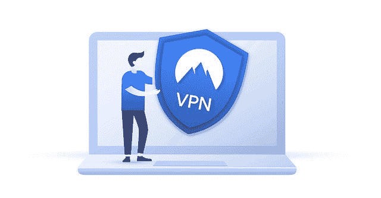

# Kali Linux 破解 - 2019版


## 介绍
看到大家对学习 Kali Linux 的基础知识如此感兴趣，我非常高兴。Kali Linux 是今天最有效的软件之一。它也可以被视为所有计算机和网络从业者的福音。

Kali Linux 承担着安全审计软件的工作，并在网络和黑客的各个方面提供帮助。Kali Linux 附带各种与信息和安全相关的任务，如反向工程、渗透测试和安全研究。计算机取证也是 Kali Linux 的一部分。Kali Linux 提供的每一项服务都经过认证，并具有全方位的控制力以及更广泛的认证范围。

Kali Linux 属于 Linux 发行版家族。网络安全是该 Linux 发行版要关注的问题。如今许多公司都借助 Kali Linux 来检查和追踪自身的漏洞，以确保其基础设施的 100% 安全。它是一个开源程序，因此完全免费的。不仅如此，它还是完全合法的，可以用于企业或组织中的各种场景。

## 第 1 章：黑客基础


黑客攻击（Hacking）无非是指对网络或计算机进行未经授权的侵入，这种行为由被称为“黑客（hackers）”的攻击者执行。攻击者会试图攻击那些容易受到威胁的系统。他们时刻睁着窥探的眼睛，到处寻找漏洞。他们可以个人行动，也可以以小组形式工作。不仅如此，黑客还可能作为组织的一部分运作，其目的是破坏其他组织的功能。大多数时候，他们试图更改组织的系统，并目标攻击安全基础设施以攻破信息并获取访问权限。然而，黑客不仅作为攻击者工作，还利用他们的技能发现系统中的弱点以及各种漏洞。此举也是为了发现并修复弱点，以防止所有形式的恶意攻击进入系统。

#### 不同类型的黑客
黑客世界中存在多种类型的黑客，他们执行不同的功能。黑客的类型有助于定义系统与试图攻击这些系统的黑客之间的关系。最常见的黑客类型有：

- **黑帽黑客（Black Hat Hackers）**：“黑帽”一词源于旧的西部电影，在电影中反派通常戴着黑帽子。黑帽黑客作为个体行动，试图在未经授权的情况下访问组织或网络的系统，其目的是出于各种恶意目的利用安全基础设施。这种类型的黑客在破坏目标时没有获得任何授权或许可。他们试图通过通过破坏安全系统的基础设施、关闭系统或更改网站或网络的主要功能来造成损害。黑帽黑客的主要意图是获取完全访问权限或窃取财务信息、获取各种密码或获取其他形式的个人数据洞察。

- **白帽黑客（White Hat Hackers）**：白帽黑客是第二类黑客，但他们扮演的是“好人”。白帽黑客与各种组织合作，目的是加强任何系统的安全性。白帽黑客拥有各种许可来接触目标，并在提供的规则边界内对目标进行渗透测试。白帽黑客也被称为“道德黑客（ethical hackers）”。道德黑客精通这一领域，拥有各种形式的用于黑客攻击的伦理工具和技术。他们使用特殊的方法来保护组织的信息系统。与黑帽黑客相反，道德黑客在获得合法许可执行操作后，会利用网络的安全系统并检查后门。道德黑客总是指出他们从组织系统中挖掘出的各种所有形式的漏洞，以确保这些漏洞得到修复，从而防止被恶意攻击者利用。

- **灰帽黑客（Grey Hat Hackers）**：灰帽黑客以黑帽黑客相同的方式获取组织和网络安全系统的访问。但灰帽黑客在执行此类行动时并没有任何形式的恶意意，并将漏洞和漏洞披露给执法机构或各种情报机构。灰帽黑客通常在互联网上冲浪，并入侵计算机系统，以通知包含需要立即修复的各种漏洞的网络或系统所有者。灰帽黑客也可以通过提供缺陷信息来向被入侵的系统索要费用。

#### 常见的黑客工具
为了完成黑客攻击，黑客会实施各种技术。让我们来看看其中一些。


### Rootkits（根基工具）
Rootkit 像是一个程序或一组巨大的软件，允许攻击者完全访问或控制直接连接或与互联网系统交互的系统或网络。Rootkit 最初是作为一种后门程序系统引入的，用于解决软件方面的各种问题。然而，今天这种软件被黑客广泛用于破坏实际所有者或管理员对系统功能的访问和控制。有多种方法可以将 rootkit 安装到受害系统中。安装 rootkit 最常用的方法是实施钓鱼攻击结合社会工程学。一旦 rootkit 安装在受害者的系统中，攻击者就可以秘密访问系统并控制其整体运行，从而轻松窃取机密数据和信息，还可以完全关闭系统。

### Keyloggers（键盘记录器）
这是一种非常特殊的工具，旨在记录和记录受害者系统上按下的每一个键。键盘记录器通过附着在应用程序编程接口或 `API` 上记录击键轨迹。当用户在系统中使用键盘输入任何内容时，它会跟踪击键。记录的文件会被保存，其中包含各种形式的信息，例如网站访问详情、用户名、已打开应用程序的记录、截图、银行详情等。键盘记录器还能捕获个人信息、信用卡详情、密码、手机号码以及通常在系统中输入的各种其他细节。键盘记录器通常以恶意软件的形式出现，允许网络犯罪破解所有形式的敏感数据。

### Vulnerability scanner（漏洞扫描器）
漏洞扫描器用于分类并检测系统、网络、通信系统、计算机等的各种形式的弱点。这是道德黑客最常用的工具形式之一，用于发现潜在的漏洞和缺陷并紧急进行修复。然而，黑黑客也可以使用漏洞扫描器来检查系统内部的漏洞和弱点，然后找到合适的工具进行利用。

## 攻击技术

黑客们使用多种技术来利用系统。

### SQL Injection（SQL 注入）
SQL 或结构化查询语言的设计目的是为了利用受害者数据库中的各种形式的数据。这种攻击属于网络攻击的一种，它通过 `SQL` 语句欺骗系统，目标是数据库。这种形式的攻击通常通过网站接口实施，尝试通过数据库颁发 `SQL` 命令来黑进密码、用户名和其他与数据库相关的信息。所有代码编写不当的网站以及 Web 应用程序都容易受到 SQL 注入攻击。这是因为基于 Web 的应用程序包含了各种用户输入字段，如登录页面、搜索页面、与支持和产品相关的表单、评论区等，这些字段都非常容易受到攻击，并且可以通过简单的代码操作轻易被破解。

### DDoS or Distributed Denial of Service（分布式拒绝服务）
这是一种攻击攻击的形式，服务器的正常流量被扭曲无法进入服务器并淹没网络流量。这最终导致服务拒绝，因为它就像交通拥堵一样阻塞了道路，并阻止了正常流量到达目的地。今天连接到网络的所有设备（如 IoT 设备、计算机、手机等）都非常容易 `DDoS` 攻击。

### MAC Spoofing（MAC 欺骗）
今天人们使用的每种设备都带有网络接口控制器或 `NIC`。它帮助用户连接网络（例如直接连接互联网）。每个设备的 `NIC` 配有一个 `MAC` 地址，该地址是在各种硬编码过程中分配的。MAC 欺骗攻击是一种致命的攻击形式，黑客在自定义的虚假 `MAC` 地址后面隐藏自己和他们的系统。这降低了黑客被发现的风险。因此，你可能会认为一个新系统是合法的而赋予其访问权限，但可能会发生黑客隐藏在你甚至无法察觉的虚假 `MAC` 地址之后的情况。

通过使用这种技术，黑客可以轻松通过 Wi-Fi 破解网络连接，并访问所有通过局域网（LAN）连接的设备。MAC 欺骗技术还会导致其他形式的严重犯罪，黑客窃取他人的身份并进行严重的数据泄露，导致某人在甚至不知道实际黑客的情况下被定罪。然而，今天市场上有多种操作系统（如 `MAC` 和 `Windows`），它们可以在不使用 `MAC` 地址的情况下轻松连接到 `LAN`。

## 第 2 章：什么是道德攻击？


道德攻击也被称为入侵测试、渗透测试和红队对抗。简单来说，这是一种具有争议的技术，通过模仿恶意黑客的行动和意图来发现系统中的漏洞和弱点。道德黑客是指或安全专业人士，他们利用自己的技能为信息系统管理员的各种防御措施提供支持。道德黑客也被称为白帽或白色黑客。通过进行各种测试，道德黑客试图找到以下问题的答案：

*   攻击者可以访问哪些位置、系统或获取信息？
*   攻击者在设定目标之前会看到什么？
*   攻击者将对系统中的可用信息做什么？
*   是否有人能注意到攻击者所做的各种尝试？

被赋予渗透测试任务的道德黑客在其分配防御任务的组织的许可和知识下运行。在某些情况下，组织不会向安全信息团队告知道德黑客将执行的所有活动，这仅仅是为了测试安全信息团队的有效性和严密性。整个过程被称为双盲环境。为了确保操作有效且合规，组织需要告知道德黑客所有需要保护的资产和信息、潜在的威胁来源，以及组织支持道德黑客努力的限制。

## 道德攻击的过程

所有道德黑客都遵循严格的流程，以获得最佳可用且切要的法律结果。让我们来看看道德黑客遵循的流程。

### 计划


无论是什么种的项目，对于每一个成功的项目来说，规划都是至关重要的。它为道德黑客提供了思考机会，思考需要做的事情、设定要实现的目标，并进行风险评估以评价如何执行一个完整的项目。在执行道德黑客项目之前，道德黑客会考虑各种因素。这些因素列表包括文化、安全策略、法律、法规、行业需求和最佳实践。在启动道德黑客时，所有因素在决策过程中都起着重要作用。

道德黑客的规划阶段将对攻击过程的执行方式、收集和共享的信息产生深远影响，还将直接影响结果集成和交付到安全计划中。规划阶段是第一步，将描述有关受控攻击的大部分细节。它还将回答所有关于黑客的问题，例如：如何控制和支持道德黑客过程、需要执行哪些基本操作以及该过程将持续多久。

## 侦察 (Reconnaissance)

这是一个搜索所有可用信息以协助攻击过程的过程。整个过程可以简单到如仅使用 `ping` 或浏览互联网上各种新闻组来搜索员工泄露的信息，也可以像在巨堆垃圾信件或收据中翻找那样艰难且杂乱。该过程还可以包括其他几个过程，如电话监听、社会工程学、网络嗅探以及数据窃取。信息搜索过程仅限于组织和道德黑客为了获取他们所寻找的所有所需信息而愿意达到的程度。

侦察阶段引入了需要完成的任务与保护组织信息和资产所需的所有方法之间的深层关系。

## 举举 (Enumeration)

也被称为漏洞发现或网络发现。枚举是从目标系统、网络和目标所使用的应用程序中获取所有可用信息的过程。还需要注意的是，枚举阶段通常是恶意攻击与道德黑客之间界限变得模糊的实际位点，因为非常很容易、简单地超出原始攻击计划中概述的专用边界。为了构建组织环境的清晰蓝图，正在使用各种随手可用的技术和工具。这些可用工具包括 `NMap` 和端口扫描。然而，收集所有所需信息非常容易，但要确保黑客手中信息的价值却非常困难。

从初看，枚举过程似乎非常简单：收集数据然后进行整体评估，以便为更深入的搜索制定适当计划，或为分析或漏洞阶段建立详细的矩阵。然而，这一阶段是道德黑客做出逻辑决策的能力发挥非常重要作用的实际阶段。

## 漏洞分析 (Analysis of vulnerability)

为了有效分析所有数据，道德黑客需要采用一种本质上具有逻辑性的务实方法。在漏洞分析阶段，将在实际过程中将所有收集的信息与所有已知的漏洞形式进行比较。任何形式的信息在过程中都是有用的，无论它源自何处或来源是什么。一小部分信息也可以帮助发现系统中的某些新类型漏洞，并可能导致其他几个尚未被发现的漏洞。已知的漏洞形式、补丁包、事件、更新以及各种黑客工具有助于正确识别攻击点。互联网为道德黑客提供了大量信息，这些信息可以很容易地与系统架构以及系统中的强弱点联系起来。

## 利用 (Exploitation)

花费大量时间用于评估和规划道德黑客攻击。显而易见，所有规划都将导致某种攻击。对系统的利用程度可以简单到仅在系统中运行一个非常小的工具，也可以复杂到需要以正确方式执行的许多复杂步骤，以获取系统的访问。利用过程可以分解为一系列子任务，这些子任务可以是单个步骤，也可以是各种步骤的集合。当执行每一步时，都会发生评估过程，以确保符合预期的结果。与攻击计划的任何偏离都可以分为两个部分：

- **预期 (Expectation)**：是否达到了预期的利用结果，还是结果与组织的假设相冲突？
- **技术 (Technical)**：目标系统的行为是否完全不符合预期，这实际上对整个系统利用和系统接接产生了影响？

## 最终分析 (Final analysis)

尽管利用阶段带有大量的验证和检查以确保攻击的成功，但仍需要最后的最终分析，以根据暴露程度对系统漏洞进行分类，并协助制定缓解计划。最终分析阶段将利用阶段与交付物的创建连接起来。需要一个完整攻击的全面图像，以构建组织当前安全环境态的更大蓝图，并清晰地表达漏洞。

## 交付物 (Deliverables)

交付物通过多种方式交流测试结果。某些交付物在性质上是简洁简短的，仅提供漏洞列表以及修复方法；而另一种形式的交付物可以是详细且冗长的，提供系统中可能的漏洞列表，并附带关于如何发现漏洞、如何利用它们、在系统中存在此类漏洞的结果以及如何修复这种情况的描述。这一阶段实际上是道德黑客用于向组织传达其黑客结果的阶段。如果交付物实际上没有让管理员感到恐惧，则测试被视为失败。

## 第 3 章：网络安全 (Cyber Security)


在今天科技创新每天发生的世界上，网络攻击的潜在威胁也以同样的速度增加。在今天充满漏洞的世界中，网络安全在保护系统和网络信息及数据方面发挥着深远的作用。网络安全就是利用各种工具和技术来保护网络、程序、系统数据和网络免受潜在攻击、损害和各种形式未经授权的访问。网络安全也被称为信息技术安全。


大多数组织和机构，如军事、政府、医疗以及金融实体，在其计算机系统和可以在线找到的数据库中存储了大量的数据。在大多数情况下，存储在服务器和数据库中的信息本质上是高度敏感的，一旦泄露可能会给相关组织带来严重麻烦。未经授权访问组织的系统和数据库会导致数据泄露以及对组织安全基础设施的破坏。

被攻击的组织可能会丢失所有形式的敏感数据并完全失去对系统的访问权限。随着网络攻击数量日益增加，特别是涉及国家健康和安全的组织需要采取一些严肃措施来保护所有形式的敏感数据。网络安全是帮助组织保护所有数据和服务器的最终选择。

#### 网络安全与加密

加密是对通信进行编码的过程，使得只有授权方可以解密通信消息。这是通过使用 `SSL/TLS` 和 `PKI` 协议实现的。加密之所以如此重要，是因为互联网是使用 `HTTP` 协议构建的。超文本传输协议（`HTTP`）与互联网处于同一时代。`HTTP` 是一种通信协议，允许 Web 服务器和 Web 浏览器以正确的预期的方式进行通信并显示信息。当用户访问网站时，它在浏览器中呈现的样子并不是其真实面。网站是由一系列代码构建的，这些代码发送到 Web 浏览器，然后由浏览器按照网页设计师的想法进行视觉布局。

`HTTP` 的主要问题是它完全不安全。因此，任何了解该过程的人都可以轻松监控互联网上的 `HTTP` 连接。简单来说，第三方可以轻松读取并操纵客户端与服务器之间通过 `HTTP` 进行的通信。通过 `HTTPS` 协议提供网站服务，加密技术实际上负责维护通信。`HTTPS` 是 `HTTP` 的安全版本。所有在 `HTTPS` 上建立的连接在本质上都是加密的。简单来说，通过 `HTTPS` 协议进行的任何形式的通信都是高度安全的。加密防止第三方对通信进行监视。如果你从事在线业务并需要获取客户的财务及个人信息，请确保您的网站已加密，以便您的客户在交换信息时不会面临风险。

### 加密过程是如何工作的？

当 Web 浏览器访问带有 `SSL` 证书的网站时，加密过程开始。Web 服务器和浏览器进行被称为`SSL 握手`的操作。在初步阶段，Web 浏览器验证网站上安装的 `SSL` 证书本质上是合法的，并且是由受信任的认证机构颁发的。当 Web 浏览器确保证书是合法的后，它开始与服务器协商加密连接的条款。

涉及加密时，主要两对密钥。第一种是非对称密钥对，由私钥和公钥组成。这些密钥对于加密主体没有功能，但它们被用于身份验证。当 Web 浏览器测试网站 `SSL` 证书的真实性时，它会确保被质疑的 `SSL` 证书实际上是公钥形式的所有者。它通过使用公钥加密一小包数据来实现这一点。如果 Web 服务器能够使用相应的私钥解密数据包并将其发回，则证明该服务器是公钥的所有者，一切被标记为已验证。如果 Web 服务器无法解密数据包，则服务器的证书被视为“不可信”。

另一对密钥是会话密钥。这种密钥在验证了 `SSL` 证书的真实性并协商了所有加密条款后生成。虽然公钥只能用于加密而私钥用于解密，但会话密钥可以同时用于加密和解密两种功能。与非对称形式相比，会话密钥尺寸较小，本质上也不那么安全。然而，会话密钥足够执行这两种功能。服务器和 Web 浏览器在剩余的通信中使用会话密钥。离开网站后，使用的会话密钥将被丢弃，并为新的访问生成全新的会话密钥。

#### 常见的网络攻击类型

随着技术的进步，网络攻击日益增加。今天可以发现各种类型的网络攻击，其中一些最常用，例如钓鱼攻击、恶意软件、`XSS` 等。让我们来看一些常见的网络攻击类型。

### 恶意软件

恶意软件是有害软件的形式，用于访问受害者的系统。恶意软件也可以称为病毒。一旦恶意软件进入受害者系统，它可能会导致一系列破坏，从获得系统的控制控制到监控各种操作、窃取敏感数据，并导致系统完全关闭。攻击者使用各种方法向目标系统插入恶意软件。

### 钓鱼攻击

今天收到带有各种链接和附件的电子邮件是非常常见的事情。这种通过电子邮件发送有害链接和附件的行为被称为钓鱼攻击。在钓鱼攻击中，攻击者向目标发送看起来像可靠的电子邮件。大多数邮件都带有链接和附件，点击这些内容会在系统用户完全不知情的情况下在系统内安装恶意软件。某些钓鱼链接还可能引导用户进入新网站，该网站可能会要求银行和信用卡详情等机密数据。此类网站实际上是攻击者用于在目标系统中安装恶意软件的陷阱。

### XSS

跨站脚本或 `XSS` 攻击被用于直接针对网站的用户。它与 SQL 注入攻击有些相似，也涉及向网站中注入有害代码。但在 `XSS` 攻击的情况下，网站本身并没有受到攻击。在 `XSS` 攻击中，注入网站的恶意代码仅在用户的浏览器中运行，并用于窃取用户名、密码、银行详情等许多敏感数据。

#### 恶意软件及其类型

恶意软件是恶意软件的形式，用于访问受害者的系统。网络犯罪分子设计恶意软件可用于窃取数据、破坏计算机功能、绕过访问控制等。

### 恶意软件的类型

今天可以发现各种类型的恶意软件。让我们来看看它们。


- **广告软件**：广告软件是用于在网站上显示广告的程序，点击广告后会重定向到被广告的网站，并收集有关用户的所有形式的市场数据。还有各种形式的弹出窗口广告软件，它们通常包含恶意链接，可能导致系统损坏。
- **间谍软件**：这是一种用于监视目标用户的软件。它的设计目的是捕获和监控用户在网站上的活动。广告软件也是间谍软件的一种，可以将用户的浏览活动发送给广告商。
- **蠕虫**：蠕虫是病毒的一种，被网络犯罪分子用于自我复制。蠕虫利用计算机网络传播，可能会导致数据被取或删除。许多蠕虫被设计为仅通过系统传播，不会对系统造成任何形式的危害。

## 第 4 章：Linux 架构


Linux 是今天可以找到的最操作系统之一。它本质上是开源的，并基于 UNIX。它就像 Windows XP、Windows 10 和 MAC OS 等商业操作系统一样，是一个简单的操作系统。操作系统无非计算机系统与用户之间的图形化界面。它负责管理计算机系统拥的所有硬件相关资源，并有助于建立硬件与软件之间的通信。

## 开源软件

开源软件是指其源代码根据许可协议提供的软件，版权所有者有权根据该协议研究软件、更改设置，并出于任何目的将该软件分发给任何想要的人。

## Linux 操作系统及其组件

Linux 操作系统由三个不同的组件组成。

- 内核 (Kernel)
- 系统库 (System Library)
- 系统实用程序 (System Utility)

### 内核

内核充当任何形式操作系统的核心部分。它负责处理计算机系统硬件的任务。`CPU` 时间和内存是 `kernel` 管理的两个示例。操作系统的内核分为两种：

- **微内核**：微内核操作系统内核的一种。正如其名，它具有非常基础的功能。它是提供操作系统运行所需环境的最少软件。这种内核环境涵盖了线程管理、地址空间的低级管理以及进程间的通信。
- **单体内核**：单体内核是带有各种驱动程序的内核形式。它是操作系统的一种架构，其中系统的操作系统在内核空间内运行。这种形式的内核能够动态加载或卸载运行时可执行的所有模块。单体内核保持在监视模式。微内核和单体内核之间的主要区别在于，单体内核可以单独定义计算机系统硬件上非常高层次的接口。

#### 监视模式

单体内核的监视模式是一个介于系统硬件之间的的标志。它可以通过在软件系统级运行代码来轻松修改。所有形式的系统级任务在操作或运行时都带有此标志。然而，用户空间的应用程序并没有设置此标志。该标志确保了是否可以执行机器码操作，例如执行各种操作，如禁用中断或为各种形式的描述符表修改寄存器。两种不同类型操作背后的核心思想来自“控制越多，责任越大”。

监视模式下的任何程序都是受信任的，以至于永远不会失败，因为任何形式的失败都会导致计算机系统的崩溃。简单来说，内核是负责操作系统所有形式运行的组件。它由各种类型的模块组成，并直接与底层硬件进行交互。内核提供了所有必要的抽象，目的是向系统或应用程序隐藏硬件的所有低级细节。

### 系统库

系统库由一组非易失性资源组成，这些资源被计算机系统资源使用，并主要用于开发软件。它包含数据配置、帮助数据、文档、消息模板等许多。通常，“库”一词用于描述用计算机语言编写的关于行为的巨大实现集合。它具有完美定义的接口形式，有助于调用这些行为。这意味着，任何想要创建高层程序的人都可以轻松使用系统库来连续进行系统调用。

各种形式的程序可以同时在同一时间请求系统库，以确保库的编码方式使得即使相关程序之间完全没有链接或相互连接，多个程序也可以使用该库。简单来说，系统库是使用系统实用程序或应用程序构建的唯一程序或函数形式，它们可以访问内核的所有功能。这种形式的库实现了与计算机操作系统相关的大部分功能，并且它们不需要拥有内核模块的代码访问权限。

### 系统实用程序

系统实用程序程序负责执行所有形式的个人和专业级任务。实用程序软件是系统软件的一种。它设计用于运行计算机系统的应用程序和硬件程序。系统软件也可以被视为用户应用程序与硬件之间的接口。简单来说，系统实用程序软件是用于配置、分析、优化和维护计算机系统的系统软件。实用程序软件与操作系统协同工作以支持系统的基础设施，使其与旨在直接执行有利于普通用户任务的应用程序区分开来。

## Linux 架构的特点

Linux 具有许多对普通用户非常有帮助的特性。

### 多用户能力

这是 Linux 操作系统最独特的特点，计算机的资源（如内存、硬盘等）可以被多个用户同时访问。然而，用户并不是从单个终端访问资源。每个用户都获得了一个独立的终端来访问和操作资源。终端由至少一个 VDU（视频显示器）、鼠标和键盘作为输入设备。所有终端都链接或连接到主服务器（Linux）或主机，主机的资源和其他打印机等外围设备可以供用户使用。

### 多任务处理

Linux 操作系统具备同时轻松处理各种作业的能力。例如，用户可以执行一个执行巨大列表的命令，同时在记事本中输入内容。这是通过实施调度策略以及上下文切换的概念来划分 `CPU` 时间来智能管理的。

### 可移植性


可移植性是 Linux 操作系统在用户中广为人知的特性。可移植性并不意味着它可以被通过 CD、U 盘或内存卡随携带，也不意味着文件大小很小。可移植性是指 Linux 操作系统及其所有的应用程序可以在各种类型的硬件上完全相同的方式运行。Linux 内核和操作系统的应用程序支持在甚至是那些硬件配置最低的系统上安装相同的内容。

## 安全

安全性被认为是任何操作系统最核心的部分。对于所有使用该系统执行各种形式机密任务的用户和组织来说，安全性至关重要。Linux 操作系统提供了多种安全概念，旨在保护用户免受对系统及其数据的未经访问。

## Linux 安全的主要概念

Linux 提供了 3 种主要的安全概念。

- **身份验证 (Authentication)**：这通过为个人用户提供登录名和密码，帮助验证用户身份，确保其工作不会被任何第三方访问。
- **授权 (Authorization)**：在 Linux 操作系统的文件层级，它对用户设有权限限制。每个文件都有写、读和执行权限，决定了谁可以访问文件、谁可以修改文件以及谁可以执行文件。
- **加密 (Encryption)**：Linux 操作系统的这一功能有助于将用户文件编码为不可读的格式，称为密文。这确保了即使有人成功打开了系统，文件也是安全的。

## 通信

Linux 操作系统提供了一项与用户通信的强大功能。它可以在单台计算机的网络内部进行，也可以在两个或多个计算机网络之间进行。此类系统的用户可以通过网络无缝地交换数据、邮件和程序。

## 第 5 章：Linux 系统的基础

Linux 是一个简单的操作系统，就像 Windows 等其他操作系统一样。作为一个操作系统，Linux 帮助管理系统的硬件，并提供其他软件运行所需的服务。它被认为是一个注重实操性的操作系统。例如，运行 Windows 这样的操作系统就像开自动挡汽车，而运行 Linux 操作系统就像开手动挡汽车。这可能需要花费更多精力，但一旦用户熟练掌握了 Linux 的运行机制，使用命令行以及安装软件包将变得超级简单。

### Linux 的历史

Linux 与 MAC OS X 相似，它们都基于 Unix。Unix 开发于 20 世纪 70 年代初，主要目标是创建一个对于各种用户既易于访问又安全的操作系统。1991 年，Linux 的开发目标是分发 Unix 的特性。它作为开源软件发布，直到今天依然如此。开源软件是指用户可以完全看到代码，并根据需要进行修改和重新分发的软件。Linux 只是内核，而不是一个完整的操作系统。内核在硬件和用户应用程序请求之间提供了一个接口。操作系统的其他部分由工具、GNU 库以及各种其他软件组成。作为一个完整单元的操作系统被称为 GNU/Linux。

关于 关于服务器的一点

用户拥有的 Linode 是一种服务器。服务器无非就是一种主计算机，帮助在整个网络或跨连接的计算机网络中提供各种形式的服务。服务器通常具有以下特点：

- 24 小时运行。
- 通常连接到互联网或一组计算机网络。
- 包含文件和程序，用于网站托管或互联网上的其他内容。

由于服务器的作用就像计算机一样，因此 Linode 和家用的电脑之间有许多相似之处。某些相似之处包括：

- Linode 通常托管在物理形式的机器上。它位于数据中心的可用资源池中。
- Linode 使用像 Linux 这样的操作系统它是另一种类似于 Mac 或 Windows 的操作系统。
- 就像用户可以轻松地在 PC 上安装各种应用程序一样，Linode 上也可以安装应用程序。这些安装在 Linode 上的应用程序有助于执行托管网站等各种任务。
- 用户可以像在 PC 上一样轻松地创建、编辑和删除文件。用户也可以像 PC 一样浏览目录。
- 就像 PC 一样，Linodes 连接到互联网。

## 安装 Linux 之前需要考虑的事

在安装 Linux 之前，你需要确定你想安装哪种发行版的 Linux。Linux 操作系统有多个版本，被称为发行版（distributions）。发行版类似于 Windows 7 或 Windows XP 等操作系统的版本。Windows 等操作系统的新版本是升级版。但在 Linux 中，发行版不是升级版，而是不同的口味（flavors）。多个 Linux 发行版安装了不同的软件包。

### Linux 发行版

Linux 发行版之间的主要区别往往在于发行版的目标以及安装了哪些软件包，而不是 Linux 内核代码的任何差异。由 CentOS 和 Fedora 组成的 RedHat Linux 以及由 Ubuntu 组成的 Debian Linux 之间共享大量的代码。它们的内核大体相同，来自 GNU 项目的应用程序和用户工具也相似。某些 Linux 发行版被设计得尽可能精简简单，而另一些则设计有该时代最新且的软件。所有的 Linux 发行版都旨在为用户提供最好的稳定性和可靠性。

除了发行版的个性特性外，你还需要考虑各种因素，这些因素将帮助你选择所需的发行版。

- **发布周期 (Release cycle)**：不同的 Linux 发行版以不同的计划发布更新。Arch Linux 和 Gentoo 等发行版使用滚动发布（rolling release）模式，每个软件包在开发者宣布其完成或就绪时发布。Slackware、Debian 和 CentOS 等发行版旨在为用户提供最稳定的操作系统形式，同时也非常频繁地发布新版本。Ubuntu 和 Fedora 等 Linux 发行版每六个月发布一次新版本。选择适合你的发布周期也取决于多种因素。这些因素包括你运行所需的软件、你需要的可靠性和稳定性，以及你寻求的舒适度。
- **组织结构**：虽然这可能不会直接影响发行版的性能，但它是 Linux 发行版之间最大的区别之一。Gentoo、Debian、Slackware 和 Arch 等某些 Linux 发行版由独立开发者社区开发，而 Ubuntu、Fedora 和 OpenSUSE 等发行版是由不同公司赞助的社区开发的。CentOS 等发行版源自商业化发行版。


## 常用工具集
不同的 Linux 发行版使用不同类型的工具来执行各种常见任务，例如系统配置或软件包管理。像 Ubuntu 和 Debian 等发行版使用 `APT` 来管理 `.deb` 包，OpenSUSE 使用 `.rpm` 包，而 CentOS 和 Fedora 也使用 `.rpm` 包，但它们通过使用一个名为 `yast` 的工具来管理所有包。在大多数情况下，你选择的发行版最终会是那个带有你所有所需且你所熟悉的工具的发行版。

## Linux 安全
当你开始使用基于 Linux 操作系统的系统时，你就成了自己系统安全的所有者。互联网上充斥着许多想要利用你的系统计算能力来实现个人目标的人。Linux 为用户提供了各种安全选项，帮助用户保护其系统并根据需要对其进行调整。

## 查找你的文件夹和文件
Linux 系统中的一切内容都以目录的形式存在。在 Linux 中，文件夹被称为目录（directory）。Linux 操作系统使用一个平衡良好的各种嵌套目录树形结构，以组织的方式存储所有文件。最高层级的目录被称为根目录（root directory），它被指定为一个单一斜杠 `/`。在 Windows 操作系统中，你会遇到各种驱动器和磁盘，但在 Linux 操作系统中并非如此。根目录下面还有许多其他子目录。大多数基于 Linux 的系统都带有名为 `var` 和 `lib` 的目录，以及根目录树下的许多其他目录。

`lib` 目录包含系统库，而 `var` 目录包含系统中各种可能发生的文件，例如邮件消息和日志。Linux 操作系统的目录也可以进入其他目录内部。

## 用户与权限
Linux 操作系统使用了一套非常强大的系统来管理用户及其权限，以确保只有正确的人才能访问系统文件。作为你 Linux 系统的所有者，你可以为每个目录设置用户和权限。Linux 的文件访问系统包含三类。

### 用户 (Users)
用户账户通常分配给个人，也可以分配给需要访问系统文件的应用程序。你可以根据需要为系统提供任意数量的用户访问权限。

### 组 (Groups)
组是一个一个或多个用户的集合。组是一次性向多个用户授予相同权限的极佳方法，无需为每个用户单独设置权限。当你创建一个账户时，它会被分配到一个默认组，该组的名字与用户名相同。用户可以加入他们想要加入的任意组。属于某个组的用户将获得该特定组被授予的所有权限。

### 所有人 (Everyone)
这一类别针对组和用户之外的所有所有人。当某人在未以特定用户身份登录系统的情况下访问系统文件时，他们属于“所有人”这一类别。

紧随用户之后的下一个重要事项是权限。Linux 系统中的每一个目录和文件都带有三个可能的访问级别。

-   **读 (Read)**：所有具有读取权限的文件都可以查看。
-   **写 (Write)**：所有具有写入权限的文件都可以编辑。
-   **执行 (Execute)**：所有具有执行权限的文件都可以像应用程序一样被执行或运行。当你启动一个新的脚本或程序时，你就是在开始执行它。

## Linux 中的软件安装
与 Linux 系统中的其他其他事情一样，软件安装也是通过输入并执行特定形式的文本命令完成的。Linux 的大多数发行版都带有软件包管理器，这使得在系统中安装或卸载任何软件变得更加容易。Ubuntu 和 Debian 等发行版使用 `APT`（高级软件包工具）管理器，而 CentOS 和 Fedora 使用 `YUM`（黄色狗更新修改版）软件包管理器。

## 第 6 章：基础 Linux 命令
Linux 是当今最著名的操作系统之一。然而，Linux 并不是一个完整的操作系统，它是操作系统的内核。Linux 也被视为 UNIX 的克隆。一些最常见的 Linux 发行版包括 Linux Mint、Ubuntu Linux、Red Hat Enterprise Linux（RHEL）、Fedora 和 Debian。Linux 主要用于服务器。也可以认为，几乎 90% 的互联网是由 Linux 服务器驱动的。这主要是因为 Linux 作为一个内核是安全、快速且免费的。Windows 服务器也可以用于互联网，但 Windows 带来的一个主要问题是成本问题。这个成本问题可以通过 Linux 服务器轻松解决。事实上，如今运行在大多数智能手机上的 Android 操作系统也是由 Linux 内核制作的。

### Linux Shell（外壳）
Linux shell 是一种程序形式，它接收来自系统用户的命令，并将其传输给操作系统进行处理，然后显示结果。Linux shell 是 Linux 操作系统的主要部分。它的发行版有图形用户界面（GUI）版本，但 Linux 基本上带有一个命令行界面（CLI）。要打开 Linux shell 终端，你需要在 Ubuntu 发行版中按下 `Ctrl+Alt+T`，你也可以按下 `Alt+F2`，输入 `gnome terminal` 然后按回车。

### Linux 命令
让我们从一些最基础的 Linux 命令开始。

#### pwd
当你首次打开终端时，你处于用户的家目录中。为了确切知道你处于哪个目录，你可以使用 `pwd` 命令。它可以帮助给出精确路径，即从根目录开始的路径。根目录无非 Linux 文件系统的基础。它通常用正斜杠 `/` 表示。用户目录通常看起来像 `/home/username`。

#### ls
通过使用 `ls` 命令，你可以轻松知道你所在目录中有哪些文件。你也可以通过 `ls -a` 查看每一个被隐藏的文件。

#### cd
你可以使用 `cd` 命令进入目录。例如，如果你在 home 文件夹中并想要进入 downloads 文件夹，你需要输入 `cd Downloads` 然后你就进入 downloads 目录。你需要注意，此命令是区分大小写的。你还需要按照文件夹的名称完全输入。然而，这种类型的命令会带来某些问题。例如，你有一个名为 Raspberry Pi 的文件夹。在这种情况下，当你输入命令 `cd Raspberry Pi` 时，Linux shell 会认为命令的第二个参数是一个完全不同的实体，因此你收到的将只有一条错误消息，提示没有这样的目录。

在这种情况下，你可以使用反斜杠，即使用命令 `cd Raspberry\Pi`。空格在 Linux 中被视为 `:`。如果你只输入命令 `cd` 并按回车，你将回到家目录。如果你想从一个特定的文件夹返回到上一个文件夹，你需要使用 `cd..`。命令中的两个点代表返回的请求。

#### mkdir & rmdir


`mkdir` 命令用于创建新的文件夹或目录。例如，当你需要创建一个如 `DIY` 的新目录时，你需要输入类似 `mkdir DIY` 的命令。请始终记住，如果你想创建一个名为 `DIY Hacking` 的目录，你需要输入 `mkdir DIY\Hacking`。你可以使用 `rmdir` 命令来删除不再需要的目录。然而，请务必记住，`rmdir` 只能用于删除本质上空的目录。如果你想删除一个包含文件的目录，则需要使用 `rm` 命令。

### rm
```
rm
```
你可以使用 `rm` 命令来删除目录和文件。如果你只想删除目录，则需要使用 `rm –r` 命令。当你使用 `rm` 命令时，它将删除文件夹以及其中包含的所有文件。

### touch
```
touch
```
此命令用于创建新文件。它可以是任何类型，从一个空的 `txt` 文件到一个空的 `zip` 文件格式。你可以使用如 `touch new.txt` 的命令。

### man & - - help
```
man & - - help
```
如果你想详细了解某条命令以及如何使用它，可以使用 `man` 命令。它通过显示所有命令的所有帮助页来提供帮助。例如，如果你输入 `man cd`，它将显示 `cd` 命令的所有帮助页。当你输入命令名并带有参数 `-- help` 时，它将显示你可以如何使用该命令。

### cp
```
cp
```
`cp` 命令用于从命令行复制文件。它接受两个参数，第一个参数是待复制的文件位置，第二个参数是复制文件的位置。

### mv
```
mv
```
`mv` 命令用于通过命令行移动文件。你也可以用此命令来重命名文件。例如，如果你需要将文件“text”重命名为“old”，你可以输入 `mv text old`。它和 `cp` 命令一样也接受两个参数。

### locate
```
locate
```
`locate` 命令用于定位 Linux 系统中的任何文件。它类似于 Windows 系统中的搜索命令。当你不知道某个特定文件位于何处、保存于何处或其实际文件名时，这个命令可能变得非常有用。当你使用此命令配合参数 `--i` 时，它可以帮助忽略大小写。例如，如果你需要找到一个包含“bye”一词的文件，当你使用 `locate –i bye` 时，它将列出所有包含“bye”单词的 Linux 系统文件列表。如果你记得文件名中的两个单词，可以通过插入星号（`*`）轻松地分隔它们。例如，要定位包含“bye”和“this”单词的文件，你需要使用 `locate –i *bye*this`。

## 中级命令

### echo
```
echo
```
此命令有助于将部分数据（大多数是文本）移动到文件中。例如，如果你需要创建一个全新的文本文件或向已有的文本文件添加内容，你需要使用形如 `echo hello, my name is sunny>>new.txt` 的命令。在这种情况下，你不需要使用 `\` 来分隔句子中的空格，因为你只需要在完成写入时使用两个三角形括号（`>>`）。

### cat
```
cat
```
你可以使用 `cat` 命令显示文件中的所有内容。它通常用于方便地查看程序。

### nano & vi 
```
nano & vi
```
`nano` 和 `vi` 是 Linux 命令行中已经安装的文本编辑器。`nano` 命令是一种很好的文本编辑器，通过用颜色标记关键字来提供帮助，并且轻松识别大多数语言。`vi` 命令的形式比 nano 简单得多。通过使用 `vi` 命令，你可以创建任何新文件，甚至使用这种编辑器的形式修改文件。例如，你需要创建一个名为 `check.txt` 的新文件。你可以通过命令 `nano check.txt` 轻松创建它。完成编辑后，你还可以使用 `Ctrl+X` 然后按 `Y`（是）或 `N`（否）来保存文件。

### sudo
```
sudo
```
这是 Linux 系统中一个被广泛使用的命令。`sudo` 代表 SuperUser Do（超级用户执行）。如果你想以 root 或管理员的权限执行任何命令，可以使用 `sudo` 命令。例如，如果你需要编辑如 `viz.alba-base.conf` 这样需要 root 权限的文件，你可以输入 `sudo nano alba-base.conf`。你可以通过 `sudo bash` 进入 root 命令行并输入用户密码。你也可以使用 `su` 命令执行相同操作，但你需要在在此之前设置一个 root 密码。设置密码，你需要输入 `sudo passwd` 然后输入 root 的新密码。

### df
```
df
```
你可以使用 `df` 命令查看系统中每个分区的可用磁盘空间。你只需要在命令行中输入 `df`，就可以轻松查看每个挂载分区以及以百分比 `%` 和 KB 为单位指定的可用和已用空间。如果你想以兆字节（MB）查看，输入 `df –m`。

### du
```
du
```
此命令用于了解系统中文件对磁盘的占用情况。如果你需要知道 Linux 系统中某一个特定文件或文件夹的磁盘占用情况，输入 `du` 后跟文件夹或文件名。例如，如果你需要知道 Linux 系统中 `documents` 文件夹占用的磁盘空间，请输入 `du Documents`。你还可以使用 `ls –lah` 命令查看文件夹内文件的大小。

### zip & unzip
```
zip & unzip
```
你可以使用 `zip` 命令将文件压缩为 `zip` 归包。要从 zip 归包中提取文件，请使用 `unzip` 命令。

### uname
```
uname
```
你可以使用此命令显示运行你的 Linux 发行版的系统所有所有信息。你可以输入 `uname –a` 来打印关于系统的大部分信息。

## 第 7 章：Kali Linux 的特性以及它在黑客世界中如此重要

Kali Linux 是一种基于 Debian 的 Linux 发行版。它的设计初衷是为了满足网络分析师和渗透测试员的需求。Kali Linux 随附的大量工具使其成为所有伦理黑客的首选武器。Kali Linux 曾被称为 Backtrack。Kali Linux 是 Backtrack 的继者，拥有比 Backtrack 更完善的工具版本；Backtrack 过去使用大量的工具来实现相同的目的，使操作系统充满了许多完全必要的程序。这就是为什么伦理黑客转向 Kali Linux，因为它以更简化的形式提供了渗透测试所需的工具，便于操作。

### 为什么选择这个操作系统？

Kali Linux 拥有丰富的功能。还有各种理由证明了为什么人们应该开始使用 Kali Linux。

- **免费**：Linux 是一种免费软件，因此所有 Linux 发行版都是免费的。Kali Linux 一直是免费的，并将一直保持免费。
- **广泛的工具**：Kali Linux 可以为你提供超过 600 种不同类型的渗透测试工具以及各种安全分析相关的工具。
- **开源软件**：Linux 是一种开源软件。因此，作为 Linux 家族的一部分，Kali Linux 也遵循备受推崇的开源模型。操作系统的开发树可以在 Git 上公开查看，Kali Linux 提供的所有代码也可用于调整。
- **支持多语言**：尽管渗透工具是用英文编写的，但显而易见，Kali Linux 也支持多语言使用。这样做是为了确保更多的用户可以使用他们的母语言操作操作系统，并能够找到他们工作所需的工具。


## Kali Linux

完全可定制：攻击性安全工具的开发者知道，并非每个用户都会认同某种模型设计。因此，Kali Linux 的开发方式允许根据用户的需求和喜好进行完全定制。

## 系统要求

为了渗透测试之目的安装 Kali Linux 非常简单。你只需要确保拥有所需的硬件套件即可。Kali Linux 支持 `amd64`、`i386` 和 `ARM`。你均需要：

* 安装软件至少需要 `20 GB` 的磁盘空间
* 至少 `1 GB` 内存
* 一个 `CD/DVD` 驱动器或虚拟机

## 工具列表

Kali Linux 预装了广泛的工具。让我们来看一些最常用的工具。

* `Aircrack-ng`：这是一个用于评估 Wi-Fi 网络安全性的工具套件。它的目标是与 Wi-Fi 相关的某些核心领域。

    1. **监控**：它可以帮助捕获数据包，并将数据导出到文本文件中，以便后期由第三方工具进行处理。
    2. **攻击**：它通过数据包注入过程，帮助进行重放攻击、伪造访问点、取消认证以及各种攻击。
    3. **测试**：它可以帮助检查 Wi-Fi 卡以及驱动程序的其他功能。
    4. **破解**：它可以帮助破解 `WPA PSK` 和 `WEP`。

* `Nmap`：Nmap 也称为 Network Mapper，是一种开源免费的实用程序，用于网络发现和安全审计。Nmap 使用 `IP` 的原始数据包来确定目标网络上有哪些可用主机、这些主机提供了哪些服务、正在使用什么操作系统、使用了何种防火墙或数据包过滤器以及各种其他特性。许多网络和系统管理员还用它来：

    1. 网络盘点
    2. 管理服务升级计划
    3. 监控服务或主机的运行时间

* `THC Hydra`：当你需要破解一个远程认证服务时，可以使用 THC Hydra。它能够对 50 或更多协议（包括 `HTTP`、`FTP`、`SMB` 和 `HTTPS`）执行极快速字典攻击。它可以轻松用于破解无线网络、Web 扫描器、数据包制作工具等。

* `Nessus`：它是一种远程扫描工具，用于检查计算机的安全漏洞。它无法阻止计算机系统存在的任何形式的漏洞，但可以通过运行超过 1200 次漏洞检查来轻松嗅出所有漏洞，并在需要进行安全补丁时发送警报。

* `WireShark`：它是一个开源的数据包分析器，任何人都可以免费使用。通过这个工具的帮助，用户可以轻松地查看网络活动，并提供可定制的报告、警报、触发器等功能。

## Kali Linux 的特性

Kali Linux 是一种 Linux 发行版，带有发行版中预装的广泛工具。它是针对特定目标设计的，并包含了一些额外功能。

* **Live 系统**：与其他发行版不同，你下载的主镜像镜像不仅可以帮助安装，还可以直接使用。如果你当前的系统没有运行 Kali Linux，可以通过插入 `USB` 设备轻松地使用它。

* **取证模式**：在执行任何取证相关工作时，用户通常希望避免在系统上产生任何活动。为了避免这种行为，Kali Linux 提供了可以从菜单中开启的取证模式。

* **定制版 Linux 内核**：Kali Linux 以提供基于 `Debian` 最新版本的定制内核版本而闻名。这有助于确保对硬件的稳健支持。由于大多数硬件设备需要更新的文件，Kali Linux 提供了安装 `Debian` `non-free` 部分可用文件的功能。

* **可信的操作系统**：该安全发行版的用户想要知道它是否可以信赖，由于它是公开透明开发的，它允许任何人轻松检查源码。开发者还以签名格式上传了源码包。

## 第 8 章：Kali Linux 的安装

如果你正在考虑将信息安全作为你的职业，你首要的是一个仅专注于系统安全的操作系统。在适当操作系统的帮助下，你可以非常轻松且高效地完成各种繁琐且耗时的工作。在目前，有多种基于 Linux 的可用操作系统。在今天可以找到的发行版中，Kali Linux 被认为是信息安全和渗透测试的最佳选择。


Kali Linux 被认为是 Linux 家族中领先的发行版，广泛用于安全审计。Kali Linux 是唯一与道德黑客和网络安全相关的操作系统，它预装了多种不同类型的命令行黑客工具，这些工具对于各种信息安全相关任务至关重要。Kali Linux 最常用的任务包括应用安全、渗透测试、计算机系统取证以及网络安全。简单来说，Kali Linux 是专为道德黑客设计的唯一且终极的操作系统。

与道德黑客和渗透测试领域的人出于某些特定原因使用 Kali Linux。Kali Linux 带有超过 600 种渗透测试工具。最棒的部分是 Kali Linux 是 100% 可定制的。因此，如果你不喜欢当前的 Kali Linux 配置，可以轻松地按照你自己的意进行定制。Kali Linux 的另一个有趣之处是它支持多语言。虽然工具是用英语编写的，但它允许来自所有地区的人使用自己的母语言使用该操作系统。它还支持广泛的无线设备集合。Kali Linux 是一个在安全环境中开发的操作系统。让 Kali Linux 如此受欢迎的原因是它是开源软件，而且是免费的。它还带有自定义内核，该内核还可以为了注入目的进行补丁。

## 如何安装 Kali Linux？

在系统中安装 Kali Linux 的过程非常简单直接。用户还可以享受几种安装软件的选项。最优的安装选项有：

*   使用硬盘安装 Kali Linux
*   通过创建可启动 Kali Linux USB 启动盘安装 Kali Linux
*   使用 `VirtualBox` 和 `VMware` 等虚拟化软件安装 Kali Linux
*   通过与操作系统双引导的过程安装 Kali Linux

最广泛使用的 Kali Linux 安装选项是使用 USB 驱动器以及使用 `VirtualBox` 或 `VMware`。如果你使用 `VirtualBox` 或 `VMware`，你需要系统硬盘中至少有 20 GB 的可用空间，并至少有 4 GB 的内存。你还需要 USB 以及 CD/DVD 的支持。

### 借助 VMware 安装 Kali Linux

* 在你想在系统中运行 Kali Linux 之前，你首先需要一个虚拟化软件。在选择虚拟化软件时，现在有很多选择。你可以从从 Oracle 公司安装 `VMware` 或 `VirtualBox` 开始。安装虚拟化软件后，你需要从应用程序文件夹启动它。

* 现在，你需要下载 Kali Linux 的安装文件，你可以从 Kali Linux 官方网站的下载页面轻松找到它。你可以选择你认为符合你需求的那个。在下载页的文件旁边，你还会遇到许多用于安全相关工作的十六进制数字。你需要检查将要下载的镜像完整性。你需要检查文件的 `SHA-256` 指纹，然后将其与 Kali Linux 下载页面上提供的指纹进行对比。

* 在你下载好 Kali Linux 的安装文件后，你现在需要启动虚拟机。为此，你需要打开 `VMware Workstation Pro` 的主页，然后选择创建一个新虚拟机。创建新虚拟机后，你需要选择 Kali Linux 的 `iso` 文件，然后选择客户操作系统。你还需要配置虚拟机（在此例中为 Kali Linux）的所有细节。现在，你只需选择 Kali Linux 虚拟机，然后点击绿色的电源按钮即可启动 Kali Linux 虚拟机。

* 虚拟机启动后，会弹出一个菜单，你需要在 `GRUB` 菜单中选择优选的安装模式。你需要选择 `graphical install`（图形安装）。点击 continue（继续）。

* 接下来的几个屏幕将要求你选择本地化信息，例如你希望安装 Kali Linux 的首语言、你所在的国家以及键盘布局。

* 一旦你完成了所有所需的本地化信息，安装程序将自动开始为软件安装一些额外的必需组件，并配置与网络相关的设置。组件安装完成后，安装程序将要求你输入主机名和域名以供安装。你需要提供每项适当的信息，以确保软件正确安装并继续安装。

* 在完成上述所有步骤后，你需要为你的 Kali Linux 机器设置密码，然后点击继续按钮。确保你不要忘记为 Kali Linux 机器设置密码。

* 当你为 Kali Linux 机器设置密码时，安装程序会提示设置时区，并在定义磁盘分区时暂停设置。机器安装程序将针对机器磁盘的磁盘分区提供四个不同的选择。如果你不确定如何划分磁盘，你可以选择的最简单选项是选择 `Guided – Use Entire Disk`（引导式 – 使用整个磁盘），它将使用整个磁盘空间并跳过磁盘分区过程。如果你是经验丰富的用户，可以选择手动分区选项以获得更细粒度的配置选项。

* 你现在需要选择分区的磁盘。然而，对于所有新用户，最推荐的选项是选择将所有文件放在一个分区中。选择完分区磁盘后，选择继续。

* 现在，你需要确认对主机磁盘所进行的所有更改。请确保不要继续该过程，因为这将擦除磁盘上的所有数据。一旦你确认了分区中的所有更改，Kali Linux 安装程序将开始文件安装过程。这可能需要一段时间，请不要中断过程，因为系统会自动安装所有内容。

* 一旦安装了所有必需文件，系统将询问你是否要设置网络以获取未来的更新和软件部分。如果你将来打算使用 Kali Linux 的存储库，请确保启用此功能。系统随后将配置相关文件的管理器。

* 在此步骤之后，系统将要求你安装 `GRUB` 引导加载程序。点击 yes（是），然后选择设备向硬盘上写入启动引导加载程序所需的信息，这对于启动 Kali Linux 是必需的。

* 一旦安装程序完成在磁盘上安装 `GRUB` 引导加载程序，选择 continue（继续）以完成安装过程。随后，它将在最后阶段安装一些文件。

在你完成所有这些步骤后，Kali Linux 将安装在你的系统中，你可以开始将其用于渗透测试和网络安全。你也可以通过简单创建一个 USB 启动盘，在甚至不在系统中安装软件的情况下直接在系统中使用 Kali Linux。

## 第 9 章：Kali Linux 的应用与用途


Kali Linux 是渗透黑客领域广为人知的操作系统。众所周知，Kali Linux 的主要关注在于用于渗透测试和安全审计，但除了这两项任务外，Kali Linux 还能执行许多其他任务。Kali Linux 以框架的形式设计，带有各种形式的工具，可以涵盖各种类型的用例。Kali Linux 的某些工具可以在执行渗透测试时结合使用。

例如，可以在各种类型的计算机上使用 Kali Linux，比如在渗透测试人员的系统上、想要监控自己网络的系统管理员的服务器上、在与系统取证相关的分析师的系统或工作站上，还可以用于通常带有 ARM CPU 的嵌入式设备上，这些设备可以轻松地丢入无线网络范围内，也可以插入到目标用户的系统中。许多与 ARM 相关的设备也是攻击的极佳机器，这主要是因为它们体积小且对功耗的要求非常低。

你还可以直接在云端部署 Kali Linux，以便快速构建一个能够破解密码的大型机器群，也可以部署在手机和平板上，以实现高效的便携式渗透测试。但这远未结束；渗透测试人员还需要服务器。服务器用于在大型渗透测试小组内部使用协作软件，用于设置用于钓鱼攻击的 Web 服务器，用于运行与漏洞扫描相关的工具以及各种其他相互互联的工作。

一旦你启动了 Kali Linux，你会发现 Kali Linux 的主菜单已经根据不同的主题进行了组织，这些主题涵盖渗透测试人员和其他信息安全专业人员相关的各种活动和任务。

## 使用 Kali Linux 可以执行的任务

Kali Linux 帮助执行广泛的任务。让我们来看看其中一些任务。

- **信息收集**：Kali Linux 可用于收集与目标网络及其结构相关的各种形式的数据。它还帮助识别计算机系统、此类计算机的操作系统以及计算机系统运行的所有服务。Kali Linux 可用于识别信息系统中的各种潜在敏感部分，并从运行目录的服务中提取所有形式的列表。

- **漏洞分析**：你可以使用 Kali Linux 快速测试远程或本地系统是否受到已知漏洞或任何本质上完全不安全的配置的影响。漏洞扫描器使用包含多种特征码的数据库来识别潜在的威胁和漏洞。

- **Web 应用程序分析**：它可以帮助识别 Web 应用程序安全系统中任何形式的配置错误或缺陷。由于此类应用程序的公开可用性使得它们成为所有攻击者的理想目标，因此识别并缓解此类问题是一项至关重要的任务。

- **数据库评估**：数据库攻击是攻击者常见的向量形式，包括 SQL 注入攻击和凭据攻击。Kali Linux 提供了各种工具，可测试攻击向量，范围从数据提取到 SQL 注入以及对其进行分析。

- **密码攻击**：连接身份验证的系统总是容易受到攻击者的攻击。Kali Linux 中可以找到大量工具，从密码攻击的在线工具到针对哈希或加密系统的离线工具。

- **无线形式攻击**：无线网络在本质上是无处不在。这意味着它们始终是攻击者常见的攻击向量。Kali Linux 对各种网卡提供了广泛支持，使得 Kali Linux 成为针对多种无线网络类型攻击的显而选择。

- **逆向工程**：逆向工程是一项非常重要的活动，被用于各种目的。在为各种形式的进攻活动提供支持，逆向工程是识别漏洞和跟踪利用开发的主要方法之一。在防御方面，它也被用于分析用于目标攻击的恶意软件。在这种能力范围内，其目标是识别一组特定技术的核心能力。

- **利用工具**：利用（Exploitation）是指利用系统中任何形式的现有漏洞的行为，这允许攻击者获得远程设备或机器的完全控制。这种访问形式也可以被攻击者用于进一步的权限提升，攻击可以在本地网络可访问的任何机器或已被攻破的机器上进行。这类 Kali Linux 功能带有各种工具和实用程序，有助于简化编写你自己的利用程序的整体过程。

- **欺骗与嗅探（Spoofing and sniffing）**：获取跨任何网络的数据包的完全访问对攻击者来说总是有利的。Kali Linux 可以为你提供各种用于欺骗的工具，允许你模仿任何合法用户；以及嗅探工具，允许你直接从网络线缆分析并捕获可用数据池。当欺骗和嗅探工具结合使用时，它们会变得非常强大。

- **后渗透阶段（Post exploitation）**：一旦你成功获得目标系统的完全访问权限，你可能希望通过在网络中横向移动来维持系统的这种访问级别并扩展控制。你可以在 Kali Linux 中找到各种工具来帮助你实现后渗透方面的目标。

- **取证**：取证 Linux 的现场启动环境在几年非常有名。Kali Linux 带有许多基于 Linux 的流行取证工具，将允许你执行从最初的分检阶段到数据镜像、系统完整分析，以及最后的案件管理的所有工作。

- **报告工具**：只有当测试的所有发现都得到适当报告后，渗透测试才能被宣布为成功。Kali Linux 的这类工具有助于汇编通过信息收集工具收集的数据，发现各种非显性的关系，并将所有内容整合到几份报告中。


## 社会工程工具

> 社会工程工具：当系统的技术层面得到妥善保护时，就有可能利用人类行为作为攻击向量来实施利用。在提供了完美的影响力的情况下，人类可以经常被诱导采取各种行动，最终导致系统环境安全性的被破解。秘书刚刚插入的 USB 驱动器是否包含任何形式的有害 PDF？或者刚刚安装的 USB 驱动器是否安装了某种形式的木马后门？会计刚刚使用的银行网站是正常预期的网站形式，还是为了钓鱼攻击而制作的网站副本？Kali Linux 自带了各种工具，可以帮助你辅助所有这些形式的攻击。

## 系统服务

> Kali Linux 可以提供工具，允许你作为系统服务启动并停止在后台中运行的各种应用程序。

## Kali Linux 的任务协调

Kali Linux 有助于协调多项任务，并有助于平衡系统软件与硬件之间的协调。

Kali Linux 最首要的任务是控制计算机系统的硬件组件。它在计算机启动或安装任何新设备时，帮助检测并确定各种硬件组件。它通过简化的程序接口帮助使硬件组件对各种高级层级的软件可用，以便应用程序能够充分利用连接的设备，而无需处理任何细节，例如扩展板插在哪个扩展插槽中。编程接口还包含一层抽象，允许各种软件与硬件无缝工作。

## 什么让 Kali Linux 与其他系统不同？

Kali Linux 专为增强渗透测试的功能以及安全审计的目的而设计。为了实现这一点，Kali Linux 还实施了各种内核更改，这些更改反映了所有需求：

- **设计上的 root 访问，单用户**：由于系统审计的常规性质，Kali Linux 的设计使其可以在单 root 访问的场景下使用。大多数用于渗透测试的工具都需要提升形式的权限，而由于在需要时启用 root 权限通常是合理的策略，在 Kali Linux 针对的用例中，这种整个方法可能会变成沉重的负担。
- **默认禁用网络服务**：Kali Linux 带有系统级钩子，默认禁用了网络服务。这些钩子允许用户在安装多个 Kali Linux 服务的同时，确保无论安装了什么类型的软件包，分发版在默认情况下都保持完全安全可靠。蓝牙等其他附加服务在默认设置中也被列入黑名单。
- **Linux 定制内核**：Kali Linux 使用上游形式的内核，该内核已针对无线注入目的进行了补丁。
- **一组受信任且最小的仓库**：考虑到 Kali Linux 的所有目标和目的，Kali Linux 的绝对关键是维护给定系统的完整性。以首要目标考虑，Kali Linux 使用的上游软件源完整集合被保持尽可能少。许多 Kali Linux 的新用户受到向 `sources.list` 中添加额外仓库的诱惑。但是，这样做会导致破坏 Kali Linux 安装的风险。

认为每个人都应该使用 Kali Linux 是不正确的。Kali Linux 是专门地为安全专家设计的。它具有独特的特性，正由于这种特性，对于那些完全不熟悉 Linux 功能或正在寻找用于桌面、游戏、网站设计及许多用途的通用类型 Linux 分发版的人来说，Kali Linux 并不是一个推荐的分发版。即使对于经验丰富的 Linux 用户来说，Kali Linux 可能会带来某些挑战，这些挑战通常是为了维护系统的安全性而设置的。

# 第 1 章：Kali Linux 的不同工具

众所周知 Kali Linux 是一种完全基于 Debian 的开源分发版，它有助于为安全审计和渗透测试目的提供各种工具。它拥有用于渗透测试的各种工具，并由 Offensive Security 开发并被广泛使用。Kali Linux 的一个特点是它不需要加载 `iso` 文件即可在内存中运行。

Kali Linux 为用户提供了各种形式的工具，如信息收集工具、漏洞分析、取证工具、嗅探工具、伪装工具以及许多工具。让我们看看 Kali Linux 的一些流行的工具。

## Kali Linux 的工具

- **nmap**：nmap 被认为是最流行的网络映射工具。它允许用户发现网络内的活动主机并收集与渗透测试相关的信息。nmap 的主要功能包括：
    1. 主机发现并识别可用主机。
    2. 用于计算远程或本地主机的开放端口数量。
    3. 有助于获取网络操作系统并发现有关连接设备的信息。
    4. 允许用户检测应用程序版本并确定应用程序名称。
    5. 通过使用 NSE（nmap 脚本引擎）扩展 nmap 的默认功能。
- **netcat**：正如其名，netcat 的功能就像猫一样，有助于获取网络详情。它作为一种网络探索应用程序，不仅用于安全领域，在网络管理和安全管理领域也著名。它通常用于检查入站和出站网络以及进行端口探测。它还可以与各种编程语言（如 `C` 或 `Perl`）或 `bash` 脚本结合使用。netcat 的主要功能包括：
    1. `UCP` 和 `TDP` 的端口分析。
    2. 入站和出站网络的嗅探。
    3. `DNS` 的正向和反向分析。
    4. 远程和本地端口扫描。
- **unicornscan**：这是信息安全的顶级工具之一，用于数据修正和收集。它还为用户提供了 `UDP` 和 `TCP` 扫描以及非常有益的发现模式，有助于寻找远程主机。它还可以帮助发现每个主机上运行的软件。unicornscan 的主要功能包括：
    1. 异步 `TCP` 扫描。
    2. 异步 `UDP` 扫描。
    3. 异步 `TCP` 标识符识别。
    4. 应用程序、操作系统和系统服务检测。
    5. 使用自定义数据集的能力。
    6. 支持 `SQL` 关系型输出。


## Fierce

Fierce 是 Kali Linux 中的一个工具，用于端口扫描和网络制图。它还可以用于发现任何网络中的主机名和非连续 IP 空间。它在功能上与 `Unicornscan` 和 `Nmap` 类似，但与这两者不同，Fierce 专门用于企业网络。在渗透测试人员定义目标网络后，Fierce 会针对该域运行各种测试，以检索重要信息，用于进一步的分析和后渗透利用。

Fierce 的功能包括：

1. 扫描内部和外部 IP 范围
2. 具有更改 DNS 服务器以进行反向查询的能力
3. 扫描 IP 范围和整个 C 类网
4. 帮助将日志功能记录到文件系统中
5. 发现名称服务器并进行区域传输攻击
6. 使用自定义文本列表进行暴力破解的能力

## OpenVAS

OpenVAS：也称为开放漏洞扫描系统（Open Vulnerability Assessment System），是一款免费软件，任何人都可以用它探索网络的远程或本地漏洞。该安全工具有助于编写并将自定义的安全插件集成到 OpenVAS 平台中。OpenVAS 的主要特征有有：

1. 它作为端口扫描器和网络制图器工作
2. 它有助于发现同时在线主机
3. 它支持 `OpenVAS` 传输协议
4. 它集成了 `SQLite` 等 SQL 数据库
5. 它执行每周或每日扫描
6. 它帮助将结果导出为 `HTML`、`XML` 或 `LateX` 格式的文件
7. 它具有恢复、暂停和停止扫描的能力
8. 它完全支持 Linux 和 Windows

## Nikto

Nikto 用 Perl 编写，是 Kali Linux 中包含的一个工具，作为 `OpenVAS` 以及其他漏洞扫描工具的补充工具。它允许渗透测试人员和伦理黑客对整个 Web 服务器进行扫描，以发现漏洞和安全缺陷。该工具通过寻找应用程序和文件的不安全模式、过时的服务器软件以及软件和服务器的默认名称和错误配置来收集所有安全扫描结果。它还支持用于 SSL 加密的各种代理、基于主机的身份验证等。Nikto 的主要特征有：

1. 它有助于扫描服务器上可用的多个端口
2. 它带有规避 `IDS` 的技术
3. 提供 `XML`、`TXT`、`NBE`、`HTML` 和 `CSV` 格式的输出结果
4. 它带有 `Apache` 和 `cgiwrap` 用户名的枚举
5. 它对指定的 `CGI` 目录进行扫描
6. 它可以通过文件、图标和页头信息识别系统中安装的软件
7. 它使用自定义的配置文件
8. 它有助于调试并提供详尽的输出

## WPScan

WPScan 用于审计 WordPress 安装的安全性。通过 `WPScan` 的帮助，你可以轻松地发现你的 WordPress 设置是否容易受到任何形式的攻击，或者它是否在核心、主题文件或插件中泄露了过多信息。该工具还允许用户找到每个注册用户的弱密码，并运行暴力破解攻击以找出哪些可以被破解。`WPScan` 的功能有：

1. 枚举 `WP` 用户名
2. 非侵入性的安全扫描
3. 枚举 `WP` 插件漏洞
4. 弱密码破解和 `WP` 暴力破解攻击
5. WordPress 安全扫描的调度

## CMSMap

CMSMap 是一个用 `Python` 编写的开源项目。它有助于自动化对 `Joomla`、`WordPress`、`Moodle` 和 `Drupal` 的漏洞扫描和检测任务。该工具还可以用于运行暴力破解，并在发现漏洞后启动各种利用程序。`CMSMap` 的主要特征有：

1. 它支持多威胁扫描
2. 它具有设置自定义请求头和用户代理的能力
3. 它支持 `SSL` 加密
4. 它以文本文件的形式保存输出文件

## Fluxion

该工具作为一个 Wi-Fi 分析器工作，专门用于 `MITM WPA` 攻击。它允许用户轻松扫描无线网络，搜索个人或企业网络中任何形式的安全缺陷。与其他 Wi-Fi 破解工具不同，该工具不会进行任何形式的暴力破解尝试，因为那通常需要大量时间。该工具不是启动暴力攻击，而是产生一个 `MDK3` 进程，确保所有连接到目标网络的用户都取消身份认证。完成后，用户将收到一个连接虚假访问点的提示屏幕，他们需要输入 Wi-Fi 密码。然后工具会将 Wi-Fi 密码发送给你，你就可以轻松访问同一个网络。

除了这些工具外，Kali Linux 还有许多工具，如 `Aircrack-ng`、`Kismet Wireless`、`Wireshark`、`John the Ripper` 等。

## 第 11 章：如何使用 Kali Linux 进行攻击？


正如我们现在所知的，Kali Linux 专为渗透测试和安全审计而设计，它也可以用于伦理黑客，这在执行渗透测试和其他安全检查时是必需的。Kali Linux 配备大量的工具，有助于安全基础设施测试以及用于保护组织或公司的其他形式的测试。

## 谁在使用 Kali Linux？为什么要用？

Kali Linux 可以被认为是当今最独特的操作系统形式，因为它提供了一个可以供“好人”和“坏人”共同使用的平台。安全管理员和黑帽黑客都使用这个平台来满足他们的需求。一个人使用该系统是为了防止和检测安全基础设施的泄露，而另一个人则使用该操作系统来识别并以此利用（exploit）安全泄露。Kali Linux 自带的大量工具被认为是安全专业人员工具箱中的瑞士军刀。广泛使用 Kali Linux 的专业人员有：

* **安全管理员**：安全管理员负责保护相关机构的信息和数据。安全管理员广泛使用 Kali Linux 是为了确保安全基础设施环境中不存在任何形式的漏洞。
* **网络管理员**：网络管理员负责维护安全高效的网络。网络管理员使用 Kali Linux 进行网络审计。例如，Kali Linux 可以轻松检测到非法访问点。
* **网络架构师**：这些人负责为网络设计安全环境。他们使用 Kali Linux 审计内部网络设计，确保没有配置错误或被遗漏。
* **渗透测试人员**：渗透测试人员使用 Kali Linux 审计安全环境，并对他们负责负责的企业环境进行侦察。


## Kali Linux 的用户

- **CISO (首席信息安全官)**：首席信息安全官利用 `Kali Linux` 对其基础设施环境进行内部审计，并检查环境中是否安装了任何新形式的应用程序或异常配置。
- **取证工程师**：`Kali Linux` 带有一种取证模式，允许取证工程师在各种实例中执行数据发现和数据恢复。
- **白帽黑客**：白帽黑客或伦理黑客类似于渗透测试员，他们使用 `Kali Linux` 进行审计并发现安全环境中可能存在的漏洞。
- **黑帽黑客**：黑帽黑客使用 `Kali Linux` 寻找系统漏洞并进行利用。`Kali Linux` 带有多种社会工程应用程序，黑帽黑客可以轻松利用这些程序入侵个人或组织。
- **灰帽黑客**：灰帽黑客像黑帽和白帽黑客一样使用 `Kali Linux`。
- **计算机爱好者**：这是一个非常通用的术语，任何乐于了解更多计算机和网络的人都可以使用 `Kali Linux` 系统来学习更多关于网络、信息技术和常见漏洞的知识。

## 黑客攻击过程

`Kali Linux` 作为一种黑客平台非常受欢迎。“黑客”一词并不总是负面的，因为它也被用于除利用之外的各种其他工作。通过收集有关使用 `Kali Linux` 进行黑客攻击的大量知识，你可以学习如何进行漏洞检查，并在你想选择伦理黑客作为职业选择时，学习如何修复它们。使用 `Kali Linux` 进行攻击的过程与通用的黑客过程相似，即黑客尝试进入组织或公司的服务器，从而获得对存储在服务器中的数据的所有形式的访问。攻击过程可以分为五个不同的步骤。

### 1. 侦察 (Reconnaissance)
这被认为是开始黑客过程的第一步。在这一步中，黑客倾向于使用所有可用手段收集有关目标系统的各种形式的信息。它包括多个阶段，如目标识别、确定目标 IP 地址范围、可用网络、`DNS` 记录等。简单来说，黑客收集网站或服务器的所有联系方式。黑客可以通过使用各种形式的搜索引擎（如 `maltego`）、研究目标系统（例如服务器或网站），或利用如 `HTTPTrack` 等其他工具下载完整网站以供后续阶段进行枚举来实现这一目标。在黑客完成所有这些步骤后，他就可以确定员工姓名、员工职位以及员工指定的电子邮箱地址。

### 2. 扫描 (Scanning)
在收集了关于目标的所有形式的信息后，黑客开始第二阶段，即扫描。黑客在这一阶段利用多种形式的工具，如拨号器、端口扫描器、网络映射器、漏洞扫描器等。由于 `Kali Linux` 预装了大量的工具，黑客在这一阶段甚至不会遇到任何困难。黑客试图寻找有关目标系统的信息，这些信息实际上有助于推进攻击，例如 IP 地址、用户帐户和计算机名称。当黑客完成基础信息收集后，他们开始寻找目标系统内部其他可能的攻击途径。黑客可以从 `Kali Linux` 中选择多种用于网络映射的工具，如 `Nmap`。黑客试图寻找自动邮件回复系统，或者仅仅根据他们收集的信息进行判断。黑客移动到下一步，包括就各种查询向公司员工发送电子邮件，例如向公司的人力资源部门发送关于职位空缺的详细查询。

### 3. 获取整体访问 (Gaining overall access)
在涉及黑客攻击时，这一阶段被认为是最重要的一阶段。在这一阶段，攻击者尝试创建目标网络蓝图的设计。它是使用黑客收集的所有相关信息创建的。在黑客完成枚举和扫描阶段后，接下来的步骤是获取目标网络的访问，这完全基于收集的信息。可能会出现黑客想要使用钓鱼攻击的情况。他可能会为了保险，使用非常简单的钓鱼攻击来获取访问。黑客可以决定从组织的 IT 部门进入目标系统。

攻击者可能知道公司最近招聘了人员，这有助于加速程序。对于钓鱼攻击，黑客可以使用特殊程序使用公司 CTO 的真实邮箱地址发送钓鱼邮件，并将邮件发送给所有技术人员。用于钓鱼的邮件将包含一个网站，该网站有助于收集登录所需的用户 ID 和密码。黑客还可以使用其他选择，如手机 App、网页邮箱或其他平台向用户发送钓鱼邮件，然后要求个人使用其提供的凭据登录一个新的 Google Google 门户网站。

当黑客决定使用此类技术时，他们有一种在系统后台运行的特殊类型程序，称为 `Social Engineering Toolkit`（社会工程工具包）。攻击者利用它在通过 `bitly` 或 `tinyurl` 掩盖服务器地址后直接向用户发送带有服务器地址的电子邮件。攻击者还可以使用其他方法获取系统访问，例如在 `PFD` 格式的文件中创建一个反向 TCP/IP shell，该文件可以使用 `Metasploit` 创建。攻击者还可以利用缓冲区溢出进行攻击，这些攻击基于会话的堆叠或劫持，最终导致对目标服务器的整体访问。

### 4. 维护服务器访问权限 (Maintaining the access to the server)
在黑客获取目标服务器的访问后，他将尝试保持对服务器的访问，并确保安全以便未来的利用和攻击。当黑客获取整个系统的访问后，他可以将被劫持的系统作为自己的个人基地，并用它对其他系统发动其他多次攻击。当黑客获取目标系统的访问并最终拥有它时，被劫持的系统被称为僵尸系统。黑客获得了一系列全新的电子邮件地址和帐户，并可以从同一个域名开始使用这些帐户测试其他形式的攻击。为了在系统中隐藏，黑客还会尝试创建一个全新的管理员帐户，并试图融入系统。


> 出安全起见，黑客还会开始寻找并识别系统中那些长时间未被组织使用的账户。在黑客发现此类账户的后，他会更改所有旧账户的登录密码，并将所有形式的权限提升到系统管理员（类似于一个备用账户），其目的是为了安全地访问目标网络。黑客还可以开始向组织内的其他用户发送各种电子邮件，这些邮件可能包含带有反向 Shell（reverse shell）方案的 PDF 格式的利用型文件，以扩展其在系统内的全面访问权限。在完成这一切后，黑客会等待一段时间以确保系统中没有检测到任何形式的扰动，在确认这一点后，他开始创建可用用户数据池的副本，如联系人、文件、消息、电子邮件和其他各种形式的数据，供后续阶段使用。

> **清除痕迹**：在开始系统攻击之前，黑客会规划好整个攻击路径以及身份规划，以便在发生任何异常时无人能追溯到他们。黑客通过修改他们的 `MAC` 地址开始这样做，然后通过 `VPN` 运行相同的系统，这样就可以轻松掩盖他们的身份。在黑客实现目标后，他们开始清除自己的路径和痕迹。这一完整阶段包含了许多内容，例如清除临时文件、已发送的邮件、服务器日志以及其他各种。黑客还会尝试确保电子邮件提供商不会发送任何警报信息，以防目标组织发现系统中存在任何形式的未经授权或未识别的登录。

> 渗透测试人员遵循所有这些步骤，目的是测试系统的漏洞，并确保系统中存在的漏洞得到妥善修复。

## 第 12 章：使用 Kali Linux 进行端口扫描的技术


识别目标系统上的开放端口对于定义目标的攻击面至关重要。目标的开放端口与运行在系统上的网络服务相对应。编程中的错误或实现中的缺陷可能导致所有这些服务很容易受到攻击，并可能导致整个系统被破解。为了确定最可能的攻击向量，你需要列举项目范围范围内所有远程系统中处于开放状态的端口。开放端口的数量也对应于可以通过 `TCP` 或 `UDP` 流量轻松访问的服务。

`UDP` 和 `TCP` 都是传输层协议。`TCP`（传输控制协议）比 `UDP` 更常用，且提供的通信是面向连接的。`UDP`（用户数据报协议）本质上是非面向连接的协议，有时也用于传输速度比数据完整性更重要的服务。用于列举此类服务的渗透测试形式被称为端口扫描。这种技术有助于产生足够的信息，用于识别服务是否与服务器或设备上的某个端口相关。

## UDP 端口扫描

由于 `TCP` 作为传输层协议的使用频率远高于 `UDP`，由 `UDP` 操作的服务经常被忽略。尽管忽略 `UDP` 服务是常态，但为了获得攻击的整体理解，列举这些服务也至关重要。使用 `UDP` 进行扫描的形式通常更复杂，因为 `UDP` 是一个无连接协议，这意味着没有三次握手来确认端口是开放还是关闭。

在 `UDP` 扫描的第一步中，向端口发送一个 `UDP` 数据包。如果端口开放，应用程序可能会响应，也可能完全不响应。如果端口关闭，主机通常会响应 `ICMP` 端口不可达（Port Unreachable）消息。然而，如果存在防火墙，则不会返回响应，这使得 `UDP` 扫描更难区分开放、关闭和过滤端口。

## TCP 端口扫描

`TCP` 端口扫描包括多种方法，如连接扫描（connect scanning）、带有扫描的隐身扫描（stealth scanning）。为了理解所有这些技术的工作原理，你需要理解 `TCP` 连接是如何建立的。只有在成功建立连接后，数据才会通过 `TCP` 传输。与连接相关的过程通常被称为三次握手。

### 三次握手

从想要建立连接的设备发送一个 `TCP` 数据包，并带有它想要连接的端口。如果设备想要连接的端口关联的服务接受了连接，该端口将通过带有激活的 `ACK` 和 `SYN` 标志的 `TCP` 数据包向请求连接的系统进行响应。当请求系统向端口返回 `TCP ACK` 响应时，连接即成功。这三个步骤总共总结了两个系统之间建立 `TCP` 会话所需的三个步骤过程。

隐身扫描和连接扫描的过程都很好理解。连接扫描的过程用于为扫描的每个端口建立完整的 `TCP` 连接。然而，在隐身扫描的情况下，不会建立完全连接。隐身扫描通常被称为 SYN 扫描或半开放扫描。对于扫描的每一个端口，都会向目标端口发送一个的 `SYN` 数据包，所有回复 `SYN+ACK` 数据包的端口都被视为正在运行实时服务。由于发起连接的系统没有发送最终的 `ACK` 形式，连接被留在了半开放状态。这被称为隐身扫描，因为只记录已建立连接的日志解决方案不会记录已执行扫描的任何形式的证据。


随 TCP 扫描而来的最后一种方法是僵尸扫描（zombie scanning）。僵尸扫描的主要目标是映射远程系统上所有开放形式的端口，而甚至不会产生任何关于你曾与系统进行过交互的证据。僵尸扫描的工作原理在本质上是复杂的。你可以按照以下步骤执行僵尸扫描。

1. 首先，识别作为僵尸的远程系统。你将识别的系统需要具备以下特征：
    - 它处于空闲状态，并且不会与网络上其他可用系统进行主动通信。
    - 它需要使用增量式的 `IPID` 序列。
2. 然后，你需要向僵尸发送一个 `SYN+ACK` 数据包，并记录 `IPID` 的初始值。
3. 向扫描目标系统发送一个 `SYN` 数据包，源 IP 地址伪造为僵尸系统的 IP 地址。
4. 根据目标扫描的端口状态，会发生以下任何情况：
    - 如果端口处于开放状态，扫描目标将向它认为发送了原始 `SYN` 请求的僵尸主机返回 `SYN+ACK` 数据包。在这种情况下，僵尸主机将用 `RST` 数据包响应这种未经请求的 `SYN+ACK` 数据包，并将 `IPID` 值加一。
    - 如果端口处于关闭状态，扫描目标将向它认为发送了原始 `SYN` 请求的僵尸主机返回 `RST` 响应。`RST` 数据包不会向僵尸主机请求任何形式的响应，因此 `IPID` 值不会增加。
5. 向僵尸主机发送另一个 `SYN+ACK` 数据包，然后评估返回的 `RST` 响应的 `IPID` 最终值。如果值增加了一，则目标扫描的端口是关闭的；如果值增加了二，则目标扫描的端口处于开放状态。

执行僵尸扫描时，需要向僵尸系统发送初始 `SYN/ACK` 请求，目的是确定返回的 `RST` 数据包中 `IPID` 的当前值。随后，向扫描目标发送伪造的 `SYN` 数据包，源 IP 地址为僵尸系统的 IP 地址。由于僵尸实际上并没有发送初始 `SYN` 请求，它会将 `SYN/ACK` 响应解释为未经请求的，然后向目标系统发送 `RST` 数据包，从而使 `IPID` 值增加一。在最后阶段，需要向僵尸系统发送另一个 `SYN/ACK` 数据包，它将返回 `RST` 数据包并使 `IPID` 值增加一。

## 第 13 章：渗透测试


每一个 IT 基础设施都存在一些弱点，这些弱点可能导致严重的攻击，并被用于盗取和操纵数据。在这种情况下，只有一件事可以防止黑客进入系统。你需要对你的安全基础设施进行定期检查，确保结构中不存在任何形式的漏洞。渗透测试有助于发现系统中的漏洞以及多个弱点。作为网络的所有者或管理员，他们总是比黑客具有某些优势，因为他们必然了解网络拓扑、基础设施组件、服务、可能的攻击点、已执行的服务等信息。

渗透测试是在真实的安全环境中进行的，这样如果发现任何漏洞，就可以进行修复并保护系统。

## 渗透测试详解

如其名所示，渗透测试是对系统进行测试的过程，以确定第三方是否可能渗透系统。渗透测试经常与伦理黑客（ethical hacking）混淆，因为两者在特征和功能上有些相似。它们的动机也是相同的，但有一条非常细的界限区分了两者。在渗透测试中，测试人员扫描相关系统中任何形式的漏洞、恶意内容、风险和缺陷。渗透测试可以在在线网络、服务器或计算机系统中进行。渗透测试的目标是加强组织的安全系统，以妥善防御系统安全。与黑客不同，渗透测试在性质上是合法的，并在所有形式的官方范围内进行。如果使用得当，它可以产生奇迹。渗透测试可以被视为伦理黑客的重要部分。

渗透测试需要定期进行，因为它具有提高系统能力以及改进网络安全相关策略的力量。创建各种类型的恶意内容是为了钓出程序、应用程序或系统中的弱点。为了进行有效测试，创建的恶意内容会遍到整个网络进行漏洞测试。渗透测试可能无法处理所有与安全相关的问题；但它可以有助于减少任何形式攻击的可能概率。它有助于确保公司免受各种形式漏洞的影响，从而保护其免受网络攻击。它还帮助检查防御措施对于组织来说是否足够，以及为了降低系统漏洞需要更改哪些安全措施。

渗透测试对于在任何特定时间指出组织结构中的优点和缺点都非常有帮助。你需要注意的是，整个过程本质上并不是随意的。它包括严密的计划、获得相关管理层授予的许可，然后启动该过程。

## 安全扫描器

渗透测试过程在收集了整个组织的概述后开始，然后开始寻找特定弱点的过程。为了执行所有这些，你需要使用安全扫描器。根据安全扫描器的类型和性质，这些工具实际上可以帮助检查整个系统或网络的已知弱点。安全扫描工具最全面的形式之一是 `OpenVAS`。该工具包含了大量的漏洞信息，并且还可以检查防御措施。在 `OpenVAS` 工具识别出所有开放工具后，你可以轻松地使用 `Nmap` 来发现细节。像 `Wireshark` 这样的工具允许你发现任何关键性质的内容以及任何可能指示某些攻击模式的关键网络活动。

经典形式的 `Wireshark` 工具对于识别可能指示黑客攻击的瓶颈也有用，并且需要持续检查。在企业组织中，基于 Web 的应用程序通常依赖于 `MySQL`、`Apache` 和 `PHP` 栈。这些平台主导了整个格局。此类平台是黑客的最喜目标，因为它们通常提供了巨大的攻击机会。`Kali Linux` 带有二十种专门用于 Web 应用程序测试的工具。此类扫描器可以在 Web 应用程序分析菜单中轻松找到。`w3af` 和 `Burp Suite` 被认为是这些工具中最好的。


Burp Suite 有助于识别和测试漏洞，而且非常易用。可以从入侵者（Intruder）模块启动暴力破解攻击，该模块利用在代理拦截（proxy intercept）标签页中分组的请求记录，目的是向 Web 系统注入所需的有效负载（payload）。它还有助于检测安全配置不当的问题。安全设置的错误配置可能发生在应用程序堆栈的任何层级。为了检测这些漏洞，Burp Suite 首先从识别目标开始，然后从上下文菜单中执行 `Spider` 命令。从扫描中获得的输出可以帮助你发现系统中的配置错误。

通常，在使用安全扫描器对产品系统进行分析时，需要极度谨慎，因为这些扫描器的设计初衷并非让非专业人士（小孩）操作。虽然各种操作有助于识别攻击点，但你可以预计正在测试的相关系统可能会受到影响。因此，你要求在系统的镜像形式中执行所有这些测试。通常，系统的镜像受生产系统防火墙和 `IDSs` 的保护，因此你也可以检查已有的保护机制的整体有效性。由于多种形式的工具可以在各种模式下运行，这可能会使 `IDSs` 无法正确检测到扫描。在智能模式下运行时，它们通常无法被检测到。

## 探测弱点

在你发现安全系统中存在哪些漏洞后，下一步需要执行的操作是对所有这些漏洞进行探测。渗透测试的重要部分是使用工具，这些工具有助于尽可能模拟已知的攻击模式。`Metasploit` 可以被认为是最广泛使用的渗透测试工具，也是渗透测试人员的极佳工具。

## 第 14 章：VPN



VPN 或虚拟专用网络是一种连接方法，用于为任何公共或私有网络（如互联网或 Wi-Fi 热点）增加隐私性和安全性。企业最广泛使用 `VPNs` 来保护各种形式的私和敏感数据。然而，近年来，使用私人 `VPNs` 的热潮日益增长。这主要是因为最初所有的面对面互动现在都转变为互联网形式的通信。随着 `VPN` 的使用，初始系统的 `IP` 地址被虚拟专用网络提供的 `IP` 地址取代，隐私随之增加。用户可以从 VPN 服务提供商获取他们想要的任何城市的 `IP` 地址。例如，你住在旧金山，但通过虚拟专用网络提供的服务，你可以看起来住在阿姆斯特丹、伦敦或任何其他城市。

## 安全

安全是企业多年使用 `VPNs` 服务的主要原因。有多种简单的方法可以拦截传输到网络中的数据。`Firesheep` 和 `Wi-Fi spoofing` 是信息被破解的两种简单方法。为了更好地理解 `VPN` 的概念，防火墙有助于保护计算机系统及其数据，而 `VPN` 则帮助保护互联网或网络上所有形式的数据。`VPNs` 通过各种高级形式的加密协议和隧道安全技术，对所有在线数据传输进行封装。

最精通计算机的用户永远不会在没有适当防火墙和更新的防病毒系统的情况下连接到互联网。随着安全威胁数量的增加以及对互联网依赖的提高，虚拟专用网络已成为良好安全基础设施中非常重要的一部分。完整性检查确保数据不会丢失，并确保已建立的连接不被劫持。由于所有流量都受到了保护，`VPNs` 始终比代理更受欢迎。

## 设置 VPN

设置 `VPN` 是一项相当简单的工作。它通常就像输入用户名和密码一样简单。智能手机的主导特性可以使用 `L2TP/IPsec` 和 `PPTP` 协议轻松配置 `VPNs`。所有主流操作系统都可以配置 `VPN` `PPTP` 连接。`L2TP/IPsec` 和 `OpenVPN` 协议需要一个开源的小型应用程序以及单独下载的证书。

## VPN 协议

可用协议池及其安全特性会随着时间的推移而增长。最广泛使用的协议有：

*   **PPTP**: 这种形式的协议从 Windows 95 早期一直存在于 `VPN` 世界。`PPTP` 的主要优势是它可以轻松地在任何主流操作系统上设置。简单来说，`PPTP` 有助于通过 `GRE` 协议建立点对点的隧道连接。然而，关于 `PPTP` 的安全性最近引起了若干质疑，但它仍然足够强大，尽管它不是所有协议中最安全的一个。
*   **L2TP/IPsec**: 与 `PPTP` 相比，`L2TP/IPsec` 安全得多，而且还带有许多其他功能。`L2TP/IPsec` 是按照正确顺序实现两种不同类型协议的方法，以获得所有特性。例如，`L2TP` 协议被广泛用于创建隧道，而 `IPsec` 协议通过提供安全的通道形式提供帮助。这些协议的特性使其成为一种高度安全的包。
*   **OpenVPN**: `OpenVPN` 是一种基于 `SSL` 的虚拟专用网络，并日益受欢迎。用于此协议的软件是开源的，而且非常可用。`SSL` 是一种与加密相关的成熟协议。`OpenVPN` 可以轻松运行在任何单一 `TCP` 或 `UDP` 端口上，使其在性质上极其灵活。

## VPN 如何帮助？

`VPN` 工作背后的概念非常简单。它帮助通过互联网平台直接连接电脑、智能手机或其他形式的设备与其他服务器。它允许用户使用与计算机相同的互联网连接浏览互联网上的内容。因此，当你用于上网的计算机系统来自另一个国家或地区时，它将显示连接的用户与服务器来自相同的国家。因此，`VPN` 实际上可以帮助你连接那些通常无法访问的网站。你可以将 `VPN` 用于若干任务：

*   绕过那些仅根据地理限制访问的网站，主要是为了流媒体音频和视频。
*   它可以帮助在连接到任何形式的未知 `Wi-Fi` 热点时保护用户。
*   你可以通过 `VPN` 直接观看 Netflix 和 Hulu 等在线媒体流媒体。
*   你可以获得大量的在线隐私，因为 `VPN` 有助于隐藏你系统的实际位置。
*   它可以通过在使用 torrent 时保护你的系统免受扫描。

今天对 `VPN` 的使用大多是为了绕过地理限制，其目的是通过使用其他 torrent 网络或国家的网络来观看互联网上的各种受限内容。这在访问公共形式的 Wi-Fi（如咖啡馆里的）时非常有帮助。

你如何为自己获取一个 VPN？


获取 VPN 并不困难，你可以根据自己的需求为自己获取。你可以从为自己创建一个 VPN 服务器开始，也可以使用现有的 VPN 服务器。如果你想为工作场所创建一个 VPN，也可以这样做。然而，在大多数情况下，使用 VPN 是为了访问某些根据地理位置限制的内容，例如在许多地区和国家被禁止的 Torrent（种子）下载。如果你只是为了绕过限制，可以在线上下载 VPN。

## VPN 是如何工作的？

当你将平板电脑、智能手机或 PC 等任何设备连接到 VPN 时，你的设备系统将开始模仿 VPN 的本地网络。网络流量将通过安全连接的形式直接发送到 VPN。由于用户的系统行为看起来就像来自同一个网络，因此使用户即使坐在世界上其他任何地方，也能轻松地访问本地网络的所有资源。你还可以使用 VPN 伪装成你与 VPN 网络处于同一位置。这种功能在访问地理限制的网站时会发挥作用。

当你连接到理想的 VPN 并开始浏览互联网时，你的设备将通过 VPN 的连接与网站建立连接，且该连接在整个过程中保持加密状态。VPN 会把你的请求转发到网站服务器，并通过相同的通道带回响应。

## VPN 及其用途

VPN 近年来已成为一个热门话题，特别是在根据地理位置对各种网站和内容进行限制之后。VPN 可用于各种工作。让我们来看一些 VPN 最基础的用途。

- 你可以在移动时随时访问你的业务网络。所有为了业务目的需要出差的旅行者都在使用 VPN。这类人员需要访问其业务网络的资源。VPN 可用于旅行期间访问业务网络以及访问本地网络资源。本地网络资源不需要直接暴露在互联网上，从而有助于提高连接的全面安全性。
- 你可以在旅行时也使用 VPN 访问你的家庭网络。为此，你需要在旅行时创建一个用于访问个人网络的 VPN。这允许你访问某种通过使用 VPN 直接在互联网上完成的远程桌面访问。用户可以使用此功能共享局域网文件，或通过伪装你的设备与 VPN 处于相同的网络来玩在线游戏。
- 你可以使用 VPN 向 ISP（互联网服务提供商）隐藏你的浏览活动。假设你正在使用一个公共性质的 Wi-Fi 网络。当你使用此类网络浏览任何内容时，非 HTTPS Nature 的网站将对所有使用同一网络的其他用户可见，前提他们知道如何进行此类活动。在使用公共 Wi-Fi 时，隐藏所有的浏览活动始终是安全的，因为它在网络上提供了大量的隐私保护。VPN 可用于此类目的。你通过互联网请求任何内容都将通过 VPN 连接，从而为你提供大量的隐私。这种技术也有助于绕过 ISP 的连接监控。
- VPN 现在被广泛用于绕过互联网上常见的审查。通过使用 VPN，你可以利用局域网防火墙，然后通过 VPN 网络的防火墙访问互联网。
- 你可以借助 VPN 浏览所有被地理屏蔽的网站。VPN 可以帮助轻松访问那些针对某些地区和国家限制的网站。当你不在所在国家时，还可以使用 VPN 观看 Hula、Netflix 等其他在线媒体流。VPN 也用于文件传输。

## 第 15 章：防火墙

随着网络犯罪率的日益增长，这已成为全球大多数企业的威胁，因此防火墙安全是帮助保护组织的终极手段。防火墙一词实际上可以与物理形式的墙进行比较，它可以防止所有形式的良第三方越界。计算机世界中的防火墙安全像一种网络设备，有助于阻止各种形式的网络流量，从而在不可信和受信任的网络之间创建一个巨大的屏障。它与物理墙也有相似之处，因为它试图阻止计算机攻击的传播。

## 防火墙及其类型

随着网络攻击百分的增加，防火墙的类型也随着时间不断演变。今天可以发现多种类型和形式的防火墙。让我们来看看。

### 状态检测防火墙 (Stateful firewall)

状态检测防火墙是一种本质上具有一定智能性的防火墙。它有助于详细跟踪所有活动状态的连接，以确保用户可以方便地自定义防火墙管理规则，允许真实属于已建立连接回的数据包通过。然而，这种形式的墙无法区分网络流量的优坏。它带有入侵预防功能，并能完全阻止有害的网页攻击。

### 包过滤防火墙 (Packet filtering firewall)

这种形式的防火墙与状态检测防火墙相似。它具有各种防火墙安全规则，并具有基于端口号、IP 地址和 IP 协议拦截互联网流量的能力。这种防火墙唯一的缺点是它允许所有形式的网络流量，包括那些可能引发攻击的流量。在这种情况下，此类防火墙的用户需要在防火墙安全中加入入侵防护。通过这种方法，能够过滤掉不良和良好的网页流量。包过滤防火墙还无法区分真实的返回包和模仿合法数据包行为的包。因此显而易见，包过滤形式的防火墙将允许你网络中所有形式的返回包。

### 应用感知防火墙 (Application-aware firewall)

这种形式的防火墙能够理解不同形式的协议，并通过签名或规则定义这些协议，以处理协议的特定部分。它通过为计算机系统提供灵活的防火墙保护。它还允许规则同时具有特定性和全面性。它有助于改进深度包检测的整体功能，但某些类型的攻击可能不会被这种防火墙察觉，因为防火墙定义的例程不够强大以管理实际的流量变化。

### 深度包检测 (Deep packet inspection)


这是一种防火墙，可以帮助实时检查数据包。它还监控应用层上的攻击类型。这种防火墙具有执行与入侵防护相关的各种功能的能力。这种形式的防火墙带有三种不同形式的警告。首先，深度检测的定义对于某些厂商来说可能扩展到数据包的特定深度，因此不会检查整个数据包。这可能导致跳过某些最危险的攻击形式。

其次，这种防火墙很大程度上取决于硬件的形式。因此，系统涉及的硬件可能不具备处理数据包深度检测所需的功率。你需要确保防火墙在检查数据包时能够轻松管理的带宽能力。最后，与防火墙管理相关的技术可能缺乏管理所有攻击所需的灵活性比例。

## 应用代理防火墙

这种形式的防火墙可以作为 `HTTP` 或 Web 流量等各种形式应用程序的媒介，拦截每一个请求。它在允许这些请求进入之前会对它们每一个进行验证。这种形式的防火墙具有一些入侵防护的主要特征。然而，以完整状态应用这种防火墙是困难的。每个代理只能处理一种协议，例如传入的网页或电子邮件。为了获得这种防火墙的终极保护，需要接受所有协议，以实现协议违规拦截。

## 防火墙安全及其重要性

在今天这个网络攻击随时可能发生的世界上，防火墙安全对于所有服务器和计算机系统都至关重要。窥探的眼睛总是在寻找连接互联网的易感设备。连接互联网的设备很容易被黑客通过互联网网关向设备实施任何形式的有害代码或恶意软件。恶意软件攻击可能导致数据泄露和剥削。在这种情况下，防火墙非常重要，如下：

- 它有助于保护计算机系统免受所有形式的未经授权的访问。
- 它有助于识别有害内容并进行拦截。
- 它有助于为多人同时使用的网络建立安全的工作环境。
- 它有助于保护所有类型的机密和个人数据。

## 第 16 章：密码学


随着网络攻击百分比的突然增加，尽可能度地保护各种敏感数据已变得非常重要。在当今世界，数据泄露可能会导致许多业务的严重损失，也可能对个人个人构成威胁，例如盗取银行详情、信用卡详情、登录 ID 和密码等。密码学是将简单的明文转换为一种在性质上不可理解的形式的过程。这种技术使得机密数据的存储和传输任务变得超级简单。加密文本只能由旨在接收并读取信息的人阅读。它有助于数据保护，也有助于数据的身份验证。

密码学通常与各种信息的安全相关联，这包括通信技术以及源自数学概念的技术。该技术使用一组特定的规则以及计算，这些也被称为算法。它们被用于将消息转换为一种形式，使得破解消息变得极其困难。算法还用于密码学的密钥生成以及数字形式的签名，用于数据隐私、安全网站浏览以及如信用卡交易、银行详情和电子邮件等敏感通信形式。

## 密码学及其技术

该过程的技术也与密码学和密码分析的特征相关。该技术使用了各种其他技术，包括文字与图片的合并、微点的使用以及各种其他步骤，有助于隐藏要在网络上传输或存储在网络中的信息。明文被转换为编码形式的文本，通常称为密文。这是通过加密过程完成的。可以在接收端通过解密过程进行解码。

## 密码学及其目标

密码学具有各种目标。让我们来看它们：

- 密码学具有维护数据完整性的目标。在发送者和接收者之间传输或存储在网络中的信息或数据不能以任何方式更改或改变。在任何情况下，如果发生此类情况，通信双方都会收到通知。
- 它具有保护所有形式的敏感及个人数据的目标。其主要目标是为所有相关人员确保数据安全。网络传输或存储在网络中的数据或信息不能被网络外的任何第三方分析。
- 消息的创建者和发送者不允许在数据传输或创建的晚阶段撤回他们的意图。这种行为被称为不可否认性。
- 发送者和接收者在发送和接收信息之前都能确认对方的身份。

## 密码学及其算法

密码学系统通过一组程序运行，这些程序被称为加密算法或密码。它们用于消息的加密和解密，目的是保护和确保各种设备、计算机系统以及应用程序之间的通信过程。一个密码套使用三种形式的算法。它使用一种算法进行数据加密过程。第二种算法用于消息认证。而第三种算法用于密钥交换过程。整个过程嵌入在协议中，并写在操作系统的软件编程语言中，以及本质上基于网络的计算机系统中。它包括公钥的生成以及私钥的生成。信息的加密和解密、消息认证以及通过密钥交换程序的数字形式签名都需要私钥。简单来说，算法可以被视为密码学的内核。

## 结论

当你完成了整本书的教学后，你现在可以轻松地对与黑客相关的过程建立清晰的形象。你也将获得关于 `Kali Linux` 运行的大量知识。此时，你一定已经对为你的业务和个人使用创建一个安全的网络服务器道路所需的全部工具和组件有了清晰的认知。你对一切负责。只有你一个人可以确保整个系统的安全并加强安全基础设施。


通过 `Kali Linux` 及其所有工具，你可以轻松地完全控制与你业务以及个人网络相关的网络安全接口。这本书不仅是关于 `Kali Linux`，因为你还学习了许多关于基础网络组件及其安全性的知识。你可以使用 `Kali Linux` 中的所有工具来加固你的系统。使用 `Kali Linux` 后获得的主要优势是，你还可以进行各种与系统安全相关的测试。这最终有助于消除你信息技术基础设施中的各种漏洞和安全缺口。

你能为你的系统和网络安全做些什么完全取决于你自己。你是那个能决定成败的关键人物。请确保你开始使用在书中所中学到的所有步骤来加固你的系统。

## 目录

### 引言

### 第一章：黑客攻击基础
#### 不同类型的黑客
#### 常见的黑客工具
#### 黑客技术

### 第二章：什么是道德黑客？

### 第三章：网络安全
#### 网络安全与加密
#### 常见的网络攻击类型
#### 恶意软件及其类型

### 第四章：Linux 架构

### 第五章：Linux 操作系统基础

### 第六章：基础 Linux 命令

### 第七章：Kali Linux 的特点以及为何在黑客世界中如此重要

### 第八章：Kali Linux 的安装

### 第九章：Kali Linux 的应用与使用

### 第十章：Kali Linux 的不同工具

### 第十一章：如何使用 Kali Linux 进行黑客攻击？

### 第十二章：使用 Kali Linux 进行端口扫描的技巧

### 第十三章：渗透测试

### 第十四章：VPN

### 第十五章：防火墙

### 第十六章：密码学

### 结
