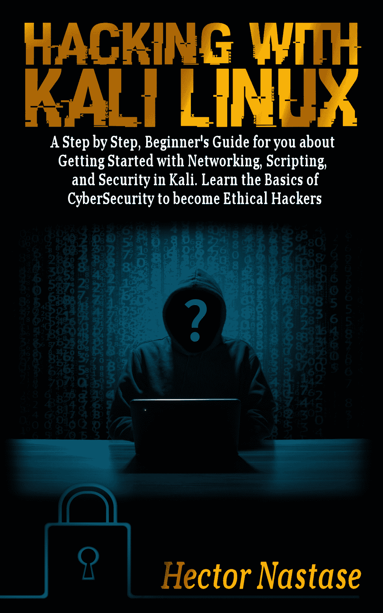
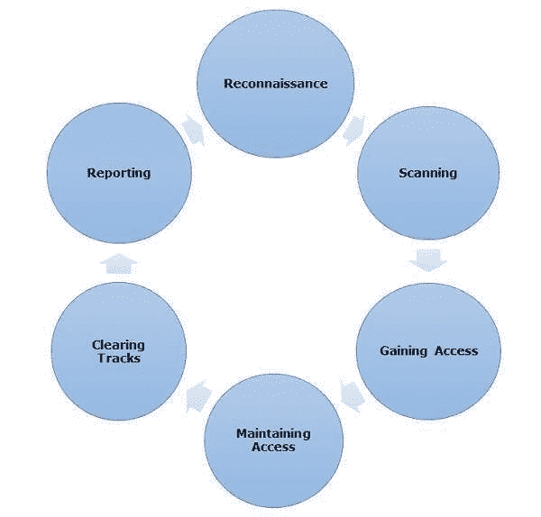
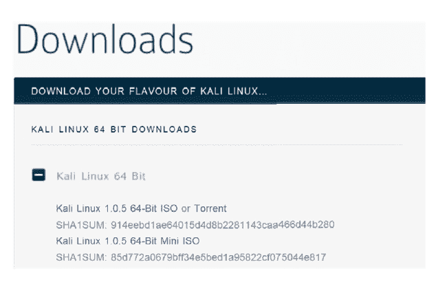
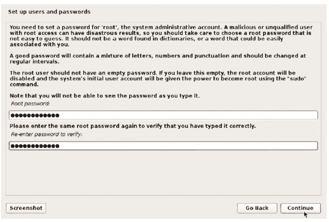
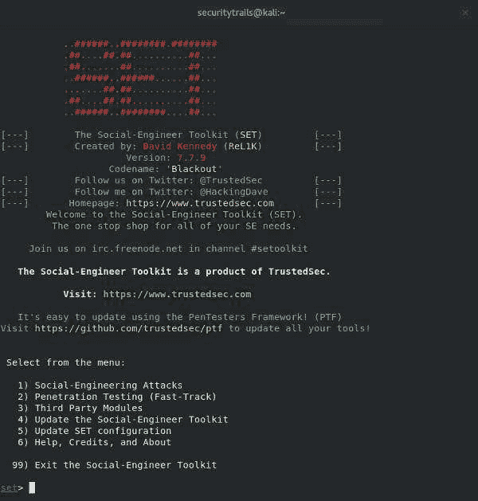
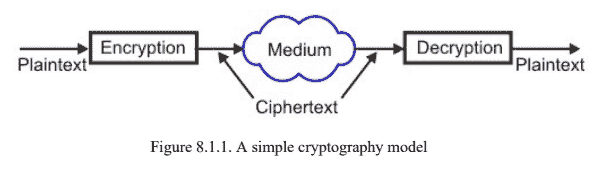
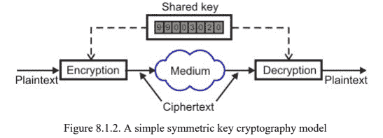
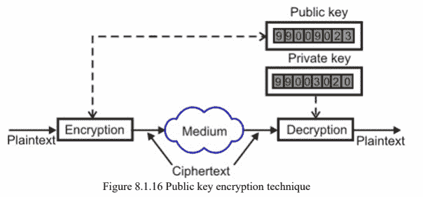

# Kali Linux 攻防：关于 Kali 网络、脚本与安全的初学者指南。学习网络安全基础知识，成为伦理黑客





黑客通常是指未经授权中断系统或电脑；通常由至少一个“黑客”完成。然而，黑客可以是任何人。他们可以是像你我这样的个人。他们可以单独工作，也可以被有动机干扰某些事情或毫无制造混乱的协会利用。通常，他们希望通过改变安全框架来实现自己的目标，而这些目标与框架背后的真实动机不同。还有许多协会聘佣黑客作为员工的一部分。这些黑客利用他们的技能发现协会安全框架中的缺陷、脆弱区域和弱点。这样做是为了发现并修复缺点，并防止恶意黑客入侵安全框架。

## 世界各地的黑客类型

### 1. 白帽黑客
首先，我们有一种理想的黑客类型来打破刻板印象。白帽黑客是一个英雄，尽管听起来可能很有趣。白帽黑客、白帽黑客或道德黑客是指测试现有网络基础以寻找漏洞的个人。将这想象成一把开锁器，他可能会绕过锁具，只是为了建议所有者如何改进锁具。事实证明，白帽黑客在确保大型公司保持领先地位方面至关重要。从政府代表到私人专家，白帽黑客帮助网络变得更更好、更安全。这与黑帽黑客完全不同，道德黑客使用安全系统并寻找框架中的漏洞，目标是在这些漏洞被恶意娱乐者利用之前对其进行修复。像 Facebook、微软和 Google 这样的财富 500 强组织也使用了白帽黑客。

### 2. 黑帽
基本上，这些人是麻烦制造者。黑帽黑客对黑客行为所有不当行为负责。这些人仅仅出于负面目的入侵框架。从获取信用卡数据到调整开放数据库，黑帽黑客希望通过滥用网络结构中的漏洞来获得名声或财务利益。著名的黑帽黑客曾抢劫了银行和金融机构的大量资金和重要的私人信息。

### 3. 灰帽黑客
灰帽黑客通常有混合的。正如颜色代码所暗示的，这种类型的程序员既没有白帽黑客的诚实目标，也没有黑帽的邪恶意图。灰帽会入侵框架，但绝不是为了他们自己的利益。著名的灰帽黑客滥用框架只是为了让数据公开，并凸显包含不良行为的大量数据集。这种黑客类型是互联网上最常见的类型。最广为人知的入侵通常是黑帽和灰帽类型的，但由于没有带带大写字母标签的显著个人成员，灰帽赢得了作为“真正的坏蛋”的桂冠。

### 4. 脚本小子 (SCRIPT KIDDIE)
在许多种电脑黑客中，脚本小子是新手。作为黑客领域的孩童，这种黑客类型对大量的损害不负责，特别是由于他们在进行黑客攻击时投入的技能或精力很少。通过下载黑客代码或预编译的内容，这些黑客只需针对某个产品运行网站并干扰其工作。从引导过载流量或多次运行交换程序，这种黑客类型的影响值得注意，但并不显著。

### 5. 自杀式黑客 (SUICIDE HACKER)


这种黑客类型的名字源于臭名昭著的自杀式攻击者，这些人人在自杀之前会造成巨大的伤害。同样，一个自杀式黑客会意识到自己的身份将被暴露，或者会被捕获，但无论如何都会继续进行黑活动。这可能是为了钱、为了名声甚至是为了权力，与自杀式攻击者无异。

### 6. 黑客主义者 (HACKTIVIST)

黑客主义者是互联网上的抗议者。正如抗议者通过在城市中游行来引起关注一样，黑客主义者黑客会入侵框架和基础设施，以引起对社会事业的关注。黑客主义包括破坏网站和传输受限材料，其目标是让观察者获取取决于黑客目标的数据，而不是网站工程师。

### 7. 红帽黑客 (RED HAT HACKER)

另一种打破常规的大黑客类型，红帽黑客对灰帽黑客行为野蛮。他们的唯一目标是摧毁每种糟糕黑客类型的努力，并铲除整个基础设施。红帽黑客会警惕黑帽攻击，捕获它并黑入灰帽黑客的框架。这不仅能停止攻击，还会打击灰帽黑客的业务！

### 8. 蓝帽黑客 (BLUE HAT HACKER)

在众多的黑客类型中，蓝帽黑客是新手。像真正的业余爱好者，蓝帽黑客会发送可访问的系统，但明确并非出于恶意意。通常，这些是利用初级系统进行的报复性攻击，例如利用内容产生过量流量来影响网站。

### 9. 绿帽黑客 (GREEN HAT HACKER)

这种黑客是黑客领域的学习者。绿帽黑客通常不负责真实的行动，但因其学习和观察一切运作方式的渴望而异常活跃。绿帽黑客经常是互联网上大型学习网络的一部分，在网络中观看关于成名最有效方法的录像和教程。

### 10. 社交媒体黑客 (SOCIAL MEDIA HACKER)


我们列表中的最后一种黑客被称为社交媒体黑客。正如其名称所示，他们侧重于利用不同的策略来黑入社交媒体账户。这种类型的黑客由于其犯罪意图和信息窃取行为，类似于黑帽黑客。你可能在网络上经常遇到被滥滥的黑客术语，例如紫帽黑客或黄帽黑客，但之前提到的那些类别是黑客领域最常用且广为人知的分类。今天，我们将探讨为什么社交媒体账户会成为目标，并揭示一些黑入社交媒体账户的技术。我们还将分享一些关于保护你的社交账户免受社交媒体黑客攻击的最有效技巧。

## 为什么社交媒体账户是目标？

社交网络网站或在线社交平台将个人与其家人、朋友、名人、品牌等联系在一起。我们分享了大量关于自己的身份、兴趣爱好、住处、去向、工作地点、我们以及爱人的照片，以及我们认识的人的信息。我们甚至经常在不考虑潜在安全风险的情况下分享自己的财务细节。

我们经常听到某个一个非正式组织被黑客攻击，导致用户的家庭信息泄露。由于这些程度的数据必须从社交记录中获取，因此社交媒体账户是黑客和骗子关注的重点之一，以获取足够的数据来实现他们的恶意目标。社交媒体黑客可以熟悉受害者的每一个在线活动，从而夺取他们的身份、发现他们的活动、访问他们的个人和专业数据，或进行财务诈骗。

例如，社交媒体黑客可以利用你自己的数据伪伪装你；他们无疑可以获取你的银行数据、购物历史和所在区域，并像你一样进行购买或交易。他们可以查阅你的私信，访问你的每一个联系人，甚至增加黑入他们记录所需的数据。这意味着他们有了更多访问你社交圈内部人员的权限，增加了社交黑客窃取或传播其恶意目的的潜力。

## 社交媒体黑客如何接管账户

为了保护你的社交账户免受社交攻击，了解他们是如何黑入社交媒体账户的至关重要。在这个领域，我们将讨论一些常见的黑客策略，以便利用这些技术避免被黑入。

### 钓鱼攻击 (PHISHING)

这种社交攻击策略非常简单，通常被认为是业余人员使用的攻击手段。然而，它是黑入社交媒体账户最有效的技术之一。通过这种策略，社交黑客有 50-50 的概率获取到受害者的密码，特别是当受害者对基本的网络术语并不了解时。

尽管使用这种策略有多种黑入社交的方法，但最广为人知的一种是创建一个在线社交登录页面的副本，该页面模仿原始的登录页面。无知的受害者认为这是标准的登录页面并输入了自己的登录数据。受害者通过钓鱼页面登录的瞬间，其登录数据就会存储在社交黑客的数据库中。

例如，社交媒体黑客可以通过发送一封自称来自 `Facebook` 或 `Twitter` 等社交社区的邮件来进入你的账户。邮件的品牌看起来像你使用的在线社交巨头网站，并通知你来自另一个国家的人正尝试访问你的账户，或者你有许多新消息或通知。在邮件末尾，他们邀请你点击提供的链接以确保你的账户或打开账户以检查通知。你一点击那个链接，就会被带到一个页面，该页面是原始社交网站登录页面的完美复制。

### 键盘记录 (KEYLOGGING)

这种策略依赖于使用一种名为 `Keylogger` 的程序来监控并记录社交网络客户端输入的所有按键。该程序可以有效地通过网络将你所有的输入传输给社交黑客。

这种策略是黑入社交媒体账户最简单且最有效的程序之一，已被用于黑入许多 PC 专者的账户，因此在管理键盘记录程序时必须小心。

### 第三方应用或游戏

社交媒体黑客进入你账户的另一种方法是制作旨在汲取你数据的外部应用程序或游戏。你是否经常在手机或电脑屏幕上看到类似如下所示的信息：“某个应用程序可能想要访问你的 `Facebook`、`Twitter`、`Instagram` 或其他在线社交账户。点击 `YES` 或 `OK` 允许访问”。考虑到，这些第三方应用程序中的某些是有问题的，而当你允许它们进入或将它们整合到你的在线社交账户中时，你实际上为社交黑客打开了大门。

骗子可以黑入这些故障或低信任的应用程序，并添加必要的数据完成他们的恶意目标。我们并不是要求你拒绝所有请求访问配置权限的第三方应用程序，但你应该在允许它们之前尝试检查应用程序的真实性。

### 中人攻击 (MAN-IN-THE-MIDDLE)

通过这种策略，社交黑客秘密地更改并传输当事人与他们认为正在直接通信的另一方之间的数据。他们与受害者建立独立的连接并向他们发送消息，让受害者误认为自己正在私有连接上直接对话，尽管社交黑客控制着整个对话。

黑客拦截在受害者之间传输的所有重要数据并注入新的数据。在大多数情况下，这种活动是明显的；例如，社交黑客可以自己伪装成其接收范围内某个远程通道的“中间人”。

### 会话劫持 (SESSION HIJACKING)

通过这种系统，社交黑客从受害者的浏览器中劫持 Cookie 来访问受害者的账户。这些令牌包含了受害者身份验证的会话，会话是在他们登录账户时，社交服务器与其程序之间的通信产生的。

社交黑客通常将这种策略用于在非安全 (`HTTP`) 连接上访问社交媒体网页的受害者，这在 Wi-Fi 和局域网连接中很常见。

### 创建免费账户

黑客还可以通过创建一个免费账户并对其进行结构化，使其直接与目标的兴趣或业务相匹配，并向目标发送好友请求。如果目标接纳了黑客的好友请求，黑客就会接触其数据和关系中的所有联系人，并继续实施身份盗用。

除了上述记录的技术外，社交媒体黑客在以下情况下也可以进入你的账户：

*   你的设备上存在恶意软件或感染
*   你授权的外部应用程序被黑入或破解
*   你的人际网络网站被黑入
*   你点击了网页、消息或电子邮件中的有害链接
*   你使用了常用或弱弱的密码
*   你的安全软件已过时

## 预防或停止社交媒体黑客黑入你账户的步骤说明

*   登录你的账户并检查是否有任何其他个人（例如，任何与你不同的电话号码或电子邮件地址）靠近你的账户。如果是这样，请立即停用或删除它们。


*   更新您的杀病毒软件和其他安全程序，并对您的设备运行全盘扫描，以清除可能监视或窃取您登录数据的有害项目和文档。重启设备并再次运行扫描。将您的设备设置为计划更新，以防范新的攻击。
*   为拥有的每一个社交媒体账户升级独特且强力的密码，并启用双因素身份验证（也称为两步验证），为您的账户增加额外的安全保护。
*   检查您的社交媒体账户授权，限制外部应用程序的访问权限。
*   在所有设备上使用 `VPN`，特别是在公共网络环境下。通过使用 `VPN`，您的流量和身份会被加密，使黑客难以破解您的互联网生活账户。这种技术是防止中间人攻击等其他威胁的可靠方法。
*   避免使用局域网（LAN）和开放 Wi-Fi 进行社交媒体操作、在线银行以及发送重要或敏感信息。将任何公共或开放 Wi-Fi 视为社交黑客的乐场。
*   检查您的社交媒体登录页的 URL，远离来自可疑或未知网页的链接。
*   如果您发现自己的社交媒体账户被盗，请向您的社交网络平台报告此入侵行为，以便阻止攻击扩散。您应该提醒亲友防范诈骗。

# 系统破解

攻击者有几种不同的方式访问特定的框架，但无论何种方式，攻击者都需要滥用缺陷、漏洞甚至人为错误的能力。

## 攻击类型

### 1. 操作系统攻击
攻击者扫描操作系统漏洞并对其进行滥用。此类模型包括漏洞（bugs）、缓冲区溢出和故障，以及未打补丁的工作框架。

### 应用层/预装代码攻击
编程是一项困难的任务，有时会反复使用未绑代码来降低这种难度，例如使用现有的代码库。如果代码已经存在，为什么要重新发明一个已经解决的问题？这导致这些应用程序缺乏或完全没有错误检查，从而引发缓冲区溢出攻击、跨站脚本、`DoS`、SQL 注入攻击、会话劫持、中间人攻击等。

### 配置错误攻击
当对文档授权进行更改时，就会发生框架配置错误。在这种情况下，该记录或应用程序再无法被认为是安全的。管理员负责在设备发送到系统之前更改其设置和最高权限。未能做到这一点会导致攻击者利用默认设置来攻击框架。

### 2. 密码破解
使用不同的程序和工具从 PC 框架中恢复密码。黑客可以利用这些工具增加对漏洞框架的未经授权访问。这些方法中很大一部分之所以有效，是因为密码薄弱或易于猜中，例如字典单词或默认密码。此类密码破解方法包括字典攻击、混合攻击、组合攻击、音节攻击和基于规则的攻击。令人震惊的是，最近已记录了许多非专业的密码破解程序，例如窥视偷窥（shoulder surfing）、社会工程和垃圾桶翻找。

### 3. 间谍软件/键盘记录器
指专门隐藏的程序或设备（编程或设备），用于在不告知用户信息的情况下记录客户端与框架的交互。不同类型的间谍软件包括：截屏间谍软件、`USB` 间谍软件、儿童监控间谍软件、视频间谍软件（秘密记录摄像头和视频聊天内容，攻击可以通过网络或手机远程查看）、声音/手机间谍软件、GPS 间谍软件（利用全球定位框架确定车辆、个人或其连接/引入的资产区域），甚至是打印间谍软件。

### 4. 病毒/木马/蠕虫
通常是指框架上的恶意软件实例、未经请求的代码或程序，这些程序在很大程度上考虑了信息泄露、黑客访问的次级通道访问或执行损坏框架的操作？这类恶意软件通常由恶意代码或可以攻击脆弱框架的设备和工具制作（只要程序员知道漏洞所在）。

### 5. Rootkits（根内核程序）
指隐藏在工作框架内部的代码，它可以隐藏并掩盖恶意目的的迹象。具体来说，它将某些工作框架调用和工具替换为它自己的自定义版本。从此，攻击者通过引入感染、木马、蠕虫或其他恶意软件获取框架的 root 权限（某种执行级别），以便滥用。这使得攻击者能够保持对框架的隐藏访问。此类 rootkits 包括虚拟机级、内核级、应用级、设备/固件和启动加载程序级。

### 6. 信息隐术
是一种将秘密信息隐藏在普通信息或文档中并在目标处移除以保持其隐藏身份程序。这种程序最常见的用法是黑客使用一张真实的图片，并在图片文件中插入代码来执行恶意操作。这隐藏了文档内部的信息。此类系统包括替换、域变换、覆盖生成、弯曲、统计和空域范围。除图片外的其他隐术方法还包括文件、视频和音频隐术。

# 道德黑客及其目的

在道德黑客过程中具有实践经验的人被称为道德黑客。他们是专家，通过破解框架或系统寻找潜在的缺陷、陷阱和漏洞，这些漏洞可能会被灰帽黑客或破解者滥用。道德黑客的能力和观点与具有恶意目标的黑客相当，但他们是值得信任的。道德黑客在对目标框架执行破解时经过认证和批准（“认证道德黑客 - CEH | | EC-Council”）。道德黑客拥有合法权限访问目标的个人数据并调整目标框架。道德黑客掌握的能力可以用于限制网络犯罪。除了白帽黑客和黑帽黑客，还发现了另一类黑客，他们与道德黑客紧密合作，但面临某些社会后果。这些黑客被称为帽黑客，他们为了良好的目的（如帮助协会修复安全问题）破解专用和组织框架，但他们未经授权的。灰帽黑客执行道德破解，但他们未经授权的方法导致了社会认可。办公室、组织和协会聘请道德黑客来确保其安全符合标准。

# 破解过程

简而言之，由白帽黑客执行的道德破解是一个用于描述组织和协会防御性破解的术语，其中包括对计算机或系统潜在风险的区分证明。像任何伟大的工程一样，道德破解有很多特定的阶段。它使黑客进行组织的道德破解攻击。不同的安全手册以各种方式定义了道德破解的过程，但据我所知，整个过程可以分为以下六个阶段：

1.  `Reconnaissance`（侦察）
2.  `Scanning`（扫描）
3.  `Access Gain`（获取访问）
4.  `Maintain the Access`（维持访问）
5.  `Clearing your Tracks`（清除踪迹）
6.  `Reports`（报告）


道德黑客攻击流程分为如下所示的六阶段：


## 什么是侦察？

侦察（Reconnaissance）是一种收集数据的初步审查；特别是：对敌方区域进行的探索性军事研究。网络安全观察是一种利用各种技术收集目标数据的方法。在对目标进行侦察练习时，道德黑客会利用三种基础数据：

* 网络
* 主机
* 包含在内的客户端人员

## 执行侦察练习的步骤

收集数据和熟悉目标框架是道德黑客的主要程序。监控涉及许多过程和系统；足迹（Foot-printing）、`Scanning`（扫描）和 `Enumeration`（枚举）用于发现并收集有关目标的数据。在侦察工作/阶段中，道德黑客努力在完成下面记录的七个阶段后，尽可能地按照合理预期收集关于目标框架的数据：

* 收集初始数据
* 确定系统范围
* 识别活动机器
* 发现可用的开放端口以及应用程序（接入点）
* 操作系统指纹
* 寻找运行在不同端口上的管理程序
* 网络制图

侦察本质上分为两个重要部分。

### 主动侦察
主动侦察包括与你的目标计算机框架直接接触以收集数据，直接获得的数据非常准确。在未经授权的情况下进行主动侦察时存在被发现的风险。然而，大多数黑客攻击练习都需要主动侦察。

### 被动侦察
在此过程中，你不会与计算机框架直接关联。此程序用于在不与目标框架进行交互的情况下收集基础数据。

### 足迹 (Foot-Printing)
足迹是一种更大层次的尝试，旨在从高层勾勒场景特征。在 CEH（认证道德黑客）术语中它们是互义词，但如果你只需记住足迹是一种监控就足够了。

在足迹阶段，你正在寻找任何可能让你了解目标某些知识的数据，无论其大小如何。具有特定意义的事项例如：高层系统设计（他们声称在使用哪些交换机？买了哪些服务器？）、应用程序和网站（他们会说是面向公众的吗？）以及物理安全措施（什么种区域控制框架构成了主要障碍？员工的日常日程是怎样的？）。显然，任何关于员工本身的数据都是极其宝贵的，因为这些人员在测试测试后期将成为你的巨大目标。虽然获取这些部分信息可能有些困难，但大多数信息获取相对容易，而且只要你睁开双眼，它们就在你面前。与监控一样，足迹分为两种：主动足迹和被动足迹。

在此过程中，黑客还会特别关注以下内容：

* 域名
* IP 地址
* 命名空间
* 员工信息
* 电话号码
* 电子邮件
* 职位信息

### 枚举 (Enumeration)
真正意义上的枚举是按照类别对物品进行有组织的完整列出。枚举是列出配置、客户端记录、共享和不同资产列表的过程。这一过程发生在漏洞评估之前、`scanning` 之后。这使得攻击者能够制定获取访问权限的最佳策略。规范可用于收集以下数据：

* 用户和组
* 网络和共享路径
* 主机名
* 路由表
* 服务设置
* SNMP 端口过滤
* DNS 详细应用程序和横幅

可以使用相应的工具进行识别。在 Windows 操作系统中，可以使用许多设备来列出 NetBIOS 名称，命令如下：

* `net accounts`
* `net config server`
* `net config workstation`
* `net view`

以及更多

### 扫描 (Scanning)
在此过程中，攻击者开始有效地测试目标机器或系统是否存在可被利用的漏洞。在此过程中使用的设备有 `Nessus`、`Nexpose` 和 `NMAP`。

### 获取访问 (Getting Access)
在此过程中发现漏洞并尝试利用它以进入框架。在此过程中使用的基本工具是 `Metasploit`。

### 维持访问 (Maintaining Access)
这是黑客刚刚进入框架的地方。在获得访问后，黑客会引入几个后门，以便将来需要访问该框架时再次进入。`Metasploit` 是此过程中的优选。

### 清除轨迹 (Clearing Tracks)
此过程实际上是一种利用性行动。它涉及删除黑客过程中发生的大量日志。

### 报告 (Reporting)
报告是完成道德黑客过程的最后步骤。在这里，道德黑客收集一份包含其发现的操作的操作，例如使用的设备、成功率、发现的漏洞和利用过程。

## KALI LINUX
安装操作系统（例如微软的 Windows、苹果的 OSX 或 Debian 和 Ubuntu 等开源平台）对某些人来说很自然，但对这一过程进行更新在任何时候都是很好的。从未引入过工作框架的人不应该压力，此部分的后续将提供查找、下载和安装 Kali Linux 所需的所有手段。Kali Linux 在许多方面与众不同，但该发行版最重要的区别在于它可以从硬盘安装运行，也可以作为现场光盘启动，以及默认引入的特定应用程序的数量和种类。现场光盘是安装在光盘（CD）、数字视频光盘（DVD）或蓝光磁盘上的工作框架。作为渗透渗透分析师，启动现场光盘的能力是非常重要的。

拥有系统本地机器访问权限的人可以使用现场光盘来使用这些机器，无论渗透测试人员对已安装的操作系统是否有记录。框架将启动到现场光盘而不是本地硬盘；换之，如果机器配置得当，渗透分析师此时将访问本地系统上的大量资源，同时不会在本地机器的硬盘上留下证据。Kali Linux 上安装的程序是另一个说明它为何为渗透分析师奇备的理由。通常情况下，Kali Linux 内置了 400 个渗透测试和安全设备、包和应用程序，并可以根据需要包含更多。

## 系统信息
每个操作系统都有其特性和细微差异，这些差异会通过其底层架构和配置体现出来；无论如何，大多数基于 Linux/Unix 的平台本质上是相似的。在引入 Kali Linux 时，与其它 Linux 工作框架一样，安装前的配置至关重要。以下是引入 Kali Linux 时一些要点的简要列表：

* 工作框架将运行在 PC 还是服务器 上？
* 需要多大的硬盘？
* 可用硬盘是否有足够的可用空间？
* 需要多少个硬盘分区？
* 日志管理是否令人担忧？
* 安全是否令人担忧？


# 选择安装硬件平台

通常情况下，操作系统安装在 PC 的硬盘上。在任何情况下，对于某些操作系统（例如 `Kali Linux`），由于大容量设备的持续性、易用性且合理性，可以将操作系统安装到 U 盘（也称为闪存盘）和 SD 卡中。尽管大容量便携存储设备被用于安装操作系统，但决定是安装到独立 PC（例如实验室 PC）还是安装到将考虑移动部署的 PC 上至关重要。如果将使用某些特定设备（例如强大的设计显卡）进行密码破解，建议在个人电脑上安装 `Kali Linux`。如果需要将操作系统从一个站点传输到另一个站点，或者想要测试远程设备，建议使用 PC。操作系统的安装对于 PC 和个人电脑来说是同一样的。

## 硬盘选择

尽管不言过其实，但“容量确实很重要”。一个通用的可靠指南是：硬盘越大越好。本书建议使用至少具有 120GB 空间的驱动器；此外，即使是这样也很快就会满，特别是考虑到密码破解、取证或渗透测试项目需要大量的权限、证据、日志以及报告或收集的素材。由于一般的业务和政府安全评估，操作系统会被清理、删除或完全移除，以保持处于标准状态。这种做法在整个安全网络中是公认的，因为需要对客户分类信息进行合法处理，并限制可能损害组织架构或声誉的企业数据泄露。

## 硬盘分区

分区是通过设置唯一的区域大小和部分将文件系统分离到硬盘的特定区域的过程。分区可以防止操作系统被接管框架的日志记录所破坏，并在某些情况下提供更强的安全性。操作系统在根本上被有效地拆分为两个不同的部分。主分区是交换区域（swap territory），用于内存分页和容量。另一个分区被分配给其他所有内容，并带有文件结构进行组织，例如全扩展文件系统 3 (`ext3`) 或扩展文件系统 4 (`ext4`)。对于工作站，特别是那些工作框架将反复加载的设备，进一步划分并不是必要的。对于具有持久持久操作系统的修改设备或 PC，有必要分离临时（`tmp`）记录。

硬盘的高级分区和 PC 双系统启动不在本书的范围内，将不会提供。主要的特殊情况位于附录 A，其中展示了带有名为 `Tribal Chicken` 的第三方应用程序的修改设备。

## 安装期间的安全性

`Kali Linux` 是一个极其强大的操作系统，拥有许多预装工具，这些工具可以破坏 PC、网络基础设施，而且如果被不当或不合道德地使用，可能会导致被视为犯罪或违法的活动。因此，密码是至关重要的。虽然密码是最基本的安全实践，但许多管理员和安全专家经常忽略或忽视密码的使用。基本的安全实践（例如对密码的合法使用）对于确保你的 `Kali Linux` 安装不被其他可能无意或恶意对个人、PC 或网络造成损害的人使用至关重要。

## 下载 KALI

`Kali Linux` 是 Linux 的一个发行版，以 `ISO`（读音：eye-so）记录格式下载。它应该从另一台 PC 下载，并在安装之前刻录到磁盘中。在编写本书时，可以通过 `http://www.kali.org/downloads/` 下载 `Kali Linux`。关于最新活动、设计和特殊案例的文档也可以 Kali 的官方网站 `http://www.kali.org/official-documentation/` 上找到。还有一个非常大且活跃的网络社区，用户可以在那里提问并帮助他人解决问题。建议注册该网站以访问由 `Kali Linux` 创建者 `Offensive Security` 管理的网络公告。`Offensive Security` 还会发送有关更新和网络数据的消息（图 2.1）。确保选择正确的架构（`i386 5 32 位`、`amd64 5 64 位`）。Kali Linux 的受信任贡献镜像不在本书的范围内；但如果你想熟悉 Kali 或需要一个沙箱环境进行更强大的控制，那么 `VMware` 下载是这些情况的理想选择。点击合适的下载链接继续你的选择。

对于 Microsoft Windows 7 用户，双击完成下载的文件将弹出 `Burn ISO Wizard`。按照提示完成 ISO 镜像到可用于安装的 DVD 的转换。Linux 用户应该在使用光刻程序打开 `ISO`，例如 `K3b`。



## 首次启动 Kali

启动到 Kali Linux 桌面的 PC 将显示一个类似于图 2.2 的屏幕。本指南正在使用的 Kali Linux 版本为 `1.0.5 64-Bit`；在不同时间下载的版本可能略有不同；无论如何，图形化安装在本质上是非常相似的。每个新 Kali Linux 版本的更新指南可以在 `http://www.kali.org/` 找到，强烈建议在安装之前或在安装过程中遇到任何问题时参考该网站以获取最新文档。

`Kali Linux` 以“Live CD”（也称为 Live ISO）的形式发布，这意味着操作系统可以直接从光盘运行，而无需安装在硬盘上。这种非持久状态意味着一旦 PC 关闭，任何保存的设置、文件或工作都会丢失。以非持久模式运行 Kali 可以让你在不删除之前安装在硬盘上的操作系统的情况下学习 Linux。


FIGURE 2.2 Live ISO 菜单

如果设备支持语音，可以通过语音控制安装。本书将关注图形化安装；因此选择 `Graphical Install`。

## 安装：设置默认

接下来的几个屏幕允许选择默认语言、区域和控制台语言。选择合适的设置并点击继续进入安装程序。随着 PC 开始安装 Kali Linux，整个屏幕上会显示不同的进度条。对于大多数选择屏幕，选择默认设置是合适的。

## 安装：初始网络设置

图 2.3 显示了基本的网卡配置和基础设置。通过在框中输入主机名并点击继续。主机名应该是唯一的，因为在相同网络上，无意中具有相同主机名的 PC 可能会导致系统管理混乱。

选择主机名并点击继续按钮后，下一个屏幕将请求 PC 的完全限定域名 `FQDN`。这对于加入空间环境很重要，但对于大多数实验室环境来说过多。对于本指南，`FQDN` 被故意留空，可以通过点击继续按钮跳过。


FIGURE 2.3 设置主机名

## 密码

后续向导将请求 root 密码。默认密码是 `toor`；此外，建议选择另一个包含至少以下每个元素的密码：大写字母、小写字母、数字和符号。密码对客户不应该是明显的，且不能被有效猜测。建议使用至少 10 个字符的密码语。例如，如果客户曾经打过中学的足球，那么 `soccer22` 就不被推荐。可以使用各种正则表达式来生成密码。以下是一些强密码的示例：


* `St0n(3)b@tt73` "石头大大战"
* `P@p3r0kCur5#` "布石头、石头、诅咒"
* `m!gh7yP@jjjama% h` "强力睡衣"


在设置密码时，它将显示为一系列圆点或参考标记。这是很典型的做法，并且可以防止你的密码在有人可能查看 PC 屏幕时被泄露。在两次输入等效强密码单词后，点击“继续”（Continue）按钮以继续进行安装（图 2.4）。 图 2.4 设置密码。

## 用户管理
当你启动 Kali 时，你已经设置好了 root 客户端。与其他的 Linux 发行版不同，你不会被要求创建另一个客户端。这是因为你在 Kali 中可能进行的大部分操作都需要超级用户（root）权限。因此，尽管以 root 客户端登录是一个坏习惯，但并没有动力再创建一个新客户端。这种设计的意图是，使用 Kali 的人应该足够了解自己在做什么，因此不太可能因为 root 权限而把自己搞砸。

然而，在 Kali 中包含和通用管理客户端仍然可能的，这与不同的发行版类似。如果你需要创建一个客户端，可以简单使用 `useradd` 命令。你也可以使用 `adduser`。两者的目标相似。在创建用户时，了解用户的一些属性非常有价值。每个用户至少应该有一个家目录、一个 shell、一个用户名和一个组。

例如，如果我需要添加我的用户名，我会使用 `useradd -d /home/kilroy -s /canister/slam -g clients -m kilroy`。给定的参数决定了家目录、用户在交互登录时应执行的 shell 以及默认组。`-m` 参数表示 `useradd` 应该创建家目录。这会在家目录中填充交互式登录所需的骨架文件。

根据确定的组 ID（GID），`useradd` 要求该组必须存在。如果你需要你的用户拥有它自己的组，可以使用 `groupadd` 创建一个新组，然后使用 `useradd` 创建一个属于该组的用户。如果你需要将你的用户添加到多个组中，可以修改 `/etc/group` 文件，并将你的用户添加到你希望该用户加入的每个组行的末尾。为了获得与这些组的记录访问相关的任何权限，例如，你必须注销并重新登录。这将使更改应用到你的用户，包括新加入的组。

创建用户后，你应该设置一个密码。这通过使用 `password` 命令完成。如果你已登录并需要更改另一个客户端的密码，由于我们在第一个模型中创建了客户端，你需要使用 `password kilroy`。如果你只是使用不带用户名的 `password`，你将更改你自己的密码。

## 服务管理
很长以来，有两种服务管理模式：BSD 方式和 AT&T 方式。现在已不再如此。目前有三种不同的管理服务的方法。在我们进入服务面板之前，我们应该首先定义什么是服务。在此语境下，服务是一个在没有客户端参与的情况下运行的程序。工作环境会自动启动它，它在后台运行。除非你有一个程序列表，否则你可能永远不知道它正在运行。大多数框架在任何时候都有运行着数量相当多的的服务。它们被称为服务，是因为它们为框架、客户端，或者偶尔为远程客户端提供帮助。

由于没有即时的客户端通信，大程度上，关于这些服务的启动和结束，应该有另一种方法来启动和停止服务，这些方法可以在框架启动和关机期间自然地调用。有了处理这些服务的工具后，客户端也可以使用相同的工具来启动、停止、重启和获取这些服务的状态。

长期以来，许多 Linux 发行版使用 AT&T `init` 启动进程。这些隐式服务运行时带有许多带有标准参数的内容。`init` 启动框架利用运行级别（run levels）来确定哪些服务已启动。单用户模式会启动一套与多用户模式不同的服务配置。当使用显示器服务时，会启动更多的服务，以给客户端提供 GUI。内容被存放在 `/etc/init.d/` 中，可以通过给出参数（例如 `start`、`stop`、`restart` 和 `status`）来管理。例如，如果你需要启动 SSH 服务，你可以使用命令 `/etc/init.d/ssh start`。然而，`init` 框架的问题在于它在很大程度上是顺序性的。这导致了框架启动时的性能问题，因为每个帮助都是分组启动的，而不是多个服务同时启动。`init` 框架的另一个问题是它对条件的支持不好。通常，一个服务可能依赖于必须先启动的不同服务。

`systemd` 出现了，它是由 RedHat 的程序员创建的。`systemd` 的目标是提高 `init` 框架的效率并克服它的部分弱点。`systemd` 可以声明条件，服务可以并行启动。不再需要编写 bash 脚本来启动服务。相反，有设计文档，所有的服务都通过 `systemctl` 程序处理。要使用 `systemctl` 处理服务，你需要使用 `systemctl action service`，其中 action 是你传递的指令，service 是服务的名称。例如，如果你需要启用 SSH 服务并随后启动它，只需输入指令。

## 软件包管理
虽然 Kali 随带了大量的软件包，但并不是 Kali 适合安装的所有内容都在默认安装中。你偶尔可能需要安装软件包。你还将刷新你的软件包列表。要管理软件包，忽略你正在尝试做什么，你可以使用高级软件包工具（APT）来执行这些功能。还有其他不同的管理软件包方法。你可以使用前端，但最后它们都是建立在之上的整个项目。你可以使用任何你喜欢的前端，但使用命令行是自然的，了解如何使用它是有价值的。虽然它是命令行，但比我多年来看到的许多前端要简单得多。你可能需要执行的主要任务是刷新本地数据库中的所有元数据。这些关于包的信息，包括版本号。版本数据用于判断产品是否过时并需要更新。

## 日志管理
通常，如果正在进行安全测试，你可能永远不需要需要查看框架上的日志。尽管如此，多年来，我发现日志是无价的。尽管 Kali 可能非常强大，总会有某些事情变得糟糕并且你进行调查。事实上，当一切都顺利时，你可能仍然需要查看应用程序正在记录什么。因此，你必须理解 Linux 中的日志框架。UNIX 长期以来使用 `Syslog` 作为记录器，但它最初是发送邮件服务器的日志工具。多年来，`syslog` 有许多实现。Kali Linux 默认引入了 `rsyslog` 实现。它非常直接，而且决定需要在日志数据中搜索的区域并不困难。总之，所有日志都进入 `/var/log`。但是，有一些特定的文件你应该在日志片段中搜索各种类型的数据。在 Kali 上，你会检查 `/etc/rsyslog.conf`。

## 配置系统时
图 2.5 显示了选择时区的概要。点击适当的时区并点击继续。
设置 Linux 操作系统的方法多到某人可以为这个主题写一本书。本指南将集中在最基础的设置上——引导分区（Guided Partitioning）。图 2.6 到图 2.10 显示了默认设置（注：原文此部分存在大量重复和乱码，翻译已根据核心意图精简并对齐）。

引导分区 (Guided Partitioning) 是最基础的设置。在安装过程中，图 2.6 显示了分区的各种选项。LVM（逻辑卷管理）不适用于工作站、优盘或 SD 卡。LVM 适用于多个硬盘并专门建议用于高级用户。“引导分区”（Guided-）是最佳选择。点击 Continue 继续安装过程。


## 1. 开源
这确实是主要原因。黑客使用 `windows` 吗？黑客使用 `Macintosh` 吗？不，真正的黑客使用 `Linux`，因为 `Linux` 是一个免费开源的软件开发和发行系统。什么是开源软件？它是指源代码免费开放，并可能重新分发和调整的产品。拥有一个 `Linux` 发行版就像拥有一个完全受控的个人操作系统。由于 `Linux` 源代码随处可用，你可以根据需要轻松修改更改 `Linux` 发行版的源代码，此外，运行在该操作系统上的大部分应用程序也是开源的，这使得更具优势。`Windows` 或 `Mac` 无法给你提供像 `Linux` 那样的强度。

## 2. 不需要定期重启
在安装软件或 `Windows` 更新后，你的 PC 始终会请求重启以使其功能完全正常。黑客不会使用那种每次安装软件后都需要重启的操作系统。因此，黑客选择了 `Linux`，它不需要为了维持性能水平而偶尔重启。

## 3. 常规系统配置
在 `Linux` 中，系统配置绝不是什么大难题，你可以在从简易电脑到超级计算机的任何 PC 上运行 `Linux`。今天配备典型系统配置的笔记本电脑/PC 非常适合运行 `Linux` 发行版。

## 4. 不会因内存泄漏死机或运行缓慢
这将 `Linux` 的一个显著特征。黑客使用 `Linux` 的另一个动机是，与 `Windows` 或 `Mac` 不同，`Linux` 不需要为了维持性能水平而偶尔重启，而且它不会运行一段时间后因为内存泄漏等问题而死机或运行缓慢。

## 5. 可移植性
利用 `Linux` 的另一个目的是它的可移植性。人们可以在不安装的情况下，配合 `Windows`、`Mac` 或其他操作系统使用 `Linux` 发行版。真的，`Linux` 随你随行。由于实际上所有的 `Linux` 发行版都有 Live 启动功能，因此你可以在不向 PC 下载 `Linux` 的情况下进入任何电脑。你只需要将下载好的 `Linux` 发行版 ISO 文件放在 USB 闪盘或 CD/DVD 中即可。

## 6. 安装简单快速
这对于初学者来说可能很困难。但对于黑客来说，`Linux` 是方便的，因为黑客经常切换操作系统，而 `Linux` 发行版在任何情况下都易于安装。而且，`Linux` 的引入比其他操作系统更快。同样，该操作系统的启动时间也比某些操作系统更快。

## 7. 兼容性
`Linux` 发行版支持所有的 `UNIX` 软件包，并可以支持其中所有的基础文档组织。事实上，你甚至可以在良好的模拟器帮助下运行 `Windows` 虚拟产品。

## 8. 多任务处理
`Linux` 旨在同时完成许多任务。完全不像 `Windows`，它在从你的 PC 复制或移动记录时不会挂起或减慢不同任务的运行，此外，在上面可以有效地执行多得的工作，而不会干扰任何核心程序。

## 9. 网络友好性
由于 `Linux` 是开源的，并由网络组织社区贡献，因此它能够很好地解决如何在上面进行配置，还提供了许多可以测试网络渗透的库和命令。此外，该操作系统更可靠，并且比某些其他操作系统网络备份速度更快。

## 10. 隐私与安全
你是否问过为什么 `Linux` 不需要杀毒软件？我们整个人通常会在预装的 `Windows Defender` 之外使用额外的杀毒软件，为什么？因为我们不信任 `Windows` 内置的杀毒软件。所以我们担心在线安全。另一方面，`Linux` 不需要杀毒软件，是因为 `Linux` 是最安全的操作系统，它的漏洞非常少。另一个重要因素是 `Linux` 联合安全与保护，每个黑客都喜欢留在黑暗中，所以匿名对每个黑客来说都是一个重要计划。此外，借助 `Linux` 中的某些工具，黑客可以完全隐藏在后台。真的，你现在可能会说，利用良好的 VPN 服务在 `Windows` 中同样可行。但事实是，无论你是否使用良好的 VPN，你无法躲避 Windows 的监控眼睛。这些就是 Linux 用于黑客攻击的一些原因。如果你真的想成为一名伦理黑客，请卸载你的 Windows。

## 什么是网络安全？
网络安全是确保系统、设备和项目免受网络攻击并从中恢复的状态或程序。网络攻击是对组织、员工和买家日益增长的风险。它们可能旨在获取或破坏敏感信息，或勒索金钱。事实上，它们可以破坏组织并损害个人的私人和财务生活。

## 什么是最佳防御？
强大的网络安全框架在电脑、系统和项目上跨越多个层保护。此外，强大的网络安全框架不仅取决于网络防御技术，还取决于个人做出明智的网络防御决策。好消息是？你不需要成为网络安全专家来理解和实践网络防御策略。本指南可以提供帮助。你将熟悉网络安全以及如何帮助自己防御网络威胁。它可以帮助你在危险准备入侵你的系统或设备之前识别并规避它们。

## 网络威胁类型
有许多种网络威胁可以攻击你的设备和系统，但它们大致可分为三类。这些分类是针对机密性、完整性和可用性的攻击。

*   **针对机密性的攻击**：这些包括获取你的身份识别数据以及财务余额或万事达卡数据。许多攻击者会获取你的数据并在暗网上出售供他人购买和使用。
*   **针对完整性的攻击**：这些攻击涉及个人或任务的破坏，通常被称为泄露。网络犯罪分子将访问并泄露敏感数据以揭露信息，影响大众对该组织失去信任。
*   **针对可用性的攻击**：这种网络攻击的目的是阻止用户访问他们自己的信息，直到他们支付费用或赎金。通常，网络犯罪分子会入侵你的系统并阻止你访问重要信息，要求你支付赎金。组织在某些情况下支付赎金，并在稍后修复网络漏洞，其目的是避免终止业务活动。

以下是属于上述记录的三类的几类网络威胁：

*   **社会工程学**，一种针对机密性的攻击，是在心理上控制个人以执行某些活动或交出数据的过程。钓鱼攻击是广为人知的社会工程学类型。钓鱼攻击通常表现为欺骗客户的电子邮件，诱骗客户交出个人数据。
*   **APT（高级持续性威胁）**，一种针对完整性的攻击，是指未经授权的客户在不被察觉的情况下入侵系统，并在系统中留存很长时间的攻击。APT 的目标是获取信息而不破坏系统。APT 经常发生在具有高价值数据的领域，例如国防、制造业和金融行业。

## 如何帮助防止网络安全攻击
遵循以下步骤进行网络安全：


- 在提供个人数据时，请仅使用受信任的网站。一个通用的良好指南是检查 URL。如果网站包含 `https://`，那么它就是安全的网站。如果 URL 包含 `Http://`——请注意缺少了 "s"，应避免输入信用卡信息或社会安全号码等关键数据。
- 不要打开来自未知来源的邮件连接，或点击其消息中的链接。个人受到攻击最广为人知的方式之一，就是通过伪装成由你信任的人发送的消息。
- 始终保持您的设备处于更新状态。软件更新包含修复安全问题的重大补丁。网络攻击者在过时的设备上大有可乘，因为这些设备没有配备最新的安全软件。
- 定期备份您的记录以防网络安全攻击。如果因为网络攻击而必须清理设备，您的记录将存储在受保护的独立位置中。


网络安全始终不断进步，这使得人们很难跟上更新的步伐。保持学习和在网络上保持警惕是保护你自己和业务的两种最理想的方法。要熟悉网络安全，请访问我们的风险风险社区获取最新的数字安全新闻。

## 计算机和网络固有的不安全性

如今版本的互联网是高级研究计划局网络（`ARPANET`）的独特发展成果。它从 1962 年起受到美国国防部（`DoD`）国防高级研究计划署（`DARPA`）的支持，主要为了在参与国防部查询的大学和研究实验室之间进行升级的数据交换。从一开始开始，网络设计者就强调稳健性和生存能力，而非安全性。当时，对于重点关注安全性并没有明确的要求，因为数据框架是在巨大的独占机器上构建的，这些机器关联的类型电脑并不多。

由于 `ARPANET` 的动态发展，这变成了一个遗留问题。如今使框架如此脆弱的原因是三个因素的汇合：相似的基础性系统创新（未考虑安全性）、向更小且无疑日益开放的框架迁移（未考虑安全性）以及广泛系统管理的同步兴起。此外，20 世纪 90 年代互联网的商业化进一步导致了安全缺陷。

IT 安全面临着重要的市场驱动障碍：没有即时的量化利润，上市时间阻碍了广泛的安全努力，而安全工具对易用性产生了负面影响，导致功能经常牺牲安全性。此外，数据的动态全球化对机械发展的促进了复杂性和连接性的扩张，导致了框架行为的理解不当，漏洞也随之产生。简单来说，IT 框架越复杂，包含的 Bug 就越多，其不可预测性越高，IT 框架的安全就越难以控制或管理。

## 恶意软件概述

恶意软件被定义为“任何在软件框架中包含、更改或从其剔除的代码，旨在故意造成伤害或破坏框架的预期能力”。恶意软件导致数据、资金甚至生命的损失说明了它对创新进程构成了重大风险。恶意软件的分类取决于程序的性能特征。恶意软件还根据其载荷、如何入侵或使框架变得脆弱以及如何传播进行分类。这使得恶意软件可以细分为下讨论的各种类型。

### 病毒
病毒是一种自我复制的恶意程序。它以可执行文件的形式存在，并通过通过复制自己到其他主系统来传播。它是被动的，应该通过文档、媒体记录或系统记录进行移动。根据代码的复杂程度，它可以更改自身重复的副本。病毒可用于损坏电脑和系统、窃取数据、创建僵尸网络、投放广告以及在不同的恶意活动中获取资金。

### 蠕虫
这是一种自我复制的动态恶意程序，可以通过滥用不同的框架漏洞在系统中传播。它利用工作框架或已安装软件中的针对性漏洞。它包含破坏性计划，但也可以用于开启充当动态载体的通信信通道。蠕虫通过持续检查消耗大量数据传输能力和处理资源，并导致主机不安全，有时甚至会导致框架崩溃。它还可能包含载荷，即编写好的代码片段，通过获取信息、删除记录或创建一个机器人来影响电脑，从而导致受感染的框架成为僵尸网络的一部分。病毒的传播需要人类活动，而蠕虫具有自主传播和繁殖的能力。

### 特洛伊木马
通常称为 Trojan（马），这是一种伪装成真实程序的程序，下载并执行后会在宿主机上安装恶意计划或记录。总而言之，木马在执行时会引入感染，也可能没有载荷。它不能自我复制，取决于框架管理员的激活。尽管它可以向攻击者提供远程访问，攻击者此时可以执行任何对其重要的恶意活动。特洛伊木马程序根据其附加的载荷有多种影响宿主机的方式，通常通过社交工程传播。

### 间谍软件
这是一种利用操作系统功能来监视客户活动的恶意程序。它们有时具有额外能力，如干扰组织关联或更改受感染框架上的安全设置。它们通过附加到正程序、特洛伊木马或利用已知的软件漏洞进行传播。间谍软件可以监控客户行为、收集击键、网络使用习惯并将数据发送给程序作者。

### 广告软件
Adware 是支持广告程序的缩写，因此会传输广告，特别是网站弹出的广告和程序显示的广告。大多数是广告商用来产生收入的工具。某些广告软件可能与间谍软件捆绑，这非常危险，因为它可以跟踪客户行为并获取客户数据。

### RootKit（根权限）
这是一种利用许多设备在框架中避免被识别的程序。这些工具是顶级的、复杂的程序，旨在掩盖受感染电脑上的真实进程，因此极具侵入性且难以清除。它们的设计目标能够承担框架的全部责任，并在其他可能的恶意活动中获取机器上可能最重要的利益。由于 rootkits 使用了规避系统，大多数安全软件方案无法识别和排除它们，因此，它们的发现和清除很大程度上依赖于手动操作。这些可能包括但不限于观察电脑框架行为的异常活动、存储转储检查和框架文档签名扫描。

### 僵尸网络
Bots 是旨在执行特定活动的程序。Bots 源于“机器人”，最初用于管理 IRC（互联网中继聊天）的通信通道。一些机器人用于真实用途，如视频编程和在线竞赛功能。恶意机器人旨在构建僵尸网络。僵尸网络被定义为由攻击者或机器人主控制的宿主机电脑系统（僵尸/机器人）系统。

### 勒索软件
勒索软件是一种感染宿主机或系统并挟框架为人质的同时向系统索要赎金的程序。程序对受污染框架上的文件进行加密或锁定框架，使用户无法访问。勒索软件利用类似于电脑蠕虫的传播方式扩散。

## 网络攻击

网络攻击是任何针对电脑数据、基础架构或电脑设备的敌对活动，利用不同技术来获取、修改或破坏信息或数据。

### SQL 注入攻击
SQL 注入已成为数据库驱动型网站的常见问题。当恶意攻击者通过客户提供的信息向数据库执行 SQL 查询时，就会发生。

```
SELECT * FROM clients WHERE account = '' or '1'='1
```

### 旁路攻击 (Drive-by attack)
旁路下载攻击是传播恶意软件的常用技术。黑客寻找脆弱网站，并在一个页面的 HTTP 或 PHP 代码中植恶意内容。这些内容可能直接引入访问该网站的用户电脑，也可能将受害者重定向到黑客控制的网站。

### 密码攻击
由于密码是验证客户的常用机制，获取密码是一种常见且有效的攻击。可以通过检查工作区域、“嗅探”系统连接、访问密码数据库或直接猜测来获取个人的秘密短语。

### 跨站脚本 (XSS) 攻击
XSS 攻击利用外部网络资源在受害者的网络浏览器或脚本应用程序中运行内容。特别是，攻击者向网站数据库中注入带有恶意 JavaScript 的载荷。当受害者从网站请求页面时，网站会将带有攻击者载荷的 HTML 主体部分作为页面发送给个人程序，该程序将执行恶意内容。

## 安全最佳实践

### 窃听攻击
窃听攻击通过拦截系统流量发生。通过监视，攻击者可以获取密码、信用卡号和客户可能通过系统发送的他类机密数据。

- **被动窃听**：黑客通过收听系统中的消息传输来识别数据。
- **主动窃听**：黑客通过伪装成友好单元并向发射器发送问题来有效获取数据。这被称为扫描或篡改。

数据加密是应对窃听的最佳对策。

### 生日攻击
生日攻击针对用于确认消息、程序或数字签名真实性的哈希计算（Hash calculation）。由哈希函数处理的消息会交付一个固定长度的消息摘要（MD），这与信息消息的长度无关；此 MD 特别描述了该消息。生日攻击是指在由哈希工作准备不规则消息时，发现两个产生相似 MD 的不规则消息的概率。

### 拒绝服务 (DOS) 攻击
拒绝服务攻击 (DOS) 是一种攻击，个人可以通过过载资源使框架无法使用或减慢框架，从而让其他人无法访问。

- **标准 DOS**：主要类型包括破坏框架或系统。
- **分布式拒绝服务 (DDoS)**：第二类攻击包括向框架或系统注入大量数据，导致其无法响应。

## Linux 上的 WordPress 安全最佳实践

WordPress® 是一个优秀的内容管理系统 (CMS)，特别是如果你是博客或编码方面的新手。然而，由于 WordPress 建立实例数量众多，Wordpress 已成为攻击者的目标。

### Linux 用户与权限
当 WordPress 新手遇到“权限被拒绝”(Permission Denied) 错误时，他们通常会将权限设置为完全开放（设置 777 权限）。这种设置允许任何用户（所有 Web 服务进程）更改你的 WordPress 安装。为了确保安全，我们建议为每个 WordPress 安装创建一个文件传输协议 (FTP) 客户端。

使用以下命令创建此客户端：
```
sudo useradd wp-user -d /home/wp-user -m -s /bin/false
```

### 设置权限
你不应该让非 Web 管理框架客户端成为网站记录的所有者。你还应该拒绝 Web 写入权限。Web 服务只需要读取权限来提供内容，授予其写入或执行权限会留下攻击向量。

例如，你应该将整个目录的所有权设置为 `wp-user: www-data`。此设置意味着 `wp-user` 拥有所有权，而 `www-data`（Apache® Web 服务器框架客户端）拥有组所有权。取决于你的操作系统，此客户端可能也命名为 `httpd` 或 `apache`。如果你使用的是 `nginx®`，客户端就是 `nginx`。要设置权限，运行以下命令，将 `/var/www/example.com/` 替换为你的网站存档路径：

```
sudo chown -R wp-user:www-data /var/www/example.com/
find /var/www/example.com/ -type d -exec chmod 755 {} +
find /var/www/example.com/ -type f -exec chmod 644 {} +
```


* `755` (`drwxr-xr-x`) 用于文件夹
* `644` (`- rw-r–r–`) 用于文件

这些授权赋予了 `wp-user` 更改任何内容的能力，并赋予 Web 服务器仅读访问权限。以下模型说明了分配这些权限的最佳方法：

```
find /var/www/example.com/ -type d -exec sudo chmod 755 {} \;
find /var/www/example.com/ -type f -exec sudo chmod 644 {} \;
```

这些权限赋予了 `wp-user` 修改任何内容的能力，并赋予 Web 服务器仅读访问权限。虽然这对于静态目标是标准做法，但有几个文件 WordPress 必须能够访问并执行才能有效工作。以下列表显示了在接受类似的根目录的情况下，特殊情况以及必须设置的许可：

* `find /var/www/example.com/wp-content/uploads -type d -exec sudo chmod 775 {} \;`
* `find /var/www/example.com/wp-content/upgrade -type d -exec sudo chmod 775 {} \;`
* `find /var/www/example.com/wp-content/themes -type d -exec sudo chmod 775 {} \;`
* `find /var/www/example.com/wp-content/plugins -type d -exec sudo chmod 775 {} \;`
* `find /var/www/example.com/wp-content/uploads -type f -exec sudo chmod 664 {} \;`
* `find /var/www/example.com/wp-content/upgrade -type f -exec sudo chmod 664 {} \;`
* `find /var/www/example.com/wp-content/themes -type f -exec sudo chmod 664 {} \;`
* `find /var/www/example.com/wp-content/plugins -type f -exec sudo chmod 664 {} \;`
* `sudo chmod 775 /var/www/example.com/wp-config.php`

WordPress 利用这些索引进行框架更新、主题和模块更新以及博客连接传输（通常是图片）。WordPress 管理员用户

类似于 Linux® root 客户端，你的 WordPress 安装也附带一个管理员用户。由于这是一个存在于几乎每个 WordPress 安装中的权威客户端，黑客会通过猛烈的暴力攻击针对它。关闭此攻击向量的最简单方法是移除管理员用户。我们建议你创建一个具有替代名称的客户端，赋予该客户端管理员权限，然后删除管理员用户。

### 安全更新

FTP 本身是不安全的，特别是当你使用基于密码的验证时。使用 SSH 密钥更新设置比使用密码要安全得多。请按照以下步骤设置 SSH 密钥更新：

1. 确保你的框架上安装了重要的软件包。在 Ubuntu® 或 Debian® 上，运行以下命令：
```
sudo apt-get update
sudo apt-get install php5-dev libssh2-php libssh2-1-dev
```

2. 设置你的 SSH 访问，以 `wp-client` 身份执行随后的步骤。由于你拒绝了 `wp-user` 登录，你应该使用以下 sudo 命令打开 shell：
```
sudo -u wp-user /bin/bash
```

3. 使用以下步骤移动到 `wp-user` 家目录并设置 SSH 密钥：
```
cd ~
ssh-keygen -t rsa -b 4096
mkdir ~/.ssh; cd ~/.ssh
echo 'from="127.0.0.1"' cat ~/.ssh/id_rsa.pub > authorized_keys
exit
```

4. 接下来，确保通过以下命令有效地设置了许可：
```
sudo chmod 700 /home/wp-user/.ssh
sudo chmod 040 /home/wp-user/.ssh/*
sudo chmod 644 /home/wp-user/.ssh/authorized_keys
```

5. 将以下行添加到你的 `/var/www/example.com/wp-config.php` 文件中：
```php
define('FTP_PUBKEY','/home/wp-user/id_rsa.pub');
define('FTP_PRIVKEY','/home/wp-user/id_rsa');
define('FTP_USER','wp-user');
define('FTP_PASS','');
define('FTP_HOST','127.0.0.1:22');
```

你应该应该能够刷新 WordPress、模块和主题，而无需被提示输入登录数据。

### 插件

我们建议尽可能使用一些插件来实现你所需的结果。无论如何，我们都建议使用以下插件来增强安全性：

* **Login Security Solution**：这是一个多功能插件，允许你设置强力密码要求、设置密码过期时间，并在发生多次失败登录时接收电子邮件通知。
* **Disable XML-RPC**：你可以通过 `.htaccess` 记录来保护 XML-RPC。尽管，除非你有充分理由需要远程控制你的 WordPress 安装，否则禁用它可以避免 pingback 攻击更为明智。
* **Disqus**：由于 WordPress 原有的评论框架容易产生垃圾信息，我们建议禁用开放注册（通过访问 `设置 > 一般`，取消勾选 `任何人注册`），然后使用 Disqus 管理评论，让客户端通过他们的 Facebook® 或 Google® 账户进行验证。

### Kali Linux 渗透测试工具

Kali 最棒的可能是它并不要求你将操作系统安装到硬盘中，而是使用一个可以加载到 RAM 内存中的实时镜像，利用它提供的 600 多种道德黑客工具来测试你的安全技能。它包含了各种用于数据收集、漏洞分析、远程攻击、Web 应用和压力测试的安全黑客工具。为了方便参考，我们将 Kali Linux 最常用的程序分为五个不同的类别：数据收集、漏洞分析、远程攻击和压力测试。

#### 1. Nmap
Nmap 是世界上最著名的网络映射器。它允许你发现任何系统内部的内容，并获取其他数据（例如开放端口）。主要功能包括：
* **主机发现**：有助于识别任何系统中的内容。
* **端口扫描**：让你有机会列出附近或远程主机上的开放端口。
* **操作系统检测**：对于获取任何关联设备的操作系统和硬件数据非常有价值。
* **应用版本检测**：允许你确定应用程序名称和版本号。
* **可脚本交互**：通过 Nmap 脚本引擎 (NSE) 扩展 Nmap 的默认功能。

#### 2. Netcat
Netcat 是一种系统调查应用程序，不仅在安全领域广流行，在系统和框架领域也是如此。虽然它主要用于入/出站网络检查和端口调查，但在涉及 Perl 或 C 等编程语言或 bash 脚本时也非常重要。Netcat 的主要功能包括：
* **TCP 和 UDP 端口分析**
* **入站和出站网络嗅探**
* **反向和正向 DNS 分析**
* **扫描本地和远程端口**
* **与终端信息完全协调**
* **UDP 和 TCP 隧道模式**

#### 3. Unicornscan
Unicornscan 在 GPL 许可下授权，是用于数据收集和信息连接的安全工具中脱颖出的。它提供了先进的异步 TCP 和 UDP 扫描功能，以及非常有用的系统发现设计，可以帮助你发现远程主机。它还能发现有关每个主机上运行的产品的信息。主要特点包括：
* **TCP 异步扫描**
* **异步 UDP 扫描**
* **异步 TCP 标准发现**
* **操作系统、应用程序和框架管理定位**
* **使用自定义信息收集的能力**
* **支持 SQL 社交结果输出**

#### 4. Fierce
Fierce 是一种用于网络映射和端口扫描的卓越工具。它通常被用于发现跨系统的边界 IP 空间和主机名。它类似于 Nmap 和 Unicornscan，但又完全不同，Fierce 通常用于特定的企业系统。当渗透测试人员刻画目标网络后，Fierce 将对所选区域运行一些测试，以恢复可用于后续分析和利用的重要数据。它的功能包括：
* **更改 DNS 服务器进行反向查询的能力**
* **内部和外部 IP 范围扫描**


*   IP 范围和整个 C 类网扫描
*   将日志记录到框架记录中
*   名称服务器披露和区域传输攻击
*   利用已有的字典或自定义文本列表的暴力破解能力

完全支持 Linux 和 Windows

### 5. Nikto

`Nikto` 用 Perl 编写，并在 Kali Linux 中广为人知，作为 `OpenVAS` 和其他漏洞扫描器的补充工具。`Nikto` 允许渗透测试人员和伦理黑客进行全面的 Web 服务器扫描，以发现安全缺陷和漏洞。该安全检查工具通过识别不稳固的记录和应用程序设计、过时的服务器编程、默认文档名称以及服务器和软件配置错误来收集结果。它集成了对代理的支持、基于的验证、SSL 加密以及更多功能。主要特性包括：

*   扫描服务器上的各种端口
*   IDS 规避策略
*   将结果输出到 `TXT`、`XML`、`HTML`、`NBE` 或 `CSV`
*   `Apache` 和 `cgiwrap` 用户名指定
*   通过标头、图标和文档识别已安装的软件
*   扫描指定的 `CGI` 目录
*   使用自定义配置文件
*   调试和详细结果

### 6. WPScan

`WPScan` 专门用于检查你的 WordPress 安装的安全性。通过使用 `WPScan`，你可以检查你的 `WordPress` 设置是否受到特定类型攻击的漏洞，或者它是否泄露了中心、模块或主题记录中的过量数据。这个 WordPress 安全工具还为你提供了机会定位每个注册客户端的任何弱密码，甚至对其进行暴力破解攻击以查看哪些密码可以被破解。`WPScan` 从 `wpvulndb.com` WordPress 漏洞数据库获取访问更新，使其成为处理前沿 `WP` 安全特性的卓越程序：

*   `WP` 用户名列表
*   非侵入式安全扫描
*   `WP` 插件漏洞枚举
*   `WP` 暴力破解和弱密码破解
*   计划 WordPress 安全扫描

### 7. OpenVAS

`OpenVAS`（开放漏洞评估系统）由负责开发著名的 `Nessus` 漏洞扫描器的团队成员创建。它在 `GPL` 许可下授权，是一项任何人都可以用来调查本地或远程系统漏洞的免费程序。这些安全工具允许你将自己的安全模块组合并协调到 `OpenVAS` 阶段，尽管当前的引擎带有超过 50000 个 `NVTs (网络漏洞测试)`，它们可以真正检查你想象的任何安全漏洞。主要特性：

*   同时进行主机发现
*   网络映射器和端口扫描器
*   支持 `OpenVAS 传输协议`
*   完全集成 `SQLite` 等 `SQL` 数据库
*   每日或每周计划扫描
*   将结果导出为 `XML`、`HTML`、`LaTeX` 文格式
*   停止、暂停和恢复扫描的能力
*   完全支持 Linux 和 Windows

### 8. CMSMap

与 `WPScan` 不同，`CMSMap` 计划作为一个针对最多四个最著名 `CMS` 的集成解决方案。`CMSmap` 是一个用 `Python` 编写的开源项目，自动化了 `WordPress`、`Joomla`、`Drupal` 和 `Moodle` 中的漏洞检查和识别过程。该工具不仅用于检测这四个主流 `CMS` 的安全漏洞，还能在发现漏洞后运行真实的暴力破解并启动漏洞利用。基本特性包括：

*   支持 `SSL` 加密
*   设置自定义客户端操作和标头的能力
*   支持不同的扫描威胁
*   用于调查目的的详细模式
*   将结果保存在文件中

### 9. Fluxion

`Fluxion` 是一种在 `MITM WPA` 攻击中具有巨大权威的 WiFi 分析器。它允许你检查远程系统，寻找企业或个人系统中的安全缺陷。与其他 WiFi 破解设备不同，`Fluxion` 不会发送任何通常花费大量暴力破解尝试。相反，它生成一个 `MDK3` 过程，使与目标系统相关的所有客户端去认证。当这完成后，客户端会被引导连接到一个伪造接入点，他们将在那里输入 WiFi 密码。此时，程序会将密码报告给你，这样你就可以进入。

### 10. Aircrack-ng

`Aircrack-ng` 是一个远程安全程序包。它由一个网络数据包、一个 `WEP` 网络破解器以及 `WPA/WPA2-PSK` 以及另一组远程检查工具组成。以下是 `Aircrack-ng` 套件中最著名的设备：

*   `Airmon-Ng`：将你的无线网卡更改为混监听模式下的无线网卡
*   `Airmon-Ng`：捕捉所需的详细信息，在解码密码方面特别有用
*   `Aircrack-Ng`：用于破解密码——在捕获 `WPA` 握手后，准备使用事实方法解码 `WEP` 以及 `WPA` 和 `WPA2` 字典
*   `Airplay-Ng`：可用于生成或加速通道中的流量
*   `Airdecap-Ng`：一旦破解密钥，即可解密无线流量

主要特征：

*   支持 `WEP`、`WPA/WPA2-PSK` 密码
*   快速 `WEP` 和 `WPA` 密码破解
*   数据包嗅探和注入注入
*   创建虚拟通道的能力
*   自动 `WEP` 密钥密码恢复
*   密码列表管理

### 11. Kismet Wireless

`Kismet Wireless` 是一种多阶段无线局域网分析器、嗅探器和 `IDS (入侵检测系统)`。它完美适配任何类型的无线网卡。在嗅探模式下使用它允许你处理远程系统，例如 `802.11a`、`802.11b`、`802.11g` 和 `802.11n`。`Kismet Wireless` 本地运行 `Windows`、`Linux` 和 `BSD`。主要特征：

*   轻松定位无线客户端和通道
*   以被动模式运行的能力
*   无线入侵检测系统
*   扫描给定 AP 的加密级别
*   支持跳频
*   网络日志

### 12. Wireshark

`Wireshark` 是一个运行于 `Linux`、`OS X`、`BSD` 和 `Windows` 的开源多阶段网络分析器。它对于了解系统内部发生了什么非常有帮助。它也像 `tcpdump` 一样工作，但 `Wireshark` 包含一个强大的图形界面，允许你对捕获的信息进行过滤、排序和请求，因此它需要一些投入。一个名为 `tshark` 的命令行形式与之类似。主要特性包括：

*   全协议检查
*   读取捕获文件格式如 `tcpdump (libpcap)`、`Pcap NG`、`Catapult DCT2000`、`Cisco Secure IDS iplog` 等
*   图形用户界面
*   数据包实时捕获和离线分析
*   全 VoIP 分析
*   即时 Gzip 压缩和解压缩
*   `IPsec`、`ISAKMP`、`Kerberos`、`SNMPv3`、`SSL/TLS`、`WEP` 和 `WPA/WPA2` 解密支持

### 13. John the Ripper

`John the Ripper` 是一个针对 `Unix`、`Linux`、`Windows` 和 `macOS` 的多阶段密码测试工具。它允许框架管理员和安全渗透人员派遣暴力攻击来测试任何框架密码的质量。它很好地用于测试加密，例如 `DES`、`SHA-1` 以及许多其他。其更改密码破解策略取决于取决于算法。它在 `GPL` 许可下授权并发布，是一项任何需要测试密码安全的人都可以使用的免费程序。特性包括：

*   兼容大多数工作框架和 CPU 模型
*   字典攻击和暴力破解测试
*   可以利用 `crons` 自动运行
*   允许任何扫描的暂停和恢复选项
*   允许自定义暴力破解规则


- 让你在构建词典攻击记录时能够定义自定义字符

### 14. THC Hydra

THC Hydra 是一款根据 AGPL v3.0 授权的免费黑客工具，广泛用于需要通过暴力破解攻击远程身份验证管理的个人。由于它支持超过 50 种协议，它可能是你在服务器环境下测试密码密钥安全性的最佳工具。它还支持大多数主流工作系统，如 `Windows`、`Linux`、`Free BSD`、`Solaris` 和 `OS X`。

基本特性：

- 超快的密码破解速度
- 发起并行暴力破解攻击的能力
- 运行在各种操作系统上
- 支持多种协议，例如 `CVS`、`FTP`、`HTTP`、`HTTPS`、`HTTP-Proxy`、`IMAP`、`IRC`、`LDAP`、`MS-SQL`、`MySQL` 等。
- 基于模块的应用程序允许你包含自定义模块助**此处修正为：** 基于模块的应用允许你包含自定义模块

### 15. Findmyhash

`findmyhash` 用 `Python` 编写，是一种免费的开源工具，利用免费的在线服务破解密码。它支持以下算法：`MD4`、`MD5`、`SHA1`、`SHA225`、`SHA256`、`SHA384`、`SHA512`、`RMD160`、`GOST`、`WHIRLPOOL`、`LM`、`NTLM`、`MYSQL`、`CISCO7`、`JUNIPER`、`LDAP_MD5` 和 `LDAP_SHA1`。它还支持多线程分析以提高速度和哈希值计算确认。主要特性包括：

- 从文件中读取贡献
- 暂停和恢复选项
- 空哈希值识别
- 转义特殊字符的能力
- 在 `Google` 上搜索密码哈希
- 将结果保存在文件中
- 破解单个或不同的哈希

### 16. RainbowCrack

`RainbowCrack` 是一种适用于 `Windows` 和 `Linux` 操作系统的密码破解工具。与其他密码破解工具不同，`RainbowCrack` 利用时间换空间算法，结合巨大的预处理“彩虹表”来破解哈希值，这有助于缩短密码破解时间。特性包括：

- 与多中心处理器配合良好工作
- 提供基于终端和支持 GUI 的界面
- 彩虹表的生成、排序、转换和查询
- 支持 GPU 加速（`Nvidia CUDA` 和 `AMD OpenCL`）
- 支持任何哈希计算和字符集的彩虹表
- 支持原始记录位置（`.rt`）和压缩文档组（`.rtc`）中的彩虹表

### 17. Metasploit Framework

`Metasploit Framework` 是一个基于 `Ruby` 的平台，用于创建、测试和执行针对远程主机的漏洞利用。它包含了一套用于渗透测试的安全工具，以及开创性的基于终端的支持——称为 `msfconsole`——它允许你发现目标、调度过滤器、利用安全漏洞并收集所有可访问的数据。MSF 适用于 `Linux` 和 `Windows`，无疑是信息安全领域中免费获取的最强大的安全审查工具之一。主要特性：

- 网络列表和发现
- 与 `MSconsole` 配合
- 规避远程主机上的检测
- 扫描远程目标
- 漏洞利用的改进和执行
- 利用漏洞并收集重要信息

### 18. Social Engineering Toolkit

社会工程工具（又称为 `SET`）适用于 `Linux` 和 `Mac OS X`，是一个基于 `Python` 的开源渗透测试系统，可以帮助你在几秒钟内启动社会工程攻击。你是否想过如何破解非正式的社区账户？确实，`SET` 提供了正确的答案——它对于那些受社会工程领域启发的人来说是关键的。使用 `SET` 启动什么种攻击？

- 基于 WiFi AP 的攻击：这类攻击将重定向或阻塞使用我们 WiFi 网络的客户端发送的数据包
- SMS 和电子邮件攻击：在这里，`SET` 将尝试欺骗并创建伪造电子邮件以获取社交身份认证
- 基于 Web 的攻击：给你一个克隆网页的机会，以便你通过 DNS 欺骗或钓鱼攻击引导真实客户
- 创建载荷（`.exe`）：`SET` 将生成一个恶意的 `.exe` 文件，该文件在执行后将协商控制点击它的客户端的配置

主要特性：

- 与外部模块集成
- 快速渗透测试
- 钓鱼攻击生成器
- 支持 `PowerShell` 攻击向量
-  启动二维码 攻击

### 19. BeEF

`BeEF` 代表浏览器利用框架，一种极其强大的渗透测试工具，依赖程序漏洞和缺陷来利用主机。与其他 Kali 网络安全工具不同，它专注于程序端，包括针对通用浏览器和工作站客户的攻击，让你有机会检查任何 Mac 和 `Linux` 框架的漏洞利用性。你可以选择逐步选择特定模块来检查你的程序安全。`BeEF` 要求：

- 操作系统：`Mac OS X 10.5.0` 或更高/当前的 `Linux`
- `Ruby 2.3` 或更新版本
- `SQLite 3.x`
- `Node.js 6` 或更新版本

主要特性：

- 模块化结构
- Web 和控制台 UI
- 进程间通信和利用
- Metasploit 集成
- 主机和系统监控
- 活动历史和见
- 识别程序模块的能力

### 20. Yersinia

`Yersinia` 是一种安全工具，允许你通过利用各种系统协议的安全漏洞执行 L2 攻击。该设备可以攻击交换机、路由器、DHCP 服务器和许多不同的协议。它包含华丽的 GTK GUI、基于 ncurses 的模式、可以从自定义配置文件读取、支持调查模式并提供保存结果到日志文件中。支持的网络协议：

- 802.1q 和 802.1x 无线局域网
- Cisco 发现协议 (CDP)
- 动态主机配置协议 (DHCP)
- 动态中继协议 (DTP)
- 交换机链路协议 (ISL)
- 热备备用路由器协议 (HSRP)
- 生成树协议 (STP)
- VLAN 中继协议 (VTP)

### 21. DHCPig

`DHCPig` 是一个 DHCP 耗尽应用程序，将发起高级攻击以耗尽局域网上的每一个 IP。它还可以防止新客户端获取分配给电脑的 IP。攻击 `Linux` 局域网以及 `Windows 2003`、`2008` 等效果良好。事实上，`DHCPig` 不需要任何安装，因为它是一个小程序；它只需要在你的框架中引入 `scapy` 库，并包含对 `ipv4` 和 `ipv6` 的支持。你用 `DHCPig` 能做什么？

- 检测/打印 DHCP 响应
- 检测/打印 ICMP 请求
- 发现并为你的邻居 IP 制作系统指南
- 请求区域内所有可能的 IP 地址
- 创建一个循环并从不同的 MAC 地址发送 DHCP 请求
- 探索邻居的 MAC 和 IP 地址
- 从 DHCP 服务器释放 IP 和 MAC 地址
- 对该局域网上的所有邻居进行 ARP 
- 使 Windows 系统崩溃

### 22. FunkLoad

`FunkLoad` 用 `Python` 编写，是一个著名的 Web 压力工具，通过模拟完全功能的互联网浏览器来工作。对于测试 Web 项目以及感知它们在 Web 服务器性能方面的响应情况非常有价值。FunkLoad 允许完全执行测试，帮助你识别 Web 应用程序和 Web 服务器内部的瓶颈，同时测试你的应用程序恢复时间。

- 真实的互联网浏览器模拟（包括 `GET/POST/PUT/DELETE`、`DAV`、`treat`、引用者支持等）
- 命令行高级测试
- `PDF`、`HTML`、`ReST`、`Org-mode` 完整基准测试报告
- 两个结果之间的基准差异分析
- 使用设计文件自定义测试
- 全面支持知名服务器，例如 `PHP`、`Python`、`Java`

### 23. SlowHTTPTest


SlowHTTPTest 是最著名的网络压力应用程序之一，用于对任何 HTTP 服务器发起拒绝服务（DOS）攻击。这种安全工具的核心在于发送低带宽攻击，以测试你的 Web 服务器健康状况和响应时间。它整合了你每项测试的见解，并允许你运行多种攻击，例如：

1. Apache Range Header
2. 慢读 (Slow Read)
3. 慢 HTTP POST
4. Slowloris

主要特性：
* 将测量结果保存为 HTML 和 CSV 记录
* 设置详细级别（0-4）
* 针对自定义数量的连接
* 设置 HTTP 连接速率（每秒）
* 代理流量重定向

### 24. Inundator

Inundator 是一种多线程 IDS 规避安全工具，旨在保持匿名。通过利用 `TOR`，它可以淹没入侵检测系统（特别是 `Snort`），产生虚假警报，掩盖背景发生的真实攻击。通过利用 `SOCKS` 代理，它可以在攻击期间每秒创建超过 1000 个虚假告报。Inundator 的主要目标是在真实攻击发生时，让你的安全小组忙于处理虚假告报。

Inundator 的特性和属性：
* 多线程能力
* 全 SOCKS 支持
* 准备匿名化
* 支持不同目标
* 基于队列

### 25. t50

t50 是 Kali Linux 版本中包含的另一个网络压力测试设备。它可以帮助你测试你的网站、服务器和系统在攻击期间高负载正常情况下的响应。它是极少数能够封装使用 `GRE`（通用路由封装）协议的安设备/工具之一，并支持多达 14 种独特协议。t50 工具包还为你提供了一个机会，即利用单个 `SOCKET` 连续发送所有协议。

t50 特性：
* DoS 和 DDoS 攻击模拟器
* 主要支持的协议包括 `TCP`、`UDP`、`ICMP`、`IGMP` 等
* 使用千兆网络时，SYN Flood 速率可达 1,000,000 PPS
* 使用 100Mbps 系统时，SYN Flood 速率可达 120k PPS

## 黑客攻击的最佳编程语言

下面，我们将讨论适用于白帽黑客的 15 种最佳黑客编程语言。在直接进入列表之前，你必须记住，黑客攻击的最佳编程语言取决于你决定执行何种攻击。只要你制定了完美的策略，任何语言都可以成为主要的武器。

### 1. Python

`Python` 是公认的黑客编程语言，被誉为黑客攻击的最佳编程语言，理由非常充分。白帽黑客经常使用这种动态编程语言来快速编写他们的按需黑客程序脚本。从测试企业服务器的完整性到自动化你的大部分黑客程序，只要使用得当，`Python` 都能让你有机会完成几乎任何事情。

这种黑客编码语言的特性：
* `Python` 的解释性特性使其无需编译即可运行。
* 一种易读的语言，适合初级白帽黑客
* 拥有巨大的网络，经常使用宝贵的外部模块/库。
* 攻击 Web 服务器的最佳编程语言之一。
* 它让编写自动化内容变得非常简单。
* `Python` 让你对目标系统进行快速观察，并使原型设计快得多。

### 2. SQL

`SQL` 代表结构化查询语言，是白帽黑客最喜爱的黑客编程语言之一。这种编程语言用于从数据库查询和获取数据。由于大多数电子程序将客户端凭据等重要数据存储在某种数据库中，`SQL` 是攻击企业数据库的最佳编程语言。如果不完全理解 `SQL`，你将没有破解数据库攻击的选择。

这种黑客编码语言的特性：
* `SQL` 显然不是一种传统的编程语言，仅用于与数据库通信。
* 黑帽利用这种语言创建依赖于 `SQL` 注入的黑客程序。
* 黑客经常使用 `SQL` 运行未经的查询以获取未哈希的密码。
* 流行的 `SQL` 数据库包括 `MySQL`、`MS SQL` 和 `PostgreSQL`。

### 3. C

作为现代编程语言圣目标，`C` 在安全领域同样被广泛使用。`C` 的低级特性在访问低级硬件部分（例如 `RAM`）方面比其他用于黑客客编程的语言具有优势。安全专家在需要在较低层面控制框架硬件和资产时通常会使用这种语言。`C` 还允许渗透测试人员编写极快的 socket 编程脚本。

这种黑客编码语言的特性：
* `C` 是一种低级快速编程语言。
* 大多数现代框架包括 `Windows` 和 `UNIX` 都是使用 `C` 构建的，因此如果你需要完全理解这些框架，掌握这种语言是基础。
* `C` 经常用于在利用框架后增加内存和框架形式的低级访问。
* 资深安全专家经常使用 `C` 来模拟库劫持攻击。

### 4. JavaScript

由于 `Node.JS` 的持续出现，`JavaScript` 已经取代 `PHP` 成为 Web 常用语言。因此，它已成为攻击 Web 应用的最佳编程语言。安全专家经常模仿黑帽在 `JavaScript` 中编写跨站内容的策略。由于这种黑客编码语言可以像其后端伴侣一样控制前端 Web 扇区，它已成为攻击复杂 Web 应用的一种非常有用的语言。

这种黑客编码语言的特性：
* 是创建跨站脚本（XSS）攻击程序的真正选择。
* `JavaScript` 可以有效地控制程序 `DOM`，从而使其成为构建蠕虫的可行方案。
* 它可以用于模拟服务器端以及客户端攻击。
* `JavaScript` 是制作广告软件黑客程序的首选语言，最近日益增长。
* 由于 `JavaScript` 可用于构建跨阶段工作区域编程，黑客可能使用它进行缓冲区溢出和栈溢出等攻击。

### 5. PHP

`PHP` 是超文本预处理器的缩写，是一种强大的编程语言，像 `WordPress` 和 `Drupal` 等现代 CMS 就基于它。由于你在网上看到的绝大多数个人网站都依赖这些 CMS，因此 `PHP` 的内部和外部信息是破解此类系统的不可必要要求。因此，如果 Web 攻击是你的专长，那么绝对建议你练习你的 `PHP` 能力。

这种黑客编码语言的特性：
* `PHP` 广泛用于服务器端脚本，因此如果你需要创建服务器攻击程序，关于这种黑客编程语言的信息是基础性的。
* 旧的 `PHP` 网站经常包含已部署的内容，对其进行充分控制可以让你轻松访问服务器。
* 深入理解这种黑客编码语言意味着当你发现缺陷网站时，你已经准备好击败它们。
* `PHP` 无疑是攻击个人网站的最佳编程语言。

### 6. C++


这显然是用于企业级编程黑客的语言中的佼佼者。由于大多数企业级编程都在限制性许可下运行，并且经常需要付费激活，大多数黑客需要进行一些研究以规避这些限制。`C++` 提供了重要的低级访问权限，这对于研究机器码和规避此类激活计划至关重要。基于此，如果你需要破解组织软件或自己制造限制性的黑客程序，精通 `C++` 应该是你的首要需求。

### 这种黑客编程语言的特性
* `C++` 的面向对象特性使程序员能够编写快速高效的现代黑客程序。
* `C++` 是静态编译的，这意味着你可以在编译时直接避免许多无关紧要的错误。
* 获取底层框架片段的能力确保了黑客可以使用这种编程语言轻松地对企业软件进行逆向工程。
* 高水平的多态使得开发者能够使用 `C++` 编写多变的 PC 病毒。

### 7. Java

Java 仍然是商业领域最广泛使用的编程语言。它驱动了许多“遗产”系统以及当前的 Web 服务器，类似于 `Apache Tomcat` 和 `Spring MVC`。此外，随着 Android 的出现，Java 代码目前运行在超过 30 亿部手机上。因此，无论许多人如何认为，这种语言仍然非常重要。如果你正在寻找黑入手机的最佳编程语言，`Java` 就是适合你的语言。

### 这种黑客代码语言的特性
* 就像 `C++` 一样，`Java` 也被黑客广泛用于破解付费程序。
* 它被熟练的渗透测试人员大量用于维护传输负载的灵活服务器。
* `Java` 让高级伦理黑客创建顶级的黑客程序成为可能。
* 与 `C++` 相，`Java` 本质上是动态的。这意味着一旦你用 `Java` 编写了黑客程序，就可以任何支持 `Java` 的平台上运行它们。
* 深入理解 `Java` 对于为 Android 框架创建黑客程序至关重要。

### 8. Ruby

`Ruby` 是黑入多种企业框架的编程语言中的佼佼者，在语法上与 `Python` 基本相同。尽管这两种语言都非常擅长基础黑客程序的自动化，但 `Ruby` 明显更偏向 Web。由于其在编写漏洞利用时提供的广泛适应性，`Ruby` 可以被认为是黑客编程语言中的佼佼者。这就是为什么最著名的渗透测试工具 `Metasploit` 选择 `Ruby` 作为其基础语言的原因。

### 这种黑客编程语言的特性
* 如果你需要掌握编写可行漏洞的艺术，`Ruby` 是必不可少的。
* 这种脚本语言从 `Smalltalk` 继承了许多语法组件，是编写快速黑客项目的极佳替代方案。
* `Ruby` 经常被资深黑客用于在渗透系统后编写 CGI 内容。
* 前端 Web 应用的一部分是用 `Rails` 框架处理的，这使得 `Ruby` 成为破解它们的最佳选择。

### 9. Perl

尽管你可能认为，`Perl` 代码库仍然包含大量的企业工具。尽管这种黑客编程语言已不幸地丧失了曾经拥有的吸引力，但许多旧框架仍然在使用 `Perl`。作为构建旧式 Unix 编程的首选答案，它在黑入此类老旧机器的编程语言中仍然脱颖而出。一个多语言黑客会利用 `Perl` 来制作其黑客程序的各个部分——从构建漏洞利用到构建负载和后门。

### 这种黑客代码语言的特性
* `Perl` 仍然是控制 Unix 框架上内容记录的最佳 en 可用语言。
* `Perl` 的可扩展性使程序员可以使用这种语言编写各种黑客程序。
* `Perl` 预装在大多数常规框架中，这使得 `Perl` 内容能够出现在广泛的框架中。
* 它经常与著名的 Web 数据库集成，因此精通 `Perl` 可以帮助你有效地破解此类存储器。

### 10. LISP

`LISP` 是最好的黑客编程语言之一，曾是老派黑客为编程问题创建创造性答案的首选方案。尽管这种语言由于其某些困难的编程风格以及 `Python` 和 `Ruby` 等冗长语言的兴起而失去了大部分吸引力，但理解 `LISP` 的人们在程序员网络中是最受推崇的。它是黑入复杂系统的最佳编程语言，也将在个人黑客中赢得你的声誉。

### 这种黑客编程语言的特性
* `LISP` 是完全纯机器的，这意味着你可以编写定制的黑客程序而无需担心过度工程。
* `LISP` 提供的高水平调试实用性对于发现大型企业程序中的运行时错误非常有益。
* `LISP` 提供了对实用全框架的直接执行，这允许开发奇的项目和负载。
* `LISP` 提供的完整 I/O 库和广泛的控制结构帮助伦理黑客编写有说服力的黑客工具。

### 11. Bash

尽管 `Bash` 不是完全的编程语言，但如果你需要精通黑客编程，掌握 `Bash` 是绝对必要的。`Bash` 是大多数 UNIX 框架中的默认命令行 Shell，而且每个重要的服务器都是基于 Unix 的。因此，当你通过组合黑客程序获取系统权限后，`Bash` 在控制框架本身方面会很有帮助。它通常被认为是现代黑客程序的“瑞士军刀”，是安全爱好者的必修课。

### 这种黑客代码语言的特性
* `Bash` 让你有机会自动化用于进入系统的大部分黑客程序。
* 如果你正在寻找需要调整文件系统和目录树的高度内容，那么 `Bash` 是最佳脚本选择。
* 深入理解这种命令行 Shell 对于正确使用 `NMAP`、`Armitage` 和 `Metasploit` 等黑客程序是必要的。
* 能够编写和理解复杂的 Shell 内容让你能够渗透并控制坚固的框架。

### 12. Assembly

作为一种主流但难以掌握的黑客代码语言，`Assembly` 被认为是黑入底层框架的最佳编程语言。`Assembly` 之所以非常适合编写快速成功的黑客程序，是因为它控制底层框架形式的能力。它也是制造恶意软件（例如病毒和木马）的理想语言。因此，如果你能承受其学习和适应的危险预期，将是值得的。

### 这种黑客编程语言的特性
* `Assembly` 语言为黑客提供了在组合层面控制框架的能力。
* 你可以使用 `Assembly` 修改处理器获取并执行交换框架的指令。
* 这是创建 PC 病毒和其他恶意软件的认可语言。
* 你可以使用 `Assembly` 编写影响并干扰管理的复杂黑客程序。
* 尽管难以掌握，`Assembly` 是处理基础任务的最佳语言。

### 13. Scheme


Scheme 是 LISP 的两种标准语言之一，目前在业务领域仍被广泛使用。与其他用于旧版 LISP 编程的方言相比，它非常非凡。Scheme 是一门通用的编程语言，支持多种黑客编程视角——包括实用性编程和基础编程。这样，如果你赶时间，需要维护一个愉快且整洁的黑客项目来利用你的下一个目标，Scheme 确实可以为你的任务提供帮助。

### 这种黑客编程语言的特性

* Scheme 强调实用性编程和递归算法，使其成为编写高科技黑客程序的合理选择。
* 尽管其核心较小，但该语言具有极佳的扩展性。
* Scheme 提供了延迟求值（deferred evaluation），这意味着你可以非常有效地用它创建独特的编程模式。
* Scheme 提供的卫生宏（hygienic macros）允许设计人员在不干扰其局部语言结构的情况下有效地扩展该语言。

### 14. Lua

Lua 是一种极其轻量级的语言，可以轻松运行在几乎所有安装的框架上。该语言速度快，并配备了相当简单但强大的 `C API`，让伦理黑客能够制造潜在的黑客项目来渗透此类框架。基于此，对于对植入设备（如智能手表、智能电视和许多 IoT 设备）需求激增的框架，Lua 可能是入侵这些框架的最佳编程语言。作为专家伦理黑客，拥有破解这些设备的选项对你来说是绝对。

### 这种黑客编程语言的特性

* 这种轻量且快速的编程语言是破解嵌入式系统的惊人答案。
* Lua 在业务中被大量用于创建入侵检测系统（`IDS`）等安全框架。
* Lua 极快的执行速度和动态垃圾回收使其成为构建敏捷漏洞（exploits）的理想选择。
* Lua 的多阶段特性使其特别适用于创建通用的黑客程序。

### 15. HTML

如果不提到 `HTML`，任何最佳黑客编程语言列表都是不完整的的。它代表超文本标记语言，并将整个 Web 网连接在一起。没有 HTML，你甚至无法看到这篇文章。基于此，你现在应该已经意识到它的必要性。此外，学习 HTML 并不困难。因此，我们建议你花些时间彻底掌握 HTML 的基础知识。当你不断进步并开始编写日益复杂的黑客程序时，它将证明是一个基础贡献。

### 这种黑客编程语言的特性

* HTML 是 Web 的语言。
* 如果你需要破解 Web 应用程序，完全理解 HTML 是基础。
* HTML 也用于创建跨平台移动应用和桌面应用程序，因此如果你需要测试此类应用程序的真实性，HTML 是必不可少的。


# 什么是密码学？

密码学是利用科学对信息进行编码和解码的研究。密码学让你能够存储敏感数据，或在不确定的系统（如互联网）上进行交叉传输，其目标是让计划受益者之外的任何人无法读取。如果说密码学是验证信息的学科，那么密码分析就是研究检查和破解安全通信的。旧式的密码分析包含了解释性思维、数值工具的使用、设计发现、容错、保证以及运气，等有趣的组合。密码分析人员也被称为攻击者。

对于通过开放系统进行的私密通信，密码学起着至关重要的作用。密码学的作用可以用图 8.1.1 所示的密码学基本模型来表示。通过不稳定介质发送的消息称为`plaintext`（明文），它在通过介质发送之前会被加密。加密后的称为`ciphertext`（密文），在介质的另一端获取并解码还原为原始`plaintext`。在练习中，我们将讨论不同的密码计算，这些计算可以分为两个大类——对称密钥加密和公钥加密。依赖对称密钥加密的加密算法显示在第 8.1.2 节。公钥加密在 Sec. 中讨论。

## 对称密钥加密

该图是一种用于将`plaintext`转换为`ciphertext`的算法，它基于一个`key`（密钥），密钥本质上是一个特殊产生的数字（数值）。为了解密秘密消息（`ciphertext`）以还原原始消息（`plaintext`），解码计算使用`decrypt key`（解密密钥）。在对称密钥加密中，共享同一个密钥，例如如图 8.1.2 所示，加密和解码都使用相同的密钥。用于解密的计算仅是加密算法的反过程。例如，如果加密使用扩展和除法，那么解密时将使用加法和减法。

对称密钥加密算法简单，执行时间较短。因此，它们通常用于长消息。然而，这些算法面临相应限制带来的负面影响：需要大量的特殊密钥。例如，对于`n`个客户端，所需的密钥数量为`n(n-1)/2`。以安全的方式在客户端之间分配密钥是非常困难的

## 公钥加密

在公钥加密中，有两个密钥：`private key`（私钥）和`public key`（公钥）。公钥向公众宣布，而`private key`由所有者保留。发送者使用接收者的`general public key`进行加密，所有者使用自己的`private key`进行解密。公钥加密的主要优势是允许没有事先安全计划的人员安全地交换消息。消除了发送者和受益者通过某些安全通道共享秘密密钥的需求；所有通信仅包含公钥，且永远不会传输或共享`private key`。

公钥加密系统的几个实例包括`Elgamal`（以其设计者 Taher Elgamal 命名）、`RSA`（以其发明者 Ron Rivest、Adi Shamir 和 Leonard Adleman 命名）、`Diffie-Hellman`（当然，以其创建者命名）以及`DSA`，数字签名算法（由 David Kravitz 开发）。

由于传统密码学曾是传输秘密数据的唯一可用方法，安全通道和密钥分发的成本使得其使用仅限于能够负担这些成本的个人，例如政府和大型银行（或带有秘密解码环的小孩）。公钥加密是为大众提供强有力密码学的创新变革。还记得那个手腕上系着锁链文件夹的信使吗？公钥加密让他失业了（对他来说可能是松了口气）。

## 密码学是如何工作的？

密码算法（或图）是加密和解码过程中使用的科学函数。密码算法与一个`key`（一个单词、数字或表达式）配合工作，对`plaintext`进行加密。相同的`plaintext`通过不同的密钥加密为不同的`ciphertext`。加密信息的安全性完全取决于两个因素：密码算法的质量和`key`的机密性。密码算法除了每一个可能的密钥和每一个使其运行的约定外，还包含包含一个密码系统。`PGP`就是一个密码系统。

## 什么是代理服务器？

代理或代理服务器是位于网络和你的电脑或智能设备之间的服务器，在你的网络流量中充当经纪人。它充当了`IP 混淆器`；它向你访问的网站隐藏你的`IP`，并显示代理服务器的`IP`，这样你的在线活动看起来就像是来自其他地方。

例如，假设你物理位于英国，你需要访问一个地理限制仅供物理位于纽约市的人访问的网站。你可以使用位于纽约市的代理服务器来连接并访问该地理限制网站的内容。该网站不会看到你真实的`IP address`；它只会观察你代理服务器的`IP address`，并认为你正在不受限制的地理区域浏览其内容。

代理服务器经常用于低风险任务，例如绕过基于 IP 的服务的限制、绕过内容过滤器或访问地区限制的内容。在任何情况下，代理服务器都不包含其他安全措施；它们能做的只是隐藏你的`IP`或将其替换为别处的 IP，并解锁封 IP 的网站。此外，由于它们没有使用其他安全措施，任何人都可以窥探你的连接并访问通过的数据。

最后，代理服务器无法渗透整个框架或设备；它只是在应用层工作。这意味着整个框架不会通过代理服务器与网络交互；你需要设置特定的应用程序通过代理与网络连接。有多种类型的代理；最广为人知的包括：

1.  WEB（或 HTTP）代理

这种代理专门为基于网络的流量设计。它允许你通过使用程序扩展或将中间服务器连接到互联网浏览器的设置中与代理服务器交互，从而将整个网络流量通过代理路由。这种代理通常是免费且易用的。然而，大多数 HTTP 代理无法处理复杂的网站或处理运行 Java、JavaScript 和 Flash 的网站。此外，它不会加密你的网络流量，因此当你访问任何敏感 Web 管理（如你的银行或电子邮件）时，你需要为自己提供加密。在这种情况下，当你使用 Web 代理连接敏感 Web 管理时，请确保你使用启用 SSL 的程序访问支持 SSL 加密的网站。

2.  SOCKS 代理


这种代理是 HTTP（网络）代理框架的扩展；它比 HTTP 代理更具适应性，因为它能处理更多的流量，并且完全不在乎解码通过它的流量类型。虽然 HTTP 中间节点会尝试翻译通过它的流量并仅允许网络流量通过，但 SOCKS 代理服务器本质上允许通过其上的任何流量，无论这些流量是用于 Bit Torrent 客户端、FTP 服务器还是 Web 服务器。尽管如此，SOCKS 代理的速度比 Web 代理慢。此外，它们不会对你的连接进行编码，因此你稍后对连接所应用的加密就是你所能得到的加密。

## 使用代理的优点

* 代理有许多优点，包括：
*   它们可以快速访问（你会在网上发现大量的代理服务器）
*   它们通常是完全允许使用的
*   代理可以帮助你绕过网络限制
*   它们可以帮助你绕过地理限制并访问受地理限制的网络内容
*   对于简单的网络浏览，它们提供了某种更高的安全性（隐藏你的 IP）

## 代理的缺点

* 代理服务器的所有将知道你真实的 IP 地址
*   大多数代理没有加密；这意味着有人可以捕获流经你连接的数据
*   找出谁在运行代理很麻烦，服务器所有者可以窥探你的私人数据
*   开放代理服务器提供的网络连接通常是不稳定的（这使得它们不适用于流媒体）
*   通过代理连接传输的信息可以被调整
*   其他人可能正在使用你使用的类似代理进行犯罪活动
*   代理服务器通常不是长期运行的；一些网站可以封锁它们

## 为什么我应该使用代理？

在大多数情况下，当需要进行简单的在线活动或任务时，你应该使用代理服务器。以下是你应该使用代理服务器的最常见情况：

* 当你需要基础的在线安全保障时
* 当你需要一个快速或即时的在线保护配置方案时
* 当你需要逃避针对性的促销时
* 当你必须访问具有地理限制网站的内容时

代理服务器应该谨慎使用，因为大部分它们都不是安全的。如果你必须使用代理服务，请花时间寻找一个可靠的供应商，并注意在使用代理时不要传输或共享你的任何数据。

## 什么是 VPN？

虚拟专用网络（也称为 VPN）也充当代理服务器，因为它会让你的流量看起来像源自其他处，而不是你真实的 IP 地址。无论如何，它在工作方式上与代理服务器有所不同。代理服务器为单个应用程序工作，而 VPN 在设备的网络层级工作，以路由整个设备。这意味着当你在设备上设置 VPN 时，它将捕获该设备的所有系统连接，并路由你运行的所有应用程序，无论是你的网络游戏、网络浏览器还是系统更新。

此外，一旦你引入并建立起 VPN 连接，你所有的网络连接都将通过 VPN 服务器的加密连接进行。这将为你提供更高水平的安全和加密，确保你拥有受保护的连接，并防止黑客、第三方、ISP 以及任何尝试访问你在系统上传输数据的人员。

例如，如果你连接到开放或不安全的 Wi-Fi，你就不需要担心有人拦截你在该系统上传输的数据，因为你的 VPN 会加密你所有的流量。尽管如此，你可能需要牺牲处理能力和速度来换取额外的提高安全性。此外，强大或优秀的 VPN 不是免费的，这不像代理那样常见，所以你应该准备好付费。

## 使用 VPN 的优点

* VPN 隐藏 IP 地址，这意味着它会隐藏你的 IP 并帮助你在网络上保持匿名
* 如果你选择一个优质的 VPN 供应商，你可以信任他们的服务始终保护你的安全，并且
* 你的连接将被加密，以为你提供更高水平的安全和在线保护
* 某些 VPN 服务提供额外的安全功能，例如 NAT 防火墙、DNS 泄露保护和私有 DNS
* VPN 服务有不同的日志策略，所以你可以轻松发现并选择一个符合你标准的策略

## 使用 VPN 的缺点

* 它会降低你网络连接的速度
* 你需要付费才能使用 VPN，特别是那些高质量的 VPN
* 与代理不同，某些 VPN 会利用你设备的处理器和内存，从而降低其处理能力和速度

## 何时使用 VPN

你应该在以下情况下使用 VPN 服务：


* 当你需要在网络上保持隐私和完全匿名时（大多数 VPN 供应商提供严格的“无日志策略”，这意味着他们不存储或保留你的 IP 地址，以便你在浏览网页时保持 100% 匿名）。
* 当你需要确保你的电脑设备上的每次网络连接都是安全且经过验证的时
* 当你需要访问具有地理限制网站的内容时
* 避免流量限制

## 保护你的电脑和网络免受恶意攻击的方法

无论你是将电脑主要用于工作任务、个人使用还是两者兼之，你几乎都需要保持你的电脑及其内容处于受保护和安全状态。关于电脑安全，应该考虑广泛的危险，包括防止黑客和物理获取你电脑及其存储数据的人来保护你的电脑和网络免受恶意攻击的方法。

幸运的是，你可以采取一些措施来避免电脑被攻破。你为了保护数据所采取的措施取决于几个因素。例如，如果你存储了特别敏感的数据，那么你可能愿意投入额外的时间和资源确保其安全。所以，如果你认为有很大可能有人要黑入你的系统或夺取你的电脑，你可能需要采取更远的措施。对于普通用户来说，采取一些基本的措施就足够保护你的电脑了。在本文本文中，我们将列出八种你应该考虑的简单措施。虽然它们都非常容易执行，但有些需要更长时间，或者包含付费选项。总而言之，你可能需要权衡哪些安排适用于你的情况。让我们开始吧！

1.  跟进系统和软件安全更新


虽然编程和安全更新经常看起来很烦人，但保持它们处于最新状态确实至关重要。除了包含额外功能外，它们经常会修复安全漏洞。这意味着运行框架（`OS`）或编程语言的供应商发现了漏洞，这些漏洞为黑客对程序甚至你的整个电脑进行要挟提供了机会。通常情况下，如果你的 `OS` 有可用更新，你会收到通知。你可以经常选择立即刷新，或将其设置为在未来的某个时间运行。虽然为了进行更新而中断你正在完成的工作三十分钟可能非常糟糕，但最好的办法通常是直接将其完成并解决。不仅仅是你的 `OS` 应该保持最新，你在电脑上运行的所有产品都可能存在缺陷。当有更新可用时，当你打开产品时可能会看到弹出窗口。

尽管这些更新通常是值得感激的，但对更新保持谨慎是明智的。编程组织偶尔会提供预发布版本供你尝试。这些版本可能不稳定，应在由你自己承担风险的情况下使用。事实上，即使是稳定的发布版本，如果出现任何明显的错误，你可能需要推迟一两天。只需确保在你准备好后再进行即可。

另一个需要注意的点是虚假更新。黑客可能利用这些更新诱导你点击链接或输入凭据。通过对产品组织的最新更新进行少量调查，你可以避免落入陷阱。只需查看最新版本以检查你收到的警告是否可靠。另一方面，你可以将弹出内容输入搜索引擎，以查看它是否为已知的骗局。

## 2. 保持警惕

应该说，保持怀疑可能是你保持电脑安全所能做的最好的事情。事实上，随着黑客手段的日益现代化，很难判断你何时正受到攻击。只需打开一封邮件或点击一个连接，你的电脑就可能被破坏。确保你保持警惕，对于任何看起来不真实的打开或点击都要仔细考虑。尽量不要依赖垃圾邮件通道来获取垃圾信息。犯罪分子总是试图破解这些设置，而且他们偶尔会攻破。

## 3. 启用防火墙

防火墙充当电脑或组织与互联网之间的屏障。它能有效关闭避免与设备通信的电脑端口。这通过防止危险进入系统框架并在设备之间传播来保护你的电脑。它还可以帮助防止你的信息离开电脑。

如果你的电脑端口是开放的，任何进入其中的内容都可能被准备。如果那是黑客发送的恶意程序，那太糟糕了。虽然可以在物理上关闭端口，但防火墙可以作为一个基础屏障来关闭所有端口。防火墙将根据需要对信任的应用和外部设备打开端口。

如果你的操作系统带有防火墙（例如 `Windows XP` 及更高版本），你基本上可以启用内置的防火墙。在 `Windows` 中，可以通过导航到 `控制面板>>系统和安全` 找到。你可以决定引入额外的防火墙作为额外的保护层，或者如果你的 `OS` 目前还没有，可以使用一个。一些免费选择有 `Comodo` 和 `TinyWall`。杀病毒软件通常也附带一个内置防火墙。上述的防火墙是软件防火墙。另一种类型被称为硬件防火墙。虽然这些可以单独购买，但它们通常集成在家庭路由器中。这可能只是检查你的防火墙是否开启的基本示例。

## 4. 调整你的浏览器设置

大多数程序都有选项，允许你在浏览时修改保护程度和安全性。这些有助于降低恶意软件感染进入你电脑的风险。某些程序甚至允许你建议网站不要跟踪威胁。然而，许多选项默认是禁用的，因此你每次浏览时可能发现的内容比你拥有的多。幸运的是，进入程序设置并进行必要的更改只需要几秒钟。

`Chrome`、`Firefox`、`Safari` 和 `Edge` 都提供了详细的指导帮助。在使用这些程序时，你可以通过引入反跟踪程序如 `Disconnect` 或 `uBlock Origin` 来增加额外的安全保障。关于浏览器，尽管如此，由于更新和修复不断发生，没有人能真正知道另一个漏洞何时会出现以及它会有多大。如果你需要更多的安全，可以考虑放弃常规选择，转向以保护为中心的选项，如 `Epic Privacy Browser`、`Comodo Dragon` 或 `Tor Browser`。

## 5. 安装杀病毒和反间谍软件

任何与互联网关联的机器本质上都会受到病毒和其他危险的影响，包括恶意软件、勒索软件和木马攻击。杀病毒软件显然不是万无一失的选择，但它可以有所帮助。市场上有很多免费选择，但它们功能有限，而付费项目也不会让你花费巨资。`Bit defender` 是我推荐的一个优秀选择。

间谍软件是一种特殊的恶意软件，旨在微妙地污染电脑。它潜留在系统中，收集数据并发送给外部。这些数据通常是敏感信息，例如凭据或银行数据。这最终可能导致大规模欺诈，这是一个价值数十亿美元的行业。在间谍软件分类中，你有 `adware`（通常导致弹出窗口）、`Trojans`（表现像无害软件）和框架屏幕器（例如 `Keyloggers`），它们都代表了非常真实的危险。以下类型的间谍软件通常是无害的，尽管很烦人。幸运的是，许多杀病毒软件内置了反间谍功能，但也一些专门的解决方案。

## 6. 为你的软件设置密码保护并锁定你的设备


你在框架上引入的大多数与网络相关的编程都需要登录凭据。这里最重要的一点不是在所有应用程序中使用相同的密码。这会让他人极轻易地入侵你的所有记录，并可能夺取你的身份。如果你在记忆一整组密码时遇到困难，可以尝试使用密码管理器。这将确保你所有密码的安全，你只需要记住一个即可。可以与电子邮件或短信结合作为双重验证（2SV）策略的一个部分，以增加安全性。大多数情况下，2SV 在你从另一个或未识别的设备登录网站或应用程序时启动，要求你通过 `PIN code` 验证身份。

虽然许多安全措施可以识别隐性危险，但始终存在有人可能获取你真实电脑的可能性。这里基本的防线是设置一个强力的电脑密码，至少这会增加他们进入的难度。不同类型的检查包括生物识别策略，如指纹或视网膜扫描。其他的物理检查策略可能包括插卡和密钥，例如 `Yubico` 提供的设备。这些中的任何一个都可以相互结合，并配合密码作为双重身份验证（2FA）过程的一个部分。如果你担心有人真的带走你的电脑，另一种选择是物理锁。这是笔记本电脑的完美答案，也可以用于家庭或办公电脑。`Kensington locks` 以及其他类似品牌是插入设备特殊开口的微型安全装置。有些需要物理钥匙，而另一些则通过代码工作。平板电脑也有解决方案，尽管这些通常会变得越来越笨拙，且越来越适合展示柜之类的物品。

## 7. 加密你的信息

无论你的电脑里存储的是你所有的目标，还是许多具有纪念价值的文件（如照片和视频），确保数据安全都是值得的。确保数据不落入他人之手的一种方法是对你的信息进行加密。加密后的信息需要资源才能解码；这本身可能足以阻止黑客进行活动。现在有很多工具可以帮助你对在线流量、记录、邮件以及存储在电脑上的文档进行加密。对于全加密，一些著名的工具是 `Vera Crypt` 和 `BitLocker`。你可以找到帮助你加密手机的独立工具，`Android` 和 `iOS` 都有相应的应用程序。

## 8. 使用 VPN

虚拟私人网络（VPN）是增强安全的极佳方法，特别是在浏览网页时。使用 VPN 时，你所有的网络流量都会被加密并通过位于另一个地区的中间服务器进行传输。这会掩盖你的 `IP`，将其替换为另一个，这样你的 `ISP` 就再也无法监控你的活动。此外，你通常可以根据需求选择服务器区域，例如获取最速度或解锁地理限制的内容。此外，VPN 还可以帮助你在使用开放 WiFi 系统时安全浏览，并访问受审查的内容（例如在中国访问 Facebook）。在选择供应商方面，市面上有一些不错的免费方案，但付费服务的月费可以非常低，甚至低至每月 `$3`。免费版通常在功能上受到限制，但对于发现哪些服务可用可能很有帮助。一些付费选项提供全功能支持的免费试用期和慷慨的退款保证期。无论你在电脑上存储了什么，保护其内容免受犯罪分子和窥探者的侵犯都是明智的。虽然没有任何东西是绝对安全的，但上述方法将为绝大多数人提供足够的保护并保护他们的信息。

## 9. 结论

感谢你读到 `Hacking With Kali Linux` 的最后。希望它对你有所启发，并能够为你提供实现目标所需的所有工具，无论你的目标是什么。下一步是继续你的道路。在你走上黑客之路时，将你所学的一切转化为适合自己的实践习惯。并不是每个人都会拥有和你同样的经历；这条道路完全取决于你个人和你的工作，所以要为自己的成长感到自豪，并在继续的过程中倾听直觉。随着黑客技术的不断发展并遍及全球，我们也必须以 `Kali` 为指南，开启个人的旅程。这些道路没有终点，而是穿行在复杂的森林、荒凉的沙漠和咸涩的海风中。虽然这些实践可能并不适合所有人，如果你已经读到了这本书的最后，那么你可能成为这一实践的终身追随者。运用你所学的知识去成长，成为优秀黑客的典光榜样。最后，如果你觉得这本书在任何方面对你有帮助，我们将非常感谢你在 Amazon 上的评价！

