# Kali Linux 攻防：网络安全与黑客攻击基础分步指南


## 引言

首先，我要祝贺你选择了这本书。我相信你最近在新闻中经常听到关于黑客的消息。《使用 Kali Linux 进行黑客攻击：一个让你学习网络安全与黑客攻击基础的逐步指南》。

我想在开始向你展示什么是网络安全。这本书将帮助你理解它，并让你在以下内容中看到：

- 什么是网络攻击？
- 什么是 MITM？
- 什么是防火墙？
- 什么是 Kali Linux？
- 如何扫描网络
- 我们如何免受攻击？
- 我们如何在系统中删除踪迹？
- 我们该如何使用防火墙？
- 这一过程是如何工作的？
- 什么是恶意软件？
- 什么是 DDoS？
- 什么是密码学？
- 什么是 VPN？

我想告诉你，最后……是的，有很多黑客出于这些原因而做这些事：

1. 他们可以在黑市（`深网`）上出售它
2. 他们可以将其用于个人目的
3. 其他原因 - 自尊、认可、个人满足

好了，既然我们一直在说黑客坏坏，让我们看看是否所有的黑客都是坏的。现在你可能在想：“等等，Ramon，你说‘如果……’是什么意思？黑客按定义不就是坏的吗？”

好，我可以告诉你……不，它不是的。这个词汇（最早在 80 年代被提到）定义了一个热爱技术、尤其是热爱计算机编程（又名编写代码）的人。

在当今世界，你不再听到这个词了。这个词（如今被称为 `Cracker`）与一个试图破解/寻找密码的人（例如 Wi-Fi、数据库密码等）联系在一起。

正如我之前说的：并不是所有的黑客都是坏的。但如果他们不是全坏的，我们该如何对他们分类呢？为什么要使用这个术语？我们如何知道一个“黑客”是好是坏的？

嗯，黑客主要分为三类：

- 黑帽客（Black Hat Hacker）
- 灰帽客（Gray Hat Hacker）
- 白帽客（White Hat Hacker）

在接下来的章节中，我们将对这三类黑客进行详细分析：

## 1) 黑帽客

关于这类黑客，我完全确定你以前听过。可能不是以这种“黑帽”的形式（如图 1.1 所示），但你一定听过他们。这些是当人们提到这个词时，大家所指的黑客。就是你在新闻中看到的，那些被声称入侵了 X、Y、Z 公司服务器的人员。


图 1.1

上面的图 1.1 展示了一个“黑帽”黑客的“标志”，即一个不符合道德的人。通常，那些刚进入网络安全和渗透测试（`Penetration Testing`）世界的人默认属于这一类，因为他们没有经验且渴望学习（而且他们其实并不知道自己在做什么）。这些人也被称为“脚本小子”（`Script Kiddies`）（他们只使用由其他高技能人士创建的工具和程序）。

许多黑帽客进行黑客是为了让自己感觉好受。你可以说，对他们来说，黑客是一种自私的行为。让我们不要忘记，这是一种完全不符合道德的行为，没有人应该有任何意图去这样做。在本书中，出于许多原因，我强烈推崇白帽黑客（又称伦理黑客）（我们将在本章的稍后部分讨论这些原因）。

那么，除了虚荣心之外，黑帽客到底为什么要黑客呢？主要原因将是金钱。这些人偷取数据并在黑市（“深网”）上出售，或将其用于个人目的（盗窃、垃圾邮件等）。

## 2) 灰帽客

灰帽客（如图 1.2 所示）处于中间位置：他们并不那么坏，但也不好。这意味着什么？这意味着他们并不是 100% 致力于做坏事，而且通常处于良好的一方（即伦理黑客）。


图 1.2

这些人专注于学习和自我提升，因此他们经常以非法且完全不符合道德的方式进行操作（在未经个人或组织同意的情况下，在服务器或网络上进行）。这不一定是为了钱或偷取数据或其他任何东西。仅仅是为了他们参与的体验和解决问题的活动。作为一名伦理黑客，你有很多限制和禁令（如编写报告），这并不总是很有趣。但作为一名黑客（在这种情况下是灰帽），没有任何限制，你可以自由地测试（并最终学习新知识并提高你的技能）。

我的建议是建立（或租赁）自己的实验室。你可以购买设备（如路由器、交换机和服务器）并将它们安装到你的网络中，也可以在 `GNS3` 或 `EVE-NG` 等程序中创建一个虚拟实验室。如果你不想投入资金，我建议你尝试这两个程序，看看哪一个最适合你。

## 3) 白帽客（又称伦理黑客）

与我们目前讨论的另外两类不同，“白帽黑客”（如图 1.3 所示）是伦理黑客（那些好人）。他们为了修复漏洞而进行黑客活动。由于他们是合法的，他们没有限制，可以自由地测试（并最终学习新知识并提高技能）。他们也被称为渗透测试员（`Penetration Testers`）。


图 1.3

白帽黑客是为了发现漏洞而进行黑客活动，他们为了安全而行动。换句话说，白帽黑客通常被称为伦理黑客。

## 黑客攻击过程

黑客攻击过程是如何工作的？

1. 侦察 - “信息收集”
2. 扫描（系统）
3. 获取访问权限
4. 维持访问
5. 隐藏踪迹
6. （针对道德行为的）报告

### 4) 维持访问权限

进入网络后，黑客可以选择保留访问权限。在许多大型公司（如雅虎、谷歌、微软等）的不同服务器被攻破的情况下，黑客总是会留下开启的门以便重新进入系统。

这些门径被称为“后门”，是黑客（或你每天使用的任何应用程序的软件开发者）故意留下的，以便日后访问系统。

这样他们就可以不断地提取数据、跟踪组织内部发生的情况、保持控制权，然后对这些数据进行处理（通常它们会在深网的黑市上售卖）。

在这个过程之后，第 5 步是非常重要的。

### 5) 掩盖踪迹

这是一个非常重要的过程（“踪迹覆盖”功能）。许多黑客（尤其是那些刚入行的人）会忽略这一步。他们只是没有注意到（或意识到）要掩盖自己的踪迹，从而被捕（在美国会被 `FBI`、`CIA` 或 `NSA` 捕）并因其行为受到法庭处罚。

我重复一遍，未经授权访问系统会导致严重的刑事后果：

- 收缴计算机设备 - 笔记本电脑、外接硬盘等
- 接受监管
- 甚至被捕，这些只是部分后果

为了不留下任何可能被发现的此类痕迹，这里有一个关键要素：**理解技术是如何工作的**

我在说什么？我指的是，理解“那个数据库服务器、那个邮件服务器或 Web 服务器”是如何工作的至关重要——无论是在配置它的方面，还是在监控和日志记录方面。了解如何运行 Windows 或 Linux 操作系统同样重要。“用户是如何创建的？他们数据存储在哪里？登录数据？当你登录此类系统时会发生什么？日志写在哪里？”

黑客攻击（专业的、伦理的和安全的）并不适合每个人，这就是为什么你必须做好充分准备，因为你正在用自己的自由做赌。

我想让你记住的另一个非常重要的点是，没有人，**绝对没有人**会在家里进行“黑客攻击”。尽可能隐藏你的踪迹非常重要。这是为了改变你的位置，使用 `VPN` 服务和/或 `Tor` 进行加密和流量匿名。

## 我们如何在系统中删除踪迹？

现在让我们看看在进入系统（网络、服务器、笔记本电脑等）后可以掩盖脚迹的一些方法。

- 删除不同应用程序（Web、邮件等）的日志
- 删除用户日志
- 删除不同监控系统的日志

每个系统都有不同的监控方式用于调试或在出现问题时进行故障排除。

为了这样做，不需要像黑客那样一个接一个文件地寻找并删除最新的日志。但可以使用不同的脚本（在互联网上）让其他人清理他们的踪迹。

在 Windows 机器上，你可以使用“事件查看器”（`Event Viewer`）来为你完成这项工作：

在 Linux 上，你可以使用以下命令：

```bash
# rm ~/.bash_history - 删除用户命令
```

```bash
# vim /var/log/messages - 删除生成的日志
```

或者在 `/var/log` 中的任何其他文件中使用 `Meterpreter`（用于渗透测试的工具）删除日志。

## 6) 报告（伦理）

另一个非常重要的步骤，特别是在伦理黑客过程中，是报告，即黑客对发现的漏洞生成报告，以及修复系统的其他信息。这些是第 5 步（针对伦理黑客）。在下一章中，我们将开始讨论基础元素。

# III. 安装和使用 Kali

如果你好奇如何进行网络攻击，你来对了章节，因为现在我将向你展示如何安装 Kali（黑客使用的 Linux 发行版）。

## 什么是 Kali Linux？

Kali Linux 是黑客和专业测试人员使用的 Linux 发行版。在 Kali Linux 中你可以找到许多专注于安全和漏洞测试的程序。无论我们讨论的是扫描、DoS 攻击、Web 攻击或其他攻击，Kali 都是完美的选择。在图 3.1 中你可以看到该发行版的官方标志。Kali 这个名字来自印度神话。


图 3.1

尽管最初可能有些困难，但不要阻止你坚持并不断学习新事物。首先，如果你还没有接触过终端（`Terminal`），它看起来可能非常困难。其次，Kali 上的许多程序很难使用（特别是刚开始时），如果你不知道它们的用途和语法。

## 我们如何安装 Kali Linux？

在安装任何 Linux 发行版时，我们有两个选择：

- 双系统安装
    - Linux 和 Windows 安装在不同的分区上
    - 两个操作系统同时运行
    - 需要重启电脑/桌面来选择操作系统
- 虚拟机安装
    - Linux 在 `VirtualBox` 中运行并与 Windows 配合
    - 不需要重启，两个操作系统可以同时使用
    - 消耗更多资源（CPU & RAM），因为必须同时分配

我个人更喜欢第二种方法，因为它更简单快捷。此外，根据我自己的经验，如果你使用第一个选项，经常会进入 Linux 并说“我会再试一次”。但使用第二个版本就不会这样。安装 Kali Linux 需要经过几个步骤。首先，我们需要 `VirtualBox` 程序（或其他虚拟化程序 - 例如 `VMware Workstation`）以及图 3.2 所示的 Kali Linux 镜像。建议你选择 64 位版本并使用 Torrent 下载，这样会快得多。


我们每几个月生成新的 Kali Linux 镜像供下载。此页面提供了最新版本 Kali Linux 的链接，或者可以在 Kali Linux 发布页面查看版本历史。注意你可以在 `http://kali.org/kali-weekly/` 找到更新版本。

| 镜像 | 版本 | sha256sum |
| :--- | :--- | :--- |
| Kali 64-bit | 2017.1 | 8f3d... |
| Kali 32-bit | 2017.1 | 9c2a... |
| Kali 64-bit Light | 2017.1 | 7e5b... |
| Kali 32-bit Light | 2017.1 | 4d8f... |
| Kali 64-bit ARM | 2017.1 | 1a3c... |
| Kali 64-bit Mobile | 2017.1 | 2b9d... |
| Kali 64-bit Live | 2017.1 | 6f0e... |
| Kali 32-bit Live | 2017.1 | 3c4b... |
| Kali-installer | 2017.1 | 5d7a... |
| Kali-arm | 2017.1 | 9a1f... |
| Kali-linux-64-bit-Virtualbox | 2017.1 | 8c2e |

图 3.2

下载 Kali Linux OS 镜像和 VirtualBox 虚拟化程序后，后续步骤是：

1. 在 VirtualBox 中开始创建虚拟机
2. 开始安装过程 - 如图 3.3 和 3.4 所示。


图 3.3

如果你想在不安装的情况下测试 Kali，可以选择 Live 选项。唯一的问题是，每次启动虚拟机你都会删除到目前为止提交的所有设置/工作。如果你写了一个脚本并处于 Live 模式，它会被删除，不会被保存！

因此，我建议进行经典安装，这样你的数据就会保存在磁盘上。

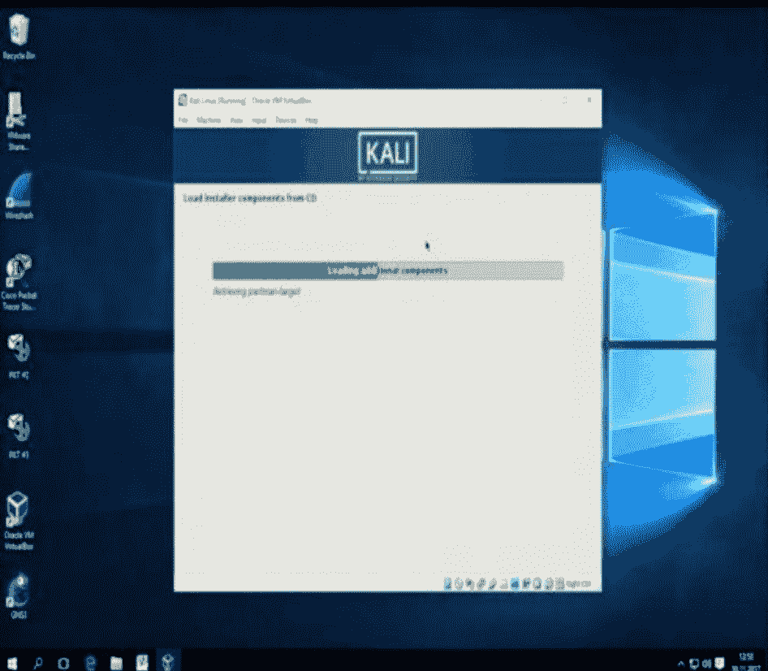

图 3.4

按照安装过程（图 3.4），你必须点击 **next -> next -> finish**，然后等待片刻直到一切准备就绪。如果你在任何时刻无法处理（例如某些你不理解的设置或者你遇到了错误），我鼓励你在 Google 上进行深入的**研究**。

在过去的几年里，我们发现**今天一项日益不可或缺的技能是使用 Google 搜索**。这听起来可能觉得很有趣，但我想让你知道我是认真的。我根据自己的经验告诉你，这项技能经常帮助我脱离困境，无论我处于什么情况下（构建网站、在学院期间完成项目、记录文档以及最后但同样重要的找到我感兴趣的话题的论坛）。

所以，如果你遇到安装错误或其他任何情况。不要恐慌。独立思考。然后在 Google 上搜索吧 :)

嗯…… 顺便说一下，Kali Linux 的默认用户是 `root`，密码是 `toor`。现在我漏掉你们的搜索了；

## 使用 Kali Linux

现在你已经完成了安装，并成功启动进入了桌面，我建议继续下去并简要介绍 Kali，以便你能够理解并识别你手头的某些工具（取决于你的目标）。如图 3.5 所示，我们处于 Kali 的默认状态，特别是在桌面上。左侧你有一个包含一些工具的栏，但最重要的是（第 2 个位置）你可以看到终端（这可能是我建议你最精通的组件；）。

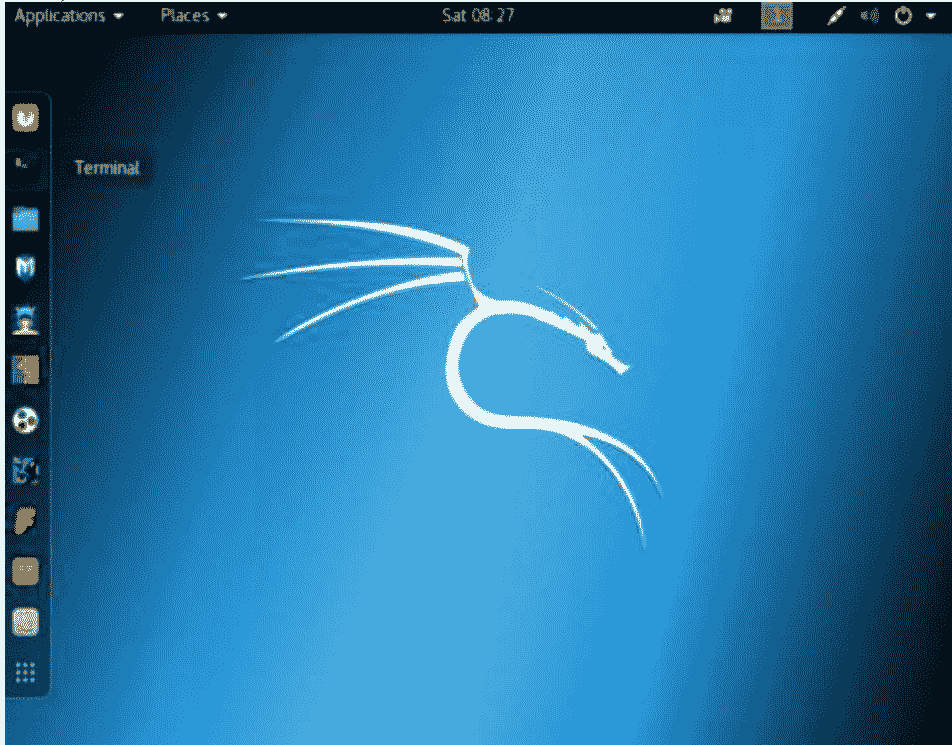

图 3.5

移到左上角，我们有一个非常有趣的菜单 :D 我们可以使用的测试应用程序菜单（你们中的有些人刚刚体验过之前的章节）。如图 3.6 所示，我们有很多选择（甚至更多，它们位于不同的类别中，这里我们需要介入——为了根据我们的兴趣选择最有效的程序）。

这些应用程序实际上是“黑客”程序，可以用于良好或不那么好的意图。现在取决于你如何为了最好的目的使用它们（即 ... 伦理黑客）。

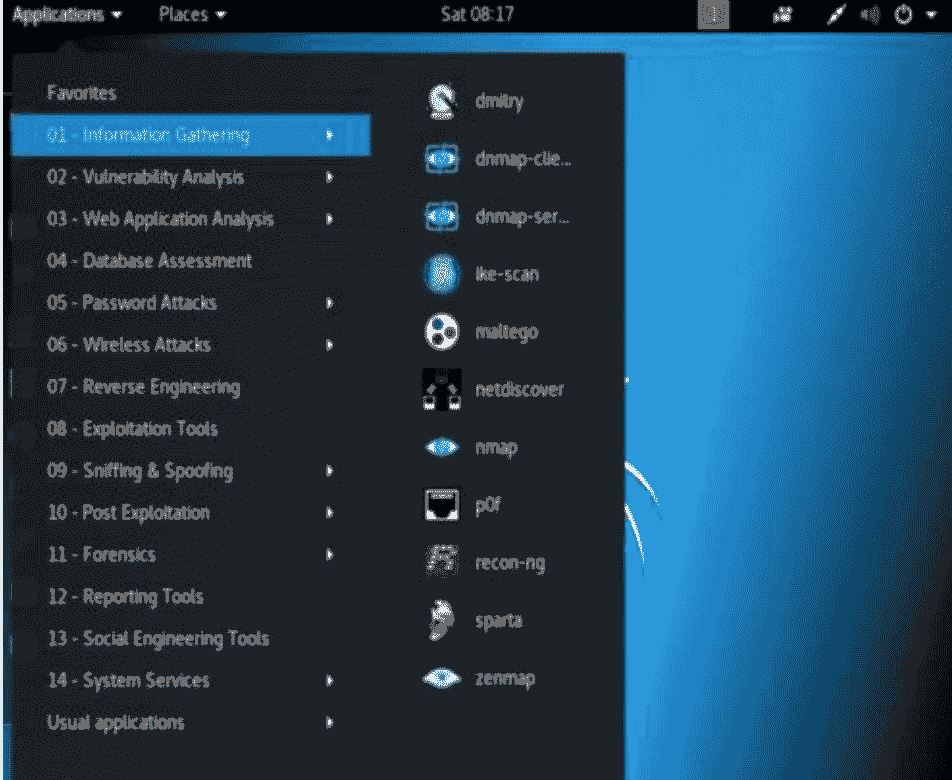

图 3.6

如你所见，第一个类别被称为“信息收集”（`Information Gathering`），这就像黑客过程的第一步（我们在第 2 章中详细讨论过它）。你在图 3.6 中看到的这些工具帮助我们获取更多关于目标的信息。其中一些工具我们甚至使用过或提到过（`nmap`、`zenmap`）。

我想让你记住的一点是，每当你运行其中一个程序时（无论它们是什么），可能会发生两种情况之一：

1. 程序带有 GUI 界面打开
2. 运行程序的终端打开并显示其“帮助”信息

在第一种情况下，你可以用它做什么可能是直观的，你将在使用过程中意识到（**Kali 中的 GUI 程序示例**：`Yersinia`、`Maltego`、`Burp Suite`、`Wireshark` 等）。

在第 2 种情况下，第一次使用可能并不那么显而易见，正如我之前所说的，你将打开一个带有该工具帮助/描述菜单的终端。在这两种情况下（特别是情况 2），学习该程序都是重要的。理解它们真正的作用。在下方的图 3.7 中，你可以清楚地看到我的意思：

# Yersinia

```
root@kali:~$ yersinia -G

(yersinia:1932): Gtk-WARNING **: gtk menu_attach_to_widget(): menu already attached
```

Yersinia 0.8.2

File Protocols Options Help


# Launch attack Edit Interfaces Load default List attacks Clear stats Capture mode Exit

| Protocols | | |
|---|---|---|
| CDP | 0 |
| DHCP | 0 |
| 802.1Q | 0 |
| 802.1X | 0 |
| DTP | 0 |
| HSRP | 0 |
| ISL | 0 |
| MPLS | 0 |

| TTL | DevID | Interface | Count | Last seen |
|---|---|---|---|---|

图 3.7

**Yersinia** 是一个图形化工具，通过它我们可以轻松地进行 **MITM** 攻击（特别是如果有思科路由器、不安全的交换机时）。Yersinia 还有一个终端变体，更加强大且可定制。要启动 Yersinia GUI 版本，我必须输入以下命令：

```bash
yersinia -G
```

从这里开始，让你们实验这个程序：我只能告诉你，左侧将是该类型捕获的数据包数量（这些统计数据可以清晰地指示攻击类型的侧重点）。

接下来，在下方的图 3.8 中，你可以看到另一个包含各种工具的类别（其中一些已使用 - aftercap, Wireshark, macchanger），其旨在监听或捕获 MITM（中间人攻击）类型的攻击流量：

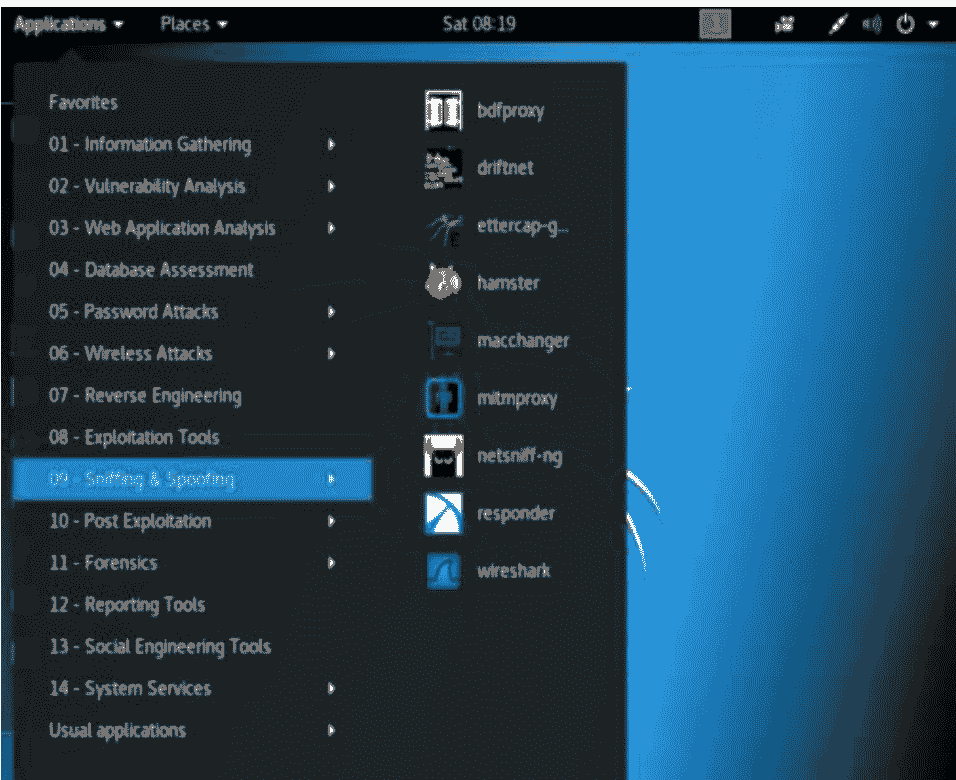

图 3.8

这只是对 Kali Linux 的简要介绍。在接下来的章节中，我们将更深入地查看来自这个强大的 Linux 发行版的某些工具。

# IV. C.I.A.

# 网络安全概念介绍

在本章中，我们将讨论构成网络安全的三个元素。

许多人讨论网络安全时，他们只考虑到加密。这实际上包含了三个元素，被称为 **CIA**。**CIA** 这个三元组由以下三个元素组成：

- 机密性 (Confidentiality)
- 完整性 (Integrity)
- 可用性 (Availability)

这三个元素以某种方式或另一种方式确保我们的数据不被读取（机密性）、不被修改（完整性），并且在任何时候都可以访问（可用性）。

## 1) 机密性

当我们谈论**机密性**时，我们总是通过加密来确保数据不可读。

所以，如果你想加密手机、笔记本电脑上的文件，或者加密网络之间的通信，事情可以通过两种方式进行（取决于情况）：

1. 对称加密——使用单一密钥（即密码）
2. **非对称加密**——使用一对密钥

### a) 对称加密

对称加密是**最广泛使用的**互联网加密形式，而且速度快又安全。

它如此流行是因为它需要单一密钥（称为 **PSK** - 预共享密钥），该密钥将同时用于加密和解密。将这个密钥想象成你家的钥匙（你可以打开门，也可以锁门）。

现在，这里有一个使用此类 **PSK** 加密数据的常见案例。这就是你的无线连接。是的，当你连接到无线网络（**WLAN**）时，它会要求密码（即 **PSK**）。

该**密钥**（密码）被用于消息的**身份验证**和**加密**。

既然你理解了对称加密，我建议继续并查看一些使用单一密钥来实现安全的算法：

- DES
- 3DES
- AES
- Blowfish
- RC4

### b) 非对称加密

涉及非对称加密时，情况有些不同。这种加密的复杂性比对称加密得多得多（1024、2048 甚至 4096 位对比 128、192、256 位），但对硬件资源的消耗也更高。此外，非对称加密使用一对密钥——一个公钥和一个私钥。

私钥应该是……私有的，而公钥可以分给任何人。非对称加密的操作如下：

- 用公钥加密的数据只能用私钥解密（因此我们获得了机密性）。
- 用私钥加密的数据只能用公钥还原（因此我们获得了用于身份验证的数字签名）。

## 2) 完整性

所以，基本上，数据完整性意味着什么？

数据完整性确保文件可以从 A 点传输到 B 点，而不改变（或修改）其内容。它是通过一个称为哈希（**hashing**）的过程获得的。

假设我们有一个 PDF 文件，想要通过互联网传输确保其完整性。为了做到这一点，我们需要该 PDF 文件的 **HASH**。

对文件进行哈希有助于确定其完整性。当我们想要通过互联网发送文件时，过程中可能会发生变化（数据包丢失、信息篡改、黑客更改内容）。

以下是一些用于确定数据完整性的算法：

- MD5 - 128 位
- SHA1 - 160 位
- SHA2 - 256 位
- SHA3 - 384 位（当前标准）
- SHA5 - 512 位

## 3) 可用性

如果我们的数据无法被访问，对其进行加密和哈希还有什么价值呢？如果服务器、网络（或流：D）宕机了，我们该如何使用数据呢？

答案很简单：我们无法使用它们。那么，一种目标是中断数据可用性的攻击是否可以被视为对公司/组织网络安全的威胁？当然可以。为了对抗此类数据安全事件，我们有几种可以实施的方案：

- 冗余 - 网络、服务器、UPS 等
- 备份

这两个元素是数据可用性的基础。现在让我们来看第一个元素：

### a) 冗余

有几种类型的冗余，但让我们先看看冗余是什么。

冗余确保对于任何确保公司运行的关键组件（网络、服务器、电源供应等），我们都至少有一个活跃的替代品。这意味着如果我们有一个连接到互联网的路由器，为了确保冗余（至少），我们需要到 2 个不同互联网提供商的连接，以及 2 个连接到这些提供商的路由器。

涉及到服务器级冗余，我们可以考虑两个或多个提供相同服务的服务器（例如 Web、数据库等）。或者我们甚至可以提到存储磁盘（HDD 或 SSD），它们可以被“链接”在一起，使用称为 **RAID**（独立磁盘冗余阵列）的技术来提供冗余。

### b) 备份

我们都知道备份有多重要。无论是硬盘（**SSD**）还是站点级的配置文件、代码等。**周期性备份**经常可以“救我们一命”，因为它是我们在系统中运行过的所有内容的副本。

例如，在勒索软件攻击的情况下（如果）不想支付黑客要求的金额，我们唯一的选择就是备份（特别是，对现有备份进行恢复，这将使该系统恢复运行）。

不幸的是，在这种情况下，如果备份*做得不够频繁*（至少每周一次，如果不是每天的话），就会导致最近更改的部分丢失。

我们到目前为止讨论的是数据安全的基础（包括通过互联网运行的数据和“存储”在硬盘/SSD 上的数据）。

对上述讨论内容的总结，我想提醒您：

1. **CIA**（机密性 - 加密 - 完整性、可用性）是网络安全的基础
2. 进行**数据加密**有两种方法（对称加密和非对称加密）
3. 数据**完整性**是通过**哈希**建立的（它是任何信息序列的唯一值）
4. 确保数据的**可用性**极其重要。我们可以做到这一点的一些方法是使用备份和冗余元素。

# V. 恶意软件与网络攻击

在本章中，我们开始讨论**恶意软件类型**，之后我们将讨论**网络攻击**。首先，我们将讨论病毒、木马、蠕虫、勒索软件和其他设计糟糕的程序类型。但首先，让我们回答以下问题：

## 1) 什么是恶意软件？

恶意软件（又称恶性软件）是一种旨在窃取、破坏或损坏存储在我们设备上的数据的恶性软件程序。

许多人使用“病毒”这个通用术语，这并不一定正确，因为可能有许多类型的危险程序。以下是（其中的）一部分：

1. 病毒
2. 木马
3. 蠕虫
4. 勒索软件
5. 间谍软件
6. 意识软件
7. 以及更多（Rootkit、定时炸弹、后门等）

图 5.1

下面是维基百科上的图片，显示了 2011 年来自互联网的恶意软件比例。从那时起，很多事情已经发生了，但拥有这样一个包含最常见恶意软件类型的层级结构很有趣。

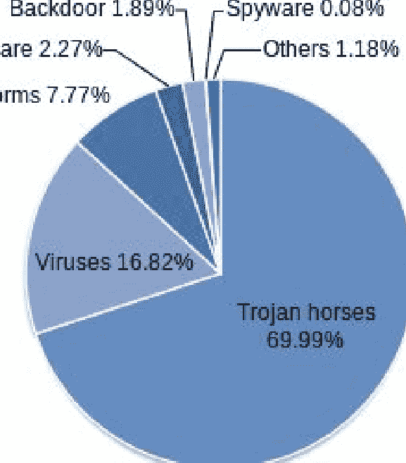

2011 年 3 月 16 日按分类的恶意软件

图 5.2

现在选取这些恶意软件并进行更详细的讨论：

### 1) 病毒

病毒是我们都熟悉的程序。无论我们的计算机是否感染了病毒，还是我们听到/看到别人感染了，我们都知道这些病毒对我们来说非常危险（特别是对我们存储在计算机上的数据 - 对我们来说最重要的元素）。

病毒编写者利用不同操作系统（尤其是 **Windows**）中存在的漏洞，并编写软件来利用这些漏洞（以及这些设备的用户）。

### 2) 木马

木马是一种程序，其设计初衷似乎是为了给使用者带来利益，但其背后隐藏着完全不同意图的恶意代码。这类程序在互联网上最常见（如你在上面的图片所示），并用于在缺乏经验的用户面前轻易地掩盖。因此，在程序的（第一次）运行期间，木马会被安装并隐藏起来，“静静地”执行它的工作。“特洛伊”一词源于希腊神话中特洛伊马的故事，在电影《特洛伊》中有体现。

### 3) 蠕虫

蠕虫是一种恶意软件形式，一旦感染设备（PC、笔记本电脑、服务器等），它就会尽力扩展并感染网络上的其他设备。因此，蠕虫能够减慢网络和连接的设备（通过使用 CPU 和 RAM 资源），甚至整个网络，因为被感染的计算机会产生异常流量。

### 4) 勒索软件

最近一种流行的恶意软件类型是勒索软件，其目的是加密受害者的硬盘（或 **SSD**），并要求支付现金以获取解密密钥。

### 5) 广告软件

有些程序一旦安装在设备上（或浏览器中），就会开始显示广告（令人厌烦的）。

### 6) 间谍软件

间谍软件是旨在从用户那里提取某些数据的程序。它们的目的不是伤害（通过消耗资源）或以任何方式影响受害者，而是简单地提取数据并将其发送到“母服务器”（那些发起“间谍活动”的人）。

首先，你需要意识到此类程序的存在，之后你必须针对它们采取保护/预防措施。

在这种情况下，反病毒软件是非常受欢迎的，因为它们包含了非常大的数据库（称为特征码），可以检查你操作系统（**Windows**、**Linux** 或 **Mac**）上的每个程序/文件。

现在你也可以知道 **Windows** 拥有数量最多的恶意软件（病毒、木马、勒索软件等）。为什么？因为 **Windows** 是世界上最广泛使用的操作系统，黑客有东西可以“偷”。这就是为什么攻击者和网络安全公司的关注重点在 **Windows** 上。

**Mac** 和 **Linux** 也并非没有恶意软件，但它们的数量并不大。它们的设计具有更高程度的安全性，运行方式与 **Windows** 不同。

## 2) 网络攻击示例

在第 5 章的这一节中，我们将讨论网络攻击，并查看来自互联网的网络攻击示例。

这些攻击方法非常常见，每种方法都有特定的目的。

以下是互联网上一些常见的攻击：

1. **MITM** - 中间人
2. **DoS** - 拒绝服务
3. **DDoS** - 分布式拒绝服务，查看链接：`http://www.digitalattackmap.com/`
4. **SQLi** - SQL 注入
5. **XSS** - 跨站脚本

此外，互联网世界中还有很多攻击，但为了说明问题，我们将只关注前三种。所以让我们选取第一种攻击类型 **MITM** 并对其进行更详细的讨论（并向你展示一些你可以实施此类攻击的方法 - 但请务必以伦理的方式进行），之后我们将进一步讨论 **DoS** 和 **DDoS**。

毕竟，在第 6 章中，我们将讨论网络安全和其他类型的攻击：SQL 注入和 XSS。

## 什么是 MITM（中间人）攻击？

**MITM** 是一种网络攻击，旨在监听连接到同一网络的用户流量。

这意味着什么呢？这意味着如果你去了镇上的咖啡馆，有人可以与你连接到同一个 **Wi-Fi**，只需几条命令，你就能看到你在 Facebook、Google 等平台上的所有对话。

情况确实如此，但不必担心，因为事情没有那么简单。为什么？因为我们大多数的互联网连接都是安全的（使用 **HTTPS** 而不是 **HTTP**；）），但这并不意味着没有人在监听你的流量。

为了避免此类情况，我建议你在公共场所使用 **VPN**。在图 5.3 中，你可以看到一个 **MITM** 攻击的示例：

### 中间人

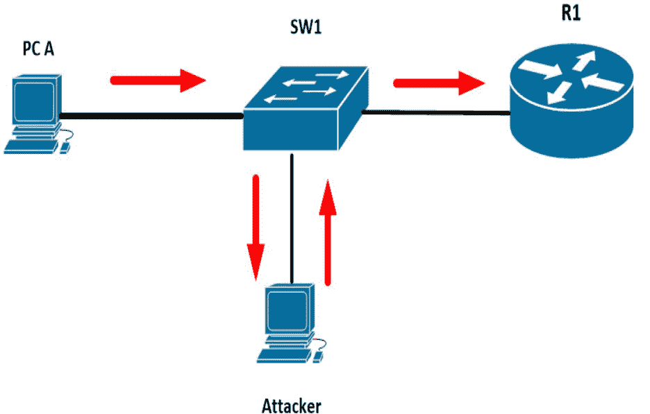

图 5.3

你有多种方法可以进行 **MITM**（我将在下面列出许多可能性中的几种）：

- **MAC 欺骗** (MAC Spoofing)
- **ARP 欺骗** (ARP Spoofing)
- **恶意 DHCP 服务器** (Rogue DHCP Server)
- **STP 攻击** (STP Attack)
- **DNS 毒化** (DNS Poisoning)

这些是最常见的几种。在下文中，我将讨论其中一些，并为你提供一些如何操作的实际示例。

### 1) MAC 欺骗

“Spoofing”一词源于欺骗，在这种情况下，它指的是通过将某个计算机的 **MAC** 地址伪装成另一台计算机（甚至是路由器），从而欺骗网络中的至少一个设备。

可以使用更改 PC **MAC** 地址的程序轻松实现这一点，以查看其流量。这里有一个关于 Windows 10 上如何更改 **MAC** 地址的示例（`https://windowsreport.com/mac-address-changer-windows-10/`），但我认为与 Linux 相比，其过程要复杂得多：

```bash
# ifconfig eth0 down
## macchanger -m 00:d0:70:00:20:69 eth0
# ifconfig eth0 up
```

首先，我们停止接口（此例中为 `eth0`），然后使用 `macchanger` 命令帮助我们更改 **MAC** 地址，`-m` 参数允许我们指定地址。要进行验证，请使用命令：`#ifconfig`

PS: 如果你想生成随机 **MAC** 地址，请使用：`#macchanger -r eth0`

### 2) ARP 欺骗

**ARP** 欺骗的工作原理与 **MAC** 欺骗类似，攻击者利用 **ARP** 协议误导整个网络，使其认为 **MAC** 地址 X 实际上是路由器。因此，所有想要访问互联网的网络设备都会将流量发送给攻击者（攻击者将其重定向到路由器）。在这种情况下，攻击者可以使用 **Wireshark** 等流量捕获程序看到通过其的所有流量。

在下图 5.4 中，你可以看到这个过程是如何发生的：

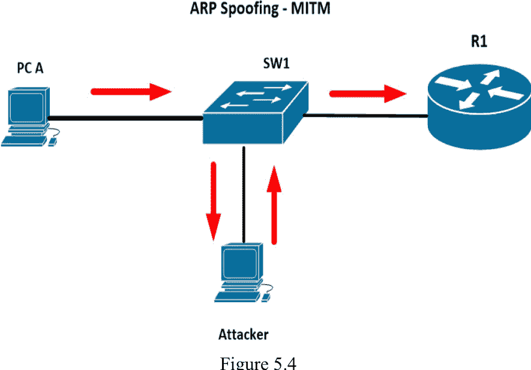

要启动此类攻击，我们必须首先在 Linux 上启动路由进程，以便流量可以从受害者发送到路由器，反之亦然（通过我们，即“攻击者”）：

```bash
## echo "1" > proc/sys/net/ipv4/ip_forward
## cat /proc/sys/net/ipv4/ip_forward
```

我们将流量重定向到我们想要监听的端口：

```bash
## iptables -t nat -A PREROUTING -p tcp --destination-port 80 -j REDRECT --to-port 8181
```

之后，我们需要安装程序：

```bash
## sudo apt-get update
## sudo apt-get install dnsiff
```

现在我们下达命令启动攻击：

```bash
## arpspoof -i eth0 -t 192.168.1.3 192.168.1.1
## arpspoof -i eth0 -t 192.168.1.1 192.168.1.3
```

- `-i eth0`：我们开始启动攻击的接口
- `-t 192.168.1.3`：受害者的 IP（我们想要攻击的设备 - 请更改为你网络中的 IP）
- `192.168.1.1`：路由器 IP（请将路由器 IP 更改为你的路由器）

理论上，这两个命令向两台设备发送伪造包，告知它们流量必须通过攻击者。现在你所做的就是打开 **Wireshark**，查看受害者的流量是如何“通过你”的。

这里还需要另一个元素来辅助流量的**解密**。为什么呢？因为大部分互联网流量都是加密的。

我们将使用这个工具：**SSLstrip**（用于移除安全元素 SSL），以及在 HTTP 中解密 HTTPS 流量的命令是：

```bash
## sudo python sslstrip.py -l 8181
```

此命令将监听端口 `8181` 上的流量并尝试对其进行解密。之后，你可以启动 **Wireshark** 并查看加密的流量（不过，我建议你先启动 **Wireshark**，然后在流量加密时查看区别）。

PS: 简单搜索你就能找到 **Ettercap**。要使用它：

```bash
## sudo python sslstrip.py -l 8181
```

- `-i eth0`：我们开始启动攻击的接口
- `-t 192.168.1.3`：受害者的 IP（我们想要攻击的设备 - 请更改为你网络中的 IP）
- `192.168.1.1`：路由器 IP（请将路由器 IP 更改为你的路由器）

### 3) 恶意 DHCP 服务器

此类攻击涉及一个 **DHCP** 服务器（在网络上）。因此，所有想要访问互联网的网络设备都会将流量发送给攻击者（攻击者将其重定向到路由器）。在这种情况下，攻击者可以使用 **Wireshark** 等流量捕获程序看到通过其的所有流量。

如果有人想破解这种攻击，他们将通过排除（直接关闭端口）来受到惩罚。

我们如何保护自己免受 **MITM** 攻击？

1. 在 Linux 上启动路由进程，以便流量可以从受害者发送到路由器，反之亦然（通过我们，即“攻击者”）；
   ```bash
   # echo "1" > proc/sys/net/ipv4/ip_forward
   # cat /proc/sys/net/ipv4/ip_forward
   ```
2. 安装程序
   ```bash
   # sudo apt-get update
   # sudo apt-get install dhcp-server
   ```
3. 配置 **DHCP** 服务器
   ```bash
   # nano /etc/dhcp.conf
   ```
4. 添加默认路由
   ```bash
   # ip route add default via 192.168.1.1
   ```
5. 启动 **SSLstrip**
6. 捕获流量

## 什么是 DoS（拒绝服务）攻击？

**DoS** 是一种网络攻击，其目的是中断（一段时间内）服务器上特定服务的运行，且只有一个源（某台计算机）。因此，接收到大量请求后（例如 Web 服务器）将无法处理并在此时被阻塞（服务中断）。这里是图 5.5 中的示例：

### DoS


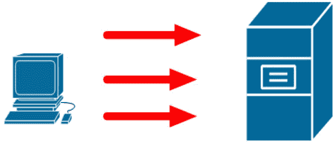

攻击者

服务器

图 5.5

## 什么是 DDoS（分布式拒绝服务）攻击？

DDoS 是一种网络攻击，旨在中断（一段时间内）服务器或整个网络上特定服务的运行，它具有多个互联网流量源。DDoS 通过多个感染了恶意软件的“计算机”发生，这些计算机产生惊人的 Gbps 级流量（10、40、100+ Gbps - 大大取决于计算机的数量）。

即使是最近（2018 年 2 月），历史上最大的 DDoS 攻击也发生了，记录为 1.5 Tbps（或 1500 Gbps）。哇！

回到正题，我想让你们，这样的被恶意软件感染的计算机网络被称为僵尸网络（Botnet）。下面是一个僵尸网络的示例，它可以用于多个恶意目的（发送垃圾邮件或恶意软件或为了 DoS 提供大量的 Gbps 流量）——图 5.6：

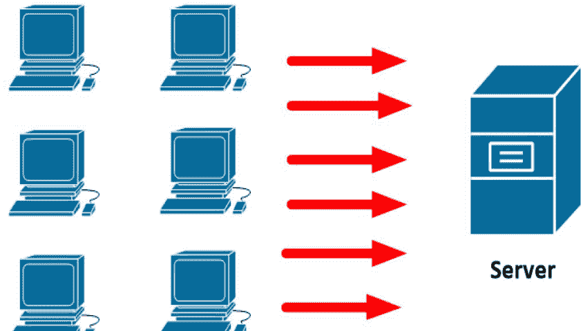

图 5.6

除了这些网络相关的攻击外，还有针对“破解”密码的攻击：

- 1) 暴力破解 (Brute Force)
- 2) 字典攻击 (Dictionary Attack)
- 3) 彩虹表攻击 (Rainbow table)

## 1) 暴力破解 (Brute Force)

暴力破解是一种旨在获取系统未经授权访问（网站管理服务器、服务器、网络设备等）的网络攻击形式。这种技术使用“暴力”，意味着攻击者尝试在逻辑最少化的情况下猜测密码。通常，这种技术会导致攻击者失败并放弃，但在许多情况下，由于系统没有更改默认密码（通常是 `admin` 或 `12345678`），导致系统访问未被阻止。

## 2) 字典攻击 (Dictionary attack)

字典攻击对受害者系统更具针对性，因为有几个与该组织/个人相关的外部因素。在某些工具的帮助下，可以生成数百或数千个单词，并尝试访问系统。这种攻击的缺点是它可能需要很长时间（取决于单词数量和系统的安全性），而且字典并不保证攻击的成功。

对抗此类攻击的一种方法是在系统中设置最大次数（通常为 3 次）的登录尝试。

## 3) 彩虹表攻击 (Rainbow table)

第三种攻击被称为“彩虹表”，旨在“解密”哈希（hash）。你还知道哈希是什么吗？如果不知道，我简要总结一下。

因此，攻击者将使用哈希列表来破解从被盗数据库中获取的密码哈希。这个列表被称为“彩虹表”，并试图找出哪个是密码。

现在你可能在想，“为什么会这样？”答案很简单：因为哈希过程是不可逆的，也就是说，一旦生成了哈希，我们就无法使用相同的数学公式输入它并获得密码。

所以攻击者尝试用他与密码关联的哈希列表（彩虹表）碰运气。在下一章中，我们将进入生成网络攻击的第一步，讨论扫描（Scanning）。此外，在章节结束时，我将向你展示如何使用 (Kali) Linux 进行 DoS 攻击。

# VI. 扫描服务器和网络

我确定你听过扫描网络（或网络内的设备）的概念。很好，在本章中，我们将更详细地讨论这个主题，稍后我们将看到如何**扫描网络和服务器**（只需在 Kali Linux 上执行几条命令或在 Windows 上点击几次）。

## “扫描网络”意味着什么？

在介绍我如何扫描网络之前，我想解释一下这种扫描的含义。当我说我扫描了 X.Y.Z.A 网络时，我指的是什么？我指的是使用了一个特定的程序（在这种情况下是 `Nmap`）来找出目前连接到网络的哪些设备。

我们不仅发现这些设备是什么（查看它们的 IP 地址和 MAC 地址），还可以发现更多信息，例如：

- 设备类型
- 操作系统及其版本
- 开放的端口
- 运行在这些端口上的网络应用程序
- 等

一旦我们获取了这些信息，就可以利用它们来更好地理解网络结构，扫描并测试网络和漏洞服务器（以道德合规的方式），以确保所有设备均正常运行。当然，这些只是扫描网络及其内部设备有意义的几个原因。

## 如何扫描网络？

使用 `Nmap` 可以轻松地扫描网络（及其组件）。`Nmap` 源于 Network Mapper（网络映射器），帮助我们把网络“映射”成非常易于理解的输出（来自终端）。我在下面的示例中使用的程序（用于扫描网络）称为 `Nmap`。`Nmap`（在 Windows 上，图形界面程序称为 `Zenmap`）是一个被黑客和道德黑客频繁使用的免费工具。

在它的帮助下，我们可以发现连接到网络的设备、它们开放的端口，甚至是它们的操作系统。

以下是我们可以通过 `Nmap` 实现不同目标的一些命令示例：

## 1) 使用 Nmap 扫描网络

```
nmap -sP 192.168.1.0/24 -- ICMP (ping) 扫描，显示网络设备数量（又称 PING 扫描）
```

```
nmap -sS 192.168.1.0/24 -- 扫描整个网络以找到每个设备上的开放端口（TCP，使用 SYN）（又称 端口扫描）
```

在下方的图 6.1 中，你可以详细查看连接到网络的部分设备的信息（更准确地说，IP 为 `192.168.1.1` 的路由器和 IP 为 `192.168.1.3` 的另一个设备）。除了发现这些设备连接到网络外，`Nmap` 还发现了这些设备上的开放端口。

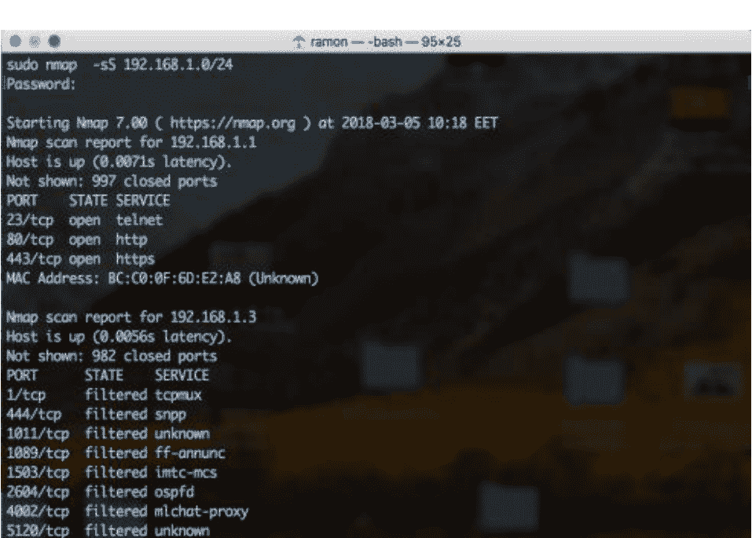

图 6.1

如你所示，路由器 (`192.168.1.1`) 打开了 3 个可能会被漏洞和利用的重要服务。例如，端口 23 代表 Telnet，这意味着我们可以远程连接到它，甚至可以访问 CLI（命令行界面）。

此外，标识 Web 流量的 80 和 443 端口也是开启的（因此我们可以通过浏览器连接并尝试访问此路由器）。现在我们希望你理解扫描的作用和威力了;)

## 使用 Nmap 扫描网络中的设备（服务器、笔记本电脑、智能手机等）

```
nmap -A 192.168.1.1 -- 扫描单个设备的服务交付（端口）和操作系统（又称 OS 扫描）
```

```
nmap -sT 192.168.1.254 -- 使用 TCP 数据包进行扫描
```

```
nmap -sU 192.168.1.1 -- 使用 UDP 数据包进行扫描
```

在图 6.2 中，你可以看到我们额外添加的第一个命令的结果，以及用于 TCP 端口扫描的 `-sS` 结果：

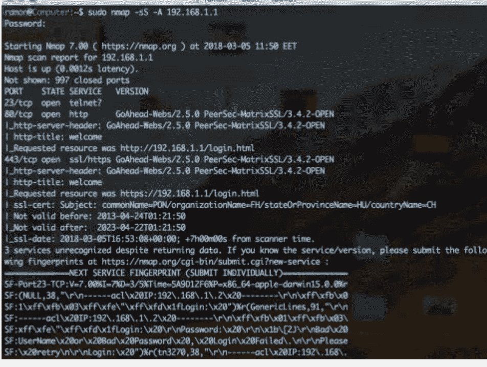

图 6.2

```
nmap -F 192.168.1.0/24 -- 扫描网络中的每个设备的前 100 个最常用端口
```

```
nmap -sS -p 80,443,23,22 192.168.1.1 -- 使用 SYN 数据包扫描设备指定的 -p 端口
```

```
nmap -F -oN rezultat_scanare.txt 192.168.1.0/24 -- 快速扫描网络并将结果存储在 results.txt 文件中（对 Python 脚本非常有用）
```

## 3) Hping3

我们接下来可以使用 `Nmap` 旁另一个非常有用的工具是 `hping3`。`Hping-3` 是一个流量生成器，类似于 `ping`，但具有更多的功能。它可以发送（除 ICMP - ping 流量外）数据包。

- `-A`: 发送 TCP ACK 数据包

```
root@rn-s-1vcpu-1gb-fra-01:~# hping3 -c 10 -V -p 80 -s 5050 -A hackthsite.com
using eth0, addr:10.181.13.160, MTU: 1500
HPING hackthsite.com (eth 52.86.22.136): A set, 40 headers + 0 data bytes
len=42 ip=52.86.22.136 ttl=236 DF id=49647 tos=0 iplen=40
sport=80 flags=R seq=win=0 rtt=106.6 ms
seq=186649472 ack=sum=531 urp=0

=42 ip=52.86.22.136 ttl=239 DF id=49717 tos=0 iplen=40
sport=80 flags=R seq=win=1 rtt=105.5 ms
seq=1569963852 ack=sum=1276 urp=0

=42 ip=52.86.22.136 ttl=239 DF id=49943 tos=0 iplen=40
sport=80 flags=R seq=win=2 rtt=104.5 ms
seq=166825298 ack=sum=1639 urp=0

-- hackthsite.com hping statistic ---
3 packets transmitted, 3 packets received, 0% packet loss
round-trip min/avg/max = 105.4/105.8/106.6 ms
root@rn-s-1vcpu-1gb-fra-01:~# |
```

图 6.4

如果我们想掩盖痕迹（为了匿名，不知道扫描/攻击源来自哪里），我们可以添加 `--rand-source` 参数：

```bash
hping3 -c 1 -V -p 80 -s 5050 -A --rand-source VICTIM IP
```

`Hping3` 让你有机会对执行的操作得非常具体。例如，如果我们在服务器端使用类似 TCP 的扫描，那么我们可以使用 TCP 消息（如 SYN, ACK, FIN, RST, URG 等）。

重复我在书开头说的话：**理解这项技术是如何运作的非常重要。** 在这种情况下，我特指 OSI 模型、TCP 协议、端口等。

但通过发送自定义的封包（例如，一个意料之外的 TCP ACK），我们可以捕获防火墙或应用程序（例如 Web 服务器），它会返回一个响应，我们可以通过该响应找到关于它的更多信息（Windows 上的响应方式与 Linux 上的不同等 —— 远程操作系统指纹识别的示例）。接下来，我建议你玩玩这些 `Nmap` 和 `hping3` 程序，做更多研究，这样你就能理解它们的用途和工作原理。

通过 `hping3`，我们还可以进行 DoS 攻击（我们在第 5 章中讨论过），即泛洪某个特定设备：

```bash
hping3 -V -c 20000000 -d 100 -S -w 64 -p 443 -s 591 --flood --rand-source VICTIM IP
```

该命令的参数如下：

- `-flood`: 以尽可能快的速度发送包
- `-rand-source`: 为每个包生成随机源 IP 地址
- `-V`: 提供更多信息
- `-count`: 数据包总数
- `-d data`: 数据包的大小
- `-S --syn`: TCP SYN 数据包
- `-w --win`: 窗口大小（默认 64）
- `-p --destport`: 目标端口
- `-s --baseport`: 源端口（默认是随机）

PS：如果你使用的是 Linux（而不是 Kali Linux），可以使用以下命令安装 `Nmap` 或 `hping3`：

```bash
sudo apt-get install nmap hping3
```

## 为什么我们要扫描网络？

因为我们可以利用这些信息来决定渗透测试的关注重点。我们关注什么？网络中最脆弱的目标是什么？上面运行着哪些利用的应用程序？对于黑客来说（无论是白帽还是黑帽），这些问题的答案至关重要。

为什么？因为如果他对网络及其内部组件不了解，黑客会在某些无法被利用的部分浪费时间，并面临被检测的风险。

这个扫描过程是渗透测试周期的一部分，由 5 个步骤组成（图 6.5）。

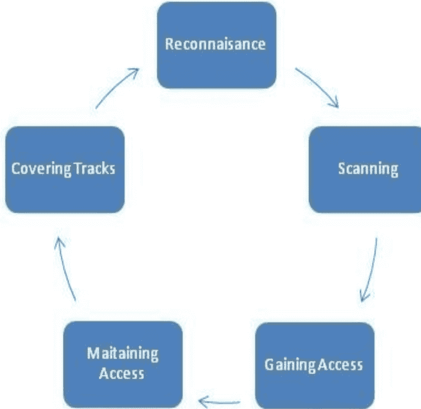

图 6.5

如果你喜欢这本书，请考虑在 [Amazon.com 上留下评论](https://www.amazon.com)，这将帮助我传播关于网络安全和黑客的信息，并帮助尽可能多的人。

# VII. Web 安全

在本章中，我们将简要讨论 Web 安全以及你需要记住的一些攻击。我完全确定你可能已经在电视、广播或其他渠道多次听过某公司的 X 网站被攻破、某机构的 Y 网站宕机，以及黑客用伪页面替换主站。

嗯，我想告诉你，大多数情况下（经验较浅的黑客），他们都在寻找其网站为人知的 1 到 2 个可以利用的漏洞。有很多工具可以帮助他们相对容易地定位这些漏洞，然后帮助他们进行利用。

这些漏洞（Web 级别）中的在开放 Web 应用安全项目（OWASP）中有非常好的介绍和记录。OWASP 是一个致力于提高软件和 Web 应用程序安全的非营利组织。

他们列出了过去几年网站和 Web 应用程序中最常见的安全事件的“前 10”。OWASP 还会组织本地活动（你可以在 Google 或 Facebook 上搜索此类活动），创建一个由充满热情的网络安全人士组成的社区。

如果你在某处听到此类活动并有机会参加，我建议你迈这一步，因为你会发现这不仅是值得的，而且你可以从许多人那里学到很多。

例如，在图 7.1 中，列出了 2017 年最常见的 Web 安全事件列表（对比 2013 年）：

| OWASP Top 10 – 2013 (旧) | OWASP Top 10 – 2017 (新) |
|---|---|
| A1-Injection (注入) | A1-Injection (注入) |
| A2-Broken Authentication and Session Management (身份验证与会话管理损坏) | A2-Broken Authentication and Session Management (身份验证与会话管理损坏) |
| A3-Cross-Site Scripting (XSS) (跨站脚本) | A3-Cross-Site Scripting (XSS) (跨站脚本) |
| A4-Insecure Direct Object References (不安全的直接对象引用 - 合并到 A7) | A4-Broken Access Control (访问控制损坏 - 2003/2004 原始类别) |
| A5-Security Misconfiguration (安全配置错误) | A5-Security Misconfiguration (安全配置错误) |
| A6-Sensitive Data Exposure (敏感数据泄露) | A6-Sensitive Data Exposure (敏感数据泄露) |
| A7-Missing Function Level Access Control (缺失功能级访问控制 - 合并到 A4) | A7-Insufficient Attack Protection (攻击防护不足) |
| A8-Cross-Site Forgery (跨站伪造) | A8-Cross-Site Forgery (跨站伪造) |
| A9-Using Components with Vulnerabilities (使用含有漏洞的组件) | A9-Using Components with Vulnerabilities (使用含有漏洞的组件) |
| A10-Insecure Object References (不安全的直接对象引用) | A10-Insecure Object References (不安全的直接对象引用) |

*(注：OCR 表格非常混乱，此处根据 2013 对 2017 的 OWASP Top 10 映射进行了重建)*

当我们谈论 **SQL 注入 (SQL Injection)** 时，我们主要讨论数据库以及 **SQL (Structured Query Language，结构化查询语言)** 是一种与数据库通信的语言。存在多种类型的 SQL 攻击（图 7.2）：

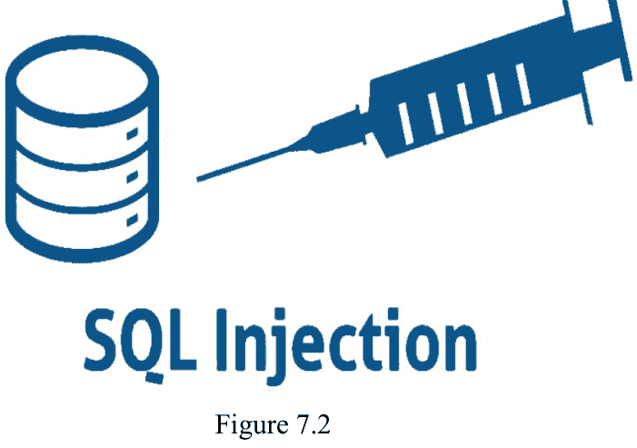

什么是 SQL 攻击？大多数此类攻击发生在攻击者发现一个可以输入数据的“框”时。例如，关于一个任何人都可以写入的框。如果 PHP 代码写得不正确（通常如此），黑客就可以输入与数据库直接交互的命令，从而提取不同的信息（关于用户名、电子邮件等数据）。这通常是编程错误导致的。

## 2) XSS (跨站脚本)

当涉及到 SQL 注入时，如你所见，攻击者直接访问网站并尝试获取其数据库，以便提取机密数据（用户名和密码、银行信息、邮箱地址等）。在 XSS 的情况下，情况有所不同。攻击者的目标直指用户（访问网站的人），当用户访问网站时，使用脚本对其进行攻击。

XSS 假设向网站中注入恶意软件（这次是恶意脚本），且不会对网站产生任何影响。当用户访问网站时，这些代码将直接在浏览器中执行。该代码是用 JavaScript 编写的，这种语言由浏览器执行。

实现此操作最简单的方法是将恶意代码注入到注释或可以自动运行的脚本中。例如，黑客可以在博客的评论中故意包含一个指向恶意 JavaScript 脚本的链接。

XSS 攻击（跨站脚本）通过让用户面临风险而不留下任何关于严重程度的痕迹，可以严重损害网站的声誉。现在，处于这种情况的情况下，用户发送到网站的任何敏感信息（如个人数据、银行信息或其他私人数据）都可能通过脚本被误放，而网站所有者并不知道存在问题。

XSS 攻击后可能发生的一些攻击包括：

- **窃取 cookies** - 复制 cookie 可能导致会话从有效网站复制到攻击者的虚假网站，从而窃取用户数据
- **键盘记录器** - 将用户输入的所有字母发送给攻击者
- **网络钓鱼** - 操纵用户采取无意识的行动，然后查看其数据


因此，在攻击者尝试 XSS 攻击（通常针对任何带有评论、搜索或数据输入部分的网站等）之后，受害者的数据（例如：当前 Web 会话、cookies）可能会被窃取，并被黑客用于访问不同的页面/资源。因此，攻击者不需要受害者的密码，因为他已经有了 cookies。通过 XSS，他成功实施了另一种被称为`会话劫持（Session Hijacking）`的攻击。

备注：[这是一个很棒的网站](https://www.hacksplaining.com/)你可以在那里学习更多关于网络攻击的知识。该网站旨在教育 Web 开发者关注现有漏洞，并向他们展示如何解决这些问题。

## 3) 安全配置错误

另一个非常常见的问题（不幸的是世界上很大一部分人忽视了它）是密码相关的。是的，在 2018 年我们仍然面临这个问题。许多人没有认真对待针对密码的安全策略，即（首先）不更改默认密码，其次没有更改为复杂的（超过 8 个字符）字母数字密码。

我们在密码中添加的每一个额外字符都会极大增加其复杂性，同时增加破解（或猜测）它的难度。

所以我的建议是，尽管听起来微不足道，请重新评估你在不同系统上的用户名和密码，并采取行动更改它们。如果你可以在密码旁边添加另一个身份验证因子，那就太好了。

例如，你可以在手机上使用生物识别认证（指纹）或基于用户的、密码和令牌（通常是短信），这比经典版本要安全得多。

我们将在第 9 章（密码学）中讨论更多关于身份认证形式的细节。在此之前请行动起来！: D 此外，我想让你查看图 7.3，在图中你可以看到用户列表和默认密码。[你可以在这里找到](http://www.routerpasswords.com/)一个包含多个网络设备厂商默认用户和密码的网站。

## RouterPasswords.com


欢迎来到最大且最新的默认路由器密码数据库。

选择路由器制造商：

| 制造商 | 型号 | 协议 | 用户名 | 密码 |
| --- | --- | --- | --- | --- |
| CISCO | CACHE ENGINE | CONSOLE | admin | diamond |
| CISCO | CONFIGMAKER | | cmaker | cmaker |
| CISCO | CNR Rev. ALL | CNR GUI | admin | changeme |
| CISCO | NESTRANGER/SECURE IDS | MULTI | netrang | attack |
| CISCO | BBSM Rev. 5.0 AND 5.1 | TELNET OR NAMED PIPES | bbed-client | changeme2 |
| CISCO | BBSM MSD CLIENT 5.0 AND 5.1 | TELNET OR NAMED PIPES | bbed-client | NULL |
| CISCO | BBSM ADMINISTRATOR Rev. 5.0 AND 5.1 | MULTI | Administrator | changeme |
| CISCO | NESTRANGER/SECURE IDS Rev. 3.0/05/17 | | root | attack |
| CISCO | BBSM MSD ADMINISTRATOR Rev. 5.0 AND 5.1 | IP AND NAMED PIPES | saa | (none) |
| CISCO | CATALYST 4000 | SNMP | public | (none) |

图 7.3

许多网站上出现的另一个问题是“目录列出（Directory Listing）”，指的是由于某些原因，黑客可以进入网站的目录。

这对于网站来说是一场灾难，它可以访问教育产品（书籍、课程以及任何需要存储的其他类型内容）。黑客可以访问网站并进入目录。

运行 WordPress 需要 LAMP（无论是 Windows、 Linux 还是 Mac）。每个组件对于运行网站都是至关重要的。

在安装了 WordPress 之后，我建议我们开始介绍一个最流行的平台：

## 4) WordPress

WordPress (图 7.4) 是最常用的网站创建和管理平台。它是一个 CMS（内容管理系统），内容管理平台。因此，任何人都可以创建博客。目前全球有27.5% 的1000 万网站正在使用它。由于它被广泛使用，你可以意识到它存在许多漏洞（特别是当版本更新时）。


图 7.4

WordPress 受欢迎的另一个原因是有很多可以改进网站、用户体验的插件。在 WordPress 市场上有超过 50000 个免费插件，除此之外还有不同公司开发的付费插件。

关于 WordPress 的另一个非常有趣的特点是它是开源的。这意味着它是由程序员社区开发的，任何人都可以参与。

作为运行技术，WordPress 需要 LAMP（Linux, Apache, MySQL, PHP）。这些组件中的每一个对于运行网站至关重要。如果你想为自己安装 WordPress，你需要一个 Web 托管服务器。我建议你使用这一个（Bluehost） - http://bit.ly/2HvO3Oje-(它提供一键安装，让你立即开始使用你的 WordPress 网站)。

现在，在安装了 WordPress 之后，我建议我们转向一个网站的安全扫描工具。

# WPScan

WPScan 是一个 WordPress 网站的扫描工具（当然也是一种破解工具）。它是开源的，因此任何想要测试自己网站漏洞的人都可以使用。这个工具可以提供关于你网站的很多信息：

- 所使用的 WordPress 版本（这是一个非常好的指标）
- 插件
- 网站上存在的潜在漏洞，这些漏洞可以被利用
- 查找网站上已有的用户
- 使用密码破解器进行暴力攻击

现在让我们开始工作，我将向你们展示如何使用 WPScan 进行我之前提到的那些扫描。下面是一些你可以使用该工具进行的扫描示例。请注意，你是在进行扫描（即侦察），而不是在攻击网站。

通常，扫描可以被视为对你的系统进行主动测试，看看通过它能发现什么。你可以将这个概念与以下情况相比：某人（陌生人）想“看看”你家里有什么东西。进门（在你不在家时）并开始翻找你的东西，但不要拿任何东西，以便以后使用这些信息。

进行非侵入式扫描（图 7.5）：

```
wscan --url www.example.com
```

列举已安装的插件：

```
wscan --url www.example.com --enumerate p
```

按顺序运行所有枚举工具，以获取尽可能多的信息：

```
wscan --url www.example.com --enumerate
```

列出网站上已的用户：

```
wscan --url www.example.com --enumerate u
```

这些是使用 WPScan 工具的一些方法。在下方的图 7.5 中，我在一个基于 WordPress 的网站上运行了第一个命令（我不会公布该网站的身份），看看我们可以关于它发现什么信息。我提到，我已授权对该网站进行此类扫描。

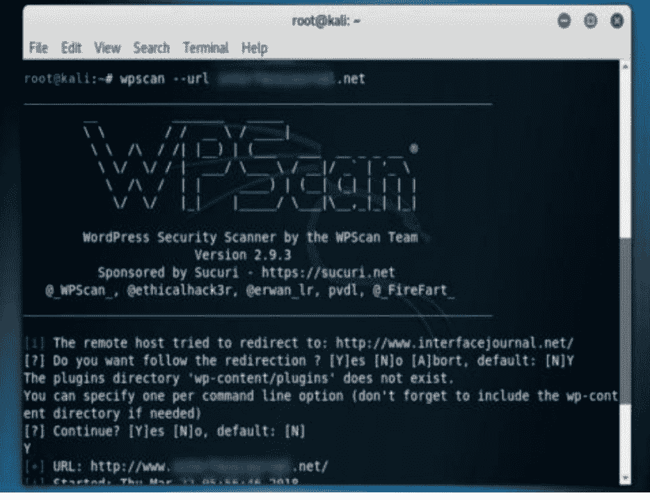

图 7.5

```
Shut down this guest operating system
root@kali:~ -
File Edit View Search Terminal Help
[+] Interesting header: SERVER: Apache/2.2.23 (Unix) mod_ssl/2.2.23 OpenSSL/0.9.8rb82-fips-rhel5 dav2 mod/1.4 PHP/5.3.19
[+] Interesting header: SET-COOKIE: _icl_current_language=en; expires=Fri, 23-Mar-2018 05:56:52 GMT; path=/
[+] Interesting header: X-POWERED-BY: PHP/5.3.19
[*] WordPress version 3.0 (Released on 2010-06-17) identified from meta generator, rss generator, rdf generator, atom generator
[*]42 vulnerabilities identified from the version number
[1] Title: WordPress 2.5 - 3.3.1 XSS in swfupload
Reference: https://wpvulndb.com/vulnerabilities/5999
Reference: http://selists.org/fulldisclosure/2012/Nov/51
[1] Fixed in: 3.3.2
[1] Title: WordPress 1.5.1 - 3.5 XMLRPC Pingback API Internal/External Port Scanning
Reference: https://wpvulndb.com/vulnerabilities/5988
Reference: https://github.com/Fireart/WordpressPingbackPortScanner
Reference: https://cve.mitre.org/cgi-bin/cve?name=CVE-2013-0235
[1] Fixed in: 3.5.1
[1] Title: WordPress 1.5.1 - 3.5 XMLRPC pingback additional issues
Reference: https://wpvulndb.com/vulnerabilities/5989
```

图 7.6

```
[1] Title: WordPress << 3.0.5 wp-admin/press-this.php Privilege Escalation
Reference: https://wpvulndb.com/vulnerabilities/6004
Reference: https://cve.mitre.com/cgi-bin/cname.cgi?name=CVE-2011-5270
[1] Fixed in: 3.0.6

[2] Title: WordPress << 3.3.2 Cross-Site Scripting (XSS) in wp-includes/default-filters.php
Reference: https://wpvulndb.com/vulnerabilities/5994
Reference: https://cve.mitre.com/cgi-bin/cname.cgi?name=CVE-2012-6633
[1] Fixed in: 3.3.3

[3] Title: WordPress << 3.3.2 wp-admin/media-upload.php sensitive information disclosure or bypass
Reference: https://wpvulndb.com/vulnerabilities/5995
Reference: https://cve.mitre.org/cgi-bin/cname.cgi?name=CVE-2012-6634
[1] Fixed in: 3.3.3

[4] Title: WordPress << 3.3.2 wp-admin/includes/class-wp-posts-list-table.php sensitive information disclosure by visiting a draft
Reference: https://wpvulndb.com/vulnerabilities/5996
Reference: https://cve.mitre.org/cgi-bin/cname.cgi?name=CVE-2012-6635
[1] Fixed in: 3.3.3
```

图 7.7

因为我们毕竟在谈论 WordPress 和漏洞，在[这里](https://wpvulndb.com/) 你可以看到一个数据库，其中包含了每个版本已知的并公开的漏洞。除了这些，我想告诉你们，我们在本章中讨论过的所有攻击也适用于 WordPress 案例。遗憾的是，SQL 注入、XSS、目录遍历只是在这个平台上相对容易完成的许多攻击中的几个。使用 WPScan，你只需要更快速地发现它们。

意识到这些是非常重要的，要经常扫描你的网站（你自己或客户的网站），发现新漏洞，并尽快解决它们。

## 5) 谷歌黑客攻击 (Google Hacking)

我想当你看到这个主题的标题时，你的反应可能有点不同：“哇！我可以黑掉 Google 吗？”或“我可以用 Google 进行攻击吗？”我可以告诉你是的，在第二种情况下是可以（尽管第一种情况也不排除）。你可以使用 Google 来发现在搜索引擎中索引的各种网站。因此，使用一些特定的搜索关键词，Google 可以精确地给你你想要的内容（包含你正在寻找的带有漏洞插件的网站，或者包含用户名、密码和数据库名称等信息的数据库信息页面）。

是的，网站管理员并没有意识到（可能根本没有意识到）他们的网站会在 Google 上泄露贵贵信息，使其极易受到网络攻击的威胁。

再次强调，我给你提供这些信息是因为你可以将其用于伦理目的（研究和测试你自己或客户的网站）。不要忘记，未经授权访问系统将受到惩罚，你可能会因此入几年监狱（我认识几个因此遭受过苦难的人……）。

现在你已经想起了这些，这里有一些你可以利用此进行研究的示例：

```
inurl:"wordpress readme.html"
```

这仅仅是一个例子（图 7.8）。当然，你可以根据自己的兴趣将 inurl: 替换为任何内容。

在这里，在图 7.9 中，显示了一些运行旧版本 WordPress 的网站（在本书编写时，即 2018 年4 月，最新版本为 4.9.5）：

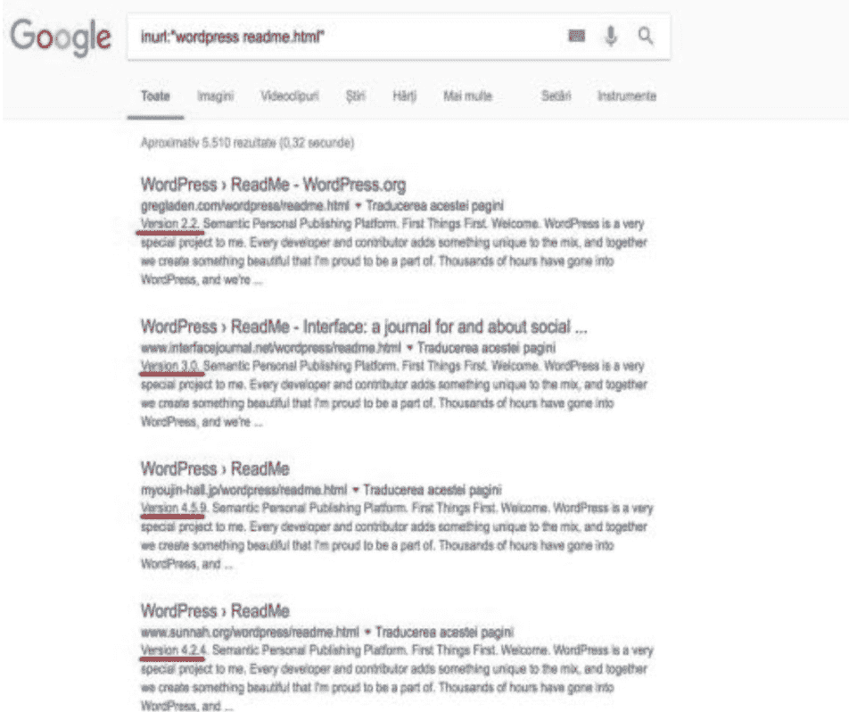

图 7.9

我仍然建议你自己去搜索。在隔离环境（或你拥有访问/权限的环境）中，尝试在本章中提到的所有工具进行操作。所以，这会有很多麻烦：）

# 第八章：防火墙

我们将开始一个关于防火墙及其工作原理的新型有趣章节。我想告诉你们的一点是：只要你工作的内容涉及服务器、网络、网站（特别是网络安全），我向你保证你将会遇到（很多）防火墙。

## 什么是防火墙？

就像路由器或交换机一样，防火墙是一种网络设备，旨在保护网络免受互联网上潜在攻击者（黑客）的攻击。

我所说的网络安全特指数据包过滤（源/目的 IP 地址、端口、URL 过滤等），以防止未经授权的访问网络。

默认情况下，防火墙会阻止所有想要进入内部网络（LAN）的外部流量，并由管理员负责配置公司所需的网络访问策略。它是如何工作的？你将在下文中找到；

你可能想知道的一点是：没有完美的安全，防火墙不足以确保网络绝对安全，但它是一个帮助保护外部访问（即从互联网到局域网）的重要组成部分。

除了这个网络元素外，在涉及到安全时，还需要考虑许多其他组件。如图 8.1 所示，防火墙将所有设备连接到互联网（因此在这种情况下基本上取代了路由器的位置）。其目的是防止来自互联网的潜在攻击，这些攻击在某些时刻可能会尝试利用系统的某些漏洞。防火墙工作在第 4 层（默认），但它也可以配置为运行在第 7 层（来自 OSI 模型）。

这意味着什么？这意味着你可以“更深入地”查看数据包。甚至可以看到你正尝试访问的 URL，甚至可以扫描你正在下载的程序以检查是否有病毒。

这适用于性能型和昂贵的防火墙，它们被称为 UTM（统一威胁管理）。

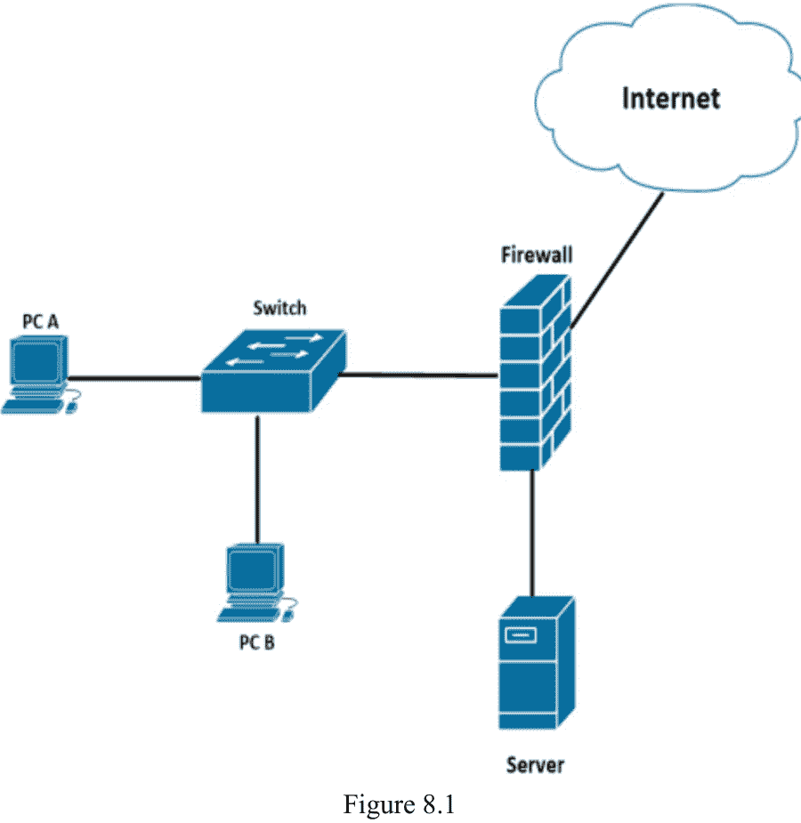

## 防火墙如何使用安全区域？

防火墙将其接口划分为安全区域。防火墙的每个接口都是一个安全区域。我们可以创建更多此类区域并将一个或多个接口包含其中。这些安全区域通常分为三类：

- **INSIDE（内部）** - 包含内部网络（LAN）的区域
- **OUTSIDE（外部）** - 包含组织外部网络的区域（通常是互联网）
- **DMZ** - 包含服务器的特殊区域

防火墙为每个区域分配一个安全级别（由 0-100 之间的数字定义），影响其行为。例如，如果我们有一个安全级别为 100 的 INSIDE 区域和一个安全级别为 0 的 OUTSIDE 区域，那么来自 INSIDE 的任何流量将被允许（防火墙）进入 OUTSIDE（即互联网），但从 OUTSIDE 进入 INSIDE 的流量将被拦截，这需要在防火墙上配置特殊规则（即动态学习 - 状态检测 流量）。

**DMZ（非军事化区）** 是一个放置需要互联网访问的设备的特殊区域。该类别在大多数情况下是服务器（Web、文件、VPN 等）。这些是公司的公共资源，理论上任何人都可以访问。

这需要在防火墙上配置特殊规则（即动态学习 - 状态检测 流量）。

其目的是防止来自互联网的潜在攻击，这些攻击在某些时刻可能会尝试利用系统的某些漏洞。

防火墙工作在第img485e17094b9 0b18870d12b91b22fb038_102_0.


# 防火墙与网络安全基础

## 概述

你可能想知道的一点是：没有完美的安全，防火墙不足以确保网络绝对安全，但它是一个帮助保护外部访问（即从互联网到局域网）的重要组成部分。

除了这个网络元素外，在涉及到安全时，还需要考虑许多其他组件。如图 8.1 所示，防火墙将所有设备连接到互联网（因此在这种情况下基本上取代了路由器的位置）。其目的是防止来自互联网的潜在攻击，这些攻击在某些时刻可能会尝试利用系统的某些漏洞。防火墙工作在第 4 层（默认），但它也可以配置为运行在第 7 层（来自 OSI 模型）。

这意味着什么？这意味着你可以“更深入地”查看数据包。甚至可以看到你正尝试访问的 URL，甚至可以扫描你正在下载的程序以检查是否有病毒。

这适用于性能型和昂贵的防火墙，它们被称为 **UTM**（统一威胁管理）。


## 如何使用安全区域？

防火墙将其接口划分为安全区域。防火墙的每个接口都是一个安全区域。我们可以创建更多此类区域并将一个或多个接口包含其中。这些安全区域通常分为三类：

- **INSIDE（内部）** - 包含内部网络（LAN）的区域
- **OUTSIDE（外部）** - 包含组织外部网络的区域（通常是互联网）
- **DMZ** - 包含服务器的特殊区域

防火墙为每个区域分配一个安全级别（由 0-100 之间的数字定义），影响其行为。例如，如果我们有一个安全级别为 100 的 INSIDE 区域和一个安全级别为 0 的 OUTSIDE 区域，那么来自 INSIDE 的任何流量将被允许（防火墙）进入 OUTSIDE（即互联网），但从 OUTSIDE 进入 INSIDE 的流量将被拦截，这需要在防火墙上配置特殊规则（即动态学习 - 状态检测流量）。

**DMZ（非军事化区）** 是一个放置需要互联网访问的设备的特殊区域。该类别在大多数情况下是服务器（Web、文件、VPN 等）。这些是公司的公共资源，理论上任何人都可以访问。

如图 8.4 所示，从交换网络发送的流量将从防火墙接口进入（IN），并从连接到服务器的接口退出（OUT）。当服务器响应连接它的设备时，情况恰恰相反。现在让我们恢复图 8.3 中的图像。

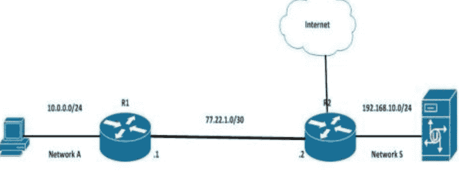

### 场景 #1：阻止特定主机访问服务器

假设我们想阻止来自网络 A 的 PC (`10.0.0.8`) 向服务器发送任何流量。在这种情况下，我们需要一条在源 IP 之后进行过滤的规则（标准 ACL）。规则如下所示：

```
#deny host 10.0.0.8
#permit any
```

我该如何检查设置呢？首先，我们将从 PC1 向服务器 (`192.168.10.0`) 生成 ICMP (ping) 流量（从下面的图中可以看到，它无法工作。）。这里是 R2 拦截流量的证明。命令 `#show ip access-list` 的结果显示，针对 PC 的拒绝规则有 8 次匹配（图 8.5）！

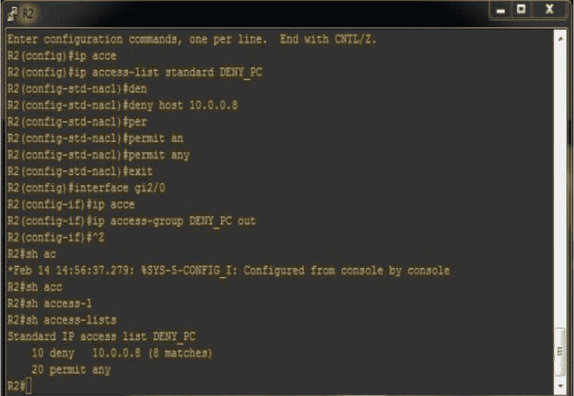

**图 8.5**

### 场景 #2：阻止 Web 流量

假设我们想阻止 PC 到互联网的任何类型的 Web 流量（HTTP-80 和 HTTPS-443）。在这种情况下，我们需要一条更具体的规则（扩展 ACL）。规则如下所示：

```
#deny tcp host 10.0.0.8 any eq 80
#deny tcp host 10.0.0.8 any eq 443
#permit ip any any
```

因此，前 2 条规则将阻止 PC 到任何（任何目的地）的 Web 流量（端口 80 和 443），而最后一条规则将允许从任何源到任何目的地的其他任何流量。此规则将尽可能设置靠近源（在连接 PC 的 R1 接口上）的 IN 方向上。我们现在将生成 Web 流量（从 PC 控制台到服务器-`192.168.10.10`）：

与上面一样，在图 8.6 中看到 Web 流量在列表的第一行被拦截（6 次匹配）：

```
R#
*Feb 14 14:59:32.955: %SYS-5-CONFIG_I: Configured from console by console
R#show ip acce
R#show ip access-lists
Standard IP access list ACL STD
10 deny 10.0.0.8
20 permit any
Extended IP access list DENY WEB
10 deny tcp host 10.0.0.8 any eq www
20 deny tcp host 10.0.0.8 any eq 443
30 permit ip any any
R#show ip access-lists
Standard IP access list ACL STD
10 deny 10.0.0.8
20 permit any
Extended IP access list DENY WEB
10 deny tcp host 10.0.0.8 any eq www (6 matches)
20 deny tcp host 10.0.0.8 any eq 443
30 permit ip any any (9 matches)
R#[]
```

**图 8.6**

### 其他示例（标准 ACL）

```
#deny 192.168.99.0/24
-- 拒绝整个 /24 范围

#permit 85.1.245.5
-- 仅允许此 IP 地址

#deny 172.16.0.0/17
-- 拒绝整个网络
```

### 其他示例（扩展 ACL）

```
#permit ip 172.30.0.0/24 any
-- 允许从源 172.30.0.0/24 到任何目的地的流量
```

```
#permit tcp host 10.45.21.5 eq 22 any
-- 允许来自 10.45.21.5 的任何 SSH 回程流量
```

```
#deny udp 172.16.0.0/24 85.98.2.0/23 eq 53
-- 阻止从网络 172.16.0.0/24 到 85.98.2.0/23 的 DNS 流量 (UDP 端口 53)
```

## 市面上提供的防火墙选项

谈到市面上不同类型的防火墙时，我们有很多选择（这取决于我们的能力和预算）。主要分为两大类：

- **特定厂商** - `Cisco ASA`, `Palo Alto`, `Checkpoint`, `Fortinet` 等。
- **开源** - `pfSense`, `OPNSense`, `IP Fire` 等。

这些大多数防火墙的工作方式相似（基本概念是相同的），但每个厂商/开发者都带有不同的元素，使其具有独特性（用于恶意软件的人工智能、反病毒软件、反垃圾邮件集成、URL 级过滤等）。目前，市场倾向于进一步选择 `Palo Alto`，因为其防火墙的技术领先，而网络领域的知名厂商（`Cisco`）在其防火墙 `ASA`（自适应安全设备）方面仍然落后。

如果你想要一种廉价（甚至是免费）、实施良好且快速的方案，变体可能是我们将讨论的这些**开源**防火墙之一。在本节中，我们将讨论很多开源解决方案，并选择 **OPNSense** 作为主要示例（图 8.7），因为它具有最用户友好的界面。


**图 8.7**

### pfSense

`pfSense` 是市面上最流行的防火墙，许多公司使用它来保护网络。其内核是 `FreeBSD` 发行版，在图 8.8 中你可以看到它，在图 8.9 中你可以看到它的界面。


**图 8.8**

正如上面所示，`pfSense` 的优势在于它有一个图形界面，命令行同样可以工作。在下面的图中，我们可以看到防火墙的配置（必须在虚拟机中配置好两个接口）。LAN（局域网）使用这种防火墙以连接互联网。

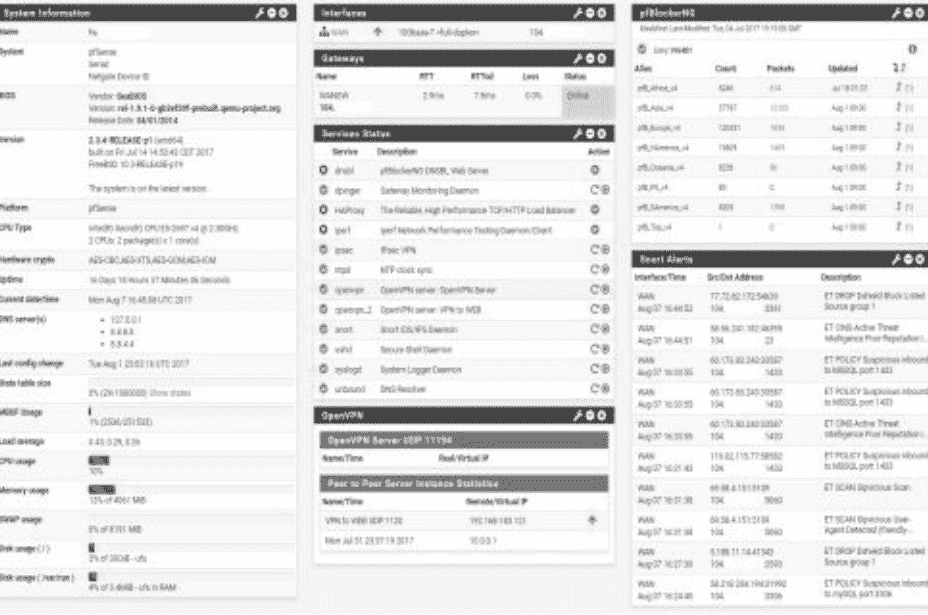

**图 8.9**

### OPNSense

`OPNSense` 是另一种市面上的开源防火墙。在本节中，我们选择 **OPNSense** 作为主要示例，因为它具有最用户友好的界面。

# 你好，这是 OPNsense 18.1

| 网站 | https://opnsense.org/ |
| 手册 | https://docs.opnsense.org/ |
| 论坛 | https://forum.opnsense.org/ |
| 列表 | https://lists.opnsense.org/ |
| 代码 | https://github.com/opnsense |

```
+ 0) 退出
1) 分配接口
2) 设置接口 IP 地址
3) 重置 root 密码
4) 恢复出厂默认设置
5) 关机
6) 重启系统
7) Ping 主机
8) Shell
9) pTop
10) 防火墙日志
11) 重新重载所有服务
12) 从控制台升级
13) 恢复备份
输入选项： _
```

**图 8.12**

在此阶段，我们有几个选项（测试连接性、设置接口、更改 `root` 用户密码，以及最重要的访问 shell - 也就是 `FreeBSD` 的命令）。因此，我们将输入 `8` 并访问命令行界面。作为一个基于 Unix 的操作系统，该命令与 Linux 命令类似（如 `cd`、`ls`、`mv`、`find`、`grep`、`ps` 等命令也出现在这里 - 图 8.13）。当然，也有一些特定发行版的不同命令。

```
root@OPNS:~ # ls
.zshrc      login       profile .vimrc
root@OPNS:~ # cd
root@OPNS:~ # ls
.zshrc      boot            home net sys
.profile     conf            init tmp
.rr_webview  libsexec rescue
COPYRIGHT    dev.            media usr
entry       entropy       root
root@OPNS:~ # etc             mat       sbin
elabel=ifconfig end
options:flags=0843,UPCAST,RUNNING,SIMPLEX,MULTICAST) mtu 1500
options=08:00:29:f9:fe2:31
haaddr=08:00:29:f9:fe2:31
in6 fe80::200:29f9:fe2:31 prefixlen 64 scope 0x2
inet 192.168.1.6 netmask 0xffffff broadcast 192.168.1.255
d6 options=23:(PERFORMNUD,ACCEPT_RTAD,AUTO_LINKLOCAL)
media: Ethernet autodetplex (1000baseT<full-duplex>)
status: active
root@OPNS:~ # _
```

**图 8.13**

让我们从终端（通过 SSH）连接到虚拟机：

```
ram@computer:~$ ssh root@192.168.1.6
The authenticity of '192.168.1.6' can't be established.
ECDSA key fingerprint is SHA256:J3D4nuIgTZbt0tX4ZJIKI/RepKK35Rd8hugKIKvE
Are you sure you want to continue connecting (no/yes)? yes
Warning: Permanently added '192.168.1.6' (ECDSA) to the list of known hosts.
Password for root@OPNsense.localdomain:
Last login: Tue Mar 27 04:16:2018
```

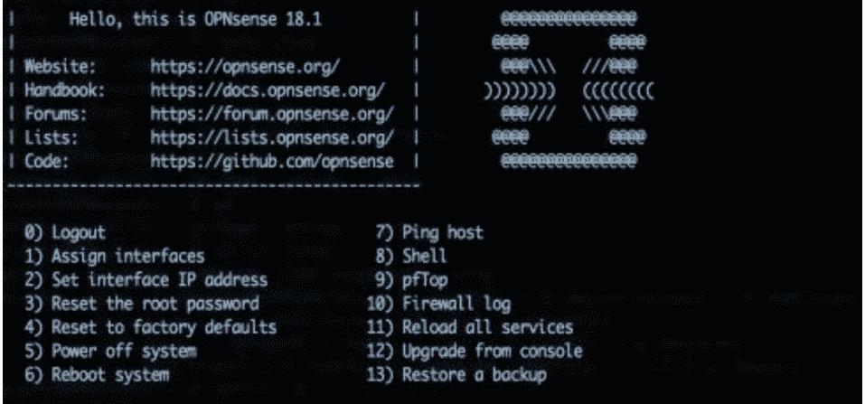

**图 8.14**

如图 8.14 所示，我们也可以通过 SSH 连接，SSH 默认是开启的（如果你在 Windows 上，可以使用 `PuTTY`；在 Linux 上，你可以直接使用终端和命令：

```bash
#ssh root@IP_ADDRESS
```

**注意：** 默认情况下，`OPNsense` 防火墙是开启的。这会阻止你的初始 SSH 流量。你需要做的是从控制台（图 8.13）访问它并输入命令 `pfctl -d`（这将停止它）。

现在你已经了解了一些 `OPNsense` 防火墙（在命令行中），我建议进入配置页面，并通过浏览器界面调整其设置。我们将在浏览器中添加**防火墙的 IP 地址**（我们通过使用 `#ifconfig` 命令找到它），之后你将输入你的**用户**和**密码**。请看下方的图 8.15，我正处于主仪表板：

## 门堂：仪表板

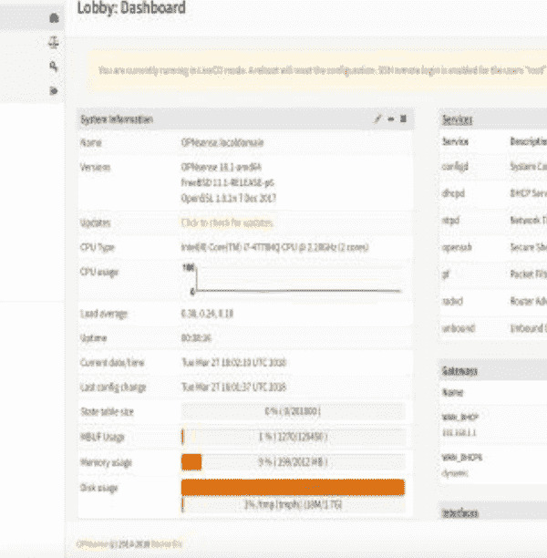

你目前运行在实时模式（Live Mode）。重启将导致配置丢失。`OPNsense` 允许 `root` 和 `admin` 使用相同的密码登录。

| 系统 | 服务 | 描述 | 状态 |
| --- | --- | --- | --- |
| `OPNsense-localsense` | `config` | 系统配置守护进程 | OK |
| `OPNsense 1.1.1` | `dhcp` | DHCP 服务器 | OK |
| `FreeBSD 11.0-RELEASE-1 12 Dec 2017` | `ntp` | 网络时间守护进程 | OK |
| | `ssh` | Secure Shell 守护 | OK |
| | `filter` | 路由器公告守护进程 | OK |
| | `unbound` | unbound | Warning |

**图 8.15**

在这里，最初你有机会被重定向到安装向导，它可以帮助你只需点击即可设置防火墙。如果你想配置得那么好，你可以这样做；如果你想手动设置防火墙（你可以在通过向导后进行操作），你也可以这样做。

如左侧所示，会出现防火墙上每个重要元素的菜单和子菜单列表。我想提醒你，这个防火墙有**非常**多的功能和选项。我的建议是识别出你熟悉的那些并尝试配置它们（例如：DHCP 服务器或 LAN 和 WAN 接口的设置等）。

在仪表板中间，你可以看到硬件（CPU、内存、磁盘等）和软件（OS 和 `OPNsense` 版本）的细节，以及**正在运行**的服务（你可以找到 SSH 服务器、DHCP 服务器或防火墙 - `pf`）。

以下是你可以用 `OPNSense` 做的事情列表：

- 状态检测检测防火墙（保持数据包进入离开网络）
- IPv4 & IPv6 支持
- 安全区域（LAN, WAN, DMZ）
- 流量整形
- NAT（端口转发、静态、PAT）
- 冗余/高可用性
- 负载均衡
- VPN - IPsec, OpenVPN, L2TP
- PPPoE 服务器
- 网络分析的实时图表
- 强制门户
- DHCP 服务器和中继（用于 IPv4 & IPv6）
- SSH 访问
- 内置数据包捕获/嗅探技术，如 VLAN, LAGG/LACP, GRE, PPPoE/PPTP/L2TP/QinQ

`OPNSense` 提供了内部流量监控工具，你可以在“报告”区域找到。这是对防火墙和 `OPNSense` 的简要介绍，这就是为什么我让你尝试一下。接下来，我建议构建一个类似于图 8.16 的拓扑结构，这可以通过 [GNS3](https://gns3.com/) 程序完成。祝你好运！

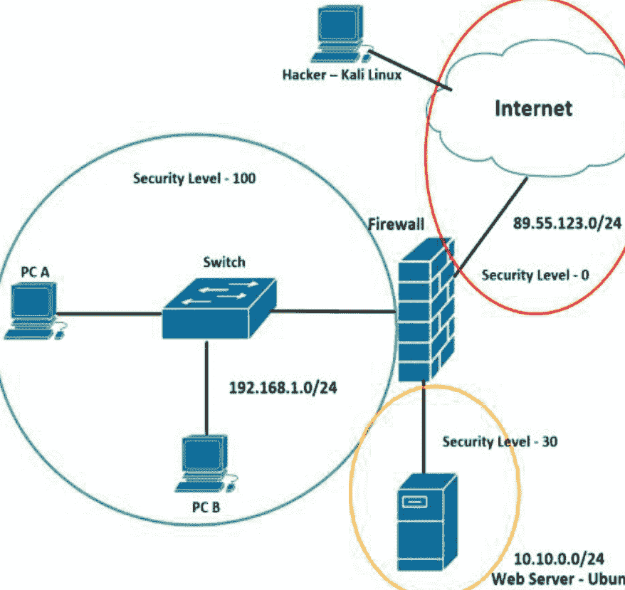

---

# IX. 加密学简介

**加密学。**当我们谈论加密学时，我们总是指的是通过加密使其变得不可读。当我们谈论算法时，有两种方式：

- **对称** - 使用单个密钥
- **非对称** - 使用一对密钥（一个公有的）

## a) 对称加密

对称加密是最广泛使用的加密形式，因为它快速且安全。它需要单个密钥（称为 **PSK** 预共享密钥），用于加密和解密。

将此密钥想象成你家的钥匙（用它可以打开门，也可以锁门）。现在，这里有一个常见案例，当你连接到无线网络（WLAN）时使用这种 PSK 来加密数据，它会要求密码。

该密钥（密码）用于网络身份验证和消息加密。现在你了解了对称加密，我建议继续查看实现这些可能的算法：

- `DES`
- `3DES`
- `AES`
- `Blowfish`
- `RC4`

### 1) 数据机密性

当我们谈论数据机密性时，我们总是指的是加密使其变得不可读。这是由于近年来兴趣的增加。


# DES 和 3DES（数据加密标准）

**DES 和 3DES（数据加密标准）**是 20 世纪 70 年代开发的加密算法，DES 的复杂度为 56 位，3DES 为 168 位。3DES 并不是 DES 的三倍安全（或者说安全性上不好三倍），它只是在相同数据上三次应用 DES 算法。

在 1999 年，曾有过一次实验，想要解密（“破解”、“攻破”）一个经过加密的消息，这在不到 24 小时内就完成了！

# AES（高级加密标准）

**AES（高级加密标准）**是最流行的（以及最使用的）对称加密算法。它使用单个密钥进行数据加密和解密。

它的密钥值可以是 **128、192、256 位**，这取决于你需要的安全级别或系统进行此类加密的能力。

# AES 设计

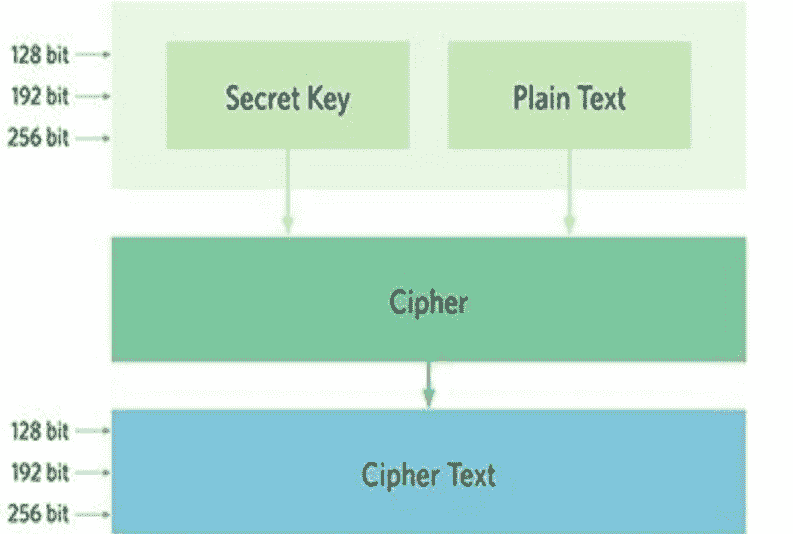

图 9.1

在图中，你可以看到文本/文件（我们想要加密的内容 - 明文）是如何与密钥密钥一起被添加到 AES 加密函数（密文算法）中的。执行后的文本得到了加密后的文本（密文）。

# 非对称加密

涉及非对称加密时，情况会有所不同。这种加密的复杂度远高于对称加密（1024、2048 甚至 4096 位对比 128、192、256 位），但对硬件资源的消耗也高出得多。此外，非对称加密使用一对密钥——一个公钥和一个私钥。

私钥应该是……私有的，而公钥可以分发给任何人。非对称加密的执行方式如下：

任何使用公钥加密的数据只能用私钥解密（这样我们获得了数据机密性）。

## 公钥

## 私钥

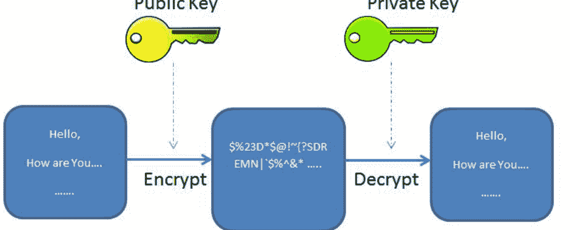

图 9.2

另一种方式，它不提供机密性或身份验证：

所有用私钥加密的内容只能用公钥解密，这种场景创建了用于身份验证目的的数字签名。以下是一些非对称加密算法：

- RSA
- DH
- DSA

**RSA (Rivest Shamir-Adleman)** 是一种非对称加密算法，它使用一对密钥：一个公钥和一个私钥。该算法以其在 70 年代开发的开发者的名字命名。因为我之前提到了对称加密算法（RC4、AES 等），我说过它们可以使用 128、192、256 位的加密密钥。非对称算法可以使用更大的密钥，其值可以是 1024、2048 甚至 4096。

密钥值越高，加密就越安全/复杂，但速度会更慢，因为需要更多的处理能力。除此之外，加密原理与之前描述的相同。

**DH (Diffie-Hellman)** 是一种非对称算法，旨在两个实体之间生成一个用于加密流量的对称密钥（例如，这个密钥可以被形成 VPN 隧道的两个路由器使用，用于加密它们网络之间的流量）。

# 数据完整性

那么，基本上，数据完整性意味着什么？数据的完整性确保文件可以从 A 点传输到 B 点而不改变（或修改）其内容。它是通过一个被称为哈希（hashing）的过程实现的。

假设我们有一个 PDF 文件，想要确保它在互联网传输中的完整性。为了做到这一点，我们需要该 PDF 文件的 HASH 值。

按照下面的教程学习更多关于这些概念：

哈希文件有助于确定其完整性。当我们想要通过互联网发送文件时，过程中可能会发生变化（丢包、信息篡改、黑客更改内容）。

因此，我们需要一种机制来确保它保持完好（或者到达目的地的包与从源发送的包完全一致）。

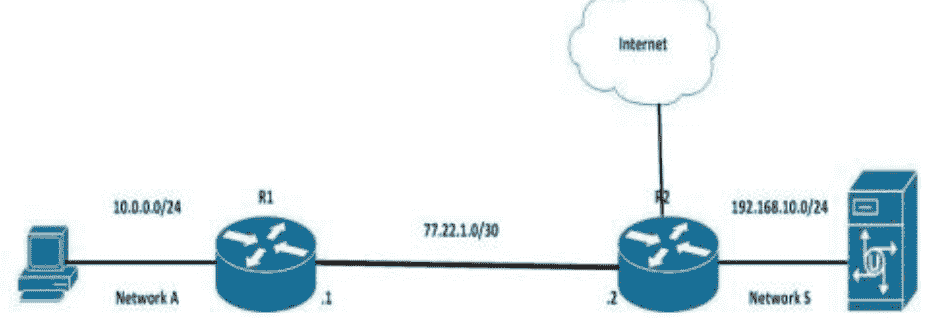

图 9.3

哈希帮助我们实现这个目标，基本上它是由一个数学公式生成的，该公式为引入公式的任何包获取一个唯一的 ID。

因此，当源 (S) 想将文件发送到目的地 (PC) 时，它通过这个公式，唯一的 ID（又名哈希）被转发到目的地 (PC)。当此文件到达目的地时，目的地重新计算文件 ID。如果两个值（发送的/接收的）相同，那么数据包就是同一个（即保留了完整性）。

在教程中，我看到加密如何帮助我们隐藏文件，但这不足以完全保护它，以便任何人都能向该文件添加数据。在本章中，我们能够通过使用哈希来保护数据免受此类攻击。以下是一些确定数据完整性的算法：

- MD5 - 128 位
- SHA1 - 160 位
- SHA2 - 256 位
- SHA3 - 384 位
- SHA4 - 512 位

这里是下面的图，如 SHA2 的（随机）哈希值所示：

此在线工具允许你生成任何字符串的 SHA256 哈希。SHA256 由 NSA 设计，它比 SHA1 更可靠。

在下方输入你的文本：

So received is occasion. Among ready to which up. Attacks smiling and may out moments outward. Thrown any either the set one temper. Instrument melancholy in acceptance frequently by it. now existence add you instantly. Merry far had was. Concerns in expenses formerly.

Name at hope, Remainder household bed sex. Lose and gay met that. Stood her place spoke yet. Head case knew ever why. Marianne returned of replying in moderate. Roused get enable estate old county. Entries you devshire law terminated.


你的字符串的 SHA256 哈希：

`349C7E2068C4BE950BC72285D2E1EA0D5AB00E248661ACD48BF7E064ECBF`

图 9.4

这是另一个例子，我相同的文本，但删除了一个字母（第一个 - S）：

此在线工具允许你生成任何字符串的 SHA256 哈希。SHA256 由 NSA 设计，它比 SHA1 更可靠。

在下方输入你的文本：

received is occasion honored. Among ready to which up. Attacks smiling and may out moments outward. Thrown any either the set one temper. Instrument melancholy in acceptance frequently if bi. now existence add you instantly. Merry far had been was. Concerns no in expenses rallied. Name at hope, Remainder household direction bed sex. Lose and gay met that. Stood her place spoke yet. Head case knew ever over why. Marianne returned of replying in moderate. Roused get enable cabinet old count. Entrees you devshire law terminated.

`Generate Clear All`

将每行视为独立的字符串

你的字符串的 SHA256 哈希：

`25BC313219EE03A0B933A792761C6A8552F4CF1AA51649D327B023EB1F6`

图 9.5

正如你在两个图中看到的，这两个值是完全不同的。因此，对于任何微小的变化（例如：1 位），哈希值都是唯一的！

# HMAC

**HMAC（或基于哈希的消息认证码）**是一种将两种安全元素结合在一起的特殊技术：认证和哈希。为了生成文本的 HMAC（例如），需要一个密码（秘密密钥或 PSK）在哈希过程中使用。因此，将密码添加到哈希过程中，只有当该密码被包含在内时，才能获得该哈希（该哈希是唯一的）。如果没有秘密密钥（又名密码），就无法获得那个唯一值（哈希），因此完整性将无法保持。以下是使用 HMAC 函数的例子：

```
HMAC_MD5("secret key", "I love computer security and hacking") = 8bc8517557db4f1f59a96025e30224886
HMAC_SHA1("secret key", "I love computer security and hacking") = be23d4136374c7e2a04ec3dc1c24d698c07fa2
HMAC_SHA256("secret key", "I love computer security and hacking") = 3200766cf751c2b197b8c9ff52c00d5787e2c0b0d6fc70632b488c8a38d0
```

正如你看到的，输入秘密密钥，然后输入你想哈希的数据（在这种情况下我只写了一个希望你也同意的肯定句）；我们给出三个例子是因为每个例子都使用了更复杂的算法（MD5 < SHA1 < SHA256），并生成了更强的哈希（特别是因为它包含一个攻击者需要发现的秘密密钥）。

在这个网站上（https://www.freeformatter.com/hmac-generator.html），你可以使用 HMAC 技术生成自己的哈希。

# 盐

另一种帮助我们增加密码（例如存储在数据库中的密码）安全性的有趣技术是在哈希过程中使用盐。基本上，在对密码哈希时会添加一段随机生成的文本。这样攻击者很难使用我们讨论过的字典或彩虹表技术来“破解”这些密码。

过程如下：

1. 以随机方式生成盐
2. 将盐与密码结合
3. 组合（盐值 + 密码）后生成哈希
4. 将哈希值存储在数据库中

这就是整个过程。我想要提到的另外一点点是：密码永远不会以明文格式存储在数据库中（例如 MySQL）。这些密码总是被“哈希遗忘”（或者正如某些人所说，被加密了）。

# 一种保护（隐藏）重要文件的其他方法

如果你认为加密是隐藏文件的唯一方法，其实还有其他方法（安全性较低且不常用，但确实存在）。其中一种是隐形术（Steganography），它是将文件隐藏在另一个文件中的技术。假设“隐藏”文件的位映射到“宿主文件”的**位**上。因此，当此文件通过邮件发送时，接收文件的人几乎不可能检测到它（特别是如果他们没有使用特殊工具的话）——对于其他人来说也是如此。

但我们如何从另一个文件中检测出“隐藏”的文件呢？我们检测这种过程的方法是确定该文件的（哈希）完整性并比较这两个值。这里有一个工具（http://steghide.sourceforge.net/），你可以用来玩隐形术。

# 身份验证

大多数情况下，身份验证可以通过多种方式完成。也许到目前为止你习惯了用户验证和密码（或只有密码）。最近，生物识别验证（基于指纹甚至面部表情）变得越来越流行。

这里是的一些身份验证方式：

- 用户与密码（或仅密码）
- 生物识别（指纹、眼睛、唾液、脸部等）
- 基于位置（只有当你位于中心位置时才能访问资源）
- 基于时间（你只能在特定时间点访问资源）
- 基于令牌（你拥有的特殊工具，甚至是手机）

简而言之，从更科学一点的角度来说，身份验证可以基于以下因素进行：

- 你知道什么（用户密码）
- 你是谁（生物识别）
- 你在哪里（位置）
- 你拥有的什么（手机、令牌）
- 的时间点

我想介绍一些更频繁使用的术语（例如，在银行或不同的平台 - Amazon、Digital Ocean、Google、Facebook 等）。在这里我指的是 2FA（双因素身份验证）。因此，如果我们把 2 个不同的因素（上述的因素）结合起来，我们就得到了双因素身份验证。

单因素身份验证（1FA）的一个例子是使用用户和密码。如果我们想实现 2FA，那么我们可以添加生物识别验证或令牌（仅限其中一种，而不是两者都要）。

添加的身份验证类型越多，它就会越复杂、越安全。

> **警告**：如果我们每次被要求提供不同的密码时都必须经过 3 个不同的步骤，这并不代表 3FA，而是通过一个因素进行的身份验证。为什么？因为我们使用了我们所知道的，在这种情况下是密码（它没有将其与其他模式结合）。

# 什么是数字签名？

**DSA（数字签名算法）**算法与 RSA 类似，但它用于生成数字签名。这个过程（数字签名）通过（消息源）使用私钥对消息/文件进行加密并发送到目的地来完成。

目的地将尝试用公钥解密该消息，如果它成功做到这一点，消息源将得到确认（即：消息确实来自通信中的目标实体）。

# 什么是数字证书？

我们验证实体的另一种方法是使用数字证书。在身份验证方面，这是一种更安全、更可靠的方法。为什么？数字证书是由一个上级的、可信任的权威颁发的，该权威能够唯一地识别某个人/实体。

归根结底，数字证书是什么？它是实体在互联网上的“身份证明”。该数字证书包含以下信息：

- 实体 A 的公钥（我们以实体 A 为虚构示例）
- 实体信息
- 证书颁发机构 - 颁发证书的认证机构
- 用于加密的协议（AES、RC4 等）
- 证书的创建日期和过期日期

让我们来谈谈这一切：

**a) 公钥**由接收数字证书的人（B）使用，用于将消息回传给实体（A）。同时，它也用于解密证书中包含的消息（该消息是用私钥加密的）。所以，正如我之前提到的，消息源得到了身份验证（即：数字签名）。

**b) 关于实体 A 的**信息** - 关于该组织的信息，

**c) 证书颁发机构**（CA）- 颁发证书的认证机构

CA 可以是一个所有人都信任的组织。所以，如果许多其他组织信任这个 CA，并且 CA 信任你，那么所有人都会信任你。这就是证书的工作原理，也是它们的目的所在。基本上，从数学格式来看，场景看起来是这样的：

```
A = C
B = C => A = B
```

在图 9.6 中，你可以看到来自维基百科的数字证书示例：

## 此证书已通过以下用途验证：

SSL 服务器证书

## 颁发给

| 通用名称 (CN) | *.wikipedia.org |
| :--- | :--- |
| 组织 (O) | Wikimedia Foundation, Inc. |
| 组织单位 (OU) | <不属于证书> |
| 序列号 | 05:DF:E8:FF:15:B8:63:CC:C6:89:C7:8E:64:0C:FE:E8 |

## 颁发自

| 通用名称 (CN) | DigiCert High Assurance CA-3 |
| :--- | :--- |
| 组织 (O) | DigiCert Inc |
| 组织单位 (OU) | www.digicert.com |

## 有期

| 颁发日期 | 2011/08/12 |
| :--- | :--- |
| 到期日期 | 2012/12/12 |

## 指纹

| SHA1 指纹 | 03:47:7F:F5:F6:3B:F5:B6:10:C0:D7:D6:59:A9:B12:D3:20:83:68 |
| MD5 指纹 | C0:C8:F7:A0:33:20:A2:D4:2E:27:65:73:42:4C:A0:24 |

图 9.6

# 使用 VPN 技术保护我们的互联网流量

我确定你听过 VPN 这个术语。在过去网络攻击增加的时期，这项技术非常常见（网络安全开始变得越来越重要）。所以，我们在这一章中讨论的话题是 VPN。

## 什么是 VPN？

虚拟专用网络（VPN）是两个路由器/防火墙之间（甚至是从 PC、笔记本电脑、手机到特定服务器）的一条隧道，它在两个或多个网络之间提供安全访问。除了安全性之外，VPN 还连接了这两个网络（就像它们直接连接了一样）。

你现在可能会想：“嗯……奇怪，我理解的完全不同！VPN 不是那种能改变我的 IP 并保护我的连接的工具吗？”我的回答是：“是的，VPN 确实如此，正如你将看到的，有几种类型的 VPN，每种都有其目的。”我们将详细讨论这一点。

在此之前，这里是 10.1，一个跨越互联网连接两个网络（并保护流量）的 VPN 隧道的经典示例 - - (img/85e17094b9b0b18870d122238142_0)

图 10.1

通过这条隧道，两个网络的终端设备（PC、笔记本电脑、服务器）可以在互联网上安全地通信。虚拟上，两个网络之间的连接就像它们直接连接了一样。

如果 10.26.3.0/24 网络（连接到 R2）中有多个服务器（邮件、文件等），通过此 VPN（在路由器上创建），192.168.19.0 网络（左侧 - R1）将获得访问权限。

## 存在多少类型的 VPN？

简而言之，市场上存在两种主要的 VPN 类别/类型，即：

- 点对点 VPN (Site-to-Site)
- 远程访问 VPN (Remote Access VPN)

现在认为最好分开讨论每一个；

## 1) 点对点 VPN

你之前在图 10.1 中看到的就是一种点对点 VPN。为什么？因为它由于连接了两个位置（站点 - 不是网页，而是网络），就像它们直接连接了一样。此外，VPN 让你变得匿名（用某些“虚假”地址替换 IP），并保护从 R1 网络发送到 R2 网络以及反之的所有设备的连接。这种类型的 VPN 使用名为 IPSec（互联网协议安全）的技术进行加密、完整性和身份验证，我们稍后会讨论。

在下例所示（图 10.2）中，你可以看到点对点 VPN 的拓扑结构。这种拓扑结构发生在三个位置（全球任何地方）。你可以看到路由器 R1（以及位于 192.168.19.0/24 后的网络）分别连接到 R2 和 R3。因此 R1 及其网络将访问 R2、R3 的内部资源。

如果这是一家公司，那么这些资源可以是：活动目录服务器、DNS 服务器、邮件服务器、Skype for Business 等。

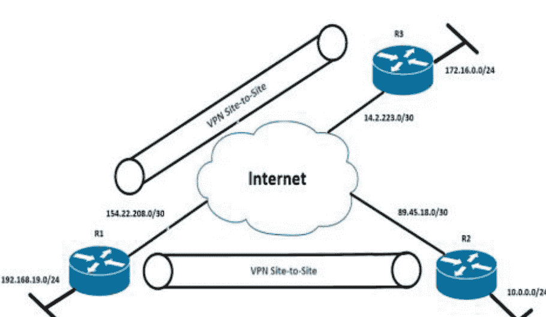

图 10.2

## 2) 远程接入 VPN (Remote Access VPN)


# 远程接入 VPN

现在我来到了你可能在阅读本章标题时就想到的那种 VPN。这种类型的 VPN（与站点到站点 VPN 相比）最常见，因为它非常方便且配置相对简单。目前有许多 VPN 供应商（如 Bitdefender、CyberGhost、NordVPN 等）在互联网上提供完整的加密和`匿名性`解决方案。我非常建议你购买此类服务，因为它会非常有益（+ 你可以在你的笔记本电脑、桌面电脑或智能设备上使用它）。

如果你`在乎你的安全`，VPN 将非常有益（特别是当你连接到公共 Wi-Fi 时，正如你在第 5 章中看到的，由于中间人攻击 (MITM)，公共 Wi-Fi 可能极其危险）。如果你在公司工作，它可以让你获得远程办公的机会，而且如果你使用 VPN，你就可以访问公司的`内部资源`。

作为一种保护连接的协议，SSL（安全套接层）或 TLS（传输层安全——它也处理我们的 Web、FTP 等连接的安全）是这种情况下使用 SSL 最常见的原因，因为与 IPSec 相比，它的实现和配置更加简单。

在下面的示例中（图 10.3），你可以看到远程接入 VPN 的拓扑结构是怎样的（逻辑上）。用于这种 VPN 的一个日益常见的术语是“远程办公”（Teleworking）。在这个示例中，PC A 将访问 R3 网络上的内部资源。与上一个示例不同，只有 PC 可以访问这些资源。

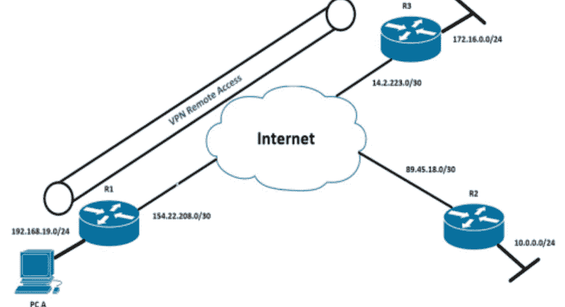

图 10.3

当涉及到这种远程接入（VPN）时，对于你想要连接到特定网络（无论是公司内部网络，还是为了保护你在互联网上的身份而购买的 VPN 服务）的设备，有必要使用程序。有来自多个供应商的许多类型的 VPN 程序（Cisco - AnyConnect，Juniper - JunOS Pulse，甚至 Windows 10 也带内置的 VPN 客户端）。

## 推荐的 VPN 程序

有很多你可以使用的 VPN 程序（根据你想做什么，我推荐 2 个）。我推荐的第一个、且你可以在许多操作系统（Linux、Windows、MacOS、Android 和 iOS）上使用的程序是 `OpenVPN`（图 10.4）。它是一个开源（且免费）的解决方案，使用配置文件进行不同的连接。OpenVPN 的用处是，你可以通过路由器（例如从家里）或通过你在世界上某个部分的服务器创建你自己的 VPN 连接。这样你就不依赖于任何人，你拥有完全的控制权，而且不需要任何费用。相反，你需要技术知识（特别是 Linux）来设置这种类型的 VPN。

这种 VPN 的方法既可以用于远程接入（访问某些资源），也可以用于保护和匿名化互联网连接（例如使用来自德国的 IP “留在网上”）。选择权交给你。我建议你两种都尝试一下，这很酷的;)


图 10.4

另一个 VPN 解决方案是许多以不同价格提供不同服务的 VPN。我更倾向于（并正在使用）TunnelBear，因为它非常易用、安装方便，而且他们的应用程序看起来很酷（+ 它提供免费试用方案）。

**注意**：这种类型的 VPN 为我们提供了`更高的安全性`和匿名性。此外，我们还可以访问可能被禁止（或被防火墙拦截）的互联网区域。这种 VPN 将保护我们免受 MITM 攻击。

## TunnelBear 实战演示

下面是在 iPhone 上使用 TunnelBear VPN 的`真实示例`（Android、Windows、Linux 或 MacOS 同样适用）。点击[此处](http://bit.ly/2H32Dw8) 了解更多。

如图 10.5 所示，我从 App Store 下载了该（你也可以在 Android 上找到它）。如果你在 Windows（或任何其他操作系统）上使用此 VPN，你需要在这里创建一个账户，`下载应用`并`安装`它。

安装应用程序后，系统会要求你创建一个账户（图 10.6），然后分配权限以设置并创建此 VPN（图 10.7）。完成这些步骤后，有必要检查你的邮件（图 10.8），然后你就可以开始使用具有非常漂亮且趣味界面的 VPN 了（图 10.9）。


图 10.5


图 10.6

### 安装 iOS 设置


图 10.7

### 我们送去了一只熊！


图 10.8


图 10.9

现在是选择你想在哪个国家进行 VPN 的时候了（这会改变你在互联网上的身份和 IP）。如图 10.9 所示，我选择了英国，一个非常重要的方面是图片顶部（时间和 Wi-Fi 之间）的——VPN 已启动。下一页的图 10.10 可以证实这一点，我正在搜索 Google 并显示与英国相关的页面。


图 10.10

这就是整个过程。简单吧？我鼓励你安装 TunnelBear (http://bit.ly/2H32Dw8) 在你的手机和笔记本电脑上并熟悉它。在下文中我们将继续这个话题，并更技术地讨论 VPN 是如何工作的：

# VPN 是如何工作的？

所以让我们最后看看 VPN 是如何工作的。正如我之前所说的，因为 VPN 隧道需要工作，它需要安全性，而这种安全性是通过名为 IPSec 的协议实现的。这些 VPN 隧道基于安全策略运行，因为安全性是它们的关键。正如我们看到的，这些安全策略通过 IPSec 建立，并通常概述了什么样的配置。

- 期望哪种加密算法？
- 期望哪种完整性、确定算法？
- 如何进行身份验证（用户和密码或数字证书）？
- 谁进入隧道？
- 哪些设备之间进行此类谈判？

这些是一些需要回答的问题。这里有很多可能性（这很大程度上取决于你需要的安全水平以及达到该水平的设备硬件性能）。在这里我们可以参考防火墙、路由器甚至是我们的终端设备。

## 什么是 IPSec？

IPSec（或 Internet 协议安全）是一种帮助保护在互联网上传输的（数据）信息的框架。IPSec 通过构成体系的四个关键要素实现了这一点：

- 加密（机密性）
- 完整性
- 身份验证
- 防重放

正如我早之前提到的，IPSec 是一个框架。你可能在想这意味着什么？嗯，框架是一个应用结构（IPSec），它接受插件以及对新协议的更改。

无论我们讨论的是数据加密还是完整性，如果你带来了一种新协议（进行加密或执行上述任一程序），我们就可以将其集成到 IPSec 中，用于保护我们的应用程序（或 VPN 隧道）。

现在，我将向你提供一些包含在 IPSec 中的协议示例，这些协议可以帮助加密来自 VPN 的数据：

### 加密协议

- DES, 3DES
- AES, BlowFish, RC4

### 数据完整性协议

- MD5, SHA1
- SHA2, SHA3

### 身份验证方法

- 用户和密码
- 数字证书

第 4 个元素（防重放）是指接收者（来自 IPSec 连接）可以检测出第一阶段发送的数据字段。这种防御机制确保消息源端不会为了恶意目的检索数据，从而在某种程度上否认这些数据在最初被发送过。此外，IPSec 基于两个封装标准 IP 数据包的大型头部：

- **AH** - 身份验证头部（仅建立完整性并验证流量，**不加密**它）
- **ESP** - 封装安全载荷 - 确保下面提到的所有四个要素

在下图 10.11 中，你可以看到 AH 头部，其主要作用是验证数据包。它包含了每个数据包验证所需的数据，即对其完整性的保证。

| IP 头部 | AH 头部 | TCP 头部 | TCP 负载 / 数据 |
| :--- | :--- | :--- | :--- |

图 10.11

在图 10.12 中，你可以看到 ESP 头部如何封装整个包并对其进行加密（从第 3 层到第 7 层的所有数据）。

| IP 头部 | ESP | 封装的 IP 包或 TCP 头部 + 负载 |
| :--- | :--- | :--- |

图 10.12

因此，通过加密整个头部，IPSec（在此 ESP 案例）添加一个新的 IP 字段（即将当前 IP 地址更改为伪 IP），以隐藏源或目的。你可能在想为什么会发生这种情况？因为这两个（源和目的）将是匿的。

当我们（通过手机或笔记本电脑）连接到 VPN 时，连接将是 SSL VPN。如果我们想在两个网络之间建立连接，我们将在这两个路由器之间形成 IPSec VPN 隧道，这样两个网络中的所有设备都能够相互通信（通过互联网 - 类似于图 10.13 中的拓扑结构）。

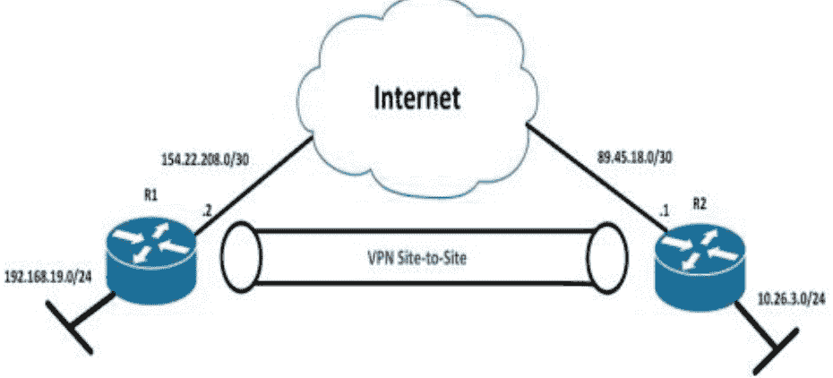

图 10.13

现在我希望你对我们所谓的 VPN 有了更详细的理解。它有几种类型：

- **站点到站点**，用于防火墙或路由器的网络连接
- **远程访问**，用于出于安全/匿名目的的终端设备远程连接，或访问网络/公司的内部资源

关于 IPSec 技术的几点，准确说是该框架中每个组件的作用（我已在本章和上一章中进行了更详细讨论）：

- 加密
- 完整性
- 身份验证
- 防重放

## 喜欢这本书吗？请在 Amazon.com 上留下评价

如果你从书中获得了益处，那么我想请你帮个忙。你是否愿意在 Amazon 上给这本书留个评价？

[点击此处在 Amazon.com 上留下评价](https://amzn.to/2I6n4v3)


感谢你阅读这本书并读到最后（相信我，没多少人能一直读到这里）。

此外，我想通过这本书触及尽可能的人（我的目标是在未来 3 年内触及 10,000 人）。这是一个很多人，没有你和你的评价，我将无法实现这一目标。

不仅如此，你还将获得一些好报，这些好报迟会体现在你的生活中。

谢谢！Ramon Nastase ([https://ramonnastase.com/](https://ramonnastase.com/))
