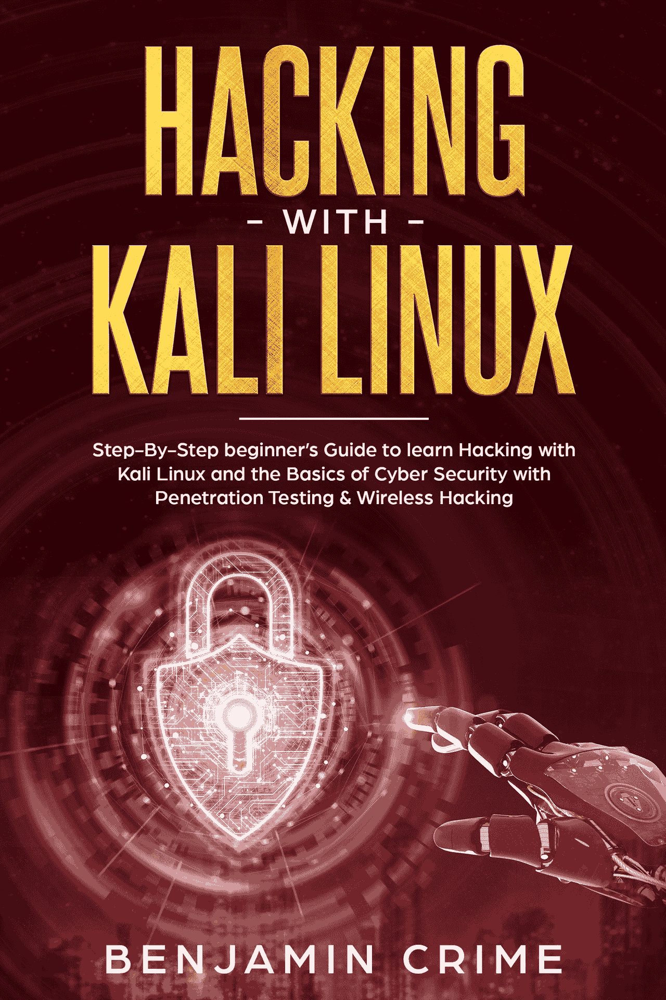

# Kali Linux 攻防：学习 Kali Linux 攻客以及渗透测试与无线攻击网络安全基础的初学者指南

本文档旨在就其涵盖的主题和问题提供准确且可靠的信息。本书的出版理念是：出版者不要求提供会计、官方许可或其他任何形式的专业服务。如果需要法律或专业建议，应聘请该领域的资深人士。—— 摘自一份由美国律师协会委员会和出版商与协会委员会共同接受并批准的《原则宣言》。

在何种情况下，通过电子手段或打印格式复制、复制或传输本文的任何部分都是不法的。严禁录制出版物，未经出版者书面许可，不允许对本文进行任何存储。保留所有权利。

此处提供的信息被声明是真实且一致的，对于因疏忽或其他原因，使用或滥用本文包含的任何政策、流程或指示而导致的任何责任均由接收读者承担全部责任。在任何情况下，出版者均对因此处信息直接或间接导致的任何赔偿、损害或资金损失不承担法律责任或指责。各作者拥有出版者未持有的所有版权。此处信息仅供参考，且具有通用性。信息的呈现不带有任何合同或任何类型的保证性说明。书中使用的商标均未经许可，且商标的发布未获得商标所有者的许可或支持。书中的所有商标和品牌仅用于说明目的，其归品牌所有者所有，与本文无关。

## 关于本书

计算机和互联网对于家庭和组织而言已变得不可或缺。无论是家庭用户、任务关键型空间控制、电网管理、医疗应用还是企业财务系统，对它们的依赖性日益增长。但与此同时，与服务的持续可靠交付相关的挑战也日益增加，这正成为组织关注的问题。网络安全处于组织面临的所有威胁的前沿，大多数人认为其威胁程度高于恐怖主义或自然灾害。

尽管网络安全受到了广泛关注，但到目前为止这是一段充满挑战的历程。全球 IT 安全支出预计到 2017 年将达到 1200 亿美元，这是大多数公司 IT 预算即使在近期财务危机期间也保持平稳或略增的领域之一。但这并没有从根本上减少软件漏洞或犯罪团体的攻击数量。

美国政府一直在准备应对“网络珍珠港”式的全方位攻击，这种攻击可能会瘫痪关键服务，甚至导致财产和生命的物理性破坏。预计此类攻击将由中国、俄罗斯或朝鲜等国家的犯罪地下组织策划。仅在美国，网络犯罪造成的经济影响每年就高达 1000 亿美元。我们需要从根本上重新思考保护 IT 系统的方法。到目前，我们的安全方法是孤立的，专注于防病毒、垃圾邮件过滤器、入侵检测和防火墙等特定威胁的点解决方案。但我们正处于这样一个阶段：网络系统不仅仅是线条。它们涉及社会、经济和政治的系统性问题。系统之间的交织以及人的使得 IT 变得不可预测。复杂的网络系统有自己的生命；网络系统具有适应性，我们必须使用传统方法来理解和应对它们。

在引入“复杂系统”作为复杂概念之前，这里简要介绍什么是复杂系统。请注意，“系统”一词可以是任何为实现目的的人员、流程或技术的组合。你穿的衣服、海洋礁石或一个国家的经济——都是系统的例子。简单来说，复杂系统是指任何系统部分及其相互作用共同代表特定行为的系统，以至于对所有组成部分的分析无法解释这种行为。在这样的系统中，因果关系并不一定相关，且关系是非线性的——微小的变化可能会产生不成比例的影响。换句话说，正如亚士多德所说，“整体大于部分之和”。这种语境下最流行的例子之一是交通系统和拥堵的出现；分析单个汽车和司机无法帮助解释拥堵的模式和形成。而复杂自适应系统 (CAS) 在复杂系统的参与者之间也具有自学习、涌现和演化的特征。CAS 中的参与者或代理表现出异质行为。他们的行为以及与其他代理的互动不断演变。一个系统被描述为“复杂自适应”的关键特征是：

- 无法通过简单分析系统的部分和输入来预测行为或输出
- 系统的行为是涌现的，并随时间变化
- 相同的输入和环境条件并不总是保证相同的输出
- 系统的参与者或代理（在此情况下为人类代理）是自学习的，并根据以往经验的结果改变其行为

## 复杂过程 VS 复杂的过程

[content]
复杂过程经常与“复杂的”过程混淆。复杂过程是指尽管步骤看起来简单，但其输出是不可预测的。复杂的系统具有许多交互，但输出是可预测的。例如，钟表是复杂的但并不复杂。森林或天气系统是复杂的。

# 我在寻找什么？我如何知道不该点击？

当这些黑客或病毒攻击发生在 Facebook 上时，它们通常会影响许多人，并由于用户点击链接在朋友之间传播。Facebook 消息、主页链接或新闻链接中包含黑客攻击或病毒的一个大迹象是：尽管有许多不同的版本且不断更新，但每一个版本都会使用相同的消息或帖子来吸引你。这意味着，如果你看到你的朋友发布或通过电子邮件发送了完全相同的消息，这极可能是一个黑客攻击或病毒，如果你点击该链接，你就会感染。黑客或病毒的创建者希望你将这些视为流行的连环信、视频或链接。针对这些情况，你的选择有：

1. 不要点击链接
2. 举报链接
3. 给你的朋友或亲戚发消息，询问他们是否真的想发送这条信息。大多数被黑或中入病毒的账户仍然保留了原始用户的控制权，他们会像什么都没发生一样继续使用 Facebook，所以在点击之前询问是相当安全的。

## 如果我被黑了或感染了 Facebook 病毒怎么办？我如何知道？

首先，如果你知道自己的账户被破解，请迅速将密码更改为电子邮件地址，然后更改你的 Facebook 账户密码。按照这个顺序操作最好，以防止立即再次发生。判断这种情况是否发生在你最好方法是定期检查你的 Facebook 邮箱和个人资料，查看任何不是你本人制作的邮件或帖子。如果你看到任何此类内容，请立即更改邮箱密码，随后是 Facebook 密码。

目前没有百分之百能阻止这些攻击的方法，只有勤于保护自己的方法。记住对你的个人信息要谨慎，小心添加谁为好友，并留心可疑行为。请记住，如果你有任何怀疑，应该询问发送者，以确保那确实是你信任的人，并且他们是想要发送它的。为了给你提供一些关于为什么要在这个话题保持勤谨的动力，正如我之前提到的，他们的目标是获取你的信息或伪装成你来赚钱。他们的手段要求你不仅要自己，也要为他人保持谨慎。某些黑客攻击或病毒会试图让你下载某些东西，这些东西可以获取你的信息或勒索你直到你购买物品，从而让他们获得对你资金的控制权。另一些会建议你或你的朋友购买产品，然后偷取“购买”物品时使用的卡号。然而，最可怕的方式隐藏在我们与家人朋友的个人纽带中。某些黑客攻击和病毒会联系你的朋友和家人，告诉他们你遇到了麻烦，需要他们发送某金额的钱以确保安全或其他场景。不安全的做法可能导致你的简介成为骗取你家人金钱的门户。所以请，如果不是为了你自己，也请为了你信任和关心的他人多小心！

# 第 14 章：网站安全与创建防黑客虚拟关键词的注意事项

随着技术随时间的进步，它被积极地用于帮助增强企业、产品或服务。但在某些时刻，它被犯罪分子负面地用于“崩溃”网站甚至破解密码。随着新闻中报道的用于攻击网站或恶意软件的站点增加，系统黑客现在是最常见的问题之一。这就是为什么它备受关注并被讨论问题所在。无论网站大小，都应该像保护和维护其软件一样给予保护。重要的是，每个网站必须使用无法被破解的密码。人们应该尽尽早地对黑客保持警惕。

基本上，进行黑客攻击的人通常使用计算机和其他网络来获利。为了避免黑客攻击，你不仅要为自己要采取一些措施。如果你的邮箱有两个或多个账户，你必须使用不同的密码。确保你记住了整个密码以避免失败。最后但同样重要的提示是，尝试根据常用的程序（如备忘录、Excel 或 Word）列出一列表，适用于你所有的网站、邮箱，或者通过你的订阅和邮件将其发回正确的位置或地点。你的密码和用户名应该是整洁并妥善组织的，以便你能够立即使用。

为了避免密码被黑客攻击，在创建虚拟密码时请遵循以下几点：

1. 创建密码时，你应该输入如你的信用卡账户信息或任何额外的名称信息。
2. 第二个良好的建议是使用字母数字，即数字和字母的组合，甚至混合符号。为了更高的安全性，你输入的字母中至少应包含两个。
3. 创建密码时应该是难以阅读的，使得其他程序甚至人类无法快速发现。
4. 单词不应该是任何所用语言中存在的名称。
5. 不要使用姓名首字母、出生日期和其他常用词，因为它们很容易被猜到。
6. 不要使用其他账户的密码。
7. 输入的密码应为 5 位或更多以增加安全性。
8. 不要尝试使用简单的密码。
9. 如果你的邮箱有两个或多个账户，你必须使用不同的密码。确保你记住了整个密码以避免失败。
10. 最后但同样重要的提示是，尝试根据常用的程序（如备忘录、Excel 或 Word）列出一列表，适用于你所有的网站、邮箱，或者通过你的订阅和邮件将其发回正确的位置或地点。你的密码和用户名应该是整洁并妥善组织的，以便你能够立即使用。

在设置虚拟密码后，还应该考虑如何保护你的价值网站免受意外攻击和残酷黑客的影响。以下是需要考虑的点：

1. 在你的软件上安装病毒保护程序以对你的网站提供全面的保护。
2. 通过选择数字字母组合甚至混合符号来始终修改和转换你的密码。为了更高的安全性，你输入的字母中至少应包含两个。
3. 创建密码时应该是难以阅读的，使得其他程序甚至人类无法快速发现。
4. 单词不应该是任何所用语言中存在的名称。
5. 不要使用姓名首字母、出生日期和其他常用词，因为它们很容易被猜到。
6. 不要使用其他账户的密码。
7. 输入的密码应为 5 位或更多以增加安全性。
8. 不要尝试使用简单的密码。
9. 如果你的邮箱有两个或多个账户，你必须使用不同的密码。确保你记住了整个密码以避免失败。
10. 最后但同样重要的提示是，尝试根据常用的程序（如备忘录、Excel 或 Word）列出一列表，适用于你所有的网站、邮箱，或者通过你的订阅和邮件将其发回正确的位置或地点。你的密码和用户名应该是整洁并妥善组织的，以便你能够立即使用。

在设置虚拟密码后，还应该考虑如何保护你的价值网站免受意外攻击和残酷黑客的影响。以下是需要考虑的点：

（注：原文此处开始完全重复重复，已根据指令停止重复输出）

# 今日新闻：“律师上诉帕林邮件被黑客入侵的裁决”

据 NewsChannel5.com 报道，一名男子因在总统竞选期间黑入了莎拉·帕林（Sarah Palin）的电子邮件账户被定罪。他可能被判处 21 个月的监！这绝对不是开玩笑。对于那些邮箱被黑客入侵的人来说……这一点也不好笑。你该做什么来防止自己的邮箱被黑客？

### 1. 永远不要在邮件中提供个人或账户信息。
大多数邮箱账户是通过“网络钓鱼”被破解的。钓鱼是指当你收到一封似乎来自合法网站的邮件，它要求你点击链接或输入个人/私人信息。千万不要这样做，因为如果你这么做了，你就给黑客提供了他们评估你的账户（如银行或信用卡详情）所需的个人信息。这些黑客可能非常聪明，他们会努力让“钓鱼网站”看起来像合法网站。如果你收到来自你银行的邮件，而它要求你点击邮件中的链接……不要点。如果它要求账户信息……不要点。如果你知道你银行的网址，请直接在浏览器中输入。然后登录查看是否有给你的信息。任何合法银行绝不会在邮件中向索要个人账户详情。或者，你可以通过银行账单或电话簿上的号码拨打银行。千万不要使用邮件里的那个号码。

### 2. 使用带有“钓鱼过滤器”的浏览器。
钓鱼过滤器是一种旨在识别试图冒充合法网站的欺诈网站的程序。Firefox 和 Windows 7 只是内置此类过滤器的浏览器示例。

### 3. 检查你邮箱账户中的过滤器。
例如，如果你使用 Gmail，可以登录进入设置，然后检查你的过滤器。看看你是否认识这些是你设置的。如果不是，请删除它们。

### 4. 除非你了解链接指向的页面，否则永远不要点击邮件中的链接。
我发现了一个名为“Cooliris”的非常好工具，它是一个插件，允许你在不点击链接的情况下预览页面。它不仅能防止你点击不想去的链接，还能节省时间，让你无需打开另一个网页或标签页即可查看链接的目标页面。

# 第 20 章：你的员工必须在黑客技术方面同样专业
在这些术语中，监狱管理处于计算机安全相关问题的首要位置。计算机泄露每天都有报道，而且往往发生在最受控的环境中，这些环境的人没有接受过预防培训，或者存在安全漏洞。你可能认为监狱已经足够严密，当囚犯偷取重要信息进行犯罪时，他们发现自己非常尴尬。据 2008 年 11 月报道，一名囚犯通过一台本应无法上网的电脑访问了文件。程序员们认为已经阻止了访问。但在使用集成系统中，“非意图访问”并不意味着什么，因为黑客可以找到绕过受守门户的方法。这就像是加锁了建筑的前后门，却让窗户处于开启状态。

## 理解问题
在囚犯的案例中，他使用监狱服务器上的客户端访问了文件。虽然服务器没有程序允许访问，但囚犯利用从员工文件中窃取的用户名和密码进入了互联网，并发现了囚犯用于法律研究的软件中的一个漏洞。如果囚犯能攻入拥有保护公众的复杂安全系统的监狱系统，显然必须有多层安全机制来通知监控系统的人员入侵尝试正在发生。目标是在信息被访问之前捕获并阻止泄露。换句话说，设计良好的安全系统具有两个特征：
* 防止渗透的安全系统
* 经过培训的员工，他们拥有识别黑客尝试迹象和可能的入侵切入点的知识

你可以聘请网络安全服务来评估你的安全性并设计防止渗透的应用程序，但日复一日使用系统的员工需要了解系统攻击者的运作方式，以及他们如何定位和滥用漏洞系统。

## 以彼还彼之道
基本上，你是在教你的员工如何成为“黑客”，以便他们能够防止黑客攻击。旨在教授这些知识的课程侧重于黑客如何利用系统以及如何识别攻击。他们还学习了工作原理，并回到工作中实施应对措施来保护系统。如果监狱建立的安全级别未能阻止囚犯尝试通过程序访问并导致了泄露，那么如果监狱被攻破，确保你的账户是安全的至关重要的。很多时候，黑客会一直深入到他们没有攻破的信息。俗句说：“以彼知彼”。在黑客世界里，需要经过高强度训练的人才能识别出黑客。但通过这种培训，公司资产才能得到保护。

# 第 21 章：RUNESCAPE 外挂
如果你正在读这一章，你很可能在寻找 Runescape 的外挂和技巧。你想获得大量的 Runescape 物品，并用最少的精力获取尽可能多的 Runescape 金币。我很遗憾地告诉你，唯一有效的 Runescape 外挂就是那些让你被黑的程序。在整个网上，大多数 Runescape 论坛、留言板甚至游戏本身，你都能找到 Runescape 骗子。这些人会告诉你他们能让你变得富有并给你大量物品。他们从你想要的只有你的用户名和密码。无论你做什么，都不要把这些给他们。他们会登录你的账户，进入 Runescape 银行，取出你所有的物品和金币并存入他们自己的账户。此时，他们会更改你的密码，并留你没有 Runescape 账户，或者如果他们比较“仁慈”，会把账户还给你。

那些我可以免费下载的 Runescape 外挂呢？再次强调，不要用！这些 Runescape 自动矿工、自动战斗机或物品复制器通常是木马和键盘记录器。这意味着它们会接管你的电脑，发现你的 Runescape 密码然后黑掉它。

## 我如何保护自己？
让你的 Runescape 密码变长，并使用数字、字符和大写字母。仅将此密码用于 Runescape（游戏），不要用于任何其他地方。Runescape 外挂，它们都会让你被黑。Runescape 外挂全是这样。为什么？如果你有一个能在 Runescape 里赚几百万的程序，你会免费提供吗？你不会的！永远不要提供这种情况的密码或详情。在 Runescape 中要小心，有很多试图获取游戏金币和物品的骗子。

# 第 22 章：购买一台 Hack Attack 打球机
如果你想让你的团队更上一层楼，是时候引入 Hack Attack 打球机了。从高级团队到大玩家，这台机器是一台坚固、制造良好的击球器，能够揭示最好的表现。

## 什么是 Hack Attack 投球机？
这是一款卓越的棒球投球机，具有独特的轮设计，允许击球者在整个投球过程中看到球，从而调整他们的挥击和步幅。这有助于他们为实战做准备，而不是让他们感到压力并强迫他们发展出发条般的反应（因为他们永远不知道球会在什么时候飞来，某些机器正是如此）。

### 机器具有哪些功能？
* **场景可定制：** Hack Attack 机器提供了许多惊人的功能，允许你的团队针对任何情况下的任何投手进行训练。它不仅仅是简单的投掷直球，还可以投出左右手手的侧旋球，如曲线球、指指球和滑球球，以及足以与大联盟投手匹敌的快速球。与其他机器不同，它的易转旋钮让调整你想要的投球类型变得极其简单易。
* **耐用性：** Hack Attack 机器功能强大，轮子非常耐用。Hack Attack 的其不可摧毁的钢制框架防锈，并经受住时间和天气考验，作为一台棒球投球机，你短期内不需要更换它。
* **便携性：** 你可能认为 Hack Attack 机器很难在地方之间移动——但我们解决了这个问题，安装了一套轮子，当机器需要立起时你可以将其向上翻起移开，当你需要移动它时它可以向下接触地面。它足够重以吸收反力，但也足够轻以便于携带。
* **一致性：** 当机器投出不同类型的球时，即使你没有更改设置，你也能击中。Hack Attack 展示的完全是你想要的。

## 我为什么要买 Hack Attack？
如果你和你的团队真的热爱棒球，你们应该像专业人士一样打球，这就是你们需要的。它在坚固结构、稳定性和适应天气方面是顶尖的，适合许多人。

# 第 23 章：关于网站安全的事实
你知道网站被黑真正意味着什么吗？影响又是什么？互联网为消费者和企业提供了巨大的便利。然而，任何未能遵循适当安全措施或未与顶尖安全系统协同工作的网站，都简单地容易受到黑客攻击。一旦你的网站被黑，你服务器中的几部分关键信息，如个人或财务信息（这是潜在客户与你购物的一部分），或客户存储在你自己网站上的文档，都极易被盗窃。此外，如今客户非常清楚网站被黑意味着什么，因为这会损害网站的声誉并导致客户失去信任。此外，你会失去搜索引擎的排名。尽管有一些提供反黑客网站服务的的公司，但大多数解决方案是在事后。

真正的解决方案是在黑客攻击发生之前保护你的网站，监控你的网站的所有黑客活动，以便在入侵发生前采取适当行动。除了保护网站免受攻击，还有更多措施可以采取。最重要的是监控你的文件以及数据库，对它们进行优化。当你的网站被黑时，首要工作是禁用网站。现在你应该禁用网站并重新启动。如果你使用 WordPress、Joomla 或 Drupal，要更加小心，因为黑客知道这些平台的弱性。更好的解决方案应该由有经验的专业人士提供，他们有足够的知识在网站被黑后清理恶意软件或病毒。此外，他们应该在被黑前拥有深度安全知识，并了解 WordPress 等应用程序的弱性，黑客可以轻易渗透你的网站。

# 第 24 章：如何修复被黑的博客
几乎每个人的电子邮件甚至电脑都曾某次被黑过。这种感觉很糟糕，尤其是当你的博客被黑时，情况会变得更糟。然而，有一些方法可以修复你的博客或网站。黑客通常针对使用互联网的公司和家庭。大公司应该使用一种名为 Copendium 的服务，它让博客平台保持安全。Copendium 提供了一个团队来监控你的工作而不被入侵。这里我和你分享了修复被黑博客时可以采取的步骤。首先，如果你的博客被黑了，第一反应是禁用网站，这是不对的。冷静并遵循这些步骤。其次，尽快移除博客。最好的方法是更改密码。第三，备份你的博客或网站，不要保留备份文件。第四，完全移除所有插件。第五，检查数据库，看看是否有黑客可以利用的漏洞或间隙。为了防止所有可能的入侵，关闭网站。最后，重新安装插件是恢复被黑博客的最后一步。在完成这些步骤后，运行博客并检查是否工作正常。希望没有其他威胁。如果你无法完成所有操作，可以请一个程序员来做，你可以在 fiverr.com 上找到。如果你的多个博客被黑了，这些步骤应该帮助你修复并恢复它。

# 为什么账户很容易被黑？
网站和服务器的黑客攻击日益增加。黑客攻击是由一些使用不同方法来实现的。正如你知道的，这意味着未经授权的访问网络或电脑以获得完全控制。许多时候，黑客攻击是由于电子邮件。之前的版本导致了，一旦安装了软件，错误就会发生。不是，黑客攻击属于三级罪。这些罪行的处罚是：三级罪判禁 5 年罚款 5000 美；二级罪判禁 15 年罚款 10000 美以及可能的监禁，监狱会产生毁灭性的影响。

## 如何防止你的邮箱账户被黑
邮箱账户是最容易被黑的。你应该意识到你的邮箱账户很容易被黑。最近，有 10000 个账户被黑，所有的账户和密码都被列了出来。根据微软的说法，邮箱所有者声称黑客攻击是由于钓鱼计划。基本上，这意味着名字和密码通过电子邮件被盗取。你可以通过遵循以下简单步骤防止你的邮箱账户被黑：
1. 不要在任何公共电脑上登录你的邮箱账户。这些电脑是黑客的温床，因为他们可以在你不知情的情况下运行程序。此外，大多数电脑没有防病毒软件，所以病毒很容易访问你的电脑。
2. 不要使用简单的单词。多个字符的密码很容易被黑，因为黑客可以通过暴力破解进入你的账户。记住！
3. 不要使用相同的密码。如果你有账户，其他账户（如银行）可能会被黑。
4. 理想情况下应该每月更改密码。如果你的账户被黑，你可以立即停止他们。
5. 使用防病毒软件如 Norton 来保护自己。病毒可以捕获你的密码，这是一个很好的措施。
6. 不要让密码在电脑上可见。如果你有账户且密码是一个单词，你很容易被盗窃。保持私密！

# 第 25 章：关于网站安全的事实

## 通过被黑增加网站流量
通常，你的网站接收的流量是稳定的。一天一天之间没有太大变化。增长是缓慢而稳定的。但可能有一天你会看到流量突然激增。起初你可能认为你的网站终于火了——它要成功。可能吧。确实，有一种可能是你的网站在社交网络上被提到了，这解释了流量的上升。但另一种可能性——你的网站被黑了。

### 如何判断网站被黑了？
流量。第一个也是最明显的线索是流量突然增加。网站被黑通常意味着有人在你的网站上放置了页面并引导流量查看。这些页面通常是收集信息的页面。黑客在你的网站上放置虚假的银行更新页面并引导人们在那里填写。人们在没有怀疑欺骗的情况下填写了银行信息，然后点击提交将他们的私人银行信息发送给黑客。黑客随后利用这些信息访问银行账户。因此，你注意到的流量增加是人们在你的网站上填写表单。

2) 未创建的页面查看量增加。检查你的设置。网站上有你没有创建的页面。通常黑客可以。寻找查看很多的页面。如果你发现一个链接，删除它。

### 机器具有哪些功能？
* **场景可定制：** Hack Attack 机器提供了许多惊人的功能，允许你的团队针对任何情况下的任何投手进行训练。它不仅仅是简单的投掷直球，还可以投出左右手手的侧旋球，如曲线球、指指球和滑球，以及足以与大联盟投手匹敌的快速球。与其他机器不同，它的易转旋钮让调整你想要的投球类型变得极其简单。
* **耐用性：** Hack Attack 机器功能强大，轮子非常耐用。耐用性是 Hack Attack 的部分部分；其不可摧毁的钢制框架防锈，并经受住时间和天气考验，作为一台棒球投球机，你短期内不需要更换它。
* **便携性：** 你可能认为 Hack Attack 机器很难在地方之间移动——但我们解决了这个问题，安装了一套轮子，当机器需要立起时你可以将其向上翻起移开，当你需要移动它时它可以向下接触地面。它足够重以吸收反力，但也足够轻以便于携带。
* **一致性：** 当机器投出不同类型的球时，即使你没有更改设置，你也能击中。Hack Attack 展示的完全是你想要的。

## 我为什么应该买 Hack Attack？
如果你和你的团队真的热爱棒球，你们应该像专业人士一样打球，这就是你们需要的。它在坚固结构、稳定性和适应天气方面是顶尖的，适合许多人。

什么是 Hack Attack 投球机？
这是一款卓越的棒球投球机，具有独特的轮设计，允许击球者在整个投球过程中看到球，从而调整他们的挥击和步幅。这有助于他们为实战做准备，而不是让他们感到压力并强迫他们发展出发条般的反应（因为他们永远不知道球会在什么时候飞来，某些机器正是如此）。

需要明确的是，虽然这些不幸并非频繁发生，但这种想法确实很可怕，因为它们在未来可能会发生。为了平复你的紧张情绪，你有许多方法可以保护自己。例如，确保你拥有的全面的汽车保险，可以让你免受盗窃、更换汽车、保护车内贵重物品以及其他安全措施。考虑安装报警设备和系统，并定期检查你的汽车。汽车保险公司在不久将来将改变其政策，以应对黑客和盗窃技术的进步，在此之前，你应该始终比较汽车保险费率，以便获得最优惠的交易，并用最全面的计划保护你的汽车。

# 脸书账号或推特账号被破解的解决方案

遗憾的是，这种场景对于我们所有使用社交网络的人来说都是现实——这不是你的 Twitter 或 Facebook 账号**是否**会被破解的问题，而是**何时**会被破解的问题。我曾收到过账户被破解的朋友发来的信息。信息通常是夸赞我的某个身体部位，或者要求我点击链接查看我自己的视频。此外，信息中通常会有很多拼写错误。当你收到这类信息时要务必小心，即使它们是来自通常不会参与此类行为的信赖朋友。许多信息链接到病毒或某种类型的恶意软件，它们会感染你的电脑，或者访问你的账户向你所有的朋友和关注者发送垃圾信息。如果你不小心点击了这些链接之一，请注意你的病毒扫描软件的提示，特别是当你收到关于网站的安全警告时。

如果你的 Twitter 账号被破解：

1. 访问 Twitter 的信息页解决问题。
2. 退出 Twitter。
3. 清除浏览器缓存（浏览记录、Cookie 和私有信息）并关闭浏览器。
   - 对于 Internet Explorer：前往`Tools -- Internet Options`，然后点击“浏览历史”下的“删除”按钮。勾选所有框（私有过滤数据除外）并点击“删除”按钮。
   - 对于 Firefox：前往`Tools -- Clear Recent History`，然后点击“详情”旁边的向下箭头，勾选所有框，并在清除时间范围中选择“全部”。
4. 打开新浏览器窗口，登录 Twitter 并更改密码。你也可以使用 Twitter 的密码重置功能在再次登录之前设置新密码。
5. 访问你的设置页面并检查连接（Connections）。撤销任何你不认识的第三方应用程序的访问权限。
6. 提交支持请求，让他们知道你已经采取了所有正确步骤重置了账户，并请求恢复你的私信功能。你也可以包含任何并非你发布的状态信息。
7. 也要更新你所有第三方应用中的密码。如果第三方应用程序（如 Facebook、Twitter 等）尝试使用你的旧密码，它将将你锁在系统之外。

如果你的 Facebook 账号被破解：

1. 访问 Facebook 的信息页解决问题。
2. 如果你仍然能够登录，请使用“忘记密码”链接，根据 Facebook 的提示进行密码重置。如果你无法访问，请使用上方的链接。
3. 清除浏览器缓存（浏览记录、Cookie 和私有信息）并关闭浏览器。
4. 你的账户也可能被网站、蠕虫或恶意软件破解。为了确保一切再次恢复安全，请参考 Facebook 上的“警告”。

使用 Twitter 和 Facebook 时要加小心。相信你的直觉，如果某件事看起来不对，在点击之前忽略它。这样你就能节省在尝试修复被破解账号时的头脑精力。

# 第 2 章 每个人都应该尝试的超级效率技巧

效率是我们所有人关注的话题。它是利用你的资源为自己产生良好成果的状态。时间是我们最重要的资源，但人类很容易分心，导致拖延症影响我们的效率。所以，你需要做的就是尝试改掉这个坏习惯。这只是一个可以通过投入其中来改变的心态。因此，不要在无关的任务上浪费时间，而要有效利用它来提高你的生产力。这里有一些超级且易于操作的技巧，对我们所有人（无论是员工、自由职业者还是经理）都同样有帮助。如果你真的想管理好时间并需要表现上有积极变化，这些效率技巧是至关重要的。让我们让我们来看看这些惊人的提示或技巧是什么：

1. 优先完成当天最大且最重要的任务
   在一天开始时准备一份包含 3-4 个最需要完成的任务列表。这不仅能抑制拖延，还能帮助你整天保持高效和专注。因为我们在早晨感到精力充沛，所以处理最困难的任务会变得容易。现在至于简单的任务，你可以遵循“2 分钟规则”。2 分钟内可以完成的任务，就去做吧。尝试准时完成每一项微小工作，而不是把它搁在一一边让它变成一个大雪球。

2. 使用番茄工作法管理休息
   这是一种特殊的时间管理方法，让人们能够在可用时间内工作，而不是寻找时间。现在如何使用它？简单地将你的整个工作分成若干小段，每段 25 分钟，休息 5 分钟。这些短时间段被称为“番茄”。在完成 4 个番茄后，你需要休息较长的一段时间，即 15-20 分钟。
   这种方法的基础部分是创造时间空间。现在你有充足的时间完成工作，而不是将其浪费在无关的事情上，你将专注于你的任务以取得更多进展。此方法让你感到更轻松，因为休息能让你呼吸顺畅。

3. 设定任务
   当你必须完成一个大项目时，将其拆分为小任务并进行设计。现在从最简单的开始，直到完成整个。你会感到放松，因为你只需要处理眼下的那部分工作。

4. 停止分心的力量
   在办公室工作时，水水旁或桌子上的某些东西可能会分散你的注意力。那么在家里宁静梦幻的环境下工作来提高效率？不，事实如此。实际上，这些微小的分心会带来很多麻烦。比如工作期间查看手机、社交账号、许多八卦或其他事情会分散你的注意力和情绪。所以要明智，如果分心让你工作落后而不是提高你的效率，就将它们剔掉。

5. 与红色和蓝色建立友谊
   根据科学研究《哪些颜色提高大脑性能》，红色和蓝色非常重要。研究显示，红色与注意细节的能力有关，而蓝色能为你的创造力带来火花。所以将这些颜色加入你的选择清单并与它们做朋友。尝试用这两种颜色装饰你的工作区域，因为它们对你的大脑有益，对眼睛也舒服。

6. 不断问自己自己所做的一切是否有意义
   我们的大部分时间都浪费在无意义的事情上，比如在家里查看手机、社交账号、长时间打无用的电话或做其他产生情绪的事情，这让你分心。所以要明智，如果你的分心正让你工作落后而不是提高你的效率，就剔掉它们。养成在完成任何任务后奖励自己的习惯。你会有足够的时间完成工作，而不是在那些无意义的事情上浪费大量时间。这不仅会让你感到开心，还会激励你去工作。

7. 写日记
   这是一种你喜欢的效率技巧，电脑极客们喜欢它来组织自己。你只需要一个笔记本、一些颜色或高亮。你可以制作待办清单并安排时间来执行。这会帮助你记录想法并保持专注。

# 你想要尝试的秘密社交媒体技巧
社交媒体上总有新的和现有的事物，你现在想要知道社交媒体技巧。有很多技巧可以供你使用，Facebook、Twitter、Instagram。

# 在其他地方分享
在将图片上传到 Twitter 或 Facebook 后，我们知道可以在 Instagram 上分享，但你可以先决定想要分享的图片。移到右侧点击三个点按钮并“分享”。你可以在无网络模式下在分享前编辑你的图片，这就搞定了！

（注：由于原始文本存在大量重复和乱码内容，翻译已根据实际逻辑进行了去重处理并提供了清晰的译文。）
