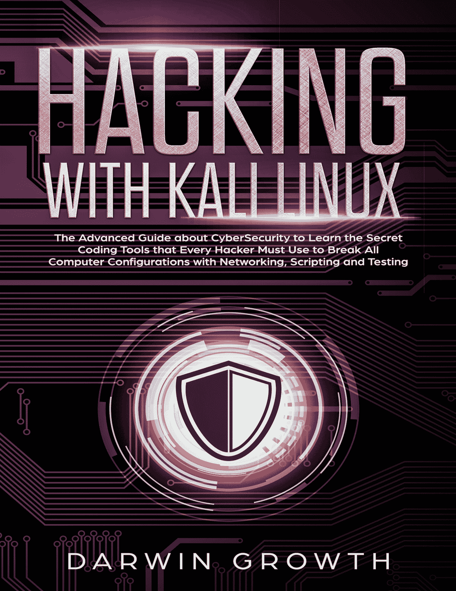

# Kali Linux 攻防：网络安全高级指南，学习每个黑客必须使用网络、脚本和测试破解所有计算机配置的秘密编码工具

关于网络安全的高级指南，学习每位黑客必须使用的秘密编码工具，通过网络、脚本编写和测试破解所有计算机配置



关于网络安全的高级指南，学习每位黑客必须使用的秘密编码工具，通过网络、脚本编写和测试破解所有计算机配置


关于网络安全的高级指南，学习每位黑客必须使用的秘密编码工具，通过网络、脚本编写和测试破解所有计算机配置

# 第三章：基础 Shell 编程

那么，什么是 shell？

- Shell 的类型
- 如何让 `bash` shell 工作？
- Shell 的优势
- 第一个 Shell 脚本
- Shell 脚本调试

## Shell 内置命令

- 1) `Alias` 别名
- 2) `unalias` 取消别名
- 3) `bg`, `fg`, `jobs`
- 4) `cd`
- 5) 声明变量
- 6) `break` 退出循环
- 7) `continue` 继续
- 8) `eval`
- 9) `exec`
- 10) `exit` 退出
- 11) `export` 导出
- 12) `kill` 杀进程
- 13) `read` 读取
- 14) `ulimit` 限制
- 15) `test` 测试

## Shell 编程基础

- 变量
- 变量命名
- 变量赋值
- 特殊变量
- 数组
- 常量
- 命名空间
- 操作符

# 第四章：黑客攻击流程

- 1) 系统足迹侦测
- 2) 目标扫描
- 3) 获取系统访问
- 4) 利用访问进行进一步渗透
- 5) 维持系统访问
- 6) 在系统中创建后门

# 第五章：Web 黑客工具

- 什么是 Web？
- 什么是协议？

### Web 服务器扫描

- A) 在 Web 服务器上启动 `nikto`
- B) 运行所有任务
- C) 针对多个主机运行

## 攻击 WordPress 网站

- `Uniscan`
- `Sublist3r`

# 第六章：网络黑客工具

具体什么是网络？

- `ifconfig`
- 修改网络配置文件
- 路由和网关设置
- 为什么网关对黑客很重要？

## 什么是路由？

- 1) `/etc/hosts`
- 2) `search`
- 3) `statistics`
- 4) `ping` 工具
- 5) `traceroute`

# 第七章：黑客伦理与层级

为什么必须对黑客进行分类？

- 等级 1：脚本小子 `Script kiddies`
- 等级 2：新手黑客
- 等级 3：黑客行动主义者 `Hacktiv`
- 等级 4：黑帽客
- 等级 5：犯罪集团
- 等级 6：国家支持黑客
- 等级 7：自动化工具 传播漏洞

## 网络安全详述

- 白帽客
- 黑帽客
- 灰帽客

## 什么是渗透测试？

- 1) Yahoo 攻击
- 2) Equifax 攻击
- 3) 勒索软件攻击

# 第八章：Kali Linux 中的 TOR 与 VPN

如何在 Kali Linux 中使用 TOR

什么是 TOR？

- TOR 如何工作？
- Tor 浏览器
- 什么是暗网？
- 有没有比 TOR 更好的东西？
- 如何在 Linux 中使用 VPN？
- 为什么 VPN 对黑客有用？
- 在 Kali Linux 中安装 VPN
- 如何使用 Linux 修改 MAC 地址？
- 什么是欺骗 `Spoofing`？

## 什么是代理？

# 第九章：高级 Kali 黑客工具

## Burp Suite

- Burp Suite 如何工作？
- 什么是负载 `Payload`？

## Metasploit

- 创建可利用程序

## 无线网络嗅探工具

# 结语

# 引言

市场上有很多关于这个主题的书，再次感谢你选择这一本！我们已尽全力确保它包含尽可能多的有用信息，请尽情享受！

# 第 1 章：Linux 与黑客入门

本介绍性章节将详细向你介绍黑客世界和 Linux 世界。黑客攻击是一个利用或控制系统的过程。而 Linux 是一种用于执行各种任务的操作系统，与 Windows 或 Mac 这种常见的日常操作系统大不相同。在本章中，我们将简要描述黑客攻击及其工作原理，并对之进行逐步的理论介绍，解释为什么 Linux 是黑客的最理想操作系统。

让我们现在从下一节对 Linux 的简要介绍开始本章。在尝试学习这些内容时，请记住做笔记，因为这是对该主题的门外汉介绍。尝试用你自己的语言将你在书中学到的概念解释给从未学习过该学科的人，以便为该领域打下良好的基础。让我们现在开始使用 Linux 进行黑客的精彩之旅吧。

## 什么是 Linux？

Linux 是一个与 UNIX 密切相关的操作系统，UNIX 是早期计算行业少数几个先驱之一。UNIX 成功的最重要的因素之一是其卓越的可移植性。在那个年代，任何人都可以获取源代码并编写自己的运行系统，不像 Windows 和 Mac OS 这样的商业操作系统。

随着 UNIX 操作系统在程序员领域取得成功，它的创建者启动了 GNU 项目以扩展该项目的可能性。许多程序员热烈地参与了这个小小的世界。在这些程序员中，一名正在上大学的学生 Linux Torvalds 开始为该项目编写代码。在几个月后，他发布了代码，这立刻引起了其他爱好者的关注。由于其其健壮和简洁的特性，Linux 在短时间内成为了每个人的最爱。

## 为什么 Linux 是最好的操作系统？

Linux 成功的最重要因素之一是其卓越的可移植性。在那个年代，任何人都可以获取源代码并编写自己的运行系统，不像 Windows 和 Mac OS 这样的商业操作系统。

- 可移植性：这使其比 Windows 和 Mac OS 这样的商业操作系统灵活得多。
- 开源：任何人都可以访问源代码，允许进行大量的自定义和贡献。
- 健壮性：Linux 以稳定和可靠闻名。
- 简洁性：尽管其功能强大，但其核心架构对黑客来说通常易于学习。

特定的攻击或利用。应该由你来决定站在哪一边。

这些是成为黑客需要学习或应该充分了解的基本特征。在下一节中，我们将详细解释为什么 Linux 是黑客的最优操作系统。让我们直接进入正题。

# 为什么黑客喜欢 Linux

正如我们之前提到的，Linux 是黑客和系统管理员之间广流行的操作系统。许多原因使得世代又世代的黑客选择 Linux 作为他们的默认操作系统。在本节中，我们将详细讨论这一点。

### 1) 控制

普通的 Windows 具有图形用户界面，对于大多数用户来说易于操作。但除了界面简单，Windows 和 Mac 限制了用户操纵他们创建的系统或组织。而 Linux 的工作方式恰相反。命令行界面作为 Linux 的基本构建模块，可以帮助用户以任何方式操控他们正在工作的系统。这让用户能够执行复杂的任务，而这正是黑客一直需要的。

### 2) 安全

目前，Windows 有海量的应用程序正在开发，其次是 Mac，因为有许多新手用户使用这些系统执行日常任务。这使得他们成为破解者和黑客的易猎物，这些人正拼命在系统中寻找漏洞。但 Linux 在所有操作系统中拥有更多的安全特性，因此通常被非常看重匿名性的黑客所青睐。

### 3) 更改操作系统特性

与其他系统相比，Linux 允许用户随心所欲地更改。人们可以整理他们使用的重要网络工具并在桌面上对其进行自定义。与 Windows 不同，许多其他功能如内存管理和 MAC 地址可以使用 Linux 轻松操纵。这种自定义能力是黑客偏好 Linux 的最重要的原因之一。Linux 有许多自定义的 GUI 界面，如 GNOME、KDE、MATE。

### 4) 扩展以适应你的喜好

你可能听过《星球大战》了。它是改变了整个类型的著名科幻小说之一。它基于这样一个概念：人们可以使用星球大战宇宙创建自己的剧情。Linux 也是一样。通过使用内核源码，可以在 Linux 世界创建名为发行版 `Distros` 的操作系统。这让组织事情变得更容易。黑客也利用这一功能让事情变得更好。在下一节中，我们将详细讨论这一点。

# 什么是黑客 Linux 发行版？

如前所述，Linux 提供了创建预定义系统版本的能力。一些回馈社区的专业黑客社区为黑客创建了 Backtrack 发行版。它取得了巨大的成功，并成为新手黑客的路径。

Backtrack 在系统中预装了许多开源黑客工具，连同许多编辑工具和 IDE。几年后，Backtrack 停止了更新并演变为一种新形式 Kali Linux，它现在是黑客最常用的操作系统之一。它包含许多整齐组织的黑客工具。除了 Kali Linux 之外，还有如 Parrot Linux 等被黑客使用的发行版。在本书，我们将使用 Kali Linux 作为默认发行版来解释概念以提供广泛的概述。在下一节中，我们将详细解释如何安装 Kali Linux。跟随操作以轻松理解。让我们开始吧。

# Linux 发行版的安装

在本节中，我们将讨论如何通过步骤说明安装任何 Linux 发行版。我们还将对分区 `partition`、引导加载程序 `boot loader` 等主题进行详细分析，以获得 Linux 基础知识的良好概述。让我们开始吧！

# 安装要点

第 1 步：

获取你需要在系统中安装的 Linux 发行版的启动 ISO 文件。你可以从网站下载它并加载到启动光盘或 USB 盘中。

第 2 步：

如果你感兴趣在系统中同时使用 Windows，可以使用双系统 `double boot` 选项在启动时选择操作系统。将根据你的选择选择其中任何一个进行启动。

第 3 步：

你也可以在 Windows 中使用如 VMWare 等虚拟机软件启动 Linux。这是黑客最青睐的方式，因为当你使用虚拟系统时，追踪它会变得困难。

通过这个解释，我们已经理解了使用 Linux 的不同方法。现在，在本节中，我们将分步骤安装任何 Linux 发行版。为了方便起见，我们假设为 Kali Linux，因为我们正在学习黑客。

# 你需要安装的步骤

1) 启动启动光盘或 USB 或虚拟机以进入安装过程的图形用户界面。还有一个使用命令行界面安装 Kali Linux 的选项。
2) 在下一步中，启动文件会自动检测所需的驱动程序。如果发生任何故障，系统将不会继续进行安装。如果你卡在任何错误上，可以在 Google 上搜索该错误，以获取逐步的故障排除程序。
3) 在下一步中，你可以选择你偏好的语言。大多数人会选择 `English (us)` 选项。选择任何你想让界面显示的语言。
4) 在下一步中，你可以选择你的时区和国家。选择你想使用的选项。
5) 在下一步中，我们需要选择最重要的网络监控设置。如果你愿意，可以连接到任何无线网络。你甚至可以在这一步选择可能需要安装的网络驱动程序。
6) 在这一步中，我们将进行安装中最重要的步骤——分区。分区将帮助我们确定想要使用的文件系统。有 `ext3` 或 `fat32` 等选项，选择你喜欢的即可。

你也可以根据需要使用自定义分区。
7) 在下一步中，我们可以为操作系统输入用户名和密码。重新输入凭据并开始安装过程。
8) 一段时间后，安装程序完成，我们将受到 Kali Linux 或你尝试安装的任何其他 Linux 发行版欢迎面的欢迎。

就是这样。这就是我们在电脑上安装 Linux 发行版所需要的所有知识。我们现在充满了知识，并在实践上已经做好了就绪，可以尝试 Linux 并开始黑客攻击。准备好在下一章中学习 Linux 基础并带来乐趣。良好的 Linux 结构概述可以帮助我们有效地进行黑客攻击。所以，让我们开始吧！

# 第2 章：基础 Linux 命令

3) 进程管理

在接下来的章节中，我们将详细讨论这三个 Linux 构建模块，从用户管理开始。

## Linux 中的用户管理

Linux 提供了许多选项来维护其用户组。既有只有读取权限的个人用户，也有具有写入权限的个人用户。组也可用于方便组织在同一服务器系统上运行不同项目的工作空间和团队。

## 为什么用户管理对黑客很重要？

在详细学习 Linux 用户管理系统之前，了解为什么黑客应该学习这些内容是有意义的。我们将通过一个简单的场景来解释这一点。

假设一个攻击者想要利用某大型软件公司的服务器系统。他首先使用简单的端口扫描来寻找开放端口。在开放端口的帮助下，他将尝试获取访问系统的权限。但如果他尝试攻击开放端口，可能会很容易被系统管理员发现。因此，为了方便起见，他需要找到具有读取权限的用户组并获取系统访问。

同样，专业黑客利用用户管理系统来利用他们已访问的系统。因此，对于任何认真对待攻击的人来说，清晰理解用户管理系统至关重要。

## 用户管理系统详解

Linux 使用一种称为用户名 `usernames` 的机制来区分不同的用户。人们也可以使用密码来保护他们的账户。

Linux 系统中有三种用户，我们将进行详细描述。

1) 普通用户 `Normal users`：

普通用户只能访问自己的目录。他们无法访问其他目录，如果他们被允许访问其他目录，也会被限制写入任何文件。普通用户被赋予一个强制性的 UID，这有助于他人识别该用户。

2) Root 用户 `Root users`：

Root 用户是系统的管理员。他们被称为超级用户，其 ID 为 0。Root 用户可以写入并修改文件的任何部分。如果黑客能够获取 Root 用户账户的权限，他就可以完全删除所有存在的文件。通常，服务器管理员都是超级用户，因此黑客获取系统的管理权限非常困难。

3) 系统用户 `System users`：

系统用户不是真实的用户，而是由系统中运行的程序创建的用户。例如，当 Chrome 启动时，某些系统进程将以系统 ID 的名称启动。跟踪和排序这些系统 ID 对于更好地使用 Linux 提供的用户系统非常重要。

下面我们将提供一个帮助我们理解 Linux 用户系统的命令：

```
linuxexample @ host: systemid 234 4
```

除了用户，Linux 还提供了组系统。组对于管理在同一项目上工作的大量用户非常重要。它也有助于更好地组织事务。默认情况下，Linux 系统中的每个用户都属于一个 GID。

Linux 中，每个组都由 GID 表示。只有 Root 用户可以创建组并以特定的方式组织它们。然而，用户可以根据规范属于一个或多个组。

下面我们给出可以帮助获取当前用户 ID 和组 ID 的命令：

```
linuxexample @ host : get UID
```

```
linuxexample @ host : get GID
```

如前所述，每个 Linux 系统账户都需要用户名和密码。众所周知，密码很容易受到攻击，是尝试利用的首要目标。密码可以为黑客提供所有敏感信息的单向访问。

Linux 通常将所有密码存在两个文件中。它们是：

- 1) `/etc/password`
- 2) `/etc/shadow`

第一个文件存储当前用户的密码，用户可以轻松读取。

而第二个文件更为敏感，包含了系统中所有用户的密码。它只能由 Root 用户读取，普通用户不可见。

在下一节中，我们将描述可以帮助我们修改用户组的各种命令。请继续阅读：

### 1) 新用户 `New user`

在 Linux 中，如果你想向系统添加一个新用户，需要输入以下命令：

```
linuxexample @ host : new UID 5363
```

每当你尝试使用以下命令配合名称创建用户时，都会提示你选择密码，该密码同时存储在 `/etc/password` 和 `/etc/shadow` 中。成功添加用户后，该账户将获得一个特定的 UID。

此外，将为用户创建一个新的主目录。请记住，将根据用户名创建一个默认用户组。有一个名为 `/etc/skel` 的特殊目录，用户所有的配置文件都存储在那里。

关于在 Linux 系统中创建新用户，你需要了解这些。

### 2) 修改密码 `Change password`

密码是访问用户系统中所有目录和文件的唯一途径。你可以使用以下命令为用户设置密码。

```
linuxexample @ host : pw UID 2435 to strange
```

应该记住，普通用户不能使用用户名作为密码。然而，Root 用户不受此限制。

### 3) 修改用户 `Modify the user`


修改对于黑客来说始终是一个优优选项。黑客通常在目录中插入利用程序或木马，并尝试将其扩散到整个系统。因此，黑客应该意识到修改系统的重要性。

`user mod`命令是修改现有主目录最重要的命令之一。你也可以使用`grep`命令显示系统目录中的内容。

`-m`选项可更改用户的默认目录，使得该目录中的所有内容都具有高级权限。

### 4) 删除用户（Delete the user）

有时黑客在从系统中获得想要的东西后会尝试删除任何可能用于检测攻击者身份的日志文件。如果你正在攻击具有高度安全性的系统，这是最重要的命令之一。

通过使用所示的`user del`命令，你可以删除普通用户；如果由`Root`用户执行，他可以删除系统中的任何用户。

`linuxuxample @ host : UID 239844`

### 5) 添加组（Add group）

创建用户组是为了方便管理员把杂乱就绪。在 Linux 中，有一个名为`/etc/group`的独立目录，存储了所有与用户组相关的信息。

下面我们给出可用于添加新组的命令：

```
linuxexample @ host : add example GID 3783
```

执行命令后，你可以在`/etc/group`中交叉检查以确认组是否已创建。

### 6) 删除组（Delete a group）

与用户系统一样，如果用户组不再使用，删除它们也是很有意义的。黑客显然也会使用此命令来清除一组他们认为容易被追踪的用户组。

下面是删除组的命令：

```
linuxexample @ host : groupdel GID 3453
```

记住，与每个用户相关的每个目录和信息都将被擦除。除非使用专业的备份和恢复工具，否则恢复数据的概率非常小。

### 7) 查看用户（View the User's）

Linux 中有一个名为`uses`的特殊命令，可用于检查系统中存在的所有用户，无论他们目前是否在线。

这里是带有用户输出结果的命令：

```
linuxexample @ host : view UID
```

输出：

2443 sample1

8942 example

0987 admin

----

----

----

----

4673 systemuser

### 8) Finger 命令

`finger`命令的用途不同，它用于查找当前在线的用户组系统。在执行复杂的系统任务时，这非常有益。

下面是`finger`功能的命令及输出：

`linuxexample @ host : finger UID`

输出：

2443 sample1

8942 example

### 9) Cron 命令

Linux 系统运行在服务之上。服务是操作系统执行其所需任务的基础任务。`cron`命令是一个特殊的命令集，用于自动化任务，例如在启动系统时自动启动杀毒软件，或在访问特定软件时切换到 VPN 配置文件。

下面通过示例详细解释`cron`命令：

```
service crond start
```

这启动了`cron`服务并允许我们运行任务。

服务`crond`状态

通过此命令，你可以轻松检查正在发生的情况。

所有这些任务将存储在`/etc/crontab`目录中。

通过此，我们详细解释了 Linux 用户管理系统，在下一节中，我们将详细解释文件管理系统，这是黑客客应该精通的先驱性分支之一。让我们开始吧！

## Linux 中的文件管理

每个操作系统都遵循自己的算法来组织文件，并将其称为文件管理系统。Windows 用户拥有一个简单的文件管理系统，可以使用键盘快捷键或图形用户界面轻松地修改或应用。

但在 Linux 中，必须学习一组命令来执行诸如在目录内移动或复制等简单任务。这为 Linux 提供了良好的安全功能水平。在本节中，我们将详细学习所有这些内容。

## 为什么黑客需要了解 Linux 中的文件管理？

Linux 是一个处理文件和目录的方式与 Windows 大不相同的操作系统。黑客需要学习修改目录，以便在获得访问权限后能够轻松地利用系统。我们现在将了解其中几个。

### 1) 绝对路径

每个目录或文件都有一个独特的路径，可用于轻松地识别或管理内容。还有一个非常复杂的后继物被称为相对路径，我们将在下一节中讨论。

例如，考虑此路径

```
/Srujan/downloads/red.mp4
```

这被称为绝对路径，因为它完整指向该文件。

### 2) 当前目录

当我们在 Linux 中工作时，我们经常想知道当前目录，以便轻松地修改内容。你可以使用以下`PWD`命令获取当前目录的详情。

```
vulnerhost@example: cd /etc
```

### 3) 相对路径

相对路径是我们正在使用的绝对路径的上级和下级。它们由点表示，并被 Linux 创建者称为特殊目录。下面是一个使用命令以更好地理解的小型示例。

```
vulnerhost@example: cd /etc
......
vulnerhost@example: cd /etc/
```

### 4) Touch 创建命令

Linux 使用各种方法或命令来处理文件。在这里，我们将解释如何使用`touch`命令创建任何类型的新文件。

Linux 可以如如下所示，使用`touch`命令创建许多类型的文件，例如`.txt`或`mp3`。

首先，你需要进入想要创建文件的目录，然后按照以下方式输入：

```
vulnerhost@example: touch sample.mp3
```

输入检查命令后，你可以使用`-l`命令重新检查以查看当前目录下的文件。

### 5) 删除文件

删除文件是任何黑客都需要学习的基础任务。在 Windows 中，你可以通过点击删除，但 Linux 提供了一个特殊的安全层，不会让你删除任何系统文件（如日志文件）。要删除任何文件，你需要使用`rm`命令，如下例所示：

```
vulnerhost@example: rm example.gif
```

### 6) 移动或重命名文件

Linux 提供了一个可以同时用于移动和重命名文件的命令。移动文件可能对于向取证调查人员隐藏你所实施的攻击变得至关重要。对于轻松获取敏感信息，这可能是救命的。

此命令也可以用于重命名文件。下面是描述以下两种用例的示例：

```
vulnerhost@example: mv example.gif
[用于移动文件]

vulnerhost@example: mv example.gf report.gif
[用于重命名文件]
```

### 7) 查看文件

通常可以使用文本编辑器或 IDE 来查看文件内容。某些文件类型（例如 MP3）可以通过音乐播放软件打开。然而，Linux 提供了一个名为`cat`的命令，它让我们以 Linux 内核读取文件的方式来读取文件。下面是`cat`命令的命令及示例。

```
vulnerhost@example: cat songs.txt
```

### 8) Head 命令

通常文件包含大量信息，使用`cat`命令打开时可能会导致崩溃。为了消除这一缺点，你只需要使用`head`命令查看任何文件的前 10 行。这有助于在发生攻击时快速重新检查日志文件，或者当你是攻击者时删除你的登录信息。

> 下面是查看文件的命令：

```
vulnerhost@example: head songs.txt
```

### 9) Tail 命令

如果说`head`命令让用户查看文件的前 10 行，那么`tail`命令就让用户查看代码底部的 10 行。这可以用于通过其结果轻松地组织系统程序，或查看系统进程的最终结果。

这是一个描述以下命令的示例：

```
vulnerhost@example: tail songs.txt
```

### 10) 创建目录

我们已经描述过目录是一个分层存储文件的文件系统。这个`mkdir`命令可以用于在你偏好的位置创建新目录。

```
vulnerhost@example: mkdir songs
```

### 11) 删除目录

通常，黑客只是为了好玩就会删除很多目录。或者有时他们这样做是为了抹去自己的踪迹。通过使用`rmdir`，你可以删除目录。下面是一个示例：

```
vulnerhost@example: rmdir songs
```

### 12) 复制目录

复制是黑客需要学习的重要概念之一。当你攻击并获得系统访问权限时，你可以将数据复制到另一个位置。出于这个原因，有一个名为`cp`的命令。下面给出一个示例：

```
vulnerhost@example: cp songs movies own
```

### 13) chmod 修改权限

Linux 使用权限使功能运行。通常只有`root`用户可以访问权限。然而，Linux 提供了一个名为`chmod`的命令，可以更改权限或赋予其他用户访问权限。这对黑客来说非常重要。

下面我们通过示例进行解释：

```
vulnerhost@example: chmod +x songs
```

### 14) 查找文件

在 Linux 中查找文件通常比 Windows Windows 中，因为它使用单独的文件系统，不像 Windows 可以轻松地分类文件。可以使用某些命令来查找你寻找的文件。

#### a) 通用搜索

这是在数据库中搜索的正常方式，并搜索存在的每个目录以获取你想要的文件。下面我们将提供一些命令来详细解释通用搜索。

##### 查找名为 "beatles.mp3" 的 mp3 文件

我们如下所示带有路径名和文件名输入`find`命令：

```
vulnerhost@example: find beatles.mp3
```

通过这种方式，`find`命令将开始搜索所需的文件并给我们。如果没有找到该名称，将显示空屏幕。

还有一个带有通配符的选项可以显示所有该扩展名的文件。假设我们只将`.mp3`扩展名作为文件名并使用通配符，`find`命令将搜索目录中存在的`mp3`扩展。尽管`find`被广泛用于搜索 Linux 系统中的，但它通常很慢。原因在于它从根目录开始搜索文件名。出于这个原因，还有另一个名为`locate`的命令可以缩短搜索时间。

#### b) 数据库查找

Linux 包含了与其相关的系统文件和数据库。正如之前提到的，由于长度和数量巨大，搜索每个应用程序数据库是困难的。正因如此，Linux 引入了数据库查找。

这将根据搜索词搜索并输入存在的数据库文件。在使用`locate`命令之前，你需要使用`updated`以便所有内容都刷新以显示最新的结果。

下面是`locate`命令的命令。你可以使用偏好的文件目录，或者命令将搜索所有目录。

```
vulnerhost@example: updated

vulnerhost@example: locate songs.mp3
```

#### c) 查找执行文件

执行文件是特殊的安装文件，用于让程序首次运行。Windows 广泛使用此类文件，但 Linux 也可以通过某些软件运行它们。在 Linux 中，你也可以使用一个名为`find`的命令来搜索执行文件。这会显示系统文件的路径。

以下是该操作的命令示例：

```
vulnerhost @ example: exec demon.exe
```

在下一节中，我们将详细讨论 Linux 中存在的压缩技术。让我们开始吧！

### 15) 文件压缩

用户使用压缩技术来减小文件大小。压缩文件还可以很容易被加密以存储敏感信息，并且只需要密码即可打开。Winrar 是 Windows 中最著名的压缩工具。然而，Linux 是开源的，并使用其他软件，我们将在下面详细介绍它们。

#### a) gzip

`gzip`的用法非常简单直观。我们所做的就是输入想要压缩的文件名并执行以下系列命令。该工具主要用于压缩配置文件，因为它擅长将将一组小文件快速压缩成一个压缩包。以下是命令：

```
vulnerhost @ example: gzip start beatles.mp3
```

file compressed successfully

#### b) tar

`tar`是 Linux 中另一个非常著名的压缩工具。它的工作方式与`gzip`类似，但具有`gzip`不具备的额外集成功能。`tar`最棒的一点是它可以同时进行压缩和整合。因此，对于试图同时利用和压缩大量文件的黑客来说，这是最佳选择。下面我们将提供一些命令，帮助你理解它的运行机制。请看：

```
vulnerhost @ example: tar start beatles.avi
```

file compressed successfully

通过此，我们完成了对 Linux 中各种文件管理系统概念的简要概述。在下一节中，我们将详细讨论进程管理。现在显而易见，Linux 是进程运行的。学习进程可以帮助我们更高效地工作。让我们深入探讨。

## 进程管理系统

在进入更多细节之前，我们必须知道什么是进程，以及为什么它在 Linux 及其系统功能中如此重要。

## 什么是进程？

虽然听起来很深，但进程只是一个术语，解释操作系统当前正在过滤内容以处理任务。进程是动态的，如今许多计算机系统都能处理多个进程。据说超级计算机可以处理数以亿计的进程。

Linux 作为一个经过修改的内核系统对进程有某些自由限制。通常，Linux 中的进程由三个周期组成，即启动、运行和阻塞。我们将像下面所示详细解释这三种状态。

### a) 启动状态 (Starting)

启动状态简单来说描述进程正准备被 CPU 和其他资源分配以运行。

### b) 运行状态 (Running)

运行状态解释我们正在处理的进程正在某些资源运行。像任务管理器这样的工具可以显示进程监控。

### c) 阻塞状态 (Blocking)

阻塞状态解释特定的进程无法运行。它们可能被故意杀死，或者由于错误和警告而崩溃。无论原因何，阻塞状态都会触发对进程的终止。

## 进程、过程和程序

我们已经详细讨论了进程。过程是系统化和线性对齐的进程。而程序是一组可以组合以创建良好系统软件的过程。

进程有一些黑客应该注意的重要特征。我们将解释其中一些：

- 进程有两种类型。第一类是互斥进程，第二类是同步进程。

- 互斥进程是比较特殊的进程，因为你不能在后台运行它们，或与其他进行关联。例如，像恢复软件或使用打印机打印纸。

- 同步进程是可以在后台运行的普通进程。你可以考虑媒体播放器进程作为例子。

## 进程管理命令

通常，Linux 系统运行着大量的进程。当你启动和引导系统时，会有几十个进程被初始化。这可能是杀毒病毒或备份系统软件。要查看系统中运行的所有进程，你可以输入带参数的`ps`命令。

```
vulnerability @ example: ps PID 34534
```

某些参数包括列出、显示进程 ID (`PID`) 和 CPU 使用百分比。你甚至可以进程进程睡眠、暂停并赋予优先级。我们在这里详细讨论其中一些：

- a) 当我们输入`ps`命令时，我们将获得所有运行中的进程。第一行描述进程的名称和分配给它们的`PID`。

**什么是 PID？**

正如我们之前讨论过的用户 ID (`UID`) 一样，`PID`是分配给特定进程的数字。这些不是永久的，当进程结束时会消失，与永久的`UID`不同。

- b) 第二行描述进程的启动时间以及它消耗的系统功率百分比。这对于黑客来说很重要，因为每当一个进程占用大量系统资源时，人们都可以使用`kill`命令轻松结束它，我们将在下一节描述它。

- c) 第三行可以用于声明优先级。对于黑客执行注入或备份时，这行可以给优先级，非常有用。并且最后，我们将学习如何终止进程。因此，在特定的时间间隔内，你需要使用`kill`命令停止某些进程。

以下是关于`kill`命令如何工作的命令：

```
vulnerhost @ example: kill process
```

- d) 你甚至可以使用相同的命令重启被杀死的进程。这就像进程的回收站。

```
vulnerhost @ example: restart
```

通过这些，我们完成了对进程管理的简要介绍，对于黑客来说，这可以帮助他们有效地利用资源。

在本章中，我们介绍了 Linux 的重要构建结构，即用户管理、文件管理和进程管理。在下一章中，我们将学习脚本，特别是详细学习 Shell 编程。在尝试进入下一章练习之前，我们讨论了 Linux。练习是黑客成功的唯一途径。让我们开始学习 Shell 吧！

# 第三章：基础 Shell 编程

在上一章中，我们详细学习了黑客的 Linux 基础知识。在本章中，我们将深入探讨黑客秘密武器之一——脚本。程序员和黑客之间存在着很小的区别。程序员使用脚本构建系统，而黑客使用脚本来利用系统。如果不创建自己的脚本，新手永远无法成为专业黑客，而只会成为使用他人工具崩溃系统的脚本小子。因此，脚本知识是任何试图掌握黑客技术的人清单清单。为了帮助你，本章将介绍许多真实的脚本概念。让我们玩玩脚本吧！

首先，我们需要详细了解 Shell。

## 什么是 Shell？

Shell 是当你使用密码连接到服务器或当你使用远程桌面工具连接到系统时所观察到的光标。换句话说，如果你纯粹从编程的角度来看它，你会感到惊喜，充当了用户和系统之间的解释器，就像操作系统做的那样。

但它只是将用户的输入建议发送给 Linux 内核，并将输出结果传回系统用户。

## Shell 的类型

根据 Linux 官方文档，存在多种 Shell。两者之间，第一种是图形界面 (`GUI`)，第二种是命令行界面 (`CLI`)。

有很多发行版制造的 Shell，如 Bourne shell、C shell、Korn shell 和 Bash shell。

在所有不同类型的 shell 中，bash shell 是存在过的最著名的 shell 之一。它预装在几乎所有著名的 Linux 发行版中。它还充当一种拦截语言，帮助 Linux 内核逻辑地理解我们提供的指令。在下一节中，我们将详细介绍这一点。

## bash shell 是如何工作的？

用户可以使用两种模式，其中一种交互式模式，另一种是脚本模式。

a) 交互式模式

在这种模式下，Linux 用户可以逐条输入函数或 bash 代码，并等待结果给出。如果中间出现错误，用户将无法继续进行。它的工作方式就像旧式手持游戏机一样是交互式的。

b) 脚本模式


在这种模式下，首先将 bash 代码写在文本文件中，然后使用命令行界面运行该脚本文件。使用这种模式时，用户可以一次性获得他想要的所有结果。黑客需要在脚本模式下更加完美，因为使用这种方法很容易利用系统。然而，创建系统的程序员会更倾向于交互式模式。

在了解更多关于 shell 的语法结构之前，最好先对 shell 的优势有一个良好的概览。

## shell 的优势

- 1) 学习学习在执行和实现上都有很大不同的内联编程语言非常容易。
- 2) 它有大量的帮助文档，可以帮助黑客尽快纠正错误。
- 3) 它还有一个额外的优势，因为它是一种解释性语言。也就是说，它在运行之前不需要编译。因此，黑客可以在尝试在受害者系统上实现之前轻松地检查代码。

此外，shell 还运行速度快且工作高效。由于这些原因，黑客必须学习 shell 的实现。

在下一节中，我们将提供一个示例 脚本，帮助我们理解 shell 编程的基本语法结构。让我们开始！

## 第一个 脚本

让我们创建一个名为 `sample.sh` 的 shell 脚本。使用以下命令创建一个 shell 脚本。

```
cat sample.sh
```

shell 程序的位置

```
echo " This is very regressive" Line by line
```

现在我们详细解释一下。逐行说明：

a) `#!` 这代表我们尝试编写的 shell 脚本的开头。

b) 如果它只以井号 `#` 开头，它被称为注释。注释是用于方便参考或供想要查看代码的其他用户的标记。对于小型 shell 脚本，写注释可能看起来没必要，但开始编写注释是一个良好的习惯。

c) `echo` 是 shell 的默认命令，允许解释器显示编写的内容。

在这里，要运行 shell，你需要使用以下命令：

```bash
bash sample.sh
```

然后输出将会出现。

对于这个示例，输出如下：

This is very regressive

还有另一个功能可以让你在额外的权限下运行脚本。正如我们之前讨论的，Linux 有一套权限设置，如果你不提供必要的权限，脚本可能无法完美运行。因此，要提供权限，请使用以下命令。

在下一节中，我们将开始讨论 shell 脚本的调试。调试是最重要的编程任务之一。即使是黑客也需要做到完美，因为代码错误的调试可能会导致任务的适应性不良。

```bash
if(b>2)
break;
```

### 7) Continue (继续)

在 `break` 可以立即停止循环的循环中，有一个名为 `continue` 的语句可以帮助切换可用的循环。假设 shellcode 中五个循环语句，通过 `continue` 循环可以相互交换。这将有助于创建详细的利用代码，用以破坏系统并进行多次交叉检查。

以下是 `continue` 语句的示例：

```bash
example@linuxwar : beep.sh

for(i=0)
x>1
y>2

if(b>2)
continue;
```

### 8) Eval (评估)

Linux 和 shellcode 通常包含大量需要处理的参数。如果以相同的方式解析字符串和变量，将会出现很多问题。因此，bash 壳中引入了一个名为 `eval` 的命令。

`eval` 命令将现有的参数替换为所指出的的变量。你甚至可以使用 `eval` 命令将字符串解析为可执行的命令，如下所示。

```bash
example@linuxwar : eval beep.sh
```

### 9) Exec (执行)

执行是一个被称为启动任务的过程。每个安装文件都是执行格式，因为它们在后台启动了一个新的系统 shell。黑客应该注意执行 shell，因为它们执行了大量的初始化和分析任务。

当在 Linux 命令行中输入 `exec` 命令时，正在工作的屏幕或界面会刷新。`exec` 也可以用于脚本文件以启动依赖安装，正如我们在第一章中安装 kali Linux 时使用的那样。

这是详细解释 `exec` 命令的命令：

```bash
example@linuxwar : exec beep.sh
```

### 10) Exit (退出)

shell 窗口非常复杂，处理着许多任务。然而，当你完成任务时，退出 shell 是一个良好的习惯。否则，进程将继续运行并可能导致不必要的系统功耗。正因如此如此，shell 语言中引入了一个名为 `exit` 的快速命令。

`exit` 命令还会清除所有存在的任务。因此，在执行此操作之前，请确保一切正常。你也可以用 shell 脚本退出单个进程或程序。

以下是 `exit` 的简单命令示例：

```bash
example@linuxwar : exit shell.sh
```

### 11) Export (导出)

通常当系统启动时，第一个 shell 命令在内核系统中被创建。这被称为父 shell。接随其后的下一个被称为子 shell，除非父 shell 被退出或杀死。

因此，在处理不同数量的 shell 时，我们将处理很多变量。有时，我们可能需要我们在其他 shell 环境中使用的相同变量。对于这些变量的导出，shell 为我们提供了 `export` 选项。

使用 `export` 命令后，所有子 shell 都可以使用父变量。然而，请记住子 shell 不能使用其兄弟（即存在的其他子 shell）的变量。

以下是一个演示此过程的示例：

```bash
example@linuxwar : export example.sh /etc/dir
```

### 12) Kill (杀死)

杀死进程是黑客需要学习的一项技能。进程有三个明显的区别。其之一是通常 shell 界面的交互。第二是批处理进程，所有需要应用的操作都按顺序过程完成。最后一个是监控进程，其中所有正在进行的操作都会被监控。例如，任务管理系统。

当你运行许多这类进程时，可能会被随之而来的信号所分心。因此，如果你发现它们是不必要的，那么杀死进程是一个很好的过程。当你尝试利用系统时，你需要杀死后台运行的防病毒进程。你甚至可以使用杀死进程来停止记录你每一个动作的日志文件。

以下是 `kill` 命令的简单演示：

```bash
example@linuxwar : kill process
example@linuxwar : killall
```

### 13) Read (读取)

在执行任务时，`read` 命令可以读取 bash 脚本。它甚至可以用于对编写的 shellcheck 进行彻底检查。`read` 语句是一个基础 shell 命令，可以帮助黑客轻松解释和交叉检查。

以下是带有示例的命令：

```bash
example@linuxwar : read bash.sh
```

### 14) ulimit (限制)

优先级是 shellcode 最不被使用的功能之一。优先级可以是增加的也可以减少的。通过使用 `ulimit`，黑客可以增加或降低进程的优先级。

为什么进程优先级是必要的？

当用户处理许多持续运行的后台进程时，可能会降低其他进程的处理速度。因此，管理员将防病毒软件放在优先级的第一级。通过这种方法，可以消除任何启动级别的执行任务。

然而，许多系统管理员并没有重视这个问题，这让黑客的利用变得简单。以下是解释如何对现有进程进行排序的示例命令。

```bash
example@linuxwar : ulimit PID 2345
```

始终记住，`PID` 是进行优先级排序时最需要的东西。

### 15) Test (测试)

shellcode 包含许多循环和条件代码。在对系统 shell 实验这些重复任务之前，在旧的 shell 中检查它们是一个良好的习惯。为了实现这一目的，引入了 `test` 命令。

以下是负责测试的命令：

```bash
example@linuxwar : test PID 3634
```

到此，我们已经完成了对 Linux 系统中一些内置 shell 命令的解释。这应该给您一个关于黑客环境的良好概述。

在下一节中，我们将讨论在编写 shell 脚本之前需要学习的一些程序概念。但在学习它之前，让我们先学习 bash shell 的安装，这是最著名的 shell 环境。

# bash 环境的安装

- 1) 你可以使用 `wget` 获取服务器上存在的系统文件。下面的命令将从镜像网站下载文件，并帮助用户在他们的系统中安装它们。

```bash
wget bash.com/download
```

- 2) 在下一步中，你需要提到或输入你正在使用的系统配置。否则，它可能无法安装。
- 3) 安装后，你可能需要检查设置并输入默认目录。通常它被输入为根目录。此外，可以使用 `help` 命令轻松了解 shell 版本。

到此，我们已经安装了 bash 环境，可以开始学习一些 shell 编程的基础知识了。记住，这些主题与 Python 脚本非常契合，Python 是黑客的另一种良好的替代脚本语言。

## Shell 编程基础

shell 由一组系统指令或命令组成。让我们学习一些组成 shell 语言的基本组件。

### 变量 (Variables)

变量是计算机随机访问系统中用于存储数据的内存单元。正如之前提到的，变量是编程语言中最重要的组件之一，在编写函数或模板时经常会调用。

通常，有两种类型的变量：

- 局部变量
- 环境变量

让我们详细讨论这些变量的功能，并给出一些命令行示例。

### a) 局部变量

局部变量是在私有或单个环境中使用的变量，即使有引用也无法在其他 shell 脚本中使用。这些类型的变量用于短 shell 脚本。

### b) 环境变量

全局变量也被称为环境变量。这些变量与第一种不同，因为它们可以在任何 shell 脚本中使用。为了使用全局变量，你需要将它们导出到本地 shell 文件。

## 变量命名 (Variable naming)

shell 语言中的变量在命名时应遵循某些指令。记住，shell 内置命令如 `exit` 不能作为变量名。

以下是命名变量需要遵循的指令：

- a) 在 shell 语言中，变量区分大小写。
- b) 变量名永远不能以数字或特殊字符开头。这样做可能会导致提示变量名无法初始化的错误。

以下是一些可以使用的各种示例：

`love`

`dud e`

`ra344`

以及是一些不能使用的变量名

## 变量赋值

## 变量赋值

变量赋值是用于给变量赋值的数值。

其工作方式如下：

`变量名 = 变量值`

你可以在变量值中插入许多数据类型。数据类型是定义变量的基础。某些数据类型包括整数、浮点数，有时甚至包括字符串。

以下是一个描述赋值值的示例：

`sample = 22`

## 特殊变量

像 `unset` 这样的特殊变量可以从内存中删除定义的变量。在此中，我们可以存储随机内存管理。

还有以 `$` 参数开头的特殊变量。这些变量可以用于定义系统在执行过程中或高级壳（shell）分析期间可能需要的额外参数。

以下是带有 `$` 符号的一些特殊变量命令的示例：

```bash
$dude = 'string'
```

使用特殊变量最大的优势是，可以根据变量开头的字符轻松进行过滤和设置别名（alias）。

## 数组

数组是一种著名的数据结构，能够持有多个元素项。编程语言使用大量的数组是因为它们与树或图等其他数据结构不同，易于实现，而且速度快。Shell 也支持使用数组输入元素。在本节中，我们将详细讨论数组。

### a) 数组定义

通常数组由一个定义元素数量的下标以及数组的名称组成。

以下是数组示例的命令：

`example[]`

### b) 给数组赋值

数组中存在的所有元素都可以使用该符号赋予值。你也可以像下面所示，使用单个数组赋值赋予值：

`sample = "America"`

你可以像处理变量一样在数组中插入任何数据类型，当你处理带有复杂代码的循环和条件判断时，数组的使用可能是至关重要的。

你甚至可以连接两个数组以获得所需的结果。为了让你更好地理解，下方显示了这种场景：

`sample[2] = value`

## 常量

众所周知，常量意味着不可改变的东西。常量值始终存在，并用于解释像 `pi` 这样具有常量数值值的值。每当你尝试更改此常量变量时，shell 前就会出现一个错误或警告，说明这是不可能的。

以下是常量命令的示例：

`pi = 3.1427`

## 命名空间

我们已经详细讨论了变量，命名空间意味着在定义范围内的变量。创建这些空间的原因是，每当用户尝试创建类型相似的变量时，总是发生冲突并使组织工作变得困难。

正由于这个原因，命名空间被发明了，并用于定义引用和参考，这些引用可以在 shell 界面或 shell 脚本中多次使用。

这是一个详细解释这一概念的示例：

## 运算符

运算符是脚本语言中最重要的区域。运算符可以帮助混合或更改变量值。在 shell 编程领域中，有很多运算符可以使用。我们现在将详细讨论其中一些：

### 1) 算术运算符

算术运算符处理数学计算，例如加法和减法。这些运算符对于编程来说非常重要，因为它们可以轻松地累加项目和乘以变量计数。

以下是算术运算符的示例命令：

```bash
>>> 2+3
>>> 2-1
>>> 6 * 2
>>> 7/3
>>> 4 % 7
```

### 2) 关系运算符

关系运算符是重要的运算符，可以轻松地改变事物。它们可以被用于比较两个事物。关系关系运算符包括 `AND`、`OR` 或 `NOT`。这些关系运算符可以在任何 shell 代码中轻松实现。

以下是一个处理关系运算符的命令行示例：

```bash
>>> 2 != 7
>>> x === y
```

### 3) 赋值运算符

赋值运算符直接向变量或循环赋予值。使用该运算符可以轻松分配元素。

以下是赋值运算符的示例：

```bash
x = 7
```

通过此，我们完成了对脚本世界的简要探索。shell 对于任何认真对待其工作的黑客来说都是必不可少的。你可以通过 python 实现这些概念以进行黑客任务。在下一章中，我们将开始进入黑客思维的探索。让我们开始吧！（注：此处原文"hacking" 处语逻辑略显生硬，已根据语境译为黑客任务）

# 第 4 章：黑客流程

本章是一个可以帮助你开始像黑客一样思考的路径。为了阻止经常发生的攻击，你应该习惯黑客的方法论。在本章中，我们将详细讨论：

- a) 踏足探测 (Footprinting)
- b) 扫描 (Scanning)
- c) 获取访问 (Getting access)
- d) 利用 (Exploitation)
- e) 创建后门 (Creating backdoors)
- f) 枚举 (Enumeration)

### 1) 踏足探测 (Footprinting)

这是黑客流程的第一步。它涉及尽可能多关于目标系统的信息。这可以是被动的或主动的。被动侦察不与目标交互，例如搜索公共记录或社交媒体。主动侦察涉及与目标系统交互以收集信息，例如端口扫描。

收集的信息可能包括 IP 地址、域名、员工信息和技术细节。这些信息对于策划成功的攻击至关重要。

### 2) 扫描 (Scanning)

一旦收集了信息，下一步是扫描。这涉及识别目标系统运行的开放端口和服务。`Nmap` 等工具常用于此。扫描的目标是发现可以被利用以访问系统的漏洞。

### 3) 获取访问 (Getting access)

这是黑客尝试获取目标系统数据或数据未经授权访问的阶段。这可以通过多种方法实现，例如利用漏洞、弱密码或社会工程。一旦获得访问权限，黑客就可以进入后续阶段。

### 4) 利用 (Exploitation)

在获得访问后，黑客可能会继续利用漏洞来实现其目标。这可能包括窃取数据、安装恶意软件或破坏系统服务。利用的目标是获得目标系统的完全控制。

### 5) 创建后门 (Creating backdoors)

为了确保未来的访问权限，黑客可能会在系统中创建一个后门。后门是一种绕过正常认证的方法，即使原始漏洞被补丁也能重新访问。后门可以通过软件或配置更改来实现。

### 6) 枚举 (Enumeration)

枚举是收集有关目标系统的更详细信息的过程。这可以包括识别用户、组和其他网络资源。这些信息对于识别用于利用的特定漏洞非常有帮助。

管理权限。请继续阅读下一章节，以了解利用利用能力可以做什么。

## 4) 利用访问进行进一步利用

在下一阶段成功获取访问后，黑客会尝试在系统中尽可能久地停留。攻击者通常会尝试扩展他的能力或进入特定区域，并获取根（root）权限，这可以帮助他执行额外的用例。

黑客在这个阶段取得成功的主要原因是 Web 应用程序系统或系统用户使用的登录界面中存在漏洞和安全漏洞。专业的黑客会使用键盘记录器等硬件设备来获取密码或秘密根目录。在接下来的章节中，我们将详细介绍黑客攻击最重要的阶段。

## 5) 在系统中持续维持访问

黑客非常疯狂，并且喜欢做可以重复的事情。当黑客入侵一个系统时，他会尝试使用称为 rootkit（根内核）的工具来延长他在系统中停留的时间。rootkit 是黑客的工具，可以在离开时有效删除他留下的所有内容或痕迹。此外，黑客还有一个尽可能访问尽可能系统的欲望。由于这种性格特征，他们通常会尝试进入 `/etc` 文件夹并访问其中存在的所有用户密码。rootkit 将帮助黑客以某种方式扩展他与系统的连接或关系。

如果黑客通过这种方法获利，他可能会习惯于许多人也在尝试同样的事情。因此，他会确保他发现的漏洞不被任何人利用。出于这个原因，他编写 shell 脚本代码来欺骗其他攻击者并让他们无法访问系统。黑客在这个过程中也会尽可能地进行利用，并使用网络数据包工具将重要文件或敏感信息备份到他们的目录中，并永久删除这些痕迹。

## 6) 在系统中创建后门

在长时间访问系统并理解了每条路径和目录系统后，智能的黑客会创建后门，以便即使漏洞被修补也能继续进行利用。安全管理员通常很难在后门造成系统损坏之前确定它的存在，因为后门通常是由黑客巧妙地插入到系统中的。在本章节中，我们将讨论后门以及如何创建一个后门。

如何制作后门：

- 1) 首先，深入观察系统，并尝试以某种方式修改系统代码，以便下次可以轻松地访问系统。
- 2) 后门注入工具将能够利用其存在的利用工具发送更改密码的信息。
- 3) 后门也可以以笨拙的方式和大量的变量来创建，以便程序员永远无法检测到原始攻击者。这种反欺骗机制会导致系统代码发生变化，黑客可以利用他实现的其他后门轻松获取这些代码。


通过这些，我们完整地介绍了黑客思维是如何运作的。有时这可能会让人感到不知所措，但黑客是通过努力来解决问题的。因此，如果你想成为一名专业黑客，你需要建立自己的工作流程，或者遵循许多著名黑客所说的这种简单方法。

在下一章节中，我们将讨论伦理黑客工具包或黑客在开始 Web 攻击和网络攻击以测试系统质量之前应该注意的前提条件。请遵循此清单并在每次开始攻击时使用它。

### a) 获取权限

首先，如果你正在攻击一个拥有大量安全和入侵检测系统的系统，你需要从系统所有者获得有效许可。否则，即使使用了许多安全工具，这可能让你陷入麻烦，因为行业的取证调查人员始终在努力寻找攻击者的痕迹。

### b) 不要使用过多工具

通常，黑客会让自己迷于学习很多工具。工具只是让过程运行的一种方式。你需要工具来自动化操作，但不需要改变你观察问题的视角。正出于这个原因，尝试现有的各种工具，并选择对你有效的最佳工具。

### c) 分析

现在的许多软件都提供系统性能的良好报告分析，以便于理解正在发生的情况。黑客应该了解所有与分析相关的技术术语，以提高生产力和对系统分析的理解。

### d) 报告

通常在进行测试时，渗透测试人员使用手动技能来提交攻击报告。编写手动报告总是最好的，因为机器无论以何方式无法以人性化的方式考虑该漏洞对组织的影响。然而，使用 Web 应用程序拦截软件的内置功能来提交渗透测试报告是节省时间的。

通过这些，我们完成了对黑客如何运作的详细解释，并提供了一份黑客或测试人员需要完成的任务清单。在下一章中，我们将对 Web 攻击及其部分工具进行详细介绍。从下一章开始开始，我们将处理实操内容，所以准备好享受黑客的乐趣吧。让我们开始！

# 第5章：Web 攻击工具

在上一章简要讨论了黑客流程后，我们现在将在本章中对 Web 攻击进行深入讨论。众大家所知，在当今世界，Web 和移动应用程序都是技术的先驱。许多黑客试图寻找漏洞并将其用于个人目的。因此，对于安全专业人士和想要成为黑客的人来说，彻底理解 Web 是必要的。

出于这个原因，我们将以实践的方法研究 Web 攻击工具。我们将详细讨论 Web 攻击工具。让我们进入 Web 攻击的世界。首先，我们将对 Web 和协议进行简单介绍。

## 什么是 Web？

Web 是一个互联的网络系统，现在以 Web 应用程序的形式显示静态和动态信息。

## 什么是协议？

它只是在客户端和服务器之间传输信息的一种。

`HTTP` 和 `HTTPS` 是用于 Web 通信的著名协议。我们将查看执行不同任务的六种工具。

## 服务器扫描

Web 服务器专门存储信息。它们包含大量的静态信息和用户信息。如果黑客获取了 Web 服务器的访问，他就可以利用他想要的任何信息。

通常，黑客在攻击之前会对 Web 服务器进行简短的指纹测试。这是需要执行的最黑客过程之一。如果 Web 服务器有任何潜在漏洞，使用有效负载（`payload`）很容易将其破解。

目标服务器上有很多 Web 漏洞需要检查。手动检查每一个漏洞将非常耗时。因此，可以使用像 `Nikto` 这样的工具来自动完成工作。`Nikto` 是 Kali Linux 预装的著名 Web 攻击工具之一。它使用其包含 Web 服务器潜在漏洞的海量数据库来扫描 Web 服务器。

在这里我们将描述 `Nikto` Web 服务器扫描器的一些优秀功能。

- 1) 保存报告 XML、HTML

使用自动扫描器获取的所有报告都可以轻松转换为 XML 和 HTML 格式。

- 2) Metasploit 使用

`Metasploit` 是用于制作漏洞的控制台工具。通过此工具，你可以插入 Metasploit 漏洞。

- 3) 获取 Web 服务器内容的变异技术

存在诸如变异的技术可以轻松嗅探或复制 Web 服务器存在的内容。Web 服务器通过这些内容显示良好的结果。

- 4) 子域名猜测  这些扫描器还使用某些技术，可以轻松发现存在的子域名。这些扫描器有时也会扫描范围之外的服务器。

- 5) 基于调整参数进行测试

在这个工具中，当我们遇到漏洞或 Bug 时，我们通常会进行测试。这种测试有时通过称为调整参数的变异结构进行，这些参数对结果有巨大影响。

以下是自动扫描器启动时发生的简要过程。

### A) 在 Web 服务器上启动 nikto

启动 Web 扫描服务器时，你需要主机地址、主机以及一个调优机制。通过使用此命令，你可以轻松检测到 Web 服务器或所使用的编程语言的版本。

以下是启动 `Nikto` 的命令：

```
example@ linuxwar : start Nikto www.exampleweb.com
```

### B) 运行所有任务

通常，我们有很多主机可以攻击。黑客试图通过同时攻击所有主机来快速完成任务。因此，`Nikto` 提供了一个工具，让你插入一个文件，以便能够一次性扫描所有主机。

以下是用于运行所有任务的命令：

```
example@ linuxwar : run Nikto 193.3234.33.2 3
```

### C) 针对多个主机运行

前一个命令是使用单一地址同时攻击不同的服务器，而在过程中，我们将在攻击主机接口时使用不同的网络地址。

以下是解释这一过程的命令：

```
example@ linuxwar : run hosts host1 host2 host3
```

至此，我们已经对手动扫描器进行了了介绍，在下一节中，我们将开始详细学习 Wordpress 及其漏洞。

## 攻击 WordPress 网站

通常，网站是使用 `PHP` 和 `JavaScript` 等编程语言从零开发的。但通常不是每家小企业都能负担得起优秀的 Web 程序员为他们编写单独的代码。

因此，它提供了良好的安全特性，以及许多可以使用的主题和插件。然而，WordPress 并非完全免受某些漏洞的侵害。更有可能发现 XSS 或 CSRF 漏洞。使用 WordPress 最糟糕的部分是插件和主题可以用来插入恶意代码。许多黑客会利用这种策略从 WordPress 服务器中窃取信息。

为了解决这个问题，我们可以使用名为 `WPscan` 的工具来扫描 WordPress 网站。

- a) 首先，在开始 Wordpress 扫描器测试之前，你需要更新系统，以确保无法发现任何过时的漏洞。

- b) 使用更新后，你就可以开始扫描器的正式工作了。你只需要输入需要扫描的 Wordpress URL。

以下是需要使用的命令：

```
example@ linuxwar : start wpscan www.exampleweb.com
```

- c) 下一步，我们可以使用该工具获取 Wordpress 系统中存在的用户列表。WordPress 由一个维护该网站或作为该网站部分的系统用户目录组成。因此，只要可能，就应该将此扫描器作为枚举工具使用。

- d) 扫描器还有一些选项可以让你对系统进行 root 权限的破解，或停止网站上存在的枚举系统。

如果你是 Wordpress 网站的所有者，可以使用此工具检查你网站的安全性，如果结果不好，你需要安装如 `cloudflare` 这样的 Web 服务器安全技术作为额外的安全机制层。

## websploit

常见的 Web 服务器由目录组成。目录由文件组成。需要注意的是，并不是所有目录对所有人都可见。这些被称为隐藏目录，只有 root 用户可见。

隐藏目录包含敏感的配置文件，这些文件可以在极短时间内破坏系统。这些隐藏目录还可能包含私有的密码详情。我们使用 `websploit` 工具对可用网络进行交叉检查。

该软件由 `python` 编写，可以从 `wget` 包管理器系统免费下载。安装后，在 Linux shell 中输入工具名称开始使用。

以下是使用 `apt` shell 命令安装 `websploit` 框架的命令：

```
example@ linux:: websploit
```

`Websploit` 包含许多模块，例如无线和网络模块。应该记住，`websploit` 是与 `Metasploit` 配合工作的。`Metasploit` 是一个漏洞利用工具，可以帮助用户在各种文件中插入利用程序。我们将在最后一章详细学习 `Metasploit` 的功能。

现在我们来看发现隐藏目录的步骤。

- a) 在开始之前，你可以过滤掉错误选项，以利用一些著名的错误，如 404 错误未找到。

- b) 它已经安装在 Kali Linux 中，可以在模块目录中找到。目录扫描模块是 `websploit` 工具中最重要的模块之一，可用来发现目录及其语法形式。

下面我们解释目录扫描模块中存在的一些命令，这些命令可以用于扫描隐藏目录：

- 1) Show - 此命令将显示所有存在的 Web 模块。当黑客处理大量漏洞时，他们往往会感到困惑并搞乱事情。正因这个原因，`websploit` 包含了用于寻找漏洞的内置模块。这个 `show` 命令可以帮助我们找到其中一些。

```
example@ linuxwar : show websploit www.exampleweb.com
```

- 2) Verbosity（详细程度）

`Verbosity` 是一个简单的语句，让我们设置在 Linux shell 中显示的的结果数量。当我们搜索隐藏目录时，通常会发现很多，并导致事情变得混乱。为了解决这个问题，我们可以使用 `verbosity` 命令显示自定义的目录。还有一个选项可以让我们以静态形式查看所有内容。

- 3) 下一个重要的命令是 `RUN`，它帮助我们在目标网站上运行利用程序。我们也可以使用这个网络传输系统。

```
example@ linuxwar : run websploit www.exampleweb.com
```

当你完美执行这些命令时，网站有被侵害的风险。

## Cloudflare websploit

我们甚至还有第二套 `websploit` 命令可以用于解析云技术。`Cloudflare` 是网站最重要的安全层之一，现在正保护着数百万网站免受危险攻击。

首先，要使用 `cloudflare` 模块，你需要在 `websploit` 列表中找到它：

```
example@ linuxwar : select cloudflare web.example.com
```

获取接口后，你可以在任何示例网站上安装 `cloudflare` 来检查它是否有效。`cloudflare` 的工作原理是将系统的原始网络地址更改为其服务器之一。因此，如果有任何注入攻击或暴力破解攻击，它都会立即停止或封禁。`Cloudflare` 像是一个低成本的网站入侵检测系统。

## 为什么 Cloudflare 仍然容易绕过？

正如我们之前说的，它只是用 IP 地址欺骗攻击者。许多黑客开始收集数百个 Cloudflare 地址，并在攻击时放弃它们。某些技巧仍然可以使用此 `cloudflare` 扫描器找到网站托管的所有 IP 地址。

接下来，我们将学习最重要的指纹识别工具之一 `uniscan`。

## Uniscan

`Uniscan` 通常用于扫描器的远程代码执行或远程文件插入。它还可以执行 `ping`、`traceroute` 等网络命令进行软件检测。

以下是使用 `uniscan` 确定操作系统的命令：

```
example@ linuxwar : uniscan select domain
```

`Uniscan` 还提供了类似 `NMap` 的开放端口检测工具。它专门检查服务器的 os 版本并扫描服务。

`Uniscan` 还提供了使用 `export` 选项生成扫描报告的方法如下：

```
example@ linuxwar : uniscan export domain to domain
```

至此，我们完成了对 `uniscan` 的简要介绍，现在进入下一节，将处理子目录列表。

## Sublist3r

网站由许多子域名组成。通常，范围内的域名可以利用 `burp suite` 轻松地操作应用程序。例如，Gmail 有许多子域名，如果能访问其中一个，我们就可以轻松地操纵整个网站。

这就是为什么子域名枚举是黑客应该学习最重要的概念之一。我们有很多工具帮助我们发现子域名。在本节中，我们将使用 `sublist3r` 完成任务。

`Sublist3r` 不在 Kali Linux 工具列表中。由于这个原因，我们需要从 git 仓库安装它。

# 安装 sublist3r

- 1) 使用 `cd` 命令选择你需要安装工具的目录。

```
example@ linuxwar : install sublist3r
```

- 2) `GitHub` 是一个在线仓库，让程序员克隆应用程序时变得方便。它与包管理器不同，因为人们可以使用 `git` 控制台对应用程序做出贡献。

以下是用于安装 `sublist3r` 的命令：

```
git clone (URL)
```

3) 现在每个 git 文件夹都包含一个 `requirements` 文件，它将帮助系统安装运行软件所需的其他工具。这些工具被称为**依赖项**（`dependencies`）。黑客应该对此有良好的理解，因为会遇到很多此类错误。

我们将通过一个完美的示例让你理解什么是依赖项。假设你正尝试安装一个像 `Android Studio` 这样的 Java 应用程序。如果系统中没有安装 Java，你就无法安装和使用 `Android Studio`。这就是依赖项的含义。

在下一节中，我们将解释 `sublist3r` 的工作原理。请关注以详细了解。

# 启动 sublist3r 工具

运行以下命令启动子域名搜索工具。

```
example@linuxwar : run sublist3r
```

我们将获得许多可以从该工具选择的选项。当输入 `-h` 时，我们还会看到一个帮助部分，解释可以使用的命令。

以下是该工具可以执行的具体功能：

- a) 域名 -d 

你可以输入此参数来插入你想要查找子域的域名。

- b) 暴力破解 (Brute force)

此参数可用于使用文本文件中输入的大量域名列表启动暴力攻击。当你有大量域名需要测试时，此参数特别有用。

- c) 端口 (Ports)

端口是用于方便子域名引用的功能。此参数可以帮助用户通过开放端口发现漏洞的子域名。

除了这些基本参数外，你还可以使用输出功能从 shell 界面将结果获取到文本文件中。

现在，我们将提供一些示例命令，让你详细了解子域名枚举：

- 1) `Python sublist3r.py -d amazon.com`

此命令将启动执行，并在使用... 之后显示所有存在的子域名。

- 2) 你可以使用此命令对文本文件中存在的前 100 个域名进行暴力破解。

```
python sublist3r text.txt
```

通过这些简单的技术，你可以找到子域名。找到子域名列表后，你可以使用侦察（`recon`）等技术进一步挖掘关于它们的大量信息。

在尝试破解 Web 应用程序时，黑客应该优先使用这种方法，以更容易找到进入应用程序的方法。到此为止，我们完成了对可用 Web 应用程序工具的简要介绍，在下一节中，我们将开始对网络工具进行详细解释。让我们开始吧！

# 第 6 章：网络黑客工具

在黑客攻击过程中，最重要且最复杂的是处理网络。通俗地说，网络只是一个互连的网系统。互联网是改变生活的最大网络。公司和许多行业都在通过互连的网络运行。每当一个黑客成功进入一个网络时，他都会尝试破解其他子网络。在本章中，我们将学习许多网络概念和命令，这些命令将使黑客能够轻松破解网络。让我们开始！

## 什么是网络？

网络是一组结合在一起工作的系统，或者从总体上说，用于从每个系统之间交换信息。为了评估这个定义，我们使用了许多交换信息的设备设备。其中一些设备是路由器、调制解调器、天线、电线甚至是持续跟踪 GPS 工作所需的地理变化的卫星组。

Kali Linux 包含许多网络工具，可以连接到嵌入式系统或用作服务器维护工具。在安装操作系统期间，我们甚至使用了网卡配置和无线集成。在下一节中，我们将讨论 `ifconfig`，它是用于了解我们正在处理的网络细节最重要的工具之一。我们只需要发送数据包信号，我们将详细学习。

## ifconfig

`ifconfig` 通常是黑客用来获取网络信息的默认命令。它将显示许多信息，如以太网地址、物理 MAC 地址、IP 地址甚至网络掩码。

还有一个部分描述了发送和接收的数据包数量。另一行描述了网络包的冲突。虽然其中某些信息对黑客来说可能没用，但它们可以用来确定他们尝试利用的系统的网络强度。

以下是显示 `ifconfig` 的命令和输出：

```
ifconfig
```

以下是 `ifconfig` 命令可以做的几件事：

- a) `ifconfig` 可指定带掩码的 IP 地址。此命令可以在使用网络路由器进行无线数据包注入时使用。

以下是命令：

```
example@linuxwar : ifconfig netmask 223.2.1.2
```

- b) `ifconfig` 整体也可以确定系统所在的广播地址。可以通过网络掩码的偏差进一步进行操作。

以下是命令：

```
example@linuxwar : ifconfig broadcast 212.11.1.1
```

- c) `ifconfig` 可以结束网络设备。就像杀死进程一样，黑客有时需要结束他们连接的网络驱动程序或设备，以消除嗅探或留下任何痕迹。

以下是关闭以太网驱动程序的命令：

```
example@linuxwar : ifconfig eth0 212.1.1.1
```

这样，我们可以使用 `ifconfig` 来开启或关闭网络驱动程序。然而，`ifconfig` 往往只帮助我们理解已的信息，而不会帮助我们操作任何网络信息。对于这一点，我们必须使用高级的嗅探或点击注入软件，在这些软件中，我们可以操作存在的配置文件和资源。在下一节中，我们将讨论其中一些复杂的网络操作任务。请关注！

## 修改网络配置文件

通常，当我们运行 `ifconfig` 命令时，通过发送网络包获取或获得的所有内容都存储在配置文件中。配置文件是特殊类型的文件，它们保持某种顺序以便系统可以检测。并不是每个文件都需要是配置文件。

然而，当我们启动或切换系统时，所有的输入协议信息都将被永久删除。因此，与其在其他重新启动整个过程，最好的办法是写入配置文件，它可以在 `etc` 等文件夹中轻松找到。

在配置文件中详细输入网络地址和网络掩码。这应该是重要的，因为操作过的配置文件可以用于对系统进行指纹识别。

## 路由与网关设置

网卡由一个网关组成，还由一个查看此处如何运行的路由协议组成。在开始网络攻击细节之前，我们将学习什么是网关。


网关就像我们正在处理的网络系统的入口。我们通常有计算机，这些被称为主机，它们有一个称为 MAC 地址的直接物理地址。网关作为一个门或检查点，检查网络包并将其发送到用户尝试联系的服务器。收到响应时也是如此。由于由于，网关是网络系统最重要的部分。

# 为什么网关对黑客很重要？

当你准备使用 VPN 或代理服务器时，你需要输入网关。否则，数据包将通过默认路由器网关通过。

以下是更改默认网关的命令：

```
example@linuxwar : gateway = 214.133.1.1
```

在下一节中，我们将讨论路由以及为什么它对网络系统的更好性能很重要。

在计算机的早期，人们通常输入 IP 地址来从系统发送或接收任何信息。但在主机系统成功引入后，这种方法就不再被使用了。主机只是对手动输入地址的文本解释。

在 `etc` 文件夹中存在一个 `hosts` 文件，可以在其中添加所有的 DNS 配置文件。如今，这通常由谷歌 DNS 服务器生成，包含了每个网站地址。此外，hosts 还可以用于了解传输的数据包数量。

我们现在在这里讨论一下 hosts 目录并提供一些命令：

## 2) 搜索 hosts

在此选项中，我们可以使用命令搜索 DNS 配置文件中存在的任何名称服务器。当我们使用此工具时，将获得我们正在搜索的网站的输入地址。这将帮助我们发现其他的指纹技术。

以下是查找已存在 hosts 的命令：

```
example@ linuxwar : search host 23.1.12.1
```

## 3) 统计

存在的统计信息可以显示主机信息。主机对于成功连接到服务器非常重要。你可以使用各种帮助我们处理这些功能的工具。

除了作为一种网络工具外，hosts 还是破解者的最爱。通常情况下，当软件被黑客逆向工程并破解时，它将具有连接互联网并重新执行一切的能力。这就是黑客利用 hosts 配置文件的地方。他们会在 hosts 文件中添加一行代码，将软件重定向到本地（`localhost`）。通过这种方式，任何服务中断都会恢复。

在下一节中，我们将讨论最重要且易于使用的网络工具之一：`ping`。

## 4) Ping 工具

黑客在获取系统权限后尝试处理网络时，通常会尝试对 ping 工具操作。这是因为 ping 工具向目标发送 ICMP 请求并允许接收数据包。当你在 Linux 终端中输入 `ping` 命令时，该工具将开始分析数据包并显示正在接收的响应包。由于这个原因，ping 工具通常被认为是掌握的网络工具的入门级。

以下是一个解释 ping 命令原理的命令：

```
ping www.hackkali.com
```

a) 当我们输入此命令时，网络将开始分析流的数据包并给出如下输出。

128 packets received 192.674.34.2

64 packets received 192.675.34.2

....

`ping` 是一个在 shell 中显示内容的命令行工具，除非你关闭 shell 窗口，否则无法停止该工具。你可以使用以下命令进一步检查 ping 统计信息，并将其导出到文件中。

192.674.34.2 ping statistics

使用此命令，将显示与域名相关的所有统计信息。在下一节中，我们将解释 `traceroute`，另一种可以追踪数据包旅行路径的网络工具。

## 5) Traceroute

网络被用于将信息从同一网络中的系统发送到另一个系统，或者发送到位于其他系统。然而，你是否想过这些信息是如何传递的？

信息的传输是通过数据包和路由器完成的。数据包是交换信息的流量基础。`traceroute` 的基本原理是检查这些数据包并追踪它们正在的操作。这是一个处理网络应当执行的高级概念。使用 `traceroute` 命令自行检查正在通过的数据包。

```
example@ linuxwar : traceroute 192.23.2.1
```

至此，我们完成了对网络黑客工具的简要说明，在下一章中，我们将对黑客层级进行简要介绍。

# 第 7 章：

## Web 层级与网络安全伦理

在当今世界，对于那些更关注隐私和安全的人来说，已经变得非常困难。黑客倾向于以不同的方式利用已知漏洞来攻击系统。对于一些著名的漏洞，如 XSS、SQL 注入和 CSRF 漏洞，有大量信息可供人们使用自己的代码来理解和利用它们。

黑客经常使用自动漏洞扫描器寻找 Web 应用程序或网络系统的漏洞。然而，根据攻击者的动机和目标，存在许多不同的层级划分。在本章中，我们将帮助你理解所有存在的层级。跟随内容以详细了解黑客层级。这是一个带有理论性的课题，所以请尝试用自己的话来思考它们，以便于理解。

### 为什么黑客会分层级？

通常，人们和安全研究人员面临许多试图攻击企业和个人系统的人。很多时候，通俗说的保护系统的“白帽黑客”会根据攻击者的步骤和他们在尝试利用系统时留下的日志文件，来判断攻击的危险程度。通过这些信息的帮助，他们倾向于判断攻击背后的动机。为了进行更好的取证分析，安全研究人员长期以来使用层级来组织攻击级别。层级对于更好地理解和分析发生的攻击至关重要。

下文解释了七种层级。我们将在下一节中详细描述每一种。请继续阅读获取每种层级的详细解释。

#### 层级 1：脚本小子 (Script kiddies)

脚本小子通常是大量自称为黑客的用户，但他们的技术和脚本知识非常匮乏。这一层级的黑客通常没有才华，如果没有在黑客网站、论坛或 YouTube、Facebook 等社交网络群中经常找到的分步程序或说明，他们永远无法破解系统。

但不应该轻视他们的重要性，因为如果系统包含过时的技术，且这些技术存在许多漏洞，脚本小子极有可能利用这些系统。

#### 层级 2：新手黑客小组 (A group of Novice hackers)

这里的“新手”是相当水平的同义词。许多黑客花时间在黑客或破解论坛上，试图交换知识并一起进行利用。这一层级的黑客是因为好玩而聚集的。他们经常尝试破解像 Netflix 这样的网站，并尝试以廉价卖给他们。这些新手黑客使用具有暴力破解能力的破解工具，使用他们通过 SQL 漏洞收集的一系列用户名和密码不断尝试登录。

正如我们讨论的过程一样，你可能已经理解这组黑客完全取决于运气。他们无法利用他们找不到的用户名或密码。由于这个原因，人们应该使用无法被这一层级黑客利用的安全密码。

#### 层级 3：行动黑客 (Hacktivists)

行动黑客是高级黑客，他们利用自己的知识和黑客技巧向世界提供敏感或令人震惊的信息，否则这些信息是不可能获知的。匿名（Anonymous）著名的黑客组织就属于这一类。他们试图提供有关政府的信息或震惊的邮件，让民众理解世界面临的问题。维基解（Wiki leaks）也是其中之一，他们各国国家的邮件震惊了世界。然而，这一层级的黑客非常稀少，而且由于其敏感性，动机往往无法判断。

#### 层级 4：黑帽黑客 (Black hat hackers)

黑帽黑客是层级中最邪恶的群体，他们利用技能剥削普通用户。他们使用大量的社会工程技术来诱导用户提供敏感信息，如密码和信用卡号。他们经常依靠木马、键盘记录器等许多恶意工具进入用户系统并获取信息。他们使用许多技术和策略来利用系统。

黑帽黑客是高度专业且先进的黑客，很难被发现，因为他们使用无法被检测到的跳板代理。除非他们犯错，否则极不可能知道他们的身份。最糟糕的是，有超过 5% 的黑客专门在暗网中买卖信用卡。

#### 层级 5：犯罪集团 (Criminal gangs)

这些是一群集体工作的黑帽黑客。这让情况变得比以前更恶化。犯罪集团利用大量的黑客资源来产生网络犯罪集团。他们试图在暗网中走私毒品、枪支和其他非法物品。他们是非常专业的黑客，可以使用他们的黑客技术伪造发出的正品包裹。这些犯罪集团还对暗网上的巨大黑市负责。犯罪集团的工作非常高效，以至于 FBI 都难以追踪他们的行踪。

#### 层级 6：国家支持的黑客 (State-sponsored hackers)

黑客通常不是有道德的人，但他们大多数时候是爱国者。你可能已经见过一些中东黑客在黑进名人社交网络账号后写下他们国家的口号。很多

许多国家（主要是俄罗斯和中国）雇佣了大量专业黑客来入侵其他国家的数据库，在这些数据库中可以找到法律或敏感信息。

这些黑客可以进入并控制任何交通信号或摄像头。他们是极度匿名的人员，为国家利益工作，甚至在暗网上与犯罪团伙进行网络战争。如果你想深入研究，黑客世界是一个奇异而阴暗的世界。许多人在互联网的角落里斗争，以获取对互联网最深处的访问权限。那里无无所不在，而这些层级化的黑客正为此工作。

#### 第 7 层级：自动化工具（传播漏洞的机器人）

需要注意的是，这个层级并不由人类组成。许多系统在没有个人访问系统权限的情况下是无法进入的。由于如此，如今一些非常专业的黑客正在创建小型蠕虫（类似于机器人），它们可以自动运行或自我思考并访问系统。它们是非常危险的黑客工具，被用于攻击核电站和其他高安全性场所。目前理解这一层级非常复杂，因为公共领域可用的信息较少，但有报告显示，带有恶意软件的蠕虫将是黑客的下一个巨型武器。

到此，我们已经对黑客层级进行了简要而彻底的解释。在下一节中，我们将详细讨论网络伦理以及一些著名的恶意软件攻击。

### 网络安全伦理

网络安全领域已经经历了飞跃式的发展。随着新软件系统的开发，由于可能导致公司因匿名攻击而遭受损失的潜在漏洞，网络安全部门变得至关重要。因此，许多行业开始提供安全解决方案，例如思科的安全解决方案，以保护其客户免受潜在危险攻击的侵害。

因此，他们开始招募大量对数据库安全有深入知识的系统工程师。十年后的，网络安全已成为计算机技术的先驱领域之一。有很多软件和工具提供自动化解决方案，但人工工仍然具有很高的必要性。

在本章中，我们将详细讨论网络安全伦理。首先，重申一个简单的事实：每个处理安全事务的人都被称为黑客。我们现在将讨论三种最著名的黑客类型，以便更好地理解。

- a) 白帽黑客

- b) 黑帽黑客

- c) 灰帽黑客

就是这些。我们现在将详细讨论每一种。

#### 白帽黑客

这类黑客试图保护数据库和服务器免受坏人的利用。他们通常试图寻找系统中的漏洞并尝试尽快修复它们。他们使用不同的黑客和网络工具来跟踪他们处理的资源和系统。白帽黑客是榜范，将激励许多初级黑客走向光明的一面。

#### 黑帽黑客

这类黑客试图使用不同的技术来利用系统。这些人通常非常专业，并会采取许多预防措施以防被捕。他们创建像木马和蠕虫之类的缺陷机制来利用系统。黑帽黑客利用服务来攻击系统。

#### 灰帽黑客

灰帽黑客是介于白帽和黑帽之间的黑客类别。他们可能会在未经许可的情况下进入系统，但并没有恶意。他们可能会向系统所有者报告漏洞以换取费用或仅仅是为了获得认可。

### 什么是渗透测试？

渗透测试是一种通过模拟网络攻击来评估计算机系统、网络或 Web 应用程序安全性的方法。其目标是发现可能被现实攻击者利用的漏洞。

### 渗透测试工具

`Kali Linux`是一种专门用于数字取证和渗透测试审计的 Linux 发行版。它包含了数百种可用于安全任务的工具。

# Linux 中的 TOR 与 VPN

黑客攻击是一项高风险的任务。新手黑客如果不采取各种预防措施，总是很容易被发现。几乎每一位专业黑客都会使用不同的工具或其编写的代码来隐藏真实身份以防止被检测。`Kali Linux` 内置了一些工具，可以帮助你在攻击系统时保持匿名。然而，请记住一个残酷的事实：你的政府、ISP（互联网服务提供商）有时甚至你使用的 VPN 服务都可以追踪你。随着你在黑客领域积累了丰富的经验，你将开发出各种策略，帮助你通过规避和确定性来伪装身份。现在，请跟随本章节详细了解 TOR、VPN 以及如何伪造你的 MAC 地址。我们将提供一系列具体的命令和示例，以便你更好地理解该主题。

## 如何在 Kali Linux 中使用 TOR 网络？

通常，如果你想在 Windows 或 Mac 系统上安装 Tor，你需要安装 Tor 浏览器包，它会启动一个匿名服务器并将所有流量通过它进行路由。

但在 Linux 终端中，我们可以直接从命令行本身启动 tor 路由服务器。

使用以下命令启动 tor 包服务：

```
start tor
```

首先，在连接到 tor 服务器之前，检查你的 IP 地址。因为你需要通过查看 IP 地址来重新检查 Tor 服务器是否正常工作。

### 什么是 TOR？

TOR 是由位于世界不同位置的互连计算机链，用于伪装系统的位置。少数有于让互联网更安全并停止受政府机构监控的网络工程师启动了这一 TOR 项目。

### TOR 如何工作？

每当从 TOR 服务或 Tor 浏览器发送请求时，该请求会被发送到 TOR 网络之一。你现在可能很困惑，因为这正是代理的工作原理，它与代理有什么不同，以及会有何不同？

这正是 TOR 成就不同之处。TOR 服务与代理不同，它不是通过单一网络路由，而是通过一组相互关联的匿名网络路由，从而使检测变得困难。

### Tor 浏览器包

如果你对 TOR 服务不产生疑虑，可以使用 Tor 浏览器包，通过该服务发送请求。每位黑客都应该学会使用 TOR 浏览器，因为它让检测变得非常困难，而且用户可以查看暗网及其对黑客的重要贡献。

### 什么是暗网？

暗网就像互联网的底层，由于各种原因，它通常不会被普通的搜索引擎和浏览器触及或发现。TOR 网站拥有 `.onion` 链接，并且是静态构建的网站。

暗网因黑色黑客而闻名，因为那里的一切都是非法和盗窃的。我们不建议你做任何非法事情，但观察那些伦理黑客将要对抗的人，会是一个很好的案例研究。

### 有比 TOR 更好的东西吗？

到目前为止，TOR 浏览器包是隐藏身份或伪装内容的最佳方法。虚拟专用网络（VPN）也可以用于维护匿名性，并来自许多不同种的服务器。我们将在下一节中详细讨论虚拟专用网络。

## 如何在 Linux 中使用 VPN？

在讨论安装过程之前，我们将简要讨论 VPN 技术。

虚拟专用网络最初被用于私营行业和政府机构，以便在人员离开现场时保持群组内部通信。然而，人们发现了一种可以在不传输发送者和接收者任何信息的情况下共享服务器的方法。这使得 VPN 对许多用户变得流行且有用，对黑客来说更是，因为它有隐藏用户位置的能力。

### 为什么 VPN 对黑客有用？

- a) 虚拟私网络隐藏你的系统的网络地址并将其与另一个连接，从而让你获得匿名性。

- b) 虚拟私网络可以帮助你绕过许多行业内置的防火墙和入侵检测系统。

- c) 虚拟私网络不仅能帮助你隐藏信息，还能确保你传输的所有网络信息都经过了加密。不确定它是如何工作的吗？让我们举个例子。

想象你正在使用公共 WiFi 网络，有许多其他用户连接着。并不是所有的 WiFi 适配器都具有 WPA2 高级安全配置，因此你的包含密码、信用卡在内的大量敏感信息的网络数据包很容易被同一网络上并使用如 `air crack` 等无线嗅探工具的人所破解。由于由于这些复杂性，当你不在家中的网络中时，建议使用虚拟专用网络。现在在下一节中，我们将查看如何在任何 Linux 系统中安装 VPN。

### 在 Kali Linux 中安装 VPN

- 1) 首先，安装安装 VPN 所需的工具或证书。通常应该下载 CA 证书并将其上传到系统。该证书由一个哈希代码组成，它让我们通过匿名链接连接到服务器。

- 2) 在下一步中，我们需要进入网络管理器来启动 VPN 连接。当你启动新的 VPN 连接时，输入由 VPN 提供商提供的网关详情。

- 3) 在下一步中，你可以提供身份验证详情，简要包含 VPN 服务提供商应用程序或网站中的凭据。

至此，我们已经完成了虚拟专用网络的启动。有很多很好的 VPN 服务提供商，如 `open VPN`、`Cisco VPN`、`hide my ass`。选择一个提供大量服务器和安全性的。由于全球政府监控的增加，VPN 是现在每位黑客的必备品。你也可以使用 VPN 进行点对点网络通信，例如下载 torrent 文件并进行种子。就是这样，在下一节中我们将学习更改系统的物理地址，即 MAC 地址。

## 如何使用 Linux 更改 MAC 地址？

首先，我们需要了解系统地址。每一个制造的系统都有一个序列号，称为 MAC 地址。每个系统默认都有一个唯一的地址，这与经常在连接的系统之间交换换的网络地址不同。

通常，在网络监控期间，IP 地址将帮助攻击者找到系统位置，而这种位置很容易被虚拟专用网络伪造，几乎每家公司都为此目的使用 VPN。

然而，许多人由于各种原因不更改他们的系统地址。首先，保修将失效，大多数行业提供商将不再提供必要的帮助。出于这个原因，许多用户不会更改它。

然而，对于将匿名作为重要考虑因素的黑客来说，应该充分了解伪造系统地址的程序。下面我们将详细描述该方法。

### 什么是伪造？

伪造只是欺骗接收者认为地址是不同的。在整体上不会改变系统规格，但会向攻击者或取证专家显示一些随机或手动输入的信息。

### 伪造 MAC 地址

- a) 首先，在尝试伪造地址之前，你需要知道 MAC 地址是什么。它在不同系统之间不同。你甚至可以在保修书中找到。但由于我们是极客，我们将使用 Linux 命令行查找我们正在操作系统的 MAC 地址。跟随！

- b) 首先，进入 Linux 命令行并输入 `ifconfig` 工具。成功启动 `ifconfig` 模块后，输入以下命令

```
ifconfig
```

这将显示显示当前系统 MAC 地址的输出。它还会提供制造商详情以及它使用的网络包结构。

- c) 现在你需要安装一个名为 Mac changer 的工具来伪造系统地址。使用以下依赖命令安装 Macchanger

```
wget macchanger
```

- d) 安装 Macchanger 后，你就可以使用随机和手动更改系统地址的命令了。我们将在下面详细讨论这两种功能。

- e) 随机 MAC 地址只是将你的 MAC 地址更改为代码列出的随机数字。

- f) 自定义 MAC 地址将允许你使用以下命令更改为所需的 MAC 地址。

```
root @ host : change MAC to as:23:1w:2w:3e
```

### 什么是代理？

代理仅充当客户端和服务器之间的中间人。此外，代理可以用于通过调制调器将数据发送到匿名服务器。互联网上有很多免费的代理，但由于其结构和配置的原因，它们并无用处。

### 黑客应该使用什么代理？

黑客应该熟悉 SOCK5 代理，这种代理可以在限期间使用。它们不是免费提供的，但可以在代理市场购买，或者你甚至可以搭建一个服务器。SOCK5 代理是安全的，甚至具有位置配置，这样可以减少代理被列入黑名单概率。


还有被称为上游代理（`upstream proxies`）的代理，可以用于对 `burp suite` 等 Web 应用程序软件进行暴力破解。

到此，我们已经完成了对黑客安全相关所有内容的简要介绍。在下一章中，我们将详细讨论一些著名的 Linux 工具。让我们开始吧！

# 第 9 章：高级 Kali Linux 黑客工具

本章是对我们在书中学到的所有概念的最终实现。现在有许多黑客工具可用。Linux 发行版 `Kali Linux` 提供了来自各个类别的约 `350` 个工具。在本章中，我们将讨论一些用于 Web 攻击、网络攻击和密码破解的著名黑客工具。记住，黑客工具只是一个简单的界面，能让我们极大且高效地完成工作。优秀的黑客并不总是依赖工具，而是会创建自己的工具来尽快利用系统。然而，黑客工具对于安全测试以及指纹识别、暴力破解等任务具有更好的选项。我们现在详细讨论一些黑客工具。让我们开始吧！

## Burp Suite

在当今世界，Web 应用程序是黑客攻击最频繁的目标。与网络系统相比，它们相对容易破解，并且很容易被操纵以获取钱财或敏感信息。

黑客使用 Linux 中提供的 `Hydra` 等暴力破解工具对登录页面进行暴力破解（即自动发送大量请求）。安全研究人员应对 Web 应用程序进行深度测试以消除任何存在的漏洞。

为了使这一漏洞测试过程变得顺畅简单，`port swigger` 创建了一个名为 `burp suite` 的工具，从那时起一直是白帽黑客的喜爱。在本节中，我们将详细讨论 `burp suite` 的组件。让我们开始吧！

注意：`Burp Suite` 是黑客用来操纵页面的工具。因此，请务必获得你尝试实验的网站所有者的许可。否则，你可以使用在线或作为 Linux iso 提供的示例测试网站。

### burp suite 是如何工作的？

`burp suite` 使用代理机制作为充当客户端的中间人发送请求。这个过程将帮助软件分析它使用的每一个协议、发送的每一个请求以及随后的收响应。通过使用这些信息，`burp suite` 可以用于发送重复或经过操纵的请求，帮助用户理解正在发生的过程。

在本章中，我们将以更具实操性的详细讨论 `burp suite`。我们将通过一个场景来理解正在学习的工具。

实操场景：

我们为网站 `www.amazonkali.com` 有一个登录页面，它使用 `https` 协议。我们新手黑客的任务是使用现有的有效负载（`payloads`）登录该网站。让我们开始吧！

第一次使用工具时，请尝试自己完成这项任务，如果你无法完成，请按照以下章节来理解正在发生的过程。

任务的解决方案或策略：

首先，在成功安装 `burp suite` 后，你需要在浏览器选项中输入 CA 证书，以便 `burp suite` 能够在 `https` 网站上运行。这是必要的，因为 `https` 使用加密协议，只有在安装了 CA 证书时，代理解释工具才能读取它。为了安装证书，你需要先启动代理。

简要遵循说明：

a) 打开 `burp suite` 的 `proxy` 标签页，输入代理 `127.0.0.1` 作为拦截地址。输入详细信息后，你需要选择一个浏览器，首选 `Mozilla Firefox`，因为 `Chrome` 消耗大量的计算机资源，作为黑客，进程的协调对于获得更顺畅的结果很重要。

b) 在 `Mozilla Firefox` 中，在代理设置中输入相同的拦截地址并使用 `intercept on/off` 按钮启动代理服务器。这样来，每个请求或响应将首先通过 `burp suite` 服务器并被记录。

到此，你已经为浏览器设置好了 `burp suite`，我们现在准备好利用 `www.amazonkali.com` 网站了。请遵循程序操作。

### 使用 burp suite 破解登录页面：

- 第一步，启动拦截代理并在浏览器中输入 URL 地址。当你按下回车键时，你将看到 `burp suite proxy` 标签页中弹出一个请求。你可以查看 `GET` 请求并理解浏览器正在请求 `burp suite` 接受此请求并将其发送到原始服务器。当这在你控制之外进行时，控制台会存储请求和响应信息。

- 网站由许多子域名组成，当我们尝试使用代理进行拦截时，这可能会成为问题。将处理许多不必要的请求并使控制台标签变得混乱。由于由于原因，`burp suite` 提供了一个范围工具（`scoping tool`），让我们为测试目的选择主域名。所有超出范围的域名将被过滤，且不会通过代理服务发送。

- 现在，接受浏览器发送的所有请求。现在回头查看浏览器，我们的主页将显示。该主页有一个登录表单，我们需要使用有效负载对它进行暴力破解，以寄于成功破解。

- 4) 查看已监控的请求，你可以观察到所有都是 `GET` 请求，客户端使用这些请求让服务器知道系统正在请求信息。我们现在将使用 `burp suite` 中的工具 `intruder` 对登录表单进行暴力破解有效负载。

### 什么是 intruder？

通俗地说，`intruder`（入侵者）是指一个在没有任何许可或为了偷窃而进入房屋的匿名人士。这正是入侵者的工作方式。当我们使用这个工具时，`burp suite` 会先以匿名方式发送请求，这样系统就不会将其检测为恶意攻击。

### 步骤说明

1) 现在在用户名和密码字段中输入一些虚假数据，并通过代理服务器发送。通过此程序，所有数据将被发送，且请求将属于 `POST` 类别。`POST` 是一种 HTML 请求类别，参数会随请求一起发送。

2) 现在选择所有 `POST` 请求并将它们发送到 `intruder` 标签页。在 `intruder` 标签页中，你可以使用美元符号 `$` 选择输入的用户名和密码参数。在参数被高亮后，用户可以选择负载程序类型。有很多程序类型，如单锤（`single hammer`）、炸弹（`cluster bomb`）和三叉（`pitcher fork`）。

我们在这里详细解释这三个术语：

a) `single hammer`（单锤）

这里只选择一个参数并对负载进行暴力破解。通过单锤，人们很容易

b) `cluster bomb`（炸弹）

炸弹以参数发送的方式高亮两个参数。

- c) `pitcher fork`（三叉）

三叉也高亮两个参数，但以共线的方式提供负载。

选择攻击类型后，我们可以进入下一个界面选择我们需要发送到登录页的负载。在了解不同类型的负载之前，我们首先需要知道什么是负载。

### 什么是负载（payload）？

有效负载是命令或语法语句的系统性集合，可以在暴力破解时用于利用或导致系统崩溃。

`burp suite` 中存在的负载：

- a) SQL 注入负载

`burp suite` 包含 SQL 注入负载，这些负载可以轻松崩溃被注入的数据库以进入系统。

- b) XSS 负载

`XSS` 是最常见的 Web 应用程序漏洞之一，可以使用 `burp suite` 中存在的 XSS 命令轻松发现。

- c) 自定义负载

通过此选项，你可以创建包含字母和数字的随机有效负载。通过这种负载，你可以创建许多复杂的加密密码，用于破解高级系统。

### d) 运行时负载

通常情况下，负载是生成的，但如果有大量负载需要插入，你可以使用此负载将列表插入运行时内存中，以实现更快的执行。

### e) 递归负载

递归是一种以多变显著的特征过程发送负载的系统。虽然这些负载在本质上是微不足道的，但它们被用于影响如 `Cloudflare` 等系统以获取访问。

输入所需的负载后，进入下一节开始暴力破解过程。

在下一个界面中，选择线程数以及发送负载的速度。此外，你还可以插入上游代理，这些代理会随机变化，这样即使入侵检测系统拦截了访问，你也可以通过其他代理访问。你可以使用 `Tor` 系统代理作为上游代理，以增加安全性并避免检测。

现在点击启动按钮，你将获得一个让你分析黑客过程的界面。如果登录成功，你将在状态栏看到 `200` 成功信息。如果登录失败，你将收到 `404` 或 `303` 错误。通过这种方式，你可以轻松使用 `Burp Suite` 破解登录 页面。

在下一节中，我们将讨论 `Metasploit`，它是最著名的漏洞利用软件之一，可以帮助我们伪造任何系统。

## Metasploit

`Metasploit` 是最重要的黑客工具之一，因为它拥有许多可以用于目标机的功能。`Metasploit` 最棒的一点是，尽管是一个提供许多功能的工具，但它是开源的。这很重要，因为我们之前讨论过的 `Burp Suite` 需要高级许可，并且会限制免费用户使用某些功能（如自动扫描）。与 `Burp Suite` 一样，`Metasploit` 也提供专业许可。

两个版本之间的主要区别在于，在免费版中你一次只能使用 `32` 个主机。对于试图同时利用大型系统的黑客来说，这可能非常困难。因此根据你的喜好选择版本。

`Metasploit` 预装在 `Kali Linux` 中。如果你想在其他 Linux 版本中安装 `Metasploit`，可以使用以下命令：

```
wget Metasploit
```

`Metasploit` 还提供了 Web 界面访问，可以帮助我们访问正在使用的所有主机。创建一个账户并在这里管理有关漏洞的一切事务。

实战场景：使用 `Metasploit` 创建一个包含恶意代码的漏洞利用程序，该程序可以控制安卓手机并读取其文件、联系人和消息，并将它们发送到你的 Web 服务器。

在查看我们这里描述的解决方案之前，别忘记自己尝试一下。

### 创建可利用应用的流程

a) 对于这次实践练习，最好使用虚拟机以防留有任何痕迹，并使用安卓 模拟器在通过邮件或人工发送给受害者 之前检查该应用。

### 为什么只能制作安卓应用？

通常，安卓 是一个开源 Linux 系统，很容易使用 `Metasploit` 等工具进行利用。其他著名的移动操作系统（如 `iOS`）使用带有扩展包 `IPA` 的包管理器，与安卓的应用不同。虽然有一个模块拆分器可以分割 `IPA` 文件，但目前还没有针对苹果 操作系统的远程执行工具。因此，如果你试图欺骗使用 `Mac OS` 的用户，你需要寻找其他方法。

然而，如果你的受害者是安卓用户，你可以按照以下指令将漏洞获取到他的设备中：

b) 首先，使用 `Metasploit` 命令 `msconsole` 在设备中启动 `Metasploit`。

c) 当 Linux Shell 显示 `Metasploit` 界面时，选择 `payloads` 选项。正如我们之前讨论的，负载是已经证明的漏洞或缺陷，可以在运行特定版本软件的目标上实现。

d) 在这里我们的目标机器是安卓，它是一个 Linux 内核机器。从 `payload shell` 中通过以下命令搜索 `msfvenom` 负载：

```
root @ hostname : msfvenom payload select
```

e) 它给出了五个需要填充信息的参数。在这里我们将通过命令详细讨论这五个参数。

a) `-p`

每当你尝试使用 `Metasploit` 创建漏洞利用程序时，都需要使用此参数。这里我们的负载是 `msfvenom`。

b) `LHOST`

这是描述我们输入网络地址的参数。我们已经学习了如何使用 `ifconfig` 工具查找我们系统的 IP 地址。IP 地址是至关重要的，因为我们需要在主机和受害者之间建立常规连接，以便传输数据。

c) `LPORT`

与上一个一样，它描述了我们愿意提供给此 `Metasploit` 程序的端口，以便受害者应用可以向我们发送数据和其他敏感信息。

d) `R`

在这里应该使用选项选择 `apk` 格式。我们处理的是原始格式信息，因此应该提到这一点。如果我们处理的是系统软件，则应该选择执行文件。

e) `Location`

此参数帮助我们选择所指的 `apk`。你可以简单地提供位置，以便 `Metasploit` 开始制作漏洞利用程序。但在在此过程之前，我们需要进行一些证书安装，以确保一切运行完美。我们将详细学习这个过程。

### 为什么安卓应用需要签名？

在 `iOS` 中，安装签名的应用是强制性的，但安卓没有这种限制。在过去，黑客利用远程执行点击一下即可安装木马和蠕虫。然而，现在 Google 让事情变得困难，因为用户需要手动授予权限。因此，在尝试将漏洞发送给受害者之前，你需要完善你的社交工程技巧。让他们相信这是一个需要安装的必要应用程序。这就是所有黑客所做的。

我们在 `Metasploit` 界面中有多种签名工具，如 `jar signer`。选择其中任何一个并使用以下命令：

```
root @ examplelinux : msfvenom signer -ssh 23.2.2.1
```

工具具有以下属性：

- a) 证书类型：有很多签名需要审核。你可以使用 `SHA` 方式或 `RSA` 方式。

- b) `-verify`：此命令将让工具使用用户选择的签名验证应用。

c) `align`

对齐是将漏洞插入应用程序的过程。`Metasploit` 数据库中有许多可用的漏洞。你甚至可以创建一个向我们的服务器发回信息的 shell 脚本。为了这个主题的可视化演示，我们将解释一个执行以下函数的脚本：

- a) 脚本应该收集手机上所有的用户联系人。

- b) 脚本应该识别收到的任何新消息并发送到 `Metasploit` 服务器。

可能有人对 `Metasploit` 服务器如何工作有疑问。它包含一个插入漏洞的 URL，我们需要在该网络的浏览器中输入相同的 URL。通过这种方式，我们可以访问所有发送到服务器的信息。

### d) 打包

将漏洞对齐到应用后，你需要对其重新打包，使 `apk` 看起来完全正常。`apk` 的大小可能会有微小的变化。为了不被杀病毒软件检测，可以使用额外的安全选项来伪造手机安全。

你可以使用以下命令打包 `apk` 和漏洞：

```
root @ example : pack location seems.apk
```

打包好应用程序后，你应该寻找一种聪明的社会工程技术将其发送到受害者的系统。你可以使用一封带有 `rar` 文件的电子邮件将其发送到手机。当受害者在手机手机上成功安装该应用程序时，该程序将在后台运行，并将所有需要的数据发送到 `Metasploit` 服务器。

关于该漏洞及其使用 `Metasploit` 接口控制台进行实现的内容就介绍到这里。在下一章中，我们将简要介绍名为 `Wireshark` 的网络嗅探工具并结束本章。

## 无线网络嗅探工具

在提供的大量的 `Kali Linux` 工具中，由于无线网络在日常生活中的大量扩展，该工具处于最受欢迎的工具之。从蓝牙设备到无线回声设备，许多无线设备如果连接到不安全的无线网络，就可以被轻易嗅探。

### 什么是嗅探？

通常来说，嗅探（`Sniffing`）是一个定义为窥视其他内容的术语。在技术术语中，嗅探意味着使用 `Wireshark` 和 `aircrack-ng` 等工具查看来自其他设备的网络数据包。我们将在本节中详细讨论这这两个工具。

#### a) Wireshark

`Wireshark` 是一种网络嗅探工具，用于跟踪网络处理的每一个数据包。启动嗅探工具后，你需要等待至少 `24` 小时，以便嗅探器捕获足够数量的数据包进行分析。在分析过程中，可以很容易找到所有如密码和信用卡号之类的敏感信息。还可能存在使用嗅探工具来破解正在发送的未加密文件和电子邮件。

这就是为什么黑客应该使用加密邮件服务和虚拟专用网络（`VPN`）以获得更好安全性的原因。

#### b) aircrack-ng

`Aircrack-ng` 是另一种被广泛用于破解 WiFi 密码的网络嗅探工具。通常情况下，`WPA2` WiFi 路由器被认为是最安全的网络路由器，而 `WPS` 路由器则留下了可以轻易破解其密码的漏洞。`aircrack-ng` 利用这一漏洞进行字典攻击扫描并连接到无线网络。`Aircrack` 是目前市场上最流行的无线网络程序之一。

到此，我们已经完成了对一些重要的 `Kali Linux` 工具的详细介绍，并概述了使用这些工具可以完成的实际应用。我们希望通过这一章，你获得了许多有意义的信息。

本书到此结束，我通过对黑客应该成为什么样的样的清晰解释来结束本书。黑客学习技能并付出极大努力应用它们来破解系统。破解并不意味着去利用并将其用于作恶的目的。破解意味着检查墙是否建造得足够坚固。就是这样，这是黑客需要时刻记住的。祝我们的黑客冒险一切顺利！

## 结论

感谢你读到《Linux 黑客攻击》（`Hacking with Linux`）的最后，希望它提供了丰富的信息，并能够为你提供实现目标所需的所有工具，无论这些目标是什么。

下一步是在现实世界和漏洞利用环境中使用这些概念，或者出于善意地保护它们。祝一切顺利！

最后，如果你在任何方面觉得此书有用，我们将非常感谢你在 Amazon 上给出评价！
