# 道德黑客与网络安全防御 实用指南


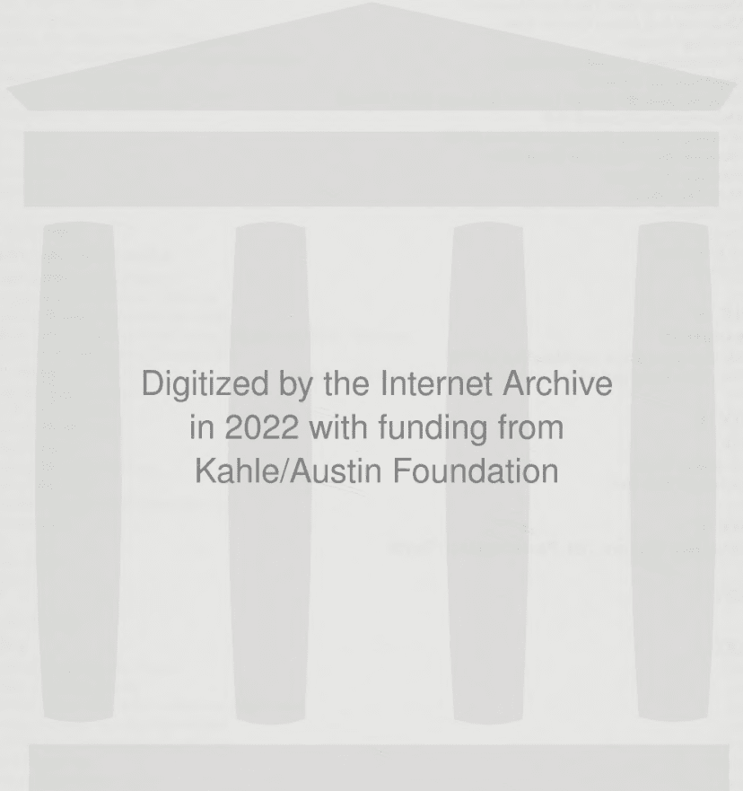
由互联网档案馆于2022年数字化，获得Kahle/Austin基金会资助 https://archive.org/details/handsonethicalha0000simp_c9n3
## 前言
我于2001年1月创立了安全与公开方法论研究所（ISECOM），因为我不想再成为问题的一部分。自那时起，数百名其他专业人士因同样的想法加入ISECOM。数千人联系ISECOM希望成为社区的一员，数百万人下载了我们的标准和文档。我们持续以开源社区的形式运作，提供不受政治干预且商业免费的安全研究，例如《开源安全测试方法学手册（OSSTMM）》和《黑客高中》。我们的工作得到安全社区通过认证项目的支持和资助，例如OSSTMM专业安全测试员（OPST）和OSSTMM专业安全分析师（OPSA）认证。这些项目正在不断发展，是开放的认证项目，旨在培养知行合一的安全专业人士——他们掌握批判性思维，并能证明自己具备认证所要求的实践能力。（只知道零散的安全事实和定义又有什么用呢？）许多国家已经要求安全人员和管理者持有OPST或OPSA认证。随着对具备安全分析能力的批判性思维人才的需求不断增长，ISECOM将持续让我作为一名安全研究员、项目管理者以及志愿者团队负责人，不再成为问题的一部分。那你呢？如果你期望自己不仅是一名安全专业人士，更是一位具有安全与防范意识的公民，就需要持续投入自我教育和实践知识。试想一下，如果你今天被选入一起计算机非法侵入案的陪审团，你是否有能力根据证据对他人的人生做出裁决？你能将自己视为被告的同侪吗？如今，安全失败已经通过身份盗窃、企业破产、错误监禁、被过度炒作的过重量刑，以及影响药品分发系统和导航系统的未受安全保护的高频微处理器，摧毁了无数人的生活。如果你认为自己只是负责网站安全的人，那你就大错特错了。网站承载着影响他人的信息，参与安全决策就意味着对人类的生命负责。每一年，你在保护这些生命、他们的自由以及追求幸福的权利方面的直接影响都会变得更为重大。这里没有懒惰的余地。你有没有想过，你用来测试安全的工具通常会被工具设计者已知的预期结果所限制，或者工具设计者对相关领域的了解可能不足？（许多开源工具是开发者为了帮助自己理解某个概念而编写的。）甚至你用来验证第一个工具结果的第二个工具，也可能存在完全相同的限制。（没错，开发者会互相借鉴代码，但并非总是为了提升准确性。）你需要开展调研、评审、验证、质疑、关联和分析。你要基于自己判定为事实的内容做决策，而非人云亦云。你要探寻事实，不要因为结果可能与大众意见相悖就回避它们。再次思考你所受的教育，以及你过往被灌输的人生经历。不过，你读这本书不是为了被说教，而是为了学习。我不知道你在五年或十年后会身在何处，但哪怕你不是安全专业人士，我确信你也能通过评论、决策、投票或漠不关心，影响到我生活中的安全。如果你现在觉醒，努力改变自己，我就赢了。如果你还能唤起其他人的意识，那我们就都赢了。
皮特·赫尔佐格（Pete Herzog）
ISECOM执行董事
> 皮特·赫尔佐格是身处巴塞罗那的美国人，他创立了非营利组织ISECOM，旨在通过验证和事实践行OSSTMM“以正确的方式开展安全工作”的理念。除了担任ISECOM开源项目的全职执行董事外，皮特还是巴塞罗那两所大学商业信息安全与IT安全专业的兼职教授，以及兼职顾问。他每年两次培训ISECOM的安全培训师，并与其他安全组织协作，推出一门名为ISESTORM的务实、全面的年度安全课程。
### 简介
了解攻击者如何入侵网络的安全专业人才需求与日俱增。你随便拿起一份报纸，都能看到关于身份盗窃或未受保护数据库中的信用卡号被盗的报道。企业依赖专业人才对其网络发起攻击，以便在攻击者之前发现漏洞。“道德黑客”是用来描述这些专业人士的术语之一，其他称呼还有“安全测试员”或“渗透测试员”。本书并非旨在提供安全测试或渗透测试的全面培训，但会向初次接触该领域的人介绍安全测试相关知识。本书面向的读者是已扎实掌握计算机和网络基础、希望学习如何利用攻击者入侵网络的知识来保护网络的新手。通过了解黑客入侵网络所使用的工具或方法，安全测试员可以保护系统免受这些攻击。本书的目的是引导你成为一名合格的安全测试员。这一职业需要创造力和批判性思维，而这些能力在学术环境中有时很难习得。不过，只要你保持开放的心态和学习的意愿，就能跳出固有思维定式，学会提出比本书或你的讲师更多的疑问。要透过表象探究问题本质以解决问题，需要耐心，以及承认有时不存在简单答案的意愿。开展安全测试并不只是对系统发起漏洞利用、向客户告知现有漏洞就足够了。你是否有可能遗漏了某些可能存在攻击漏洞的领域？随意的测试方式会削弱安全职业的公信力，也会让企业面临被盗风险。本书旨在提供更结构化的安全测试方法，并向新手介绍这一快速发展领域内的专业认证。
### 目标读者
本书虽可用于各种背景的人群，但主要面向持有Security+、Network+认证或具备同等水平的人员。你需要具备网络相关背景，这样才能理解个人计算机在网络环境中的运行方式，并在需要时与网络管理员协同工作。此外，读者必须掌握从命令行使用计算机的知识，以及如何使用主流操作系统，例如Windows 9x、2000、XP和Linux。本书适用于所有教育阶段的学习者，从技术高中、社区大学生到研究生均可使用。公共和私营部门的现役专业人士也可以使用本书。
### 各章概述
以下是本书各章涵盖的主题概述：
- **第1章“道德黑客概述”** 明确了道德黑客在法律上可以做和不可以做的事情，描述了安全测试员和渗透测试员的职责，并介绍了本书出版时有效的相关认证。
- **第2章“TCP/IP概念回顾”** 讲解了TCP/IP模型的各层，回顾了IP寻址以及二进制、八进制和十六进制计数系统。
- **第3章“网络与计算机攻击”** 定义了恶意软件，介绍了如何防范恶意软件攻击，同时也涉及入侵攻击和物理安全相关内容。


**第四章“足迹探查与社会工程学”** 探索网络工具的使用，以及用于收集信息的个人间信息交流方式。
**第五章“端口扫描”** 演示端口扫描工具的类型与用途，讲解 Ping 扫描的执行方法，并概述 shell 脚本相关知识。
**第六章“枚举”** 定义用于枚举 NetWare、Microsoft、UNIX/Linux 等操作系统的工具。
**第七章“面向安全专业人员的编程”** 介绍与网络安全、计算机安全相关的计算机编程概念，并对其进行梳理总结。
**第八章“Microsoft 操作系统漏洞”** 讨论用于识别 Microsoft 系统及服务漏洞的工具，同时涵盖系统加固的最佳实践。
**第九章“Linux 操作系统漏洞”** 讨论用于保护 Linux 系统的工具及对抗措施。
**第十章“Web 服务器渗透”** 讲解 Web 设备、Web 应用程序及相关漏洞，以及 Web 攻击者与安全测试人员使用的工具。
**第十一章“无线网络渗透”** 详解 IEEE 无线标准的发展历程，涵盖 Wardriving、无线黑客工具及相关对抗措施。
**第十二章“密码学”** 讲解密码学的历史与应用，并列举部分密码学攻击的示例。
**第十三章“利用安全设备防护网络”** 概述用于保护网络的软硬件安全设备。
**附录 A“法律资源”** 探讨影响网络安全的州法律法规。
**附录 B“参考资料”** 包含一份 IT 专业顾问的示例合同，列举额外参考书籍，以及全书引用的网址列表。
**附录 C“渗透测试文档表单”** 包含安全测试人员在完成安全测试后可提交的执行摘要报告样本与技术报告样本。

### 本书特点
- **章首学习目标**：每章开头均附有该章需掌握的概念详细清单，可快速了解该章内容，作为实用的学习辅助。
- **图表**：书中使用截图作为说明与指引，辅助读者使用安全工具、编写计算机程序。对于本书未附带或未提供免费试用版的工具，会补充展示该工具界面的图片。全书贯穿使用表格，以规整、易于理解的方式呈现信息。
- **安全知识撷要**：每章均包含若干与该章安全主题相关的内容片段及真实实践经验。
- **章节总结**：每章内容结束后附有该章所引入概念的总结，可用于回顾每章涉及的思路，十分实用。
- **核心术语**：位于章节总结之后，汇总了该章所有以粗体标注的新术语，并附带每个术语的完整定义，帮助读者更全面地理解该章核心概念，是实用的参考资料。
- **复习题**：章末评估的第一部分是一组复习题，用于巩固每章的核心概念，帮助读者评估并应用所学知识。
- **动手实践**：巩固网络安全与安全测试知识的最佳方式之一，就是实践安全测试人员使用的各类工具。本书每章均包含大量动手实践活动，帮助读者获得应用所学知识的实践经验。
- **案例项目**：每章末尾设有案例项目，覆盖该章所学的概念。完成这些项目需要结合现实常识，以及截至本书对应内容的知识点掌握情况。每个项目的目标是，提出你在成为正式安全测试人员后将遇到的、类似问题的解决方案。
- **配套光盘**：本书附带一张可启动光盘，支持学生在运行 Windows 系统的教室电脑或家用电脑上使用基于 *NIX 的操作系统。光盘中还包含大量安全测试工具以及 OSSTMM 副本，方便学生快速获取开展安全测试的方法。

### 文本与图形约定
本书在适当位置补充了额外信息与练习，帮助你更好地理解当前主题。正文中的图标会提示你存在补充材料，本书使用以下图标：
- 提示图标：提示与当前主题相关的额外实用材料，包含基于作者经验整理的提示，提供问题解决方法或现实场景下的操作建议。
- 警告图标：提示潜在的错误或问题，并说明规避方法。
- 动手实践图标：本书中每个动手实践活动前均附有该图标及后续练习的描述。
- 案例项目图标：标记场景化作业类的案例项目，在这类综合性案例中，你需要独立应用所学知识完成对应任务。

### 教师配套资源
当本书用于课堂教学时，可提供以下额外材料。本书所有配套资源均收录在提供给教师的光盘中，你也可以访问 Course Technology 官方网站 www.course.com，进入本书对应页面，在“Download Instructor Files & Teaching Tools”栏目下载这些配套资源。
#### 电子版教师手册
本书配套的电子版教师手册包含以下内容：用于辅助备课的额外教学材料，包括课堂讲授主题建议、推荐的实验室活动、动手实践项目实验室搭建提示，以及所有章末练习的答案。
#### ExamView 试题库
这款先进的 Windows 测试软件可帮助教师设计并开展测试及学前测试。除了生成可打印、可线下施测的试卷外，这款功能完善的软件还支持在线测试功能，学生可在电脑上完成测试，系统会自动批改试卷。
#### PowerPoint 演示文稿
本书配套各章节的 Microsoft PowerPoint 幻灯片，可用于课堂教学演示、共享给学生作为章节复习资料，或打印后在课堂分发。教师也可自由添加自定义幻灯片，用于讲解其他引入的主题。
#### 图片文件
本书所有图片均收录在教师资源光盘中，用途与 PowerPoint 演示文稿一致，可作为课堂教学演示的辅助材料，供学生复习使用，或打印后在课堂分发。

### 实验要求
本书的动手实践活动可帮助你应用所学的安全测试与渗透测试相关知识。下节列出了完成本书所有动手实践活动的最低硬件要求，此外，学生还需能够下载并安装软件的试用版本。
#### 最低实验要求
- 实验用电脑需可启动至 Windows XP SP2 系统，需关闭 Windows XP 防火墙及所有第三方防火墙软件。
- 可接入互联网，每台电脑需配置为可通过运行 DHCP 协议的路由器获取 IP 配置信息。
- 实验用电脑需配备支持可启动光盘的 CD-ROM 驱动器。
本书的步骤与项目设计参考了以下硬件与软件要求：

### 操作系统与硬件要求
#### Windows XP SP2
使用标准安装的 XP 专业版，运行 Windows XP 的电脑需满足以下最低配置要求：
- CD-ROM 驱动器
- VGA 或更高分辨率的显示器
- 4GB 或更大的硬盘分区
- 鼠标或其他指针设备
- 键盘
- 128MB 内存

### 安全测试工具
本书包含大量实操练习，需要使用诸多安全工具，这些工具可随附赠CD获取，也可从互联网下载免费软件、共享软件或免费试用版本。由于网站地址变动频繁，若练习中标注的地址失效，请使用搜索引擎查找对应软件。此外，你需要使用Microsoft Office Word（或其他文字处理软件），且电脑上需安装电子邮件软件（如Microsoft Outlook Express）。尽管完成实操练习无需使用远程攻击网络，但www.hackerhighschool.org为使用本书的学校提供为期一年的象征性收费授权，可访问该网络。学生可在远程网络上开展攻击演练，无需承担违法风险，有意向者还可购买授权供家庭使用。

### 致谢
我要向执行编辑Will Pitkin致以诚挚谢意，早在其他人还未意识到此类项目的必要性时，他便邀请我牵头开展这项任务。感谢整个编辑与制作团队在本项目中的全情投入与坚韧付出，其中包括产品经理Amy Lyon、制作编辑Pam Elzian。特别感谢开发编辑Lisa Lord，她是我在截止日期紧迫时的“救星”。我还要感谢手稿质量保障部的测试人员：Christian Kunciw、Serge Palladino和Danielle Shaw。同时感谢技术编辑Randy Weaver的细致审读与宝贵建议，并向联邦调查局网络犯罪专案组特工Arnold Laanui Jr.致谢，感谢他的专业输入与耐心支持。此外，我要向逐章评审并提出建设性建议与贡献的同行评审团队致谢：
- Larry Anderson，大都会社区学院
- Bob Bruen，斯普林菲尔德技术社区学院
- Don Husmann，希尔德学院
- David Pope，奥扎克斯技术社区学院
- Erich Spengler，莫林谷社区学院

我还要向始终为我提供指引、协助的众多安全测试专家与IT行业同仁致谢：Pete Herzog；Aspect Security公司CEO Jeff Williams；Nmap工具开发者Fyodor（http://insecure.org）；Wilson Steiger；Curt Cavanaugh；Dominic Monteleone；Mountain Lion咨询公司；凤凰城大学的本科生与研究生同学们，他们帮助我始终紧跟行业前沿；以及最后但同样重要的Gloria Goldstein，她花费了无数时间审阅数百页文稿，从未停止给予我鼓励。

### 献词
本书献给我最好的朋友、妻子克劳迪娅，她为了让我能坐在电脑前写作，牺牲了无数顿烛光晚餐、海滩漫步、与杰夫和谢莉的网球对局，以及本应共度的周末时光。

#### 第1章
读完本章并完成所有练习后，你将能够：
- 描述道德黑客的职责
- 描述作为道德黑客的合法行为范畴
- 描述作为道德黑客的禁止行为

“道德黑客”这一术语看似自相矛盾，类似于“道德的扒手”或“道德的侵占者”。本章将为你介绍：道德黑客受雇或签约于企业，从事非法黑客所做的渗透工作。原因在于：企业需要了解自身安全基础设施中是否存在易受攻击的薄弱环节。为保障企业网络安全，许多安全专业人士都认识到：了解恶意攻击者使用的工具及其思维模式，能帮助他们更好地加固网络安全。请记住这句老话：网络的安全程度取决于其最薄弱的环节。恶意攻击者会投入大量时间与精力寻找这一薄弱环节。本书将为你提供保护网络所需的工具，并分享道德黑客（或称“渗透测试员”）用于发现网络漏洞的若干方法。本书并非道德黑客领域的权威之作，而是系统梳理渗透测试员的职责与工作内容，帮助你掌握保护网络免受攻击所需技能。本书还将帮助你了解：在掌握恶意攻击者（黑客）与白帽子（道德黑客）用于入侵网络的方法后，如何对网络进行防护；同时帮助你选择最合适的工具，让工作事半功倍。了解哪些法律法规可能影响你的网络安全工作至关重要，尤其是当你使用本书介绍的渗透测试方法时。此外，了解在开展任何渗透测试工作前与客户签订协议的重要性，能帮助你避免触碰法律红线。

### 道德黑客简介
道德黑客有时会被企业雇佣来开展渗透测试。在**渗透测试**中，道德黑客会尝试入侵企业网络，以找出该网络或其系统中的最薄弱环节。在**安全测试**中，测试人员的工作不止于尝试入侵，还会分析企业的安全策略与流程，并向管理层报告所有发现的漏洞。安全测试是渗透测试的升级。正如Peter Herzog在*《开源安全测试方法手册》*中所言：“[安全测试]需要结合创造性思维、拓展最佳实践知识库、考量法律问题与客户所属行业监管要求，同时兼顾已知威胁以及目标组织安全防护的覆盖范围（或风险点）。”上述问题只是安全测试人员必须考量的部分因素。通过开展安全测试，他们可以提醒企业注意需要监控或防护的区域。作为安全测试人员，你无法让网络变得完全无法渗透，唯一做到这一点的方法只有拔掉墙上的网线。当你发现网络中的漏洞或缺口时，可以花时间进行修复。修复工作小到安装最新的安全补丁或热修复补丁，大到升级操作系统（OS）都有可能。如果你的工作只是渗透测试员，你只需要将测试结果提交给企业即可，后续如何利用你提供的信息由企业自行决定。但作为安全测试人员，你的岗位可能要求你同时提出保障或防护网络的解决方案。本书默认你的身份是负责企业网络安全防护的网络安全专业人士，因此重点聚焦于运用安全测试人员的技能来加固或保护网络。本书将介绍如何发现网络漏洞并进行修复，你需要记录所有发现的漏洞，并向管理层与IT人员提醒需要重点关注的风险区域。

### 安全测试与渗透测试人员的职责
**黑客**指未经系统所有者授权，擅自访问计算机系统或网络的行为主体，该行为违反法律，行为人可能面临监禁。那些入侵系统以窃取或破坏数据的人通常被称为**破译者**；而部分黑客入侵计算机或网络的目的仅是证明系统脆弱性，不会破坏任何数据。为便于表述，本书未对“黑客”与“破译者”的术语进行区分。美国司法部将所有非法访问计算机或网络系统的行为都定义为“黑客行为”，本书沿用该定义。道德黑客是指从事与黑客大部分相同活动，但获得所有者或企业授权的群体，这是二者最核心的区别，直接决定了相关行为是否违法。道德黑客通常受签约开展渗透测试或安全测试。企业意识到入侵者可能尝试访问其网络资源，因此愿意付费聘请专人先于恶意攻击者发现这些漏洞。企业更愿意花钱请“白帽黑客”排查现有网络配置的问题，而非等到“黑帽黑客”发现这些漏洞。黑帽黑客会花费大量时间通过互联网扫描系统，寻找开放端口或存在漏洞的系统。部分黑客是技术娴熟的操作者，另一部分则是经验不足的年轻群体，经验丰富的黑客将这类人称为**脚本小子**或**数据包猴子**。这两个贬义词汇指代的是那些不自行编写代码，而是直接复制自专业程序员代码的黑客。许多资深渗透测试人员可以使用可扩展报告语言（Perl）或C编程语言编写计算机程序或脚本，用于发起网络攻击。**脚本**是指按顺序运行、用于在计算机系统上执行任务的一组指令。在IT行业招聘网站上搜索“渗透测试员”可找到数百条招聘信息，其中许多来自世界500强企业，都在招聘有经验的从业者。典型的招聘要求可能包括以下内容：
- 开展互联网、内网和无线环境下的漏洞、攻击与渗透评估
- 开展开放端口与服务的探测与扫描

- 利用适当的漏洞利用工具获取访问权限，并按需扩展访问权限
- 参与应用程序渗透测试和应用程序源代码审查相关活动
- 在整个项目期间按要求与客户沟通
- 编写报告记录项目期间发现的成果
- 在每个项目结束时与客户进行总结复盘
- 参与相关研究，为持续优化提供建议
- 参与知识共享。
渗透测试人员和安全测试人员通常会配备预装了多个操作系统和黑客工具的笔记本电脑。本书附赠的光盘中包含Linux操作系统，以及开展真实网络攻击所需的多种工具。这套用于开展漏洞评估和攻击的工具集合有时被称为“虎盒（tiger box）”。你可以在互联网上购买现成的虎盒，但如果你想积累更多经验，也可以在自己的系统上安装多个操作系统和安全工具。操作系统安装方法不在本书的讲解范围内，但你很容易就能找到相关主题的书籍。安全工具的安装流程因所用操作系统的不同而有所差异，本书后续部分会让你有机会安装一款基于Linux的工具。
### 活动1-1：确定企业对渗透测试人员的需求
**所需时间：**10分钟
**目标：**了解众多有意招聘渗透测试人员的企业情况。
**描述：**许多企业都希望为自身内部网络招聘或外包渗透测试人员。在本活动中，你将使用“渗透测试人员”作为关键词在互联网上搜索招聘信息，阅读部分岗位描述，确定大多数企业要求应聘者具备的IT技能（以及任何非IT技能）。
1. 启动网页浏览器，输入网址**www.monster.com**，然后按下**Enter（回车键）**。
2. 点击首页的**搜索职位**图标。如果系统提示你创建Monster账户，点击**今天不用，谢谢**，再点击**下一步**。
3. 在“输入关键词”对话框中输入**渗透测试人员**，然后点击**获取结果**图标。
4. 滚动到第一页底部，查看找到的职位数量。选择3到5个职位，阅读其岗位描述信息。
5. 完成后关闭你的网页浏览器。
### 渗透测试方法论
执行渗透测试的道德黑客会使用以下其中一种模型：
- 白盒模型
- 黑盒模型
- 灰盒模型
在**白盒模型**中，测试人员会被告知公司使用的网络拓扑和技术，同时获得授权采访IT人员和企业员工。例如，公司可能会提供一份网络拓扑图，标注所有企业的路由器、交换机、防火墙、入侵检测系统（IDS），以及客户端计算机和企业服务器上运行的操作系统（见图1-1）。相较于黑盒模型，这种模式会让渗透测试人员的工作难度稍低一些。
在**黑盒模型**中，管理层不会向员工透露正在开展渗透测试，也不会向测试人员提供任何拓扑图或说明公司使用的技术。这种模式会将信息收集的压力转移到测试人员身上，需要他们运用本书中学到的各项技术来获取相关信息。同时该模式也能帮助管理层判断企业安全人员是否能够检测到攻击行为。
**灰盒模型**是白盒模型和黑盒模型的混合模式。在该模式下，企业只会向测试人员提供部分信息，例如仅告知测试人员使用的操作系统类型，但不会提供任何网络拓扑图。
> **安全小贴士** 医院通常会使用实习生和护士作为“潜在患者”来检验医务人员的接诊流程。在一家精神病医院中，接诊人员提前得知部分潜在患者是医生或护士。当月收治的患者数量异常偏低，尽管没有任何患者是实习生或护士，这一结果令人惊讶。同理，如果企业知道自身系统正在接受安全评估监测，员工可能会更加警惕，严格遵守现有流程。但许多企业并不希望出现这种虚假的安全感，他们希望看到员工在未收到“有人可能攻击企业网络”的预警时的真实操作情况。
## 第1章 道德黑客概述
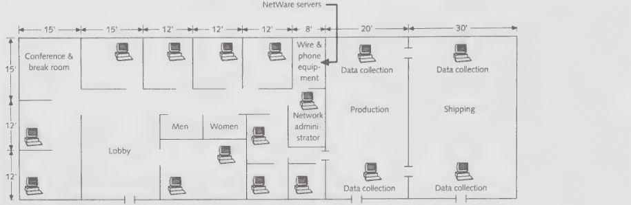
**图1-1** 示例网络拓扑图
### 网络安全人员认证项目
正如大多数IT从业者所知，几乎所有网络安全领域都有对应的专业认证。无论你是安全专业人员、计算机程序员、数据库管理员还是广域网（WAN）专家，专业机构都提供了足够多的认证和考试，足够你职业生涯全程备考。后续章节将介绍最受欢迎的IT安全认证，并简要说明部分考试要求。备考这些认证时，CompTIA Security+和Network+认证（或等效知识）会很有帮助。更多详情可访问CompTIA官网*www.comptia.org*。
#### 认证道德黑客（CEH）
电子商业认证顾问国际委员会（EC-Council）推出了名为**认证道德黑客（CEH）**的认证资质。目前，CEH考试覆盖21个领域（学科方向），测试人员必须熟悉这些领域的内容。知识要求会定期更新，因此如果你有意向参加这项考试，应访问EC-Council官网（*www.eccouncil.org*）获取最新信息。
CEH考试考核的21个领域如下：
- 道德与法律问题
- 踩点
- 扫描
- 枚举
- 系统入侵
- 木马程序与后门
- 嗅探器
- 拒绝服务攻击
- 社会工程学
- 会话劫持
- Web服务器入侵
- Web应用程序漏洞
- 基于Web的密码破解技术
- SQL注入
- 无线网络入侵
- 病毒与蠕虫
- Novell系统入侵
- Linux系统入侵
- 入侵检测系统（IDS）、防火墙与蜜罐
- 缓冲区溢出
- 密码学
由此可见，要通过这项选择题考试，你需要熟悉大量信息。虽然考试要求你对这21个领域有整体性了解，但在实际工作中，你最可能会加入负责开展渗透测试的团队。这个团队在行业内被称为**红队**，由具备不同技能、负责执行测试的人员组成。例如，红队中可能包含能开展SQL注入或其他编程漏洞测试的计算机编程专家（你将在第10章学习更多SQL注入相关知识，第7章学习编程基础）。团队还可能包含熟悉端口漏洞、IDS、路由器或防火墙漏洞的网络专家。单人完成所有测试的可能性极低，但通过考试要求你对上述所有领域有整体性了解。阅读本书、完成各项活动和案例项目将帮助你掌握这些知识。
### 开源安全测试方法论手册（OSSTMM）专业安全测试员
**开源安全测试方法论手册专业安全测试员（OPST）**认证由**安全与开放方法论研究所（ISECOM）**颁发，该机构是一家为安全专业人士提供安全培训和认证项目的非营利组织。OPST认证以Peter Herzog编写的**开源安全测试方法论手册（OSSTMM）**作为标准化方法论。该手册是迄今为止应用最广泛的安全测试方法论之一，随本书附赠光盘提供。本书多处会用到该手册中的多项方法论。由于该手册会定期更新，你需要定期访问ISECOM官网（www.isecom.org）下载最新版本。
考试覆盖以下部分主题：
- 专业规范——作业规则（明确你作为安全测试员的行为准则）
- 枚举——互联网数据包类型、拒绝服务测试
- 评估——网络勘查、防护措施、竞品情报侦察
- 应用层面——密码破解、遏制措施
- 验证——问题解决、安全测试

## 第1章 道德黑客概述
本考试要求考生不仅要回答选择题，还要成功对受攻击的网络进行安全测试。考试中的实操环节旨在确保考生能够将所学知识应用于真实场景。要了解该认证的更多信息，请访问*www.isecom.org*。

#### 认证信息系统安全专家（CISSP）
面向安全专业人士的**认证信息系统安全专家（CISSP）**认证由国际信息系统安全认证联盟（ISC²）颁发。尽管CISSP认证并非面向IT技术专业人士设计，但它已成为众多安全专业人士的标准之一。考试不要求考生具备IT技术知识，考查的是安全管理相关技能。CISSP持证人通常更关注安全策略与流程，而非开展安全测试或渗透测试的实际工具，因此不需要技术安全专业人士的技能组合。考试涵盖以下10个领域的题目：
- 访问控制系统与方法论
- 电信与网络安全
- 安全管理实践
- 应用与系统开发安全
- 密码学
- 安全架构与模型
- 运营安全
- 业务连续性规划与灾难恢复规划
- 法律、调查与伦理
- 物理安全
要了解该认证的更多信息，请访问*www.isc2.org*。

## SANS学院
**系统管理、审计、网络、安全（SANS）学院**通过**全球信息安全认证（GIAC）**提供培训与IT安全认证。该学院还免费向全球传播计算机网络与安全领域的研究文档。SANS学院最受欢迎的文档之一是Top 20漏洞列表，该列表详细说明了最常见的网络漏洞，并提出了修复漏洞的方法。该列表为渗透测试人员或安全专业人士提供了丰富的信息，你将在练习1-2中进一步了解相关内容。要了解安全认证考试的更多信息，请访问*www.sans.org*或*www.giac.org*。

## 哪种认证最佳？
选择参加哪类认证考试或学习路径可能令人困惑。渗透测试人员需要具备扎实的技术技能，才能高效完成工作职责。他们还需深入了解网络以及管理层在组织中的作用，具备书面与口头沟通技能，并有持续学习的意愿。任何能够激励你主动阅读学习的认证，都价值连城。针对“认证不过是一张纸”的说法，可以这样反驳：“百元美钞不也是一张纸吗？但揣在钱包里总归是好事！”
认证考试存在的风险在于，部分考生仅仅死记硬背术语，并未真正掌握相关学科内容或复杂概念，就像那些靠临时抱佛脚通过期末考、考完就忘掉大部分内容的学生一样。要明智地利用备考认证考试的时间，主动发现自己可能需要提升的领域，而不是死记硬背题目答案。本书旨在帮助你掌握成为合格IT安全专业人士所需的技能，顺利通过涵盖道德黑客、渗透测试方法、网络拓扑与技术的各类考试。但无论你参加哪类考试，最需要牢记的核心准则是：作为道德黑客、安全测试人员或渗透测试人员，你的所有行为都受到法律法规的约束。遵守法律法规、秉持职业道德，比通过考试更为重要。此外，请定期访问开展认证考试的机构官方网站，因为考试要求会和技术发展一样快速更新。例如，数年前CISSP考试中还没有无线网络相关的题目，因为该技术尚未普及，而如今考试已涵盖无线技术相关内容。

### 练习1-2：查看Top 20漏洞列表
**所需时间：** 15分钟
**目标：** 了解SANS最常见网络漏洞列表
**说明：** 尽管IT安全专业人士会尽可能快地修复网络漏洞，仍会有人不断开发新的漏洞利用方式。网络安全专业人士必须及时掌握这些新出现的漏洞利用方式。在本练习中，你将查看部分当前用于攻击网络的漏洞利用方式。无需担心——你不需要记忆这些内容。本练习仅为你初步介绍网络安全的领域。
1. 启动网页浏览器，输入网址**www.sans.org**，然后按下**Enter**键。
2. 点击主页上的**Top 20漏洞列表**图标。（由于网站主页更新速度与油价变化一样快，你可能需要搜索才能找到该图标。）
3. 阅读SANS Top 20漏洞列表的内容。由于该文档会每日更新以反映新出现的漏洞，请在简介部分向下滚动，选择一个Windows相关的漏洞并点击对应链接。例如，微软SQL服务器（MSSQL）已被列入存在漏洞的列表，你可能仍会在列表中看到它。
4. 注意标题为“如何判断自身存在漏洞”的部分，阅读该部分内容。
5. 向下滚动文档，阅读“如何防护”部分，留意你可能尝试用于修复漏洞的可能方案。该修复方案是否使用第三方工具，或是可从微软下载的工具？
6. 向下滚动到UNIX相关部分，在“UNIX系统最高危漏洞”标题下点击链接，选择一个UNIX系统的漏洞。
7. 在“受影响的 operating systems”部分，留意受该漏洞影响的操作系统。
8. 阅读“如何判断自身存在漏洞”部分。
9. 向下滚动文档，阅读“如何防护”部分，留意可用于修复漏洞的可能方案。厂商是否提供了软件补丁？厂商是否为IT专业人士提供了分步操作指南？
10. 完成后，关闭网页浏览器。

## 合法行为边界
由于涉及计算机技术的法律法规与技术发展一样快速变化，你必须持续关注你所在地区的相关动态。在得梅因合法的行为，在印第安纳波利斯可能并不合法。然而，查明你所在州或国家的合法行为范围，可能与执行渗透测试一样困难。许多政府官员并不了解计算机技术相关的法律法规。这种混淆也使得对计算机犯罪的行为人提起公诉变得困难。普通陪审团成员不愿将某人送进监狱，因为州检察官并未明确将其行为定义为非法。
作为安全测试人员，你必须清楚自己哪些行为是被允许的，哪些是不应该做、不能做的。例如，部分安全测试人员懂得如何开启死锁门锁，因此一道锁着的门不会阻止他们获取服务器的物理访问权限。然而，测试人员在携带工具前往企业现场前，必须了解持有开锁工具的相关法律法规。事实上，各州、各国之间的法律法规差异很大。

## 属地法律
与开锁工具类似，你电脑上的部分黑客工具可能属于非法持有物品。在笔记本电脑上安装黑客软件前，你应该联系当地执法机构，咨询你所在州或国家的相关法律法规。当你跨越州界或国界出行时，就能意识到这个问题的复杂性。纽约市可能适用一套法律，而开车快速通过乔治·华盛顿大桥就会进入新泽西州的法律管辖范围。附录A中的表A-1对比了佛蒙特州与纽约州的网络犯罪法规，以展示法律界使用的不同措辞。法律旨在保护社会，但往往书面条文存在多种解读空间。这就是我们设立法院和法官的原因。
在夏威夷州，控方必须证明被指控实施计算机犯罪的人员具有“犯罪意图”。因此，仅扫描网络本身在夏威夷州不构成犯罪。此外，控方还需完成更艰巨的举证责任：必须证明实施犯罪所使用的计算机仅由被指控犯罪的那一人使用。如果被指控人员声称，其办公室或家中有多人可以访问用于收集违规证据的计算机，那么控方无法将该计算机作为证据。
这些法律与使用渗透测试工具的网络安全专业人士有何关联？允许查看公司网络基础设施的黑客工具的定义，并不像持有入室盗窃工具那样明确，因为计算机黑客工具相关的法律未能跟上技术发展的速度。用35毫米相机拍摄银行的外观和内部是否合法？夏威夷州的一家银行安保人员表示，你会被要求停止拍摄并离开场所。FBI发言人Arnold Laanui Jr.对此进行了简单解释：如果你处于私有财产范围内，你可能会被要求停止拍摄。在银行对面用变焦镜头拍摄是合法的，但如果你未来用这些照片实施犯罪，律师会告诉你你面临的指控可能会更严重。由于反恐担忧，在美国部分地区以及欧洲大部分地区，拍摄桥梁、火车站及其他公共场所属于违法行为。然而，运行一款可向攻击者提供公司网络基础设施概览和详细描述信息的计算机程序，在大多数人看来并不构成威胁。
提及所有这些法律法规的目的是确保你意识到成为安全测试人员或学习黑客技术的学生所面临的风险。表1-1仅列出了2004年起诉的部分案件；在这些案件中，多人因“黑客攻击”行为被判处长期监禁，“黑客攻击”是司法部对该行为的称谓。大多数攻击并不仅限于扫描企业网络，但这些信息表明政府正在加大力度惩处网络犯罪。部分最臭名昭著的案件是大学生实施的攻击，例如1999年的eBay黑客攻击事件。当你阅读表1-1中的案例时，请注意部分黑客使用软件破解登录账户的密码。这一行为在获得网络所有者授权的情况下是许多安全专业人士都会进行的操作，但在未经授权的情况下实施属于联邦犯罪，可能会让黑客面临额外的长期监禁。

#### 表1-1 近期黑客攻击案件概览
| 州/年份 | 描述 |
|---|---|
| 北卡罗来纳州 2004 | Brian A. Salcedo因入侵劳氏商店系统窃取客户信用卡号，被判处108个月监禁。此前的黑客相关犯罪最长刑期为Kevin Mitnick的68个月监禁。 |
| 纽约州 2004 | Neal Cotton是计算机咨询公司Cyber City的一名离职网络管理员，因被解雇决定攻击前雇主的网络，删除文件与公司数据。他面临最高10年监禁与25万美元罚款。 |


#### 表1-1 近期黑客案例概览（续）
| 州/年份 | 案例描述 |
| --- | --- |
| 马萨诸塞州 2004 | 波士顿一家高科技公司的前员工帕特里克·安格尔（Patrick Angle）被指控入侵前雇主的网络，删除其与同事共同开发的某程序的源代码。若罪名成立，安格尔将面临最高10年监禁、25万美元罚款及赔偿。他被指控删除日志文件以掩盖行踪，还篡改了服务器的root密码，致使其他员工无法修复其造成的问题。 |
| 加利福尼亚州 2004 | 尽管此次起诉发生在洛杉矶，但案件涉及多个州及其他国家。24岁的罗马尼亚黑客卡林·马泰亚斯（Calin Mateias）被指控合谋从电脑分销商英迈国际（Ingram Micro）窃取价值超1000万美元的电脑设备。马泰亚斯被指控入侵英迈的在线订购系统，提交虚假电脑订单，将设备邮寄给分布在美国各地的团队成员。起诉书还涉及佛罗里达、佐治亚、弗吉尼亚、阿拉斯加州的另外5人。若罪名成立，马泰亚斯面临最高90年监禁；5名美国公民面临25至35年监禁，年龄多在20岁出头至25岁之间。 |
| 华盛顿州 2004 | 前Alta Vista员工劳伦特·沙韦（Laurent Chavet）被指控入侵受保护的电脑窃取源代码，造成5000美元的电脑损失。若罪名成立，这份包含两项指控的起诉书将判处其10年监禁、50万美元罚款，以及可能的赔偿。 |
| 纽约州 2004 | 前曼哈顿某互联网服务提供商（ISP）的网络管理员彼得·博格哈德（Peter Borghard）因入侵前雇主系统，被判处5个月监禁及5个月居家监禁。他还被责令支付118030美元的赔偿。在2003年1月的两次独立攻击中，博格哈德利用其加入该ISP前工作过的公司的一台位于办公隔间的傀儡机，销毁数据并清除配置设置。他的攻击一度导致系统瘫痪，使该ISP的客户无法获得服务。尽管博格哈德试图抹去攻击证据，仍被FBI的电子取证分析部门抓获。 |
| 路易斯安那州 2004 | 43岁的大卫·让松（David Jeanesonne）因涉嫌传播蠕虫病毒被捕，该病毒会导致打开邮件附件的WebTV用户拨打911而非ISP的电话号码。他面临最高10年监禁和25万美元罚款。 |
| 得克萨斯州 2004 | 一家达拉斯汽车零部件分销公司的前CEO，连同其首席技术官（CTO）及一名计算机顾问，被美国检察官办公室起诉，指控其入侵竞争对手的数据库以获取竞争优势。若罪名成立，他们将面临最高10年监禁和25万美元罚款。他们还因5项计算机密码贩卖罪名被起诉，每项罪名判处1年监禁和10万美元罚款。要访问汽车零部件数据库，他们需要获得该系统的合法用户名和密码，非法获取登录名和密码可能带来危险且代价高昂。 |
| 加利福尼亚州 2004 | 24岁的计算机科学研究生杰罗姆·T·赫肯坎普（Jerome T. Heckenkamp）承认1999年非法访问eBay和高通（Qualcomm）的计算机系统。赫肯坎普的网络名为MagicFX。2003年16项指控被合并审理，在认罪协议后，他的刑期可能在8个月至3年监禁之间。 |
| 纽约州 2004 | 23岁的阿德里安·拉莫（Adrian Lamo），被称为“流浪黑客”，承认入侵《纽约时报》的计算机网络。他被判处6个月居家监禁及6.5万美元罚款。人们难以想象一名无家可归的23岁年轻人如何执行居家监禁，但检方表示，拉莫的余生都将带着重罪定罪记录。 |

#### 端口扫描是否合法？
部分州认为端口扫描（一种用于探测系统开放端口的方法，第5章有相关介绍）本质上不具侵入性、不具破坏性，因此判定其合法。但情况并非总是如此，因此在开始使用渗透测试工具前，你仍须谨慎行事。在某些情况下，企业会因黑客扫描其系统提起刑事诉讼。不过也有一起案件中，佐治亚州一名法官判定该网络未遭受损失，因此驳回了指控。企业主张其网络也属于私有财产、有权禁止扫描只是时间问题。由于联邦政府目前不认为此类侵权行为违反美国宪法，因此允许各州分别处理相关问题。不过，如果你决定使用本书中介绍的工具进行练习，企业仍可能对你提起类似指控。即使你所在州的判决判定你无罪，法律费用仍可能对你的业务或个人财务造成严重损害。因此，即使你使用这些工具是为了公益而非从事犯罪活动，在使用本书所学内容前，了解你所在州的法律规定也至关重要。

## 第1章 道德黑客概览
你可能还想查看你的互联网服务提供商（ISP）合同，特别是通常被称为“可接受使用政策”的部分。大多数人只会快速浏览并接受合同条款。图1-2是某份实际ISP合同的摘录。注意条款（c）可能带来问题：如果你运行扫描软件，导致网络访问速度变慢或用户无法访问网络组件，就会触发该条款。
> **可接受使用政策**
>
> （a）只要使用行为符合夏威夷州及美利坚合众国的法律法规，且不会对PacInfo Net的客户造成不利影响，PacInfo Net对使用不作限制。客户有责任获取并遵守通过PacInfo Net服务访问的任何网络的可接受使用政策。
>
> （b）PacInfo Net有权在不通知的情况下断开从事垃圾邮件发送、滥用或恶意活动的账户的链接。因上述原因终止账户的，不予退款。此外，此类账户将按每小时125美元的费率计费，以支付修复后续损害所产生的人员成本。
>
> （c）客户不得使用旨在破坏互联网连接的电脑或网络组件、或阻止合法用户访问此类设备的技术。PacInfo Net有权在不通知的情况下断开从事此类活动的客户站点的连接。
**图1-2** 可接受使用政策示例

另一家ISP在回复关于扫描软件使用的询问时，给出了以下回复：
> *任何使用服务的行为，若干扰HOL或其他HOL客户的系统正常使用，或在长时间内消耗过量内存或CPU资源，可能导致根据本协议第1条被终止服务。用户严格禁止任何危害HOL设施安全的活动。用户不得运行IRC“机器人”或HOL未提供的任何其他脚本或程序。*
>
> 祝好，
>
> 客户支持
>
> 夏威夷在线（Hawaii Online）

禁止使用互联网中继聊天（IRC）机器人或ISP未提供的任何其他脚本或程序的规定，可能对渗透测试人员而言是最重要的。IRC“机器人”是一种自动响应用户的程序，会让连接另一端看起来有真人在场。例如，可以创建一个机器人，在用户加入聊天会话时自动发送欢迎语，即使实际上没有真人在场欢迎。就算你没有创建机器人的打算，条款中“任何其他脚本或程序”的规定仍值得注意。附录A中的表A-2列出了开始学习前应参考的相关法律法规。表中列出的法规可能自本书编写以来已有变更，因此在尝试使用渗透测试工具前，跟进你所在州的法律规定非常重要。在活动1-3中，你将参考表A-2，调研你所居住的州（或讲师指定的州）的相关法律。

### 活动1-3：识别你所在州或国家的计算机相关法规
**所需时间：**30分钟
**目标：**了解你所在州或国家有哪些法律可能禁止你入侵网络或计算机系统。
**描述：**本活动中，请使用互联网搜索引擎收集你所在州（或讲师指定的州）的计算机犯罪相关信息。你已被安全咨询公司ExecuTech聘用，收集任何可能对安全测试人员产生影响的新法规或法律相关信息。

该公司雇佣的相关人员。请给安全与运营总监鲍勃·林奇撰写一份一页的备忘录，列出所有适用的法规或法律，并向管理层提出建议。例如，你可以在备忘录中注明，对公司的网络发起拒绝服务攻击是违法的，因为除非得到所有者授权，否则州刑法禁止此类攻击。

### 联邦法律
在进行首次安全测试时，你还需了解适用的联邦法律（见表1-2）。联邦计算机犯罪法律正变得越来越细化，针对网络犯罪和知识产权问题。事实上，政府现在已经开设了一个名为“计算机黑客与知识产权（CHIP）”的计算机犯罪新分支。

#### 表1-2 联邦计算机犯罪法律
| 联邦法律 | 说明 |
| :--- | :--- |
| 《计算机欺诈与滥用法》。《美国法典》第18卷，犯罪与刑事诉讼。第一部分：犯罪，第47章，欺诈与虚假陈述，第1030条：与计算机相关的欺诈及相关活动 | 该法律将未经授权访问机密信息或财务信息的行为定为联邦犯罪。 |
| 《电子通信隐私法》。《美国法典》第18卷，犯罪与刑事诉讼。第一部分：犯罪，第119章，有线及电子通信拦截与口头通信拦截，第2510条：定义 及 第2511条：禁止拦截、披露有线、口头或电子通信 | 该法律禁止你拦截任何通信，无论其传输方式如何。 |
| 《美国爱国者法案》第217条：未经授权进入计算机者通信的拦截 | 该法案修订了《美国法典》第18卷第119章。 |
| 《存储有线及电子通信和交易记录法》。《美国法典》第18卷，犯罪与刑事诉讼。第一部分：犯罪，第121章，存储有线及电子通信和交易记录法，第2701条：非法访问存储的通信（a）违法行为。除本条款小节另有规定外，任何属于以下情况的主体：（1）未经授权故意访问提供电子通信服务的设施；或（2）故意越权访问该设施；第2702条：内容披露 | 该法律定义了针对存储机密信息的计算机的未授权访问行为。 |

> **安全小贴士** 即使你认为自己遵循了雇佣你执行安全测试的客户提出的要求，也不要假定管理层会对你的测试结果感到满意。曾有一名测试人员因安全测试向其暴露了所有登录名和密码，被一名感到不满的经理问责。该经理认为测试人员不应知晓这些信息，甚至考虑终止安全测试工作。

#### 活动1-4：研究联邦计算机犯罪法律
**所需时间：**15分钟
**目标：** 增强你对美国联邦计算机犯罪相关法律的了解。
**描述：** 本次活动中，请使用互联网搜索引擎收集《美国法典》第18卷第1030条的相关信息，该条款涵盖与计算机相关的欺诈及相关活动。撰写一份摘要，说明该法律会对道德黑客和安全测试人员产生何种影响。

#### 合法禁止行为
通读完关于计算机犯罪的州和联邦法律后，你会了解到未经许可访问计算机、销毁数据或未经所有者许可复制信息都是违法的。不必拥有法律学位也能明白某些行为违法，例如在计算机网络中安装会导致用户无法访问网络资源的蠕虫或病毒。作为安全测试人员，你必须注意自己的行为不得影响客户正常开展工作。如果你运行的程序大量占用网络资源，导致用户无法访问网络资源，就违反了联邦法律。例如，第3章介绍的拒绝服务（DoS）攻击不应对客户的网络发起。

##### 签订书面合同
如前所述，在客户的网络上运行某些黑客程序可能会无意中引发拒绝服务攻击，这也是你工作难度大的原因之一，尤其是当你作为公司雇佣的独立承包商开展安全测试，而非大型安全公司（拥有法务团队与客户签订合同）的员工时。安全公司员工受公司与客户签订合同的保护。本书默认你是一名需要一些指导来拟定书面合同的独立承包商。部分承包商不信任书面合同，认为这会损害他们与客户的关系。许多计算机顾问依赖传统的握手礼和口头协议开展合作，但当然你需要自行判断这种方式是否适合自己。有人认为这是信任问题，另一些人则认为这与信任无关，书面合同只是良好的商业惯例。曾在项目上工作过却未收到客户付款的顾问通常会支持签订合同。用户往往在电脑崩溃后才会意识到备份重要文档的重要性，不要像他们一样，等到对簿公堂时才后悔没有书面协议。作为计算机咨询领域的独立承包商，你通常会有一些合同相关经验。如果你需要更多信息，可以查阅关于独立承包商工作的相关书籍，例如珍妮特·鲁尔所著的*《计算机顾问指南》*（ISBN：0471176494，1997年）和彼得·迈耶所著的*《计算机咨询入门》*（ISBN：0471348139，1999年）。互联网也是寻找可修改以适配自身业务情况的免费合同模板的有效资源。不过，在合同签署前让律师审阅是你投入时间和金钱的合理选择，你做出的修改可能带来的问题比没有合同还多。你感到顾虑吗？很好。大多数道德黑客相关的教材或课程都会略过这个话题，但它却是这个行业最重要的部分。如果你的客户由法务团队出具了合同，咨询律师可以为你节省时间和金钱。试图理解由代表公司最佳利益的律师团队起草的合同，需要你方律师来维护你的最佳利益。法律的复杂性对于大多数普通人来说难以理解，跟上计算机技术的发展已经足够困难。这两个领域都在不断变化，但法律更为复杂，因为各州的法律存在差异。附录B中的图B-1展示了一份你在加入独立计算机顾问协会（ICCA）后，可修改使用的合同示例。请通读该图中的法律条款，然后完成活动1-5。

##### 活动1-5：理解咨询合同
**所需时间：**30分钟
**目标：** 增强你对咨询合同的理解。
**描述：** 本次活动中，请查阅附录B中的示例合同。除非你是ICCA的成员，否则该合同无法使用，但它是合同措辞的极佳参考。阅读合同后，撰写一份一页的摘要，讨论你会修改或补充的部分。如有必要，说明针对渗透测试人员而言缺失了哪些重要内容。

> **安全小贴士** 由于道德黑客的工作相对较新，相关法律也在不断变化。即使你受雇于某家公司测试其网络的漏洞，也要注意不要违反你所在州或国家的法律。如果你担心某次测试会因过度占用带宽而导致网络速度减慢，这种顾虑应当是一个警示信号。公司可能会因这次延迟造成的损失时间或金钱而起诉你。

### 道德黑客入门概览
通读完所有注意事项后，你或许已经决定转行。但在转换职业之前，不妨先看看安全测试人员所需的各项技能，帮助你判断自己是否具备从事这份工作的能力：
- *网络与计算机技术知识*——作为安全测试人员，你必须充分理解网络相关概念。应该花时间学习并复习TCP/IP及路由概念，同时能够看懂网络拓扑图。如果你没有网络相关工作经验，现在开始学习非常重要，不具备该领域的高水平专业知识就无法胜任安全测试工作。你还需要对计算机技术和操作系统（OS）有充分的了解，尽可能多地阅读当下主流操作系统的相关内容，尤其要关注*nix（即UNIX和Linux系统）以及微软操作系统，因为大部分安全测试都会在这些常用系统上开展。
- *与管理层和IT人员沟通的能力*——安全测试人员需要善于倾听，能够以口头和书面形式与管理层及IT人员沟通。向CEO解释你的发现可能较为困难，尤其是当对方没有技术背景时。你的报告应清晰简洁，提供建设性的反馈和建议。
- *了解你所在地区的适用法律*——作为安全测试人员，你必须清楚哪些行为是合法的、哪些是违法的。在为跨国企业工作时，这一点可能较难做到，因为其他国家的法律可能存在较大差异。
- *应用必要工具完成工作的能力*——安全测试人员需要充分了解可用于开展安全测试的工具。更重要的是，当现有工具无法满足需求时，你必须能够突破常规，通过发现、创建或修改工具来解决问题。

> **安全小贴士** 如果在乎他人是否喜欢你，你可能需要考虑选择渗透测试之外的其他职业。如果你工作表现出色，很多IT员工会对你发现他们系统中的漏洞感到不满。事实上，这是唯一一份你做得越好，敌人就越多的职业！

### 本章总结
- 许多公司会雇佣道德黑客开展渗透测试。渗透测试的目的是发现网络中的漏洞。安全测试由具备不同技能的人员团队执行，这类团队有时被称为红队。
- 渗透测试通常采用三种不同的模型开展：白盒模型、黑盒模型和灰盒模型。测试人员采用的模型取决于客户愿意提供的信息量。部分测试中，客户不希望测试人员获取公司的任何信息，换句话说，客户的要求是“在我未提供任何帮助的情况下，尽可能多地了解我的公司信息”。


- 安全测试人员可以从多个机构获得认证。最受欢迎的认证有CEH、CISSP和OPST。每项认证都需要参加考试，涵盖测试人员必须掌握的不同领域。由于考试要求会定期更新，因此访问颁发认证的机构官网核验考试要求非常重要。
- 作为渗透测试人员，你必须清楚哪些行为是法律允许的、哪些是不被允许的。在开展任何安全测试前，联系当地执法机构是个不错的起点。
- 你签订的合同中可能包含互联网服务提供商（ISP）的可接受使用政策，该政策可能会限制你使用许多面向安全测试人员的工具。运行未经ISP授权的脚本或程序可能导致服务被终止。
- 开展安全测试前，需要了解与计算机犯罪相关的州和联邦法律。联邦法律适用于所有州，而州法律可能存在差异。清楚适用于当地的法律至关重要。
- 白纸黑字写清楚。作为独立承包商，在开展渗透测试前让客户签署允许你进行测试的书面合同非常关键。你还应该请律师审阅合同，尤其是当你或公司代表对合同做了任何修改时。

### Key Terms
#### 黑盒模型
管理层不会告知IT安全人员将开展渗透测试，也不会向测试团队提供网络拓扑说明。换句话说，渗透测试人员需要完全自主开展工作。
#### 认证道德黑客（CEH）
EC-Council授予安全测试人员的认证。
#### 认证信息系统安全专家（CISSP）
由国际信息系统安全认证联盟（(ISC)²）颁发的非厂商特定认证。更多信息请访问www.isc2.org。
#### 骇客
指以造成损害或破坏数据为目的入侵系统的黑客。
#### 道德黑客
指经所有者许可访问计算机系统或网络的人员。
#### 全球信息保障认证（GIAC）
由SANS协会于1999年成立，旨在验证安全专业人员技能的机构。GIAC认证涵盖安全领域的多个专业方向。更多信息请访问www.giac.org。
#### 灰盒模型
黑盒模型与白盒模型的混合模式。例如，公司可能会向测试人员提供正在运行的操作系统相关信息，但不会提供任何网络拓扑信息（如路由器、交换机、入侵检测系统、防火墙等的拓扑图）。
#### 黑客
指未经所有者授权访问计算机系统或网络的人员。
#### 安全与开放方法论协会（ISECOM）
ISECOM是为安全专业人员提供安全培训及认证项目的非营利组织。更多信息请访问www.isecom.org。
#### 开源安全测试方法论手册（OSSTMM）
这份由彼得·赫尔佐格开发的安全手册已成为迄今为止应用最广泛的安全测试方法论之一。更多信息请访问www.osstmm.org。
#### OSSTMM专业安全测试员（OPST）
ISECOM为渗透测试人员设定的认证。
#### 脚本猴子
对技术不足的骇客或黑客的贬义称谓，这类人通过窃取程序代码入侵网络系统，而非自行编写程序。
#### 渗透测试
指安全专业人员经网络所有者许可，对计算机网络发起攻击的测试。
#### 红队
一组协同对网络发起攻击的渗透测试人员组成的团队。
#### 脚本
指按顺序运行以在计算机上执行任务的代码行。许多资深渗透测试人员会使用Perl或C编程语言编写或修改脚本。
#### 脚本小子
与“脚本猴子”类似，指技术不足的黑客或骇客，他们使用他人编写的脚本或计算机程序入侵网络。
#### 安全测试
指安全专业人员对网络发起攻击的测试；除此之外，测试人员还会分析组织的安全策略与流程，并向管理层报告发现的任何漏洞。
#### 系统管理、审计、网络安全协会（SANS）研究所
该组织成立于1989年，在全球开展培训，并通过GIAC在计算机安全和数字取证的多个领域提供多项认证。
#### 白盒模型
在该模式下，测试人员可以与公司员工沟通，并获得完整的网络拓扑与技术说明。

### REVIEW QUESTIONS
1. 美国司法部对黑客的定义如下哪项？
- a. 未经所有者许可访问计算机或网络的人员
- b. 渗透测试人员
- c. 未付费使用电话服务的人员
- d. 经所有者许可访问计算机或网络系统的人员
2. 渗透测试人员是指_______________。
- a. 未经所有者许可访问计算机或网络的人员
- b. 未付费使用电话服务的人员
- c. 受雇入侵网络以发现漏洞的安全专业人员
- d. 未经许可访问系统但不会删除或破坏文件的黑客
3. 一些资深黑客会将那些复制或使用预先编写好的脚本或计算机程序的新手黑客称为什么？（选择所有符合的选项）
- a. 脚本猴子
- b. 数据包小子
- c. 数据包猴子
- d. 脚本小子
4. 渗透测试人员执行渗透测试时会使用哪三种模型？
5. 由具备不同技能的人员组成、用于渗透网络的团队被称为什么？
- a. 绿队
- b. 蓝队
- c. 黑队
- d. 红队
6. 你如何得知你所在州适用哪些计算机犯罪相关法律？
- a. 联系当地执法机构
- b. 联系你的互联网服务提供商
- c. 联系当地电脑商店的商家
- d. 拨打911
7. ISP合同的哪一部分可能会影响你通过互联网开展渗透测试的能力？
- a. 扫描策略
- b. 端口访问策略
- c. 可接受使用政策
- d. 保修政策

### Chapter 1 Ethical Hacking Overview
8. 如果你在纽约市运行一个程序，该程序占用网络资源导致用户无法访问网络资源，你违反了哪类法律？
- a. 市级法律
- b. 州级法律
- c. 地方法律
- d. 联邦法律
9. 哪项联邦法律禁止未经授权访问机密信息？
- a. 《计算机欺诈和滥用法》，第18篇
- b. 《电子通信隐私法》
- c. 《存储有线及电子通信和交易记录法》
- d. 第五修正案
10. 哪项联邦法律禁止拦截任何通信，无论其传输方式如何？
- a. 《计算机欺诈和滥用法》，第18篇
- b. 《电子通信隐私法》
- c. 《存储有线及电子通信和交易记录法》
- d. 第四修正案
11. 哪项联邦法律修订了《美国法典》第18篇第119章？
- a. 《计算机欺诈和滥用法》，第18篇
- b. 《电子通信隐私法》
- c. 《存储有线及电子通信和交易记录法》
- d. 《美国爱国者法案》第217条：计算机入侵者通信的拦截
12. 要确定你所在区域的扫描行为是否违法，你应该采取以下哪种做法？
- a. 参考《美国法典》
- b. 参考《美国爱国者法案》
- c. 参考州法律
- d. 联系你的ISP
13. 哪个机构提供认证道德黑客（CEH）认证考试？
- a. 国际信息系统安全认证联盟（(ISC)²）
- b. EC-Council
- c. SANS协会
- d. GIAC
14. 哪个机构授予个人CISSP认证？
- a. 国际信息系统安全认证联盟（(ISC)²）
- b. EC-Council
- c. SANS协会
- d. GIAC
15. 哪个机构授予个人OPST认证？
- a. 国际信息系统安全认证联盟（(ISC)²）
- b. EC-Council
- c. SANS协会
- d. ISECOM

### 案例项目
- 16. 作为安全测试员，在计算机上安装黑客软件之前，你应该做什么？
  a. 向当地执法机构咨询。
  b. 联系硬件供应商。
  c. 联系软件供应商。
  d. 联系你的互联网服务提供商。
- 17. 在互联网上使用黑客软件之前，你应该联系以下哪个机构？（选择所有适用项。）
  a. 你的互联网服务提供商
  b. 你的供应商
  c. 当地执法机构以检查合规性
  d. 联邦调查局
- 18. 哪个组织发布当前网络漏洞利用的 Top 20 列表？
  a. SANS 研究所
  b. ISECOM
  c. EC-Council
  d. OPST
- 19. 当朋友推荐客户时，不需要书面合同。正确还是错误？
- 20. 安全测试员应具备以下哪些属性？（选择所有适用项。）
  a. 良好的倾听技巧
  b. 对网络和计算机技术的了解
  c. 良好的口头和书面沟通技巧
  d. 对保护网络和计算机系统的兴趣

#### 案例 1-1：确定渗透测试的法律要求

K. J. Williams 公司是位于夏威夷毛伊岛的大型房地产管理公司，已与你的计算机咨询公司签约，对其计算机网络进行渗透测试。该公司拥有物业，内设五星级酒店、高尔夫球场、网球场和餐厅。副总裁 Claudia Mae 是你与公司唯一的联系人。为避免影响你正在进行的测试，你不会被介绍给任何 IT 员工或雇员。Claudia 希望在不依赖她或公司人员任何协助的情况下，确定你能发现关于公司网络基础设施、网络拓扑结构和已发现漏洞的哪些信息。根据上述信息，为你导师撰写一份报告，概述你在开始对 K. J. Williams 公司进行渗透测试之前应采取的步骤。研究适用于该公司所在州的法律，并务必参考任何可能适用于你被要求执行的任务的联邦法律。

#### 案例 1-2：了解安全测试员的参与规则

你是一名刚被安全咨询公司聘用的新安全测试员。你的主管希望确保你在被派去执行第一次任务之前，不违反公司的任何政策。SCC 的副总裁 Shelley Canon 希望你阅读 OSSTMM 中的“参与规则”部分。请给 Shelley Canon 写一份备忘录，总结 OSSTMM 中的“参与规则”部分（位于本书的光盘上）。备忘录应描述参与规则的目的，并包括以下问题的答案：
1. 在什么情况下可以公开过去客户的名称？
2. 如果你无法渗透客户的网络，是否可以免费提供服务？
3. 在什么情况下可以对客户网络进行拒绝服务攻击？

## 第 2 章 TCP/IP 概念回顾
阅读本章并完成练习后，你将能够：
- 描述 TCP/IP 协议栈
- 解释 IP 寻址的基本概念
- 解释二进制、八进制和十六进制计数系统

作为网络安全分析师或安全测试员，你所做的几乎所有工作都取决于你对网络概念的理解以及对传输控制协议/互联网协议的知识。本书假设你已经对网络概念和 TCP/IP 有了深入的了解。本章作为快速回顾，介绍这两个主题如何与 IT 安全和安全测试员相关。在活动和案例项目中，你将运用 TCP/IP 和网络知识于安全测试技术。黑客和安全测试员使用的大多数工具都在 IP 上运行，IP 是网络协议的事实标准。然而，它在开发时并未考虑安全功能，因此需要具备相关知识和技能的专业人士来修补因使用 IP 而产生的许多安全漏洞。本章你将研究 TCP/IP 协议栈和 IP 寻址，并回顾二进制、八进制和十六进制计数系统以及与 TCP/IP 上运行的服务相关的端口。

### TCP/IP 概述
为了使计算机能够在互联网上或办公室之间相互通信，它们必须说同一种语言。这种语言被称为**协议**，最广泛使用的是**传输控制协议/互联网协议**。无论连接网络上计算机的介质是什么——铜线、光纤电缆或无线设备——如果通信要正常运行，所有计算机上必须运行相同的协议。在日本餐馆吃完饭后将筷子插入公共饭碗被认为是一个重大的协议错误。类似地，试图让运行 Novell 网际包交换/顺序包交换协议的计算机连接到运行 TCP/IP 的 Windows Server 2003 服务器将产生协议错误，阻止网络通信。无法连接到服务器的不满用户会有负面反应，就像日本公民会因你缺乏礼貌而不快一样。

> **安全提示**
尽管 IPX/SPX 今天使用并不广泛，但许多公司仍有依赖它的遗留系统。事实上，一些用户通过在内部运行 IPX/SPX 将其内部网络与外部世界隔离。试图通过互联网攻击网络的攻击者会在协议从 TCP/IP 切换到 IPX/SPX 时被阻止。这种策略被称为“穷人的防火墙”。当然，这不是保护网络的推荐解决方案，但作为网络安全专业人士，你可能会看到它被使用。

尽管你已经学习了 TCP/IP，但稍作复习有助于确保你有透彻的理解。TCP/IP 不仅仅是两个协议（TCP 和 IP）。它通常被称为 TCP/IP 协议栈，包含四个不同的层（见图 2-1）。网络层负责在介质或导线上物理移动电子，互联网层负责使用 IP 地址路由数据包。传输层负责控制数据流、对数据包进行排序以便重新组装，以及用 TCP 或用户数据报协议头部封装数据段。应用层是应用程序和协议（如 HTTP 和 Telnet）运行的地方。

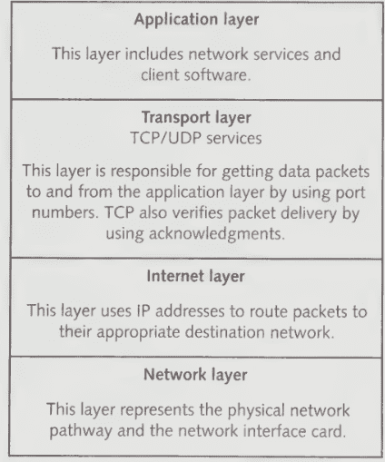

### 应用层
应用层协议是 TCP/IP 协议栈中底层协议的前端。换句话说，这一层是你能看到和接触到的。表 2-1 列出了在这一层运行的一些主要应用程序和协议。这些应用程序和协议将在后面的“TCP 端口”部分再次提及。

表 2-1 应用层程序
| 应用程序 | 描述 |
| :--- | :--- |
| 超文本传输协议 (HTTP) | 在万维网上通信的主要协议（详情参见 www.ietf.org 上的 RFC-2616） |
| 文件传输协议 (FTP) | 允许不同操作系统之间传输文件 |
| 简单邮件传输协议 (SMTP) | 在互联网上传输电子邮件的主要协议 |
| 简单网络管理协议 (SNMP) | 主要用于监控网络上的设备，例如远程监控路由器状态 |
| 安全外壳 (SSH) | 使远程用户可以登录服务器并发出命令 |
| 互联网中继聊天 (IRC) | 使多个用户能够在讨论区通过互联网进行交流 |
| Telnet | 允许用户远程登录服务器 |

### 传输层
传输层是将数据封装成数据段的地方。数据段可以使用 TCP 或 UDP 作为连接到目标主机（或节点）并转发数据的方法。TCP 是一种**面向连接**的协议，这意味着发送方在目标节点确认正在监听之前不会向其发送任何数据。换句话说，在发送数据之前会建立连接。例如，如果计算机 A 想向计算机 B 发送数据，它会先向计算机 B 发送一个 **SYN** 数据包。SYN 数据包是对接收方的查询，就像在问“你好，计算机 B。你在吗？”计算机 B 会发回一个称为 **SYN-ACK** 数据包的确认，这就像在回答“是的，我在。请发送。”最后，计算机 A 向计算机 B 发送一个 **ACK** 数据包以响应 SYN-ACK。这个过程称为**三次握手**，包括以下步骤：
1. 主机 A 向主机 B 发送一个设置了 SYN 标志的 TCP 数据包（即 SYN 数据包）。
2. 收到数据包后，主机 B 向主机 A 发送自己的 SYN 数据包，并设置了 ACK 标志（SYN-ACK 数据包）。
3. 作为对主机 B 的 SYN-ACK 数据包的响应，主机 A 向主机 B 发送一个设置了 ACK 标志的 TCP 数据包（ACK 数据包）。

#### TCP 数据段头
作为安全专业人员，你应该了解 TCP 头的关键组成部分：TCP 标志、初始序列号（将在后面的“初始序列号 (ISN)”中介绍）以及源和目标端口号（将在后面的“TCP 端口”中介绍）。黑客会滥用 TCP 头的许多组成部分；例如，在端口扫描时，许多黑客使用发送带有 SYN-ACK 标志的数据包的方法，即使之前并未发送 SYN 数据包。安全测试员也使用此方法，但用于合法目的。在学习这些组件如何被滥用之前，你需要理解它们。然后，也只有那时，你才能检查你的网络在这些领域是否存在漏洞。记住，要保护网络，你需要了解入侵网络的基本方法。你将在活动 2-1 中研究更多关于 TCP 头的细节。


#### TCP 标志
每个 **TCP 标志** 占用 TCP 段的一个位，可以设为 0（关闭）或 1（开启）。以下是 TCP 段的六个标志：
- **SYN** 标志 — 同步标志（synchronization flag）表示会话的开始。
- **ACK** 标志 — 确认标志（acknowledgment flag）确认连接，并由主机在收到 SYN-ACK 数据包后发送。
- **PSH** 标志 — 推送标志（push flag）用于直接将数据传送到应用程序。数据不缓冲，而是立即发送。
- **URG** 标志 — 此标志用于表示紧急数据。
- **RST** 标志 — 重置标志（reset flag）重置或断开连接。
- **FIN** 标志 — 完成标志（finish flag）表示连接已完成。
#### 初始序列号（ISN）
**初始序列号**（initial sequence number，ISN）是一个 32 位数字，用于跟踪节点接收的数据包，并实现对分解为较小小数据包的大数据包的重组。在三向握手的步骤 1 和步骤 2 中发送 ISN。发送节点的 ISN 随 SYN 数据包一起发送，接收节点的 ISN 随 SYN-ACK 数据包一起发回给发送节点。由于 2^32 允许的数字范围从零到超过 40 亿，这个 ISN 可以是一个非常大的数字。
> **安全速递**
> TCP 报头的 ISN 对于不熟悉渗透测试或黑客技术的网络安全专业人员来说可能看起来并不重要。然而，许多网络攻击都使用了 **会话劫持**（session hijacking），这是一种依赖于猜测 TCP 数据包 ISN 的攻击。最著名的之一是凯文·米特尼克（Kevin Mitnick）对日本公司 Tsutomu Shimomura 的攻击，称为 IP 序列攻击。了解 TCP 标志和 TCP 数据包的基本元素对于理解黑客的思维方式——以及你应该如何思考——大有帮助。要成为更好的安全专业人员，在学习基础知识时尝试发现漏洞或弱点。太多的网络安全专业人员等待黑客发现网络中的漏洞，而不是在黑客自己的游戏中击败他们。
## 活动 2-1：查看 RFC-793
**所需时间：** 30 分钟
**目标：** 检查 TCP 段组件的细节，并了解如何使用请求注释（Request for Comments，RFC）文档。
**描述：** 作为 IT 安全专业人员，可用信息的数量可能令人生畏。为了保护公司资源（或通常称为“资产”），你需要在众多领域都富有技能。为了获得职业中必要的技能，你应该知道在哪里寻找有助于你更好地理解特定技术的技术信息。想了解域名服务（DNS）是如何工作的吗？想更好地理解动态主机配置协议（DHCP）吗？阅读这些主题的 RFC 可以回答你可能有的任何问题。
在本活动中，你将检查 TCP 段的细节并了解一些 TCP 报头组件的概况。你不必记住你的发现。这仅仅是对 RFC 奇妙世界的介绍。
1. 启动 Web 浏览器，在地址文本框中输入 **http://www.ietf.org**，然后按 **Enter**。
2. 在互联网工程任务组（IETF）主页上，从菜单中点击 **RFC Pages** 图标。（如果时间允许，你可能想导航到许多其他可用选项，以获取有关有用主题的信息。）
3. 阅读请求注释页面上的说明，在 RFC 编号文本框中输入 **793**，然后点击 **go**。注意此 RFC 的标题页。
4. 向下滚动文档并阅读目录以了解本文档信息的概况。阅读第 2.6、2.7 和 2.8 节，以更好地了解 TCP 是如何工作的。（注意，第 2.6 节讨论可靠通信。）
5. 向下滚动到第 3.1 节，“Header Format”。该图可能不是你习惯在计算机文档中看到的图，但它是你在 RFC 中看到的典型图。顶部的数字使你可以更轻松地看到每个位的位置。例如，顶部 0、1、2 和 3 显示该段共有 32 位（0 到 31）。请注意，源端口和目标端口字段长 16 位，ISN 和确认号都是 32 位长。
6. 阅读本节并注意二进制数制的使用（后面将在本章中详细介绍）。
7. 向下滚动到第 3.4 节，“Establishing a connection”，并浏览三向握手的描述。作者在简化此过程方面做得很好，并添加了一点关于为什么 ACK 不占用序列号空间的幽默。许多 RFC 作者都擅长以易于理解的方式解释复杂材料。
8. 浏览文档的其余部分以了解所涵盖内容的概况。如果愿意，你可以稍后阅读整个文档。
9. 关闭 Web 浏览器。
#### TCP 端口
TCP 数据包包含两个 16 位字段，分别包含源端口号和目标端口号。**端口** 是 TCP 连接的逻辑（而非物理）组件。端口标识正在运行的服务。例如，HTTP 服务使用端口 80。了解端口很重要，这样你就知道如何停止或禁用网络上未使用的服务。服务器上运行的服务越多，为潜在攻击开放的端口就越多。换句话说，保护一个有 1000 个开口的房子比保护一个有 10 个开口的房子更难。
> **安全速递**
> 网络安全专业人员工作中最困难的部分是平衡系统安全与用户的易用性和可用性。关闭所有端口并停止所有服务肯定会提高网络安全性，但你的用户将无法连接到 Internet、发送或接收电子邮件或访问任何网络资源。因此，你的工作是允许用户在安全的网络环境中工作，而不阻止他们使用诸如电子邮件、Web 浏览等服务。这不是一项容易的任务，正如你在本书中将看到的那样。
有 **65,535** 个可能的 TCP 和 UDP 端口号可用，但好消息是只有 **1023** 个被认为是知名端口。要查看知名端口列表，请访问 **互联网编号分配管理局（Internet Assigned Numbers Authority，IANA）**，网址为 *www.iana.org*。在主页上选择协议编号分配服务选项，然后单击字母“P”。在端口号标题下选择系统，并阅读文档。由于网页可能会更改，你可能会在不同的位置找到这些端口号。（见下文说明。）那里可能有比你需要的更多的信息，但导航到这些网站会给你练习搜索信息的机会。好的安全专业人员知道如何使用结构化方法查找答案。
你可以通过输入 `www.iana.org/assignments/port-numbers` 作为 URL 来访问知名端口页面，但这样会绕过 IANA 主页，而 IANA 主页有更多信息并可访问 IANA Whois 服务。该服务将在第 4 章中介绍，但你在浏览 IANA 页面时可以回顾它。不必记住那 1023 个端口。幸运的是，没有必要这样做。但是，你应该记住以下 TCP 端口及其代表的服务。作为安全专业人员和渗透测试人员，你所做的很多事情都严重依赖于理解这些信息。
- 端口 20 和 21（文件传输协议，File Transfer Protocol）— FTP 与 Internet 一样古老。它是移动或复制大文件的事实标准，至今仍在使用，尽管由于 HTTP 的流行，使用程度较低。FTP 使用端口 20 进行数据传输，端口 21 用于开销。FTP 需要输入登录名和密码，并且比平凡文件传输协议（TFTP，稍后在本列表中介绍）更安全。图 2-2 显示了尝试连接到 Cisco FTP 站点时显示的登录屏幕。
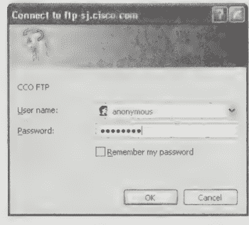
**图 2-2 连接到 FTP 站点**
- 端口 25（简单邮件传输协议，Simple Mail Transfer Protocol）— 电子邮件服务器监听此端口。如果你尝试向远程用户发送电子邮件，你的计算机将连接到邮件服务器上的端口 25。
- 端口 53（域名服务，Domain Name Service）— 如果网络上的服务器使用 DNS，则它使用端口 53。大多数网络需要 DNS 服务器，以便用户可以使用 URL 而不是 IP 地址连接到网站。当用户输入 URL（如 www.yahoo.com）时，DNS 服务器将名称解析为 IP 地址。DNS 服务器可能是公司内部的，或者每台计算机可能被配置为指向由公司 ISP 服务的 DNS 服务器的 IP 地址。
- 端口 69（平凡文件传输协议，Trivial File Transfer Protocol）— 许多网络工程师使用 TFTP 服务来传输路由器和备份路由器的配置。
- 端口 80（超文本传输协议，Hypertext Transfer Protocol）— 大多数认证考试都有一个关于端口 80 用于 HTTP 的问题。端口 80 在你连接到 Web 服务器时使用。如果安全人员决定过滤掉 HTTP 流量，几乎每个用户都会注意到网络上的问题。
> **安全速递**
> 通常不熟悉安全技术的技术人员认为，限制对路由器或防火墙上的端口访问可以保护网络免受攻击。这说起来容易做起来难。毕竟，如果防火墙阻止任何流量通过端口 80 进入或退出网络，你确实关闭了黑客访问的易受攻击端口。然而，你也关闭了用户访问 Internet 的门户，这可能对你的公司不可接受。对于安全人员来说，困难（几乎不可能）的部分是试图将坏人拒之门外，同时允许好人工作并使用 Internet。随着你在本书中的学习，你将看到，只要用户能够通过开放端口连接到 Internet，攻击者就可以进入。就这么简单。如果用户能出去，攻击者就能进来！


- 端口110（邮局协议3，POP3）—— 要从邮件服务器检索电子邮件，你最常访问的是110端口。一种增强型的邮件检索协议IMAP4也可用，本列表后续会介绍。不过POP3目前仍在使用，是最常见的邮件检索系统之一。
- 端口119（网络新闻传输协议）—— 该端口用于连接新闻服务器，以使用新闻组。
- 端口135（远程过程调用，RPC）—— 该端口由微软RPC使用，对微软Exchange Server以及Windows 2000 Server和Windows Server 2003操作系统中的活动目录的运行至关重要。
- 端口139（网络基本输入输出系统，NetBIOS）—— 该端口由微软的NetBIOS会话服务用于共享资源。第8章会介绍NetBIOS。
- 端口143（互联网消息访问协议4，IMAP4）—— IMAP4使用该端口检索电子邮件。

##### 活动2-2：连接到25端口（简单邮件传输协议，SMTP）
**所需时间：** 30分钟
**目标：** 使用Telnet命令访问你邮件服务器的25端口，登录并向收件人发送电子邮件。
**描述：** 作为IT安全专业人员，你应该了解网络基础设施中使用的端口。测试服务器上是否运行某项服务的好方法，是使用对应服务的端口进行Telnet连接。例如SMTP服务使用25端口。在本活动中，你将从运行Windows XP专业版的计算机Telnet连接到教室的邮件服务器。如果教室没有配置邮件服务器，请连接你互联网服务提供商的邮件服务器，从你的电子邮件账户向收件人发送邮件。
> 如果无法使用活动2-2和2-3中的命令连接邮件服务器，你仍应阅读操作步骤并查看图片，了解成功Telnet连接的样子。
- 要打开命令提示符窗口，点击**开始**、**运行**，在“打开”文本框中输入`cmd`，然后按**Enter**。
- 输入命令`telnet RemoteMailServer 25`（将*RemoteMailServer*替换为你自己的服务器名称），然后按**Enter**。注意你必须输入要连接的服务端口号，本例中SMTP使用25端口。
- 收到图2-3所示的提示后，输入`helo LocalDomainName`。邮件服务器会接受Helo命令后输入的几乎所有内容为有效值，但你应使用实际的域名。
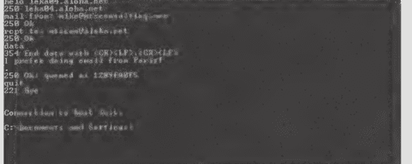
- 现在可以输入你的电子邮件地址，该地址会显示在收件人的“发件人”字段中。你可以输入虚假地址（如图2-3所示，这就是他人能够伪造电子邮件的原因），但本活动请输入你的正确电子邮件地址。输入**mail from: YourMailAccount**，然后按**Enter**。
- 你应该会收到“250 OK”消息。现在可以输入收件人的电子邮件地址（你也可以给自己发送消息）。输入**rcpt to: RecipientMailAccount**，然后按**Enter**。
- 收到“Recipient OK”消息后，你就可以开始创建邮件了。输入**data**并按**Enter**。输入你的邮件内容，按**Enter**，然后输入一个英文句点以结束邮件。你应该会收到邮件已入队的消息。
**提示** 如果出现输入错误，你必须重新输入所有命令。按Backspace键或使用方向键无效。
- 要结束Telnet会话，输入**quit**并按**Enter**。会显示邮件服务器发来的“Bye”消息，随后你会看到图2-3所示的“Connection to host lost”消息。
- 退出命令提示符窗口，关闭所有已打开的窗口。

##### 活动2-3：连接到110端口（邮局协议3，POP3）
**所需时间：** 30分钟
**目标：** 使用Telnet命令访问你邮件服务器的110端口，登录并检索已发送到你电子邮件账户的邮件。
**描述：** POP3服务使用110端口。在本活动中，你将从运行Windows XP专业版的计算机Telnet连接到教室的邮件服务器。如果教室没有配置邮件服务器，请连接你互联网服务提供商的邮件服务器，检索已发送到你邮箱的邮件。
- 打开命令提示符窗口（如有需要，可参考活动2-2的步骤1）。
- 输入**telnet RemoteMailServer 110**（将*RemoteMailServer*替换为你自己的服务器名称），然后按**Enter**。
- 收到+OK消息（见图2-4）后，你必须输入允许你登录到账户的user命令。输入**user YourMailAccount**，然后按**Enter**。
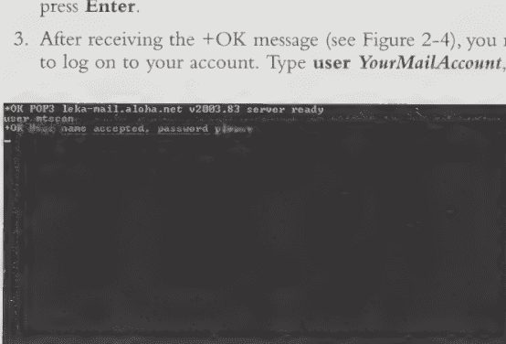
**图2-4** 登录电子邮件服务器
- 接下来会提示你输入密码。输入**YourPassword**，然后按**Enter**。
- 通过邮件服务器认证后，你会收到类似图2-5的消息，显示你邮箱中的邮件数量。要列出所有邮件，输入**list**并按**Enter**。

**图2-5** 查看邮箱中的电子邮件
- 要检索特定邮件，需使用Retr命令加邮件编号。例如要检索第1封邮件，输入`retr 1`并按Enter（见图2-6）。
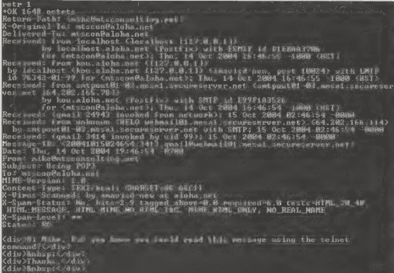
**图2-6** 检索电子邮件
- 要查看Windows XP系统上的开放端口，可以使用Netstat命令。图2-7显示了运行Netstat时多个端口开放的结果。打开另一个命令提示符窗口，输入`netstat`并按Enter。
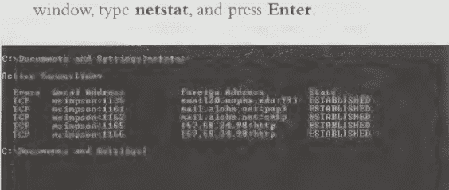
**图2-7** 使用Netstat命令查看开放端口
- 如果结果显示没有活动的开放端口，请最小化命令提示符窗口，启动网页浏览器。
- 连接到任意网站。最大化命令提示符窗口，再次输入**netstat**并按**Enter**。注意新增的条目，显示80端口（超文本传输协议，HTTP）现在正在被使用。
- 要退出Telnet会话，输入**quit**并按**Enter**。
- 关闭命令提示符窗口和所有其他已打开的窗口。

### 用户数据报协议（UDP）
**用户数据报协议（UDP）** 是一种快速但不可靠的交付协议，同样运行在传输层。试想你涉足邮件快递业务，却宣传你的服务“快速但不可靠”，恐怕很难卖出。不过UDP因速度优势在互联网上被广泛使用。UDP无需验证接收方是否正在监听或已准备好接收数据包，发送方并不关心这一点——只要接收方没准备好接收数据包，它仍然会直接发送。现在知道它为什么更快了吧？部分使用UDP的应用程序（比如电子邮件程序）有内置工具可以警告收件人邮件无法送达，但UDP本身没有。换句话说，这类问题依赖TCP/IP栈的更高层来处理。可以把UDP想象成用扩音器广播“当天下午学校停课”的人，部分幸运的学生会听到这条消息，部分则不会。这种类型的交付协议被称为**无连接**。

### 互联网层
TCP/IP栈的互联网层负责将数据包路由到目的地址，这是通过使用称为IP地址的逻辑地址实现的。和UDP一样，IP地址的数据包交付也是无连接的。IP编址会在“IP编址”部分详细介绍，但首先我们先看看互联网层的另一个协议。

#### 互联网控制消息协议
**互联网控制消息协议（ICMP）** 用于发送与网络操作相关的消息。例如，如果数据包无法到达目的地，你可能会看到“目的不可达”错误。ICMP让网络专业人员能够排查网络连接问题（使用Ping命令），并跟踪数据包从源IP地址到目的IP地址的传输路径（使用Traceroute命令）。安全专业人员可以使用ICMP类型代码（见表2-2）阻止ICMP数据包进入或离开网络。例如，可以配置路由器不允许类型代码为8的ICMP数据包进入网络。尝试ping *www.microsoft.com*看看会发生什么。微软不允许其IP地址被ping，对应类型代码8（回显请求）。
> 要了解ICMP的更详细说明，请参阅RFC-792。

**表2-2 ICMP类型代码**
| ICMP类型代码 | 描述 |
| --- | --- |
| 0 | 回显应答 |
| 3 | 目的不可达 |
| 4 | 源抑制 |
| 5 | 重定向 |
| 6 | 备用主机地址 |
| 8 | 回显请求 |
| 9 | 路由器通告 |
| 10 | 路由器请求 |

##### 表2-2 ICMP类型码（续）
| ICMP类型码 | 说明 |
 |---|---|
 | 11 | 超时 |
 | 12 | 参数问题 |
 | 13 | 时间戳 |
 | 14 | 时间戳回复 |
 | 15 | 信息请求 |
 | 16 | 信息回复 |
 | 17 | 地址掩码请求 |
 | 18 | 地址掩码回复 |
 | 19 | 保留（用于安全） |
 | 20–29 | 保留（用于鲁棒性实验） |
 | 30 | 路由跟踪 |
 | 31 | 数据报转换错误 |
 | 32 | 移动主机重定向 |
 | 33 | IPv6你在哪里 |
 | 34 | IPv6我在这里 |
 | 35 | 移动注册请求 |
 | 36 | 移动注册回复 |
 | 37 | 域名请求 |
 | 38 | 域名回复 |
 | 39 | 跳过 |
 | 40 | Photuris |
 | 41–255 | 保留 |

#### IP寻址
IP地址由四个字节组成，分为两部分：网络地址和主机地址。根据第一个字节的起始十进制数，可以将IP地址分为A类、B类或C类，如表2-3所示。

##### 表2-3 TCP/IP地址类
| 地址类 | 范围 | 网络地址字节数 | 网络数量 | 主机字节数 | 主机数量 |
 |---|---|---|---|---|---|
 | A类 | 1–127 | 1 | 127 | 3 | 16,777,214 |
 | B类 | 128–191 | 2 | 16,128 | 2 | 65,534 |
 | C类 | 192–223 | 3 | 2,097,152 | 1 | 254 |

D类和E类地址分别用于多播和实验寻址，本章不做讨论。从表2-3可以确定，例如IP地址为193.1.2.3的用户使用的是C类地址，IP地址为9.1.2.3的用户使用的是A类地址。

IP地址由四个字节（即八位组）组成。一个八位组等于8个比特，也就是1字节，因此你有时会看到IP地址被定义为四个八位组而非四个字节。以下列表介绍各类地址的详情：
- **A类**——A类地址的第一个字节保留用作网络地址，剩余三个字节可用于分配给主机。由于A类地址的主机地址占三个八位组，因此A类网络可支持超过1600万台主机。（有关如何确定网络可支持主机数的更多信息，请参阅下一节“回顾二进制数制”。）A类互联网地址数量有限，因此这类地址仅保留给大型企业和政府使用。A类地址的格式为*network.node.node.node*。
- **B类**——这类地址平均分为两部分：两个八位组的网络地址和两个八位组的主机地址，每个B类网络地址可支持超过65000台主机。大型组织和互联网服务提供商通常会被分配B类互联网地址。B类地址的格式为*network.network.node.node*。
- **C类**——这类地址的网络地址占三个八位组，主机地址占一个八位组，因此共有超过200万个C类互联网地址。每个C类地址最多可支持254台主机。这类地址通常可供小型企业和家庭使用。C类地址的格式为*network.network.network.node*。

除了唯一的网络地址外，每个网络都必须分配子网掩码，用于区分网络地址位和主机地址位。作为网络安全专业人员，你需要理解子网划分，相关内容会在Network+认证课程中讲解。许多实用工具会基于IP地址和子网信息返回数据，因此透彻理解这些概念非常重要。此外，在进行渗透测试时，你可能需要确定特定网段上有哪些主机，因此如果你不熟悉子网划分或识别网络是否被子网划分，务必复习这部分内容。

##### 规划IP地址分配
分配IP地址时，企业需要为每个由路由器分隔的网段分配唯一的网络地址。例如，假设某企业获得了两个IP地址：193.145.85.0和193.145.86.0。查看这两个地址的第一个字节，企业确定它们都是C类地址。使用默认子网掩码255.255.255.0时，每个网段可分配254个主机地址。该计算使用的公式为2^x - 2。在本例中，x等于8，因为第四个八位组包含8个比特：2^8 - 2 = 254。公式中需要减去2，是因为IP地址的网络部分和主机部分不能全为1或全为0。注意，不能给网络用户分配IP地址192.168.8.0。此外，也不能给用户分配192.168.8.255地址，因为该地址的主机部分会全为1；该地址保留作为网段192.168.8.0上所有节点的广播地址。

要访问其他网络上的实体和服务，每台计算机还需要拥有其网关的IP地址。在向另一台计算机发送数据包前，TCP/IP网际层会使用你计算机的子网掩码确定目标计算机的网络地址。如果该地址与发送计算机的网络地址不同，发送计算机就会将数据包中继到网关参数中指定的IP地址。随后网关计算机会将数据包转发到下一个目的地。通过这种方式，数据包最终会到达目标计算机。

例如，如果一台Linux服务器的IP地址是192.168.8.2，子网掩码为255.255.255.0，而用户使用的计算机IP地址为192.168.9.200，子网掩码也为255.255.255.0，那么企业必须配置默认网关地址。默认网关会将用户引导至路由器，再由路由器将用户路由到不同的网段。如果用户计算机上没有配置默认网关，且该用户尝试使用Ping命令联系服务器，就会收到“目标不可达”消息（见表2-2）。用户的计算机无法连接到另一台主机——位于不同网段上的Linux服务器，因为没有路由器为其转发。路由器的作用是接收那些不在同一网段上的数据包，并将其发送到目的地。作为网络安全专业人员，在对网络（尤其是被子网划分的网络）进行渗透测试前，你必须理解这些基础网络概念。

在子网划分后的网络中，很容易将广播地址误认为是有效主机地址，这是一个严重的错误：若将数千个数据包发送到网络上所有主机而非你试图联系的那台主机，就可能引发拒绝服务攻击。

###### 数制概述
作为安全专业人员，数制知识也会派上用场。以下部分将快速回顾二进制、八进制和十六进制数制。

####### 回顾二进制数制
小学阶段你就学过十进制数学，尽管当时你可能没意识到这一点。例如，当你看到数字3742时，你会很快认出它是三千七百四十二。按照如下行所示将每个数字放到对应的列中，就能看出每个数字具有不同的值和量级。该数制以10为基数，从右向左，每列的数字乘以从0开始的指位数。十进制的有效数字是0到9，也就是说每列可以包含0到9之间的任意数字。
``` 1000 100 10 1 10^3 10^2 10^1 10^0 3 7 4 2 ```
如你所见，3742是通过将3乘以1000、7乘以100、4乘以10、2乘以1，再将结果相加得到的。

二进制数制则以2为基数。每个二进制数位（即比特）由1或0表示。比特通常以8个为一组，因为一个字节包含8个比特。计算机工程师选择了这种数制，是因为逻辑芯片基于真/假、开/关等状态做出二进制判断。例如，使用8个比特，程序员可以表示显卡的256种不同颜色。（2的8次方，即2^8，等于256。）因此，黑色可以用00000000表示，白色可以用11111111表示，以此类推。

另一个使用二进制数制的例子是用户文件权限：r（读取）、w（写入）、x（执行）。1表示拥有该权限，0表示删除该权限。因此，111（rwx）表示拥有所有权限，101（r-x）表示用户可以读取和执行文件，但不能写入。（-符号表示未授予该权限。）熟悉UNIX的人会识别出这种数制。为了简化操作，UNIX允许使用二进制数的十进制等效值。因此二进制数111对应的十进制数是7，二进制数101对应的十进制数是5。是不是有点困惑？几分钟后你就能成为二进制专家，坚持下去就好。

为了简化二进制数的概念，你可以想象一个有两盏电灯开关的房间，思考一下这些开关有多少种不同的位置组合。例如，两个开关都可以关闭，开关1关闭而开关2打开，等等。这些开关位置的二进制表示如下：
``` 0 0 (off, off) 0 1 (off, on) 1 0 (on, off) 1 1 (on, on) ```
两个开关共有4种可能的状态，即2的x次方；其中x代表可用开关（比特）的数量。对于这两个电灯开关来说，x等于2。

####### 确定二进制值的示例
现在你已经了解了基本概念，接下来可以看看如何用比特表示二进制数。不过首先，你需要学习和记忆二进制数的各位权值，就像你之前学习十进制那样：
``` 128 64 32 16 8 4 2 1 ```

从右到左，这些数字代表递增的2的幂。请利用前面的列，尝试计算一个示例二进制数的值：
``` 128 64 32 16 8 4 2 1 2^7 2^6 2^5 2^4 2^3 2^2 2^1 2^0 0 1 0 0 0 0 0 1 ```
前例中的字节代表十进制数65。你可以通过将包含1的每一列的值相加来计算这个结果（64 + 1）。
再尝试另一个示例：
``` 128 64 32 16 8 4 2 1 2^7 2^6 2^5 2^4 2^3 2^2 2^1 2^0 1 1 0 0 0 0 0 1 ```
要将二进制数转换为十进制（基数为10），只需将包含1的列的值相加：
``` 128 + 64 + 1 = 193 ```
将这些列的值相加可能比较繁琐，但在接下来的内容中，你会学到一些实用技巧，帮助你快速将二进制转换为十进制。不过，在完成本章剩余示例之前，请务必熟记每个二进制列对应的值。

###### 理解半字节（Nibble）
心理学研究发现，人们很难记住7位及以上的数字。这就是电话号码只有7位，且前3位数字后会加一个连字符的原因：这个连字符能让你的大脑在继续记忆后续4位数字前获得短暂的停顿。
以下示例展示了如何将低位半字节转换为十进制数。在学习这些示例时，请注意二进制数之间的规律：
``` 0000 = 0 0001 = 1 0010 = 2 0011 = 3 0100 = 4 0101 = 5 0110 = 6 0111 = 7 1000 = 8 1001 = 9 1010 = 10 1011 = 11 1100 = 12 1101 = 13 1110 = 14 1111 = 15 ```
用4个低位能表示的最大十进制数是15。如果可能的话，你应该熟记这些数字，尤其是有便捷记忆技巧的那些。
例如，1010等于十进制数10，只需记住口诀「 silly，就是10！」即可。1011的记忆同样简单：「不是10，是11」。
你可以自己编创记忆技巧，但就算忘了，也总能通过直接相加各列的值来计算。
你也可以在开车上班时用车牌号练习将十进制数转换为二进制数。例如，如果车牌号末三位是742，你应该在脑海中对应出0111、0100、0010。（练习几天后，你就可以省略前面的零了。）
当你熟练掌握低位半字节，能够快速识别4位二进制序列后，就可以学习高位部分了。例如，二进制数1010 1010转换为十进制是多少？低位部分1010可以快速转换为十进制数10，高位部分同样是10，但它是10乘以16，也就是160。如果你感到困惑，也可以直接相加各列的值：
``` 128 + 32 = 160 ```
高位半字节的任意值都要乘以16。例如，二进制数0010 0000等于32。你可以把半字节的值2乘以16，但在这个例子中，直接识别出32对应列上的1会更简单，结果就是32。
你应该熟记以下高位半字节的值，这对子网划分很有帮助。从子网划分的基础知识中你应该还记得，128、192、224等数值会被用作子网掩码：
``` 1000 = 128 1100 = 192 1110 = 224 1111 = 240 ```
如果你认出1111 0000是240，那么二进制数1111 1000计算为248就会很简单。同理，二进制数1111 1111等于十进制255，也就是240+15，这是8位二进制能表示的最大数值。
> 为了帮你正确转换数值，请注意所有奇数的低位都是开启的。例如，1001不可能是10或8这样的偶数，因为它的低位是开启的。你也可以推断出这个数比8大，因为8对应列的位是开启的。同理，你可以判断0101转换后的十进制数小于8，因为8对应列没有开启，同时又能确定它是奇数，因为低位是开启的。
> 还有其他记忆和拆解二进制数的简便方法。例如，注意1010是10，而0101转换为十进制是10的一半：5。这两个数在二进制中是镜像关系，在十进制中其中一个数是另一个的一半。同理，1110等于14，0111等于7。在高位半字节中，1110等于224，高位半字节中的0111等于112（是224的一半）。这个技巧能帮你快速转换二进制数。例如，二进制数0101 1010等于90：其中高位半字节转换为80（因为1010对应160，而0101是1010的一半），低位半字节转换为10，二者相加就能快速得到最终结果90。

###### 复习八进制计数系统
八进制数由0到7的单个数字表示。八进制是基数为8的计数系统，使用8个符号：0、1、2、3、4、5、6、7。
既然你现在已经精通二进制，就容易理解二进制如何转换为八进制了。因为八进制中最大的数字是7，所以1位八进制数仅需要用3位二进制来表示。数字7的二进制写法是00000111，如果省略前导零就是111。八进制数5的等价二进制数就是101。
为了理解这个概念和网络安全的关系，我们来看看UNIX权限。八进制计数被用于表示目录或文件的以下权限：所有者权限、用户组权限、其他用户权限。
对于目录来说，(rwxrwxrwx)表示目录所有者、用户组成员以及其他所有用户都拥有该目录的读、写、执行权限。
因为每个权限类别有3种独立权限，且每种权限可以用真/假（开启/关闭）表示，所以会用到3位二进制。你不需要用满8位，3位（对应rwx）就足够了。回顾二进制计数的知识，0也算作一个数值，因此3位二进制一共有8种可能的组合：000、001、010、011、100、101、110、111。
用八进制表示的话，001代表授予了执行（x）权限，010代表授予了写（w）权限，但没有读和执行权限，以此类推。
八进制数7代表全1（也就是111，即1+2+4）。因此类*NIX系统中，777（对应的二进制是111 111 111）表示所有者、用户组和其他用户都对文件或文件夹拥有全部（rwx）权限。

###### 复习十六进制计数系统
十六进制数由两个字符表示，每个字符对应一个半字节。十六进制是基数为16的计数系统，有效数值范围是0到15。和基数为2的二进制一样，十六进制的指数也从0开始，从右到左递增：
| 16³（4096） | 16²（256） | 16¹（16） | 16⁰（1） |
|------------|-----------|----------|---------|
| A | 0 | C | 1 |
幸运的是，十六进制中你只需要熟记最后两列：1和16。从前面的示例可以看出，十六进制值包含字母——有效十六进制数的范围是0到15，十六进制通过使用字母解决了在单个位置上表示两位数的问题。
例如，A代表数字10，B代表11，C代表12，D代表13，E代表14，F代表15。
十六进制数有时会在前面加上「0x」前缀。例如，0x10等于十进制数16。和十进制、二进制数的计算方式一样，你要将每一列的值乘以该列的位值，来计算十六进制数的值。
在前面的示例中，你只需要将1乘以16就能得到16。要将十六进制数转换为二进制，你要从左到右写出每个半字节对应的二进制值。例如，0x10的二进制是0001 0000，0x24的二进制是0010 0100。


###### 活动2-4：二进制与八进制计数练习
###### 所需时间 30分钟
####### 目标 运用二进制和八进制计数技能配置类*NIX系统的目录与文件权限。
####### 说明 作为网络安全专业人员，你需要理解不同的计数系统。例如，如果你从事路由器相关的工作，可能需要创建访问控制列表（ACL）来过滤入站和出站网络流量。大多数ACL都需要掌握二进制计数知识；同理，如果你要对Linux系统进行安全加固，对二进制的理解能帮你设置正确的umask和权限。
UNIX系统使用基数为8的八进制数来设置目录和文件权限。你不需要在计算机上完成这个活动，用纸笔即可。
1. 写出以下二进制数对应的八进制数：100、111、101、011、010。
2. 写出类*NIX系统中所有者权限r-x的二进制表示。（「-」符号表示未授予该权限。）你计算出的二进制数对应的八进制表示是什么？（八进制数的范围是0到7。由于类*NIX系统有三组权限，三组各3位二进制数恰好可以表示所有可能的权限组合。）
3. 在二进制和八进制计数中，如何表示授予文件所有者读、写、执行权限，而其他用户没有任何权限？
4. 在二进制和八进制计数中，如何表示授予文件所有者读、写、执行权限，用户组读、写权限，其他用户读权限？
5. 在UNIX系统中，可以通过umask创建文件，umask可以修改文件或目录的默认权限。例如，目录的默认权限是八进制777。如果UNIX管理员使用八进制020的umask创建目录，这会对目录产生什么影响？（*提示：* 计算时可以用八进制基础权限减去八进制umask值。）
6. 你UNIX系统上的文件默认权限是八进制666。如果使用八进制022的umask创建文件，最终的有效权限是什么？请计算你的结果。


### 章节摘要
-   TCP/IP 是互联网上应用最广泛的通信协议。TCP/IP 协议栈由四个执行不同功能的层次组成：网络接入层、应用层、传输层和网络层。
-   应用层协议是底层协议的前端。在此层运行的协议示例有 HTTP、SMTP、Telnet 和 SNMP。
-   负责将数据封装成段，并使用 UDP 或 TCP 报头进行连接和数据转发的是传输层。TCP 是一种面向连接的协议。UDP 是一种无连接的协议。
-   TCP 段报头的关键组成部分包括 TCP 标志、初始序列号 (ISN) 以及源端口号和目标端口号。
-   TCP 端口用于标识系统上运行的服务。端口号 1 到 1023 被视为熟知端口。总共有 65,535 个可用的端口号。
-   网络层负责将数据包路由到目标地址。此层使用 IP 地址以及 ICMP 消息。IP 和 UDP 一样，是一种无连接的协议。ICMP 用于发送与网络操作相关的信息。类型代码用于标识 ICMP 消息类型，并可用于过滤网络流量。
-   IP 地址由四个字节（也称为八位字节）组成，分为两个部分：网络地址和主机地址。互联网上使用三类地址：A 类、B 类和 C 类。
-   主要使用二进制编号系统是因为逻辑芯片基于真/假、开/关进行二进制决策。二进制数由 0 或 1 表示。
-   八进制编号系统（基数为 8）使用从 0 到 7 的数字。它只使用二进制编号系统的三位，因为基数 8 中的最大数字是 7，可以用三个二进制位表示：111。
-   十进制是基数为 16 的编号系统，使用从 0 到 15 的数字。9 之后，数字 10、11、12、13、14 和 15 分别表示为 A、B、C、D、E 和 F。

### 关键术语
**ACK** —— 一个 TCP 标志，用于确认设置了 SYN-ACK 标志的 TCP 数据包。
**面向连接** —— 一种在网络上传输数据的方法，在发送数据之前需要建立会话连接。在 TCP/IP 中，此步骤通过发送 SYN 数据包来完成。
**无连接** —— 对于无连接协议，在数据传输之前不需要建立会话连接。UDP 和 IP 是无连接协议的示例。
**初始序列号 (ISN)** —— 用于跟踪节点已接收哪些数据包的编号。
**互联网号码分配机构 (IANA)** —— 负责分配 IP 地址的组织。
**互联网控制消息协议 (ICMP)** —— 用于发送信息性消息和测试网络连接性的协议。
**端口** —— 连接的逻辑组件，用于标识网络设备上运行的服务。例如，端口 110 是 POP3 邮件服务。
**协议** —— 用于通过网络基础设施传输数据的语言。
**会话劫持** —— 一种需要猜测 ISN 的网络攻击。*另见*初始序列号 (ISN)。
**SYN** —— 一个 TCP 标志，表示会话的开始。
**SYN-ACK** —— 主机对 SYN 数据包的回复。
**TCP 标志** —— TCP 报头中的六个标志是开关，可以设置为开或关以指示端口或服务的状态。
**三次握手** —— 传输层用于创建面向连接会话的方法。
**传输控制协议/互联网协议 (TCP/IP)** —— 用于通过互联网连接计算机的主要协议。
**用户数据报协议 (UDP)** —— 一种快速、不可靠的传输层协议，是无连接的。

### 复习题
1.  Netstat 命令显示远程服务器上正在使用 POP3。远程服务器最可能使用哪个端口？
    a. 端口 25
    b. 端口 110
    c. 端口 143
    d. 端口 80

2.  在 Windows XP 计算机上，可以输入什么命令来显示所有正在使用的开放端口？
    a. Netstat
    b. Ipconfig
    c. Ifconfig
    d. Nbtstat

3.  哪个协议使用 UDP？
    a. FTP
    b. Netstat
    c. Telnet
    d. TFTP

4.  哪个协议提供可靠传输并且是面向连接的？
    a. UDP
    b. IP
    c. TCP
    d. TFTP

5.  TCP 通信可以比作以下哪项？
    a. 通过扩音器进行公告
    b. 体育赛事上的扩音器
    c. 互联网流量
    d. 电话交谈

6.  以下哪些协议是无连接的？（选择所有适用项。）
    a. UDP
    b. IP
    c. TCP
    d. SPX

7.  哪个命令用于验证网络上节点的存在？
    a. Ping
    b. Ipconfig
    c. Netstat
    d. Nbtstat

8.  FTP 比 TFTP 提供了更多的安全性。对还是错？

9.  列出 TCP/IP 三次握手的三个组成部分。

10. 用于报告或信息目的的是什么协议？
    a. IGMP
    b. TCP
    c. ICMP
    d. IP

11. 列出 TCP 数据包的六个标志。

12. UDP 数据包通常比 TCP 数据包小。对还是错？

13. 除了端口 110 之外，还使用哪个端口来检索电子邮件？
    a. 端口 25
    b. 端口 143
    c. 端口 80
    d. 端口 135

14. DNS 使用哪个端口？
    a. 端口 80
    b. 端口 69
    c. 端口 25
    d. 端口 53

15. 用于登录到远程服务器、计算机或路由器的命令是什么？
    a. Ping
    b. Traceroute
    c. Telnet
    d. Netstat

16. 以下哪项*不是*有效的八进制数？
    a. 5555
    b. 4567
    c. 3482
    d. 7770

17. 初始序列号 (ISN) 是在 TCP 三次握手的哪一步设置的？
    a. 1, 2, 3
    b. 1, 3
    c. 1
    d. 1 和 2

18. Ping 命令最初使用哪个 ICMP 类型代码？
    a. 类型 0
    b. 类型 8
    c. 类型 14
    d. 类型 13

19. “目标不可达”由哪个 ICMP 类型代码指定？
    a. 类型 0
    b. 类型 14
    c. 类型 3
    d. 类型 8

20. 二进制数 1111 1111 的十六进制等效值是什么？
    a. FF
    b. 255
    c. EE
    d. DD

### 案例项目
#### 案例 2-1：确定网络上运行的服务
K. J. Williams 公司在其多个分支机构运行着多种操作系统。在进行渗透测试以确定需要纠正的漏洞之前，你必须分析公司网络上当前运行的服务。安全团队成员 Steven Schoen 精通计算机编程和数据库设计，但在网络概念方面比较薄弱，他希望获得有关 K. J. Williams 公司网络拓扑的简要介绍。给 Steven 写一份备忘录，总结大多数网络上可能运行的端口号和服务。备忘录应讨论熟知端口的概念，并简要描述最常用的端口：20、21、23、25、53 和 110。

#### 案例 2-2：调查可能的电子邮件欺诈
K. J. Williams 公司的副总裁说他收到了来自 Maui 分支机构一名员工的恶意电子邮件。人力资源部已告知他邮件内容足以构成解雇理由，但副总裁想知道该员工是否确实发送了该邮件。当被质询时，该员工声称他从未发送过该邮件，并不明白为什么邮件显示是他的回复地址。给副总裁写一份备忘录，概述员工可能采取的步骤，以创建恶意电子邮件并使其看起来像是来自无辜员工的账户。确保包括罪犯可能使用的一些 SMTP 命令。

## 第三章 网络和计算机攻击
阅读本章并完成练习后，你将能够：
-   描述不同类型的恶意软件
-   描述防范恶意软件攻击的方法
-   描述网络攻击的类型
-   识别物理安全攻击和漏洞

作为网络安全专业人员，你需要了解入侵者可能对你的网络发起的攻击。攻击是指未经授权的用户尝试访问网络资源或系统的任何行为。为此，你必须对网络安全和计算机安全有很好的理解。网络安全涉及保护网络基础设施。然而，网络安全专业人员也必须关注保护独立系统。因此，计算机安全对于保护那些不属于网络基础设施、但仍包含公司认为重要或机密信息的计算机和笔记本电脑是必要的。在许多情况下，保护措施涉及检查物理安全问题，直至检查门锁，并评估缺乏物理安全带来的风险。本章为你奠定了坚实的基础，了解攻击者正在做什么。就像执法人员必须了解犯罪分子使用的方法一样，你必须理解计算机攻击者的企图。拒绝服务攻击如何被用来关闭公司？蠕虫和病毒如何被引入公司的核心数据库？笔记本电脑或台式电脑被带离办公室，而入侵者被抓住或阻止的风险很小吗？在本章中，你将了解攻击方法和保护措施的概述。为了理解物理安全的重要性，你还将了解到一个不道德的内部员工可以在几秒钟内撬开门锁。


### 恶意软件（Malware）
许多网络攻击都是旨在阻止企业运营的恶意攻击。**恶意软件**是指病毒、蠕虫、木马程序等为达成上述目的而被植入网络的恶意程序，其目标是破坏或损坏数据，或是瘫痪网络与计算机系统。以下章节将介绍攻击者使用的不同类型的恶意软件。

#### 病毒
**病毒**是一种会依附于可执行文件或应用程序的计算机程序。它通常通过附着在电子邮件中的可执行程序实现自我复制。关键词是“依附”：病毒无法独立存在，没有宿主程序便既不能自我复制也无法运行。病毒会像流感病毒依附于生物宿主一样，依附于宿主程序。无论你作为安全专业人员的技术多么精湛，如果无法阻止病毒植入你所在组织的计算机，你都会面临严重问题。

病毒依附于 Microsoft Word 这类程序后，就会执行创建者预设的所有指令。例如，图3-1展示了一个附在.zip文件中的病毒。病毒发送者常用的伎俩是谎称附件是自己妻子的私密照片，以此诱骗缺乏警惕性的计算机用户点击并运行被感染的附件文件。

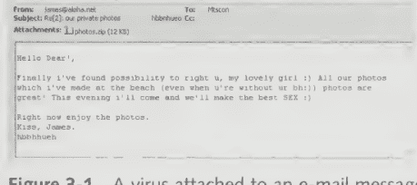

关于病毒最糟糕的消息是，目前没有万无一失的方法能阻止它们依附到你的计算机上。市面上有多种杀毒软件可供选择，但没有一款能保证绝对防护——比如五分钟前才新诞生的病毒，就不会出现在软件的病毒特征码文件中。杀毒软件会将**病毒特征码文件**与已知病毒的编程代码进行比对；如果匹配成功，程序会提示你正在安装的程序已被感染。但如果该病毒是未知病毒，杀毒软件就无法完成匹配。因此，定期更新病毒特征码文件至关重要。多数杀毒软件都支持自动更新功能，例如诺顿企业版杀毒软件允许管理员配置一台服务器，负责向组织内的客户计算机推送最新的杀毒更新。

##### 表3-1 计算机病毒
| 病毒 | 描述 |
|---|---|
| W32/Bagle.AV | 该病毒于2004年被检测到，通常以电子邮件附件的形式发送给用户，附件常命名为Price.cpl或Joke。该病毒可让远程攻击者打开你系统的后门，多数互联网服务提供商（ISP）可识别该病毒，并向邮件接收者发出潜在攻击警告。 |
| W32/MyDoom | 该病毒通过自带SMTP引擎进行邮件传播，同时会在被攻击系统中创建后门。 |
| W32/Novarg.A | 该病毒可影响所有运行Microsoft Windows系统的设备（Windows 95及更高版本均受影响）。该病毒会修改注册表，并打开3127至3198号TCP端口，便于后续远程访问计算机。 |
| W32/Mimail | 这款群发邮件型病毒通过包含名为Message.html的感染附件的.zip文件发起攻击。 |

看来不少人闲得发慌，才会花时间创作这些破坏性程序。以下是一封附带名为Price.cpl文件的邮件发送给用户时收到的警告，邮件服务商识别出该附件是潜在病毒，因此拒绝了这封邮件的发送。该消息由邮件投递软件自动生成。

你发送的邮件无法投递至一个或多个收件人。这是一个永久性错误。以下投递失败的地址：
CustomerService@MSIGroupInc.com
本邮件已被拒绝，因为它包含一个可能为可执行文件的附件"Price.cpl"。这类附件近期被某些病毒或其他恶意软件使用。如果你确实需要发送该文件，请将其打包为zip压缩包后重新发送。

```
[Message header deleted for brevity]
boundary="--------sghsfzfldbjbzqmztbdx"
----------sghsfzfldbjbzqmztbdx
Content-Type: text/html; charset="us-ascii"
Content-Transfer-Encoding: 7bit
<html><body>
:)) <br>
</body></html>
----------sghsfzfldbjbzqmztbdx
Content-Type: application/octet-stream; name="Price.cpl"
Content-Transfer-Encoding: base64
Content-Disposition: attachment; filename="Price.cpl"
TVqQAAMAAAAEAAAA//8AALgAAAAAAAAAQAAAAAAAAAAAAAAAAAAAAAAAAAAAAAAAAAAAAAAAAAAA
AAAAAAGgAAAAAAAAAAAAAAAAAAAAAAAAAAAAAAAAAAAAAAAA4fu4AtAnNibgBTM0hVGhpcyBwcm9ncmFtIGNhbm5vdCBi
ZSBydW4gaW4gRE9TIHZlcnNpb24uMBUqBQRbY2xyBn0hLwAAAAAA
AADiELAQUmAAwAAAAACAAAAAAAAAQBUAAAAAQAAAAIAAAAAAAAAAABAAAAAQAAAgAABAAAAAAA
AAA
[Several pages of code cut for brevity]
GWxWigppFLPigOA6Iqb3ZYDSwX1ilsV7d6oVtvKiyKmr4PDWUmgExWU6U0IHF6MK1Q
pBexfKQoD6cNpr9e1by7KaodMn90ajUYh189GZ0TN1mpSHgZTXY+Ahx+NCkmcrKuwk
rAHpUVFB13SzE3uIwTQoZEU9kN6Jqsm2aMnsyrFibrBp4voRwv6diDqGfRRpPrwZK
AK8lF1dMNagmBlOzbkAzqZeKAnWDOgM7rx4WJEJhMA9PhmgRULBlwHJRNbDESZCWNB
UuWgAVvQ8Mh6RWTpNRT7t1lLaWqwF8XoKZZ4BJtxGGnYWZS3Qvoj4DEVJZvJ4Vqlpz
FVjGZFe7gINFdmEHhFKduVyiMbZqwZozp0oUqm44BwNNxDx+YEZYpVZIGd5ytoniznc
RDYI6aY14sljkIHc8uQT6yYW9EFBhFrTszSoYRJY5DJzdgtKiJfTULswC+f10GAJoT
iQZvFliarpRse0S+nQVQjF2SjKFNHjewkMQ3fbhSL4K+DxCtZDpLBWyncpWdFChbAb
QzNSOxODuPwqoJCotamiRfBAUTFNcEgaFs4MZo3OGKBUJKCEFGV5vWeVRCxHKzwY
Im2SRFN4X1EgeAEaPg5iBXhMFxqQGi4GOXYhxmW2jGiQvmGWxZQFXJcSwYMUoo8CDW
Gbbw==
```

这段晦涩的代码看起来很奇怪，因为它采用了Base 64编码。回忆第2章的内容可知，二进制（Base 2）、八进制（Base 8）和十六进制（Base 16）都是计算机常用的数制，Base 64是另一种你需要了解的编码方式，通常用于减小电子邮件附件的体积。Base 64的有效字符如下表所示：

## 第3章 网络与计算机攻击
| 字符或符号 | Base 64编码表示 |
|---|---|
| 大写字母A至Z | 0–25 |
| 小写字母a至z | 26–51 |
| 数字1至9 | 52–61 |
| + 和 / 符号 | 62, 63 |

要表示0到63共64个字符，仅需6个比特，也就是2⁶。因此字母A的二进制表示为000000，B是000001，C是000010，以此类推，Z的表示为011001。需要注意的是，这里的高位是32位列，而非8位编码下的128位列。6个比特能表示的最小数值是000000（对应0），最大数值是111111（对应63）。要将Base 64编码转换为对应的十进制数值，只需将字符序列每4个分为一组，用6个比特表示每个字符（24比特 = 6 × 4）。我们通过一个简单示例来看具体操作方法：将Base 64字符串SGFwcHkgQmlydGhkYXk=转换为十进制数值，可按以下步骤操作：

在本例中，前四个字符S、G、F、w会被转换为三个8位二进制数（24比特 = 3 × 8）。
- 将每个字母的十进制值转换为二进制：S对应十进制18，二进制为010010；G对应十进制6，二进制为000110；F对应十进制5，二进制为000101；w对应十进制48，二进制为110000。
- 将四个二进制组重写为三个8位二进制组。例如，从w的二进制等价值的最低位开始，从右向左书写得到[01]110000。方括号内的二进制数是F的二进制等价值的前两个低位，即1和0，最终组合为：01001000 01100001 01110000。
- 将二进制转换为对应的十进制值：01001000对应ASCII字符H（十进制72）；01100001对应ASCII字符a（十进制97）；01110000对应ASCII字符p（十进制112）。

对接下来四个Base 64字符cHkg重复步骤1到3，直到每个字母的Base 64编码都完成转换。（当3个字节[24比特]不足以表示整数时，会使用一个或两个等号。）这个Base 64字符串转换后的结果是什么？正确答案是“Happy Birthday”。

Base 64解码器可在实体零售店和线上平台购买。作为安全专业人员，你不需要掌握手动转换Base 64编码的方法，但了解数制在实际应用中的使用方式非常重要，而不仅仅是学术练习。对Price.cpl文件的代码运行Base 64解码器后，会得到以下可疑的程序代码：

```
This program cannot be run in DOS mode.
user32.dll
CloseHandle()
CreateFileA
GetWindowsDirectory
WriteFile
strcat
kernel32.dll
ShellExecute
shell32
KERNEL32.DLL
USER32.DLL
GetProcAddress
LoadLibrary
ExitProcess
VirtualFree
MessageBox
```

这段代码显示附件中存在可疑内容。第一行“This program cannot be run in DOS mode.”表明后续内容是一个程序，这提醒你该电子邮件附件包含一个隐藏的计算机程序。此外，代码中执行Shell程序也进一步说明Price.cpl附件具有可疑性。**Shell程序**是可执行的编程代码片段，本不应出现在电子邮件附件中。代码中对User32.dll的引用，尤其是对Kernel32.dll的引用，应当是一个明显的警示信号。由此可见，邮件服务商拒绝发送这封邮件是完全合理的。


##### 活动3-1：识别新型计算机病毒
###### 所需时间：30分钟
###### 目标：了解当前新型计算机病毒威胁
####### 说明：
作为网络安全专业人员，你必须及时跟进可能攻击你的网络基础设施的各类新型病毒。如果一台计算机被入侵，你网络中的所有计算机都可能遭遇入侵。许多防火墙无法检测到附着在可执行程序上的病毒，或是宏病毒（本节后续会介绍），因此安全专业人员需要培训用户，告知他们在计算机上安装软件（包括游戏和屏幕保护程序）的危害。请记住，防火墙不会检查网络内部的报文，因此无论你部署的防火墙防护效果如何，病毒都可能在企业内部传播。了解新型病毒的绝佳来源是互联网。
- 1. 启动Web浏览器，在“地址”文本框中输入http://www.cert.org/advisories，然后按下Enter键。
- 2. 在“公告”页面，从列表中选择一个条目。你选中的病毒或蠕虫会影响哪些操作系统？
- 3. 简要描述你选中的病毒或蠕虫，以及清除该病毒/蠕虫、避免感染的方法。
- 4. 在你的Web浏览器中输入www.symantec.com，然后按下Enter键。
- 5. 在赛门铁克主页，点击“最新威胁”链接。
- 6. 列出该页面显示的五种最新的病毒或蠕虫。
- 7. 选择你在第6步列出的病毒或蠕虫之一，简要描述其技术细节。是否有清除该病毒/蠕虫的解决方案？如果有，具体是什么？
- 8. 关闭你的Web浏览器。

> 安全速递
> > 安全专业人员有大量资源可以查找当前漏洞或潜在网络攻击的相关信息。有许多出色的网站可供你了解操作系统和应用软件的漏洞。任何安全专业人员的浏览器中都应当收藏米特公司的通用漏洞与披露站点：www.cve.mitre.org。其他实用网站包括：www.osvdb.org/、www.packetstormsecurity.com/、http://archives.neohapsis.com/、www.neworder.box.sk/、www.securityfocus.com/search、微软安全公告页面www.microsoft.com/security/bulletins/default.mspx、www.kb.cert.org/vuls，当然还有www.google.com。通过识别客户的操作系统和应用的所有相关漏洞，你就能在进行安全测试时确定针对该网络应使用哪种类型的攻击。你还可能发现与不同操作系统相关的漏洞，这些漏洞可被用来入侵你客户的操作系统。记住要打破思维定式。安全测试不仅仅是熟记工具和规则，它高度依赖创造力和想象力。
> 
> **注意**
> > 目前计算机安全领域没有标准的术语定义。因此，安全专业人员有时会互换使用“漏洞”和“暴露”这两个术语。本书为求简洁，将这两个术语广义地理解为防护流程中的缺陷，未经授权的人员可能会利用此类缺陷。撰写网络安全类书籍的一大难点是专业人员使用的术语各不相同。开放源安全测试方法学手册（OSSTMM）试图解决这个问题，但在所有专业组织都采用统一标准之前，术语模糊的问题仍将普遍存在。
> 
> 以下摘录自网站*http://web.textfiles.com/virus/mactut.txt*：
> > 
> > 连接至此类网站可能存在风险。访问提供黑客工具或病毒制作信息的网站时存在风险。这些网站中的许多都包含特洛伊木马程序和病毒，可能会入侵你的计算机。
> > 
> > ```legalese
> > -------
> > I SHALL NOT BE HELD RESPONSIBLE FOR ANY DAMAGE CREATED BE IT DIRECT OR INDIRECT USE OF THE PUBLISHED MATERIAL. THIS DOCUMENT IS COPYRIGHT 1996 TO ME, DARK NIGHT OF VBB. HEREWITH I GRANT ANYBODY LICENSE TO REDISTRIBUTE THIS DOCUMENT AS LONG AS IT IS KEPT IN WHOLE AND MY COPYRIGHT NOTICE IS NOT REMOVED. SO IF I FIND ANY LAMERS WHO JUST TAKE THE CODE PUBLISHED HERE AND SAY IT IS THEIR OWN I WILL SEE THAT THEY'LL BE PUNISHED.(BELIEVE IT OR NOT :-)))!!!
> > ```
> > 
> > ```introduction
> > ----------
> > MANY OF YOU MAY BE WONDERING RIGHT NOW WHO I AM AND WHO VBB IS. COME ON LAMERS! GET ALIVE. VBB IS ONE OF THE COOLEST VIRUS GROUPS AROUND. YOU CAN'T TELL ME YOU'VE NEVER HEARD OF US. WELL, OK I'LL ADMIT IT. WE'RE NOT THAT POPULAR YET, BUT THAT'LL COME. SO FOR NOW HERE'S MY CONTRIBUTION TO THE GROUP AS THE LEADER. WELCOME TO THE MACRO VIRUS WRITING TUTORIAL PART 1! ENJOY!!
> > ```
> > 
> > ```tools
> > ---------
> > FIRST OF ALL YOU'LL NEED MS WORD 6.0 OR UP (DUH), THEN YOU MAY WANT TO GET VBB'S MACRO DISASSEMBLER BY AURODEPH SO THAT YOU CAN STUDY ENCRYPTED MACROS. ALSO YOU SHOULD MAKE BACK-UPS OF YOUR NORMAL.DOT TEMPLATE IN YOUR WINWORD6\TEMPLATE\ DIRECTORY, AS THIS IS THE DOCUMENT COMMONLY INFECTED BY MACRO VIRUSES. SO WATCH OUT. ALSO I RECOMMEND TO HAVE AT LEAST A SMALL KNOWLEDGE OF WORD BASIC, SO THAT YOU KIND OF KNOW WHAT'S GOING ON. WELL, THAT'S IT. YOU'VE MADE IT THIS FAR. IT'S NOW TIME TO GET INTO THE MACRO VIRUS GENERALS . . .
> > ```
> 
其余内容因篇幅限制已被删除。不过你可以发现，查找宏病毒制作相关信息是再容易不过的事。

## 第3章 网络与计算机攻击
#### 宏病毒
**宏病毒**是一种以宏的形式编码的计算机病毒，存在于支持宏语言（例如Visual Basic for Applications，简称VBA）的程序中。例如，你可以在Microsoft Word中编写一个本质上是命令列表的宏，实现高亮显示文档内容（Ctrl+A）、复制选中数据（Ctrl+C）、再将信息粘贴到文档其他位置（Ctrl+V）的功能。然而，用于打开和关闭文件的宏语言命令可能被用于破坏性用途。这些命令可以被设置为在数据文件被打开或点击时自动运行，例如电子邮件附件中的宏就是如此。最臭名昭著的宏病毒是1999年出现的“梅丽莎”（Melissa）病毒。该病毒会在用户打开受感染的文档后被激活，随后会向该受感染计算机通讯录中查找到的前50个联系人发送电子邮件。在过去，病毒由计算机程序员创建，他们将编写破坏性程序视为一种具有挑战性的乐趣。如今，甚至非程序员也能轻松创建宏病毒。事实上，任何能接入互联网的人都可以访问大量网站，学习如何一步步制作宏病毒。这进一步增加了你作为安全专业人员需要应对的问题。站在计算机犯罪分子的角度思考会很有帮助。你必须像恶意攻击者一样思考，像FBI侧写师一样，洞悉计算机犯罪分子的扭曲心理。一个很好的切入点就是访问病毒创作者的网站，看看他们有怎样的观点。例如，在*www.google.com*上搜索“宏病毒教程”就能找到大量不同的相关网站。

##### 活动3-2：识别宏病毒
###### 所需时间：30分钟
###### 目标：了解当前对计算机用户构成威胁的宏病毒
####### 说明：
许多防病毒程序会检测宏病毒，因此你需要了解如何关闭宏无需提示用户即可自动运行的功能。你也需要关注新型宏病毒的相关信息。互联网依然是最佳的参考资源。
- 1. 启动Web浏览器，在“地址”文本框中输入**http://www.google.com**，然后按下**Enter**键。
- 2. 在搜索页面，在搜索框中输入**宏病毒**。
- 3. 列出搜索返回的部分当前宏病毒威胁。
- 4. 选择你在第3步列出的宏病毒之一，使用该宏的名称搜索更多相关信息。是否有可用的修复方案？
- 5. 在搜索框中输入**宏病毒教程**，发起新的谷歌搜索并点击搜索按钮。你是否找到了带有宏病毒制作教程的网站？如果没有，尝试换用其他搜索引擎再次搜索。
- 6. 阅读你在第5步找到的网站上的教程内容。你认为制作宏病毒是困难还是简单？
- 7. 关闭你的Web浏览器。

#### 蠕虫
**蠕虫**是一种可以自我复制、传播的计算机程序，无需附着在宿主上（这与病毒不同，病毒需要附着在计算机程序或宿主上才能传播）。最臭名昭著的蠕虫是“红色代码”（Code Red，活动3-3会介绍）和“尼姆亚”（Nimda）。从理论上讲，一种会向每一个被感染的用户多次自我复制的蠕虫，可以在短时间内感染全球的所有计算机。这种情况不太可能发生，但就像许多金字塔骗局一样，我们很容易理解蠕虫是如何在整个网络乃至整个互联网上传播的。表3-2描述了一些最臭名昭著的蠕虫，这些蠕虫曾导致企业蒙受数百万美元的损失，损失源于计算机停机造成的生产力损失，以及恢复丢失数据、重装程序和操作系统、招聘或外包IT人员所耗费的时间。安全专业人员也在努力保护自动取款机（ATM）免受蠕虫攻击，例如“Slammer”蠕虫和“Nachi”蠕虫。针对自动取款机的网络攻击是全球银行业和执法机构重点关注的严重问题。


##### 表3-2 常见计算机蠕虫
| 蠕虫 | 描述 |
| :--- | :--- |
| W32.Mydoom.aK@mm | 2004年被发现，该蠕虫利用Internet Explorer的远程缓冲区溢出漏洞，通过在受攻击计算机上发现的电子邮件地址传播自身。该蠕虫还允许对受攻击计算机进行未授权访问，可感染Windows 95及更高版本系统。 |
| W32/Sasser | 2004年被发现，该蠕虫利用Windows本地安全认证子系统服务（LSASS）的缓冲区溢出漏洞，允许远程攻击者以系统权限执行代码。更多信息请参阅微软安全公告MS04-011（www.microsoft.com/security/bulletins/MS04-011/default.mspx）。 |
| W32/Sobig.F蠕虫 | 2003年被发现，该蠕虫需要用户运行附件，或在邮件程序自动打开附件时自行运行。该蠕虫会修改受攻击计算机的注册表项，尝试连接远程IP地址，并扫描计算机以获取有效电子邮件地址。 |
| MS-SQL Server蠕虫 | 2003年被发现，该蠕虫会影响微软SQL Server 2000和微软桌面引擎（MSDE） 2000。攻击一台计算机后，该蠕虫会生成数据包并发送到UDP 1434端口上的随机IP地址。如果数据包发送到的计算机同样存在该漏洞，它就会传播并感染其他计算机。 |
| Apache/mod_ssl蠕虫 | 2002年被发现，该蠕虫会影响运行Apache OpenSSL的Linux系统。该蠕虫会扫描TCP 80端口上的易受攻击系统，随后尝试通过TCP 443端口交付漏洞利用代码。如果系统确实感染了该蠕虫，它就会开始向网络中的其他系统传播该蠕虫。更多信息请访问www.kb.cert.org/vuls上的VU#102795和CA-2002-23，该网站可交叉引用www.cve.mitre.org上列出的漏洞。 |
| Slammer | 2003年被发现，该蠕虫曾被指通过感染同一网络上的数据库服务器，导致美国一家最大银行的13000多台ATM停机。 |
| Nachi | 2003年被发现，该蠕虫还通过利用Windows XP的RPC DCOM漏洞，影响多家银行的ATM。 |

##### 活动3-3：识别红色代码蠕虫
#### 所需时间：15分钟
###### 目标：研究红色代码蠕虫。
###### 描述：红色代码蠕虫曾对网络造成严重破坏。作为网络安全专业人员，你应当了解过去的攻击事件，因为历史往往会重演。
- 启动网页浏览器，在地址文本框中输入**http://www.google.com**，然后按**Enter**键。
- 在搜索页面，在搜索框中输入**Code Red**。
- 如果搜索结果未将CERT公告显示为第一个站点，请修改搜索内容，专门查找**CA-2001-19**。你在活动3-1中有机会访问过CERT网站。如果时间允许，请再次访问*www.cert.org*，了解这个专门从事互联网安全的联邦资助研究中心的相关信息。该网站是研究当前漏洞和安全警报的绝佳场所。
- 该蠕虫利用什么漏洞传播自身？
- 红色代码使用哪个端口连接受攻击的服务器？
- 该蠕虫是否篡改或破坏过任何网页？
- 针对受感染的计算机提供了哪些解决方案？
- 关闭网页浏览器。

#### 特洛伊程序
全球针对网络和家用计算机最阴险的攻击之一就是**特洛伊程序**，它们伪装成有用的计算机程序或应用程序，可在计算机上安装**后门**或**根套件**。后门或根套件是允许攻击者稍后重新获取受攻击计算机访问权限的计算机程序。根套件是在攻击后创建的，通常隐藏在操作系统工具中，几乎无法被检测到。后门程序（Back Orifice）至今仍是最常用的特洛伊程序之一。它允许攻击者完全控制受攻击的计算机，与微软Windows XP远程桌面的功能类似，不同之处在于后门程序无需用户知晓即可运行。该程序自1999年起就已存在，但现在被作为管理工具而非黑客工具进行推广。

##### 表3-3 特洛伊程序及使用端口
| 特洛伊程序 | 使用的TCP端口 |
| :--- | :--- |
| W32.Korgo.A | 13、2041和3067 |
| Backdoor.Rtkit.B | 445 |
| Backdoor.Systsec、Backdoor.Zincite.A | 1034 |
| W32.Beagle.Y@mm | 1234 |
| Trojan.Tilser | 6187 |
| Backdoor.Hacarmy.C、Backdoor.Kaitex、Backdoor.Clt、Backdoor.IRC.Flood.E、Backdoor.Spigot.C、Backdoor.IrcContact、Backdoor.DarkFtp、Backdoor.Slackbot.B | 6667 |
| Backdoor.Danton | 6969 |
| Backdoor.Nemog.C | 4661、4242、8080、4646、6565和3306 |

编写Backdoor.Slackbot.B的程序员可以通过互联网中继聊天（IRC）控制计算机，IRC使用6667端口。优质的软件或硬件防火墙很可能识别出使用陌生端口的流量，但使用通用端口的特洛伊程序（如TCP 80端口（HTTP）或UDP 53端口（DNS））更难被检测到。此外，许多家庭用户或小型企业并未使用软件或硬件防火墙。

> **安全提示**
> 市面上有许多软件防火墙产品，例如Zone Alarm、BlackIce和McAfee桌面防火墙。它们在识别端口扫描程序或试图从可疑端口发送信息的计算机方面表现出色。然而，这些程序中的许多都会提示用户允许或禁止此类流量。问题在于，许多不了解这些特洛伊程序的用户，在收到端口可疑活动警告时，会直接勾选“允许”复选框。此外，许多特洛伊程序使用标准端口进行攻击，这使得普通用户难以区分可疑活动和正常互联网流量。如果公司没有防火墙或制定相关规则/限制的企业政策，你应当对网络用户进行这些基础概念的教育。

#### 间谍软件
如果你搜索关键词“spyware”，会收到数百个链接轰炸。有些只是推销间谍软件清除工具，但有些会在用户点击对话框中询问是否应检查计算机是否存在间谍软件时，点击“是”按钮后安装间谍软件（参见图3-2）。
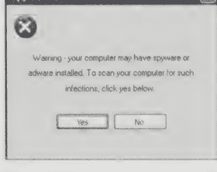
图3-2 间谍软件启动程序
间谍软件程序会将受感染计算机上的信息发送给在你的计算机上启动间谍软件程序的人。这些信息可能包括机密的财务数据、密码、PIN码——几乎是你计算机上存储的任何数据。你需要确保用户了解这种信息收集是可能的，并且间谍软件程序可以记录输入的每一次按键。就是这么简单。这类技术不仅存在，而且非常普遍。它可以记录并发送用户输入的所有内容给半个地球以外的陌生人。告诉你的用户，不要以为只要坐在门窗紧锁的办公室里，就免受入侵者的侵害。

##### 活动3-4：识别间谍软件
###### 所需时间：30分钟
###### 目标：研究流行的间谍软件程序。
###### 描述：网络安全专业人员知道，间谍软件是对企业网络最严重的恶意攻击之一。间谍软件可以通过多种方式安装在任何计算机上；最常见的方式是用户点击超链接或运行未验证真实性的程序后自动安装间谍软件。你应当了解任何新的间谍软件程序，以及可从计算机中清除间谍软件的软件。
- 启动网页浏览器，在地址文本框中输入[http://www.google.com](http://www.google.com)，然后按Enter键。
- 在搜索框中输入spyware，然后按Enter键。
- 列出部分搜索结果。
- 根据你在步骤3中列出的其中一个网站，撰写一份间谍软件描述。
- 在网页浏览器中输入[www.spywareguide.com/](www.spywareguide.com/)，然后按Enter键。
- 在主页上，点击“产品列表”链接。
- 点击你在步骤6中找到的其中一个链接，撰写一份简短的间谍软件描述。（注：列表按字母顺序排列；你可以使用方向键滚动。）
- 关闭网页浏览器。


## 第3章 网络与计算机攻击
#### 广告软件
间谍软件与**广告软件**之间的界限非常模糊。这两类程序都可以在用户未察觉其存在的情况下被安装。不过广告软件有时会弹出横幅，告知用户其存在。广告软件的主要目的是分析用户的消费习惯，以便网页浏览器向该用户推送定制化广告。广告软件最大的问题是会拖慢其运行设备的运行速度。

###### 安全小知识
网络安全始于每一位用户都了解计算机极易遭受攻击的特性。不过，就像你清楚那些在晚餐时段打来电话的不法电话营销员一样，意识到恶意软件的存在能帮助你做出更正确的判断。如果有人在电话里以99.95美元的价格向你推销塔希提的房产，还索要你的信用卡号，你肯定会拒绝。当电脑用户被提示点击“确定”按钮或安装免费电脑游戏时，也应抱有同样的警惕心。
### 防范恶意软件攻击
由于新型病毒、蠕虫和木马程序每天都在不断出现，因此保护组织免受恶意软件攻击难度较大。好在多数恶意软件都能被反病毒软件检测到。图3-3和图3-4展示了赛门铁克反病毒软件检测到远程程序试图安装病毒和木马程序的过程。对用户开展这类攻击及其他攻击的科普教育非常重要，相关内容会在本节后续部分提及。
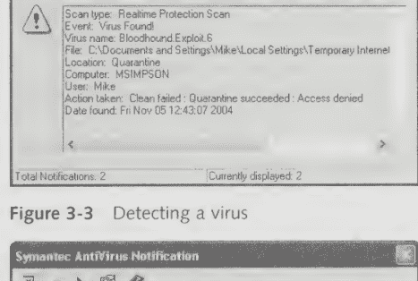
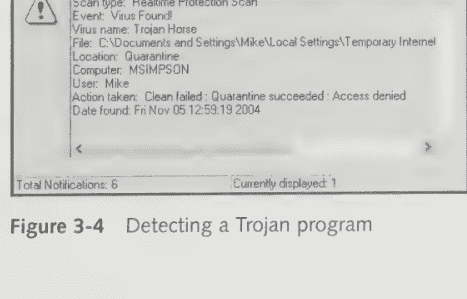
#### 对用户开展安全教育
无论你如何努力保护网络、避免恶意软件被引入，最有效的方式还是对全体员工和管理层开展体系化的安全培训。事实上，不少美国政府机构已将安全意识培训设为强制要求，许多私营企业也正在效仿这一做法。
向用户开展安全教育的简单高效方式之一是每月向全体员工发送安全更新邮件，告知他们近期在互联网上检测到的最新病毒、间谍软件和广告软件。为防止病毒被引入企业网络，你给客户提出的最重要建议是：一旦厂商发布病毒签名文件，就要立即更新。多数反病毒软件会自动完成这项操作，或在任务栏显示图标提示用户更新。组织不能仅靠员工的警惕性来保护系统，因此从企业服务器集中更新所有反病毒软件是更为稳妥的做法。
为防范间谍软件和广告软件被引入企业网络，你可能需要从互联网下载额外的专用软件。许多反病毒软件套件无法彻底解决间谍软件和广告软件问题。截至本书撰写时，最受欢迎的两款间谍软件和广告软件清除工具是SpyBot和Ad-Aware，二者均为免费软件，安装简单，可从www.pcworld.com/downloads下载。许多其他网站也提供这两款软件，但从未知网站下载任何程序时请务必保持谨慎。
你还可以通过部署防火墙来保护网络（相关内容将在第13章详细介绍）。许多头部反病毒软件公司也为未部署硬件防火墙或入侵检测系统（IDS）的家庭用户或小型企业提供软件防火墙。已部署防火墙的企业可参考多家反病毒软件官网的配置指南进行设置。
例如，W32/Sobig.F蠕虫会使用UDP 8998端口联系攻击者的服务器，封锁该端口的全部出站流量即可阻止这类攻击发生。此外，许多服务会在计算机系统中默认启动，但实际上并不需要开启。例如，普通家庭用户或小型企业主通常不会使用Telnet服务，该服务在大多数计算机上都不应保持开启状态，因为Telnet容易遭受多种外部攻击。
#### 避免使用恐吓战术
不少用户都不知道点击邮件中的图标可能会激活病毒或木马程序，也不知道他人可以远程访问自己的计算机，对此你可能会感到惊讶。因此，部分安全专业人员会使用恐吓战术，逼迫用户遵守安全措施。他们的惯用话术是：如果用户不采取特定行动，其计算机系统就会被所有能访问互联网的不法分子攻击。这种方法有时会被安全测试人员用来招揽业务，不仅不符合职业道德，也违反了《开源安全测试方法手册》（OSSTMM）的测试准则。
该准则规定：“在销售或推广安全测试服务时，不得在销售演示、网站、辅助材料、报告或安全测试相关的讨论中使用恐惧、不确定和质疑手段。相关内容包括但不限于犯罪事件、事实陈述、犯罪者或黑客画像以及统计数据。”
面对用户或潜在客户时，你的导向应当是提升其安全意识，而非制造恐慌。你应当向用户说明，切勿在办公电脑上安装未经公司核准的计算机程序，因为这类操作可能会引入恶意软件，需要引起高度重视。用户需要了解潜在威胁的存在，但不必因此感到恐惧。另外，在对用户开展培训时，务必基于他们已有的知识进行讲解。例如，部分用户熟悉Windows XP远程协助功能，或其他远程控制程序（比如PC AnyWhere）。用户对这些程序的了解能让“入侵者如何远程控制其计算机”这一问题的解释变得更容易，因为他们已经知道这类技术是真实存在的。
#### 针对网络与计算机的入侵攻击
美国联邦调查局（FBI）、中央情报局（CIA）和国际刑警组织均警示称，计算机犯罪是全球增长最快的犯罪类型。毕竟，在家舒舒服服地攻击企业网络，可比凌晨3点潜入企业实施盗窃容易得多。
针对计算机犯罪分子难以被起诉的问题，火奴鲁鲁FBI网络犯罪部门探员小阿诺德·阿努伊表示：“哪怕FBI追踪到了犯罪所使用的计算机，只要有多人曾接触过这台设备，FBI也无法逮捕涉嫌犯罪者，因为这些使用者中任何一人都有可能是真正的作案人。”
在尚未修订法律、提高此类犯罪的惩罚力度以形成有效威慑之前，安全专业人员仍将长期忙碌于相关防护工作。
> **安全小知识**
> 不久前，在夏威夷一个富裕的社区，FBI持搜查证突袭了一处安静的住宅，准备逮捕屋主并没收他的台式电脑——这台电脑被指控存储了毒品交易记录及其他罪证。当FBI人员谨慎地进入房屋前门时，他们听到后屋卧室传来一声枪响。当他们进入房间时，看到一名男子坐在床上，一支12号霰弹枪靠在紧闭的门上。他刚刚向电脑开了一枪，彻底摧毁了硬盘，导致数据无法恢复。FBI探员本可以将磁盘送到专门从事硬盘数据恢复的实验室尝试修复，但他们决定不这么做，因为他们认为从其他渠道已经获得了足够的证据。各类犯罪分子都会使用计算机实施网络犯罪，也会将其作为工具更高效地运营自己的“非法生意”。如果FBI当时雇佣安全测试人员来访问这台电脑，可能会取得更好的效果。
##### 拒绝服务攻击
顾名思义，**拒绝服务（DoS）攻击**会阻止合法用户访问网络资源。部分形式的拒绝服务攻击甚至不需要用到计算机。例如，把两张纸粘在一起故意让传真机循环发送文档，就能耗尽目标传真机的纸张，使其无法供他人使用。
在涉及计算机的拒绝服务攻击中，攻击者并不试图窃取你服务器上的信息，但可能会借此瘫痪网络，使其易受其他类型攻击的侵害。作为网络安全测试人员，你通常不会在客户的计算机上安装病毒或蠕虫程序，渗透测试人员或道德黑客几乎不会开展这类测试。同理，你需要了解拒绝服务攻击的实现原理，并尽力保护企业免受此类攻击，但亲自实施攻击是不明智的。这就好比安全顾问受雇排查安全隐患或漏洞，却去炸毁炼油厂，你只需要证明这类攻击可以被实施即可。
##### 分布式拒绝服务攻击
**分布式拒绝服务（DDoS）攻击**是指来自多台服务器或工作站的、针对同一主机的攻击。在分布式拒绝服务攻击中，网络可能会被数十亿个数据包淹没；通常情况下，每个攻击参与者仅发送占总数很小一部分的数据包。
例如，如果一台服务器向被攻击的服务器发送数百甚至数千个数据包，网络带宽就可能被占满，导致合法用户察觉到性能下降或网速变慢。现在把这种情况乘以1000台甚至10000台服务器，每台服务器都向被攻击的服务器发送数千个IP数据包，就形成了分布式拒绝服务攻击。
需要注意的是，攻击的参与者往往并不知道自己的计算机被用于参与攻击，他们自身也遭到了攻击者的侵害。事实上，在某次分布式拒绝服务攻击中，一家企业遭到了来自数千台属于雅虎公司的互联网核心路由器和Web服务器的IP数据包的持续淹没。


##### 缓冲区溢出攻击
多年来，诸多不同的操作系统上都发生过大量缓冲区溢出攻击。在**缓冲区溢出攻击**中，攻击者会在未校验固定空间使用量的劣质代码中发现漏洞。例如，如果程序定义的缓冲区大小为100MB（即程序预期使用的总内存量），且程序写入数据超过100MB的阈值时不会触发错误、也无法阻止该情况发生，就会发生缓冲区溢出。本质上，攻击者会编写溢出缓冲区的代码；这种情况之所以可能发生，是因为程序没有正确定义缓冲区容量。关键在于不能向溢出缓冲区填充无意义数据，而是要填充可执行的程序代码。这样一来，操作系统就会运行这段代码，进而执行攻击者程序的恶意操作。通常情况下，这类代码会将攻击者的权限提升至管理员级别，或赋予其与劣质程序所有者/创建者同等的权限。
###### 表3-4 缓冲区溢出漏洞
| 缓冲区溢出 | 描述 |
| --- | --- |
| Sun Microsystems Solaris X Window字体服务 | 该缓冲区溢出漏洞影响Sun Microsystems Solaris 2.5.1、2.6、7、8、9版本以及Solaris X Window字体服务系统，攻击者可利用该漏洞在内存中运行任意代码。更多信息可参考VU#312313（www.kb.cert.org/vuls） |
| Windows工作站 | 微软安全公告MS03-049（www.microsoft.com/security/bulletins/default.mspx）中提及了该缓冲区溢出漏洞，攻击者可利用该漏洞运行植入内存的任意代码 |
| 远程Sendmail | 该缓冲区溢出漏洞影响所有版本的Sendmail Pro及部分版本的Sendmail Switch，攻击者可利用该漏洞获取被攻击系统的root权限。更多详情可参考VU#398025 |
| 微软Windows信使服务 | Windows信使服务存在缓冲区溢出漏洞，攻击者可利用该漏洞运行任意代码并获取被攻击系统的权限 |
| 微软Windows帮助和支持中心 | 其用于处理人类通信协议（HCP）的代码存在缓冲区溢出漏洞，帮助和支持中心功能的该安全漏洞会影响Windows XP和Windows Server 2003，攻击者可构造特定URL，当用户访问该URL时，即可以本地计算机的安全级别运行任意代码 |
| Sendmail | 所有运行8.12.10之前版本Sendmail的系统（包括UNIX和Linux系统）都容易受到缓冲区溢出攻击，攻击者可利用该漏洞将权限提升至root用户级别 |
| 微软RPCSS服务 | 负责处理DCOM消息的RPCSS服务存在两个缓冲区溢出漏洞，该服务在多数版本的微软Windows系统中默认开启，但漏洞仅影响微软Windows 2000系统。更多信息可参考VU#483492和VU#254236 |
| 微软IE浏览器 | 运行Internet Explorer 5.01、5.50和6.01的微软系统共存在五个相关漏洞，更多信息可参考微软安全公告MS03-032 |
为程序员辩解一句，许多人并未接受过以计算机安全为核心来编写程序的培训。过去，程序开发的重点是易用性，以及生成运行速度快、尽可能少占用计算机资源的高效可执行代码。如今，行业趋势是确保程序员意识到自身代码可能存在被攻击的漏洞，但将安全漏洞检查变为标准流程仍需时日。多数高校并未开设以安全为导向的程序编写相关课程。在微软，如今编写不会在后续被曝出系统漏洞的代码的程序员会获得奖励。

###### 活动3-5：识别微软缓冲区溢出漏洞
###### 所需时间：30分钟
####### 目标：研究微软缓冲区溢出漏洞。
####### 描述：作为对客户网络进行安全测试的网络安全专业人员，你需要排查可能被利用的漏洞。发现可能影响客户网络的漏洞后，你需要整理相关发现的文档，并提出修复问题的建议。在本活动中，你将研究微软程序的缓冲区溢出漏洞，学习可向客户提供的解决方案或建议。
- 1. 启动Web浏览器，在地址栏输入**www.microsoft.com**，然后按下**Enter**键。
- 2. 在“Search Microsoft.com”搜索框中输入**MS03-041**，按下**Enter**键。
- 3. 点击**微软安全公告MS03-041**链接。
- 4. 向下滚动文档，点击展开**技术详情**选项。
- 5. 如果从被攻击工作站激活ActiveX控件的用户以管理员身份登录，作为攻击者的你会拥有什么权限？
- 6. 你会给运行Windows 2000 服务包2的客户提出什么建议？
- 7. 在微软安全公告页面的搜索框中输入**MS03-042**，按下**Enter**键。
- 8. 在搜索结果页面中，点击**微软安全公告MS03-042**链接。
- 9. 向下滚动文档，点击展开**技术详情**选项。
- 10. 哪个ActiveX控件存在缓冲区溢出漏洞？
- 11. 如果客户运行的是Windows XP，你会提出什么建议？
- 12. 关闭Web浏览器。
上一活动帮助你了解了缓冲区溢出如何被用于攻击操作系统。通常情况下，缓冲区溢出的主要目的是将代码插入被覆盖的内存区域，从而将攻击者的权限提升至被攻击用户的级别。
##### 死亡Ping攻击
**死亡Ping攻击**属于拒绝服务（DoS）攻击的一种，其常见程度远不如20世纪90年代末。攻击者只需构造一个超过最大允许值65535字节的ICMP报文（相关内容在第2章讨论）。该大报文会被分片为多个小报文，在目的地重新组装后，目的地的用户系统无法处理该重组后的超大报文，进而导致系统崩溃或卡死。
##### 会话劫持
会话劫持可使攻击者加入TCP会话，让会话双方都误以为攻击者是对方。该攻击在第2章结合初始序列号（ISN）有过简单提及，属于复杂度较高、超出本书讨论范围的内容。
##### 物理安全防护
保护网络免受攻击并不总是软件层面的问题，你也需要掌握一些基础技能，保护网络免受物理层面的攻击。无论防火墙的作用多么有效，你都必须防范组织内部人员对服务器和计算机的攻击。事实上，黑客入侵网络来自组织内部的可能性远高于外部。
> **安全快讯** 近日，在夏威夷的一处军事基地，一名司机将皮卡停在办公楼前，随后进入大楼，走进了一间空办公室。他断开了一台电脑的网络连接，将电脑搬出办公室放在皮卡的车斗里，随后驾车离开，再也没有出现过。当高层管理人员向员工询问情况时，员工们表示记得看到有人抱着电脑走出大楼，但都以为他是服务台的工作人员。物理安全的强度取决于最薄弱的环节，所有员工都需要留意工作环境中的异常情况。例如，如果发现有陌生人坐在电脑前下载文件，应先联系安保人员，再上前质问对方。员工应当保持警惕，不能仅依赖安保人员来留意异常。
##### 键盘记录器
键盘记录器是可用于捕获计算机按键输入的设备或计算机程序。软件键盘记录器的行为类似木马程序，会被植入计算机中。硬件键盘记录器是一种小型设备，长度通常不足1英寸。它通常可以在30秒内完成计算机安装：只需拔下计算机的键盘，将这个小配件插入键盘输入接口，再将键盘记录器的接口插入计算机的键盘端口即可。安装好硬件后，大多数厂商要求你打开WordPad这类文字处理程序，在空白文档中输入厂商提供的密码。输入密码后，即可看到对应的操作菜单。常见的硬件键盘记录器有KeyKatcher和KeyGhost。在图3-5中，KeyKatcher键盘记录器程序捕获了一封电子邮件中的私人消息，发件人正在告知鲍勃自己要辞职。如果你正在对系统进行安全测试、需要获取密码，键盘记录器可以作为非常有用的工具。
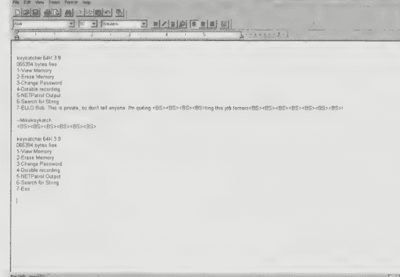
###### 图3-5 KeyKatcher捕获的电子邮件消息
大多数键盘记录器产品都会显示类似的菜单，支持启动系统捕获用户输入的按键操作。图3-6展示了KeyGhost的另一款键盘记录器产品的菜单。该产品还有更多

用于捕获数据的存储区域。两款产品在对企业进行安全测试或渗透测试时都非常实用，仅需几分钟即可完成安装和配置。这两款产品是为想要监控计算机的企业乃至家长设计的。两款产品都附带一个塑料管状罩，可以用点燃的火柴将其熔化在接口上，这样用户在进行可疑计算机活动前就无法拔掉该设备。
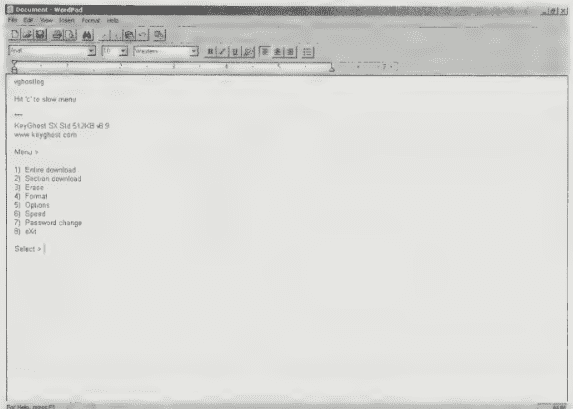
图3-6 KeyGhost菜单

不幸的是，攻击者也可以使用键盘记录器设备。不择手段的员工可以将该设备连接到管理员的计算机上，之后窃取机密信息。安装该设备确实需要本人实际操作坐在计算机前，如果管理员的办公室被锁，这可能会带来麻烦。不过如前所述，键盘记录器也有软件形式（即间谍软件），可以加载到计算机上，窃取到的信息还可以通过电子邮件发送或传输到远程位置。在对组织内的计算机进行随机目视检查时，要留意任何由非安全人员安装的、连接在键盘线上的可疑硬件。这是监测键盘记录器的简单方法。每周对计算机进行随机排查，可能会发现公司未安装的某些硬件，比如键盘记录器甚至是完整的计算机系统。

###### 锁门之后
作为安全专业人员，你需要了解用于保护公司资产的各种锁具类型。如果入侵者能够物理接触到服务器，无论服务器运行的是Linux、微软系统还是其他操作系统，你的防火墙或IDS性能再好都没有用。加密措施或公钥基础设施（PKI）的强制实施在这种情况下也毫无帮助。如果入侵者能坐在你的服务器前，他/她就能攻破它。简而言之，*锁好你的服务器*。

就像恐怖分子可以通过互联网研究学会制造炸弹一样，攻击者可以找到无数篇关于撬锁的文章。其中一篇就是自称Tool Ted的作者撰写的《MIT撬锁指南》，该文讨论了弹子锁的漏洞。撬锁的具体细节超出了本书的讨论范围，但普通人经过一两周的练习，就能在5分钟内学会撬开插芯锁。而有更多空闲时间的人，比如黑客，可以在30秒内学会撬开插芯锁。如果你负责保护有夜班员工的网络基础设施，不要以为锁上的门或柜子就能挡住有空闲时间的不择手段的员工。通常在非标准工作时间，周围员工更少，这使得员工更容易进入他们通常没有权限进入的区域。你的服务器机房应该配备公司能负担得起的最安全的锁具。不妨花时间了解一下国防部这类机构的用锁标准，在这些机构里，资源保护可能是关乎生死的问题。这类机构花费5000到10000美元购买一把锁并不罕见。需要按顺序推入带编号的横杠的旋转锁，比插芯锁更难破解。然而，这两种锁都无法记录进入锁闭房间的人员信息，因此部分企业会要求使用刷卡门禁以提升安全性。这种方式下，刷卡后持卡人即可获得准入权限，同时系统会记录进入时间。这种方式还支持一张卡开通公司内多扇门的权限，无需发放多把钥匙，也无需用户记住不同的密码组合。

> **安全快讯**
> 部分正规网站会为警察或安全专业人员提供撬锁工具和手册。你可能需要填写一些表格，但如果你打算成为安全专业人员，这么做是值得的。例如，如果你在对设有锁闭服务器机房的组织进行安全测试，且需要进入该区域，掌握撬锁技巧会很有帮助。但请记住，在进行这种级别的测试前，你必须获得管理层的书面许可。
> 
> 大多数警察都会参加培训课程学习撬锁的基础知识。订购撬锁工具时需注意，许多州或国家认为仅持有这类工具就属于犯罪。在纽约市持有入室盗窃工具属于轻罪，而在亚利桑那州则属于重罪。而夏威夷州则允许持有这类工具，只要不将其用于犯罪即可。请记住，持有某些黑客工具也是违法的。

## 第3章 网络与计算机攻击
### 本章小结
- 网络安全专业人员必须了解可能发生在网络基础设施和独立计算机上的各类攻击。
- 网络与计算机入侵攻击可能来自内部人员，也可能来自远程用户。
- 恶意软件（如病毒、蠕虫和木马程序）是针对网络或计算机发起的攻击。病毒是一种会附加到其他程序或宿主上的计算机程序。蠕虫是一种无需附加到其他程序或宿主，即可自我复制和传播的计算机程序。木马程序会伪装成有用的计算机程序或应用，可在计算机上安装后门或rootkit（入侵者后续工具集）。
- 用户可能在不知情的情况下安装间谍软件，误以为自己在安装保护计算机的软件。间谍软件可以记录用户计算机上的信息并发送给攻击者。
- 广告软件也可能在用户不知情的情况下被安装。这类软件用于分析用户的购买习惯，以便推送符合其消费偏好的网络广告，但可能会导致计算机系统运行变慢。
- 拒绝服务（DoS）攻击会阻止授权用户访问网络资源。这类攻击通常通过过度占用带宽实现。
- 分布式拒绝服务（DDoS）攻击是指来自多台服务器或计算机的对同一主机的攻击。
- 缓冲区溢出的主要目的是将可执行代码注入内存区域，从而将攻击者的权限提升至用户级别。
- 死亡之Ping攻击中，攻击者会构造一个超过最大65535字节的ICMP数据包。这会导致接收方系统崩溃或死机。如今大多数系统已不会受到该漏洞的影响。
- 在会话劫持攻击中，攻击者会接入TCP会话，使通信双方都误以为对方是攻击者。

物理安全是每个人的责任。所有桌面系统和服务器都必须受到安全保护。键盘记录器可以监测计算机系统上输入的所有内容。它们可以轻松安装在键盘连接器上，并使用文字处理器存储信息。安全人员应随机检查计算机硬件，以发现这类设备。

### 关键术语
- **广告软件** — 可在用户不知情的情况下安装的软件，其主要目的是分析用户的购买习惯。
- **攻击** — 未授权人员访问或使用网络或计算机系统资源的任何尝试。
- **后门** — 可用于日后访问计算机系统的程序。
- **缓冲区溢出攻击** — 程序员编写的利用程序，可找出编码粗糙、未检查预定义空间用量的代码漏洞，并将可执行代码写入该溢出区域。
- **计算机安全** — 不属于网络基础设施的独立计算机的安全。
- **拒绝服务（DoS）攻击** — 旨在阻止合法用户访问网络资源的攻击。
- **分布式拒绝服务（DDoS）攻击** — 来自多台服务器或工作站的、针对同一主机的攻击，旨在阻止合法用户访问网络资源。
- **键盘记录器** — 记录计算机上击键操作并存储信息供日后调取的硬件设备或软件（间谍软件）。
- **宏病毒** — 用宏编程语言（如Visual Basic应用）编写的计算机程序。
- **恶意软件** — 用于瘫痪网络、阻碍企业运营的恶意程序，如病毒、蠕虫或木马程序。
- **网络安全** — 属于网络基础设施的计算机或设备的安全。
- **死亡之Ping攻击** — 构造的超过最大65535字节的ICMP数据包，会导致接收方系统崩溃或死机。
- **rootkit** — 攻击发生后创建、供攻击者日后使用的一组工具。
- **shell** — 可执行系统命令的操作系统接口。
- **间谍软件** — 在用户不知情的情况下安装在其计算机上、可记录源计算机上的个人信息并发送到目标计算机的软件。
- **木马程序** — 伪装成合法程序或应用的计算机程序，带有隐藏载荷，可将被攻击计算机上的信息发送给创建者或世界任何地方的接收者。
- **病毒** — 会附加到应用程序或程序上的计算机程序。
- **病毒特征码文件** — 杀毒软件会将这些文件与已知病毒的编程代码进行比对，以判断你正在安装的程序是否被感染。
- **蠕虫** — 无需宿主或程序即可自我复制和传播的计算机程序。

### 复习题
1. 恶意软件的主要目的是什么？
a. 损害计算机系统
b. 窃取密码
c. 扫描开放端口
d. 识别操作系统


## 第3章 网络与计算机攻击
2. 依靠主机系统在整个网络中传播的是计算机________。
a. 蠕虫
b. 病毒
c. 程序
d. 嗅探器
3. 一种计算机漏洞利用程序，通过将可执行代码写入因代码编写不规范而未被保护的内存区域来攻击计算机系统，这类程序被称为________。
a. 缓冲区溢出
b. 木马程序
c. 病毒
d. 蠕虫
4. 下列哪种漏洞利用程序可能会将自身的破坏性载荷隐藏在合法软件应用或游戏中？
a. 木马程序
b. 宏病毒
c. 蠕虫
d. 缓冲区溢出
5. 杀毒软件应该每年更新。判断对错？
6. 下列哪种不会依附于程序，但可以自我复制？
a. 蠕虫
b. 病毒
c. 木马
d. 缓冲区溢出
7. 下列哪项是宏编程语言的示例？
a. C++
b. Windows XP
c. Visual Basic
d. Visual Basic应用程序（VBA）
8. 广告软件的目的之一是确定用户的购买习惯。判断对错？
9. 列出三种恶意软件类型。
10. 能够记录用户在文字处理文档中输入的每一次击键的软件或硬件组件被称为________。
a. 嗅探器
b. 键盘记录器
c. 木马程序
d. 缓冲区溢出
11. 列出三种以电子邮件作为攻击方式的蠕虫或病毒。
12. 死亡之ping是一种漏洞利用程序，它会向目标主机发送ICMP数据包的速度超过主机的处理能力。判断对错？
13. 哪种网络攻击依赖多台服务器参与对单一主机系统的攻击？
a. 木马攻击
b. 缓冲区溢出
c. 拒绝服务攻击
d. 分布式拒绝服务攻击
14. 哪种漏洞利用程序可以通过向计算机内存写入可执行代码来提升网络攻击者的权限？
a. 木马程序
b. 缓冲区溢出
c. 死亡之ping
d. 缓冲区差异
15. 哪种组件可以降低木马程序或根工具包（Rootkit）将受攻击计算机的信息发送到远程主机的风险？
a. Base64解码器
b. 键盘记录器
c. 远程登录（Telnet）
d. 防火墙
16. 为了降低网络遭受病毒攻击的风险，你应该采取以下哪些措施？
a. 使用杀毒软件。
b. 教育用户不要打开来自可疑电子邮件的附件。
c. 及时更新病毒特征文件。
d. 以上全部。
17. Base64编码系统使用________位来表示一个字符。
a. 4
b. 6
c. 7
d. 8
18. 一种会给攻击者留下后续入侵网络的其他途径的漏洞利用程序被称为________。
a. 根工具
b. 蠕虫
c. 后门
d. 反向根程序
19. 查找微软产品漏洞的合适起点是查阅________。
a. 黑客网站
b. 微软安全公告
c. 漏洞相关的新闻组参考资料
d. 用户手册
20. 为某一操作系统发现的漏洞利用程序可能也适用于其他操作系统。判断对错？

### 案例项目 ###
#### 案例3-1：确定数据库服务器的漏洞
你对K.J.威廉姆斯公司进行了初步安全测试后，采访了威尔逊·斯特iger。斯特iger先生是K.J.威廉姆斯公司的IT员工。他告知你，公司的人力资源数据库使用的是Oracle8i。你决定调研Oracle8i是否存在已知漏洞，以便纳入给斯特iger先生的报告中。你并不清楚斯特iger先生是否安装了补丁或软件修复程序，你只想撰写一份包含通用信息的报告。基于以上信息，请给斯特iger先生撰写一份备忘录，说明你找到的与Oracle8i相关的任何CVE（通用漏洞披露）或CAN（候选漏洞）文档。如果你确实发现了漏洞，备忘录中应包含相关建议，且行文不要引发恐惧或不安，要鼓励审慎决策。

#### 案例3-2：调查微软IIS 5.0的可能漏洞
K.J.威廉姆斯公司的Web开发人员卡雷尔·杰克逊告知你，公司的网站使用的是微软IIS 5.0。他对网站的发展方向感到自豪，并表示公司目前每周的网站访问量超过1000次。客户现在可以预订酒店客房、多个高尔夫球场的开球时间，还可以预订公司旗下多家餐厅的餐位。客户可以输入信用卡信息，并通过电子邮件收到确认信息。基于以上信息，请给杰克逊先生撰写一份备忘录，列出所有与IIS 5.0已知漏洞相关的CVE或CAN文档（如有）。如果你确实发现了漏洞，备忘录中应包含相关建议，且行文不要引发恐惧或不安，要鼓励审慎决策。

## 第4章 踩点与社会工程学
**阅读完本章并完成练习后，你将能够：**
- 使用Web工具进行踩点
- 开展竞争情报搜集
- 描述DNS区域传输
- 识别社会工程学的类型

在本章中，你将学习如何使用互联网上易得的工具了解公司网络的架构。你还将学习开展竞争情报搜集所需的技能，以及如何运用这些技能进行信息收集。在对网络执行安全测试前，你需要完成本章涵盖的绝大多数（如果不是全部）踩点任务。本章还会讲解攻击者运用社会工程学从公司核心员工处获取信息所用的策略。此外，你还会了解攻击者使用的一些没那么“光鲜”的手段——例如翻找垃圾桶、废纸篓和垃圾箱，寻找旧计算机手册、废弃磁盘及其他材料，以获取可用于入侵网络的信息。

### 使用Web工具进行踩点
在电影中，小偷在抢劫银行或盗窃珠宝前，会通过拍照、获取平面图来“踩点”。电影里的小偷通常运气足够好，还能拿到警报系统和空调通风系统的示意图。至少好莱坞是这样刻画小偷的。任何FBI探员都会告诉你，现实生活中绝大多数小偷都没这么好的运气。但那些没被抓到的聪明小偷都细致且谨慎。许多攻击者也会“踩点”，勘察目标位置，寻找安全系统的薄弱之处，确认正在使用的是何种锁具和警报系统。他们会在实施犯罪前尽可能多地收集信息。作为安全测试人员，你也必须尽可能多地了解雇佣你测试其网络安全性的组织。这样你才能向管理层告知任何存在问题的区域。在计算机术语中，查找公司网络相关信息的过程被称为**踩点**。安全测试人员（或攻击者）会尽可能多地了解该组织及其网络的信息。

表4-1 Web工具汇总
| 工具 | 功能 |
| --- | --- |
| Google网上论坛（http://groups.google.com） | 在技术或非技术新闻组的发帖中搜索电子邮件地址 |
| Whois（www.arin.net 或 www.whois.net） | 收集IP和域名信息 |
| SamSpade（www.samspade.org） | 收集IP和域名信息；有适用于UNIX和Windows操作系统的版本 |
| Google搜索引擎（www.google.com） | 搜索网站和公司数据 |
| Namedroppers（www.namedroppers.com） | 执行域名搜索；每日更新超过3000万个域名 |
| 白页（www.whitepages.com） | 执行反向电话号码查询并获取地址信息 |
| Metis（www.severus.org/sacha/metis） | 从网站收集竞争情报 |
| Dig（所有基于*NIX的系统均自带该命令；可在微软平台从http://pigtail.net/LRP/dig/ 下载） | 执行DNS区域传输；可替代Nslookup命令 |
| Host（所有基于*NIX的系统均自带该命令；Windows平台可从http://sysinternals.com/ntw2k/source/misc.shtml 下载Hostname工具） | 获取主机IP和域名信息；也可用于发起DNS区域传输 |
| Netcat（所有基于*NIX的系统均自带该命令；Windows平台可从http://atstake.com/research/tools 下载） | 通过网络向端口读写数据 |
| Wget（所有基于*NIX的系统均自带该命令；微软平台可从http://gnu.org/software/wget/wget.html 下载） | 从互联网检索HTTP、HTTPS和FTP文件 |
| Paros（www.parosproxy.org） | 捕获Web服务器信息以及网页中可能允许SQL注入、缓冲区溢出等漏洞利用的潜在漏洞 |

> 默认随*NIX系统附带的许多命令行工具并不属于Windows环境的一部分。例如，Dig、Host、Netcat和Wget命令在Windows XP计算机的命令提示符中无法运行。你可以从表4-1列出的网站下载Windows版本。安全测试人员应花时间学习在Linux或基于*NIX的系统上使用这些命令行工具。在本章中，你将使用Whois工具获取公司的线上相关信息，并使用Dig命令、SamSpade和DNS区域传输等工具确定计算机的IP地址范围和主机名。


##### 安全快讯
每年，美国国防部（DoD）雇员都需要完成安全意识培训，该培训重点强调恐怖分子或间谍可能收集未公开信息的风险。这些信息大多数美国人都能获取，通过阅读报纸、收听新闻即可获得。恐怖分子若将零散信息拼接起来，就能完整掌握国防部的行动全貌。国防部要求雇员意识到，讨论看似无关紧要的信息可能比想象中更加危险。这类信息一旦与其他信息结合，就可能对国家安全造成损害。举个例子，一名水手在餐厅遇到朋友，提到自己将出海6个月。同一天，一名国防部文职人员在餐厅午餐时提到，自己因需要采购大量补给品，不得不经常加班。正如你所见，恐怖分子只需偷听对话，就能轻松获取这两条信息。这听起来或许有些牵强，但这正是情报收集的主要方式之一。重点是，你也需要留意所有公开信息，无论是网站上的信息、电子邮件头信息，还是员工在访谈中的陈述。不幸的是，攻击者会核查网页和新闻组，查验公司IP地址，寻找IT人员发布的关于操作系统或防火墙配置的具体问题帖子。同样要牢记，在收集到一条信息后不要就此止步，要继续深挖，看看潜在攻击者还能发现什么。

#### 开展竞争情报工作
如果你想开设一家钢琴工作室，和在你社区经营多年的竞争对手争夺市场，尽可能多地了解竞争对手的信息是明智之举。如果你无法接触到对方的银行流水，怎么判断这家工作室经营状况良好呢？首先，很多企业都活不过第一年，这家工作室能经营这么多年，就证明老板的经营方式是行之有效的。其次，你可以直接把车停在工作室对面的街上，数一数学生数量，就能大致摸清客户规模。你可以通过致电工作室，或者查找报纸、传单、电话簿、广告牌等渠道的广告，轻松获知课程费用。有大量资源可以帮助你合法地尽可能多地了解竞争对手的信息，商人们多年来一直在这么做。如今，这种信息收集行为被称为**竞争情报**，借助技术手段，它的开展已经达到了更高的水平。作为安全专业人员，你应该能够向你服务的公司解释竞争对手用来收集信息的所有方法。为了限制公司公开的信息量，你需要充分了解竞争对手会采取什么手段来获取机密信息。

##### 安全快讯
仅仅因为你能获取某家公司及其员工的信息，并不意味着你应该泄露这些信息。举个例子，假设你发现某名员工正在访问约会网站或可疑新闻组。但这种活动根本不会对公司造成任何威胁，因此作为正在进行安全测试的安全专业人员，你并没有义务告知公司。根据你所在国家或地区的法律法规，隐私问题可能会影响你如何处理这种情况。如果泄露这类机密信息，安全专业人员和公司相关负责人可能被提起诉讼。

##### 分析公司网站
网络攻击往往从收集公司网站的信息开始。网站是攻击者发现组织关键信息的便捷渠道。有大量工具可用于这类信息收集工作。举个例子，Paros是一款适用于UNIX和Windows操作系统的强大工具，可免费下载（www.parosproxy.org）。使用Paros需要安装Java J2SE，该软件可从www.sun.com下载。在Windows服务器上安装完Paros后，会出现一个用于运行程序的桌面图标。
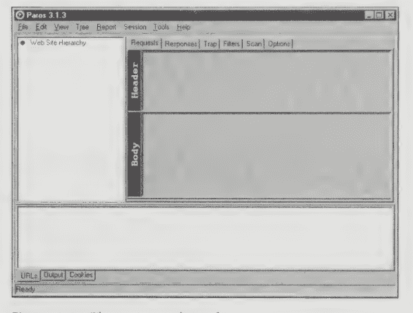
**图4-1** Paros主窗口
要使用Paros搜索网站，点击菜单中的「Tools > Spider」。输入网站URL，如图4-2所示。
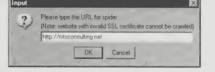
**图4-2** 在输入对话框中输入URL
几秒钟内，网站包含的所有网页的文件名就会显示出来（见图4-3）。
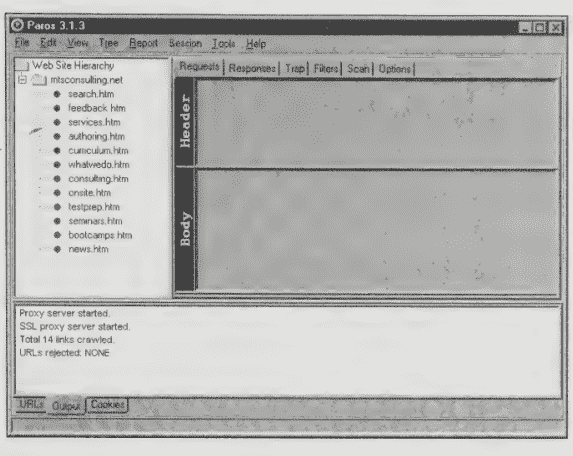
**图4-3** 显示网站所有网页的文件名
接下来，点击菜单中的「Tree > Scan All」。大约一分钟左右（取决于网站规模），你会得到一份类似图4-4的扫描报告。这份报告可以向攻击者展示网站的结构，并列出可进一步调查更多信息的网页。
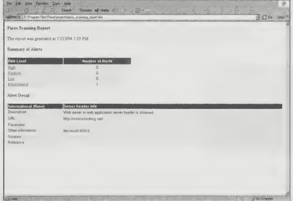
**图4-4** Paros扫描报告
正如你所见，扫描功能可以测试网站可能存在问题的区域。网站中的任何漏洞都会在「风险等级」列中标注为「高」。在本例中，风险等级被标记为「信息性」。不过，扫描结果显示了该网站使用的IIS版本，这些信息对于开展进一步调查或测试很有帮助。通过这类扫描收集竞争情报非常耗时，你发现的信息越多，就越想深挖。为这一调查阶段设置合理的时间框架非常重要，否则你可能在这项活动上花费过多时间。另一方面，你也不应急于收集信息，因为你获取的很多信息都可以用于进一步的测试和调查。下一节将介绍可用于信息收集的其他工具。

### 第4章：踩点与社会工程学

### 使用其他踩点工具
Whois工具是收集IP地址和域名信息的常用工具。仅凭公司网址，你就可以发现大量信息。不幸的是，攻击者也可以利用这些信息。很多公司没有意识到，他们在网上发布的信息可能被计算机犯罪分子利用。Whois工具可以提供公司的IP地址，以及该公司所属的其他域名信息。在实验4-1中，你将练习使用Whois和其他工具（如Host命令）进行踩点。


#### 实验4-1：使用踩点工具
**所需时间：** 30分钟
**目标：** 学习如何使用踩点工具，如Whois工具和Host命令。
**说明：** IT安全专业人员需要了解哪些工具可用于收集网络信息。使用Whois工具，你可以发现哪些网络配置因素可能被用于攻击网络。你还将学习其他用于收集更多详细信息的命令。
- 1. 启动搭载课堂Linux光盘的Windows XP Professional系统，选择你喜欢的shell，输入命令**host mit.edu**，然后按**Enter**。（要选择shell，右键点击桌面，然后点击**Terminal**。）
> 步骤1输入的Host命令会执行反向DNS查询，返回一个IP地址。该IP地址稍后会在本实验的whois.arin.net命令中使用。
- 2. 要查看Host命令可用的选项，在Linux shell中输入**host -h**，然后按**Enter**（见图4-5）。
```root@Linux[root]# host -h```
**图4-5** Host命令可用选项
- 3. 要了解每个选项的作用，在shell中输入**man host**（见图4-6）。在*类UNIX系统*中，Man命令用于显示帮助手册中的相关主题。
- 4. 浏览完man页面，充分了解Host命令的概况后，按**Q**退出。
- 5. 要调出步骤1获取的IP地址，按**向上箭头**键，直到找到你最初输入的Host命令。找到后按**Enter**重新运行该命令。
- 6. 接下来，输入**nc whois.arin.net**（运行Netcat命令），然后按**Enter**。Netcat命令可以让你跨网络读写几乎所有端口的数据。由于你没有为*whois.arin.net*的URL指定端口（该URL对应端口43），该命令会返回「没有可连接的端口」的错误。
- 7. 按**向上箭头**键返回上一条命令，在命令末尾输入**43**，然后按**Enter**。


### 使用电子邮件地址
在使用Host命令获取到相关信息后，你可能会想知道还能进行哪些操作。获取用户的电子邮件地址能帮你进一步挖掘信息。基于DNS输出中列出的电子邮件账号，你可能会发现公司的电子邮件地址格式是“名字首字母+姓氏+`@companyname.com`”的组合。你可以通过获取公司电话簿或在互联网上搜索任意`@companyname.com`相关记录来推测其他员工的电子邮箱账号。Groups.google.com是完成这项任务的绝佳工具。在活动4-2中，你将使用该工具查找企业电子邮箱地址。

+ 8. 接下来，你需要补充一条信息：mit.edu的IP地址。输入你在第1步使用Host命令找到的IP地址，然后按下**Enter**键。你应当会看到一个与图4-7类似的界面。如果被检测的是私人公司而非学术域名，该界面返回的信息中有哪些可能被攻击者利用？你认为使用个人姓名和电话号码而非职位头衔或工作职务时，可能会出现哪些问题？
9. 关闭你的命令行终端。对于觉得使用图形界面工具比在命令行输入指令更简单的人来说，网址为www.samspade.org的SamSpade可能是适合你的工具（见图4-8）。这款适用于UNIX和Windows操作系统的工具，使用难度和网页搜索引擎一样低。图4-9展示了另一款名为Greenwich（http://directory.fsf.org/All_Packages_in_Directory/Greenwich.html）的图形界面产品，该工具仅支持对.edu站点进行Whois查询。
开展竞争情报工作 69
#### 图4-9 Greenwich工具界面
#### 活动4-2：识别企业电子邮箱地址
**所需时间：** 30分钟
**目标：** 确定企业员工的电子邮箱地址。
**描述：** 了解企业员工的电子邮箱地址能帮助你发现安全漏洞、获取竞争情报数据。例如，你可能会发现某位员工使用其企业电子邮箱账号加入了新闻组，分享了公司的专有信息；IT员工在新闻组发布技术问题时，可能会泄露公司防火墙或入侵检测系统（IDS）的详细信息；营销总监可能会提到公司正在考虑的新广告活动策略。

+ 1. 启动你的网页浏览器，输入**http://groups.google.com**，然后按下**Enter**键。2. 在搜索页面输入**@microsoft.com**，然后按下**Enter**键。这是一种快速简便的查找微软域名下发布问题的人员的电子邮箱账号的方式。3. 向下滚动列表，尝试寻找不同公司员工的发帖记录。（*提示：* 选择列表中含有“Re:”的条目，这些通常是员工回复问题的内容。）列表内容会有所不同，但可以让你直观了解到在论坛或新闻组发布内容时使用公司电子邮箱地址的风险。
> 请记住，发布到新闻组的消息并非私密内容。人们可以查询新闻组消息长达数年之久。作为安全测试人员，你应当建议员工使用基于网页的电子邮箱（例如Hotmail）而非企业电子邮箱在新闻组发布消息。

+ 4. 在groups.google.com中发起新的查询，输入**@checkpoint.com**。现在你可以找到哪些人在向防火墙公司Checkpoint发布问题。这些发帖极有可能是该防火墙产品的用户。你能看出攻击者如何利用这些信息吗？5. 滚动列表，查找该防火墙公司员工的提问以及寻求建议的客户留言。攻击者能否利用这些信息从事恶意活动？6. 完成后，关闭你的网页浏览器。
70 第4章 网络踩点与社会工程学
为了避免泄露个人信息，活动4-2中没有使用具体的电子邮箱地址。不过，如果你知道某位用户的电子邮箱地址，可以直接在groups.google.com的搜索页面输入该地址。在案例项目4-1中，你将有机会搜索指定的电子邮箱地址。如果你在现实世界中开展安全测试，应当搜索IT员工及其他关键人员的电子邮箱账号。

### 使用HTTP基础知识
如你在第3章所学，HTTP运行在80端口。安全测试人员可以使用HTTP语言集（指令）从Web服务器获取信息。不用担心，你不需要学习太多代码就能从Web服务器获取数据。你之前应该见过HTTP客户端错误码，比如400错误请求。掌握HTTP基础知识对安全测试人员很有帮助。如果你了解Web服务器生成的返回码，就能确定你开展安全测试的计算机使用的操作系统。表4-2列出了常见的HTTP客户端错误，表4-3列出了可能出现的HTTP服务器错误。

#### 表4-2 HTTP客户端错误
| 错误码 | 说明 |
|---|---|
| 400 错误请求 | 服务器无法理解该请求 |
| 401 未授权 | 请求需要身份认证 |
| 402 需要付款 | 为未来使用保留 |
| 403 禁止访问 | 服务器理解请求但拒绝执行 |
| 404 未找到 | 无法匹配对应请求 |
| 405 方法不被允许 | 该资源不允许使用此请求方法 |
| 406 不可接受 | 资源不接受该请求 |
| 407 需要代理身份认证 | 客户端必须向代理进行身份认证 |
| 408 请求超时 | 客户端未在指定时间内发出请求 |
| 409 冲突 | 请求因存在不一致无法完成 |
| 410 已失效 | 资源不再可用 |
| 411 需要长度 | 未定义内容长度 |
| 412 预处理失败 | 请求头字段验证为假 |
| 413 请求实体过大 | 请求大小超出服务器处理能力 |
| 414 请求URI过长 | 请求URI的长度超出服务器可接受范围 |

#### 表4-3 HTTP服务器错误
| 错误码 | 说明 |
|---|---|
| 500 内部服务器错误 | 服务器无法满足该请求 |
| 501 未实现 | 服务器不支持该请求 |
| 502 错误网关 | 服务器从上游服务器收到了无效响应 |
| 503 服务不可用 | 服务器因维护或过载暂时无法提供服务 |
| 504 网关超时 | 服务器未及时收到响应 |
| 505 HTTP版本不支持 | 服务器不支持该HTTP版本 |

此外，你还需要了解部分可用的HTTP方法，具体可见表4-4。你不需要熟练掌握HTTP方法的使用，但需要充分了解最基本的HTTP方法：`GET / HTTP/1.1`。如需HTTP方法的更详细定义，可参考RFC-2616。

#### 表4-4 HTTP方法
| 方法 | 说明 |
|---|---|
| GET | 通过URI（统一资源标识符）获取数据 |
| HEAD | 与GET方法相同，但仅获取HTML文档的头部信息，不获取文档正文 |
| OPTIONS | 请求返回可用的选项信息 |
| TRACE | 启动请求消息的远程应用层回环 |
| CONNECT | 与可动态切换至隧道连接的代理配合使用，例如安全套接字层（SSL） |
| DELETE | 请求源服务器删除指定资源 |
| PUT | 请求将实体存储到请求URI下 |
| POST | 支持提交数据（即向Web服务器发送数据） |

如果你了解HTTP方法，就可以向Web服务器发送请求，通过生成的输出结果确定Web服务器所使用的操作系统。你还可以找到其他可能被用于攻击的信息。回忆一下第3章的内容，你会发现查找可针对Web浏览器或Web服务器使用的漏洞或漏洞利用工具是多么容易。在你确定某公司运行的操作系统版本后，就可以搜索任何可能针对该网络系统使用的漏洞利用工具。

#### 活动4-3：使用HTTP查看Web横幅信息
**所需时间：** 30分钟
**目标：** 使用HTTP方法确定Web服务器信息。
**描述：** 安全测试人员通过使用基础HTTP方法从公司Web服务器获取信息后，就能发现系统漏洞，并利用这些信息开展进一步测试。例如，查询Web服务器可能会发现该服务器运行Linux操作系统并使用Apache软件。在本活动中，你将使用Netcat命令连接到80端口，再使用HTTP语言。

> **注意：** 如果在本活动中使用mit.edu无法获取结果，可能是该网站调整了安全策略，不允许使用HEAD或OPTIONS方法。如果出现这种情况，请尝试使用isecom.org替代mit.edu。

+ 1. 从Linux光盘启动你的Windows XP系统，打开你选择的命令行终端。在提示符处输入**nc mit.edu 80**，然后按下**Enter**键。（80端口是HTTP端口。）2. 在下一行输入**OPTIONS / HTTP/1.1**，然后按下**Enter**键。（注意OPTIONS和HTTP之间的斜杠字符两侧有空格。）3. 在下一行输入**127.0.0.1**，然后连续按下两次**Enter**键。数秒后，你会看到如图4-10所示的界面。**图4-10** 使用OPTIONS HTTP方法
+ 4. Netcat命令生成的信息中有哪些可能对安全测试人员有用？访问该Web服务器时还有哪些可用选项？*[提示：如果当前命令无法运行，可参考图4-10回答问题。]* 5. 在你的Linux命令行终端中，输入**nc mit.edu 80**，然后按下**Enter**键。


6. 在下一行输入 **HEAD / HTTP/1.0** 并按两次 **Enter** 键以获取头信息。你的屏幕应该看起来类似图4-11。注意HEAD方法产生的额外信息，例如指示连接已关闭，以及指定内容长度（16554字节）。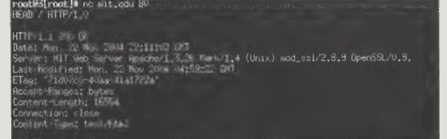 图4-11 使用HTTP HEAD方法
7. 关闭你的Linux shell。要查看可与Netcat命令搭配使用的其他参数，你可以在shell提示符下输入 nc -h（见图4-12）。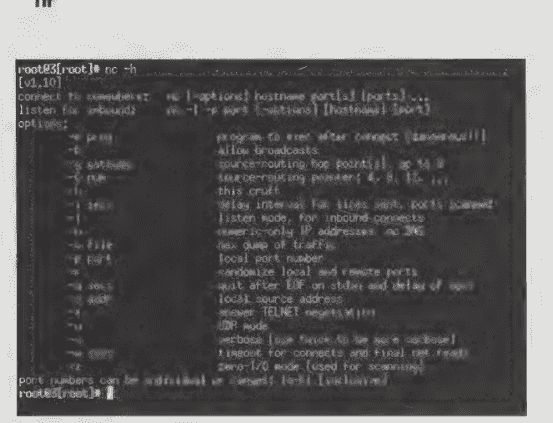 图4-12 Netcat参数

### 其他信息收集方法
迄今为止，你已经掌握了多种从公司网站和电子邮箱地址收集信息的方法。仅通过一个URL，你就能判断一家公司使用的是哪款Web服务器与操作系统，还能例如获悉IT人员的姓名。你还需要了解用于收集公司信息的其他方法，其中一些方法（例如使用Cookie和Web信标）是不道德的。

#### 检测Cookie和Web信标
**Cookie** 是由Web服务器生成的文本文件，存储在用户的浏览器中。当用户再次访问该网站时，文件中的信息会被回传至Web服务器。例如，回头客再次访问在线商店的网站时，会看到定制化的网页。部分Cookie可能存在安全隐患，因为不道德的人员可能会在Cookie中存储个人信息，用于攻击计算机或服务器。

**Web信标** 是一个1像素×1像素的图片文件，通过标签引用，通常和Cookie配合运行。其用途与间谍软件、广告软件类似：获取访问网站的人员的信息。Web信标并非来自与网页创建者相同的网站，而是来自专门从事数据收集的第三方公司。安全专业人员需要了解Cookie和Web信标，防范这些信息收集工具进入公司计算机。

##### 活动4-4：检测Web浏览器中的Cookie
##### **所需时间：** 30分钟
###### **目标：** 判断网页中是否存在Cookie。
###### **描述：** 许多公司会在其网页中添加Cookie，以收集访问其网站的访客信息。这些信息可能用于竞争情报，例如也可用于判断访客的购买习惯。安全专业人员应掌握验证网页是否包含Cookie的方法。
- 1. 从Linux光盘启动你的Windows XP系统，打开Mozilla Firefox网页浏览器。如果你一直在使用该浏览器且无需从光盘启动，你的电脑上可能已经加载了Cookie，因此你需要先清除Cookie，再访问新网站。
- 2. 首先，清除你电脑上的所有Cookie：在浏览器菜单中点击 **工具、选项**。在“选项”对话框中，点击左侧的 **隐私** 图标（见图4-13）。展开 **Cookie** 选项，然后点击 **存储的Cookie** 按钮。
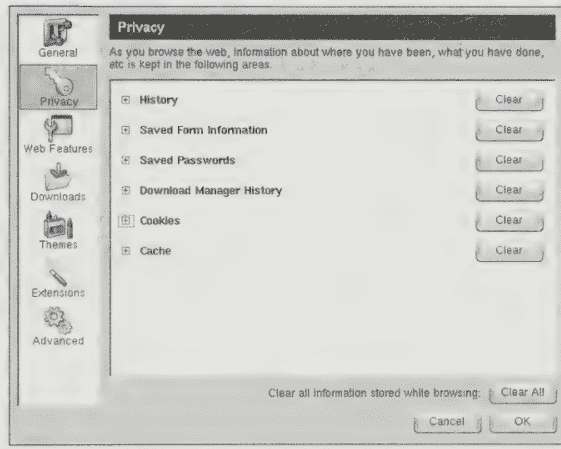 图4-13 Mozilla Firefox中的隐私对话框
- 3. 在Cookie管理器对话框中，点击 **全部删除Cookie** 按钮。你的屏幕应该看起来如图4-14所示。
- 4. 点击 **确定**，再次点击 **确定** 关闭隐私对话框。
- 5. 在浏览器的地址文本框中输入 **www.amazon.com** 并按 **Enter** 键。返回隐私对话框，再次点击 **存储的Cookie**。如果列出了任何Cookie，只需点击其中一个即可查看其相关信息。这些Cookie中是否存储了个人信息？
- 6. 如果时间允许，访问一些需要账号登录和密码的网站。查看这些网站是否创建了包含个人信息的Cookie。
- 7. 两次点击 **取消** 按钮，返回亚马逊网页。
- 8. 关闭网页浏览器。
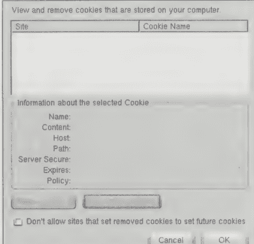 图4-14 删除Cookie

##### 活动4-5：安装Web信标检测软件
##### **所需时间：** 30分钟
###### **目标：** 在你的Windows XP电脑上安装Web信标检测软件，并检测Web信标。
###### **描述：** Web信标来自第三方公司，被认为比Cookie更具侵入性。作为安全专业人员，你应该掌握验证网页是否包含Web信标的方法。
- 1. 如果系统未在Windows XP环境下启动，请重启系统。打开Internet Explorer网页浏览器，在地址文本框中输入 **www.bugnosis.org/download.html** 并按 **Enter** 键。
- 2. 在“然后获取并安装”列中点击 **Bugnosis**，然后在“文件下载 - 安全警告”对话框中点击 **运行**。
- 3. 如果再次弹出安全警告对话框，点击 **运行**。按照提示安装该产品，接受所有默认设置。安装完成后，关闭所有浏览器窗口，然后重启浏览器。（注意：如果看到询问是否要下载Bugnosis最新设置的对话框，点击 **是**。）浏览器打开后，你会看到已添加Bugnosis工具栏（见图4-15）。
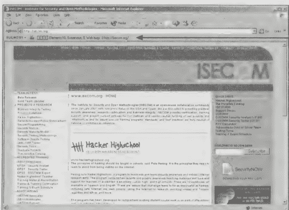 图4-15 Bugnosis工具栏
- 4. 接下来，访问一个包含大量已知Web信标的网站。输入URL **www.wired.com** 并按 **Enter** 键。注意软件在状态栏显示的信息和诊断结果。*（注意：如果你的网络存在防火墙，你可能会看到一条弹出消息，提示该网站无法访问。如果是这样，你需要配置防火墙以允许你访问该网站。）*
- 5. Bugnosis是否检测到了任何Web信标？如果检测到了，使用了哪些判定标准？
- 6. 如果时间允许，访问其他一些网站并记录结果。这类研究可能很耗时，但很有趣。
- 7. 关闭网页浏览器。

### 使用域名系统（DNS）区域传输
另一种在踩点网络时收集信息的方法是通过DNS。正如你在学习基础网络概念时了解到的，DNS是负责将主机名解析为IP地址的网络组件。人们不喜欢记忆数字，他们宁愿记忆像www.oracle.com这样的URL，也不想记忆IP地址。遗憾的是，使用URL需要付出很高的代价。DNS是网络攻击潜在漏洞的主要领域之一。不展开过多细节，DNS使用名称服务器来完成这项任务：解析名称。在你确定一家公司使用的是哪款名称服务器后，你可以尝试传输该DNS服务器负责的所有记录。可以使用Dig和Host命令执行区域传输。*（对于熟悉Nslookup命令的人来说，现在推荐使用Dig命令。）* 要确定一家公司的主DNS服务器，你可以查找包含授权启动（SOA）记录的DNS服务器。SOA记录显示DNS服务器负责哪些区域或IP地址。在你确定哪台服务器拥有该记录后，就可以执行区域传输。**区域传输** 能让你查看网络上的所有主机计算机。换句话说，它们为你提供了机构的网络拓扑图。你可以看到网络上的所有主机，并利用这些信息攻击属于网络基础设施的其他服务器或计算机。


#### 活动4-6：通过区域传输识别IP地址
##### **所需时间：** 30分钟
##### **目标：** 对DNS服务器执行区域传输。
##### **描述：** 在踩点网络时，获取连接到网络的所有服务器、计算机及其他节点的IP地址和主机名非常重要。使用Dig或Host等命令，你可以执行所有DNS记录的区域传输。然后你可以利用这些信息创建网络拓扑图，形成对网络组织方式清晰的直观认识。例如，你可以看到网络上有多少主机，以及创建了多少个子网。

> 本示例使用mit.edu来演示如何执行区域传输。本书撰写时该方法可用。然而，许多高校正在加强安全防护，不再允许区域传输，但你仍应了解执行区域传输的步骤。
- 1. 将电脑启动到Linux系统，打开你选择的shell。在shell中输入 **dig soa mit.edu** 并按 **Enter** 键。你应该能看到类似图4-16的界面。列出了三个由“NS”标识的名称服务器：STRAWB.mit.edu、BITSY.mit.edu和W2ONS.mit.edu。*（当你阅读本书时，这些信息可能已经发生变化。如果是这样，请向你的授课老师咨询指导建议。）*
- 2. 要对BITSY.mit.edu DNS服务器执行区域传输，输入 **dig @BITSY.mit.edu mit.edu axfr** 并按 **Enter** 键。BITSY.mit.edu是你尝试执行区域传输的目标服务器，第二个mit.edu语句是该服务器所在的域。
- 3. 等待一小段时间后，你的屏幕将被数千条记录填满。按 **Ctrl+C** 停止传输。


图4-16 使用dig命令
4. 再次执行传输操作，但这次要使用`|less`参数，输入**dig @BITSY.mit.edu mit.edu axfr |less**后按**Enter**键。
5. 按**Enter**键或**空格键**查看额外记录，之后按**q**键退出。
6. 要使用Host命令执行相同的区域传输，输入**host -l -v -t any mit.edu**后按**Enter**键。
7. DNS服务器负责多少条记录？（*提示：* 你可以去掉`|less`参数运行该命令，等到汇总页面显示即可。）
8. 查看完记录后，关闭终端并关闭你的Linux系统。

你刚才学习的工具并不是获取信息的唯一方式。有时，有关公司的信息是通过非技术手段收集的。事实上，最优秀的黑客不一定是最精通技术的人，相反，他们具备一种更隐蔽——也常被低估——的技能，即社会工程，相关内容将在下一节讨论。

### 社会工程导论
社会工程的技艺出现时间远早于计算机。**社会工程**指利用对人性的了解从他人处获取信息。在计算机攻击中，这些信息通常是网络密码，或是攻击者可用来入侵网络的其他信息。
销售人员只需向顾客提出恰当的问题，就能获取其个人信息，例如收入、爱好、社交生活、饮酒习惯、音乐偏好等。销售人员会运用个人魅力，有时甚至耍些手腕让顾客放松警惕。从某种意义上说，销售人员会通过假装共情来试图与顾客建立联系。顾客离开商店后，可能会对自己随意透露的一些信息感到后悔，但如果销售人员亲和力强，他们可能不会对销售人员套取的个人信息心生顾虑。
社会工程师也可能使用说服策略、恐吓、胁迫、勒索甚至敲诈来收集他们需要的信息。他们很可能是网络最大的安全威胁，也是最难防范的。你可能听过这句谚语：“既然可以直接索要密码，何必费力破解呢？” 许多攻击者就是这么做的：他们直接开口索要。不幸的是，许多用户会向攻击者提供入侵网络所需的一切信息。任何在服务台或网络支持部门工作过的人都清楚这是事实。
即便公司政策明确规定不得将密码告知任何人，用户通常仍认为该政策不适用于IT人员。当IT技术人员坐在用户的电脑前时，有多少用户会大声说出自己的密码？IT人员并不想知晓用户的密码，他们尤其不希望用户大声说出密码、在电话中提及密码，或是通过电子邮件输入密码。但用户通常不认为公司密码是隐私信息，因此不会像保管ATM卡PIN码那样谨慎保管密码。他们可能不认为公司电脑里的信息很重要，或是会引起攻击者的兴趣。
社会工程师知道如何让这类用户放下戒备。下面是一个典型的社会工程手段示例：首先，社会工程师假扮成“迈克”，这个名字是他在执行区域传输、检查公司DNS服务器后获取的。迈克可能不是当前的IT对接人（POC），但这并不重要。根据公司规模的不同，大多数用户通常并不认识IT部门的全体成员。
随后，社会工程师打电话找苏，苏是员工姓名，是他从区域传输信息和多个展示电子邮件地址格式的公司网页上获取的。为了拿到电话号码，他直接拨打公司总机，询问苏的分机号。接着他表示想给苏留口信，要求转接至苏的语音信箱。“苏现在在办公室，”友好的接待员回复道，“需要我为您转接给她吗？” 社会工程师说：“哎呀，我另一条线路正在响，我记不得她的分机号了。能把她的分机号告诉我吗？我几分钟后再打给她，我真的要接那个电话。” 在这段对话中，他的策略是制造紧迫感，同时保持态度友好。这一招通常奏效，因为大多数接待员并不认为将来电者转接给员工、或是提供员工的直拨号码或分机号有什么问题。毕竟，来电者知道苏的名字，看起来也认识苏。“分机号4100，”接待员说。“谢谢！得走了，”社会工程师回复。
大约30分钟后，社会工程师再次拨打公司电话。“你好，请转接4101分机，”他请求道。接待员帮他转接，一位男士接起电话：“鲍勃·史密斯，会计部。”“抱歉，鲍勃，我是迈克。我刚才打给苏，但我想我打错分机号了。苏之前连不上网，我们正在排查IP地址信息，刚修好了她的系统。你这边也有问题吗？” 鲍勃说：“看起来只有会计部的VLAN配置出了问题。” 迈克接着问：“还在用Windows XP系统吗？” 鲍勃回答不是，并告诉迈克自己用的操作系统。鲍勃可能觉得自己认识迈克，尽管实际上并不认识。
另一种了解IT部门运作方式的方法是，迈克假扮成鲍勃，拨打服务台电话，提出自己遇到的问题。这样迈克就能了解服务台人员如何处理来电。服务台会开具服务工单吗？除了姓名和电话号码之外，鲍勃需要向来电者提供其他信息吗？许多服务台部门要求为求助电话分配唯一编号，直到问题解决。
社会工程师使用苏的名字来让自己的来电更具可信度。此外，因为他已经通过其他手段获取了操作系统相关信息，所以他利用了这一信息优势，就像他询问Windows XP问题的表现那样。迈克现在可能直接索要密码，也可能决定联系苏发起最终攻击。如果他给苏打电话，可以聊起鲍勃，就像他们是老朋友一样。他想要的是鲍勃或苏的密码，可能会尝试以下计谋：“鲍勃，我们很可能需要切断会计部的网络连接一小时左右。如果我可以远程处理这个问题，你的系统只需要断网五分钟。唯一的问题是，我需要你的密码。我已经有你的登录账号bsmith@kjwilliams.com，没错吧？” 鲍勃有很大可能会在电话里把自己的密码告诉迈克。
并非所有社会工程手段都通过电话进行，但这可能是最常用的方式，因为它具有匿名性，而且允许社会工程师在同一组织内发起多次攻击。如果有一两名员工听到同一个人说的不同故事，这种情况可能会更难应对。不过，衣着得体、手持剪贴板的人也可能成功从员工处套取信息。这种方式需要更大的勇气，因为社会工程师必须面对他要套取信息的对象。
社会工程师研究人类行为，他们能够识别性格特征，例如害羞或不安，并且懂得如何解读肢体语言：耷拉肩膀、回避眼神接触、紧张的小动作等等。如果手段是通过电话进行的，对方的语调也可以为社会工程师提供线索。许多人声称会与自己约会的人练习社会工程技巧，或者试图从无辜受害者那里获取无用的信息，只是为了磨练自己的技能。

## 第4章 足迹勘察与社会工程
> **安全小贴士**
> 安全专业人员最难的工作，就是阻止社会工程师从公司员工处获取关键信息。无论安全策略多么完善，无论在防火墙和入侵检测系统（IDS）上投入多少资金，员工始终是组织中最薄弱的环节。攻击者清楚这一点并会加以利用。必须定期对员工进行安全实践培训与测试。正如消防演练能帮助人们为火灾疏散做好准备一样，随机安全演练可以提升公司的安全实践水平。例如，每月随机选择员工进行测试，查看他们是否会向组织内部或外部的人员泄露密码，这是检验安全备忘录是否被阅读和遵守的好方法。

> **安全小贴士**
> 作为安全测试人员，除非雇佣你的人员以书面形式授权，否则你绝不能使用社会工程手段。你还应确认哪些员工可以接受社会工程测试，并对你开展的测试进行记录。你的文档应包含收到的回复，所有测试结果当然也必须保密。图4-17和图4-18展示了OSSTMM中包含的社会工程模板。你可以从本书光盘中的OSSTMM副本打印这些模板。必须培训用户，不要向外部人员透露任何操作系统相关信息。还应教导员工，要求证询问问题的人是否真的是其声称的身份。员工不应羞于向对方索要公司电话回拨，而不是轻信电话另一端的人。仅仅让员工意识到大多数黑客行为是通过社会工程而非编程技能实施的，就能让他们更清楚攻击者的运作方式。

社会工程师会使用多种不同的技巧，试图从毫无防备的人处获取信息：
- **紧迫性**——“我现在就需要这些信息，不然世界都要毁灭了！”例如，社会工程师可能会告诉用户他急需这些信息，否则网络会长时间瘫痪，从而制造虚假的紧迫感。
- **等价交换**——“如果你给我需要的信息，我就能让你的生活更便利。”例如，如果用户帮助社会工程师，后者可能会承诺为其提供更快的网络访问权限。
- **从众心理**——“其他人都在这么做，你也应该这么做。”通过使用其他员工的名字，社会工程师可以轻松说服他人泄露密码。
- **善意**——这一手段可能是社会工程师使用的最危险的武器。人们总想帮助对自己友好的人。“蜜比醋更能捉到苍蝇”这句谚语同样适用于社会工程。
- **身份地位**——让员工相信你在公司拥有权威地位，是获取信息的强有力手段，在等级决定特权的军队中尤其如此。社会工程师可以声称是高级军官在索要这些信息，因此必须尽快提供。


|  |  |
| --- | --- |
| **企业** |  |
|  | 企业名称 |
|  | 企业地址 |
|  | 企业电话 |
|  | 企业传真 |
|  | 企业官网 |
|  | 产品与服务 |
|  | 主要联系人 |
|  | 部门与职责 |
|  | 企业设施位置 |
|  | 企业历史 |
|  | 合作伙伴 |
|  | 经销商 |
|  | 企业规章制度 |
|  | 企业信息安全政策 |
|  | 企业文化传统 |
|  | 企业招聘信息 |
|  | 临时用工需求 |
|  | 常见IT威胁 |
| **人员** |  |
|  | 员工信息 |
|  | 员工姓名与职位 |
|  | 员工层级归属 |
|  | 员工个人主页 |
|  | 员工最佳联系途径 |
|  | 员工爱好 |
|  | 员工网络痕迹（SENET、论坛） |
|  | 员工公开表态 |
|  | 员工亲友信息 |
|  | 员工履历（含工作经历） |
|  | 员工性格特征 |
|  | 员工价值观与优先级 |
|  | 员工社交习惯 |
|  | 员工言语与表达习惯 |
|  | 员工肢体语言与礼仪 |
| 图4-17 社会工程学模板 | 攻击场景 |
| --- | --- | --- | --- | --- |
| 电话号码 |  | 涉事人员 |  | 描述 |  | 结果 |
图4-18 社会工程学电话攻击模板
### 肩窥的艺术
社会工程师获取信息的另一种手段是**肩窥**。肩窥者是指擅长读取用户在键盘上输入的内容，尤其是登录名和密码的人群。这项技能当然需要练习，但只要投入足够时间，就能轻松掌握。肩窥者还会运用这项技能读取用户在ATM机上输入的PIN码，或是窃听拨号者输入的长途授权码。相比针对计算机的肩窥，ATM盗窃要容易得多——因为机具按键盘上的字符比计算机键盘少得多。如果用户在ATM机附近的垃圾桶丢弃交易凭条，肩窥者就能将PIN码与账号匹配，进而伪造出假的ATM卡。不少肩窥者会使用双筒望远镜或高倍望远镜观察用户输入PIN码的过程，使得这类攻击很难防范。
> **安全小贴士**
肩窥者的常用伎俩是使用拍照手机，在超市、门店等场所偷拍毫无戒备的购物者的信用卡。通过这种方式，他们就能获取信用卡卡号和有效期。若配合观察购物者输入PIN码，将大幅提升身份盗用的风险。不少键盘使用者都没有遵循打字课上传授的传统指法，而是用两根或三根手指盲目敲击键盘。然而，肩窥者会特意训练自己熟记标准键盘的按键位置，凭借这一能力，他们不用关注打字者用的是哪根手指，仅通过观察按键位置就能判断出按下的键位。此外，肩窥者还清楚人们在设置密码时常用的字母替换规则：s对应$、a对应@、i对应1、o对应0，以此类推。很多用户觉得p@$$w0rd这种密码很难被猜中，但对熟练的肩窥者来说并非如此。另外，不少用户被要求使用包含特殊字符的密码，为了确保输入正确，他们往往会放慢输入速度，而这恰恰会让肩窥者更容易得手。
> **安全小贴士**
如今很多人都会携带笔记本电脑出行，商业航空公司也会提醒旅客警惕肩窥者。在机舱内狭小的空间里，旁人可以轻易观察到你按下的按键，甚至读取笔记本电脑屏幕上的数据。建议旅客使用防侧视屏幕的产品，比如屏幕保护贴或防窥膜。不少员工会在飞机上处理公务，而肩窥者获取到的这些信息可能被用于入侵公司的计算机系统。为了防范肩窥攻击，你需要提醒用户：当有人站在自己正后方，甚至是站在附近时，不要输入登录名和密码。同时也要告知用户，由于拍照手机普及率很高，在有人近距离使用手机通话时也不宜输入密码，以防被拍摄。要进一步降低肩窥风险，需确保所有计算机屏幕都背对门口或办公隔间入口。要提醒用户，一旦怀疑自己输入密码时被他人看到，需立即更换密码。
> **安全小贴士**
当你在付费电话上输入长途接入码时，旁边电话上假装通话的肩窥者拿着计算器，就能把你拨出的每一个数字输入计算器。用这种方法，他不需要记住一长串号码。计算器里的记录就是他需要的长途接入码，后续就能用该码拨打长途电话，费用会记在你的电话卡上。
### 翻垃圾桶的艺术
社会工程师获取信息的另一种手段是**翻垃圾桶**。这种方式收集信息显然不够体面，但只要你翻看他人丢弃的垃圾，就会发现里面的信息多到超乎想象。比如，被丢弃的计算机手册可以说明当前使用的操作系统：如果丢弃的手册是Windows NT 4.0版的，那么该系统后续升级的操作系统大概率是微软的系统，比如Windows Server 2003。有时网络管理员会在手册上做笔记，甚至随手写下密码，这些信息都有可能被社会工程师利用。企业电话簿是另一类信息来源。翻垃圾桶者如果找到记录着企业员工信息的电话簿，就能冒充员工身份开展信息收集工作。印有会议日程、员工休假安排等内容的企业日历，也能被用来进入在特定时段无人值守的办公室。对于知道如何利用垃圾的翻垃圾桶者来说，垃圾的价值堪比等重黄金。
以下物品对翻垃圾桶者而言可能十分有用：
- 财务报告
- 内部备忘录
- 被丢弃的计算机程序
- 标注了管理者姓名的企业组织架构图
- 员工简历
- 企业政策、系统与流程手册
- 专业期刊或杂志
- 水电费等公共事业账单
- 外部供应商的推销函
- 区域经理报告
- 质量保证报告
- 风险管理报告
- 会议纪要
- 联邦、州或市级政府报告
翻垃圾桶可以获取海量信息，因此需要教育用户重视规范处理垃圾的重要性。装有企业信息的磁盘或硬盘应使用可将全盘区域写入二进制零的软件进行格式化，该操作需至少执行7次，确保所有历史数据都无法被读取。旧版计算机手册应在企业外丢弃，避免翻垃圾桶者将手册与所属企业关联起来。丢弃前，所有这些物品都需放置在配备充足物理、行政与技术防护措施的上锁房间内。所有文件即便看起来没有敏感信息，也需要全部碎纸销毁。社会工程师擅长从各类不同来源拼接信息，将大量零散信息整合在一起，攻击者就能够突破网络防护。
### 尾随的艺术
有时安全测试人员需要进入仅对授权人员开放的办公楼区域。这种情况下，测试人员或攻击者会使用一种名为**尾随**的技术。尾随是指紧跟拥有区域权限的员工身后进入该区域，且对方并未察觉你没有使用PIN码或门禁卡就进入了该区域。熟练的尾随者会观察授权人员进入安保区域的时间，等待合适时机在安保入口处快速跟上对方。他们赌的就是人性，以及他人想要表现得礼貌、为他人留门的心理。这种伎俩通常很奏效，尤其是当尾随者双手都拿满东西，看起来正费力地从包里或裤兜里掏出门禁卡时，效果更好。部分尾随者会脖子上挂着伪造的门禁卡，或是假装在读卡器上刷门禁卡。如果被发现，他们可能会称自己的卡片出了故障，再利用社会工程学技巧说服安保人员放行。
> **安全小贴士**
一名穿着得体的安全测试人员带着无线笔记本电脑进入一家医院，坐在护士站旁边的候诊区就座。在接下来的一周多时间里，他都能在自己电脑上访问密码和登录信息，收集相关数据，期间没有受到任何安保人员或医院员工的询问。事实上，这名安全测试人员觉得自己仿佛隐形一般。医生、护士、管理人员和其他医院员工都没有质疑这个陌生人的存在，哪怕他把候诊区的桌子几乎都摆上了记事本和自己的笔记本电脑。测试结束后发现，所有人都以为这个陌生人是该区域其他工作人员，没有人觉得有责任去查明这个陌生人的身份以及他来此的目的。
#### 活动4-7：学习尾随技能
**所需时间：** 30分钟
**目标：** 了解尾随技术如何被用于进入限制区域。
**活动描述：** 在本活动中，你将学习用于进入授权人员限制区域的尾随技能。假设你正在进行一次安全测试，需要进入某公司的服务器机房。进入该房间需要先将门禁卡在读卡器上刷卡，然后在几秒内推开房门，期间会有轻柔的提示音响起。如果未在限定时间内开门，就需要重新刷卡。两人一组，向全班演示如果教室被设置为安保区域，你会如何使用尾随技术进入。其中一名学生扮演授权用户，另一名学生使用尾随技巧进入。
防范尾随的有效措施之一是在可能出现尾随的区域设置旋转门。但最好的防范方式是培训员工，让他们在发现限制区域有陌生人时通知安保人员。员工需要树立区域安全责任意识，不能完全依赖安保人员。要教导员工不要为任何人（哪怕是熟人）留置安保门禁。同时要教育用户养成习惯：确认所有进入限制区域的员工都使用了门禁卡，发现可疑或不明身份人员时及时上报安保部门。


### 章摘要
- 踩点是指通过Web工具和实用程序收集网络信息的过程。用于收集网络基础设施信息的部分Web工具包括Whois.arin.net、Namedroppers、Google，以及Host命令和Dig命令。
- 企业信息可以通过观察和Web工具收集的竞争情报获取。
- IP地址和域名可以通过SamSpade、Dig命令和Host命令等工具获取。
- 安全测试人员必须清楚Cookie和Web臭虫如何被用于在用户不知情的情况下检索信息、访问数据。
- 区域传输可用于获取网络拓扑，查看网络中所有的主机计算机和域名。
- 社会工程是指利用对人性的了解，从毫无戒心的人那里获取信息的能力。
- 社会工程师会使用多种方法说服用户提供信息，例如制造虚假的紧迫感、假装拥有权威地位、表现得亲和友善、为配合请求提供回报，或者给用户造成“其他所有人都已经配合了请求”的印象。
- 对公司员工开展社会工程攻击相关的教育很重要，但也可以开展随机测试，确保员工遵守公司政策。
- 攻击者会使用肩窥、垃圾翻查、尾随进入等技术获取机密信息。

### 关键术语
#### 竞争情报 指通过观察、获取公开的计算机信息、与员工交谈等方式收集有关企业或行业信息的手段。
#### Cookie 一种文本文件，包含Web服务器发送给用户Web浏览器的消息，当用户再次访问该网站时会用到该文件。
#### 垃圾翻查 通过检查人们随意丢弃的实物垃圾来收集信息的行为。
#### 踩点 在进行安全测试或攻击之前收集企业相关信息的行为。
#### 尾随进入 攻击者用于进入公司受限区域的方法：攻击者紧跟在一名员工身后，随该员工一同进入该区域。
#### 肩窥 攻击者无需借助工具，只需越过毫无察觉的用户肩膀观察其输入密码时按下的按键，从而获取密码的能力。
#### 社会工程 利用对人性的了解从他人处获取信息的行为。
#### Web臭虫 在标签中引用的一张小图形图像，该图像由专门从事数据收集的第三方公司创建。
#### 区域传输 一种从DNS服务器传输记录、用于网络分析的方法。

### 复习题
1. 以下哪些是收集企业信息的快速简便方式？（可多选）
a. 进行端口扫描
b. 对公司DNS服务器执行区域传输
c. 查看公司网站
d. 在电话簿中查找公司广告
2. 若要查找负责公司域名的核心IT人员相关信息，你可能会使用以下哪些工具？（可多选）
a. Whois
b. Whatis
c. SamSpade
d. Nbtstat
3. _______________是最容易遭受网络攻击的组件之一。
a. TCP/IP
b. WINS
c. DHCP
d. DNS
4. 以下哪项包含域名的主机记录？
a. DNS
b. WINS
c. Linux服务器
d. UNIX Web客户端
5. 以下哪个是收集域名信息的优质网站？
a. www.google.com
b. www.namedroppers.com
c. www.samspade.org
d. www.arin.net
e. 以上所有
6. Cookie可以存储网站访问者的信息。判断对错。
7. 列出三种可用于查找IP地址信息的工具。
8. 收集域名信息的一种方式是什么？
a. 查看你发送给不存在的电子邮件账户的电子邮件的邮件头
b. 运行Ipconfig命令
c. 运行Ifconfig命令
d. 通过Telnet连接至TCP 53端口
9. 以下哪项是收集公司所用操作系统信息的方法之一？
a. 在网络上搜索IT员工的电子邮件地址
b. 通过Telnet连接至公司Web服务器
c. PING该URL并分析ICMP消息
d. 使用Ipconfig /os命令
10. 以下哪个命令可显示mit.edu域的主DNS服务器信息？
a. host -t mit.edu
b. host -t soa mit.edu
c. host -t prim mit.edu
d. host -t all mit.edu
11. 开展竞争情报工作时，以下哪种方式是确定公司IT支持人员规模的较好方法？
a. 查阅*www.monster.com*或*www.dice.com*等网站上的招聘信息
b. 使用Nslookup命令
c. 对公司DNS服务器执行区域传输
d. 使用host -t命令
12. 若要查找某公司IT员工的新闻组发帖，你应该访问以下哪个网站？
a. *groups.google.com*
b. *www.google.com*
c. *www.samspade.com*
d. *www.arin.org*
13. 以下哪些工具可帮助你查找组织及其员工的相关信息？（可多选）
a. *www.google.com*
b. *groups.google.com*
c. Netcat
d. Nmap
14. 安全测试人员尝试获取网络中某台计算机密码的首要方法是什么？
a. 使用扫描工具
b. 在网络中安装嗅探器
c. 询问用户
d. 安装密码破解程序
15. 大多数社会工程师会使用____________收集所需信息。
a. 互联网
b. 电话
c. 公司内网
d. 电子邮件
16. 通过观察用户按下的按键获取其密码的行为被称为什么？
a. 密码哈希
b. 密码穷举
c. 尾随进入
d. 肩窥
17. 肩窥者可以利用其技能获取以下哪些信息？（可多选）
a. 密码
b. ATM个人识别码
c. 长途接入码
d. 开放端口号
18. 紧跟授权人员身后进入公司受限区域的行为被称为____________。
a. 肩窥
b. 尾随进入
c. 非法闯入
d. 社会工程
19. 哪种社会工程技巧涉及告知员工你来自CEO办公室，需要尽快获取某些信息？（可多选）
a. 紧迫感
b. 现状维持
c. 权威身份
d. 交换条件
20. 在使用社会工程策略开展安全测试前，你应该做什么？
a. 提前预约
b. 记录所有发现
c. 获取雇佣你开展安全测试的人员的书面许可
d. 获取部门负责人的书面许可

### 案例项目


#### 案例4-1：通过电子邮件地址确定操作系统
K.J. Williams公司在多个办事处运行着多种操作系统。在开展安全测试以确定需要修复的漏洞之前，你需要先确认是否存在你不知道的正在运行的操作系统。网络管理员/安全官员迈克·康斯坦丁在得知你是来查找网络安全漏洞后，不愿向你提供信息，他认为你会威胁到他的职位。经过数小时的访谈，你仅能确认迈克的个人电子邮件地址是mtscon@aloha.net，且公司的一套系统上运行着Oracle8i。

- 得知康斯坦丁先生的电子邮件地址后，你可能会使用哪些工具？
- 在groups.google.com网站输入康斯坦丁先生的电子邮件地址后，你得到了什么信息？
- 你从groups.google.com获取的信息能否用于开展漏洞测试或利用？

给IT负责人写一份备忘录，告知她公司网络基础设施中可能存在NetWare服务器。确保备忘录说明该信息的获取方式，并提供建设性反馈。你的备忘录不应指责任何公司员工，而应就普遍层面的问题进行讨论。


#### 案例4-2：使用垃圾搜寻技能
你观察到K. J. Williams公司聘用Alika清洁公司负责其保洁服务。该公司每晚都会对地面进行吸尘和拖洗，垃圾会被收集到大垃圾桶中，放在室外等待周二和周五的统一清运。
你决定在周四晚间保洁人员离开后前往垃圾箱区域。戴上医用手套，携带一张大塑料布，你尽可能多地将垃圾桶里的垃圾放到塑料布上。
翻找这些垃圾时，你发现了以下物品：
- 公司电话簿；
- Windows NT全套培训资料；
- 23本过期的《Oracle》杂志；
- 似乎是HTML编写的计算机程序笔记，包含指向SQL Server数据库的链接；
- 15份关键员工的内部公司备忘录；
- 食品包装袋；
- 一瓶喝空的昂贵伏特加；
- 几份被撕毁的简历副本；
- 一盒未拆封的新名片；
- 还有一双旧的女士跑鞋。

基于以上信息，写一份两页的报告，说明这些物品的相关意义。如果可以的话，你会给K. J. Williams公司的管理层提出什么建议？

## 第5章：端口扫描
> **读完本章并完成练习题后，你将能够：**
> - 描述端口扫描
> - 描述不同类型的端口扫描
> - 描述各种端口扫描工具
> - 解释ping扫描的用途
> - 解释如何用Shell脚本实现安全任务自动化

端口扫描（也称服务扫描）是指扫描一定范围的IP地址，以确定网络上运行着哪些服务的过程。如你在第2章所学，计算机上的开放端口可以标识该计算机上运行的服务。例如，HTTP使用80端口连接Web服务。你可以使用扫描工具简化这一流程，而无需逐个ping某个IP地址段内的每个IP、等待ICMP回显应答（类型0）来判断计算机是否可达。毕竟，手动ping数千个IP地址非常耗时。

端口扫描工具可能很复杂，因此你需要投入时间学习它们的优缺点，了解应该如何使用、何时使用这些工具。在本章中，你将了解能够识别网络上运行服务的端口扫描工具，并学习如何利用这些知识开展安全测试。

### 端口扫描简介
在第4章中，你使用Dig命令执行了区域传输，以确定网络的IP地址。假设区域传输结果显示某公司使用的是子网划分的C类地址，共有126个可用的主机IP地址。你该如何验证这些地址是否都被在线运行的计算机使用？你可以使用端口扫描器ping你发现的IP地址范围。

安全测试人员应该提出一个更重要的问题：“成功ping通的计算机上运行着哪些服务？”**端口扫描**是一种查明主机提供哪些服务的方法。例如，如果服务器托管了网站，那么该服务器大概率开放了80端口？是否存在易受攻击或可利用的服务？是否有服务未被防火墙过滤，从而可能被加载特洛伊木马程序，从被攻击的计算机窃取信息？哪台计算机最容易受到攻击？

你已经知道如何通过通用漏洞披露网站（www.cve.mitre.org）搜索已知漏洞。还有一些端口扫描工具可以识别漏洞。例如，AW Security Port Scanner（www.atelienweb.com）是一款价格合理的商业扫描工具，带有图形用户界面（见图5-1），可以显示已知在特定端口运行的特洛伊木马类型。攻击者使用该工具可以快速识别存在漏洞的端口，随后发起利用程序攻击系统。


> **安全小知识**
> 大多数安全测试人员和黑客认为端口扫描是合法的，因为它没有侵犯他人隐私，只是探测被扫描方是否在线。典型的类比是：一个人走在街上，逐户转动每家的门把手。如果门开了，这个人会记下该户的门未上锁，然后继续前往下一户。当然，进入房屋在世界上大多数地区都属于犯罪，未经所有者许可进入计算机系统或网络同样属于犯罪。

端口扫描可以快速扫描数千甚至数万个IP地址，帮助你解答关于开放端口和服务的问题。许多端口扫描工具会生成扫描结果的报告，有些工具还能对系统运行的操作系统做出最佳猜测评估。几乎所有扫描程序都能在几秒钟内报告**开放端口、关闭端口和过滤端口**。

例如，当Web服务器需要与应用程序或其他计算机通信时，80端口会开放。开放端口允许访问应用程序，可能存在被攻击的漏洞。关闭端口则不允许访问或接入某项服务。例如，如果Web服务器上的80端口处于关闭状态，用户将无法访问网站。如果扫描器将某个端口报告为过滤状态，可能意味着防火墙正在被用于控制指定网络流量的进出。

### 端口扫描的类型
在深入学习端口扫描工具的使用之前，我们先了解一下可用于端口扫描的扫描类型：
- **SYN扫描**——在正常的TCP会话中，会向另一台计算机发送设置了SYN标志位的数据包。接收计算机会返回设置了SYN/ACK标志位的数据包，表示收到确认。随后发送计算机会发送设置了ACK标志位的数据包。如果SYN数据包发送的目标端口处于关闭状态，计算机会返回一个RST/ACK数据包作为响应。如果攻击者的计算机收到了SYN/ACK数据包，会快速返回RST/ACK数据包，终止会话。这样做是为了避免建立完整的TCP连接并将其作为事务记录。从这个角度来说，这种扫描是“隐秘的”。毕竟，你肯定不希望有事务记录显示连接到被攻击计算机的IP地址。
- **连接扫描**——这类扫描依赖被攻击计算机的操作系统，因此使用风险稍高。连接扫描与SYN扫描类似，区别在于它会完成三次握手。这意味着被攻击计算机很可能会记录该事务或连接，表明发生过会话。因此，与SYN扫描不同，连接扫描不具备隐秘性，很容易被检测到。
- **NULL扫描**——NULL扫描会关闭数据包的所有标志位。关闭的端口会以RST数据包回应NULL扫描，因此如果没有收到任何数据包，最合理的猜测是该端口处于开放状态。
- **XMAS扫描**——这类扫描会设置FIN、PSH和URG标志位。（不同标志位的回顾可参考第2章。）关闭的端口会以RST数据包回应这类数据包。这种扫描可用于判断哪些端口处于开放状态。攻击者可以向系统的53端口发送这类数据包，查看是否会返回RST数据包。如果没有返回，说明DNS端口可能处于开放状态。
- **ACK扫描**——攻击者通常使用ACK扫描来绕过防火墙（或其他过滤设备）。过滤设备会查找ACK数据包所属的三次握手中的第一个SYN数据包。请记住数据包的顺序：SYN、SYN/ACK、ACK。如果被攻击的端口返回RST数据包，说明数据包过滤器被欺骗了，或者不存在数据包过滤设备。无论哪种情况，被攻击的端口都被视为“未过滤”。
- **FIN扫描**——这类扫描会向目标计算机发送FIN数据包。如果端口处于关闭状态，计算机会返回RST数据包。三次握手结束后，双方会发送FIN数据包来终止连接。
- **UDP扫描**——这类扫描会向目标计算机发送UDP数据包。如果端口返回ICMP“端口不可达”消息，说明该端口处于关闭状态。同样，未收到该消息可能意味着端口开放，但这并不总是成立。防火墙或数据包过滤设备可能会推翻你的假设。如果远程计算机向某计算机发送SYN数据包，且该计算机的端口处于开放状态，它会以SYN/ACK数据包回应。请回忆三次握手的过程：一台计算机发送SYN数据包，接收方计算机向发送方返回SYN/ACK数据包，最后发送方向接收方发送ACK数据包。如果端口处于关闭状态，收到SYN数据包后会返回RST/ACK数据包。判断端口是否被过滤更加复杂。许多扫描工具（如Nmap）采用最佳猜测法：如果UDP数据包没有收到接收端端口的响应，许多扫描工具会将该端口报告为开放状态。


## 第5章 端口扫描 安全小贴士
加拿大曾发生过一起案例：一名男子因对某公司的计算机进行端口扫描被起诉，最终获罪。该公司起诉他的理由是，他扫描时未经许可使用了公司的微量电力。未经公司允许使用公司电力被视为犯罪行为——虽说情节轻微，但确实有效。为了稳妥起见，如果你要对某企业的网络基础设施进行深度扫描，最好提前征得对方同意。如果你的扫描导致网络流量变慢，企业可能会指控你实施了低级别拒绝服务攻击（DoS）。众所周知，这类攻击是违法的。

### 使用端口扫描工具
目前市面上有数百款端口扫描工具，可供黑客和安全测试人员使用。其中有些是商业软件，有些则是免费软件或开源工具。该如何选择适合的工具呢？由于并非所有工具的准确率都达标，因此建议同时使用多款端口扫描工具。此外，熟悉多种工具也是明智之举。虽说你需要频繁练习某款工具以熟练掌握它，但不要陷入只使用单一工具的误区。

#### Nmap
Nmap最初由Fyodor于1997年为《Phrack》杂志编写，如今已成为最受欢迎的端口扫描工具之一，并持续新增功能，例如操作系统检测、快速多探针ping扫描等。Nmap还有一款名为Xnmap的图形界面版本，可简化部分复杂选项的操作。由于Nmap和许多其他安全工具一样是开源软件，多年来它一直被不断修改和优化。如果发现漏洞，用户可提出修复建议。本书多次提及Nmap，因为它是目前安全专业人士的标准工具。不管市场上还有其他什么端口扫描工具，稍有经验的安全测试人员都使用过Nmap。作为初学者，你可以将它用于安全测试或渗透测试的各个环节，但别忘了也要熟练掌握本书介绍的所有其他工具。

##### 安全小贴士
几乎所有安全专业人士都会告诉你，好莱坞很少真实描绘黑客入侵系统的过程。电影里的攻击者通常只会使用图形界面程序，疯狂点击鼠标或输入解密算法。唯独《黑客帝国2：重装上阵》是个例外。片中的女主角崔妮蒂坐在计算机终端前运行Nmap，发现22号（SSH）端口处于开放状态，随后利用SSHv1 CRC32漏洞利用工具（这是SSH的一个真实漏洞）将root密码修改为“Z10N0101”，接着就瘫痪了整个电网。这个故事告诉我们什么？只要熟悉自己的工具和漏洞利用方法，说不定你就能拯救世界。

使用Nmap进行端口扫描时，你不需要记住每个参数的设置方法。事实上，只需输入命令`nmap 193.145.85.201`，就能扫描该IP地址对应的计算机的所有端口。不过，端口扫描可能是个复杂的过程。部分攻击者不想被能够识别异常大量ping请求或数据包的网络设备或入侵检测系统（IDS）发现，因此他们会使用更难检测的隐蔽攻击。在接下来的实操中，你将先熟悉Nmap的基础命令，再学习部分更复杂的选项。

##### 实操5-1：熟悉Nmap
**所需时间：**30分钟
**目标：**学习Nmap的基础命令和语法。
**说明：**本次实操将带你入门Nmap这款流行的端口扫描工具，了解如何用它快速扫描网络。你需要向讲师提供的攻击网络中的主机发送SYN数据包。本示例中攻击网络的IP地址范围是193.145.85.201至193.145.85.211，但你的攻击范围可能不同。请遵守所有测试规则，不要对你讲师给出的IP范围之外的任何系统进行端口扫描。

1. 使用Linux光盘启动你的Windows XP Professional系统，打开任意你喜欢的终端，输入命令**nmap -h**。你的屏幕应如图5-2所示。
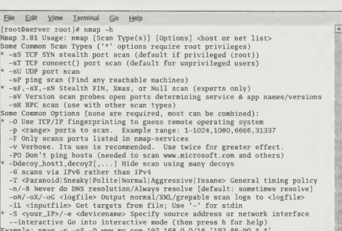
图5-2 Nmap帮助界面
2. Nmap帮助界面会列出所有可用命令。查阅完所有参数后，写下三个可搭配Nmap命令使用的选项。
3. 要向指定IP范围内的某个IP地址发送SYN数据包，输入**nmap -sS -v 193.145.85.201**并按下**Enter键**。你的SYN扫描结果是什么？
4. 接下来，尝试向攻击范围内的另一个不同IP地址发送新的SYN数据包。这次扫描的结果是什么？你发现有什么不同吗？如果有，请列出差异。
5. Nmap可以扫描整个IP地址范围，因此无需手动逐个输入IP地址。要向攻击范围内的所有IP地址发送SYN数据包，输入**nmap -sS -v 193.145.85.201-211**并按下**Enter**键。若要查看可滚动的输出格式，按下**上箭头**键，在Nmap命令末尾添加**|less**选项。最终命令应如下所示：**nmap -sS -v 193.145.85.201-211 |less**。
6. 接下来，为你的Nmap命令添加一个参数，以判断你的IP地址范围内哪些计算机运行着SMTP服务或HTTP服务。结合本次实操已学内容，输入对应命令并记录输出结果。*（提示：SMTP和HTTP分别使用什么端口？）* 命令的输出结果可能有所不同，但重点在于学习如何扩展Nmap命令。你可以在Nmap命令中选择特定端口，因此无需扫描全部65000个端口。
7. 保持Linux终端开启，供下次实操使用。

##### 安全小贴士
某天晚上，一名安全专业人士到公司上班时发现，公司的防火墙因有人使用ACK数据包在网络上运行端口扫描程序而崩溃。许多攻击者会使用ACK扫描来绕过包过滤设备（如防火墙，相关内容将在第13章讨论）。在本案例中，公司的防火墙被数万份ACK数据包淹没，冲击其状态路由表后瘫痪。这次ACK扫描属于针对网络的拒绝服务攻击（DoS）。请记住，拒绝服务攻击是违法的，因此在网络上运行端口扫描时切勿掉以轻心。进行端口扫描前，务必获得网络所有者的书面许可。


##### 实操5-2：使用更多Nmap命令

**所需时间：**30分钟
**目标：**使用Nmap执行更复杂的端口扫描攻击。
**说明：**本次实操中，你将继续使用Nmap在攻击网络上执行端口扫描。你需要在实操5-1所用参数的基础上新增参数，向选定的端口发送FIN、XMAS和ACK数据包。你应该反复练习这些命令直到运用自如，不过Fyodor撰写了一份内容详尽的手册页（UNIX圈称为“man page”），你可以把它作为有用的参考资料。本次实操首先会带你查看这份帮助页面。

1. 如果尚未进入Linux终端，请使用Linux光盘启动你的Windows XP Professional系统，打开任意你喜欢的终端，在命令提示符处输入**man nmap**。你会发现这条命令输出的信息比Nmap -h命令更丰富。不必有压力，你不需要记住整本手册的内容，只要知道需要的时候可以查阅即可。
2. 打开另一个终端，以便运行Tcpdump，这款工具可以查看你生成的数据包所产生的流量。和Ethereal一样，Tcpdump也是一款协议数据包分析工具，收录在本书附带的光盘中。你可以养成在另一个终端后台运行Tcpdump的习惯。在新窗口中输入**tcpdump -h**，按下**Enter键**，即可查看该命令可用的参数。
3. 你可以输入man tcpdump来查看这款工具的帮助手册，但现在不需要。只需输入**tcpdump**并按下**Enter键**，你的网卡就会开始监听网络上的流量。
4. 参考Nmap帮助页面的指引，输入命令向IP攻击范围内的5台计算机发送FIN数据包。查看FIN扫描产生的流量。你的计算机收到了哪些响应（如果有的话）？
5. 接下来，输入命令向FIN扫描选中的同一批5台计算机发送XMAS数据包。结果如何？
6. 最后，输入Nmap命令，向同一批5台计算机发送ACK数据包。你的计算机收到了哪些响应（如果有的话）？
7. 关闭所有终端。

#### Unicornscan
Unicornscan是端口扫描领域的新兴工具，于2004年开发，旨在辅助安全测试人员对大型网络开展测试，并整合大规模测试所需的多种工具。开发者认为当时许多现有产品扫描数千个IP地址的速度太慢。此外，维护多款安全工具的工作非常繁重，因此Unicornscan的开发者打造了一款能满足安全测试人员所有需求的产品。在普通奔腾电脑上运行的Unicornscan，可以扫描B类网络中每个IP地址的一个端口，相当于3到7秒内即可扫描完65535台计算机，将UDP扫描提升到了新水平。大多数使用UDP扫描的扫描仪在判断端口是关闭、开放还是过滤状态时，只能靠推测。如前所述，UDP扫描一直被认为可靠性

用于发现网络中活跃系统的方法。尽管Unicornscan能够使用TCP、ICMP和IP协议进行端口扫描，但它在UDP扫描优化方面的能力远超其他任何端口扫描器。你可以从www.unicornscan.org免费下载这款软件。

#### NetScanTools Pro 2004
如果要专门介绍这款功能强大、易于使用的商业端口扫描产品，恐怕需要整整一个章节——它集成了大量工具。NetScanTools Pro 2004应当成为你安全工具包的组成部分，因为它同时提供了适用于*NIX系统和Windows系统的工具。如需了解该产品的更多信息，请访问www.netscantools.com/nstpro_nslookup.html。
这款产品囊括了Nmap、Unicornscan这类命令行实用工具的诸多功能，但以易于使用的图形化界面呈现，如图5-3所示。扫描功能仅是该产品的一小部分。使用NetScanTools，你可以在以下领域开展安全测试：
- 查看潜在的数据库漏洞
- 查看电子邮件账户漏洞
- 执行DHCP服务器发现
- 查看IP数据包
- 查询域名服务器
- 开展操作系统指纹识别
只需在扫描返回的IP地址上单击右键，就能看到一长串选项，如图5-4所示。

## 第5章 端口扫描
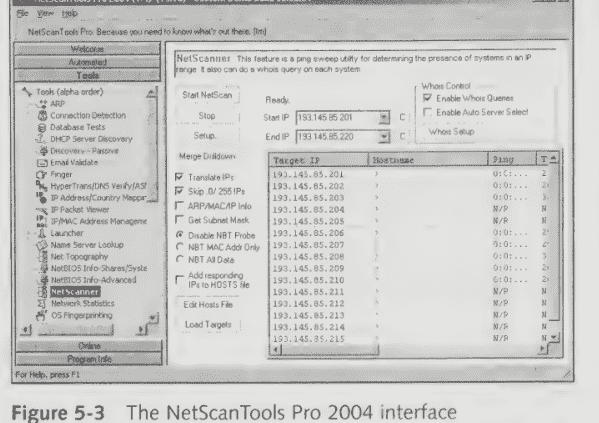
**图5-3** NetScanTools Pro 2004的界面
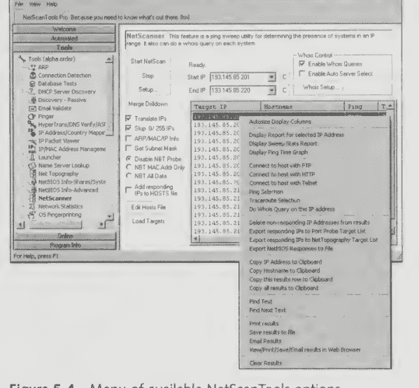
**图5-4** NetScanTools可用选项菜单

#### Nessus
安全测试人员还应当了解**Nessus**，这是一款1998年首次发布的工具。和Nmap一样，Nessus是开源软件，你可以从www.nessus.org免费下载。Nessus采用客户端/服务器技术，支持安全测试人员在网络内的不同位置（服务器）开展测试，也支持使用不同的客户端操作系统。该产品的服务器端可在任意*NIX平台上运行，而Nessus客户端则支持UNIX或Windows系统。Nessus的运行逻辑和数据库服务器非常相似，可执行复杂查询，同时客户端与服务器交互以简化报告生成和配置操作。

### 使用端口扫描工具
这款产品的独特之处在于，安全检测插件上线后可随时更新。（执行更新时，在控制台输入`nessus-update-plugins`命令即可。）Nessus插件是一种可选择的安全测试程序（脚本），可通过客户端界面选取（见图5-5）。插件的编写者有权决定是否将某插件标记为危险插件，而插件作者对“危险”的判断标准可能和你不一致。因此，开始扫描前，点击标注为“启用除危险插件外的所有插件”的按钮是明智的选择。

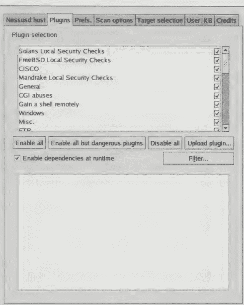
**图5–5** Nessus插件
Nessus扫描的功能不止于确定端口上运行的服务，其插件还可以检测这些服务关联的漏洞，如图5-6所示。（本书后续章节还会用到Nessus。）
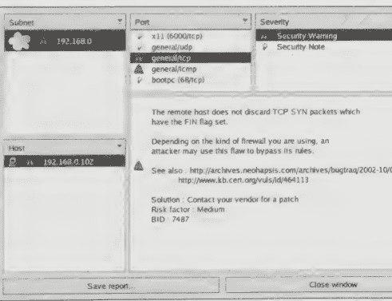
**图5–6** Nessus检测到的漏洞

### 执行ping扫描
端口扫描器还可用于对大型网络执行**ping扫描**，以识别哪些IP地址属于活跃主机。换句话说，要找出哪些主机处于“在线”状态，ping扫描只需对一段连续的IP地址发送ping请求，查看返回的响应类型即可。
依赖ping扫描识别存活主机存在一个问题：扫描时目标计算机可能处于关机状态，会误判该IP地址不属于活跃主机。ping扫描的另一个问题是，许多网络管理员会将节点配置为不响应ICMP Echo Request（类型8）请求的ICMP Echo Reply（类型0）回复。这并不意味着计算机不处于在线状态，只是说明它此时没有回复攻击用的计算机。再加上防火墙可能过滤ICMP流量的情况，运行ping扫描时需要格外谨慎，理由有很多。
可用于执行网络ping扫描的工具非常多，接下来会介绍其中一部分。

#### Fping
使用**Fping**工具，你可以同时向多个IP地址发送ping请求。该程序可免费从*www.fping.com/download*下载。它既可以接收在shell中手动输入的一段IP地址范围，也可以创建包含多个IP地址的文件作为Fping命令的输入。例如，`fping -f ip_address.txt`命令会读取ip_address.txt文件（其中包含IP地址列表）作为输入文件。通常情况下，这类文件会通过shell脚本语言生成，因此你无需手动输入成千上万个IP地址，比如对B类网络执行ping扫描时就不用这么做。

**图5-7 Fping参数表**
| 选项 | 说明 |
| :--- | :--- |
| 用法： | fping [选项] [目标...] |
| -a | 显示存活目标 |
| -A | 按地址显示目标 |
| -b n | 要发送的ping数据字节数（默认56） |
| -B f | 设置指数退避因子为f |
| -c n | 向每个目标发送的ping次数（默认1） |
| -C n | 与-c相同，以详细格式报告结果 |
| -f 文件 | 从文件读取目标列表（-表示标准输入）（仅当未指定-g时有效） |
| -g | 生成目标列表（仅当未指定-f时有效）（在目标列表中指定起始和结束IP，或提供IP子网掩码），示例：fping -g 192.168.1.0 192.168.1.255 或 fping -g 192.168.1.0/24 |
| -i n | 发送ping包的时间间隔（毫秒）（默认25） |
| -l | 永久循环发送ping |
| -m | 对目标主机的多个接口执行ping |
| -M | 与-c相同，但为基于源地址的ping |
| -p n | 向单个目标发送ping包的时间间隔（毫秒）（循环和计数模式下默认1000） |
| -q | 静默模式（不显示每目标/每次ping的结果） |
| -Q n | 与-q类似，但每n秒显示一次汇总 |
| -r n | 重试次数（默认3） |
| -s | 输出最终统计信息 |
| -t n | 单个目标的初始超时时间（毫秒）（默认500） |
| -u | 显示不可达目标 |
| -v | 显示版本 |
| 目标 | 要检测的目标列表（如果未指定-f） |

若不使用输入文件对一段IP地址执行ping扫描，你可以使用`fping -g 起始IP地址 结束IP地址`命令。-g参数仅在无输入文件时使用。例如，`fping -g 193.145.85.201 193.145.85.220`命令会返回如图5-8所示的结果。

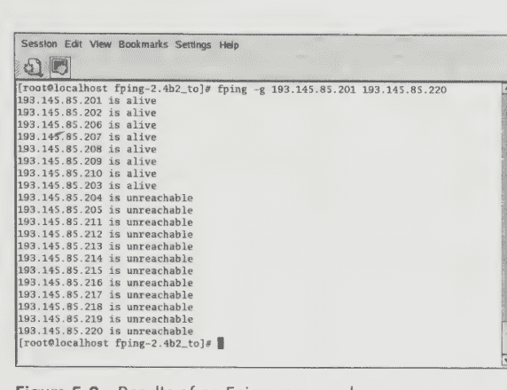
**图5-8** Fping命令的执行结果

#### Hping
你也可以使用**Hping**工具（*www.hping.org/download*）执行ping扫描。不过，许多安全测试人员使用该工具来绕过过滤设备，它支持用户对IP包进行分片和篡改。这款工具功能非常丰富，安全测试人员应当尽可能多地学习这款高级端口扫描工具的复杂用法。如需快速了解，可在任意shell中输入`hping -help |less`命令，浏览可使用的部分参数（见图5-9、图5-10和图5-11）。你会发现，Hping命令可添加大量参数，支持你随意定制IP包。在活动5-3中，你将亲手定制IP包，使用Hping工具时可参考这些图示。

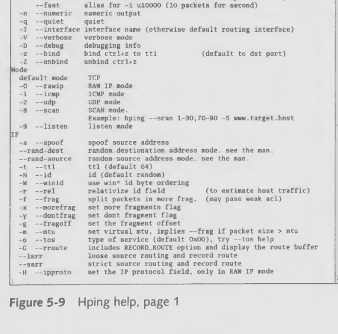
**图5-9** Hping帮助信息第1页
**图5-10** Hping帮助信息第2页
| 选项 | 说明 |
| :--- | :--- |
| ICMP | |
| -C, --icmptype | ICMP类型（默认echo request） |
| -K, --icmpcode | ICMP代码（默认0） |
| --force-icmp | 发送所有ICMP类型（默认仅发送支持的类型） |
| --icmp-gw | 设置ICMP重定向的网关地址（默认0.0.0.0） |
| --icmp-ts | --icmp --icmptype 13的别名（ICMP时间戳） |
| --icmp-addr | --icmp --icmptype 17的别名（ICMP地址子网掩码） |
| --icmp-help | 显示其他ICMP选项的帮助信息 |
| UDP/TCP | |
| -s, --baseport | 基础源端口（默认随机） |
| -p, --destport [+][+][+]port> | 目标端口（默认0），按ctrl+z可递增/递减 |
| -k, --keep | 保持源端口不变 |
| -w, --win | 窗口大小（默认64） |
| -O, --tcpoff | 设置伪造的TCP数据偏移量（替代tcphdrlen/4） |
| -Q, --seqnum | 仅显示TCP序列号 |
| -b, --badcksum | （尝试）发送带有错误IP校验和的数据包，许多系统会在发送数据包时修正IP校验和，因此你会得到错误的UDP/TCP校验和 |
| -M, --setseq | 设置TCP序列号 |
| -L, --setack | 设置TCP确认号 |
| -F, --fin | 设置FIN标志 |
| -S, --syn | 设置SYN标志 |
| -R, --rst | 设置RST标志 |
| -P, --push | 设置PUSH标志 |
| -A, --ack | 设置ACK标志 |
| -U, --urg | 设置URG标志 |
| -X, --xmas | 设置X未使用标志（0x40） |
| -Y, --ymas | 设置Y未使用标志（0x80） |
| --tcpexitcode | 将最后一个tcp->th_flags作为退出代码 |
| --tcp-timestamp | 启用TCP时间戳选项以推测HZ/运行时间 |
| 通用 | |
| -d, --data | 数据大小（默认0） |
| -E, --file | 从文件读取数据 |
| -e, --sign | 添加“签名” |
| -j, --dump | 以十六进制转储数据包 |
| -J, --print | 转储可打印字符 |
| -B, --safe | 启用“安全”协议 |
| -u, --end | 当--file读取到EOF时通知并禁止回绕 |
| -T, --traceroute | traceroute模式（隐含--bind和--ttl 1） |
| --tr-stop | 在traceroute模式下收到第一个非ICMP响应时退出 |
| --tr-keep-ttl | 保持源TTL固定，适用于仅监控一跳的场景 |
| --tr-no-rtt | 在traceroute模式下不计算/显示RTT信息 |
| ARPS | |
| --apd-send | 发送APD描述的数据包（参见docs/APD.txt） |
**图5-11** Hping帮助信息第3页


如果你决定使用ping扫描，请注意不要将广播地址包含在你的地址范围内。如果组织内使用了子网划分，你可能无意中就会犯这个错误。例如，如果IP地址193.145.85.0使用255.255.255.192的子网掩码进行子网划分，会创建四个子网：193.145.85.0、193.145.85.64、193.145.85.128和193.145.85.192。每个子网的广播地址分别为193.145.85.63、193.145.85.127、193.145.85.191和193.145.85.255。如果不慎在主机范围193.145.85.65到193.145.85.127上启动ping扫描，大量流量可能会涌入网络，因为其中包含了193.145.85.127的广播地址。这在B类地址上会更成问题，但如果你执行ping扫描，让客户签署书面协议授权此类测试至关重要。

##### 构造IP数据包
数据包包含源IP地址和目的IP地址。数据包还包含你之前学过的标志信息：SYN、ACK、FIN、URG等。你可以构造任意类型的数据包。Hping和Fping是构造IP数据包的有用工具，你将在活动5-3中使用这两个工具。


###### 活动5-3：使用Fping和Hping构造IP数据包
###### 所需时间：30分钟
####### 目标：学习使用Fping和Hping构造IP数据包。
####### 描述：在本活动中，你将了解如何构造IP数据包，帮助安全测试人员发现网络上运行的服务。你知道的向计算机未公开端口发送数据包并获取响应的方式越多越好。如果计算机不响应发送到特定端口的ICMP数据包，并不意味着发送到同一端口的任何数据包都会得到相同响应。你可能需要向受攻击的计算机发送不同的数据包，才能获得执行全面安全测试所需的结果。
1. 如果必要，使用Linux光盘启动你的Windows XP Professional系统。打开你选择的shell，输入命令**fping -h**并按**回车**键。
2. 要查看讲师分配给你的IP地址范围内存活的主机，输入**fping -g 起始IP地址 结束IP地址**并按**回车**键。记录结果。（请确保使用你分配到的IP范围内的起始和结束IP地址。）
3. 接下来，输入**hping -S 攻击计算机的IP地址**（替换为讲师给你的IP攻击网络中的一个地址）并按**回车**键。使用-S参数，你就完成了一个TCP SYN数据包的构造。
4. 打开另一个shell，输入**tcpdump**并按**回车**键。
5. 将两个shell窗口并排摆放，以便观察输入Hping命令后发生的情况。在未运行Tcpdump的shell中，按**Ctrl+C**返回命令提示符，输入**hping -S 攻击计算机的IP地址**并按**回车**键。观察Tcpdump窗口填充生成的流量。要停止Tcpdump捕获数据包，按**Ctrl+C**。
6. 如果时间允许，查阅Hping帮助页面（如有需要可参考图5-9、5-10和5-11），尝试构造不同类型的数据包。注意Tcpdump输出中生成的网络流量的差异。安全测试人员需要了解发送到受攻击计算机的数据包的细微差异如何产生不同结果。例如，如果计算机不响应SYN数据包，尝试发送ACK数据包。发送FIN数据包时会发生什么？如果没有成功，尝试将相同数据包发送到不同端口。这会改变受攻击计算机的响应吗？
7. 完成后，关闭两个shell。

### 理解Shell脚本
作为安全测试人员，部分工具可能需要修改以更好地满足你的需求。创建自定义脚本——一种可以自动化手动执行耗时任务的计算机程序——是节省时间的解决方案。如前所述，Fping可以使用输入文件执行ping扫描。手动创建包含数千个IP地址的输入文件并不值得花费时间。相反，大多数安全测试人员依靠基本的编程技能编写脚本来创建输入文件。

#### 脚本基础
如果你有过DOS批处理编程经验，那么shell脚本编程对你来说会很熟悉。但如果你来自网络背景、是编程新手，这个主题可能看起来有点难以应付。不要慌张。第7章专注于帮助非程序员快速上手。脚本或批文件是包含多条命令的文本文件，这些命令通常是在命令提示符下手动输入的。如果你发现自己反复使用一组命令执行相同任务，那么这个任务很适合用shell脚本实现。之后你可以仅用一条命令运行该文件或程序。学习创建shell脚本的最佳方式是动手实践，因此你将在活动5-4中获得练习编写脚本的机会。


##### 活动5-4：创建可执行的Shell脚本
##### 所需时间：45分钟
###### 目标：学习创建、保存和运行shell脚本。
###### 描述：许多黑客工具都是用脚本语言编写的，例如VBScript或JavaScript。在本活动中，你将创建一个脚本，生成一个包含IP地址范围的文件。这类文件可以用作Nmap或Fping的输入文件。
1. 如果必要，使用Linux光盘启动你的Windows XP Professional系统。打开你选择的shell，输入`vi Myshell`，然后按**回车**键。
2. 要激活屏幕，先按**Esc**键，然后输入字母"i"。确保未启用大写锁定，因为vi程序区分大小写，如果不注意字母大小写，可能会得到奇怪的结果。屏幕底部应显示你处于插入模式。插入模式允许你在vi shell屏幕中输入文本。如果你是第一次使用vi编辑器，可能需要参考表5-1作为快速查阅。要获取该多用途编辑器的更详细说明，输入`man vi`并按**回车**键。
表5-1 vi命令汇总 | vi命令 | 说明 | | --- | --- | | j | 将插入点向下移动一行 | | k | 将插入点向上移动一行 | | h | 将插入点向后移动一个字符 | | l（小写L） | 将插入点向前移动一个字符 | | 回车键 | 将插入点移动到下一行的开头 | | a | 按Esc键后，在插入点后追加文本 | | i | 按Esc键后，在插入点前插入文本 | | 删除键 | 处于插入模式时覆盖最后一个字符 | | x | 删除当前字符 | | dd | 删除当前行 | | dw | 删除当前单词 | | p | 替换之前删除的文本 | | ZZ | 退出vi并保存所有更改 | | wq | 写入更改并退出编辑会话 |
3. 首先，输入**#!/bin/sh**并按**回车**键。这一行很重要，因为它标识你正在编写的文件为shell脚本。你编写的任何脚本或程序都应添加几行文档，因为它们有助于后续的程序修改和维护。当一行用于文档目的时，其前面会加#字符。
> **警告** 确保斜杠方向正确（/）。微软用户常常犯这个错误，因为他们习惯输入反斜杠（\）。
4. 第二行是你要创建的脚本的名称。输入**# Myshell**并按**回车**键。如果此脚本用于生产环境，你还需要输入日期和你的姓名。
5. 阅读关于脚本用途的段落，但不要将其输入到脚本中。目前你的脚本应仅包含#!/bin/sh和# Myshell语句。
6. 接下来，输入**network_id="193.145.85."**并按**回车**键。确保包含引号和85后面的句点。因为你实际上不会使用这些IP地址，所以使用什么地址都无所谓。
7. 输入**count=0**并按**回车**键。你将count变量初始化为0，这总是明智的，因为变量在程序中使用时必须先设置值。你将在第7章学习更多关于为变量设置值的知识。
8. 你可以跳过文档（如图5-12所示），开始输入关键程序代码。你的程序需要将数字1加到193.145.85.的网络ID后，并持续添加和递增数字到网络ID，直到将193.145.85.1到193.145.85.254的IP地址范围写入名为ip_address.txt的文件。用编程术语来说，这个过程称为循环。为了避免创建无限循环，你需要在while语句中添加条件。输入**while [ "$count" -le 253 ]**并按**回车**键。注意方括号内的空格，并密切关注引号和美元符号的使用。
9. 接下来，输入**do**并按**回车**键。这是你希望程序执行主要任务的地方。操作发生在do语句和done语句之间。首先，要将count变量加1，输入**count=$(($count+1))**，注意括号的使用，然后按**回车**键。
10. 下一行在第7章中有更详细的说明。目前，你只需要了解可以使用printf函数将数据写入文件。输入**printf "%s%s\n" $network_id $count >> ip_address.txt**并按**回车**键。**>>**字符用于将每个IP地址添加到ip_address.txt文件的末尾。
11. 输入**exit 0**。图5-12显示了整个脚本。要保存你的工作，按**Esc**键，然后输入**:**（冒号字符）。在:提示符下，输入**wq**并按**回车**键。
12. 现在你已经保存了脚本，需要将其设置为可执行文件，以便运行。在命令行中，输入**chmod +x Myshell**并按**回车**键。
13. 要运行你的脚本，输入**./Myshell**并按**回车**键。因为你的脚本不会在屏幕上生成任何输出，你需要检查ip_address.txt文件的内容以查看是否生效。
14. 输入**cat ip_address.txt**。ip_address.txt文件中创建了多少个IP地址？
15. 关闭shell并关闭系统。


## 第5章 端口扫描
```sh
#!/bin/sh
### 我的Shell脚本
# 该程序会创建一个名为ip_address.txt的文本文件，其中包含254
# 个IP地址，以193.145.85.0作为网络ID。生成的文件可用作fping工具的输入文件。例如：
# fping -f ip_address.txt
#### 初始化变量
network_id="193.145.85."
count=0
# 当count等于254时停止循环。-le表示小于或等于253，因此count等于253后，该变量还会再递增一次。我们不希望创建193.145.85.255这个
# IP地址，因为这是193.145.85.0/24网络的广播地址。对广播地址执行ping扫描可能会引发问题。
while [ "$count" -le 253 ]
do
count=$(expr $count + 1)
printf "%s%s\n" $network_id $count >> ip_address.txt
done
exit 0
```
图5-12 Shell脚本

### 章节小结
- 端口扫描（也称为服务扫描）是指扫描一段IP地址，以确定某个系统或网络上运行着哪些服务的过程。
- 不同的端口扫描可以获取不同的信息，因此安全测试人员需要了解端口扫描的类型，例如SYN、ACK、FIN等。
- 安全测试人员可以使用大量的端口扫描工具，最常用的是Nmap、Nessus和Unicornscan。
- Ping扫描用于确定网络上哪些计算机是“活跃的”（即攻击者可访问的计算机）。
- 使用Shell脚本可以通过自动执行许多耗时的任务，帮助安全专业人员提升效率。

### 关键术语
**关闭的端口** —— 当端口未监听数据包或不响应数据包时，会被标记为关闭状态。
**被过滤的端口** —— 被标记为既非开放也非关闭，但可能被防火墙等网络过滤设备拦截的端口。
**Fping** —— 增强版Ping工具，可同时向多个目标发送Ping请求。
**Hping** —— 增强版Ping工具，可用于生成用于端口扫描活动的TCP和UDP数据包。
**开放的端口** —— 当端口响应数据包时，会被标记为开放状态。
**Nessus** —— 安装在*NIX类操作系统（服务器）上的安全工具，可执行端口扫描、操作系统识别和漏洞评估。客户端计算机（*NIX或微软操作系统）必须连接到服务器才能执行测试。
**Nmap** —— 用于识别开放端口、检测网络系统上运行的服务和操作系统的安全工具。
**Ping扫描** —— 向一段IP地址发送Ping请求，以识别网络上的活跃系统。
**端口扫描** —— 用于查找主机计算机提供哪些服务的方法。

### 复习题
1. 安全测试人员和黑客使用以下哪种方法来确定主机上运行的服务以及这些服务相关的漏洞？
a. 区域传输
b. 区域扫描
c. 加密算法
d. 端口扫描
2. 当今最常用的端口扫描工具是以下哪种？
a. Netcat
b. Netstat
c. Nmap
d. Nslookup
3. 若要在Linux Shell中获取大量Nmap信息及正确语法示例，应输入以下哪个命令？
a. nmap -h
b. nmap -help
c. nmap ?
d. man nmap
4. 若要在Linux Shell中获取Nmap命令的简要说明，应执行以下哪项操作？
a. 输入nmap -h
b. 输入nmap -help
c. 输入help nmap
d. 按下F1键
5. 以下哪些Nmap命令会向IP地址为193.145.85.210的计算机发送SYN数据包？（选择所有适用项）
a. nmap -sS 193.145.85.210
b. nmap -v 193.145.85.210
c. nmap -sA 193.145.85.210
d. nmap -sF 193.145.85.210
6. 使用nmap -sX 193.145.85.202命令发送的数据包设置了哪些标志？（选择所有适用项）
a. FIN
b. PSH
c. SYN
d. URG
7. 以下哪些Nmap命令可用于验证192.168.1.0网络上任意计算机的SSH端口是否开放？（选择所有适用项）
a. nmap -v 192.168.1.0-254 -p 22
b. nmap -v 192.168.1.0-254 -p 23
c. nmap -v 192.168.1.0-254 -s 22
d. nmap -v 192.168.1.0/24 -p 22
8. 关闭的端口会以__________数据包响应SYN数据包。
a. FIN
b. SYN-ACK
c. SYN
d. RST
9. 哪种扫描类型通常用于绕过防火墙或数据包过滤设备？
a. ACK扫描
b. SYN扫描
c. XMAS扫描
d. FIN扫描
10. 安全测试人员可以使用Hping绕过过滤设备。判断对错。
11. 发送到关闭端口的FIN数据包会以__________数据包作为响应。
a. FIN
b. SYN-ACK
c. RST
d. SYN
12. __________扫描会发送所有标志位均设置为NULL的数据包。
a. NULL
b. VOID
c. SYN
d. XMAS
13. 在网络上执行Ping扫描的潜在风险是什么？
a. 将广播地址包含在Ping扫描范围内
b. 将子网IP地址包含在Ping扫描范围内
c. 将子网掩码包含在Ping扫描范围内
d. 将入侵检测系统的IP地址包含在Ping扫描范围内
14. 端口扫描可以获取除以下哪种端口之外的所有端口的状态？
a. 关闭
b. 开放
c. 被过滤
d. 缓冲
15. NULL扫描需要设置FIN、ACK和URG标志位。判断对错。
16. 为什么fping -f 193.145.85.201 193.145.85.220命令会报错？
a. 使用了错误的开关
b. IP范围应表示为193.145.85.201-220
c. 不存在该命令
d. 该命令不允许使用IP范围
17. 在基础网络扫描中，攻击者会向主机计算机发送ICMP Echo请求（类型8），并等待哪种类型的数据包来确认主机处于活跃状态？
a. ICMP SYN-ACK数据包
b. ICMP SYN数据包
c. ICMP Echo回复（类型8）
d. ICMP Echo回复（类型0）
18. 为绕过网络上的部分ICMP过滤设备，攻击者可能会发送以下哪些类型的数据包来扫描网络中的易受攻击服务？（选择所有适用项）
a. PING数据包
b. SYN数据包
c. ACK数据包
d. ECHO请求数据包
19. 以下哪个是用于创建自定义TCP/IP数据包并发送到主机计算机的工具？
a. Tracert
b. Traceroute
c. Hping
d. Nmap
20. Fping不允许用户同时ping多个IP地址。判断对错。

### 案例项目
#### 案例5-1：获取网络活跃服务信息

在K.J. Williams网络上完成区域传输并运行多种安全工具后，你被要求向IT经理Bob Jones撰写一份备忘录，详细说明你使用了哪些工具来确定其网络上运行的服务。Jones先生对你获取这些信息的方式很感兴趣。你决定查阅OSSTMM（开源安全测试方法手册），阅读其中关于端口扫描的C部分以及“互联网技术安全”部分，尤其是关于服务识别的相关内容，以便更好地回应他的疑虑。基于以上信息，请为Jones先生撰写一份一页的备忘录，说明你获取这些信息所采取的步骤。备忘录需提及你在OSSTMM中找到的与本阶段测试相关的任何信息。

#### 案例5-2：查找端口扫描工具

聘用你担任安全测试人员的公司要求你调研任何可能有助于你完成工作的新工具。值得注意的是，公司目前在用的一些工具存在缺陷或不符合公司的预期。你的经理Gloria Petrelli要求你调研当前市场上可用的新型或改进型产品。基于以上信息，请为Petrelli女士撰写一份一页的报告，介绍一些可能对公司有用的端口扫描工具。报告需包含可用的商业工具及其成本。

#### 第6章
#### 枚举
读完本章并完成练习后，你将能够：
- 描述安全测试的枚举步骤
- 枚举微软操作系统目标
- 枚举NetWare操作系统目标
- 枚举*NIX类操作系统目标

枚举是端口扫描的进阶步骤。现在你已经知道如何发现网络上的活跃系统，接下来的步骤是查找系统上共享了哪些资源、发现登录账户和密码，以及获取网络资源的访问权限。枚举需要连接到系统，而不仅仅是识别网络上存在某个系统。黑客并不满足于知道网络上有计算机系统在运行，他们的目标是找到活跃系统并获取其访问权限。对于安全测试人员来说，枚举是侵入性更强的测试环节，若未获得网络所有者的许可进行该步骤，可能会被提起刑事指控。枚举是指你尝试通过使用公司员工的登录账户来检索信息并获取服务器访问权限的步骤。了解操作系统及其信息存储方式对枚举工作很有帮助。例如，不了解微软操作系统如何处理共享资源，或Novell如何管理文件和文件夹，会使得信息获取或识别这些系统中的潜在漏洞变得更加困难。在本章中，你将学习各类操作系统的基础知识以及枚举它们的工具。其中部分工具此前已经介绍过，部分是新增工具，但它们都能让枚举工作简化为只需输入一条命令或点击一下鼠标即可完成。


第6章 枚举
#### 枚举简介
在前面的章节中，你已经了解了如何执行区域传输、使用Dig命令，以及如何发现网络中存活的主机。安全测试的下一步是什么？**枚举**是从网络中提取以下信息的过程：
- 网络上的资源或共享
- 分配在网络上的用户名或用户组
- 用户上次登录的时间以及对应的密码

要确定网络上有哪些资源或共享，安全测试人员首先需要通过端口扫描和足迹踩点确定网络使用的操作系统。例如，如果网络运行的是微软操作系统，测试人员可以使用特定工具查看这些共享，甚至可能访问其中的资源。

枚举的入侵性更强，因为你不仅是在识别资源，还试图访问它。它已经超出了通过被动扫描网络查找开放端口的范围，有时这个过程还会在确定用户名后尝试猜测密码。

但在你开始使用枚举工具之前，你会在活动6-1中学习如何安装一个Linux工具。微软用户已经习惯了安装程序的简便性，这类程序通常只需要依次点击一系列“下一步”按钮即可完成安装。下载和安装Linux操作系统产品会稍微复杂一些，但经过一些练习后，你也能熟练安装这些产品。在活动6-1中，你将安装NBTscan（NBT是TCP/IP上的NetBIOS的缩写），这是一款用于枚举微软操作系统的工具，你将在本章后续活动中使用该工具。

##### 活动6-1：在Linux操作系统上安装NBTscan
**所需时间：** 30分钟
**目标：** 学习如何在Linux操作系统上下载、解压文件并创建可执行程序。
**描述：** 在本活动中，你将下载一款基于Linux的工具，并将其准备为可在Linux操作系统上运行的可执行程序。这款名为NBTscan的工具用于查找运行NetBIOS的系统。

1. 使用Linux光盘启动你的Windows XP Professional系统，打开任意一款你喜欢的Shell并启动网页浏览器，输入网址**www.inetcat.org/software/nbtscan.html**后按下**Enter**键。（该工具也有WIN32版本，但本活动中你练习的是安装Linux程序。）点击**下载NBTscan源代码**链接，接下来系统会提示你打开文件或保存到磁盘，选择**保存到磁盘**选项。

2. 接下来系统会提示你选择保存程序的目录，创建一个名为**NBTscan**的目录并将文件保存在该目录中。你可以打开Shell输入命令**mkdir NBTscan**，或者点击图6-1中标注为“创建新目录”的图标。文件的保存位置无关紧要，因为Linux光盘会将你操作的程序和文件存储在内存中，下次重启计算机时这些文件就会消失。

**图6-1** 创建新目录

你下载的程序是`nbtscan-1.5.1.tar.gz`。“tar”扩展名代表*磁带归档*。**Tar命令**可以将多个文件和文件夹合并为一个大文件，但不会对文件和文件夹进行压缩。Windows用户习惯了在压缩文件中看到*.zip*扩展名，而UNIX用户则更熟悉*.gz*扩展名，它表示该文件是使用Gzip工具压缩的。例如，要压缩`BigFile.tar`文件，可以使用命令`gzip BigFile.tar`，该命令会生成一个名为`BigFile.tar.gz`的文件。要解压（解压缩）该文件，可以使用命令`gzip -d BigFile.tar.gz`。

> 扩展名为*.tgz*的文件也可以使用`gzip -d`命令解压。

3. 打开任意Shell，切换到**NBTscan**目录。要解压`nbtscan-1.5.1.tar.gz`文件，输入命令**gzip -d nbtscan-1.5.1.tar.gz**后按下**Enter**键。要查看该命令的执行效果，输入**ls**后按下**Enter**键（见图6-2）。

> 你也可以输入命令`tar -zxvf nbtscan-1.5.1.tar.gz`一步完成解压和解归档操作。此外，为了减少可能的输入错误并节省时间，你可以在输入文件名的前几个字符后按下Tab键，文件名会自动补全。

``` [root@localhost NBTscan]# ls nbtscan-1.5.1.tar.gz [root@localhost NBTscan]# gzip -d nbtscan-1.5.1.tar.gz [root@localhost NBTscan]# ls nbtscan-1.5.1.tar [root@localhost NBTscan]# ```

**图6-2** 使用Gzip命令

4. 注意现在目录中已经有了一个tar文件，要解包该文件中的文件或目录，需要使用Tar命令。输入命令**tar -xvf nbtscan-1.5.1.tar**后按下**Enter**键，图6-3显示了该tar文件中包含的文件。

``` [root@localhost NBTscan]# tar -xvf nbtscan-1.5.1.tar nbtscan-1.5.1a/ nbtscan-1.5.1a/ChangeLog nbtscan-1.5.1a/config.guess nbtscan-1.5.1a/config.sub nbtscan-1.5.1a/configure nbtscan-1.5.1a/configure.in nbtscan-1.5.1a/COPYING nbtscan-1.5.1a/errors.h nbtscan-1.5.1a/install-sh nbtscan-1.5.1a/list.c nbtscan-1.5.1a/list.h nbtscan-1.5.1a/Makefile.in nbtscan-1.5.1a/nbtscan.c nbtscan-1.5.1a/range.c nbtscan-1.5.1a/range.h nbtscan-1.5.1a/README nbtscan-1.5.1a/statusq.c nbtscan-1.5.1a/statusq.h nbtscan-1.5.1a/time.h nbtscan-1.5.1a/config.log nbtscan-1.5.1a/config.status nbtscan-1.5.1a/configure.in.old [root@localhost NBTscan]# ```

**图6-3** tar文件中的文件列表

> 要获取更多关于Tar命令的使用信息，输入`man tar`后按下Enter键。

5. 输入**ls -l**后按下**Enter**键查看目录内容，你会发现已经创建了`nbtscan-1.5.1a`目录。要切换到该目录，输入**cd nbtscan-1.5.1a**后按下**Enter**键，接着输入**ls**后按下**Enter**键查看目录内容，见图6-4。

``` [root@localhost nbtscan-1.5.1a]# ls ChangeLog config.sub COPYING list.h range.h time.h config.guess configure errors.h Makefile.in README config.log configure.in install-sh nbtscan.c statusq.c config.status configure.in.old list.c range.c statusq.h [root@localhost nbtscan-1.5.1a]# ```

**图6-4** nbtscan-1.5.1a目录的内容

6. 在计算机上安装新程序之前，你应该始终查看**README**文件。操作方法为：输入**cat README |less**后按下**Enter**键，浏览该文档即可预览后续步骤，完成后按下**q**键退出README文件。

7. 接下来输入**./configure**后按下**Enter**键，你的屏幕会显示多行代码。该命令是一个脚本，用于检查所有配置是否正确，它会输出结果并生成一个名为Makefile的文件，该文件包含了下载包中包含的所有程序。

8. 当滚动停止后，输入**make**后按下**Enter**键运行make程序，它会自动编译Makefile中的程序，否则你需要手动编译所有程序。

9. 接下来输入**make install**后按下**Enter**键，该命令会再次运行make程序，此次会调用Makefile中包含的Install程序（其中包含安装说明）执行安装。现在NBTscan已经安装到你的计算机中了。要查看该程序的相关信息，输入**nbtscan -h |less**后按下**Enter**键。图6-5显示了扫描一段IP地址范围的命令输出，注意名为SALEMGR的计算机位于192.168.0.0网络中，IP地址为192.168.0.100，该命令还会显示该计算机的MAC地址。

``` [root@localhost nbtscan-1.5.1a]# nbtscan 192.168.0.0/24 Doing NBT name scan for addresses from 192.168.0.0/24 IP address NetBIOS Name Server User MAC address ------------------------------------------------------------------------------ 192.168.0.0 Sendto failed: Permission denied 192.168.0.100 SALEMGR <server> <unknown> 00-0b-db-28-73-0d [root@localhost nbtscan-1.5.1a]# ```

| IP地址 | NetBIOS名称 | 服务器 | 用户 | MAC地址 |
|--------------|----------------------------------|----------|------------|-----------------|
| 192.168.0.0 | 发送失败：权限被拒绝 | | | |
| 192.168.0.100| SALEMGR | <server> | <unknown> | 00-0b-db-28-73-0d|

**图6-5** NBTscan找到名为SALEMGR的计算机

10. 如果时间允许，且教室网络中有计算机运行Windows XP系统，可以尝试在网络中使用Nbtscan命令，查看是否能识别出任何计算机。但如果教室中的所有计算机都运行Linux系统，Nbtscan不会返回任何结果，因为Linux不使用NetBIOS。

11. 关闭Linux Shell，保持系统运行以进行下一个活动。


**安全字节**
本书绝非Linux使用操作指南，但安全测试人员需要掌握如何在Linux操作系统上安装工具。尽管本书中的实验活动使用可启动的Linux CD，你也可以考虑下载或购买Linux并安装到你的电脑中。练习安装和使用新工具是学习安全测试技能的最快途径之一。一台可以专用于安全测试的笔记本电脑也很有帮助。你可以对硬盘进行分区，在一个分区中安装Windows XP，另一个分区安装Linux。之后你可以在两个分区中都创建Tools目录，并从互联网上下载安全工具。大多数安全专业人士的笔记本电脑上都安装了大量随时可用的工具库。尽管在Linux环境中安装工具通常比在Windows环境中安装软件更具挑战性，但这并非适用于所有Linux工具。安装Nessus（最强大的安全工具之一）要比6-1实验中的流程简单得多。Nessus的开发者编写了一个shell脚本，可以帮你完成所有操作，因此无需执行解压tar文件、创建可执行文件的命令。

### 枚举微软操作系统
为了了解攻击者可能如何访问微软网络上的资源或共享内容，本节将简要介绍微软操作系统。第8章会更深入地讲解微软系统攻击相关内容；本章仅会重点介绍与枚举相关的微软操作系统。

表6-1 微软操作系统说明
| 微软操作系统 | 说明 |
| :--- | :--- |
| Windows 95 | Windows 95是第一款不依赖DOS的微软图形界面产品，是如今所有Windows版本都在使用的即插即用功能和ActiveX标准的开端。最大的升级可能是注册表，这是一个存储系统硬件和软件信息的数据库，此前这些信息都存储在文件中。Windows 95可运行在独立电脑上，也可运行在通过网络共享信息的电脑上，它使用FAT16文件系统。 |
| Windows 98和Me | 比前代系统更稳定，拥有改进的文件系统（FAT32）、新的硬件支持，以及更完善的备份和恢复工具。Windows Me的枚举流程与Windows 98相同。 |
| Windows NT 3.51 Server/Workstation | 微软开发该操作系统的核心目标是保障安全，并提升其桌面操作系统的网络功能。该系统强调域而非工作组的概念，采用客户端-服务器模型（而非对等网络），由服务器负责对用户进行身份验证，并授予其访问网络资源的权限。这一概念使得域可容纳的计算机数量远多于工作组受限的计算机数量。此外，NTFS和FAT分区之间无法相互查看、读写，彼此无法交互。由于FAT16和FAT32文件系统难以实现安全功能，微软推出NTFS作为替代方案。NTFS支持FAT文件系统无法实现或不支持的文件级安全功能。 |
| Windows NT 4.0 Server/Workstation | 这是Windows NT 3.51系列产品的升级版本，拥有更优秀的图形界面和性能。 |
| Windows 2000 Server/Professional | 在NT系列的此次升级中，微软用Active Directory替代注册表用于存储对象。通过采用X.500目录服务标准，可存储数百万个对象（例如用户、打印机及其他网络资源）。Active Directory的可扩展性更强，且采用轻量级目录访问协议（LDAP）替代X.500使用的高开销协议，因此可支持规模更大的网络基础设施。枚举这些操作系统时需要包含对Active Directory的枚举。 |
| Windows XP Professional | Windows XP Professional继承了Windows 2000最实用的功能，例如基于标准的安全机制、通过微软管理控制台（MMC）实现的更便捷管理，同时融合了更优秀的用户界面和更好的即插即用支持。微软对XP的内核数据结构进行了重要的安全改进，将其设为只读以防止恶意应用程序影响操作系统核心，同时实施了Windows文件保护功能，避免核心系统文件被覆写。尽管有这些改进，早期Windows版本的枚举流程在Windows XP Professional上依然基本适用。 |
| Windows Server 2003 | 这款最新的微软操作系统在部分安全领域进行了改进，例如Internet Information Services（IIS，互联网信息服务）。Windows Server 2003包含四个版本，分别针对不同市场提供不同功能。通常所有2003版本都支持远程桌面、负载均衡和VPN。EFS（加密文件系统）、Windows Management Instrumentation（WMI，Windows管理规范）等管理服务以及.NET应用服务也是四个版本的共通功能。高端版本对PKI（公钥基础设施）、证书服务、Active Directory的支持更好，同时在可靠性、可扩展性、可管理性和安全性方面也有其他增强。同样，尽管微软对这些系统的安全性和稳定性进行了改进，但针对其他微软版本描述的枚举技术对Windows Server 2003家族依然有效。 |

#### NetBIOS基础
在学习如何枚举微软产品之前，你需要先了解**网络基本输入输出系统（NetBIOS）**的基础工作原理。NetBIOS是微软提供的一种编程接口，允许计算机在局域网（LAN）内通信。大多数Windows操作系统都使用NetBIOS来共享文件和打印机。此外，你为Windows系统分配的计算机会被命名为NetBIOS名称。NetBIOS名称最多支持16个字符；最后一个字符保留用于标识计算机上运行的服务类型的特殊十六进制数（00到FF）。因此计算机名称最多只能使用15个字符，NetBIOS会自动添加最后一个字符，用于标识向操作系统注册的服务类型。例如，如果名为SALESREP的计算机运行着服务器服务，操作系统会将这一信息存储在NetBIOS表中。NetBIOS名称在网络中必须唯一，因此不能有两台计算机使用相同的NetBIOS名称。表6-2列出了与计算机上运行的服务或资源类型对应的NetBIOS后缀。你不需要记住所有这些后缀，但有几个非常关键，因为它们可以标识正在被枚举的计算机或服务器是独立计算机还是域控制器。黑客通常会花更多时间攻击被标识为域控制器的计算机，因为这类计算机可以提供更多信息，包括用户账户的登录名和网络资源信息。

表6-2 NetBIOS名称与后缀
| NetBIOS名称 | 后缀 | 说明 |
| :--- | :---: | :--- |
| <computer name> | 00 | 工作站服务注册的计算机名称（也称作NetBIOS名称）。 |
| <_MSBROWSE_> | 01 | 表示该计算机是网络上的主浏览器。主浏览器负责向网络上的所有计算机通知任何NetBIOS名称的变更或新增信息。 |
| <computer name> | 03 | 计算机由信使服务注册，客户端在发送和接收消息时会使用该服务。 |
| <computer name> | 06 | 由路由和远程访问服务（RRAS）注册。 |
| <computer name> | 1F | 计算机上已启动网络动态数据交换（NetDDE）服务。NetDDE是微软操作系统上运行的系统进程，用于实现网络数据的交换。 |
| <computer name> | 20 | 由服务器服务注册。计算机必须运行该服务才能共享打印机或文件。 |
| <computer name> | 21 | 由远程访问服务（RAS）注册。 |
| <computer name> | 22 | 由微软Exchange交换服务注册。 |
| <computer name> | 23 | 由微软Exchange存储服务注册。存储服务是存储邮箱和公共文件夹的位置。 |
| <computer name> | 24 | 由MS Exchange目录服务注册。 |
| <computer name> | 30 | 由调制解调器共享服务器服务注册。 |
| <computer name> | 31 | 由调制解调器共享客户端服务注册。 |
| <computer name> | 43 | 由系统管理服务器（SMS）远程控制客户端注册。SMS允许管理员控制客户端计算机以进行故障排除和管理。 |
| <computer name> | 44 | 表示SMS远程控制工具正在该计算机上运行。 |
| <computer name> | 45 | 表示该计算机上已启用SMS远程聊天功能。 |


## 第6章 枚举
表6-2 NetBIOS名称和后缀（续）
| NetBIOS名称 | 后缀 | 描述 |
|---|---|---|
| <计算机名称> | 46 | 表示此计算机已启用SMS远程传输。 |
| <计算机名称> | 4C | 表明此计算机已配置DEC Pathworks TCP/IP。 |
| <计算机名称> | 52 | 同样表明此计算机已配置DEC Pathworks。 |
| <计算机名称> | 87 | 表示此计算机上正在运行MS Exchange消息传输代理（MTA）。 |
| <计算机名称> | 6A | 表明正在运行Microsoft Exchange Internet邮件连接器（IMC）。 |
| <计算机名称> | BE | 表示正在运行Netmon代理（微软网络监视工具）。 |
| <计算机名称> | BF | 表明正在运行Netmon应用程序。 |
| <用户名> | 03 | 表明正在运行信使服务。 |
| <域名> | 00 | 表明域名服务（DNS）正在运行。 |
| <域名> | 1B | 将该计算机标识为域主浏览器。 |
| <域名> | 1C | 将该计算机标识为域控制器。 |
| <域名> | 1D | 将该计算机标识为主浏览器。 |
| <域名> | 1E | 表示正在运行浏览器服务选举。 |
| <iNet~服务> | 1C | 表明正在运行Internet Information Services（IIS）。 |
| <IIS-计算机名称> | 00 | 同样表明IIS正在运行。 |

#### NetBIOS空会话
NetBIOS系统最大的漏洞之一是空会话，这是一种未经验证的Windows计算机连接，无需使用登录凭据和密码即可建立。本章介绍的许多枚举工具都会建立空会话，以从被攻击的计算机收集登录账户、组成员身份和文件共享等信息。该漏洞已存在十多年，至今仍存在于包括Windows XP在内的近Windows操作系统中。

#### NetBIOS枚举工具
Nbtstat命令是微软操作系统内置的一款功能强大的枚举工具。要显示NetBIOS表，只需执行`Nbtstat -a IP地址`命令。图6-6展示了条目`SALESREP <20>`，其中的“20”代表在SALESREP计算机上运行的服务器服务。NetBIOS表还显示ZIONBANK是域控制器（由1C后缀标识），甚至能泄露当前登录用户的名称：Administrator。另一款微软内置工具是Net view命令，它可以快速查看计算机或服务器上是否存在共享资源。要查看该命令的语法，可在命令提示符中输入`net view ?`，如图6-7所示。你也可以使用端口扫描工具发现的计算机IP地址，例如图6-8展示了在远程Windows 98计算机上执行该命令的场景，该命令可获取名为EMPPASSWORDS的共享名称。攻击者可针对该计算机使用的下一个命令是`\\192.168.0.106\emppasswords`，以获取用户密码。

尽管你可以下载或购买枚举工具，但你应该学会如何利用微软操作系统中已有的工具。一个简单的命令行实用程序就能获取已登录用户的名称，而猜测该用户的密码可以让你快速访问系统。目前有大量密码猜测程序，可在数秒内破解密码。美国国防部使用的其中一款工具是L0phtcrack。（该工具曾免费提供，现在你可以从www.atstake.com/downloads支付少量费用订购。）

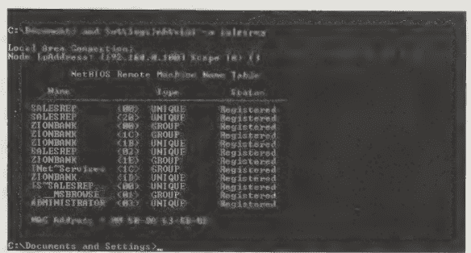 **图6-6** 使用Nbtstat命令
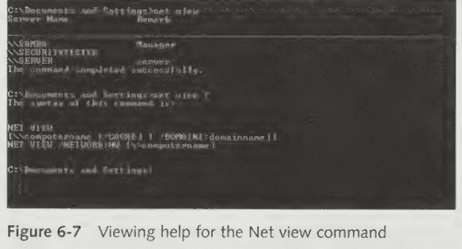 **图6-7** 查看Net view命令的帮助信息
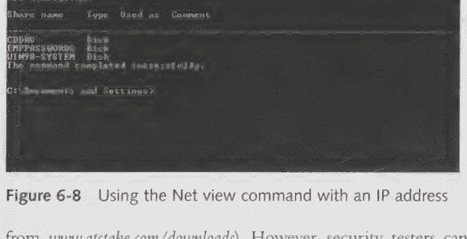 **图6-8** 使用带IP地址的Net view命令（来自www.atstake.com/downloads）

##### 活动6-2：使用微软内置NetBIOS工具
**所需时间：** 30分钟
**目标：** 学习使用微软的Nbtstat、Net view和Net use命令。
**说明：** 在本活动中，你将了解可用于查看NetBIOS服务和共享的工具。使用Nbtstat命令发现网络中共享资源的计算机或服务器后，你可以使用Net view和Net use命令查看是否有计算机共享资源，并可能从你的XP计算机访问这些资源。
1. 如果你的计算机正在运行Linux，请取出Linux光盘并重启计算机。你也可以在shell中输入`init 0`并按**Enter**键关闭Linux系统，然后启动计算机并进入Windows XP Professional系统。
2. 右键单击**开始**按钮，然后单击**资源管理器**。在“开始”菜单窗口中，单击**本地磁盘（C:）**，然后单击菜单栏中的**文件**，指向**新建**，再单击**文件夹**。将新文件夹命名为*你的名字*，然后按**Enter**键。
3. 右键单击你刚创建的文件夹，然后单击**共享和安全**。在“属性”对话框中，勾选**在网络上共享这个文件夹**复选框，然后单击**确定**接受共享名称。
4. 单击**开始**，指向**所有程序**，指向**附件**，然后单击**命令提示符**。在命令提示符窗口中，输入`ipconfig`并按**Enter**键。记下你的IP地址并告知你的搭档。
5. 接下来，输入`net view \\PartnersIPAddress`并按**Enter**键。该命令会输出什么内容？
6. 你可以使用Net use命令连接到包含共享文件夹或文件的计算机。要查看该命令返回的信息，请输入`net use ?`并按**Enter**键。你的屏幕应如图6-9所示。
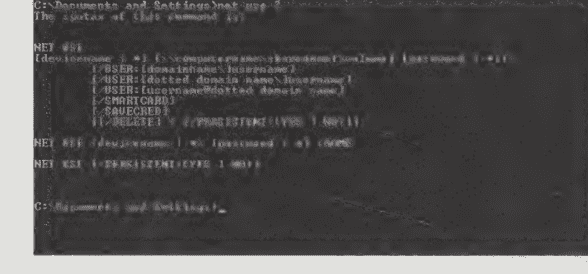 **图6-9** 查看Net use命令的帮助信息
7. 阅读帮助屏幕后，输入`net use \\PartnersIPAddress\PartnersSharedFolder`。该命令的执行结果是什么？
8. 在命令提示符处，输入`nbtstat -A PartnersIPAddress`。该命令的执行结果是什么？
9. 在命令提示符处，输入`exit`并按**Enter**键。保持Windows XP运行状态以进行下一个活动。

##### 其他枚举工具
如你所见，微软有多款内置工具可帮助你枚举NetBIOS系统。在接下来的部分中，我们将介绍一些用于枚举NetBIOS系统的额外工具。

###### NetScanTools Pro
（在第5章中介绍的）NetScanTools Pro可以生成网络中运行NetBIOS的可视化视图。如图6-10所示，右侧分析区域的注释标识出了在139端口发现的NetBIOS会话服务，并标注该计算机为“可能未受保护的Windows计算机”。135至139端口最容易遭受NetBIOS攻击。NetScanTools还会枚举计算机上运行的所有共享，例如图6-11将`\\SALESMGR\\Printer2`列为共享打印机。
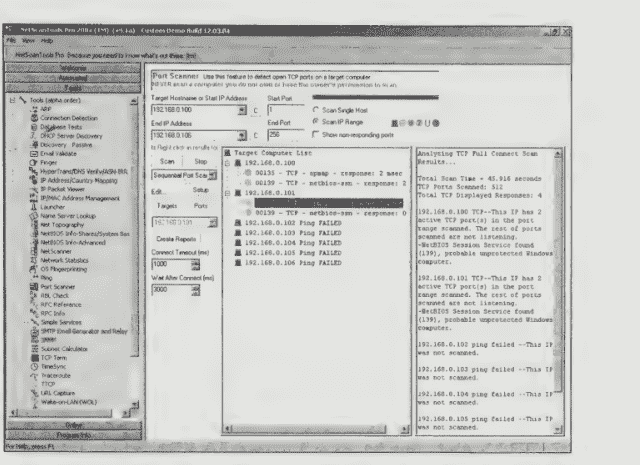 **图6-10** NetScanTools Pro中的枚举工具
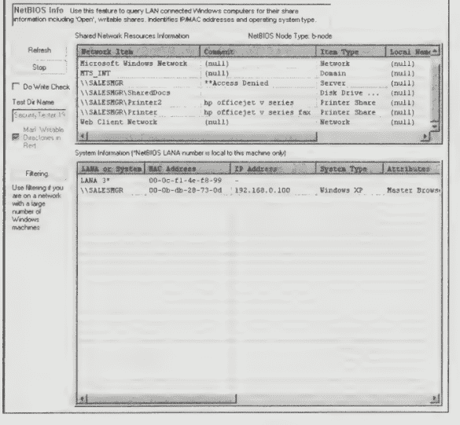 **图6-11** 在NetScanTools Pro中枚举共享

在图6-11中，`\\SALESMGR`条目在“注释”列显示“**访问被拒绝**”，但`\\SALESMGR\SharedDocs`的注释条目在此列为空白。要查看该共享资源是否可访问，攻击者只需在Windows的“运行”对话框中输入通用命名约定（UNC）名称`\\SALESMGR\SharedDocs`即可。

###### DumpSec
DumpSec是一款适用于微软系统的热门枚举工具，由Foundstone公司开发，可从*www.systemtools.com*下载。使用该软件可以收集到令人惊叹的信息。例如，连接到Windows服务器后，你可以下载（在DumpSec中称为“转储”）以下信息：
- 共享权限
- 打印机权限
- 注册表权限
- 列或表格格式的用户信息
- 策略（如本地策略、域策略或组策略）
- 权限
- 服务

###### Hyena
Hyena是一款优秀的微软操作系统管理与安全图形界面工具，可在*www.systemtools.com*获取。其界面易于使用，可为安全专业人员提供大量信息（见图6-12）。只需单击一下，你就可以查看Windows服务器和域控制器的共享及用户登录名。如果网络中存在域或工作组，该工具也会将其显示出来。
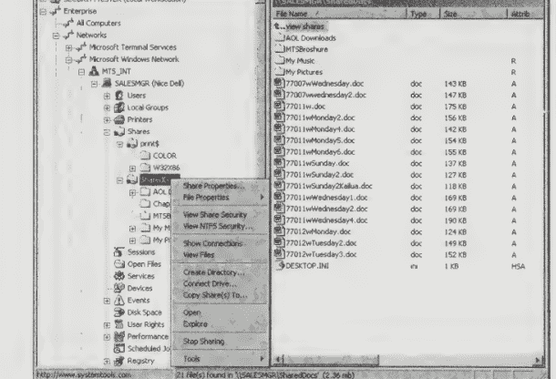 **图6-12** Hyena界面

Hyena还可以显示以下区域的可视化表示：
- 微软终端服务
- 微软Windows网络
- Web客户端网络
- 查找用户/组


###### NessusWX
第5章介绍了Nessus工具，它采用客户端/服务器架构运行。首先配置Nessus服务器并连接到网络；然后配置Nessus客户端以连接到Nessus服务器。Nessus可在任何*类UNIX系统*上运行，但Nessus客户端软件（NessusWX，可在www.nessus.org下载，Windows版本可于http://nessuswx.nessus.org获取）可在*类UNIX系统*和Windows操作系统上运行。NessusWX安装简便，仅需几分钟即可完成配置。当需要在大型网络中枚举不同操作系统、且组织内分布有多台服务器时，这款工具非常实用。你可以使用一台运行Windows XP和NessusWX的笔记本电脑连接到任意Nessus服务器。双击NessusWX桌面图标即可打开会话窗口，样式与图6-13类似。如果尚未建立与网络中任何计算机的会话，窗口将显示为空白。创建会话时，你可以为其命名，方便之后返回并继续枚举工作。名称可以是描述性的，也可以是Nessus默认提供的Session1、Session2等等。注意，XP客户端并不是发起攻击或扫描目标的计算机，这是Nessus服务器的职责，因此尝试连接Nessus服务器前，必须确保服务器已启动并正常运行。
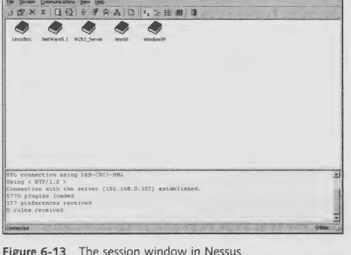
要将Nessus客户端连接到Nessus服务器，请点击会话窗口菜单中的「通信」→「连接」。此时会弹出「连接」对话框，样式如图6-14所示。连接对话框中「服务器」部分的「名称」下拉列表可让你选择要连接的Nessus服务器。网络中可能存在多台Nessus服务器，但本示例中，安全测试人员选择了192.168.0.102服务器。
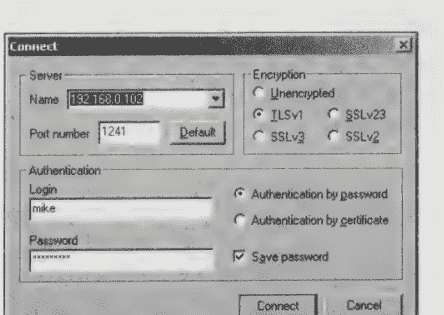
Nessus服务器上创建了一个名为Mike的Nessus用户账号，并为其设置了密码。客户端必须使用这些凭据登录服务器才能通过身份验证。随后XP计算机可在之前图6-13所示的会话窗口中选择要测试的计算机。图6-15至图6-20展示了Nessus的运行效果。在图6-15中，标识为192.168.0.106的主机系统显示了Nessus采集到的8个NetBIOS名称。Nessus将该计算机识别为LAPTOP，并确定当前登录用户为Administrator。这些信息可能被用于发起攻击。
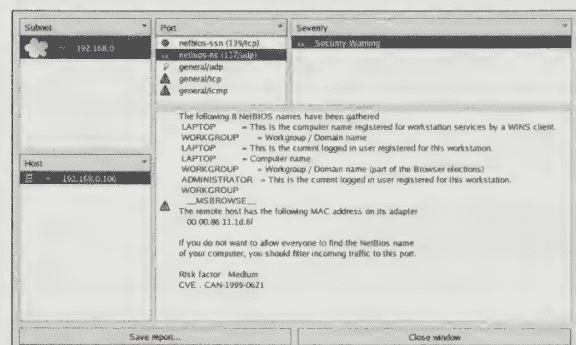
Nessus正在枚举的Windows 98计算机显示了一个高危错误（见图6-16）。Nessus显示了测试人员可访问的4个共享文件夹：IPC$、EMPPASSWORDS、WIN98-SYSTEM和CDDRV。黑客很可能会关注EMPPASSWORDS共享文件夹以窃取员工密码。注意，Nessus还提供了该漏洞的解决方案。
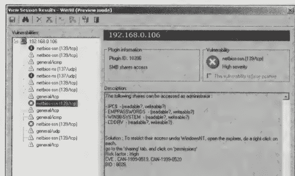
图6-17展示了Nessus识别出的另一个高危错误——本例中为密码漏洞。Nessus还可用于识别计算机上运行的操作系统及服务包。图6-18显示IP地址为192.168.0.101的系统运行的是安装有服务包2（SP2）的Windows XP，且Nessus支持最新版本的Windows系统。
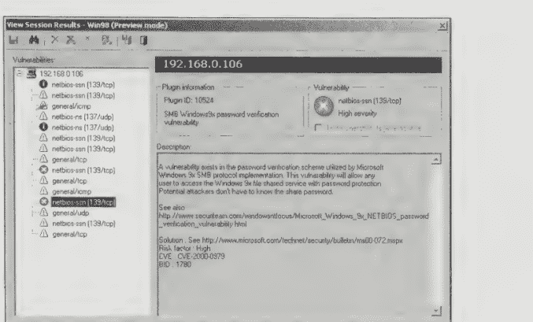
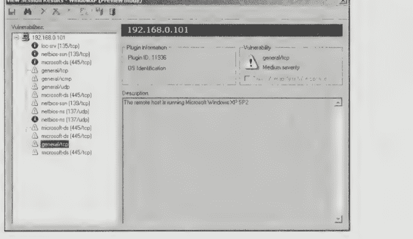
在图6-19中，Nessus识别出远程主机（Windows Server 2003系统）存在「Etherleak」漏洞，这意味着以太网驱动程序正在泄露操作系统内存中的部分内容。图6-20显示了Nessus在53端口（DNS）检测到的防火墙漏洞。Nessus建议检查防火墙规则策略以修复该漏洞。（防火墙相关内容将在第13章详细介绍。）Nessus工具的功能远不止枚举Microsoft操作系统，你将在下一节看到相关内容。它还可用于枚举NetWare系统。
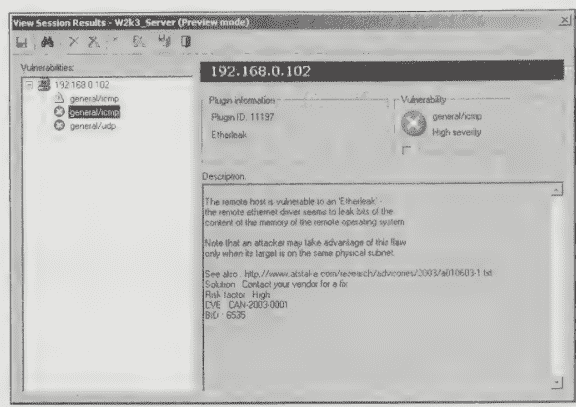
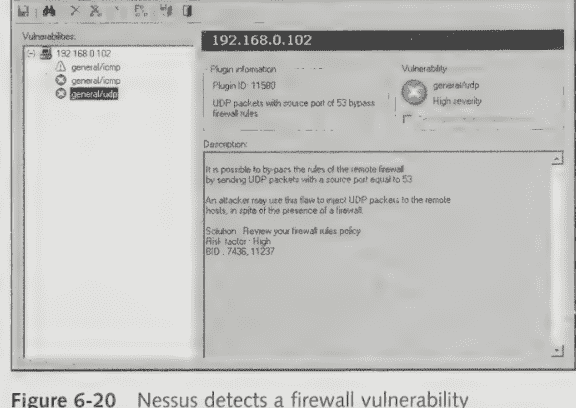

### 枚举NetWare操作系统
很多安全专业人员认为，仅掌握一种操作系统的知识就足够了，但只关注Microsoft系统而忽略*类UNIX系统*——或者反过来——会限制你作为安全专业人员的职业发展。同理，部分安全专业人员将Novell NetWare视为「日薄西山」的操作系统，但仍有大量企业依赖其稳定运行的NetWare服务器。本节将简要介绍NetWare及其部分漏洞，帮助你成为更全能的安全测试人员。
表6-3列出了4.11版本以来的NetWare操作系统。4.11之前的版本现在已很少使用，但若遇到相关系统，你可以通过互联网搜索获取信息。Novell不为4.11之前的版本提供任何技术支持，因此你可以建议使用4.11之前版本的企业升级系统，或考虑迁移至其他平台。
> 安全测试人员通常不会给出软件升级建议。但如果你怀疑硬件或软件故障会导致企业数据遭受不可修复的损坏，那么提供升级或迁移平台的建议是有意义的。
| NetWare操作系统 | 描述 |
| :--- | :--- |
| NetWare 4.1 | 该版本增强了称为Bindery的数据库文件系统，并引入了NetWare目录服务（NDS）目录结构。使用Bindery时，数据保存在每台服务器上；而NDS则存储了网络中所有NetWare服务器的对象和登录信息。这项基于X.500标准的技术支持将数百万个对象存储到分层数据结构中。 |
| Intranetware 4.11 | 该版本新增了更多内网功能。 |
| NetWare 4.2 | 该版本比前代更易安装，并集成了电话、多媒体和网页浏览等服务功能。 |
| NetWare 5.0 | 该版本侧重于使用图形化界面，而非命令行工具。此外，TCP/IP取代IPX/SPX成为默认协议。 |
| NetWare 5.1 | 该版本强调互联网是企业不可或缺的组成部分。新功能包括IBM WebSphere应用服务器、eDirectory（NDS的增强版本）、用于集中式网络管理的图形化Java工具ConsoleOne，以及Novell证书颁发机构服务，该服务支持服务器颁发数字证书。 |
| NetWare 6.0 | 该版本提供了更多从远程Web浏览器客户端访问文件和文件夹的工具，并对eDirectory结构进行了改进。此外还将Apache Web服务器、Tomcat Servlet引擎和NetWare Enterprise Web服务器作为操作系统的一部分新增进来。 |
| NetWare 6.5 | 该版本优化了Web访问，并新增了Web开发和软件开发工具（如MySQL和PHP脚本语言），可用于创建动态网页。 |
| SUSE Linux Enterprise Server（NetWare 7.0） | 最新的NetWare操作系统，采用SUSE Linux作为底层操作系统，eDirectory作为数据库。 |
Novell多年来一直在改进其产品，但该操作系统存在与Microsoft系统的NetBIOS空会话类似的漏洞。虽然本书没有专门用一整章讨论NetWare黑客技术，但下一节包含多张截图，方便你在需要对含NetWare服务器的网络进行安全测试时熟悉该系统界面。

#### NetWare枚举工具
NetWare 5.1仍被广泛应用于众多网络，因此本节提供了一个枚举NetWare 5.1系统的示例。对于较新的NetWare版本，你可能需要针对特定版本研究相关漏洞与利用方式，例如通过谷歌搜索「NetWare 6.5漏洞」。由于每天都会发现新的操作系统漏洞，你需要经常查看厂商网站及其他发布安全漏洞信息的网站，保持警惕。在活动6-3中，你将学习如何研究NetWare 5.1的漏洞。


##### 活动6-3：发现NetWare 5.1的漏洞
###### 所需时间：30分钟
###### 目标：学习使用搜索引擎发现NetWare 5.1的漏洞
###### 描述：在本活动中，你需要在互联网上搜索NetWare 5.1的相关漏洞，以便找到访问服务器资源的方法。由于你可能对NetWare不太熟悉，你还需要在网上搜索能够辅助你使用NetWare命令、开展安全测试的相关站点。
- 1. 在Windows XP Professional系统中打开网页浏览器，在地址输入框中输入www.cve.mitre.org，然后按下Enter键。
- 2. 向下滚动通用漏洞披露（CVE）主页，点击Search CVE图标。
- 3. 在Search CVE页面中，在Keyword(s)输入框中输入“NetWare 5.1”，然后点击Search。你找到了多少条CVE条目？
- 4. CAN-2001-1233与枚举用户名、组名以及可从远程用户获取的其他信息相关。点击该条目并阅读相关信息。所有NetWare用户都需要关注这个候选条目吗？
- 5. 返回条目页面，点击CVE-2002-1417条目。如果有的话，它对访问用户信息有什么意义？
- 6. 如果时间允许，阅读其他CVE或CAN条目。完成后关闭网页浏览器，并关闭Windows XP。
为了了解NetWare枚举的具体运作方式，你可以查看使用Nessus扫描NetWare 5.1服务器的示例。图6-21展示了在NetWare服务器的轻量级目录访问协议（LDAP）配置中检测到的漏洞。LDAP（端口389）是用于访问Novell eDirectory目录树和Microsoft Active Directory的协议。Nessus还指出LdapMiner可被用于利用该漏洞。（在案例项目6–2中，你需要在网上调研LdapMiner。）
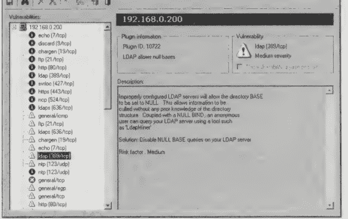
在图6-22中，左侧的目录树中选中了另一个漏洞。Nessus能够获取eDirectory的相关信息，例如组织对象名称（ZIONBANK）以及BankActsZionBank.com的通用名称（CN）对象。图6-23和图6-24展示了Nessus发现的最危险的漏洞：FTP账户的用户名和密码（图6-23），以及若干用户账户的名称（图6-24）。攻击者可使用这些登录名和密码尝试访问服务器。
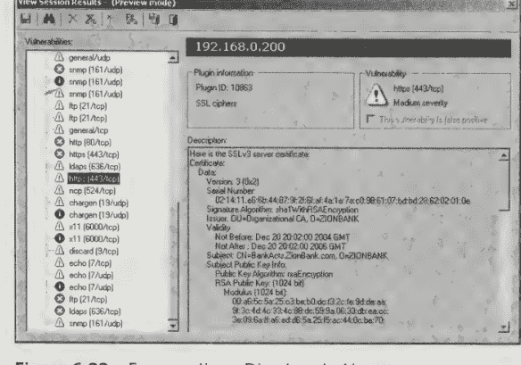
图6-22 Nessus枚举eDirectory
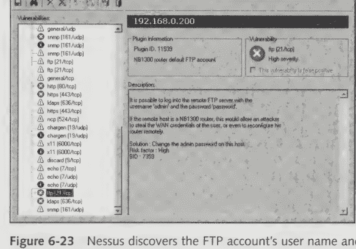
图6-23 Nessus发现FTP账户的用户名和密码
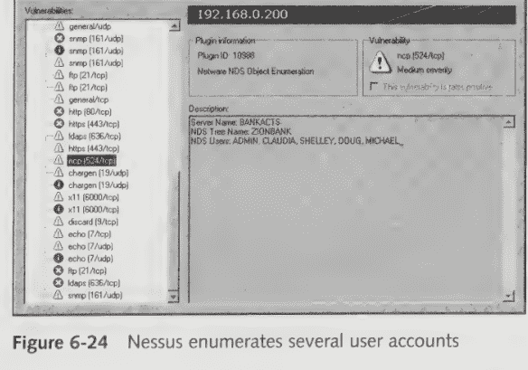
图6-24 Nessus枚举若干用户账户
和Microsoft一样，NetWare也有专属的工具用于收集共享和资源相关信息。如果你知道自己可能需要对搭载NetWare服务器的网络开展安全测试，可以考虑安装Novell Client32，该工具可通过www.novell.com上的Download链接获取。以下示例中下载的是Windows 95/98版本的客户端，不过也提供其他操作系统的客户端。下载客户端软件后，运行Setup安装程序完成安装。重启计算机后，会弹出图6-25所示的Novell登录对话框。
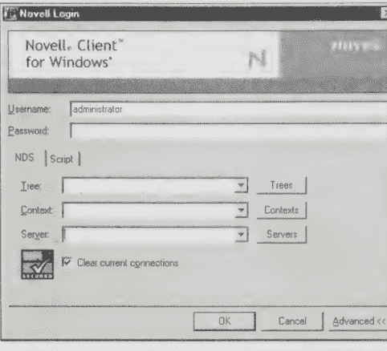
如果点击Trees按钮，会打开Tree对话框（见图6-26）。无需提供登录名和密码即可打开该对话框，这是NetWare操作系统的一个漏洞。

点击OK后，Novell登录对话框会再次打开。点击Contexts按钮会显示可用上下文列表（即eDirectory目录树中的位置）。在图6-27中，显示了NewYork的上下文名称，但尚未给出登录服务器的相关信息。

如果在Contexts对话框中点击OK，会返回Novell登录对话框。点击Server按钮会显示可登录的可用服务器列表（见图6-28）。下一步是选择服务器（本示例中仅BANKACTS可用），然后点击OK。

**图6-28** 显示NetWare中的可用服务器
现在Novell登录对话框的所有登录字段都已填入数据。下一步是尝试将登录名改为“Admin”，密码改为“password”，这是Nessus从FTP账户获取的信息（见图6-29）。

**图6-29** 使用Nessus提供的凭据登录
点击OK后，会显示图6-30所示的窗口，表明输入的登录名和密码正确。

**图6-30** NetWare登录被接受后显示的信息
现在你已经可以访问NetWare服务器了。如果打开Windows资源管理器，你可以通过客户端软件创建的映射驱动器访问该服务器（见图6-31）。

图6-31 通过映射驱动器访问NetWare
### 枚举*NIX操作系统
本章所涉及的操作系统中，UNIX是最古老的。大多数计算机制造商都开发了自己版本的这一流行操作系统，但由于版权限制（只有AT&T可以使用“UNIX”这个名称），他们无法在产品名称中使用“UNIX”。其他UNIX变体包括以下这些：
- Solaris（太阳微系统公司）
- SunOS（太阳微系统公司）
- Xenix（微软公司）
- HP-UX（惠普公司）
- A/UX（苹果公司）
- Dynix（Sequent公司）
- Linux（由林纳斯·托瓦兹开发）
- Fedora Linux（由社区贡献者开发，红帽公司赞助）
- Debian Linux（由全球贡献者开发）
- SUSE Linux（Novell公司）
- Red Hat Linux（红帽软件公司）
- Ultrix（数字设备公司）
- AIX（IBM公司）
- BSD UNIX（加州大学伯克利分校）
- FreeBSD（基于BSD的UNIX，由众多贡献者开发）
- OpenBSD（基于BSD的UNIX，由贡献者开发）
- NetBSD（基于BSD的UNIX，由贡献者开发）
如你所见，许多企业都有自己版本的UNIX操作系统。由林纳斯·托瓦兹创建的Linux就是UNIX的一个变体。市面上存在如此多的UNIX变体，难怪许多计算机专业人士都在尝试使用这一操作系统。新版Linux的安装和配置更加简便。它们还自带了图形用户界面和网页浏览器，让软件的使用更加容易。通过使用Linux引导加载器（LILO，适用于多引导系统的引导程序）或Grand Unified Bootloader（GRUB），可以让家用计算机或笔记本电脑同时启动Windows和Linux系统。即使是计算机新手现在也可以安装最新版的Fedora Linux。
#### UNIX枚举
安全测试人员和黑客最常用的枚举工具是Finger工具，该工具可以通过一条简单的命令找出登录到*NIX系统的用户（见图6-32）。

如果你有UNIX使用经验，可能曾使用Finger查找过导致系统出问题的进程的所有者，例如死循环进程或导致其他进程卡死的进程。在终止这类进程前，管理员可能需要先找到该进程的所有者，联系对方了解正在运行的进程内容，防止问题再次发生。
Nessus在*NIX枚举中也十分有用。图6-33展示了Nessus扫描Red Hat Linux 3.0 Enterprise服务器和Linux 7.2系统时发现的内容。如你所见，Nessus将该漏洞的严重等级评定为“高危”。Nessus表示该漏洞与缓冲区管理功能相关，攻击者可能借此在主机上执行任意命令。换句话说，该系统可能存在缓冲区溢出漏洞。

##### 活动6-4：使用Finger枚举UNIX系统
###### 所需时间：30分钟
###### 目标：学习在本地和远程*NIX系统上使用Finger命令
###### 描述：在本活动中，你将使用Finger命令枚举你的Linux计算机，了解这个强大的命令如何从远程系统收集信息。
- 1. 在Windows XP Professional系统中，从学生版Linux光盘启动。
- 2. 打开终端，输入**man finger**，然后按下**Enter**键。


3. 通读操作手册，使用空格键滚动浏览文档。完成后按下Ctrl+Z退出。
4. 在任意命令行Shell中输入**finger root**，然后按下**回车**键。注意输出会显示登录名、root账户当前所在的目录、正在使用的命令行Shell，以及root账户登录系统的日期。
5. 要确认远程*类UNIX*服务器上是否存在root账户，请输入**finger root@mit.edu**命令并按下**回车**键。你可以尝试不同的远程地址，但截至本书撰写时，使用root@mit.edu会返回如图6-34所示的信息。
``` 
[root@server /]# finger root@mit.edu
Student data loaded as of May 17, Staff data loaded as of May 17.
Notify Personnel or use WebSIS as appropriate to change your information.
Our on-line help system describes How to change data, how the directory works, where to get more info.
For a listing of help topics, enter finger help@mit.edu. Try finger help_about@mit.edu to read about how the directory works.
Directory bluepages may be found at http://mit.edu/communications/bp.
There were 2 matches to your request. Complete information will be shown only when one individual matches your query. Resubmit your query with more information. For example, use both firstname and lastname or use the alias field.
name: Root, David
department: The Broad Institute
title: Research Scientist II, RNAi Consortium Project Ldr
alias: D-root
name: Root, Philip J
title: G
alias: P-root
[root@server /]#
```
**图6-34** 在远程系统上使用finger命令
6. 阅读返回的输出，注意获取到了两个额外的名称：David和Philip。如果你要枚举该服务器，这些账户信息可能会派上用场。
7. 要进一步挖掘信息，请输入**finger David@mit.edu**命令并按下**回车**键，查看是否能收集到该人员的更多信息。图6-35展示了返回的信息。
``` 
[root@server /]# finger David@mit.edu
Student data loaded as of May 17, Staff data loaded as of May 17.
Notify Personnel or use WebSIS as appropriate to change your information.
Our on-line help system describes How to change data, how the directory works, where to get more info.
For a listing of help topics, enter finger help@mit.edu. Try finger help_about@mit.edu to read about how the directory works.
Directory bluepages may be found at http://mit.edu/communications/bp.
There were 5 matches to your request. Complete information will be shown only when one individual matches your query. Resubmit your query with more information. For example, use both firstname and lastname or use the alias field.
name: Martin, David F
department: Media Laboratory
title: Administrative Assistant II
alias: D-martin1
name: David, Edwin F
department: Lincoln Laboratory
title: LL - Technical Staff
alias: E-david
name: David, James A.W.
department: Non-Institute Harvard
title: G
alias: J-david
name: David, Lawrence Anthony
title: G
alias: L-david
name: David, Robert
department: Mechanical Engineering
year: G
alias: R-david
[root@server /]#
```
**图6-35** 使用finger命令收集特定用户的信息
8. 情况越来越复杂了！接下来，选择finger命令识别出的其中一个账户。输入**finger -s E-david@mit.edu**命令并按下**回车**键，图6-36展示了该命令的执行结果。

**图6-36** 使用finger命令收集用户的额外信息
9. 花几分钟时间查看finger命令披露的其他账户，记得也尝试使用Philip@mit.edu账户。
10. 识别系统上的账户登录名称可能会对该系统的所有者或管理员造成损害。finger命令还提供了哪些可能被攻击者利用的信息？请给出具体示例。
11. 关闭所有打开的窗口，并关机。
### 章节总结
- 枚举是从系统中提取用户名、密码和共享资源的过程。
- 枚举Microsoft目标可使用Microsoft内置工具完成，例如Nbtstat、Net view和Net use命令，也可使用多种其他实用工具。枚举Microsoft系统高度依赖NetBIOS空会话漏洞。
- 用于枚举Microsoft目标的许多工具也可用于枚举NetWare目标。此外，Novell Client软件可用于NetWare枚举，以查看eDirectory目录结构和共享资源。
- 枚举*类UNIX*系统可使用内置的UNIX实用工具完成，例如finger命令，也可使用用于枚举其他操作系统的工具，例如Nessus。
### 关键术语
- **枚举** — 连接到系统并获取登录名、密码、组成员身份和共享资源等信息的过程。
- **网络基本输入输出系统（NetBIOS）** — 一种Microsoft编程接口，允许计算机在局域网内通信。
- **空会话** — 空会话是指向Microsoft系统发起的未经身份验证的连接。
- **Tar命令** — 该命令可将多个文件和文件夹合并为一个称为磁带归档的文件，但不会压缩文件和文件夹。
### 复习题
1. ______________通常在端口扫描之后进行，是侵入性更强的测试流程。
a. 端口扫描
b. 枚举
c. 空扫描
d. 计数
2. 安全测试人员执行枚举的原因有哪些？（选择所有适用项。）
a. 获取共享和网络资源的访问权限
b. 获取用户登录名和组成员身份
c. 发现计算机和服务器上运行的服务
d. 发现计算机和服务器上的开放端口
3. 以下哪些工具可用于枚举Microsoft操作系统？（选择所有适用项。）
a. Nessus
b. DumpSec
c. DumpIt
d. Hyena
4. 如果端口______________被过滤，枚举会更难执行。
a. 110/UDP
b. 443/UDP
c. 80/TCP
d. 139/UDP
5. 你可以使用以下哪个命令解压nbtscan-1.5.1.tar.gz文件？（选择两个答案。）
a. unzip nbtscan-1.5.1.tar.gz
b. gzip nbtscan-1.5.1.tar.gz
c. gzip -d nbtscan-1.5.1.tar.gz
d. tar -zxvf nbtscan-1.5.1.tar.gz
6. 你要使用以下哪个命令解压nbtscan-1.5.1.tar文件？
a. tar -xvf nbtscan-1.5.1.tar
b. tar -expand nbtscan-1.5.1.tar
c. tar -xvf nbtscan-1.5.1.tar.gz
d. tar -xvf nbtscan-1.5.1.gz
7. 要识别193.145.85.0网络上系统的NetBIOS名称，你要使用以下哪个命令？
a. nbtscan 193.145.85.0/24
b. nbtscan 193.145.85.0-255
c. nbtstat 193.145.85.0/24
d. netstat 193.145.85.0/24
8. 以下哪个是用于查看Microsoft网络上NetBIOS共享的Microsoft命令行实用工具？
a. Net use
b. Net user
c. Net view
d. Nbtuser
9. 要查看NetWare 5.1服务器上的eDirectory信息，你应该使用以下哪个工具？
a. Nmap
b. Mmap
c. Nbtstat
d. Novell Client32
10. Nbtstat命令用于枚举*类UNIX*系统。判断对错。
11. NetBIOS名称最多可包含_________个字符。
a. 10
b. 11
c. 15
d. 16
12. 以下哪个命令用于将一台计算机连接到运行Server服务的另一台计算机？
a. Net view
b. Net use
c. Netstat
d. Nbtstat
13. 哪些端口号最容易受到NetBIOS攻击？
a. 135至137端口
b. 389至1023端口
c. 135至139端口
d. 110和115端口
14. 以下哪个是用于枚举Microsoft操作系统的常用工具？
a. DumpSec
b. DumpIt
c. Netcat
d. Finger
15. 以下哪个是可以安装在Windows操作系统上的Nessus客户端？
a. Nessus
b. NessusWX
c. Nessus for Windows
d. Nessus Client
16. 大多数NetBIOS枚举工具使用以下哪种方式连接到目标系统？
a. ICMP数据包
b. 默认登录和空白密码
c. 空登录和空密码
d. 管理员账户
17. 预防NetBIOS类型攻击的最佳方法是什么？
a. 在防火墙处过滤135至139端口
b. 告知用户创建难以猜测的密码
c. 暂停Workstation服务
d. 停止Workstation服务


18. 下列哪项是常用的UNIX枚举工具？
a. Netcat
b. Nbtstat
c. Netstat
d. Finger
19. 若要确定IP地址为193.145.85.202的Windows 98计算机是否存在共享资源，应使用以下哪条命令？
a. netstat -c 193.145.85.202
b. nbtscan -a 193.145.85.202
c. nbtstat -A 193.145.85.202
d. nbtstat -A 193.145.85.202
20. Microsoft的net use命令是快速发现计算机或服务器上共享资源的方式。判断对错？

### 案例项目

#### 案例6-1：K. J. Williams网络系统枚举
在完成K. J. Williams网络的枚举工作后，你发现多台Windows 98计算机上存在面向帮助台部门的共享文件夹。当你访问其中一个包含一线支持人员信息的共享文件夹时，发现其中有一份Excel表格，列出了所有员工的电子邮件地址和密码。帮助台工作人员会使用这个共享文件夹访问该Excel表格，以便在用户声称忘记密码时提供相关信息。帮助台工作人员即使不在办公室时也需要使用这些信息。基于以上信息，给IT经理Bob Jones撰写一封一页的备忘录，说明你在发现该问题后将要采取的步骤。备忘录还需要提及你在开源安全测试方法手册（OSSTMM）中找到的与此次发现相关的信息，并提出改进建议。

#### 案例6-2：互联网上LdapMiner工具调研
在使用Nessus及其他枚举工具后，你发现K. J. Williams公司运行着一台NetWare 5.1服务器，用于存储计费信息。Nessus检测到NetWare服务器上存在5个账户：TMulligan、CSmith、GPetrelli、PRichardson和CRivera。Nessus还显示，NetWare服务器的LDAP服务存在一个漏洞，可被名为LdapMiner的程序利用，因此你对该程序进行了互联网检索。基于你找到的信息，给主管撰写一封一页的报告，说明LdapMiner如何被用于攻击NetWare服务器，并讨论利用所列用户账户可发起的攻击。

#### 第7章
### 面向安全专业人员的编程
**阅读完本章并完成练习后，你将能够：**
- 解释基本编程概念
- 编写简单的C程序
- 解释如何使用HTML创建网页
- 描述并编写基础的Perl程序
- 解释基本面向对象编程概念

作为安全专业人员，你需要了解黑客和安全测试人员如何使用计算机编程。本章将介绍编程的基础技能。读完本章你不会成为专家级程序员，但你会对计算机程序的编写方式有更清晰的认识。消除编程的神秘感，就能化解许多网络专业人员听到“编程”这个词时的恐惧。掌握基础编程知识还能帮助你在进行安全测试时开发定制安全工具，或修改现有工具。事实上，大多数安全测试岗位都要求应聘者能够创建定制化的安全工具。正如优秀的木匠知道如何改造工具以适应特殊工作需求一样，安全测试人员也应懂得如何修改为单一用途开发的计算机工具，使其能够实现其他功能。本章将带你全面了解C、HTML和Perl。成为计算机程序员需要投入大量时间并进行反复练习，但本章将为你提供查看现有计算机程序、自行练习编写少量程序的机会。

### 计算机编程入门
正如图书编辑必须掌握英语语法规则，计算机程序员也必须了解编程语言的规则。程序员无需面对语法错误，但必须处理**语法错误**。命令的语法必须完全准确，哪怕分号、括号的摆放位置都不能有误。出现一处微小错误，程序就可能无法正常运行，更糟糕的是，还会产生不可预测的结果。成为计算机程序员需要敏锐的观察力和耐心；请记住，第一次尝试编写程序时出现错误是很正常的事。

#### 计算机编程基础
堆满了编程语言语法和命令的手册会占据你书架的大量空间，但任何编程语言都有一些基础内容，无需查阅手册就能掌握。事实上，你只要了解一些编程基础知识，就可以开始编写程序，这些知识可以用首字母缩写BLT（对应培根、生菜、番茄三明治的缩写）来记忆：

##### 分支、循环与测试（BLT）
大多数编程语言都支持分支、循环和测试操作。例如，C程序中的一个函数可以跳转到程序中的另一个函数，在那里执行任务，然后再返回到起始位置。**函数**是主程序内用于执行特定任务的迷你程序。例如，你可以编写一个函数来实现两个数字的相加，然后将结果返回给调用它的函数。**分支**是指从程序的一个区域（函数）跳转到另一个区域的操作。**循环**是指反复执行某项任务的行为。循环通常在完成对变量的**测试**（返回真或假的结果）后结束。尽管你目前无需担心语法问题，请查看以下程序，观察它在哪些地方使用了分支、循环和测试：

```c main() { int a = 1 /* Variable initialized as an integer, value 1 */ if (a > 2) /* Testing if "a" is greater than 2 */ printf("A is greater than 2"); else GetOut(); /* Branching--calling a different function */ GetOut() /* Do something interesting here */ { for(a=1; a<11; a++) /* Loop to print 10 times */ { printf("I'm in the GetOut() function"); } } } ```

以上就是计算机编程的BLT基础。当然，编程需要学习的内容还有很多，但只要你掌握这三种操作，你就可以分析计算机程序并理解其功能。计算机程序由多个执行特定任务的不同函数（或模块）组成。假设你要编写一个制作BLT三明治的程序，第一步需要列出该流程中的所有任务。用计算机术语来说，你就是在编写制作BLT三明治的**算法**（相当于食谱）。算法要尽可能保持简洁，而编写算法是需要掌握的最重要的编程技能之一。跳过算法中的某个步骤可能会引发问题，例如，不冲洗生菜可能会导致你的三明治出现**bug**。同理，不仔细审查程序代码可能会导致你的程序出现**bug**——也就是会导致不可预测结果的错误。Bug比语法错误更糟糕，因为带有bug的程序可能可以正常运行，但输出结果会不正确或不一致。执行任务的顺序错误也可能造成混乱，例如，在烤面包之前就抹上蛋黄酱，可能会导致烤出来的面包软塌。以下是制作BLT三明治的算法示例：
- 采购食材。
- 收集制作三明治所需的所有厨具。
- 清洗番茄和生菜。
- 切片番茄，将生菜叶分开。
- 煎培根。
- 沥干培根。
- 烤面包。
- 在烤好的面包上抹蛋黄酱。
- 将煎好的培根、番茄片和生菜叶放在面包上。
- 将两片烤好的面包合在一起。

随后程序员会将该算法转换为**伪代码**。伪代码不是编程语言，而是一种类似英语的语言，你可以用它来帮助你搭建程序的结构。以下是在编写编程代码前，对应采购制作BLT三明治所需全部食材的伪代码示例：

``` PurchaseIngredients Function Call GetCar Call DriveToStore Purchase Bacon, Bread, Tomatoes, Lettuce, and Mayonnaise at store End PurchaseIngredients Function ```

写完伪代码后，你就可以开始用你选择的语言编写程序了。每编写一个计算机程序都必须先写算法和伪代码吗？并不需要。如果你要编写的程序代码行数很少，可以跳过这两个步骤，但对初学者来说，这两个步骤是很有帮助的。

##### 文档编写
编写任何计算机程序时，记录工作内容都是必不可少的。要做到这一点，你需要在代码中添加注释，说明你所做的操作。文档不仅能让其他人更容易修改你的程序，还能帮助你自己回忆起编写程序时的思路。“无可奉告”这个词可能适合政客或掌握内幕信息的华尔街投资者，但不适合计算机程序员。尽管文档编写很重要，但许多程序员都觉得它耗时又繁琐。他们通常认为自己的代码是自解释的，任何人都能轻松维护和修改，因此没有必要编写文档。但很快你就会发现，如果没有良好的文档，哪怕是你三周前写的代码，你自己都未必能看懂，更别指望陌生人能理解你的思路了。

> // The following function was added to the program June 15, 2005
> // per a request from the Marketing Department.
> // It appears that reports generated by the sales() function were
> // not giving the Marketing folks information about the sales in
> // Asia. This new function now uses data from text files from the
> // offices in Tokyo and Hong Kong.
> - 双胞胎软件公司的鲍勃·C.

软件工程公司不会聘用不编写文档的程序员，因为他们知道软件项目80%的成本都用于维护。他们还知道，每2000行代码出现1个bug是行业平均水平。Windows 2000包含近5000万行代码。微软的软件工程师在很大程度上得益于严格的文档规范，成功将bug数量控制在了

该项目的程序数量不足60,000个。对于新手程序员来说，这个数字似乎极高，但微软的平均bug数量远低于行业标准。由于程序中的bug非常普遍，很容易理解攻击者为何能在软件中发现漏洞。面对着数千行代码，程序员难免会遗漏某些可能造成攻击者可利用的安全漏洞的内容，这并不奇怪。
###### 活动7-1：编写你的第一个算法
####### 所需时间：10分钟
####### 目标：学习编写算法
####### 说明：
计算机程序员必须能够逻辑思考，将问题拆解为清晰的步骤或任务来逐一解决。遗漏某个步骤可能会产生灾难性后果，因此你应该训练自己形成结构化、逻辑化的思维习惯。检验自己是否能遵循分步思路的好方法，就是完成鼓励你这样思考的练习。本次活动中，请至少列出制作炒鸡蛋的10个步骤。编写步骤时，不要想当然地省略任何细节，也就是说，要假设一个完全不懂烹饪、甚至不知道鸡蛋是什么的人会尝试按照你编写的算法操作。
### 学习C语言
安全测试人员可以使用多种编程语言。本教程将首先介绍最流行的编程语言之一：C语言，它由丹尼斯·里奇于1972年在贝尔实验室开发。C语言功能强大且简洁，事实上，最初用**汇编语言**编写的UNIX系统很快就被用C语言重写了。很少有程序员喜欢用二进制（机器码）或机器语言编写程序。汇编语言使用十六进制数字和mov、add、sub这类表达式的组合，让人类编写程序变得更加便捷。本章将对C语言进行简要概述。许多高校会用整整一个学期来教授这门语言；也有一些学校跳过C语言，直接教授C++——C语言的增强版本。许多安全专家和黑客仍然使用C语言，这是因为它功能强大且具备跨平台可用性。
**编译器**是一种将基于文本的程序（即源代码）转换为可执行文件或二进制代码的程序。大多数C编译器也可以生成C++的可执行程序。英特尔和微软的编译器需要付费购买，但许多其他编译器是免费的，通过简单的网络搜索就能找到。
表7-1列出了部分可用的C语言编译器。
表7-1 C语言编译器
| 编译器 | 说明 |
| --- | --- |
| 适用于微软Windows和Linux的英特尔编译器 | 英特尔C++编译器，用于开发面向Windows服务器、桌面端和掌上PDA的应用程序。英特尔Linux版C++编译器声称可优化从MySQL数据库（许多企业和电子商务公司使用的开源数据库程序）中获取信息的速度。 |
| 微软Visual C++编译器 | 该编译器被开发Windows平台C和C++应用程序的程序员广泛使用。 |
| GNU C和C++编译器（GCC） | 这些免费编译器可用于Windows和*NIX平台下载。大多数*NIX系统都预装了GNU GCC编译器。 |
C语言的危险之处在于，新手可能犯下严重的错误。例如，程序员可能向某些内存区域写入数据，从而损坏操作系统内核。请记住，C语言能造成的破坏和汇编语言相当，但学习和使用难度要低得多。
#### C程序的结构
许多资深程序员一想到C语言，就会想起“Hello, world!”程序，这是C语言初学者学的第一个计算机程序：
```c
/* The famous "Hello, world!" C program */
#include <stdio.h> /* Load the standard IO library. The library contains functions your C program might need to call to perform various tasks. */
main() {
printf("Hello, world!\n\n");
}
```
就这么简单。你几乎可以在任何文本编辑器中编写这几行代码，比如Windows系统下用记事本，Linux系统下用vi编辑器。接下来的部分会逐行解析“Hello, world!”程序的代码。许多C程序使用`/*`和`*/`符号来注释大段文本，而不是用`//`符号写单行注释。例如，你可以输入`/*`符号，按需添加任意多行注释文本，再输入闭合的`*/`符号即可。如果在注释文本末尾忘记添加`*/`，编译程序时会出现错误，因此要多加注意。`#include`语句用于加载包含程序中用到的命令和函数的库。在Hello, world!示例中，`#include <stdio.h>`语句加载了stdio.h库，其中包含许多C语言函数。C语言中的圆括号表示你正在处理一个函数。C程序必须包含`main()`函数，你也可以向C程序中添加自定义函数。注意，`main()`函数之后，左花括号（`{`字符）会单独占一行。花括号用于标记函数的起始和结束位置。在Hello, world!程序中，右花括号表示程序结束。忘记添加右花括号是常见的错误。在`main()`函数内部，程序会调用另一个函数：`printf()`。当一个函数调用另一个函数时，会使用参数，也被称为实参。参数放在左右圆括号之间。在这个示例中，参数`"Hello, world!\n\n"`被传递给了`printf()`函数。`printf()`函数随后会将“Hello, world!”打印到屏幕上，`\n\n`字符会在“Hello, world!”语句后打印两个换行符。
表7-2列出了`printf()`函数可用的部分特殊字符。
表7-2 printf()函数可用的特殊字符
| 字符 | 说明 |
| --- | --- |
| \n | 换行 |
| \t | 制表符 |
| \0 | 空字符（用于结束或终止字符字符串） |
## 声明变量 142 第7章 安全专业人员编程
顾名思义，变量用于表示数值或字符串值。例如，如果你知道x+y=z中两个变量的值，就能计算出第三个变量的值。在编程中，你可以在程序开头声明变量，这样无需用户干预就能执行计算。变量可以被定义为单个或多个字符，比如字母表的字母，也可以被赋予数值，就像表达式`int x = 1`这样。
表7-3展示了C语言中常用的部分变量类型。
表7-3 C语言中的变量类型
| 变量类型 | 说明 |
| --- | --- |
| int | 该变量类型用于表示整数（正数或负数）。 |
| float | 该变量类型用于表示包含小数点的实数，例如1.299999。 |
| double | 该变量类型用于表示双精度浮点数。 |
| char | 该变量类型用于存储单个字母的值。 |
| string | 该变量类型用于存储多个字符或单词的值。 |
| const | 常量变量是你在程序中创建的、用于存储全程不变数值的变量。例如，你可以创建一个名为TAX的常量变量并为其指定特定值：`const TAX = .085`。如果该变量用于计算加收8.5%税后的总成本的程序区域，当税率变化时，只需修改这个常量值即可，无需将代码中所有的8.5%都改成8.6%，更加便捷。 |
如果`printf()`函数中包含引号句子之外的内容（例如数字），你需要使用**转换说明符**。`printf()`函数的转换说明符如表7-4所示。转换说明符用于告诉编译器如何转换函数中的值。例如，如果你将字符串变量name的值设置为Sue，那么`printf("Your name is %s!", name)`会打印出以下内容：Your name is Sue!
表7-4 C语言中的转换说明符
| 说明符 | 类型 |
| --- | --- |
| %c | 字符 |
| %d | 十进制数 |
| %f | 带小数的浮点数或双精度数 |
| %s | 字符串 |
除了转换说明符之外，程序员还会使用运算符来比较数值、执行数学计算等。你编写的程序极有可能需要基于加减乘除这类数学运算计算数值，表7-5介绍了C语言中常用的各类数学运算符。
表7-5 C语言中的数学运算符
| 运算符 | 说明 |
| --- | --- |
| +（一元） | 不改变数值大小。一元运算符仅使用一个参数，二元运算符使用两个参数。示例：+(2)。 |
| -（一元） | 返回单个数值的负值。 |
| ++（一元） | 将一元数值加1。例如，如果a的值为5，那么`++a`命令会将其值改为6。 |
| --（一元） | 将一元数值减1。例如，如果a的值为5，那么`--a`命令会将其值改为4。 |
| +（二元） | 加法运算。例如：a + b。 |
| -（二元） | 减法运算。例如：a - b。 |
| *（二元） | 乘法运算。例如：a * b。 |
| /（二元） | 除法运算。例如：a / b。 |
| %（二元） | 取模运算。例如：10 % 3的结果为1，因为10除以3的余数是1。 |


 编写C语言程序时，你可能还需要测试条件为真还是假。要实现这一点，你需要了解如何使用逻辑运算符，相关内容见表7-6。
##### 表7-6 C语言逻辑运算符
| 运算符 | 说明 |
| --- | --- |
| == | 用于比较两个变量的相等性。例如在a == b中，如果变量a等于变量b，则条件为真。 |
| != | 不等于。感叹号否定了等号的含义。例如，语句if a != b读作“如果a不等于b”。 |
| > | 大于。 |
| < | 小于。 |
| >= | 大于或等于。 |
| <= | 小于或等于。 |
| && | 逻辑与运算符；如果运算符两侧的表达式均为真，则结果为真。例如，if ((a > 5) && (b > 5)) printf("Hello, world!"); 仅当a和b都大于5时才会输出内容。 |
| || | 逻辑或运算符；如果运算符两侧的表达式任意一侧为真，则结果为真。 |
| ! | 逻辑非运算符；例如语句a != 5表示变量a不等于数字5。 |

使用运算符，你可以写出看起来相当晦涩的C语言代码。例如，TotalSalary += 5是TotalSalary = TotalSalary + 5的另一种写法。类似的，TotalSalary -= 5表示TotalSalary变量现在的值为TotalSalary - 5。

许多C语言初学者在尝试测试变量值时，会犯用单个等号（=）代替双等号（==）的错误。单个等号用于给变量赋值。例如，a = 5表示将数值5赋值给变量a。若要测试变量a的值，可以使用命令"if (a == 5)"。如果你误将语句写成"if (a = 5)"，数值5会被赋值给变量a，随后该语句会被判定为真。这是因为任何非零值都会被判定为真，而零值会被判定为假。

虽然本章仅涵盖计算机程序最基础的要素，但仅凭目前学到的内容，你就已经可以编写出能在屏幕上输出内容的C语言程序了。安全测试人员应当努力掌握更多编程技能，这样才能开发出用于完成特定任务的工具，你将在本章后续的“了解Perl”部分看到相关内容。

##### C语言的分支、循环与判断
C语言中的分支操作非常简单，只需在程序中放置一个函数，后面加上分号即可。以下C语言代码什么功能都不实现，但可以向你展示如何开始编写后续可拓展的程序：
```c
main() {
    prompt(); // Call function to prompt user with a question
    display(); // Call function to display graphics on screen
    calculate(); // Call function to do complicated math
    cleanup(); // Call function to make all variables equal to zero
}
```
```c
prompt() {
    // [code for prompt() function goes here]
}
display() {
    // [code for display() function goes here]
}
// [etc.]
```

程序运行时，会跳转到prompt()函数，随后继续跳转到后续列出的各个函数。通过这种方式编写程序，你可以逐个开发每个函数或模块。你也可以将其他函数的编写工作委托给在某些领域更有经验的人。例如，如果你不擅长数学，就可以找数学高手来编写calculate()函数。

C语言有若干种循环方法。**while循环**是让程序重复执行特定次数操作的一种方式。它会检查条件是否为真，随后持续循环直到条件变为假。看一下以下代码，看看你是否能理解这个程序的功能：
```c
main() {
    int counter = 1; // Initialize counter variable
    while (counter <= 10) // Do what's in the brackets until false
    {
        printf("Counter is equal to %d\n", counter);
        ++counter; // Increment counter by 1
    }
}
```
图7-1展示了这个程序的输出结果。在本例中，当counter变量大于10时，while循环停止处理，因此printf()会在停止前输出10行内容。
###### 图7-1 正在运行的while循环


**do循环**会先执行一次操作，再测试该操作是否需要继续执行。在以下示例中，do循环会先执行print()函数，再检查条件是否为真：
```c
main() {
    int counter = 1; // Initialize counter variable
    do {
        printf("Counter is equal to %d\n", counter);
        ++counter; // Increment counter by 1
    } while (counter <= 10); // Do what's in the brackets until false
}
```
while循环和do循环哪个更好用？这完全由程序员自己决定。

C语言最后一种循环类型是**for循环**，它是C语言中最有意思的代码结构之一。在以下for循环中，第一部分将计数器变量初始化为1，第二部分测试条件，随后持续循环直到counter的数值小于或等于10。for循环的最后一部分会将计数器变量的值加1。图7-2展示了一个for循环的示例。
```c
for (counter = 1; counter <= 10; counter++);
```
###### 图7-2


你可能会看到一些C语言程序中的for循环只包含分号，如下例所示：
```c
for (;;) {
    printf("Wow!");
}
```
这段代码看起来可能很奇怪，但它是for循环的一种强大且危险的实现方式。for(;;)会告诉编译器反复执行花括号内的内容。如果没有办法退出正在运行的代码块，用这条语句就可以创建死循环。通常，程序员会在代码块内加入一条对变量进行测试的语句，当满足特定条件时退出该代码块。

#### 活动7-2：学习使用GNU GCC编译器
**所需时间：**30分钟
**目标：**了解大多数*NIX操作系统中自带的GNU GCC编译器的使用方法。
**说明：**过去，程序员在将作业提交给大型机CPU前，必须逐行阅读自己的代码。作业中包含CPU要执行的所有命令。如果程序充满错误，大型机操作员会通知程序员，后者必须重新检查代码并修复错误。而如今的编译器可以让你快速编写程序、编译并自行测试。如果编译器发现错误，通常会明确指出错误所在，方便你修正代码后重新编译。在本活动中，你将创建一个包含错误的C语言程序并尝试编译它。看到生成的错误提示后，修正程序并重新编译，直到程序正常运行。

- 1. 使用Linux光盘启动计算机。打开终端，输入**man gcc**，然后按下**Enter**键。
- 2. 使用空格键滚动浏览手册。你会发现手册中包含足够多的内容供你学习如何使用该编译器。浏览完成后退出man页面。
- 3. 在终端中输入**vi syntax.c**，然后按下**Enter**键以使用vi编辑器。
- 4. 按下**Esc**键，再输入**i**进入插入模式。
- 5. 输入以下代码，每输入一行按下一次**Enter**键：
```c
main() {
    int age
    printf("Enter your age: ");
    scanf("%d", &age);
    if (age > 0) {
        printf("You are %d years old\n", age);
    }
}
```
- 6. 按下**Esc**键，再按下**：**（冒号字符）以退出并保存文件。在**：**提示符后输入**wq**，然后按下**Enter**键。
- 7. 编译程序
```shell
[root@server root]# gcc -c syntax.c -o syntax.o
syntax.c: In function 'main':
syntax.c:4: syntax error before "printf"
[root@server root]#
```
##### 图7-3 语法错误示例
> **注意** 如果你创建源代码时没有错误，你会得到终端提示符。
> **提示** 有时你可以通过查看第一个检测到的错误的行号，轻松修正错误。

- 9. 保存并退出程序。
- 10. 输入**gcc -c syntax.c -o syntax.o**并按下**Enter**键，重新编译程序。（你也可以使用上箭头键返回之前的命令。）
- 11. 在终端提示符下输入**gcc -o syntax.exe syntax.o**，然后按下**Enter**键。
- 12. 如果你输入的所有内容都正确，你应该会回到终端提示符。要运行程序，输入**./syntax.exe**并按下**Enter**键。
- 13. 保留在Linux终端中，进行下一个活动。


**安全字节**
关于如何处理语法错误，存在两种不同的思路。许多程序员认为编译器应当查找他们代码中的错误，他们很少花时间阅读、逐步调试程序来寻找语法或逻辑错误，只是编译代码后查看会弹出什么错误。另一些程序员则在彻底检查代码、确信其准确且语法正确之前拒绝编译程序。对于初学者程序员来说，编译前仔细检查代码有助于你成为更优秀的程序员，这能提升你的技能，并培养出敏锐的眼力，足以发现缺失的花括号或分号。
### 理解HTML基础
HTML是用于在互联网上创建网页的多种语言之一。本质上，HTML文件是文本文件，因此不包含你在C程序中看到的复杂编程代码。作为安全专业人员，你应当了解基本的HTML语法，因为它仍然是Web开发的基础语言。无论使用何种语言创建网页，这些页面中仍然会使用HTML语句，因此基本的HTML知识是学习其他基于Web的语言的基础。安全专业人员经常需要检查网页，识别可疑内容，你应当了解HTML的局限性，能够阅读HTML文档，并对页面运行逻辑有基本的理解。本节不会让你成为Web开发人员，但会向你介绍一些HTML基础知识，为你探索和学习其他编程、脚本语言打下基础。

如今，许多网站使用可扩展标记语言（XML）。虽然本书未涵盖这门语言，但如果你想专攻Web安全，它是值得学习的一门语言。学习其他Web开发语言，如DHTML、Perl、Java和PHP，也能提升你作为安全专业人员的技能。
#### 使用HTML创建网页
你可以在记事本中创建HTML网页，然后使用网页浏览器（如Internet Explorer）查看。HTML不使用分支、循环或判断结构，本质上是一种静态格式化语言，而非编程语言。以下是HTML代码的一个简单示例：
```html
<!--This is how you add a comment to an HTML Web page-->
<HTML>
<HEAD>
<TITLE>Hello, world--again</TITLE>
</HEAD>
<BODY>
This is where you put page text, such as marketing copy for an e-commerce business.
</BODY>
</HTML>
```
<和>符号表示HTML标签，它们作用于所包裹的数据。注意每个标签都有对应的闭合标签，写法是在标签开头加一个正斜杠（/）。例如，<HTML>标签的闭合标签是</HTML>，<HEAD>、<TITLE>和<BODY>标签也是如此。大多数HTML网页都包含这四个标签。表7-7描述了HTML网页中常用的一些格式化标签。
## 第7章 安全专业人员编程
表7-7 HTML格式化标签
| 起始标签 | 闭合标签 | 说明 |
| :--- | :--- | :--- |
| <H1> | </H1> | 将文本格式化为1级标题。（1级为最大字号，6级为最小字号。） |
| <H2>、<H3>、<H4>、<H5>和<H6> | </H2>、</H3>、</H4>、</H5>和</H6> | 将文本格式化为2、3、4、5或6级标题。 |
| <P> | </P> | 用于标记段落的开头和结尾。 |
| <BR> | </BR> | 用于插入回车符。 |
| <B> | </B> | 将被包裹的文本格式化为粗体。 |
| <I> | </I> | 将被包裹的文本格式化为斜体。 |
还有更多用于格式化表格和列表的标签，但本表为你提供了使用HTML标签的总体概览。你可以查阅大量相关书籍来学习更多创建HTML网页的知识（参阅附录B）。在活动7-3中，你有机会练习使用记事本作为编辑器创建网页。

##### 活动7-3：创建HTML网页
**所需时间：** 30分钟
**目标：** 创建HTML网页
**描述：** 作为安全测试人员，你可能需要查看网页和潜在的Web安全问题。基本的HTML知识可以帮你完成这项任务。在本活动中，你将创建一个简单的HTML网页，然后在网页浏览器中查看它。
1. 启动Windows XP专业版计算机，点击**开始、运行**，在“打开”文本框中输入**notepad MyWeb.html**，然后按**Enter**。如果系统提示你创建新文件，点击**是**。
2. 在新的记事本文档中，输入以下各行，每行输入后按**Enter**：
```html
<!--This HTML Web page has many tags-->
<HTML>
<HEAD>
<TITLE>
HTML for Security Testers
</TITLE>
</HEAD>
```
3. 输入接下来的两行，每行输入后按**Enter** *两次*：
```html
<BODY>
<H2>
Security Tester Web Site
</H2>
```
4. 输入**<P><B> 有许多适合安全测试人员访问的好网站。要查找漏洞，请点击 </B>**，然后按**Enter**。
5. 输入**<A HREF="HTTP://www.cve.mitre.org"><FONT COLOR="red">here!</FONT></A>**，然后按**Enter**。
6. 输入**</P>**，然后按**Enter**。
7. 输入**<BR><FONT SIZE="-1">Copyright 2005 Security Testers, Incorporated. </FONT></BR>**，然后按**Enter**。
8. 输入**</BODY>**，然后按**Enter**。在最后一行输入**</HTML>**以结束你的代码。
9. 确认你输入的所有内容都正确无误。你的文件应该类似于图7-4。完成后，保存文件。
```html
<!-- This HTML Web page has many tags -->
<HTML>
<HEAD>
<TITLE> HTML for Security Testers </TITLE>
</HEAD>
<BODY>
<H2>Security Tester Web Site </H2>
<P><B> There are many good Web sites to visit for security testers. For vulnerabilities click </B>
<A HREF="HTTP://www.cve.mitre.org"><FONT COLOR="red">here!</FONT></A>
</P>
<BR><FONT SIZE="-1">Copyright 2005 Security Testers, Incorporated. </FONT></BR>
</BODY>
</HTML>
```
图7-4 HTML源代码
10. 要测试你是否正确创建了网页，打开Internet Explorer，点击菜单中的**文件、打开**。在“打开”对话框中，点击**浏览**，选择你创建的**MyWeb.html**文件，然后点击**打开**，再点击**确定**。如果你输入的信息正确，你的网页外观应该类似于图7-5。

图7-5 HTML网页
11. 点击你创建的**此处**超链接，检查你是否被导向正确的网站。如果没有，请修改你的HTML代码。
12. 完成后，关闭网页浏览器，但保持Windows XP运行以进行下一个活动。
### 理解可扩展提取与报告语言（Perl）
许多面向安全专业人员的脚本和程序都是用可扩展提取与报告语言（Perl）编写的，这是一门功能强大的脚本语言。事实上，Perl是继C之后，黑客和安全专业人员的首选语言。在本节中，你将了解这门语言为何如此流行，学习该语言的语法，并练习编写Perl脚本。你还将创建一个用于检查Windows XP计算机配置的实用工具。
#### Perl背景
Perl由Larry Wall于1987年开发，几乎可以在任何平台上运行，*NIX-based操作系统已经预装了Perl。Perl的语法与C类似，因此C程序员学习Perl几乎没有困难。表7-8是该语言的简要时间线。更多详细信息请访问http://history.perl.org/PerlTimeline.html。
表7-8 Perl时间线
| Perl版本 | 日期 | 说明 |
| :--- | :--- | :--- |
| 1.0000版 | 1987年12月 | Wall将他的脚本语言描述为针对扫描文本文件和从中提取信息进行了优化。 |
| 2.0000版 | 1988年6月 | 新增了诸多功能，例如递归子例程调用、允许在代码块和子例程中使用局部变量、排序运算符等更多功能。 |
| 3.0000版 | 1989年10月 | Perl现在可以处理二进制数据，通过引用（此前仅按值传递）向子例程传递参数，并提供了调试器增强和新函数。 |


## 第7章 安全专业人员编程
表7-8 Perl时间线（续）
| Perl版本 | 日期 | 说明 |
| :--- | :--- | :--- |
| Perl 4.0000 | 1991年3月 | Perl现在包含艺术许可和GPL（GNU通用公共许可证）。拉里·沃尔在他1993年发布的最终4.036版本中获得了*《多布斯博士期刊》*编程卓越奖。 |
| Perl 5.0000 | 1994年10月 | 对Perl进行了完全重写，新增了更详尽的文档、额外函数，并引入了Perl的面向对象编程功能。截至本文撰写时，最新版本为5.8.6。 |
| Perl 6.000 | 未发布 | 拉里·沃尔希望该版本是对5.0版本的重写，同时希望Perl社区参与重写工作。Perl 6的设计中还将包含Parrot（一种独立于语言的解释器）。 |

黑客使用Perl创作病毒、蠕虫和特洛伊木马，而安全专业人员则使用它执行重复性任务、开展安全监控。在学习Perl语法之前，你将在活动7-4中下载、安装Perl并编写第一个Perl脚本。和任何编程语言一样，学习Perl的最佳方式就是多加使用。

##### 活动7-4：下载、安装并运行适用于Windows的ActivePerl 5.8
所需时间：60分钟
目标：从互联网下载ActivePerl 5.8，安装该程序，并编写你的第一个Perl脚本。
说明：安全专业人员和黑客都会使用Perl脚本语言。许多黑客程序都是用Perl编写的，因此你掌握的这门语言的相关技能会对你的职业生涯有所帮助。在本活动中，你将下载适用于Windows的Perl版本，将其安装在你的Windows XP Professional计算机上，并编写一个基础的Perl脚本。（*说明：* 你下载的Perl版本可能和本活动中展示的版本不同。软件会进行更新和升级，对话框可能要求你执行的操作和文中说明的不同。如有疑问，请遵循软件的安装说明。）

- 1. 启动网页浏览器，输入网址**http://activestate.com/products/activeperl**，然后按下**回车**键。如果看到安全提示，请将该站点添加到受信任区域。
- 2. 在ActiveState主页上，点击**下载**链接。
- 3. 如果提示你填写联系信息，请点击**下一步**跳过该步骤。
- 4. 在ActivePerl页面中，点击Windows标题下的**MSI**链接。
- 5. 在“文件下载-安全警告”对话框中，点击**保存**，将安装程序保存到桌面。
- 6. 在“下载完成”对话框中，点击**运行**安装程序。（安装过程可能需要5到10分钟。）如果下载框自动关闭，只需双击桌面上的文件即可。
- 7. 如有需要，当“Internet Explorer-安全警告”对话框提示你发行商未知时，点击**运行**。
- 8. 在ActivePerl安装向导中，点击图7-6所示的**下一步**按钮。

**图7-6** ActivePerl安装向导

**图7-7** 安装ActivePerl功能组件
- 9. 阅读许可协议，确认已选中“我接受许可协议中的条款”选项按钮，然后点击**下一步**。
- 10. 在“自定义安装”窗口中，按照说明将所有组件安装到硬盘，如图7-7所示。如果你想查看所需总磁盘空间，点击**磁盘使用情况**按钮，然后点击**确定**。点击**下一步**接受所选功能。
- 11. 如果出现“PPM新功能”窗口（见图7-8），点击**下一步**。
- 12. 在“选择可选安装操作”窗口中，点击**下一步**接受默认设置，然后点击**安装**。几分钟后，程序安装完成。
- 13. 在最后一个窗口中，点击**完成**。然后阅读发行说明和目录，再退出ActivePerl安装向导。
- 14. 要开始编写Perl脚本，请打开命令提示符窗口，切换到**C:\Perl**目录。
- 15. 输入**notepad first.pl**然后按下**回车**键。当提示创建新文件时，点击**是**。
- 16. 在第一行输入`# This is my first Perl script program`然后按下**回车**键。

**图7-8** ActivePerl PPM功能
- 17. 接下来，输入`# I should always have documentation in my scripts--no matter`然后按下**回车**键。
- 18. 通过输入`# how easy I think the script is to understand!`并按下两次**回车**键，完成前面的注释。
- 19. 接下来，输入`print "Hello security testers!\n\n";`然后按下**回车**键。
- 20. 你的脚本应该和图7-9类似。注意不要遗漏分号或引号。记住，编程需要敏锐的观察力。

``` # This is my first Perl script program # I should always have documentation in my scripts-- # no matter # how easy I think the script is to understand! print "Hello security testers!\n\n"; ```
**图7-9** 创建first.pl Perl脚本
- 21. 保存文件并关闭记事本。
- 22. 在命令提示符下，输入`first.pl`然后按下**回车**键。
- 23. 如果没有出现任何错误，你的屏幕应该和图7-10类似。如果收到错误提示，请仔细检查代码，并与本活动步骤中的代码行进行对比。修正所有错误后重新保存文件。

**图7-10** 运行first.pl Perl脚本
- 24. 关闭命令提示符窗口，保持Windows XP运行状态以进行下一个活动。

### 了解Perl基础知识
在任何编程语言中，快速掌握求助方法都很有用。`perl -h`命令会列出perl命令可用的参数（见图7-11）。

**图7-11** 使用perl -h命令
如果你想了解print命令的作用，可以使用`perldoc -f print`，该命令会输出如图7-12所示的内容。

**图7-12** 使用perldoc命令
如你所见，该命令会给出print命令的详细说明。Perl的print命令和C语言的print命令几乎完全一致。Perl还提供了`printf`命令，用于格式化复杂变量。表7-9展示了如何使用`printf`命令格式化特定数据。注意其与C语言的相似之处。

表7-9 使用printf格式化输出
| 格式化字符 | 说明 | 输入 | 输出 |
| :--- | :--- | :--- | :--- |
| %c | 字符 | `printf '%c', "d"` | d |
| %s | 字符串 | `printf '%s', "This is fun!"` | This is fun! |
| %d | 十进制有符号整数 | `printf '%+d %d', 1, 1` | +1 1 |
| %u | 十进制无符号整数 | `printf '%u', 2` | 2 |
| %o | 八进制无符号整数 | `printf '%o', 8` | 10 |
| %x | 十六进制无符号整数 | `printf '%x', 10` | a |
| %e | 科学计数法浮点数 | `printf '%e', 10;` | 1.000000e+001（因操作系统而异）|
| %f | 定点十进制浮点数 | `printf '%f', 1;` | 1.000000 |

#### 了解Perl的BLT（分支、循环、测试）功能
正如你之前所学，所有编程语言都必须具备分支、循环和测试的功能。接下来的部分将使用Perl代码示例，向你展示Perl如何处理这些BLT功能。在研究这些示例时，请牢记以下语法规则：
- 函数名前需使用关键字"sub"。
- 变量以$字符开头。
- 注释行以#字符开头。
- &字符用于标识函数。
除这些小差异外，Perl的语法和C语言语法非常相似。这一相似性是许多拥有C语言编程经验的安全专业人员选择Perl作为脚本语言的原因之一。

##### Perl中的分支
在Perl程序中，要从一个函数跳转到另一个函数，只需在代码中输入函数名来调用该函数即可。在下面的示例中，`&name_best_guitarist`这一行会将程序分支到`sub name_best_guitarist`函数：
```perl # Perl program illustrating the branching function # Documentation is important # Initialize variables $first_name = "Jimi"; $last_name = "Hendrix"; &name_best_guitarist; sub name_best_guitarist { printf "%s %s %s", $first_name, $last_name, "was the best guitarist!"; } ```

##### Perl中的循环
假设你想使用Net send命令给班级里的所有人发送一条重要消息。由于你要向多个用户发送相同的内容，这是一项需要循环来处理的重复性任务。在活动7-5中，你将编写一个Perl脚本来完成这项任务：给班级里的所有人发送消息。正如你在C语言中学到的，实现循环有多种选择。本节你将了解Perl的两种循环机制：for循环和while循环。


Perl的for循环和C语言的for循环完全一致：
```perl
for (初始变量赋值; 测试条件; 递增变量) {
    需要重复执行的任务
}
```
将变量a代入后，你会得到如下代码：
```perl
for ($a = 1; $a <= 10; $a++) {
    print "Hello security testers!\n"
}
```
这个循环会打印该短语10次。
接下来，尝试使用while循环实现相同的输出，while循环的语法如下：
```perl
while (测试条件) {
    需要重复执行的任务
}
```
如下代码可以实现与for循环相同的输出：
```perl
$a = 1;
while ($a <= 10) {
    print "Hello security testers!\n";
    $a++
}
```
> 安全小知识
> 因开发Perl 5.8.0的Mac Classic版本而闻名的Chris Nandor，成为首批在在线选举中使用Perl脚本的黑客之一。据悉，他的Perl脚本在1999年为几名波士顿红袜队球员的在线选举增加了超过4万张选票。同样，1993年涉及丹佛野马队的在线选举中，有超过7万张选票来自同一个IP地址。循环的力量真强大！

##### Perl中的条件测试
绝大多数程序都需要能够测试变量或条件的值。此前展示的两个循环示例使用了小于等于运算符。Perl中用于测试的其他运算符与C语言运算符类似。表7-10列出了你可以在Perl中使用的运算符。
通常你可以将这些运算符与Perl条件语句结合使用，例如：
- if——判断条件是否成立。示例：`if ($age > 12) { print "You must be a know-it-all!"; }`
- else——当条件不成立时仅需执行单一分支时使用。示例：`if ($age > 12) { print "You must be a know-it-all!"; } else { print "Sorry, but I don't know why the sky is blue."; }`
- *elsif*——需要测试多个条件时使用。示例：
```perl
if (($age > 12) && ($age < 20)) {
    print "You must be a know-it-all!";
} elsif ($age > 39) {
    print "You must lie about your age!";
} else {
    print "To be young...";
}
```
- *unless*——除非条件成立，否则执行对应代码块。示例：
```perl
unless ($age == 100) {
    print "Still enough time to get a bachelor's degree.";
}
```
该消息会一直打印，直到$age变量的值等于100。只要多加练习、保持耐心，通过这些示例你就能获得足够的信息，编写出成千上万个可用的Perl脚本。

**表7-10 Perl运算符**
| 运算符 | 功能 | 示例 |
|----------|----------|---------|
| + | 加法 | `$total = $sal + $commision` |
| - | 减法 | `$profit = $gross_sales - $cost_of_goods` |
| * | 乘法 | `$total = $cost * $quantity` |
| / | 除法 | `$GPA = $total_points / $number_of_classes` |
| % | 取模 | `$a % 10 = 1` |
| ** | 幂运算 | `$total = $a**10` |
| **= | 幂运算赋值 | `$a**=2; 是$a=$a**2的简写` |
| = | 赋值 | `$Last_name = "Rivera"` |
| += | 先加后赋值 | `$a += 10; 是$a = $a + 10的简写` |
| -= | 先减后赋值 | `$a -= 10; 是$a = $a - 10的简写` |
| *= | 先乘后赋值 | `$a *= 10; 是$a = $a * 10的简写` |
| /= | 先除后赋值 | `$a /= 10; 是$a = $a / 10的简写` |
| %= | 先取模后赋值 | `$a %= 10; 是$a = $a % 10的简写` |
| ++ | 自增 | `$a++; 将$a的值加1` |
| -- | 自减 | `$a--; 将$a的值减1` |
| == | 等于 | `$a == 1; 比较$a的值与1是否相等` |
| != | 不等于 | `$a != 1; $a的值不等于1` |
| > | 大于 | `$a > 10` |
| < | 小于 | `$a < 10` |
| >= | 大于等于 | `$a >= 10` |
| <= | 小于等于 | `$a <= 10` |

###### 活动7-5：编写使用net send命令的Perl脚本
###### 所需时间 30分钟
####### 目标 编写一个使用分支、循环和测试组件的Perl脚本。
####### 活动说明
安全专业人员经常需要自动化或创建工具来帮助他们开展安全测试。在本活动中，你将编写一个Perl脚本，使用Windows XP的net send命令和for循环来选择讲师提供的教室范围内的IP地址。此外，你还需要验证所有Windows XP计算机上的信使服务是否正在运行。由于存在网络漏洞，微软强烈建议所有连接互联网的计算机都不要运行信使服务，因此默认情况下，Windows XP 服务包2（SP2）会禁用该服务。本活动需要你启用该服务，以便可以向你的计算机发送消息。
1. 写下课堂中使用的IP地址范围。
2. 要检查计算机上的信使服务是否正在运行，点击**开始**，右键点击**我的电脑**，再点击**管理**。
3. 点击展开**服务和应用程序**。
4. 点击**服务**，然后在详细信息窗格中双击**信使**。如有需要，点击**常规**选项卡。在“启动类型”下拉列表中，点击**自动**，然后点击**应用**。
5. 在“服务状态”部分，点击**启动**按钮，然后点击**确定**。
6. 服务启动后，点击**确定**关闭信使属性对话框。
7. 打开命令提示符窗口，切换到**C:\Perl**目录。输入命令**notepad ping.pl**并按**回车**。当提示创建新文件时，点击**是**。
8. 在新的记事本文档中，在第一行输入`# ping.pl`并按**回车**。
9. 输入`# Program to ping workstations in classroom`并按**回车**。
10. 输入`# If the ping is successful, a message is sent to my IP address using net send`并按**回车**。
11. 输入`# Program assumes a Class C address (w.x.y.z) where w.x.y is the network portion of the IP address`并按**回车**。
12. 输入`# The "y" octet will be incremented from 1 - 254 unless otherwise directed by the instructor`并按两次**回车**。
13. 接下来的几行用于初始化你将使用的变量。输入`$class_IP = '192.168.2'; # Network ID -- Change to reflect your topology`并按**回车**。输入`$my_IP = '192.168.2.201'; # Use this address in Microsoft "net send" command`并按**回车**。
14. 接下来的几行是for循环代码，会将网络IP地址的最后一个八位组递增到教室范围内的所有可用IP地址。输入`for ($y=1; $y<255; $y++) {`并按三次**回车**，在代码中添加一些空白行，提升可读性。
15. 输入以下内容，每输入一行按一次**回车**：
```perl
$wkstation = "$class_IP.$y";
print "\nLooking for live systems to attack...\n";
@ping = ("ping $wkstation");
unless (system(@ping)) {
    system("net send $my_IP $wkstation is ready to attack!");
}
```
16. 输入`}`结束你的程序，最终代码应类似于图7-13。

图7-13 创建ping.pl Perl脚本
17. 为了提升程序的可读性，在代码中添加注释行，注明作者、编写日期，并解释任何复杂的算法。
18. 逐行检查代码，确保语法正确。注意变量`$class_IP`存储的是你教室网络的网络部分。确保`$my_IP`变量的值填写的是你的IP地址。验证Perl脚本的语法和内容无误后，保存文件并返回命令提示符。
19. 进入C:\Perl目录，输入**ping.pl**并按**回车**运行脚本。如果没有错误，你的程序将开始ping IP地址，如图7-14所示。

图7-14 在真实网络上运行ping.pl
20. 如果找到存活的IP地址，会显示类似图7-15的消息。

图7-15 显示的net send消息
21. 要终止Perl脚本，按**Ctrl+C**。你可以保留命令提示符窗口，用于下一个活动。

### 理解面向对象编程概念
当你以为自己已经熟悉某个技术概念时，总会有新知识出现。尽管面向对象编程的概念对经验丰富的程序员而言并不陌生，但对于刚刚开始学习编写Perl脚本的新手来说，可能还不太熟悉。Perl 5.0使用了面向对象编程的概念，Perl 6.0将完全基于这一模型开发，因此本节会介绍一些基础的面向对象概念，作为编写另一个Perl脚本的基础。本节绝非对这一复杂概念的完整系统讲解。学习面向对象编程需要时间和实践，本节仅会为你介绍最基础的概念。


#### 面向对象编程的组成部分
你安装的Perl版本包含额外函数，可用于调用Win32应用程序编程接口（API）。程序员需要了解不同操作系统中可用的函数，以便编写能与这些函数交互的程序。例如，C程序员知道Win32有NodeName()函数，该函数可返回NetBIOS计算机名称。要使用此函数，程序员通过`Win32::NodeName()`引用它。`::`用于分隔**类**的名称`Win32`和成员函数`NodeName()`。在面向对象编程中，类是用于存放数据片段和函数的结构。下面的代码示例展示了C++语言中名为`Employee`的类。类可以用多种面向对象语言（Java、Object COBOL或Perl）编写。此处需要了解的是识别类的结构：
```cpp
// 这是用C++创建的名为Employee的类
class Employee {
public:
    char firstname[25];
    char lastname[25];
    char PlaceOfBirth[30];
    // [代码继续]
};
void GetEmp() {
    // 执行获取员工信息的任务
    // [此处为程序代码]
}
```
此代码中创建的结构可以包含员工信息，以及执行查找的函数。类中的函数称为成员函数。如前所述，要访问成员函数，需使用类名后接两个冒号，再加成员函数名：
```cpp
Employee::GetEmp()
```
Win32类包含许多可以从Perl脚本中调用的函数。表7-11描述了一些最常用的Win32 API函数。

##### 表7-11 Win32 API函数
| 函数 | 描述 |
| :--- | :--- |
| GetLastError() | 返回调用Win32 API时生成的最后一个错误。 |
| OLELastError() | 返回对象链接与嵌入（OLE）API生成的最后一个错误。 |
| BuildNumber() | 返回Perl的构建版本号。 |
| LoginName() | 返回运行Perl的用户的用户名。 |
| NodeName() | 返回NetBIOS计算机名称。 |
| DomainName() | 返回计算机当前所属域的名称。 |
| FsType() | 返回文件系统名称，例如NTFS或FAT。 |
| GetCwd() | 返回当前活动驱动器。 |
| SetCwd(newdir) | 允许切换到`newdir`变量指定的驱动器。 |
| GetOSVersion() | 返回操作系统版本。 |
| FormatMessage(error) | 将错误消息编号转换为描述性字符串。 |
| Spawn(command, args, $pid) | 使用程序员提供的参数和进程ID（pid）启动新进程。 |
| LookupAccountSID(sys, sid, $acct, $domain, $type) | 返回账户名、域名和安全ID（SID）类型。 |
| InitiateSystemShutdown(machine, message, timeout, forceclose, reboot) | 关闭指定的计算机或服务器。 |
| AbortSystemShutdown(machine) | 若关闭操作为误操作，可中止关闭。 |
| GetTickCount() | 返回Win32滴答计数（系统首次启动以来经过的时间）。 |
| IsWinNT() | 若系统是Windows NT计算机，返回`true`。 |
| IsWin95() | 若系统是Windows 95计算机，返回`true`。 |
| ExpandEnvironmentalStrings(envstring) | 返回`envstring`变量中指定的环境变量字符串。 |
| GetShortpathName(longpathname) | 返回长路径名的8.3版本。在DOS和旧版Windows程序中，文件名最多为8个字符，扩展名为3个字符。 |
| GetNextAvailableDrive() | 返回下一个可用的驱动器盘符。 |
| RegisterServer(libraryname) | 加载`libraryname`指定的DLL，并调用`DLLRegisterServer`函数。 |
| UnregisterServer(libraryname) | 加载`libraryname`指定的DLL，并调用`DLLUnregisterServer`函数。 |
| Sleep(time) | 暂停`time`变量指定的毫秒数。 |

攻击者和安全专业人员可以使用这些函数来发现远程计算机的相关信息。尽管这些函数并不难以理解，但要在程序中熟练使用它们需要时间和自律。对于需要了解攻击者能够做什么的安全专业人员来说，掌握这项技能值得投入时间和精力。在活动7-6中，你将创建一个Perl脚本，使用表7-11中列出的一些Win32 API函数。该脚本可以提供你用于完成本书活动的Windows XP计算机的以下信息：
- 用户登录名
- 计算机名称
- 文件系统
- 当前目录
- 操作系统版本

##### 活动7-6：创建使用Win32 API的Perl脚本
**所需时间：** 30分钟
**目标：** 学习如何从Perl脚本访问Windows API。
**描述：** 在本活动中，你将使用本章之前学过的格式化函数以及表7-11中的Win32 API函数编写一个基础Perl脚本。如果可能，请以3至4名学生为一组完成。
1. 如有需要，打开命令提示符窗口并切换到**C:\Perl**目录。输入命令**notepad Win32.pl**并按**Enter**。当提示创建新文件时，单击**是**。
2. 在新的记事本文档中，第一行输入**# Win32.pl**并按**Enter**。
3. 使用本章之前所学的内容编写程序文档注释。务必输入作者姓名、日期以及程序的功能简要说明，例如程序从Win32 API调用了哪些函数。
4. 输入完文档注释行后，按几次**Enter**键创建空行，以分隔注释和程序代码。然后输入`use Win32;`并按**Enter**。（注意：不要忘记分号。）
5. 你需要从Win32 API获取5条信息（在本活动前的项目符号列表中已注明）。尝试编写获取这些信息的代码，然后保存程序。如果需要帮助，请参照以下步骤。
6. 输入`$login = Win32::LoginName();`并按**Enter**。该行将`LoginName()`获取的信息存储到`$login`变量中。
7. 接下来，输入以下行来填充完成所需的其他变量，每行输入后按**Enter**：
```perl
$NetBIOS = Win32::NodeName();
$filesystem = Win32::FsType();
$Directory = Win32::GetCwd();
$os_version = Win32::GetOSVersion();
```
8. 以下变量需要打印到屏幕。按所示输入代码行，每行输入后按**Enter**。完成后，你的窗口应与图7-16类似。
```perl
###### Win32.pl
###### 此处为文档注释
#
###### 作者：
###### 编写日期：
###### 注释说明：
#
#
###### 修改记录：
#
#
###### 填充变量
use win32;
$login = win32::LoginName();
$netbios = win32::NodeName();
$filesystem = win32::FsType();
$directory = win32::GetCwd();
os_version = win32::GetOSVersion();
###### 打印输出
print "$login\n";
print "$NetBIOS\n";
print "$filesystem\n";
print "$directory\n";
print "$os_version\n";
```
图7-16 从Perl脚本使用Win32 API
9. 输入完所有代码后，保存、运行程序并调试任何错误。图7-17展示了运行结果。这份报告有什么问题？

图7-17 运行win32.pl Perl脚本
10. 花时间优化报告的格式，让任何阅读输出的人都能理解其含义。
11. 你们小组认为脚本有哪些可以改进的地方？请说明。安全专业人员从这类报告中还能获取哪些其他信息会有帮助？
12. 从小组中选出一名发言人，对最终成果进行3至5分钟的展示。所有成员都需反馈你们程序的哪些特点最有市场竞争力。选出获胜者。
13. 关闭所有打开的窗口，并关闭你的系统。

### 章节总结
- 编写算法和使用伪代码是编写计算机程序时应养成的良好习惯。
- 清晰记录程序代码是必不可少的。
- C是安全专业人员和黑客都最常用的编程语言之一。
- 学习任何编程语言的BLT（分支、循环、测试）能帮助你快速掌握编程基础知识。分支、循环和测试是编程中最重要的部分。
- 市面上有很多C编译器。GNU GCC是一款开源C编译器，包含在大多数Linux发行版中。
- HTML是用于创建网页的主要语言。安全专业人员需要识别网页中是否存在可疑内容，因此他们应能阅读HTML文档。
- 安全专业人员应具备Perl和C的基础知识，因为许多安全工具都是用这两种语言编写的。理解这些编程语言的安全专业人员可以修改或调整安全工具，或创建自己的定制化工具。
- 通过面向对象编程，程序员可以创建类，这是同时包含数据和函数的结构。这些类中的函数是执行特定任务的计算机程序。
- Win32 API是Windows操作系统的接口，程序员可用它访问运行Windows的计算机的相关信息，例如计算机名称、操作系统版本等。

### 关键术语
- **algorithm** — 用于解决问题的一组指令。
- **assembly language** — 使用十六进制数字和表达式的组合来编程，生成更易于理解的一组指令。
- **branching** — 将程序从一个区域（函数）转移到另一个区域的方法。
- **bug** — 导致程序产生不可预测结果的编程错误。
- **class** — 在面向对象编程中，用于存放数据片段和函数的结构。
- **compiler** — 将源代码转换为可执行文件或二进制代码的程序。
- **conversion specifier** — 告诉编译器如何转换函数中指示的值的标识符。
- **do loop** — 先执行操作，再测试是否应继续执行该操作的循环。
- **for loop** — 初始化变量、测试条件，再递增或递减变量的循环。
- **function** — 主程序内的微型程序，用于执行特定任务。
- **looping** — 重复执行任务的行为。
- **pseudocode** — 用于创建程序结构的类英语语言。
- **testing** — 对变量执行的过程，返回真或假的值。
- **while loop** — 在条件为真或假时重复执行操作的循环。


## 复习题 164 第7章 面向安全专业人员的编程
1. C语言程序必须包含以下哪项内容？
a. 计算机程序员的姓名
b. 一个main()函数
c. #include <stdio.h>头文件
d. 所使用算法的说明
2. 算法的定义符合以下哪项描述？
a. 用于解决问题的可能解决方案列表
b. 自动化手动流程的方法
c. 用高级语言编写的计算机程序
d. 用于解决特定问题的一组指令
3. 缺少括号或花括号可能导致C编译器返回以下哪类结果？
a. 系统故障
b. 解释器错误
c. 语法错误
d. 机器语言故障
4. 列出C语言编程中使用的三种逻辑运算符。
5. 大多数编程语言允许程序员执行以下哪些操作？（选择所有适用选项）
a. 分支
b. 测试
c. 故障
d. 循环
6. 在用C或Perl编写程序前，许多程序员会先用以下哪种方式编写程序？
a. 伪代码
b. 机器码
c. 汇编代码
d. 汇编器代码
7. 以下哪项C语言语句创建无限循环的风险最高？
a. while (a > 10)
b. while (a < 10)
c. for (a = 1; a < 100; ++a)
d. for (;;)
8. 要为Perl脚本添加注释，需要使用以下哪种符号？
a. //
b. /*
c. #
d. <!--
9. 计算机程序的文档应包含以下哪些内容？（选择所有适用选项）
a. 作者
b. 编写日期
c. 复杂算法的说明
d. 代码的修改记录
10. 列出Perl中使用的两种循环机制。
11. 在C语言中，哪种循环结构会先执行操作，再测试该操作是否应继续执行？
a. for循环
b. while循环
c. do循环
d. unless循环
12. 运行以下C程序的结果是什么？
``` 
main() { 
int a = 2; 
if (a = 1) 
printf("I made a mistake!"); 
else 
printf("I did it correctly!"); 
} 
```
a. 显示"Syntex error: illegal use of ;"
b. 显示"I made a mistake!"
c. 显示"Syntax error: variable not declared"
d. 显示"I did it correctly!"
13. 使用以下代码，"This is easy…"会被打印到屏幕上多少次？
``` 
for ($count=1; $count <= 5; $count++) { 
print "This is easy... "; 
} 
```
a. 6次
b. 4次
c. 无输出（语法错误）
d. 5次
14. 用户看到HTML文件生成的网页前，必须对HTML文件进行编译。判断对错？
15. 以下哪种HTML标签用于创建指向远程网站的超链接？
a. <A HREF=http://URL>
b. <A HREF="http://URL">
c. <A HREF="file:///c:/filename">
d. <A HREF/>
16. 在面向对象编程中，类的定义是存储数据和函数的结构。判断对错？
17. C语言中的三种循环机制是什么？（选择所有适用选项）
a. for循环
b. while循环
c. if-then-else循环
d. do循环
18. 以下哪种是可用于验证Windows计算机所使用的文件系统的Win32 API函数？
a. Filesystem()
b. FsType()
c. System()
d. IsNT()
19. Perl和C是安全专业人员中最广泛使用的编程语言。判断对错？
20. 以下哪种标签可以让HTML程序员创建循环？
a. <LOOP>
b. <NEST>
c. <WHILE>
d. HTML没有循环函数或标签。

### 案例项目
#### 案例7-1：为K. J. Williams判定软件工程风险
在审查K. J. Williams公司使用的所有软件程序后，你注意到其中许多程序在过去几个月内被修改或变更过。该公司有两款财务应用程序是用C语言编写的，据IT经理Mark Thompson介绍，这两款程序负责监控公司的账户和财务数据。Thompson先生发现，其中一款程序被多次修改，但没有文档记录表明是谁进行了修改、修改原因是什么。
基于以上信息，请给Thompson先生写一份备忘录，告知他发现的问题，以及你为提升公司软件工程实践安全性提出的任何建议。请在互联网上搜索任何关于保护公司软件的信息，OSSTMM是否涉及这些问题？你应推荐哪些改进措施来更好地保护这些信息？

#### 案例7-2：开发安全测试工具
你所任职的安全公司要求你开发一款工具，可从K. J. Williams公司的数百台运行Windows XP Professional的计算机上收集信息。该工具需要验证计算机是否在夜晚的特定时段处于开机运行状态。管理层要求所有计算机不得晚于下午6:00关机。请给你的主管写一份备忘录，说明你会使用哪种编程语言开发该工具，以及验证K. J. Williams公司请求的方法。

## 第8章 微软操作系统漏洞
**阅读完本章并完成所有练习后，你将能够：**
- 描述可用于评估微软系统漏洞的工具
- 描述微软操作系统的漏洞
- 描述运行在微软操作系统上的服务的漏洞
- 解释针对常见漏洞加固微软系统的技术
- 描述保护微软系统的最佳实践

在第6章中，你学习了如何枚举微软操作系统以发现可用于访问数据和资源的开放端口。在本章中，你将了解可被利用来攻击或破坏微软操作系统的其他漏洞。微软操作系统包含许多安全漏洞，同时支持的应用也可能引发问题。微软通常会将产品进行集成，允许代码和通用技术在整个平台上使用。不幸的是，这种做法引入了单点故障，也提高了单个漏洞可能造成的影响。在本章中，你将了解安全测试人员可用于检测微软系统漏洞的一些强大工具。你将研究包含严重安全问题的不同服务和组件，例如NetBIOS、Internet Information Services（IIS，互联网信息服务器）、SQL Server和远程访问服务，这些漏洞可被利用来获取微软系统的访问权限。你还将了解微软如何使用服务器消息块（SMB）和通用互联网文件系统（CIFS）协议来操作远程资源，就像操作本地资源一样，以及这些协议如何使系统暴露在攻击风险下。作为安全测试人员，你的工作包括定位潜在的安全问题，同时还需熟悉提升被测系统安全性、修复你发现漏洞的方法。本章将介绍微软系统的安全测试人员如何分析系统漏洞并进行修复。最后，还将探讨加固微软系统的技术以及微软服务的安全最佳实践。

### 用于识别微软系统漏洞的工具
市面上有许多可用于发现微软系统漏洞的工具。建议使用多种工具进行分析，因此学习多种方法和工具对你的职业发展有益。熟悉多种工具也能帮助你更精准地定位问题。部分工具可能会报告误导性结果，如果没有用其他方法验证这些结果，你可能无法得出准确的评估结论。许多工具内置于微软产品中，你在第6章已经了解了其中大部分工具。在本章中，你将探索其他用于评估微软系统的工具。

#### 微软内置工具
本章重点介绍用于分析微软系统的微软基线安全分析器（MBSA）、Winfootprint和HFNetChk工具。

##### 微软基线安全分析器（MBSA）
你已经知道计算机系统中存在许多安全问题，而且微软在软件漏洞方面通常处于领先地位。这并不是说只有微软存在此类问题；事实上，任何软件都可能存在导致故障和漏洞的缺陷。可以认为微软占据了更高的市场份额，因此微软系统遭受更多攻击是自然而然的结果。尽管这一点属实，但许多攻击可以通过仔细分析和维护系统来避免，这些举措可以包括从建立高效定期的更新机制，到审查日志文件寻找异常活动迹象等任何措施。微软知晓其软件存在问题，会在发现问题后尽快发布补丁、安全更新、服务包和热修复来解决问题。基于同样的思路，微软也在解决查找配置错误、缺失补丁等问题。解决这些问题的核心工具是**微软基线安全分析器（MBSA）**，如图8-1所示。这款高效工具可以检查补丁、安全更新、配置错误、空白或弱密码等大量问题。

表8-1总结了MBSA的扫描能力。请注意，即使在全扫描模式下，如果扫描机器上未安装相关产品，也不会执行这些扫描。有关MBSA的更多信息和完整说明可通过MBSA帮助界面或微软安全网站（www.microsoft.com/security/）获取。


## 表 8-1 MBSA 在全扫描模式下执行的检查项
| 安全检查 | 检查内容 |
| :--- | :--- |
| 安全更新检查 | 缺失的 Windows、IIS 和 SQL Server 安全更新<br>缺失的 Exchange Server 安全更新<br>缺失的 IE 安全更新<br>缺失的 Windows Media Player 和 Office 安全更新<br>缺失的 Microsoft Virtual Machine (VM) 和 Microsoft Data Access Components (MDAC) 安全更新<br>缺失的 MSXML 和 Content Management Server 安全更新 |
| Windows 检查 | 账户密码过期以及本地用户账户的空白或简单密码<br>硬盘上的文件系统类型<br>是否启用了自动登录功能<br>是否启用了来宾账户以及本地管理员账户的数量<br>RestrictAnonymous 注册表项设置<br>计算机上的共享列表以及正在运行的任何不必要的服务<br>Windows 版本以及是否启用了 Windows 审核<br>Internet 连接防火墙和自动更新状态 |
| IIS 检查 | IIS 锁定工具（版本 2.1）是否正在运行<br>是否安装了 IIS 示例应用程序和 IIS Admin 虚拟文件夹<br>是否启用了 IIS 父路径<br>是否安装了 MSADC 和 Scripts 虚拟目录<br>是否启用了 IIS 日志记录<br>IIS 是否在域控制器上运行 |
| SQL 检查 | 管理员组是否属于 Sysadmin 角色，以及 CmdExec 角色是否仅限于 Sysadmin<br>SQL Server 是否在域控制器上运行<br>SA 账户密码是否暴露以及来宾账户是否具有数据库访问权限<br>SQL Server 安装文件夹的访问权限<br>Everyone 组是否可以访问 SQL Server 注册表项<br>SQL Server 服务账户是否是本地管理员组的成员<br>SQL Server 账户是否具有空白或简单密码<br>SQL Server 身份验证模式类型以及 Sysadmin 角色成员数量 |
| 桌面应用检查 | 每个本地用户的 Internet Explorer 安全区域设置<br>是否为管理员账户启用了 Internet Explorer 增强安全配置<br>是否为非管理员启用了 Internet Explorer 增强安全配置<br>每个本地用户的 Office 产品安全区域设置 |

###### 使用 MBSA
任何满足表 8-2 所示系统要求的计算机都可以扫描另一台计算机，或者被 MBSA 本地或远程扫描。

## 表 8-2 MBSA 的最低系统要求
| 操作 | 要求 |
| :--- | :--- |
| 扫描本地计算机 | Windows Server 2003、Windows 2000 或 Windows XP<br>Internet Explorer 5.01 或更高版本<br>XML 解析器（建议使用最新版本的 MSXML 解析器）<br>用于执行本地 IIS 管理漏洞检查的万维网服务<br>启用了工作站和服务器服务 |
| 运行扫描远程计算机的工具的计算机的要求 | Windows Server 2003、Windows 2000 或 Windows XP<br>Internet Explorer 5.01 或更高版本<br>工具正常运行所需的 XML 解析器（建议使用最新版本的 MSXML 解析器）<br>如果对 IIS 计算机进行远程扫描，则安装工具的计算机上需要 IIS 公共文件（注意：远程扫描 IIS 6.0 服务器时，本地计算机上需要 IIS 6.0 公共文件。）<br>启用了工作站服务和 Microsoft 网络客户端 |
| 要被远程扫描的计算机的要求 | Windows NT 4.0 SP4 及更高版本、Windows 2000、Windows XP（对于使用简单文件共享的 Windows XP 计算机仅限本地扫描）或 Windows Server 2003<br>Internet Explorer 5.01 或更高版本（IE 区域检查所需）<br>IIS 4.0、5.0 或 6.0（IIS 产品和管理漏洞检查所需）<br>SQL Server 7.0、2000 或 SQL Server Desktop Engine (MSDE) 1.0、2000（SQL 产品和管理漏洞检查所需）<br>Office 2003、Office 2000 或 Office XP（Office 产品和管理漏洞检查所需）<br>启用了服务器和远程注册表服务以及文件和打印共享 |

##### HFNetChk
**HFNetChk** 引擎是 MBSA 的一部分，但可从 Shavlik Technologies 单独获取。你可以在 *www.shavlik.com* 找到高级命令行版本和 GUI 版本。MBSA 安装后，可以从命令行执行两种类型的扫描：
- *MBSA 式扫描*——结果存储在单独的 XML 文件中，以便稍后在 MBSA 用户界面中查看。你可以使用 **Mbsacli.exe** 从命令行运行该工具。表 8-3 汇总了可用的参数和开关。
- *HFNetChk 式扫描*——可以将 HFNetChk 扫描与 /hf 参数一起使用，以向 MBSA 引擎指示这是 HFNetChk 扫描。HFNetChk 式扫描的参数总结在表 8-3 中。请注意，MBSA 式扫描参数不能与 /hf 标志选项组合使用。可以通过使用 mbsacli.exe /hf 后跟表 8-3 中显示的任何 HFNetChk 参数从命令行运行 HFNetChk。

## 表 8-3 MBSA 和 HFNetChk 扫描参数
| 扫描样式 | 参数 | 描述 |
| :--- | :--- | :--- |
| MBSA | 无选项 | 扫描本地计算机。 |
| MBSA | /c DomainName<br>/c ComputerName | 扫描指定的计算机。 |
| HFNetChk | -h HostName | 扫描指定的 NetBIOS 计算机名。 |
| HFNetChk | -fh FileName | 扫描指定文本文件中列出的 NetBIOS 计算机名。 |
| MBSA | /I xxx.xxx.xxx.xxx –xxx.xxx.xxx.xxx | 扫描 IP 地址范围。 |
| HFNetChk | -I xxx.xxx.xxx.xxx | 扫描 IP 地址；可以通过用逗号分隔每个条目来扫描多个 IP 地址。 |
| HFNetChk | -r xxx.xxx.xxx.xxx – xxx.xxx.xxx.xxx | 扫描指定的 IP 地址范围。 |
| HFNetChk | -fip *FileName* | 扫描指定文本文件中列出的 IP 地址。 |
| MBSA, HFNetChk | /d *DomainName* | 扫描指定的域。 |
| HFNetChk | -n | 扫描本地网络上的所有计算机。 |
| MBSA | /n IIS | 跳过 IIS 检查。 |
| MBSA | /n OS | 跳过 Windows 操作系统检查（也包括 IE/Outlook 区域和 Office 宏安全检查）。 |
| MBSA | /n Password | 跳过密码检查。 |
| MBSA | /n SQL | 跳过 SQL 检查。 |
| MBSA | /n Updates | 跳过安全更新检查。 |
| MBSA, HFNetChk | /sus SUS Server 或 SUS *FileName* | 检查在指定 SUS 服务器 URL 或 Approveditems.txt 文件路径处批准的安全更新。 |
| MBSA, HFNetChk | /s 1 | 不显示安全更新检查说明。 |
| MBSA, HFNetChk | /s 2 | 不显示安全更新检查说明和警告。 |
| MBSA, HFNetChk | /nosum, -nosum | 安全更新检查不检查文件校验和。 |
| HFNetChk | -sum | 扫描非英语语言系统时强制进行校验和扫描。 |
| HFNetChk | -z | 不执行注册表检查。 |
| HFNetChk | -history | 显示已明确、未明确和成功安装的更新 |
| MBSA, HFNetChk | /nvc | 不检查 MBSA 的新版本。 |
| MBSA | /o *FileName* | 指定输出文件名模板。默认格式为 d - c (t)，其中 d=域，c=计算机名，t=日期和时间。也可以使用 IP（IP 是被扫描机器的 IP 地址）。请注意，Windows XP 在 GUI 扫描中会插入默认名称。对于命令行扫描，请按照所示格式输入所需的文件名。 |
| HFNetChk | -o (tab) -o (wrap) | 指定输出格式；与 (tab) 或 (wrap) 选项一起使用时，以制表符分隔或自动换行格式显示输出。 |
| HFNetChk | -f *FileName* | 指定用于存储输出的文件名。 |
| HFNetChk | -unicode | 生成 Unicode 输出。 |
| MBSA | /e | 列出最近扫描的错误。 |
| MBSA | /l | 列出所有可用的报告。 |
| MBSA | /ls | 列出最近扫描的报告。 |
| MBSA | /lr ReportName | 显示概览报告。 |
| MBSA | /ld ReportName | 显示详细报告。 |
| MBSA | /v | 显示安全更新原因代码。 |
| MBSA | /? | 显示帮助。 |
| MBSA | /qp | 不显示进度。 |
| MBSA | /qe | 不显示错误列表。 |
| MBSA | /qr | 不显示报告列表。 |
| MBSA | /q | 不显示上述任何内容。 |
| MBSA | /f | 将输出重定向到文件。 |
| MBSA | /Unicode | 生成 Unicode 输出。 |
| HFNetChk | -t | 显示运行扫描所使用的线程数。 |
| HFNetChk | -u UserName | 指定扫描时使用的用户名；必须与 -p Password 开关一起使用。 |
| HFNetChk | -p Password | 指定扫描时使用的密码；必须与 -u UserName 开关一起使用。 |
| HFNetChk | -x | 指定包含可用安全更新信息的 XML 数据源。 |
| HFNetChk | -? | 显示菜单（帮助）。 |

从命令行运行 MBSA 会在命令提示符窗口中产生文本输出，如图 8-2 所示。当然，你始终可以从 GUI 窗口运行 MBSA，如前面图 8-1 所示。然而，通常你需要扫描特定报告，而命令行参数使你对扫描有更多控制权。请注意，你必须是被扫描计算机上的管理员才能运行扫描。如果你没有管理员权限，你将收到错误消息。图 8-3 显示了扫描 IP 地址为 192.168.1.18 的远程计算机的结果。请注意，命令中指定了管理员用户名和密码。如果你输入此命令来扫描远程计算机（或使用 IP 地址范围扫描一组远程计算机），你需要将 *administrator* 和 *password* 替换为该计算机或该组的实际管理凭据。本章后面，你将使用 GUI 和命令行来使用 MBSA。

## 用于识别 Microsoft 系统漏洞的工具
**Winfingerprint** 是一个可用于扫描网络资源的管理工具。此工具可以通过 Windows 空会话在没有任何登录凭据的情况下收集信息，并且可以检测 NetBIOS 共享、磁盘信息和服务以及空会话。虽然可以通过修改注册表（将 HKEY_LOCAL_MACHINE\SYSTEM\CurrentControlSet\Control\LSA 的 Add Value: RestrictAnonymous -REG_DWORD 值更改为 1）轻松禁用空会话，但许多组织未能进行这些更改。Winfingerprint 的功能还包括 ICMP 和 DNS 解析、操作系统检测、服务包和修补程序等。Winfingerprint 可以在被动或交互模式下运行，可以在单台计算机或整个“网上邻居”上运行。你还可以指定 IP 地址或范围。如果时间允许，你的讲师可能想使用 Winfingerprint 进行课堂活动，或者你可以自己进一步探索此工具。你可以在 http://winfingerprint.sourceforge.net/ 免费下载它。熟悉许多工具很重要，对你的安全专业人员职业生涯也是一笔财富。


图8-2 使用mbsacli.exe /hf命令时显示的输出
图8-3 对远程计算机扫描时mbsacli.exe的输出结果

### 微软操作系统漏洞

计算机网络最初于20世纪60年代末在四所大学萌芽。此后，计算机渗透到我们商业和个人生活的几乎各个层面。微软在这场技术爆炸中发挥了巨大影响。虽然它并未创造网络技术，却为普通大众使用计算机和网络设计出了可行方案。随着Windows for Workgroups 3.11的推出，小型企业开始借助计算机提升工作效率，并在工作组（对等网络）环境中共享资源。当Windows 95凭借图形用户界面和简易工作组网络功能上市后，计算机和互联网进入家庭与企业的浪潮势不可挡。

微软将其众多产品集成到单一套件中，例如将Internet Explorer网页浏览器作为操作系统安装的一部分。虽然这种通用代码复用和技术重用的做法是合理的软件工程实践（如果能复用代码，何必反复让开发者编写相同内容呢？），但遗憾的是，这种做法会给产品引入单点故障，任何一处存在的安全漏洞都会被放大。许多病毒、蠕虫、木马及其他攻击载体都利用了这一点。

安全测试人员还应当排查与其正在测试的操作系统、或服务器上运行的任何应用（如Exchange、SQL Server等）相关的漏洞。端口扫描步骤会暴露所有开放的端口（对应服务），从而为你推测服务器上可能安装的应用提供线索。例如，53端口表明服务器运行了DNS服务。25和110端口表明服务器处理电子邮件业务。

要排查该操作系统的漏洞，你可以查阅通用漏洞披露（CVE）官方网站（www.cve.mitre.org）。表8-4简要介绍了在CVE网站上为Windows Server 2003收录的几项CVE及CAN（候选漏洞）条目。（如需更详细的说明，可访问该网站。）

CVE网站上的多数解释较为晦涩，可能难以理解。但重要的是，你能够研究与正在开展的安全测试相关的漏洞。例如，如果你正在测试的系统使用了CVE 2004-0568中提及的超级终端（HyperTerminal）系统，你就需要调研超级终端是什么，以及该公司正在运行的版本是否存在漏洞。你还可能需要访问微软官网，查看该漏洞是否存在补丁或安全更新。

例如，在微软官网搜索“hyperterminal vulnerability”会出现如下结果：“微软安全公告MS04-043：超级终端漏洞可导致代码执行（873339）。客户应尽早安装该更新。该公告等级为重要。http://www.microsoft.com/technet/security/Bulletin/MS04-043.mspx。”

> 注意：作为安全测试人员，你必须能够超越基础操作，才能高效完成工作。安全测试人员是调查人员，不会止步于单一信息。你就是IT界的科伦坡，永远会追问一句“哦，还有一个问题……”

#### 表8-4 CVE网站收录的Windows Server 2003漏洞列表
| CVE/CAN编号 | 漏洞描述 |
| --- | --- |
| 2003-0825 | 微软Windows Server 2003（可能还包括Windows NT和Server 2000）的Windows Internet命名服务（WINS）未正确验证特定数据包的长度，攻击者可借此实施拒绝服务攻击，甚至执行任意代码。 |
| 2003-0352 | 微软Windows NT 4.0、2000、XP及Server 2003中RPC的某一DCOM接口存在缓冲区溢出漏洞，远程攻击者可通过构造畸形消息执行任意代码，Blaster/MSBlast/LovSAN和Nachi/Welchia蠕虫均利用了该漏洞。 |
| 2003-0533 | 微软Windows NT 4.0 SP6a、2000 SP2至SP4、XP SP1、Server 2003、NetMeeting、Windows 98及Windows Me的本地安全权威子系统服务（LSASS）的LSASRV.DLL中，部分Active Directory服务功能存在栈缓冲区溢出漏洞，攻击者可通过构造特定数据包，触发DsRoleUpgradeDownlevelServer函数为DCPROMO.LOG日志文件生成超长调试条目，从而执行任意代码，Sasser蠕虫利用了该漏洞。 |
| 2004-0119 | Windows 2000、Windows XP及Windows Server 2003的协商安全软件提供程序（SSP）接口存在漏洞，远程攻击者可在认证协议选择阶段发送构造的SPNEGO NegTokenInit请求，引发空指针解引用导致系统崩溃（拒绝服务），甚至执行任意代码。 |

安全测试人员可利用CVE网站的信息测试Windows Server 2003计算机，确保其已安装针对这些已知漏洞的微软官方更新。黑客会访问提供针对这些漏洞的利用程序的网站，但运行漏洞利用程序并非你的工作职责。换句话说，你不会通过炸毁炼油厂来证明公司的安全违规；你只需在发现公司不符合安全规范时告知对方即可。

许多已知漏洞会使用端口扫描工具极易识别为开放的端口。例如，NNTP（119端口）、SMTP（25端口）和RPC（135端口）都存在遭受攻击的可能。当你调研潜在漏洞时，不应略读CVE和CAN的相关信息。请记住，注重细节是熟练安全测试人员与平庸者之间的区别。正如皮特·赫尔佐格在《开源安全测试方法手册（OSSTMM）》中所说：“别忽略细枝末节，因为所有细节都至关重要。”

你在前面章节中完成的操作步骤，同样适用于所有微软操作系统、*NIX系统及其他操作系统。

#### 远程过程调用（RPC）
**远程过程调用（RPC）**是一种进程间通信机制，允许一台主机上运行的程序在远程主机上执行代码。MSBlast（LovSAN、Blaster）和Nachi蠕虫均利用了微软RPC的漏洞，在易受攻击的主机上执行任意代码。2003年7月16日发布的微软安全公告MS03-026告知用户该严重漏洞可导致攻击者执行任意代码，同时提供了修复该问题的补丁。尽管该漏洞早在2003年8月Blaster蠕虫爆发前数周就已通过安全公告发布，且补丁也已推出，仍有数百万台计算机受到影响。

要判断系统是否存在RPC相关漏洞，最佳工具是MBSA（微软基线安全分析器）。在实验8-1中，你将在Windows XP计算机上下载并安装该工具。

图8-4 MBSA安装对话框

### 176 第8章 微软操作系统漏洞

### 实验8-1 下载并安装MBSA
**所需时间：** 10分钟
**目标：** 下载并安装微软基线安全分析器（MBSA）。
**说明：** MBSA是排查微软系统潜在漏洞的重要工具。本实验中，你将从微软官网下载MBSA并完成安装。
- 1. 在Windows XP系统中启动网页浏览器，输入粗体显示的网址**www.microsoft.com/technet/security/tools/mbsahome.mspx**，然后按下**Enter（回车键）**。
- 2. 向下滚动页面，点击MBSA英文版本的下载链接。
- 3. 当弹出文件下载对话框，询问你如何处理该文件时，点击**保存**。
- 4. 浏览到你希望保存文件的位置（或讲师指定的位置），然后点击**保存**。
- 5. 文件下载完成后，在下载完成对话框中点击**打开文件夹**。双击安装程序可执行文件，或浏览到已保存文件的位置，双击安装程序可执行文件启动安装。如果弹出安全警告对话框，点击**运行**。此时会打开MBSA安装对话框（见图8-4）。
- 6. 关闭所有正在运行的Windows应用程序后，在MBSA安装对话框中点击**下一步**。
- 7. 点击**我接受许可协议**单选按钮，然后点击**下一步**。
- 8. 按照提示操作，除非讲师另有指示，否则均接受默认设置。
- 9. 安装完成后，点击**开始**、**所有程序**，在程序列表中点击**微软基线安全分析器**启动应用；如果桌面有该程序的快捷方式，也可以双击快捷方式启动。
- 10. 如果时间允许，花几分钟浏览界面，熟悉该程序的操作。关闭MBSA窗口，但保持系统运行，准备进行下一个实验。

#### 网络基本输入输出系统（NetBIOS）
早期的微软操作系统之间通过NetBIOS（网络基本输入输出系统）进行通信。如你在第6章所学，NetBIOS是加载到内存中的软件，可使计算机程序与网络资源或网络上的其他设备交互。网络资源通过16字节的NetBIOS名称标识。NetBIOS的目的是实现局域网内的磁盘空间共享。NetBIOS并非协议，它只是网络协议的接口，使应用程序能够访问网络资源。它通常与**NetBIOS扩展用户接口（NetBEUI）**配合工作，这是一种高效快速、无需复杂配置的协议，支持NetBIOS数据包通过TCP/IP及令牌环、以太网等各类网络拓扑传输。

在Windows 2000 Server中，基于TCP/IP的NetBIOS被称为NBT；在Windows Server 2003中则被称为NetBT。较新的微软操作系统无需使用NetBIOS即可共享文件和资源，但NetBIOS仍出于向后兼容的目的被使用——当企业预算不足以升级网络中所有计算机时，这种兼容性尤为重要。此外，还需要满足客户的预期。例如，客户希望用Word 97创建的文档在Word 2003中仍可正常打开。事实上，这是客户的刚性需求。因此，软件开发人员面临两难挑战：一方面需要提升操作系统的安全性，另一方面仍需确保系统与安全性更低的前代产品兼容。只要较新的微软操作系统仍需兼容基于旧版NetBIOS的系统，安全问题就始终存在。


##### 服务器消息块（SMB）
在Windows 95、98和NT系统中，微软使用**服务器消息块（SMB）**来共享文件。SMB通常在NetBIOS、NetBEUI或TCP/IP之上运行。多种针对SMB的黑客工具仍可对Windows网络造成破坏。两款知名的SMB黑客工具分别是L0phtcrack的SMB数据包捕获实用程序和SMBRelay，后者可从网络中传输的SMB流量中收集用户名和密码哈希。

##### 通用互联网文件系统（CIFS）
**通用互联网文件系统（CIFS）**协议取代了SMB，用于Windows 2000、XP和Windows Server 2003系统，但为了兼容旧版本，SMB仍在使用。事实上，CIFS的运行依赖于增强版的SMB。CIFS是一种远程文件系统协议，可使计算机通过互联网共享网络资源。换言之，位于某台计算机上的文件、文件夹、打印机、光盘驱动器及其他项目可向整个网络的用户开放。要实现共享，必须要有相应的基础设施，使这些资源能在网络中被定位，同时还需要有控制资源访问权限的方法。CIFS依赖其他协议处理服务公告功能，向用户通知网络中有哪些可用资源，同时处理访问这些资源时的认证与授权。CIFS也可用于AT&T Advanced Server for UNIX、Digital PATHWORKS、HP Advanced Server 9000、IBM Warp Connect、IBM LAN Server等系统。任何使用过微软操作系统的人都听说过“网上邻居”或“我的网络位置”。这些服务通过广播协议公告网络中的可用资源。本质上，网络中的计算机会在网络线路上广播“我在这儿！我的NetBIOS名称是Salesmgr，我有很多文件和文件夹可以和网络中的所有人共享。” 要共享这些文件或文件夹，CIFS依赖更新版的SMB。不过CIFS提供了许多增强功能，包括以下内容：
- 支持多用户同时访问和更新文件而不会产生冲突的锁定功能
- 缓存与预读/后写能力
- 支持容错
- 可在慢速拨号线路上更高效运行的能力
- 支持匿名访问和经过身份验证的文件访问，以提升安全性

为防止未经授权访问这些文件，CIFS依赖SMB中规定的安全模型。管理员可选择两种服务器安全方法：
- *共享级安全*——将磁盘上的目录或文件夹开放给用户共享。可为共享设置密码，但并非必需。
- *用户级安全*——选择用户级安全时，资源同样会向网络中的用户开放，但访问资源需要提供用户名和密码。SMB服务器会存储用户密码的加密版本以提升安全性。

Windows 2000 Server和Server 2003使用CIFS。不过这些系统监听的端口和Windows NT的大多相同，这意味着许多旧漏洞利用方法仍可在新系统上奏效。例如，识别Windows 2000 Server系统上开放的端口，可使安全测试人员定位到可被植入木马或其他远程控制程序的漏洞，这类程序可捕获授权用户的密码和登录名。大多数攻击者会查找被指定为**域控制器**的服务器（负责处理认证的服务器）。Windows 2000域控制器用于对用户账户进行认证，因此其中存储了大量攻击者想获取的信息。默认情况下，使用CIFS的Windows 2000域控制器会监听以下端口：
- FTP（21端口）
- SMTP（25端口）
- DNS（53端口）
- HTTP（80端口）
- Kerberos（88端口）
- RPC（135端口）
- NetBIOS名称服务（137端口）
- NetBIOS数据报服务（139端口）
- LDAP（389端口）
- HTTPS（443端口）
- 微软SMB/CIFS（445端口）
- SSL上的LDAP（636端口）
- Active Directory全局编录（3268端口）
- Windows终端服务器（3389端口）

在Windows 2000中，域控制器使用全局编录（GC）服务器来定位包含数千甚至数百万对象的域中的资源。例如，如果用户想要查找描述中包含“color”一词的打印机，可使用全局编录服务器，该服务器存储了资源名称、位置等属性，并会将用户指向对应的网络资源。

###### 活动8-2：了解CIFS和SMB的漏洞
### **所需时间** 30分钟
### **目标** 了解CIFS和SMB在微软环境中如何用于共享网络资源，以及它们如何影响网络安全。
### **描述** 在本活动中，你将学习CIFS和SMB协议的漏洞。
1. 从Windows XP或Linux系统启动网页浏览器，输入网址www.microsoft.com，按下**Enter**键。
2. 在微软主页的“搜索Microsoft.com”文本框中输入**cifs/smb**，点击**搜索**按钮。
3. 选择两到三个链接，花些时间阅读与该协议相关的内容。你从阅读中了解了哪些关于CIFS和SMB的新信息？
4. 在网页浏览器中输入网址www.insecure.org，按下**Enter**键。
5. 在Insecure.org主页的搜索框中输入**cifs**，点击**搜索**按钮。
6. 点击**CIFS：通用安全缺陷经不起审查**链接，阅读该论文。这篇文章会让你对应当达到的专业水平有清晰的认识，并解释CIFS的弱点。即使部分术语难以理解，也不要气馁。阅读完论文后，总结作者撰写该论文的原因。
7. “基础准备：现有资产有哪些？”部分介绍了在网络中查找SMB服务器的方法。列举攻击者可用来定位这些服务器的一些方法。
8. 关闭网页浏览器。

##### 了解Samba
用户期望无论系统是微软、UNIX、NetWare还是Macintosh，都能通过网络共享资源，而企业也已发现，客户不再容忍无法在网络中共存的专有系统。为解决互操作性问题，一组程序员于1992年创建了**Samba**（www.samba.org），作为CIFS的开源实现。通过Samba，Linux和UNIX服务器可与基于Windows的客户端共享资源，微软客户端也能访问*NIX资源，且无需察觉该资源位于*NIX计算机上。Samba已被移植到非*NIX系统，包括VMS、NetWare和AmigaOS。安全专业人员应具备SMB和Samba的基础知识，因为许多企业都采用微软与*NIX系统混合的环境。此外，通过Samba访问微软共享资源会使网络易受攻击，因此你需要了解其工作原理。

> **注意**：Samba伴随每个新版本不断优化，现已被全球数百万人使用。参见[http://linuxdevices.com/news/NS8217660071.html](http://linuxdevices.com/news/NS8217660071.html) 了解关于Samba在制作电影*《罪恶之城》*中应用的文章。要使微软计算机能够访问Linux资源，必须在两个系统上都启用CIFS。在需要UNIX或Linux计算机访问微软资源的网络中，通常会使用Samba。它不是黑客工具；该产品旨在使*NIX计算机能够“欺骗”微软服务，让其认为*NIX资源是微软资源。配置Samba后，UNIX客户端可以连接微软共享打印机，反之亦然。大多数新版本的Linux都预装了Samba，因此你无需下载、安装和编译它。

# **活动8-3：访问Samba网站**
### **所需时间** 20分钟
### **目标** 了解在Windows与*NIX混合环境中，Samba如何实现两种操作系统共享文件和打印机。
### **描述** 在本活动中，你将了解*NIX系统如何通过Samba实现微软计算机访问*NIX资源。Samba网站为安全专业人员提供了大量信息。本活动不涉及Samba的配置，但你会了解如何进行配置。如果你有两台计算机，一台运行Linux，另一台运行Windows XP，可以考虑按照分步指南配置Samba。你还应练习共享Linux文件夹，以便Windows XP计算机可以访问其内容。
1. 从Windows XP或Linux系统启动网页浏览器，输入网址**www.samba.org**，按下**Enter**键。
2. 滚动浏览主页，点击**官方HOWTO**链接，访问《Samba-3官方HOWTO与参考指南》。浏览目录以了解该文档涵盖的主题。如果你的Windows系统需要访问*NIX资源，或反之，这是一份极佳的参考资料。
3. 点击**什么是Samba？**链接，阅读Samba项目的核心目标。
4. 正如你所发现的，Samba项目的核心目标是实现微软产品与非微软操作系统（如Linux、UNIX、IBM和VMS）的交互。点击底部的**主页**链接返回目录，再点击**配置Samba（smb.conf）**。Smb.conf文件是Samba的核心。Linux或UNIX管理员可以编辑该文件，其中包含多个可配置的段落，也可以通过删除;注释字符来取消段落的注释。如果你使用过微软的Lmhosts和Hosts文件，会觉得这个文件很熟悉。手册会向你展示一个最小化配置文件的全貌。图8-5展示了名为Server的Linux Enterprise Server系统上Smb.conf文件的摘录。该文件的这部分内容标识了Linux系统上的所有共享资源。
5. 关闭网页浏览器。

将Smb.conf文件配置为包含Windows XP客户端可能需要访问的任何文件或打印机后，Linux管理员可能需要运行Testparm程序，以识别文件中的语法错误。图8-6展示了在上一个活动中看到的Smb.conf文件上运行Testparm命令的结果。要从Windows XP计算机访问名为Server的Linux服务器，用户可以在“运行”对话框中输入UNC路径\\192.168.0.105。图8-7展示了结果，其中显示了Linux服务器上的多个共享文件夹。


 图8-5 smb.conf文件中的共享定义
 图8-6 在smb.conf文件上运行Testparm工具
 图8-7 Windows XP显示Linux服务器上的共享资源

Windows XP用户输入UNC路径后，系统会提示其输入用户名和密码。若要让Windows XP计算机能够连接*类Unix*计算机或服务器，Windows XP计算机上的密码必须与Linux系统中smbpasswd文件里的密码一致。这个文件是如何获取这些信息的呢？这些账户信息是通过在Linux计算机上执行smbusers命令创建的。执行该命令时，系统会提示用户输入Samba用户的名称和密码，这些信息会自动写入smbpasswd文件。

### 关闭SMB端口
保护网络免受SMB攻击的最佳方式是确保路由器过滤137至139号端口以及445号端口。即使Windows Server 2003系统默认也不会禁用445号端口上的SMB服务。实际上，如果计算机是域控制器，你大概率需要开放SMB的访问权限。服务器的作用是确保尝试登录网络的人员确实有权访问网络资源。由于你通常需要在服务器上共享资源，关闭445端口可能会引发其他问题，例如用户无法访问共享文件夹和打印机。

### 空会话
如你在第6章所学，空会话是一种无需凭据（例如用户名和密码）建立的匿名连接。空会话也称为匿名登录，可用于显示用户、组、共享资源和密码策略的相关信息。以本地系统账户身份运行的Windows NT服务会使用空会话与网络上的其他服务通信。以本地系统账户身份运行的Windows 2000及后续版本的服务，则使用本地计算机账户与其他服务器通信。你可以使用Nbtstat、Net view、Netstat、Ping、Pathping和Telnet命令枚举NetBIOS漏洞，相关内容已在第6章讨论。

### 微软操作系统的默认安装
许多微软操作系统安装时存在严重漏洞。Windows 2000及更早版本的系统在安装时，大部分服务和功能都未做安全防护，处于开放可访问状态。若要加固这些系统，管理员必须手动禁用、重新配置、卸载这些易受攻击的服务和功能，或采取其他安全措施。Windows XP和Windows Server 2003在安装时，大部分服务和功能都处于锁定状态。在这些环境中，管理员必须对相关配置进行调整以开放所需功能，否则用户将无法访问必要的资源。这个问题和大多数其他微软漏洞一样，值得专门用一整章来讨论，但本书你只需要知道：微软系统的默认安装可能包含可被利用的严重漏洞。MBSA可以扫描并检测其中大部分漏洞。

### 密码与身份验证
你应该已经知道，在大多数系统中，最脆弱的环节是合法使用系统的用户。不幸的是，这同时也是最难保障安全的环节，因为这取决于用户自身是否意识到：他们的行为可能会让所属组织面临重大安全泄露风险，导致设备损坏、信息被窃取或销毁、恶意软件感染或其他不良后果。攻击发生后还可能涉及法律问题，企业也会因此失去客户信任。企业可以采取措施保障员工的安全。完善的密码政策至关重要，因为用户名和密码往往是阻止攻击者访问系统的唯一屏障。密码政策应包含以下规则：
- 系统级账户需定期更换密码（至少每60天更换一次）。
- 要求用户定期更改密码（至少每季度一次）。
- 要求密码长度至少为6个字符。
- 要求使用复杂密码；换言之，密码必须包含字母、数字、符号、标点字符，最好同时包含大写和小写字母。
- 密码不得为常用词或词典中收录的词汇。
- 密码不得包含可识别特定用户身份的个性化信息，例如生日、姓名或与企业相关的词汇。
- 密码不得为任何语言、俚语、行话或方言中的词汇。
- 切勿将密码写在纸上，或将其存储在网络或本地系统中。
- 不得通过电话、电子邮件或当面方式向任何人透露密码，也不得给出密码相关提示。
- 登录时需保持谨慎，确保没有他人看到你输入密码。
- 限制旧密码的重复使用。

除上述准则外，管理员还可以配置域控制器以强制执行密码使用期限、长度和复杂度要求。Windows 2000或Server 2003的域控制器可强制执行密码政策的部分条款，例如：
- 账户锁定阈值——设置账户临时禁用前的失败登录尝试次数。
- 账户锁定持续时间——设置指定次数的登录尝试失败后，用户账户被锁定的时长。

> **安全提示** 未经系统所有者或具备足够权限的管理者书面许可，不得运行密码破解程序。即使你是某系统的管理员，也必须先获得雇主的书面许可。许多出于好意的管理员曾因未获许可运行密码扫描器或破解工具而被解雇。此外，最好在许可文件中注明测试详情，说明程序的功能、运行方式、可披露的信息以及测试目的。若你持有包含上述信息、且由具备权限者签字的许可证明，通常可避免被解雇或起诉的风险。

#### 活动8-4：使用MBSA扫描本地计算机
**所需时间：** 20分钟
**目标：** 使用MBSA扫描本地计算机，查找弱密码或缺失的密码。
**活动描述：** 本次活动中，你将使用MBSA工具扫描计算机，排查包括弱密码、缺失密码在内的各类漏洞。活动结束后，需将发现的漏洞总结及修复问题的简要建议提交给你的指导教师。
1. 若MBSA尚未打开，请在Windows XP系统中启动它，点击**扫描计算机**。
2. 此时将打开“选择要扫描的计算机”窗口，保留所有默认设置，点击**开始扫描**。
3. 扫描完成后，“查看安全报告”窗口会显示扫描结果（见图8-8）。MBSA发现了哪些问题？是否出现了你意料之外的结果？是否发现了密码相关漏洞？
4. 撰写一份简要总结，说明MBSA扫描器发现的密码相关问题。若时间允许，可与同学和指导教师讨论你的扫描结果。关闭MBSA窗口，保持Windows XP系统运行，为下个活动做准备。

 图8-8 本地计算机扫描结果

### 微软服务的漏洞
保障操作系统安全已足够棘手，你还需要牢记：网络的目的是共享资源。在当今全球化背景下，互联网是绝大多数个人和企业日常使用的核心资源。为了实现这些服务的共享，必须安装额外的软件提供支持。不幸的是，基础设施中添加的任何软件都会增加安全问题的发生概率。本节将介绍Internet Information Services（IIS）和SQL Server，这两类是在微软网络中运行的最常见、也最常遭受攻击的应用程序。

#### Web服务
许多微软服务会为系统带来攻击风险，其中风险最高的是微软Web服务，尤其是IIS。IIS安装时自带严重安全漏洞。微软专门开发了IIS安全锁定向导用于加固IIS，你可以从www.microsoft.com/technet/security/tools/locktool.mspx下载该工具。尽管IIS 6.0安装时默认处于“安全锁定”状态，但旧版本存在重大安全漏洞，攻击者可利用这些漏洞潜入网络。无论系统运行的是哪个版本的IIS，保持系统打补丁非常重要，系统管理员也应熟悉自己管理的Web服务器。仅配置所需服务是明智之举。此外，IIS包含用于演示服务器功能的示例应用程序，这些应用程序并非为安全运行设计，因此在将服务器投入生产环境前应将其删除。IIS最大的问题之一是Windows 2000默认安装IIS，许多管理员直到出现问题才发现系统中存在该服务。不要因为你自己没有特意安装Web服务器，就假定网络中不存在Web服务器，这种假设是不明智的。运行MBSA可以检测你网络中运行的IIS，无论你是否知晓其存在。


#### SQL Server
大多数针对微软SQL产品的漏洞利用都可以归入以下五个类别之一：
- 密码为空的SA账户
- SQL Server代理
- 缓冲区溢出
- 扩展存储过程
- 默认SQL端口1433
这些漏洞均与SQL Server 7.0和SQL Server 2000相关，但在部分Windows NT、2000和XP系统的安装中也会存在。
##### SA账户
包括SQL 2000在内的所有SQL Server版本都存在一个潜在漏洞，攻击者可通过服务器上的SA账户获取系统的管理员权限。在SQL Server 6.5和7的安装过程中，系统会提示用户为该账户设置密码，但并非强制要求。
SQL Server 2000默认使用Windows集成身份验证，但用户也可选择混合模式身份验证。如果选择混合模式，系统会默认创建SA账户，该账户无法被禁用，且默认密码为空。若攻击者找到此类账户，即可完全访问数据库。
##### SQL Server代理
SQL Server代理是一项主要负责数据库复制、运行计划任务以及重启SQL服务的服务。该服务的漏洞源于它会执行用户提交的请求。拥有授权但权限不足的用户可创建由SQL Server代理运行的计划任务。例如，用户可以创建一个权限较弱的计划任务，若任务步骤要求生成输出文件，SQL Server代理会直接遵照执行，并以其自身权限创建该文件。
##### 缓冲区溢出
正如前文所述，程序中代码量极大，难免存在漏洞，SQL Server也不例外。SQL Server 2000中的数据库一致性检查器包含存在相同缓冲区溢出漏洞的命令。一旦被利用，攻击者即可以SQL Server服务账户的权限运行任意代码。这类缓冲区溢出漏洞无需经过身份验证的用户即可触发，可被远程利用。
SQL Server 7和2000包含多个用于响应数据库查询生成文本消息的函数。由于函数本身存在缺陷，部分函数未能正确校验生成的文本是否适配为其分配的缓冲区，这可能导致任意代码在SQL服务的安全上下文中运行。
另一处漏洞由C运行时函数的格式字符串漏洞导致。由于该漏洞的触发方式特殊，C运行时代码始终会被相同值覆盖，最终导致拒绝服务。
##### 扩展存储过程
SQL Server 7和2000支持扩展存储过程，这类过程对用户而言和普通存储过程外观一致，执行方式也相同。部分扩展存储过程存在缺陷，未能正确执行输入校验，易遭受缓冲区溢出攻击。这可能导致SQL Server服务崩溃，或在SQL Server运行的安全上下文中执行代码。
##### 默认SQL端口1433
SQL Server是一款Winsock应用，通过套接字网络库基于TCP/IP协议通信。SQL服务器默认在1433端口监听传入连接。
Spider蠕虫会扫描监听TCP 1433端口的系统，连接成功后，会尝试使用`xp_cmdshell`工具启用Guest用户账户并为其设置密码。
1433端口是互联网号码分配局（IANA）指定的SQL官方套接字端口，但仅仅更换为其他端口并非易事。SQL Server会通过1433端口调用数据库外的存储过程，这意味着多数SQL Server安装实例无法禁用该端口。
此外，如果1433端口对远程请求开放，且SQL 7收到携带3个及以上空字节作为数据的表格数据流（TDS）数据包，可能会导致服务器崩溃。这类攻击不会导致服务器数据被非法访问，但可能意味着其他潜在风险，例如攻击者试图安装木马程序或rootkit。
如需了解SQL.Spider-B蠕虫的详细分析，可访问SANS官网*www.sans.org/resources/idfaq/spider.php*。
### 微软系统加固最佳实践
作为渗透测试人员，你的职责仅仅是按照合同约定发现漏洞并上报，职责到此为止。但安全测试人员不仅要发现漏洞，还需熟悉漏洞修复方法。管理人员通常希望在上报潜在问题的同时获得对应的解决方案，尤其是针对他们可能并未完全了解的技术。虽然让系统真正安全的唯一方式就是拔掉电源、将其锁进保险库，但这显然违背了网络的搭建初衷。由于无法将网络计算机锁起来保障安全，最佳方案就是保持警惕。安全事件往往只差一个未被发现的漏洞，但通过精细化管理，大多数系统都可以得到充分防护，同时满足用户的使用需求。
以下章节将介绍保障网络安全的通用措施。
#### 系统补丁更新
保障系统安全、使其保持最佳运行状态并使用最新功能的首要方式是*及时更新你所负责的系统*。如前文所述，大量攻击都利用了已有补丁修复的已知漏洞。获取服务包、热修复补丁和补丁程序有多种方式。
如果你仅需维护少量计算机（10台及以下），手动在每台计算机上访问Windows更新即可满足需求，但这种方法仍然耗时。根据你所使用的Windows版本，可在每台计算机上配置自动更新。这可能是更优选择，因为它无需管理员或用户干预，即可确保计算机始终处于最新状态。但缺点是部分补丁可能会引发问题。
因此，在将补丁应用到生产系统前先进行测试是更稳妥的选择，大型网络环境下尤其如此。对于大型网络而言，手动更新并不现实。如果你可以物理接触到所有计算机，也可选择配置自动更新，但逐台下载补丁会降低网络性能。
补丁管理有两种可选方案。**系统管理服务器（SMS）**可管理网络中所有计算机的安全补丁。SMS正如其名，是一款系统管理服务器，可评估指定管理域内的所有计算机，也可配置为管理补丁部署。SMS的功能远不止于此，但相关内容超出本书范围。就本章而言，你只需知道SMS可用于补丁管理即可。
另一种补丁管理方案是**软件更新服务（SUS）**。SUS是客户端-服务器技术，专为在企业内部网络管理系统软件的补丁和更新而设计。SUS会下载补丁并将其发布到企业内部的服务器和桌面系统，无需逐台计算机下载更新。与自动更新功能会自动下载并安装所有更新不同，使用SUS时，管理员可控制要部署的更新。这是SUS的一大优势，因为部分更新可能会引发问题，部署前应先针对实际环境进行测试。SUS的缺点是仅支持Windows 2000 Server/Professional、Windows XP和Windows Server 2003系统。
SUS由服务端和客户端组件构成。服务端组件必须安装到已启用IIS 4.0、运行Windows 2000 Server（SP2及以上版本）的计算机上并完成配置。客户端组件已内置在Windows 2000 SP3及以上版本、Windows XP SP1及以上版本以及Windows Server 2003的操作系统中。
无论选择哪种最适合的补丁管理方案，都要记住：保持系统更新是保障系统安全最关键的措施之一。作为安全测试人员，你经常会发现待测试系统的补丁并未更新到最新状态。高效的补丁管理方案看似是常识，但管理员往往忙于处理其他复杂问题，容易忘记这些简单的解决方案。你必须推荐高效的补丁管理方案，并能够解释它对系统安全至关重要。
##### 活动8-5：使用Mbsacli.exe扫描远程计算机
所需时间：20分钟
目标：使用Mbsacli.exe命令行工具扫描远程计算机，发现弱口令或空口令。
活动描述：在本活动中，你将使用Mbsacli.exe命令行工具扫描远程计算机（你的搭档的计算机，或讲师指定的其他计算机），检测包括弱口令、空口令在内的漏洞。活动结束后，需将你的发现总结提交给讲师，同时附上针对发现问题的简要修复建议。
1. 在Windows XP系统中打开命令提示符窗口。
2. 跳转到计算机上的**微软基线安全分析器**目录。（*提示：*如果你不熟悉命令行导航操作，可在网上搜索基础的DOS导航命令。）
3. 在`C:\Program Files\Microsoft Baseline Security Analyzer>`提示符下（或你MBSA目录的正确路径），输入命令`mbsacli /hf /u *用户名* /p *密码* /i *IP地址*`（将*用户名*替换为管理员用户名，*密码*替换为管理员密码，*IP地址*替换为你要扫描的远程计算机的IP地址），按**回车键**开始扫描。
4. 扫描完成后，你会在命令提示符窗口中看到结果。你的扫描结果如何？请与你的搭档讨论结果，随后将发现总结提交给讲师。关闭命令提示符窗口，但保留系统运行状态以进行下一个活动。
#### 杀毒解决方案
无论你处理的是包含数百台服务器、数千台客户端的企业网络，还是仅包含15台设备、1台服务器的小型企业网络，杀毒解决方案都是必不可少的。
小型网络使用带自动更新功能的桌面杀毒工具即可满足防护需求；大型网络则需要企业级解决方案。市面上有诸多优秀产品，选择合适的方案需要做好调研。
关于杀毒解决方案，需要记住的重点是：必须合理规划、安装并配置才能发挥最佳防护效果。如果不定期更新，杀毒工具几乎形同虚设。理想情况下，杀毒解决方案应能每日自动获取并安装更新。如果你检测某系统时发现未运行任何杀毒工具，应立即建议安装，同时强调需保持更新才能提供最佳防护。
#### 启用日志功能并定期审查日志
日志是监控性能、流量模式、潜在安全事件等诸多关键领域的重要措施。必须谨慎配置日志功能，仅记录对设备有用的统计信息，因为日志记录可能会对性能产生负面影响。
需定期审查日志，排查网络入侵迹象或其他问题。逐条扫描数千条日志条目非常耗时，还容易遗漏重要信息。日志监控工具是完成这项任务的最佳选择，市面上有诸多工具可选，可根据网络需求和预算挑选。
## 第8章 微软操作系统漏洞


### 禁用未使用或不需要的服务
禁用不需要的服务、删除多余的应用或脚本才是有意义的。未使用的服务、应用或脚本会给入侵者提供潜在的网络入口。
例如，如果你的Windows 2000 Server系统用作文件服务器，就完全不需要运行DNS服务。这不仅可能与你现有的其他DNS服务器产生严重冲突，还会使这台机器的53 TCP/UDP端口处于开放状态，易受攻击。
核心理念很简单：仅开放*必要*端口，其余全部关闭。
经常遭受攻击的端口包括以下几类：
- FTP（20和21 TCP）
- TFTP（69 UDP）
- Telnet（23 TCP）
- DNS（53 TCP/UDP）
- NNTP（119 TCP）
- NetBIOS（135 TCP/UDP、137和138 UDP、139 TCP）
- Windows 2000 NetBIOS（445 TCP/UDP）
- SNMP（161和162 TCP/UDP）
- Windows RPC 进程（1025至1039 TCP/UDP）
攻击者还可以通过许多其他端口入侵。虽然无法关闭所有攻击路径同时保留用户必需的正常功能，但管理员通过合理规划，可以确保入站路径尽可能少。
如需获取完整的端口和服务列表，可查阅IANA分配的端口号页面：www.iana.org/assignments/port-numbers。
禁用服务、封禁端口时需格外谨慎，确保不会误禁依赖某端口或其他服务的必需服务。

### 其他安全最佳实践
除了及时更新软件、运行杀毒软件、禁用不需要的服务外，你还可以采取以下措施降低Microsoft网络的风险：
- 在Windows 2000/XP中使用TCP/IP筛选功能，或在XP中使用Windows防火墙。
- 删除未使用的脚本和示例应用。
- 删除默认隐藏共享和不必要的共享。
- 为公共接口设置独立的、唯一的命名规则和密码。
- 注意默认权限设置。
- 根据环境选用合适的包过滤技术，例如桌面软件防火墙或企业级硬件防火墙。
- 使用可用工具评估系统安全。实用工具包括MBSA、HFNetChk、IIS安全锁定向导、**SQL关键更新包**，以及Microsoft系统内置的工具。
- 禁用Guest账户。
- 重命名默认的Administrator账户。
- 确保不存在空密码账户。完善的密码策略至关重要。
- 结合组织安全策略，为用户制定全面的安全意识培训计划。
- 关注新出现的威胁。可向Microsoft、SANS、US-CERT（www.us-cert.gov）及其他安全机构了解最新动态。

TCP/IP筛选功能仅能过滤入站流量，该功能不会影响出站流量，也不会影响为接收出站请求响应而创建的响应端口。
如果需要更精细地控制出站访问，可使用IPSec策略或包过滤功能。
活动8-6将带你完成TCP/IP筛选的配置流程。


#### 活动8-6：配置TCP/IP筛选安全
##### 所需时间 20分钟
##### 目标
配置TCP/IP入站安全。
##### 说明
在本活动中，你将配置入站TCP/IP筛选，以保护Microsoft系统安全。
1. 在Windows XP中，依次点击**开始**、**控制面板**，然后双击**网络连接**。*(注：本步骤默认你使用的是经典视图。)*
2. 右键点击需要配置入站访问控制的网络接口，然后点击**属性**。
3. 在“此连接使用下列项目”列表框中，点击**Internet Protocol (TCP/IP)**，然后点击**属性**。
4. 在“Internet Protocol (TCP/IP) 属性”对话框中，点击**高级**。
5. 点击**选项**选项卡。
6. 如有需要，点击**TCP/IP筛选**，然后点击**属性**按钮。
7. 勾选**启用TCP/IP筛选（所有适配器）**复选框以启用该功能。该选项会为所有适配器启用筛选，但筛选规则需按适配器单独配置，因此同一套筛选规则不会应用到所有适配器。
8. 界面中有三个列，分别标注为TCP端口、UDP端口和IP协议。在每个列中，你都需要选择以下选项之一：
   - **全部允许：** 如果希望允许所有TCP或UDP数据包，保持该选项处于激活状态即可。
   - **仅允许：** 如果只允许指定的TCP或UDP流量，点击**仅允许**，然后点击**添加**。在“添加筛选器”文本框中输入对应的端口号。*(提示：如果要阻止所有UDP或TCP流量，点击**仅允许**，但不要在UDP或TCP端口列中添加任何端口号。)*
9. 点击**确定**，然后关闭所有窗口。

你从本次活动中学到了什么？你觉得难度比你预期的更高还是更低？和同学讨论本次活动的体验，完成后关闭你的系统。
安全领域发展日新月异，安全专业人员必须跟进最新的发展动态、威胁和工具。保护Microsoft系统安全颇具挑战性，但有多种工具可以帮助定位问题。

### 本章总结
- 市面上有许多可用于发现Microsoft系统漏洞的工具。使用多种工具进行分析非常重要，因此学习不同的方法和工具对你的职业发展大有裨益。这些工具包括Microsoft基线安全分析器（MBSA）、Winfingerprint、HFNetChk，以及你在第6章学过的系统内置工具。
- MBSA是一款高效的工具，可检查系统补丁、安全更新、配置错误、空密码或弱密码等问题。它支持从命令行执行两类扫描：MBSA风格扫描和HFNetChk风格扫描。这款工具还是检测系统是否存在RPC相关漏洞的最佳选择。
- Winfingerprint是一款免费的管理工具，可用于扫描网络资源。它可以检测NetBIOS共享、磁盘信息和正在运行的服务，以及空会话。同时还能检测ICMP和DNS解析、操作系统版本、服务包、热修复等信息。Winfingerprint支持被动模式和交互模式运行，可针对单台机器或整个网络邻居执行扫描。
- Microsoft将多款产品集成到同一软件包中，再加上软件开发相关的其他因素，增加了问题发生的可能性，使单个漏洞的影响更加严重。
- 较新的Microsoft操作系统可以在不使用NetBIOS的情况下共享文件和资源，但NetBIOS仍为了向后兼容而被保留。
- 在Windows 95、98和NT系统中，Microsoft使用服务器消息块（SMB）协议共享文件。SMB通常运行在NetBIOS、NetBEUI或TCP/IP之上。多款针对SMB的黑客工具仍可对Windows网络造成损害。保护网络免受SMB攻击的最佳方式是确保路由器过滤掉137至139端口和445端口。
- 通用Internet文件系统（CIFS）协议在Windows 2000、XP和Windows Server 2003中取代了SMB，但为了向后兼容，SMB仍被使用。
- 为解决互操作性问题，一组程序员于1992年创建了Samba（www.samba.org），作为CIFS的开源实现。
- 空会话和系统的默认安装可能导致密码为空、资源未受保护，引发严重问题。
- 完善的密码策略至关重要，因为用户名和密码往往是攻击者获取访问权限前需要突破的唯一防线。
- 许多Microsoft服务会使系统暴露在攻击风险下，其中风险最高的是Microsoft Web服务，尤其是IIS。Microsoft专门开发了IIS安全锁定向导来加固该服务。
- 绝大多数Microsoft SQL漏洞利用都可归为以下几类：SA账户使用空密码、SQL Server代理、缓冲区溢出、扩展存储过程，以及默认SQL端口1433。
- 保护Microsoft系统可采取的措施包括：为系统安装最新的补丁和更新、运行优质的杀毒程序、启用日志功能并定期审查日志、禁用未使用或不需要的服务（端口）。

### 关键术语
- **通用Internet文件系统（CIFS）** — 一种远程文件系统协议，可使计算机通过Internet共享网络资源。
- **域控制器** — 一种Windows服务器，用于存储用户账户信息、验证域登录、维护主数据库，并强制执行Windows域的安全策略。
- **HFNetChk** — 一款Microsoft工具，管理员可通过它在中心位置检查网络中所有机器的补丁状态。
- **Internet Information Services（IIS，互联网信息服务）** — 随Windows发行的Web服务器。最初作为Windows NT可选包的一部分提供，后续集成到Windows 2000和Windows Server 2003中，当前版本为IIS 6.0。
- **Mbsacli.exe** — 命令行版本的MBSA，用于检查安全更新和补丁。支持从命令提示符运行，管理员可安排扫描在网络空闲时段（例如夜间或周末）执行。
- **Microsoft基线安全分析器（MBSA）** — 一款图形界面工具，管理员可通过它交互式扫描本地和远程服务器、桌面计算机，排查可能存在的安全漏洞。
- **NetBIOS扩展用户接口（NetBEUI）** — 一种高效快速的协议，支持NetBIOS数据包通过TCP/IP及各类网络拓扑（如令牌环网、以太网）传输。
- **远程过程调用（RPC）** — 一种进程间通信机制，允许在一台主机上运行的程序在远程主机上执行代码。


Samba — 一种CIFS的开源实现，支持Linux和UNIX服务器与Windows客户端共享资源。
服务器消息块（SMB）— 一种用于共享文件和打印机、为计算机网络中的客户端应用提供读写服务器程序及请求服务的方法的协议。Windows操作系统自Windows 95起已支持SMB协议。
软件更新服务（SUS）— 适用于Windows 2000和Windows Server 2003的免费附加组件。安装后，SUS可简化保持Windows 2000、Windows XP和Windows Server 2003计算机为最新关键更新、安全更新和服务包状态的过程。SUS会安装一个基于Web的应用，该应用运行在Windows 2000 Server或Windows Server 2003计算机上。
SQL关键更新工具包 — 为保护易受Slammer蠕虫攻击的SQL Server 2000和MSDE 2000版本，微软将SQL Scan、SQL检查和SQL关键更新整合为单一下载包。SQL关键更新工具包还包含SMS部署工具和Servpriv.exe实用程序。
系统管理服务器（SMS）— 这项服务包含详细的硬件清单、软件清单与计量、软件分发与安装，以及远程故障排除工具。SMS与SQL Server和Windows Server操作系统深度集成，可提供完整的变更与配置管理解决方案。
TCP/IP筛选 — 此功能允许用户指定允许进入接口的IP流量类型，旨在隔离由Internet和Intranet客户端处理的流量。在没有IPSec、路由和远程访问服务或其他TCP/IP应用/服务等其他TCP/IP筛选功能的情况下，该功能可通过阻止未授权的数据包类型提升网络安全性。TCP/IP筛选默认处于禁用状态。
### 复习问题
1. MBSA工具可执行以下哪些安全检查？
   - a. 数据库检查
   - b. IIS检查
   - c. 系统时间检查
   - d. 计算机登录检查
2. 确保IIS安全的方法之一是以下哪项？
   - a. 禁用IIS日志记录
   - b. 在域控制器上安装IIS
   - c. 运行IIS锁定向导
   - d. 删除示例应用
3. 在Windows 2000中，管理员必须手动启用IIS才能使其运行。正确还是错误？
4. 计算机要能被远程扫描，必须满足以下哪项条件？
   - a. 已启用的服务器服务、远程注册表服务和DNS
   - b. Internet Explorer 5.01或更高版本
   - c. Windows NT 4.0 SP3或更高版本
   - d. 以上都不是
5. MBSA可运行以下哪些类型的扫描？（可多选）
   - a. Mbsacli.sys扫描
   - b. HFNetFix扫描
   - c. HFNetChk样式扫描
   - d. MBSA样式扫描
6. 要对指定域运行MBSA扫描，应使用以下哪些命令？（可多选）
   - a. mbsacli.exe /d DomainName
   - b. hfnetchk.exe /d DomainName
   - c. mbsacli.exe /hf /d DomainName
   - d. mbsacli.exe /hf -n
7. 要阻止MBSA检查新版本，应输入以下哪条命令？
   - a. MBSA /n /chkver
   - b. mbsacli.exe /nvc
   - c. hfnetchk.exe -qr
   - d. mbsacli.exe -n
8. 微软操作系统易受MSBlast蠕虫攻击，是因为存在_____________漏洞。
   - a. 任意代码执行
   - b. SQL缓冲区溢出
   - c. 空白密码
   - d. 远程过程调用
9. 两款知名的SMB黑客工具是______________。
   - a. NTPass和SMBRelay
   - b. SMBsnag和Nessus数据包嗅探器
   - c. CIFScrack和L0phtcrack的SMB数据包捕获实用工具
   - d. SMBRelay和L0phtcrack的SMB数据包捕获实用工具
10. 为保护网络免受SMB攻击，应过滤哪些端口？
    - a. 134至138和445
    - b. 135、139和443
    - c. 137至139和445
    - d. 53 TCP/UDP和445 UDP
11. 良好的密码策略应包含以下哪些内容？（可多选）
    - a. 规定最短密码长度
    - b. 强制要求密码复杂度
    - c. 说明密码永不过期
    - d. 建议写下密码以防遗忘
12. 要让微软计算机能够访问Linux资源，至少其中一个系统必须启用CIFS。正确还是错误？
13. 微软SQL的漏洞利用区域通常出现在SQL Server Agent、扩展存储过程、缓冲区溢出、______________和______________中。
    - a. 可扩展存储过程
    - b. 默认SQL端口1433
    - c. RPC漏洞
    - d. 带有空白密码的SA账户
## 第8章 微软操作系统漏洞
14. SQL Server Agent是一项主要负责以下哪项的服务？
    - a. 对SQL Server用户进行身份验证
    - b. 资源访问控制
    - c. 复制
    - d. 密码重置
15. SQL 2000中的数据库一致性检查工具包含具有相同_____________的命令。
    - a. 远程访问权限
    - b. 缓冲区溢出
    - c. C运行时代码
    - d. 存储过程
16. SQL默认使用端口_______________。
    - a. 1344
    - b. 1443
    - c. 1433
    - d. 以上全部
17. 你可以采取以下哪些措施来保护微软系统？
    - a. 拔掉电源
    - b. 保持所有软件为最新版本
    - c. 禁用Guest账户
    - d. 执行以上所有操作
18. Windows RPC程序使用以下哪些端口？
    - a. 119 TCP
    - b. 161和162 TCP/UDP
    - c. 53 TCP/UDP
    - d. 1025至1039 TCP/UDP
19. 未使用的脚本和示例应用应存储在“我的文档”文件夹中，以便在需要进行诊断时使用。正确还是错误？
20. 安全测试需要针对客户使用的所有计算机系统运行利用程序。正确还是错误？
### 案例项目
#### 案例8-1：保护K. J. Williams公司的计算机系统
在K. J. Williams网络上执行枚举测试后，你发现该网络由110台Windows XP计算机、23台Windows 98计算机、3台Windows NT服务器和4台Windows Server 2003服务器组成。请基于上述信息，向IT经理Bob Lynch撰写一份一页的备忘录，概述这些系统可能存在的弱点和漏洞。备忘录需引用具体的CVE和CAN编号，并包含降低网络攻击风险的建议。

#### 案例8-2：验证K. J. Williams公司的密码强度
在发现K. J. Williams公司的大部分计算机和服务器运行着多个不同版本的Windows操作系统后，你的主管要求你提交一份关于密码漏洞问题的报告。请基于上述信息，向你的主管撰写一份一页的备忘录，说明你将测试的密码破解相关领域。备忘录需基于你在OSSTMM第11节“密码破解”中找到的信息。

#### 第9章
### Linux操作系统漏洞
**阅读完本章并完成练习后，你将能够：**
- 描述Linux操作系统的基础知识
- 描述Linux操作系统的漏洞
- 描述Linux远程攻击
- 说明保护Linux操作系统的应对措施
作为安全专业人员，你需要深入了解操作系统及其漏洞。本章回顾Linux操作系统，讨论远程攻击该系统的方法，你还将学习有助于保护Linux操作系统及其系统文件的内置功能。和任何操作系统一样，如果用户了解其漏洞并及时跟进新版本和修复补丁，Linux的安全性可以得到提升。例如，在本章中你会了解到Linux如何通知用户有可用的内核更新。
### Linux基础知识回顾
学习任何操作系统时，先从良好的概览入手非常重要，之后你可以逐步学习高效使用操作系统的众多命令。本章回顾Linux操作系统的基础知识，但默认你拥有使用*Nix操作系统的相关经验。Linux是UNIX的一个版本，通常可以免费获取，当然你也可以购买包含文档和支持的版本，例如Red Hat。无论你使用哪个版本，理解Linux目录结构和文件系统的基础知识都很重要，相关内容将在后续章节讨论。
> **注意** 强烈推荐《操作系统指南（第三版）》（Course Technology，2004年，ISBN：0-619-21347-7）以获取更多关于Linux以及微软、NetWare和Macintosh操作系统的信息。全面了解操作系统对安全测试人员而言至关重要。
#### Linux目录结构
为便于查找Linux系统中特定信息的存储位置，Linux会创建默认目录，具体如表9-1所示。
**表9-1 Linux系统目录**
| 目录名称 | 说明 |
| :--- | :--- |
| / | 根目录是*Nix目录结构的起点，也是必选目录。它是文件系统的开端，包含其下的所有目录。系统上的所有其他文件和目录都位于根目录下。通常根目录仅包含子目录，一般不会直接在根目录下存储单个文件。注意不要将根目录（/）与root用户的主目录（/root）混淆。 |
| /bin | 该目录包含系统运行所需的二进制文件（可执行程序，例如ls、grep和mdir）。对于多用户系统，二进制文件通常存储在/usr/bin目录中。当你输入ls或pwd这类命令时，系统通常会在上述两个目录中找到对应的程序并执行。 |
| /dev | Linux系统可用的设备存储在该目录中。Linux将设备视为文件，你可以像读写普通文件一样读写设备。例如，/dev/hda是第一个IDE硬盘，/dev/fd0是你的第一个软盘驱动器，以此类推。Linux中的设备分为块设备和字符设备，例如键盘、鼠标和串口属于字符设备，硬盘、软盘驱动器和CD-ROM驱动器属于块设备。 |
| /etc | 该目录发音为“et-see”，存储系统的配置文件，并分为多个子目录。该目录中的大多数文件都是文本文件，可以手动编辑，但需谨慎操作。 |
| /home | 该目录包含用户账户目录，用户可在其中存储个人文件。每个用户在/home目录下都有自己的专属目录（例如/home/jane），通常这也是允许用户写入文件的唯一位置。Red Hat Linux默认会创建用户的主目录，但部分*Nix版本需要管理员单独创建用户的主目录。 |
| /lib | 该目录用于存储系统启动所需的共享库文件，包含其他程序（例如cp和ls）所需的文件。共享库与Windows系统中的DLL类似，支持用户运行的库通常存储在/usr/lib目录中。 |


表9-1 Linux系统上的目录（续）
| 目录名称 | 描述 |
| --- | --- |
| /mnt | 该目录用于挂载临时文件系统。物理存储设备（如硬盘驱动器、软盘或CD-ROM）必须附加到文件系统树的某个目录后才能访问。 |
| /proc | 当前运行的内核创建并使用这个特殊的虚拟目录。该目录中包含有关运行进程的信息，例如系统可用的RAM量或以兆赫为单位的CPU速度。系统关闭时会删除此目录。 |
| /root | 这是超级用户（root）账户的主目录，通常包含系统管理文件。普通用户账户无法查看/root目录。 |
| /sbin | 该目录包含大多数系统管理和维护程序，以及启动系统所需的可执行程序。大多数情况下，必须以root用户身份运行这些程序。 |
| /tmp | 该目录用于临时存储空间。程序可在此处写入临时文件；这些文件通常在重启时删除，或由常规作业进程定期清空。 |
| /usr | 该目录用于存放用户目录、程序和应用。/usr被所有系统用户使用，通常是Linux系统上最大的目录。 |
| /var | 该目录存储不断变化的可变数据，例如日志文件、邮件和特定于进程的文件。子目录（如/var/log）在系统运行时会更新，可为您提供有关系统状况的有用信息。 |

##### Linux文件系统
任何文件系统的目的，无论操作系统如何，都是存储和管理信息。文件系统会组织用户创建的信息以及启动系统所需的操作系统文件，因此文件系统是任何操作系统最重要的部分。它提供许多功能，例如：
- 允许通过目录或文件夹组织文件
- 建立文件命名约定
- 包含允许用户压缩或加密数据文件的实用工具
- 提供文件和数据完整性保障
- 支持错误恢复
- 存储有关目录和文件的信息，例如创建日期、最后修改时间、大小，以及目录和文件的所有者与权限信息

要存储有关文件的信息，*NIX系统使用信息节点（**inodes**），其中包含以下信息：
- inode编号
- 文件所有者
- 文件所属的组
- 文件大小
- 文件创建日期
- 文件最后修改或读取日期

## 第9章 Linux操作系统漏洞
在*NIX系统上，文件系统上创建的任何文件都与一个inode关联。请注意，文件系统在创建时会生成固定数量的inode。你无法更改此数量，因此inode的数量需要足够大，以容纳要在该文件系统上创建的文件数量。默认情况下，大多数*NIX系统每4 KB磁盘空间分配一个inode。

在Microsoft操作系统上访问文件系统时，你会使用字母表中的字母。例如，命令`Dir D:\Exploits`可访问D:分区所用文件系统（如NTFS）上名为Exploits的文件夹。然而，*NIX会将文件系统挂载为根文件系统的子文件系统，根文件系统被标识为/。`mount`命令用于在*NIX系统上挂载特定文件系统。（在活动9-1中，你将练习使用此命令。）图9-1显示了未输入任何参数时输入的命令，这会显示运行Red Hat Enterprise 3 Linux的计算机上已挂载的文件系统。
```shell
[root@server root]# mount
/dev/hda2 on / type ext3 (rw)
none on /proc type proc (rw)
none on /dev/pts type devpts (rw,gid=5,mode=620)
usbdevfs on /proc/bus/usb type usbdevfs (rw)
/dev/hda1 on /boot type ext3 (rw)
none on /dev/shm type tmpfs (rw)
[root@server root]#
```
图9-1 使用mount命令查看已挂载的文件系统

你还可以使用`df`命令显示当前已挂载的文件系统，如图9-2所示。结合正确的参数使用时，`df`命令会提供更易读的输出，并给出更多信息。
```shell
[root@server /]# df
Filesystem 1K-blocks Used Available Use% Mounted on
/dev/hda2 37073224 6876240 28313768 20% /
/dev/hda1 101089 23754 72116 25% /boot
none 319860 0 319860 0% /dev/shm
[root@server /]#
```
图9-2 使用df命令

Linux使用多种不同的文件系统。Linux最初作为Minix操作系统的扩展实现，最初仅支持Minix文件系统。由于Minix文件系统限制过多（例如，最大文件系统大小为64 MB，最大文件名为14个字符），开发人员开始思考将新文件系统实现到Linux内核中的方法。扩展文件系统（Ext）移除了Minix的两大主要限制。其最大文件系统大小为2 GB，支持最长255个字符的文件名。Ext文件系统包含在标准Linux内核中，可能是Ext、第二扩展文件系统（Ext2fs）或第三扩展文件系统（Ext3fs）。Ext相比Minix有所改进，但仍不支持单独的访问、inode修改和数据修改时间戳。它还使用链表来跟踪空闲块和inode；随着文件系统的使用，这种方法会变得混乱。链表变得无序，文件系统出现碎片，效率低下。

Ext2fs相比Ext有所改进，支持最大4 TB的文件系统大小。此外，Ext2fs支持标准UNIX文件类型、长文件名和可变长度目录项，并提供更佳的性能和稳定性。Ext2fs还允许用户受益于扩展和新功能，而无需重新格式化其文件系统。除其他改进外，Ext2fs比Ext提供了更好的可扩展性和灵活性。

Ext3fs是Linux文件系统中最新的主要实现，提供了更多改进。与Ext2fs不同，Ext3fs不需要进行文件系统检查（某些硬件故障后除外），因此崩溃的系统可以更快地恢复在线。Ext2fs会在非正常关闭后强制检查，但Ext3fs移除了此限制，因为数据以始终一致的方式写入磁盘。Ext3fs还使用日志功能，这是一种跟踪写入磁盘的事务的方法。当日志系统崩溃时，事务将已完全写入或标记为尚未完全提交。如果没有不一致之处，系统可立即使用；如果发现问题，文件系统驱动程序可读取日志并修复它。这使恢复过程快得多。数据完整性得到提高，Ext3fs还优化了硬盘磁头运动。

从Ext2fs过渡到Ext3fs直接而简单。尽管Ext2fs被视为Linux文件系统的实际标准，但Ext3fs已从2.4.15版内核开始合并到Linux内核中。

###### 活动9-1：确定已挂载的Linux文件系统
**所需时间：** 30分钟
**目标：** 使用Linux命令查看默认Linux目录的内容，并确定已挂载的文件系统。
**描述：** 在本活动中，你将使用Linux mount命令发现计算机上已挂载的文件系统。
1. 从Linux CD启动系统。打开shell，通过输入`cd /bin`、按**Enter**键、输入`ls`、再次按**Enter**键，检查bin目录的内容。
2. 该目录的内容是什么？
3. 列出你的Linux版本上已安装的五个程序。
4. 使用`cd`命令切换到表9-1中列出的每个目录。使用`ls`命令查看每个目录的内容。
5. 输入`man mount`并按**Enter**键查看有关mount命令的信息。完成后，按`q`键退出man页面。
6. 从shell中输入`mount`并按**Enter**键。
7. 你的Linux版本上挂载了哪个文件系统？
8. 从shell中输入`df`并按**Enter**键。这是另一种显示当前已挂载文件系统的方法。
9. 请勿关闭系统。

###### Linux文件系统命令
在Linux文件系统中导航需要知道用于查看、复制和在操作系统不同区域之间移动文件的命令。表9-2列出了最常用的命令。

表9-2 Linux命令
| Linux命令 | 描述 |
| --- | --- |
| cat | 显示文件内容，类似于DOS中使用的type命令。用于将短文件的内容输出到屏幕。 |
| more | 用于通过按空格键一次查看一屏的大文件。 |
| less | 与more命令类似，但允许用户使用箭头键在文件中上下翻页。 |
| cd | 用于切换到不同目录。例如，`cd /mnt`可切换到/mnt目录。DOS中也使用相同命令。 |
| cp | 将文件复制到另一个位置；可像DOS copy命令一样使用。例如，命令`cp filename1 filename2`会在filename2不存在时创建该文件。如果文件已存在，通常该命令会在无警告的情况下覆盖文件。 |
| ifconfig | 显示所有活动接口的配置（见图9-3）；类似于DOS的ipconfig命令。结合该命令的多个选项使用时，还允许你为特定接口分配静态IP地址。 |
| fdisk | 调出用于在硬盘上创建或删除分区的实用工具。 |


## 第9章 Linux操作系统漏洞
**表9-2 Linux命令（续）**
| Linux命令 | 说明 |
|---|---|
| format | 用于格式化硬盘和软盘。 |
| ls | 列出当前工作目录中的文件和目录；与DOS的dir命令类似。 |
| mkdir | 用于创建新目录，与DOS的md命令类似。 |
| df | 用于显示文件系统上的可用磁盘空间，同时还会显示已挂载的文件系统及其挂载目录。 |
| mount | 允许访问设备或文件系统；不带参数时，显示当前已挂载的文件系统。 |
| umount | 移除对文件系统的访问；在大多数*NIX操作系统中，只有卸载CD文件系统后才能打开光驱托盘。 |
| mv | 将文件移动到其他目录，或重命名文件/目录；与DOS的ren命令类似。 |
| netstat | 列出网络子系统的相关信息，输出内容由一个或多个参数控制。 |
| rm -R | 删除目录，其中r代表递归，即删除目录内的所有文件和子目录，与DOS的deltree命令类似。 |
| route | 在屏幕上显示Linux内部路由表（见图9-4），与DOS的route print命令类似。 |
| touch | 更新文件的访问和修改时间，也可用于创建空文件。例如`touch test`命令会创建一个名为test的空文件。 |

表9-2中的多数命令都拥有多个参数，功能也比表中描述的更丰富。例如，要查看touch命令的更多信息，可在命令提示符后输入`touch --help`。图9-5展示了如何通过-a参数使用touch命令修改已有文件的访问时间。有时间的话，可以使用`--help`参数查看表9-2中各命令的详细说明。
``` [root@server root]# ifconfig eth1 Link encap:Ethernet HWaddr 00:C0:4F:09:09:8A inet addr:192.168.0.105 Bcast:192.168.0.255 Mask:255.255.255.0 UP BROADCAST RUNNING MULTICAST MTU:1500 Metric:1 RX packets:37849 errors:0 dropped:0 overruns:0 frame:0 TX packets:24132 errors:0 dropped:0 overruns:0 carrier:0 collisions:0 txqueuelen:1000 RX bytes:9282568 (8.8 Mb) TX bytes:6006614 (5.7 Mb) Interrupt:11 Base address:0xd880 lo Link encap:Local Loopback inet addr:127.0.0.1 Mask:255.0.0.0 UP LOOPBACK RUNNING MTU:16436 Metric:1 RX packets:13634 errors:0 dropped:0 overruns:0 frame:0 TX packets:13634 errors:0 dropped:0 overruns:0 carrier:0 collisions:0 txqueuelen:0 RX bytes:694841 (678.5 Kb) TX bytes:694841 (678.5 Kb) [root@server root]# ```
图9-3 使用ifconfig命令
``` [root@server root]# route Kernel IP routing table Destination Gateway Genmask Flags Metric Ref Use Iface 192.168.0.0 * 255.255.255.0 U 0 0 0 eth1 169.254.0.0 * 255.255.0.0 U 0 0 0 eth1 default 192.168.0.1 0.0.0.0 UG 0 0 0 eth1 [root@server root]# ```
图9-4 使用route命令
``` [root@server root]# touch --help Usage: touch [OPTION]... FILE... Update the access and modification times of each FILE to the current time. Mandatory arguments to long options are mandatory for short options too. -a change only the access time -b, --backdate=SEC date back SEC seconds -c, --no-create do not create any files -d, --date=STRING parse STRING and use it instead of current time -F SEC, --forward=SEC date forward SEC seconds -f (ignored) -m change only the modification time -r, --reference=FILE use this file's times instead of current time -t STAMP use [[CC]YY]MMDDhhmm[.ss] instead of current time --time=WORD set time given by WORD: access atime use (same as -a) mtime use (same as -m) --help display this help and exit --version output version information and exit Note that the -d and -t options accept different time-date formats. Report bugs to <bug-coreutils@gnu.org>. [root@server root]# ```
图9-5 查看touch命令的可用参数


####### 活动9-2：使用Linux文件系统命令
**所需时间：** 30分钟
**目标：** 学习使用Linux文件系统命令。
**说明：** 在对Linux计算机进行黑客攻击或测试之前，你需要掌握Linux文件系统的基础知识，了解如何通过命令获取相关信息。
- 1. 如果尚未启动Linux系统，请从Linux光盘启动系统。打开终端，输入**pwd**后按**Enter**键。“打印工作目录”命令会显示当前所在的目录，即/root。
- 2. 输入**cd /**后按**Enter**键进入Linux的根目录，再输入**ls -l**并按**Enter**键查看目录内容。-l参数会在目录列表中显示更多详细信息。
- 3. 输入**cd ~**后按**Enter**键。波浪线（~）字符可用于让用户从目录结构的任意位置返回到其个人主目录。（注：不要将/root与根目录混淆。/root是专用于root用户的主目录，与普通系统用户使用的/home目录相互独立。）
- 4. 要创建名为exploits的目录，请输入命令**mkdir exploits**后按**Enter**键。输入**ls**并按**Enter**键查看目录是否创建成功。
- 5. 接下来需要在exploits目录下创建三个名为Microsoft、Linux和NetWare的子目录。输入**mkdir Microsoft**后按**Enter**键。
- 6. 输入**ls**并按**Enter**键查看目录内容。注意Microsoft目录并未创建在exploits目录下，而是位于根目录。要移动Microsoft目录，请输入**mv Microsoft exploits**后按**Enter**键。
- 7. 输入**cd exploits**后按**Enter**键，再使用ls命令查看exploits目录的内容，此时exploits目录已包含Microsoft目录。
- 8. 进入exploits目录后，输入**mkdir Linux NetWare**并按**Enter**键，创建另外两个名为Linux和NetWare的目录。（“Linux”和“NetWare”之间的空格表示创建这两个独立的目录。）使用**ls**命令验证exploits目录现在包含三个目录：Linux、Microsoft和NetWare。
- 9. 要为你创建的每个目录生成文件，先输入**cd Linux**并按**Enter**键进入Linux目录，再输入**touch exploit1**后按**Enter**键。按下**向上箭头**键重复执行touch命令，依次将exploit1替换为**exploit2**和**exploit3**，即可在Linux目录下创建三个文件：exploit1、exploit2和exploit3。使用**ls**命令验证这些文件已成功创建在Linux目录中。
- 10. 要将这三个文件复制到Microsoft目录，请输入**cp exploit1 ../Microsoft**后按**Enter**键。按下**向上箭头**键，将exploit1依次替换为**exploit2**和**exploit3**，然后使用已学习的命令检查三个文件是否已成功创建在Microsoft目录中。重复上述步骤将文件复制到NetWare目录。建议优先使用向上箭头键而非手动输入完整命令，例如在完成将漏洞利用文件复制到Microsoft目录的三条cp命令后，只需将“Microsoft”替换为“NetWare”即可，能节省大量输入操作。
- 11. 验证三个目录均已包含三个文件后，切换到exploits目录。要返回上一级目录，请输入**cd ..**后按**Enter**键。在Linux中，两个点号前必须加空格，否则会报错。微软操作系统则不需要加这个空格。
- 12. 在exploits目录下，输入**rmdir Linux**后按**Enter**键。注意Linux会返回提示信息`rmdir: 'Linux': Directory not empty.`。要删除该目录，必须先删除其包含的文件。输入**rm -R Linux**后按**Enter**键，该命令会自动完成所有操作，但在删除每个文件和目录前会弹出确认提示。输入字母**y**并按**Enter**键即可确认删除目标文件和Linux目录。
- 13. 接着输入**rm -R Microsoft -f**后按**Enter**键。
- 14. 输入**ls**并按**Enter**键。哎呀！Microsoft目录及其文件已经消失了。第13步中使用的**-f**参数用于告知Linux无需弹出确认提示。这个命令显然是删除包含数百个文件的目录的快捷方式，但也存在风险。
- 15. 要删除exploits目录及其所有内容，请输入**cd /root**后按**Enter**键返回/root目录。
- 16. 接着输入**rm -R exploits -f**后按**Enter**键。使用**ls**命令验证exploits目录已被删除。
- 17. 关闭终端，但保持Linux系统运行，为下一个活动做准备。

### Linux操作系统漏洞
由于UNIX系统已经存在了很长时间，而Linux正是基于该系统，因此攻击者有充足的时间发现*NIX系统中的漏洞也就不足为奇了。太多网络管理员认为微软操作系统更易被攻击，且默认Linux或任何基于UNIX的系统本质上更安全，因此他们没有意识到所有操作系统都存在漏洞。安全专业人员必须明白，做出这类假设是危险的。攻击者的名声可不是靠入侵微软操作系统打出来的，他们最初都是靠入侵UNIX系统成名。
对运行Linux的系统进行安全测试时，应遵循与测试任何操作系统相同的规则。访问通用漏洞披露网站（www.cve.mitre.org）是发现攻击者可能入侵Linux系统的途径的第一步。你在第6章中已经学习过如何利用Nessus等工具枚举多种操作系统。使用枚举工具的安全测试人员可以完成以下工作：
- 通过端口扫描和区域传输识别网络中的计算机
- 通过端口扫描和枚举识别计算机使用的操作系统
- 通过枚举识别计算机上配置的所有登录账户和密码
- 通过枚举获取共享文件夹的名称
- 识别计算机上运行的服务

下面的示例展示了Nessus枚举一台运行Knoppix的Linux计算机，Knoppix是可启动的开源Linux版本，收录在本书配套的学生光盘中。图9-6展示了Windows下的NessusWX工具扫描IP地址为192.168.0.102的Linux计算机的过程。你无需使用Windows客户端执行该测试，本节后续的活动9-3会对此进行展示。


### Linux操作系统漏洞

**图9-6** 使用NessusWX扫描Linux计算机
从图中可以看出，Nessus在不到一分钟的时间内发现了3个安全漏洞和19个脆弱性问题——表现相当不错！点击Preview（预览）按钮后，展开IP地址图标，选择列出的其中一个漏洞，即可看到如图9-7所示的界面。

**图9-7** 查看漏洞详细信息
Nessus发现该Linux计算机是一台SMB服务器，能够枚举该服务器的NetBIOS名称——目前这还不算是有破坏性的信息，但确实是攻击者可利用的信息。由此可见，理解第8章讲解的Samba为何如此重要，以及安全人员的专业知识如何帮助防范潜在攻击。新手安全测试人员如果不知道Samba的重要作用，会在Linux计算机上看到NetBIOS相关内容时感到惊讶。
图9-8展示了Nessus如何枚举该计算机上的共享资源。图9-8包含的信息足以写满整整一章，不过我们先来看另外两张图，了解如何使用Nessus开展安全测试。图9-9展示了关于Samba的更具破坏性的信息。
## 第9章 Linux操作系统漏洞

**图9-8** 查看Nessus发现的SMB共享

**图9-9** 可通过Samba漏洞发起DoS攻击
>  本书附带的可启动光盘中运行的Samba版本不是最新版本。安全测试人员在花费大量时间寻找漏洞之前，通常会建议先升级版本。不过这是一个如何使用安全测试工具完成工作的绝佳示例。
Nessus发现的最具破坏性的信息如图9-10所示。一旦攻击者获取了*NIX系统的root密码，系统将完全失守，攻击者可以为所欲为。最有可能的是，攻击者会创建多个拥有root权限的账户，以便在管理员发现攻击并试图尽快修改密码时后续使用。

**图9-10** Nessus发现root密码
#### 活动9-3：使用Nessus发现你同伴的Linux计算机上的漏洞
###### 所需时间：30分钟
##### 目标：使用Nessus发现你同伴的Linux计算机上存在的所有漏洞。
##### 说明：Nessus是一款优秀的操作系统枚举工具。该工具不仅会向测试人员提示所有潜在漏洞，还会给出修复已发现问题的建议。在本活动中，你将配置Nessus扫描你同伴的Linux计算机，发现攻击者可能用来获取访问权限的所有漏洞或安全漏洞。
- 1. 你的系统应已通过附带的可启动Linux光盘运行。打开你选择的终端，输入**ifconfig**并按**回车**键，即可查看本机的IP地址。
- 2. 记下你计算机的IP地址，并将其交给你的同伴。
- 3. 输入**nessusd -D**并按**回车**键。该命令会在Linux服务器上启动Nessus守护进程。你的系统会出现一些可忽略的错误提示。但屏幕显示的最后一行应显示nessusd 2.0.10已成功启动。这是旧版本的Nessus，但在对你同伴的计算机进行安全测试时仍能产生有用的结果。
- 4. 在控制台输入**nessus**并按**回车**键，你将看到与图9-11类似的界面。
- 5. 在密码文本框中输入**root**，然后点击**登录**按钮。如果你看到提示“部分具备使远程服务或主机崩溃功能的插件已被禁用”的警告，点击**确定**。

**图9-11** Nessus设置对话框
- 6. 如有需要，点击**插件**选项卡，然后点击**全部启用**按钮（见图9-12）。Nessus设置对话框中显示为灰色的选项框表示已被选中。（*注：*图9-12中更新版本的Nessus使用复选框替代了灰色选项框。）如果点击“全部禁用”按钮，选项框会变为白色。请务必点击“全部启用”按钮以确保所有插件都被选中。在生产系统上执行此操作时需谨慎，因为Nessus使用的部分插件可能会导致系统崩溃。
- 7. 点击**首选项**选项卡，留意Nessus可执行的不同扫描类型以及可供测试人员使用的众多选项。
- 8. 接下来，点击**扫描选项**选项卡，查看所有可用选项，不要进行任何选择。

**图9-12** 已启用Nessus插件
- 9. 点击**目标选择**选项卡，在“目标”文本框中输入你同伴的IP地址（见图9-13）。请确保输入的是你同伴的IP地址，而非图中显示的地址，然后点击底部的**开始扫描**按钮。

**图9-13** 输入目标IP地址
- 10. 几分钟后，你将看到与图9-14类似的界面。点击**子网**图标，再点击**主机**图标，即可显示Nessus发现的开放端口。

**图9-14** Nessus发现安全漏洞
- 11. 根据Nessus发现的信息，记下SMB运行在哪个端口，CIFS运行在哪个端口。Nessus给出了什么建议来防止用户获取你Linux计算机的NetBIOS名称？
- 12. 要关闭Nessus，点击**关闭窗口**按钮。当系统提示是否保存报告时，点击**否**，然后在Nessus设置对话框中点击**退出**。保持Linux系统运行，准备进行下一个活动。
表9-3列出了在CVE网站搜索框输入“Linux”时找到的部分CVE和CAN条目。为了让你了解Linux漏洞的数量之多，搜索结果超过500条。其中许多漏洞在已升级的系统上已不再存在。
**表9-3** CVE网站上的Linux漏洞
| CVE/CAN编号 | 描述 |
| --- | --- |
| 2002-1319 | 运行在x86系统上的Linux内核2.4.20及更早版本、2.5.x系列的内核，其仿真模式未正确清除TF和NT EFLAGS，本地用户可通过该模式导致拒绝服务（系统挂起）。 |
| 2003-0018 | Linux内核2.4.10至2.4.21-pre4未正确处理O_DIRECT特性，拥有写入权限的本地攻击者可利用该特性读取已删除文件的部分内容，或导致文件系统损坏。 |
| 2004-1137 | Linux内核2.4.22至2.4.28、2.6.x至2.6.9的IGMP功能存在多个漏洞，本地和远程攻击者可利用这些漏洞发起拒绝服务攻击或执行任意代码：(1) ip_mc_source函数会将计数器减至-1；(2) igmp_marksources函数未正确验证IGMP消息参数，并执行越界读取。 |
| 2005-0086 | Red Hat Enterprise Linux 3中存在基于堆的缓冲区溢出漏洞，攻击者可通过构造特殊文件导致拒绝服务（应用程序崩溃），或可能执行任意代码，使用UTF-8区域设置即可复现该漏洞。 |
安全测试人员可以使用表9-3中的信息，对照这些已知漏洞对Linux计算机进行测试。安全测试人员应仔细审查CVE和CAN信息，确保客户系统不会仍受CVE网站上所列条目的漏洞影响，并确保相关系统已完成更新。请注意，部分漏洞描述的是本地攻击者，部分描述的是远程攻击者。远程攻击系统通常比坐在计算机前发起本地攻击更困难。你将在本章后面的“Linux系统远程访问攻击”部分了解远程攻击者使用的一些方法。
攻击者发现漏洞后，可以前往提供利用该漏洞的漏洞利用程序的网站。在活动9-4中，你将访问另一个包含大量漏洞利用程序信息、多篇安全测试相关文章和工具的网站。
#### 活动9-4：发现Linux操作系统的漏洞利用程序
###### 所需时间：20分钟
##### 目标：利用网络发现Linux操作系统的漏洞利用程序。
##### 说明：在本活动中，你将访问一个列出了一系列可用于攻击不同操作系统的漏洞利用程序的网站。作为安全测试人员，你应了解安全测试人员和攻击者均可使用的资源。
- 1. 在Linux系统中启动网页浏览器，输入网址**www.governmentsecurity.org**并按**回车**键，即可打开*GovernmentSecurity.org*网站，如图9-15所示。
- 2. 在*GovernmentSecurity.org*首页，点击左侧的**漏洞利用程序归档**链接。
- 3. 在“漏洞利用程序与漏洞归档”页面，点击列表中的**Ethereal**链接（见图9-16）。


210 第9章 Linux操作系统漏洞

图9-15 使用GovernmentSecurity.org网站查找漏洞

图9-16 选择要调查的漏洞利用程序
4. 读取屏幕上显示的代码。作者很好地完成了程序文档编写，并描述了该漏洞利用程序的用法。此漏洞利用程序适用于哪个版本的Ethereal？
5. 要确定你计算机上运行的Ethereal版本，请打开新的终端，输入**ethereal**后按**Enter**键。
6. 在Ethereal网络分析器窗口中，点击菜单栏中的**Help（帮助）、About Ethereal（关于Ethereal）**。你的屏幕应看起来与图9-17相似，但你的可启动CD上运行的是更旧版本。图9-17展示的是正在使用的0.10.10版本。你当前系统运行的Ethereal版本是多少？
7. 待调查的漏洞利用程序能否在你的系统上运行？
8. 待调查的漏洞利用程序能否在图9-17所示的系统上运行？
9. 关闭Web浏览器，但保持Linux系统运行以进行下一个活动。

图9-17 “关于Ethereal”对话框
### 针对Linux系统的远程访问攻击
对网络发起远程攻击需要知道远程用户所使用的系统，以及被攻击系统的密码和登录账户。你在前几章已经学习过部分相关内容，应当了解查找这些信息的步骤。接下来的部分将重点讲解如何整合这些步骤。
#### 攻击系统的足迹勘探
在向计算机系统或网络发起攻击前，攻击者会使用足迹勘探技术尽可能多地了解他们计划攻击的组织。首先，攻击者需要查明被攻击计算机运行的是哪个操作系统版本。查明公司所使用的操作系统有多种方式。
许多攻击者会查看新闻组，寻找技术人员发布的相关内容，这些内容不仅能得知该公司运行的Linux版本，还能了解可能导致问题的补丁或应用程序。在*http://groups.google.com*上针对该公司使用的邮箱格式进行简单搜索，就能获取大量信息。例如，图9-18展示了在*http://groups.google.com*上搜索*@linux*的结果。发布该问题的用户向论坛披露了过多信息，这些IP地址为攻击者提供了他们原本无法自行收集的信息。管理员还无意中泄露了哪些其他信息？当然，得知公司的邮箱地址会让搜索变得更加容易。不针对特定公司的攻击者可以直接进入技术支持新闻组，阅读数千名用户发布的内容。令人震惊的是，很多人会公布自己完整的安全基础设施，提出的问题反而会让他们陷入比最初更严重的困境。
> **安全快讯**
从新闻组中获取的信息量极其惊人。在一个案例中，一名安全测试人员仅通过一家政府机构一名员工的邮箱地址，就找到了15条以上发布在专业新闻组中的消息。他得以确定该机构使用的操作系统、软件应用程序和防火墙硬件，还发现了7名在该机构担任不同IT岗位的员工姓名。必须对员工进行培训，让他们在发布与操作系统相关问题或泄露特定应用信息时使用不同的邮箱地址。
212 第9章 Linux操作系统漏洞

图9-18 新闻组搜索结果
攻击者可以使用以下工具进一步对目标系统进行足迹勘探：
- Whois数据库
- DNS区域传输
- Nessus
- 端口扫描工具，例如Nmap和Netcat
Nmap仍是检测运行的操作系统、判断系统运行服务的最佳工具之一。
##### 活动9-5：确定你搭档计算机的操作系统
所需时间：30分钟
目标：使用Nmap确定你的搭档正在使用的操作系统。
说明：在对系统发起攻击前，你需要先确定计算机运行的是哪种操作系统。在本活动中，你将使用Nmap确定你的搭档正在使用的操作系统。
1. 你的系统应该已经通过可启动Linux CD启动。打开你选择的终端，输入**ifconfig**后按**Enter**键，确定你计算机的IP地址。
2. 记下你计算机的IP地址，并将其告诉你的搭档。
3. 输入**nmap -sS -O *IPAddress***，将*IPAddress*替换为你的搭档的IP地址，然后按**Enter**键。根据你的网络速度，该命令可能需要几秒到几分钟不等，最终会返回与图9-19类似的信息。
``` Interesting ports on (192.168.0.102):
(The 1597 ports scanned but not shown below are in state: closed)
| Port | State | Service |
|------------|--------|--------------|
| 22/tcp | open | ssh |
| 68/tcp | open | dhcpclient |
| 139/tcp | open | netbios-ssn |
| 445/tcp | open | microsoft-ds |
Remote operating system guess: Linux Kernel 2.4.0 - 2.5.20
Uptime 0.118 days (since Tue Feb 22 07:48:33 2005)
Nmap run completed -- 1 IP address (1 host up) scanned in 319 seconds
[root@server home]#
```
图9-19 Nmap扫描结果
4. -O参数用于确定被攻击计算机的操作系统。在第3步中，-sS参数的作用是什么？（提示：如果需要回顾Nmap命令，可以输入**man nmap**或输入不带任何参数的**nmap**。）
5. 授课教师通知你课堂计算机已启动为Windows XP Professional后，输入**nmap -sS -O IPAddress**（使用你教师计算机的IP地址），然后按**Enter**键。
6. 在Windows XP计算机上运行Nmap命令的结果是什么？
7. 关闭终端，但保持Linux系统运行以进行下一个活动。
如果计算机开启了防火墙，Nmap可能无法始终确定其运行的操作系统。但你仍然可以通过查看开放的端口或运行的服务做出合理推断。图9-20展示了Nmap尝试确定一台安装了软件防火墙的XP计算机所运行操作系统的过程。该版本的Nmap无法给出明确的运行系统判断结果，但它发现的开放端口（例如139（NetBIOS））至少能让你知道该系统为微软系统。
``` Interesting ports on (192.168.0.101):
(The 1598 ports scanned but not shown below are in state: filtered)
| Port | State | Service |
|------------|--------|--------------|
| 135/tcp | open | loc-srv |
| 139/tcp | open | netbios-ssn |
| 445/tcp | open | microsoft-ds |
No exact OS matches for host (test conditions non-ideal).
TCP/IP fingerprint:
SInfo(V=3.00SP=i386-redhat-linux-gnu%D=2/22%Time=4218A421%O=135%C=-1)
TSeq(Class=TR|IPID=I%TS=0)
T1(Resp=Y%DF=Y%W=FFFF%ACK=S++%Flags=AS%Ops=MNNWNT)
T2(Resp=N)
```
图9-20 Nmap无法确定操作系统的问题
#### 利用社会工程学攻击远程Linux系统
如果攻击者发现使用足迹勘探工具确定操作系统难度过高，要知道他们往往会转而使用社会工程学手段。安全测试人员也可以使用该技术收集信息。你可以尝试运用社会工程学技巧从公司员工处获取操作系统信息，无需花费时间运行Nmap或搜索新闻组。正如你在第4章所学的，以下是一些常见技巧：
- 紧迫感
- 互惠利诱
- 现状利用
- 善意诱导
- 身份伪装
确定公司所使用的操作系统可能是最容易获取的信息。大多数用户认为这类信息无害，如果觉得透露自己正在使用的操作系统能改善工作环境，就会主动告知。不要低估运用社会工程学技巧攻击远程系统的威力。作为安全测试人员，你很可能通过这些技巧获取最多信息。此外，应建立培训项目，确保用户知晓此类攻击方式。
#### 安装木马程序
攻击远程网络的另一种方法是安装木马程序，这类程序会在用户不知情的情况下记录击键和其他进程。木马程序可能在用户点击电子邮件中的附件后被安装，更糟糕的是，用户可能误以为它是当前运行操作系统的补丁或安全修复程序，从互联网下载安装。这会让攻击者更易得手，因为Web服务器会记录下

## 第9章 Linux操作系统漏洞
攻击者可获取所有访客的IP地址，因此能够知晓下载了特洛伊木马的用户的IP地址。当特洛伊木马被安装到计算机上后，会向特定端口发送其获取的信息，因此攻击者需要监听或连接该端口以收集这些信息。
大多数特洛伊木马程序会执行以下一种或多种功能：
- 允许对受攻击系统进行远程管理
- 在受攻击的计算机上创建文件服务器（FTP），使用户在不知情的情况下即可上传和下载文件
- 窃取受攻击系统中的密码，并将其通过电子邮件发送给攻击者
- 记录用户输入的所有击键内容，将结果通过电子邮件发送给攻击者，或存储在攻击者可远程访问的隐藏文件中

Linux特洛伊木马程序有时会伪装成`df`、`tar`这类合法程序，但内含可清除Linux计算机文件系统的程序代码。如今特洛伊木马程序更难检测，因为程序员会将其开发为通过出站端口发起合法调用的程序，这类调用不会被入侵检测系统（IDS）或防火墙识别。由于产生的流量属于正常网络流量，因此很难被检测到。例如，名为Sheepshank的特洛伊木马程序会通过80端口发起HTTP GET请求，这种网络行为完全没有任何异常。攻击者随后可对Web服务器进行配置，使其下发可在Linux计算机上执行的命令或关键词。这些HTTP流量看起来只是正常穿越网络的流量，但Web服务器发送的关键词可能包含指令，要求受攻击的计算机将敏感文件下载或复制到远程Web服务器上。

由于这类新型特洛伊木马程序正在不断被开发，因此保护Linux计算机免受特洛伊木马攻击难度较大。对于IT专业人员已经识别出的特洛伊木马程序，保护Linux计算机免受其攻击则相对容易。例如，`Trojan.Linux.JBelltz`程序被认定为SUSE Linux 8.0与Slackware Linux 8.0系统的漏洞，安全专业人员知晓这一情况后会采取相应防护措施。在该特洛伊木马程序中，用户一旦打开通过电子邮件附件接收到的MP3文件，木马程序便会删除用户主目录下的所有文件。

另一款名为Remote Shell的Linux特洛伊木马程序同样通过电子邮件传播，它会安装后门，监听5503及更高UDP端口的传入连接，远程攻击者随后便可控制该系统。这款Remote Shell特洛伊木马与Windows系统的Back Orifice特洛伊木马类似。近期，又有一款名为Backdoor.Dextenea的Linux特洛伊木马程序被发布。该程序会在受攻击系统上创建以下文件：
- `/usr/secure`
- `/usr/doc/sys/qrt`
- `/usr/doc/run`
- `/usr/doc/sys/crond`
- `/usr/sbin/kfd`

随后它会将以下合法文件替换为特洛伊木马程序的副本：
- `/bin/ps` 或 `/usr/bin/ps`
- `/bin/netstat` 或 `/usr/bin/netstat`

该特洛伊木马会创建多个目录，安装Telnet和修改后的SSH守护进程作为后门，同时创建一个名为`r00t`的用户账户，以便通过SSH访问受攻击的计算机。

更危险的木马程序是内嵌于rootkit（根工具包）中的程序。Rootkit中包含特洛伊二进制程序，可供已获取系统root权限的入侵者安装。攻击者随后便可隐藏其用于进一步攻击系统的工具，同时也能访问后门程序。一款流行的Linux rootkit是2000年发布的Linux Rootkit 5（简称LRK5），Linux平台上有大量可用的rootkit。安装rootkit后，合法命令会被替换为特洛伊木马程序。例如，如果Linux计算机上安装了LRK5 rootkit，那么即使Linux管理员认为已终止所有进程，输入被篡改的`killall`命令仍会让攻击者的进程保持运行。常用的`ls`命令不会显示攻击者使用的文件，`netstat`命令也不会显示攻击者建立的异常网络连接，因此Linux管理员看到的系统一切正常，因为他/她所使用的命令都已被替换为特洛伊木马程序。

##### 活动9-6：在互联网上查找Linux rootkit
**所需时间：** 15分钟
**目标：** 学习如何轻松查找并安装Linux rootkit
**描述：** 攻击者可以轻松找到适配多种Linux平台的rootkit。在本活动中，你将访问`www.packetstormsecurity.org`网站，该网站提供了数千种攻击者或安全专业人员可使用的工具与漏洞利用程序。
1. 你的系统应已通过可启动的Linux CD运行。启动Web浏览器，输入网址`www.packetstormsecurity.org`，然后按下**Enter**键。
2. 在Packet Storm主页顶部的文本框中输入**Linux rootkit**，点击**search**。如果将页面滚动至底部，你会看到本次搜索返回了超过3000条结果。
3. 在列表中查找Linux Rootkit 5，其描述会显示使用该rootkit时会被篡改的部分Linux命令，请列出其中五个命令。
4. 保持Web浏览器开启、Linux系统运行状态，以便进行下一个活动。作为安全测试人员，你应定期检查Linux系统是否安装了rootkit。活动9-7将为你介绍特洛伊木马rootkit检测工具的基础知识。

##### 活动9-7：检查Linux系统中的rootkit特洛伊木马
**所需时间：** 60分钟
**目标：** 学习如何使用两款最流行的rootkit检测程序Rootkit Hunter和Chkrootkit，检测Linux系统中是否安装了rootkit。
**描述：** 攻击者在获取Linux系统的访问权限后，可能会安装包含特洛伊木马程序和后门的rootkit，用于进一步利用受攻击的系统。在本活动中，你将下载两款工具来辅助检查rootkit的安装情况。
1. 你的系统应已通过可启动的Linux CD运行。打开Web搜索引擎，输入**rootkit hunter**，然后按下**Enter**键。
2. 在搜索引擎页面中，点击**Rootkit Hunter**链接。
3. 如图9-21所示的Rootkit网页中，点击右侧Projects栏下的**Rootkit Hunter**链接。

图9-21 选择Rootkit Hunter项目
4. 阅读关于Rootkit Hunter的相关信息，滚动浏览文档。在Project related documentation标题下，点击**Rootkit Hunter FAQ（含安装说明）**链接。
5. 点击浏览器的返回箭头回到上一页，然后点击页面底部的**1.2.7**链接，以下载最新版本的安装包。
6. 如果系统提示你打开文件，点击**OK**以选择默认的“保存到磁盘”选项。当提示你输入要保存的文件名时，点击图9-22所示的**Save**按钮，接受默认文件名`rkhunter-1.2.7.tar.gz`。

图9-22 将Rootkit Hunter程序保存到你的计算机
> 如果你使用的是只读文件系统，安装可能会失败。请检查返回的错误信息。如果安装程序shell脚本在具有可写磁盘的计算机上运行，会创建一个名为`files`的目录，`rkhunter`程序可以在这个目录中运行。不带参数输入命令会显示图9-23所示的界面。

图9-23 不带参数运行rkhunter
7. 要进行系统检查，请在shell中输入参数**`--checkall`**后按下**Enter**键，图9-24显示了首次出现的界面。

图9-24 使用`--checkall`参数运行rkhunter
如果持续按下Enter键，Rootkit Hunter会检查系统中是否存在已知的rootkit漏洞（见图9-25和图9-26）。该工具能够很好地对比已知特洛伊木马和后门与计算机上已安装的软件。
8. 关闭shell，返回Web浏览器。
9. 输入网址`www.chkrootkit.org`，然后按下**Enter**键。


图9-25 扫描特洛伊木马

图9-26 Rootkit Hunter 继续扫描特洛伊木马
15. 在主页上，点击图9-27所示的 **chkrootkit 0.45 现已可用！** 链接。

图9-27 Chkrootkit 主页
16. 在下一页中，点击底部的 **最新源码压缩包** 链接（见图9-28）开始下载该工具。

图9-28 选择Chkrootkit源码压缩包
17. 如果弹出保存文件的提示，点击 **确定**，将程序保存到你选择的任意目录中。请务必记下该目录，以便下一步导航到此处。文件保存完成后，关闭网页浏览器并打开新的命令行终端。
18. 切换到保存程序的目录，输入 **ls**，然后按 **回车** 键查看目录内容。
19. 输入 **tar -zxvf chkrootkit.tar.gz** 并按 **回车** 键。
20. 输入 **cd chkrootkit-0.45** 并按 **回车** 键，切换到步骤18创建的新目录。
21. 在chkrootkit-0.45目录下，输入 **make** 并按 **回车** 键。
22. 要查看Chkrootkit支持的命令列表，输入 **./chkrootkit -h** 并按 **回车** 键。可用选项将显示出来（见图9-29）。
``` [root@server chkrootkit-0.45]# ./chkrootkit -h
Usage: ./chkrootkit [options] [test ...]
Options:
 -h show this help and exit
 -V show version information and exit
 -l show available tests and exit
 -d debug
 -q quiet mode
 -x expert mode
 -r dir use dir as the root directory
 -p dir1:dir2:dirN path for the external commands used by chkrootkit
 -n skip NFS mounted dirs
[root@server chkrootkit-0.45]# ```
图9-29 Chkrootkit程序的可用选项
23. 要在你的Linux计算机上运行检测，输入 **./chkrootkit** 并按 **回车** 键。检测过程大约需要一分钟；运行过程中，请留意被检测的程序和文件是否存在感染迹象。你可以使用 **|less** 参数，以便逐屏查看结果（见图9-30）。
``` ROOTDIR is '/'
 Checking `amd'... not infected
 Checking `basename'... not infected
 Checking `biff'... not found
 Checking `chfn'... not infected
 Checking `chsh'... not infected
 Checking `cron'... not infected
 Checking `date'... not infected
 Checking `du'... not infected
 Checking `dirname'... not infected
 Checking `echo'... not infected
 Checking `egrep'... not infected
 Checking `env'... not infected
 Checking `find'... not infected
 Checking `fingerd'... not found
 Checking `gpm'... not infected
 Checking `grep'... not infected
 Checking `hdparm'... not infected
 Checking `su'... not infected
 Checking `ifconfig'... not infected
 Checking `inetd'... not tested
 Checking `inetdconf'... not found
 Checking `identd'... not found
 Checking `init'... not infected
 Checking `killall'... not infected
 Checking `ldsopreload'... not infected
 Checking `login'... not infected
 Checking `ls'... not infected
 Checking `lsof'... not infected
 Checking `mail'... not infected
 Checking `mingetty'... not infected
 Checking `netstat'... not infected
 Checking `named'... not found
 Checking `passwd'... not infected
 Checking `pidof'... not infected
 Checking `pop2'... not found
 Checking `pop3'... not found ```
图9-30 运行Chkrootkit程序
图9-31展示了Chkrootkit程序的最后运行界面。该工具可帮助检测系统中是否安装了任何rootkit特洛伊木马程序。正如你在访问安全网站时会发现的那样，每天都会有新的特洛伊木马程序被识别出来。
``` Searching for LPD Worm files and dirs... nothing found
 Searching for Ramen Worm files and dirs... nothing found
 Searching for Lion Worm files and dirs... nothing found
 Searching for R2K files and dirs... nothing found
 Searching for Ducoci rootkit... nothing found
 Searching for Adore Worm... nothing found
 Searching for ShitC Worm... nothing found
 Searching for Burneye... nothing found
 Searching for Sadmind/IIS Worm... nothing found
 Searching for MonKit... nothing found
 Searching for Showtee... nothing found
 Searching for OpticKit... nothing found
 Searching for T.R.K... nothing found
 Searching for Mithra... nothing found
 Searching for LOC rootkit... nothing found
 Searching for Romanian rootkit... nothing found
 Searching for HKRK rootkit... nothing found
 :/proc/28129/fd: No such file or directory
 Searching for Suckit rootkit... nothing found
 Searching for Volc rootkit... nothing found
 Searching for Gold2 rootkit... nothing found
 Searching for TC2 Worm default files and dirs... nothing found
 Searching for Anonoying rootkit default files and dirs... nothing found
 Searching for ZK rootkit default files and dirs... nothing found
 Searching for Malicious Software... nothing found
 Searching for Ajakit rootkit default files and dirs... nothing found
 Searching for zaRwT rootkit default files and dirs... nothing found
 Searching for Madalin rootkit default files... nothing found
 Searching for Fu Rootkit... nothing found
 Searching for ZLK rootkit default files... nothing found
 Searching for anomalies in shell history files... nothing found
 Checking 'asp'... not infected
 Checking 'bindshell'... not infected
 Checking 'lkm'... chkproc: nothing detected
 Checking 'rexedcs'... not found
 Checking 'sniffer'... eth1: PF_PACKET(/sbin/dhclient)
 Checking 'w55808'... not infected
 Checking 'z2'... chklastlog: nothing deleted
 Checking 'scalper'... not infected
 Checking 'slapper'... not infected
 Checking 'z2'... chklastlog: nothing deleted
 Checking 'chutmp'... chkutmp: nothing deleted ```
**图9-31** Chkrootkit 继续搜索特洛伊木马
24. 查看完输出结果后，关闭所有命令行终端和网页浏览器，但保持Linux系统运行以进行下一步操作。针对特洛伊木马攻击的应对措施与安全测试人员应遵循的标准规则一致：
- 移除系统上运行的所有不必要的服务。
- 及时应用安全更新。
- 尽快隔离受感染的计算机，防止数据或系统遭受进一步破坏。
- 培训员工不要未经IT部门授权就在系统上打开附件或安装程序。
- 培训员工了解攻击者可能用来窃取其信息的手段。
- 强制执行强密码策略，这样即使系统被入侵，攻击者也难以破解密码。
- 如果你怀疑系统中安装了rootkit，请访问www.chkrootkit.org 下载Chkrootkit工具来检查你的系统。

### 创建缓冲区溢出程序
攻击者入侵远程Linux系统的另一种方法是编写导致缓冲区溢出的程序。如你在第3章所学，缓冲区溢出会将代码写入操作系统内存，进而运行某种类型的程序。例如，该代码可能会打开命令行终端并执行关闭Linux操作系统的命令，更糟糕的是，它还可能将攻击者的权限提升到所有者级别。创建缓冲区溢出程序的步骤超出了本书的讨论范围，但如果你有兴趣研究这个主题，可以在数百个网站上找到分步操作指南。只需在任意搜索引擎中输入“创建缓冲区溢出”即可。

不过，安全测试人员首先应学习缓冲区溢出程序的形态。以下C代码展示了程序如何引发缓冲区溢出。部分代码可能看起来有些令人困惑，因为第7章未涉及数组的相关内容。（在编程中，**数组** 是一种存储多个同类型值的结构，创建后数组为固定长度结构。）不过，即使如此，你应该仍能看懂这个示例代码：
```c
1. main()
2. {
3.     char fish_name[1]; //Assign a buffer area (array) of 1
//character
4.     char hawaii_fish_name[25] = "Humuhumukununukuapuaa"
5.     strcpy(fish_name, hawaii_fish_name); //Copy long name to
//small area
6. }
```
第3行定义了一个名为fish_name的数组（缓冲区），可存储1个字符。第4行分配了一个名为hawaii_fish_name的25字符数组，并存储字符串Humuhumukununukuapuaa（这是一种夏威夷鱼的名称，译为“猪鼻鱼”）。第5行将hawaii_fish_name的内容复制到仅能存储1个字符的fish_name数组中。该程序编译时不会报错，但运行时将返回图9-32所示的错误。

精心构造的缓冲区溢出会将特定内存区域（即栈段）替换为要运行的Shell代码。（栈是存储数据的连续内存区域。）当调用函数或程序时，相关内容会被压入栈中。以下代码将该内存区域填充为 **Shell代码**。以下十六进制Shell代码的C代码片段可表明有程序正在运行。如果你怀疑存在恶意行为，很可能需要确切知道该程序正在执行什么操作。拥有源代码访问权限的安全测试人员需要解码info[]缓冲区中存储的数据，以判断这是否确实是缓冲区溢出程序。
```c
#include <string.h>
char info[] = "\xeb\x2a\x08\x09\x00\x00\x89\x05\xed\xff"
"\xeb\x2a\x03\x09\x00\x00\x89\x05\xed\xff"
"\xeb\x2a\x02\x09\x00\x00\x89\x05\xed\xdf"
"\xeb\x2a\x08\x01\x01\x02\x83\x04\xef\xcf"
"\x6e\x2a\x08\x09\x00\x00\x89\x05\xed\xff"
"\xeb\x2a\x08\x11\x00\x00\x89\x05\xed\xae"
"\xca\x2a\x08\x09\x00\x00\x67\xcc\xed\xef"
"\x22\x2a\x08\xaa\x00\x00\xff\x05\xed\xff"
"\xdd\x2a\x08\x09\x00\x00\xcc\x05\xed\xcd"
"\xfa\x2a\x08\x09\x00\x00\x11\xed\xde"
"\xeb\x2a\x08\x09\x00\x00\x89\x05\xed\xff"
main() {
    //Contains a function that copies the info[] array into a
//buffer area. [Remaining code omitted]
}
```


224 第9章 Linux操作系统漏洞
为了帮助防范缓冲区溢出攻击，安全专业人员必须了解编写尽可能降低此类攻击风险的代码的重要性。如果没有任何计算机编程经验，做到这一点可能会比较困难，因此你需要确保安全团队中有人具备必要的经验。以下列表描述了有助于减少Linux系统上此类攻击的一些指南：
- 编写安全代码，避免使用已知存在缓冲区溢出漏洞的函数，例如strcpy()、strcat()、sprintf()和gets()。
- 在Linux系统上，可以配置操作系统禁止栈中的代码执行栈内其他可执行代码。请记住，缓冲区溢出攻击通常会将可执行代码放置在栈中，以便实施计算机攻击。
- 使用GCC等编译器，这类编译器会在使用本列表第一项所列的函数时向程序员发出警告。编译器会输出警告信息，例如“gets()函数存在危险，不应使用。”
### 使用嗅探器获取远程Linux系统的访问权限

将网卡配置为混杂模式也可能成为入侵者进入网络的入口。当入侵者在其计算机上安装Tcpdump、Ehereal等数据包分析器或协议分析器后，入侵者的网卡会接收所有穿过网络电缆的数据包。这种模式被称为**混杂模式**，因为网卡会接收所有发往它的数据包。如果攻击者的计算机与被攻击的计算机处于同一个网段，那么攻击者就可以嗅探网络数据包，查看登录名和密码。如果数据包嗅探器或协议分析器在毫无戒备的用户输入Telnet会话密码时正在捕获数据包，那么用户输入的信息很容易被攻击者捕获，并被用于后续发动攻击。应对此类攻击的最佳措施是防止未授权人员访问你的网络。许多黑客在获得系统的root权限后，会在被攻击的计算机上安装嗅探器。你还应避免使用以明文传输数据的协议，例如FTP、Telnet、HTTP等。这些协议会以明文形式传输密码和登录名，嗅探器可以轻松获取这些信息。
#### 活动9-8：使用数据包嗅探器
###### 所需时间：30分钟
##### 目标：学习使用Ehereal数据包嗅探器查看来自你搭档计算机的网络流量。
##### 描述：数据包嗅探器是获取入侵Linux计算机所需信息的优秀工具。在本活动中，你将使用Ehereal捕获并分析离开你搭档Linux计算机的网络数据包。
- 1. 你的系统应该已经通过可启动的Linux CD运行。右键点击桌面的空白区域，打开Local Area Security（本地安全）菜单。依次点击**Apps**、**l.a.s.**，然后在l.a.s菜单中点击**ethereal**。你将看到一个与图9-33相似的窗口。**图9-33** Ethereal的主窗口

- 2. 点击菜单中的**Capture**、**Start**。点击**OK**接受Ehereal：捕获选项对话框中的默认设置。如图9-34所示的Ehereal：捕获对话框会打开，并显示捕获到的数据包。**图9-34** Ethereal：捕获对话框

- 3. 要生成额外的网络流量，你需要在Linux计算机上执行一些操作。打开另一个终端，ping你教室中的任意IP地址。接下来，打开Web浏览器，访问几个网站。如果你可以访问SMTP邮件服务器，输入**telnet mail.webmailserver.com 25**并按**Enter**键即可telnet到该站点。（将*webmailserver*替换为你教室邮件服务器的名称。）如果任何账户需要密码，请务必输入错误密码，因为这些信息会被网络线路上的嗅探器捕获。如果你可以访问FTP服务器，输入**FTP 服务器名称**并按**Enter**键。除非你希望其他同学看到密码信息，否则不要输入任何密码内容。
- 4. 当你认为已经收集到足够的流量后，点击Ehereal：捕获对话框中的**Stop**按钮结束捕获。你将看到一个与图9-35相似的结果窗口。你的输出结果会根据你生成的网络流量有所不同。
- 5. 点击**Protocol**（协议）表头，按协议对输出文件进行排序。在图9-35中，顶部面板显示了捕获期间生成的所有地址解析协议（ARP）请求。（注：要获取Ehereal的完整用户指南，请访问*www.ethereal.com*。）
- 6. 滚动浏览列表，留意各协议。点击一条标识协议为DNS的记录。你的搭档访问了哪些网站？
- 7. 花时间查看捕获到的流量。Ehereal显示的是捕获到的数据包内容，还是仅显示协议信息？
- 8. 关闭你的Linux系统。
### 应对Linux远程攻击的措施
保护Linux系统免受远程攻击与保护任何系统免受远程攻击没有太大区别。最关键的要点是培训用户，并及时跟进新的内核版本发布和安全更新。做好这两项工作是保护任何网络的重要起点。
#### 用户安全意识培训
要想保护Linux系统免受外部攻击，首先要让社会工程学攻击者难以从公司员工处获取信息。必须告知用户，无论信息看起来多么无害，都不应向外部人员透露。要告诉员工，如果攻击者知道公司运行的是哪种操作系统，就可以利用这些信息对公司的网络发动攻击。要让客户意识到，许多漏洞利用工具都可以从网站下载。要强调，知道系统运行的操作系统类型会让攻击者更容易选择对应的漏洞利用工具。要教导用户对询问他们所使用系统相关问题的人保持警惕，并核实对方是否真的是IT部门的人员。要求对方提供回拨电话号码是确认对方确实属于同一家公司的好方法。一次30分钟的安全流程培训可以让员工意识到，外部人员可以非常轻易地破坏系统并获取专有信息。
#### 及时更新软件
软件厂商一直在与攻击者发现的漏洞进行持续斗争。一旦某个错误或漏洞被发现并发布到互联网上，操作系统厂商通常会通知客户进行升级或打补丁。及时安装这些修复程序对于保护你的系统至关重要。红帽改进了其通知用户运行版本过时的方法。图9-36展示了管理员登录到未及时更新的Linux系统时显示的警告图标。

如果你点击红色感叹号，就会看到图9-37所示的红帽更新代理欢迎窗口。

**图9-37** 红帽更新代理欢迎窗口
点击Forward（下一步）查看图9-38所示的窗口。该窗口会列出所有可用更新，你可以点击Launch up2date按钮来下载并安装你选择的更新项。
**图9-38** 启动红帽up2date程序
| 软件包名称 | 已安装版本 | 可用版本 |
|--------------------|--------------------------|--------------------------|
| cpio | cpio-2.5-3 | cpio-2.5-3a.3 |
| cups | cups-1.1.17-13.3.16 | cups-1.1.17-13.3.27:1 |
| cups-devel | cups-devel-1.1.17-13.3.16 | cups-devel-1.1.17-13.3.27:1 |
| cups-libs | cups-libs-1.1.17-13.3.16 | cups-libs-1.1.17-13.3.27:1 |
| emacs | emacs-21.3-4 | emacs-21.3-4.1 |
| emacs-el | emacs-el-21.3-4 | emacs-el-21.3-4.1 |
| emacs-leim | emacs-leim-21.3-4 | emacs-leim-21.3-4.1 |
| enscript | enscript-1.6.1-24 | enscript-1.6.1-24.4 |
| ethereal | ethereal-0.10.5-0.30E.2 | ethereal-0.10.9-1.EL3.1 |
| ethereal-gnome | ethereal-gnome-0.10.5-0.30E.2 | ethereal-gnome-0.10.9-1.EL3.1 |
| kdebase | kdebase-3.1.3-5.5 | kdebase-3.1.3-5.8.6 |
| kdebase-devel | kdebase-devel-3.1.3-5.5 | kdebase-devel-3.1.3-5.8.6 |
| kdelibs | kdelibs-3.1.3-6.6 | kdelibs-3.1.3-6.9.6 |
| kdelibs-devel | kdelibs-devel-3.1.3-6.6 | kdelibs-devel-3.1.3-6.9.6 |
| kernel | kernel-2.4.21-27.0.1.EL | kernel-2.4.21-27.0.2.EL |
| kernel-source | kernel-source-2.4.21-27.0.1.EL | kernel-source-2.4.21-27.0.2.EL |
| krb5-devel | krb5-devel-1.2.7-31 | krb5-devel-1.2.7-38 |
| krb5-libs | krb5-libs-1.2.7-31 | krb5-libs-1.2.7-38 |
| krb5-workstation | krb5-workstation-1.2.7-31 | krb5-workstation-1.2.7-38 |
| less | less-378-11 | less-378-12 |
| libtiff | libtiff-3.5.7-20.1 | libtiff-3.5.7-22.el3 |
| libtiff-devel | libtiff-devel-3.5.7-20.1 | libtiff-devel-3.5.7-22.el3 |
成功安装更新后，最右侧状态栏中的图标会变为对勾（见图9-39）。

**图9-39** 红帽图标，表示无需更新

### 章节摘要
- 所有操作系统的文件系统都至关重要，因为它们负责存储和管理用户数据与系统数据。文件系统还支持用户对各类文件与目录执行压缩、格式化、加密操作，也可查看所有文件与目录的创建者和所有者相关信息。
- Linux 使用默认目录（部分新版 Linux 版本中称为文件夹）存储用户数据与系统数据，常见的默认目录包括 bin、dev、etc、home、lib、proc。
- Linux 的默认文件系统是扩展文件系统（Ext），但 *NIX 系统允许用户根据自身需求挂载多种不同的文件系统。
- *NIX 系统中文件的相关信息，例如文件所有者、文件大小、创建日期、最后修改日期等，均存储在信息节点（inode）中。
- 可通过 Nessus、Nmap 等安全工具，或访问 CVE 官方网站，确定 Linux 操作系统的相关漏洞。
- 可通过踩点、社会工程学、木马程序和缓冲区溢出技术，对 Linux 系统发起远程攻击。
- 社会工程学是获取 Linux 操作系统相关信息最有效的方式，因为该方法无需直接入侵系统，也无需运行特殊程序或安全工具。
- 针对木马程序攻击的防范措施包括：清理系统中运行的所有不必要的服务、及时应用经过验证的安全更新、隔离受感染的计算机以防止数据或系统遭受进一步破坏，以及实施员工培训计划。
- 针对 Linux 系统缓冲区溢出攻击的防范措施包括：编写安全代码，避免使用已知易受缓冲区溢出影响的函数；配置 Linux 操作系统，禁止执行堆栈中的代码；使用能够在检测到函数存在危险或风险时发出警告的编译器。
- 保护 Linux 系统首先要确保使用最新的操作系统版本或经过验证的安全更新，同时需对员工开展社会工程学相关技巧的培训。
- 及时更新操作系统版本和安全补丁，是保护 Linux 系统或网络免受远程攻击的关键。

### 关键术语
**array** — 编程中的一种数据结构，可存储多个相同类型的值。数组创建后为固定长度结构。
**Extended File System (Ext)** — 扩展文件系统（Ext）是标准 Linux 内核的组成部分，可能为扩展文件系统（Ext）、第二扩展文件系统（Ext2fs）或第三扩展文件系统（Ext3fs）。
**inodes** — 信息节点，用于存储 *NIX 系统中文件的相关信息，例如文件大小、创建日期等。
**journaling** — 日志功能，是一种提升文件系统容错性的方法：在更新原始磁盘前先将更新内容写入日志。若系统发生崩溃，可检查日志确认所有更新是否已写入磁盘，若发现未完成的事务，可快速修正不一致问题。
**promiscuous mode** — 混杂模式，安装嗅探程序后，网卡（NIC）会捕获所有流经的数据包，而非将其丢弃。
**segmentation fault** — 段错误，指程序尝试访问未被允许访问的内存位置，或以不允许的方式访问内存时发生的错误。
**shell code** — Shell 代码，一种汇编语言程序，可执行 Shell，常被用作漏洞利用的有效载荷。

### 复习题
1. 哪个 Linux 目录用于存储配置文件？
a. etc
b. bin
c. home
d. usr
2. 哪些 Linux 命令可以显示正在使用的文件系统？（多选）
a. ls -a
b. ls -l
c. df
d. mount
3. 哪个 Linux 命令可以显示 Linux 计算机上所有网络接口的配置？
a. ipconfig
b. ifconfig
c. config
d. iptables
4. 列举三种列出文本文件内容的命令。
5. 哪些方法可用于在远程 Linux 计算机上安装木马程序？（多选）
a. 将程序作为电子邮件附件发送
b. 将程序伪装为安全补丁或修复程序
c. 运行端口扫描工具
d. 在 Nmap 中使用 -sS 参数
6. 针对 Linux 系统的多数缓冲区溢出攻击会使用 __________ 代码来执行命令。
a. 伪
b. 机器
c. Shell
d. 汇编
7. 以下哪个是用于分析网络流量、收集登录账户名和密码的工具？
a. Nmap
b. Ethereal
c. Passwd
d. Ethernet
8. 写出 Nmap 命令，用于检测 IP 地址为 193.145.85.10 的主机运行的操作系统。
9. 系统二进制文件位于以下哪个 Linux 默认目录中？
a. /sbin
b. /bin
c. /proc
d. /etc
10. 哪种文件系统被视为所有 Linux 操作系统版本的“事实标准”？
a. 网络文件系统（NFS）
b. 第三扩展文件系统（Ext3fs）
c. 第二扩展文件系统（Ext2fs）
d. EFS（EFS）
11. NFS 支持共享文件并保存到远程磁盘。判断对错。
12. 以下 C 代码片段最可能是 _______________。
```c
#include <stdio.h>
#include <string.h>
#define OFFSET 0
#define ALIGN 0
#define BUFFER 470 // Date written: 3/23/2005
#ifdef Linux
char shellcode[] = "\x31\xdb\x89\xd8\xb0\x16\xcd\x81" /*setuid(0) */
. . . . . . . "\xeb\x1f\x5e\x89\x76\x08\x31\xc0\x88\x46\x07\x89\x46\x0c"
. . . . . . . "\xb0\x0b\x89\xf3\x8d\x4e\x08\x8d\x56\x0c\xcd\x80\x31\xdb"
. . . . . . . "\x89\xdb\x40\xcd\x80\xe8\xdc\xff\xff\xff/bin/sh";
#endif
```
a. 病毒
b. 木马程序
c. 蠕虫
d. 缓冲区溢出
13. IT 专业人员不应通过新闻组等在线渠道发布技术问题。判断对错。
14. 以下哪种是确定公司所用操作系统最高效的方式？
a. 运行 Nmap 或其他端口扫描程序。
b. 使用 Whois 数据库。
c. 在公司网络段中安装嗅探程序。
d. 致电公司询问。
15. 写出创建名为 security 的文件的 Linux 命令。
16. 列举三种针对 Linux 系统木马攻击的防范措施。
17. 为防止 Linux 系统遭受社会工程学攻击，安全测试人员应建议采取以下哪些措施？
a. 实施员工意识培训计划
b. 监控所有进出电子邮件
c. 减少新闻组
d. 更新安全程序的当前版本
18. 只要程序不侵犯版权，员工就可以在公司计算机上安装程序。判断对错。
19. 哪个工具可用于检测计算机运行的操作系统和提供的服务？
a. Host
b. Nmap
c. Netstat
d. Traceroute
20. 列举三种社会工程师用来获取公司员工信息的技术。

### 案例项目
#### 案例 9-1：确定 Linux 操作系统的漏洞
在完成对 K. J. Williams 网络的踩点，并运用社会工程学技术后，你已确定该公司在 Linux 计算机上运行了多款应用程序。你发现其中一台系统正在运行红帽 Linux，需要确保其使用的是最新版本。根据上述信息，撰写一份简要报告，说明最新的红帽版本号，并描述该版本存在的漏洞。

#### 案例 9-2：检测未授权应用程序
在审查 K. J. Williams 网络运行的操作系统时，你发现了一款疑似未授权的计算机程序。该部门无人知晓该程序是如何出现在这台 Linux 计算机上的。经理认为该程序是三年前他入职前就安装到计算机上的。当你审查该程序的源代码时，发现其中包含缓冲区溢出漏洞利用代码。根据上述信息，向 IT 经理撰写一份报告，说明应采取的行动，并提出管理建议。

## 第 10 章
### 黑客攻击 Web 服务器
> 完成本章学习并做完练习后，你将能够：
> - 描述 Web 应用程序
> - 解释 Web 应用程序漏洞
> - 描述攻击 Web 服务器所使用的工具
企业已意识到网络对提升销售的价值。目前用户可使用多种 Web 开发平台，例如微软活动服务器页面（ASP）、Sun 的 Java 服务器页面（JSP）和 ColdFusion。鉴于现有各类平台和电子商务网站，安全漏洞大量存在也就不足为奇了。本章将概述 Web 应用程序，解释众多 Web 组件的漏洞，并描述黑客攻击 Web 服务器所使用的工具。


### 理解Web应用
正如你在第7章所学，编写没有bug的程序几乎是不可能的。程序越大，出现bug的可能性就越高，而部分bug会引发安全漏洞。Web应用也不例外，且由于Web应用通常比独立应用拥有更大的用户群，bug带来的问题更为严重。能够访问程序的人越多，安全漏洞的风险就越大。接下来几节将介绍Web应用的组成部分，并讨论不同的Web应用开发平台。

#### Web应用组件
HTML仍然是大多数Web应用的基础，常用于创建**静态Web页面**。静态Web页面无论用户在何时访问、由谁触发，显示的信息都相同。**动态Web页面**可以根据当前时间、日期、用户名、购买历史（通过Cookie或网络信标收集的信息）等变量调整显示的信息。要让Web页面具备动态性，其HTML代码不能仅包含第7章介绍的基础标签。这类页面需要特殊组件来显示根据用户输入或从后端服务器获取的信息而变化的内容。为此，动态Web页面可以使用`<form>`标签、通用网关接口（CGI）、活动服务器页面（ASP）、PHP、ColdFusion、脚本语言以及开放数据库连接器（ODBC）等数据库连接字符串。接下来几节将介绍这些组件。

##### Web表单
Web服务器使用HTML文档中的`<form>`元素（或标签）允许用户向Web服务器提交信息。例如，你在网上购买商品或注册电子邮件简报时，大概率填写过此类表单。部分表单可能很长，需要填写大量信息；部分表单仅包含用户名、密码这类少量输入字段。Web服务器通过Web应用处理表单提交的信息。以下HTML代码展示了一个简单表单的语法：
```html
<html>
<body>
<form>
Enter your username: <input type="text" name="username">
<br>
Enter your password: <input type="text" name="password">
</form>
</body>
</html>
```
图10-1展示了用上述HTML代码生成的Web页面。

**图10-1** 带表单的HTML Web页面
掌握HTML表单的创建技能可以帮助你识别Web应用中的漏洞。表单是攻击者拦截用户输入并提交给Web服务器的便捷途径，因此安全测试人员需要能够识别表单的使用场景。

##### 通用网关接口（CGI）
另一种处理Web服务器与Web浏览器之间数据传输的通用标准是**通用网关接口（CGI）**，它使Web设计人员能够创建动态HTML Web应用。互联网上大部分动态Web页面都是通过CGI和脚本语言创建的。CGI是描述Web服务器如何向Web浏览器传递数据的接口，它依赖Perl或其他脚本语言来创建动态Web页面，这与下一节将介绍的活动服务器页面（ASP）有较大差异。CGI的核心作用是在Web服务器和Web浏览器之间传递数据。事实上，“网关”一词就描述了数据在Web服务器与Web浏览器之间的这种传输过程。CGI程序可使用多种编程和脚本语言编写，例如C/C++、Perl、UNIX Shell、Visual Basic和FORTRAN。C或C++这类编程语言需要在运行前编译程序，而如果通过脚本语言实现CGI，则无需编译。以下CGI程序会向用户的浏览器输出“Hello Security Testers!”。该Hello.pl程序用Perl编写，需放置在Web服务器的cgi-bin目录下。
```perl
#!/usr/bin/perl
print "Content-type: text/html\n\n";
print "Hello Security Testers!";
```
要验证CGI程序是否正常工作，请将该程序保存到Web服务器的cgi-bin目录下，然后在Web浏览器中输入URL（例如http://www.myweb.com/cgi-bin/hello.pl）访问。

##### 活动服务器页面（ASP）
HTML页面与**活动服务器页面（ASP）**的主要区别在于，使用ASP时，开发人员可以即时向用户展示HTML文档。也就是说，当用户请求Web页面时，该页面会在请求时生成。ASP不是一种编程语言，它使用JScript（微软对JavaScript的实现）或VBScript等脚本语言。ASP是一种使开发人员能够创建动态、交互式Web页面的技术。并非所有Web服务器都支持ASP，因此如果你想用ASP开发页面，所使用的服务器必须支持该技术。当然，互联网信息服务（IIS）4.0及更高版本支持ASP，且多个项目为Apache提供了ASP或类似ASP的功能，例如Apache::ASP、mod_mono和Chilisoft_ASP。（更多信息可访问http://httpd.apache.org。）需要重点理解的是，支持ASP的是Web服务器而非Web浏览器。在实验10-1和10-2中，你将使用IIS进一步了解Web应用。

### 实验10-1：安装互联网信息服务（IIS）5.1
###### 所需时间：30分钟
#### 目标：在你的Windows XP 专业版计算机上安装IIS 5.1
#### 说明：要创建网站，你需要在Windows XP 专业版计算机上安装IIS。微软在Windows XP 专业版中内置了IIS 5.1，但默认未安装，IIS需要与操作系统分开单独安装。在本实验中，你将安装IIS 5.1，并使用Web浏览器验证其安装是否正确。你需要准备Windows XP 专业版安装光盘，或者你的讲师会共享其计算机上的一个文件夹，供你在实验过程中访问。
- 1. 在你的Windows XP 专业版计算机上，将Windows XP 专业版安装光盘插入光驱；如果没有光盘，请记下讲师共享文件夹的路径。
- 2. 依次点击**开始**、**控制面板**，然后双击**添加或删除程序**。
- 3. 点击左侧的**添加/删除Windows组件**图标。当“Windows组件向导”启动后，勾选**Internet Information Services（IIS）**复选框（见图10-2）。请勿取消勾选该窗口中已选中的任何选项。点击**下一步**，按照屏幕提示操作。如果系统提示插入光盘，点击**浏览**并输入步骤1中的路径。点击**完成**并关闭所有窗口。

**图10-2** Windows组件向导
- 4. IIS安装完成后，依次点击**开始、所有程序**，指向**管理工具**，然后点击**Internet Information Services**进行测试。此时将打开互联网信息服务微软管理控制台（MMC）（见图10-3）。你的计算机上安装的是哪个版本的IIS？

**图10-3** 互联网信息服务MMC
- 5. 启动Web浏览器，输入URL **http://localhost**并按**Enter**键。此时将显示图10-4所示的窗口。阅读该窗口中的帮助信息。请注意，由于你尚未创建默认HTML Web页面，访问你网站的用户会看到“正在建设”的提示。操作完成后关闭该窗口。

**图10-4** IIS欢迎窗口
- 6. 接下来，你需要在Web服务器上创建一个文件夹，用于存放你制作的所有HTML页面。IIS安装完成后，会在C盘创建一个名为Inetpub的新文件夹。右键点击**开始**，然后点击**资源管理器**打开Windows资源管理器。在C盘下（如果你的安装路径不同，请替换为正确的盘符），依次展开**Inetpub**文件夹和**wwwroot**文件夹。
- 7. 在Windows资源管理器菜单中点击**文件**，指向**新建**，然后点击**文件夹**。在文件夹名称处输入***YourFirstName***（替换为你自己的名字）。
- 8. 关闭所有打开的窗口，保持Windows XP处于运行状态以进行下一个实验。为了防止攻击者获知你在IIS Web服务器上创建的目录结构，建议创建**虚拟目录**，这样用户在Web浏览器中看到的路径就不是Web服务器上的实际路径。虚拟目录是指向物理目录的指针。例如，使用虚拟目录后，用户可能看到的是`http://www.mycompany.com/jobs/default.asp`，而非`http://www.mycompany.com/security/positions/CEH_Cert/default.asp`。虚拟目录提供的更简洁的结构通常更容易让用户记忆，也便于用户导航到Web服务器上的特定文件夹。采用这种设计策略还有助于向攻击者隐藏实际目录结构。

### 实验10-2：创建虚拟目录
#### 所需时间：15分钟
#### 目标：学习如何在IIS Web服务器上创建虚拟目录
#### 说明：IIS安装完成且物理目录创建完毕后，Web设计人员应创建虚拟目录，防止用户看到物理目录结构的实现方式。虚拟目录是一种优秀的安全功能，能简化用户对文件夹结构的导航。在本实验中，你将使用实验10-1中创建的目录来创建虚拟目录。
- 1. 在你的Windows XP 专业版计算机上，依次点击**开始、所有程序**，指向**管理工具**，然后点击**Internet Information Services**。在互联网信息服务MMC中，依次展开**网站**和**默认网站**（见图10-5）。
- 2. 右键点击你在实验10-1中创建的***YourFirstName***文件夹，指向**新建**，然后点击**虚拟目录**。此时将启动虚拟目录创建向导（见图10-6）。


 图10-5 查看IIS网站

图10-6 虚拟目录创建向导

- 3. 点击**下一步**。当系统提示输入别名时，输入你的名字，指定活动10-1中你创建的文件夹的目录路径，然后按照屏幕提示操作。在向导的最后一个窗口中，点击**完成**即可创建一个用户可通过Web访问的虚拟目录。
- 4. 关闭所有打开的窗口，保持Windows XP系统处于运行状态，以便进行下一个活动。Web服务器使用ASP脚本语言为Web浏览器生成HTML页面。Web服务器如何判断正在使用ASP代码？你在第7章编写过HTML网页；现在在活动10-3中查看包含ASP语句的网页。学习ASP的最佳方式是用它来创建网页。要做到这一点，你需要三个组件：文本编辑器（例如记事本）、Web服务器（例如IIS Web服务器）和Web浏览器（例如Internet Explorer）。

### 活动10-3：创建ASP网页
###### 所需时间：30分钟
#### 目标：了解微软如何使用ASP创建动态网页，并能够识别ASP网页。
#### 说明：ASP网页在Web服务器上创建，可帮助开发人员创建可在用户Web浏览器上显示的动态网页。在本活动中，你将创建一个ASP网页，并使用Web浏览器查看该页面。
- 1. 在你的Windows XP专业版计算机上，启动记事本并输入以下代码：
``` <HTML> <HEAD><TITLE> My First ASP Web Page </TITLE></HEAD> <BODY> <H1>Hello, security professionals</H1> The time is <% = Time %>. </BODY> </HTML> ```
- 2. 将该文件以**First.asp**为文件名保存在`C:\Inetpub\Wwwroot\YourFirstName`目录下。请确保文件保存为.asp扩展名，而非.txt扩展名。关闭记事本。
- 3. 要测试你的First.asp网页，请启动Web浏览器，输入URL `http://localhost/YourFirstName/First.asp`，然后按下**回车**键。注意该网页会显示你所在位置的当前时间，说明它是动态的，即每次你的Web浏览器请求该网页时，时间都会发生变化。`<%`和`%>`标签用于告诉Web服务器当前使用的是ASP脚本语言。
- 4. 从Web浏览器菜单中点击**查看源文件**。你看到的源代码是否包含你输入的ASP命令？
- 5. 关闭Web浏览器，保持Windows XP系统处于运行状态，以便进行下一个活动。微软不希望用户能够查看ASP网页的源代码。如果用户可以轻松访问ASP网页，可能会引发问题。例如，包含连接字符串的网页会向用户暴露用户名和密码信息，可能被用于发起攻击。无法查看源代码使得ASP比基础HTML网页更安全。连接字符串相关内容将在后面的“连接数据库”部分介绍。

### Apache Web服务器
作为安全测试人员，你还应该了解另一款Web服务器程序：Apache Tomcat。据悉，Apache Web服务器托管了全球50%至60%的网站。可以想见，掌握这款Web服务器的相关知识对安全测试行业很有帮助。Apache相比同类产品有多项优势：它几乎可以在任何*类UNIX系统*以及微软Windows系统上运行，并且是免费的。安装Apache不如安装Windows IIS简单，首先你需要安装Java 2标准运行时环境（J2SE，5.0版本）。活动10-4将让你了解这款产品，并将其安装到Windows XP专业版计算机上。你最可能在UNIX或Linux系统上看到这款Web服务器，但你使用的是可启动Linux CD，所有内容都会在RAM中创建，因此将其安装到Windows XP计算机上可以在重启后直接查看软件，无需重新安装。

#### 活动10-4：安装J2SE和Apache Tomcat Web服务器
##### 所需时间：45分钟
##### 目标：安装Apache Web服务器。
##### 说明：毋庸置疑，在进行安全测试时你一定会遇到Apache Web服务器。在本活动中，你将在Windows XP计算机上安装J2SE和Tomcat 5.5。

## 第10章 攻击Web服务器
请注意，产品版本号以及下载安装说明可能会发生变化。如果出现这种情况，只需按照屏幕提示操作即可。
- 1. 在你的Windows XP专业版计算机上，启动Internet Explorer，输入URL **http://java.sun.com/j2se/1.5.0/install.html**，然后按下**回车**键。
- 2. 在如图10-7所示的安装页面中，点击32位安装列下的**Windows版JDK**链接。

*图10-7 JDK 5.0安装说明*
- 3. 阅读“JDK 5.0微软Windows（32位）安装说明”网页上的信息，然后点击浏览器的**后退**按钮返回上一页。
- 4. 在安装说明页面，点击顶部的**下载**链接。你将看到如图10-8所示的页面。

*图10-8 J2SE下载页面*
- 5. 点击**下载含NetBeans 4.1的JDK 5.0 Update 3安装包**链接。
- 6. 在J2SE下载页面，点击右侧的**下载**按钮（见图10-9）。

*图10-9 正在下载J2SE*
- 7. 当系统提示接受许可协议时，点击**接受**选项按钮，然后点击底部的**继续**按钮。
- 8. 在下载页面，点击链接选择Windows平台安装包。当弹出“文件下载-安全警告”对话框时，点击**保存**（见图10-10）。

*图10-10 “文件下载-安全警告”对话框*
- 9. 如果你的计算机配置了两个或更多分区，请在D盘创建一个名为**J2SE**的文件夹；否则请在C盘创建J2SE文件夹。你正在保存的文件体积较大，根据你的网络连接和教室带宽情况，下载可能需要10到15分钟。
- 10. 下载完成后，关闭对话框并导航到你下载J2SE文件所在的文件夹。
- 11. 双击**J2SE**文件夹中的图标开始安装。
- 12. 当弹出“打开文件-安全警告”对话框时，点击**运行**。
- 13. 在Java安装向导的欢迎窗口（见图10-11）中，点击**下一步**。

*图10-11 Java安装向导*
- 15. 当系统提示选择安装目录时（见图10-12），点击**下一步**接受默认设置。

*图10-12 选择安装目录*
- 16. 当系统弹出安装信息摘要时，点击**下一步**。查看图10-13所示的信息后，点击**完成**。

*图10-13 安装信息摘要*
- 17. 如果你之后想要探索这款工具，现在就可以使用易于使用的GUI创建Web应用程序。接下来安装Apache Web服务器。返回你的Web浏览器，输入URL <http://jakarta.apache.org/site/binindex.cgi>，然后按下**回车**键。
- 18. 在Apache Jakarta项目主页（见图10-14）的下载列表中，点击**Tomcat**。

*图10-14 Apache Jakarta项目主页*
- 19. 在Tomcat下载页面，点击**Tomcat 5**。
- 20. 接下来，点击**5.5.9.exe**链接。当弹出“文件下载-安全警告”对话框时，点击**保存**。
- 21. 创建一个名为**Tomcat**的文件夹来保存下载的文件，然后点击**保存**。下载完成后，点击**关闭**，保持浏览器处于打开状态。
- 22. 导航到Tomcat文件夹，双击**Apache Tomcat安装程序**图标。点击**运行**开始安装。
- 23. 在Apache Tomcat安装向导的欢迎窗口（见图10-15）中，点击**下一步**。
- 24. 点击**我同意**以接受许可协议。


# 第10章 入侵Web服务器 242

图10-15 Apache Tomcat安装向导
25. 在“选择组件”窗口中，点击勾选所有组件（见图10-16），然后点击**下一步**。

图10-16 安装Apache组件
26. 点击**下一步**接受Apache的安装目标文件夹。
27. 当提示输入管理员登录账户和密码时，请输入你的Windows XP Professional计算机的登录账户（见图10-17），然后点击**下一步**。如果你没有配置计算机使用登录账户和密码，现在创建一个。你的账户必须具有管理员权限。
28. 当提示输入J2SE 5.0 JRE的路径时，点击**安装**接受默认设置。
29. 在显示Apache已成功安装的窗口中，点击**完成**。
30. 要检查Apache Web服务器是否安装成功，如果你的Web浏览器尚未打开，先启动它，输入网址**http://localhost:8080**，然后按**Enter**。如果一切顺利，你应该能看到Apache Jakarta Project的欢迎页面（见图10-18）。
31. 如果时间允许，可以点击“管理”“文档”和“示例”板块中的部分链接，阅读相关内容。
32. 关闭所有打开的窗口，保持Windows XP处于运行状态，以便开展下一项活动。

图10-17 配置HTTP端口和管理员账户

图10-18 Apache Tomcat欢迎页面

### 使用脚本语言
网页可以使用多种不同的脚本语言开发，例如VBScript和JavaScript。学习本章介绍的脚本语言不会让你掌握成为Web开发者的技能，但你应该能够识别Web开发中是否使用了这类语言。据估算，近70%的新增病毒（例如尼姆达病毒和梅丽莎病毒）都是基于某类脚本语言编写的。

#### PHP：超文本预处理器（PHP）
与ASP类似，PHP也能帮助Web开发者创建动态网页。PHP是一种开源的服务器端脚本语言，通过使用`<?php`和`?>`标签嵌入到HTML网页中。由于PHP网页在服务器端运行，用户无法在Web浏览器中查看其源代码。PHP主要用于UNIX系统，同时也支持Macintosh和Windows平台。以下是一段基础PHP静态网页的代码示例，演示了PHP标签的用法：
```html
<html>
<head>
<title>My First PHP Program </title>
</head>
<body>
<?php echo '<h1>Hello, Security Testers!</h1>'; ?>
</body>
</html>
```
你需要像在活动10-3中创建ASP网页那样，在Web服务器上创建这个页面。当你确定某Web服务器使用了PHP后，应使用本书所学的方法进一步调查特定漏洞。例如，运行在Linux平台上的多个PHP版本存在漏洞，原因是Php.ini文件中的一行代码：`file_uploads=on`允许文件上传；但该设置可能会让远程攻击者以提升的权限执行任意代码。最佳解决方案是升级到PHP 4.2.1版本，如果无法升级，就将这行代码修改为`file_uploads=off`。许多企业会搭配MySQL数据库使用PHP，因此安全测试人员可以访问www.php.net和www.mysql.com等网站获取更多信息。

#### ColdFusion
ColdFusion是另一种用于开发动态网页的服务器端脚本语言。它由Allaire公司开发，集成了Web浏览器、Web服务器和数据库技术。该语言使用自有专有标签，这些标签以ColdFusion标记语言（CFML）编写，用CFML编写的Web应用还可以包含HTML、JavaScript等其他客户端技术。以下是一段使用CFML标签将用户重定向至ColdFusion主页的HTML代码示例。所有CFML标签都以`CF`开头，例如列标签为`CFCOL`。
```html
<html>
<head>
<title>Using CFML</title>
</head>
<body>
<CFLOCATION URL="www.isecom.org/cf/index.htm" ADDTOKEN="NO">
</body>
</html>
```
与PHP示例类似，安全测试人员应充分了解使用ColdFusion的Web服务器关联的所有漏洞。快速检索Macromedia安全页面（www.macromedia.com/devnet/security/security_zone/）可以缩短调研时间，让你能专注于影响当前场景的漏洞。

#### VBScript
Visual Basic Script（VBScript）是微软开发的脚本语言。你可以将VBScript嵌入到HTML网页中，将静态网页转换为动态网页。使用脚本语言的最大优势是你可以直接使用强大编程语言的功能。对于有编程经验的人来说，几乎不需要学习成本，你上手编写VBScript的速度甚至比双核3GHz的PC还快。来看一个简单示例，帮助你识别VBScript的使用场景。以下代码是你之前用记事本输入到HTML文档中的内容：
```html
<html>
<body>
<script type="text/vbscript">
document.write("<h1>Hello Security Testers!</h1>")
document.write("Date Activated: " & date())
</script>
</body>
</html>
```
图10-19展示了上述VBScript代码生成的网页。调查VBScript漏洞时，微软安全公告搜索页面（www.microsoft.com/technet/security/current.aspx）是极佳的起点。搜索特定安全公告可以获得大量信息，包括漏洞严重等级和补丁信息。


如需查看VBScript安全公告的快速示例，可访问www.microsoft.com/technet/security/bulletin/MS02-009.mspx。

#### JavaScript
另一种用于创建动态HTML网页的流行脚本语言是JavaScript。JavaScript同样具备编程语言的强大能力。与VBScript类似，你可以在HTML网页中实现分支、循环、测试，以及创建函数和过程。以下是一段添加了JavaScript代码的简单HTML代码片段：
```html
<html>
<head>
<script type="text/javascript">
function chastise_user() {
alert("So, you like breaking rules?")
document.getElementById("cmdButton").focus()
}
</script>
</head>
<body>
<h3>"If you are a Security Tester, please do not click the command button below!"</h3>
<form>
<input type="button" value="Don't Click!" name="cmdButton" onClick="chastise_user()" />
</form>
</body>
</html>
```
这段代码比前面的示例稍复杂，但它展示了脚本语言如何包含函数和弹窗提示。注意第三行指定了使用的语言是JavaScript。随后定义了一个名为`chastise_user()`的函数，该函数仅用于显示弹出消息框。`getElementById()`函数是由万维网联盟（W3C）文档对象模型（DOM）定义的方法（其本身也是一个计算机程序），基本作用是返回一个对象——本例中就是你点击的命令按钮。其余代码的含义相当直观。要查看这段代码的运行效果，可以参考图10-20所示输出界面。如果用户点击命令按钮，就会显示图10-21所示的提示框。

**图10-20** JavaScript命令按钮

**图10-21** JavaScript提示框
JavaScript的应用非常广泛，旧版Web浏览器中存在大量已被利用的漏洞。检查每台计算机是否存在未打补丁或过时的浏览器版本，符合安全测试人员和客户双方的共同利益。Cert安全公告CA-1997-20（www.cert.org/advisories/CA-1997-20.html）描述的就是此类漏洞之一。

### 连接数据库
大多数向用户展示企业信息的网页都存储在数据库服务器中。向用户索取姓名、电话号码、地址等信息的网页，会将用户输入的信息存储在数据库中。用于连接Web应用与数据库服务器的技术可能因操作系统不同而有所差异，但底层原理是相同的。接下来的部分将介绍从Web应用连接数据库或外部文件系统所用的一些技术。

#### 开放式数据库连接（ODBC）
**开放式数据库连接（ODBC）**是由SQL访问组开发的标准化数据库访问方法。ODBC接口允许应用程序访问存储在数据库管理系统（DBMS）中的数据，例如微软SQL Server、甲骨文Oracle，或任何能理解并执行ODBC命令的系统。后端数据库管理系统间的互操作性正是ODBC接口的核心特性，它让应用开发者可以专注于应用开发，无需担心特定DBMS的适配问题。ODBC接口通过定义以下内容实现这一特性：
- 数据类型的标准化表示
- ODBC函数调用库，允许应用程序连接DBMS、执行SQL语句并获取返回结果
- 连接和登录DBMS的标准化方法

#### 对象链接与嵌入数据库（OLE DB）
**对象链接与嵌入数据库（OLE DB）**是一组允许应用程序访问数据库管理系统中存储数据的接口。它由微软开发，设计初衷是比其前身ODBC更快、更高效、更稳定。OLE DB依赖连接字符串

使应用程序能够访问存储在外围设备上的数据。根据你要连接的数据源类型，你可以使用不同的提供程序。例如，连接到SQL数据库需要使用SQLOLEDB作为提供程序，而非Microsoft.Jet。
表10-1列出了部分可供开发人员使用的OLE DB提供程序。对Web服务器进行安全测试时，应核实Web服务器的数据库连接方式，当然还要确认收集的是哪种类型的数据库或资源数据。以下代码行是用于访问名为Personnel的Microsoft Access数据库的连接字符串示例：
``` Provider=Microsoft.Jet.OLEDB.4.0;Data Source=C:\Personnel.mdb;User ID=; Password=; ```
表10-1 OLE DB提供程序
| OLE DB 提供程序 | 连接字符串中的描述 |
|---|---|
| Microsoft Active Directory 服务 | "Provider=ADSDSOOBJECT" |
| Advantage | "Provider=Advantage OLE DB Provider" |
| AS/400（来自IBM） | "Provider=IBMDA400" |
| AS/400 和 VSAM（来自Microsoft） | "Provider=SNASOLEDB" |
| MS Commerce Server | "Provider=Commerce.DSO.1" |
| DB2 | "Provider=DB2OLEDB" |
| MS Exchange | "Provider=EXOLEDB.DataSource" |
| MySQL | "Provider=MySQLProv" |
| Oracle（来自Microsoft） | "Provider=msdaora" |
| Oracle（来自Oracle） | "Provider=OraOLEDB.Oracle" |
| MS SQL Server | "Provider=SQLOLEDB" |
### ActiveX 数据对象（ADO）
ActiveX 数据对象（ADO）是另一种将Web应用程序连接到数据库数据的技术。ActiveX 定义了一组技术，允许Word或Excel等应用程序与Web交互。例如，你可以在网页中嵌入Excel电子表格。ADO是一种编程接口，使Web应用程序能够访问数据库中的数据。要在ASP网页中访问数据库，你需要执行以下操作：
- 创建到目标数据库的ADO连接。
- 打开第1步创建的数据库连接。
- 创建ADO记录集，其中包含你要访问的表中的行。
- 打开记录集。
- 根据特定条件从记录集中选取所需数据。
- 关闭记录集。
- 关闭数据库连接。
接下来，我们来看看这些步骤在ASP网页中是如何执行的，以及执行结果是什么样的。以下ASP代码将创建并打开ADO连接：
``` <% set conn=Server.CreateObject("ADODB.Connection") conn.Provider="Microsoft.Jet.OLEDB.4.0" conn.Open "c:\MyDatabase\employee.mdb" %> Now you need to create a recordset to contain records from a table in your employee database (employee.mdb): ```
现在你需要创建一个记录集，用于存放员工数据库（employee.mdb）中某张表的记录：
``` <% set rs=Server.CreateObject("ADODB.recordset") rs.Open "Select * FROM Employee", conn ..... rs.close conn.close %> ```
你大概率会使用循环将所有记录输出到HTML网页中，但这一点在此处并不重要。你需要理解这项技术，以便在存在漏洞时能够识别出来。现在你已经对Web应用程序的组件有了扎实的了解，接下来一节将讨论其中部分漏洞。
### 理解Web应用程序漏洞
设计网站可以使用多种平台和编程语言，每个平台都有其优势和劣势。有些平台免费，仅需具备基础的Web应用程序开发技能即可使用；有些则价格不菲，要求使用者有深厚的编程知识。无论采用何种系统，安全专业人员都需要评估该系统，并检查针对该系统的潜在攻击方法。
毫无疑问，网络安全对于保护数据和公司资源免受攻击非常重要。但问题在于，许多安全专业人员没有意识到应用安全的重要性。原因之一是许多安全专业人员拥有网络相关经验，但编程经验很少甚至完全没有。事实上，大多数网络安全书籍很少涉及编程内容，因为这个主题让许多学生望而却步。
无论公司的防火墙或入侵检测系统效率有多高，大多数系统都会忽略HTTP流量的内容。因此，攻击者可以绕过这些安全边界，以及安全专业人员实施的所有操作系统加固措施。简而言之，网络层防护无法阻止应用层攻击的发生。攻击者只需要了解一些基本的编程概念或脚本语言即可发起攻击。更糟糕的是，攻击者通常无需使用特殊工具，而且被检测到的概率极低。
攻击者控制Web服务器后，可以执行以下操作：
- 篡改网站页面。
- 销毁公司数据库，或出售数据库中的内容。
- 获取用户账户的控制权限。
- 以该网站为跳板发起二次攻击。
- 获取网络基础设施中其他应用服务器的root权限。
#### 应用漏洞与应对措施
幸运的是，有一个组织可以帮助安全专业人员了解Web应用程序中的漏洞。与ISECOM类似，**开放式Web应用程序安全项目（OWASP）**是一个开放的、非营利性基金会，致力于发现并消除软件漏洞的根源。OWASP*(www.owasp.org)*发布的《十大最关键Web应用安全漏洞》文档已被纳入支付卡行业（PCI）数据安全标准。PCI数据安全标准很快将要求所有在线销售产品的企业遵守。
你将在活动10-5中访问OWASP官网，但首先我们先来看看OWASP认定的十大Web应用漏洞：
- *未验证的参数*——攻击者可以发送未经Web服务器验证的HTTP请求，可在请求中插入表单字段、隐藏字段、Cookie、请求头等。要防范此类攻击，必须验证所有发送到Web服务器的HTTP请求，拒绝所有未被明确允许的请求。所有验证操作都应在服务端执行，而非客户端，因为攻击者可以删除其Web浏览器（客户端）中的验证逻辑后发起攻击。检查表单输入的最小/最大值以及使用的字符集类型，对保护Web服务器至关重要。尽管并非万无一失，但有一种方法可以防止用户输入潜在危险的长文本字符串，即使用文本框的MaxLength属性。
- **失效的访问控制**——此类漏洞中，开发人员实现了访问控制功能，但未能进行充分的测试。尽管存在身份验证机制，但已通过身份验证的用户仍可能访问其他用户的信息。攻击者可以利用此漏洞访问用户账户中的敏感信息。为降低此类风险，企业应制定完善的访问控制策略，实现集中管理。该策略应形成书面文件，且复杂度不宜过高，避免出现安全漏洞或模棱两可的规定。
- **失效的账户与会话管理**——该领域的漏洞会使攻击者能够破解密码或会话Cookie，从而获取账户访问权限。为降低此类风险，关键是要使用强身份验证方法，且凭证必须始终保密。你还可以引入后端服务器来验证凭证，而非仅依赖Web服务器。
- **跨站脚本（XSS）漏洞**——此类漏洞中，Web浏览器可能会执行从网站发送的代码。攻击者可以利用Web应用程序，在其攻击目标的系统上的Web浏览器中运行脚本。XSS是最容易执行的攻击类型之一，攻击者只需将表单保存到本地计算机，修改表单字段值即可发起攻击。幸运的是，这类攻击也最容易防范，只需确保所有“提交”操作都来自你的网站即可。
- **缓冲区溢出**——由于Web应用程序可以读取用户输入的所有类型的内容，例如库文件、DLL文件等，因此攻击者可能使用包含缓冲区溢出的C或C++代码发起攻击。你应该谨慎将数据读入缓冲区，而且可能不想使用C或C++，因为它们容易受到缓冲区溢出攻击。没有单一的方法可以防范这类攻击，但规范的编码实践可以降低风险。如果开发人员确实使用C或C++，应避免使用任何存在漏洞的函数，例如strcpy()、sprintf()和strcat()，这些函数不执行边界检查。
- **命令注入漏洞**——许多Web应用程序在访问外部系统时会传递参数。例如，访问数据库服务器的Web应用程序需要将登录信息传递给数据库服务器。攻击者可以嵌入恶意代码，在数据库服务器上运行程序。恶意代码还可以通过HTTP请求发送。
- **错误处理问题**——如果正常操作过程中发生错误且未得到正确处理，发送给用户的信息可能会泄露攻击者可利用的内容。例如，攻击者可以利用错误页面获取栈上执行的程序信息，或获取显示所用Web软件的消息。
- **加密使用不安全**——在Web服务器上存储密钥、证书和密码是危险的。如果攻击者能够获取这些机制，服务器就会受到攻击漏洞的影响。为降低被入侵的风险，不要在你的Web服务器上存储客户信用卡号，而是要求用户每次访问网站时都要输入信用卡号这类机密数据。
- **远程管理漏洞**——许多Web应用程序允许管理员远程管理网站。如果网站未受保护，攻击者也可以通过同一接口获取Web服务器的访问权限。你可能需要禁止通过互联网进行管理，或者至少限制远程操作的范围。
- **Web与应用服务器配置错误**——任何未经配置的Web服务器软件通常都容易受到攻击。大多数软件都有默认账户和密码、信息量过多的错误消息，以及未使用的管理服务。Web服务器必须经过仔细配置，管理员应及时更新所有补丁和安全更新。你还应该要求记录所有补丁和更新的日志，包括责任人、更新的时间和日期以及更新原因。当然，如果有测试网络的话，在测试网络上执行更新总是一个好主意。
OWASP发布的十大漏洞文档可能涵盖了一些初级安全测试人员技能范围之外的内容，因此OWASP推出了一款名为**WebGoat**的产品，帮助初级Web应用安全测试人员更好地理解本列表涉及的领域。在活动10-5中，你将访问OWASP官网，查看还有哪些资源可以帮助保护Web应用程序。


##### 活动10-5：访问OWASP官网
**所需时间：** 30分钟
**目标：** 了解OWASP基金会的更多信息。
**说明：** OWASP不仅仅是列出十大Web应用漏洞的网站，在该网站上你可以找到大量用于保护Web应用的工具。本次活动要求你详细查看十大漏洞列表，进一步了解可以采取的、用于保护组织免受应用攻击的步骤。
- 1. 在你运行的Windows XP专业版电脑上启动Internet Explorer，输入网址**http://www.owasp.org**，然后按下**Enter**键。
- 2. 在OWASP主页，点击快速链接栏中的**十大漏洞**链接。
- 3. 在欢迎页面，向下滚动到汇总十大漏洞的表格，点击表格中的**A1**链接。
- 4. “未验证输入”页面会给出Web应用中此类缺陷的更详细信息，阅读完文档后点击浏览器的**Back**按钮返回上一页。
- 5. 接下来花10至15分钟浏览表格中其余9个可通过链接访问的漏洞（A2到A10），完成后返回主页。
- 6. 在主页点击**WebGoat**链接，阅读这个有趣项目的介绍。本次活动中不会安装WebGoat，但活动结束后你将有机会了解WebGoat如何用于学习基础Web应用攻击相关知识。
- 7. 保持浏览器开启，供下一个活动使用。

OWASP开发WebGoat项目的目的是帮助安全测试人员学习如何对Web应用执行漏洞测试。项目不会给出对应问题的答案，只会提供解题提示。OWASP开发者希望鼓励安全专业学生独立思考、摸索如何进行攻击。因此，本节展示的练习并非所有都提供答案。运行WebGoat前，你需要在电脑上安装J2SE开发工具包和Apache服务器。由于在活动10-4中已经在你XP电脑上完成了这一步，接下来需要从OWASP官网下载WebGoat。如果已经安装了Java，你可以下载如图10-22所示的WebGoat独立版本。下载并运行WebGoat前请先咨询你的导师。


完成一些简单的配置修改后，你可以在浏览器中输入网址**http://localhost:8080/WebGoat/attack**来运行WebGoat（见图10-23）。该网址会带你进入第一个练习，该练习回顾HTTP基础知识。输入姓名后，服务器会接受HTTP请求并反转输入内容，例如输入“student”会返回“tneduts”。你可以点击图10-23中展示的按钮来查看HTML或Java代码，以及使用的所有Cookie或参数。

*图10-23 展示HTML、参数和Cookie*

后续的练习会比这个示例更复杂，你可能无法快速完成所有练习。例如，“如何在HTML中查找线索”这个练习会为初学者增加更多难度。本次练习要求你破解登录名和密码。图10-24展示了提示用户输入未知用户名和密码的场景。


点击提示按钮会给你指明方向，但你仍然需要从173行HTML代码的某处找到答案。输入你找到的登录名和密码后，会进入图10-25展示的页面。接下来通过最后一个攻击来结束WebGoat的概述。这个攻击允许你遍历运行Apache的Windows XP电脑上的文件系统（见图10-26）。

*图10-25 登录成功*

*图10-26 遍历文件系统*

注意图10-26中，用户本应只能访问`D:\WebGoat\tomcat\webapps\WebGoat\images`目录。你的任务是尝试突破访问控制机制，访问未列出的资源。这次攻击是通过图10-27展示的方案实现的。

*图10-27 突破访问控制机制*

在URL中使用`../../LICENSE`命令即可实现文件结构遍历。图10-28展示了浏览器中输入的URL，该URL会将用户带到许可证文件（见图10-29），而用户本不应拥有该文件的访问权限。任何有时间且感兴趣的人都可以通过使用WebGoat学到更多知识。最后一个练习称为“挑战”（见图10-30），会将初学者提升到更高水平。

*图10-28 在URL中使用Unicode*

本次练习要求你突破身份验证方案，从数据库中窃取信用卡信息，并篡改网站。请注意，该练习没有提供答案，所有工作都需要你独立完成。不过，熟悉网络使用方法可以给你更多提示。来自全球各地的大量用户都在使用WebGoat并分享自己的经验。

*图10-29 访问许可证文件*

*图10-30 WebGoat终极挑战*

## 252 第10章 入侵Web服务器
### 评估Web应用
当查找Web应用的可能漏洞时，安全测试人员会寻找一些重要问题的答案。根据测试人员的经验水平和Web基础设施安全培训的多少，这些问题可能很难回答。请记住，执行安全测试时通常以团队形式进行。如果你对Web应用的经验较少，可以考虑邀请具备这方面专业知识的团队成员加入。接下来各节涵盖的每个领域都可能需要专业知识。

#### Web应用是否使用动态网页？
如果使用静态网页，攻击者向表单或Web浏览器中显示的字段插入程序代码的可能性更低。但静态网页绝对不会创造安全环境。至少在过去十年一直被使用、截至本文撰写时仍在使用的一种攻击形式，是向被攻击的Web服务器提交特殊格式的URL。这种攻击曾针对IIS服务器发起，直到微软发布安全补丁才得以缓解。但这并不意味着所有人都应用了该安全补丁，也没有公司会在不安装补丁的情况下运行IIS。因此，你需要确保已验证你被要求测试的Web服务器不存在该漏洞。该漏洞是IIS未能正确解析用户输入的URL信息，这使得攻击者能够发起Unicode攻击。例如，如果用户在URL中输入`/../..`字符序列，IIS会返回错误。回想DOS系统的规则，两个点可以在目录树中向上或向下遍历用户目录，Web应用也是如此。为了绕过IIS的检查，攻击者用`..%255c`替代`/../`的Unicode等效形式。ASCII使用8位存储字符，Unicode是更复杂的字符标准，使用16位存储字符。这个位数使得计算机能够处理中日韩字符以及中东语言字符集。理解Unicode的工作原理并非必需，你只需要知道你在键盘上输入的每个字符都可以用Unicode表示。以下URL可以遍历Windows IIS服务器，运行Cmd.exe程序并传递`dir c:\`参数，从而让攻击者获取C盘的内容：
``` http://www.nopatchiss.com/scripts/..%255c..%255cwinnt/system32/cmd.exe?/c+dir+c ```


如果URL格式正确，甚至可以在Web服务器上安装木马程序。例如，URL可以使用简单文件传输协议（TFTP）连接到服务器并安装木马程序。随后第二个URL可以运行该木马程序。Unicode攻击时至今日仍有可能发生，应纳入你的安全测试范围。如果应用使用的是动态网页，你的下一个问题应该是：“它是如何实现的？是使用CGI作为从Web服务器向Web浏览器传输信息的机制，还是使用了Active Server Pages（ASP）或其他方法？”这将引向你的下一个问题。

#### Web应用是否连接到后端数据库服务器？
提示用户输入信息或向用户展示可用库存的Web应用，通常都有后端数据库服务器存储所有这些信息。库存数据库包含向客户展示信息的表，客户数据库通常存储用户数据，其中可能包含信用卡信息。如果是这种情况，数据库安全至关重要。哪些人可以访问这些表？使用的数据库软件和版本是什么——例如Oracle 9i、Microsoft SQL Server 2000或MySQL？是否存在使用SQL注入攻击系统的可能？
**SQL注入**是指攻击者在填写Web应用字段时提供SQL命令。一个用于查询名为“books”的表中记录（行）的基础SQL语句如下所示：
```sql SELECT * FROM books WHERE lname = "Leno"; ```

在SQL注入中，攻击者会将自己的SQL语句“注入”到上述语句中。回忆“Web应用组件”部分中用HTML创建的登录表单。提示客户输入用户名和密码的ASP网页看起来几乎完全相同：
```html <form name="Validate" action="validate.asp" method="post"> Username: <input type="text" name="username"> Password: <input type="text" name="password"> <input type="submit"> </form> ```

“username”和“password”参数的内容会传递给名为Validate.asp的ASP页面。为了验证用户名和密码是否正确，许多Web应用都有存储有效用户名和密码的安全数据库。Validate.asp页面可能如下所示：
```asp <% 1. Dim username, password, sql_statement 2. Dim conn, rs 3. username = Request.Form("username") 4. password = Request.Form("password") ```

```asp
<% Dim username, password, sql_statement, conn, rs
username = Request.Form("username")
password = Request.Form("password")
sql_statement = "SELECT * FROM customer WHERE tblusername='" & username & "' AND tblpassword='" & password & "'"
Set conn = Server.CreateObject("ADODB.Connection")
Set rs = Server.CreateObject("ADODB.Recordset")
conn.Open "Provider=SQLOLEDB; Data Source=(local); Initial Catalog=CustomerDB; User Id=sa; Password=sa"
rs.ActiveConnection = conn
rs.Open sql_statement
If Not rs.EOF Then
Response.Write "Welcome!"
Else
Response.Write "Please reenter your username and password"
End If
%>
```


实际的ASP Web应用中不会包含行号，此处仅作为参考标注。第1、2行声明了其余代码中用到的变量：username（用户名）、password（密码）、sql_statement（SQL语句）、conn（连接对象）和rs（记录集对象）。Dim是dimension（定义）的缩写，在BASIC编程时代就被用来声明变量。第3、4行用于定义用户名和密码变量。第5、6行中的set conn和set rs命令用于创建后续需要用到的连接对象和记录集对象。第7行中，sql_statement变量存储了用于查询数据库的SQL语句。第8、9行表明此处使用SQL Server的OLE DB提供程序SQLOLEDB连接数据库服务器。如Catalog语句所示，本次连接的是名为CustomerDB的数据库。第10行表明，将SQL语句存储在变量中后，后续可通过rs.Open sql_statement执行该语句。第11行用于检查文件结束（EOF，End Of File）标记。如果未找到与用户输入的用户名、密码匹配的记录，Web浏览器会显示提示信息，要求用户重新输入用户名和密码。如果找到匹配记录，SELECT语句会返回Customer表中的所有记录。

你可能会问，这里有什么问题？我们来看一下创建的customer表以及向其中插入4条记录的命令：

```sql
CREATE TABLE customer (
tblCustomerID CHAR(10),
tblusername VARCHAR(25),
tblpassword VARCHAR(25)
);
INSERT INTO customer (tblusername, tblpassword) VALUES ('bob', 'password');
INSERT INTO customer (tblusername, tblpassword) VALUES ('ted', 'pa$$w0rd');
INSERT INTO customer (tblusername, tblpassword) VALUES ('alice', 'G0uLd');
INSERT INTO customer (tblusername, tblpassword) VALUES ('carol', 'n@tw00d');
```

如果Bob使用自己的凭据登录，对应的SELECT语句如下：

```sql
SELECT * FROM customer WHERE tblusername = 'bob' AND tblpassword = 'password'
```

但假设Bob在输入用户名时输入了以下内容：
``` ' OR 1=1 -- ```
此时对应的SQL语句会变成如下内容：

```sql
SELECT * FROM customer WHERE tblusername = ' ' OR 1=1 -- ' AND tblpassword = ' '
```

由于1=1永远为真，因此查询可以成功执行。在SQL中，双连字符（--）用于表示注释。

还有其他入侵数据库的技巧吗？我们来看看攻击者在被要求输入用户名和密码时可能输入的其他内容：
请输入用户名：' OR "="
请输入密码：' OR "="
此时对应的SQL语句如下：

```sql
SELECT * FROM customer WHERE tblusername = ' OR "=" AND tblpassword = ' OR "="
```

此时SQL语句不会再对比用户输入的内容和Customer表中的值，而是对比一个引号和另一个引号，结果当然为真，因此会返回所有行。

这种漏洞存在于许多连接互联网的系统中，这令人惊讶。你不应该通过在网站上尝试SQL注入来测试此类漏洞，因为此类攻击属于侵入性行为，会承担刑事责任。但如果你正在进行安全测试且已获得书面授权，可以测试相关Web应用。

基本测试应包含以下内容：
- 是否可以输入包含任意标点符号的文本
- 是否可以输入单个引号后接任意SQL关键字（如WHERE、SELECT、INSERT、UNION等）
- 尝试注入SQL时是否会收到任意类型的数据库错误（这意味着可能存在SQL注入漏洞）

确认Web应用使用了后端数据库服务器后，你就找到了另一种对系统进行渗透测试的方式。

#### 安全速递
学生申请研究生时，等待录取通知书的过程往往十分煎熬。一名截至本文撰写时身份尚未确认的黑客，利用了名为ApplyYourself的Web应用中发现的漏洞，获取了哈佛、斯坦福、MIT及其他顶尖商学院的内部招生记录，为这些焦急的学生提供了快速获取结果的方法。

该黑客在*商业周刊*的在线论坛上发布了黑客提示。（要查看相关说明，可访问*http://poweryogi.blogspot.com/2005/03/hbsapplyyourself-admit-status-snafu.html*。）

许多没有任何黑客背景的申请人都可以查询到自己是否被申请院校录取。

哈佛商学院确认了119名入侵系统的申请人，并宣布因违反道德规范将拒绝他们的入学申请。

部分人认为问题出在ApplyYourself Web服务器安全不足，攻击者只需修改服务器显示的URL即可入侵系统。被抓捕的申请人都使用了自身的登录名，仅在连接Web服务器时修改了URL，没有试图隐藏痕迹或猜测密码。

他们这样做是不道德的吗？这个问题可能很难回答，但哈佛商学院毫不犹豫地作出了拒绝他们入学的决定。

##### 活动10-6：识别SQL注入漏洞
###### 所需时间：30分钟
###### 目标：识别存在SQL注入漏洞的大量平台
###### 说明：确认Web应用使用后端数据库服务器存储数据后，安全测试人员应尝试测试该Web应用是否存在SQL注入漏洞。本活动中，你将访问通用漏洞披露（CVE）网站，查找已知的若干漏洞。
- 1. 在Windows XP Professional系统中启动Internet Explorer，输入网址**www.cve.mitre.org**后按下**Enter**键，访问CVE网站。
- 2. 在CVE主页中，滚动到页面底部，点击**search CVE**按钮。
- 3. 在CVE页面的Keyword(s)文本框中输入**SQL injection**，点击**Search**按钮。共找到多少条CVE条目或候选条目？
- 4. 浏览漏洞及候选条目列表，阅读每个条目的描述。到达列表末尾后，在Search again文本框中输入新的查询内容**SQL injection login.asp**，点击**Search**按钮。共找到多少条条目？
- 5. 哪些版本的Brooky eStore软件存在SQL注入攻击漏洞？
- 6. 当攻击者像本次活动中你做的那样发现漏洞后，下一步会尝试查找有哪些企业正在使用该软件。要获取这类信息，你可以使用Google或其他搜索引擎快速搜索。许多使用eStore软件的网站会在主页添加脚注标注“Powered by eStore”。选择你使用的搜索引擎，输入“Powered by eStore”作为搜索条件。你的搜索引擎返回了多少个网站？你认为大部分网站是否修复了你发现的漏洞？
- 7. 花些时间访问搜索引擎找到的使用eStore软件的网站。这些网站中有很多是否标明了自身运行的软件版本？在系统上公开运行的软件版本会带来哪些安全影响？
- 8. 关闭Web浏览器并关机。如本次活动中所见，有成千上万的网站使用eStore软件。攻击者发现漏洞后，会尽可能多地寻找攻击目标。因此，发现漏洞后及时通知客户至关重要——越快越好。

#### Web应用是否需要用户身份认证？
许多Web应用要求由Web服务器之外的其他服务器对用户进行身份验证。例如，部分Web应用可能要求使用运行Active Directory服务的Windows Server 2003服务器完成身份验证。如果属于这种情况，你需要检查身份验证信息在两台服务器之间的传递方式：是使用了加密通道，还是以可被轻易获取的明文形式传输？登录信息和密码是否存储在安全位置，还是入侵者有可能访问并获取这些信息？如果攻击者意识到需要额外的身份验证服务器来验证客户凭据，他们就有了另一个攻击目标。Web服务器可能并非攻击者唯一的入侵入口。

#### Web应用是基于什么平台开发的？
Web开发者可选择的平台如此之多，存在大量漏洞也就不足为奇了。例如，知晓Web应用是基于IIS服务器+ASP+SQL Server开发，还是基于Linux Apache Web服务器+PHP+MySQL开发，能为攻击者和安全测试人员提供完成工作所需的信息。请记住，进行踩点的目的是发现被攻击系统所使用的操作系统和数据库系统。你对系统了解得越多，就越容易收集到其漏洞相关信息。例如，对安全测试人员而言，知晓ASP是用于从Web服务器向Web浏览器传递信息的机制是至关重要的信息。如果使用的是CGI，攻击或安全测试的方式会完全不同。


## 第10章 入侵Web服务器
### 攻击者与安全测试人员的工具
当Web应用或操作系统平台的漏洞被发现后，安全测试人员或攻击者下一步会寻找可用于攻击或测试该系统的工具。
例如，如果你得知某个针对CGI的漏洞，下一步就是排查是否有系统正在使用CGI。
如你在上一节所见，所有平台和Web应用组件都存在漏洞。
无论Web应用是基于何种平台开发的，不幸的是它都存在漏洞，也都有可被用来入侵的工具。

#### Web工具
你已经知道，大多数用于执行安全测试或攻击网络的工具都可以从互联网获取，且通常是免费的。
接下来的部分将介绍几款流行的Web应用入侵工具。
寻找这类工具的最佳网站之一就是http://packetstormsecurity.org。
作为安全测试人员，你应该每周访问该站点，以追踪新工具的上线，并浏览大量可用的漏洞利用程序。

##### Cgiscan.c：CGI扫描工具
Cgi Scanner v1.4（即Cgiscan.c）由Bronc Buster于1999年编写，是一款用于扫描网站中可被利用的CGI脚本的工具。
Cgiscan.c是一款需要用C语言编译的程序，是目前扫描Web上存在CGI漏洞的系统的最佳工具之一。
安全测试人员还可以针对公司Web服务器运行此工具。
这类程序很多都可以在互联网上获取，但Packetstormsecurity.org特别推荐这款工具。
尽管以下文档存在大量拼写和语法错误，但程序员仍为用户编写了使用说明：
```c
/* Cgi Scanner v1.4 I got tired of looking at a ton of cgi hole scanners and none of them had everything included, so I made one for all the kode kiddies out there. I ripped some of this code from 9x's shell script they echo'ed to netcat to update this, and some other code for storage from someone else's broken version that looked for a few of these already. This will basically ask a web server (Unix or NT) if they have these programs open to the general public, and if they do, it tells you. I could have made this exploit the holes as well, but I have to leave something for you to do (well in the LoU released version it did exploit them). Sometimes it will tell you that the files DO EXIST, but you may not have access to them. By using another hole you may be able to access them though. So if the scan returns that it found something, don't instantly think you can exploit it. If they have changed their '404' page it will also sometimes return a false reading. To compile: luser$ gcc cgiscan.c -o cgiscan To use: luser$ ./cgiscan somedomain.com (i.e. ./cgiscan antionline.com) coded by Bronc Buster of LoU - Nov 1998 updated Jan 1999 [gh] uses this to perform all their eLe3t h4cKs, shouldn't you? */
#include <sys/types.h>
#include <netinet/in.h>
#include <string.h>
#include <netdb.h>
#include <ctype.h>
#include <arpa/nameser.h>
#include <strings.h>
#include <stdio.h>
#include <stdlib.h>
#include <unistd.h>
#include <sys/socket.h>
#define MAX_SIZE 21 /* make this the size of temp[] if you change it */
int main(int argc, char *argv[]) { int s; struct in_addr addr; struct sockaddr_in victem; struct hostent *bad; char foundmsg[] = "200"; char *cgistr; char buffer[1024]; char cgibuff[1024]; int num,i=0; char *temp[22]; char *name[22]; temp[1] = "GET /cgi-bin/phf HTTP/1.0\n\n"; temp[2] = "GET /cgi-bin/Count.cgi HTTP/1.0\n\n"; temp[3] = "GET /cgi-bin/test-cgi HTTP/1.0\n\n"; temp[4] = "GET /cgi-bin/php.cgi HTTP/1.0\n\n"; temp[5] = "GET /cgi-bin/handler HTTP/1.0\n\n"; temp[6] = "GET /cgi-bin/webgais HTTP/1.0\n\n"; temp[7] = "GET /cgi-bin/websendmail HTTP/1.0\n\n"; temp[8] = "GET /cgi-bin/webdist.cgi HTTP/1.0\n\n"; temp[9] = "GET /cgi-bin/faxsurvey HTTP/1.0\n\n"; temp[10] = "GET /cgi-bin/htmlscript HTTP/1.0\n\n"; temp[11] = "GET /cgi-bin/pfdispaly.cgi HTTP/1.0\n\n"; temp[12] = "GET /cgi-bin/perl.exe HTTP/1.0\n\n"; temp[13] = "GET /cgi-bin/wwwboard.pl HTTP/1.0\n\n"; temp[14] = "GET /cgi-bin/www-sql HTTP/1.0\n\n"; temp[15] = "GET /_vti_pvt/service.pwd HTTP/1.0\n\n"; temp[16] = "GET /_vti_pvt/users.pwd HTTP/1.0\n\n"; temp[17] = "GET /cgi-bin/aglimpse HTTP/1.0\n\n"; temp[18] = "GET /cgi-bin/man.sh HTTP/1.0\n\n"; temp[19] = "GET /cgi-bin/view-source HTTP/1.0\n\n"; temp[20] = "GET /cgi-bin/campas HTTP/1.0\n\n"; temp[21] = "GET /cgi-bin/nph-test-cgi HTTP/1.0\n\n"; name[1] = "phf"; name[2] = "Count.cgi"; name[3] = "test-cgi"; name[4] = "php.cgi"; name[5] = "handler"; name[6] = "webgais"; name[7] = "websendmail"; name[8] = "webdist.cgi"; name[9] = "faxsurvey"; name[10] = "htmlscript"; name[11] = "pfdisplay"; name[12] = "perl.exe"; name[13] = "wwwboard.pl"; name[14] = "www-sql"; name[15] = "service.pwd"; name[16] = "users.pwd"; name[17] = "aglimpse"; name[18] = "man.sh"; name[19] = "view-source"; name[20] = "campas"; name[21] = "nph-test-cgi"; if (argc!=2) { exit(printf("\nUsage : %s domain.com\n",argv[0])); } if ((bad=gethostbyname(argv[1])) == NULL) { exit(printf("Error getting hostname\n")); } printf("New web server hole and info scanner for elite kode kiddies\n"); printf("coded by Bronc Buster of LoU - Nov 1998\n"); printf("updated Jan 1999\n"); system("sleep 2"); s=socket(AF_INET, SOCK_STREAM, 0); if(s<0) exit(printf("Socket error")); bcopy(bad->h_addr, (char *)&victem.sin_addr, bad->h_length); victem.sin_family=AF_INET; victem.sin_port=htons(80); if (connect(s, (struct sockaddr*)&victem, sizeof(victem))<0) { exit(printf("Connect error\n")); } printf("\nGetting HTTP version\n\n"); send(s, "HEAD / HTTP/1.0\n\n",17,0); recv(s, buffer, sizeof(buffer),0); printf("Version:\n%s",buffer); close(s); system("sleep 2"); while(i++ < MAX_SIZE) { s=socket(AF_INET, SOCK_STREAM, 0); bcopy(bad->h_addr, (char *)&victem.sin_addr, bad->h_length); victem.sin_family=AF_INET; victem.sin_port=htons(80); if (connect(s, (struct sockaddr*)&victem, sizeof(victem))<0) { exit(printf("Connect error\n")); } printf("Searching for %s : ",name[i]); for(num=0; num<1024; num++) { cgibuff[num] = '\0'; } send(s, temp[i],strlen(temp[i]),0); recv(s, cgibuff, sizeof(cgibuff),0); cgistr = strstr(cgibuff,foundmsg); if(cgistr != NULL) printf(" * * Found * * \n"); else printf(". . Not Found . .\n"); close(s); } printf("\n[gH] - aka gLoBaL hEll - are lame kode kiddies\n"); return 0; } /* EOF */
```
图10-31展示了该程序在Linux计算机上编译和运行的过程。
安全测试人员可以利用该程序获取的信息，进一步挖掘针对组织Web服务器的可能攻击方式。
例如，服务器上运行着多个可被利用的CGI程序。
Perl.exe程序是已知的漏洞载体，也出现在了列表中。


##### Phfscan.c
Phfscan.c的编写目的是扫描网站，寻找可通过PHF漏洞被利用的主机——该漏洞可让攻击者下载受害者的/etc/passwd文件。
获取到这些信息后，攻击者就能利用该文件中的密码列表访问受害者服务器。
该漏洞利用程序还允许攻击者通过特定URL在受害者Web服务器上运行程序。
该漏洞比较陈旧，任何*类UNIX*管理员都应该知道要阻止这个PHF脚本运行。
攻击者仍然会寻找那些不关注安全问题、拒绝为系统打补丁的管理员，Phfscan.c就是用于此类扫描的工具之一。

##### Wfetch
如果你厌倦了所有这些文本模式程序，Wfetch是一款图形界面工具，可从微软免费下载，也可通过IIS资源包获取。
1.3版本支持Windows XP和Windows Server 2003平台。
微软警告用户，该工具具有高级功能，可能会
 将服务器暴露在外会带来潜在的安全风险，因此需要格外谨慎。尽管有上述提醒，这个实用的工具仍然能让安全测试人员查询Web服务器的状态，并尝试使用第四个项目列出的任意一种方法进行身份验证。
Wfetch的当前版本提供以下功能：
- 多种HTTP方法，例如GET、HEAD、TRACE、POST和OPTIONS
- 可配置主机名和TCP端口
- 支持HTTP 1.0和HTTP 1.1
- 支持匿名、Basic、NTLM、Kerberos、Digest和Negotiate身份验证类型
- 多种连接类型，例如HTTP、HTTPS、PCT 1.0、SSL 2.0、SSL 3.0和TLS 3.1
- 支持代理
- 支持客户端证书
- 支持手动输入请求，或从文件中读取请求
- 支持屏幕显示和基于文件的日志记录

图10-32展示了从IIS 5.1服务器获取的信息。注意攻击者能够获知用户正在运行的IIS版本，以及Web服务器使用的身份验证类型（Basic）。

**图10-32** 使用Wfetch程序

### 本章小结
- Web应用程序可在多种不同平台上开发。HTML网页可包含表单、ASP、CGI以及VBScript、JavaScript等脚本语言。
- 静态网页已被动态网页取代，动态网页会在用户调用页面时即时生成。动态网页可通过通用网关接口（CGI）、活动服务器页面（ASP）和Java服务器页面（JSP）创建。
- Web表单允许开发人员创建可供访客交互的网页，但需注意确保表单字段不会被攻击者篡改。
- Web应用程序使用多种技术连接数据库，例如ODBC、OLE DB和ADO。这些技术创建前端接口，使Web应用程序能够连接后端数据库。
- 安装IIS后，Windows XP Professional可用于测试网页。尽管并发用户登录上限为10，但对于大多数测试场景来说已经足够。
- Web应用程序漏洞可能给企业带来严重后果。攻击者可能篡改公司网站、破坏关键数据库、获取用户账户访问权限，甚至获得网络中其他应用服务器的管理员账户或root权限。
- 对Web应用程序进行安全测试时，测试人员需要确认Web应用程序是否连接数据库源，以及用户是否通过其他服务器进行身份验证。
- 安全测试人员有大量工具可用于测试Web应用程序漏洞，例如Cgiscan和Wfetch。此外，开放Web应用程序安全项目（OWASP）还提供开源软件。
- 与数据库交互的Web应用程序可能存在SQL注入漏洞。旧版本IIS上可能存在Unicode利用漏洞。
- 互联网上可下载大量免费的Web服务器攻击工具，同时也有开放Web应用程序安全项目（OWASP）这类组织，帮助安全专业人员了解Web应用程序漏洞。

### 关键术语
**活动服务器页面（ASP）** — 用于创建动态网页的脚本语言。
**ActiveX数据对象（ADO）** — 用于连接Web应用程序与数据库的编程接口。
**冷融合** — 由Allaire公司创建的冷融合是一种服务器端脚本语言，用于创建动态网页，支持多种数据库。冷融合使用名为CFML的专有标记语言。
**通用网关接口（CGI）** — 在Web服务器和Web浏览器之间传递数据的接口。
**动态网页** — 可根据日期、时间等变量即时变化的网页。
**对象链接与嵌入数据库（OLE DB）** — 一组使Web应用程序能够访问不同数据库管理系统的接口。
**开放数据库连接（ODBC）** — 标准的数据库访问方法，允许Web应用程序与多种数据库管理系统交互。
**开放Web应用程序安全项目（OWASP）** — 致力于发现和对抗Web应用程序漏洞的非营利性基金会。
**PHP超文本预处理器（PHP）** — 开源的服务器端脚本语言。
**SQL注入** — 利用编写不当的应用程序的一种漏洞类型。攻击者能够使用Web浏览器发出SQL语句来窃取数据、修改服务器设置，甚至可能控制服务器。
**静态网页** — 每次访问时都显示相同信息的网页。
**虚拟目录** — Web服务器上物理目录的指针。
**WebGoat** — 一款基于J2EE的Web应用程序，旨在向安全专业人员讲授Web应用程序漏洞相关知识。

### 复习题
1. 以下代码片段是哪种语言的示例？
``` <Body> <% Dim strLastname, strFirstname strLastname = Request.Form("Last") strFirstname = Request.Form("First") %> ```
- a. PHP
- b. HTML
- c. ASP
- d. JScript

2. 以下哪些可用于创建动态网页？（多选）
- a. 冷融合
- b. PHP
- c. ASP
- d. MySQL

3. 以下哪些可用于将Web服务器连接到后端数据库服务器？（多选）
- a. ODBC
- b. OLE DB
- c. ADO
- d. HTML

4. HTML文档中用于标识ASP脚本语言的标签是什么？

5. Windows XP Professional自带的默认Web服务器是什么？
- a. PWS（个人Web服务器）
- b. IIS 6.0
- c. IIS 5.0
- d. IIS 5.1

6. 在Web浏览器中输入URL http://www.abc.com/%55/%55/%55/%55/%55 属于哪种利用示例？
- a. 缓冲区溢出
- b. Unicode利用
- c. 蠕虫注入
- d. SQL注入

7. 在带有“输入PIN码”字段的Web浏览器应用程序中输入值' OR 1=1 最可能属于哪种攻击？
- a. SQL注入
- b. 代码注入
- c. 缓冲区溢出
- d. 以太网攻击

8. 包含连接字符串的HTML网页更容易受到攻击。判断对错。

9. 以下哪种是搜索包含漏洞CGI脚本的网站的好工具？
- a. L0phtcrack
- b. Paros
- c. Cgiscan
- d. Nmap

10. 以下哪种是可用于创建动态HTML网页的开源技术？
- a. ASP
- b. PHP
- c. Java
- d. Oracle

11. 微软在其ASP页面中使用CGI。判断对错。

12. 列出OWASP十大漏洞列表中的三个Web应用程序漏洞。

13. 如果Web服务器未受保护，攻击者可以通过远程管理接口获取访问权限。判断对错。

14. ________是一种用于将ASP网页连接到Oracle数据库的技术。（多选）
- a. ADO
- b. HTML
- c. CGA
- d. OLE DB

15. 哪个组织致力于发现和对抗软件漏洞的根源？

16. 哪些标签用于标识冷融合为脚本语言？
- a. <# #>
- b. <% %>
- c. 字母CF
- d. <! /!>

17. 哪些HTML标签用于标识PHP为脚本语言？
- a. <# #>
- b. <% %>
- c. <? ?>
- d. <! /!>

18. 包含ASP脚本语言的HTML网页在运行前必须编译。判断对错。

19. 哪种工具可用于在连接到用户的Web服务器后下载其/etc/passwd文件？
- a. Cgiscan
- b. Nmap
- c. Phfscan
- d. Wfetch

20. IIS Web服务器占所有网站的50%以上。判断对错。

### 案例项目


#### 案例10-1：确定Web服务器的漏洞
在对K. J. Williams公司网络进行初步安全测试后，你发现该公司共有7台Web服务器。其中一台是运行IIS 4.0的Windows NT 4.0服务器。Web管理员兼网络管理员Curt Cavanaugh表示，该Web服务器仅供销售人员使用，作为更新Oracle数据库服务器库存数据的前端。他表示该流程需要远程完成，销售人员在外勤时使用Web浏览器非常方便。
根据以上信息，撰写一份一页的报告，说明该公司Web服务器当前配置可能存在的漏洞。使用你目前所学的工具搜索IIS 4.0可能存在的漏洞，报告需包含可提升Web安全性的相关建议。


#### 案例10-2：发现Web攻击工具
在发现K. J. Williams公司有多台运行不同平台的Web服务器后，你怀疑自己的安全工具是否能够胜任Web应用程序漏洞评估工作。你目前只有两款工具可用于安全测试中的Web安全部分：Cgiscan和Wfetch。
根据以上信息，撰写一份两页的报告，介绍安全测试人员可用于Web应用程序漏洞测试的工具。利用你掌握的技能，搜索适用于微软平台和*类UNIX平台*的工具。报告应列出工具名称、描述下载安装方法，并简要说明该工具的功能。


## 第11章 攻击无线网络
- 解释无线技术
- 描述无线网络标准
- 描述认证流程
- 描述 wardriving
- 描述无线攻击及黑客和安全专业人员使用的工具

正如在线百科全书维基百科（http://en.wikipedia.org/wiki/Wireless_technology）所定义的，无线技术是“……通常用于移动IT设备，涵盖蜂窝电话、个人数字助理（PDA）和无线网络等”。尽管无线技术也包含车库门遥控器、卫星电视这类“非移动”技术，但本章重点关注与安全相关的无线网络。毫无疑问，无线技术已深深融入我们的生活。不过，防范攻击者入侵无线网络是一项核心关切。本章将概述无线网络技术与标准，讲解认证流程，介绍 wardriving，并介绍无线攻击者常用的一些工具。

### 了解无线技术
无线网络要正常运行，必须配备合适的硬件和软件，同时还要有能让电子在空间中传输的相应技术。过去，人们看到漫画角色迪克·特雷西能通过他的手表通话时，都怀疑这在现实中是否可能。对另一代人来说，无需连接电线即可使用的电话这一概念曾令他们大为震惊，尽管早在1938年阿尔弗雷德·格罗斯就发明了步话机。事实上，《迪克·特雷西》的创作者在漫画中使用无线手表前，还专门征得了格罗斯的许可。（想了解更多关于阿尔·格罗斯的信息，请访问www.retrocom.com。）1973年，也就是步话机发明35年后，马丁·库珀发明了第一部手机，重量近两磅。无线技术已融入我们生活的方方面面，以下是许多人日常会用到的一些无线设备：
- 婴儿监视器
- 手机
- 无绳电话
- 寻呼机
- 车载全球定位系统（GPS）
- 遥控器
- 车库门遥控器
- 双向无线电
- 无线个人数字助理（PDA）

#### 无线网络的组成部分
任何网络都由使其正常运行的必要组件构成：协议、网卡、传输介质（网线）或数据传输方式。尽管无线网络看起来复杂，但实际上只有三个基本组件：
- 接入点（AP）
- 无线网卡（WNIC）
- 以太网线

后续章节将介绍接入点（AP）和无线网卡如何在无线局域网（WLAN）中运行。

##### 接入点
**接入点（AP）**是一种连接以太网线的收发器，用于连接无线网络与有线网络。虽然可以搭建不与有线网络连接的无线网络，但本书不会讲解这种网络拓扑。你开展安全测试的大多数公司都会使用**无线局域网（WLAN）**连接公司的有线网络拓扑。接入点用于配置信道，图11-1展示了NetStumbler（一款AP扫描程序，本章后续的“了解 wardriving”部分会介绍）检测到的信道。黑客携带天线和笔记本电脑四处扫描可接入网络时，寻找的就是接入点。接入点能让用户通过无线技术连接局域网，其可监听或接收流量的覆盖面积取决于技术类型，仅覆盖特定区域。如果你距离接入点20英里，大概率会超出信号范围。


图11-1 检测到的AP信道

##### 服务集标识符（SSID）
**服务集标识符（SSID）**是用于标识**无线局域网（WLAN）**的名称，作用类似于Windows网络中的工作组。SSID会在接入点上配置为1-32位的唯一字母数字名称，且区分大小写。无线设备要接入WLAN，也必须配置与接入点相同的SSID。SSID名称或“编码”会附加到每个数据包上，以标识其所属的无线网络。接入点通常会每秒多次广播SSID，这样电脑中装有无线网卡（WNIC）的用户就能看到所有处于接入点信号覆盖范围内的WLAN列表。图11-2展示了无线设备接收到的接入点广播的SSID。


图11-2 向无线终端广播的SSID

许多厂商的SSID都设置为厂家默认值，而企业通常不会修改。例如思科接入点的默认SSID为Tsunami。表11-1列出了截至本文写作时部分常见的默认SSID，这个列表常变，有时甚至每日更新。作为安全专业人员，你必须持续调研、收集信息，以跟上该行业的诸多变化。如果接入点配置为仅在认证完成后才提供SSID，许多无线黑客会尝试用表11-1中的信息猜测SSID。请务必确认你开展安全测试的客户没有使用默认SSID。

###### 表11-1 默认SSID
| 厂商 | 默认SSID |
| :-- | :-- |
| 3Com | 3Com |
| Apple | Airport Network |
| Belkin (54G) | Belkin54g |
| Cisco | Tsunami |
| Compaq | Compaq |
| D-Link | WLAN, default |
| Dell | Wireless |
| Intel | Intel, 101, xlan, 195 |
| Linksys | linksys, Wireless, linksys-g |
| Microsoft | MSNHOME |
| Netgear | Wireless, NETGEAR |
| SMC | WLAN, BRIDGE, SMC |
| Symantec | 101 |
| US Robotics | WLAN, USR9106, USR808054 |

###### 活动11-1：发现SSID中的漏洞
所需时间：30分钟
目标：学习如何通过识别默认SSID来发现漏洞。

说明：正如你在第6章所学，在检测系统或网络的漏洞前，识别客户使用的操作系统是必不可少的。尝试发现接入点漏洞时也是如此。对WLAN开展安全测试时，首先要查找空中广播的SSID，以确定公司使用的接入点类型。
1. 如有必要，请启动电脑进入Windows XP专业版系统，打开网页浏览器，接着输入网址**http://new.remote-exploit.org/index.php/Wlan_defaults**，然后按下**Enter**键。
2. 阅读文档中的信息，该文档列出了从各类来源汇总的无线漏洞，在开展无线网络安全测试时非常有用。
3. 点击**3Com OfficeConnect ADSL无线11g防火墙路由器身份验证绕过漏洞**链接。
4. 阅读图11-3所示页面的信息，然后点击**讨论**选项卡。该文档涉及什么漏洞？
5. 对于使用步骤3所述、固件版本为1.23的路由器的客户，你会提供什么解决方案？（提示：点击**解决方案**选项卡。）
6. 保持网页浏览器和XP系统开启，以便开展下一个活动。


图11-3 SecurityFocus网站上列出的漏洞

##### 配置接入点
接入点的配置方式因硬件而异，大多数设备都允许用户通过任意网页浏览器访问其软件界面。以下示例将介绍接入点的一些配置选项，以及接入点管理员如何确定SSID和信道、配置安全选项（相关内容会在本章后续的“了解认证”部分讲解）。

本示例将介绍安全专业人员访问并重新配置IP地址为192.168.0.1的D-Link无线路由器的步骤：
1. 在网页浏览器中输入IP地址后，系统会提示输入登录名和密码（见图11-4）。如果这是用户首次访问该路由器，则无需输入密码。这款D-Link无线路由器的默认登录名为“admin”，出于安全考虑，强烈建议修改默认登录名。


图11-4 登录D-Link无线路由器

2. 成功登录后，你将看到图11-5所示的窗口。


## 274 第11章 入侵无线网络
 图11-5 D-Link主窗口
- 3. 点击左侧的「无线」按钮后，会显示图11-6对应的窗口。注意用户将SSID设置为“Cisco”，但其实可以输入任意名称。（记住：思科无线路由器的默认SSID是Tsunami，而非Cisco。）用户修改默认名称为“Cisco”，是为了让潜在攻击者误以为该无线路由器是思科产品。已选中D-Link无线路由器的默认信道——6号信道。在此配置下，用户创建了Wired Equivalent Privacy（WEP，有线等效隐私）密钥，无线计算机必须提供该密钥才能接入。该密钥的10个字符为十六进制字符，而非字母数字混合字符。例如，希望以SSID“Cisco”接入该AP（接入点）的Windows XP Professional计算机，必须在图11-7所示的「属性」对话框中输入WEP密钥。随WNIC（无线网卡）附带的软件可使用户能够访问当前区域内的所有可用AP。
 图11-6 D-Link无线配置
 图11-7 输入WEP密钥
- 4. 为更好地保护无线局域网免受攻击，管理员接下来需要做的是关闭SSID广播。你已经知道攻击者如何利用互联网发现设备的漏洞。公开自身身份以及是否使用了任何形式的加密，只会让攻击者的行动更加轻松。对于D-Link设备而言，关闭SSID广播的操作非常简单，因此文档中未对此进行强调着实令人困惑。图11-8展示了在「高级」选项卡中关闭SSID广播的操作。
 图11-8 关闭SSID广播
如果企业未修改其默认SSID，但决定关闭SSID广播，入侵者可以尝试猜测，通过无线客户端逐一输入不同的默认名称来连接无线局域网。如果用户未为AP设置密码，你就能意识到攻击者接入无线局域网有多么容易。作为安全测试人员，你必须验证无线局域网不存在这些漏洞；如果存在，应尽快修复这些安全漏洞。

#### 无线网卡
要让计算机能够在任意介质上传输信息，就必须能够识别其穿越的介质，同时需要为网卡安装正确的软件和驱动程序。例如，通过铜线传输的数据必须遵循电子在该导线上的排布规则。要让无线技术正常运行，每个节点或计算机都必须配备无线网卡（NIC）。网卡的主要功能是将其接收到的无线电波转换为计算机能够识别的数字信号。市面上有大量无线网卡可供选择，但如果你计划使用特定工具来检测AP、破解WEP密钥，或使用可覆盖长距离的天线，在挑选时一定要谨慎。例如，AirSnort是一款用于破解无线局域网WEP加密的程序，它要求网卡使用特定的芯片组，因此只有特定品牌的网卡能够使用。

#### 了解无线网络标准
标准是由组织制定的一套规则。所有行业都有对应的标准，无线局域网也不例外。正如**电气与电子工程师协会（IEEE）**制定了用以规定以太网络中网线最大长度的标准，无线网络同样需要遵循对应的规则。

##### 电气与电子工程师协会（IEEE）标准
来自电气与电子行业的人员组成小组负责制定标准，这个小组被称为工作组（WG）。新标准提案或草案会进行投票，若就拟议标准达成共识，则还需要由赞助执行委员会（SEC）成员组成的另一组人员批准。最终，在标准审查委员会（RevCom）提出推荐且IEEE标准委员会批准后，新的标准才正式出台。IEEE 802项目是为制定局域网和广域网标准而开发的。首次会议于1980年2月召开，因此该项目被赋予802的编号。当一个项目在WG中获得批准后，会在项目名称后添加对应字母，例如802.11a或802.11b。本章中，你将了解与无线网络相关的802标准。

##### 802.11标准
首个无线技术标准802.11，规定了局域网内1Mbps和2Mbps无线连接的规范。该标准适用于OSI模型的第1层和第2层：物理层，负责处理局域网内固定、便携及移动站点的无线连接问题；以及数据链路层，具体为介质访问控制（MAC）层。由于无线网络无法检测冲突，因此使用载波侦听多路访问/冲突避免（CSMA/CA）替代CSMA/CD（冲突检测）。802.11标准超过500页的内容中讨论了许多术语定义。其中一个重要区别是：无线局域网没有与物理位置关联的地址，而有线局域网有。在802.11中，可寻址单元被称为**站点（STA）**。该站点被定义为消息目的地，不一定处于固定位置。另一个区别是对移动站点和便携站点的划分：移动站点被定义为在移动过程中接入局域网的站点；便携站点是可以移动到不同位置，但仅在固定位置使用的站点。

##### 802.11基础架构
802.11使用**基本服务集（BSS）**作为其基础构建单元。只要站点处于其BSS（覆盖范围）内，就可以与BSS内的其他站点通信。你可能有过这样的经历：手机脱离服务区范围时会失去网络连接。同理，如果你不在无线局域网的覆盖范围内，也会失去网络连接。要连接两个BSS，802.11需要分布式系统（DS）作为中间层。基本架构是BSS1连接到DS，DS再连接到BSS2。但BSS1中名为STA1的站点如何连接到位于BSS2的STA2呢？802.11定义了另一个组件，称为接入点（AP），它是一个为DS提供接入服务的站点。数据通过AP在BSS和DS之间传输。这听起来很复杂，但图11-9应该能消除你的所有疑惑。
 图11-9
IEEE 802.11也定义了802.11的运营频率范围。在美国，该范围是2.400至2.4835 GHz。你可以把频率想象成空中的超级高速公路，数据在这条高速公路上传输，这条超级高速公路包含许多普通公路（即频段）。每个频段包含**信道**。信道是某一频率范围。例如，2.4GHz至2.4835GHz频段中的1号信道可能使用2.401GHz的频率，该频段中的2号信道可能使用2.402GHz的频率。802.11标准定义了2.400至2.4835GHz范围内的79个信道。如果信道重叠，就会产生干扰。

声音在空气中传播就像海浪在海洋中移动一样。正如海浪的波长是从一个波的波峰到下一个波的波峰之间的距离，声波也有波长。声波的**频率**和长度决定了它发出的独特音色和音量。冲浪者知道必须等待下一组海浪的到来，并且能够相当准确地判断频率，也就是一组海浪重复出现所需的时间。这种声波重复模式的完成过程称为一个周期。对冲浪者来说，一个周期可能长达数分钟。然而，声波的重复速度快得多，也就是频率更高。例如，音叉的振动频率是440赫兹（Hz），即每秒440个周期，也就是每秒440个波——快得超出冲浪者的感知能力。不同的频率（称为频段）被各种技术用来传输声音。例如，中频（MF）频段被商业调幅（AM）广播电台使用。甚高频（VHF）被调频（FM）广播听众和搜救频段使用。声波需要传播的距离也决定了使用哪个频率频段。

**表11-2 频率频段**
| 频段 | 频率范围 | 波长 |
| --- | --- | --- |
| 极低频（ELF） | 30–300 Hz | 10,000–1000 km |
| 音频频率（VF）/超低频（ULF） | 300 Hz–3 KHz | 1000–100 km |
| 甚低频（VLF） | 3–30 KHz | 100–10 km |
| 低频（LF） | 30–300 KHz | 10–1 km |
| 中频（MF） | 300 KHz–3 MHz | 1 km–100 m |

表11-2 频段（续）
| 频率 | 范围 | 波长 |
| :--- | :--- | :--- |
| 高频（HF） | 3–30 兆赫 | 100–10 米 |
| 特高频（VHF） | 30–300 兆赫 | 10–1 米 |
| 超高频（UHF） | 300 兆赫–3 吉赫 | 1–10 厘米 |
| 极高频（SHF） | 3–30 吉赫 | 10–1 厘米 |
| 甚高频（EHF） | 30–300 吉赫 | 1 厘米–1 毫米 |

购买无线路由器时，你可能会被询问家中或办公室是否有无线电话，因为许多无线电话和无线路由器的工作频段相同。如果无线电话距离无线路由器或无线接入点（AP）较近，就可能产生干扰。

### 无线技术概览
现在你已经了解了声波可传播的不同频段，接下来看看无线局域网运行的三种技术：
- **红外（IR）**——人眼无法看到红外光。**红外（IR）**技术仅限单个房间或视距范围内使用，因为红外光无法穿透墙壁、天花板或地板。该技术广泛应用于大多数遥控器和掌上电脑（PDA）。
- **窄带**——**窄带**技术使用微波频段传输数据。该技术最广泛的应用是无绳电话和车库门开启器。
- **扩频**——要通过无线电波传输数据，必须将数据调制到之前提到的载波信号或信道上。**调制**定义了数据如何加载到载波信号上。**扩频**是指数据被扩展到一个大频段带宽上传输，而非仅在一个频段上传输。换句话说，会选择一组无线电频率，将数据“扩频”到这些频率上。扩频是应用最广泛的无线局域网技术类型，采用以下方法：
  - 跳频扩频（FHSS）——数据跳转到其他频率，以避免在某一频段上可能出现的干扰。这种频率跳转以极短的时间间隔发生，使得入侵者或攻击者很难干扰通信信道。
  - 直接序列扩频（DSSS）——数据包在频段上传输时会添加子比特，用于数据恢复，其原理与RAID使用奇偶比特重建RAID-5配置中损坏的硬盘类似。这些子比特被称为“码片”，原始消息的每一位都由多个比特表示，这些比特称为**扩频码**。
  - 正交频分复用（OFDM）——带宽被划分为一系列称为子载波的频率，相比FHSS和DSSS可实现更高的吞吐量。

#### IEEE 802.11附加项目
IEEE 802工作组在802.11标准外还有一些其他项目，相关内容在以下段落中介绍。

802.11a规范于1999年制定，相较于802.11主要有两项改动：工作频段从2.4吉赫改为5吉赫，吞吐量从11兆比特每秒提升至54兆比特每秒。实际上，802.11a共使用三个不同的频段或频率：
- 低频段——5.15至5.25吉赫
- 中频段——5.25至5.35吉赫
- 高频段——5.75至5.85吉赫

802.11b标准同样在2.4吉赫频段运行，但将吞吐量从1或2兆比特每秒提升至11兆比特每秒。802.11b也被称为Wi-Fi（无线保真）。该标准共支持11个独立信道以防止信号重叠。然而，由于每个信道的带宽要求，实际上仅能同时使用信道1、6和11这三个信道，不会产生重叠和干扰。该标准引入了有线等效隐私（WEP），让许多用户误以为通过无线局域网传输的数据是受保护的。WEP相关内容将在后续“了解认证”章节中介绍。

802.11e标准做了改进以解决干扰问题。检测到干扰时，信号可以更快跳转到其他频率，相较于802.11b提升了服务质量。

802.11g标准在2.4吉赫频段运行，但由于该标准采用了不同的调制方式，即OFDM，将802.11b的最高速率从11兆比特每秒提升至54兆比特每秒。

802.11i标准引入了**Wi-Fi保护访问（WPA）**，相关内容将在“了解认证”中介绍。目前只需知道802.11i修复了802.11b的许多安全漏洞。对于安全专业人员而言，802.11i标准可能是最重要的。

802.15标准针对个人工作空间内的网络设备，这类网络被称为**无线个人局域网（WPAN）**。覆盖范围通常不超过10米。例如，用户可以在设备之间没有线缆连接的情况下，将掌上电脑（PDA）连接到个人电脑并打印文档。该技术的一种实现是蓝牙，相关内容将在后续小节中介绍。

802.16标准针对无线城域网（MAN）场景。该标准为无线城域网定义了WirelessMAN空中接口，解决了802.11b无线局域网的覆盖距离有限的问题。这项新技术的覆盖距离最远可达30英里，吞吐量最高可达120兆比特每秒。

802.20标准针对移动用户的无线城域网场景，适用于乘坐火车、地铁或汽车的用户，行驶速度最高可达每小时150英里。

蓝牙是一套电信规范，定义了便携设备（如掌上电脑、手机和电脑）之间无线互联的方法。设备之间的最大允许距离为10米。蓝牙使用2.45吉赫频段，数据传输速率最高可达12兆比特每秒。它不与802.11系列标准兼容。蓝牙比无线局域网更安全，但仍会受到攻击。

HiperLAN2是欧洲的无线局域网标准，不与802.11系列标准兼容，因此是否购买HiperLAN2设备，一个重要考量因素是与你已有设备的兼容性。

表11-3 无线标准汇总
| 标准 | 频段 | 速率 | 调制方式 |
| :--- | :--- | :--- | :--- |
| 802.11 | 2.4 吉赫 | 1 或 2 兆比特每秒 | FHSS/DSSS |
| 802.11a | 5 吉赫 | 54 兆比特每秒 | OFDM |
| 802.11b | 2.4 吉赫 | 11 兆比特每秒 | DSSS |
| 802.11g | 2.4 吉赫 | 54 兆比特每秒 | OFDM |
| 802.11e | 2–6 吉赫 | 22 兆比特每秒 | DSSS |
| 802.11i | 2.4 吉赫 | 11 兆比特每秒 | DSSS |
| 802.15 | 2.4 吉赫 | 2 兆比特每秒 | FHSS |
| 802.16 | 10–66 吉赫 | 120 兆比特每秒 | OFDM |
| 802.20（移动无线接入工作组） | 低于 3.5 吉赫 | 1 兆比特每秒 | 提议采用OFDM（可能变更） |
| 蓝牙 | 2.4 吉赫 | 12 兆比特每秒 | 高斯频移键控（GMSK） |
| HiperLAN2 | 5 吉赫 | 54 兆比特每秒 | OFDM |

##### 活动11-2：访问IEEE 802.11网站
**所需时间：** 30 分钟
**目标：** 了解关于IEEE无线标准的更多信息。
**描述：** 你可以在IEEE官网上找到大量信息，目前这些标准均可下载。本活动中，你将访问IEEE官网并研究本部分介绍的若干标准。
- 如有需要，请在Windows XP专业版系统中启动计算机，打开网页浏览器。输入网址**http://grouper.ieee.org/groups/802/**并按**Enter**键。
- 在IEEE 802 LAN/MAN标准委员会页面的IEEE 802 通用信息板块中，点击**教程资料**。
- 在IEEE全体会议教程页面，将文档滚动到“2004年3月15–19日，佛罗里达州华特迪士尼世界”部分。点击教程#1**《无线性能预测》**，再点击**打开**。
- 查看PowerPoint演示文稿，了解标准的制定流程。注意其中介绍微软当前无线局域网络的那张幻灯片。每天会发生多少次认证？
- 保持网页浏览器和Windows XP系统开启，以便进行下一个活动。

### 了解认证
未经授权用户访问网络资源是安全专业人员非常关注的问题。组织引入无线技术后会增加安全问题的潜在风险。例如，如果员工安装了配置错误的无线接入点（AP），未经授权用户在获取其登录名和密码后，就可能登录到该AP。

下一节将介绍的802.1X标准解决了认证相关问题。

#### 802.1X标准
**802.1X标准**定义了无线局域网上用户认证与授权的过程。必须有一套方法论，确保并非所有拥有无线网卡的用户都能访问你的无线网络资源。802.1X解决了认证相关的顾虑。要了解无线网络上的认证流程，请查看以下章节中的基本概念。

#### 点对点协议（PPP）
许多互联网服务提供商（ISP）使用PPP连接拨号或DSL用户。PPP通过要求用户输入有效的用户名和密码来完成认证，会核实尝试使用链路的用户是否确为其声称的身份。

#### 可扩展认证协议（EAP）
**可扩展认证协议（EAP）**是PPP的增强版本。EAP框架的设计允许企业选择自身的认证方式。例如，企业可以使用证书或Kerberos认证来认证连接到AP的用户。**证书**是用于认证服务器或客户端等网络实体的记录，包含用于标识所有者、证书颁发机构（CA）和所有者公钥的X.509信息。如果你从未查看过证书，可以按照以下步骤查看来自亚马逊网站的证书，否则可直接跳转至描述EAP方法的列表。
- 在任意网页浏览器中输入网址**www.amazon.com**并按Enter键。
- 在亚马逊网站首页，点击左侧的**图书**链接。


3. 在“图书”页面，点击任意图书标题，再点击右侧的**加入购物车**按钮。
4. 在显示的下一个页面中，点击**前往结账**按钮。
5. 当系统提示输入电子邮箱地址时，输入**test@test.com**，然后点击**通过我们的安全服务器登录**按钮。
6. 忽略提示订单存在轻微问题的错误信息，留意网页底部的小锁图标，双击**锁**图标。此时会弹出证书对话框，与图11-10所示内容类似。
7. 点击**详细信息**选项卡查看证书中的信息。要查看公钥，点击公钥对应的条目即可。
8. 点击**证书路径**选项卡以确认证书颁发机构（CA）。
9. 点击**确定**并关闭浏览器。
以下EAP方法可用于提升无线网络的安全性：
- *可扩展身份验证协议-传输层安全（EAP-TLS）*——该方法要求客户端和服务器都分配有由双方共同信任的CA签发的数字签名。该CA可能是收费的商业机构，网络管理员也可以配置服务器（例如Windows Server 2003计算机）来签发证书。通过这种方式，服务器与客户端可相互进行身份验证。除了服务器要求客户端证明自身身份外，客户端也要求服务器验证其身份。
- *受保护的可扩展身份验证协议（PEAP）*——**受保护的可扩展身份验证协议（PEAP）**使用TLS对服务器向客户端进行身份验证，但不会对客户端向服务器进行身份验证。使用PEAP时，仅要求服务器拥有公钥证书。更多关于TLS的信息可参考RFC2246。
- *微软PEAP*——在微软的PEAP实现中，会通过TLS创建安全隧道以防范窃听。
802.1X正常运行需要以下组件：
- *申请者*——**申请者**是指尝试接入WLAN的无线用户。
- *认证者*——接入点（AP）即作为认证者。
- *认证服务器*——这类服务器可能是远程访问拨入用户服务（RADIUS）服务器，作为集中式组件，用于对用户进行身份验证并执行计费功能。例如，使用RADIUS的ISP可以验证是谁登录了ISP服务，以及该用户的连接时长。大多数RADIUS服务器基于*NIX系统，而微软的RADIUS实现被称为互联网身份验证服务（IAS）。图11-11展示了802.1X的工作流程。在图11-11中，包含以下步骤：
1. 未通过身份验证的客户端（申请者）尝试连接认证者（RADIUS）服务器。
2. 接入点（AP）响应请求，启用一个端口，仅允许将申请者的EAP数据包转发到位于有线网络上的RADIUS服务器。
3. 在RADIUS服务器完成对申请者的身份验证之前，AP会阻止所有其他流量通过。
4. 经RADIUS完成身份验证后，AP会授予申请者访问网络资源的权限。
在无线局域网部署EAP和802.1X之前，WLAN中仅对设备进行身份验证，而非用户。也就是说，如果公司内的计算机被盗，小偷就能接入WLAN中的资源。
#### 有线等效隐私（WEP）
**有线等效隐私（WEP）**是802.11b标准的一部分，专门用于加密无线网络中传输的数据。一段时间内，它让许多安全专业人员产生了虚假的安全感，认为无线技术可以像有线网络安全一样可靠。不幸的是，WEP已经被安全专业人员、顶尖高校的教授以及毫无顾忌公开WEP加密破解方法的黑客们撕得粉碎。有人认为WEP仍然比完全没有安全防护要好，当与虚拟专用网络（VPN）的安全特性结合时，WEP对家庭用户或小型企业来说效果良好。不过，许多人已经意识到需要更安全的方式来保护WLAN。
#### Wi-Fi保护访问（WPA）
**Wi-Fi保护访问（WPA）**是802.11i标准中规定的协议，用于替代已知存在加密弱点问题的WEP（802.11b）。WPA通过使用时域密钥完整性协议（TKIP）改进了加密方式。TKIP由四类增强特性组成，用于解决WEP中的加密漏洞：
- *消息完整性校验（MIC）*——MIC又被称作Michael，是一种密码消息完整性代码。它的主要目的是防止伪造数据包，即攻击者制造的看起来像合法数据包的数据包。例如，MIC会使用只有发送方和接收方才知道的私密身份验证密钥，根据密钥和消息生成一个标签，随消息一同发送给接收方。标签也被称为消息完整性代码。发送方将消息和标签发送给接收方后，接收方需要将密钥、标签和消息输入验证程序，判断用这三个输入字段生成的标签是否与程序预期生成的标签一致。你不需要记住这一过程的具体实现，但理解MIC能够修复WEP中的已知漏洞这一点非常重要。
- *带排序规则的扩展初始化向量（IV）*——这项增强特性用于防范重放攻击。在重放攻击中，攻击者会记录或捕获数据包并将其保存，之后再重新发送该消息。为防止此类情况发生，会为WEP的IV字段添加序列号。如果收到的数据包的IV小于或等于之前收到的序列号，该数据包会被直接丢弃。
- *逐数据包密钥混合*——这项增强特性有助于抵御WEP中存在的弱密钥攻击。生成中间密钥时会使用MAC地址，避免所有链路使用相同的密钥。
- *密钥更新机制*——这项增强特性可提供新密钥，有助于防范依赖重复使用旧密钥的攻击。也就是说，如果反复使用同一个密钥，运行破解程序的人在收集到大量数据包后很可能就能破解该密钥。密钥被反复使用是WEP存在的重大问题。
WPA还新增了实现802.1X和EAP的身份验证机制，这是WEP所没有的。
### 理解战争驾驶（Wardriving）
黑客使用**战争驾驶（wardriving）**技术并不奇怪——他们驾驶车辆，配备低成本的硬件和软件，用于检测未受保护的接入点。令人惊讶的是，大多数AP都没有设置密码或安全防护，因此战争驾驶对黑客来说收益很高。截至本书撰写时，战争驾驶本身并不违法；当然，使用这些网络的资源则是另一回事。
战争驾驶现在已经拓展到战争飞行（warflying），即使用搭载天线的飞机，配合与战争驾驶相同的软件来实施。在一次由战争飞行者开展的测试中，发现了3000多个AP，其中三分之二没有使用加密。测试人员使用了Kismet工具，后续章节会介绍该工具，它可以识别试图“隐藏”或遮蔽SSID的AP。
#### 工作原理
开展战争驾驶时，攻击者或安全测试人员只需驾驶车辆，携带装有无线NIC、天线以及可扫描区域内SSID的软件的笔记本电脑即可。并非所有无线NIC都与扫描软件兼容，因此在购买硬件前最好先查看软件的兼容要求。天线价格因质量和覆盖范围而异，小到和手机天线差不多，大到和旧战争片中看到的小型火箭筒一样。大型天线有时可以检测到距离攻击者数英里外的网络，小型天线则可能需要非常接近AP才能收到信号。大多数扫描软件包会显示AP的所属公司、启用的安全类型（WEP）以及信号强度，以此显示AP与攻击者之间的距离远近。下一节将介绍大多数无线黑客和安全专业人员在WLAN安全测试中使用的工具。


> **安全快讯**
休斯顿一名此前受雇于县政府技术部门的道德黑客，被指控入侵得克萨斯州一家法院的无线网络。他是在扫描休斯顿地区的无线网络时发现这一漏洞的，并对此深感担忧。他向一名县政府官员和一名当地记者演示，仅用一台笔记本电脑和一块无线网卡，就能如此轻易地接入该法院的无线网络。他随后被指控两项罪名：未经授权访问受保护的计算机系统，以及未经授权访问司法行政所使用的计算机系统。经过为期三天的审理和陪审团15分钟的评议，他最终被判无罪。若所有罪名成立，他将面临10年监禁和50万美元罚款。

#### 网络漫步者（NetStumbler）
网络漫步者（[网络漫步器官网](http://www.netstumbler.com)）是一款面向Windows系统开发的共享软件，可检测采用802.11a、802.11b、802.11g标准的无线局域网（WLAN）。该软件安装简便，但并非所有无线硬件都与之兼容，因此你需要仔细阅读安装说明，确认自身硬件满足兼容性要求。
网络漫步者最初专为辅助安全测试人员开展以下工作而设计：
- 验证无线局域网的配置
- 检测可能干扰自身无线局域网的其它无线网络
- 检测可能被部署在你无线局域网内的未授权接入点（AP）
> 网络漫步者也常被用于wardriving（网络踩点）活动，但请注意，在世界多数地区，未经许可使用他人网络属于违法行为，在他人不知情或未获授权的情况下使用其互联网连接也包含在内。
网络漫步者的另一项功能是可与GPS设备对接，帮助安全测试人员或黑客绘制出该软件检测到的所有无线局域网的位置（见图11-12）。

当程序识别到接入点信号时，会记录其SSID、MAC地址、生产商、信号接收频段、信号强度，以及是否启用了WEP加密（若有）。攻击者使用该软件可探测350英尺范围内的所有接入点，若搭配高性能天线，甚至可定位到数英里外的接入点。具备一定动手能力的用户可以自行制作天线，网上有大量相关教程，所用材料从空豆罐到薯片筒应有尽有。你也可以花费约50美元购买一款性能不错的天线。
> 若需要薯片筒自制天线的教程，可访问www.oreillynet.com/cs/weblog/view/wlg/448。

##### 活动11-3：安装网络漫步者
**所需时间：** 15分钟
**目标：** 在你的Windows XP专业版电脑上安装网络漫步者。
**说明：** 测试网络漏洞时，不要忽略对企业无线局域网的漏洞排查。网络漫步者可帮助你验证可用的SSID和接入点，查看周边无线局域网是否会对公司无线网络造成干扰。本次实操活动要求你下载网络漫步者并安装到Windows XP专业版电脑中。你的教室很可能没有无线网卡或接入点，你可以在后续有相关设备的场所（比如家中或办公室）完成本实操。
1. 如有需要，启动Windows XP专业版系统，打开网页浏览器，输入网址http://www.netstumbler.com/downloads后按下回车键。
2. 进入网络漫步者下载页面后，点击**版本说明（PDF）**，阅读该文档，重点关注作者关于操作系统要求、配置说明及产品使用法律问题的说明。
3. 阅读完文档后，点击**返回**按钮回到网络漫步器官网首页，在首页点击**网络漫步者0.4.0安装包**链接开始下载程序。*（注：本书撰写至今，该软件版本可能已有更新。）*
4. 当系统弹出运行或保存应用程序的提示时，点击**保存**，在C盘新建名为**网络漫步者**的文件夹，进入该文件夹后点击**保存**将默认文件名保存到文件夹中，之后连续点击两次**运行**即可完成程序安装。
5. 下载完成后，系统会弹出许可协议提示，点击**我同意**按钮，然后在如图11-13所示的“选择组件”窗口中点击**下一步**。

**图11-13** 选择网络漫步者组件
6. 当系统提示选择安装位置时，点击**安装**以接受默认安装路径，完成网络漫步者的安装。
7. 当网络漫步者安装程序弹出“安装完成”窗口时，点击**关闭**。
8. 运行该程序时，点击**开始**，依次指向**所有程序**，再点击**网络漫步者**。如果你的电脑安装了与该软件兼容的无线网卡，会看到如图11-14所示的窗口。
9. 如果能查看任何SSID，点击展开**频道**、**SSID**和**筛选器**选项。图11-15展示了网络漫步者按频道划分SSID的效果。

**图11-14** 网络漫步者主窗口

**图11-15** 在网络漫步者中查看SSID、频道和筛选器
10. 点击菜单中的**文件→退出**，当系统提示是否保存更改时，点击**否**。
11. 关闭所有打开的窗口，然后关机。

#### 基塞特（Kismet）
另一款常用于wardriving（网络踩点）攻击的工具是基塞特（Kismet），由迈克·克肖开发，官网为*www.kismetwireless.net*。该工具为免费软件，支持Linux、BSD、Mac OS X系统，甚至可在Linux掌上电脑上运行。
该软件的官方介绍称其不止是一款无线网络探测器，基塞特的文档说明它还是一款嗅探器和入侵检测系统（IDS，相关内容将在第13章详细介绍）。基塞特可嗅探802.11b、802.11a、802.11g网络的流量，提供以下功能：
- 兼容Ethereal和Tcpdump的数据日志记录功能
- 兼容AirSnort（相关内容将在后续“常用工具”章节介绍）
- 网络IP段检测功能
- 隐藏网络SSID检测功能
- 网络图形化映射功能
- 客户端-服务端架构（与Nessus类似），支持多个客户端同时访问同一台基塞特服务端
- 可识别接入点和客户端的生产商及型号
- 可检测已知的默认接入点配置
- 支持XML格式输出
- 支持20种网卡类型
基塞特既可用于wardriving（网络踩点），也可用于检测部署在企业网络内的未授权接入点（rogue AP）。如果需要全球定位系统（GPS）支持，你需要从提供GPS守护进程（GPSD）的网站下载额外软件。当基塞特配置为使用GPSD后，输出结果会显示精准定位被扫描接入点位置的坐标。

### 理解无线黑客攻击
攻击无线网络与攻击有线局域网并无太大差异，你之前学过的许多端口扫描和枚举工具都可应用于无线网络。后续章节将介绍攻击者常用的、你也可以在开展安全测试时使用的额外工具。

### 行业常用工具
无线黑客通常配备笔记本电脑、无线网卡、天线、嗅探器（Tcpdump、Ethereal）、网络漫步者或基塞特等工具，以及十足的耐心。安全测试人员使用网络漫步者或基塞特确定网络名称、SSID、接入点MAC地址、使用频段、信号强度以及是否启用WEP加密后，即可继续开展后续测试。
具备DHCP功能的无线路由器存在较大的安全风险，如果无线设备可自动获取IP地址、子网掩码和DNS信息，黑客就可以将有线网络攻击的技能全部应用于无线网络。如果未启用DHCP，黑客只需借助Ethereal嗅探无线网络中的数据包，即可获取上述IP配置信息。（作为安全专业人员，你应当建议禁用DHCP，并为无线终端静态分配IP地址。）随后即可使用正确的IP信息配置无线网卡。但如果被测试的接入点启用了WEP加密，黑客或安全测试人员该如何处理呢？
有多款工具可解决这一问题，下文将介绍的AirSnort和WEPCrack正是推动各组织将WPA（更安全的认证方式）作为替代WEP的方案的原因。不过目前仍有大量企业使用启用WEP加密的802.11b网络，更多企业则使用关闭WEP加密的802.11b网络。

#### AirSnort
作为安全专业人员，你的职责是保护网络，让攻击者难以入侵。AirSnort（由杰里米·布鲁斯特和布莱克·赫格勒开发，下载地址为http://sourceforge.net/projects/airsnort/）是大多数想要接入启用WEP加密的无线局域网的黑客首选工具。布鲁斯特和赫格勒开发该工具的初衷是证明WEP加密存在缺陷、极易被破解，AirSnort也让那些认为WEP足以保护无线局域网的人彻底醒悟。
AirSnort存在一些局限性，例如它无法在微软操作系统上运行，仅支持Linux系统，且需要特定的驱动程序。此外，截至本文撰写时，仅以下网卡可与AirSnort兼容：
- Addtron AWP-100
- Bromax Freeport
- Compaq WL100
- D-Link DWL-650
- GemTek（中国台湾）WL-211
- Linksys WPC11
- 三星SWL2000-N
- SMC 2632W
- Z-Com x1300
- 倍思ZoomAir 4100
- LeArtery Solutions SyncbyAir LN101

- 思科 Aironet 340
- 思科 Aironet 350
- 朗讯 Orinoco Silver
- USR 2410

#### WEPCrack
WEPCrack 在 AirSnort 发布约一周后推出，是另一款用于破解 WEP 加密的开源工具。该工具同样适用于*类 UNIX 系统*，可免费从 http://wepcrack.sourceforge.net/ 下载。WEPCrack 使用 Perl 脚本对无线系统发起攻击，未来版本预计会新增供攻击者发起暴力破解攻击的功能。（更多关于暴力破解攻击的内容请参阅第12章。）

### 无线攻击的应对措施
保护无线局域网对安全专业人员而言是一项挑战，这源于无线技术固有的设计缺陷，而且在某种程度上，工程师们相当于是在为濒临崩溃的系统打临时补丁。本节讨论的部分应对技术，例如在所有无线设备上使用证书，都耗时且成本高昂。如果你按照保护有线局域网的方式来保护无线局域网，就能更好地保护企业数据和网络资源。
你会允许用户只要把网卡插入公司的交换机或集线器，就能访问网络资源吗？当然不会。那为什么用户只要有无线网卡、知道公司 SSID，你就允许他们访问无线局域网呢？
如果企业必须使用无线技术，你的职责就是尽可能提升其安全性。务必确保无线用户通过身份验证后才能访问任何网络资源。
- 可考虑使用反驾车探查软件，增加攻击者发现你的无线局域网的难度。在第13章中，你会了解到蜜罐，即向公众开放的主机或网络，目的是诱使黑客攻击它而非企业的真实网络。IT 人员可以研究蜜罐受到的攻击方式，这对保护企业实际网络很有帮助。为了让驾车探查者更难发现你的 WLAN，你可以使用 Fakeap 这款可创建虚假 AP 的软件。它会诱使驾车探查者忙于尝试连接不存在的无线网络，让他们没时间发现你的合法 AP。另一款具备类似功能的软件是 Black Alchemy Fake AP，它可以生成数千个虚假 AP，让驾车探查者很难找到企业的实际 AP。该产品已在 Linux 7.3 上完成全面测试，可免费从 www.blackalchemy.to/project/fakeap/ 下载。
- 有相关措施可以阻止无线电波进出建筑物，从而让无线技术仅能被设施内的人员使用。其中一种方法是在墙壁上涂刷特定类型的涂料，但这种方法并非万无一失，如果涂料涂刷不当，部分无线电波仍会泄漏出去。
- 仅允许预先设定的 MAC 地址和 IP 地址访问无线局域网。遗憾的是，部分漏洞利用工具能让攻击者伪造这些地址，但这一措施会让普通攻击者的漏洞利用难度大幅提升。
- 可考虑使用身份验证服务器，而非依赖无线设备对用户进行身份验证。可使用 RADIUS 服务器，将所有用户指向运行 Windows Server 2003 并配置 Active Directory 的服务器，以此验证试图访问网络资源的无线用户。该方法还能阻止入侵者在通过身份验证前通过网络发送或接收 HTTP、DHCP、SMTP 或任何网络数据包。
- 可考虑使用 EAP（可扩展身份验证协议），它支持使用不同的协议来提升安全性。例如，EAP 支持使用证书进行身份验证，无线设备厂商也可以基于 EAP 标准实现基于密码的身份验证。EAP 提供了更多提升安全性的可选方案。
- 可考虑将 AP 放置在第13章介绍的非军事区（DMZ）中，并在企业内部网络前部署防火墙，过滤所有来自未授权 IP 地址的流量。
- 如果使用 WEP，建议使用 104 位加密而非 40 位加密。如果条件允许，请用 WPA 替代 WEP 以获得更高的安全性。请注意，WEP 加密已被破解。
- 为无线客户端分配静态 IP 地址，而非使用 DHCP 分配。
- 尽可能修改默认 SSID 并关闭 SSID 广播功能。如果无法关闭 SSID 广播，可重命名默认 SSID，增加入侵者判断路由器厂商的难度。例如，保留 Netgear 的默认 SSID 会让攻击者轻易判断出使用的路由器型号；将其 SSID 改为“Cisco”可能会诱使攻击者认为你使用的是思科产品。这些方法并非万无一失。事实上，当你读到这本书时， undoubtedly 会出现破解 WPA 或任何其他无线局域网安全防护方法的手段。这正是安全领域的动态特性所在。没有一劳永逸的解决方案。更何况即便有，这些方案也毫无疑问不会长久有效。

要判断你是否有保护无线局域网所需的技能，可以试试能否通过以下测试：
1. 用水壶装满水。
2. 把所有水倒入滤锅或筛子中。
3. 尝试阻止水从小孔中漏出。
如果你能阻止水穿过所有小孔，那你就有能力保护无线局域网——或者说任何网络。你可以把水想象成在你的系统安全中发现漏洞的攻击者。堵住所有漏洞是不可能的，但这并不意味着你不用尽力让攻击者更难发现这些漏洞。

## 章节小结 289
- IEEE 的核心目的是制定局域网和广域网标准。IEEE 由来自全球的工程师、科学家和学生组成，作为最大的技术社团，它最广为人知的工作是开发 IEEE 802 局域网和广域网标准。
- 802.11 是 IEEE 的无线网络标准，它整合了诸多用于解决安全与身份验证问题的附加标准。
- 无线技术定义了数据如何、以何种频率通过载波声波传输。
- 无线网络的三个基本组件是：接入点（AP），即连接以太网电缆的接收器；无线网卡（WNIC），可将无线电波转换为计算机可识别的数字信号；以及以太网电缆，用于将组件连接到网络的介质。
- 服务集标识符（SSID）被分配给 AP，代表该 AP 负责的网络无线网段。
- 数据必须通过载波信号进行调制，DSSS、FHSS 和 OFDM 是无线网络中最常见的调制方式。
- Wardriving（驾车探查）和 warflying（乘机探查）指驾驶汽车或乘坐飞机时，携带笔记本电脑、无线网卡、天线和能扫描可用接入点的软件，探测周边无线网络的行为。
- 无线局域网可受到许多与攻击有线局域网相同的工具的攻击，例如 Ethereal 等嗅探器也可用于扫描无线局域网，获取登录和密码信息。
- 保护无线网络的部分方法包括：关闭 SSID 广播、重命名默认 SSID、使用身份验证服务器、将 AP 部署在 DMZ 中，以及使用路由器过滤所有未授权 MAC 和 IP 地址的网络访问权限。

### 关键术语
**接入点（AP）** — 一种连接以太网电缆的收发器，用于桥接无线网络与有线网络。
**基本服务集（BSS）** — 无线局域网（WLAN）的覆盖范围。
**证书** — 用于验证服务器、客户端等网络实体身份的凭证。
**信道** — 数据传输所用的频率范围。
**码片序列** — 用于恢复在频段中传输的损坏数据包的多位二进制序列，这些子位被称为“码片”，原始消息的每一位都由多个称为码片序列的二进制位表示。
**可扩展身份验证协议（EAP）** — 一种框架，旨在让组织能够自主选择身份验证方法。
**电气与电子工程师协会（IEEE）** — 制定 IT 行业标准的组织。
**频率** — 指定时间内振动的声波数量。
**红外线（IR）** — 电磁谱中频率高于微波的区域，红外信号仅限于单个房间或视距范围内，无法穿透墙壁、天花板或地板。该技术多用于遥控器和掌上电脑。
**调制** — 定义数据如何加载到载波信号上的过程。
**窄带** — 使用微波射频频段传输数据的技术，最常见的应用是无绳电话和车库门开启器。
**受保护的可扩展身份验证协议（PEAP）** — 一种使用传输层安全协议（TLS）对服务器向客户端进行身份验证、但不验证客户端身份的身份验证协议。
**服务集标识符（SSID）** — AP 可广播的无线局域网名称。
**扩频** — 此类技术将数据分散在宽频带上传输，而非仅在单一频段传输。
**站点（STA）** — 无线网络中的可寻址单元，被定义为消息目的地，位置不固定。
**申请者** — 连接到 AP 的客户端或无线计算机。
**Wardriving（驾车探查）** — 驾驶车辆在区域内行驶，使用配备无线网卡、扫描软件（可能还有天线）的笔记本电脑，获取该区域可用 SSID 列表的行为。
**Wi-Fi 保护访问（WPA）** — 一款通过新的 802.11i 标准修复 802.11b 中 WEP 安全漏洞的标准。*另见* 有线等效隐私（WEP）。
**有线等效隐私（WEP）** — 用于加密无线网络中传输数据的 802.11b 标准。
**无线局域网（WLAN）** — 依赖无线技术（无线电波）运行的网络。
**无线个人局域网（WPAN）** — 仅面向单个用户的无线网络，通常指蓝牙技术。

### 复习题
- 1. 下列哪个 IEEE 标准定义了无线网络中的身份验证与授权？
a. 802.11
b. 802.11a
c. 802.11b
d. 802.1X
- 2. 下列哪种 EAP 方法要求服务器和客户端都安装公钥证书？
a. EAP-TLS
b. PEAP
c. EAP-SSL
d. EAP-CA


### 复习题
- 3. 下列哪些工具可用于入侵无线网络？（选择所有适用的选项。）
  - a. AirSnort
  - b. NetStumbler
  - c. Kismet
  - d. WEPCrack
- 4. 列举一种可帮助降低蹭网者攻击您WLAN风险的工具。
- 5. 哪种协议被添加到802.11i中以解决WEP的加密漏洞？
  - a. MIC
  - b. TKIP
  - c. TTL
  - d. EAP-TLS
- 6. 哪种IEEE标准定义了无线技术？
  - a. 802.3
  - b. 802.5
  - c. 802.11
  - d. 所有802标准
- 7. 通过蹭网探测（wardriving）可以获取哪些信息？（选择所有适用的选项。）
  - a. 无线网络的SSID
  - b. WEP是否已启用
  - c. SSL是否已启用
  - d. 信号强度
- 8. 禁用SSID广播必须在计算机和AP（接入点）上配置。正确还是错误？
- 9. 哪种TKIP增强功能解决了WEP伪造数据包的漏洞？
  - a. 带排序规则的扩展初始化向量（IV）
  - b. 每数据包密钥混合
  - c. 重密钥机制
  - d. 消息完整性检查（MIC）
- 10. Wi-Fi保护访问（WPA）是在哪个IEEE 802标准中引入的？
  - a. 802.11a
  - b. 802.11b
  - c. 802.11i
  - d. 802.11
- 11. 蹭网探测（wardriving）需要昂贵的硬件和软件。正确还是错误？
- 12. 无线网络SSID的已知弱点是什么？
  - a. 以明文广播
  - b. 难以配置
  - c. 占用大量带宽
  - d. 消耗过多计算机内存
- 13. 蓝牙技术比WLAN更容易受到网络攻击。正确还是错误？
- 14. 在试图避免信道重叠时，802.11b中可以使用下列哪些信道？（选择所有适用的选项。）
  - a. 1
  - b. 5
  - c. 6
  - d. 11
- 15. 列举无线局域网可以运行的三种技术。
- 16. 接入点（AP）提供__________。
  - a. 对BSS（基本服务集）的访问
  - b. 对DS（分布式系统）的访问
  - c. 对远程站点的访问
  - d. 对安全节点的访问
- 17. IEEE 802.11标准适用于OSI模型的__________和__________层。
- 18. 802.11a的工作频率范围是2.4 GHz。正确还是错误？
- 19. 在获准访问WLAN之前，请求者（supplicant）必须由__________进行认证。
  - a. 接入点（AP）
  - b. 认证者
  - c. 证书颁发机构（CA）
  - d. 公钥颁发机构
- 20. 列举三种用于进行无线安全测试的工具。
### 案例项目
#### 案例11-1：确定无线网络的漏洞
在对K. J. Williams公司的网络完成安全测试后，您发现该公司的无线路由器被配置为向连接设备分配IP地址。NetStumbler显示6号信道处于活动状态，SSID为Linksys，且未启用WEP。基于上述信息，撰写一份一页的报告，列出该WLAN当前配置可能存在的漏洞。您的报告需包含提升无线安全的相关建议。
#### 案例11-2：维护无线系统的安全
K. J. Williams公司IT采购办公室的Bob Smith刚刚购买了一台笔记本电脑。公司要求您确保该无线系统保持隐私和安全。基于上述信息，参考OSSTMM第E部分《无线安全》（第70至84页）撰写一份一页的报告，您的报告应列出确保该笔记本电脑安全的步骤。
## 第12章 密码学
> **阅读完本章并完成所有练习题后，您将能够：**
> - 描述密码学的发展历史
> - 描述对称和非对称密码算法
> - 解释公钥基础设施（PKI）
> - 描述密码系统可能面临的攻击
保护在网络中传输或存储在计算机上的数据，是网络安全专业人员最重要的职责之一。企业与个人均不希望他人能够查看机密文档与文件。在本章中，您将了解安全专业人员用于保护公司数据的不同密码技术。您将知晓信息如何被转换为不可读格式，以及仅持有正确密钥或“解码器”的人员才能读取消息。您还将了解各类密码攻击，以及用于实施这些攻击的部分工具。
### 密码学基础入门
密码学是将**明文**（即可读文本）转换为**密文**（即不可读或加密文本）的过程。密码学可用于个人或组织希望保密、或仅允许特定用户访问的数据。换言之，密码学用于向未授权用户隐藏信息。解密是将密文转换回明文（也称为明码文本）的过程。小时候，你或许曾从麦片盒里拿到解码环，可以用它来给朋友写密信。如果你的朋友有相同的解码环，他/她就能解码你的信件并阅读内容。
#### 密码学发展史
密码学的历史已绵延数千年。人们在古埃及古迹上发现的部分埃及象形文字就经过了加密处理。《耶利米书》就是使用一种名为阿特巴什的**密钥**编写的。本质上，该密钥将字母表中的每个字母映射为另一个不同的字母，因此只有知晓这种对应关系的人才能解读或解密消息。这类密码学被称为**替换密码**。尤利乌斯·凯撒开发了一种类似的加密方法：将字母表中的每个字母向后移动三位。例如，字母A会被编码为字母D。几乎每种文化都曾使用过某种隐藏或伪装明文的方式。由宗教学者伐致呵利在2000多年前撰写的*《欲经》*建议男女学习和练习密码学艺术，该书将其定义为“理解密写文字、以特殊方式撰写作品的艺术”。
> 你可以在大卫·卡恩所著的《破译者》（Macmillan，1967，ISBN：0684831309）中找到一份优秀的密码学发展年表。
只要人们尝试创建加密算法来保护数据，就总会有人试图破解这些加密算法。这门研究被称为**密码分析学**。它会在大学和政府机构中开设相关课程，但黑客也觉得破解加密算法的挑战十分有趣，并持续推动加密算法开发者突破技术极限。每当新的加密算法被开发出来，都会对其进行密码分析，以确保破解该密码是不可能的，或破解它需要耗费极多的时间与资源，以至于黑客尝试破解并不现实。换言之，如果破解某种加密算法的保密性需要超级主机的处理能力以及200年的运算时间，那么该算法就可以被认为是成功的。
##### 战争机器
最著名的加密设备是亚瑟·谢尔比乌斯开发的恩尼格玛机，二战期间德军曾使用该设备。所有关于密码学的书籍都有专门的一章介绍这种加密设备。它的工作原理是怎样的？操作员输入想要加密的字母，机器就会显示所输入字母对应的替换字符。例如，如果操作员输入字母“A”，恩尼格玛机会将其替换为字母“N”。操作员随后记下这个替换字母，并转动一个转子或拨动开关。接着他/她将下一个字母输入机器，再次记下恩尼格玛机给出的替换字母。当消息完全加密后，会通过无线电波传输。当然，只有另一端的恩尼格玛机才能解密该消息，因为它知道转子的偏移位置。该密码首先由一群波兰密码学家破解，随后由英国人和美国人破解。用于破解该密码的机器被称为“炸弹”（Bombe）。两种机器的外观可参见史密森尼学会由Laurie Minor-Penland拍摄的照片，网址为http://photo2.si.edu/infoage/infoage.html。
另一种著名的战争机器是紫色机，由日本人在二战期间开发并使用。该机器使用了赫伯特·O·亚德利发现的技术。该密码由美国政府的密码分析师威廉·弗里德曼破解，他被誉为“美国密码分析学之父”。FBI曾雇佣弗里德曼夫妇二人，协助解密20世纪30年代走私者发送的消息。这些加密代码被发现比那些更为复杂和困难。

战时曾投入使用。如今，贩毒集团聘用了大量技术最顶尖的密码学家，为其行动编制无法破解的加密代码，这让执法机构很难破译这些加密信息。
密码学的核心目的是向未经授权的人员隐藏信息。如今，还有不依赖加密的数据隐藏方法，其中一种被称为**隐写术**，这种技术将数据藏在图片、图形或文本等明面可见的内容中。例如，一张站在白宫前的人物的照片，可能嵌入了隐藏信息，能为间谍提供部队调动的情报。1623年，弗朗西斯·培根爵士曾使用类似的隐写术，将信息比特藏在书籍字体的变化里。

###### 活动12-1：创建密表
**所需时间：**30分钟
**目标：**学习如何创建密表并加密消息。
**说明：**为更好地理解密码学，请每4名学生组成一组。每组需创作一条长度不超过5个单词的明文短消息，用替换式密码加密该消息，随后其他组（解密方）尝试破译该消息。每组需创作1条加密消息，并破译其他组创作的所有消息。
- 1. 加密组在一张空白纸上写下5个单词的消息。
- 2. 创建替换式密码加密该消息。例如，可将每个字符向后偏移4位，比如字母A就会变成字母D。
- 3. 用本组创建的密表写下对应的密文消息。
- 4. 收到指令后，将你们的密文消息交给其他组解密。
- 5. 当某组成功解密消息后，组长应大喊“完成！”，以便讲师知晓哪组最快完成任务。
- 6. 所有组都有机会尝试解密消息后，讨论各组创建的密表。

**安全小知识**
你是否知道，托马斯·杰斐逊在18世纪发明了一种轮式密码，该密码后被海军改造，在第二次世界大战期间投入使用，命名为M-138-A条带密码？万变不离其宗。

### 理解对称与非对称算法
现代密码学使用算法加密数据、银行交易、线上网络交易、无线通信（WEP和WPA）等内容。**算法**是一种搭配密钥工作的数学函数或程序，与我们之前提到的解码环类似。算法的强度以及密钥的保密性，决定了加密数据的安全程度。大多数情况下，算法并非秘密，而是公开的，真正的秘密是密钥本身。
**密钥**是一串随机比特，由算法内规定的一个取值范围生成，这个范围被称为**密钥空间**。密钥空间越大，能生成的随机序列密钥就越多；可生成的随机密钥越多，黑客猜测出用于加密数据的密钥的难度就越高。当然，仅使用8个随机密钥（如图12-1所示）是很容易被破解的，此处仅作为示例。3比特的密钥长度仅支持2³也就是8个不同的随机密钥使用。


**图12-1** 从密钥空间中选取随机密钥

大多数破解加密系统的尝试都围绕猜测密钥展开。无论算法强度多高、密钥空间多大，只要密钥未受到保护，攻击者就能解密消息。也就是说，如果用户把密钥分享给了他人，那么所有安全防护都形同虚设！

表12-1简要展示了三类算法：
**表12-1** 对称算法、非对称算法和哈希算法
| 算法类型 | 描述 |
|---|---|
| 对称算法 | 使用单一密钥加密和解密数据。发送方和接收方必须在数据传输前就密钥达成一致。对称算法支持机密性，但不支持身份认证和不可否认性（相关内容会在后续“非对称密码算法”部分讲解）。不过，对称算法的运算速度比非对称算法更快。 |
| 非对称算法 | 使用两个密钥，一个用于加密数据，一个用于解密数据。非对称算法支持身份认证和不可否认性，但运算速度比对称算法慢。非对称算法也被称为公钥密码。 |
| 哈希算法 | 一种用于验证的现代算法。哈希算法可将可变长度的输入转换为固定长度的输出字符串，该字符串被称为哈希值。 |

安全测试人员不需要掌握密码学家的专业技能，但了解基础密码学术语很有帮助。例如，当你读到“Blowfish是一种密钥长度最高可达448比特的分组密码”这类描述时，你需要有足够的知识储备来理解其含义。接下来的章节会详细介绍这几类算法，并讲解部分基础术语。

#### 对称密码算法
使用**对称算法**的加密系统仅用1个密钥完成数据的加密和解密。如果用户想给同事发送消息，会用密钥加密消息，而拥有相同密钥副本的同事才能解密该消息。如果该用户想给另一位同事发送不同的加密消息，就需要使用另一张密钥。如果涉及上百位同事，要记录该用哪张密钥就会成为大问题。计算支撑对称系统所需的密钥数量可使用公式n(n-1)/2，例如，如果有5个用户需要使用密钥传输数据，就需要5(5-1)/2也就是10张密钥。
与密钥相关的另一个问题是如何将密钥发送给需要解密你消息的同事。通过电子邮件发送密钥存在风险，因为邮件可能被拦截。你也可以尝试把密钥存放在软盘或CD-R上，但这些存储介质都可能遗失或被盗。由于对称算法中两名用户共用同一张密钥，因此无法确定消息由哪位用户发送。换句话说，对称算法不支持身份验证和不可否认性（相关内容会在“非对称密码算法”部分详细讲解）。
如你所见，对称算法存在一些问题，但如表12-1所述，对称算法的运算速度很快。它是快速加密大块数据的理想机制，如果使用足够长的密钥，也很难被破解。对称算法的优缺点如下：
**优点：**
- 运算速度远快于非对称算法
- 若使用足够长的密钥，极难被破解
- 加密和解密数据仅需1个密钥
**缺点：**
- 要求每两名用户持有独有的密钥，导致密钥管理难度极高
- 密钥传输过程极易被盗，风险较高
- 无法为用户提供身份验证和不可否认性保障

目前常用的对称算法分为两类：流密码和分组密码。**流密码**每次对1比特的明文进行操作，将消息视为比特流，对每个比特执行数学函数运算，因此流密码非常适合用于硬件或芯片级的加密设备。**分组密码**则对明文的数据块进行操作，将比特块作为数学函数的输入，执行比特的替换和换位操作，令旁人难以逆向工程或推断出对比特块应用的数学函数。接下来会介绍几类已成为行业标准的对称系统：数据加密标准（DES）和高级加密标准（AES）。不过无论采用哪种标准，对称算法都依赖同一个密钥完成数据的加密和解密。


##### 活动12-2：破解DVD加密方法
**所需时间：**20分钟
**目标：**学习如何通过互联网获取加密与解密方法的相关信息。
**说明：**本活动中，你将使用互联网调研DVD采用的加密方法。
- 1. 在你使用的Windows XP电脑上启动网页浏览器，打开任意你选择的搜索引擎，以**DeCSS**为关键词进行搜索。DeCSS与DVD加密有什么关系？
- 2. 在搜索页面输入搜索短语**Why the DVD Hack was a Cinch**，搜索结果应会导向安迪·帕特里齐奥在www.wired.com上发表的文章，阅读这篇两页的文章。CSS代表什么？
- 3. 打开其他多个与CSS加密相关的链接，是否有针对DeCSS程序的诉讼？如果有，简要描述这些诉讼。
- 4. 保持你的系统运行，准备进行下一个活动。


## 第12章 密码学
##### 数据加密标准（DES）
讨论对称加密算法必然绕不开**数据加密标准（DES）**。美国国家标准与技术研究院（NIST）需要一种保护敏感但非机密数据的手段，因此在20世纪70年代初邀请供应商提交数据加密算法方案。最优的算法将成为政府和私营企业的标准加密方法。IBM此前已开发出一种名为Lucifer的128位算法，NIST将其采纳为标准加密算法；但美国国家安全局（NSA）在允许其投入使用前，要求对算法进行部分修改。NSA决定将密钥长度从128位缩减至64位，并将其命名为**数据加密算法（DEA）**。这个名字不算多有创意，但NSA可能觉得Lucifer这个名字不够有官方政府机构的正式感。NSA缩减该算法密钥空间的原因至今未知。已知的是，128位加密比64位加密难破解得多。尽管DES采用64位加密，但实际仅使用56位，64位中的8位用于奇偶校验。
和其他大多数事物一样，时间也对DES造成了损耗。1988年，NSA认为该标准因使用年限过长，存在被破解的风险。任何系统无论安全性多高，一旦黑客有数年时间寻找漏洞，都会变得岌岌可危。NSA的假设最终被证明是正确的。计算机处理器算力的迅速提升很快让破解该加密成为可能。事实上，1998年就有人设计出了一套计算机系统，仅用3天就破解了加密密钥。此外还有这样的案例：黑客在互联网上整合数万台计算机系统的CPU算力（无需系统所有者知情），以此破解复杂的加密算法。许多密码学家总爱声称他们使用的加密算法需要数台克雷巨型计算机花费200年才能推算出密钥，然而处理器速度技术仅两三年的进步就证明，只要拥有性能强劲的笔记本电脑和互联网接入，就能完成这一破解。
##### 三重DES（3DES）
由于DES已不再适用，需要推出新标准取而代之。**三重数据加密标准（3DES）**是应对DES漏洞的快速解决方案。为了增加攻击者破解加密代码的难度，3DES会对数据执行复杂运算，使其强度是DES的2^56倍。这一改进确实对性能造成了损耗：3DES加密和解密数据的速度比前者更慢，但为了更高的安全性，这点代价微不足道。
##### 高级加密标准（AES）
DES投入使用多年后，NIST认为有必要推出新标准：**高级加密标准（AES）**。1997年，NIST再次面向公众征集新的加密标准，要求所有提交的对称分组密码方案都必须支持128位、192位和256位密钥。最终有5个方案入围，但获胜的标准是琼·戴蒙（Joan Daemon）和文森特·里伊曼（Vincent Rijmen）开发的Rijndael算法。引用NIST的评价：“综合考虑安全性、性能、效率、可实现性和灵活性，Rijndael的组合优势使其成为AES的合适选择。”另外4个入围方案是MARS、RC6、Serpent和Twofish。更多详情可访问http://csrc.nist.gov。
##### 国际数据加密算法（IDEA）
**国际数据加密算法（IDEA）**是一种分组密码，可处理64位明文块，采用128位密钥，常用于PGP加密软件（相关内容将在“非对称加密算法”章节介绍）。IDEA由赖学佳（Xuejia Lai）和詹姆斯·马西（James Massey）开发，旨在提升家用及商用计算机的运行效率。IDEA对非商业用途免费，但商业使用需购买许可协议。该算法开发于瑞士苏黎世，在美国和大多数欧洲国家都获得了专利。
##### Blowfish
**Blowfish**也是一种分组密码，同样可处理64位明文块，但其密钥长度最高可达448位。Blowfish由知名密码学家布鲁斯·施奈尔（Bruce Schneier）开发。他所著的*《应用密码学（第二版）》*（约翰威立国际出版公司，1996年出版，ISBN：0471117099）备受推崇，适合想要深入了解该算法并查看其C语言源代码的读者阅读。
##### RC5
**RC5**是另一种分组密码，可支持32位、64位、128位三种不同的分组长度。其中32位密钥长度仅用于实验和评估用途，密钥长度最高可达2048位。该算法由罗纳德·L·李维斯特（Ronald L. Rivest）于1994年为RSA数据安全公司（*www.rsasecurity.com*）开发。
#### 非对称加密算法
回顾可知，对称加密算法使用同一密钥完成数据的加密和解密。**非对称算法**使用一对数学上相关的密钥，因此用其中一个密钥加密的数据，仅能用另一个密钥解密。非对称密钥密码学的另一个名称是**公钥密码学**，这两个术语常可互换使用。**公钥**是可供公众知晓的密钥，多数情况下公钥可通过网站公开下载供公众使用。**私钥**是仅由密钥所有者知晓的秘密密钥，绝对不可泄露。即便有人发现用于加密消息的公钥，也无法推算出密钥所有者的私钥。因此对于非对称加密系统而言，公钥在传输过程中被截获并非安全风险。
在了解更热门的非对称算法前，我们先来看一个公钥密码学的简单示例。使用非对称算法加密消息有不同的方式，具体选择取决于目标是确保消息确实来自声称的发送方（认证性），还是为已发送消息提供抗抵赖性。**认证性**指验证消息发送方的身份，让接收方确信消息确实来自消息头中标注的发送者。**抗抵赖性**指用户无法否认自己向接收方发送过消息，消息接收方也无法否认自己接收过消息。这两个功能是对称算法所不具备的。如果用户A用她的私钥加密消息后发送给用户B，用户B可以用用户A的公钥解密该消息。也就是说，用户A可以用自己的私钥加密消息，其他人可以用用户A的公钥解密该消息。需要记住的是，用户的私钥和公钥是数学上关联的，即公钥仅能解密与其对应的私钥加密的消息。如果用户A（消息发送方）非常在意消息的机密性，她会用接收方的公钥加密消息，如此一来只有消息接收方能用其私钥解密。如果用户A想向用户B证明自己确实是消息发送方（实现认证），她可以用自己的私钥加密消息，毕竟只有她自己持有对应的私钥。非对称算法的可扩展性比对称系统更强，但运行速度慢于对称算法。
##### RSA
RSA由3位麻省理工学院（MIT）的教授共同开发：罗纳德·L·李维斯特（Ronald L. Rivest）、阿迪·萨莫尔（Adi Shamir）和伦纳德·M·阿德勒曼（Leonard M. Adleman）。尽管该算法诞生于1977年，但仍是当今应用最广泛的非对称算法之一。开发者曾表示，任何给他们寄来贴足邮票的回邮信封的人，都可以获得他们的研究成果。NSA对这一做法持否定态度，要求几位教授停止并不得继续推进相关工作。但当NSA被问及该要求的合法性时，并未作出回应，该算法最终于1978年得以公开发布。


## 第12章 密码学
##### RSA
许多使用安全套接层（SSL）协议的Web浏览器都会使用RSA算法。无需深入掌握太多数学原理即可了解，该算法基于大数分解的难度。需要明确的是，RSA使用一种称为单向函数的东西生成密钥。单向函数是一种数学公式，正向计算十分简单，但反向计算困难甚至几乎不可能。例如，将两个大质数相乘得到两者的乘积很容易，但若仅给出乘积，要反推出最初用于计算的两个数则十分困难。一个简单的类比是做冰沙：在搅拌机中混合香蕉、草莓和冰块很简单，但搅拌完成后若要将它们还原为香蕉、草莓和冰块的原始状态，你会发现这项任务几乎不可能完成。
##### Diffie-Hellman
该算法由公钥和私钥概念的提出者惠特菲尔德·迪菲（Whitfield Diffie）和马丁·赫尔曼（Martin Hellman）开发，它本身不提供加密功能，仅用于密钥交换。密钥管理是保障数据安全的重要组成部分。如果密钥在传输过程中被截获，网络将很容易受到攻击。Diffie-Hellman算法用于安全的密钥分发，采用该方法时，用户可以电子方式发送秘密密钥，无需担心被截获。
##### 椭圆曲线密码系统（ECC）
ECC可用于加密、数字签名和密钥分发。它是一种高效的算法，所需资源（内存、磁盘空间、带宽等）极少，因此是无线设备和手机的绝佳选择。
##### Elgamal
Elgamal是另一种公钥算法，可用于加密数据、生成数字签名以及交换秘密密钥。该算法由塔希尔·埃尔加马勒（Taher Elgamal）于1985年提出，它使用的离散对数问题在数学上极难解决。解决离散对数问题可能需要耗费数年时间，且需要执行大量消耗CPU资源的运算。
### 数字签名
非对称算法有一个实用特性：可以用公钥解密通过私钥加密的消息，反之亦然。只有当消息是由对应私钥的持有者通过私钥加密时，公钥才能解密这条通过私钥加密的消息。

**图12-2** 使用数字签名
这种加密方式被称为**数字签名**。
#### 数字签名标准（DSS）
1991年，美国国家标准与技术研究院（NIST）制定了一项名为数字签名标准（DSS）的规范，以确保数字签名而非手写签名可以被验证。联邦政府要求所有数字签名必须使用RSA和数字签名算法（DSA），并使用哈希算法保障消息的完整性。NIST要求使用**安全哈希算法（SHA）**，该算法将在本章后续“了解哈希算法”部分介绍。
本质上，数字签名可以仅通过用户的私钥生成，任何拥有该用户公钥的人都可以验证该用户的签名。
#### 良好隐私协议（PGP）
**良好隐私协议（PGP）**由菲利普·齐默尔曼（Phil Zimmerman）开发，是一款允许普通用户加密电子邮件的免费电子邮件加密程序。听起来人畜无害，但齐默尔曼几乎因这项创新而被逮捕。司法部对齐默尔曼启动了调查，当时向公众提供PGP程序甚至可能被视为犯罪行为。回到20世纪90年代中期，任何类型的“不可破解”加密都被视为武器，堪比向敌人出售军火。
PGP是一款免费的公钥加密程序。它使用的证书类似公钥基础设施（PKI）中的证书，但由于没有使用集中式认证机构（CA）（记住，它是免费的），CA的验证效率不如PKI。PGP使用IDEA、RSA、DSA、消息摘要5（MD5）和SHA-1算法提供加密、认证、消息完整性和密钥管理功能。
PGP是学习如何在无需花费大量资金的情况下使用公钥加密算法的绝佳方式。如果需要技术支持，你也可以购买该软件的商业副本。
#### 活动12-3：使用Hotmail和PGP（可选）
**所需时间：** 60分钟
**目标：** 学习如何在Hotmail账户中使用PGP。
**描述：** 发送包含私人信息的电子邮件存在很大风险。事实上，有一条很好的规则需要遵守：假设你发送的任何电子邮件第二天都会在CNN上被现场直播。这能避免你在电子邮件中透露最私密的想法。防止别人嗅探你发送的电子邮件的一种“相当好”的方法是用PGP加密消息。在本活动中，你将安装Hotmail和PGP，并配置PGP来签名和加密你所有的电子邮件。
- 1. 启动Web浏览器，输入网址**www.hotmail.com**，按下**Enter**键。点击**注册**链接，再点击**免费获取**按钮。
- 2. 输入注册信息，点击**我同意**按钮接受许可协议。当提示注册完成时，点击**继续**。
- 3. 如果看到新闻通讯列表，滚动到页面底部，点击**继续**按钮。
- 4. 在MSN Hotmail主页上，点击**登出 .net**按钮。
- 5. 启动Outlook Express。从菜单中点击**工具**、**账户**。
- 6. 点击**邮件**选项卡。点击**添加**按钮，再点击**邮件**。
- 7. 输入你的姓名，点击**下一步**。输入你的新电子邮件地址，点击**下一步**。
- 8. 点击**HTTP服务器**，选择**Hotmail**作为你的HTTP邮件服务提供商，然后点击**下一步**。
- 9. 验证你的Hotmail账户名称是否正确列出，然后输入你的密码。同时确认已勾选“使用安全密码身份验证（SPA）登录”复选框。你的屏幕应该与图12-3类似。点击**下一步**。

**图12-3** 创建Outlook Express HTTP电子邮件账户
- 10. 在“恭喜”窗口中，点击**完成**。由于免费电子邮件账户可能随时停止服务，配置要求也可能随时更改，因此你可能需要下载与本活动所讲内容不同的产品。另一个可以尝试的免费电子邮件程序是Google Mail（Gmail），在本书编写时它仍处于预览发布阶段。例如，要将Gmail配置为与Outlook Express配合使用，你只需使用向导即可自动完成所有配置工作。图12-4展示了选择“为所有邮件启用POP”选项的界面。之后你需要点击“配置说明”链接。

**图12-4** 将Gmail用作POP客户端
接下来会显示如图12-5所示的窗口，你可以在邮件客户端列表中选择Outlook Express。

**图12-5** 为访问Gmail选择Outlook Express
在接下来显示的窗口中（见图12-6），你可以点击“运行自动配置工具”链接，让Outlook Express自动配置为使用Gmail。

**图12-6** 运行Gmail的自动配置工具
要了解该产品的更多信息，请访问http://mail.google.com。如果Gmail不可用，请访问www.hotpop.com，该网站声称HotPOP不会停止服务。不过，如果它无法使用，你应该能轻松找到免费的POP电子邮件提供商。请记住，本活动的目标是了解PGP如何保障电子邮件安全，而不是学习如何安装免费电子邮件软件。要下载并安装PGP，请按照以下步骤操作：
- 1. 在Web浏览器中输入网址www.pgpi.org/download，按下Enter键，下载适用于Windows XP的PGP版本。你可能需要先点击pgpi.org链接，再点击Microsoft Windows XP链接。
- 2. 在Windows XP免费软件版本网页上，点击PGP 8.0.2链接。然后会提示你下载PGP的德语或英语版本。选择英语版本（除非你阅读的是德语版图书）。（注意：下载任何程序的版本号和安装步骤可能随时更改。请务必遵循厂商的说明，因为本书出版时这些步骤可能已经过时。）


## 第12章 密码学 - 3. 如果系统提示你下载测试版，向下滚动页面，点击带你前往PGP免费软件页面的链接。
- 4. 接受许可协议，然后点击**适用于Windows的PGP Desktop 9**按钮。
- 5. 在PGP桌面版试用下载窗口中填写联系信息，然后点击底部的**发送我的试用许可证密钥**按钮。如果弹出安全警告提示，点击**是**。
- 6. 下载窗口会显示提示，告知你将收到一封说明后续操作步骤的邮件。你需要检查之前步骤中填写的电子邮件账户。
- 7. 检查你的电子邮件账户，点击邮件中的超链接下载程序。邮件还会附上一份包含安装产品所需许可证号的PDF文件。
- 8. 在PGP客户信息页面，点击**下载**链接，当系统提示保存或打开文件时，点击**保存**。（你可以将文件保存到桌面或任意你选择的位置，文件下载可能需要几分钟时间。）
- 9. 当“下载完成”对话框弹出提示时，点击**关闭**。
- 10. 收到提示后，找到下载好的压缩文件夹，双击其图标，依次点击**文件夹任务、全部解压缩**。接受默认的文件解压位置，然后点击**完成**。
- 11. 双击**PGPDesktop902_Inner.exe**图标开始安装。如果弹出“打开文件 - 安全警告”对话框，点击**运行**。
- 12. 在PGP Desktop对话框中，选择你的语言。
- 13. 阅读完许可协议后，点击**我接受许可协议**，然后点击**下一步**。
- 14. 阅读自述信息以了解PGP的新功能，然后点击**下一步**开始安装流程。安装完成后，当系统提示重启计算机时，点击**是**。
- 15. 系统启动后，会询问你是否要在当前账户启用PGP。如果讲师要求你这样做，点击**下一步**。
- 16. 在PGP设置向导对话框中，输入你的姓名、所属组织和电子邮件地址，然后点击**下一步**。这些信息必须与你之前填写的信息一致。
- 17. 当提示你输入许可证号时，输入之前收到的邮件中的编号，点击**下一步**，按照提示完成安装。要创建PGP密钥，请按以下步骤操作：
- 1. 启动Outlook Express。点击菜单栏中的**工具、PGP、启动PGP密钥**。
- 2. 点击菜单栏中的**密钥、新建密钥**。
- 3. 点击**下一步**启动PGP密钥生成向导。
- 4. 输入你的全名和电子邮件地址，然后点击**下一步**。
- 5. 输入密码短语（越长越好），然后点击**下一步**生成密钥。
- 6. 点击**下一步**，然后点击**完成**。
要配置PGP，请按以下步骤操作：
- 1. 启动Outlook Express。点击菜单栏中的**工具、PGP、选项**。
- 2. 点击**电子邮件**选项卡。
- 3. 勾选**默认加密新邮件**和**默认为新邮件签名**复选框，然后点击**确定**。
- 4. 点击**发送邮件**按钮发送邮件。注意“加密邮件（PGP）”和“签名邮件（PGP）”复选框默认处于选中状态。
- 5. 在地址文本框中输入你同伴的电子邮件地址。
- 6. 在主题栏输入**测试**，在邮件正文中输入**PGP**。
- 7. 点击**发送邮件**按钮。当提示你输入密码短语时，输入密码，注意“隐藏输入”复选框已默认选中，可防止他人查看你输入的内容。点击**确定**发送邮件。
- 8. 关闭所有窗口，保持Windows XP系统运行，以备后续活动使用。

如你所见，PGP是一种为电子邮件额外添加安全层的绝佳方式。PGP并非唯一可用于发送安全邮件的技术，后续章节将简要介绍另外两种安全电子邮件标准：S/MIME和PEM。

### 安全多用途互联网邮件扩展（S/MIME）
S/MIME是另一种可用于加密电子邮件、对邮件进行数字签名的公钥加密标准。S/MIME还支持加密包含附件的电子邮件，并可使用PKI证书完成身份验证。S/MIME 2版的详情可参阅RFC 2311，S/MIME 3版的相关信息可参阅RFC 2633。

### 增强保密邮件（PEM）
PEM是一项同时兼容对称加密与非对称加密方法的互联网标准。PEM可使用X.509证书标准，也可使用DES（一种对称加密算法）加密消息。目前PEM的使用频率较低，但该标准的新实现版本可能以另一个名称重新出现：MIME对象安全服务（MOSS）。更多详情可参阅RFC 1848。MOSS已包含PEM的许多功能。

### 哈希算法
当前有多个哈希算法投入使用，表12-2汇总了其中最常见的几种。**哈希算法**是一种函数，可接收长度可变的字符串或消息，输出固定长度的值，该值被称为**消息摘要**。例如，如果向用户发送内容为“你好吗？”的消息，系统会为这条消息计算特定的哈希值。从某种意义上说，哈希值相当于消息的“指纹”，具有唯一性。如果后续消息被修改为“你是谁？”，哈希值也会随之改变，收件人即可据此判断原始消息在传输过程中被篡改。如果两条不同的消息生成了相同的哈希值，就会发生冲突。因此，优质的哈希算法应是无冲突的。SHA-1曾是最受欢迎的哈希算法之一。截至本书撰写时，SHA-1已被破解。中国东部山东大学的一组研究人员发布了一篇论文草稿，证明最先进加密技术中使用的核心哈希函数对黑客攻击的抵御能力比此前认为的更弱。事实上，截至2005年3月15日，美国国家标准与技术研究院（NIST）已建议不再使用SHA系列应用。联邦机构已被要求从所有现有应用中移除SHA-1。SHA-1已不再安全这一事实也强调，安全专业人员必须时刻关注行业动态，保持警惕。*Money.cnn.com* 上的一篇文章曾警告SHA-1存在的互联网安全问题。这种流行加密方法被破解的消息传出后，安全领域众多人士感到不安。银行、电子商务网站、信用卡公司等机构已使用这类加密技术多年。

**表12-2 哈希算法**
| 算法 | 说明 |
| --- | --- |
| MD2 | 该算法由罗纳德·L·李维斯特于1989年研发，针对8位机器进行了优化。 |
| MD4 | 由李维斯特于1990年研发。使用个人电脑即可在1分钟内找到该版本的冲突。 |
| MD5 | 由李维斯特于1991年研发。1994年的估算显示，制造一台可通过暴力破解方式找到冲突的计算机需要花费1000万美元。 |
| SHA | SHA-1曾是美国联邦政府与私营部门用于处理敏感信息的联邦标准，也是使用最广泛的哈希函数。 |
| HAVAL | MD5哈希算法的变体，处理的数据块大小是MD5的两倍。 |

#### 活动12-4：破解哈希算法
###### 所需时间 30分钟
##### 目标 了解SHA-1哈希算法事件的来龙去脉
##### 说明
作为安全专业人员，你不能依赖教科书中的信息是最新的。数据安全领域的发展速度极快，技术文档编写人员无法跟上这些变化。本书出版时，加密算法和其他安全领域早已出现了诸多变化。SHA-1算法曾一度被广泛认可为最优质、最难被破解的算法之一，然而它最终仍被破解。本次活动要求你阅读《华尔街日报》特约记者查尔斯·福雷尔撰写的文章，回答相关问题。本活动可作为小组项目完成。
- 1. 启动网页浏览器，输入网址**www.mail-archive.com/cryptography@metzdowd.com/msg03700.html**，按下**回车键**。
- 2. 阅读该文章。作者认为三位密码学家发现的漏洞带来的最直接威胁是什么？
- 3. 尽管有人认为破解SHA-1不会带来直接危险，但有哪些迹象表明存在重大风险？
- 4. 文章提到了密码学家布鲁斯·施奈尔的担忧。对于他认为该漏洞“真实存在”的说法，是否应予以采信，采信程度如何？
- 5. 两条不同的数据块生成相同哈希值的术语是什么？
- 6. 文章中提到了哪些可能影响普通互联网用户的冲突问题？
- 7. 文章提到了MD4和MD5哈希算法存在的问题。密码学家找到MD5哈希算法的冲突耗时多久？
- 8. 从小组中选出一人，进行5分钟的展示，说明小组对于“企业是否应停止使用SHA-1”或“文章是否对大学密码学家的说法反应过度”的立场。
- 9. 关闭网页浏览器，保持Windows XP系统运行，以备后续活动使用。

### 理解公钥基础设施（PKI）
讨论公钥加密时必然要提到**公钥基础设施（PKI）**。PKI并非算法，而是一种由程序、协议和安全策略组成的结构或基础框架。PKI使用公钥加密技术作为保护互联网传输数据的方法。PKI的话题足以写满一整本书，因此本节仅对其主要组件以及在证书生成中的应用做概览介绍。

#### PKI的组成组件
通信信道的另一种身份验证方式是使用**证书**。证书是一种数字文件，可验证在互联网上交换数据的两方确实为其声称的身份。每份证书都包含唯一的序列号，且必须遵循描述证书构成的X.509标准。作为互联网安全核心组件的SSL同样需要PKI的支持。公钥由**证书颁发机构（CA）** 签发。CA会为你在线订购哈雷戴维森摩托车时向其提供信用卡号码的公司做担保。你肯定希望知道自己订购机车的公司是正规企业，而非创建虚假网站、从毫无防备的受害者处收集信用卡号码的不法分子。可以把CA类比为护照签发机构：当一名美国公民在外国海关出示护照时，核查护照的海关人员不一定信任这名美国公民，但海关人员信任签发护照的护照机构，因此该公民被允许入境。


CA向企业签发的证书会将公钥与接收方的私钥进行绑定。如此一来，如果你用朋友苏的公钥加密了一封电子邮件，你就会知道只有她能用与自身公钥存在数学关联的私钥解密该消息。你也能确定你使用的公钥确实是苏的公钥，因为你信任颁发该公钥的证书颁发机构（CA）。

#### 证书的有效期、吊销与暂缓
并非今天由CA签发的证书就永久有效。每份证书都会被赋予一个有效期，过期后证书即失效。如果密钥仍然有效且未泄露，可以为证书重新指定新的有效期完成续期。有时，证书在过期前就需要被暂缓或吊销，常见情形包括：
- 用户离职
- 硬件故障导致密钥丢失
- 私钥泄露

CA会编制证书吊销列表（CRL），其中包含所有已被吊销或暂缓的证书。如果证书签发时约定的条款有一方或多方未遵守，就可能对该证书进行暂缓处理。相比直接吊销证书，暂缓处理能让双方后续达成一致时更容易恢复证书效力。

#### 密钥备份
正如数据备份对网络管理员至关重要，密钥备份同样关键。如果密钥被销毁且未正确备份，加密过的核心业务信息可能永远无法找回。CA通常负责密钥备份工作，密钥恢复策略也属于CA的职责范畴。市面上的CA数量众多，本书无法一一列举，不过你可以在活动12-5中调研提供CA服务的企业，查看它们签发的证书类型。

##### 活动12-5：识别根证书颁发机构
### **所需时间：**20分钟
### **目标：**加深对证书及其颁发机构（CA）的了解
### **说明：**CA签发的证书可用于在互联网上传输电子邮件或开展业务。本次活动中，你需要在网上检索提供CA服务的众多企业，并花时间了解证书的样式。
- 启动Internet Explorer。点击菜单中的**工具**、**Internet选项**。在Internet选项对话框中，点击**内容**选项卡。
- 点击**证书**按钮打开证书对话框，再点击**受信任的根证书颁发机构**选项卡（见图12-7）。
- 向下滚动列表，点击**VeriSign信任网络**条目。接着点击证书对话框右下角的**查看**按钮，即可查看图12-8所示的证书。
- 列出该证书至少五种用途。
- 若要查看该证书的更多信息，点击**详细信息**选项卡。图12-9展示了在“字段”列中选择“公钥”选项后的输出结果。生成该公钥使用了什么算法？
- 点击**确定**，再点击**关闭**。最后在Internet选项对话框中点击**确定**。
- 关闭网页浏览器，并关闭你的系统。
 图12-7 使用Internet Explorer查看根证书颁发机构
 图12-8 查看VeriSign信任网络CA颁发的证书
 图12-9 查看证书的详细信息选项卡

#### 微软根证书颁发机构
你已经了解到，许多第三方CA都可以用来签发证书。在Windows Server 2003和Windows 2000 Server系统中，管理员可以将服务器配置为CA。例如，管理员可以在Windows组件向导中选择“证书服务”，如图12-10所示。
 图12-10 在Windows组件向导中选择证书服务
选择该选项后会立即向管理员弹出警告（见图12-11），因为一旦Windows域控制器承担CA的角色，就无法撤销该操作。也就是说，域或计算机的名称将无法更改。管理员接受服务器名称不可更改的提示后，即可查看将要安装在服务器上的组件的详细信息。图12-12展示了即将安装的两个组件。注意，图中的说明显示将安装能够签发和管理数字证书的CA。
 图12-11 更改计算机或域名的警告
 图12-12 证书服务对话框

## 310 第12章 密码学
 图12-13 在Windows组件向导中选择CA类型
将Windows服务器配置为CA时，管理员有四种可选类型，如图12-13所示：
- 企业根CA
- 企业从属CA
- 独立根CA
- 独立从属CA
你不需要记住这些选项。重要的是要理解，企业可以将自己的服务器配置为CA，和之前看到的商业CA一样，管理员可以选择图12-14中展示的多个参数。
如果管理员选择“企业根CA”选项 **图12-14** 选择企业根CA及自定义设置
图12-14展示了管理员生成证书时可选择的三个参数。注意，默认的加密服务提供商（CSP）是Microsoft强加密提供商，使用的哈希算法为SHA-1。另外，默认密钥长度为2048位。在7个可用的CSP选项中，有4个是微软开发的。其他可用选项如下：
- *金普斯GemSAFE卡CSP v1.0*——金普斯专注于智能卡解决方案。这类安全方案会将数字证书、加密密钥及其他信息存储在终端用户携带的、受PIN码保护的令牌中。相比将信息存储在计算机系统中，这种方法安全性更高。
- *英飞凌SICRYPT基础智能卡CSP*——该智能卡技术由英飞凌科技开发，支持Windows Server 2003和Windows XP系统。
- *斯伦贝谢加密服务提供商*——同样采用智能卡技术存储数字证书和加密密钥。

无论企业选择哪家CA，都需要注意其使用的算法类型，这样才能在算法信息后续泄露时，判断企业是否存在被攻击的风险。存在泄露风险的证书可能给企业造成严重的安全漏洞，在进行安全测试时不容忽视。

### 了解密码学攻击
通过阅读本书内容并完成相关活动，你已经了解到，黑客可以对网络发起多种攻击。使用工具进行窃听（Tcpdump、Ethereal）或端口扫描（Nmap、Unicornscan、Hping等）都属于被动攻击，因为攻击者并未影响算法（密钥）、消息或加密系统的任何部分。主动攻击则试图确定用于加密明文的密钥。请记住，加密算法的攻击者和普通公众通常都了解算法本身，因为开发加密算法的企业都清楚，普通用户可能会发现企业程序员遗漏的算法漏洞。这也是开发开源代码产品的软件工程师的核心理念：将源代码向全世界公开，既能收到改进建议，也能让用户自由修改或补充代码。从表面上看，这能打造出更优秀的产品。当然，机构

比如美国国家安全局（NSA）和中央情报局（CIA）不会公开其使用的加密算法的相关信息。
#### 生日攻击
你可能听过那句老话：如果一个房间里有23个人，就会有两个人同一天生日。
**生日攻击**用于为两个不同的输入找到相同的哈希值。生日攻击可用于揭示哈希算法中存在的任何数学漏洞。例如，如果攻击者持有一个哈希值，想要找到能生成相同哈希值的另一条消息，可能只需几个小时就能做到。SHA-1是一种哈希函数，曾被数千家企业和政府机构使用，它采用160位密钥。理论上，破解它需要进行2^80次计算；但正如你之前所学，SHA-1事实上已经被破解了。

#### 数学攻击
在**数学攻击**中，攻击者会通过数学运算来攻击算法的属性。攻击者实施此类攻击的方式各不相同，取决于其能获取到的信息。大致来说，此类攻击可分为四类：
- *唯密文攻击*——攻击者持有若干条使用同一加密算法加密的密文，但无法获取对应的明文，因此必须设法推断出加密数据所用的密钥。获取密文副本相对容易，使用Tcpdump或Ethereal这类嗅探器就能获得你所需的几乎所有密文，但这类攻击是所有攻击中实施难度最高的，因为很少或根本不知道该公司使用的加密方法的相关信息。
- *已知明文攻击*——攻击者同时持有加密形式和明文的若干条消息。这类攻击比唯密文攻击更容易实施，因为现在可以从明文中观察规律，看出公司公函的书写格式。例如，如果银行给客户的公函总是以固定的问候语开头，以熟悉的“感谢您的惠顾”结尾，攻击者就可以利用逆向工程技术来确定加密数据所用的密钥。
- *选择明文攻击*——攻击者可以获取明文、密文，且能够选择要加密的消息。这显然让推断所用密钥变得更容易，因为可以获得完整的明文消息和完整的密文消息。攻击者可以通过向某人发送电子邮件，声称内容除指定收件人（比如鲍勃·史密斯）外不得泄露给任何人，来获取这类信息。攻击者很可能会伪造这封电子邮件，让收件人认为邮件来自自己认识且信任的人。当收件人将邮件以密文形式转发时，攻击者就能嗅探到内容，同时拥有自己编写的明文和用户发送的密文文档。
- *选择密文攻击*——攻击者可以获取待解密的密文以及解密后的明文。实施这类攻击还需要攻击者能够接触加密系统。无论使用哪种类型的攻击，攻击者都会基于已获取的信息进一步开展其他类型的攻击。
耐心和好奇心通常是密码学家的性格特质，无论他们从事的是正当还是非法的活动。

#### 暴力破解攻击
尽管名字里有“暴力”二字，这类攻击并不需要锤子或武术技能，只需要大量的时间和耐心。在**暴力破解攻击**中，攻击者会使用John the Ripper这类密码破解程序，通过尝试所有可能的字母组合来猜测密码。

#### 中间人攻击
在**中间人攻击**中，攻击者会将自己插入受害者的计算机和另一台宿主计算机之间，然后拦截受害者发送给宿主的消息，并伪装成宿主计算机。这类攻击的流程如下：
- 1. 格洛丽亚将自己的公钥发送给布鲁斯，作为攻击者的你拦截了该公钥，并向布鲁斯发送你的公钥。布鲁斯以为自己刚收到的是格洛丽亚的公钥，但实际上收到的是你的公钥。
- 2. 布鲁斯将自己的公钥发送给格洛丽亚。你也拦截了该公钥，并向格洛丽亚发送你的公钥。
- 3. 格洛丽亚向布鲁斯发送消息，她以为自己用的是布鲁斯的公钥加密，但实际上她用的是你的公钥，因此你可以用你的私钥解密这条消息！
- 4. 然后你可以用布鲁斯的公钥重新加密这条消息，再发送给布鲁斯。
- 5. 布鲁斯用格洛丽亚的公钥加密自己的回复消息发送给她。你拦截这条消息，用你的私钥解密，再用格洛丽亚真正的公钥重新加密，最后发送给格洛丽亚。
你可能需要反复阅读这些步骤，才能充分理解这类攻击的工作原理。使用写上参与者姓名的索引卡可能帮助你更清楚地了解整个流程。活动12-6将帮助你更好地理解中间人攻击。


##### 活动12-6：实施中间人攻击
**所需时间：** 20分钟
**目标：** 更好地理解中间人攻击的工作原理。
**描述：** 使用索引卡，每三名学生组成一队，手动实施一次中间人攻击。
- 1. 两名学生应制作两张索引卡。将其中一张标记为*你的名字*公钥，另一张标记为*你的名字*私钥。（将*你的名字*替换为你自己的名字。）
- 2. 实施中间人攻击的攻击者应将自己的两张卡分别标记为攻击者公钥、攻击者私钥。
- 3. 当第一名学生将自己的*你的名字*公钥交给第二名学生时，攻击者应拦截这次传递，替换成自己的攻击者公钥。
- 4. 收到这张攻击者卡片的学生会以为拿到了真正的公钥，随后会用该公钥加密一条消息，再发回给发送者。
- 5. 攻击者应拦截这张卡片，用自己持有的私钥卡模拟解密消息的过程。

#### 字典攻击
在**字典攻击**中，攻击者获取到密码文件后，可以运行密码破解程序，该程序以包含已知单词或密码的字典作为输入文件。这类输入文件大多可以在互联网上免费下载。请注意，在世界上大多数地区，使用这类程序是违法的。事实上，在美国，因使用密码破解程序被定罪的话，每次违法将面临约5年的刑期。

#### 重放攻击
在**重放攻击**中，攻击者会捕获数据并尝试重新提交这些捕获的数据，让接收数据的设备（可能是计算机或路由器）误以为有合法连接正在建立。如果捕获的数据是登录信息，攻击者就能获取系统访问权限并通过身份认证。许多系统都配备了防范这类攻击的对策，比如给数据包添加序列号，以此检测数据包是否乱序或序列不正确。

## 第12章 密码学
### 了解密码破解
作为安全专业人员，你可能会遇到加密或受密码保护的文件。大多数情况下，密码都很容易被猜到（比如宠物名字、亲友姓名、配偶姓名，以及周年纪念日、生日这类日期）。
美国国家安全局（NSA）近30年前开展的一项研究表明，70%的密码都被写在用户计算机周围4英尺（约1.2米）的范围内。此外，有位社会工程师在被问及密码破解时曾说过：“既然可以直接索要密码，为什么要费时间破解呢？”
需要明确的是，在包括美国在内的大多数国家，破解他人的密码是违法行为。（如果不小心忘了自己的密码，你可以破解自己设置的密码。）在许多国家，仅仅试图弄清楚所使用的加密方法也属于违法行为。例如，DVD电影采用加密技术防止人们制作盗版拷贝，任何人研究该加密技术的使用方式都是违法的。
许多网站销售可以破解PDF、Microsoft Word或Microsoft Excel文档的自动化密码破解工具。其中部分密码破解工具是违法的，因此你在使用这些工具开展安全测试时必须格外谨慎。许多这类“地下”网站和许多黑客网站一样，可能包含不适合心理承受能力弱者的冒犯性内容。因此，在浏览网页前关闭浏览器中的JavaScript和ActiveX也是明智之举，因为病毒可能通过这些程序传播。
提供密码破解工具的网站示例包括*www.cracks.am*、*www.cracks.ru*和*http://astalavista.box.sk*。
如果你要开展密码破解工作，首先需要从存储用户名和密码的系统中获取密码文件。获取方式取决于你测试的操作系统：对于*NIX系统，该文件存储在/etc/passwd或/etc/shadow目录中；对于较旧的Microsoft NT系统，该文件存储在\WINNT\repair\SAM._目录，或其他更难找到的该目录的变体中。
出于显而易见的原因，大多数厂商不会公开宣传密码文件的存储位置。这就是为什么访问那些“地下”网站往往能学到不少东西。找到文件后，就可以使用以下程序对该文件执行字典攻击。这些程序的下载网站上线和下线的速度和病毒产生的速度一样快，因此用搜索引擎查找能获得更理想的结果。
- **John the Ripper**——目前可用于破解密码文件的最佳程序之一
- **Hydra (THC)**——适合在互联网上开展测试的优秀程序
- **EXPECT**——适用于Windows和Linux的脚本语言，可执行密码破解这类重复性任务
- **L0phtcrack**——最早的密码破解程序之一，如今被许多政府机构用于测试密码强度
- **Pwdump3v2**——Pwdump3程序的增强版，用于提取Windows计算机上用户账户的哈希值（该程序的版本可以从*www.openwall.com/passwords/nt.shtml*下载）

安全测试人员可以使用以下步骤获取Windows XP计算机上的密码。需要注意的是，在他人的计算机上执行这些步骤在世界上大多数地区可能是违法的。事实上，在他人的计算机上使用密码破解软件是危险的。本示例中，将使用Pwdump2和John the Ripper从Windows XP家庭版计算机中获取密码：
- 1. 安全测试人员首先运行Pwdump2程序，获取Windows XP计算机上用户账户的哈希值（见图12-15）。
- 2. 如果程序返回了哈希值，安全测试人员再次运行Pwdump2，这次使用重定向器将输出发送到名为Pass.txt的文件中：`pwdump2 > pass.txt`
- 3. 安全测试人员使用John the Ripper程序，将Pass.txt作为输入文件，可以对Pwdump2获取到的哈希值执行暴力破解攻击。图12-16展示了破解Windows XP计算机上账户密码的尝试过程。


 **图12-15** 运行Pwdump2
 **图12-16** 运行带Pass.txt输入文件的John the Ripper工具
`john pass.txt`命令可对密码执行暴力破解攻击。如需查看John the Ripper支持的所有命令，只需输入不带其他参数的`john`命令即可。图12-17展示了John the Ripper可用的全部命令。
 **图12-17** 使用John the Ripper参数
该方法并非破解密码的最快方式，但效果显著。许多黑客会在专用的密码破解计算机上连续运行此类程序数天之久。需要特别注意的是，这些程序此前是在安装了SP2的Windows XP家庭版系统中运行的。诸多用于破解Microsoft NT系列产品密码的旧工具，至今依然有效。

### 章节总结
- 密码学的历史可追溯至文明起源之初，从埃及象形文字、恩尼格玛密码机一路发展至21世纪。
- 密文是经过加密的数据，而明文（又称cleartext）指的是可被任何人截获、读取的数据。
- 对称密码学使用同一密钥完成数据的加密与解密，收发双方需在数据传输前商定好密钥。DES、DEA、3DES和AES均属于对称算法标准。
- 非对称密码学使用两把密钥：一把用于加密，另一把用于解密，又称公钥密码学。在公钥密码学体系中，公钥可从网站下载，且与仅用户本人知晓的私钥存在数学关联。私钥绝不会共享或泄露给任何人。Blowfish、IDEA和RC5是对称算法中使用的分组密码。
- RSA仅使用单向函数生成密钥。Diffie-Hellman、ECC和Elgamal则通过加密、密钥分发和数字签名机制保障数据安全。
- 数字签名标准（DSS）确保了数字签名可被验证，而非手写签名。生成数字签名时，需使用发送方的私钥对哈希值进行加密。
- PGP是由菲利普·齐默尔曼开发的免费公钥加密程序，用于加密电子邮件。另外两款用于邮件加密的程序是S/MIME和PEM。
- 哈希算法用于验证数据完整性。SHA-1是最受欢迎的哈希算法之一。但近年来其被曝出安全漏洞，该算法已被破解，NIST不再推荐使用。
- 公钥基础设施（PKI）是由多种不同组件构成的、用于加密数据的结构或基础体系。PKI包含协议、程序和安全策略，采用公钥密码学作为保护互联网传输数据的方法。
- 数字证书是由证书颁发机构（CA）签发的数字文件，可将公钥与持有者的身份信息绑定。CA是可信第三方，负责受理实体的证书申请、验证申请信息、签发证书，并维护所有证书的相关信息。
- 针对密码系统的主动攻击试图获取用于加密明文的密钥。主动攻击的实例包括生日攻击、暴力破解攻击、中间人攻击、重放攻击和字典攻击。
- 针对密码系统的被动攻击会使用Ethereal、Tcpdump、Nmap、Unicornscan等工具，这类工具不会影响算法（密钥）、消息或加密系统的任何组成部分。

### 关键术语
**高级加密标准（AES）** — 美国国家标准与技术研究院（NIST）推出的新型对称分组密码标准，已取代DES。
**非对称算法** — 使用两把存在数学关联的密钥的加密方法，又称公钥密码学。
**真实性** — 验证消息发送方身份的过程。
**生日攻击** — 一种用于为两个不同输入寻得相同哈希值的攻击方式，其理论基础是：若一个房间内有23人，则必然有两人生日相同。
**分组密码** — 每次对一块数据执行加密的算法。这些比特块会被输入至执行比特替换与换位的数学函数中，使得他人难以逆向推导出应用于这些比特块的数学函数。
**Blowfish** — 由*《应用密码学》*作者布鲁斯·施奈尔开发的分组密码，支持最高448位的密钥长度。
**暴力破解攻击** — 攻击者使用软件尝试所有可能的字母组合来猜测密码的攻击方式。
**证书** — 用于验证互联网数据交换双方身份真实性的数字文件。每份证书包含唯一的序列号，且需符合X.509标准。
**证书颁发机构（CA）** — 第三方机构（如威瑞信），用于担保其他企业的财务稳定性，并签发将公钥与接收方私钥绑定的证书。
**密码** — 将每个字母或数字映射为不同字母或数字的密钥。《耶利米书》正是使用了名为Atbash的密码编写，该密码将字母表中的每个字母映射为另一个不同的字母。
**密文** — 经过加密的明文（可读文本）。
**密码分析学** — 专门研究如何破解加密算法的学科领域。
**数据加密算法（DEA）** — 美国国家标准与技术研究院（NIST）的标准加密算法，最初名为Lucifer，后由美国国家安全局（NSA）更名为DEA。
**数据加密标准（DES）** — 美国国家标准与技术研究院（NIST）制定的用于保护敏感但非机密数据的标准。DES是一种对称算法，使用56位密钥进行加密。
**字典攻击** — 攻击者运行密码破解程序，将已知单词或密码组成的字典作为输入文件，对目标系统的密码文件发起攻击的方式。
**数字签名** — 采用非对称加密技术，可确保发送方无法否认已发送消息，同时让接收方确信消息确实来自发送方。
**哈希算法** — 一种可将可变长度字符串或消息转换为固定长度值（称为消息摘要）的函数。
**国际数据加密算法（IDEA）** — 一种对64位明文分组执行操作、使用128位密钥的分组密码。
**密钥** — 加密算法中用于将明文转换为密文、或反向转换的比特信息。
**密钥空间** — 从允许的取值范围中生成的随机比特序列。
**中间人攻击** — 攻击者将自身置于受害计算机与另一台主机之间，拦截受害方发送给主机的消息，并伪装成该主机实施的攻击。
**数学攻击** — 通过数学计算攻击加密算法特性的攻击方式，实例包括唯密文攻击、已知明文攻击、选择明文攻击和选择密文攻击。
**消息摘要** — 使用哈希算法生成的固定长度字符串值。
**不可否认性** — 用户无法否认曾向接收方发送过消息，消息接收方也无法否认曾接收过该消息。
**明文** — 未经加密的可读文本。
**良好隐私加密（PGP）** — 由菲利普·齐默尔曼开发的免费公钥加密程序，可供普通用户加密电子邮件。
**私钥** — 非对称算法中使用的密钥，仅由密钥所有者知晓，绝不会共享。即便已知加密消息所用的公钥，也无法推算出所有者的私钥。
**公钥** — 可向公众公开的密钥，多数情况下可从网站下载供公众使用。它在非对称密钥密码学（即公钥密码学）中与私钥配合使用。
**公钥密码学** — 又称非对称密钥密码学，是一种使用两把存在数学关联的密钥的非对称算法。
**公钥基础设施（PKI）** — 由程序、协议和安全策略构成的结构或基础体系。PKI采用公钥密码学作为保护互联网传输数据的方法。
**RC5** — 由罗纳德·L·李维斯特开发的分组密码，可支持32、64、128位三种不同的分组大小。
**重放攻击** — 攻击者截获数据后，重新提交截获的数据，使得工作站、路由器等设备误认为存在合法连接的攻击方式。


- **安全哈希算法（SHA）**——美国国家标准与技术研究院（NIST）标准哈希算法，近期已被破解。NIST建议不要使用基于SHA的应用。
- **隐写术**——指将数据隐于图片、图形或文本等显而易见载体中的技术。
- **流密码**——一种每次对明文单个比特进行操作的算法。
- **对称算法**——一种仅使用单一密钥同时实现数据加密与解密的加密算法。若用户收到经某密钥加密的消息，必须持有该密钥的副本才能解密该消息。
- **替换密码**——一种将字母表中每个字母映射为另一个不同字母的算法。圣经《耶利米书》正是使用名为Atbash的替换密码写就的。
- **三重数据加密标准（3DES）**——为弥补DES漏洞推出的快速解决方案，安全性有所提升，但加密解密速度更慢。

### 复习题
1. 数字签名用于实现以下哪项功能？
- a. 确保消息接收方无法否认已接收该消息
- b. 确保可提供抵赖性
- c. 确保可验证发送方身份，并防止抵赖
- d. 加密敏感消息
2. 以下哪项是公钥基础设施（PKI）证书所采用的标准？
- a. X.500
- b. X.400
- c. X.509
- d. X.409
3. 列出开发RSA算法的三位麻省理工学院教授。
4. 哈希值是一种用作消息指纹的固定长度值。判断对错。
5. 良好隐私保护（PGP）主要用于保护以下哪类内容？
- a. Web内容
- b. 电子邮件
- c. 数据库系统
- d. IPSec流量
6. 若入侵者获取了公司的密码文件，可发起以下哪类攻击？
- a. 字典攻击
- b. 扫描攻击
- c. 密文攻击
- d. 缓冲区溢出攻击
7. 拦截发往其他计算机的消息，并冒充该节点回送消息，属于哪类攻击？
- a. 中间人攻击
- b. Smurf攻击
- c. 缓冲区溢出攻击
- d. Ethereal
8. 证书颁发机构（CA）会向接收方发放私钥。判断对错。
9. 写出计算20人使用对称密钥通信所需密钥数量的公式。
10. 美国国家安全局（NSA）为何决定放弃对DES的支持？
- a. 使用成本过高
- b. 加密算法速度过慢
- c. 称其已流行太久
- d. 称政府机构实施难度过高
11. DES是对称算法。判断对错。
12. 以下哪项描述的是选择明文攻击？
- a. 攻击者持有密文和算法。
- b. 攻击者持有明文和算法。
- c. 攻击者持有明文，可选择需加密的文本部分，且可获取对应密文。
- d. 攻击者持有明文、密文和密码文件。
13. 两条不同消息生成相同哈希值，会导致以下哪种情况？
- a. 重复密钥
- b. 损坏密钥
- c. 哈希碰撞
- d. 消息摘要
14. 以下哪个程序可用于输出微软账户的哈希值？
- a. Nmap
- b. Pwdump2
- c. John the Ripper
- d. l0phtcrack
15. 高级加密标准（AES）以哪种算法替代DES？
- a. Rijndael
- b. Blowfish
- c. IDEA
- d. Twofish
16. 二战期间使用了哪些加密设备？（多选）
- a. 恩尼格玛密码机
- b. 黑箱
- c. 紫密机
- d. 炸弹机
17. 非对称加密系统具有以下哪项特征？
- a. 比对称加密系统速度更快
- b. 比对称加密系统速度更慢
- c. 与对称加密系统速度相同
- d. 仅适用于多处理器系统
18. Diffie-Hellman算法用于加密电子邮件。判断对错。
19. 将数据隐藏于照片中属于以下哪类技术？
- a. 隐写术
- b. 速记术
- c. 密文
- d. 密码学
20. 以下哪个是非对称算法？
- a. DES
- b. AES
- c. RSA
- d. Blowfish

### 案例项目
#### 案例12-1：评估微软CA根服务器的潜在漏洞
在对K.J. Williams公司的网络开展安全测试时，你发现该公司将一台Windows Server 2003计算机配置为企业根证书颁发机构（CA）服务器。同时你还确认，CA服务器管理员Ronnie Jones选择以SHA-1作为创建数字签名的默认哈希算法。请根据上述信息撰写一份一页的报告，说明SHA-1漏洞可能导致CA根服务器存在的潜在风险。报告需引用所有关于SHA-1漏洞的相关文章，同时纳入微软针对其软件应用中使用SHA-1算法的官方建议。

#### 案例12-2：探究道德与法律问题
完成案例12-1的研究后，你已经收集了大量与加密算法信息披露相关的背景资料。目前关于SHA-1、MD4、MD5漏洞的文章随处可见。此外，能够破解DVD加密码的计算机程序大量传播，以及一名攻击者因破解日本用于屏蔽色情影片特定画面的加密方法而被监禁的近期事件，都引发了大量关于“披露用于加密数据的算法相关信息是否符合道德与法律规定”的疑问。请根据上述信息撰写一份两页的报告，探讨发布可破解加密算法的软件或可编程代码涉及的道德与法律问题。你的报告还需回答以下问题：
- 1. 若某人能破解某一特定算法的加密，是否应允许其在互联网上发布研究结果？
- 2. 你认为报道DVD（DeCSS）破解事件的记者在文章中纳入可破解DVD加密密钥的源代码，是否属于行使美国宪法第一修正案赋予的权利？将源代码印在T恤上的行为呢？
- 3. 作为安全专业人员，你认为在分享或传播可破解加密算法的源代码时，是否需要遵守更高的标准？请说明理由。

#### 第13章
### 使用安全设备防护网络
读完本章并完成所有练习后，你将能够：
- 描述网络安全设备
- 描述防火墙技术
- 描述入侵检测系统
- 描述蜜罐
黑客拥有大量可用于攻击网络的工具。你已经了解端口扫描与枚举如何帮助攻击者判定计算机运行的服务、进而获取网络资源。本章将介绍可用于降低诸多此类攻击风险的安全设备，涵盖路由器、硬件防火墙、软件防火墙、入侵检测系统（IDS）和蜜罐。由于思科路由器和思科PIX防火墙产品应用广泛，本章还会介绍这些产品以及微软互联网安全与加速（ISA）服务器。

### 了解网络安全设备
为防护网络免受攻击，安全专业人员必须掌握路由器、防火墙、入侵检测系统和蜜罐的使用方法。本节首先介绍如何利用路由器降低网络攻击风险。

#### 了解路由器
路由器是工作在OSI（开放系统互连）模型网络层的硬件设备，用于将数据包转发至不同网段，主要作用是减少网络中的广播流量，并为数据包选择最佳传输路径。例如，位于西班牙的路由器A若需要向位于爱荷华州的路由器B发送数据包，该数据包可能会经过多条路径。路由器在最优路径决策过程中会使用路由协议，其工作原理如下：
- **链路状态路由协议**——若路由器使用链路状态路由协议，会向其他路由器发送链路状态通告，以标识网络拓扑，以及网络中最近发现的所有变更或路径。例如，若出现了可供数据包传输的新路由器或新路径，该信息会发送给所有参与该网络的其他路由器。这种方式效率较高，因为仅需在链路中传输新信息。链路状态路由协议的典型示例是开放式最短路径优先（OSPF）协议。
- **距离矢量路由协议**——若路由器使用距离矢量路由协议，会将其路由表（包含其发现的所有可能路径）发送给网络中所有参与的路由器。若路由器发现一条新路径，会发送完整的路由表，这种方式效率低于链路状态路由协议。距离矢量路由协议的典型示例是路由信息协议（RIP）。

> 如需了解路由协议的更多信息，请参阅*《CCNA思科路由指南（第二版）》*（Course Technology出版社，2002年，ISBN：0-619-03477-7）。

作为安全专业人员，你的核心职责是配置路由器以过滤特定流量，而非设计路由器基础设施、确定组织使用的路由协议。下一节将介绍如何配置思科路由器以实现流量过滤。

##### 了解基础硬件路由器
本节以思科路由器为例开展介绍，因其在网络领域应用广泛。目前全球企业中正在使用的思科2500系列路由器超过一百万台。本节内容可辅助你针对使用思科路由器组网的企业开展安全测试。在练习13-1中，你需要访问思科官网，浏览部分思科产品。如果你从未见过路由器，或未接触过本节讨论的接口，官网的产品图片可以帮助你了解作为安全专业人员未来需要接触的设备形态。

##### 练习13-1：访问思科官网
- **所需时间：** 30分钟
- **目标：** 进一步了解思科路由产品。
- **说明：** 由于大量企业使用思科路由产品，思科路由产品线无疑会成为你作为安全专业人员工作的重要组成部分。本次练习中，你需要访问思科官网，查看其向客户发布的漏洞相关信息。若你正在对使用思科路由器防护网络的企业开展安全测试，这些信息将十分有帮助。


# 第12章 保护网络与安全 基础
在一个典型的局域网中，每台计算机都必须连接到局域网，很多时候局域网内的每台计算机都会和其他所有计算机相连。在某些情况下，局域网会连接到互联网。如果局域网接入互联网，可能会面临攻击风险。此外，局域网还可能与另一个机构的局域网相连。这是两个机构合并时的常见情况。
在一个安全的局域网中，每台计算机都必须连接到局域网，很多时候局域网内的每台计算机都会和其他所有计算机相连。在某些情况下，局域网会连接到互联网。如果局域网接入互联网，可能会面临攻击风险。此外，局域网还可能与另一个机构的局域网相连。这是两个机构合并时的常见情况。
网络范围与图12-1类似。
- 服务器
- 交换机
- 路由器
- 192.168.1.1
- 192.168.1.2
- 192.168.1.3
- 192.168.1.4
- 192.168.1.5
在该局域网中，每台计算机都必须连接到局域网，很多时候局域网内的每台计算机都会和其他所有计算机相连。在某些情况下，局域网会连接到互联网。如果局域网接入互联网，可能会面临攻击风险。此外，局域网还可能与另一个机构的局域网相连。这是两个机构合并时的常见情况。网络范围与图12-1类似。
> 网络范围与图12-1类似。在该局域网中，每台计算机都必须连接到局域网，很多时候局域网内的每台计算机都会和其他所有计算机相连。在某些情况下，局域网会连接到互联网。如果局域网接入互联网，可能会面临攻击风险。此外，局域网还可能与另一个机构的局域网相连。这是两个机构合并时的常见情况。网络范围与图12-1类似。
在该局域网中，每台计算机都必须连接到局域网，很多时候局域网内的每台计算机都会和其他所有计算机相连。在某些情况下，局域网会连接到互联网。如果局域网接入互联网，可能会面临攻击风险。此外，局域网还可能与另一个机构的局域网相连。这是两个机构合并时的常见情况。网络范围与图12-1类似。
- 服务器
- 交换机
- 路由器
- 192.168.1.1
- 192.168.1.2
- 192.168.1.3
- 192.168.1.4
- 192.168.1.5
在该局域网中，每台计算机都必须连接到局域网，很多时候局域网内的每台计算机都会和其他所有计算机相连。在某些情况下，局域网会连接到互联网。如果局域网接入互联网，可能会面临攻击风险。此外，局域网还可能与另一个机构的局域网相连。这是两个机构合并时的常见情况。网络范围与图12-1类似。
> 网络范围与图12-1类似。在该局域网中，每台计算机都必须连接到局域网，很多时候局域网内的每台计算机都会和其他所有计算机相连。在某些情况下，局域网会连接到互联网。如果局域网接入互联网，可能会面临攻击风险。此外，局域网还可能与另一个机构的局域网相连。这是两个机构合并时的常见情况。网络范围与图12-1类似。
在该局域网中，每台计算机都必须连接到局域网，很多时候局域网内的每台计算机都会和其他所有计算机相连。在某些情况下，局域网会连接到互联网。如果局域网接入互联网，可能会面临攻击风险。此外，局域网还可能与另一个机构的局域网相连。这是两个机构合并时的常见情况。网络范围与图12-1类似。
- 服务器
- 交换机
- 路由器
- 192.168.1.1
- 192.168.1.2
- 192.168.1.3
- 192.168.1.4
- 192.168.1.5
在该局域网中，每台计算机都必须连接到局域网，很多时候局域网内的每台计算机都会和其他所有计算机相连。在某些情况下，局域网会连接到互联网。如果局域网接入互联网，可能会面临攻击风险。此外，局域网还可能与另一个机构的局域网相连。这是两个机构合并时的常见情况。网络范围与图12-1类似。
1. 启动网页浏览器，输入网址**www.cisco.com**，然后按下**Enter**键。在思科首页右侧的搜索框中输入**2500**，点击**GO**按钮。尽管本书撰写时思科可能已经不再为2500系列提供支持，但它依然是最受欢迎的系列之一。
2. 点击列出的第一个链接，**思科2500系列路由器——技术支持与文档**。
3. 在思科2500系列路由器页面，向下滚动，在“故障排除与警报”标题下点击**安全公告与通知（84）**链接。
4. 在安全公告与通知页面，在思科2525路由器标题下点击**思科安全公告：基于多种IOS的思科产品中的TCP漏洞 2005年4月13日**链接。
5. 在思科安全公告页面，点击目录中的**摘要**链接，阅读关于该漏洞的信息。滚动浏览文档，查找你感兴趣的任何细节。
6. 点击浏览器的**返回**按钮，回到安全公告与通知页面。
7. 浏览安全公告与通知页面，重点关注与思科路由器相关的漏洞类型。点击两到三个你选择的链接，阅读摘要信息。
8. 关闭网页浏览器，但保持系统运行以进行下一个活动。从你阅读的内容可以看出，思科产品和其他任何操作系统一样存在漏洞，因此安全专业人员在开展安全测试时，必须考虑所使用的路由器类型。
> **安全知识点**
>
> 在最近一次黑帽计算机安全大会上，24岁的研究人员迈克尔·林恩被思科系统公司告知不得就其发现的思科互联网路由器漏洞进行演讲。林恩先生声称这些漏洞会让黑客能够接管企业和政府网络。思科方面认为，向公众公开他的研究成果是违法的，而且林恩先生是通过逆向工程思科产品才找到这些漏洞的，在该国这同样属于违法行为。大多数科技公司都不希望产品中的漏洞在有机会自行修复问题、或能控制向公众公开的信息之前就被公之于众。漏洞披露问题将持续相当长一段时间，也必将对安全测试人员产生影响。
##### 思科路由器组件
为了帮你理解路由器如何作为安全设备使用，本节将介绍思科路由器的组件。思科路由器依靠思科互联网操作系统（IOS）运行。正如系统管理员必须掌握配置服务器的命令一样，思科路由器管理员也需要了解配置思科路由器的命令。
思科路由器的许多组件和计算机的组件类似，因此以下组件你应该会很熟悉：
- **随机存取存储器（RAM）**——该组件存储路由器的运行配置、路由表和缓冲区。如果你关闭路由器，RAM中存储的内容就会被清除。你对路由器配置所做的任何修改（例如更改显示提示符）都会存储在RAM中，除非你明确保存配置，否则这些修改不是永久性的。
- **非易失性随机存取存储器（NVRAM）**——该组件存储路由器的配置文件，即使路由器关闭，存储的信息也不会丢失。
- **闪存**——该组件存储路由器正在使用的IOS。它是可重写存储器，因此如果思科发布了新版本，或当前IOS版本损坏，你就可以升级IOS。
- **只读存储器（ROM）**——该组件包含一个精简版的IOS，当闪存损坏时，可以用它来启动路由器。你可以启动路由器，然后修复IOS的任何问题，甚至可以安装一个新的、未损坏的版本。要进入特权模式，你只需输入单词"enable"，可将其缩写为"en"。通常你需要输入密码才能完成此操作，除非思科路由器的管理员经验不足，尚未设置密码。
进入特权模式后，你需要输入另一条命令进入以下其中一种模式来配置路由器：
- **全局配置模式**——在此模式下，你可以配置影响路由器整体运行的设置，例如当用户从远程主机通过Telnet登录时，更改路由器显示的横幅。该横幅可表明路由器已受保护，或禁止未授权人员访问。要进入此模式，你需要在Router#提示符下输入`config t`命令（该命令意为“配置终端”），提示符随后会变为Router(config)#，告知用户已进入全局配置模式。使用思科路由器或交换机时，留意提示符至关重要。
- **接口配置模式**——在此模式下，你正在配置路由器上的某个接口，例如串行端口或以太网端口。要进入此模式，首先需要进入全局配置模式（使用`config t`命令），接着输入接口配置模式的命令以及你要配置的接口名称，例如"interface ethernet 0"。提示符随后会变为Router(config-if)#，表明你已进入接口配置模式。
现在你已经了解了思科路由器的基本运行模式，接下来看看一些用于查看思科路由器组件的命令。表13-1列出了一些常用命令。如果你想了解全局配置模式下所有可用的命令，只需在Router(config)#提示符后输入一个问号即可。
###### 表13-1 思科常用命令
| 模式 | 命令 | 说明 |
|---|---|---|
| 特权模式 | `show running-config` | 显示当前正在运行的路由器配置文件 |
| 特权模式 | `show startup-config` | 显示NVRAM中的内容 |
| 特权模式或用户模式 | `show version` | 显示路由器版本信息，包括IOS版本号 |
| 特权模式或用户模式 | `show ip route` | 显示路由器的路由表 |
| 特权模式或用户模式 | `show interfaces` | 列出路由器上所有接口的配置信息和统计数据 |
| 特权模式或用户模式 | `show flash` | 显示闪存内容，以及已用和可用的内存容量 |
| 特权模式 | `copy running-config startup-config` | 将运行配置复制到NVRAM，这样下次启动路由器时所做的修改就会生效 |
| 特权模式 | `copy startup-config running-config` | 将NVRAM中的启动配置复制到内存（RAM）中 |
| 全局配置模式 | `interface serial [#]` | 允许你配置指定的串行接口，例如serial 0 |
| 全局配置模式 | `interface ethernet [#]` | 允许你配置指定的以太网接口 |
思科管理员需要了解许多本书未涉及的其他命令。安全专业人员执行的最关键的配置是针对路由器接口的。数据包在传递到下一个路由器或公司内部网络之前，可以在路由器的以太网和串行接口上被过滤或评估。要控制通过路由器的流量，需要使用访问控制列表，相关内容将在下一节介绍。


### 理解访问控制列表
访问控制列表有若干种，但本节主要介绍IP访问控制列表。
#### IP访问控制列表
**IP访问控制列表**是指允许或拒绝通过路由器接口访问的IP地址、子网或网络的列表。
在Cisco路由器上，管理员可以创建两种不同类型的访问控制列表：
- 标准IP访问控制列表
- 扩展IP访问控制列表
本书不涉及IPX访问控制列表。但如果你在处理包含Novell NetWare服务器的网络，你可能需要研究这类访问控制列表，因为IPX有时仍被用作NetWare网络中的协议。
Cisco将IP访问控制列表称为“访问控制列表”，但将包含命令列表的特定文件称为“访问列表”。
##### 标准IP访问控制列表
标准IP访问控制列表仅能依据单一条件限制进出路由器接口的IP流量：源IP地址。
图13-2展示了一个由两台路由器组成的网络。网络1（10.0.0.0/8）连接到路由器A的以太网接口。路由器A的串行接口（s1）连接到路由器B的串行接口（s0）。网络2（192.168.10.0/24）连接到路由器B的以太网接口（e0），网络3（173.110.0.0/16）连接到路由器B的以太网接口（e1）。
如果Cisco管理员希望限制所有来自网络3、进入网络1的流量，他可以创建如下所示的标准IP访问控制列表：
```access-list 1 deny 173.110.0.0 0.0.255.255 access-list 1 permit any ```
现在不用着急理解其语法。重要的是要看出访问控制列表可以非常简单，仅需两行代码，就能阻止整个网络访问另一个网络。
例如，前面展示的两行访问控制列表命令可以应用到以下任意一个接口：
- 路由器B的串行接口s0
- 路由器A的串行接口s1
网络管理员可以根据本书范围之外的变量，决定将访问控制列表应用到哪个接口。
访问控制列表本质上就是列表，只有被应用到接口上后才会生效。
标准访问控制列表的语法如下：
```access-list [list #] [permit|deny] [source address] [source wildcard mask] ```
以下列表描述了可用的参数：
- [list #]——标准访问控制列表必须分配1到99之间的编号。
- [permit|deny]——访问控制列表必须包含这两个关键字中的一个，以允许或拒绝流经路由器接口的流量。
- [source address]——该参数指定源主机、子网或网络的IP地址。
- [source wildcard mask]——也称为反掩码，通配符掩码用于标识源地址中哪些位是有效的。通配符掩码与子网掩码类似，子网掩码用于确定IP地址中哪部分是网络位，哪部分是主机位。例如，IP地址为10.10.1.112、子网掩码为255.255.255.0时，表示主机112所在的子网是10.10.1.0。在子网掩码中，1用于标识有效位；而在反掩码中，0承担这一功能。
来看几个示例，以便更清楚地理解这一重点：
```access-list 1 deny 10.10.1.112 0.0.0.0 ```
IP地址后使用的0表示IP地址的每一个八位组都必须与被过滤的IP地址匹配。也就是说，第一个八位组必须为10，第二个八位组必须为10，第三个八位组必须为1，最后一个八位组必须为112。对于标准IP访问控制列表，0.0.0.0是默认通配符掩码，因此无需手动添加。
在以下命令中，deny关键字适用于前两个八位组为10.10的所有IP地址。255.255表示最后两个八位组可以是任意数值。
```access-list 1 deny 10.10.1.112 0.0.255.255 ```
因此，若要拒绝子网192.168.10.0中的所有用户访问，访问控制列表如下所示：
```access-list 1 deny 192.168.10.0 0.0.0.255 access-list 1 permit any ```
子网192.168.10中的任何IP地址都会被拒绝访问，因为0.0.0匹配前三个八位组。255表示尝试访问的IP地址的最后一个八位组可以是任意值，即0到255之间的任意数字。
幸运的是，Cisco提供了一个快捷方式，允许或拒绝特定主机IP地址访问时无需输入0.0.0.0，这个快捷方式是关键字“host”，示例如下：
```access-list 1 deny host 192.168.10.112 ```
上述命令与以下命令等效：
```access-list 1 deny 192.168.10.112 0.0.0.0 ```
在Cisco路由器上创建任何访问控制列表时，都需要知道一个关键信息：即使你不主动添加，访问控制列表末尾始终存在一个隐式deny语句。
例如，以下访问控制列表会拒绝所有人访问该访问控制列表所应用的接口：
```access-list 1 deny 192.168.10.112 ```
管理员原本以为她只是阻止了这一个用户访问企业局域网，但Cisco会自动在访问控制列表末尾添加一条针对所有未包含IP地址的隐式deny语句，你可以将其视为一种安全增强机制。
默认情况下，创建访问控制列表并将其应用到接口后，除非你显式授予（permit）该接口的访问权限，否则Cisco会拒绝所有对该接口的访问。这意味着在拒绝192.168.10.112的访问后，你必须添加“permit any”语句，如下所示：
```access-list 1 deny host 192.168.10.112 access-list 1 permit any ```
使用permit语句时也是如此，示例如下：
```access-list 1 permit 192.168.0.0 ```
将这条命令应用到路由器的接口上后，会拒绝其他子网的所有用户访问该接口。要解决这个问题，你需要添加允许其他子网访问该接口的语句。
要将访问控制列表应用到接口，需执行以下步骤：
- 进入全局配置模式（使用**config t**命令）。
- 输入前面展示的命令来创建访问控制列表。
- 进入接口配置模式。
- 使用**ip access-group**命令将访问控制列表应用到接口。
以下是将基础访问控制列表应用到Cisco 2500系列路由器以太网接口e0的示例。粗体文本是配置路由器的用户输入的内容。请注意，输入命令时提示符会发生变化：
```Router> **en** Password ****** Router# **config t** Router(config)# **access-list 1 deny 172.16.5.0 0.0.0.255** Router(config)# **access-list 1 permit any** Router(config)# **int e0** Router(config-if)# **ip access-group 1 out** Router(config-if) **Ctrl+z** [to save and exit global configuration mode] Router# ```
**ip access-group 1**命令会应用你创建的访问控制列表1。“out”关键字表示过滤器作用于离开接口的数据包，而非进入接口的数据包。
###### 安全小知识
近期，一名试用期安全专业人员无意中拒绝了多台路由器的访问权限，导致一个军事基地网络瘫痪数小时。
他在创建访问控制列表时，没有考虑隐式deny语句。换句话说，他的访问控制列表中没有添加“permit any”条目。他以为自己用上级给的IP地址范围限制路由器接口的访问是在提升安全性。
在军队中，会给安全人员发放一份名为“黑名单”的IP地址列表，其中包含已知威胁的IP地址，随后这些IP地址会被录入访问控制列表。
这名安全专业人员因这一失误被解雇。
##### 扩展IP访问控制列表
标准IP访问控制列表仅能限制源IP地址，因此如果你想阻止用户向特定IP地址（目的IP地址）发送数据包，就无法使用标准IP访问控制列表。
扩展IP访问控制列表可以依据以下标准限制进出路由器接口的IP流量：
- 源IP地址
- 目的IP地址
- 协议类型
- 应用端口号
配置扩展IP访问控制列表与配置标准IP访问控制列表大体一致，但语法稍显复杂：
```access-list [list #] [permit|deny] [protocol] [source IP address] [source wildcard mask] [destination IP address] [destination wildcard mask] [operator] [port] [log] ```

以下列表说明了可在此语法中使用的参数：
- **[列表编号]** — 扩展IP列表用100到199之间的数字表示。较新版本的Cisco IOS也可以使用名称代替数字，你将在本章的“PIX防火墙配置”部分看到相关内容。
- **[permit|deny]** — 与标准IP访问列表相同，你可以允许或拒绝访问。
- **[协议]** — 可过滤的协议包括IP（包含TCP/IP协议栈中的所有协议）、TCP、UDP、ICMP等。
- **[源IP地址]** — 源设备的IP地址。
- **[源通配符掩码]** — 用于确定源IP地址有效位的通配符掩码。
- **[目的IP地址]** — 目的设备的IP地址。
- **[目的通配符掩码]** — 用于确定目的地址有效位的通配符掩码。
- **[操作符]** — 操作符可以是lt（小于）、gt（大于）、eq（等于）或neq（不等于）。如果扩展访问列表按端口号过滤，可使用上述任意一个操作符。
- **[端口]** — 待过滤协议的端口号。
- **[log]** — 为管理员记录访问列表的所有活动。

接下来看一个扩展IP访问列的示例，了解如何使用该语法：
``` access-list 100 deny tcp host 172.16.1.112 host 172.30.1.100 eq www ```

该访问列表编号为100，表示这是一个扩展IP访问列表。其中tcp条目是你要过滤的协议。与标准IP访问列表不同，扩展IP访问列表没有默认的0.0.0.0，因此你必须在源IP地址后输入0.0.0.0通配符掩码，或使用关键字“host”。请注意，扩展IP访问列表中的第一个IP地址是源地址，第二个IP地址始终是目的地址。这条信息对于备考CCNA认证的人员尤为重要。

在最后一个示例中，我们来查看在Cisco路由器上输入的命令。本示例中的172.30.1.100是一台Web服务器。该访问列表拒绝IP地址为172.16.1.112的用户计算机访问Web服务。请注意，过滤操作是在数据包进入路由器时，在以太网端口上执行的，这一点可通过access-group命令使用的“in”关键字体现：
``` Router> en Password ****** Router# config t Router(config)# access-list 100 deny tcp host 172.16.1.112 host 172.30.1.100 Router(config)# access-list 100 permit any Router(config)# int e0 Router(config-if)# ip access-group 100 in Router(config-if)# Ctrl+z Router# ```

###### 活动13-2：创建标准和扩展IP访问列表
###### 所需时间 30分钟
####### 目标 学习如何创建标准和扩展IP访问列表。
####### 说明 许多路由器和防火墙使用命令行界面，允许管理员接受或拒绝对设备接口的访问。具备良好的访问列表创建基础，能帮助你更好地保护公司内部网络免受外部威胁。在本活动中，你将创建标准和扩展访问列表。
- 启动Windows XP专业版，并打开记事本。许多Cisco和PIX防火墙专业人员会使用记事本等基础文本编辑器创建访问列表，随后通过Telnet将信息复制粘贴到已连接设备的接口中。
- 输入标准访问列表的第一行内容，用于阻止来自193.145.85.0网段的数据包进入名为e0的路由器以太网接口。
- 输入什么命令可将你在步骤2中创建的访问列表应用到以太网接口e0？输入你在步骤2中所创建访问列表的下一行内容，该内容是必需的，否则任何其他网段的数据包都无法进入路由器的以太网接口e0。
- 将你创建的访问列表保存为**Access-1**，然后点击菜单中的**文件**、**新建**，打开新的记事本文档。
- 创建一条扩展访问列表，用于阻止IP地址为193.145.85.200的计算机通过Telnet访问IP地址为172.16.1.10的FTP服务器。
- 输入什么命令可将步骤5中创建的访问列表应用到串行接口s1？
- 在Cisco路由器上，要将访问列表分配到路由器的串行接口，需要处于什么模式？
- 关闭记事本，在提示保存更改时点击**否**。保持系统运行，以便进行下一个活动。

### 了解防火墙
**防火墙**是安装在系统上的硬件设备或软件。它有两个作用：控制所有进入内部网络的流量的访问权限，以及控制所有离开内部网络的流量。换句话说，防火墙专门安装在网络上，用于保护公司的内部网络免受互联网上存在的威胁。在本节中，我们将了解Cisco PIX硬件防火墙和微软Internet安全与加速（ISA）服务器，后者是一款运行在微软服务器操作系统上的软件。硬件防火墙和软件防火墙各有优缺点；不过，本书不打算提出推荐建议，而是旨在向安全专业人员普及防火墙在安全策略中的定位。简言之，硬件防火墙的缺点是你被锁定在其硬件上，例如它包含的接口数量。而使用软件防火墙时，你可以轻松为运行防火墙软件的服务器添加网卡。软件防火墙的一个缺点是，你可能需要担心配置问题，例如内存要求、硬盘空间要求、支持的CPU数量等。软件防火墙依赖其运行的操作系统，例如实现ISA Server各版本所需的Windows 2000 Server或Windows Server 2003。硬件防火墙通常比软件防火墙速度更快，能够处理更大的吞吐量。正如你所见，路由器也可用于过滤进入或离开路由器接口的流量，这种过滤可通过访问列表实现，访问列表能够基于源IP地址、目的IP地址和协议限制流量。不过，防火墙是专门设计的安全设备，比路由器拥有更多安全功能。

#### 了解防火墙技术
你已经看到攻击者可用于扫描网络和发起漏洞利用的多种方法。防火墙可通过以下几种技术帮助减少这些攻击：
- 网络地址转换（NAT）
- 访问控制列表
- 数据包过滤
- 状态数据包检测（SPI）

##### 网络地址转换（NAT）
防火墙最基本的安全功能是**网络地址转换（NAT）**。安全专业人员的一项工作是将企业内部网络对外部人员隐藏。通过NAT，内部私有IP地址被映射为公共外部IP地址，从而将内部基础设施对未授权人员隐藏。例如，私有IP地址为10.1.1.15的用户，其地址会被映射为外部IP地址193.145.85.200。外部世界只能看到这个数字，无从得知该公司使用的内部IP地址。在黑客获知某台计算机或服务器的IP地址后，他们会扫描该系统上的开放或脆弱端口。隐藏IP地址可以预防此类情况。为了满足大量需要映射的地址需求，许多组织使用源自NAT的端口地址转换（PAT），该技术允许将数千个内部IP地址映射到一个外部IP地址。

##### 访问控制列表
如你在路由器部分所学，访问列表用于基于源IP地址、目的IP地址、端口或服务过滤流量。正如你将在本章后续的Cisco PIX防火墙输出部分所见，防火墙也使用该技术。在了解如何在路由器上创建访问列表后，在防火墙上创建访问列表的流程类似。如需了解关于Cisco访问控制列表的更多信息，请访问[Cisco 访问控制列表相关页面](www.cisco.com/warp/public/105/ad_wp.html)。

##### 数据包过滤
防火墙执行的另一项基本安全功能是数据包过滤。数据包过滤器基于数据包头中包含的信息筛选数据包，例如：
- 协议类型
- IP地址
- TCP/UDP端口

##### 状态数据包检测（SPI）
防火墙通常会比路由器的基础过滤更进一步，执行状态数据包检测。**状态数据包过滤器**会将网络连接的会话专属信息（包括客户端使用的端口）记录在名为**状态表**的文件中。表13-2是状态表示例。

| 源IP | 源端口 | 目的IP | 目的端口 | 连接状态 |
| :--- | :--- | :--- | :--- | :--- |
| 10.1.1.100 | 1022 | 193.145.85.201 | 80 | 已建立 |
| 10.1.1.102 | 1040 | 193.145.85.1 | 80 | 已建立 |
| 10.1.1.110 | 1035 | 193.145.85.117 | 23 | 已建立 |
| 192.145.85.20 | 1080 | 10.1.1.210 | 25 | 已建立 |

在该状态表中，多个使用私有IP地址的内部主机已与不同的外部IP地址建立了连接。其中一台主机建立了Telnet会话（端口23），两台主机建立了HTTP连接（端口80），还有一台主机与电子邮件服务器建立了连接（端口25）。这有助于减少依赖IP欺骗或三次握手后发送数据包的端口扫描。如果黑客尝试从未在状态表中的IP地址发送SYN/ACK数据包，该数据包会被丢弃。如你在第5章所学，SYN/ACK数据包仅在收到SYN数据包后才会发送。状态数据包过滤器能够识别大多数路由器忽略的异常类型，例如向某台计算机或服务器发送数百或数千个SYN/ACK数据包的情况，哪怕该计算机或服务器并未发送任何SYN数据包。**无状态数据包过滤器**则单独处理每个数据包，因此IP欺骗或DoS攻击更为普遍。


### 实施防火墙
在公司内部网络与互联网之间部署防火墙存在风险，因为一旦黑客攻破防火墙，就能完全访问内部网络，使公司暴露在攻击威胁之下。为降低该风险，大多数防火墙拓扑采用非军事区来增加一层防护。

#### 非军事区（DMZ）
**非军事区（DMZ）**是一个小型网络，其中包含企业希望向互联网用户开放的资源；这种布局有助于保障企业内部网络的安全。DMZ位于互联网与内部网络之间，有时也被称为“周边网络”。图13-3展示了外部用户如何访问位于DMZ中的电子邮件服务器和Web服务器，同时内部网络受到这些外部互联网用户的保护。

需要注意的是，互联网用户无需经过防火墙即可访问DMZ。更优的安全策略是在设计中部署额外的防火墙，如图13-4所示。

若用户要从互联网访问内部网络，需要经过两道防火墙。这可能是最受欢迎的防火墙拓扑设计。

### 了解PIX（私有互联网交换）防火墙
了解防火墙运行方式的绝佳途径之一，就是查看市面上最受欢迎的防火墙之一的配置：思科PIX防火墙。在接下来的部分中，你将查看一台曾用于保护大型高价值企业的PIX防火墙的配置文件，从而了解安全专业人员需要掌握的知识。
> **注意**
> 思科针对这款防火墙产品的配置开设了相关课程并出版了专业书籍，因此本节内容仅为冰山一角。

#### PIX防火墙的配置
通过Telnet登录到PIX防火墙后，你会发现其连接方式与思科路由器非常相似。会出现一个与本章前面提到的思科路由器提示符类似的登录提示：
```
If you are not authorized to be in this XYZ Hawaii network device, log out immediately!
User Access Verification
Password:
```
该公司的管理员创建了一条横幅，警告任何尝试连接的用户必须在获得授权后才能继续操作。这条横幅看似浪费时间，但具有法律效力。如果横幅内容为“欢迎，请登录”，那么黑客入侵你的网络后可能不会被起诉。美国司法系统已经撤销了对进入带有“欢迎”字样横幅的站点的黑客的指控。

使用正确密码登录后，防火墙会显示以下信息：
```
Type help or '?' for a list of available commands.
xyz>
```
注意该提示符与你之前登录思科路由器时看到的提示符相同。你现在处于用户模式。在提示符处输入?字符后，你会看到以下信息：
```
xyz> ?
```
在`show <command>`命令末尾，使用管道字符`|`，后接：`begin|include|exclude|grep [-v] <regular_exp>`，即可过滤show命令的输出。
```
enable          Turn on privileged commands
help            Help list
login           Log in as a particular user
logout          Exit from current user profile, and to unprivileged mode
pager           Control page length for pagination
quit            Quit from the current mode, end configuration or logout
xyz>
```
要进入特权模式，用户需输入enable命令（正如你之前在思科路由器上看到的那样），然后会被提示输入密码，示例如下：
```
Password: *********
xyz#
```
输入正确密码后，用户将进入特权模式，由#提示符标识。输入?字符会显示特权模式用户可用的更多命令。以下摘录展示了你在屏幕上看到的部分信息：
```
xyz# ?
```
在`show <command>`命令末尾，使用管道字符`|`，后接：`begin|include|exclude|grep [-v] <regular_exp>`，即可过滤show命令的输出。
```
arp            Change or view arp table
capture        Capture inbound and outbound
configure      Configure from terminal
copy           Copy image or PDM file from TFTP server into flash
debug          Debug packets or ICMP tracings
disable        Exit from privileged mode
eeprom         Show or reprogram the 525 onboard i82559 devices
flashfs        Show, destroy, or preserve filesystem information
help           Help list
kill           Terminate a telnet session
logout         Exit from current user profile
logging        Clear syslog entries from the internal buffer memory
memory         System memory utilization
pager          Control page length for pagination
passwd         Change Telnet console access password
ping           Test connectivity from specified interface to <ip>
quit           Quit from the current mode
reload         Halt and reload system
shun           Manages the filtering of packets from undesired hosts
who            Who active administration sessions on PIX
xyz#
```
要在PIX上进入配置模式，需使用与思科路由器相同的命令。要查看全局配置模式下可用的命令，需输入以下命令：
```
xyz# configure terminal
xyz(config)# ?
```
你会看到一长串可用命令，这体现了防火墙配置的复杂性。学习如何配置PIX防火墙在安全类书籍中需要超过一个章节的内容，但你可以通过检查此配置文件学到不少知识。部分名称和多个IP地址已做修改，但大部分信息未作改动。以下代码块展示了运行配置文件的起始部分：
```
: Written by enable_15 at 12:24:53.789 HST Mon Mar 14 2005
PIX Version 6.3(4)
interface ethernet0 auto
interface ethernet1 auto
interface ethernet2 auto
interface ethernet3 auto
shutdown
interface ethernet4 auto
shutdown
interface ethernet5 auto
shutdown
nameif ethernet0 outside security0
nameif ethernet1 inside security100
nameif ethernet2 dmz security50
nameif ethernet3 intf3 security6
nameif ethernet4 intf4 security8
nameif ethernet5 intf5 security10
enable password VKFoztttwQo/asdU encrypted
passwd dccrcF.Fuyyy0sF encrypted
hostname xyz
domain-name ciscopix.com
```
你可以看到PIX防火墙有多个以太网接口。接口ethernet3至ethernet5当前处于关闭状态。`nameif`是PIX中用于为接口命名的命令，你会看到该命令与`security0`、`security100`等条目搭配使用。PIX允许管理员为接口分配指定安全级别的值：0表示低安全级别，100表示最高安全级别。注意，可能通往互联网的外部接口安全级别最低，而内部网络安全级别最高。管理员还为该防火墙分配了加密密码。到目前为止，这些内容并不难理解。接下来，看看防火墙如何使用访问控制列表（ACL）过滤流量。PIX无需使用数字来标识访问控制列表的类型，而是允许管理员使用描述性名称来命名访问控制列表。在此配置中，管理员创建了一个名为`acl_to_outside`的访问控制列表（ACL）。
```
access-list acl_to_outside remark Allow Bob Jones/Exchange to smtp
access-list acl_to_outside remark
access-list acl_to_outside permit tcp host 172.16.100.41 any eq smtp
access-list acl_to_outside permit tcp host 172.16.1.109 any eq smtp
**** permits user's laptop to use smtp
```
管理员对该配置文件的这部分进行了详细记录，因此初学者可以通读此部分并了解其功能。为允许Bob Jones发送邮件，他的特定计算机IP地址被允许连接到外部网络。接下来，管理员决定阻止游戏端口，如以下行所示：
```
access-list acl_to_outside remark Block the gaming ports
access-list acl_to_outside remark
access-list acl_to_outside deny tcp any any range 9992 9998
access-list acl_to_outside deny udp any any range 9992 9998
access-list acl_to_outside deny tcp any any eq 26000
access-list acl_to_outside deny udp any any eq 26000
access-list acl_to_outside deny tcp any any range 28800 29000
access-list acl_to_outside deny udp any any range 28800 29000
access-list acl_to_outside deny tcp any any eq 666
access-list acl_to_outside deny udp any any eq 666
access-list acl_to_outside deny tcp any any eq 36794
```
``` access-list acl_to_outside remark Allow everything else
access-list acl_to_outside remark
access-list acl_to_outside permit ip any any
access-list acl_from_outside remark
```
该管理员记得访问控制列表的最后一行是隐式拒绝规则。由于他阻止了游戏端口，因此需要添加“允许所有”语句，否则可能会忘记将此命令放在文件末尾。此错误可能会无意中阻止所有人访问任何外部地址。接下来，查看PIX防火墙访问列表中的其他几行：
```
access-list acl_from_outside remark Allow Dave into SSH (PMS servers)
access-list acl_from_outside remark
access-list acl_from_outside permit tcp host 123.61.64.54 host 60.12.241.182 eq ssh
```
注意，管理员允许Dave（123.61.64.54）从其主机IP地址使用SSH连接到目标IP地址60.12.241.182。要使`acl_from_outside`和`acl_to_outside`访问列表生效，以下行最为关键：
```
access-group acl_from_outside in interface outside
access-group acl_to_outside in interface inside
```

## 第13章 使用安全设备保护网络
在这些代码行中，访问控制列表被作为“入站”过滤器分配到外部和内部接口上。接下来查看大段PIX配置，帮助你更直观地了解防火墙访问控制列表的具体形态。
这段代码显示，管理员配置了位于DMZ（非军事区，192.168.1.14）的一台计算机，使其能够连接到客户网络防火墙后、运行Windows Server 2003和Microsoft Exchange的域控制器。如果黑客试图访问下列列表中列出的任何端口，数据包会被丢弃，因为这些端口的过滤器设置为拒绝。仅192.168.1.14主机可以访问172.16.100.31服务器上开放的389、88、1120等端口：
``` access-list acl_from_dmz remark Allow Webmail access to DC/Exchange (exch1)
access-list acl_from_dmz remark ****************************************************************************
access-list acl_from_dmz permit tcp host 192.168.1.14 host 172.16.100.41 eq https
access-list acl_from_dmz permit tcp host 192.168.1.14 host 172.16.100.41 eq www
access-list acl_from_dmz permit tcp host 192.168.1.14 host 172.16.100.41 eq imap4
access-list acl_from_dmz permit tcp host 192.168.1.14 host 172.16.100.31 eq 691
access-list acl_from_dmz permit tcp host 192.168.1.14 host 172.16.100.31 eq ldap
access-list acl_from_dmz permit udp host 192.168.1.14 host 172.16.100.31 eq 389
access-list acl_from_dmz permit tcp host 192.168.1.14 host 172.16.100.31 eq 3268
access-list acl_from_dmz permit tcp host 192.168.1.14 host 172.16.100.31 eq 88
access-list acl_from_dmz permit udp host 192.168.1.14 host 172.16.100.31 eq 88
access-list acl_from_dmz permit tcp host 192.168.1.14 host 172.16.100.31 eq 135
access-list acl_from_dmz permit tcp host 192.168.1.14 host 172.16.100.31 eq 1120
access-list acl_from_dmz permit tcp host 192.168.1.14 host 172.16.100.32 eq 691
access-list acl_from_dmz permit tcp host 192.168.1.14 host 172.16.100.32 eq ldap
access-list acl_from_dmz permit udp host 192.168.1.14 host 172.16.100.32 eq 389
access-list acl_from_dmz permit tcp host 192.168.1.14 host 172.16.100.32 eq 3268
access-list acl_from_dmz permit tcp host 192.168.1.14 host 172.16.100.32 eq 88
access-list acl_from_dmz permit udp host 192.168.1.14 host 172.16.100.32 eq 88
access-list acl_from_dmz permit tcp host 192.168.1.14 host 172.16.100.32 eq 135
access-list acl_from_dmz permit tcp host 192.168.1.14 host 172.16.100.32 eq 1120
access-list acl_from_dmz permit tcp host 192.168.1.14 host 172.16.100.31 eq 445
access-list acl_from_dmz permit tcp host 192.168.1.14 host 172.16.100.32 eq 445 ``` 

##### 活动13-3：了解PIX防火墙
所需时间：30分钟
目标：深入了解PIX防火墙的配置方法。
说明：思科PIX防火墙是市面上最受欢迎的防火墙之一。作为网络安全专业人员，你很可能会需要配置PIX防火墙，或至少审查其配置。在本活动中，你将使用互联网深入了解这款重要的防火墙。
1. 启动网页浏览器，输入网址www.google.com后按回车。在谷歌搜索页面中，输入**思科PIX防火墙VPN指南第6.2版**并点击**谷歌搜索**。
2. 在搜索结果页面中，点击**思科PIX防火墙与VPN配置指南第6.2版**链接。
3. 在《思科PIX防火墙与VPN配置指南第6.2版》页面中，点击目录中的**入门指南**链接。
4. 在思科系统入门指南页面中，点击**PIX防火墙工作原理**链接。
5. 阅读“PIX防火墙工作原理”部分，其中介绍了PIX防火墙使用的安全级别。外部接口的安全级别是多少？内部接口的安全级别是多少？
6. 滚动浏览文档，阅读“保护网络免受攻击”部分，其中介绍了单播反向路径转发（Unicast RPF）。它有什么用途？PIX防火墙的泛洪防御（Flood Defender）功能是用来做什么的？
7. 接下来花5到10分钟浏览该文档。思科在帮助用户优化所购硬件方面做得非常出色。你可以将这本手册下载到笔记本电脑上，以便在进行安全测试时快速查阅。
8. 保持网页浏览器开启，以便进行下一个活动。

### 了解微软ISA服务器
许多厂商都已意识到需要通过部署防火墙来保护网络。部分企业（例如微软）选择通过软件方案解决该问题，而非生产硬件设备。微软**Internet Security and Acceleration（ISA）服务器**可作为软件路由器、防火墙和入侵检测系统（IDS）运行。本节将介绍ISA的防火墙与入侵检测功能。ISA的功能与任何硬件路由器一致，只是它通过Windows操作系统来实现这些功能。ISA提供以下安全功能：
- 数据包过滤，用于控制入站流量
- 协议检查型应用过滤
- 入侵检测过滤器
- 访问策略，用于控制出站流量

#### IP数据包过滤器
ISA允许管理员基于以下规则过滤IP流量：
- 源IP地址与目的IP地址
- 网络协议，例如HTTP
- 源端口或目的端口
这种过滤方式与大多数防火墙的运行逻辑没有区别。不过使用ISA服务器时，你可以通过图形用户界面（GUI）完成这些配置（见图13-5），无需像配置访问控制列表那样以文本模式操作。如图13-6所示的HTTP 80端口属性对话框的“远程计算机”选项卡中，可对指定网段的HTTP访问权限进行允许或拒绝设置。


图13-5 通过访问策略实现ISA数据包过滤


图13-6 拒绝指定子网访问80端口

#### 应用过滤器
ISA应用过滤器可以允许或拒绝来自特定应用程序的数据，或包含特定内容的数据。例如，SMTP过滤器可以限制包含特定附件的电子邮件、来自特定用户或域名的电子邮件、包含特定关键词的电子邮件，以及用户从命令提示符输入的SMTP命令。如图13-7所示，管理员选择“应用过滤器”选项后，再选择要配置的协议。在“SMTP过滤器属性”对话框中，管理员可根据自行配置的规则过滤特定电子邮件附件。在本例中，任何包含名为loveNote的附件的电子邮件都会被删除（见图13-8）。“附件”选项卡会展示已配置的规则，管理员还可以在该选项卡中轻松删除、添加或编辑规则（见图13-9）。


图13-7 SMTP过滤器配置


图13-8 创建附件规则


图13-9 在“附件”选项卡中查看规则

通过在“SMTP过滤器属性”对话框中选择“用户/域”选项卡，管理员可以过滤来自特定用户或域名的电子邮件。在PIX防火墙上，你可以使用访问控制列表命令完成这项操作，但使用ISA服务器时，只需在该选项卡中添加用户名或域名即可（见图13-10）。


作为安全专业人员，你可能会接到要求，限制包含特定关键词的电子邮件，以减少垃圾邮件，或防止间谍软件和广告软件进入网络。在图13-11中，管理员正在配置关键词规则，删除主题或正文中包含“Mortgage（抵押贷款）”一词的所有电子邮件。


“SMTP过滤器属性”对话框的最后一个选项卡是“SMTP命令”（见图13-12）。


正如你所见，ISA Server是保护你所测试网络的实用工具。ISA为安全专业人员简化了许多工作。
#### 入侵检测过滤器
ISA Server包含入侵检测过滤器，可分析所有流量以排查已知入侵风险：
- *DNS入侵检测过滤器*——该过滤器会分析发往内部网络的DNS流量，并检查是否存在已知的DNS攻击。
- *POP入侵检测过滤器*——该过滤器会扫描针对POP服务器的已知攻击，并在数据包到达POP服务器前将其丢弃。
- *FTP访问过滤器*——该过滤器会分析FTP流量，使ISA服务器能够支持FTP服务。
- *H.323过滤器*——该过滤器会分析使用H.323协议的多媒体程序（例如电话、会议，以及微软Exchange等）生成的流量。
- *HTTP重定向过滤器*——该过滤器会将Web客户端重定向到代理服务器（即用户请求的网站），或阻止用户连接到所请求的网站。
- *RPC过滤器*——该过滤器支持服务器使用远程过程调用（RPC）协议，例如微软Exchange Server（电子邮件服务）。
- *SMTP过滤器*——该过滤器会根据邮件属性或发件人信息拦截垃圾邮件。本章的“应用过滤器”部分将详细介绍该过滤器。
- *SOCKS V4过滤器*——该过滤器允许客户端使用名为SOCKS的互联网协议，它是“sockets（套接字）”的缩写。
- *流媒体过滤器*——该过滤器允许客户端使用网络上的流媒体视频服务，例如微软媒体服务器（MMS）协议。


**图13-13** 用于检测缓冲区溢出的POP入侵检测过滤器

ISA还具备入侵检测功能，管理员可利用该功能过滤已知攻击。图13-14展示了ISA的IDS可识别的已知攻击。


**图13-14** 检测已知攻击的IDS
#### 访问策略
ISA允许管理员通过访问策略和规则控制出站流量。**访问策略**由以下规则构成：
- 策略规则
- 站点和内容规则
- IP过滤规则

本书不涉及微软在服务器管理中使用策略的相关讨论，但你可以看到策略或规则如何限制对协议甚至目标网络的访问。如图13-15所示，管理员可在访问策略下选择IP数据包过滤器，再选择要配置的协议。


**图13-15** 通过访问策略选择IP数据包过滤器
### 了解入侵检测系统（IDS）
**入侵检测系统（IDS）**会监控网络设备，帮助安全管理员识别正在进行的攻击并予以阻断。
例如，用户若要访问Web服务器，防火墙必须开放80端口。但遗憾的是，开放该端口也会让黑客有机会攻击Web服务器。IDS会扫描连接至80端口的线路上的流量，并将其与已知漏洞利用方式进行比对，类似于病毒软件使用签名文件识别病毒的逻辑。
以下部分将介绍两类入侵检测系统：基于网络的和基于主机的。
#### 基于网络和基于主机的IDS
**基于网络的IDS**会监控网段内的活动。本质上，它们会嗅探网络传输的流量，一旦发现异常就会向安全管理员发出警报。
**基于主机的IDS**用于保护核心网络服务器或数据库服务器。这类软件会安装在你想要保护的服务器上，和你电脑上安装的杀毒软件类似。

IDS根据检测到可疑行为时的反应进行分类，不采取任何行动阻止或规避活动的系统称为**被动系统**。当然，这类系统会发出警报并记录活动，就像购物中心里工资过低的保安目击持械抢劫时一样。
**主动系统**同样会记录事件并发出警报，此外还能与路由器和防火墙联动。例如，主动IDS可以向路由器发送访问列表，关闭对应接口，阻止攻击者破坏网络。

表13-3列出了市面上部分IDS，你可能会在列表中看到Snort，它在Security+课程中有相关介绍。第11章简单介绍过的Airsnort是Snort的无线版本。你可以花点时间访问表中列出的网站，了解更多关于这些产品的信息。
IDS很可能是抵御网络攻击的最佳防线。将IDS与路由器、防火墙技术结合，就能帮助你保护需要保障安全的网络。

**表13-3 入侵检测系统**
| 公司 | 描述 |
| :--- | :--- |
| 阿拉丁知识系统（www.aladdin.com） | 可防范已知和未知的安全威胁 |
| Entercept安全技术公司（www.mcafeesecurity.com/us/products/mcafee/host_ips/desktop_server_agents.htm） | 专注于保护操作系统和应用程序的基于主机的IDS |
| 思科系统公司（www.cisco.com） | 曾名为NetRanger的基于网络的IDS |
| 计算机联合公司（www.ca.com） | eTrust安全产品套件的一部分 |
| CyberSafe公司（www.cybersafe.com） | 融合了基于主机和基于网络的IDS |
| 互联网安全系统公司（www.iss.net） | 提供集成式基于主机和基于网络的IDS |
| 雷神公司（www3.ca.com/products/） | 用于检测组织内部的安全威胁 |
| Snort（www.snort.org） | 开源IDS |
| Sourcefire公司（www.sourcefire.com） | 开源网络入侵检测软件 |
| 赛门铁克公司（www.symantec.com） | 基于主机和基于网络的IDS |

### 了解蜜罐
**蜜罐**是放置在网络边界的计算机，其存储的信息或数据用于引诱并困住黑客。安全专业人员会给这台计算机配置漏洞，让黑客花费时间尝试利用这些漏洞。
蜜罐的一个目标是让黑客连接到这台“虚假”计算机足够长的时间，以便追踪其位置，就像电影里FBI要让犯罪嫌疑人保持通话足够久以追踪其位置一样。
如需了解更多关于蜜罐的信息，可访问*www.honeynet.org*。该网站提供鼓励用户参与的练习和挑战，包含关于蜜罐主题的白皮书，还有介绍蜜罐项目的研讨会演示资料。
如果你打算参与任何练习，建议使用与生产服务器或网络隔离的计算机实验室。由于存在病毒感染或数据损坏的风险，应当使用测试计算机。
#### 工作原理
如果攻击者能够接触到你的内部网络，就会造成严重破坏。蜜罐表面上看存储了重要数据或敏感信息。例如，它可以存储伪造的财务数据，引诱黑客尝试浏览这些数据。
多年来，政府和私营企业一直使用创建蜜罐的概念，将攻击者引诱到远离真实数据的网络区域。基本逻辑是，如果黑客发现系统的漏洞，就会花费时间利用该漏洞，而不再寻找其他可利用的入口来访问公司资源。
蜜罐还能帮助安全专业人员收集攻击者的相关数据。如此一来，猎手便成了猎物。
蜜罐有商业产品，也有开源版本。表13-4和表13-5列出了面向安全专业人员的部分产品。

**表13-4 商业蜜罐**
| 名称 | 描述 |
| :--- | :--- |
| Decoy Server（www.symantec.com/） | 赛门铁克将其定义为基于欺骗的IDS。黑客被置于名为“笼子”的隔离区域时，威胁会被实时记录。 |
| KFSensor（www.keyfocus.net/kfsensor/） | 一款Windows蜜罐，可检测针对文件共享和Windows服务的攻击类型。 |
| NetBait（www2.netbaitinc.com:5080） | 可创建数千个虚假服务，同时将入侵者引离真实网络。NetBait还支持管理员追踪和分析入侵者的活动。 |
| Specter（www.specter.com或www.spectorcne.com） | 可列出路由器所有接口的配置设置和统计数据。 |

**表13-5 开源蜜罐**
| 名称 | 描述 |
| :--- | :--- |
| Jackpot（http://jackpot.uk.net/） | 一款用于捕获垃圾邮件发送者的SMTP中继蜜罐。该程序运行在Linux系统上，可实时监控垃圾邮件发送者使用HELO命令的过程。 |
| Back Officer Friendly（BOF）（www.nfr.com/resource/backOfficer.php） | 可检测针对Telnet、FTP、SMTP、POP3和IMAP4等服务的连接尝试，并返回虚假响应，以此拖住黑客。运行于Windows平台。 |
| LaBrea Tarpit（http://labrea.sourceforge.net/labrea-info.html） | 一种蜜罐，其响应连接请求的方式会导致攻击机“卡住”。支持FreeBSD、Linux、Solaris和Windows平台。 |
| Honeyd（www.honeyd.org/） | 用C语言为*NIX平台编写，可监控数百万个未使用的IP地址，模拟数百种操作系统，并监控TCP和UDP端口。 |
| Tiny Honeypot（www.alpinista.org/thp/） | 一种可创建数千个虚假服务的蜜罐，会增加黑客筛选信息的难度。无论黑客发起何种攻击，都会“成功”。 |


如今无需专门配备高性能服务器即可创建蜜罐。虚拟蜜罐是通过使用编程语言创建的，无需配置物理设备。你可以下载免费的开源代码，并将其安装在GNU Linux或BSD UNIX系统上。
##### 活动13-4：检视开源蜜罐
###### 所需时间 30分钟
###### 目标 了解名为Honeyd的虚拟蜜罐程序。
###### 描述
作为安全专业人员，你可能需要部署蜜罐以降低网络攻击的可能性。市面上有许多产品可以通过诱骗黑客访问虚假信息来减少攻击；在黑客忙于入侵蜜罐时，你可以记录他们的活动。本次活动中，我们将检视一款名为Honeyd的开源产品。
- 1. 如有需要，启动网页浏览器，输入网址**www.honeyd.org**，然后按下**回车键**。
- 2. 在Honeyd虚拟蜜罐开发网页上阅读相关信息，然后点击Honeyd资源板块中的**常见问题**链接。
- 3. 从Honeyd资源菜单中点击**示例配置**链接。阅读配置相关信息，了解蜜罐的运行原理。
- 4. 关闭网页浏览器，并关闭你的系统。如果时间允许，你可以从*www.honeyd.org*下载Honeyd程序，并将其安装在Linux系统上。
你也可以搭建实验环境，练习使用该程序，它在追踪试图访问公司网络资源的黑客方面表现优异。它甚至能欺骗Nmap，使其误以为已检测到系统运行的操作系统。例如，你可以创建模板，模拟任何你希望攻击者认为运行在特定IP地址上的操作系统。
Honeyd会监控网络上的所有未使用IP地址。它默认监控这些地址的用户均为恶意用户。毕竟，怎么会有人去监控一个未使用的IP地址呢？Honeyd会生成告警，并指出攻击者试图进行的操作。如需了解该程序的更多使用方法，请访问*www.securityfocus.com/infocus/1659*。
### 本章总结
- 安全专业人员可以使用多种安全设备保护网络，例如路由器、防火墙和入侵检测系统。
- 路由器使用访问控制列表来允许或拒绝通过其接口的流量。在思科路由器上，访问控制列表可用于过滤进入和离开网络的IP、IPX及其他流量。这些访问控制列表会被应用到路由器的各个接口上。
- 防火墙可以是硬件设备，也可以是安装在计算机系统上的软件。防火墙用于控制对内部网络的访问（以及从内部网络流出的数据）。思科PIX防火墙是最受欢迎的防火墙之一。
- 防火墙使用NAT（网络地址转换）、IP过滤和访问控制列表来过滤入站和出站网络流量。防火墙的基本功能是数据包过滤，即根据数据包头部的信息对数据包进行过滤或筛查。
- 有状态数据包过滤器会记录网络连接的会话专属信息，而无状态数据包过滤器则单独处理每个数据包。
- DMZ（非军事区）用于在互联网和公司内部网络之间增加一层防御。DMZ位于互联网和公司内部网络之间，有时也被称为外围网络。
- 市面上有许多硬件防火墙，其中广受欢迎的是思科PIX防火墙。PIX使用的语法与思科路由器相似，因此管理员可以轻松学习如何配置PIX防火墙。
- 软件防火墙安装在计算机上，其中最受欢迎的是微软ISA服务器，它兼具软件路由器、防火墙和入侵检测系统（IDS）的功能。ISA通过IP数据包过滤器、应用程序过滤器和入侵检测过滤器提供安全保障。
- 入侵检测系统监控网络设备，以便管理员识别网络上可能出现的异常情况。例如，若一台计算机在短时间内收到数千个SYN数据包，可能表明有入侵者正在扫描网络。
- 基于网络的入侵检测系统监控网段上的活动，而基于主机的入侵检测系统用于保护关键网络服务器或数据库服务器。
- 被动式IDS不会采取任何措施阻止活动继续进行，只会向管理员发出告警并记录相关活动。
- 主动式IDS会记录活动并发送告警，还能与路由器和防火墙联动，关闭可能遭到入侵的路由器端口或接口。
- 蜜罐是包含虚假信息和漏洞的计算机系统，专门用于诱骗黑客远离合法网络资源。黑客不会攻击你的生产网络，而是被蜜罐吸引，把时间花在探索其中模拟的软件和数据上。
### 关键术语
**访问策略** — 管理员可用于控制出站流量的一系列规则和策略。
**主动式系统** — 一种入侵检测系统（IDS），可记录事件、发送告警，还能与路由器和防火墙联动。
**非军事区（DMZ）** — 位于互联网和内部网络之间、包含资源的小型网络，有时也被称为“外围网络”。当公司希望向互联网用户开放资源，同时保障公司内部网络安全时，就会使用DMZ。
**距离矢量路由协议** — 一种路由协议，会将其路由表（包含已发现的所有可能路径）传递给网络上所有参与的路由器。如果路由器学到一条新路径，它会发送整个路由表，效率低于链路状态路由协议。
**防火墙** — 安装在系统上的硬件设备或软件，有两个作用：控制所有进入内部网络的流量，以及控制所有离开内部网络的流量。防火墙专门部署在网络中，用于保护公司内部网络免受互联网威胁。
**蜜罐** — 部署在网络边缘的计算机，包含专门用于诱捕黑客的信息或数据。
**基于主机的入侵检测系统（IDS）** — 用于保护关键网络服务器或数据库服务器的软件，该软件会安装在你想要保护的服务器上，就像你在电脑上安装的杀毒软件一样。
**互联网安全与加速（ISA）服务器** — 微软开发的软件，兼具路由器、防火墙和入侵检测系统（IDS）的功能。
**入侵检测系统（IDS）** — 监控网络设备的硬件或软件装置，可帮助安全管理员识别正在发生的攻击并阻止攻击。
**IP访问控制列表** — 允许或拒绝通过路由器接口访问的IP地址、子网或网络列表。
**链路状态路由协议** — 一种路由协议，通过链路状态通告将拓扑变更或新发现的路径信息发送给网络上参与的其他路由器。该方法效率较高，因为仅会在网络中传输新的信息。
**网络地址转换（NAT）** — 防火墙的一项基础安全功能，用于向外部隐藏企业内部网络。通过NAT，内部私有IP地址会被映射为公共外部IP地址，从而将内部基础设施对未授权人员隐藏。
**基于网络的入侵检测系统（IDS）** — 监控网段活动的设备。本质上，基于网络的IDS会对网络上流动的流量进行嗅探，当出现异常情况时向安全管理员发出告警。
**被动式系统** — 一种不会采取任何措施阻止或预防活动的入侵检测系统（IDS）。
**特权模式** — 思科路由器上的一种模式，允许管理员执行完整的路由器配置任务。特权模式也被称为启用模式。


**有状态数据包过滤器** — 路由器上的一种过滤器，它会将会话相关的信息记录到关于网络连接的文件中，包括客户端使用的端口。
**无状态数据包过滤器** — 一种单独处理每个数据包的过滤器，因此欺骗或拒绝服务（DoS）攻击更常见。
**状态表** — 由有状态数据包过滤器创建的文件，包含网络连接的相关信息。
**用户模式** — 思科路由器的默认使用模式，管理员在此模式下可执行基本故障排除测试并查看存储在路由器上的信息，且无法修改路由器的配置。

### 复习题
1. 当发现新路径时，哪种路由协议会向所有路由器广播整个路由表？
- a. RIP
- b. IP
- c. TCP
- d. OSPF
2. 距离矢量路由协议使用OSPF来确定最佳路径。正确还是错误？
3. 以下哪个思科组件存储路由器的运行配置、路由表和缓冲区？
- a. NVRAM
- b. RAM
- c. ROM
- d. Flash
4. 如果思科路由器的闪存损坏，路由器可以从以下哪个组件启动？
- a. ROM
- b. NVRAM
- c. RAM
- d. CD-ROM
5. 如果用户以特权模式登录思科路由器，会显示哪个提示符？
- a. Router>
- b. Router+
- c. Router#
- d. Router>
6. 要从用户模式切换到特权模式，思科路由器管理员需要输入哪个命令？
- a. priv
- b. chmod
- c. config
- d. en
7. 如果思科管理员处于全局配置模式，会显示什么提示符？
- a. Router(config)#
- b. Router(config)>
- c. Router(config-if)#
- d. Router(config-if)>
8. 标准IP访问列表无法基于IP数据包的目的地址过滤IP数据包。正确还是错误？
9. 有三个网络连接到思科路由器的接口：12.0.0.0、172.16.15.0和192.168.10.0。管理员创建了如下访问列表：
```access-list 1 deny 12.0.0.0 ip access-group 1 in```
如果此访问列表被应用到以太网接口e0，以下哪个网络无法访问该接口？
- a. 12.0.0.0
- b. 172.16.15.0
- c. 192.168.10.0
- d. 以上所有
10. 写出管理员将访问列表应用到接口所执行的四个步骤。
11. 扩展IP访问列表可用于基于源IP地址、目的IP地址和协议过滤IP流量。正确还是错误？
12. 防火墙的主要用途是什么？（选择所有适用项。）
- a. 控制进入内部网络的所有流量
- b. 控制离开外部网络的所有流量
- c. 控制离开内部网络的所有流量
- d. 控制进入外部网络的所有流量
13. 防火墙部署在网络中，用于保护公司内部网络免受互联网上的威胁。正确还是错误？
14. ____________是防火墙用来向外部用户隐藏内部网络拓扑的技术。
- a. 数据包过滤
- b. SPI（状态包检测）
- c. ACL（访问控制列表）
- d. NAT（网络地址转换）
15. 哪种数据包过滤器类型会单独处理每个数据包？
- a. 有状态
- b. 状态表
- c. 协议类型
- d. 无状态
16. 非军事化区（DMZ）也被称为____________。
- a. 周边网络
- b. 有状态网络
- c. 无状态网络
- d. 蜜罐

### 案例项目


#### 案例13-1：确定公司网络可能存在的防火墙漏洞
你对K.J.威廉姆斯公司进行的安全测试发现，该网络存在ICMP类型漏洞被利用的风险。你能够从公司内部网络外部执行多次扫描和ping扫描，因此担心黑客也可以进行同样的操作，并尝试通过DoS攻击关闭网络。系统管理员保罗·爱德华兹告知你，他在测试连接问题时需要能够从办公室ping通计算机，他的计算机通过主楼二楼的交换机连接到公司内部网络。
基于以上信息，撰写一份简要报告，说明你对配置公司防火墙或路由器的建议。报告应给出访问列表的配置示例，用于防止外部用户ping内部网络中的计算机。


#### 案例13-2：吸引黑客入侵K.J.威廉姆斯公司
在对K.J.威廉姆斯网络进行全面安全测试后，你发现互联网上有多个来源发起的入侵尝试。黑客尚未获取内部网络的访问权限，但你担心入侵尝试取得成功只是时间问题。
基于以上信息，撰写一份一页的报告，说明可采取哪些措施吸引入侵者并使其保持与网络的连接足够长的时间，以便追踪黑客。报告应讨论使用该策略的优缺点，并提及公司可能面临的法律问题。


## 附录A
### 法律资源
表A-1 佛蒙特州与纽约州计算机犯罪法律对比
| 法律 | 说明 |
| :--- | :--- |
| 佛蒙特州法规，第13卷，第87章：计算机犯罪 | § 4101. 定义<br>(1) “访问”是指向计算机、计算机系统或计算机网络的任何资源发出指令、与其通信、向其中存储数据、向其中输入数据、从中检索数据或以其他方式使用这些资源。<br>(2) “计算机”是指通过电子、光子或磁脉冲的操作执行逻辑、算术和存储功能的电子设备，包括在一个系统或网络中与该设备连接或相关的所有输入、输出、处理、存储、软件或通信设施，包括公众可有限或指定用途使用的设备，或其他用于访问或连接到此类系统或网络的设备。<br>(3) “计算机网络”是指通过通信线路将远程用户终端与计算机互连，或由两个或两个以上互连计算机组成的复合系统。<br>(4) “计算机程序”是指一系列指令、语句或相关数据，以实际或修改后的形式，能够使计算机或计算机系统以计算机可接受的形式执行指定功能，使得计算机系统能够以设计的方式运行，从而从该计算机系统提供适当的产品。<br>(5) “计算机软件”是指与计算机系统运行相关的一组计算机程序、流程及相关文档。<br>(6) “计算机系统”是指一组互连的计算机设备、器件和软件。<br>(7) “数据”是指任何信息、知识、事实、概念或指令的表示形式，这些内容正在准备或已经准备完成，并打算输入、处理或存储到计算机、计算机系统或计算机网络中，或正在被输入、处理或存储，或已经被输入、处理或存储在计算机、计算机系统或计算机网络中。<br>(8) “财产”包括电子生成的数据，以及机器可读或人工可读形式的计算机软件和程序，以及其他任何有价值的有形或无形资产。<br>(9) “服务”包括计算机时间、数据处理和存储功能。<br>（1999年第35号法案第1节增补。） |
| | § 4102. 未授权访问<br>任何明知且故意且无合法授权，访问任何计算机、计算机系统、计算机网络、计算机软件、计算机程序或此类计算机、计算机系统、计算机程序或计算机网络中包含的数据的人，应被判处不超过六个月的监禁，或不超过500美元的罚款，或两者并罚。（1999年第35号法案第1节增补。） |
| | § 4103. 以欺诈目的访问计算机<br>(a) 任何人不得故意且无合法授权访问或导致访问任何计算机、计算机系统或计算机网络，用于以下任何目的：<br>(1) 执行任何欺骗计划或诡计；<br>(2) 通过虚假或欺诈性的理由、陈述或承诺获取金钱、财产或服务；或<br>(3) 在任何欺骗计划或诡计的背景下，损坏、破坏、篡改、删除、复制、检索、干扰或拒绝访问，或移除其中包含的任何程序或数据。<br><br>(b) 处罚。因以欺诈目的访问计算机罪被定罪的人，应受以下处罚：<br>(1) 涉案财物价值不超过500美元的，判处不超过一年的监禁，或不超过500美元的罚款，或两者并罚；<br>(2) 涉案财物价值不超过500美元，且为第二次或后续犯罪的，判处不超过两年的监禁，或不超过1000美元的罚款，或两者并罚；或<br>(3) 涉案财物价值超过500美元的，判处不超过十年的监禁，或不超过10000美元的罚款，或两者并罚。（1999年第35号法案第1节增补。） |


### 表A-1 佛蒙特州与纽约州计算机犯罪法律对比（续）
| 法律 | 内容 |
| --- | --- |
| § 4104. 篡改、损毁或干扰 | (a) 任何人不得在无合法授权的情况下，故意篡改、损毁或干扰任何计算机、计算机系统、计算机网络、计算机软件、计算机程序，或上述计算机、计算机系统、计算机程序、计算机网络中所含数据的运行。<br>(b) 处罚。违反本条规定者，一经定罪，按以下情形处罚：<br>(1) 首次违法且损失不超过500.00美元的，处1年以下有期徒刑或500.00美元以下罚金，或两者并罚；<br>(2) 二次及以上违法且损失不超过500.00美元的，处2年以下有期徒刑或1000.00美元以下罚金，或两者并罚；或<br>(3) 损失超过500.00美元的，处10年以下有期徒刑或10000.00美元以下罚金，或两者并罚。（1999年第35号法案第1条增补） |
| § 4105. 盗窃或损毁 | (a) 任何人不得在无权利主张的情况下，故意剥夺所有人占有权、拿走、转移、复制、隐匿或保留占有，或不得在无合法授权的情况下故意损毁任何计算机系统、计算机网络、计算机软件、计算机程序，或上述计算机、计算机系统、计算机程序、计算机网络中所含的数据。零售价值不超过500.00美元且非用于转售的商业流通计算机程序或软件，其复制行为不构成本条规定的犯罪。<br>(b) 处罚。违反本条规定者，一经定罪，按以下情形处罚：<br>(1) 首次违法且损失不超过500.00美元的，处1年以下有期徒刑或500.00美元以下罚金，或两者并罚；<br>(2) 二次及以上违法且损失不超过500.00美元的，处2年以下有期徒刑或1000.00美元以下罚金，或两者并罚；或<br>(3) 损失超过500.00美元的，处10年以下有期徒刑或10000.00美元以下罚金，或两者并罚。（1999年第35号法案第1条增补） |
| § 4106. 民事责任 | 因违反本章规定而遭受损失的个人，可针对侵权人提起民事诉讼，要求赔偿损失及法院认为适当的其他救济。（1999年第35号法案第1条增补） |
| § 4107. 管辖地 | 就本章规定的管辖地而言，若佛蒙特州是计算机或计算机网络使用的来源地或目的地，无论通过电线、电磁波、微波或其他任何通信方式，本章的任何违法行为均视为在佛蒙特州实施。（1999年第35号法案第1条增补） |
### 纽约州刑法
| 法律 | 内容 |
| --- | --- |
| 《纽约州刑法》§155.00 | 盗窃；术语定义 |
| 《纽约州刑法》§156.00 | 涉及计算机的犯罪；术语定义 |
| 《纽约州刑法》§156.05 | 未经授权使用计算机 |
| 《纽约州刑法》§156.10 | 计算机非法侵入 |
| 《纽约州刑法》§156.20 | 四级计算机篡改 |
| 《纽约州刑法》§156.25 | 三级计算机篡改 |
| 《纽约州刑法》§156.26 | 二级计算机篡改 |
| 《纽约州刑法》§156.27 | 一级计算机篡改 |
| 《纽约州刑法》§156.30 | 计算机相关材料的非法复制 |
| 《纽约州刑法》§156.35 | 计算机相关材料的非法持有 |
| 《纽约州刑法》§156.50 | 涉及计算机的犯罪；抗辩事由 |
# 354 附录A 法律资源
### 表A-2 各州计算机犯罪法规
| 州 | 法规 |
| --- | --- |
| 阿拉巴马州 | 阿拉巴马州法典§13A-8-100至§13A-8-103 |
| 阿拉斯加州 | 阿拉斯加州法典第11编第46章和第81章，§11.46.200(a)(3)、11.46.484.740、11.46.985、11.46.990、11.81.900(a)(46)与(52) |
| 亚利桑那州 | 亚利桑那州修订法典第13编，§13-2301(E)、13-2316 |
| 阿肯色州 | 阿肯色州法典§5-41-101至5-41-107 |
| 加利福尼亚州 | 加利福尼亚州刑法典§484j、499c、502、502.1、502.7(h)、503、1203.047、2702、484-502.8、503-514、1191-1209、2700-2716 |
| 科罗拉多州 | 科罗拉多州修订法典§18.5.5-101至18.5.5-102 |
| 康涅狄格州 | 康涅狄格州普通法典§53a-250至53a-261 |
| 特拉华州 | 特拉华州注释法典第11编，§931-939 |
| 佛罗里达州 | 佛罗里达州法典第775章、第815章和第934章 |
| 佐治亚州 | 佐治亚州注释法典§16-7-22、16-9-90至16-9-94 |
| 夏威夷州 | 计算机犯罪，夏威夷州修订法典§708-890至708-895 |
| 爱达荷州 | 爱达荷州法典§18-2201至2202、48-801 |
| 伊利诺伊州 | 计算机犯罪预防法，伊利诺伊州修订法典第38编，§16D-1至7 |
| 印第安纳州 | 印第安纳州法典§35-43-1-4、35-43-2-3、35-43-4-1、35-43-4-2、35-43-4-3、35-43-5-1、35-43-7-3 |
| 爱荷华州 | 爱荷华州法典§716A.1至716A.16 |
| 堪萨斯州 | 堪萨斯州注释法典§21-3775 |
| 肯塔基州 | 肯塔基州修订注释法典§434-840至434.860 |
| 路易斯安那州 | 路易斯安那州修订注释法典§14:73.1至14:73.5 |
| 缅因州 | 缅因州修订注释法典，第17-A编第18章，§431-433 |
| 马里兰州 | 马里兰州注释法典，刑法，§27-45A、27-145、27-146、27-340 |
| 马萨诸塞州 | 马萨诸塞州普通法典，第266章，§30、60A |
| 密歇根州 | 密歇根州计算机法，§752.791至752.797 |
| 明尼苏达州 | 针对商业的犯罪，明尼苏达州法典第609章，§609.52、609.87、609.88、609.89、609.891、609.8911、609.892、609.893 |
| 密西西比州 | 计算机犯罪，密西西比州注释法典第45章 |
| 密苏里州 | 密苏里州修订法典第569章，§569.093、569.094、569.095、569.097、569.099 |
| 蒙大拿州 | 蒙大拿州注释法典§45-1-205(4)、45-2-101、45-6-310、45-6-311 |
| 内布拉斯加州 | 计算机犯罪法，内布拉斯加州修订法典§28-1341至28-1348、28-1332至28-1341、28-1342至28-1402 |
| 内华达州 | 针对财产的犯罪；关于计算机的非法行为，内华达州修订法典§205.473–205.477、205.481、205.485、205.491；商业秘密侵权，内华达州修订法典§603.050 |
| 新罕布什尔州 | 新罕布什尔州修订注释法典§638:16至638:19 |
| 新泽西州 | 新泽西州注释法典§2A:38A-1至2A:38A-6、2C:20-1、2C:20-23至2C:20-34 |
| 新墨西哥州 | 计算机犯罪法，新墨西哥州注释法典§30-45-1至30-45-7 |
| 纽约州 | 《纽约州刑法》§156.00、156.05、156.10、156.20、156.25、156.26、156.27、156.30、156.35、156.50 |
| 北达科他州 | 北达科他州世纪法典§12.1-06.1-01、12.1-06.1-08 |
| 俄亥俄州 | 俄亥俄州修订注释法典§2901.01(J)、(M)；2901.1(I)；2901.12；2912.01(F)、(L)-(R)、(T)；2913.04(B)、(D)；2913.42；2913.81；2933.41(A)(7) |
| 俄克拉荷马州 | 俄克拉荷马州注释法典第21编，§1951-1958 |
| 俄勒冈州 | 俄勒冈州修订法典§164.377 |
| 宾夕法尼亚州 | 宾夕法尼亚州统一法典§3933 |
| 罗德岛州 | 罗德岛州普通法典§11-52-1至11-52-8 |
| 南卡罗来纳州 | 计算机犯罪法，南卡罗来纳州注释法典§16-16-10至16-16-40 |
| 南达科他州 | 南达科他州注释法典§43-43B-1至43-43B-8 |
| 田纳西州 | 田纳西州计算机犯罪法：田纳西州注释法典§39-14-601至39-14-603 |
| 得克萨斯州 | 得克萨斯州注释刑法典§33.01至33.05 |
| 犹他州 | 犹他州注释法典§76-6-701至76-6-705 |
| 佛蒙特州 | 佛蒙特州修订法典第87章：计算机犯罪，§4101至4107 |
| 弗吉尼亚州 | 弗吉尼亚州计算机犯罪法：弗吉尼亚州法典§18.2-152.1至18.2-152.14 |
| 华盛顿州 | 华盛顿州修订法典§9A.52.110、9A.52.120、9A.52.130 |
| 西弗吉尼亚州 | 西弗吉尼亚州法典§61-3C-1至61-3C-21 |
| 威斯康星州 | 威斯康星州法典§943.70 |
| 怀俄明州 | 怀俄明州法典§6-3-401 |

### 1986年《国家计算机欺诈与滥用法》
#### 第1030条 与计算机相关的欺诈及相关活动
(a) 任何人存在下列情形之一的：
- (1) 在明知未获授权或越权访问计算机的情况下，通过此类行为获取了美国政府依据行政命令或法令认定为需因国防或外交关系原因防范未经授权披露的信息，或《1954年原子能法》第11条y款所界定的任何受限数据，且有理由相信所获取的信息可能被用于损害美国利益或利某外国，故意向无权接收该信息的人员传达、交付、传输该信息，或促使该信息被传达、交付、传输，或试图传达、交付、传输或促使该信息被传达、交付、传输，或故意留存该信息且不向有权接收的美国官员或雇员交付；
- (2) 故意未获授权或越权访问计算机，进而获取以下信息：
  - (A) 金融机构或《美国法典第15编》第1602(n)条所界定的发卡机构的财务记录中的信息，或《公平信用报告法》（15 U.S.C. 1681 et seq.）所界定的消费者报告机构关于消费者的档案中的信息；
  - (B) 美国政府任何部门或机构的信息；或
  - (C) 任何受保护计算机中的信息，且该行为涉及跨州或跨国通信；
- (3) 未获授权访问美国政府任何部门或机构的非公用计算机，故意访问该部门或机构专供美国政府使用的计算机，或在计算机非专供美国政府使用的情况下，访问被美国政府或为美国政府使用的计算机，且该行为影响美国政府或为美国政府对该计算机的使用；
- (4) 明知且以欺诈为目的，未获授权访问受保护计算机或越权访问，且通过该行为推进既定欺诈计划并获取任何有价值之物，但欺诈目标及获取之物仅为计算机使用，且任一周年内该使用价值不超过5000美元的除外；
- (5) 存在下列情形之一的：
  - (A) 明知导致程序、信息、代码或指令的传输，且因此类行为故意未获授权对受保护计算机造成损毁；
  - (B) 未获授权故意访问受保护计算机，且因此类行为鲁莽造成损毁；或
  - (C) 未获授权故意访问受保护计算机，且因此类行为造成损毁；
- (6) 明知且以欺诈为目的，贩卖（依第1029条定义）任何可用于未获授权访问计算机的密码或类似信息，且符合下列情形之一的：
  - (A) 该贩卖行为影响跨州或跨国贸易；或
  - (B) 该计算机由美国政府或为美国政府使用；
- (a)(7) 意图向任何个人、企业、协会、教育机构、金融机构、政府实体或其他合法实体勒索金钱或其他有价值的财物的，通过州际或外国商业渠道传播任何包含损害受保护计算机威胁的通讯的，应按照本条第(c)款规定的刑罚处罚。
(b) 任何人企图实施本条第(a)款所列罪行的，应按照本条第(c)款规定的刑罚处罚。
(c) 对本条第(a)款或(b)款所列罪行的处罚如下：
- (1)
  - (A) 依照本法处以罚款，或单处或并处不超过10年监禁，适用于本条第(a)(1)款所列且在因犯有本条规定其他罪行被定罪后实施的罪行，或企图实施按本子项处罚的罪行；
  - (B) 依照本法处以罚款，或单处或并处不超过20年监禁，适用于本条第(a)(1)款所列且在因犯有本条规定其他罪行被定罪后实施的罪行，或企图实施按本子项处罚的罪行；
- (2)
  - (A) 依照本法处以罚款，或单处或并处不超过1年监禁，适用于本条第(a)(2)、(a)(3)、(a)(5)(C)或(a)(6)款所列且在因犯有本条规定其他罪行被定罪后实施的罪行，或企图实施按本子项处罚的罪行；
  - (B) 依照本法处以罚款，或单处或并处不超过5年监禁，适用于本条第(a)(2)款所列且有以下情形之一的罪行：
    - (i) 犯罪目的是获取商业利益或私人金钱收益；
    - (ii) 犯罪是为了推进任何违反美国宪法或法律、或美国任何州法律的其他刑事或侵权行为；
    - (iii) 所获取信息的价值超过5000美元；
  - (C) 依照本法处以罚款，或单处或并处不超过10年监禁，适用于本条第(a)(2)、(a)(3)或(a)(6)款所列且在因犯有本条规定其他罪行被定罪后实施的罪行，或企图实施按本子项处罚的罪行；
- (3)
  - (A) 依照本法处以罚款，或单处或并处不超过5年监禁，适用于本条第(a)(4)、(a)(5)(A)、(a)(5)(B)或(a)(7)款所列且在因犯有本条规定其他罪行被定罪后实施的罪行，或企图实施按本子项处罚的罪行；
  - (B) 依照本法处以罚款，或单处或并处不超过10年监禁，适用于本条第(a)(4)、(a)(5)(A)、(a)(5)(B)、(a)(5)(C)或(a)(7)款所列且在因犯有本条规定其他罪行被定罪后实施的罪行，或企图实施按本子项处罚的罪行；
(d) 除其他拥有相关权限的机构外，美国特勤局有权调查本条第(a)(2)(A)、(a)(2)(B)款所列的罪行。美国特勤局行使权限应符合财政部长与司法部长达成的协议。
(e) 在本条中：
- (1) “计算机”指用于执行逻辑、算术或存储功能的高速电子、磁、光、电化学或其他数据处理设备，包括与该设备直接关联或配合运行的任何数据存储设施或通信设施，但不包括自动打字机、排版器、便携式手持计算器及其他类似设备；
- (2) “受保护计算机”指符合以下条件的计算机：
  - (A) 专门供金融机构或美国政府使用的，或虽非专门供上述机构使用，但由金融机构或美国政府使用或为其所用，且构成犯罪的行为影响上述机构对该计算机的使用；或
  - (B) 用于州际或外国商业或通信的计算机；
- (3) “州”包括哥伦比亚特区、波多黎各自由邦，以及美国其他任何自由邦、属地或领土；
- (4) “金融机构”指：
  - (A) 存款由联邦存款保险公司承保的机构；
  - (B) 联邦储备体系或其成员机构，包括任何联邦储备银行；
  - (C) 账户由全国信用合作社管理局承保的信用合作社；
  - (D) 联邦住房贷款银行体系成员及任何住房贷款银行；
  - (E) 依据1971年《农场信用法》运营的任何农场信用体系机构；
  - (F) 依据1934年《证券交易法》第15条在证券交易委员会注册的经纪交易商；
  - (G) 证券投资者保护公司；
  - (H) 外国银行的分行或代理机构（定义见1978年《国际银行法》第1(b)条第(1)和(3)款）；
  - (I) 依据《联邦储备法》第25条或第25(a)条运营的组织；
- (5) “金融记录”指金融机构持有的、与客户和金融机构之间关系相关的任何记录所衍生的信息；
- (6) “超越授权访问”指经授权访问计算机，但利用该访问权限获取或修改其无权获取或修改的计算机内的信息；
- (7) “美国政府部门”指政府的立法或司法部门，或《美国法典》第5编第101条所列的行政部门之一；
- (8) “损害”指对数据、程序、系统或信息的完整性或可用性造成的任何损害，且符合以下情形之一：
  - (A) 在任何1年期间内，导致一人或多人遭受合计至少5000美元的经济损失；
  - (B) 修改、损害，或可能修改、损害一人或多人的医学检查、诊断、治疗或护理；
  - (C) 对任何人造成人身伤害；或
  - (D) 威胁公共健康或安全；
- (9) “政府实体”包括美国政府、美国任何州或政治分区、任何外国国家，以及外国的任何州、省、市或其他政治分区；
(f) 本条不禁止美国、美国各州或州的政治分区执法机构的任何合法授权的调查、保护或情报活动，也不禁止美国情报机构的任何合法授权的调查、保护或情报活动。
(g) 任何人因违反本条规定而遭受损害或损失的，可对侵权人提起民事诉讼，获取赔偿性损害赔偿、禁令救济或其他衡平法救济。涉及第(e)(8)(A)项所定义损害的侵权行为的损害赔偿仅限经济损害赔偿。除非在本条所述违法行为发生之日或发现损害之日起2年内提起，否则不得根据本款提起诉讼。
(h) 司法部长和财政部长应在本款颁布之日起的前3年内，每年向国会报告关于本条第(a)(5)款所列罪行的调查和起诉情况。

## 附录B 资源
#### 独立计算机顾问协会标准咨询合同
本协议于20__年______月______日签订，由________________________________________（“客户”）与________________________________________（“顾问”）共同签订。
兹见证如下：
鉴于：客户有意聘请顾问提供服务，顾问有意提供相关服务；且
鉴于：双方希望签订本咨询合同，明确双方协议的条款和条件以及双方的共识。
据此，现双方为充分对价（该对价的充分性在此确认），意欲受本协议法律约束，达成如下协议：
1. 服务内容。顾问同意为客户提供附件A所载并作为本协议组成部分的《服务范围》中列明的服务（以下简称“服务”）。顾问有权根据其完全自主的判断，接触客户的人员和资源，以履行本协议约定的服务。
2. 服务费用。客户同意按照双方签署的附件B所载的费率向顾问支付服务费用。
3. 开票。顾问应按照本协议第15条所列客户地址为客户开具服务发票，客户应在收到发票后10日内，将发票载明的金额支付给顾问，支付至本协议第15条所列顾问地址。
4. 保密信息。
(a) 在执行本协议所述服务的过程中，顾问和客户可能会接触到另一方的非公开或无法通过公开途径获取的商业信息，包括但不限于双方的代理商或员工提供的与双方业务相关的商业秘密、研发资料、营销概念与计划、培训资料、定价信息、销售技巧、客户及供应商名单等信息（以下简称“保密信息”）。保密信息不包括在计算机系统设计和编程领域具有普通技能和专业水平的第三方普遍知晓或容易获取的信息，也不包括接收方已知的信息，或第三方未违反对披露方的保密义务而向接收方披露的信息。
(b) 顾问和客户均承认并同意，保密信息在竞争性市场中对双方均至关重要，且极大影响双方的成功。双方同意，在双方合作关系存续期间及之后的所有时间内，均应对保密信息负有最严格的保密义务，未经另一方事先书面同意，不得为任何一方的个人利益使用，不得披露、复制或向任何其他个人、企业、公司或实体传达，或为其直接或间接利益使用，除非顾问为履行服务所需，或依据法院命令或法律规定必须如此行事。
图B-1 独立计算机顾问协会（ICCA）合同样本

图B-1 独立计算机顾问协会（ICCA）样本合同（续）
##### 5. 员工顾问为独立承包商，顾问及其员工均不属于、也不得被视为客户的雇员。客户在此委托顾问提供附件A所述的服务，顾问保留决定服务执行的方法、方式和途径的权利。顾问无需在固定的小时或日度时间段内提供服务；若服务需在客户办公场所开展，则顾问在场所内的停留时间由顾问自行决定，但需符合客户的正常办公时间及安保要求。顾问特此向客户确认，客户无需为顾问提供任何培训以使顾问能够履行本协议项下的服务义务。相关服务应由顾问或其员工提供，客户无需雇佣、监督或支付任何助理费用以协助顾问履行本协议项下的服务。顾问无需投入自身或其员工的全部全职时间履行本协议项下的服务，且双方确认顾问存在其他客户，且顾问向普通公众提供服务。工作的执行顺序由顾问掌控。除非顾问的工作必须在客户的计算机或客户现有软件上开展，否则提供服务所需的所有材料均由顾问提供。除顾问未按本协议要求履行服务规格外，本协议约定的服务不得在完成前终止或取消；反之，在客户履行附件B规定的全额、及时支付顾问服务费用的义务的前提下，顾问有义务完成约定的服务，并应按照本协议第10条的规定对未履行服务承担责任。客户无需为顾问或其员工提供任何类型的保险，也不会扣留通常从雇员薪酬中扣除的任何款项。顾问应采取合理措施确保其员工具备相应专业能力，且不会违反本协议第4条。本协议双方均同意，在顾问履行本协议项下服务期间，以及自该等服务履行完毕或本协议终止之日起六（6）个月内（以较晚者为准），未经另一方书面同意，任何一方不得向另一方参与本协议项下工作的员工发出雇员、顾问、独立承包商或任何其他身份的就业邀约。
##### 6. 工作成果的使用
除双方另行书面签署的明确约定外，顾问对本协议项下服务履行过程中开发的所有材料享有全部版权和专利权，客户在此获得非独占许可，可在自身业务范围内使用上述材料。
##### 7. 客户代表
以下个人___________________________ 将作为本协议履行期间服务及本协议所定义交付物的客户代表，有权签署本协议第14条规定的书面变更或增补条款。
##### 8. 争议解决
双方因本合同履行产生的任何争议，均应提交美国仲裁协会进行具有约束力的仲裁，由该协会依照其提交仲裁时有效的规则和程序进行裁决和解决，双方特此同意平均分担上述仲裁费用。最终仲裁裁决可通过顾问地址所在地[15(ii)]所属州的法院，或客户居住或可能位于的任何其他州的法院强制执行。若任何有管辖权的法院认定本仲裁条款不可执行，则本合同仍应具有完全约束力和可执行性，如同第8条并非本协议组成部分。
##### 9. 税费
因本协议或其履行而产生或征收的所有税费（所得税除外），包括但不限于销售税或使用税，均由客户承担。
### 有限保证
### 10. 责任
顾问向客户保证，本协议项下将交付或提供的材料、分析、数据、程序及服务均符合约定的类型和质量，且由合格人员提供。格式或标准方面的特殊要求应作为额外附件附于本协议，由双方共同签署。
顾问不作任何其他保证，无论其为书面、口头还是默示形式，包括但不限于对特定用途适用性或适销性的保证。在任何情况下，顾问均不就特殊或间接损害承担责任，前述损害包括但不限于客户或任何第三方的利润、收入、数据或使用损失；无论索赔或诉讼是基于合同还是侵权提出，也无论顾问是否提前获知此类损害的可能性，或顾问本可合理预见此类损害，若本损害限制条款被认定为不可执行，则双方同意，因难以预见潜在损害，顾问对客户的所有责任均限制为一百美元（$100.00）作为违约赔偿金，而非惩罚性赔偿。
### 11. 完整协议
本协议包含双方就本协议涵盖事项的全部约定。不存在其他任何协议、陈述、保证或其他事项，无论其为口头或书面形式，据称由顾问的任何员工或代理人同意或代表顾问作出，或包含在任何销售材料或宣传册中的内容，均不得被视为对本协议主题事项具有约束力。客户确认其仅依据本协议所含陈述签订本协议。若本协议任何附件的规定与本协议条款存在冲突，以附件规定为准。
### 12. 适用法律
顾问在提供服务过程中应遵守所有适用法律，但对于其应遵守但附件A未提及的政府采购法规的违反行为，顾问不承担责任。本协议应根据顾问地址所示州[15(ii)]的法律进行解释。
### 13. 协议范围
若本协议任何条款的范围在任何方面过宽而无法完全强制执行，则该条款应在法律允许的最大范围内执行，双方同意并认可可对该范围进行相应司法调整，且本协议该条款整体不应因此失效，仅需将条款范围限制在法律要求的必要范围内即可。
### 14. 额外工作
收到本协议附件A所述初始服务范围的追加订单后，顾问可自行决定采取合理行动，并根据该订单支出合理的时间及资金。若顾问提供了客户要求的此类额外服务，客户同意按照本协议附件B中服务相关支付的规定，向顾问支付上述行动和支出产生的费用。
### 15. 通知
本协议项下的所有通知、请求、要求及其他通信均应为书面形式，且在以下情况下视为已正式送达：亲自送达，或自通过美国邮政服务以认证或挂号邮件（邮资预付，要求回执）寄出后两（2）个工作日，寄送至以下地址（或任何一方可按照本节规定发出通知指定的其他地址）：
(i) 致客户的通知应发送至：
(ii) 致顾问的通知应发送至：
### 16. 转让
未经另一方事先书面同意，本协议不得由任何一方转让。除前句所载转让禁止条款外，本协议对双方各自的继承人、继任人和受让人具有约束力，并使其享有本协议项下的权益。
兹证明，双方已于上述日期签署本协议。
本合同包含具有约束力的仲裁条款，双方均可强制执行该条款。
客户
打印姓名及职务


 Consultant > （本为标准格式合同，可能需要各顾问的个人法律顾问进行修订，也可能无需修改。建议每位顾问咨询在其运营所在州有执业资格的法律顾问，审阅与该州顾问运营相关的法律要求。各州法律规定，责任豁免条款或仲裁条款可能要求以放大字体印刷，或使用特定表述，而这些内容可能未包含在本表格中。此项应由各顾问运营所在州的法律顾问进行审核。）仅限独立电脑顾问协会（ICCA）会员使用。©1996年，独立电脑顾问协会版权所有。独立电脑顾问协会 地址：密苏里州圣路易斯市南城区广场11131号F座，邮编63123，电话314-892-1675（1997年1月修订）**图B-1** 独立电脑顾问协会（ICCA）合同示例（续）
### 参考书目
#### 第1章
- *电脑顾问指南*（珍妮特·勒尔，1997年，ISBN：0471176494）
- *计算机安全入门指南*（彼得·迈耶，1999年，ISBN：0471348139）
#### 第9章
- *操作系统指南（第三版）*（Course Technology，2004年，ISBN：0619213477）
#### 第12章
- *密码破译者*（戴维·卡恩，麦克米伦出版社，1967年，ISBN：0684831309）
- *应用密码学*（布鲁斯·施奈尔，威立出版社，1996年，ISBN：0471117090）
#### 第13章
- *CCNA思科路由指南（第二版）*（Course Technology，2002年，ISBN：0619034777）
### 参考网站
#### 第1章
##### 专业认证与安全岗位
- www.comptia.org
- www.eccouncil.org
- www.giac.org
- www.isc2.org
- www.isecom.org
- www.monster.com
- www.isecom.org/osstmm/
- www.sans.org
#### 第2章
##### 协议
- www.iana.org
- www.ietf.org
#### 第3章
##### 识别恶意软件
- www.cert.org/advisories
- www.spywareguide.com
##### 搜索已知漏洞与暴露
- http://archives.neohapsis.com
- www.cve.mitre.org
- www.google.com
### 资源
#### 第4章
##### 踩点网络工具
- www.arin.net
- www.bugnosis.org/download.html
- http://groups.google.com
- www.namedroppers.com
- www.samspade.org
- www.severus.org/sacha/metis
- www.whitepages.com
- www.whois.net
#### 命令
- http://atstake.com/research/tools
- http://directory.fsf.org/All_Packages_in_Directory/Greenwich.html
- http://gnu.org/software/wget/wget.html
- www.parosproxy.org
- http://pigtail.net/LRP/dig
- www.sysinternals.com/Utilities/Hostname.html
#### 第5章
##### 端口扫描工具
- www.atelierweb.com
- www.fping.com/download
- www.hping.org/download
- www.nessus.org
- www.netscantools.com
#### 第6章
##### 枚举工具
- www.atstake.com/products/lc/
- www.inetcat.org/software/nbtscan.html
- www.systemtools.com
## 附录B 资源
#### 第7章
##### 编程
- http://activestate.com/products/activeperl
- http://history.perl.org/PerlTimeline.html
#### 第8章
##### 微软工具
- www.microsoft.com/technet/security/tools/mbsahome.mspx
- http://winfingerprint.sourceforge.net/
#### 漏洞
- www.insecure.org
- www.samba.org
- www.us-cert.gov
#### 第9章
##### Linux工具
- www.chkrootkit.org
- www.ethereal.com
#### 第10章
##### 网站安全站点
- http://httpd.apache.org
- http://jakarta.apache.org/site/downloads/index.html
- http://java.sun.com/j2se/1.5.0/install.html
- www.macromedia.com/devnet/security/security_zone/
- www.mysql.com
- www.owasp.org
- www.php.net
#### 第11章
##### 无线相关网站
- www.blackalchemy.to/project/fakeap/
- http://grouper.ieee.org/groups/802/
- www.kismetwireless.net
- www.netstumbler.com
- www.oreillynet.com/cs/weblog/view/wlg/448
- http://new.remote-exploit.org/index.php/Wlan_defaults
- www.retrocom.com
- http://sourceforge.net/projects/airsnort/
- http://wepcrack.sourceforge.net
#### 第12章
#### 密码学
- http://astalavista.box.sk
- http://csrc.nist.gov
- www.infosec.sdu.edu.cn/WSJ_com.htm
- www.openwall.com/passwords/nt.shtml
- www.pgpi.org/download
- http://photo2.si.edu/infoage/infoage.html
- www.rsasecurity.com
- www.wired.com
##### 免费电子邮件程序
- www.hotmail.com
- www.hotpop.com
- http://mail.google.com
#### 第13章
##### 安全设备
- www.alpinista.org/thp/
- www.symantec.com
- www.cai.com
- www.cisco.com
- www.mcafeesecurity.com/us/products/mcafee/host_ips/desktop_server_agents.htm
- www.cybersafe.ltd.uk/
- www.aladdin.com
- www.honeyd.org
- www.honeynet.org
- www.iss.net
- http://jackpot.uk.net/
- www.keyfocus.net/kfsensor/
- http://labrea.sourceforge.net/labrea-info.html
- http://www2.netbaitinc.com:5080/
- www.nfr.com/resource/backOfficer.php
- www.securityfocus.com/infocus/1659
- http://www3.ca.com/products/
- www.snort.org
- www.sourcefire.com
- www.specter.com 或 www.spectorone.com
## 渗透测试文档
本附录中的测试将使用与常规系列测试相同的安全设备和流程执行。
测试流程将用于确定测试设备的运行极限。
测试流程将用于确定测试设备的运行极限。
测试流程将用于确定测试设备的运行极限。
测试流程将用于确定测试设备的运行极限。
测试流程将用于确定测试设备的运行极限。
测试流程将用于确定测试设备的运行极限。
测试流程将用于确定测试设备的运行极限。
### 测试执行摘要
客户公司
编制对象：约翰·史密斯
2003年5月
#### 目录
- 目录 2
- 披露与使用限制 3
- 执行摘要 4
  - 测试概览 4
  - 流程与技术 4
  - 风险 5
  - 关于测试公司 6
- 1 引言 7
  - 1.1 目标系统 7
  - 1.2 工具与技术 8
  - 1.3 风险分级 10
  - 1.4 风险评估值 12
  - 1.5 本报告的使用说明 13
- 2 风险与建议 14
  - 2.1 漏洞 14
    - 2.1.1 Sendmail缓冲区溢出 14
    - 2.1.2 shtml.dll-Frontpage扩展（2000与2002版） 15
    - 2.1.3 Bind 9.2.2rc1缓冲区溢出 15
    - 2.1.4 Bind 9.2.2rc1缓冲区溢出 16
    - 2.1.5 Allaire ColdFusion拒绝服务攻击 16
    - 2.1.6 Bind 8.2.5-REL缓冲区溢出 17
    - 2.1.7 MS FTP拒绝服务攻击 17
    - 2.1.8 Rumpus FTP拒绝服务攻击 18
  - 2.2 弱点 18
    - 2.2.1 FTP默认密码 18
    - 2.2.2 Telnet默认密码 18
    - 2.2.3 WWW默认密码 19
    - 2.2.4 递归DNS 19
    - 2.2.5 VNC已启用 20
- 3 结语 21
- 附录A：开放TCP端口 22
#### 披露与使用限制
本文件包含客户193.145.85.0/24 DMZ（隔离区）网络内漏洞及相关利用方法的敏感机密信息。测试公司建议采取特殊防范措施，保护本报告所含信息的机密性。测试公司已安全留存一份报告副本，供客户日后查阅。本报告的所有后续副本将由测试公司交付给相应的客户代表。尽管测试公司确信已识别出目标系统的主要安全漏洞，但无法保证此类评估能够识别所有可能的安全暴露。此外，本文件中的发现和建议基于报告出具时的技术和已知威胁。随着技术和风险随时间变化，与客户193.145.85.0/24 DMZ网络相关的漏洞及对应建议也可能发生变化。
### 执行摘要
#### 测试概览
为评估客户互联网资产的安全性，客户委托测试公司对支撑客户193.145.85.0/24 DMZ网络的系统开展测试服务。本次测试服务的目的是识别可能被互联网利用的网络安全弱点。测试服务由测试公司位于密苏里州南区的安全实验室通过互联网实施，测试周期为2003年10月9日至11月11日。测试过程中发现的所有漏洞及遇到的安全问题，均实时通报给客户联系人约翰·史密斯。本次测试严格限定在目标网络和指定IP地址范围内，不包含项目直接范围外的任何第三方网络或系统。此外，测试公司未对目标系统开展任何基于拒绝服务（DoS）的攻击。
#### 流程与技术
测试公司的顾问依赖经过验证的测试实践，以判断客户网络遭受安全暴露的难易程度。这些测试实践经过多年持续开发，不断优化以更准确地反映企业互联网面临的安全威胁。测试公司使用多种已被公认为行业标准的扫描产品，包括eEye公司的Retina、ImmunitySec公司的CANVAS，以及安全社区开发的Nessus。测试公司采用多种扫描工具，避免测试结果偏向单一产品，也不会局限于单个厂商的发现结果。测试公司还将行业公认的标准测试工具融入测试流程，例如scanrand、nikto、netcat，以及其他安全测试人员为安全测试场景开发的工具。除使用公开可用的工具外，测试公司的顾问还拥有多种自行开发或与安全与开放方法论研究所（ISECOM）联合开发的测试工具、脚本和流程。


测试公司实施多阶段测试流程，该流程旨在检测所有已知漏洞，以及挖掘自定义配置中的未知漏洞。这一多阶段测试流程使测试公司能够实现“自检”，确保其咨询顾问彻底识别所有明显漏洞。
测试公司针对其提供的每类测试服务都实施独立的测试流程，包括外部网络测试、内部网络测试和 Web 应用测试。每类流程均专门针对所执行的测试服务类型设计，并采用当前可用的最佳测试实践。
执行测试服务时，测试公司的咨询顾问会扮演攻击者角色，秉持“跳出框架思考”的思维模式。这种方式让测试公司能够更准确地呈现环境面临的各种威胁。
测试公司以 ISECOM 的《开源安全测试方法手册》（OSSTMM）作为所有测试项目的基础方法。

#### 风险
在安全评估过程中，测试公司发现了与 193.145.85.0/24 DMZ 网络相关的各类漏洞和安全问题。需要注意的是，本报告记录的漏洞反映的是测试服务执行期间 193.145.85.0/24 DMZ 网络的状态，并不必然代表当前网络状态。
下表列出了本次评估中发现的风险，每项风险都对应一个风险评价值，用于划分其风险暴露程度。如需了解这些风险的详细信息及对应修复建议，请参阅技术报告的相应页码。
| 系统 | 服务 | 风险评价值 | 技术报告页码 |
|---|---|---|---|
| 193.145.85.22 | 电子邮件 | 漏洞 - 已识别 - 1.6 | 11 |
| 193.145.85.43 | 文件传输 | 弱点 - 已验证 - 1.6 | 21 |
| 193.145.85.43 | 远程控制 | 弱点 - 已验证 - 1.6 | 21 |
| 193.145.85.43 | 网站 | 弱点 - 已验证 - 1.6 | 22 |
| 193.145.85.44 | 网站 | 漏洞 - 已识别 - 1.6 | 23 |
| 193.145.85.58 | DNS | 弱点 - 已验证 - 1.6 | 23 |
| 193.145.85.59 | DNS | 弱点 - 已验证 - 1.6 | 24 |
| 193.145.85.59 | DNS | 漏洞 - 已识别 - 1.6 | 24 |
| 193.145.85.72 | 网站 | 漏洞 - 已识别 - 1.6 | 28 |
| 193.145.85.72 | 远程控制 | 弱点 - 已验证 - 1.6 | 28 |
| 193.145.85.79 | 网站 | 漏洞 - 已识别 - 1.6 | 31 |
| 193.145.85.90 | DNS | 漏洞 - 已识别 - 1.6 | 33 |
| 193.145.85.90 | DNS | 弱点 - 已验证 - 1.6 | 33 |
| 193.145.85.91 | DNS | 弱点 - 已验证 - 1.6 | 34 |
| 193.145.85.100 | 文件传输 | 漏洞 - 已识别 - 1.6 | 35 |
| 193.145.85.150 | 文件传输 | 漏洞 - 已识别 - 1.6 | 36 |

#### 关于测试公司
测试公司面向全球中大型企业提供信息安全防护与安全教育培训服务。针对本次测试服务、本报告内容或测试公司的相关疑问与意见，可联系迈克·琼斯（Mike Jones），联系方式为邮箱 mike.jones@testingco.com、电话 (888) 888-8888。此外，欢迎访问我们的官网：http://www.testingco.com。

### 第1节 引言
应客户要求，测试公司对客户的 193.145.85.0/24 DMZ 网络执行了测试服务。本次测试服务的目标是评估 193.145.85.0/24 DMZ 网络的整体安全状况。本次安全评估的重点是第1.1节中确定的目标系统。本次评估结果并非针对客户所有主机的整体评估，仅涵盖属于本项目范围的相关系统。
本次测试服务于2003年10月9日至2003年11月11日期间，通过互联网从测试公司位于密苏里州南区的安全实验室执行。测试服务过程中发现的所有漏洞及遇到的安全问题，均实时沟通给了客户员工约翰·史密斯（John Smith）。本次测试未发起任何主动拒绝服务（DoS）攻击。但在某些情况下，无需发起攻击即可判断主机是否存在拒绝服务攻击的脆弱性。

#### 1.1 目标系统
下表列出了本次网络测试确定的目标系统和网络，所有已识别系统均接受了测试公司标准网络级测试服务流程的全三个阶段测试（详见第1.2节）。
| IP地址/子网掩码 | 主机/网络名称 | 主机/网络说明 |
|---|---|---|
| 193.145.85.0/24 | 客户DMZ | 这是客户的主DMZ网络。 |
| 193.145.85.22 | mail2.school.mo.us. | Linux 2.4/2.6（NAT） |
| 193.145.85.23 | listserv.school.mo.us. | Windows 2000 SP4、XP SP1 |
| 193.145.85.25 | Relay.school.mo.us. | NT系统上的NAVGW |
| 193.145.85.28 | Sped.school.mo.us. | Mac OS9 |
| 193.145.85.29 | is.school.mo.us. | Windows NT |
| 193.145.85.33 | Clientschools.org. | Mac OS9 |
| 193.145.85.36 | techctr-backup.school.mo.us. | Microsoft Windows Server 2003企业版、Microsoft Windows 2000 SP3 |
| 193.145.85.37 | web.school.mo.us. | Windows 2000 |
| 193.145.85.38 | uxy38.school.mo.us. | Windows 2000 |
| 193.145.85.39 | 193.145.85.39 | Mac系统？（无上行端口，仅下行端口开放，服务包括Web和Timbuktu） |
| 193.145.85.43 | uxy43.school.mo.us. | Polycom Viewstation 512，软件版本7.0.3 |
| 193.145.85.44 | classrooms.school.mo.us. | Windows系统 |
| 193.145.85.48 | uxy48.school.mo.us. | Mac系统？（无上行端口，仅下行端口开放，服务包括ftp、web、Frame Maker、Timbuktu） |
| 193.145.85.58 | ns1.school.mo.us. | Windows系统？（所有TCP端口均无响应） |
| 193.145.85.59 | ns2.school.mo.us. | Windows系统？（所有TCP端口均无响应） |
| 193.145.85.68 | support.school.mo.us.、dap.school.mo.us. | Windows 2000 |
| 193.145.85.72 | register.school.mo.us. | Windows 2000（为何在同一台主机上同时部署终端服务和VNC？） |
| 193.145.85.79 | ysystems.com. | Windows 2000 |
| 193.145.85.80 | uxy80.school.mo.us. | Ridgeway IP Freedom？（存疑） |
| 193.145.85.90 | dns1.Clientschools.org. | Windows系统？（所有TCP端口均无响应） |
| 193.145.85.91 | dns2.Clientschools.org. | Windows系统？（所有TCP端口均无响应） |
| 193.145.85.100 | uxy100.school.mo.us. | Windows 2000 |
| 193.145.85.150 | web.school.mo.us. | Windows 2000 |
| 193.145.85.248 | uxy248.school.mo.us. | Mac系统？（DNS服务器配置异常，非Bind） |
| 193.145.85.251 | mail.school.mo.us. | Windows NT 4.0 |
| 193.145.84.206 | MO.cust-rtr.bigcablemodem.net. | 运行IOS 12.2.8的Cisco 801/1720路由器、运行IOS 12.2(8)T的Cisco路由器 |

#### 1.2 工具与技术
针对每项网络级渗透测试，测试公司均遵循经同行评审的成熟方法论，确保安全评估的完整性与准确性。该书面流程包含三个独立的测试阶段，每个阶段都会用到商业扫描器、免费公开工具、公共资源以及专有工具和流程。以下为测试公司在网络测试中执行的各阶段说明。
**第一阶段 - 发现**
网络级测试服务的第一阶段专注于信息收集与发现，该阶段测试公司会尝试收集目标环境的所有公开信息，包括：审查权威与非权威DNS记录、查询各类whois服务器、使用ping、traceroute等标准网络工具，以及分析各类互联网骨干路由器的BGP表。
完成目标环境公开信息的研究与记录后，测试公司会尝试绘制目标系统的网络拓扑图，包括识别保护环境的所有过滤设备（即防火墙或路由器），以及记录通往各个目标的各类路由。为完成目标环境的拓扑测绘，测试公司使用了TCP、UDP、ICMP回声请求扫描，以及lft、sing、dig和其他可用于发起各类查询、探测存活主机的工具。
**第二阶段 - 枚举**
网络级测试服务的第二阶段，测试公司会利用第一阶段发现的信息和主机，枚举具体的主机配置与设置，包括识别所有开放的TCP和UDP服务、尽可能检测开放服务与操作系统的软件版本，以及判断主机的用途（即是否为防火墙、邮件服务器、DNS服务器、Web服务器等）。此外，测试公司还会结合经验与研究，判断服务或操作系统的软件版本是否存在可被远程利用的漏洞。
为确定开放的TCP和UDP端口，测试公司会对全部65535个TCP端口发起扫描，并对最常用、最常被利用的UDP端口发起特定协议请求。各目标系统的开放TCP和UDP服务完整列表请参阅附录A。
测试公司会采用多种技术识别各目标主机的服务与操作系统软件版本，包括：通过分析网络数据包进行操作系统识别、系统配置与响应特征分析，以及服务指纹获取。
网络级测试服务的该阶段，测试公司会使用各类商业工具、公开工具以及内部自主研发的专有工具，包括但不限于：
- eEye 公司的 Retina


- Immunitysec 公司的 CANVAS
- Renaud Deraison 开发的 Nessus
- Alfredo Andres 开发的 Sing
- Fyodor 开发的 Nmap
- Dan Kaminsky 开发的 Scanrand
### 第三阶段 - 漏洞利用
网络级测试服务的第三也是最后一个阶段为漏洞利用阶段。在本阶段，测试公司将尝试利用在第二阶段发现的所有漏洞或弱点。本阶段的目标是获取目标系统上的用户级或特权级访问权限。获取系统级访问权限的典型方式包括成功的暴力破解攻击，或执行缓冲区溢出利用程序。若已获取访问权限，测试公司将尝试进一步渗透与被入侵主机相连的所有系统与网络。持续渗透的目的是验证现有安全控制措施能否保护机密资产免受被入侵系统的影响。此外，本次测试还可展示当目标网络中的一台主机被入侵后，整个网络的暴露深度。若测试服务期间任何主机被入侵，测试公司将立即通知相关负责人。
#### 拒绝服务（DoS）攻击
DoS攻击是专门设计的测试，用于验证目标系统或网络是否易受非授权的恶意停机影响。测试公司已积累了大量各类DoS程序与方法的数据库，这些程序涵盖从ICMP DoS攻击（如smurf攻击）到SYN泛洪等网络泛洪DoS攻击。除非客户明确提出要求，否则测试公司不会执行DoS攻击。若客户要求执行DoS攻击，双方将提前约定时间窗口，攻击仅会在该时间段内进行。

在本文档第2.0节中，测试公司列出了本次安全评估中发现的所有漏洞。所有漏洞被划分为四种不同的严重性等级：严重风险、中危风险、低危风险和安全顾虑。以下是这四种严重性等级的简要定义。
#### 漏洞
安全机制本身固有、或可通过安全防护措施触及的缺陷，该缺陷允许对位置、人员、业务流程的权限访问，或对业务流程、人员、基础设施的远程访问，以及/或对数据的篡改与删除。漏洞可能是大门上的金属部件在低于0°C时会变脆、可用橡胶仿制指纹通过验证的指纹读取器、无身份验证机制可被随意配置的红外设备，或Web服务器中可通过账号识别银行账户持有人的翻译错误。
#### 弱点
安全机制所在的平台或环境本身固有、或可通过安全防护措施触及的缺陷，包括配置错误、容错性缺陷、可用性缺陷，或不符合安全态势要求的情况。弱点可能是未按区域法律规定的最长时限保存交易数据的流程、门长时间敞开不会报警的门禁报警器、会对内部网络系统返回ICMP主机不可达消息的防火墙、允许无过滤查询的数据库服务器，或安全建筑中未上锁、无人值守的出入口。
#### 信息泄露
安全机制本身固有、或可通过安全防护措施触及的缺陷，该缺陷允许对涉及数据、业务流程、人员或基础设施的特权或敏感信息的访问。信息泄露可能是可通过锁具机构运转的声响获知开锁组合的密码锁、会泄露目标网络SNMP信息的路由器、包含私营公司高管薪资的电子表格、市场部员工的私人手机号码，或公开了组织机构电梯下次检查日期的网站。
#### 安全顾虑
未遵循最佳实践可能引发的安全问题，但当前尚未实际构成威胁。安全顾虑可能是组织机构无业务需求却运行着FINGER服务的服务器、安保门需要守卫离开岗位抓捕入侵者，且无新守卫接替以维持门口值守的情况，或员工工位的显示器和白板可从外围安全防护区域外直接看到的情况。
#### 未知项
安全机制本身无法识别或未知的、或可通过安全防护措施触及的元素，当前有限的信息尚不足以确定其安全影响，通常无意义或无实际作用。未知项可能是网络中路由器返回的可复现异常响应（可能暗示网络故障）、安全区域内部发出的无法识别且不含有效信息的异常无线电频率，或包含竞品公司私人数据的电子表格。
### 1.4 风险评估值
除第1.3节中描述的风险等级外，测试公司还为本次安全评估中发现的每一项风险关联了对应的风险评估值。
| | 已验证 | 已识别 |
| ---|---|---|
| 漏洞 | 0.032 | 0.016 |
| 弱点 | 0.016 | 0.008 |
| 安全顾虑 | 0.008 | 0.004 |
| 信息泄露 | 0.004 | 0.002 |
| 未知项 | 0.002 | 0.001 |
### 1.5 本报告使用说明
本文档其余部分按以下章节组织：
### 第2节 – 风险与建议
本节中，测试公司描述了本次测试服务中针对193.145.85.0/24 DMZ网络的测试结果与修复建议。测试结果与建议分为两类：漏洞与弱点。被归类为安全顾虑、信息泄露或未知项的风险仅在配套技术文档中提及。这些类别的详细说明请参考第10页的第1.3节。
### 第3节 – 结论性说明
本最后一节中，测试公司给出了针对193.145.85.0/24 DMZ网络的结论性说明，内容包括风险与建议的简要回顾、对该环境安全性的评估，以及本次测试服务的总结。
### 附录A – 开放TCP端口
附录A中，测试公司向客户提供了本次安全评估中执行的端口扫描的原始输出结果，该结果将标注本次评估中测试的所有网络设备当前及历史上开放的TCP端口。本次测试服务的目标系统详细信息请参考第1.1节。
## 第2节 风险与建议
本文档的“风险与解决方案”部分重点列出了对客户193.145.85.0/24 DMZ网络评估中发现的所有风险与安全顾虑。每项风险将标注对应的风险评估值（见第1.4节）、受影响系统列表、相关说明及修复建议。说明部分将简要介绍测试公司识别该特定风险的过程，以及该风险对系统本身和整体环境安全的影响，必要时会嵌入相关文本与截图。最后，建议部分将列出测试公司提出的对应漏洞消除方案，这些方案基于多年的信息安全经验与广泛研究。
#### 2.1 漏洞
本节中，测试公司记录了与客户193.145.85.0/24 DMZ网络相关的严重风险漏洞。严重风险漏洞是最关键的发现，可能对您的信息资产构成严重、即时的威胁，所有严重风险漏洞都应尽快修复。
##### 2.1.1 Sendmail缓冲区溢出
**关联性**：已识别
**受影响系统**：193.145.85.22
**影响**
根据指纹信息与标识横幅判断，该版本的Sendmail存在多种不同的缓冲区溢出漏洞，同时存在少量本地信息泄露问题。无论何种情况，均建议升级至无漏洞的新版本。
CVE：CAN-2002-1337、CVE-2001-1349
**修复建议**

将Sendmail升级至8.12.10版本。（<http://www.sendmail.org/>）
##### 2.1.2 shtml.dll Frontpage扩展程序 2000 & 2002
###### 关联性已确认
###### 受影响系统 193.145.85.44、193.145.85.72
###### 影响
未对此进行验证，但该主机似乎存在shtml.dll文件漏洞，该漏洞可能导致远程攻击者执行任意代码。此漏洞同时影响Frontpage服务器扩展程序2000和2002两个版本。
###### 建议
安装对应的微软热修复补丁。
<http://www.microsoft.com/technet/treeview/default.asp?url=/technet/security/bulletin/MS02-053.asp>
<http://support.microsoft.com/default.aspx?scid=kb;en-us;Q329085>
更多信息请参阅技术报告第28页。
##### 2.1.3 Bind 9.2.2rc1 缓冲区溢出
###### 关联性已确认
###### 受影响系统 193.145.85.59
###### 影响
该版本的Bind（仅基于报告中的版本号判断）已知存在缓冲区溢出漏洞，攻击者可能利用该漏洞在此主机上获取命令行访问权限，或导致该服务器访问中断（拒绝服务）。
###### 建议
如果确认存在该问题，请升级至Bind 9.2.3版本（<http://www.isc.org/products/BIND/>），或降级至8.x系列版本。若在Windows平台上运行Bind，则可能不受此漏洞影响，因为该特定漏洞与glibc中的GNU DNS解析器库相关。
##### 2.1.4 Bind 9.2.2rc1 缓冲区溢出
###### 关联性已确认
###### 受影响系统 193.145.85.59
###### 影响
该版本的Bind（仅基于报告中的版本号判断）已知存在缓冲区溢出漏洞，攻击者可能利用该漏洞在此主机上获取命令行访问权限，或导致该服务器访问中断（拒绝服务）。
###### 建议
如果确认存在该问题，请升级至Bind 9.2.3版本（<http://www.isc.org/products/BIND/>），或降级至8.x系列版本。若在Windows平台上运行Bind，则可能不受此漏洞影响，因为该特定漏洞与glibc中的GNU DNS解析器库相关。
##### 2.1.5 Allaire ColdFusion 拒绝服务漏洞
###### 关联性已确认
###### 受影响系统 193.145.85.79
###### 影响
由于身份验证请求中密码解析实现存在缺陷机制，攻击者可在管理员登录页的密码字段输入超过40000个字符的字符串，从而对Allaire ColdFusion 4.5.1及更早版本发起拒绝服务攻击。CPU使用率最高可达100%，导致程序停止运行。登录页的默认表单可阻止此类攻击，但恶意用户可将表单下载到本地硬盘，修改HTML标签字段后，向ColdFusion服务器提交包含40000个字符的字符串。
###### 建议
临时解决方案：备份所有现有数据，并按照以下知识库文章中的步骤操作：
<http://www.macromedia.com/support/coldfusion/ts/documents/tn17254.htm>
##### 2.1.6 Bind 8.2.5-REL 缓冲区溢出
###### 关联性已确认
###### 受影响系统 193.145.85.90
###### 影响
可能导致远程获取命令行访问权限及拒绝服务。
<http://www.securityfocus.com/bid/6160/discussion/>
<http://xforce.iss.net/xforce/xfdb/10333>
当对有效域名下的不存在子域发起DNS查询，且附带包含大型UDP负载的OPT资源记录时，服务器可能发生故障。
###### 建议
升级至8.4.1或9.2.3版本。
<http://www.isc.org/products/BIND/bind8.html>
<http://www.isc.org/products/BIND/>
##### 2.1.7 MS FTP 拒绝服务漏洞
###### 关联性已确认
###### 受影响系统 193.145.85.100
###### 影响
根据端口服务标识（banner）中的版本信息，攻击者可能使FTP服务器崩溃（拒绝服务）。但该攻击仅能在登录后发起，需要有效的用户名/密码。
###### 建议
应用对应热修复补丁：
<http://www.microsoft.com/technet/security/bulletin/ms02-018.asp>
微软补丁Q319733（适用于IIS 5.0）
<http://download.microsoft.com/download/iis50/Patch/Q319733/NT5/EN-US/Q319733_W2K_SP3_X86_EN.exe>
##### 2.1.8 Rumpus FTP 拒绝服务漏洞
###### 关联性已确认
###### 受影响系统 193.145.85.150
###### 影响
该系统可能存在一个或多个远程缓冲区溢出攻击漏洞。
###### 建议
请联系Rumpus（<http://www.maxum.com/Rumpus/>）获取更多信息。
#### 2.2 弱点
在本节中，检测公司记录了与客户端193.145.85.0/24 DMZ网络相关的弱点风险。
##### 2.2.1 FTP默认密码
###### 关联性已验证
###### 受影响系统 193.145.85.43
###### 影响
FTP服务器允许使用admin或administrator用户登录，且任意密码组合均可通过身份验证。以管理员级账户登录后，可读取文件、写入文件、重启设备，以及更新设备的固件。
###### 建议
在防火墙限制该端口的访问权限，修改admin和administrator账户的密码。
##### 2.2.2 Telnet默认密码
###### 关联性已验证
###### 受影响系统 193.145.85.43
###### 影响
无需身份验证即可获取和修改23端口、24端口的配置。
###### 建议
在防火墙限制这两个端口的访问权限。
##### 2.2.3 WWW默认密码
###### 关联性已验证
###### 受影响系统 193.145.85.43
###### 影响
通过网站上的admin和administrator账户，可查看和修改配置。可进行长途呼叫，也可清除日志。
###### 建议
在防火墙限制该端口的访问权限。
##### 2.2.4 递归DNS
###### 关联性已验证
###### 受影响系统 193.145.85.58、193.145.85.59、193.145.85.90、193.145.85.91、193.145.85.248
###### 影响
该DNS服务器允许外部递归查询，攻击者可借此投毒DNS服务器的本地缓存。后续请求该信息的受害者可能在不知情的情况下被重定向至攻击者的站点。
###### 建议
禁用客户端IP空间外部的递归查询。
##### 2.2.5 VNC已启用
###### 关联性已验证
###### 受影响系统 193.145.85.72
###### 影响
该主机上运行着VNC（虚拟网络计算）服务器，VNC允许远程用户如同亲身位于终端前一般控制主机。VNC默认未加密，且其身份验证不属于Windows标准身份验证体系，仅需要密码、无需用户名，密码可被暴力破解。同一台主机同时运行VNC和终端服务（TS）非常不合理，因为要同时保障二者安全会带来双倍的管理负担。
###### 建议
禁用VNC。若必须运行VNC，请通过防火墙访问控制列表限制其访问权限。
### 第3节 结语
本分析基于本报告出具日期时的已知威胁编制。检测公司建议尽快落实针对已识别风险的建议措施。总体来看，我们从外部视角评估发现，本次评估范围内系统的当前安全态势总体良好。不过，和我们测试过的大多数网络一样，仍有改进空间。在客户落实本文件及配套技术报告中的整改建议后，我们建议客户联系检测公司进行后续复测，以验证建议措施已落地。检测公司非常感谢客户给予此次检测服务的机会。我们希望本文件所包含的信息能为贵组织带来帮助。未来若客户再次产生安全相关需求，我们非常乐意再次为您服务。如需了解我们的服务更多信息，请联系我们的销售团队，电话：(888) 888-8888，或访问我们的网站（<http://www.testingco.com>）。
### 附录A：开放TCP端口
在本附录中，检测公司嵌入了针对第1.1节所列目标系统执行的端口扫描原始结果。针对每个目标主机，均附带了开放TCP端口列表。所有开放端口均应结合其业务用途进行逐一核查，不必要的开放端口应予以禁用，以避免产生额外的安全风险暴露。
<removed for anonymity>


## 技术测试报告
客户公司
呈送：**约翰·史密斯**
2003年11月12日

### 附录C 渗透测试文档表格
| 域名 | 子域.域名.根 |
| --- | --- |
| xxx.mo.us | School.mo.us |
| Clientschools.org | |
| lyssystems.com | |
| Clientonline.com | |

| 核心服务 | 协议、端口、服务 |
| --- | --- |
| 文件传输 | FTP、21、文件传输 |
| 远程管理 | Telnet、23、远程管理 |
| 远程管理 | Telnet、24、远程管理 |
| 电子邮件 | SMTP、25、电子邮件 |
| 域名服务 | DNS、53、域名服务 |
| 网页 | HTTP、80、网页 |
| Timbuktu | Timbuktu、407、Timbuktu |
| Filemaker数据库 | HTTP、591、Filemaker数据库 |

| 域名数量 | |
| --- | --- |
| 5 | |

| IP地址 | IP（系统类型） |
| --- | --- |
| 193.145.85.1-254、219.145.84.206 | T1线路、1个C类网段、1台边界网关路由器 |

| 网关路由器 | IP（物理位置） |
| --- | --- |
| 219.145.84.206 | 客户机构<br>布罗德街200号<br>密苏里州里奇兰市，邮编00000-0000<br>美国（UNITED STATES） |

| 可见系统数量 | |
| --- | --- |
| 20 | |

| 主要操作系统 | 操作系统名称 |
| --- | --- |
| Linux、Windows、Mac OS 9、Windows NT、Windows 2000（XP？） | |

| 防火墙 | IP、操作系统、类型 |
| --- | --- |
| 无法确定 | 内联型？无法确定 |

| 入侵检测系统（IDS） | IP、操作系统、类型 |
| --- | --- |
| 无法确定 | 无法确定 |

| IP地址 | Web技术 |
| --- | --- |
| 193.145.85.100 | Microsoft-IIS/5.0 |
| 193.145.85.150 | WebLogic Server 8.x<br>2003年11月6日宕机 |
| 193.145.85.23 | Tcl-Webserver/3.4.2 |
| 193.145.85.28 | WebSTAR/3.0 |
| 193.145.85.33 | WebSTAR/4.4(SSL) |
| 193.145.85.37 | Microsoft-IIS/5.0 |
| 193.145.85.44 | 显示为Microsoft-IIS/5.0，可能是Microsoft-IIS/4.0 |
| 193.145.85.68 | Microsoft-IIS/5.0 |
| 193.145.85.72 | Microsoft-IIS/5.0 ASP.NET |
| 193.145.85.79 | Microsoft-IIS/5.0 |
| 193.145.85.43 | Polycom Viewstation 512管理Web界面 |

| 互联网服务提供商（ISP） | 名称、地址、网站 |
| --- | --- |
| 1家主要供应商 | 密苏里州互联网服务<br>街道街111号#5000室<br>密苏里州某市，邮编12345<br>http://www.mointernetservice.net |

#### 测试条件
- **跳数**：10、11、15
- **速度**：从网站下载速度为120kB/s
- **限制条件**：整个测试周期内网络调整较多

#### 备注
整体表现尚可。确实存在改进空间，但我们见过更糟糕的情况 🙂。请重点关注评分0.8及以上的问题。0.0-0.4区间的属于细枝末节，但如果时间充裕也请一并修复。我们期待与您再次合作。如果有任何不清楚的地方，请随时通过邮件或电话联系我们。
测试团队

#### 文档研磨评估
##### 发现的人员
| 人员 | 电话 | 电子邮箱 |
| --- | --- | --- |
| 约翰·xxx | | john@School.mo.us<br>board@School.mo.us |
| 露西·xxx | (888) 888-1234 | lucy@School.mo.us、lucy_2@School.mo.us<br>joe@School.mo.us |
| 克里斯·xxx | | kris@School.mo.us |
| 苏珊·xxx | (888) 888-2345、(456) 888-XXXX | susan@School.mo.us、<br>susan_2@access.xxx.mo.us |
| 苏伊·xxx | | suey_2@School.mo.us<br>pam@School.mo.us<br>beth@XXX.us |
| 斯科特·xxx | (888) 888-3456 | scott_2@School.mo.us |
| 约翰·xxx | 分机4567 | john_2@School.mo.us、john@School.mo.us |
| 约翰·xxx | 分机5678 | John_xxx@School.mo.us |
| 温诺娜·xxx | (888) 888-7890 | winnona_xxx@School.mo.us |
| 约瑟夫·xxx | (888) 888-8901 | Jo.xxx@School.mo.us |
| 阿里尔·xxx | | ariel_xxx@access.xxx.mo.us |
| 卡尔·xxx | | carl_xxx@access.xxx.mo.us |
| 卡珊德拉·xxx | | kassandra.xxx@School.mo.us |
| 格雷格·xxx | | greg_xxx@School.mo.us |
| 路易斯·xxx | 分机123 | |
| 菲奥娜·xxx | 分机234 | |
| 查尔斯·xxx | 分机345 | |
| 杰西卡·xxx | 分机456 | |

- 服务台分机：222、333、444、555、666

##### 外部公开信息
| 链接 | 描述 |
| --- | --- |
| http://www.School.mo.us/directory.html | 应该首先联系谁？ |
| http://groups.google.com/groups?q=1 | 旧网络问题 |
| http://www.another.net/cs/pt/view/eg_e/1332 | 国家教师资格认证全体会议 |
| http://www.another.net/cs/pt/view/eg_e/1319 | 国家教师资格认证支持网络 |
| http://www.sssss.edu/ed174/resources/information_forms/informational_handouts/Info_Bhasha.doc | 科目考试 |
| http://www.xxxxxx.com/sgro | 爱好 |
| http://wwwwstatic.xxx.org/gems/Mtg.Minutes.htm | 商业与行政管理指导委员会（BASC） |
| http://wwwwstatic.xxx.org/gems/Minutes.htm | 商业与行政管理指导委员会（BASC） |
| www.xxx.org/docs/ | 提升语言艺术的优秀技术 |
| http://www.xxx.org/xxx/lists/rre/Networks | 给约翰的旧帖 |

##### 系统与技术
| 技术名称 | 描述或信息链接 |
| --- | --- |
| Linux | http://www.linux.org – 免费操作系统 |
| Windows | http://www.microsoft.com – 商业操作系统 |
| Mac | http://www.apple.com – 商业操作系统 |
| Polycom Viewstation 512 | http://www.polycom.com/products_services/0,1816,pw-4353-4430,00.html – 视频会议系统 |
| WebLogic | http://www.bea.com/framework.jsp?CNT=index.htm&FP=/content/products/server |
| Tcl-Webserver – Lyris列表管理器 | http://www.lyris.com/products/listmanager/lm_flyer.pdf |
| WebStar | http://www.4d.com/products/webstar.html |
| IIS | http://www.microsoft.com/WindowsServer2003/iis/default.mspx |
| Elluminate | http://www.elluminate.com/ – 虚拟教室 |
| WebQuota | http://www.flicks.com/msystems/webquota/ – 高级认证管控 |
| Coldfusion | http://www.macromedia.com/software/coldfusion/ |
| Rumpus | http://www.maxum.com/Rumpus/ – Mac版FTP守护进程 |
| MacHTTP | http://www.machttp.org/ – Macintosh原版Web服务器 |

##### 邮件头
``` 
Return-Path: <> 
Received: from mail.School.mo.us ([193.145.85.251] verified) by xxx.xxx.net (PicoOS Mailserv SMTP 5.5.5) with ESMTP id 670434 for lsl@xxx.com; Fri, 07 Nov 2003 01:20:18 -0800 
X-MIMETrack: Itemize by SMTP Server on mail/xxx/CLIENT(Release 5.0.10 | March 22, 2002) at 11/07/2003 01:11:54 AM, Serialize by Router on mail/xxx/CLIENT(Release 5.0.10 | March 22, 2002) at 11/07/2003 01:11:54 AM, Serialize complete at 11/07/2003 01:11:54 AM 
From: Postmaster@School.mo.us 
Date: Fri, 7 Nov 2003 01:11:54 -0800 
Message-ID: <OFB3D1E476.86C1FD7A-ON88256DD7.0032872A@School.mo.us> 
MIME-Version: 1.0 
Subject: DELIVERY FAILURE: User xxx (xxx@School.mo.us) not listed in public Name & Address Book 
To: lsl@xxx.com 
Content-Type: multipart/report; report-type=delivery-status; boundary="==IFJRGLKFGIR419UHRUHIHD" 
=============== 
Return-Path: <lyris-noreply@listserv.School.mo.us> 
Received: from listserv.School.mo.us ([193.145.85.23] verified) by xxx.xxx.net (PicoOS Mailserv SMTP 5.5.5) with SMTP id 670426 for root@xxx.com; Fri, 07 Nov 2003 00:46:21 -0800 
Message-Id: <LYRISO-1068194735--1540-lyris-noreply@listserv.School.mo.us> 
X-lyris-type: command-notify 
From: "Lyris ListManager" <lyris-noreply@listserv.School.mo.us> 
Reply-To: "Lyris ListManager" <lyris-noreply@listserv.School.mo.us> 
To: root@xxx.com 
Subject: Re: your help request 
Date: Fri, 07 Nov 2003 00:45:35 -0800 
```

##### 网络配置文件
| 待测试IP段及段详情 |
| --- |
| 193.145.85.1-254 – 客户端C类网段 |
| 219.145.84.206 – 边界网关路由器 |

##### 域名信息与配置
``` 
user64x248.School.mo.us. 193.145.85.248 
Resolved xxx.in-addr.arpa and xxx.in-addr.arpa into Clientonline.com. 
This is a very curious name server. It only responds for two IP addresses in this range. It returns non-authoritative for all lookups (recursive queries allowed) except for other reverse lookups in this IP space. 
=-=-=-=-=-= 
DNS1.CLIENTSCHOOLS.ORG 193.145.85.90 
Bind: 8.2.5-REL 
=-=-=-=-=-= 
DNS2.CLIENTSCHOOLS.ORG 193.145.85.91 
Bind: 9.2.2 
=-=-=-=-=-= 
NS1.SCHOOL.MO.US 193.145.85.58 
Bind: 8.4.1-REL 
=-=-=-=-=-= 
NS2.SCHOOL.MO.US 193.145.85.59 
Bind: 9.2.2rc1 
```

##### 区域传送要点
193.145.85.248：不允许传送 =-=-=-=-= DNS1.CLIENTSCHOOLS.ORG 193.145.85.90：不允许传送 =-=-=-=-= DNS2.CLIENTSCHOOLS.ORG 193.145.85.91：不允许传送 =-=-=-=-= NS1.SCHOOL.MO.US 193.145.85.58：不允许传送 =-=-=-=-= NS2.SCHOOL.MO.US 193.145.85.59：不允许传送

###### 服务器列表
| IP地址/子网掩码 | 主机/网络名称 | 主机/网络描述 |
| --- | --- | --- |
| 193.145.85.0/24 | 客户端DMZ | 这是客户端的主DMZ网络 |
| 193.145.85.22 | mail2.school.mo.us. | Linux 2.4/2.6（NAT） |
| 193.145.85.23 | listserv.school.mo.us. | Windows 2000 SP4、XP SP1 |


## 398 附录C 渗透测试文档表格
| IP 地址 | 主机名 | 操作系统/软件 |
|------------|----------|---------------------|
| 193.145.85.25 | Relay.school.mo.us. | 运行于NT系统的诺顿防毒网关（NAVGW） |
| 193.145.85.28 | Sped.school.mo.us. | Mac OS 9 |
| 193.145.85.29 | is.school.mo.us. | Windows NT |
| 193.145.85.33 | Clientschools.org. | Mac OS 9 |
| 193.145.85.36 | techctr-backup.school.mo.us. | 微软 Windows Server 2003 企业版、微软 Windows 2000 SP3 |
| 193.145.85.37 | web.school.mo.us. | Windows 2000 |
| 193.145.85.38 | user64x38.school.mo.us. | Windows 2000 |
| 193.145.85.39 | 193.145.85.39 | Mac？(无上行端口，仅开放下行端口，以及Web和Timbuktu服务) |
| 193.145.85.43 | user64x43.school.mo.us. | Polycom Viewstation 512 – 软件版本 7.0.3 |
| 193.145.85.44 | classrooms.school.mo.us. | Windows |
| 193.145.85.48 | user64x48.school.mo.us. | Mac？(无上行端口，仅开放下行端口，以及ftp、web、Frame Maker、Timbuktu服务) |
| 193.145.85.58 | ns1.school.mo.us. | Windows？(所有TCP端口均无响应) |
| 193.145.85.59 | ns2.school.mo.us. | Windows？(所有TCP端口均无响应) |
| 193.145.85.68 | support.school.mo.us., dap.school.mo.us. | Windows 2000 |
| 193.145.85.72 | register.school.mo.us. | Windows 2000（为何在同一主机上同时开放终端服务（TS）和VNC服务？） |
| 193.145.85.79 | ysystems.com. | Windows 2000 |
| 193.145.85.80 | user64x80.school.mo.us. | Ridgeway IP Freedom？ |
| 193.145.85.90 | dns1.Clientschools.org. | Windows？(所有TCP端口均无响应) |
| 193.145.85.91 | dns2.Clientschools.org. | Windows？(所有TCP端口均无响应) |
| 193.145.85.100 | user64x100.school.mo.us. | Windows 2000 |
| 193.145.85.150 | web.school.mo.us. | Windows 2000 |
| 193.145.85.248 | user64x248.school.mo.us. | Mac？(DNS服务器配置异常，非Bind实现) |
| 193.145.85.251 | mail.school.mo.us. | Windows NT 4.0 |
| 193.145.84.206 | MO.cust-rtr.bigcablemodem.net. | 运行IOS 12.2.8的Cisco 801/1720路由器，运行IOS 12.2(8)T的Cisco路由器 |

###### 文档研磨
| 字段 | 内容 |
|------|------|
| 主要联系人 | John Smith |
| 联系方式 | 电话 (888) 888-8888；邮箱 John_Smith@School.mo.us |
| 公司名称 | Client Company |
| 公司地址 | 200 Broad Street Richland, MO 00000-0000 US（美利坚合众国） |
| 公司电话 | (888) 888-8888 |
| 公司传真 | (888) 888-8889 |
| 业务范围 | 客户服务 |
| 域名 | School.mo.us、xxx.mo.us、Clientschools.org、ysystems.com、Clientonline.com |

## 400 附录C 渗透测试文档表格
| 键 | 值 |
|-----|-------|
| 网络段 | 209.76.0.0/14 |
| 网络段所有者 | MO Cable Internet Services |
| 记录创建时间 | 1997-04-29 |
| 记录最后更新时间 | 2001-09-26 |

###### 邮件信息
| 键 | 值 |
|-----|-------|
| 邮件服务器地址 | 5 relay.School.mo.us. <br> 10 mail.School.mo.us. <br> 20 infoserv.School.mo.us. <br> 20 listserv.School.mo.us. <br> 25 mail2.School.mo.us. <br> 25 newsletter.School.mo.us. |
| 邮件服务器类型 | relay.School.mo.us. Norton Antivirus GW？<br>mail.School.mo.us. Lotus Domino Release 5.0.10-6.0.1CF1<br>infoserv.School.mo.us. <已停用>？<br>listserv.School.mo.us. MailShield（Lyris邮件系统）<br>mail2.School.mo.us. Sendmail 8.11.6/8.11.6 - 8.12.2-8.12.5？<br>newsletter.School.mo.us. <已停用>？ |
| 邮件客户端 | Notes |
| 邮件系统 | Lotus Domino/Notes |
| 邮件地址规范 | - 名.姓@域名<br>- 名_姓@域名<br>- 名字首字母+姓@域名 |
| 邮件页脚 | 无 |
| 加密/标准 | 无 |
| 退信处理 | Linux邮件服务器不会退回邮件，也不会转发邮件。<br>主邮件服务器（relay）会在处理完所有邮件后将其发送至主Lotus Notes服务器（mail）。该服务器会退回邮件。<br>邮件列表服务器（listserv）也会退回邮件。 |

###### Web 信息
| 键 | 值 |
|-----|-------|
| 网站地址 | 193.145.85.23 listserv.School.mo.us. <br> 193.145.85.28 sped.School.mo.us. <br> 193.145.85.33 www.Clientschools.org. <br> 193.145.85.37 tegrityweb.School.mo.us. <br> 193.145.85.43 user64x43.School.mo.us. <br> 193.145.85.44 classrooms.School.mo.us. <br> 193.145.85.68 ctap.School.mo.us. <br> 193.145.85.72 register.School.mo.us. <br> 193.145.85.79 www.ysystems.com. |

| IP 地址 | Web 服务器类型 |
|------------|----------------|
| 193.145.85.23 | Tcl-Webserver/3.4.2 |
| 193.145.85.28 | WebSTAR/3.0 |
| 193.145.85.33 | WebSTAR/4.4(SSL) |
| 193.145.85.37 | Microsoft-IIS/5.0 |
| 193.145.85.44 | 标识为 Microsoft-IIS/5.0，可能实际为 Microsoft-IIS/4.0 |
| 193.145.85.68 | Microsoft-IIS/5.0 |
| 193.145.85.72 | Microsoft-IIS/5.0 ASP.NET |
| 193.145.85.79 | Microsoft-IIS/5.0 |
| 193.145.85.100 | Microsoft-IIS/5.0 WebLogic Server 8.x |
| 193.145.85.150 | 2003年11月6日宕机 |
| 193.145.85.43 | Polycom Viewstation 512 管理 Web 界面 |

| 字段 | 内容 |
|------|------|
| 服务器位置 | Client Company 200 Broad Street Richland, MO 00000-0000 US（美利坚合众国） |
| 使用的技术 | Asp、Coldfusion、Frontpage、Weblogic |
| 加密标准 | 未使用任何加密 |
| Web 支持的语言 | Java |
| 主（权威）域名服务器 | ns1.School.mo.us. |
| 辅助域名服务器 | ns2.School.mo.us. |
| 额外域名服务器 | 193.145.85.248 DNS1.CLIENTSCHOOLS.ORG DNS2.CLIENTSCHOOLS.ORG |
| 防火墙地址 | 未知 |
| 防火墙类型 | Inline 模式Pix防火墙？ |
| IDS 系统 | 未知 |
| 路由器地址 | 193.145.84.206 |
| 路由器类型 | Cisco |
| 路由器性能 |  |

####### 服务器信息
| IP 地址 | 域名 |
|------------|-------------|
| 193.145.85.22 | mail2.School.mo.us. |

######## 193.145.85.22（mail2.School.mo.us.）服务详情
| 跳数 | 端口 | 协议 | 服务 | 服务详情 |
|----|------|----------|---------|-----------------|
| 11 | 25 | SMTP | Sendmail 8.12.2-8.12.5 | 25 端口为优先级（并列最后） |

| 端口 | 协议 | 指纹信息 |
|------|----------|--------|
| 11 | SMTP | 220 mail2.School.mo.us ESMTP Sendmail 8.11.6/8.11.6; Fri, 7 Nov 2003 07:18:34 -0800 |

| 项目 | 内容 |
|------|------|
| TCP 序列预测类型 | 真随机 |
| TCP ISN 序列号 | AF224E1E D58A928A EEF2CEF3 D2CC66FE ED5DAF25 EEFB4754 |
| IPID 序列生成方式 | 增量递增 |
| 运行时间 | 337 小时（约 14 天以上） |

**风险或漏洞**
**漏洞 – 已确认 – 1.6 级**
根据指纹和返回的banner信息，该版本的Sendmail存在多处不同的缓冲区溢出漏洞。该版本还存在少量本地信息泄露问题。无论如何，建议升级到无漏洞的新版本。
**CVE编号**：CAN-2002-1337, CVE-2001-1349
**示例**
例如，如果你有可用的利用代码（参见 http://packetstormsecurity.nl/），理论上可以获取该主机的远程root权限。
**解决方案**
升级到 Sendmail 8.12.10。（参见 http://www.sendmail.org/）

**风险或漏洞**
**信息泄露 – 已验证 – 0.4 级**
基于当前配置，可枚举本地系统账户。
**示例**
``` telnet 193.145.85.22 on port 25
220 mail2.School.mo.us ESMTP Sendmail 8.11.6/8.11.6; Fri, 7 Nov 2003 07:32:17 -0800
helo foo
250 mail2.School.mo.us Hello xxx.xxx.net [193.145.84.43], pleased to meet you
mail from: test@test.com
250 2.1.0 test@test.com... Sender ok
rcpt to: rooot@mail2.School.mo.us
550 5.1.1 rooot@mail2.School.mo.us... User unknown
rcpt to: root@mail2.School.mo.us
250 2.1.5 root@mail2.School.mo.us... Recipient ok
```
**解决方案**
创建catch-all虚拟用户表。更多信息参见 http://www.sendmail.org/virtual-hosting.html。

**风险或漏洞**
**信息泄露 – 已验证 – 0.4 级**
当你通过TCP 25端口连接193.145.85.22时，该主机会向你的主机发送TCP端口113的SYN包。这允许进行“被动”操作系统指纹识别。
**示例**
``` telnet 193.145.85.22 25
= = = = = = = 
193.145.85.22:2632 - Linux 2.4/2.6 (NAT!) (up: 338 hrs) -> 193.145.84.43:113 (distance 11, link: GPRS or Free$/WAN)
```
**解决方案**
在sendmail中禁用IdentD检查。在线sendmail文档参见 http://www.sendmail.org。

**风险或漏洞**
**信息泄露 – 已验证 – 0.4 级**
该系统存在信息泄露风险。我们可远程获取系统信息，例如运行时间等。
**示例**
``` nmap -P0 -O 193.145.85.22 -p25
（参见 http://groups.google.com/groups?q=ICMP+linux+uptime+netcraft&hl=en&lr=&ie=UTF-8&oe=UTF-8&selm=4vUY5.4218%24TU6.379536%40ptah.visi.com&rnum=1 和 http://www.insecure.org/nmap/ 获取更多信息）
```
**解决方案**
由于该测试依赖于数据包特征而非数据包内部数据，如果服务器与外界之间存在防火墙或过滤路由器，测试可能会失败。

## 402 附录C 渗透测试文档表格
######## 193.145.85.23（listserv.School.mo.us.）服务详情
| 跳数 | 端口 | 协议 | 服务 | 服务详情 |
|----|------|----------|---------|-----------------|
| 11 | 25 | SMTP | Lyris ListManager | ListManager软件的MailShield SMTP服务器，参见 http://www.lyris.com/products/listmanager/ |
| 11 | 80 | HTTP | Lyris Webserver | Lyris ListManager软件的Web界面 |

| 端口 | 协议 | 指纹信息 |
|------|----------|--------|
| 25 | SMTP | 220 listserv.School.mo.us ESMTP Lyris ListManager service ready |
| 80 | HTTP | Tcl-Webserver/3.4.2 September 3, 2002 |

### 渗透测试文档表单
#### TCP序列分析
| 特性 | 值 |
|---------|-------|
| TCP序列预测 | 类别=真随机 |
| TCP ISN序列号 | 649CCE60 5A901405 85077E1A 73995316 3C77D84D 36CFECAF |
| IPID序列生成方式 | 递增型 |
| 运行时间 | 不可用 |
#### 问题与漏洞
| 类型 | 描述 | 示例 | 解决方案 |
|------|-------------|---------|----------|
| 弱点 - 已确认 - 0.8 | 允许暴力破解登录尝试 | http://listserv.School.mo.us/ | 联系4D团队并实施尝试锁定阈值。 |
| 信息泄露 - 已确认 - 0.4 | 远程用户能够获取Web界面的统计信息。这有助于他们了解哪些URL是最常被访问的。 | http://193.145.85.23/status/ | 重新配置Lyris ListServ，禁止访问该目录。 |
| 信息泄露 - 已确认 - 0.4 | 退信会导致服务器连接到攻击者的机器。p0f（http://www.stearns.org/p0f/）等工具使用的“被动”指纹识别方法比nmap、xprobe2等“主动”指纹识别工具准确得多。如果你能让邮件服务器将邮件退回到你指定的IP地址，就可以使用“被动”指纹识别来映射操作系统。 | | 这是一个吹毛求疵的漏洞。允许退信的业务依据可能比阻止退信的需求更为充分。 |
**信息泄露 - 已确认 - 0.4（退信）示例：**
``` xxx.xxx:~/jobs/Client/Phase 2/Nameserver# nc 193.145.85.23 25 220 listserv.School.mo.us ESMTP Lyris ListManager service ready helo foo 250 listserv.School.mo.us Hello foo [193.145.84.43], pleased to meet you mail from: test@193.145.84.43 250 <test@193.145.84.43>... Sender ok rcpt to: lyris@listserv.School.mo.us 250 <lyris@listserv.School.mo.us>... Recipient ok data 354 Enter mail, end with "." on a line by itself Subject: help me 1 2 3 . 250 518 Message accepted for delivery. -=-=-=-=-=-= 193.145.85.23:14362 - Windows 2000 SP4, XP SP1 -> 193.145.84.43:25 (distance 11, link: GPRS or FreeS/WAN) ```
| IP地址 | 域名 |
|-------------|-------------|
| 193.145.85.25 | relay.School.mo.us. |
| 跳数 | 端口 | 协议 | 服务 | 服务详情 |
|-----|------|----------|---------|-----------------|
| 11 | 25 | SMTP | 诺顿杀毒网关 | 该服务会在将邮件传递至Lotus Notes服务器前完成邮件杀毒清理 |
| 横幅信息 | | | |
|------|----------|--------|
| 25 | SMTP | 220 relay.School.mo.us SMTP; Fri, 07 Nov 2003 07:15:58 -0800 |
| 特性 | 值 |
|---------|-------|
| TCP序列预测 | 类别=真随机 |
| TCP ISN序列号 | DAC37A60 A3293DCC B9510BBC FAE67E91 B54288AE B1F479CA |
| IPID序列生成方式 | 损坏的小端递增型 |
| 运行时间 | 不可用 |
| 类型 | 描述 | 示例 | 解决方案 |
|------|-------------|---------|----------|
| 当前无问题 | n/a | n/a | n/a |
### 渗透测试文档表单
| IP地址 | 域名 |
|-------------|-------------|
| 193.145.85.28 | sped.School.mo.us. |
| 跳数 | 端口 | 协议 | 服务 | 服务详情 |
|-----|------|----------|---------|-----------------|
| 11 | 80 | HTTP | WebSTAR Web服务器 | 简易Web服务器 |
| 横幅信息 | | | |
|------|----------|--------|
| 80 | HTTP | WebSTAR/3.0 ID/59734 |
| 特性 | 值 |
|---------|-------|
| TCP序列预测 | 类别=真随机 |
| TCP ISN序列号 | 98574FDC AE31A86A 52B32D3A 4C50D1AB 9B547615 48E0F13F |
| IPID序列生成方式 | 损坏的小端递增型 |
| 运行时间 | 不可用 |
| 类型 | 描述 | 示例 | 解决方案 |
|------|-------------|---------|----------|
| 弱点 - 已确认 - 0.8 | 管理员和受日志保护的区域使用基础认证防护，且没有明显的账户锁定功能。这意味着只要有足够的时间，这些账户就会被暴力破解。 | 获取一份http://www.hoobie.net/brutus/的副本并针对该服务器运行。<br>http://193.145.85.28/pi_admin.admin<br>http://sped.School.mo.us/webstar.log<br>http://sped.School.mo.us/logs/webstar.log<br>去散步吧 🙂 | 联系4D团队获取解决方案。 |
| IP地址 | 域名 |
|-------------|-------------|
| 193.145.85.29 | is.School.mo.us |
| 跳数 | 端口 | 协议 | 服务 | 服务详情 |
|-----|------|----------|---------|-----------------|
| 11 | 80 | HTTP | IIS Web服务器 | “内部”服务器？ |
| 横幅信息 | | | |
|------|----------|--------|
| 80 | HTTP | Microsoft-IIS/4.0 |
| 特性 | 值 |
|---------|-------|
| TCP序列预测 | 类别=真随机 |
| TCP ISN序列号 | 5C66B382 935A476A 7B3DD619 76365366 8E0EC76E 55C8DF4B |
| IPID序列生成方式 | 递增型 |
| 运行时间 | 不可用 |
## 附录C 渗透测试文档表单
#### 问题与漏洞
| 类型 | 描述 | 示例 | 解决方案 |
|------|-------------|---------|----------|
| 弱点 - 已确认 - 0.8 | 这允许攻击者能够对Front Page扩展创作界面的登录密码进行暴力破解。只要有足够的时间，攻击者可能可以访问Front Page的创作部分并篡改你的网站。 | http://is.School.mo.us/ vti_bin/ vti_aut/author.dll | 考虑禁止公众访问该URL。 |
| IP地址 | 域名 |
|-------------|-------------|
| 193.145.85.33 | www.Clientschools.org. School.mo.us. Clientschools.org. www.School.mo.us. |
| 跳数 | 端口 | 协议 | 服务 | 服务详情 |
|-----|------|----------|---------|-----------------|
| 11 | 21 | FTP | 文件传输 | Mac FTP |
| 11 | 80 | HTTP | 网站 | Mac Web服务器 |
| 11 | 591 | HTTP | FileMaker Pro | FileMaker Pro Web服务器 |
| 11 | 1417 | Timbuktu | 远程管理 | 已关闭 |
| 11 | 1418 | Timbuktu | 远程管理 | 已关闭 |
| 11 | 1419 | Timbuktu | 远程管理 | 已关闭 |
| 11 | 1420 | Timbuktu | 远程管理 | 已关闭 |
| 11 | 8080 | HTTP | Web缓存代理 | 已关闭 |
| 横幅信息 | | | |
|------|----------|--------|
| 21 | FTP | 220-欢迎访问CLIENT Web服务器 220 新用户服务已就绪 |
| 80 | HTTP | WebSTAR/4.4(SSL) ID/73202 |
| 591 | HTTP | FileMakerPro/4.0 |
| 特性 | 值 |
|---------|-------|
| TCP序列预测 | 类别=真随机 |
| TCP ISN序列号 | F7F9CA69 715FCCF E00C6489 17DFCACC B8DB4507 C260272D |
| IPID序列生成方式 | 繁忙服务器或未知类别 |
| 运行时间 | 自2003年11月4日周二03:36:05起持续运行 |
| 类型 | 描述 | 示例 | 解决方案 |
|------|-------------|---------|----------|
| 弱点 - 已确认 - 0.8 | 管理员和受日志保护的区域使用基础认证防护，且没有明显的账户锁定功能。这意味着只要有足够的时间，这些账户就会被暴力破解。 | 获取一份http://www.hoobie.net/brutus/的副本并针对该服务器运行。<br>http://193.145.85.33/pi_admin.admin<br>http://sped.School.mo.us/webstar.log<br>http://sped.School.mo.us/logs/webstar.log<br>去散步吧 😉 | 联系4D团队获取解决方案。 |
| 隐患 - 已确认 - 0.8 | 该URL泄露了内部IP规划（10.94.1.75）的信息 | http://www.School.mo.us/docushare/ | 修复服务器上的该链接。 |
| 隐患 - 已确认 - 0.8 | 存在“关闭”的端口。因为其他所有端口都被过滤（防火墙拦截），能看到关闭的端口意味着防火墙允许这些连接通过，尽管操作系统没有监听任何连接。 | 向193.145.85.33的1417端口发送SYN数据包。你会收到TCP RST响应，表明该端口已关闭。如果端口开放你会收到SYN+ACK响应。如果端口被过滤（防火墙拦截）你不会收到任何响应。 | 更新防火墙以过滤这些端口。 |
| 隐患 - 已确认 - 0.8 | 你允许FTP会话。该协议不会加密FTP传输的用户名、密码和所有数据。 | 打开数据包分析器（如Ethereal http://www.ethereal.com/），在通过FTP向193.145.85.33传输文件时收集数据。 | 迁移至sftp或scp（SSH套件的一部分）。 |
| 信息泄露 - 已确认 - 0.4 | FileMakerPro访问当前显示演示数据库。这些数据库似乎没有合理的业务理由留在那里。 | http://193.145.85.33:591/ | 移除演示内容，或完全限制对该端口的访问。 |
| IP地址 | 域名 |
|-------------|-------------|
| 193.145.85.36 | Techctr-backup.School.mo.us |
| 跳数 | 端口 | 协议 | 服务 | 服务详情 |
|-----|------|----------|---------|-----------------|
| 11 | 3389 | RDP | 远程管理 | Microsoft终端服务远程桌面协议 |


# 408 附录C 渗透测试文档模板

| 端口 | 协议 | 标志 |
|------|----------|--------|
| 3389 | RDP | |

**TCP 序列预测** 类型=真随机
**TCP ISN 序列号** DAD4274A 55703E9A A9E993C2 1B6BAB5A 9FFA4E40 103C1B4A
**IPID 序列生成** 递增
**运行时间** 不可用

#### 关注点与漏洞
- **关注点 – 已验证 – .8**：此主机上运行着终端服务远程桌面服务器。TS/RDP 允许远程用户控制主机，如同物理上位于终端前。用户名和密码可以被暴力破解。
  - **示例**：
    - http://www.microsoft.com/windowsxp/pro/downloads/rdClientdl.asp
    - http://www.hammerofgod.com/download/tsgrinder-2.03.zip
  - **解决方案**：如果不需要，请禁用终端服务。如果必须运行终端服务，请通过防火墙 ACL 限制其访问。

| IP 地址 | 域名 |
|------------|-------------|
| 193.145.85.37 | tegrityweb.School.mo.us |

| 跳数 | 端口 | 协议 | 服务 | 服务详情 |
|-----|------|----------|---------|-----------------|
| 11 | 80 | http | 网站 | 未显示网站。 |
| 11 | 1417 | Timbuktu | 远程管理 | 应被过滤 |
| 11 | 1418 | Timbuktu | 远程管理 | 已关闭 |
| 11 | 1419 | Timbuktu | 远程管理 | 已关闭 |
| 11 | 1420 | Timbuktu | 远程管理 | 已关闭 |

##### 标志
| 端口 | 协议 | 标志 |
|------|----------|--------|
| 80 | HTTP | Microsoft-IIS/5.0 |
| 1417 | Timbuktu | |

**TCP 序列预测** 类型=真随机
**TCP ISN 序列号** 7567D129 CD0DBB5F 74F788B8 902ED12B 8A28CD62 B7D562CD
**IPID 序列生成** 递增
**运行时间** 不可用

#### 关注点与漏洞
- **关注点 – 已验证 – .8**：存在“已关闭”的端口。由于其他所有端口均被过滤（受防火墙保护），看到一个已关闭的端口意味着防火墙允许这些连接通过，即使操作系统并未监听任何连接。
  - **示例**：向 193.145.85.37 的端口 1418 发送一个 SYN 包。你将收到一个 TCP RST 响应，表明该端口已关闭。如果端口开放，你将收到 SYN ACK。如果端口被过滤（受防火墙保护），你将不会收到任何响应。
  - **解决方案**：更新你的防火墙以过滤这些端口。
- **关注点 – 已识别 – .4**：如果你将 Timbuktu 远程管理 Shell 暴露给公网，则可能被暴力破解。
  - **示例**：尝试 http://www.macanalysis.com/download.php3
  - **解决方案**：所有远程管理 Shell 都应通过防火墙规则集或 VPN 进行限制。
- **关注点 – 已识别 – .4**：另一个暴力破解的机会。
  - **示例**：http://tegrityweb.School.mo.us./printers
  - **解决方案**：考虑限制对此 URL 的访问。
- **未知 – 已验证 – .2**：如果此服务器上本不应有网站，为何开放该端口？
  - **示例**：http://193.145.85.37/ 显示错误 403 Forbidden
  - **解决方案**：建立一个网站，或在防火墙处过滤此端口。

| IP 地址 | 域名 |
|------------|-------------|
| 193.145.85.38 | user64x38.School.mo.us. |

| 跳数 | 端口 | 协议 | 服务 | 服务详情 |
|-----|------|----------|---------|-----------------|
| 11 | 21 | FTP | 文件传输 | 非加密，非匿名 |

##### 标志
| 端口 | 协议 | 标志 |
|------|----------|--------|
| 21 | FTP | 220 TEGRITYWEB Microsoft FTP Service (Version 5.0). |

| TCP 序列预测 | |
|------------------------|---|
| 类型=真随机 | |
| TCP ISN 序列号 | |
| 5C0B4F6B 9E02BC10 D86853DB 85FA0380 7AB8F049 B3E281EE | |

| IPID 序列生成 | |
|-------------------------|---|
| 繁忙服务器或未知类型 | |

| 运行时间 | |
|--------|---|
| 不可用 | |

#### 关注点与漏洞
- **关注点 – 已验证 – .8**：你允许 FTP 会话。FTP 协议不加密用户名、密码以及通过 FTP 发送的所有数据。
  - **示例**：打开一个数据包分析器（如 Ethereal http://www.ethereal.com/），并在通过 ftp 向 193.145.85.38 传输文件时收集数据。
  - **解决方案**：迁移到 sftp 或 scp（SSH 套件的一部分）。

# 410 附录C 渗透测试文档模板

| IP 地址 | 域名 |
|------------|-------------|
| 193.145.85.43 | user64x43.School.mo.us. |

| 跳数 | 端口 | 协议 | 服务 | 服务详情 |
|-----|------|----------|---------|-----------------|
| 15 | 21 | FTP | 文件传输 | 非匿名，非加密 |
| 15 | 23 | TELNET | 远程管理 | 非加密，未认证 |
| 15 | 24 | TELNET | 远程管理 | 非加密，未认证 |
| 15 | 80 | HTTP | 远程管理网站 | 非加密，管理员和 administrator 账户密码为空 |
| 15 | 1720 | NetMeeting | 聊天，协作 | 未过滤 |
| 15 | 5001 | 未知 | 视频会议 | 未知 |
| 15 | 5003 | 未知 | 视频会议 | 未知 |
| 15 | 5004 | 未知 | 视频会议 | 未知 |
| 15 | 所有其他端口 | 不适用 | 不适用 | 已关闭 |

##### 标志
| 端口 | 协议 | 标志 |
|------|----------|--------|
| 21 | FTP | 220 FTP Server, type 'quote help' for help |

Hi, my name is: Client company
Here is what I know about myself:
Serial Number: 001573
Brand: Polycom
Software Version: Release 7.0.3 - 21 Aug 2001
Model: VS
Network Interface: ISDN_QUAD_BRI
MP Enabled: No
H323 Enabled: Yes
IP Address: 193.145.85.43
Time In Last Call: 0:01:44
Total Time In Calls: 190:48:52
Total Calls: 924
Switch Type: NI-1
Country Code: 1
Area Code: 714
ISDN 1 a is: 4444063
SPID 1 a is: 71444440630101
ISDN 1 b is: 4441327
SPID 1 b is: 71444413270101
ISDN 2 a is: 4444960
SPID 2 a is: 71444449600101
ISDN 2 b is: 4441463
SPID 2 b is: 71444414630101
ISDN 3 a is: 4444066
SPID 3 a is: 71444440660101
ISDN 3 b is: 4441721
SPID 3 b is: 71444417210101

# 412 附录C 渗透测试文档模板

| 端口 | 服务 | 描述 |
|------|---------|-------------|
| 80 | HTTP | Viavideo-Web |
| 1720 | NetMeeting | |
| 5001 | 未知 | |
| 5003 | 未知 | |
| 5004 | 未知 | |

#### 关注点与漏洞
- **弱点 – 已验证 – 1.6**：
  FTP 服务器允许使用用户 `admin` 或 `administrator` 配合任意密码组合登录。
  以管理员级别账户登录后，你可以读取文件、写入文件、重启设备以及更新设备上的固件。
  - **示例**：
    ```
    Connected to 193.145.85.43.
    220 FTP Server, type 'quote help' for help
    Name (193.145.85.43:root): admin
    331 User name okay, need password.
    Password:
    230 User logged in, proceed.
    Remote system type is UNIX.
    ftp> quote help
    214- Usage from FTP
    ls - directory listing
    bin - set image mode for put
    get filename - read file from ffs
    put filename - write file to ffs
    del filename - delete file in ffs
    quote swup - set software update mode
    quote boot - reboot
    214 end of help
    ```
  - **解决方案**：在防火墙处限制对此端口的访问。更改 admin 和 administrator 的密码。
- **弱点 – 已验证 – 1.6**：你可以在端口 23 和端口 24 上获取和修改配置，而不会提示进行身份验证。
  - **示例**：
    - `telnet 193.145.85.43 23`
    - 或 `telnet 193.145.85.43 24`
  - **解决方案**：在防火墙处限制对这些端口的访问。
- **弱点 – 已验证 – 1.6**：通过网站上的 admin 和 administrator 账户，你可以查看和修改配置。你可以拨打长途电话，也可以清除日志。
  - **示例**：
    访问 http://193.145.85.43/a_adminindex.htm
    登录：admin
    密码：
  - **解决方案**：

在防火墙中限制对该端口的访问。
修改admin及administrator账户的密码。
**问题或漏洞**
**问题 – 已验证 – .8**
任何人都可以向193.145.85.43的1720端口发起网络会议连接。
**示例**
打开网络会议程序，连接到193.145.85.43
**解决方案**
限制对该端口的访问。

**问题或漏洞**
**问题 – 已验证 – .8**
您当前允许FTP会话，而该协议不会对FTP传输的用户名、密码及所有数据进行加密。
**示例**
打开数据包分析工具（如Ethereal http://www.ethereal.com/），在通过FTP向193.145.85.43传输文件时采集数据。
**解决方案**
迁移至sftp或scp（SSH套件的组成部分）。

**问题或漏洞**
**未知 – 已识别 – .1**
尚不清楚5001、5003、5004端口的作用，需查明这些端口并判断其是否需要对外开放。
**示例**
访问http://www.polycom.com/products_services/0,1816,pw-4353-4430,00.html，获取相关说明文档。
**解决方案**
限制对该端口的访问。

| IP地址 | 域名 |
|---|---|
| 193.145.85.44 | Classrooms.School.mo.us. |
| 跳数 | 端口 | 协议 | 服务 | 服务详情 |
|---|---|---|---|---|
| 11 | 80 | http | 网站 | 允许学生访问虚拟教室 |
| 11 | 2187 | JINX | 虚拟教室 | 基于Java开发 |
| 11 | 2188 | JINX | 虚拟教室 | 基于Java开发 |

**服务标识：**
| 端口 | 协议 | 标识信息 |
|---|---|---|
| 80 | HTTP | Microsoft-IIS/5.0 |
| 2187 | JINX | 400 Goodbye |
| 2188 | JINX | 400 Goodbye |

**TCP序列分析：**
| TCP序列预测 |
|---|
| 类别=真正随机 |

## 附录C 渗透测试文档模板
| TCP ISN序列号 |
|---|
| F379BDC7 E52C7DD1 381FEC4C 21BBD424 2AF4241D DD83F25C |
| IPID序列生成方式 |
|---|
| 递增 |
| 运行时间 |
|---|
| 不可用 |

#### 问题与漏洞：
**问题或漏洞**
**漏洞 – 已识别 – 1.6**
尚未验证该问题，但这台机器似乎存在shtml.dll文件的缺陷，该缺陷可允许远程攻击者执行任意代码，影响Frontpage Server Extensions 2000和2002两个版本。
**示例**
**解决方案**
安装对应的微软安全补丁。
http://www.microsoft.com/technet/treeview/default.asp?url=/technet/security/bulletin/MS02-053.asp
http://support.microsoft.com/default.aspx?scid=kb;en-us;Q329085

**问题或漏洞**
**问题 – 已识别 – .4**
2187-2188端口的认证过程未加密。
**示例**
打开数据包分析工具（如Ethereal http://www.ethereal.com/），在通过Java接口向193.145.85.44执行认证操作时采集数据。
**解决方案**
联系Elluminate – http://www.elluminate.com/

| IP地址 | 域名 |
|---|---|
| 193.145.85.58 | ns1.School.mo.us. |
| 跳数 | 端口 | 协议 | 服务 | 服务详情 |
|---|---|---|---|---|
| 11 | 53(UDP) | DNS | 域名服务 | School.mo.us域的主域名服务器 |

**服务标识：**
| 端口 | 协议 | 标识信息 |
|---|---|---|
| 53 | DNS | 8.4.1-REL |

**问题或漏洞**
**弱点 – 已验证 – 1.6**
该DNS服务器允许来自外部的递归查询，攻击者可借此污染DNS服务器的本地缓存，后续请求该信息的用户可能在不知情的情况下被导向攻击者的站点。
**示例**
http://www.giac.org/practical/gsec/Doug_Sax_GSEC.pdf
http://www.cert.org/advisories/CA-1997-22.html
**解决方案**
禁用来自CLIENT IP段外部的递归查询。

渗透测试文档模板 415
| IP地址 | 域名 |
|---|---|
| 193.145.85.59 | ns2.School.mo.us |
| 跳数 | 端口 | 协议 | 服务 | 服务详情 |
|---|---|---|---|---|
|  | 53(UDP) | DNS | 域名服务 | School.mo.us域的辅助域名服务器 |

**服务标识：**
| 端口 | 协议 | 标识信息 |
|---|---|---|
| 53 | DNS | 9.2.2rc1 |

**问题或漏洞**
**弱点 – 已验证 – 1.6**
该DNS服务器允许来自外部的递归查询，攻击者可借此污染DNS服务器的本地缓存，后续请求该信息的用户可能在不知情的情况下被导向攻击者的站点。
**示例**
http://www.cerias.purdue.edu/~adavis/DNS_Spoof_G1EC.pdf
http://www.cert.org/advisories/CA-1997-22.htm
**解决方案**
禁用来自CLIENT IP段外部的递归查询。

**问题或漏洞**
**漏洞 – 已识别 – 1.6**
该版本的bind（仅基于已报告的版本号判断）已知存在缓冲区溢出漏洞，攻击者可能借此获取该主机的shell，或导致该服务器无法访问（拒绝服务）。
**示例**
http://www.cert.org/advisories/CA-2002-19.htm
http://cve.mitre.org/cgi-bin/cvename.cgi?name=CAN-2002-0684
**解决方案**
若该问题确实存在，请将bind升级至9.2.3版本（http://www.isc.org/products/BIND/），或降级至8.x系列。若您在Windows平台上运行bind，则无需担心该漏洞，因为该特定漏洞与作为glibc组成部分的GNU DNS解析器库绑定。

| IP地址 | 域名 |
|---|---|
| 193.145.85.68 | chat.school.mo.us support.School.mo.us |
| 跳数 | 端口 | 协议 | 服务 | 服务详情 |
|---|---|---|---|---|
|  | 21 | FTP | 文件传输 | 非匿名 |
|  | 21 | HTTP | 网站 | 结果查询 |
|  | 1417 | Timbuktu | 远程管理 | 已关闭 |
| 11 | 1418 | Timbuktu | 远程管理 | 已关闭 |
| 11 | 1419 | Timbuktu | 远程管理 | 已关闭 |
| 11 | 1420 | Timbuktu | 远程管理 | 已关闭 |

**服务标识：**
| 端口 | 协议 | 标识信息 |
|---|---|---|
| 21 | FTP | 220 vtserver Microsoft FTP Service (Version 5.0)。 |
| 80 | HTTP | Server: Microsoft-IIS/5.0 Content-Location: http://193.145.85.68/index.htm WebQuota Version 5.0f2: 8864247000 WebQuota Version 5.0f2: 8864247000 Date: Tue, 11 Nov 2003 05:28:48 GMT Content-Type: text/html Accept-Ranges: bytes Last-Modified: Thu, 21 Aug 2003 01:03:05 GMT ETag: "448d6efa7f67c31:89c" Content-Length: 5765 |

**TCP序列分析：**
| TCP序列预测 |
|---|
| 类别=真正随机 |
| TCP ISN序列号 |
|---|
| 46ADBCA0 A9F8B4C 326D4CBD 1D10968B E636BC3B D1E76F71 |
| IPID序列生成方式 |
|---|
| 递增 |
| 运行时间 |
|---|
| 不可用 |

#### 问题与漏洞：
**问题或漏洞**
**问题 – 已验证 – .8**
您当前允许FTP会话，而该协议不会对FTP传输的用户名、密码及所有数据进行加密。
**示例**
打开数据包分析工具（如Ethereal http://www.ethereal.com/），在通过FTP向193.145.85.68传输文件时采集数据。
**解决方案**
迁移至sftp或scp（SSH套件的组成部分）。

**问题或漏洞**
**弱点 – 已识别 – .8**
互联网打印协议（IPP）已启用，同时还有其他迹象显示ISAPI扩展也已启用。该系统似乎已安装补丁，但完全禁用这些功能可以避免攻击者尝试利用相关漏洞带来的麻烦。
**示例**
http://193.145.85.68/NULL.printer
**解决方案**
http://www.microsoft.com/technet/treeview/default.asp?url=/technet/security/bulletin/ms01-023.asp
http://www.securityfocus.com/bid/2674

**问题或漏洞**
**问题 – 已识别 – .4**
该Web服务器配置为支持TRACE方法，攻击者可能滥用HTTP TRACE功能获取HTTP头中的信息，如cookie和认证数据。若浏览器存在其他跨域漏洞，攻击者可以读取所有支持HTTP TRACE方法的域中的敏感头信息。
**示例**
http://www.kb.cert.org/vuls/id/867593
http://www.cgisecurity.com/whitelist-mirror/WhitePaper_screen.pdf


## 附录C 渗透测试文档表单
**解决方案** 使用URLScan工具禁止HTTP TRACE请求，或仅允许符合站点要求与策略所需的方法。URLScan 2.5的默认配置（包括基准配置和SRP配置）仅允许GET和HEAD方法。
#### 关注点或漏洞：信息泄露 – 已验证 – 风险等级0.4
调用任意.cfm文件（无论该文件是否存在）并附加`?mode=debug`参数，即可从此服务器获取ColdFusion调试信息。
**示例**
http://193.145.85.68/xxxxx.cfm?mode=debug
**解决方案** 内容摘自http://www.macromedia.com/support/coldfusion/ts/documents/tn17642.htm
- 进入ColdFusion管理员后台的调试IP设置项
- 找到标注“将调试输出限制为所选IP地址”的选项框
- 仅输入一个IP地址：127.0.0.1
- 点击“添加”
- 点击“应用”
- 重启ColdFusion
#### 关注点或漏洞：信息泄露 – 已验证 – 风险等级0.4
某些DOS保留文件名（如NUL或PRN）可导致ColdFusion在错误信息中显示Web根目录的路径。
**示例**
http://193.145.85.68/nul.cfm
**解决方案** 有两种方案可防止IIS将DOS保留文件名传递给ColdFusion处理：
- 安装并配置Microsoft URLScan安全工具
- 修改IIS属性，使其检查文件是否存在
更多详情请访问http://www.macromedia.com/v1/handlers/index.cfm?ID=22906
#### 关注点或漏洞：信息泄露 – 已验证 – 风险等级0.4
当请求包含无效DOS设备时，ColdFusion 4.0-5.0会披露.cfm或.dbm文件的系统路径。
**示例**
http://193.145.85.68/nul.dbm
http://193.145.85.68/nul.cfm
**解决方案** 有两种方案可防止IIS将DOS保留文件名传递给ColdFusion处理：
- 安装并配置Microsoft URLScan安全工具
- 修改IIS属性，使其检查文件是否存在
更多详情请访问http://www.macromedia.com/v1/handlers/index.cfm?ID=22906
### 关注点或漏洞：潜在风险 – 已识别 – 风险等级0.4
该系统似乎已启用WebDAV功能。如果未使用该功能，建议将其禁用。
**示例**
OPTIONS * HTTP/1.0
HTTP/1.1 200 OK
Server: Microsoft-IIS/5.0
Date: Tue, 11 Nov 2003 17:05:26 GMT
Content-Length: 0
Accept-Ranges: bytes
DASL: <DAV:sql>
DAV: 1, 2
Public: OPTIONS, TRACE, GET, HEAD, DELETE, PUT, POST, COPY, MOVE, MKCOL, PROPFIND, PROPPATCH, LOCK, UNLOCK, SEARCH
Allow: OPTIONS, TRACE, GET, HEAD, DELETE, PUT, POST, COPY, MOVE, MKCOL, PROPFIND, PROPPATCH, LOCK, UNLOCK, SEARCH
Cache-Control: private
**解决方案** 要在IIS 5.0上禁用WebDAV：在注册表项`HKEY_LOCAL_MACHINE\SYSTEM\CurrentControlSet\Services\W3SVC\Parameters`下创建名为“DisableWebDAV”的DWORD值，并将其设置为1。
| IP地址 | 域名 |
|---|---|
| 193.145.85.72 | register.School.mo.us |
| 跳数 | 端口 | 协议 | 服务 | 服务详情 |
|---|---|---|---|---|
| 11 | 21 | FTP | 文件传输 | 允许匿名FTP访问 |
| 11 | 80 | HTTP | 网站 | “正在建设中” |
| 11 | 3389 | RDP | 远程管理 | 用于终端服务的Microsoft远程桌面协议 http://www.microsoft.com/windowsxp/pro/downloads/rdClientdl.asp |
| 11 | 5632 | PC Anywhere状态 | http://www.symantec.com | 已关闭 |
| 11 | 5800 | VNC | 远程管理 | http://www.uk.research.att.com/vnc - 为何同时部署RDP与VNC？RFB协议版本003.003 |
| 11 | 5900 | VNC | 远程管理 | http://www.uk.research.att.com/vnc 为何同时部署RDP与VNC？RFB协议版本003.003 |
| 端口 | 协议 | 横幅信息 |
|---|---|---|
| 21 | FTP | 220 register Microsoft FTP服务（版本5.0） |
| 80 | HTTP | Microsoft-IIS/5.0 |
| 3389 | RDP | Windows 2000 服务器 |
| 5800 | VNC | <APPLET CODE=vncviewer.class ARCHIVE=vncviewer.jar WIDTH=800 HEIGHT=632> |
TCP序列分析：**TCP序列预测** 类别=真正随机 **TCP ISN序列号** A95DAFD6 801268D2 91FD17E8 A1B56489 69E3E14C B3A64BA4 **IPID序列生成** 服务器繁忙或类别未知 **运行时间** 不可用
### 关注点或漏洞：漏洞 – 已识别 – 风险等级1.6
shtml.dll文件中的漏洞可让远程攻击者执行任意代码。该漏洞会影响FrontPage服务器扩展2000和2002版本。IIS服务器似乎已映射.SHTML ISAPI筛选器。至少已发现针对.SHTML筛选器的一个远程漏洞，该漏洞的详细信息见微软安全公告MS02-018，可导致Web服务器拒绝服务。即使您已修补该漏洞，仍建议取消映射.SHTML扩展，以及站点运行不需要的其他未使用ISAPI扩展。攻击者可能利用该漏洞导致远程服务无法正常运行（拒绝服务）。
**示例**
未找到可用的利用代码。该系统可能存在该漏洞，也可能不存在。
**解决方案**
- 安装补丁：http://download.microsoft.com/download/FrontPage2002/fpse1002/1/W98NT42KMeXP/EN-US/fpse1002.exe
另请参阅：
- http://cve.mitre.org/cgi-bin/cvename.cgi?name=CAN-2002-0692
- http://www.microsoft.com/technet/treeview/default.asp?url=/technet/security/bulletin/MS02-053.asp
- http://www.microsoft.com/technet/security/bulletin/ms02-018.asp
- http://support.microsoft.com/default.aspx?scid=kb;en-us;Q329085
此外，建议取消映射shtml/shtm ISAPI筛选器。
要取消映射.shtml扩展：
- 打开Internet服务管理器
- 右键单击Web服务器，从上下文菜单中选择“属性”
- 选择“主属性”
- 选择WWW服务 -> 编辑 -> 主目录 -> 配置，然后从列表中删除对.shtml/shtm和.sht的引用
### 关注点或漏洞：弱点 – 已验证 – 风险等级1.6
该主机上运行着VNC服务器。VNC（虚拟网络计算）允许远程用户控制主机，就像他们物理上在终端前操作一样。VNC默认形式未加密，且其身份验证不属于Windows标准身份验证的一部分。VNC仅需要密码，无用户名，该密码可被暴力破解。同一台机器上同时运行VNC和终端服务（TS）非常不合理，因为这会使安全管理的负担加倍。
**示例**
http://193.145.85.72:5800/ 或从http://www.realvnc.com/下载VNC客户端
http://www.phenoelit.de/vncrack/
**解决方案** 禁用VNC。如果必须运行VNC，请使用防火墙访问控制列表限制对其的访问。
### 关注点或漏洞：潜在风险 – 已验证 – 风险等级0.8
存在更多暴力破解机会。另外值得注意的是，我能够创建学生账户并选课。
**示例**
http://register.School.mo.us/dev_supervisors.asp
http://register.School.mo.us/dev_instructors.asp?action=login&caller=&routine=
**解决方案** 建议限制公众对这些URL的访问。
### 关注点或漏洞：潜在风险 – 已验证 – 风险等级0.8
该主机上运行着终端服务远程桌面服务器。TS/RDP允许远程用户控制主机，就像他们物理上在终端前操作一样。用户名和密码可被暴力破解。同一台机器上同时运行VNC和终端服务非常不合理。
**示例**
http://www.microsoft.com/windowsxp/pro/downloads/rdClientdl.asp
http://www.hammerofgod.com/download/tsgrinder-2.03.zip
**解决方案** 如果不需要终端服务，请将其禁用。如果必须运行终端服务，请使用防火墙访问控制列表限制对其的访问。
### 关注点或漏洞：潜在风险 – 已验证 – 风险等级0.8
您允许FTP会话。FTP协议不会加密传输的用户名、密码及所有数据。该系统还允许匿名FTP访问，尽管未启用写入/创建目录权限，且没有可供下载的文件。


 打开数据包分析器（如[以太hereal](http://www.ethereal.com/)），通过FTP向193.145.85.72传输文件时收集数据。
解决方案：迁移至SFTP或SCP（均为SSH套件的组成部分）。

#### 关注项或漏洞
**弱点 – 已确认 – .8**
/xxxx.htw对应的服务器可能存在Webhits.dll任意文件检索漏洞。
示例：无法验证该漏洞的存在，且该漏洞较为陈旧。
解决方案：确保已安装Q252463i、Q252463a或Q251170补丁。更多信息请访问：
http://www.microsoft.com/technet/treeview/default.asp?url=/technet/security/bulletin/MS00-006.asp

#### 关注项或漏洞
**风险 – 已确认 – .4**
该服务器似乎已启用WebDAV功能。若未使用该功能，建议将其禁用。
```
OPTIONS * HTTP/1.0
HTTP/1.1 200 OK
Server: Microsoft-IIS/5.0
Date: Tue, 11 Nov 2003 20:15:47 GMT
Content-Length: 0
Accept-Ranges: bytes
DASL: <DAV:sql>
DAV: 1, 2
Public: OPTIONS, TRACE, GET, HEAD, DELETE, PUT, POST, COPY, MOVE, MKCOL, PROPFIND, PROPPATCH, LOCK, UNLOCK, SEARCH
Allow: OPTIONS, TRACE, GET, HEAD, DELETE, PUT, POST, COPY, MOVE, MKCOL, PROPFIND, PROPPATCH, LOCK, UNLOCK, SEARCH
Cache-Control: private
```
解决方案：要在IIS 5.0上禁用WebDAV，请在注册表项`HKEY_LOCAL_MACHINE\SYSTEM\CurrentControlSet\Services\W3SVC\Parameters`下创建名为`DisableWebDAV`的DWORD类型注册表值，并将其设置为1。

#### 关注项或漏洞
**风险 – 已确认 – .4**
该Web服务器被配置为支持TRACE方法。攻击者可能滥用HTTP TRACE功能获取HTTP头中的信息，例如Cookie和认证数据。若Web浏览器存在其他跨域漏洞，攻击者可能从任何支持HTTP TRACE方法的域中读取敏感的头部信息。
示例：
http://www.kb.cert.org/vuls/id/867593
http://www.cgisecurity.com/whitehat-mirror/WhitePaper_screen.pdf
解决方案：使用URLScan工具拒绝HTTP TRACE请求，或仅允许符合站点需求与策略所需的方法。URLScan 2.5的默认配置（包括基准配置和SRP配置）仅允许GET和HEAD方法。

## 附录C 渗透测试文档表单
| 关注项或漏洞 | 关注项或漏洞 |
| --- | --- |
| **信息泄露 – 已确认 – .2**<br>SQL注入是一种利用Web应用的攻击技术，攻击者将客户端提供的数据用于SQL查询，且未先过滤非法字符。该漏洞可使攻击者提取服务器数据库中的敏感信息，甚至可能执行任意命令。 | **示例**<br>http://register.School.mo.us/events/DayView.asp?daterequest=10/6/2003&day=char%4039%41%2b%40SELECT<br><br>**解决方案**<br>联系Mediablend（www.Mediablend.com）获取修复该脚本的帮助。 |
| **信息泄露 – 已确认 – .2**<br>SQL注入是一种利用Web应用的攻击技术，攻击者将客户端提供的数据用于SQL查询，且未先过滤非法字符。该漏洞可使攻击者提取服务器数据库中的敏感信息，甚至可能执行任意命令。 | **示例**<br>http://register.School.mo.us/events/DayView.asp?daterequest=10/6/2003&day='http://register.School.mo.us/events/DayView.asp?daterequest=10/6/2003&day='<br><br>**解决方案**<br>联系Mediablend（www.Mediablend.com）获取修复该脚本的帮助。 |

| IP地址 | 域名 |
| --- | --- |
| 193.145.85.79 | ysystems.com |

| 跳数 | 端口 | 协议 | 服务 | 服务详情 |
| --- | --- | --- | --- | --- |
| 11 | 21 | FTP | 文件传输 |  |
| 11 | 80 | HTTP | 网站 | 虚拟培训 |
| 11 | 407 | Timbuktu | 控制端口 | 已关闭 |
| 11 | 1417 | Timbuktu | 远程管理 | Timbuktu |
| 11 | 1418 | Timbuktu | 远程管理 | 已关闭 |
| 11 | 1419 | Timbuktu | 远程管理 | 已关闭 |
| 11 | 1420 | Timbuktu | 远程管理 | 已关闭 |

| 识别信息（Banner）： | 端口 | 协议 | Banner内容 |
| --- | --- | --- | --- |
| 21 | FTP |  |  |
| 80 | HTTP | Microsoft-IIS/5.0 |  |
| 3389 | RDP | Windows 2000 Server |  |
| 5800 | VNC | <APPLET CODE=vncviewer.class ARCHIVE=vncviewer.jar WIDTH=800 HEIGHT=632> |  |

| TCP序列 | TCP序列预测 | 类别 |
| --- | --- | --- |
| **TCP ISN序列号** | A95DAFD6 801268D2 91FD17E8 A1B56489 69E3E14C B3A64BA4 | 真正随机 |
| **IPID序列生成** | 繁忙服务器或未知类别 |  |
| **运行时间** | 不可用 |  |

#### 关注项与漏洞
##### 漏洞 – 已确认 – 1.6
由于身份验证请求中密码解析实现的缺陷机制，攻击者可在管理员登录页面的密码字段中输入超过40000个字符的字符串，对Allaire ColdFusion 4.5.1或更早版本发起拒绝服务攻击。CPU使用率可能达到100%，导致程序停止运行。登录页面的默认表单可阻止此类攻击，但恶意用户可将表单下载到本地硬盘，修改HTML标签字段后，向ColdFusion服务器提交40000字符的字符串。需重启应用才能恢复正常功能。当前系统似乎运行ColdFusion 4.5，该管理员登录界面还可被暴力破解。

##### 示例
管理员登录页面通常可通过以下地址访问：http://193.145.85.79/cfide/administrator/index.cfm
修改HTML标签中的字段大小和POST操作，以允许输入超过40000个字符的字符串。还可使用Brutus工具（http://www.hoobie.net/brutus/）进行测试。

###### 解决方案
临时解决方案：备份所有现有数据，并执行以下知识库文章中列出的步骤：
http://www.macromedia.com/support/coldfusion/ts/documents/tn17254.htm
http://www.macromedia.com/v1/cfdocs/allaire_support/adminsecurity.htm

#### 关注项或漏洞
##### 信息泄露 – 已验证 – .4
存在多个ColdFusion默认目录可访问，某些情况下可能泄露已安装代码的精确版本。

##### 示例
http://193.145.85.79/cfide/administrator/include/
http://193.145.85.79/CFIDE/administrator/docs/
http://193.145.85.79/CFIDE/administrator/images/

###### 解决方案
确保已安装Q252463i、Q252463a或Q251170补丁。更多信息请访问：
http://www.microsoft.com/technet/treeview/default.asp?url=/technet/security/bulletin/MS00-006.asp

#### 关注项或漏洞
##### 风险 – 已确认 – .4
存在另一处暴力破解漏洞，该URL对应的管理界面可被暴力破解以获取未授权访问权限。

##### 示例
http://www.ysystems.com/youthsystems/admin/

###### 解决方案
建议禁止公众访问该URL。

#### 关注项或漏洞
##### 风险 – 已确认 – .4
该服务器似乎已启用WebDAV功能，若未使用该功能，建议将其禁用。

##### 示例
```
OPTIONS * HTTP/1.0
HTTP/1.1 200 OK
Server: Microsoft-IIS/5.0
Date: Wed, 12 Nov 2003 02:41:30 GMT
IISExport: This web site was exported using IIS Export v3.0
Content-Length: 0
Accept-Ranges: bytes
DASL: <DAV:sql>
DAV: 1, 2
Public: OPTIONS, TRACE, GET, HEAD, DELETE, PUT, POST, COPY, MOVE, MKCOL, PROPFIND, PROPPATCH, LOCK, UNLOCK, SEARCH
Allow: OPTIONS, TRACE, GET, HEAD, DELETE, PUT, POST, COPY, MOVE, MKCOL, PROPFIND, PROPPATCH, LOCK, UNLOCK, SEARCH
Cache-Control: private
```

###### 解决方案
要在IIS 5.0上禁用WebDAV，请在注册表项`HKEY_LOCAL_MACHINE\SYSTEM\CurrentControlSet\Services\W3SVC\Parameters`下创建名为`DisableWebDAV`的DWORD类型注册表值，并将其设置为1。

#### 关注项或漏洞
##### 风险 – 已确认 – .4
该Web服务器被配置为支持TRACE方法。攻击者可能滥用HTTP TRACE功能获取HTTP头中的信息，例如Cookie和认证数据。若Web浏览器存在其他跨域漏洞，攻击者可能从任何支持HTTP TRACE方法的域中读取敏感的头部信息。

##### 示例
http://www.kb.cert.org/vuls/id/867593
http://www.cgisecurity.com/whitehat-mirror/WhitePaper_screen.pdf

###### 解决方案
使用URLScan工具拒绝HTTP TRACE请求，或仅允许符合站点需求与策略所需的方法。URLScan 2.5的默认配置（包括基准配置和SRP配置）仅允许GET和HEAD方法。

| IP地址 | 域名 |
| :--- | :--- |
| 193.145.85.90 | dns1.Clientschools.org |

| 跳数 | 端口 | 协议 | 服务 | 服务详情 |
| :--- | :--- | :--- | :--- | --- |
| 11 | 53(UDP) | DNS | 域名服务 | Clientschools.org的主域名服务器，运行于Windows系统的Bind |

| 识别信息（Banner）： | 端口 | 协议 | Banner内容 |
| :--- | :--- | :--- | --- |
| 53(UDP) | DNS | 8.2.5-REL |  |

#### 关注项与漏洞
##### 漏洞 – 已确认 – 1.6
基于该版本信息，存在多个严重漏洞。

##### 示例


#### 漏洞：远程Shell与DoS攻击（BIND DNS服务）
相关参考链接：
- http://www.securityfocus.com/bid/6160/discussion/
- http://xforce.iss.net/xforce/xfdb/10333
> 当针对有效域名的非存在子域发起携带包含大UDP负载的OPT资源记录的DNS查询时，服务器可能出现故障。
解决方案：
| 方案 | 详情 |
|---|---|
| 升级BIND版本 | 升级至8.4.1或9.2.3版本<br>下载地址：http://www.isc.org/products/BIND/bind8.html<br>http://www.isc.org/products/BIND/ |

##### 主机 193.145.85.91（Dns2.Clientschools.org）
基础服务信息：
| 跳数 | 端口 | 协议 | 服务 | 服务详情 |
|---|---|---|---|---|
| 11 | 53(UDP) | DNS | 域名服务 | Clientschools.org的辅助域名服务器，运行Windows版BIND |
Banner信息：
| 端口 | 协议 | 版本 |
|---|---|---|
| 11 | DNS | 9.2.2 |
发现的安全问题：
| 问题类型 | 等级 | 详情 |
|---|---|---|
| 弱项-已验证 | 1.6 | 该DNS服务器允许来自外部的递归查询。攻击者可利用该漏洞污染DNS服务器本地缓存，后续请求对应信息的受害者将在不知情的情况下被导向攻击者站点。 |
参考案例：http://www.giac.org/practical/gsec/Doug_Sax_GSEC.pdf、http://www.cert.org/advisories/CA-1997-22.html
解决方案：对超出CLIENT IP空间范围的请求禁用递归查询。
补充信息：存在更新的9.2.x版本分支
解决方案：升级至9.2.3版本，下载地址：http://www.isc.org/products/BIND/

### 附录C 渗透测试文档表单（第427页）
#### 主机 193.145.85.100（user64x100.School.mo.us、www.Clientschools.org）
基础服务信息：
| 跳数 | 端口 | 协议 | 服务 | 服务详情 |
|---|---|---|---|---|
| 11 | 21 | FTP | 文件传输 | www.Clientschools.org的FTP站点 |
| 11 | 80 | HTTP | 网站 | www.Clientschools.org |
Banner信息：
| 端口 | 协议 | 版本 |
|---|---|---|
| 21 | FTP | 220 webserver Microsoft FTP Service (Version 5.0). |
| 80 | HTTP | Microsoft-IIS/5.0 |
TCP序列特征：
| 检测项 | 结果 |
|---|---|
| TCP序列预测 | 真随机 |
| TCP ISN序列号 | D0546289 B64E6218 E1BE3211 CE884108 C369C71F DB1C99BB |
| IPID序列生成 | 增量式 |
| 运行时间 | 不可用 |
发现的安全问题：
1. 漏洞-已识别（等级1.6）
   - 详情：根据Banner中的版本信息，攻击者可在登录后（需有效用户名/密码）使FTP服务器崩溃（DoS）。
   - 示例：可导致崩溃的请求为`STAT ?*<240 x X>`
   - 更多信息：http://www.securiteam.com/windowsntfocus/5XP0H206VM.html
   - 解决方案：应用相关补丁：http://www.microsoft.com/technet/security/bulletin/ms02-018.asp；微软IIS 5.0补丁Q319733下载地址：http://download.microsoft.com/download/iis50/Patch/Q319733/NT5/EN-US/Q319733_W2K_SP3_X86_EN.exe
2. 弱项-已识别（等级0.8）
   - 详情：攻击者可对FrontPage扩展创作界面的登录凭证进行暴力破解，经过足够时间可能获取创作权限并篡改网站。
   - 示例：访问地址http://www.Clientschools.org/_vti_bin/_vti_aut/author.dll/admin.dll/
   - 解决方案：考虑禁止公众访问该URL。
3. 空占位项

#### 主机 193.145.85.150（web.School.mo.us）
基础服务信息：
| 跳数 | 端口 | 协议 | 服务 | 服务详情 |
|---|---|---|---|---|
| 11 | 21 | FTP | 文件传输 | |
| 11 | 80 | HTTP | 网站 | |
Banner信息：
| 端口 | 协议 | 版本 |
|---|---|---|
| 21 | FTP | 220-欢迎使用Rumpus！<br>220 服务已就绪，等待新用户连接 |
| 80 | HTTP | MACHITTP/2.5 |
TCP序列特征：
| 检测项 | 结果 |
|---|---|
| TCP序列预测 | 真随机 |
| TCP ISN序列号 | A9CF4368 A3F03E63 B550E91E 994FFD63 AE3BC539 DE745F1B |
| IPID序列生成 | 损坏的小端增量式 |
| 运行时间 | 不可用 |
发现的安全问题：
1. 漏洞-已识别（等级1.6）
   - 详情：远程系统可能存在一个或多个远程缓冲区溢出漏洞。
   - 示例：使用自动化FTP模糊测试工具可扫描历史漏洞模式，该ftpd存在潜在可利用弱点。
   - 解决方案：联系Rumpus（http://www.maxum.com/Rumpus/）获取更多信息。
2. 关注点-已验证（等级0.8）
   - 详情：当前开放FTP会话，FTP协议不会对用户名、密码及传输的所有数据进行加密。
   - 示例：使用数据包分析工具（如Ethereal，http://www.ethereal.com/）捕获向193.145.85.150传输FTP文件时的数据。
   - 解决方案：迁移至sftp或scp（SSH套件的一部分）。

| IP地址 | 域名 |
|---|---|
| 193.145.85.248 | user64x248.School.mo.us. |

#### 主机 193.145.85.248（user64x248.School.mo.us.）
基础服务信息：
| 跳数 | 端口 | 协议 | 服务 | 服务详情 |
|---|---|---|---|---|
| 11 | 53(UDP) | DNS | 域名服务 | 不确定该服务的作用 |
发现的安全问题：
| 问题类型 | 等级 | 详情 |
|---|---|---|
| 弱项-已验证 | 1.6 | 该DNS服务器允许来自外部的递归查询。攻击者可利用该漏洞污染DNS服务器本地缓存，后续请求对应信息的受害者将在不知情的情况下被导向攻击者站点。 |
参考案例：http://www.giac.org/practical/gsec/Doug_Sax_GSEC.pdf、http://www.cert.org/advisories/CA-1997-22.html
解决方案：关闭该机器上的DNS服务，或对超出CLIENT IP空间范围的请求禁用递归查询。

#### 主机 193.145.85.251（mail.School.mo.us）
基础服务信息：
| 跳数 | 端口 | 协议 | 服务 | 服务详情 |
|---|---|---|---|---|
| 11 | 25 | SMTP | 电子邮件 | 该服务器是CLIENT域的辅助邮件服务器 |
| 11 | 1352 | NRPC | Notes配置 | |
Banner信息：
| 端口 | 协议 | 版本 |
|---|---|---|
| 25 | SMTP | 220 MAIL.SCHOOL.MO.US ESMTP SERVICE (LOTUS DOMINO RELEASE 5.0.10) READY AT THU, 6 NOV 2003 21:25:13 -0800 |
| 1352 | NRPC | (CN=mail/OU=KalmusC/O=CLIENT) |
TCP序列特征：
| 检测项 | 结果 |
|---|---|
| TCP序列预测 | 真随机 |
| TCP ISN序列号 | 27AABDDC 96B10C65 6442E324 7E05B2F0 54C9418F 56CA30F7 |
| IPID序列生成 | 增量式 |
| 运行时间 | 不可用 |
发现的安全问题：
| 问题类型 | 等级 | 详情 |
|---|---|---|
| 信息泄露-已验证 | 0.4 | 端口1352无需对公网开放，该端口仅会泄露超出必要范围的站点信息。 |
示例：无
解决方案：更新防火墙规则集，禁止访问端口1352。

## 词汇表
- **接入点（AP）**：一种连接到以太网电缆的收发器，用于将无线网络与有线网络桥接。
- **访问策略**：管理员可用于控制出站流量的一组规则和政策。
- **ACK**：一种TCP标志，用于确认带有SYN-ACK标志设置的TCP数据包。
- **Active Server Pages（ASP）**：一种用于创建动态网页的脚本语言。
- **主动系统（IDS，入侵检测系统）**：记录事件、发出警报，并能够与路由器和防火墙互操作的系统。
- **ActiveX Data Objects（ADO）**：一种用于将Web应用程序连接到数据库的编程接口。
- **高级加密标准（AES）**：NIST推出的新对称分组密码标准，已取代DES。
- **广告软件**：可在用户不知情的情况下安装的软件，其主要用途是确定用户的购买习惯。
- **算法**：用于解决问题的一组指令。
- **数组**：编程中用于存储多个相同类型值的结构，创建后为固定长度结构。
- **汇编语言**：使用十六进制数字和表达式的组合，来编程更易理解的一组指令的语言。
- **非对称算法**：使用两个数学相关密钥的加密方法，也称为公钥密码学。
- **攻击**：未授权人员访问或使用网络或计算机系统资源的任何尝试。
- **真实性**：验证消息发送者身份的过程。
- **后门**：可用于日后访问计算机系统的程序。
- **基本服务集（BSS）**：无线局域网（WLAN）的覆盖区域。
- **生日攻击**：一种用于为两个不同输入找到相同哈希值的攻击，基于“如果一个房间里有23个人，其中两人会共享同一个生日”的理论。
- **黑盒模型**：管理层不会告知IT安全人员将进行渗透测试，也不会向测试团队提供网络拓扑描述。换句话说，渗透测试人员需要完全自主开展工作。
- **分组密码**：每次加密一个数据块的算法，比特块作为输入被输入到执行比特替换和置换的数学函数中，使得他人难以逆向工程这些应用于比特块的数学函数。
- **Blowfish**：由布鲁斯·施奈尔（《应用密码学》作者）开发的分组密码，可使用最大448位的密钥长度。
- **分支**：一种将程序从一个区域（函数）转移到另一个区域的方法。
- **暴力破解攻击**：攻击者使用尝试所有可能字母组合来猜测密码的软件发起的攻击。
- **缓冲区溢出攻击**：程序员编写的利用编写不当的代码中的漏洞的漏洞利用程序，该代码未检查预定义的空间使用量，并在溢出区域写入可执行代码。
- **Bug**：导致程序出现不可预测结果的编程错误。
- **证书**：验证通过互联网交换数据的两方是否确为其声称身份的数字文档，每个证书包含唯一的序列号，且需遵循X.509标准。
- **证书颁发机构（CA）**：第三方公司（如VeriSign），为其他公司的财务稳定性提供担保，并颁发将公钥绑定到接收方私钥的证书。
- **注册道德黑客（CEH）**：由EC-Council指定的安全测试人员认证。
- **注册信息系统安全专家（CISSP）**：由国际信息系统安全认证联盟（(ISC)²）颁发的非厂商特定认证，更多信息可访问www.isc2.org。


## 术语表
- **信道** — 数据传输所用的频率范围。
- **扩频码** — 用于恢复穿越频段损坏数据包的多个比特。这些子比特被称为“码片”，原始消息的每个比特都由多个被称为扩频码的比特表示。
- **密码** — 一种可将每个字母或数字映射为不同字母或数字的密钥。耶利米书就是用被称为“atbash”的密码写成的，该密码将字母表中的每个字母映射为另一个字母。
- **密文** — 经过加密的明文（可读文本）。
- **类** — 面向对象编程中用于存放数据和函数的结构。
- **关闭的端口** — 当端口未监听或响应数据包时，会被标记为关闭状态。
- **ColdFusion（冷融合）** — 由Allaire公司创建，是一种用于创建动态网页的服务端脚本语言，支持多种数据库。ColdFusion使用名为CFML的专属标记语言。
- **通用网关接口（CGI）** — 用于在Web服务器和Web浏览器之间传递数据的接口。
- **通用互联网文件系统（CIFS）** — 一种远程文件系统协议，可使计算机通过互联网共享网络资源。
- **竞争情报** — 一种通过观察、获取公开计算机信息、与员工交谈等方式收集企业或行业相关信息的方法。
- **编译器** — 一种将源代码转换为可执行文件或二进制代码的程序。
- **计算机安全** — 未接入网络基础设施的独立计算机的安全。
- **无连接** — 无连接协议在传输数据前无需建立会话连接，UDP和IP就是无连接协议的示例。
- **面向连接** — 一种网络数据传输方式，发送数据前需要建立会话连接。在TCP/IP协议中，这一步通过发送SYN数据包完成。
- **转换说明符** — 用于告知编译器如何转换函数中指定的值。
- **Cookie** — 一种文本文件，包含Web服务器发送给用户Web浏览器的消息，用户再次访问该网站时可被调用使用。
- **恶意黑客** — 入侵系统时意图造成破坏或销毁数据的黑客。
- **密码分析学** — 一门专门研究破解加密算法的学科。
- **数据加密算法（DEA）** — 美国国家标准与技术研究院（NIST）的标准加密算法，最初命名为Lucifer，后被美国国家安全局（NSA）更名为DEA。
- **数据加密标准（DES）** — 用于保护敏感非机密数据的NIST标准。DES是一种对称加密算法，使用56位密钥进行加密。
- **非军事区（DMZ）** — 位于互联网和内部网络之间、包含相关资源的小型网络，有时也被称为“周边网络”。企业希望向互联网用户开放资源同时保障内部网络安全时，会使用该网络。
- **拒绝服务（DoS）攻击** — 一种阻止合法用户访问网络资源的攻击。
- **字典攻击** — 一种攻击方式，攻击者运行密码破解程序，将包含已知词汇或密码的字典作为输入文件，针对受攻击系统的密码文件进行破解。
- **数字签名** — 一种非对称加密手段，可确保发送方无法否认已发送该消息，同时接收方能够确认消息确实来自发送方。
- **距离矢量路由协议** — 一种路由协议，会将其包含已发现的所有可能路径的路由表发送给所有参与组网的路由器。如果路由器学习到一条新路径，会发送整个路由表，效率低于链路状态路由协议。
- **分布式拒绝服务（DDoS）攻击** — 一种从多台服务器或工作站发起的、针对主机的攻击，旨在阻止合法用户访问网络资源。
- **do循环** — 先执行操作，再测试该操作是否应继续执行的循环。
- **域控制器** — 一种Windows服务器，用于存储用户账户信息、验证域登录、维护主数据库，并执行Windows域的安全策略。
- **垃圾翻找** — 通过检查人们随意丢弃的实物垃圾来收集信息的行为。
- **动态网页** — 可根据日期、时间等变量实时变化的网页。
- **枚举** — 连接系统并获取登录名、密码、组成员身份、共享资源等信息的过程。
- **道德黑客** — 获得所有者许可后访问计算机系统或网络的用户。
- **扩展文件系统（Ext）** — Ext文件系统包含在标准Linux内核中，可能为Ext、第二代扩展文件系统（Ext2fs）或第三代扩展文件系统（Ext3fs）。
- **可扩展认证协议（EAP）** — 一种框架，旨在允许机构选择认证方式。
- **被过滤的端口** — 被标记为既未开启也未关闭，但可能被防火墙等网络过滤设备过滤的端口。
- **防火墙** — 安装在系统上的硬件设备或软件，有两个作用：控制进入内部网络的所有流量的访问权限，以及控制离开内部网络的所有流量。防火墙专门安装在网络上，用于保护企业的内部网络免受互联网威胁。
- **索引节点** — 信息节点，用于存储*NIX系统上文件的文件大小、创建日期等信息。
- **踩点** — 在进行安全测试或攻击前收集企业相关信息的行为。
- **安全与开放方法论研究所（ISECOM）** — ISECOM是一个非营利组织，为安全专业人员提供安全培训和认证项目。更多信息可访问*www.isecom.org*。
- **for循环** — 先初始化变量，再测试条件，最后对变量进行递增或递减的循环。
- **电气与电子工程师协会（IEEE）** — 制定信息技术行业标准的组织。
- **Fping** — 增强版Ping工具，可同时ping多个目标。
- **国际数据加密算法（IDEA）** — 一种分组密码，可对64位的明文块进行操作，使用128位密钥。
- **频率** — 指定时间内声波振动的次数。
- **互联网数字分配机构（IANA）** — 负责分配IP地址的组织。
- **函数** — 主程序内用于执行特定任务的微型程序。
- **互联网控制消息协议（ICMP）** — 用于发送信息性消息和测试网络连通性的协议。
- **全球信息安全认证（GIAC）** — 由SANS研究所于1999年创立，用于验证安全专业人员的技能。GIAC认证涵盖安全领域的多个专业方向，更多信息可访问*www.giac.org*。
- **互联网信息服务（IIS）** — 随Windows系统分发的Web服务器，最初作为Windows NT选件包的一部分提供，后续被集成到Windows 2000和Windows Server 2003中，当前版本为IIS 6.0。
- **互联网安全与加速（ISA）服务器** — 微软开发的软件，可同时作为路由器、防火墙和入侵检测系统（IDS）使用。
- **灰盒模型** — 黑盒模型和白盒模型的混合体。例如，企业可能会向测试人员提供正在运行的操作系统相关信息，但不会提供任何网络拓扑信息（路由器、交换机、入侵检测系统、防火墙等的拓扑图）。
- **入侵检测系统（IDS）** — 用于监控网络设备的硬件或软件设备，可使安全管理员识别正在发生的攻击并及时阻断。
- **黑客** — 未经所有者授权访问计算机系统或网络的用户。
- **IP访问控制列表** — 允许或拒绝通过路由器接口访问的IP地址、子网或网络列表。
- **哈希算法** — 一种函数，可获取可变长度的字符串或消息，并生成固定长度的值，该值被称为消息摘要。
- **日志功能** — 一种为文件系统提供容错能力的方法，即在更新原始磁盘前先将更新内容写入日志。如果系统崩溃，系统可检查日志确认所有更新是否已写入磁盘，若发现任何未完成的事务可快速修正不一致问题。
- **HFNetChk** — 微软开发的一款工具，管理员可通过它从中心位置检查网络中所有计算机的补丁状态。
- **蜜罐** — 部署在网络边缘的计算机，包含可用于引诱并困住黑客的信息或数据。
- **密钥** — 加密算法中用于将明文转换为密文（或反向转换）的信息比特。
- **基于主机的入侵检测系统（IDS）** — 用于保护关键网络服务器或数据库服务器的软件，该软件会安装在你想要保护的服务器上，和你安装在个人电脑上的杀毒软件类似。
- **键盘记录器** — 用于记录计算机上敲击的按键并存储信息供后续调取的硬件设备或软件（间谍软件）。
- **Hping** — 增强版Ping工具，可创建用于端口扫描活动的TCP和UDP数据包。
- **密钥空间** — 从允许的取值范围中生成的随机比特序列。
- **红外（IR）** — 电磁频谱中频率高于微波的一个频段，红外信号仅能在单个房间内或直线视距范围内传输，无法穿透墙壁、天花板或地板。该技术多用于遥控器和掌上电脑（PDA）。
- **链路状态路由协议** — 一种路由协议，通过链路状态通告将拓扑变更或新发现的路径发送给所有参与组网的路由器。该方法效率较高，因为仅需在网络上传输新信息。
- **初始序列号（ISN）** — 用于跟踪节点已接收数据包的编号。
- **循环** — 重复执行某项任务的行为。
- **宏病毒** — 用宏编程语言（如VBA）编写的计算机程序。


## 术语表 第433页
- **恶意软件** — 指病毒、蠕虫或木马程序等恶意软件，用于关闭网络、阻止企业运营。
- **中间人攻击** — 攻击者将自身置于受害者计算机与另一台主机计算机之间，随后拦截受害者发送给主机的消息，并伪装成主机计算机。
- **数学攻击** — 指通过数学计算攻击加密算法的属性，例如唯密文攻击、已知明文攻击、选择明文攻击、选择密文攻击。
- **Mbsacli.exe** — 是MBSA的命令行版本，用于检查安全更新和补丁。它可通过命令提示符运行，管理员可安排在网络使用低峰期（例如夜间或周末）执行扫描。
- **消息摘要** — 通过哈希算法生成的固定长度的字符串值。
- **Microsoft基线安全分析器（MBSA）** — 一款图形界面工具，管理员可通过它交互式扫描本地和远程服务器、台式计算机，排查潜在的安全漏洞。
- **调制** — 定义数据如何加载到载波信号上的过程。
- **窄带** — 一种使用微波射频频段传输数据的技术，最广泛的应用是无绳电话和车库门开启器。
- **Nessus** — 安装在*NIX服务器上的安全工具，可执行端口扫描、操作系统识别和漏洞评估。客户端计算机（*NIX或微软系统）需连接到该服务器才能执行测试。
- **NetBIOS扩展用户接口（NetBEUI）** — 一种快速高效的协议，支持NetBIOS数据包通过TCP/IP以及令牌环、以太网等多种网络拓扑结构传输。
- **网络地址转换（NAT）** — 防火墙的一项基础安全功能，用于向外部隐藏企业内部网络。通过NAT，内部私有IP地址会映射为公共外部IP地址，从而向未授权人员隐藏内部基础设施。
- **基于网络的入侵检测系统（IDS）** — 一种监控网络段活动的设备，本质上是嗅探网络上流动的流量，当出现可疑情况时向安全管理员发出警报。
- **网络基本输入输出系统（NetBIOS）** — 微软提供的编程接口，允许计算机在局域网内通信。
- **网络安全** — 属于网络基础设施的一部分的计算机或设备的安全性。
- **Nmap** — 用于识别开放端口、检测网络系统上运行的服务和操作系统的安全工具。
- **不可抵赖性** — 指用户无法否认曾向接收方发送过消息，消息接收方也无法否认收到过该消息。
- **空会话** — 指对微软系统的未认证连接。
- **对象链接与嵌入数据库（OLE DB）** — 一组接口，使Web应用能够访问不同的数据库管理系统。
- **开放数据库连接（ODBC）** — 一种标准的数据库访问方法，允许Web应用与多种数据库管理系统交互。
- **开放端口** — 当端口响应数据包时，即被指定为开放状态。
- **开源安全测试方法手册（OSSTMM）** — 由Peter Herzog开发的安全手册，是迄今为止应用最广泛的安全测试方法之一。更多信息请访问www.osstmm.org。
- **开放式Web应用安全项目（OWASP）** — 一个非营利性基金会，致力于发现和防范Web应用漏洞。
- **OSSTMM专业安全测试员（OPST）** — ISECOM为渗透测试人员指定的认证。
- **包猴子** — 对技能不足的破解人员或黑客的贬称，这类人不自行编写程序，而是窃取程序代码入侵网络系统。
- **被动系统** — 指不会采取任何措施停止或阻止活动的入侵检测系统（IDS）。
- **渗透测试** — 在此测试中，经网络所有者授权后，安全专业人员会对计算机网络发起攻击。
- **PHP超文本预处理器（PHP）** — 一种开源的服务器端脚本语言。
- **尾随** — 攻击者获取公司受限区域权限的一种方法，攻击者紧跟在员工身后，跟随该员工进入对应区域。
- **死亡之Ping攻击** — 一种特殊构造的ICMP数据包，大小超过65535字节的最大限制，会导致接收方系统崩溃或死机。
- **Ping扫描** — 对一系列IP地址执行Ping操作，以识别网络上的活跃系统。
- **明文** — 未经加密的可读文本。
- **端口** — 连接的逻辑组件，用于标识网络设备上运行的服务，例如110端口是POP3邮件服务。
- **端口扫描** — 一种探测主机计算机提供哪些服务的方法。
- **良好隐私加密（PGP）** — 由Phil Zimmerman开发的免费公钥加密程序，使普通人能够加密电子邮件消息。
- **私钥** — 非对称算法中使用的密钥，仅由密钥所有者知晓，永远不会共享。即使已知加密消息的公钥，也无法推算出所有者的私钥。
- **特权模式** — 思科路由器上使用的一种模式，允许管理员执行完整的路由器配置任务，也被称为启用模式。
- **混杂模式** — 安装嗅探程序，使网卡捕获所有经过的数据包，而非将其丢弃。
- **受保护的可扩展身份验证协议（PEAP）** — 一种身份验证协议，使用传输层安全（TLS）向客户端认证服务器，但不会向服务器认证客户端。
- **协议** — 用于通过网络基础设施传输数据的通信规则。
- **伪代码** — 一种类英语语言，用于创建程序结构。
- **公钥** — 可被公众知晓的密钥，通常可从网站下载供公众使用。它在非对称密钥加密（也称为公钥加密）中与私钥配合使用。
- **公钥加密** — 也称为非对称密钥加密，是一种使用两个数学相关密钥的非对称算法。
- **公钥基础设施（PKI）** — 由程序、协议和安全策略组成的结构或基础，PKI使用公钥加密作为其保护互联网传输数据的方法。
- **RC5** — 由Ronald L. Rivest创建的块密码，可支持32、64和128位的不同块大小。
- **红队** — 一组协同攻击网络的渗透测试人员。
- **远程过程调用（RPC）** — 一种进程间通信机制，允许一台主机上运行的程序在远程主机上执行代码。
- **重放攻击** — 攻击者捕获数据后尝试重新提交捕获的数据，使工作站或路由器等设备误以为存在合法连接的攻击。
- **Rootkit** — 攻击发生后创建的一套工具，供攻击者后续使用。
- **Samba** — 一种开源的CIFS实现，允许Linux和UNIX服务器与Windows客户端共享资源。
- **脚本** — 按顺序运行以执行计算机任务的代码行。许多资深渗透测试人员会使用Perl或C编程语言编写或修改脚本。
- **脚本小子** — 与包猴子类似，是对技能不足的黑客或破解人员的称呼，这类人使用他人编写的脚本或计算机程序入侵网络。
- **安全哈希算法（SHA）** — 美国国家标准与技术研究院（NIST）的哈希算法标准，近期已被破解，NIST建议不要使用SHA相关应用。
- **安全测试** — 在此测试中，安全专业人员会对网络发起攻击，此外测试人员还会分析组织的安全策略与流程，并向管理层报告发现的任何漏洞。
- **段错误** — 程序尝试访问未获允许的内存位置或以不被允许的方式访问内存时发生的错误。
- **服务器消息块（SMB）** — 一种用于共享文件和打印机、为客户端应用提供读写服务器程序及请求网络计算机中服务的方法的协议，Windows操作系统自Windows 95起已支持SMB协议。
- **服务集标识符（SSID）** — 可由无线接入点广播的无线局域网的名称。
- **会话劫持** — 一种需要猜测初始序列号（ISN）的网络攻击。*另见初始序列号（ISN）。*
- **Shell（命令行解释器）** — 操作系统的接口，支持执行系统命令。
- **Shellcode** — 一种可执行Shell的汇编语言程序，可用作漏洞利用的载荷。
- **肩窥** — 攻击者通过站在毫无察觉的用户身后观察，获取用户输入密码时按下的按键的攻击方式。
- **社会工程学** — 利用人性的弱点从他人处获取信息的手段。
- **软件更新服务（SUS）** — Windows 2000和Windows Server 2003的免费附加组件，安装后可简化保持Windows 2000、Windows XP和Windows Server 2003计算机为最新关键更新、安全更新和服务包的流程，SUS会安装一个在Windows 2000服务器或Windows Server 2003计算机上运行的基于Web的应用。
- **扩频** — 该技术将数据分散到较大的频带带宽上传输，而非仅在单一频带传输。
- **间谍软件** — 未经用户知情安装在用户计算机上的软件，会从源计算机记录个人信息并发送到目标计算机。
- **SQL关键更新包** — 为帮助保护易受Slammer蠕虫攻击的SQL Server 2000和MSDE 2000版本，微软将SQL扫描、SQL检查和SQL关键更新整合为单一下载项，SQL关键更新包还包含SMS部署工具和Servpriv.exe实用工具。


## 术语表 434
### SQL注入
一种利用编写不当的应用程序实现攻击的手段。攻击者能够通过Web浏览器发送SQL语句，以检索数据、修改服务器设置，甚至可能获得服务器的控制权。
### 状态表
由有状态数据包过滤器创建的文件，包含网络连接的相关信息。
### 有状态数据包过滤器
路由器上的过滤器，会将网络连接的会话特定信息记录到文件中，包括客户端使用的端口。
### 无状态数据包过滤器
对每个数据包单独处理的过滤器，因此欺骗攻击或拒绝服务（DoS）攻击更为普遍。
### 静态网页
每次访问时都显示相同信息的网页。
### 站点（STA）
无线网络中的可寻址单元。站点被定义为消息目的地，可能并非固定位置。
### 隐写术
将数据隐藏在图像、图形或文本等显眼位置的过程。
### 流密码
每次对1位明文进行操作的算法。
### 替换密码
将字母表中的每个字母映射为另一个字母的算法。《耶利米书》就是使用名为阿特巴什的替换密码写成的。
### 请求者
连接到接入点（AP）的客户端或无线计算机。
### 对称算法
仅使用一个密钥对数据进行加密和解密的加密算法。收到加密消息的用户必须持有同一密钥的副本才能解密消息。
### 同步标志（SYN）
表示会话开始的TCP标志。
### 同步确认（SYN-ACK）
主机发送的针对SYN数据包的回复。
### 系统管理、审计、网络、安全（SANS）协会
成立于1989年，该组织在全球开展培训，并通过GIAC在计算机安全和取证等多个领域提供多项认证。
### 系统管理服务器（SMS）
该服务包含详细的硬件清单、软件清单与计量、软件分发与安装，以及远程故障排除工具。SMS与SQL Server和Windows Server操作系统深度集成，为变更和配置管理提供完整的解决方案。
### Tar命令
该命令可将多个文件和文件夹合并为一个称为磁带归档的文件，但不会压缩文件和文件夹。
### TCP标志
TCP头部中的6个标志是开关，可设置为开启或关闭，以指示端口或服务的状态。
### TCP/IP过滤
该功能允许用户指定允许进入接口的IP流量类型，旨在隔离互联网和内部网客户端处理的流量。在没有其他TCP/IP过滤机制（如IPSec、路由和远程访问服务或其他TCP/IP应用或服务）的情况下，该功能可通过阻止未授权的数据包类型来增强网络安全性。TCP/IP过滤默认处于禁用状态。
### 测试
对变量执行的过程，返回真或假值。
### 三次握手
传输层用于创建面向连接会话的方法。
### 传输控制协议/互联网协议（TCP/IP）
用于通过互联网连接计算机的主要协议。
### 三重数据加密标准（3DES）
针对DES漏洞的快速修复方案，提升了安全性，但加密和解密数据所需时间更长。
#### 特洛伊木马程序
一种伪装成合法程序或应用的计算机程序，包含隐藏的有效载荷，可能将受攻击计算机的信息发送给创建者或世界任何地方的接收者。
### 用户数据报协议（UDP）
一种快速、不可靠的无连接传输层协议。
### 用户模式
思科路由器的默认模式，管理员可在此模式下执行基本故障排除测试并列出路由器上存储的信息。在此模式下，管理员无法对路由器的配置进行任何更改。
### 虚拟目录
指向Web服务器上物理目录的指针。
#### 病毒
一种会将自己附加到应用程序或程序上的计算机程序。
### 病毒特征码文件
防病毒软件会将这些文件与已知病毒的编程代码进行比对，以确定正在安装的程序是否被感染。
### 战争驾驶
驾驶车辆在某个区域行驶，使用搭载无线网卡、扫描软件，可能还有天线的笔记本电脑，获取该区域可用SSID的列表的行为。
### 网络信标
在``标签中引用的小型图形图像，由专门从事数据收集的第三方公司创建。
### WebGoat
一种基于J2EE的Web应用，旨在向安全专业人员传授Web应用程序漏洞的相关知识。
### while循环
在条件为真或假时重复执行某项操作一定次数的循环。
#### 白盒模型
在此模型中，测试人员可与公司员工沟通，并获得网络拓扑和技术的完整说明。
#### Wi-Fi保护访问（WPA）
通过新的802.11i标准解决802.11b中WEP安全漏洞的标准。另见有线等效隐私（WEP）。
#### 有线等效隐私（WEP）
一种用于加密无线网络数据传输的802.11b标准。

## 索引 438
- 3DES - *参见* 三重数据加密标准
- 802.11无线
  - 额外工作组项目，278–279
  - 标准，276–277
- 802.1X标准，280–283
- 访问攻击 - *参见* 远程访问攻击
- 访问控制列表（ACLs）
  - 描述，34
  - 防火墙的使用，331
  - 类型，创建，326–330
- 访问策略，ISA Server，342, 346
- 接入点（APs）
  - 配置，273
  - 描述，290
  - 使用Kismet检测，286
  - 无线网络中的，270–271
- 访问Web应用，254–256
- ACK标志，21, 35
- ACK扫描，91, 94
- 主动密码学攻击，311
- 主动系统，343, 346
- Windows版ActivePerl 5.8，安装与运行，150–152
- 活动服务器页面（ASP）
  - 创建，237
  - 描述，264
  - 与Web应用，233
- 活动X数据对象 - *参见* ADO
- Aanui，Arnold，51
- Ad-Aware，50
- 地址，使用电子邮件，用于踩点，68–70
- Adleman，Leonard M.，299
- ADO（ActiveX数据对象）
  - 与Web应用，247–248, 264
- 高级加密标准（AES），297–298, 316
- 广告软件
  - 描述，安装，49, 57
- AES（高级加密标准），297–298, 316
- AirSnort无线黑客工具，287–288
- 算法
  - *另见具体算法*
  - 非对称，295–306, 316
  - 计算机编程中的，138
  - 加密，294
  - 哈希，305–306, 317
  - 字典，313, 317
  - 对称，295–306
  - 编写，140
- 分析公司网站，64–65
- 防病毒软件，40, 186
- Apache Web服务器，安装Tomcat，237–243
  - 与开放端口，24
- 应用过滤器，ISA，338–341
- 应用层，TCP/IP协议栈，20–21
  - 端口，90–91
- 应用，Web - *参见* Web应用
- 802.11无线架构，276–277
- 数组与缓冲区溢出，222, 227
- 资产与物理安全，55–56
- IP地址分配，30
- 非对称算法，299–306, 316
- **ATM（自动取款机）**
  - 与Web应用，258
  - 与肩窥，80
- **真实性**
  - 消息发送方的，316
  - *另见具体攻击*
- **身份验证**
  - 汇编语言描述，140
  - 破解，253–254
  - 与微软操作系统漏洞，181–182
  - 空会话与，116
  - 标准，280–283
- **自动取款机（ATM）**
  - 生日攻击，312, 316
  - 与肩窥，80
  - 暴力破解，312, 317
  - 蠕虫攻击，45
  - 密码学，311–315
- AW安全端口扫描器，90
  - 描述，50, 57
  - 字典攻击，313, 317
  - 网络入侵者，50–53
  - Linux远程访问，211–225
  - 中间人攻击，313, 317
  - 数学攻击，312, 317
  - OSSTMM
    - 社会工程学电话，模板（图），80
  - 重放攻击，313, 317
  - 病毒 - *参见* 病毒
  - 战争驾驶，283–287
- **ASP页面**
  - 无线，应对措施，288–289
  - 创建，237, 264
  - 与Web应用，233

## 索引
### B
- 后门程序（Back Orifice），47, 214
- 后门程序定义说明，47, 57
- 针对Linux的后门程序，214
- 后门程序Backdoor.Slackbot.B，47
- 加密密钥备份，307
- 弗朗西斯·培根爵士，295
- Base64编码系统，42
- 基础服务集（BSS），276, 290
- 处理Microsoft系统的最佳实践，185–188
- 二进制数制系统，31–33
- 生日攻击，312, 316
- 黑盒模型（渗透测试方法），3, 14
- 分组密码与对称加密算法，297, 316
- Blowfish分组密码，299, 316
#### BLT（分支、循环与测试）
- 在C语言编程中，143–145
- 在计算机编程中，138–140
- 在Perl中，154–155
- 本书与配套CD，3
- 书籍与补充资源，364–367
- 分支、循环与测试。*参见* BLT
- 哈希算法破解，306
- Bronc Buster，259
- 浏览器，Cookie检测，73–74
- 杰里米·布鲁斯特尔，287
- 暴力破解攻击，312, 317
- 基础服务集（BSS），276, 290
- 缓冲区溢出攻击，249
- 定义说明，57
- 与SQL Server相关，184
- 与漏洞（表格），52
- 缓冲区溢出程序编写，221–223
- Bugnosis，74–75
- Web漏洞，83
- 字节与半字节，32
### C
- C语言
  - 概述，140
  - 程序组成，141–145
- calculate()函数，144
- CAs。*参见* 证书颁发机构
- 案例项目
  - 密码学相关，320
  - 踩点、社会工程学相关，86–87
  - Web服务器渗透相关，267
  - 无线网络渗透相关，292
  - Linux漏洞相关，230
  - Microsoft操作系统漏洞相关，192–193
  - 网络与计算机攻击相关，60
  - 伦理黑客概述，17–18
  - 端口扫描相关，107
  - 安全设备防护网络相关，349
- 手机的发明，270
- CERT安全公告，46, 246
- 证书颁发机构（CAs）
  - 根CA识别，307–309
  - 与公钥基础设施（PKI），306–307, 317
- 证书与身份认证，280–281, 290, 306–307, 317
- 认证类型，4–5
- 注册伦理黑客（CEH），4–5, 14
- 注册信息安全系统专家（CISSP），6, 14
- 通用网关接口（CGI），264
- Cgi扫描工具，259–262
- 信道与802.11标准，277
  - 与无线接入点（APs），270
  - 定义说明，290
- 章末总结
  - 密码学相关，316
  - 枚举相关，133
  - 踩点、社会工程学相关，83
  - Web服务器渗透相关，263–264
  - Linux漏洞相关，227
  - Microsoft操作系统漏洞相关，188–189
  - 网络与计算机攻击相关，56–57
  - 伦理黑客概述，13–14
  - 端口扫描相关，104
  - TCP/IP概念相关，36
- 字符Base64编码表示（表格），42
- 跳码技术，278, 290
- Chkrootkit工具，215
- 通用互联网文件系统（CIFS），189
- 密码
  - 密码密钥生成，295
  - 与密码学，294, 317
- 密文攻击，312, 317
- 密文与密码学，294
- 思科
  - 无线接入点配置，273–275
  - PIX硬件防火墙，330
  - 路由器组件与配置，322–326
  - 路由器配置命令（表格），325
  - 路由器特权模式与用户模式，324–325, 346–347
- C语言中的类，159
- HTTP客户端错误（表格），70
- 关闭端口，91, 104
- 关闭SMB端口，180–181
- 代码
  - 跳码，278, 290
  - 伪代码，139
  - Shell代码，222, 227
  - 源代码。*参见* 源代码
- 红色代码蠕虫，46–47
- ColdFusion脚本语言，244, 264
- 命令注入攻击，249
#### 命令
- *另见具体命令*
- 思科路由器配置（表格），325
- Fping工具，98–99
- Gzip工具，111
- Host命令，66–67
- Hping工具，98
- Linux文件系统（表格），199–200
- Nbstat命令，116
- Net view命令，116–117
- Nmap工具，93, 94
- Perl命令，153–154
- Tar命令，111, 112, 133
- Unicornscan端口扫描工具，95
- vi编辑器（表格），102
- 通用网关接口（CGI）与Web应用，233, 264
- 通用互联网文件系统（CIFS），Microsoft操作系统漏洞，177–178, 189
- 通用漏洞披露（CVE）网站，90, 174, 202, 209
- 竞争情报收集实施，63–75, 83
#### 编译器
- C语言（表格），140
- 定义说明，140
- GNU GCC学习，145–147
- CompTIA Security+认证，4
#### 计算机
- 犯罪。*参见* 计算机犯罪
- 编程。*参见* 编程
- 安全漏洞与暴露风险，43
- 病毒。*参见* 病毒
- 蠕虫。*参见* 蠕虫
- 《计算机顾问指南》（Ruhl 著），12
#### 计算机犯罪
- 联邦级犯罪（表格），11
- 佛蒙特州与纽约州法律对比（表格），352–353
- 各州法规（表格），353–354
- 近年网络犯罪案例概述（表格），8
- 计算机黑客与知识产权（CHIP），11
#### 计算机
- 计算机名称与NetBIOS，115
- 使用MBSA扫描，182–183
- 条件测试，155
- 保密性与非对称密码学，299
#### 配置
- 无线接入点（APs），273
- 思科路由器，324–325
- PIX硬件防火墙（思科），333–337
- 证书颁发机构（CAs）服务器，309–310
- 连接扫描，91
- 连接
  - 连接至110端口（POP3），26
  - 连接至25端口，25–26
  - 两个无线远程站点（图示），277
  - Web页面连接至数据库，246–248
- 面向连接
  - 数据传输，35
  - 协议，21
- 无连接协议，35
- 合同
  - ICCA样本合同，12
  - ICCA标准咨询合同（图示），360–363
- C语言转换说明符（表格），142
- 数制转换，33
- Cookie检测，72–73, 83
- 马丁·库珀，270
- 企业邮箱账户识别，69–70
- C语言计数器变量，145
- 中央处理器（CPU）
  - 与防火墙支持，330
  - 功耗与黑客攻击，298
- 黑客（cracker）定义，2, 14
- 密码破解，314–315
- 创建
  - ASP页面，237
  - 缓冲区溢出程序，221–223
  - 密码密钥，295
  - 可执行Shell脚本，102–104
  - HTML网页，148–149
  - HTTP邮箱账户，301–303
  - IP访问控制列表，329–330
  - Perl脚本，151–152
  - 虚拟目录，235–237
  - 网站，233
- 犯罪。*参见* 计算机犯罪
- 跨站脚本攻击，249
- 密码分析定义，294, 317
#### 密码学
- 攻击与密码破解，311–315
- 概述与历史，294–295
- 与公钥基础设施（PKI），306–311
- 对称与非对称算法，295–297
- 与Web应用，249
- 网站资源，367
- CSS加密，297
- 通用漏洞披露（CVE）网站，90, 174–175, 202, 209
- 网络犯罪
  - *另见* 计算机犯罪
  - 近年案例概述（表格），8
### D
- D-Link无线路由器，273–275
- 数据隐藏与隐写术，295
- 数据加密算法（DEA），297–298, 317
- 数据加密标准（DES），298, 317
- 直接序列扩频（DSSS），278
- SQL Server数据库一致性检查器，184
- 目录
  - 数据库管理系统（DBMSs）目录，246
  - 虚拟目录创建，235–237, 264
- 数据库，Web页面连接至，246–248
- Linux数据库结构，196–197
- DDoS攻击，12, 51, 53, 57, 203–204
  - 停用未使用、非必要服务，187
- 数据加密算法（DEA），297–298, 317
- 显示已挂载文件系统，198
- 插销锁，56
- 距离矢量路由协议，322, 346
- C语言变量声明，141–142
- 分布式拒绝服务（DDoS）攻击，51, 57
- DeCSS工具，297
- 隔离区（DMZs）部署，332–333, 346
- 隔离区。*参见* DMZs
- 域名服务（DNS）
  - 拒绝服务（DoS）攻击
    - 端口与服务，24
    - 定义说明，51, 57
    - 死亡之Ping，53
    - Samba漏洞，203–204
    - 与安全测试，12
- 美国国防部（DoD）安全意识培训，63
- 数据加密标准（DES），298, 317
- Cookie与Web Bugs检测，72–73
- 文档
  - DHCP停用，287
  - 计算机编程文档，139
  - 网络拓扑图。*参见* 网络拓扑图
  - 渗透测试表单，369
- 字典攻击，313, 317
  - 开源安全测试方法论手册（OSSTMM），5
- Diffie-Hellman加密算法，300
- 文档对象模型（DOM），245
- 惠特菲尔德·迪菲，300
- 域控制器
  - 针对域控制器的攻击，115
  - 与Microsoft操作系统漏洞，177, 189
- 数字签名算法（DSA），300
- 数字签名标准（DSS），300
- 域名服务（DNS）
  - 数字签名与非对称密码学，300, 317
  - 使用区域传输，75–76
- 拒绝服务（DoS）攻击，12, 51, 53, 57, 203–204


## 索引
- 下载站点
  - AirSnort 无线入侵工具，287
  - DumpSec，120
  - IIS 安全锁定向导，183
  - J2SE，238–239
  - Java J2SE，64
  - MBSA，175
  - NessusWX 枚举工具，121
  - NetStumbler 扫描程序，285
  - NetWare 工具，127
  - Paros 踩点工具，64
  - Samba，178–179
  - SpyBot、Ad-Aware，50
  - Winfingerprint 工具，172
- 下载
  - Windows 版 ActivePerl 5.8，150–152
  - MBSA（微软基线安全分析器），175–176
  - 密码文件，314
  - PGP 及安装，303–305
  - DSA（数字签名算法），300
  - DSS（数字签名标准），300
  - DumpSec 枚举工具，120
  - 垃圾搜寻，81、83、87
  - 破解DVD加密，297–298、314
  - 动态网页——用于访问Web应用，254–256
  - 相关描述，232、264
  - 使用JavaScript开发，245–246
### E
- 电子邮件
  - 地址，使用其进行踩点，68–70
  - 附件病毒，40–42
  - 过滤邮件附件，338–339
  - 使用Telnet获取邮件，26–28
  - 与私钥加密，297
  - 使用Telnet发送，25
  - 使用地址判定操作系统，86
  - 使用Hotmail与PGP，301–305
- EAP（可扩展认证协议），280
- EC-Council官网，4
- ECC（椭圆曲线密码体制），300
- 安全教育
  - 恶意软件相关，50
  - 针对Linux远程访问攻击的防御，225
  - .edu站点踩点，67
  - Elgamal公钥算法，300
  - 椭圆曲线密码体制（ECC），300
  - 启用日志记录，186
- 加密
  - *另见* 密码学
  - 与物理安全，55
  - 破解WEP加密，288
  - Enigma加密机，294
  - 扩展IP访问控制列表，328–330
#### 枚举
- 可扩展认证协议（EAP），280
- DumpSec、Hyena、NessusWX工具，120–124
- 可扩展认证协议-传输层安全（EAP-TLS），281
- 枚举Microsoft操作系统，113–114
- 枚举NetWare操作系统，124–130
### F
- 简介，109–113、133
- FBI与计算机犯罪，51
- 计算机犯罪联邦法律（表格），11
- NetBIOS基础与工具，115–118
- NetScan Tools Pro，118–119
#### 文件系统
- 扩展文件系统（Ext），227
- Linux，197–202
- 安全测试能力，202
- 相关工具与资源，365
- C编程中的等号（=），143
- 文件传输协议，*见* FTP
- 错误处理与Web应用，249
#### 错误
- HTTP服务器、客户端错误（表格），70
- 日志，定期审查，186
- C语言语法错误（图），146
#### 文件
- 恶意软件文件，40–42
- 使用Ethereal数据包嗅探器，223–225
- 道德黑客描述，1、2、14
- 共享文件，115
- 病毒签名文件，40–42、57
- 道德黑客概述，7–13
- 已过滤端口，91、104
- CEH考试，4–5
- 过滤，配置TCP/IP，188
#### 过滤器
- EXPECT脚本语言，314
- ISA应用过滤，338–341
- PKI证书过期，307
- ISA IP包过滤，337–338
- 发现Linux系统漏洞利用程序，209–211
#### 扩展文件系统（Ext）
- 描述，227
- Linux中的使用，198
- 扩展初始化向量（IV），283
- FIN包，101
- FIN扫描，91
- UNIX Finger命令，131–133
#### 防火墙
- 描述，346
- Nessus漏洞扫描，123–124
- PIX配置，333–337
- 与特洛伊木马，47
- 类型与实现，330–333
- 共享文件夹，115
#### 踩点
- 攻击的Linux系统踩点，211–213
- 描述，83
- 使用Greenwich工具，67
- 使用Paros工具，64–65
- 使用Web工具进行踩点，62–63
- 使用Whois工具，66–67
- 网站资源，365
- C编程中的for循环，145
- Forelle, Charles，306
- <form>标签，232
- 表单
  - 渗透测试文档，369
  - ICCA咨询合同（图），360–363
  - Web表单，232–233
- 使用Fping工具，98–99、101、104
- 欺诈，*见* 合法性
#### 频率
- 频段描述（表格），277–278
- 描述，290
- 跳频扩频（FHSS），278
- 威廉·弗雷德里克·弗里德曼，294
- FTP（文件传输协议）端口与服务，24
#### 函数
- *另见* 特定函数
- Win32 API（表格），159–160
- Fyodor（Nmap），92–93
### G
- *《计算机咨询入门》*（Meyer），12
- 全球信息安全认证（GIAC），6、14
- Gmail（谷歌邮箱），303
- GNU GCC编译器，145–147
- 谷歌邮箱，302–303
- Grand Unified Bootloader (GRUB)，130
- 灰盒模型，4、14
- Greenwich 踩点工具，67
- Alfred J. Gross，270
- Groups.google.com，68、70
- *《操作系统指南》*（Course Technology），196
- Gzip工具，111
### H
- 黑客
  - 注册道德黑客（CEH），14
  - 描述，2、14
  - 道德黑客，*见* 道德黑客
  - 近期案例概述（表格），7–8
  - 使用蜜罐诱捕，343–345
  - 黑客Web工具，259–263
  - 黑客攻击无线网络，287–289
- TCP握手，21
- 哈希算法，296、305–306、317
- Blake Hegerle，287
- 马丁·赫尔曼，300
- 帮助
  - Hping工具，100
  - Nmap，93
- Peter Herzog，2、5、175
- 十六进制编号系统，34
- 使用HFNetChk工具，170–172、189
- Honeyd蜜罐产品，345
- 使用蜜罐，343–345、346
- 基于主机的IDS，342–343、346
- host命令，66–67
- 使用Hotmail与PGP，301–303
- HotPOP邮件服务提供商，303
- 使用Hping工具，99–100、101、104
#### HTML（超文本标记语言）
- 基础，147–148
- 与Web应用，232
- HTML标签与Web表单，232–233
- 创建HTTP邮件账户，301–303
#### HTTP（超文本传输协议）
- 基础，70–72
- 80端口漏洞，214
- 端口与服务，24
- HTTP请求与Web应用，248
- 80端口的HTTP服务，23
- Hydra（THC）测试程序，314
- Hyena枚举工具，120
- HyperTerminal，174
- 超文本传输协议，*见* HTTP
### I
- IANA，*见* 互联网编号分配机构
- ICCA样本合同，12
- ICMP回显应答与ping，89
#### ICMP（互联网控制消息协议）
- 描述，35
- 类型代码（表格），28–29
- IDEA（国际数据加密算法），298
- 标识符，服务集标识符，*见* 服务集标识符
#### 识别
- 红色代码蠕虫，46–47
- 计算机病毒，43
- 企业邮件账户，69–70
- 使用区域传输识别IP地址，75–76
- 本地计算机法规，10
- 宏病毒，45
- Microsoft缓冲区溢出漏洞，53
- 根CA，307–309
- 间谍软件，48
- SQL注入漏洞，258
#### IEEE（电气与电子工程师协会）
- 802.11项目，278–279
- 描述，290
- 官方网站，280
- 无线网络标准，276–280
- ifconfig命令，200
#### IIS（互联网信息服务）
- 描述，189
- 安装5.1版本，233–235
- Web服务安全，183
- Wfetch扫描（图），263
- IIS安全锁定向导，183
- TCP入站安全，188
- C程序中的`#include`语句，141
- 独立计算机顾问协会（ICCA）合同，12
- 信息收集，开展竞争情报工作，63–75
- *类UNIX操作系统中的信息节点（inode），197
- 红外（IR）与无线网络，278、290
- 初始序列号（ISN），22、35
#### 注入
- 命令注入，249
- SQL注入，*见* SQL注入
#### inode（信息节点）
- 描述，227
- 类UNIX操作系统中的inode，197
#### 安装
- IIS 5.1，233–235
- J2SE与Tomcat Apache Web服务器，237–243
- MBSA（微软基线安全分析器），175–176
- Linux上的NBTscan，110–113
- NetStumbler扫描程序，285–287
- PGP（良好隐私加密软件），303–305
- Rootkit Hunter，215–216
- 间谍软件，48
- Linux工具，113
- 特洛伊木马程序，213–214
- Web Bug检测软件，74–75
- 安全与开放方法学研究所（ISECOM），14
- 电气与电子工程师协会，*见* IEEE
- 竞争情报开展，63–75、83
- 国际数据加密算法（IDEA），298、317
- 国际信息系统安全认证协会（ISC²），6
#### 互联网编号分配机构（IANA）
- 端口、服务完整列表，187
- 描述，23、35
- 与1433端口，185
- 互联网控制消息协议，*见* ICMP
- 使用Internet Explorer查看根CA，307–309
- 互联网信息服务，*见* IIS
- TCP/IP协议栈的网络层，20–21
#### 互联网中继聊天（IRC）
- 与Backdoor.Slackbot.B，47
- 合法性，10
- 互联网安全与加速服务，*见* ISA服务器
- 互联网包交换/顺序包交换协议，*见* IPX/SPX
#### 入侵检测系统（IDS）
- 描述，346
- 基于主机、基于网络，346
- ISA服务器过滤选项，341–342
- 基于网络与基于主机，342–343
- 白盒模型，3
- 作为网络安全设备的IP访问控制列表，329–330、346
#### IP地址
- 使用Whois工具确定，66–67
- 使用ping扫描识别，98–99
- 使用区域传输识别，75–76
- 与NetBIOS枚举，116
- Nmap扫描，93
- ping，89
- IP寻址，29–30
- ISA服务器的IP包过滤器，337–338
- 使用Fping、Hping构造IP包，101
- IP序列攻击，22
- IPX访问控制列表，326
- IPX/SPX（互联网包交换/顺序包交换协议），20
- 红外，*见* 红外
#### ISA服务器
- 组件与功能，337–342
- 描述，346
- 入侵检测过滤器，341–342
- ISN，*见* 初始序列号
- 互联网服务提供商（ISP）合同限制，10
### J
- J2SE（Java 2标准运行时环境，5.0版本）安装，237–243
- Java J2SE，64
- 使用JavaScript开发网页，245–246
- 托马斯·杰斐逊，295
- John the Ripper密码破解工具，314–315
#### 日志功能
- 描述，227
- Ext3fs中的使用，198
### K
- 迈克·克肖，286
- KeyGhost，54–55


## 450 索引
### K
- 密钥捕捉器（KeyKatcher），54
- 键盘记录器，54–55、57、213–214、283
- 密钥，在密码学中的应用，293、295–296
- 加密中的密钥空间，295–296、317
- Kismet 战争驾驶工具，286
- Knoppix，202
- 随附光盘中的工具，3
- 版本更新，225
- 使用 Nessus 进行漏洞测试，205–209
- 网站资源，366
- Linux 引导加载器（LILO），130
### L
- Laanui, Jr., Arnold，8
- LdapMiner 程序，126、136
- 合法性
  - 计算机犯罪。*参见* 计算机犯罪
  - 道德黑客的合法性，2、7–13
- 1986 年《国家计算机欺诈与滥用法》，355–358
- 端口扫描案例，92
- L0phtcrack 工具，116–117、314
- 链路状态路由协议，322、346
- Linux
  - 目录结构、文件系统，196–202
  - 在 Linux 上安装 NBTscan，110–113
  - 工具安装，113
  - 操作系统漏洞，202–211
  - 特洛伊木马防护，214
  - 远程访问攻击应对措施，225–226
  - 远程访问攻击，211–225、213
  - rootkits、rootkit 特洛伊木马检查，214–221
  - Samba 与资源共享，178–179
  - 随附光盘中的工具，3
- 锁
  - 账户锁定，182–183
  - 与物理安全，55–56
- 日志记录，启用，186
- C 编程中的逻辑运算符（表格），143
- 登录
  - 与尾随进入，82
  - 与肩窥，81
- 循环
  - C 编程中的 BLT，143–145
  - Perl 中的 BLT，154–155
  - 分支与测试，138–140
  - C 语言中的 while 循环，144
- Lucifer 算法，298
- Michael Lynn，323
### M
- 宏病毒，识别，44–45、57
- main() 函数
  - 在 BLT 中，138
  - 在 C 语言程序中，141
- 恶意软件，225
  - 概述，40–42、57
  - 防护措施，49–50
  - 网站资源，364–365
- 中间人攻击，313、317
- 数学攻击，312
- C 编程中的数学运算符（表格），142
- 《黑客帝国2：重装上阵》（Matrix Reloaded），92
- MBSA（Microsoft 基线安全分析器）
  - 全模式扫描下的检查项（表格），169
  - 概述，188、189
  - 下载与安装，175–176
  - 与 HFNetChk 扫描参数（表格），170–172
  - 最低要求（表格），170
  - 使用其扫描本地计算机，182–183
  - 安装对话框（图），176
  - 使用方法，169
- Mbsacli.exe，170、173、186、189
- 介质访问控制（MAC）层与 802.11 标准，276
- Melissa 宏病毒，44
- 消息摘要与哈希算法，305、317
- HTTP 方法（表格），71
- Peter Meyer，12
- 微软
  - 缓冲区溢出漏洞，53
  - 操作系统枚举，113–114
- Microsoft 基线安全分析器（MBSA），189
- Microsoft ISA Server。*参见* ISA Server
- Microsoft 操作系统
  - 访问文件系统，198
  - 处理最佳实践，185–188
  - 默认安装，181
  - 概述（表格），113–114
  - 漏洞，174–183
- Microsoft PEAP，281
- Microsoft 根证书颁发机构（CA），309–310
- Microsoft Server 2003 漏洞（表格），174–175
- Microsoft 服务漏洞，183–185
- Microsoft 工具，366
- Kevin Mitnick，22
- Mitre 公司的通用漏洞与披露（CVE）站点，43
- 测试模型：黑盒、灰盒、白盒，3、14、15
- 无线网络中的调制，278、290
- mount 命令（Microsoft 操作系统），198
### N
- Nachi 蠕虫，45
- Chris Nandor，155
- 窄带，278、290
- 网络地址转换（NAT）与防火墙，331、346
- 1986 年《国家计算机欺诈与滥用法》，355–358
- 美国国家标准与技术研究院（NIST）与 DES 算法，298
- 美国国家安全局。*参见* NSA
- Nbstat 命令，116、118
- 在 Linux 上安装 NBTscan，110–113
- Nessus
  - 安全测试工具，96–97
  - 使用其对 Linux 进行漏洞测试，205–209
- NessusWX 枚举工具，121–124、202–203
- Net view 命令（Microsoft），116–117、118
- NetBIOS 扩展用户接口（NetBEUI），176、189
- NetBIOS
  - 基础知识、枚举工具，115–118
  - 概述，133
  - Microsoft 操作系统漏洞，176
  - 端口与服务，25
- NetBIOS 扩展用户接口（NetBEUI），176、189
- NetScan Tools Pro 2004，95、118–119
- netstat 命令，27
- NetStumbler 扫描工具，270–271、283–287
- NetWare 操作系统
  - 枚举，124–130
  - Samba 与资源共享，178–179
- 网络地址转换。*参见* NAT
- 基于网络的入侵检测系统（IDS），342–343、346
- 网络拓扑图
  - 通过 DNS 区域传输生成，75
  - 概述，3–4
- 无线网络接口卡（NIC），276
- TCP/IP 协议栈的网络层，20–21
- 网络邻居
  - 使用 Winfingerprint 进行扫描，172–173
  - 在 Microsoft 操作系统中的使用，177
- 网络新闻传输协议。*参见* NNTP
- 网络资源扫描，172–173
- 网络安全
  - 概述，39、57
  - 安全设备，322–330
  - 与入侵者攻击，50–53
  - 与恶意软件，49
- 网络流量审查（使用数据包嗅探器），223–225
- 网络
  - 虚拟专用网络（VPN），282
  - 用于踩点的 Web 工具，62–63
- 纽约州计算机犯罪法律（表格），352–353
- 新闻组消息踩点，69–70、211–212
- 半字节，概述，32
- 无线网络接口卡（NIC），276
- Nimda 蠕虫，45
- 美国国家标准与技术研究院（NIST）与 DES 算法，298
- *类 UNIX 操作系统*
  - 与 Apache Web 服务器，237
  - 枚举，130–133
  - 文件系统，197–198
  - GNU GCC 编译器，145
  - 与 Linux 操作系统漏洞，202
  - 密码破解，314
  - 与 Perl，149
  - root 密码漏洞，204
  - Samba 与资源共享，178–179
- Nmap 端口扫描工具，使用，92–93、104、212–213
- 网络新闻传输协议（NNTP）的端口与服务，25
- NodeName() 函数，159
- 非移动技术，269
- 不可否认性
  - 与非对称密码学，299
  - 概述，317
  - 与数字签名，300
- Norton 企业版杀毒软件，40
- Novell 网间包交换/顺序包交换协议（IPX/SPX），20
- Novell 登录对话框，128–129
- 美国国家安全局（NSA）
  - 与加密，298
  - 与 RSA 加密，299
- NULL 扫描，91
- 空会话
  - 概述，133
  - 与 Microsoft 操作系统漏洞，181
  - 与 NetBIOS，116
- 数制：二进制、八进制、十六进制，31–34
### O
- 对象链接与嵌入数据库（OLE DB），246–247、256、264
- 面向对象编程（OOP），158–162
- ActiveX 数据对象，247–248
- 八进制数制，33–34
- 开放数据库连接（ODBC）与 Web 应用，246、264
- 对象链接与嵌入数据库（OLE DB），246–247、256、264
- 开放端口，91、104
- 开源安全测试方法论手册（OSSTMM），2、5、14
- 开源软件
  - 蜜罐（表格），344
  - Nessus 安全测试工具，96
  - Samba，178–179
- 开放式 Web 应用程序安全项目（OWASP）与 Web 应用漏洞，248–254、264
- 操作系统
  - 通过电子邮件地址判定，86
  - 通过 Nmap 判定，212–213
  - 通过 Paros 判定，64–65
  - 攻击系统的踩点，211–213
  - Linux。*参见* Linux
  - Microsoft。*参见* Microsoft OS
  - NetWare 枚举，124–130
  - C 编程中的运算符，142
  - C 语言中的逻辑运算符，143
- 正交频分复用（OFDM），278
- OSSTMM 专业安全测试员（OPST）的参与规则，5、14、50
- OSSTMM 社会工程模板（图），79
- printf() 函数格式化输出（表格），153–154
### P
- 数据包过滤（防火墙功能），331
- 脚本小子（packet monkey），2、14
- 数据包嗅探器（用于审查网络流量），223–225
- 数据包
  - 与分布式拒绝服务（DDoS）攻击，51
  - 查看其生成的流量，94
- Paros 踩点工具，64–65
- 被动系统概述，343、346
- 密码
  - 破解，8、314–315
  - 与尾随进入，82
  - 防护 Microsoft 操作系统漏洞的策略，181–182
  - root 密码，与 *类 UNIX 操作系统*，204
  - 与肩窥，81
- 为 Microsoft 系统打补丁，185–186
- Andy Patrizio，297
- 支付卡行业（PCI）数据安全标准，248
- PC AnyWhere，50
- pcAnywhere，90
- 受保护的扩展认证协议（PEAP），281、290
- 增强保密邮件（PEM），305
- 渗透测试员资质要求，2–3
- 渗透测试
  - 案例项目，17
  - 概述，1、2、14
  - 文档表单，369
  - 与键盘记录器，55
- 每包密钥混合，283
- Perl（实用报表提取语言）
  - Windows 版 ActivePerl 5.8，下载与运行，150–152
  - 基础，149–150、153–154
  - 与面向对象编程（OOP），158
  - 运算符（表格），156
  - 脚本，2
  - 编写使用 Win32 API 的脚本，160–162
  - 编写使用 Net send 的脚本，156–158
- UNIX 权限，33
- 良好隐私加密（PGP），300、301–305、317
- Phfscan.c 工具，262
- PHP 超文本预处理器（PHP），用于开发网页，243–244、264
- 物理安全、键盘记录器与安全资产，54–56
- 尾随进入以获取受限访问权限，82、83
- ping 命令，28、89


- 死亡Ping攻击，53，57
- Ping扫描，实施，98–101，104
- PIN码（个人识别码）和肩窥，80
- Cisco PIX硬件防火墙，配置与实施，330，333–337
- PKI（公钥基础设施）
  - 与物理安全，55，317
  - 与密码学，306–311
  - 描述，317
- 明文
  - 攻击，312
  - 与密码学，294
  - 描述，317
- 点对点协议（PPP），280
- 访问控制策略，（ISA服务器），342，346
- POP3（邮局协议第3版）
  - 连接到110端口，26
  - 端口与服务，25
- 53端口，47
- 80端口（HTTP），28，89，90，91，177
- 端口扫描
  - 描述，合法性，9–11，104
  - 针对Microsoft操作系统漏洞，174
  - 用于安全测试，90–91
  - 相关工具资源，365
  - 端口扫描类型，91
- 端口
  - CIFS监听端口，177–178
  - 关闭、开放，104
  - 关闭SMB，180–181
  - 完整列表，187
  - 描述，23，35
  - 过滤，104
  - 防火墙防护，47
  - TCP端口与服务，24
- 邮局协议第3版。*参见* POP3
- 实用提取与报告语言。*参见* Perl
- 优良隐私（PGP），300，317
- 预防。*另见* 防护
- printf()函数
  - 在BLT中，138
  - 在C语言编程中，141，144
  - 转换说明符，142
  - 用于格式化输出（表格），153–154
- 隐私增强邮件（PEM），305
- 私钥
  - 与非对称密码学，299
  - 描述，317
  - 与数字签名，300
- 特权模式，Cisco路由器，324–325，346
- 管理员权限，用于扫描，172
- 专业认证
  - 类型，4–7
  - 网站资源，364
- 编程
  - 文档相关，139
  - 计算机编程入门，138–140
- 编程语言
  - 与汇编语言，140
  - C语言。*参见* C语言
  - HTML。*参见* HTML
  - 面向对象编程（OOP），158–162
  - Perl。*参见* Perl
  - 网站资源，366
- 程序
  - 应用层，TCP/IP协议栈（表格），21
  - Web应用程序。*参见* Web应用程序
- 协议
  - *另见* 特定协议
  - 描述，20，35
  - 距离矢量路由，322，346
  - 链路状态路由，322，346
  - 网站资源，364
- 计算机编程中的伪代码，139
- 公钥密码学，317
- 公钥
  - 与非对称密码学，299
  - 描述，317
- 紫密加密机，294
- Pwdump3v2哈希值提取工具，314
- 混杂模式与数据包嗅探，223，227
- C语言编程中的prompt()函数，144
- 受保护的EAP（PEAP），281，290
- Cisco PIX防火墙信息，337
- 计算机漏洞、暴露面，43
- 蜜罐相关信息，343–345
- ICCA标准格式咨询合同（图），360–363
- 宏病毒教程，44
### R
- RADIUS（远程接入拨号用户服务），282
- RC5分组密码，299，317
- README文件，112
- Red Hat更新代理，225–226
- 红队描述，5，14
- 针对Linux系统的远程访问攻击，211–225
- 远程接入拨号用户服务（RADIUS），282
- 远程过程调用（RPC），漏洞问题，175，189
- 远程Shell，214
- 重放攻击，313，317
- 资源
  - 书籍、网站，364–367
  - CEH考试相关信息，4
- 逆向工程与Cisco路由器漏洞，323
- 罗纳德·L·李维斯特，299
- 李维斯特、沙米尔、阿德勒曼（RSA）加密，299–300
- rootkit
  - 描述，47，57
  - 与Linux木马，214–221
- Rootkit Hunter，215
- 旋转锁，56
- route命令，200
- 复习题
  - 密码学，318–320
  - 枚举，133–136
  - 踩点、社会工程学，84–86
  - 黑客攻击Web服务器，265–266
  - 黑客攻击无线网络，290–292
  - Linux漏洞，228–230
  - Microsoft操作系统漏洞，190–192
  - 网络与计算机攻击，57–59
  - 道德黑客概述，15–17
  - 端口扫描，105–107
  - 使用安全设备防护网络，347–349
  - TCP/IP概念，36
- 路由器
  - 与访问控制列表，326–328
  - 与ACL，34
  - D-Link无线路由器，273–275
  - 与网络安全设备，322
- RPC（远程过程调用），漏洞问题，175，189
- RSA非对称加密算法，299–300
- RST/ACK数据包，91
- 鲁尔，珍妮特，12
- ISA过滤规则，337–341
- 运行Perl脚本，152，156–158
- 证书吊销，PKI，307
- RFC（请求注释），查看指定RFC，22–23
- Rijndael算法，298
- 路由协议信息，322
### S
- S/MIME（安全多用途互联网邮件扩展）公钥加密标准，305
- Samba
  - 描述，190
  - DoS攻击漏洞，203–204
  - 与资源共享，178–179
- SamSpade踩点工具，68–70
- SANS研究所与认证，6
- 扫描
  - MBSA执行的检查，完全扫描模式（表格），169
  - 针对Linux木马，215–221
  - 使用HFNetChk工具，170–172
  - 使用MBSA扫描本地计算机，182–183
  - 网络资源扫描，172–173
  - 端口。*参见* 端口扫描
  - 使用Mbsacli.exe扫描远程计算机，186
  - 相关Web工具，259–263
- 舍比乌斯，亚瑟，294
- 脚本小子，2，14
- 脚本编写基础，102
- 脚本语言
  - ASP，236
  - 使用ASP开发Web页面，243–246
- 脚本
  - 创建可执行Shell脚本，102–104
  - 描述，2，14
- 对称密码学中的密钥，296–297
- 安全哈希算法（SHA），300，305–306，318
- 安全多用途互联网邮件扩展（S/MIME）公钥加密标准，305
- 安全套接层（SSL），300
- 加固Microsoft操作系统安装，181–182
- 安全。*另见* 计算机安全
  - 设备相关网站，367
  - 医院安全，4
  - 与HTML网页，148–149
  - 监控，对员工的影响，4
  - 网络安全。*参见* 网络安全
  - 安全的作用，与安全测试，2–3
- 安全测试人员
  - CVE站点使用，174–175
  - 测试工具，259–263
- 安全测试
  - 描述，2，15
  - 枚举，109
  - 踩点工具，62–63
  - 与键盘记录器，55
  - 端口扫描，90–91
- 段错误，227
- C语言编程中的分号（;），145
- HTTP服务器错误（表格），70
- 服务器消息块（SMB），Microsoft操作系统漏洞，177–178，190
- 服务器安全，CIFS级别，177
- 服务器
  - 身份验证，282
  - 后端数据库连接，255–257
  - ISA。*参见* ISA服务器
  - Web服务器。*参见* Web服务器
- 服务扫描。*参见* 端口扫描
- 服务集标识符（SSID）
  - 默认值（表格），272
  - 描述，290
  - 漏洞查找，272–275
  - 与无线网络，271–272
- 服务
  - 禁用未使用、不需要的服务，187
  - Microsoft服务漏洞，183–185
  - 服务测试，25
- 会话劫持，22，53
- 空会话，116，133
- SHA（安全哈希算法），300，305–306，318
- 沙米尔，阿迪，299
- 共享文件、文件夹与NetBIOS，115
- 共享文件夹（Windows 98），136
- 共享
  - 检测NetBIOS共享，172
  - 枚举共享，118–119
- Sheepshank木马程序，213
- Shell代码
  - 描述，222，227
- Shell脚本编写，创建可执行Shell脚本，102–104
- Shell描述，42，57
- 肩窥作为社会工程学方法，80–81，83
- 简单邮件传输协议。*参见* SMTP
- Slackware Linux 8.0系统，214
- Slammer蠕虫，45
- 脚本中的斜杠（/），103
- SMB端口
  - 关闭，180–181
  - 共享查看，203–204
- SMB（服务器消息块），190
- SMTP（简单邮件传输协议）
  - 连接到25端口，25
  - ISA过滤规则，338–339
  - 端口与服务，24
- 嗅探器，数据包嗅探，查看网络流量，223–225
- 社会工程学
  - 描述，83
  - 入门，76–78
  - OSSTMM模板（图），79
- 软件
  - 文档，重要性，139
  - Web漏洞检测工具，74–75
- 软件更新服务（SUS）
  - 描述，190
  - 使用SUS进行补丁管理，185
- HTML网页源代码（图），149
- 特殊字符。*另见* 特定字符
  - 与printf()函数配合使用（表格），141
- SPI（状态包检测），331
- 扩频，278，290
- SpyBot，50
- 间谍软件
  - 描述、安装，48，57
- SQL关键更新包，187，190
- SQL注入
  - 攻击，255
  - 识别，258，264
  - 红队专家负责，5

## 索引
### S
- SQL Server 漏洞，184–185
- SYN 标志，101，21
- SQL Spider 蠕虫，185
- SYN 扫描，91
- SSIDs。*参见* 服务集标识符
- 语法错误，145–146
- SSL（安全套接层），300
- 系统管理、审计、网络、安全协会（SANS），6，15
- 标准IP访问列表，326–327
- 系统管理服务器（SMS），185，190
- 标准认证，280–283
- 对称算法与非对称算法，295–306，318
### T
- telnet，223
- SYN-ACK 与TCP/IP三次握手，21
- Telnet 发送电子邮件，25
- SYN/ACK 数据包，91
- 渗透测试人员，1，2
- 测试
  - C语言编程中的BLT，143–145
  - Perl中的BLT，154–155
  - 分支、循环与测试。*参见* BLT
  - 使用Nessus检测Linux漏洞，205–209
  - 渗透测试文档表单，369
  - 渗透测试方法论，3–4
  - 服务操作，25
  - 变量值，155
  - 渗透与安全测试，14，15
  - 使用文本编辑器编写C代码，141
  - .tgz 文件，111
  - TCP三次握手，21
  - Tiger Box 介绍，3
  - 安装Apache Tomcat Web服务器，237–243
  - 工具
    - 端口扫描，92–97
    - 无线黑客工具，287–289
  - 林纳斯·托瓦兹，130
  - touch 命令，201
  - 使用数据包嗅探器审查网络流量，223–225
  - 传输控制协议/互联网协议。*参见* TCP/IP
  - TCP/IP协议栈的传输层，20–21
  - 三重数据加密标准（3DES），298，318
  - 简单文件传输协议（TFTP），24
#### 特洛伊木马程序
- *另见* rootkits
- 介绍与检测，49，57
- 安装，213–214
### U
- UDP 53端口（DNS），47
- UDP 扫描，91，94–95
- UDP（用户数据报协议）
  - 介绍，28，36
  - 首部，20
- 撤销命令，26
- Unicornscan 端口扫描器，94–95
- UNIX
  - *另见* *NIX操作系统与Linux，196
  - 数制系统，31
  - 权限，33
  - Samba与资源共享，178–179
- 更新病毒特征文件，40
- URL（统一资源定位符）
  - 与DNS区域传送，75–76
  - 在URL中使用Unicode（图），253
- 用户账户与域控制器，177
- 枚举NetWare，126–127
- 账户锁定，182–183
- 用户数据报协议。*参见* UDP
- 思科路由器用户模式，324–325，347
  - 相关资源查找，43
  - SQL注入识别，258
  - JavaScript中的情况，246
  - Linux操作系统中的情况，202–211
  - 微软操作系统中的情况，174–183
  - 微软服务中的情况，183–185
  - NetWare 5.1中的情况，126–127
  - SSIDs中的情况，272–275
  - Web应用中的情况，248–259
### V
- C语言变量声明，141–142
- 使用VBScript开发Web页面，244–245
- VeriSign可信网络CA，307–308
- 佛蒙特州计算机犯罪法律（表），352–353
- vi编辑器，141
- 查看
  - RFC（请求评论文档），22–23
  - 根CA，307–308
  - 使用HTTP查看Web横幅，71–72
  - 漏洞相关Web页面，148–149
- 创建虚拟目录，235–237，264
- 虚拟目录创建向导，235–237
- 虚拟专用网络（VPN），282
- 病毒特征文件，40，57
- 病毒
  - *另见* 蠕虫
  - 介绍，40–42，57
  - 新病毒识别，43
  - 宏病毒，57
- Visual Basic 应用程序（VBA），44
- Visual Basic 脚本，244–245
- 漏洞
  - *另见* 攻击
  - 缓冲区溢出（表），52
  - 思科路由器漏洞，323
### W
- W32/Sobig.F 蠕虫，50
- 拉里·沃尔，149
- wardriving
  - 介绍，290
  - 使用NetStumbler进行，283–287
- Web应用
  - 组件，232–243
  - 连接后端数据库服务器，255–257
  - 漏洞与应对措施，248–259
- 使用HTTP查看Web横幅，71–72
- Web臭虫检测，72–75，83
- Web表单介绍，232–233
- Web页面
  - 创建HTML页面，147–148
  - 检测页面上的Cookie，73–74
  - 使用脚本语言开发，243–246
  - 动态与静态页面，232，264
- Web安全网站，366
- Web服务器
  - Apache，237–243
  - 在Web服务器上创建虚拟目录，235–237
  - 与Web应用漏洞，248–254
- Web服务，微软操作系统漏洞，183–185
- 网站
  - *另见* 下载站点
  - 分析公司网站，64–65
  - CERT安全公告，46
  - 思科，322–323
  - 通用漏洞披露网站，90，202
  - CompTIA，4
  - EC-Council，4
  - Fping，98
  - HFNetChk工具，170
  - Hping工具，99
  - IANA，24
  - 访问IEEE，280
  - ISECOM，5
  - Mitre公司通用漏洞披露站点，43
  - NetScan Tools Pro 2004，95
  - OSWASP，248–254
  - 密码文件，314
  - 相关资源，364–367
  - SANS协会，7
  - WebGoat应用，249，250，254，264
- WEP（有线等效隐私）
  - 与802.11标准，282
  - 与AP配置，274
  - 介绍，290
  - 与加密算法，295
- WEPcrack工具，288
- Wfetch Web安全工具，262–263
- C语言中的while循环，144
- 白盒模型渗透测试方法，3，15
- 使用Whois工具进行踩点，66–67
- Wi-Fi保护接入。*参见* WPA
- Win32 API（应用程序编程接口）
  - 创建使用该API的Perl脚本，160–162
  - 函数（表），159–160
- Windows 2000与IIS漏洞，183
- Windows 95，174
- Windows Back Orifice特洛伊木马，214
- Windows组件向导，234
- Windows for Workgroups 3.11，174
- Windows XP
  - 从该系统获取密码，314
  - 在Linux计算机上显示其共享资源（图），180
- Windows XP远程协助，50
- 使用Winfingerprint工具，172–173
- 有线等效隐私。*参见* WEP
- 无线局域网（WLAN）
  - 认证，280
  - 介绍，290
  - 使用NetStumbler检测，284
  - 与SSIDs，271
  - 与无线网络，270–271
- 无线网络，276–280
- 无线网络
  - 介绍，290
  - 与加密算法，295
  - IEEE相关项目，279
- 无线网络黑客攻击，269，287–289
- 网站资源，366
- WPANs（无线个人区域网络）
  - 介绍，290
  - IEEE相关项目，279
- 无线网卡，276
- 编写算法，140
- 无线个人区域网络（WPANs），279，290
- 使用Net send命令的Perl脚本，156–158
- 无线标准介绍，276–280
### X
- CISSP考试中的无线技术，7
- 组件，269–272
- 概述，278
- x.509证书，281
- XMAS扫描，91，94
- 万维网联盟（W3C），DOM模型，245
### Y
- 蠕虫
  - *另见* 病毒
  - 常见计算机蠕虫（表），46
  - 介绍，45，57
  - SQL Spider 蠕虫，185
  - W32/Sobig.F，50
- 赫伯特·O.耶德利，294
### Z
- .zip 文件，111
- 使用区域传送识别IP地址，75–76，83
- WPA（Wi-Fi保护接入）
  - 与802.11标准，282

本书应附带CD-ROM一同销售。若本书未包含CD-ROM，则您未获得本次购买的全部价值。若本书附带的磁盘/CD-ROM缺失，或其包装已被拆封，本书将不可退换。拆开本包装并破坏封条即表示您同意遵守以下协议：本产品附带的软件可能受版权保护，此时所有权利由相应版权持有人保留。您获得许可，可在单台计算机上使用出版商及其许可方拥有版权的软件。您可出于在单台计算机上使用的需要，复制和/或修改本软件。为任何其他目的复制软件均违反美国版权法。本软件按原样出售，不提供任何形式的明示或默示担保，包括但不限于适销性与特定用途适用性的默示担保。出版商及其经销商或分销商均不对因使用本程序而产生的任何声称的或实际损害承担责任。（部分州不允许免除默示担保，因此上述排除条款可能不适用于您。）


## 网络安全攻防实战
*网络安全攻卫实战*介绍了道德黑客与安全测试的技艺，旨在培养专业高效的网络安全从业人员。随着信用卡与身份信息盗窃、网络恐怖主义及企业间谍活动的不断增多，受过专业训练的网络安全人才需求持续增长。本书涵盖了道德黑客与安全测试人员用于发现系统漏洞的工具与技术，并提供了保护计算机网络的解决方案。学生能够认识到：只要洞悉攻击者的思路、跳出常规思维定式，就能更有效地保护网络资源免受攻击。除学习基础安全测试概念外，读者还能掌握计算机编程、安全测试文档撰写、伦理与法律影响相关的实用知识，并意识到批判性思维与创造力是安全测试的核心必备能力。
### 核心特色
- 采用循序渐进的方式讲解安全测试技术与方法论
- 通过讲解黑客用于绕过网络安全防护的工具，帮助学生发现网络漏洞
- 详细介绍与安全测试相关的伦理与法律问题背景
- 配备丰富的学习工具，包括复习题、实操项目与案例项目，供学生在学习过程中练习技能
- 附赠可启动Linux光盘，支持学生在任何微软Windows操作系统上使用Linux系统与安全工具
### 关于作者
迈克尔·T·辛普森是MTS咨询公司的总裁兼高级顾问，专精于网络安全与网络设计领域。他为各企业开展漏洞评估与安全测试，同时面向私营部门及美国国防部举办网络安全研讨会。辛普森的认证包括CEH、Security+、OSSTMM专业安全测试师（OPST）、OSSTMM专业安全分析师（OPSA）、MCSE、MCDBA、MCSD、MCT和OCP。他合著了5本专业书籍，拥有超过20年的行业经验，其中12年任职于美国国防部，曾参与计算机网络的设计与配置，担任Oracle数据库管理员与UNIX系统管理员，还曾出任信息系统安全官（ISSO）。


