# 红帽认证考试实用指南：RHCSA与RHCE 认证指南与实验手册（认证指导）

# 关于作者

Damian Thomasino目前是TradeCard公司的Linux系统管理员，也是Modular Learning, Inc.（一家在线IT培训公司）的CEO。他目前的认证包括RHCE、RHCSA、MCSA、CCNA、CCENT、MCP、Security+、Network+和A+。他运营着一个名为安全坚果（http://secnut.blogspot.com）的知名博客，内容涵盖Red Hat、Linux、安全等领域。Damian还经常在techexams.net论坛提供帮助，与其他爱好者交流。

# 致谢

我要感谢Pearson的Chris Zahn和Debra Williams Cauley，没有他们的帮助，本书不可能面世。本书的完成离不开他们以及Pearson团队其他成员的努力，和他们合作非常愉快。

## 我们期待您的反馈！

作为本书的读者，*您*是我们最重要的批评者和评论者。我们重视您的意见，希望了解我们哪些方面做得好，哪些方面可以改进，您希望我们出版哪些领域的书籍，以及您愿意分享的其他建议。

作为Pearson IT认证的首席编辑，我欢迎您的反馈。您可以通过邮件或写信直接联系我，告知您对本书的喜好，以及我们如何能让书籍更出色。

> *请注意，我无法帮您解决与本书主题相关的技术问题。不过我们设有用户服务部门，您提出的与本书相关的具体技术问题我会转给该部门处理。*

来信时请务必包含本书的标题、作者，以及您的姓名、邮箱地址和电话号码。我会仔细阅读您的反馈，并将其分享给本书的作者和编辑团队。

**邮箱：** feedback@quepublishing.com

**邮寄地址：** Mark Taub

首席编辑

Pearson IT认证

美国印第安纳州印第安纳波利斯东96街800号，邮编46240

## 读者服务

请访问我们的网站www.informit.com/title/9780321767950注册本书，即可便捷获取本书的更新、下载或勘误内容。

# 前言

本书作为实验指南编写，旨在帮助读者通过RHCSA（EX200）和RHCE（EX300）考试。本书适配不同经验水平的读者，从新手到专家均可使用，结构设计便于任何读者快速找到所需内容。本书包含22章和两套完整的实验考试。

## 本书特点

每章包含以下元素以辅助学习：

- **开篇主题列表**——该列表明确了本章涵盖的主题，同时列出了对应的Red Hat考试目标。

- **复习题**——复习题可帮助您巩固所学内容，并帮您识别需要复习的知识点。

- **复习题答案**——为所有复习题提供参考答案。

- **实验**——每章末尾包含多个基于实验的练习，提供实操培训，同时帮助您了解实际考试中可能出现的题目类型。实验还包含可辅助您排查问题的脚本，这些脚本使用以下语法：

  - `v_脚本名` 用于验证服务或配置是否正确

  - `t_脚本名` 用于在您的系统上制造故障以便排查问题

我在本书末尾还包含了两套完整的实验，旨在还原真实考试体验，同时展示真实考试可能涵盖的内容。我还额外制作了一套可在系统上制造故障的脚本，您可以从以下地址下载：

- http://sourceforge.net/projects/rhcelabscripts/

## 考试报名与费用

要报名Red Hat考试，您必须访问Red Hat官网http://www.redhat.com/training进行在线注册。新版RHCSA考试费用为399美元，考试时长为2小时。随着RHCSA认证的推出，RHCE考试费用已降至399美元（较此前的799美元有所降低）。

RHCE 考试时长同样为 2.5 小时。所有 Red Hat 认证考试均为实操型（performance-based），以实验题的形式进行。随着 RHCSA 认证的增设，现在想要获得 RHCE 认证，必须先取得 RHCSA 证书。你仍然可以参加 RHCE 考试，但只有通过两门考试后，才能获得对应认证。

## LPIC、RHCE 及其他你需要了解的内容

Red Hat 认证考试难度不低，尤其如果你之前从未参加过实操型考试的话。考试既有难以预估的考核方向，也有需要你熟练掌握的大量知识点。在参加任意一门 Red Hat 认证考试前，你可以考虑先通过 LPIC-1 系列考试。

为什么？因为 Red Hat 认证考试考察的是实际经验与技能，而非仅仅是背诵书本内容的能力。此外，参加 Red Hat 认证考试前，你也需要掌握一定的技能基础。你需要掌握基础 Linux 命令、能够熟练操作系统目录、执行基础文件操作，最好还能熟练使用某类文本编辑器。

LPIC-1 认证分为两门考试：LPIC-101 和 LPIC-102。这两门考试覆盖的知识点相当于初级系统管理员所需掌握的技能，能为你应对 Red Hat 认证考试的知识点打下坚实基础。尽管 LPIC-1 的知识点与 Red Hat 认证考试有很多重叠内容，这也能帮助你巩固对特定知识点的理解。

你可以查看 LPIC-1 考试的考核目标，以此更好地了解需要掌握的先修技能。LPIC-1 的考核目标十分详细，能帮你找出自己可能存在的薄弱项：

- LPIC-101 http://www.lpi.org/eng/certification/the_lpic_program/lpic_1/exam_101_detailed_objectives

- LPIC-102 http://www.lpi.org/eng/certification/the_lpic_program/lpic_1/exam_102_detailed_objectives

如果你已经掌握了扎实的 Linux 技能，那么入门不会有什么问题。如果你还没掌握，也可以继续学习这本书，但需要在你不完全了解的领域多花些功夫。

我经常看到有人问这样一个问题：「如果我已经是 RHCSA/RHCE 持证者，还有必要考 LPIC 认证吗？」我的回答永远是肯定的！原因在于 Red Hat 认证考试是厂商特定的，而 LPIC-1 考试是厂商中立的，更侧重从无偏的角度考察服务部署与 Linux 操作能力。手持两类认证能为你的简历增色，而且由于 Red Hat 考试和 LPIC-1 考试的考点重叠很多，通过考试也不会太难。

在开始备考 Red Hat 认证考试前，你需要掌握以下主题（先修要求），这份清单当然不是全部内容！

- 如何使用文本编辑器（`vim`、`emacs` 或 `nano`）

- 文件系统层级结构

- 不同类型的存储设备（`/dev/sda` 与 `/dev/hda` 的区别）

- 文件操作：

  - `pwd`, `find`, `wc`

  - `path`, `cat`, `locate`, `who`

  - `ls`, `more`, `cp`

  - `echo`, `less`, `mv`

  - `cd`, `tail`, `ln`

  - `sort`, `head`, `wc`

- 如何使用 `grep` 进行搜索

- 命令管道

- `sed` 和 `awk` 的基础用法

- 压缩工具：

  - `tar`

  - `gunzip`

  - `bzip2`

- 网络基础：

  - `ping`

  - `netstat`

  - `ifconfig`

  - IP 地址、子网和网关

- 如何使用命令行和图形界面的邮件客户端

如果你缺乏相关经验，本书的入门部分会涵盖大部分先修命令。虽然入门部分不能替代你单独学习所有命令，但如果你几乎没有 Linux 使用经验，它能帮你快速上手。

## 自学与经验积累

我在备考 Red Hat 认证考试的人群中看到的最大争议之一是：「应该自学还是报班？」我本身是自学者，至今也没找到价格不至于让人望而却步、且质量还说得过去的培训课程。大多数人报班遇到的第一个问题就是费用。说白了，培训课一点都不便宜！Red Hat 培训课程的平均价格约为 3000 美元，这类课程通常是4到5天的线下培训（意味着你要自己承担费用，还得请假脱产学习）。

> **注意** Red Hat 也提供线上版（eLearning）培训课程，价格约为线下版的一半。我强烈建议你**不要**选择这类课程，因为线上学习体验和线下课堂差别很大。

不过报班的好处是，课程是专门针对考试设计的，讲师也能帮你解答疑问。如果选择自学，你需要自己权衡你认为的重要考点（更可能出现在考试中）和次要考点（不太可能考到）的占比。这其实是 LPIC-1 考试的一大优势：它会给每个考点标注「权重」，让你知道该考点在考试中的占比。如果你花时间调研其他人参加 Red Hat 认证考试的经验，通读《Red Hat 考试备考指南》，你就能大致判断哪些考点更可能出现在考试中。

经验也是通过 Red Hat 认证考试的重要因素。经过大量调研和与往期考生的交流，我认为通过各门考试需要达到表 P-1 所列的经验水平。

**表 P-1 Red Hat 认证考试建议经验水平**

| 考试 | 建议经验年限 |
|------|--------------|
| LPIC-101/102 | 0-1 年 |
| LPIC-201/202 | 2 年 |
| RHCSA | 2 年 |
| RHCE | 3 年 |

这些只是我的个人建议，你在网上稍作调研就会发现，这些标准基本准确。正如你所知，每个人的情况不同，学习速度也不一样。两类考试最大的区别在于，Red Hat 认证考试全部是实操型，而 LPIC-1 考试是选择题。除非你真的对操作了然于胸，并且掌握《Red Hat 考试备考指南》中列出的所有相关技术，否则不可能通过 Red Hat 认证考试。不过不用担心，只要有一点经验（不管是自己在家练习还是工作中学到的），再配合一些实验练习，就能弥补不足。希望两者你都有，这会让学习过程更轻松，也更有成就感。

## Red Hat 官方备考资料

任何考试的备考都少不了明确你要掌握的知识点清单。Red Hat 公司为此专门编制了备考指南，列出了考试需要掌握的所有主题。随着 Red Hat Enterprise Linux 6 的发布以及 RHCSA 认证的增设，考试备考指南对 Red Hat 认证考试的要求表述也更加具体明确。本书涵盖了两门考试需要掌握的所有主题。在开始学习前，建议你先通读对应考试的备考指南。如果你还没打印或保存相关指南，可以通过以下链接获取：

- Red Hat RHCSA 考试备考指南 https://www.redhat.com/certification/rhcsa/objectives/

- Red Hat RHCE 考试备考指南 https://www.redhat.com/certification/rhce/objectives/

我也在序言的接下来两个部分附上了这两份指南的副本。如果你之前参加过旧版本的 RHCE 考试，可能会发现现在的考核目标对你需要掌握的内容表述更加具体。这是好事，因为你需要猜测的内容变少了。

Red Hat 认证考试的一大优势是，不会规定你必须掌握某一种特定技术。例如，如果考试要求你封锁某个服务的访问权限，你可以选择使用 TCP Wrappers、`iptables`，或者服务自身的安全配置来实现。这种考察方式很合理，因为和现实工作一样，完成一件事通常不止一种方法。再比如考试要求你用 SMTP 配置出站邮件，你可以使用 Sendmail 服务或 Postfix。只要系统能正常发送邮件，考试不会限制你用什么方式实现。当然唯一的例外是，如果考试明确要求你使用特定服务，那就必须按要求来。这些要求在你备考练习时很有用，能帮你判断自己已经掌握的服务是否符合考试要求。

### 考试提示

需要注意：虽然考试中你有一定自由度可以选择不同的技术方案，但 Red Hat 可能会要求你按照特定方式完成操作。还是以封锁系统访问的例子来说，你可以用任何你喜欢的方法，除非 Red Hat 明确要求你使用 `iptables`。

为帮助你在考前完成所需环境的搭建、配置与安全保障，红帽还为其操作系统提供了相关文档。随着红帽企业版 Linux 6 的发布，文档布局也进行了调整。文档指南现在被拆分至不同板块，而不再是此前提供的两份指南（安装指南和部署指南）。

## 以下为红帽提供的文档：

- [安装指南](http://docs.redhat.com/docs/en-US/Red_Hat_Enterprise_Linux/6/html/Installation_Guide/index.html)

- [受限服务管理](http://docs.redhat.com/docs/en-US/Red_Hat_Enterprise_Linux/6/html/Managing_Confined_Services/index.html)

- [迁移规划指南](http://docs.redhat.com/docs/en-US/Red_Hat_Enterprise_Linux/6/html/Migration_Planning_Guide/index.html)

- [安全增强型 Linux](http://docs.redhat.com/docs/en-US/Red_Hat_Enterprise_Linux/6/html/Security-Enhanced_Linux/index.html)

- [安全指南](http://docs.redhat.com/docs/en-US/Red_Hat_Enterprise_Linux/6/html/Security_Guide/index.html)

- [存储管理指南](http://docs.redhat.com/docs/en-US/Red_Hat_Enterprise_Linux/6/html/Storage_Administration_Guide/index.html)

- [虚拟服务器管理](http://docs.redhat.com/docs/en-US/Red_Hat_Enterprise_Linux/6/html/Virtual_Server_Administration/index.html)

- [虚拟化指南](http://docs.redhat.com/docs/en-US/Red_Hat_Enterprise_Linux/6/html/Virtualization/index.html)

上述指南均提供HTML、EPUB和PDF三种格式。这些指南是备考的有力工具，其中涵盖了任何教材都无法覆盖的更多命令选项。建议你常备这些指南以便随时查阅。

# RHCSA 考试备考指南

## 理解并使用核心工具

- 访问 shell 提示符，并使用正确的语法执行命令。

- 使用输入输出重定向（`>`、`>>`、`|`、`2>` 等）。

- 使用 `grep` 和正则表达式分析文本。

- 使用 SSH 和 VNC 访问远程系统。

- 在多用户运行级别下登录用户并切换用户。

- 使用 `tar`、`star`、`gzip` 和 `bzip2` 工具对文件进行归档、压缩、解包和解压。

- 创建和编辑文本文件。

- 创建、删除、复制和移动文件及目录。

- 创建硬链接和软链接。

- 列出、设置和修改标准的 ugo/rwx 权限。

- 查找、阅读并使用系统文档，包括 `man`、`info` 手册以及 `/usr/share/doc` 目录下的文件。

## 运维运行中的系统

- 正常启动、重启和关闭系统。

- 手动将系统引导至不同的运行级别。

- 使用单用户模式获取系统访问权限。

- 识别高CPU和内存占用的进程，使用 `renice` 调整进程优先级，并终止进程。

- 定位并解析系统日志文件。

- 访问虚拟机的控制台。

- 启动和停止虚拟机。

- 启动、停止并检查网络服务的运行状态。

## 配置本地存储

- 列出、创建、删除主分区、扩展分区和逻辑分区，并设置其分区类型。

- 创建和删除物理卷，将物理卷分配至卷组，以及创建和删除逻辑卷。

- 创建并配置LUKS加密的分区和逻辑卷，使其在启动时提示输入密码且可正常使用；配置系统在启动时通过通用唯一标识符（UUID）或标签挂载文件系统。

- 以非破坏性方式向系统添加新分区、逻辑卷和交换空间。

## 创建和配置文件系统

- 创建、挂载、卸载并使用 `ext2`、`ext3` 和 `ext4` 文件系统。

- 挂载、卸载并使用LUKS加密的文件系统。

- 挂载和卸载CIFS及NFS网络文件系统。

- 配置系统自动挂载`ext4`、LUKS加密及网络文件系统。

- 扩展现有未加密的`ext4`格式逻辑卷。

- 创建并配置设置组ID（set-GID）的目录以支持协作。

- 创建和管理访问控制列表（ACL）。

- 诊断并修正文件权限问题。

## 部署、配置和维护系统

- 以静态或动态方式配置网络和主机名解析。

- 使用 `cron` 安排定时任务。

- 配置系统自动引导至指定的运行级别。

- 使用 `kickstart` 自动安装红帽企业版 Linux。

- 配置物理机以托管虚拟机来宾。

- 将红帽企业版 Linux 系统安装为虚拟机来宾。

- 配置系统在启动时自动启动虚拟机。

- 配置网络服务在启动时自动运行。

- 配置系统运行默认配置的HTTP服务器。

- 配置系统运行默认配置的FTP服务器。

- 从红帽网络、远程软件仓库或本地文件系统安装和更新软件包。

- 适当更新内核软件包以确保系统可正常启动。

- 修改系统引导加载程序。

## 管理用户和组

- 创建、删除和修改本地用户账户。

- 修改本地用户账户的密码并调整密码有效期。

- 创建、删除和修改本地组及组成员关系。

- 配置系统使用现有的LDAP目录服务获取用户和组信息。

## 管理安全性

- 使用 `system-config-firewall` 或 `iptables` 配置防火墙设置。

- 设置SELinux的强制模式和允许模式。

- 列出并识别SELinux及文件进程上下文。

- 恢复默认文件上下文。

- 使用布尔值设置修改系统SELinux配置。

- 诊断并处理常规SELinux策略违规问题。

# RHCE 考试备考指南

## 系统配置与管理

- 路由IP流量并创建静态路由。

- 使用 `iptables` 实现包过滤并配置网络地址转换（NAT）。

- 使用 `/proc/sys` 和 `sysctl` 修改并设置内核运行时参数。

- 配置系统使用Kerberos进行身份验证。

- 构建打包单个文件的简易RPM软件包。

- 将系统配置为iSCSI发起方，持久挂载iSCSI目标。

- 生成并提供系统资源利用率（处理器、内存、磁盘、网络）报告。

- 使用Shell脚本自动化系统维护任务。

- 配置系统将日志发送至远程系统。


配置系统接受来自远程系统的日志。

## HTTP/HTTPS 服务

- 安装提供该服务所需的软件包。
- 配置SELinux以支持该服务。
- 配置服务在系统启动时自动运行。
- 配置服务以支持基础运行。
- 配置服务的主机级和用户级安全策略。
- 配置虚拟主机。
- 配置私有目录。
- 部署基础CGI应用。
- 配置组管理的内容。

## DNS 服务

- 安装提供该服务所需的软件包。
- 配置SELinux以支持该服务。
- 配置服务在系统启动时自动运行。
- 配置服务以支持基础运行。
- 配置服务的主机级和用户级安全策略。
- 配置仅缓存域名服务器。
- 配置仅缓存域名服务器转发DNS查询（即配置转发服务器）。

## FTP 服务

- 安装提供该服务所需的软件包。
- 配置SELinux以支持该服务。
- 配置服务在系统启动时自动运行。
- 配置服务以支持基础运行。
- 配置服务的主机级和用户级安全策略。
- 配置仅支持匿名下载。

## NFS 服务

- 安装提供该服务所需的软件包。
- 配置SELinux以支持该服务。
- 配置服务在系统启动时自动运行。
- 配置服务以支持基础运行。
- 配置服务的主机级和用户级安全策略。
- 为特定客户端提供网络共享。
- 提供适合小组协作的共享。

## Samba 服务

- 安装提供该服务所需的软件包。
- 配置SELinux以支持该服务。
- 配置服务在系统启动时自动运行。
- 配置服务以支持基础运行。
- 配置服务的主机级和用户级安全策略。
- 为特定客户端提供网络共享。
- 提供适合小组协作的共享。

## SMTP 服务

- 安装提供该服务所需的软件包。
- 配置SELinux以支持该服务。
- 配置服务在系统启动时自动运行。
- 配置服务以支持基础运行。
- 配置服务的主机级和用户级安全策略。
- 配置邮件传输代理（MTA）接受来自其他系统的入站邮件。
- 配置MTA通过智能主机转发（中继）邮件。

## SSH 服务

- 安装提供该服务所需的软件包。
- 配置SELinux以支持该服务。
- 配置服务在系统启动时自动运行。
- 配置服务以支持基础运行。
- 配置服务的主机级和用户级安全策略。
- 配置基于密钥的身份验证。
- 配置文档中描述的其他选项。

## NTP 服务

- 安装提供该服务所需的软件包。
- 配置SELinux以支持该服务。
- 配置服务在系统启动时自动运行。
- 配置服务以支持基础运行。
- 配置服务的主机级和用户级安全策略。
- 使用其他NTP对等节点同步时间。

## 搭建实验环境

本书中，我会介绍如何使用不同系统搭建服务、执行配置并实现安全防护。我常在各类论坛看到有人询问如何搭建实验环境或为红帽认证考试备考。本书中使用的实验环境完全基于VirtualBox搭建。VirtualBox与VMware类似，支持对系统进行虚拟化。如果你尚未安装VirtualBox，建议你下载一份，因为它是免费使用的，在练习实验时非常实用。

- VirtualBox 下载地址：`http://www.virtualbox.org/wiki/Downloads`

因为实验环境中会用到多台不同的机器，第1章会介绍如何搭建红帽企业版Linux（RHEL）系统。你可以自行安装RHEL，也可以参照第1章的步骤完整搭建实验环境。表P-2展示了本书所用实验环境的布局，每个ID对应一台不同的虚拟机。

### 表P-2 实验环境布局

| ID | 主机名 | 红帽版本 | IP地址 | 网络 |
|----|----------|-----------------|------------|---------|
| 1 | RHEL01 | RHEL6 | 自动获取（DHCP） | 桥接 |
| 1 | RHEL01 | RHEL6 | 172.168.1.1 | 内部网络 |
| 2 | RHEL02 | RHEL6 | 172.168.1.2 | 内部网络 |
| 3 | Client01 | RHEL5 | 172.168.1.10 | 内部网络 |
| 4 | Client02 | RHEL6 | 172.168.1.20 | 内部网络 |

如你所见，一共用到了4台机器。第一台是双网卡服务器，同时作为所有内部客户端的主网关。大部分配置工作都会在这台服务器上完成，第二台服务器（RHEL02）用作备份。两台客户端机器用于模拟网络用户。我为你搭建这样的网络，是因为所有测试和配置都在可控环境中完成（养成这个习惯对你很有好处）。即使内部网络出现故障，也不会影响外部（家庭）网络的其他部分。

实验搭建的其他细节见表P-3。

### 表P-3 实验环境配置详情

| 主机 | 磁盘 | 容量 | 分区方案 |
|------|-------|------|--------|
| RHEL01 | 磁盘1 | 20GB | 默认 |
| RHEL01 | 磁盘2 | 8GB |  |
| RHEL01 | 磁盘3 | 8GB |  |
| RHEL01 | 磁盘4 | 8GB |  |
| RHEL02 | 磁盘1 | 10GB | 默认 |
| Client01 | 磁盘1 | 10GB | 默认 |

所有虚拟机的内存均为384MB。我还禁用了每个虚拟系统的音频设备，因为我从来用不到，但这完全取决于你的需求。

> **注意** VirtualBox中的所有磁盘都被识别为IDE类型，路径格式为`/dev/hdx`。

第1章会引导你完成实验所需的每台虚拟机的搭建。如果你有使用VirtualBox的经验，可以提前按照列出的要求搭建好实验环境；否则你可以跟着第1章的步骤操作。

任何网络都少不了文档和拓扑图来将各部件整合在一起，本实验的网络拓扑如图P-1所示。

### 图P-1 网络拓扑图

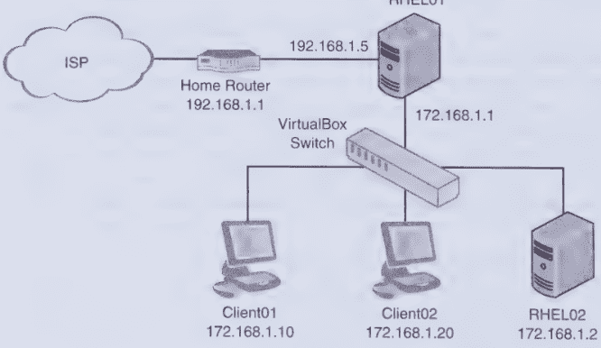

注意，如果你觉得自己没有足够的硬件来承载这么多机器，或者不知道如何虚拟化整个实验环境，那你可以再考虑一下。这4台虚拟机每台仅占用384MB内存，总计1.5GB。我用来做宿主机的是一台笔记本电脑，方便携带实验环境，它配备双核处理器和3GB内存。我还在配备4GB内存的奔腾4处理器上测试过这套实验环境。两台宿主机都能流畅运行完整的虚拟实验环境，没有任何问题或卡顿。如果你遇到性能问题，可以将RHEL02、Client01或Client02的内存降至256MB。只有主宿主机（RHEL01）真正需要额外的内存。

> **警告** 暂不要为主机RHEL01创建3块4GB的磁盘！VirtualBox有一个限制：一台系统同一时间最多只能挂载4个设备。要安装操作系统，你需要挂载CD-ROM设备，如果你现在创建了这里列出的4块磁盘，就会没有多余的槽位给CD-ROM。等你完成第1章的内容后，可以移除CD-ROM设备，再创建之后需要的3块额外的4GB磁盘。

## 本书适合人群

红帽认证考试是Linux领域最具挑战性的考试之一。本书旨在为各类背景的读者提供实操实验指南。无论是刚入门的新手，还是有经验的系统管理员，本书都能帮助你学习或精进技能，应对红帽认证考试。尽管新手需要付出更多努力来学习本书提及的部分技能，但依然有可能掌握考试要求的技能。本书会教你必要的技能，但通过红帽认证考试的关键是：练习、练习、再练习。

## 本书结构

本书按逻辑顺序编排，从头到尾循序渐进。虽然你可以跳跃式阅读，但每一章都建立在前一章的基础上，能帮助你搭建系统并从底层理解其运行原理。尽管每一章都涵盖不同的考试目标，本书前半部分（第2章至第12章）主要针对RHCSA认证考试。后半部分（第13章至第21章）涵盖RHCE认证考试。第1章"安装"是入门章节，旨在帮助你安装红帽企业版Linux操作系统并搭建虚拟实验环境。你搭建的虚拟实验环境会辅助你完成各章的实验练习，帮助你积累应对真实考试的实操技能。

本书前半部分（第2章至第12章）涵盖以下主题：

- 第2章"系统初始化"——本章重点介绍如何管理系统服务、系统运行级别，以及启动过程中发生的所有事件，同时讲解服务的运行原理及启停方法。
- 第3章"磁盘与分区"——本章讲解红帽系统的分区操作，涵盖基础分区、LVM、RAID，以及交换分区和LVM的高级用法，用于深入的存储管理，为你后续在第4章学习文件系统打下基础。
- 第4章"文件系统及相关内容"——本章延续第3章的内容，讲解文件系统的原理和管理方法，同时介绍LUKS加密选项和文件系统安全的相关知识。
- 第5章"网络"——本章全面讲解网络相关知识，系统间的通信是所有操作的基础，本章会介绍如何配置和排查网络连接问题，以及客户端DNS故障的处理方法。
- 第6章"软件包管理"——本章讲解如何在红帽系统中安装、搜索和卸载软件，涵盖多种软件包操作方式，包括自制软件包和搭建软件包仓库。
- 第7章"用户管理"——没有用户的系统是不完整的，本章讲解用户管理的全流程（创建、管理、删除），同时涉及用户切换和客户端认证的相关内容。
- 第8章"网络安装"——为了简化操作，你可以使用自动化安装，本章讲解kickstart及其在红帽企业版Linux安装中的应用，同时涵盖通过DHCP和PXE启动客户端实现无人值守安装的方法。
- 第9章"系统日志、监控与自动化"——本章深入讲解系统日志和监控的相关内容，以及如何解读相关数据，同时介绍排查问题（或寻找问题答案）的多种方法，还会涉及系统监控的自动化实现。
- 第10章"内核"——本章讲解如何正确更新和调优内核，虽然内核不是特别庞大的主题，但解决系统的关键安全问题非常重要。
- 第11章"SELinux"——本章涵盖全书最复杂的主题之一，讲解如何配置和使用SELinux而不会让你头疼，同时介绍如何通过调整SELinux布尔值来保障服务正常运行。

## 第12章，"系统安全"

本章全面介绍系统安全，包括TCP包装器、防火墙规则和安全策略。由于防火墙规则在所有服务中扮演着重要角色，本书的后半部分将专门讨论这一主题。第13至21章涵盖了以下主题：

## 第13章，"远程访问"

本章演示如何远程且安全地管理你的Red Hat系统。涵盖了Linux中最流行的远程管理工具SSH。还介绍了用于远程桌面管理的VNC。

## 第14章，"Web服务"

本章讨论如何设置和管理Apache Web服务器。由于它是世界上部署最广泛的Web服务器，这在Linux领域是一个重要主题。本章还涵盖了Squid Web代理及其与Apache的结合使用。

## 第15章，"NFS"

本章讨论网络文件系统。NFS是集中存储的一个绝佳选择，与SMB和FTP相比具有许多优势。本章还介绍了如何将客户端连接到NFS服务器。

## 第16章，"Samba"

本章讨论Samba及其设置方法。随着Samba的不断发展，Linux系统与Windows的集成变得越来越容易。本章描述了如何为Windows和Linux系统设置基本的共享和打印服务。

## 第17章，"FTP"

本章解释如何设置和使用FTP服务器。FTP非常适合安全或不安全地共享文件。本章描述了两种方式的好处，包括如何排除FTP故障。

## 第18章，"DNS"

本章讨论DNS的工作原理、服务器设置和DNS服务器管理。尽管这是本书中最复杂的主题之一，但一旦理解，它也是最容易掌握的。本章还深入探讨了不同类型的DNS服务器。

## 第19章，"网络服务"

本章讨论为你的网络设置核心网络服务。主题包括DHCP服务器、用于时间管理的NTP等。

## 第20章，"电子邮件服务"

本章解释如何正确设置不同类型的邮件服务器。由于电子邮件是最重要的业务组件之一，理解如何使用这项技术至关重要。本章还涵盖了如何保护你的邮件服务器，使其不被垃圾邮件发送者淹没。

## 第21章，"故障排除"

本章讨论针对各种主题的不同故障排除步骤。尽管本章没有涵盖全书讨论的所有故障排除主题，但它涵盖了你应该为考试掌握的重大主题。

## 第22章，"使用KVM进行虚拟化"

本章讨论如何在Red Hat Enterprise Linux 6中使用虚拟化。介绍了虚拟机的安装、设置和配置。还讨论了在虚拟机使用时如何监控它们。

书中还包括两套完整的模拟真实考试的实验。实验活动将要求你完成各种任务，这与真实考试非常相似，将帮助你备考。本书涵盖的每个Red Hat考试都有一套模拟考试。如果你能在规定时间内轻松完成全套模拟考试，那么你应该为真实考试做好了充分准备！除了22章和2套完整实验外，本书还提供章末问题和任务，以帮助你备考。还可以在`http://sourceforge.net/projects/rhcelabscripts`下载额外的故障排除脚本。

## 本导论涵盖以下主题：

- **文件和目录管理**—本节解释如何在系统中导航、创建、移动和查看文件和目录。
- **文件权限基础**—本节探讨文件权限及系统如何使用它们。
- **使用文本编辑器**—本节介绍如何从命令行有效地使用文本编辑器。
- **正则表达式**—本节涵盖正则表达式及其在模式匹配中的使用。
- **I/O重定向**—本节介绍如何管道化命令和重定向输出。
- **压缩和归档**—本节解释如何压缩和归档文件和目录。

## 以下RHCSA考试目标已涵盖：

- 访问shell提示符并使用正确语法执行命令
- 使用输入输出重定向（`>`、`>>`、`|`、`2>`等）
- 使用`grep`和正则表达式分析文本
- 使用`tar`、`star`、`gzip`和`bzip2`归档、压缩、打包和解压文件
- 创建和编辑文本文件
- 创建、删除、复制和移动文件和目录
- 创建硬链接和软链接
- 列出、设置和更改标准`ugo/rwx`权限
- 定位、阅读和使用系统文档，包括`man`、`info`和`/usr/share/doc`中的文件

## 导论

每个人都必须从某个地方开始，Linux管理员和工程师也不例外。如果你购买了这本书，我想你的目标是通过Red Hat考试（RHCSA和RHCE），同时获取或提高你当前的Linux技能。本导论涵盖了在踏上成为系统管理员或工程师的旅程之前，你需要了解的用户级命令。这些技能和命令对于理解如何使用Linux（而不仅仅是Red Hat）都至关重要。虽然当前的*Red Hat考试准备指南*没有列出（也不可能列出）本导论涵盖的所有命令，但这里涵盖的内容是你通读本书其余部分所必需的。这绝不是每个用户级命令的完整列表，但它是你入门所需的一切。这里的许多主题也将在本书后面涵盖。如果你已经具备相当不错的Linux技能，那么本导论的大部分内容对你来说可能只是复习。

## 文件和目录管理

为了能够使用系统的不同部分，你需要知道如何在系统中导航！在本节中，我们将学习以下基本命令：

- `ls` 显示目录的内容
- `cp` 将文件或目录从一个位置复制到另一个位置
- `mv` 移动或重命名文件和目录
- `cd` 更改当前位置
- `rm` 删除文件或目录
- `touch` 创建空文件
- `mkdir` 创建目录
- `pwd` 显示当前工作目录
- `file` 显示文件类型
- `head` 显示文件的开头部分
- `tail` 显示文件的末尾部分

这看起来可能是很多命令；然而，它们的使用都非常简单，因此解释起来也很容易。首先，让我们从使用`ls`命令显示系统上的一个目录开始。

### 步骤1. 列出当前目录的内容：

```
# ls
Desktop Documents Downloads Music Pictures Public Templates Videos
```

虽然因为本书是黑白的你看不出来，但这些目录以蓝色显示，提醒用户它们确实是目录。虽然拥有所有这些目录很好，但你怎么知道你在系统中的哪个位置？要查看当前位置，你可以使用`pwd`命令。

### 步骤2. 显示当前位置：

```
# pwd
/home/user01
```

目前，你处于user01的主目录中，因此`ls`命令的输出都是属于user01的目录。让我们从user01的主目录移到其中一个子目录。使用`cd`命令，你可以在不同的目录之间移动。

### 步骤3. 向下移动一层到Documents目录：

```
# cd Documents/
```

> **实际提示** 使用`cd`命令时，尾部的斜杠（`/`）是可选的。它表示指定的名称是一个目录。

### 步骤4. 现在再次查看当前位置：

```
# pwd
/home/user01/Documents
```

如果你想向上移动一级到你刚来自的目录呢？如果使用`ls`，你看不到列出的user01目录。但是，你可以查看两个特殊的目录。

### 步骤5. 使用`ls -a`命令查看所有隐藏目录：

```
# ls -a ...
```

注意到看起来只是一堆点的内容了吗？它们实际上代表两种特殊类型的目录。第一种——单个`.`——代表当前目录。第二种——双个`..`——是你当前所处目录的上一级目录。

### 步骤6. 要返回上一个user01目录，请使用以下命令：

```
# cd ..
```

### 步骤7. 使用`pwd`命令验证：

```
# pwd
/home/user01
```

现在你应该可以自如地在系统中导航了。接下来我们学习创建文件和目录。首先来看目录的创建。

### 语法：`mkdir [option] DIRECTORY`

选项：

- `-p` 按需创建父目录
- `-v` 提供详细输出

### 步骤1. 创建一个名为test的新目录：

```
# mkdir test
```

### 步骤2. 创建嵌套的一组新目录：

```
# mkdir -p another/quick/test
```

因为你之前选择的目录都不存在，所以这些目录都会被创建，包括名为quick和test的子目录。

### 步骤3. 使用`ls`命令验证目录是否创建成功：

```
# ls another quick
```

```
# cd another
# ls quick
```

### 步骤4. 返回主目录：

```
# cd /home/user01
# pwd
/home/user01
```

你在整本书中都会看到，系统导航有很多快捷技巧。由于所有目录都已成功创建，接下来我们学习文件操作。使用`touch`命令可以创建空白文件。

### 步骤5. 创建一个名为test1的文件：


# `touch test1`

### 步骤6. 验证该文件是否存在：

```
# ls test1
```

有时候文件需要在使用前先创建，这就是`touch`命令的用处所在。你也可以将空白文件用作后续内容的占位符。如果你不确定某个文件的类型，可以使用`file`命令来查询。

### 步骤1. 检查`test1`的文件类型：

```
# file test1
test1: empty
```

### 步骤2. 检查系统中密码文件的类型：

```
# file /etc/passwd
passwd: ASCII text
```

除了能够创建和判断文件类型，你还需要能够读取文件。不过很多时候你不需要读取整个文件（比如日志文件），只需要查看文件中的部分条目即可。使用`tail`和`head`命令，你可以查看文件的开头或结尾部分。

### 语法：`head [options] FILE`

选项：

- `-n` 指定要打印的行数
- `-v` 提供详细输出

### 语法：`tail [options] FILE`

选项：

- `-n` 指定要打印的行数
- `-f` 持续显示文件末尾内容（适用于日志文件）
- `-v` 提供详细输出

### 步骤1. 查看`messages`日志文件的头部内容：

```
# head /var/log/messages
Dec 5 03:13:06 RHEL01 dhclient: DHCPREQUEST on eth0 to 172.27.100.163 port 67
Dec 5 03:13:10 RHEL01 dhclient: DHCPREQUEST on eth0 to 255.255.255.255 port 67
Dec 5 03:13:20 RHEL01 dhclient: DHCPREQUEST on eth0 to 172.27.100.163 port 67
Dec 5 03:13:29 RHEL01 dhclient: DHCPREQUEST on eth0 to 255.255.255.255 port 67
Dec 5 03:13:30 RHEL01 dhclient: DHCPREQUEST on eth0 to 172.27.100.163 port 67
Dec 5 03:13:43 RHEL01 dhclient: DHCPREQUEST on eth0 to 255.255.255.255 port 67
Dec 5 03:13:44 RHEL01 dhclient: DHCPREQUEST on eth0 to 172.27.100.163 port 67
Dec 5 03:13:50 RHEL01 dhclient: DHCPREQUEST on eth0 to 255.255.255.255 port 67
```

### 步骤2. 查看`messages`日志文件的尾部内容：

```
# tail /var/log/messages
Dec 11 08:11:04 RHEL01 dhclient: DHCPDISCOVER on eth0 to 255.255.255.255 port 67 interval 13
Dec 11 08:11:04 RHEL01 dhclient: DHCPOFFER from 172.27.100.163
Dec 11 08:11:04 RHEL01 dhclient: DHCPREQUEST on eth0 to 255.255.255.255 port 67
Dec 11 08:11:04 RHEL01 dhclient: DHCPACK from 172.27.100.163
Dec 11 08:11:04 RHEL01 NET[26281]: /sbin/dhclient-script : updated /etc/resolv.conf
Dec 11 08:11:04 RHEL01 dhclient: bound to 172.27.100.226 -- renewal in 40864 seconds.
Dec 11 08:18:00 RHEL01 abrt[26389]: saved core dump of pid 26388 (/usr/libexec/fprintd) to /var/spool/abrt/ccpp-1292073480-26388.new/coredup (757760 bytes)
Dec 11 08:18:00 RHEL01 abrtd: Directory 'ccpp-1292073480-26388' creation detected
Dec 11 08:18:00 RHEL01 abrtd: Crash is in database already (dup of /var/spool/abrt/ccpp-1291114420-26066)
```

你可以看到，无需打开文件就能查看文件的不同部分非常实用，尤其是在查看日志文件时。现在你已经知道其中一个日志文件的位置了，要不要把它复制到`/home/user01`目录下？你可以使用`cp`命令来完成这个操作。

### 语法：`cp [options] SOURCE DEST`

选项：

- `-R` 递归复制
- `-v` 提供详细输出

### 步骤1. 将日志文件复制到`user01`的主目录下：

```
# cp /var/log/messages /home/user01
```

### 步骤2. 你也可以使用以下命令：

```
# cp /var/log/messages .
```

要注意，点（`.`）代表当前所在位置。复制完`messages`日志文件后，你最好重命名它以备份。你可以使用`mv`命令来完成重命名，也可以用它把文件移动到新位置。

### 语法：`mv [options] SOURCE DEST`

选项：

- `-v` 提供详细输出

### 步骤3. 通过指定原文件名和新文件名来重命名文件：

```
# mv messages messages.bak
```

### 步骤4. 文件重命名完成后，将其移动到`test`目录中备份：

```
# mv messages.bak test/
```

因为这次你指定的是目录，所以文件被移动而不是重命名。你也可以验证文件是否被正确移动了。

### 步骤5. 列出`test`目录的内容：

```
# ls test
messages.bak
```

如果你误移动了这个文件怎么办？这种情况下你需要删除它以腾出空间存放新文件。你可以使用`rm`命令来删除文件或目录。

### 语法：`rm [options] FILE`

选项：

- `-R` 递归删除
- `-f` 强制删除
- `-v` 提供详细输出

### 步骤1. 删除`messages.bak`文件：

```
# cd test
# rm messages.bak
rm: remove regular file 'messages.bak'? y
```

注意到系统会提示你确认删除文件了吗？使用`-f`选项可以跳过确认步骤。在删除文件的同时，我们也可以删除`test`目录。

### 步骤2. 删除`test`目录：

```
# cd ..
# rm -Rf test/
```

因为这个示例使用了`-f`选项，所以不会弹出确认提示，目录会被直接删除。有一点需要注意：删除目录时必须使用`-R`选项。如果不使用`-R`选项，系统会提示目录非空的警告信息。

到现在，你应该已经能够在系统中导航、创建和删除文件及目录、查看文件及其类型了。虽然这一部分看起来进展很快，但这些都是非常基础的命令，任何有Linux使用经验的人应该都了解其中大部分内容。

### 文件权限基础

和所有操作系统一样，Linux有一套权限机制，用于保护系统中的文件、目录和设备。这些权限可以被配置为允许（或禁止）访问系统中不同位置的文件和目录。以下是一些可用于操作权限的命令：

- `chmod` 修改文件或目录的权限
- `chown` 修改文件或目录的所有者和所属组
- `ls -l` 显示文件或目录的权限和所属信息
- `ll` 与`ls -l`功能相同
- `umask` 定义或显示文件和目录创建时的默认权限

在开始使用这些命令之前，我们先来了解权限的工作原理。Linux权限通过文件的属性实现，分为三个独立的类别，具体如下：

- **User（用户）** 文件的所有者
- **Group（用户组）** 文件所属的用户组
- **Other（其他用户）** 系统中的所有其他用户

Linux中的权限可通过以下两种方式之一进行分配。你可以使用助记符或单个数字来表示权限等级。

| 操作 | 数字 | 助记符 | 描述 |
|-----------|-------|----------|-------------|
| 读取 | `r` | 4 | 查看文件内容 |
| 写入 | `w` | 2 | 向文件写入内容或修改文件 |
| 执行 | `x` | 1 | 运行文件 |

我们先了解如何查看文件权限，再学习修改权限。你可以查看我设置的其中一个用户的主目录。要查看文件或目录的权限，可以使用两种不同的命令。

### 步骤1. 查看`user01`主目录的文件权限：

```bash
# ll /home/user01
total 32
drwxr-xr-x. 2 user01 user01 4096 Dec 11 07:43 Desktop
drwxr-xr-x. 2 user01 user01 4096 Dec 11 07:43 Documents
drwxr-xr-x. 2 user01 user01 4096 Dec 11 07:43 Downloads
-rw-rw-r--. 1 user01 user01    0 Dec 11 07:44 file1
-rw-rw-r--. 1 user01 user01    0 Dec 11 07:44 file2
drwxr-xr-x. 2 user01 user01 4096 Dec 11 07:43 Music
drwxr-xr-x. 2 user01 user01 4096 Dec 11 07:43 Pictures
drwxr-xr-x. 2 user01 user01 4096 Dec 11 07:43 Public
drwxr-xr-x. 2 user01 user01 4096 Dec 11 07:43 Templates
drwxr-xr-x. 2 user01 user01 4096 Dec 11 07:43 Videos
```

### 步骤2. 你也可以使用以下命令：

```bash
# ll -s /home/user01
total 32
drwxr-xr-x. 2 user01 user01 4096 Dec 11 07:43 Desktop
drwxr-xr-x. 2 user01 user01 4096 Dec 11 07:43 Documents
drwxr-xr-x. 2 user01 user01 4096 Dec 11 07:43 Downloads
-rw-rw-r--. 1 user01 user01    0 Dec 11 07:44 file1
-rw-rw-r--. 1 user01 user01    0 Dec 11 07:44 file2
drwxr-xr-x. 2 user01 user01 4096 Dec 11 07:43 Music
drwxr-xr-x. 2 user01 user01 4096 Dec 11 07:43 Pictures
drwxr-xr-x. 2 user01 user01 4096 Dec 11 07:43 Public
drwxr-xr-x. 2 user01 user01 4096 Dec 11 07:43 Templates
drwxr-xr-x. 2 user01 user01 4096 Dec 11 07:43 Videos
```

在这里你可以看到文件有10种可配置的权限选项。第一个字段用于标识文件是否为目录：`Desktop`是目录，其首个字段中的`d`即代表目录类型。接下来的三个字段分别对应文件所有者、所属组和其他用户。例如，`file1`不是目录，其所有者可对该文件进行读写操作，所属组用户也可读写，其余所有用户仅能读取该文件。你还能看到`file2`拥有完全相同的权限。权限字段之后列出的就是所有者与所属组，此目录下的所有文件的所有者均为`user01`，所属组也均为`user01`。用户和组用于管控哪些实体可以访问文件和目录。

现在你已经掌握了查看文件和目录权限的方法，接下来我们学习如何修改权限。我们首先使用`chown`命令来修改文件的所有者和所属组。这里还有一个名为`user02`的用户可供你使用。

```bash
Syntax: chown [option] [user] [: [group]]
```

选项：

- `-R` 递归生效
- `-v` 显示详细执行输出

### 步骤3. 将`file1`的所有者从`user01`改为`user02`：

```bash
# chown user02 file1
```

### 步骤4. 将`file2`的所属组从`user01`改为`user02`：

```bash
# chown :user02 file2
```

### 步骤5. 现在再次查看权限：

```bash
# ll
-rw-rw-r--. 1 user02 user01    0 Dec 11 07:44 file1
-rw-rw-r--. 1 user01 user02    0 Dec 11 07:44 file2
```

你可以看到`file1`的所有者、`file2`的所属组都已按要求修改完成。目前这两个文件仅允许其他用户读取。如果你希望允许系统上的所有用户修改该文件，就可以使用`chmod`命令来调整权限。

```bash
Syntax: chmod [options] FILE
```

选项：

- `-R` 递归生效
- `-v` 显示详细执行输出

### 步骤6. 修改“其他用户”部分的权限，为该文件开放写入权限：

```bash
# chmod 666 file1
```

### 步骤7. 查看权限变更结果：

```bash
# ll
-rw-rw-rw-. 1 user02 user01    0 Dec 11 07:44 file1
```

现在`user02`、所属组`user01`以及系统上的所有其他用户都拥有该文件的读写权限。你可能好奇我设置`666`权限的依据是什么？使用数值设置权限时，需要将每个分区的权限值相加。由于我希望保留所有者和所属组的权限一致，因此需要确保两者都拥有读取（`4`）和写入（`2`）权限（`4+2=6`）。同时我希望“其他用户”组的权限也保持一致，因此沿用相同的数值，这就是`666`权限的由来。

修改权限并不困难，但初次接触时可能需要一些练习才能理解。我们最后要学习的命令是`umask`。你可能好奇我们最初创建`file1`和`file2`时，它们的权限是如何确定的？这两个文件创建时的默认权限是`664`，那么这个数字又是如何得出的呢？用户被创建时，会被分配一个`umask`值，该值用于定义用户创建的所有文件和目录的权限。我们来看看它的工作原理：文件创建时的默认权限是`666`，即`rw-rw-rw-`；目录创建时的默认权限是`777`，即`rwxrwxrwx`。`umask`命令会基于掩码值对默认权限进行修改（通过减法运算实现）。

| 项 | 计算过程 |
|------|-------------|
| 文件默认权限 | `666` = `110 110 110`（二进制） |
| 减去`umask`值 | `002` = `000 000 010`（二进制） |
| 最终结果 | `664` = `110 110 100`（二进制） |

现在你就得到了此前看到的默认权限`664`。目录的权限计算方式与之相同：

| 项 | 计算过程 |
|------|-------------|
| 目录默认权限 | `777` = `111 111 111`（二进制） |
| 减去`umask`值 | `002` = `000 000 010`（二进制） |
| 最终结果 | `775` = `111 111 101`（二进制） |

现在你就得到了此前看到的默认权限`775`。

### 步骤8. 你可以调用`umask`命令查看当前的`umask`值，了解其具体设置：

```bash
# umask
0002
```

所有文件和目录的开头都有一个`0`，该值用于更高级的权限设置。目前你只需要知道它的存在即可，计算目录权限时可以忽略它。你也可以传入数值来修改`umask`值，但不推荐这样做。如果你理解不了这里的内容也没关系，第7章“用户管理”会更详细地讲解用户、用户创建以及高级文件权限的相关内容。不过在你继续学习之前，应该掌握如何设置文件权限，以及理解权限的计算方式。

### 使用文本编辑器

作为系统管理员，熟练使用文本编辑器大概是必备的最关键技能之一。你总是需要编辑配置文件、编写脚本或者修改系统文件……这些操作都要求你使用文本编辑器。当今最流行的三种文本编辑器包括：

- `vi`或`vim`：灵活性极高的文本编辑器
- `emacs`：与`vi`类似，是一款功能丰富的高级文本编辑器
- `nano`：适用于快速编辑的基础文本编辑器

对于Red Hat认证考试，你需要掌握`vim`文本编辑器的使用方法。虽然它不是唯一可用的编辑器，但会默认安装在Red Hat Enterprise Linux 6系统中。`Vim`是`vi`的增强版本，支持编程语法高亮。如果考试期间有对应的软件包可用，你还可以安装其他文本编辑器。我个人平时做快速编辑时大多使用`nano`，而从头搭建配置文件或进行编程相关操作时则会使用`vim`。

我们再来看看`vim`的部分参数：

```bash
Syntax: vim [arguments] [file]
```

参数：

- `-R` 以只读模式打开文件
- `-b` 指定二进制模式
- `+` 启动时定位到文件末尾
- `+<num>` 启动时定位到第`<num>`行

`Vim`共有三种不同的工作模式：命令模式、插入模式和末行模式。你首次打开文件时会处于命令模式，在此模式下你可以执行各类命令来浏览文件，无需向文件中插入文本。当你准备好向文件插入内容时，就可以


使用`i`或`a`进入插入模式，即可在光标位置插入文本。要退出插入模式返回命令模式，只需按下`Esc`键。你可以进入的最后一个模式是末行模式，输入英文冒号（`:`）即可进入该模式。在该模式下，你可以执行更多指令，包括保存文件、退出编辑器，以及其他更多操作。

## 命令模式指令

- `e`：移动至单词末尾
- `b`：移动至单词开头
- `$`：移动至行尾
- `H`：移动至屏幕首行
- `L`：移动至屏幕末行
- `i`：进入插入模式
- `a`：在光标后追加文本
- `o`：在光标所在行下方打开新行并进入插入模式
- `O`：在光标所在行上方打开新行并进入插入模式
- `R`：进入插入模式，但会覆盖原有字符而非插入新字符
- `dd`：删除当前行
- `x`：删除光标下的字符
- `yy`：复制当前行（也称为 yank 操作）
- `p`：粘贴已复制的行
- `u`：撤销上一步操作

## 末行模式指令

- `:n`：跳转至第 n 行
- `:w`：将文件写入磁盘（保存）
- `:q`：退出 vim
- `:q!`：不保存修改直接退出

如果你之前从未使用过 vim，一开始操作会相当困惑。我建议你在继续学习前先创建并操作一些示例文件，以便熟悉它的操作逻辑。你也可以练习使用 nano 和 emacs，感受不同编辑器的工作逻辑差异。虽然 nano 上手更快、操作更简单，但灵活性和功能性都不如 vim 或 emacs。

系统管理员们就「vim 和 emacs 哪个更好」争论已久。我不会站队，但我建议你两者都尝试一下，找到自己用起来更顺手的那个。

## 正则表达式

你时不时需要在系统中查找特定的内容，可能是某个文件本身、文件内的特定内容，也可能是通过脚本查找的内容。在 Linux 系统中，你可以使用正则表达式（也称为 regex）来查找特定信息。正则表达式需要搭配以下任意一类特殊表达式使用：

- 字面量：搜索或匹配表达式中使用的任意字符
- 元字符：具有特殊含义的一个或多个特殊字符
- 转义序列：将元字符作为普通字面量使用的形式

正则表达式这类知识，要么你很快就能掌握，要么就会让你头疼不已、倍受挫败。但就像学习其他任何技能一样，你练习得越多、看的示例越多，就越能理解它的运行逻辑，掌握更高效的用法。

本节我们只会介绍一个可以和正则表达式搭配使用的命令：grep。首先我们来看 grep 支持的参数。

```
Syntax: grep [options] PATTERN [file]
```

参数：

- `-w`：强制仅匹配完整单词
- `-x`：强制仅匹配完整行
- `-E`：将匹配模式视为扩展正则表达式
- `-f`：从文件中读取匹配模式
- `-v`：反转匹配结果（输出不匹配的行）
- `-m [NUM]`：匹配到 NUM 个结果后停止输出
- `-R`：递归搜索目录下的所有文件
- `--color=[WHEN]`：彩色输出结果；WHEN 可选值为 `always`（始终开启）、`auto`（自动判断）、`never`（始终关闭）

学习正则表达式的初期，最难理解的是如何构建正确的匹配模式来找到你想要的内容。你不仅要掌握调用 grep 命令时需要的参数，还要理解匹配模式的相关规则。下面我们就来介绍一些常见的匹配规则。

### 元字符

- `[]`：匹配括号内的任意字符，可单独匹配也可整体匹配，支持字母和数字。注意：正则匹配区分大小写。
- `-`：用于定义字符范围，例如 1 到 9 可写为 `1-9`。该符号也可用于定义字母范围，比如 `a-z` 或 `A-Z`。定义范围时字符之间不能加空格。
- `^`：放在括号内时表示取反匹配；放在括号外时，用于匹配以指定字符串开头的行。
- `$`：作用和括号外的`^`类似，用于匹配以指定字符或字符串结尾的行。
- `.`：匹配该位置的任意单个字符。
- `*`：匹配前的字符零次或多次。
- `( )`：组合多个匹配模式。
- `|`：匹配左右任意一侧的内容，和`( )`搭配使用非常实用。

掌握以上元字符已经足够你入门使用了。以下文本将作为所有正则示例的 file_example 文件内容。

### 步骤1：将以下内容复制到名为 file_example 的文件中：

```
My original text
Another line with the number 3
Search for the word "me"
I contain 5and6
Skip me and me
0 + 1 = 1
Above this line is a math equation...duh!
```

### 步骤2：括号匹配示例，使用`S[ek]`作为匹配模式：

```
# grep S[ek] file_example
Search for the word "me"
Skip me
```

你可以看到文件返回了两行结果。第一行被返回是因为它包含单词 *Search*，其中含有 *Se* 字符组合；第二行包含单词 *Skip*，其中含有 *Sk* 字符组合，符合匹配规则。

### 步骤3：尝试使用`c[or]`作为匹配模式进行查找：

```
# grep c[or] file_example
I contain 5and6
```

这里单词 *contain* 中的两个字母都被匹配到了。接下来我们来看看范围规则在匹配模式中的用法。

### 步骤4：使用`[0-9]`作为匹配模式，查找所有包含数字的行：

```
# grep [0-9] file_example
Another line with the number 3
I contain 5and6
0 + 1 = 1
```

你可以看到所有包含 0 到 9 之间数字的行都被返回了。你能想到另一种方法，只返回包含数字、不包含任何字母的行吗？

### 步骤5：使用`[A-Za-z]`作为匹配模式查找所有字母（包括大小写），然后反转匹配结果：

```
# grep -v [A-Za-z] file_example
0 + 1 = 1
```

我们再来看几个示例，完成本节的学习。

### 步骤6：查找所有以字母 S 开头的行：

```
# grep ^S file_example
Search for the word "me"
Skip me
```

### 步骤7：查找所有以 me 结尾的行：

```
# grep me$ file_example
Skip me and me
```

### 步骤8：查找所有以大写字母 A 或小写字母 a 开头，且后方包含任意数量字符的行：

```
# grep ^[Aa]. file_example
Another line with the number 3 and me
Above this line is a math equation...duh!
```

你现在应该已经意识到了，你可以使用无限多种组合来查找文件中的行或单词。正则表达式是一个很大的研究领域，还有很多专门讲解它的优秀书籍。就本书的用途而言，我们已经讲了足够你查找文件中所需内容的知识。请务必持续使用示例文件和系统配置文件练习，尝试使用不同的组合进行查找。如果你对匹配结果有疑问，我强烈建议你在 grep 命令中使用`--color=always`参数。该参数会在终端中高亮显示你的模式实际匹配到的内容，帮你更好地理解模式的匹配逻辑。

## 输入输出重定向

有时候你需要多次使用某个命令的输出结果。要实现这个需求，你可以使用一些实用的命令行技巧来重定向命令的输出。下面我们先认识几个相关命令：

- **sort**：对命令或文件的输出进行排序
- **wc**：统计单词数或行数
- **cat**：显示文件内容
- **uniq**：列出文件或命令输出中的所有非重复行
- **echo**：输出或显示字符串
- **cut**：切割字符串或输出内容

此外还有一些字符可用于定向或重定向命令的输出，这些字符包括：

- `>`：将输出定向到文件或设备（若文件已存在则覆盖原内容）
- `<`：从文件或设备读取输入
- `>>`：将输出或文本追加到文件末尾（若文件不存在则创建该文件）
- `|`：将前一个命令的输出作为后一个命令的输入
- `&&`：组合多个命令

如果你之前从未接触过这些命令，可能一下子记不住这么多。等我们看完几个示例，你就能更好地理解这些命令和字符的用法了。

### 步骤1：使用 echo 命令向文件输出文本：

```
# echo "This is some sample text" > file_example
```

正常情况下，echo 命令只会把你输入的文本显示在屏幕上，但因为你使用了输出重定向字符，输出内容就被写入到了指定的文件中。

### 步骤2：通过查看文件内容验证文本是否正确输出：

```
# cat file_example
This is some sample text
```

在文件中写入这行内容，能很好地引出 cut 命令的作用。

语法：`cut OPTION [FILE]`

选项：

- `-d`：指定分隔符
- `-f`：显示指定字段

既然你已经知道刚创建的文本文件里的内容，何不用 cut 命令把它拆分出来看看呢？

### 步骤3：使用空格作为分隔符，显示文本的第三个字段：

```
# cut -d " " -f3 file_example
some
```

你会发现，用这类命令可以自由选择字符串或文本文件中你需要的部分。既然你已经知道如何向文件写入文本、又如何拆分文本，不妨试试把这些命令组合起来使用。通过管道符（`|`），你可以把前面两个命令串联起来，让一个命令的输出作为另一个命令的输入。

### 步骤4：将两个命令合并为单行命令：

```
# cat file_example | cut -d " " -f3 file_example
some
```

正常情况下，cat 命令会输出名为 file_example 的文件内容，但这里它会把输出结果发送给 cut 命令做进一步处理。除了用管道符串联命令，你还可以用`&&`让命令依次执行。

### 步骤5：执行一个命令后再执行另一个命令：

```
# echo "This is some more text" > file_example && cut -d " " -f3 file_example
some
```

到目前为止，你已经了解了向文件输出文本、处理文件内文本的几种巧妙方法。如果你先把文本输出到文件，再对同一个文件执行一次相同命令，会发生什么呢？

### 步骤1：查看示例文件的当前内容：

```
# cat file_example
This is some more text
```

### 步骤2：向该文件输出更多文本：

```
# echo "Different text" > file_example
```

### 步骤3：再次验证文件内容：

```
# cat file_example
Different text
```

原来的文本去哪了？当你使用`>`时，输出内容会被发送到文件或设备中，但它会覆盖文件或设备中原本的内容。如果你想追加文本，可以把同一个字符用两次。

### 步骤4：向文件追加文本，而非覆盖原有内容：

```
# echo "My original text" >> file_example
```

### 步骤5：验证文件内容：

```
# cat file_example
Different text
My original text
```

### 步骤6：再次执行完全相同的命令，查看文件内容：

```
# echo "My original text" >> file_example && cat file_example
Different text
My original text
My original text
```

注意现在已经有重复的两行相同文本了。如果这是某个服务的配置文件，里面存在重复数据，该怎么办呢？遇到这种情况，你可以用 uniq 命令提取文件中的唯一行，确保没有重复内容。

### 步骤7：查看示例文件中的唯一行，基于输出结果创建新文件，再查看新文件的内容：

```
# uniq file_example > uniq_file && cat uniq_file
Different text
My original text
```

现在你已经熟悉了前面几个命令和符号的使用，可以开始学习剩余的命令，以及处理真实文件了。假设你要在`/etc/passwd`文件中查找某个特定用户，查看文件内容时你会发现它并没有排序。

### 步骤1：显示`/etc/passwd`文件的内容：

```
# cat /etc/passwd
root:x:0:0:root:/root:/bin/bash
bin:x:1:1:bin:/bin:/sbin/nologin
daemon:x:2:2:daemon:/sbin:/sbin/nologin
adm:x:3:4:adm:/var/adm:/sbin/nologin
lp:x:4:7:lp:/var/spool/lpd:/sbin/nologin
sync:x:5:0:sync:/sbin:/bin/sync
shutdown:x:6:0:shutdown:/sbin:/sbin/shutdown
halt:x:7:0:halt:/sbin:/sbin/halt
mail:x:8:12:mail:/var/spool/mail:/sbin/nologin
uucp:x:10:14:uucp:/var/spool/uucp:/sbin/nologin
operator:x:11:0:operator:/root:/sbin/nologin
games:x:12:100:games:/usr/games:/sbin/nologin
gopher:x:13:30:gopher:/var/gopher:/sbin/nologin
nobody:x:99:99:Nobody:/:/sbin/nologin
dbus:x:81:81:System message bus:/:/sbin/nologin
usbmuxd:x:113:113:usbmuxd user:/:/sbin/nologin
avahi-autoipd:x:170:170:Avahi IPv4LL Stack:/var/lib/avahi-autoipd:/sbin/nologin
vcsa:x:69:69:virtual console memory owner:/dev:/sbin/nologin
rpc:x:32:32:Rpcbind Daemon:/var/cache/rpcbind:/sbin/nologin
rtkit:x:499:499:RealtimeKit:/proc:/sbin/nologin
abrt:x:498:498::/etc/abrt:/sbin/nologin
nscd:x:28:28:NSCD Daemon:/:/sbin/nologin
haldaemon:x:68:68:HAL daemon:/:/sbin/nologin
nslcd:x:65:55:LDAP Client User:/:/sbin/nologin
saslauth:x:497:495:"Saslauthd user":/var/empty/saslauth:/sbin/nologin
avahi:x:70:70:Avahi mDNS/DNS-SD Stack:/var/run/avahi-daemon:/sbin/nologin
ntp:x:38:38::/etc/ntp:/sbin/nologin
rpcuser:x:29:29:RPC Service User:/var/lib/nfs:/sbin/nologin
pulse:x:496:494:PulseAudio System Daemon:/var/run/pulse:/sbin/nologin
sshd:x:74:74:Privilege-separated SSH:/var/empty/sshd:/sbin/nologin
tcpdump:x:72:72:::/sbin/nologin
```

面对这样混乱的内容，你要怎么找到需要的信息呢？你可以用正则表达式搜索特定用户，但如果你只是想让它有条理一点呢？如果是这样的话，你可以用 sort 命令给这份混乱的内容排排序，让它清晰明了。

语法：`sort [options] [FILE]`

选项：

- `-b`：忽略前导空白字符
- `-f`：忽略大小写
- `-n`：按数值字符串大小比较
- `-r`：逆序排序

### 步骤2：再次显示`/etc/passwd`文件内容，这次使用排序格式：


# 使用 `sort` 和 `wc` 处理 `/etc/passwd` 文件

首先，我们使用 `sort` 命令对 `/etc/passwd` 文件进行排序：

```
# sort /etc/passwd
abrt:x:498:498::/etc/abrt:/sbin/nologin
adm:x:3:4:adm:/var/adm:/sbin/nologin
apache:x:48:48:Apache:/var/www:/sbin/nologin
avahi-autoipd:x:170:170:Avahi IPv4LL Stack:/var/lib/avahi-autoipd:/sbin/nologin
avahi:x:70:70:Avahi mDNS/DNS-SD Stack:/var/run/avahi-daemon:/sbin/nologin
bin:x:1:1:bin:/bin:/sbin/nologin
daemon:x:2:2:daemon:/sbin:/sbin/nologin
dbus:x:81:81:System message bus:/:/sbin/nologin
games:x:12:100:games:/usr/games:/sbin/nologin
gdm:x:42:42::/var/lib/gdm:/sbin/nologin
gopher:x:13:30:gopher:/var/gopher:/sbin/nologin
haldaemon:x:68:68:HAL daemon:/:/sbin/nologin
halt:x:7:0:halt:/sbin:/sbin/halt
lp:x:4:7:lp:/var/spool/lpd:/sbin/nologin
mail:x:8:12:mail:/var/spool/mail:/sbin/nologin
nfsnobody:x:65534:65534:Anonymous NFS User:/var/lib/nfs:/sbin/nologin
nobody:x:99:99:Nobody:/:/sbin/nologin
nscd:x:28:28:NSCD Daemon:/:/sbin/nologin
nslcd:x:65:55:LDAP Client User:/:/sbin/nologin
ntp:x:38:38::/etc/ntp:/sbin/nologin
operator:x:11:0:operator:/root:/sbin/nologin
postfix:x:89:89::/var/spool/postfix:/sbin/nologin
pulse:x:496:494:PulseAudio System Daemon:/var/run/pulse:/sbin/nologin
root:x:0:0:root:/root:/bin/bash
rpcuser:x:29:29:RPC Service User:/var/lib/nfs:/sbin/nologin
rpc:x:32:32:Rpcbind Daemon:/var/cache/rpcbind:/sbin/nologin
rtkit:x:499:499:RealtimeKit:/proc:/sbin/nologin
saslauth:x:497:495:"Saslauthd user":/var/empty/saslauth:/sbin/nologin
shutdown:x:6:0:shutdown:/sbin:/sbin/shutdown
sshd:x:74:74:Privilege-separated SSH:/var/empty/sshd:/sbin/nologin
sync:x:5:0:sync:/bin:/bin/sync
tcpdump:x:72:72:::/sbin/nologin
usbmuxd:x:113:113:usbmuxd user:/:/sbin/nologin
uucp:x:10:14:uucp:/var/spool/uucp:/sbin/nologin
vcsa:x:69:69:virtual console memory owner:/dev:/sbin/nologin
```

排序后的输出清晰多了，也更容易阅读。但为什么要止步于此呢？如果你想知道这个文件里列了多少个用户，该怎么办呢？你可以手动数文件里的行数，也可以让 `wc` 命令帮你完成这个工作。

语法：`wc [option] [FILE]`

## 选项

- `-c` 输出字节数
- `-m` 输出字符数
- `-l` 输出行数
- `-w` 输出单词数

## 步骤3：统计 `/etc/passwd` 文件的行数

```
# wc -l /etc/passwd
35 /etc/passwd
```

到这里，我们已经学完了不少关于管道和重定向的命令，既看了简单的示例，也了解了它们的实际应用场景。请确保你已经熟练掌握了通过管道、重定向或组合命令来提升操作效率的方法。要通过Red Hat认证考试，你需要具备良好的时间管理能力，而高效使用更少的命令就能帮你实现这一点。

## 压缩与归档

Linux的一大特点是，很多事物并没有统一的标准。这使得不同的软件程序和实践中可能存在各种不同的实现方式和自定义设置。但这也有可能成为短板。等你成为系统管理员就会知道，备份是第一要务。如果设备宕机、数据损坏，而你因为没及时备份或者根本不备份导致无法恢复数据，那你可能就要另谋出路了。虽然我们这里不会介绍备份程序，但这恰好可以引出归档和压缩的相关内容。完成这项任务，本节只介绍一个命令：

- **`tar`** 用于压缩和归档文件及目录

`tar` 工具的可选参数多到不可思议，我们不可能在这里全部介绍完。不如我们聚焦于本书中用到的几个常用参数。

语法：`tar [options] [FILE]`

## 选项

- **`-c`** 创建新归档文件
- **`-d`** 查找归档文件与文件系统之间的差异
- **`-f`** 指定要使用的归档文件
- **`-p`** 保留文件和目录权限
- **`-t`** 列出归档文件中的内容
- **`-v`** 输出详细信息

首先，你应该能发现这个小工具非常适合用来创建文件和目录的归档，作为备份保存。尽管不建议仅用该工具作为备份策略，但它可以快速传输一组文件和目录，非常实用。接下来我们来看一些使用 `tar` 命令的示例。

## 步骤1：创建一些随机的空白文件

```
# touch file1 file2 file3 another_file
```

## 步骤2：文件就位后，创建一个包含这些文件的简单归档

```
# tar cvf sample.tar file1 file2 file3 another_file
```

命令中重复列出了 `file1 file2 file3 another_file`，以确认这些文件都被包含在内。

## 步骤3：使用其他技巧简化任务

你也可以使用之前学到的其他技巧来简化这项任务：

```
# tar cvf sample.tar <file> another_file file1 file2 file3
```

## 步骤4：使用 `gunzip` 压缩重新创建归档

```
# tar cvf sample.tar.gz <file> another_file file1 file2 file3
```

注意：该命令实际上创建的是 `.tar.gz` 文件，通常应使用 `-z` 选项来启用 `gzip` 压缩。这里按原样展示文本内容。

## 步骤5：查看当前目录中的两个归档文件

```
# ls sample.tar sample.tar.gz
```

如果这些归档包含的是实际文件而非空白文件，你会发现 `.tar.gz` 文件比普通的 `.tar` 文件体积更小。假设你现在在一家软件公司工作，开发人员刚发来一个名为 `Dec2010_MyApp.tar.gz` 的构建包。你需要将其部署到所有应用服务器上，但首先需要解压缩，再从剩余的 `.tar` 文件中提取内容。在将这个构建包部署到应用服务器之前，开发人员要求你检查构建包内是否存在名为 `file5.jsp` 的文件。在不解压、不拆解构建包的前提下，你该如何判断该文件是否存在于构建包中？

## 步骤6：使用 `-t` 选项列出构建文件内的所有内容

```
# tar tf Dec2010_MyApp.tar.gz
MyApp/
MyApp/build.xml
MyApp/app.config
MyApp/config/
MyApp/config/file3.sql
MyApp/config/file1.jcml
MyApp/config/file2.xml
MyApp/source/
MyApp/source/file4.jar
MyApp/source/file3.jar
MyApp/source/file5.jsp
```

如你所见，该文件确实存在于构建包中。不过如果这个构建包大得多（通常情况也是如此），你也可以使用 `grep` 命令筛选出你要找的文件。

## 步骤7：在构建文件中仅查询你需要的文件

```
# tar tf Dec2010_MyApp.tar.gz | grep file5.jsp
MyApp/source/file5.jsp
```

## 步骤8：使用 `-v` 参数输出更多信息

```
# tar tvf Dec2010_MyApp.tar.gz | grep file5.jsp
-rw-r--r-- root/root 0 2010-12-10 11:51 MyApp/source/file5.jsp
```

## 步骤9：现在以详细输出方式解压这个构建文件

（此处未提供具体命令，但应按要求继续执行解压操作。）


执行`tar xvf Dec2010_MyApp.tar.gz MyApp/ MyApp/build.xml MyApp/app.config MyApp/config/ MyApp/config/file3.sql MyApp/config/file1.jcml MyApp/config/file2.xml MyApp/source/ MyApp/source/file4.jar MyApp/source/file3.jar MyApp/source/file5.jsp`命令。

同样，你知道这个构建文件很小，因此输出额外的信息来查看获取的文件也并无坏处。提取大型归档时可以省略详细信息输出选项，提取完成后会返回新的命令提示符。你会发现`tar`命令用途非常广泛，在现实世界中发挥着重要作用。请确保你已经熟练掌握创建、提取和查看已压缩及未压缩归档文件的方法。

### 摘要

觉得我们已经讲了很多内容？遗憾的是，就Linux而言，这只是冰山一角。正如本介绍开头所提到的，这里讨论的所有工具都是你需要掌握的、以便继续学习本书的用户级命令。如果你之前没见过这里描述的很多内容，不要慌张！每个人的学习速度不同，只要多加练习、反复实践，你很快就能掌握所有内容。请记住，本书是一本实验手册，动手实践是学习如何使用Red Hat及其他任何Linux操作系统的首要方式。现在让我们进入第1章，学习如何安装Red Hat Enterprise Linux 6。

### 本章涵盖以下主题：

- 开始安装——本节涵盖Red Hat Enterprise Linux操作系统的安装与设置
- 验证安装——完成安装后，本节将向你展示如何验证安装是否成功

## 安装

使用任何新操作系统时的第一步就是学习如何安装它。这是至关重要的第一步，因为安装和设置会影响系统安装后的使用方式。本章涵盖Red Hat的安装、安装后需要执行的初始步骤，以及安装过程中需要注意的其他实用技巧。尽管Red Hat安装本身已不再纳入考试范围，但Red Hat安装是一个重要的主题。你搭建的第一个系统会为未来所有安装的系统定义“模板”。通常还会搭建一个`kickstart`服务器，用来自动化整个安装流程。不过在我们超前讨论之前，先从基础安装流程开始吧。

### 开始安装

我们先从典型的Red Hat Enterprise Linux安装开始。第一个虚拟机将被命名为`RHEL01`，我们将在这里一起完成安装流程。你应该跟着安装说明操作，感受RHEL的安装过程。在本章末尾，你会作为Lab 1（准确来说是Lab 1的第一个任务）的一部分，在这个虚拟机上重新安装Red Hat Enterprise Linux。

- **步骤1.** 在VirtualBox中创建一个新的虚拟机，分配384MB内存，将其命名为`RHEL01`。
- **步骤2.** 确保安装光盘已放入光驱（或已挂载为ISO），并从光盘启动。如果你在第一个界面不按下`Enter`键，系统会在超时阈值（约3秒）后自动启动。此时安装流程应该会开始。
- **步骤3.** 第一个选项显而易见，因为选择语言会影响后续的安装流程。你还需要在此处选择键盘布局。
- **步骤4.** 接下来是系统存储布局。你不需要进行任何复杂的配置，因此选择基础选项即可继续（参见**图1-1**）。
- **步骤5.** 下一个界面允许你为系统设置主机名。注意左下角还有配置网络的选项（参见**图1-2**）。你暂时不需要更改网络适配器的设置；默认情况下，它们会通过动态主机配置协议（DHCP）获取IP地址。如果你想将某个网卡配置为静态IP地址，可以在此处设置。

**图1-1** 存储选择。

**图1-2** 设置主机名。

- **步骤6.** 选择你的时区。我的时区是`America/New_York`（美国纽约）。
- **步骤7.** 设置`root`密码（参见**图1-3**）。请确保该密码足够复杂，不会被其他人猜出。`root`用户基本上对系统上的所有内容拥有完全访问权限，因此使用容易被第一次猜到的密码是不明智的。

**图1-3** 设置`root`密码。

- **步骤8.** 接下来进入分区布局界面。这个界面你可能需要花费最多的时间（参见**图1-4**）。在此处你为新安装的系统创建分区。为了顺利完成安装，选择“使用全部空间”。你也可以创建自定义分区方案（未来的安装可能都会这么做），但此处没有必要。默认情况下，Red Hat在创建默认布局时会使用逻辑卷管理（将在第3章“磁盘与分区”中深入讲解），因此除`/boot`外的所有分区都位于逻辑卷上。要创建自定义布局，你需要勾选底部的复选框以允许修改分区布局。Red Hat Enterprise Linux 6（RHEL6）新增了加密系统的选项（使用LUKS）。如果你想启用该功能，只需勾选底部的复选框即可。选择继续后，分区表将写入系统驱动器。

**图1-4**

**您希望选择哪种安装方式？**

- **使用全部空间**：将删除所选设备上的所有分区，包括其他操作系统创建的分区。*提示：*此选项会删除所选设备上的数据，请确保您已备份。
- **替换现有Linux系统**：仅删除Linux分区（由之前安装的Linux系统创建），不会删除存储设备上的其他分区（如VFAT或FAT32分区）。*提示：*此选项会删除所选设备上的数据，请确保您已备份。
- **缩小现有系统**：压缩现有分区，为默认分区布局腾出可用空间。
- **使用可用空间**：保留您现有的数据和分区，仅使用所选设备上的未分区空间（前提是您有足够的可用空间）。
- **创建自定义布局**：使用我们的分区工具在所选设备上手动创建自定义布局。
- [加密系统]
- [查看并修改分区布局]
- [上一步] [下一步]

## 图1-4 分区创建

> **迁移提示**
> 您需要注意红帽不同版本之间的某些功能差异。此处我特别提及LUKS加密功能。如果您安装的是更新的红帽企业版Linux 5版本（如5.4或5.5），会注意到安装过程中提供了LUKS加密选项。但红帽官方文档说明，只有红帽企业版Linux 6正式支持LUKS加密。尽管我在全书中会尽可能指出诸多此类差异，但请您务必明确：哪些功能可通过更新提前使用，哪些功能是官方正式支持的。

> **实战提示**
> 许多系统管理员都有自己的分区布局创建方式，有时甚至会根据公司要求制定。由于个人偏好不同，且讨论“分区应该布置在哪里”这个话题容易引发争议，我不会基于任何标准介绍如何创建自定义分区方案。不过有两点重要注意事项需要了解：第一，`/boot`分区永远不能属于逻辑卷管理器（LVM）布局的一部分；第二，您应该提前花时间规划分区布局，因为现在稍作规划，就能避免日后的大麻烦。

**第9步** 现在您可以选择需要安装的软件包。这个过程可能非常细致，因为您可以先选择软件包组，再选择组内的单个软件包。本次安装我会保留默认选项，即仅安装基础系统，不安装桌面管理器（见图1-5）。您需要掌握手动配置不同软件包和安装方式的方法，因此让系统现在自动安装这些软件包，从长远来看对您并无帮助。

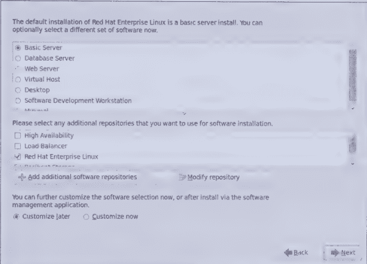

点击下一步后，操作系统安装流程即会启动。根据您选择的软件包和其他配置选项的不同，该过程可能较快（10分钟），也可能稍长（30分钟）。安装完成后，系统会提示您重启。重启完成后，请确保从驱动器中取出CD，或将系统启动项设置为从主磁盘启动，避免重新开始安装流程。至此红帽企业版Linux 6的安装已完成。

## 使用RHEL5的旧版安装流程

本节面向仍在使用红帽企业版Linux 5（RHEL5）的用户。众所周知，新操作系统会提供出色的新功能和稳定性，但没有人会在新版本发布时立刻升级所有系统，升级需要周密的规划、测试和协调。本节将重温使用RHEL5作为操作系统的安装流程，您会注意到升级到RHEL6后，安装流程和步骤顺序发生了变化。如果您想跟随本节内容进行实操，可以在`Client01`虚拟机上安装RHEL5。

**第1步** 在VirtualBox中创建一个内存为384MB的新虚拟机，命名为`Client01`。
**第2步** 确保安装CD已放入驱动器（或已挂载为ISO文件），并从CD启动。如果在第一个屏幕不按下`Enter`键，系统会在超时阈值（约3秒）后自动启动。此时安装流程即会开始。
**第3步** 第一个选项显而易见，因为语言选择会影响后续整个安装流程，您还需要在此处选择键盘布局。
**第4步** 系统会提示您输入安装序列号，此时可以跳过。由于您只是搭建实验环境，无需向红帽注册系统。
**第5步** 接下来进入分区布局界面，您大概率会在此界面花费最多时间（见图1-6）。此处您需要为新安装的系统创建分区。为了顺利完成安装，暂时选择删除所有分区并创建默认推荐布局。未来安装时您可能会创建自定义分区方案，但本次无需如此。默认情况下，红帽在创建默认布局时会使用LVM，因此除`/boot`分区外，您的所有分区都会位于逻辑卷上。

## 图1-6 分区创建

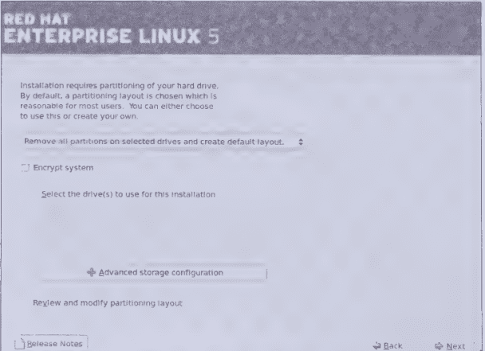

> **实战提示**
> 许多系统管理员都有自己的分区布局创建方式，有时甚至会根据公司要求制定。由于个人偏好不同，且讨论“分区应该布置在哪里”这个话题容易引发争议，我不会基于任何标准介绍如何创建自定义分区方案。不过有两点重要注意事项需要了解：第一，`/boot`分区永远不能属于LVM布局的一部分；第二，您应该提前花时间规划分区布局，因为现在稍作规划，就能避免日后的大麻烦。

**第6步** 选择继续后，系统会弹出警告，提示您的分区尚未初始化，执行该操作会删除系统上的所有数据（见图1-7）。无需担心此问题，因为当前系统上没有任何数据。

## 图1-7 分区警告

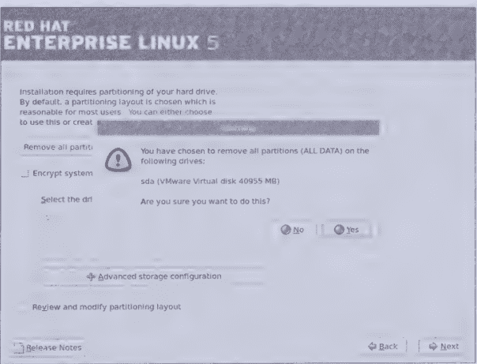

> **警告**
> 我本不必特别说明，但还是提醒一下：初始化磁盘驱动器会删除所有数据。如果您是跟随本文实操，当前磁盘上应该没有任何数据（因为您使用的是虚拟机）；但如果您采用其他方式搭建实验环境，请在安装、初始化或格式化任何磁盘驱动器前，确保已备份所有数据！

**第7步** 接下来需要配置系统所需的网络接口。本次安装您需要配置两个网络接口：第一个为`eth0`，通过DHCP服务器获取IP地址；第二个为`eth1`，静态配置IP地址（见图1-8）。

## 图1-8 添加网络接口

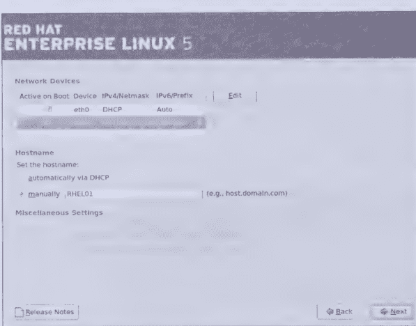

**第8步** 选择时区。我的时区设置为`America/New_York`。
**第9步** 设置`root`密码（见图1-9）。请确保密码足够复杂，他人无法轻易猜出。`root`用户对服务器上的所有内容都拥有完全访问权限，因此使用容易被第一次猜到的密码是非常不可取的。

## 图1-9 root密码设置

> **实战提示**
> 实验室环境是否必须设置复杂的`root`密码存在较大争议，因为实验室通常与生产网络隔离。请记住，如果您远程访问实验室，您能进入系统就意味着其他人也能进入。如果您使用的是本地笔记本电脑（就像我一样），由于没有远程连接，系统被入侵的概率会低很多。无论如何，选择哪种方式取决于您，您可以遵循自己认同的理念。

**图1-9** 选择`root`密码。

**步骤10.** 现在你可以选择要安装的软件包。这个过程可以非常细致，因为你可以先选择一个软件包组，再选择组内的单个软件包。我的安装会保留默认设置（如图1-10所示，会安装基础系统加上GNOME桌面管理器）。你需要了解如何手动配置不同的软件包和安装流程，因此让系统现在自动安装它们从长远来看并无帮助。点击“下一步”后，操作系统开始安装。这个过程可能很快（10分钟），也可能稍慢（30分钟），具体取决于你选择安装的软件包和其他配置选项。安装完成后，系统会提示你重启。重启系统后，请务必将CD从驱动器中取出，或者将系统设置为从主磁盘启动，以免重新开始安装流程。重启后，系统进入首次启动流程。

## 首次启动流程

我们这里要遵循的首次启动流程是RHEL5安装的延续。RHEL6使用的是类似的文本菜单驱动流程。首次启动流程中你首先看到的是防火墙配置页面，如图1-11所示。

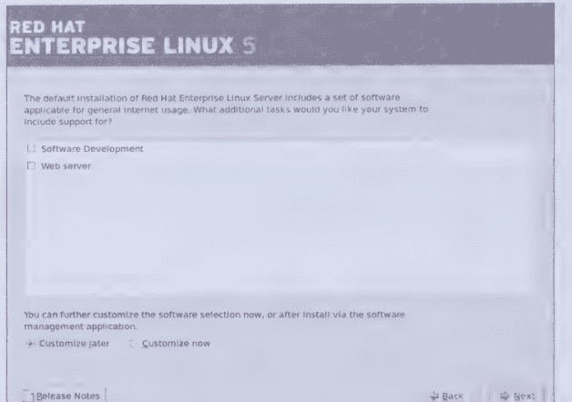

**图1-10** 软件包选择。

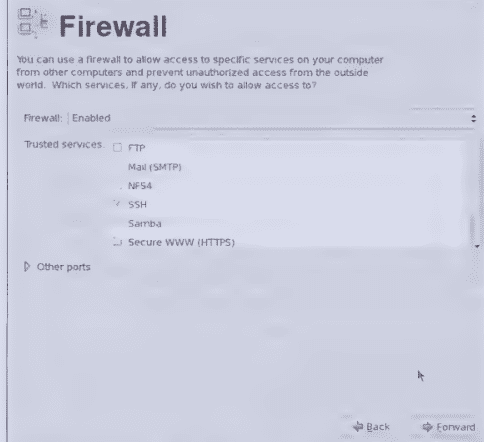

**图1-11** 选择防火墙端口。

**步骤1.** 同样，暂时选择默认设置，该设置仅允许入站连接访问SSH服务（你可以使用SSH进行远程管理）。
**步骤2.** 防火墙之后是下一个安全工具SELinux。RHCSA要求你了解如何在强制模式下配置SELinux以配合不同的服务运行。为了确保你按这种方式练习，请选择“强制”（见图1-12），然后点击“下一步”。

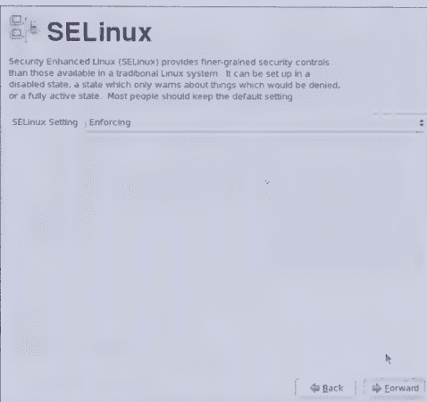

**图1-12** 将SELinux设置为强制模式。

**步骤3.** 选择日期和时间，系统会自动检测。验证信息是否正确，然后继续首次启动流程。
**步骤4.** 创建你将用于登录系统的第一个用户（见图1-13）。不要忘记为用户设置一个安全的密码。我将我的用户命名为`user01`以保持简单。注意，本书中我会一直使用这个用户名。
**步骤5.** 这里的最后一步是确保声卡正常工作。点击“下一步”后，你可以安装任何其他你可能需要的额外软件。因为你没有其他需要安装的软件，你可以完成首次启动流程，首次进入登录屏幕。

Red Hat的安装流程并不困难，但了解其中的不同部分会在之后遇到问题时帮助你排查系统故障。

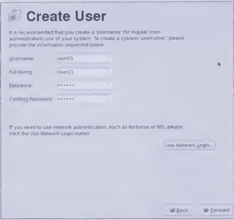

**图1-13** 创建你的第一个用户。

## 验证安装

首次安装完Red Hat Enterprise Linux后，你需要验证所有流程都正常完成。你应该首次登录到你的虚拟机（`RHEL01`），然后切换到`root`用户（如果你安装了桌面管理器，请依次点击“应用程序”▸“附件”▸“终端”）。

切换到`root`用户的命令如下：

```
[user01@RHEL01 ~]$ su -
Password: (输入你在安装时设置的root密码)
[root@RHEL01 ~]#
```

你可以通过提示符从`$`变为`#`来判断你已经切换到`root`用户。整本书中，我都会以`root`用户身份执行所有操作。现在你可以查看`root`用户的主目录，找到安装过程中生成的三个日志文件。如果出现问题，这些日志文件可以为你提供有价值的信息。

```
# ls anaconda-ks.cfg install.log install.log.syslog
```


以下列表概述了每个文件包含的内容：
- `anaconda-ks.cfg`：提供安装的kickstart文件
- `install.log`：列出安装过程中安装的所有软件包
- `install.log.syslog`：存储安装过程中生成的日志消息

`anaconda-ks.cfg`文件实际上是根据安装过程中的详细信息和选择生成的kickstart文件。本书后面我会讲到如何使用kickstart文件实现安装自动化。下一个文件`install.log`列出了安装过程中安装的所有软件包。当你想要自定义系统并减少安装的软件包数量时，这是一个很好的起点，可以首先查看系统默认安装了哪些软件包。最后，`install.log.syslog`存储安装过程中生成的消息。在`/tmp`目录中，你还可以找到一组`anaconda.*`日志文件，这些文件提供了安装过程中更多事件的相关信息。通常，如果系统安装过程中出现问题，你会当场知晓。如果需要的话，这些文件非常适合用于故障排查。

## 本章小结
本章介绍了Red Hat系统的安装。尽管从CD安装Red Hat系统已经不再是考试内容，但理解本章讨论的概念非常重要。分区、系统设置和安装后任务会影响系统安装后的运行状态。你应该了解系统的安装流程，以及如何验证系统是否安装正确。接下来的章节会讨论高级分区，例如RAID和LVM。另外，本章还介绍了如何查看日志文件以验证安装是否成功。下一章会深入讲解启动流程和系统服务的工作原理。

## 复习题
1. Red Hat Enterprise Linux 5 支持LUKS加密。判断对错。
2. Red Hat Enterprise Linux 6 在安装过程中默认将SELinux设置为强制模式。判断对错。
3. 哪种远程管理服务是默认安装的？你能说出它使用的端口吗？
4. 你只能在Red Hat Enterprise Linux安装完成后安装软件包。判断对错。
5. 默认分区布局仅包含基本分区。判断对错。
6. 哪个文件包含安装过程中生成的所有消息，在需要时可用于故障排查？

## 复习题答案
1. 错误。只有Red Hat Enterprise Linux 6 是官方支持LUKS加密的版本。
2. 正确。在Red Hat Enterprise Linux 6中，安装过程中SELinux的默认模式为强制模式（安装完成后可以更改）。对于Red Hat Enterprise Linux 5，你可以选择SELinux的启动模式。
3. SSH服务在Red Hat中几乎总是默认安装。它使用`TCP 22`端口，且该端口在默认防火墙规则中是开放的。
4. 错误。软件包选择页面允许你在安装过程中安装任何你想要的软件，只要你能够访问正确的软件包或软件源。
5. 错误。Red Hat Enterprise Linux 5 或 6的默认分区布局都使用了LVM。
6. `install.log.syslog`文件包含安装过程中生成的消息。如果在安装过程中遇到问题，这是一个很好的排查起点。

## 实验1

### 任务1 – 首次安装

**步骤1.** 擦除你当前的RHEL01实例。

**步骤2.** 在VirtualBox中创建一个新的虚拟机，配置如下：
- a. 将新虚拟机命名为RHEL01。
- b. 将第一块网卡设置为桥接网卡。
- c. 添加第二块网卡，将其设置为inet网络的内网网卡。
- d. 分配主硬盘大小为20GB。
- e. 创建第二块硬盘，大小为8GB。
- f. 创建第三块硬盘，大小为8GB。
- g. 创建第四块硬盘，大小为8GB（这块硬盘必须在安装完成后创建，因为必须为CD-ROM驱动器留出一个插槽）。

**步骤3.** 使用以下设置启动Red Hat Enterprise Linux 6的安装：
- a. 为磁盘1分配默认布局，其余磁盘留空。
- b. 将网卡1设置为通过DHCP获取IP地址。
- c. 将网卡2设置为静态IP地址`172.168.1.1/24`。
- d. 为系统分配主机名RHEL01。
- e. 时区无所谓。
- f. 仅安装基础服务器软件包（不要安装任何桌面软件包）。

当系统正常启动、存在三块空白硬盘（加上主硬盘）且你可以登录系统时，任务完成。

### 任务2 – 第二次安装

**步骤1.** 在VirtualBox中创建一个新的虚拟机。

**步骤2.** 在新机器的创建过程中，使用以下设置：
- a. 将新虚拟机命名为RHEL02。
- b. 将第一块网卡设置为inet网络的内网网卡。
- c. 分配主硬盘大小为10GB。

**步骤3.** 按照以下设置启动红帽企业版 Linux 6 的安装：
- a. 将驱动器 1 分配为默认布局。
- b. 将网卡 1 设置为静态 IP 地址 `172.168.1.2/24`。
- c. 将系统主机名设置为 RHEL02。
- d. 时区不限。
- e. 仅安装基础服务器软件包（不要安装任何桌面软件包）。

当系统正常启动且你可以登录系统时，任务即完成。

## 任务3 – 第三次安装

### 步骤1. 按照以下设置创建新的虚拟机：
- a. 将新虚拟机命名为 Client01。
- b. 将第一块网卡设置为 inet 网络上的内部适配器。
- c. 将主硬盘大小设置为 10GB。

### 步骤2. 按照以下设置启动红帽企业版 Linux 5 的安装：
- a. 将驱动器 1 分配为默认布局。
- b. 将网卡 1 设置为静态 IP 地址 `172.168.1.10/24`。
- c. 将系统主机名设置为 Client01。
- d. 时区不限。
- e. 安装基础软件包和桌面软件包（GNOME 桌面管理器）。
- f. 当提示创建用户时，将用户命名为 user01。
- g. 确保 SELinux 设置为强制（Enforcing）模式。
- h. 确保防火墙的 22 端口保持开放以支持 SSH 连接。

当系统正常启动且你可以登录系统时，任务即完成。

## 任务4 – 第四次安装

### 步骤1. 按照以下设置创建新的虚拟机：
- 将新虚拟机命名为 Client02。
- 将第一块网卡设置为 inet 网络上的内部适配器。
- 将主硬盘大小设置为 10GB。

### 步骤2. 按照以下设置启动红帽企业版 Linux 6 的安装：
- 将驱动器 1 分配为默认布局。
- 将网卡 1 设置为静态 IP 地址 `172.168.1.20/24`。
- 将系统主机名设置为 Client02。
- 时区不限。
- 安装基础软件包和桌面软件包（GNOME 桌面管理器）。
- 当提示创建用户时，将用户命名为 user02。

当系统正常启动且你可以登录系统时，任务即完成。


## 本章涵盖以下主题：

- **引导过程**——本节将高屋建瓴地概述引导过程及其工作原理。
- **GRUB 的使用**——在本节中，你将学习如何使用红帽默认的引导加载器 GRUB。
- **运行级别**——本节介绍不同的运行级别，以及它们在引导过程中的工作方式。
- **服务管理**——本节解释如何在引导过程中及引导完成后管理系统服务。

## 涵盖的 RHCSA 考试目标如下：

- 正常引导、重启和关闭系统
- 手动将系统引导至不同的运行级别
- 配置系统自动引导至指定运行级别
- 使用单用户模式获取系统访问权限
- 启动、停止并检查网络服务的状态
- 修改系统引导加载器
- 配置网络服务在引导时自动启动

## 系统初始化

如果你从未接触过引导过程，它可能会相当复杂。但尽管如此，理解引导过程非常重要，这样当系统无法正常引导时，你才能对其进行故障排除。

计算机启动时，BIOS 是第一个运行的程序。BIOS 加载完成后，会通过开机自检（POST）测试系统，然后开始加载外围设备。随后 BIOS 会查找引导设备，并将控制权移交给它。引导设备包含主引导记录（MBR），MBR 会通过引导加载器启动系统。接下来，Grand Unified Bootloader（GRUB，引导管理器）会引导至标记为默认的内核。最后，内核会调用 init 进程（Linux 系统上生成的第一个进程），由它启动系统的其余部分。

除了排除引导过程的故障外，你还需要了解服务是如何启动和停止的、如何将系统服务添加到引导过程中，以及如何管理引导加载器本身。

## 引导过程

我们再次了解引导过程，这次可以从 GRUB 引导加载器入手，更深入地检视每个环节。

Grand Unified Bootloader（GRUB）已成为红帽、Ubuntu 以及许多其他 Linux 发行版的默认引导加载器。引导加载器可用于引导至不同的操作系统（通常称为*多引导系统*）、用于系统恢复，以及使用特殊参数引导内核。GRUB 加载后，会显示内核列表以及可用的其他操作系统列表，你可以从中选择要引导的系统（见图 2-1）。默认情况下有一个可配置的 5 秒超时时间，如果你没有做出选择且超时阈值到达，系统会自动选择默认内核。

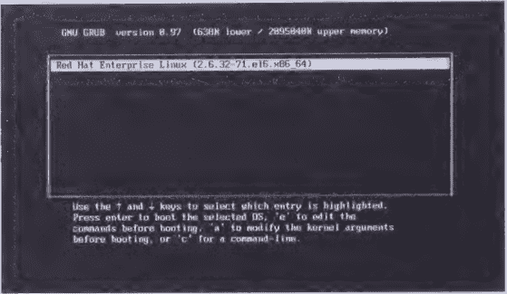

**图 2-1** GRUB 引导选择界面。

### 实战提示

虽然默认超时时间是 5 秒，但一些较旧的显卡需要整整 5 秒才能显示屏幕。对于旧系统，我建议你将默认超时时间至少设置为 10 秒。

GRUB 加载内核后，会将控制权移交给内核，内核会开始初始化并配置计算机的硬件。根据 GRUB 配置文件的设置，你可能会或不会看到此过程中的任何内容。GRUB 中有一个 `"quiet"` 选项，会向用户隐藏此过程（通常会显示某种图形代替，例如红帽徽标）。在引导过程中，所有内容都会记录到 `/var/log/dmesg` 文件中。系统启动完成后，你还可以使用 `dmesg` 命令查询引导过程的相关信息。当系统驱动就位后，内核会执行 `/sbin/init` 程序。

### 实战提示

虽然红帽考试不涉及硬件测试，但如果你遇到硬件问题，可以在实际工作中使用 `lsmod` 命令进行故障排除。

#### 通用信息

在红帽 6 中，引导过程已替换为名为 *Upstart* 的新工具，取代了传统的 SysV Init 风格脚本。该工具减少了系统引导所需的时间，并且已应用于 Ubuntu 等其他 Linux 发行版。

从这里开始会变得复杂一些。在红帽企业版 Linux 6（RHEL6）中，引导序列已更改为使用 Upstart。由于许多系统仍会在较长一段时间内使用红帽企业版 Linux 5（RHEL5），因此你也需要了解传统的 SysV Init 引导过程是如何工作的。了解两者还有助于解决迁移问题。我们先继续了解传统的 SysV Init 脚本，之后再了解 Upstart 的新实现方式。

init 程序是内核创建的第一个进程。它负责引导过程的其余部分，并为用户设置环境。首先，它会查阅 `/etc/inittab` 文件，该文件定义了引导过程剩余的步骤。`/etc/inittab` 文件列出了要引导的默认运行级别，以及系统初始化脚本（`/etc/rc.d/rc.sysinit`）。我将在本章后续部分介绍什么是运行级别以及它的用途。

我们来看一下 `/etc/inittab` 文件，了解 init 进程的执行流程：

```bash
# cat /etc/inittab
#
# inittab    This file describes how the INIT process should set up
#            the system in a certain run-level.
#
# Author:     Miquel van Smoorenburg, <miquels@drinkel.nl.mugnet.org>
#             Modified for RHS Linux by Marc Ewing and Donnie Barnes
#
# Default runlevel. The runlevels used by RHS are:
#   0 - halt (Do NOT set initdefault to this)
#   1 - Single user mode
#   2 - Multiuser, without NFS (The same as 3, if you do not have networking)
#   3 - Full multiuser mode
#   4 - unused
#   5 - X11
#   6 - reboot (Do NOT set initdefault to this)
#
id:5:initdefault:

# System initialization.
si::sysinit:/etc/rc.d/rc.sysinit

10:0:wait:/etc/rc.d/rc 0
11:1:wait:/etc/rc.d/rc 1
12:2:wait:/etc/rc.d/rc 2
13:3:wait:/etc/rc.d/rc 3
14:4:wait:/etc/rc.d/rc 4
15:5:wait:/etc/rc.d/rc 5
16:6:wait:/etc/rc.d/rc 6
```

```inittab
# Trap CTRL-ALT-DELETE
ca:ctrlaltdel:/sbin/shutdown -t3 -r now

# When our UPS tells us power has failed, assume we have a few minutes
# of power left. Schedule a shutdown for 2 minutes from now.
# This does, of course, assume you have power installed and your
# UPS connected and working correctly.
pf:powerfail:/sbin/shutdown -f -h +2 "Power Failure; System Shutting Down"

# If power was restored before the shutdown kicked in, cancel it.
pr:12345:powerokwait:/sbin/shutdown -c "Power Restored; Shutdown Cancelled"

# Run gettys in standard runlevels
1:2345:respawn:/sbin/mingetty tty1
2:2345:respawn:/sbin/mingetty tty2
3:2345:respawn:/sbin/mingetty tty3
4:2345:respawn:/sbin/mingetty tty4
5:2345:respawn:/sbin/mingetty tty5
6:2345:respawn:/sbin/mingetty tty6

# Run xdm in runlevel 5
x:5:respawn:/etc/X11/prefdm -nodaemon
```

从该文件中可以看到，虽然列出了6种不同的运行级别，但默认运行级别被设置为5。`/etc/inittab`文件还定义了如何处理掉电故障和虚拟终端。

init进程完成对`/etc/inittab`文件的读取后，会运行`/etc/rc.d/rc.sysinit`脚本，该脚本负责设置系统时钟、网络、配置用户环境等操作。

在Red Hat Enterprise Linux中，默认运行级别为5，这一点在查看`/etc/inittab`文件时已经提及。该默认运行级别会被传递给`/etc/rc.d/rc`脚本，后者会调用`/etc/rc.d/rc#.d`目录下的所有程序。

你最后看到的内容是登录提示符。如果安装了Gnome这类桌面管理器，你会看到图形界面的登录屏幕，可凭此登录系统；否则你会看到文本模式的登录界面。至此启动过程完成。

现在你已经了解了RHEL5的启动过程，接下来我们来看RHEL6中使用的新Upstart程序是怎样实现启动的。Upstart是基于事件的，因此它不需要像RHEL5那样按顺序处理所有流程。每个进程在Upstart中被称为任务（job），并在`/etc/init`目录中定义。

init进程仍然是最先创建的，但它来源于一个Upstart事件。RHEL5中会调用`rc.sysinit`主脚本，再由后者调用各个运行级别，而RHEL6的Upstart init会从目录中获取一个任务来继续启动流程。`/etc/inittab`文件已被弃用，仅通过其中的`initdefault`行来读取默认运行级别设置。

各个运行级别仍然会被调用，但需要启动或停止的服务也由Upstart处理。本章后续介绍服务管理的部分，我们会查看部分Upstart任务，了解它具体是如何控制服务的。

好了，我们已经介绍完启动流程及其两种不同的实现方式，你现在已经是专家了对吧？别被本节呈现的所有信息吓到，这只是高层级的概览，本章剩余内容会围绕启动流程的各个部分展开深入细节说明。

接触启动流程任何部分时，最好的方法就是反复实践、做实验，再实践、再做实验。你获得的实操经验越多，在处理和排查启动流程问题时就会越得心应手。

## 使用GRUB

上一节已经描述了启动流程及其工作原理，该流程的第一部分涉及引导加载程序GRUB。本节将深入介绍GRUB及其在启动流程中的作用。

GRUB引导加载程序分为不同阶段：主引导记录（MBR）中的代码被视为GRUB第1阶段，它会加载GRUB第1.5阶段，该阶段会尝试识别文件系统类型（可选步骤），也可能会直接调用GRUB第2阶段。


第2阶段负责调用内核并将其加载到内存中。在第1阶段，GRUB需要搜索MBR，找到可用于启动内核的活动分区。GRUB有自己专属的硬盘检索格式，其语法为`(hd[(n,m])`，其中`hd`代表磁盘，`n`是磁盘编号，`m`代表分区编号。

在排查GRUB相关问题时，该语法非常实用，因为你需要了解GRUB在查找主分区时的磁盘检索方式。找到主分区后，GRUB会加载内核，之后流程进入第2阶段。

第2阶段是你排查系统启动问题最常涉及的阶段。第2阶段启动时，会呈现可用的内核启动列表，同时列出可用于修改启动时传递给内核的参数选项（你已在图2-1中见过相关内容）。

### GRUB启动选项

- `e`：启动前编辑启动命令
- `a`：启动前修改或追加内核参数
- `c`：打开GRUB命令行

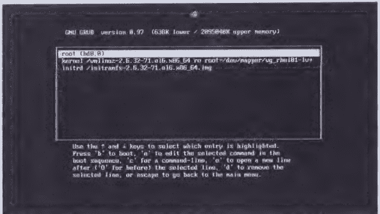

### 图2-2 编辑GRUB内核启动项

你可以使用`a`选项修改需要传递给内核的任意参数，包括修改系统将进入的运行级别。虽然你会在下一节了解更多关于运行级别的内容，但现在你需要知道，每个运行级别都是系统可以进入的不同“状态”。

选择`a`选项后，你可以传入对应模式作为参数，让系统进入该模式。以下是可启动的不同模式：

- **单用户模式**：用于执行维护任务，或遗忘root密码时使用
- **运行级别2或3**：启动过程中仅加载部分服务时使用
- **紧急模式**：系统无法正常启动时，用于执行修复任务时使用
- **救援模式**：用于修复启动问题或重装GRUB时使用

除了向内核传递参数外，你也可以进入GRUB命令行进行修改。不过我们先别跳步，首先需要了解GRUB的配置文件。

### 配置文件

GRUB只有单个配置文件，即`/boot/grub/grub.conf`。另外两个文件实际上是该主配置文件的软链接：`/boot/grub/menu.lst`和`/etc/grub.conf`。

GRUB启动时会从主配置文件中读取配置信息。你可以在命令行中修改配置来测试GRUB的不同功能，但如果有需要永久生效的修改，必须写入主配置文件，否则修改会在重启后丢失。

系统启动后你可以查看配置文件，但这是RHEL6出现变化的领域之一。首先我们来看旧版`grub.conf`文件的示例：

```
grub

default=0
timeout=5
splashimage=(hd0,0)/grub/splash.xpm.gz
hiddenmenu
title Red Hat Enterprise Linux Server (2.6.18-92.el5)
root (hd0,0)
kernel /vmlinuz-2.6.18-92.el5 ro root=/dev/VolGroup00/LogVol00 rhgb quiet
initrd /initrd-2.6.18-92.el5.img
```

在前述示例中，你可以看到由`title`条目定义的单一启动选项，这也被称为条目0，因此会成为默认启动内核。你也可以看到正在使用的内核版本，以及启动过程中根分区将被挂载的位置。

如果你想添加更多启动选项，可以追加另一个带`title`的条目作为第二启动选择。该`grub.conf`文件包含确保启动流程顺畅运行所需的所有配置。

现在我们来查看RHEL6的新版`grub.conf`文件：

```
grub

default=0
timeout=5
splashimage=(hd0,0)/grub/splash.xpm.gz
hiddenmenu
title Red Hat Enterprise Linux (2.6.32-71.el6.x86_64)
root (hd0,0)
kernel /vmlinuz-2.6.32-71.el6.x86_64 ro root=/dev/mapper/vg_rhel01-lv_root rd_LVM_LV=vg_rhel01/lv_root rd_LVM_LV=vg_rhel01/lv_swap rd_NO_LUKS rd_NO_MD rd_NO_DM LANG=en_US.UTF-8 SYSFONT=latarcyrheb-sun16 KEYBOARDTYPE=pc KEYTABLE=us crashkernel=auto rhgb quiet
initrd /initramfs-2.6.32-71.el6.x86_64.img
```

你会发现除了内核启动参数所在行之外，其余内容几乎完全一致。新版配置新增了加密、RAID、使用`/dev/mapper`进行LVM管理等相关选项。需要再次强调的是，了解RHEL6的新变更非常重要，因为一旦系统出现问题，你需要能够排查`grub.conf`文件相关问题。

在两个版本的Red Hat系统中，你也可以在GRUB命令行中编辑配置文件。通过`c`选项进入GRUB命令行后，你可以修改配置文件、重装GRUB，或修复损坏的配置文件。

### 实战提示

在RHEL6中，当前使用的GRUB版本是0.97。GRUB的最新版本是2.0，拥有更多可用功能。如果你升级到2.0版本，一个值得注意的限制是：你无法手动编辑`grub.conf`文件（你的修改会被覆盖）。GRUB版本之间的差异超出了本书的讨论范围，因此你只需要知道：更新GRUB时，你需要采用不同的方式管理`grub.conf`。

### GRUB命令行

在现实场景中常见、也可能是考试题目的一个任务是：如何修复损坏的主引导记录（MBR）。要完成这项任务，你需要用到救援环境，可以通过从RHEL安装DVD启动来进入。进入救援环境后，你就可以修复损坏的MBR。

1. 加载GRUB命令行，使用`find`命令查找包含`grub.conf`文件的磁盘和分区：

```
grub > find /grub/grub.conf

(hd0,0)
```

你也可以运行以下命令：

```
grub > root (hd0,0)

Filesystem type is unknown, partition type 0x8e
```

2. 在返回的驱动器上安装GRUB：

```
grub > setup (hd0)

Checking if "/boot/grub/stage1" exists... no
Checking if "/grub/stage1" exists... yes
Checking if "/grub/stage2" exists... yes
Checking if "/grub/e2fs_stage1_5" exists... yes
Running "embed /grub/e2fs_stage1_5 (hd0)"... 26 sectors are embedded.
Running "install /grub/stage1 (hd0) (hd0)1+26 p (hd0,0)/grub/stage2 /grub/grub.conf"... succeeded
Done.
```

现在你的MBR已经修复完成，你应该可以再次正常启动系统了。上面的示例也显示了引导分区的位置（0号磁盘上的0号分区），以及文件系统类型。备份`grub.conf`文件非常重要，以防系统出现问题时你可以轻松恢复它。第18章“DNS”涵盖了更多GRUB和系统启动过程故障排查相关的考试场景和问题。

### 运行级别

系统启动时会查询定义在`/etc/inittab`文件中的默认运行级别。找到该默认运行级别后，系统就会启动到对应的运行级别。不同的运行级别本质上是不同的“状态”，可以根据你所在的运行级别启动或停止相应服务。总共有6个运行级别，在`/etc/inittab`文件中有说明。每个运行级别还有一个名为`/etc/rc.d/rc#.d`的目录，其中`#`代表运行级别编号（从0到6）。这些不同的目录中包含脚本，用于告诉系统在特定运行级别下应该启动或停止哪些服务。下面我们来看看不同的运行级别：

- 0：停机
- 1：单用户模式
- 2：多用户模式（仅部分服务）
- 3：带网络功能的完整多用户模式（文本模式）
- 4：未使用
- 5：带图形界面的完整多用户模式（提供GUI桌面登录）
- 6：重启

最容易理解的运行级别是0和6。这两个运行级别对应相同的命令，只是输入参数不同。运行级别0本质上是系统关机状态（你可以理解为断电“状态”）。运行级别6是系统重启状态（重新引导“状态”）。运行级别1用于进入单用户模式，当系统出现问题、你需要执行维护操作时会用到这个级别。你也可以在这个运行级别下重置root用户的密码。剩下的运行级别——2、3、5——为不同服务的运行提供不同的状态。还有一个运行级别4，但它未被使用。了解每个运行级别会启动哪些服务的最好方法是查看对应运行级别的`/etc/rc.d/rc#.d`目录。这些目录中的文件定义了应该启动或停止哪些服务，这些文件实际上是指向系统中服务初始化脚本的软链接。不要忘记，Upstart是目前实际在每个运行级别启动和停止服务的程序。`/etc/init/rc.conf`文件显示了每组脚本的调用方式：

```bash
# cat rc.conf
# rc - System V runlevel compatibility
#
# This task runs the old sysv-rc runlevel scripts. It
# is usually started by the telinit compatibility wrapper.
start on runlevel [0123456]
stop on runlevel [!$RUNLEVEL]
task
export RUNLEVEL
console output
exec /etc/rc.d/rc $RUNLEVEL
```

### 运行级别工具

接下来我们来看看能帮助你在不同运行级别下管理系统的众多系统工具。这些管理命令包括：

- **关机命令**：将系统关闭到断电状态，也可以用于重启系统
- **停机命令**：关闭系统电源
- **重启命令**：重启系统
- **断电命令**：作用与停机命令相同
- **服务启动项配置命令**：管理服务在各个运行级别下的启动与停止
- **运行级别查询命令**：显示当前和之前的运行级别
- **运行级别切换命令**：切换运行级别
- **服务配置菜单工具**：与`chkconfig`功能类似，是一个菜单驱动的服务管理工具

我们先从最容易理解的两个运行级别0和6的管理开始。要管理这两个运行级别，你可以使用`shutdown`命令将系统关闭到断电状态或重启系统。`shutdown`命令还有相关选项，可以在系统关闭时提醒系统上的用户，还可以设置特定时间的关机任务。

语法：`shutdown [options] time`

### 选项

- `-k`：不实际关机，仅发送警告
- `-h`：关机后停止系统
- `-r`：重启而非关闭系统
- `-F`：重启时强制进行文件系统检查
- `-n`：快速终止所有进程（不推荐）
- `-t SECS`：发送关机消息，但将关机操作延迟x秒

> **实战提示**
如果你直接使用`shutdown now`命令，实际上会让系统进入维护模式。要让系统真正关机或重启，你需要使用`-h`或`-r`选项。为了让你更好地理解它的工作方式，我们来看一些示例。假设你只想关闭系统，可以执行以下操作：

```bash
# shutdown -h now
```

这次我们不完全断电，而是重启系统，操作如下：

```bash
# shutdown -r now
```

你也可以使用`reboot`命令达到同样的效果：

```bash
# reboot
```

再来看最后一个示例，延迟2分钟关机：

```bash
# shutdown -h 120
```

这些只是`shutdown`命令的常见用法示例。除非你赋予普通用户相应权限，否则只有root用户可以执行`shutdown`和`reboot`命令。注意你要允许访问这些命令的用户，你肯定不希望随便哪个用户都不断重启你的系统来解决问题！

> **警告：**
在较早版本的Red Hat中，你可以使用`/etc/shutdown.allow`文件来控制允许关机系统的用户。随着RHEL6和新Upstart工具的发布，你不能再使用这个文件来控制单个用户的关机流程。

和`shutdown`命令类似的还有`halt`命令。`halt`命令的作用和`shutdown`类似，都是将系统关闭到断电状态。要关闭系统，你可以使用这个命令：

```bash
# halt now
```

你也可以使用：

```bash
# halt
```

`poweroff`和`reboot`命令与`halt`命令对应。这些命令之所以关联，是因为`poweroff`和`reboot`实际上都是指向`halt`命令的链接。你可以通过以下示例验证：

```bash
# cd /sbin
# ll | grep halt
-rwxr-xr-x 1 root root 16152 Jan 21 2009 halt
lrwxrwxrwx 1 root root 4 Jul 22 2010 poweroff -> halt
lrwxrwxrwx 1 root root 4 Jul 22 2010 reboot -> halt
```

区别在于每个命令调用`halt`命令时传入的参数不同，从而产生不同的结果。`poweroff`命令和`halt`一样，停止系统运行，而`reboot`命令则重启系统——显然这点很明显。

在不断切换不同运行级别的过程中，你怎么知道自己当前在哪个运行级别呢？要查看当前运行级别，你可以使用`runlevel`命令（是不是很容易混淆？）：

```bash
# runlevel
N 5
```

作为替代方法，你也可以使用`who`命令获得同样的结果：

```bash
# who -r
run-level 5 2010-09-05 09:45 last=S
```

你也可以通过`init`命令更改当前的运行级别。不过，在更改运行级别之前，你应该先使用前面提到的两个命令之一检查当前的运行级别。

### 考试提示

注意`runlevel`命令先显示之前的运行级别，再显示当前运行级别，而`who`命令的显示顺序正好相反。我的建议是：选择其中一个命令并一直使用它，以免在考试中或生产环境的实际系统中混淆。

现在你已经知道如何查看当前运行级别，以及如何切换到运行级别0和6，接下来我们来看看如何进入其余运行级别。使用`init`命令，你可以从一个运行级别切换到另一个运行级别。切换前请确保先检查当前所在的运行级别。如前所述，运行级别5是Red Hat的默认运行级别。不过如果你想切换到运行级别3，可以按以下步骤操作：

- 步骤1：检查当前运行级别：

```bash
# runlevel
N 5
```

- 步骤2：因为你当前在运行级别5，切换到运行级别3：

```bash
# init 3
```

大约一分钟后，你将会进入运行级别 3。请注意切换到更低运行级别时被停止的服务。

### 步骤 3. 验证你当前确实处于运行级别 3：

```
# runlevel
N 3
```

接下来我们更仔细地了解紧急运行级别。

### 救援与恢复运行级别

有时系统会出现严重故障甚至无法启动。对于刚接触 Linux 的用户来说，这是非常危险的信号，会让他们手足无措，因为他们还不确定该如何应对这类系统崩溃。

此时，你可以使用较低运行级别来执行系统救援或恢复。如果你的系统可以启动到运行级别 3，你可以通过执行 `# init 1` 命令进入恢复运行级别。如果系统连这一步都无法完成，你可以在 GRUB 启动菜单处启动系统，在你要启动的内核后追加单词 `single`，这种方法和你直接启动到恢复运行级别的效果一致。

进入恢复运行级别后，你可以对系统执行维护或修复操作（例如排查阻止系统启动的原因）。针对认证考试，关于恢复运行级别你需要注意以下几点：

- 你可以重置或修改 root 用户的密码。
- 你可以调整系统运行时通常被锁定的系统文件或分区。
- 你可以通过备份或红帽安装光盘中的可用副本替换受损文件，以此修复系统文件。

完成所有修改或修复操作后，你可以重启系统，查看其是否恢复到正常工作状态。如果无法正常启动，你可以再次进入恢复运行级别重试。你也可以通过启动第一张红帽安装光盘进入该救援环境。

现在你已经了解了运行级别以及如何在它们之间切换，我们可以将重点转向服务管理，服务管理涉及不同运行级别下各类系统服务的启动与停止。

### 服务管理

在任何系统中，管理正在运行的服务都非常重要。管理服务可以确保系统提供稳定、可靠的服务。服务的范围很广，从给本地系统提供正确时间这类简单服务，到使用 NFS 为全网用户共享文件系统这类复杂服务均有涵盖。

掌握服务管理方法是红帽认证考试的重要组成部分（如红帽备考指南中所定义），同时也是现实世界中系统管理员必备的核心技能。

在 Linux 中，服务也可以称为*守护进程*。之所以这么叫，是因为部分服务实际上由多个守护进程组成，第 15 章《NFS》中介绍的 NFS 就是这样的例子。通常你可以通过服务名称以字母 *d* 结尾来判断其是否为守护进程，例如 SSH 服务（`sshd`）或 Apache 网页服务（`httpd`）就是如此。

接下来我们再次了解不同运行级别，以及它们在启动过程中如何处理服务。由于上一节我们将系统切换到了运行级别 3，不妨先从对应运行级别 3 的 `/etc/rc.d/rc3.d` 目录开始查看：

```
# ls /etc/rc.d/rc3.d/
```

| /etc/rc.d/rc3.d/ 目录下的文件 |
| --- |
| K01dnsmasq |
| K50ibmasm |
| K89pand |
| S08iptables |
| K02avahi-dnsconfd |
| K50netconsole |
| K89rdisc |
| S00mcstrans |
| K02NetworkManager |
| K69rpcsvcgssd |
| K91capi |
| S09isdn |
| K02oddjobd |
| K73yppbind |
| K99readahead_later |
| S10network |
| K05conman |
| K74nscd |
| S00microcode_ctl |
| S11auditd |
| K05saslauthd |
| K85dmpd |
| S02lvm2-monitor |
| S12restorecond |
| K10psacct |
| K87multipathd |


| `S04readahead_early` |
| `S12syslog` |
| `K10tcsd` |
| `K88wpa_supplicant` |
| `S05kudzu` |
| `S13irqbalance` |
| `K20nfs` |
| `K89dund` |
| `S06cpuspeed` |
| `S13portmap` |
| `K24irda` |
| `K90netplugd` |
| `S08ip6tables` |
| `S14nfslock` |

仅通过这条命令的输出你可能无法看出，这些文件实际上都是指向系统脚本的软链接，通常存储于`/etc/rc.d/init.d`目录中。你也可以从输出中看到，每个链接都有特定的命名规则，格式为`(K|S)##service_name`：其中`K`代表Kill（终止），`S`代表Start（启动），`##`是01到99之间的任意数字，允许重复，最后一部分是服务的名称。综合这些规则，你可以得到一份列表：当系统进入运行级别3时，所有会被停止（`K`）或启动（`S`）的服务。其中的数字代表服务停止或启动的顺序：所有终止操作（`K`）会先执行（按数字从小到大排序），之后才会执行所有启动操作（`S`）（同样按数字从小到大排序）。如果数字相同，则按名称的字母顺序决定先后。

现在假设你的目录中有以下三个服务条目：

- `K15httpd`
- `S10network`
- `S55sshd`

当系统切换到运行级别3时，首先会执行的操作是终止`httpd`服务（`httpd`即Apache网页服务器）；接下来会启动`network`服务，激活网络接口（包括为系统分配IP地址）；最后会启动`sshd`服务，为你提供用于远程管理的SSH服务器。这个顺序非常合理，因为如果网络接口没有先启用并分配IP地址，你根本无法连接到服务器进行远程管理。

### 考试提示

作为故障排查提示，如果你要自行创建服务或往`/etc/rc.d/rc#.d`目录中添加条目，一定要注意服务启动和停止的顺序。如果存在其他依赖项的情况下尝试启动或停止服务，可能会导致系统出现异常，甚至直接导致服务完全失效。

现在你已经了解了不同运行级别下各类服务的启动和停止机制，我们可以来看最后一部分管理工具，这些工具提供了在各个运行级别启用或禁用服务的方法。

回到之前举的三个服务的例子，如果要把这三个服务分别添加到`/etc/rc.d/rc[1-6].d`目录下的对应条目中，总共需要创建18个条目。你可以想象一下，如果要为系统所有服务都做这样的操作，得花多长时间吗？

为了简化各个运行级别下的服务管理工作，你可以使用`chkconfig`命令。

```
Syntax: chkconfig [option] service_name
```

选项：

- `--list [name]` 显示该服务在各个运行级别下的状态
- `--add <name>` 添加服务，使其受`chkconfig`命令管理
- `--del <name>` 移除服务，使其不再受`chkconfig`命令管理
- `--level <levels>` 在指定运行级别启用或禁用该服务
- `<name> <on|off|reset>` 在运行级别2–5启用或禁用该服务

该命令的选项和普通工具的不太一样，解释这个命令用法的最简单方式就是通过示例。

### 步骤 1. 检查`sshd`服务的状态：

```
# chkconfig --list sshd

sshd 0:off 1:off 2:on 3:on 4:on 5:on 6:off
```

这部分内容应该很容易理解：`sshd`服务会在运行级别2、3、4、5下启动，在运行级别0、1、6下停止。

### 步骤 2. 使用`off`选项禁用服务开机启动：

```
# chkconfig sshd off
```

### 步骤 3. 使用之前的命令验证：

```
# chkconfig --list sshd
sshd 0:off 1:off 2:on 3:on 4:on 5:on 6:off
```

现在`sshd`服务在系统启动时将完全不会启动。由于这是用于远程管理的服务，这个结果显然不符合需求，因此你需要将其重新启用。

### 步骤 4. 重新启用SSH服务：

```
# chkconfig sshd on
```

### 步骤 5. 再次验证：

```
# chkconfig --list sshd

sshd 0:off 1:off 2:on 3:on 4:on 5:on 6:off
```

你可以看到，`sshd`服务现在已经恢复为原来的状态了。不过你也可以只在运行级别4下禁用该服务，因为这个运行级别通常不会被使用。如果仅需修改单个（或多个）运行级别的配置，你可以执行以下命令：

```
# chkconfig --level 4 sshd off
```

### 步骤 6. 你需要最后一次验证：

```
# chkconfig --list sshd
sshd 0:off 1:off 2:on 3:on 4:off 5:on 6:off
```

除了使用`chkconfig`命令，你也可以使用`ntsysv`命令完成所有相同的操作。二者的唯一区别是`ntsysv`是菜单驱动的，视觉上更友好。你可以像使用`chkconfig`一样启用和禁用不同的服务。要管理不同的运行级别，只需在执行`ntsysv`命令时指定要管理的运行级别即可。如果要编辑运行级别2下的所有服务，请输入以下命令，运行结果界面如图2-3所示。

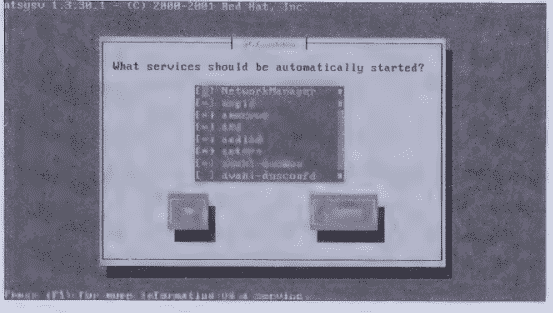

图2-3 `ntsysv`服务管理工具

```
# ntsysv --level 2
```

我更喜欢使用`chkconfig`命令，因为它速度更快、操作更简便。只要你掌握了如何在不同的运行级别下启用和禁用服务，具体使用哪个工具其实并不重要。

这里有个问题：如果系统启动后，你想启动一个忘记添加到开机启动项的服务，该怎么办？你需要用`chkconfig`命令添加它然后重启系统吗？不需要。除了在系统启动时启用和禁用服务外，你还可以使用`service`命令。该命令可用于系统启动后，启动、停止或查询系统上服务的运行状态。

```
Syntax: service <--status-all | service_name CMD>
```

**步骤1.** 通常，最好先检查服务的运行状态：

```
# service ntpd status
ntpd is stopped
```

**步骤2.** 确认服务处于停止状态后，你就可以启动它：

```
# service ntpd start
Starting ntpd: [ OK ]
```

你会看到`OK`或`Fail`提示，以此判断服务是否启动成功。由于该服务在系统启动时处于关闭状态，因此现在你应该将其重新关闭。

**步骤3.** 停止NTP服务：

```
# service ntpd stop
Shutting down ntpd: [ OK ]
```

每次修改服务配置后，你都要养成验证服务运行状态的习惯。

**步骤4.** 验证服务已成功停止：

```
# service ntpd status
ntpd is stopped
```

《Red Hat备考指南》列出了大量需要在系统启动时和启动后管理的服务，因此掌握不同运行级别下服务的操作和管理方法至关重要。在进入下一节之前，你应该将系统切换回运行级别5，或者重启系统以达到相同效果。

### Upstart转换

如前所述，新的Upstart程序通过作业和事件来运行不同的服务。使用Upstart最大的问题在于，目前还没有统一的文件存储标准。现在，你可以在`/etc/init`目录下找到作业文件，在`/etc/event.d`目录下找到事件文件，此外还有传统的SysV Init目录。随着RHEL6的发布，部分服务已经全面迁移到新的Upstart工具下（例如负责系统日志的Syslog服务）。每个作业都可以包含触发其他作业或系统脚本的事件，我们来看一个示例作业：

```
# cat control-alt-delete.conf
# control-alt-delete - emergency keypress handling
#
# This task is run whenever the Control-Alt-Delete key combination is
# pressed. Usually used to shut down the machine.
start on control-alt-delete
exec /sbin/shutdown -r now "Control-Alt-Delete pressed"
```

从输出结果可以看出，该作业用于处理`Ctrl+Alt+Delete`组合键的按下事件，`exec`定义了按下该组合键时要执行的命令。除了作业外，你还可以自定义事件：

```
# cat ck-log-system-start
# Upstart event
# ck-log-system-start - write system start to log
# start on stopped rcS console output
exec /usr/sbin/ck-log-system-start
```

该事件会创建一条日志记录，表明系统已成功启动。此时你可能想知道如何调用这些已有的事件或作业。使用`initctl`命令，你可以查看、启动和停止作业，用法和`service`命令类似。

```
Syntax: initctl [command]
```

选项：

- `start`：启动作业
- `stop`：停止作业
- `restart`：重启作业
- `reload`：向作业发送HUP信号
- `status`：查询作业的运行状态
- `list`：列出所有已知作业
- `emit`：触发一个事件

使用`initctl`命令，你可以查看系统当前正在运行的作业：

```
# initctl list
rc stop/waiting
tty (/dev/tty3) start/running, process 1465
tty (/dev/tty2) start/running, process 1463
tty (/dev/tty1) start/running, process 1461
tty (/dev/tty6) start/running, process 1471
tty (/dev/tty5) start/running, process 1469
tty (/dev/tty4) start/running, process 1467
plymouth-shutdown stop/waiting
control-alt-delete stop/waiting
readahead-collector stop/waiting
kexec-disable stop/waiting
quit-plymouth stop/waiting
rcS stop/waiting
prefdm stop/waiting
init-system-dbus stop/waiting
readahead stop/waiting
splash-manager stop/waiting
start-ttys stop/waiting
readahead-disable-services stop/waiting
rcs-sulogin stop/waiting
serial stop/waiting
```

你会发现`initctl`和`service`命令类似，但你可以通过它调用作业和事件。由于Upstart的部署还很新，RHEL6上的作业和事件还不算多。我希望在未来的版本中，能有越来越多的服务迁移到Upstart程序中。如果你想比开发者更早尝试，编写Upstart的作业和事件并不难，但这超出了本书的讨论范围。更多信息可以访问以下网站：http://upstart.ubuntu.com/

### 实战提示

另一款流行的Linux发行版是Ubuntu操作系统。Ubuntu的发布节奏比Red Hat更激进，因此通常会更快实现新功能。在撰写本文时，Ubuntu已经发布到10.10版本，并且几乎将所有服务都迁移到了新的Upstart工具下。如果你想查看更多Upstart作业和事件的示例，可以下载并试用Ubuntu操作系统。

### 本章总结

本章介绍了启动过程、GRUB，以及启动期间和启动后的服务管理方法。《Red Hat备考指南》多处提到了如何通过GRUB和启动期间的服务管理解决启动问题，显然这些都是需要重点掌握的内容。现在你应该已经掌握了如何在运行级别之间切换、管理服务、诊断并修复常见的启动问题，以及在启动过程中向内核传递参数的方法。在接下来的章节中，我们将介绍更多与启动过程相关的故障排除主题及其解决方法。

### 复习题

1. GRUB分为三个阶段，你能说出它们分别是什么吗？
2. 在GRUB启动菜单中，你可以使用哪个选项为内核附加参数？
3. 在Red Hat Enterprise Linux 6中，旧的SysInit脚本被哪种新的启动工具替代了？
4. 运行级别0会重启系统，这个说法是对还是错？
5. 如果系统崩溃且无法启动，你必须重装整个操作系统，这个说法是对还是错？
6. 你可以使用什么命令管理系统服务？
7. 什么命令可以禁止SSH服务在系统启动时运行？
8. 如何列出系统上的所有服务，判断它们是否会在启动时运行？
9. `/etc/rc.d/rc2.d`目录下的`S12rsyslog`是什么意思？
10. 系统启动后，如何验证SSH服务的运行状态？
11. 你可以使用什么命令和选项来启用服务的开机自启？

### 复习题答案

1. 第一阶段：在此阶段，BIOS从MBR读取主引导加载程序到内存中。第1.5阶段：在此阶段，由第一阶段引导加载程序将引导加载程序读入内存（仅在需要时执行）。第二阶段：在此阶段，引导加载程序读取操作系统或内核。
2. 进入GRUB启动菜单后，你可以选择`a`选项，为内核命令行参数附加内容。
3. Upstart。Red Hat Enterprise Linux 6的启动过程现在使用Upstart工具。
4. 错误。运行级别0会关闭系统，运行级别6会重启系统。
5. 错误。大多数启动问题都可以通过进入救援模式并修复问题来解决。
6. `service`命令用于启动、停止和管理系统服务。
7. ```
chkconfig sshd off
```
8. ```
chkconfig --list
```
9. 当系统进入运行级别2时，`rsyslog`服务的启动优先级为12。优先级数值更低（或数值相同但首字母更靠前）的服务会在`rsyslog`服务之前启动。
10. ```
service sshd status
```
11. 使用`chkconfig`命令可以在启动过程中启用或禁用服务，`on`选项用于启用服务，`off`选项用于禁用服务。

### 实验2

### 任务1 – GRUB配置

1. 在RHEL01上，使用任意文本编辑器打开GRUB配置文件。
2. 向配置文件中添加新条目：
   a. 新条目的标题应设置为“红帽恢复”。
   b. 新条目不能设为默认启动项。
   c. 恢复条目需支持启动至恢复模式。
3. 将启动选择的超时时间修改为10秒。

当GRUB菜单中包含两个条目且均能正常启动时，任务完成。

### 任务2 – 启动故障

1. 确保你已准备好红帽安装光盘。在RHEL02上删除`/etc/inittab`文件后重启系统，你将收到系统找不到该文件的错误提示。
2. 从红帽安装光盘启动进入恢复模式。
3. 将光盘中的文件复制到系统的正确路径下。

> 提示：你可能需要使用`mount /dev/cd-rom /mnt`命令访问光盘驱动器。

系统再次正常启动时，任务完成。

### 任务3 – 系统服务

执行以下系统服务相关操作：

1. 在实验室的所有系统中，确保SSH服务（`sshd`）在系统启动时自动运行。
2. 在Client01上，禁止YUM更新程序（`yum-updatesd`）服务在系统启动时自动运行。
3. 在Client01上，禁止Sendmail（`sendmail`）服务在系统启动时自动运行。
4. 在Client02上，设置防火墙（`iptables`）仅在运行级别2和3下启动。

当所有服务均可验证符合上述要求时，任务完成。

### 任务4 – 密码丢失

1. 在RHEL02系统上，将root密码修改为随机字符串。
2. 假设你忘记了新生成的该随机密码，请恢复root密码。

当你可以root用户身份登录系统时，任务完成。


### 本章涵盖以下主题：

- **基础分区**——本节介绍基础系统分区的配置方法。
- **逻辑卷管理器（LVM）**——本节介绍使用LVM进行更高级分区的方法。
- **RAID配置**——本节介绍一种称为RAID的高级分区形式，可用于提升性能并实现冗余。

### 本章涵盖以下RHCSA考试目标：

- 列出、创建、删除主分区、扩展分区和逻辑分区，并设置其分区类型
- 创建和删除物理卷，将物理卷分配给卷组，创建和删除逻辑卷
- 以非破坏性方式向系统新增分区、逻辑卷和交换空间

### 磁盘与分区

磁盘分区是你在准备系统投入使用前必须执行的众多步骤之一。每台系统中的物理硬盘驱动器会被逻辑划分为多个分区，让你可以在分区上存储数据（当然，首先要创建文件系统，这部分内容将在下一章介绍）。还有一类特殊分区，例如RAID，可同时提升性能和冗余度。LVM与RAID类似，属于高级分区形式，能简化分区管理，还可轻松扩展分区以提升存储容量。使用分区时需牢记的一个关键点是提前规划：你的分区未来是否需要扩容？数据应如何组织？提前规划能让你成为更优秀的系统管理员，还能在后续的分区迁移和管理中减少麻烦。

### 基础分区


磁盘操作是维护系统存储空间的重要组成部分。分区决定了系统及其用户后续如何使用存储空间。在新增存储或首次创建存储时，你需要将磁盘空间划分为逻辑格式以供后续使用。很多安装程序都提供“自动”分区选项，供不需要自定义布局的用户使用；但大多数系统管理员可能都想要自行规划分区。在实验中，`RHEL01`配置了四块硬盘，你将使用其中三块（较小的那三块）配置自定义分区。所有硬盘均为IDE类型（路径为`/dev/hdx`），SCSI/SATA用户的硬盘路径为`/dev/sdx`。

开始分区前，你需要先查看当前可用的磁盘，以及这些磁盘上已有的分区。分区磁盘时可以选用两种不同的工具：

- `fdisk` —— 磁盘分区工具
- `parted` —— 另一款磁盘分区工具

虽然`fdisk`更为常用，但它正逐渐被灵活性更高的`parted`取代。你也可以通过`cat`命令查看`/proc`文件系统中各类文件的输出，获取相关信息。`/proc`文件系统由内核在系统启动时创建，存储了系统的当前信息（你将在第10章“内核”中进一步了解`/proc`文件系统）。要查看当前分区布局的信息，请使用以下命令：

```shell
# cat /proc/partitions | grep hd
8 0 20971520 hda
8 1 512000 hda1
8 2 20458496 hda2
8 16 8388608 hdb
8 32 8388608 hdc
8 48 8388608 hdd
```

如果你使用的是SCSI磁盘而非IDE磁盘，只需将命令修改为：

```shell
# cat /proc/partitions | grep sd
```

从输出结果可以看到，你会得到四块不同磁盘的列表：`hda`、`hdb`、`hdc`和`hdd`。

> **注意：** 前两个字母代表磁盘类型，SCSI磁盘为`sd`，IDE磁盘为`hd`；第三个字母代表磁盘的实际编号。如果三个字母后有数字，则代表分区编号。从实验结果可见，所有磁盘均为`hd`类磁盘，即IDE硬盘。共有四块物理硬盘，编号为`a`、`b`、`c`、`d`。由于最后三块磁盘（`hdb`、`hdc`和`hdd`）尚未创建分区，因此没有数字编号。同时可以看到`hda`有三块分区。本实验中你需要为最后三块磁盘分区，因此需要查看它们当前的分区情况，确认是否已有分区。你可以使用`fdisk`命令完成该操作。

语法：`fdisk [options] [device]`

选项：
- `-b` 指定磁盘的扇区大小
- `-h` 指定磁盘的磁头数量
- `-l` 列出当前分区表

要列出所有磁盘的当前分区，请使用以下命令：

```shell
# fdisk -l
Disk /dev/hda: 21.5 GB, 21474836480 bytes
255 heads, 63 sectors/track, 2610 cylinders
Units = cylinders of 16065 * 512 = 8225280 bytes
Sector size (logical/physical): 512 bytes / 512 bytes
I/O size (minimum/optimal): 512 bytes / 512 bytes
Disk identifier: 0x000021654
| Device | Boot | Start | End | Blocks | Id | System |
|----------|------|-------|------|----------|-----|-----------|
| /dev/hda1 | * | 1 | 64 | 512000 | 83 | Linux |
| /dev/hda2 | | 64 | 2611 | 20458496 | 8e | Linux LVM |
Disk /dev/hdb: 8589 MB, 8589934592 bytes
255 heads, 63 sectors/track, 1044 cylinders
Units = cylinders of 16065 * 512 = 8225280 bytes
Sector size (logical/physical): 512 bytes / 512 bytes
I/O size (minimum/optimal): 512 bytes / 512 bytes
Disk identifier: 0x0004b72d
Disk /dev/hdb doesn't contain a valid partition table
Disk /dev/hdc: 8589 MB, 8589934592 bytes
255 heads, 63 sectors/track, 1044 cylinders
Units = cylinders of 16065 * 512 = 8225280 bytes
Sector size (logical/physical): 512 bytes / 512 bytes
I/O size (minimum/optimal): 512 bytes / 512 bytes
Disk identifier: 0x00000000
Disk /dev/hdc doesn't contain a valid partition table
Disk /dev/hdd: 8589 MB, 8589934592 bytes
255 heads, 63 sectors/track, 1044 cylinders
Units = cylinders of 16065 * 512 = 8225280 bytes
Sector size (logical/physical): 512 bytes / 512 bytes
I/O size (minimum/optimal): 512 bytes / 512 bytes
Disk identifier: 0x00007935
Disk /dev/hdd doesn't contain a valid partition table
```

你也可以使用`parted`命令获取相同的信息。

语法：`parted [options] [device [command]]`

**选项**
- `-l` 列出所有检测到的分区表
- `-s` 永不弹出交互提示（适用于脚本运行）

使用`parted`查看所有分区：

```shell
# parted -l
Model: VBOX HARDDISK (ide)
Disk /dev/hda: 21.5GB
Sector size (logical/physical): 512B/512B
Partition Table: msdos
| Number | Start | End | Size | Type | File system | Flags |
|--------|-------|-----|------|------|-------------|-------|
| 1 | 1049kB | 525MB | 525MB | primary | ext4 | boot |
| 2 | 525MB | 21.5GB | 20.9GB | primary | lvm | |
Error: Unable to open /dev/hdb - unrecognised disk label.
Error: Unable to open /dev/hdc - unrecognised disk label.
Error: Unable to open /dev/hdd - unrecognised disk label.
```

`fdisk`、`parted`和`cat`这三个命令都可以提供类似的信息。不过，了解多种获取系统信息的方法是有益的。根据上述现有信息，你可以了解到系统中不同磁盘的一些情况。第一行指定了磁盘及其可用存储总量（即`Disk /dev/hda: 21.5 GB`）。磁盘信息下方可以看到每个磁盘的当前分区布局。注意最后一行的`/dev/hdd`磁盘，它给出了该磁盘的信息（拥有8GB空间），但目前上面没有分区。使用`fdisk`和`parted`工具，你可以对`hdb`、`hdc`和`hdd`磁盘进行分区。

### 迁移提示
从RHEL6开始，Red Hat建议优先使用`parted`工具而非`fdisk`。

## 实用提示
分区操作存在一些限制：单块物理磁盘最多只能有4个分区，仅有一种例外情况。如果需要创建超过4个分区，你需要创建3个主分区和1个扩展分区（不过创建扩展分区不需要主分区）。扩展分区内部最多可以容纳11个逻辑分区（编号5-16）。

### 创建分区
首先，我们使用`fdisk`来创建一个分区。选择好要操作的磁盘后，`fdisk`工具就会通过命令来执行操作。

### 步骤1. 选择磁盘：

```shell
# fdisk /dev/hdb
```

> **迁移提示** 在RHEL6中，DOS兼容分区已被弃用。如果你仍在使用MS-DOS分区，使用`fdisk`工具时会收到以下警告：
> **警告：** DOS兼容模式已被弃用。强烈建议关闭该模式（使用命令'c'）并将显示单位切换为扇区（使用命令'u'）。

### 步骤2. 查看所有可用选项：

```shell
Command (m for help): m
Command action
a toggle a bootable flag
b edit bsd disklabel
c toggle the dos compatibility flag
d delete a partition
l list known partition types
m print this menu
n add a new partition
o create a new empty DOS partition table
p print the partition table
q quit without saving changes
s create a new empty Sun disklabel
t change a partition's system id
u change display/entry units
v verify the partition table
w write table to disk and exit
x extra functionality (experts only)
```

你可以看到，`fdisk`工具支持非常多的操作。

### 步骤3. 使用`p`命令打印当前分区表（此时应该还没有分区，仅作验证）：

```shell
Command (m for help): p
Disk /dev/hdb: 8589 MB, 8589934592 bytes
255 heads, 63 sectors/track, 1044 cylinders
Units = cylinders of 16065 * 512 = 8225280 bytes
Sector size (logical/physical): 512 bytes / 512 bytes
I/O size (minimum/optimal): 512 bytes / 512 bytes
Disk identifier: 0x0004b72d
```

| 引导设备 | 起始扇区 | 结束扇区 | 块数 | Id | 系统 |
|-------------|-------|-----|--------|----|--------|
| | | | | | |

可以看到这里还没有任何分区。不过你可以看到，这块磁盘有8589MB的空间可用于分区。为方便操作，我们直接将这块磁盘分成两半：创建两个分区，每个占一半可用磁盘空间；验证分区无误后，再将更改写入磁盘。

### 步骤4. 创建新分区：

```shell
Command (m for help): n
Command action
e extended
p primary partition (1-4)
p
Partition number (1-4): 1
First cylinder (1-1044, default 1): Using default value 1
Last cylinder or +size or +sizeM or +sizeK (1-1044, default 1044): +4294M
```

因为我们是基于可用兆字节数将磁盘对半分，因此使用`+sizeM`语法（如本例所示）。你也可以选择基于千字节（`+sizeK`）或柱面（`+size`）来划分磁盘，但使用兆字节作为单位更加简便。第一个分区创建完成后，你就可以创建第二个分区了。

### 步骤5. 创建第二个分区：

```shell
Command (m for help): n
Command action
e extended
p primary partition (1-4)
p
Partition number (1-4): 2
First cylinder (549-1044, default 549): Using default value 549
Last cylinder or +size or +sizeM or +sizeK (8322-16644, default 16644): Using default value 1044
```

创建这个分区时不需要指定分区大小，因为默认情况下，它会将分区扩展到磁盘剩余的剩余空间。当提示你输入分区大小时，直接按Enter键就会分配所有剩余的可用磁盘空间。

### 步骤6. 验证新创建的分区：

```shell
Command (m for help): p
Disk /dev/hdb: 8589 MB, 8589934592 bytes
255 heads, 63 sectors/track, 1044 cylinders
Units = cylinders of 16065 * 512 = 8225280 bytes
Sector size (logical/physical): 512 bytes / 512 bytes
I/O size (minimum/optimal): 512 bytes / 512 bytes
Disk identifier: 0x0004b72d
| Device Boot | Start | End | Blocks | Id | System |
|-------------|-------|-----|--------|----|--------|
| /dev/hdb1 | 1 | 548 | 4401778+ | 83 | Linux |
| /dev/hdb2 | 549 | 1044 | 3984120 | 83 | Linux |
```

你可以看到刚刚创建的两个分区。从它们的块数来看，大小几乎完全相同（存在一些差异是因为预留空间、超级块等我们之后会讨论的因素）。

### 步骤7. 将更改写入磁盘：

```shell
Command (m for help): w
The partition table has been altered!
Calling ioctl() to re-read partition table.
Syncing disks.
```

现在两个新分区已经创建完成并写入磁盘，你需要验证它们是否存在。但在验证之前，你需要让内核重新读取分区表，确保它能正确识别所有磁盘和分区。要实现这个操作，你需要使用`partprobe`命令。

语法：`partprobe [OPTIONS] [DEVICE]`

**选项**
- `-d` 不会实际通知操作系统
- `-s` 打印内容摘要

### 步骤8. 调用`partprobe`命令：

```shell
# partprobe /dev/hdb
```

该命令不会输出任何内容。

## 通用信息
> 虽然不提前运行`partprobe`命令也可以检查刚刚创建的分区，但先运行该命令始终是个好习惯。强制重新读取分区表可以确保你获取到系统的最新信息，避免返回奇怪的错误或过时的信息。

### 步骤9. 最后一次验证分区创建结果：

```shell
# fdisk -l
Disk /dev/hda: 21.5 GB, 21474836480 bytes
255 heads, 63 sectors/track, 2610 cylinders
Units = cylinders of 16065 * 512 = 8225280 bytes
Sector size (logical/physical): 512 bytes / 512 bytes
I/O size (minimum/optimal): 512 bytes / 512 bytes
Disk identifier: 0x00021654
| Device Boot | Start | End | Blocks | Id | System |
|-------------|-------|------|----------|----|-----------|
| /dev/hda1 * | 1 | 64 | 512000 | 83 | Linux |
| /dev/hda2 | 64 | 2611 | 20458496 | 8e | Linux LVM |
Disk /dev/hdb: 8589 MB, 8589934592 bytes
255 heads, 63 sectors/track, 1044 cylinders
Units = cylinders of 16065 * 512 = 8225280 bytes
Sector size (logical/physical): 512 bytes / 512 bytes
I/O size (minimum/optimal): 512 bytes / 512 bytes
Disk identifier: 0x0004b72d
| Device Boot | Start | End | Blocks | Id | System |
|-------------|-------|-----|--------|----|--------|
| /dev/hdb1 | 1 | 548 | 4401778+ | 83 | Linux |
| /dev/hdb2 | 549 | 1044 | 3984120 | 83 | Linux |
Disk /dev/hdc doesn't contain a valid partition table
```


`Disk /dev/hdd: 8589 MB, 8589934592 bytes`

`255 heads, 63 sectors/track, 1044 cylinders`

`Units = cylinders of 16065 * 512 = 8225280 bytes`

`Sector size (logical/physical): 512 bytes / 512 bytes`

`I/O size (minimum/optimal): 512 bytes / 512 bytes`

`Disk identifier: 0x00079351`

`Disk /dev/hdd doesn't contain a valid partition table`

你已经使用`fdisk`工具创建了分区，现在请使用`parted`命令重复这一操作。创建相同的两个分区，但这次使用第三块磁盘`/dev/hdc`。

## 步骤1. 和使用`fdisk`时一样启动`parted`工具：

```shell
# parted /dev/hdc
```

## 步骤2. 像使用`fdisk`一样，通过带子命令的菜单界面使用`parted`工具：

```
(parted) help
  check NUMBER                       do a simple check
  cp [FROM-DEVICE] FROM-NUMBER TO-NUMBER   copy file system
  help [COMMAND]                     prints general help, or help on specific command
  mklabel, mktable LABEL-TYPE        create a new disklabel (partition)
  mkfs NUMBER FS-TYPE                make a FS-TYPE file system on partition NUMBER
  mkpart PART-TYPE [FS-TYPE] START END   make a partition
  mkpartfs PART-TYPE FS-TYPE START END   make a partition with a file system
  move NUMBER START END              move partition NUMBER
  name NUMBER NAME                   name partition NUMBER as NAME
  print [free|NUMBER|all]            display the partition table, or all
  quit                               exit program
  rescue START END                   rescue a lost partition near START
  resize NUMBER START END            resize partition NUMBER and its file system
  rm NUMBER                          delete partition NUMBER
  select DEVICE                      choose the device to edit
  set NUMBER FLAG STATE              change the FLAG on partition NUMBER
  toggle [NUMBER [FLAG]]             toggle the state of FLAG on partition NUMBER
  unit UNIT                          set the default unit to UNIT
```

> **注意：** 使用`parted`工具为磁盘创建标签的操作会初始化你运行该命令的目标磁盘。由于磁盘会被初始化为新磁盘，磁盘上的所有数据都会被清除。切勿使用`parted`为存有数据的磁盘创建标签！和往常一样，在对系统进行修改前，请确保你已经备份了所有数据。

## 步骤3. 按照和`fdisk`类似的方式创建你的第一个分区：

```
(parted) mkpart
Partition type?  primary/extended? primary
File system type?  [ext2]? ext4
Start? 0
End? 4294m
```

> **注意：** 你可能会收到分区未达到最佳性能对齐方式的错误提示。由于你当前仅在实验环境中操作，性能并非关键考量，你可以选择暂时忽略该提示。

## 步骤4. 创建第二个分区：

```
(parted) mkpart
Partition type?  primary/extended? primary
File system type?  [ext2]? ext4
Start? 4294m
End? 8590m
```

## 步骤5. 在将更改写入磁盘前，你应该验证分区是否按照你的预期创建完成：

```
(parted) print
```

型号：VBOX HARDDISK (ide)
磁盘 /dev/hdc：8590MB
扇区大小（逻辑/物理）：512B/512B
分区表：msdos

| 编号 | 起始位置 | 结束位置 | 大小 | 类型 | 文件系统 | 标志 |
|--------|-------|-----|------|------|-------------|-------|
| 1 | 512B | 4294MB | 4294MB | 主分区 | | |
| 2 | 4295MB | 8590MB | 4295MB | 主分区 | | |

## 步骤6. 退出程序以保存更改：

```
(parted) quit
```

这里有几件事需要你注意。首先，你需要准确指定分区的起始和结束位置。如果你事先没有做好规划，最终得到的分区大小会不符合预期。另外还要注意，你无需手动将更改写入磁盘；退出`parted`程序时会自动完成这一步。

## 步骤7. 你需要再次强制内核重新读取分区表：

```
# partprobe
```

## 步骤8. 再次验证你的分区是否已成功创建：

```
# parted -l
```

型号：VBOX HARDDISK (ide)
磁盘 /dev/hda：21.5GB
扇区大小（逻辑/物理）：512B/512B
分区表：msdos

| 编号 | 起始位置 | 结束位置 | 大小 | 类型 | 文件系统 | 标志 |
|--------|-------|-----|------|------|-------------|-------|
| 1 | 1049kB | 525MB | 524MB | 主分区 | ext4 | 启动 |
| 2 | 525MB | 21.5GB | 20.9GB | 主分区 | lvm | |

型号：VBOX HARDDISK (ide)
磁盘 /dev/hdb：8590MB
扇区大小（逻辑/物理）：512B/512B
分区表：msdos

| 编号 | 起始位置 | 结束位置 | 大小 | 类型 | 文件系统 | 标志 |
|--------|-------|-----|------|------|-------------|-------|
| 1 | 32.3kB | 4507MB | 4507MB | 主分区 | | |
| 2 | 4507MB | 8587MB | 4080MB | 主分区 | | |

型号：VBOX HARDDISK (ide)
磁盘 /dev/hdc：8590MB
扇区大小（逻辑/物理）：512B/512B
分区表：msdos

| 编号 | 起始位置 | 结束位置 | 大小 | 类型 | 文件系统 | 标志 |
|--------|-------|-----|------|------|-------------|-------|
| 1 | 512B | 4294MB | 4294MB | 主分区 | | |
| 2 | 4295MB | 8590MB | 4295MB | 主分区 | | |

`Error: Unable to open /dev/hdd - unrecognised disk label.`

### 创建交换分区

当物理内存不足时，系统会使用交换空间作为一类“虚拟内存”。它的工作原理是占用一块磁盘存储空间，将内存中的文件换入换出（这也是*交换*这一术语的由来）。该功能在物理内存较小的系统上，或是系统运行内存密集型任务时非常实用。不过，在创建交换分区（操作将在下一章讲解）之前，你需要先在磁盘上划分出用于交换分区的空间。这和之前创建的分区略有不同，因为它的分区类型不一样。我们将在`/dev/hdd`上为系统创建一个交换分区。

### 步骤1. 和之前一样，使用`fdisk`工具开始操作：

```
# fdisk /dev/hdd
```

### 步骤2. 创建一个新分区：

```
Command (m for help): n
Command action
   e   extended
   p   primary partition (1-4)
p
Partition number (1-4): 1
First cylinder (1-16644, default 1):
Using default value 1
Last cylinder or +size or +sizeM or +sizeK (1-16644, default 16644): +2048M
```

创建分区时，默认选择的分区类型是`83`（Linux）。但对于交换分区，你需要将类型改为`82`（Linux交换分区）。如果你想查看所有可用分区类型的列表，可以使用`l`选项。

### 步骤3. 使用`t`选项更改分区类型：

```
Command (m for help): t
Selected partition 1
Hex code (type L to list codes): 82
Changed system type of partition 1 to 82 (Linux swap / Solaris)
```

### 步骤4. 验证分区是否配置正确：

```
Command (m for help): p
```

磁盘 /dev/hdd：8589 MB，8589934592 字节
255 个磁头，63 扇区/磁道，1044 个柱面
单位 = 柱面大小为 16065 * 512 = 8225280 字节
扇区大小（逻辑/物理）：512 字节 / 512 字节
I/O 大小（最小/最佳）：512 字节 / 512 字节
磁盘标识符：0x00079351

| 设备 | 启动 | 起始柱面 | 结束柱面 | 块数 | 类型ID | 系统类型 |
|--------|------|-------|-----|--------|----|--------|
| /dev/hdd1 | | 1 | 262 | 210448+ | 82 | Linux 交换分区 / Solaris |

你可以看到交换分区已经配置正确，但不要将更改写入磁盘！每个物理磁盘只能有一个交换分区，而且我们还需要讲解如何使用`parted`命令创建交换分区，所以不要在这里保存更改。

### 步骤5. 不保存更改直接退出：

```
Command (m for help): q
```

如你所见，创建交换分区和创建普通分区没有太大区别。我们再来看看如何使用`parted`工具创建交换分区。

### 步骤6. 首先选择你要使用的磁盘：

```
# parted /dev/hdd
```

### 步骤7. 创建分区：

```
(parted) mkpart
Partition type?  primary/extended? primary
File system type?  [ext2]? linux-swap
Start? 0
End? 2048m
```

注意，在这里创建新分区时，你可以直接指定非默认的分区类型，这和`fdisk`工具不同——使用`fdisk`时，你需要先创建分区，再事后修改分区类型。

### 步骤8. 验证分区是否配置正确：

```
(parted) print
```

型号：VBOX HARDDISK (ide)
磁盘 /dev/hdd：8590MB
扇区大小（逻辑/物理）：512B/512B
分区表：msdos

| 编号 | 起始位置 | 结束位置 | 大小 | 类型 | 文件系统 | 标志 |
|--------|-------|-----|------|------|-------------|-------|
| 1 | 512B | 2048MB | 2048MB | 主分区 | linux-swap | |

### 步骤9. 最后，你可以退出`parted`工具并重新读取分区表：

```
# partprobe /dev/hdd
```

### 删除分区

下一节我们将讲解逻辑卷管理器（LVM），该功能需要用到多块磁盘和多个分区。由于你在本节中已经创建了多个不同的分区，最后要讲解的内容是删除分区，这样你可以在开始LVM相关内容前清空所有磁盘。删除分区比创建分区简单得多，你只需要指定要删除的分区编号即可。

### 步骤1. 启动`fdisk`工具：

```
# fdisk /dev/hdb
```

### 步骤2. 打印当前分区表：

```
Command (m for help): p
```

磁盘 /dev/hdb：8589 MB，8589934592 字节
255 个磁头，63 扇区/磁道，1044 个柱面
单位 = 柱面大小为 16065 * 512 = 8225280 字节
扇区大小（逻辑/物理）：512 字节 / 512 字节
I/O 大小（最小/最佳）：512 字节 / 512 字节
磁盘标识符：0x0004b72d

| 设备 | 启动 | 起始柱面 | 结束柱面 | 块数 | 类型ID | 系统类型 |
|--------|------|-------|-----|--------|----|--------|
| /dev/hdb1 | | 1 | 548 | 4401778+ | 83 | Linux |
| /dev/hdb2 | | 549 | 1044 | 3984120 | 83 | Linux |

你可以看到之前创建的两个分区，使用`d`选项并指定要删除的分区编号，将这两个分区都删除。

### 步骤3. 删除第一个分区：

```
Command (m for help): d
Partition number (1-4): 1
```

### 步骤4. 删除第二个分区：

```
Command (m for help): d
Selected partition 2
```

### 步骤5. 将更改写入磁盘：

```
Command (m for help): w
The partition table has been altered!
Calling ioctl() to re-read partition table.
Syncing disks.
```

**第6步。** 不要忘记重新读取分区表：

```shell
# partprobe /dev/hdb
```

你也可以使用`parted`工具删除分区。

**第7步。** 启动`parted`工具：

```shell
# parted /dev/hdc
```

**第8步。** 打印当前分区表：

```shell
(parted) print
```

型号：VBOX HARDDISK (ide)
磁盘 /dev/hdc：8590MB
扇区大小（逻辑/物理）：512B/512B
分区表：msdos

| 编号 | 起始 | 结束 | 大小 | 类型 | 文件系统 | 标志 |
| --- | --- | --- | --- | --- | --- | --- |
| 1 | 512B | 4294MB | 4294MB | 主分区 | | |
| 2 | 4295MB | 8590MB | 4295MB | 主分区 | | |

**第9步。** 现在你可以看到这块磁盘上的两个分区了，使用`rm`选项同时删除它们：

```shell
(parted) rm 1
(parted) rm 2
```

**第10步。** 退出`parted`程序并重新读取分区表：

```shell
(parted) quit
# partprobe /dev/hdc
```

**第11步。** 同时删除你创建的交换分区：

```shell
# parted /dev/hdd
```

**第12步。** 删除第一个分区：

```shell
(parted) rm 1
```

**第13步。** 退出`parted`程序并重新读取分区表：

```shell
(parted) quit
# partprobe /dev/hdd
```

**第14步。** 你可以使用`fdisk`或`parted`工具验证所有磁盘的删除操作：

```shell
# fdisk -l

Disk /dev/hda: 21.5 GB, 21474836480 bytes
255 heads, 63 sectors/track, 2610 cylinders
Units = cylinders of 16065 * 512 = 8225280 bytes
Sector size (logical/physical): 512 bytes / 512 bytes
I/O size (minimum/optimal): 512 bytes / 512 bytes
Disk identifier: 0x00021654

| Device Boot | Start | End | Blocks | Id | System |
| --- | --- | --- | --- | --- | --- |
| /dev/hda1 * | 1 | 64 | 512000 | 83 | Linux |
| /dev/hda2 | 64 | 2611 | 20458496 | 8e | Linux LVM |

Disk /dev/hdb: 8589 MB, 8589934592 bytes
255 heads, 63 sectors/track, 1044 cylinders
Units = cylinders of 16065 * 512 = 8225280 bytes
Sector size (logical/physical): 512 bytes / 512 bytes
I/O size (minimum/optimal): 512 bytes / 512 bytes
Disk identifier: 0x0004b72d
```


以下为对给定文本的 Markdown 排版处理结果。已优化标题层级、统一代码块格式、修正列表样式，并为所有变量名、命令名、路径名及语句添加反引号。正文语义及核心信息保持不变。

---

``` 
Device Boot Start End Blocks Id System
```

`Disk /dev/hdc: 8589 MB, 8589934592 bytes`

`255 heads, 63 sectors/track, 1044 cylinders`

`Units = cylinders of 16065 * 512 = 8225280 bytes`

`Sector size (logical/physical): 512 bytes / 512 bytes`

`I/O size (minimum/optimal): 512 bytes / 512 bytes`

`Disk identifier: 0x000661e0`

```
Device Boot Start End Blocks Id System
```

`Disk /dev/hdd: 8589 MB, 8589934592 bytes`  
`255 heads, 63 sectors/track, 1044 cylinders`  
`Units = cylinders of 16065 * 512 = 8225280 bytes`  
`Sector size (logical/physical): 512 bytes / 512 bytes`  
`I/O size (minimum/optimal): 512 bytes / 512 bytes`  
`Disk identifier: 0x00079351`

```
Device Boot Start End Blocks Id System
```

### 逻辑卷管理器（LVM）

LVM 是一种高级分区管理形式。使用 LVM 的优势在于磁盘的配置方式让管理变得更加轻松。不过，首次接触 LVM 时，它属于理解难度较高的主题之一。但在经过一些实践后，你会发现 LVM 会让工作变得更简单。

首次设置系统时，你会拥有若干物理磁盘（本书的实验环境配有 4 块）。这些物理磁盘是 LVM 结构的基础，被称为 *物理卷*。该结构的下一层是 *卷组*，物理卷会在此被合并为统一的存储池。该结构的最后一层是 *逻辑卷*，即系统上的实际分区。

### 通用信息

除物理磁盘外，分区也可以作为物理卷使用。

### 实用技巧

RAID 阵列也算作物理卷，因为它们是多块磁盘合并后作为一块物理磁盘使用。有时图片能起到更好的辅助作用，请参考图 3-1。


*图 3-1 LVM 结构。*

有很多用于管理 LVM 的命令和工具，以下是它们的功能概览：

- `pvs` - 显示物理卷
- `vgs` - 显示卷组
- `lvs` - 显示逻辑卷
- `pvdisplay` - 显示物理卷的详细信息
- `vgdisplay` - 显示卷组的详细信息
- `lvdisplay` - 显示逻辑卷的详细信息
- `pvcreate` - 创建新的物理卷
- `vgcreate` - 创建新的卷组
- `lvcreate` - 创建新的逻辑卷
- `vgextend` - 扩容现有卷组
- `lvextend` - 扩容逻辑卷
- `lvresize` - 调整逻辑卷大小
- `lvreduce` - 缩小逻辑卷
- `lvrename` - 重命名逻辑卷
- `pvmove` - 将数据从一个物理卷迁移至另一个物理卷
- `vgreduce` - 缩小卷组
- `pvremove` - 删除物理卷
- `vgremove` - 删除卷组
- `lvremove` - 删除逻辑卷

由于本节涉及的命令较多，无法涵盖所有 LVM 管理命令的语法和参数。不过我会演示所有命令的使用方法以及大部分参数的使用。在正式学习命令前，请先确保你已经安装了 LVM 所需的软件包。

**第1步。** 安装所需软件包：

```shell
# yum install -y lvm2
```

**第2步。** 验证软件包是否已安装：

```shell
# rpm -qa | grep lvm
lvm2-libs-2.02.72-8.el6.x86_64
lvm2-2.02.72-8.el6.x86_64
```

该软件包通常默认已安装，但仍建议你验证一下。如果没有安装该软件包，你将无法在系统中使用 LVM。

现在我们再次梳理 LVM 模型，这次会用到相关的管理命令。首先，我们来看物理卷。

**第3步。** 要查看物理卷，请使用`pvs`命令：

```shell
# pvs
PV VG Fmt Attr PSize PFree
/dev/hda2 vg_rhel601 lvm2 a- 19.51g 0
```

> **迁移提示** 在 RHEL5 中，卷组和逻辑卷的默认名称为 VolGroup 或 LogVol。在 RHEL6 中，新的命名规范使用“vg_”或“lv_”作为前缀，后接系统主机名。

**第4步。** 你也可以使用`pvdisplay`命令获取物理卷的更详细信息：

```shell
# pvdisplay
--- Physical volume ---
PV Name /dev/hda2
VG Name vg_rhel601
PV Size 19.51 GiB / not usable 3.00 MiB
Allocatable yes (but full)
PE Size 4.00 MiB
Total PE 4994
Free PE 0
Allocated PE 4994
PV UUID XI3mef-f2Qm-J5Ri-jiU9-qI8S-hBTI-No6tPn
```

默认情况下，安装 Red Hat 时会使用 LVM 管理磁盘。以上输出显示的是实验机安装 Red Hat 时创建的物理卷。LVM 结构的下一层是卷组。

**第5步。** 要查看卷组的相关信息，请使用`vgs`命令：

```shell
# vgs
VG #PV #LV #SN Attr VSize VFree
vg_rhel601 1 2 0 wz-n- 19.51g 0
```

**第6步。** 要获取卷组的更详细信息，请使用`vgdisplay`命令：

```shell
# vgdisplay
--- Volume group ---
VG Name vg_rhel601
System ID
Format lvm2
Metadata Areas 1
Metadata Sequence No 3
VG Access read/write
VG Status resizable
MAX LV 0
Cur LV 2
Open LV 2
Max PV 0
Cur PV 1
Act PV 1
VG Size 19.51 GiB
PE Size 4.00 MiB
Total PE 4994
Alloc PE / Size 4994 / 19.51 GiB
Free PE / Size 0 / 0
VG UUID pDycLd-SMos-RLeW-656R-xUZv-b45T-485S8D
```

最后，我们可以查看最上层的逻辑卷。

**第7步。** 要查看逻辑卷，请使用`lvs`命令：

```shell
# lvs
LV VG Attr LSize
lv_root vg_rhel601 -wi-ao 15.57g
lv_swap vg_rhel601 -wi-ao 3.94g
```

**第8步。** 要获取逻辑卷的更详细信息，请使用`lvdisplay`命令：

```shell
# lvdisplay
--- Logical volume ---
LV Name /dev/vg_rhel601/lv_root
VG Name vg_rhel601
```

| 属性 | 值 |
| --- | --- |
| 逻辑卷UUID | IlrLRo-T8Qu-uprj-FdIh-ocQi-6PgL-d0bGeC |
| 逻辑卷写权限 | 读/写 |
| 逻辑卷状态 | 可用 # 已开启 1 |
| 逻辑卷大小 | 15.57 GiB |
| 当前逻辑区间数 | 3986 |
| 段数 | 1 |
| 分配策略 | 继承 |
| 预读扇区 | 自动 - 当前设置为256 |
| 块设备 | 253:0 |

| 属性 | 值 |
| --- | --- |
| 逻辑卷名称 | /dev/vg_rhel601/lv_swap |
| 卷组名称 | vg_rhel601 |
| 逻辑卷UUID | VGxOey-h7Ih-mFgO-6mdt-uibZ-9W9H-I8tZKv |
| 逻辑卷写权限 | 读/写 |
| 逻辑卷状态 | 可用 # 已开启 1 |
| 逻辑卷大小 | 3.94 GiB |
| 当前逻辑区间数 | 1008 |
| 段数 | 1 |
| 分配策略 | 继承 |
| 预读扇区 | 自动 - 当前设置为256 |
| 块设备 | 253:1 |

至此，你应该已经可以查看所有关于LVM的可用信息了。你也可以查看`/etc/lvm`目录，该目录包含了LVM结构每一层的所有相关信息。

由于LVM被拆分为不同的层级，因此需要一种单位来度量每个层级。LVM有两种这样的单位：*物理区间* 和 *逻辑区间*。*物理区间*用于卷组相关操作，*逻辑区间*用于逻辑卷相关操作。*逻辑区间*始终会映射回某个物理区间。

## 创建LVM分区 - 步骤1

要初始化磁盘，请使用`pvcreate`命令：

``` 
# pvcreate /dev/hdb
Physical volume "/dev/hdb" successfully created
```

**步骤2.** 验证物理卷是否创建成功：

``` 
# pvdisplay /dev/hdb
"/dev/hdb" is a new physical volume of "8.00 GiB" -- NEW Physical volume -- PV Name /dev/hdb VG Name PV Size 8.00 GiB Allocatable NO PE Size (KByte) 0 Total PE 0 Free PE 0
```

> **警告**：每个物理卷仅能对应一块物理磁盘或物理磁盘上的一个分区。磁盘初始化完成后，你就可以继续创建卷组，并将该物理磁盘添加到卷组中。

### 步骤3. 要创建卷组，请使用`vgcreate`命令：

``` 
# vgcreate vg_group01 /dev/hdb
Volume group "vg_group01" successfully created
```

### 步骤4. 验证卷组是否创建成功：

``` 
# vgdisplay -v vg_group01
Using volume group(s) on command line
Finding volume group "vg_group01"
-- Volume group --
VG Name vg_group01
System ID 
Format lvm2
Metadata Areas 1
Metadata Sequence No 1
VG Access read/write
VG Status resizable
MAX LV 0
Cur LV 0
Open LV 0
Max PV 0
Cur PV 1
Act PV 1
VG Size 8.00 GiB
PE Size 4.00 MiB
Total PE 2047
Alloc PE / Size 0 / 0
Free PE / Size 2047 / 8.00 GiB
VG UUID IvjXga-898Y-1vCC-azRt-pszL-PeWR-E5athz
-- Physical volumes --
PV Name /dev/hdb
PV UUID B0K2Qh-0UF4-gpHE-MLi3-RFXH-HEP9-9FMbA9
PV Status allocatable
Total PE / Free PE 2047 / 2047
```

卷组创建并初始化后，物理卷会被拆分为物理区间（LVM的度量单位）。这一点非常重要，因为你可以根据每个物理区间的大小（该大小在卷组创建时定义，默认值为4MB）调整数据的存储方式。尽管你仅向卷组中添加了一个物理卷，你已经创建了一个存储空间池。现在你可以设置用于存放系统分区的逻辑卷。要创建逻辑卷，请使用`lvcreate`命令并指定要创建的分区大小，大小可以使用千字节（KB）、兆字节（MB）、吉字节（GB）或逻辑区间（LE）为单位指定。和物理区间类似，逻辑区间是操作逻辑卷时的度量单位，它会直接映射到实际存储数据的物理区间上。使用MB作为单位在这里应该是最简单的。

### 步骤5. 创建一个大小为3GB的分区：

``` 
# lvcreate -L 3000 vg_group01
Logical volume "lvol0" created
```

> **考试提示** 如果你未指定单位，默认会以MB为单位。

### 步骤6. 验证逻辑卷是否创建成功：

``` 
# lvdisplay vg_group01
-- Logical volume --
LV Name /dev/vg_group01/lvol0
VG Name vg_group01
LV UUID mk9dJM-3qt7-ypbC-nsks-I8Gh-9V3d-4BNE6s
LV Write Access read/write
LV Status available # open 0
LV Size 2.93 GiB
Current LE 750
Segments 1
Allocation inherit
Read ahead sectors auto - currently set to 256
Block device 253:2
```

### 步骤7. 再次使用`vgdisplay`命令，查看逻辑卷是否已被添加到卷组中：

``` 
# vgdisplay -v vg_group01
Using volume group(s) on command line
Finding volume group "vg_group01"
-- Volume group --
VG Name vg_group01
System ID 
Format lvm2
Metadata Areas 1
Metadata Sequence No 2
VG Access read/write
VG Status resizable
MAX LV 0
Cur LV 1
Open LV 0
Max PV 0
Cur PV 1
Act PV 1
VG Size 8.00 GiB
PE Size 4.00 MiB
Total PE 2047
Alloc PE / Size 750 / 2.93 GiB
Free PE / Size 1297 / 5.07 GiB
VG UUID IvjXga-898Y-1vCC-azRt-pszL-PeWR-E5athz
-- Logical volume --
LV Name /dev/vg_group01/lvol0
VG Name vg_group01
LV UUID mk9dJM-3qt7-ypbC-nsks-I8Gh-9V3d-4BNE6s
LV Write Access read/write
LV Status available # open 0
LV Size 2.93 GiB
Current LE 750
Segments 1
Allocation inherit
Read ahead sectors auto - currently set to 256
Block device 253:2
-- Physical volumes --
PV Name /dev/hdb
PV UUID B0K2Qh-0UF4-gpHE-MLi3-RFXH-HEP9-9FMbA9
PV Status allocatable
Total PE / Free PE 2047 / 1297
```

默认情况下，所有逻辑卷的名称都为`lvol#`。你可以在创建分区时，使用`lvcreate`命令修改该名称，指定你希望为逻辑卷分区使用的名称。使用`-n`选项即可指定名称。

### 步骤8. 此外，你还可以执行以下操作：

``` 
# lvcreate -L 3000 -n SecretData vg_group01
```

这种方式创建的逻辑卷和之前一致，但名称会是SecretData而非lvol0。如果你已经创建了逻辑卷却忘记为其命名，无需删除后重新创建。使用`lvrename`命令，即可修改逻辑分区的名称：

``` 
# lvrename /dev/vg_group01/lvol0 /dev/vg_group01/SecretData
Renamed "lvol0" to "SecretData" in volume group "vg_group01"
```

### 步骤9. 使用以下命令验证：

``` 
# lvdisplay vg_group01
-- Logical volume --
LV Name /dev/vg_group01/SecretData
VG Name vg_group01
LV UUID mk9dJM-3qt7-ypbC-nsks-I8Gh-9V3d-4BNE6s
LV Write Access read/write
LV Status available # open 0
LV Size 2.93 GiB
Current LE 750
Segments 1
Allocation inherit
Read ahead sectors auto - currently set to 256
Block device 253:2
```

### 调整LVM分区大小

LVM最突出的优势在于，你可以缩小或扩展逻辑卷和卷组的大小。如果某个逻辑卷或卷组的空间即将耗尽，你可以向卷组中添加另一块物理卷，然后扩展逻辑卷以获取更多空间。

> **考试提示** 调整已包含格式化文件系统的逻辑卷大小时，你需要将文件系统扩展至新释放的空间中。我们将在第4章“文件系统及相关内容”中介绍文件系统扩展的相关操作，但如果你在考试中遇到相关问题，需要提前牢记这一点。

要扩展逻辑卷，请使用`lvextend`命令。

**步骤1.** 为SecretData逻辑卷增加2GB空间：


# 使用 `lvextend` 命令扩展逻辑卷

```bash
# lvextend -L +2000 /dev/vg_group01/SecretData
Extending logical volume SecretData to 4.88 GB
Logical volume SecretData successfully resized
```

**步骤2.** 你也可以直接指定新的容量大小，而非使用`+`符号来增加容量：

```bash
# lvextend -L 6000 /dev/vg_group01/SecretData
Extending logical volume SecretData to 5.86 GB
Logical volume SecretData successfully resized
```

**步骤3.** 以上两条命令的效果完全相同。作为第三种方式，你也可以使用`lvresize`命令：

```bash
# lvresize -L 7000 /dev/vg_group01/SecretData
Extending logical volume SecretData to 6.84 GB
Logical volume SecretData successfully resized
```

**步骤4.** 使用以下命令验证变更：

```bash
# lvdisplay vg_group01
Using logical volume(s) on command line
-- Logical volume --
LV Name /dev/vg_group01/SecretData
VG Name vg_group01
LV UUID mk9dJM-3qt7-ypbC-nsks-I8Gh-9V3d-4BNE6s
LV Write Access read/write
LV Status available # open 0
LV Size 6.84 GiB
Current LE 1750
```

```bash
Segments 1
Allocation inherit
Read ahead sectors auto
currently set to 256
Block device 253:2
```

不过，如果你想添加一个新的物理卷来扩展卷组（可能是为了添加新的分区），你可以使用`vgextend`命令来扩展卷组。

### 步骤5. 在指定位置创建新的物理卷：

```bash
# pvcreate /dev/hdc
Physical volume "/dev/hdc" successfully created
```

### 步骤6. 将卷组扩展以纳入新创建的物理卷：

```bash
# vgextend vg_group01 /dev/hdc
Volume group "vg_group01" successfully extended
```

### 步骤7. 查看扩容后卷组的详细信息：

```bash
# vgdisplay -v vg_group01
Using volume group(s) on command line
Finding volume group "vg_group01"
-- Volume group --
VG Name vg_group01
System ID
Format lvm2
Metadata Areas 2
Metadata Sequence No 9
VG Access read/write
VG Status resizable
MAX LV 0
Cur LV 1
Open LV 0
Max PV 0
Cur PV 2
Act PV 2
VG Size 15.99 GiB
PE Size 4.00 MiB
Total PE 4094
Alloc PE / Size 1750 / 6.84 GiB
Free PE / Size 2344 / 9.16 GiB
VG UUID IvjXga-898Y-1vCC-azRt-psZL-PeWR-E5athz
-- Logical volume --
LV Name /dev/vg_group01/SecretData
VG Name vg_group01
LV UUID mk9dJM-3qt7-ypbC-nsks-I8Gh-9V3d-4BNE6s
LV Write Access read/write
LV Status available # open 0
LV Size 6.84 GiB
Current LE 1750
Segments 1
Allocation inherit
Read ahead sectors auto - currently set to 256
Block device 253:2
-- Physical volumes --
PV Name /dev/sdb
PV UUID B0K2QH-0UF4-gpHE-MLi3-RFXH-HEP9-9FMbA9
PV Status allocatable
Total PE / Free PE 2047 / 297
PV Name /dev/hdc
PV UUID Wn52Tv-ZEJR-IkYb-2oi1-5Iw7-2oN7-wHih14
PV Status allocatable
Total PE / Free PE 2047 / 2047
```

从输出可以看到，卷组总大小已从之前的 8GB 增长到 15.99GB。正如你可以使用命令扩容或扩展 LVM 结构一样，你也可以对其进行缩容。扩容会创建原本不存在的空间，但删除空间时你需要格外谨慎，因为该操作可能导致数据丢失。要缩小逻辑卷，你可以使用`lvreduce`命令，其语法与`lvextend`类似。

### 步骤8. 将名为 SecretData 的逻辑卷缩小至 2GB：

```bash
# lvresize -L 4000 /dev/vg_group01/SecretData
WARNING: Reducing active logical volume to 3.91 GiB
THIS MAY DESTROY YOUR DATA (filesystem etc.)
Do you really want to reduce SecretData? [y/n]: y
Reducing logical volume SecretData to 3.91 GiB
Logical volume SecretData successfully resized
```

### 步骤9. 你也可以使用以下命令：

```bash
# lvresize -L 2000 /dev/vg_group01/SecretData
WARNING: Reducing active logical volume to 1.95 GiB
THIS MAY DESTROY YOUR DATA (filesystem etc.)
Do you really want to reduce SecretData? [y/n]: y
Reducing logical volume SecretData to 1.95 GiB
Logical volume SecretData successfully resized
```

缩小卷组的操作逻辑与此相同。

### 步骤10. 若要将卷组缩小，不再纳入物理卷`/dev/hdc`，你可以使用`vgreduce`命令：

```bash
# vgreduce vg_group01 /dev/hdc
Removed "/dev/hdc" from volume group "vg_group01"
```

### 步骤11. 使用`vgdisplay`命令验证卷组和逻辑卷的扩容或缩容结果：

```bash
# vgdisplay vg_group01
-- Volume group --
VG Name vg_group01
System ID
Format lvm2
Metadata Areas 1
Metadata Sequence No 12
VG Access read/write
VG Status resizable
MAX LV 0
Cur LV 1
Open LV 0
Max PV 0
Cur PV 1
Act PV 1
VG Size 8.00 GiB
PE Size 4.00 MiB
Total PE 2047
Alloc PE / Size 500 / 1.95 GiB
Free PE / Size 1547 / 6.04 GiB
VG UUID IvjXga-898Y-1vCC-azRt-psZL-PeWR-E5athz
```

## 迁移数据

假设你有一块老旧或即将损坏的磁盘，想要将其从系统中移除。在普通分区的系统中，你需要在磁盘离线的情况下将所有数据从一块磁盘复制到另一块（因为有文件锁）。而使用 LVM 会简化这一操作，因为即使磁盘在线，你也可以将数据从一块磁盘迁移到另一块！当你需要更换磁盘时，这一功能非常实用。如果要更换故障盘`/dev/hdb`，你可以使用`pvmove`命令将物理区域（即你的实际数据）迁移到另一块物理卷（`/dev/hdc`）。由于前一章节中你已将`/dev/hdc`从卷组中移除，现在需要将其重新添加。

### 步骤1. 验证卷组`vg_group01`中包含两块物理卷：

```bash
# vgdisplay -v vg_group01
Using volume group(s) on command line
Finding volume group "vg_group01"
-- Volume group --
VG Name vg_group01
System ID
Format lvm2
Metadata Areas 2
Metadata Sequence No 14
VG Access read/write
VG Status resizable
MAX LV 0
Cur LV 2
Open LV 0
Max PV 0
Cur PV 2
Act PV 2
VG Size 15.99 GiB
PE Size 4.00 MiB
Total PE 4094
Alloc PE / Size 1750 / 6.84 GiB
Free PE / Size 2344 / 9.16 GiB
VG UUID IvjXga-898Y-1vCC-azRt-psZL-PeWR-E5athz
-- Logical volume --
LV Name /dev/vg_group01/SecretData
VG Name vg_group01
LV UUID mk9dJM-3qt7-ypbC-nsks-I8Gh-9V3d-4BNE6s
LV Write Access read/write
LV Status available # open 0
LV Size 1.95 GiB
Current LE 500
Segments 1
Allocation inherit
Read ahead sectors auto - currently set to 256
Block device 253:2
```

### 步骤2. 由于当前仅有一块物理磁盘，你需要将`/dev/hdc`重新添加回卷组：

```bash
# vgextend vg_group01 /dev/hdc
Volume group "vg_group01" successfully extended
```

### 步骤3. 同时创建一个逻辑卷用于存放迁移的数据：

```bash
# lvcreate -L 5000 vg_group01
Logical volume "lvol0" created
```

### 步骤4. 验证所有逻辑卷是否已正确创建：

```bash
# lvdisplay vg_group01
-- Logical volume --
LV Name /dev/vg_group01/SecretData
VG Name vg_group01
LV UUID mk9dJM-3qt7-ypbC-nsks-I8Gh-9V3d-4BNE6s
LV Write Access read/write
LV Status available # open 0
LV Size 1.95 GiB
Current LE 500
Segments 1
Allocation inherit
Read ahead sectors auto - currently set to 256
Block device 253:2
-- Logical volume --
LV Name /dev/vg_group01/lvol0
VG Name vg_group01
LV UUID 6vsP79-Gu7W-PO4p-tCHg-OMqN-W8QN-QAIrhH
LV Write Access read/write
LV Status available # open 0
LV Size 4.88 GiB
Current LE 1250
Segments 1
```

**步骤5.** 你还需要验证当前`vg_group01`卷组已存在两个物理磁盘：

```bash
# vgdisplay -v vg_group01
Using volume group(s) on command line
Finding volume group "vg_group01"
  --- Volume group ---
  VG Name               vg_group01
  System ID
  Format                lvm2
  Metadata Areas        2
  Metadata Sequence No  14
  VG Access             read/write
  VG Status             resizable
  MAX LV                0
  Cur LV                2
  Open LV               0
  Max PV                2
  Cur PV                2
  Act PV                2
  VG Size               15.99 GiB
  PE Size               4.00 MiB
  Total PE              4094
  Alloc PE / Size       1750 / 6.84 GiB
  Free  PE / Size       2344 / 9.16 GiB
  VG UUID               IvjXga-898Y-1vCC-azRt-pszL-PeWR-E5ath
  --- Logical volume ---
  LV Name /dev/vg_group01/SecretData
  VG Name               vg_group01
  LV UUID               mk9dJM-3qt7-ypbC-nsKs-I8Gh-9V3d-4BNE6s
  LV Write Access       read/write
  LV Status             available # open 0
  LV Size               1.95 GiB
  Current LE            500
  Segments              1
  Allocation            inherit
  Read ahead sectors    auto - currently set to 256
  Block device          253:2
  --- Logical volume ---
  LV Name /dev/vg_group01/lvol0
  VG Name               vg_group01
  LV UUID               6vsP79-Gu7W-PO4p-tCHg-OMQn-W8QN-QAIrhH
  LV Write Access       read/write
  LV Status             available # open 0
  LV Size               4.88 GiB
  Current LE            1250
  Segments              1
  Allocation            inherit
  Read ahead sectors    auto - currently set to 256
  Block device          253:3
  --- Physical volumes ---
  PV Name /dev/sdb
  PV UUID               BOK2qH-OUF4-gphE-MLi3-RFXH-HEP9-9FMbA9
  PV Status             allocatable
  Total PE / Free PE    2047 / 297
  PV Name /dev/sdc
  PV UUID               Wn52Tv-ZEJR-IkYb-2oi1-5Iw7-2oN7-wHih14
  PV Status             allocatable
  Total PE / Free PE    2047 / 2047
```

## 步骤6. 将“故障”磁盘上的数据迁移：
</think>[content]
# 扩展逻辑卷

以下步骤展示了如何使用 `lvextend` 命令扩展逻辑卷 `SecretData` 的容量。

**步骤1.** 执行以下命令为 `SecretData` 增加 2000MB 空间：

```bash
# lvextend -L +2000 /dev/vg_group01/SecretData
Extending logical volume SecretData to 4.88 GB
Logical volume SecretData successfully resized
```

**步骤2.** 你也可以直接指定新的容量大小，而非使用 `+` 符号来增加容量：

```bash
# lvextend -L 6000 /dev/vg_group01/SecretData
Extending logical volume SecretData to 5.86 GB
Logical volume SecretData successfully resized
```

**步骤3.** 以上两条命令的效果完全相同。作为第三种方式，你也可以使用 `lvresize` 命令：

```bash
# lvresize -L 7000 /dev/vg_group01/SecretData
Extending logical volume SecretData to 6.84 GB
Logical volume SecretData successfully resized
```

**步骤4.** 使用以下命令验证变更：

```bash
# lvdisplay vg_group01
Using logical volume(s) on command line
-- Logical volume --
LV Name /dev/vg_group01/SecretData
VG Name vg_group01
LV UUID mk9dJM-3qt7-ypbC-nsks-I8Gh-9V3d-4BNE6s
LV Write Access read/write
LV Status available # open 0
LV Size 6.84 GiB
Current LE 1750
```

```bash
Segments 1
Allocation inherit
Read ahead sectors auto
currently set to 256
Block device 253:2
```

不过，如果你想添加一个新的物理卷来扩展卷组（可能是为了添加新的分区），你可以使用 `vgextend` 命令来扩展卷组。

### 步骤5. 在指定位置创建新的物理卷

```bash
# pvcreate /dev/hdc
Physical volume "/dev/hdc" successfully created
```

### 步骤6. 将卷组扩展以纳入新创建的物理卷

```bash
# vgextend vg_group01 /dev/hdc
Volume group "vg_group01" successfully extended
```

### 步骤7. 查看扩容后卷组的详细信息

```bash
# vgdisplay -v vg_group01
Using volume group(s) on command line
Finding volume group "vg_group01"
-- Volume group --
VG Name vg_group01
System ID
Format lvm2
Metadata Areas 2
Metadata Sequence No 9
VG Access read/write
VG Status resizable
MAX LV 0
Cur LV 1
Open LV 0
Max PV 0
Cur PV 2
Act PV 2
VG Size 15.99 GiB
PE Size 4.00 MiB
Total PE 4094
Alloc PE / Size 1750 / 6.84 GiB
Free PE / Size 2344 / 9.16 GiB
VG UUID IvjXga-898Y-1vCC-azRt-psZL-PeWR-E5athz
-- Logical volume --
LV Name /dev/vg_group01/SecretData
VG Name vg_group01
LV UUID mk9dJM-3qt7-ypbC-nsks-I8Gh-9V3d-4BNE6s
LV Write Access read/write
LV Status available # open 0
LV Size 6.84 GiB
Current LE 1750
Segments 1
Allocation inherit
Read ahead sectors auto - currently set to 256
Block device 253:2
-- Physical volumes --
PV Name /dev/sdb
PV UUID B0K2QH-0UF4-gpHE-MLi3-RFXH-HEP9-9FMbA9
PV Status allocatable
Total PE / Free PE 2047 / 297
PV Name /dev/hdc
PV UUID Wn52Tv-ZEJR-IkYb-2oi1-5Iw7-2oN7-wHih14
PV Status allocatable
Total PE / Free PE 2047 / 2047
```

从输出可以看到，卷组总大小已从之前的 8GB 增长到 15.99GB。正如你可以使用命令扩容或扩展 LVM 结构一样，你也可以对其进行缩容。扩容会创建原本不存在的空间，但删除空间时你需要格外谨慎，因为该操作可能导致数据丢失。要缩小逻辑卷，你可以使用 `lvreduce` 命令，其语法与 `lvextend` 类似。

### 步骤8. 将名为 `SecretData` 的逻辑卷缩小至 2GB

```bash
# lvresize -L 4000 /dev/vg_group01/SecretData
WARNING: Reducing active logical volume to 3.91 GiB
THIS MAY DESTROY YOUR DATA (filesystem etc.)
Do you really want to reduce SecretData? [y/n]: y
Reducing logical volume SecretData to 3.91 GiB
Logical volume SecretData successfully resized
```

### 步骤9. 你也可以使用以下命令

```bash
# lvresize -L 2000 /dev/vg_group01/SecretData
WARNING: Reducing active logical volume to 1.95 GiB
THIS MAY DESTROY YOUR DATA (filesystem etc.)
Do you really want to reduce SecretData? [y/n]: y
Reducing logical volume SecretData to 1.95 GiB
Logical volume SecretData successfully resized
```

缩小卷组的操作逻辑与此相同。

### 步骤10. 若要将卷组缩小，不再纳入物理卷 `/dev/hdc`，你可以使用 `vgreduce` 命令

```bash
# vgreduce vg_group01 /dev/hdc
Removed "/dev/hdc" from volume group "vg_group01"
```

### 步骤11. 使用 `vgdisplay` 命令验证卷组和逻辑卷的扩容或缩容结果

```bash
# vgdisplay vg_group01
-- Volume group --
VG Name vg_group01
System ID
Format lvm2
Metadata Areas 1
Metadata Sequence No 12
VG Access read/write
VG Status resizable
MAX LV 0
Cur LV 1
Open LV 0
Max PV 0
Cur PV 1
Act PV 1
VG Size 8.00 GiB
PE Size 4.00 MiB
Total PE 2047
Alloc PE / Size 500 / 1.95 GiB
Free PE / Size 1547 / 6.04 GiB
VG UUID IvjXga-898Y-1vCC-azRt-psZL-PeWR-E5athz
```

# 迁移数据

假设你有一块老旧或即将损坏的磁盘，想要将其从系统中移除。在普通分区的系统中，你需要在磁盘离线的情况下将所有数据从一块磁盘复制到另一块（因为有文件锁）。而使用 LVM 会简化这一操作，因为即使磁盘在线，你也可以将数据从一块磁盘迁移到另一块！当你需要更换磁盘时，这一功能非常实用。如果要更换故障盘 `/dev/hdb`，你可以使用 `pvmove` 命令将物理区域（即你的实际数据）迁移到另一块物理卷（`/dev/hdc`）。由于前一章节中你已将 `/dev/hdc` 从卷组中移除，现在需要将其重新添加。

### 步骤1. 验证卷组 `vg_group01` 中包含两块物理卷

```bash
# vgdisplay -v vg_group01
Using volume group(s) on command line
Finding volume group "vg_group01"
-- Volume group --
VG Name vg_group01
System ID
Format lvm2
Metadata Areas 2
Metadata Sequence No 14
VG Access read/write
VG Status resizable
MAX LV 0
Cur LV 2
Open LV 0
Max PV 0
Cur PV 2
Act PV 2
VG Size 15.99 GiB
PE Size 4.00 MiB
Total PE 4094
Alloc PE / Size 1750 / 6.84 GiB
Free PE / Size 2344 / 9.16 GiB
VG UUID IvjXga-898Y-1vCC-azRt-psZL-PeWR-E5athz
-- Logical volume --
LV Name /dev/vg_group01/SecretData
VG Name vg_group01
LV UUID mk9dJM-3qt7-ypbC-nsks-I8Gh-9V3d-4BNE6s
LV Write Access read/write
LV Status available # open 0
LV Size 1.95 GiB
Current LE 500
Segments 1
Allocation inherit
Read ahead sectors auto - currently set to 256
Block device 253:2
```

### 步骤2. 由于当前仅有一块物理磁盘，你需要将 `/dev/hdc` 重新添加回卷组

```bash
# vgextend vg_group01 /dev/hdc
Volume group "vg_group01" successfully extended
```

### 步骤3. 同时创建一个逻辑卷用于存放迁移的数据

```bash
# lvcreate -L 5000 vg_group01
Logical volume "lvol0" created
```

### 步骤4. 验证所有逻辑卷是否已正确创建

```bash
# lvdisplay vg_group01
-- Logical volume --
LV Name /dev/vg_group01/SecretData
VG Name vg_group01
LV UUID mk9dJM-3qt7-ypbC-nsks-I8Gh-9V3d-4BNE6s
LV Write Access read/write
LV Status available # open 0
LV Size 1.95 GiB
Current LE 500
Segments 1
Allocation inherit
Read ahead sectors auto - currently set to 256
Block device 253:2
-- Logical volume --
LV Name /dev/vg_group01/lvol0
VG Name vg_group01
LV UUID 6vsP79-Gu7W-PO4p-tCHg-OMqN-W8QN-QAIrhH
LV Write Access read/write
LV Status available # open 0
LV Size 4.88 GiB
Current LE 1250
Segments 1
```

**步骤5.** 你还需要验证当前 `vg_group01` 卷组已存在两个物理磁盘

```bash
# vgdisplay -v vg_group01
Using volume group(s) on command line
Finding volume group "vg_group01"
  --- Volume group ---
  VG Name               vg_group01
  System ID
  Format                lvm2
  Metadata Areas        2
  Metadata Sequence No  14
  VG Access             read/write
  VG Status             resizable
  MAX LV                0
  Cur LV               2
  Open LV               0
  Max PV               2
  Cur PV                2
  Act PV                2
  VG Size               15.99 GiB
  PE Size               4.00 MiB
  Total PE              4094
  Alloc PE / Size       1750 / 6.84 GiB
  Free  PE / Size       2344 / 9.16 GiB
  VG UUID               IvjXga-898Y-1vCC-azRt-pszL-PeWR-E5ath
  --- Logical volume ---
  LV Name /dev/vg_group01/SecretData
  VG Name               vg_group01
  LV UUID               mk9dJM-3qt7-ypbC-nsKs-I8Gh-9V3d-4BNE6s
  LV Write Access       read/write
  LV Status             available # open 0
  LV Size               1.95 GiB
  Current LE            500
  Segments              1
  Allocation            inherit
  Read ahead sectors    auto - currently set to 256
  Block device          253:2
  --- Logical volume ---
  LV Name /dev/vg_group01/lvol0
  VG Name               vg_group01
  LV UUID               6vsP79-Gu7W-PO4p-tCHg-OMQn-W8QN-QAIrhH
  LV Write Access       read/write
  LV Status             available # open 0
  LV Size               4.88 GiB
  Current LE            1250
  Segments              1
  Allocation            inherit
  Read ahead sectors    auto - currently set to 256
  Block device          253:3
  --- Physical volumes ---
  PV Name /dev/sdb
  PV UUID               BOK2qH-OUF4-gphE-MLi3-RFXH-HEP9-9FMbA9
  PV Status             allocatable
  Total PE / Free PE    2047 / 297
  PV Name /dev/sdc
  PV UUID               Wn52Tv-ZEJR-IkYb-2oi1-5Iw7-2oN7-wHih14
  PV Status             allocatable
  Total PE / Free PE    2047 / 2047
```

## 步骤6. 将“故障”磁盘上的数据迁移


# `pvmove /dev/hdb /dev/hdc`
```
/dev/sdb: Moved: 0.2%
/dev/sdb: Moved: 7.0%
/dev/sdb: Moved: 13.7%
/dev/sdb: Moved: 20.2%
/dev/sdb: Moved: 26.9%
/dev/sdb: Moved: 28.6%
/dev/sdb: Moved: 35.4%
/dev/sdb: Moved: 40.8%
/dev/sdb: Moved: 47.2%
/dev/sdb: Moved: 53.9%
/dev/sdb: Moved: 60.4%
/dev/sdb: Moved: 67.0%
/dev/sdb: Moved: 73.7%
/dev/sdb: Moved: 80.4%
/dev/sdb: Moved: 87.0%
/dev/sdb: Moved: 93.8%
/dev/sdb: Moved: 100.0%
```
请确保你拥有至少两个物理卷；否则数据将没有可迁移的位置。

## 步骤7. 验证物理卷已清空
```
# pvdisplay /dev/hdb
  --- Physical volume ---
  PV Name /dev/sdb
  VG Name vg_group01
  PV Size 8.00 GiB / not usable 4.00 MiB
  Allocatable yes
  PE Size 4.00 MiB
  Total PE 2047
  Free PE 2047
  Allocated PE 0
  PV UUID BOK2qH-OUF4-gphE-MLi3-RFXH-HEP9-9FMbA9
```

### 删除LVM分区
了解如何删除LVM分区与了解如何创建LVM分区同样重要，这是升级或重新设计文件系统布局时的常见任务。

**步骤1.** 要删除逻辑卷，请使用`lvremove`命令：
```
# lvremove /dev/vg_group01/SecretData
Do you really want to remove active logical volume SecretData? [y/n]: y
  Logical volume "SecretData" successfully removed
```
`lvremove`的一个实用特性是支持`-t`选项，该选项允许你测试删除逻辑分区的操作，而不会实际执行删除。删除卷组和物理卷的命令同样支持`-t`选项。

> **警告：** 虽然这条建议应该是常识，但在删除LVM结构内的任何内容前，请务必备份所有数据。删除逻辑卷、卷组和物理卷属于破坏性操作，会导致LVM结构内对应对象的所有数据丢失。即使LVM结构的任意部分存在数据，删除操作仍会执行。

按LVM的层级向下，你也可以根据需要删除整个卷组。

**步骤2.** 使用`vgremove`命令删除卷组：
```
# vgremove vg_group01
Do you really want to remove volume group "vg_group01" containing 1 logical volumes? [y/n]: y
Do you really want to remove active logical volume lvol0? [y/n]: y
  Logical volume "lvol0" successfully removed
  Volume group "vg_group01" successfully removed
```
你也可以通过在`vgremove`命令后加`-f`选项，一步完成上述两个步骤的操作：
```
# vgremove -f VolGroup01
```

**步骤3.** 验证更改结果：
```
# vgdisplay vg_group01
  Volume group "vg_group01" not found
```
你将不再看到`vg_group01`（如下方示例所示）。

最底层是物理卷，你可以使用`pvremove`命令删除物理卷。该命令会完全清除所有LVM元数据（相当于清空整个磁盘驱动器）。

**步骤4.** 清空所有当前物理卷：
```
# pvremove /dev/hdb
  Labels on physical volume "/dev/hdb" successfully wiped
# pvremove /dev/hdc
  Labels on physical volume "/dev/hdc" successfully wiped
```

### 配置RAID
到目前为止，我们已经介绍了包括交换分区在内的基础分区及其配置方法。接下来我们讲解最后一种高级分区类型：RAID。RAID分区支持冗余、更高性能等更高级的特性。在介绍如何部署RAID前，我们先了解不同类型的RAID：

- **RAID 0（条带化）**：将多块磁盘组合成一块大容量磁盘。该模式以可用性为代价换取更高性能，RAID中任意一块磁盘故障时，整个磁盘组都会无法使用，最少需要2块磁盘。
- **RAID 1（镜像）**：将数据从一块磁盘复制到另一块磁盘，实现冗余。当某块磁盘故障时，另一块存有原始磁盘完整数据副本的磁盘会接管服务，该模式的缺点是写入速度较慢，最少需要2块磁盘。
- **RAID 5（带奇偶校验的条带化）**：与RAID 0类似，将多块磁盘组合成一块大容量磁盘，区别在于会占用25%的磁盘空间存储奇偶校验位，当单块磁盘故障时可恢复数据，最少需要3块磁盘。

RAID可以基于硬件实现，也可以基于软件实现。红帽认证考试不涉及硬件相关的内容，因此重点是讲解如何通过MD驱动实现软件RAID。接下来我们使用上一节中剩余的三块空闲磁盘（`hdb`、`hdc`、`hdd`）来配置RAID阵列。

#### 步骤1. 安装以下软件包：
```
# yum install -y mdadm
```

#### 步骤2. 验证安装结果：
```
# rpm -qa | grep mdadm
mdadm-3.1.3-1.el6.x86_64
```
该软件包通常会随系统默认安装，因此你只需要验证其是否存在即可。

开始操作前，你需要在目标磁盘上创建分区（没错，我知道上一节末尾让你删除了这些分区……就当是练习了）。由于你要配置的是RAID 5，因此至少需要在3块不同的磁盘上创建分区。

#### 实战提示
如果你刚接触RAID，需要注意你可以在单块磁盘上创建分区，然后用这些分区搭建RAID来熟悉实现流程。但在实际生产环境中，在单块磁盘上配置RAID完全违背了RAID的设计初衷——RAID是为了提升性能或实现冗余，而单块磁盘上的所有分区无法达成这两个目标。

### 创建RAID阵列
此时你应该已经掌握了基础分区的创建方法，因此创建RAID阵列对你来说是很好的练习。请在每块磁盘（`hdb`、`hdc`、`hdd`）上各创建一个分区，且每个分区占用整块磁盘空间。

#### 步骤1. 操作完成后，你将看到如下结果：
```
# fdisk -l

Disk /dev/hda: 21.5 GB, 21474836480 bytes
255 heads, 63 sectors/track, 2610 cylinders
Units = cylinders of 16065 * 512 = 8225280 bytes
Sector size (logical/physical): 512 bytes / 512 bytes
I/O size (minimum/optimal): 512 bytes / 512 bytes
Disk identifier: 0x00021654

Device Boot Start End Blocks Id System
/dev/hda1 * 1 64 512000 83 Linux
Partition 1 does not end on cylinder boundary.
/dev/hda2 64 2611 20485496 8e Linux LVM

Disk /dev/hdb: 8589 MB, 8589934592 bytes
255 heads, 63 sectors/track, 1044 cylinders
Units = cylinders of 16065 * 512 = 8225280 bytes
Sector size (logical/physical): 512 bytes / 512 bytes
I/O size (minimum/optimal): 512 bytes / 512 bytes
Disk identifier: 0x8f3fa89a

Device Boot Start End Blocks Id System
/dev/hdb1 1 1044 8385898+ 83 Linux

Disk /dev/hdc: 8589 MB, 8589934592 bytes
255 heads, 63 sectors/track, 1044 cylinders
Units = cylinders of 16065 * 512 = 8225280 bytes
Sector size (logical/physical): 512 bytes / 512 bytes
I/O size (minimum/optimal): 512 bytes / 512 bytes
Disk identifier: 0x6004464d

Device Boot Start End Blocks Id System
/dev/hdc1 1 1044 8385898+ 83 Linux

Disk /dev/hdd: 8589 MB, 8589934592 bytes
255 heads, 63 sectors/track, 1044 cylinders
Units = cylinders of 16065 * 512 = 8225280 bytes
Sector size (logical/physical): 512 bytes / 512 bytes
```

`/dev/hdd` 已被系统检测到，但尚未出现在列表中，因为它当前还没有分区表。

**第3章：磁盘与分区 103**
I/O 大小（最小值/最佳值）：512 字节 / 512 字节
磁盘标识符：0x00079351

| 设备 | 引导 | 起始扇区 | 结束扇区 | 块数 | Id | 系统 |
|----------|------|-------|-----|---------|----|--------|
| `/dev/hdd1` | | 1 | 1044 | 8385898+ | 83 | Linux |

现在你可以用这三个分区来搭建 RAID 5 阵列。你可以使用`mdadm`命令创建任意类型的 RAID 阵列。

```
Syntax: mdadm [options]
```
- `-a, --add`：将磁盘添加到现有阵列中
- `-C, --create`：创建新的 RAID 阵列
- `-D, --detail`：打印阵列的详细信息
- `-G, --grow`：更改运行中阵列的容量或结构
- `-f, --fail`：将阵列中的磁盘标记为故障
- `-l, --level`：指定要创建的 RAID 阵列的级别（类型）
- `-n, --raid-devices`：指定 RAID 阵列中的设备
- `-q, --quiet`：指定不显示输出内容
- `-S, --stop`：停止阵列
- `-v, --verbose`：显示详细输出

**步骤2.** 从下面的命令可以看出，你已经创建了一个新的 RAID 阵列（`/dev/md0`），它是 RAID 5 类型，包含三块磁盘：
```
# mdadm -Cv /dev/md0 --level=5 -n3 /dev/hdb1 /dev/hdc1 /dev/hdd1

mdadm: Defaulting to version 1.2 metadata

mdadm: array /dev/md0 started.
```

**步骤3.** 再次使用`mdadm`命令验证 RAID 阵列是否已成功创建：
```
# mdadm -D /dev/md0

/dev/md0:

   Version : 1.2
  Creation Time : Thu Jan 27 14:09:23 2011
     Raid Level : raid5
     Array Size : 16769024 (15.99 GiB 17.17 GB)
  Used Dev Size : 8384512 (8.00 GiB 8.59 GB)
   Raid Devices : 3
  Total Devices : 3
    Persistence : Superblock is persistent
    Update Time : Thu Jan 27 14:15:27 2011
          State : clean
Active Devices : 3
Working Devices : 3
 Failed Devices : 0
  Spare Devices : 0

     Layout : left-symmetric
 Chunk Size : 512K

       Name : RHEL-01:0 (local to host RHEL-01)
       UUID : a02fb98a:63a7cbbf:762c7a7f:e681a8ee

     Events : 18

    Number   Major   Minor   RaidDevice State
       0       8       17       0      active sync /dev/hdb1
       1       8       33       1      active sync /dev/hdc1
       3       8       49       2      active sync /dev/hdd1
```

在第10章中，你将学习如何向内核查询信息（例如如何显示系统当前的 RAID 阵列）。你现在也可以偷个懒，直接通过内核查询相关信息。

**步骤4.** 查看新创建的 RAID 阵列的状态：
```
# cat /proc/mdstat

Personalities : [raid0] [raid6] [raid5] [raid4]
md0 : active raid5 hdd1[3] hdc1[1] hdb1[0]
      16769024 blocks super 1.2 level 5, 512k chunk, algorithm 2 [3/2] [UU_]
     [===>................. ]  recovery = 17.8% (6148864/8384512) finish=2.9min speed=22072K/sec

unused devices: <none>
```
这段输出显示你已经有一个包含三块磁盘的活跃 RAID 5 阵列。输出的最后几行显示了 RAID 阵列中每块磁盘和分区的状态。你还可以看到 RAID 正处于“恢复”模式，也就是正在自构建阶段。

**步骤5.** 如果你等待预估的2.9分钟后再次查询，会看到如下内容：
```
# cat /proc/mdstat

Personalities : [raid0] [raid6] [raid5] [raid4]
md0 : active raid5 hdd1[2] hdc1[1] hdb1[0]
      8001280 blocks level 5, 64k chunk, algorithm 2 [3/3] [UUU]

unused devices: <none>
```
现在你可以看到 RAID 已经自构建完成，可以正常使用了。

## 磁盘发生故障时该如何处理
假设阵列中的一块磁盘发生故障，这种情况下你需要将该磁盘从阵列中移除，并用一块正常工作的磁盘替换。你手头有多余的磁盘驱动器吧？你可以手动让一块磁盘故障，看看阵列中磁盘故障时会发生什么。

**步骤1.** 要让阵列中的磁盘标记为故障，请使用以下命令：
```
# mdadm /dev/md0 -f /dev/hdd1

mdadm: set /dev/hdd1 faulty in /dev/md0
```

**步骤2.** 查看 RAID 阵列的详细信息，确认阵列中的磁盘已经故障：
```
# mdadm -D /dev/md0

/dev/md0:

   Version : 1.2
  Creation Time : Thu Jan 27 14:09:23 2011
     Raid Level : raid5
     Array Size : 16769024 (15.99 GiB 17.17 GB)
  Used Dev Size : 8384512 (8.00 GiB 8.59 GB)
   Raid Devices : 3
  Total Devices : 3
    Persistence : Superblock is persistent
    Update Time : Thu Jan 27 14:28:55 2011
          State : clean, degraded
Active Devices : 2
Working Devices : 2
 Failed Devices : 1
  Spare Devices : 0

     Layout : left-symmetric
 Chunk Size : 512K

       Name : RHEL-01:0 (local to host RHEL-01)
       UUID : a02fb98a:63a7cbbf:762c7a7f:e681a8ee

     Events : 19

    Number   Major   Minor   RaidDevice State
       0       8       17       0      active sync /dev/hdb1
       1       8       33       1      active sync /dev/hdc1
       2       0        0       2      removed
```


`3       8       49       -      faulty spare /dev/hdd1`

现在你已经知道磁盘发生故障了，需要将其从阵列中移除以便替换。

**步骤3.** 要将磁盘从阵列中移除，请使用以下命令：

```
# mdadm /dev/md0 -r /dev/hdd1

mdadm: hot removed /dev/hdd1 from /dev/md0
```

**步骤4.** 再次查看 RAID 详细信息的最后几行：

```
# mdadm -D /dev/md0

/dev/md0:

   Version : 1.2

  Creation Time : Thu Jan 27 14:09:23 2011

     Raid Level : raid5

     Array Size : 16769024 (15.99 GiB 17.17 GB)

  Used Dev Size : 8384512 (8.00 GiB 8.59 GB)

   Raid Devices : 3

  Total Devices : 2

    Persistence : Superblock is persistent

    Update Time : Thu Jan 27 14:31:23 2011

          State : clean, degraded

Active Devices : 2

Working Devices : 2

 Failed Devices : 0

  Spare Devices : 0

     Layout : left-symmetric

 Chunk Size : 512K

       Name : RHEL-01:0 (local to host RHEL-01)

       UUID : a02fb98a:63a7cbbf:762c7a7f:e681a8ee

     Events : 22

    Number   Major   Minor   RaidDevice State

       0       8       17       0      active sync /dev/hdb1

       1       8       33       1      active sync /dev/hdc1

       2       0        0       2      removed
```

从输出的最后一行可以看到，该磁盘已被“移除”。如果是真实的故障场景，你可以将磁盘取出，换上一块正常工作的磁盘。这种情况下，具备“热插拔”功能的磁盘驱动器会非常有用。

### 考试提示
如果需要，你可以将前面两个命令合并，一步完成标记磁盘故障并将其从阵列中移除的操作。我之所以把这两个命令分开演示，是为了方便理解。如果你想合并使用这两个命令，可以采用以下方式：

```
# mdadm -v /dev/md0 -f /dev/hdd1 -r /dev/hdd1
```

当你换入新磁盘后，需要先将其在阵列中激活。首先，你需要像最初搭建 RAID 阵列时那样对磁盘进行分区。

**步骤5.** 磁盘分区完成后，你可以按照以下方式将其重新添加到阵列中：

```
# mdadm /dev/md0 -a /dev/hdd1

mdadm: re-added /dev/hdd1
```

**步骤6.** 验证磁盘是否已正确添加：

```
# mdadm -D /dev/md0

/dev/md0:

   Version : 1.2

  Creation Time : Thu Jan 27 14:09:23 2011

     Raid Level : raid5

     Array Size : 16769024 (15.99 GiB 17.17 GB)

  Used Dev Size : 8384512 (8.00 GiB 8.59 GB)

   Raid Devices : 3

  Total Devices : 3

    Persistence : Superblock is persistent

          State : clean, degraded, recovering

Active Devices : 2

Working Devices : 3

 Failed Devices : 0

  Spare Devices : 1

     Layout : left-symmetric

 Chunk Size : 512K

Rebuild Status : 3% complete

       Name : RHEL-01:0 (local to host RHEL-01)

       UUID : a02fb98a:63a7cbbf:762c7a7f:e681a8ee

     Events : 26

    Number   Major   Minor   RaidDevice State

       0       8       17       0      active sync /dev/hdb1

       1       8       33       1      active sync /dev/hdc1

       3       8       49       2      spare rebuilding /dev/hdd1
```

注意该磁盘的状态为“重建中”。你可以再次查询内核，了解系统预估的备用磁盘重建完成所需时间。

**步骤7.** 查询内核：

```
# cat /proc/mdstat

Personalities : [raid0] [raid6] [raid5] [raid4]

md0 : active raid5 hdd1[2] hdc1[1] hdb1[0]

      16769024 blocks super 1.2 level 5, 512k chunk, algorithm 2 [3/2] [UU_]

     [===>..........................]  recovery = 17.4% (697276/4000640) finish=3.9min speed=13843K/sec

unused devices: <none>
```

现在你应该明白我为什么要教你如何获取 RAID 阵列的详细信息，以及如何从内核查询信息了。

## 步骤 8. 如果出现严重故障，你需要将RAID阵列完全下线，可以使用以下命令：

```
# mdadm -vS /dev/md0

mdadm: stopped /dev/md0
```

你可能还需要将阵列下线来对文件系统执行一些维护操作。完成所有修改后，你可以让阵列重新上线。此时你的阵列就已经像普通磁盘一样可以使用了。你可以像对普通分区一样对其进行格式化和创建文件系统（只是需要指向`/dev/md0`而非单个分区）。

## 删除RAID阵列
现在你已经成功配置了RAID阵列，你可以通过删除阵列将其拆分。

### 步骤 1. 要删除阵列，首先需要停止它：

```
# mdadm -vS /dev/md0

mdadm: stopped /dev/md0
```

### 步骤 2. 然后移除RAID阵列设备：

```
# mdadm --remove /dev/md0
```

你还需要删除为RAID阵列创建的分区。如果忘记了操作方法，可以参考本章前面“删除分区”部分的内容来删除分区。不要忘记使用`fdisk`（或`parted`）来验证分区是否已成功删除。

> **警告：** 创建RAID阵列时只有一个限制条件：包含系统启动所需文件的`/boot`分区只能位于RAID 1阵列或基础分区上。原因是引导加载程序（GRUB）仅支持处理RAID 1和基础分区。如果你尝试在RAID 5阵列上创建`/boot`分区，会收到错误提示。

### 总结
创建分区是系统管理的关键环节。你需要了解如何提前规划、在系统上创建自定义分区布局，以及如何实现你设计的分区方案。同时了解RAID和LVM的用途以及如何正确部署它们也非常重要。如果使用得当，这两者都是非常强大的工具。下一章将介绍如何在分区上创建文件系统，使其能够被系统的其余部分使用。

### 复习题
1. `fdisk`和`parted`命令中用于显示当前分区表的选项是什么？
2. `partprobe`命令的作用是什么？
3. 使用`parted`命令时需要将修改写入磁盘吗？`fdisk`命令呢？
4. 本章介绍的三种不同类型的RAID是什么？
5. 你可以使用什么命令从内核查询RAID阵列的相关信息？
6. 是否可以将`/boot`分区放在RAID 5阵列上？
7. 构成LVM的三个组件是什么？
8. 缩减卷组或逻辑卷有什么副作用？
9. 相比基础分区，使用LVM最大的优势是什么？
10. 你可以使用什么命令获取逻辑卷的相关信息？

### 复习题答案
1. `fdisk`和`parted`命令都会使用`print`选项来显示当前分区表。
2. `partprobe`命令会强制内核重新读取分区表。在对系统分区进行任何修改后，你都应该调用该命令。
3. 退出`parted`工具时，所有修改都会自动写入磁盘。而使用`fdisk`命令时，你需要手动将修改写入磁盘才能生效。
4. RAID 0（条带化）、RAID 1（镜像）和 RAID 5（带奇偶校验的条带化）。
5. `cat /proc/mdstat`
6. 这其实是一道陷阱题，因为答案可能有两种情况。本章仅讨论了软件RAID配置，这种情况下答案是否定的。但如果你使用的是硬件RAID 5，答案则是肯定的。
7. 物理卷、卷组和逻辑卷。
8. 如果缩减卷组或逻辑卷，根据缩减的规模，你有可能丢失数据。
9. 你可以灵活地动态调整卷的大小并新增卷。而使用基础分区时，每次想要做出修改，都需要先删除分区再重新创建。
10. 你可以使用`lvdisplay`命令获取逻辑卷的相关信息。

### 实验3
### 任务1 – 第一个分区
步骤 1. RHEL01上的`/dev/hdb`磁盘需要进行分区。请按照以下准则对该磁盘进行分区：
- a. 该磁盘上需要创建3个分区。
- b. 前两个分区的大小均为2GB。
- c. 第三个分区应占用剩余的全部磁盘空间。
- d. 该磁盘上不需要创建交换分区。

当分区创建完成且可验证时，即视为本任务完成。

### 任务2 – RAID
步骤 1. RHEL01上的`/dev/hdc`磁盘需要进行分区。请按照以下准则对该磁盘进行分区：
- a. 需要创建3个大小相等、占用整块磁盘的分区。
- b. 第三个分区应为交换分区。
- c. 前两个分区需要配置为RAID 1阵列。

当分区和RAID阵列创建完成且可验证时，即视为本任务完成。

### 任务3 – LVM
步骤 1. 请按照以下准则在您的系统上配置LVM：
- a. 在`/dev/hdd`上创建物理卷。
- b. 创建一个名为`VolGroup22`的卷组。
- c. 在`VolGroup22`中创建两个逻辑卷。
- d. 第一个逻辑卷使用默认名称。
- e. 第二个逻辑卷命名为`Company_Data`。
- f. 两个逻辑卷的大小均为2048MB。

步骤 2. 请对您的LVM结构进行以下修改：
- a. 将`/dev/hdb3`添加到卷组（`VolGroup22`）中，扩展您的LVM结构。
- b. 扩展`Company_Data`卷，使其占满卷组的剩余空间。

当逻辑卷、卷组和物理卷均可验证时，即视为本任务完成。


### 本章涵盖以下主题：
- **文件系统配置**——本节介绍文件系统的创建方法。
- **使用LUKS加密**——本节介绍如何使用LUKS加密文件系统。
- **管理文件系统配额**——为防止文件系统被占满，本节介绍如何配置配额。
- **文件系统安全**——本节介绍如何对文件系统实施不同类型的安全措施。
- **使用AutoFS**——本节介绍如何使用AutoFS自动挂载文件系统。

### 本章涵盖以下RHCSA考试目标：
- 创建、挂载、卸载并使用ext2、ext3和ext4文件系统
- 挂载、卸载并使用LUKS加密的文件系统
- 挂载和卸载CIFS及NFS网络文件系统
- 配置系统自动挂载ext4、LUKS加密及网络文件系统
- 扩展现有的未加密ext4格式逻辑卷
- 创建并配置用于协作的set-GID目录
- 创建和管理访问控制列表（ACL）
- 诊断并修复文件权限问题
- 创建并配置LUKS加密的分区和逻辑卷，使其在启动时提示输入密码并挂载解密后的文件系统
- 配置系统在启动时通过通用唯一标识符（UUID）或标签挂载文件系统

# 文件系统及相关内容
前一章我们花费了大量时间处理分区，并为系统的不同磁盘设置布局。现在要使用这些磁盘，我们需要为每块磁盘创建文件系统，将其挂载到文件层级结构的某个位置，并设置为系统启动时始终可用。本章还将介绍文件权限、访问控制列表（ACL）和配额。所有这些工具组合在一起，可以帮助你更高效地管理系统和存储。

### 文件系统配置
前一章我们为系统配置了不同类型的分区。分区本质上是划分出来供你使用的磁盘空间。但在使用分区之前，你需要为每个分区创建文件系统。RHEL5的默认文件系统是ext3，到了RHEL6已经更改为ext4。这两种文件系统都支持日志功能，该功能有两个主要优势：第一，如果出现磁盘故障，日志功能可以加快恢复速度，因为日志文件系统会记录文件系统的元数据“日志”；第二，系统启动过程中可以更快地检测驱动器。日志功能在ext2等较老的文件系统上不可用。ext3和ext4文件系统的创建方法完全相同，因此在这两种文件系统之间切换不会有太大问题。由于前一章我们在分区操作上有些混乱，现在需要一个新的分区布局来创建文件系统。如果以下分区尚未创建，请按照表4-1创建所需分区。

表4-1 所需分区
| 分区 | 大小 | 说明 |
| --- | --- | --- |
| `/dev/hdb1` | 8GB | 普通分区 |
| `/dev/hdc1` | 4GB | 普通分区 |
| `/dev/hdc2` | 4GB | 交换分区 |
| `/dev/hdd*` | 5GB | 使用LVM的逻辑卷 |
| `/dev/hdd1` | 8GB | 普通分区 |

### 基本信息
文件系统有很多种，包括ext2、ext3、ext4、ReiserFS、ZFS、XFS和JFS。

### 创建文件系统
创建文件系统时，完成同一任务有多种不同方式。以下是可以用来创建和管理文件系统的命令：
- `mkfs`：创建ext2分区
- `mkfs.ext2`：创建ext2分区
- `mkfs.ext3`：创建ext3分区
- `mkfs.ext4`：创建ext4分区

前一章我们学习了基础分区、RAID和LVM。在这些不同分区上创建文件系统的方式完全相同。为简化操作，我们仅使用基础分区和LVM进行演示。第一个分区是`hdb1`，它占用了整个磁盘（容量为8GB）。我们将使用`mkfs`命令在该分区上创建新的ext4文件系统。

语法：`mkfs` [选项] 设备
- `-j`：创建日志选项（ext4默认开启此选项，仅在ext2上用于升级时使用）
- `-m`：指定文件系统上预留块的百分比
- `-L`：为卷添加标签

### 步骤1. 创建第一个文件系统：

```shell
# mkfs.ext4 /dev/hdb1

mke2fs 1.41.12 (17-May-2010)

Filesystem label=

OS type: Linux

Block size=4096 (log=2)

Fragment size=4096 (log=2)

Stride=0 blocks, Stripe width=0 blocks

524288 inodes, 2096474 blocks

104823 blocks (5.00%) reserved for the super user

First data block=0

Maximum filesystem blocks=2147483648

64 block groups

32768 blocks per group, 32768 fragments per group

8192 inodes per group

Superblock backups stored on blocks: 32768, 98304, 163840, 229376, 294912, 819200, 884736, 1605632

Writing inode tables: done

Creating journal (32768 blocks): done

Writing superblocks and filesystem accounting information: done

This filesystem will be automatically checked every 31 mounts or 180 days, whichever comes first. Use tune2fs -c or -i to override.
```

### 步骤2. 你还可以执行以下操作：

```shell
# mkfs -t ext4 /dev/hdb1

mke2fs 1.41.12 (17-May-2010)

Filesystem label=

OS type: Linux

Block size=4096 (log=2)

Fragment size=4096 (log=2)

Stride=0 blocks, Stripe width=0 blocks

524288 inodes, 2096474 blocks

104823 blocks (5.00%) reserved for the super user

First data block=0

Maximum filesystem blocks=2147483648

64 block groups

32768 blocks per group, 32768 fragments per group

8192 inodes per group
```


`Superblock`备份存储在块：`32768`、`98304`、`163840`、`229376`、`294912`、`819200`、`884736`、`1605632`。

写入`inode`表：完成。

创建日志（`32768`块）：完成。

写入超级块和文件系统记账信息：完成。

该文件系统将在每挂载`31`次或`180`天后自动检查，以先到者为准。使用`tune2fs -c`或`-i`可覆盖此设置。

```
这两条命令的执行结果完全相同。
```

### 步骤3. 你也可以通过同样的方式在LVM分区上创建文件系统：

```shell
# mkfs.ext4 /dev/vg_group01/lvol0
```

`ext`系列文件系统的一大优势是，你可以从一种文件系统类型升级到另一种类型。例如，部分较老的系统可能正在运行没有日志选项的`ext2`文件系统，你可以将其升级到`ext3`，从而获得日志功能带来的额外优势。

> 注意：目前正在开发的一款优秀的文件系统名为`btrfs`。尽管本文撰写时尚无官方发布日期，但这套新文件系统相比当前的`ext`系列有巨大的改进，部分特性包括：
> - 快照功能
> - 在线文件系统维护
> - 可回滚到`ext`文件系统
> - 性能提升

我们接下来再创建一个`ext2`文件系统的分区，然后对其进行升级，查看具体操作效果。

### 步骤4. 在大小为`4GB`的`hdc1`分区上创建`ext2`文件系统：

```shell
# mkfs.ext2 /dev/hdc1

mke2fs 1.41.12 (17-May-2010)

Filesystem label=

OS type: Linux

Block size=4096 (log=2)

Fragment size=4096 (log=2)

Stride=0 blocks, Stripe width=0 blocks

262944 inodes, 1050241 blocks

52512 blocks (5.00%) reserved for the super user

First data block=0

Maximum filesystem blocks=1077936128

33 block groups

32768 blocks per group, 32768 fragments per group

7968 inodes per group

Superblock backups stored on blocks: 32768, 98304, 163840, 229376, 294912, 819200, 884736

Writing inode tables: done

Writing superblocks and filesystem accounting information: done

This filesystem will be automatically checked every 25 mounts or 180 days, whichever comes first. Use tune2fs -c or -i to override.
```

现在使用`tune2fs`命令将其升级到`ext3`：

```shell
# tune2fs -j /dev/hdc1

tune2fs 1.41.12 (17-May-2010)

Creating journal inode: done

This filesystem will be automatically checked every 25 mounts or 180 days, whichever comes first. Use tune2fs -c or -i to override.
```

该命令会在`ext2`文件系统上创建日志，本质上就是将其转换为`ext3`。我们将在下一节更详细地讲解`tune2fs`命令。

### 创建交换空间

在Linux中，交换空间用作系统的“临时存储空间”。当系统内存不足时，它会将交换空间作为虚拟内存区域，用于将数据在物理内存中交换调入调出。尽管由于速度较慢，交换空间不能替代物理内存，但它是任何系统都不可或缺的组成部分。

交换空间有两种不同类型：文件交换和分区交换。以下是操作交换空间时可使用的命令：

- `mkswap`：创建交换设备
- `swapon`：启用交换空间
- `swapoff`：禁用交换空间
- `dd`：擦除或清零磁盘上的某个区域

首先，使用`hdc2`分区上的剩余空间创建分区交换（注意不要忘记交换分区的类型与`ext`分区不同）。使用`mkswap`命令创建交换空间。

语法：`mkswap` [选项] 设备

- `-c`：创建交换区域前检查设备是否存在坏块

### 步骤1. 首先使用`swapon`命令检查系统中是否存在当前的交换空间：

```shell
# swapon -s

文件名      类型      大小      已用      优先级
---------   ------    --------  --------  --------
/dev/dm-1   分区      4128760   0         -1
```

尽管此处显示了交换空间，但它并非你创建的分区（该分区来自系统的初始安装）。

语法：`swapon` [选项] 设备

- `-a`：启用所有交换设备
- `-e`：静默跳过不存在的设备
- `-s`：验证交换空间是否正在运行

### 步骤2. 在`/dev/hdc2`上创建交换空间：

```shell
# mkswap /dev/hdc2

Setting up swapspace version 1, size = 4184928 KiB

no label, UUID=aaf9b7ec-4e88-462b-a369-d63cf84ec626
```

### 步骤3. 启用交换分区：

```shell
# swapon /dev/hdc2
```

### 步骤4. 验证交换空间是否正常运行：

```shell
# swapon -s

文件名      类型      大小      已用      优先级
---------   ------    --------  --------  --------
/dev/dm-1   分区      4128760   0         -1
/dev/hdc2   分区      4184924   0         -2
```

现在你已经完成了分区交换的设置，还可以配置文件交换。你可以使用`dd`命令在`/dev/hdb1`分区上预留空间用于另一个交换空间。`dd`命令可用于多种不同用途，语法非常复杂，因此本文不会讲解全部内容，仅介绍你将会用到的特定选项。

### 步骤5. 为交换空间预留`1GB`空间：

```shell
# dd if=/dev/zero of=/mnt/file_swap bs=1024 count=1000000

1000000+0 records in
1000000+0 records out
1024000000 bytes (1.0 GB) copied, 19.2931 seconds, 53.1 MB/s
```

### 步骤6. 与分区交换类似，你现在可以指定刚刚创建的设备文件来创建交换空间：

```shell
# mkswap /mnt/file_swap

Setting up swapspace version 1, size = 999996 KiB

no label, UUID=e08a3e4d-8712-413d-9db7-c221cf5087a2
```

### 步骤7. 启用交换空间：

```shell
# swapon /mnt/file_swap
```

### 步骤8. 再次验证交换空间是否已启用：

```shell
# swapon -s

文件名      类型      大小      已用      优先级
---------   ------    --------  --------  --------
/dev/dm-1   分区      4128760   0         -1
/dev/hdc2   分区      4184924   0         -2
/mnt/file_swap  文件  999992    0         -3
```

如果你想关闭交换空间，可以使用`swapoff`命令。这里不介绍它的用法，因为你刚刚才设置完交换空间。

语法：`swapoff [选项] 设备`

- `-a`：启用所有交换设备
- `-e`：静默跳过不存在的设备
- `-s`：验证交换空间是否正在运行

## 实际提示

两种交换空间的最大区别是：文件交换空间更易管理，因为如果你想的话，直接把交换文件移到其他磁盘就行；而交换分区需要先删除、重新创建等等步骤。虽然红帽建议使用分区交换，但如今文件交换的速度已经足够快，而且管理开销更低，完全可以替代分区交换。不过需要注意的是，每个物理磁盘上只能使用一种交换空间（两种类型任选其一）。

### 挂载文件系统

你已经创建了分区，并为所有分区指定了要使用的文件系统。现在你想使用它们了，没问题！不过在使用新的文件系统之前，你需要通过`mount`命令将它们连接到目录层级中。它们可以被挂载到任意目录，这个目录被称为*挂载点*。如果将文件系统挂载到非空目录上，该目录内的所有内容都将无法访问。因此，你应该为每个文件系统新建一个目录作为挂载点。

挂载文件系统只有两个命令：

- `mount`：挂载文件系统
- `umount`：卸载文件系统

目前你已经创建了几个文件系统以及一些交换分区，接下来我们把它们挂载到系统中。

### 步骤1. 首先进入`/opt`目录，在这里创建一些目录作为挂载点。

```shell
# cd /opt
# mkdir company_data
# mkdir backup
```

你现在就在这里创建了两个目录，可以将它们作为文件系统的挂载点。你可以把`/dev/hdb1`挂载到`company_data`目录，把`/dev/hdc1`挂载到`backup`目录。

语法：`mount [选项] 设备 挂载点`

## 选项

- `-r`：以只读方式挂载
- `-w`：以可读可写方式挂载（默认选项）
- `-L 标签名`：以指定的标签名挂载文件系统
- `-V`：输出详细日志

### 步骤2. 挂载这两个文件系统：

```shell
# mount /dev/hdb1 /opt/company_data
# mount /dev/hdc1 /opt/backup
```

你会发现我们没有指定文件系统类型或任何挂载选项，这是因为`mount`命令会自动检测文件系统类型并为你完成挂载。默认情况下，文件系统还会使用`defaults`选项挂载。这个选项适合大多数文件系统，因为它涵盖了通常需要的大多数挂载选项，包括：

- `rw`：以可读可写方式挂载文件系统
- `suid`：允许运行`setuid`和`setgid`程序
- `dev`：解析文件系统上的设备文件
- `exec`：允许执行二进制文件
- `auto`：指定`-a`选项时挂载该文件系统
- `nouser`：禁止任何普通用户挂载/卸载该文件系统
- `async`：允许所有文件系统I/O异步执行

文件系统挂载完成后，你就可以像使用普通目录一样使用它们了。删除或卸载文件系统会稍微复杂一些，因为用户可能正在使用该文件系统。你可以使用`user`和`lsof`命令查找已打开的文件，以及当前正在使用你要卸载的文件系统上的文件的用户。

语法：`umount`

## 选项

- `-f`：强制卸载
- `-v`：输出详细日志

### 步骤3. 尝试卸载文件系统，查看它是否处于忙碌状态：

```shell
# umount /opt/backup

umount: /opt/backup：设备忙。（在某些情况下，使用`lsof(8)`或`fuser(1)`命令可以找到使用该设备的进程的相关有用信息）
```

你可以看到设备处于忙碌状态，接下来查看是谁在使用它。

**语法：** `fuser [选项] 挂载点 | 文件系统`

## 选项

- `-c`：检查已挂载的文件系统
- `-k`：终止使用该文件系统的进程
- `-m`：显示所有使用该文件系统的进程
- `-u`：显示用户ID
- `-v`：输出详细日志

### 步骤4. 查看当前有哪些用户正在使用该文件系统：

```shell
# fuser -cu /dev/hdc1

/opt/backup: 2337c(root)
```

你也可以使用`lsof`命令获取更多详细信息。这是另一个类似`dd`的命令，拥有大量选项，本书无法一一介绍。

### 步骤5. 查看所有已打开的文件：

```shell
# lsof /dev/hdc1

COMMAND  PID  USER  FD    TYPE  DEVICE  SIZE  NODE  NAME
bash     2337 root  cwd   DIR   22,1    4096  2     /opt/backup
lsof     4815 root  cwd   DIR   22,1    4096  2     /opt/backup
lsof     4816 root  cwd   DIR   22,1    4096  2     /opt/backup
```

你可以联系相关用户，也可以自己终止所有已打开的连接。

### 步骤6. 要终止已打开的连接，你可以再次使用`fuser`命令：

```shell
# fuser -ck /opt/backup
```

### 步骤7. 现在你应该可以卸载该文件系统了：

```shell
# umount /opt/backup
```

### 警告

终止所有已打开的连接，本质上是终止用户正在运行的所有进程。如果用户正在编辑尚未保存的内容（例如Word或PowerPoint文档），所有修改都会丢失。最佳实践是在进行文件系统维护前向用户发送通知，提醒他们提前保存并关闭所有文档。

现在你已经学会了如何挂载和卸载文件系统，但还有一件事需要了解：如果你现在重启系统，所有你刚刚挂载的文件系统在系统重新启动后将无法使用。为什么呢？因为`mount`命令的挂载操作不是持久化的，通过该命令挂载的内容在系统重启后都会失效。我猜你想知道怎么解决这个问题，对吧？

系统会读取两个配置文件：一个用于控制启动过程中文件系统的挂载，另一个用于记录当前已挂载的文件系统：

- `/etc/mtab`：包含所有当前已挂载文件系统的列表
- `/etc/fstab`：在系统启动时，以指定选项挂载所有列出的文件系统

首先来看`/etc/mtab`文件。每次你挂载或卸载文件系统时，该文件都会更新，始终反映系统当前已挂载的内容。

### 步骤1. 查看`/etc/mtab`文件：

```shell
# cat /etc/mtab

/dev/mapper/vg_rhel01-lv_root / ext4 rw 0 0
proc /proc proc rw 0 0
sysfs /sys sysfs rw 0 0
devpts /dev/pts devpts rw,gid=5,mode=620 0 0
tmpfs /dev/shm tmpfs rw,rootcontext="system_u:object_r:tmpfs_t:s0" 0 0
/dev/hda1 /boot ext4 rw 0 0
none /proc/sys/fs/binfmt_misc binfmt_misc rw 0 0
sunrpc /var/lib/nfs/rpc_pipefs rpc_pipefs rw 0 0
/dev/hdb1 /opt/company_data ext4 rw 0 0
/dev/hdc1 /opt/backup ext3 rw 0 0
```

### 步骤2. 你也可以使用`grep`命令查询特定文件系统是否已挂载：

```shell
# cat /etc/mtab | grep backup

/dev/hdc1 /opt/backup ext3 rw 0 0
```

### 步骤3. 如果你不想每次查看已挂载的文件系统时都搜索或打印这个文件，也可以不带任何选项使用`mount`命令来查看当前已挂载的文件系统：

```shell
# mount

/dev/mapper/vg_rhel01-lv_root on / type ext4 (rw)
proc on /proc type proc (rw)
sysfs on /sys type sysfs (rw)
devpts on /dev/pts type devpts (rw,gid=5,mode=620)
tmpfs on /dev/shm type tmpfs (rw,rootcontext="system_u:object_r:tmpfs_t:s0")
/dev/hda1 on /boot type ext4 (rw)
none on /proc/sys/fs/binfmt_misc type binfmt_misc (rw)
sunrpc on /var/lib/nfs/rpc_pipefs type rpc_pipefs (rw)
/dev/hdb1 on /opt/company_data type ext4 (rw)
/dev/hdc1 on /opt/backup type ext3 (rw)
```

### 步骤4. 查看`/etc/fstab`文件，该文件的格式如下：

```shell
<device> <mount point> <file system type> <mount options> <write data during shutdown> <check sequence>
```

### 步骤5. 查看`/etc/fstab`文件：

```shell
# cat /etc/fstab

/dev/mapper/vg_rhel01-lv_root / ext4 defaults 1 1
UUID=5485df3d-7b48-42bf-b3dd-3dd84c6560fb /boot ext4 defaults 1 2
/dev/mapper/vg_rhel01-lv_swap swap swap defaults 0 0
tmpfs /dev/shm tmpfs defaults 0 0
devpts /dev/pts devpts gid=5,mode=620 0 0
```


`sysfs /sys sysfs defaults 0 0`

`proc /proc proc defaults 0 0`

```
前三个字段应该很容易理解，因为你在本章中一直在使用它们。不过最后三个字段需要稍作解释：第四个字段定义了挂载文件系统时可以使用的选项。你之前已经见过，`defaults`选项实际上包含了许多不同的文件系统选项。以下是所有可用选项的完整列表：

## 选项
- **rw**：以可读可写方式挂载文件系统
- **suid**：允许运行setuid和setgid程序
- **dev**：解析文件系统上的设备文件
- `exec`：允许执行二进制文件
- `auto`：指定`-a`选项时挂载文件系统
- `nouser`：禁止任何普通用户挂载/卸载文件系统
- `async`：允许所有文件系统I/O异步执行
```

第五个字段定义系统关机或重启前是否应对数据进行备份（也称为转储）。该字段通常使用值1。如果文件系统是临时存储空间（如`/tmp`），则可使用值0。

下一个字段定义文件系统检查的顺序。对于根文件系统，值应为1；其余所有文件系统的值应为2。如果您有可移动文件系统（如CD-ROM或外置硬盘），可以设置值为0，完全跳过检查。

因为您希望先前创建的两个文件系统在系统启动时挂载，所以可以在此处为它们添加两条配置项。

### 步骤6. 打开`/etc/fstab`文件进行编辑：

```
# nano /etc/fstab
```

### 步骤7. 为`/dev/hdc1`文件系统添加以下行：

【此处为对应`/dev/hdc1`的fstab配置条目图片】

编辑此文件时，您还应该定义交换文件系统（你不会以为我忘了吧？）。

您有一个交换分区和一个交换文件。交换文件的顺序很重要，因为它表示系统本身使用这些设备的顺序。

### 步骤8. 为交换空间添加以下行：

【此处为对应swap的fstab配置条目图片】

现在可以保存文件并退出了。您甚至不需要重启就能测试！

### 步骤9. 您可以使用带`-a`选项的`mount`命令重新挂载`/etc/fstab`文件中定义的所有文件系统：

```
# mount -a
```

现在所有文件系统都已完成挂载，可供使用。

**注意：** 尽管我们之前大量讨论过与磁盘驱动器相关的文件系统，但`mount`命令也可用于挂载其他类型的文件系统。例如，根分区下通常有一个`/media`目录，一般用于挂载CD/DVD-ROM驱动器。您可以使用带`-o`选项的`mount`命令，按如下方式将`/dev/cd-rom`设备挂载到`/media`目录：

```
# mount -o loop /dev/cd-rom /media
```

## 额外文件系统命令

时不时您需要对文件系统执行维护操作，以确保其可靠性和最佳性能。通常，出于任何维护目的，您都需要通过卸载操作将文件系统离线。假设您的老板刚过来告诉您，本周末需要对`/dev/hdb1`文件系统执行维护操作。

### 步骤1. 将文件系统离线：

```
# umount /dev/hdb1
```

现在来看看您可以执行的一些不同的维护任务。以下是您需要使用的文件系统维护命令：

- `blkid` 显示块设备属性
- `df` 显示文件系统的使用情况
- `e2fsck` 检查ext文件系统
- `e2label` 修改ext文件系统的标签
- `findfs` 允许您定位特定文件系统
- `resize2fs` 调整ext文件系统的大小
- `tune2fs` 调整ext文件系统属性

首先，您需要为文件系统设置标签。标签使您可以使用通用名称更轻松地确定特定文件系统，而无需使用`/dev/hdc1`这类设备路径。额外的好处是，即使底层磁盘被更换为新磁盘，系统仍然可以保留其标签。

要给文件系统设置标签，请使用`e2label`命令。语法：`e2label DEVICE`

### 步骤2. 将文件系统标记为CData，以表示这是公司数据文件系统：

```
# e2label /dev/hdb1 CData
```

### 步骤3. 您可以使用相同命令验证标签：

```
# e2label /dev/hdb1 CData
```

## 126 红帽®认证实践指南：RHCSA™与RHCE®认证考试指南与实验手册

目前您只有少量文件系统，因此找到您需要的文件系统并不太难。如果不是这种情况，您可以使用`findfs`命令搜索文件系统的标签，并返回您需要的文件系统。语法：`findfs LABEL=<label>|UUID=<uuid>`

### 步骤4. 查找您刚刚标记的文件系统：

```
# findfs LABEL=CData /dev/hdb1
```

当您验证标签存在且是您需要的文件系统后，您还可以使用`blkid`命令查询设备的更多信息。语法：`blkid [options]`

选项：

- `-s` 显示指定标签
- `dev` 指定要探测的设备

### 步骤5. 将`blkid`命令与`grep`结合使用以获得特定结果：

```
# blkid | grep CData /dev/hdb1: LABEL="CData" UUID="2752ffb4-2bca-41c6-a569-f3563f6e884d" TYPE="ext4"
```

### 步骤6. 完成维护后，您可以重新挂载文件系统，使用新标签而非设备路径：

```
# mount LABEL=CData /opt/company_data
```

## 通用信息

在红帽系统中，您使用`LABEL=`语法。如果您使用的是Ubuntu或Debian系统，则可以使用`-L`实现相同效果。您甚至可以更新`/etc/fstab`文件，使用标签信息替代设备路径。

暂时不要重新挂载您的文件系统；您还有其他工作要做。

在上一章中，我们讨论了将LVM用于分区的大量好处，其中最大的好处是能够扩展分区。如果分区上已有可用空间，您可以扩展文件系统。但是，如果没有可用空间，您可以添加新磁盘，扩展LVM分区，然后再扩展文件系统。此好处不适用于基本分区。要扩大基本分区的大小，您必须完全删除整个分区，增大其大小，然后重新创建文件系统。

因为`/dev/hdd`驱动器配置为LVM，因此我们将其用作本示例。使用`resize2fs`命令扩展文件系统。但是，扩展文件系统之前，您应始终先使用`e2fsck`命令确保文件系统的完整性。

```
Syntax: e2fsck [options] DEVICE
```

选项：

- `-p` 自动修复（无需确认）
- `-n` 不修改文件系统
- `-y` 对所有问题默认回答"是"
- `-f` 强制检查文件系统
- `-v` 提供详细输出

### 步骤7. 检查文件系统：

```
# e2fsck -f /dev/vg_group01/lvol0 e2fsck 1.41.12 (17-May-2010) /dev/vg_group01/lvol0: clean, 11/320000 files, 55366/1280000 blocks
```

```
Syntax: resize2fs [options] DEVICE
```

选项：

- `-p` 任务完成时打印百分比
- `-f` 强制命令执行

### 步骤8. 扩展底层逻辑卷：

```
# lvextend -L 6000 /dev/vg_group01/lvol0 Extending logical volume lvol0 to 5.86 GiB Logical volume lvol0 successfully resized
```

### 步骤9. 现在可以扩展文件系统了：

```
# resize2fs -p /dev/vg_group01/lvol0 resize2fs 1.41.12 (17-May-2010) Resizing the filesystem on /dev/vg_group01/lvol0 to 1536000 (4k) blocks. Begin pass 1 (max = 7) Extending the inode table XXXXXXXXXXXXXXXXXXXXXXXXXXXXXXXXXXXX The filesystem on /dev/vg_group01/lvol0 is now 1536000 blocks long.
```

### 步骤10. 维护工作现已完成，重新挂载文件系统：

```
# mount LABEL=CData /opt/company_data
```

### 步骤11. 您可以使用`mount`命令验证是否挂载成功：

```
# mount /dev/mapper/vg_rhel01-lv_root on / type ext4 (rw) proc on /proc type proc (rw) sysfs on /sys type sysfs (rw) devpts on /dev/pts type devpts (rw,gid=5,mode=620) tmpfs on /dev/shm type tmpfs (rw,rootcontext="system_u:object_r:tmpfs_t:s0") /dev/hda1 on /boot type ext4 (rw) none on /proc/sys/fs/binfmt_misc type binfmt_misc (rw) sunrpc on /var/lib/nfs/rpc_pipefs type rpc_pipefs (rw) /dev/hdc1 on /opt/backup type ext3 (rw) /dev/hdb1 on /opt/company_data type ext4 (rw)
```

您也可以使用`df`命令查看文件系统的使用信息，该信息应能反映您刚为CData文件系统增加的额外空间。语法：`df [options]`

选项：

- `-h` 指定人类可读格式
- `-l` 仅显示本地文件系统
- `-T` 打印文件系统类型

### 步骤12. 检查您有多少可用空间：

| 文件系统 | 容量 | 已用 | 可用 | 使用率 | 挂载点 |
| --- | --- | --- | --- | --- | --- |
| `/dev/mapper/vg_rhel01-lv_root` | 16G | 2.3G | 13G | 16% | `/` |
| `tmpfs` | 1004M | 0 | 1004M | 0% | `/dev/shm` |
| `/dev/hda1` | 485M | 30M | 430M | 7% | `/boot` |
| `/dev/hdc1` | 4.0G | 137M | 3.7G | 4% | `/opt/backup` |
| `/dev/hdb1` | 7.9G | 146M | 7.4G | 2% | `/opt/company_data` |

### 使用LUKS进行加密

Linux统一密钥设置（LUKS）是Linux的磁盘加密方案。LUKS使用块设备加密，可在系统关闭时保护数据（若驱动器被移除或被盗，这一特性尤为重要）。首次安装RHEL6时，您会进入分区创建界面，在此界面中还可以选择是否对您的分区进行加密。如果您选择此选项，则需要输入密码。每次系统启动时，系统都会提示您输入该密码，以解密分区供系统使用。

> **警告：** 请勿丢失此密码！如果您丢失了密码，所有已加密的内容都将完全无法访问。仅因为您的分区使用了LUKS加密，并不意味着系统开机时这些内容就受到保护。LUKS仅在系统关闭（或分区未挂载，例如单用户模式下）时保护您的系统。当系统启动且分区被解密（这是为了访问数据必须执行的操作）后，它就不再受LUKS保护。您可以将基于文件的加密与LUKS结合使用，为开机状态下的系统提供额外的安全保障。本章后续部分将讨论GnuPG，这是一种使用PGP协议的开源基于文件的加密工具。

## 创建加密分区

即使在安装完红帽企业版Linux后，您仍然可以创建加密分区。默认情况下，RHEL6使用带256位SHA哈希的AES 128位加密。此外还有其他可用的加密算法：

- AES
- Twofish
- Serpent
- Cast5
- Cast6

本节将介绍系统安装并启动后如何加密分区。本示例中，我在RHEL02上创建了一块4GB大小的新虚拟硬盘（`/dev/hdb1`）。

> **警告：** 创建加密分区会擦除分区上的所有数据。请确保在操作前备份所有数据。

1. 在RHEL02上，您需要启动到运行级别1来创建加密分区（类似于执行文件系统维护操作）：

```
# telinit 1
```

2. 系统启动后，请确保分区未挂载：

```
# umount /dev/hdb1
```

3. 确认分区确实已卸载：

```
# mount | grep /dev/hdb1
```

4. 用随机数据填充您的分区；此过程可能需要较长时间才能完成：

```
# dd if=/dev/urandom of=/dev/hdb1
```

5. 随机数据填充完成后，您需要初始化分区：

```
# cryptsetup --verbose --verify-passphrase luksFormat /dev/hdb1
```

```
WARNING! ========== This will overwrite data on /dev/hdb1 irrevocably. Are you sure? (Type uppercase yes): YES Enter LUKS passphrase: Verify passphrase: Command successful.
```

6. 打开新加密的设备并为其指定名称（本示例中为`opt_data`）：

```
# cryptsetup luksOpen /dev/hdb1 opt_data Enter passphrase for /dev/hdb1:
```

7. 确认加密分区已存在：

```
# ls -l /dev/mapper | grep opt_data lrwxrwxrwx. 1 root root 7 Jan 27 18:36 opt_data -> ../dm-2
```

8. 创建新的文件系统：

```
# mkfs.ext4 /dev/mapper/opt_data
```

```
mke2fs 1.41.12 (17-May-2010) Filesystem label= OS type: Linux Block size=4096 (log=2) Fragment size=4096 (log=2) Stride=0 blocks, Stripe width=0 blocks 524288 inodes, 2095962 blocks 104798 blocks (5.00%) reserved for the super user First data block=0 Maximum filesystem blocks=2147483648 64 block groups 32768 blocks per group, 32768 fragments per group 8192 inodes per group Superblock backups stored on blocks: 32768, 98304, 163840, 229376, 294912, 819200, 884736, 1605632 Writing inode tables: done Creating journal (32768 blocks): done Writing superblocks and filesystem accounting information: done
```

该文件系统将每挂载25次或每180天自动检查一次，以先到者为准。您可以使用`tune2fs -c`或`-i`参数覆盖该设置。

9. 文件系统创建完成后，您需要重新挂载它：

```
# mkdir /opt/opt_data # mount /dev/mapper/opt_data /opt/opt_data
```

10. 您需要将此加密分区添加到`/etc/crypttab`文件中：

```
# nano /etc/crypttab opt_data /dev/hdb1 none
```

11. 更新`/etc/fstab`文件以反映更改：

```
# nano /etc/fstab /dev/mapper/opt_data /opt/opt_data ext4 defaults 1 2
```

12. 此时，您应当恢复默认的SELinux安全上下文：

```
# /sbin/restorecon -v -R /opt_data
```

13. 所有操作完成后，重启系统：

```
# shutdown -r now
```

创建和配置加密分区需要输入大量命令。但请不要被这些操作吓到，因为实际操作过一两次加密分区后，您会发现这个过程并不难。最重要的是，您需要完成所有步骤，并在重启系统前确保一切就绪。由于您已经在`/etc/crypttab`文件中添加了条目，系统会在启动时要求您输入加密分区的密码。如果您之前创建了备份，也可以在此处恢复。

### 实战提示

您可以使用以下命令验证分区确实已加密：

```
# cryptsetup isLuks /dev/hdb1 && echo Success # cryptsetup luksDump /dev/hdb1
```

### 实战提示

如果您想在`/etc/fstab`中使用UUID挂载分区（为了提升稳定性），可以使用以下命令查找加密设备的UUID：

```
# cryptsetup luksUUID /dev/hdb1
```

## 在启动时挂载LUKS

如您此前所见，`/etc/fstab`文件负责记录系统启动时需要挂载的分区。当您使用加密分区时，除了需要同时在`/etc/crypttab`文件中添加条目外，其余操作几乎没有变化。`/etc/crypttab`文件使用以下语法：

```
<mount point> <partition> none
```

系统启动时，会检查`/etc/crypttab`文件是否包含任何条目。如果包含，系统会在启动过程中提示您输入密码以解密分区。

### 管理文件系统配额

与之前所有章节的操作一样，您需要在系统上使用配额前先安装所需的软件包。

**步骤1.** 要安装`quota`软件包，请使用以下命令：

```


# 安装配额软件包

执行以下命令安装配额软件包：

```
# yum install -y quota
```

**步骤2.** 确认软件包安装成功：

```
# rpm -qa | grep quota
quota-3.17-10.el6.x86_64
```

尽管红帽企业版Linux默认在内核中支持配额，但自行验证总是明智的。如果您日后遇到使用自定义内核的系统，您就知道如何验证内核是否支持配额了。

**步骤3.** 您可以使用以下命令查询内核是否支持配额：

```
# grep -i config_quota /boot/config-`uname -r`
CONFIG_QUOTA=y
CONFIG_QUOTAOCTL=y
```

您应看到选项旁边显示`y`，这表明内核确实支持配额。在确认软件包已安装且内核支持配额后，您就可以开始配置系统以使用配额功能。本示例中，您可以在`/opt/company_data`文件系统上配置配额，从而限制用户可在公司目录中存储的数据量。

## 配置配额

开始配置配额前，我们先来看一下可以使用的相关命令：

- `quotaon`：启用配额跟踪
- `quotaoff`：关闭配额跟踪
- `edquota`：编辑用户的配额设置
- `quota`：允许每个用户查看自己的磁盘使用量
- `repquota`：生成配额使用情况报告
- `quotacheck`：初始化配额数据库

现在您已经了解了可用的命令，首先需要编辑`/etc/fstab`文件，指定要启用配额功能的文件系统。您可以配置仅限制用户、仅限制用户组，或同时限制两者的配额。本章中，您可以通过在`/etc/fstab`文件中添加`usrquota`选项和`grpquota`选项来同时启用两种配额。您无需同时启用两者，但提前启用也不会造成问题，以免日后需要另一种配额时还要重新配置。

**步骤1.** 在`/etc/fstab`文件中，编辑以下行：

```
/dev/hdb1 /opt/company_data ext4 defaults,usrquota,grpquota 1 2
```

**步骤2.** 保存并关闭文件。

> **警告：** 在文本编辑器中编辑文件时，编辑器通常有个坏习惯：会自动换行您正在编辑的行。请确保这种情况*绝不要*发生！如果`/etc/fstab`文件中的某一行被换行，系统会将其识别为两行不同的内容。这会导致`/etc/fstab`文件损坏，您的系统将无法启动！这是编辑文本文件时非常常见的问题诱因。在第8章“网络安装”中处理kickstart文件时，您会再次看到这个问题引发故障。

您现在需要在更改生效前重新挂载`/opt/company_data`文件系统。

**步骤3.** 您可以使用`mount`命令完成此操作：

```
# mount -o remount /opt/company_data
```

**步骤4.** 您可以使用以下命令验证挂载和配额选项已正确生效：

```
# mount | grep company_data
/dev/hdb1 on /opt/company_data type ext4 (rw,usrquota,grpquota)
```

现在`/opt/company_data`文件系统已配置好配额选项，您可以开始为用户设置配额了。有两个文件用于维护用户和用户组的配额：

| 文件 | 说明 |
|---|---|
| `aquota.users` | 用户配额文件 |
| `aquota.group` | 用户组配额文件 |

这两个文件是在你启用配额的文件系统顶层目录中自动创建的——在本例中，即`/opt/company_data`文件系统。要启动配额系统，你需要使用`quotacheck`命令。

```
Syntax: quotacheck [options] <partition>
```

- `-c` 不读取现有的配额文件
- `-u` 仅检查用户配额
- `-g` 仅检查组配额
- `-m` 不将文件系统重新挂载为只读
- `-v` 提供详细输出

不应在正在使用的文件系统上运行`quotacheck`命令，因为它可能会导致数据损坏。基于这一考虑，`quotacheck`命令会尝试将文件系统以只读方式挂载以防止损坏。由于你不希望`/opt/company_data`分区变为只读，因此可以使用`-m`选项。你还知道不存在预先的配额文件，所以它们不可能损坏。

### 第 5 步。创建配额文件：

```
# quotacheck -ugm /opt/company_data/
```

### 第 6 步。验证配额文件是否已成功创建：

```
# ls /opt/company_data/
aquota.group
aquota.user
lost+found
```

## 启用配额

通常，你需要调用`quotaon`和`quotaoff`命令来强制执行配额系统，但它们会在系统启动和关闭时自动调用。此外，在配额文件系统根目录中创建配额文件之前，无法调用`quotaon`命令。

### 第 1 步。首次手动运行该命令以确保配额已开启：

```
# quotaon -v /opt/company_data/
/dev/hdb1 [/opt/company_data]: group quotas turned on
/dev/hdb1 [/opt/company_data]: user quotas turned on
```

让我们简要讨论一下在处理配额时可以设置的两种不同限制：

- **软限制** — 具有一个宽限期，充当警报作用，提示你即将达到限额。如果宽限期到期，你必须删除文件，直到重新低于限额为止。如果未指定宽限期，则软限制就是你可以拥有的最大文件数。
- **硬限制** — 仅在软限制存在宽限期时才需要。如果确实存在硬限制，它是你在软限制的宽限期到期之前可以达到的最大限额。

了解这两种限制后，你就可以开始为用户创建限制了。首先，你应该为`user01`创建一个配额。使用`edquota`命令进行设置。由于用户尚未访问此文件系统，他们不会占用任何空间。要处理用户和组的配额，你需要在脑海中进行一些换算。每个块等于 1KB。如果你不擅长换算，请记住 1,000KB = 1MB。所以这里你只占用了 40KB 的空间。如果你还想限制`user01`可以创建的文件数量，可以在 inode 方面设置软限制和硬限制。在本例中，我们仅为`user01`创建一个 20MB 的空间限制。同时，设置 25MB 的硬限制。使用`edquota`命令为`user01`设置限制。

> **注意：** 虽然本节中描述的用户（`user01`、`user02`和`user03`）可能尚未存在于你的系统中，但你稍后会创建它们。

```
Syntax: edquota [ -u | -g ] [ username | groupname]
```

### 第 2 步。将`/dev/hdb1`文件系统的行更改为如下所示：

```
# edquota -u user01
Disk quotas for user user01 (uid 500):
Filesystem blocks soft hard inodes soft hard
/dev/hdb1 0 20000 25000 0 0 0
```

### 第 3 步。保存更改并关闭文件。

### 考试提示

默认情况下，`edquota`命令使用 vi 文本编辑器。如果你不熟悉它，需要按`i`进入插入模式。在插入模式下，你可以编辑文件文本。完成后，按`Esc`退出插入模式。然后你需要按`:`（冒号）进入命令模式。你应该输入`wq`并按回车键，将更改写入文件并退出编辑器。如果操作失误不想保存更改，也可以按`q!`。

现在`user01`已有配额，你还应该为此用户设置一个宽限期（因为你指定了硬限制）。

### 第 4 步。再次使用`edquota`命令，但使用不同的选项：

```
# edquota -t
Grace period before enforcing soft limits for users:
Time units may be: days, hours, minutes, or seconds
Filesystem Block grace period Inode grace period
/dev/hdb1 7days 7days
```

这里，块宽限期的当前值是七天。你不应该给用户那么多时间去整理，所以将该限制降至两天。

### 第 5 步。将你的行编辑为如下所示：

```
Grace period before enforcing soft limits for users:
Time units may be: days, hours, minutes, or seconds
Filesystem Block grace period Inode grace period
/dev/hdb1 2days 2days
```

### 第 6 步。保存更改并关闭文件。

`user02`和`user03`现在都拥有与`user01`完全相同的配额。

> **警告：** 注意数字和时间（天、小时等）之间没有空格。这是有意为之的，因为这是该文件的格式。不要在它们之间加空格。在 RHEL5 和 RHEL6 上，任何空格都会自动去除，但在较旧的系统上则不会。为避免引起任何错误，你应该养成完全不使用空格的习惯。

> **提示：** `edquota`命令提供了一个非常实用的功能。在为单个用户配置好配额和限制后，你实际上可以将其作为模板复制给其他用户。为此，首先指定要用作模板的用户，然后使用`-p`选项调用`edquota`命令。

```
# edquota -up user01 user02 user03
```

## 配额使用报告

你可以使用`repquota`命令来收集文件系统配额的相关信息。

```
Syntax: repquota [options] <partition>
```

### 选项：

- `-a` 报告所有已启用配额的非 NFS 文件系统
- `-u` 报告用户配额
- `-g` 报告组配额
- `-v` 提供详细输出

### 第 1 步。使用`repquota`命令收集你最近实施的用户配额的相关信息：

```
# repquota -uv /opt/company_data/

*** Report for user quotas on device /dev/hdb1

Block grace time: 2days; Inode grace time: 2days

| User  | Used Blocks | Soft Block Limit | Hard Block Limit | Block Grace | Used Inodes | Soft Inode Limit | Hard Inode Limit | Inode Grace |
|-------|-------------|------------------|------------------|-------------|-------------|------------------|------------------|-------------|
| root  | 142656      | 0                | 0                | —           | 4           | 0                | 0                | —           |
| user01| 0           | 20000            | 25000            | —           | 0           | 0                | 0                | —           |

Statistics:
Total blocks: 7
Data blocks: 1
Entries: 2
Used average: 2.000000
```

这里，一份详细且清晰的报告展示了每个用户的配额使用情况。稍后，当我们介绍作业自动化时，设置一个每日或每周的用户和组配额使用报告可能会很有帮助。这使你作为管理员能够密切关注文件系统，确保它们不会失控。如果你以用户身份登录，你还可以选择运行`quota`命令来查看你在该文件系统上的个人使用情况。

### 文件系统安全

与大多数操作系统一样，Linux 具有一套标准的文件权限。除此之外，它还通过访问控制列表实现了一套更精细的权限。本节涵盖了这两个主题以及它们如何用于实现文件、目录等的文件系统安全。在第 7 章“用户管理”部分，我们还会学习如何使用这些权限来实现组协作，这是任何实际网络中的重要组成部分。

## 配置ACL

现在我们来讨论ACL。

**步骤1.** 一如既往，首先安装所需的软件包：

```
# yum install -y acl
```

**步骤2.** 验证软件包是否安装成功：

```
# rpm -qa | grep acl
libacl-2.2.49-4.el6.x86_64
acl-2.2.49-4.el6.x86_64
```

由于我们在入门部分已经讲解过文件权限，你应该已经牢牢掌握了文件权限的相关知识。在本节中，你将启用并配置访问控制列表（ACL）。ACL是一组扩展的文件和目录权限，在需要时可以提供更细粒度的权限控制。有两个命令可以管理ACL：`getfacl`和`setfacl`。当你使用`ls -l`或`ll`命令时，权限栏末尾的加号（`+`）表示该文件或目录已设置ACL。

**步骤3.** 不过，在使用ACL之前，你需要确保文件系统已经挂载了ACL参数：

```
# mount | grep acl
```

由于没有返回任何结果，说明当前所有已挂载的文件系统都未启用ACL功能。因此，你需要修复这个问题。假设你需要让`/dev/hdc1`（挂载点为`/opt/backup`）支持ACL，以便为用户使用扩展文件权限。要使用ACL选项挂载文件系统，你需要先卸载它，然后重新挂载（也称为重新挂载）。

**步骤4.** 你可以通过以下命令完成操作：

```
# mount -t ext4 -o acl,remount /dev/hdc1 /opt/backup/
```

**步骤5.** 如果你的文件系统尚未挂载，你也可以使用以下命令：

```
# mount -t ext4 -o acl /dev/hdc1 /opt/backup
```

**步骤6.** 要验证是否生效，你可以使用之前的命令：

```
# mount | grep acl
/dev/hdc1 on /opt/backup type ext4 (rw,acl)
```

现在你可以看到该文件系统已经包含了ACL选项。你可能想知道系统重启后这个ACL选项是否会保留。如果你还记得的话，我们在本章开头讲解过`/etc/fstab`文件。要让ACL选项永久生效，你需要将它添加到`/etc/fstab`文件中，这样系统重启后配置依然保留。

**步骤7.** 修改`/etc/fstab`文件中的以下行：

```
/dev/hdc1 /opt/backup ext4 defaults,acl 1 2
```

**步骤8.** 保存并关闭文件。

**步骤9.** 要让修改生效，你需要重新挂载文件系统：

```
# mount -o remount /opt/backup/
```

**步骤10.** 现在你可以验证文件系统是否已启用ACL选项：

```
# mount | grep -i acl
# /dev/hdc1 on /opt/backup type ext3 (rw,acl)
```

现在文件系统已经正确挂载并启用了ACL选项，接下来你可以学习ACL相关的管理命令：

- `getfacl`：获取文件或目录的ACL
- `setfacl`：设置或修改ACL

**步骤1.** 在`/opt/backup`目录下创建一个可用于测试ACL的示例文件：

```
# cd /opt/backup
# touch file1
```

现在你可以使用`getfacl`命令查看与该文件关联的当前ACL。

语法：`getfacl [options] file`

选项：

- `-d`：显示默认ACL
- `-R`：递归进入子目录

**步骤2.** 获取你刚刚创建的文件的默认ACL信息：

```
# getfacl file1
# file: file1
# owner: root
# group: root
user::rw-
group::r--
other::r--
```

这里除了默认权限外没有其他特殊内容。现在你可以使用`setfacl`命令为该文件创建额外的ACL。

语法：`setfacl [options] file`

选项：

- `-m`：修改ACL
- `-x`：删除ACL
- `-n`：不重新计算掩码
- `-R`：递归进入子目录

**步骤3.** 设置测试文件，使`user01`也拥有该文件的访问权限：

```
# setfacl -m u:user01:rwx /opt/backup/file1
```

**步骤4.** 现在再次检查ACL权限：

```
# getfacl file1
# file: file1
# owner: root
# group: root
user::rw-
user:user01:rwx
group::r--
mask::rwx
other::r--
```

你可以看到`user01`已被添加到列表中，拥有该文件的读、写、执行权限。显然，在配置更复杂的ACL之前，你需要考虑父目录的权限。假设你刚刚终止了`user01`的账户，需要撤销之前授予他的对该重要文件的访问权限。

**步骤5.** 再次使用`setfacl`命令删除`user01`的ACL：

```
# setfacl -x u:user01 /opt/backup/file1
```

**步骤6.** 验证ACL是否已被删除：

```
# getfacl file1
# file: file1
# owner: root
# group: root
user::rw-
group::r--
mask::r-
other::r--
```


**步骤7.** 如果单个文件上设置了多个ACL，你可以使用`-b`选项一次性删除所有ACL，而无需逐个删除：

```bash
# setfacl -b testfile
```

如果提前没有规划好，文件权限和ACL可能会变得非常复杂。请务必熟练掌握普通文件权限，因为这是系统管理员必备的核心技能。在实际工作中，使用ACL可以帮助你更高效地管理用户间的文件权限，避免后续出现权限相关的麻烦。

## GnuPG

`GnuPG`是一款基于文件的开源加密软件，采用`PGP`加密算法。`PGP`加密的一个常见用途是发送邮件，可用于验证你的身份。你也可以用它加密文件，在系统运行时保护文件安全。你可以使用`seahorse`软件包，通过命令行或图形界面（`GUI`）操作`PGP`加密。

**步骤1.** 安装所需的软件包：

```bash
# yum install -y seahorse
```

**步骤2.** 验证软件包是否安装成功：

```bash
# rpm -qa | grep seahorse
```

```bash
seahorse-2.28.1-4.el6.x86_64
```

在开始加密文件之前，你需要创建一对私钥，用于加密你的文档；同时你还会获得一个公钥，其他人可以使用该公钥解密你的文档。

**步骤3.** 生成你的私钥/公钥对：

```bash
# gpg --key-gen
```

## 使用AutoFS

为了简化系统管理员的工作，你还可以使用`AutoFS`，它是一个自动文件系统。其优势在于可以自动挂载远程资源，无需`root`用户手动执行挂载操作。这是通过一种名为映射（`maps`）的特殊配置文件实现的。使用`AutoFS`时需要了解两个关键文件：

| 路径 | 说明 |
| --- | --- |
| `/etc/sysconfig/autofs` | 服务的主配置文件 |
| `/etc/auto.master` | 主映射文件 |

在`/etc/sysconfig/autofs`文件中，你可以定义服务的一些默认值，包括超时时间、映射文件名、日志配置等。以下是该文件的默认内容：

```bash
# cat /etc/sysconfig/autofs | grep -v ^#

TIMEOUT=300
BROWSE_MODE="no"
MOUNT_NFS_DEFAULT_PROTOCOL=4
USE_MISC_DEVICE="yes"
```

这些值适用于默认配置，文件中的注释和其他选项均已被注释掉。你只需要基础服务功能，这些默认值正好可以满足需求。

使用`AutoFS`时，有四种不同的映射文件可供选择：

- **master**：默认主映射文件，包含其他类型的映射文件
- **special**：无需逐个定义即可实现组挂载的映射文件
- **direct**：挂载变更生效前需要手动重启的映射文件
- **indirect**：用于在公共父目录下挂载资源的映射文件

以下是我的`/etc/auto.master`文件的内容：

```bash
# cat auto.master | grep -v ^#

/misc /etc/auto.misc
/net -hosts
+auto.master
```

这里的第一个条目是间接映射。条目前半部分（`/misc`）定义了所有资源要挂载的公共父目录。接下来你需要指定存储实际资源的文件，其中包含资源的地址、权限和名称。`/etc/auto.misc`文件已经存在，其中也包含一些我们可以参考的示例：

```bash
# cat /etc/auto.misc
#
# $Id: auto.misc,v 1.2 2003/09/29 08:22:35 raven Exp $
#
# This is an automounter map and it has the following format:
# key [ -mount-options-separated-by-comma ] location
# Details may be found in the autofs(5) manpage
```

```bash
cd -fstype=iso9660,ro,nosuid,nodev :/dev/cdrom # the following entries are samples to pique your imagination #linux -ro,soft,intr ftp.example.org:/pub/linux #boot -fstype=ext2 :/ /dev/hda1 #floppy -fstype=auto :/ /dev/fd0 #floppy -fstype=ext2 :/ /dev/fd0 #e2floppy -fstype=ext2 :/ /dev/fd0 #jaz -fstype=ext2 :/ /dev/hdc1 #removable -fstype=ext2 :/ /dev/hdd
```

该文件创建条目时使用以下语法：

```bash
[relative pathname] [mount options] [location]
```

你可以看到，虽然这里大部分内容都是注释，但实际上已经定义了光驱。这样可以在不使用时卸载光驱。

#### 步骤1

在`Client01`系统上，你可以在`/etc/auto.misc`文件中创建以下条目：

```bash
/etc/auto.misc file:
company_data -rw,sync rhel01:/opt/company_data
```

#### 步骤2

保存文件并重新加载`autofs`服务：

```bash
# service autofs reload
Reloading maps
```

现在如果导航到`/misc`目录，你会看到另一个名为`company_data`的目录。访问该目录时，会自动将`RHEL01`上的远程NFS共享挂载到`/misc/company_data`。如你所见，作为系统管理员，这项功能可以很方便地为不同的客户端提供多种资源。

> 注意：使用间接映射的一点需要注意的是，它允许使用两个通配符。如果要挂载用户主目录，你可以在间接映射文件中创建以下条目：
> ```bash
> * -rw,sync &:/home/&
> ```

系统会自动对用户名进行正确替换，并自动搜索所有可用的NFS服务器以找到对应的资源。这样可以更轻松地对NFS服务器上的主目录进行集中管理。尽管在默认的`/etc/auto.master`文件中没有相关示例，但直接映射和间接映射是类似的。

#### 步骤3

在`/etc/auto.master`文件中，你需要创建如下条目：

```bash
/- /etc/auto.direct_maps
```

这会告诉`/etc/auto.master`文件从`/etc/auto.direct_maps`中获取直接映射的额外信息。创建间接映射时，你需要为每个映射指定相对路径名，而使用直接映射时，只需为你想要的每个映射指定绝对路径即可。例如，在`Client01`系统上，假设你想将`RHEL01`上的`/opt/company_data`目录映射到本地的`/usr`目录，而不是`/misc`。

## 步骤4

你需要创建`/etc/auto.direct_maps`文件并添加以下条目：

```bash
/usr/data -rw,sync rhel01:/opt/company_data
```

## 步骤5

保存文件并重新加载`autofs`服务：

```bash
# service autofs reload
Reloading maps
```

现在`Client01`上的本地路径`/usr/data`会自动挂载到`RHEL01`上的`/opt/company_data`。使用`autofs`时，请确保你理解直接映射和间接映射的区别。最后再回到`/etc/auto.master`文件，查看第二条条目，它是一个特殊映射。该特殊映射会查找网络中所有可用的NFS服务器，并挂载指定目录（本例中为`/net`）下的所有可用资源。如果你想要将多个NFS资源映射到客户端，而无需为每个资源创建单独的映射，这项功能会很有用，但如果你有多个包含大量资源的NFS服务器，这并不是一个好主意。使用`autofs`并不太难，但需要少量练习才能让挂载按你期望的方式自动进行。

### 总结

在本章中，我们涵盖了所有与文件系统和文件安全相关的主题。我们学习了使用基本权限、添加ACL（访问控制列表）以及使用配额限制用户空间的内容。目前，我们已经完成了所有磁盘、分区和文件系统的设置，因此下一章将介绍操作系统的其他核心部分，例如网络。在进入下一章之前，请确保你已经熟悉了文件系统和文件安全的相关操作。

### 复习题

- 1.  ext2和ext3文件系统的区别是什么？
- 2.  你可以使用什么命令创建文件系统？
- 3.  可以扩容文件系统吗？
- 4.  超级块的用途是什么？
- 5.  什么是交换空间？它是作为分区还是设备文件创建的？
- 6.  如何查看当前已挂载的文件系统？
- 7.  要编辑哪个文件才能让系统在启动时自动挂载文件系统？
- 8.  在使用配额之前，需要对文件系统做什么操作？
- 9.  你可以使用什么命令更改文件或目录的权限？更改所有者呢？
- 10. 解释配额中软限制和硬限制的区别。
- 11. 你可以使用什么命令查看配额使用情况的信息？
- 12. 在使用ACL之前，需要对文件系统做什么操作？
- 13. 你可以使用什么命令查看文件当前的ACL？

### 复习题答案

- 1.  ext3文件系统内置了日志功能，而ext2文件系统没有。
- 2.  `mkfs.ext4`
- 3.  可以。使用`resize2fs`命令来扩容文件系统。
- 4.  超级块是包含文件系统元数据的结构。如果它损坏了，你会遇到麻烦。
- 5.  交换空间是文件系统上用作虚拟内存的暂存空间。交换空间可以作为分区或设备文件创建。
- 6.  `mount`命令会列出所有当前已挂载的文件系统。
- 7.  `/etc/fstab`文件。
- 8.  要正常使用配额，实现配额的文件系统必须使用`usrquota`和`grpquota`选项挂载。
- 9.  `chmod`命令用于更改文件和目录的权限。`chown`命令用于更改文件和目录的所有者。
- 10. 软限制的作用类似于警报，当你达到限制时会提示你。如果没有指定宽限期，软限制就是最大限制。只有在存在宽限期时，才需要设置硬限制。它是宽限期到期前你能达到的最大限制。
- 11. `repquota`
- 12. 要实现ACL的文件系统必须使用`acl`选项挂载，ACL才能正常工作。
- 13. `getfacl`

### 实验4

### 任务1 – 创建文件系统

- **步骤1.** 擦除`/dev/hdb`、`/dev/hdc`和`/dev/hdd`上的所有现有分区。
- **步骤2.** 在`/dev/hdb`上创建以下布局：
  a. 在`/dev/hdb`磁盘上创建两个分区。
  b. 每个分区的大小为3GB。
  c. 在每个分区上创建`ext4`文件系统。
- **步骤3.** 在`/dev/hdc`上创建以下布局：
  a. 在`/dev/hdc`磁盘上创建一个分区。
  b. 该分区占用整个磁盘空间。
  c. 在该分区上创建`ext2`文件系统。
  d. 将分区扩展为`ext3`。
- **步骤4.** 在`/dev/hdd`上创建以下布局：
  a. 在`/dev/hdd`磁盘上创建一个分区。
  b. 该分区的大小为2GB。
  c. 在该分区上创建交换文件系统。
  d. 启用交换空间。
  e. 编辑`/etc/fstab`文件，使交换空间在启动时可用。

当所有分区、文件系统和交换空间都可通过验证时，任务完成。所有文件系统和交换空间必须在系统重启后仍然有效。

### 任务2 – 你的文件系统是否存在？

- **步骤1.** 在系统上创建以下目录：
  a. `/opt/weekly_backups`
  b. `/opt/home_drives`
  c. `/opt/storage01`

- **步骤2.** 将以下文件系统挂载到刚才创建的目录：
  a. 将`/dev/hdb1`挂载到`/opt/home_drives`。
  b. 将`/dev/hdb2`挂载到`/opt/weekly_backups`。
  c. 将`/dev/hdc1`挂载到`/opt/storage01`。

所有文件系统和挂载点必须存在，并且在系统启动时可用。当挂载点和文件系统可以在系统重启后通过验证时，任务完成。

### 任务3 – 用户配额

- **步骤1.** 按照以下要求创建配额：
  a. 仅需要用户配额。
  b. 配额仅在`/dev/hdb1`文件系统上启用。
  c. 为用户`user01`设置50MB的软限制。
  d. 为用户`user01`设置50MB的硬限制。

当配额可通过验证时，任务完成。

### 本章涵盖以下主题

- **搭建网络**——本节涵盖网络基础知识。
- **网络连接故障排查**——本节介绍用于排查网络连接的实用工具和步骤。
- **高级网络配置**——本节讲解网卡绑定等高级网络功能。
- **客户端DNS故障排查**——本节介绍客户端的DNS问题及解决办法。

### 涵盖以下RHCSA考试目标

- 静态或动态配置网络与主机名解析

### 涵盖以下RHCE考试目标

- 转发IP流量并创建静态路由

# 网络

连接不同系统的关键要素之一，就是涉及的网络配置。在本章中，我们将讲解如何配置`DHCP`和静态`IP`地址、排查网络问题，以及解决客户端DNS故障。网络是重要的基础，因为如果没有网络，你就无法与外部世界或网络内的其他设备通信，也无法与用户共享文件。本书并非网络入门读物，因此阅读本章前，了解子网划分、默认网关及其他基础网络概念至关重要。

### 搭建网络

在`Red Hat`系统中，网络管理相当简单。大部分网络配置都存储在文件中，因此修改这些设置十分方便。首先，你可以使用以下3个管理命令：

- **ifconfig**：显示IP地址及其他接口相关信息
- **route**：用于查看或修改系统的路由信息
- **system-config-network-tui**：提供菜单驱动的网络配置工具

处理网络接口时，你还需要了解两个额外的文件：

- **/etc/sysconfig/network**：该文件包含网关和主机名信息。
- **/etc/sysconfig/network-scripts**：该目录包含系统中所有接口的配置文件。

首先查看主机名和网络相关信息：

```bash
# cat /etc/sysconfig/network

NETWORKING=yes
networking_ipv6=yes
hostname=rhel01
```

此处的输出内容非常直观。前两行用于告知系统是否启用IPv4和IPv6的网络功能，默认情况下两者都处于启用状态，除非另有说明，否则可保持该设置。若未使用IPv6，我通常会将其禁用，以避免给网络增加额外流量。第三个选项定义了系统的主机名。此处未列出的另一个选项是`GATEWAY`，该选项用于告知系统网关的IP地址。此处的系统（或你的系统）未显示该选项，是因为该选项由`DHCP`服务器配置，这种情况下不会显示在文件中。如果使用静态IP地址，你会看到此处列出了`GATEWAY`选项。你也可以自行定义该选项，以覆盖其他网关设置。

### 考试提示

更改计算机的主机名时，无需重启系统。但如果不重启，仍有大量位置需要修改主机名。如果系统不是关键业务系统（或者你在红帽考试中有额外时间），建议重启系统，让它自动完成所有调整。

接下来，我们转到`/etc/sysconfig/network-scripts`目录，这里存放着其余重要的网络相关文件。系统中的每个网络接口在该目录下都有独立的配置文件，命名格式为`ifcfg-ethX`，其中`X`是网卡序号。例如，我的主网卡配置文件中包含以下内容：

```bash
# cat /etc/sysconfig/network-scripts/ifcfg-eth0

device=eth0
bootproto=dhcp
hwaddr=08:00:27:30:74:aa
onboot=yes
dhcp_hostname=rhel01
type=Ethernet
```

该文件有两个需要关注的要点。第一个是`DEVICE`选项，用于指定你正在操作的接口，此处指定的是第一个接口；查看下一行就能看到正在使用的协议，该接口使用`DHCP`协议，这意味着IP地址由网络中的`DHCP`服务器分配（在启动时自动分配）。如果你想将其改为静态IP地址，可以手动编辑该文件，但对于基础配置，有更快捷的方式。

### 考试提示

如果手动编辑网络接口文件，你可以使用更多可选配置项，可以自定义你希望使用的选项；但自定义配置需要花费时间，且红帽考试中并不要求掌握。

### 静态IP地址

配置网络接口的快捷方式是使用`system-config-network-tui`命令。该命令会启动菜单驱动的界面，允许你实时配置接口。接下来我们使用该工具将第二个接口（`eth1`）配置为静态IP地址：

- **步骤1.** 启动该工具：
```bash
# system-config-network-tui
```

- **步骤2.** 选择要编辑的网络接口（见图5-1）。
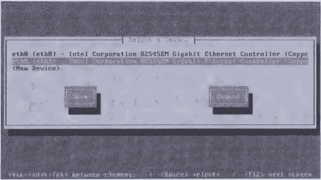
*图5-1 可编辑的网络接口选项*

- **步骤3.** 编辑接口的详细信息（见图5-2）。
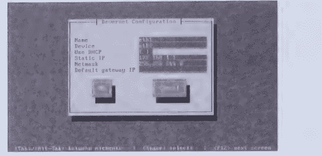
*图5-2 可编辑的接口详细信息*

- **步骤4.** 完成后保存并退出。

此处你可以看到，你可以对接口进行任何需要的修改，包括将其设置为静态IP地址，替代原来的`DHCP`协议。

现在你已经修改了网络接口，需要重启网络服务才能使更改生效。除了通过重启网络服务来关闭系统上的所有接口外，你也可以仅关闭你已修改的单个接口。因为你只修改了`eth1`，所以只需要关闭该接口即可。执行此操作需要用到`ifdown`和`ifup`命令，这两个命令实质上是`ifconfig`命令的简写形式：

- **步骤1.** 要关闭单个接口，使用`ifdown`：
```bash
# ifdown eth1
```

- **步骤2.** 要重新启用你刚刚关闭的接口，使用`ifup`：
```bash
# ifup eth1
```


如果接口配置为静态，将不会输出任何内容。如果接口配置为使用DHCP，你将看到一行提示，告知你接口正在从DHCP服务器获取必要的信息。和所有操作一样，你需要验证修改结果。使用`ifconfig`命令显示当前IP地址，确保其配置正确。

语法：`ifconfig [options] [interface]`

| 选项 | 说明 |
| --- | --- |
| `netmask MASK` | 指定接口的子网掩码 |
| `hw ADDRESS` | 设置接口的MAC地址 |
| `up` | 启用接口 |
| `down` | 禁用接口 |

要查看`eth1`接口的当前IP地址，使用以下命令：

```
# ifconfig eth1

Eth1 Link encap:Ethernet HWaddr 08:00:27:DB:D0:F5

inet addr:172.168.1.1 Bcast:172.168.1.255 Mask:255.255.255.0

inet6 addr: fe80::a00:27ff:fedb:d0f5/64 Scope:Link

UP BROADCAST RUNNING MULTICAST MTU:1500 Metric:1

RX packets:0 errors:0 dropped:0 overruns:0 frame:0

TX packets:202 errors:0 dropped:0 overruns:0 carrier:0 collisions:0 txqueuelen:1000

RX bytes:0 (0.0 b) TX bytes:21322 (20.8 KiB)

Interrupt:9 Base address:0xd240
```

`ifconfig`命令会显示接口的信息及其IP地址。你也可以查看接口配置文件的输出，确认更改结果：

```
# cat /etc/sysconfig/network-scripts/ifcfg-eth1

# Advanced Micro Devices [AMD] 79c970 [PCnet32 LANCE]

DEVICE=eth1

BOOTPROTO=none

HWADDR=00:0c:29:e8:c3:80

ONBOOT=yes

DHCP_HOSTNAME=RHEL01

IPADDR=172.168.1.1

NETMASK=255.255.255.0

TYPE=Ethernet
```

现在你已经验证IP地址配置正确，接下来需要查看系统上其他接口的IP地址。使用不带参数的`ifconfig`命令可以显示系统上的所有接口及其当前详细信息。现在再次使用`ifconfig`命令显示系统上的所有接口：

```
# ifconfig

eth0 Link encap:Ethernet Hwaddr 08:00:27:30:74:AA

inet addr:192.168.1.5 Bcast:192.168.1.255 Mask:255.255.255.0

inet6 addr: fe80::a00:27ff:fe30:74aa/64 Scope:Link

UP BROADCAST RUNNING MULTICAST MTU:1500 Metric:1

RX packets:4140 errors:1 dropped:0 overruns:0 frame:0

TX packets:705 errors:0 dropped:0 overruns:0 carrier:0 collisions:0 txqueuelen:1000

RX bytes:954993 (932.6 KiB) TX bytes:88056 (85.9 KiB)

Interrupt:10 Base address:0xd020

eth1 Link encap:Ethernet Hwaddr 08:00:27:DB:D0:F5

inet addr:172.168.1.1 Bcast:172.168.1.255 Mask:255.255.255.0

inet6 addr: fe80::a00:27ff:fef:dbd0f5/64 Scope:Link

UP BROADCAST RUNNING MULTICAST MTU:1500 Metric:1

RX packets:0 errors:0 dropped:0 overruns:0 frame:0

TX packets:243 errors:0 dropped:0 overruns:0 carrier:0 collisions:0 txqueuelen:1000

RX bytes:0 (0.0 b) TX bytes:16152 (15.7 KiB)

Interrupt:9 Base address:0xd240

lo Link encap:Local Loopback
```

```
inet addr:127.0.0.1 Mask:255.0.0.0 inet6 addr: ::1/128 Scope:Host UP LOOPBACK RUNNING MTU:16436 Metric:1 RX packets:2735 errors:0 dropped:0 overruns:0 frame:0 TX packets:2735 errors:0 dropped:0 overruns:0 carrier:0 collisions:0 txqueuelen:0 RX bytes:4258081 (4.0 MiB) TX bytes:4258081 (4.0 MiB)
```

此处，你会看到有三个网络接口：`eth0`、`eth1`以及回环接口`lo`。每当修改某个接口的配置时，你都需要先关闭该接口，再重新将其启用。如果多个接口已被修改，你也可以直接重启整个网络服务。

> **警告：** 重启网络服务会中断所有网络连接以及当前已连接的所有客户端。

请按照以下步骤重启网络服务：

```
# service network restart
Shutting down interface eth0: [ OK ]
Shutting down interface eth1: [ OK ]
Shutting down loopback interface: [ OK ]
Bringing up loopback interface: [ OK ]
Bringing up interface eth0: Determining IP information for eth0... done.
Bringing up interface eth1: [ OK ]
```

从上述输出可以看出，`eth0`被配置为使用DHCP协议，因为它需要自动获取IP地址。你还可以使用另一种方法来设置IP地址。`ifconfig`命令除了可以显示网络接口的信息外，还可用于设置IP地址。假设你希望将`eth1`接口的IP地址设置为静态地址，由于你希望IP地址保持不变，只需再次使用`ifconfig`命令设置相同的静态IP地址即可：

```
# ifconfig eth1 172.168.1.1 netmask 255.255.255.0
```

该命令的效果与使用菜单驱动选项的结果一致。不要忘记先关闭网络接口再重新启用（或者重启网络服务）。请确保你始终使用`ifconfig`命令验证IP地址是否已正确设置。

> **警告：** Linux中的许多命令和修改都有多种方式可以达到相同的结果。请务必选择你最熟悉的方法，以节省考试时间。

## 路由

当系统拥有两个或更多网络接口时（比如`RHEL01`主机），这类系统被称为*双宿*或*多宿*系统。你需要确保每个接口都有可路由的网关。使用`route`命令，你可以查看系统当前的路由信息，并在需要时添加额外的路由。

```
Syntax: route [options]
```

### 选项

- **add** 添加网段路由
- **del** 删除已有路由
- **flush** 清除所有临时路由

> **警告：** 有一条实用的故障排查提示：留意关键词以检测网关或路由问题。如果你收到无法联系主机或特定域的错误提示，请始终检查默认网关是否已正确配置。

接下来查看系统当前的路由信息：

| 目标网络 | 网关 | 子网掩码 | 标志 | 度量值 | 引用计数 | 使用次数 | 接口 |
|---|---|---|---|---|---|---|---|
| 192.168.1.0 | * | 255.255.255.0 | U | 0 | 0 | 0 | eth0 |
| 172.168.1.0 | * | 255.255.255.0 | U | 0 | 0 | 0 | eth1 |
| 169.254.0.0 | * | 255.255.0.0 | U | 0 | 0 | 0 | eth1 |
| 默认路由 | 192.168.1.1 | 0.0.0.0 | UG | 0 | 0 | 0 | eth0 |

上述输出表明家庭路由器实际上是该系统的默认网关（如需进一步确认，可参考引言中的实验拓扑图）。如果尚未设置默认网关，你可以再次使用`route`命令来配置默认网关。

### 步骤1. 假设尚未设置默认网关，你可以使用以下命令为`RHEL01`主机配置默认网关：

```
# route add default gw 192.168.1.1 eth0
```

### 步骤2. 现在你可以再次调用`route`命令验证新添加的默认网关：

```
# route
Kernel IP routing table
Destination Gateway Genmask Flags Metric Ref Use Iface
192.168.1.0 * 255.255.255.0 U 0 0 0 eth0
172.168.1.0 * 255.255.255.0 U 0 0 0 eth1
169.254.0.0 * 255.255.0.0 U 0 0 0 eth1
default 192.168.1.1 0.0.0.0 UG 0 0 0 eth0
```

你在这里会得到相同的输出，因为默认网关已经存在。配置网络接口和网关需要你对网络的工作原理有较好的理解。如前所述，理解子网划分对于确保正确配置网络和路由至关重要。你还应当非常熟悉网络接口的故障排查，相关内容将在下一节介绍。

> **注意：** 你可能已经注意到该系统有一个`172.168.1.0`网段，但没有定义特定的默认网关。原因是当我们学到第15章“NFS”并讨论NAT时，该系统将成为该网段的默认网关。

## 配置静态路由

在某些情况下，你可能需要使用特定路径访问某个网络。为确保实现该需求，你可以配置静态路由，将特定网络流量指向指定的默认网关或网络。要创建静态路由，你需要在`/etc/sysconfig/network-scripts/route-<interface>`文件中添加条目。接下来我们来看这个文件的示例内容：

```
Default 192.168.1.1 dev eth0
172.168.1.0/24 via 172.168.1.1 eth1
```

## 网络连接故障排查

网络故障排查的关键是确保所有组件运行顺畅、网络功能正常。有许多命令可以在排查网络问题时为你提供帮助。

- **ping** 测试两台主机之间的连通性
- **traceroute** 查找主机间的路径延迟
- **netstat** 显示连接相关信息（已建立、已关闭和正在监听）
- **route** 显示路由信息

到目前为止，我们仅操作了实验环境中的四台系统之一。主要原因在于实验中的其他系统都处于私有网络，无法访问外部网络。目前这没有问题，但由于`RHEL01`主机有两个接口，可以同时接入两个网络，接下来我们可以查看它如何与私有网络中的其他主机交互。

## 网络工具

首先从`ping`命令开始，你可以使用该命令验证是否能与网络中的其他主机通信。语法：`ping 目标地址`

在Linux主机上执行`ping`命令时，与Windows不同，`ping`会持续发送请求直到你手动终止。你可以在目标主机前加上`-c 请求数量`参数来限制发送的`ping`请求数量。

### 步骤1. 在`RHEL01`上，验证你可以在内部网络中看到`RHEL02`：

```
# ping -c 2 172.168.1.2
PING 172.168.1.2 (172.168.1.2) 56(84) bytes of data.
64 bytes from 172.168.1.2: icmp_seq=1 ttl=64 time=0.055 ms
64 bytes from 172.168.1.2: icmp_seq=2 ttl=64 time=0.074 ms
```

### 步骤2. 现在验证你可以在外部网络中看到路由器：

```
# ping -c 2 192.168.1.1
PING 192.168.1.1 (192.168.1.1) 56(84) bytes of data.
64 bytes from 192.168.1.1: icmp_seq=1 ttl=64 time=0.055 ms
64 bytes from 192.168.1.1: icmp_seq=2 ttl=64 time=0.074 ms
```

网络通信是双向的，因此你还需要确保`RHEL02`可以与`RHEL01`通信。

### 步骤1. 在`RHEL02`上，执行以下命令：

```
# ping -c 2 172.168.1.1
PING 172.168.1.1 (172.168.1.1) 56(84) bytes of data.
64 bytes from 172.168.1.1: icmp_seq=1 ttl=64 time=0.055 ms
64 bytes from 172.168.1.1: icmp_seq=2 ttl=64 time=0.074 ms
```

如上所示，两台服务器可以互相通信，且`RHEL01`可以访问外部网络（通过`192.168.1.0`网段）。如果你尝试从`RHEL02`访问`192.168.1.0`网段，会发生什么？

## 步骤2. 在`RHEL02`上，执行以下命令：

```
# ping -c 2 192.168.1.1
PING 192.168.1.1 (192.168.1.1) 56(84) bytes of data.
From 192.168.1.1 icmp_seq=2 Destination Host Unreachable
From 192.168.1.1 icmp_seq=3 Destination Host Unreachable
```

由此可知你无法访问`192.168.1.0`网段，系统会返回“Destination Host Unreachable”的提示信息告知你这一情况。出现该提示的原因是`RHEL02`到`192.168.1.0`网段之间不存在路由。当前有哪些可用的路由呢？我们可以再次查看`route`命令的输出结果来确认。在`RHEL02`上，执行`route`命令查看当前可用的网络路由：

| 目标网段 | 网关 | 子网掩码 | 标志 | 跳数 | 引用计数 | 使用次数 | 接口 |
|---------------|---------|---------------|-------|--------|-----|-----|-------|
| 192.168.1.0 | * | 255.255.255.0 | U | 0 | 0 | 0 | eth0 |
| 169.254.0.0 | * | 255.0.0.0 | U | 0 | 0 | 0 | eth0 |

可以看到当前仅能访问`192.168.1.0`网段，这也解释了为什么你无法访问`192.168.1.0`网络。现在你已经掌握了如何查看网络接口和路由，接下来我们来看看如何使用`netstat`命令查看处于监听状态或已建立的端口。你也可以通过`netstat`命令获取路由表、监听套接字和已建立连接的相关信息。

**语法：**

`netstat [选项]`

**选项：**

- `-r`：显示路由表
- `-I`：显示接口统计信息
- `-t`：显示TCP连接
- `-u`：显示UDP连接
- `-a`：显示所有套接字（TCP、UDP或本地套接字）
- `-p`：显示进程ID
- `-e`：显示扩展信息

举个例子，假设你想确认SSH服务是否在22端口上正常监听，你可以用`netstat`命令检查该连接是否对客户端可用：

```
# netstat -tuape | grep ssh
```

```
tcp 0 0 *:ssh *:* LISTEN root 8627 2674/sshd
```

如果没有返回任何内容，大概率是该服务未运行，或未在该端口上正常监听。不过从当前输出可以看到SSH服务运行正常（输出中的`*:ssh`即表示监听状态）。目前我们介绍的命令可以帮助你排查网络连通性问题，你应该能够处理各类网络故障排查场景，包括路由问题、网络接口问题和连通性问题。在开始讲解客户端DNS故障排查之前，请确保你已经掌握了现有网络连接的配置与排查方法。

### 网络监控与分析

有时候你在排查网络问题时，可能会遇到系统提供的信息不足以定位问题的情况。如果你确实需要了解底层运行的详细情况，可以使用数据包捕获工具查看机器网卡上传输的所有原始数据。`tcpdump`就是常用的数据包捕获工具。

**语法：**

`tcpdump [选项]`

**选项：**

- `-i 接口`：指定要监听的网卡
- `-r 文件`：指定要读取的已捕获数据包文件
- `-w 文件`：指定输出写入的文件路径，而非直接输出到控制台

举个例子，假设你想确认系统是否正常获取了DHCP地址，你可以监听`eth0`网卡的流量，确认DHCP服务器是否正常响应。

**步骤1.** 启动`tcpdump`程序，指定要监听的网卡，以及要保存捕获信息的文件路径，方便后续查看：

```
# tcpdump -i eth0 -w pkt_capture
```

**步骤2.** 在数据包捕获运行时，你需要切换到另一个控制台，调用`dhclient`工具从DHCP服务器获取新的IP地址：

```
# dhclient
```

**步骤3.** 当系统完成IP地址分配后，回到第一个控制台，按下`Ctrl+C`停止`tcpdump`程序。要查看捕获到的信息，再次调用`tcpdump`程序即可：

```
# tcpdump -r pkt_capture | less
```

虽然通过网络监控查看实际运行情况对故障排查很有帮助，但也可能让问题变得更复杂。`tcpdump`捕获的大部分数据都是原始格式，可读性较差。通常你还需要掌握足够的网络协议知识，才能让这些数据发挥实际作用。

### 高级网络配置


我们已经了解了网络配置的一些基础步骤。如前所述，你可以手动编辑网络接口配置文件来微调网络设置（例如调整速率、双工模式等）。本次我们将介绍的高级网络配置主题是以太网绑定。

## 以太网绑定

以太网绑定用于将多个网卡合并为一个逻辑网卡，从而提升可用带宽并提供冗余。实现方式是通过创建名为通道绑定接口的特殊网络接口文件。由于你处于实验环境，使用的是虚拟网卡，因此绑定不会带来额外的带宽收益，但冗余机制总是有益的。在创建绑定接口之前，你需要在`RHEL01`虚拟系统上创建第三个网络接口。

**步骤1.** 启用绑定内核模块：

```
# nano /etc/modprobe.d/bond.conf
Alias bond0 bonding
```

**步骤2.** 在`/etc/sysconfig/network-scripts`目录下创建通道绑定接口文件：

```
# nano /etc/sysconfig/network-scripts/ifcfg-bond0
DEVICE="eth0"
IPADDR=172.168.1.1
NETMASK=255.255.255.0
ONBOOT=yes
BOOTPROTO=none
USERCTL=no
BONDING_OPTS="primary=eth1"
```

现在绑定接口已经配置完成，内核模块也已加载，接下来你需要指定要添加到绑定接口的物理网卡（本示例中为`eth1`和`eth2`）。

**步骤3.** 编辑`eth1`接口的配置文件，内容如下：

```
DEVICE=eth1
BOOTPROTO=none
ONBOOT=yes
MASTER=bond0
SLAVE=yes
USERCTL=no
```

**步骤4.** 编辑`eth2`接口的配置文件，内容如下：

```
DEVICE=eth2
BOOTPROTO=none
ONBOOT=yes
MASTER=bond0
SLAVE=yes
USERCTL=no
```

**步骤5.** 现在可以启用绑定接口：

```
# ifconfig bond0 up
```

绑定接口配置完成后，两个物理网卡将作为一个整体工作，再次提供了冗余保障。以太网绑定通常出现在小型网络中，为服务器提供链路冗余；但在大型网络中，绑定更常出现在交换机层面。

## 客户端DNS故障排查

虽然使用IP地址并为服务器分配IP地址的方式很直接，但在你需要管理大量服务器和客户端时，这种方式会非常不实用。此时你可以使用主机名（即系统名称）替代IP地址。IP地址到主机名的查询和转换会通过你网络中的`DNS`服务器自动完成。本节不会全面讲解`DNS`相关知识，只会介绍客户端`DNS`常见问题及排查方法。系统中有一些关键文件负责实现名称解析，我们首先来看这些文件：

- `/etc/sysconfig/network`：存储系统的主机名
- `/etc/resolv.conf`：存储`DNS`服务器的IP地址
- `/etc/hosts`：存储本地IP到主机名的映射关系
- `/etc/nsswitch.conf`：存储名称查询时的优先级顺序，即优先查询本地配置还是`DNS`服务器

除了这些关键文件之外，你还可以使用以下客户端命令：

- `hostname`：设置或返回系统的主机名
- `nslookup`：查询或查找域名或系统对应的IP地址
- `ping`：测试两个系统之间的连通性

遇到`DNS`问题时，通常可以通过错误信息中的关键提示立刻发现，例如`Can't be resolved`（无法解析）或`Unable to lookup`（无法查找）。当然也有例外情况，如果你无法通过主机名访问外部网络或内部系统，通常也是`DNS`出现问题的信号。

首先我们来看`hostname`命令，该命令会从`/etc/sysconfig/network`文件中读取信息，系统的主机名就在启动过程中被写入该文件。要查看当前主机名，执行以下操作：

```
# hostname RHEL01
```

你也可以像之前一样查看`/etc/sysconfig/network`文件中的主机名配置：

```
# cat /etc/sysconfig/network
NETWORKING=yes
NETWORKING_IPV6=no
HOSTNAME=RHEL01
```

如果你想修改系统的主机名，可以编辑这个文件。如果你需要使用完全限定域名（`FQDN`），也可以在该文件中指定，例如可以将`RHEL01`改为`FQDN`格式的`RHEL01.example.com`。

当你确认了系统的主机名后，你需要确定系统在查询其他主机名时的查询来源。有两个文件包含`DNS`查询的相关配置，第一个是系统本地的`/etc/hosts`文件。

**`/etc/hosts`文件语法：**

```
# <ip> <fqdn> <alias>
```

我们来看当前文件中的内容：

```
# cat /etc/hosts
# Do not remove the following line, or various programs
# that require network functionality will fail.
127.0.0.1   RHEL01 RHEL01 localhost.localdomain localhost
::1         localhost6.localdomain6 localhost6
```

可以看到当前`hosts`文件中除了`localhost`（本地回环地址）的条目外，没有其他内容。当你运行规模较小的网络（我这里指的是不超过5台机器）时，使用主机文件是一项可行的任务。你需要为每台服务器的主机文件中添加条目（请记住主机文件是服务器本地的）。不过你可以看到，当需要更新和跟踪的机器数量快速增长时，从管理角度来看，这种方法很快就会失控。我肯定你已经猜到，下一步的逻辑操作是让系统查询`DNS`服务器，而非本地主机文件。`/etc/resolv.conf`文件包含`DNS`服务器的IP地址。这使得你的系统可以依赖`DNS`查询，而非在主机文件中进行本地查找。我们来看一下当前`/etc/resolv.conf`文件中的内容：

```shell
# cat /etc/resolv.conf
; generated by /sbin/dhclient-script
nameserver 172.168.1.1
```

该输出表明，你所在的服务器（`RHEL01`）会将所有`DNS`查询发送到`DNS`服务器`172.168.1.1`（恰好就是`RHEL01`本身）。尽管你尚未安装`DNS`服务器，但这个示例展示了如何排查客户端的错误配置。你也可能会遇到如下所示的`/etc/resolv.conf`文件：

```shell
# cat /etc/resolv.conf
search example.com
nameserver 192.168.1.1
nameserver 172.168.1.1
```

`search`选项是默认会搜索的域名。如果你的客户端尝试访问未完全限定的主机名（例如`RHEL01.example.com`），且`DNS`服务器返回找不到指定主机的错误，可以尝试添加`search <domain>`选项。当客户端和服务器属于同一域名时，这是一种常见配置。`nameserver`选项的第二个条目只是指定了备用`DNS`服务器，以备主`DNS`服务器不可用。

好了，你已经配置了主机文件和`resolv.conf`文件。现在，我肯定有人会问，系统会先查询哪一个？自然，还存在第三个文件，其中只有一行内容，定义了查询顺序。这第三个文件可能是以下两个之一，但通常是后者。

```shell
# cat /etc/host.conf
order hosts,bind
```

```shell
# cat /etc/nsswitch.conf | grep hosts
hosts: files dns
```

这个`nsswitch`文件是默认配置，这么做是有合理原因的。有时你需要让特定系统查询特定主机。你不需要创建一个所有系统都能看到的`DNS`条目，而是可以在系统的本地`/etc/hosts`文件中定义条目。不过，由于你的主机文件通常没有任何内容，系统接下来会默认查询`DNS`服务器。当你确认所有文件都配置正确后，就可以开始测试名称解析了。你可以通过以下两种方式之一完成测试：第一种，你可以使用`ping`命令，通过主机名`ping`目标主机，查看是否有响应；第二种，你可以使用`nslookup`命令查询与主机名关联的IP地址。请确保用多种方式测试，以排查每个问题。要通过主机名`ping`系统，请执行以下操作：

```shell
# ping RHEL02
```

如果要查询主机名，请使用以下命令：

```shell
# nslookup RHEL02
```

`dig`命令可用于更全面地查看IP地址和主机名。我们将在第18章《DNS》中更深入地介绍`dig`、`nslookup`和`ping`命令。至此，你应该已经能够排查与`DNS`相关的客户端问题了。排查问题时，遵循此处介绍的顺序是一种良好的方法：

- 步骤1：主机名设置是否正确？
- 步骤2：文件的查询顺序是什么？
- 步骤3：主机文件和`resolv.conf`文件的配置是否正确？

## 总结

如果你不知道要排查什么，或者对网络工作原理没有深刻的理解，网络故障排查可能会是一个曲折的过程。针对Red Hat认证考试，你需要掌握IP寻址、子网和路由的相关知识。这些也是现实中的重要概念，能让系统管理员排查并解决其网络中的问题。本章介绍了如何排查和配置网络接口，以及如何执行一些客户端侧的`DNS`故障排查。

## 复习题

- 1. 什么命令可以显示你当前的网络接口和IP地址？
- 2. `ifconfig 172.168.1.100 netmask 255.255.255.0 eth1`这条命令的作用是什么？
- 3. 你可以使用什么命令测试与其他主机的连通性？
- 4. 如果你`ping`某台主机时收到`Destination Unreachable`的响应，这意味着什么？
- 5. 网络中的网关有什么用途？
- 6. 你会如何创建静态路由？
- 7. 你可以使用什么命令监控和排查网络连接？
- 8. 你能说出三种可用于网络或`DNS`客户端故障排查的工具吗？
- 9. `/etc/hosts`文件有什么用途？

## 复习题答案

- 1. `ifconfig`
- 2. 这条命令将`eth1`接口设置为静态IP地址`172.168.1.100`，子网掩码为`255.255.255.0`。
- 3. 可以使用`ping`命令验证与其他主机的连通性。
- 4. 网关设置错误，且你尝试访问的主机所在的子网不可达。
- 5. 网关是网络中子网的出入点。要联系你所在子网之外的主机，你需要经过网关。
- 6. 使用带有`add`选项的`route`命令可以创建静态路由。
- 7. `tcpdump`命令用于监控不同接口上的网络连接。
- 8. 这三种工具分别是：`route`、`ping`和`nslookup`。
- 9. `/etc/hosts`文件是一个本地查询文件，当没有`DNS`服务器可用时，可用于将IP地址映射到主机名。

## 实验5

### 任务1 – 静态接口

步骤1：按照以下要求在`Client01`上为`eth1`接口配置静态IP地址：

- a. IP地址应为`172.168.1.10`。
- b. 子网掩码应为`255.255.255.0`。
- c. 网关应设置为`172.168.1.1`

当所有接口都可以被成功`ping`通时，任务完成。

### 任务2 – 客户端DNS

步骤1：按照以下要求配置`RHEL01`：

- a. `DNS`服务器应为`192.168.1.1`。
- b. 将备用`DNS`服务器设置为公共`DNS`服务器（你可以在网上找到很多）。

当所有站点和主机都能被成功解析时，任务完成。

### 任务3 – 数据包捕获

步骤1：在任意系统上使用`tcpdump`工具，执行以下操作：

- a. 配置`tcpdump`以捕获数据包（必须将数据包写入文件）。
- b. `ping`本地子网上的任意主机，直到收到回复。
- c. 关闭`tcpdump`程序。

当你获得一个包含本地子网上`ping`通信的数据包捕获文件时，任务完成。


## 本章涵盖以下主题：

- 使用RPM——本节介绍如何在系统上安装、更新和查询软件包。
- 再次使用Yum——本节介绍如何使用Yum工具再次安装、更新和查询软件包。
- 制作你自己的RPM——本节描述了构建简单RPM软件包的过程。
- 创建你自己的软件仓库——本节介绍如何构建你自己的私有软件仓库。
- Red Hat Network——本节介绍Red Hat网络以及如何注册你的系统。

## 涵盖以下RHCSA考试目标：

- 从Red Hat Network、远程软件仓库或本地文件系统安装和更新软件包

## 涵盖以下RHCE考试目标：

- 构建一个打包单个文件的简单RPM

# 软件包管理

软件是任何操作系统的基础，支持你安装和使用不同的工具。在Linux中，软件通过软件包的形式分发，软件包包含实际的软件文件。每个Linux发行版都有自己的软件包管理系统。对于Red Hat而言，有两种软件包管理系统：RPM和Yum。本章将介绍软件包管理，以及如何处理Red Hat系统的软件。

## 使用RPM

软件包包含由文件组成的目录结构，用于构成软件应用程序。在Red Hat中，软件包带有`.rpm`扩展名，可以通过不同方式安装。在深入介绍软件包管理之前，我们先来看一下系统用于描述软件包的命名规则：

```text
Package Syntax: package_name-version-release.arch.rpm
```

举个例子，我们来看一下用于安装SMTP邮件服务器的`postfix`软件包：

```text
postfix-2.6.6-2.el6.x86_64.rpm
```

从上面的例子可以看出，这个软件包的名称是`postfix`，版本号是`2.6.6`，适用于64位操作系统。`-2`是发行版本号，`el6`是Red Hat软件包特有的内容，它指定了Red Hat发行版的内部版本号。能够识别软件包并理解其版本信息对系统管理员而言非常重要。这有助于判断你的软件包是否过时，或者不同版本的软件是否存在某些安全风险。有时当你安装一个软件包时，会要求同时安装另一个软件包，这被称为*依赖*。某些软件包对版本有特定要求，以确保升级时其依赖不会出现问题。由此你可以看出，从软件包中获取版本信息是一项必备技能。所有软件包都存放在某个仓库中，具体存放在何处取决于软件包的生产者。Red Hat有自己的软件仓库，其中存放着Red Hat操作系统的软件包。当你更新软件包时，系统会将你的软件包与仓库中的软件包版本进行比对，以查看是否存在更新的版本。你也可以安装位于软件仓库之外的新版本软件包，但这类安装需要略微不同的安装方法。本章前半部分将介绍仓库外软件包的相关内容。

## 安装与删除软件包

我们要介绍的第一个包管理工具是`RPM`。该工具用于管理仓库之外的单个软件包。也就是说，你可以使用`yum`命令查询仓库内的软件包并进行安装，而如果要安装从仓库或网络手动下载的`.rpm`格式软件包，则需要使用`RPM`工具。`RPM`和`Yum`的语法和选项都非常繁杂。在你熟悉这些操作之前，可以通过查看它们的帮助菜单获取全部选项的列表。本节仅包含你最常用到的核心选项，举个例子就能帮你理解清楚。

```text
Syntax: rpm [options]
```

### 安装/升级/删除选项：

- `-e` 删除指定的软件包
- `-i` 安装指定的软件包
- `-h` 安装时显示哈希进度条
- `-U` 升级指定的软件包
- `-v` 输出详细运行信息

### 查询选项（搭配`-q`使用）：

- `-c` 列出所有配置文件
- `-d` 列出所有文档文件
- `-i` 显示软件包的相关信息
- `-l` 列出软件包内包含的所有文件

### 验证选项（搭配`-v`使用）：

- `-a` 查询所有已安装的软件包
- `-f` 显示指定文件的相关信息

可以看到可选选项非常多，这些都只是最常用的选项而已！接下来我们从网络下载一个软件包，演示如何使用`rpm`命令安装。

**步骤1.** 从网络下载`nano`软件包：

```
# wget http://www.nano-editor.org/dist/v2.2/RPMS/nano-2.2.6-1.x86_64.rpm
--2010-09-06 08:30:26--  http://www.nano-editor.org/dist/v2.2/RPMS/nano-2.2.6-1.x86_64.rpm
Resolving www.nano-editor.org... 207.192.74.17
Connecting to www.nano-editor.org|207.192.74.17|:80... connected.
HTTP request sent, awaiting response... 200 OK
Length: 586766 (573K) [application/x-redhat-package-manager]
Saving to: `nano-2.2.6-1.x86_64.rpm'
100%[==================================================>] 586766      1.75M/s   in 0.3s
2010-09-06 08:30:27 (1.75 MB/s) - `nano-2.2.6-1.x86_64.rpm' saved [586766/586766]
```

**考试提示** 你也可以使用`wget`命令从本地或远程仓库获取软件包。考试时无法连接互联网，但如果你需要下载远程`RPM`软件包，仍然可以使用`wget`工具。

**步骤2.** 下载完成后，软件包会保存在当前工作目录中，此时你可以使用`rpm`命令进行安装：

```
# rpm -ivh nano-2.2.6-1.x86_64.rpm
Preparing...                ########################################### [100%]
   1:nano                   ########################################### [100%]
```


这里我们使用了`rpm`命令的安装功能，参数含义分别是：安装指定软件包（`-i`）、输出详细运行信息（`-v`）、打印哈希进度条展示安装进度（`-h`）。使用`rpm`命令的一个弊端是，如果软件包存在依赖项，`rpm`命令会报错退出，你必须先手动安装所有必需的依赖项。

**注意：** 你可能会收到报错提示，指出你要安装的软件包与系统中已安装的当前版本软件冲突。遇到这种情况，请继续阅读后续内容，学习如何先删除旧版本软件包，再重新尝试安装。如果你想升级该软件包（已知其已安装），可以将`-i`参数替换为`-U`，该命令会在软件包未安装时执行安装，已安装时执行升级：

```
# rpm -Uvh nano-2.2.6-1.x86_64.rpm
Preparing... ########################################### [100%]
1:nano ########################################### [100%]
```

如果你不再需要该软件包，可以使用`-e`参数将其删除：

```
# rpm -e nano
```

只要你把`.rpm`文件保留在系统中，之后随时可以重新安装该软件包（也可以重新下载）。

**实战提示** 工作中常会遇到需要安装已安装过的软件包的情况，你无需先卸载再重新安装这么麻烦，只需在常规安装参数中添加`--replacepkgs`参数，即可覆盖已有安装：

```
# rpm -ivh --replacepkgs nano-2.2.6-1.x86_64.rpm
```

## 查询与验证软件包

你刚安装了最新版本的软件包，想要确认安装是否正常，该怎么检查呢？当然可以使用`rpm`命令的查询与验证功能。我们回到之前安装nano的场景，这次在安装软件包之前，可以先查询系统中已安装的软件包，确认nano是否已经安装过。如果你之前已经安装了新版本的nano，输出结果可能和我的略有不同，现在查询系统中已安装的nano软件包：

```
# rpm -qa | grep nano
nano-1.3.12-1.1.el6.x86_64
```

`-q`参数告诉`rpm`你正在执行查询操作，`-a`参数告诉`rpm`查询系统中所有已安装的软件包。你肯定不想列出所有软件包，因此可以用`grep`命令筛选出你要找的软件包。`grep`是模式匹配工具，会返回所有匹配你查找内容的软件包（也就是系统中所有和nano相关的、或者你要查找的软件包），如果软件包不存在就不会返回任何结果。可以看到这里nano软件包确实存在，版本是1.3.12。

现在我们来安装从网络下载的新版本：

```
# rpm -ivh nano-2.2.6-1.x86_64.rpm
Preparing... ########################################### [100%]
1:nano ########################################### [100%]
```

再次查询软件包，就能看到版本已经更新，说明软件包升级成功：

```
# rpm -qa | grep nano
nano-2.2.6-1.el6.x86_64
```

**实战提示** 如果你之前接触过包管理，可能会疑惑为什么不建议直接用单独的`-q`参数查询软件包：

```
# rpm -q nano
```

不建议用这个方法的原因是，只有当你知道软件包的精确名称时，才能查到结果。举个例子，如果你想查询文本编辑器vim是否已安装：

```
# rpm -q vim
```

如果没有返回结果，你会误以为该软件包没有安装。现在换一种方式查询：

```
# rpm -qa | grep vim
vim-enhanced-7.0.109-6.el6.x86_64
vim-common-7.0.109-6.el6.x86_64
vim-minimal-7.0.109-6.el6.x86_64
```

可以看到vim实际上已经安装，而且软件包的名称和你预想的并不一样。`grep`命令使用正则表达式匹配所有已安装的软件包，能得到更准确的结果。

我们先退一步想，如果你的老板告诉你他刚安装了一个你从未听说过的来自xyz站点的postfix软件包，你可以查询软件包自带的信息，了解它的具体用途，这样就不需要麻烦老板，也能直接看到该软件包的详细信息。注意要留意那些不提供详细信息的软件包。

现在查询nano软件包的详细信息：

```
# rpm -qi nano
Name : nano
Relocations: (not relocatable)
Version : 2.2.6
Vendor: (none)
Release : 1
Build Date: Thu 05 Aug 2010 11:08:24 PM EDT
Install Date: Mon 06 Sep 2010 08:35:32 AM EDT
Build Host: 012.redhat.com
```

组：Applications/Editors  
源码RPM：nano-2.2.6-1.src.rpm  
大小：1554146  
许可证：GPL  
签名：无  
网址：http://www.nano-editor.org/  
摘要：一款小巧的文本编辑器  
描述：GNU nano 是一款小巧友好的文本编辑器。如你所见，此处包含了关于该软件包你可能想了解的所有基本信息：当前版本、软件包构建日期、软件包大小以及软件包描述。

现在你已经了解了如何安装、更新以及查询不同的软件包，接下来我们来看一些在使用软件包时可以使用的其他选项。

假设你在全新的Red Hat安装中浏览时找到了一个文件，却不知道它的用途。你可以使用`-f`选项查询该文件所属的软件包，这或许能帮你更好地推测这个文件的作用。

通过执行以下操作，你可以找到`/etc/rsyslog.conf`文件的来源：

```
# rpm -qf /etc/rsyslog.conf
rsyslog-4.6.2-2.el6.x86_64
```

查询结果会告诉你该文件属于rsyslog软件包，该软件包提供了rsyslog服务（如果你没想到这一点的话）。

rsyslog软件包还提供了哪些内容？还有其他配置文件吗？

既然你已经知道了这个配置文件的名称，你可以反向查询，通过软件包名称查找与该软件包相关的所有文件。使用`-c`选项可以查找所有配置文件：

```
# rpm -qc rsyslog
/etc/logrotate.d/syslog
/etc/rsyslog.conf
/etc/sysconfig/rsyslog
/usr/share/doc/rsyslog-4.6.2/AUTHORS
/usr/share/doc/rsyslog-4.6.2/COPYING
/usr/share/doc/rsyslog-4.6.2/NEWS
/usr/share/doc/rsyslog-4.6.2/README
/usr/share/doc/rsyslog-4.6.2/bugs.html
/usr/share/doc/rsyslog-4.6.2/build_from_repo.html
/usr/share/doc/rsyslog-4.6.2/contributors.html
/usr/share/doc/rsyslog-4.6.2/debug.html
/usr/share/doc/rsyslog-4.6.2/dev_queue.html
/usr/share/doc/rsyslog-4.6.2/droppriv.html
/usr/share/doc/rsyslog-4.6.2/expression.html
/usr/share/doc/rsyslog-4.6.2/features.html
/usr/share/doc/rsyslog-4.6.2/syslog_parsing.html
/usr/share/doc/rsyslog-4.6.2/syslog_protocol.html
/usr/share/doc/rsyslog-4.6.2/tls_cert_ca.html
/usr/share/doc/rsyslog-4.6.2/tls_cert_client.html
/usr/share/doc/rsyslog-4.6.2/tls_cert_errmsgs.html
/usr/share/doc/rsyslog-4.6.2/tls_cert_machine.html
/usr/share/doc/rsyslog-4.6.2/tls_cert_scenario.html
/usr/share/doc/rsyslog-4.6.2/tls_cert_server.html
/usr/share/doc/rsyslog-4.6.2/tls_cert_summary.html
/usr/share/doc/rsyslog-4.6.2/tls_cert_udp_relay.html
/usr/share/doc/rsyslog-4.6.2/troubleshoot.html
/usr/share/doc/rsyslog-4.6.2/v3compatibility.html
/usr/share/doc/rsyslog-4.6.2/v4compatibility.html
/usr/share/doc/rsyslog-4.6.2/version_naming.html
/usr/share/man/man5/rsyslog.conf.5.gz
/usr/share/man/man8/rsyslogd.8.gz
```

[输出已截断]

除了`-c`选项，你还可以使用`-d`选项查找指定软件包的文档文件：

```
# rpm -qd rsyslog
/usr/share/doc/rsyslog-4.6.2/AUTHORS
/usr/share/doc/rsyslog-4.6.2/COPYING
/usr/share/doc/rsyslog-4.6.2/NEWS
/usr/share/doc/rsyslog-4.6.2/README
/usr/share/doc/rsyslog-4.6.2/bugs.html
/usr/share/doc/rsyslog-4.6.2/build_from_repo.html
/usr/share/doc/rsyslog-4.6.2/contributors.html
/usr/share/doc/rsyslog-4.6.2/debug.html
/usr/share/doc/rsyslog-4.6.2/dev_queue.html
/usr/share/doc/rsyslog-4.6.2/droppriv.html
/usr/share/doc/rsyslog-4.6.2/expression.html
/usr/share/doc/rsyslog-4.6.2/features.html
/usr/share/doc/rsyslog-4.6.2/syslog_parsing.html
/usr/share/doc/rsyslog-4.6.2/syslog_protocol.html
/usr/share/doc/rsyslog-4.6.2/tls_cert_ca.html
/usr/share/doc/rsyslog-4.6.2/tls_cert_client.html
/usr/share/doc/rsyslog-4.6.2/tls_cert_errmsgs.html
/usr/share/doc/rsyslog-4.6.2/tls_cert_machine.html
/usr/share/doc/rsyslog-4.6.2/tls_cert_scenario.html
/usr/share/doc/rsyslog-4.6.2/tls_cert_server.html
/usr/share/doc/rsyslog-4.6.2/tls_cert_summary.html
/usr/share/doc/rsyslog-4.6.2/tls_cert_udp_relay.html
/usr/share/doc/rsyslog-4.6.2/troubleshoot.html
/usr/share/doc/rsyslog-4.6.2/v3compatibility.html
/usr/share/doc/rsyslog-4.6.2/v4compatibility.html
/usr/share/doc/rsyslog-4.6.2/version_naming.html
/usr/share/man/man5/rsyslog.conf.5.gz
/usr/share/man/man8/rsyslogd.8.gz
```

[输出已截断]

如果`-c`和`-d`选项都无法找到你需要的内容，你可以退而使用`-l`选项，该选项会列出软件包包含的所有文件：

```
# rpm -ql rsyslog
/etc/logrotate.d/syslog
/etc/rc.d/init.d/rsyslog
/etc/rsyslog.conf
/etc/sysconfig/rsyslog
/lib64/rsyslog
/lib64/rsyslog/imfile.so
/lib64/rsyslog/imklog.so
/lib64/rsyslog/immark.so
/lib64/rsyslog/imtcp.so
/lib64/rsyslog/imudp.so
/lib64/rsyslog/imuxsock.so
/lib64/rsyslog/lmnet.so
/lib64/rsyslog/lmnetstrms.so
/lib64/rsyslog/lmnsd_ptcp.so
/lib64/rsyslog/lmregexp.so
/lib64/rsyslog/lmstrmsrv.so
/lib64/rsyslog/lmtcpclt.so
/lib64/rsyslog/lmtcpsrv.so
/lib64/rsyslog/lmzlibw.so
/lib64/rsyslog/omtesting.so
/sbin/rsyslogd
/usr/share/doc/rsyslog-4.6.2
/usr/share/doc/rsyslog-4.6.2/AUTHORS
/usr/share/doc/rsyslog-4.6.2/COPYING
/usr/share/doc/rsyslog-4.6.2/NEWS
/usr/share/doc/rsyslog-4.6.2/README
/usr/share/doc/rsyslog-4.6.2/bugs.html
```

[输出已截断]

之前我们介绍过软件包依赖关系，以及你需要通过`rpm`命令自行处理这些依赖。你可以使用`-R`选项查看软件包是否存在任何依赖：

```
# rpm -qR rsyslog
/bin/bash
/bin/sh
/bin/sh
/bin/sh
/bin/sh
/sbin/chkconfig
/sbin/chkconfig
/sbin/service
/sbin/service
bash >= 2.0
config(rsyslog) = 4.6.2-2.el6
coreutils
libc.so.6()(64bit)
libc.so.6(GLIBC_2.2.5)(64bit)
libc.so.6(GLIBC_2.3)(64bit)
libc.so.6(GLIBC_2.3.4)(64bit)
libc.so.6(GLIBC_2.4)(64bit)
/libdl.so.2()(64bit)
libdl.so.2(GLIBC_2.2.5)(64bit)
libgcc_s.so.1()(64bit)
libgcc_s.so.1(GCC_3.0)(64bit)
libgcc_s.so.1(GCC_3.3.1)(64bit)
libpthread.so.0()(64bit)
libpthread.so.0(GLIBC_2.2.5)(64bit)
libpthread.so.0(GLIBC_2.3.2)(64bit)
librt.so.1()(64bit)
librt.so.1(GLIBC_2.2.5)(64bit)
libz.so.1()(64bit)
logrotate >= 3.5.2
rpmlib(CompressedFileNames) <= 3.0.4-1
rpmlib(FileDigests) <= 4.6.0-1
rpmlib(PayloadFilesHavePrefix) <= 4.0-1
rtld(GNU_HASH)
rpmlib(PayloadIsXz) <= 5.2-1
```

最后，你还应该了解如何查看指定软件包的文档。这类文档被称为软件包的*man手册页*，大多数软件包都会附带这些手册页。要访问man手册页，请使用`man`命令：

```
# man nano
```

使用上下方向键滚动查看文档，按`q`键退出。通常，man手册页会提供任意软件包的深入细节、用法和示例。熟练使用man手册页非常重要，特别是对于Red Hat认证考试而言。你不可能记住每一个命令选项或每一处语法细节，而能够通过man手册页查找你需要的内容会非常有帮助。

## 实操提示

对于感兴趣的用户，你还可以解压RPM软件包，从中提取单个文件。要提取RPM软件包的内容，请使用`rpm2cpio`命令：

```
# rpm2cpio <package> | cpio -id
```


如果你的某个文件损坏了，需要替换它但又不想对整个软件包执行安装/卸载/重装操作，这个功能就会非常有用。

## 再次使用Yum执行相同操作

前一节我们介绍了如何使用`rpm`命令进行软件和软件包管理。本节我们将执行完全相同的任务，只不过这次使用更灵活的`Yum`工具。`yum`命令可以访问存储了大量软件包的仓库，并可以自动为你安装、升级或删除这些软件包。`Yum`还会自动为你解析并安装所有依赖，这是`rpm`命令无法实现的功能。我们将使用`yum`重复之前用`rpm`执行的所有相同命令。

语法：`yum [options] command`

选项：
- `-c`：指定配置文件的位置
- `-q`：指定安静模式，无输出
- `-y`：表示对所有提示始终回答“是”
- `-v`：提供详细输出

## 可用命令

- `clean`：清除缓存数据
- `erase`：从系统中移除软件包
- `grouplist`：显示可用的软件包组
- `groupinstall`：安装软件组内的所有软件包
- `info`：显示软件包的相关信息
- `install`：在系统中安装软件包
- `search`：支持你搜索软件包
- `update`：更新软件包

`Yum`还有一个配置文件位于`/etc/yum.conf`，其中包含了一些`Yum`运行的基本设置。这些设置包括`Yum`安装软件包时本地缓存软件包的位置、日志文件的输出量以及日志文件的存储位置。通常，默认设置已经足够适用，但你应该知道这个文件的位置，以便在需要调整`Yum`设置时可以快速找到它。

## 安装与移除软件包

我们先来获取`postfix`软件包。你可以直接从Red Hat仓库中安装它：

```
# yum install -y postfix

Loaded plugins: fastestmirror

Loading mirror speeds from cached hostfile

* addons: mirrors.bluehost.com

* base: mirror.cisp.com

* extras: mirror.5ninesolutions.com

* updates: mirror.steadfast.net

Setting up Install Process

Resolving Dependencies

--> Running transaction check

---> Package postfix.x86_64 2:2.6.6-2.el6 set to be updated

--> Finished Dependency Resolution

Dependencies Resolved

===============================================================================

Package     Arch      Version                Repository             Size

===============================================================================

Installing:

postfix     x86_64    2:2.6.6-2.el6          base                   2.0 M

```

## 事务摘要

```
=============================== Install 1 Package(s)

Update 0 Package(s)

Remove 0 Package(s)

Total download size: 2.0 M

Downloading Packages:

postfix.x86_64 2:2.6.6-2.el6.rpm | 3.6 MB     00:02

Running rpm_check_debug

Running Transaction Test

Finished Transaction Test

Transaction Test Succeeded

Running Transaction

Installing : postfix-2.6.6-2.el6.x86_64 1/1

Installed: postfix.x86_64 2:2.6.6-2.el6

Complete!
```

你还可以更新`postfix`软件包，只需将命令中的`install`改为`update`即可：

```
# yum update -y postfix
```

在输出结果中，你会看到安装软件包时检查依赖项的部分。由于你暂时还没有搭建SMTP服务器，因此可以将该软件包从系统中移除。和`RPM`工具类似，你也可以使用`yum`来移除软件包。不过`yum`有两种不同的移除选项：你可以使用`yum`的`erase`命令或`remove`命令。两者的区别在于，`erase`会移除所有软件包，但会保留这些软件包的配置文件，方便你日后重新安装；而`remove`命令会删除软件包的全部内容。此处我们使用`remove`命令，因为你暂时不希望系统中残留任何相关文件：

```
# yum remove -y postfix
```

```
Loaded plugins: fastestmirror

Setting up Remove Process

Resolving Dependencies

--> Running transaction check

---> Package postfix.x86_64 2:2.6.6-2.el6 set to be erased

--> Finished Dependency Resolution

Dependencies Resolved
```

| 软件包 | 架构 | 版本 | 软件源 | 大小 |
|:---|:---|:---|:---|:---|
| 移除： | | | | |
| postfix | x86_64 | 2:2.6.6-2.el6 | 已安装 | 9.7 M |

```
Transaction Summary

========================

Install 0 Package(s)

Update 0 Package(s)

Remove 1 Package(s)
```

```
Downloading Packages:

Running rpm_check_debug

Running Transaction Test

Finished Transaction Test

Transaction Test Succeeded

Running Transaction

Erasing : 2:postfix-2.6.6-2.el6.x86_64 1/1

Removed: postfix.x86_64 2:2.6.6-2.el6

Complete!
```

`yum`有一个非常实用的功能：除了更新单个软件包外，你还可以列出系统需要安装的所有更新：

```
# yum list updates

Loaded plugins: fastestmirror

Loading mirror speeds from cached hostfile

* addons: mirrors.bluehost.com

* base: mirror.cisp.com

* extras: mirror.5ninesolutions.com

* updates: mirror.steadfast.net

Updated Packages
```

| 软件包 | 版本 | 软件源 |
|:---|:---|:---|
| NetworkManager.x86_64 | 1:0.7.0-10.el6_5.1 | updates |
| NetworkManager-glib.x86_64 | 1:0.7.0-10.el6_5.1 | updates |
| acl.x86_64 | 2.2.39-6.el6 | base |
| acpid.x86_64 | 1.0.4-9.el6_4.2 | base |
| at.x86_64 | 3.1.8-84.el6 | base |

[output truncated]

从这个列表中，你可以选择单独更新某个软件包，也可以批量更新所有软件包。如果想要安装所有更新，可以使用以下命令：

```
# yum update
```

## 实战小贴士

如果你掌握一定的脚本编写技能，可以编写一个小脚本，运行`yum list updates`命令并将输出结果保存到文本文件中。之后你可以将该文本文件作为“每周更新摘要”发送给自己，从而查看你希望为系统安装哪些补丁。这是系统管理员的常见工作任务之一。`yum`工具还维护着一份“软件包组”列表，每个组包含一组软件包，方便你批量安装相关软件包。最常见的场景是，如果你需要安装X服务器软件包来为系统添加图形用户界面（GUI），可以使用`grouplist`命令列出所有可用的“软件包组”：

```
# yum grouplist
Installed Groups:
  Administration Tools
  DNS Name Server
  Dialup Networking Support
  Editors
  GNOME Desktop Environment
  Games and Entertainment
  Graphical Internet
  Graphics
[output truncated]
Available Groups:
  Authoring and Publishing
  Base
  Beagle
  Cluster Storage
  Clustering
  Development Libraries
  Development Tools
  Emacs
[output truncated]
```

之后你可以使用`groupinstall`命令安装对应的“软件包组”。本部分中我们将安装包含多种文本编辑器的`Emacs`软件包组：

```
# yum groupinstall Emacs
```

`groupinstall`命令可以节省大量时间，无需你逐一查找搭建所需环境的所有软件包。

> 警告：请务必注意，Linux处理空白字符的方式与Windows不同。如果你要安装的软件包组名称包含空格，需要将其用英文双引号（`" "`）包裹。示例如下：

```
# yum groupinstall "Development Tools"
```

## 搜索软件包

与`RPM`工具不同，`yum`命令可以让你访问软件仓库，从而安装软件（就像你之前操作的那样）。接下来我们看看如何查找想要安装的软件。你可以使用`search`命令从软件仓库中查询软件包，我们来查找需要安装的`postfix`软件包：

```
# yum search postfix
Loaded plugins: fastestmirror
Loading mirror speeds from cached hostfile
* addons: mirrors.bluehost.com
* base: mirror.cisp.com
* extras: mirror.5ninesolutions.com
* updates: mirror.steadfast.net
=============================
Matched: postfix
=============================
postfix.x86_64 : Postfix Mail Transport Agent
spamassassin.x86_64 : Spam filter for email which can be invoked from mail delivery agents
```

这里你会看到，软件仓库返回了3条匹配结果，以及每个软件包的简短功能说明。你可以使用`search`选项遍历软件仓库查找任意软件包；不过需要注意，根据搜索参数的不同，可能会返回多条匹配结果。如果你需要获取比`search`命令返回的简短说明更详细的信息，可以使用`info`命令获取更多详情。要查看`postfix`软件包的更多信息，请使用以下命令：

```
# yum info postfix
Loaded plugins: fastestmirror
Repository spacewalk is listed more than once in the configuration
Loading mirror speeds from cached hostfile
* addons: centos.aol.com
* base: mirror.rackspace.com
* extras: mirror.atlanticmetro.net
Available Packages
```

```
Name : postfix
Arch : x86_64
Epoch : 2
Version : 2.6.6
Release : 2.el6
Size : 9.7 M
Repo : base
Summary : Postfix Mail Transport Agent
URL : http://www.postfix.org
License : IBM Public License
Description : Postfix is a Mail Transport Agent (MTA), supporting LDAP, SMTP AUTH (SASL), TLS
```

`yum`还有一个独有的命令（`rpm`没有对应的功能）是`clean`命令，该命令会清空`yum`缓存，并强制其与Red Hat软件仓库同步，让你获取最新的软件包信息。要清空缓存，请执行以下操作：

```
# yum clean all
Loaded plugins: fastestmirror
Cleaning up Everything
Cleaning up list of fastest mirrors
```

在我看来，`yum`是一款非常高效的软件包管理工具，在软件的安装、更新和移除操作中表现尤为突出。不过我也发现，当需要在系统中查询软件包信息时，`rpm`命令及其选项的功能会更加丰富。清楚何时使用哪种命令、何时在两者之间切换，能帮助你成为更优秀的系统管理员。

## 配置额外软件仓库

有时你可能想要安装的软件包并不在Red Hat系统预配置的软件仓库中。如果该软件包在其他人的软件仓库中可用，你可以将该软件仓库添加到`yum`配置文件中。

> 警告：我必须再三强调，绝对不要从随机软件仓库或任何无法验证合法性的来源下载、安装软件包。请确保你完全信任你安装软件包的来源，因为这是攻击者诱使你安装恶意软件包的最简单途径。

你可以选择将自己创建的自定义仓库添加到主配置文件`/etc/yum.conf`中，或者在`/etc/yum.repos.d`目录下创建`.repo`文件，该文件会被自动加载。以下是一个自定义仓库的示例配置项：

```ini
[unique title]
name=My Custom Yum Repository
baseurl=ftp://rhel01/opt/yum/myrepos
enabled=1
gpgcheck=1
gpgkey=file:///etc/pki/rpm-gpg/RPM-GPG-KEY-redhat-release
```

该配置项定义了仓库的名称、存储位置以及是否启用该仓库。你可以将这条配置项保存为`test.repo`文件并存放在`/etc/yum.repos.d`目录下，之后你就能访问`RHEL01`系统上`/opt/yum/myrepos`仓库中的所有软件包了。目前该仓库中还没有任何内容，接下来我们就来填充它。

## 自制RPM包

系统管理员的一项核心技能就是能够部署自定义的软件。不过首先你需要构建一个包含自定义软件的`RPM`软件包。初次接触时这看起来是一项庞大的工程，但实际操作几次后你就会发现流程非常简单。要构建`RPM`包，你需要完成以下步骤：

1. 创建目录层级结构。
2. 将源代码复制到目录层级结构中，或直接在对应目录下创建源代码。
3. 创建`spec`文件。
4. 构建`RPM`包。

你创建的目录层级必须符合`rpmbuild`规范，该规范包含以下目录：

- `BUILD`：存放用于编译软件的临时空间
- `RPMS`：存放构建完成的二进制`RPM`包
- `SOURCES`：存放`RPM`包所需的源代码
- `SPECS`：存放`spec`文件（每个`RPM`包对应一个`spec`文件）
- `SRPMS`：存放构建过程中生成的源码`RPM`包

## 实战小贴士

注意这些目录名均为大写，这是创建目录层级时需要遵守的标准。除了上述介绍的目录外，你还需要安装几个依赖包。好了，理论部分就讲到这里，我们开始动手实操吧。

## 制作RPM包

按照以下步骤制作`RPM`包：

### 步骤1

安装构建`RPM`包所需的依赖包：

```bash
# yum install -y rpm-build make
```

### 步骤2

验证依赖包是否安装成功：

```bash
# rpm -qa | grep rpm-build
rpm-build-4.8.0-12.el6.x86_64
# rpm -qa | grep make
make-3.81-19.el6.x86_64
```

在`/usr/src/redhat`目录下创建构建所需的目录层级（我个人更习惯在`/usr/src`目录下构建软件包）。

### 步骤3

创建所需的目录：

```bash
# mkdir -p /usr/src/redhat/{BUILD,RPMS,SOURCES,SPECS,SRPMS,tmp}
```

`tmp`目录同时作为临时构建目录使用。构建软件包时你还需要一些额外材料：`SOURCES`目录下需要存放一个包含你要打包的软件源文件的压缩文件（格式为`.tar.gz`）。注意红帽认证考试仅要求你掌握单文件`RPM`包的构建能力，因此你不需要准备完整的软件源码即可完成操作。

### 步骤4

创建一个目录，放入你希望打包到软件包中的示例文件：


### 步骤5

基于示例源文件创建归档文件：

```bash
# cd /usr/src/redhat
# tar cf mysample.tar.gz mysample
# mv mysample.tar.gz SOURCES/
```

### 步骤6

打包前的最后一步是创建`spec`文件，它是用来构建实际软件包的指令集合。顾名思义，这个文件必须存放在`SPECS`目录下。以下是一个适用于本软件包的示例`spec`文件：

```ini
Summary: This package is a sample for the Red Hat exams.
Name: mysample
Version: 1.0
Release: 0
License: GPL
Packager: Joe Tester
Group: Development/Tools
Source: %{name}.tar.gz
BuildRoot: /usr/src/redhat/tmp/%{name}-%{version}

%description
This package is just a sample for the Red Hat exams.

%prep
%setup -n mysample

%install
mkdir -p "$RPM_BUILD_ROOT/opt/sample_pkge"
cp -R * "$RPM_BUILD_ROOT/opt/sample_pkge"

%files
/opt/sample_pkge

%clean
rm -rf "$RPM_BUILD_ROOT"

%post
chown user01:user01 -R /opt/sample_pkge
chmod 775 -R /opt/sample_pkge
```

这个文件有很多需要解释的地方。最开始的主体部分是软件包所需的所有基础信息，你在本章查询软件包信息时已经见过这部分内容。`Source`和`BuildRoot`两项至关重要，因为它们决定了软件包的构建方式：`Source`是构建软件包会用到的归档文件，本例中它对应的是我们创建并移动到`SOURCES`目录下的`mysample.tar.gz`文件；`BuildRoot`则是实际用来构建软件的目录（你也可以使用`BUILD`目录）。

`spec`文件剩余的部分都是以`%`开头的定义段。首先是`%description`段，用于描述你要构建的软件包（想必你已经猜到了）。`%prep`和`%setup`段都会将源码文件移动到`BUILD`目录并解压归档文件，`-n`参数指定解压后要进入的目录名称。

`%install`段是编译软件并将其安装到当前系统的位置。安装完成后需要收集相关文件，以便打包到你正在构建的软件包中，接下来就是`%files`段。在这里你需要列出所有希望包含进软件包的文件，如果你指定了某个目录，那么该目录下的所有文件和子目录也会被一并包含。由于你构建的软件包只有少量文件，因此只需要在`%files`段中指定之前创建的目录（`/opt/sample_pkge`）即可。

最后两个段并非必需，但非常实用，因此我在这里加上了它们。`%clean`段负责清理软件包构建过程中产生的临时文件，本例中只需要删除`$RPM_BUILD_ROOT`目录即可，对应本段的单行指令。使用`%post`段可以在软件包完成安装时执行额外的脚本或命令，本例中我们用它来设置所创建文件的权限。不过要注意，如果目标系统没有`user01`账户，这段指令会执行失败。虽然有办法设置依赖要求，但这已经超出了本书的讲解范围。

最后，你可以运行`rpmbuild`命令来构建软件包。

### 步骤7

使用`rpmbuild`命令构建软件包：

```bash
# rpmbuild -v -bb /usr/src/redhat/SPECS/sample.spec
Executing(%prep): /bin/sh -e /var/tmp/rpm-tmp.48604
+ umask 022
+ cd /usr/src/redhat/BUILD
+ cd /usr/src/redhat/BUILD
+ rm -rf mysample
+ tar -xvvf /usr/src/redhat/SOURCES/mysample.tar.gz
drwxr-xr-x root/root 2010-12-02 11:25:44 mysample/
-rw-r--r-- root/root 2010-12-02 11:25:44 mysample/configure
-rw-r--r-- root/root 2010-12-02 11:25:44 mysample/first_file
-rw-r--r-- root/root 2010-12-02 11:25:44 mysample/second_file
-rw-r--r-- root/root 2010-12-02 11:25:44 mysample/keys
+ cd mysample
++ /usr/bin/id -u
+ '[' 0 = 0 ']'
+ /bin/chown -Rhf root .
++ /usr/bin/id -u
+ '[' 0 = 0 ']'
+ /bin/chgrp -Rhf root .
+ /bin/chmod -Rf a+rX,u+w,g-w,o-w .
+ exit 0
Executing(%install): /bin/sh -e /var/tmp/rpm-tmp.48604
+ umask 022
+ cd /usr/src/redhat/BUILD
+ cd mysample
+ mkdir -p /usr/src/redhat/tmp/mysample-1.0/opt/sample_pkge
+ cp -R config_file first_file keys second_file /usr/src/redhat/tmp/mysample-1.0/opt/sample_pkge
+ /usr/lib/rpm/brp-compress
+ /usr/lib/rpm/brp-strip
+ /usr/lib/rpm/brp-strip-static-archive
+ /usr/lib/rpm/brp-strip-comment-note
Processing files: mysample-1.0-0
Requires(interp): /bin/sh
Requires(rpmlib): rpmlib(CompressedFileNames) <= 3.0.4-1 rpmlib(PayloadFilesHavePrefix) <= 4.0-1
Requires(post): /bin/sh
Checking for unpackaged file(s): /usr/lib/rpm/check-files /usr/src/redhat/tmp/mysample-1.0
Wrote: /usr/src/redhat/RPMS/x86_64/mysample-1.0-0.x86_64.rpm
Executing(%clean): /bin/sh -e /var/tmp/rpm-tmp.48604
+ umask 022
+ cd /usr/src/redhat/BUILD
+ cd mysample
+ rm -rf /usr/src/redhat/tmp/mysample-1.0
+ exit 0
```

查看这段输出，你可以看到构建软件包过程中执行的所有指令，它们都和我们之前讲解的内容一致。如果所有步骤都顺利完成，现在你就可以在`RPMS`目录下找到新构建的RPM包了。

### 步骤8

查看新构建的RPM包：

```bash
# ls /usr/src/redhat/RPMS/x86_64/
mysample-1.0-0.x86_64.rpm  QA-Keys-1.0-0.x86_64.rpm
```

### 步骤9

安装新软件包以验证其是否可正常使用：

```bash
# cd /usr/src/redhat/RPMS/x86_64
# rpm -ivh mysample-1.0-0.x86_64.rpm
Preparing... ########################################### [100%]
1:mysample ########################################### [100%]
```

由于没有任何报错，说明软件包已经成功安装。

### 步骤10

照惯例，验证安装结果：

```bash
# rpm -qa | grep mysample
mysample-1.0-0
```

### 步骤11

你也可以检查对应的目录和文件，确认安装是否成功：

```bash
# ls /opt/sample_pkge/
config_file  first_file  keys  second_file
```

构建软件包的过程可能非常复杂，需要多加练习。幸运的是，红帽认证考试只要求你打包单个文件，因此我们刚才讲解的所有内容都足以应对考试。现在我们已经拿到了新构建的软件包，接下来把它添加到你的私有仓库中。

## 创建你自己的仓库

在大型网络中，系统管理员通常会创建自己的私有仓库，其中不仅会存放红帽官方软件包的副本，还会存放团队自定义的软件包。现在我们就来搭建一个可以存放你自己软件包的仓库。首先，你需要安装一个辅助搭建仓库的软件包。

## 创建自定义Yum仓库

### 步骤1 安装所需包

```bash
# yum install -y createrepo
```

### 步骤2 创建用于存放所有包的目录

```bash
# mkdir -p /opt/yum/myrepos
# cd /opt/yum/myrepos
```

现在你需要将你要维护的所有包复制到你新建的目录中。你可以使用本章开头下载的`nano`包。你最初使用`wget`命令下载时，该包保存在用户主目录中。

### 步骤3 将包复制到新建的仓库目录

```bash
# cp ~/nano-2.2.6-1.x86_64.rpm /opt/yum/myrepos
```

接下来，你可以使用`createrepo`命令，基于你创建的（且已将包移入的）目录来配置仓库。

### 步骤4 指定你创建的目录并执行`createrepo`命令

```bash
# createrepo /opt/yum/myrepos
```

```bash
1/1 - nano-2.2.6-1.x86_64.rpm
Saving Primary metadata
Saving file lists metadata
Saving other metadata
```

现在你应该能看到一个名为`repodata`的目录，其中包含所有包的解压内容以及描述仓库的XML文件。在`yum`的配置目录中，你需要创建一个`.repo`文件来存储仓库信息，以便你能访问新建的仓库。仓库文件存放在`/etc/yum.repos.d`目录中，这个`.repo`文件和你在上一节创建的文件类似。

### 步骤5 进入仓库目录，为新建的仓库创建`.repo`文件

```bash
# cd /etc/yum.repos.d
# nano myrepo.repo
```

`myrepo.repo`文件的内容如下：

```ini
[base]
name=我的自定义Yum仓库
baseurl=ftp://rhel01/opt/yum/myrepos
enabled=1
gpgcheck=1
gpgkey=file:///etc/pki/rpm-gpg/RPM-GPG-KEY-redhat-release
```

完成后，保存文件并退出。现在你就可以使用`yum`搜索并安装你仓库中的包了。有一个实用的小技巧是基于ISO创建仓库。在无法访问互联网、需要从红帽DVD安装包的环境中，这个技巧非常有用。

## 从ISO创建仓库

### 步骤1 创建临时挂载用的文件夹

```bash
# mkdir /mnt/cd
```

### 步骤2 挂载CD或ISO镜像

```bash
# mount -o loop /dev/cdrom /mnt/cd
```

### 步骤3 在临时目录中创建仓库

```bash
# cd /mnt
# createrepo .
```

这会生成一个包含挂载的CD中所有包的XML文件。

### 步骤4 清理当前仓库缓存

```bash
# yum clean all
```

### 步骤5 为临时仓库创建`.repo`文件

```bash
# nano /etc/yum.repos.d/iso.repo
```

`iso.repo`文件的内容如下：

```ini
[ISO Repo]
name=ISO仓库
baseurl=file:///mnt/cd
enabled=1
```

现在你使用`yum`命令时，也能查询到挂载的红帽DVD中的包。

## 添加自定义包

正如你已经创建了两种不同类型的自定义仓库，你也可以把自己制作的包添加到这些仓库中。在上一节中，你创建了自己的RPM包，名为`myself-1.0-0.x86_64.rpm`。

### 步骤1 将该文件复制到你的私有目录

```bash
# cp /usr/src/redhat/RPMS/x86_64/myself-1.0-0.x86_64.rpm /opt/yum/myrepos
```

### 步骤2 更新仓库以识别你的新包

```bash
# createrepo -update
```

现在你应该能够在你的私有仓库中搜索到这个包以及其他软件了。

## 红帽网络

红帽网络是一个Web界面，客户可以通过它订阅和管理自己的系统、软件及安装项。要利用红帽网络管理你的系统，你需要将每台系统注册到该网络中。使用红帽网络最大的好处是，它可以提供一个集中的位置，方便你轻松管理所有系统。你注册的每台系统默认每4小时会向网络发送轮询请求，不过这个设置可以修改。当系统检测到更新时，会自动调整为通过Web界面为其配置的内容。如果你有难以抵达或管理的分支机构，这个功能也会很有帮助。

### 注册你的系统

要将系统注册到红帽网络，你必须有红帽的有效订阅。你可以在系统安装过程中注册，也可以在系统安装完成后手动注册。使用`rhn_register`命令开始注册流程。完成后，你可以访问`http://rhn.redhat.com`开始通过Web管理你的系统。你需要确保`rhnsd`守护进程正在运行才能对其进行管理。

- **步骤1** 将守护进程设置为系统启动时自动运行：`# chkconfig rhnsd on`

- **步骤2** 你需要验证该服务当前是否正在运行：执行`# service rhnsd status`，输出为`rhnsd (pid 1985) is running...`

- **步骤3** 如果服务未运行，请手动启动服务：执行`# service rhnsd start`，输出为`Starting rhnsd:` `[ OK ]`

### 总结

学习软件操作非常重要，因为本书剩余内容和红帽认证考试都要求你安装、配置不同的软件包。你还需要能够验证包是否安装成功，并在安装失败时进行修复。包管理流程并不复杂，对于维护系统秩序非常有用。当你熟练掌握包管理后，就会逐渐了解哪些包可以安全地从系统中移除以防止安全攻击（这被称为*系统加固*）。到了网络安装部分，你还可以通过配置文件选择特定的包，让系统安装流程更快。

### 复习题

- 1. 用于包管理的两个命令是什么？

- 2. `rpm`命令可以运行的三种模式是什么？

- 3. 使用`rpm`命令查询已安装的包时，你会使用哪个选项？

- 4. 如何一次性安装一组包？

- 5. 使用`yum`命令删除包时，你会用哪些选项？

- 6. Yum仓库配置文件位于何处？

- 7. 你可以使用什么命令创建自己的仓库？

- 8. 创建RPM包使用什么命令？

- 9. 构建RPM时需要哪五个必需目录？

- 10. 如果在RHEL6系统上构建了一个包，并将其部署到自定义的RHEL5仓库中，RHEL5系统能否使用它？

### 复习题答案

- 1. 用于包管理的命令是`yum`和`rpm`。

- 2. `rpm`命令可以在安装、查询或验证模式下运行。

- 3. 你可以使用`-q`选项查询已安装的包。结合`grep`命令和`-qa`选项，你可以搜索系统中所有已安装的包。

- 4. 使用`yum groupinstall`命令可以一次性安装单个组中的多个包。

- 5. 使用`yum`删除包时，可以使用`remove`或`erase`选项。

- 6. Yum仓库配置文件（`.repo`文件）位于`/etc/yum.repos.d`目录中，你也可以直接在主要的`/etc/yum.conf`文件中添加配置项。

- 7. `createrepo`

- 8. `rpmbuild`

- 9. 这五个目录是`BUILD`、`RPMS`、`SOURCES`、`SPECS`和`SRPMS`。

- 10. 不能。红帽企业版Linux 6使用不同的密钥对其包进行签名。

### 实验6

### 任务1 – 软件安装

- 1. 在RHEL02上安装以下包：`emacs` `php` `perl`
- 2. 在Client01上删除以下包：`wireless-tools` `ypbind`
- 3. 更新RHEL01上的所有包。当所有包都可以被验证为已安装、已删除或已升级时，任务完成。

### 任务2 – Web包

- 1. 从Web下载最新版本的`nano`包（也可从`http://sourceforge.net/projects/rhcelabscripts/files/`获取）。

- 2. 从RHEL02上删除当前已安装的所有版本的`nano`。

- 3. 使用`rpm`命令安装新下载的`nano`版本。当升级后的`nano`版本可以通过验证时，任务完成。

### 任务3 – 你自己的包

- 1. 从`http://sourceforge.net/projects/rhcelabscripts/files/`下载`SourceFiles.tar.gz`文件。

- 2. 安装`rpm-build`包。


- 3. 使用`SourceFiles.tar.gz`创建名为`SamplePackage`的RPM包。当`SamplePackage.rpm`可以在`RHEL02`上安装时，任务完成。

### 本章涵盖以下主题

- 用户与组：本节涵盖用户和组的创建、管理及密码相关内容
- 用户账户初始化：本节涵盖全局及特定用户的初始化与配置
- 组协作：本节涵盖多用户协作场景下文件和目录的设置方法
- 网络用户认证：本节涵盖客户端网络认证相关内容

### 涵盖以下 RHCSA 考试目标

- 多用户运行级别下登录并切换用户
- 创建、删除和修改本地用户账户
- 修改本地用户账户的密码并调整密码有效期
- 创建、删除和修改本地组及组成员关系
- 配置系统使用现有 LDAP 目录服务获取用户和组信息

### 涵盖以下 RHCE 考试目标

- 配置系统使用 Kerberos 进行认证

# 用户管理

所有系统都支持添加用户，让每个用户都可以登录系统并高效工作。本章将介绍在红帽系统中创建用户和组的方法，以及设置特定用户和组的原因；此外，还会介绍用于运行服务和特定应用的系统账户。

除了普通用户和服务用户外，Linux 系统还有 `root` 用户，它是系统的核心管理员账户。作为系统管理员，你会花费大量时间管理用户和组账户，因为这些账户决定了用户或组可以访问哪些文件和目录。你也可以将多个不同用户添加到组中，实现项目协作。

创建用户时，系统会为其分配一套标准文件。你可以自定义这些文件，在用户账户创建完成后向其终端用户发送特定文档或通知。用户账户的创建流程较为复杂，因此许多系统管理员通常会编写脚本来创建账户，实现流程自动化。

虽然创建用户账户和组是必要的，但如果有多个服务器该怎么办呢？所有账户和组都只存在于本地系统中，你的用户要如何访问其他网络主机？难道需要重新创建所有这些账户和组吗？为解决这个问题，你可以将系统加入域，域会在集中式数据库中存储所有用户账户和组信息，让管理更加便捷。

## 用户与组

在红帽系统中，共有三种不同类型的用户账户：`root` 账户、普通用户账户和系统账户（也有人喜欢称其为“伪用户”）。`root` 账户相当于 Windows 系统中的 `Administrator` 或 `Enterprise Admin` 账户，是系统中权限最高的账户，可以访问所有资源。你应该很清楚，由于该账户的权限极高，绝对不要使用它。永远不要！

首次安装红帽系统时，系统会要求你创建第一个用户账户（如果你安装了桌面管理器的话）。如果你通过自动化流程（例如网络安装）安装系统，或者没有安装桌面管理器包，你需要自己创建这样一个账户。无论如何，你都应该为自己创建一个普通用户账户，该账户拥有作为系统管理员执行所需操作的权限。在本章后续内容中，你会了解到如何通过允许用户以 `root` 用户身份执行操作，将系统控制权委托给该用户或其他用户。这样做不仅能提升系统安全性，还能更轻易地检测入侵尝试，并通过每个用户的独立账户落实所有用户的责任追溯。

普通用户账户除自身的主目录外，对系统内的任何内容都没有写入权限（不过他们可以读取和浏览系统中的大部分内容），主目录会在用户账户添加时自动创建。作为管理员，你可以为不同的文件和目录分配访问权限，允许用户访问主目录以外的系统其他区域。

系统账户和普通用户账户类似，主要区别在于系统用户通常没有主目录，也无法像普通用户那样登录。许多系统账户是为应用或服务创建或关联的，用于保障这些应用或服务运行的安全性。

可以这样理解：如果为 Apache 服务（Web 服务器）创建了系统用户，且该账户被攻破，攻击者只能访问 Web 服务器及其配置文件。如果 Apache 服务以 `root` 用户身份运行，情况会更糟，此时攻击者将拥有系统的完全访问权限。这些都是额外的原因，说明除非系统出现问题，否则你永远不需要真正使用 `root` 账户。

### 用户

处理用户相关事务时，你需要创建用户账户、为其设置密码（并管理密码配置）、修改账户设置，以及在用户不再需要时删除其账户。你可以使用以下命令管理用户账户：

- `useradd`：创建用户或系统账户
- `usermod`：修改用户账户
- `userdel`：删除用户或系统账户

假设有用户在办公室找到你，表示想要登录某台服务器安装并试用新软件。你不能把自己的凭证给他，因为你是管理员，给出 `root` 凭证更是万万不可。显然，你需要创建一些用户账户。我们先为示例系统创建几个用户，看看创建用户账户时可以使用的不同选项。创建用户账户可以使用 `useradd` 命令。

```
Syntax: useradd [options] LOGIN
```

选项：
- `-b`：设置新用户账户主目录的基目录
- `-c COMMENT`：为账户创建描述/标签
- `-e EXPIRE_DATE`：设置账户的过期日期
- `-m`：为新用户账户创建主目录
- `-r`：创建系统账户
- `-s SHELL`：指定用户登录时使用的 shell
- `-u UID`：强制为新用户账户使用指定的 `UID`

要创建第一个用户账户，可以使用以下命令：

```
# useradd -c "普通 Joe" -m -s /bin/bash user02
```

该命令会创建名为 `user02` 的用户账户，同时为用户创建主目录，将用户的登录 shell 设置为 BASH，并为账户添加描述“普通 Joe”。实际上后台还会执行更多操作。所有用户都有唯一的标识 ID（即 `UID`）和组 ID（即 `GID`）。在红帽系统中，普通用户的 UID 从 500 开始，最高可达数千。系统用户的 UID 则从 1 到 499。红帽还使用一种名为“用户私有组”的策略，将 `UID` 设置为与用户名相同。虽然 `GID` 不必与 `UID` 一致，但通常两者是相同的。这样可以确保所有用户都能保护自身文件的安全。除了分配 `UID`/`GID` 外，系统还会在 `/home` 目录下创建与用户名同名的主目录。

你可以使用以下命令查看新用户的主目录：

```
# ls /home
user01 user02
```

现在创建另一个名为 `user03` 的用户，并为其指定主目录：

```
# useradd -m user03
```

### 实战提示

作为良好实践，你应该为每个账户添加标签或描述信息；否则久而久之，你就会忘记该账户的用途。

现在用户已经创建完成，假设你需要调整该用户账户。我们为刚创建的用户账户添加描述信息。由于用户已存在，你可以使用 `usermod` 命令修改账户信息。

```
Syntax: usermod [options] LOGIN
```

选项：
- `-c COMMENT`：指定 `GECOS` 字段的新值
- `-d HOME_DIR`：指定用户账户的新主目录
- `-g GROUP`：将指定组设为新的主组
- `-G GROUPS`：指定新的附属组列表
- `-l NEW_LOGIN`：设置新的登录用户名
- `-L`：锁定用户账户
- `-s SHELL`：为用户账户指定新的登录 shell
- `-u UID`：为用户账户指定新的 `UID`
- `-U`：解锁用户账户

为用户账户添加描述信息：

```
# usermod -c "第三用户" user03
```

我们需要了解的最后一项用户相关操作是删除用户。这部分操作可能有些棘手，因为用户删除的运行逻辑和你预想的不太一样。我们先创建一个名为 `user05` 的测试用虚拟用户：

```
# useradd user05
```

删除该用户可以使用 `userdel` 命令：

```
Syntax: userdel [options] LOGIN
```

选项：
- `-f`：即使用户仍处于登录状态，也强制删除该用户
- `-r`：删除用户的主目录和邮件暂存区

删除用户：

```
# userdel user05
```

现在如果你进入 `/home` 目录并查看其内容，你会发现 `user05` 的主目录仍然存在！

```
# ls /home
user01 user02 user05
```

你刚才不是已经删除他了吗？确实删除了，但你没有指定 `-r` 选项，该选项会删除用户的所有文件（这也是有合理原因的）。

掌握删除用户（及其主目录）的方法可能对考试至关重要，但这与实际工作中的应用相去甚远。多数企业都有严格的文件留存政策，不言而喻，99%的情况下你都需要删除用户账号，但同时保留其文件。按照最佳实践，你应该让 `root` 用户获取这些文件的所有权，并设置除 `root` 用户外其他人均只有只读权限，相当于禁止其他所有人访问。如此一来，如果你后续需要调取该用户目录下的任何内容，或是面临审计，都能快速调取该用户的文件。

### 实际工作提示

或许你倾向于认为用户会妥善整理文件，将其都存放在主目录下，但经验丰富的系统管理员都知道事实并非如此。用户总喜欢创建文件，然后把它们存放在系统的各个位置。为了解决这个问题，你可以在删除用户账号前，先搜索该用户拥有的所有文件。你可以先锁定该用户的账号，防止任何人登录访问（稍后我们会介绍具体方法）；之后可以使用以下命令搜索你想要删除的用户拥有的所有文件：

```bash
# find / -user user05
```

之后你可以把这些文件移动到统一的位置，并按照之前提到的内容修改它们的权限，以确保安全存储。

### 密码管理

你可能已经注意到，此前创建的所有用户都没有设置密码。这是否意味着每个用户的密码都是空白的，任何人都可以用用户账号登录？其实并非如此。默认情况下，账户在设置密码前处于锁定状态。你可以使用以下命令来进行密码管理：

- `passwd` — 为用户账户设置密码或重置密码
- `chage` — 用于修改密码相关参数（复杂度、有效期、过期时间等）
- `pwck` — 校验各数据库文件中密码的一致性

创建用户账户时，你可以使用`-p`选项来设置密码；但这种方式要求在屏幕上明文输入用户密码，路过的任何人都可能看到。更好的密码创建/分配方式是使用`passwd`命令，该命令支持修改（或者在本场景中，设置）用户密码。

```bash
Syntax: passwd [options] LOGIN
```

选项：
- `-l` — 锁定用户账户
- `-u` — 解锁用户账户
- `-s` — 设置账户的密码状态

我们为新建用户设置密码：

```bash
# passwd user02
Changing password for user user02.
New UNIX password: 
Retype new UNIX password: 
passwd: all authentication tokens updated successfully.
```

现在该用户已经有了用户名（`user02`）和密码（你设置的内容），你可以把这些凭证交给想要登录系统的用户。需要特别注意的是，这个账户仅在创建它的系统上有效！如果用户想要登录其他服务器，你还需要在该系统上同样创建用户账户。

### 实际工作提示

部分软件包（例如 `OpenLDAP` 和 `Red Hat Directory Server`）支持你创建集中式的用户数据库，用户无需在网络中的每台系统上都创建账户，即可登录网络内的任意服务器。这类软件的配置和部署可能非常复杂，本身就是一个独立的主题。你可以自行尝试搭建 `OpenLDAP` 服务器，如果你想使用这项技术，Red Hat 也提供了 `Red Hat Directory Server` 的高级培训课程。我们会在本章后续内容中介绍如何将系统接入集中式服务器。虽然 Red Hat 认证考试不要求你掌握搭建集中式认证服务器的能力，但你需要掌握将客户端系统接入服务器的技能。不过好消息是，你创建的用户账户不仅可以用于登录系统，还可以用于其他服务。如果系统上运行了 FTP 服务器或 SSH 服务器，同样可以使用这套凭证进行认证。这意味着你只需创建一次账户，无需为每个单独的服务创建用户账户，更加便捷。如果你有 Windows 使用背景，可能对这个概念很熟悉，因为 Windows 上的许多服务都支持你传递域凭证来完成不同服务的认证。现在你已经了解了如何创建用户及其密码，接下来我们来看看密码文件的工作原理。

## 密码文件

`/etc/passwd`的语法：

```bash
<username>:<password placeholder>:<UID>:<GID>:<comments>:<home dir>:<shell>
```

要查看你刚刚创建的用户，请使用以下命令：

```bash
# cat /etc/passwd | grep user02
user02:x:501:501:Avg Joe:/home/user02:/bin/bash
```

创建用户（包括系统用户）时，你可以随时检查这个文件，确认用户是否创建成功。你可以看到，创建用户时指定的所有选项都会呈现在这个文件中。密码字段实际上只是一个占位符（内容为`x`），这是因为密码实际存储在另一个文件`/etc/shadow`中。

## 影子文件

`/etc/shadow`的语法：

```bash
<username>:<encrypted password>:<last passwd change>:<min>:<max>:<warn>:<inactive>:<expires>:<not used>
```

除用户名和密码字段外，其余所有值的单位均为天。要查看你刚刚创建的用户的全部信息，请使用以下命令：

```bash
# cat /etc/shadow | grep user02
user02:$1$cMT6t6Ld$OXCCg5Pm2v2/YXxEjzm901:14767:0:99999:7:::
```

你可以看到这里显示了用户名和加密后的密码。下一个字段`14767`是自密码上次修改以来经过的天数。你刚刚创建了这个用户账户，这个数值为什么这么大呢？这个数值实际上是基于纪元时间（1970年1月1日）以来经过的天数，这是记录事件发生至今经过时长的通用标准。另外请注意，接下来的两个字段分别表示：允许修改密码的最小间隔天数（`0`），以及密码的有效期（`99999`天基本等同于永久，因此密码不会过期）。最大有效天数字段和账户过期字段的区别在于：前者要求你定期修改密码，而后者会直接禁用或过期你的账户。你可以使用`chage`命令编辑和管理密码过期相关的详细信息。

```bash
Syntax: chage [options] USER
```

选项：
- `-d LAST_DAY` — 指定密码上次修改的日期
- `-E EXPIRE_DATE` — 设置账户过期日期
- `-I INACTIVE` — 账户过期后，将密码设置为非活跃状态
- `-l` — 显示账户老化信息
- `-m MIN_DAYS` — 设置两次密码修改之间的最小间隔天数
- `-M MAX_DAYS` — 设置密码的有效最长期限（天数）
- `-W WARN_DAYS` — 设置密码过期前的提醒天数

### 步骤1：查询用户的密码信息

```bash
# chage -l user03
Last password change : Oct 26, 2010
Password expires : never
Password inactive : never
Account expires : never
Minimum number of days between password change : 0
Maximum number of days between password change : 99999
Number of days of warning before password expires : 7
```

### 步骤2：设置`user03`的账户在一周后过期（假设当前日期为2011年10月22日）

```bash
# chage -E 2011-10-28 user03
```

### 步骤3：验证该用户的账户已设置为本月28日过期

```bash
# chage -l user03
Last password change : Oct 26, 2011
Password expires : never
Password inactive : never
Account expires : Oct 28, 2011
Minimum number of days between password change : 0
Maximum number of days between password change : 99999
Number of days of warning before password expires : 7
```

你可以看到第四行显示了账户的过期日期。

> **实际工作提示** 为非正式员工设置账户过期时间是最佳实践。企业在开展项目时，通常会聘用合同工或临时支援人员，而这些被聘用人员不会一直留在公司。为这类账户设置一定期限的过期时间，可以有效防止因闲置账户引发的安全风险。

> **考试提示** 如果你使用`chage`命令设置账户的特定参数，不要同时使用`passwd`命令重置密码，否则会清除所有已设置的账户过期相关配置。

创建或删除用户时，有时会出现操作异常的情况，这可能导致密码文件出现不一致。你可以使用`pwck`命令验证`/etc/passwd`文件和`/etc/shadow`文件的一致性：

```
# pwck
user adm: directory /var/adm does not exist
user news: directory /etc/news does not exist
user uucp: directory /var/spool/uucp does not exist
pwck: no changes
```

另一个与密码相关的主题是锁定和解锁用户账户，该操作通过修改`/etc/shadow`文件中的用户密码实现（通常使用`usermod`命令完成，而非手动修改）。举个实际例子，假设你下周要招聘两名新员工，老板要求：“我要为这两位新员工创建账户，让他们入职后就能直接使用，不需要等待任何配置完成。”你要知道，创建无密码的用户账户是行不通的，而且部分管理员对安全要求极高，不喜欢保留使用默认密码的开放账户。这种情况下，你可以按照常规流程创建这两个新用户，设置符合策略的标准默认密码，之后锁定他们的账户。

**步骤1.** 创建用户账户：

```
# useradd -c "New User" user06
```

**步骤2.** 设置用户的默认密码：


# `passwd user06`

```
# passwd user06
Changing password for user user06.
New UNIX password:
Retype new UNIX password:
passwd: all authentication tokens updated successfully.
```

**步骤3.** 现在锁定用户账户：

```
# usermod -L user06
```

被锁定的账户在`/etc/shadow`文件中的密码会以感叹号（`!`）开头。

**步骤4.** 验证账户已被锁定：

```
# cat /etc/shadow | grep user06
user06:!$1$t9WeO2v2$M0b3YrqtNPp6n96ALudti0:14805:0:99999:7:::
```

等用户周一早上开始工作时，你只需解锁该账户，她就能直接投入使用。

**步骤5.** 解锁账户：

```
# usermod -U user06
```

**步骤6.** 验证：

```
# cat /etc/shadow | grep user06
user06:$1$t9WeO2v2$M0b3YrqtNPp6n96ALudti0:14805:0:99999:7:::
```

注意密码字段开头的`!`已经消失，该用户现在可以正常登录了。

如第9章《系统日志、监控与自动化》所述，你可以使用`cron`或`at`命令在系统上安排定时任务。如果你知道新员工的入职日期，可以设置一个定时任务在周一清晨自动执行，为你解锁这些用户账户。

## 组

现在你已经创建了一些拥有密码的用户，接下来我们可以创建一些组，将部分用户归入其中。创建组和创建用户的流程类似，以下是组创建与管理的相关命令：

- **`id`** - 显示指定用户所属组的UID/GID
- **`groupadd`** - 创建组
- **`groupmod`** - 修改组的属性
- **`groupdel`** - 删除组

你可以使用`groupadd`命令创建组。

**语法：** `groupadd [选项] 组名`

**选项：**

- **`-r`** - 创建系统组
- **`-g GID`** - 为组指定GID

之前那个难缠的用户又来了，现在他想要创建一个名为`Sales`的组，用来安置他的所有销售人员。我们为他创建这个名为`Sales`的组：

```
# groupadd Sales
```

操作就是这么简单。和用户信息存储在`/etc/passwd`文件中类似，组信息存储在`/etc/group`文件中。

## 组文件

**`/etc/group`文件的语法：**

```
<组名>:<密码占位符>:<GID>:<成员列表>
```

你可以通过查看该文件是否存在新建的组，来确认组已成功创建。

```
# cat /etc/group | grep sales
sales:x:503:
```

注意这里和用户文件一样存在`x`占位符，但该字段在组配置中通常不会使用。现在你已经创建了`Sales`组，接下来可以添加部分用户到该组中：

```
# usermod -G Sales user02
```

该命令会将`user02`添加到`Sales`组中，你可以通过以下命令验证：

```
# cat /etc/group | grep Sales
Sales:x:503:user02
```

在这里你可以看到名为`Sales`的组，最后一个字段显示的是该组的成员列表。接下来，再添加一个用户到`Sales`组中：

```
# usermod -G Sales user03
```

现在如果你执行验证命令，最后一个字段应该会显示两个用户账户：

```
# cat /etc/group | grep Sales
Sales:x:503:user02,user03
```

另一种验证用户所属组的方式是使用`id`命令：

**语法：** `id [选项] [用户名]`

**选项：**

- **`-G`** 显示GID（组ID）
- **`-n`** 显示名称而非ID
- **`-u`** 显示UID（用户ID）

我们来查看`user02`所属的组：

```
# id -Gn user02
user02 Sales
```

如果调用`id`命令时不带任何选项，还可以查看该用户的UID和GID：

```
# id user02
uid=501(user02) gid=501(user02) groups=500(user02) context=user_u:system_r:unconfined_t
```

你还可以查看其他用户的信息：

```
# id user03
uid=502(user03) gid=502(user03) groups=501(user03) context=user_u:system_r:unconfined_t
```

我们之前还没有提到过一个命令：**`groupdel`**。这个命令非常简单，它没有任何选项，仅会直接删除组。如你所知，Linux是大小写敏感的，假设你将`Sales`组命名为了小写的`sales`，而老板不喜欢这种命名（他对大小写要求非常严格）：

```
# groupadd sales
```

你可以验证这个拼写错误的组是否存在：

```
# cat /etc/group | grep sales
sales:x:1005:
```

要删除这个组，你可以直接使用以下命令：

```
# groupdel sales
```

现在如果你再次执行验证命令，将不会返回任何结果，因为该组已经被删除了。

### 切换账户

系统中有这么多用户账户，迟早会有人遇到问题。切换账户功能在排查用户遇到的特定问题，或者要向用户演示操作流程时非常实用。你可以使用的命令如下：

- **`su`** 支持以其他用户身份运行命令，或切换用户账户
- **`sudo`** 支持以root用户身份运行命令

假设你当前登录的是`user02`账户，但`user03`在执行某个命令时遇到了问题。你可以切换到`user03`的账户，确认该命令是否可以正常运行，从而排除是用户操作失误导致的问题。切换账户可以使用以下命令：

```
# su user03
Password:
```

输入`user03`的密码后，你就会以该用户的身份登录。操作完成后，你可以使用`exit`命令退出`user03`的账户，返回你自己的账户。如果你的用户账户已获得授权，你也可以使用`su`命令登录为root用户：

```
# su -
Password:
```

### 实战提示

你可以使用不带任何参数的`su`命令登录root用户账户。那么使用`su`和`su -`有什么区别呢？使用`su`命令会切换到root用户账户，但不会初始化root的路径或shell变量。而使用`su -`时，所有配置都会像你从控制台登录一样完成初始化。输入root密码后，你就会以root身份登录。

但如果你不想切换到root用户，却需要以更高权限运行某个命令才能执行成功，你可以使用`sudo`命令来以root身份运行单条命令。例如，只有root用户有权创建用户。如果你使用普通用户账户创建新用户，可以使用以下命令：

```
# sudo useradd user09
```

你可以通过命令提示符判断当前登录的用户身份。如果命令提示符以`#`开头而非`$`，就说明你当前是root用户，否则就是普通用户。

至此，你应该已经熟练掌握用户管理了！我们之前已经讲解了用户的创建、修改和删除操作。用户管理是使用Red Hat或任何其他Linux发行版的核心技能。请确保你熟悉用户和组的相关操作，以应对Red Hat认证考试。很多系统管理员会编写用户创建脚本，因为这一过程需要定制化，且通常遵循固定标准。

### 用户账户初始化

上一节我们讲解了用户和组的创建方法，接下来我们深入了解创建过程中发生的细节，以及如何进行定制化配置。创建用户时，`/etc/skel`目录下的所有内容都会被复制到新创建的用户主目录中（通常为`/home/<用户名>`）。你可以修改这些“骨架”文件，也可以添加自定义文件。这样做的好处是用户创建流程可以标准化，确保符合相关策略要求。可定制的文件分为两类：用户专属文件和系统级设置。

### 用户专属文件

用户创建完成、主目录填充完毕后，该用户就可以根据个人需求定制这些文件。例如，用户可能会希望具备特定的PATH值或已设定专属环境变量。以下三个文件允许用户按自身习惯自定义登录体验：

- `~/.bashrc` 定义函数与别名
- `~/.bash_profile` 设置环境变量
- `~/.bash_logout` 定义用户登出前需要执行的任意命令

编辑这些文件可以让每位用户的操作方式具备个性化。由于每个文件都存储在用户的家目录中，因此仅能由该单个用户使用。

不过，如果你希望用户初始使用时就遵循统一规范该怎么办？很高兴你问这个问题。

### 全局用户配置

和在`/etc/skel`目录中的操作一致，你可以编辑以下三个额外文件，为用户提供更标准的配置规范：

- `/etc/bashrc` 定义函数与别名
- `/etc/profile` 设置环境变量
- `/etc/profile.d` 指定一个包含被`/etc/profile`文件调用的脚本的目录

这些文件可以确保你的用户在初次使用时获得所有需要的配置。如果你需要为用户调整设置，自定义这些文件就是最佳选择。

但要确保你在编辑用于分发的文件时，修改的是系统级配置文件，而非用户家目录中的个人配置文件。

还有一个需要关注的配置文件是`/etc/login.defs`，该文件管控与系统级用户登录、密码相关的具体规则：

```bash
# grep -v ^# /etc/login.defs
MAIL_DIR /var/spool/mail
PASS_MAX_DAYS 99999
PASS_MIN_DAYS 0
PASS_MIN_LEN 5
PASS_WARN_AGE 7
UID_MIN 500
UID_MAX 60000
GID_MIN 500
GID_MAX 60000
CREATE_HOME yes
UMASK 077
USERGROUPS_ENAB yes
MD5_CRYPT_ENAB yes
```

这些参数的含义都一目了然。如果你不喜系统默认值，可以自行修改，但要记得这些设置仅对当前系统生效，除非你在网络中其他系统上也同步修改，否则不会应用到那些系统上。

初始化文件可以节省大量时间，无需在每次创建新用户时都为单个用户定制配置文件和脚本。不过这一过程需要提前规划，还要确保你的文件和自定义脚本能分发给所有用户（哪怕这些用户已经创建完成）。

## 群组协作

群组协作是任何企业、任何负责用户管理的系统管理员必备的核心能力。掌握群组协作的配置方法绝对是关键技能。

接下来我们将介绍文件与目录权限的三个关键特性，可帮助你实现用户协同工作：

- **`setuid`** 该标识用于开启多用户访问权限
- **`setgid`** 该标识用于开启多群组访问权限
- **粘滞位** 该标识可防止用户或群组误删文件

实现群组协作还需要掌握两个关键命令：

- **`chmod`** 修改文件与目录的权限
- **`chown`** 修改文件与目录的所有者

第一个特性是`setuid`，可通过`chmod`命令在文件所有者级别设置该标识。设置后，可执行文件能够以文件所有者的权限运行。例如，如果你有一个为公司生成报告的脚本，但该脚本必须以`user01`用户的身份运行才能正常工作，你可以设置`setuid`位，让其他用户能以`user01`的身份运行该命令。

创建一个文件用于存放报告脚本：

```bash
# touch reporting_script
```

接下来，设置`setuid`位：

```bash
# chmod 4755 reporting_script
```

你也可以使用以下命令：

```bash
# chmod u+s reporting_script
```

现在查看该文件的权限：

```bash
# ll
total 12
-rwsr-xr-x 1 user01 user01 0 Jun 8 17:20 reporting_script.sh
```

在文件的所有者权限位中，你会发现原本应该是`x`的位置变成了`s`，这说明该文件已设置`setuid`标识。现在哪怕你以`user02`的身份登录，依然可以`user01`的身份运行该命令。

### 实战提示

尽管刚才的示例可以正常运行，但你无法在root用户拥有的脚本上设置`setuid`标识，不过可以在root用户拥有的二进制文件上使用该标识。

### 实战提示

作为安全提示，你可以检索整个系统中所有设置了`setuid`位的文件，查看你的用户有哪些可以以其他用户身份运行的程序。查找所有`setuid`文件可使用以下命令：

```bash
# find / -perm 4000
```

接下来我们介绍`setgid`，它和`setuid`类似，但设置在群组级别。设置该位后，群组内的所有用户都可以执行该文件，而不仅仅是文件所有者。`setgid`位可实现用户的文件协同。

我们创建一个供用户共享的目录，并为其配置正确的权限。

1. 以root身份创建目录：`# mkdir /tmp/Sales`
2. 创建群组并将用户加入该群组：

```bash
# groupadd Sales
# usermod -G Sales user02
# usermod -G Sales user03
```

3. 配置协同权限：

```bash
# chown nobody:Sales Sales/
# chmod 2770 /tmp/Sales
```

## 步骤4. 验证

```bash
# ll
total 16
drwxrws---. 2 nobody Sales 4096 Jun 8 18:11 Sales
```

现在`Sales`群组的所有成员都可以读写该目录下的文件。同时要注意，非`Sales`群组用户无法访问该目录，如果你以`user01`的身份登录，甚至无法进入该目录。

该目录下创建的所有文件的所有者为创建文件的用户，但群组权限允许群组内其他用户读写目录中的文件。

最后我们介绍粘滞位，它的作用是防止任何人删除文件，通常设置在目录上。

## 步骤1. 为`/tmp`目录设置粘滞位

```bash
# chmod 1777 /tmp
```

## 步骤2. 验证

```bash
# ll
total 16
drwxrwxrwt 3 root root 4096 Jun 8 18:11 tmp
```

粘滞位设置后，权限位的末尾会出现`t`标识。现在其他用户无法删除你的文件，只有你本人可以。该特性在你共享文件、且某些文件不希望其他用户删除时非常实用。

配置文件共享与群组协作的权限非常重要，既能保障用户协同工作，也能提升整体工作效率。

### 网络用户认证

如本章开头所述，像LDAP这类服务支持你将用户和密码存储在统一位置。当前的示例仅要求你能够将客户端（服务器或桌面端）连接到网络目录服务，即可实现网络认证。

这个过程非常简单，因为服务器已经部署完成，可直接连接。连接网络目录有多种方式，需连接的服务器也有两类。

就命令而言，你只需要掌握两个：

- **`authconfig-tui`** 基于菜单的网络认证客户端配置工具
- **`authconfig`** `authconfig-tui`的命令行版本

本文仅介绍`authconfig-tui`工具，因为它的使用效率更高，且考试时间有限。如果你对脚本化配置或调整更多参数感兴趣，可以自行深入了解`authconfig`命令。

在使用`authconfig-tui`工具前，我们会介绍如何手动搭建和配置NIS与LDAP这两种客户端网络认证方式。

尽管NIS已不再是两项考试的必考内容，但在维护旧系统时它可能非常实用。

第一种网络认证方式是NIS，客户端认证正常运行需要以下两个软件包：

- **`ypbind`** 将NIS客户端绑定到NIS服务器的核心服务
- **`portmap`** 用于NIS客户端安全防护的软件包

首先在系统中安装所需的软件包：

```bash
# yum install -y ypbind portmap
```

软件包安装完成后，你需要配置`/etc/yp.conf`文件，定义客户端设置。具体来说，你需要指定NIS服务器的IP地址和域名：

```bash
# nano /etc/yp.conf
```

取消下面这行的注释：

```bash
domain NISDOMAIN server HOSTNAME
```

实验环境中，你可以使用`example.com`作为域名，NIS服务器的IP地址为`172.168.1.1`，因此配置文件中的对应行应写为：

```bash
domain example.com server 172.168.1.1
```

编辑完成后保存并关闭文件。接下来你需要启动服务：

```bash
# service ypbind start
Starting ypbind: [ OK ]
# service portmap start
Starting portmap: [ OK ]
```

考试中你还需要确保所有修改在系统重启后依然生效，需要将两个服务设置为开机自启：

```bash
# chkconfig ypbind on
# chkconfig portmap on
```

最后你需要编辑`/etc/nsswitch.conf`文件，指定用户和群组优先通过NIS域认证，若NIS不可用则检查本地认证。

打开文件进行编辑：

```bash
# nano /etc/nsswitch.conf
```

将下面两行修改为：

```bash
passwd: nis files
```

```bash
shadow: nis files
group: nis files
```

现在你已经费了很大劲配置好了配置文件，接下来我们来看另一种配置NIS客户端的方法。运行`authconfig-tui`命令，打开基于菜单的客户端配置工具：

```
# authconfig-tui
```

选择NIS身份验证（见图7-1）。

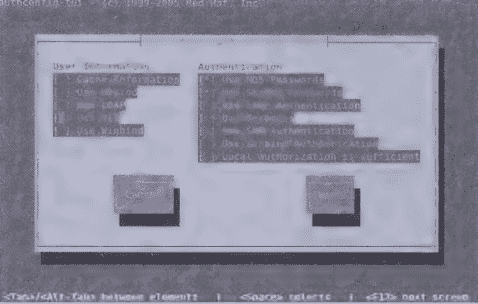

**图7-1** 从菜单中选择NIS身份验证。

指定正确的域设置（见图7-2）。


**图7-2** 输入正确的域设置。

该工具会自动为你编辑`/etc/nsswitch.conf`和`/etc/yp.conf`文件。很简单，不是吗？现在你的用户应该能够使用网络凭据登录，而不需要使用本地机器的凭据了。


第二种网络身份验证方式是`LDAP`。`LDAP`的配置与`NIS`类似，只是使用的软件包不同。首先，安装两个必需的软件包：

```
# yum install -y openldap nss_ldap
```

和`NIS`一样，你也可以手动添加配置文件，但既然你已经见识过`authconfig-tui`工具有多好用，你可以改用这个工具：

```
# authconfig-tui
```

选择`LDAP`身份验证（见图7-3）。


**图7-3** 选择“使用LDAP”设置和身份验证。

指定正确的域设置（见图7-4）。


**图7-4** 输入正确的域设置。

和之前一样，`/etc/nsswitch.conf`文件和`/etc/ldap.conf`文件也会被自动编辑。和`NIS`不同，`LDAP`不需要启动客户端服务。

请注意，在图7-3中你还可以选择使用`Kerberos`作为身份验证方法。你也可以练习连接使用`Kerberos`身份验证和影子密码的客户端。

配置文件就位后，你就可以开始通过网络进行身份验证了。排查网络客户端身份验证问题时，请检查`/var/log/secure`文件中的错误。每当客户端无法联系中央服务器或登录出现其他问题时，所有错误都会记录在这个文件中。

### 总结

到这一步，你应该已经是创建用户和组的高手了……好吧，也许还没到那个程度。用户管理是一项重要任务，我们在本章中涵盖了大量内容。你可能需要制定账户创建策略，比如采用“名字首字母+姓氏”的命名规则，以及处理重复账户的方法；此外，你可能还需要实现账户创建流程的自动化。虽然不同场景各有差异，但创建用户和组的基础知识不会有太大变化。到现在，你也应该已经熟练掌握了为用户配置共享文件夹和文件的方法。启用用户间的协作是现实中频繁需要完成的实际任务。

### 复习题

1. 可以使用什么命令（及参数）来创建用户名为`JSmith`、描述为“Jr Admin”的用户？

2. `/etc/shadow`文件的格式是什么？

3. 你会使用什么命令创建组？那将用户`JSmith`添加到组中又该使用什么命令？

4. 如何运行具有更高权限的命令？

5. 是否可以在组之间共享文件？如果可行，你会给目录设置什么权限来实现文件共享？

6. 如果想在`user01`登录系统时执行特定操作，你应该编辑哪个文件？

7. 可以在创建用户时向其主目录添加文件。正确还是错误？

8. 默认情况下，用户主目录的路径是什么？

9. 使用集中式身份验证有什么好处？

10. 你可以使用什么命令将客户端机器添加到`LDAP`服务器？

### 复习题答案

1. 可使用`useradd -c "Jr Admin" JSmith`命令创建该用户。

2. `/etc/shadow`文件的格式为`<用户名>:<加密密码>:<上次密码修改时间>:<最小密码使用天数>:<最大密码使用天数>:<密码过期提前警告天数>:<密码过期后账户宽限天数>:<账户失效日期>:<保留字段>`。

3. 使用`groupadd`命令创建组。之后可使用以下命令将用户`JSmith`添加到该组：`usermod -G <组名> JSmith`

4. 如果你在`/etc/sudoers`文件中有相应权限，可以使用`sudo`命令运行权限更高的命令。

5. 可以。你可以使用`setgid`标志设置合适的权限（`chmod 2770`）。

6. 你要执行的操作需要添加到`/home/user01/.bashrc`文件的末尾。

7. 正确。将所有需要添加到用户主目录的文件放在`/etc/skel`目录中即可。

8. 用户的主目录默认创建在`/home`目录下。

9. 使用集中式身份验证后，无需在组织内的每台系统上重新创建或维护多个账户。

10. 你可以使用`authconfig-tui`命令或`authconfig`命令。

### 实验7

### 任务1 – 配置文件个性化

**步骤1.** 在`RHEL01`上创建一个文件，输入以下内容：

人力资源通知

全体员工均需接受随机药物检测。

此致敬礼

人力资源部

**步骤2.** 将文件保存为`hr_notice.txt`。

**步骤3.** 配置`hr_notice.txt`文件，使得系统上创建的所有新用户的主目录中都会收到该通知的副本。当创建的用户主目录中存在正确的文件时，任务完成。

### 任务2 – 用户和组管理

**步骤1.** 在`RHEL01`上创建以下组：

- a. 销售组（`sales`）
- b. 工程组（`engineering`）
- c. 开发组（`developers`）

**步骤2.** 在`RHEL01`上创建一个新用户，要求如下：

- a. 用户名：`user01`
- b. 密码：`password`
- c. 主目录：`/home/user01`
- d. Shell：`BASH`
- e. 描述：普通用户
- f. UID：`500`
- g. GID：`500`
- h. `user01`应为销售组（`sales`）的成员

**步骤3.** 在`RHEL01`上创建一个新用户，要求如下：

- a. 用户名：`user02`
- b. 密码：`secret`
- c. 主目录：`/var/log`
- d. Shell：`BASH`
- e. 描述：审计员
- f. UID：`600`
- g. GID：`600`
- h. `user02`应为销售组（`sales`）的成员

**步骤4.** 在`RHEL01`上创建一个新用户，要求如下：

- a. 用户名：`user03`
- b. 密码：`supercool`
- c. 主目录：无
- d. Shell：无
- e. 描述：虚假账户
- f. UID：`501`
- g. GID：`501`
- h. `user03`应为工程组（`engineering`）的成员

**步骤5.** 在`RHEL01`上创建一个新用户，要求如下：

- a. 用户名：`user04`
- b. 密码：`CheaperThanFree`
- c. 主目录：`/home/user04`
- d. Shell：`Korn`
- e. 描述：开发人员
- f. UID：`502`
- g. GID：`502`
- h. `user04`应为开发组（`developers`）的成员。

**步骤6.** 在`RHEL01`上创建一个新用户，要求如下：

- a. 用户名：`user05`
- b. 密码：`S3cuReP@ssWorD`
- c. 主目录：无
- d. Shell：无
- e. 描述：安全用户
- f. `user05`应创建为系统用户。

当所有用户、组、文件和目标都可以被验证时，任务完成。

### 任务3 – 组协作

**步骤1.** 在`RHEL01`上创建以下目录：

- a. `/opt/Sales`
- b. `/opt/Sales/East_Coast`
- c. `/opt/Sales/West_Coast`
- d. `/opt/Marketing`
- e. `/opt/Audit`
- f. `/opt/Developers`

**步骤2.** 为步骤1中创建的目录设置以下权限：

- a. 销售组（`sales`）的所有成员都应能访问所有销售目录及其子目录。
- b. 市场组（`marketing`）的所有成员都应能访问市场目录。
- c. 审计组（`audit`）的所有成员都应能访问审计目录。
- d. 不属于对应组的用户不应访问该组目录（即所有非销售组用户都不应访问销售目录）。
- e. 上述规则的例外是：审计组（`audit`）对`/opt`下的所有目录仅有只读权限。

**步骤3.** 在`RHEL01`上创建一个新用户，要求如下：

- a. 以`user01`身份登录，在`East_Coast`目录中创建两个空白文件（文件名随意）。
- b. 注销`user01`账号。
- c. 以`user02`身份登录，在`Audit`目录中创建两个空白文件（文件名随意）。
- d. 注销`user02`账号。

当所有组、文件和目标都可以被验证时，任务完成。

## 第8章：网络安装

### 本章涵盖以下主题：

- `Kickstart`服务器搭建——本节介绍如何搭建基础`Kickstart`服务器。
- 掌握`Kickstart`配置文件——本节详细介绍`Kickstart`配置文件。
- 自动化`Kickstart`——本节介绍如何将`Kickstart`服务器与`DHCP`服务器结合，实现`Kickstart`自动化。
- 其他网络安装方式——本节介绍其他可用的网络安装方法。

### 本章涵盖以下RHCSA考试目标：

- 使用`Kickstart`自动安装红帽企业Linux（`RHEL`）

安装红帽企业Linux（`RHEL`）是重要主题，尽管它已不再纳入红帽考试范畴。但网络安装仍属于考试内容，了解不同场景下的适用安装方法，能够帮你在安装过程中节省时间。此外，`Kickstart`是实际生产环境中部署`RHEL`的关键技术，应用十分广泛。本章将深入讲解`Kickstart`安装，最后介绍其他类型的网络安装方法。

## Kickstart服务器搭建

红帽最主流的网络安装方案是通过`Kickstart`服务器实现。它支持灵活的安装选项，例如安装前后的软件包自定义、自定义脚本、日志记录等，还能实现完全自动化安装。本节将介绍搭建`Kickstart`服务器的基础操作，以及执行简单网络安装的方法。

`Kickstart`支持通过`HTTP`、`FTP`或`NFS`协议在网络上安装红帽系统。本章选择使用`HTTP`协议，因为它的搭建速度最快，且配置难度略低于另外两种协议。对于初次尝试的用户来说，`HTTP`协议的`Kickstart`服务器配置步骤也更少。

**步骤1.** 首先，你需要安装`Apache` Web服务器：

```
# yum install -y httpd
```

**步骤2.** 验证软件包是否安装成功：

```
# rpm -qa | grep httpd
httpd-2.2.15-5.el6.x86_64
httpd-tools-2.2.15-5.el6.x86_64
```

由于本章并非介绍`Apache` Web服务器，因此此处不再展开细节，仅说明我基本使用的是`Apache`提供的所有默认配置。

**步骤3.** 启动`Apache`服务：

```
# service httpd start
```

Starting httpd: [ OK ]

> **警告：** 你可能会收到未设置`ServerName`的警告，暂时可以忽略它。

**步骤4.** 设置服务开机自启：

```
# chkconfig httpd on
```

**步骤5.** 验证配置：

```
# chkconfig httpd --list
httpd 0:off 1:off 2:on 3:on 4:on 5:on 6:off
```

`HTTP`服务器运行后，你需要创建目录结构，用来存放需要提供给客户端用于安装的文件。

**步骤6.** 创建以下目录：

```
# mkdir /var/www/pub
```

`/var/www`是`Apache`存储客户端可访问文件的默认目录，需要在该目录下创建名为`pub`的目录，用来存放后续将安装到客户端的红帽安装光盘的内容。

**步骤7.** 确保红帽安装光盘已挂载到光驱：

```
# mount /dev/cd-rom /mnt
```

**步骤8.** 将光盘中的文件复制到之前创建的目录中：

```
# cp -vR /mnt/* /var/www/pub/
```

由于需要复制红帽安装光盘的全部内容，体积较大，因此该复制过程会花费一定时间。

**步骤9.** 安装文件就位后，你需要创建最后一个目录：

```
# mkdir /var/www/pub/kickstart
```

**步骤10.** 验证当前目录结构如下：

```
# tree /var/www/pub
/var/www/pub
|-- EFI
|   |-- BOOT
|   |   |-- BOOTX64.conf
|   |   |-- TRANS.TBL
|   |   `-- splash.xpm.gz
|   `-- TRANS.TBL
|-- EULA
|-- GPL
|-- HighAvailability
|-- LoadBalancer
|-- Packages
|-- README
|-- ResilientStorage
|-- ScalableFileSystem
|-- Server
|-- images
|   |-- README
|   |-- TRANS.TBL
|   |-- efiboot.img
|   |-- efidisk.img
|   |-- install.img
|   |-- product.img
|   `-- pxeboot
|       |-- initrd.img
|       `-- vmlinuz
|-- isolinux
|   |-- boot.cat
|   |-- boot.msg
|   |-- grub.conf
|   |-- initrd.img
|   |-- isolinux.bin
|   |-- isolinux.cfg
|   |-- memtest
|   |-- splash.jpg
|   |-- vesamenu.c32
|   `-- vmlinuz
|-- kickstart
|   `-- redhat-base.cfg
|-- media.repo
`-- repodata
```

> **警告：** 使用该命令前可能需要安装`tree`命令。根据你在安装过程中选择的软件包，`tree`包可能已安装，也可能未安装。

> **警告：** 使用`tree`命令会输出大量文件列表，内容会与示例略有差异。我手动创建了不含文件的目录，仅用于展示目录结构，你的目录结构中应该包含红帽安装光盘的所有文件。

> **迁移提示** `RHEL 6`的`DVD`布局与之前版本完全不同，因此目录结构也与`RHEL 5`存在差异。

**步骤11.** 正常情况下此时需要创建`Kickstart`文件，但相关内容将在下一节介绍，因此现在只需创建一个占位文件即可：

```
# touch /var/www/pub/kickstart/redhat-base.cfg
```

### 防火墙与SELinux配置

要完成`Kickstart`服务器的搭建，仅需对系统的安全设置进行少量调整。由于本书尚未介绍`iptables`或防火墙规则，本节仅提供当前所需的命令，防火墙规则相关内容将在第12章讲解。

`HTTP`服务正常运行需要开放`TCP 80`端口。将`HTTP`协议用于`Kickstart`的一个安全优势是，仅需在防火墙上开放这一个端口即可。

**步骤1.** 使用`iptables`命令创建防火墙规则：

```
# iptables -I INPUT 5 -p tcp -m tcp --dport 80 -j ACCEPT
```

**步骤2.** 保存刚刚创建的规则：

```
# service iptables save
```

Saving firewall rules to /etc/sysconfig/iptables: [ OK ]

**步骤3.** 重启防火墙服务使配置生效：

```
# service iptables restart
```

iptables: Flushing firewall rules: [ OK ]

iptables: Setting chains to policy ACCEPT: filter [ OK ]

iptables: Unloading modules: [ OK ]

iptables: Applying firewall rules: [ OK ]

通常情况下，服务正常运行还需要关闭`SELinux`保护，但本场景中无需调整`SELinux`初始化配置即可让`Kickstart`服务器正常运行。

> **迁移提示** `RHEL 5`中`SELinux`默认设置为阻止服务运行，需要调整该配置才能让`HTTP`服务正常运行。

**步骤1.** 查询需要修改的布尔值：

```
# getsebool -a | grep httpd_dis
httpd_disable_trans --> off
```

**步骤2.** 关闭`SELinux`保护：

```
# setsebool -P httpd_disable_trans=1
```

**步骤3.** 验证布尔值已修改：

```
# getsebool -a | grep httpd_dis
httpd_disable_trans --> on
```

`SELinux`及布尔值的详细内容将在第11章《SELinux》中介绍。如果你使用的是`RHEL 5`，当前只需使用此处提供的命令即可。现在你的`Kickstart`服务器已经搭建完成。

要让客户端访问`Kickstart`服务器，需要从红帽安装光盘启动客户端，进入启动提示符后输入以下命令：

```
# linux ks=http://172.168.1.1/pub/kickstart/redhat-base.cfg append ip=172.168.1.105 netmask=255.255.255.0
```

由于（目前）还没有搭建全自动的`Kickstart`服务器，因此需要指定客户端要使用的`Kickstart`文件，同时为其配置临时`IP`地址。请确保该`IP`地址与`Kickstart`服务器处于同一子网，否则配置无法生效。

`Kickstart`服务器搭建完成后，接下来我们创建可配合使用的`Kickstart`文件。

## 掌握Kickstart配置文件

搭建`Kickstart`文件本身难度不高，但出现问题时排查起来会很麻烦。我可以肯定的是，你需要经过大量试错，才能将各项配置调整到符合需求的状态。

在继续之前，请先收藏以下页面：


[http://docs.redhat.com/docs/en-US/Red_Hat_Enterprise_Linux/6/html/Installation_Guide/s1-kickstart2-options.html](http://docs.redhat.com/docs/en-US/Red_Hat_Enterprise_Linux/6/html/Installation_Guide/s1-kickstart2-options.html)

该页面是`Kickstart`文件选项、语法及各选项说明的最佳参考来源。我没有将相关内容收入本书，是因为该页面内容极多，而且线上版本会持续更新，查阅线上版本更合适。

下面我们来看一个`Kickstart`文件示例，并逐段解析：

```
# cat /var/www/pub/kickstart/redhat-base.cfg 
# Tells kickstart to start the install 
install 
# Specifies the language 
lang en_US.UTF-8 
# Specifies the keyboard layout 
keyboard us 
# Skip Red Hat key input 
```

```
kickstart key --skip # 强制使用文本安装（节省时间，因为无需加载GUI）
text # 安装过程中跳过所有GUI的显示
skipx # 与HTTP安装配合使用，指定安装文件所在位置
url --url http://172.168.1.1/pub/ # 首次启动时为客户端分配静态IP并设置主机名
network --device eth0 --hostname Client01 --bootproto dhcp
# 设置root用户密码
rootpw --iscrypted <encrypt_password>
# 启用防火墙并为SSH远程管理开放22端口
firewall --enabled --port=22:tcp
# 配置安全及SELinux级别
authconfig --enableshadow --enablemd5
selinux --permissive
# 设置时区
timezone --utc America/New_York
# 在MBR中创建引导加载程序，安装到sda盘
bootloader --location=mbr --driveorder=hda
# 清除所有分区，并按照以下信息重新创建
# ***hda可能因你使用的硬盘类型不同而有所差异***
clearpart --drives=hda --all --initlabel
# 创建100MB的/boot分区
part /boot --fstype ext3 --size=100
# 创建5GB的/根分区
part / --fstype ext3 --size=5000
# 创建2GB的交换分区
part swap --size=2000
# 使用磁盘剩余所有空闲空间创建/home分区
part /home --fstype ext3 --size=100 --grow
# 安装基础与核心软件包，以及OpenSSH服务端与客户端
# 这是系统运行的最低要求（支持通过SSH远程访问）
%packages
@Core
@Base
openssh-clients
openssh-server
```

这个`kickstart`文件有完善的注释，因此理解其作用应当相当简单。我在此也未使用任何复杂分区方案，让分区布局更易理解。在最后一部分你可以看到，仅安装了足够让系统启动运行的基础软件包，不会多装其他组件。这样做可以加快安装速度，一方面是因为需要安装的软件包数量更少，另一方面如果你之后需要用到遗漏的软件包，随时可以后续安装。生成加密密码后替换到对应行，这个`kickstart`文件就能为你提供一套基于`kickstart`服务器的客户端基础配置。

## 安装后配置

使用`kickstart`系统的一大优势是，你可以在系统安装完成后让`kickstart`文件执行脚本。你需要在`kickstart`文件末尾定义`%post`段，该段内的所有内容会被视为你直接在系统控制台中输入的命令，可用于对系统做定制化配置或执行其他脚本完成进一步配置。虽然`%post`段通常更有用（因为此时系统已经安装完成），但你也需要知道还有`%pre`段，它会在安装开始前执行。

## 高级分区

`kickstart`还支持创建更高级的分区。在`kickstart`文件中，你需要使用前文提及的网页中列出的命令来划分磁盘空间并创建高级分区。举个例子，我们为客户端创建几个LVM分区，以下是我另一个`kickstart`文件的摘录：

```
# cat /var/www/pub/kickstart/redhat-base2.cfg
...
# 配置每块用于LVM的物理磁盘
part pv.01 --size=1 --grow --ondisk=sda
# 在物理卷上创建要使用的卷组
volgroup VolGroup00 pv.01
# 使用逻辑卷划分磁盘空间
logvol / --fstype ext3 --name=LogVol00 --vgname=VolGroup00 --size=5000
logvol /home --fstype ext3 --name=LogVol01 --vgname=VolGroup00 --size=1000
logvol /var/log --fstype ext3 --name=LogVol02 --vgname=VolGroup00 --size=1000
logvol swap --fstype swap --name=LogVol03 --vgname=VolGroup00 --size=1024
```

虽然这个例子看起来和基础分区类似，但你必须按照物理卷、卷组、逻辑卷的顺序定义，否则会出现错误（`kickstart`中的错误提示并不总是很友好）。有一个创建`kickstart`文件的小技巧，无需手动编写，只需正常走一遍安装流程即可。你可能还记得本书第一章的内容，完成系统安装后，`root`用户的家目录下会生成一个名为`anaconda-ks.cfg`的文件，这个文件实际上记录了系统安装过程中你执行的所有操作，相当于一份`kickstart`文件。你可以将它复制到你的`kickstart`服务器上，就完成了`kickstart`文件的准备。如果你不想每次需要参考机时都重装一遍服务器，还有个更方便的方法：有一款GUI工具可以更轻松地构建`kickstart`文件，你可以用它代替命令行手动构建`kickstart`文件的方式。不过你需要安装桌面环境（因为这是GUI工具），而大多数服务器通常默认不安装桌面环境。这款GUI工具有多个界面，支持从零开始构建`kickstart`文件，而且会在你构建过程中自动校验文件语法。如果你刚接触`kickstart`，或者正在排查问题，这种方式会很有用，因为语法由工具自动生成，格式完全正确。要安装这款GUI工具，请使用以下命令：

```
# yum install -y system-config-kickstart
```

要启动它，请使用以下命令：

```
# system-config-kickstart
```

在未安装桌面环境的服务器上安装这款GUI工具还有个好处：它会附带一个命令行语法校验工具（`ksvalidator`）。你可以用这个命令校验`kickstart`文件的语法，辅助排查问题。我目前生产环境中使用的`kickstart`文件每个都有几百行，因此有个工具能校验语法非常有帮助。

## 自动化Kickstart

在本章前面部分，我们已经了解了如何搭建`kickstart`服务器、为客户端制作`kickstart`文件。现在可以更进一步，通过PXE启动和TFTP服务器实现流程自动化。客户端获取`kickstart`文件仍使用相同的协议（HTTP），你可以使用上一节制作的`kickstart`文件供客户端使用。

### TFTP服务器

首先，我们搭建TFTP服务器，用于向客户端提供预启动环境的引导文件。由于你已经在本章第一节搭建好了`kickstart`服务器，大部分工作已经完成了。

#### 步骤1. 检查目录结构，应当如下所示：

```
# tree /var/www/pub
/var/www/pub
|-- EFI
|   |-- BOOT
|   |   |-- BOOTX64.conf
|   |   |-- TRANS.TBL
|   |   `-- splash.xpm.gz
|   `-- TRANS.TBL
|-- EULA
|-- GPL
|-- HighAvailability
|-- LoadBalancer
|-- Packages
|-- README
|-- ResilientStorage
|-- ScalableFileSystem
|-- Server
|-- images
|   |-- README
|   |-- TRANS.TBL
|   |-- efiboot.img
|   |-- efidisk.img
|   |-- install.img
|   |-- product.img
|   `-- pxeboot
|       |-- initrd.img
|       `-- vmlinuz
|-- isolinux
|   |-- boot.cat
|   |-- boot.msg
|   |-- grub.conf
|   |-- initrd.img
|   |-- isolinux.bin
|   |-- isolinux.cfg
|   |-- memtest
|   |-- splash.jpg
|   |-- vesamenu.c32
|   `-- vmlinuz
|-- kickstart
|   `-- redhat-base.cfg
|-- media.repo
`-- repodata
```

如果有缺失的内容，你现在可以创建对应目录以匹配这里的结构。你还需要为TFTP服务器创建用于提供文件的目录结构：

```
# cd /
# mkdir -p tftpboot/{images,pxelinux.cfg}
```

#### 步骤2. 你可以用以下命令验证：

```
# tree /tftpboot/
/tftpboot/
|-- images
`-- pxelinux.cfg
```

你需要将`/var/www/pub/images/pxeboot`目录下的内核文件复制到TFTP目录结构中，以便向客户端提供这些文件。

```
# cp /var/www/pub/images/pxeboot/vmlinuz /tftpboot/images
# cp /var/www/pub/images/pxeboot/initrd.img /tftpboot/images
```

继续进行配置前，你需要安装一些软件包。

#### 步骤3. 安装TFTP服务器软件包以及客户端启动所需的`syslinux`软件包：

```
# yum install -y syslinux
# yum install -y tftp-server
```

安装完这两个软件包后，你就可以完成TFTP服务器的配置了。TFTP服务器软件包实际是`xinetd`服务的一部分（你可以在第19章《网络服务》中了解更多相关内容），你只需要修改TFTP服务器的配置文件，指定向客户端提供引导文件的目录即可。

#### 步骤4. 你的配置文件应当如下所示：

```
# cat /etc/xinetd.d/tftp
service tftp
{
    disable = no
    socket_type = dgram
    protocol = udp
    wait = yes
    user = root
    server = /usr/sbin/in.tftpd
    server_args = -s /tftpboot
    per_source = 11
    cps = 100 2
    flags = IPv4
}
```

**第 5 步。** 完成所需修改后，只需重启`xinetd`服务即可：

```
# service xinetd restart
Stopping xinetd: [ OK ]
Starting xinetd: [ OK ]
```

**第 6 步。** 另外，你需要确保该服务器被设置为系统启动时自动运行：

```
# chkconfig tftp on
```

**第 7 步。** 请通过以下命令验证：

```
# chkconfig tftp --list
tftp on
```

最后，针对TFTP服务器，你需要从刚刚安装的`syslinux`包中移动几个附加文件。由于这些文件的存放位置会随你使用的版本和架构而变化，你可以在移动前先手动搜索这些文件：

```
# whereis syslinux
syslinux: /usr/bin/syslinux /usr/lib/syslinux
```

你需要的文件位于第二个目录中。同样，该位置在你的系统上可能会略有不同。将所需的文件复制到TFTP服务器的目录结构中：

```
# cp /usr/share/syslinux/menu.c32 /tftpboot
# cp /usr/share/syslinux/pxelinux.0 /tftpboot
```

**第 8 步。** 你还需要创建一个名为`default`的空白文件，该文件是后续存放PXE菜单的位置：

```
# touch /tftpboot/pxelinux.cfg/default
```

**第 9 步。** 至此，TFTP服务器配置完成。你现在应该拥有如下目录结构：

```
# tree /tftpboot/
/tftpboot/
|-- images
|   |-- initrd.img
|   `-- vmlinuz
|-- menu.c32
|-- pxelinux.0
`-- pxelinux.cfg
    `-- default
```

## PXE 启动

要让客户端能够通过PXE启动，你需要确保两项配置正确。首先，你需要一台DHCP服务器为客户端分配IP地址，这样客户端就能知道PXE服务器的实际位置。

**第 1 步。** 使用默认配置设置DHCP服务器：

```
# yum install -y dhcp
```

**第 2 步。** 验证DHCP服务器是否安装成功：

```
# rpm -qa | grep dhcp
dhcp-4.1.1-12.P1.el6.x86_64
```

**第 3 步。** 使用以下DHCP服务器示例配置文件：

```
# cat /etc/dhcp/dhcpd.conf
ddns-update-style none;
authoritative;
subnet 172.168.1.0 netmask 255.255.255.0 {
    ### Parameters for the local subnet ###
    option routers 172.168.1.1;
    option subnet-mask 255.255.255.0;
    option domain-name "example.com";
    option domain-name-servers 172.168.1.1;
    default-lease-time 21600;
    max-lease-time 43200;
    range dynamic-bootp 172.168.1.100 172.168.1.200;
    ### PXE Server IP ###
    next-server 172.168.1.1;
    filename "pxelinux.0";
}
```

### 迁移提示

在RHEL5中，DHCP服务器配置文件为`/etc/dhcpd.conf`；在RHEL6中，该文件被移到了`/etc/dhcp`目录下，原因是RHEL6还增加了对IPv6上DHCP的支持。

**第 4 步。** 保存你对文件所做的所有修改，然后重启DHCP服务：

```
# service dhcpd restart
Stopping dhcpd: [ OK ]
Starting dhcpd: [ OK ]
```

**第 5 步。** 启用DHCP服务器，使其在系统启动时自动运行：

```
# chkconfig dhcpd on
```

**第 6 步。** 同样验证DHCP服务已被设置为启动时运行：

```
# chkconfig dhcpd --list
dhcpd 0:off 1:off 2:on 3:on 4:on 5:on 6:off
```

PXE启动的最后一步是创建PXE菜单，客户端可以通过该菜单选择要启动的`kickstart`文件。之前你已经创建了空白的`/tftpboot/pxelinux.cfg/default`文件，以下是该菜单文件完成后的样子：

```
# cat /tftpboot/pxelinux.cfg/default
default menu.c32
prompt 0
timeout 10
MENU TITLE PXE Menu
LABEL RedHat 6.0 x64
MENU LABEL RedHat 6.0 x64
KERNEL images/vmlinuz
append initrd=images/initrd.img linux ks=http://172.168.1.1/pub/kickstart/test.cfg
```

`timeout`选项用于定义系统在自动选择默认选项前会等待多长时间。在这里，你还定义了PXE菜单的标题，创建了两类不同的标签分别对应你要安装的操作系统，同时定义了用于启动`kickstart`文件的内核及对应参数。保存并关闭该文件即可完成PXE配置。

## 防火墙和 SELinux 配置

由于你新增了几个服务，因此自然还需要进行一些额外的安全设置。当前防火墙已经为HTTP服务器配置了规则，你还需要为TFTP服务和DHCP服务器添加对应的规则。

**第 1 步。** 使用`iptables`创建额外的防火墙规则：


进入`/path/to/xxx`目录，找到`xxx.json`。

在表达式`cvar = avar + bvar`中，加法运算符（`+`）将`avar`与`bvar`相加，得到它们的和`cvar`

在`List.of(arg0, arg1, arg2)`中，`List`接口的工厂方法`of()`接受一系列的元素，返回包含它们的只读列表。

之后我们这样调用`cmd`命令：`cmd arg0 arg1 arg2`。

```
if (condVar > someVal) {console.log("xxx")}
```

---

# 配置Kickstart服务器

## 步骤1：配置防火墙

首先，使用以下命令开放TFTP和DHCP所需的UDP端口：

```
# iptables -I INPUT 5 -p udp -m udp --dport 67 -j ACCEPT
```

```
# iptables -I INPUT 5 -p udp -m udp --dport 69 -j ACCEPT
```

### 步骤2：保存防火墙规则

保存刚刚创建的防火墙规则：

```
# service iptables save
Saving firewall rules to /etc/sysconfig/iptables: [ OK ]
```

### 步骤3：重启iptables服务

```
# service iptables restart
iptables: Flushing firewall rules: [ OK ]
iptables: Setting chains to policy ACCEPT: filter [ OK ]
iptables: Unloading modules: [ OK ]
iptables: Applying firewall rules: [ OK ]
```

## 迁移提示：调整SELinux参数

如前所述，在RHEL5中，SELinux默认会阻止服务运行。现在新增了PXE启动和DHCP服务器，你需要调整相关参数让这些服务正常运行。

### 步骤1：查询需要修改的布尔值

```
# getsebool -a | grep tftpd_dis
tftpd_disable_trans --> off
```

```
# getsebool -a | grep dhcpd_dis
dhcpd_disable_trans --> off
```

### 步骤2：关闭SELinux保护

```
# setsebool -P tftpd_disable_trans=1 dhcpd_disable_trans=1
```

### 步骤3：验证布尔值已经变更

```
# getsebool -a | grep tftpd_dis
tftpd_disable_trans --> on
```

```
# getsebool -a | grep dhcpd_dis
dhcpd_disable_trans --> on
```

我们会在第11章更详细地讲解SELinux和布尔值。就目前而言，如果你使用的是RHEL5，直接使用这里给出的命令即可。现在到了最终验证环节……看看配置是否生效！由于你已经在RHEL01上配置好了kickstart服务器，现在可以对Client02进行PXE启动。因为本次实验使用VirtualBox，你可以启动Client02并按`F12`键调出启动选项菜单，选择`L`选项从局域网启动。如果一切配置正常，你应该能看到你创建的PXE菜单。选择第一个（也是唯一一个）选项即可启动基于网络的kickstart安装。由于你已经测试过原始的kickstart服务器，这里的配置不会有任何变动，安装过程应该可以顺利完成。你可以在PXE菜单中添加不同的kickstart选项，来创建不同类型的服务器和客户端。

## 其他网络安装方式

虽然kickstart安装不是你唯一可以执行的网络安装方式，但它是最便捷的，也提供了最佳的完全自动化方案。你也可以使用NFS、FTP和HTTP执行网络安装，这三种安装方式的主要配置步骤是相同的。

首先，你需要挂载CD-ROM驱动器：

```
# mount /dev/cdrom /mnt
```

这一步会提供安装Red Hat所需的文件。接下来的步骤取决于你想执行哪种安装方式。如果是HTTP网络安装，你需要像配置kickstart安装时那样，在`/var/www`下创建一个独立的目录。如果使用NFS或FTP，你需要创建一个目录，通过这些协议向客户端提供文件，例如`/opt/install_files`。创建好你要使用的目录后，将CD中的内容复制到该目录中：

```
# cp -R /mnt/* /opt/install_files
```

如果服务运行正常，那么从服务器端来说，你只需要完成这些操作即可。在客户端系统上，使用Red Hat CD启动系统，在启动提示符处输入`linux askmethod`，该命令可以让你选择想要使用的安装方式。本书前面已经讲解过每个服务的配置和安全要求，因此这里不再赘述。虽然网络安装被列入了红帽考试的备考指南，但红帽考试现在已经不再考查操作系统的安装，因此了解包括kickstart在内的每种安装方式的工作原理是非常重要的。

## 本章小结

在本章中，我们讨论了通过网络安装Red Hat Enterprise Linux可以使用的不同方法。其中，我们重点深入讲解了kickstart方法，因为它在实际生产环境中被广泛应用于各种规模的安装场景。掌握kickstart安装的故障排查方法也非常重要，因为你前几次使用该方法时很可能会遇到问题，而知道如何解决这些问题是关键。

## 复习题

1. Kickstart只能通过PXE服务器实现。判断正误。

2. 要让TFTP服务器正常工作，防火墙需要开放哪个端口？

3. 你可以使用哪三种协议执行网络安装？

4. 是否可以使用kickstart创建RAID或LVM分区？

5. 可以在kickstart安装前运行脚本。判断正误。

6. 用于在kickstart安装后运行脚本的配置节名称是什么？

7. 要完全实现kickstart安装自动化，需要哪三个组件？

## 复习题答案

1. 错误。PXE服务器可简化自动化流程，但kickstart安装并非必须依赖它才能运行。

2. TFTP服务器使用UDP 69端口。

3. 可使用HTTP、FTP和NFS协议执行网络安装。

4. 是的。Kickstart既支持基础分区，也支持高级分区（RAID/LVM）。

5. 正确。这可以通过定义`%pre`段来实现，尽管该功能很少被使用。

6. 通过定义`%post`段，可在kickstart安装完成后运行脚本。

7. 结合使用TFTP服务器、PXE启动和DHCP服务器，即可完全实现kickstart安装流程的自动化。

## 实验8

### 任务1 – 配置Kickstart

**步骤1.** 按照以下要求创建kickstart服务器：

- 服务器必须使用FTP协议。
- 服务器无需完全自动化（无需PXE启动）。
- kickstart文件仅需提供基础软件包。
- kickstart文件仅需使用基础分区（无需RAID或LVM）。

当客户端系统能够通过该kickstart服务器完成安装时，即视为任务完成。

### 任务2 – 升级Kickstart服务器

**步骤1.** 将任务1中的kickstart服务器升级为完全自动化的kickstart服务器，要求如下：

- 服务器必须使用FTP协议。
- 服务器必须支持完全自动化。
- kickstart服务器必须提供PXE启动菜单。
- kickstart服务器必须为所有从网络启动的客户端分配IP地址。
- kickstart文件仅需提供基础软件包。
- kickstart文件可使用任意类型的分区。

当客户端系统能够通过该kickstart服务器完成安装时，即视为任务完成。

### 任务3 – 另一种安装方式

**步骤1.** 关闭kickstart服务器。

**步骤2.** 按照以下要求执行红帽系统的网络安装：

- 网络安装必须使用HTTP协议执行。
- 不得使用kickstart服务器。
- 不得使用自动化功能（PXE启动或DHCP）。
- 只要操作系统可正常安装、系统可启动，客户端可使用任意配置。

当客户端系统成功安装后，即视为任务完成。

---

# 系统日志、监控与自动化

## 本章涵盖内容

- 使用Syslog——本节将介绍日志功能，包括本地日志和集中式日志。
- 监控系统性能——本节将介绍如何监控系统性能。
- 使用cron和at实现自动化——本节将介绍通过定时任务和单次任务实现系统自动化的方法。

## RHCSA考试目标

- 识别CPU和内存密集型进程，使用`renice`调整进程优先级，以及终止进程
- 定位并解析系统日志文件
- 使用cron安排任务

## RHCE考试目标

- 生成并提交系统资源使用率报告（处理器、内存、磁盘和网络）
- 使用shell脚本实现系统维护任务自动化
- 配置系统将日志发送至远程系统
- 配置系统接受来自远程系统的日志

# 系统日志、监控与自动化

当系统出现故障时，你如何发现问题？当然是通过查看日志！认真来说，理解系统日志功能非常重要，这样你才能在系统出现问题时进行故障排查。几乎你能想到的所有系统事件都会生成日志，包括内核、启动流程以及正在运行的各种服务。除了日志之外，还有一些工具可用于监控和检查系统状态。本章将介绍如何使用这些工具和日志功能排查各类问题，同时也会简要说明如何将部分相关任务自动化。

## 使用Syslog

系统出现异常时——有时甚至正常运行事件——syslog服务都会生成相应消息。这些消息用于记录系统运行状态、正在执行的操作，以及是否存在异常问题。红帽系统内置了syslog服务，且默认设置为开机自启。在RHEL 6中，`rsyslog`软件包会默认安装，是系统使用的主要日志服务。

### 迁移提示

在RHEL 5中，默认日志服务由两个守护进程分担：`syslogd`负责系统消息，`klogd`负责内核消息。在RHEL 6中，这两个守护进程均已被`rsyslogd`守护进程替代，可同时处理两类消息。如果你仍在使用RHEL 5，可以通过`sysklogd`软件包安装syslog服务。

`rsyslog`服务的主配置文件为`/etc/rsyslog.conf`，用于控制消息生成后的发送位置。由于日志功能是操作系统的核心组件，因此该软件包会作为核心软件包的一部分默认安装。

**步骤1.** 出于良好习惯，你应该验证该软件包是否已安装：

```
# rpm -qa | grep rsyslog
rsyslog-4.6.2-2.el6.x86_64
```

可以看到该软件包已安装，你还需要检查另外两项配置。

**步骤2.** 首先，确保该服务已设置为开机自启：

```
# chkconfig rsyslog --list
rsyslog 0:off 1:off 2:on 3:on 4:on 5:on 6:off
```

**步骤3.** 其次，确保该服务当前正在运行：

```
# service rsyslog status
rsyslogd (pid 1279) is running...
```

#### 针对RHEL 5：

**步骤1.** 验证该软件包是否已安装：

```
# rpm -qa | grep klog
sysklogd-1.4.1-44.el5
```

**步骤2.** 检查该服务是否会在开机时启动：

```
# chkconfig syslog --list
syslog 0:off 1:off 2:on 3:on 4:on 5:on 6:off
```

如我们之前所述，除了名称差异外，RHEL 5会运行两个守护进程而非一个，但二者均属于同一个服务名下运行。

**步骤3.** 验证该服务是否正在运行：

```
# service syslog status
syslogd (pid 2214) is running...
klogd (pid 2217) is running...
```

如上所示，RHEL 5和RHEL 6的日志功能存在一些细微差异（例如命名方式、单/双守护进程架构）。`rsyslog`服务提供了更完善的日志功能，因此建议尽可能升级。

所有发送至`rsyslog`服务的消息都会存储在`/var/log`目录中，每类消息都有对应的独立文件或子目录。你也可以自定义日志文件或目录。使用任何日志服务都会遇到的最大问题是，如果不加管控，日志文件可能会变得难以管理。在我看来，能够记录不同类型的告警、从日志中提取信息，本身也是一门艺术。日志的定制方式多种多样，而每个网络环境的配置也各不相同。

你需要知道，syslog服务共使用9种不同的告警级别，这些告警可由不同的网络设备和红帽系统产生。syslog的9个严重级别如下：

- `emerg`（紧急）
- `alert`（告警）
- `crit`（严重）
- `err`（错误）
- `warning`（警告）
- `notice`（通知）
- `info`（信息）
- `debug`（调试）
- `none`（无）

### 配置文件

`/etc/rsyslog.conf`文件由以下部分组成：

| 组成部分 | 说明 |
| :--- | :--- |
| 模块 | 指示模块是否可被加载或卸载（`rsyslog`是模块化的） |
| 全局指令 | 指定适用于守护进程的配置选项（所有全局指令都以`$`开头） |
| 规则 | 指示选择器与动作的配合规则 |
| 选择器 | 基于`<facility>.<priority>` |
| 动作 | 定义消息经选择器分类后的处理方式 |

接下来我们查看默认配置文件，以了解相关示例：

```
# cat /etc/rsyslog.conf
#rsyslog v3 config file
# if you experience problems, check
# http://www.rsyslog.com/troubleshoot for assistance

#### MODULES ####

$ModLoad imuxsock.so # provides support for local system logging (e.g. via logger command)
$ModLoad imklog.so   # provides kernel logging support (previously done by klogd)
#$ModLoad immark.so  # provides --MARK-- message capability

# Provides UDP syslog reception
#$ModLoad imudp.so
#$UDPServerRun 514

# Provides TCP syslog reception
#$ModLoad imtcp.so
#$InputTCPServerRun 514

#### GLOBAL DIRECTIVES ####

# Use default timestamp format
$ActionFileDefaultTemplate RSYSLOG_TraditionalFileFormat

# File syncing capability is disabled by default. This feature is usually not required,
# not useful and an extreme performance hit
#$ActionFileEnableSync on

#### RULES ####

# Log all kernel messages to the console.
# Logging much else clutters up the screen.
#kern.*                                                 /dev/console

# Log anything (except mail) of level info or higher.
# Don't log private authentication messages!
*.info;mail.none;authpriv.none;cron.none                /var/log/messages

# The authpriv file has restricted access.
authpriv.*                                              /var/log/secure

# Log all the mail messages in one place.
mail.*                                                  -/var/log/maillog
```


# Log cron stuff
`cron.*` `/var/log/cron`

# Everybody gets emergency messages
`*.emerg` `*`

# Save news errors of level crit and higher in a special file.
`uucp,news.crit` `/var/log/spooler`

# Save boot messages also to boot.log
`local7.*` `/var/log/boot.log`

# ### begin forwarding rule ###
# The statement between the begin ... end define a SINGLE forwarding
# rule. They belong together, do NOT split them. If you create multiple
# forwarding rules, duplicate the whole block!
# Remote Logging (we use TCP for reliable delivery)
#
# An on-disk queue is created for this action. If the remote host is
# down, messages are spooled to disk and sent when it is up again.
#`$WorkDirectory` `/var/spool/rsyslog` # where to place spool files
#`$ActionQueueFileName` `fwdRule1` # unique name prefix for spool files
#`$ActionQueueMaxDiskSpace` `1g` # 1gb space limit (use as much as possible)
#`$ActionQueueSaveOnShutdown` `on` # save messages to disk on shutdown
#`$ActionQueueType` `LinkedList` # run asynchronously
#`$ActionResumeRetryCount` `-1` # infinite retries if host is down
# remote host is: name/ip:port, e.g. `192.168.0.1:514`, port optional
#`*.*` `@remote-host:514`
# ### end of the forwarding rule ###

你可以从输出中看到部分文件的存储位置，同时展示的还有一条示例规则。

## 日志轮转

如果不加以处理，日志可能会增长到非常大的体积。好在`logrotate`命令可以在日志过大前对其进行轮转。默认情况下，系统每天会调用一次`logrotate`命令，将日志文件轮转生成新的文件。该命令的参数在其配置文件`/etc/logrotate.conf`以及`/etc/logrotate.d`目录中定义。不过，该命令本身是由`/etc/cron.daily/logrotate`调用的，这是一个每天运行的定时任务（如前所述）。如果你想手动轮转日志，随时可以调用`logrotate`命令，但不要过于频繁地操作，否则你会积累大量轮转后的日志，最终还是会回到原点，陷入一堆杂乱无章的日志文件的困境。

语法：`logrotate [options]`

选项：
- `-d` 调试模式；仅用于测试，不会执行实际操作
- `-f` 强制进行文件轮转
- `-v` 输出详细日志

下面的示例将按照配置文件中的定义轮转当前日志：

```
# logrotate /etc/logrotate.conf
```

## 集中式日志记录

如果你想搭建集中式`syslog`服务器，需要选择一台服务器来存储所有日志。本示例中，你可以将`RHEL01`系统作为集中式服务器，并配置其为网络中的其他系统接收日志。

### 步骤1. 再次查看`/etc/rsyslog.conf`文件的一部分：

```
#### MODULES ####
$ModLoad imuxsock.so # provides support for local system logging (e.g. via logger command)
$ModLoad imklog.so # provides kernel logging support (previously done by rklogd)
#$ModLoad immark.so # provides --MARK-- message capability
# Provides UDP syslog reception
#$ModLoad imudp.so
$UDPServerRun 514
# Provides TCP syslog reception
#$ModLoad imtcp.so
#$InputTCPServerRun 514
```

在模块区域中，你可以看到两个可用于接收其他系统日志的配置项。标准做法是使用`514`端口的`UDP`协议。取消`UDP`接收相关配置段的注释后，`syslog`服务器就可以作为网络的集中式日志服务器使用了。

### 步骤2. 取消下面两行的注释：

```
$ModLoad imudp.so
$UDPServerRun 514
```

### 步骤3. 完成后，你需要保存文件、退出编辑器，并重启`syslog`服务：

```
# service rsyslog restart
Shutting down system logger: [ OK ]
Starting system logger: [ OK ]
```

和任何需要开放给网络使用的服务一样，你需要创建防火墙规则，放行`UDP 514`端口的访问。

### 步骤4. 使用`iptables`创建所需的防火墙规则：

```
# iptables -I INPUT 5 -p udp -m udp --dport 514 -j ACCEPT
```

### 步骤5. 保存你刚刚创建的防火墙规则：

```
# service iptables save
Saving firewall rules to /etc/sysconfig/iptables: [ OK ]
```

### 步骤6. 重启`iptables`服务：

```
# service iptables restart
iptables: Flushing firewall rules: [ OK ]
iptables: Setting chains to policy ACCEPT: filter [ OK ]
iptables: Unloading modules: [ OK ]
iptables: Applying firewall rules: [ OK ]
```

目前这些防火墙规则可能还难以理解，因为本书尚未介绍`iptables`或防火墙规则的相关内容。阅读完第12章“系统安全”后，你可以回到这里，确保你理解了创建防火墙规则时发生的情况。

## 迁移提示

遗憾的是，由于`syslog`服务进行了重构，`RHEL5`的集中式日志记录方式有较大差异。在`RHEL5`上，`syslog`配置文件中不包含用于启用远程管理的模块区域，你需要编辑守护进程配置文件。我们将在下一节介绍`RHEL5`的集中式日志记录配置。现在安全要求已经满足，集中式服务器也配置完成，你可以将注意力转向客户端系统。本示例中选择`RHEL02`作为客户端系统，你可以配置`RHEL02`将其部分或全部日志文件发送到集中式`syslog`服务器（`RHEL01`）。配置要发送到集中式服务器的日志文件时，可以使用以下语法：

```
<log file> @<hostname or IP of system (local or remote)>
```

你可以编辑`RHEL02`系统的配置，将所有安全日志指向中央服务器：

```
# nano /etc/rsyslog.conf
authpriv.* @172.168.1.1
```

保存文件，并在`RHEL02`上重启`rsyslog`服务：

```
# service rsyslog restart
Shutting down system logger: [ OK ]
Starting system logger: [ OK ]
```

如果你在`RHEL02`上注销后重新登录，系统会生成一条安全事件。之后你可以切换到`RHEL01`主机，查看日志找到客户端系统`RHEL02`生成的这条事件。

### 实战提示

将日志指向集中式服务器（无论本地还是远程）时，你可以使用以下特殊选项：

```
# Send messages using the TCP protocol instead of UDP
Authpriv.* @172.168.1.1
# Displays messages on the console instead of sending them remotely
Authpriv.* @system
# Discard all messages generated for this log file
Authpriv.*
# Send alert to all log files ** use with caution **
Authpriv.*
```

这些选项可以和日志转发功能配合使用，同时在你的服务器上保留一份本地副本。

## 集中式日志记录（RHEL5方式）

要在`RHEL5`上搭建集中式日志记录，请执行以下操作：

- **步骤1.** 编辑`/etc/sysconfig/syslog`文件，添加`-r`选项：

```
# nano /etc/sysconfig/syslog
# Options to syslog
# -m 0 disables 'MARK' messages.
# -r enables logging from remote machines
# -x disables DNS lookups on messages received with -r
# See syslogd(8) for more details
SYSLOGD_OPTIONS="-m 0 -r"
```

- **步骤2.** 保存文件、退出编辑器，并重启`syslog`服务：

```
# service rsyslog start
Shutting down kernel logger: [ OK ]
Shutting down system logger: [ OK ]
Starting system logger: [ OK ]
Starting kernel logger: [ OK ]
```

现在`syslog`服务已经可以接收远程日志，你需要创建防火墙规则。这个过程和`RHEL6`上的操作一致。`RHEL5`上还需要最后一项修改：调整部分`SELinux`保护规则。

### 步骤3. 查询所需的布尔值：

```
# getsebool -a | grep logd
klogd_disable_trans --> off
syslogd_disable_trans --> off
```

### 步骤4. 修改布尔值以允许接收传入日志：

```
# setsebool -P klogd_disable_trans=1 syslogd_disable_trans=1
```

### 步骤5. 验证上述布尔值已被修改：

```
# getsebool -a | grep logd
klogd_disable_trans --> on
syslogd_disable_trans --> on
```

虽然我们尚未介绍`SELinux`（相关内容在第11章“SELinux”中），但如果你仍在使用`RHEL5`，此处需要修改这些布尔值。阅读完第11章后，你可以回到这里，确保你理解了这些修改的作用。

## 用户登录事件

除`syslog`服务生成和使用的常规日志外，还有两个专门用于处理系统登录的特殊命令。这两个命令对应的特殊日志只能通过这两个命令查看：

- `lastlog`：列出登录记录
- `faillog`：列出失败的登录尝试

你可以使用这两个命令查看登录事件。它们对于排查攻击非常有用，比如用户试图暴力入侵其他用户账户（这类攻击称为*暴力破解攻击*）。

语法：`lastlog [options]`

选项：
- `-b DAYS`：显示指定天数之前的登录结果
- `-u LOGIN`：显示指定用户的登录结果

显示`user01`账户上次登录的时间：

```shell
# lastlog -u user01

Username         Port     From             Latest

user01           tty                      Fri Sep 10 05:16:42 -0400 2010
```

你还可以使用`faillog`命令查看更多详细信息。

语法：`faillog [options]`

选项：
- `-a`：显示所有事件
- `-l SEC`：在登录失败后将账户锁定`SEC`秒
- `-u LOGIN`：打印用户`LOGIN`的记录

显示`user01`账户登录事件的更多信息：

```shell
# faillog -u user01

Login Failures Maximum Latest
On user01       0       0      Fri Sep 10 05:16:42 -0400 2010
```

能够处理`syslog`对于排查Linux上的各类问题非常重要，不仅限于红帽系统。当你试图定位或解决问题时，日志文件永远是你首先要查看的对象。

## 监控系统性能

每次运行程序或命令时，系统都会为其创建一个进程。所有进程都是唯一的，通过分配给它的进程标识符（`PID`）来区分。系统进程对于维持系统运行或向客户端提供服务至关重要。进程管理有助于保持系统稳定，也能在系统出现不稳定时提供帮助。

以下是你可以使用的一些进程管理命令：

- `ps`：显示正在运行的进程的信息
- `kill`：终止进程
- `pgrep`：根据`PID`查找进程
- `pidof`：显示与服务或命令相关的所有进程
- `top`：监控系统资源（类似于Windows中的任务管理器）
- `renice`：调整特定进程的优先级

首先，我们使用`ps`命令查看当前属于`root`用户的进程：

```shell
# ps
  PID TTY          TIME CMD
 4474 pts/3    00:00:00 bash
 4506 pts/3    00:00:00 ps
```

`ps`命令包含大量可生成不同类型输出的选项，其中包括查看系统当前运行的所有进程。若要查看包含更详细信息的进程，你可以使用以下命令：

| USER | PID | %CPU | %MEM | VSZ | RSS | TTY | STAT | START | TIME | COMMAND |
|------|-----|------|------|-----|-----|-----|------|-------|------|---------|
| root | 2387 | 0.0 | 0.1 | 1660 | 424 | tty1 | Ss+ | 07:30 | 0:00 | /sbin/mingetty tty1 |
| root | 2388 | 0.0 | 0.1 | 1660 | 420 | tty2 | Ss+ | 07:30 | 0:00 | /sbin/mingetty tty2 |
| root | 2389 | 0.0 | 0.1 | 1660 | 420 | tty3 | Ss+ | 07:30 | 0:00 | /sbin/mingetty tty3 |
| root | 2390 | 0.0 | 0.1 | 1660 | 420 | tty4 | Ss+ | 07:30 | 0:00 | /sbin/mingetty tty4 |
| root | 2391 | 0.0 | 0.1 | 1660 | 448 | tty5 | Ss+ | 07:30 | 0:00 | /sbin/mingetty tty5 |
| root | 2392 | 0.0 | 0.1 | 1660 | 420 | tty6 | Ss+ | 07:30 | 0:00 | /sbin/mingetty tty6 |

在这里，你不仅可以看到`PID`，还能看到`CPU`和内存使用率。我在使用`ps`命令时常用的一组选项是`aux`，配合`grep`命令过滤掉不相关的信息，这样我就能获取特定进程的详细信息。比如你想查看与`SSH`服务相关的任意进程的信息：

```shell
# ps aux | grep ssh
root       4286  0.0  0.1 62616 1216 ?        Ss   Sep23   0:00 /usr/sbin/sshd
root      15872  0.0  0.3 90116 3248 ?        Ss   10:06   0:00 sshd: user01 [priv]
user01    15874  0.0  0.1 90116 1740 ?        S    10:06   0:00 sshd: user01@pts/0
user01    15921  0.0  0.0 61176  728 pts/0     R+   10:14   0:00 grep ssh
```

你也可以使用：

```shell
# ps aux
```

但使用这条命令的话，你会收到59行输出，需要逐一查看才能找到你实际需要的4行内容。你可以看出缩小输出范围真的很有帮助。

接下来我们再看看`ps`命令提供的其他一些选项：

```shell
$ ps --help
********** simple selection *********  ********** selection by list **********
  -A all processes                       -C by command name
  -N negate selection                    -G by real group ID (supports names)
```


`-a` all w/ tty except session leaders                  `-U` by real user ID (supports names)

`-d` all except session leaders                          `-g` by session OR by effective group name

`-e` all processes                                       `-p` by process ID

`-T` all processes on this terminal                      `-s` processes in the sessions given

`-a` all w/ tty, including other users                   `-t` by tty

`-g` OBSOLETE — DO NOT USE                               `-u` by effective user ID (supports names)

`-r` only running processes                              `-U` processes for specified users

`-x` processes w/o controlling ttys                     `-t` by tty

**long options**                                       **output format**

`--Group` `--User` `--pid` `--cols` `--ppid`            `-o,o` user-defined

`--group` `--user` `--sid` `--rows` `--info`            `-j,j` job control `s` signal

`--cumulative` `--format` `--deselect`                  `-0,0` preloaded `-o` `v` virtual memory

`--sort` `--tty` `--forest` `--version`                 `-l,l` long `u` user-oriented

                                                         `--heading` `--no-heading` `--context`

`-F` extra full X registers                             `-m,m,-L,-T,-H` threads

                                                         `-y` change `-l` format

`-V,V` show version `L` list format codes `S` children in sum

`-m,m,-L,-T,-H` threads                                 `-M,Z` security data

`f` ASCII art forest                                    `c` true command name

`-w,w` wide output                                      `n` numeric WCHAN,UID

`-H` process hierarchy                                  `-W,W` wide output

你可以看到这里有很多输出格式和排序功能。掌握如何操作`ps`命令的输出、找到你需要的内容，不仅对考试中的问题排查很有帮助，在实际工作中也发挥着巨大作用。

如果你的系统上运行的某个进程失去控制了怎么办？这种情况下，你可以使用`kill`命令终止该进程，即使它已经没有响应（也称为*失控进程*）。不过，要使用`kill`命令，你需要知道要终止的进程的PID（你现在明白为什么`ps`命令这么有用了吧？）。**语法：** `kill PID`

如果你想停止无响应的SSH服务，只需查找与SSH守护进程关联的PID。回看之前的输出，你会发现这个PID是`4286`。要强制终止该进程、有效停止SSH服务，你可以执行以下操作：

```shell
# kill 4286
```

有时如果`kill`命令没有按预期生效，你也可以加上`-9`选项调用它，让该命令在系统中获得更高优先级：

```shell
# kill -9 4286
```

如果你不知道要终止的进程的PID怎么办？如果你不确定从`ps`命令的输出中查询什么内容，该怎么查找PID呢？实际上还有另外两个命令可以用于确定服务或命令的PID：`pidof`和`pgrep`。

首先，我们来看看`pidof`，你只需要把服务或守护进程的名称传给它即可。要查找属于SSH服务的PID，请使用以下命令：

```shell
# pidof sshd
15874 15872 4286
```

要以更易读的格式获取相同信息，你可以使用`pgrep`命令：

```shell
# pgrep sshd
4286
15872
15874
```

知道如何查找并终止进程，甚至只是统计正在运行的进程数量固然很好，但如果你需要更多信息呢？假设你需要知道某个特定进程占用了多少CPU？我们来看看最后一个命令：`top`。

该命令可以让你概览系统中的进程，包括内存使用率、CPU利用率等更多信息。要查看整个系统的状态，执行以下命令即可获得与图9-1类似的结果：

```shell
# top
```

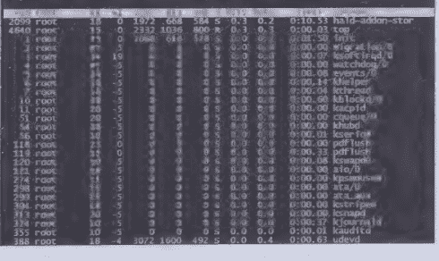

*图9-1 运行`top`命令的结果。*

图9-1中的输出显示的是系统资源的实时信息。你可以按`q`键退出`top`命令。当你熟练掌握进程操作后，就可以进行一些更高级的调整，比如修改特定进程的优先级。

假设你的系统上运行着一个自定义应用程序，你可以使用`renice`命令提升该特定进程的CPU优先级。**语法：** `renice <priority> [options]`

- `-p` PID：为特定PID的进程调整优先级
- `-u` user：为特定用户的所有进程调整优先级

优先级取值范围为`-20`（最高优先级）到`19`（最低优先级）。只有root用户可以设置低于`0`的进程优先级。

回到之前的例子，你可以通过以下命令为该应用程序提升优先级：

```shell
# renice -2 3874
```

该命令会将应用程序进程（`3874`）的优先级调整为高于默认的`0`优先级。掌握如何管理系统进程、从系统中提取信息，能帮助你成为更优秀的系统管理员，也能帮助你在红帽认证考试中更快地排查问题。下一节我们将介绍任务调度，结合刚才学过的命令，可以实现系统监控的自动化。

## 使用cron和at实现自动化

在任何操作系统中，都可以创建需要重复执行的任务。这个过程被称为任务调度，通常基于用户自定义的任务执行。在红帽系统中，该过程由`cron`服务处理，`cron`可用于调度任务（也称为作业）。默认情况下，红帽系统自带一组预定义的任务，会在系统中按固定周期执行（每小时、每天、每周、每月，以及任意周期）。但作为管理员，你可以自定义任务，也允许你的用户创建自己的任务。

**步骤1.** 虽然`cron`软件包默认已安装，但仍需检查确认你的系统上已安装该软件包：

```shell
# rpm -qa | grep cron
cronie-1.4.4-2.el6.x86_64
cronie-anacron-1.4.4-2.el6.x86_64
crontabs-1.10-32.1.el6.noarch
```

**步骤2.** 如果因某些原因尚未安装该软件包，请立即安装：

```shell
# yum install -y cronie cronie-anacron crontabs
```

**迁移提示**

在RHEL5中，`cron`软件包名为*vixie-cron*，该软件包在RHEL6中已被`cronie`替代。

**步骤3.** 验证`cron`服务当前是否正在运行：

```shell
# service crond status
crond (pid 2239) is running...
```

**步骤4.** 同时验证该服务是否已设置为系统启动时自动运行：

```shell
# chkconfig --list crond
crond 0:off 1:off 2:on 3:on 4:on 5:on 6:off
```

要开始使用`cron`，你首先需要了解用于控制`cron`服务访问权限的两个配置文件，这两个文件分别是：

- `/etc/cron.allow`
- `/etc/cron.deny`

`/etc/cron.allow`文件：

- 若该文件存在，仅允许文件中列出的用户使用`cron`服务（此时会忽略`cron.deny`文件）。
- 若该文件不存在，则除`cron.deny`文件中列出的用户外，其余所有用户都被允许使用。

`/etc/cron.deny`文件：

- 若该文件存在且内容为空，则所有用户都被允许使用（Red Hat默认配置）。

针对上述两个文件的通用规则：

- 若两个文件均不存在，则仅`root`用户可使用`cron`服务。

**考试提示**

初次接触这两个文件的规则时可能会感到困惑，你可以通过创建一些测试任务来加深理解：修改这两个文件会对`cron`服务的权限产生何种影响。

## 创建cron任务

Red Hat的默认配置允许任意用户创建`cron`任务。作为`root`用户，你还可以编辑或删除任意你希望操作的`cron`任务。接下来我们开始为系统创建`cron`任务，你可以使用`crontab`命令来创建、编辑和删除任务。

**语法：** `crontab [-u user] [option]`

**选项：**

- `-e` 编辑用户的`crontab`
- `-l` 列出用户的`crontab`
- `-r` 删除用户的`crontab`
- `-i` 删除用户的`crontab`前弹出确认提示

不过在使用`crontab`命令之前，你应该先了解它使用的格式，这样才能明白如何创建和编辑`cron`任务。每个用户在`/var/spool/cron`目录下都有专属的`crontab`文件（每个用户的文件仅在该用户创建第一条`cron`任务后才会生成），文件名称与对应用户的用户名一致。`cron`服务执行的所有“允许”类操作都会被记录到`/var/log/cron`中。查看`/etc/crontab`文件来了解其语法：

```shell
# grep ^# /etc/crontab
# For details see man 4 crontabs
# Example of job definition:
# .---------------- minute (0 - 59)
# | .------------- hour (0 - 23)
# | | .---------- day of month (1 - 31)
# | | | .------- month (1 - 12) OR jan,feb,mar,apr ...
# | | | | .---- day of week (0 - 6) (Sunday=0 or 7) OR sun,mon,tue,wed,thu,fri,sat
# | | | | |
# * * * * * command to be executed
```

该文件清楚地说明了每个字段可使用的取值范围。你必须确保为每个字段都提供对应的取值，否则`crontab`将无法创建。你也可以通过`*/<步长数值>`的格式来定义步长值。例如，在分钟字段输入`*/5`表示每5分钟执行一次。理解这些字段的最佳方式是创建一个`crontab`文件并编写一些测试任务。使用文本编辑器，在`/tmp`目录下创建以下文件。

### cron示例脚本

```shell
# nano /tmp/sample_script
#!/bin/bash
#
# Send a msg to all users on the console
#
wall "Hello World"
```

保存文件并设置以下权限：

```shell
# chmod 775 /tmp/sample_script
```

现在创建一个`cron`任务来运行该示例脚本。因为你使用的是`root`用户账号，所以你可以为普通用户`user01`创建`crontab`。

**步骤1.** 配置`user01`的`crontab`：

```shell
# crontab -u user01 -e
```

**步骤2.** 添加以下行：

```shell
* * * * * /tmp/sample_script
```

**步骤3.** 保存文件并退出编辑器。因为你在所有字段中都使用了`*`进行测试，大约60秒后你会看到脚本执行，屏幕上会显示"Hello World"。

**考试提示**

`crontab`文件使用`vi`编辑器进行修改。如果你不熟悉这个编辑器，需要注意它的输入命令和`nano`或`emacs`略有不同。请确保你掌握`vi`编辑器的使用方法，以应对Red Hat认证考试。

显然，你肯定不希望系统每60秒就弹出一次消息，但你此时应该已经明白`cron`和`crontab`的工作原理了。接下来我们列出`user01`当前已设置的任务，你应该能看到刚刚创建的那条任务（此操作仅用于验证）。

**步骤4.** 列出`user01`当前的`cron`任务：

```shell
# crontab -u user01 -l
* * * * * /tmp/sample_script
```

现在你可以再次编辑`crontab`来删除这一行，即可删除对应的单个任务，也可以直接删除该用户的整个`crontab`。

**步骤5.** 要删除用户的`crontab`任务，请使用以下命令：

```shell
# crontab -u user01 -r
```

**步骤6.** 你可以通过查看日志文件来验证不同`crontab`的活动——没错，就是查看日志文件！

```shell
# tail /var/log/cron
Sep 10 09:08:01 new-host crond[4213]: (user01) CMD (/tmp/sample_script)
Sep 10 09:08:38 new-host crontab[4220]: (root) LIST (user01)
Sep 10 09:09:01 new-host crond[4224]: (user01) CMD (/tmp/sample_script)
Sep 10 09:10:01 new-host crond[4230]: (user01) CMD (/tmp/sample_script)
Sep 10 09:11:01 new-host crond[4236]: (user01) CMD (/tmp/sample_script)
Sep 10 09:12:01 new-host crond[4242]: (user01) CMD (/tmp/sample_script)
Sep 10 09:13:01 new-host crond[4248]: (user01) CMD (/tmp/sample_script)
Sep 10 09:13:06 new-host crontab[4251]: (root) LIST (user01)
Sep 10 09:14:01 new-host crond[4253]: (user01) CMD (/tmp/sample_script)
Sep 10 09:14:15 new-host crontab[4258]: (root) DELETE (user01)
```

你可以看到`cron`服务正在执行`/tmp/sample_script`文件，也能看到你删除该任务后的相关操作。创建`crontab`和调度任务的过程对系统上的所有用户（包括`root`用户）都是相同的。

**迁移提示**

在RHEL5中，`/etc/crontab`文件被用作`root`用户的`crontab`。该`crontab`的格式与所有其他系统用户的格式不同。`/etc/crontab`文件在最后一个时间字段和命令字段之间多出一个额外的用户字段。在这个额外字段中，你必须指定希望任务以哪个用户的身份运行。以下是RHEL5系统中`/etc/crontab`文件的内容：

```shell
# cat /etc/crontab
SHELL=/bin/bash
PATH=/sbin:/bin:/usr/sbin:/usr/bin
MAILTO=root
HOME=/

# run-parts
01 * * * * root run-parts /etc/cron.hourly
02 4 * * * root run-parts /etc/cron.daily
22 4 * * 0 root run-parts /etc/cron.weekly
42 4 1 * * root run-parts /etc/cron.monthly
```

在该文件中，`root`用户被指定为运行上述命令的执行用户。这个用户字段在RHEL6中已成为可选字段。

如果你设置了在夜间运行的`cron`任务（比如运行某些报表），然后在回家前直接关机了，你觉得会发生什么呢？事实证明`cron`还有另一个很棒的功能。`/etc/anacrontab`文件定义了需要在每次系统启动时运行的任务。如果你的系统在某个`cron`任务本该运行的时间段内处于关机状态，那么系统再次启动时，`cron`服务会调用`/etc/anacrontab`文件，确保所有错过的`cron`任务都会被运行。接下来我们查看`/etc/anacrontab`文件。


# 使用`anacron`执行一次性任务

```bash
# cat anacrontab
SHELL=/bin/sh
PATH=/sbin:/bin:/usr/sbin:/usr/bin
MAILTO=root
# the maximal random delay added to the base delay of the jobs
RANDOM_DELAY=45
# the jobs will be started during the following hours only
START_HOURS_RANGE=3-22
#period in days delay in minutes job-identifier command
1 5 cron.daily nice run-parts /etc/cron.daily
7 25 cron.weekly nice run-parts /etc/cron.weekly
@monthly 45 cron.monthly nice run-parts /etc/cron.monthly
```

该文件中的注释让你很容易理解任务的定义方式。如果你的系统一直处于开机状态，不需要运行`anacron`，你可以卸载`cronie-anacron`软件包，该包仅负责控制`cron`服务的`anacron`相关命令。

## 迁移提示

在RHEL5中，`anacron`是与`cron`独立的服务。系统启动时会单独调用`anacron`服务，同样会运行`/etc/anacrontab`文件。该文件的格式和RHEL6版本类似，只是没有注释：

```bash
# cat anacrontab
SHELL=/bin/sh
PATH=/sbin:/bin:/usr/sbin:/usr/bin
MAILTO=root
1 65 cron.daily run-parts /etc/cron.daily
7 70 cron.weekly run-parts /etc/cron.weekly
30 75 cron.monthly run-parts /etc/cron.monthly
```

### 迁移提示

在RHEL5中，你还需要禁用SELinux保护，才能使`cron`服务正常运行。尽管我们尚未讲解SELinux，你可以按照以下步骤完成配置：

### 步骤1. 查询所需的布尔值：

```bash
# getsebool -a | grep crond
crond_disable_trans --> off
```

### 步骤2. 修改参数以允许接收传入日志：

```bash
# setsebool -P crond_disable_trans=1
```

### 步骤3. 验证上述布尔值已修改完成：

```bash
# getsebool -a | grep crond
crond_disable_trans --> on
```

对于RHEL5，你需要确保该服务被设置为系统启动时自动运行，才能生效：

```bash
# chkconfig anacron --list
anacron 0:off 1:off 2:on 3:on 4:on 5:on 6:off
```

## 使用`at`执行单次任务

虽然你可以使用`cron`服务调度需要重复执行的定时任务，但针对仅需执行一次的任务，可以使用名为`atd`的服务。

### 步骤1. 和之前接触过的所有服务一样，你需要先确认对应软件包已安装：

```bash
# rpm -qa | grep ^at
at-3.1.10-42.el6.x86_64
```

### 步骤2. 检查该服务当前是否处于运行状态：

```bash
# service atd status
atd (pid 2300) is running...
```

### 步骤3. 最后，验证该服务已设置为系统启动时自动启动：

```bash
# chkconfig --list atd
atd 0:off 1:off 2:on 3:on 4:on 5:on 6:off
```

`atd`服务使用两个文件来控制服务访问权限，方式和`cron`服务一致。这两个文件分别是`/etc/at.allow`和`/etc/at.deny`。

### `/etc/at.allow`文件：

- 若该文件存在，仅允许列表内的用户访问（此时会忽略`at.deny`文件）。

- 若该文件不存在，除`at.deny`文件中列出的用户外，其余所有用户都允许使用该服务。

### `/etc/at.deny`文件：

- 若该文件存在且内容为空，则所有用户都允许访问（这是Red Hat的默认配置）。

### 两个文件的通用规则：

- 若两个文件都不存在，则仅允许`root`用户访问。

`atd`服务还包含一个`at`命令，用于配置你要执行的任务，语法为：`at [options]`

## 选项

| 选项 | 说明 |
|------|------|
| `-l` | 列出队列中的所有任务 |
| `-d ID` | 从队列中删除指定ID的任务 |
| `-m` | 任务执行完成后向用户发送邮件 |
| `-f FILE` | 从指定文件中读取输入内容作为任务命令 |
| `-v` | 显示任务的计划执行时间 |

`at`命令支持多种不同的时间格式，灵活度极高。下面我们来看几个可用的时间格式示例：

```bash
# at 9am
# at now + 3 days
# at 1:30 3/22/10
```

指定时间后，你的命令行提示符会发生变化：

```bash
# at 10:07am
at>
```

现在你只需要输入需要在指定时间执行的任意命令即可。按下`Ctrl+D`键即可结束命令输入，将任务添加到队列中：

```bash
# at 10:07am
at> wall "Hello World"
at> <EOT>
```

任务已加入队列后，我们来看看存储该任务的文件内容。

### 步骤1. 查询`/var/spool/at`目录下的任务文件：

```bash
# ls /var/spool/at
a0000010147997f7 spool
```

和`cron`服务不同，`at`任务的名称没有实际含义。与其查看存储`at`任务的目录，你可能会觉得像查看`cron`服务那样列出等待执行的任务更加简便。

### 步骤2. 使用`at`命令查看当前队列中的任务：

```bash
# at -l
1  2010-10-27 10:07 a root
```

### 步骤3. 你也可以使用`atq`命令获得完全相同的结果：

```bash
# atq
1  2010-10-27 10:07 a root
```

你可以看到队列中当前有一条由`root`用户提交的任务，将在上午10:07执行。如果不想手动输入要执行的所有命令，你也可以使用`-f`选项指定一个包含希望执行的命令列表的文件：

```bash
# at -f cmds_file 11pm
```

将任务加入队列时，请注意每个任务都会被分配一个唯一的ID号。如果你想从队列中删除某个任务，这个信息非常重要。

### 步骤4. 向队列中添加一个临时任务：

```bash
# cd ~
# touch test_job && chmod 775 test_job
# at -f test_job 11pm
```

### 步骤5. 验证任务已成功加入队列：

```bash
# atq
1  2010-12-04 23:00 a root
```

### 步骤6. 从队列中删除该任务：

```bash
# at -d 1
```

### 步骤7. 你也可以使用`atrm`命令获得相同的结果：

```bash
# atrm 1
```

### 步骤8. 验证任务已被彻底删除：

```bash
# atq
```

现在你应该已经掌握了如何调度单次任务和重复任务。任务管理对于确保系统平稳运行非常重要，在你自动化日常任务时也能提供很大帮助，无需你每天手动执行。

## 总结

在排查系统故障时，掌握日志处理方法以及信息查找位置至关重要。集中式`syslog`服务器可以从多个维度简化日志的收集与管理流程。你也可以使用`ps`、`top`等工具排查系统可能出现的资源问题。本章我们介绍了`cron`和`atd`两个服务，它们都可用于任务调度。借助这些工具，你可以定位已出现的问题，同时也能发现重复性问题的规律。下一章我们将介绍Red Hat操作系统的核心——内核。

## 复习题

1. 要在`rsyslog`配置文件中修改哪个选项才能接收远程日志（作为集中式日志服务器）？

2. 哪两个命令专门用于处理用户登录相关事件？

3. 哪两个命令可以用来查看系统的可用存储空间？

4. 哪个命令可以用来查看系统进程及其CPU占用率？

5. `at`命令用于调度重复性系统任务。判断对错：

6. 系统关机期间计划执行的任务会如何处理？

7. 哪个命令可以用来查看`at`服务的任务队列？

8. `top`命令的作用是什么？

## 复习题答案

1. 在`/etc/rsyslog.conf`文件中取消以下行的注释：

```bash
#$ModLoad imudp.so
#$UDPServerRun 514
```

2. `lastlog`和`faillog`命令用于查看用户登录相关事件。

3. `du`和`df`命令用于查看系统的可用存储空间。

4. 使用`ps`命令查看系统进程及其CPU占用率。

5. 错误。`at`命令仅用于调度执行一次的任务，重复性系统任务由`cron`服务处理。

6. 系统重新启动后，`cron`服务会运行系统关机期间未执行的任务。在Red Hat Enterprise Linux 5中，该功能由`anacron`服务实现。

7. `atq`

8. 使用`top`命令查看CPU和内存占用情况。

## 实验9

### 任务1 – 集中式日志配置

步骤1. 按照以下要求在RHEL02上搭建集中式日志服务器：

- a. 服务器必须接收172.168.1.0/24子网内所有客户端发送的日志。
- b. 所有安全日志应保留在生成它们的本地系统上。
- c. 仅将`/var/log/messages`和`/var/log/dmesg`的日志转发到集中式服务器。

步骤2. 配置实验中的每台服务器或客户端系统，将对应日志转发到RHEL02。当所有日志配置正确、集中式日志服务器（RHEL02）成功收集到正确的日志时，任务完成。

### 任务2 – 系统监控

**步骤1.** 在RHEL01上按照以下要求创建BASH脚本：

**a.** 脚本必须将`ps aux`命令的输出结果写入`/opt`目录下名为`system_mon`的文件中。

**b.** 脚本必须将系统的可用内存总量输出到`/opt`目录下名为`system_mon`的文件中。

**c.** 脚本必须将当前日期追加到`system_mon`文件中。

当脚本将必要信息正确写入指定文件，且文件名符合要求时，任务完成。

### 任务3 – 任务调度

在RHEL01上执行以下任务：

- **步骤1.** 配置一个`cron`任务，每天中午执行任务2中创建的脚本。
- **步骤2.** 创建一个10分钟后执行的单次任务，将当前日期和时间输出给所有已登录系统的用户。

当所有任务均已成功调度且执行成功时，任务完成。

### 本章涵盖以下主题：

- **内核基础**——本节介绍内核的基础知识。
- **更新内核**——本节介绍更新内核的不同方法。
- **使用 /proc/sys 调优内核**——本节介绍通过调整内核提升系统性能的方法。

## 涵盖以下 RHCSA 考试目标：

- 适当更新内核软件包，确保系统可启动

## 涵盖以下 RHCE 考试目标：

- 使用 /proc/sys 和 sysctl 修改并设置内核运行时参数

# 内核

Red Hat 的核心是 Linux 内核。内核负责与硬件交互，并向屏幕输出内容。还会在`/proc`目录下创建一个虚拟文件系统，用于存储内核的信息和参数。在本章中，我们将介绍内核的基础知识、更新内核的方法，以及使用`/proc`文件系统调优内核的方法。尽管本书的重点是 Red Hat 及相关认证考试，但本章的所有内容同样适用于其他版本的 Linux 操作系统。

## 内核基础

严格来说，Linux 本身仅仅是内核。如今的 Red Hat 及其他发行版，都是将软件和配置文件与 Linux 内核打包，从而提供完整的操作系统（不过我们仍会将任何发行版统称为 Linux）。由于内核才是真正运行所有组件的核心，理解其运作原理至关重要。内核可用于加载新驱动、支持新硬件，甚至可以根据个人需求提供定制内核。Linux 内核是模块化的，因此你可以在系统启动后仍加载或卸载内核模块。在本章中，我们将介绍四个与内核相关的实用命令：

- `uname`：显示内核相关信息
- `lsmod`：列出当前已加载的内核模块
- `modinfo`：显示指定内核模块的信息
- `sysctl`：用于调优内核参数

我们首先从`uname`命令开始，了解一些内核相关信息。

**语法：**`uname [option]`

**选项：**

- `-a`：打印所有与内核相关的信息
- `-s`：显示内核名称
- `-r`：获取内核发行版本信息
- `-v`：获取内核版本信息

我们来查看当前运行的内核版本：

```bash
# uname -a
Linux RHEL01 2.6.32-71.el6.x86_64 #1 SMP Wed Sep 1 01:33:01 EDT 2010 x86_64 x86_64 x86_64 GNU/Linux
```

此处内核版本号的格式很重要（`2.6.32-71.el6`）：第一个数字是内核的主版本号；第二个数字是对应主版本号的次要发行版本号，如果该数字为偶数（本例中为 6），则代表这是内核的稳定发行版，奇数则是开发版内核，不应用于生产系统；第三个数字是内核的补丁版本号；最后一个数字（71）是 Red Hat 添加的标识，代表该内核的 Red Hat 发行版本。另外注意`el6`，它表示你正在运行的是 Red Hat Enterprise Linux 6。如果你还没注意到，当前系统是 64 位版本的操作系统（由`x86_64`标识）。

**实战提示** 尽管我们提到内核稳定性时会用奇偶版本号区分，但这些信息更多是出于历史用途。如今所有内核都统称为 2.6 内核或更高版本。你也可以通过软件包管理器获取当前已安装内核的版本：

```bash
# rpm -qa | grep kernel
kernel-2.6.32-71.el6.x86_64
```

你也可以使用以下命令：

```bash
# rpm -q kernel
```

操作内核时，你需要熟悉不同的相关路径，接下来介绍其中四个：

- `/boot`：存储内核和启动文件的目录
- `/proc`：当前硬件配置和状态信息目录
- `/usr/src`：内核源码目录
- `/lib/modules`：内核模块存储目录

如你在第 2 章《系统初始化》中所见，内核也用于启动操作系统。由于内核是模块化的，了解当前正在使用的模块以及如何查看这些模块非常重要。你可以使用`lsmod`命令查看当前已加载的模块。

语法：`lsmod`

要查看系统启动后内核当前加载的所有模块，可使用以下命令：

```bash
# lsmod
Module                  Size  Used by
autofs4                29253  3
hidp                   23105  2
rfcomm                 42457  0
l2cap                  29505  10 hidp,rfcomm
ext4                   353979  2
[output truncated]
```

以上输出因篇幅限制被截断。拿到这份模块列表后，你可以使用`modinfo`命令进一步探究特定模块的作用。

查看前面列出的`ext4`内核模块的详细信息：

```bash
# modinfo ext4
filename:       /lib/modules/2.6.32-71.el6.x86_64/kernel/fs/ext4/ext4.ko
license:        GPL
description:    Fourth Extended Filesystem
author:         Remy Card, Stephen Tweedie, Andrew Morton, Andreas Dilger, Theodore T'so and others
srcversion:     8689F457D14068A36A86631
depends:        mbcache,jbd2
vermagic:       2.6.32-71.el6.x86_64 SMP mod_unload modversions
```

虽然备考 Red Hat 认证考试不需要你掌握内核的复杂原理或任何硬件相关知识，但了解如何查找这些信息非常重要。定位问题、知道该从哪入手是故障排查工作的一半。接下来我们介绍更新内核的方法。

## 更新内核

我们都知道及时对系统进行补丁更新有多重要：这能防止恶意人员入侵系统搞破坏，更不用提还能避免老板对我们大发雷霆！在 Red Hat 系统中更新内核软件包非常简单。

步骤 1：查看当前内核版本：

```bash
# uname -r
2.6.32-71.el6.x86_64
```

如你在第 6 章《软件包管理》中所学，你可以使用`yum`命令查询软件仓库中软件包的相关信息。从前面的输出中你已经知道，当前 Red Hat Enterprise Linux 6 使用的是 71 版内核，接下来你可以查看`yum`命令能提供软件仓库中最新内核软件包的哪些信息。

步骤 2：要查看内核软件包信息，使用以下命令：


# 使用 `yum` 命令查看内核信息

在终端中执行以下命令查看内核信息：

```
# yum info kernel
Loaded plugins: rhnplugin
This system is not registered with RHN. RHN support will be disabled.
Installed Packages
Name : kernel
Arch : x86_64
Version : 2.6.32
Release : 71.el6
Size : 112 M
Repo : installed
From repo : anaconda-RedHatEnterpriseLinux-201009221801.x86_64
Summary : The Linux kernel
URL : http://www.kernel.org/
License : GPLv2
Description: The kernel package contains the Linux kernel (vmlinux), the core of any
: Linux operating system. The kernel handles the basic functions
: of the operating system: memory allocation, process allocation, device
: input and output, etc.
```

因为你目前使用的是 Red Hat Enterprise Linux 6，所以你的内核已经是最新版本。但如果你还在用 Red Hat Enterprise Linux 5 呢？接下来我们在使用 RHEL5 的 Client01 系统上查看它的内核版本。

## 步骤 1：在 Client01 上查询内核版本

在 Client01 上，通过软件包管理器查询内核版本：

```
# yum info kernel
Loaded plugins: fastestmirror
Loading mirror speeds from cached hostfile
* addons: mirrors.xmission.com
* base: ftp.osuosl.org
* extras: ftp.usf.edu
* updates: mirror.sanctuaryhost.com
Installed Packages
Name : kernel
Arch : i686
Version : 2.6.18
Release : 164.el5
Size : 41 M
Repo : installed
Summary : The Linux kernel (the core of the Linux operating system)
URL : http://www.kernel.org/
License : GPLv2
Description : The kernel package contains the Linux kernel (vmlinuz), the core of any
: Linux operating system. The kernel handles the basic functions
: of the operating system: memory allocation, process allocation, device
: input and output, etc.
Available Packages
Name : kernel
Arch : i686
Version : 2.6.18
Release : 194.11.3.el5
Size : 17 M
Repo : updates
Summary : The Linux kernel (the core of the Linux operating system)
URL : http://www.kernel.org/
License : GPLv2
Description : The kernel package contains the Linux kernel (vmlinuz), the core of any
: Linux operating system. The kernel handles the basic functions
: of the operating system: memory allocation, process allocation, device
: input and output, etc.
```

你首先要注意到，输出中多出了一部分内容，会与当前已安装的软件包并列显示可升级的软件包。输出的前半部分显示已安装的软件包，后半部分显示可供升级的内核软件包。由于你当前使用的是 164.el5 版本，而最新版本为 194.11.3.el5，因此你需要升级内核。

## 步骤 2：升级内核

使用软件包管理器，你可以将内核升级到最新版本：

```
# yum update -y kernel
Loaded plugins: fastestmirror
Loading mirror speeds from cached hostfile
* addons: mirrors.xmission.com
* base: ftp.osuosl.org
* extras: centos-distro.cavecreek.net
* updates: mirror.sanctuaryhost.com
Setting up Update Process
Resolving Dependencies
```

```shell
--> Running transaction check
---> Package kernel.i686 0:2.6.18-194.11.3.el5 set to be installed
--> Finished Dependency Resolution

Dependencies Resolved

==============================================================================
 Package           Arch     Version                        Repository   Size
==============================================================================
Installing:
 kernel            i686     2.6.18-194.11.3.el5            updates      17 M

Transaction Summary
==============================================================================
Install  1 Package(s)
Update   0 Package(s)
Remove   0 Package(s)

Total download size: 17 M
Downloading Packages:
kernel-2.6.18-194.11.3.el5.i686.rpm | 17 MB     00:18
Running rpm_check_debug
Running Transaction Test
Finished Transaction Test
Transaction Test Succeeded
Running Transaction
  Installing : kernel 1/1
Installed: kernel.i686 0:2.6.18-194.11.3.el5
Complete!
```

现在你的 Client01 上应该已经有了最新版本的内核。通过使用 `yum` 命令来更新内核，你拉取的只是 Red Hat 通过软件仓库提供的最新版本。这并不意味着这是目前可用的最新版 Linux 内核。如果你访问 http://www.kernel.org，可以找到最新的可用内核。你应该以一种自己熟悉的方式下载它（该网站提供 `.tar`、`.gz`、`.rpm` 等格式）。如果你打算使用 `.rpm` 文件，记住你可以使用 `rpm` 命令来简化安装。例如，我为 Client01 系统从 Red Hat 下载了最新版本内核的 `.rpm` 文件。你也可以不使用软件包管理器从仓库安装内核，而是执行以下操作：

```shell
# rpm -ivh kernel-2.6.18-194.3.1.el5
```

### 警告
使用 `rpm` 命令更新内核时，切勿使用 `-U` 选项来更新。原因在于更新选项在更新时会删除旧内核，而 `-i` 选项则会将新内核与旧内核一起安装。如果出现任何问题或故障，你还可以回退到旧内核。我已经警告过你了！

无论你使用哪种方法，当内核更新完成后，你应该验证 `/boot/grub/grub.conf` 是否已更新，其中是否包含更新后内核的条目，并且是否设置为从该内核启动。通过软件包管理器更新内核时，这应该会自动完成；但是，我建议你始终自行验证这一点（否则，你的系统可能会启动异常）。由于 RHEL01 上的内核没有变化（因为它已经是最新的），请查看 Client01 上的 `grub.conf` 文件，因为你确实在那里更新了内核：

```shell
# cat /boot/grub/grub.conf
# grub.conf generated by anaconda
#
# Note that you do not have to rerun grub after making changes to this file
# NOTICE: You have a /boot partition. This means that
# all kernel and initrd paths are relative to /boot/, eg.
# root (hd0,0)
# kernel /vmlinuz-version ro root=/dev/VolGroup00/LogVol00
# initrd /initrd-version.img
#boot=/dev/hda
default=0
timeout=5
splashimage=(hd0,0)/grub/splash.xpm.gz
hiddenmenu
title CentOS (2.6.18-194.11.3.el5)
    root (hd0,0)
    kernel /vmlinuz-2.6.18-194.11.3.el5 ro root=/dev/VolGroup00/LogVol00
    initrd /initrd-2.6.18-194.11.3.el5.img
title CentOS (2.6.18-164.el5)
    root (hd0,0)
    kernel /vmlinuz-2.6.18-164.el5 ro root=/dev/VolGroup00/LogVol00
    initrd /initrd-2.6.18-164.el5.img
```

你可以看到第一个条目是新更新的内核，默认选项设置为 0，确保你在下次启动系统时加载更新后的内核。重启你的系统以使用新内核，并检查使用新内核启动时是否有任何错误或问题。如果你遇到任何问题，可以再次重启并在 GRUB 启动菜单中选择旧内核来解决你遇到的问题。

到目前为止，你应该已经能够自如地在 Red Hat 系统上更新和升级内核了。虽然可以构建完全自定义的内核，但这是一项非常庞大的工程，需要大量关于 Linux 内核内部机制的知识。我们不在这里讨论这个话题，因为自定义内核编译不属于 Red Hat 考试的内容；不过，有很多关于这个主题的优秀书籍。我们要讨论的最后一个话题是通过 `/proc/sys` 文件系统来修改内核。

## 使用 `/proc/sys` 调优内核

Linux 的一大优势在于它能在开箱即用的情况下支持多种不同类型的硬件。虽然这是 Linux 的一个优秀特性，但它也要求 Red Hat 等不同发行版的开发者对其操作系统版本进行通用化设置。这种通用化在大多数情况下是没问题的，但那些想要获得额外处理能力和更好性能的用户应该调优他们的内核。内核有一个虚拟文件系统 `/proc/sys`，允许你在系统运行时调优内核。内核在系统启动时创建 `/proc/sys` 虚拟文件系统，其中保存着内核的所有参数。这个虚拟文件系统随后被用于出于测试目的操纵内核参数（这些更改在系统重启之前有效）。当你按照自己的意愿调优好内核后，你可以简单地在系统启动时应用你的设置（通过一个特殊的配置文件），或者你可以编译自己的内核将这些设置永久嵌入。在测试内核更改时，确保你不要依赖在 `/proc/sys` 文件系统中所做的任何设置，因为它们在系统重启时会被清除。在测试期间，你可以使用 `echo` 命令在系统运行时更改内核的值。

让我们看一个示例，展示如何允许系统临时转发数据包。

### 步骤 1

查看内核中的当前值：

```shell
# cat /proc/sys/net/ipv4/ip_forward
0
```

### 步骤 2

更改控制数据包转发的内核选项：

```shell
# echo 1 > /proc/sys/net/ipv4/ip_forward
```

### 步骤 3

验证值是否已更改：

```shell
# cat /proc/sys/net/ipv4/ip_forward
1
```

如果你想让更改在系统重启后仍然生效，可以将你希望在启动期间保持的参数放入 `/etc/sysctl.conf` 文件中。这个文件通过 `sysctl` 命令来操作，你也可以使用该命令来调优内核。

**语法：** `sysctl [options]`

**选项：**
- `-e` 忽略错误
- `-w` 允许你更改 `/etc/sysctl.conf` 文件中的设置
- `-p` 从 `/etc/sysctl.conf` 文件加载设置
- `-a` 显示当前所有可用的设置

### 实用提示

`/etc/sysctl.conf` 文件和 `sysctl` 命令仅负责 `/proc/sys` 目录下的值。虚拟文件系统中还有其他位于 `/proc` 根目录下的区域。

在你开始调优之前，让我们先看看所有可用的选项：

```shell
# sysctl -a
```

你可能注意到我省略了这个命令的输出。你可以对这个命令稍作修改后再次运行：

```shell
# sysctl -a | wc -l
551
```

这里的输出显示 `/proc/sys` 文件系统中有 551 个不同的选项可供调优（这就是我省略输出的原因）。你可以将这些选项输出到一个文件中，以便稍后查看和了解每个选项的作用。现在，让我们像之前一样对内核做相同的更改。

### 步骤 1

查询内核中负责转发数据包的参数：

```shell
# sysctl -a | grep ip_forward
net.ipv4.ip_forward = 0
```

### 步骤 2

使用 `sysctl` 命令更改选项：

```shell
# sysctl -w net.ipv4.ip_forward=1
net.ipv4.ip_forward = 1
```

注意参数、等号或值之间没有空格。

### 步骤 3

验证值是否已更改：

```shell
# sysctl -a | grep ip_forward
net.ipv4.ip_forward = 1
```

你可以看到值确实已经更改。由于你不应该在当前修改系统设置，你可以将值改回去或重启系统以恢复原始值。

### 步骤 4

将参数恢复为原始值：

```shell
# sysctl -w net.ipv4.ip_forward=0
net.ipv4.ip_forward = 0
```


除了在`/etc/sysctl.conf`文件中添加不同的选项之外，另一种方法是编译自定义内核。这会将所有自定义参数永久嵌入内核中，这样就不需要在启动时自动设置。你还可以移除未使用的选项，从而提升系统性能。编译内核不是一项简单的任务，也不属于 Red Hat 考试的内容。不过，如果你感兴趣，有很多优秀的书籍和在线文档可供参考。

## 总结

虽然自定义和编译内核不太可能出现在 Red Hat 考试中，但你应该熟练掌握更新内核并确保系统在重启后正常运行。你还应该能够通过`/proc/sys`文件系统调优内核参数。如果你发现自己在寻找更好的性能或想要学习更多关于内核的高级用法，我建议你在实验系统上自己编译一个内核。只需记住，这不是一项简单的任务，需要花时间才能做好。

## 复习问题

1. 使用`rpm`命令更新内核时，`update`（`-U`）和`install`（`-i`）选项有什么区别？
2. 内核创建的虚拟文件系统用哪个目录表示？
3. 系统启动时用于维护内核自定义参数的文件是什么？
4. 将内核更新到新版本后，必须执行的关键步骤是什么？

## 复习问题答案

1. 绝对不要使用`-U`选项，因为它在更新内核时会删除旧版本内核。如果系统无法正常启动，你将没有可回退的内核版本。
2. `/proc`目录。`/proc/sys`目录是实际调整内核参数的位置。
3. `/etc/sysctl.conf`文件维护了系统启动时应应用的内核自定义参数列表。
4. 必须确保`/boot/grub/grub.conf`文件中存在新更新内核的启动项，这样才能从该内核启动。

## 实验10

### 任务1 – 更新内核

- 步骤1：使用`yum`命令，将RHEL02上的内核更新到最新版本。
- 步骤2：使用`yum`命令，将Client01上的内核更新到最新版本。当RHEL02和Client01都安装了最新内核且能够正常完成系统重启后，任务完成。

### 任务2 – 内核调优

- 步骤1：调整以下内核参数：
  - a. 输出`/proc/sys/fs/file-max`的内容，并将其值增大100。当所有参数修改均可验证且系统重启后修改仍然生效时，任务完成。


## 本章涵盖以下主题

- 理解SELinux——本节将介绍SELinux的工作原理及配置方法。
- SELinux故障排查——本节将介绍SELinux的故障排查方法。

## 涵盖以下RHCSA考试目标

- 设置SELinux的强制（`enforcing`）与宽容（`permissive`）模式
- 列出并识别SELinux及文件进程的上下文
- 恢复默认文件上下文
- 使用布尔值设置修改系统SELinux配置
- 诊断并处理常规SELinux策略违规问题

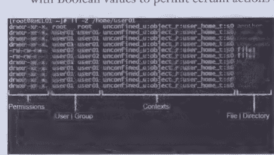

# SELinux

安全增强型Linux（SELinux）是Linux操作系统的另一层安全防护机制，由美国国家安全局（NSA）开发，它为不同类型的文件、应用程序、进程等提供了额外的保护。许多刚接触Linux的用户倾向于关闭SELinux，因为它是一个复杂的系统，需要花费大量时间和精力才能熟练掌握。不过，你无须关闭它，可以将SELinux设置为"宽容模式"，该模式下所有功能都能正常运行，仅会对原本会被阻止的操作或命令记录警告日志。运行在此模式下有利于故障排查，也能帮助你理解SELinux的工作机制。但红帽认证考试要求你掌握在SELinux开启且处于强制模式下的操作，因此你需要学会排查并解决相关问题。

## 理解SELinux

如前所述，SELinux可能相当复杂。我们先从SELinux的基础知识开始了解。它共有三种运行模式：

- `disabled`（禁用）：SELinux处于关闭状态，不会限制任何操作。
- `permissive`（宽容）：SELinux处于开启状态，仅在操作原本会被阻止时记录警告日志。
- `enforcing`（强制）：SELinux处于开启状态，会阻止与服务相关的违规操作。

除这三种模式外，还有大量可用于管理SELinux的命令：

- `sestatus`：显示SELinux的当前状态
- `getenforce`：显示SELinux的强制模式状态
- `setenforce`：更改SELinux的强制模式状态
- `getsebool`：返回服务选项的布尔值
- `setsebool`：设置服务选项的布尔值
- `chcon`：更改文件、目录或服务的上下文
- `restorecon`：重置对象的上下文

在开始使用命令前，你应该先深入了解SELinux的构成。系统中的每个文件、目录和服务都有一个用于限制或允许操作的上下文（见图11-1）。SELinux会结合这些上下文和布尔值，来判断是否允许特定操作或服务运行。

### `sestatus`命令

语法：`sestatus [options]`

选项：

- `-b`：显示所有布尔值及其状态
- `-v`：提供详细输出

查看SELinux的当前状态：

```shell
# sestatus

SELinux status: enabled

SELinuxfs mount: /selinux

Current mode: enforcing

Mode from config file: enforcing

Policy version: 21

Policy from config file: targeted
```

你还可以使用`getenforce`命令以另一种方式查看状态：

```shell
# getenforce

Enforcing
```

系统初次安装时，SELinux默认设置为强制模式，RHEL6中也采用该默认设置。由于你目前处于实验环境，我建议将Client01和Client02上的SELinux设置为宽容模式，RHEL01和RHEL02则保持强制模式。如果遇到疑似由SELinux引发的问题，你可以通过两种不同的系统环境进行故障排查。红帽认证考试要求你在SELinux开启且处于强制模式下进行操作，因此你需要掌握排查并解决相关问题的能力。

## 配置SELinux

你可以通过修改配置文件来更改SELinux的运行模式，主配置文件为`/etc/selinux/config`。

查看`/etc/selinux/config`文件的当前内容：

```shell
# cat /etc/selinux/config

# This file controls the state of SELinux on the system.

# SELINUX= can take one of these three values:

#  enforcing - SELinux security policy is enforced.

#  permissive - SELinux prints warnings instead of enforcing.

#  disabled - SELinux is fully disabled.

SELINUX=enforcing

# SELINUXTYPE= type of policy in use. Possible values are:

#  targeted - Only targeted network daemons are protected.

#  strict - Full SELinux protection.

SELINUXTYPE=targeted
```

你可以看到文件中注释部分列出了三种SELinux模式，当前模式为强制模式。你可以随时更改SELinux的运行模式，但需要重启系统才能使更改生效。更改SELinux运行模式并重启系统后，SELinux会重新标记文件系统以更改文件的上下文。该过程的耗时取决于硬盘大小和文件数量，因此建议提前规划好要运行的SELinux模式。

除编辑配置文件外，你还可以使用`setenforce`命令更改SELinux状态。语法：`setenforce [ Enforcing | Permissive | 1 | 0 ]`

如果当前模式为宽容模式，你可以通过以下命令将其更改为强制模式：

```shell
# setenforce enforcing
```

无论你使用哪种方法更改SELinux的运行模式，都需要重启系统。现在你已经了解了如何查看和更改SELinux的运行模式，接下来我们介绍文件上下文。

### 文件上下文

SELinux使用三种不同的上下文来实施安全防护：用户（`user`）、角色（`role`）和域（`domain`，也称为类型`type`）。RHEL6新增了第四种上下文，称为级别（`level`），该级别代表文件或目录的敏感等级。这些上下文还可以进一步扩展，为每个上下文定义具体的值。

#### 用户（User）

- `unconfined_u` — 无保护的用户
- `system_u` — 系统用户
- `user_u` — 普通用户

#### 角色（Role）

- `object_r` — 文件
- `system_r` — 用户和进程

#### 域（Domain）

- `unconfined_r` — 无保护的文件或进程

> **注意：** 此处列出的域部分中，`unconfined_r`只是可使用的上下文类型之一。还可以使用限制性更强的值，但`unconfined_r`是最通用的类型，因此此处仅列出该类型。

每个文件、文件夹和服务都关联有一个包含全部三种上下文的标签。本节将以系统默认安装的SSH服务为例进行说明。你可以使用第9章"系统日志、监控与自动化"中介绍的`ps`命令查看服务关联的标签。

查看SSH服务关联的SELinux标签：

```shell
# ps -Zc sshd

LABEL                           PID TTY          TIME CMD

system_u:system_r:sshd_t:s0-s0:c0.c1023 1421 ?        00:00:00 sshd

system_u:system_r:sshd_t:s0-s0:c0.c1023 4977 ?        00:00:00 sshd

system_u:system_r:sshd_t:s0-s0:c0.c1023 4982 ?        00:00:00 sshd
```

你看到的第一列是`system_u`，对照前面的上下文说明可知这是系统用户；第二列是`system_r`，同样对照说明可知它代表用户，此处对应进程；第三列显示域为`unconfined_t`，暂时可以忽略第四列。我们再进一步了解域上下文：域本质上是一种分类方式，用于界定哪些上下文之间可以相互通信。通过另一个示例可以帮助你更清楚地理解这一点。

查看SSH服务主配置文件的标签：

```shell
# ll -Z /etc/ssh/sshd_config
```

```shell
-rw-------. root root system_u:object_r:etc_t:s0 /etc/ssh/sshd_config
```

查看这个标签可以看到，用户是`system_u`（系统用户），角色是`object_r`（文件），域是`etc_t`。任何拥有`etc_t`域访问权限的服务都能访问这个文件。除了root用户之外，系统服务通常是唯一能够访问`/etc`目录的主体，因此配置为`etc_t`域是合理的。

### 实际应用提示

在RHEL 5中，SSH配置文件的域是`unconfined_t`，而SSH服务的域是`etc_t`。你可能会疑惑，为什么SSH服务即使处于另一个域（`unconfined_t`）也能访问该文件？原因是`unconfined_t`域没有访问限制，任何主体都可以访问它。到了RHEL 6，大量服务及其配置文件的标签都发生了变化。

> 尽管你还没有安装Web服务器（相关内容在第14章"Web服务"中），但上下文（`context`）在搭建网站时非常重要：如果网站的上下文不正确，Web服务器将无法访问它。

要修改文件或目录的上下文，可以使用`chcon`命令。语法：`chcon [options] CONTEXT FILE`

选项：

- `-f` 抑制错误消息
- `-u` 设置用户上下文
- `-r` 设置角色上下文
- `-t` 设置类型上下文（域）
- `-R` 递归修改
- `-v` 输出详细日志

我们来看一个示例。

### 步骤1. 将用户上下文从普通用户改为系统用户：

```shell
# cd ~

# touch myfile

# ls -Z myfile

-rw-r--r--. root root unconfined_u:object_r:admin_home_t:s0 myfile
```

### 步骤2. 现在修改上下文：

```shell
# chcon -vu system_u myfile

context of myfile changed to system_u:object_r:user_home_t
```

### 步骤3. 验证修改是否生效：

```shell
# ls -Z myfile

-rw-r--r--. root root system_u:object_r:admin_home_t:s0 myfile
```

### 实际应用提示

使用`chcon`命令有一个实用技巧：可以引用其他文件的上下文。当你使用SELinux为网站做安全管控时，这个功能非常有用。你可以搭建一个用作模板的示例站点，例如`/var/www/html/default_site`。当你创建新的客户站点时，可以使用`chcon`命令引用模板站点，从而应用正确的上下文：

```shell
# chcon -vR --reference /var/www/html/default_site /var/www/html/customer_site
```

如果修改出错，或者只想将文件/目录的上下文重置为初始值，可以使用`restorecon`命令。语法：`restorecon [options]`

选项：

- `-i` 忽略不存在的文件
- `-p` 显示修改进度
- `-v` 实时显示变更内容
- `-F` 重置上下文

### 步骤4. 将文件的上下文重置回初始值：

```shell
# restorecon -F myfile
```

### 步骤5. 验证变更是否已正确生效：

```shell
# ls -Z myfile

-rw-r--r--. root root root:object_r:admin_home_t:s0 myfile
```

你可能已经注意到，用户上下文没有回到`user_u`，而是被设置为了`root`。这是root用户的正常行为，但如果你对非root用户拥有的文件执行此操作，上下文会被重置为`user_u`。上述内容乍看可能比较难理解，但完成相关实验可以帮助你消除疑惑。创建SELinux策略是高级主题，本书和红帽认证考试都不会涉及相关内容，但掌握上下文的使用方法以及问题排查能力是明确要求具备的技能。

## 服务与布尔选项

我们已经了解了文件和目录相关的上下文，接下来来看与服务关联的布尔选项。每个服务都通过一组布尔值选项控制特定操作（布尔值只有"开"和"关"两种状态）。本节将介绍如何处理服务的布尔选项，这是红帽认证考试中最重要的部分，因为它涵盖了如何为不同服务启用访问权限。

要查看这些布尔选项，可以使用`getsebool`命令结合`grep`命令筛选特定选项。语法：`getsebool [-a | boolean]`

尽管你尚未安装Web服务器，我们仍然以它为例查看相关布尔选项。原因是`httpd`（Apache）的选项非常多，非常适合作为演示案例。查询`httpd`服务（Apache）的可用布尔选项：

```shell
# getsebool -a | grep http

allow_httpd_anon_write --> off

allow_httpd_mod_auth_ntlm_winbind --> off

allow_httpd_mod_auth_pam --> off

allow_httpd_sys_script_anon_write --> off

httpd_builtin_scripting --> on

httpd_can_check_spam --> off

httpd_can_network_connect --> off

httpd_can_network_connect_cobbler --> off

httpd_can_network_connect_db --> off

httpd_can_network_relay --> off

httpd_can_sendmail --> off

httpd_dbus_avahi --> on

httpd_enable_cgi --> on

httpd_enable_ftp_server --> off

httpd_enable_homedirs --> off

httpd_execmem --> off

httpd_read_user_content --> off

httpd_setrlimit --> off

httpd_ssi_exec --> off

httpd_tmp_exec --> off

httpd_tty_comm --> on

httpd_unified --> on

httpd_use_cifs --> off

httpd_use_gpg --> off
```


`httpd_use_nfs --> off` 

你可能觉得这个列表太长了，那么怎么判断需要修改哪些选项，才能让Apache提供不同的服务呢？`semanage`命令可以查看每个布尔选项的说明。如果你需要修改特定设置，这个命令也非常实用。

查看httpd服务（Apache）的选项说明：

| 布尔选项 | 状态 | 说明 |
|---|---|---|
| `httpd_can_network_relay` | 关闭 | 允许httpd作为中继 |
| `httpd_can_network_connect_db` | 关闭 | 允许HTTPD脚本和模块通过网络连接数据库 |
| `httpd_use_gpg` | 关闭 | 允许httpd在gpg-web域中运行gpg |
| `httpd_enable_cgi` | 开启 | 允许httpd支持CGI |
| `httpd_use_cifs` | 关闭 | 允许httpd访问CIFS文件系统 |
| `allow_httpd_mod_auth_pam` | 关闭 | 允许Apache使用mod_auth_pam模块 |
| `allow_httpd_anon_write` | 关闭 | 允许Apache修改用于公共文件传输服务的公共文件，目录/文件必须标记为`public_rw_content_t` |
| `httpd_enable_homedirs` | 关闭 | 允许httpd读取用户主目录 |
| `allow_httpd_sys_script_anon_write` | 关闭 | 允许Apache脚本写入公共内容，目录/文件必须标记为`public_rw_content_t` |
| `httpd_dbus_avahi` | 开启 | 允许Apache通过dbus与avahi服务通信 |
| `httpd_unified` | 开启 | 统一HTTPD对所有内容文件的处理方式 |
| `httpd_can_network_connect` | 关闭 | 允许HTTPD脚本和模块通过TCP连接网络 |
| `allow_httpd_mod_auth_ntlm_winbind` | 关闭 | 允许Apache使用mod_auth_pam |
| `httpd_tty_comm` | 开启 | 统一HTTPD与终端的通信方式，用于在终端输入证书密码时所需 |
| `httpd_read_user_content` | 关闭 | 允许httpd读取用户内容 |
| `httpd_use_nfs` | 关闭 | 允许httpd访问NFS文件系统 |
| `httpd_tmp_exec` | 关闭 | 允许Apache执行tmp目录中的内容 |
| `httpd_execmem` | 关闭 | 允许httpd脚本和模块使用execmem/execstack |
| `httpd_can_sendmail` | 关闭 | 允许http守护进程发送邮件 |
| `httpd_builtin_scripting` | 开启 | 允许httpd使用内置脚本功能（通常为PHP） |
| `httpd_can_check_spam` | 关闭 | 允许http守护进程检测垃圾邮件 |
| `httpd_can_network_connect_cobbler` | 关闭 | 允许HTTPD脚本和模块通过网络连接cobbler服务 |
| `httpd_ssi_exec` | 关闭 | 允许HTTPD在与系统CGI脚本相同的域中运行SSI可执行文件 |
| `httpd_enable_ftp_server` | 关闭 | 允许httpd作为FTP服务器运行 |

```
listening on the ftp port. httpd_setrlimit -> off Allow httpd daemon to change system limits
```

### 迁移提示

在RHEL5中，存在一个值为`<service>_disable_trans`的布尔值。该布尔值会保护每个服务，除非首先修改其值，否则会阻止对服务的访问。在RHEL6中，每个服务不再单独存在该布尔值，但每个服务对应的布尔值数量有所增加，可提供更细粒度的保护。如果您仍在使用RHEL5，需要将`<service>_disable_trans`布尔值设为`on`，服务才能正常工作。确定要修改的布尔值后，需要适当地启用或禁用该值。要启用或禁用布尔值选项，可以使用`setsebool`命令。使用该命令时，还需要添加`-P`选项才能使修改持久生效。

语法：`setsebool [options] [boolean = <on (1) | off (0)>]`

### 选项：

- `-P` 使修改持久生效

此处列出的选项中，假设您希望通过Web服务器访问主目录，那么需要调整`httpd_enable_homedirs`布尔值来实现。将该值改为禁用对此特定选项的保护：

```
# setsebool -P httpd_enable_homedirs=1
```

请注意，该命令使用了`-P`选项，确保重启后修改仍然生效。

现在验证是否已启用：

```
# getsebool httpd_enable_homedirs
httpd_enable_homedirs --> on
```

现在Web服务器允许您通过Web访问主目录，方便共享文件。尽管我不推荐这样做，但这是说明布尔值与服务配合如何工作的好例子。如您在前面章节中所见，布尔值对不同的服务非常重要。本书后续章节将介绍不同的服务，并说明让每个服务正常运行所需了解的具体布尔值。

## SELinux故障排查

排查SELinux问题时，您应该先安装以下几个软件包：

```
# yum install -y policycoreutils-python policycoreutils selinux-policy setroubleshoot-server
```

您还可以使用以下两个便捷的日志文件：

- `/var/log/audit/audit.log` — 记录SELinux的拒绝操作
- `/var/log/messages` — 记录SELinux的拒绝操作

每个日志文件在发生拒绝操作时都会提供特定的错误消息，便于使用`grep`搜索。您可以使用以下两个常用命令搜寻错误消息：

```
# grep "SELinux is preventing" /var/log/messages
```

```
# grep "denied" /var/log/audit/audit.log
```

SELinux出现问题的原因有很多，但最常见的有以下三个：

### 标签问题

使用非标准目录时，如果目录或文件的标签不正确，往往会导致问题。

### 正确的上下文

移动文件时，文件可能会丢失或保留错误的上下文，导致访问错误。可以使用`matchpathcon`命令验证正确的上下文。

### 受限服务

如果未启用某些布尔值，服务可能无法正常运行或与其他服务通信。

## 策略违规

如果您在使用布尔值时遇到问题，需要确定特定布尔值的作用，可以像之前那样使用`semanage`命令。要列出所有布尔值及其当前值和简要描述，请使用以下命令：

```
# semanage boolean -l
```

| SELinux布尔值 | 描述 |
|---|---|
| `ftp_home_dir - off` | 允许FTP读写其主目录中的文件 |
| `smartmon_3ware - off` | 启用所需的额外权限 |
| `xdm_sysadm_login - off` | 允许以sysadm身份登录xdm |
| `xen_use_nfs - off` | 允许Xen管理NFS文件 |
| `mozilla_read_content - off` | 控制Mozilla的内容访问权限 |

[输出已截断]

当系统发生拒绝操作时，您会在日志文件中看到与之关联的ID。可以使用该ID来进一步确定导致文件或服务问题的原因。使用`sealert`命令可根据ID获取更多信息：

```
# sealert -l 0621a8c3-b182-49cf-9116-c78a9dd52199
```

您可以看到该命令应提供足够的信息来了解问题所在。尽管在红帽考试中您不太可能遇到太多SELinux相关问题，但能够熟练使用布尔值、知道如何在其中查找所需内容非常重要。除了布尔值之外，大多数SELinux问题都相对简单。

### 总结

随着RHEL6的发布，SELinux在保障系统安全方面的作用越来越大。本章介绍了如何设置和配置SELinux，同时确保系统的功能正常运行。对于红帽考试，请确保您能够熟练查询布尔值、知道如何调整布尔值、修改文件上下文以及处理SELinux策略违规。此外，本章还介绍了上下文及其在SELinux中的作用。如果您想进一步学习SELinux，有专门的SELinux课程和高级管理相关内容。

### 复习题

- 1. 使用SELinux的目的是什么？
- 2. 什么是SELinux布尔值？
- 3. 您可以使用什么命令更改文件的上下文？
- 4. 您可以使用什么命令查询布尔值？
- 5. 您使用什么命令和选项来查看布尔值的描述？
- 6. 如何查看HTTP服务的所有布尔选项？
- 7. 哪个日志文件用于跟踪策略违规？
- 8. 如何禁用SELinux对NFS的保护，允许共享目录的读写访问？

### 复习题答案

- 1. SELinux为Linux操作系统提供了增强的细粒度安全保护。
- 2. SELinux布尔值对服务的不同方面进行限制。
- 3. `chcon`
- 4. `getsebool`
- 5. `semanage boolean -l`
- 6. `getsebool -a | grep http`
- 7. `/var/log/audit/audit.log`文件包含所有策略违规记录。
- 8. `setsebool -P nfs_export_all_rw=1`

### 实验11

### 任务1 – SELinux设置

- 1. 确保RHEL01上的SELinux设置为强制模式（`enforcing`）。
- 2. 确保RHEL02上的SELinux设置为宽容模式（`permissive`）。
- 3. 确保Client01上的SELinux设置为强制模式（`enforcing`）。
- 4. 确保Client02上的SELinux设置为禁用（`disabled`）。

当实验室中所有系统的SELinux都正确设置后，任务完成。

### 任务2 – 布尔值

- 1. 在Client01上，将`httpd_disable_trans`布尔值从`off`改为`on`。
- 2. 在RHEL01上，将所有与NFS服务相关的布尔值及其值输出到`/opt`目录下的`nfs_bools`文件中。
- 3. 在RHEL01上，将所有与Samba服务相关的布尔值及其描述输出到`/opt`目录下的`samba_bools`文件中。

当所有文件都已创建且布尔值已修改后，任务完成。


### 本章涵盖以下主题：

- 通过TCP Wrappers实现安全——本节介绍使用TCP Wrappers工具实现安全的相关内容。
- 使用iptables配置防火墙规则——本节介绍防火墙规则相关内容。
- 网络地址转换（NAT）的使用——本节介绍使用iptables配置NAT的高级用法。
- 可插拔认证模块（PAM）——本节介绍如何使用PAM实施安全策略，包括密码策略。

### 涵盖以下RHCSA考试目标：

- 使用`system-config-firewall`或`iptables`配置防火墙设置

### 涵盖以下RHCE考试目标：

- 使用`iptables`实现数据包过滤并配置网络地址转换（NAT）

# 系统安全

我想在章节开头说明，由于我本人对安全非常痴迷，我认为这是本书最重要的章节之一。如今系统被攻破的主要原因并非是有顶级黑客突破了您网络的层层防护，而往往是系统管理员连五分钟都懒得花去关好“前门”！

在本章中，我们将讲解纵深防御，首先介绍TCP Wrappers、iptables（用于配置防火墙）和可插拔认证模块（PAM）。如果说有一个章节值得您花大量时间阅读，而且不仅仅是为了考试，那就是这一章。

## 通过TCP Wrappers实现安全

TCP Wrappers是一个主机服务，可用于限制或控制来自远程主机的访问。虽然它默认已安装，但手动验证总是个好习惯。首先，检查TCP Wrappers软件包以确保其已安装：

```
# rpm -qa | grep wrappers

tcp_wrappers-7.6-56.3.el6.x86_64

tcp_wrappers-libs-7.6-56.3.el6.x86_64
```

现在您已经知道该服务已安装，可以开始配置访问控制了。您可以通过`/etc/hosts.allow`和`/etc/hosts.deny`文件（您可以在任一文件中混合配置用户和主机）来限制对用户或主机的访问。这两个文件中条目的定义顺序非常重要！

TCP Wrappers服务按以下顺序扫描这两个文件：

- 搜索`hosts.allow`文件
- 搜索`hosts.deny`文件
- 如果在两者中都未找到对应条目，则允许访问

TCP Wrappers服务本身在这两个文件中使用以下语法：

```
<daemon_list> : <client_list>
```

除了可以在`client_list`字段中定义主机名或IP地址之外，你还可以定义以下六个关键字中的任意一个：

| 关键字 | 说明 |
|---|---|
| `ALL` | 指定所有网络 |
| `LOCAL` | 指定本地网络 |
| `EXCEPT` | 排除特定用户/客户端 |
| `KNOWN` | 指示系统可解析的所有主机 |
| `UNKNOWN` | 指示系统无法解析的所有主机 |
| `PARANOID` | 指定正向查找与反向查找的IP地址不匹配 |

这些关键字可以用来帮助你控制规则数量。无需定义网络中的每一台主机，你只需使用`LOCAL`关键字即可。我们来看几个示例，帮助你更好地理解这一点。

假设你想要限制SSH服务的访问权限，仅允许来自本地网络的连接。这种情况下，你需要在`/etc/hosts.allow`文件中添加如下规则：

```
sshd : 172.168.1.
```

首先，你通过列出守护进程的名称（`sshd`）来定义要使用的SSH服务。接着，你列出要允许访问的本地子网，此处为内部实验室子网。注意这里只有三个八位组，末尾带有点（`.`）字符，这表示这是一个子网，而非单个IP地址。

如果你只想允许单个IP地址访问服务器，可以这样配置：

```
sshd : 172.168.1.1
```

使用上述配置后，将仅允许来自`172.168.1.1`主机的连接，而非整个`172.168.1.0/24`子网。

### 实战提示

在实际应用中，强烈建议你使用TCP Wrappers将SSH等服务锁定到本地子网。这样做甚至可以阻止内网用户访问服务器，除非他们处于正确的子网中。通常情况下，终端用户处于独立的子网，无法访问任何管理连接。

继续扩展这个示例，如果你想要允许`172.168.1.0/24`网络中的所有用户，但排除`172.168.1.100`主机，该怎么办呢？你可以在`/etc/hosts.allow`中使用如下规则：

```
sshd : 172.168.1. EXCEPT 172.168.1.100
```

在限制可访问特定服务器的主机数量的同时，你也不宜过度复杂化规则，否则最终会陷入管理噩梦！实际中常见的解决方案是使用服务器和客户端所属的域名来进行基础管理。你可以通过如下配置将访问限制在特定域的主机：

```
sshd : .example.com
```

在`/etc/hosts.allow`文件中添加这一行后，你将允许`example.com`域中的所有系统访问该服务器。

排查TCP Wrappers故障时，你可以查看`/var/log/secure`文件中的记录信息。这可以帮助你判断是否存在异常，或是某项访问因特定原因被拦截。

你不应将TCP Wrappers作为*唯一*的安全防线，因为存在方法可以绕过它；不过它是一层很好的*安全防护层*。结合防火墙和SELinux使用时，TCP Wrappers能够有效提升服务器的安全性。

> **考试提示**
>
> 参加考试时，请务必记住TCP Wrappers应用规则的顺序。排查系统访问相关故障时，这些信息非常有用。

## 使用iptables配置防火墙规则

大多数人认为在网络边缘部署防火墙就能抵御所有风险，这种想法大错特错，但部署基于主机的防火墙有助于提升系统和网络的安全性。

默认情况下，Red Hat系统内置了一款名为`iptables`的防火墙，且默认处于启用状态。管理防火墙非常必要，因为许多服务都需要与外部网络或内部其他网络交互。

由于防火墙是默认预配置的，你无需手动安装，但仍需确认相关软件包已安装。

**步骤1.** 验证安装：

```
# rpm -qa | grep iptables
iptables-ipv6-1.4.7-3.el6.x86_64
iptables-1.4.7-3.el6.x86_64
```

**步骤2.** 你还需要花一点时间确认iptables被设置为系统启动时自动运行：

```
# chkconfig iptables --list
iptables 0:off 1:off 2:on 3:on 4:on 5:on 6:off
```

系统启动时，`/etc/rc.d/init.d/iptables`脚本会执行，并读取`/etc/sysconfig/iptables`中的规则启动`iptables`服务。

在开始看示例之前，你需要先了解几个要点。`iptables`命令实际上是用于管理Linux内核中名为`netfilter`的网络子系统的工具。该子系统用于在不同层级过滤数据包，是真正实现防火墙功能的部分。

### 配置iptables

首先，我们来看`iptables`的语法：


`Syntax: iptables [options] [chain] -j [target]`

- **选项：**
  - `-A chain`：向链中添加规则
  - `-D chain`：从链中删除规则
  - `-I chain`：向链中插入规则
  - `-L chain`：列出所有规则
  - `-p proto`：使用指定的协议
  - `-m match`：匹配扩展表达式
  - `-s address`：定义源地址
  - `-d address`：定义目标地址
- **链：**
  - `INPUT`：进入系统的数据包
  - `OUTPUT`：离开系统的数据包
  - `FORWARD`：需要转发的入站数据包
- **目标：**
  - `ACCEPT`：允许数据包通过
  - `DROP`：丢弃数据包且不返回任何响应
  - `REJECT`：拒绝数据包并返回拒绝响应

首先要注意，这里列出的并非全部选项，不过这些都是最常用、且系统服务操作必备的选项。定义`iptables`规则时，需要考虑几个因素：数据包的流向、要执行的动作、使用的协议以及使用的端口。你也可以创建自定义链，Red Hat在其Linux发行版中就是这么做的。Red Hat的默认`INPUT`链就是`INPUT`。

## 考试提示

开始配置规则前，你可以通过如下命令查看已有的防火墙规则：

```
# iptables --list
```

此处未使用该命令的原因是，RHEL6默认情况下除入站SSH连接外没有其他防火墙规则。

## 迁移提示

在RHEL5中，默认的`INPUT`链实际上是`RH-Firewall-1-INPUT`。我们来看一个基础的`iptables`示例，了解规则是如何创建的。允许通过TCP 22端口建立SSH连接：

```
# iptables -I INPUT -p tcp -m tcp --dport 22 -j ACCEPT
```

拆解这条规则可以看到：它正在插入规则（对应参数`-I`）；使用Red Hat默认的入站链（`INPUT`）；仅匹配TCP连接（`-m tcp`）；使用TCP协议（`-p tcp`）；匹配目标端口为22的入站连接（`--dport 22`）；如果找到符合条件的数据包，则跳转（对应参数`-j`）到接受链（`ACCEPT`）以允许数据包通过。简单来说，这条规则允许该系统的22端口接收入站TCP连接。

实际操作几条规则后，创建防火墙规则就会变得轻松许多。我选择这条规则是有原因的：这是你会频繁使用的一条规则。第13章“远程访问”中提到的SSH服务在Linux领域被广泛用于远程管理服务器。你需要一条防火墙规则来允许入站连接接入你的系统以实现远程连接，上述规则正好可以实现这一功能。

## 实战提示

这里有一个使用`iptables`和防火墙规则时的实用技巧。假设你正在为远程站点测试规则，不小心把自己锁在了系统外。你真的想向老板解释为什么需要明天请假飞越全国去重置服务器吗？

在创建任何新规则之前，先将当前正常使用的`iptables`规则备份一份，命名为`iptables.bak`：

```
# cp /etc/sysconfig/iptables /etc/sysconfig/iptables.bak
```

因为你在第9章学过计划任务的相关知识，可以在这里活用这些内容。使用以下命令安排一个计划任务，在指定时间后将`iptables`文件的任何变更替换为你之前做的备份：

```
# echo "mv /etc/sysconfig/iptables.bak /etc/sysconfig/iptables && service iptables restart" | at now+20min
```

这样一来，如果你被锁在系统外，规则会在达到设定时间后自动恢复。如果你的规则运行正常，你只需要删除这个计划任务即可。相信我，这个方法能救你的命。

我们来看Red Hat自带的默认防火墙规则：

```
# cat /etc/sysconfig/iptables

# Generated by iptables-save v1.4.7 on Thu Dec 2 15:39:03 2010

*filter

:INPUT ACCEPT [0:0]

:FORWARD ACCEPT [0:0]

:OUTPUT ACCEPT [22:3572]

-A INPUT -m state --state RELATED,ESTABLISHED -j ACCEPT

-A INPUT -p tcp -j ACCEPT

-A INPUT -i lo -j ACCEPT

-A INPUT -p tcp -m state --state NEW -m tcp --dport 22 -j ACCEPT

-A INPUT -j REJECT --reject-with icmp-host-prohibited

-A FORWARD -m physdev --physdev-is-bridged -j ACCEPT

-A FORWARD -j REJECT --reject-with icmp-host-prohibited

COMMIT

# Completed on Thu Dec 2 15:39:03 2010
```

## 迁移提示

在RHEL5中，默认的防火墙规则集完全不同！RHEL6对规则进行了精简，仅保留了入站SSH规则。RHEL5的默认规则如下：

```
# cat /etc/sysconfig/iptables

# Manual customization of this file is not recommended.

*filter

:INPUT ACCEPT [0:0]
```

```
*filter :INPUT ACCEPT [0:0] :FORWARD ACCEPT [0:0] :OUTPUT ACCEPT [0:0] :RH-Firewall-1-INPUT - [0:0] -A INPUT -j RH-Firewall-1-INPUT -A FORWARD -j RH-Firewall-1-INPUT -A RH-Firewall-1-INPUT -i lo -j ACCEPT -A RH-Firewall-1-INPUT -p icmp --icmp-type any -j ACCEPT -A RH-Firewall-1-INPUT -p 50 -j ACCEPT -A RH-Firewall-1-INPUT -p 51 -j ACCEPT -A RH-Firewall-1-INPUT -p udp --dport 5353 -d 224.0.0.251 -j ACCEPT -A RH-Firewall-1-INPUT -p udp -m udp --dport 631 -j ACCEPT -A RH-Firewall-1-INPUT -p tcp -m tcp --dport 631 -j ACCEPT -A RH-Firewall-1-INPUT -m state --state ESTABLISHED,RELATED -j ACCEPT -A RH-Firewall-1-INPUT -m state --state NEW -m tcp -p tcp --dport 22 -j ACCEPT -A RH-Firewall-1-INPUT -j REJECT --reject-with icmp-host-prohibited COMMIT
```

浏览防火墙规则时，你可能会注意到几个要点。首先，你会看到该文件末尾的默认全拒绝规则，这类规则出现在所有防火墙规则集中，通常被称为“清理规则”。其次，请务必时刻检查该文件，确保你添加的规则已被纳入其中。如前所述，系统默认仅有一条SSH规则。和TCP Wrappers一样，防火墙规则是按顺序解析的，因此你追加和插入规则的位置非常重要。

## 考试提示

很多人（包括我自己）常犯的一个错误是使用`-A`选项向防火墙规则集追加新规则，之后却弄不明白新规则为什么不生效。我的建议是检查`iptables`文件，确认你的规则在文件中的位置，因为很多时候它会被放到最底部，位于`REJECT`规则之下。如果是这种情况，你的规则永远不会被匹配到，因为没有任何数据包能通过全匹配的`REJECT`规则。文件的最后一行是`COMMIT`，它会将规则写入内存供系统使用。

接触`iptables`一段时间后你会发现，它可能是最难掌握的主题之一。`iptables`有众多不同的配置规则的方式，理解它从始至终的工作原理可能会让人不知所措。事实上，许多公司都基于Linux和定制版`iptables`生产防火墙设备，这也足以说明Linux功能强大但也相当复杂。尤其对于考试而言，最重要的是掌握如何添加和排查防火墙规则，确保你的服务能在系统上正常运行。如果你无法确定某个服务被拦截的原因，可以暂时关闭防火墙来确认是否是防火墙导致的问题。

### 步骤1

你可以执行如下操作：

```
# iptables -I INPUT 5 -s 172.168.1.1/24 -p tcp --dport 22 -j ACCEPT
```

这条规则比上一条更复杂一些。它会在输入链中添加一条规则，含义是：允许来自源（`-s`）网段`172.168.1.1/24`、使用TCP协议（`-p tcp`）的所有流量通过22端口（`--dport 22`）入站。本章末尾的实验会涉及多条`iptables`规则，帮助你更好地理解相关内容。随着本书学习的深入，你需要开始为不同服务配置`iptables`规则，因此现在学习如何操作这些规则，长远来看对你大有裨益。使用`iptables`创建规则时，请确保在完成规则编辑后保存并重启`iptables`服务，因为新规则只有在服务重启后才会生效。

### 步骤2

保存刚刚创建的规则：

```
# service iptables save

Saving firewall rules to /etc/sysconfig/iptables: [ OK ]
```

### 步骤3

重启防火墙服务以使修改生效：

```
# service iptables restart

iptables: Flushing firewall rules: [ OK ]

iptables: Setting chains to policy ACCEPT: filter [ OK ]

iptables: Unloading modules: [ OK ]

iptables: Applying firewall rules: [ OK ]
```

> **警告：**`iptables`命令确实有图形界面版本，可以快速生成规则并应用规则。但我需要提醒你，使用图形界面版本会覆盖`iptables`文件中已有的所有自定义规则。例如，如果你先通过命令行写入几条规则，再通过图形界面新增一条规则，那么当你打开`iptables`文件时，只会看到图形界面添加的那条规则。再次提醒你，除非你打算用该工具一次性完成所有规则的配置，否则请勿使用该图形工具。

## 实战提示

在实际工作中，你会频繁接触防火墙规则。需要牢记的一点是：测试防火墙规则时，你并不总是在自己操作的设备前。调整或创建规则时，务必小心不要制作出会将自己锁在系统之外的规则！没有什么比调整完规则并保存后，才猛然发现自己已经被挡在系统之外，因为无法访问服务器，不得不驱车三小时前往灾难恢复站点更糟糕的了！

## 排查防火墙规则故障

排查防火墙规则和连接故障时，你可以暂时关闭防火墙，确认问题确实是由防火墙引起的。也可以使用`service`命令的`status`选项查看`iptables`的当前状态。

```
# service iptables status
```

### 表：INPUT链（默认策略ACCEPT）

| 序号 | 目标 | 协议 | 选项 | 源地址 | 目标地址 | 附加规则 |
|-----|--------|------|-----|--------|-------------|-------|
| 1 | 接受 | 所有 | -- | 0.0.0.0/0 | 0.0.0.0/0 | 状态为关联/已建立 |
| 2 | 接受 | ICMP | -- | 0.0.0.0/0 | 0.0.0.0/0 | |
| 3 | 接受 | 所有 | -- | 0.0.0.0/0 | 0.0.0.0/0 | |
| 4 | 接受 | TCP | -- | 0.0.0.0/0 | 0.0.0.0/0 | 状态为新连接，TCP目的端口22 |
| 5 | 拒绝 | 所有 | -- | 0.0.0.0/0 | 0.0.0.0/0 | 拒绝并返回`icmp-host-prohibited` |

### 表：FORWARD链（默认策略ACCEPT）

| 序号 | 目标 | 协议 | 选项 | 源地址 | 目标地址 | 附加规则 |
|-----|--------|------|-----|--------|-------------|-------|
| 1 | 接受 | 所有 | -- | 0.0.0.0/0 | 0.0.0.0/0 | 物理设备匹配`--physdev-is-bridged` |
| 2 | 拒绝 | 所有 | -- | 0.0.0.0/0 | 0.0.0.0/0 | 拒绝并返回`icmp-host-prohibited` |

### 表：OUTPUT链（默认策略ACCEPT）

| 序号 | 目标 | 协议 | 选项 | 源地址 | 目标地址 | 附加规则 |
|-----|--------|------|-----|--------|-------------|-------|
|  |  |  |  |  |  |  |

你还可以检查`/var/log/messages`文件，查找`iptables`产生的任何日志信息，因为这是默认的日志文件。如果系统运行的任务很多，从这个文件中筛选日志会相当困难，因为它存储了众多不同服务的日志。虽然这个知识点不在考试范围内，但在实际工作中，仅从防火墙服务获取准确反馈非常有用。

## 使用NAT

`iptables`还有一个最终用途是实现网络地址转换（NAT）。它可以将服务器用作子网的网关，本质上控制你的网络进出流量。你在实验中就会用到这个功能，让所有系统都能将RHEL01作为网关，进出私有网络。

之前我们介绍过`iptables`的语法：

```
Syntax: iptables [options] [chain] -j [target]
```

不过实际上，语法中还多了一个部分，即表类型：

```
Syntax: iptables -t [table-type] [options] [chain] -j [target]
```

我之前省略表类型字段的原因是，`iptables`共有两种表类型：`filter`和`nat`。默认使用的是`filter`表类型，因此你不需要显式指定。但由于你这里要配置NAT，因此需要在`iptables`规则中指定表类型。

NAT规则需要根据你需要的规则类型来创建。目的NAT（DNAT）使用`PREROUTING`链来修改目标IP地址。源NAT（SNAT）使用`POSTROUTING`链来修改源IP地址。使用SNAT时，数据包会在即将被路由前完成调整。你需要创建一条利用该特性的防火墙规则，允许内部网络的所有客户端都能与外部网络通信。

- **步骤1.** 使用以下规则为内部网络实现NAT：

```
# iptables -t nat -I POSTROUTING -o eth0 -s 172.168.1.0/24 -j MASQUERADE
```

`eth0`接口承载的是外部网络的IP地址（我这里的是`192.168.1.5`），内部网段是`172.168.1.0/24`（配置在`eth1`上）。这条规则允许内部网络的客户端将本系统（RHEL01）设为默认网关，将其访问外部流量（比如网页请求、软件包下载）的请求转发到正确的外部网络。

- **步骤2.** 对内核做如下修改：

```
# echo 1 > /proc/sys/net/ipv4/ip_forward
```

不过上述修改仅在系统重启前有效。如果你希望内核参数的修改永久生效，需要在系统启动时修改对应的内核参数。请确保保存并重启防火墙服务，使修改生效。

> **提示：** 若要使IP转发设置在内核重启后依然生效，请将下面这行内容添加到`/etc/sysctl.conf`文件中：
>
> ```
> net.ipv4.ip_forward = 0
> ```
>
> 系统每次启动时，都会自动为你更新内核中的该参数。虽然除非你处于小型家庭或办公网络环境，否则很少接触到NAT配置，但你仍然需要了解其工作原理，以便出现问题时能够进行故障排查。

## 可插拔认证模块

可插拔认证模块（PAM）包含一组可动态加载的库模块，可用于强化系统安全。其工作原理是通过一组配置文件，针对不同调用场景的应用或服务检查对应的准入条件。32位系统的这些配置文件位于`/lib/security`目录，64位系统则位于`/lib64/security`目录。以下是部分可用的库模块：

```
# ls /lib/security pam_access.so pam_oddjob_mkhomedir.so pam_ccreds.so pam_passwdqc.so pam_chroot.so pam_permit.so pam_console.so pam_pkcs11.so pam_cracklib.so pam_postgresok.so pam_debug.so pam_pwhistory.so pam_deny.so pam_rhosts_auth.so pam_echo.so pam_rhosts.so
```

虽然这不是完整的模块列表，但你仅通过模块名称就能大致判断出部分模块的功能。如果某项服务支持使用PAM，你就可以在`/etc/pam.d`目录下找到对应的配置文件。该目录下还有大量可操作的配置文件。要使用并发挥PAM的作用，你需要先了解这些配置文件的工作原理。

## 保障访问安全

每个配置文件都包含4列内容，语法格式如下：

```
module_type control_flag module_name [arguments]
```


进一步拆分不同选项，共有4种不同类型的模块作为安全机制：

| 模块类型 | 说明 |
| --- | --- |
| `auth` | 确立身份 |
| `account` | 允许或拒绝访问 |
| `password` | 管理密码策略 |
| `session` | 为应用程序应用配置项 |

还有5种不同的控制标志，用于根据验证结果决定后续操作：

| 控制标志 | 说明 |
| --- | --- |
| `required` | 验证通过则继续执行；即使验证失败也继续处理后续规则 |
| `requisite` | 验证失败则立即终止 |
| `sufficient` | 若验证通过则无需再进行其他验证 |
| `optional` | 忽略验证的成功或失败结果 |
| `include` | 引入另一个文件中的所有同类型模块指令 |

第三列是需要调用的文件名称（通常是动态库文件），也包含可选的参数。我们来看一个配置文件的示例：

```bash
# cat /etc/pam.d/reboot 
#%PAM-1.0 
auth sufficient pam_rootok.so 
auth required pam_console.so 
#auth include system-auth 
account required pam_permit.so
```

这个PAM配置文件用于管控哪些用户可以重启系统。第一行使用了`pam_rootok.so`模块，如果调用命令的用户是root用户，该模块会返回`true`。由于控制标志设置为`sufficient`，如果你当前是root用户，就无需满足其他验证条件，系统会直接重启。如果你不是root用户，则会调用下一行规则：检查你是否已登录到控制台。这样设计的逻辑是，你不希望在没有物理控制台访问权限的情况下重启系统，导致系统启动后处于不稳定状态。如果满足该条件，就会调用最后一行规则（`pam_permit.so`），该模块始终返回`true`，因此系统会执行重启。

PAM模块及其配置文件的使用并不复杂，但读懂配置文件内容、理解其含义需要一些练习。请确保你已了解模块类型和控制标志的含义。以下是另一个常用模块的配置示例：

```bash
# cat /etc/pam.d/system-auth 
#%PAM-1.0 
# This file is auto-generated. 
# User changes will be destroyed the next time authconfig is run. 
auth required pam_env.so 
auth sufficient pam_unix.so nullok try_first_pass 
auth requisite pam_succeed_if.so uid >= 500 quiet 
auth required pam_deny.so 
account required pam_unix.so 
account sufficient pam_succeed_if.so uid < 500 quiet 
account required pam_permit.so 
password requisite pam_cracklib.so try_first_pass retry=3 
password sufficient pam_unix.so md5 shadow nullok try_first_pass use_authtok 
password required pam_deny.so 
session optional pam_keyinit.so revoke 
session required pam_limits.so 
session [success=1 default=ignore] pam_succeed_if.so service in crond quiet use_uid 
session required pam_unix.so
```

这里我们不需要逐行解读整个文件，我想重点说明第三行内容。你可以看到这行同时使用了模块名称和参数，该规则要求用户的UID值大于等于500（即非系统用户）。你可以修改`/etc/pam.d`目录下的配置文件，但要注意部分配置文件会被其他系统命令（比如第三行注释中提到的`authconfig`命令）自动重新生成，这一点需要特别留意。

## PAM故障排查

没人能够记住所有PAM模块的功能及其参数选项。了解PAM故障排查的参考资料位置，能够帮助你在使用PAM时快速解决问题或完成自定义配置。

首先，你需要知道`/usr/share/doc/pam-<version>/txts`目录下存放着文本格式的说明文件，其中列出了所有可用PAM模块的详细信息和参数说明。当你需要明确某个模块的具体功能时，这些资料可以提供帮助。

其次，PAM会将日志单独记录到一个独立的日志文件中，方便排查问题。`/var/log/secure`日志文件记录了所有与PAM相关的事件信息。如果你正在进行故障排查或自定义配置，可以参考该日志文件确认所有功能是否正常运行。

最后需要排查的一点是系统是否存在访问限制。检查`/etc/nologin`文件是否存在，如果该文件存在，普通用户将无法登录到系统控制台，取而代之的是向用户展示`/etc/nologin`文件中的文本内容。这种情况通常出现在控制台的系统加固场景中，但你也需要掌握检测和排查这类问题的方法。

## 管理密码策略

制定合理的密码策略能够简化系统管理工作，同时还能防止账户密码被暴力破解或遭受入侵。你可以通过以下几种方式管理系统密码策略：

**步骤1.** 查看`/etc/login.defs`文件，该文件用于管控密码的长度、有效期和过期规则：

```bash
# cat /etc/login.defs 
...
# Password aging controls:
#
#	PASS_MAX_DAYS	Maximum number of days a password may be
#			used.
#	PASS_MIN_DAYS	Minimum number of days allowed between
#			password changes.
#	PASS_MIN_LEN	Minimum acceptable password length.
#	PASS_WARN_AGE	Number of days warning given before a
#			password expires.
PASS_MAX_DAYS	99999
PASS_MIN_DAYS	0
PASS_MIN_LEN	5
PASS_WARN_AGE	7
```

接下来我们再把注意力转回PAM。`pam_cracklib`和`pam_passwdqc`这两个模块都用于强制执行密码长度和复杂度要求。默认情况下`pam_cracklib`模块已经作为密码要求的一部分被启用，你可以修改其配置来制定更严格的规则。

**步骤2.** 查看当前的`pam_cracklib`策略：

```bash
password requisite pam_cracklib.so try_first_pass retry=3 type=
```

你可以添加额外的参数来提高（或降低）密码的复杂度和长度。但需要注意的是，并非所有参数都能直接按字面含义理解。你可以在密码中使用复杂字符来获得“加分项”。例如，如果将`minlen`参数设置为6，那么你可以设置一个4位的密码，只要包含1个大写字母和1个数字，就能获得2个额外的密码强度“积分”。默认情况下，每个类别仅可获得1个积分，你也可以自行调整该设置。以下是可配置的可用选项：

- `minlen`：控制密码最小长度（默认值为6）
- `retry`：指定报错前允许重试的次数
- `difok`：指定修改密码时需与新密码不同的字符数量（默认值为5）
- `dcredit`：密码中包含数字可获得的积分（默认值为1）
- `ucredit`：密码中包含大写字母可获得的积分（默认值为1）
- `lcredit`：密码中包含小写字母可获得的积分（默认值为1）
- `ocredit`：密码中包含特殊字符可获得的积分（默认值为1）

你可以编辑每个选项，以在创建用户密码时决定是否授予对应积分。你需要参考公司密码策略，确定需要配置哪些选项。你也可以尝试编辑各个选项，观察它们会如何影响系统密码的复杂度。

### 总结

无论是应对红帽考试还是在实际工作中处理安全问题，都不是一项轻松的任务。在本章第一节中，我们介绍了TCP Wrappers，它能够为支持该机制的服务提供安全防护。接下来我们讲解了基于`iptables`和NAT的防火墙规则，有助于强化系统安全。最后我们讨论了PAM，它可为系统中不同服务和操作的安全提供对应的模块。本章的每个部分在保护系统不同层面的安全时都发挥着不同的作用。要想掌握为红帽系统有效配置、监控和排查安全问题的正确方法，需要大量的实践和经验积累。本书其余内容的学习同样离不开安全知识，因为后续其他服务的学习都需要用到本章所学内容。

### 复习题

- 1. 红帽系统中的所有服务都可以使用TCP Wrappers。判断正误。
- 2. 防火墙服务默认处于禁用状态。判断正误。
- 3. 安装红帽企业版Linux 6时，SELinux默认设置为强制模式。判断正误。
- 4. 以下防火墙规则的作用是什么：`iptables -I INPUT 5 -p tcp -m tcp --dport 80 -j ACCEPT`？
- 5. `iptables`文件中的最后一条规则是什么？
- 6. PAM的作用是什么？
- 7. 什么是NAT？它有哪些用途？
- 8. 以下防火墙规则可在红帽企业版Linux 6下正常运行：`iptables -I RH-Firewall-1-INPUT -p tcp -m tcp --dport 22 -j ACCEPT`。判断正误。

### 复习题答案

- 1. 错误。服务需要支持TCP Wrappers机制才能使用该功能。
- 2. 错误。防火墙服务默认处于启用状态。
- 3. 正确。红帽企业版Linux 6的SELinux默认以强制模式运行。而安装红帽企业版Linux 5时，你可以自主选择所需的运行模式。
- 4. 该防火墙规则被插入到`iptables`规则的第5行，放行防火墙上的TCP 80端口（对应HTTP服务），允许传入连接请求。
- 5. 最后一条规则始终是一条隐式拒绝规则，会拒绝所有未被前面规则匹配到的流量。
- 6. PAM是一种模块化的安全增强机制。本章我们主要讨论的是它在管理密码策略和密码复杂度方面的功能。
- 7. 网络地址转换（NAT）维护一张映射表，支持将多个内网IP地址映射到多个公网IP地址（即地址转换），也支持一对一、一对多的映射关系。
- 8. 错误。该规则使用的INPUT链是红帽企业版Linux 5的默认链，在红帽企业版Linux 6下运行该规则会产生报错。

### 实验12

### 任务1 – TCP Wrappers

#### 步骤1. 按照以下要求配置TCP Wrappers：

- RHEL01应允许来自`192.168.1.0/24`和`172.168.1.0/24`网段的SSH访问。
- Client02仅允许来自`172.168.1.0/24`网段的SSH访问。
- 上述两个系统中来自任意网段的其他访问都应被拒绝。

当TCP Wrappers配置正确时，任务完成。

### 任务2 – 防火墙规则

#### 步骤1. 创建以下防火墙规则：

- 允许访问RHEL02上的TCP 3306端口。
- 允许访问实验室中所有服务器上的TCP 22端口。
- 拒绝访问Client02上的80和3306端口。
- 拒绝Client02访问Client01的80端口。

当所有防火墙规则配置完成时，任务完成。


**本章涵盖以下主题：**

- **SSH**——本节讲解如何使用SSH协议对系统进行远程管理。
- **SSH安全进阶**——本节再次回顾SSH协议，介绍更高级的SSH安全加固方式。
- **VNC服务器**——本节讲解如何使用GUI连接进行远程管理。

**涵盖以下RHCSA考试目标：**

- 使用SSH和VNC访问远程系统
- 部署支持多桌面共享的VNC服务器

**涵盖以下RHCE考试目标：**

- 安装提供对应服务所需的软件包
- 配置SELinux以支持该服务
- 配置服务使其在系统启动时自动运行
- 配置服务的基础运行参数
- 配置服务的基于主机和基于用户的安全策略
- 配置基于密钥的身份验证
- 配置文档中描述的其他可选参数

# 远程访问

当你新服务器安装完红帽系统后走进服务器机房，安装完成后你需要配置大量软件包，然后开始设置用户。所有这些任务都需要时间，如果你在数据中心工作，你的办公室大概率位于别处。对你所操作的任意系统进行远程访问，可以让管理和故障排查变得更加轻松，因为你无需和系统处于同一物理位置。本章我们将讲解如何使用SSH进行命令行远程访问，以及如何使用VNC进行图形化远程访问。

## 安全外壳（SSH）

你肯定在某个时候需要远程管理服务器，而且你肯定不想在没有安全保障的情况下执行这类操作，对吧？SSH可以保护从你的计算机传输到远程计算机的流量，为远程管理提供安全的加密隧道。和Telnet这类不使用任何加密的协议不同，SSH用于通信的隧道是加密的。SSH是一个非常容易配置的服务，并且在很多场景下都有用武之地。尽管它通常默认安装，但你仍然需要验证。

#### 步骤1. 验证SSH服务器软件包是否已安装：

```bash
# rpm -qa | grep ssh 
libssh2-1.2.2-7.el6.x86_64 
openssh-5.3p1-20.el6.x86_64 
openssh-server-5.3p1-20.el6.x86_64 
openssh-clients-5.3p1-20.el6.x86_64
```

#### 步骤2. 如果SSH服务器软件包未安装，请执行以下操作：

```bash
# yum install -y openssh-server
```

#### 步骤3. 再次验证：

```bash
# rpm -qa | grep ssh 
openssh-server-5.3p1-20.el6.x86_64
```

#### 步骤4. 确保服务当前处于运行状态（若未运行则启动它）：

```bash
# service sshd status 
sshd (pid 678) is running...
```

现在服务已经启动，你还需要确保服务被设置为在系统启动时自动运行。

#### 步骤1. 启用服务的开机自启：

```bash
# chkconfig sshd on
```

#### 步骤2. 验证服务是否已启用开机自启：

```bash
# chkconfig --list sshd 
sshd 0:off 1:off 2:off 3:on 4:on 5:on 6:off
```

现在我们来配置SSH服务以供使用。

### 配置SSH

安装SSH软件包后，你可以通过查看主配置文件开始配置。该配置文件位于`/etc/ssh/sshd_config`，自带一组“安全”的默认设置。但在进行任何修改之前，你应该先备份原始文件，以防后续需要回滚到干净的配置文件时可以直接恢复原始版本。

备份主配置文件：

```bash
# cp /etc/ssh/sshd_config /etc/ssh/sshd_config.orig
```

默认情况下，红帽系统已安装并运行SSH服务，同时配置了防火墙规则放行该服务的传入连接。由于配置文件中也有一组合理的默认选项，此时你已经可以登录服务器开始工作了。正如上一章所提到的，你永远不应该使用默认配置文件运行服务，因为这类文件通常无法为整个服务提供足够的安全保障。接下来我们查看配置文件中的部分选项：

```bash
# cat /etc/ssh/sshd_config 
... 
Port 22 
Protocol 2 
ListenAddress 0.0.0.0 
SyslogFacility AUTHPRIV 
PermitRootLogin yes 
PasswordAuthentication yes 
ChallengeResponseAuthentication no 
UsePAM yes 
X11Forwarding yes 
Subsystem sftp /usr/libexec/openssh/sftp-server
```

我们来逐一介绍其中涉及的配置项：

| 配置项 | 说明 |
| --- | --- |
| 端口（Port） | 定义SSH服务使用的端口 |
| 协议（Protocol） | 指定使用的协议版本（1或2） |
| 监听地址（ListenAddress） | 定义服务监听的IP地址 |
| 允许root登录（PermitRootLogin） | 判断root用户是否可以登录系统 |
| X11转发（X11Forwarding） | 允许GUI程序的转发 |

这些配置项大多顾名思义，但在使用SSH服务前，我推荐你修改其中两项配置：

```bash
PermitRootLogin No
X11Forwarding No
```

修改这两项配置能为你的系统增加额外的安全性。正如你在第7章《用户管理》中学到的，你永远不应该在本地使用root账户，因此允许该账户远程登录并不是一个好主意。

完成SSH服务的所有配置修改后，你需要重启服务才能让修改生效。

重启SSH服务：

```bash
# service sshd restart 
Stopping sshd: [ OK ] 
Starting sshd: [ OK ]
```

现在SSH服务器已经配置完成，你可以从任意客户端系统对其进行测试。

**步骤1.** 登录到Client02，确认SSH相关软件包已安装：

```bash
# rpm -qa | grep ssh 
libssh2-1.2.2-7.el6.el6.x86_64 
openssh-5.3p1-20.el6.x86_64 
openssh-server-5.3p1-20.el6.x86_64 
openssh-clients-5.3p1-20.el6.x86_64
```


这里你需要重点确认客户端软件包已经安装，这样你才能连接到SSH服务器。你可以使用`ssh`命令远程连接到RHEL01系统，语法为：`ssh [options]`

### 选项说明
- `-f` 将命令放到后台运行
- `-g` 允许远程主机连接到本地转发的端口
- `-i <id file>` 使用指定的密钥文件
- `-L` 启用本地端口转发
- `-p <port>` 使用指定端口建立SSH连接
- `-R` 启用远程端口转发
- `-v` 输出详细调试信息

首次连接某台主机时，你需要确认信任该主机。确认连接后，主机信息会被永久保存在`~/.ssh/known_hosts`文件中。由于你处于实验环境，你所连接的主机真实性毋庸置疑，但在实际生产环境中，请务必确认你信任要连接的主机。

### 步骤2. 使用`ssh`命令连接到RHEL01
```
# ssh user01@172.168.1.1

The authenticity of host '172.168.1.1 (172.168.1.1)' can't be established.

RSA key fingerprint is 5a:29:fd:c7:e1:5a:3d:4f:b1:99:05:f1:5f:ac:46:cb.

Are you sure you want to continue connecting (yes/no)? yes

Warning: Permanently added '172.168.1.1' (RSA) to the list of known hosts.

user01@172.168.1.1's password:

Last login: Thu Jun 3 06:22:12 2010 from 172.168.1.20

[user01@RHEL01 ~]$ 
```
从登录提示符可以判断你已经登录到另一台主机，以及你当前使用的用户身份。在这个例子中，你可以看到你正以`user01`的身份登录到RHEL01。完成远程主机上的工作后，你可以返回本地系统，也可以直接使用`exit`命令断开连接。

SSH是系统管理员常用的工具，我推荐两款相关产品。如果你使用的是Windows客户端（笔记本/台式机），想要通过SSH连接到Linux服务器，可以下载使用PuTTY（免费）或SecureCRT（收费，但功能更完善）。如果你已经使用Linux系统，可以直接使用系统自带的Shell，当然也有很多免费的工具可以帮助你更轻松地管理SSH连接。

### 防火墙与SELinux配置
在Linux远程管理场景中，SSH是标准工具。由于Red Hat系统默认已安装SSH，并且已经预设了可用于远程管理的防火墙规则，你不需要额外创建规则。但按照最佳实践，你仍应该确认该规则确实已生效。SSH使用TCP 22端口进行远程访问，你可以查询`/etc/sysconfig/iptables`文件中的相关规则：
```
# cat /etc/sysconfig/iptables | grep 22 -A

INPUT -m state --state NEW -m tcp -p tcp --dport 22 -j ACCEPT
```
防火墙规则确认就绪后，你还需要查看SSH服务的SELinux限制。

### 步骤1. 查询与SSH相关的布尔值
```
# getsebool -a | grep ssh

allow_ssh_keysign --> off

sftpd_write_ssh_home --> off

ssh_sysadm_login --> off
```
> **考试提示**
> `sftpd_write_ssh_home`布尔值是RHEL6新增的，`run_ssh_inetd`已被移除。你只需要修改这里的其中一个选项。本章后续部分我们会讨论通过公私钥实现的主机安全，这需要开启第一个布尔值。

### 步骤2. 开启所需的布尔值
```
# setsebool -P allow_ssh_keysign=1
```

### 步骤3. 验证值已修改成功
```
# getsebool -a | grep ssh

allow_ssh_keysign --> on

sftpd_write_ssh_home --> off

ssh_sysadm_login --> off
```
至此，SSH的防火墙和SELinux要求已经全部满足。SSH开箱即用，不需要太多修改，但通读本书时你会遇到需要修改多条防火墙规则和SELinux配置的服务。

## SSH安全配置
SSH在安全方面有很多可配置的选项。首先我们来看主机安全相关的配置。配置SSH服务时，可以借助TCP Wrappers服务提供额外的保护。假设你只允许`172.168.1.0/24`网段的主机连接到RHEL01主机。

### 步骤1. 使用TCP Wrappers限制可连接到服务器的主机
```
# echo "sshd: 172.168.1." >> /etc/hosts.allow

# echo "ALL: ALL" >> /etc/hosts.deny
```
该配置允许`172.168.1.0/24`子网内的所有客户端（需拥有有效用户账户）连接到SSH服务器，同时禁止该子网外的任何主机访问。虽然TCP Wrappers是主机安全的一个不错的起点，但你还应该修改配置文件中的部分选项，才能真正提升SSH服务器的安全性。你需要考虑SSH服务使用的默认端口、服务器监听的IP地址以及协议版本。

### 步骤2. 修改刚才讨论的选项以提升安全性
```
Protocol 2

Port 2222

ListenAddress 172.168.1.1
```
修改这些选项后，默认端口就不会被所有人知晓，并且只有内部网络适配器会监听连接请求。不过要注意不要将自己锁定在外部网络之外。

现在我们把焦点切换到用户安全相关的配置。这类安全选项默认不在配置文件中，但你也可以限制允许连接到SSH服务器的用户或组。SSH服务会按照以下顺序处理这些选项：
- 拒绝用户列表（DenyUsers）
- 允许用户列表（AllowUsers）
- 拒绝用户组列表（DenyGroups）
- 允许用户组列表（AllowGroups）

### 步骤3. 在配置文件中添加以下内容，仅允许指定用户连接
```
AllowUsers user01,user02
```
现在只有列出的两个用户被允许连接到SSH服务器。虽然SSH的安全性很高，但请务必将你配置的安全措施记录在某个地方，因为如果规划不当，加固后的系统往往会出现连接问题。排障时你需要能够查看已部署的安全机制。

## SSH排障
SSH排障通常只有两种结果：能用或者不能用。掌握SSH排障能力也是使用SSH的关键部分。排查SSH问题时，首先应该查看位于`/var/log/secure`的日志文件，该文件会提供你无法连接到远程机器的相关原因信息。

如果你遇到远程主机拒绝连接的报错，问题很可能是有什么东西阻挡了你的连接，可能的原因包括：服务未运行、防火墙规则错误，或是TCP Wrappers等额外的安全措施。

测试时另一种常见的错误是服务器的远程密钥发生变更。
```
@@@@@@@@@@@@@@@@@@@@@@@@@@@@@@@@@@@@@@@@@@@@@@@@@

@ WARNING: REMOTE HOST IDENTIFICATION HAS CHANGED! \

@

@@@@@@@@@@@@@@@@@@@@@@@@@@@@@@@@@@@@@@@@@@@@@@@@@

IT IS POSSIBLE THAT SOMEONE IS DOING SOMETHING NASTY!
```
这可能是有人正在窃听你的通信（中间人攻击）！也有可能是RSA主机密钥刚刚被更换。如果是后者，你可以打开`~/.ssh/known_hosts`文件，编辑或删除包含已变更密钥的那一行。

**警告：** `known_hosts`文件每行只存储一个密钥！我在这里发出警告的原因是，并非所有显示器的长度都足够显示完整的密钥，因此密钥会被折行，给人造成多行密钥的错觉。如果你尝试在nano文本编辑器中删除这个文件里的四五行密钥，实际上你会把该行以下的所有内容都删掉，这可不是什么好事。

## SSH安全配置补充
上一节介绍了SSH服务器的搭建方法、配置项，以及一些提升SSH安全性的方式。本节我们会介绍另外两项可以进一步提升SSH服务器安全性的配置，分别是密钥认证和端口转发。

使用密钥认证时，用户会持有一份存储在本地客户端设备的私钥，以及一份存储在目标服务器上的公钥。用户尝试登录服务器时，会使用这两份密钥（可选择配合密码短语）完成身份验证，从而允许用户登录。这种方式提供了额外的安全性，因为认证不仅需要知道用户的密码，还需要持有该用户的私钥副本。

使用端口转发时，你可以设置一个管理网关，要求先连接到网关，之后才能连接到任何可在网络内建立额外服务器连接。这支持对登录进行集中管理，且具备良好的审计能力。

## 公钥/私钥
在开始密钥认证部分之前，我们先介绍几个关键文件：
- `~/.ssh/id_rsa`：你的私钥
- `~/.ssh/id_rsa.pub`：你的公钥
- `~/.ssh/authorized_keys`：存放于公钥对应的服务器上

创建密钥时，你可以选择DSA或RSA加密方式。本示例中使用RSA。`ssh-keygen`命令可用于生成一组适用于SSH服务的密钥。

### 步骤1. 以user01用户在Client02上生成密钥
```
$ ssh-keygen -t rsa
Generating public/private rsa key pair.
Enter file in which to save the key (/home/user01/.ssh/id_rsa): [Press Enter]
Created directory '/home/user01/.ssh'.
Enter passphrase (empty for no passphrase): [Enter a STRONG password]
Enter same passphrase again:
Your identification has been saved in /home/user01/.ssh/id_rsa.
Your public key has been saved in /home/user01/.ssh/id_rsa.pub.
The key fingerprint is:
8f:a2:03:e9:5b:df:52:a4:8d:80:ad:3b:50:01:7e:23 user01@Client02
```
至此，你已经看到了生成的私钥和公钥。此时`user01`的家目录下应该已经存在`.ssh`目录。接下来你需要将公钥（`id_rsa.pub`）复制到目标服务器上，以便后续登录使用。有一款便捷的小工具可以帮你完成这一步操作。

### 步骤2. 以user01用户身份将公钥复制到RHEL01上
```
$ ssh-copy-id -i ~/.ssh/id_rsa.pub RHEL01
29
The authenticity of host 'rhel01 (172.16.8.1)' can't be established.
RSA key fingerprint is 5a:29:fd:c7:e1:5a:3d:4f:b1:99:05:f1:5f:ac:46:cb.
Are you sure you want to continue connecting (yes/no)? yes
Warning: Permanently added 'rhel01' (RSA) to the list of known hosts.
```
现在尝试通过`ssh 'RHEL01'`登录该机器，并检查`.ssh/authorized_keys`文件，确认没有添加你预期外的多余密钥。

### 步骤3. 调整RHEL01上的SSH服务器配置
编辑`sshd_config`配置文件，修改以下两个参数：
`PasswordAuthentication no`
`PubKeyAuthentication yes`
该修改将禁止用户使用除公私钥组合外的任何方式登录系统。

### 步骤4. 重启SSH服务以使配置生效
```
# service sshd restart
Stopping sshd: [ OK ]
Starting sshd: [ OK ]
```

### 步骤5. 验证密钥认证是否生效
尝试从Client02主机以user01用户身份连接到RHEL01，确认密钥认证功能正常运行：
```
# ssh user01@172.168.1.1
user01@172.168.1.1's password:
Last login: Thu Jun 3 06:22:12 2010 from 172.168.1.20
[user01@RHEL01 ~]$
```

## 端口转发
如前所述，端口转发允许你在建立网络内的额外连接前，先连接到集中式网关。该能力可提升安全性：所有连接都必须流经通常承担审计功能、记录登录用户信息的集中式网关。这种集中式管理正是通过端口转发实现的——所有连接首先接入网关，再被转发到其他服务器。

语法格式：`ssh username@hostname -L local-port:remote-hostname:remote-port`

我们来看一个示例。假设你需要在RHEL01上创建到RHEL01的端口转发，且仅允许来自RHEL01的SSH连接。你可以在RHEL01上执行以下命令建立初始隧道：
```
# ssh user01@172.168.1.2 -L 1234:172.168.1.2:22
```
在RHEL01上执行该命令后，你将获得一条通往RHEL02的隧道。其他用户现在可以通过RHEL01本地SSH访问，流量将被转发到RHEL02。

另一个示例是将所有流量转发到指定站点：
```
# ssh -N -L 8080:localhost:80 <site>
```
`-N`参数用于避免SSH连接进入交互模式。此时如果你将浏览器代理设置为连接本地8080端口，就可以安全访问命令中指定的站点。尽管端口转发适用于快速测试或临时连接，但现在已有许多优秀的工具可以比命令行更便捷地实现隧道创建和管理。

## VNC服务器
远程访问服务器非常方便，但如果终端用户打电话反馈她的系统出现问题该怎么办？她大概率不只是在使用命令行，桌面环境可能已经出现了故障。你无需通过SSH远程修复问题，因为总有替代方案：VNC。VNC服务器允许你远程接入用户的系统并查看她的桌面。通过查看终端用户的桌面，你可以更轻松地排查她遇到的各类问题。

VNC服务器的配置并不复杂，有时甚至作为桌面软件包的一部分预装在了系统中。

### 步骤1. 在RHEL02上安装`vnc-server`软件包
```
# yum install -y tigervnc-server
```

### 步骤2. 验证软件包是否安装成功
```
# rpm -qa | grep tigervnc
tigervnc-server-1.0.90-0.10.20100115svn3945.el6.x86_64
```
> **迁移提示**
> 在RHEL6系统中，可用的VNC软件包名为`tigervnc`和`tigervnc-server`；而在RHEL5及更早版本中，对应的软件包为`vnc`和`vnc-server`。
>
> **考试提示**
> 与`vnc-server`功能类似的`vino`软件包，可通过GNOME桌面管理器提供相同的功能。

安装完相关软件包后，你需要修改主配置文件中的两行内容，用于指定VNC服务器的运行规则。

### 步骤3. 查看VNC默认配置
```
# cat /etc/sysconfig/vncservers
# VNCSERVERS="2:myusername"
# VNCSERVERARGS[2]="-geometry 800x600 -nolisten tcp -nohttpd -localhost"
```
第一行用于定义允许登录系统的用户；第二行用于列出服务启动时传递给VNC服务器的参数：
- `-geometry`：定义客户端连接时的查看窗口尺寸
- `-nolisten tcp`：禁止VNC服务器接收TCP连接
- `-nohttpd`：禁止Web端VNC客户端接入
- `-localhost`：强制使用安全网关（即端口转发）

括号内的数字（本示例中为2）是对应用户的会话编号。VNC服务器默认运行在5900端口，实际使用的端口为5900加上该会话编号，本示例中即为5902。

### 步骤4. 修改VNC配置文件
```
# nano /etc/sysconfig/vncservers
VNCSERVERS="2:helpdesk"
VNCERVERARGS[2]="-geometry 1024x768 -nolisten tcp -nohttpd"
```

### 步骤5. 保存配置文件
保存文件并退出。由于你处于局域网环境中，无需担心连接安全问题，后续也将使用`helpdesk`用户进行连接。

### 步骤6. 为helpdesk用户设置VNC密码
```
# vncpasswd
Password:
Verify:
```

### 步骤7. 启动VNC服务器服务


# 文档排版

## VNC服务器配置指南

执行`vncserver :1`命令后，系统会生成如下输出：

```bash
# vncserver :1
xauth:  creating new authority file /root/.Xauthority
New 'RHEL02:1 (root)' desktop is RHEL02:1
Creating default startup script /root/.vnc/xstartup
Starting applications specified in /root/.vnc/xstartup
Log file is /root/.vnc/RHEL02:1.log
```

上述操作会完成VNC服务器所需文件的创建，因为这是首次启动VNC服务。

> **迁移提示**
> 在RHEL5系统中，VNC存在一个配置问题：如果不编辑`~/.vnc/xstartup`文件，桌面管理器将无法启动。为避免桌面管理器无法正常显示的问题，你需要对该文件进行编辑。

### 步骤1. 编辑`~/.vnc/xstartup`文件

编辑`~/.vnc/xstartup`文件，取消前两行的注释。示例操作如下：

```bash
# nano ~/.vnc/xstartup
# Uncomment the following two lines for normal desktop:
unset SESSION_MANAGER
exec /etc/X11/xinit/xinitrc
```

此时你需要重启VNC服务器会话，使修改生效。

### 步骤2. 终止当前VNC会话

```bash
# vncserver -kill :1
Killing Xvnc process ID 12865
```

### 步骤3. 启动新的VNC会话

```bash
# vncserver :1
xauth:  creating new authority file /root/.Xauthority
New 'RHEL02:1 (root)' desktop is RHEL02:1
Creating default startup script /root/.vnc/xstartup
Starting applications specified in /root/.vnc/xstartup
Log file is /root/.vnc/RHEL02:1.log
```

至此你的VNC服务器应该已经正常运行了，但你还需要为VNC使用的端口配置防火墙规则。本文不讲解如何创建防火墙规则，因为你在配置VNC服务器时会使用不同的端口。

## 客户端连接

目前你已经完成了RHEL02上VNC服务器的配置，也创建了允许你访问该系统的防火墙规则。接下来仅需在客户端系统发起连接即可。你可以在Client02上安装客户端软件包后尝试连接。

### 步骤1. 安装VNC客户端软件包

```bash
# yum install -y tigervnc
```

### 步骤2. 验证客户端软件包是否安装成功

```bash
# rpm -qa | grep tiger
tigervnc-1.0.90-0.10.20100115svn3945.el6.x86_64
```

### 步骤3. 连接到VNC服务器

```bash
# vncviewer 172.168.1.2:5902
```

系统现在提示您输入您在Client01的帮助台用户上设置的密码。输入密码后，远程桌面界面会出现，仿佛您正坐在该系统前操作。当您试图帮助最终用户排查问题或向他们展示如何完成某项操作时，VNC非常有用。但在实际场景中，很多时候并不会使用桌面管理器（仅使用命令行Shell），因此服务器上其实没有必要使用VNC。

### 摘要

本章我们介绍了两种不同类型的远程访问方式。我们讲解了SSH，以及它是如何创建安全隧道，为系统管理员提供对其系统的安全远程访问的。我们还介绍了VNC，以及如何使用它远程连接到桌面。远程访问在现实世界中至关重要，因为没有人会从控制台管理系统（除非系统出现故障）。掌握如何搭建远程访问并配置其安全性，是一项非常重要的实用技能。针对红帽认证考试，请确保您能够熟练地远程操作系统。

### 复习题

1. SSH的用途是什么？
2. 是否应当允许远程root访问？原因是什么？
3. 如果主机的IP地址发生变更且密钥不匹配，会发生什么？
4. 应当使用哪个版本的SSH？
5. SSH只能在TCP 22端口运行。判断对错。
6. TCP Wrappers可以与SSH配合使用。判断对错。
7. 使用公钥/私钥身份认证有哪些好处？
8. 什么是VNC？
9. 用于安装VNC的软件包名称是什么？

### 复习题答案

1. SSH用于Linux系统的安全远程管理。
2. 绝对禁止允许远程root访问。如果您的root账户遭到入侵，且您在多个系统上使用相同的密码，攻击者将能够访问您的所有系统。同时，您也不希望系统中权限最高的用户（无需承担任何责任）登录后随意修改配置。
3. 此时会出现大型警告提示，告知您密钥与您要连接的主机不匹配。您需要从`known_hosts`文件中删除对应的密钥/主机对才能继续操作。
4. 版本2是SSH最新且最安全的版本。
5. 错误。通过SSH的主配置文件，您可以将其配置为运行在任意您想要的端口上（前提是该端口可用）。
6. 正确。SSH确实支持TCP Wrappers。
7. 公钥/私钥身份认证提供了额外的安全层，因为你需要持有正确的密钥，而不仅仅知道他人的密码即可。密码与公钥/私钥组合使用，能让安全等级再提升一个层级。
8. VNC用于控制远程桌面会话。
9. 红帽企业版Linux 6的VNC软件包是`tiger-vnc`。

### 实验13

#### 任务1 – SSH服务器

步骤1. 在所有参与实验的系统上按照以下要求搭建SSH服务器：

- a. 每台服务器都必须创建一个名为`tech_support`的用户账户，密码为`tech1234`。
- b. 每台SSH服务器都必须使用基于密码的身份认证。
- c. 每台SSH服务器都必须使用版本2协议。
- d. 任何服务器都禁止允许root用户通过SSH登录。

当用户能够通过SSH登录到每台服务器时，本任务完成。

#### 任务2 – 重温SSH

步骤1. 修改RHEL01和RHEL02上的SSH服务器配置，以满足新要求：

- 每台SSH服务器都必须使用公钥身份认证，替代密码认证。
- 每个`tech_support`用户都必须能够使用密码登录。
- 仅允许root用户通过SSH登录到RHEL02。

当用户能够通过SSH登录到每台服务器时，本任务完成。

#### 任务3 – VNC

步骤1. 在Client01上搭建VNC服务器。
步骤2. 在Client02上搭建VNC服务器。
步骤3. 确保您可以从每台ClientXX系统连接到每台VNC服务器。

当所有VNC服务器都可访问时，本任务完成。

---

# Web服务配置指南

## 本章涵盖以下主题

- **Apache Web Server** —— 本节讲解Apache的基础知识。
- **Apache安全** —— 本节讲解安全相关内容以及如何保护您的Web服务器。
- **CGI应用程序** —— 本节讲解如何在Apache上搭建和运行CGI应用程序。
- **虚拟主机** —— 本节讲解如何托管多个网站。
- **Squid Web代理** —— 本节讲解如何搭建和配置代理服务器。

## 涵盖的RHCSA认证考试目标

- 配置系统以运行默认配置的HTTP服务器

## 涵盖的RHCE认证考试目标

- 安装提供该服务所需的软件包
- 配置SELinux以支持该服务
- 配置服务在系统启动时自动运行
- 配置服务以支持基本运行
- 配置基于主机和基于用户的服务安全策略
- 配置虚拟主机
- 配置私有目录
- 部署基础CGI应用程序
- 配置由组管理的内容

## Web服务

当今世界上使用最广泛的Web服务器是Apache，这并非没有原因。Apache以安全为设计理念，是一款坚固、稳定的Web服务器，已经服役多年。其模块化设计支持可扩展性，且易于使用。通过虚拟主机功能，Apache还可以同时托管多个网站。此外还支持使用SSL协议，保障网站的安全。这一安全基础为开发人员提供了平台，使其能够为银行、零售网站等场景编写安全代码。由于Apache具备所有这些优秀特性，相关内容非常多，因此整章都将围绕Apache Web服务器和Web代理Squid展开。

### Apache Web服务器

如今，随着Web 2.0的兴起和软件即服务（SaaS）的日益普及，Apache开始发挥更重要的作用。掌握如何正确安装和保护Apache非常重要。首先，让我们看看红帽6中的一些新特性：

- Apache已从2.0版本升级到2.2版本。
- 改进了缓存模块：`mod_cache`和`mod_disk_cache`。
- 通过`mod_proxy_balancer`提供代理负载均衡支持。
- 支持大文件，允许Web服务器处理超过2GB的文件。
- 改进了身份认证和授权支持。

这些特性进一步提升了Apache广为人知的可扩展性和安全性。

#### 安装Apache

使用Apache时，您需要两个软件包。第一个是`httpd`，它用于实际安装Apache Web服务器。第二个是`mod_ssl`软件包，它支持在本章后续内容中创建安全网站。

1. **步骤1.** 安装两个必需的软件包：

```bash
# yum install -y httpd mod_ssl
```

2. **步骤2.** 验证软件包是否安装正确：

```bash
# rpm -qa | grep httpd
httpd-2.2.15-5.el6.x86_64
httpd-tools-2.2.15-5.el6.x86_64
```

```bash
# rpm -qa | grep ssl
mod_ssl-2.2.15-5.el6.x86_64
openssl-1.0.0-4.el6.x86_64
```

3. **步骤3.** 软件包安装完成后，确保服务被设置为在系统启动时自动运行：

```bash
# chkconfig httpd on
```

4. **步骤4.** 验证您的修改：

```bash
# chkconfig httpd --list
httpd 0:off 1:off 2:on 3:on 4:on 5:on 6:off
```

### 配置Web服务器

现在Web服务器已经安装完成，我们可以将注意力转向配置文件和目录。安装过程中会创建一个带有多个子目录的目录（`/var/www`），该目录树用于存储您的网站文件。还有几个需要关注的配置文件：

- `/etc/httpd/conf/httpd.conf` —— 主配置文件
- `/var/log/httpd` —— Web服务器的日志文件目录
- `/usr/lib64/httpd/modules` —— Apache的模块目录

Apache的主配置文件开箱即用，如果您想快速启动运行，这非常方便。建议您花些时间浏览主配置文件，因为其中包含大量配置选项，且注释部分有完善的说明文档。配置文件顶部的内容分为三个部分。

来自`/etc/httpd/conf/httpd.conf`文件：

```apache
# 配置指令分为三个基本部分：
# 1. 控制Apache服务器进程整体运行的指令（即"全局环境"）。
# 2. 定义"主"或"默认"服务器参数的指令，该服务器用于处理未被虚拟主机处理的请求。
# 这些指令还为所有虚拟主机的设置提供默认值。
# 3. 虚拟主机设置
```

虚拟主机设置允许将Web请求发送到不同的IP地址或主机名，并由同一个Apache服务器进程处理。在本部分中，我们将重点讨论全局环境和主服务器选项。以下是全局部分的常用选项：

- **`ServerRoot`** 定义配置文件存放的位置
- **`Timeout`** 指定请求超时前的等待时间（默认120秒）
- **`Listen`** 指示监听的端口号（默认为80）
- **`User`** 指定运行Web服务器的用户
- **`Group`** 指定运行Web服务器的用户组
- **`LoadModule`** 定义Web服务器启动时要加载的模块

这些选项适用于整个服务器，通常根据不同服务器的需求调整，而非针对不同部分修改。

接下来我们再查看主服务器部分的几个基本选项：

- **`DocumentRoot`** 定义网站文件的存放位置
- **`ServerName`** 定义服务器名称、IP地址及端口号

这些主服务器选项是服务器的默认配置。正如你稍后在本章中会看到的，当你在单台服务器上托管多个站点时，任何未定义的选项都会默认使用全局部分的配置。

如果你之前接触过Apache或对Apache有所了解，你应该已经知道Apache涉及的内容有多么庞杂。由于Apache背后复杂的原理，市面上有大量专门介绍Apache Web服务器配置与运维的书籍资料。针对红帽认证考试和基础的实际部署场景，你只需要掌握Apache的基础用法即可。

我们先从定义网站在文件系统中的位置开始。默认情况下网站存放在`/var/www/html`目录下，当然你也可以根据需求修改该路径。在主配置文件中，你会看到由`Directory`选项标识的配置段。`/etc/httpd/conf/httpd.conf`的部分配置如下：

```apache
<Directory "/var/www/html">
    Options Indexes FollowSymLinks
    AllowOverride None
    Order allow,deny
    Allow from all
</Directory>
```

该配置段内定义的选项仅对`Directory`选项指定的网站及目录结构生效。以上示例中，该配置段适用于存放在`/var/www/html`目录下的网站。如果你想修改网站的存放目录，需要同时修改`DocumentRoot`选项和`Directory`选项。默认配置如下：

```apache
DocumentRoot "/var/www/html"
```

另外还有一种方式可以实现多站点托管，也就是稍后会讲到的虚拟主机功能。当你按照需求完成配置文件的所有设置后，可以使用`httpd`服务的相关选项来测试配置文件是否正确。使用`configtest`参数时，服务会解析主配置文件，若发现错误会返回提示。在启用配置文件前进行检查是个好习惯，因为配置文件中存在错误会导致服务器无法启动。

测试配置文件：

```bash
# service httpd configtest
Syntax OK
```

`httpd`服务还有一个很实用的功能（多数服务都支持该功能，但对`httpd`而言尤其有用）。通常情况下，服务要应用新的配置文件，需要重启服务。重启过程实际上是先停止正在运行的服务，再重新启动服务。通常情况下这没什么大问题，但当数百人同时访问你的站点时，你能承受哪怕是两秒的服务中断吗？为了避免这个问题，你可以使用`reload`参数，它可以在不停止服务的前提下重新读取主配置文件。这也是为什么在应用配置前先测试配置文件如此重要。

重启`httpd`服务请使用以下命令：

```bash
# service httpd restart
Stopping httpd:                                            [ OK ]
Starting httpd:                                            [ OK ]
```

如果仅需要重新加载服务、重新读取配置文件，请使用以下命令：

```bash
# service httpd reload
Reloading httpd:                                           [ OK ]
```

还有一个需要记住的参数是`graceful`。该参数会重启Web服务器，在不中断当前已连接客户端的情况下读取新的配置文件变更。唯一的缺点是，当前活跃的连接会继续使用旧的配置文件，直到它们终止连接并重新发起连接。使用方法如下：

```bash
# service httpd graceful
                                                           [ OK ]
```

### 防火墙与SELinux配置

要让Web服务器完全可用，你需要进行一些安全配置。首先需要开放防火墙的80端口。

**步骤1.** 使用`iptables`创建额外的防火墙规则：

```bash
# iptables -I INPUT 5 -p tcp -m tcp --dport 80 -j ACCEPT
```

**步骤2.** 保存刚刚创建的防火墙规则：

```bash
# service iptables save
Saving firewall rules to /etc/sysconfig/iptables:         [ OK ]
```

**步骤3.** 重启iptables服务：

```bash
# service iptables restart
iptables: Flushing firewall rules:                         [ OK ]
iptables: Setting chains to policy ACCEPT: filter          [ OK ]
iptables: Unloading modules:                               [ OK ]
iptables: Applying firewall rules:                         [ OK ]
```

此外，你还需要配置Web服务器的SELinux防护策略。表14-1列出了可用的相关选项。

**表14-1 SELinux选项**

| 选项 | 说明 |
| :--- | :--- |
| `httpd_can_network_relay` | 允许`httpd`作为中继代理运行 |
| `httpd_can_network_connect_db` | 允许`httpd`脚本和模块通过网络连接数据库 |
| `httpd_use_gpg` | 允许`httpd`在`gpg-web`域中运行`gpg` |
| `httpd_enable_cgi` | 允许`httpd`支持CGI |
| `httpd_use_cifs` | 允许`httpd`访问CIFS文件系统 |
| `allow_httpd_mod_auth_pam` | 允许Apache使用`mod_auth_pam`模块 |
| `allow_httpd_anon_write` | 允许Apache修改用于公共文件传输服务的公共文件，目录/文件必须标记为`public_rw_content_t` |
| `httpd_enable_homedirs` | 允许`httpd`读取用户主目录 |
| `httpd_enable_sys_script_anon_write` | 允许Apache脚本向公共内容写入数据，目录/文件必须标记为`public_rw_content_t` |
| `httpd_dbus_avahi` | 允许Apache通过`dbus`与`avahi`服务通信 |
| `httpd_unified` | 统一`httpd`对所有内容文件的处理方式 |


| `httpd_can_network_connect` | 允许`httpd`脚本和模块通过TCP连接网络 |

| `allow_httpd_mod_auth_ntlm_winbind` | 允许Apache使用`mod_auth_pam`模块 |

| `httpd_tty_comm` | 统一`httpd`与终端的通信方式，用于在终端输入证书的密码短语时使用 |

| `httpd_read_user_content` | 允许`httpd`读取用户内容 |

| `httpd_use_nfs` | 允许`httpd`访问NFS文件系统 |

| `httpd_tmp_exec` | 允许Apache执行临时目录内容 |

| `httpd_execmem` | 允许`httpd`脚本和模块使用`execmem`/`execstack` |

| `httpd_can_sendmail` | 允许`httpd`守护进程发送邮件 |

| `httpd_builtin_scripting` | 允许`httpd`使用内置脚本功能（通常为PHP） |

| `httpd_can_check_spam` | 允许`http`守护进程检测垃圾邮件 |

| `httpd_can_network_connect_cobbler` | 允许`httpd`脚本和模块通过网络连接`cobbler`服务 |

| `httpd_ssi_exec` | 允许`httpd`在与系统CGI脚本相同的域中运行SSI可执行文件 |

| `httpd_enable_ftp_server` | 允许`httpd`通过监听FTP端口作为FTP服务器运行 |

| `httpd_setrlimit` | 允许`httpd`守护进程修改系统限制 |

要为你网络提供基础Web服务，你无需进行任何修改。几乎所有扩展功能或非基础功能都需要调整SELinux防护策略。

## 迁移提示

在RHEL6中，Web服务的可用布尔选项已完全变更，请务必熟悉新的可用选项。

## 迁移提示

在RHEL5中，你需要禁用SELinux服务保护才能使用基础Web服务。

**步骤1.** 查询需要修改的布尔值：

```bash
# getsebool -a | grep httpd_dis
httpd_disable_trans --> off
```

**步骤2.** 禁用SELinux保护：

```bash
# setsebool -P httpd_disable_trans=1
```

**步骤3.** 验证布尔值已变更：

```bash
# getsebool -a | grep httpd_dis
httpd_disable_trans --> on
```

配置Web服务时，SELinux方面还有一个额外要求。由于磁盘上的Web内容类型不同，Apache使用了文件上下文机制。任何新建目录的上下文都需要进行设置，否则Web服务器用户无法正常访问。例如，假设你创建以下两个目录来存放两个客户的网站。

**步骤1.** 创建客户网站目录：

```bash
# mkdir /var/www/site1
# mkdir /var/www/site2
```

**步骤2.** 检查文件的当前上下文：

```bash
# ls -Z /var/www
drwxr-xr-x. root root system_u:object_r:httpd_sys_script_exec_t:s0 cgi-bin
drwxr-xr-x. root root system_u:object_r:httpd_sys_content_t:s0 error
drwxr-xr-x. root root system_u:object_r:httpd_sys_content_t:s0 html
drwxr-xr-x. root root system_u:object_r:httpd_sys_content_t:s0 icons
drwxr-xr-x. root root unconfined_u:object_r:httpd_sys_content_t:s0 site1
drwxr-xr-x. root root unconfined_u:object_r:httpd_sys_content_t:s0 site2
```

**步骤3.** 使用`chcon`命令修改用户和域的上下文：

```bash
# chcon -Rvu system_u site1
changing security context of 'site1'
```

### 第4步

你也可以仅通过一条命令引用默认目录：

```bash
# chcon --reference=httpd site2
```

该命令会将`site2`目录的SELinux上下文调整为与`html`目录一致。

### 第5步

现在你可以再次检查，确认两个客户站点的所有上下文字段均已正确修改：

```bash
# ll -Z
drwxr-xr-x. root root system_u:object_r:httpd_sys_script_exec_t:s0 cgi-bin
drwxr-xr-x. root root system_u:object_r:httpd_sys_content_t:s0 error
drwxr-xr-x. root root system_u:object_r:httpd_sys_content_t:s0 html
drwxr-xr-x. root root system_u:object_r:httpd_sys_content_t:s0 icons
drwxr-xr-x. root root system_u:object_r:httpd_sys_content_t:s0 site1
drwxr-xr-x. root root system_u:object_r:httpd_sys_content_t:s0 site2
```

# Apache故障排除

用于排查Apache故障的最佳工具之一就是其日志文件。系统上的每份日志文件都存放在独立的目录中，因此很容易找到。你可以使用以下两份基础日志文件排查故障：

- `/var/log/httpd/access_log`：记录服务器的所有访问请求

- `/var/log/httpd/error_log`：记录服务器的错误消息

通常情况下，排查故障时查看这两份日志就能获得足够的信息解决问题。主配置文件中还有一个日志配置部分，你可以修改`httpd`服务记录的信息。如果你需要不同的输出内容（或更多输出内容），可以相应调整日志配置部分。

如果你使用的是安全站点，还有三份额外的SSL日志文件：

- `/var/log/httpd/ssl_access_log`：记录安全站点的访问请求

- `/var/log/httpd/ssl_error_log`：记录安全站点的错误消息

- `/var/log/httpd/ssl_request_log`：记录客户端向服务器发送的请求

正如你已经了解的，检查主配置文件中的错误时可以使用`config-test`参数。启动服务时很多人都会遇到的一个常见错误是未设置`ServerName`选项，此时Web服务器会默认采用`127.0.0.1`作为地址。要解决这个问题，你需要在主配置文件中将`ServerName`选项设置为你的服务器名称。你还可以通过修改主配置文件中的`LogLevel`选项来调整日志文件的输出量。

### 实战提示

默认的`LogLevel`设置为`warn`，但你可以将其改为`info`或`debug`来查看系统运行的详细信息。不过修改该选项时需要格外谨慎，因为它可能会产生大量数据，对你的系统造成负面影响，甚至导致系统完全卡死。

另一个排查Web服务器问题的实用工具是`elinks`浏览器。这款基于文本的浏览器可以让你轻松检查网站运行状态。要使用该工具，你需要安装额外的软件包。

### 第1步

```bash
# yum install -y elinks
```

### 第2步

```bash
# elinks 172.168.1.1
```

运行该命令后，你会看到图14-1所示的界面。

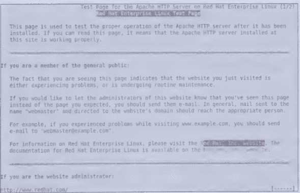

图14-1 Apache HTTP服务器测试页面

### 第3步

如果你不指定HTTP还是HTTPS协议，默认会使用普通HTTP。如果要测试安全站点，可以使用以下命令：

```bash
# elinks https://172.168.1.1
```

### 第4步

要退出`elinks`浏览器，只需按下`q`键即可。

# Apache安全

上一节介绍了启动`httpd`服务所需的防火墙规则和SELinux策略修改。本节将深入讲解Apache安全相关知识，因为这是一个非常庞大的主题。无论是为了通过考试，还是在实际工作中，你都需要掌握配置Apache主机级安全和用户级安全的能力。你还需要能够使用HTTPS协议搭建安全网站。

## 主机级安全

首先，你可以限制服务器监听传入连接的IP地址。你可以使用`Listen`选项来定义IP地址和端口，通常端口为80。如果你有多个IP地址，这个功能非常实用，因为它只会允许你指定的IP地址（即对应的网络）访问服务器。

RHEL01系统上有两个IP地址：`172.168.1.1`和`192.168.1.5`。现在我们来配置这台Apache服务器，仅允许来自`172.168.1.0/24`网络的客户端访问：

```apache
Listen 172.168.1.1:80
```

配置完成后，RHEL01将仅在80端口监听`172.168.1.1`IP地址的传入请求。

接下来我们来看`<Directory>`部分，该部分包含与主服务器配置相关的选项。在该部分中，首先要做的是限制哪些网络、IP地址或域名可以访问Web服务器。现在我们在`<Directory>`部分中配置`Allow from`和`Deny from`选项：

- **第1步**。允许所有主机访问：`Allow from all`

- **第2步**。如果要仅允许特定IP或主机访问，使用以下配置：`Allow from 172.168.1.2`

- **第3步**。也可以使用主机名：`Allow from RHEL02`

- **第4步**。还可以指定域名：`Allow from .example.com`

- **第5步**。`Deny from`选项的用法相同。如果要拒绝整个子网的访问，使用以下配置：`Deny from 192.168.1`

> **警告：** 这里有两处需要注意。第一，指定允许或拒绝的域名时，要确保包含前导点（`.`）；否则限制规则将无法正常工作。第二，指定子网时，末尾不需要加点（`.`）或最后一个八位组。

确定要允许或拒绝访问Web服务器的主机后，接下来需要定义规则的执行顺序：

- `Order allow,deny`：先执行允许规则，再拒绝其他所有请求

- `Order deny,allow`：先执行拒绝规则，再允许其他所有请求

由于目标是提升Web服务器的安全性，我们使用第一种选项，该选项会默认拒绝所有请求。要完成`<Directory>`部分的配置，我们接下来看通用选项和`AllowOverride`选项。配置文件中的默认配置已经相当安全：

```apache
<Directory "/var/www/html">
    Options Indexes FollowSymLinks
    # Allows indexing of directories and allows symlinks outside this <Directory> section
    AllowOverride None
    # Does not allow any normal user to make changes in DocumentRoot
</Directory>
```

这里可以配置的选项有很多。我建议你花点时间查阅man手册页和默认配置文件，其中包含Apache各个选项的详细说明。完整的`<Directory>`部分配置如下：

```apache
<Directory "/var/www/html">
    Options Indexes FollowSymLinks
    AllowOverride None
    Order allow,deny
    Allow from 172.168.1
</Directory>
```

> **注意：** 默认情况下，`httpd`服务以下列凭证运行：

> - 用户`apache`

> - 用户组`apache`

这是一个非常合理的默认设置，因为它让`httpd`服务仅以Apache用户的身份运行。如果服务器上的某个组件被攻破，黑客也只能访问Apache用户有权限访问的资源，而这些资源通常都不在Web目录范围内。

## 用户级安全

现在我们已经配置好了主机级认证，接下来可以配置用户级认证了。这种认证方式可以仅允许特定用户或用户组访问Web服务器或其中的部分内容。可用于配置用户级安全的选项如下：

- `AuthType`：定义认证类型

- `AuthName`：添加用户在登录时可以看到的提示信息

- `AuthUserFile`：指定用于定义用户名和密码的文件

- `AuthGroupFile`：与用户文件类似，但用于定义用户组

- `Require`：指定允许登录的用户或用户组

我们通过一个示例来更清楚地说明这些选项的用法。假设你想要给主站点设置密码保护，因为其中包含不应外泄的人力资源（HR）相关信息。

**第1步。** 在配置文件的主服务器部分添加以下配置：

```apache
<Directory "/var/www/html">
    AuthType Basic
    AuthName "Password Restricted Area"
    AuthUserFile /etc/httpd/userfile
    Require user user01
</Directory>
```

现在你可以进入`/etc/httpd`目录，创建一个`userfile`文件来存储用户账户。你可以使用`htpasswd`命令来创建用户和用户组账户。

**第2步。** 创建唯一需要访问该站点的用户：

```bash
# htpasswd -cm /etc/httpd/userfile user01
New password:
Re-type new password:
Adding password for user user01
```

此处有两点非常重要的注意事项。首先，请注意调用此命令时的`-c`选项，该选项会创建文件并写入第一个用户名和密码。创建后续用户时请勿再次使用此选项，否则会完全覆盖该文件，导致文件内所有用户数据丢失。其次是`-m`选项，该选项会在将密码写入文件时采用MD5加密。请务必始终使用该选项，否则任何人都能以明文查看用户名和密码的组合！

### 步骤3. 重启Web服务器：

```bash
# service httpd reload
Reloading httpd: [ OK ]
```

可将`172.168.1.0/24`网段内任意系统的浏览器指向`http://172.168.1.1/index.html`来访问主页。系统会提示你输入用户名和密码。太棒了！你现在拥有了一个安全的主站点，人力资源部（HR）可以开始在这里发布文档了。不过存在一个问题。假设人力资源部希望主站点对公司全员开放，用于发布公共资讯，同时他们又需要一个仅限HR员工访问的板块来查看相关内容（比如所有人的薪资信息）。这不成问题，只需稍作调整即可实现这些需求。

### 步骤4.

首先，打开主配置文件，修改其中的`<Directory>`配置段：

```apache
<Directory "/var/www/html">
    AllowOverride authconfig
</Directory>
```

### 步骤5. 保存配置文件，并进入Web目录结构。

### 步骤6. 在此处创建一个新目录，用于存放HR组的文档：

```bash
# cd /var/www/html
# mkdir hr
```

现在，你需要创建一个名为`.htaccess`的文件，用于定义该目录的访问权限。该文件支持按目录配置，是因为你允许该文件“覆盖”所有人的默认访问权限（这也是你需要在主配置文件中修改`AllowOverride`选项的原因）。

### 步骤7. 将以下内容写入该文件：

```apache
# nano .htaccess
AuthType Basic
AuthName "Password Restricted Area"
AuthGroupFile /etc/httpd/groupfile
Require group hr_users
```

和用户自定义访问规则一致，该配置仅允许属于`/etc/httpd/groupfile`中定义的`hr_users`组的用户访问。保存该文件并关闭。最后一步你需要完成的操作是：为HR用户在已存在的用户文件中添加几个用户账户，并在组文件中添加`hr_users`组。

### 步骤8. 创建几个用户账户：

```bash
# htpasswd -m /etc/httpd/userfile hr01
New password:
Re-type new password:
Adding password for user hr01
# htpasswd -m /etc/httpd/userfile hr02
New password:
Re-type new password:
Adding password for user hr02
```

### 步骤9. 在`/etc/httpd/groupfile`中添加以下内容：

- `hr_users: hr01 hr02`

### 步骤10. 所有配置完成后，你可以重启Web服务器：

```bash
# service httpd reload
Reloading httpd: [ OK ]
```

现在如果你尝试访问`http://172.168.1.1/index.html`，将不会有任何访问限制，该区域不再需要密码保护。不过，如果你访问`http://172.168.1.1/hr/test.html`，系统会提示你输入用户名和密码。另外你还会发现，如果输入`user01`作为用户名，将无法访问该区域。原因是你使用了`Require group`选项，该选项要求用户必须是你定义的`hr_users`组的成员。


还有一项属于用户安全范畴的选项你需要了解，以防在考试中遇到。该选项名为`UserDir`，启用后允许用户浏览并访问其主目录下的`public_html`目录。如果你希望每个用户都能通过Web共享部分文件，这个选项会很有用，但如果未加管控会带来的安全风险我都不用多说。默认情况下该选项是禁用的，这有充分的理由。如果你需要在考试中实现用户主目录的内容共享，可以在主配置文件中设置以下选项：

```
Userdir public_html
```

然后进入系统上的任意用户账户目录，若不存在`public_html`目录则创建它，并设置合适的权限：

```
# cd /home/user01
# mkdir public_html
# chmod 701 /home/user01
# chmod 705 -R /home/user01/public_html
```

> **警告：**我无论如何强调都不为过：请勿使用此`UserDir`选项。启用后，用户的主目录将对所有用户开放执行权限，其`public_html`目录也将可读可执行，这简直是重大的安全漏洞！本书介绍该选项的唯一目的是让你在考试中了解它的存在，在实际生产环境中配置此选项时请务必谨慎！

## 配置HTTPS

除普通网站外，你还可以使用`HTTPS`协议搭建安全网站。在`Apache`中配置安全网站非常简单。如果你尚未安装`mod_ssl`软件包，需要优先完成安装。安装该软件包后，系统会自动添加`/etc/httpd/conf.d/ssl.conf`文件，该文件包含安全Web服务器的配置参数。该默认文件内容如下：

```
# grep -v ^# /etc/httpd/conf.d/ssl.conf
LoadModule ssl_module modules/mod_ssl.so
Listen 443
SSLPassPhraseDialog builtin
SSLSessionCache shmcb:/var/cache/mod_ssl/scache(512000)
SSLSessionCacheTimeout 300
SSLMutex default
SSLRandomSeed startup file:/dev/urandom 256
SSLRandomSeed connect builtin
SSLCryptoDevice builtin
<VirtualHost _default_:443>
    ErrorLog logs/ssl_error_log
    TransferLog logs/ssl_access_log
    LogLevel warn
    SSLEngine on
    SSLProtocol all -SSLv2
    SSLCipherSuite ALL:!ADH:!EXPORT:!SSLv2:RC4+RSA:+HIGH:+MEDIUM:+LOW
    SSLCertificateFile /etc/pki/tls/certs/localhost.crt
    SSLCertificateKeyFile /etc/pki/tls/private/localhost.key
    <Files ~ "\.(cgi|shtml|phtml|php3)?$">
        SSLOptions +StdEnvVars
    </Files>
    <Directory "/var/www/cgi-bin">
        SSLOptions +StdEnvVars
    </Directory>
    SetEnvIf User-Agent ".*MSIE.*" \
        nokeepalive ssl-unclean-shutdown \
        downgrade-1.0 force-response-1.0
    CustomLog logs/ssl_request_log \
        "%t %h %{SSL_PROTOCOL}x %{SSL_CIPHER}x \"%r\" %b"
</VirtualHost>
```

其中最重要的参数是`Listen`选项，以及`<VirtualHost _default_:443> </VirtualHost>`标签内定义的配置项。默认情况下，安全站点以虚拟主机形式运行（这样设计很好，因为它可以和其他非安全站点同时运行）。我们会在本章后续部分介绍虚拟主机。你还需要注意以下两个选项：

```
SSLCertificateFile /etc/pki/tls/certs/localhost.crt
SSLCertificateKeyFile /etc/pki/tls/private/localhost.key
```

这两个选项定义了证书文件和密钥的配置项及存储路径，用于搭建安全网站时使用。尽管默认配置可以正常运行，但如果你修改了`IP`地址或域名映射，就需要重新生成证书和密钥。安装`crypto-utils`软件包即可获得完成该操作所需的`openssl`和`genkey`命令。不过由于该内容不在考试范围内，本书不会展开讲解完整操作步骤。配置安全网站还需要额外执行一步操作：在防火墙中开放对应端口。

### 步骤1. 使用`iptables`命令配置防火墙规则：

```
# iptables -I INPUT 5 -p tcp -m tcp --dport 80 -j ACCEPT
# iptables -I INPUT 5 -p tcp -m tcp --dport 443 -j ACCEPT
```

### 步骤2. 保存刚刚创建的规则：

```
# service iptables save
Saving firewall rules to /etc/sysconfig/iptables: [ OK ]
```

### 步骤3. 重启防火墙服务使配置生效：

```
# service iptables restart
iptables: Flushing firewall rules: [ OK ]
iptables: Setting chains to policy ACCEPT: filter [ OK ]
iptables: Unloading modules: [ OK ]
iptables: Applying firewall rules: [ OK ]
```

## CGI应用程序

现在你已经掌握了Web服务器的配置与安全防护方法，接下来我们将了解一些更高级的部署方案以及数据共享方式。第一个示例中，我们将在Web服务器上部署一个`CGI`应用程序。

### 步骤1. 创建一个目录用于存放Web应用：

```
# mkdir /var/www/web-app-01
```

### 步骤2. 将所需的文件复制到新创建的目录中：

```
# cp /home/user01/app.py /var/www/web-app-01
```

> **注意：**你可以从`http://sourceforge.net/projects/rhcelabs/`获取`app.py`文件。

### 步骤3. 将以下配置段添加到`/etc/httpd/conf/httpd.conf`文件中：

```
ScriptAlias /webapp "/var/www/web-app-01"
<Directory "/var/www/web-app-01/">
    Options ExecCGI FollowSymLinks
    Order allow,deny
    Allow from all
</Directory>
```

### 步骤4. 检查配置文件是否存在语法错误：

```
# service httpd configtest
Syntax OK
```

### 步骤5. 为目录设置正确的权限：

```
# chmod 755 -R /var/www/web-app-01
```

## 步骤6. 重启Web服务：

```
# service httpd restart
Stopping httpd: [ OK ]
Starting httpd: [ OK ]
```

现在如果你访问`http://172.168.1.1/webapp/app.py`，应该就能在浏览器中看到`CGI`应用被执行。

如果你之前使用过`Apache`，就会知道系统已经默认配置了用于存放`CGI`应用的目录。安装`Apache`时会自动创建`/var/www/cgi-bin`目录来存储`CGI`应用，你还会在`Apache`的主配置文件中看到如下配置段：

```
ScriptAlias /cgi-bin/ "/var/www/cgi-bin/"
#
# "/var/www/cgi-bin" should be changed to whatever your ScriptAliased
# CGI directory exists, if you have that configured.
#
<Directory "/var/www/cgi-bin">
    AllowOverride None
    Options None
    Order allow,deny
    Allow from all
</Directory>
```

你其实也可以直接使用这个默认目录，无需自行创建新目录（当然自行配置也是不错的选择）。除此之外，你还可以运行很多其他类型的应用，例如`PHP`、`Ruby`和`Java`。虽然红帽认证考试仅要求你掌握`CGI`应用的配置，但在实际工作中经常会遇到各类不同的应用类型。

## 虚拟主机

`Apache`的一大优势就是可以在单台主机上运行多个网站，这是通过虚拟主机配置实现的，你可以在`Apache`主配置文件中定义不同的站点。我们之前已经讲解过主配置文件中的全局选项和主服务器选项，接下来介绍第三部分：虚拟主机选项：

| 配置项 | 说明 |

| :--- | :--- |

| `NameVirtualHost` | 指定虚拟主机的主机名或IP地址 |

| `ServerAdmin` | 指明网站管理员的邮箱地址 |

| `DocumentRoot` | 定义虚拟主机站点文件的存放目录 |

| `ServerName` | 定义虚拟主机的访问URL |

| `ErrorLog` | 指定错误日志的存储位置 |

| `CustomLog` | 指定自定义日志的存储位置 |

上述很多选项与配置文件主服务器部分的选项类似，如果在虚拟主机部分未定义某选项，则会默认采用主服务器部分的对应配置。配置虚拟主机非常简单，只需按以下步骤操作即可：

- 复制主服务器部分的默认站点配置作为示例：

```apache
<VirtualHost *:80>
    ServerAdmin webmaster@example.com
    DocumentRoot /var/www/site1
    ServerName www.site1.com
    ErrorLog logs/site1_error_log
    CustomLog logs/site1_access_log common
</VirtualHost>
```

- 启用配置前记得先校验配置语法：

```
# httpd -S
VirtualHost configuration:
wildcard NameVirtualHosts and _default_ servers:
*:80                   www.site1.com (/etc/httpd/conf/httpd.conf:985)
Syntax OK
```

- 如果你配置了多个虚拟主机站点，可以通过以下命令校验：

```
# httpd -D DUMP_VHOSTS
VirtualHost configuration:
wildcard NameVirtualHosts and _default_ servers:
*:80                   www.site1.com (/etc/httpd/conf/httpd.conf:985)
Syntax OK
```

## Squid网络代理

代理服务器通常是部署在客户端与用户试图访问的目标站点之间的设备，能够为代理后的客户端提供安全防护、匿名访问等能力。`Squid`是红帽系统下的Web代理服务器，部署在用户尝试连接的客户端与Web服务器之间。这类设备常被用于管控互联网访问权限（例如网页过滤）。作为Web代理，它还可以缓存用户从网络请求的数据并在本地提供访问，从而降低网关、防火墙等外部设备的负载。接下来我们将介绍如何配置Web代理、定义访问控制列表以及排查代理故障。

## 安装Squid

和安装Web服务器一样，你需要先安装`Squid`所需的软件包，安装`Squid`代理服务器仅需要1个软件包。

- 步骤1. 执行以下命令安装软件包：

```
# yum install -y squid
```

- 步骤2. 安装完成后校验安装结果：

```
# rpm -qa | grep squid
squid-3.1.4-1.el6.x86_64
```

接下来你需要配置`Squid`开机自启，可以通过`chkconfig`命令实现。

- 步骤3. 启用`Squid`开机自启：

```
# chkconfig squid on
```

- 步骤4. 校验服务开机自启配置：

```
# chkconfig squid -list
squid 0:off 1:off 2:on 3:on 4:on 5:on 6:off
```

现在你已经确认软件包安装完成且已配置开机自启，接下来可以开始配置`Squid`了。

## 配置代理

配置代理服务器前，你需要了解以下相关信息：

| 路径 | 说明 |

| :--- | :--- |

| `/etc/sysconfig/squid` | 配置文件的启动选项 |

| `/etc/squid/squid.conf` | 服务的主配置文件 |

| `/var/spool/squid` | 代理服务器的缓存存储路径 |

| `/var/log/squid` | 代理服务的日志文件路径 |

和大多数服务配置一样，首先要处理的是主配置文件。首先要提醒你，虽然这个配置文件包含大量文档说明和众多示例，但总行数超过4000行，如果你打算通读整个配置文件，一定要预留足够的时间。和配置`Apache`一样，配置Web代理服务器的过程可能会比较复杂、耗时，直到你完全配置正确为止。不过本次实验仅需要代理服务器的基础功能，因此配置运行不会太困难。

接下来我们了解一些主要的配置选项：

- **`http_port`**：指定代理服务的监听端口

- **`visible_hostname`**：标识`Squid`服务器的名称

- **`hierarchy_stoplist`**：提供一组关键词列表，指示`Squid`服务器直接处理对应请求

- **`access_log`**：记录所有下载的网页信息

- **`acl`**：定义访问控制列表

- **`http_access`**：定义允许访问代理服务的系统或网络

你可以使用默认端口运行`Squid`代理，这样测试会更方便。不过你也可以将`visible_hostname`选项设置为你的服务器名称：

```
# nano /etc/squid/squid.conf
visible_hostname = RHEL01
```

### 考试提示

注意很多代理服务都倾向于使用`8080`端口。我也不清楚`Squid`为什么默认选择`3128`端口，但你需要掌握如何修改`Squid`的默认监听端口，以应对考试要求。如果在生产环境运行`Squid`，你也应该修改默认端口，因为出于安全考虑，任何服务都最好不要保留默认配置。

你还需要定义`Squid`服务器不需要处理的`URL`规则，例如你希望服务器直接提交、不缓存隐私数据的表单数据，示例如下：

```
hierarchy_stoplist cgi-bin ?
acl QUERY urlpath_regex cgi-bin \?
cache deny QUERY
```

### 防火墙与SELinux配置

`Squid`的防火墙和SELinux配置要求其实非常简单。`Squid`默认使用`3128`端口进行通信，因此你需要在防火墙中开放该端口，同时需要开放TCP和UDP两种协议的访问权限。

- 步骤1. 使用`iptables`命令配置防火墙规则：

```
# iptables -I INPUT 5 -p tcp -m tcp --dport 3128 -j ACCEPT
# iptables -I INPUT 5 -p udp -m udp --dport 3128 -j ACCEPT
```

- 步骤2. 保存刚创建的防火墙规则：

```
# service iptables save
Saving firewall rules to /etc/sysconfig/iptables: [ OK ]
```

- 步骤3. 重启防火墙服务使配置生效：

```
# service iptables restart
iptables: Flushing firewall rules:                 [ OK ]
iptables: Setting chains to policy ACCEPT: filter [ OK ]
iptables: Unloading modules:                       [ OK ]
iptables: Applying firewall rules:                [ OK ]
```

默认情况下，配置`Squid`无需修改SELinux设置，不过你需要了解可用的相关选项：

- **`squid_use_tproxy`**：允许`Squid`以透明代理（`TPROXY`）模式运行

- **`squid_connect_any`**：允许`Squid`连接所有端口，而不仅是HTTP、FTP和Gopher端口

如果你需要启用上述任意一项功能，只需相应地调整SELinux的布尔值即可。

### 提示

在`RHEL5`系统中，你需要关闭`Squid`服务的SELinux保护才能正常运行。

- 步骤1. 查询需要修改的布尔值：

```
# getsebool -a | grep squid_dis
squid_disable_trans --> off
```

- 步骤2. 关闭SELinux保护：

```
# setsebool -P squid_disable_trans=1
```

- 步骤3. 校验布尔值是否修改成功：


```
# getsebool -a | grep squid_dis
squid_disable_trans --> on
```

可以看到Squid的防火墙规则和SELinux配置要求都非常简单。不过在启动服务前，我们需要进一步讲解Squid的安全配置。

## Web代理安全

Squid通过访问控制列表（ACL）实现基于主机的安全管控，这些ACLs配置在主配置文件`/etc/squid/squid.conf`中。你可以在配置文件中定义针对你所在网络的ACL规则，并授予其他所有网络访问代理服务器的权限。

在`/etc/squid/squid.conf`文件中添加以下配置：

```
acl my_local_net src 172.168.1.0/24
acl allow_dom dstdomain example.com
```

你还需要为这些网络启用HTTP访问权限：

```
http_access allow my_local_net
http_access allow allow_dom
```

保存配置文件后退出。现在可以启动`Squid`服务来测试代理：

```
# service squid start
init_cache_dir /var/spool/squid... Starting squid: . [ OK ]
```

验证服务状态：

```
# service squid status
squid (pid 4577) is running...
```

当Squid启动时，会在`/var/spool/squid`目录下创建缓存，该路径由启动脚本中的`init_cache_dir`选项定义。你也可以查看日志文件`/var/log/squid/access.log`，确认是否生成了任何错误消息。

在`Client01`系统上，你可以连接到代理并测试连接。从`Client01`使用`elinks`命令从命令行连接到代理：

```
# HTTP_PROXY=172.168.1.1:3128 elinks
```

如果无法连接，请确保防火墙规则设置正确，并检查日志中的错误消息。

## Summary
Web服务非常重要，因为它们在互联网上发挥着关键作用。高效学习如何搭建和管理Apache Web服务器的内部运作需要花费大量时间。针对考试，请确保你掌握配置和虚拟主机的基础知识。代理还可以帮助分担Web服务器在没有代理情况下的负载压力。这两类服务与DNS相结合，共同构成了网站的Web基础设施。

## Review Questions
1. Apache Web服务器使用哪个端口运行？HTTPS使用哪个端口？
2. 搭建安全网站除了`httpd`包之外还需要额外安装软件包吗？如果需要，是哪些？
3. 你可以使用什么命令来创建密码保护的页面？
4. 如果已经在运行第3题中的命令后再加上`-c`选项调用它，会发生什么？
5. 你可以使用什么命令验证Apache配置文件的语法？
6. 什么是虚拟主机？
7. 虚拟主机可以用来做什么？
8. 如何更改目录的安全上下文以适配Apache使用？
9. Web代理能为你的网络提供什么好处？
10. Squid默认使用的端口是多少？


## Answers to Review Questions
1. Apache使用80端口提供HTTP服务，443端口提供HTTPS服务。
2. 是的。要让Apache运行安全站点，需要安装`mod_ssl`软件包。
3. 可以使用`htpasswd`命令为网页设置密码保护。
4. 存储用户名及其加密密码的文件会被删除，并被新文件替换。
5. `service httpd configtest`
6. 虚拟主机是使用单一IP地址托管多个站点的方式。
7. 如果你是托管服务提供商，或想要通过单一IP地址运行多个网站/应用程序，可以使用虚拟主机实现这一需求。
8. 使用`chcon`命令可以更改文件的安全上下文以适配Apache使用。
9. Web代理能提供多种好处，包括安全性、网页缓存以加快加载速度，以及负载均衡。
10. 默认情况下，Squid使用3128端口运行。

## Task 1 – Web Server Setup
**步骤1.** 按照以下要求搭建Apache Web服务器：
- Web服务器仅允许通过80端口访问。
- 默认站点的根目录为`/var/www/first_site`。
- 该站点仅允许本地网络（`172.168.1.0/24`）内的设备访问。

**步骤2.** 在`first_site`目录下创建`index.html`文件，文件内容如下：
```
<html>
<body>
<h2>This is my first web site!</h2>
</body>
</html>
```

当本地网络内的任意客户端可以访问`first_site`站点时，任务完成。

## Task 2 – Secure Websites
**步骤1.** 按照以下要求搭建另一款站点：
- 该站点仅允许通过443端口（HTTPS）访问。
- 安全站点的根目录为`/var/www/secure_site`。
- 该站点仅允许本地网络（`172.168.1.0/24`）内的设备访问。

**步骤2.** 在`secure_site`目录下创建`index.html`文件，文件内容如下：
```
<html>
<body>
<h2>This is the secure version of my site!</h2>
</body>
</html>
```

当本地网络内的任意客户端可以访问`secure_site`站点时，任务完成。

## Task 3 – A Web Proxy
**步骤1.** 按照以下要求使用Squid搭建Web代理：
- 代理需能够处理`172.168.1.0/24`子网的所有Web流量。
- 配置`Client02`将其Web流量通过该代理转发。
- 代理需监听3128端口。

当`Client02`可以通过该代理访问互联网时，任务完成。


## This Chapter Covers the Following Subjects
- 网络文件系统——本节讲解网络文件系统以及客户端如何使用它们。
- NFS安全——本节讲解NFS的安全配置。
- NFS故障排除——本节介绍NFS的故障排查方法。
- 客户端连接——本节介绍如何将客户端连接到NFS服务器。

## The Following RHCE Exam Objectives Are Covered
- 安装提供该服务所需的软件包
- 配置SELinux以支持该服务
- 配置服务在系统启动时自动运行
- 配置服务的基础运行参数
- 配置服务的主机级与用户级安全策略
- 为特定客户端提供网络共享
- 提供适合团队协作的共享

# NFS
你可以通过多种方式与网络上的用户共享文件。本章是讲解网络文件共享的三章中的第一章，具体来说，本章将介绍NFS，下一章介绍Samba，第17章介绍FTP。NFS提供了一种方式，让网络上的其他系统可以将文件存储在集中位置。这能确保备份操作更便捷，且安全策略只需在单一节点维护（无需分散在网络中的多台服务器上）。作为系统管理员，将数据存储在集中位置会让你的工作轻松很多。接下来就让我们深入了解NFS和集中存储吧。

## Network File Systems
网络文件系统（NFS）协议在Linux系统中表现出色，因为它具备客户端灵活性、文件集中管理以及其他诸多优秀特性。要让NFS正常运行，你需要先搭建NFS服务器，再配置客户端来测试对服务器的访问。和其他任何服务一样，你需要先安装几个必需的软件包才能进行后续操作。NFS服务本身在服务器和客户端上是相同的，差异体现在运行的服务和配置文件上。NFS共有四个不同的版本，其中v4是最新的版本。虽然你可以禁用服务器监听的版本，但客户端实际会自行决定连接服务器时使用的版本（当然，前提是服务器提供了客户端请求的版本）。随着本章内容的推进，你会进一步理解这部分内容。

### MIGRATION TIP
RHEL5发布时同时支持NFS v3和v4，但默认使用v3。在RHEL6中，两个版本依然可用，但默认版本已变为v4。即使你仍在使用RHEL5，也推荐你使用v4，因为它有大量改进。

### Installing an NFS Server
请按照以下步骤安装NFS服务器：

**步骤1.** 开始搭建NFS服务器前，先安装所需的软件包：
```
# yum install -y nfs-utils nfs4-acl-tools
```

**步骤2.** 验证软件包是否安装成功：
```
# rpm -qa | grep nfs
nfs4-acl-tools-0.3.3-5.el6.x86_64
nfs-utils-1.2.2-7.el6.x86_64
nfs-utils-lib-1.1.5-1.el6.x86_64
```

### MIGRATION TIP
RHEL6不再包含任何`system-config`系列的GUI软件包，其中包括已移除的`system-config-nfs`软件包。

**步骤3.** NFS服务器正常运行需要三个不同的服务支持，你需要在系统启动时启用全部三个服务，确保NFS服务器能正常运行：
```
# chkconfig nfs on
# chkconfig nfslock on
# chkconfig rpcbind on
```

### MIGRATION TIP
RHEL6现在使用`rpcbind`服务替代了RHEL5中的`portmapper`服务。如果你仍在使用RHEL5，需要将本文示例中的`rpcbind`命令替换为`portmap`。

**步骤4.** 验证全部三个服务都已被设置为系统启动时自动运行：
```
# chkconfig --list nfs
nfs 0:off 1:off 2:on 3:on 4:on 5:on 6:off
# chkconfig --list nfslock
nfslock 0:off 1:off 2:on 3:on 4:on 5:on 6:off
# chkconfig --list rpcbind
netfs 0:off 1:off 2:on 3:on 4:on 5:on 6:off
```

你还需要验证NFS服务当前处于停止状态，因为你需要先进行一些配置修改，才能启动该服务。

**步骤5.** 验证服务已关闭：
```
# service nfs status
rpc.mountd is stopped
nfsd is stopped
rpc.rquotad is stopped
```

### 配置NFS
`nfs`和`rpcbind`服务启动时都会控制系统上的多个守护进程。下面我们来看看这两个服务分别包含哪些不同的守护进程：

| rpcbind | 将传入请求转发到相应的子服务 |
|---------|------------------------------|
| rpc.idmapd | 将UID和GID映射到对应用户和用户组 |
| rpc.lockd | 管理文件锁，在客户端断开连接时释放锁 |
| rpc.nfsd | 响应客户端的文件访问请求 |
| rpc.rquotad | 向客户端提供磁盘配额统计信息 |
| rpc.statd | 与`rpc.lockd`协作提供恢复服务 |

下面我们再来看看你需要操作的配置文件：
- `/etc/sysconfig/nfs` - 包含NFS服务的主要配置文件
- `/etc/exports` - 包含将导出（即可用）给客户端的资源列表

以下是使用NFS时还会用到的其他文件：
- `/var/lib/nfs/etab` - 包含当前已导出的资源列表
- `/var/lib/nfs/rmtab` - 包含远程挂载的资源列表

第一步配置操作中，你需要对主配置文件进行几处修改。

**步骤1.** 打开主配置文件进行编辑：
```
# nano /etc/sysconfig/nfs
```

**步骤2.** 取消以下行的注释：
```
MOUNTD_NFS_V1="no"
MOUNTD_NFS_V2="no"
MOUNTD_NFS_V3="no"
RPCNFSDARGS="-N 2 -N 3"
```
前三行用于禁用`mountd`守护进程接受4版本以下的请求，最后一行用于禁用NFS服务，使其仅广播4版本信息。

### 迁移提示
如果你仍在使用RHEL5，当禁用`mountd`守护进程广播所有版本时，会出现一个未解决的bug，会导致奇怪的错误。针对RHEL5，建议仅取消以下行的注释：
```
MOUNTD_NFS_V1="no"
MOUNTD_NFS_V2="no"
```

**步骤3.** 保存文件并退出。

接下来我们处理`/etc/exports`文件，该文件用于定义哪些资源将对客户端可用。如果该文件尚不存在，你可以自行创建。

`/etc/exports`文件的语法为：
```
<mountpoint> <host><permissions/options>
```

> **警告：** 注意`<host>`字段和`<permissions/options>`字段之间没有空格。如果加入空格，会出现语法错误，导致资源无法正常导出。

## 挂载选项：
- `rw`：设置读写权限
- `ro`：设置只读权限
- `insecure`：允许使用1024以上的端口
- `sync`：指定命令完成前必须将所有更改写入磁盘
- `no_wdelay`：强制立即写入更改（若系统崩溃，该选项对日志记录非常有用）
- `root_squash`：禁止root用户

举个例子，你可以将以下两个位置导出给客户端：
- `/home` —— 存储用户数据的家目录
- `/opt/company_data` —— 本书前文创建的、存储公司数据的目录

**步骤4.** 在`/etc/exports`文件中配置导出项，使网络上的任意客户端都能访问：
```
# nano /etc/exports
/home *(ro,sync)
/opt/company_data *(rw,sync)
```

这里你定义了两个要对外提供的资源：第一行定义导出`/home`目录，允许所有客户端以只读权限访问；第二行向所有客户端提供`/opt/company_data`目录，赋予读写权限。

完成所有要导出资源的定义后，保存并关闭文件。

**步骤5.** 启动两个NFS服务（`rpcbind`默认应当已经处于运行状态）：
```
# service nfs start
Starting NFS services: [ OK ]
Starting NFS quotas: [ OK ]
Starting NFS daemon: [ OK ]
Starting NFS mountd: [ OK ]
```

**步骤6.** 验证服务已成功启动：
```
# service rpcbind status
rpc.bind (pid 25068) is running...
# service nfslock status
rpc.statd (pid 17726) is running...
# service nfs status
rpc.svcgssd is stopped
rpc.mountd (pid 17780) is running...
nfsd (pid 17777 17776 17775 17774 17773 17772 17771 17770) is running...
rpc.rquotad (pid 17764) is running...
```

> **注意：** 出于某些原因，首次启动NFS服务时，并不总会输出启动成功的信息。如果你想验证服务是否启动成功，可以重启服务以在控制台查看正确的输出。如果创建`/etc/exports`文件前已经启动了服务，你也可以使用`exportfs`命令手动导出`/etc/exports`文件中新增的所有资源。

语法：`exportfs [options]`

选项：
- `-a` 导出或取消导出所有目录
- `-r` 重新导出所有目录
- `-u` 取消导出一个或多个目录
- `-v` 输出详细信息

**步骤1.** 手动导出资源的操作示例如下：
```
# exportfs -avr
exporting *:/opt/company_data
exporting *:/home
```

**步骤2.** 另外，你也可以通过仅重启NFS服务达到相同效果，重启NFS服务会同时重启所有守护进程：
```
# service nfs restart
Shutting down NFS mountd: [ OK ]
Shutting down NFS daemon: [ OK ]
Shutting down NFS quotas: [ OK ]
Shutting down NFS services: [ OK ]
Starting NFS services: [ OK ]
Starting NFS quotas: [ OK ]
Starting NFS daemon: [ OK ]
Starting NFS mountd: [ OK ]
```

## 实战提示
手动导出目录比重启服务更优，因为导出新目录时不会断开客户端连接，但重启服务时会导致客户端断开连接。

现在所有资源都已正确导出，NFS服务也已启动，你可以使用`rpcinfo`命令验证NFS服务的所有组件是否运行正常。

**语法：** `rpcinfo -p [host]`

你可以使用`rpcinfo`命令查看本地和远程连接信息。由于你需要查看本地服务器的信息，因此调用该命令时无需指定主机。

查看当前运行的`nfs`守护进程：


`rpcinfo -p`命令的输出结果如下：

``` 
# rpcinfo -p
program vers proto port service
100000 4 tcp 111 portmapper
100000 3 tcp 111 portmapper
100000 2 tcp 111 portmapper
100000 4 udp 111 portmapper
100000 3 udp 111 portmapper
100000 2 udp 111 portmapper
100024 1 udp 41853 status
100024 1 tcp 40535 status
100011 1 udp 875 rquotad
100011 2 udp 875 rquotad
100011 1 tcp 875 rquotad
100011 2 tcp 875 rquotad
100003 4 tcp 2049 nfs
100003 4 udp 2049 nfs
100021 1 udp 32769 nlockmgr
100021 3 udp 32769 nlockmgr
100021 4 udp 32769 nlockmgr
100021 1 tcp 32803 nlockmgr
100021 3 tcp 32803 nlockmgr
100021 4 tcp 32803 nlockmgr
```

你会发现运行中的`nfs`守护进程仅列出了4版本，这是因为你在配置文件中禁用了所有其他版本。尽管列表中其他部分守护进程也使用了其他版本，但你仍需验证至少`nfs`守护进程显示为4版本。

### 防火墙与SELinux配置

NFS是Red Hat众多可利用TCP Wrappers和防火墙规则保障安全性的服务之一。本文不使用TCP Wrappers，但如果你在考试中遇到NFS服务无法正常运行的问题，不要忘记检查是否有流量被TCP Wrappers过滤。

由于此处使用的是NFS 4版本，你仅需要创建一条防火墙规则即可。

### 步骤1. 使用`iptables`创建额外的防火墙规则：

``` 
# iptables -I INPUT 5 -p tcp -m tcp --dport 2049 -j ACCEPT
```

### 步骤2. 保存刚创建的防火墙规则：

``` 
# service iptables save
Saving firewall rules to /etc/sysconfig/iptables: [ OK ]
```

### 步骤3. 重启`iptables`服务：

``` 
# service iptables restart
iptables: Flushing firewall rules: [ OK ]
iptables: Setting chains to policy ACCEPT: filter [ OK ]
iptables: Unloading modules: [ OK ]
iptables: Applying firewall rules: [ OK ]
```

> **警告：** 根据Red Hat官方文档，NFS 3版本是RHEL5的默认版本（RHEL5后续版本不再如此）。如果你选择继续使用NFS 4版本，你需要在`/etc/sysconfig/nfs`文件中为NFS服务运行所需的四个守护进程分别静态定义端口，还需要将这些端口添加到`/etc/services`文件中，并为每个端口创建防火墙规则。综上所述，NFS 4版本是更优选择。

> 不同的防火墙规则和安全限制会导致NFS配置存在细微差异，因此测试这些选项会有所帮助。

### 考试提示

如果你在使用NFS 4版本时遇到防火墙规则相关问题，可以按以下步骤操作：

1. 在`/etc/sysconfig/nfs`文件中为NFS使用的四个必需守护进程分别定义静态端口。
2. 为`rpcbind`服务创建防火墙规则（TCP和UDP 111端口）。
3. 为你指定的`MOUNTD_PORT`创建防火墙规则（TCP和UDP）。
4. 为你指定的`STATD_PORT`创建防火墙规则（TCP和UDP）。
5. 为你指定的`LOCKD_TCPPPORT`创建防火墙规则（TCP）。
6. 为你指定的`LOCKD_UDPPPORT`创建防火墙规则（UDP）。

要完成本节内容，我们需要对SELinux进行一些调整，以确保NFS服务正常运行。

### 表15-1 SELinux布尔值

| 布尔值 | 描述 |
|----------|-------------|
| `nfs_export_all_ro` | 允许NFS以只读方式共享文件和目录 |
| `nfs_export_all_rw` | 允许NFS以读/写方式共享文件和目录 |
| `httpd_use_nfs` | 允许httpd访问NFS文件系统 |
| `use_nfs_home_dirs` | 支持NFS主目录 |
| `samba_share_nfs` | 允许Samba导出NFS卷 |
| `allow_nfsd_anon_write` | 允许NFS服务器修改公共文件 |
| `allow_ftpd_use_nfs` | 允许FTP服务器使用NFS提供公共文件传输服务 |

### 步骤1. 查询需要修改的布尔值：

``` 
# getsebool -a | grep nfs
allow_ftpd_use_nfs --> off
allow_nfsd_anon_write --> off
git_system_use_nfs --> off
httpd_use_nfs --> off
nfs_export_all_ro --> off
nfs_export_all_rw --> off
qemu_use_nfs --> on
samba_share_nfs --> off
use_nfs_home_dirs --> off
virt_use_nfs --> off
xen_use_nfs --> off
```

### 步骤2. 仅对需要的选项禁用SELinux保护：

``` 
# setsebool -P nfs_export_all_ro=1 nfs_export_all_rw=1
```

### 步骤3. 验证布尔值已更改：

``` 
# getsebool -a | grep nfs
allow_ftpd_use_nfs --> off
allow_nfsd_anon_write --> off
git_system_use_nfs --> off
httpd_use_nfs --> off
nfs_export_all_ro --> on
nfs_export_all_rw --> on
qemu_use_nfs --> on
samba_share_nfs --> off
use_nfs_home_dirs --> off
virt_use_nfs --> off
xen_use_nfs --> off
```

## 迁移提示

在RHEL5中，由于SELinux保护机制，NFS服务默认被拦截。你需要修改一个布尔值来禁用针对该服务的SELinux保护。

### 步骤1. 查询需要修改的布尔值：

``` 
# getsebool -a | grep nfsd_dis
nfsd_disable_trans --> off
```

### 步骤2. 禁用SELinux保护：

``` 
# setsebool -P nfsd_disable_trans=1
```

### 步骤3. 验证布尔值已更改：

``` 
# getsebool -a | grep nfsd_dis
nfsd_disable_trans --> on
```

现在你的基本安全需求已得到满足。SELinux布尔值已设置完成，防火墙规则也已添加。接下来我们来看看可以为NFS服务器提供的额外安全防护。

## NFS安全

在NFS中，大部分安全机制通过其他方式内置实现。处理安全问题时，始终有两个需要关注的主要方面：基于主机的安全和基于用户的安全。我们先来看基于用户的安全。

由于从服务器导出的资源只是普通的目录和文件，它们使用系统管理员配置的通用文件权限或访问控制列表（ACL）。这意味着在设置要导出的目录结构时，配置并测试权限非常重要。从基于用户的安全角度来看，除了这些标准权限外，没有其他需要额外说明的内容。

对于基于主机的安全，NFS提供了一些可用的功能特性。表15-2列出了可在NFS共享上使用的一些选项。

### 表15-2 NFS共享选项

| 挂载选项 | 描述 |
|---------------|-------------|
| `ro` | 将导出的文件系统设置为只读 |
| `rw` | 将导出的文件系统设置为读/写 |
| `sync` | 除非更改已写入磁盘，否则NFS服务器不会响应 |
| `wdelay` | 如果NFS服务器推测即将有另一写入请求，则会延迟向磁盘写入 |
| `root_squash` | 阻止远程连接的root用户使用root权限 |
| `noexec` | 禁止在已挂载的文件系统上执行二进制文件 |
| `nosuid` | 禁用设置用户ID或设置组ID的权限位 |

你还可以将访问控制列表（ACL）与NFS结合使用，以限制对特定主机的访问。根据你更习惯的方式，也可以通过防火墙规则实现该功能。请确保仅向需要访问NFS共享的客户端开放访问权限。另外，如果条件允许，请务必使用`root_squash`选项，它可以阻止其他拥有root权限的用户对你的NFS共享造成破坏。

## NFS故障排除

有三个管理命令可用于从服务器和客户端两侧排查NFS故障：

| 命令 | 描述 |
|---------|-------------|
| `mountstats` | 显示已挂载NFS共享的相关信息 |
| `nfsstat` | 显示导出资源的统计信息 |
| `nfsiostat` | 显示已挂载NFS共享的统计信息 |

> **迁移提示** `mountstats`和`nfsiostat`命令仅在RHEL6中可用。

### 步骤1. 查看导出资源（无论是否已挂载）：

``` 
# cat /var/lib/nfs/etab
/home *(ro,sync,wdelay,hide,nocrossmnt,secure,root_squash,no_all_squash,no_subtree_check,secure_locks,acl,anonuid=65534,anongid=65534)
/opt/data *(rw,sync,wdelay,hide,nocrossmnt,secure,root_squash,no_all_squash,no_subtree_check,secure_locks,acl,anonuid=65534,anongid=65534)
```

### 步骤2. 在客户端，你可以使用`nfsstat`命令获取类似结果。语法：`nfsstat [options]`

#### 选项：

- `-m`：显示已挂载NFS文件系统的统计信息
- `-n`：显示NFS统计信息
- `-v`：提供详细输出

### 步骤3. 要在客户端显示仅已挂载的导出资源，请使用以下命令：

``` 
# nfsstat -m
/mnt/home from 172.168.1.1:/home
    Flags: rw,relatime,vers=4,rsize=262144,wsize=262144,namlen=255,hard,proto=tcp,timeo=600,retrans=2,sec=sys,clientaddr=172.168.1.10,minorversion=0,addr=172.168.1.1
/mnt/data from 172.168.1.1:/opt/data
    Flags: rw,relatime,vers=4,rsize=262144,wsize=262144,namlen=255,hard,proto=tcp,port=0,timeo=600,retrans=2,sec=sys,clientaddr=172.168.1.10,minorversion=0,addr=172.168.1.1
```

客户端连接到服务器后，你可以再次使用`nfsstat`命令获取一些统计信息。

### 步骤4. 查看已连接客户端的NFS 4版本统计信息：

``` 
# nfsstat
Server rpc stats:
calls    badcalls  badauth  badclnt  xdrllock
465      3         3        0        0
Server nfs v4:  null    compound
19       4%        446      95%
Server nfs v4 operations:
op0-unused  op1-unused  op2-future  access  close   commit   create  delegpurge  delegreturn  getattr  getfh  link  lock  lockt  locku  lookup  lookup_root  nverify  open  openattr  open_conf  open_dgrd  putfh  putpubfh  putrootfh  read  readdir  readlink  remove  rename  renew  restorefh  savefh  secinfo  setattr  setcltid  setcltidconf  verify  write  rellockowner  bc_ctl  bind_conn  exchange_id  create_ses  destroy_ses  free_stateid  getdirdele  getdevinfo  getdevlist  layoutcommit  layoutout  layoutreturn  secfinonam  sequence  set_ssv  test_stateid  want_deleg  destroy_clid  reclaim_comp
0   0%  0   0%  0   0%  0   39%  5   0%  0   0%  0   0   0%  0   0%  0   0%  0   253%  55   5%  0   0%  0   0   0%  0   0%  0   0%  64   6%  0   0%  0   0   45%  0   0%  5   0%  0   403%  0   0%  0   0%  0   0%  30   2%  0   0%  73   6%  0   0%  0%  0   0%  0   0%  0   5%  0   45%  4%  0   0%  6   0%  13   1%  0   0%  0   0   0   6%  0   0%  0   0%  0   0%  0   0%  0   0%  0   0%  0   0%  0   0%  0   0%
Client rpc stats:
calls  retrans  authrefrsh
131    0        0
```

你也可以使用`nfsiostat`命令获取类似的统计信息。此外，如果你需要有关已挂载NFS共享的详细调试信息，可以使用`mountstats`命令。不过，这些信息仅在你要优化NFS性能或排查严重问题时才有用。

### 连接客户端

当NFS服务器已就绪时，配置客户端使用NFS相对简单。我们以配置Client01系统使用RHEL01 NFS服务器上的共享为例。

1. 首先，你需要安装所需的软件包：

``` 
# yum install -y nfs-utils nfs4-acl-tools
```

这两个软件包包含了连接NFS服务器和使用导出资源所需的全部文件。在客户端，只需运行`rpcbind`服务即可挂载服务器上的NFS资源。

2. 确保所需服务设置为开机自启：

``` 
# chkconfig rpcbind on
```

3. 创建两个本地目录：

``` 
# mkdir /mnt/{company_data,temp}
```

4. 挂载`company_data` NFS共享：

``` 
# mount -t nfs 172.168.1.1:/opt/company_data /mnt/company_data
```

### 迁移提示

在RHEL5中，`mount`命令默认使用NFS 3版本，因此你需要手动指定版本。你需要使用以下命令替代：

``` 
# mount -t nfs nfsvers=4 172.168.1.1:/opt/company_data /mnt/company_data
```

在RHEL6中，默认使用4版本，因此无需手动指定。

如果你的权限和安全限制都已正确设置，现在你应该可以进入`/mnt/company_data`目录，并实际访问服务器上的NFS共享了。如果你不想在系统每次启动后都手动挂载NFS共享，当然也可以在`/etc/fstab`文件中添加一条条目，让它们在系统启动时自动挂载。

#### 步骤1. 在`/etc/fstab`中添加以下行：

``` 
# nano /etc/fstab
rhel01:/opt/company_data /mnt/company_data nfs rw,sync 0 0
```

你应该在第4章“文件系统及相关内容”中回顾过该文件的语法。它的作用是把远程的`/opt/company_data`挂载到本地的`/mnt/company_data`目录。

> **迁移提示** 另外，如果你使用的是RHEL5，请确保指定你要使用的NFS版本（版本2和3用`nfs`；版本4用`nfs4`）。

``` 
rhel01:/opt/company_data /mnt/company_data nfs4 rw,sync 0 0
```

#### 步骤2. 保存文件并退出。

#### 步骤3. 使用`mount`命令可以验证资源是否已正确挂载。


# mount | grep nfs

```
sunrpc on /var/lib/nfs/rpc_pipefs type rpc_pipefs (rw)
nfsd on /proc/fs/nfsd type nfsd (rw)
172.168.1.1:/home on /mnt/temp type nfs (rw,vers=4,addr=172.168.1.1,clientaddr=172.168.1.10)
172.168.1.1:/opt/company_data on /mnt/company_data type nfs (rw,vers=4,addr=172.168.1.1,clientaddr=172.168.1.10)
```

现在该远程资源的使用方式应该和本地资源完全一致。

## 摘要

文件共享可以让你不用把文件散落在各处，让工作轻松很多。集中式文件存储在安全和审计方面也很有帮助。掌握文件共享服务的操作是职场协作的重要组成部分。用户始终需要一个存放文件的地方，而安全也始终是日益突出的问题。请务必提前规划文件服务器的扩容，并定期测试其安全性。此时，你应该已经知道如何使用NFS搭建文件共享服务器了。由于搭建这类服务有诸多要求，本章提供了大量信息，请务必多练习实验和不同的配置方式，直到你能够熟练搭建并排查所有不同类型的文件共享服务的问题为止。

## 复习题

1. **Red Hat Enterprise Linux 6 会与NFS服务一起使用portmap服务。判断对错。**
2. `/var/lib/nfs/etab`文件的作用是什么？
3. 要导出目录作为共享资源，需要编辑哪个文件？
4. `exportfs`命令用于查看当前已导出的资源。判断对错。
5. NFS默认使用哪个端口？
6. 你可以使用什么命令查看NFS统计信息？
7. 使用`mount`命令挂载NFS资源时需要使用哪个选项？

## 复习题答案

1. **错误。** 在Red Hat Enterprise Linux 6中，`portmap`服务已被`rpcbind`服务替代。
2. `/var/lib/nfs/etab`文件用于记录当前已导出的资源。
3. 需要编辑`/etc/exports`文件，在其中添加所有想要导出的目录，以及你希望使用的相关选项。
4. **错误。** `exportfs`命令用于导出一个或所有资源。
5. NFS服务默认使用TCP 2049端口。
6. 可以使用`nfsstat`命令查看NFS统计信息。
7. 使用`mount`命令挂载NFS资源时需要使用`-t nfs`选项。

## 实验15

### 任务1 – NFS服务器搭建

**步骤1.** 按照以下要求搭建RHE01上的NFS服务器：

- a. 创建两个目录：`/opt/lab1`和`/opt/lab2`。
- b. `lab1`和`lab2`两个目录都需要在NFS服务器上导出。
- c. 服务器仅支持NFS 4版本。
- d. `lab1`目录需要对实验室内的所有用户开放读写权限。
- e. `lab2`目录需要对实验室内的所有用户开放只读权限。
- f. 禁止Client01的所有访问。

**步骤2.** 服务器搭建完成后，执行以下操作：

- a. 创建一个脚本，收集`nfsstat`命令的输出并写入`/opt/nfs_stats`文件。
- b. 配置一个`cron`作业，每周（周五下午4点）运行一次之前创建的脚本。当NFS服务器搭建完成且可被实验室内的其他系统访问时，任务完成。

### 本章涵盖以下主题

- Samba——本节介绍使用Samba进行文件共享。
- Samba安全——本节介绍Samba安全相关配置。
- Samba客户端——本节介绍如何将客户端连接到Samba服务器。

### 涵盖以下RHCE考试目标

- 安装提供该服务所需的软件包
- 配置SELinux以支持该服务
- 配置服务在系统启动时自动运行
- 配置服务以实现基本运行
- 配置服务的主机级和用户级安全
- 为特定客户端提供网络共享
- 提供适合小组协作的共享

# Samba

作为一名Linux管理员，当你想到Windows时，也应该想到Samba。Samba是一项很棒的Linux技术，可以让你与Windows服务器和客户端进行通信和交互。Samba服务器可以托管Windows共享、充当打印服务器，在一些更高级的场景中还可以充当Windows域的备份域控制器。本章将介绍如何搭建Samba以实现基础使用，为客户端提供类似NFS的网络共享。不过最大的区别在于，Windows系统也可以访问这些共享。我们还会介绍如何保护这些共享，就像上一章介绍NFS时做的那样。

# Samba

Samba使用CIFS/SMB协议，当你希望Linux和Windows机器能够共享文件时，通常会提到它。除了文件共享用途外，Samba还内置了一些功能，可以作为Windows域中的成员服务器、打印服务器或文件服务器运行。让我们开始搭建吧。

- **步骤1.** 安装Samba所需的软件包：

```
# yum install -y samba samba-common samba-client
```

- **步骤2.** 验证软件包安装：

```
# rpm -qa | grep samba
samba-client-3.5.4-68.el6.x86_64
samba-3.5.4-68.el6.x86_64
samba-winbind-clients-3.5.4-68.el6.x86_64
samba-common-3.5.4-68.el6.x86_64
```

- **步骤3.** 启用服务以在启动时运行：

```
# chkconfig smb on
```

- **步骤4.** 验证服务已设置为启动时运行：

```
# chkconfig smb --list
smb 0:off 1:off 2:on 3:on 4:on 5:on 6:off
```

## 配置Samba

如果你之前从未接触过Samba，林林总总的选项可能会让你无所适从。首先，我们来看看负责运行Samba的两个服务：

- `smbd` — Samba服务器守护进程
- `nmbd` — NetBIOS服务守护进程

还有若干配置文件：

- `/etc/samba/smb.conf` — 包含主配置文件
- `/etc/samba/smbusers` — 映射Samba用户和Red Hat用户
- `/etc/samba/smbpasswd` — 包含Samba用户密码

我猜你现在已经知道了，这么复杂的服务肯定也有一组管理命令：

- `mount.cifs` — 无需root权限即可挂载Samba共享资源
- `smbclient` — 连接到Samba共享资源
- `smbpasswd` — 配置Samba用户和密码
- `smbstatus` — 显示Samba连接的状态
- `testparm` — 测试主配置文件的语法是否存在问题
- `umount.cifs` — 无需root权限即可卸载Samba共享资源

现在你已经对配置文件和命令有了初步了解，让我们退一步看看这些东西实际是用来做什么的。你需要编辑主配置文件来搭建Samba服务器，以及你想要设置为Samba共享的目录。这里有一份示例`/etc/samba/smb.conf`配置文件你可以参考（目前只需通读即可）：

```
# cat /etc/samba/smb.conf
### Global Data Section ###
[global]
### Define our workgroup and hostname information ###
workgroup = INET
server string = My Samba Server
netbios name = RHEL01
```

```ini
### 定义日志文件及其大小 ###
log file = /var/log/samba/%m.log
max log size = 50
### 使用本地密码文件（/etc/samba/smbpasswd）###
security = user
passdb backend = tdbsam
### 定义打印机设置###
load printers = yes
printcap name = /etc/printcap
cups options = raw
### 公司数据Samba共享###
[company_data]
### 定义共享的注释###
comment = 公司全体员工的目录
### 允许用户访问共享并定义其位置###
browseable = yes
path = /opt/company_data
### 将共享设为可写，并定义有效用户的访问权限###
valid users = user01
writable = yes
### Samba打印机共享###
[printers]
### 定义共享的注释###
comment = 所有打印机
### 允许用户访问共享并定义其位置###
browseable = no
path = /var/spool/samba
### 设置权限和用户访问###
guest ok = no
writable = no
printable = yes
```

要配置该文件，请执行以下操作：

- **步骤1.** 对主配置文件进行备份，以便后续查阅其中的注释：

```bash
# cp /etc/samba/smb.conf /etc/samba/smb.bk
```

- **步骤2.** 将此处提供的示例文件复制到新的主配置文件中：

```bash
# nano /etc/samba/smb.conf
```

- **步骤3.** 保存文件并退出。现在需要使用`testparm`命令检查配置文件是否存在语法错误：

语法：`testparm [options] <config file> [hostname] [host IP]`

选项：

- `-s` 抑制提示输出
- `-v` 提供详细输出（显示默认选项）

检查配置文件的语法：

```bash
# testparm
```

从`/etc/samba/smb.conf`加载SMB配置文件

正在处理"[company_data]"部分

正在处理"[printers]"部分

服务文件加载成功。

服务器角色：ROLE_STANDALONE

按Enter键查看服务定义的转储内容

```
[global]
workgroup = INET
netbios name = RHEL01
server string = 我的Samba服务器
log file = /var/log/samba/%m.log
max log size = 50
printcap name = /etc/printcap
cups options = raw

[company_data]
comment = 公司全体员工的目录
path = /opt/company_data
valid users = user01
read only = 否

[printers]
comment = 所有打印机
path = /var/spool/samba
printable = 是
browseable = 否
```

此处显示的输出没有错误，但你可以看到显示的全局选项，包括用户可访问的不同共享。不过，在开始连接客户端之前，你还需要创建Samba用户，因为它们与系统用户是相互独立的。

你可以使用`smbpasswd`命令创建新的Samba用户。

语法：`smbpasswd [options] [user]`

选项：

- `-a` 添加用户
- `-d` 禁用用户
- `-e` 启用用户
- `-x` 删除用户

> **警告：** 由于你已指定使用`tdbsam`后端，因此你要为Samba创建的任何用户都必须在Samba服务器上拥有本地账户。

### 迁移提示

出于兼容旧系统的目的，你可以指定`smbpasswd`作为后端存储选项。如果这样做，所有用户名/密码组合都将存储在`/etc/samba/smbpasswd`文件中。

- **步骤1.** 创建你的第一个Samba用户：

```bash
# smbpasswd -a user01
New SMB password:
Retype new SMB password:
Added user user01.
```

- **步骤2.** 使用`pdbedit`命令验证用户是否创建成功：

```bash
# pdbedit -w -L
user01:501:XXXXXXXXXXXXXXXXXXXXXXXXXXXXXXXX:17601CAE62CBC5D649CF7D1951C42806:[ U ]:LCT-4D498DE8:
```

### 考试提示

每当你修改Samba用户后，都需要重启服务才能生效。

至此，你的Samba服务器的所有配置应已就绪。你只需要确保你指定为Samba共享的目录存在（你的目录已经存在，因为你早在第4章“文件系统及相关内容”中就创建了`/opt/company_data`）。

- **步骤1.** 如果你尚未启动Samba服务，现在就启动它：

```bash
# service smb start
Starting SMB services: [ OK ]
```

- **步骤2.** 验证服务是否正在运行：

```bash
# service smb status
smbd (pid 3145) is running...
```

### SELinux与防火墙配置

如果你熟悉Windows系统，应该已经知道需要在防火墙中开放哪些端口。

- **步骤1.** 使用`iptables`命令创建防火墙规则：

```bash
# iptables -I INPUT 5 -p tcp -m tcp --dport 137 -j ACCEPT
# iptables -I INPUT 5 -p udp -m udp --dport 138 -j ACCEPT
# iptables -I INPUT 5 -p udp -m udp --dport 139 -j ACCEPT
# iptables -I INPUT 5 -p tcp -m tcp --dport 445 -j ACCEPT
```

- **步骤2.** 保存你刚刚创建的规则：

```bash
# service iptables save
Saving firewall rules to /etc/sysconfig/iptables: [ OK ]
```

- **步骤3.** 重启防火墙服务使更改生效：

```bash
# service iptables restart
iptables: Flushing firewall rules: [ OK ]
iptables: Setting chains to policy ACCEPT: filter [ OK ]
iptables: Unloading modules: [ OK ]
iptables: Applying firewall rules: [ OK ]
```

这四个端口对Windows管理员来说非常熟悉，因为它们在Windows环境中被广泛使用。

接下来，你需要处理Samba服务的SELinux保护。由于Samba的复杂性以及其与Windows的集成，你需要修改不少布尔值。表16-1展示了Samba可用的布尔值。

### 表16-1 SELinux布尔值

| 布尔值 | 描述 |
| --- | --- |
| `samba_domain_controller` | 允许Samba充当域控制器，添加用户和组，以及修改密码。 |
| `samba_enable_home_dirs` | 允许Samba共享用户的主目录。 |
| `samba_export_all_ro` | 允许Samba以只读方式共享任意文件/目录。 |
| `samba_export_all_rw` | 允许Samba以读/写方式共享任意文件/目录。 |
| `use_samba_home_dirs` | 支持Samba主目录。 |
| `samba_create_home_dirs` | 允许Samba创建新的主目录（例如通过PAM）。 |
| `allow_smbd_anon_write` | 允许Samba修改用于公共文件传输服务的公共文件。文件/目录必须标记为`public_content_rw_t`。 |
| `samba_share_fusefs` | 允许Samba导出ntfs/fusefs卷。 |
| `samba_share_nfs` | 允许Samba导出NFS卷。 |
| `samba_run_unconfined` | 允许Samba运行无限制脚本。 |
| `virt_use_samba` | 允许virt管理CIFS文件。 |

- **步骤1.** 查询可用的布尔值选项：

```bash
# getsebool -a | egrep '(samba)!((smb)|(nmb)|(win)'
allow_httpd_mod_auth_ntlm_winbind --> off
allow_smbd_anon_write --> off
samba_create_home_dirs --> off
samba_domain_controller --> off
samba_enable_home_dirs --> off
samba_export_all_ro --> off
samba_export_all_rw --> off
samba_run_unconfined --> off
samba_share_fusefs --> off
samba_share_nfs --> off
use_samba_home_dirs --> off
virt_use_samba --> off
wine_mmap_zero_ignore --> off
```

- **步骤2.** 你需要仅修改几个设置即可使共享正常工作：

```bash
# setsebool -P samba_export_all_ro=1 samba_export_all_rw=1
```

- **步骤3.** 验证更改已生效：


```bash
# getsebool -a | egrep '(samba)!((smb)|(nmb)|(win)'
allow_httpd_mod_auth_ntlm_winbind --> off
allow_smbd_anon_write --> off
samba_create_home_dirs --> off
samba_domain_controller --> off
samba_enable_home_dirs --> off
samba_export_all_ro --> on
samba_export_all_rw --> on
samba_run_unconfined --> off
samba_share_fusefs --> off
samba_share_nfs --> off
use_samba_home_dirs --> off
virt_use_samba --> off
wine_mmap_zero_ignore --> off
```

### 迁移提示

在 RHEL5 中，你需要禁用 Samba 的 SELinux 保护才能使其正常工作。有三个守护进程受到保护，因此需要修改三个值。

**步骤 1.** 查询你需要修改的布尔值：

```bash
# getsebool -a | egrep '(smbd_dis)|(nmbd_dis)|(winbind_dis)'
nmbd_disable_trans --> off
smbd_disable_trans --> off
winbind_disable_trans --> off
```

**步骤 2.** 禁用 SELinux 保护：

```bash
# setsebool -P nmbd_disable_trans=1 smbd_disable_trans=1 winbind_disable_trans=1
```

**步骤 3.** 验证布尔值已更改：

```bash
# getsebool -a | egrep '(smbd_dis)|(nmbd_dis)|(winbind_dis)'
nmbd_disable_trans --> on
smbd_disable_trans --> on
winbind_disable_trans --> on
```

如果你忘记了需要哪些选项，可以随时在 `/selinux/booleans` 目录中查找可用的布尔值选项。Samba 的另一个巨大优势是，如果你阅读主配置文件中的注释，它会告诉你 Samba 提供的不同服务需要启用哪些布尔值。

创建要作为 Samba 共享的目录时，你可以使用正确的 SELinux 上下文将其标记为 Samba 共享：

```bash
# chcon -Rt samba_share_t /opt/company_data
```

现在该目录已被 Samba 服务允许访问。

## Samba 安全

本书中关于 Samba 安全的这一部分可能最难撰写也最简短。Samba 有大量不同的选项和配置选择，很难只聚焦其中的一部分。`/etc/samba/smb.conf` 文件针对不同的配置选择有非常详细的文档说明。你需要阅读红帽考试的相关要求，了解 Samba 配置的规范（如共享访问限制、可见共享等），这一点非常重要。请务必花时间通读配置文件，熟悉不同的选项。我们之前已经讲过如何设置 Samba 共享，以及部分限制使用的选项。你也可以使用防火墙规则来允许或限制网络中其他系统对共享的访问。

## Samba 客户端

现在你的所有 Samba 共享都已设置完成，你可以从客户端系统（Client02）访问这些共享。请注意，在连接任何 Samba 共享之前，你需要先安装 Samba 客户端软件包。

**步骤 1.** 安装客户端软件包：

```
# yum install -y samba-client samba-common
```

**步骤 2.** 验证安装是否成功：

```
# rpm -qa | grep samba
samba-client-3.5.4-68.el6.x86_64
samba-winbind-clients-3.5.4-68.el6.x86_64
samba-common-3.5.4-68.el6.x86_64
```

**步骤 3.** 创建一个本地目录，用于挂载 Samba 共享。本示例中为了简化操作，将该目录设置为与 Samba 共享目录一致：

```
# mkdir /opt/company_data
```

现在你可以使用 `smbclient` 命令挂载 Samba 共享。

```
语法：smbclient [选项]
```

选项：

- `-L`：列出 Samba 共享
- `-U`：指定要连接的用户
- `-P`：指定连接使用的密码
- `-A`：从文件中获取凭据

**步骤 4.** 列出 RHEL01 Samba 服务器上的共享：

```
# smbclient -L 172.168.1.1 -U user01%<your password here>
Domain=[RHEL01] OS=[Unix] Server=[Samba 3.0.33-3.29.el5_5.1]
| Sharename | Type | Comment |
|-------------|-------|---------------------------------------------------|
| company_data| Disk | Directory for all employees within the company |
| IPC$ | IPC | IPC Service (My Samba Server) |
Domain=[INET] OS=[Unix] Server=[Samba 3.5.4-68.el6]
| Server | Comment |
|--------|---------|
| Workgroup | Master |
| INET | RHEL01 |
```

从这里你可以看到名为 `company_data` 的共享可供访问。回忆一下第 4 章的内容，`mount` 命令可以将额外的资源挂载到文件系统层级中。你可以在此处使用带 `cifs` 选项的 `mount` 命令挂载 Samba 共享。

**步骤 5.** 挂载远程 Samba 共享：

```
# mount.cifs //172.168.1.1/company_data /opt/test -o username=user01,password=<password>
```

你可以使用 `smbstatus` 命令验证挂载是否成功。

```
语法：smbstatus [选项]
```

选项：

- `-p`：仅显示进程
- `-v`：提供详细输出
- `-S`：仅显示共享
- `-L`：仅显示锁

**步骤 6.** 验证挂载是否成功：

```
# smbstatus
Samba version 3.5.4-68.el6
| PID | Username | Group | Machine |
|------|----------|--------|-----------------------------|
| 3378 | user01 | user01 | 172.168.1.20 (172.168.1.20) |
| Service | pid | machine | Connected at |
|--------------|------|-------------|----------------------------|
| company_data | 3378 | 172.168.1.20| Tue Oct 12 16:06:47 2010 |
No locked files
```

目前客户端已可以成功连接到 Samba 服务器，表现良好。你需要知道，任何未添加到 `/etc/fstab` 文件中的共享，在系统重启后都会被卸载。为了解决这个问题，你可以在 `/etc/fstab` 文件中添加配置项。

**步骤 1.** 在 `/etc/fstab` 文件中添加配置项：

```
//172.168.1.1/company_data /opt/test cifs user=user01,pass=<password> 0 0
```

你能发现这条配置项有什么问题吗？这里的用户名和密码以明文形式暴露，任何人都可以查看。另一种在 `/etc/fstab` 文件中添加配置项且不暴露凭据的方法，是将凭据存放在一个文件中，再在 `/etc/fstab` 文件中引用该文件。

**步骤 2.** 将你要使用的凭据添加到一个文件中：

```
# echo "username=user01" > /etc/samba/smbcred
# echo "password=password" >> /etc/samba/smbcred
```

> **考试提示** 请务必正确设置 `/etc/samba/smbcred` 文件的权限。

**步骤 3.** 更新 `/etc/fstab` 文件中的配置项，以适配凭据读取方式的变更：

```
//172.168.1.1/company_data /opt/test cifs credentials=/etc/samba/smbcred 0 0
```

你可以使用 `umount.cifs` 命令卸载 Samba 共享，然后重启系统，确保共享在系统重启后能正常挂载。

### 总结

Samba 非常适合与 Windows 系统共享文件，也可以为 Windows 域控制器提供良好的备份策略。本章介绍了 Samba 的诸多优势，例如可以提供打印服务和 Windows 登录服务。学习配置 Samba 需要消化大量信息，幸运的是，配置文件有非常详细的文档说明，可以辅助你学习。下一章我们将介绍 FTP 服务器和客户端。

### 复习题

1. 本章介绍了哪两种后端认证机制？
2. 创建共享时，没有选项可以将其设置为可浏览。判断对错？
3. `testparm` 命令的作用是什么？
4. 用于创建 Samba 用户的命令是什么？
5. 你可以使用什么命令查看已挂载的 Samba 共享？
6. Samba 服务器只能为用户提供文件服务。判断对错？

### 复习题答案

1. 本章介绍了 `tdbsm` 和 `smbpasswd` 两种后端认证方式。
2. 错误。每个共享都支持设置 `browseable`（可浏览）选项。
3. `testparm` 命令可用于检查 `/etc/samba/smb.conf` 文件中的语法错误。
4. 创建 Samba 用户使用的是 `smbpasswd` 命令。
5. `smbstatus` 命令可以显示当前已挂载的 Samba 资源。
6. 错误。Samba 服务器不仅可以为用户提供文件服务，还可以提供打印服务。

### 实验 16

### 任务 1 – Samba 共享

1. 在 RHEL02 上搭建 Samba 服务器。
2. 创建一个名为 `/opt/temp_backup` 的共享，配置要求如下：
   - 该共享需要可浏览。
   - 该共享不可写。
   - 在共享内创建一个名为 `instructions` 的示例文件。

当网络中的其他系统可以访问该共享时，任务完成。

### 任务 2 – 启动问题

1. 在 RHEL01 上，将后端认证从 `tdbsm` 切换为 `smbpasswd`。
2. 确保所有用户都在新的后端认证机制下创建（如果你不记得密码，密码可能会不同）。

当认证机制成功切换，且用户可以访问共享时，任务完成。


### 本章涵盖以下主题：

- **文件传输协议（FTP）**——本节介绍如何使用 FTP 服务器共享文件。
- **FTP 安全**——本节介绍 FTP 的安全性。
- **FTP 故障排除**——本节介绍 FTP 服务的故障排除方法。

## 涵盖的 RHCSA 考试目标：

- 配置系统以运行默认配置的 FTP 服务器

## 涵盖的 RHCE 考试目标：

- 安装提供该服务所需的软件包
- 配置 SELinux 以支持该服务
- 配置服务在系统启动时自动运行
- 配置服务的基本运行
- 配置服务的主机级和用户级安全
- 配置仅允许匿名下载

### 第 17 章

# FTP

与网络中的用户共享文件有多种方式。这个功能非常重要，因为你不会希望用户把所有文件都存储在自己桌面或笔记本的本地存储中。一旦最终用户的系统出现问题，他们就会丢失所有工作成果……更不用说这会给备份策略带来灾难性的后果。更便于管理且更安全的方案是将所有文件存储在集中位置。本章将介绍文件传输协议（FTP），以及如何用它来共享文件或便捷地提供文件。

### 文件传输协议

既然我们在讨论文件共享的话题（我们已经在第 15 章《NFS》和第 16 章《Samba》中讲过文件共享），那么本章就通过 FTP 来收尾文件共享这部分内容。在我看来，FTP 是最易用、最便捷，但也最不安全的协议之一（因为它通常会被配置得不安全）。下面我们就来看看这些说法为何成立。

要使用 FTP 协议传输文件，用户必须登录 FTP 服务器，既可以使用凭据登录，也可以匿名登录。用户连接成功后，就可以浏览自己有权限访问的任意目录和文件的目录结构。如果协议配置不当，整个系统就会暴露在攻击风险下，而且一旦攻击是通过匿名连接发起的，将很难追踪溯源！FTP 协议的另一个大问题是，用户使用用户名和密码登录时，这些信息会以明文形式在网络中传输，也就是说任何监听者都能看到这些凭据。

那么，为什么还要使用 FTP 协议呢？它非常容易配置，而且只要使用得当，就能高效地向最终用户分发文件。几乎所有主流电脑厂商（惠普、戴尔、苹果）都通过 FTP 提供其系统的驱动程序，既方便最终用户下载，也能让驱动程序在后端保持有序的存储结构。

## 安装 FTP 服务器

在本章中，我们将使用 `vsftpd` 软件包，它是 Very Secure FTP Daemon（非常安全 FTP 守护进程）的缩写。这款特定的 FTP 服务器提供了更多附加功能，如果必须使用 FTP，这是一个更安全的选择。和所有想要提供给网络用户的服务一样，你需要确保已安装相应的软件包，步骤如下。

**步骤 1.** 获取所需的软件包：

``` 
# yum install -y vsftpd 
```

**步骤 2.** 安装完成后，验证是否安装成功：

``` 
# rpm -qa | grep vsftpd 
vsftpd-2.2.2-6.el6.x86_64 
```

**步骤 3.** 确保服务会在系统启动时自动运行：

``` 
# chkconfig vsftpd on 
```

**步骤 4.** 验证服务是否在启动时运行：

``` 
# chkconfig vsftpd --list 
vsftpd 0:off 1:off 2:on 3:on 4:on 5:on 6:off 
```

## 配置 vsftpd

要开始配置 FTP 服务器，你需要查看配置文件。对于 `vsftpd` 来说，只有 1 个主配置文件，它位于 `/etc/vsftpd/vsftpd.conf`，你可以在该文件中配置 FTP 服务器的各项设置。

**步骤 1.** 查看配置文件中可用的选项：

``` 
# grep -v ^# vsftpd.conf 
anonymous_enable=YES 
local_enable=YES 
write_enable=YES 
local_umask=022 
dirmessage_enable=YES 
xferlog_enable=YES 
connect_from_port_20=YES 
xferlog_std_format=YES 
listen=YES 
pam_service_name=vsftpd 
userlist_enable=YES 
tcp_wrappers=YES 
```

**步骤 2.** 接下来我们逐一说明这些选项的用途：

| 选项 | 描述 |
| --- | --- |
| `anonymous_enable=YES` | 默认值；设置基础安全，但为了更好的主机安全应将其改为 `NO` |
| `local_enable=YES` | 允许本地用户登录 |
| `write_enable=YES` | 允许用户向目录写入内容 |
| `local_umask=022` | 设置所有上传文件的 `umask` 值 |
| `dirmessage_enable=YES` | 显示目录消息 |
| `xferlog_enable=YES` | 将所有传输活动记录到 `/var/log/xferlog` |
| `connect_from_port_20=YES` | 强制端口传输从端口 20 发起 |
| `xferlog_std_format=YES` | 以标准传输格式记录所有内容 |
| `listen=YES` | 允许服务器监听连接 |
| `pam_service_name=vsftpd` | 指定 PAM 服务使用的名称 |
| `userlist_enable=YES` | 允许服务查询 `user_list` 文件 |
| `tcp_wrappers=YES` | 允许基于 TCP Wrappers 配置的传入请求 |
| `userlist_deny=YES` | 允许 `user_list` 文件中列出的用户通过 FTP 登录 |

`vsftpd` 服务的这些默认设置可以让你快速启动 FTP 服务。此时，你系统中的任何用户都可以登录 `vsftpd` 服务，但由于防火墙默认处于启用状态，连接会被拒绝。在向用户开放连接之前，你需要花时间熟悉 FTP 服务器上可配置的不同选项。配置文件中对每个选项的作用都有详细的说明。

### 考试提示

如果在配置文件中找不到或记不住某个选项的作用，你还可以在考试期间参考对应的手册页。要访问配置文件的手册页，请使用以下命令：

``` 
# man vsftpd.conf 
```

如果你浏览手册页，你会发现有大量选项可以用来配置和加固 `vsftpd` 服务，不过你当前设置的选项已经足够满足基本使用需求。虽然考试只需要基本配置，但你可以让该服务成为一个可行的方案，以安全、集中的方式为用户提供文件或托管项目。

### 考试提示

编辑配置文件时，请确保所用选项和赋予它的值之间不要包含任何空格，否则可能会导致服务启动时出错。

### 防火墙与 SELinux 配置


在开始使用FTP服务之前，你需要对防火墙和SELinux进行一些调整。我们先从防火墙规则开始。

FTP使用TCP的20和21两个端口，你可以在防火墙中开放这两个端口。

- 步骤1：使用`iptables`命令创建防火墙规则：

```
# iptables -I INPUT 5 -p tcp -m tcp --dport 20 -j ACCEPT 
# iptables -I INPUT 5 -p tcp -m tcp --dport 21 -j ACCEPT 
```

- 步骤2：保存你刚刚创建的规则：

```
# service iptables save 
Saving firewall rules to /etc/sysconfig/iptables: [ OK ] 
```

- 步骤3：重启防火墙服务以使更改生效：

```
# service iptables restart 
iptables: Flushing firewall rules: [ OK ] 
iptables: Setting chains to policy ACCEPT: filter [ OK ] 
iptables: Unloading modules: [ OK ] 
iptables: Applying firewall rules: [ OK ] 
```

现在防火墙规则已经配置完成，接下来我们配置SELinux。

### 实际应用提示

可以让你的FTP服务器只通过单个防火墙端口进行交互。这是可行的，因为FTP有两种不同的工作模式（主动模式与被动模式），但由于这不是考试的必考内容，我们在这里不做讨论。

根据你要配置的功能，你需要相应地调整SELinux。表17-1列出了可用的选项。

### 表17-1 SELinux布尔值

| 布尔值 | 描述 |
| --- | --- |
| `ftp_home_dir` | 允许FTP读取和写入用户家目录中的文件 |
| `allow_ftpd_full_access` | 允许FTP服务器登录本地用户并读取/写入系统上的所有文件，由DAC管理 |
| `allow_ftpd_use_nfs` | 允许FTP服务器使用NFS进行公共文件传输服务 |
| `allow_ftpd_anon_write` | 允许FTP服务器上传用于公共文件传输服务的文件。目录必须标记为`public_content_rw_t` |
| `ftpd_connect_db` | 允许FTP服务器连接到MySQL数据库 |
| `allow_ftpd_use_cifs` | 允许FTP服务器使用CIFS进行公共文件传输服务 |
| `httpd_enable_ftp_server` | 允许`httpd`通过监听FTP端口充当FTP服务器 |

现在，我们先启用系统用户对系统的读/写权限。

- 1. 查询需要修改的布尔值：

```
# getsebool -a | grep ftpd_full 
allow_ftpd_full_access --> off 
```

- 2. 禁用SELinux保护：

```
# setsebool -P allow_ftpd_full_access=1 
```

- 3. 验证布尔值已更改：

```
# getsebool -a | grep ftpd_full 
allow_ftpd_full_access --> off 
```

如果你需要为FTP服务器启用更多功能，请确保禁用该功能对应的SELinux保护。

### 迁移提示

在RHEL5中，FTP服务需要禁用SELinux保护才能正常运行。

- 1. 查询需要修改的布尔值：

```
# getsebool -a | grep ftpd_dis 
ftpd_disable_trans --> off 
```

- 2. 禁用SELinux保护：

```
# setsebool -P ftpd_disable_trans=1 
```

- 3. 验证布尔值已更改：

```
# getsebool -a | grep ftpd_dis 
ftpd_disable_trans --> on 
```

你需要配置的功能之一是FTP服务器的匿名访问权限。要让该功能正常运行，你需要确保调整`allow_ftpd_anon_write`布尔值。该选项允许匿名用户上传文件。此功能存在风险，因为你无法追踪是哪个用户上传或写入了文件。除非你清楚自己在做什么，否则建议保持该选项处于禁用状态。

### FTP安全

在为`vsftpd`服务正确配置SELinux之后，你还需要配置一些基本的安全设置。

处理FTP安全时，如果没有提前规划，你可能会遇到一些小麻烦。

FTP协议支持两种不同类型的文件传输。第一种是主动模式，使用端口20连接回客户端；第二种是被动模式，使用自定义的1024以上端口范围。

由于FTP有两种不同的模式，你需要决定要使用哪种模式，这样才能配置正确的安全设置并在防火墙中开放正确的端口。

回到配置部分，`connect_from_port_20`选项默认设置为`YES`，这意味着`vsftpd`服务默认使用主动模式。接下来我们看一些可用于基本安全设置的其他选项：

你可以禁用`anonymous_enable`选项来防止未授权用户访问FTP服务器。`local_enable`选项默认处于启用状态，允许本地系统用户登录FTP服务器。保留该选项通常是安全的，这样你无需维护一份额外的可登录FTP服务器的用户列表。

你还需要为FTP服务器采取一项安全措施：`userlist_enable`选项默认设置为`YES`，允许`vsftpd`服务查询`/etc/vsftpd/user_list`文件。当该选项与`userlist_deny`选项同时使用时，文件中的所有用户都会被拒绝访问服务器，甚至不会弹出密码输入提示。这可以防止这些用户通过网络提交明文密码。如果想要更改该设置，你可以将`userlist_deny`选项设置为`NO`，此时除了`/etc/vsftpd/user_list`文件中列出的用户外，所有用户都会被拒绝访问。如果你只希望特定人员能够登录，而非所有系统用户，该设置非常有用。

该文件的默认内容如下：

```
# cat user_list 
# vsftpd userlist 
# If userlist_deny=NO, only allow users in this file 
# If userlist_deny=YES (default), never allow users in this file, and 
# do not even prompt for a password. 
# Note that the default vsftpd pam config also checks /etc/vsftpd/ftpusers 
# for users that are denied. 
```

- `root`
- `bin`
- `daemon`
- `adm`
- `lp`
- `sync`
- `shutdown`
- `halt`
- `mail`
- `news`
- `uucp`
- `operator`
- `games`
- `nobody`

如你所见，这个文件中的选项很快就会变得非常杂乱，因此你应该提前规划好FTP服务器的访问策略。

### 实际应用提示

`/etc/vsftpd/ftpusers`文件无论何种情况都会禁止用户登录FTP服务器。安装`vsftpd`服务时，该文件会自动预置一些系统用户。如果你想禁止某个用户登录FTP，可以使用这个文件。两者的区别是：该文件中的用户不仅被禁止登录，还会收到登录和密码提示，允许其通过明文网络提交凭据。

### 实际应用提示

如果你想通过PAM模块管理用户安全，`vsftpd`配套提供了`/etc/pam.d/vsftpd`文件。该文件定义了用户登录FTP服务器必须满足的要求。为了进一步提升安全性，`vsftpd`服务支持使用TCP Wrappers实现访问控制。虽然本次实验不需要配置TCP Wrappers，但了解该服务支持这项功能也是有必要的。

## FTP故障排查

配置完成后，你需要从客户端`Client01`测试FTP服务器的功能。为了节省考试和实际工作场景中的测试时间，你可以使用命令行FTP客户端工具`lftp`。该工具包含大量功能，可以快速测试并验证FTP服务器是否正常运行。

- 步骤1. 在`Client01`系统上安装`lftp`软件包：

```
# yum install -y lftp
```

- 步骤2. 验证`lftp`软件包是否安装成功：

```
# rpm -qa | grep lftp 
lftp-4.0.9-1.el6.x86_64
```

- 步骤3. 在`Client01`系统上，你可以连接到`RHEL01`：

```
# lftp 172.168.1.1 -u user01
```

输入密码后，你将获得该服务器的FTP访问权限。此后，你可以使用标准的FTP命令上传和下载文件。如果FTP服务器无法正常运行，你可以遵循以下流程缩小故障范围：

1. 首先关闭防火墙和SELinux。
2. 接下来检查配置文件，确保所有参数设置正确（注意：参数和值之间不能有空格）。
3. 然后重启服务，检查是否可以正常连接。
4. 确认你测试的用户没有被`user_list`或`ftpusers`文件列入黑名单、允许登录。
5. 服务器正常运行后，重新启用防火墙（当然要配置正确的规则）。
6. 如果服务突然停止运行，说明存在防火墙问题，通常是端口未开放导致的。
7. 防火墙配置完成后服务恢复正常，最后重新启用SELinux做最终验证。

### 总结

文件共享可以让你不用到处查找文件，极大方便日常工作。集中式文件存储也有助于保障安全和审计。掌握文件共享服务的使用是职场协作的重要组成部分。用户始终需要存储文件的位置，而安全一直是日益突出的问题。请务必提前规划文件服务器的扩容方案，并定期测试其安全性。确保你能够熟练排查和配置FTP服务器，并验证客户端可以正常连接。

### 复习题

- 1. 用于安装FTP服务器的软件包名称是什么？
- 2. 可以使用什么命令轻松列出FTP主配置文件中的所有配置项？
- 3. 哪个配置项用于允许向FTP服务器进行匿名上传？
- 4. 要让FTP服务器正常运行，需要在防火墙上开放哪两个端口？
- 5. `/etc/vsftpd/user_list`文件的用途是什么？
- 6. 可以使用什么客户端命令测试FTP服务器连接？
- 7. FTP是可用于kickstart和/或网络安装的三种协议之一。判断正误。

### 复习题答案

- 1. 安装FTP服务器使用的是`vsftpd`软件包。
- 2. `grep -v ^# /etc/vsftpd/vsftpd.conf`命令可以显示FTP服务器当前启用的所有配置项。
- 3. 主配置文件中的`anonymous_enable=YES`配置项用于允许匿名上传。
- 4. 要让FTP服务器正常运行，必须开放TCP 20和21端口。
- 5. `user_list`文件可用于限制哪些用户可以访问FTP服务器。
- 6. 客户端可以使用`lftp`命令测试FTP服务器连接。
- 7. 正确。FTP是可用于kickstart和/或网络安装的三种协议之一，另外两种协议是NFS和HTTP。

### 实验17

### 任务1 – 匿名FTP

- 步骤1. 在`RHEL02`上搭建匿名FTP服务器。
- 步骤2. 将`RHEL01`上`/opt`目录下的所有文件复制到`RHEL02`的FTP服务器中。当`RHEL02`的FTP服务器包含`RHEL01`上`/opt`目录的所有文件时，任务完成。

### 任务2 – 安全FTP

- 步骤1. 在`RHEL01`上搭建FTP服务器。
- 步骤2. 允许`RHEL01`上的所有用户访问FTP服务器的`/home`目录。
- 步骤3. 确保实验室中其他系统上的所有用户都无法访问该FTP服务器。当FTP服务器配置正确时，任务完成。


### 本章涵盖以下主题

- **搭建BIND**——本节介绍如何搭建DNS服务器。
- **配置DNS服务器**——本节逐步讲解不同类型DNS服务器的配置方法。
- **DNS工具与故障排查**——本节介绍用于配置和排查DNS服务器故障的不同工具。
- **BIND安全**——服务的安全性是重中之重，因此本节涵盖了DNS安全的所有相关细节。

### 涵盖以下RHCE考试目标

- 安装提供服务所需的软件包
- 配置SELinux以支持该服务
- 配置服务在系统启动时自动运行
- 配置服务的基础功能
- 配置服务的主机级和用户级安全策略
- 配置仅缓存功能的名称服务器
- 配置仅缓存名称服务器以转发DNS查询（转发服务器）

### 第18章

# DNS

当你尝试访问网站时，只需输入想查找的名称即可打开目标站点。但在背后，域名服务（DNS）负责将该网站名称转换为IP地址，从而实现站点访问。当你通过网络中的主机名而非IP地址连接其他系统时，也会发生这种转换。DNS不仅在网络中，在整个互联网中都发挥着关键作用。掌握这类服务器的搭建、维护和故障排查方法对任何网络都至关重要。全球根DNS服务器均选用BIND作为DNS软件，因此红帽考试自然也会包含相关内容。由于BIND是极其重要的网络组件，本章将对其进行详细讲解。

### 搭建BIND

与配置其他服务一样，首先需要安装BIND的相关软件包。

- 步骤1. 安装所需软件包：

```
# yum install -y bind bind-utils bind-libs
```

- 步骤2. 验证软件包是否安装成功：

```
# rpm -qa | grep ^bind 
bind-utils-9.7.0-5.P2.el6.x86_64 
bind-9.7.0-5.P2.el6.x86_64 
bind-libs-9.7.0-5.P2.el6.x86_64
```

- 步骤3. 确保服务设置为系统启动时自动运行：

```
# chkconfig named on
```

- 步骤4. 验证服务是否已设置为启动时自动运行：

```
# chkconfig --list named 
named 0:off 1:off 2:on 3:on 4:on 5:on 6:off
```

### 防火墙与SELinux配置

为了让客户端能够查询DNS服务器，你需要在防火墙上开放一个端口，同时支持两种协议。DNS客户端可以使用TCP和UDP的53端口。

- 步骤1. 使用`iptables`命令创建防火墙规则：

```
# iptables -I INPUT 5 -p udp -m udp --dport 53 -j ACCEPT 
# iptables -I INPUT 5 -p tcp -m tcp --dport 53 -j ACCEPT
```

- 步骤2. 保存刚刚创建的规则：

```
# service iptables save 
Saving firewall rules to /etc/sysconfig/iptables: [ OK ]
```

接下来，你需要确定要搭建的DNS服务器类型。根据红帽的分类，名称服务器分为两类：

- **权威名称服务器**——这类服务器仅对其所辖区域内的资源记录做出响应，包括主（master）名称服务器和从（slave）名称服务器两类。
- **递归名称服务器**——这类服务器提供解析服务，但不属于任何区域的权威服务器。所有查询结果会在内存中缓存固定时长。

名称服务器还有另一种分类方式：

- **主名称服务器**——这类服务器存储特定命名空间的原始权威区域记录，同时可响应其他名称服务器对该命名空间的查询。每个域至少需要一台主名称服务器。
- **从名称服务器**——这类服务器从主名称服务器获取命名空间信息，但可对自身拥有权威的查询做出响应。通常用于负载均衡和冗余备份。
- **缓存名称服务器**——这类服务器没有权威区域，主要用于名称到IP的解析。所有解析结果会被缓存固定时长，是互联网服务提供商（ISP）的常用选择。
- **转发名称服务器**——这类服务器没有权威区域，仅用于将解析请求转发给指定名称服务器处理。

服务器拥有权威的每个域被称为*区域*，该区域的信息存储在……没错，就是*区域文件*中。缓存DNS服务器需要额外安装一个软件包，因此我们首先来搭建主DNS服务器及其区域。此外，定义区域文件中的主机名时，必须使用完全限定域名（FQDN）。虽然我们通常会先讲解配置方法，但考虑到BIND配置较为复杂，我们先来看SELinux和防火墙的相关要求。

#### 步骤3. 重启防火墙服务以生效变更：

```
# service iptables restart 
iptables: Flushing firewall rules: [ OK ] 
iptables: Setting chains to policy ACCEPT: filter [ OK ] 
iptables: Unloading modules: [ OK ] 
iptables: Applying firewall rules: [ OK ]
```

对于DNS服务器，仅有一个可修改的SELinux布尔值：

| `named_write_master_zones` | 允许写入主区域文件 |
| --- | --- |

若你想要搭建动态DNS服务器，或允许区域文件传输，你需要禁用该值；否则可以保留默认防护不变。

### 迁移提示

在RHEL5中，有一个额外的SELinux布尔值可为DNS服务提供防护。为了让DNS服务正常运行，你需要调整该值。

#### 步骤1. 查询需要修改的布尔值：

```
# getsebool -a | grep named_dis 
named_disable_trans --> off
```

#### 步骤2. 禁用SELinux防护：

```
# setsebool -P named_disable_trans=1
```

#### 步骤3. 验证布尔值已变更：

```
# getsebool -a | grep named_disable 
named_disable_trans --> on
```

### 提示

为了增强安全性，你可以配置SELinux，仅允许`named`系统用户读取`/etc/named.conf`文件。若你需要额外的安全保障，该配置可提供相应支持。若要仅允许`named`用户读取`/etc/named.conf`文件，请使用以下命令：

```
# chcon -t named_conf_t /etc/named.conf
```

使用以下命令验证：


# 配置DNS服务器

要开始配置DNS服务器，请先了解BIND服务器的这几个关键配置文件：

- `/etc/named.conf` — 主配置文件
- `/etc/rndc.key` — 密钥文件
- `/etc/rndc.conf` — 密钥配置文件
- `/usr/share/doc/bind-9*/sample` — 存放示例文件的目录

进行任何操作之前，你应当先备份`/etc/named.conf`文件：

```
# cp /etc/named.conf /etc/named.conf.orig
```

同时你暂时需要删除该文件，因为后续章节中你会重新创建一份：

```
# rm /etc/named.conf
```

## 迁移提示

对于RHEL5用户来说，`/etc/named.conf`文件默认不存在，因此你无需担心备份或删除它的问题。

### 步骤1. 验证RHEL01上使用`localhost`作为DNS查询地址：

```
# cat /etc/resolv.conf
search example.com
nameserver 127.0.0.1
nameserver 192.168.1.1
```

此处列出的二级服务器实际上是我的个人路由器，它同样可以提供DNS服务。在继续操作之前，你还需要了解DNS使用的各类资源记录，以及每种记录的作用：

- `A` — 将主机名映射到IP地址
- `NS` — 包含`nameserver`的IP地址或`CNAME`
- `MX` — 定义特定域名的邮件接收地址
- `PTR` — 将IP地址映射到主机名
- `SOA` — 包含域名的常规管理控制信息
- `CNAME` — 用作别名

## 主服务器

主服务器是DNS基础设施的基础。它提供定义所有DNS记录的场所，并可将记录扩展至辅助服务器，实现负载均衡和冗余。本次主服务器配置中，你需要新建一个`/etc/named.conf`文件，可以参考示例`/etc/named.conf`文件开始操作。以下是`named.conf`的内容示例：

```
/* Global options for the BIND Server */
options {
    directory "/var/named";
    // the default
    dump-file "data/cache_dump.db";
    statistics-file "data/named_stats.txt";
    memstatistics-file "data/named_mem_stats.txt";
};

/* Logging options so you know where your logs are going */
logging {
    channel default_debug {
        file "data/named.run";
        severity dynamic;
    };
};

/* Our sample domain is example.com defined here */
zone "example.com" {
    type master;
    file "example.com.zone";
    allow-update { none; };
};

/* This is a reverse lookup for our subnet 172.168.1.0/24 */
zone "1.168.172.in-addr.arpa" {
    type master;
    file "example.com.revzone";
    allow-update { none; };
};

/* File containing root hints (points directly to root DNS servers) */
zone "." IN {
    type hint;
    file "named.ca";
};

/* The zone file for our localhost (good for troubleshooting) */
zone "localhost." IN {
    type master;
    file "named.localhost";
    allow-update { none; };
};

/* The reverse lookup zone for our localhost (good for troubleshooting) */
zone "0.0.127.in-addr.arpa." IN {
    type master;
    file "named.loopback";
    allow-update { none; };
};
```

### 迁移提示

RHEL6中的`/var/named`目录不再可写（该目录在RHEL5中是可写的）。如果你有需要写入的区域文件或反向区域文件，应当将其存储在`/var/named/dynamic`目录下。

### 警告

本文的示例模板中，区域文件存放在`/var/named`目录下，但实际生产环境中，这些文件应当存放在`/var/named/dynamic`目录下。如果你在RHEL6上遇到写入错误，应当将区域文件和反向区域文件移动到`/var/named/dynamic`目录，并更新`/etc/named.conf`文件以适配变更。

此处包含的注释已让该配置文件足够易懂。请尤其关注日志配置部分，此处定义的路径指定了BIND日志文件的存储位置（不过部分信息也会记录到`/var/log/messages`中）。若DNS服务器运行异常，这些信息对故障排查非常有用。你可以调整日志配置项来增减日志信息量，但当前配置已初始化了足够的信息量，足以让使用者明确了解系统运行状态。

现在你已经有了`/etc/named.conf`文件，接下来需要创建区域文件和反向区域文件。你可以在`/var/named`目录下创建如下`example.com.zone`文件：

```
# nano example.com.zone
;
;
; Zone file for example.com
;
$TTL 86400
@ IN SOA rhel01.example.com. root.example.com. (
        2010120710 ; Serial
        1d ; refresh
        2h ; retry
        4w ; expire
        1h ) ; min cache
@ IN NS rhel01.example.com.
@ IN A 172.168.1.1
;
;
; Network Hosts
;
rhel01 IN A 172.168.1.1
rhel02 IN A 172.168.1.2
client01 IN A 172.168.1.10
client02 IN A 172.168.1.20
```

此处有几个需要注意的点：第一，定义域名时，每个FQDN末尾都要加英文句点（`.`）。其中`root.example.com`是DNS服务器管理员的邮箱地址，此处定义时不带`@`符号。文件中间部分你为该服务器创建了两条记录，使其成为该域的主`nameserver`。此时若客户端`ping`该域名或服务器主机名（`RHEL01`），都能得到响应，因为它是主`nameserver`。最后几行定义了客户端及其IP地址（注意这些主机名不是FQDN）。

接下来我们来看反向区域文件，它可以让DNS服务器将IP地址映射到主机名。同样你可以参考此处提供的示例：

```
# nano /var/named/example.com.revzone
;
;
; Reverse Zone file for example.com
;
$TTL 86400
@ IN SOA rhel01.example.com. root.example.com. (
        2010120710 ; Serial
        1d ; refresh
        2h ; retry
        4w ; expire
        1h ) ; min cache
@ IN NS rhel01.example.com.
;
;
; Network Hosts
;
1 IN PTR rhel01.example.com.
2 IN PTR rhel02.example.com.
10 IN PTR client01.example.com.
20 IN PTR client02.example.com.
```

该文件与正向区域文件几乎一致，只是将`A`记录替换为了`PTR`记录。每个客户端对应的数字实际上是IP地址的第四段（`2`对应`172.168.1.2`）。每条`PTR`记录定义后，需要指定对应的FQDN。

目前你还需要三个文件：两个是`localhost`区域文件，一个是根提示文件。在RHEL6中，这些文件默认都会在`/var/named`目录下提供，大幅简化了配置流程。

### 迁移提示

若你仍在使用RHEL5，所需的最后三个文件也会以示例的形式提供，但文件名不同。以下是添加所需文件的步骤：首先，将`named.localhost`文件添加到`/var/named`目录，你可以从提供的示例文件中获取它：

```
# cp /usr/share/doc/bind-9.7.0/sample/var/named/localhost.zone /var/named/named.localhost
```

接下来，你需要提供`localhost`的反向区域文件，直接复制提供的示例文件即可：

```
# cp /usr/share/doc/bind-9.3.6/sample/var/named/named.local /var/named/named.loopback
```

最后，你需要创建根提示文件，同样从提供的示例文件中复制即可：

```
# cp /usr/share/doc/bind-9.3.6/sample/var/named/named.root /var/named/named.ca
```

现在所有文件均已就位，你可以开始使用DNS服务器了。不过在启动服务之前，请确保配置文件没有语法错误。

#### 步骤1. 你可以使用`named`命令的`configtest`选项完成语法检查：

```
# service named configtest
```

```
zone localhost/IN: loaded serial 42
zone 0.0.127.in-addr.arpa/IN: loaded serial 2010120710
zone example.com/IN: loaded serial 2010120711
zone 1.168.172.in-addr.arpa/IN: loaded serial 2010120710
```

**步骤2.** 由于未显示任何错误，现在可以启动服务：

```
# service named start

Starting named: [ OK ]
```

> **实战提示** 要允许区域传输或写入区域文件，您需要将`named_write_master_zones`布尔值的取值修改为允许。此时，您应该已经拥有一个完全可用的主DNS服务器。虽然红帽认证考试不要求您掌握主DNS服务器的搭建方法，但这项任务在现实工作中十分常见。主DNS服务器是四类DNS服务器中的第一种，接下来我们介绍第二类：从DNS服务器。

## 从DNS服务器

从DNS服务器与主DNS服务器类似。它可以实现负载均衡，并在主DNS服务器故障时提供冗余支持。由于从DNS服务器属于“辅助”DNS服务器，会从对应的主服务器拉取所需文件，因此从DNS服务器的配置非常简单。由于从服务器需要从主服务器拉取全部DNS记录，因此您需要在`RHEL02`上搭建从DNS服务器。

**注意：** 在`RHEL02`上，您需要安装BIND软件包，备份`/etc/named.conf`文件，并复制以下模板。当`RHEL02`配置完成后，您可以将以下模板用作`/etc/named.conf`文件：

```
/* Global options for the BIND Server */
options {
    directory "/var/named";
    // the default
    dump-file "data/cache_dump.db";
    statistics-file "data/named_stats.txt";
    memstatistics-file "data/named_mem_stats.txt";
};

/* Logging options so you know where your logs are going */
logging {
    channel default_debug {
        file "data/named.run";
        severity dynamic;
    };
};

/* Our sample domain is example.com defined here */
zone "example.com" {
    type slave;
    file "slaves/example.com.zone";
    masters { 172.168.1.1; };
};

/* This is a reverse lookup for our subnet 172.168.1.0/24 */
zone "1.168.172.in-addr.arpa" {
    type slave;
    file "slaves/example.com.revzone";
    masters { 172.168.1.1; };
};

/* File containing root hints (points directly to root DNS servers) */
zone "." IN {
    type hint;
    file "named.root";
};

/* The zone file for our localhost (good for troubleshooting) */
zone "localhost." IN {
    type master;
    file "localhost.zone";
    allow-update { none; };
};

/* The reverse lookup zone for our localhost (again good for troubleshooting) */
zone "0.0.127.in-addr.arpa." IN {
    type master;
    file "named.local";
    allow-update { none; };
};
```

由于从服务器可以提供冗余或负载均衡，其`/etc/named.conf`文件与主DNS服务器的配置类似。但二者的区别在于，从服务器实际上不需要预先存在区域文件。您可以看到，我们定义了`masters`选项，其值为主DNS服务器的地址。从DNS服务器会定期与主DNS服务器通信，拉取对应区域的数据，若区域文件不存在，则会自动创建该文件。从区域文件会存储在`/var/named/slaves`目录中。

> **注意：** 请确保`RHEL02`上已存在`named.ca`、`named.localhost`和`named.loopback`文件。

**步骤1.** 文件就位后，您可以检查语法错误：

```
# service named configtest

zone localhost/IN: loaded serial 42
zone 0.0.127.in-addr.arpa/IN: loaded serial 1997022700
```

**步骤2.** 启动`named`服务：

```
# service named start

Starting named: [ OK ]
```

**步骤3.** 检查`/var/named/slaves`目录，确认区域文件已正确从主DNS服务器复制过来：

```
# ls /var/named/slaves

example.com.revzone
example.com.zone
```

您可以使用`dig`命令执行区域传输，手动从主DNS服务器拉取区域文件。我们稍后会介绍`dig`命令的完整语法，但此处您可以了解如何手动传输区域文件：

```
# dig -t axfr example.com @rhel01

; <<>> DiG 9.3.6-P1-RedHat-9.3.6-4.P1.el5 <<>> @rhel01 example.com axfr
; (1 server found)
;; global options: printcmd
example.com.            86400   IN      SOA     rhel01.example.com. root.example.com. 2010120711 86400 7200 2419200 3600
example.com.            86400   IN      NS      rhel01.example.com.
example.com.            86400   IN      A       172.168.1.1
client02.example.com.   86400   IN      A       172.168.1.20
client01.example.com.   86400   IN      A       172.168.1.10
rhel02.example.com.     86400   IN      A       172.168.1.2
rhel01.example.com.     86400   IN      A       172.168.1.1
example.com.            86400   IN      SOA     rhel01.example.com. root.example.com. 2010120711 86400 7200 2419200 3600
;; Query time: 50 msec
;; SERVER: 172.168.1.1#53(172.168.1.1)
;; WHEN: Tue Feb 1 10:21:25 2011
;; XFR size: 8 records (messages 1)
```


如果出现任何错误，在错误被解决之前，从DNS服务器将无法从主DNS服务器拉取区域文件。在稍后的“DNS工具与故障排除”部分，您会了解如何解决此处出现的错误。

### 仅缓存DNS服务器

仅缓存名称服务器的搭建与之前完成的配置略有不同。我们在开始任何配置之前首先要提到的一点是，需要备份原始的`/etc/named.conf`文件（仅RHEL6适用）。这个原始的`/etc/named.conf`文件实际上是仅缓存DNS服务器的示例`named.conf`文件！

在RHEL01上，再次备份任何现有的`named.conf`文件：

```shell
# cp /etc/named.conf /etc/named.conf.bk
```

恢复原始的`named.conf`文件：

```shell
# mv /etc/named.conf.orig /etc/named.conf
```

> **提示：** 如果您使用的是RHEL5，需要安装额外的软件包才能获取仅缓存名称服务器的配置文件。

**步骤1.** 安装所需的软件包：

```shell
# yum install -y caching-nameserver
```

**步骤2.** 与所有安装操作一样，进行验证：

```shell
# rpm -qa | grep caching
caching-nameserver-9.3.6-4.P1.el5_4.2
```

**步骤3.** 复制示例文件：

```shell
# cp /etc/named.caching-nameserver.conf /etc/named.conf
```

请将以下内容用作您的仅缓存名称服务器的`/etc/named.conf`配置文件：

```conf
/* General options for our caching-only name server */
options {
    listen-on port 53 { 127.0.0.1; };
    listen-on-v6 port 53 { ::1; };
    directory "/var/named";
    dump-file "/var/named/data/cache_dump.db";
    statistics-file "/var/named/data/named_stats.txt";
    memstatistics-file "/var/named/data/named_mem_stats.txt";
    allow-query { localhost; };
    recursion yes;
};

/* Logging options so you know where your logs are going */
logging {
    channel default_debug {
        file "data/named.run";
        severity dynamic;
    };
};

/* This view statement forces cached lookups only */
zone "." IN {
    type hint;
    file "named.ca";
};

include "/etc/named.rfc1912.zones";
```

请确保将此文件保存为`named.conf`，并且文件位于`/etc`目录中。对于仅缓存名称服务器，您只需要一个额外的文件：`/etc/named.rfc1912.zones`（如示例文件中定义）。该文件默认情况下应该已经存在于`/etc`目录中。

> **迁移提示** 安装`caching-nameserver`软件包时，`/etc/named.rfc1912.zones`文件会被放置在`/etc`目录中。`named.rfc1912.zones`文件会查找之前创建的`named.localhost`和`named.loopback`文件，它还会查找`named.empty`文件，该文件应该已经存在于您的`/var/named`目录中。

> **迁移提示** 提供的`/etc/named.rfc1912.zones`文件会查找“主服务器”部分中提到的不同文件名。请确保`named.rfc1912.zones`文件引用的每个文件都存在于`/var/named`目录中；否则，您尝试启动服务时会收到错误。

**步骤1.** 所有配置完成后，请测试配置文件是否存在错误：

```shell
# service named configtest
zone localhost/IN: loaded serial 42
zone 0.0.127.in-addr.arpa/IN: loaded serial 1997022700
```

**步骤2.** 现在可以启动服务了：

```shell
# service named start
Starting named: [ OK ]
```

> **警告：** 如果你配置的是仅缓存域名服务器，现在需要将`/etc/named.conf`文件切换回主DNS服务器配置。本书剩余部分将围绕DNS安全与故障排除展开，默认前提是你仍部署有主DNS服务器。

### 仅转发服务器

仅转发服务器本身不会实际处理任何查询，只是将查询转发到正确的位置。如果你在互联网服务提供商（ISP）工作，需要同时处理成千上万的请求时，可能会遇到这类服务器。仅转发服务器实际是最容易配置的，因为它几乎不需要任何配置。

在`named.conf`文件中，我们需要配置以下部分：

```shell
options {
    directory "/var/named";
    forwarders {
        172.168.1.0/24;
        forward first;
    };
};
```

该配置段会将所有查询发送至匹配列表中的第一个DNS服务器，若没有匹配项则发送至根DNS服务器。你也可以指定`forward only`，此时仅检查匹配列表中的服务器，不会查询根DNS服务器。如果不包含该指令，默认使用`forward first`（优先转发）模式。如果你打算允许查询根DNS服务器，必须存在`/var/named/named.ca`文件，该文件包含根DNS服务器的列表。以上就是配置仅转发DNS服务器的全部内容。

### DNS工具与故障排除

针对服务器和客户端，都有不少工具可用于验证DNS的功能，这些工具包括：

- `dig` - DNS查询工具
- `host` - DNS查询工具
- `ping` - 网络或主机名验证工具
- `nslookup` - 根据IP地址查询主机名的工具
- `hostname` - 设置或显示系统主机名（完全限定域名，FQDN）的工具

尽管到目前为止已经介绍了四种不同类型的DNS服务器，我们仍默认你配置了主DNS服务器。因此，你可以使用这些工具检查主DNS服务器的设置和配置，验证所有功能是否正常运行。

DNS服务器正确配置后的最基础测试是ping域名服务器的主机名以及域名本身，如果两者都返回响应，说明你的域名服务器查询功能正常。

**步骤1.** ping你网络中域名服务器的主机名，本示例中为RHEL01：

```shell
# ping rhel01
PING rhel01.example.com (172.168.1.1) 56(84) bytes of data.
64 bytes from rhel01.example.com (172.168.1.1): icmp_seq=1 ttl=64 time=0.036 ms
64 bytes from rhel01.example.com (172.168.1.1): icmp_seq=2 ttl=64 time=0.020 ms
--- rhel01.example.com ping statistics ---
2 packets transmitted, 2 received, 0% packet loss, time 1001ms
rtt min/avg/max/mdev = 0.020/0.028/0.036/0.008 ms
```

**步骤2.** 接下来，你可以ping域名，确认主域名服务器依然运行正常：

```shell
# ping example.com
PING example.com (172.168.1.1) 56(84) bytes of data.
64 bytes from rhel01.example.com (172.168.1.1): icmp_seq=1 ttl=64 time=0.036 ms
64 bytes from rhel01.example.com (172.168.1.1): icmp_seq=2 ttl=64 time=0.020 ms
--- example.com ping statistics ---
2 packets transmitted, 2 received, 0% packet loss, time 1001ms
rtt min/avg/max/mdev = 0.020/0.028/0.036/0.008 ms
```

另一个可用于测试DNS服务器是否运行正常的实用工具是`host`命令。

```shell
Syntax: host [option] HOSTNAME
```

**选项：**

- `-l`：允许执行区域传输
- `-r`：禁用递归处理
- `-t`：指定查询类型
- `-v`：提供详细输出

你可以通过该命令完成两个简单的操作来验证功能。

**步骤3.** 首先，执行正向查询来测试主区域文件：

```shell
# host rhel01
rhel01.example.com has address 172.168.1.1
```

**步骤4.** 其次，执行反向查询来测试反向查找区域文件：

```shell
# host 172.168.1.1
1.1.168.172.in-addr.arpa domain name pointer rhel01.example.com.
```

如果显示的结果与预期不符，或者无法找到对应主机名或IP地址，说明对应的区域文件存在问题。这是测试每个区域文件中部分条目、验证DNS服务器功能的好方法。

除了`host`命令之外，你还可以使用`nslookup`命令，它能提供略有不同的查询信息。

**步骤5.** 再次查询域名：

```shell
# nslookup example.com
Server:        172.168.1.1
Address:        172.168.1.1#53

Name:    example.com
Address: 172.168.1.1
```

这次你会看到`example.com`域名的域名服务器给出了响应。这是查找特定域名由哪个DNS服务器负责的好方法。

**步骤6.** 你也可以像使用`host`命令一样使用`nslookup`执行正向查询：

```shell
# nslookup rhel01
Server:        172.168.1.1
Address:        172.168.1.1#53

Name:    rhel01.example.com
Address: 172.168.1.1
```

**步骤7.** 此外，你还可以使用它执行反向查询：

```shell
# nslookup 172.168.1.1
Server:        172.168.1.1
Address:        172.168.1.1#53

1.1.168.172.in-addr.arpa    name = rhel01.example.com.
```

接下来我们介绍一个功能更深入的实用工具：`dig`命令。查询域名或域名内的特定主机时，`dig`命令能提供最全面的信息。

```shell
Syntax: dig [@global-server] [domain] [q-type]
```

`q-type`可以是任意你想查询的资源记录类型。如果不指定该参数，`dig`命令会查询主域名服务器的信息，并显示根提示。接下来我们看看如何使用该工具获取更多信息来排查网络故障。

**步骤1.** 直接对你的DNS服务器执行正向查询：

```shell
# dig @RHEL01

; <<>> DiG 9.3.6-P1-RedHat-9.3.6-4.P1.el5 <<>> @rhel01
; (1 server found)
;; global options: printcmd
;; Got answer:
;; ->>HEADER<<- opcode: QUERY, status: NOERROR, id: 10633
;; flags: qr rd ra; QUERY: 1, ANSWER: 13, AUTHORITY: 0, ADDITIONAL: 14

;; QUESTION SECTION:
;                       IN  NS

;; ANSWER SECTION:
.                       517028  IN  NS  g.root-servers.net.
.                       517028  IN  NS  h.root-servers.net.
.                       517028  IN  NS  i.root-servers.net.
.                       517028  IN  NS  j.root-servers.net.
.                       517028  IN  NS  k.root-servers.net.
.                       517028  IN  NS  l.root-servers.net.
.                       517028  IN  NS  m.root-servers.net.
.                       517028  IN  NS  a.root-servers.net.
.                       517028  IN  NS  b.root-servers.net.
.                       517028  IN  NS  c.root-servers.net.
.                       517028  IN  NS  d.root-servers.net.
.                       517028  IN  NS  e.root-servers.net.
.                       517028  IN  NS  f.root-servers.net.

;; ADDITIONAL SECTION:
a.root-servers.net.     517028  IN  A   198.41.0.4
a.root-servers.net.     517028  IN  AAAA    2001:503:ba3e::2:30
b.root-servers.net.     517028  IN  A   192.228.79.201
c.root-servers.net.     517028  IN  A   192.33.4.12
d.root-servers.net.     517028  IN  A   128.8.10.90
e.root-servers.net.     517028  IN  A   192.203.230.10
f.root-servers.net.     517028  IN  A   192.5.5.241
f.root-servers.net.     517028  IN  AAAA    2001:500:2f::f
g.root-servers.net.     517028  IN  A   192.112.36.4
h.root-servers.net.     517028  IN  A   128.63.2.53
h.root-servers.net.     517028  IN  AAAA    2001:500:1::803f:235
i.root-servers.net.     517028  IN  A   192.36.148.17
i.root-servers.net.     517028  IN  AAAA    2001:7fe::53
j.root-servers.net.     517028  IN  A   192.58.128.30

;; Query time: 12 msec
;; SERVER: 172.168.1.1#53(172.168.1.1)
;; WHEN: Tue Feb  1 10:13:23 2011
;; MSG SIZE  rcvd: 500
```

**步骤2.** 对域名执行正向查询：

```shell
# dig @RHEL01 example.com

; <<>> DiG 9.3.6-P1-RedHat-9.3.6-4.P1.el5 <<>> @rhel01 example.com
; (1 server found)
;; global options: printcmd
;; Got answer:
;; ->>HEADER<<- opcode: QUERY, status: NOERROR, id: 2847
;; flags: qr aa rd ra; QUERY: 1, ANSWER: 1, AUTHORITY: 1, ADDITIONAL: 1

;; QUESTION SECTION:
;example.com.       IN  A

;; ANSWER SECTION:
example.com.    86400   IN  A   172.168.1.1

;; AUTHORITY SECTION:
example.com.    86400   IN  NS  rhel01.example.com.

;; ADDITIONAL SECTION:
kickstart-01.example.com. 86400 IN    A   172.168.1.1

;; Query time: 11 msec
;; SERVER: 172.168.1.1#53(172.168.1.1)
;; WHEN: Tue Feb 1 10:13:36 2011
;; MSG SIZE  rcvd: 88
```

**步骤3.** 同时检查域名的反向查询：

```shell
# dig -x 1.168.172.in-addr.arpa

; <<>> DiG 9.3.6-P1-RedHat-9.3.6-4.P1.el5 <<>> -x 1.168.172.in-addr.arpa
;; global options: printcmd
;; Got answer:
;; ->>HEADER<<- opcode: QUERY, status: NXDOMAIN, id: 51122
;; flags: qr rd ra; QUERY: 1, ANSWER: 0, AUTHORITY: 0, ADDITIONAL: 0

;; QUESTION SECTION:
;arpa.in-addr.172.168.1.1.in-addr.arpa. IN PTR
```


;; Query time: 1584 msec

;; SERVER: 172.168.1.1#53(172.168.1.1)

;; WHEN: Tue Feb 1 10:19:46 2011

;; MSG SIZE rcvd: 53

你可能还需要检查你的`DNS`服务器是否支持区域传输功能。如果支持，请务必将其访问权限仅限制给特定的服务器或客户端，因为该功能提供的信息可能被用于绘制你整个网络的完整拓扑。

### 步骤4. 测试区域传输功能：

```bash
# dig @RHEL01 example.com axfr

; <<>>> DiG 9.3.6-P1-RedHat-9.3.6-4.P1.el5 <<>>> @rhel01 example.com axfr

; (1 server found)

;; global options: printcmd

example.com.		86400	IN	SOA	rhel01.example.com. root.example.com. 2010120711 86400 7200 2419200 3600

example.com.		86400	IN	NS	rhel01.example.com.

example.com.		86400	IN	A	172.168.1.1

client02.example.com.	86400	IN	A	172.168.1.20

client01.example.com.	86400	IN	A	172.168.1.10

rhel02.example.com.	86400	IN	A	172.168.1.2

rhel01.example.com.	86400	IN	A	172.168.1.1

example.com.		86400	IN	SOA	rhel01.example.com. root.example.com. 2010120711 86400 7200 2419200 3600

;; Query time: 50 msec

;; SERVER: 172.168.1.1#53(172.168.1.1)

;; WHEN: Tue Feb 1 10:21:25 2011

;; XFR size: 8 records (messages 1)
```

到目前为止，你一直在查询不同的主机名和IP地址，但如果不同的DNS服务器返回了不同的信息怎么办？这可能是你的服务器之间存在记录传播问题。要解决这个问题并确保所有DNS服务器都使用最新的信息，你需要在主DNS服务器上递增区域序列号。递增序列号会强制DNS记录进行复制和传播。如果你的系统还没有配置完全限定域名（`FQDN`），你可以使用`hostname`命令来设置。语法：`hostname [FQDN]`

### 步骤1. 查询系统当前的完全限定域名（`FQDN`）：

```bash
# hostname rhel01
```

### 步骤2. 如果你想修改它，可以再次使用`hostname`命令，在命令后指定完全限定域名即可：

```bash
# hostname rhel01.example.com
```

这会将你系统的主机名修改为包含域名。如果你对主机名做了任何修改，请在继续后续操作前重启系统。

作为最后一步故障排查步骤，请确保你的客户端上的`/etc/resolv.conf`文件中配置了正确的信息。如第5章《网络》中所述，客户端会使用该文件查询网络上的其他系统，同时也会从中获取主DNS服务器和备DNS服务器的配置信息。

### 步骤3. 为Client01修改以下DNS配置：

```bash
# cat /etc/resolv.conf

search example.com

nameserver 172.168.1.1
```

### BIND安全

`BIND`DNS服务器提供了多种提升DNS服务器安全性的方法。在创建`/etc/named.conf`文件时，其中有一个部分可用于定义你希望服务器使用的配置项。我特意在本章开头省略了部分配置项，以便在后续添加时展示它们提供的安全防护。你可以创建一个更精细的主机和子网列表，用来授权哪些主机可以对你的DNS服务器执行特定操作或任务。

第一个可用的配置项是`listen-on`，它定义了服务器监听的端口和IP地址，该配置项会限制可以从哪些子网访问DNS服务器。你还可以使用`allow-query`配置项来限制哪些子网拥有DNS服务器的初始访问权限。第三个配置项`allow-transfer`用于定义允许从主服务器查询数据并传输区域文件的从服务器，你不应允许网络中任何其他主机执行该操作。

```conf
/* Global options for the BIND Server */

options {
	listen-on port 53 {
		127.0.0.1; 172.168.1.1;
	};
	allow-query {
		127.0.0.1; 172.168.1.0/24;
	};
	allow-transfer {
		172.168.1.2;
	};
	directory "/var/named";
	// the default
	dump-file "data/cache_dump.db";
	statistics-file "data/named_stats.txt";
	memstatistics-file "data/named_mem_stats.txt";
};
```

尽管允许网络中任意系统都能查询看似方便，但记住分散在整个网络中的IP地址和子网会非常麻烦。为了解决这个问题，`BIND`允许你创建访问控制列表（`ACL`），你可以使用自定义“名称”代替直接填写IP地址和子网来配置访问权限。

### 步骤1. 定义ACL指令：

```conf
acl "home-lab" {
	127.0.0.1; 172.168.1.0/24;
};
acl "local-srv" {
	127.0.0.1; 172.168.1.1;
};
acl "slave-srv" {
	172.168.1.1;
};
```

现在你可以在`/etc/named.conf`文件中替换上述指令，以简化配置。以下是修改后的`/etc/named.conf`文件的部分内容：

```conf
/* Global options for the BIND Server */

options {
	listen-on port 53 {
		local-srv;
	};
	allow-query {
		home-lab;
	};
	allow-transfer {
		slave-srv;
	};
	directory "/var/named";
	// the default
	dump-file "data/cache_dump.db";
	statistics-file "data/named_stats.txt";
	memstatistics-file "data/named_mem_stats.txt";
};
```

现在你已经配置了额外的安全选项，接下来可以设置文件所有权来进一步加固`BIND`服务器。所有文件都应该由`named`用户拥有，该用户是系统内置用户。

### 步骤2. 完成所有文件和区域配置后，你可以直接使用以下两条命令：

```bash
# chown root:named /etc/named/*
# chown root:named /var/named/*
```

所有与`BIND`配置相关的文件现在都应该已经设置了正确的所有者。为了进一步加固，你可以额外执行一步`SELinux`配置来锁定主配置文件。如果你修改主配置文件的`SELinux`上下文，只有`named`用户拥有访问权限。

### 步骤3. 要修改上下文，请执行以下操作：

```bash
# chcon -t named_conf_t named.conf
```

我们讨论的另一种`BIND`安全措施是使用`rndc`对DNS服务器进行安全的本地管理。虽然`rndc`会随`BIND`安装包一同提供，但你需要完成一些配置才能正确使用它。首先，你需要在`/etc/named.conf`文件中添加一行配置。我再次在初始配置时特意省略了该功能，以突出它提供的额外安全防护。

在`/etc/named.conf`文件底部，添加以下两行：

```conf
/* Authentication key file */
include "/etc/rndc.key";
```

### 步骤4. 现在你需要为密钥文件生成一个安全密钥：

```bash
# dns-keygen J991RthErgC1GAjsG1Q52FSXsXNsdX98HWBxgq7q1Gr8wv2mrwmfWHGJW9tY
```

### 步骤5. 将生成的密钥插入到`/etc/rndc.key`文件中：

```conf
# nano /etc/rndc.key

key "rndckey" {
	algorithm hmac-md5;
	secret "J991RthErgC1GAjsG1Q52FSXsXNsdX98HWBxgq7q1Gr8wv2mrwmfWHGJW9tY";
};
```

### 步骤6. 你还需要为`rndc`生成一个配置文件：

```bash
# rndc-confgen > /etc/rndc.conf
```

该文件包含`rndc`的一些默认配置，例如`rndc`服务监听的IP地址和端口。

### 步骤7. 打开`/etc/rndc.conf`文件，粘贴第4步生成的密钥：

```conf
# nano /etc/rndc.conf

# Start of rndc.conf

key "rndckey" {
	algorithm hmac-md5;
	# This should be the key we generated in step 4
	secret "J991RthErgC1GAjsG1Q52FSXsXNsdX98HWBxgq7q1Gr8wv2mrwmfWHGJW9tY";
};

options {
	default-key "rndckey";
	default-server 127.0.0.1;
	default-port 953;
};

# End of rndc.conf

# Use with the following in named.conf, adjusting the allow list
# as needed:
# key "rndckey" {
# 	algorithm hmac-md5;
# 	secret "QmnAAgdU3sUMGb3DXQ1gAw==";
# };
#
# controls {
# 	inet 127.0.0.1 port 953
# 	allow { 127.0.0.1; }
# 	keys { "rndckey"; };
# };
```

```
# };
# End of named.conf
```

现在`/etc/rndc.conf`文件和`/etc/rndc.key`文件中的密钥应当一致。要完成`rndc`的配置，你还需要编辑`/etc/named.conf`文件。

### 步骤8. 将以下内容插入到`/etc/named.conf`文件的末尾：

```conf
controls {
	inet 127.0.0.1 port 953
	allow { 127.0.0.1; }
	keys { "rndckey"; };
};
include "/etc/rndc.key";
```

`controls`语句指定了允许通过`rndc`工具管理DNS服务器的主机或子网。最后一行引用了密钥文件，这样任何尝试读取`/etc/named.conf`文件的人都不会看到机密密钥。

### 步骤9. 和`/etc/named.conf`文件一样，你刚刚为`rndc`创建的这两个文件应当仅由`named`用户所有：

```bash
# chown root:named /etc/rndc.*
```

### 步骤10. 你还应当限制`rndc`文件仅能被root用户读取：

```bash
# chmod 400 /etc/rndc.*
```

### 步骤11. 顺便为了增强安全性，还需要修改`SELinux`上下文：

```bash
# chcon -t named_conf_t rndc.key rndc.conf
```

虽然`rndc`现在已经配置完成，但你需要创建一条针对953端口的防火墙规则，才能让它正常工作（同时让你的客户端能够连接并管理DNS服务器）。

### 步骤1. 使用`iptables`创建额外的防火墙规则：

```bash
# iptables -I INPUT 5 -p udp -m udp --dport 953 -j ACCEPT
```

### 步骤2. 保存你刚刚创建的防火墙规则：

```bash
# service iptables save
Saving firewall rules to /etc/sysconfig/iptables: [ OK ]
```

### 步骤3. 重启`iptables`服务：

```bash
# service iptables restart
iptables: Flushing firewall rules: [ OK ]
iptables: Setting chains to policy ACCEPT: filter [ OK ]
iptables: Unloading modules: [ OK ]
iptables: Applying firewall rules: [ OK ]
```

最后完成一些收尾工作即可。

## 416 红帽®考试实战指南：RHCSA™与RHCE®认证指南与实验手册

**步骤1.** 检查你的配置文件的语法：

```bash
# service named configtest
zone localhost/IN: loaded serial 42
zone 0.0.127.in-addr.arpa/IN: loaded serial 2010120710
zone example.com/IN: loaded serial 2010120711
zone 1.168.172.in-addr.arpa/IN: loaded serial 2010120710
```

**步骤2.** 重启`named`服务：

```bash
# service named restart
Stopping named: . [ OK ]
Starting named: [ OK ]
```

**步骤3.** 验证`rndc`服务的状态：

```bash
# rndc status
number of zones: 4
debug level: 0
xfers running: 0
xfers deferred: 0
soa queries in progress: 0
query logging is OFF
recursive clients: 0/1000
tcp clients: 0/1000
server is up and running
```

我们最后要讨论的主题是`chroot`环境下的`BIND`安全。这很可能是`Linux`提供的最佳功能之一。当你安装支持`chroot`环境的特定服务时，你实际上可以将其软件包安装在其专属的“容器”内。这样做的安全优势在于，如果系统被入侵，攻击者只能访问容器内的那一个服务，无法触及你系统的其余部分！

`BIND`是你可以部署在`chroot`环境中的众多优秀服务之一。要完成这一操作，你需要做两件事。首先，你需要安装一个特殊软件包，让`BIND`可以在`chroot`环境中运行：

```bash
# yum install -y bind-chroot
```

其次，你需要编辑`/etc/sysconfig/named`文件，将其修改为你要部署`BIND`的指定目录（例如`/var/named/chroot`）。完成这一步后，你需要将所有文件和目录复制到`/var/named/chroot`目录下，就好像该目录是根目录（`/`）一样。你的目录结构可能如下所示：

```bash
# tree /var/named/chroot/
/var/named/chroot/
|-- dev
|   |-- null
|   |-- random
|   '-- zero
|-- etc
|   '-- localtime
|-- var
|   '-- named
|   |-- data
|   '-- slaves
'-- run
    '-- named
```

特别说明，你不放入该目录结构的唯一内容是`rndc`的配置文件和密钥。你实际上可以直接从实际的`/etc`目录为它们创建软链接：


`ln -s /var/named/chroot/etc/rndc.conf /etc/rndc.conf`  
`ln -s /var/named/chroot/etc/rndc.key /etc/rndc.key`

### 总结

操作DNS服务器从来都不是一个轻松的话题。如果你之前从未接触过DNS，那么要理解DNS查询流程以及让DNS正常工作的配置过程会更加困难。不过BIND非常灵活，是世界上应用最广泛的DNS服务器实现。本章详细介绍了四种不同类型的DNS服务器以及它们的配置方法。我们还探讨了DNS服务器的相关安全知识，以及排查常见问题的方法。DNS服务器在网络中扮演着重要角色，被视为现实世界网络基础设施的关键组成部分之一。请务必掌握相关概念和实现方法，因为无论是在红帽考试中还是在现实工作中，你都需要处理DNS相关的问题。

### 复习题

1. DNS服务器共有四种类型，请说出它们的名称。
2. `A`记录和`PTR`记录有什么区别？
3. 从属DNS服务器没有任何额外优势。判断对错。
4. `rndc`工具的用途是什么？
5. 启动DNS服务前，你可以使用什么命令测试配置文件？
6. 你可以使用哪三个命令来验证DNS服务器是否正常运行？
7. DNS需要在防火墙上开放哪个端口？
8. `rndc-confgen`命令的作用是什么？
9. `rndc`工具默认监听哪个端口？

### 复习题答案

1. 四种DNS服务器分别是主服务器、从属服务器、仅缓存服务器和转发服务器。
2. `A`记录用于将主机名解析为IP地址，`PTR`记录的作用则相反。
3. 错误。从属DNS服务器可以提供负载均衡和冗余的优势。
4. `rndc`工具提供了一种远程安全管理DNS服务器的方法。
5. `service named configtest`
6. 可以使用`dig`、`host`和`ping`命令来测试DNS服务器的功能。
7. DNS使用`53`端口。
8. `rndc-confgen`命令会为`rndc`工具生成`rndc.conf`文件。
9. 默认情况下，`rndc`工具监听`953`端口。

### 实验18

### 任务1 – DNS配置

1. 使用任意文本编辑器打开GRUB配置文件。
2. 向配置文件中添加新条目：
   - a. 新条目的标题应为Red Hat Recovery。
   - b. 新条目不能作为默认启动项。
   - c. 恢复条目应当支持你启动到恢复模式。
3. 将启动选择超时时间改为`10`秒。当GRUB菜单中包含两个条目且两者都能正常启动时，任务完成。

### 任务2 – 启动故障排除

1. 确保你已准备好红帽安装光盘。删除`/etc/inittab`文件后重启系统，你会收到系统找不到该文件的错误提示。
2. 从红帽安装光盘启动到恢复模式。
3. 将光盘中的文件还原到系统的正确位置。
4. 你可能需要使用`mount /dev/cd-rom /mnt`命令来访问光驱。系统再次正常启动后，任务完成。


### 本章涵盖以下主题：

- **Xinetd：主控服务**——本节介绍xinetd服务及其如何与网络服务交互。
- **动态主机配置协议（DHCP）**——本节介绍DHCP服务及其分配IP地址的方法。
- **网络时间协议（NTP）**——本节介绍NTP协议以及如何保持网络时间同步。

### 涵盖以下RHCE考试目标：

- 安装提供服务所需的软件包
- 配置SELinux以支持该服务
- 配置服务在系统启动时自动运行
- 配置服务的基础功能
- 配置服务的主机级和用户级安全策略
- 使用其他NTP对等端同步时间

## 网络服务

需要时间服务？客户端系统需要IP地址？TFTP服务器？这些都是可以为您网络中不同系统提供的网络服务。本章介绍Red Hat中可提供的各类网络服务，包括用于分配IP地址的DHCP、用于提供时间的NTP，以及可提供多种服务的xinetd。这类服务广泛存在于各种规模的网络中，每个服务都在保障网络运行、满足不同客户端需求方面发挥着特定作用。虽然xinetd、DHCP和TFTP服务器并未在《Red Hat考试准备指南》中被明确提及，但它们是实际网络中的重要组成部分，因此本章将对其进行介绍。

### xinetd：主服务

作为系统管理员，您很可能需要为用户提供网络和互联网服务，这些服务可能包括FTP、HTTP或Telnet。虽然部分软件包（如Apache）仅提供单一服务（HTTP），但也存在一种名为xinetd的主服务，可以同时运行多种服务。虽然《Red Hat考试准备指南》未指定任何特定的xinetd服务，但您可能在考试中需要用它来配置基础服务。同时xinetd也是实际应用中广泛使用的服务，尤其在Red Hat自动化安装场景中十分常见。要使用xinetd服务，您真正需要了解的要点并不多。该软件包默认并非总是预装，因此我们首先进行安装。

- **步骤1.** 安装xinetd软件包：

```
# yum install -y xinetd
```

- **步骤2.** 验证软件包是否正确安装：

```
# rpm -qa | grep xinetd
xinetd-2.3.14-29.el6.x86_64
```

软件包安装完成后，您可以将注意力转向配置文件。xinetd服务有一个主配置文件（`/etc/xinetd.conf`），该文件继承了它所控制的所有服务的设置。除这个主配置文件外，还有一个单独的目录（`/etc/xinetd.d`），其中包含您希望xinetd运行的每个服务的独立配置文件。举个例子，我们来配置一台TFTP服务器，它可用于备份思科交换机的配置文件，或在PXE引导过程（也称网络安装）中向客户端传递数据。我们在第8章“网络安装”中介绍过PXE引导。要开始配置，您只需要安装TFTP服务器软件包。

- **步骤3.** 安装所需软件包：

```
# yum install -y tftp-server
```

- **步骤4.** 验证软件包是否正确安装：

```
# rpm -qa | grep tftp
tftp-server-0.49-5.1.el6.x86_64
```

软件包安装完成后，您可以进入`/etc/xinetd.d`目录查看新服务的配置文件。默认情况下，TFTP服务处于禁用状态。我们先来看一下这个配置文件，它体积小且易于理解。

```
# cat /etc/xinetd.d/tftp
service tftp
{
	socket_type = dgram
	protocol = udp
	wait = yes
	user = root
	server = /usr/sbin/in.tftpd
	server_args = -s /tftpboot
	disable = yes
	per_source = 11
	cps = 100 2
	flags = IPv4
}
```

在这里您可以看到基础配置项，比如它使用的协议、服务是否被禁用，以及启动时传递给服务的参数。在本例中，所有默认配置都能正常工作。您可能会疑惑，既然要使用该服务，我为什么建议保持其禁用状态。由xinetd控制的服务可以在引导过程中启用时，在配置文件中被激活。

- **步骤5.** 启用TFTP服务器，使其在系统启动时运行：

```
# chkconfig tftp on
```

- **步骤6.** 验证服务是否会在启动时运行：

```
# chkconfig tftp --list
tftp on
```

现在再看配置文件，您会发现该服务已被自动启用。您可以通过检查文件来验证这一点：

```
# cat /etc/xinetd.d/tftp | grep disable
disable = no
```

- **步骤7.** 此时，您还应该启用xinetd服务本身，使其在系统启动时运行：

```
# chkconfig xinetd on
```

- **步骤8.** 验证服务是否会在启动时运行：

```
# chkconfig xinetd --list
xinetd 0:off 1:off 2:on 3:on 4:on 5:on 6:off
```

还有一点您可以验证：您可以使用`chkconfig`命令获取所有启动时启用的服务列表，但这里的区别是，xinetd服务不仅会列出自身的启动运行级别，还会列出它所控制的所有服务的运行级别。

- **步骤9.** 使用`chkconfig`查看所有xinetd服务：

```
# chkconfig --list xinetd
xinetd 0:off 1:off 2:on 3:on 4:on 5:on 6:off
xinetd based services:
	chargen-dgram: off
	chargen-stream: off
	daytime-dgram: off
	daytime-stream: off
	discard-dgram: off
	discard-stream: off
	echo-dgram: off
	echo-stream: off
	tcpmux-server: off
	tftp: on
	time-dgram: off
	time-stream: off
```

从结果中可以看到，xinetd服务被设置为启动时运行，且TFTP是它唯一会启动的服务。

- **步骤10.** 要无需重启系统就让服务运行起来，您只需要调整任意想要的配置文件选项，然后重启xinetd服务即可：

```
# service xinetd restart
Stopping xinetd: [ OK ]
Starting xinetd: [ OK ]
```

- **步骤11.** 验证xinetd服务当前已在系统中运行，并正在监听UDP 69端口以接收连接：

```
# netstat -a | grep tftp
udp 0 0 *:tftp *:*
```

**考试提示** 请记住，尽管这里提到了TFTP服务器，但实际运行并代表所有TFTP请求在UDP 69端口上提供全部功能的是*xinetd*服务。

**考试提示** 另外请记住，对于您设置要在*xinetd*下运行的任何服务，您都需要配置防火墙规则以允许传入连接。*xinetd*服务会读取`/etc/services`文件中的服务定义以及`/etc/rpc`文件中的端口定义。这两个文件定义了系统可通过*xinetd*主服务向客户端提供的所有网络服务及对应端口。*xinetd*服务的配置十分简单，但您需要确保在所需使用的服务的配置文件中，于`/etc/xinetd.d`目录下定义对应的配置项，并在使用前重启服务。

对任何*xinetd*服务进行简单故障排除时，您可以检查`/var/log/messages`文件，这是`/etc/xinetd.conf`配置文件中定义的所有日志的发送位置。虽然默认配置选项通常已经足够，但您也可以通过编辑主配置文件来修改发送到日志文件的内容。可用的日志记录选项包括：

- 尝试记录（Attempt）
- 持续时间（Duration）
- 退出记录（Exit）
- 进程ID（Pid）
- 主机（Host）
- 用户ID（Userid）

您还可以使用以下主机访问选项：

- `only_from`
- `no_access`
- `access_times`

这些选项可以在主配置文件中定义，用于安全限制。通常情况下，让防火墙和TCP Wrappers来处理特定客户端的限制是更好的选择，但您需要知道这些选项是可用的。尽管*xinetd*服务实际上可以处理多种服务，但您需要确保为计划使用的每个服务器配置了适当的防火墙规则。由于本例中您已经配置了TFTP服务器，因此您需要确保创建规则以允许使用TFTP服务器。

**注意：** 您可能在第8章设置自动化kickstart服务器时，已经配置了相应的防火墙规则。

- **步骤1.** 使用`iptables`创建所需的防火墙规则：

```
# iptables -I INPUT 5 -p udp -m udp --dport 69 -j ACCEPT
```

- **步骤2.** 保存刚才创建的防火墙规则：

```
# service iptables save
Saving firewall rules to /etc/sysconfig/iptables: [ OK ]
```

- **步骤3.** 然后重启`iptables`服务：

```
# service iptables restart
iptables: Flushing firewall rules: [ OK ]
iptables: Setting chains to policy ACCEPT: filter [ OK ]
iptables: Unloading modules: [ OK ]
iptables: Applying firewall rules: [ OK ]
```

**迁移提示** 除防火墙规则外，如果您仍在使用RHEL5，还需要进行SELinux相关变更。

- **步骤1.** 查询需要更改的布尔值：

```
# getsebool -a | grep dhcpd_dis
tftpd_disable_trans --> off
```

- **步骤2.** 禁用SELinux保护：

```
# setsebool -P tftpd_disable_trans=1
```

- **步骤3.** 验证布尔值已更改：

```
# getsebool -a | grep dhcpd_dis
tftpd_disable_trans --> on
```

### 动态主机配置协议（DHCP）

所有网络中的基本组件之一就是动态主机配置协议（DHCP）服务器，这使它成为任何网络的重要组成部分。DHCP让网络管理变得简单，因为你只需在网络中的单个节点（即DHCP服务器）上做出修改，这些修改就会自动同步到网络中的其余部分。尽管《红帽考试备考指南》中没有明确涉及DHCP的内容，但它是任何网络不可或缺的组成部分，也是所有网络都包含的核心功能。

在开始安装或配置DHCP服务器之前，你需要确认服务器已配置静态IP地址。要验证这一点，你可以查看接口配置文件：

```
# cat /etc/sysconfig/network-scripts/ifcfg-eth1
DEVICE="eth1"
NM_CONTROLLED="yes"
ONBOOT=yes
HWADDR=00:0C:29:8E:F1:FD
TYPE=Ethernet
BOOTPROTO=static
DEFROUTE=yes
PEERDNS=yes
PEERROUTES=yes
IPV4_FAILURE_FATAL=yes
IPV6INIT=no
NAME="System eth1"
UUID=5fb06bd0-0bb0-7ffb-45f1-d6dd65f3e03
```

如果你的网卡未配置静态IP地址，请查阅第5章“网络配置”了解配置方法。不过如果你一直跟着所有实验步骤操作的话，你的服务器应该已经配置了静态IP地址。拿到静态IP后，你就可以开始安装DHCP服务器了。

### 安装DHCP服务器

奇怪的是，DHCP服务器安装包名为`dhcp`，而服务名称为`dhcpd`。

- **步骤1：** 首先安装`dhcp`安装包：

```
# yum install -y dhcp
```

- **步骤2：** 验证安装包是否正确安装：

```
# rpm -qa | grep dhcp
dhcp-4.1.1-12.P1.el6.x86_64
```

- **步骤3：** 安装完安装包后，确保`dhcpd`服务在系统启动时自动运行：

```
# chkconfig dhcpd on
```

- **步骤4：** 验证DHCP服务是否会在启动时运行：

```
# chkconfig dhcpd --list
dhcpd 0:off 1:off 2:on 3:on 4:on 5:on 6:off
```

### 配置DHCP服务器

开始配置前，我们先了解处理DHCP服务选项的重要文件：

| 文件路径 | 说明 |
| --- | --- |
| `/etc/dhcp/dhcpd.conf` | 使用IPv4地址的DHCP服务主配置文件 |
| `/etc/dhcp/dhcpd6.conf` | 使用IPv6地址的DHCP服务主配置文件 |
| `/var/lib/dhcp/dhcpd.leases` | IPv4客户端租约文件 |
| `/var/lib/dhcp/dhcpd6.leases` | IPv6客户端租约文件 |

> **迁移提示** 在RHEL5中，主配置文件的位置是`/etc/dhcpd.conf`。到了RHEL6，由于新增了IPv6地址的相关配置文件，该配置文件被移到了`/etc/dhcp`目录下。主配置文件通常只有一两条注释，其余内容为空。好消息是，安装包提供了可用的示例配置文件，该示例文件包含配置DHCP服务器选项的示例和说明。要复制该示例文件，请使用以下命令：

```
# cp /usr/share/doc/dhcp-4.1.1/dhcpd.conf.sample /etc/dhcp/dhcpd.conf
```

如果你是DHCP服务器使用新手，这个示例文件会很有帮助，因为文件中的注释解释了不同的选项。下面的示例配置文件给出了基础配置内容，比官方示例更简洁，更容易理解。以下是DHCP服务器示例配置文件：

```
# Global Options
ddns-update-style none;
authoritative;

# Subnet definition
subnet 172.168.1.0 netmask 255.255.255.0 {
    # Parameters for the local subnet
    option routers 172.168.1.1;
    option subnet-mask 255.255.255.0;
    option domain-name "example.com";
    option domain-name-servers 172.168.1.1;
    default-lease-time 21600;
    max-lease-time 43200;
    # Client IP range


进入`/path/to/xxx`目录，找到`xxx.json`。

在表达式`cvar = avar + bvar`中，加法运算符（`+`）将`avar`与`bvar`相加，得到它们的和`cvar`。

在`List.of(arg0, arg1, arg2)`中，`List`接口的工厂方法`of()`接受一系列的元素，返回包含它们的只读列表。

之后我们这样调用`cmd`命令：`cmd arg0 arg1 arg2`。

```
if (condVar > someVal) {console.log("xxx")}
```

---

# DHCP 服务器配置

```
range dynamic-bootp 172.168.1.100 172.168.1.200;
```

接下来我们将这个文件拆分为不同部分讲解。第一部分包含DHCP服务器自身的两个选项，也叫做全局选项：

| 选项 | 说明 |
| --- | --- |
| `ddns-update-style: none` | 表示DHCP服务器不会更新客户端的DNS记录 |
| `authoritative` | 用于告知客户端该DHCP服务器提供的是合法信息 |

> **实战提示** 如果服务器未配置`authoritative`选项，客户端切换子网后将无法获取新的IP地址，直到原有租约完全过期。此外，向配置错误的客户端发送DHCPNAK报文还有安全方面的益处。

下一部分定义了子网。你在子网部分列出的所有选项仅适用于你定义的对应子网。如果要设置全局选项（比如`authoritative`），你需要在子网部分之外定义它们。本节使用了以下选项：

- `option routers`：定义子网的默认网关
- `option subnet-mask`：定义子网的子网掩码
- `option domain-name`：定义域名
- `option domain-name-servers`：定义子网的DNS服务器
- `default-lease-time`：指定客户端在请求续约前持有租约的时长（单位：秒）
- `max-lease-time`：指定客户端持有租约的最长时长（单位：秒）
- `range dynamic-bootp`：指定可分配给客户端的IP地址范围

配置文件就位后，你就拥有了DHCP服务器正常运行所需的一切。尽管本节没有介绍DHCP服务所有可用的选项，但这是搭建并运行DHCP服务器的良好开端。考试时如果忘记某个选项的名称，你可以随时查阅官方文档。虽然我不想让你去查`man`手册页，但记住每个服务的所有内容是不可能的。在考试和实际工作中，知道需要时去哪里找信息至关重要。以下是你要了解的三个`man`手册页：

```
man dhcpd.conf
man dhcpd.leases
man dhcp-options
```

如果要配置多个子网，你只需定义一个新的子网部分，并设置对应的选项即可。你可以定义的子网部分数量没有限制。

> **实战提示** 如果要配置多个子网，服务器通常需要配置多个网卡。如果是这种情况，且你需要为多个子网的客户端提供服务，你需要修改`/etc/sysconfig/dhcpd`文件。在此情况下，你需要编辑以下守护进程选项：

```
DHCPDARGS="eth0"
```

将该选项修改为你要为其提供不同子网租约的所有网卡。例如，如果你在两个不同子网中配置了两个网卡，你的选项可能是这样的：

```
DHCPDARGS="eth0 eth1"
```

目前介绍的选项已经足够你搭建可用的DHCP服务器了。尽管DHCP服务器已经设置完成，还有另一个常见场景需要考虑。实际工作中经常需要为特定客户端预留IP地址。如果你不想将该客户端的IP地址设为静态，你可以在DHCP服务器上为其预留。预留IP地址在网络中处理打印机时很常见，但也可以用于其他客户端。以下是定义客户端IP预留的方法。在你的`/etc/dhcpd.conf`文件中进行如下配置：

```
host client01 {
    option host-name "client01.example.com";
    hardware ethernet 02:B4:7C:43:DD:FF;
    fixed-address 172.168.1.50;
}
```

接下来我们逐一讲解这些选项的作用。

| 选项 | 说明 |
| --- | --- |
| `option host-name` | 定义客户端的完整域名 |
| `hardware ethernet` | 定义客户端的MAC地址 |
| `fixed-address` | 指定你要分配给客户端的IP地址 |

这三个选项是在`host`子部分中定义的，和你之前定义的子网部分类似。配置文件就位后，你就可以启动服务了。DHCP服务器在启动脚本中内置了一个非常实用的功能：它可以检查配置文件的语法错误。这个功能非常有用，因为你在实际启动服务前，就可以检查是否有配置错误。检查配置文件是否存在错误：

```
# service dhcpd configtest
Syntax: OK
```

如果DHCP服务确实发现错误，它会尝试告诉你配置文件中的错误位置。打开你的配置文件，删除子网部分结束的大括号（`}`），保存配置文件后再次运行语法检查：

```
# service dhcpd configtest
Internet Systems Consortium DHCP Server V3.0.5-RedHat
Copyright 2004-2006 Internet Systems Consortium. All rights reserved.
For info, please visit http://www.isc.org/sw/dhcp/
/etc/dhcpd.conf line 18: unexpected end of file
^
Configuration file errors encountered -- exiting
```

此处，服务会通过指出问题出现的行以及问题的一般描述，提示你配置文件中缺少右花括号`}`。

现在再次替换`}`并重启DHCP服务：

```
# service dhcpd start
Starting dhcpd: [ OK ]
```

验证服务是否正在运行：

```
# service dhcpd status
dhcpd (pid 3366) is running...
```

## 安全配置

在客户端能够开始从DHCP服务器获取IP地址之前，你需要先满足DHCP服务器的安全要求，包括使用`iptables`添加防火墙规则，以及禁用所有会阻止DHCP服务运行的SELinux选项。

关于防火墙规则，你需要知道DHCP服务器会在UDP 67端口监听传入的DHCP请求。

**步骤1.** 使用`iptables`创建所需的防火墙规则：

```
# iptables -I INPUT 5 -p udp -m udp --dport 67 -j ACCEPT
```

**步骤2.** 保存刚刚创建的防火墙规则：

```
# service iptables save
Saving firewall rules to /etc/sysconfig/iptables: [ OK ]
```

**步骤3.** 重启`iptables`服务：

```
# service iptables restart
iptables: Flushing firewall rules: [ OK ]
iptables: Setting chains to policy ACCEPT: filter [ OK ]
iptables: Unloading modules: [ OK ]
iptables: Applying firewall rules: [ OK ]
```

防火墙规则配置完成后，你可以将注意力转移到SELinux上。说起来你可能不信……DHCP服务器没有SELinux相关的要求。

> **提示：** 正如你在前面多个章节中已经看到的，RHEL5需要一些SELinux配置。要让DHCP服务器正常运行，你需要禁用针对DHCP服务本身的SELinux保护。

**步骤1.** 查询需要修改的布尔值：

```
# getsebool -a | grep dhcpd_dis
dhcpd_disable_trans --> off
```

**步骤2.** 禁用SELinux保护：

```
# setsebool -P dhcpd_disable_trans=1
```

**步骤3.** 验证该布尔值已变更：

```
# getsebool -a | grep dhcpd_dis
dhcpd_disable_trans --> on
```

现在你应该已经拥有一个完全可用的DHCP服务器了！你可以启动客户端，查看它们是否能获取到IP地址；如果客户端已经开机，你也可以使用`dhclient`命令向服务器请求IP地址。

**步骤4.** 向服务器请求动态IP：

```
# dhclient
Internet Systems Consortium DHCP Client V3.0.5-RedHat
Copyright 2004-2006 Internet Systems Consortium. All rights reserved.
For info, please visit http://www.isc.org/sw/dhcp/
Listening on LPF/eth0/08:00:27:74:5b:11
Sending on LPF/eth0/08:00:27:74:5b:11
Sending on Socket/fallback
DHCPDISCOVER on eth0 to 255.255.255.255 port 67 interval 7
DHCPOFFER from 192.168.1.1
DHCPREQUEST on eth0 to 255.255.255.255 port 67
DHCPACK from 192.168.1.1
bound to 192.168.1.7 — renewal in 40126 seconds.
```

## DHCP故障排查

并非所有配置都能如你所愿般顺利。排查DHCP服务器故障时，有几处需要注意：例如，在主配置文件`/etc/dhcp/dhcpd.conf`中，要确保所有选项都以分号（`;`）结尾。如果没有，检查配置文件时服务会抛出错误。

另外，配置完防火墙规则后，要记得测试DHCP服务器。

排查客户端故障时，DHCP服务器提供了客户端租约文件，该文件包含所有从服务器获取到IP地址的客户端的全部租约信息。

当客户端已获取到DHCP地址时，你可以通过以下命令查看租约文件：

```
# cat /var/lib/dhcpd/dhcpd.leases
lease 192.168.1.200 {
    starts 2 2010/05/11 12:24:10;
    ends 2 2010/05/11 18:24:10;
    tstp 2 2010/05/11 18:24:10;
    binding state free;
    hardware ethernet 08:00:27:74:5b:11;
}
lease 192.168.1.199 {
    starts 4 2010/05/20 11:24:03;
    ends 4 2010/05/20 17:24:03;
    tstp 4 2010/05/20 17:24:03;
    binding state free;
    hardware ethernet 08:00:27:2f:80:8c;
}
```

从文件输出中可以看到，有两台客户端持有活跃的租约。

查看租约文件时需要注意，`dhcpd.leases`文件中的所有时间均为UTC（GMT）时间。该时区没有夏令时，因此时间信息具有国际通用性。如果你要借助该文件排查故障，一定要注意这一点。

最后一个小提示：启动或重启服务前，记得使用`configtest`选项测试配置文件的语法，避免启动服务时出现错误。

## 实际应用提示

你可以考虑部署一台辅助DHCP服务器作为故障转移备份，当主服务器故障时它可以作为备用。不过不要只依赖这台辅助服务器，记得测试它的可用性。

如果你配置了故障转移服务器，建议遵循80/20原则：80%的IP地址分配给主DHCP服务器使用，剩余20%分配给辅助DHCP服务器使用。

# 网络时间协议（NTP）

你知道现在是什么时间吗？不知道也没关系，接下来我们就来聊聊网络时间协议（NTP）服务。该服务负责维护系统时间，在任何运行环境中都至关重要，因为大量功能都依赖时间（比如日志、错误信息、应用程序等）。

使用NTP时，系统可以扮演多种角色，包括：

| 角色 | 描述 |
| --- | --- |
| 主NTP服务器 | 为辅助NTP服务器或客户端提供时间 |
| 辅助NTP服务器 | 为客户端提供时间；辅助分担主NTP服务器的负载 |
| NTP对等端 | 既提供时间也接收时间 |
| NTP客户端 | 从主或辅助NTP服务器接收时间 |

根据红帽考试备考指南，你需要能够将客户端与更高层级的时间服务器同步。`stratum`（层级）用于定义可同步的时间服务器的不同等级，范围从1到15。层级1的时间服务器精度最高。为了实现负载均衡和冗余，你一般会配置一台主NTP服务器和一台辅助NTP服务器，与位于你网络之外的层级1时间服务器同步。

现在我们来详细了解一下NTP的服务端和客户端配置。

## 安装时间服务器

通常，NTP软件包会作为红帽系统的一部分预装，但掌握安装方法总没有坏处，以备不时之需。

- 如果需要，安装该软件包：
```
# yum install -y ntp
```

- 验证软件包已安装：
```
# rpm -qa | grep ntp
ntp-4.2.4p8-2.el6.x86_64
ntpdate-4.2.4p8-2.el6.x86_64
```

- 确保服务会在系统启动时自动运行：
```
# chkconfig ntpd on
```

- 验证服务会在启动时运行：
```
# chkconfig ntpd --list
ntpd 0:off 1:off 2:on 3:on 4:on 5:on 6:off
```

启动服务前，我们先配置系统。

## 配置NTP

要配置主NTP服务器，我们先来看系统自带的配置文件的一部分：

```
# cat /etc/ntp.conf
...
server 0.rhel.pool.ntp.org
server 1.rhel.pool.ntp.org
server 2.rhel.pool.ntp.org
#server 127.127.1.0
#fudge 127.127.1.0 stratum 10
```

这里显示的前三行是用于同步正确时间的互联网（公共）NTP服务器。第4个被注释掉的`server`选项定义了可用于更新时间的本地时钟驱动，如果启用该选项，通常以BIOS时钟为基准。最后一个`fudge`选项定义了你的服务器设置的层级，此处服务器设置为层级10；同时定义了本地系统时钟，还有三个公共互联网服务器可供同步以获取准确时间。

> **迁移提示** 在RHEL6中，本地服务器和`fudge`选项默认都是被注释掉的。目前，只需让系统同步公共互联网时间服务器即可。

**步骤1.** 启动NTP服务：

```
# service ntpd start
Starting ntpd: [ OK ]
```

服务器配置完成后，你可以将注意力转移到客户端系统上。本示例中，我们使用`Client01`系统与`RHEL01`主NTP服务器同步。

在`Client01`上，你需要先验证NTP软件包是否已安装：

```
# rpm -qa | grep ntp
ntp-4.2.4p8-2.el6.x86_64
```

客户端软件包安装完成后，再次查看配置文件。你可以将`RHEL01`系统设为主同步服务器，替代公共服务器。

**步骤2.** 将`RHEL01`设为主时间服务器，并确保`driftfile`行未被注释：

```
# cat /etc/ntp.conf
...
Server 192.168.1.1
driftfile /var/lib/ntp/drift
```

现在客户端会将`RHEL01`作为时间同步源。额外的`driftfile`选项是NTP服务用来计算时间校验值和误差以提升准确性的临时存储位置，该选项建议配置以获得更好的效果，但并非必需。

> **迁移提示** 在RHEL6中，配置文件中不再默认定义`driftfile`。

### 考试提示

`/etc/ntp.conf`文件的配置方式对于NTP服务器和客户端是相同的。无论你配置的是哪一种，步骤都是一样的；区别仅在于选择要同步的上游服务器不同。

### 步骤3

现在客户端已经配置完成，你只需要启动该服务：

```
# service ntpd start
Starting ntpd: [ OK ]
```

### 考试提示

和你在Red Hat中接触的许多服务一样，对配置文件所做的任何更改都需要重启NTP服务。

### 防火墙与SELinux配置

和DHCP服务器类似，NTP仅需要配置防火墙规则即可运行（无需进行SELinux配置）。NTP服务使用TCP和UDP的123端口，因此你需要在防火墙上同时开放这两个端口。

#### 步骤1

使用`iptables`创建所需的防火墙规则：

```
# iptables -I INPUT 5 -p udp -m udp --dport 123 -j ACCEPT
# iptables -I INPUT 5 -p tcp -m tcp --dport 123 -j ACCEPT
```

#### 步骤2

保存你刚刚创建的防火墙规则：

```
# service iptables save
Saving firewall rules to /etc/sysconfig/iptables: [ OK ]
```

#### 步骤3

接下来重启`iptables`服务：

```
# service iptables restart
iptables: Flushing firewall rules: [ OK ]
iptables: Setting chains to policy ACCEPT: filter [ OK ]
iptables: Unloading modules: [ OK ]
iptables: Applying firewall rules: [ OK ]
```

### 迁移提示

和DHCP服务类似，RHEL5的NTP需要进行一些SELinux配置。为了让NTP服务器正常运行，你需要禁用对NTP服务本身的SELinux保护。

#### 步骤1

查询你需要修改的布尔值：

```
# getsebool -a | grep ntp
ntpd_disable_trans: off
```

#### 步骤2

禁用SELinux保护：

```
# setsebool -P ntpd_disable_trans=1
```

#### 步骤3

验证布尔值已变更：

```
# getsebool -a | grep ntp
ntpd_disable_trans: on
```


`ntpd_disable_trans: on`

### NTP安全

在配置NTP服务器时，配置文件已为你预定义了安全设置。接下来我们再次查看`/etc/ntp.conf`文件的部分内容。注意以下两行：

```
restrict default kod nomodify notrap nopeer noquery
restrict 127.0.0.1
```

这些安全设置可阻止任何其他时间服务器进行修改操作，同时限制该接口仅能在本地回环接口上执行管理操作。列出的选项作用如下：

- **kod** - 阻止“死亡之吻”数据包
- **nomodify** - 阻止其他时间服务器进行修改
- **notrap** - 禁止消息被陷阱捕获
- **nopeer** - 阻止其他系统成为此服务器的NTP对等体
- **noquery** - 禁止来自其他NTP服务器的查询

所有这些选项都能提升安全性，但有时可能会限制部分功能。你可以删除任何你不希望在此NTP服务器上生效的选项。遇到故障排查时，这个文件也是绝佳的查阅位置，你可以查看是否是这些选项中的某一个阻止了信息同步到你的NTP服务器。如果你想添加另一个管理接口，只需在`/etc/ntp.conf`文件中添加一条`restrict`规则即可：

```
restrict 172.168.1.0 mask 255.255.255.0
```

现在你就可以从本地子网中的任意系统上修改和管理这台NTP服务器了。如果你做了任何修改，记得重启NTP服务。

### NTP故障排查

当你需要排查NTP服务故障时，有一些命令可以提供帮助。首先，如果你想手动更新时间，可以使用`ntpdate`命令。

语法：`ntpdate <server>`

### 迁移提示

RHEL6默认已安装`ntpdate`软件包，但RHEL5没有。

### 警告

运行`ntpdate`命令之前，你必须先停止NTP服务！

#### 步骤1

停止NTP服务：

```
# service ntpd stop
Shutting down ntpd: [ OK ]
```

#### 步骤2

指定你要同步的上游服务器：

```
# ntpdate 0.rhel.pool.ntp.org
23 Aug 16:29:15 ntpdate[7047]: adjust time server 209.234.249.11 offset 0.031852 sec
```

#### 步骤3

重新启动服务：

```
# service ntpd start
Starting ntpd: [ OK ]
```

#### 步骤4

使用`date`命令验证时间是否准确：

```
# date
Mon Aug 23 16:29:34 GMT 2010
```

下一个用于故障排查的命令是`ntpq`，它可以让你查询其他NTP服务器。这里只需要关注`-p`选项，该选项用于轮询其他NTP服务器：

```
# ntpq -p
```

| 远程服务器 | 参考时钟源 | 层 | 类型 | 上次同步时间 | 轮询间隔 | 可达性 | 延迟 | 偏移量 | 抖动 |
|-----------------|--------|----|---|------|------|-------|--------|--------|--------|
| pool-test.ntp.o | .INIT. | 16 | u | - | 64 | 0 | 0.000 | 0.000 | 0.061 |
| knowledge.globa | .INIT. | 16 | u | - | 64 | 0 | 0.000 | 0.000 | 0.061 |
| bindcat.fhsu.ed | .INIT. | 16 | u | - | 64 | 0 | 0.000 | 0.000 | 0.061 |
| LOCAL(0) | .LOCL. | 10 | l | - | 64 | 0 | 0.000 | 0.000 | 0.061 |

最后，你还可以通过追踪NTP服务器获取时间同步的来源来进行深度排查。要做到这一点，你可以使用`ntptrace`命令。

### 语法

`ntptrace <server>`

你可以指定之前提到的公共互联网服务器，来确定该服务器所处的层以及其他各类同步统计信息：

```
# ntptrace 0.rhel.pool.ntp.org
0.rhel.pool.ntp.org: stratum 2, offset -0.000210, synch distance 0.
```

### 摘要

为你的网络提供网络服务对于其他系统能够相互交互非常重要。在本章中，我们介绍了通过`xinetd`提供IP地址、时间以及多服务管理的方法。这些组件共同构成了你可以为网络提供的服务的一部分。虽然这些服务中的许多并未在考试备考指南中专门涵盖，但它们是任何网络中的关键组件，有助于集成网络上的其他服务。下一章将介绍电子邮件服务。

### 复习题

1. `xinetd`服务的用途是什么？
2. 编辑`/etc/xinetd.d/tftp`文件并启用服务，与运行`chkconfig tftp on`命令是等效的。正确还是错误？
3. 用于显示`xinetd`守护进程控制的所有服务的命令是什么？
4. DHCP服务的主要配置文件是什么？
5. DHCP服务器是否允许保留IP地址？如果允许，如何实现？
6. 你可以使用什么命令检查DHCP服务器的配置文件？
7. DHCP服务器默认监听哪个端口？
8. 哪个文件可以显示所有客户端IP地址？
9. 你可以使用什么命令和选项来更新时间？

### 复习题答案

1. `xinetd`守护进程用于控制并/或运行多个系统服务，例如TFTP服务器。
2. 正确。这两个操作的效果完全相同。
3. `chkconfig xinetd --list`
4. `/etc/dhcp/dhcpd.conf`文件是DHCP服务的主要配置文件。
5. 可以。在`dhcpd.conf`文件中使用`host`选项，你可以根据客户端的MAC地址预留客户端IP地址。
6. `service dhcpd configtest`
7. DHCP服务器默认监听`67`端口。
8. `/var/lib/dhcpd/dhcpd.leases`文件包含当前正在使用的所有客户端IP地址。
9. 停止`ntpd`服务后，你可以使用`ntpdate <server>`命令来更新/同步时间。


### 任务1 – DHCP服务器

#### 步骤1

在RHEL01上配置DHCP服务器，要求如下：

a. 使用`172.168.1.1/24`子网。
b. 客户端IP地址范围为`172.168.1.100 – 172.168.1.110`。
c. 预留IP地址`172.168.1.31`（可使用任意MAC地址）。

当用户可以在其系统上获取到允许IP范围内的IP地址时，任务完成。

### 任务2 – NTP

#### 步骤1

在RHEL01上配置NTP服务器。

#### 步骤2

将RHEL01与任意公共时间服务器同步。

#### 步骤3

将实验室中所有其他系统与RHEL01同步。

当实验室中所有系统的时间都正确同步时，任务完成。

### 本章涵盖以下主题

- 电子邮件服务概述——本节提供电子邮件服务的总体概述。
- 使用Postfix配置SMTP——本节介绍如何使用SMTP搭建出站邮件服务。
- 使用Dovecot接收邮件——本节介绍如何使用POP3和IMAP搭建入站邮件服务。
- 测试邮件服务器——本节介绍如何测试刚刚搭建完成的邮件服务器。

### 涵盖以下RHCE考试目标

- 安装提供该服务所需的软件包
- 配置SELinux以支持该服务
- 配置服务使其在系统启动时自动运行
- 配置服务以实现基础功能
- 配置基于主机和基于用户的服务安全策略
- 配置邮件传输代理（MTA）以接收来自其他系统的入站邮件
- 配置MTA通过智能主机转发（中继）邮件

# 电子邮件服务

当今世界离不开电子邮件，一旦失去它，我们的日常运作将会举步维艰。因此，我们需要稳定可靠的电子邮件服务器，确保邮件被正确处理，准时送达或接收。本章将介绍可在Red Hat系统中使用的不同电子邮件服务，以及电子邮件流程的整体工作原理。对于Red Hat系统而言，Sendmail是默认的出站邮件服务，Dovecot是默认的入站邮件服务。本书中我们将重点介绍使用Postfix发送邮件、使用Dovecot接收邮件的配置方法。首先让我们了解电子邮件服务的工作原理概述。

### 电子邮件服务概述

电子邮件系统分为三个不同部分：MUA、MDA和MTA。邮件用户代理（MUA）专门面向终端用户，是用户用来编写和阅读已收到邮件的工具，常见的MUA包括Thunderbird、Evolution等邮件客户端。邮件投递代理（MDA）负责处理接收端邮件服务器到邮件暂存区的邮件投递，邮件会在暂存区留存，直到被MUA获取并呈现给用户。最后，邮件传输代理（MTA）负责将邮件在不同服务器之间传递，直到邮件抵达目的地。接下来的几节内容将介绍Postfix和Dovecot的配置方法，为网络提供所需的邮件功能。

### 使用Postfix配置SMTP

Red Hat同时提供了Sendmail和Postfix两款可用的邮件程序。出于以下多方面原因，本书仅聚焦于Postfix。Postfix更易于管理，安全性更高，还支持虚拟域。同时它也是RHEL6的默认邮件程序。

> **迁移提示**
> 在RHEL5及更早版本中，Sendmail是Red Hat操作系统的默认邮件程序，但随着RHEL6的发布，这一默认设置已变更为Postfix。

> **考试提示**
> 考试中你可以选择使用Postfix或Sendmail，只要系统能正常运行且满足任务要求即可。如上文提示所述，Sendmail已不再是默认选项，因此即便你对Postfix并不十分熟悉，学习使用它也会更容易。

**步骤1.** 首先你需要验证Postfix是否已正确安装：

```shell
# rpm -qa | grep postfix
postfix-2.6.6-2.el6.x86_64
```

如果由于某些原因该软件包未安装，请通过以下命令立即安装：

```shell
# yum install -y postfix
```

**步骤2.** 该服务默认已设置为系统启动时自动运行，因此你只需验证该配置即可：

```shell
# chkconfig postfix --list
postfix 0:off 1:off 2:on 3:on 4:on 5:on 6:off
```

如果该服务未设置为启动时自动运行，可通过以下命令启用：

```shell
# chkconfig postfix on
```

由于Postfix服务默认已安装，你几乎不需要做额外操作即可开始使用。

> **迁移提示**
> 由于RHEL5默认将Sendmail设置为默认邮件程序，你在继续配置Postfix前需要完成一些额外步骤。

**步骤1.** 默认情况下系统未安装Postfix软件包，因此请先安装它：

```shell
# yum install -y postfix
```

**步骤2.** 验证软件包是否安装成功：

```shell
# rpm -qa | grep postfix
postfix-2.3.3-2.1.el5_2
```

**步骤3.** 由于你打算用Postfix替代默认的Sendmail，因此需要先停止Sendmail服务：

```shell
# service sendmail stop
Shutting down sm-client: [ OK ]
Shutting down sendmail: [FAILED]
```

**步骤4.** 你还需要禁止它在系统启动时自动运行：

```shell
# chkconfig sendmail off
```

**步骤5.** 验证配置：

```shell
# chkconfig sendmail --list
sendmail 0:off 1:off 2:off 3:off 4:off 5:off 6:off
```

**步骤6.** 将默认邮件程序切换为Postfix：

```shell
# alternatives --config mta
There are 2 programs which provide 'mta'.
Selection Command
----------------------------------------------
*+ 1 /usr/sbin/sendmail.sendmail
2 /usr/sbin/sendmail.postfix
Enter to keep the current selection[+], or type selection number: 2
```

**步骤7.** 验证当前默认邮件程序是否为Postfix：

```shell
# alternatives --display mta | grep current
link currently points to /usr/sbin/sendmail.postfix
```

### 配置Postfix

Postfix实际运行的是一个名为`master`的主服务，该主服务会同时启动另外三个子服务：`nqmgr`、`pickup`和`smtpd`。`nqmgr`服务负责邮件的传输、中继和投递；`pickup`服务负责消息传输；`smtpd`服务负责处理入站邮件的路由。使用Postfix时有诸多注意事项，我们接下来逐一介绍。以下是Postfix的管理命令：

| 命令 | 说明 |
|---------|-------------|
| `maillog` | 允许查看邮件队列（* 表示活跃，! 表示挂起） |
| `postmap` | Postfix查找表管理工具 |
| `postsuper` | 允许对Postfix队列执行维护操作 |
| `postconf` | Postfix配置工具 |

Postfix的主配置文件位于`/etc/postfix`目录下：

- **master.cf**：包含控制主服务的设置项
- **main.cf**：打开Postfix的主配置文件
- **access**：提供访问控制
- **transport**：将邮件地址映射到中继主机

`master.cf`文件分为八列：

- **service**：标识服务的名称
- **type**：命名所使用的传输机制
- **private**：标识仅由Postfix使用的服务
- **unpriv**：标识由非root用户运行的服务
- **chroot**：指示邮件队列是否应在chroot环境中运行
- **wakeup**：指定服务的唤醒间隔
- **maxproc**：指示服务可执行的最大进程数
- **command**：命名要执行的命令及参数

在`master.cf`文件中，各列的排列顺序如下：

```shell
<service> <type> <private> <unpriv> <chroot> <wakeup> <maxproc> <cmd>
```

> **考试提示**
> 默认的`/etc/postfix/main.cf`文件不允许Postfix接受来自本地系统以外任何主机的网络连接。在修改配置文件的任何选项前，请确保Postfix服务未处于运行状态。

现在让我们查看Postfix的默认选项：

```shell
# head -n 35 /etc/postfix/master.cf
#
# Postfix master process configuration file. For details on the format
# of the file, see the master(5) manual page (command: "man 5 master").
#
# ==========================================================================
# service type private unpriv chroot wakeup maxproc command + args
# (yes) (yes) (yes) (never) (100)
# ==========================================================================
smtp inet n - - - smtpd
pickup fifo n - n 60 1 pickup
cleanup unix n - n - 0 cleanup
qmgr fifo n - n 300 1 qmgr
... ... ... ... ... ... ... ...
```

你可以根据需求调整任意子服务的配置，但本示例中我们先保留默认值。接下来我们查看主配置文件，在使用Postfix前需要先编辑该文件。由于配置文件长达667行，此处不会展示全部内容，而是仅查看关键部分。以下变量需要正确设置，Postfix服务器才能正常运行：

| 变量 | 说明 |
|----------|-------------|
| `myhostname` | 定义Postfix服务器的完整主机名 |
| `mydomain` | 定义域名 |
| `myorigin` | 定义出站邮件的源名称 |
| `inet_interfaces` | 标识接收邮件的网络接口 |
| `mydestination` | 定义Postfix接收邮件的域 |
| `mynetworks` | 列出可信网络 |
| `virtual_alias_maps` | 定义入站邮件的虚拟别名 |

你可以按以下步骤操作：

**步骤1.** 使用任意文本编辑器打开`master.cf`文件并设置上述变量：

```shell
# nano /etc/postfix/main.cf
```

**步骤2.** 修改以下选项以匹配实验环境：

```ini
myhostname = rhel01.example.com
mydomain = example.com
myorigin = $mydomain
inet_interfaces = all
mydestination = $myhostname, localhost.$mydomain, localhost
mynetworks = 172.168.1.0/24, 127.0.0.0/8
```


完成上述配置后，保存文件并退出。邮件服务器的正常运行高度依赖DNS。如果你尚未配置DNS服务器，或使用的是外部DNS服务器，请在启动`Postfix`服务前确保已配置正确的MX记录。

**步骤3.** 检查目录结构和配置文件是否正确：

```shell
# postfix check
```

### 步骤 4. 启动Postfix服务

当你确认DNS记录已就位、`Postfix`选项配置正确且配置检查通过后，可以启动`Postfix`服务：

```shell
# service postfix start
Starting postfix: [ OK ]
```

### 考试提示

首次启动`Postfix`时，可能不会显示启动成功的通知。这种情况下，你可以通过以下方式重启服务：

```shell
# service postfix restart
Shutting down postfix: [ OK ]
Starting postfix: [ OK ]
```

或者，你可以查询以确保三个守护进程正常运行：

```shell
# ps aux | grep post
root 1479 0.0 0.1 61972 2700 ? Ss Jan31 0:00 /usr/libexec/postfix/master
postfix 1488 0.0 0.1 62120 2728 ? S Jan31 0:00 qmgr -l -t fifo -u
postfix 13900 0.0 0.1 62052 2680 ? S 04:21 0:00 pickup -l -t fifo -u
root 14194 0.0 0.0 103156 820 pts/1 S+ 05:51 0:00 grep post
```

### 步骤 5. 验证服务运行状态

```shell
# service postfix status
master (pid 3156) is running...
```

由于`Postfix`是默认出站邮件服务器（MTA），你无需更改默认MTA配置。不过检查其配置是否正确也无妨。

### 步骤 6. 验证默认出站邮件服务器为Postfix

```shell
# alternatives --display mta | grep current
link currently points to /usr/sbin/sendmail.postfix
```

手动编辑`main.cf`配置文件之外的另一种方法是使用`postconf`工具。

语法：`postconf [options] [parameter=value]`

选项：
- `-a` 列出可用的SASL服务器插件类型
- `-d` 打印默认参数设置而非实际设置
- `-e` 编辑`main.cf`配置文件
- `-n` 打印所有未处于默认值的参数设置
- `-v` 启用详细日志用于调试

例如，如果要设置`mynetworks`选项，可以执行以下操作：

```shell
# postconf -e mynetworks="127.0.0.1 /8 172.168.1.0 /24"
```

通过以下命令验证更改：

```shell
# postconf -n | grep mynet
mynetworks = 127.0.0.0/8 172.168.1.0/24
```

### 防火墙与SELinux配置

对于`Postfix`，仅需要一条防火墙规则：打开SMTP服务的TCP端口25。

### 步骤 1. 使用iptables创建防火墙规则

```shell
# iptables -I INPUT 5 -p tcp -m tcp --dport 25 -j ACCEPT
```

### 步骤 2. 保存刚创建的规则

```shell
# service iptables save
Saving firewall rules to /etc/sysconfig/iptables: [ OK ]
```

### 步骤 3. 重启防火墙服务使更改生效

```shell
# service iptables restart
iptables: Flushing firewall rules: [ OK ]
iptables: Setting chains to policy ACCEPT: filter [ OK ]
iptables: Unloading modules: [ OK ]
iptables: Applying firewall rules: [ OK ]
```

`Postfix`是少数几乎不需要进行SELinux配置的Linux服务之一，仅有一个布尔选项默认已启用。验证邮箱保护是否已禁用：

```shell
# getsebool -a | grep postfix
allow_postfix_local_write_mail_spool --> on
```

### 迁移提示

在RHEL5中，`Postfix`的SELinux保护默认启用，你需要调整该设置以使`Postfix`服务正常运行。

1. 查询需要更改的布尔值：

```shell
# getsebool -a | grep postfix_dis
postfix_disable_trans --> off
```

2. 禁用SELinux保护：

```shell
# setsebool -P postfix_disable_trans=1
```

3. 验证布尔值已更改：

```shell
# getsebool -a | grep postfix_dis
postfix_disable_trans --> on
```

### Postfix安全配置

由于邮件服务器无处不在，了解如何锁定其特定功能至关重要。对于处理SMTP协议（如`Postfix`）的出站邮件服务器，要确保其不会被开放为邮件转发中继，否则外部人员可能会利用你的服务器发送垃圾邮件。

要实现此目的，你可以打开`/etc/postfix/access`文件，添加允许通过你的出站邮件服务器转发邮件的服务器主机名或IP地址。例如，如果要允许`RHEL02`转发邮件，但不允许两个客户端系统转发，可以执行以下操作：

```shell
# nano /etc/postfix/access
172.168.1.2 RELAY
172.168.1.10 REJECT
Client02 REJECT
```

为了进一步增强安全性，你还可以在`/etc/postfix/main.cf`文件中使用以下四个选项：

- `smtpd_helo_required = yes`
- `smtpd_recipient_limit = 500`
- `smtpd_recipient_restrictions = mynetworks`
- `smtpd_sender_restrictions = reject_unknown_sender_domain`

这些设置将邮件服务器的访问权限限制为仅网络内的设备，同时限制单封邮件可添加的收件人数量。

除了锁定邮件服务器外，你还可以通过其他智能主机SMTP服务器转发邮件。在`/etc/postfix/main.cf`配置文件中，定义`relayhost`选项为你想要转发邮件的智能主机名称：

```shell
# nano /etc/postfix/main.cf
relayhost = mail.example-a.com
```

现在邮件将通过指定的主机服务器转发。如果想进一步增强安全性，还可以配置SASL以实现安全连接的转发。再次编辑`/etc/postfix/main.cf`配置文件：

```shell
# nano /etc/postfix/main.cf
relayhost = mail.example-a.com
smtp_use_tls = yes
smtp_sasl_auth_enable = yes
smtp_sasl_password_maps = hash:/etc/postfix/smtp_auth
smtp_sasl_security_options = noanonymous
```

可以看到，这些更改强制使用SASL以确保连接安全，同时定义了`/etc/postfix/smtp_auth`文件用于存储身份验证凭据。创建凭据文件并填充内容：

```shell
# nano /etc/postfix/smtp_auth
mail.example-a.com <account_number | account_info>:<password>
```

通过`postmap`命令通知`Postfix`服务要添加新创建的凭据：

```shell
# postmap /etc/postfix/smtp_auth
```

最后，重启`Postfix`服务使更改生效：

```shell
# service postfix restart
Shutting down postfix: [ OK ]
Starting postfix: [ OK ]
```

尽管本节未描述`Postfix`提供的所有安全功能，但这是一个良好的开端，能为你提供保护邮件服务器的基础知识。

### 别名映射

`Postfix`可以使用别名来管理域和用户。`/etc/aliases`文件包含当前的映射关系，应根据网络需要进行编辑。使用`newaliases`命令可以查看文件的统计信息或更新别名数据库。你可以使用别名文件创建分发组，或将邮件重定向到域中已不存在的用户。例如，向`/etc/aliases`文件添加以下行：

```shell
# nano /etc/aliases
helpdesk: user01, user02
```

然后运行`newaliases`命令更新数据库：

```shell
# newaliases
```

现在，当你向`helpdesk@example.com`发送邮件时，消息会同时发送给两个用户。

## 使用Dovecot接收邮件

现在你已经可以发送邮件，还需要能够接收邮件。`Dovecot`可以帮你搭建入站邮件服务器，支持使用多种协议访问邮件。

**步骤 1.** 与配置`Postfix`不同，你首先需要安装对应的软件包来设置`Dovecot`：

```shell
# yum install -y dovecot
```

**步骤 2.** 验证安装：

```shell
# rpm -qa | grep dovecot
dovecot-2.0-0.10.beta6.20100630.e16.x86_64
```

**步骤 3.** 启用服务在系统启动时自动运行：

```shell
# chkconfig dovecot on
```

**步骤 4.** 验证服务将在启动时启动：

```shell
# chkconfig dovecot --list
dovecot 0:off 1:off 2:on 3:on 4:on 5:on 6:off
```

### 配置Dovecot

与`Postfix`不同，`Dovecot`仅需要配置单个配置文件。和它的搭档`Postfix`一样，`Dovecot`的配置文件很长——超过1000行。尽管本文不会展示整个文件，但你需要配置几个关键选项。

### 迁移提示

在RHEL6中，`Dovecot`的配置文件已移动，现在位于`/etc/dovecot/dovecot.conf`。在RHEL5中，该文件位于`/etc/dovecot.conf`。

**步骤 1.** 首先打开文件进行编辑：

```shell
# nano /etc/dovecot/dovecot.conf
```

**步骤 2.** 定义你希望`Dovecot`服务器使用的协议：

```shell
protocols = imap pop3
```

**步骤 3.** 你还应该定义服务器要监听的IP地址，禁用SSL，并定义用户邮箱的存储位置：

```shell
listen = 172.168.1.1
ssl_disable = yes
mail_location = maildir:~/Maildir
```

### 第4步。保存文件并退出。

通常情况下，`Dovecot`会尝试为用户查找邮箱，但如果未找到对应邮箱，就会报错，因此你需要显式定义`mail_location`选项。从这些修改中你也可以发现，服务会监听IMAP和POP3协议的连接。如有需要，你也可以使用这两个协议的安全版本（包含SSL）。

`Dovecot`支持使用的协议如下：

- IMAP TCP端口 143
- POP3 TCP端口 110
- IMAPS TCP端口 995
- POP3S TCP端口 993
- LMTP TCP端口 24

### 迁移提示

在RHEL5中，你可以选择使用IMAP、POP3、IMAPS和POP3S。RHEL6现在使用的是更新后的2.x版本`Dovecot`，该版本也支持使用LMTP协议。该协议与用于发送邮件的SMTP协议类似。如前所述，本次配置仅需使用前两个协议即可。

### 第5步。现在启动Dovecot服务：

```shell
# service dovecot start
Starting Dovecot Imap: [ OK ]
```

### 第6步。验证服务是否正常运行：

```shell
# service dovecot status
dovecot (pid 2909) is running...
```

### 考试提示

出于某些原因，启动`Dovecot`服务时，系统会提示IMAP协议已启动，但实际上它同时也会启动POP3。

### 防火墙与SELinux配置

相比`Postfix`，`Dovecot`在安全层面的配置要多一些，主要是因为它涉及的协议更多。首先，你需要确保仅开放实际使用的协议对应的防火墙端口，本次配置中对应的是143和110端口。

### 第1步。使用iptables命令创建防火墙规则：

```shell
# iptables -I INPUT 5 -p tcp -m tcp --dport 110 -j ACCEPT
# iptables -I INPUT 5 -p tcp -m tcp --dport 143 -j ACCEPT
```

### 第2步。保存刚刚创建的规则：

```shell
# service iptables save
Saving firewall rules to /etc/sysconfig/iptables: [ OK ]
```

### 第3步。重启防火墙服务使更改生效：

```shell
# service iptables restart
iptables: Flushing firewall rules: [ OK ]
iptables: Setting chains to policy ACCEPT: filter [ OK ]
iptables: Unloading modules: [ OK ]
iptables: Applying firewall rules: [ OK ]
```

至于SELinux，`Dovecot`服务本身没有任何需要配置的SELinux保护规则，因此你无需进行额外配置。

### 迁移提示

在RHEL5中，单个SELinux布尔值即可保护`Dovecot`服务，你需要禁用该值以保证`Dovecot`服务正常运行。

### 第1步。查询需要修改的布尔值：

```shell
# getsebool -a | grep dovecot
dovecot_disable_trans --> off
```

### 第2步。禁用SELinux保护：

```shell
# setsebool -P dovecot_disable_trans=1
```

### 第3步。验证布尔值已更改：

```shell
# getsebool -a | grep dovecot
dovecot_disable_trans --> on
```

### Dovecot安全配置

`Dovecot`的安全性实际上是通过其支持的协议实现的。你已经将邮件服务器配置为使用IMAP和POP3协议，如果需要进一步提升安全性，你也可以使用对应的安全版本协议IMAPS和POP3S，搭配SSL使用。配置这些协议需要一些额外操作，因为你需要为SSL加密生成对应的证书。

### 第1步。你需要编辑证书文件中的信息：

```shell
# nano /etc/pki/dovecot/dovecot-openssl.cnf
[ req ]
default_bits = 1024
encrypt_key = yes
distinguished_name = req_dn
x509_extensions = cert_type
prompt = no

[ req_dn ]
# country (2 letter code)
C=US
# State or Province Name (full name)
ST=New York
# Locality Name (eg. city)
L=New York
# Organization (eg. company)
O=Example
# Organizational Unit Name (eg. section)
OU=Mail server
# Common Name (*.example.com is also possible)
CN=rhel01.example.com
# E-mail contact
emailAddress=user01@example.com

[ cert_type ]
nsCertType = server
```

填写完正确的信息后，保存文件并退出。现在你需要为邮件服务器生成新的证书。

### 第2步。备份原始的证书文件：

```shell
# mv /etc/pki/dovecot/certs/dovecot.pem /etc/pki/dovecot/certs/dovecot.pem.bk
# mv /etc/pki/dovecot/private/dovecot.pem /etc/pki/dovecot/private/dovecot.pem.bk
```

### 第3步。现在你可以生成新的证书：


# `/usr/share/doc/dovecot-1.0.7/examples/mkcert.sh`

```
Generating a 1024 bit RSA private key
..............++++++
......................................................
......................................................
......................................................
++++++
writing new private key to '/etc/pki/dovecot/private/dovecot.pem'
-----
subject= /C=US/ST=New York/L=New York/O=Example/OU=Mail server/CN=rhel01.example.com/emailAddress=user01@example.com
SHA1 Fingerprint=4B:F3:70:0A:1E:B8:86:36:7A:AF:51:5E:3A:24:DC:EC:1E:AF:96:B9
```

新证书生成完成后，你还需要对原有配置做一些调整，需要更改之前使用的协议并启用SSL。

### 第4步。修改`/etc/dovecot/dovecot.conf`中的Dovecot配置：

```
# nano /etc/dovecot/dovecot.conf
protocols = imaps pop3s
listen = 172.168.1.1
ssl_disable = no
mail_location = maildir:~/Maildir
```

### 第5步。使用`iptables`命令创建或调整防火墙规则：

```
# iptables -I INPUT 5 -p tcp -m tcp --dport 993 -j ACCEPT
# iptables -I INPUT 5 -p tcp -m tcp --dport 995 -j ACCEPT
```

### 第6步。保存刚刚创建的规则：

```
# service iptables save
Saving firewall rules to /etc/sysconfig/iptables: [ OK ]
```

### 第7步。重启防火墙服务使更改生效：

```
# service iptables restart
iptables: Flushing firewall rules: [ OK ]
iptables: Setting chains to policy ACCEPT: filter [ OK ]
iptables: Unloading modules: [ OK ]
iptables: Applying firewall rules: [ OK ]
```

所有配置已完成。重启Dovecot服务，现在你就拥有了一个安全的接收邮件服务器。

### 测试邮件服务器

如果你一路跟着操作到现在，应该一直在忙着配置邮件服务器，还没机会测试它们。验证邮件服务器的功能是否正常是个好习惯，能确保它们可以正常运行。

尽管你在上一节中配置的是安全版Dovecot服务器，但为了方便测试，我已将其改回非安全版本。

首先，你需要在本地和远程分别检查Postfix服务器，确保外发邮件功能正常。你可以使用`mail`命令对SMTP协议进行快速测试。

### 第1步。本地邮件测试请使用以下命令：

```
# echo "Hello User01" | mail -s "Local Test" user01
```

如果没有任何错误提示，说明你的邮件已成功发送。

### 第2步。远程邮件测试请使用以下命令：

```
# echo "Hello again User01" | mail -s "Remote Test" user01@example.com
```

邮件发送完成后，你可以使用带`-v`参数的`mailq`命令查看已发送或待发送的邮件队列。该命令会输出大量内容，你可能需要滚动页面查找所需信息。

### 第3步。第三种验证邮件服务器是否正常接受连接的方式是，通过`telnet`连接Postfix服务器的25端口：

```
# telnet 172.168.1.1 25
Trying 172.168.1.1...
Connected to localhost.localdomain (127.0.0.1).
Escape character is '^]'.
220 rhel01.example.com ESMTP Postfix
quit
221 2.0.0 Bye
Connection closed by foreign host.
```

> **注意：** 在RHEL6中，Telnet软件包默认未安装。如果你计划使用Telnet客户端验证功能，需要先安装该软件包。

可以看到Postfix服务器的一切运行似乎都正常。接下来我们测试Dovecot服务器。

你可以使用`mutt`命令读取你刚刚发送给`user01`的、存储在Dovecot服务器上的邮件。

语法：`mutt -f <imap | imaps | pop | pops>`://`<user>@<host>:<port>`

查看你的邮件：

```
# mutt -f imap://user01@172.168.1.1:143
```

和Postfix一样，你也可以使用Telnet验证连接是否正常工作：

```
# telnet 172.168.1.1 110
Trying 172.168.1.1...
Connected to rhel01.example.com (172.168.1.1).
Escape character is '^]'.
+OK Dovecot ready.
user user01
+OK
pass password
+OK Logged in.
list
+OK 0 messages:
.
quit
+OK Logging out.
Connection closed by foreign host.
```

再次可以看到，所有连接都正常。两个邮件服务都运行正常。如果遇到邮件服务器无法正常运行的情况，你也可以检查邮件队列，确认邮件是否正常发出。

### 显示队列中的当前邮件

```
# mailq
-Queue ID- --Size-- ----Arrival Time---- -Sender/Recipient-------
099FCA110E    441 Thu Feb  3 06:40:21 root@example.com
                 (connect to example.com[192.0.32.10]:25: Connection timed out)
                                         user01@example.com
```

出于某些原因，该邮件似乎卡在队列中了（我禁用了网络接口来制造错误）。你可以直接从队列中删除它，之后再重新发送。

语法：`postsuper [options]`

选项：

- **-d queue_id**：删除指定队列ID的单个邮件（你也可以将`queue_id`指定为`ALL`来清空队列中的所有邮件）

- **-h queue_id**：将指定`queue_id`的邮件设置为“保留”状态

- **-H queue_id**：释放被设置为“保留”状态的邮件

- **-r queue_id**：将邮件重新加入队列

- **-s**：执行目录结构检查

- **-v**：输出详细日志

### 删除队列中卡住的邮件

```
# postsuper -d 099FCA110E
postsuper: 099FCA110E: removed
postsuper: Deleted: 1 message
```

### 验证队列现已清空

```
# mailq
Mail queue is empty
```

### 总结

本章我们介绍了Red Hat提供的不同类型的邮件服务器。我们也了解了电子邮件在现实世界中的关键作用。Red Hat考试中邮件服务的基础配置并不复杂，但要搭建现实环境中安全的邮件服务器，则是更庞大的工程。市面上有完整的专业书籍专门介绍配置和保护邮件服务器的相关内容，因此在现实环境中部署邮件服务器前，请务必做好充分的调研。你还应该充分了解电子邮件服务的各个组件如何协同工作以实现邮件流转。

### 复习题

1. SMTP服务运行在哪个端口？

2. 使用什么命令可将邮件服务器从Sendmail切换为Postfix（仅当你同时安装了两个服务时该命令才有用）？

3. Postfix的两个配置文件分别叫什么？

4. Sendmail是Red Hat Enterprise Linux 6的默认SMTP服务。判断正误。

5. Dovecot支持哪些协议？

6. 你可以使用什么命令行程序检查你的邮件？

7. 你可以使用什么命令创建新的SSL证书？

### 复习题答案

1. SMTP服务运行在TCP 110端口。

2. `alternatives --config mta`

3. 两个主要配置文件是`master.cf`和`main.cf`。

4. 错误。Red Hat Enterprise Linux 6的默认SMTP服务已更换为Postfix。

5. Dovecot支持POP3、POP3S、IMAP和IMAPS协议。

6. 在命令行输入`mail`或`mutt`命令即可读取邮件。

7. 编辑`/etc/pki/dovecot/dovecot-openssl.cnf`文件后，使用`/usr/share/doc/dovecot-1.0.7/examples/mkcert.sh`命令。

## 实验20

### 任务1 – 出站邮件

步骤1. 在RHEL01上配置Postfix邮件服务器，配置要求如下：

a. SMTP服务必须在25端口运行。

b. 仅本地子网可以发送出站邮件。

c. 创建一个用户名为`mail_test`、密码为`mail123`的用户。当你能够使用`mail_test`用户通过25端口发送出站邮件时，即完成任务。

### 任务2 – 入站邮件

步骤1. 在RHEL01上配置Dovecot邮件服务器，配置要求如下：

a. 必须使用POP3协议。

b. 仅`example.com`域可以接收邮件。

c. 必须禁用SSL。当你能够读取`mail_test`用户的邮件时，即完成任务。


本章涵盖以下主题：

- **启动问题**——本节涵盖系统启动过程中出现的问题。

- **文件系统故障排除**——本节介绍如何排查文件系统故障。

- **其他内容**——本节介绍各类故障排除相关主题。

### 第21章 故障排除

本章全篇围绕系统故障排除展开。虽然没有绝对正确或错误的排查方法，但本章梳理了一些常见的排查方向。本章涵盖了你在工作或配置服务过程中可能遇到的各种问题。本章还采用了独特的问题-解答式编写结构。让我们开始吧。

### 启动问题

在系统启动过程中可能会遇到很多问题，以下是在考试或实际工作中你可能遇到的常见问题。

#### 我忘记了root用户密码

如果你忘记了root用户密码，或者你接管了一台root密码未留档的系统，仍然可以进入该系统。你需要在系统的物理控制台上执行以下操作：

步骤1. 在系统启动过程中向启动命令行追加以下参数，启动到单用户模式：`single`

步骤2. 当出现命令提示符时，修改root用户密码：

```
# passwd root
Changing password for user root.
New password:
Retype new password:
passwd: all authentication tokens updated successfully.
```

步骤3. 重启系统，验证新的root密码是否可正常使用：

```
# reboot
```

#### 单用户模式下无法修改密码

进入单用户模式时，你可能会遇到无法修改root用户密码的问题。你可以按照以下步骤解决该问题：

**步骤1.** 验证`/etc/shadow`文件是否存在：

```
# ls /etc | grep shadow
```

**步骤2.** 如果`/etc/shadow`文件不存在（这通常是该错误的诱因），使用`pwconv`命令重新创建`/etc/shadow`文件：

```
# pwconv
```

**步骤3.** 现在执行`passwd`命令重置或修改root用户密码：

```
# passwd root
Changing password for user root.
New password:
Retype new password:
passwd: all authentication tokens updated successfully.
```

**步骤4.** 重启系统，验证新的root密码是否可正常使用：

```
# reboot
```

#### MBR损坏

如果你无法启动系统，且已确认主引导记录（MBR）损坏，你需要启动到救援模式。使用Red Hat DVD启动该系统，然后选择进入救援模式。

**步骤1.** 启动完成后，进入GRUB shell：

```
# grub
Probing devices to guess BIOS drives.  This may take a long time.

GNU GRUB  version 0.97  (640K lower / 3072K upper memory)

[ Minimal BASH-like line editing is supported.  For the first word, TAB lists
  possible command completions.  Anywhere else TAB lists the possible completions
  of a device/filename. ]

grub>
```

**步骤2.** 定位根驱动器：

```
grub> root (hd0,0)
Filesystem type is unknown, partition type 0x8e
```

**步骤3.** 从GRUB shell重新安装MBR：

```
grub> setup (hd0)
Checking if "/boot/grub/stage1" exists... no
Checking if "/grub/stage1" exists... yes
Checking if "/grub/stage2" exists... yes
Checking if "/grub/e2fs_stage1_5" exists... yes
Running "embed /grub/e2fs_stage1_5 (hd0)"...  26 sectors are embedded.
Running "install /grub/stage1 (hd0) (hd0)1+26 p (hd0,0)/grub/stage2 /grub/grub.conf"... succeeded
Done.
```

**步骤4.** 重启系统，验证系统是否可以正常启动：

```
# reboot
```

#### 无法找到分区或根文件系统

很多系统启动问题都是由`/boot/grub/grub.conf`文件的问题导致的。这种情况下，你需要重启系统，进入GRUB菜单编辑`grub.conf`文件，其内容应类似于以下示例：

```
# grub.conf generated by anaconda
#
# Note that you do not have to rerun grub after making changes to this file
# NOTICE: You have a /boot partition.  This means that
#          all kernel and initrd paths are relative to /boot/, eg.
#          root (hd0,0)
#          kernel /vmlinuz-version ro root=/dev/mapper/vg_rhel01-lv_root
#          initrd /initrd-[generic-]version.img
#boot=/dev/sda
default=0
timeout=5
splashimage=(hd0,0)/grub/splash.xpm.gz
hiddenmenu
title Red Hat Enterprise Linux (2.6.32-71.el6.x86_64)
        root (hd0,0)
        kernel /vmlinuz-2.6.32-71.el6.x86_64 ro root=/dev/mapper/vg_rhel01/lv_root rd_LVM_LV=vg_rhel01/lv_root rd_LVM_LV=vg_rhel01/lv_swap rd_NO_LUKS rd_NO_MD rd_NO_DM LANG=en_US.UTF-8 SYSFONT=latarctyrheb-sun16 KEYBOARDTYPE=pc KEYTABLE=us crashkernel=auto rhgb quiet
        initrd /initramfs-2.6.32-71.el6.x86_64.img
```

请注意该文件的不同部分（如第2章“系统初始化”中所述）。很多时候该文件的部分或全部内容丢失，你需要使用GRUB shell重新创建该文件，以使系统正常启动。

### 文件系统故障排除

本节将介绍文件系统和分区相关的故障详情。

#### 系统提示文件系统标签错误

在`/etc/fstab`文件（启动时会读取该文件）中创建条目时，你可以使用标签代替实际的分区路径，这样更便于阅读和查找。如果因某些原因标签发生变化，而你没有更新`/etc/fstab`文件，就会收到错误提示。如果该错误出现在根文件系统上，你需要先进入单用户模式，调整`/etc/fstab`文件，之后系统才能正常启动。


#### 超级块已损坏

如果系统中的超级块已损坏，你可以使用其中一个备份超级块重新创建它。如果主文件系统出现损坏，你可能需要使用单用户模式或救援环境执行恢复操作。

**步骤 1.** 检查文件系统状态：

```shell
# dumpe2fs -h /dev/hda1
dumpe2fs 1.41.12 (17-May-2010)
Filesystem volume name: <none>
Last mounted on: /boot
Filesystem UUID: 0f5576a9-3f08-4fd9-9c73-a02e59a2e8f3
Filesystem magic number: 0xEF53
Filesystem revision #: 1 (dynamic)
Filesystem features: has_journal ext_attr resize_inode dir_index filetype needs_recovery extent flex_bg sparse_super huge_file uninit_bg dir_nlink extra_isize
Filesystem flags: signed_directory_hash
Default mount options: user_xattr acl
Filesystem state: clean
Errors behavior: Continue
Filesystem OS type: Linux
Inode count: 128016
Block count: 512000
Reserved block count: 25600
Free blocks: 465251
Free inodes: 127978
First block: 1
Block size: 1024
Fragment size: 1024
Reserved GDT blocks: 256
Blocks per group: 8192
Fragments per group: 8192
Inodes per group: 2032
Inode blocks per group: 254
Flex block group size: 16
Filesystem created: Mon Nov 29 06:00:26 2010
Last mount time: Wed Dec 15 10:04:07 2010
Last write time: Wed Dec 15 10:04:07 2010
Mount count: 4
Maximum mount count: -1
Last checked: Mon Nov 29 06:00:26 2010
Check interval: 0 (<none>)
Lifetime writes: 44 MB
Reserved blocks uid: 0 (user root)
Reserved blocks gid: 0 (group root)
First inode: 11
Inode size: 128
Journal inode: 8
Default directory hash: half_md4
Directory Hash Seed: 7f916fc7-0592-4623-bc42-dc997907268c
Journal backup: inode blocks
Journal features: (none)
Journal size: 8M
Journal length: 8192
Journal sequence: 0x0000023
Journal start: 0
```

**步骤 2.** 查找有效的备份超级块：

```shell
# dumpe2fs /dev/hda1 | grep -i superblock
dumpe2fs 1.41.12 (17-May-2010)
Primary superblock at 1, Group descriptors at 2-3
Backup superblock at 8193, Group descriptors at 8194-8195
Backup superblock at 24577, Group descriptors at 24578-24579
Backup superblock at 40961, Group descriptors at 40962-40963
Backup superblock at 57345, Group descriptors at 57346-57347
Backup superblock at 73729, Group descriptors at 73730-73731
Backup superblock at 204801, Group descriptors at 204802-204803
Backup superblock at 221185, Group descriptors at 221186-221187
Backup superblock at 401409, Group descriptors at 401410-401411
```

**步骤 3.** 使用备份超级块修复文件系统：

```shell
# e2fsck -f -b 8193 /dev/hda1
```

#### 用户无法在自己的主目录中创建文件

如果用户无法在自己的主目录中创建文件，你首先应该想到分区空间已满。当用户在主目录中囤积文件时，往往会保留所有文件，这会不断占用文件空间。

**步骤 1.** 验证分区未满：

```shell
# df -h
```

**步骤 2.** 如果分区未满，请检查用户是否已达到磁盘配额：

```shell
# quota
```

如果上述两种情况都不是问题（概率极低），下一步需要验证该问题是仅单个用户出现还是所有用户都会遇到。

### 其他问题

本节将介绍运行Linux过程中可能遇到的各种不同问题。

#### 无法远程登录系统

遇到SSH问题时，你需要遵循一定流程确定问题根源。在排查问题时，可以思考数据包从远程系统通过SSH进入服务器的传输路径，请思考以下问题：

- 是否使用了TCP Wrappers？
- 防火墙规则配置是否正确？
- 服务是否正在运行？
- 是否使用了正确的端口进行连接？
- 是否使用了正确的认证机制（公钥/私钥认证还是密码认证）？
- 配置文件是否存在问题？

通过按顺序排查这份清单，你可以缩小问题范围，同时训练自己在排查服务问题时关注特定场景的意识。如果修改了任何配置文件，不要忘记重启服务。

#### 无法访问X服务

Linux中最令人头疼的问题之一，就是你往往会忘记可用于配置的不同安全机制。很多时候你会配置好服务、为该服务设置安全规则、配置防火墙规则，但服务仍然无法工作。你可能要花费数小时排查问题后，才会意识到自己从未禁用SELinux保护，导致服务无法按预期运行。

在为任何服务配置安全规则时，可以参考以下清单排查问题：

- 是否需要配置防火墙规则？规则是否正确？
- 是否用到了TCP Wrappers？
- SELinux是否保护了某个功能或整个服务？
- 是否已验证SELinux的布尔值配置正确？
- 部署了哪些基于主机的安全机制？
- 部署了哪些基于用户的安全机制？
- 服务是否正在运行？运行身份是什么？

很多时候你会发现自己在配置或排查问题时漏掉了其中某个问题的答案，这就是问题的根源。请记住，所有故障排查都是一个有条理的过程。

#### 启动服务时提示“无法绑定地址”

Linux中的所有服务在系统中都有对应的配置文件。那些允许通过网络访问的服务，还需要使用IP地址和端口来正确服务客户端。当服务提示无法绑定地址时，通常意味着该IP或端口已被占用。

**步骤 1.** 验证当前IP地址：

```shell
# ifconfig
```

**步骤 2.** 查看系统当前已使用的端口列表：

```shell
# netstat -tuape
```

**步骤 3.** 查看日志文件、服务日志或通用日志文件，确认冲突的端口：

```shell
# tail /var/log/messages
```

#### 收到“无到主机的路由”错误提示

虽然收到“无到主机的路由”提示时你可能会立刻想到是路由问题，但很多时候并不是。不过为了确认，你需要验证当前IP地址。

**步骤 1.** 查看当前IP地址：

```shell
# ifconfig
```

**步骤 2.** 查看当前路由：

```shell
# route
```

如果IP、子网和网关确实配置正确，该错误说明有防火墙规则拦截了请求。当服务被防火墙拦截、不允许客户端连接时，就会出现这个常见的错误提示。如果你知道是哪个服务导致的问题，可以使用`iptables`命令在防火墙上创建规则，也可以暂时关闭防火墙，确认是否是防火墙导致的问题。

**步骤 3.** 关闭防火墙服务：

```shell
# service iptables stop
iptables: Flushing firewall rules: [ OK ]
iptables: Setting chains to policy ACCEPT: filter [ OK ]
iptables: Unloading modules:
```

**步骤 4.** 测试服务或连接，然后重启防火墙：

```shell
# service iptables start
```

```shell
iptables: Applying firewall rules: [ OK ]
```

#### 无法ping通其他主机

当无法ping通网络中的特定主机时，问题通常归结为以下几个原因，可以参考以下问题排查：

- 我使用的网络接口是否正常运行？
- 我的网络接口是否有有效的IP地址和子网掩码？
- 网关配置是否正确？
- 如果通过主机名ping，`/etc/hosts`文件或DNS服务器条目是否正确？
- 是否有防火墙规则拦截了ICMP请求？

### 总结

本章介绍了几种常见的需要排查故障的领域。虽然未涵盖所有情况，但每个独立章节都有对应的故障排查部分可供参考。本章涉及的主题是比较常见的问题，这里提供的建议可以视为针对每个问题的快速修复步骤。本书下一章也是最后一章，将介绍虚拟化和KVM。


### 本章涵盖以下主题：

- **物理主机搭建**：本节介绍用于承载全部虚拟系统的物理主机的配置方法。
- **安装虚拟客户端**：本节介绍在物理主机上安装和配置虚拟系统的方法。
- **监控虚拟资源**：本节介绍如何监控物理及虚拟系统的资源使用情况。

### 以下为本部分涵盖的RHCSA考试目标：

- 访问虚拟机控制台
- 启动和停止虚拟机
- 配置物理机以承载虚拟客户机
- 将红帽企业版Linux系统安装为虚拟客户机
- 配置系统在启动时自动启动虚拟机

## 基于KVM的虚拟化

基于内核的虚拟化模块（KVM）是为RHEL6构建的内核模块。因RHEL6内核原生正式支持KVM，若你仍在使用RHEL5，需先升级系统再继续学习本章内容。

KVM可用于借助KVM软件包在物理主机上创建和管理虚拟系统。该功能可用于服务器整合、降低成本，同时还能带来安全性和管理便捷性优势。尽管红帽考试不要求深入掌握虚拟化技术，但存在一些基础要求。本章将讲解物理主机搭建和虚拟机创建的基础操作，同时介绍如何管理虚拟资源。

## 虚拟机操作

选择用作任意数量虚拟客户机的物理主机时，需提前做好规划：主机系统需要具备足够的资源以支撑自身及虚拟机的运行，需确保拥有充足的CPU处理能力、内存和存储空间。同时需规划希望在主机上搭建的虚拟机数量，并据此配置合适的物理主机系统。

### 物理主机搭建

虚拟机需通过Hypervisor（虚拟机监控程序）创建。该监控程序可实现物理系统与虚拟系统之间的资源共享。在RHEL6中，KVM监控程序要求主机系统为64位，且具备对应的指令集扩展（Intel 64或AMD64）。

刚开始接触虚拟化时，需要安装若干软件包（安装方式有多种）。若通过DVD安装红帽系统，可选择“虚拟主机”选项自动安装所需的软件包；若通过`kickstart`文件安装，可使用`@kvm`指令达到相同效果。若系统已经部署完成，还可以通过常规方式从软件源安装对应文件。

> **警告**：若无虚拟化授权许可，你将无法获得红帽的系统更新。

> **注意**：由于你当前已使用虚拟机模拟实验环境，除非你另有一台独立的备用设备，否则将无法跟随本章的命令示例进行操作。

首先，安装KVM所需的软件包：

```console
# yum install -y python-virtinst libvirt virt-manager libvirt-client
```

验证软件包是否安装正确：

```console
# rpm -qa | grep virt
libvirt-client-0.8.1-27.el6.x86_64
libvirt-0.8.1-27.el6.x86_64
python-virtinst-0.500.3-7.el6.noarch
libvirt-python-0.8.1-27.el6.x86_64
virt-manager-0.8.4-8.el6.noarch
```

#### 安装虚拟客户端

若你此前曾使用过VMware或VirtualBox，此时可能会想寻找图形界面来配置客户机。本章将先介绍通过命令行安装客户机，再介绍通过图形前端完成安装。通过命令行使用KVM更便于管理（主要原因是可通过脚本实现流程自动化）。使用`virt-install`命令即可创建、管理和自动化部署虚拟机。

```console
Syntax: virt-install --name NAME --ram RAM STORAGE INSTALL [options]
```

该命令的选项极多，篇幅有限无法一一列举。如需查看完整选项列表，可使用以下命令：

```console
# virt-install --help
```

该命令支持交互式使用或通过脚本调用，能更便捷地创建虚拟客户机。除`virt-install`命令外，也可使用`virt-manager`完成多数相同任务。该图形界面的`virt-manager`工具（前端）可用于创建虚拟客户机。若不愿意使用命令行，可通过`virt-manager`工具获得相同的结果。

无论使用哪种方法，部分操作是共通的：可以像安装普通物理主机一样安装虚拟客户机，可通过本地安装介质、网络安装或PXE方式完成。

> **实战提示**：红帽官方建议使用`/var/lib/libvirt/images`目录存储虚拟客户机镜像文件，这些镜像文件是运行各虚拟客户机所需的虚拟磁盘。你也可以将ISO安装文件存放在该目录下用于本地安装。该位置已针对SELinux完成预配置，若使用其他位置存储，需编写自定义SELinux策略方可生效，相关内容超出本书范围。

接下来使用`virt-install`创建一个虚拟客户机：

```console
# virt-install --name Client03 --ram 512 --disk path=/var/lib/libvirt/images/client03.img,size=8 --network network=default --cdrom /dev/cdrom
```

该命令看起来较为复杂，但拆分各组成部分后十分简单：该命令会创建一个名为`Client03`的虚拟客户机，配置512MB内存和8GB存储，网络接口设置为默认（即第一个虚拟网络适配器），安装源为挂载在`/dev/cdrom`下的DVD。若你更习惯使用图形界面，也可使用`virt-manager`工具完成操作。

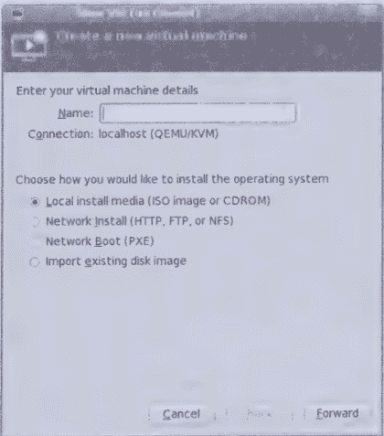

**图22-1** 选择名称。

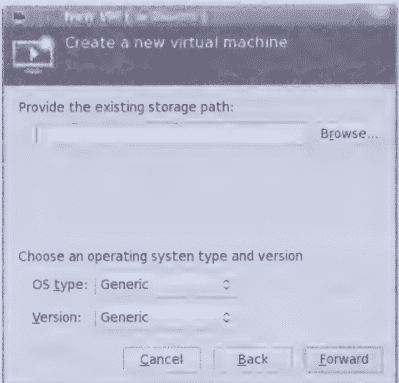

**图22-2** 选择存储路径。

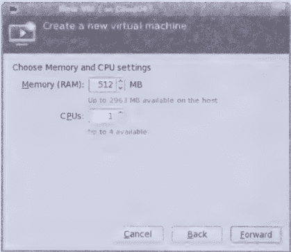

**图22-3** 设置内存与CPU数量。

设置要使用的内存容量和虚拟CPU数量（见图22-3）。选择存储大小（见图22-4）。选择要使用的网络适配器（见图22-5）。完成以上操作后，虚拟客户机即创建完成，可在主窗口查看。若打开设置项，还可看到可编辑的额外虚拟机配置选项。

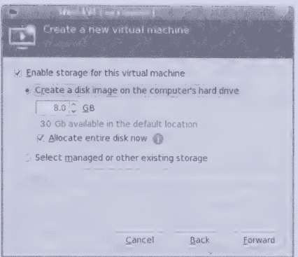

**图22-4** 选择存储大小。

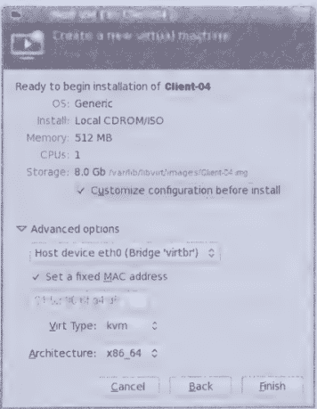

**图22-5** 选择网络适配器。

#### 虚拟客户端管理

创建虚拟客户机后，还需对其进行管理。管理操作包括启动/停止、重启、制作快照（又称保存状态）和迁移等。上述任务均可通过`virt-manager`工具完成，也可在命令行中使用`virsh`命令实现。

```console
Syntax: virsh [options] [commands]
```

### 选项：

- `-c`：连接到Hypervisor
- `-r`：以只读方式连接
- `-q`：以静默模式打开
- `-l`：将日志输出到文件

与`virt-install`命令类似，`virsh`的子命令数量极多，无法在此一一列举，本节仅介绍管理类命令：

- `help`：打印基础帮助信息
- `list`：列出所有虚拟客户机
- `dumpxml`：输出客户机的XML配置文件
- `create`：基于XML文件创建虚拟客户机
- `start`：启动处于非运行状态的客户机
- `destroy`：强制停止客户机
- `define`：定义新的虚拟客户机配置
- `domid`：显示客户机ID
- `domuuid`：显示客户机的UUID
- `dominfo`：显示客户机信息
- `domname`：显示客户机名称
- `domstate`：显示客户机状态
- `quit`：退出交互式终端
- `reboot`：重启客户机
- `restore`：从文件中恢复此前保存的客户机状态
- `resume`：恢复已暂停的客户机运行
- `save`：保存客户机当前状态


-   `shutdown`：正常关机客户机
-   `suspend`：暂停客户机运行
-   `undefine`：删除与客户机相关的全部文件
-   `migrate`：将客户机迁移至其他主机（支持热迁移）

你会发现这是个很长的命令列表，但如果你之前有过虚拟化相关工作经验，应该能认出其中大部分命令。在使用`virsh`命令管理虚拟机前，你需要连接到正确的管理程序（位于物理宿主机上），才能获得访问虚拟机的权限。

连接到物理宿主机`RHEL03`上的管理程序：

```
# virsh connect RHEL03
```

完成连接后，你就可以管理连接到此管理程序的所有虚拟主机了。

## 实战小贴士

连接到管理程序后，使用`list`命令即可显示所有可用的虚拟机：

```
# virsh list --all
```

#### 监控虚拟资源

如果还记得第9章《系统日志、监控与自动化》的内容，我们当时讨论过可用于监控系统资源的工具和命令。处理虚拟化相关事务时，同样需要监控系统资源；但此时你需要查看的是所有虚拟机的运行状态，而不仅仅是物理宿主机的。要实现这个目标，我们再来看看`virsh`命令的其他可用选项。

| 命令 | 说明 |
|---------|-------------|
| `setmem` | 设置虚拟机的已分配内存 |
| `setmaxmem` | 设置管理程序的最大内存上限 |
| `setvcpus` | 修改分配给虚拟机的虚拟CPU数量 |
| `vcpupinfo` | 显示虚拟机的虚拟CPU相关信息 |
| `vcpupin` | 控制虚拟机的虚拟CPU亲和性 |
| `domblkstat` | 显示虚拟机的块设备统计信息 |
| `domifstat` | 显示虚拟机的网络接口统计信息 |
| `attach-device` | 为虚拟机附加设备 |
| `attach-disk` | 为虚拟机附加新磁盘 |
| `attach-interface` | 为虚拟机附加新网络接口 |
| `detach-device` | 从虚拟机卸载设备 |
| `detach-disk` | 从虚拟机卸载磁盘 |
| `detach-interface` | 从虚拟机卸载网络接口 |

和手动管理虚拟机时一样，使用这些命令前也需要先连接到管理程序。在每台虚拟机内部，都可以使用第9章讨论过的相同工具；而`virsh`的这些额外选项可以让你从外部视角查看物理宿主机与虚拟机系统之间发生的交互。监控系统资源时，你也可以选择使用`virt-manager`工具。该工具包含所有相同的功能，但支持以图形化形式展示相关信息。在首次创建虚拟机时，为其建立性能基线非常重要。这样你就可以通过将当前资源使用情况和系统基线对比，监控资源状态并排查潜在问题。这是一项很重要的技能，尤其是在你判断现有硬件是否足以支撑虚拟机系统运行时非常实用。

### 本章总结

本章我们讲解了如何在`RHEL6`上使用`KVM`创建和管理虚拟机。同时也讨论了虚拟机创建完成后的监控方法。尽管红帽有专门的虚拟化认证，但系统管理员仍需掌握虚拟机创建和管理的基础知识，尤其是在如今虚拟化技术无处不在的环境中。如果你对红帽虚拟化技术感兴趣，建议你了解`RHCVA`认证及相关培训课程。

### 复习题

1. `virt-install`软件包支持通过图形界面管理虚拟机。判断对错？

2. 默认情况下，所有虚拟机会被创建为相同容量的`RAM`。判断对错？

3. `virsh`命令的作用是什么？

4. `virsh reboot Client04`命令的作用是什么？

5. 虚拟机连接到管理程序后，如何显示所有虚拟机？

### 复习题答案

1. 错误。`virt-install`软件包支持通过命令行管理虚拟机，而`virt-manager`软件包才支持通过图形界面管理虚拟机。

2. 错误。创建虚拟机时你需要自行指定为其分配的`RAM`容量。

3. `virsh`命令用于管理虚拟机。

4. 该命令用于重启名为`Client04`的虚拟机。

5. 连接到管理程序后，你可以使用`virsh list --all`命令列出所有虚拟机。

### 任务1 – KVM配置

- 步骤1. 使用任意文本编辑器打开`GRUB`配置文件。

- 步骤2. 向配置文件中添加新条目：

  a. 新条目的标题应为`Red Hat Recovery`。

  b. 该新条目不能设为默认启动项。

  c. 该恢复条目需支持启动进入恢复模式。

- 步骤3. 将启动选择超时时间修改为10秒。

当系统启动时`GRUB`菜单中显示两个条目且均能正常运行时，即完成本任务。

### 任务2 – 启动问题排查

- 步骤1. 确保你已准备好红帽安装光盘，删除`/etc/inittab`文件后重启系统。

- 步骤2. 从红帽安装光盘启动并进入恢复模式。

- 步骤3. 将光盘中的对应文件复制到系统的正确位置。

- 步骤4. 你可能需要使用`mount /dev/cd-rom /mnt`命令来访问光盘驱动器。

当系统再次正常启动后，即完成本任务。

**说明：** 本实验基于本书开篇介绍的实验环境搭建要求，需你在`RHEL01`和`RHEL02`两台宿主机上完成基础红帽系统安装，实验时长为2.5小时。

**任务1：** 以`RHEL02`为服务器，通过`FTP`协议对`Client01`主机执行网络安装。`Client01`安装过程中无需安装桌面管理器（`Gnome`或`KDE`）。

**任务2：** 在`RHEL02`上运行`t_root_password`脚本，将`root`密码修改为随机字符串，随后找回`root`密码并将其修改为`SecurePassWord`。

**任务3：** 在`Client01`上，将默认系统运行级别修改为3。

**任务4：** 创建一个名为`User03`的新用户，为其设置任意密码，但强制该密码在`User03`首次登录时过期并必须修改。

**任务5：** 在`RHEL02`上，将各运行级别下每个网络服务的状态输出到名为`runlevel_stats`的文件中。

**任务6：** 在`RHEL01`上完成以下配置：

-   将`/dev/hdb`配置为使用`LVM`，并创建3个容量相同的逻辑卷。

-   将第二个逻辑卷命名为`backups`。

-   在`/dev/hdc`上创建以下基础分区：1个`3GB`大小的分区、1个`2GB`大小的交换分区、1个`1GB`大小的分区。

-   除交换分区外，为所有已创建的分区创建`ext4`文件系统。

-   启用交换分区。

**任务7：** 将启动时内核选择的默认超时时间修改为20秒，同时在`GRUB`配置文件中添加第二个支持启动进入单用户模式的条目。

# 实验考试1

任务8：在`Client01`上创建名为`jsmith`的用户，创建目录`/opt/jsmith`，该用户登录系统时的主目录需设置为`/opt/jsmith`。

任务9：创建以下两个文件：`/opt/secret_data`和`/opt/salaries`。为这两个文件配置`ACL`，使得`user01`和`jsmith`用户均可读取文件，但均无写入权限，且文件的所有者需为`root`。

任务10：将`RHEL01`和`RHEL02`上的`SELinux`设置为强制模式，网络中其他系统的`SELinux`需设置为禁用。

任务11：在`RHEL02`上创建名为`user02`的用户，编写一个可输出剩余磁盘空间的脚本，将结果写入`/opt/free_space`文件，并配置`user02`创建`cron`任务，每3小时执行一次该新建脚本。

任务12：在`RHEL01`上搭建`FTP`服务器，创建目录`/opt/ftp_data`并将其设置为`FTP`服务器唯一可访问的目录，`FTP`服务器需允许匿名访问。

任务13：配置以下防火墙规则：

-   `172.168.1.0/24`网段内的所有系统可访问`RHEL01`上的`FTP`服务器，其他所有系统均被拒绝访问。

-   `Client01`的用户可通过`SSH`远程登录`RHEL01`，其他任何系统均无`RHEL01`的`SSH`访问权限。

-   仅在`RHEL02`上开放`TCP 69`端口，仅允许`172.168.1.50`访问。

## 实验考试 2

**说明**：本实验基于本书导言中概述的实验环境设置。它要求你在主机`RHEL01`和`RHEL02`上进行基本的`Red Hat`安装。你有2.5小时来完成本实验。

**任务 1**：在`RHEL01`上，创建一个`kickstart`服务器和一个`DHCP`服务器。使用此`kickstart`服务器，在`Client02`上执行一次基本安装（无桌面管理器）。

**任务 2**：在`RHEL02`上，执行以下操作：

-   创建目录`/opt/server_data`。

-   创建一个`cron`作业，将可用磁盘空间量输出到`/opt/server_data`目录中一个名为`data`的文件。

-   此脚本应每天下午3点运行。

**任务 3**：在`RHEL01`上，使用`GMT`作为时区配置一个`NTP`服务器。

**任务 4**：将`Client01`同步到时间服务器`RHEL01`。

**任务 5**：在`RHEL02`上，执行以下操作：

-   设置一个`Apache Web`服务器。

-   创建两个客户网站：`csite_1`和`csite_2`（这些网站必须位于`/var/www/html`目录中）。

-   客户网站2（`csite_2`）应只能通过`HTTPS`协议访问。

**任务 6**：在`RHEL02`上设置一个`Samba`服务器。它应有两个共享：`/opt/company_data`和`/opt/paychecks`。第一个共享应允许任何用户访问，并具有该共享的读/写权限。第二个共享应具有只读权限。这两个共享应仅允许本地子网上的主机访问。

**任务 7**：将`RHEL01`设置为本地`172.168.1.0/24`子网的仅缓存`DNS`服务器。域应为`example.org`。

**任务 8**：在`RHEL02`上，对`/home`目录设置用户配额。创建两个名为`user01`和`user04`的用户。这些用户不应能够在他们的主目录中创建超过20MB的数据（硬限制）。

**任务 9**：在`RHEL01`上，创建名为`example.com`和`example.net`的虚拟主机。每个站点应有自己的主目录，并且只能通过`HTTP`协议访问。阻止`Client01`访问任一网站。

**任务 10**：在`RHEL01`上，在端口2228上设置一个`Squid`代理服务器。`Client01`和`Client02`应能够通过此代理访问`Web`。

**任务 11**：在`RHEL01`上，设置一个`SMTP`服务器。来自`Client01`和`Client02`的用户应能够使用此`SMTP`服务器发送邮件（不需要`TLS`）。

**任务 12**：在`RHEL02`上，创建一个名为`bjones`的用户。为`bjones`生成一个公钥/私钥对（密钥不需要密码），并设置`RHEL02`仅允许来自`RHEL01`的公钥认证。用户`bjones`应能够通过`SSH`公钥认证连接到`RHEL01`。

**任务 13**：在`RHEL02`上，设置一个`NFS`版本4服务器。创建名为`/opt/students`和`/opt/teachers`的共享。来自`Client01`和`Client02`的所有用户都应具有对`/opt/students`共享的读/写访问权限。`/opt/teachers`共享应为只读。`RHEL01`用户不应有权访问此`NFS`服务器。此外，任何远程系统的`root`用户都无权访问此服务器。

导航至实践课程部分并开始课程。

# 索引

## A

### ACL（访问控制列表）

-   `BIND`安全，413
-   配置，138-141
-   `NFS`安全，360-361

### 添加

-   用户账户的描述，197-198
-   软件包仓库，183-184

### 地址绑定服务，故障排除，469

### 调整 `LVM` 分区大小，93-96

### 别名映射，`Postfix`，451

### `Apache Web` 服务器，325-333

-   部署 `CGI` 应用程序，341-342
-   配置，326-332
-   防火墙配置，329-332
-   全局环境，327
-   安装，325-326
-   主服务器选项，327-328
-   安全，334-341
    -   基于主机的安全，334-336
    -   `HTTPS`，339-341
    -   基于用户的安全，336-339
-   配置 `SELinux`，329-332
-   故障排除，332-333
-   虚拟主机，342-343

### 数组（`RAID`）

-   创建，102-104
-   删除，108

### `atd` 服务，创建单个作业，258-261

### `authconfig-tui` 命令，211

### 认证

-   密钥认证，配置`SSH`，316-317
-   `LDAP`，配置，214-215
-   密码
    -   在单用户模式下更改，464
    -   为用户账户设置，199-200
-   用户账户，网络认证，212-213

### 权威名称服务器，394

### `AutoFS`，141-144

### 自动化

-   使用`cron`软件包，252-258
-   `kickstart`服务器网络安装
    -   使用`PXE`启动，232-233
    -   使用`TFTP`，229-231

## B

### `BIND`

-   `DNS`配置，393-395
-   `DNS`安全，412-417
    -   `ACL`，413
    -   `chroot`环境，416-417
    -   `DNS`服务器，`iptables`，415-416

### 布尔选项

-   `Samba`，374-376
-   `SELinux`，`FTP`服务，387
-   `SELinux`服务的选项，283-285

### 启动过程，47-51

-   `GRUB`，51-54
    -   命令行，54
    -   配置文件，52-54
-   `root`用户密码丢失，故障排除，463
-   `MBR`损坏，故障排除，464-465
-   缺失根文件，故障排除，465
-   分区，故障排除，465
-   运行级别，55-59
    -   恢复运行级别，59
-   服务，管理，59-66
-   实用程序，56-59
-   `Upstart`，48

### 构建`RPM`，184-188

-   `rpmbuild`命令，187-188

### 缓存名称服务器，394

### 配置，404-406

### 集中日志记录，227-247

### `CGI`应用程序，在`Apache`上部署，341-342

### `chage`命令，201-202

### 更改`SELinux`上下文，281-282

### 在单用户模式下更改密码，464

### `chcon`命令，281-282

### `chkconfig`命令，61-62

### `chroot`环境，`BIND`安全，416-417

### 客户端

-   `NFS`，连接，364-365
-   `Samba`，377-379
-   `VNC`服务器，连接，320-321

### 命令行，`GRUB`，54

### 命令

-   `authconfig-tui`命令，211
-   `blkid`，126
-   `chage`，201-202
-   `chcon`，281-282
-   `chkconfig`，61-62
-   `df`，128
-   `dig`，164
-   `DNS`服务器配置，408-412
-   `e2fsck`，127
-   `e2label`，125
-   `exportfs`，356
-   `fdisk`，75-77
-   `findfs`，126
-   `halt`，57
-   `host`命令，`DNS`服务器配置，407-408
-   `hostname`，162
-   `initctl`，65
-   `ifconfig`，152-154
-   `iptables`，294-301
-   `kill`，250-252
-   `lsmod`，267
-   `mkdir`，185
-   `modinfo`，267
-   `mount`，128
-   `netstat`，158-159
-   `nfsstat`，362-364
-   `nslookup`，408
-   `ntsysv`，63-64
-   `parted`，79-81
-   `partprobe`，77
-   `ping`，157-158
    -   `DNS`服务器配置，407
-   `postconf`，448
-   `poweroff`，58
-   `ps`，监控系统性能，249
-   `pwck`，203
-   `rpcinfo`，357
-   `reboot`，58
-   `renice`，252
-   `resize2fs`，127
-   `restorecon`，282
-   `route`，155，158
-   `rpmbuild`，187-188
-   `sealert`，287
-   `sestatus`，278-279
-   `setsebool`，285
-   `shutdown`，56
-   `smbpasswd`，373
-   `smbstatus`，378
-   `su`，206
-   `sudo`，206
-   `system-config-kickstart`，228
-   `tcpdump`，159-160
-   `testparm`，372-373
-   `uname`，266
-   `wget`，171
-   `who`，58
-   `yum`，更新`Linux`内核，269-272

### 配置文件

-   `Apache Web`服务器，326-327
-   `GRUB`，52-54
-   `kickstart`服务器的配置文件，225-228
-   `PAM`，301-303
-   `Postfix`，446
-   `Samba`，370
-   `syslog`，241-243

## 配置


- Apache Web 服务器，326-332
  - 防火墙，329-332
  - 主服务器选项，327-328
  - SELinux，329-332
- 虚拟主机，342-343
- DHCP 服务器，427-431

# DNS

- BIND，393-395
  - DNS 配置，393-395
  - DNS 安全，412-417
    - ACL，413
    - chroot 环境，416-417
    - DNS 服务器，iptables，415-416
- 防火墙，394-395
- DNS 服务器，396-406
  - 缓存名称服务器，404-406
  - `dig` 命令，408-412
  - 转发名称服务器，406
  - `host` 命令，407-408
  - 主名称服务器，393-397
  - `nslookup` 命令，408
  - `ping` 命令，407
  - 辅助名称服务器，401-404
- Dovecot，452-454
  - SELinux，453-454

## 文件系统

- ACL，138-141
- 配额，132-137
- 防火墙服务，kickstart 服务器使用，233-234

# FTP

- 防火墙规则，386-388
- vsftpd，384-385
- iptables，294-299
- KVM，物理主机，473-474
- 通过 kickstart 服务器进行网络安装，221-225

# 网络

- 以太网绑定，160-161
- 路由，155-156
- 静态 IP 地址，151-155
- 静态路由，156
- NFS，353-357
- iptables，358-360
- NTP，434-437
- Postfix，443-450
  - 别名映射，451
  - 防火墙，449-450
  - SELinux，449-450
- 远程管理，VNC 服务器，318-320
- Samba，370-376
  - 防火墙规则，374
  - 共享，370-373
  - SELinux，279
- Squid Web 代理，344-346
  - 防火墙，345-346
  - SELinux，345-346
- SSH，310-312
  - 密钥认证，316-317
  - 端口转发，317-318
- 用户账户
  - 组协作，209-211
  - NIS 认证，212-213

## 连接

- NFS 客户端，364-365
- 用户账户到网络目录，211-215
- VNC 服务器客户端，320-321

## 连通性

- ping，故障排除，470
- 故障排除，156-160

## 密码一致性

- 验证，203

## 上下文

- SELinux，278，279-282
  - 更改，281-282
  - 验证更改，282

## 将 SysV 转换为 Upstart，64-66

## 创建

- cron 作业，254-258
- 文件系统，114-116
- 软件包
  - `rpmbuild` 命令，187-188
  - 规范文件，185-187
- 分区
  - 加密分区，129-131
  - LVM 分区，89-93
  - 使用 `parted` 命令，79-81
  - 交换分区，81-83
- RAID 数组，102-104
- 仓库，188-190
- RPM，184-188
  - 目录要求，184
  - 交换分区，116-119
- 用户账户，196-197，203-204
  - 组，204-206

## cron

- 自动化，252-258
- 作业，创建，254-258

## 自定义

- 软件包，190
- 用户账户创建过程，207-209

## D

### 删除

- LVM 分区，99-100
- 分区，83-85
- RAID 数组，108
- 用户账户，198-199
- 在 Apache 上部署 CGI 应用程序，341-342 页
- 为用户账户添加描述，197-198 页
- `df` 命令，128
- DHCP，426-433
  - 安全配置，431-432
  - 服务器配置，427-431
  - 服务器安装，426-427
  - 故障排除，432-433
- `dig` 命令，164
- DNS 服务器配置，408-412
- 目录，RPM 制作要求，184
- 禁用模式（SELinux），277
- 禁用 SELinux 布尔选项，285

## 磁盘

- 故障（RAID），故障排除，105-108
- 使用 `fdisk` 进行分区，75-77

# DNS

### BIND

- ACL（访问控制列表），413
- chroot 环境，416-417
- 配置，393-395
- iptables，415-416
- 安全配置，412-417
  - 防火墙配置，394-395
  - 服务器配置，396-406
    - 缓存域名服务器，404-406
    - 转发域名服务器，406
- `host` 命令，407-408
- 主域名服务器，393-397
- `nslookup` 命令，408
- `ping` 命令，407
- 从域名服务器，401-404
- 故障排除，161-164
- 域上下文（SELinux），280

## 电子邮件

### Dovecot

- 配置，452-454
- 安全配置，454-456
- SELinux 配置，453-454
- 服务器测试，456-458
- 验证安装，452

### Postfix

- 别名映射，451
- 配置文件，446
- 配置，443-450
  - 防火墙配置，449-450
  - 安装验证，444
- 安全配置，450-451
- 服务器测试，456-458
- 启用/禁用 SELinux 布尔选项，285

## 加密，LUKS，128-132

- 开机自动挂载，132
- 分区创建，129-131
- 强制模式（SELinux），277
- 以太网绑定，160-161

## 到期日期

- 更改密码，201-202
- `exportfs` 命令，356

## F

### fdisk 命令

- 磁盘分区，75-77
- SELinux 文件上下文，279-282

## 文件系统

- AutoFS，141-144
- 创建，114-116
- 主目录内文件创建故障排除，467
- 标签故障排除，466
- 挂载，119-125
- 磁盘配额，132-137
  - 配置，132-137
  - 使用报告，137
- 安全配置，137-141
  - ACL 配置，138-141
- GnuPG，141
- 超级块损坏故障排除，466-467
- `findfs` 命令，126

### 防火墙服务

- 为 kickstart 服务器配置，224-225、233-234

## 防火墙

- DNS 配置，394-395
- Dovecot 配置，453-454
- iptables，293-301
  - BIND 安全配置，415-416
  - 配置，294-299
  - NFS 配置，358-360
  - 故障排除，299
- Squid Web Proxy 配置，345-346

### 首次启动流程（Red Hat Enterprise Linux 安装），37-39

- 转发域名服务器，394

## FTP，383-388

- 防火墙规则配置，386-388
- 网络安装，234-235
- 安全配置，388-389
- SELinux 布尔选项，387
- 服务器安装，384
- 故障排除，389-390
- vsftp 配置，384-385

## G

- Apache 全局环境，327

### 全局用户配置文件

- 全局用户配置文件，208-209
- GnuPG，141
- 组协作，209-211
- 组文件，204-206
- 创建组，204-206

## GRUB（大统一启动加载器）

- 启动流程，47-51
- 命令行，54
- 配置文件，52-54
- 内核条目编辑，51-52

## H

- `halt` 命令，57

### 主目录文件创建故障排除，467

### 基于主机的安全

- Apache Web 服务器，334-336
- NFS，360-361
- `host` 命令（DNS 服务器配置），407-408
- `hostname` 命令，162
- HTTP 网络安装，234-235
- `httpd` 服务（SELinux）布尔选项，283-285
- HTTPS（Apache Web 服务器安全），339-341

## I

- 不可访问服务故障排除，468-469
- `initctl` 命令，65
- 初始化用户账户，207-209

### 安装

- Apache Web 服务器，325-326
- DHCP 服务器，426-427
- FTP 服务器，384
- NFS 服务器，352-353
- NTP 时间服务器，434
- 软件包，170-172
  - 使用 `yum`，178-182
- Red Hat Enterprise Linux，29-39
  - 首次启动流程，37-39
  - 通过 kickstart 服务器网络安装，221-225
  - 分区创建，34
  - 安装验证，40-41
- Squid Web Proxy，344
- KVM 虚拟客户端，474-476
- Internet 软件包下载，171
- `ipconfig` 命令，152-154
- iptables，293-301
  - BIND 安全配置，415-416
  - 配置，294-299
  - NAT（网络地址转换），300-301
  - NFS 配置，358-360
  - 故障排除，299
  - 安装验证，293-294

## J-K

### 任务（cron）创建，254-258

# 内核

- 启动流程，49-51
- GRUB，51-54
  - 使用 GRUB 编辑内核条目，51-52
- 文件位置，266-267
- KVM，473
- 模块，267
- 查看软件包信息，268-269
- 调优，272-274
- `uname` 命令，266
- 更新，268-272
- SSH 密钥认证配置，316-317

### kickstart 服务器

- 配置文件，225-228
- 防火墙服务配置，233-234
- 网络安装——通过 PXE 启动实现自动化，232-233
  - 通过 TFTP 实现自动化，229-231
- 配置，221-225
  - 防火墙服务，224-225
  - 安装分区创建，227-228
- `kill` 命令，250-252

## KVM（基于内核的虚拟化模块），473

- 物理主机配置，473-474
- 虚拟客户端安装，474-476
- 虚拟客户端管理，477-479
- 虚拟资源监控，479-480

## L

## 文件系统标签故障排除，466

## LDAP 认证配置，214-215

## PAM 库模块，301

## Linux 内核

- 文件位置，266-267
- 模块，267
- 查看软件包信息，268-269
- `uname` 命令，266

## Linux 内核更新，268-272

## 内核文件位置，266-267

## 锁定用户账户，203-204

## 日志文件

- SELinux 故障排除，286
- syslog，239-248
  - 轮转，243-244
- 验证 Red Hat Linux 安装，41

## 丢失 root 用户密码故障排除，463

## `lsmod` 命令，267

## LUKS（Linux 统一密钥设置），128-132

- 加密分区创建，129-131
- 开机自动挂载，132

## LVM（逻辑卷管理器），85-100

- 分区——调整大小，93-96
- 创建，89-93
- 数据迁移，96-99
- 删除，99-100

## M

## Apache 主服务器选项，327-328

## 管理

- 使用 `yum` 管理软件包，177-184
- 密码策略（PAM），304-305
- 服务，59-66
- KVM 虚拟客户端管理，477-479

## 主域名服务器配置，393-397

## MBR 损坏故障排除，464-465

## “无法到达目标主机”消息故障排除，469-470

## 磁盘间数据迁移，96-99

## `mkdir` 命令，185

## `modinfo` 命令，267

## 内核模块，267

## 监控

- 性能，248-252
  - `kill` 命令，250-252
  - `renice` 命令，252
- 虚拟资源，479-480

## `mount` 命令，128

## 挂载

- 文件系统，119-125
- 开机挂载 LUKS，132
- Samba 共享，378

## N

- 域名服务器，394
- NAT（网络地址转换），300-301
- `netstat` 命令，158-159
- 网络目录连接用户账户，211-215

### 网络安装

- 通过 FTP，234-235
- 通过 HTTP，234-235
- 通过 kickstart 服务器——通过 PXE 启动实现自动化，232-233
  - 通过 TFTP 实现自动化，229-231
- 配置文件，225-228
- 配置，221-225
  - 防火墙服务，224-225
  - 安装分区创建，227-228
- 通过 NFS，234-235

### 网络服务

- DHCP，426-433
  - 安全配置，431-432
  - 服务器配置，427-431
  - 服务器安装，426-427
  - 故障排除，432-433
- NTP，433-439
  - 配置，434-437
  - 安全配置，437
  - 时间服务器安装，434
  - 故障排除，438-439
- xinetd 服务，421-425

# 网络

- 配置文件，150-151
- 连接故障排除，156-160
- 以太网绑定，160-161
- 路由配置，155-156
- 静态 IP 地址配置，151-155
- 静态路由配置，156
- NFS（网络文件系统），351-360
  - 客户端连接，364-365
  - 配置，353-357
  - iptables 配置，358-360
  - 网络安装，234-235
  - 安全配置，360-361
  - 服务器安装，352-353
  - 查看统计信息，362-364
  - 故障排除，361-364
  - `nfsstat` 命令，362-364
- NIS 认证配置，212-213
- “无法到达目标主机”消息故障排除，469-470
- `nslookup` 命令，408
- NTP（网络时间协议），433-439
  - 配置，434-437
  - 安全配置，437
  - 时间服务器安装，434
  - 故障排除，438-439
- `ntsysv` 命令，63-64

## O-P

- 查看 Linux 内核软件包信息，268-269

### 软件包

- 创建——使用 `rpmbuild` 命令，187-188
- `spec` 文件，185-187
- cron，252-258
- 自定义，190
- 从网络下载，171
- 安装，170-172
  - 使用 `yum`，178-182

## 软件包，169-177

- 使用 `yum` 管理，177-184
- 查询，172-177
- 添加软件源仓库，183-184
- 创建软件源仓库，188-190
- 搜索软件包，182-183
- 验证软件包，172-177
- 安装 VNC 服务器，318
- 安装软件包，170-172
- 删除软件包，178-182

## PAM（可插拔认证模块），301-305

- 配置文件，301-303
- 库模块，301
- 管理密码策略，304-305
- 故障排除，303-304

## Parted 命令

- 创建分区，79-81

## 分区，71-85

### 创建分区

- 使用 `fdisk`，75-77
- 安装用分区，34
- 使用 `parted` 命令，79-81
- 迁移数据，96-99
- 删除分区，83-85
- 创建加密分区，129-131
- 配置 Kickstart 服务器网络安装，227-228
- 查看分区布局，72-75

### LVM 分区

- 调整大小，93-96
- 创建，89-93
- 删除，99-100

### RAID，101-108

- 创建阵列，102-104
- 创建交换分区，81-83、116-119
- 故障排除，465
- 删除阵列，108
- 磁盘故障排查，105-108

## Partprobe 命令，77

## 密码文件，200-201

## 密码

- 单用户模式下修改密码，464
- 验证一致性，203
- 修改过期时间，201-202
- 丢失 root 密码故障排查，463
- 设置用户账户密码，199-200
- 存储在 shadow 文件，201-204

## 性能监控，248-252

- `kill` 命令，250-252
- `renice` 命令，252

## SELinux 宽容模式，277

## Ping，157-158

- DNS 服务器配置，407
- 故障排除，470


# SELinux策略违规故障排查，286-287

# SSH端口转发，317-318

# Postfix

- 别名映射，451
- 配置文件，446
- 配置，443-450
- 防火墙配置，449-450
- 验证安装，444
- 安全配置，450-451
- 服务器测试，456-458

# Poweroff命令，58

# 代理服务器，Squid Web代理，343-347

- 配置，344-346
- 安装，344
- 安全配置，346-347

# PS命令，系统性能监控，249

# 配置SSH的公钥/私钥，316-317

# PWck命令，203

# PXE启动，自动化Kickstart服务器网络安装，232-233

# 查询软件包，172-177

# 文件系统配额，132-137

- 配置，132-137
- 使用报告，137

# 配置NFS的Rcpbind服务，353-357

# Rcpinfo命令，357

# Reboot命令，58

# 恢复运行级别，59

# 递归域名服务器，394

# Red Hat Network，190-191

- 注册到Red Hat Network，191

# 远程管理

## SSH，309-315

- 配置，310-312
- 密钥认证，316-317
- 端口转发，317-318
- 安全配置，314
- 故障排除，468

## VNC服务器，318-321

- 配置，318-320

# 删除软件包，178-182

# 删除用户账户，198-199

# Renice命令，252

# 软件源仓库

- 添加，183-184
- 创建，188-190
- RPM创建要求，184

# Resize2fs命令，127

# Restorecon命令，282

# 查看SSH的SELinux限制，313

# 执行反向查询，408

# RHEL6的Upstart启动流程，50-51

# SELinux角色上下文，280

# Route命令，155-158

# 配置路由，155-156

# RPM（红帽包管理器），169-177

- 创建，184-188
- `rpmbuild`命令，187-188

# RPM软件包，169-177

- 安装，170-172
- 查询，172-177
- 验证，172-177

# 运行级别，55-59

- 恢复运行级别，59

# 管理服务，59-66

- 启动/停止，61
- 实用工具，56-59

# Samba，369-376

- 布尔选项，374-376
- 客户端，377-379
- 配置文件，370
- 配置，370-376
- 配置防火墙规则，374
- 验证安装，369
- 安全配置，377

## Samba客户端，377

- 挂载共享，378
- 卸载共享，379

# SELinux，277-285

- 配置，279
- 上下文，278-282
- 修改上下文，281-282
- 配置Dovecot的SELinux，453-454
- FTP配置，386-388
- 日志文件，286
- 配置NFS的SELinux，358-360
- 策略违规故障排查，286-287
- 配置Postfix的SELinux，449-450
- 服务布尔选项，283-285
- 配置Squid Web代理的SELinux，345-346
- 查看状态，278-279
- 故障排除，286-287

# 安全

- Apache Web服务器，334-341
  - 主机安全，334-336
  - HTTPS，339-341
  - 用户安全，336-339
- BIND chroot环境，416-417
- 修改密码，464
- DHCP，431-432
- DNS（BIND），412-417
- Dovecot，454-456
- 文件系统，137-141
  - 配置ACL，138-141
  - GnuPG，141
- FTP，388-389
- iptables，293-301
  - 配置，294-299
  - 故障排除，299
  - 验证安装，293-294
  - NAT，300-301
- NFS，360-361
- NTP，437
- PAM（可插拔认证模块），301-305
  - 配置文件，301-303
  - 库模块，301
  - 管理密码策略，304-305
  - 故障排除，303-304
- Postfix，450-451

# 服务

- 地址绑定故障排除，469
- 用Atd服务创建单次任务，258-261
- DHCP，426-433
  - 服务器安装，426-427
- 不可访问故障排除，468-469
- 管理，59-66
- NTP网络服务，433-439
- 配置NFS服务，353-357
- SELinux布尔选项，283-285
- 配置SSH服务，310-312
- 启动/停止，61
- syslog，239-248
  - 集中式日志，227-247
  - 配置文件，241-243
  - 日志轮转，243-244
  - 用户登录事件，247-248
- TCP Wrappers安全，291-293
- xinetd，421-425

# Sestatus命令，278-279

# Setsebool命令，285

# Shadow文件，201-204

# 共享

- NFS，360-361
- Samba
  - 配置，370-373
  - 挂载，378
  - 卸载，379

# Shutdown命令，56

# 用Atd服务创建单次任务，258-261

# 从域名服务器，394

- 配置，401-404

# Smbpasswd命令，373

# Smbstatus命令，378

# Postfix的SMTP服务

- 别名映射，451
- 配置文件，446
- 配置，443-450
- 防火墙配置，449-450
- 验证安装，444
- 安全配置，450-451
- 服务器测试，456-458

# 包创建的Spec文件，185-187

# Squid Web代理，343-347

- 配置，344-346
- 配置防火墙，345-346
- 安装，344
- 安全配置，346-347

# SSH（安全外壳），309-315

- 配置，310-312
- 验证安装，309-310
- 安全配置，314
- 查看SELinux限制，313
- 故障排除，468

# 启动/停止服务，61

# 配置静态路由，156

# 查看NFS统计信息，362-364

# 查看SELinux状态，278-279

# 密码存储在Shadow文件，201-204

# Su命令，206

# Sudo命令，206

# 超级块损坏故障排除，466-467

# 创建交换分区，81-83、116-119

# 切换用户账户，206-207

# 用Sysctl命令调优Linux内核，272-274

# Syslog，239-248

- 集中式日志，227-247
- 配置文件，241-243
- 日志轮转，243-244
- 用户登录事件，247-248

# 系统账户，196

## 系统初始化

- 启动流程，47-51
- GRUB，51-54
- 运行级别，55-59
- 恢复运行级别，59
- 管理服务，59-66
- 实用工具，56-59

# System-Config-Kickstart命令，228

# 将SysV转换为Upstart，64-66

# Tcdump命令，159-160

# TCP Wrappers安全，291-293

# 测试邮件服务器，456-458

# Testparm命令，372-373

# TFTP，自动化Kickstart服务器网络安装，229-231

# 安装NTP时间服务器，434

# 故障排除

- Apache Web服务器，332-333
- 启动问题
  - 丢失root用户密码，463
  - MBR损坏，464-465
  - 缺失根文件，465
  - 分区问题，465
- 连接性问题，156-160
- DHCP，432-433
- DNS，161-164
- 文件系统问题
  - 在home目录创建文件，467
  - 标签问题，466
  - 超级块损坏，466-467
- 防火墙（iptables），299
- FTP，389-390
- 不可访问服务，468-469
- NFS，361-364
- “无法访问目标主机”消息，469-470
- NTP，438-439
- PAM，303-304
- 单用户模式密码问题，464
- Ping故障，470
- RAID磁盘故障，105-108
- SELinux，286-287
  - 策略违规，286-287
- 服务地址绑定，469
- SSH，468

# 调优

- Linux内核，272-274
- `sysctl`命令，272-274

# Uname命令，266

# 撤销上下文修改，282

# 解锁用户账户，203-204

# 卸载Samba共享，379

# 更新Linux内核，268-272

# 升级Linux内核，269-272

# Upstart，48

- 从SysV转换，64-66

# 文件系统配额使用报告，137

# 用户账户，196

- 创建，196-197、203-204
- 自定义创建流程，207-209
- 删除，198-199
- 添加描述，197-198
- 配置组协作，209-211
- 创建组，204-206
- 初始化，207-209
- 移除，198-199
- 切换，206-207

## L

- LDAP 身份验证，配置，214-215
- 锁定，203-204

## N

- 网络目录，连接，211-215

## P

- 密码文件，200-201
- 密码
  - 一致性校验，203
  - 过期日期修改，201-202
  - 设置，199-200

## S

- 暗码文件，201-204
- 切换，206-207
- 系统账户，196

## U

- 解锁，203-204
- 用户上下文（SELinux），280
- 用户登录事件（syslog），247-248
- 基于用户的安全（Apache Web服务器），336-339
- 用户专属文件，207-208
- 实用工具
  - `ping`，157-158
  - `route` 命令，158
  - 运行级别，56-59
  - `tcpdump`，159-160
  - `Yum`，管理软件包，177-184

## V

- 校验
  - 密码一致性，203
  - 上下文变更，282
  - Dovecot 安装，452
  - `iptables` 安装，293-294
  - 软件包，172-177
  - Postfix 安装，444
  - Red Hat Enterprise Linux 安装，40-41
  - Samba 安装，369
  - SSH 安装，309-310
- Linux内核版本更新，269-272
- 查看
  - Linux内核软件包信息，268-269
  - NFS统计信息，362-364
  - 分区布局，72-75
  - SSH的SELinux限制，313
  - SELinux状态，278-279
- KVM上的虚拟客户端管理，477-479
- Linux内核虚拟文件系统调优，272-273
- Apache虚拟主机，342-343
- 虚拟机
  - KVM
    - 物理主机配置，473-474
    - 虚拟客户端安装，474-476
    - 虚拟客户端管理，477-479
    - 虚拟资源监控，479-480
- VNC服务器，318-321
  - 客户端连接，320-321
  - 配置，318-320
  - 软件包安装，318
- vsftp
  - FTP配置，384-385
  - FTP安全，388-389

## W

- Web服务器
  - Apache Web服务器，325-333
    - CGI应用程序部署，341-342
    - 配置，326-332
    - 防火墙配置，329-332
    - 全局环境，327
    - 基于主机的安全，334-336
    - 基于HTTPS的安全，339-341
    - 安装，325-326
    - 主服务器选项，327-328
    - 安全，334-341
    - SELinux配置，329-332
    - 故障排除，332-333
    - 基于用户的安全，336-339
    - 虚拟主机，342-343
  - Squid Web代理，343-347
    - 配置，344-346
    - 安装，344
    - 安全，346-347
  - `wget` 命令，171
  - `who` 命令，58

## X-Y-Z

- xinetd 服务，421-425

## Y

- `yum` 命令
  - Linux内核更新，269-272
  - 软件包
    - 安装，178-182
    - 管理，177-184
  - 添加仓库，183-184
  - 搜索，182-183

注册您拥有的Addison-Wesley、Exam Cram、Prentice Hall、Que和Sams品牌产品，即可解锁多项福利。要开始注册流程，只需访问`informit.com/register`登录或创建账户即可。之后系统会提示您输入印在产品封底上的10位或13位ISBN码。注册您的产品可解锁以下福利：

- 可获取补充内容，包括额外章节、源代码或项目文件。
- 可获得一张用于下次购买的优惠券。
- 注册福利因产品而异，具体福利会列在您账户页面的“已注册产品”栏目下。

# 关于InformIT —— 值得信赖的技术学习资源

InformIT是顶尖技术出版品牌Addison-Wesley Professional、Cisco Press、Exam Cram、IBM Press、Prentice Hall Professional、Que和Sams的汇聚平台。在这里，您可以获取来自技术领域的作者、创作者、创新者和领军人物发布的优质可信内容与资源。无论您是在寻找新技术的相关书籍、实用的文章、及时的时事通讯，还是想要访问Safari Books Online数字图书馆，InformIT都能满足您的需求。

InformIT是培生集团旗下的品牌，也是全球顶尖技术出版商的线上门户。它是您获取可靠专业内容与知识的渠道，可让您接触到技术社区中的顶级品牌、作者和贡献者。

## 在InformIT学习IT

正在寻找新技术相关的图书、电子书或培训视频？在寻求及时实用的信息和教程？需要专家的观点、建议和技巧？**InformIT为您提供解决方案。**

- 订阅各类时事通讯，即可了解新书发布和特别促销活动。请访问`informit.com/newsletters`。
- 访问`informit.com/podcasts`，免费获取专家播客。
- 访问`informit.com/articles`，阅读最新的作者文章和试读章节。
- 访问`safari.informit.com`，可使用Safari Books Online数字图书馆中的数千本图书和视频资源。
- 访问`informit.com/blogs`，获取专家博客的实用技巧。请访问`informit.com/learn`，了解获取最新热门技术内容的所有方式。

## 你是IT圈的一员吗？

通过RSS订阅、Facebook、Twitter、YouTube等平台，与培生集团的作者和编辑建立联系！请访问`informit.com/socialconnect`。

## 免费试用Safari Books Online

在线访问5000余本图书和视频资源

# 免费试用——立即开始！

`www.informit.com/safaritrial`

## 快速查找可信答案

只有Safari支持跨平台搜索顶尖技术出版商（包括Addison-Wesley Professional、Cisco Press、O'Reilly、Prentice Hall、Que和Sams）旗下的数千本畅销图书。

## 掌握最新工具与技术

除了可以访问海量技术图书资源外，Safari还拥有丰富的视频教程集合，您可以通过这些课程向顶尖视频培训专家学习。

## 等等，还有更多福利！

## 保持您的竞争优势

通过Rough Cuts服务，您可以获取正在编撰中的手稿，第一时间了解全新技术。

## 紧跟新兴技术发展

Short Cuts和快速参考手册是短小、精炼、聚焦的内容，旨在帮助您快速掌握全新前沿技术。

## 您的IT认证备考出版方

培生IT认证是技术认证学习与备考工具领域的领导者。立即访问`pearsonITcertification.com`，查找：

- IT认证（包括思科、CompTIA、微软）的**考试信息与指导**
- 阅读培生IT认证的专家作者和行业专家（例如）发布的最新文章和试读章节，获取**备考技巧与窍门**
  - 马克·爱德华·索珀（Mark Edward Soper）、大卫·普劳（David Prowse）——CompTIA
  - 温德尔·奥多姆（Wendell Odom）——思科
  - 肖恩·哈里斯（Shon Harris）——安全认证
  - 托马斯·厄尔（Thomas Erl）——SOACP
- **特别优惠**（`pearsonITcertification.com/promotions`）
- 注册您的培生IT认证产品，即可获取额外在线资料，并获得一张可用于下次购买的优惠券


## 联系培生IT认证

请务必在`pearsonITcertification.com`创建账户，获取会员专属优惠与福利。

- `pearsonitcertification.com/newsletters`
- `twitter.com/pearsonITCert`
- `facebook.com/pearsonitcertification`
- `youtube.com/pearsonITCert`
- `pearsonitcertification.com/rss/`

## 免费在线版

您购买的**《Red Hat考试实战指南》**可通过Safari Books Online订阅服务，免费获取45天时长的在线版权限。几乎所有培生IT认证的图书都可在Safari Books Online上在线获取，此外还有来自Addison-Wesley Professional、Cisco Press、Exam Cram、IBM Press、O'Reilly、Prentice Hall、Que和Sams等出版商的5000余本技术图书和视频资源。

`Safari Books Online`支持您搜索特定问题的答案、复制粘贴代码、下载章节，以及紧跟新兴技术发展。

**激活您的免费在线版，请访问**

`www.informit.com/safarifree`

- **步骤1：** 输入优惠码：`DURXAZG`。
- **步骤2：** 新Safari用户请填写简短的注册表单，Safari订阅用户直接登录即可。如果您在Safari注册或访问在线版时遇到问题，请发送邮件至`customer-service@safaribooksonline.com`联系我们。

## 红帽®认证考试实操指南：RHCSA™与RHCE®认证指南及实验手册

由资深Linux系统管理员、IT培训师及认证专家达米安·托马西诺带来的`RHCSA™`与`RHCE®`认证全程备考指南！

### 全面掌握RHCSA™与RHCE®所有考点！

- `Red Hat Enterprise Linux 6` 本地及网络安装
- 系统服务、运行级别与启动流程
- 磁盘、分区与文件系统（含`LUKS`加密）
- 网络配置
- 软件包管理
- 用户管理
- 日志、监控与自动化
- 内核更新与调优
- 安全（含`SELinux`、防火墙及安全策略）
- 远程访问（含`SSH`）
- `Apache`、`Squid`、`DNS`、`DHCP`、`NTP`及电子邮件服务
- `NFS`与`Samba`
- 客户端与网络故障排查
- `KVM`虚拟化

### 巩固知识、提升信心、顺利通关！

- 22个`RHCSA™`与`RHCE®`实操实验，每个实验包含多个真实场景任务
- 可下载的故障排查脚本
- 实用教程与一线实战技巧
- 备考技巧
- `Red Hat Enterprise Linux 6` 命令快速参考手册
- 独家红帽认证备考建议与任务清单
- 两套全尺寸实操模拟考题

达米安·托马西诺（DAMIAN TOMMASINO，持有`RHCE`、`RHCSA`、`MCSA`、`CCNA`、`CCENT`、`MCP`、`Security+`、`Network+`、`A+`认证）是TradeCard公司的Linux系统管理员，同时还是在线IT培训公司Modular Learning Inc.的CEO。他运营的博客“安全坚果”（Security Nut，`http://secnut.blogspot.com`）主要分享红帽、Linux及安全相关内容，同时是热门IT认证论坛`techexams.net`的活跃贡献者。

上架分类：认证 覆盖领域：Linux

`http://modlearning.com` `pearsonITcertification.com`

`ISBN-13：978-0-321-76795-0` `ISBN-10：0-321-76795-0`

美国售价49.99美元 / 加拿大售价59.99美元
