# Novell Open Enterprise Server 实用指南


## Novell CNA 考试 050-686 目标映射

| CNA 考试目标 | 章节 |
|---|---|
| 1: 识别 NetWare 6.5 的特性 | 1 |
| 2: 描述 NetWare 如何与其他操作系统配合工作 | 1, 3, 4 |
| 3: 识别先决条件要求 | 2 |
| 4-5: 准备现有网络和指定计算机 | 2 |
| 6: 安装 NetWare 6.5 | 2 |
| 7-8: 描述并安装 Novell 客户端 | 4 |
| 9: 登录到 eDirectory 和工作站 | 4 |
| 10: 设置客户端属性 | 4 |
| 11: 识别 eDirectory 的角色和好处 | 1, 4 |
| 12: 识别 eDirectory 的工作原理 | 4 |
| 13-14: 识别并描述 eDirectory 组件和对象类 | 4 |
| 15: 识别 eDirectory 树的流程和设计 | 4 |
| 16: 识别 eDirectory 工具及其使用场景 | 5 |
| 17: 描述 Admin 对象 | 4 |
| 18-21: 创建、修改、移动和删除用户对象 | 5 |
| 22-23: 识别网络文件服务组件和 NetWare 卷存储类型 | 3 |
| 24: 创建传统卷和 NSS 卷 | 3 |
| 25: 通过映射网络驱动器访问卷 | 3 |
| 26: 识别规划网络卷的指导原则 | 3 |
| 27: 识别 NetWare SYS 目录的内容和用途 | 3 |
| 28: 识别用于组织文件系统的目录类型 | 3 |
| 29: 评估目录结构类型 | 3 |
| 30: 识别 NetWare 提供的网络安全类型 | 1 |
| 31: 识别 NetWare 文件系统安全性的工作原理 | 6 |
| 32: 规划文件系统权限 | 6 |
| 33: 识别目录和文件属性 | 6 |
| 34: 描述 eDirectory 安全性 | 7 |
| 35-37: 确定权限流向、阻止继承权限以及确定 eDirectory 有效权限 | 7 |
| 38: 排除 eDirectory 安全性故障 | 1 |
| 39: 识别 NDFS 的特性 | 8 |
| 40: 识别打印机类型 | 8 |
| 41-43: 描述 NDFS 组件并设置和管理 NDFS | 8 |
| 44: 实施 Novell iPrint | 8 |
| 45: 实施 Novell iFolder | 10 |
| 46-48: 描述、安装和配置虚拟办公室 | 10 |
| 49: 识别 NetWare 6.5 的操作系统组件 | 2 |
| 50: 使用服务器控制台命令管理 NetWare 6.5 | 2 |
| 51: 使用配置文件 | 2 |
| 52: 识别用于远程管理 NetWare 6.5 的实用工具 | 2 |
| 53: 内部保护网络 | 1 |
| 54: 排除常见内部网络安全问题 | 5, 6, 7 |
| 55: 识别如何通过防火墙提供外部网络安全 | 11 |


澳大利亚 • 加拿大 • 墨西哥 • 新加坡 • 西班牙 • 英国 • 美国


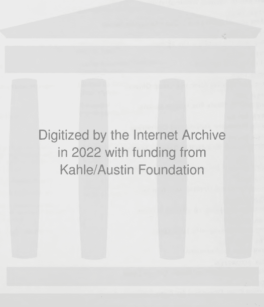

由互联网档案馆在 2022 年数字化
由 Kahle/Austin Foundation 资助

https://archive.org/details/handsonnovellope0000simp


# 引言

自 20 世纪 80 年代以来，Novell 一直是局域网 (LAN) 技术开发领域的领导者。对通过局域网和互联网安全访问资源和服务的需求，促使了更强大、更复杂的网络系统的产生，但计算机操作系统和网络协议的多样性使得从不同环境中访问和管理公司信息及服务变得困难。近年来，企业对使用基于 GNU 许可的开源系统和应用程序的需求日益增长。在开源 GNU 许可模式下，开发人员可以使用现有软件开发新应用程序，只要他们提供源代码即可；企业可以利用由政府机构和大学等公共机构开发的软件，而无需支付高昂的许可费用。Novell 通过其新的开放企业服务器 (OES) 产品发布，回应了对能够集成不同操作系统并支持开源解决方案的网络系统的需求。OES 包含更新后的目录系统以及各种旨在将不同的计算机环境和网络连接在一起，使它们作为一个网络运行的网络服务，即 Novell 所称的“oneNet”。此外，Novell 继续其提供网络解决方案的传统，通过增强管理工具并加强对其开源软件标准的支持，包括 Linux、Apache Web 服务器、MySQL 以及 PHP/Perl。

为了保持竞争力，企业和组织需要具备能力的网络专业人员，他们能够管理由 Windows、Linux 和 NetWare 操作系统组成的网络环境。Novell 设立了认证 Novell 管理员 (CNA) 和认证 Linux 专业人员 (CLP) 项目，以帮助建立网络管理员的信誉，这些管理员具备设置和管理 NetWare 和 Linux 网络服务所需的知识和技能。附录 A 列出了最新的 CNA 和 CLP 考试目标，并将它们映射到涵盖这些目标的书中的章节和节。您可以在 http://education.novell.com 上获取更多关于 Novell 认证选项和测试的信息。

《Novell 开放企业服务器实战：NetWare 和 Linux》旨在为您提供通过 Novell NetWare 6.5 CNA 考试 50-686 以及使用开放企业服务器构建网络系统所需的概念、技能和实践经验。此外，本书还包括许多 CLP 考试目标，涉及如何设置 Novell SUSE Linux Enterprise Server，使其能够向 Windows 和 Linux 客户端提供网络服务。这些技能加上 CNA 认证，将使您处于有利地位，从而利用快速发展和变化的网络计算领域中的众多机遇。

# 随书附带的 Novell 软件产品

2005 年，Novell 收购了 SUSE Linux 公司，该公司是欧洲和美国领先的 Linux 系统提供商。这次收购以及 Novell 对开源解决方案的长期承诺，使 Novell 成为开源软件市场的领导者。如今，Novell 提供来自 NetWare 和 SUSE Linux 世界的一系列操作系统产品。以下是本书中包含的 NetWare 和 SUSE Linux 软件描述：

- **NetWare 6.5 开放企业服务器**——随本书提供的 NetWare 6.5 开放企业服务器产品是一个评估副本，包含两张 CD。您可以使用这些 CD 按照第 2 章所述在服务器上安装 NetWare。
- **SUSE Linux Enterprise Server 9**——开放企业服务器产品包含在一张可引导的 DVD 上，并包含 SUSE Linux Enterprise Server 9 版本，该版本已配置了 Novell 服务，如 eDirectory 和 iPrint。您可以按照第 12 章所述使用此 DVD 安装 SUSE Linux。

# Novell 软件产品许可信息

随本书提供的 Novell 软件程序是评估版本，由 Novell 许可用于与其配套教材进行临时使用（不超过五个月）。使用附带的软件程序还受适用的配套软件许可协议（“许可”）条款的约束。通过使用软件，您同意受许可条款的约束。

随本书提供的 Novell Linux Enterprise Server 软件 DVD 包含 SUSE Linux Enterprise Server 9 的完整评估版本。为了适应这一学术交付物，原始软件已从 CD 修改为 DVD，并以“原样”基础分发。请注意，此软件仅供课堂使用，不得在生产环境中使用。若要下载功能完整、受支持且可升级的 SUSE Linux Enterprise Server 和其他 Novell 开源产品，请访问 www.novell.com/downloads。

有关随本书提供的 Novell 软件的许可信息，请参阅位于 www.novell.com/licensing/eula/oels/oes_1_english.pdf 的完整许可文件。

# 编写方法

我写这本书是为了满足 Novell NetWare 6.5 CNA 50-686 考试目标，并提供关于开放企业服务器（包括 SUSE Linux Enterprise Server 9）的覆盖内容。学习新技术的最佳方式之一就是动手操作，因此本书包含许多实践活动，使您可以应用章节中描述的概念。这些实践活动需要访问 NetWare、Windows XP 和 Linux 操作系统。获取所有这些操作系统经验的最佳方式是通过使用虚拟机，它使您能够在 Windows XP 桌面系统上运行其他操作系统，如附录 C 所述。如果您的 Windows XP 台式计算机拥有 1 GB RAM，您可以使用虚拟机在台式计算机上同时运行 NetWare 6.5 服务器和 Windows XP 客户端，而无需多个分区或磁盘驱动器。使用虚拟机，您可以轻松地在 Windows XP 和 Linux 客户端之间，或在 NetWare 6.5 和 SUSE Linux Enterprise Server 9 服务器之间切换。根据您的实验室配置，执行本书中活动的大致方法有三种：

- ***独立环境***——此环境要求学生系统至少具有 1 GB RAM 和 1.5 GHz 处理器，以便同时运行客户端和服务器系统。除了必要的计算机硬件外，此环境还需要附录 C 中描述的 VMware Player 或 VMware Workstation 5。此环境的一个主要优点是，学生可以通过将虚拟计算机文件存储在可移动介质（如 USB 硬盘）上，在计算机实验室之外工作。
- ***团队环境***——在团队环境中，您被分配到两个学生组成的团队。每个团队然后指定一台计算机作为服务器，另一台计算机作为客户端。服务器计算机应双启动或使用 VMware 运行 NetWare 6.5 或 Linux Enterprise Server 9。客户端计算机也应使用 VMware 或双启动，以便它可以运行 Windows XP 或 SUSE Linux 10。团队环境使学生能够完全控制其服务器和客户端计算机。
- ***共享课堂服务器环境***——在此环境中，讲师安装 NetWare 6.5 OES 服务器，并根据创建对象时使用的学生编号将服务器区域分配给学生。实验室计算机应配置为多启动，以便学生可以在 Windows XP、SUSE Linux 10 或 SUSE Linux Enterprise 9 环境之间切换。

您的讲师将告知您使用的是哪种环境，并解释如何设置和配置您的实验室计算机。


## 目标读者与用途

《Novell Open Enterprise Server for NetWare and Linux 实操指南》旨在面向计算机网络初学者，帮助他们了解多种网络操作系统。为了理解本书的内容，你应该具备基本的计算机概念背景，并熟悉 Windows 环境下的应用程序操作。虽然具备一定的 Linux 背景会有帮助，但本书旨在为你提供 Linux 概念的基础介绍，并解释使用 Linux 的具体技术。本书适用于课堂教学或讲师指导的培训环境，你也可以将其用于自学或网络课程，在这些课程中你可以独立操作自己的服务器。如果你采用自学方式，可能需要下载 VMware 副本（在附录 C 中有所描述），以便在台式机上同时运行 NetWare 服务器、Linux 服务器和客户端。有关 VMware 的更多信息，请访问 www.vmware.com。

## 章节简介

- **第 1 章**，“网络管理入门”，介绍了网络在商业环境中的作用，解释了基本的网络系统组件——如服务器、客户端、路径和协议——并描述了本书中 Universal AeroSpace 案例研究的网络环境。本章还概述了流行的网络认证，并介绍了 Novell Open Enterprise Server 产品。
- **第 2 章**，“安装 Novell NetWare 6.5 Open Enterprise Server”，你将学习如何规划和执行 NetWare 6.5 OES 安装，如何操作常见的 NetWare 控制台命令，以及如何加载和操作 NetWare 可加载模块。
- **第 3 章**，“操作 NetWare 文件系统”，通过了解如何基于 Novell 存储服务（NSS）设计和创建网络文件系统，你将继续构建 Universal AeroSpace 网络。此外，你还将学习如何备份文件系统并创建驱动器指针映射，以确保对数据的标准化访问。
- **第 4 章**，“Novell eDirectory 服务”，你将通过安装客户端软件、设计 eDirectory 树结构以及创建网络对象，开始构建属于你自己的 Universal AeroSpace 网络版本。
- **第 5 章**，“创建和安全用户与组对象”，你将学习如何创建组、用户帐户和组织角色对象，以授予用户安全的网络访问权限。你还将学习如何通过设置密码限制、帐户限制和入侵者检测策略来提高网络安全。
- **第 6 章**，“操作 NetWare 文件系统安全”，你将学习如何授予用户访问权限，并为 Universal AeroSpace 网络中的用户、组和容器目录及文件进行受托人分配。你还将学习如何有效利用继承权限，以便用户可以访问和管理文件和文件夹。
- **第 7 章**，“管理 eDirectory 安全与操作”，你将继续处理受托人分配、继承权限过滤器和管理角色，通过用户、组和容器对象授予有效权限。你还将学习如何使用 iManager 角色将管理功能委托给用户和组，管理网络时间同步，并监控 eDirectory 操作。
- **第 8 章**，“实施和维护网络打印”，你将学习如何设置和维护网络打印系统，以便用户能够轻松可靠地通过网络打印机发送输出。你将学习如何使用基于队列的打印、Novell 分布式打印服务、iPrint 和互联网打印协议来规划和设置网络打印系统。此外，你还将学习基本的故障排除技术，以识别和修复网络打印问题。
- **第 9 章**，“使用 Novell 客户端管理桌面环境”，解释了如何创建登录脚本以满足用户的访问需求，并提供一组标准的驱动器映射和桌面功能。此外，你还将学习如何使用 ZENworks 为用户和工作站配置和管理桌面策略。
- **第 10 章**，“实施 Novell OneNet 用户服务”，深入探讨了 Novell 的 oneNet 战略，允许通过任何具有互联网接入的计算机访问和管理信息和服务。你将学习如何设置和使用 NetWare 6.5 实用程序，如 iFolder、NetStorage、NetDrive 和 Virtual Office，并了解如何允许用户独立于客户端操作系统或位置访问网络资源。
- **第 11 章**，“实施和互联网服务安全”，涵盖了 OES 互联网交付服务，包括 Net Services 和 Web Services。你将学习如何实施这些服务，并防止未经授权访问和攻击。你还将学习如何使用 Novell 证书服务、防火墙和防病毒软件，在用户通过公共网络访问信息时保护数据和服务。
- **第 12 章**，“安装和操作 SUSE Linux”，你将学习如何规划和执行随 Open Enterprise Server 分发的 SUSE Linux Enterprise Server 9 的安装。你还将学习如何使用 YaST 实用程序查看和更改系统配置参数。
- **第 13 章**，“管理 Linux 环境”，介绍了在 Linux 环境中进行操作的方法，包括创建用户帐户、使用命令行实用程序、管理文件系统以及分配文件系统权限。
- **第 14 章**，“规划和实施 Linux 上的 Novell OES”，你将学习如何设置和配置 Novell 服务，例如管理 iDirectory 对象、创建支持 Linux 的用户帐户、提供基于 Windows 的客户端访问、创建和使用 NSS 卷以及设置 iPrint。
- **附录 A**，“Open Enterprise Server 认证考试目标”，将 CNA 认证目标映射到覆盖目标信息所在章节和章节部分。本附录还列出了本书涵盖的 CLP 目标。
- **附录 B**，“集成 SUSE Linux 客户端”描述了如何设置 SUSE Linux 10 客户端以用于 Novell Open Enterprise Server。本附录包括 SUSE Linux 10 安装、NetWare 服务器管理任务以及 iFolder 客户端设置，并介绍了新的 Novell 适用于 Linux 的客户端产品。
- **附录 C**，“操作 VMware Workstation 5”提供了使用 VMware 在桌面上设置虚拟机的概述。你将学习如何为 NetWare 6.5 和 Linux 创建新的虚拟机，配置虚拟机设置，并使用免费的 VMware Player 运行现有的虚拟机。

## 特色

*《Novell Open Enterprise Server for NetWare and Linux 实操指南》* 以其独特的实操方法以及对现实情境和解决问题的导向，区别于其他网络书籍。为了帮助你理解 NetWare 概念和技术如何在现实组织中应用，本书纳入了以下特色：

- *虚拟机技术*——实验活动的设计旨在与虚拟机配合使用，以便你可以在台式机上搭建实验环境。
- *Linux 集成*——随着 Linux 在职场中的使用日益增加，本书提供了机会在每章的活动中使用 Linux 操作系统。第 12、13、14 章和附录 B 专注于将 Linux 集成到网络环境中。
- *实操活动*——在一家假设的公司（Universal AeroSpace）的背景下解释概念，让你扮演为网络管理员工作的学生实习生角色。实操活动贯穿全书，让你练习设置、管理和故障排除网络系统。这些活动为你在现实世界中执行网络管理任务打下了坚实的基础。由于本书的循序渐进性质，在进入章末项目和后续章节之前，完成每章的实操活动至关重要。


## 章节特色

- **章节目标**——每章开头都有一份详细列出需要掌握的概念的清单。这份清单可作为该章节内容的快速参考，也是很有用的学习辅助工具。

- **章节总结**——每章正文之后都附有对该章所介绍概念进行总结的概要。这些总结是复习各章节所覆盖内容的一种有效方式。

- **关键术语**——所有以粗体文本介绍的术语都会汇集到章末的“关键术语”列表中。这份列表为你提供了一种检查自己是否理解重要术语的便捷方法。

- **复习问题**——章末评估从一组复习问题开始，这些问题旨在巩固各章中介绍的内容。回答这些问题可确保你已掌握重要概念。复习问题也可用于帮助准备 CNA 考试。

- **案例项目**——这些项目旨在让你思考章节概念，以及如何在规划、设计和故障排除网络信息系统时应用这些概念。

- **实践项目**——这些项目让你有机会通过自行构建 Universal AeroSpace 网络的商业部门，来强化和应用章节的概念与技术。虽然各章节的项目基于前面的章节构建，但它们与实践活动相互独立，意味着你无需完成这些项目即可在后续章节中完成实践活动。

- **Novell Open Enterprise Server 软件**——本书附带两张光盘，内含 NetWare 6.5 Open Enterprise Server 的评估版，以及一张装有 SUSE Linux Enterprise Server 9 的可引导 DVD。有关这些产品及其许可协议的更多信息，请参阅上一节“随书附带的 Novell 软件”。

## 文本与图形惯例

为了更好地理解章节中讨论的内容，本书添加了额外的信息和练习。文本中的图标会提示你注意这些额外材料：

- **提示图标** 提示提供有关资源、如何解决问题的额外信息，以及节省时间的快捷方式。

- **备注图标** 备注提供与所讨论主题相关的其他有用材料。

- **注意图标** 注意图标用于标识关于潜在错误或危险的重要信息。

- **活动图标** 本书中的每个实践活动或项目前都会带有实践图标。

- **案例项目图标** 案例项目图标标示出章末 Universal AeroSpace 项目的结束，这些项目是基于场景的作业，要求你独立应用章节中学到的内容。

- **示例图标** 示例图标指出逐步操作说明，用于那些未在实践活动中涵盖但网络管理员经常执行的任务。

## 教师资料

当本书用于课堂教学环境时，可提供以下补充资料。所有补充资料均通过一张 CD 提供给教师。你也可以通过访问 Course Technology 网站 www.cengage.com，在“下载教师文件与教学工具”部分找到本书页面来获取这些补充资料。

**电子教师手册。** 随书附带的教师手册包括：

- 辅助课堂准备的额外教学材料，包括课堂活动建议、讨论主题和额外项目。

- 所有实践活动和章末材料的答案，包括复习问题和案例项目。

**ExamView®。** 本书附带 ExamView，这是一款功能强大的测试软件包，教师可使用它来创建和管理纸质、计算机（基于局域网）和互联网考试。ExamView 包含数百道与本文所涵盖主题相对应的问题，使学生能够生成带有页码引用的详细学习指南以供进一步复习。基于计算机和互联网的测试组件允许学生在计算机上参加考试，并通过自动评分为教师节省时间。

**PowerPoint 演示文稿。** 本书为每一章都附有 Microsoft PowerPoint 幻灯片。这些幻灯片作为课堂演示的教学辅助材料提供，也可以通过网络提供给学生用于章节复习，或者打印出来在课堂分发。教师们请自由地为你们在课堂中介绍的额外主题添加自己的幻灯片。

**图表文件。** 本书中的所有图表都以位图格式复制在教师资源 CD 中。与 PowerPoint 演示文稿类似，它们作为课堂演示的教学辅助材料提供，供学生复习使用，或者打印出来在课堂分发。

## 实验要求

为了完成案例项目并搭建你自己的 Universal AeroSpace 网络版本，你将使用自己的专用 NetWare 服务器，或被分配到一个 NetWare 课堂服务器，并给定一个学生参考编号（由你的学生号前缀组成的 Admin 用户名）和一个以你的学生号标识的数据卷。如果你使用的是共享的课堂服务器，你的用户账户将拥有必要的权限，可以通过创建和管理网络对象（如用户、组、打印机和文件）来构建自己的网络系统，而不会影响其他学生对服务器的使用。你被分配的数据卷是课堂服务器上的工作区域，你被授予所有权限来创建和管理文件和目录，以便完成项目和活动。如果你在专用服务器上执行活动和项目，你需要使用附录 C 中描述的 VMware，或者必须指定一台计算机作为 NetWare 服务器，另一台计算机作为客户端。你也可以使用 VMware 在桌面上运行 NetWare 或 Linux 服务器，同时让客户端在同一台计算机上运行。有关 VMware 的更多信息，请参阅附录 C 并访问 www.vmware.com。

### 最低实验要求

**硬件：**

- 如果使用共享课堂服务器，每个学生系统至少需要 256 MB RAM、以 300 MHz 或更高速度运行的 Intel Pentium 或兼容处理器，以及硬盘上至少 5 GB 的可用空间。系统需要能够在 Windows XP 和 SUSE Linux Enterprise Server 9 之间双启动。CD-ROM 驱动器对于加载软件和执行某些活动也很重要。

- 如果你使用 VMware 托管专用服务器和客户端系统，每个学生系统需要 1 GB RAM、最低以 1.5 GHz 速度运行的 Pentium III 处理器，以及硬盘上 10 GB 的可用空间。

- 要设置用于 NetWare 6.5 的共享课堂服务器，你需要一个至少具有 1 GB RAM、以 700 MHz 或更高速度运行的 Intel Pentium III 或更高处理器（推荐 Intel Pentium 4 1.2 GHz）、最小 8 GB 硬盘（SYS 卷 6 GB，每个学生至少 500 MB）、CD-ROM 驱动器、SuperVGA 或更高分辨率的显示适配器和监视器，以及鼠标的课堂服务器。

**软件：**

- 每个学生系统上的 Windows XP 专业版

- Novell Open Enterprise Server DVD 和光盘的副本，其中包含 NetWare 6.5 和 SUSE Linux Enterprise Server 9

除了随书 CD 和 DVD 中包含的 Novell 软件外，还推荐以下可免费下载的额外软件。尽管以下软件对于完成章节活动并非必需，但它们将有助于增强你的学习体验：

- **SUSE Linux 10**——附录 B 包含了关于安装和使用 Novell SUSE Linux 10 作为客户端系统的信息。你可能希望在第 3 章之前使用该附录执行 SUSE Linux 10 的安装。然后你可以使用 SUSE Linux 10 系统执行许多章节活动。你可以从 www.novell.com/products/suse/download/suse-linux/index.html 下载免费的 SUSE Linux 10 副本。

- **VMware Workstation**——VMware Workstation 允许你创建并运行其他操作系统，例如 Novell NetWare 和 SUSE Linux Enterprise Server 9，作为 Windows XP 桌面上的应用程序。附录 C 提供了有关安装和运行 VMware Workstation 的信息。你可以从 www.vmware.com 下载 VMware Workstation 的 30 天评估版，并使用它为你的 NetWare 和 Linux 服务器创建虚拟机。

- **VMware Player**——虽然你不能使用该产品创建新的虚拟机或安装新的操作系统，但附录 C 描述了如何使用它来运行由 VMware Workstation 创建的虚拟机。你可以从 www.vmware.com 下载免费的 VMware Player 副本。

# 致谢

尽管我花了大量时间为 Novell Open Enterprise Server 产品重写这本书，如果没有 Course Technology 的管理层和员工的帮助，这本书是不可能完成的，特别是 Amy Leav，她指导和主持了这个项目，以及 Will Pittkin，他为这本书的愿景以及与 Novell 合作获取最新信息的坚持不懈做出了贡献。我要向我的优秀编辑 Lisa Lord 表示深深的感谢，她耐心的帮助、辛勤的工作，以及她对技术术语（也被称为极客语）和英语的精通，为这些章节的文字注入了生命力。解决实践活动中技术问题的功劳归于 Christian Kunkel、Danielle Shaw 和 Scott Pollard，他们出色地检查了每一个步骤并提供了建议和替代解决方案。没有所有为出版做准备的工作，一本书是无法完成的。我很幸运能拥有如此优秀的出版编辑 Delphine Barros，确保这本书准备好出版。我要向出色的审稿人致敬——Gibbs College-Lymington 和 COMPDACS 的 David Brown，Bucks County Community College 的 John Crowley，Madison Area Technical College 的 Nina Hahberger，以及 Vatterott College 的 Brett Nichols——感谢他们在确保内容和活动满足在课堂环境中教学 NetWare 概念的实用需求方面所做的无数辛勤工作。我也要感谢我的优秀技术编辑，Danwoods College of Technology 的 David Manfrey，他为技术内容做出了巨大贡献，并且


# 致谢

作者希望借此机会感谢各方人士和机构的贡献。特别感谢那些协助处理各章节和附录适用性问题的人员。特别感谢 Jason Novak 在维护计算机系统和进行信息研究方面提供的技术协助。此外，还感谢高级 NetWare 课程中的学生，包括 Adam Stromquist、Timothy Bablick、Peter Lejeune、Jarret Hamilton 和 Christopher Thompson，感谢他们在使用新的 Novell 软件时所表现出的热情与坚持。

最后，作者感谢他的妻子 Mary，感谢她对日程安排的调整，以及在他面对不断变化的书籍写作要求时所面临的艰巨挑战时，帮助他保持理智。本书献给作者的侄子 Eric Simpson，以及侄女 Kellie Thiele 和 Kari Simpson，她们在计算机已成为家庭标准配置的环境中成长。等到她们对网络产生兴趣时，本书中的内容可能已经过时了。一如既往，作者将他们的写作努力献给他们母亲 Rosemarie（Ode），她虽然并非技术型人才，但在生活和工作方面拥有深厚的知识和智慧。

# 第 1 章

## 网络管理入门

**阅读本章并完成相关活动后，您将能够：**
- 描述认证 Novell 管理员（Certified Novell Administrator）执行的任务，并能够区分不同的行业认证
- 描述常见的网络组件和服务
- 描述 Windows、SUSE Linux 和 NetWare 操作系统的特性

在当今快速变化的信息时代，为了保持竞争力，组织和个人都需要快速、可靠且安全地访问资源和服务。计算机网络提供了连接人们与信息源和服务所需的信息高速公路。因此，计算机网络已成为组织信息系统中最为关键的部分之一。作为网络管理员，您的职责将是确保用户能够安全、可靠地访问其工作所需的数据和资源。在本章中，您将学习构成网络系统的硬件和软件组件，以及成为认证 Novell 管理员所需掌握的任务。

## 网络管理与认证简介

由于网络系统在为组织提供信息和资源访问方面发挥着关键作用，能够实施和管理网络系统环境的人才需求量极大。网络管理任务可以分为两大主要类别：网络系统管理和网络操作系统管理。网络系统管理包括实施和维护网络路径及协议（在下一节中描述）的任务。网络操作系统管理涉及处理系统软件，以向用户提供其有权访问的服务和资源。网络操作系统管理任务包括以下内容：

- 安装服务器和桌面软件
- 实施和维护网络服务
- 创建和安全加固用户账户
- 执行软件升级
- 管理和保护网络文件系统
- 安装和管理应用程序包

自 20 世纪 80 年代初基于微型计算机的业务系统出现以来，Novell 一直是局域网（LAN）技术的领导者。早期版本的 Novell NetWare 操作系统在快速且安全地向广泛的各种本地连接计算机提供文件和打印资源访问方面表现卓越。如今，Novell 正在开发产品，帮助使许多多样化的网络系统看起来像一个单一的网络。Novell 使用 **OneNet** 一词来描述其开发产品和服务的战略，旨在帮助由不同硬件、操作系统和应用程序组成的多样化网络像单一网络一样运行。Novell 的 OneNet 战略旨在简化管理和访问网络的复杂性，并通过提供在不同网络环境中工作的工具和解决方案，增强组织实施互联网应用的能力。

为了确保人们具备管理网络系统和排查故障所需的技能，Novell 已建立了一系列认证，这些认证已成为行业认可的标准。认证由一项或多项在认证测试中心进行的考试组成。近年来，其他公司和独立的测试组织也已就特定产品和计算机网络技能建立了额外的认证。表 1-1 列出了若干可以提高您在网络管理领域就业机会的认证。

**表 1-1** 常见行业认证

| 认证名称 | 厂商或机构 | 描述 |
| :--- | :--- | :--- |
| 认证 Novell 管理员 (CNA) | Novell | 由单项考试组成，标志着您具备使用 Novell NetWare 执行常见管理任务所需的知识和技能。本书重点涵盖 CNA 的目标。 |
| 认证 Novell 工程师 (CNE) | Novell | 由多项考试组成，证明您具备使用 Novell 操作系统软件和服务设置、故障排除和维护网络系统所需的知识和技能。 |
| 认证 Linux 专业人士 (CLP) | Novell | 由单项考试组成，标志着您具备使用 Linux 和 Novell 企业服务在基于 Linux 的网络中执行管理任务所需的知识和技能。 |
| 认证 Linux 工程师 | Novell | 面向需要对 Linux 有更全面知识以设置、故障排除和维护基于 Linux 的网络系统的管理员。 |
| Microsoft 认证专家 | Microsoft | 这种基于产品的认证表明您已获得管理特定 Microsoft 软件产品所需的知识和技能。Windows 2000 Professional、Windows XP 和 Windows Server 2003 均有相应的产品特定考试。 |
| Microsoft 认证系统工程师 (MCSE) | 面向基于 Windows 2000 和 2003 平台设计、实施和故障排除业务解决方案基础设施的专业人士。 |
| Microsoft 认证系统管理员 (MCSA) | 面向使用 Active Directory 管理和维护基于 Windows 的网络系统的网络管理员。 |
| Network+ | CompTIA | 由单项考试组成，表明您已掌握网络概念，包括电缆系统、协议和必要的网络软件服务。 |

本书旨在涵盖您获得 CNA 认证所需的知识和技能。此外，本书还提供了 SUSE Linux 和 Novell Open Enterprise Server 的基础背景知识，以帮助您为考取 CLP 认证奠定基础。

## 认证 Novell 管理员 (CNA)

Novell 创造了一种方法，让网络管理员通过通过资格考试来展示其 NetWare 管理的能力。通过考试可使网络管理员获得 **认证 Novell 管理员 (CNA)** 的称号，最初称为认证 NetWare 管理员。Novell 于 1992 年开发了 CNA 项目，以帮助定义 NetWare 环境中网络管理员的角色。CNA 被认为具备使用 Novell 产品（如 NetWare、GroupWise 和 ZENworks）的网络系统担任网络管理员的资格。由于互联网在大多数网络中扮演着重要角色，新的 CNA 项目还要求管理员对互联网服务和安全有基本的了解。该项目提供了一套知识和绩效标准，组织可以借此帮助确保网络管理和支持的质量。


Novell 期望 CNA 理解基本的计算机硬件、操作系统和网络系统，因此，在第 2 章和第 12 章中，您将了解 NetWare 和 Linux 安装的计算机硬件要求。

有关 CNA 和其他 Novell 认证项目的最新信息可在 Novell 教育网站 [http://education.novell.com](http://education.novell.com) 上找到，该网站还包含 CNA 考试的当前测试目标列表以及其他与 CNA 相关的信息。这些项目和考试的内容会定期变化，因此在参加 CNA 考试之前，从 Novell 获取最新信息是个好主意。


> 如前所述，CNA 最初是 *认证 NetWare* 管理员，而 CNE 则是 *认证 NetWare 工程师*。名称的变更反映了 Novell 视野及其产品线的拓展。

作为 CNA，您的工作将指导您所在组织的网络服务和支持，以满足微型计算机用户的处理需求。为了开发 CNA 项目，Novell 调查了全球数千名 NetWare 网络管理员的工作职责，以确定共同的任务，


## 第 1 章 网络管理简介

网络管理员经常执行以下工作。接下来的章节概述了 Novell 的研究成果。这将帮助您了解网络管理员的典型职责，并让您概览成为 CNA（Novell 网络管理员认证）所需的 NetWare 知识和技能。

### 理解 NetWare 组件和命令

NetWare 管理员需要对 NetWare 网络的组件及其交互方式拥有扎实的知识。当连接到网络的计算机上出现问题（例如“未找到文件服务器”消息）时，网络管理员必须能够利用其对网络组件的知识来排除故障并定位错误原因。

正如机械师必须学会使用汽车维护和修理工具一样，CNA 也必须学会使用众多 NetWare 命令和实用工具来执行网络维护和修复任务，例如创建用户、授予访问权限、列出目录信息以及操作打印机。从本章开始并贯穿全书，您将学习如何使用这些命令和实用工具，它们都是 CNA 的基本工具。

### 支持客户端计算机环境

如今，连接到 NetWare 网络的大部分计算机都运行某种版本的 Windows 操作系统。作为 CNA，您需要知道如何安装和配置客户端软件，以便将这些计算机连接到网络并建立通信。由于微型计算机技术的快速进步，组织每年都需要添加新计算机并更换现有计算机，因此 CNA 的一项主要任务是定期安装和更新客户端软件。

除了 Windows 计算机外，您的组织可能还需要为 Apple Macintosh 和基于 UNIX 的计算机提供网络支持。尽管 Novell 目前并不要求 CNA 在 Macintosh 和 Linux 操作系统上安装客户端软件，但您需要能够识别 NetWare 软件组件如何使 UNIX 和 Macintosh 计算机能够连接到 NetWare 网络。

### 管理 Novell eDirectory 服务

NetWare 6.5 最重要的功能之一是 Novell eDirectory 服务，以前称为 Novell 目录服务（NDS）。在 NetWare 网络上，用户连接的是网络本身，而不是服务器（或一组服务器）。这需要全面的逻辑网络设计以及用于管理整个网络资源（如磁盘空间和打印机）的工具。Novell eDirectory 服务是您作为 CNA 用来创建、维护和管理的网络设计及资源的系统。该逻辑网络设计被称为“目录树”。eDirectory 实际上是关于网络信息的数据库，建立在用于全球网络数据库的 X.500 标准之上。您将在第 4 章中详细了解 X.500 和 eDirectory。

Novell eDirectory 服务正成为一种有用的网络设计和管理工作工具，Novell 正在授权其他公司（如 Hewlett-Packard 和 SCO (Santa Cruz Operations)）在其网络操作系统和软件产品中使用 eDirectory。Novell 的 OneNet 战略的一部分是使 eDirectory 可用于 Windows Server 2003、Windows 2000 Server、Windows NT 和 Linux 操作系统。在各种网络操作系统上使用 eDirectory 使得可以将使用这些操作系统的服务器作为单一、统一的网络进行访问和管理。

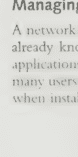

### 管理网络文件系统

网络文件系统使用目录结构来定义服务器数据存储的组织方式。您可能已经知道，计算机本地硬盘上的良好目录结构使得运行应用程序和访问文件变得更加容易。在服务器上，良好的目录结构变得更加重要，因为许多用户共享同一存储设备。因此，CNA 在安装新服务器时必须承担的最重要任务之一，是规划并实施高效的目录结构，以支持用户的处理需求。在本书中，您将学习基本的 NetWare 文件系统组件，以及创建和维护可行的网络目录结构的设计技术。

### 建立和维护网络用户与安全

NetWare 拥有一套精密的安全系统，使网络管理员能够允许用户访问信息，同时保护特殊信息免受未经授权的访问。作为 CNA，为了实施此安全系统，您需要为每个将访问网络的人创建用户账户，然后分配您认为必要的安全限制（如密码和其他限制），以保护用户账户免受未经授权的访问。此外，为了访问网络上的文件，用户需要对 eDirectory 对象以及他们将要使用的目录和文件具有访问权限。作为 CNA，您将分配这些权限。在第 5 章到第 7 章中，您将学习如何使用 NetWare 实用工具和命令来创建用户并分配访问 eDirectory 对象和网络文件系统所需的权限。由于组织结构经常变化，CNA 的持续任务是添加和删除用户，并修改分配给用户和组的权限。

### 设置和维护网络打印

对于网络管理员来说，创建和维护网络打印环境可能是一项最复杂且要求最高的任务。随着桌面出版以及 WYSIWYG（“所见即所得”）文字处理器和电子表格等复杂应用程序的出现，网络打印在网络上变得越来越重要。这些应用程序需要昂贵的激光和喷墨打印机，这些打印机通常通过共享来控制成本。作为 CNA，您会发现经常需要升级网络打印环境，以支持随着可用而出现更快速、更复杂的打印机和应用程序。在第 8 章中，您将学习如何使用 NetWare 打印组件和工具来安装和维护网络打印环境，以满足用户的需求。

### 加载和更新应用软件

网络管理员的一项持续且重要的工作是安装和升级运行在客户端计算机上的应用程序软件包。只要可能，您应将在服务器上安装应用程序，以便可以集中共享和维护。然而，有些应用程序无法从服务器运行，或者安装在计算机本地硬盘上运行时效率更高。作为 CNA，您需要熟悉许多不同应用程序软件包的安装和配置，并知道如何在服务器或本地计算机上支持这些软件包。

CNA 必须知道如何获取和安装软件升级，并回应用户的问题和故障。因此，CNA 通常发现他们需要强大的人际交往技能来处理受挫的用户。另一项职责是监管软件版权许可，以确保您的组织始终拥有足够的许可证来覆盖正在运行应用程序的用户数量。这项任务非常重要，因为如果公司被发现违反版权法，可能会面临诉讼或罚款。为了简化 CNA 的职责，一些公司生产软件，该软件统计当前正在使用某软件包的用户数量，并阻止用户数量超过根据软件许可证确定的数量。

### 管理服务器并监控网络性能

NetWare 服务器拥有自己的操作系统和控制台命令，使网络管理员能够控制服务器环境，并包含称为 NetWare 可加载模块（NLM）的特殊软件，用于执行特定任务或添加新服务。因此，CNA 每周需要在服务器控制台花费一些时间，使用控制台命令和实用工具来监控服务器活动、添加新服务以及修改或配置现有服务。您将在第 2 章中操作 NetWare 6.5 服务器控制台和 NLM。

随着用户加入网络、大型打印任务以及高速计算机对图形应用需求的不断增加，网络性能有时可能会下降。作为 CNA，您需要定期监控您的网络系统和服务器，以检测性能瓶颈或问题，然后


确定是否需要额外的硬件或配置更改。在第 2 章和第 12 章中，您将学习硬件要求在配置服务器性能方面发挥的重要作用。

## 开发与实施网络安全

信息是组织的生命线，作为 CNA，您将成为局域网系统中存储的信息的守护者。作为这些信息的守护者，您必须能够保护数据安全，并在灾难发生时提供数据恢复手段。如图 1-1 所示，网络安全由多个系统组成。

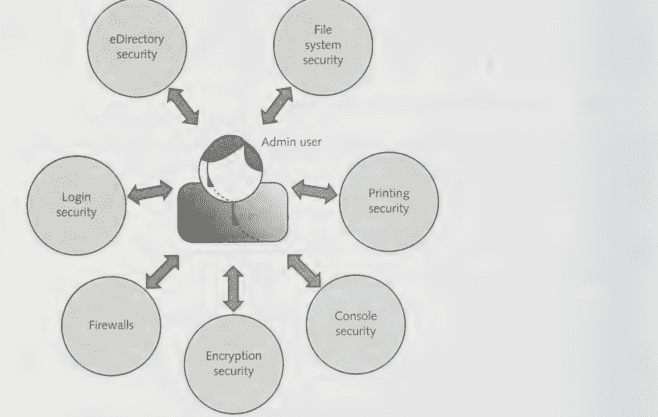

图 1-1 网络安全系统

登录安全用于通过将用户名和密码与存储在 eDirectory 系统中的有效用户账户数据库进行比对，来识别某人是否为网络授权用户。有效的登录安全要求用户账户拥有仅用户本人知道的强密码。Novell eDirectory 使用高度加密的密码系统，防止入侵者在登录过程中获取用户密码，或直接从服务器硬盘读取密码。在第 5 章中，您将学习如何通过配置密码和登录限制来提高用户账户的登录安全性。

文件系统安全使用受托人分配来确保用户只能访问或修改他们被授权处理的数据。在第 6 章中，您将学习如何在 NetWare 文件系统中规划并设置文件系统安全。在第 13 章中，您将学习如何在 Linux 环境中实施文件系统权限。

eDirectory 安全允许管理员将管理权限委托给其他用户。例如，利用 eDirectory 安全，您可以授予管理用户在其部门中更改用户密码所需的权限。在第 7 章中，您将学习如何使用 eDirectory 安全和管理角色来分配用户权限，使其能够在 eDirectory 树中执行管理功能。

## 网络管理与认证简介

打印安全使得控制对网络打印机的访问，并授予特定用户管理特定打印机的权限成为可能。在第 8 章中，您将学习如何使用 NetWare 打印安全功能来提供对网络打印机的权限。

控制台安全涉及将服务器放置在物理安全的位置，并在服务器控制台上启用某些安全措施。在第 2 章中，您将学习如何使用控制台命令来提高服务器的安全性。

实施局域网（LAN）的好处之一是提供通过互联网访问数据的能力。虽然这一功能对组织的运营至关重要，但它也意味着计算机暴露于安全威胁和病毒攻击之下。因此，CNA 的一项重要任务是能够实施加密、防火墙、病毒防护软件和其他程序，以帮助消除由外部攻击者访问本地网络计算机而导致的数据丢失和用户生产力下降。在第 11 章中，您将学习 CNA 需要了解关于实施加密、防火墙和病毒防护软件的内容。

CNA 可能拥有的最可怕的噩梦之一，是导致存储在其硬盘上的所有网络信息丢失的服务器崩溃。为了防止这场灾难并让您更安心地睡眠，您需要确保您的服务器环境尽可能安全可靠。您还需要一个好的备份系统，以便在主要系统故障后恢复服务器上的所有程序和数据。

## 实施与维护用户服务

随着通信和集成计算机应用程序的迅速增加，用户需要一种简单直接的方法来访问和使用这些功能以提高生产力。为了帮助用户更好地利用新技术，Novell 在 NetWare 6.5 中包含了名为 Virtual Office 的软件包。在第 10 章中，您将学习如何部署和配置 Novell 的 Virtual Office 系统，以帮助用户通过互联网访问数据，并使用电子邮件和其他协作功能，包括日程安排和日历管理。

## Universal AeroSpace 公司简介

拥有实际网络经验，例如在校期间通过实习获得的经验，可以提高您通过 CNA 考试的几率。在这本书中，您将通过扮演虚构的 Universal AeroSpace (UAS) 公司学生实习生的角色，获得一些关于 NetWare 和 SUSE Linux 的实际经验。通过执行与该网络相关的网络管理任务，您将学习如何应用网络管理员所使用的网络概念和技术。Universal AeroSpace 是一家小型工程公司，成立于 20 世纪 80 年代中期，旨在为飞机公司设计和制造专用部件。该公司的优势在于使用高强度铝合金材料设计和制造飞机部件。去年，Universal AeroSpace 在新管理层下进行了重组。图 1–2 中的组织架构图显示了当前的公司结构。

2001 年，Universal AeroSpace 的总裁积极寻求 NASA 合同，努力将公司拓展到其他高科技市场。由于销售和工程部门起草的提案，该公司最近获得了一份 NASA 合同，负责为新的国际空间站设计和制造专用部件。因此，UAS 一直在扩大其业务，包括招聘设计工程师和办公室人员。扩大的优先事项之一是安装一个网络信息系统，允许办公室人员和工程师使用 Windows 和 SUSE Linux 环境进行通信并共享计算机资源。新合同要求 UAS 的工程师和办公室人员频繁前往飞机和 NASA 设施，这使得在办公室和旅途中访问资源和信息成为必要。

在与外部顾问合作分析现有系统后，管理层决定安装 NetWare 和 SUSE Linux 网络操作系统，以经济的方式满足组织的多样化需求。您作为学生实习生的任务是协助 Universal AeroSpace 的 IT 人员，学习网络管理员的职责。


图 1-2 Universal AeroSpace 组织架构图

## 公司导览

图 1–3 展示了 UAS 大楼的布局，以及每个部门中计算机和打印机的当前位置。所有办公计算机都安装了 Windows XP 或 SUSE Linux。虽然几台计算机连接了打印机，但大多数打印是通过网络打印机完成的。行政计算机用于运行会计软件和执行电子表格功能。行政助理 Lynn Dai 和所有部门秘书目前都有装有 Windows XP 的计算机和激光打印机，主要用于文字处理。Diana Brady 和 Julie Damrau 拥有高性能计算机和激光打印机，用于运行创建和编辑说明书和销售材料所需的桌面出版软件。Julie 的计算机配有 DVD 录制机，供 Diana 共享使用，以创建 DVD。每个销售人员都有一台基于 Windows 的笔记本电脑，配有文字处理和电子表格软件，用于创建文档并访问客户数据库系统和成本表。由于销售人员在与客户现场工作期间经常需要访问信息，Novell 的 OneNet 策略对于提供解决方案至关重要，这些解决方案使他们能够访问其文件，并在离开办公室时打印文档。

工程部负责设计符合买家规范的部件。目前，该部门的所有台式计算机都安装了 SUSE Linux，并连接了两台计算机辅助设计 (CAD) 系统至共享绘图仪。包含业务人员撰写合同协议和文档所需信息的工程文件被共享。大多数共享文件保存在服务器上，但某些大文件直接在计算机之间复制。

由于 NASA 合同，该公司通过聘用更多机床专家并添加新的计算机辅助制造 (CAM) 机器来扩展制造部门，以加工部件和组件。制造部门的所有计算机都连接到网络系统，以共享资源并更易于通信。


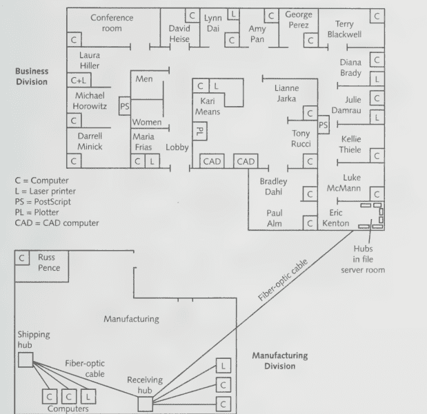

C = 计算机
L = 激光打印机
PS = PostScript
PL = 绘图仪
CAD = CAD 计算机

## 图 1-3 Universal AeroSpace 通用平面图

  信息 IT 部门由 Luke McMann 管理，目前由一名程序员/分析师 Kellie Thiele 和一名网络管理员 Eric Kenton 组成。作为程序员/分析师，Kellie 负责网络应用服务以及软件的开发、配置和部署。Eric 作为网络管理员的职责包括建立和维护网络用户和安全、实施和保护网络文件系统、设置和维护网络打印、开发和实施备份与恢复系统、支持网络通信以及管理 NetWare 服务器和网络性能。

## **网络组件简介**

  如图 1-4 所示，计算机网络有许多形状、大小和配置。计算机网络通常可以分为局域网、城域网或广域网。**局域网 (LANs)** 用于连接物理上彼此靠近的计算机，例如同一个建筑物或办公室中的计算机。LAN 通常由铜缆系统组成，该系统将办公室或建筑物中的计算机连接到中心配线集线器。**城域网 (MANs)** 使用光纤或

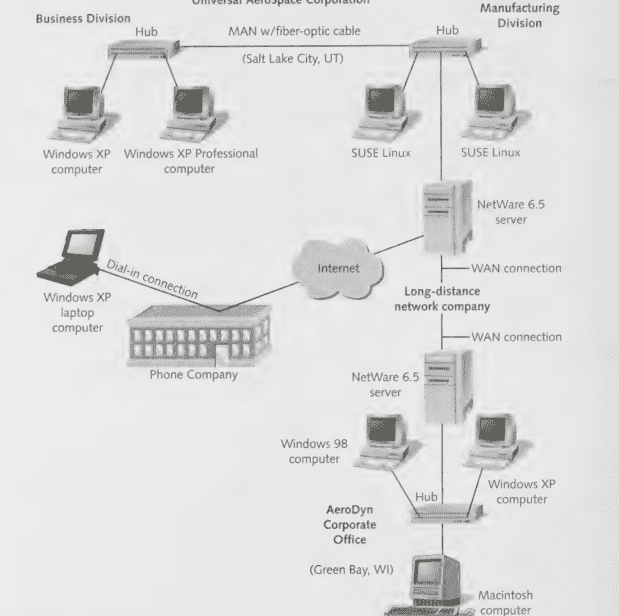

## Universal AeroSpace 的示例网络系统

  微波塔连接同一地理区域（如城市或县）内的计算机。**广域网 (WANs)** 使用电话系统等运营商来连接长距离（包括全国甚至全球范围内）的计算机。过去，计算机网络往往是隔离实体，由特定公司或组织拥有和控制。许多计算机网络使用专有系统，使得相互连接以共享信息变得困难。如今，互联网正在通过标准和技术的结合来打破这些障碍，从而实现几乎所有类型的联网计算机之间的安全数据传输。

  要成为一名 CNA，你需要熟悉构成网络的硬件和软件组件，以便选择、实施和维护满足你所在组织通信和处理需求的网络系统。本节介绍了主要的硬件和软件组件

  组成局域网，并解释它们如何在组织中应用。如图 1-5 所示，计算机网络由三种主要类型的组件组成：

- 计算机硬件和电缆系统
- 协议软件套件，用于控制通信过程
- 用于访问网络资源和软件的软件

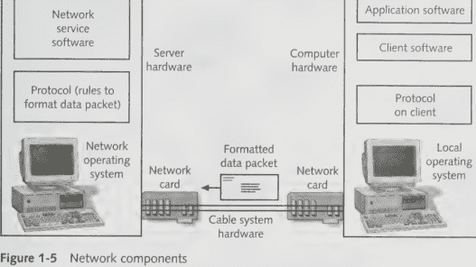

  在局域网中，计算机硬件通常由客户端计算机、服务器和共享资源（如打印机和卷）组成。软件由网络操作系统和服务组成，这些服务提供客户端计算机可以访问的网络资源。通信协议套件（如传输控制协议/互联网协议 (TCP/IP)）提供了控制数据格式化和传输的规则和软件。以下各部分向你介绍这些网络组件，并解释它们如何在组织中应用。

> **注意**
> 对于 CNA 考试，Novell 将网络组件识别为服务器、工作站（计算机）、外围设备、传输介质和网络接口卡。这些详细组件包含在本章中涵盖的主要组件类型中。工作站和外围设备是网络实体的示例。服务器是提供网络服务的实体，传输介质和网络接口卡包含在网络路径组件类型中。

## 网络硬件组件

  硬件组件是网络系统中最明显的部分，因为它们易于看到。典型网络的硬件组件如图 1-6 所示。本节介绍了每个硬件组件及其在网络中执行的功能。

### 服务器

  网络硬件之旅的第一站是网络服务器，在 NetWare 网络中称为“NetWare 服务器”。许多熟悉小型计算机和大型机的技术人员倾向于从网络控制的角度来看待服务器。然而，在局域网中，**服务器**实际上是网络的服务者，响应计算机对存储在服务器磁盘系统上的文件和软件访问的请求。除了其磁盘系统和通常较大的内存容量外，服务器与网络上的客户端计算机相似。


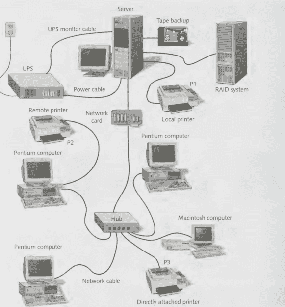

图 1-6 示例网络硬件组件

  一些服务器是**非专用服务器**，这意味着除了提供对磁盘系统共享区域的访问外，它们还可以作为用户计算机运行。图 1-6 中的服务器是**专用服务器**，意味着它不能用作客户端计算机。这确保了更好的性能，并消除了用户在其他人仍然访问服务器时关闭或重启服务器的可能性。为了防止未经授权访问服务器的硬件和软件，大多数网络管理员将服务器存放在可以安全的独立房间中。

  图 1-6 中显示的服务器是一台专门设计为服务器的 PC（许多厂商提供设计用于服务器的 PC）；它使用双处理器，配备 2 GB 内存和高容量 400 GB RAID 存储系统。冗余独立磁盘阵列 (RAID) 存储系统在硬件级别提供容错功能，以便如果一个驱动器故障，服务器可以使用其他驱动器中的数据继续提供信息服务，直到故障驱动器被更换。在需要文件和打印服务的网络中，服务器专门用于提供高速磁盘访问，而客户端计算机需要快速处理器和高分辨率图形。

  许多网络使用客户端-服务器应用程序，其中服务器通过查找和汇总数据库中的信息来执行部分数据处理功能，而客户端计算机作为用户界面。在使用客户端-服务器应用程序的网络中，服务器应专门处理应用程序处理。

### 客户端计算机

  通常，连接到网络以运行用户应用程序的每台计算机都称为**客户端计算机**，实际处理用户软件应用程序就发生在此处。增加服务器的内存或更快的处理器不会直接提高客户端计算机上运行程序的速度。要提高用户应用程序性能，必须升级客户端计算机。客户端计算机的处理能力通常等于或超过服务器的速度。例如，在示例网络中，服务器包含 1.2 GHz Pentium 处理器、大量内存和磁盘空间以及标准分辨率 VGA 显示器。基于 Windows 的计算机包含 1.5 GHz Pentium 处理器、512 MB 内存、20 GB 磁盘存储和高分辨率彩色显示器。由于大多数文件和软件都保留在网络服务器上，客户端计算机可以专注于处理速度和图形分辨率，而不是高容量磁盘存储。

#### 网络接口卡

  **网络接口卡 (NIC)** 安装在连接到网络的每台计算机中，包括服务器。NIC 可以是无线的或连接到电缆系统的。随着无线标准和技术的发展，越来越多的组织实施无线 NIC，特别是对于笔记本电脑或没有足够布线的房间。NIC 允许计算机连接到网络系统，并负责在网络上发送和接收数据分组。**分组**由数百到数千个格式化数据字节组成，并带有控制位，用于识别源和目标计算机的地址，称为**媒体访问控制 (MAC)** 地址。制造时，每个 NIC 都被分配一个唯一的地址或序列号，由 12 个二进制数字组成。此二进制数字被称为 NIC 的 MAC 地址。发送数据时，网络操作系统将数据块发送到 NIC，然后 NIC 等待网络系统可用。当没有其他计算机使用网络系统时，NIC 发送分组。接收 NIC 监听网络并接受包含其 MAC 地址的任何分组。当 NIC 检测到分组目标地址字段中的其唯一 MAC 地址时，它通知源计算机已收到数据分组。如果在分组中未检测到错误，NIC 将分组发送到操作系统软件进行处理。

### 电缆系统

  网络的电缆系统是信息从一台计算机传输到另一台计算机的“高速公路”。**电缆系统**由连接网络中计算机的接线组成。就像进入高速公路需要遵守某些交通规则一样，通过网络发送信息要求每台计算机遵循一组访问规则。同样，如果网络上的信息量超过电缆系统的传输容量，网络也可能出现瓶颈，就像交通堵塞会减慢或停止高速公路上的交通一样。作为网络管理员，你的职责之一是监控网络电缆系统是否有错误或性能瓶颈。图 1–6 中的电缆系统显示了一个示例网络，该网络由双绞线电缆组成，类似于连接电话听筒和底座的电缆。在示例网络中，双绞线电缆从网络中的每台计算机运行到中心连接盒，称为**集线器**或**交换机**，使所有计算机都能平等地访问网络系统。交换机是一种特殊的集线器，它可以根据数据包的目的计算机将数据包从特定端口发出，而不是像集线器那样将数据包从所有端口发出。

### 不间断电源

  图 1–6 中服务器左侧的盒子是**不间断电源 (UPS)**，它包含电池，在本地电源系统故障时为服务器提供临时电力。UPS 是服务器的重要设备，因为它可以防止电力中断或电压下降导致数据丢失。由于当许多用户正在访问服务器时发生电源中断很可能导致数据丢失，因此永远不要考虑在没有 UPS 的情况下运行服务器。当 UPS 单元未连接到服务器时，电源中断可能需要从备份磁带恢复数据以重新启动服务器。


图 1-6 中的 UPS（不间断电源）包含一个可选的监视器电缆，该电缆连接到服务器上的一个端口。此连接会在 UPS 使用电池供电时通知服务器。此连接在长时间停电的情况下也至关重要，因为它允许服务器在 UPS 电池耗尽之前自动关闭所有文件并自行离线。

### 磁带备份

如图 1-6 所示网络中的磁带备份系统由数字音频磁带（DAT）盒式磁带驱动器组成，该系统可以使用 Novell 的存储管理系统（SMS）软件或第三方软件包（如 ArcServa、Legato 或 Veritas）每晚自动备份服务器上的所有数据。在每个工作日凌晨 1 点，示例网络中的磁带备份软件将所有数据复制到磁带盒中。随后，网络管理员将磁带放入组织的防火保险库中安全存储。使用多盘磁带的轮换系统允许每个备份至少保留一周，并且某一日（例如周五）的备份磁带会被存放在异地，以防发生灾难导致整个站点被毁。

### 网络打印机

在网络共享打印机通常是局域网（LAN）的一个重要优势。每个客户端计算机都可以将输出发送到任何网络打印机，方法是将打印输出定向到打印服务器；这些输出随后存储在一个称为**打印队列**的特殊目录中。计算机完成打印后，服务器会使用专门的打印服务器软件将打印输出定向到选定的打印机。打印机可以通过三种不同的方式连接并在网络上共享：作为本地打印机、远程打印机和直接连接打印机。

请注意，图 1-6 中显示的打印机 P1 连接到服务器。由于它连接在服务器的本地打印机端口上，因此它是一个**本地打印机**。本地打印机的优点是工作速度快且能减少网络流量，但缺点是其可放置的位置有限。

连接到用户计算机的打印机 P2 由打印服务器软件控制，该软件允许任何客户端计算机上的用户通过服务器向打印机 P2 发送输出。打印机 P2 被称为**远程打印机**，因为它没有直接连接到服务器上的打印机端口。远程打印机可以位于网络中任何有计算机的地方。然而，在处理大型打印任务时，可能会发生与计算机相关的性能问题和软件冲突。

打印机 P3 是一个**直接连接打印机**，它有自己的网络卡并直接连接到网络电缆系统。这种直接连接提供了独立于计算机的优势，同时避免了远程打印机带来的速度损失。为了获得尽可能高的性能水平，大多数网络管理员将高速打印机直接连接到网络电缆系统。

### 网络协议或规则

网络系统的**协议**定义了在网络电缆系统上传输的数据包的格式规则。用于实现协议的软件称为**协议栈**。虽然网卡负责在整个网络系统中传输数据包，但协议栈的功能包括在不同网络之间路由数据包、验证传输以及请求网络服务。某些协议栈，如 IBM 的同步数据链路控制（SDLC）、NetBEUI 和 IPX/SPX，被称为专有协议，因为它们由特定公司拥有并控制。其他协议，如 TCP/IP，是非专有的，由由供应商和用户组成的行业组织控制。

由于网络通常需要支持多个协议栈，以便计算机使用不同的操作系统进行通信和访问服务，当今的网络操作系统是为多协议设计的。现在常见的协议栈包括 TCP/IP、SPX/IPX 和 NetBEUI。在接下来的章节中，您将了解这些协议栈及其优缺点。

#### TCP/IP 协议

传输控制协议/互联网协议（TCP/IP）最初于 20 世纪 60 年代开发，用于支持政府机构和教育机构中大型机之间的通信。与 SPX/IPX 一样，TCP/IP 负责使用 IP 对数据包进行格式化，然后它们在网络之间进行路由。IP 协议在数据包的碎片处理和通过广域网（WAN）链路（例如用于连接互联网的那些链路）的路由方面比 IPX 更加复杂。TCP/IP 规范由独立机构互联网架构委员会（IAB）开发并持续维护。由于 TCP/IP 旨在连接大量独立组织，因此其设计支持不同计算机和操作系统之间的通信。TCP/IP 由四个主要层组成，用于发送和接收数据，如图 1-7 所示。

| 层次 | 描述 |
| :--- | :--- |
| 应用层 | 此层包含网络服务以及客户端软件。 |
| 传输层<br>TCP/UDP 服务 | 此层负责通过使用端口号将数据包传输到应用层并从应用层传出。TCP 还通过使用确认来验证数据包的传递。 |
| 互联网层 | 此层使用 IP 地址将数据包路由到其目标网络。 |
| 网络层 | 此层表示物理网络路径和网络接口卡。 |


从图 1-7 的底部向上看，网络层提供由网卡和驱动程序组成的通信路径。互联网层或 IP 负责在网络之间路由数据包。传输层由 TCP 和用户数据报协议（UDP）服务组成，用于处理系统之间的数据流。这两种传输服务都使用端口号来标识应用程序的发送和接收。例如，Web 服务器通常使用端口 80，而文件传输协议（FTP）服务器默认使用端口 21。TCP 和 UDP 都执行信使服务，根据端口号将数据包投递到正确的应用程序。TCP 和 UDP 之间的主要区别之一是投递通知。使用 UDP 时，发送方永远不会收到关于数据包是否成功送达的通知。虽然 UDP 缺乏投递通知可能会导致传输错误，但它具有提供更快服务以传输小型间歇性消息的优势。除了 UDP 的基本服务外，TCP 传输服务通过发送和接收确认来保证数据包的投递。通过这种确认系统，发送方和接收方可以为要确认的数据包数量建立一个窗口。这种窗口机制提供了更好的性能，因为每个数据包在发送另一个数据包之前不需要单独进行确认。应用层代表网络服务，如 Web 服务器或 FTP 服务器，它处理客户端请求并通过传输层和网络层返回信息。

由于 TCP/IP 协议栈在局域网（LAN）和广域网（WAN）中的普及，从 NetWare 5 开始，Novell 增加了仅使用 TCP/IP 用于其网络客户端和服务的功能。旧版本的 NetWare 要求管理员支持 IPX 以访问 NetWare 服务器，并支持 TCP/IP 以访问互联网。通过消除 IPX，网络管理和支持变得更加简单和高效。

在 TCP/IP 中，连接到网络的每台计算机都称为主机，并被分配一个唯一的地址。路由器连接独立的网络，并使用 IP 网络地址将数据包从一个网络传输到另一个网络，这使得数据包可以通过不同的路由发送，然后在接收站点按正确顺序重新组装。IP 地址由 32 位二进制数组成，使用称为**点分十进制表示法**的方法表示为用点分隔的四个字节。如图 1-8 所示，点分十进制表示法中的每个 IP 地址都包含网络和主机部分。

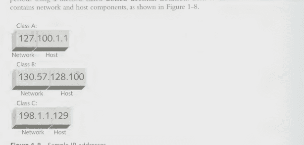

IP 地址的网络部分识别网络电缆系统，对于同一网络上的所有计算机来说都是相同的。**主机**部分代表连接到网络的设备，并且对于电缆系统中的每个网络实体必须是唯一的。请注意点分十进制地址如何分为三大类。在 A 类地址中，第一个数字代表网络电缆，最后三个数字代表连接到网络的设备或计算机。在 B 类网络中，地址对半分，两个数字标识网络，两个数字标识主机。C 类地址专为较小的网络设计，仅有一个数字保留给主机计算机。设置和使用 IP 地址是当今网络管理的重要组成部分。在第 2 章中，您将学习如何在安装期间为您的 NetWare 6.5 服务器分配 IP 地址。

#### Novell 专有协议

顺序数据包交换/互联网数据包交换（SPX/IPX）协议套件是 Novell 的专有系统，用于管理网络上的 NetWare 数据包的路由和格式化。要进行通信，每个网络客户端和服务器都必须加载 IPX。每个客户端和服务器还必须加载网卡驱动程序软件（在“网络软件组件”一节中有描述）以传输数据包。IPX 和网卡驱动程序在客户端安装过程中通过称为**绑定**的过程结合在一起。SPX 与 IPX 配合使用，通过使用速度控制和来自接收方的确认数据包（告知发送方是否有任何数据包需要重新传输）来确保数据包的顺利传递。一些应用程序使用 SPX/IPX 组合来确保数据包的顺利传递。

NetWare 使用的 IPX 协议最初由 Xerox 公司在 20 世纪 70 年代末开发，后来被 Novell 采用用于其网络产品。它为网络组件提供了自动寻址，而 TCP/IP 使用手动寻址。


由于 TCP/IP 自 NetWare 5.0 版本起就被支持为主协议，大多数组织正在从 SPX/IPX 转向使用 TCP/IP，以避免支持多种协议。

除了 IPX/SPX 之外，Novell 还提供 **NetWare 核心协议 (NCP)** 作为应用程序访问 NetWare 服务器服务的一种语言。Novell 客户端被设计为能够利用通过 NCP 可用的所有服务。你将在第 4 章中更多地学习关于安装和配置 Novell 客户端的内容。除了 NCP 之外，NetWare 6.5 服务器还支持其他应用程序协议语言，包括 HTTP、Windows 文件服务以及用于 UNIX 的网络文件系统 (NFS)。你将在第 3 章中更多地学习关于这些应用程序协议的内容。

#### 微软专有协议

**NetBEUI** 是集成在 Windows 产品中的微软协议栈。在本节描述的三种协议中，NetBEUI 是最小、最快且最容易使用的。它也是最功能有限的，因此在大型网络环境中更为受限，因为它不支持在网络上路由数据包所需的网络层。结果是，NetBEUI 仅限于与其他连接到同一电缆系统的计算机进行通信。由于其不需要提供路由功能的开销，它极其小巧且快速，使其成为 10 到 50 个设备的小型网络的理想选择。

**NetBIOS** 是许多基于 Windows 的应用程序用于与其他客户端和服务器计算机上运行的应用程序通信的协议。允许客户端应用程序在没有集中式服务器的情况下相互通信，通常被称为对等网络。虽然 NetBIUI 最初是为与 NetBEUI 一起使用而开发的，但由于对等应用程序的流行，其他协议栈（包括 IPX/SPX 和 TCP/IP）都提供了对 NetBIOS 的支持。因此，组织可以使用 NetBIOS 让计算机运行对等应用程序，同时访问 NetWare 文件服务器的服务。

正如 NCP 是某些 Novell 应用程序用于请求 NetWare 服务器服务的专有语言一样，**服务器消息块 (SMB)** 协议是许多微软客户端用于请求微软服务器服务的语言。SMB 为服务器和客户端之间提供了标准化的、明确定义的通信方式。

### 网络软件组件

网络的软件组件可能是最难理解的，因为它们不是物理对象。在图 1-9 所示的网络配置中，网络软件组件可以分为五个主要类别：NIC 驱动程序、协议栈、客户端软件、网络服务和网络操作系统。图 1-9 展示了如何组合这些软件组件以使计算机和服务器能够在网络上通信。在接下来的部分中，你将了解每个软件组件在局域网中扮演的角色。

#### 网卡驱动程序

每台服务器和客户端工作站都必须有一个网卡（NIC）才能连接到电缆系统并在网络上通信。**网卡 (NIC)** **驱动程序**是一种包含指令的软件，使计算机的处理器能够控制卡片功能并与应用程序软件接口。卡片制造商会定期发布新版本的驱动程序软件来修复错误或提供与新应用程序的兼容性。因此，网络管理员的一项职责就是更新应用程序和系统软件。图 1-9 展示了一个示例网络配置。

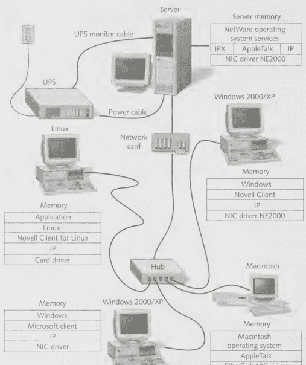

##### 活动 1-1：识别 Windows 客户端上的网络适配器属性

**所需时间：** 5 分钟

**目标：** 识别网络组件并描述其功能。

**要求：** 一台 Windows XP 计算机系统

**描述：** Bradley Dahl 的计算机一直有问题，出现网络错误消息。Eric Kenton 决定验证 Bradley 的计算机是否使用了与工程部门其他计算机相同的 NIC 设置。在这个活动中，你模拟 Eric Kenton 的任务，通过使用“网上邻居”和“控制面板”来比较 Bradley 的 NIC 设置，并记录你的网络卡设置。然后，你将你的发现与另一位同学的发现进行比较。

- 1. 如有必要，启动你的计算机并以管理员身份登录到 Windows 系统。
- 2. 记录你的网络适配器设置：
  - a. 右键单击“网上邻居”，然后单击“属性”。
  - b. 右键单击 **本地连接**，然后单击 **属性**。
  - c. 单击 **配置** 按钮。
  - d. 单击 **驱动程序** 选项卡，并在此处记录驱动程序日期信息：
  - e. 单击 **资源** 选项卡，并在此处记录 IRQ（中断）和内存范围：
  - f. 单击 **取消** 以返回到网络连接窗口。
- 3. 关闭网络连接窗口。
- 4. 将你的网络适配器设置与你的实验伙伴的设置进行比较，并在此处记录任何差异：
- 5. 注销。

#### 网络服务

所有网络服务都需要客户端和服务器软件。客户端软件运行在用户的计算机上，并提供应用程序与服务器上运行的服务之间的连接。客户端软件需要以下组件：

- 桌面操作系统，如 Linux、Windows 2000/XP 或 Macintosh OS X，用于控制本地设备并运行应用程序软件
- 用于控制 NIC 的驱动程序软件
- 用于格式化和发送网络文件和打印服务请求到服务器的请求器和协议软件程序；请求器程序与计算机的操作系统紧密合作，以检查请求并提供网络服务访问

图 1-9 中的网络展示了 Novell 客户端通过其卡驱动程序将 IP 格式化的请求通过电缆系统发送到 NetWare 服务器。Macintosh 计算机具有 EtherTalk 驱动程序，因此它可以同时使用相同的电缆通过 AppleTalk 协议向服务器发送请求。支持不同类型客户端操作系统的能力是 NetWare 服务器的优势之一。

在 NetWare 6.0 中，Novell 引入了 **原生文件访问包 (NFAP)**。NFAP 使多样化的客户端能够使用其原生协议直接与 NetWare 服务器通信。例如，通过使用 NFAP，Windows 客户端可以使用其原生客户端协议访问 NetWare 服务器上的共享文件。使用 NFAP 使得设置客户端和访问基本的 NetWare 文件和打印服务变得更加容易。在第 3 章中，你将了解如何使用 NFAP 访问 NetWare 6.5 服务器上的文件服务。在下面的活动中，你将记录你的桌面计算机上的客户端软件组件。

##### 活动 1-2：记录客户端软件组件

- **所需时间：** 10 分钟
- **目标：** 识别客户端软件组件。
- **要求：** 一台 Windows XP 计算机系统

**描述：** 网络管理员希望你在即将安装到市场营销部门的新计算机上记录 TCP/IP 网络软件组件的配置。在这个活动中，你将了解如何查看 Windows XP 系统的软件组件。

- 1. 启动你的计算机，并使用分配给你的 Windows 管理员用户名和密码登录到你的本地 Windows 计算机。
- 2. 右键单击 **网上邻居**，然后单击 **属性**。
- 3. 右键单击 **本地连接**，然后单击 **属性**。
- 4. 右键单击 **本地连接**，然后单击 **属性**，以打开如图 1-10 所示的本地连接属性对话框。

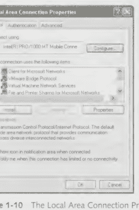

- 5. 记录在“此连接使用下列项目”下列出的项目数量：
- 6. 单击 **Internet 协议 (TCP/IP)** 组件，然后单击 **属性** 按钮。
- 7. 记录 IP 地址和 DNS 服务器的 TCP/IP 设置：
- 8. 单击 **取消** 以返回到本地连接属性对话框，然后再次单击 **取消**。
- 9. 关闭网络连接窗口。完成后，注销你的系统。

服务器组件包括运行网络服务并提供资源访问所需的计算机硬件和网络操作系统软件。常见的网络服务包括以下内容：

- *安全服务*——这些服务对于保护数据免受未授权访问是必要的。Novell 提供几种类型的安全服务，包括登录安全、文件系统安全、eDirectory 安全、加密安全和防火墙安全。本书各章节涵盖了每种类型的安全。例如，在第 2 章中，你将学习如何保护服务器控制台。在第 5 章中，你将学习如何实施登录安全。第 6 章和第 7 章涵盖文件系统和 eDirectory 安全，第 11 章涉及防火墙、加密和病毒防护。
- *目录服务*——这些服务将网络对象的信息存储在一个称为目录的分层数据库中。使用 Novell 的 eDirectory 服务，网络对象——如用户、组、计算机、打印机、应用程序和配置信息——存储在容器中。容器按层次树结构排列，类似于磁盘驱动器上文件夹的排列方式。在第 4 章中，你将一般性地学习目录服务，特别是 eDirectory。
- *消息服务*——这些服务用于在客户端计算机和服务器之间传输电子邮件消息和事件通知。消息可以作为 Novell 的 Virtual Office 产品的一部分进行配置。


-   文件服务——这些服务允许客户端计算机访问并保存共享文件系统上的数据。在第 3 章和第 6 章中，您将学习如何设置和安全加固 NetWare 文件系统，第 13 章则解释了如何在 Linux 服务器上实现文件系统安全。

-   打印服务——这些服务允许打印机连接到网络系统并由客户端计算机使用。在第 8 章中，您将学习如何设置、安全加固和维护一个支持本地和互联网打印的网络打印系统。

-   应用程序服务——这些服务通过为客户端计算机执行某些处理功能，协助运行诸如电子表格、文字处理器和数据库系统之类的程序。第 9 章描述了如何设置客户端计算机环境以支持网络应用程序。

### 网络操作系统简介

网络操作系统（NOS）是控制网络服务并提供服务器计算机上共享资源访问权限的软件。从历史上看，网络操作系统的一个主要功能是为客户端计算机提供文件和打印机服务。因此，可以通过增强专用硬件和软件来提升服务器性能、安全性和可靠性，这超出了像 Windows 2000 Professional 或 Windows XP 等桌面操作系统所能预期的水平。NOS 通过包含以下功能和服务来专门优化服务器硬件的使用：

-   性能——服务器的性能取决于其响应来自客户端计算机的数据请求的速度。因此，影响服务器性能的主要因素包括其保持常用信息在内存中的能力、磁盘系统的速度以及处理器单元的速度。

-   容错能力——容错能力是指系统在存在错误或其他问题时仍能正常运行的能力。服务器环境设计了不同级别的容错能力，以便即使磁盘驱动器或控制器卡出现物理错误，也能继续服务器运行。

-   安全性——安全性（防止未经授权访问服务器上的信息）是网络管理员最重要的职责之一。NOS 具有您可以使用的功能，以满足组织用户和数据的安全需求。例如，登录安全要求系统资源和 services 的所有用户提供有效的用户名和可选密码，才能访问网络。此外，第 5 章中描述的可选入侵防护系统可用于在用户超过您设置的登录尝试次数时锁定该用户的账户。

-   受托人分配——受托人是指被赋予使用或管理资源权限的对象，如用户和组。您使用受托人分配来为网络用户分配权限，称为受托人权限或许可，允许他们访问数据并在网络上执行特定功能。

-   客户端支持——NOS 应能够支持多种类型的客户端计算机，以便网络可以整合多样的计算环境。例如，您学习了 NetWare 操作系统如何使 Apple Macintosh 用户能够与基于 Linux 和 Windows 的计算机共享文件。

如图 1-11 所示，今天的 NOS 可以根据其设计定义为对等式或网络中心式。

对等式系统使客户端计算机能够相互通信和共享数据，而不需要专用的服务器计算机。在对等网络中，计算机被组织成称为工作组（workgroups）的单位。工作组使用户更容易找到共享资源，因为管理员可以按照部门对计算机进行分组。Windows 98、Windows 2000 Professional 和 Windows XP 设计为对等操作系统。对等式系统的主要优势是通过节省将计算机专门用作服务器的费用来实现低成本网络。此外，对等式系统允许工作组中的用户共享数据文件并轻松相互通信。从理论上讲，这将数据共享的责任更多地交给用户，从而减轻了网络管理员的负担。

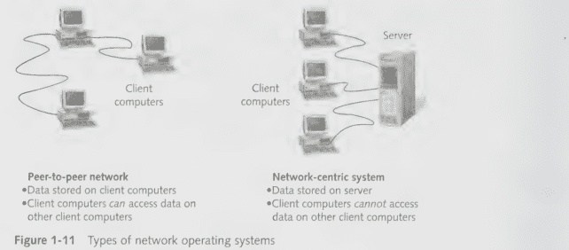

然而，大型对等网络可能难以管理，因为共享数据可能存在于多个位置，这使得数据的检索、保护和备份变得更加困难。

**网络中心式**系统将一台或多台计算机专门用作服务器，并处理来自客户端计算机的请求。服务器通过登录进程对用户进行身份验证，使其能够访问网络上的资源和 services。网络中心式系统使用目录服务，以便所有系统都可以访问包含用户账户信息的公共数据库。这些系统提供了以下优势：

-   集中式管理
-   单一用户登录即可访问网络上的所有资源
-   使用专用服务器硬件和软件来提高性能和可靠性

由于这些优势，今天的网络系统基于依赖目录服务使网络对象和服务在整个网络中可用的网络中心式操作系统。常见的网络中心式系统包括 Novell NetWare、SUSE Linux 和 Windows 2000/2003。接下来的章节将介绍这些目录服务和网络操作系统的特性。

### 目录服务

目录服务在今天的网络中心式操作系统中发挥着重要作用，通过提供关于网络对象的中央信息存储，所有网络上的服务器都可以共享。目录服务的概念自 1988 年开放系统互连（OSI）组织发布标准目录服务模型的 X.500 规范以来就一直存在。您将在第 4 章中更多地了解 X.500 标准。目录服务的两个主要目标是允许单用户登录并提供集中式管理。单用户登录意味着用户只需提交一次用户名和密码即可访问目录系统部分中任何服务器上的资源。当用户登录目录服务时，目录树中的服务器通过验证目录中的用户名和密码来授权用户。在这些凭据经过验证后，用户即可访问其拥有使用权限的任何服务器上的资源和 services。

集中式管理是通过赋予管理用户账户在目录系统中添加、删除或更改对象的权限来实现的。由于目录服务包含所有网络对象的配置信息，用户可以修改其拥有管理权限的任何网络对象的配置。

今天主要使用的两种目录服务是 Novell 的 eDirectory 和 Microsoft Active Directory。这两种目录服务都将信息存储在网络对象中，这些对象被分组到称为组织单位的容器中，然后组织成称为树的层次结构。此外，这两种服务都支持轻量级目录访问协议（LDAP），用于在目录服务之间交换信息。接下来的章节将介绍这些目录服务并解释它们之间的一些差异。

#### Novell 的 eDirectory 服务

Novell 使用了 X.500 标准的许多内容，于 20 世纪 90 年代初发布了其第一个目录服务，称为 Novell 目录服务（NDS）。自那时起，Novell 增强了其目录服务，并在发布 NetWare 6.0 时将其更名为 eDirectory。如您在第 4 章所学到的，eDirectory 将网络对象存储在树结构中。用户登录到一个目录树，这使得他们能够访问该树中所有已授予他们权限的服务器上的资源。管理用户账户可以被授予管理树中任何容器中的对象的权限。如图 1-12 所示，树中的容器被组织成组织（Organization）和组织单位（Organizational Units）。

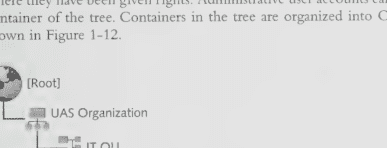

图 1-12 Novell eDirectory 树

Novell eDirectory 的一些特性包括：

-   eDirectory 可以运行在多个操作系统平台上，包括 NetWare、Linux、Windows NT、Windows 2000 Server 和 Windows Server 2003。这种能力使由多个系统组成的网络能够作为单一网络运作，通过提供单用户登录和集中式管理来实现。
-   eDirectory 数据库的某些部分，称为分区，可以轻松放置在网络中的其他服务器上，这使得网络环境具有可扩展性。您将在第 4 章中学习如何在服务器之间划分 eDirectory 副本。
-   eDirectory 树为包含数百万对象的大型网络提供高性能和可靠性。
-   eDirectory 已使用十多年，使其成为一个成熟的目录服务。
-   eDirectory 独立于域名服务（DNS）工作，允许 DNS 专门用于互联网服务。
-   eDirectory 支持 LDAP 标准，以允许与其他网络系统交换信息。

#### Microsoft Active Directory

Microsoft Active Directory 最初在 Windows 2000 中引入，是一个以域为导向的目录服务，建立在 Windows NT 中使用的 Microsoft 域系统之上。在 Active Directory 中，网络对象和服务器被分组到域中，服务器被分类为域控制器或成员服务器。域控制器共享其所在域的目录数据库副本。成员服务器没有 Active Directory 域对象的副本；相反，它们使用域控制器来查找网络对象的信息或验证用户访问。然后，域被组织成一个林（forest），它由一个或多个树组成，如图 1-13 所示。


**图 1-13** 活动目录（Active Directory）域林

用户登录域林，这使他们能够访问该域林中已被授予权限的服务器上任意共享资源。活动目录与 eDirectory 的一些区别包括以下内容：

-   活动目录允许使用 Windows XP 或 Windows 2000 Professional 的 Windows 客户端计算机成为活动目录的成员。成为活动目录的成员允许用户登录到域，并使管理员能够从集中站点管理客户端计算机的数据和配置。
-   活动目录是一种专有系统，不能运行在除 Windows 2000 Server 和 Windows Server 2003 之外的其他操作系统上。
-   活动目录要求服务器升级为域控制器，以存储域数据库的副本，这是一个比将分区添加到 Novell eDirectory 服务器更复杂的过程。服务器提升为域控制器后，不能重命名。移除活动目录数据库需要将服务器降级为成员服务器。
-   活动目录依赖于使用 DNS 来查找域控制器。

#### Novell NetWare

Novell NetWare 是微型计算机网络操作系统（NOS）领域的领导者，始于 20 世纪 80 年代初的 NetWare 2。由于 Novell 不生产桌面操作系统和应用程序软件，NetWare 从早期版本开始就被设计为能与不同的桌面系统集成。NetWare 在提供高速、可靠且安全的网络操作系统环境用于文件和打印机共享方面有着久经考验的历史。如今，Novell 提供广泛的 NOS 产品和服务，帮助各种客户端环境中的组织实施安全、高速的网络系统。在本节中，您将了解 NetWare 的主要版本和最新产品功能。

##### NetWare 版本

尽管 NetWare 6.5 现在是 Novell 的主力 NOS，但较早版本的 NetWare 是高度稳定的网络平台，网络管理员仍然依靠它们获得一致的性能。

NetWare 3.0 与后续版本之间的主要区别在于引入了 Novell 目录服务（NDS），NDS 在 NetWare 6.0 中升级成为 eDirectory。NetWare 2.0 和 NetWare 3.0 都有一个扁平数据库，称为绑定器（binder），它存储有关网络对象（如用户、组和打印机）的信息。每个 NetWare 2.0 或 3.0 服务器上都存储了一个独立的二进制数据库，这就要求用户在包含他们需要访问的资源服务器上都拥有一个账户。虽然这种二进制系统在一两个服务器的网络中运行良好，但当网络开始包含十几个或更多服务器以及数百名用户时，在多个服务器上维护用户账户就成了管理上的瓶颈。使用绑定器时，用户必须登录到每个服务器，因为绑定器数据库不在服务器之间共享。

NetWare 3.0 是以服务器为中心的，这意味着每个服务器单独管理其网络对象。NetWare 4.0 及后续版本是以网络为中心的，意味着所有网络对象都通过集中式目录数据库系统（NDS，后来称为 eDirectory）存储和管理。以下是 NetWare 版本中一些重要增强的简要概述。

NetWare 4.0 引入的功能包括以下内容：

-   Novell 目录服务（NDS）是一个极其可扩展的目录服务，可支持网络上超过一百万个对象。NDS 在所有服务器之间共享，因此用户登录时可以从任何计算机登录并被识别。
-   NetWare 管理员（NetWare Administrator）是一个基于 Windows 的图形化管理实用程序，是网络管理员管理网络的主要工具；增强功能包括 Windows 版本、可配置的工具栏以及同时管理多个网络的能力。
-   NetWare Client 32 是一款客户端软件产品，它与 Windows 98 到 XP 集成，提供对网络服务（包括打印、应用程序管理和行政事务）的增强访问。

NetWare 5.0 引入的功能包括以下内容：

-   ConsoleOne 管理工具是一个基于 Java 的实用程序，它可以在多种操作系统环境中执行大部分管理功能，包括 Windows、NetWare 服务器控制台和 Linux 系统。
-   X Windows GUI 服务器控制台界面允许管理员运行基于 GUI 的服务器应用程序，包括 ConsoleOne。
-   Novell 分布式打印服务（NDPS）允许使用 Novell 客户端或互联网打印协议（IPP）共享和管理网络连接的打印机。在第 8 章中，您将学习如何使用 NDPS 在网络上设置共享打印机。
-   TCP/IP 是与 NetWare 服务通信的默认协议。以前，必须使用 SPX/IPX 协议才能与 NetWare 服务通信。
-   Novell 存储服务（增强卷和磁盘管理）仅对用户数据卷可用。

NetWare 6.0 的新功能包括以下内容：

-   One:Net 战略，使数据访问和网络管理独立于计算机操作系统和网络配置
-   新的 One:Net 管理实用程序，例如 iManager、Remote Manager 和 iMonitor，使管理员能够通过 Web 浏览器管理网络，独立于客户端操作系统或网络配置
-   提供以下 OneNet 工具，使用户能够通过 Web 浏览器访问数据，独立于客户端操作系统或网络配置：
    -   NetStorage 服务，允许使用 Web 浏览器从远程位置访问网络文件
    -   iFolder 服务，使移动计算机能够自动与中央服务器同步文件
    -   原生文件访问协议，允许非 Novell 客户端访问 NetWare 服务器的共享目录和文件
-   互联网打印协议，使得可以在互联网上使用和管理网络打印机

NetWare 6.5 网络操作系统包含 NetWare 6.0 的所有功能，以及以下新功能：

-   升级版的 iManager 实用程序，使网络管理员能够通过 Web 浏览器执行大多数管理任务，如创建用户和组
-   虚拟办公室客户端环境，使用户更容易访问和使用 NetWare 服务
-   新的基于模式的安装选项，使您能够创建专用和任务导向的服务器，例如专门支持 Web 应用程序的服务器
-   新的开源开发工具，帮助程序员在没有专有软件开发工具成本的情况下开发应用程序

##### Novell 开放企业服务器

开放企业服务器（Open Enterprise Server）是 Novell 最新的 NetWare 6.5 NOS 与 SUSE Linux 10 的结合。随开放企业服务器发布的增强功能包括以下内容：

-   NetWare 6.5 操作系统
-   SUSE Linux 10（在下一节中描述）
-   适用于 Linux 的企业服务，使 SUSE Linux 10 服务器能够使用 Novell 的 eDirectory 服务和其他 Novell 服务，包括 iFolder、iPrint、NetStorage 和虚拟办公室

Novell 开放企业服务器的功能将在后续章节中更详细地讨论。大量的新增改进、公认的稳定性以及行业对互联网服务日益增长的需求，将促使许多组织将其 NetWare 服务器升级到开放企业服务器的 NetWare 6.5。在第 2 章中，您将学习如何在您的计算机上安装 NetWare 6.5。

##### Novell SUSE Linux 10

Linux 操作系统基于 UNIX，最早于 20 世纪 90 年代初由芬兰赫尔辛基大学的一名名为 Linus Torvalds 的学生开发。Torvalds 研究了一种名为 Minix 的 UNIX 共享软件版本，并利用他的知识开发了他命名为“Linux”的新操作系统。UNIX 是为大型计算机开发使用的，但 Linux 是为在微型计算机系统上使用而设计的。由于 Linux 是在通用公共许可证（GPL）下开发的，源代码是免费提供的，因此开发人员可以修改 Linux 系统以满足他们的需求。

Linux 正被证明是一个可行的企业级 NOS，可以帮助组织降低成本，同时仍然提供稳健且安全的网络服务。由于这一良好的记录，几乎在 IT 行业的每个领域，包括 Web 服务器、电子邮件服务器、应用程序服务器和用户桌面，对 Linux 的需求都在增长。为了满足对 Linux 服务和支持日益增长的需求，Novell 和其他领先厂商正在向 Linux 环境带来许多新的服务和支持。在第 14 章中，您将了解 Linux 需求的增长，以及 Novell 如何通过提供服务、支持和认证来满足这些需求。


开源许可，这使得开发者能够在不支付版税或其他费用的情况下，使用开源软件构建系统，前提是他们必须随产品发布其源代码。使用开源产品提供以下好处：降低总拥有成本（TCO），减少资本投资，并与现有系统相比提高可靠性和正常运行时间。此外，许多 IT 专业人士认为，开源产品提供了更多的灵活性，以及更快、更低成本的应用程序开发。

当托瓦尔德斯开发 Linux 时，他只生成了 Linux 内核和几个用于管理它的实用程序。由于 Linux 使用 GPL 许可协议分发，其他开发者通过添加他们自己的实用程序和应用程序（运行在 Linux 内核上）创建了他们的 Linux 发行版。以下是一些常见的 Linux 发行版：

- SUSE Linux
- Red Hat Linux
- Mandriva Linux
- Turbolinux
- Slackware Linux
- Debian GNU/Linux
- Fedora Core 3

Novell 公司于 2004 年春天收购了 SUSE Linux 发行版，并自那以后增加了许多服务和实用程序，以增强 SUSE Linux 在 NOS 环境中的使用。由于其 GPL 许可协议和许多免费的实用程序及应用程序，SUSE Linux 是用于中小企业的理想 NOS。此外，SUSE Linux 发行版的可靠性和性能使其成为大型企业网络系统的理想选择。在第 12 章中，您将了解 Novell SUSE Linux 发行版，并学习如何在计算机上安装 SUSE Linux。

##### Windows Server 2003

Windows Server 2003 为客户端计算机提供集中式且具备容错性的高速数据访问。该产品的优势在于，它通过熟悉的 Windows 环境提供对多台服务器的集中管理，并支持对 TCP/IP 和 NetWare 服务器以及大型计算机的访问。此外，它支持一种名为 Active Directory 的先进目录服务。Active Directory 具有许多与 Novell 的 eDirectory 服务相同的功能，例如一个共享所有域内服务器之间的所有网络对象层次数据库。另一个优势是它作为应用程序服务器（运行客户端服务器应用程序服务器部分的服务端服务器）的实用性。许多供应商提供设计用于在此操作系统上运行的客户端服务器应用程序。许多网络管理员使用 NetWare 作为其主要 NOS 用于文件和打印服务，并使用 Windows Server 2003 系统作为应用程序服务器。

## 章节摘要

行业认证在帮助组织寻找和雇用合格网络技术人员、管理员和工程师方面发挥着重要作用。一些流行的网络认证包括 Novell CNA 和 CNE 认证，Microsoft MCP、MCSA 和 MCSE 认证，以及 CompTIA Network + 认证。

为了设置和管理网络，您需要熟悉组成网络系统的服务和组件，包括客户端计算机、服务器、卷、打印机、线缆、网络卡和协议。客户端计算机运行应用软件，并使用客户端软件请求文件服务、打印服务、消息服务和应用程序服务。服务器计算机向客户端提供网络服务。

网络协议栈由用于在服务器和客户端之间格式化和路由数据报的软件组成。由于网络上的客户端计算机操作系统可以使用不同的协议，网络管理员通常需要在 NetWare 网络上支持多个协议栈。NetWare 服务器中支持的常见协议包括 TCP/IP、IPX/SPX 和 NetBIOS。

- 网络操作系统可以分为对等式或网络中心式。
- 在对等式网络中，一台计算机可以同时作为客户端和服务器，使其能够与其他计算机共享数据和资源。虽然对等式网络灵活且易于设置，但由于缺乏集中控制，它们可能难以管理。
- 网络中心系统使用集中式服务器来验证用户登录请求，并侧重于向其他客户端提供网络服务，而不是运行应用软件，从而实现更好的性能和安全性。
- 目录服务提供对网络对象和资源信息的集中存储，这些信息由属于目录系统的所有服务器共享。当今主要使用的目录服务是 Microsoft Active Directory 和 Novell eDirectory。
- Active Directory 的优势在于被开发者以及中小型网络广泛使用，而 eDirectory 则提供更可扩展的系统，允许网络集成由 Linux、Windows 和 NetWare 服务器组成的多样化环境。
- 当今最常用的网络操作系统产品包括 Novell NetWare、Linux 和 Windows Server 2003。

### 关键术语

- **绑定 (binding)** — 将协议栈连接到 LAN 卡驱动程序的过程。
- **线缆系统 (cable system)** — 连接网络中计算机的布线。
- **认证 Novell 管理员 (Certified Novell Administrator, CNA)** — 已通过 CNA 认证考试的管理员；本书记载了该考试的目标。
- **客户端计算机 (client computer)** — 请求网络服务并访问资源（如共享文件、打印机、应用程序或通信系统）的计算机系统。
- **客户端服务器应用程序 (client-server applications)** — 依赖于驻留在客户端计算机和服务器两端软件的应用程序。
- **专用服务器 (dedicated server)** — 不能用作客户端计算机的网络服务器。
- **直接连接打印机 (directly attached printer)** — 直接连接到网络线缆系统的打印机。
- **点分十进制表示法 (dotted decimal notation)** — 由 32 位二进制数组成的 IP 地址，表示为用句点分隔的四个字节。
- **主机 (host)** — IP 地址中表示连接到网络的设备的部分，且对于线缆系统中的每个网络实体必须是唯一的。
- **集线器 (hub)** — 连接到星型拓扑网络中的计算机的中心连接点。
- **局域网 (local area networks, LANs)** — 一种由线缆和卡（硬件）以及提供不同类型的计算机在短距离内（如单栋建筑或房间内）通信和共享资源手段的软件组成的高速通信系统。
- **本地打印机 (local printer)** — 连接到服务器计算机的打印机。
- **媒体访问控制 (Media Access Control, MAC) 地址** — 网络接口卡的二进制硬件地址。每张卡在制造期间都被分配了一个 MAC 地址，用于发送和接收数据报。
- **城域网 (metropolitan area networks, MANs)** — 使用光纤或微波塔连接同一地理区域内计算机的网络。
- **原生文件访问包 (Native File Access Pack, NFAP)** — 一种协议，使多样的客户端能够使用其原生协议直接与 NetWare 服务器通信。
- **NetBEUI** — 一种常用于 Windows 的 Microsoft 非路由协议栈。
- **NetBIOS** — 由 IBM 开发的标准协议，Windows 使用它通过广播计算机名称来查找网络上的计算机。
- **NetWare 核心协议 (NetWare Core Protocol, NCP)** — NetWare 用于访问 NetWare 服务器上服务的协议。
- **网络中心式 (network-centric)** — 一种网络操作系统（如 NetWare 6.5），其中服务器功能运行在指定计算机上。
- **网络接口卡 (network interface card, NIC)** — 将计算机连接到线缆系统的网络适配器。
- **网络接口卡 (NIC) 驱动程序 (network interface card (NIC) driver)** — 操作系统与 NIC 通信所需的软件驱动程序。
- **网络操作系统 (network operating system, NOS)** — 在服务器上运行以向网络提供服务的软件。
- **非专用服务器 (nondedicated server)** — 也可用作网络客户端的服务器。
- **OneNet** — Novell 的策略，使由多样客户端和服务组成的多个网络作为一个网络协同工作。
- **数据包 (packet)** — 通过网络传输的格式化位集合。
- **对等式 (peer-to-peer)** — 一种网络操作系统，其中计算机可以同时作为客户端和服务器。
- **打印队列 (print queue)** — 用于保存打印作业的存储区域。
- **协议 (protocol)** — 定义计算机之间通信程序的一组规则。
- **协议栈 (protocol stack)** — 负责在网络设备之间格式化和路由数据包软件。
- **远程打印机 (remote printer)** — 连接到另一个客户端计算机的打印机。
- **服务器 (server)** — 提供一个或多个网络服务的计算机。
- **服务器中心式 (server-centric)** — 一种网络系统，用户必须登录中央服务器以访问网络服务。
- **服务器消息块 (Server Message Blocks, SMB)** — 客户端用于访问网络服务的 Microsoft 专有协议。
- **交换机 (switch)** — 参见 hub（集线器）。
- **传输控制协议/互联网协议 (Transmission Control Protocol/Internet Protocol, TCP/IP)** — 常用于在计算机之间格式化和路由数据包的协议；也用于互联网。
- **不间断电源 (uninterruptible power supply, UPS)** — 一种使用电池在断电期间为计算机提供连续电力的备用电源系统。
- **广域网 (wide area networks, WANs)** — 使用电话系统等服务提供商在长距离连接计算机的网络。
- **工作组 (workgroups)** — 由一个或多个计算机组成的单位，用于在对等式网络中共享数据。

### 复习题

1. 以下哪些项目是路径组件？（选择所有适用项。）
    - a. 客户端计算机
    - b. TCP/IP
    - c. 集线器
    - d. 网络接口卡

2. 以下哪种协议用于计算机在互联网上通信？
    - a. TCP/IP
    - b. SPX
    - c. NetBIOS
    - d. IPX

3. Novell 的 OneNet 实用程序仅适用于 NetWare 6.0。对还是错？

4. 您登录 Novell 网络并登录到 Windows XP 计算机。对还是错？

5. NetWare 使用 ______ 服务来存储用户名和密码。
    - a. 安全
    - b. eDirectory
    - c. 文件系统
    - d. 应用程序


6. ____________________ 计算机访问网络服务，例如共享文件和打印机。
   - a. 服务器
   - b. 对等
   - c. 客户端
   - d. 网络操作系统（NOS）

7. 在下列协议中，Windows 使用哪种协议通过在网络中广播名称来查找计算机的地址？
   - a. TCP/IP
   - b. SPX
   - c. NetBIOS
   - d. IPX

8. 下列哪项服务与客户端计算机配合运行应用程序软件？
   - a. 文件服务
   - b. 应用程序服务
   - c. 消息服务
   - d. 目录服务

9. 下列哪项 Novell 服务允许移动计算机自动与中央服务器同步文件？
   - a. iFolder
   - b. iManager
   - c. iPI
   - d. NfAP

10. 下列哪项是 eDirectory 的功能？（选择所有适用项。）
   - a. 面向域的结构
   - b. 专用域控制器
   - c. 能够在各种操作系统上运行的能力
   - d. 对象分组到称为组织单元（Organizational Units）的容器中

11. 提供网络服务的操作系统软件被称为 ____________________
   - a. 客户端
   - b. 网络操作系统（NOS）
   - c. 守护进程
   - d. DOS

12. 下列哪种系统允许客户端计算机执行服务器功能？
   - a. 对等网络
   - b. 网络中心
   - c. 网络操作系统（NOS）
   - d. X.500

13. 目录服务与对等操作系统一起使用。真还是假？

14. 在使用 NetWare 6.5 时，____________________ 提供用户和其他网络对象的全局数据库。
   - a. Active Directory
   - b. 网络操作系统（NOS）
   - c. eDirectory 服务
   - d. NDS

15. ______ 提供用于网络中计算机系统之间通信的规则。
   - a. 协议
   - b. 拓扑
   - c. 网卡（NIC）
   - d. 介质类型

16. 下列哪种网络由位于同一城市的建筑物之间的光纤或微波链路组成？
   - a. 广域网（WAN）
   - b. 城域网（MAN）
   - c. 局域网（LAN）
   - d. 存储区域网络（SAN）

17. 如何配置用户的 Windows 计算机，以防止他/她必须同时登录 Novell 和本地计算机？
   - a. 安装 Novell 客户端。
   - b. 移除 Novell 客户端。
   - c. 创建与 NetWare 用户名具有相同密码的本地用户名。
   - d. 移除本地用户账户。

18. ______ 是由 Novell 拥有的专有协议。
   - a. NetBEUI
   - b. NetBIOS
   - c. IPX
   - d. TCP/IP

19. ______ 应用程序服务通常是数据库系统的一部分，其中客户端计算机向运行在服务器上的数据库服务请求特定的数据记录。
   - a. 服务器中心
   - b. 集群
   - c. 对等
   - d. 客户端-服务器

20. 在 Microsoft 对等网络中，计算机被组织成称为 ______ 的逻辑单元。
   - a. 林
   - b. 域
   - c. 工作组
   - d. 树

### 案例项目


#### 案例项目 1-1：为 Wiggerts 供暖和空调公司设计网络系统

总部位于明尼苏达州杜鲁斯的 Wiggerts 供暖和空调公司是中西部地区供暖和空调系统的供应商和安装商。除了向经销商和商店供应供暖和空调设备外，该公司还提供安装和维修服务。根据图 1-14 中显示的信息，绘制将星型网络拓扑结构连接到中央服务器所需的所有计算机网络硬件组件图。

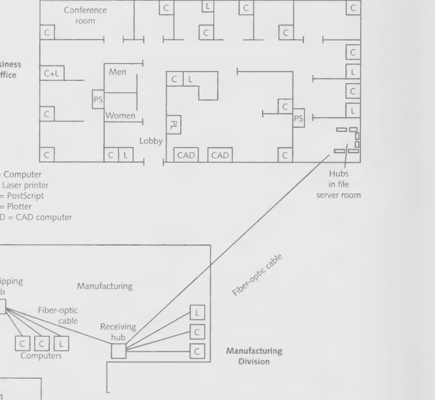

- C = 计算机
- L = 激光打印机
- PS = PostScript（页面描述语言）
- PL = 绘图仪
- CAD = CAD 计算机

您建议网络服务器还应包含哪些其他硬件组件？

#### 案例项目 1-2：为 Wiggerts 供暖和空调公司选择网络操作系统

确定您认为能够以最经济的方式满足该组织需求的网络操作系统，并说明选择该操作系统的理由。

# 第 2 章

## 安装 NOVell NETWARE 6.5 OPEN ENTERPRISE SERVER

阅读本章并完成相关活动后，您将能够：

- 识别安装 NetWare 6.5 的要求
- 执行 NetWare 6.5 Open Enterprise Server 的安装
- 识别并能够使用基本的 NetWare 控制台命令
- 监控服务器的健康状况和性能

随着网络的发展，安装新服务器和升级现有服务器是网络管理员需要执行的持续过程。虽然您作为网络管理员的主要职责是设置和维护网络环境，但为了成为一名 CNA（网络管理员），您还需要了解如何规划和执行基本的 NetWare 6.5 安装。此外，在本章中，您将学习如何使用 NetWare 控制台命令和远程管理工具来管理您的 NetWare 6.5 Open Enterprise Server 环境。

### 为 NetWARE 6.5 安装做准备

如第 1 章所述，Novell 的 NetWare 操作系统自 20 世纪 80 年代初以来就有着提供高性能、可靠网络服务的悠久历史。NetWare 6.5 是 Novell Open Enterprise Server 发行版中包含的最新 NetWare 内核版本，它继续支持所有 Novell 服务，并提供广泛的开发工具和实用程序。在执行 NetWare 6.5 Open Enterprise Server 安装之前，您需要准备好提供安装过程所需的信息，并应熟悉 NetWare 6.5 的硬件要求和安装选项。在本节中，您将学习硬件要求以及正确配置服务器和软件组件的信息。

#### NetWare 6.5 硬件要求

基本上，NetWare 6.5 由一个操作系统内核（Server.exe）组成，该内核为网络提供核心 NetWare 服务器服务，并拥有一个软件总线，允许加载和卸载包含专门服务和控制功能的其他模块，如图 2-1 所示。

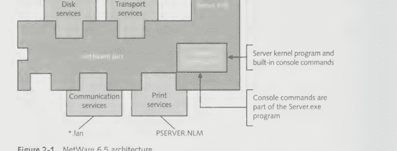

**图 2-1** NetWare 6.5 体系结构

除了提供基本核心 NetWare 服务和可加载模块支持外，NetWare 6.5 内核旨在支持 Java 应用程序，并使用 HTTP 提供互联网服务。这些功能需要额外的系统资源，如处理器速度和内存，这是早期 NetWare 版本所不需要的。由于其模块化设计，运行 NetWare 6.5 所需的硬件要求会根据要加载的模块和服务数量以及登录的用户数量而变化。安装 NetWare 6.5 服务器的最小硬件环境如表 2-1 所示，同时列出了建议用于充分支持中等规模网络环境的硬件。

**表 2-1** NetWare 6.5 硬件要求

| 组件 | 最低要求 | 推荐配置 |
| :--- | :--- | :--- |
| 处理器 | Pentium II 或 AMD K7 | Pentium IV |
| 内存 | 512 MB | 1 GB |
| 磁盘 | 500 MB DOS；SYS 卷剩余 2 GB 空间 | 500 MB 加上每 1 MB RAM 1 MB 空间以允许内存转储（例如，如果您有 1 GB RAM，则为 1.5 GB）；SYS 卷 4 GB 加上额外的公司数据存储空间 |
| 显示器 | Super VGA | Super VGA |
| CD-ROM | 标准 CD 驱动器 | 可启动 CD 驱动器 |

除了硬件要求外，如果您正在将 NetWare 6.5 安装到现有的 eDirectory 树中，该 eDirectory 树必须是版本 8.6 或更高版本（参见第 4 章），并且不能包含 NetWare 4.11 之前的 NetWare 服务器版本。NetWare 6.5 还支持多处理器以提高服务器性能。当使用多处理器时，建议至少使用两个 Pentium III 700 MHz 或更高版本的处理器。

NetWare 6.5 安装过程由四个主要阶段组成：

- 安装启动
- 初始安装
- 模式选择
- 服务器配置

每个阶段都需要输入或记录某些信息。在接下来的章节中，您将通过学习每个安装阶段所需的信息来为安装过程做准备。图 2-2 是一个样例 NetWare 服务器安装计划表，您可以使用它来帮助指导您获取成功安装 NetWare 6.5 Open Enterprise Server 所需的信息。

### 安装启动阶段

当安装过程从**安装启动阶段**开始时，您需要选择安装语言和区域设置。区域设置包括国家/地区、代码页和键盘。根据您的位置，您可能需要更改 NetWare 服务器安装计划表中显示的默认设置。在接受 NetWare 6.5 和 JReport 运行时许可协议后，您需要选择是要执行默认安装还是手动安装。对于大多数安装，您应该选择手动安装，以便更好地控制安装设置。安装启动阶段的最后一步是准备 NetWare 引导分区，如下节所述。

### NetWare 引导分区

在 NetWare 服务器上，磁盘存储空间被划分为两个或多个称为分区（partitions）的独立区域（见图 2-3）。


### NetWare 服务器安装规划表

#### 服务器硬件

- 计算机品牌和型号：____________
- 处理器 1：____________ 时钟速度：____________
- 处理器 2：____________ 时钟速度：____________
- 内存（RAM）：____________

#### 安装启动选项

- 语言：____________ (English)
- 国家/地区：____________ (001 USA) 代码页：____________ (437 U.S. English) 键盘：____________ (U.S.)
- 安装类型：默认（Default）或手动（Manual）
- 启动分区大小：____________ (默认 500 MB)

#### 初始安装信息

- 服务器 ID：____________
- 磁盘控制器类型：____________ 型号：____________
- NetWare 驱动程序：
  - 驱动器 1 容量：____________ 驱动器 2 容量：____________
- 网络接口卡 1：____________ 驱动程序：____________
- 网络接口卡 2：____________ 驱动程序：____________
- SYS 分区大小：____________ 位置：____________

#### 模式选择信息

- 服务器安装类型：____________ 自定义（Custom） ____________ 基本（Basic） ____________ 预迁移（Premigration）
- 预配置服务器：____________
- 要安装的自定义组件：____________
  ____________ ____________
  ____________ ____________

#### 服务器配置

- 服务器名称：____________
- 服务器 IP 地址：____________ 子网掩码：____________
- 是否使用 DNS 服务器：是或否 ____ DNS IP 地址：____________
- 主机名：____________ 域名：____________
- 是否使用 IPX？是或否 ____ 如果是，请填写下方的 IPX 信息。
- IPX 帧类型和网络地址：____________
- 时区：____________
- eDirectory 树名称：____________ (新的或现有的)
- 服务器 eDirectory 上下文：____________
- 管理员用户名和密码：____________
- 许可证类型：____________ 用户数：____________ 位置：____________
- Novell 模块化身份验证服务（Novell Modular Authentication Services）：NDS
  ____________
  ____________
  ____________

图 2-2 NetWare 服务器安装规划表

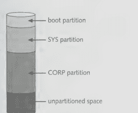

图 2-3 NetWare 6.5 磁盘分区

启动分区是一个格式化为文件分配表（FAT）的分区，用于通过加载 Novell DOS 来启动计算机，进而加载 NetWare Server.exe 软件内核（此前在图 2–1 中展示）以及存储在启动分区中的磁盘驱动程序。在 Server.exe 内核加载完成后，Novell DOS 会被从内存中移除。如果服务器因硬件或软件驱动程序问题而崩溃，启动分区还用于存储内存转储（memory dumps）。若要用于存储内存转储，启动分区必须拥有足够的空间来存储服务器 RAM 的内容。启动分区通常很小；通常 500 MB 就足以存储启动 NetWare OS 所需的服务器和驱动程序文件。若要存储内存转储，例如，如果您的服务器有 1 GB 的 RAM，则建议启动分区大小为 1.5 GB。创建启动分区后，驱动器上剩余的磁盘空间将被预留给 NetWare 分区，如图 2–3 所示。NetWare 分区被组织为存储池，并从中创建称为卷的逻辑存储区域。您将在第 3 章中更深入地了解分区、存储池和卷。所有 NetWare 服务器至少需要 2 GB 的 SYS 卷作为最小系统要求。如果您计划安装本书中描述的许多 OneNet 服务，则需要至少 4 GB 的 SYS 卷。为防止 SYS 卷被用户数据填满，网络管理员随后会创建额外的分区来容纳公司数据卷。

#### 初始安装阶段

在创建启动分区后，安装程序会将必要的系统文件复制到启动分区中，然后通过加载 NetWare Server.exe 内核来启动**初始安装阶段**。在初始安装阶段，NetWare 6.5 内核用于加载磁盘和局域网驱动程序并创建 SYS 卷。

##### 磁盘驱动程序信息

NetWare 6.5 的磁盘驱动程序是模块化的，包括被称为**主机总线适配器（HBAs）**的独立驱动程序来管理控制卡，以及**自定义设备模块（CDMs）**，后者与 HBA 协作以控制连接到控制卡的各个存储设备。对于未随 NetWare 附带 HBA 和 CDM 的磁盘控制器，需要先从制造商提供的软盘或 CD 加载其 NetWare 驱动程序，然后才能与 NetWare 一起使用。NetWare 6.5 包含适用于智能磁盘电子器件（IDE）控制器的 HBA 和 CDM，这些控制器可以处理大多数 IDE 和增强型 IDE（EIDE）类型的驱动器。支持少量用户和设备的服务器可以使用 IDE 磁盘控制卡。然而，支持更多存储设备（如大容量硬盘、CD–ROM 和磁带备份系统）的大型服务器通常使用 SCSI 控制器，因为它们比 IDE 控制器速度更快，并支持更广泛的设备。例如，为确保更好的速度和扩展能力，Universal AeroSpace 为其服务器选择了 SCSI 磁盘控制器。UAS 计划在未来扩展其存储设备，SCSI 控制器将支持额外的高速磁盘驱动器以及计划用于归档工程设计的磁盘光盘系统。

除了控制器类型外，您还应在 NetWare 服务器安装规划表上确定制造商和型号，以确保在安装过程中选择了正确的驱动程序。NetWare 6.5 可以检测到许多诺维尔（Novell）测试过的流行 IDE 和 SCSI 磁盘控制器。因此，为了使安装更简单，在为服务器选择 SCSI 磁盘控制器时，请检查您选择的磁盘控制器是否包含在 NetWare 中。在大多数情况下，购买通过 NetWare 6.5 认证的控制卡是确保此点的最佳方式。在安装之前，您应识别将在服务器上使用的磁盘系统组件和驱动程序，并在您的 NetWare 服务器安装规划表上进行记录。

#### 网络接口卡

为了与网络上的其他设备通信，服务器至少需要一张网络接口卡（NIC）。可以安装额外的 NIC，以便通过多个网络电缆系统访问服务器。当在服务器中安装多个 NIC 时，服务器充当路由器，通过网络电缆系统传递数据包，如图 2-4 所示。

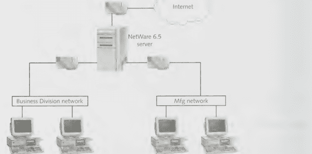

为了访问 NIC，NetWare 要求在 NetWare 安装期间识别驱动程序。因此，在服务器上安装 NetWare 之前，您需要识别服务器上每个 NIC 的制造商、型号和配置。为了简化安装，NetWare 包含了许多流行 NIC 的驱动程序。与磁盘控制器一样，确保您的网卡驱动程序包含在 NetWare 中的最佳方法之一是购买经过诺维尔（Novell）认证的网卡。您还需要提供卡片的硬件配置，这可能包括中断、直接内存访问（DMA）通道、输入/输出（I/O）端口和内存地址。您可以使用专用软件或通过在卡片本身放置跳线或设置开关来配置卡片。NetWare 服务器安装规划表中有填写制造商、型号和驱动程序信息的空间。

#### NetWare 系统分区

为服务器安装做准备的下一步是定义分配给 NetWare SYS 卷的磁盘存储量。推荐的最小空间是 2 GB，但您应考虑使用至少 4 GB，并在驱动器上保留一些未分区的磁盘空间，以便将来扩展卷。在第 3 章中，您将学习如何添加分区和卷以存储用户数据和软件。

#### 模式选择阶段

在 NetWare 6.5 中，诺维尔（Novell）提供了名为“模式化服务器部署”的新服务器安装选项，以帮助简化和加速专用服务器的安装。模式选项（如图 2-5 所示）使管理员能够选择他们想要安装的服务器类型。

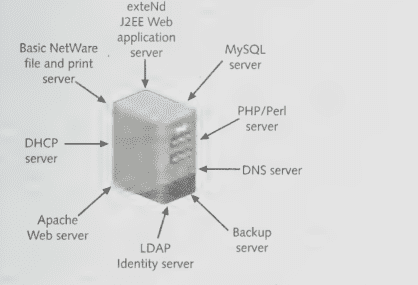

例如，如果您指示安装 DNS/DHCP，模式化安装过程将请求安装 DNS 和 DHCP 所需的信息。在您提供信息后，模式化安装过程将快速自动安装必要的软件并定制服务器，以最大限度地提高 DNS 和 DHCP 性能。

一项重要的诺维尔（Novell）战略是在 NetWare 6.5 中全面支持开源应用程序开发。由于 NetWare 6.5 提供了如此多的开源开发工具，诺维尔（Novell）包含了 NetWare AMP（代表“Apache, MySQL, PHP/Perl”）服务器选项，以简化针对开源应用程序开发的专用服务器的安装和配置。

在**模式选择阶段**，您选择要执行的服务器安装类型，然后输入该类型所需的配置信息。在此阶段结束时，安装过程将必要的文件复制到 SYS 卷中。

#### 服务器配置阶段

在将必要的文件复制到服务器的 SYS 卷之后，**服务器配置阶段**用于输入服务器的名称、协议、许可证和 eDirectory 信息，如下文所述。

##### 服务器名称

服务器名称可以是 2 到 47 个字符，并且应有助于轻松识别服务器及其位置或用途。这些名称不能以句点开头或包含空格。此外，服务器名称在其所属的 eDirectory 树中必须是唯一的。如果您的服务器将从 Internet 访问，您应避免在服务器名称中使用下划线或破折号，以保持与域名服务（DNS）的兼容性。

##### 协议信息

在识别服务器的硬件环境后，另一个主要考虑因素是识别服务器将运行的网络环境。网络环境包括网络协议以及每个 NIC 使用的网络地址和任何特殊帧类型。


尽管 TCP/IP 是大多数 NetWare 安装的首选协议，但如果您计划支持较旧的软件服务（例如使用基于队列打印的打印服务器模块 PSERVER.NLM，这在第 8 章中有讨论），Novell 早期的**互联网数据包交换 (IPX)** 协议可能也是必要的。在安装 IPX 时，每个网络线缆系统需要一个唯一的网络地址和帧类型。帧类型指定了通过网络线缆发送的数据包格式。与 IPX 数据包一起使用的默认帧类型是 **Ethernet 802.2**。IPX 网络地址的作用类似于邮政编码，它允许数据包高效地投递到正确的接收网络。当在网络线缆上安装第一个 NetWare IPX 服务器时，您可以使用由十六进制数字表示的、最长为八字节的任何网络地址。连接到同一网络线缆的附加服务器必须使用与现有服务器相同的网络地址；其他网段上的 IPX 协议服务器必须使用不同的 IPX 网络地址。例如，Eric 选择了网络地址 1EEE8022，用于 10BaseT 网卡，以代表其以太网卡使用的 IEEE 802.2 标准。

除了提供传统的 IPX 协议外，Novell 还使 NetWare 6.5 能够直接通过 TCP/IP 进行通信。尽管实施起来更复杂，但 TCP/IP 是一种更通用的协议，它允许您通过 ISP 将服务器连接到互联网，或直接为企业内部网络提供服务。由于现有的客户端和应用的原因，UAS 决定最初在服务器上同时安装 IPX 和 TCP/IP 的支持。在将所有计算机和应用转换为 TCP/IP 后，公司可以从 NetWare 6.5 服务器中移除对 IPX 的支持。如果您正在使用 IPX，应在您的 NetWare 服务器安装计划表上输入帧类型和相应的 IPX 网络地址信息。必须为所有共享网络段和帧类型的服务器分配相同的 IPX 网络地址。此外，在使用 IPX 时，每个服务器都被分配了一个唯一的八位十六进制数，称为服务器 ID，它唯一地标识网络段上的服务器，在安装过程中自动分配，但也可以手动输入。

### eDirectory 安装

如第 1 章所述，eDirectory 是 Novell 的目录服务，用于组织和管理网络对象及配置。在 eDirectory 数据库中，网络对象存储在与文件存储在文件夹中类似方式的容器内。这些容器以称为目录树的层次化方式组织。在第 4 章中，您将更多地了解 eDirectory 的架构和运行。

在 NetWare 安装期间，您可以选择将新服务器放入现有树中或创建新树。要将服务器放入现有树中，您需要能够以现有树的 **Admin** 用户身份登录，并输入将创建服务器的容器上下文。要创建新树，您需要确定其名称以及放置新服务器对象和 Admin 用户的容器路径。因此，准备 NetWare 安装的一个重要步骤是确定 eDirectory 树的名称以及放置服务器对象的容器路径。在他的 NetWare 服务器安装计划表上，UAS 网络管理员 Eric Kenton 确定新的 UASHOST 服务器的上下文为名为 UAS_Tree 的新树中的 UAS 组织。

### 配置 Novell 模块化认证服务 (NMAS)

您可以使用图 2-6 中显示的 NMAS 选项，从多种行业标准安全选项中进行选择。

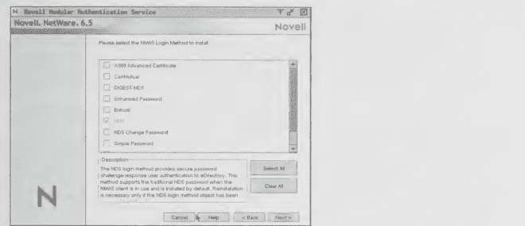

**图 2-6 Novell 模块化认证服务选项**

除了默认的 NDS 登录方法外，您还应选择 Simple Password 登录方法，以便 Windows 客户端计算机可以在不使用 Novell 客户端的情况下登录。选择所有选项将赋予服务器最广泛的认证协议范围。

### 活动 2-1：规划 NetWare 6.5 服务器安装

**所需时间：** 10 分钟

**目标：** 识别准备 NetWare 6.5 服务器安装所需的信息。

**要求：** 如果您正在使用 IPX（以便您能在第 8 章中加载 PSERVER.NLM），请记录您的帧类型和 IPX 网络地址：

- IPX 帧类型（例如 Ethernet 802.2）：
- 网络地址（例如 1EEE8022）：

**描述：** Eric Kenton 要求您安装一个新的 NetWare 6.5 服务器，以评估 Novell Open Enterprise Server 产品。在此活动中，您将使用讲师提供的信息来完成图 2-2 中所示的 NetWare 服务器安装计划表。

1. 从讲师处获取一份 NetWare 服务器安装计划表的副本。
2. 使用讲师提供的硬件信息填写 NetWare 服务器安装计划表的“初始安装信息”部分。（如果您正在使用 IPX，请输入讲师提供的帧类型和网络地址。只有在您正在第 8 章中加载 PSERVER.NLM 时才需要 IPX。）
3. 在表格的“模式选择信息”部分的“要安装的自定义组件”下输入以下 NetWare 组件：
   - Apache2 Web 服务器和 Tomcat 4 Servlet 容器（iPrint 所需）
   - iPrint
   - Novell iManager 2.5
   - Novell 虚拟办公室框架
4. 使用讲师提供的信息填写 NetWare 服务器安装计划表的“服务器配置”部分。
5. 在继续下一个活动之前，请让讲师检查您的表格。

## 执行 NetWare 6.5 安装

NetWare 6.5 操作系统包含在两张 CD 上：操作系统 CD 1 和产品 CD 2。操作系统 CD 1 是可引导的，包含初始安装和模式选择阶段所需的文件。在开始安装之前，您需要确保现有的网络和服务器已正确配置。以下部分描述了准备现有网络和服务器以及执行实际 NetWare 6.5 安装的步骤。

### 升级现有的 eDirectory 网络

如果您计划将 NetWare 6.5 安装到现有的 eDirectory 树中，您需要使用 NetWare Deployment Manager (Nwdeploy.exe) 以确保现有的 eDirectory 树已更新到版本 8.6。例如，Eric 执行了以下程序来为 NetWare 6.5 准备 UAS eDirectory 树：

1. 首先，Eric 在他的 Windows XP Professional 计算机上安装了 Novell 客户端，如第 4 章所述。
2. 然后，他将 NetWare 6.5 操作系统 CD 1 插入 CD-ROM 驱动器，以自动启动 NetWare Deployment Manager。（您也可以通过从 NetWare 6.5 操作系统 CD 1 的根目录运行 Nwdeploy.exe 来启动此软件。）
3. 当 NetWare Deployment Manager 启动时，他通过双击“Network Preparation”文件夹并阅读“Overview”部分来查看升级过程所需的任务。
4. 接着，他按照“Back Up Data”部分的说明备份了现有的 NetWare 服务器和 eDirectory 数据。
5. 备份完成后，Eric 通过选择“View and Update eDirectory Version”选项来更新 eDirectory。
6. 为完成升级，Eric 通过选择“Prepare for eDirectory”选项来扩展 eDirectory 树结构。（您将在第 4 章中更多地了解 eDirectory 升级。）

在 Eric 完成升级后，现有的 eDirectory 树已准备好接收新的 NetWare 6.5 服务器安装，如下几节所述。

### 准备服务器

准备服务器从验证硬盘上没有现有分区开始。您可以通过从 DOS 磁盘引导计算机，然后运行 Fdisk 程序来显示任何现有分区来实现这一点。如果您的系统包含现有分区，请在开始安装前使用 Fdisk 删除这些分区。您也可以使用 Windows 或 Linux 的实时版或运行时版本来初始化硬盘。

在确保硬盘为空之后，下一步是确定 NetWare 6.5 安装的启动方法。如果您的计算机将从 CD-ROM 驱动器引导，您应使用 CMOS 设置程序确保系统设置为首先从 CD-ROM 驱动器引导。如果系统无法从 CD 引导，您可以创建一个包含 CD 驱动器的 DOS 可引导磁盘，然后按照以下步骤使用 DOS 引导盘启动 NetWare 6.5 安装：

1. 创建一张 DOS 可引导磁盘。
2. 在可引导磁盘上安装 CD-ROM 驱动器的 DOS CD 驱动程序。


3. 创建 Config.sys 文件以加载 CD 驱动程序。

4. 创建 Autoexec.bat 文件以启动 NetWare 6.5 安装程序。该文件应包含以下命令，用于将 CD 映射到 E: 驱动器并启动安装程序：

```
MSCDEX.EXE /D:cdname /L:E
E:
INSTALL
```

### 在目标计算机上安装 NetWare 6.5

如“准备 NetWare 6.5 安装”部分所述，NetWare 6.5 安装过程由四个一般阶段组成：安装启动、初始安装、模式选择和服务器配置。在安装 NetWare 6.5 Open Enterprise Server 时，在初始安装阶段，你可以选择执行 Open Enterprise Server 安装或传统的 NetWare 6.5 安装。Open Enterprise Server 选项包括支持包 3（Support Pack 3）、iManager 2.5、Virtual Office 1.5 以及新的 QuickFinder 服务器。传统的 NetWare 6.5 SP3 选项包括 iManager 2.0、Virtual Office 1.0 和 Web 搜索服务器。为了满足本书的目的，你需要选择 Open Enterprise Server 安装，以获取在各项活动中使用的 iManager 和 Virtual Office 版本。

了解 NetWare 安装过程的最佳方式是实际操作一次 NetWare 6.5 服务器的安装。在以下活动中，你将经历为 UAS 网络安装 NetWare 6.5 服务器的四个阶段。如果你不打算安装 NetWare 6.5，你的导师可能会为你演示此活动。

### 活动 2-2：安装 NetWare 6.5 Open Enterprise Server

**所需时间：** 50 分钟

**目标：** 安装 NetWare 6.5 Open Enterprise Server。

**描述：** Eric 要求你安装一台新的 NetWare 6.5 服务器，用于评估 Novell Open Enterprise Server 产品。使用你在活动 2-1 中填写的 NetWare 服务器安装规划表来提供所需信息。

- 1. 如果你使用的是 VMware，首先应按照附录 C 中描述的方法创建一台 NetWare 6.5 虚拟计算机。如果你使用的是带有可移除硬盘的系统，请插入一块空白硬盘。
- 2. 要开始安装过程，将 Open Enterprise NetWare 6.5 操作系统 CD 1 插入服务器的 CD-ROM 驱动器，并重新启动服务器以显示语言选择屏幕。验证已选择正确的安装语言，然后按 **Enter** 键以显示“选择服务器的区域设置”屏幕。


> 如果你的计算机无法从 CD 驱动器启动，你需要按照“准备服务器”部分的描述创建一个启动磁盘。

如果你安装的是传统版 NetWare 6.5，可能需要选择以下启动选项：

- 选择 **I** 以安装新服务器。
- 选择 **A** 以自动搜索 CD-ROM 驱动程序。
- 选择 **A** 表示自动终止。
- 选择 **A** 表示自动执行。

- 3. 再次按 **Enter** 键以接受国家、代码页和键盘的默认区域设置。
- 4. 阅读 Novell Open Enterprise Server 软件许可协议，然后按 **F10** 键接受并继续。如有必要，再次按 **F10** 键接受 JReport 运行时许可协议，并显示图 2-7 所示的“欢迎使用 NetWare 6.5 服务器安装程序”窗口。

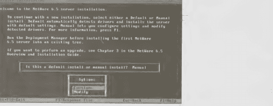

**图 2-7** “欢迎使用 NetWare 6.5 服务器安装程序”窗口

- 5. 若要自定义安装，请按 **Enter** 键将默认安装类型更改为 **手动（Manual）**。接下来，按 **Tab** 键选择“继续”选项，并按 **Enter** 键以显示“准备启动分区”窗口。
- 6. “准备启动分区”窗口允许你在服务器硬盘的前 8 GB 内创建一个 DOS 启动分区。虽然最小 DOS 分区启动大小为 500 MB，但 Novell 建议增加更多空间以保存内存转储，以防服务器发生硬件故障。选择 **修改（Modify）** 选项，高亮显示 **空闲空间（Free Space）**，按 **Enter** 键，然后输入系统 **RAM** 大小（以 MB 为单位）作为 DOS 分区的大小。第二次按 **Enter** 键，安装程序将格式化 DOS 启动分区并返回到“准备启动分区”窗口。按 **Tab** 键，使用方向键选择 **继续（Continue）** 选项，然后按 **Enter** 键以显示“服务器设置”窗口。
- 7. 将在你在活动 2-1 中完成的 NetWare 服务器安装规划表上记下服务器 ID 号，然后按 **Enter** 键开始文件复制过程，在此过程中，文件从操作系统 CD 1 复制到 DOS 分区。这些文件包括服务器启动软件以及配置文件和驱动程序。

初始安装阶段使用操作系统 CD 1 上的基于文本的菜单和屏幕来选择局域网（LAN）驱动程序并创建 **SYS** 卷。此阶段包括一个称为 **NSS 主菜单（NSS Main Menu）** 的屏幕，你可以使用它来创建额外的分区、池和卷。（你将在第 3 章中更多地了解创建文件系统对象的内容。）要在安装后访问 NSS 主菜单，请在服务器控制台上输入命令 **NSSMU**。

- 8. 文件复制完成后，安装程序会显示检测到的平台支持模块的驱动程序。按 **Enter** 键接受并加载检测到的驱动程序，并显示检测到的 HotPlug 和存储适配器。
- 9. 验证检测到的设备与你 NetWare 服务器安装规划表上的设备是否匹配，然后按 **Enter** 键显示检测到的存储设备。再次验证这些设备是否正确，然后按 **Enter** 键继续并加载它们。
- 10. 接下来，安装程序显示支持检测到的 **LAN** 适配器的驱动程序。验证由计算机硬件配置识别的检测到的驱动程序是否正确，然后按 **Enter** 键显示“设备类型和驱动程序名称”窗口。再次按 **Enter** 键以接受设备并继续加载驱动程序。驱动程序加载完成后，安装程序将显示图 2-8 中所示的“创建 **SYS 卷**（Create **SYS Volume**）”窗口。
- 11. 按 **Enter** 键接受默认的 4 GB **SYS** 卷大小，并显示图 2-9 中所示的 NSS 主菜单。此安装菜单是 NetWare 6.5 的新增功能，允许你自定义或更改设备、存储池和卷的配置，而无需重新启动安装程序。

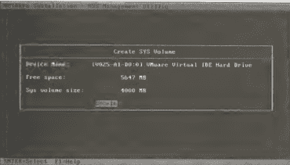

图 2-8 创建 SYS 卷窗口

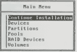

图 2-9 安装过程中的 NSS 主菜单

- 12. 验证“继续安装（Continue Installation）”选项是否被高亮显示，然后按 Enter 键开始另一次文件复制。此文件复制过程将所有系统文件复制到 SYS 卷，然后加载服务器程序。此过程需要几分钟时间。

在模式选择阶段，你选择要执行的服务器安装类型，然后输入该类型所需的配置信息。在此阶段结束时，安装过程会将必要的文件复制到 SYS 卷中。

- 13. 在安装 NetWare 6.5 Open Enterprise Server 时，服务器程序加载后，将显示“产品安装类型”窗口（见图 2-10）。

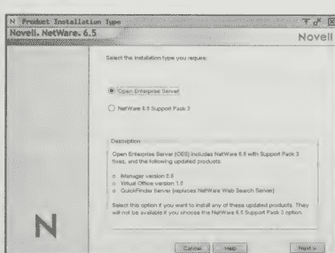

图 2-10 产品安装类型窗口

- 14. 验证是否已选中“Open Enterprise Server”选项按钮，然后点击“下一步（Next）”以显示图 2-11 中所示的“选择模式（Choose a Pattern）”窗口。

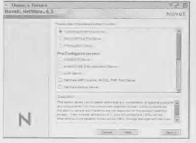

图 2-11 选择安装的模式选项

- 15. 由于此服务器将是通用型，验证是否已选中默认的“定制 NetWare 服务器（Customized NetWare Server）”选项按钮，然后点击“下一步”以显示图 2-12 中所示的“组件（Components）”窗口。

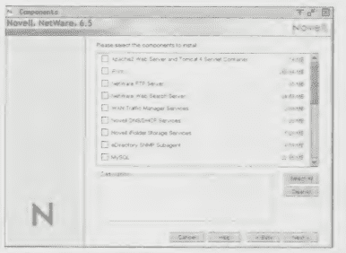

图 2-12 组件窗口

- 16. 选择你在活动 2-1 的 NetWare 服务器安装规划表上写下的安装选项，然后点击“下一步”以显示“摘要（Summary）”窗口。
- 17. 验证你选择安装的所有产品是否都包含在摘要窗口中，然后点击“复制文件（Copy files）”按钮。在提示时，插入 NetWare 6.5 产品 CD 2，并点击“确定（OK）”。由于此文件复制过程几乎需要 30 分钟，你可能想休息一下。在文件复制期间，将显示关于所选产品的信息窗口。

在服务器配置阶段，你输入服务器名称，提供许可证信息，选择并配置要使用的网络协议，指定时区，安装 oDirectory，并为网络客户端选择任何额外的登录方法。

- 18. 接下来，安装过程显示“输入服务器名称（Enter the server name）”窗口。在“服务器名称（Server Name）”文本框中输入你在 NetWare 服务器安装规划表上的名称，然后点击“下一步”以显示“协议（Protocols）”窗口。


19. 点击 **IP** 复选框，并输入您之前在《NetWare 服务器安装规划表》上记录的 NetWare 6.5 服务器的 IP 地址和子网掩码。如果选中，请按照《NetWare 服务器安装规划表》中的定义配置 **IPX**。

20. 点击**下一步**以显示域名服务窗口。如果本地网络上没有 DNS 服务器，请保持所有字段为空，然后点击**下一步**。当收到一条警告信息，指出如果没有 DNS 服务某些功能将受到限制时，点击**确定**继续。

21. 接下来，选择您的时区，并点击**下一步**以初始化 eDirectory 服务并显示 eDirectory 安装窗口。

22. 点击**创建新的 eDirectory 树**选项按钮，然后点击**下一步**以显示图 2-13 中所示的 eDirectory 安装窗口。

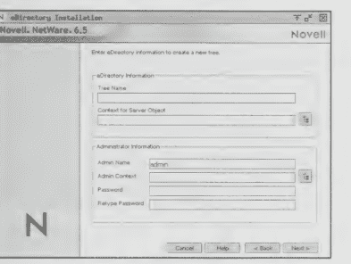

23. 在“树名称”文本框中输入您的 eDirectory 树的名称（即您在《NetWare 服务器安装规划表》上记录的那个），在“服务器对象上下文”文本框中输入您的组织名称。在“密码”和“重新输入密码”文本框中输入管理员用户的密码，然后点击**下一步**安装 eDirectory 并显示 eDirectory 摘要窗口。将此窗口中的信息记录在您的《NetWare 服务器安装规划表》上，然后点击**下一步**显示许可证窗口。

24. 许可证窗口可用于在服务器安装期间为 NetWare 6.5 服务器和用户安装许可证。许可证文件扩展名为 .nf，也可以在服务器安装后使用 iManager 安装，如第 5 章所述。点击浏览按钮以定位软盘上的许可证证书，然后将其添加到“要安装的许可证”列表框中（见图 2-14）。

> **注意** NetWare 6.5 产品 CD 中的 license\eval 文件夹包含一个用于评估目的的示例 MLA 许可证证书。

25. 点击**下一步**以显示 MLA 许可证证书上下文窗口。您使用“选择 NDS 上下文”文本框来指定安装许可证的上下文。许可证将在所选上下文及其下级中的所有用户中有效。验证上下文是否已设置为您的 UAS 组织，然后点击**下一步**以安装许可证并显示 LDAP 配置窗口。

26. 将默认的明文和 SSL/TLS 端口号记录在您的《NetWare 服务器安装规划表》上，然后点击**下一步**以接受默认端口设置并显示图 2-6 中之前展示过的 Novell 模块化认证服务（NMAS）窗口。

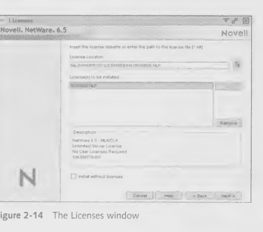

**图 2-14** 许可证窗口

27. 为了支持所有登录方法，点击**全选**按钮，然后点击**下一步**。安装程序将继续配置每个选定的服务。

28. 在提示时，重启您的服务器。恭喜！您的 NetWare 6.5 服务器现已可以使用。

29. 要正确关闭您的 NetWare 服务器，请在服务器控制台上按下**Ctrl+Esc**以显示控制台选择菜单，然后选择**系统控制台**选项以显示控制台提示符。以下部分描述了 NetWare 服务器控制台和命令的使用。

30. 输入命令 **DOWN** 并按下**Enter**。当显示 DOS 提示符时，您可以安全地关闭服务器电源。（您将在以下部分更深入地了解 DOWN 和 EXIT 命令。）

## 操作服务器控制台

如“准备安装 NetWare 6.5”部分所述，NetWare 服务器至少包含两个磁盘分区：一个用于 DOS，一个用于 NetWare。NetWare 服务器首先从 DOS 分区（C: 驱动器）启动。如图 2-1 所示，NetWare 服务器由 Server.exe 内核软件以及提供服务的模块组成。Server.exe 内核提供核心 NetWare 服务（如文件共享），并为 NetWare 可加载模块和 Java 应用程序提供软件总线。大多数网络服务（如 Novell 分布式打印服务（NDPS）和 Novell eDirectory）以及设备驱动都由称为 **NetWare 可加载模块（NLMs）** 的软件模块提供，这些模块在服务器启动过程中或启动后加载。

要启动 NetWare 服务器，请从 DOS 分区开始运行 Server.exe 程序。在安装期间，Server.exe 程序、其支持文件和其磁盘驱动程序模块存储在与 DOS 引导分区 C:\Nwserver 目录中。如果在安装过程中选择自动启动服务器，则启动服务器所需的命令将被放置在 Autoexec.bat 文件中。当计算机启动时，DOS 会自动执行放置在 Autoexec.bat 文件中的命令。例如，以下命令被放置在 UASHOST 服务器的 Autoexec.bat 文件中：

```
C:\>cd nwserver
C:\nwserver>server
```

当 Server.exe 程序加载时，它会从 Startup.ncf 文件读取命令，该文件也位于 C:\Nwserver 目录中。此文件包含磁盘驱动程序和其他配置命令的名称，如图 2-15 所示。

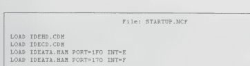

**图 2-15** Startup.ncf 文件示例

在 Server.exe 加载其磁盘驱动程序后，它会挂载 SYS 卷，并继续读取存储在 SYS 卷系统目录中的 Autoexec.ncf 文件里的命令。如图 2-16 所示，Autoexec.ncf 文件包含识别服务器名称、内部地址以及必须加载的 NLM（如网卡驱动程序）的命令，以便服务器正常运行。

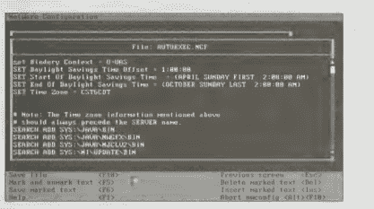

**图 2-16** 从 Autoexec.ncf 文件读取命令

启动后，服务器控制台将显示 Novell Open Enterprise Server 屏幕。您可以通过点击 Novell，指向“设置”，然后点击“背景”来更改 GUI 屏幕的背景。除了 GUI 控制台外，NetWare 6.5 服务器还有一个基于文本的控制台屏幕和几个模块的控制台屏幕。您可以使用 Alt+Esc 键组合在控制台屏幕之间切换，或者按下 Ctrl+Esc 显示所有控制台，然后输入要显示的屏幕编号来选择控制台屏幕（见图 2-17）。

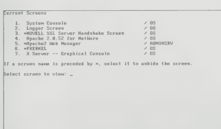

**图 2-17** 选择 NetWare 控制台

例如，要切换到系统控制台屏幕，请按下 Ctrl+Esc 以显示图 2-17 中的列表。输入 1 并按下 Enter 以显示控制台提示符，显示服务器名称后跟冒号。您可以使用系统控制台屏幕输入控制台命令并加载模块，如以下部分所述。

### 控制台命令

要成为一名 CNA 并有效操作服务器控制台，您需要了解如何使用内置于 NetWare 操作系统中的基本 **控制台命令**。表 2-2 总结了服务器控制台命令的用途，以下部分更深入地介绍了一些命令，并提供使用它们执行服务器操作的示例。在练习 2-3 中，您将练习使用控制台命令。

表 2-2 基本控制台命令

| 命令语法 | 描述 |
| :--- | :--- |
| BIND protocol TO<br>driveboard_name<br>(drive_<br>parameters) | 将协议附加到局域网卡。用协议名称（例如 IPX 或 IP）替换 protocol。用 NIC 的名称或分配给网卡的可选名称替换 driveboard_name。可选地用标识 NIC 的硬件设置（如 I/O 端口和中断）替换 drive_parameters。 |
| LOAD path/module_name<br>(parameters) | 在文件服务器的 RAM 中加载 NLM。可选地用指向包含要加载模块的目录的 DOS 或 NetWare 路径替换 path。用要加载的 NLM 的名称替换 module_name。根据加载的模块，可以输入可选参数。 |
| CONFIG | 显示每个 NIC 的配置信息，包括硬件设置、网络地址、协议和帧类型。 |
| DISPLAY servers | 显示文件服务器 IPX 路由表中的所有服务器，包括到达每个服务器的路由器数（跳数）。除非在服务器安装期间选择了 IPX，否则此命令不可用。 |
| MEMORY | 显示可供文件服务器使用的总内存量。 |
| SET time | 允许您更改文件服务器当前的系统日期和时间。 |
| CLS/OFF | 清除文件服务器控制台屏幕。 |
| DISABLE /ENABLE LOGIN | 阻止或允许新用户登录。 |
| BROADCAST | 向所有当前已登录的用户发送指定消息。 |
| DOWN | 关闭所有文件和卷，断开所有用户连接，并将文件服务器置于脱机状态。 |
| MOUNT volume_name<br>(ALL) DISMOUNT volume_<br>name | 将卷置于联机或脱机状态。用要挂载的卷的名称替换 volume_name，或使用 ALL 挂载所有 NetWare 卷。 |
| MODULES | 列出所有当前已加载的模块，从最后加载的模块开始。 |
| SEARCH (ADD/DEL) | 显示并更新服务器查找模块的路径。使用此命令添加和删除用于加载模块的路径。 |
| SECURE CONSOLE | 提供额外的安全性，有助于保护服务器免受未授权访问。 |
| SEND "message" (TO)<br>user_name/connection_<br>number | 向指定用户发送消息。用要发送的消息行替换 message，用当前已登录用户的名称或分配给该用户的连接编号替换 user_name/connection_number。可以从 MONITOR NLM 的 Connection 选项获得 connection_number。 |


#### 表 2-2 基本控制台命令（续）

| 命令语法 | 描述 |
| :--- | :--- |
| `UNBIND` _protocol_ `[FROM]` _LAN_driverboard_name_ | 从 LAN 卡中移除一个协议。将 _protocol_ 替换为您希望从该卡中移除的协议栈（例如 IPX）的名称。将 _LAN_driverboard_name_ 替换为已为 NIC 加载的驱动程序程序的名称，或 `LOAD` 命令分配给网卡的名称。 |
| `UNLOAD` _module_name_ | 从内存中移除 NLM，并将内存空间返回给操作系统。将 _module_name_ 替换为 `MODULES` 命令中给出的当前已加载模块的名称。 |
| `VOLUMES` | 显示所有已挂载卷的列表，以及卷类型（NSS 或传统类型）和支持的命名空间。 |
| `PROTOCOLS` | 显示所有当前已加载协议的列表。 |
| `HELP` _command_ | 显示有关指定命令的信息。例如，若要获取有关 `BIND` 命令语法和用法的信息，请输入 `HELP BIND` 并按 Enter 键。 |

#### CONFIG

CONFIG 命令显示有关服务器和 NIC 配置的信息，如图 2-18 所示。

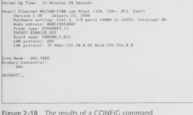

请注意，除了显示文件服务器的名称和内部网络地址外，CONFIG 命令还显示文件服务器中每个网络适配器的以下信息：

- LAN 驱动程序的名称
- 加载 LAN 驱动程序时分配的板卡名称
- 当前硬件设置，包括中断、I/O 端口、内存地址和 DMA 通道
- 分配给网络适配器的节点（站点）地址
- 绑定到网络适配器的协议栈
- 网络适配器的电缆方案的地址
- 分配给网络适配器的帧类型
- 树名称
- Bindery 上下文（用于与 NetWare 3.0 服务器向后兼容）

在安装网络适配器之前，您应该使用 CONFIG 命令，以便拥有现有板卡上所有硬件设置的最新列表。这有助于您为新卡选择唯一的中断和 I/O 地址设置。此外，在将另一台服务器添加到网络之前，可以使用 CONFIG 命令来确定电缆系统的网络地址。如果您错误地启动另一台服务器，并使用相同的电缆系统不同的网络地址，服务器之间的路由器配置错误将干扰网络通信。

#### DISABLE/ENABLE LOGIN

DISABLE LOGIN 命令阻止新用户访问 NetWare 服务器上的服务。在关闭服务器之前，您应首先发出 DISABLE LOGIN 命令，以防止任何额外用户访问服务器，然后使用 BROADCAST 命令向所有现有用户发送一条消息，告知他们服务器将在指定时间关闭，他们应关闭所有文件并注销服务器。如果没有发出 DISABLE LOGIN 命令，新用户可能会在广播消息后登录服务器，而不知道服务器即将关闭。DISABLE LOGIN 命令的另一个用途是暂时阻止用户登录，以便您执行某些维护工作，例如加载新驱动程序或备份系统。工作完成且服务器可以使用后，您可以发出 ENABLE LOGIN 命令，允许用户再次登录并使用服务器。

#### DOWN

DOWN 命令停用 NetWare 服务器操作系统，移除所有计算机连接，并将服务器返回到 DOS 提示符。在发出 DOWN 命令之前，您应禁用新登录并向所有用户广播一条消息，如图 2-19 所示。如果存在活动会话，NetWare 操作系统将发出一条警告消息，询问您是否要终止活动会话。

```
UASHOST:
UASHOST:DISABLE LOGIN
3-20-2002 8:19:52 am CONMSG8-5,60-85 [msgid=90013]
Login is now disabled

UASHOST:BROADCAST Server going down in 15 minutes. Please save work and logout.
UASHOST:DOWN
Java: Cleaning up resources, Please Wait.
```

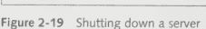

如果您看到此消息，应取消 DOWN 命令并使用 Monitor 实用工具（后文“使用 Monitor 实用工具”中有描述）来确定哪些连接有打开的文件，然后向该用户发送消息让其注销。如果没人使用计算机且数据文件仍保持打开状态，您可能需要去该计算机关闭文件并注销用户。在这种情况下，您应务必提醒用户，在数据文件打开时不要无人看管计算机。

#### LOAD

LOAD 命令将 NLM 加载到内存中并运行它。默认情况下，LOAD 命令在 SYS:System 目录中搜索请求的模块，除非指定了不同的路径。有效路径可以包括 NetWare 卷名称以及 DOS 本地驱动器号。当模块加载到内存中时，它将保留在那里，直到控制台操作员结束程序或使用 UNLOAD 命令将软件从内存中移除。根据所加载模块的需求，可以在 LOAD 命令后放置可选参数。

从 NetWare 5.0 开始并延续到 NetWare 6.5，不再需要运行 NLM 时使用 LOAD 命令。只需键入 NLM 的名称，系统会自动执行加载过程。

#### SEARCH

当您输入命令时，服务器首先检查该命令是否为本节中描述的某个标准内部命令。如果该条目不是可识别的内部命令，服务器将尝试从 SYS:System 目录（参见第 3 章）加载一个具有该名称的 NLM。使用 SEARCH 命令，您可以指定其他路径供服务器查找 NLM。例如，您可以使用此命令为 DOS 启动分区添加一个搜索路径：

```
SEARCH ADD C:\
```

您还可以通过在系统控制台上仅键入 SEARCH 一词来使用 SEARCH 命令显示服务器的搜索路径。图 2-20 展示了将 DOS 分区添加到搜索路径、显示所有现有搜索路径，然后从搜索路径中移除 DOS 分区的示例。

```
IRASHOST:SEARCH ADD C:\
Search 12: C:\
IRASHOST:\
IRASHOST:SEARCH
Search 1: SYS\SYSTEM\
Search 2: C:\NMSERVER (default directory)
Search 3: C:\NMSERVER\DRIVERS\
Search 4: SYS:\JAGON\BIN\
Search 5: SYS:\JAGON\WQ\LFX\BIN\
Search 6: SYS:\JAGON\WJCL\L2\BIN\
Search 7: SYS:\PHP\
Search 8: SYS:\PHP\EXT\
Search 9: SYS:\APACHE2\
Search 10: SYS:\TOMCAT-4\BIN\
Search 11: SYS:\N1-UPDATE\BIN\
Search 12: C:\
IRASHOST:\
IRASHOST:SEARCH DEL 12
Removed search 12: C:\
IRASHOST:
```


#### SECURE CONSOLE

SECURE CONSOLE 命令添加以下安全功能，以帮助保护服务器免受未经授权的访问：

- 阻止从其他源（例如软盘、DOS 分区或 CD）加载 NLM。要求 NLM 仅从 SYS:System 目录加载，有助于防止入侵者从软盘或服务器上的用户目录加载潜在的有害 NLM。使用 SECURE CONSOLE 命令会禁用使用 SEARCH 命令输入的任何路径。
- 仅允许控制台操作员修改日期和时间。
- 阻止通过键盘输入进入内部调试器软件。此功能很重要，因为程序员可以使用调试器更改操作系统参数。

#### SEND

SEND 命令用于向特定客户端发送消息。SEND 命令最常见的用途是在关闭文件服务器之前请求用户注销。消息可以发送到用户的登录名或连接号。例如，要向连接号为 9 的用户发送消息，请输入此命令：

```
SEND "Server going down in 5 minutes" TO 9
```

#### SET

SET 命令允许您从命令行查看和配置操作系统参数。虽然服务器配置参数的默认设置旨在在大多数环境中最大化网络性能，但您的特定网络可能需要修改某些设置。您将在本章后面“监控服务器健康和性能”部分中学习如何监控服务器性能以及确定是否需要任何更改。您可以通过在服务器控制台上键入 SET 命令来查看 SET 类别的列表，如图 2-21 所示。

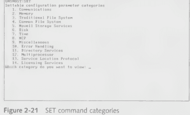

要查看任何类别中参数的当前设置，您只需输入该类别左侧的数字。然后，您可以使用任意键显示更多参数。例如，图 2-22 显示了向下滚动几个屏幕后 Communications 类别的 SET 参数。

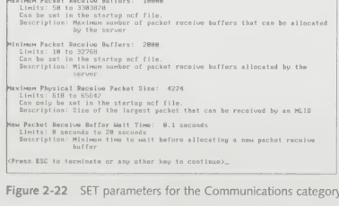


### 使用服务器控制台

按 Esc 键可退出 SET 命令并返回到控制台提示符。你可以输入 SET 命令后跟参数及其新设置值，来更改某个参数的设置。例如，**最大物理接收包大小**（Maximum Physical Receive Packet Size）默认为 4224 字节。由于至少需要 2000 个包接收缓冲区，此设置会占用你服务器内存中约 8 MB 的空间。如果你使用的是以太网，可以通过使用 SET 命令将此设置更改为 1524 来节省服务器内存，如下所示：

```
SET Maximum Physical Receive Packet Size = 1524
```

SET 命令还可以用于更改服务器当前的时间或日期。在由 30 台或更少服务器组成的多服务器网络中，会指定一台服务器作为参考服务器。网络上的所有其他服务器都会将时间同步到参考服务器。因此，在多服务器网络中，你应该只在参考服务器上更改时间。Novell 建议在启动 SERVER 程序之前，从 DOS 和 CMOS 中检查时间，然后再进行任何修正。以下命令展示了使用 SET TIME 将文件服务器当前日期和时间更改为 2006 年 10 月 30 日 3:00 p.m. 的几种方法。

```
SET TIME 10/30/2006 3:00p [设置日期和时间]
SET TIME October 30, 2006 3:00p [设置日期和时间]
SET TIME October 30, 2006 [仅设置日期；时间保持不变]
SET TIME 3:00 [使用 24 小时时钟设置时间；在此情况下为 3:00 a.m.]
SET TIME 15:00 [使用 24 小时时钟设置时间；在此情况下为 3:00 p.m.]
```


### 活动 2-3：使用控制台命令

**所需时间：** 10 分钟

**目标：** 使用 NetWare 服务器控制台命令。

**描述：** 要执行此活动，你需要能够访问服务器控制台。对于每个网络管理员来说，一项重要任务是制定并维护有关网络和服务器配置文档。请遵循以下步骤记录所需的服务器和网络信息。

- 1. 如有必要，在服务器控制台上按 **Ctrl+Esc** 显示控制台菜单，然后输入 **1** 切换到系统控制台提示符。
- 2. 使用 **CONFIG** 命令在此记录以下服务器数据：
  - 服务器名称： ______________________________
  - 内部 IPX 号（如果你的服务器正在使用 IPX）： ______________________________
  - 网络接口卡（NIC）驱动程序： ______________________________
  - 中断： ______________________________
  - 端口： ______________________________
  - 网络地址： ______________________________
  - 节点地址： ______________________________
  - 帧类型： ______________________________
  - 绑定器上下文（Bindery context）： ______________________________
  - 当前已挂载卷： ______________________________
- 3. 使用 **MEMORY** 命令查找服务器上的 RAM 容量。在此记录你的发现：
  _________________________
- 4. 使用 **VOLUMES** 命令在此记录每个卷的名称：
  _________________________
- 5. 使用 **SEARCH** 命令输入到 DOS 分区的搜索路径，然后显示现有的搜索路径。在此记录你使用的命令和现有搜索路径：
  _________________________
- 6. 按照以下步骤使用 **SET** 命令更改你的包接收缓冲区大小：
  - a. 输入 **SET** 命令以显示 **SET** 类别。
  - b. 输入 **1** 并按 **Enter** 键以显示通信参数。
  - c. 按空格键直到你看到“Largest Ping Packet Size”值。
  - d. 使用 **SET** 命令将 Maximum Physical Receive Packet Size 设置为 1524。在此记录你使用的命令：
    _________________________
- 7. 使用禁用登录的命令。在此记录该命令及结果：
  _________________________
- 8. 使用启用登录的命令。在此记录该命令及结果：
  _________________________
- 9. 用于保护控制台的命令。在此记录该命令及结果：
  _________________________
- 10. 使用正确的按键操作返回到图形控制台，并在此记录你使用的过程：
  _________________________
- 11. 保持服务器控制台窗口开启，以供下一个活动使用。

## NetWare 可加载模块（NLM）

NetWare 的一个优势在于其使用 NLM 来为核心操作系统添加功能。由于 NLM 在定制 NetWare 网络中起着如此重要的作用，CNA（认证网络管理员）应当熟悉随 NetWare OS 提供的标准 NLM。如表 2-3 所示，基于其功能，NLM 可以分为四个通用类别，每个类别都有自己特定的扩展名。

**表 2-3 NLM 类别**

| 类别 | 扩展名 | 描述 |
| --- | --- | --- |
| 磁盘驱动程序 | .ham 和 .cdm | 控制对 NetWare 磁盘分区的访问。加载这些模块的命令通常放置在 StartUp.ncf 文件中。 |
| 局域网驱动程序 | .lan | 每个 NIC 都必须由兼容的局域网驱动程序控制。加载这些模块的命令放置在 Autoexec.ncf 文件中。 |
| 命名空间 | .nam | 包含支持其他计算机命名约定的逻辑，例如用于 Apple Macintosh 计算机或基于 OS/2 和 UNIX 的计算机。加载命名空间模块的命令通常放置在 StartUp.ncf 文件中。 |
| 通用 | .nlm | 为文件服务器的操作系统添加服务和功能。 |

除了用于控制磁盘驱动程序和 NIC 的专用模块外，NetWare 随附了位于 SYS:System 目录中的许多通用 NLM，可用于广泛的用途，如表 2-4 所示。在接下来的部分中，你将了解 CNA 必须能够使用以管理其网络文件服务器的几个此类模块。

**表 2-4 通用 NLM**

| NLM | 描述 |
| :--- | :--- |
| CDROM.NLM | 用于在 CD 首次插入服务器 CD-ROM 驱动器时进行挂载。加载此模块后，它会自动检测 CD 的移除和插入。 |
| DSREPAIR | 检查 eDirectory 树副本是否有任何问题，并将所有副本与主副本同步。 |
| NWCONFIG.NLM | 用于处理 NetWare 分区、卷和系统文件。 |
| MONITOR.NLM | 用于监视文件服务器性能、硬件状态和内存使用情况。 |
| REMOTE.NLM | 用于从远程计算机查看和操作 NetWare 服务器控制台。需要密码。 |
| RSPX.NLM | 允许 REMOTE 模块通过本地网络电缆发送和接收控制台屏幕和命令。 |
| RS232.NLM | 允许 REMOTE 模块通过异步端口发送和接收控制台屏幕和命令。 |
| RCONAG6.NLM | 提供一种基于 IP 的远程 Java 控制台，用于配合 ConsoleOne 使用，如第 5 章所述。 |
| SCRSAYER | 提供一种通过密码锁定服务器控制台的方法。要访问服务器控制台，操作员必须输入指定的密码或 Admin 用户的密码。 |
| VREPAIR.NLM | 检查指定的传统卷中的错误，并允许你将修正写入磁盘卷。此命令仅适用于传统卷。要修正 NSS 卷中的问题，你需要使用 NSS /REBUILD 命令。 |

表 2-4 中显示的 NLM 可以根据其功能分为三个通用类别。

### 磁盘修复模块

DSREPAIR 和 VREPAIR NLM 用于识别和修复文件系统中的问题。这些 NLM 之间的一个主要区别在于，DSREPAIR 用于处理 NSS 卷，而 VREPAIR 用于处理传统卷。你将了解有关 NSS 卷和传统卷的更多详细信息，见第 3 章。

### 远程访问模块

NetWare 6.5 包含许多支持远程访问服务器控制台的 NLM。REMOTE、RSPX 和 RS232 NLM 用于与旧版 Remote 控制台实用程序的向后兼容性，但在 NetWare 6.5 中，你应该使用 RCONAG6.NLM 或 Remote Manager 来远程访问服务器控制台。Remote Manager 是 Novell 的 OneNet 实用程序，用于从任何网络上的 Web 浏览器管理你的服务器环境。你将在本章后面“使用 Remote Manager 监视服务器”部分了解如何使用 Remote Manager 查看服务器的性能。

### 服务器控制台管理模块

服务器控制台管理模块包括 CDROM、MONITOR、NWCONFIG 和 SCRSAYER。CDROM 将 CD 挂载到文件系统上。MONITOR 提供了一种管理服务器性能的方法，并将在下一节中详细介绍。NWCONFIG 提供了一系列服务器配置选项，包括修改服务器启动文件（请参阅后面的“修改服务器启动文件”）


本章）。SCRSAVER 拥有一条在服务器屏幕上移动的“蠕虫”线。蠕虫线的长度表示服务器的活动状态。线条越长，服务器越繁忙。除了提供有趣的屏幕保护程序外，SCRSAVER 对于保护服务器控制台也非常有用。在活动 2-4 中，您将学习如何使用 SCRSAVER 锁定服务器控制台。

## 监控服务器健康状况和性能

作为网络管理员，您的职责之一是确保服务器平稳、高效地运行。这包括能够监控服务器性能并在必要时更改配置参数。Novell 提供了两种用于管理服务器性能的工具。第一种是 Monitor 工具，它是一个在服务器控制台加载的 NLM，拥有许多用于查看服务器性能和配置参数的选项。第二种工具是远程管理器（Remote Manager），您可以在任何桌面计算机的 Web 浏览器上运行它。在接下来的章节中，您将学习如何使用这两种工具来管理服务器的健康状况和性能。

### 使用 Monitor 工具

Monitor 工具对于监控和配置系统性能非常有用。在本节中，您将学习如何使用它来查看服务器性能、连接信息以及磁盘和网络统计数据。要启动 Monitor 工具，您需要通过在服务器控制台提示符下输入命令 MONITOR 将 MONITOR NLM 加载到服务器内存中。接下来，将显示如图 2-23 所示的一般信息屏幕。

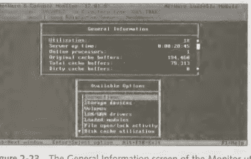

该屏幕显示 NetWare 操作系统的版本和日期，以及关于服务器可用内存和性能的几个重要系统参数。屏幕下半部分显示 Monitor 选项的菜单。您可以通过按下 Tab 键查看可用选项菜单中的参数。图 2-24 显示了选择磁盘缓存利用率选项后的结果。

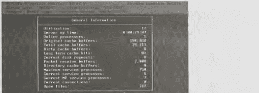

图 2-24 可用选项菜单

Monitor 菜单中仅显示了前七个可用选项。您可以通过按下向下箭头查看更多选项。为了最好地使用 Monitor 工具管理服务器性能，您应该了解表 2-5 中列出的选项和设置。

表 2-5 Monitor 统计数据

| 统计项 | 描述 | 数值 |
| :--- | :--- | :--- |
| 利用率 | 处理器被使用的时间百分比。 | 通常，该统计值不应高于 80%。 |
| 服务器正常运行时间 | NetWare 服务器自上次启动以来运行的时间长度。 | 该统计值用于确定服务器上次启动的时间。 |
| 在线处理器 | 已启用处理器的数量。 | 如果使用多处理器系统，该统计值对于验证所有 CPU 是否正在运行非常重要。 |
| 原始缓存缓冲区 | 服务器首次启动时可用缓存缓冲区的数量，代表加载 NetWare 内核后服务器中的内存量。 | 使用此统计值与总缓存缓冲区一起确定服务器使用的内存量。 |
| 总缓存缓冲区 | 可用于文件缓存的缓冲区数量。 | 随着模块加载到内存中，此值会减少。Novell 建议总缓存缓冲区至少为原始缓存缓冲区的 40%。 |
| 脏缓存缓冲区 | 包含需要写入磁盘的信息的缓冲区数量。 | 如果此值持续等于或超过总缓存缓冲区的 30%，应检查磁盘系统的速度，看看是否可以通过安装额外的磁盘控制器或更快的驱动器来改进。 |
| 长期缓存命中 | 服务器在内存中找到请求数据而不是必须从磁盘读取的次数。 | 为了获得最佳性能，长期缓存命中率应为 80% 或更高。增加内存可以提高此统计值。 |
| 当前磁盘请求 | 队列中等待处理的磁盘请求数量。 | 如果此统计值持续较高且脏缓存缓冲区数量很大，可能表明磁盘系统速度较慢。 |
| 数据包接收缓冲区 | 可用于接收计算机请求的缓冲区数量。 | 默认值 2000 应该足够了。在计算机数量少于 50 台的网络中，可以将此值降低到 1000，以为缓存缓冲区提供更多信息。 |
| 目录缓存缓冲区 | 分配给目录缓存的缓冲区数量。 | 通常，无需调整此值。 |
| 最大服务进程 | 分配用于用户计算机请求的任务处理器的数量。 | 通常，无需调整此值。 |
| 当前服务进程 | 已分配给站点请求的任务处理器数量。如果数据包接收缓冲区中的站点请求数量超过一定限制，服务器会添加额外的任务处理器来执行请求。当然，这反过来又减少了其他活动的内存和处理时间。 | 如果服务进程和 MP 服务进程的总和接近默认最大值 570，并且处理器利用率较高，您可能需要卸载 NLM 或添加另一台文件服务器以减少当前服务器的负载。 |
| 当前 MP 服务进程 | 基于多处理器任务处理器的数量。 | 参见前一条“当前服务进程”条目。 |
| 当前连接 | 服务器当前使用的已授权和未授权连接数量。 | 此数值应始终低于授权连接数量。如果该值接近可用的最大授权连接数，可能需要购买额外的连接。 |
| 打开的文件 | 通过用户计算机经由网络服务器访问的文件数量。 | 跟踪此值有助于确定服务器使用情况。 |

综合利用率、总缓存缓冲区、数据包接收缓冲区和脏缓存缓冲区的统计数据，可以通过简单验证以下指标来快速了解服务器健康状况：利用率低于 70%，总缓存缓冲区值至少为原始缓存缓冲区的 50%，脏缓存缓冲区值小于总缓存缓冲区的 30%。

除了图 2–23 所示的一般信息屏幕外，Monitor 工具的可用选项菜单还包含几个用于查看服务器性能和操作信息的选项。选择“连接”选项会显示一个窗口，列出所有活动连接和当前登录用户的名称。如果特定连接编号没有用户登录，连接编号旁边会出现“NOTLOGGED-IN”（未登录）消息。您可以使用此选项在关闭服务器之前检查用户活动。要断开用户连接，请突出显示用户名并按 Delete 键。要查看任何连接的信息，请选择连接编号并按 Enter 键。“卷”选项列出了所有已挂载卷及卷空间使用百分比。“存储设备”选项显示当前磁盘驱动器使用的硬件设置。“LAN/WAN 驱动器”选项显示所有已加载的 LAN 驱动器的信息，包括驱动器名称、帧类型、端口和中断。“系统资源”选项是查看缓存缓冲区使用百分比的便捷方式。图 2–25 所示的缓存利用率统计屏幕是确定服务器是否有足够内存的好方法。

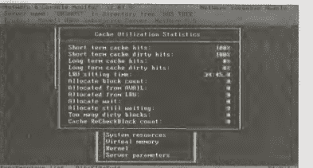

**图 2-25** 缓存利用率统计屏幕


Novell 建议长期缓存命中率应高于 90%。如果该值低于 90%，增加内存或卸载 NLM 可以提高服务器性能。

服务器参数选项用于修改服务器配置参数，例如最大数据包接收缓冲区数量或服务器时间类型。在以下活动中，您使用 SCRSAVER 和 Monitor 工具来锁定服务器控制台，并记录服务器配置和性能设置。

### 活动 2-4：使用 SCRSAVER 和 Monitor 工具

**所需时间：** 10 分钟

**目标：** 使用 SCRSAVER 命令保护服务器控制台，并使用 Monitor 工具查看服务器性能。

**要求：** 访问 NetWare 6.5 Open Enterprise Server 控制台

**描述：** 既然您的 NetWare 6.5 服务器已安装并运行，Eric 希望您使用 Monitor 工具创建一个网络性能基线。正常服务器活动的基线有助于您识别可能降低网络性能的变化。此外，Eric 希望确保其他用户不访问服务器控制台，因此您使用 SCRSAVER 模块锁定服务器控制台，然后使用 Monitor 工具为您的 UASHOST 服务器构建服务器性能基线。

- 1. 如有必要，按 `Ctrl+Esc` 打开服务器控制台窗口以显示控制台屏幕列表，然后输入 `1` 并按 `Enter` 显示系统控制台命令提示符。
- 2. 按照以下步骤锁定服务器控制台：
    - a. 在服务器提示符下，输入 `SCRSAVER` 以加载屏幕保护程序工具。
    - b. 在服务器提示符下，输入 `SCRSAVER HELP` 以查看屏幕保护程序选项。如果讲师要求，在此处记录一个示例命令以备将来参考：`__________`
    - c. 在服务器提示符下，输入以五秒延迟锁定服务器控制台的命令。在此处记录您使用的命令：`__________`
    - d. 按任意键显示服务器控制台身份验证屏幕。
    - e. 在用户名字段中输入 `Admin`，然后按 `Enter`。
    - f. 在密码字段中输入 Admin 用户的密码，然后按两次 `Enter` 以打开控制台。


#### 3. 输入 **MONITOR**，然后按 **Enter** 键启动监视实用程序。

#### 4. 按 **Tab** 键显示所有服务器统计信息。在此处记录以下基线统计信息：

服务器运行时间：

原始缓存缓冲区：

总缓存缓冲区：

脏缓存缓冲区：

长期缓存命中：

当前磁盘请求：

目录缓存缓冲区：

当前连接数：

打开的文件：

#### 5. 按 **Esc**，选择 **Yes**，然后按 **Enter** 退出监视实用程序。

## 使用远程管理器监控服务器

远程管理器允许你监控服务器健康状况、更改配置参数以及执行诊断和调试任务。要使用远程管理器，服务器和计算机必须满足表 2-6 中所示的软件要求。

### 表 2-6 远程管理器软件要求

| 软件 | 要求 |
| :--- | :--- |
| NetWare 操作系统 | NetWare 5.1 或更高版本 |
| 浏览器 | Netscape 4.5 或更高版本、Internet Explorer 5 或更高版本，或 NetWare 服务器浏览器 |

要访问远程管理器实用程序，启动你的 Web 浏览器并输入 URL `https://ServerIPAddress:8009` 或 `http://ServerIPAddress:8008` 以直接前往远程管理器登录窗口。输入管理员用户名和密码后，将显示如图 2-26 所示的远程管理器启动窗口。


> 远程管理器启动窗口的内容取决于你用于登录的用户名的管理权限。没有服务器管理权限的用户只能看到他们有权限的卷和目录。你将学习在第 6 章和第 7 章中了解如何为用户账户分配管理权限。

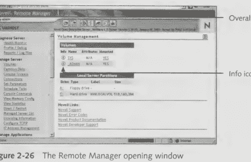

**图 2-26** 远程管理器启动窗口

左上角（在图 2-26 中，是 UASHOST 左侧的服务器图标）的总体健康指示器可让你快速了解服务器的整体健康状况。顶部中央的标题窗格包含有关服务器的一般信息以及用于退出远程管理器、查看卷、健康监视器和配置信息的图标。左侧导航窗格列出了你可以在远程管理器中执行的一般任务，并提供链接以执行这些任务的特定页面。你可以使用滚动条查看其他任务。

中间的主内容窗格会根据你在标题或导航窗格中点击的链接而变化。在线帮助窗格显示主内容窗格中正在查看的内容的帮助信息。在以下章节中的活动中，你将学习如何使用这些窗格来诊断服务器健康状况、管理 NetWare 服务器和卷、检查服务器应用程序使用情况、查看服务器硬件配置、访问 Novell eDirectory 信息以及监控许可证使用情况。

左上角的总体健康指示器通过显示以下颜色之一，快速指示服务器的整体状态：

- *绿色*—代表服务器健康状况良好。
- *黄色*—提供关于服务器健康状况或性能可能出现问题的警告。
- *红色*—代表服务器健康状况不佳，需要管理员响应。
- *黑色*—表示与服务器的通信已丢失（服务器可能已宕机）。

如果总体健康指示器不是绿色，你可以点击“诊断服务器”标题下的“健康监视器”链接以查看单个指示器的状态（见图 2-27）。

如果“状态”列中的任何指示器为黄色或红色，则需要注意。例如，如果“可用内存”指示器为黄色或红色，则表示系统内存不足。你可以通过点击指示器查看更多详细信息。例如，要查看内存使用统计信息，请向下滚动并点击“可用内存”指示器，如图 2-28 所示。

在图 2-28 中，内存使用状况良好，几乎一半的内存保留用于缓存文件。如果缓存内存低于总内存的 30%，可能表示应向服务器添加 RAM。如果 NLM 内存使用量超过缓存内存，你可能能够通过卸载不需要的模块来纠正问题。例如，退出 X Server 图形控制台可以释放大量内存。

在查看健康监视器时，你可以点击“阈值配置”链接来查看或设置各种指示器的可疑值和临界值。例如，图 2-29 显示了查看阈值配置窗口的示例。

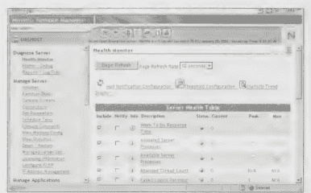

图 2-27 服务器健康监视器指示器

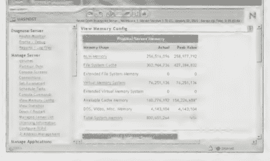

图 2-28 当前内存使用统计信息

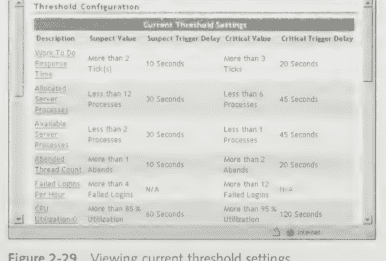

图 2-29 查看当前阈值设置

**可疑值** 列标识显示黄色指示器的标准，而 **临界值** 列标识显示红色指示器的标准。要更改标准，请点击指示器，输入新的可疑值或临界值，然后点击 **OK**。在以下活动中，你使用健康监视器查看服务器上的性能指示器。

### 活动 2-5：监控服务器健康状况

**所需时间：** 10 分钟

**目标：** 使用远程管理器检查服务器健康状况和性能。

**要求：** 访问具有服务器监管员权限的管理员用户，以及配置了正确 IP 地址以与你的 NetWare 6.5 服务器通信的 Windows XP 或 SUSE Linux 10 计算机。

**描述：** **Eric** 注意到服务器响应速度没有他预期的那么快。为了帮助识别任何问题，他希望你能使用远程管理器检查单个服务器指示器。在此活动中，你使用远程管理器记录几个性能指示器。

1. 如有必要，启动计算机并登录。
2. 启动 Web 浏览器，输入 URL `https://ServerIPAddress:8009`（将 `ServerIPAddress` 替换为你服务器的 IP 地址）以打开“输入网络密码”对话框。
3. 输入具有服务器监管员权限的用户的用户名和密码，然后点击 **OK** 以显示远程管理器主窗口。
4. 点击 **健康监视器** 图标以显示健康监视器窗口，类似于之前图 2-27 中所示的窗口。
5. 滚动浏览你服务器的健康监视器并检查其状态。在此处记录任何黄色或红色指示器：
   _______________________________________________
6. 点击“可用内存”指示器旁边的 **Info** 图标（圆圈中的 *i*）以显示“可用内存”信息窗口。
7. 记录绿色、黄色和红色指示器的标准：
   _______________________________________________
8. 关闭“可用内存”信息窗口。
9. 点击 **阈值配置** 链接，并记录“可疑值”和“临界值”列中的条目：
   _______________________________________________
10. 保持登录状态，并让远程管理器保持打开，以便进行下一个活动。

除了监控性能外，服务器管理还包括管理卷和用户连接、查看和设置参数、查看系统统计信息以及访问当前控制台屏幕。在故障排除或修复 NetWare 服务器问题时，能够远程访问服务器控制台屏幕是一个强大的管理功能。在以下活动中，你使用远程管理器中的“管理服务器”选项来查看并记录有关你服务器的 SYS 卷和内存使用的信息。

### 活动 2-6：执行服务器管理任务

**所需时间：** 10 分钟

**目标：** 使用远程管理器查看服务器卷和内存使用情况。

**要求：** 与活动 2-5 相同

**描述：** 能够从远程位置管理 UASHOST 服务器对 **Eric** 来说很便捷，特别是当他不在办公室时。在此活动中，你使用远程管理器中的服务器管理选项，看看 Eric 是如何在出差时管理服务器的。


### 活动 2-6：管理卷和命令

1. 如有必要，请按照活动 2-5 中的步骤启动远程管理器（Remote Manager）。
2. 在主窗口中，点击“管理服务器”标题下的**卷**链接，以显示展示所有卷状态的卷管理窗口。记录前四个卷的名称和属性：
3. 点击**控制台命令**链接，以显示所有控制台命令的列表。
4. 点击 CONFIG、CLEAR STATION 和 CLS 这些命令旁边的**信息**图标。记录 Info 窗口中显示的每个命令的描述和示例命令：
5. 点击**查看内存配置**链接，以显示查看内存配置窗口。记录系统总内存大小和当前缓存内存：
6. 保持登录状态并打开远程管理器，以便进行下一个活动。

### 活动 2-7：查看服务器硬件环境

**所需时间：** 10 分钟

**目标：** 使用远程管理器查看硬件信息。

**要求：** 与活动 2-5 相同

**描述：** 使用远程管理器，您可以查看服务器当前的硬件配置设置，这在诊断问题或规划新设备时非常有用。例如，Eric 在 Comdex 上发现了一块 1 GB 的网卡，他想将其安装到 UASHOST 服务器上。他使用远程管理器查看服务器的硬件配置，以便检查插槽和中断，从而确定安装新网卡的可行性。在本活动中，您使用“管理硬件”标题下的选项来记录您的服务器可用的端口和中断。

1. 如有必要，请按照活动 2-5 中的步骤启动远程管理器。
2. 向下滚动导航窗格至“管理硬件”标题，并记录该标题下的选项：
3. 点击**处理器**链接，以显示处理器信息窗口。在此处记录处理器信息：
4. 在“管理硬件”标题下，点击**磁盘/局域网适配器**链接。
5. 点击网络适配器旁边的**信息**图标。记录您的网络适配器使用的中断、插槽和端口：
6. 在“管理硬件”标题下，点击**其他资源**链接，以显示硬件资源窗口。
7. 点击**中断**选项，以显示硬件资源/中断窗口。列出正在使用的中断以及任何可用或未使用 的中断：
8. 点击**退出**按钮，如有必要，点击**是**以关闭远程管理器窗口。

#### 在服务器上使用 Java

NetWare 6.5 的一个特性是服务器是一个运行 Java 应用的高效环境。由 Sun Microsystems 开发的 Java 语言可用于开发运行于多个平台（包括 Netscape 等 Web 浏览器）上的 Internet 应用。具备运行 Java 应用的能力为未来在 NetWare 服务器上运行客户端-服务器应用打开众多可能性。客户端-服务器应用是指至少应用的一部分运行在服务器上，而用户界面组件运行在客户端计算机上。许多组织安装服务器的主要原因是它们能够运行基于服务器的软件。基于 NT/2000 的应用通常局限于 Microsoft 平台，但 Java 应用的一个优势是它们能够在多个平台上运行。因此，许多 Internet 和客户端-服务器应用是用 Java 开发的，以利用操作系统平台独立性。作为最强大、最快的 Java 机器之一，NetWare 6.5 处于有利地位，成为在 Internet 和公司内网上运行 Java 应用的优选选择。

在服务器控制台上运行 Java 应用需要额外的硬件资源。Novell 建议至少需要 256 MB 的 RAM、一个 PS/2 或串行鼠标，以及一个符合 VESA 1.2 或更高规格标准的 PCI 显卡。如果您的显卡不符合 VESA 1.2 标准，NetWare 将加载一个仅支持 640 × 480 分辨率和 16 种颜色的默认驱动程序。JAVA.NLM 会在服务器启动时与 X 服务器图形控制台一起自动加载。如果您不使用任何基于 Java 的应用，在服务器启动后，您可以在服务器控制台屏幕输入 UNLOAD JAVA 命令以退出 GUI 界面并卸载 Java 语言。

#### 使用 NetWare GUI 界面

在 NetWare 6.5 中，Novell 包含了一个 Java GUI 控制台界面。GUI 平台由 X Window 的一个实现提供，允许符合抽象窗口工具包（AWT）的 Java 程序通过 X Window 接口显示。要加载 GUI 支持，请在服务器控制台输入 STARTX 命令。虽然 NetWare GUI 并不旨在成为一个功能齐全的桌面计算机，但它确实提供了一种与 NetWare 控制台进行图形化交互的方式。例如，Eric 使用 GUI 界面通过以下步骤安装了 WebAccess 产品：

- 1. 在使用 STARTX 命令显示 GUI 控制台后，Eric 点击 Novell 按钮以显示一个菜单，其中包含 Console One、安装、程序、实用工具、设置和运行等选项。
- 2. 然后他点击安装选项以显示已安装产品的列表。
- 3. 要安装额外的产品，他点击添加按钮并输入安装光盘的路径。
- 4. 然后他选择想要安装的产品并点击下一步以显示产品摘要窗口。他解释说，您可以通过突出显示产品并点击自定义按钮来定制任何选定的产品。
- 5. 完成定制后，他点击完成按钮以安装选定产品，然后按照提示重新启动服务器。他指出，如果有用户登录，在关闭服务器前，请务必输入 DISABLE LOGIN 命令并广播消息。


GUI 界面还可以用于配置视频分辨率、背景和键盘配置，以及运行 ConsoleOne 实用工具。ConsoleOne 实用工具为管理员提供了一种方式，使他们能够从服务器控制台与 eDirectory 对象和文件系统交互，而无需回到客户端计算机去创建用户或复制文件等。在未来的章节中，您将更多地了解如何使用 ConsoleOne。在 NetWare 的早期版本中，必须从运行 Novell 客户端和 NetWare Administrator 实用工具的 Windows 计算机上执行所有文件和用户维护工作。

## 修改服务器启动文件

当服务器首次启动时，它会执行 Start-up.ncf 和 Autoexec.ncf 启动文件中的命令，以加载驱动程序、设置配置参数和加载 NLMs。有时，网络管理员必须修改启动文件中的命令以执行诸如修改服务器 IPX 网络地址、防止 GUI 控制台在服务器启动时自动加载，或在启动过程中添加 NDPS Broker 和 Manager 等模块等功能。要从服务器控制台查看和修改启动文件，您使用 Nwconfig 实用工具。在活动 2–8 中，您使用此实用工具查看和修改 Autoexec.ncf 文件的内容。

### 活动 2-8：查看服务器启动文件

**所需时间：** 10 分钟

**目标：** 使用 Nwconfig 实用工具查看文件服务器启动文件。

**要求：** 访问 NetWare 6.5 服务器控制台

**描述：** 由于图形控制台不经常使用，Eric 希望修改服务器的 Autoexec.ncf 文件，以防止图形环境自动加载，从而努力改善服务器性能。在本活动中，您使用 Nwconfig 实用工具来禁用图形环境的加载。

- 1. 从服务器控制台，按**Ctrl+Esc** 以显示当前屏幕菜单。
- 2. 输入**1** 以选择系统控制台选项，然后按**回车**以显示系统控制台命令提示符。
- 3. 输入**NWCONFIG** 命令，然后按**回车**以显示图 2-30 中所示的 NetWare 配置菜单。

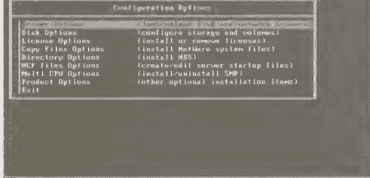

图 2-30 NetWare 配置菜单

- 4. 按**向下箭头**以突出显示 NCF 文件选项，然后按**回车**以显示图 2-31 中所示的可用 NCF 文件选项菜单。

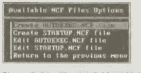

图 2-31 可用 NCF 文件选项菜单


5. 突出显示**编辑 AUTOEXEC.NCF 文件**选项，然后按**回车**键显示 Autoexec.ncf 文件的内容。

6. 滚动到文件末尾，在 STARTX 命令前输入`#`，如图 2-32 所示。

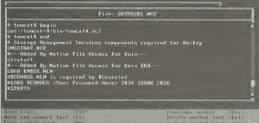

**图 2-32** 修改 Autoexec.ncf 文件的内容

7. 按**Esc**键，然后按**回车**键保存更改并返回到可用的 NCF 文件选项菜单。

8. 再次按**Esc**键返回到 NetWare 配置菜单。

9. 按**Esc**键，然后按**回车**键退出 Nwconfig 实用程序。

10. 关闭服务器。

除了直接从服务器控制台操作外，您还可以使用 Novell 远程管理工具（Remote Manager）和 OpenSSH 从位于局域网内或通过 Internet 连接的客户端计算机访问服务器控制台。您将在第 3 章中了解有关使用 Remote Manager 的更多信息，并在第 11 章中了解如何使用 OpenSSH。

## 本章摘要

- NetWare 6.5 安装过程分为四个阶段：安装启动、初始安装、模式选择和服务配置。

- 在安装启动阶段，您选择服务器语言并接受许可协议。初始安装阶段用于建立安装选项、选择局域网和磁盘驱动器，并创建磁盘分区。模式选择阶段用于选择服务器类型和安装的模式选项。服务配置阶段提供服务器名称、许可证、eDirectory 和配置信息。

- 为 NetWare 服务器安装做准备包括定义服务器名称和硬件信息，以及额外的产品和服务。

- 服务器名称可以是 2 到 47 个字母数字字符，包括下划线和连字符。不允许有空格或句号。

- 当使用 IPX 时，每个服务器必须被分配一个通用的 IPX 网络地址和一个唯一的内部网络号，该号码由最多八位十六进制数字组成。

- 部署管理器软件包含在 NetWare 6.5 操作系统 CD 1 中。它提供了查看和更新 eDirectory 版本以及安装 NetWare 6.5 产品的选项。

- 控制台命令内置于 NetWare 6.5 内核中，允许管理员执行多种功能。常用的控制台命令包括 CONFIG、LOAD 和 UNLOAD、BROADCAST、DISABLE LOGIN、DISPLAY SERVERS、BIND 和 TIME。

- 网络管理员可以通过加载称为 NetWare 可加载模块（NLMs）的程序来为 NetWare 内核添加服务和功能。MONITOR 和 NWCONFIG NLMs 可用于查看和更改服务器配置参数。NSS 和 VREPAIR NLMs 用于检查和纠正磁盘卷问题。DSRREPAIR NLM 可用于查看和纠正 eDirectory 中的问题。RCONAG6 和 REMOTE NLMs 可用于提供从客户端计算机访问服务器控制台的功能。

- 可以使用 Monitor 实用程序或 Remote Manager 实用程序来监控服务器性能并修改配置参数。Monitor 实用程序从服务器控制台运行，而 Remote Manager 通过任何客户端计算机上的 Web 浏览器运行。

### 关键术语

- **控制台命令** — 内置于 NetWare 内核 Server.exe 程序中的命令功能，因此始终在内存中。

- **自定义设备模块（CDMs）** — 通过 HBA 软件用于管理磁盘驱动器的软件驱动程序。*另请参见* 主机总线适配器（HBAs）。

- **主机总线适配器（HBAs）** — 用于管理磁盘控制器卡的软件驱动程序。

- **初始安装阶段** — NetWare 6.5 安装过程中选择安装语言的阶段。

- **安装启动阶段** — NetWare 6.5 安装过程中加载磁盘和局域网驱动程序并创建 SYS 卷的阶段。

- **NetWare 可加载模块（NLMs）** — 可以加载到服务器内存中提供网络服务或执行管理操作的软件模块。

- **模式选择阶段** — NetWare 6.5 安装过程中选择服务器安装选项的阶段。

- **服务器配置阶段** — NetWare 6.5 安装过程中指定服务器名称、安装 eDirectory 并提供网络设置的阶段。

### 复习题

1. 为了满足 NetWare 6.5 服务器的最低硬件要求，计算机必须至少拥有 \_\_\_\_\_\_\_\_\_\_\_\_ R.A.M.
   - a. 256 MB
   - b. 1 GB
   - c. 512 MB
   - d. 768 MB

2. 为了满足 NetWare 6.5 服务器的最低硬件要求，计算机必须至少保留 \_\_\_\_\_\_\_\_\_\_\_\_ 的磁盘空间用于启动分区。
   - a. 1 GB
   - b. 2 GB
   - c. 500 MB
   - d. 4 GB

3. 为了满足 NetWare 6.5 服务器的最低硬件要求，计算机必须至少保留 \_\_\_\_\_\_\_\_\_\_\_\_ 的磁盘空间用于 SYS 卷。
   - a. 1 GB
   - b. 2 GB
   - c. 500 MB
   - d. 4 GB

4. 将 NetWare 6.5 安装到现有的 eDirectory 树时，该 eDirectory 树必须是 \_\_\_\_\_\_\_\_\_\_\_\_ 或更高版本。
   - a. 7.0 版
   - b. 8.6 版
   - c. 6.0 版
   - d. 2.0 版

5. 哪个 NetWare 卷在安装过程中自动创建？
   - a. 系统卷
   - b. SYS 卷
   - c. DOS 卷
   - d. NetWare 卷

6. 在哪个安装阶段输入服务器名称？
   - a. 初始安装阶段
   - b. 模式选择阶段
   - c. eDirectory 安装阶段
   - d. 服务器配置阶段

7. 在哪个安装阶段创建启动分区？
   - a. 安装启动阶段
   - b. 初始安装阶段
   - c. 模式选择阶段
   - d. 服务器配置阶段

8. 在哪个安装阶段选择 eDirectory 上下文？
   - a. 初始安装阶段
   - b. 模式选择阶段
   - c. eDirectory 安装阶段
   - d. 服务器配置阶段

9. 下列哪一项不是可选的 NetWare 6.5 安装组件？
   - a. iPrint
   - b. eDirectory
   - c. NFAP
   - d. iFolder

10. 下列哪个命令或模块可用于纠正 NSS 卷的问题？
    - a. VREPAIR
    - b. NSS /REBUILD
    - c. REBUILD
    - d. DSREPAIR

11. \`\_\_\_\_\_\_\_\_\_\_\_\_\_\_\_\_\_\_\_\_\_\_ 命令将协议分配给局域网驱动程序。
    - a. CONFIG
    - b. BIND
    - c. LOAD
    - d. NETBIND

12. \_\_\_\_\_\_\_\_\_\_\_\_\_\_\_\_\_\_\_\_\_\_ 命令用于将帧类型和 I/O 端口分配给局域网驱动程序。
    - a. CONFIG
    - b. BIND
    - c. LOAD
    - d. NETBIND

13. \_\_\_\_\_\_\_\_\_\_\_\_\_\_\_\_\_\_\_\_\_\_ 命令显示文件服务器上可用的总文件内存。
    - a. MEMORY
    - b. SYSTEM
    - c. MONITOR
    - d. CONFIG

14. \_\_\_\_\_\_\_\_\_\_\_\_\_\_\_\_\_\_\_\_\_\_ 命令显示分配给文件服务器中每个局域网的网络地址。
    - a. MEMORY
    - b. DISPLAY SYSTEM
    - c. MONITOR
    - d. CONFIG

15. \_\_\_\_\_\_\_\_\_\_\_\_\_\_\_\_\_\_\_\_\_\_ 命令允许您指定其他路径以查找 NLMs。
    - a. SECURE CONSOLE
    - b. SEARCH
    - c. LOAD
    - d. PATH

16. 编写一个控制台命令，将服务器时钟更改为 2006 年 12 月 31 日晚上 11:59。

17. 编写网络管理员在一天中途关闭服务器前应输入的命令序列。

18. 启动文件服务器后，您注意到名为 TEXT 的传统卷未挂载，因为文件分配表（FAT）中存在错误。请识别可用于修复该卷的 NLM 以及使 TEXT 卷重新在线的命令。

19. \_\_\_\_\_\_\_\_\_\_\_\_\_\_\_\_\_\_\_\_\_\_ 控制台命令可以阻止 NetWare 从 SYS: Public\NLM 目录加载 NLMs。
    - a. SEARCH
    - b. LOCK CONSOLE
    - c. SECURE CONSOLE
    - d. CONFIG

20. 如果 Monitor 实用程序中显示的总缓存缓冲区数量少于原始缓存缓冲区的 \_\_\_\_\_\_\_\_\_\_\_\_\_\_\_\_\_\_\_\_\_\_，则需要向文件服务器添加更多内存。
    - a. 80%
    - b. 90%
    - c. 40%
    - d. 25%


### 案例项目

#### 案例项目 2-1：准备安装 NetWare 服务器

  Universal AeroSpace（环球航空航天公司）的工程部门已预算 $5000，用于在现有网络中添加一台 NetWare 6.5 服务器以托管互联网应用程序。网络管理员 Eric Kenton 要求你研究一些服务器硬件选项，并在此价格范围内提出两个替代方案。他还希望你就推荐的服务器硬件填写一份 NetWare 服务器安装规划表。新服务器将安装到现有的 UAS_Tree eDirectory 树中，并放置在你分配的 UAS 容器中。在此项目中，你使用互联网找到两款符合 NetWare 6.5 推荐规格的服务器级计算机系统，然后为你认为性价比最高的服务器填写 NetWare 服务器安装规划表。该服务器应使用 NetWare AMP 服务器模式，并允许所有 NMAS 身份验证方法。

### 实操项目

#### 实操项目 2-1：执行 NetWare 6.5 Open Enterprise 服务器安装

  要完成此项目，你应该已经完成案例项目 2-1，并且可以访问一台带有空白硬盘的计算机，或者一台运行 VMware 4.1 或更高版本的计算机。如果你使用 VMware，请按照附录 C 中的说明创建一个新的 NetWare 6.5 虚拟机。接下来，按照本章中的步骤执行 NetWare 6.5 服务器安装，并记录你的结果。

#### 实操项目 2-2：构建服务器基线

  虽然 UAS 网络目前运行状况良好，但需求增加和硬件故障可能会导致未来的性能问题。为了帮助识别可能出现的性能问题，你需要使用 Monitor 确定服务器的典型性能，构建一个基线，以显示典型工作期间的服务器性能。在此项目中，你使用 Monitor 实用程序确定在你在活动 2-2 中安装的服务器或你分配的服务器上的服务器基线统计信息。记录你的结果。

# 第 3 章
## 使用 NetWare 文件系统

  > 阅读本章并完成各项活动后，你将能够：
  >
  > - 识别网络文件服务组件
  > - 通过规划卷和目录结构并使用 Remote Manager 创建文件系统组件来设置网络文件系统
  > - 使用 NFAP 和基于 Web 的网络客户端访问卷

  在第 2 章中，你学习了如何执行 NetWare 6.5 安装以及使用服务器控制台。你被介绍了两个基本的 NetWare 文件系统组件：DOS 启动分区和 SYS 卷。为了有效管理 NetWare 6.5 服务器及其数据，你需要熟悉文件系统结构，并知道如何为用户应用程序和数据创建和维护分区和卷。在本章中，你将学习 NetWare 文件系统的组件，并查看如何使用 NetWare 远程管理工具为如 Universal AeroSpace 这样的组织设置网络文件系统。由于从客户端计算机访问服务器文件系统是网络运行所必需的，你还将学习如何从标准 Windows 客户端访问 NetWare 卷和目录。在后续章节中，你将看到用户如何使用标准 Web 浏览器从 Linux 桌面或跨互联网访问数据。

### NetWare 文件系统组件

  NetWare 文件系统为在网络中提供信息带来许多好处。这些好处可以分为以下几类：

  - **集中式的数据管理和备份**——当数据存储在服务器上时，许多用户可以访问包含当前且准确信息的集中式数据库文件。此外，集中数据使关键文件能够定期备份，并使从丢失数据或文件服务器故障中恢复变得更加容易。
  - **增强的安全性**——防止用户修改或访问他们不负责维护或未授权使用的数据。
  - **增强的可靠性和容错性**——NetWare 的磁盘镜像和双工特性可用于确保在硬件故障时，数据的重复副本可自动供用户使用。NetWare 6.5 包括磁盘集群技术，允许多个服务器共享访问同一个网络磁盘系统。在本章中，你将学习磁盘集群如何提高可靠性和容错性。
  - **共享和专用存储区域**——共享存储区域允许用户共享文件或将文件传输给其他用户，而无需在机器之间携带磁盘。通过专用存储区域，用户可以在文件服务器的安全区域中保存自己的工作。
  - **数据访问**——Novell 开放企业愿景的一个重要部分是，通过通用客户端和操作系统（OS），允许用户从连接到任何互联网络的计算机访问所需的数据和文档。在本章中，你将学习 Novell 的 Native File Access Pack (NFAP) 如何使 NetWare 文件系统支持 Apple、Linux 和 Windows 客户端，从而降低硬件成本，因为不需要单独的服务器来支持每个操作系统。随着更多用户和应用程序加入网络，CNA（认证网络管理员）需要了解如何向用户授予安全访问权限，以访问企业网络内部和外部所需的数据，变得更为重要。

  由于组织并保护存储在网络上信息的重要性，良好的文件系统设计对于促进网络设置、使用以及增长是必要的。从 NetWare 6.0 开始，Novell 通过实施 **Novell Storage Services (NSS)** 版本 3 改进了网络文件系统。NetWare 5.0 中包含的早期版本 NSS 在实施上更复杂，并且不支持 SYS 卷。因此，在 NetWare 5.0 服务器上，NSS 通常仅用于非常大的数据卷。由于 NSS 的高级功能，Novell 已将 NSS 版本 3.2 作为所有 NetWare 6.5 卷（包括 SYS 卷）的主要文件系统。如你在第 2 章所学，安装 NetWare 6.5 期间，至少需要 4 GB 的 NSS SYS 卷。

  如图 3-1 所示，NetWare 6.5 文件系统的主要组件是磁盘分区、存储池和卷。

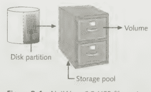

**图 3-1** NetWare 6.5 NSS 文件系统组件

  首先，磁盘驱动器被划分为一个或多个分区。然后，将一个或多个驱动器的分区空间合并以形成存储池。单个存储池可以包含一个或多个磁盘分区的空间。创建存储池后，可以在该存储池中定义卷。图 3-2 显示了在初始 NetWare 6.5 服务器安装（在 VMware 虚拟计算机上）期间创建的分区、存储池和 SYS 卷的示例，这是在 Novell 的 Remote Manager 实用程序中查看到的。

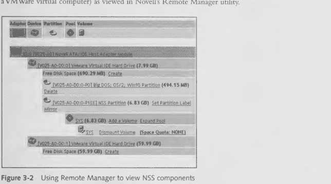

  Remote Manager 在磁盘适配器、磁盘驱动器（标记为设备）、分区、存储池和卷的顶部显示图标。注意图 3-2 中有两个虚拟磁盘驱动器。第一个驱动器是一个 8 GB 驱动器，有两个分区：500 MB 的 DOS 启动分区，以及包含 SYS 池和 SYS 卷的分区。第二个驱动器包含 60 GB 的空闲空间。在本章后面，你将学习如何使用 Remote Manager 从客户端计算机创建磁盘分区、存储池和卷。

#### 磁盘分区

  为了格式化和物理磁盘驱动器上的存储，磁盘驱动器需要划分为一个或多个分区。最初，磁盘驱动器最多可以定义四个磁盘分区，其中只有一个分区可以是 NetWare 分区。使用 Novell Storage Services，你可以拥有几乎无限数量的 NSS 分区。如你在第 2 章所学，NetWare 6.5 安装程序要求至少 500 MB 的 DOS 启动分区，推荐大小为 1 GB。除了 DOS 分区外，安装期间还为 SYS 卷创建了一个默认的 4 GB NSS 分区，该分区用于存储操作系统文件。然后为组织的共享应用程序和数据创建额外的分区。在计划如何分配剩余的驱动器空间时，留出一些未分区空间用于未来扩展是个好主意。未分区空间可以用于稍后创建新分区以容纳新存储池或扩展现有存储池的空间。例如，在建立 Universal AeroSpace 磁盘驱动器存储空间时，Eric Kenton 将他的 200 GB 驱动器划分为三个分区，如图 3-3 所示。通过保留磁盘空间未分区，Eric 可以选择使用此空间来扩展 SYS 或 CORP 存储池（在本章后面的“存储池”中描述）。

#### 分区容错

  将所有操作系统文件和用户数据放在一个驱动器上，如果驱动器或其控制器卡故障，会创建一个潜在的文件服务单点故障。容错是系统在主要组件故障时继续运行的能力。在 NetWare 中，通过启用镜像（Mirror）功能，你可以在创建 NSS 分区时确保提高可靠性。通过此功能，NetWare 自动同步位于不同驱动器上的两个分区中的数据，如图 3-4 所示。如果镜像组中的一个驱动器发生故障，数据仍然可以从另一个镜像驱动器访问。


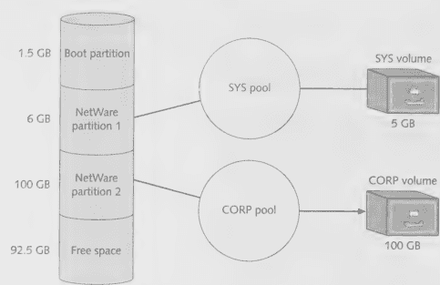

**图 3-3** 示例 UAS 磁盘分区和存储池

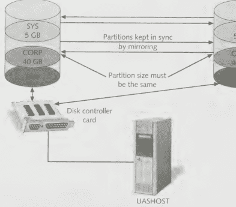

**图 3-4** NetWare 中的镜像

将连接到同一控制器的分区进行同步的过程称为**镜像**。如果您的服务器上有多个硬盘，您可以简单地通过点击 Remote Manager 中的镜像选项（如图 3-2 所示），然后选择要镜像该分区的驱动器的可用空间来实现镜像（参见图 3-5）。当向现有镜像组添加分区时，新分区的数据区域大小将被设置为与镜像组中现有分区的大小相同。

将镜像分区放置在单独的控制卡上可以获得额外的容错性能和更快的速度。术语**双工**描述了使用镜像功能对位于不同控制卡上的磁盘分区进行操作。使用两个控制卡使双工能够在控制卡故障时提供更快的速度和连续运行。例如，为了提供最大的速度和可靠性，Eric 在 UASHOST 服务器上使用了连接到单独控制卡上的两个 60 GB 驱动器来双工 SYS 和 CORP 分区（参见图 3-6）。如果一个驱动器或控制器发生故障，系统将继续读写另一个驱动器。当问题修复后，NetWare 会自动重建新驱动器，使两个驱动器保持一致。

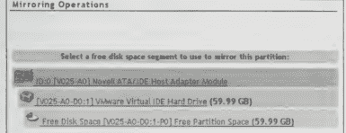

选择用于镜像的磁盘空间段

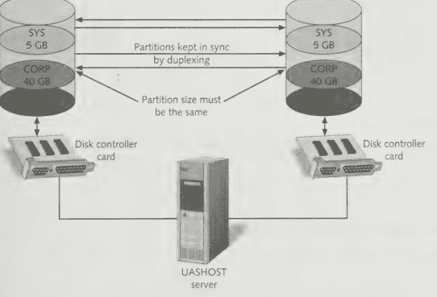

双工分区

使用 Remote Manager 启用双工的过程与镜像相同；唯一的区别是两个分区位于连接不同控制卡的磁盘上。

#### 存储池

在磁盘分区之后，设置 NSS 文件系统的下一个任务是创建一个或多个存储池。如图 3-7 所示，存储池由磁盘分区创建，并可以通过添加磁盘分区进行扩展。当磁盘分区被添加到存储池时，池中的可用空间量将增加该磁盘分区的大小。如果您正在从第二个驱动器向现有存储池添加新的磁盘分区，应考虑在另一个磁盘上镜像或双工新分区，以防止单个驱动器故障导致整个存储池失效。如前所述，在新驱动器上保留一些未分区的空间可以为您提供扩展存储池的选项，而无需添加另一个驱动器。在安装过程中，会为 SYS 卷创建一个名为 SYS 的存储池。然后 SYS 卷用于存放操作系统文件和程序。为了将操作系统文件与组织的数据分开，网络管理员必须创建一个或多个额外的存储池。

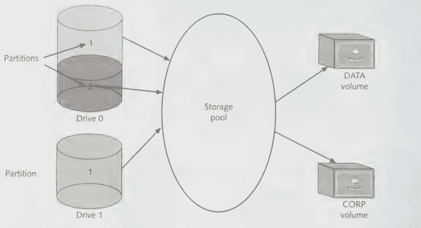

图 3-7 **存储池**

#### 创建存储池

在 NetWare 6.5 中，您通过文件系统创建操作窗口（参见图 3-8）来创建存储池及其关联分区，该窗口可从 Remote Manager 的分区磁盘选项中访问。


图 3-8 **在 Remote Manager 中创建存储池**

请注意，此窗口有两个选项：创建新池和创建新池及卷。创建新池选项显示 NSS 池创建窗口（参见图 3-9），Remote Manager 会自动创建一个指定大小（在池大小文本框中指定）的新分区，然后将该分区空间分配给具有池名称文本框中指定的物理池名的新存储池。当您想要创建一个容纳多个卷的存储池时，应使用创建新池选项。


图 3-9 NSS 池创建窗口

为单个卷创建分区和存储池最简单的方法是：使用创建新池及卷选项显示 NSS 卷创建窗口（参见图 3-10）。


图 3-10 NSS 卷创建窗口

此窗口除了新的池设置外，还包括卷名称和卷属性文本框。您将在“卷”部分中了解有关卷和属性的更多信息。

##### 扩展存储池的大小

当系统上有额外的磁盘空间可用时，可以通过向存储池添加分区来扩展存储池，如图 3-11 所示。例如，因为有额外的可用空间，可以通过点击 Remote Manager 中的扩展池选项，然后选择存储池的位置来扩展如图 3-2 中先前所示的 SYS 存储池的大小（参见图 3-12）。扩展存储池后，新空间可以分配给现有或新卷，如下节所述。

###### NSS 卷

卷是 NetWare 文件系统中的基本存储单元，是用户访问网络目录和文件所必需的。NetWare 6.5 支持传统卷和 NSS 卷。传统卷使用较旧的文件分配表（FAT）技术，并包含在 NetWare 6.5 中以提供与早期 NetWare 版本的向后兼容性。您将在本章后面的“传统卷和分区”中了解有关传统卷的更多信息。


###### NSS 卷

NSS 卷是 NSS 存储池的逻辑划分，该存储池包含一个或多个磁盘分区。可以为 NSS 卷指定特定大小，最大可达存储池的最大大小，或者可以分配初始大小，然后允许其增长到存储池的大小。通过配置卷以启用这种增长类型，您可以通过简单地向存储池添加另一个分区来在未来扩展卷的大小。例如，假设您的 SYS 卷是由一个 6 GB 磁盘分区组成的存储池中的唯一卷。如果允许 SYS 卷增长到存储池的大小，其最大大小将是 6 GB。如果稍后向存储池添加另一个 5 GB 分区，SYS 卷的大小将允许增长到 11 GB 的最大值。

与存储池类似，当您创建 NetWare NSS 卷时，您会为卷分配一个物理名称。除了创建物理卷外，Remote Manager 还为新卷在 eDirectory 中创建卷对象，并自动分配一个由服务器名称、下划线和您分配的物理卷名称组成的名称。这样，每个卷都有两个名称，如图 3-13 所示。您将在第 4 章中了解有关处理 eDirectory 对象的更多信息。


**图 3-13** 卷名称

您可以稍后在 Remote Manager 或 iManager 中更改卷的物理名称或 eDirectory 对象名称。在活动 3-4 中，您将学习如何使用 Remote Manager 创建和重命名物理卷。在第 4 章中，您将学习如何使用 iManager 创建和重命名 eDirectory 对象。

通常首选 NSS 卷而不是传统卷，因为它们提供额外的容量和高速挂载。表 3-1 列出了 NSS 卷相对于传统卷的一些优势。作为 CNA，您应该了解 NSS 卷功能如何使网络文件系统受益。这些优势将在以下部分中更详细地介绍。在本章后面，您将学习如何使用 Remote Manager 配置和查看 NSS 卷功能和属性。

| 功能 | 传统卷 | NSS 卷 |
| :--- | :--- | :--- |
| 最大卷数 | 64 | 255 |
| 最大文件数 | 1600 万 | 无限制 |
| 挂载 20 GB 卷所需的内存 | 320 MB RAM | 32 MB RAM |
| 挂载速度 | 对于大卷需要几分钟 | 即使对于非常大的卷也少于 1 分钟 |
| 支持文件压缩 | 是 | 是 |
| 支持块子分配 | 是 | 否 |
| 支持大块大小（超过 4 KB） | 是 | 否 |
| 支持超额预订 | 否 | 是 |
| 支持集群 | 否 | 是 |
| 支持文件快照 | 否 | 是 |
| 支持救援 | 否 | 是 |
| 支持用户空间限制 | 是 | 是 |
| 支持目录空间限制 | 是 | 是 |
| 支持热修复 | 是 | 否 |

*表 3-1：NSS 与传统卷*


#### 额外的容量和速度


如表 3-1 所述，在 NSS 之前，传统文件系统每个服务器最多支持 64 个卷，每个卷最多支持 1600 万个文件。相比之下，NSS 3 版现在每个服务器最多支持 255 个已挂载卷，且每个卷支持的文件数量几乎没有限制。

在服务器上挂载 NSS 卷的速度更快，这是网络管理员非常欣赏的优势。过去，挂载卷涉及将 FAT 加载到服务器内存中。对于大容量卷，此过程可能需要几分钟并需要几兆字节的 RAM：例如，挂载一个 10 GB 的卷可能需要 160 MB 的 RAM。NSS 不使用庞大的 FAT，而是使用一种更节省内存的文件分配系统，称为**平衡树（B 树）**。使用 B 树，包含数亿个文件（超过 4 亿个文件）的大卷只需几秒钟即可挂载，且最多仅需 32 MB 的 RAM。此外，NetWare 可以在短短四个处理器周期内检索任何不在内存中的文件块，这使得 NSS 比以前的文件系统版本快得多。

#### 超额预订（Overbooking）

假设你有一个 40 GB 的存储池，需要将其划分为两个卷：一个用于会计数据，另一个用于销售数据。在分析了每个部门的存储需求后，你得出结论：销售部门最终可能需要 35 GB，而会计部门 15 GB 就足够了。虽然单个卷的大小不能超过存储池的大小，但超额预订功能允许存储池中所有卷的总和大于池的大小：因此，利用此功能，你可以创建一个销售卷并将配额设置为 35 GB，然后创建一个会计卷并将配额设置为 15 GB。如果两个卷都增长到其容量上限，你可以通过添加更多磁盘分区来扩展存储池大小，如前文“存储池”部分所述。例如，图 3-14 显示了一个存储池中有两个 500 MB 的卷，而该存储池只有 686 MB 可用空间。超额预订功能允许存储池中所有卷的总大小超过池的大小。


图 3-14 存储池中的超额预订卷大小

#### 集群（Clustering）

虽然镜像和双工技术可以在驱动器或控制器故障时提供容错功能，但服务器硬件本身仍可能导致网络服务中断。为了在服务器故障时提供容错功能，NSS 支持**服务器集群**，其中卷在两个或更多服务器之间共享，如图 3-15 所示。共享卷通常放置在连接到高速存储区域网络（SAN）的网络存储设备上。如果集群中的一个服务器发生硬件故障，另一个服务器将自动接管，使共享卷上的数据对网络用户可用。从故障服务器切换到正常运行服务器的过程称为**故障转移（failover）**，这一过程只需几秒钟即可完成。


另一个可能导致停机的问题是网络存储设备中磁盘驱动器的故障。通常，网络存储设备使用基于硬件的 RAID 5 技术，以便在网络存储设备的磁盘驱动器发生硬件故障时提供容错功能。使用 RAID 5 时，网络存储设备会以这样一种方式将数据和控制信息写入多个驱动器：如果任何一个驱动器故障，可以使用存储在其他驱动器上的控制信息来恢复其信息。

#### 文件快照（File Snapshots）

过去，备份全天候访问的文件服务器时，获取打开文件的正确备份往往存在问题。例如，如果备份程序运行时某个文件正在被修改，备份将包含新数据的不完整副本。NSS 通过其文件快照功能为这个问题提供了一个解决方案，该功能会保留已关闭文件的最新副本以供备份使用。使用此功能可确保，如果在备份副本之间数据丢失，你可以恢复先前已关闭文件的有效副本。

### 设置 NSS 卷属性

除了挂载速度更快和服务器内存需求更低之外，NSS 卷还包含几个使其对网络存储有益的特性。这些属性中的大多数可以在创建 NSS 卷时设置，如图 3-16 所示。

#### 备份（Backup）

Backup 属性指示第三方备份软件该卷包含你希望备份的数据。如果卷为空或不包含需要定期复制到备份设备的数据，你可以清除此设置。例如，如果某个卷包含很少更改的软件，你应该禁用 Backup 属性，然后在软件更新或服务包更改后手动备份该卷。


图 3-16 NSS 卷属性

#### 压缩（Compression）

**文件压缩**是传统卷和 NSS 卷共有的功能。与其他卷属性一样，你可以在卷创建期间或之后使用远程管理器启用 Compression 属性。当卷上启用了文件压缩时，服务器会自动压缩那些在指定时间内未被使用的所有文件。默认情况下，如果压缩能节省至少 5% 的磁盘空间，服务器会压缩七天未被使用的文件。在第 6 章中，你将学习如何有选择地启用或禁用文件和目录的压缩。

#### 目录配额和用户空间限制（Directory Quotas and User Space Restrictions）

在传统卷中，管理员可以根据单个用户或整个目录结构来限制使用空间。然而，由于在大型卷上管理用户限制和目录配额需要额外的处理时间，因此在 NSS 卷中，用户空间限制和目录配额是可选的。在创建 NSS 卷时，管理员可以通过在卷创建或修改时选择 User Space Restrictions 或 Directory Quotas 属性来决定是否要限制卷空间。

#### 关闭时立即刷写文件（Flush Files Immediately On Close）

你可以选择在卷创建期间或之后选择此属性，以在文件关闭时立即刷写。此选项会在文件关闭后立即将其保存到磁盘，而不是等待下一个服务器磁盘写入周期。立即将已关闭的文件写入磁盘可以减少因服务器硬件或电源故障而导致数据丢失的可能性。

#### 迁移（Migration）

Migration 属性允许第三方软件在数据非活动指定时间段后自动将其复制（或迁移）到离线存储介质。此属性对于需要大量数据但使用频率较低的应用程序非常有用。例如，一家公司保留多年来所有客户交易的审计追踪。使用 Migration 属性，可以将事务数据库存储在相对便宜的离线大容量存储（如磁带或 DVD）上，并仅在需要审计客户账户时将其引入服务器文件系统。数据访问完成后，文件可以迁移回离线存储系统，从而为更频繁访问的数据节省服务器磁盘空间。

#### 修改文件列表（Modified File List）

NetWare 文件系统的早期版本通过设置第 4 章中描述的属性标志来确定哪些文件需要备份，每当文件数据发生变化时都会设置该标志。此系统要求备份实用程序扫描所有文件名中的属性标志以确定要备份哪些文件。创建 NSS 卷时，你可以选择 Modified File List 属性，该属性使卷跟踪自上次备份以来已更改的所有文件名。使用此功能可以加快对大型卷进行备份的速度。


### 文件抢救

使用 NSS 卷时，还可以抢救已删除的文件。当从支持文件抢救的卷中删除文件时，文件名和数据会被保留，直到需要空间存储新文件为止。当需要新的空间时，会优先使用最早被删除文件的释放空间。在较大的卷上，操作系统可能需要数月才会重新利用已删除文件的存储空间。在空间被操作系统重新利用或文件被彻底清除之前，已删除的文件可以被抢救，或者说被还原。在 NSS 卷中，网络管理员可以在创建或修改卷时，按卷为单位选择启用“抢救”属性。虽然对于包含共享用户数据的卷来说，能够抢救已删除文件可能非常重要，但对于包含系统软件或高度机密文档的卷而言，维护已删除文件所需的额外处理时间可能并不值得。例如，在应用新的支持包时，系统会删除旧程序文件并用新文件替换，此时禁用 SYS 卷上的“抢救”属性可以节省处理时间。由于在安装支持包后抢救已删除的系统文件可能会导致系统错误，您可能希望关闭“抢救”属性，以防止对已删除文件进行抢救，从而提高系统性能。如果卷包含用户不希望在被删除后仍能被访问的机密信息，出于安全考虑也可以关闭此属性。

### 传统卷和分区

虽然 NSS 卷相比传统卷具有许多优势，但当您将 NetWare 服务器升级到 NetWare 6.5 时，现有的任何卷仍将保持为传统卷。**传统卷**可以通过创建一个 NSS 卷，然后将数据从传统卷传输到新的 NSS 卷来进行转换。由于传统卷是直接基于传统磁盘分区创建的，因此它们不具备由存储池创建的 NSS 卷所具有的灵活性和可扩展性。传统分区和卷是通过在文件系统创建操作对话框中使用 NetWare 传统文件系统选项创建的，如图 3-17 所示。使用此选项，您可以创建一个空分区，或者创建一个包含单个卷的分区，这与 NSS 卷的情况类似（参见图 3-18）。


传统分区包含一种称为**热修复**的额外容错功能，该功能通过检测坏磁盘块，然后将正在写入该坏磁盘块的数据自动重定向到磁盘的另一个称为保留区域的区域，从而提高了分区的可靠性。如图 3-18 所示，热修复区域的大小会自动设置为分区大小的大约 2%。为坏块保留的少量空间以及维护热修复块所需的极少服务器处理时间，使得热修复成为传统卷的一项优良特性。

#### 块大小

数据以称为“块”的单位写入磁盘。**块**是指一次写入或从磁盘读取的数据量。块大小在创建存储池或传统卷时设定，范围可以从 4 KB 到 64 KB。在创建存储池时，块大小会自动设置为 4 KB，但您可以在创建传统卷时设置块大小。较大的块大小可以加快磁盘访问速度，因为读取或写入大文件所需的磁盘请求次数更少。因此，网络管理员通常倾向于对包含大文件的传统卷使用较大的块大小，例如桌面出版或其他图形应用中的文件。

##### 块子分配

除了自定义块大小外，传统卷还提供了一种 NSS 卷不具备的子分配功能。如果没有子分配，卷中的每个块只能分配给一个文件，这意味着在大块大小的卷上存储小文件会浪费磁盘空间；例如，如果您在具有 16 KB 块的卷上存储一个 1 KB 的文件，将会浪费 15 KB 的磁盘空间。在传统卷中，这个问题通过子分配得到解决，子分配允许通过将块划分为 512 字节的子分配单位来在同一个块中存储来自多个文件的数据。在使用子分配时，文件必须始终从块的开始处开始；其他文件则可以根据需要使用块中剩余的空间。图 3-19 说明了使用子分配在 CORP 卷上存储三个文件的情况。文件 1 需要 2.5 KB，占据块 1 的前五个子分配单位。文件 2 大小为 1.5 KB，占据块 2 的前三个子分配单位。文件 3 需要 7 KB，使用了整个块 3，以及块 1 中的三个子分配单位和块 2 中的三个子分配单位。

### 查看 NSS 信息

在第 2 章中，您学习了如何使用控制台命令在任何位置管理服务器。在 NetWare 6.0 之前，查看和管理文件系统信息通常需要管理员在服务器控制台上使用 Nwconfig 实用程序。从 NetWare 6.0 开始，管理员可以使用 ConsoleOne 或运行远程管理器的 Web 浏览器来创建、管理和查看磁盘分区、存储池和卷。在本节中，您将学习如何使用远程管理器查看分区、存储池和卷的信息。在本章后面的“实现文件系统”部分，您将使用远程管理器来创建存储池和卷。


**图 3-18** 创建包含卷的传统分区


图 3-19 传统卷中的子分配


> 虽然 NSS 文件系统可以使用 ConsoleOne 或远程管理器进行管理，但远程管理器是 NetWare 6.5 CNA 考试所需的工具，因为它可以在大多数 Web 浏览器中运行，并且不需要 Novell 客户端。

作为网络管理员，您需要了解服务器文件系统的存储空间是如何被使用的，以便对新网络目录的位置做出决策并规划系统扩展。在下述活动中，您将学习如何使用远程管理器查看有关 NSS 分区、池和卷的信息。


> 如果您使用的是 VMware，您可以启动 NetWare 6.5 虚拟计算机，然后从桌面系统访问它，如附录 C 中所述。根据您的实验环境，您的讲师可能会以课堂演示的形式完成本章中的一些活动。


#### 活动 3-1：查看 NSS 信息

**所需时间：** 10 分钟

**目标：** 描述 NSS 组件。

**要求：** 需要 Web 浏览器（Internet Explorer 或启用 Java 的 Firefox），以及从运行 SUSE Linux 或 Windows XP 的客户端计算机访问 NetWare 6.5 服务器的权限，此外还需要以下信息，这些信息也将用于后续活动：

您正在使用的 NetWare 6.5 服务器的 IP 地址：  
_______________________________________

具有服务器管理权限的用户名和密码：  
_______________________________________

**说明：** 查看 NSS 组件的信息在记录您的网络文件系统时非常有用。在此活动中，您使用远程管理器来查看 NetWare 6.5 服务器上分区和存储池的信息。

- 1. 如有必要，启动您的桌面系统。如果您使用的是 VMware，请启动您的 NetWare 6.5 虚拟计算机。
- 2. 启动您的 Web 浏览器并输入 URL https://IPAddress:8009（将 *IPAddress* 替换为您在要求部分记录的 NetWare 6.5 服务器的 IP 地址）以显示登录窗口。


根据您的 Web 浏览器设置，在看到远程管理器登录窗口之前，可能会显示某些证书或安全消息提示。如果出现这种情况，请单击 **确定** 以响应这些提示。（如果您使用的是 SUSE Linux，您可能会看到来自 KDE 钱包系统的提示。如果是这样，请单击 **取消** 以显示远程管理器登录窗口。）

- 3. 在 **用户名** 和 **密码** 文本框中输入您的管理用户名和密码，然后单击 **登录** 按钮以显示远程管理器窗口，类似于图 3-20 中的窗口。


##### 图 3-20 远程管理器窗口

- 4. 单击“管理服务器”标题下的 **分区磁盘** 链接，显示与之前图 3-2 中所示类似的分区信息。记录以下信息：
    - 磁盘适配器：_________________________________
    - 每个分区的描述和大小：
    - _________________________________
    - 每个池的名称和大小：
    - _________________________________
- 5. 单击 **SYS** 卷链接以显示卷信息和选项。记录可用的卷选项：
    - _________________________________
- 6. 记录以下卷信息：
    - 已加载的名称空间：_________________________________
    - 压缩状态：_________________________________
    - 块大小：_________________________________


### 目录和子目录

正如文件柜使用悬挂文件夹进行整理一样，NetWare 卷被划分为多个目录和子目录，这使您能够将卷中的文件分开存放。您还可以对目录和子目录设置空间限制，以防止特定应用程序或用户占用卷中过多的磁盘空间。作为 CNA（认证网络管理员），您必须了解 NetWare 6.5 需要哪些目录，以及如何创建用于组织数据的目录。在接下来的章节中，您 sẽ 了解 NetWare 必需的目录以及建议的目录结构，您可以使用这些结构来满足您组织的数据和软件存储需求。

如表 3-2 所示，NetWare 操作系统在 SYS 卷的若干目录下存储其必需的系统文件和实用程序。管理员最常用的目录包括 Login、Public 和 System。接下来的章节将解释 NetWare 如何使用这三个目录，以及某些类型的文件存储在哪里。

#### 表 3-2 系统创建的目录

| 目录名称 | 用途 |
| :--- | :--- |
| Apache | 包含 Apache Web 服务器文件 |
| Audit | 包含用于审计系统活动和 Web 服务器访问的文件 |
| Etc | 包含 TCP/IP 和证书服务器的配置文件 |
| iFolder | 包含 iFolder 的配置文件，详见第 10 章 |
| Java | 包含 Java 语言文件 |
| Login | 在登录到网络之前供客户端访问的文件和软件 |
| Mail | 不包含文件，用于与早期版本 NetWare 的向后兼容性 |
| Ndfs | 包含用于 Novell 分布式打印服务的文件，详见第 8 章 |
| Netbasic | 包含运行某些 Web 应用程序所需的 NETBASIC 语言文件 |
| NetStorage | NetStorage 的配置文件和软件，详见第 10 章 |
| Ni | 包含用于证书服务安全的配置和软件 |
| Novonyx | 包含 Novonyx Web 服务器的 Web 服务器文件 |
| Nss | 包含 Web 服务使用的文件 |
| Odbc | 包含 Web 服务的数据库和配置文件 |
| Perl | 包含 Web 服务使用的编程软件 |
| Public | 包含所有用户在登录后可以访问的文件和软件 |
| Pvsw | 包含许可证文件信息 |
| Queues | 用于与旧版 NetWare 打印队列的向后兼容性，见第 8 章描述 |
| System | 包含 NetWare 操作系统使用的文件和软件 |
| Tmp | 用于存储临时文件 |
| Ucs | 包含操作系统使用的 NetWare 模块 |
| Webapps | 包含 NetStorage、Web Manager 和 WebAccess 的 Web 应用程序软件 |
| XTier | 包含操作系统使用的 NetWare 可加载模块 |
| Zenworks | 包含 Z.E.N.works 应用程序管理系统的 application 和配置文件，见第 9 章描述 |

#### Login

**Login** 目录包含在登录前可以访问的文件和程序。过去，DOS 客户端使用 Login 目录来访问登录网络所需的命令。NetWare 6.5 利用 Login 目录来查找从 Web 浏览器访问或启动网络服务所需的命令。Login 目录中有三个重要的 DOS 程序：Cx.exe、Map.exe 和 Login.exe。这些实用程序主要用于从基于 DOS 的计算机登录或在基于 DOS 的计算机上工作。除了存储 DOS 命令外，许多网络管理员喜欢使用 Login 目录来存储用户在启动过程中经常使用的文件和程序。当这些程序发布新版本时，您可以通过将新软件复制到 Login 目录来轻松更新它们，而无需将软件复制到每台计算机的硬盘驱动器上。

#### Public

**Public** 目录包含实用程序文件，例如在用户登录后所有用户均可访问的 CX、MAP 和 RIGHTS 命令。您将在后续章节中使用这些命令。ConsoleOne 和 NetWare Administrator 也存储在 Public 目录中。

#### System

**System** 目录包含仅网络管理员可以访问的 NetWare 操作系统文件和实用程序。许多这些系统文件被标记为“隐藏”和“系统”，以防止意外访问。为了避免用户擦除或修改系统文件以及使用影响文件服务器功能的命令，只有 Admin 用户应被授予 System 目录的权限。一些网络管理员将不希望用户运行的程序文件（例如 NetWare Administrator）从 Public 目录移动到 System 目录。这通过阻止用户使用该实用程序浏览 eDirectory 数据库来提高安全性。

#### 其他系统目录

除了三个主要系统目录外，您还可以在 SYS 卷中找到 Etc 和 Deleted.sav 目录。NetWare 6.5 创建 Etc 目录以存储用于配置服务器支持 TCP/IP 网络协议的示例文件。为了帮助用户恢复丢失的文件，Deleted.sav 目录会在每个卷上自动创建，它是 NetWare 文件恢复系统的一部分，使您能够在包含文件的目录被删除后仍然救回文件。在本章稍后的“处理 NetWare 文件”部分，您将有机会救回和清除已删除的文件。

#### 活动 3-2：查看 SYS 卷目录信息

所需时间：10 分钟

目标：识别重要的 NetWare 创建的目录并描述其用途。

要求：与活动 3-1 相同

描述：在本活动中，您使用远程管理器（Remote Manager）显示 NetWare 6.5 服务器上 SYS 卷目录的信息。

1. 如有必要，启动您的桌面系统，启动您的 Web 浏览器，并输入 URL **https://IPaddress:8009**（将 *IPaddress* 替换为您 NetWare 6.5 服务器的 IP 地址）以显示登录窗口。
2. 在用户名和密码文本框中输入您的管理员用户名和密码，然后单击 **登录** 按钮以显示远程管理器窗口。
3. 单击“管理服务器”标题下的 **卷** 链接，以显示卷管理窗口，类似于图 3-21 中的窗口。


4. 在“名称”列中，单击 **SYS** 卷链接，以显示其所有目录，如图 3-22 所示。
5. 向下滚动至 **PUBLIC** 目录。


6. 单击目录名称旁边的 **信息** 图标，以显示 Public 目录的信息。
   在此记录所有者和受托人信息：
   ______________________________
7. 单击“返回到目录列表：/SYS”选项，返回到 SYS 卷内容窗口。
8. 重复步骤 6 和 7，记录 Login 和 System 目录的所有者和受托人信息，然后返回到 SYS 卷内容窗口。
9. 使用以下步骤记录 Etc 目录中 Hosts 文件的内容：
   a. 单击 **ETC** 目录以显示其内容。
   b. 向下滚动并单击 **hosts** 文件以显示其内容。


> 注意：如果您使用的是 SUSE Linux Konqueror，请单击 **打开** 按钮，展开 **编辑器** 标题，单击 **KWrite** 应用程序，然后单击 **确定** 以打开 Hosts 文件。如果您使用的是 SUSE Linux Mozilla，请单击 **确定**，然后单击 **桌面** 文件夹。单击 **打开**，然后单击 **保存** 以将 Hosts 文件保存到您的桌面。然后您可以关闭下载窗口并使用 KWrite 应用程序打开 Hosts 文件。

   c. 在此记录内容：
   ______________________________
10. 单击“管理服务器”标题下的 **卷** 链接，以显示所有 NetWare 6.5 服务器卷。
11. 单击 **退出** 按钮返回登录窗口，并保留您的 Web 浏览器打开状态以备下一个活动使用。

正如您在本节中学到的，必需目录是在安装过程中创建的，以便为 NetWare 操作系统提供执行其功能所需的存储区域。然而，除了这些必需目录外，您的组织还需要更多目录来存储用户应用程序和数据。您在下一节中学习如何为用户数据规划和实施卷和目录。

### 实施 NetWare 文件系统

现在您了解了网络文件系统的组件，下一步是设计和实施一个满足您组织文件处理需求的目录结构。设计目录结构涉及识别满足用户存储需求所需的目录和子目录，并决定这些目录在结构中的位置。在定义存储需求之后，您可以以逻辑、有条理的方式设计目录结构。要设置目录结构，您使用远程管理器创建 NetWare 存储池和卷对象，然后创建和管理目录和文件。

在设计目录结构时，您应该意识到并非所有网络管理员都同意有一种最佳方法；相反，网络管理员会发展出自己定义和排列目录的风格和偏好。在本节中，您将了解 Eric 如何将文件系统设计的概念应用于 Universal AeroSpace 文件系统。然后，您将使用远程管理器在您的 NetWare 6.5 服务器上创建存储池和卷。

#### 定义处理需求

在很多方面，设计文件系统类似于创建建筑物的蓝图。正如蓝图帮助建筑商确定施工细节和材料一样，文件系统结构的设计帮助网络管理员分配存储空间并在网络上实施文件系统。

注意：在某些操作系统上，单击 **退出** 按钮可能会自动关闭 Web 浏览器。如果发生这种情况，您需要重新启动 Web 浏览器。


#### 所有用户

Universal AeroSpace 的所有用户都需要一个主目录，用于存储临时文件、与当前项目相关的文件，以及仅由其个人负责的文档或电子表格文件。所有用户还需要访问共享目录，以便与公司内的其他用户交换文件。该组织已建立了一套标准的文字处理表单，适用于多种用途，包括采购订单、对外信函和内部备忘录。这些标准表单和模板需要让所有用户都能轻松访问。

Universal AeroSpace 的所有用户都需要访问 Microsoft Office 软件。因此，Microsoft Office 和 Windows 的安装及程序文件需要放置在可供所有计算机访问的目录中。此外，还应预留一个临时目录，用于存储某些应用程序创建的临时文件。

目前，Universal AeroSpace 正在聘请一家互联网服务提供商来发布公司的网站信息。Kellie Thiele 负责网站，目前所有文件都保存在她的计算机上。应将网站文件从 Kellie 的计算机移动到 CORP 卷上。将来，这将便于 Eric 实现将网站迁移至 Universal AeroSpace 自有 Web 服务器的计划。

Universal AeroSpace 正在用基于 Windows 的库存系统软件包替换旧的库存系统，该软件包允许全公司用户共享访问。Terry Blackwell 目前负责审计库存数据库、添加新部件，并为市场和制造部门制作每周库存报告。新的库存软件包将允许发货和收货区域的用户输入数据，同时允许市场部门输入新订单并跟踪生产进度。

#### 工程与制造

工程部门使用的 CAD 应用程序软件安装在每台计算机上，但两个 NASA 项目以及当前波音飞机设计项目的 CAD 图纸文件需要由多个用户共享，并且应存储在网络的独立目录中。工程部门还计划利用网络在计算机之间传输 CAD 文件，并共享访问文档和电子表格文件。此外，一些图纸文件需要提供给桌面出版部门，以便他们在创建操作手册时使用。目前，工程部门的文件系统将存储在 CORP 卷上。然而，在不久的将来，Eric 希望安装一个独立的工程服务器，并将所有工程和制造数据从 CORP 卷迁移到工程服务器上。

制造部门计划安装基于网络的物料需求计划系统（RPS），以根据预测的发货计划来规划原材料采购。Russ Pence 将负责维护该系统，但工程部门的 Kari Means 以及市场部门的用户需要能够根据销售预测和基于产品设计的最新需求更新 RPS 数据库。

作为网络管理员，您需要一个工作区域来存储您正在使用的软件和其他文件。此外，您希望将多个软件实用程序放置在网络中，以便您可以从任何客户端计算机访问它们。


下一步是利用收集到的信息来确定 NetWare 文件系统的容量需求。图 3-24 展示了 Eric 根据收集到的信息创建的存储需求表示例。

#### 存储需求表

| 创建人：Eric Kenton | 日期： | 组织：Universal AeroSpace | 工作组： |
| :--- | :--- | :--- | :--- |
| 工作组名称 | 成员 |
| 管理 (Admin) | David Heise, Lynn Dai, Maria Frias |
| 会计 (Accounting) | Terry Blackwell, George Perez, Amy Pan |
| 市场 (Marketing) | Laura Hiller, Michael Horowitz, Darrell Minick |
| 桌面出版 (Desktop Publishing) | Diana Brady, Julie Damrau |
| 工程 (Engineering) | Kari Means, Lianne Jarka, Tony Rucci, Paul Alm, Bradley Dahl |
| 制造 (Manufacturing (Mfg)) | Russ Pence, 收货站, 发货站 |
| 信息技术 (Information Technology (IT)) | Kellie Thiele, 您, Luke McMann, Eric Kenton |

| 目录描述 | 类型 | 用户 | 容量 | 目录名称 |
| :--- | :--- | :--- | :--- | :--- |
| 每个用户的主目录 | 私有数据 | 全体员工 | 每个 5 GB = 10 GB | (用户登录名) |
| 通用文字处理 (WP) 表单和模板 | 共享 WP 数据 | 所有用户 | 500 MB | Forms |
| 共享文档 | 共享数据 | 所有用户 | 1 GB | Shared |
| Windows 应用程序 | 安装用主软件 | 所有用户 | 3 GB | Apps |
| 库存系统 | 垂直应用程序包 | 业务、市场和工程 | 1 GB | Inventory |
| 工程 | 软件和文件 | 工程 | 18 GB | Engineer |
| 工程共享数据 | 共享文档和图纸 | 工程和制造 | 5 GB | Shared |
| 信息技术 | 软件和文件 | IT | 2 GB | IT |
| 实用程序 | 软件实用程序 | IT | 500 MB | Utility |
| NASA ISS 项目 | 共享 CAD 图纸 | 工程 | 5 GB | ISS |
| NASA Rover 项目 | 共享 CAD 图纸 | 工程 | 5 GB | Rover |
| 飞机 | 共享 CAD 图纸 | 工程 | 5 GB | Aircraft |
| Web | 网站文件 | Kellie Thiele 和 Julie Damrau | 1 GB | Web |
| CAD 软件 | 安装文件 | 工程 | 1 GB | Cad |
| RPS | RPS 软件 | Russ Pence 和 Kari Means | 1 GB | RPS |
| 临时 | 某些应用程序所需的临时文件 | 所有用户 | 1 GB | Temp |
| 桌面主题 | 共享 Windows 数据 | 所有用户 | 1 GB | Desktop |
| 部门共享目录 | 各部门的共享文件 | 所有部门用户 | 每个 5 GB | Shared |
| 管理数据 | 管理部的用户主目录和数据 | 管理部用户 | 10 GB | Mgmt |
| 制造数据 | 制造部共享数据的目录结构 | 制造部和工程部 | 10 GB | MfgData |

图 3-24 Universal AeroSpace 存储需求示例

### 规划和实施 NetWare 卷

在确定存储需求后，下一步是确定需要哪些卷以及它们的容量应该是多少。为了避免填满 SYS 卷并导致系统问题，通常应计划将用户数据和应用程序放置在单独的卷上。SYS 卷应仅用于存储 NetWare 操作系统文件，可能还包括第三方软件，例如病毒检测和备份恢复实用程序。为了将 SYS 卷预留用于操作系统文件，许多网络管理员更喜欢在其网络文件结构中至少使用两个卷。在使用多个卷时，网络管理员会创建一个或多个数据卷来存储组织的数据文件、打印队列和应用程序。通过将组织的数据文件和应用程序放置在单独的卷上，管理员可以确保 SYS 卷上始终有可用空间供 NetWare 使用。作为网络管理员，在规划 NetWare 卷使用时，您应遵循以下 Novell 指南：

- 将 SYS 卷保留给 NetWare 操作系统文件。
- 为应用程序和数据文件创建一个或多个额外卷。
- 考虑将支持特殊名称格式的计算机（如 Macintosh 或 UNIX）上的文件放置在单独的卷上。

与许多其他网络管理员一样，Eric 决定通过创建一个用于公司数据的 CORP 卷，将 SYS 卷与组织的数据存储分离开来。单独的 CORP 卷确保了 SYS 卷上有足够的可用空间用于系统功能。这个单独的卷还使得可以在不使 SYS 卷脱机的情况下对公司数据执行维护和备份任务，这一点非常重要，因为使 SYS 卷脱机会阻止访问必要的系统软件，并使服务器无法用于网络使用。

#### 创建 NSS 池和卷

在定义网络文件系统的存储需求后，Eric 的下一步是创建 NSS CORP 卷。由于 NSS 卷存在于存储池中，因此创建 NSS CORP 卷还涉及创建新的磁盘分区和存储池。在以下活动中，您将学习如何创建必要的 NSS 文件系统对象。


##### 活动 3-3：创建 NSS 存储池和卷

**所需时间：** 10 分钟

**目标：** 创建 NSS 存储池和卷。

**要求：** 与活动 3-1 相同；如果您使用的是共享的课堂服务器，您的讲师将提供以下信息：

分配的磁盘驱动器：

池大小：

池名称：

卷名称：

**描述：** 为了帮助评估 NetWare 6.5 服务器文件系统，Eric 要求您创建一个与现有网络上他使用的 CORP 卷类似的卷。在此活动中，您使用远程管理器创建 NSS 存储池和相关的 CORP 卷。如果您与其他学生共享服务器，您的池和卷名称应以分配给您的学生编号开头。


#### 创建传统卷

在某些应用程序中，传统的分区和卷有时最能满足其存储需求。例如，UAS 工程部的用户通常共享大型 CAD 设计文件。由于这些文件的体积较大，Eric 确定，增大块大小可以通过减少加载 CAD 文件所需的磁盘读取次数来提高处理速度。为了允许使用较大的块大小，他决定创建一个 NetWare 传统卷来共享这些大型 CAD 文件。在下面的活动中，你将学习如何使用远程管理器创建传统分区和卷。

##### 活动 3-3：创建 NSS 池和卷

*注意：根据所提供的步骤上下文（步骤 1-9 引用图 3-2、3-8、3-10）以及随后的标题“活动 3-4”，下列列表对应于活动 3-3。*

1. 如有必要，启动你的桌面系统，启动 Web 浏览器，并输入 URL https://IPAddress:8009（将 IPAddress 替换为你的 NetWare 6.5 服务器的 IP 地址）以显示登录窗口。
2. 输入你的管理员用户名和密码，然后单击 **Login**（登录）按钮以显示远程管理器窗口。
3. 单击 Manage Server 标题下的 **Partition Disks**（分区磁盘）链接以显示分区磁盘窗口，类似于之前图 3-2 中显示的窗口。记录你服务器的可用磁盘驱动器：
   [文本中未提供数据]
4. 单击你分配的磁盘驱动器中空闲空间旁的 **Create**（创建）选项，以显示选择创建操作窗口（之前显示在图 3-8 中）。
5. 单击 **Create a New Pool and Volume**（创建新池和卷）以显示 NSS 卷创建窗口，类似于之前图 3-10 中显示的窗口。
6. 在 **Pool Name**（池名称）和 **Volume Name**（卷名称）文本框中输入你的存储池和卷的名称。（使用你的导师分配的名称。）
7. 单击以选中 **Directory Quotas**（目录配额）和 **User Space Restrictions**（用户空间限制）复选框。记录所有选定的选项：
   [文本中未提供数据]
8. 单击 **CREATE**（创建），然后单击 **OK**（确定）以创建新的池和卷并返回到分区磁盘窗口。
9. 单击 **Exit**（退出）按钮以关闭远程管理器并返回到登录窗口。保持登录窗口打开，以便进行下一个活动。

##### 活动 3-4：创建传统分区和卷

所需时间：10 分钟

**目标：** 创建传统分区和卷。

**需求：** 同活动 3-3。此外，如果你正在使用共享的教室服务器，你的导师将分配一个磁盘驱动器以及卷名称和大小。（如果你正在使用专用服务器，请使用卷名称 SOURCE，大小至少为 10 MB。）在此记录这些信息：

分配的磁盘驱动器：
[文本中未提供数据]

传统卷名称：
[文本中未提供数据]

传统卷大小：
[文本中未提供数据]

**描述：** 为了帮助评估 NetWare 6.5 服务器文件系统，Eric 要求你创建一个名为 CAD 的示例传统卷，其块大小将为 32 KB。在此活动中，你将学习如何创建传统的池和卷。如果你正在共享服务器上工作，你的卷名称前面应加上分配给你的学生编号。

1. 如有必要，启动 *Remote Manager*（远程管理器）。
2. 使用你的管理员用户名和密码登录 *Remote Manager*（远程管理器）。
3. 单击 Manage Server 标题下的 **Partition Disks**（分区磁盘）链接以显示分区磁盘窗口。
4. 单击你分配的磁盘驱动器上空闲空间旁的 **Create**（创建）选项，以显示选择创建操作窗口。
5. 单击 **Partition Type**（分区类型）列表箭头，然后单击 **NetWare Traditional File System**（NetWare 传统文件系统）选项（之前显示在图 3-17 中）。
6. 单击 **Create a New Partition and Volume**（创建新分区和卷）选项，以显示之前图 3-18 中显示的传统分区和卷信息。
7. 输入你分配的卷名称和大小。在此记录默认的块大小和属性：
   [文本中未提供数据]
8. 单击 **Block Size**（块大小）列表箭头，并在选项列表中单击 **32K**。单击 **CREATE**（创建），然后单击 **OK**（确定）以创建传统卷并返回到分区磁盘窗口。
9. 向下滚动并验证你的新传统分区和卷已创建。解释你如何将新分区识别为传统分区：
   [文本中未提供数据]
10. 单击 **Exit**（退出）按钮，并保持登录窗口打开，以便进行下一个活动。

### 规划目录结构

在创建必要的卷之后，设置文件系统的下一个任务是规划每个卷的目录结构。网络管理员创建一个目录结构来组织文件服务器上的数据和软件。作为一名 CNA（Novell 认证管理员），你应该了解 Novell 建议作为组织文件系统一部分的三种基本类型的目录：

- 应用程序目录
- 共享目录
- 用户主目录

例如，图 3-25 显示了 Eric 在 Universal AeroSpace CORP 卷的文件系统中使用的卷结构。该卷结构提供了用于应用程序、共享和用户数据的存储区域，如下面的章节所述。

#### 应用程序目录

**应用程序目录**存放安装或运行用户计算机上的软件所需的安装文件。例如，图 3-25 显示 Eric 在 CORP 卷结构中包括了一个名为 Apps 的应用程序目录，用于存储许多网络应用程序的软件文件。

#### 共享目录

使用网络的好处之一是能够访问共享文件。作为一名 CNA，你需要建立网络目录，以便用户能够处理通用的文件和文档。存储在 **共享目录** 中的文件通常一次只供一个用户访问，因此，需要为多个用户同时访问文件配备旨在防止一个用户的更改覆盖另一个用户的更改的数据库软件。起初，你可能会认为在服务器上存储数据会降低安全性。实际上，拥有适当的安全性时，存储在服务器上的数据比存储在用户的本地计算机上更安全，因为在本地计算机上，其他人可能会获得对其计算机的访问权限。在第 6 章中，你将学习如何使用文件系统安全性来确保只有授权用户才能访问网络数据。

#### 卷设计表

设计者：Eric Kenton

| 字段 | 值 |
| :--- | :--- |
| 卷名称 | CORP |
| 类型 | X NSS / 传统 |
| NSS 池名称 | CORP |
| 卷大小 | 池的大小 |

- [X] 备份
- [X] 压缩
- [X] 目录配额
- [ ] 刷新文件
- [ ] 迁移
- [ ] 修改文件列表
- [ ] 抢救文件
- [ ] 快照
- [ ] 文件级别
- [ ] 用户空间限制
- [ ] 块大小
- [ ] 子分配


注意在图 3-25 中，Eric 除了为每个部门标识了共享目录外，还为整个公司标识了一个共享目录。虽然可能只用一个针对整个公司的共享目录就能应付过去，但多个目录有助于保持文件分离，使用户更容易找到他们所需的文件。拥有独立的目录还可以提高安全性；例如，工程部的用户无法访问预算文件或其他不影响他们的信息。

#### 用户主目录

每个用户都需要自己的 **主目录** 来存储文件和文档。从 NetWare 的最早版本开始，主目录就解决了客户端计算机本地文件存储有限或没有的问题。硬盘当时只是太贵了。如今，主目录解决了一个更大的问题：备份和容错。用户很少拥有方便的备份本地工作文件的方法。如果用户善加利用主目录并且管理员定期执行备份，主目录就可以提供帮助。在规划你的磁盘存储需求时，你应该为所有用户存储个人项目和文件留出空间。通常，用户无法访问其他用户主目录中的文件；相反，多个用户所需的文件应存储在单独的共享目录中。根据你的目录结构，用户主目录可以位于部门结构内，如图 3-25 所示，或者所有用户主目录都可以位于单个父目录内，如下节所述。

### 记录目录结构

在记录数据卷的目录结构时，将所有目录和子目录绘制在一张纸上可能很困难。为了帮助记录 CORP 卷的 UAS 目录结构，Eric 使用了两种不同的设计表。如图 3-25 所示，卷设计表用于记录卷根下的所有目录以及仅包含少数子目录的目录。除了显示卷的第一层目录外，此表单还包含 NSS 属性和最大容量的字段。你可能还想显示具有简单结构的目录的子目录。Eric 将所有包含多个部门共享文件的目录（如 Forms 和 Apps）放在 CORP 卷的根下。部门目录将用于存储用户主目录以及每个部门独有的文件、应用程序。

对于更复杂的目录结构，如工程部，Eric 使用单独的目录设计表（见图 3-26）来显示该目录结构中的所有子目录。使用单独的表给你提供了更多的空间来绘制目录结构并进行更改，而不会影响其他目录结构设计。


#### 目录设计表单

设计人：**Eric Kenton** 日期：________  
卷名称：**CORP** 目录名称：**Engineer** 预计大小：**18 GB**


##### 图 3-26 工程部示例目录设计表单

Eric 使用的目录结构被称为**部门结构**，因为用户主目录、共享目录和应用程序都位于管理它们的部门内。包含可供所有用户使用的文件（如表单和清单）的目录位于卷的根目录下。共享目录位于各部门的目录内，以为该部门内的所有用户提供独立的共享文件访问。CORP 卷根目录下的共享目录可供所有部门的用户交换文件或协作完成共同项目。例如，工程部可以使用 CORP:Shared 目录来保存桌面出版部和销售部员工准备文档和演示文稿所需的文件。

在卷上组织目录的另一种方式是按应用程序而非按部门。图 3-27 展示了通用 AeroSpace 的目录如何按面向应用程序的结构进行组织的示例。


**图 3-27 面向应用程序的目录结构**

请注意，在**面向应用程序的结构**中，所有用户主目录都放置在一个名为 Users 的公共目录下。然后，共享目录可以根据其用途进行分组，应用程序可以放置在卷根目录下的单独目录中。面向应用程序结构的优势在于它相当浅，因此更容易通过目录层级定位文件。然而，在较大的目录结构中，这种浅层结构实际上可能是一个劣势，因为它使得难以知道哪些部门使用哪些目录。在使用面向应用程序结构时，网络管理员需要进行更多的受托人分配，因为用户的权限不会自动流向其他目录。在第 6 章中，您将学习如何执行授予用户目录结构权限的受托人分配。

选择用于目录结构的组织方法取决于个人偏好、组织规模以及用户访问数据的方式。通常，较小的网络文件系统使用面向应用程序的结构更容易组织，因为它保持设计简单且易于使用。对于涵盖多个部门和许多数据目录的较大文件系统，部门结构通常更容易维护安全性并定位数据。在某些情况下，您可能会发现两种结构的组合效果最佳。无论使用哪种设计方法，一条好的经验法则是不要超过三个子目录层级，并且任何目录中不超过 20 个子目录（这使得能够同时在屏幕上查看所有目录变得更加容易）。

### 实施目录结构

在创建卷并设计目录结构后，您准备好开始在卷和目录设计表单上显示的目录了。目录结构可以通过使用本地客户机的操作系统或使用 Remote Manager 来创建。例如，从运行 Windows XP 的客户机，您可以将驱动器映射到 NetWare 卷，然后在“我的电脑”或 Windows 资源管理器中创建网络目录结构，就像在本地硬盘上一样。您还可以使用 ConsoleOne 或 Remote Manager 来创建和操作网络目录结构。Remote Manager 的一个优势是它符合 Novell 的 OneNet 愿景，允许您从任何客户系统或远程位置管理文件系统。

实施目录结构涉及两个主要任务：创建目录和子目录，以及通过目录配额设置目录空间限制。由于 Novell CNA 考试要求您知道如何从 Remote Manager 执行文件系统功能，因此在以下活动中，您将使用此实用程序创建图 3–25 中显示的一些通用 AeroSpace 目录，然后在这些目录上设置目录配额。

#### 活动 3-5：使用 Remote Manager 创建目录结构

**所需时间：** 10 分钟

**目标：** 使用 Remote Manager 创建目录。

**要求：** 与活动 3-1 相同

**描述：** Eric 希望您实现一个目录结构在 NetWare 6.5 服务器上以用于评估目的。他希望目录结构与现有系统上的目录结构相匹配。在此活动中，您将使用 Remote Manager 创建图 3–25 中显示的通用 AeroSpace 目录结构的一部分。

- 1. 如有必要，使用分配给您的 NetWare 6.5 服务器的 IP 地址启动 Remote Manager。
- 2. 使用您的管理员用户名和密码登录。
- 3. 点击“管理服务器”标题下的 **Volumes** 链接以显示卷管理窗口。
- 4. 如果您的新卷未挂载，请点击卷名称所在行的“已挂载”列中的 **NO**。当卷被挂载时，“NO”应变为“YES”。
- 5. 点击您分配的卷以显示 NetWare 文件列表窗口，类似于图 3-28 中的窗口。


- 6. 请按照以下步骤在卷的根目录下创建 Apps 目录：
  - a. 点击 NetWare 文件列表表格第一行中的 **Info** 图标以显示目录项信息窗口，类似于图 3-29 中的窗口。


  - b. 向下滚动，并在“新名称”文本框（位于“创建子目录”按钮旁边）中输入 **Apps**，以将 Apps 目录添加到 NetWare 文件列表窗口。点击 **Create Subdirectory** 按钮以创建新的子目录。
- 7. 重复步骤 6 以创建 **IT** 和 **Forms** 目录。
- 8. 点击 **Apps** 目录以显示其内容（参见图 3-30）。


- 9. 请按照以下步骤在 Apps 目录结构中创建 Cad 子目录：
  - a. 点击 NetWare 文件列表表格第一行中的 **Info** 图标以显示 Apps 目录的目录项信息窗口（参见图 3-30）。
  - b. 列出 Apps 目录可用的选项：
    _________________________________________
  - c. 在“新名称”文本框中输入名称 **Cad**，并点击 **Create Subdirectory** 按钮将此子目录添加到 Apps 结构中。
- 10. 重复步骤 9 以在 Apps 目录下创建 Office、Utility 和 Desktop 子目录。
- 11. 点击 .. 链接返回卷的根目录，并保持登录状态以便进行下一个活动。

#### 活动 3-6：实施目录配额

**所需时间：** 10 分钟

**目标：** 使用 Remote Manager 设置目录配额。

**要求：** 成功完成活动 3-5

**描述：** Eric 希望您在卷上实施目录配额，以防止目录超出其计划大小。在此活动中，您将使用 Remote Manager 在活动 3-5 中创建的目录上设置目录配额。

- 1. 如有必要，请按照活动 3-5 中的步骤 1 到 3 启动 Remote Manager 并打开卷管理窗口。
- 2. 请按照以下步骤为 IT 目录设置 4 GB 的目录配额：
  - a. 如有必要，点击您分配的卷以显示 NetWare 文件列表窗口。
  - b. 点击 IT 目录旁边的 **Info** 图标以显示目录项信息窗口。
  - c. 在“文件空间限制”文本框旁边，点击 **None** 以显示目录空间配额窗口。
  - d. 在“设置空间限制（单位：KB）”文本框中输入 **4000000**，然后点击 **Set Space Restriction** 按钮以设置文件空间限制。
  - e. 点击 **Back to directory listing** 链接返回您分配的卷的根目录。
- 3. 使用步骤 2 中的程序为 Forms 目录设置 500 MB（500000 KB）的目录配额。记录您输入的空间限制值：
  _________________________________________
- 4. 点击 **Exit** 按钮从 Remote Manager 注销，并关闭您的 Web 浏览器。


### 访问 NetWARE 文件系统

如第 1 章所述，网络服务需要客户端和服务器软件组件协同工作才能运行。客户端软件组件必须与本地操作系统和服务器紧密配合，以提供对网络服务的访问。客户端软件格式化请求，然后使用网络协议将该请求发送到服务器。在服务器上运行的服务处理请求，并将结果发回给客户端。如图 3-31 所示，每种类型的网络操作系统都需要在计算机上加载其自己的客户端，以与服务器上运行的服务进行通信。要访问 Windows 服务器上的服务，Microsoft 客户端使用通用接口文件系统（CIFS）来格式化服务请求。在 NetWare 6.0 之前，访问 NetWare 服务器上的文件服务需要计算机安装 Novell 客户端，以使用 NetWare 核心协议（NCP）格式化请求。UNIX/Linux 客户端使用网络文件系统（NFS）协议访问文件，而 Macintosh 客户端使用 AppleTalk 文件协议（AFP）访问其他 Macintosh 计算机上的文件服务。Web 浏览器是客户端，它们使用 HTTP 和 WebDAV 协议访问运行在 Web 服务器上的资源和服。


图 3-31 NetWare 文件访问协议

#### 原生文件访问包

Novell 的 OneNet 战略的一个重要部分，是提供与图 3-31 中所示的各种客户端兼容的网络服务。尽管 NetWare 的早期版本依赖于在客户端计算机上安装 Novell 客户端，但 NetWare 6.5 提供对 Web 浏览器客户端的直接支持，并包含 Novell 的原生文件访问包（NFAP），该包使 NetWare 6.5 服务器能够处理由非 Novell 客户端（如 Microsoft、Apple 和 Linux）格式化的文件服务请求。由于有多种可用的客户端选择来访问 NetWare 服务器，网络管理员可以选择最适合用户计算机环境和应用程序需求的客户端。表 3-3 列出了可以与 Windows 一起用于访问 NetWare 服务器的客户端。

表 3-3 NetWare 客户端选项

| 客户端 | 优点 | 缺点 |
| :--- | :--- | :--- |
| Web 客户端 | 允许从任何连接到 Internet 的计算机访问 NetWare 服务和管理任务；不需要在计算机上安装 Novell 客户端。 | 尚未提供对所有 NetWare 服务和资源的访问。 |
| Microsoft 客户端 | 包含在 Windows XP 和 Windows 2000 Professional 中；用户查看 NetWare 服务器的方式与其他 Windows 服务器相同。 | 需要在 NetWare 6.5 服务器上配置 NFAP 简单密码；使用与 Novell 客户端密码不同的、安全性较低的密码。用户可能需要维护多个密码。不允许访问某些 NetWare 服务和管理工具。 |
| Microsoft NetWare 客户端 | 在 Windows XP 和 Windows 2000 Professional 中作为选项提供，安装和配置轻松。维护所需的管理开销较少。使用与 Novell 客户端相同的 Novell eDirectory 用户名和密码。 | 不允许访问某些 NetWare 服务和管理工具。需要在 NetWare 服务器上启用 IPX/SPX。 |
| Novell 客户端 | 提供对所有 NetWare 服务和管理工具的访问。 | 安装和维护所需的管理时间更多；可能与某些 Windows 功能冲突。 |

从 Windows 客户端访问某些 eDirectory 应用程序仍然需要在计算机上安装 Novell 客户端。由于 eDirectory 服务对于确保安全以及管理某些 eDirectory 对象和服务是必要的，因此 Novell 客户端在 Novell 网络中仍然发挥着重要作用。在第 4 章中，您将学习如何在 Windows 计算机上安装和配置 Novell 客户端。

#### 用户名和简单密码

如前所述，开放企业服务器（OES）包含 NFAP，允许 Windows、Macintosh 和 Linux 客户端在无需安装 Novell 客户端的情况下访问 NetWare 服务器。NFAP 是一个重要功能，因为许多组织希望最大限度地减少用户计算机上的软件复杂性。使用计算机原生客户端协议的缺点是无法使用某些 NetWare 功能，例如 Novell 客户端 eDirectory 密码加密中内置的额外安全性。当使用 NFAP 协议之一的客户端尝试连接 NetWare 6.5 服务器时，系统会要求用户输入用户名和密码。输入的用户名必须是 eDirectory 中的有效用户帐户，如第 4 章和第 5 章所述。然后，NFAP 使用 SYS:\ Etc 目录中的 Cnx.cfg 搜索文件在 eDirectory 树中搜索用户帐户。在第 4 章中，您将学习如何更新此搜索文件以包含用户帐户的位置。

当客户端计算机使用 NFAP 访问 NetWare 6.5 OES 服务器时，它使用自己的密码加密算法来保护密码。这要求 eDirectory 维护两个密码：一个用于 Novell 客户端加密，另一个用于原生客户端协议，称为“简单密码”，以区别于更安全的 eDirectory 密码。NetWare 使用与计算机原生客户端兼容的不同加密系统，将简单密码与 eDirectory 密码分开存储。

#### 活动 3-7：更改简单密码

所需时间：10 分钟

**目标：** 更改简单密码。

**要求：** 您的 Admin 用户名的位置（如果您使用的是专用服务器，它在您的服务器 UAS 组织；如果您使用的是共享课堂服务器，您分配的 ##Admin 用户名和 ##UAS 容器在 CLASS 组织中）


> 如果您正在使用带有 Mozilla Web 浏览器的 SUSE Linux，您可能会看到一条消息，告知此版本的 iManager 不支持该 Web 浏览器；但这不会影响活动的执行。

**描述：** 为了简化安装和维护，Eric 希望 UAS 制造部门的计算机仅使用 Microsoft 客户端访问 NetWare 6.5 服务器。Eric 要求您在 NetWare 6.5 服务器上测试 NFAP，以帮助确定仅在这些计算机上使用 Microsoft 客户端的可行性。在测试 NFAP 之前，您需要启用您 Admin 用户帐户的简单密码。在此活动中，您使用 iManager 在您的 UAS 容器中启用简单密码。

- 1. 启动您的 Web 浏览器，输入网址 **https:// //IPAddress /nps/iManager.html**（*IPAddress* 代表您的 NetWare 6.5 服务器的 IP 地址），然后按 **Enter** 键打开 iManager 登录窗口。
- 2. 输入您的管理用户名和密码，然后单击 **Login** 按钮以显示如图 3-32 所示的 iManager 主窗口。（如果您看到“Secret Store is currently locked”消息，请在 Old Password 文本框中输入您的管理密码并单击 **Continue**。如果此消息第二次出现，请单击 **Close**。）


图 3-32 iManager 主窗口

- 3. 向下滚动“角色和任务”窗格，然后单击展开 **NMAS**。
- 4. 单击 **NMAS Login Methods** 链接以打开如图 3-33 所示的 NMAS 登录方法窗口。
- 5. 通过以下步骤查看您 NMAS 登录配置容器的当前状态：
    - a. 在“选择登录方法”下拉列表中，单击 **Simple Password** 选项。
    - b. 单击 **View Login Method Properties** 按钮以显示简单密码配置窗口。在以下行中记录支持的平台：

    ____________________________________________________________
    ____________________________________________________________


- 6. 按照以下步骤在您的 Admin 帐户上启用简单密码：
    - a. 单击 **NMAS Users** 链接以显示“选择用户”窗口。
    - b. 单击 **Object Selector** 按钮，单击您的 **Admin** 帐户，然后单击 **OK** 以显示 NMAS 用户窗口，类似于图 3-34。


    - c. 单击 **Simple Password** 选项，然后在“设置简单密码”和“确认简单密码”文本框中输入新密码。
    - d. 单击 **OK** 返回 iManager 主窗口。
- 7. 单击 **Exit** 按钮以结束您的 iManager 会话。您的 Admin 用户以及您创建的任何新用户现在应该能够使用相同的密码从 Microsoft 或 Novell 客户端登录。


#### 使用通用接口文件系统（CIFS）客户端

访问其他基于 Windows 的计算机上的共享资源和服务需要 Microsoft 客户端。Microsoft 客户端在 Windows 9x 上是可选的，但在 Windows 2000 和 XP 中会自动安装。由于 Microsoft 客户端在台式计算机上非常普遍，因此它是访问无需额外 Novell 服务的计算机上的 NetWare 文件服务的自然选择。例如，在 UAS 网络中，装运和收货部门的计算机只需要文件和打印服务来访问 NetWare 服务器上的库存文件并打印装运标签。因此，Eric 决定通过仅使用 Microsoft 客户端来简化这些计算机的配置。

如你在第 1 章中所了解，在对等网络中，Windows 服务器被组织到工作组中。为了让 Microsoft 客户端访问 NetWare 服务器，NFAP 使 NetWare 6.5 服务器在 Windows 客户端看来就像工作组中的另一台 Windows 服务器。在安装期间，会自动为 NetWare 6.5 服务器分配一个 Microsoft 服务器名称和工作组，以及要与 Microsoft 客户端共享的卷。默认方法是共享所有卷，并将 NetWare 服务器放置在 WORKGROUP 工作组中，使用包含 NetWare 服务器名称后跟下划线字符和“W”的 Microsoft 服务器名称。例如，UASHOST 的 Microsoft 服务器名称为 UASHOST_W。可以使用第 6 章中描述的 ConsoleOne 更改默认的 CIFS 参数。

Windows 用户可以通过在 Windows 资源管理器中浏览网络或输入数据卷的统一命名约定（UNC）路径来访问 NetWare 服务器上的数据卷。**路径**通过列出通向对象（如文件或目录）的组件来定义对象的位置。例如，到文件的完整路径通常由服务器名称、卷名称和目录名称组成。UNC 路径在服务器名称前有两个反斜杠，并用一个反斜杠分隔服务器和共享卷名称。例如，UASHOST_W 服务器上 CORP 卷的名称为 \\UASHOST_W\CORP。在活动 3-8 中，你使用 UNC 路径将驱动器映射到 UASHOST_W 服务器的 CORP 卷。

当运行 Microsoft 客户端的计算机尝试访问运行 NFAP 的 NetWare 服务器时，Windows 客户端会以与尝试登录 Microsoft 服务器相同的方式将其本地用户名和密码提交给 NetWare 服务器。如果用户帐户和密码存在于 NetWare 服务器上，则授予访问权限。如果 NetWare 服务器上的用户帐户和密码与登录 Microsoft 客户端的用户帐户和密码不匹配，则会打开“输入网络密码”对话框，提示用户输入 UASHOST_W 服务器的用户名和密码。

#### 活动 3-8：从 Windows 访问 NetWare 文件系统

所需时间：10 分钟

**目标：** 从 Windows XP 客户端计算机映射网络驱动器。

**要求：** 一台 Windows XP 计算机，以及除活动 3-1 获取的 NetWare 信息外，还需要 Windows XP 本地用户名和密码。

**描述：** Eric 希望你通过映射驱动器到 CORP 卷，然后将文件复制到 Apps 目录来测试网络文件系统。

- 1. 如有必要，启动你的 Windows XP 计算机，并使用分配给你的本地用户名和密码登录到本地计算机。

- 2. 按照以下步骤将网络驱动器映射到你分配的卷：
  - a. 打开 Windows 资源管理器。
  - b. 右键单击**我的电脑**，然后单击**映射网络驱动器**以打开映射网络驱动器对话框。
  - c. 记录默认的驱动器字母：

- d. 单击文件夹文本框旁边的**浏览**按钮，以打开浏览文件夹对话框。

- e. 如有必要，单击以展开**整个网络**和**Microsoft Windows 网络**。

- f. 单击以展开名为**WORKGROUP**的工作组。

- g. 右键单击你分配的服务器名称，然后单击**资源管理器**以打开**连接到 ASH:HOST-W**对话框。

- h. 输入你分配的用户名和密码，然后单击**确定**登录到服务器。

- i. 右键单击你分配的服务器，然后单击**扩展**以显示可用卷。

- j. 单击你分配的卷名称，然后单击**确定**将网络路径放入文件夹文本框中。记录文件夹文本框中的内容：________________________

- k. 单击以清除**在登录时重连**复选框。

- l. 单击**完成**以映射网络驱动器。

- 3. 将**Mspaint.exe**文件从**Windows\System32**目录复制到你的**Apps**目录。

- 4. 在你的**Forms**目录中创建以下文本文件（在创建每个文件后刷新屏幕）：**Expense.doc**、**Absentee.txt**、**Junk.txt**和**Salvage.txt**。

- 5. 删除**Salvage.txt**文件。

- 6. 关闭所有窗口，并为下一个活动保持登录状态。

#### 使用 AppleTalk 文件协议（AFP）客户端

安装了 **NFAF** 并配置了密码后，你的 **NetWare 6.5 Open Enterprise** 服务器已准备好允许 Macintosh 用户访问 NetWare 文件系统。他们可以使用熟悉的**选择器（Chooser）**应用程序或**前往（Go）**菜单来查看网络文件，甚至创建别名。使用 **NFAF**，Macintosh 用户可以从 NetWare 文件系统中打开、复制、移动、保存和删除文件，就像操作任何本地 Macintosh 驱动器一样。**AFP** 服务会自动启动，但你可以通过 NetWare 服务器控制台使用 **AFPSTOP** 和 **AFPSTART** 命令在必要时停止和启动该服务。与 Windows 一起使用的同一 **Cxf.cfg** 搜索文件也用于在 **eDirectory** 中查找 Macintosh 用户名。你还可以重命名 NetWare 卷，以便它们以不同的名称出现在 Macintosh 用户那里。要重命名 NetWare 卷，可以按照以下步骤操作：


- 1. 在 NetWare 服务器的 **SYS:etc** 目录中创建一个名为 **Afvpol.cfg** 的文件，其中包含你想使用的卷和特殊的 Macintosh 名称。

- 2. 对于你要重命名的每个卷，输入卷的当前名称以及引号内的 Macintosh 名称。例如，要将 **CORP** 卷命名为“**Corporation data**”，请在 **Afvpol.cfg** 文件中输入以下行：

  ```
  Prv-serv1.corp "Corporation data"
  ```

- 3. 保存 **Afvpol.cfg** 文件。

Macintosh 用户可以使用**选择器（Chooser）**应用程序按需访问 NetWare 文件和目录，或按照以下步骤创建别名：


- 1. 在 Mac OS 8 或 9 中，单击**苹果**菜单，单击**选择器（Chooser）**、**AppleTalk**、**服务器 IP 地址**。在 Mac OS X 中，单击**前往**、**连接服务器**。
- 2. 指定 NetWare 服务器的 IP 地址或 DNS 名称，然后单击**连接**。
- 3. 在提示时，输入有效的 **eDirectory** 用户名。
- 4. 输入分配给 **eDirectory** 用户名的简单密码，然后单击**连接**。
- 5. 选择一个要挂载到桌面上的卷。

然后可以像访问 Macintosh 服务器上的文件一样访问 NetWare 卷上的文件。如果你想创建到该卷的永久链接，请创建一个别名。

#### 使用网络文件系统（NFS）客户端

尽管 NFS 支持已作为 NetWare 6.5 安装的一部分进行安装和启动，但从 Linux 访问 NetWare 文件系统比 Windows 或 Macintosh 需要更多步骤。NFS 文件系统的一个重要组件是 NFS 服务器，它使本地系统上的目录可供网络使用。在 NetWare 服务器上运行的 NFS 可以通过 NetWare 服务器控制台的 NFSTOP 和 NFSTART 命令来停止和启动。在从 Linux 客户端访问 NetWare 目录之前，需要将其导出到运行在你 NetWare 6.5 服务器上的 NFS 服务器软件中。你可以使用 iManager 通过将 NetWare 卷导出到 NFS 服务器来执行以下操作：

- 1. 启动 iManager 并使用具有管理权限的用户名登录。
- 2. 展开“文件协议”标题并单击“NFS”。
- 3. 单击“导出”按钮以打开“导出选项”窗口。
- 4. 在“路径”文本框中，输入要导出的路径，使用正斜杠分隔目录名称。（例如，要导出 IT 结构中的共享目录，请输入 `/Data/IT/Shared`。）
- 5. 在“访问控制”文本框中，指定独立模式或 NetWare 模式。独立模式意味着 NetWare 和 NFS 权限是分开管理的。NetWare 模式意味着权限是从 NetWare 管理的，并相应地映射到 NFS。你将在第 6 章中学习 NetWare 文件访问权限，在第 13 章中学习 NFS 权限。
- 6. 使用“全局权限”字段来指定默认情况下授予所有受信任计算机的权限。
- 7. 在“受信任主机和访问权限”表中，指定你要将其作为导出路径的受信任主机的 NFS 主机，以及授予导出主机的权限。

目录导出后，可以通过以下步骤从 Linux 计算机挂载它：

- 1. 使用 mkdir 命令创建一个目录来存储 NetWare 6.5 NFS 导出。
- 2. 使用 mount 命令将新目录链接到 NetWare 6.5 Open Enterprise Server 导出。
- 3. 使用标准 Linux 命令（在第 13 章中描述）从 Linux 访问 NetWare 导出目录。

> 在第 13 章中，你将导出并在 Linux 系统上挂载 NetWare 目录。

#### Web 浏览器客户端

Web 浏览器是使用 HTTP 和 WebDAV 协议向 Web 服务器发出请求的客户端。如今，许多 Internet 应用程序旨在通过 Web 浏览器提供对数据和服务的访问。如你所知，Novell OneNet 战略的一个重要部分是允许管理员和用户使用他们的 Web 浏览器作为客户端来管理网络并访问文件和打印服务。除了 Remote Manager 之外，你还将了解许多包含在 NetWare 6.5 中的 Web 支持应用程序，包括 iManager、iFolder、NetStorage 和 iPrint。在以下部分中，你将学习如何使用 iManager 启用 Novell NFAP 密码。在第 4 章和第 5 章中，你使用 iManager 帮助设置和管理你的 UAS 网络版本的 eDirectory 树。在第 10 章中，你将学习如何配置 iFolder，以便用户可以使用 Web 浏览器从任何位置访问他们的文件。


### 处理网络文件

文件用于在网络文件系统中存储数据，其方式与在本地磁盘上存储数据和软件非常相似。规划文件在网络卷上的位置是组织文件系统的重要组成部分。虽然文件可以存在于卷的根目录，但将它们放置在目录和子目录中会使文件系统更加井井有条，并提高文件系统的安全性，如第 6 章所述。

NetWare 在位于每个卷开头的**目录项表（DET）**中存储每个文件的信息。除了文件名称和存储位置外，NetWare 还包含所有者、大小、创建日期、访问日期、受托人分配和属性等信息。默认情况下，文件的所有者是创建该文件的用户。通过跟踪文件所有者和大小信息，NetWare 能够按用户限制磁盘空间的使用。网络管理员还需要创建日期和访问日期来执行诸如列出在指定期间内未被访问的文件等功能。

#### 恢复已删除的文件

如前所述，NetWare 文件系统的一个优点是，即使文件被删除很长时间，也可以可靠地恢复它们。当文件被删除时，NetWare 不会立即覆盖其空间，直到所有先前删除文件的可用空间被重新使用之前。被删除的文件在它们被删除的目录中进行跟踪，并可以从其父目录中恢复。因此，用户通常可以在文件被删除数月后，从父目录中恢复已删除的文件。即使包含该文件的整个目录结构被删除，已删除的文件仍会被跟踪，并且可以由网络管理员从 Deleted.sav 目录中恢复。


标准用户无权从 Deleted.sav 目录中恢复文件。默认情况下，只有网络管理员拥有此权限。

然而，出于安全原因或操作系统效率考虑，有时你希望立即将已删除文件的空间归还给操作系统以供重新使用——这一过程称为**清除文件**。当文件被清除时，NetWare 回收其空间，且这些文件将无法再被恢复。因此，清除已删除文件对于安全目的可能很重要，因为它可以防止已删除文件被恢复。如果清除的文件存在于 NSS 卷上，且本章前面描述的 Salvage（恢复）属性未启用，则清除的文件将被随机字符模式覆盖，以确保已删除的数据无法被访问或查看。清除文件的另一个优点是立即为 NetWare 服务器腾出可用空间以供重新使用。清除不仅提高了 NetWare 的效率，还防止其他可能宝贵的文件被快速重用。例如，假设一位用户最近安装了软件包并将其放在 Apps 目录中，然后决定删除软件目录并将其放在她的本地计算机上。清除 Apps 目录中的文件会使应用程序文件使用的任何磁盘空间立即可用于其他用途。在接下来的活动中，你将练习使用 Remote Manager 来处理网络文件。


#### 活动 3-9：在 Remote Manager 中删除和恢复网络文件

**所需时间：** 10 分钟

**目标：** 使用 Remote Manager 管理网络文件。

**要求：** 一个 Windows XP 系统以及成功完成活动 3-8

**描述：** 除了管理卷和目录外，你还可以使用 Remote Manager 来处理网络文件。在此活动中，你将练习使用 Remote Manager 上传文件、恢复已删除文件以及清除已删除文件。

- 1. 如有必要，使用分配给你的 NetWare 6.5 服务器的 IP 地址启动 Remote Manager。
- 2. 使用你的管理员用户名和密码登录。
- 3. 点击 Manage Server 标题下的 **Volumes** 链接，然后点击分配给你的卷以显示目录。
- 4. 点击 **Forms** 目录以显示所有文件，如图 3-35 所示。


##### 图 3-35 查看 Forms 目录的内容

- 5. 要恢复已删除的文件，请遵循以下步骤：
    - a. 点击 NetWare 文件列表表格第一行中的 **Info** 图标以显示目录信息（见图 3-36）。


##### 图 3-36 查看 Forms 目录的目录信息

    - b. 点击 Salvageable files 文本旁边的 **Select for list** 链接，并在此处记录可恢复的文件：
        - _____________
    - c. 点击 Salvage.txt 文件旁边的 **Salvage** 选项以恢复此文件。
    - d. 点击 **Back to directory page for** 链接，然后点击 **Back to directory listing** 链接以返回 NetWare 文件列表窗口。
    - e. 点击你的 **Forms** 目录，并验证 Salvage.txt 文件是否已恢复。
- 6. 要删除 **Junk.txt** 文件，请遵循以下步骤。
    - a. 点击 Junk.txt 文件左侧的 **Info** 图标，并记录一个已删除文件的文件名、大小和删除者信息：
        - ____________________________________________________________________
    - b. 向下滚动并点击 **Delete file** 按钮，然后点击 **Yes** 以删除 Junk.txt 文件。
- 7. 遵循以下步骤以清除 Forms 目录中的已删除文件：
    - a. 点击 Forms 目录旁边的 **Info** 图标。
    - b. 点击 Salvageable files 文本旁边的 **Select for list** 链接。
    - c. 点击 **Purge all files** 按钮。
    - d. 点击浏览器上的 **Back** 按钮以返回目录项信息窗口。
    - e. 记录可恢复的文件：
        - ____________________________________________________________________
- 8. 点击 **Exit** 以返回 Remote Manager 登录窗口。
- 9. 关闭你的 Web 浏览器，并将计算机恢复为标准实验配置。

## 章节摘要

- Novell Storage Services (NSS) 的基本组件包括分区、存储池、卷、目录和文件。存储池由一个或多个物理磁盘分区组成。卷是存储池的逻辑划分，类似于文件柜抽屉，因为它包含文件夹和文件。每个服务器必须至少有一个名为 SYS 的 NSS 卷，大小至少为 4 GB。
- 在安装过程中，NetWare 会在 SYS 卷上创建多个系统目录，包括 Login、Public 和 System 目录。Login 目录包含用户登录网络所需的程序和文件。Public 目录包含用户登录网络后可能运行的程序命令和实用工具。System 目录包含仅对网络管理员可用的操作系统文件和实用工具。确保 SYS 卷不耗尽可用空间非常重要。由于 SYS 卷空间耗尽可能导致服务器宕机，网络管理员通常会规划一个或多个数据卷来容纳组织的文件和应用程序。
- 文件用于存储网络数据和软件。除了文件名和大小外，NetWare 还在位于每个卷开头的目录项表中存储每个文件的附加信息，包括所有者、访问日期和属性。网络管理员可以从 Web 浏览器使用 Remote Manager 来管理网络文件系统。
- 网络管理员的一项重要工作是规划和实施网络文件系统结构，以支持组织的处理需求。在规划目录结构时，Novell 建议为每个用户保留私有主目录，为多个用户共享的文件保留共享目录，以及应用程序目录。为这些目录提供空间，许多网络管理员使用多个卷。SYS 卷保留用于操作系统文件，通常指定一个或多个数据卷来存储打印队列、用户文件和应用程序。
- 设计好目录结构后，在 ConsoleOne 或 Remote Manager 中创建任何必要的卷。
- 创建并挂载所有卷后，网络管理员可以使用 Windows Explorer、Linux Konqueror（文件管理实用工具）、ConsoleOne 或 Remote Manager 创建必要的目录和子目录。


NetWare 6.5 文件系统可以通过以下任一协议从客户端计算机访问：HTTP、CIFS、NFS 或 NCP。尽管 NCP 要求在 Windows XP 或 2000 Professional 系统上加载 Novell 客户端，但它提供了访问和管理 NetWare 文件系统的最多选项。

NetWare 6.5 包含在远程管理器（Remote Manager）中回收和清除已删除文件的选项。清除文件会执行一种“碎纸”过程，这对于防止已删除的安全文档被访问至关重要。

### 关键术语

- **应用程序目录** — 用于保存安装或运行用户计算机软件所需的安装文件的目录。
- **面向应用程序的结构** — 这种目录设计提供了一种简单的目录结构，其中数据和应用按使用类型而非按部门排列。
- **平衡树（B-trees）** — 一种索引系统，使 NSS 卷能够比传统卷更快地挂载，并占用更少的 RAM。
- **块** — NetWare 卷上磁盘存储的最小单位。NSS 卷使用 4 KB 的块大小；传统卷中的块大小可从 4 KB 设置为 64 KB。
- **部门结构** — 一种目录设计，用户主目录、共享目录和应用程序位于管理它们的部门内。
- **目录项表（DET）** — 每个卷开头的存储空间，用于存储文件和目录的信息，包括名称、大小、位置、所有者和访问日期。
- **双工（duplexing）** — 一种通过保持连接在服务器上的两个独立控制卡上的磁盘同步来提高文件服务可靠性的技术。
- **故障切换（failover）** — 从故障服务器切换到运行中服务器的过程。
- **容错（fault tolerance）** — 服务器或设备在组件故障情况下继续运行的能力。
- **文件压缩** — 一种 NetWare 技术，通过自动压缩在指定时间段内未被访问的文件来节省磁盘空间。
- **主目录（home directory）** — 为每个用户创建的目录，用于存储其自己的文件和文档。
- **热修复（hot fix）** — 硬盘的一个区域，NetWare 文件系统使用它来存储来自损坏磁盘磁道的数据。
- **Login 目录** — 在客户端登录系统之前可用的 NetWare SYS 卷目录。
- **镜像（mirroring）** — 自动同步连接在同一控制器上的不同磁盘驱动器上两个分区信息的过程。
- **Novell 存储服务（NSS）** — NetWare 6.5 主要使用的文件系统。在 NSS 中，逻辑卷由由一个或多个磁盘分区组成的存储池创建。
- **NSS 卷** — NSS 存储池的逻辑划分，用于存储系统和用户数据。
- **分区** — 为特定操作系统格式化的硬盘存储区域。NetWare 6.5 使用经过 NSS 格式的磁盘分区来形成存储池。
- **路径** — 文件或目录在网络文件系统中的位置，通常由服务器名称、卷名和目录名组成。
- **传统卷** — 使用旧版 NetWare 文件系统架构的传统 NetWare 分区的划分。传统卷可用于存储用户和应用程序数据，以与旧版本的 NetWare 保持向后兼容。
- **卷** — NetWare 存储的主要划分。所有文件都存储在与特定 NetWare 服务器关联的卷中。

### 复习题

1.  NSS 存储池的逻辑划分是什么？
2.  列出 NSS 文件系统的三个主要组件。
3.  所有 NetWare 6.5 服务器都需要 `_______________` 卷。
4.  以下哪项是安装 NetWare 到服务器上时创建的必需 NetWare 目录？（选择所有适用项。）
    - a.  Login
    - b.  Public
    - c.  System
    - d.  Shared
5.  `_______________` 目录包含在登录网络之前可以访问和运行的文件和程序。
    - a.  Public
    - b.  System
    - c.  Login
    - d.  Etc
6.  `_______________` 目录包含可供所有用户使用的 NetWare 实用程序。
    - a.  Public
    - b.  System
    - c.  Login
    - d.  Etc
7.  `_______________` 目录包含对用户不可用的操作系统文件。
    - a.  Public
    - b.  System
    - c.  Login
    - d.  Etc
8.  列出 Novell 建议在文件系统中创建的三种目录类型。
9.  使用部门目录结构时，较大的文件系统更容易管理。是对还是错？
10. 在为 NetWare 6.5 服务器创建分区时，保留一些未分配的磁盘空间有什么优势？
11. 使用 `_______________` eDirectory 对象来从 eDirectory 访问文件系统。
    - a.  root
    - b.  storage pool
    - c.  volume
    - d.  partition
12. 已清除的文件被放置在 Deleted.sav 目录中，直到 NetWare 需要其空间。是对还是错？
13. NSS 卷在 ____________ 内创建。
    - a.  分区
    - b.  存储池
    - c.  容器
    - d.  集群
14. 以下哪个属性不在 NSS 卷中找到？
    - a.  块子分配
    - b.  聚类
    - c.  文件压缩
    - d.  用户空间限制
15. 镜像涉及同步两个不同的 ____________ 上的数据。
    - a.  存储池
    - b.  分区
    - c.  卷
16. 以下哪种协议用于从 Web 浏览器访问网络服务器？
    - a.  NCP
    - b.  IPC
    - c.  HTTP
    - d.  NSF
17. 以下哪个客户端要求在 NetWare 6.5 服务器上安装 NFAP？
    - a.  Microsoft 客户端
    - b.  Web 浏览器客户端
    - c.  Microsoft NetWare 客户端
    - d.  Novell 客户端
18. 以下哪个客户端提供了与所有 eDirectory 应用程序服务的兼容性？
    - a.  Microsoft 客户端
    - b.  Microsoft NetWare 客户端
    - c.  Novell 客户端
    - d.  Web 浏览器
19. 列出使用 Novell 客户端的一个优势。
20. 以下哪项是 Microsoft CIFS 客户端的优势？（选择所有适用项。）
    - a.  使用 Novell eDirectory 密码和上下文系统登录到 NetWare
    - b.  使 NetWare 服务器看起来像是 Windows 工作组的一部分
    - c.  允许使用 Novell 管理实用程序，如 ConsoleOne
    - d.  不需要在本地 Windows 计算机上安装额外的客户端

### 案例项目

#### 案例项目 3-1：识别存储需求

您已经看到 Eric Kenton 如何为工程和制造部门制定处理需求，以创建存储需求表。使用他为业务部和市场营销部制定的处理需求（参见图 3-37），填写一张存储需求表，其中包含每个目录的以下信息：描述、目录类型、用户（即所在部门）、名称和估计大小。您的讲师将提供空白表格供您使用。

#### 业务部处理需求

业务部使用基于 DOS 的软件包，其中包括总账和工资应用程序。目前，会计部门的 Terry Blackwell、George Perez 和 Amy Pan 正在使用此软件包。然而，为了提高性能、安全性和可靠性，已购买新的 Windows 会计软件包，并将安装在 NetWare 6.5 服务器上的名为 Business 目录内 AcctApp 的单一目录结构中。会计软件包和数据的存储需求不应超过 5 GB。除了会计应用程序外，所有业务人员都使用 Excel 电子表格程序创建和更新预算数据。由于 Terry、George 和 Amy 需要访问预算会计数据，这些数据应存储在 Business 目录内的共享 Budget 子目录中。目前，Budget 目录的预计存储需求不超过 3 GB。

除了访问新的库存系统外，市场营销用户还使用 Microsoft Access 在其笔记本电脑上维护与他们合作的所有客户和供应商数据库。由于市场营销人员经常处理相同的客户和供应商，有时他们的笔记本电脑上存在冲突的信息。为了解决这个问题，将为客户和供应商数据库创建单独的目录，并存储在 NetWare 6.5 服务器上的 Marketing 目录结构中。每个目录不应超过 3 GB。部门秘书 Laura Hiller 将通过输入来自市场营销人员的新数据来维护客户和供应商数据库文件。在办公室时，数据库文件将直接从网络访问。最初，市场营销人员需要能够在出差前将数据库文件复制到他们的笔记本电脑上。将来，他们希望能够通过拨号连接直接访问服务器数据库。此外，市场营销人员使用文字处理软件进行通信并制作宣传材料。市场营销人员将需要一个 5 GB 的共享文档目录，以在部门内及与桌面出版用户之间交换宣传材料。

桌面出版部门负责与工程和市场营销部门合作，为 NASA 和火星漫游者项目创建操作和安装手册。因此，需要在 Desktop 目录结构内为这些项目创建最多 10 GB 的共享目录。


#### 案例项目 3-2：设计目录结构

Eric 还使用存储需求表为 Universal AeroSpace 开发了目录设计。对于本项目，请使用您在案例项目 3-1 中创建的存储需求表，为业务部门和市场营销部门创建目录设计。使用您的讲师提供的目录设计表，为每个部门创建一个结构。

### 动手项目

#### 动手项目 3-1：完善 UAS 目录结构

在 Activity 3-5 中，您学习了如何使用 Remote Manager 在指定的 NetWare 6.5 卷上创建几个 UAS 目录。在本项目中，您将使用 Remote Manager 完成图 3-25 和 3-26 中所示的目录结构。创建目录结构后，使用您的 Windows 计算机将驱动器映射到指定的卷，然后打印该目录结构。

#### 动手项目 3-2：创建会计和市场营销目录结构

在本项目中，使用 Remote Manager 创建您在案例项目 3-2 中设计的目录结构。然后使用您的 Windows 计算机将驱动器映射到您的会计目录并打印该结构。重复此过程以打印您的市场营销目录结构。

# 第 4 章

## NOVELL eDirectory 服务

**在阅读完本章并完成相关活动后，您将能够：**

- 解释通用的目录服务术语，并描述目录系统的结构
- 识别 eDirectory 的作用和优势
- 描述 eDirectory 组件和对象类
- 规划基本的 eDirectory 结构并创建 eDirectory 对象 <u>SDLC</u>
- 安装和使用 Novell Client

在第 1 章中，您学习了目录服务提供了存储、管理和访问网络对象信息的集中手段。在本章中，您将了解 Novell 的 eDirectory 服务，以及它是如何用于组织有关网络对象和服务的信息的。此外，您还将学习如何安装 Novell Client 并使用 iManager 实用工具创建 eDirectory 对象。贯穿全书，您将继续使用 iManager 和 eDirectory 服务来设置、配置和访问网络对象，包括服务器、用户、组、数据卷和打印机。


### 目录服务概述

Novell 将 **目录服务** 定义为数据库和相关服务的组合，提供以下网络功能：

- 集成各种系统以提供集中式组织和管理
- 允许用户访问执行其职责所需的数据和资源
- 帮助在组织内部和互联网之间提供用户连接
- 协调组织和网络信息与资源


> 虽然 Novell 使用“Directory”（大写）来指代目录服务技术，使用“directory”（小写）来指代讨论文件存储时的文件夹结构，但在这本书中，“directory service”（目录服务）指的是技术，而“directory database”（目录数据库）指的是网络对象的数据库。

除了提供组织和存储网络对象信息的方法之外，目录服务在将不同的网络操作系统集成为一个可以集中管理和访问的系统中也发挥着重要作用。拥有来自许多不同操作系统（如 NetWare、Linux 和 Windows）的资源作为一个网络协同工作，使用户可以随时随地从任何计算机访问信息，而无需与不同的操作系统环境进行交互，这使得用户访问信息变得非常方便。

**目录数据库** 由存储关于网络对象信息的**条目**组成，这些条目存储在组织成层次树状结构的容器中。目录服务提供了发现、安全、存储和关系管理功能，使数据库中的信息具有价值。目录服务来自多个不同的供应商。这些服务的一个共同点是它们根植于由国际标准化组织 (ISO) 和国际电信联盟 (ITU) 委员会于 1988 年最初开发的 X.500 目录标准。作为一名 CNA，您需要了解 X.500 标准、Novell 的 eDirectory 以及轻量级目录访问协议 (LDAP) 的基础知识，如下面的章节所述。

#### X.500 目录标准

ITU 和 ISO 最初开发了开放系统互连 (OSI) 模型，以标准化使不同操作系统和硬件环境之间的网络通信正常工作的功能层。在 OSI 模型的应用层客户端-服务器环境中，目录功能（管理、身份验证和访问控制）最初是为了处理电子邮件地址和 OSI 消息处理应用程序 (X.400) 的管理而开发的。然而，人们认识到这种功能在许多应用程序中具有潜在的用途，因此它被定义为一个单独的模块或标准：ITU-T 建议 X.500（也称为 ISO/IEC 9594：*信息技术—开放系统互连—目录*）。

早期的网络目录系统通常是针对特定的操作系统环境开发的。在这些专有系统中，与其他环境合作几乎没有或没有动机。为了使网络目录系统更具兼容性，需要一种国际标准。以 OSI 模型为基础，ITU 制定了一系列被称为 **X.500** 的建议规范，该规范定义了目录服务。第一个 X.500 规范——1988 年发布的目录信息模型——是一个基本模型，展示了目录服务信息应如何向用户显示。随着 1993 年 X.500 规范的发布，ITU 提供了许多额外的模型来描述目录服务，如表 4-1 所示。

##### 表 4-1 X.500 目录服务模型

| 模型 | 描述 |
| :--- | :--- |
| 用户信息模型 | 描述目录中的数据应如何向用户显示和访问 |
| 目录功能模型 | 描述目录服务组件的整体操作 |
| 操作和管理信息模型 | 描述目录服务的管理功能 |
| DSA 信息模型 | 解释目录系统代理 (DSA) 如何协同工作以提供目录访问 |
| 目录分布模型 | 描述 DSA 如何在它们之间分发信息 |
| 目录管理权限模型 | 描述目录如何被管理 |
| 安全模型 | 描述身份验证和访问控制 |

X.500 模型将目录描述为一组以客户端-服务器关系工作的系统，表示现实世界中网络对象的信息。在 X.500 目录架构中，客户端向服务器目录服务中的一个或多个服务器查询并接收响应，目录访问协议控制客户端和服务器之间的通信。

X.500 模型包含许多组件，但对于基本目录的运行，以下组件最为关键：

- 目录信息库 (DIB)
- 目录信息树 (DIT)
- 目录用户代理 (DUA)
- 目录系统代理 (DSA)
- 目录访问协议 (DAP)
- 目录服务协议 (DSP)
- 目录信息阴影协议 (DISP)

图 4-1 显示了这些目录组件之间的相互关系。在接下来的章节中，您将学习这些基本组件如何协同工作以创建完整的目录服务。

##### 目录信息库 (DIB)

目录数据库由包含现实世界中对象信息的条目组成，例如用户、打印机、计算机和数据卷。这些条目统称为目录信息库 (DIB)。在 DIB 中，每个条目由称为属性的信息字段集合组成。如图 4-2 所示，一个条目由多个属性组成，每个属性包含一个或多个值，定义有关网络对象的信息。

##### 目录信息树 (DIT)

DIB 中的条目存储在一个或多个容器中，这些容器在文件系统中起到文件夹的作用。正如文件系统中的子文件夹在文件夹内排列一样，DIB 中容器之间的层次关系使它们能够排列成称为目录信息树 (DIT) 的树状结构，如图 4-3 所示。

为了保持目录的有序，执行一套被称为 **目录架构** 的规则，以确保在对 DIB 进行修改时，其中的信息不会损坏或丢失。目录架构定义了一组属性和有效的对象类。对象类定义了一种类型的网络对象，如用户或打印机，并包括构成该类型对象的所有属性。目录架构防止条目具有错误的属性类型，并强制所有条目成为已定义对象类的成员。


**图 4-1** X.500 目录服务组件


**图 4-2** X.500 DIB 组件


**图 4-3** X.500 DIT 的结构

### 目录用户代理和服务代理

X.500 规范在将信息传递给目录时采用客户端-服务器方法。目录客户端被称为**目录用户代理 (DUA)**，它提供标准化的功能，支持在目录数据库中进行搜索或浏览，以及检索目录信息。DUA 的功能可以通过专用的 DUA 客户端、Web 服务器网关或电子邮件应用程序在所有类型的用户界面中使用。目前，几乎适用于所有类型的计算机（例如 DOS、Windows、Macintosh、OS/2 和 UNIX）的 DUA 均已提供。

处理来自目录服务的 DUA 信息请求由四个步骤组成，如图 4-4 所示：

1. DUA 通常运行在用户计算机上，充当客户端，将用户请求发送到运行在服务器上的**目录系统代理 (DSA)**。
2. DSA 使用一组管理 DIB 特定部分的服务和协议来搜索并找到所需信息。
3. 信息从 DIB 中检索出来并发送回 DSA。
4. 检索到的信息从 DSA 发送回 DUA，并向用户展示。


**图 4-4** 目录代理

### 目录服务协议

目录服务协议是处理 DUA 和 DSA 之间请求和响应的格式化和通信的规则。**目录服务协议 (DSP)** 控制两个或多个 DSA 之间的交互，使用户能够访问目录中的信息，而无需知道具体信息的确切位置。**目录访问协议 (DAP)** 用于控制 DUA 和 DSA 之间的通信。如图 4-5 所示，DAP 处理 DUA 和 DSA 之间的数据格式化和传输。


**图 4-5** 目录访问协议

如果某个 DSA 无法满足 DUA 的请求，它会该请求传递给另一个 DSA。DSP 控制 DSA 之间的通信，如图 4-6 所示。


**图 4-6** 目录服务协议

在 X.500 术语中，在多个位置之间分配和同步 DIB 的过程称为*影子化 (shadowing)*。**目录信息影子化协议 (DISP)** 是一种特殊的 DSP，负责保持 DIB 的多个副本同步（见图 4-7）。


### LDAP 目录标准

X.500 目录标准于 1988 年获批，在 ITU 的监管下成熟，并在 1993 年版本中得到增强，目前正在使用中。尽管其覆盖范围全面，但用户批评其过于复杂，因此难以实施。直到最近，很少有“纯”X.500 实现在运行。

密歇根大学通过开发一个更简单的基于 TCP/IP 的 X.500 DAP 版本，用于互联网，解决了 X.500 DAP 对于大多数目录实现来说过于复杂的问题：轻量级目录访问协议 (LDAP)。LDAP 指定了一套通用的目录操作和命令，可以在多个厂商平台上实现。Novell、Microsoft 和 SUSE Linux 目前在其目录服务中支持 LDAP 功能。使用 LDAP，用户可以登录到 Novell 网络并访问 NetWare、Linux 和 Windows 服务器上的资源。例如，计算机可以使用运行在 Netscape 浏览器上的 LDAP 客户端向运行在 NetWare 6.5 服务器上的 LDAP 服务提交登录请求。登录成功后，用户的计算机可以发送额外的 LDAP 请求来访问用户有权查看的 NetWare 服务器数据。要在连接到 Windows 服务器的打印机上打印数据，运行在用户计算机上的 LDAP 客户端向 Windows LDAP 服务发送登录请求，并在认证后使用基于 Windows 的网络打印机。由于这种灵活性，大多数电子邮件和目录服务软件的主要供应商都对 LDAP 表示了兴趣，它正迅速成为互联网*事实上的*目录协议。

> **注意**
> 虽然 LDAP 最初是 X.500 目录的一个简化组件，但它正在开发成一个完整的目录服务。使用互联网命名服务，开发人员正在构建安全层并添加 X.500 目录组件的功能。一些分析师担心，当添加缺失的功能（如安全控制、多个站点之间的数据复制以及使用比纯 ASCII 更复杂的字符集）时，LDAP 将像据说 X.500 套件那样复杂。

LDAP 还有一个使用逗号分隔对象类型的标准命名约定。兼容 LDAP 的 DUA 在格式化请求时使用标准化的规则和命名约定，独立于操作系统，并将请求发送到运行在服务器上的兼容 LDAP 的 DSA。然后，DSA 根据标准服务集处理 LDAP 请求，并将结果返回给 DUA。通过这种方式，任何厂商的目录都可以通过包含基于该目录服务结构处理 LDAP 请求的能力来使其兼容 LDAP。Netscape Directory Server、Microsoft Active Directory 和 eDirectory 在不同程度上符合 LDAP 标准，使得在不同目录服务之间传输和共享信息成为可能。轻量级目录交换格式 (LDIF) 文件基于 LDAP 模型。Novell 和 Microsoft 都使用 LDIF 文件，这使得可以从文本文件将对象导入目录数据库。在第 5 章中，您将学习如何使用 LDIF 文件将新的用户帐户导入 eDirectory。

安装目录服务已成为建立网络系统的重要组成部分。一些目录系统可以运行在多种类型的操作系统上，使得能够将不同平台集成到一个目录系统中。其他厂商的目录服务，如 Microsoft Active Directory，专门用于使用特定操作系统的功能，无法安装在不同平台上。然而，其他客户端环境，如 Linux 和 Macintosh，可以访问和管理 Active Directory 信息，因为它提供了 LDAP 兼容性。在下一节中，您将学习如何规划和实施在 NetWare 服务器上安装 eDirectory。

### Novell eDirectory 服务

正如您在第 1 章中所了解的那样，**eDirectory** 是 Novell 的目录服务，可运行在多种网络操作系统上，包括 Novell NetWare、Windows Server 2003 和 Linux。Novell eDirectory 为网络管理员提供从组织角度管理网络资源（如服务器、用户和打印机）的能力和工具。eDirectory 是一个兼容 LDAP 的目录服务和数据库，维护关于所有网络资源的信息。该数据库正式称为“Novell eDirectory 数据库”，但通常简称为“目录数据库”或仅称为“eDirectory”。这三个术语指的是 eDirectory 服务的同一部分。Novell 自 20 世纪 90 年代初在 NetWare 4.0 中引入 Novell Directory Services (NDS) 以来，一直致力于完善目录服务的使用。


在较早版本的 NetWare 中，Novell eDirectory 被称为 Novell Directory Services (NDS)。因此，您可能在 Novell 手册和软件中看到对“NDS”的引用。

#### eDirectory 架构

Novell 的 eDirectory 服务基于 X.500 标准，相比 NDS 提供了多项额外功能，包括：

- 用于 Linux、Solaris 和 Tru64 UNIX 的客户端库和 LDAP 工具
- 导入/转换导出 (ICE) 引擎，用于导入或导出 LDIF 文件并执行服务器到服务器的迁移
- 用于合并 eDirectory 树的合并实用工具
- 用于管理 eDirectory 对象的 iManager 实用工具
- 用于通过 Web 浏览器监控和诊断树中服务器的 iMonitor 实用工具
- 用于创建和管理 eDirectory 数据库索引的索引管理器实用工具
- 在多个平台上运行的能力，包括 NetWare、Windows NT、Windows 2003/XP、Linux、Solaris 和 Tru64 UNIX

有效地管理和故障排除 eDirectory 对于理解 eDirectory 的工作原理以及它如何不同于早期的 NDS 实施至关重要。

#### eDirectory 操作

eDirectory 不使用以前 NDS 版本中使用的定长记录文件，而是使用灵活自适应信息管理器 (FLAIM)，这是一种高度可扩展的索引数据库，开发用于存储 GroupWise 电子邮件系统的信息。FLAIM 数据库中的文件结构和用途如图 4-8 所示。

- NDS.db 文件充当数据库的控制文件，并包含用于中止未完成事务的回滚日志。
- SYS\NetWare\NDS.rf! 目录中的 00000001.log 文件跟踪已完成的事务和当前事务。默认情况下，00000001.log 文件以 No Keep 模式安装，这意味着事务最终会被覆盖，并且不会创建额外的日志文件。如果需要额外备份，可以将日志文件更改为 Keep 模式。在 Keep 模式下，当满足指定的日志文件条件（如最大大小）时，将创建名为 00000002.log、00000003.log 等的额外日志文件。


NDS.xx 文件包含存储在服务器上的所有记录和索引。当 NDS.xx 文件达到 2 GB 的最大值时，将为剩余数据创建名为 NDS.02、NDS.03 等的新文件。将 NDS 文件限制在 2 GB 内既允许扩展性，又提供了高性能。NDS.xx 文件中维护以下索引以增强性能：

- CN 和 uniqueID 字段的属性子串索引
- Object Class 字段的属性索引
- 包含以 CN、uniqueID、名（Given Name）和姓（Surname）开头的字符串的属性索引

流文件（Stream files）具有 .nds 扩展名，并使用十六进制字符（0–9、A–F）命名。流文件保存打印作业配置和登录脚本等信息。

替代早期 NDS 版本中使用的交易跟踪系统（TTS），FLAIM 数据库系统使用日志文件在系统故障时回滚和恢复交易。已完成的交易，称为已提交（committed）交易，会被放入日志文件中。未提交或不完整的交易可能也可能不会被放入日志文件中。在系统故障时，eDirectory 可以向前滚转以重放日志文件中可能尚未完全写入磁盘的已提交交易。早期版本的 NetWare 需要更新以使用 eDirectory 8.6 或更高版本，才能利用其改进的性能和扩展性。这些增强功能，加上 eDirectory 在多个操作系统上运行的能力，使其成为当今最通用且可扩展的目录服务。

### eDirectory 的优点

eDirectory 提供了早期域服务或 NetWare 3.x 中绑定器（bindery）服务之外的多项优点：

- **登录** – 使用 eDirectory，用户登录到目录服务，并被授予其有权访问的任何资源。如果这些资源是位于三个不同文件服务器上的文件，则该用户可以访问这些资源所在的服务器。
- **管理** – 借助 eDirectory，您可以使用各种管理工具（包括用于通过 Web 浏览器管理 eDirectory 的 iManager 实用程序）同时处理所有网络资源。
- **安全性** – eDirectory 使用 RSA 加密算法，从而实现安全加密的网络单次登录。
- **可靠性** – 由于目录数据库是分布式和复制的，eDirectory 为网络提供了容错能力。例如，由于用户信息至少存储在两台服务器上，单台服务器故障不会阻止用户登录网络并访问其有权访问的资源。
- **可扩展性** – 可扩展性使您能够处理不同规模的系统。无论是有数百台服务器的大型全球网络，还是仅有一台服务器的小型网络，eDirectory 都能良好运行。如果网络扩展，eDirectory 可以轻松地处理这种扩展。无论网络规模多大或多小，eDirectory 都可以从一个位置进行管理。

### 识别 eDirectory 组件

要使用 Novell eDirectory，您需要了解构成其数据库的组件以及它们如何协同工作。eDirectory 系统使用树形结构来组织网络组件，这与文件目录在硬盘上的组织方式非常相似。eDirectory 树是为将目录数据库中的网络组件组织成层次结构而创建的可视和逻辑设计。在计算机术语中，树指用于组织数据或信息的层次结构。树通常以倒置的方式绘制，这意味着与真实的树不同，根位于图的顶部，如图 4-9 所示。


eDirectory 树中的对象可以分为以下三个通用类别：

- Root（根）对象
- Container（容器）对象
- Leaf（叶）对象

在下面的章节中，您将了解这些对象类型，以及如何使用它们来设计和实施满足您组织需求的 eDirectory 树。

#### Root 对象

Root 对象很重要，因为它表示网络目录服务树的起点，就像磁盘卷的根表示驱动器上磁盘存储空间的起点一样。如前文图 4-9 所示，eDirectory 树从一个单点（在 eDirectory 中标记为“[Root]”）开始，并由此分支出去。每个 eDirectory 树只能有一个 Root 对象，用于标识树的名称并表示其中的所有对象。例如，如果您授予树的根访问特定数据文件的权限，则在您的 eDirectory 数据库中定义的所有用户都继承这些权限。通过这种方式，Root 对象可用于向您网络系统上的所有有效用户分配权限。


**注意** 树的根通常用方括号显示为 [Root]，以匹配其在 NetWare 实用程序中的屏幕外观。

#### 容器对象

容器对象用于分组和存储其他对象。表 4-2 列出了六种常见的容器对象类。

**表 4-2** eDirectory 容器对象

| 容器对象名称 | 描述 |
| :--- | :--- |
| Country（国家） | **国家容器对象**必须被分配有效的两位国家代码，并且只能存在于目录树的根中。由于它们会在目录树中创建额外的层级，除非在跨国组织工作，大多数网络管理员不使用国家容器对象。 |
| Domain（域） | **域容器对象**用于存储 DNS 组件对象，如 DNS 服务器和 DNS 作用域对象。域容器对象可以在树的根中创建，或在任何组织、组织单元或国家容器中创建。 |
| Organization（O，组织） | **组织容器对象**用于持有组织结构中的所有 eDirectory 对象。组织对象必须存在于国家容器中，或直接位于目录树的根下。每个树必须至少有一个组织容器对象。 |
| Organizational Unit（OU，组织单元） | **组织单元（OU）容器对象**必须存在于组织容器或其他 OU 容器内，将用户和其他叶对象划分为工作组，如公司部门或分部。 |
| Role Based Services（RBS，基于角色的服务） | **基于角色的服务（RBS）容器对象**用于存储您授权用户在 eDirectory 中执行的管理任务。在第 7 章中，您将更多了解创建 RBS 角色及其指定任务的内容。 |
| Security（安全） | **安全容器对象**用于持有与安全属性相关的全局策略，如登录、认证和密钥管理。 |

在先前图 4-9 所示的示例 UAS 树中，请注意 UAS 组织有三个名为 IT、Engineering 和 Management 的 OU 容器。Manufacturing OU 有一个名为 UasMfg 的子容器。

#### 叶对象

如图 4-10 所示，叶对象代表网络实体，如用户、组、卷和服务器。尽管某些叶对象可以直接存在于 eDirectory 树的根下，但大多数叶对象仅存在于组织或 OU 容器中。

表 4-3 描述了大多数 eDirectory 树中使用的常见叶对象，并显示了相应的图标。每种类型的对象都有关联的特定属性或特性。属性（也称为 characteristic）是一个包含对象信息的数据字段。并非所有对象类型都具有相同的关联属性。例如，打印机的叶对象与用户对象具有不同的属性。

#### eDirectory 叶对象

- UAS
- Extend
- Tomcat-Roles
- sachadmin-Administrators
- NFAULWorld
- SMS SMGR Group
- edmin
- Guide&PublicUser
- NFAULUser
- UASHOST Backup Job Queue
- ADMIN_UASHOST
- UASHOST_10CORP
- UASHOST_11CORP
- UASHOST_12CORP
- UASHOST_CORP
- UASHOST_SYS
- UASHOST


> **注意** “attribute（属性）”一词源自 LDAP 标准，Novell 已将其采纳用于 NetWare 6.5。在本书中，“attribute” 与 “property（特性）” 一词一起使用。

**表 4-3** eDirectory 叶对象

| 对象名称 | 缩写 | 图标 | 描述 |
| :--- | :--- | :--- | :--- |
| Alias（别名） | CN= | | 指向另一个容器中对象的指针。别名对象用于更轻松地访问不在当前上下文中的对象。 |
| Computer（计算机） | CN= | | 用于表示客户机计算机（用户工作站）的对象。 |
| Group（组） | CN= | | 组对象可用于表示一个或多个用户。组对象通常用于向多个用户授予访问权限。 |
| Directory Map（目录映射） | CN= | | 包含网络文件系统中目录的路径，可用于 MAP 命令或直接用于 Windows 资源管理器。 |
| NetWare Server（NetWare 服务器） | CN= | | 表示 NetWare 6.5 服务器及其在 eDirectory 结构中的位置的对象。 |
| Print Server（打印服务器） | CN= | 打印服务器对象表示从打印队列接收作业并将其发送到指定网络打印机的过程。 |
| Printer（打印机） | CN= | | 表示网络打印机及其配置的对象。 |
| Print Queue（打印队列） | CN= | | 表示网络中包含打印作业和配置信息的打印队列的对象。 |


| 对象名称 | 缩写 | 图标 | 描述 |
| :--- | :--- | :--- | :--- |
| **配置文件** | CN= | | 包含可分配给用户账户的登录脚本命令。你将在第 9 章中学习如何结合登录脚本使用配置文件对象。 |
| **用户** | CN= | | 用户对象代表使用网络的人员。此对象用于管理和维护用户信息，包括登录限制及其访问权限。 |
| **卷** | CN= | | 卷对象用于表示 NetWare 服务器上的物理文件存储区域。卷对象在服务器上安装到网络时创建。 |

你可以为对象的每个属性分配值。某些对象属性，如用户的电话号码或打印机对象的打印队列，是多值的，意味着它们可以包含多个条目。每个对象在创建时都具有某些必需的属性值。例如，创建用户时，每个用户对象都必须被分配一个登录名和姓值。其他属性值是可选的，可以稍后添加。在这本书中，你将学习如何创建和配置表 4-3 中显示的许多叶对象。在本章中，你将学习管理员、卷和别名叶对象。

#### 管理员用户对象

**管理员用户对象** 是在 eDirectory 树中安装第一个服务器时创建的。管理员是一个重要的用户对象，因为它对整个 eDirectory 树拥有超级用户权限，允许管理员用户创建和管理树结构中的所有其他对象。正如你在第 2 章中学到的那样，在初始服务器安装期间，管理员用户会被赋予一个密码。如果你是管理员用户，请确保记住此密码，否则你必须重新安装 eDirectory 树才能恢复超级用户权限。鉴于管理员用户账户的重要性，许多组织会创建一个备份管理员用户，并将此用户名和密码安全地存放在安全的地方，例如公司金库或保险箱。在第 5 章中，你将学习如何保护你的管理员用户账户并创建备份管理员用户账户。

#### 卷对象

如第 3 章所述，当你在服务器上创建物理 NetWare 卷时，会在 eDirectory 树的与 NetWare 服务器所在的上下文中创建**卷对象**。卷对象充当指向物理卷对象的指针，并包含该卷的状态和配置信息（参见图 4-11）。

卷对象名称默认是服务器名称和卷物理名称的组合，中间用下划线分隔。例如，名为 UAS 组织中名为 UASHOST 的服务器有一个名为 CORP 的物理卷。CORP 物理卷的默认卷对象在 UAS 组织中创建，名称为 UASHOST_CORP。由于 eDirectory 卷对象充当指向卷物理数据的指针，因此通常方便为物理卷在其他容器中创建额外的卷对象。例如，如果工程和管理容器中的用户访问 CORP 卷中的数据，则可以在工程和管理容器中创建指向 CORP 卷的卷对象。这些卷对象可以具有相同或不同的名称。例如，你可以将工程容器中的卷对象命名为 EngCorpVol，并将其指向 UASHOST 服务器上的 CORP 卷。


**图 4-11** 卷对象属性

#### 别名对象

你可以为一个物理卷拥有多个 eDirectory 卷对象，但大多数其他对象类型，如服务器、打印机和用户，只能由一个 eDirectory 对象表示。因此，如果你想要从另一个容器访问打印机或服务器对象，你需要通过导航到持有该对象的容器或输入其区分名称（如下节所述）来选择该打印机或服务器对象。别名对象可用于简化对其他容器中对象的访问。**别名对象** 不持有关于原始对象的数据；它仅作为指针起作用。例如，IT 部门的用户经常需要访问服务器对象以检查配置数据。与其要求用户导航 eDirectory 树以定位实际的服务器对象，不如在 IT 容器中创建一个指向 UAS 容器中实际服务器对象的别名对象。在下一节中，你将学习如何为 UASHOST 服务器创建别名对象。

#### 目录映射对象

有时将数据目录移动到其他卷或服务器是因为卷已满或网络中添加了新服务器。将数据目录移动到新的位置可能需要网络管理员进行大量维护，以查找并更改许多用户计算机上的驱动器映射。**目录映射对象** 提供了一种替代方案，通过存储指向数据目录的物理路径，如图 4-12 所示。当数据目录被移动到新的位置时，网络管理员只需更改目录映射对象中的路径即可。

例如，在图 4-12 中，名为 Shared 的目录映射对象的路径属性可以更改为指向 ENGHGHOST 服务器上的 ENGDATA 卷。由于客户端计算机上的 L: 驱动器通过 Shared 对象进行映射，因此当路径更改为 ENGDATA 卷时，用户将被引导至该目录，而无需对客户端计算机的驱动器设置进行任何更改。在第 7 章中，你将学习如何创建目录映射对象。


**图 4-12** 目录映射对象

### 对象命名

eDirectory 树中的每个对象都被赋予一个名称，称为其**通用名称 (CN)**。对象的通用名称必须在容纳该对象的容器内唯一。除了通用名称外，每个 eDirectory 对象都有一个上下文。就像路径用于指定磁盘驱动器上的文件位置一样，**上下文** 指定对象在 eDirectory 树中的位置。文件位置路径和 eDirectory 上下文之间的一个区别是，上下文使用 X.500 表示法，从对象开始并沿树向上工作。相反，磁盘路径是从驱动器根开始向下指定到文件名的。例如，要识别 C: 驱动器 Document 目录中 Memo 文件的路径，你使用 `C:\Document\Memo`，但要识别图 4-9 中先前显示的 IT 容器中用户 EKenton 的上下文，你使用 `.EKenton.IT.UAS`。eDirectory 上下文和路径之间的另一个区别是，eDirectory 上下文使用句号分隔每一级，而不是路径中使用的斜杠或反斜杠。上下文开头的句号指定从 eDirectory 树的根开始，这与路径开头使用斜杠的方式非常相似。

eDirectory 数据库中的每个对象都可以通过其**区分名称** 进行唯一标识，区分名称由对象的名称及其完整上下文组成，直到 eDirectory 树的根。包含对象缩写的上下文规范被称为*类型化*。例如，可以使用此类型化区分名称来标识用户 EKenton：

```
.CN=EKenton, OU=IT, O=UAS
```

对象名称前面的两个字母缩写标识了对象的类型。例如，CN= 将 EKenton 标识为叶对象的通用名称，OU= 将 IT 标识为组织单元容器对象，O= 将 UAS 标识为组织容器对象。

使用包含对象类型缩写和上下文的类型化区分名称需要额外的时间，并增加了出错的可能性。因此，只要最右侧的对象是组织或组织单元，eDirectory 就可以假设对象类型。不包含对象类型缩写的区分名称被称为*非类型化*。例如，这是用户 EKenton 的非类型化区分名称：

```
EKenton.IT.UAS
```

当你登录 eDirectory 时，你的客户端计算机在 eDirectory 树结构中被分配到一个位置，这与你打开命令提示符窗口时命令提示符在文件系统中被分配到一个位置的方式非常相似。你的客户端计算机在 eDirectory 树中的默认位置被称为其**当前上下文**。通过在登录过程中设置客户端的当前上下文，你使……


### 规划 eDirectory 树结构

用户只需输入其用户账户的通用名称即可登录。如果用户需要在当前上下文之外登录，他们可以指定其用户账户的区分名称。例如，Eric 希望从一台当前上下文设置为 Engineering OU 的其他计算机登录。为了登录，他可以在“用户名”文本框中输入他的区分名称—E.Kenton.IT.UAS—，或者点击“高级”按钮将当前上下文设置为 IT 容器。在本章稍后的“使用 Novell 客户端”部分，你将学习如何定制 Novell 客户端以将计算机的当前上下文设置到 eDirectory 树中的特定位置。

如果客户端计算机的当前上下文设置为区分名称中指定的容器之一，你可以通过使用相对名称来节省按键次数。*相对区分名称* 以客户端的当前上下文开头，并且通过省略前导点来指定。例如，如果客户端的当前上下文设置为 UAS 容器，Eric 可以通过在“用户名”文本框中输入相对名称或区分名称来登录：

- E.Kenton.IT （相对区分名称——注意该名称*不*以点开头）
- .E.Kenton.IT.UAS （区分名称——注意该名称以点开头）

指定相对名称的另一种方式是在名称末尾加上一个点，这会导致 eDirectory 系统在搜索对象前将当前上下文向上移动一级。例如，如果当前上下文是 .Engineering.UAS，Eric 可以在“用户名”文本框中输入 E.Kenton.IT. 登录到 IT 容器。

设置 eDirectory 的早期任务之一是设计组织的 eDirectory 树结构。第一步是分析组织的工作流和资源共享需求，以确定需要哪些容器。虽然对于大型企业网络，这项任务可能很复杂，但对于小型单服务器网络，它可能非常简单。Eric 通过基于资源共享将对象分组到容器中，完成了 UAS eDirectory 树的这项任务。在分组对象时，应尽量保持设计尽可能简单，以减少所需的容器数量。一个基本的准则是避免为少于 10 个对象创建容器。该准则的一个例外情况是，当用户对象位于具有自身服务器和独立资源的分开地理位置时。将不同地理区域中的对象分组到单独的容器中，使得可以分区 eDirectory 数据库以提高效率，如本章稍后所述“实现 eDirectory 分区和副本”。例如，Universal AeroSpace 有一个名为 AeroDyn 的小型子公司，只需要五个用户账户。由于 AeroDyn 设施位于另一个城市，Eric 决定为其创建一个单独的 OU，即使它的用户少于 10 个。

下一步是通过将容器放置在层级树结构中，来设计组织的 eDirectory 树结构。Novell 建议每个树只有一个 Organization 容器，用于整个组织共享的对象。在简单的树设计中，Organization 容器可能是唯一需要的容器对象。虽然这种设计适用于小型公司，但大多数组织需要将网络对象划分为用于部门和工作组的 OU 容器。在设计 eDirectory 树层次结构时，应尽量减少 OU 中包含的 OU 数量。将 OU 放置在其他 OU 中会创建长的区分对象名称，并可能使在树中查找对象变得更加困难。然而，有时这种方法可以有用，例如用于镜像部门结构，如本书中使用的 UAS eDirectory 树所示。

图 4-13 展示了 Eric 为 UAS 开发的树设计。由于工程部监控许多制造过程，Eric 决定将 Manufacturing 容器放在 Engineering OU 中。Universal AeroSpace 和 AeroDyn 部门都在不同的城市设有制造设施，因此 Eric 在 Mfg OU 中为 AeroDynMfg 和 UasMfg 设计了单独的容器。Eric 计划 Business OU 包括商业部门的叶对象，包括桌面出版、会计和营销部门。


图 4-13 UAS eDirectory 树设计示例

由于每个部门的用户在资源和访问权限方面有不同的需求，将它们分离出来使得分配用户访问权限、分区数据库以及在未来管理网络变得更加容易。虽然销售部和桌面出版部也可以从 Business OU 中分离出来，但那些 OU 中少量的对象并不值得增加额外的网络目录设计的复杂性。此外，由于它们的物理邻近性，这些部门的用户经常共享对网络打印机和其他资源的访问，相比之下，制造部门的网络对象分布在两个不同城市的 AeroDyn 和 UAS 设施之间。

### 创建 eDirectory 对象

为了实现和维护 eDirectory 树，你需要熟悉 Novell 的管理工具。在之前的 NetWare 版本中，实现和管理 eDirectory 树需要在安装了 Novell 客户端的计算机上运行 Console One 或 NetWare Administrator 工具。在 NetWare 6.0 中，Novell 引入了一种新的网络管理工具，称为 iManager。与 Remote Manager 类似，iManager 工具设计为可从任何桌面操作系统的 Web 浏览器运行，使管理员可以从任何位置执行网络管理任务。在本章中，你将使用 iManager 为 UAS eDirectory 树设置容器和叶对象。在第 5 章中，你将学习如何在 Windows 环境中使用 Console One 和 NetWare Administrator 来管理 eDirectory 树。

### 使用 iManager 工具

正如我们在第 1 章所学到的，Novell 在 OneNet 战略中的一个目标是在任何计算机上更容易地管理和维护组织网络，无论你正在使用的计算机类型或其连接的网络系统。在第 2 章和第 3 章中，你学习了如何使用 Remote Manager 通过 Web 浏览器管理 NetWare 6.5 服务器。除了 Remote Manager，NetWare 6.5 还附带了 iManager 2.5 工具，这使得通过 Web 浏览器管理和维护 eDirectory 成为可能。要运行 iManager，启动你的 Web 浏览器，然后输入 iManager URL "/nps/iManager.html"。例如，如果你的服务器分配的 IP 地址是 172.20.0.65，你输入 "https://172.20.0.65/nps/iManager.html"。"https" 告诉浏览器使用安全套接层 (SSL) 的安全连接，而 "/nps/iManager.html" 指示 NetWare Web 服务器打开图 4-14 所示的 Novell iManager 登录窗口。

138   第 4 章   Novell eDirectory 服务


图 4-14 Novell iManager 登录窗口

在显示 iManager 登录窗口之前，你可能会看到一个安全警报消息，告知你即将通过安全连接查看页面。点击“确定”继续。你可能会看到另一个安全警报消息，告知你安全证书是由一家你未选择信任的公司颁发的。安全证书伴随服务器发送到客户端的密钥，用于在通过 Internet 发送之前加密数据。证书在第 11 章中有更详细的描述。

成功登录后，iManager 显示图 4-15 所示的主窗口。


图 4-15 Novell iManager 主窗口

在练习 4-1 中，你使用 iManager 设置如图 4-13 所示的 eDirectory 结构。在创建结构后，你在练习 4-2 中使用 iManager 创建一个别名对象，在练习 4-3 中创建用户账户。


#### 活动 4-1：在 iManager 中创建 eDirectory 结构

**所需时间：** 10 分钟

**目标：** 使用 iManager 创建 eDirectory 组件。

**需求：**

- Windows XP 或 SUSE Linux 10 系统，使用 Internet Explorer 或启用 Java 的 Firefox
- 访问 NetWare 6.5 服务器的权限
- 管理员的区分名（distinguished user name）和密码。如果您使用的是专用服务器，您的区分名应为 Admin.UAS。如果您使用的是标准配置的教学服务器，您的区分名应为 ##Admin.CLASS（## 代表分配给您的学生编号）。在此记录您的管理员账户的区分名：
  -------------------------------------------
- 您的 UAS 容器的路径。如果您使用的是标准配置的教学服务器，路径应为 ##UAS.CLASS（## 代表分配给您的学生编号）。在此记录您的 UAS 容器的路径：
  -------------------------------------------

**注意：** 在某些 Linux Web 浏览器中，iManager 中的步骤执行可能需要稍长的时间。

**说明：** Eric 要求您创建一个简化的 UAS eDirectory 结构，用于测试 NetWare 6.5 服务器。在本活动中，您将使用 iManager 设置前文图 4-13 中所示的 eDirectory 结构。

1. 如有必要，启动您的系统并登录到本地计算机。如果您使用的是带有 Novell Client 的 Windows XP Professional 计算机，请勾选 **仅工作站** 复选框，以防止登录到 eDirectory 树。
2. 启动您的 Web 浏览器，并输入 URL [https://IPAddress/nps/iManager.html](https://IPAddress/nps/iManager.html) 以显示 iManager 登录窗口。
3. 输入您的管理用户名、密码和树信息，然后单击 **登录** 按钮以显示前文图 4-15 中所示的 Novell iManager 窗口。
4. 在左侧的“角色和任务”窗格中，单击以展开 **eDirectory 管理** 标题。在此记录六个 eDirectory 管理选项（每行两个）：
   
   -------------------------------------------
   
   -------------------------------------------
   
5. 按照以下步骤在分配的容器中创建 Engineering OU：
   - a. 单击 **创建对象** 链接以显示图 4-16 中所示的“创建对象”窗口。
   - b. 在“可用对象类”列表框中，向下滚动并单击 **组织单元**，然后单击 **确定** 以显示图 4-17 中所示的“创建组织单元”窗口。

**注意：** 如果您使用的是 Linux，可能需要在使用 iManager 执行步骤 4 之前，使用“角色和任务”标题下方的下拉列表选择“所有类别”。有关在 Linux 上使用 iManager 的更多信息，请参阅附录 B。


图 4-16 创建对象窗口


图 4-17 创建组织单元窗口

   - c. 在组织单元名称文本框中输入 **Engineering**。
   - d. 单击 Context 文本框旁边的 **对象选择器** 按钮，使用以下两种选项之一输入分配给您的容器的路径：
     - ■ 如果您使用的是教学服务器，请导航到您在“需求”部分中记录的 UAS 容器路径。
     - ■ 如果您使用的是自己的服务器，请导航到 UAS 组织容器。
   - e. 单击 **确定** 以显示完成消息，然后单击 **确定** 返回到 Novell iManager 主窗口。

6. 按照步骤 5 中的过程创建 IT OU。
7. 按照以下步骤在 Engineering 容器内创建 Mfg OU：
   - a. 单击 **创建对象** 链接以显示“创建对象”窗口。
   - b. 在“可用对象类”列表框中，单击 **组织单元**，然后单击 **确定** 以显示“创建组织单元”窗口。
   - c. 在组织单元名称文本框中输入 **Mfg**。
   - d. 单击 Context 文本框旁边的 **对象选择器** 按钮，选择您在步骤 5 中创建的 Engineering 容器的路径。
   - e. 单击 **确定** 以显示完成消息，然后单击 **确定** 返回到 Novell iManager 主窗口。

8. 保持 iManager 打开，以便进行下一个活动。

#### 活动 4-2：在 iManager 中创建叶对象

**所需时间：** 10 分钟

**目标：** 使用 iManager 创建 eDirectory 组件。

**需求：**

- Windows XP 或 SUSE Linux 10 系统，可访问 NetWare 6.5 服务器
- 具有在 iManager 中创建对象权限的 NetWare 6.5 用户名和密码
- 成功完成活动 4-1
- 您的 UASHOST 服务器的上下文。如果您使用的是共享教学服务器，推荐的上下文是 ##UAS.CLASS。如果您使用的是专用服务器，上下文应为 _UAS。在此记录您的 UASHOST 服务器的上下文： ________________________

**说明：** Eric 希望您可以从 IT OU 轻松访问 UASHOST 服务器。在本活动中，您将使用 iManager 在您在活动 4-1 中创建的 IT OU 中为您的 UASHOST 服务器创建一个别名对象。

1. 要在 IT OU 中为 UASHOST 服务器创建别名对象，请按照以下步骤操作：
   - a. 如有必要，单击以展开 **eDirectory 管理** 标题。
   - b. 单击 **创建对象** 链接。
   - c. 验证在“可用对象类”列表框中是否选中了 Alias 对象类，然后单击 **确定** 以显示图 4-18 中所示的“创建别名”窗口。


   - d. 在别名名称文本框中输入 **UasHost**。
   - e. 单击“为对象创建别名”文本框旁边的 **对象选择器** 按钮，然后导航到您的 UASHOST 服务器的容器（基于“需求”部分中的信息）。
   - f. 单击您的 UASHOST 服务器对象，将其放入“为对象创建别名”文本框中。
   - g. 单击 Context 文本框旁边的 **对象选择器** 按钮，然后导航到您在活动 4-1 中创建的 IT OU，将其区分名放入 Context 文本框中。
   - h. 单击 **确定** 以创建别名对象并显示完成消息。

2. 单击 **确定** 返回到 iManager 主窗口，并保持 iManager 打开，以便进行下一个活动。

#### 活动 4-3：在 iManager 中创建用户对象

**所需时间：** 10 分钟

**目标：** 使用 iManager 创建 eDirectory 组件。

**需求：**

- Windows XP 或 SUSE Linux 10 系统，可访问 NetWare 6.5 服务器
- 具有在 iManager 中创建对象权限的 NetWare 6.5 用户名和密码
- 成功完成活动 4-1

**说明：** Eric 要求您创建一个用户对象，以便他可以使用它登录到 NetWare 6.5 eDirectory 树。在本活动中，您将使用 iManager 在您们在活动 4-1 中创建的 Engineering 和 IT OU 中为您自己和 Eric 创建用户账户。

1. 向下滚动并单击以展开“角色和任务”窗格中的 **用户** 标题。在此记录用户选项：
   
   --------------------------------------------------

2. 要在 IT OU 中为 Eric Kenton 创建用户名，请按照以下步骤操作：
   - a. 单击 **创建用户** 链接以显示图 4-19 中所示的“创建用户”窗口。在此记录所有必填字段（由红色星号指示）：
     -------------------------------------------------
   - b. 输入以下信息：
     - 用户名：**EKenton**
     - 名字：**Eric**
     - 姓氏：**Kenton**
     - 上下文：如果您使用的是自己的服务器，输入 **IT.UAS**；如果您使用的是教学服务器，输入 **IT.##UAS.CLASS**（## 代表分配给您的学生编号）
   - c. 向下滚动并在“密码”和“重新输入密码”文本框中输入 **password**。
   - d. 单击以选中 **设置简单密码** 复选框。
   - e. 向下滚动并单击 **确定** 以创建 Eric 的新用户账户。
   - f. 单击 **确定** 返回到 Novell iManager 主窗口。


3. 重复步骤 2 中的过程，在 Engineering 容器中为您自己创建一个用户名。在此记录您的用户名：

4. 如果您目前不继续下一个活动，请单击 **退出** 按钮返回到 iManager 登录屏幕。然后您可以关闭 Web 浏览器并注销本地客户端计算机。然而，如果您要继续下一个活动，请保持 iManager 打开并保持登录状态。

### 实施 eDirectory 副本和分区

在 eDirectory 树中安装的第一台 NetWare 6.5 服务器将其全局 eDirectory 数据库存储在其 SYS 卷中。放置在新服务器上的 eDirectory 数据库副本被称为 **副本**。有五种类型的副本：主副本、读/写副本、过滤副本、只读副本和下级副本。eDirectory 服务自动创建只读和下级副本，因此这两种类型对于中小型网络来说不是问题。主副本是 eDirectory 数据的原始主副本。作为网络管理员，您可能出于两个主要原因希望创建额外的读/写 (R/W) 副本：它们通过减少认证或访问网络对象所需的时间来提高性能，并确保额外的可靠性和故障容忍能力。例如，Universal AeroSpace 的未来扩展计划包括为工程和制造用途添加一台专用的 NetWare 6.5 服务器。当添加新服务器时，eDirectory 会自动将完整的 eDirectory 数据库副本放置在新服务器上，如图 4-20 所示。


将读写（Read/Write）副本部署在工程部的服务器 ENGHOST 上，将提高这些用户的性能，因为 ENGHOST 服务器可以立即认证对网络对象的访问，而无需与主服务器 UASHOST 进行通信。通过在工程服务器上维护 eDirectory 数据库的独立副本，可靠性和容错能力也将得到提升。例如，如果主服务器 UASHOST 宕机，工程部的用户仍可以登录并访问 ENGHOST 服务器上的资源。此外，存储在 ENGHOST 服务器上的 eDirectory 副本将允许其他 UAS 用户登录并访问某些资源（如网络打印机和电子邮件），并使用存储在 ENGHOST 服务器上的信息。当然，存储在 UASHOST 主服务器文件系统上的数据文件在该服务器恢复在线之前将无法访问。

过滤副本（Filtered replicas）类似于读写副本，不同之处在于可以使用过滤器来指定副本中包含的对象类型。当组织中的远程用户必须使用慢速广域网（WAN）连接时，过滤副本非常有用。例如，在远程服务器上放置仅包含用户帐户的过滤副本，使用户能够登录，而无需承担将组织的整个 eDirectory 数据库与远程服务器保持同步的开销。当远程地点的用户登录时，其所在位置的服务器可以检查其本地的 eDirectory 数据库副本来认证登录，而无需使用慢速 WAN 连接访问主服务器。如果没有远程服务器上的副本，每个用户的登录请求都必须通过 WAN 连接发送以进行认证。

#### eDirectory 分区

虽然在每个服务器上保留完整的 eDirectory 数据库副本在对象认证时提供了更高的可靠性和性能提升，但也可能产生额外的通信开销时间，尤其是在服务器通过广域网（WAN）连接的情况下。额外的通信时间源于需要跨所有包含 eDirectory 数据库副本的服务器同步 eDirectory 对象的所有更改。在其他局域网（LAN）上服务器所在处的数据库创建过滤副本，可以通过仅同步某些对象类型（如用户帐户）来帮助减少同步时间。然而，当用户访问未包含在过滤副本中的对象类型时，具有过滤副本的服务器与具有完整副本的服务器之间仍可能需要大量的数据流动。为了减少这种开销，Novell 允许对 eDirectory 数据库进行分区。eDirectory 分区是 eDirectory 数据库的划分，使网络管理员能够仅复制整个 eDirectory 树的一部分。最初，eDirectory 树仅包含一个从根开始的分区，称为**根分区**。其他分区从容器对象开始，并包括该点之后树中的所有对象和子容器。分区由该分区“顶部”的容器命名。eDirectory 分区的起始位置被称为“分区根”。

例如，除了工程部的服务器外，Eric 计划在工作组出版（Desktop Publishing）部门安装另一台服务器。他担心在每台服务器上创建整个 eDirectory 树的副本会产生额外的通信开销以维护分区同步。因此，他计划将工程部容器作为与根分区独立的分区。这样，工程部分区中的对象仅可以在 ENGHOST 和 UASHOST 服务器上复制。工作组出版服务器则可以仅包含根分区的读写副本。图 4-21 展示了此分区方案。

请注意，根分区包含 UAS 组织中除工程部对象外的所有对象，工程部对象存储在工程部分区中。PUBHOST 服务器仅包含根分区对象的读写副本。UASHOST 包含根分区和工程部分区的主副本。ENGHOST 服务器包含工程部分区的读写副本。当对根分区进行更改（如向 IT 部门添加新用户）时，这些更改只需在 UASHOST 和 PUBHOST 服务器之间同步。对工程部对象进行的添加或更改仅在 UASHOST 和 ENGHOST 服务器之间同步。此外，请注意 Eric 安排了副本，使得如果任何服务器宕机，网络上仍至少有一个每个分区的副本可用。例如，如果 UASHOST 服务器宕机，根分区和工程部分区中的所有对象仍可从 PUBHOST 和 ENGHOST 服务器获取。

在 NetWare 6.5 中，iManager 和 ConsoleOne 都可以用于查看、创建、移动或合并分区。如图 4-22 所示，iManager 允许您通过选择服务器名称和对象选择器按钮来识别存储在服务器上的分区副本。


**图 4-21** eDirectory 数据库分区

请注意，在图 4–22 中，存储在 UASHOST 服务器上的唯一分区是 eDirectory 树根的主副本，这是 eDirectory 树中的第一个且唯一必需的分区。当新服务器添加到树中时，它们会接收根分区的读写副本。添加副本按钮允许您将其他分区的副本添加到 UASHOST 服务器。

您还可以使用 iManager 的副本视图（ReplicaView）选项来查找分区的所有副本，如图 4–23 所示，方法是使用对象选择器按钮选择一个分区。查看分区时，副本视图窗口显示包含所选分区副本的服务器以及副本类型和状态。


在图 4-23 中，请注意 eDirectory 根分区仅存储在 UASHOST 服务器上。如果您的课堂网络包含多台服务器，您可能会发现根分区也存储在其他服务器上。状态列指示该服务器上副本的状态。如果状态不是“on”，则不应创建或合并分区。在以下活动中，您将学习如何使用 iManager 查看当前副本并为工程部容器创建新分区。

##### 活动 4-4：查看分区和副本

**所需时间：** 10 分钟

**目标：** 使用 iManager 查看和操作分区和副本。

**要求：**
- 成功完成活动 4-1 和 4-2
- 能够访问 NetWare 6.5 服务器的 Windows XP 或 SUSE Linux 10 系统

**描述：** 在 UAS 会议上，首席执行官 Dave Heise 表达了对如何扩展网络以满足公司快速增长预期的担忧。Eric 向 David 保证，NetWare 6.5 具有相当的可扩展性，并能应对预期的增长。在此活动中，您使用 iManager 识别 eDirectory 树中的所有分区和副本。

1. 如有必要，启动客户端计算机并登录到本地计算机。
2. 如有必要，启动 Web 浏览器，然后按照活动 4-1 的描述启动 iManager。
3. 向下滚动并单击以展开**分区和副本**标题。
4. 单击**副本视图**链接。
5. 单击**对象选择器**按钮，然后单击 UASHOST 服务器对象将其插入到分区或服务器对象文本框中。
6. 单击**确定**以查看存储在 UASHOST 服务器上的所有副本。在此处记录副本及其类型：
   
   _______________________________________________________________
   
7. 保持副本视图窗口打开，以备下一个活动使用。

##### 活动 4-5：创建分区

**所需时间：** 10 分钟

**目标：** 使用 iManager 查看和操作分区和副本。

**要求：** 与活动 4-4 相同

**描述：** 由于最近的 NASA 合同，Dave Heise 预计工程部门将快速扩展。为了满足这些扩展需求，未来将添加专门用于工程和桌面出版应用的服务器。为了为 eDirectory 树准备此次扩展，Eric 希望您为工程部 OU 创建一个独立的分区。在此活动中，您使用 iManager 为工程部门创建新分区。

1. 如有必要，单击以展开**分区和副本**标题。
2. 单击**创建分区**链接以显示创建分区窗口。
3. 单击容器文本框旁边的**对象选择器**按钮。向下导航树，然后单击**工程部 OU** 将其上下文放入容器文本框（参见图 4-24）。
4. 单击**确定**以开始分区创建过程。等待“完成：创建分区”消息显示，然后单击**确定**返回 iManager 窗口。
5. 单击**查看分区信息**链接以显示分区选择窗口。
6. 单击**对象选择器**按钮，导航到您的 UAS 容器，然后单击**工程部 OU**。
7. 单击**确定**以查看您的工程分区信息，并在此处记录主副本的位置和副本数量：
   
   _______________________________________________________________
   _______________________________________________________________
   
8. 单击**退出**按钮以返回 iManager 登录窗口。关闭您的 Web 浏览器，并保持本地计算机的登录状态以进行下一个活动。


**图 4-24** 创建分区窗口

### 使用 Novell 客户端

您已经学习如何通过使用区分名称（distinguished names）和相对名称来识别 eDirectory 树中的对象。在本节中，您将学习如何安装 Novell 客户端，然后使用它登录到您的 eDirectory 树和本地 Windows 计算机。

#### 在 Windows 上安装 Novell 客户端

在第 3 章中，您学习了如何使用 NFFAP 登录并访问基本的 NetWare 文件和打印服务。虽然 Microsoft NetWare 客户端也可以用于登录并访问基本的 NetWare 文件和打印服务，但它并不具备随 NetWare 6.5 一起提供的 Novell 客户端的所有功能。例如，与使用 Microsoft NetWare 客户端登录服务器相比，Novell 客户端提供以下优势：

- 通过在任务栏中添加 Novell 菜单以及在“我的电脑”、“网上邻居”和 Windows 资源管理器菜单中添加额外的 NetWare 选项，可以轻松访问网络服务
- 更安全的密码
- 使用 NetWare 实用程序，例如 ConsoleOne 和 NetWare Administrator
- 支持较旧的 eDirectory 应用程序

如表 4-4 所示，Novell 客户端针对不同的操作系统已有多个版本。早期版本需要 IPX/SPX 协议与 NetWare 服务器通信。因此，一些应用程序仍然需要 IPX/SPX 才能运行。随 NetWare 6.5 提供的 Novell 客户端具有与早期客户端和应用程序的向后兼容性，因为它支持通过 TCP/IP 使用 IPX/SPX 应用程序接口。

**表 4-4 | Novell 客户端**

| Novell 客户端版本 | 描述 |
| :--- | :--- |
| NetX | NetX 客户端与 DOS 和 Windows 3.1 一起使用，仅使用 IPX/SPX 提供网络访问。NetX 客户端作为 DOS 环境的外壳，使其能够使用网络服务。它通过 Autoexec.bat 文件加载，以运行 NIC 驱动程序、加载协议并运行客户端。 |
| Client 32 | Client 32 是 Novell 客户端的早期版本，与 Windows 95 一起使用。与 NetX 客户端一样，Client 32 依赖 IPX/SPX 来访问 NetWare 服务器。Client 32 利用 32 位操作系统的能力来增强客户端的功能和性能。由于 Windows 9x、2000 和 XP 等操作系统比 DOS 更具网络意识，Client 32 与操作系统协作提供对 NetWare 服务的访问，而不是充当 DOS 外壳。 |
| Novell 客户端 | Novell 客户端是 Client 32 的改进版本，通过 IPX/SPX 或 TCP/IP 提供对 NetWare 服务的访问。Novell 客户端有多个版本适用于基于 Windows 的计算机。如果您需要使用 NetWare 6.5 管理工具（如 ConsoleOne）或访问应用程序服务（如 Z.E.N.works），则需要最新的 Novell 客户端。 |

在网络上每台计算机上都从 CD 安装 Novell 客户端通常耗时过长。幸运的是，Novell 提供了多种安装或升级方法以使这项工作更容易。作为网络管理员，您可以选择以下任一方法安装 Novell 客户端，具体取决于计算机的配置和个人偏好。

- **从 CD-ROM 安装** — 此方法最适合用于当前未连接到网络的新计算机。如果计算机有 CD-ROM 驱动器，可以从客户端 CD 快速安装 Novell 客户端。
- **从网络安装** — Novell NFAP 的另一个良好用途是在新的 Windows 计算机上安装 Novell 客户端。使用 NFAP，新计算机可以仅使用默认的 Microsoft NetWare 客户端登录网络。然后，可以从 NetWare 服务器上的共享客户端安装软件副本中安装 Novell 客户端。从网络安装比从 CD 安装更快、更方便。例如，当为 UAS 组织设置新计算机时，Eric 通常从 NetWare 服务器上的共享网络目录而不是客户端 CD 安装 Novell 客户端。使用此方法，他可以同时安装多个客户端，而不需要多个客户端 CD 副本。为此，Eric 使用新计算机上的 Microsoft 客户端访问 NetWare 6.5 服务器上的 Novell 客户端文件夹。
- **自动客户端升级 (ACU)** — 您可以使用 ACU 方法自动化升级旧版 Novell 客户端到最新 Novell 客户端，当用户从计算机登录时。ACU 方法涉及在容器登录脚本文件中放置特殊命令（如第 9 章所述），以启动升级。此方法设置起来可能有点棘手，但在将多台计算机升级到最新版本的 Novell 客户端时非常有用。

#### 活动 4-6：安装 Novell 客户端

**所需时间：** 15 分钟

**目标：** 安装 Novell 客户端。

**需求：**

- 一台 Windows XP 计算机
- 具有 Windows 系统管理权限的用户名和密码
- Novell 客户端 CD 版本 4.91 或更高版本的副本

**描述：** 在此活动中，您将学习如何使用 CD 或网络目录安装 Novell 客户端。如果您使用的是课堂服务器，您的讲师将提供课堂服务器上 Novell 客户端文件的位置。如果您使用的是专用服务器，此活动应使用 Novell 客户端 CD 进行。要在此活动中更改您的 Windows XP 网络配置，您需要使用具有管理员权限的用户名和密码登录到本地 Windows 计算机。

1. 如有必要，启动您的计算机并使用分配给您的 Windows 管理员用户名和密码登录到本地 Windows 计算机。
2. 如果您使用的是课堂服务器，请按照以下步骤将驱动器映射到包含 Novell 客户端文件的网络目录：
    a. 点击 **开始，运行**，然后输入 `\\IPaddress`（替换为您课堂服务器的 IP 地址）。
    b. 在登录窗口中，输入分配给您的用户名和密码。
    c. 导航到 **SYS** 卷并打开 **Public** 目录。
    d. 导航到 **NovellClient** 文件夹并点击 **SETUPNW.exe** 程序。
    e. 跳到第 4 步。
3. 如果您使用的是专用服务器，请将 Novell 客户端 CD 插入 CD-ROM 驱动器。如果 Novell 客户端安装未自动开始，请使用 Windows 资源管理器打开 CD-ROM 驱动器，然后双击 **SETUPNW.exe** 启动 Novell 客户端安装向导。
4. 点击适用于您的 Windows 版本的客户端安装选项。
5. 阅读许可信息，然后点击 **Yes**（是）按钮接受许可协议。
6. 验证是否选中了典型安装选项按钮，然后点击 **Install**（安装）按钮。
7. 安装完成后，点击 **Reboot**（重新启动）按钮重启计算机。
8. 当计算机重启时，应显示 Novell 登录窗口。此时请勿登录。在下一节中，您将定制 Novell 客户端并使用它练习登录到您的 eDirectory 树。

#### 使用 Novell 客户端登录

在访问网络上的资源或服务之前，用户必须首先通过向客户端软件提供有效的用户名和密码来验证自己的身份。然后，客户端软件使用用户名和密码将用户验证到网络。Novell 将使用 Novell 客户端验证用户的过程称为**登录**到网络。要访问本地 Windows 计算机，Microsoft 还要求用户通过有效的用户名和密码进行验证。Microsoft 将此验证过程称为**登录**到计算机。因此，当从 Windows 系统访问 Novell 网络时，您需要执行两个验证过程。首先，您使用 Novell 客户端登录到 eDirectory 树。然后，Novell 客户端尝试使用 Windows 选项卡中指定的本地用户名和提供给 Novell 客户端的密码登录到本地 Windows 计算机。如果您的本地 Windows 计算机具有指定本地用户名和密码的用户帐户，您会自动登录到本地计算机；如果没有，您将看到一个 Windows 登录窗口，必须输入有效的用户名和密码对本地计算机进行验证后才能继续。

为了允许用户访问 Novell 网络，网络管理员需要在 Novell 的 eDirectory 中为每个用户创建用户帐户。为了使访问本地计算机更容易，网络管理员还可以在 Windows 计算机上创建一个用户帐户，使用与 Novell 用户名相同的用户名和密码。由于 Novell 的 eDirectory 服务将用户帐户存储在树结构中排列的容器中，用户在登录时必须提供其上下文以及用户名和密码。图 4-25 显示了点击高级按钮后的 Novell 登录窗口。请注意，该窗口包含用户名、密码、树、上下文和服务器的文本框。

默认情况下，用户名文本框包含最后一次从您的计算机登录的用户名和上下文。如果自客户端安装以来没有人登录过，用户名文本框为空。密码文本框是输入用户帐户密码的地方。此字段保持空白，以防止他人作为前一个用户登录。您的密码像签名一样使用，允许 eDirectory 服务验证您是该帐户的实际用户。

上下文文本框用于指定导致存储您用户名的容器的路径。您可以使用每个文本框右侧的按钮浏览树、容器或服务器，而不是输入对象的准确名称（参见图 4-26）。每个文本框旁边的列表箭头允许您从之前使用的树和上下文中进行选择。


高级选项还包含一个 Windows 选项卡，在那里您可以指定用于登录 Windows 操作系统的用户名以及计算机或域（参见图 4-27）。请注意，此窗口底部包含两个文本框：“本地用户名”用于指定 Windows 用户名，“来源”用于指定本地 Windows 计算机的名称（如图 4-27 中的 UAS1）或 Windows 域名称。如果使用的是计算机名称，Novell 客户端将尝试登录到“来源”文本框中指定的 Windows 系统的本地账户。如果使用的是域名称，Novell 客户端将尝试登录到指定域名称的 Windows 活动目录域控制器。在这两种情况下，您在上方窗口为 eDirectory 用户输入密码时，该密码将与本地用户名一起用于 Windows 登录尝试。例如，在图 4-27 中，系统尝试使用 Admin 用户名登录 eDirectory，然后尝试使用 EKenton 用户名登录本地 Windows 系统。为 Admin 用户名输入的密码将用于这两个身份验证尝试。如果用户的 eDirectory 密码和 Windows 密码相同，则登录到 Windows 系统是自动完成的。如果密码与分配给本地用户名的密码不同，则会显示 Windows 登录对话框，用户在此输入用于 Windows 系统的用户名和密码。

在活动 4-7 中，您将学习如何自定义 Novell 客户端以设置某些属性。在活动 4-8 和 4-9 中，您将练习使用完全限定名（distinguished names）和相对限定名（relative distinguished names）登录到 eDirectory 和本地 Windows 计算机。


图 4-27 在 Novell 客户端中输入本地 Windows 用户名

#### 活动 4-7：自定义 Novell 客户端

**所需时间：** 10 分钟

**目标：** 自定义并查看 Novell 客户端中的设置。

**要求：**
- 安装了活动 4-6 中的 Novell 客户端的 Windows XP 计算机
- 访问 NetWare 6.5 服务器
- 您的 UAS 容器的上下文；如果您使用的是教室服务器，建议的上下文是 .##UAS.CLASS（## 代表分配给您的学生编号）

**描述：** 为了便于用户登录，Eric 已自定义了每个部门的 Novell 客户端，使其默认指向该部门的容器。在本活动中，您将探索自定义 Novell 客户端时可用的一些选项。

1. 如有必要，启动计算机以显示 Novell 登录窗口。
2. 选中 **仅工作站** 复选框，然后使用您的本地管理员用户名和密码登录到本地 Windows 计算机。
3. 右键单击 **我的网络位置**，然后单击 **属性** 以打开网络连接窗口。
4. 右键单击 **本地连接**，然后单击 **属性** 以打开本地连接属性对话框。
5. 记录在“此连接使用以下项目”下列出的项目：
   - _____________________________
   - _____________________________
   - _____________________________
6. 单击以选中 **Novell 客户端 for Windows**，然后单击 **属性** 按钮以打开 Novell 客户端 for Windows 属性对话框。
7. 如有必要，单击 **客户端** 选项卡以选中它，如图 4-28 所示。注意第一个网络驱动器、首选服务器和首选树的文本框。这些文本框可用于在用户首次登录时更改默认设置。此外，客户端选项卡还包含客户端的版本号和最新的服务包。此信息对于确保客户端是最新的很重要。客户端选项卡的底部部分包含默认上下文，eDirectory 会在此处查找用户名。


图 4-28 客户端选项卡中的选项

8. 验证第一个网络驱动器是否设置为 F，以及首选树文本框中是否包含 UAS_TREE。（如果您使用的是自己的服务器，树名称可能有所不同。）

9. 按照以下步骤更改默认上下文，使其指向 UAS 组织中的 Engineering 容器：
    - a. 在树文本框中，输入您的 eDirectory 树名称（如果您使用的是共享教室服务器，则为 *UAS_TREE*；如果您使用的是专用服务器，则为您自己的 eDirectory 树名称）。
    - b. 在名称上下文文本框中，输入 **UAS**。（如果您使用的是共享教室服务器，请输入您的 UAS 容器的上下文，例如 .##UAS.CLASS。）
    - c. 单击 **添加** 按钮以插入上下文。

10. 单击 **高级登录** 选项卡，在此您可以设置当您在登录期间单击“高级”按钮时显示哪些选项。在此记录当前设置：

11. 单击 **高级菜单设置** 选项卡，在此您可以设置各种菜单上可用的选项。如有必要，单击 **更改密码** 选项，然后在此记录其说明：

12. 单击 **高级设置** 选项卡，在此您可以控制用于网络通信的参数。单击 **文件缓存** 选项，然后在此记录其说明：

13. 单击 **LDAP 无上下文登录** 选项卡，该选项卡用于指定对象的全局编录。全局编录使您能够在不指定用户帐户或资源所在容器的情況下进行登录或访问资源。记录您的计算机是否启用了无上下文登录：

14. 单击 **确定** 以关闭 Novell 客户端 for Windows 属性对话框。

15. 单击 **关闭** 以关闭本地连接属性对话框。

16. 单击 **确定** 以重新启动您的计算机。


#### 活动 4-8：使用限定名登录

**所需时间：** 10 分钟

**目标：** 使用限定名访问网络对象。

**要求：**
- Windows XP 计算机
- 已完成活动 4-1 至 4-3、活动 4-6 和活动 4-7

**描述：** Eric 通常需要从其他部门的计算机登录，以测试和维护网络服务。在本活动中，您将练习使用限定名而不是单击“高级”按钮来更改当前上下文的方式，从 Engineering 部门的计算机以 Eric Kenton 的身份登录。

1. 如有必要，启动计算机以显示 Novell 登录窗口，并单击以清除 **仅工作站** 复选框。
2. 单击 **高级** 按钮，并验证上下文是否已设置为您在活动 4-7 中输入的 eDirectory 树和 UAS 容器。
3. 若要使用 UAS 组织中 IT OU 下 EKenton 的带类型限定名（typeful distinguished name）登录，请按照以下步骤操作：
    - a. 在用户名文本框中，输入 EKenton 的带类型限定名：
        `.CN=EKenton.OU=IT.O=UAS`（如果您使用的是自己的服务器）或
        `.CN=EKenton.OU=IT.OU=##UAS.O=CLASS`（如果您使用的是教室服务器，请用您的学生编号替换 `##`）。
    - b. 在密码文本框中，输入 **password**，然后单击 **确定**。
4. 使用 **CX** 命令记录您当前的上下文：
    - a. 单击 **开始**，指向 **所有程序**，指向 **附件**，然后单击 **命令提示符**。
    - b. 在命令提示符下，输入 **CX**，然后按 **Enter**。
    - c. 在此记录当前上下文：____________________
    - d. 输入 **exit**，然后按 **Enter** 以关闭命令提示符窗口。
5. 注销。
6. 使用第 3 步中的步骤以 Eric Kenton 的身份登录，使用无类型限定名（typeless distinguished name）。在此记录您输入的名称：____________________
7. 注销。
8. 按照第 3 步的步骤，尝试使用无类型相对限定名 `EKenton.IT.UAS`（不包含前导或结尾点）以 Eric Kenton 的身份登录。记录您的结果以及此方法有效或无效的原因：____________________
9. 注销。


10. 按照步骤 3 中的流程，使用您为自己在 Engineering（工程）容器中创建的用户名（参见活动 4-3），通过输入**有类型**的**可识别名称**进行登录。记录您输入的名称：

11. 注销。

#### 活动 4-9：使用相对可识别名称登录

**所需时间：** 5 分钟

**目标：** 使用相对可识别名称访问网络对象。

**要求：** 与活动 4-8 相同

**描述：** 当知道计算机的当前上下文设置时，Eric 经常使用相对可识别名称登录网络，以节省时间并减少拼写错误的几率。在本活动中，您将学习如何使用**无类型**和**有类型**的相对可识别名称，从配置了不同默认上下文的计算机上以 Eric Kenton 的身份登录。

- 1. 如有必要，启动您的计算机以显示 Novell 登录窗口。
- 2. 单击**高级**按钮，并在**上下文**文本框中输入**UAS**来更改您的默认上下文。（如有必要，请在设置上下文之前单击**树**按钮选择您的 eDirectory 树。）
- 3. 按照以下步骤使用相对可识别名称**EKenton.IT**进行登录：
    - a. 在**用户名**文本框中输入相对可识别名称**EKenton.IT**，并在**密码**文本框中输入**password**。
    - b. 单击**确定**以登录到 Novell 网络。（如果您使用的是 Windows 2000 客户端，请使用您的**Admin**用户名和密码登录到本地 Windows 计算机。）
- 4. 注销以显示一个新的 Novell 登录窗口。
- 5. 单击**高级**按钮，并验证默认上下文是否已设置为**UAS**。
- 6. 按照步骤 3 中的流程，使用**有类型**的相对可识别名称登录到 IT 容器，作为**EKenton**。记录您使用的名称：
- 7. 注销以显示一个新的 Novell 登录窗口。
- 8. 单击**高级**按钮，然后在**上下文**文本框中输入**.Engineering.UAS**，将当前上下文更改为 Engineering（工程）容器。
- 9. 按照步骤 3 中的流程，在**用户名**文本框中输入**无类型**的相对可识别名称**EKenton**，在**密码**文本框中输入**password**，以 Eric Kenton 的身份登录。（注意末尾的句点）
- 10. 注销以显示一个新的 Novell 登录窗口。
- 11. 单击**高级**按钮，并在上下文文本框中输入**.IT.UAS**以更改当前上下文。
- 12. 按照步骤 3 中的流程，使用您在活动 4-3 中为自己在 Engineering（工程）容器中创建的用户名进行登录。使用**无类型**的相对可识别名称，密码为"password"。记录您使用的名称：
- 13. 注销。

做得很好！您本章的任务已经完成，现在您可以注销网络，并继续进行章节末尾的项目，将您的技能应用于创建业务部门的 eDirectory 树结构。

## 章节摘要

- 目录服务在管理和管理由不同操作系统和位置组成的网络中起着重要作用。当今大多数目录服务都基于 X.500 标准，该标准定义了目录信息库、目录信息树、目录用户代理和目录服务代理的协议。

- NetWare 的主要功能之一是 eDirectory 数据库，它允许 NetWare 服务器共享访问一组常见的网络对象，这些对象可以被组织成层级树结构。eDirectory 对象可以分为根对象、容器对象或叶对象。根对象代表整个树。容器对象用于组织其他对象，包括国家、域、组织、组织单元、基于角色的服务和安全对象。叶对象代表实际的网络实体，如用户、打印机、组、服务器和卷。

- 小型网络可以具有简单的树结构，其中所有叶对象都位于单个组织容器中。大型组织需要更复杂的树，这些树被划分为多个组织单元。

- 对象在 eDirectory 树中的位置称为其上下文。指定其名称及其完整的上下文路径，称为其可识别名称，总是可以唯一地识别一个对象。可识别名称可以是有类型的或无类型的。有类型的可识别名称包括对象类型（例如 OU）以及对象名称。无类型名称（例如 E.Kenton.IT.UAS）不包含对象类型规范，虽然它的特定性不如前者，但更容易输入。

- 客户端计算机在 eDirectory 树中的位置称为当前上下文。当前上下文可以通过简单输入对象的常用名称来使访问对象变得更轻松。

- NetWare 6.5 提供了三个基于 Windows 的图形实用程序来管理 eDirectory 对象：iManager、ConsoleOne 和 NetWare Administrator。虽然 iManager 是主要实用程序，但 ConsoleOne 和 NetWare Administrator 在基于 Windows 的计算机上有时使用更方便且速度更快。这些实用程序可用于浏览 eDirectory 树结构，查看特定对象的信息，并创建叶对象和组织单元对象。

- 复制件是放置在 NetWare 服务器上的 eDirectory 数据库的副本。如果服务器宕机，复制件提供容错能力，并通过在本地服务器上放置复制件来允许更快地访问网络资源。当 eDirectory 数据库变得很大或分布在几台服务器上时，网络管理员可以通过将数据库分解为称为分区的小型段来提高性能。分区的复制件可以仅保存在需要该数据的服务器上，从而减少同步所有服务器所需的网络流量。

- 要在 NetWare 网络上通信，计算机必须有一个卡驱动程序、一个协议栈和一个客户端。安装 Novell 客户端使您能够利用某些 eDirectory 功能（如增强安全性），并允许您使用基于 Windows 的 NetWare 实用程序（如 ConsoleOne 和 NetWare Administrator）。

- Novell 客户端可以从 CD 安装、通过网络安装或通过自动客户端升级 (ACU) 自动安装。

- 可以使用 Windows 网络邻居中的属性按钮自定义 Novell 客户端。Novell 客户端中的高级按钮用于指定 eDirectory 用户名的上下文和 Windows 系统的用户名。

### 关键术语

- **Admin 用户对象** — 一个重要的用户对象，拥有整个 eDirectory 树的监督权限。
- **别名对象** — 用作指向 eDirectory 树中不同容器中的另一个对象的指针的对象。
- **属性** — 参见特性。
- **常用名称 (CN)** — 分配给 eDirectory 树中对象的名称。常用名称在容纳该对象的容器中必须是唯一的。
- **容器对象** — 用于存储其他对象的 eDirectory 对象。
- **上下文** — 对象在 eDirectory 树中的位置。
- **国家容器对象** — 一种特殊类型的容器对象，用于按国家分组组织容器对象。国家容器必须被分配有效的两位数国家代码，并且只能存在于 eDirectory 树的根节点。
- **当前上下文** — 客户端计算机在 eDirectory 树中的默认位置。
- **目录访问协议 (DAP)** — 一种处理 DUA 和 DSA 之间数据格式化和传输的协议。
- **目录数据库** — 用于存储网络对象信息的数据库。
- **目录信息库 (DIB)** — X.500 目录数据库的名称。
- **目录信息阴影协议 (DISP)** — DSP 的一种特殊形式，负责保持 DIB 的多个副本同步。
- **目录信息树 (DIT)** — DIB 容器的树结构，表示条目之间的层级关系。
- **目录映射对象** — eDirectory 树中包含指向网络文件系统卷和目录路径的对象。
- **目录模式** — 确保 DIB 中的信息不损坏或丢失的一组规则。
- **目录服务** — 提供目录数据库信息的发现、安全性、关系管理、存储和检索的软件。
- **目录服务协议 (DSP)** — 一种处理 DSA 之间通信的协议。
- **目录系统代理 (DSA)** — 运行在服务器上的软件，由一组管理 DIB 特定部分的服务和协议组成。
- **目录用户代理 (DUA)** — 运行在用户计算机上的软件，作为客户端将用户的请求发送到目录服务。
- **可识别名称** — 唯一识别 eDirectory 数据库中对象的一个名称。
- **域容器对象** — 用于存储 DNS 信息的 eDirectory 容器。
- **eDirectory** — Novell 的目录服务；为广泛的网络操作系统提供目录服务，包括 NetWare、Windows 和 Linux。
- **eDirectory 分区** — eDirectory 结构的划分，从单个容器开始并包括任何子容器。
- **eDirectory 树** — eDirectory 对象的层级结构，将叶对象放置在容器中。
- **条目** — 目录数据库中存储网络对象信息的记录。
- **叶对象** — 用于表示网络实体（如用户、组、打印机和服务器）的 eDirectory 对象。叶对象必须存在于组织或组织单元容器中。
- **轻型目录访问协议 (LDAP)** — X.500 的简化版本，使兼容系统交换目录信息变得更容易。
- **登录** — 授权进入 eDirectory 树的过程。
- **登**入** — 授权进入 Microsoft Windows 系统的过程。
- **组织容器对象** — 用于分组属于组织的对象的 eDirectory 对象。组织对象可以存在于 eDirectory 树的根节点或国家容器中。
- **组织单元 (OU) 容器对象** — 用于分组属于组织容器细分部分的叶对象的 eDirectory 对象。OU 容器可以存在于组织容器内或另一个 OU 内。
- **特性** — 包含有关对象信息的字段。并非所有对象类型都具有相同的特性。
- **相对可识别名称** — 以客户端的当前上下文开头但省略前导句点的可识别名称。
- **复制件** — 存储在 NetWare 服务器上的 eDirectory 数据库的副本。
- **基于角色的服务 (RBS) 容器对象** — 用于存储 Manager 管理角色的 eDirectory 容器对象。
- **根对象** — 表示网络目录服务树起始点的 eDirectory 对象。
- **根分区** — eDirectory 树的初始划分，从树的根节点开始。
- **可扩展性** — 与不同大小的系统一起工作的能力。


**安全容器对象** — 用于存储安全对象（例如服务器证书）的 eDirectory 容器对象。

**影子化** — 在多个位置之间分发和同步目录信息基（DIB）的过程。

**有类型** — 包含对象类型缩写（O、OU 和 CN）的标识名称。

**无类型** — 根据位置而非包含对象类型缩写来假定对象类型的标识名称。

**卷对象** — 用于在 eDirectory 树中表示物理 NetWare 卷的 eDirectory 对象；提供 eDirectory 系统与文件系统之间的链接。

**X.500** — 由国际电信联盟（ITU）制定的一组建议，定义了目录服务。

### 复习题

- 1. 在 X.500 模型中，以下哪个组件负责发起目录服务信息的请求？
  - a. DIB
  - b. DSP
  - c. DUA
  - d. DUP
- 2. 以下哪一个是 X.500 中用于在不同目录服务器之间通信的协议？
  - a. DIB
  - b. DSP
  - c. DUA
  - d. DUP
- 3. 以下哪一个是包含关于现实世界中对象信息的条目集合？
  - a. DIB
  - b. DSP
  - c. DUA
  - d. DUP
- 4. 一组被称为 ____________________ 的规则确保随着时间的推移进行修改时，目录保持格式良好。
  - a. 协议
  - b. DUP
  - c. 目录模式
  - d. DSP
- 5. 在服务器之间分发 X.500 目录信息基（DIB）的过程称为 ____________________。
  - a. 同步
  - b. 复制
  - c. 影子化
  - d. 稳定
- 6. eDirectory 使用的对象命名系统基于一个名为 _______________ 的行业命名标准。
  - a. DNS
  - b. X.500
  - c. SDLC
  - d. NetBIOS
- 7. 列出三种容器对象的类型。
- 8. ____________________ 是一个包含关于对象信息的字段。
  - a. 叶
  - b. 属性
  - c. 值
  - d. 容器
- 9. 哪些对象类型可以放置在 eDirectory 树的根中？（选择所有适用项。）
  - a. 用户
  - b. 组织对象
  - c. 卷
  - d. 国家对象
- 10. 用户对象可以放置在哪些类型的容器中？（选择所有适用项。）
  - a. 国家对象
  - b. 根对象
  - c. 组织对象
  - d. 组织单元
- 11. 列出在多台服务器上放置副本的两个优势。
- 12. (一个) ____________________ 是从容器开始划分的 eDirectory 数据库部分。
  - a. 副本
  - b. 分区
  - c. 根
  - d. 组织
- 13. 对象在 eDirectory 树中的位置被称为其 _______________。
  - a. 上下文
  - b. 路径
  - c. 分区
  - d. 环境
- 14. 为位于 AstorFurs 组织的 Sales OU 中的用户 J_MEek 写一个有类型的标识名称。
- 15. 为位于 AstorFurs 组织的 Sales OU 中的 SAL_HP3 激光打印机写一个无类型的标识名称。
- 16. 假设当前上下文是 AstorFurs 组织，为问题 15 中描述的 SAL_HP3 激光打印机写一个无类型的相对标识名称。
- 17. 列出五种类型的副本。
- 18. ____________________ 实用工具使网络管理员能够通过 Web 浏览器从任何网络或客户端创建和管理 eDirectory 对象。
  - a. ConsoleOne
  - b. Remote Manager
  - c. iManager
  - d. WebDAV
- 19. ____________________ 从客户端的当前上下文开始，通过省略前导点来指定。
  - a. 无类型名称
  - b. 相对标识名称
  - c. 标识名称
  - d. 无类型标识名称
- 20. 一个分区只能有一个主副本。对还是错？

### 案例项目

#### 案例项目 4-1：设计业务部门结构

Universal AeroSpace 业务部门的用户负责管理公司的财务和市场营销需求。为了帮助更轻松地管理他们的资源，Eric Kenton 希望你能设计一个结构，为会计和市场营销对象提供单独的容器。在这个案例项目中，你将设计并绘制一个修改后的 UAS 树结构，包括会计和市场营销资源的容器。

#### 案例项目 4-2：修改 eDirectory 树结构

AeroDyn 公司是一家飞机控制系统制造商，是 Universal AeroSpace 的子公司，其办公室和生产设施位于另一个城市。办公室人员包括七名销售人员、三名设计工程师、四名程序员、两名会计以及一个信息技术部。管理层由一名总经理和两名行政助理组成。会计和管理人员共享网络资源，如打印机、文件和应用。设计工程师和程序员经常一起合作项目，并且也需要共享资源。Eric Kenton 希望你能修改 UAS 的 eDirectory 结构以适应 AeroDyn 的对象。绘制一个设计图，显示你需要添加的组织单元（OU）并指定它们在结构中的位置。此外，如果增加一台位于 AeroDyn 地点的 NetWare 6.5 服务器，请撰写一份简短报告，列出应该创建的额外分区。完成后，将你的设计和报告提交给讲师。

#### 案例项目 4-3：设计新的 eDirectory 树

为你的学校创建一个 eDirectory 设计。该设计应为教师、学生和管理层设有单独的组织单元（OU）。此外，如果你的设计包含分校区，应包含分区。


### 动手项目

#### 动手项目 4-1：完善 UAS eDirectory 结构

按照活动 4-1 中的步骤操作，并使用 iManager 创建图 4-13 中显示的剩余组织单元（OU）。如果讲师要求，通过打印 eDirectory 结构或使用文本编辑器列出容器来记录你创建的对象。请讲师检查你的结果。

#### 动手项目 4-2：创建业务部门结构

按照活动 4-1 中的步骤操作，并使用 iManager 创建你在案例项目 4-1 中为业务部门定义的组织单元（OU）。如果讲师要求，通过打印 eDirectory 结构或使用文本编辑器列出容器来记录你创建的对象。请讲师检查你的结果。

#### 动手项目 4-3：创建 AeroDyn 结构

在你的设计（来自案例项目 4-2）获得批准后，使用 iManager 通过创建必要的容器和分区来实现你的设计。此外，为 UASHOST 服务器创建别名字段，并为 SYS 和 CORP 卷创建卷对象。如果讲师要求，通过打印 eDirectory 结构或使用文本编辑器列出容器来记录你创建的对象。请讲师检查你的结果。


# 第 5 章

## 创建和保护用户及组对象

- **阅读本章并完成相关活动后，**
- **你将能够：**
  - 安装并使用 NetWare Administrator 和 ConsoleOne 访问 eDirectory 树
  - 通过使用密码、地址和时间限制来建立登录安全性
  - 创建和管理组、用户以及组织角色对象
  - 更新多个用户账户
  - 从 LDIF 兼容文件中导入用户账户
  - 删除、重命名和移动 eDirectory 对象

除了建立网络文件系统和 eDirectory 结构外，网络管理员还必须保护网络，确保用户只能访问他们获准使用的网络资源和服务。正如你在第 1 章中所学到的，NetWare 6.5 的安全性由几个系统组成：登录安全性、文件系统安全性、eDirectory 安全性、打印机电和服务器控制台安全性。登录安全性通过确保只有授权用户才能访问网络资源，为所有安全系统奠定基础。在本章中，你将学习如何使用 NetWare 实用工具来设置保护用户账户免受未授权访问的登录安全性。后续章节将涵盖 NetWare 6.5 中的其他安全系统。本章的活动将引导你使用 NetWare 实用工具为 Universal AeroSpace 信息技术部门的用户设置和保护用户账户。在章末项目中，你将把所学到的关于登录安全性的知识应用于为 UAS 剩余部门规划并设置登录安全性。

复习功能


### 使用 NetWare Administrator

为了操作目录树，您需要熟悉 Novell 的管理实用程序。在 NetWare 的早期版本中，创建和管理 eDirectory 树需要在安装了 Novell Client 的计算机上运行 NetWare Administrator 实用程序。在 NetWare 5.0 中，Novell 推出了 ConsoleOne 实用程序，它是用 Java 语言编写的，因此可以在包括 NetWare 服务器控制台在内的多个平台上运行。随着 NetWare 6.0 的发布，Novell 推出了一种名为 iManager 的新型网络管理工具。尽管 iManager 1 版只能执行有限的任务，但网络管理员可以使用它通过 Web 浏览器管理他们的 eDirectory 树，而不必依赖安装了 Novell Client 的计算机。由于 iManager 不需要在基于 Windows 的计算机上运行 Novell 客户端，因此它现在是 Novell NetWare 愿景的重要组成部分，使得可以从连接网络上的任何客户端计算机进行网络管理。默认情况下，只有 Admin 用户有权使用 iManager。其他用户若要运行 iManager，需要通过 Novell 的基于角色的服务（RBS）为其分配 iManager 角色。您将在第 7 章中学习更多关于使用 RBS 的内容。

每种实用程序都有其优缺点。例如，ConsoleOne 是一种基于 Java 的实用程序，可以在包括服务器控制台在内的多个操作系统上运行。NetWare Administrator 的优势在于在旧版基于 Windows 的计算机上提供高性能，而 iManager 的优势在于可以通过标准 Web 浏览器从任何网络计算机使用。由于这些实用程序具有不同的功能，CNA（Novell Certified Administrator）应熟悉所有这三种工具。虽然 iManager 是本章中用于处理 eDirectory 对象的主要实用程序，但您还将学习如何使用 NetWare Administrator 和 ConsoleOne 执行网络任务。在第 4 章中，您学习了如何使用 iManager 访问和创建 eDirectory 树中的对象。在接下来的章节中，您将学习如何安装 ConsoleOne 和 NetWare Administrator，然后使用这些实用程序访问您在第 4 章中创建的 eDirectory 树结构。

#### 活动 5-1：创建 NetWare Administrator 快捷方式

**所需时间：** 5 分钟

**目标：** 安装并配置 NetWare Administrator。

**要求：** 要执行此活动，您需要具备以下条件：

-   来自第 4 章且已安装 Novell Client 的 Windows XP 计算机
-   专用服务器或与其他学生共享的课堂服务器和 eDirectory 树。记录您的实验环境以下信息：
    -   服务器名称：
    -   eDirectory 树名称：
    -   分配给您的管理用户名：
    -   您的 UAS 组织（Organization）的名称和上下文（context）：

**描述：** 作为网络管理员，Eric Kenton 在从旧版 Windows 桌面工作时，经常使用 NetWare Administrator 来设置和维护 UAS 网络系统。为了更轻松地启动 NetWare Administrator，Eric 创建了一个 Windows 桌面快捷方式，然后将 NetWare Administrator 添加到开始菜单中。在此活动中，您将学习如何在您的桌面和开始菜单中添加 NetWare Administrator 快捷方式。

1.  如有必要，启动您的 Windows XP 计算机，并使用您的管理用户名和密码登录到 eDirectory。
2.  按照以下步骤打开 `F:\Public\Win32` 文件夹：
    a.  双击**我的电脑**。
    b.  双击 **F:** 驱动器。
    c.  双击 **Public** 文件夹，然后双击 **Win32** 文件夹。
3.  右键单击 **Nwadm32** 程序，然后单击**发送到桌面 (创建快捷方式)** 以在桌面上创建快捷方式。
4.  关闭 Win32 对话框。此时桌面上应出现 Nwadm32 的快捷方式。
5.  要将 Nwadm32 添加到您的开始菜单，右键单击**开始**，然后单击**打开**以打开开始菜单窗口。
6.  右键单击桌面上的 **Nwadm32** 快捷方式，并将其拖拽到开始菜单窗口。
7.  释放鼠标右键，然后在该快捷方式上出现的菜单中单击**复制到这里**，以便将快捷方式的副本放置在您的开始菜单中。
8.  关闭开始菜单窗口，并保持登录状态以进行下一个活动。

#### 活动 5-2：使用 NetWare Administrator 进行浏览

**所需时间：** 10 分钟

**目标：** 使用 NetWare Administrator 浏览 eDirectory 树，查看对象属性并创建新对象。

**要求：** 同活动 5-1，且已完成活动 4-1 和 4-2

**描述：** 由于其良好的性能以及能够打开多个浏览窗口的功能，Eric 定期使用 NetWare Administrator 来管理他的树结构。在此活动中，您将学习如何启动 NetWare Administrator，打开多个浏览窗口，更改上下文以及查看 eDirectory 树中的对象。

1.  通过单击**开始，所有程序，指向 Nwadm32 的快捷方式** 来启动 NetWare Administrator。NetWare Administrator 实用程序拥有许多用于不同任务的工具栏按钮，如图 5-1 所示。如有必要，阅读“欢迎使用 NetWare Administrator”窗口中的提示，然后单击**关闭**。
2.  启动 NetWare Administrator 后，您将看到一个类似于图 5-2 中的浏览窗口。
3.  通过单击**关闭**按钮关闭浏览窗口。
4.  按照以下步骤打开指向树根部的浏览窗口：
    a.  要打开一个新的浏览窗口，从菜单中单击**工具，NDS 浏览器** 以打开“设置上下文”对话框。请注意，上下文文本框显示了您在 UAS_Tree 中的计算机当前上下文。


图 5-1 NetWare Administrator 工具栏


图 5-2 NetWare Administrator 浏览窗口

    b.  单击上下文文本框旁边的**浏览**按钮，以打开图 5-3 中显示的“选择对象”对话框。右侧的“浏览上下文”部分用于更改您的当前上下文。左侧的“可用对象”部分列出所选上下文中的对象。


**图 5-3** NetWare Administrator 选择对象对话框

    c.  要将当前上下文提升一级，请在“浏览上下文”部分中双击**上箭头**。然后，“可用对象”部分将显示树中 [Root] 容器中的所有对象。
    d.  要将“浏览上下文”部分的上下文设置为树的根部，请双击“可用对象”部分中的 [Root] 对象。
    e.  单击**确定** 以保存新的上下文设置。此时浏览窗口应显示所有组织（Organization）容器。
    f.  记录浏览窗口中显示的所有组织对象的名字和类型：
        \_\_\_\_\_\_
        \_\_\_\_\_\_
        \_\_\_\_\_\_
5.  查看 UAS 容器中的所有对象。如果您使用的是专用服务器，只需在浏览窗口中双击 **UAS**。如果您使用的是共享的课堂服务器，请展开 **CLASS** 组织，然后双击 **UAS** OU（组织单元）。记录 UAS 容器中所有组织单元对象的名字：
    \_\_\_\_\_\_
    \_\_\_\_\_\_
    \_\_\_\_\_\_
6.  记录 UAS 组织中所有组对象的名字：
    \_\_\_\_\_\_
    \_\_\_\_\_\_
    \_\_\_\_\_\_
7.  双击 **UAS** 容器将其折叠。
8.  通过从菜单中单击**对象，退出** 来关闭 NetWare Administrator，并保持登录状态以进行下一个活动。

### 使用 ConsoleOne

ConsoleOne 仍然是管理 NetWare 6.5 eDirectory 树大多数方面的主要基于 Windows 的实用程序。除了安装 Novell Client 外，ConsoleOne 还需要至少 128 MB 的 RAM 和 300 MHz 的处理器才能有效运行。虽然可以直接从 NetWare 6.5 服务器的 SYS 卷运行 ConsoleOne 软件，但通过网络加载 ConsoleOne 文件的速度较慢且占用网络带宽。如果在本地计算机上安装，启动 ConsoleOne 会快得多。在接下来的活动中，您将在 Windows 桌面上安装 ConsoleOne，然后练习使用它来浏览 Universal AeroSpace 树。


#### 活动 5-3：使用 ConsoleOne

**所需时间：** 15 分钟

**目标：** 使用 ConsoleOne 浏览 eDirectory 树，查看对象属性，并创建新对象。

**前提条件：** 与活动 5-2 相同

**说明：** 除了 NetWare Administrator，Eric 还在他的本地计算机上安装了 ConsoleOne，以执行为多个站点建立和维护 UAS 网络的管理任务。在此活动中，您将 ConsoleOne 文件复制到您的计算机，然后使用 ConsoleOne 浏览 eDirectory 树，并在 UAS 组织中为您自己创建一个用户账户。

1. 如有必要，请使用您的管理员用户名和密码登录。
2. 按照以下步骤打开 Mgmt 文件夹：
    a. 双击 **我的电脑**。
    b. 双击 **Public on Uashost\\Sys** 驱动器号。
    c. 双击 **Mgmt** 文件夹。
3. 将 ConsoleOne 文件夹复制到您的 C: 盘根目录。
4. 为您的 ConsoleOne 可执行文件创建一个快捷方式：
    a. 点击展开位于您 C: 盘中的新 **ConsoleOne** 文件夹。
    b. 导航到 **Bin** 目录。
    c. 右键点击 **ConsoleOne.exe** 文件，然后点击 **发送到桌面 (创建快捷方式)**。
5. 通过双击第 4 步创建的链接来启动 ConsoleOne。
6. 在 Novell ConsoleOne 窗口中，如有必要，点击展开 **NDS** 对象。然后点击展开 **UAS_Tree** 并导航到 **UAS** 容器。
7. 双击 **UAS** 容器。您应该会看到一个类似于图 5-4 的窗口。


8. 左侧是导航窗格，它显示结构对象，例如容器、服务器和卷。右侧是对象窗格，它显示叶对象，例如用户、组和打印机。要在 UAS 组织中显示叶对象，请单击 **UAS Organization** 并记录对象窗格中列出的所有用户名：

9. 通过从菜单中点击 **文件, 退出** 来关闭 ConsoleOne 窗口，并保持登录状态以便进行下一个活动。

### 使用 Web 管理器

在之前的章节中，您已经学习了如何使用 iManager 和 Remote Manager 执行许多网络管理任务。为了更轻松地访问和配置网络，NetWare 6.5 包含一个称为 NetWare Web Manager 的 OneNet 主页（参见图 5-5）。


NetWare Web Manager 基于随 NetWare 6.5 自动安装的 Apache Web Server 产品，它允许您运行两个 Apache Web Server 实例。一个实例用于支持 OneNet 服务，另一个实例可用于支持电子商务。默认情况下，Web Manager 使用 TCP/IP 端口号 2200，并使用 Secure Socket Layers (SSL) 保护其通信。

> 在第 11 章中，您将更多地了解 SSL，以及安装用于电子商务的 Apache Web Server。

使用 Apache Web Server 托管 OneNet 应用程序和电子商务的一些优势包括：

- Apache Web Server 是开源软件，因此它可以适应多个平台的使用，包括 Linux 和 Windows。
- Apache Web Server 有广泛可用的应用程序。
- Apache Web Server 在托管 Web 应用方面有着经过验证的性能和可靠性记录。
- 许多网络管理员已经熟悉 Apache Web Server。

为了提供额外的安全性，Apache Web Server 使用通用日志格式 (CLF) 文件记录所有服务的活动，这些文件可以从 Web Manager 主页查看。通过这些文件，您可以跟踪所有用户对服务的访问，查看发生了哪些访问，并检测是否发生了任何错误。您还可以使用 Web Manager 安装和配置许多 NetWare 6.5 Web 服务。当您安装额外的 Web 服务时，它们的链接会自动添加到 Web Manager 中。在下面的活动中，您将访问 Web Manager，查看其默认配置，并查看您的 Apache 日志文件。

#### 活动 5-4：使用 NetWare Web Manager

**所需时间：** 15 分钟

**目标：** 使用 NetWare Web Manager 访问 Web 服务。

**前提条件：** 一台 Windows XP 或 SUSE Linux 10 计算机，以及 NetWare 6.5 服务器的管理员用户名和密码

**说明：** Eric 希望您试验 Web Manager 并向他进行演示；他对使用它查看访问日志和配置 Web 服务很感兴趣。在此活动中，您使用 Web Manager 查看您的 Apache 日志文件和默认配置。

1. 如有必要，启动您的计算机并登录到本地系统。
2. 输入 URL **https://IPaddress:2200**（*IPaddress* 代表您的 NetWare 6.5 服务器的 IP 地址）以显示如图 5-6 所示的 Web Manager 登录窗口，从而启动 Web Manager。


3. 输入您的管理员用户名和密码以显示欢迎窗口。
4. 按照以下步骤查看默认的 Apache 配置和日志文件：
    a. 点击展开左侧的 **Open Source** 标题。
    b. 点击 **Apache 2.0** 链接。
    c. 在右上角，点击 **Administer Single Apache Server** 链接以显示如图 5-7 所示的 Server Preferences 窗口。
    d. 在 Server Status 标题下，点击 **View Configuration** 链接以显示 Httpd.conf 文件的内容。向下滚动该文件并阅读许多配置参数。
    e. 在 Server Status 标题下，点击 **Listen Ports** 链接并记录端口号：
    f. 点击工具栏上的 **Server Logs** 按钮以显示如图 5-8 所示的 Server Logs 窗口。


图 5-7 Server Preferences 窗口


图 5-8 Server Logs 窗口

    g. 在 Number of entries 文本框中，输入 **10** 并点击 **确定**。记录 Most recent log entries 标题下列出的两个 IP 地址：
    h. 点击工具栏上的 **Home** 按钮以返回到 Web Manager 欢迎窗口。
5. 按照以下步骤启动 iManager：
    a. 点击展开左侧的 **Network Management** 标题。
    b. 点击 **iManager 2.5.x** 链接。记录右上角列出的四个链接：
    c. 在右上角，点击 **Open Novell iManager 2.5** 链接。
    d. 使用您的管理员用户名和密码登录到 iManager。
    e. 退出 iManager。
6. 退出 Web Manager，并保持登录状态以便进行下一个活动。

### 建立登录安全性

保护网络访问是网络管理员的重要职责，NetWare 提供了许多功能可用于此任务。作为 CNA，您需要了解如何设置满足用户需求的 NetWare 登录安全选项。**登录安全**是计算机和网络用于识别系统授权用户的过程。正如您在学习第 1 章时所学到的，登录安全从为每个用户提供唯一的用户名和密码开始。虽然其他人可能知道用户账户名称，但只有用户账户的所有者应该知道密码。当用户首次登录时，称为**授权**的过程通过将用户账户名称和密码与 eDirectory 数据库中存储的值进行比较来验证它们。在授权期间，客户端在通过网络发送登录请求之前会对密码进行加密。加密密码可以防止可能正在扫描网络安全的攻击者发现此信息。除了授权之外，NetWare 登录安全还依赖于 NetWare **认证**，它验证每个网络请求以保证以下几点：

- 消息是由授权用户发送的。
- 消息是从授权用户登录的客户端计算机发送的。
- 消息涉及用户当前的登录会话。
- 消息未被损坏或修改。

由于认证在后台发生，用户或网络管理员无法看到它。当用户从运行在 NetWare 服务器上的证书颁发机构密钥获得私钥时，认证开始。然后 Novell 客户端使用私钥以及识别用户、计算机和会话的信息创建签名。客户端使用签名对从计算机发送的每个数据包中的数据进行唯一编码。当服务器收到数据包时，它使用数据包的签名来验证该数据包来自授权用户的计算机。

认证是一个持续的过程，它防止入侵者构建看起来像是来自授权用户的数据包消息。例如，假设入侵者捕获了来自您客户端的数据包。如果没有认证，入侵者可以创建一个看似来自您客户端计算机的数据包消息，从而让他或她获得您登录时有权访问的任何信息或服务。认证通过为每个数据包创建唯一的签名来防止数据包捕获，该签名是将用户的私钥应用于消息信息中生成的。没有用户的密码和签名，入侵者无法欺骗系统接受伪造的数据包。

创建用户对象和分配密码只是登录安全的一部分，它还包括用户账户限制和入侵者检测。在以下章节中，您将学习 CNA 需要了解的有关这些安全措施的内容以及如何将它们应用于 UAS 网络。

#### 设置用户账户限制

用户账户限制有助于确保登录的用户实际上是授权人员。为此，网络管理员可以建立密码限制、时间限制和地址限制。在本节中，您将了解这些账户限制如何用于提高网络安全性。

密码仅对用户已知，且潜在入侵者难以猜测，这是登录安全的必要组成部分。在 NetWare 中，您有多种方式来提高密码安全性，例如要求最小密码长度以及要求用户在指定时间范围内更改密码。然而，密码往往会成为用户之间的常识，因此失去了验证用户的有效性。为了帮助保持密码的保密性，用户需要定期更改密码。由于用户常常忽视这一任务，管理员可以设置 NetWare **密码限制**，要求用户在指定时间内更改密码。此外，NetWare 密码限制包含一个独特选项，防止用户重用以前的密码。

为了提高安全性，以防有人检测到用户的密码，NetWare 提供了在用户账户上设置时间限制和地址限制的选项。通过这些限制，您可以防止处理机密数据（如薪资信息和客户列表）的用户在指定的

  从特定时间段或特定计算机访问。当在用户账户上设置了**时间限制**时，潜在入侵者必须在**正常**工作时间段内进入大楼才能以该用户身份登录，即使他知道或知道该用户的密码也是如此。在这些时间段内，其他员工很可能会注意到一个陌生的人试图登录。另一种提高用户账户安全性的方法是使用**地址限制**，它限制了用户可以登录的站点（计算机）。默认情况下，用户可以同时在多个站点上登录。如果移动用户忘记在切换到另一个站点之前注销，那么这个默认设置可能会导致安全问题。因此，通常你应该将用户账户限制为同一时间只能从一个站点登录。

作为网络管理员，你可以使用 NetWare 管理实用程序为现有用户设置密码、时间和地址限制，或使用模板为新用户应用标准限制。使用账户限制模板可以自动将这些限制应用于使用该模板创建的所有用户，从而节省时间。在 5-5 和 5-6 活动中，你将学习如何为现有用户建立账户限制。在本章后面的“创建用户模板”部分，你将使用 iManager 为用户账户限制创建模板。

#### 活动 5-5：设置用户账户限制

**所需时间：** 10 分钟

**目标：** 使用 iManager 建立用户登录限制。

**要求：** 同 活动 5-2

**描述：** 为了帮助保护用户账户，Eric 对其施加限制，要求至少包含 8 个字符的唯一密码，并且必须每 90 天更改一次。此外，对于某些高安全性用户账户，Eric 将用户账户限制为同一时间仅允许来自两台计算机中的一台的单一连接。在本活动中，你将使用 iManager 设置用户账户限制，以保护你在第 4 章中为 Eric Kenton 创建的用户账户。

1. 如有必要，启动计算机，并使用你的管理员用户名和密码登录。
2. 要将用户账户限制到特定站点，首先需要确定该用户账户将被限制到的桌面计算机的 IP 地址。在此步骤中，你使用 **Ipcnfig** 命令来确定 Windows 客户端的 IP 地址：
    a. 点击 **开始**，**运行**，输入 **cmd**，然后按 **Enter** 键以打开命令提示窗口。
    b. 输入 **IPCONFIG**，然后按 **Enter** 键。
    c. 记录你计算机的 IP 地址和另一位学生计算机的 IP 地址：
    d. 输入 **exit**，然后按 **Enter** 键以关闭命令提示窗口。
3. 按照以下步骤启动 iManager：
    a. 启动你的 Web 浏览器，输入 URL **https://** *IPaddress* **/nps/iManager.html**，然后按 **Enter** 键以显示 iManager 登录窗口。
    b. 使用你的管理员用户名和密码登录到 iManager。
4. 按照以下步骤创建地址限制，这将你在 活动 4-2 中为 Eric Kenton 创建的用户名限制为仅能从你的计算机登录：
    a. 单击展开 **eDirectory Administration** 标题，然后单击 **Modify Object** 链接以显示修改对象窗口。
    b. 单击对象名称文本框旁边的 **Object Selector** 按钮。
    c. 如有必要，单击 UAS 组织旁边的**向下箭头**以显示其内容。
    d. 单击 IT OU 旁边的**向下箭头**以显示其内容。
    e. 单击 **E.Kenton** 用户，将 E.Kenton.IT.UAS 放入对象名称文本框，然后单击 **OK** 以显示图 5-9 中所示的修改对象窗口。


    f. 如有必要，滚动并单击 **Restrictions** 选项卡以显示图 5-10 中所示的窗口。


    g. 单击 **Address Restrictions** 链接以显示图 5-11 中所示的网络地址限制列表框。
    h. 单击 **+** 按钮以打开图 5-12 中所示的网络地址对话框。
    i. 单击 **Address type** IP 箭头，然后在选项列表中单击 **IP**。
    j. 输入你在第 2 步中记录的 IP 地址，然后单击 **Add** 按钮将你的 IP 地址放入网络地址限制列表框。


    k. 重复步骤 4h 至 4j，将你的搭档的 IP 地址添加到列表中。
    l. 单击 **OK** 保存地址限制并返回到 Novell iManager 窗口。
5. 按照以下步骤为 EKenton 用户设置密码限制：
    a. 单击展开 **eDirectory Administration** 标题，然后单击 **Modify Object** 链接。
    b. 单击对象名称文本框旁边的 **Object Selector** 按钮。
    c. 如有必要，单击 UAS 组织旁边的**向下箭头**以显示其内容。
    d. 单击 IT OU 旁边的**向下箭头**以显示其内容。
    e. 单击 **EKenton** 用户，将 **EKenton.IT.UAS** 放入对象名称文本框，然后单击 **OK** 以显示之前图 5-9 中所示的修改对象窗口。
    f. 如有必要，滚动并单击 **Restrictions** 选项卡以显示之前图 5-10 中所示的窗口。
    g. 单击 **Require a password** 复选框，然后在 Minimum password length 文本框中输入 **6**。


    h. 单击 **Force periodic password changes** 复选框，然后记录两次密码更改之间的默认天数以及密码过期的日期：

    i. 在 Days between forced changes 文本框中输入 **60**，然后单击以启用 **Require unique passwords** 复选框。

    j. 如有必要，向下滚动并记录 Limit grace logins 文本框中的值，然后单击 **OK** 保存更改并返回到 iManager 主窗口。

6. 保持登录到 iManager 以进行下一个活动。

#### 活动 5-6：建立时间限制

**所需时间：** 10 分钟

**目标：** 使用 iManager 建立用户登录限制。

**要求：** 同 活动 5-5；一台 Windows XP 或 SUSE Linux 10 计算机

**场景：** 除了密码和站点限制外，Eric 还在高安全性账户上设置了时间限制，使其仅能在指定时间使用。在本活动中，你使用 iManager 保护你在为 Eric Kenton 创建的用户账户，将其使用限制在你分配的计算机上，时间为凌晨 6:00 至中午 12:00。

1. 按照以下步骤为 EKenton 用户账户设置时间限制：

    a. 单击展开 **eDirectory Administration** 标题，然后单击 **Modify Object** 链接。

    b. 单击对象名称文本框旁边的 **Object Selector** 按钮。

    c. 如有必要，单击 UAS 组织旁边的**向下箭头**以显示其内容。

    d. 单击 IT OU 旁边的**向下箭头**以显示其内容。

    e. 单击 **EKenton** 用户，将 **EKenton.IT.UAS** 放入对象名称文本框，然后单击 **OK** 以显示修改对象窗口。

    f. 如有必要，滚动并单击 **Restrictions** 选项卡。

    g. 单击 **Time Restrictions** 链接以显示图 5-13 中所示的窗口。


    h. 按住 **Shift** 键，在顶部 S（代表星期日）行 AM 标题下的 **12** 列中单击。在按住 Shift 键的同时，拖动到 AM 标题下的 **6** 列，然后向下拖动到底部 S（代表星期六）行。完成后，你的屏幕应与图 5-14 类似。


图 5-14 设置从凌晨 12:00 到凌晨 6:00 的时间限制

    i. 单击 OK 保存时间限制并返回到 iManager 主窗口。
2. 保持登录到 iManager 以进行下一个活动。

#### 实施入侵者检测限制

另一个潜在的登录安全问题是能够成功猜测用户密码的入侵者。强制用户密码长度超过四个字符，并训练用户创建包含数字和非明显字符的密码，可以在防止密码猜测方面发挥很大作用。拥有非明显密码至关重要，因为入侵者可能会运气好猜中，或者可能拥有密码猜测程序，该程序可以在几秒钟内向计算机发送数百种密码组合。阻止密码猜测的有效方法是在每个 OU 容器中设置 NetWare 入侵者检测功能。

**入侵者检测** 在容器级别上工作，通过设置特定时间段内在该容器内的用户账户上允许的最大错误登录尝试次数来工作。当潜在入侵者在既定时间段内达到最大错误登录尝试次数时，该用户账户将在指定时间段内被锁定，并且登录尝试的时间和站点地址将记录在用户账户上。用户账户在锁定时间段结束时再次可用，或者 Admin 用户可以在任何时间释放账户。在接下来的活动中，你使用 iManager 为你的 UAS 网络设置入侵者检测选项，然后通过尝试多个无效密码来锁定用户账户以测试你的安全性。

##### 活动 5-7：启用入侵者检测

**所需时间：** 10 分钟

**目标：** 使用 iManager 配置入侵者检测设置。

**要求：** 同 活动 5-5；一台 Windows XP 或 SUSE Linux 10 计算机

**描述：** 由于他们正在从事安全的政府合同，一些 UAS 工程师和 IT 人员不得不为他们正在开展的项目签署保密协议。为了帮助保护用户账户免受未经授权的访问，Eric 已为 UAS、Engineering 和 IT 容器启用了入侵者检测选项。在本活动中，你使用 iManager 启用入侵者检测，以便在 10 分钟内进行了超过 5 次错误登录尝试后，锁定用户账户 5 分钟。

1. 如有必要，启动计算机，并使用你分配的用户名和密码登录到你的本地计算机。
2. 按照 活动 5-5 中所述启动 iManager，并使用你的管理员用户名和密码登录。
3. 要配置 IT OU 的入侵者检测设置，请遵循以下步骤：


##### 活动 5-8：测试入侵检测

所需时间：10 分钟

目标：测试用户登录限制。

前提条件：完成活动 5-7

描述：设置入侵检测的下一步是测试系统并练习解锁用户账户。在此活动中，你将尝试锁定 **E Kenton** 用户账户，然后在重新登录前等待账户状态解除锁定。

- 在 IT 上下文环境中，使用 **E Kenton** 用户名并输入错误的密码尝试登录，同时记录每次失败的登录尝试次数。在多次尝试失败后，你会看到一个 NetWare 安全消息框，提示由于可能的入侵攻击，登录被拒绝。记录你看到的信息以及你尝试的登录次数：
  __________________________________________
- 现在尝试使用正确的密码登录。记录错误消息：
  __________________________________________
- 等待至少 5 分钟，以便 NetWare 解锁 E Kenton 用户账户。
- 使用 **E Kenton** 用户名和正确的密码登录。
- 如有必要，登录到你的本地 Windows 计算机。
- 注销以显示新的登录窗口。

#### 增强 Admin 用户安全性

虽然所有用户账户都需要良好的安全性，但 Admin 用户账户无疑是最关键的。在保护 Admin 用户时，有两个主要问题。首先，在 Admin 用户账户上设置用户账户限制，以确保 Admin 用户具有适当的地址、时间和密码限制。其次，需要有一个备份 Admin 账户，以防主 Admin 账户被禁用或损坏。例如，正如你在前一节中学到的，尝试使用网络管理员身份登录但未提供正确的身份验证凭据，可能会锁定 Admin 账户，使其在你设定的锁定持续时间期间不可用。此外，如果网络管理员离职并带走了 Admin 用户名和密码，或者由于某种原因无法履行职责，也可以使用备份 Admin 账户。

在创建备份 Admin 账户时，首席执行官或办公室经理应妥善保管用户名和密码。一些网络管理员还会重命名其 Admin 账户，以使其更难被黑客攻击，并有助于防止攻击者通过多次登录尝试锁定 Admin 账户。重命名 Admin 账户的缺点在于，某些实用工具默认使用 Admin 用户名。然而，如果你的服务器将连接到 Internet，重命名 Admin 账户带来的额外安全性可能值得付出这些不便。因此，Eric Kenton 在将 UAS 服务器连接到 Internet 之前，将 Admin 用户重命名为 UASAdmin。在以下活动中，你将创建一个备份用户账户，然后重命名现有的 Admin 用户账户，以帮助防止黑客攻击和账户锁定。

##### 活动 5-9：创建备份 Admin 用户账户

所需时间：10 分钟

目标：使用 ConsoleOne 创建和管理用户账户。

前提条件：完成活动 5-3

描述：在规划网络时，IT 经理 Luke McMann 要求 Eric 创建一个名为 Clark Kent 的备份 Admin 账户。Luke 计划让公司的行政助理 Lynn Dai 将备份管理员的用户名和密码锁在一个安全的地方，以备在需要恢复主 Admin 用户账户且 Eric 不可用时使用。在此活动中，你将学习如何使用 ConsoleOne 创建一个新的 CKent 用户账户。在第 7 章中，你将授予 CKent 用户对你 UAS 容器的 Supervisor 权限。

- 如有必要，启动你的 Windows 计算机，使用你的管理用户名和密码登录到 eDirectory，并登录到你的本地 Windows 计算机。
- 启动 ConsoleOne。
- 在导航窗格中，点击以展开你的 eDirectory 树和 **#UAS** 容器。
- 点击 **IT OU** 以在对象窗格中显示对象。
- 按照以下步骤为 Clark Kent 创建一个新的用户账户：
  - 点击 ConsoleOne 工具栏上的 **New User** 按钮（请参考图 5–16 了解 New User 按钮的位置）。


图 5–16 ConsoleOne 工具栏按钮

  - 在 New User 对话框中，在 Name 文本框中输入 **CKent**。
  - 在 Surname 文本框中，输入 **Kent**。
  - 将其余所有文本框和选项留空。点击 **OK** 以打开 Set Password 对话框。
  - 在 New Password 和 Retype Password 文本框中均输入 **password**。
  - 点击 **Set Password** 按钮以创建 CKent 用户。
- 点击 ConsoleOne 工具栏上的 **Exit** 按钮，并保持登录状态以便进行下一个活动。

> 你将在第 7 章中学习如何给予 SysOp Organizational Role 对象对 eDirectory 树的 Supervisor 权限。如果你使用的是专用服务器，此时应该执行活动 7-11，以便在主 Admin 用户被禁用或删除时可以恢复。

##### 活动 5-10：重命名 Admin 用户账户

所需时间：10 分钟

目标：使用 iManager 管理用户账户。

前提条件：在 Windows XP 系统上的 Internet Explorer 或 在 SUSE Linux 10 计算机上启用 Java 的 Firefox

描述：在将 UASHOST 服务器连接到 Internet 之前，Eric 重命名了 Admin 用户账户以帮助防止未经授权的访问。在此活动中，你将使用 iManager 重命名 Admin 账户。

- 启动你的 Web 浏览器，然后按照活动 5-5 中的描述启动 iManager。
- 点击以展开 **eDirectory Administration** 标题，然后点击 **Rename Object** 链接。
- 点击 **Object Selector** 按钮，并导航到你的管理账户。
- 点击你的管理账户将其放入 Object name 文本框中。
- 在 New object name 文本框中输入 **#UASAdmin**。（如果你使用的是共享的课堂服务器，请用你的分配学号替换 ##。如果你使用的是专用服务器，请省略 "##" 并在 New object name 文本框中输入 **UASAdmin**。）
- 点击 **OK** 以完成交易并显示完成消息。
- 点击 **OK** 返回 iManager 主窗口。
- 点击 iManager 的 **Exit** 按钮，然后关闭你的 Web 浏览器。
- 注销你的计算机。


从现在开始，你需要使用 #UASAdmin 或 UASAdmin 进行登录，而不再是之前使用的管理员用户名。

### 创建和管理用户及组

5

在建立密码限制并为 OU 设置入侵者检测之后，你在设置 eDirectory 系统中的下一个任务是创建每个部门的用户和组账户。组对象在网络管理中起着重要作用，因为它们使得网络管理员能够一次将相似的权限授予多个用户，而不是单独为每个用户分配权限。在 NetWare 6.5 中，你可以使用 ConsoleOne、NetWare Admin 或 iManager 来创建和管理用户及组对象。你使用哪种工具取决于你的个人偏好和需求。如果你正在局域网中使用装有 Novell Client 软件的计算机，你可能会发现 ConsoleOne 和 NetWare Administrator 使用起来更快且更简单。由于 NetWare 6.5 CNA 考试要求你高效地使用 iManager，因此在本章中你将使用 iManager 来创建用户和组账户。

#### 定义和创建组

为了方便让两个或多个用户访问共享资源和服务，建立组通常很便利。许多网络管理员宁愿将权限分配给组，然后再将用户添加到拥有必要权限的组中，而不是直接为用户账户分配权限。例如，在 UAS 的工程部门中，只有设计工程师被授予访问他们工作所需的特定软件和文件的权限。与其反复为每个设计工程师用户账户授予访问权限，不如创建一个 Design（设计）组并将设计工程师添加为成员，这样更高效。然后可以为该组授予访问受限资源和服务的权限。组也是更改用户工作职责的一种便捷方式。例如，Kellie Thiele 和 Julie Damrau 目前负责 UAS 网站，因此 Eric 创建了一个名为 WebMgrs 的组，并让 Julie 和 Kellie 都成为成员，以赋予她们维护网站文件的权限。将来，如果 Kellie 因编程事务过于繁忙，只需将 Kellie 移除并将新用户添加到 WebMgrs 组，即可将职责分配给另一用户。图 5-17 展示了一份列出 Eric 在工程和 IT 部门创建的组及成员的**组规划表**。

由于用户账户在首次创建时就可以被分配组成员身份，Eric 通过先创建组对象，然后在创建用户账户时将每个用户分配给其所属组，从而简化了将用户分配到组的任务。如果你在创建用户账户之后再创建组对象，你需要执行额外的步骤将用户分配给组。活动 5-11 将指导你使用 iManager 为你的 UAS 网络中的 IT OU 创建组账户。在本章稍后部分，你将使用 iManager 为 IT 部门创建用户。在章末的实操项目中，你将应用所学内容来创建并保护图 5-17 中所示的其余组对象。


##### 活动 5-11：使用 iManager 创建组

**所需时间：** 10 分钟

**目标：** 使用 iManager 创建和管理组对象。

**要求：** 完成活动 5-10；一台 Windows XP 或 SUSE Linux 10 计算机

**描述：** 在这个活动中，你将学习如何使用 iManager 创建图 5-17 组规划表上显示的 ITMgrs 和 WebMgrs 组。

- 1. 如有必要，启动本地计算机并登录。如果你使用的是 Windows XP 系统，请勾选 **Workstation Only（仅工作站）** 复选框以登录本地计算机。
- 2. 启动你的 Web 浏览器，然后按照活动 5-5 中的描述启动 iManager。
- 3. 使用你的新管理员用户名和密码登录到 iManager。


###### 组规划表

组织：
开发者：
页
/
日期：

| 组名称 | 成员 | 上下文 | 描述 |
| :-- | :-- | :-- | :-- |
| Design | Lianne Jarka, Tony Rucci, Paul Aim, Kellie Thiele, Karl Means | Engineering.UAS | 将使用 CAD 软件创建和维护工程设计文件的设计工程师（作为负责 CAD 应用程序的程序员，Kellie Thiele 需要成为成员以测试 CAD 软件） |
| ITMgrs | Kellie Thiele, Luke McMann, Bernie Muellner, Eric Kerton | IT.UAS | 有权安装、配置和管理软件及计算机环境的 IT 员工 |
| Production | Russ Pence, Receiving terminals, Shipping terminals | Mfg. Engineering.UAS | 需要访问库存系统以记录发货和收货的用户，以及需要访问需求规划系统读取信息的用户 |
| WebMgrs | Kellie Thiele | .UAS | 负责 UAS 主页设计和维护的用户 |

- 4. 点击展开 eDirectory Administration（eDirectory 管理）标题。
- 5. 按照以下步骤在 IT OU 中创建 ITMgrs 组：
  - a. 点击 **Create Object（创建对象）** 链接以打开图 5-18 所示的窗口。
  - b. 在 Available object classes（可用对象类）列表框中，点击 **Group（组）**，然后点击 **OK（确定）** 以显示 **Create Group（创建组）** 窗口。
  - c. 在 Group name（组名称）文本框中输入 ITMgrs。
  - d. 点击 Context（上下文）文本框旁边的 Object Selector（对象选择器）按钮，然后点击向下箭头以查看 UAS 容器的内容。
  - e. 点击 IT OU 将其放置在 Context（上下文）文本框中，然后点击 **OK（确定）** 创建 ITMgrs 组并显示“Complete; The Create Group request succeeded（完成；创建组请求成功）”消息。
  - f. 点击 **OK（确定）** 返回 iManager 主窗口。
- 6. 重复步骤 5，在 IT OU 中创建一个名为 WebMgrs 的组。


图 5-18 创建对象窗口

- 7. 保持登录在 iManager 中，以便进行下一个活动。

#### 创建用户模板

创建完组之后，下一个任务是为所有用户创建账户。虽然你可以像之前的活动那样逐个创建每个用户，但这种方法耗时，且容易遗漏设置任务，例如忘记将新用户添加到组或遗漏某些账户限制。遗漏设置步骤可能导致用户无法访问数据文件或具有非标准的登录限制。因此，建立用户模板以简化和标准化创建用户账户是网络管理员使用的高效方法。用户模板定义了你希望为用户配置的标准设置，例如账户限制和主目录位置。图 5-19 展示了一份工作表，列出了 Eric 为 IT 和工程部创建的模板要求。在每个模板名称前使用“T_”前缀表示该对象是一个模板，并使名称与相应的组名称区分开来。在活动 5-12 中，你将基于 Eric 定义的模板，使用 iManager 为你的 UAS 网络创建一个 IT 模板。

##### 活动 5-12：在 iManager 中创建用户模板

**所需时间：** 10 分钟

**目标：** 使用模板协助创建用户账户。

**要求：** 同活动 5-11

**描述：** 在创建 IT 和工程部用户之前，Eric 为这些部门定义了模板。在这个活动中，你将基于图 5-19 中的用户模板规划表，使用 iManager 为 IT 部门的用户创建用户模板。

- 1. 使用你的新管理员用户名和密码登录到 iManager。
- 2. 点击展开 eDirectory Administration（eDirectory 管理）标题。
- 3. 按照以下步骤为 IT 部门的用户创建模板：
  - a. 点击 **Create Object（创建对象）** 链接以打开图 5-18 中先前显示的创建对象窗口。
  - b. 在 Available object classes（可用对象类）列表框中，向下滚动并点击 **Template（模板）**，然后点击 **OK（确定）** 以显示 **Create Template（创建模板）** 窗口。
  - c. 在 Template name（模板名称）文本框中输入 T_IT。
  - d. 点击 Context（上下文）文本框旁边的 Object Selector（对象选择器）按钮，然后点击向下箭头以查看你的 UAS 容器的内容。


| 用户模板规划表 |
| :--- |
| **组织机构：** | **第 页 共 页** |
| **开发人员：** | **日期：** |
| **模板名称** | T_IT |
| **上下文** | .OU=IT.O=UAS |
| **主目录路径** | UASHOST_CORP:IT |
| **密码最小长度** | 6 |
| **要求唯一密码** | 否 |
| **密码更改间隔天数** | 90 |
| **宽限登录次数** | 6 |
| **有效登录时间** | 周一至周六上午 5:00 至晚上 11:59 |
| **并发连接数** | 1 |
| **组** | ITMgrs |
| **用户** | Kellie Thiele, Luke McMann |
| **登录脚本属性权限** | 读取 |
| **主目录权限** | 除主管和访问控制外的所有权限 |
| **模板名称** | T_Engineering |
| **上下文** | OU=Engineering.O=UAS |
| **主目录路径** | UASHOST_CORP:Engineer/Users |
| **密码最小长度** | 6 |
| **要求唯一密码** | 是 |
| **密码更改间隔天数** | 90 |
| **宽限登录次数** | 6 |
| **有效登录时间** | 周一至周六上午 5:00 至晚上 11:59 |
| **并发连接数** | 1 |
| **组** | ITMgrs |
| **用户** | Kari Means, Tony Rucci, Lianne Jarka, Paul Aim, Kellie Thiele, Russ Pence |
| **登录脚本属性权限** | 读取 |
| **主目录权限** | 除主管和访问控制外的所有权限 |

图 5-19 UAS 用户模板规划表

e. 单击 **IT** 组织单元以将其放入上下文文本框中，然后单击**确定**以创建 T_IT 模板并显示完成消息。

f. 单击**确定**返回 iManager 主窗口。

4. 按照以下步骤配置 T_IT 模板，如图 5-19 所示：

a. 单击[修改对象](https://example.org/modify_object)链接。单击**对象选择器**按钮选择 T_IT 模板对象，然后单击**确定**。

b. 单击“常规”选项卡上的[环境](https://example.org/environment)链接以显示主目录字段。单击**对象选择器**按钮选择到 IT 目录的路径。

c. 单击[组成员资格](https://example.org/group_memberships)链接，然后选择图 5-19 中所示的 IT 部门的组。

d. 单击**限制**选项卡并输入图 5-19 中所示的密码限制。

e. 单击[登录限制](https://example.org/login_restrictions)链接。在**最大连接数**文本框中，输入图 5-19 中“并发连接”行中显示的数字。

f. 单击**确定**以保存您的更改。

5. 由于下一个活动需要使用 ConsoleOne 和 Novell Client，您应该退出 iManager 并注销您的本地计算机。

##### 使用模板为新用户设置默认安全权限

模板的另一个实用用途是更改新用户默认的文件系统和 eDirectory 权限，以强制执行组织的安全标准。例如，默认情况下，NetWare 授予新用户对其主目录的权限以及更改其个人登录脚本的权限。正如您在第 9 章中学到的那样，允许用户更改其登录脚本可能会引入处理错误并导致标准驱动器映射被覆盖。


> 在第 6 章和第 7 章中，您将了解文件系统和 eDirectory 安全以及用户如何获得处理和管理文件和 eDirectory 信息的权限。

新用户还被赋予默认权限，可以授予其他用户在其主目录中的权限，但当多个用户被授予主目录权限时，此权限可能会引起安全问题。如果您从授予新用户主目录的默认权限中移除主管和访问控制权限，用户就可以管理他们的文件，而无法授予他人权限。不幸的是，iManager 版本 2.5 不包括在用户模板中设置默认安全权限的选项，因此您需要在 ConsoleOne 中执行此任务。在活动 5-13 中，您将更新 IT 模板以限制新用户对其登录脚本和主目录的权限。


##### 活动 5-13：在 ConsoleOne 中修改模板

**所需时间：** 10 分钟

**目标：** 使用模板帮助创建用户账户。

**要求：** 完成活动 5-12 并且一台安装了 Novell Client 的 Windows XP 计算机

**描述：** Kellie Thiele 负责维护登录脚本。Luke McMann 不希望用户能够更改 Kellie 为他们设置的登录脚本，或者更改其主目录的安全分配，因此 Eric 希望您更改您创建的模板以更改相应的权限。在此活动中，您使用 ConsoleOne 更新您在活动 5-12 中创建的 IT 模板。

1. 使用您的管理用户名和密码登录到 eDirectory。

2. 启动 ConsoleOne，展开 eDirectory 树和您的**UAS**容器。

3. 展开**IT 组织单元**，右键单击**T_IT** 模板，然后单击**属性**。


图 5-20 “分配给以下权限： <新对象>” 对话框

e. 单击**确定**以保存您的更改。

5. 按照以下步骤从用户主目录的默认权限中移除**主管**和**访问控制**权限：

a. 如有必要，滚动并单击**新对象 FS 权限**选项卡以显示图 5-21 中所示的默认权限分配。


图 5-21 默认文件系统权限分配

b. 单击以清除**主管**和**访问控制**复选框。

c. 单击**确定**以保存您的更改并返回 ConsoleOne 主窗口。

6. 退出 ConsoleOne，并保持登录状态以便进行下一个活动。

##### 从模板创建用户对象

在 NetWare 中，通过在 eDirectory 容器中创建用户对象来为网络用户分配登录名。您还可以使用 eDirectory 来跟踪有关每个用户的许多其他信息字段，称为属性。正如您在以前的活动中所学到的那样，至少，用户对象必须分配一个登录名和一个姓氏；其他属性，如标题、地址、主目录、密码和时间限制，是可选的。由于某些属性，如用户主目录的位置或密码要求，通常对几个用户来说是相同的，使用模板可以使创建用户对象更容易且更标准化。在创建用户之前，您应该制定一个用户命名约定，并确定您希望在每个用户账户中输入哪些信息属性。流行的命名约定包括：

- 用户的姓氏后跟名字的首字母（例如，Kellie Ann Thiele 的用户登录名将是 ThieleK）
- 用户名字的首字母后跟姓氏（例如，Kellie Ann Thiele 的用户登录名将是 KThiele）
- 用户的名字后跟姓氏的首字母（例如，Kellie Ann Thiele 的用户登录名将是 KellieT）
- 名字的前三个字符后跟姓氏的前三个字母（例如，Kellie Ann Thiele 的用户登录名将是 KelThi）

对于 UAS 网络，Luke McMann 决定用户登录名由名字的首字母后跟用户的姓氏组成。另一个重要考虑因素是当您的网络有两个具有相同登录名的用户时该怎么办。只要用户的账户存在于不同的组织单元中，NetWare 可以支持具有相同登录名的多个用户账户。例如，如果您在 IT 部门有用户 Kellie Ann Thiele，在工程部门有用户 Ken Locke Thiele，您可以为 Kellie 在 IT 组织单元中创建一个名为 KThiele 的用户账户，为 Ken 在工程组织单元中创建另一个 KThiele 账户。Novell 的 eDirectory 系统可以保持每个用户独立，因为它们存在于不同的上下文中。虽然 NetWare 可以处理两个或更多具有相同用户登录名的用户，但这种设置可能会在从其他环境访问网络时产生冲突，因此您应该选择一个命名约定，以便创建在整个树中唯一的用户登录名。例如，Luke 和 Eric 计划在重复的用户名末尾添加一个数字以保持它们的唯一性。在前面的例子中，Ken 的登录名将是 KThiele2。

为了定义用户账户，Eric 开发了图 5-22 中所示的用户规划表，该表列出了 IT、工程、管理和制造部门的用户及其上下文和模板要求。在活动 5-14 中，您使用在活动 5-12 中建立的模板为 IT 部门创建这些用户账户。

##### 活动 5-14：使用 iManager 创建用户账户

**所需时间：** 10 分钟

**目标：** 使用 iManager 创建用户和组账户。

**要求：** 完成活动 5-12 和 5-13

**描述：** 在此活动中，您使用 iManager 和您在活动 5-12 中创建的 IT 模板为 IT 部门创建用户账户。

1. 如有必要，登录到您的本地计算机。如果您使用的是 Windows 计算机，请单击**仅限工作站**复选框以登录到本地计算机。
2. 如有必要，启动您的 Web 浏览器，按照活动 5-5 中所述打开 iManager 登录窗口，并使用您的新管理用户名和密码登录到 iManager。


#### **用户规划表单**

| 组织： | \ | \ |
|---|---|---|
| 开发者： | \ | \ |
| 第 | \ | 页 |
| 日期： | \ | \ |

| 用户姓名 | 登录名 | 初始 eDirectory 和简单密码 | 上下文 | 模板名称 | 主目录 | 组 | 标题；附加属性 |
|---|---|---|---|---|---|---|---|
| Karen Meens | KMeans | password | Engineering.UAS | T_Engineering | 是 | 设计 | 标题：行政助理 |
| Laurie Jurka | LJarka | password | Engineering.UAS | T_Engineering | 是 | 设计 | 标题：工程师 |
| Paul Ains | PAIN | password | Engineering.UAS | T_Engineering | 是 | 设计 | 标题：工程师 |
| Russ Pence | RIPence | password | Engineering.UAS | T_Engineering | 是 | 生产 | 标题：生产经理 |
| | | | | | | | 主目录：Dr. CPG；工程师；安全权限同：工程师 |
| Terry Rucci | TRucci | password | Engineering.UAS | T_Engineering | 是 | 设计 | 标题：工程师 |
| Brady Dall | BDall | password | Engineering.UAS | T_Engineering | 是 | 设计 | 标题：工程师 |
| Eric Kerton | EKerton | password | IT.UAS | 无模板；单独创建 | 是 | ITMGr | 标题：工程师 |
| Katie Theile | KTheile | password | IT.UAS | T_IT | 是 | 设计 WebMgrs | 标题：网络管理员 |
| | | | | | | | 每 90 天必须更改密码 |
| Luke McAnn | LMcAnn | password | IT.UAS | T_IT | 是 | ITMGr | 每 90 天必须更改密码 |
| Bernie Mueller | BMueller | password | IT.UAS | T_IT | 是 | ITMGr | 标题：网络管理员；并管理 Aerdyn OU；每 90 天必须更改密码 |
| 收货 1 | Receiving1 | password | Mig_Engineering.UAS | 无模板；使用 LDF 创建 | 否 | 生产 | 标题：录入收货记录 |
| 收货 2 | Receiving2 | password | Mig_Engineering.UAS | 无模板；使用 LDF 创建 | 否 | 生产 | 标题：录入收货记录 |
| 发货 1 | Shipping1 | password | Mig_Engineering.UAS | 无模板；使用 LDF 创建 | 否 | 生产 | 标题：录入发货记录 |


| 用户姓名 | 登录名 | 初始 eDirectory 和简单密码 | 上下文 | 模板名称 | 主目录 | 组 | 附加属性 |
|---|---|---|---|---|---|---|---|
| 发货 2 | Shipping2 | password | Mig. Engineering/UAS | 无模板；使用 LDIF 创建 | 否 | 生产 | 标题：录入发货记录 |
| David Heise | DHeise | password | Mgmt.UAS | 无模板；使用 iManager 创建：主目录路径：CORP.Mgmt | 是 | Mgrs | 每 90 天必须更改密码 |
| Lynn Dai | LDai | password | Mgmt.UAS | 无模板；使用 iManager 创建：主目录路径：CORP.Mgmt | 是 | Mgrs | 每 90 天必须更改密码 |
| Maria Frias | MFrias | password | Mgmt.UAS | 无模板；使用 iManager 创建：主目录路径：CORP.Mgmt | 是 | Mgrs | 每 90 天必须更改密码 |

组织：
开发者：
第 ___ 页，共 ___ 页
日期：

图 5-22 UAS 用户规划表单（续）


- 3. 向下滚动并单击展开 **Users**（用户）标题。
- 4. 单击 **Create User**（创建用户）链接，打开图 5-23 所示的窗口。


**图 5-23** 创建用户窗口

- 5. 请按照以下步骤在 IT OU 中创建一个名为 KThiele 的新用户：
  - a. 在 Username（用户名）文本框中输入 **KThiele**，在 First name（名）文本框中输入 **Kellie**，在 Last name（姓）文本框中输入 **Thiele**。
  - b. 单击 Context（上下文）文本框旁边的 **Object Selector**（对象选择器）按钮，以输入 IT OU。
  - c. 向下滚动以显示剩余的文本框（参见图 5-24）。


**图 5-24** 创建用户的附加设置

- d. 在 Password（密码）和 Retype password（重新输入密码）文本框中为新用户输入密码。（为了本书的目的，您可能希望对所有用户账户使用相同的密码。）
- e. 单击启用 **Set simple password**（设置简单密码）复选框。
- f. 单击启用 **Copy from template or user object**（从模板或用户对象复制）复选框，然后单击 Template（模板）文本框旁边的 **Object Selector**（对象选择器）按钮，以输入 T_IT 模板。
- g. 单击展开 **Title**（标题），并为 Kellie Thiele 输入职位 **Programmer**（程序员）。
- h. 单击 **OK**（确定）创建 Kellie Thiele 的用户账户并显示完成消息。请注意，此窗口包含一个 Repeat Task（重复任务）按钮。

- 6. 单击 **Repeat Task**（重复任务）按钮，并按照步骤 5 中的程序创建 **Luke McMann** 的用户账户。

- 7. 单击 **Repeat Task**（重复任务）按钮，并按照步骤 5 中的程序创建 **Bernie Mueller** 的用户账户。

- 8. 单击 **OK**（确定）返回 iManager 主窗口，并保持登录状态以便进行下一个活动。

#### 创建组织角色对象

除了减少向多个用户分配权限的需求外，组是为用户提供执行特定工作职责所需权限的便捷方式。然而，通常您不希望创建代表公司职位的组。例如，David Heise 希望 IT 部门为每个部门的数据和用户账户设置一个经理。目前，Kari Means 被指定担任工程部门数据和用户账户的经理，Russ Pence 负责制造部门的数据和用户，行政助理 Lynn Dai 则担任商业部门的管理者。

此外，为了通过限制网络管理员用户名的使用来提高安全性，Eric 创建了单独的账户来执行管理任务，例如 eDirectory 管理和打印机管理。由于分配给这些职位的用户账户会发生变化，并且可能包括多个用户，Eric 不希望向单个用户分配权限。与其为这些类型的职位创建组，Novell 提供了另一种名为 **Organizational Role object**（组织角色对象）的对象类型，它允许您将权限分配给对象，而不是特定的用户。然后，您可以将任何用户设为组织角色对象的参与者，从而获得其相关权限。如果工作职责移交给另一名员工，您只需要让新员工成为该组织角色对象的参与者。例如，为了使其用户账户拥有执行 eDirectory 管理功能的权限，Eric 使 EKenton 用户成为 eDirAdm 组织角色对象的参与者。图 5-25 列出了 Eric 为 UAS 网络定义的组织角色对象。

**组织角色规划表单**

创建者： | 日期：

| 角色名称 | 上下文 | 用途 | 主要参与者 |
| :--- | :--- | :--- | :--- |
| SysOp | .IT.UAS | 备用系统操作员 | Clark Kent |
| eDirAdm | .IT.UAS | 维护 eDirectory 的管理角色 | EKenton |
| PrintAdm | .IT.UAS | 维护 Internet 打印的管理角色 | EKenton, KThiele |
| EngMgr | Engineering.UAS | 工程部门数据经理 | Kari Means |
| ISSEng | Engineering.UAS | 分配给国际空间站的初级工程师 | Tony Rucci |
| RoverEng | .Mfg.Engineering.UAS | 分配给火星漫游者项目的初级工程师 | Lianne Jarka |
| MfgMgr | .Mfg.Engineering.UAS | 制造部门数据经理 | Russ Pence, Bernie Mueller |
| AdmAss | .Mgmt.UAS | UAS 行政助理 | Lynn Dai, Kari Means |
| AeroMgr | .Mfg.Engineering.UAS | AeroDyn 部门网络对象经理 | Bernie Mueller |

图 5-25 UAS 组织角色规划表单

在第 6 章和第 7 章中，您将学习如何为这些组织角色对象分配职位所需功能所需的权限。在以下活动中，您将学习如何使用 iManager 创建组织角色对象，然后分配用户作为参与者。

##### 活动 5-15：创建组织角色对象

**所需时间：** 10 分钟

**目标：** 使用 iManager 创建和管理组织角色对象。

**要求：** 完成活动 5-14

**描述：** 为了满足为每个部门数据设置经理的指令，Eric 为每个部门经理创建了一个组织角色对象，然后指定了一个用户账户作为参与者。在此活动中，您将为 IT 部门创建 Eric 在图 5-25 中定义的组织角色对象。

- 1. 如有必要，登录您的本地计算机，打开您的 Web 浏览器以启动 iManager，并使用您的管理用户名和密码登录 iManager。

- 2. 如有必要，单击展开 **eDirectory Administration**（eDirectory 管理）标题，然后单击 **Create Object**（创建对象）链接。

- 3. 在 Available object classes（可用对象类）列表框中，单击 **Organizational Role**（组织角色），然后单击 **OK**（确定）以显示创建组织角色窗口。

- 4. 请按照以下步骤创建一个名为 **eDirAdm** 的组织角色对象：
  - a. 在 Organizational Role name（组织角色名称）文本框中输入 **eDirAdm**。
  - b. 单击 Context（上下文）文本框旁边的 **Object Selector**（对象选择器）按钮，并将上下文设置为 **IT OU**。
  - c. 单击 **OK**（确定）以显示“Complete: The Create Organizational Role request succeeded”（完成：创建组织角色请求成功）消息。

- 5. 单击 **Repeat Task**（重复任务）按钮。按照步骤 4 中的程序在 **IT OU** 中创建一个名为 **PrintAdm** 的组织角色对象。

- 6. 单击 **OK**（确定）返回 iManager 主窗口。

- 7. 请按照以下步骤将 **EKenton** 添加为 **eDirAdm** 组织角色的参与者：
  - a. 如有必要，单击展开 **eDirectory Administration**（eDirectory 管理）标题。
  - b. 单击 **Modify Object**（修改对象）链接以打开修改对象窗口。
  - c. 单击 Object name（对象名称）文本框旁边的 **Object Selector**（对象选择器）按钮，然后导航到 **IT OU**。单击 **eDirAdm** 对象以将其放置在 Object name（对象名称）文本框中。
  - d. 单击 **OK**（确定）以打开 **eDirAdm** 对象的修改对象窗口。
  - e. 单击 **Role occupant**（角色参与者）链接以显示图 5-26 中所示的 Role occupant（角色参与者）列表框。
  - f. 单击 **Object Selector**（对象选择器）按钮，如有必要，导航到 **IT OU**（参见图 5-27）。
  - g. 单击 **EKenton** 用户账户，以将其添加到 Object Selector（对象选择器）窗口底部的 Selected Objects（已选对象）列表框中。


> 您可以使用 Object Selector（对象选择器）窗口将多个用户添加到 Selected Objects（已选对象）列表框中。

  - h. 单击 **OK**（确定）。然后，**EKenton** 应出现在 Role occupant（角色参与者）列表框中。
  - i. 单击 **OK**（确定）保存您的更改并返回 iManager 主窗口。

- 8. 重复步骤 7，将 **EKenton** 和 **KThiele** 都添加为 **PrintAdm** 组织角色对象的参与者。

- 9. 保持 iManager 登录状态以便进行下一个活动。


#### 更新多个用户账户

作为网络管理员，您经常会发现，在创建用户账户后，需要对多个不同的用户进行修改，例如禁止用户在午夜至凌晨 4:00 之间登录网络，以便您执行登录限制。为了简化这项工作，您可以使用 iManager 或 ConsoleOne 同时修改多个用户账户。在 ConsoleOne 中，若要更改多个用户的通用属性，例如地址或登录限制，您可以通过按 Ctrl 键高亮显示用户名称、选择组、模板或容器，然后从菜单中选择“文件”、“多用户属性”来选中多个用户。如果您选择的是组或容器对象，则该组或容器中的所有用户都会被修改。如果您选择的是模板对象，则所有使用该模板创建的用户账户都可以被修改。您还可以使用 iManager 来修改多个用户账户。在以下活动中，您使用 ConsoleOne 和 iManager 来修改容器中的所有用户并更新特定用户。

##### 活动 5-16：更新容器或模板中的所有用户

**所需时间：** 10 分钟

**目标：** 使用 ConsoleOne 更新多个用户账户。

**要求：** 完成活动 5-14，以及一台安装了 Novell 客户端的 Windows XP 计算机

**描述：** IT 部门的用户共用一台传真机，管理层希望将该传真号码设置在所有 IT 用户账户中。在此活动中，您将学习如何更新 IT OU 中的所有用户账户。

- 1. 如有必要，启动您的 Windows 计算机，并使用您的管理用户名称和密码登录到 eDirectory。
- 2. 启动 ConsoleOne，展开您的 eDirectory 树和 **UAS** 容器。
- 3. 单击 **IT OU**。
- 4. 单击 **文件、多对象属性** 以显示可用类对话框。
- 5. 单击 **User**（用户）对象类，然后单击 **确定**（如果收到警告消息，请单击 **确定** 继续），以打开显示 IT OU 中所有用户的“多对象属性”对话框。
- 6. 单击 **常规** 选项卡，然后在“传真号码”文本框中输入您选择的传真号码。
- 7. 单击 **确定** 以更新对象并返回到 ConsoleOne 主窗口。
- 8. 双击 IT OU 中的一个用户对象，并验证新的传真号码是否已输入。
- 9. 退出 ConsoleOne 并注销。

##### 活动 5-17：更新选定的用户

**所需时间：** 10 分钟

**目标：** 使用 iManager 创建和管理多个用户账户。

**要求：** 完成活动 5-14

**描述：** 有时您只需要更改少数用户的设置。您可以使用“修改用户”窗口中的“选择多个对象”链接来实现此操作。例如，Eric 要求您为 Luke McMann 和 Kellie Thiele 设置密码限制，以限制其在星期日的访问权限。在此活动中，您使用 iManager 为这两位用户设置这些限制。

- 1. 如有必要，登录到本地计算机，启动您的 Web 浏览器，启动 iManager，并使用您的管理用户名称和密码登录到 iManager。
- 2. 如有必要，单击展开 **Users**（用户）标题，然后单击 **Modify User**（修改用户）链接。
- 3. 单击 **选择多个对象** 链接以显示用户名窗口。
- 4. 单击用户名文本框旁边的 **Object Selector**（对象选择器）按钮。
- 5. 如有必要，导航到 **IT OU**。单击 **KThiele** 和 **McMann** 用户账户，将它们添加到已选对象列表框中。
- 6. 单击 **确定** 返回到修改用户窗口。**KThiele** 和 **LMcMann** 应显示在用户名窗口中。
- 7. 单击 **确定** 以显示如图 5-28 所示的多对象修改用户窗口。
- 8. 单击 **限制** 选项卡，然后单击 **时间限制** 链接以显示可用登录时间窗口。
- 9. 按住 **Shift** 键，并在 S（代表星期日）行的顶部，单击 AM 标题下 12 列的位置。沿星期一行拖动以突出显示所有小时，然后单击 PM 标题下 11:30 列的位置以选择当天所有小时。
- 10. 单击 **Ignore**（忽略）选项旁边的 **下箭头**，然后单击 **Replace**（替换）。


**图 5-28** 多用户的修改用户窗口

- 11. 单击 **确定** 保存时间限制，然后单击 **关闭** 返回到 iManager 主窗口。
- 12. 按照以下步骤检查 Luke McMann 用户的时间限制：
    - a. 单击 **修改用户** 链接，然后单击用户名文本框旁边的 **对象选择器** 按钮以选择 Luke McMann 用户账户。
    - b. 单击 **确定** 显示修改用户窗口。
    - c. 单击 **限制** 选项卡，然后单击 **时间限制** 链接以显示当前时间限制。时间限制应与您在步骤 9 中输入的一致。
- 13. 重复步骤 12 以检查 Kellie Thiele 用户账户的时间限制。
- 14. 如果您将继续进行下一个活动，请保持登录到 iManager。如果您已完成会话，请单击 **退出** 按钮返回到 iManager 登录窗口，然后关闭您的 Web 浏览器并注销本地计算机。

#### 导入 LDAP 对象

如第 4 章所述，eDirectory 使用行业标准 X.500 命名系统来存储网络对象的信息。由于 eDirectory 基于行业标准系统，因此可以从其他同样基于 X.500 的目录系统（例如 Windows 2000 活动目录）导出或导入信息。轻量级目录访问协议（LDAP）是 X.500 的简化版本，它使兼容的系统更容易交换目录信息。NetWare 6.5 包含一个 LDAP 导入和导出向导，随 ConsoleOne 一起提供，网络管理员可以使用它与 **轻量级交换格式 (LDIF)** 文件在 eDirectory 之间传输信息。LDIF 文件是简单的 ASCII 文本文件，使用标准化语法来添加、更改或删除对象。LDIF 文件的基本语法包括可区分名称、更改类型、对象类和属性值，如表 5-1 所示。

**表 5-1 LDIF 命令语法**

| 命令行 | 目的 |
| :--- | :--- |
| `dn: *可区分名称*` | 要创建、修改或删除的对象的 Distinguished Name |
| `changetype: add/modify/delete` | 指定更改类型：添加、修改或删除 |
| `ObjectClass: *对象类*` | 指定与此条目一起使用的对象类；对象可以定义多个对象类 |
| `uid: *用户名*` | 用户的登录名 |
| `cn: *通用名称*` | 用户的姓氏 |
| `ACL: 访问控制列表（对 *eDirectory* 的权限）` | 使用多个 ACL 条目为新用户对象分配对特定属性的权限，如第 7 章所述 |
| `groupMembership: *组*` | 将添加该用户的组对象的 Distinguished Name |
| `securityEquals` | 标识与新对象具有相同权限的其他对象；通常指定新用户账户将所属的组 |

与 eDirectory 可区分名称不同，LDAP 可区分名称使用带有逗号的类型化格式来分隔组件，并且不以点开头。例如，Kellie Thiel 的 LDAP 可区分名称如下：

`cn=K. Thiele,ou=it, o=uas`

changetype 字段指定操作：添加、修改或删除。对象类指定正在创建或修改的对象类型，例如用户、容器或打印机。属性字段指定特定于指定对象类的信息属性。用户对象的属性示例包括 `givenName`、`fullName` 和 `Title`。UAS 在制造部门有几台计算机，主要用于输入出货和收货数据。R. uss Pence 建议，与其为每个可以在此类计算机上输入数据的用户创建用户账户，不如基于其功能为每台计算机创建一个通用账户。虽然 Eric 可以使用 ConsoleOne 为这些部门的计算机创建账户，但由于这些账户需要相似，他决定使用 LDIF 文件来创建账户。使用 LDIF 文件使将来添加计算机工作站变得容易，因为只需编辑文件即可插入新的工作站名称和位置。图 5-29 显示了 Eric 用于在 Mfg OU 中创建两个名为 Receiving1 和 Shipping1 的计算机工作站账户的 LDIF 文件示例。


在活动 5-18 中，您将 Eric 的 LDIF 文件作为模型，创建包含图 5-20 中之前列出的工作站账户的您自己的 LDIF 文件。然后您使用 iManager 将用户从您的 LDIF 文件导入到 UAS 容器中。


##### 活动 5-18：从 LDIF 文件导入用户

所需时间：20 分钟

**目标：** 使用 iManager 从 LDIF 文件导入用户。

**要求：** 要完成此活动，您需要图 5-29 中所示文件的副本。您可以使用文本编辑器创建该文件，或从您的讲师处获取副本。如果您使用的是共享课堂服务器，该文件应位于 **SYS:\Public\Shared** 目录中。

**说明：** 在此活动中，您将编辑 Eric 使用的 LDIF 文件，然后使用 iManager 通过导入修改后的 LDIF 文件来创建您额外的 MfIg 用户。

- 1. 如有必要，登录您的计算机。
- 2. 将 **Stations.ldif** 文件复制到您的 C: 驱动器。如果您使用的是共享课堂服务器，请按照以下步骤从 **SYS:\Public\Shared** 目录复制该文件：
  - a. 浏览至 **SYS:\Public\Shared** 目录。
  - b. 右键单击 **Stations.ldif** 文件，然后单击 **Open with**（打开方式）。
  - c. 将文件粘贴到 **My Documents**（我的文档）文件夹中。
- 3. 使用记事本编辑现有的 LDIF 文件，以创建 Shipping（发货）和 Receiving（收货）站点：
  - a. 如果您使用的是共享课堂服务器，请检查每一行，并将组织名称从 **UAS** 更改为 **##UAS.CLASS**（**##** 代表分配给您的学生编号）。
  - b. 要为第二个 Receiving 站点创建账户，请复制用于创建 **Receiving1** 站点的行，并将其粘贴到 LDIF 文件的末尾。在复制的行中，将名称 **Receiving1** 替换为 **Receiving2**。
  - c. 要为第二个 Shipping 站点创建账户，请复制用于创建 **Shipping1** 站点的行，并将其粘贴到 LDIF 文件的末尾。在复制的行中，将名称 **Shipping1** 替换为 **Shipping2**。
  - d. 从菜单中单击 **File, Exit**（文件，退出），然后单击 **Yes**（是）以保存更改并退出记事本。
- 4. 要在导入 LDIF 文件时使用明文字符串密码，您需要按照以下步骤在服务器上启用明文端口 389：
  - a. 如有必要，启动 iManager，并使用您的管理用户名和密码登录。
  - b. 展开 **eDirectory Administration**（eDirectory 管理）标题，然后单击 **Modify Object**（修改对象）链接。
  - c. 单击对象名称文本框旁边的 **Object Selector**（对象选择器）按钮。
  - d. 单击您的 UAS 组织旁边的 **down arrow**（向下箭头）。
  - e. 单击 **LDAP Group -- UAS** 对象，将其插入对象名称文本框中。
  - f. 单击 **OK**（确定）以显示 LDAP 组属性窗口。
  - g. 单击以清除 **Require TLS for Simple Binds with Password**（要求带有密码的简单绑定使用 TLS）复选框。
  - h. 单击 **Apply**（应用）按钮以保存更改。
  - i. 单击 **OK** 返回 iManager 主窗口。
  - j. 如有必要，展开 **eDirectory Administration** 标题，并单击 **Modify Object** 链接。
  - k. 单击对象名称文本框旁边的 **Object Selector** 按钮。
  - l. 单击您的 UAS 组织旁边的 **down arrow**，然后单击 **LDAP Server -- UAS** 对象，将其插入对象名称文本框中。
  - m. 单击 **OK** 以显示 LDAP 组属性窗口。
  - n. 单击 **Connections**（连接）选项卡，并验证 **Require TLS for all operations**（要求所有操作使用 TLS）复选框已清除。
  - o. 单击 **OK** 返回 iManager 主窗口。
- 5. 按照以下步骤从 iManager 导入 LDIF 文件：
  - a. 单击展开 **eDirectory Maintenance**（eDirectory 维护）标题，然后单击 **Import Convert Export Wizard**（导入转换导出向导）链接以显示 ICE 向导窗口。
  - b. 验证已选中 **Import data from file on disk**（从磁盘文件导入数据）选项按钮，然后单击 **Next**（下一步）。
  - c. 验证 **File type**（文件类型）文本框中显示的是 **LDIF**。
  - d. 单击 **File to import**（要导入的文件）文本框旁边的 **Browse**（浏览）按钮，并导航到包含 **Stations.ldif** 文件的文件夹。
  - e. 双击 **Stations.ldif** 文件，然后单击 **Next** 以显示“选择导入目标”窗口。
  - f. 在 **Server DNS name/IP address**（服务器 DNS 名称/IP 地址）文本框中，输入您的 NetWare 6.5 服务器的 IP 地址。
  - g. 向下滚动并单击选中 **Authenticated login**（身份验证登录）选项按钮。
  - h. 如果您使用的是专用服务器，请在 **User DN**（用户 DN）文本框中输入 **cn=usadmin,o=uas**。如果您使用的是共享课堂服务器，请输入 **cn=##usadmin,o=Class**（将 ## 替换为您分配的学生编号）。
  - i. 在 **Password**（密码）文本框中为您的管理用户输入密码。
  - j. 向下滚动至“高级设置”，并选中 **Allow forward references**（允许前向引用）复选框。单击 **Next** 以显示生成的命令行。在此处记录该命令：
  - k. 单击 **Finish**（完成）以导入 LDIF 文件对象。
  - l. 单击 **Download log file**（下载日志文件），单击 **Open**（打开），然后单击 **Notepad**（记事本）以显示 LDAP 导入消息。
  - m. 验证导入是否成功，并在此处记录导入的对象数量：
  - n. 单击 **Close**（关闭）返回 iManager 主窗口。
  - o. 单击 **Exit**（退出）按钮返回 Novell iManager 登录窗口。
- 6. 如果有任何错误，请修正 Stations.ldif 文件，删除第 5 步中创建的任何用户，然后重复第 5 步。
- 7. 使用 iManager 验证新账户是否存在。
- 8. 保持 iManager 处于打开状态，以备下一个活动使用。

#### 删除、重命名和移动对象

在处理 eDirectory 树时，您可能需要将对象重命名、删除或从一个位置移动到另一个位置，以更好地组织结构。正如您将在第 6 章和第 7 章中所学到的，用户通常通过成为 OU（组织单位）的成员来获得访问文件和使用 eDirectory 对象的权限。此外，登录脚本通常与 OU 相关联，以为 OU 中的所有用户提供驱动器映射和计算机设置。在移动对象时，请记住，将对象移动到不同的位置可能会更改用户登录时的驱动器映射和计算机设置，并影响用户访问文件和其他网络对象（如打印机）的权限。

要在 ConsoleOne 或 NetWare Administrator 中重命名对象，只需右键单击该对象，选择重命名，然后输入新名称即可。要在 iManager 中重命名对象，请使用 **eDirectory Administration** 标题下的 **Rename Object**（重命名对象）链接。使用 ConsoleOne 或 NetWare Administrator 删除叶对象（如用户账户和组）非常简单，只需单击该对象并按下 Delete（删除）键即可；但是，在删除容器对象时，您需要先移除容器中的所有对象才能删除它。要在 iManager 中删除对象，请使用 **eDirectory Administration** 标题下的 **Delete Object**（删除对象）链接。在接下来的活动中，您将练习在 iManager 中重命名和删除 eDirectory 对象。

重命名、删除或移动对象的复杂部分在于理解这种更改如何影响树中的其他对象。例如，删除已授予目录或打印机权限的组对象可能会阻止用户访问网络信息或资源。要在 ConsoleOne 中移动叶对象，只需选择该对象并从菜单中选择 File（文件），Move（移动）即可。移动容器对象比较困难，因为 NetWare 只移动分区。要将 OU 从一个位置移动到另一个位置，您必须首先根据第 2 章中的描述将容器制作成一个单独的分区。然后，您可以将该容器的分区移动到另一个位置，并将其合并回树中。在接下来的部分中，您使用 iManager 移动用户和容器对象。


##### 活动 5-19：在 iManager 中重命名、删除和移动对象

**所需时间：** 5 分钟

**目标：** 使用 iManager 重命名、删除和移动叶对象。

**要求：** 完成活动 5-14 以及一台安装了 Novell Client 的 Windows XP 计算机

**说明：** 尽管 Eric 最初将 WebMgrs 组放在 IT 容器中，但由于公司各地的用户都使用该组，他将该对象向上移动一级到 UAS 组织。在此活动中，您使用 iManager 删除并重命名用户对象，然后将 WebMgrs 组从 IT OU 移动到 UAS 组织。

- 1. 如有必要，启动您的计算机，并登录到您的本地计算机。如果您使用的是 Windows XP，请单击 **Workstation Only**（仅工作站）复选框。
- 2. 启动您的 Web 浏览器，并如活动 5-5 中所述打开 iManager 登录窗口。
- 3. 使用您的管理用户名和密码登录 iManager。
- 4. 按照活动 5-14 中的程序，使用您的 T_1T 模板在 IT OU 中创建名为 **JaredSmith** 的用户。
- 5. 按照以下步骤将 Jared Smith 用户重命名为 **JSmith**：
  - a. 单击 **eDirectory Administration** 标题下的 **Rename Object** 链接。
  - b. 单击对象名称文本框旁边的 **Object Selector** 按钮。单击选中您的 **JaredSmith** 用户账户。
  - c. 在“新对象名称”文本框中输入 **JSmith**，然后单击 **OK** 以重命名该用户。
- 6. 删除 JSmith 用户账户：
  - a. 单击 **eDirectory Administration** 标题下的 **Delete Object** 链接。
  - b. 单击对象名称文本框旁边的 **Object Selector** 按钮。单击选中您的 **JSmith** 用户账户。
  - c. 单击 **OK** 以显示警告消息。单击 **OK** 继续对象删除过程并显示完成消息。
  - d. 单击 **OK** 返回 iManager 主窗口。
- 7. 按照以下步骤将 WebMgrs 组从 IT OU 移动到 UAS 容器：
  - a. 单击展开 **eDirectory Administration** 标题，然后单击 **Move Object**（移动对象）链接以显示如图 5-30 所示的“移动对象”窗口。
  - b. 单击对象名称文本框旁边的 **Object Selector** 按钮，导航至 IT OU，然后单击 **WebMgrs** 组对象。
  - c. 单击“移动到”文本框旁边的 **Object Selector** 按钮上移两级，然后单击 UAS 容器。
  - d. 单击 **OK** 将 WebMgrs 移动到 UAS 容器并显示完成消息。单击 **OK** 返回 iManager 主窗口。


图 5-30 移动对象窗口

8. 单击**退出**按钮以结束 iManager 会话并返回到 iManager 登录窗口。
9. 关闭 Web 浏览器并注销本地计算机。

#### 移动容器对象

在管理 eDirectory 数据库结构时，有时你需要将容器对象在 eDirectory 层次结构中从一个位置移动到另一个位置，例如以便更轻松地访问资源。正如第 7 章中所述，当一个容器成为另一个容器对象的子容器时，子容器将获得对父容器中对象的访问权限。例如，Mfg 目前是 Engineering 容器的子容器，但 Luke McHann 建议将 Mfg 设为一个独立的容器，以防止意外访问 Engineering 部门的资源。

移动容器对象比移动叶子对象更复杂，因为它会改变 eDirectory 树的层次结构，从而重新组织 eDirectory 数据库。在第 4 章中，你了解到 eDirectory 数据库被划分为一个或多个分区，从根分区开始。每个分区是位于一个或多个 NetWare 服务器上的单独文件或副本。创建额外分区的主要目的是将大型 eDirectory 数据库划分为较小的文件或副本，以实现更高效的访问。然而，对 eDirectory 进行分区也更容易移动容器。当容器被设为独立分区时，它就变成了一个单独的文件，可以移动到 eDirectory 数据库层次结构中的另一个位置并进行同步。因此，要将容器对象移动到 eDirectory 树中的另一个位置，你需要执行以下三个步骤：

- 创建一个以要移动的容器开头的分区（在本例中为 Mfg OU）。
- 为容器创建分区后，使用 ConsoleOne 或 iManager 2.5 将该容器的分区移动到新位置。（iManager 版本 2.0 不包含移动容器对象的选项。）
- 通过将 Mfg 容器的分区合并回根分区来完成移动操作。

移动容器对象时的另一个考虑因素是，创建和合并分区需要对 eDirectory 树的根分区进行更改。因此，为了移动容器对象，NetWare 要求你的用户名对 eDirectory 树的根具有 Supervisor（管理员）权限，如第 7 章所述。在活动 5-20 中，你将执行一个三部分程序，以将其中一个 OU 移动到新位置。

##### 活动 5-20：在 ConsoleOne 中移动 OU

**所需时间：** 10 分钟

**目标：** 使用 ConsoleOne 移动容器对象。

**要求：** Engineering OU 内的 Mfg OU（在第 4 章中创建）

**描述：** 此活动由三部分组成。在第一部分中，你为 Mfg 容器创建独立分区。在第二部分中，你将 Mfg 容器移动到 UAS Organization 下；在第三部分中，你将 Mfg 分区合并回 UAS 根分区。


##### 第一部分：创建新分区

在移动容器对象之前，你需要使该容器成为一个独立的分区。请按照以下步骤操作：

1. 如有必要，使用你的管理员用户名和密码登录 eDirectory。
2. 启动 ConsoleOne。
3. 要在 ConsoleOne 窗口中显示分区信息，单击你的 **UAS** 组织，然后从菜单中选择**查看、分区和副本视图**。
4. 如有必要，展开 **Engineering OU** 以显示 Mfg OU，然后单击 Mfg OU 进行选择。
5. 从菜单中单击**编辑、创建分区**以打开“创建分区”对话框。
6. 单击**确定**以创建新分区并返回到 ConsoleOne 分区和副本视图。
   记录 Mfg 容器图标发生的变化：

##### 第二部分：移动容器

当容器成为独立分区后，你可以使用 ConsoleOne 通过将 Mfg 容器移动到 UAS 组织下，按照以下步骤进行操作：

1. 右键单击 Mfg 分区，然后单击**移动**以打开“移动”对话框。
2. 单击目标文本框旁边的**浏览**按钮以打开“选择对象”对话框。
3. 导航到你的 UAS 容器并单击，然后单击**确定**。
4. 单击**确定**以移动 Mfg OU。

##### 第三部分：将 Mfg 分区合并回根分区

虽然 Eric 可以保持 Mfg 作为独立分区，但他希望尽量减少分区数量以降低管理开销。在此活动的这一部分中，你通过执行以下步骤将 Mfg 分区合并回根分区：

1. 单击 Mfg 分区进行选择。
2. 从菜单中单击**编辑、合并分区**以打开“合并分区”对话框。
3. 单击**确定**并等待 Mfg 分区合并回父级 UAS 分区。合并完成后，Mfg OU 上的分区图标将被移除。
4. 通过从菜单中单击**查看、控制台视图**将视图更改回控制台视图。
5. 单击 **Mfg OU** 以确认所有对象都已随 Mfg 容器一起移动到 UAS 组织下。
6. 退出 ConsoleOne，并注销。

恭喜你！你正在成为 CNA 的道路上取得良好进展。既然你已通过为 IT 部门创建用户、组和组织角色对象建立了登录安全性，你可以通过执行章末项目，将所学知识应用于设置其他 UAS 部门的登录安全性。在第 6 章中，你通过授予用户访问文件和应用所需的权限来保护文件系统。

## 本章摘要

- 网络管理员必须知道如何通过创建必要的对象并建立登录安全系统来设置 eDirectory 系统。虽然 ConsoleOne 是一个强大且易于使用的基于 Windows 的工具，Novell CNA 在设置和安全保护网络时会使用它，但 NetWare 6.5 主要依赖 iManager 工具通过 Web 浏览器创建和维护用户和组对象。

- 登录安全性由账户限制、入侵检测和身份验证组成。账户限制包括密码、时间和地址限制，可以为用户和用户模板对象设置。入侵检测在容器级别启用，有助于通过锁定用户账户来保护系统免受攻击者猜测用户密码的影响，如果在给定时间段内发生了指定次数的错误登录尝试。

- 用户模板使创建用户对象更高效。你可以使用它们来定义用户主目录的路径，并设置常见的账户和密码限制。

- LDAP 提供了一种在 X.500 兼容系统（如 eDirectory 和 Microsoft Active Directory）之间交换目录信息的方式，通过使用 LDIF 文件。你可以使用 LDIF 文件作为创建用户对象的一种快速方式。

- Novell 提供了一种组织角色对象，在为某些用户账户分配权限时非常有用。组织角色对象类似于组，但它们通常代表组织中的职位。如果另一个用户被分配了职责，你只需更改组织角色的占有人，即可授予其所需的权限。

- 在管理 eDirectory 系统时，你经常需要从一个容器移动对象到另一个容器。虽然移动叶子对象快速且容易，但将一个容器从一个位置移动到另一个位置需要：创建一个以要移动的容器开头的分区，将该分区移动到新位置，然后将新分区与其移动到的容器的父分区合并。

### 关键术语

**地址限制** — 要求用户只能从指定的客户端 IP 地址登录的安全限制。

**身份验证** — NetWare 安全性的一个部分，通过验证每个网络数据包以确保其来自授权用户，从而帮助保护系统免受攻击。

**授权** — 验证用户名和密码以允许其访问网络资源的过程。

**入侵检测** — 登录安全性的一个部分，通过在指定时间段内限制用户账户允许的错误登录次数，在容器级别工作。

**轻量级目录交换格式 (LDIF)** — 一种 ASCII 文本文件格式，使用标准化语法在兼容 LDAP 的目录系统中添加、更改或删除对象。

**登录安全性** — 用于执行授权过程的安全系统。*另见 授权*。

**组织角色对象** — 一种对象类型，允许你为某个职位（例如）而不是特定用户分配权限。

**密码限制** — 强制用户使用超过或满足最小长度且必须在指定时期内更改的密码的安全限制。

**时间限制** — 允许用户仅在指定时间登录网络的安全限制。

**用户模板** — 定义标准设置并配置容器中每个用户限制的属性。


### 复习题

- 1. 列出在设置 NetWare 6.5 网络时使用的五种安全系统。
- 2. 下列哪一项使网络管理员能够定义标准设置，例如新用户的家庭目录位置和密码限制？
    - a. 组
    - b. 模板
    - c. 组织角色
    - d. LDIF 文件
- 3. 列出将生产（Production）容器从工程（Engineering）容器移动到商业（Business）容器的三个步骤。
- 4. 下列哪一项不是登录安全的组成部分？
    - a. 密码限制
    - b. 入侵者检测
    - c. 管理任务
    - d. 站点限制
- 5. 列出三种类型的账户限制。
- 6. 你使用下列哪种安全措施来设置用户可以输入错误密码的最大次数？
    - a. 密码限制
    - b. 账户限制
    - c. 入侵者检测
    - d. 授权
- 7. 身份验证涉及验证用户的登录请求。对还是错？
- 8. 下列哪一项涉及验证每个网络数据包，以确保其来自授权用户？
    - a. 授权
    - b. 身份验证
    - c. 密码安全
    - d. 入侵者检测
- 9. 下列哪项 NetWare 6.5 实用工具可用于将容器移动到 eDirectory 树中的另一个位置？（选择所有适用项。）
    - a. ConsoleOne
    - b. NDSMgr
    - c. NetWare Administrator
    - d. iManager 2.5
- 10. 应当使用下列哪种对象来提供备用 Admin 账户？
    - a. 组
    - b. 组织角色
    - c. 组织单元
    - d. 用户
- 11. 使用本章解释的命名约定，为 Kari Means 写出四个可能的用户名。
- 12. 用户模板可用于更改新用户对其家庭目录的默认权限。对还是错？
- 13. 下列哪一项*不是* NetWare 中的密码限制？
    - a. 最小密码长度
    - b. 要求唯一密码
    - c. 要求复杂密码
    - d. 密码过期日期
- 14. 下列哪种协议可用于在 X.500 兼容目录之间传输对象？
    - a. LDIF
    - b. LDAP
    - c. TCP
    - d. IP
- 15. 下列哪种实用工具可用于导入 LDIF 文件？
    - a. LDAP
    - b. ConsoleOne
    - c. iManager
    - d. b 和 c 两者
- 16. 入侵者检测通过设置特定时间段内用户账户允许的最大错误登录尝试次数，在下列哪个级别起作用？
    - a. 用户
    - b. Root
    - c. 容器
    - d. 组织
- 17. 用户被授权通过下列哪项使用 iManager 创建 eDirectory 对象？
    - a. eDirectory 安全
    - b. 基于角色的服务
    - c. Admin 组会员资格
    - d. 登录安全
- 18. 下列哪种对象类型最适合于赋予用户公司特定职位所需的权限？
    - a. 组织单元
    - b. 组
    - c. 组织角色
    - d. 安全等价
- 19. 在 LDIF 文件中，下列哪个字段指定特定于指定对象类的信息属性？
    - a. 属性（attribute）
    - b. 属性（property）
    - c. 名称
    - d. 条目
- 20. 下列哪种实用工具可用于通过 Web 浏览器添加用户？
    - a. Remote Manager
    - b. ConsoleOne
    - c. iManager
    - d. a 和 c 两者

### 案例项目


#### 案例项目 5-1：识别业务部门组

使用第 1 章中 UAS 组织结构图中的信息，为您在案例项目 4-1 中设计的 eDirectory 树中的业务部门填写一份组规划表（由您的教师提供）。


#### 案例项目 5-2：为业务部门规划用户和模板

使用 UAS 组织结构图中的信息，填写一份模板规划表（由您的教师提供），以标识业务部门用户的账户限制和家庭目录路径。参考您在第 3 章案例项目中为业务部门设计的目录结构，以确定用户家庭目录的正确路径。

设计完新模板后，填写一份用户规划表（由您的教师提供），显示业务部门的所有用户账户以及用于创建这些用户的关联模板。包括用户账户将被分配的任何组。


#### 案例项目 5-3：规划组织角色对象

使用 UAS 组织结构图中的信息，填写一份组织角色规划表（由您的教师提供），列出业务部门用户的账户限制和家庭目录路径。

### 动手实践项目


#### 动手实践项目 5-1：创建组和用户

参考本章中的程序，执行以下任务：

- 1. 使用 iManager 或 ConsoleOne 为图 5-17 中显示的所有组（ITMgrs 除外）创建组账户。
- 2. 创建图 5-19 中显示的 Engineering（工程）模板。
- 3. 使用 iManager 利用您在步骤 2 中创建的模板在工程部门创建用户（参见图 5-22）。
- 4. 创建图 5-22 中显示的其余用户。
- 5. 创建您在章节活动中未创建的、如图 5-25 中显示的组织角色对象。

#### 动手实践项目 5-2：创建业务部门对象

使用您为案例项目开发的规划表，为通用航空航天公司（Universal AeroSpace）的业务部门创建组、模板、用户账户和组织角色对象。

# 第 6 章

## 使用 NETWARE 文件系统安全

- 阅读本章并完成活动后，您将能够：
    - 描述 NetWare 文件系统安全组件（受托者权限、有效权限和继承），进行受托者分配，并确定用户的有效权限
    - 解释文件系统安全的概念
    - 描述文件和目录属性，并使用 NetWare 实用工具和命令查看和设置属性

在第 4 章中，您学习了如何使用 ConsoleOne 和 iManager 创建用户账户。现在，既然您已创建了用户，默认情况下，他们仅拥有访问和保存其家庭目录中文件的权限。为了使他们能够完全使用网络文件系统，您需要设置文件系统安全，以便他们拥有访问和维护其负责的网络文件的权限，同时您仍然可以保护敏感的网络信息免受未经授权的访问。在本章中，您将学习如何为您的通用航空航天公司版本的规划并实施文件系统安全。

### 文件系统安全组件

NetWare 文件系统安全由两个级别组成：访问权限安全和属性安全。**访问权限**就像一套发给用户以便其在建筑物特定房间内工作的钥匙；类似地，访问权限确保用户只能在特定文件和目录中处理数据。用户通过直接分配或作为组或容器的成员来获得访问权限。在接下来的部分中，您将学习如何授予用户 NetWare 访问权限，以便他们可以使用网络文件系统。**属性**是附加到文件和目录上的标志，用于限制可以在这些文件或目录中执行的功能。例如，在文件上设置“只读”属性可以防止其内容被修改，即使是有权更改包含该文件的目录中数据的用户也是如此。在后面的“属性安全”部分，您将学习关于 NetWare 文件和目录属性以及如何 使用 iManager 和 ConsoleOne 设置属性安全。

#### NetWare 访问权限

文件系统安全基于将一个 eDirectory 对象（如用户、组或容器）设为文件或目录的受托者，并赋予其特定分配访问权限的概念。文件系统安全由单组八种访问权限组成，用于控制受托者在文件系统中可执行的操作。每个网络目录和文件在**目录项表（DET）**中都有一个条目，包含有关它的信息，包括文件或目录名称和访问控制列表（**ACL**）。ACL 列出了目录或文件的每个受托者分配以及与该受托者分配相关联的访问权限。表 6-1 列出了 NetWare 文件系统访问权限及其在文件或目录中的效果。

表 6-1 NetWare 访问权限

| 访问权限 | 在目录中的效果 | 在文件中的效果 |
| :--- | :--- | :--- |
| **主管 [S]** | 授予目录及所有子目录的所有权限；此权限不能在下层子目录或文件级别被阻止或重新分配。 | 授予指定文件的所有权限。 |
| **读取 [R]** | 允许用户读取目录中的文件或运行程序。 | 当用户在目录级别没有读取权限时，允许用户读取或运行指定的文件或程序。 |
| **写入 [W]** | 允许用户更改或添加此目录中文件的数据。 | 当用户在目录级别没有写入权限时，允许用户更改或添加指定文件的数据。 |
| **创建 [C]** | 允许用户创建文件和子目录。 | 如果指定文件被删除，允许用户回收该文件。 |
| **擦除 [E]** | 允许用户删除文件和移除子目录。 | 当用户在目录级别未被授予擦除权限时，允许用户删除指定文件。 |
| **修改 [M]** | 允许用户更改文件和子目录名称，并使用 FLAG 和 FLAGDIR 命令更改文件或子目录的属性设置。 | 当用户在目录级别没有修改权限时，允许用户更改指定文件的名称或属性设置。 |
| **文件扫描 [F]** | 允许用户查看文件和子目录名称的目录。 | 当用户在目录级别没有文件扫描权限时，允许用户查看指定文件名或目录列表。 |
| **访问控制 [A]** | 允许用户为此目录授予其他用户访问权限。 | 当用户在目录级别没有访问控制权限时，允许用户授予指定文件的访问权限。 |

**读取 [R] 权限**和**文件扫描 [F] 权限**通常一起使用，以允许受托者在特定目录中调用文件或运行程序。例如，默认情况下，任何带有服务器对象的容器都会被授予 SYS:Public 目录的 [R] 和 [F] 权限，以便该容器中的用户可以在公共目录中运行 NetWare 命令和实用工具。


通过目录的**创建 [C] 权限**，用户可以在该目录中创建新文件和子目录。仅拥有目录的创建权限即可让用户将文件复制到该目录中（只要该目录中没有其他同名文件），而对共享目录拥有创建权限则允许用户在目录中复制或创建新文件以及创建子目录。对现有文件拥有创建权限看似冗余，但这意味着如果文件被删除，用户可以将其恢复。

除了擦除文件外，目录的**擦除 [E] 权限**还允许用户删除整个目录及其子目录。请注意写入权限和修改权限之间的区别：**写入 [W] 权限**授予更改或向现有文件添加数据的特权，但**修改 [M] 权限**允许用户仅更改文件的名称或属性，而不能更改其内容。

顾名思义，**访问控制 [A] 权限**允许用户将访问权限授予其他用户，以控制哪些用户能够访问特定目录或文件。然而，允许用户向其他用户授予权限可能会使网络管理员难以跟踪文件系统安全状况，因此通常不应向其他用户授予访问控制权限。

拥有**主管 [S] 权限**与拥有所有权限不同，因为主管权限不能在较低层级的目录或文件中被更改或阻止，并且只能由拥有该目录主管权限的其他用户分配。拥有访问控制权限并不允许用户将自己或另一个用户指定为主管权限的持有者。主管权限通常授予工作组管理员，以便他们可以控制文件系统目录结构的某个部分。例如，如果 Kari Means 是工程部门的工作组管理员，她就可以被授予 CORP:\Engineer 目录结构的主管权限。


为了帮助您更好地理解在网络文件系统中执行功能所需的访问权限，表 6-2 列出了用户需要对文件和目录执行的典型操作以及这些操作所需的访问权限。

#### 表 6-2 常用功能所需的权限

| 任务 | 所需权限 |
|---|---|
| 读取文件 | 读取 |
| 查看目录列表 | 文件扫描 |
| 更改文件中的数据内容 | 写入 |
| 使用创建备份文件的文本编辑器向已关闭的文件写入 | 写入、创建、擦除、修改（并非总是必需） |
| 运行程序文件 | 读取 |
| 创建并写入新文件 | 创建 |
| 从目录复制文件 | 读取、文件扫描 |
| 将文件复制到目录 | 创建 |
| 将多个文件复制到包含现有文件的目录 | 创建、文件扫描 |
| 创建子目录 | 创建 |
| 删除文件 | 擦除 |
| 恢复已删除的文件 | 对文件的读取和文件扫描；在目录或文件名上的创建权限 |
| 更改属性 | 修改 |
| 重命名文件或子目录 | 修改 |
| 更改继承权限过滤器 | 访问控制 |
| 创建或更改受托人分配 | 访问控制 |

#### 受托人分配

受托人分配为用户、组或容器提供访问和维护文件系统的权限，并可以应用于目录或单个文件。**目录受托人**是指被授予目录访问权限的用户、组或容器对象，目录受托人记录在每个卷的 DET（目录条目表）中。一个 DET 条目最多可以保存六个受托人分配。如果分配给某个目录的受托人超过六个，该目录名称在 DET 中会产生一个额外的条目。因此，建议每个目录的受托人分配保持在六个或更少。这通常是通过将目录的受托人设为一个组，然后根据需要访问该目录的用户加入该组来实现的。**文件受托人**是指被授予文件访问权限的用户或组。与目录受托人一样，文件受托人也记录在 DET 中。如果分配给某个文件的受托人超过六个，该文件名需要在 DET 中拥有另一个条目。

**有效权限**这一术语用于定义用户在特定目录或文件中拥有的访问权限。有效权限是用户从其受托人分配获得的访问权限与作为组或容器成员获得的任何访问权限的组合。例如，在 UAS 网络中，Design 组被设为 NASA 目录的受托人，拥有读取和文件扫描权限。Paul Alm，Design 组的成员，被设为 NASA 目录的受托人，拥有创建和写入权限。在这种情况下，Paul 的有效权限为 [R W C F]，这是 Paul 的受托人分配——[W C]——加上他作为 Design 组成员的权利——[R F]——的组合。基本上，用户对目录或文件的有效权限是以下一个或多个因素的结果：

- 受托人分配直接指向用户名。
- 受托人分配指向用户所属的组。
- 受托人分配指向用户或用户组所在的容器。
- 文件或目录从更高层级的目录继承容器、组和用户权限。
- 继承权限被应用于目录或文件的继承权限过滤器所阻止。

在本章中，您将学习用户如何获取有效权限，以及如何应用这些知识为您的 UAS 网络建立文件系统安全机制。

##### 创建用户受托人分配

用户获取目录或文件有效权限最简单直接的方式是被授予一个直接的受托人分配，该分配包含针对该目录或文件的一组特定访问权限。然后，用户名和分配的访问权限将存储在该目录或文件 DET 的 ACL（访问控制列表）属性中。这个过程被称为**受托人分配**，因为它使用户成为具有特定访问特权的目录或文件的受托人。只要没有向用户所属的任何组或容器进行受托人分配，用户的有效权限总是等于其受托人分配。访问权限通常用每个权限的首字母加方括号来表示。例如，[R C F] 表示用户拥有读取、创建和文件扫描权限。[All] 通常用于表示所有访问权限（包括主管权限），比逐个拼写每个权限更简洁。

用户受托人分配最常见的应用是授予用户对其主目录的所有权限。当您在第 5 章中为用户创建主目录时，每个用户都根据您在用户模板中定义的访问权限获得了受托人分配。默认情况下，新用户对其主目录拥有 [R W C E M F A] 权限；但是，UAS 网络管理员 Eric Kenton 认为，向用户授予主目录的访问控制或主管权限会带来潜在的安全问题。拥有访问控制或主管权限的用户可以将其他对象设为其目录的受托人，这增加了入侵者访问或破坏数据的概率，并使文件系统管理变得更加困难。此外，如果用户拥有访问控制权限而没有主管权限，他们可能会意外地将自己的权限重新分配给文件或子目录，从而可能将自己锁定在目录的一部分之外，最终需要您的帮助才能恢复访问。基于这些原因，您在第 5 章创建用户账户时使用的模板已被修改，从每个用户的主目录受托人分配中移除了主管和访问控制权限。

当 Novell 客户端安装在计算机上时，您可以使用“我的电脑”、“我的网络位置”或 Windows 资源管理器来创建和更改受托人分配。在 Windows 中创建受托人分配通常很方便，但 NetWare 实用工具 ConsoleOne、NetWare Administrator 和 Remote Manager 提供了额外的功能来创建和维护受托人分配。例如，您需要使用其中一个 NetWare 实用工具来分配主管权限、向用户进行多个受托人分配或查看用户的有效权限。在练习 6-1 和 6-2 中，您将练习使用 ConsoleOne 和 Windows 资源管理器为您所在 IT 部门的用户创建和修改受托人分配。


> NetWare 6.5 CNA 考试要求您知道除了使用 ConsoleOne 和 Remote Manager 之外，如何使用 Windows 资源管理器来授予受托人分配。您在练习 6-1、6-2 和 6-3 中使用了 ConsoleOne 和 Windows 资源管理器。一些后续练习侧重于使用 Remote Manager。


##### 练习 6-1：修改用户受托人分配

所需时间：10 分钟

**目标：** 使用 ConsoleOne 向用户、组和容器分配权限。

**需求：** 要完成此练习，您需要以下内容：

- 完成练习 3-5 和 5-12
- 安装了 Novell 客户端的 Windows XP Professional 计算机（来自练习 4-5）
- 到 CORP 卷数据的路径（对于共享课堂服务器，建议路径为 \\IPaddress\STUDENTS\##Corp，其中 *IPaddress* 代表您课堂服务器的 IP 地址，## 代表分配给您的学生编号；对于专用服务器，建议路径为 UASHOST\CORP）：
- 服务器名称和 IP 地址：

**描述：** 为了在离开办公室时管理他们的文件和文档，Luke McMann 希望 Eric Kenton 和 Kellie Thiele 在他们不在办公室时授予他对其主目录的主管权限。为此，Eric 决定让 IT 部门的所有用户成为其主目录的主管。在此练习中，您将使用 ConsoleOne 来执行此任务。在练习 6-2 中，您将登录为 Kellie 并使用 Windows 授予 Luke 对 Kellie 主目录的权限来测试系统。

- 1. 如有必要，启动您的计算机，并使用您的管理用户名和密码登录。
- 2. 启动 ConsoleOne，点击以展开您的 eDirectory 树和您的 **UAS** 容器。
- 3. 按照以下步骤在对象窗格中显示 IT 目录的子目录：
    - a. 点击以展开 **IT** OU 和 **CORP** 卷对象，并在导航窗格中显示所有目录。
    - b. 点击 **IT** 目录以在对象窗格中显示所有子目录。
- 4. 按照以下步骤为您的用户名授予主目录的主管权限：
    - a. 右键点击您用户名的主目录，然后点击**属性**以打开属性对话框。
    - b. 点击**受托人**选项卡，并在此处记录您的默认权限：
    - c. 如有必要，点击**主管**复选框以启用此访问权限。
    - d. 点击**确定**以保存您的分配。
- 5. 重复步骤 4，授予 Kellie 其主目录的主管权限。
- 6. 重复步骤 4，授予 Luke 其主目录的主管权限。
- 7. 退出 ConsoleOne，并注销。


##### 活动 6-2：在 Windows 中设置用户受托人权限

**所需时间**：10 分钟

**目标**：使用 Windows 将权限分配给用户、组和容器。

**要求**：与活动 6-1 相同

**描述**：Kellie 正在休假，在离开之前，她希望授予 Luke 管理其主目录中文件的权限。在此活动中，您使用第 5 章中为 Kellie 创建的帐户登录，然后使用 Windows 资源管理器将 Luke 添加为 Kellie 主目录的受托人，赋予其“读取”和“文件扫描”权限。

1. 使用您在第 5 章中为 Kellie 创建的用户名登录：
   - a. 在用户名文本框中输入 **KThiele**，在密码文本框中输入您为 Kellie 设置的密码。
   - b. 单击**高级**按钮，单击**上下文**浏览按钮，导航至您的 UAS 容器，单击 IT OU，然后单击**确定**，将 ITUAS 放入上下文文本框中。
   - c. 单击**确定**登录。
2. 如有必要，使用您的本地用户名和密码登录到 Windows 计算机。
3. 按照以下步骤将驱动器号 L: 映射到 IT 目录：
   - a. 右键单击**网上邻居**，然后单击**Novell 映射网络驱动器**以打开映射驱动器对话框。
   - b. 单击**选择要映射的驱动器号**列表箭头，然后在选项列表中单击 L:。
   - c. 在输入资源网络路径文本框中输入 \\IPAddress\volumepath\IT（其中 IPAddress 代表您的服务器 IP 地址，volumepath 代表您的 CORP 卷数据的路径），然后单击**映射**按钮以打开 IT 目录窗口。
4. 按照以下步骤将 Luke 添加为 Kellie 主目录的受托人：
   - a. 右键单击 Kellie 的主目录，然后单击**属性**以打开 KThiele 属性对话框。
   - b. 单击**NetWare 权限**选项卡以显示图 6-1 中所示的受托人列表框。


图 6-1 在 KThiele 属性对话框中查看当前受托人

   - c. 如有必要，在下方窗格中展开 IT OU。
   - d. 单击 **L**McMann，然后单击**添加**按钮将 Luke 添加到受托人列表框。在此记录 Luke 的默认权限：____________
   - e. 如有必要，将 LMcMann 的权限更改为仅具有“读取”和“文件扫描”访问权限。
   - f. 单击**确定**以保存分配。
5. 关闭 IT 目录窗口，保持登录状态以便进行下一个活动。

#### 查看有效权限

在处理文件系统安全时，通常需要验证用户对该目录的有效权限。虽然您可以使用 Windows 资源管理器或 Remote Manager 查看您在任何目录或文件中的有效权限，但无法查看其他用户的有效权限。要验证文件系统中的有效权限，您应该使用 ConsoleOne 或 NetWare Administrator。在活动 6-3 中，您将学习如何使用 ConsoleOne 检查用户在目录中的有效权限。


##### 活动 6-3：使用 ConsoleOne 查看有效权限

**所需时间**：5 分钟

**目标**：使用 ConsoleOne 列出用户权限。

**要求**：与活动 6-1 相同

**描述**：在此活动中，您使用 ConsoleOne 查看 Luke 对 Kellie 主目录的有效权限。

1. 如有必要，使用您的管理员用户名和密码登录到 eDirectory，启动 ConsoleOne，然后单击展开您的 eDirectory 树和 UAS 容器。
2. 如有必要，单击展开 **IT OU**。
3. 按照以下步骤查看 Kellie 主目录的受托人：
   - a. 右键单击 **KThiele** 目录，然后单击**属性**以打开 KThiele 的属性对话框。
   - b. 单击**受托人**选项卡以显示 Kellie 主目录的所有受托人。在此记录受托人：
4. 按照以下步骤检查 Luke 对 Kellie 主目录的有效权限：
   - a. 单击**有效权限**按钮以打开图 6-2 中所示的有效权限对话框。


图 6-2 有效权限对话框

   - b. 单击受托人文本框旁边的**浏览**按钮以打开选择对象对话框。
   - c. 单击**向上箭头**以显示 IT OU 中的所有用户。
   - d. 单击 **L**McMann，然后单击**确定**以显示 Luke 的有效权限。在此记录有效权限：
   - e. 单击**关闭**以关闭有效权限对话框。
5. 单击**取消**以关闭 KThiele 的属性对话框。退出 ConsoleOne 并注销。

#### 组受托人权限分配

如第 5 章所述，组是有助于组织具有共同网络需求的用户，并有助于简化受托人权限分配的网络对象。当组成为目录或文件的受托人时，该组的所有成员也被视为目录或文件的受托人，并具有分配给该组的相同权限。当用户是组的成员时，他们在目录中的有效权限是任何个人受托人权限分配加上他们作为组成员所拥有的任何权限的组合。例如，所有 IT 部门的用户都需要对 Apps\Utility 目录具有“读取”和“文件扫描”权限才能运行某些软件。为此，您可以将第 5 章中创建的 ITMgrs 组设为 Apps\Utility 目录的受托人，赋予其“读取”和“文件扫描”权限。因为 Eric、Kellie 和 Luke 是 ITMgrs 组的成员，所以他们拥有对 Apps\Utility 目录的“读取”和“文件扫描”权限。如果您希望 Kellie 的用户帐户负责更改数据，您还可以将她设为 Utility 目录的受托人，赋予其“创建”、“写入”、“擦除”和“修改”权限，如图 6-3 所示。


图 6-3 组受托人权限分配的示例

Kellie 的有效权限将是 [R W C E M F]；其中 [R F] 权限来自她作为 ITMgrs 组成员的身份，而 [W C E M] 权限来自分配给 KThiele 用户帐户的受托人权限。Luke 的有效权限将是作为 ITMgrs 组成员所拥有的 [R F] 权限。

您可以使用 **Remote Manager** 进行受托人权限分配。此工具的优点包括能够使用 Internet 在任何位置工作以及从其他桌面环境（如 Linux 或 Macintosh）管理服务器。主要缺点是无法在 **Remote Manager** 中检查其他用户的有效权限。检查用户在目录中的有效权限需要以该用户身份登录 **Remote Manager**。除了速度较慢外，如果您不知道用户的密码，这种方法可能很难操作。在活动 6-4 中，您将学习如何使用 **Remote Manager** 进行如图 6-3 中先前所示的受托人权限分配。在活动 6-5 中，您使用 **Remote Manager** 检查其他用户的有效权限。

##### 活动 6-4：在 Remote Manager 中设置组受托人权限

**所需时间：** 5 分钟

**目标：** 使用 **Remote Manager** 将权限分配给组。

**要求：** 来自 Windows XP 计算机的 Internet Explorer 或启用了 Java 的来自 SUSE Linux 10 计算机的 Firefox

**描述：** 在此活动中，您使用 **Remote Manager** 将 ITMgrs 组设为 Utility 目录的受托人，赋予其“读取”和“文件扫描”权限。此外，您赋予 KThiele 用户帐户 [W C E M] 权限。

1. 如有必要，启动您的计算机，并登录到本地系统。如果您使用的是带有 Novell Client 的 Windows，可以使用管理员用户名和密码登录到 eDirectory。
2. 启动您的 Web 浏览器并输入 `https://IPAddress:8009`（将 `IPAddress` 替换为您 NetWare 6.5 服务器的 IP 地址）以显示 Remote Manager 登录窗口。
3. 使用您的管理员用户名和密码登录到 Remote Manager。
4. 在“管理服务器”标题下，单击**卷**链接以显示卷管理窗口。
5. 单击**CORP** 卷以打开它。（如果您正在共享的课堂服务器上工作，请先单击您的**STUDENTS** 卷，然后单击您的 `##Corp` 目录）。
6. 单击您的**Apps** 目录以显示其所有子目录（参见图 6-4）。


7. 单击 Utility 目录旁边的**信息**图标，以显示图 6-5 中所示的目录项信息窗口。


8. 请按照以下步骤添加 ITMgrs 组作为受托方，并授予其**读取**和**文件扫描**权限：
- a. 点击“用户名”文本框旁的 **Browse**（浏览）链接，并导航至 IT OU。
- b. 如有必要，导航至 ITMgrs 组，并点击 ITMgrs 组旁的链接，将该组放入“用户名”文本框中。
- c. 点击 **Add Trustee**（添加受托方）按钮，以显示如图 6-6 中所示的受托方权限窗口。


- d. 点击以清除除**读取**和**文件扫描**以外的所有复选框。
- e. 点击 **OK**（确定）以保存更改并返回目录条目信息窗口。

9. 重复步骤 8，将 KThiele 添加为 Utility 目录的受托方，并授予其**写入**、**创建**、**擦除**和**修改**权限。
10. 点击 **Exit**（退出）按钮返回远程管理器登录窗口，并保持本地计算机的登录状态以便进行下一项活动。

##### 活动 6-5：在远程管理器中检查有效权限

**所需时间：** 5 分钟

**目标：** 使用远程管理器检查有效权限。

**要求：** 与活动 6-4 相同

**说明：** 在此活动中，您使用远程管理器检查 Luke 和 Kellie 在 Utility 目录中的有效权限。

- 1. 使用 Kellie Thiéle 的区分名称和密码登录远程管理器（如果您使用的是专用服务器，例如 KThiele.IT.UAS）。
- 2. 在右侧的“卷”标题下，点击您的卷名称。
- 3. 点击 Apps 目录以显示其内容。
- 4. 点击 Utility 目录旁的 **Info**（信息）图标，以显示 Kellie 的目录条目信息窗口。记录 Kellie 的有效权限：
- 5. 点击 **Exit**（退出）按钮返回远程管理器登录窗口。
- 6. 使用步骤 1 到 4 中的流程记录 Luke McMann 的有效权限：
  - 点击 **Exit**（退出）按钮返回远程管理器登录窗口，并保持本地计算机的登录状态以便进行下一项活动。

#### 容器受托方分配

与组一样，当容器对象成为文件或目录的受托方时，容器中的所有用户以及任何子容器对象都将共享受托方分配中设定的权限。在处理容器受托方分配时，请记住，子容器具有与其父容器相同的有效权限。例如，授予 UAS 容器的权限也属于 Mgmt、Engineering、Mfg 和 IT 子容器。在以下活动中，您使用远程管理器将您的 UAS 容器设为目录的受托方，然后验证组织中用户的有效权限。

##### 活动 6-6：进行容器受托方分配

**所需时间：** 5 分钟

**目标：** 使用远程管理器为容器分配权限。

**要求：** 与活动 6-5 相同，并完成活动 3-5

**说明：** Eric 希望所有用户都能访问位于 CORP 卷根目录下的 Forms 目录中的文件。为了高效地做到这一点，他将 UAS 组织设为 Forms 目录的受托方，并授予其**读取**和**文件扫描**权限。在此活动中，您使用远程管理器执行此任务，然后检查用户的有效权限。

- 1. 如有必要，按照活动 6-4 中的步骤 1 和 2 启动远程管理器。
- 2. 使用您的管理用户名称和密码登录远程管理器。
- 3. 在“管理服务器”标题下，点击 **Volumes**（卷）链接以显示卷管理窗口。
- 4. 点击 **CORP** 卷以打开它。（如果您在共享教学服务器工作，请先点击 **STUDENTS** 卷，然后点击您的 **##Corp** 目录。）
- 5. 点击 Forms 目录旁的 **Info**（信息）图标以显示目录条目信息窗口。
- 6. 请按照以下步骤添加您的 UAS 容器作为受托方，并授予其**读取**和**文件扫描**权限：
  - a. 点击“用户名”文本框旁的 **Browse**（浏览）链接，并导航至您的 **UAS** 容器。
  - b. 点击您的 **UAS** 容器旁的链接，将其区分名称放入“用户名”文本框中。
  - c. 点击 **Add Trustee**（添加受托方）按钮以显示之前图 6-6 中所示的受托方权限窗口。
  - d. 点击以清除除**读取**和**文件扫描**以外的所有复选框。
  - e. 点击 **OK**（确定）以保存更改并返回目录条目信息窗口。
- 7. 点击 **Exit**（退出）按钮返回远程管理器登录窗口。
- 8. 按照以下步骤检查 Luke McMann 在 Forms 目录中的有效权限：
  - a. 使用 Luke McMann 的区分名称和密码登录远程管理器（如果您使用的是专用服务器，例如 LmCmann.IT.UAS）。
  - b. 在右侧的“卷”标题下，点击您的卷名称。（如果您使用的是共享教学服务器，请点击您的 **##Corp** 目录。）
  - c. 点击 Forms 目录旁的 **Info**（信息）图标，以显示 Luke McMann 的目录条目信息窗口。记录 Luke 的有效权限：
    ________________________________________________________
  - d. 点击 **Exit**（退出）按钮返回远程管理器登录窗口。
- 9. 重复步骤 8，以记录 Engineering OU 中某个用户的有效权限。记录该用户的姓名和有效权限：
    ________________________________________________________
- 10. 关闭您的 Web 浏览器并注销计算机。


由于您必须以不同的用户身份登录才能在远程管理器中检查他们的有效权限，因此剩余的活动侧重于使用 ConsoleOne、Windows 和 NetWare Administrator，以更容易地设置受托方分配并检查有效权限。如果您更喜欢从 Linux 桌面使用远程管理器并且正在使用专用服务器，您可能希望运行桌面上的远程管理器，并使用如第 5 章中所述的从您的 NetWare 6.5 服务器控制台使用 ConsoleOne 来检查有效权限。

#### 继承权限

继承权限是 NetWare 的一项功能，它允许用户、组或容器的目录有效权限“向下”流入文件和其他子目录。继承是通过消除过多的受托方分配而使文件系统安全高效的必要概念。例如，Eric 希望所有用户在 Apps 的 Office、Desktop 和 Utility 子目录中都具有**读取**和**文件扫描**权限，以便安装和运行存储在这些目录中的软件。Eric 本可以通过将 UAS 容器设为每个子目录的受托方并授予其**读取**和**文件扫描**权限来为所有用户分配权限。然而，通过使用继承权限，他只需将 UAS 容器的**读取**和**文件扫描**权限分配给 CORP:Apps 目录，然后让有效权限向下流向子目录，如图 6-7 所示。在活动 6-7 中，您使用 Eric 的方法为您的所有用户授予 Apps 目录结构中的软件目录的权限。


- → 表示受托方分配
- ↓ 表示继承权限

图 6-7 使用继承权限

在图 6-7 中，每个目录下方都包含每个用户和组的框，以指示该用户或组的受托方分配和有效权限。受托方分配上方的垂直箭头表示该权限是从较高目录继承而来的。在为特定对象计算继承权限时，请确保移除会被该子目录或文件上的继承权限过滤器阻塞的任何权限。水平箭头表示已向该目录进行了直接的受托方分配。用户的有效权限由用户框中的权限总和以及其所属于的任何组或容器框中的权限组成。


##### 活动 6-7：应用继承权限

**所需时间：** 10 分钟

**目标：** 使用 ConsoleOne 为容器分配权限并检查有效权限。

**要求：** 完成活动 6-1 至 6-6，以及包含在第 4 章中创建的至少有一个 Engineering OU 用户和 Utility 子目录的 Apps 目录结构


**说明：** 授予网络中所有用户从应用程序目录运行软件权限的最简单方法是赋予您的 UAS 容器对 Apps 目录的读取（Read）和文件扫描（File Scan）权限。通过继承，您 UAS 组织中的所有用户将获得对每个应用程序子目录的读取和文件扫描权限。在此活动中，您将使用 ConsoleOne 执行此任务，然后检查用户在应用程序子目录中的有效权限。

1.  如有必要，请使用您的管理员用户名和密码登录，启动 ConsoleOne，并点击展开 **CORP** 卷。
2.  按照以下步骤将您的 UAS 容器设置为 Apps 目录的受托方，并赋予读取和文件扫描权限：
    -   a. 右键单击您的 **Apps** 目录，然后点击 **属性（Properties）**。
    -   b. 点击 **受托方（Trustees）** 选项卡以显示 Apps 的所有受托方。
    -   c. 点击 **添加受托方（Add Trustee）** 按钮以打开“选择对象”对话框。
    -   d. 点击 **向上箭头**，直到看到您的 UAS 组织。
    -   e. 点击您的 **UAS** 容器，然后点击 **确定（OK）** 将其添加到受托方列表框中。
    -   f. 点击 **确定（OK）** 保存受托方分配并返回 ConsoleOne 窗口。
3.  按照以下步骤查看 Utility 目录的受托方：
    -   a. 展开 **Apps** 目录。
    -   b. 右键单击 **Utility** 子目录，然后点击 **属性（Properties）** 以打开“Utility 的属性”对话框。
    -   c. 点击 **受托方（Trustees）** 选项卡以显示现有的受托方。在此处记录现有的受托方：______
    -   d. 点击 **有效权限（Effective Rights）** 按钮以打开“有效权限”对话框。
4.  按照以下步骤检查来自工程 OU 的某用户在 Utility 目录中的有效权限：
    -   a. 点击 **浏览（browse）** 按钮以打开“选择对象”对话框。
    -   b. 点击 **向上箭头**，直到显示工程 OU。
    -   c. 双击 **工程 OU**，然后点击一个用户名。
    -   d. 点击 **确定（OK）** 显示该用户的有效权限。记录该用户名及其有效权限：______
5.  点击 **关闭（Close）** 返回“Utility 的属性”对话框，然后关闭“Utility 的属性”对话框。
6.  点击 **取消（Cancel）** 返回 ConsoleOne 窗口，并保留 ConsoleOne 开放以备下一个活动使用。

#### 继承权限过滤器

在某些情况下，您可能不希望低级别的目录继承用户、组或容器的权限。例如，Eric 将 **CAD** 子目录放置在 Apps 目录中，并授予所有用户对 Apps 目录的读取和文件扫描权限。通过继承，所有用户对 Apps 的所有子目录（包括 **CAD** 子目录）都拥有读取和文件扫描权限。然而，由于只有工程师应该能够运行 CAD 软件，因此 Eric 希望阻止其他用户继承运行该软件的权限。在 NetWare 6.5 中，您可以通过添加 **继承权限过滤器（Inherited Rights Filter, IRF）** 来阻止子目录继承权限。IRF 作为一个阻止项，防止选定的权限传递到子目录结构或文件中。每个目录或文件在 DET 中都有一个存储的 IRF 字段，并且可以继承 IRF 中指定的任何权限。默认情况下，当您创建目录或文件时，所有权限都包含在其 IRF 中。若要阻止目录或文件继承权限，只需从 IRF 中移除这些权限即可。

使用 IRF 阻止权限的一个例外是超级用户（Supervisor）权限。在文件系统安全性中，无法从 IRF 中移除超级用户访问权限，并且不能使用 IRF 来阻止超级用户权限。由于 IRF 仅过滤来自父目录的继承权限，因此它对分配给目录或文件的受托方分配没有影响。例如，Kari Means 仅为设计工程师购买了足够数量的 CAD 软件许可证。然而，由于 CAD 软件存储在 Apps 目录中，目前所有用户都可以运行 CAD 软件，从而违反了许可证协议。为了解决这个问题，Eric 在 CAD 子目录上使用了 IRF，以阻止其继承授予 UAS 组织的权限。在以下活动中，您将为您的 Utility 目录设置 IRF，然后检查用户的有效权限。

##### 活动 6-8：使用继承权限过滤器

所需时间：5 分钟

目标：使用 Remote Manager 设置 IRF，并使用 ConsoleOne 检查有效权限。

要求：完成活动 6-1 至 6-7

说明：只有 IT 部门的用户应该能够运行 Utility 目录中的程序。然而，通过继承，所有用户都获得对每个应用程序子目录（包括 Utility 目录）的读取和文件扫描权限。在此活动中，您将使用 Remote Manager 在 Utility 目录上设置 IRF，然后使用 ConsoleOne 验证已移除除 ITMgrs 组成员之外的所有用户的读取和文件扫描权限。

1.  如有必要，启动您的计算机，并使用您的管理员用户名和密码登录。
2.  如有必要，启动 ConsoleOne，并点击展开 eDirectory 树以及您的 **UAS** 容器。（如果您使用的是共享课堂服务器，请展开 **CLASS** 组织，然后展开您的 **UAS** 容器。）
3.  最小化 ConsoleOne 窗口。
4.  启动您的 Web 浏览器，输入 https://IPaddress:8009（将 IPaddress 替换为您的 NetWare 6.5 服务器的 IP 地址）以显示 Remote Manager 登录窗口。使用您的管理员用户名和密码登录。
5.  按照以下步骤从 Utility 目录的 IRF 中移除除超级用户（Supervisor）以外的所有权限：
    -   a. 在“管理服务器（Manage Server）”标题下，点击 **卷（Volumes）** 链接以显示卷管理窗口。
    -   b. 点击您的 **CORP** 卷以打开它。（如果您是在共享课堂服务器上工作，请点击您的 **CORP** 目录以打开它。）
    -   c. 点击您的 **Apps** 目录以显示其所有子目录。
    -   d. 点击 Utility 目录旁边的 **信息（Info）** 图标，以显示此前在图 6-5 中展示的目录项信息窗口。
    -   e. 点击继承权限过滤器条目旁边的 **SRW/CMEFA** 链接，以显示图 6-8 中展示的继承权限过滤器窗口。

        > 超级用户权限未列在 IRF 中，因为它不能通过 IRF 进行过滤。

    -   f. 点击以清除 IRF 中的所有复选框。
    -   g. 点击 **确定（OK）** 保存更改并返回目录项信息窗口。在继承权限过滤器条目旁边应该只列出“S”权限。
    -   h. 点击 **退出（Exit）** 按钮返回 Remote Manager 登录窗口，并最小化您的 Web 浏览器。


图 6-8 继承权限过滤器窗口

6.  在 ConsoleOne 中按照以下步骤检查 Kellie 在 Utility 目录中的有效权限：
    -   a. 点击展开 **CORP** 卷。（如果您使用的是共享课堂服务器，请展开您的 **CORP** 目录。）
    -   b. 点击展开 **Apps** 目录。右键单击 **Utility** 目录，然后点击 **属性（Properties）**。
    -   c. 点击 **受托方（Trustees）** 选项卡，然后点击 **有效权限（Effective Rights）** 按钮。
    -   d. 点击受托方文本框旁边的 **浏览（browse）** 按钮，点击 **向上箭头**，然后双击 **IT OU**。
    -   e. 点击 **KThiele**，然后点击 **确定（OK）**。记录 Kellie 的有效权限：______
7.  重复步骤 6，记录 Luke McMann 在 Utility 目录中的有效权限：______
8.  重复步骤 6，记录工程 OU 中某用户的有效权限：______
9.  点击 **关闭（Close）** 返回“Utility 的属性”对话框。
10. 关闭“Utility 的属性”对话框并返回 ConsoleOne 窗口。保留 ConsoleOne 和您的 Web 浏览器开放以备下一个活动使用。

#### 结合受托方分配和继承权限

如前所述，用户在目录中的有效权限是用户的受托方分配或继承权限（减去被 IRF 阻止的权限）加上用户通过任何容器或组成员资格获得的有效权限的组合。作为网络管理员，您可以通过考虑组或容器权限来减少授予用户的权限数量。例如，Kellie 最近编写了一个用于跟踪服务器使用的软件包。为了安装这个软件包，Eric 在 Apps\Utility 目录中创建了一个名为 SUsage 的子目录结构（参见图 6-9）。

为了安装和测试该软件包，Kellie 需要对 SUsage 子目录拥有除超级用户（Supervisor）以外的所有权限。通过继承，Kellie 自动获得对 SUsage 子目录的 [R F W C E M] 权限，具体如下：

-   ITMgrs 组从分配给 Apps 目录的权限继承 [R F W] 权限。Kellie 因为是 ITMgrs 组的一部分而获得 [R F] 权限。
-   Kellie 从分配给 SUsage 子目录中她的用户名的权限继承 [W C E M] 权限。


##### 图 6-9 结合继承权限与受托人分配


在以下活动中，您将练习在您的 UAS 网络中结合继承权限和用户权限。

###### 活动 6-9：将继承权限与受托人分配相结合

**所需时间：** 5分钟

**目标：** 使用 ConsoleOne 向用户、组和容器分配权限。

**要求：** 与活动 6-1 相同，且已完成活动 6-7。

**描述：** 在此活动中，您使用 ConsoleOne 创建一个 USage 子目录结构，然后检查 Kellie 在新子目录中的有效权限。

- 1. 如有必要，启动您的计算机，使用您的管理用户名和密码登录，并启动 **ConsoleOne**。
- 2. 如有必要，单击以展开 eDirectory 树和你的 **UAS** 容器。
- 3. 如有必要，单击以展开您的 **CORP** 卷和 **Apps** 目录。
- 4. 按照以下步骤创建一个 **USage** 子目录：
  - a. 单击以展开 **Apps** 目录。
  - b. 右键单击 **Utility** 目录；指向 **New**（新建），然后单击 **Object**（对象）以打开 **New Object**（新建对象）对话框。
  - c. 单击 **Directory**（目录），然后单击 **OK**（确定）以打开新建目录对话框。
  - d. 输入名称 **USage**，然后单击 **OK**。
- 5. 按照以下步骤在 **USage** 下创建一个 **2006** 子目录：
  - a. 右键单击 **USage** 子目录；指向 **New**，然后单击 **Object** 以打开 **New Object** 对话框。
  - b. 单击 **Directory**，然后单击 **OK** 以打开新建目录对话框。
  - c. 输入名称 **2006**，然后单击 **OK** 以创建 2006 子目录。
- 6. 重复步骤 5，创建另一个名为 **2007** 的子目录。
- 7. 按照以下步骤检查 Kellie 在 **USage** 子目录中的有效权限：
  - a. 右键单击 **USage** 子目录，然后单击 **Properties**（属性）。
  - b. 单击 **Trustees**（受托人）选项卡，然后单击 **Effective Rights**（有效权限）按钮以打开有效权限对话框。
  - c. 单击 **browse**（浏览）按钮以打开选择对象对话框，如有必要，导航至 **IT OU**。
  - d. 双击 **KThiele**，在下一行记录 Kellie 的有效权限，然后两次单击 **Close**（关闭）以返回到主 ConsoleOne 窗口。
- 8. 将 Kellie 设为 **USage** 子目录的受托人，并赋予 [W C E M] 权限：
  - a. 右键单击 **USage** 子目录，然后单击 **Properties**。
  - b. 单击 **Add Trustee**（添加受托人）按钮并导航至 **IT OU**。
  - c. 单击 **KThiele** 名称，单击 **OK**，然后单击以清除 **Read**（读取）和 **File Scan**（文件扫描）复选框。
  - d. 单击以选中 **Write**（写入）、**Create**（创建）、**Erase**（擦除）和 **Modify**（修改）复选框，然后单击 **OK**。
- 9. 重复步骤 7，记录 Kellie 在 **USage** 子目录中的有效权限：
- 10. 按照以下步骤检查 Kellie 在 **2006** 子目录中的有效权限：
  - a. 如有必要，单击以展开 **USage** 子目录。
  - b. 右键单击 **2006** 子目录，然后单击 **Properties** 以打开 2006 的属性对话框。
  - c. 单击 **Trustees** 选项卡，并在此处记录任何受托人：
  - d. 单击 **Effective Rights** 按钮以打开有效权限对话框。
  - e. 单击 **browse** 按钮以打开选择对象对话框。
  - f. 单击 **up arrow**（向上箭头），然后双击 **IT OU** 以显示所有用户。
  - g. 单击 **KThiele**，然后单击 **OK**。在此处记录 Kellie 的有效权限：
- 11. 关闭有效权限对话框，然后单击 **Cancel**（取消）以返回到 ConsoleOne 窗口。保持 ConsoleOne 处于打开状态，以便进行下一个活动。

#### 计算有效权限

在为某用户计算有效权限时，NetWare 会为每种对象类型分别跟踪继承权限。这意味着用户对象在目录中的继承权限与容器或组的继承权限是分开保存的。在目录或子目录级别，用户的有效权限是通过将其有效权限与任何其所属组或容器的有效权限相结合来计算的。正如前文图 6-9 所示，Kellie Thiele 继承了 2006 子目录的 [W C E M] 权限，而 ITMgrs 组继承了 [R F] 权限。您可以通过简单地结合 ITMgrs 组的继承权限与 KThiele 用户账户继承的权限来计算 Kellie 的有效权限。除了使用 ConsoleOne 计算有效权限外，您还可以使用 Windows 资源管理器查看目录中对象的继承权限和有效权限，如活动 6-10 所示。

为用户、组或容器进行新的受托人分配会覆盖该对象的继承权限。例如，正如前文图 6-9 所示，Kellie 在 Apps\Utility\USAGE\2006 目录中的有效权限是 [R F W C E M]。这些权限来自其用户账户的继承权限与其所属容器和组的继承权限的结合。在图 6-9 中，Kellie 从 ITMgrs 组会员资格获得 [R F] 权限，并从其 USage 子目录的受托人分配继承 [W C E M] 权限。如果 Kellie 的用户名在 2006 目录中被授予新的受托人分配 [M]，这将覆盖其用户名的继承权限，导致其有效权限变更为 [R M F]。[R F] 权限来自 ITMgrs 组，而 [M] 权限来自其新的受托人分配。在以下活动中，您将通过给她一个新的受托人分配来更改 Kellie 在 2006 目录中的有效权限，然后使用 Windows 资源管理器检查继承权限和有效权限。

##### 活动 6-10：重新分配继承权限

**所需时间：** 15分钟

**目标：** 使用 ConsoleOne 和 Windows 查看继承权限和有效权限。

**要求：** 与活动 6-1 相同，且已完成活动 6-9。

**描述：** 在此活动中，您将看到 Kellie 的有效权限如何通过其用户账户在 \USage\2006 子目录中的新权限分配进行更改。然后，您使用 Windows 资源管理器和 ConsoleOne 查看 \USage\2006 子目录中所有对象的继承权限和有效权限。

- 1. 如有必要，启动您的计算机，使用您的管理用户名和密码登录，并启动 ConsoleOne。
- 2. 如有必要，单击以展开 eDirectory 树和你的 **UAS** 容器。
- 3. 如有必要，单击以展开 **CORP** 卷、**Apps** 目录以及 **Utility** 和 **USage** 子目录。
- 4. 按照以下步骤将修改权限分配给 \USage\2006 子目录中的 Kellie：
  - a. 右键单击 **2006** 目录，然后单击 **Properties** 以打开 2006 的属性对话框。
  - b. 单击 **Trustees** 选项卡以显示受托人列表框。
  - c. 单击 **Add Trustee** 按钮以打开选择对象对话框。
  - d. 如有必要，双击 **IT OU** 以查看所有 IT 部门用户。
  - e. 单击 **KThiele**，然后单击 **OK** 将 Kellie 添加到受托人列表框中。
  - f. 单击以清除 **Read** 和 **File Scan** 复选框，以移除读取和文件扫描权限。（注意：Kellie 将从 UAS 容器继承这些权限。）
  - g. 单击以选中 **Modify** 复选框，以授予 Kellie 修改权限。
  - h. 单击 **OK** 保存更改并返回到主 ConsoleOne 窗口。
  - i. 最小化 ConsoleOne 窗口。
- 5. 按照以下步骤将盘符映射到 Apps 目录：
  - a. 右键单击 **My Network Places**（我的网络位置），然后单击 **Novell Map Network Drive**（Novell 映射网络驱动器）以打开映射驱动器对话框。
  - b. 单击 **Choose the drive letter to map**（选择要映射的盘符）列表箭头，然后在选项列表中单击一个可用的盘符。
  - c. 在“输入资源网络路径”文本框中输入 `\\servername\volumepath\Apps`（将 *servername* 替换为您 NetWare 6.5 服务器的名称，将 *volumepath* 替换为您 CORP 卷的路径）。
  - d. 单击 **Map**（映射）按钮以映射驱动器并打开 Apps 目录的窗口。
- 6. 使用 Windows 资源管理器检查 2006 子目录中所有对象的继承权限：
  - a. 双击 **Utility** 和 **USage** 子目录。
  - b. 右键单击 **2006** 子目录，然后单击 **Properties** 以打开 2006 属性对话框。
  - c. 单击 **NetWare Rights**（NetWare 权限）选项卡以显示受托人列表框。
  - d. 单击 **Inherited Rights and Filters**（继承权限和过滤器）按钮以打开如图 6-10 所示的继承权限和过滤器对话框。
  - e. 要显示 UAS 容器的有效权限，右键单击 UAS 受托人分配，然后单击 **Current Effective Rights**（当前有效权限）。在此处记录 UAS 容器的有效权限，然后单击 **Close**。


继承的权限和筛选器对话框

-   f. 点击**取消**以关闭继承的权限和筛选器对话框。
-   g. 点击**确定**以关闭 2006 属性对话框。

-   7. 关闭 USAGE 子目录的窗口。
-   8. 关闭所有已打开的窗口，并保留 ConsoleOne 打开状态以供下一项活动使用。

#### 处理超级用户权限

在结合继承的权限和受托人分配时，必须记住，针对用户、组或容器对象的新受托人分配会覆盖该对象的继承权限，并成为该对象的有效权限，但有一个例外：当用户、组或容器被授予目录的超级用户权限时，对子目录或文件所做的新的受托人分配不会覆盖继承的超级用户权限。例如，为了限制 Admin 账户的使用，管理员可能希望赋予一个特殊用户账户管理某些目录结构的权限。您可以以两种方式之一来完成此操作：授予用户名或组织角色对象对目录结构的所有权限 [R W C E M F A]，或者授予目录结构超级用户权限。如果您授予所有权限，这些权限可以在子目录中重新定义。但是，如果您授予目录结构超级用户权限，则如**图 6-11**所示，这些权限不能通过另一个受托人分配或 IRF 来降低。


授予超级用户权限

当为目录分配超级用户权限时，不能在某个子目录中更改或阻止该权限；只能在来源点进行更改。因此，拥有超级用户权限的用户可以管理整个目录结构，而不会被其他用户或不正确的受托人分配所阻挡。在接下来的活动中，您将练习为 EKenton 用户账户分配超级用户权限，然后尝试更改目录结构中的有效权限。

##### 活动 6-11：授予超级用户权限

所需时间：10 分钟

目标：使用 ConsoleOne 为用户分配权限。

要求：与活动 6-1 相同

说明：为了在不登录 Admin 用户的情况下管理 IT 和 Apps 目录结构中的信息，Eric 将其用户账户设置为 IT 目录的受托人，并赋予超级用户权限。在本活动中，您将使用 ConsoleOne 授予 EKenton 用户账户 Apps 和 IT 目录的超级用户权限，然后验证每个位置的有效权限。

-   1. 如有必要，启动您的 Windows 计算机，使用您的管理员用户名和密码登录 eDirectory，并启动 ConsoleOne。
-   2. 如有必要，点击以展开您的 eDirectory 树和 UAS 容器。
-   3. 如有必要，点击以展开您的 CORP 卷。（如果您使用的是课堂服务器，请展开您的 Corp 目录）
-   4. 按照以下步骤将 EKenton 用户添加为 IT 目录的受托人，并赋予超级用户权限：
    -   a. 右键单击 IT 目录，然后点击“属性”以打开“IT 的属性”对话框。
    -   b. 点击“受托人”选项卡以显示 IT 目录的现有受托人。
    -   c. 点击“添加受托人”按钮以打开“选择对象”对话框。
    -   d. 如有必要，点击向上箭头导航至您的 IT OU。
    -   e. 点击 EKenton 用户名，然后点击“确定”将其添加到受托人列表框中。
    -   f. 点击超级用户权限，然后点击“确定”保存分配。
-   5. 按照以下步骤检查 Eric 在 KThiele 子目录中的有效权限：
    -   a. 如有必要，展开 IT 目录。
    -   b. 右键单击 KThiele 子目录，然后点击“属性”以打开“KThiele 的属性”对话框。
    -   c. 点击“受托人”选项卡，然后点击“有效权限”按钮以打开“有效权限”对话框。
    -   d. 点击浏览按钮以打开“选择对象”对话框。
    -   e. 点击向上箭头导航至 IT OU，点击 EKenton 用户名，然后点击“确定”以显示其在 Kellee 子目录中的有效权限。在此记录有效权限：
-   6. 关闭对话框，然后点击“取消”返回 ConsoleOne 窗口。保留 ConsoleOne 打开状态并保持登录以进行下一项活动。

##### 活动 6-12：更改超级用户权限

所需时间：10 分钟

目标：使用 ConsoleOne 为用户分配权限。

要求：完成活动 6-11

**说明：** Kellie 对 Eric 拥有其家庭目录的超级用户权限感到不满。她更希望他只拥有读取和文件扫描权限。在本活动中，您将学习 Eric 如何通过尝试不同的受托人分配并检查其有效权限，使用 ConsoleOne 降低其在 Kellie 家庭目录中的超级用户权限。

-   1. 如有必要，启动您的 Windows 计算机，使用您的管理员用户名和密码登录 eDirectory，并启动 ConsoleOne。
-   2. 如有必要，点击以展开您的 eDirectory 树和 **UAS** 容器。
-   3. 如有必要，点击以展开您的 **CORP** 卷（或者，如果您使用的是共享课堂服务器，则展开 **Corp** 目录）以及 **IT** 目录。
-   4. 按照以下步骤将 **Ekenton** 用户名添加为 Kellie 家庭目录的受托人，并仅赋予读取和文件扫描权限：
    -   a. 右键单击 **KThiele** 子目录，然后点击**属性**以打开“KThiele 的属性”对话框。
    -   b. 点击**受托人**选项卡，然后点击**添加受托人**按钮以打开“选择对象”对话框。
    -   c. 如有必要，点击**向上箭头**导航至**IT OU**。
    -   d. 双击**IT OU**，点击**Ekenton** 用户名，然后点击**确定**将其添加到受托人列表框中，并使用默认的读取和文件扫描权限。
    -   e. 点击**应用**按钮保存分配。
-   5. 按照以下步骤检查 Eric 在 Kellie 家庭目录中的有效权限：
    -   a. 点击**有效权限**按钮以打开“有效权限”对话框。
    -   b. 点击**浏览**按钮以打开“选择对象”对话框。
    -   c. 点击**向上箭头**导航至**IT OU**。
    -   d. 双击**IT OU**，点击**Ekenton** 用户名，然后点击**确定**以显示其有效权限。记录 Eric 的有效权限并解释他是如何获得这些权限的：____________________________
-   6. 点击两次**关闭**以返回 ConsoleOne 窗口。
-   7. 要使 Eric 的受托人分配在 Kellie 的目录中生效，您需要按照以下步骤从其来源点的 IT 目录中的受托人分配中移除超级用户权限，并替换为所有权限：
    -   a. 右键单击**IT** 目录，然后点击**属性**以打开“IT 的属性”对话框。
    -   b. 点击**受托人**选项卡以显示受托人分配。
    -   c. 点击**Ekenton** 用户名的受托人分配，更改访问权限以移除超级用户权限，然后选择其他所有权限。
    -   d. 点击**应用**按钮保存受托人分配更改，然后关闭对话框。
-   8. 右键单击**KThiele** 子目录，然后点击**属性**。点击**受托人**选项卡，重复步骤 5，并记录 Eric 在 Kellie 家庭目录中的有效权限：____________________________
-   9. 点击**关闭**然后点击**取消**以返回 ConsoleOne 窗口。
-   10. 退出 ConsoleOne，并注销。

#### 使用 RIGHTS 命令

记录用户受托人分配是管理网络文件系统的一项重要任务。使用 ConsoleOne 或 Remote Manager 查看受托人分配并确定大型文件系统中每个目录和子目录中用户的有效权限可能很耗时。**RIGHTS** 命令是显示和打印目录结构中受托人分配的另一种方法。此外，**RIGHTS** 命令便于从命令提示符进行受托人分配或创建批处理文件或


##### **活动 6-13：使用 RIGHTS 命令**

**所需时间：** 10 分钟

**目标：** 使用 RIGHTS 命令查看受托人分配。

**要求：** 完成活动 6-12

**描述：** 在本活动中，你将使用 RIGHTS 命令查看帮助信息，并打印一份显示当前目录受托人分配和 IRF 的报告。

- 1. 如有必要，启动你的 Windows 计算机，并使用管理员用户名和密码登录到 eDirectory。如有必要，输入用于登录 Windows 系统的用户名和密码。
- 2. 打开命令提示符窗口（点击 **开始**，**运行**，输入 **command**，然后点击 **确定**），并转到你的 F:\ 驱动器。
- 3. 要查看帮助信息，请输入 **RIGHTS /?**，然后按 **Enter**。如果看到“Bad command or file name”消息，请输入命令 **CD SYS:PUBLIC**，然后重复此步骤。
- 4. 要查看你 \\# Corp 目录中所有目录的受托人，请输入 **RIGHTS CORP:*:* /T** 命令，然后按 **Enter**。在每屏之后，系统会暂停并等待你按 Enter。
- 5. 要查看所有目录和子目录的受托人分配，你需要包含 /S 选项。请输入 **RIGHTS *:* /S /T** 命令，然后按 **Enter**。
- 6. 你可以通过在命令末尾包含 >PRN 来打印此信息，以将输出重定向到分配给你的 LPT1 打印机端口的打印机。你还可以使用 > 重定向器将输出发送到文本文档，以便你在文字处理器中打开。要将受托人分配信息发送到 C: 驱动器上的文本文档，请输入 **RIGHTS *:* /S /T > C:\TrusteeLog.txt** 命令，然后按 **Enter**。
- 7. 关闭命令提示符窗口。
- 8. 使用 Windows 记事本打开 C:\TrusteeLog.txt 文件，并将其内容打印到教室打印机。
- 9. 关闭所有窗口并注销计算机。

### 规划文件系统安全性

NetWare 文件系统安全性是一个复杂精密的系统，拥有许多选项以确保对网络数据的访问。在保护数据免受未授权访问的同时，授予用户执行工作所需的有效权限，需要网络管理员仔细思考和规划。为了在具有多个组和用户受托人分配的情况下使文件系统安全性更简单、更易于维护，你应该规划安全系统，使受托人分配和 IRF 保持在最低水平。以下部分提供了设计安全网络文件系统的若干准则和建议。你还将了解这些准则如何应用于为工程部门定义受托人分配。在章末项目中，你将有机会应用所学内容来进行本节中描述的受托人分配。

#### 文件系统安全性准则

为了尽可能保持文件系统安全性简单且有效，Novell 建议 CNA 遵循某些准则。在本节中，你将了解 Novell 推荐的准则如何用于改进你的文件系统安全性计划。

##### 识别每个用户所需的权限

成功建立文件系统安全性的第一条准则是分析每个用户的处理需求，然后确定并记录每个目录需要哪些访问权限以满足处理要求。这种分析的一个优点是可以识别多个用户共同的处理需求，从而减少并简化你需要做出的受托人分配数量。当几个用户需要对一组文件拥有相同的权限时，追踪和维护分配给组或容器的单个受托人分配比反复为几个用户做相同的受托人分配要容易得多。

##### 适当的目录结构设计

正确的目录设计利用了低层目录和文件从高层目录继承权限的原则——自上而下的继承权限策略。规划目录结构是利用这种自上而下策略并防止用户继承到他们不应属于的目录权限的关键。以下建议列表可以帮助你设置自上而下的策略：

- 设计目录结构，将需要最高安全性的目录放在结构顶部附近，并与允许一般用户访问的目录分开。设计良好的目录结构可以利用继承权限原则来减少受托人分配的数量，使一组共同的权限向下流向子目录。这种策略的一个好例子是 UAS Apps 目录结构，它包含了可供用户使用的所有软件包的子目录。
- 限制特定用户或访问权限的目录不应包含在具有其他用户受托人分配的目录结构中。例如，除非你希望所有应用程序用户都能读取文档，否则不应将文档目录包含在应用程序目录中。
- 使用 IRF 保护高安全性目录，防止意外继承不需要的受托人。IRF 是一种防止有效权限意外从父目录流向目录的好方法。

##### 减少 IRF 的使用

安全计划中对 IRF 的需求可能表明你将需要更高安全性的目录放置在了通用目录内，你需要重新思考你的目录结构设计。例如，公司中一台服务器的文件系统具有以下图 6-12 所示的目录结构。预算文件存储在 Apps SP 目录的子目录中，树的根目录已被设为 Apps 的受托人，具有 Read 和 File Scan 权限。由于 [R:O] 是 Apps 的受托人，具有 [R: F] 权限，所有用户继承了对 Budgets 子目录的 [R: F] 权限，从而造成了一个潜在的安全问题，即所有用户都有读取预算数据的权限。

为了防止这种安全问题，你可以通过移除 Budgets 子目录 IRI 上的所有权限并阻止继承权限，只授予 Accounting 组（它是 Budgets 子目录的受托人）权限。虽然这种解决方案有效，但它并没有解决将具有更高安全性需求的子目录放置在通用目录内的实际问题。更好的解决方案是将 Budgets 子目录移到文件系统中的安全位置，然后进行适当的受托人分配，如图 6-13 所示。

许多网络管理员使用的另一种方法是在可能的情况下减少 IRF 的数量，使用显式受托人分配来降低用户或组的有效权限。此外，排错显式受托人分配通常比追踪 IRF 更容易。


##### 最小化受托人分配

在规划受托人分配时，你通常可以通过将权限分配给用户数量最多的容器或组，然后继续进行用户受托人分配来保持用户受托人分配最少。一些网络管理员走极端，从不向用户做出受托人分配；相反，他们将受托人分配给组名，然后将需要访问权限的用户设为该组的成员。虽然这可能意味着需要创建和维护额外的组名，但这种方法使网络管理员更容易处理多个用户变更职能的情况，这种情况可能会发生在公司重组期间。

你可以在 NetWare 6.5 中使用的类似技术是创建一个组织角色对象（在第 5 章中有介绍），然后将其设为目录或文件的受托人，而不是将用户设为受托人。然后可以将组织角色对象分配给需要访问该目录或文件的用户。如果你的公司经常进行重组，你可能会考虑使用组或组织角色对象代替向用户分配权限。最小化受托人分配的一种有效方式是按以下顺序进行这些分配：

- 1. 将权限分配给容器。
- 2. 将权限分配给部门组。
- 3. 将权限分配给组织角色对象。
- 4. 将权限分配给单个用户。

##### 避免复杂组合

规划文件系统安全性的最后一条准则是避免在同一目录结构内对组、容器和单个用户进行分配的复杂组合。为了尽可能保持简单，不要依赖用户因属于某些组和容器而继承某些权限；相反，将用户设为目录或文件的显式受托人，仅授予访问所需的权限。

##### 通用航空航天文件系统安全性

如前所述，规划文件系统安全性的第一步是定义每个用户需要执行的加工功能。表 6-3 显示了 Eric 为管理、工程和制造部门的每个用户记录的文件系统使用信息。

**表 6-3 UAS 文件系统使用**

| 用户 | 文件系统使用 |
| :--- | :--- |
| 所有用户 | 从 Forms 目录读取文件<br>运行除实用程序和 CAD 软件以外的所有应用程序<br>读取 Web 目录中的文件<br>在 CORP\Shared 和 Temp 目录中创建和更新文件的权限 |
| 管理 | 更新和维护 CORP\Forms 目录中的文件<br>维护管理目录结构 |
| 工程部门 | 在 Engineer\Shared 目录中创建和更新文件<br>读取 NASA 和 Aircraft 目录中的文件<br>运行 CAD 软件 |
| Kari Means (EngMgr 组织角色) | 维护 Engineer 目录结构，但对用户主目录文件应只有 Read 访问权限<br>还需要能够更新 Web 目录中的工程文件 |
| Lianne Jarka | 目前是负责 Rover 项目 (ISS) 的首席工程师，但随着其他工程师加入或离开该项目，这可能改变 |
| Tony Rucci | 目前是指派到 ISS 项目的资深工程师，但随着该项目需求的变化，其他工程师可能会加入或离开该项目 |
| Paul Aim | 在所有项目上工作的资深工程师，因此需要 Aircraft 和 NASA 目录的权限 |
| Bradley Dah | 负责 Aircraft 项目 |
| 制造部门 | 在 Engineer\Shared 目录中处理文件<br>需要对 Inventory 目录具有 Read、File Scan 和 Write 权限 |
| Russ Pence (MfgMgr 组织角色) | 作为制造部门主管，需要权限来维护 Requirements Planning System (RPS) 和制造数据 |


下一步是审查目录结构，以确定其是否符合前面描述的目录指南。在 UAS 目录结构中，CAD 软件当前位于 Apps 目录的子目录中。由于 UAS 容器是拥有 [R. F.] 权限的 Apps 目录的管理者（trustee），所有用户都继承了 CAD 子目录的 [R. F.] 权限，这造成了潜在的许可问题，因为公司仅为工程部门用户购买了软件许可证。你可以通过移除 CAD 子目录 IRF 中的所有权限来阻止其他用户访问 CAD 软件，然后仅将 [R. F] 权限授予设计组，方法是使该组成为 CAD 目录的管理者。然而，这种方案并没有解决在通用目录中放置具有更高安全需求的子目录的问题。更好的解决方案是将 CAD 子目录移动到 Engineer 目录，然后进行管理者分配。为了改进文件系统的安全性，你还应该在 Web 目录中创建一个用于工程文件的子目录。这种结构将允许 Kari Means 更新基于 Web 的工程文件，而不会影响 Julie Damrau 和 Kellie Thiele 维护的其他 Web 文档。在章末项目中，你有机会更改你的 UAS 目录结构。

下一步是计划管理者分配。你应该遵循前面描述的指南，努力最小化管理者分配的数量。为了帮助完成这项任务，Eric 创建了一份目录管理者工作表（Directory Trustee Worksheet），如图 6-14 和 6-15 所示。

使用 Novell 指南，Eric 填写了该工作表，以显示每个目录的管理者分配以及对目录 IRF 的任何更改。工作表上的每一行代表第一列指定的目录路径的管理者分配。第二列指示 IRE 允许的权限。其余各列指定管理者分配。Eric 将每个需要管理者分配的对象放在“管理者”列中。在第一页上，他列出了容器对象，随后是组。在第二页上，他列出了组织角色（Organizational Role）对象和任何用户名。他通过将目录路径放在最左侧列，并在相应的容器、组或组织角色下列出访问权限，来指示每个目录的管理者分配。由于某些目录具有来自容器、组和组织角色对象的管理者分配，第二页重复了某些目录路径并添加了额外的管理者分配。请注意，Eric 使用组织角色对象来减少分配给用户的数量。

在工作表的每一页上，Eric 从最高层级的目录开始，向下工作到较低层级，对目录路径列进行了排序。首先对较高层级的目录进行管理者分配，有助于通过继承减少管理者分配的数量。Eric 将包含容器和组的列安排在左侧，随后是组织角色对象和用户分配。首先对容器和组进行分配，有助于减少管理者分配的数量，并简化文件系统安全的维护。目录的 IRE 列在第二列。然后，在相应行的剩余列中，在“管理者”标题下列出要授予每个目录的访问权限。在这个例子中，顶级容器 UAS 列在第一个管理者列中，并被授予对 Apps、Forms、Shared、Inventory 和 IT\Web 目录结构的管理者分配。接下来，Engineering OU 列在第二个管理者列中，并被授予对 Engineer\Shared、Engineer\Aircraft 和 Engineer\NASA 目录的管理者分配。

在权限已分配给容器和组之后，需要特殊权限的组织角色对象和用户将被设为必要目录的管理者。例如，作为 EngMgR 组织角色对象的所有者，Kari Means 拥有维护 Engineer 目录结构以及与 Web\Engineer 目录中的文件进行工作的权限。此外，Engineer\Users 目录的 IRE 已被修改，以仅允许 [R. F.] 权限传递到用户的家庭目录。虽然 Eric 使用了工程部门的大部分权限，但在章末项目中，你将填写目录管理者工作表，包括业务部门用户并授予其目录的访问权限。

#### UAS 目录的管理者工作表：

| 目录路径 | IRF | 管理者：UAS 容器 | 管理者：Engineering 容器 | 管理者：Mig 容器 | 管理者：Mgmt 容器 | 管理者：Design 组 | 管理者：ITMigs 组 | 管理者：WebMigs 组 | 管理者：Production 组 |
| :--- | :--- | :--- | :--- | :--- | :--- | :--- | :--- | :--- | :--- |
| Apps | All | RF | None | | | | | | | 
| AppsUtility | | | | | | | | | | 
| Forms | All | RF | | | | | | | | 
| Shared | All | RWE CMF | | | | | | | | 
| Inventory | All | RF | | RWF | | | | | | 
| MgmtShared | | | | | RWE CMF | | | | | 
| ITWeb | All | RF | | | | | | | | 
| ITShared | All | | | | | | | RWE CMF | | 
| Engineer | All | | | | | | RF | | | 
| EngineerCAD | All | | | | | | | | | 
| EngineerRPS | All | | | | RF | | | | | 
| EngineerShared | All | | RWE CMF | | | | | | | 
| EngineerAircraft | All | RF | | | | | | | | 
| EngineerNASA | All | RF | | RWF | | | | | | 
| MigDataShared | | | | | | | | | | 
| AppsSUUsage | All | | | | | | | | | 
| | | | | | | | | | RWE CMF |

图 6-14 UAS 目录管理者工作表，第 1 页


#### UAS 目录的管理者工作表：

| 目录路径 | IRF | 管理者：AdmAsst 角色 | 管理者：ISSEng 角色 | 管理者：Rover/Eng 角色 | 管理者：Eng/Mgr 角色 | 管理者：AeroMgr 角色 | 管理者：Mig/Mgr 角色 | 管理者：PAlm 用户 |
| :--- | :--- | :--- | :--- | :--- | :--- | :--- | :--- | :--- |
| CORP 卷 | All | | | | | | | |
| Mgmt | All | SRF | | | | | | |
| IT/Web/Engineer | All | | RWE/MF | RWE/MF | RWE/CFA | | | |
| Engineer/Aircraft | RF | | | RWE/MF | RWE/MF | RWE/MF | | |
| Engineer/WAS | All | | | | | | RWE/MF | |
| Engineer/WAS/AISS | All | | | | | | | RWE/MF |
| Engineer/WAS/Rover | All | | | | | | RWE/MF | |
| Engineer/用户名 | RF | | | | | | | |
| MigData | All | | | | | | RWE/MF | REC/MF |

**图 6-15** UAS 目录管理者工作表，第 2 页

### 属性安全

属性是你可以与文件和目录关联的标志或代码，以便网络操作系统可以确定对该文件或目录可以执行哪些类型的处理。网络管理员经常在目录和文件上设置属性，作为防止意外更改或删除的额外保护措施，或指定特殊处理，例如控制文件压缩、使文件可共享或在删除后立即清除文件。作为 CNA，你需要了解文件和目录属性、它们的用途以及如何使用 NetWare 实用工具来处理属性。

#### 文件和目录属性

设置在文件和目录上的属性会覆盖用户在该文件或目录中的有效权限。例如，如果文件被标记为只读（Read Only）属性，无论有效权限如何，你对该文件可以执行的唯一操作是读取（Read）和文件扫描（File Scan）。例如，Kari Means 对 Engineer 目录拥有所有权限，因此她将继承 Engineer 目录结构中文件和子目录的所有权限。如果 NASA 目录中名为 Partition.dat 的文件被标记为只读属性，即使 Kari 由于管理者分配而拥有所有有效权限，她对 Partition.dat 文件仍只有读取和文件扫描访问权限。然而，由于 Kari 由于对 Engineer 目录的管理者分配而继承了目录的修改（Modify）权限，她可以移除只读属性，然后更改甚至删除 Partition.dat 文件。

##### 文件属性

表 6-4 列出了 NetWare 文件属性及其缩写。在以下章节中，这些属性将被简要描述。

**表 6-4** 文件属性

| 属性 | 缩写 | 属性 | 缩写 |
| :--- | :--- | :--- | :--- |
| 需要存档 (Archive Needed) | A | 立即压缩 (Immediate Compress) | Ic |
| 禁止复制 (Copy Inhibit) | Ci | 已迁移 (Migrated) | M |
| 禁止删除 (Delete Inhibit) | Di | 清除 (Purge) | P |
| 不压缩 (Don't Compress) | Dc | 只读 (Read Only) | Ro |
| 不子分配 (Don't Suballocate) | Ds | 禁止重命名 (Rename Inhibit) | Ri |
| 不迁移 (Don't Migrate) | Dm | 可共享 (Shareable) | Sh |
| 仅执行 (Execute Only) | X | 系统 (System) | Sy |
| 隐藏 (Hidden) | H | 事务性 (Transactional) | T |

**需要存档 (Archive Needed (A))** 属性在文件内容被修改时自动分配给文件。复制或备份实用工具可以在将文件复制到另一个存储位置后移除此属性。此属性控制哪些文件被复制到备份磁盘，使得只备份自上次备份以来已更改的文件成为可能。

**禁止复制 (Copy Inhibit (Ci))** 属性仅用于防止 Macintosh 用户复制指定文件，例如在 Macintosh 计算机上无法运行的程序。设置此属性可防止运行 AppleTalk Filing Protocol 2.0 及更高版本的 Macintosh 计算机复制该文件。

**禁止删除 (Delete Inhibit (Di))** 属性防止文件被删除，但允许重命名或更改该文件。要删除该文件，用户必须首先被授予修改（Modify）权限以移除禁止删除属性。禁止删除属性常用于保护重要数据文件以免被意外删除，同时仍允许更改其内容。你应该考虑为组织的许多永久文件设置禁止删除属性，例如客户、工资、库存和会计数据。

用户或网络管理员可以设置**不压缩 (Don't Compress (Dc))** 属性以防止文件被自动压缩。防止文件压缩可以在访问该文件时产生微小的性能提升，因为文件不需要被解压缩。

用户或网络管理员可以设置**不子分配 (Don't Suballocate (Ds))** 属性以防止文件被子分配给其他文件。使用此属性，你可以运行某些应用程序并使用与已子分配文件不兼容的数据库系统。

**不迁移 (Don't Migrate (Dm))** 属性防止文件在卷设置了已迁移（Migrated）属性时被第三方软件移至离线。

**仅执行 (Execute Only (X))** 属性的主要用途是保护软件文件免受非法复制。只有具有管理员等价权限的用户才能在 .exe 和 .com 文件上设置仅执行属性；一旦设置，即使是网络管理员也无法移除。除非你有文件的备份副本，否则不要为文件分配仅执行属性。某些程序文件在被标记为仅执行时无法运行，因为这些程序


曾用于将信息复制到计算机内存，而“仅执行”属性阻止它们应用复制功能。由于“仅执行”属性无法移除，若要摆脱该属性，您需要删除文件并从其他磁盘重新安装。

**隐藏 (H)** 属性用于隐藏文件，使其不出现在 DOS 实用程序和某些应用程序软件中。NetWare 实用程序会在启用“隐藏”属性时显示隐藏文件。一种保护软件免受非法复制的简单方法是使用“隐藏”属性将软件目录和文件从常规 DOS 实用程序中隐藏起来，然后将 NCOPY 和 NDIR 命令从 SYS:Public 目录移动到 SYS:System 目录或典型用户无法访问的其他位置。

**立即压缩 (Ic)** 属性通常分配给那些在关闭后立即压缩以节省磁盘空间的大型文件。如第 3 章所述，默认情况下，文件会在无活动七天后被压缩。

系统使用 **已迁移 (M)** 属性标记那些已被迁移至高容量存储介质（如光盘驱动器或磁带备份系统）的文件。尽管已迁移的文件对用户可访问，但在能够访问之前可能需要较长的恢复延迟时间。

在已删除文件的空间被文件服务器重用或使用 Purge 命令清除目录之前，可以使用 Salvage 实用程序抢救已删除的文件。文件一旦被清除，该空间在操作系统上不再可用，因此无法通过 Salvage 实用程序恢复这些文件。如果您希望 NetWare 服务器在文件删除后立即重用该文件的空间，可以为文件分配 **清除 (P)** 属性。出于安全原因，也可以为包含机密数据的文件分配清除属性，从而防止入侵者在文件删除后抢救并访问这些文件中的信息。


在某些实用程序中，如 Remote Manager 和 ConsoOne，清除属性被称为“立即清除”。

**只读 (Ro)** 属性仅适用于文件，可用于保护文件内容不被修改（其功能类似于在磁盘上打开写保护选项卡）。内容通常不发生变化的文件（如邮政编码文件或程序文件）通常被标记为只读。当您首次设置只读属性时，默认情况下也会设置删除禁止和重命名禁止属性。如果您希望允许文件被重命名或删除，但不希望其内容被更改，您可以移除重命名禁止和删除禁止属性。

当分配给文件时，**重命名禁止 (Ri)** 属性保护文件名不被更改。在安装过程中，许多软件包会创建可能需要更新或更改的数据和配置文件，但这些文件名必须保持不变，软件才能正确运行。安装要求特定文件名的软件包后，在这些文件上设置重命名禁止属性是个好主意，以防止未来更改文件或目录名称，这可能会导致程序崩溃或报错。

文件一次仅对一个用户可用。例如，假设您在文件服务器上创建了 Budget66.wk1 文件，同事使用电子表格程序打开了它。如果您或另一个用户尝试访问此文件，会出现一条错误消息，指出该文件正在使用中或无法访问。对于电子表格文件和文字处理文档，您不希望同一时间有多个用户持有该文件的副本，因为所做的任何更改都可能被其他用户覆盖。然而，程序文件和某些数据库文件应允许多个用户同时访问。例如，您希望授权用户能够运行文字处理软件或访问包含客户信息的公共数据库。要允许文件一次被多个用户打开，必须设置该文件的 **可共享 (Sh)** 属性。如果您希望多个用户能够同时复制或运行程序，您需要软件安装后将所有程序文件标记为可共享。

**系统 (Sy)** 属性通常分配给属于 NetWare 操作系统一部分的文件。与隐藏属性类似，系统属性从 DOS 实用程序和软件包中隐藏文件，但还标记该文件仅供操作系统使用。

**事务处理 (T)** 属性仅能分配给文件，表明该文件受 **事务跟踪系统 (TTS)** 保护。TTS 确保在对文件应用更改或事务时，要么所有事务都完成，要么文件保持其原始状态。当处理数据库文件时，该系统尤为重要，因为计算机可能在开始更新记录后但在更新完成前崩溃。例如，您正在使用 NetWare 文件服务器维护一个包含客户和库存文件的在线订单录入系统。录入订单时，至少需要两个事务：一个用于更新客户账户余额，另一个用于记录要发货的库存项目。假设在录入订单时，您的计算机在更新客户余额后崩溃，未能将该项目记录在发货清单上。在这种情况下，TTS 将取消该事务并将客户余额恢复为原始金额，以便您可以重新录入完整订单。由于 TTS 是应用程序软件使用的功能，使用事务处理属性并不能确保 TTS 保护。您还需要正确的系统设计和应用程序软件。

#### 目录属性

除了 **不迁移** 属性外，表 6–5 中显示的目录属性实际上是文件属性的子集，具有相似的功能。一些目录属性仅影响目录，而另一些则适用于目录中的所有文件。作为网络管理员，您应该了解目录属性和文件属性之间的区别，以及目录属性如何影响存储在目录中的文件。

| 属性 | 缩写 |
| :--- | :--- |
| 删除禁止 | Di |
| 不压缩 | Dc |
| 不迁移 | Dm |
| 常规 | N |
| 隐藏 | H |
| 立即压缩 | Ic |
| 清除 | P |
| 重命名禁止 | Ri |
| 系统 | Sy |


在目录上设置 **删除禁止 (Di)** 属性可以防止目录名称被移除，但不防止目录内容被删除。您可能希望通过将所有主目录标记为删除禁止属性，来保护您组织目录结构中固定的部分不被修改。

在目录上设置 **不压缩 (Dc)** 属性可以防止目录中的所有文件被压缩。如果磁盘空间不是问题，防止目录中文件压缩可以带来稍快的性能，因为 NetWare 在用户打开文件时不需要解压该文件。

如果在卷上启用了数据迁移，您可以为目录设置 **不迁移 (Dm)** 属性，以防止其文件被迁移至高容量存储设备。如果用户需要快速访问这些存档文件，并且不希望等待数据迁移系统从高容量存储介质加载它们，防止迁移会很有帮助。

**常规 (N)** 目录属性移除所有目录属性。

与文件属性类似，隐藏 (H) 目录属性用于从 DOS 实用程序和某些应用程序软件中隐藏目录。尽管隐藏目录仍可在 NetWare 实用程序中查看，但 DOS 命令和 Windows 应用程序无法看到目录结构。如果您有 Windows 计算机，隐藏目录属性会很有用，因为用户在 Windows 资源管理器中很容易探索目录结构。通过隐藏目录，您可以使文件结构更难访问。

立即压缩 (Ic) 属性通常分配给包含多个大型文件的目录，您希望这些文件在关闭后立即压缩以节省磁盘空间。

可以将清除 (P) 属性分配给目录，以便 NetWare 文件服务器立即重用该目录中任何已删除文件的空格。当清除属性被分配给目录时，从该目录中删除的任何文件都会自动清除，其空间被重用。清除属性通常分配给包含临时文件的目录，以便在文件删除后立即重用临时文件空间。

在目录上使用重命名禁止 (Ri) 属性可以防止该目录名称被更改，但仍允许该目录中的文件和子目录被重命名。属于系统驱动器映射和应用程序软件路径的目录应通过重命名禁止属性进行保护，因为更改目录名称会影响软件运行以及针对该目录结构中数据建立的驱动器映射。

系统 (Sy) 属性通常分配给属于 NOS（网络操作系统）或某些客户端软件一部分的目录。第 8 章中描述的打印队列实际上是子目录，并被标记为系统属性。与隐藏属性类似，系统属性从 DOS 实用程序和应用程序软件包中隐藏目录，但还将目录标记为仅供操作系统使用。

#### 在 Universal AeroSpace 规划目录属性使用

被授予目录擦除和修改访问权限的用户可以移除或重命名该目录及其文件。如果没有充分的规划，在结构中重命名目录可能会导致目录映射命令出现问题，并阻止某些应用程序在预定义路径中找到数据。目录属性的一个重要用途是保护目录结构免受名称更改和意外删除。除了删除禁止和重命名禁止属性外，一些目录可以通过隐藏属性从 DOS 或 Windows 中隐藏以进行进一步保护。清除属性对于包含经常删除的临时文件的目录很有用。在这些目录上使用清除属性允许来自其他目录的已删除文件在更长的时间内可被抢救。图 6–16 显示了 Eric 计划为 UAS 文件系统目录设置的目录属性。

Eric 建议在所有主要目录上设置删除禁止和重命名禁止属性，以防止删除或名称更改。通过为 IT\Web、Apps 和 Apps\Office 目录设置清除属性，系统可以在新版本软件复制到这些目录时立即重用旧已删除文件的空格。

#### 在 Universal AeroSpace 规划文件属性使用

最常用的文件属性是只读和共享。如图 6–17 所示，Apps\Office 目录中的软件程序被多个用户使用，需要标记为共享属性，以便多个用户可以同时运行或复制程序。

只读属性通常用于程序文件，以防止软件被意外更改或删除，并防止病毒感染。如果用户仅被授予软件目录的读取和文件扫描权限，则无需保护程序文件的只读属性。然而，对于某些软件包，如 UAS CAD 软件，用户需要在与程序文件相同的软件目录中维护配置或临时文件。因此，Eric 除了授予读取和文件扫描权限外，还需要授予设计用户写入、创建和擦除权限。当用户在软件目录中拥有超过读取和文件扫描的权限时，在程序文件上放置只读属性对于保护它们免受用户或计算机病毒的删除或更改至关重要。除了共享和只读


#### 目录属性表

| 目录 | 属性 |
|---|---|
| 共享 | Di, Ri |
| 清单 | Di, Ri |
| 表单 | Di, Ri |
| IT\Web | Di, Ri, P |
| 工程师 | Di, Ri |
| 应用程序 | Ri, P |
| 应用程序\办公 | Di, Ri, P, Ic, H |
| 应用程序\实用工具 | Di, Ri, H |

创建者： 
日期： 

图 6-16 UAS 目录属性表

#### 文件属性表

| 文件 | 属性 |
|---|---|
| 应用程序\办公\*.exe | Sh |
| 工程师\CAD\*.* | Ro |
| 应用程序\实用工具\*.exe | X |

创建者： 
日期： 

图 6-17 UAS 文件属性表

在属性中，当软件在被使用的环境中存在非法复制的可能性时，“仅执行”属性至关重要。

### 实现目录和文件属性

作为网络管理员，您需要能够使用 NetWare 实用工具和 Windows 来设置网络文件系统中的目录和文件属性。了解如何使用远程管理器（Remote Manager）是 CNA 测试的要求，但作为网络管理员，了解如何使用 Windows 实用工具也非常方便。在接下来的活动中，您将学习如何使用远程管理器和 ConsoleOne 来设置和查看文件及目录属性。

#### 活动 6-14：在远程管理器中设置目录属性

- **所需时间：** 5 分钟
- **目标：** 使用远程管理器为目录分配属性。
- **要求：** 一台 Windows XP 或 SUSE Linux 10 计算机以及完成活动 3-5
- **描述：** 在本活动中，您使用远程管理器为 Apps 目录结构设置目录属性。您将在本章末尾的项目中为图 6-16 中显示的其余目录设置属性。
    1. 如有必要，启动计算机并登录到本地系统。如果您使用的是安装了 Novell 客户端的 Windows 系统，请使用您的管理员用户名和密码登录 eDirectory。
    2. 启动您的 Web 浏览器并输入 **https://*IP地址*:8009**（将 *IP地址* 替换为您 NetWare 6.5 服务器的 IP 地址），以显示远程管理器登录窗口。
    3. 使用您的管理员用户名和密码登录，以显示远程管理器卷管理窗口。
    4. 导航到您的 **CORP** 卷（如果您使用的是共享课堂服务器，则为 **##Corp** 目录）。
    5. 点击 Apps 目录的 **Attributes**（属性）列，以显示图 6-18 中所示的文件夹属性窗口。


    6. 点击以启用 **Rename Inhibit**（重命名禁止）和 **Immediate Purge**（立即清除）复选框。
    7. 点击 **OK**（确定）以保存您的设置并返回 NetWare 文件列表窗口。
    8. 点击 **Apps** 目录以显示其内容。
    9. 点击 Office 目录的 **Attributes**（属性）列以显示文件夹属性窗口。
    10. 点击以启用 **Delete Inhibit**（删除禁止）、**Rename Inhibit**（重命名禁止）、**Immediate Purge**（立即清除）、**Immediate Compress**（立即压缩）和 **Hidden**（隐藏）复选框。

许多系统和实用工具都会显示隐藏文件和目录。但是，默认情况下，Windows XP 不会显示隐藏文件或目录，除非您在 Windows 资源管理器菜单中选择工具、文件夹选项，并在“查看”选项卡中点击“显示隐藏的文件和文件夹”选项按钮。

    11. 点击 **OK**（确定）以保存您的属性设置并返回 NetWare 文件列表窗口。
    12. 点击 **Exit**（退出）按钮返回远程管理器登录窗口。
    13. 关闭您的 Web 浏览器，并保持登录状态以便进行下一项活动。

#### 活动 6-15：在 ConsoleOne 中设置属性

- **所需时间：** 5 分钟
- **目标：** 使用 ConsoleOne 设置目录属性。
- **要求：** 完成活动 6-14 以及一台安装了 Novell 客户端的 Windows XP 计算机
- **描述：** 在本活动中，您使用 ConsoleOne 为 Apps 目录设置埃里克在图 6-16 中定义的其余属性。
    1. 如有必要，启动计算机，并使用您的管理员用户名和密码登录 eDirectory。
    2. 启动 ConsoleOne。
    3. 展开您的 UAS 容器并导航到您的 CORP 卷（如果您使用的是共享课堂服务器，则为 ##Corp 目录）。
    4. 点击展开 Apps 目录。
    5. 按照以下步骤为 Utility 子目录设置属性：
        a. 右键点击 Utility 目录并点击“属性”以打开图 6-19 中所示的“Utility 属性”对话框。


图 6-19 Utility 属性对话框

        b. 如有必要，点击“属性”选项卡。
        c. 点击以启用“删除禁止”、“重命名禁止”和“隐藏”复选框。
        d. 点击“确定”以保存属性更改并返回 ConsoleOne 窗口。
    6. 关闭 ConsoleOne，并保持登录状态以便进行下一项活动。您将在本章末尾的动手项目中设置其余目录属性。

### FLAG 命令

正如 RIGHTS 命令在从 DOS 提示符记录或设置访问权限时很有用一样，NetWare 的 FLAG 命令在记录和设置目录和文件属性时也很有用。作为网络管理员，您应该知道如何使用 FLAG 命令的目录和文件选项来处理属性。

#### 设置和记录目录属性

FLAG 命令使用 /DO 参数来设置和查看目录属性：

```
FLAG path [+/-] attribute_list /DO
```

您可以将 attribute_list 替换为之前表 6-5 中显示的一个或多个目录属性。如果您想将属性添加到目录中，请使用 + 运算符；如果您想从目录中移除属性，请使用 - 运算符。path 参数是可选的，如果您仅输入 FLAG /DO 命令，您将看到当前目录所有子目录的属性设置列表。在下面的活动中，您将练习使用 FLAG 命令查看属性设置。

#### 活动 6-16：使用 FLAG 命令记录属性设置

- **所需时间：** 5 分钟
- **目标：** 使用 FLAG 命令记录属性设置。
- **要求：** 完成活动 6-15
- **描述：** 在本活动中，您使用 FLAG 命令记录您的目录属性，然后为 Forms 目录设置属性。
    1. 如有必要，启动计算机，并使用您的管理员用户名和密码登录。
    2. 打开命令提示符窗口（点击**开始、运行**，输入**command**，然后点击**确定**），并转到 **F:** 驱动器。
    3. 输入 **FLAG /?** 并按 **Enter**（回车）来查看 FLAG 命令的帮助信息。如果您看到“Bad command or file name”（无效的命令或文件名）消息，请输入 **CD SYS:\PUBLIC**，按 **Enter**（回车），并重复 FLAG 命令。
    4. 要查看设置目录属性的帮助信息，请输入 **FLAG /? DO** 命令，然后按 **Enter**（回车）。
    5. 要查看所有您的目录属性设置，请输入 **FLAG volumename:*.* /DO** 命令（将 *volumename* 替换为您 **##Corp** 目录的路径），然后按 **Enter**（回车）。（例如，如果您使用的是共享课堂服务器，请输入命令 **FLAG STUDENTS:##Corp\*.* /DO**，将 **##** 替换为您分配的学生编号。如果您使用的是专用服务器，请输入命令 **FLAG CORP:*.* /DO**。）
    6. 要查看所有子目录的属性设置，请输入 **FLAG volumename:*.* /DO /S** 命令，然后按 **Enter**（回车）。
    7. 要为您的 Forms 目录设置“删除禁止”和“重命名禁止”属性，请输入 **FLAG volumename:Forms +Di +Ri /DO** 命令，然后按 **Enter**（回车）。
    8. 退出命令提示符窗口，并注销。

在最近一次与 David Hesse 和其他部门经理召开的部门会议上，埃里克报告说，他已为工程和制造部门规划了 NetWare 6.5 文件系统安全策略，这将使用户能够利用该网络的文件系统。当然，经理们迫切想知道他们的部门何时能准备就绪以使用新的 NetWare 6.5 服务器上线。埃里克解释说，他已经记录了他们的处理需求，并且您将与他对他们的文件系统访问权限进行设置（参见本章末尾的项目）。


## 章节总结

- 正如建筑物需要使用锁和钥匙进行保护一样，NetWare 文件系统也必须通过分配受托者（trustee assignments）来授权，从而允许用户访问其所需的存储区域。NetWare 拥有八种访问权限：读取（Read）、文件扫描（File Scan）、写入（Write）、创建（Create）、删除（Erase）、修改（Modify）、访问控制（Access Control）和管理员（Supervisor）。

- 访问控制权限允许用户将除管理员权限以外的其他权限分配给其他用户。管理员权限只能由具有等同管理员身份的用户分配，并赋予用户对某个目录及其子目录的所有权限，包括将管理员权限分配给其他用户的权限。此外，由于管理员权限无法在更低的层级被撤销或阻止，因此分配管理员权限是让用户充当部分目录结构管理员的一种良好方式。

- 受托者分配用于向用户或组授予对目录的权限。用户的有效权限是用户对象权限与该用户所属任何组的权限的组合。用户或组对某个目录的受托者分配将继承到该目录中执行受托者分配的所有子目录和文件。用户的有效权限通常包括从较高层级目录中分配给组或用户的继承权限。

- 每个目录和文件都有一个继承权限过滤器（Inherited Rights Filter, IRF），用于控制从较高级别目录继承哪些权限。当文件或目录首次创建时，IRF 允许所有权限流向该目录或文件。您可以使用 IRF 来阻止目录或文件继承这些权限。

- 您可以使用 ConsoleOne、Remote Manager、Windows 资源管理器或 RIGHTS 命令来设置和查看受托者分配。

- 属性在文件系统安全中起着至关重要的作用，因为它们使您能够保护文件和目录免受某些操作（如删除、重命名和复制）的影响。

- 您可以使用 Remote Manager、ConsoleOne 和 FLAG 命令来设置文件和目录的属性。

### 关键术语

**访问控制 [A] 权限** — 一种允许用户将目录的访问权限授予其他用户的访问权限。

**访问权限** — 可授予用户、组或容器的文件系统权限。访问权限包括管理员（Supervisor）、读取（Read）、写入（Write）、创建（Create）、删除（Erase）、修改（Modify）、文件扫描（File Scan）和访问控制（Access Control）。

**需要存档 (A)** — 一个文件属性，指示该文件自上次备份以来已发生变更。

**属性** — 与文件和目录关联的标志或代码，用于控制可以对其执行的哪种类型的处理。

**禁止复制 (Ci)** — 一个文件属性，防止 Macintosh 计算机复制该文件。

**创建 [C] 权限** — 一种允许用户创建文件和子目录的访问权限。

**禁止删除 (Di)** — 一个保护文件或目录免于被删除的属性。

**目录项表 (DET)** — 硬盘上包含文件和目录信息的区域，包括名称、位置和受托者分配。

**目录受托者** — 已被授予目录访问权限的用户、组或容器对象。

**不压缩 (Dc)** — 一个告知操作系统不要压缩文件的文件属性。当应用于目录时，该目录中的任何文件都不会被压缩。

**不迁移 (Dm)** — 防止文件或目录被迁移到高容量存储设备的文件或目录属性。

**不子分配 (Ds)** — 一个告知操作系统不要对该文件使用块子分配的文件属性。

**有效权限** — 一个控制用户在目录或文件中可以执行哪些功能的访问权限子集。

**删除 [E] 权限** — 一种允许用户删除文件和移除子目录的访问权限。

**仅限执行 (X)** — 一个可应用于 .com 和 .exe 文件以防止它们被复制的文件属性。一旦应用，无法移除仅限执行属性。

**文件扫描 [F] 权限** — 一种允许用户查看目录中文件和子目录名称的访问权限。

**文件受托者** — 已被授予文件访问权限的用户、组或容器对象。

**隐藏 (H)** — 一个防止标准 DOS 和 Windows 应用程序看到相关文件或目录的文件或目录属性。

**立即压缩 (Ic)** — 一个告知系统在文件使用后立即下载压缩大文件的文件或目录属性。

**继承权限过滤器 (IRF)** — 一种通过仅允许过滤器中指定的访问权限被继承，从而减少子目录或文件中继承权限的方法。

**已迁移 (M)** — 系统设置的一个文件属性，指示文件已被移动到归档数据介质。

**修改 [M] 权限** — 一种允许用户更改文件和目录名称（而不更改文件内容）并使用 FLAG 命令更改文件或子目录属性设置的访问权限。

**正常 (N)** — 一个移除所有其他目录属性的目录属性。

**清除 (P)** — 一个防止目录中的文件在删除后被恢复的文件或目录属性。

**读取 [R] 权限** — 一种允许用户读取文件或运行目录中程序的访问权限。

**只读 (Ro)** — 一个防止文件内容被修改的文件属性。

**读写 (Rw)** — 一个允许更改文件内容的默认文件属性。

**禁止重命名 (Ri)** — 一个防止文件或目录名称被更改的文件或目录属性。

**可共享 (Sh)** — 一个允许多个用户同时使用一个文件的文件属性。

**管理员 [S] 权限** — 一种授予目录及其子目录所有权限的访问权限；此权限无法在更低的子目录或文件层级被阻止或重新分配。

**系统 (Sy)** — 一个将文件或目录标记为供操作系统使用的文件或目录属性。

**事务跟踪系统 (TTS)** — 一个保护事务属性（Transactional attribute）的系统，确保所有事务要么完成，要么保留在原始状态。

**事务性 (T)** — 用于数据库文件的文件属性，允许系统在事务未完成时将文件恢复到其先前状态。

**受托者分配** — 文件或目录 ACL 中的一个条目，使用户成为目录或文件的受托者。

**写入 [W] 权限** — 一种允许用户更改或向目录中的文件添加数据的访问权限。

### 复习题

1. 以下哪一项定义了用户在 NetWare 文件系统中可以执行的文件系统功能？
   - a. 属性
   - b. 访问权限
   - c. eDirectory
   - d. NSS

2. 以下哪种权限允许用户更改现有文件中的数据？
   - a. 修改
   - b. 写入
   - c. 创建
   - d. 访问控制

3. 以下哪种权限允许用户将权限分配给其他用户？
   - a. 修改
   - b. 写入
   - c. 创建
   - d. 访问控制

4. 以下哪种权限不能在其定义的目录结构中被撤销或阻止？
   - a. 修改
   - b. 管理员
   - c. 创建
   - d. 访问控制

5. 以下哪些是控制目录和文件特征的标志？
   - a. 属性
   - b. 属性（properties）
   - c. 权限
   - d. 许可（permissions）

6. 您是 Admin 组的成员，该组被授予 Business 目录的 [R W F] 权限，并且您对该目录有 [R C F] 的受托者分配。您在 Business 目录中的有效权限是什么？

7. 您被授予 Business 目录的 [R C F] 受托者分配，以及 Business\Sdata\Budgets 子目录的 [W E] 受托者分配。您在 Business\Sdata 子目录中的有效权限是什么？

对于问题 8 到 11，请使用以下文件系统信息：
您有 Business 目录的 [W E C] 受托者分配，以及 Business\Sdata\Budgets 子目录的 [W E] 受托者分配。此外，您属于一个被授予 Business 目录 [R F] 权限的组。

8. 您在 Business\Sdata\Budgets 子目录中的有效权限是什么？

9. 假设除了 [R] 和 [F] 之外的所有权限都被从 Business\Sdata 子目录的 [R F] 中移除。您在 Business\Sdata 子目录中的权限是什么？

10. 您在 Business\Sdata\Budgets 子目录中的权限是什么？

11. 编写命令以列出 Business 目录结构中的所有受托者分配。

12. 用户 Joeman 被授予 Business\Sdata 目录的 [R W E C M F] 受托者分配，以及 Business\Sdata\Budgets 子目录的 [R W F] 受托者分配。在删除他对 Budgets 目录的受托者分配后，Joeman 在 Business\Sdata\Budgets 子目录中的有效权限是什么？

13. Joeman 在 Budgets 目录中是获得还是失去了权限？为什么？

14. 如果您使用 Windows，您可以使用以下哪些实用程序使用户 Billsim 成为 Business\AR 目录的受托者？（选择所有适用项。）
    - a. Windows 资源管理器
    - b. iManager
    - c. ConsoleOne
    - d. Remote Manager


15. 以下哪些属性用于目录？（选择所有适用项。）
- a. 清除（Purge）
- b. 共享（Shared）
- c. 只读（Read Only）
- d. 禁止删除（Delete Inhibit）
- e. 禁止复制（Copy Inhibit）
- f. 隐藏（Hidden）
- g. 系统（System）
- h. 禁止迁移（Don’t Migrate）

16. 以下哪个属性可以防止 `SYS:\Software\Temp` 目录中被删除的文件被恢复？
- a. 清除（Purge）
- b. 共享（Shared）
- c. 只读（Read Only）
- d. 禁止删除（Delete Inhibit）

17. 以下哪个基于 DOS 的命令可用于设置 NetWare 文件属性？
- a. RIGHTS
- b. FLAG
- c. NDIR
- d. ATTRIB

18. 要在目录中更改受托人分配，你需要在该目录中拥有的最低权限是什么？
- a. 管理员（Supervisor）
- b. 修改（Modify）
- c. 访问控制（Access Control）
- d. 完全控制（Full Control）

19. 要在目录中将所有文件标记为禁止删除，你需要在该目录中拥有的最低权限是什么？
- a. 管理员（Supervisor）
- b. 修改（Modify）
- c. 访问控制（Access Control）
- d. 完全控制（Full Control）

20. 当用户首次被添加为目录的受托人时，默认授予他或她以下哪项权限？
- a. 管理员（Supervisor）
- b. 只读（Read Only）
- c. 读取和文件扫描（Read and File Scan）
- d. 文件扫描（File Scan）

### 案例项目 6-1：规划访问权限

现在你理解了 Eric 在工程、制造、管理和 IT 部门设置文件系统安全步骤，你的下一步是将所学内容应用于根据表 6-6 中的处理需求为业务部门规划文件系统安全。

| 用户 | 文件系统使用 |
| :--- | :--- |

在完成对 UAS 的受托人分配之前，你需要应用本章描述的指南来规划用户或组执行 Eric 定义的处理功能所需的访问权限。为此，你需要一份目录受托人工作表的副本，这将由你的教师提供。然后，使用表 6-6 中显示的要求，为业务部门规划受托人分配。在进入案例项目 6-2 之前，请教师根据你所做的建议检查受托人分配。

### 案例项目 6-2：规划目录和文件属性

为了设置属性安全，你需要一份目录属性表单的副本，这将由你的教师提供。然后使用它来识别你认为会计（Accounting）、发布（Publish）和市场（Mktg）目录结构所需的属性。至少，你应该定义保护目录结构不被重命名或删除的属性，以及你认为对文件系统安全和运行重要的属性。

### 实践项目

#### 实践项目 6-1：修改你的目录结构

在本项目中，使用 Remote Manager 对“规划文件系统安全”部分描述的 UAS 目录结构进行以下修改：
- 将 CAD 目录从 Apps 目录结构中移动，并将其放置到 Engineer 目录结构中。
- 将 MfgData 结构从 Engineer 目录移动，并将其放置到你的 CORP 卷的根目录下。
- 在 IT\Web 目录结构中创建一个 Engineer 子目录。

#### 实践项目 6-2：完成受托人分配

在本项目中，你使用 Remote Manager、ConsoleOne 和 Windows 来完成 Eric 在图 6-14 和 6-15 中定义的受托人分配：
- 使用 Remote Manager 在 Engineer 目录结构中进行受托人分配并设置 IRF（继承受控文件）。
- 使用 Windows 资源管理器为 IT 目录结构进行受托人分配。
- 使用 ConsoleOne 为 Shared、Inventory 和 MfgData 目录进行受托人分配。

#### 实践项目 6-3：记录受托人分配

在本项目中，使用 RIGHTS 命令的正确选项创建一个包含以下目录的受托人分配和 IRF 的文件：
- IT
- Engineer
- Forms
- Apps
- Mgmt

如果教师要求，打印这些目录结构的受托人分配和 IRF。

#### 实践项目 6-4：设置并记录通用航空空间（Universal AeroSpace）的属性

在本项目中，使用 Remote Manager 和 ConsoleOne 设置图 6-16 中显示的目录属性。使用 Remote Manager 为 Shared、Inventory 和 Forms 目录设置属性。使用 ConsoleOne 为 Engineer 和 IT 目录设置属性。使用 FLAG 命令创建一个显示你属性设置的文件。如果教师要求，打印你的属性设置。

#### 实践项目 6-5：执行业务部门受托人分配

在执行此项目之前，你需要让教师检查你在案例项目 6-1 中创建的目录受托人工作表。使用你的管理员用户名和密码登录到网络，然后使用 Remote Manager 或 ConsoleOne 在最终的目录受托人工作表上创建受托人分配。接下来，使用 RIGHTS 命令创建一个或多个记录你受托人分配的文件。如果教师要求，打印这些目录结构的受托人分配和 IRF。


#### 实践项目 6-6：设置业务部门属性

使用 Windows、ConsoleOne 或 Remote Manager 设置你在案例项目 6-2 中定义的属性。使用 **FLAG** 命令为 Forms 目录中的所有文件分配禁止删除（Delete Inhibit）和禁止重命名（Rename Inhibit）属性。写下你使用的命令。接下来，使用带有 **> PRN** 选项的 **FLAG** 命令创建一个或多个记录你结果的文件。


# 第 7 章

## 管理 eDirectory 安全与操作

> 阅读本章并完成相关活动后，你将能够：
> - 描述 eDirectory 安全权限，包括受托人分配、有效权限和继承权限
> - 解释如何委托管理权限
> - 遵循 Novell 安全指南规划 eDirectory 安全需求
> - 设置基于角色的服务（Role Based Services）并分配管理角色
> - 使用 iMonitor 检查 eDirectory 系统
> - 描述 NetWare 时间同步选项

在第 6 章关于文件系统安全的内容中，你了解到用户、组和容器被指定为目录或文件的受托人，并被授予某些访问权限。类似地，为了访问或管理网络对象，你可以使用 eDirectory 安全将用户、组或容器指定为 eDirectory 树中其他对象的受托人。在本章中，你将学习如何设置 eDirectory 安全，以便用户可以访问和维护网络对象，以及如何将管理任务委托给其他用户。

### 使用 eDirectory 安全

正如文件系统安全赋予用户访问和管理 NetWare 文件系统中文件的权限一样，eDirectory 安全赋予用户访问和管理 eDirectory 树中对象的权限。NetWare 默认提供了用户处理对象所需的大部分 eDirectory 安全权限。然而，有时网络管理员需要修改这些默认分配，以授予用户从特定对象读取数据的权限，例如第 4 章中描述的目录映射（Directory Map）和配置文件（Profile）对象。此外，管理员可能希望减少默认分配，以防止用户执行某些任务，例如第 9 章中描述的修改个人登录脚本。

eDirectory 安全的另一个用途是通过授予用户管理特定容器中其他用户和对象的权限来委托工作。此外，eDirectory 安全可用于创建备份管理员账户或为容器建立独占管理员；独占管理员是具有管理员（Supervisor）权限的用户账户，可以管理容器及其子容器中的所有对象。建立独占容器管理员会阻止主网络管理员对该容器的权限。对于大型组织和政府机构来说，设立独占容器管理员可能有益，因为它们不希望将整个网络交由一个拥有 eDirectory 树中所有数据和对象的管理员权限的全能网络管理员控制。在以下部分中，你将学习 CNA（认证网络管理员）需要了解有关 eDirectory 安全权限和继承的知识，以及如何使用权 iManager 和 ConsoleOne 查看、分配或修改这些权限。

#### eDirectory 权限

如你在第 2 章所学到的，eDirectory 数据库中的每个对象都包含称为属性的信息字段。所有 eDirectory 对象都有一个访问控制列表（ACL）属性，其中包含被授予该对象权限的用户、组或容器的名称。NetWare 还包括两个名为 [Root] 受托人和 [Public] 受托人的特殊对象，它们可以被指定为其他对象的受托人。[Public] 受托人对象代表所有连接到网络并运行 Novell Client 的客户端计算机。[Public] 权限的一个示例是能够使用 Novell 登录窗口中的“上下文”浏览按钮来定位上下文。如果 [Public] 受托人没有被授予浏览 eDirectory 树的权限，你必须输入用户账户所在 OU 的区分名称，而不是浏览到该位置。[Root] 受托人对象代表 eDirectory 树中的所有用户。要获得授予 [Root] 受托人的访问权限，用户必须先通过登录到 eDirectory 树进行身份验证。

> **注意**
> 对于 CNA 考试，请记住，当分配权限时，授予 [Root] 受托人对象的任何权限对 eDirectory 树中的所有用户都有效。因此，在将 [Root] 指定为其他对象的受托人时应小心谨慎。

放置在任何对象的 ACL 属性中的任何对象都会成为该对象的受托人，并拥有一些权限。在第 5 章中，你了解到文件系统安全由一组八个访问权限组成，用于控制用户在目录或文件中可以执行的操作。在 eDirectory 安全中，权限分为两类：条目（或对象）权限和属性（或特性）权限，如下面各节所述。

> **注意**
> 虽然 NetWare Administrator 使用“对象权限”和“属性权限”术语，但 ConsoleOne 使用“条目权限”来描述受托人的对象权限，使用“属性权限”来描述受托人的属性。在本章中，使用“条目权限”和“属性权限”这两个术语。


##### 条目权限

**条目权限**控制受托人对对象可以执行的操作，例如重命名、创建或删除该对象。如表 7-1 所示，条目权限包括管理员（Supervisor）、浏览（Browse）、创建（Create）、删除（Delete）、重命名（Rename）和可继承（Inheritable）权限。

**表 7-1 eDirectory 条目权限**

| 权限 | 描述 | 可比的文件系统权限 |
| :--- | :--- | :--- |
| 管理员 | 授予所有访问权限，包括对**所有属性**的管理员权限。 | 类似于文件系统中的管理员权限，但 eDirectory 中的管理员权限可以在较低级别被阻止或重新分配；而文件系统安全中的管理员权限不能被阻止或重新分配。 |
| 浏览 | 授予查看 eDirectory 树中网络对象的权限。 | 类似于文件系统中的文件扫描权限，允许用户查看文件和目录名称。 |
| 创建 | 授予在容器中创建对象的权限。 | 执行与文件系统安全中相同的功能。 |
| 删除 | 授予从容器中删除对象或叶对象的权限。 | 执行与文件系统安全中相同的功能。 |
| 重命名 | 授予更改对象名称的权限。 | 执行与文件系统安全中相同的功能。 |
| 可继承 | 允许叶对象和子容器继承受托人分配。 | 文件系统安全中没有可比权限。 |

与文件系统一样，**管理员条目权限**包含所有其他权限。当您分配此权限时，受托人会自动获得对象所有属性或特性管理权限。然而，与文件系统安全不同，eDirectory 的管理员权限可以在子容器或叶对象中重新分配或阻止，本章稍后您将看到这一点。**浏览条目权限**类似于文件系统中的文件扫描权限，它允许用户查找对象，且大多数用户只需此权限即可访问容器中的对象。如果某个用户需要控制其他用户或管理容器，网络管理员需要通过对其他用户或容器分配额外权限，使其成为这些用户或容器的受托人。**创建条目权限**仅适用于容器对象，允许受托人创建新的子容器或叶对象。拥有**重命名条目权限**和**删除条目权限**使受托人可以更改对象名称、删除对象或将对象移动到其他位置。**可继承条目权限**允许叶对象和其他子容器继承受托人的分配。**图 7-1** 展示了 [Public] 被授予 eDirectory 树根节点的默认条目权限示例。在此示例中，拥有浏览权限可使用户在从 Novell 客户端登录时找到其用户名的上下文。


##### 属性权限

**属性权限**控制对对象属性（特性）的访问，包括表 7-2 中的六种权限。

**表 7-2 eDirectory 属性权限**

| 权限 | 描述 | 可比的文件系统权限 |
| :--- | :--- | :--- |
| 管理员 | 授予对特性的所有权限，除非被对象的继承权限过滤器阻止。 | 类似于文件系统中的管理员权限，因为它授予所有其他权限；但与文件系统安全中的管理员权限不同，它可以在较低级别被阻止或重新分配。 |
| 读取 | 授予查看存储在对象特性字段中的值的权限。包括比较权限。 | 类似于文件系统中的读取权限，允许受托人查看或复制文件内容。 |
| 比较 | 读取权限的一个特殊情况，允许受托人将特性字段的值与固定值进行比较，返回真或假，但不能查看特性内容。 | 文件系统中没有可比权限。 |
| 写入 | 授予添加、更改或移除特性字段任意值的权限。包括添加自身权限。 | 类似于文件系统中的写入权限，允许受托人更改文件内容。对 ACL 属性拥有写入权限使受托人可以更改对象的受托人分配，这与在文件系统中拥有访问控制权限允许受托人对文件或目录添加、更改或移除受托人分配的方式非常相似。此外，对服务器对象的 ACL 属性拥有写入权限赋予受托人对该服务器所有卷的管理员文件系统权限。 |
| 添加自身 | 写入权限的一个特殊情况，允许受托人将自身添加为特性字段的值或从中移除。此权限适用于包含对象列表的特性，例如组成员身份和邮件列表。 | 文件系统中没有可比权限。 |
| 可继承 | 允许叶对象和子容器继承受托人分配。 | 文件系统中没有可比权限。 |

两个主要的属性权限是**读取**和**写入**。**读取**属性权限包括比较权限，允许受托人查看和比较属性字段中的值。**比较**属性权限是读取权限的受限版本，它使受托人能够根据特性中的信息查找对象，但允许他们实际查看属性信息。例如，Universal AeroSpace 行政助理 Lynn Dai 需要能够根据社会安全号码查找用户。如果 Lynn 对社会安全号属性拥有比较权限，她可以通过输入社会安全号码作为搜索参数来查找用户，但不能浏览 eDirectory 树来直接查看用户的社会安全号码。

**写入**属性权限包括添加自身权限，允许受托人更改属性字段中的信息。**添加自身**属性权限使受托人可以将自己添加为组成员或从组中移除其用户名。**管理员**属性权限分配所有属性权限，通常仅分配给管理员账户。与文件系统条目权限一样，**可继承**属性权限使叶对象和子容器能够继承容器受托人分配中的属性权限。

图 7-2 显示了分配给 Students 组用于 UAS 组织容器的属性权限。在此示例中，拥有读取和比较权限意味着 Students 组中的所有用户可以查看 UAS 组织中对象的信息，但不能进行任何更改。

属性权限可以分配给对象的所有属性，也可以仅分配给特定属性。请注意图 7-2 中选中了“所有属性权限”选项，这是一种授予对象所有属性权限的通用方式。此选项意味着 Students 组被授予比较权限，以查看 UAS 组织中所有信息属性。此外，由于选中了可继承权限，Students 组可以读取 UAS 组织所有子容器中对象的属性信息。


**图 7-2** 属性权限分配示例

您还可以添加选定的属性权限，以赋予受托人对某特性的特殊权限。选定的属性权限将覆盖通过“所有属性权限”选项分配的权限。例如，在图 7-3 中，Students 组未被分配对 Account Balance 特性的任何权限。此分配覆盖了通过“所有属性权限”选项授予的读取和比较权限，并阻止组成员查看 UAS 组织中其他对象的账户余额信息。


**图 7-3** 对特定属性分配无权限

#### eDirectory 受托人分配和有效权限

正如您在第 6 章所学到的，有效权限是用户对对象的实际权限，它们决定了用户可以在该对象上执行的操作。与文件系统安全一样，用户在 eDirectory 树中的有效权限可能是由以下一个或多个因素导致的：

- 直接对用户对象做出的受托人分配
- 对组（用户是成员）或组织角色对象（用户是参与者）做出的受托人分配
- 对用户父容器做出的受托人分配
- 从父容器做出的受托人分配继承的容器、组和用户权限
- 被容器或叶对象阻止的继承权限

由于有效权限由多种因素组合决定，有时很难知道用户在容器或叶对象中拥有什么有效权限。为了简化操作，Novell 提供了一个与文件系统安全中类似的“有效权限”选项。在接下来的章节中，您将学习如何使用 ConsoleOne 和 iManager 进行受托人分配并检查有效权限。在章末项目中，您将应用关于 eDirectory 安全性的知识，为您的 UAS 目录树设置剩余的受托人分配。

#### 向用户分配受托人权限

赋予用户对对象有效权限最直接的方法是使该用户成为该对象的受托人，然后授予必要的条目和属性权限。例如，当 Kellie Thiele 暂时需要权限来管理 Mfg OU 中的对象以测试和部署新软件包时，Eric Kenton 将 Mfg OU 的所有条目和属性权限（除管理员权限外）分配给她，这使她可以在该容器中创建新对象和管理用户账户。在以下活动中，您将练习使用 ConsoleOne 进行受托人分配并检查有效权限。


> 本章中的活动假设您已创建了图 4-12 中所示的 eDirectory 树结构。此外，您需要已创建第 5 章中描述的 IT OU 中的对象。


#### 活动 7-1：在 ConsoleOne 中创建用户受托人分配

**所需时间：** 10 分钟

**目标：** 使用 ConsoleOne 创建 eDirectory 受托人分配并检查有效权限。

**要求：**
- 安装了 Novell 客户端且具有分配的 UAS 容器管理访问权限的 Windows XP 桌面系统
- 成功完成第 4 章和第 5 章中的活动，使您拥有 IT 和 Mfg OU 以及相关的用户和组账户

**描述：** 在此活动中，您将 Kellie Thiele 设为 Mfg OU 的受托人，拥有除管理员外的所有条目和属性权限。然后，您使用 ConsoleOne 检查她在 Mfg OU 中的有效权限。

1. 如有必要，启动计算机，并使用您的管理员用户名和密码登录到 eDirectory。
2. 启动 ConsoleOne，然后展开 eDirectory 树和您的 **UAS** 容器。
3. 右键单击 **Mfg** OU，然后单击**属性**以打开 Mfg 属性对话框。
4. 单击**NDS 权限**选项卡以显示 Mfg OU 的受托人。


5.  按照以下步骤将 Kellie Thiele 添加为 Mfg OU 的管理员并分配权限：
    -   a. 点击**“添加管理员”**按钮以打开“选择对象”对话框。
    -   b. 如有必要，点击**向上箭头**导航至 IT OU。
    -   c. 展开**IT OU**，点击**K Thiele**，然后点击**“确定”**以打开“已分配给所选对象的权限”对话框，如图 7-4 所示。


    -   d. 验证“权限”部分中的“浏览”和“可继承”复选框已选中，然后点击以选中除“监管者”以外的所有权限。
    -   e. 在“属性”部分点击**“所有属性权限”**选项，并验证“比较”和“读取”复选框已选中，如图 7-5 所示。


    -   f. 点击以选中除“监管者”以外的所有权限，然后点击**“确定”**保存管理员分配并返回 Mfg 的属性对话框。
    -   g. 点击**“应用”**按钮以应用您的管理员分配。

6.  按照以下步骤检查 Kellie 在 Mfg OU 中的有效权限：
    -   a. 在 NDS 权限选项卡上点击**向下箭头**以显示 NDS 权限菜单。
    -   b. 点击**“有效权限”**选项以显示“Mfg 的有效权限”窗口。请注意，默认情况下显示的是当前登录用户的有效权限。
    -   c. 点击“For Trustee”文本框旁边的**“浏览”**按钮，然后浏览并点击**KThiele** 用户名。
    -   d. 如有必要，点击**“所有属性权限”**选项并记录 Kellie 的有效权限：
     _________________________________________________________
     _________________________________________________________
    -   e. 点击**“条目权限”**选项并记录 Kellie 的有效权限：
     _________________________________________________________
     _________________________________________________________
     _________________________________________________________
     _________________________________________________________

7.  重复步骤 6 以记录 Luke McMann 的有效权限：
   有效所有属性权限：
   _________________________________________________________
   _________________________________________________________
   有效条目权限：
   _________________________________________________________
   _________________________________________________________
   _________________________________________________________

8.  点击**“关闭”**返回 ConsoleOne 主窗口。

9.  退出 ConsoleOne，并保持登录状态以进行下一个活动。

#### 向组分配管理员

与文件系统安全一样，用户获取有效权限的更好方式是通过分配给组或组织角色对象。向组织角色对象授予权限使得在用户更改工作职责时更容易维护安全。当多个用户需要对象的特定有效权限时，可以使用组管理员分配来减少管理员分配的数量，从而简化 eDirectory 安全。在活动 7-2 中，您使一个组成为对象的管理员，然后检查组成员的有效权限。

##### 活动 7-2：在 iManager 中进行组管理员分配

所需时间：10 分钟

**目标：** 使用 iManager 进行管理员分配并检查有效权限。

**要求：** 与活动 7-1 相同，但您可以使用 Windows XP 或 SUSE Linux 10 计算机

**描述：** Luke McMann 希望 Eric 设置 eDirectory 安全策略，以便 IT 用户可以在 IT OU 中创建和修改对象。为此，Eric 将 ITMgrs 组设为 IT OU 的管理员，具有创建和重命名的条目权限以及对所有属性的写入属性权限。在此活动中，您将 ITMgrs 组分配为 IT OU 的管理员，然后检查 IT 用户的有效权限。

1.  如有必要，启动您的计算机，并使用本地计算机用户名和密码登录。
2.  启动您的 Web 浏览器并输入 URL **https://**_IPAddress_**/nps/iManager.html**（用您的 NetWare 6.5 Open Enterprise 服务器的 IP 地址替换 _IPAddress_）以显示 iManager 登录窗口。输入您的管理员用户名和密码以显示 iManager 主窗口。
3.  向下滚动“角色和任务”窗格，点击展开**“权限”**标题。
4.  点击**“修改管理员”**链接以显示“修改管理员”窗口。
5.  点击对象名称文本框旁边的**“对象选择器”**按钮，导航到您的 UAS 容器并点击**IT OU**，然后点击**“确定”**以显示图 7-6 所示的“修改管理员”窗口。


IT OU 的“修改管理员”窗口：

6.  按照以下步骤将 ITMgrs 组添加为 IT OU 的管理员：
    -   a. 点击**“添加管理员”**按钮以显示“对象选择器”窗口。
    -   b. 导航到 IT OU，并点击**ITMgrs** 组，以在底部的“所选对象”列表框中插入其可辨识名称。
    -   c. 点击**“确定”**返回“修改管理员”窗口，此时 ITMgrs 已添加到“管理员名称”列表中。
    -   d. 点击 ITMgrs 组旁边的**“已分配权限”**链接以显示管理员分配窗口，类似于图 7-7 所示的窗口。


管理员分配窗口

    -   c. 点击选中条目权限分配中的**“重命名”**复选框，并验证所有属性权限分配中的“读取”、“比较”和“继承”复选框已选中。
    -   f. 点击**“完成”**保存新的分配并返回“管理员名称”列表。
    -   g. 点击**“应用”**按钮保存您的更改。

7.  按照以下步骤检查 EKenton 在 IT OU 中的有效权限：
    -   a. 在“角色和任务”窗格中，点击“权限”标题下的**“查看有效权限”**链接以显示“查看有效权限”窗口。
    -   b. 点击“管理员名称”文本框旁边的**“对象选择器”**按钮，然后点击**EKenton** 对象以插入其可辨识名称。
    -   c. 点击**“确定”**以显示图 7-8 所示的“查看有效权限”窗口。


图 7-8 “查看有效权限”窗口

d. 记录 EKenton 用户的有效“所有属性权限”：

e. 点击**条目权限**选项并记录 EKenton 用户的条目权限：

f. 点击**完成**以返回 iManager 主窗口。

8. 重复步骤 7 以记录 KThiele 的有效权限：

有效所有属性权限：

有效条目权限：

9. 保持 iManager 处于打开状态，以便进行下一个活动。

#### 容器受托人分配

当容器中的所有用户需要对对象具有相同的**有效权限**时，最佳解决方案是将该容器设置为该对象的受托人，并将必要的权限分配给容器。与文件系统一样，当容器成为对象的受托人时，该容器中的所有用户都会将其被授予的容器条目权限和属性权限添加到他们的有效权限中。此外，当容器成为另一个对象的受托人时，所有子容器都会继承相同的条目权限和属性权限。

使用容器受托人分配的一个良好示例是授予目录映射（Directory Map）对象的权限。如第 4 章所学，目录映射对象包含一个指向文件系统中某个目录的路径（Path）属性。通过从 Path 属性读取目录路径，客户端计算机可以使用目录映射对象将驱动器盘符映射到文件系统中的目录。（关于如何使用目录映射对象映射驱动器盘符的内容，将在第 9 章中介绍。）因此，为了使用目录映射对象，用户必须对目录映射对象的 Path 属性具有读取（Read）权限。

Eric Kenton 希望创建一个目录映射对象，以便所有用户都可以访问 CORP 卷中的共享目录。为此，他计划在 UAS 组织单位中创建一个目录映射对象，然后赋予 UAS 容器读取 Path 属性的权限，如图 7-9 所示。由于整个 UAS 结构被视为一个单一的单位，授予 UAS 组织单位的权限也属于所有子容器中的用户。通过这种方式，IT、Engineering（工程）、Mgmt（管理）和 Mfg（制造）OU（组织单位）中的所有用户都有权使用目录映射对象访问 CORP 卷上的 SharedData 目录。在接下来的活动中，您将使用 ConsoleOne 对目录映射对象进行受托人分配，然后检查 IT OU 中用户的有效权限。


**图 7-9** 授予容器的权限会赋予所有子容器相应的权限

> 您无法在 iManager 2.5 中创建目录映射对象，因此活动 7-3 使用 ConsoleOne。这是掌握如何同时使用多种工具的重要性的良好示例。

#### 活动 7-3：创建目录映射对象并分配权限

**所需时间：** 10 分钟

**目标：** 使用 ConsoleOne 将 eDirectory 权限分配给目录映射对象。

**需求：** 已完成活动 7-1，并且在您的 CORP 卷中有一个共享目录（回顾图 3-25）。如果您的 CORP 卷结构中还没有共享目录，您需要在进行此活动之前创建一个。

**描述：** 为了方便组织内所有用户访问共享目录，Eric 希望您创建一个名为 SharedData 的目录映射对象到 UAS 组织单位中，然后使该容器成为受托人，并具有对 Path 属性的读取属性权限。在此活动中，您将使用 ConsoleOne 执行此任务，然后检查某个示例用户的有效权限。

- 1. 如有必要，启动您的计算机，并使用您的管理员用户名和密码登录到 eDirectory。
- 2. 如有必要，启动 ConsoleOne 并展开 eDirectory 树。
- 3. 按照以下步骤在您的 UAS 容器中创建一个名为 SharedData 的目录映射对象：
  - a. 如有必要，导航至您的 UAS 容器并点击。
  - b. 点击“新建对象”按钮，点击“目录映射”对象类型，然后点击“确定”以打开如图 7-10 所示的“新建目录映射”对话框。


图 7-10 “新建目录映射”对话框

  - c. 在名称文本框中输入**SharedData**。
  - d. 点击卷文本框旁边的**浏览**按钮并导航至您的**CORP**卷结构。（如果您使用的是共享课堂服务器，请导航至**STUDENTS**卷中的**Corp**目录。）
  - e. 点击选择**Shared**目录，然后点击**确定**以将目录路径放入卷和路径文本框中。
  - f. 点击**确定**以创建目录映射对象并返回 ConsoleOne 主窗口。
- 4. 按照以下步骤为 SharedData 目录映射对象分配权限：
  - a. 右键点击**SharedData**对象并点击**属性**以打开“SharedData 属性”对话框。
  - b. 点击**NDS 权限**选项卡，然后点击**添加受托人**按钮以打开“选择对象”对话框。
  - c. 如有必要，点击**向上箭头**以显示您的**UAS**容器。
  - d. 点击您的**UAS**容器并点击**确定**以打开“已分配给所选对象的权限”对话框。
  - e. 点击**所有属性权限**选项，并确认**读取**和**比较**权限已被选中。
  - f. 点击**确定**以保存更改并返回“SharedData 属性”对话框。
- 5. 按照以下步骤记录选定的用户对 SharedData 目录映射对象的 Path 属性的有效权限：
  - a. 点击**有效权限**按钮以打开如图 7-11 所示的“有效权限”对话框。


图 7-11 “有效权限至：SharedData.UAS”对话框

  - b. 点击受托人名称文本框旁边的**浏览**按钮，导航至**IT OU**，并点击**LMcMann**用户。
  - c. 向下滚动并点击**Path**属性。在此记录 Luke 的有效权限：
  
  _______________________________________________________________

- 6. 重复步骤 5 以检查 Engineering OU 中一个用户的有效权限。在此记录用户名和对 Path 属性的有效权限：
  - 用户名：
    _______________________________________________________________
  - 有效权限：
    _______________________________________________________________
- 7. 关闭 ConsoleOne，并保持在登录状态以进行下一个活动。

#### 继承权限

为了减少需要进行的受托人分配数量，NetWare 允许授予容器的受托人权限向下流动到任何子容器或叶对象。正如您在文件系统安全中学到的那样，权限沿树结构向下流动的过程被称为**继承权限**。例如，在第 5 章中，您创建了 eDirAdm 组织角色对象。此角色的持有人需要在 eDirectory 树中创建、更改和修改对象的权限，因此 eDirAdm 组织角色对象必须拥有除监视员（Supervisor）之外的 UAS 组织单位及其所有 OU 的所有权限。为此，您只需将 eDirAdm 对象设置为 UAS 组织单位的受托人即可。通过继承，如图 7-12 所示，eDirAdm 对象会获得授予 UAS 组织单位中 OU 的所有指定权限。


**图 7-12** 通过受托人分配授予父容器的权限被子容器和叶对象继承

如果没有继承机制，您将不得不进行多次受托人分配，将 eDirAdm 权限授予 UAS 结构中的每个 OU。在活动 7–4 中，您将使用 iManager 进行受托人分配，然后检查继承权限。

#### 活动 7-4：查看继承权限

所需时间：10 分钟

**目标：** 使用 iManager 检查继承权限。

**需求：** 与活动 7-1 相同，除了您可以使用 Windows XP 或 SUSE Linux 10 计算机。此外，您需要活动 5-15 中创建的 eDirAdm 组织角色对象。

**描述：** 希望您授予 eDirAdm 对象管理 UAS 组织单位的权限。在此活动中，通过使用 iManager 将 eDirAdm 设置为 UAS 组织单位的受托人，然后检查此对象的有效权限，您将观察到继承权限的实际运作情况。

- 1. 如有必要，启动您的计算机，并使用您的本地计算机用户名和密码登录。
- 2. 如有必要，启动 iManager 并按照活动 7-2 中的说明登录。
- 3. 使用 iManager 将 eDirAdm 对象设置为 UAS 容器的受托人，拥有除监视员之外的所有权限。
- 4. 按照以下步骤检查 eDirAdm 在 IT OU 中的有效权限：
  - a. 点击“角色和任务”窗格中“权限”标题下的**查看有效权限**链接，以显示“查看有效权限”窗口。
  - b. 点击受托人名称文本框旁边的**对象选择器**按钮，然后点击**eDirAdm**以将其可区分名称插入受托人名称文本框中。
  - c. 点击**确定**以显示“查看有效权限”窗口。
  - d. 记录 eDirAdm 对象的有效属性权限：[空白行]
  - e. 点击**条目权限**选项并记录 eDirAdm 对象的条目权限：[空白行]
  - f. 点击**完成**以返回 iManager 主窗口。
- 5. 在第 5 章中，您将 Eric Kenton 设置为 eDirAdm 对象的持有人。重复步骤 4 以记录 EKenton 在 Engineering OU 中的有效权限：
  - 有效所有属性权限：[空白行]
  - 有效条目权限：[空白行]
- 6. 保持 iManager 处于打开状态，以便进行下一个活动。

#### 使用可继承的条目权限

NetWare 6.5 eDirectory 安全功能的一个强大特性是，您可以使用可继承（Inheritable）权限来指定子容器或叶对象是否可以从受托人那里继承您所给予的条目权限和属性权限。例如，您可能希望受托人在容器中具有监视员权限，但在子容器中不具有该权限。为此，您可以使用 IRF（继承拒绝过滤器）来阻止子容器中的监视员权限，但在 NetWare 6.5 中，一个更简单的方法是移除受托人的可继承权限。这样，受托人将仅限于在被分配权限的容器中拥有监视员权限。例如，为了减少在维护 UAS 容器中的对象时需要使用 Admin 用户名登录的次数，Eric 希望仅将他的用户名在 UAS 组织单位（而不是 OU 中）分配监视员权限。Eric 通过移除他对 UAS 组织单位受托人分配中的可继承条目权限解决了这个问题。在活动 7-5 中，您将练习在 iManager 中使用可继承的条目权限。


#### 活动 7-5：使用可继承条目权限

**所需时间：** 10 分钟

**目标：** 使用 iManager 分配 eDirectory 权限。

**要求：** 完成活动 7-1，但可以使用 Windows XP 或 SUSE Linux 10 计算机。

**描述：** 在此活动中，您将授予 Eric UAS 组织的 Supervisor（超级用户/监督者）条目权限，然后移除可继承条目权限，以防止他继承任何 OU 的 Supervisor 权限。随后，您将检查 Eric 在 UAS 和 IT 容器中的有效权限。

- 1. 如有必要，启动计算机，并使用您的本地计算机用户名和密码登录。
- 2. 如有必要，启动 iManager 并按照活动 7-2 中的描述登录。
- 3. 如有必要，向下滚动“角色和任务”窗格，并点击展开**权限**标题。
- 4. 点击**修改信任者**链接以显示修改信任者窗口。
- 5. 点击对象名称文本框旁边的**对象选择器**按钮，导航至并点击**UAS**容器，然后点击**确定**以显示修改信任者窗口。
- 6. 按照以下步骤赋予 EKenton 对 UAS 容器的 Supervisor 权限：
    - a. 点击 EKenton 用户对象旁边的**已分配权限**链接，以显示信任者分配窗口。
    - b. 点击选中条目权限分配中的**Supervisor**复选框。
    - c. 点击清除条目权限分配中的**继承**复选框。
    - d. 点击**完成**以保存新分配并返回到信任者名称列表。
    - e. 点击**应用**按钮以保存更改。
- 7. 按照以下步骤检查 EKenton 在 UAS 容器中的有效权限：
    - a. 在“角色和任务”窗格中，点击**权限**标题下的**查看有效权限**链接，以显示查看有效权限窗口。
    - b. 点击信任者名称文本框旁边的**对象选择器**按钮，然后点击**EKenton**以将其区分名称插入到信任者名称文本框中。
    - c. 点击**确定**以显示查看有效权限窗口。
    - d. 点击对象名称文本框旁边的**对象选择器**按钮，导航至并点击**UAS**容器以显示 Eric 的有效权限。记录 EKenton 的有效属性权限：
        __________________________
    - e. 点击**条目权限**选项并记录 EKenton 的条目权限：
        __________________________
    - f. 点击**完成**返回 iManager 主窗口。
- 8. 重复步骤 7 以记录 EKenton 在 IT OU 中的有效权限：
    - 有效所有属性权限：
        __________________________
    - 有效条目权限：
        __________________________
- 9. 保持 iManager 打开状态，以便进行下一个活动。

#### 使用可继承属性权限

在 eDirectory 之前，NDS 子容器只能继承对“所有属性”权限的分配。如果您希望授予用户仅管理某些属性（如地址或电话号码）的权限，这将产生大量工作。在 NetWare 6.5 中，您可以设置可继承权限，允许 OU 和叶对象从其父容器继承选定的属性权限。例如，Lynn 负责更改整个公司的地址和电话号码信息，因此 Eric 仅授予她维护此信息所需的属性权限。在活动 7-6 中，您将练习使用可继承权限；在活动 7-7 中，您将操作 IRF。

##### 活动 7-6：为选定属性权限设置可继承选项

**所需时间：** 15 分钟

**目标：** 使用 iManager 分配 eDirectory 权限。

**要求：** 与活动 7-5 相同

**描述：** 在此活动中，您将对选定属性使用可继承属性权限，使 Kellie Thielle 成为 UAS 容器的信任者，仅拥有更改所有 OU 中用户登录脚本所需的权限。

- 1. 如有必要，启动计算机，并使用您的本地计算机用户名和密码登录。
- 2. 如有必要，启动 iManager 并按照活动 7-2 中的描述登录。
- 3. 如有必要，向下滚动**角色和任务**窗格，并点击展开**权限**标题。
- 4. 点击**修改信任者**链接以显示修改信任者窗口。
- 5. 点击对象名称文本框旁边的**对象选择器**按钮，导航至并点击**UAS**容器，然后点击**确定**以显示修改信任者窗口。
- 6. 按照以下步骤赋予 Kellie 更改 UAS 容器中仅限登录脚本属性的权限：
    - a. 点击**添加信任者**按钮以显示对象选择器窗口。
    - b. 导航至**IT OU**，然后点击**K Thielle**用户，将其区分名称插入到底部的选定对象列表框中。
    - c. 点击**确定**返回修改信任者窗口。
    - d. 点击 K Thielle 对象旁边的**已分配权限**链接，以显示信任者分配窗口。
    - e. 点击**添加属性**按钮以显示图 7-13 中所示的添加属性窗口。


图 7-13 添加属性窗口

    - f. 向下滚动并点击**登录脚本**属性，然后点击**确定**以将此属性添加到修改信任者窗口，如图 7-14 所示。


图 7-14 查看登录脚本属性的已分配权限

    - g. 点击选中**写入**和**继承**复选框。
    - h. 向下滚动并点击**完成**以保存新分配。
    - i. 点击**应用**按钮以保存更改。
- 7. 按照以下步骤检查 KThiele 在 IT OU 中的有效权限：
    - a. 在“角色和任务”窗格中，点击**权限**标题下的**查看有效权限**链接，以显示查看有效权限窗口。
    - b. 点击信任者名称文本框旁边的**对象选择器**按钮，然后点击**KThiele**用户，将其区分名称插入到信任者名称文本框中。
    - c. 点击**确定**以显示查看有效权限窗口。
    - d. 点击对象名称文本框旁边的**对象选择器**按钮，导航至并点击**IT OU**以显示 KThiele 的有效权限。记录 KThiele 对登录脚本属性的有效权限：
        __________________________
    - e. 点击**所有属性权限**选项并点击**登录脚本**属性。记录 KThiele 的属性权限：
        __________________________
    - f. 点击**完成**返回 iManager 主窗口。
- 8. 保持 iManager 打开状态，以便进行下一个活动。

#### 使用继承权限过滤器

与文件系统类似，可以使用继承权限过滤器（IRF）来阻止继承权限。eDirectory 安全与文件系统安全的一个区别在于，在 eDirectory 安全中，您可以阻止容器或叶对象继承 Supervisor 权限。您将在“规划 eDirectory 安全”部分中稍后使用此功能。在以下活动中，您将使用 iManager 操作 IRF。

##### 活动 7-7：操作继承权限过滤器

**所需时间：** 10 分钟

**目标：** 使用 iManager 设置继承权限过滤器。

**要求：** 除之前活动的要求外，还需在您分配的 UAS 容器中有一个 Mgmt OU

**描述：** 在此活动中，您将使用 iManager 创建一个 IRF，以阻止 Mgmt OU 继承除 Supervisor 之外的所有权限。然后，您将使用 iManager 检查 Eric Kenton 在 Mgmt OU 中的有效权限。

- 1. 如有必要，启动计算机，并使用您的本地计算机用户名和密码登录。
- 2. 如有必要，启动 iManager 并按照活动 7-2 中的描述登录。
- 3. 点击展开**权限**标题，并点击**修改继承权限过滤器**链接。
- 4. 点击对象名称文本框旁边的**对象选择器**按钮，导航至您的**UAS**容器，并点击 Mgmt OU。
- 5. 点击**确定**以显示图 7-15 中所示的修改继承权限过滤器窗口。


图 7-15 修改继承权限过滤器窗口

- 6. 点击**添加属性**按钮以显示之前图 7-13 中所示的添加属性窗口。
- 7. 验证“所有属性权限”选项已被选中，然后点击**确定**。
- 8. 在“所有属性权限”分配中，点击清除**写入**和**自身**复选框。
- 9. 点击**添加属性**按钮，点击**条目权限**选项，然后点击**确定**。
- 10. 在条目权限分配中，点击清除除 Supervisor 和 Browse（浏览）之外的所有复选框，如图 7-16 所示。
- 11. 点击**确定**保存更改，然后点击**确定**返回 iManager 主窗口。
- 12. 退出 iManager，关闭 Web 浏览器，并保持登录状态以便进行下一个活动。

除了能够为“所有属性”选项设置 IRF 外，每个属性都有其自己的 IRF，可用于仅阻止对该属性的权限。例如，Kellie Thiele 被授予更改 UAS 组织中所有用户登录脚本的权限，而 Luke 希望 IT 部门的用户能够管理自己的登录脚本。图 7-17 展示了使用 iManager 阻止 IT OU 中除读取和比较之外对登录脚本属性所有权限的一个示例。


#### eDirectory 默认权限

eDirectory 安全系统强大且灵活，网络管理员可以据此定制系统以满足特殊需求。了解默认可用的权限及其来源，对于规划 eDirectory 安全及故障排除至关重要。当在第一个服务器上安装 eDirectory 时，系统会创建 [Public]、[Root] 和 Admin 对象。Admin 对象被赋予新 eDirectory 树根目录的 Supervisor（监管者）条目权限，从而使 Admin 成为整个网络（包括所有服务器）的监管者。如第 6 章所述，将 Supervisor 条目权限授予 Server（服务器）对象会自动赋予该用户对该服务器卷和文件系统的 Supervisor 文件系统权限。

除了对 Admin 用户的分配外，在安装过程中，[Public] 受托人会被授予从根目录到树根的 Browse（浏览）条目权限，这样用户在登录前就可以使用 CX / T / A / R. 命令查看树中的所有对象。如果这在您的组织中造成了安全问题，您需要将 [Public] 移除为树根的受托人，然后单独为用户、组或容器分配 Browse 条目权限。您可以通过将 [Root] 对象设为树的受托人并授予其 Browse 条目权限，来授予所有已登录到网络的用户浏览整棵树的权利。在以下活动中，您将使用 NetWare Administrator 查看 eDirectory 树根目录、新容器和新用户的默认受托人，从而深入了解 eDirectory 的默认分配。

##### 活动 7-8：查看 eDirectory 树的默认受托人

**所需时间：** 5 分钟
**目标：** 识别 eDirectory 系统的默认条目和属性权限。
**要求：** 一台安装了 Novell Client 的 Windows XP 计算机
**描述：** 在此活动中，您将使用 NetWare Administrator 记录树根目录的受托人及其条目和属性权限。

- 1. 如有必要，启动计算机，并使用您的管理用户姓名和密码登录到 eDirectory。
- 2. 双击桌面快捷图标“Shortcut to nwadmin32”。
- 3. 按照以下步骤打开显示树根目录的浏览窗口：
  - a. 从菜单中点击 View（视图），Set Context（设置上下文）。
  - b. 如有必要，在 Context（上下文）文本框中输入 [Root]，然后点击 OK（确定）。
- 4. 右键点击 [Root] 对象，然后点击 Trustees of this Object（此对象的受托人）。
- 5. 记录 [Root] 对象的受托人及其分配的条目和属性权限：
  - _______
- 6. 点击 Cancel（取消）返回 NetWare Administrator 浏览窗口。
- 7. 如果您要继续下一个活动，请保持 NetWare Administrator 打开并维持登录状态。否则，退出 NetWare Administrator 并注销。

##### 活动 7-9：查看分配给 Server 对象的默认权限

**所需时间：** 5 分钟
**目标：** 识别 Server 对象的默认条目和属性权限。
**要求：** 同活动 7-8
**描述：** 当在 eDirectory 树中安装 Server 对象时，*Server* 对象和 [Public] 受托人对象会被赋予默认权限。在此活动中，您将使用 NetWare Administrator 记录分配给服务器的默认受托人和权限。

- 1. 如有必要，启动计算机，使用您的管理用户姓名和密码登录到 eDirectory，并启动 NetWare Administrator。
- 2. 打开指向 UAS 容器的浏览窗口。
- 3. 右键点击 UASHOST 服务器，然后点击 **Trustees of this Object**（此对象的受托人）。
- 4. 记录 Server 对象的受托人及其分配的条目和属性权限：
  - _______
- 5. 点击 [Public] 受托人对象，然后点击 Selected properties（选定属性）选项按钮。
- 6. 在 Selected properties 列表框中向下滚动，点击以清除任何属性权限分配。记录您选定的每个属性的权限分配情况：
  - _______
- 7. 点击 **Cancel**（取消）返回 NetWare Administrator 浏览窗口。
- 8. 如果您要继续下一个活动，请保持 NetWare Administrator 打开并维持登录状态。否则，退出 NetWare Administrator 并注销。

##### 活动 7-10：记录新用户的默认受托人

**所需时间：** 5 分钟
**目标：** 识别新用户的默认受托人。
**要求：** 同活动 7-8
**描述：** 当在 eDirectory 中创建一个新的用户对象时，系统会自动授予某些属性权限，以使用户能够访问基本网络资源。了解新用户的默认权限分配有助于您规划和设置满足组织和用户需求的 eDirectory 安全系统。在此活动中，您将使用 NetWare Administrator 记录新用户的默认受托人。

- 1. 如有必要，启动计算机，使用您的管理用户姓名和密码登录到 eDirectory，并启动 NetWare Administrator。
- 2. 如有必要，打开您 UAS 容器的浏览窗口：
  - a. 从菜单中点击 **View（视图），Set Context（设置上下文）**。
  - b. 点击 Context（上下文）文本框旁边的 **Browse**（浏览）按钮。
  - c. 在 Available objects（可用对象）部分双击 **UAS** 容器，然后点击 **OK**（确定）。（如果您使用的是共享教室服务器，请展开 **CLASS** 组织，然后双击您的 **UAS** 容器。）
- 3. 按照以下步骤在 UAS 容器中为您自己创建一个用户姓名：
  - a. 选中 UAS 容器后，点击工具栏上的 **Create User**（创建用户）按钮。
  - b. 在 Login name（登录名）和 Last name（姓氏）文本框中输入您的信息，然后点击 **Create**（创建）。
- 4. 右键点击您的新用户姓名，然后点击 **Trustees of this Object**（此对象的受托人）。
- 5. 在下面的线上记录您的用户姓名的受托人及您分配的条目和属性权限。点击 **Selected properties**（选定属性）选项按钮以包含任何选定的属性权限。
  - ___________________________________________
- 6. 点击 **Cancel**（取消）返回 NetWare Administrator 浏览窗口。
- 7. 退出 NetWare Administrator 并注销。

#### 委派管理权限

正如第 5 章所述，SysOp 组织角色对象的 occupant（任职者）是一个备用管理用户，如果主要 NetWare Admin 用户账号被禁用或其密码泄露，可以使用该账号。赋予 SysOp 任职者充当网络管理员能力的一种方式是使该对象成为具有 Supervisor 权限的 [Root] 对象受托人。在以下活动中，您将使 SysOp 对象成为系统的备用管理员。

> 在将 Write（写入）属性权限分配给 All Attributes Rights（所有属性权限）选项时要小心。例如，如果用户对 ACL 属性拥有 Write 属性权限，他们就可以修改其受托人分配，甚至可以将自己设置为对象的 Supervisor。此外，拥有 Server 对象 ACL 属性的 Write 属性权限将赋予受托人该服务器上所有卷的 Supervisor 权限——这是分配 eDirectory 权限会影响文件系统安全的唯一例外。将用户设为 Server 对象的 Supervisor 会授予他们文件系统的所有权限，这些权限在任何子目录或文件中都无法被阻止或覆盖。

##### 活动 7-11：赋予备用管理员账号权限

**所需时间：** 10 分钟
**目标：** 使用 iManager 分配 eDirectory Supervisor 权限。
**要求：** 同活动 7-1，以及在第 5 章中创建的 SysOp 组织角色对象；一台 Windows XP 或 SUSE Linux 10 计算机
**描述：** 在此活动中，您将使用 iManager 授予 SysOp 组织角色对象对您的 eDirectory 树的 Supervisor 权限。如果您使用的是专用服务器，请将 Supervisor 权限授予 [Root] 对象；如果您使用的是共享教室服务器，请将 Supervisor 权限授予您的 UAS 容器。

注意：如果您没有在第 5 章中创建 SysOp 对象（分配给 CClient 用户账号），请在开始此活动之前在 IT OU 中创建它。

- 1. 如有必要，启动计算机，并使用您的本地计算机用户姓名和密码登录。
- 2. 如有必要，启动 iManager 并按照活动 7-2 中的描述登录。
- 3. 向下滚动 Roles and Tasks（角色和任务）窗格，点击展开 Rights（权限）标题。点击 Modify Trustees（修改受托人）链接以显示 Modify Trustees 窗口。
- 4. 点击 Object name（对象名称）文本框旁边的 Object Selector（对象选择器）按钮。然后，如果您使用的是专用服务器，点击 [Root] 对象；如果您使用的是共享教室服务器，点击 UAS 容器。
- 5. 点击 OK（确定）以显示 Modify Trustees 窗口。
- 6. 按照以下步骤授予 SysOp 组织角色对象对您 eDirectory 树的 Supervisor 权限：
  - a. 点击 Add Trustee（添加受托人）按钮以显示 Object Selector 窗口。
  - b. 导航到 IT OU，点击 SysOp 对象以将其区分名称插入到底部的 Selected Objects（选定对象）列表框中。
  - c. 点击 OK（确定）返回 Modify Trustees 窗口，此时 SysOp 对象已添加到 Trustee Name（受托人名称）窗口中。
  - d. 点击 SysOp 对象旁边的 Assigned Rights（已分配权限）链接以显示受托人分配窗口。
  - e. 点击以选中 Inherit Rights（继承权限）分配中的所有复选框，以及 All Attributes Rights（所有属性权限）分配中的所有复选框。确认两个分配中的 Inherit（继承）复选框均已被选中。
  - f. 点击 Done（完成）以保存新分配并返回 Trustee Name 列表。
  - g. 点击 Apply（应用）按钮以保存您的更改。
- 7. 按照以下步骤检查 SysOp 对象对 UAS 容器的有效权限：
  - a. 在 Roles and Tasks 窗格中，点击 Rights 标题下的 View Effective Rights（查看有效权限）链接以显示 View Effective Rights 窗口。
  - b. 点击 Trustee name（受托人名称）文本框旁边的 Object Selector（对象选择器）按钮，然后点击 SysOp 对象以将其区分名称插入到 Trustee name 文本框中。
  - c. 点击 OK（确定）以显示 View Effective Rights 窗口。
  - d. 记录 SysOp 对象的有效属性权限：
  - e. 点击 Entry Rights（条目权限）选项并记录 SysOp 对象的条目权限：
  - f. 点击 Done（完成）返回 iManager 主窗口。
- 8. 为下一个活动保持 iManager 打开。


#### 设置独立容器管理员

由于您可以使用 IRF（继承权限过滤器）来阻止 Supervisor（超级用户）权限，因此您可以创建一个由 Admin 以外的用户管理容器。当然，误用此功能可能会引发一些严重问题，例如将容器排除在管理访问之外。为了防止意外阻止您的 Admin 用户，NetWare 要求您在从 IRF 中移除 Supervisor 权限之前，先在容器中建立一个具有 Supervisor 权限的用户。如果没有此安全检查，粗心大意地从容器或叶对象的 IRF 中移除 Supervisor 权限将意味着没有人（包括网络管理员）拥有管理该容器或叶对象的权限。因此，在您使用 IRF 阻止容器中的 Supervisor 权限之前，您需要显式授予另一个对象或主 Admin 用户该容器的 Supervisor 权限。拥有一个独立容器管理员的缺点是，某些 eDirectory 操作（例如合并两个 eDirectory 树）要求 Admin 用户拥有整棵树的 Supervisor 权限。为了解决这种可能性，独立容器管理员可以授予主 Admin 用户在操作期间对该容器的 Supervisor 权限。

例如，Luke 要求 Eric 将 AeroDyn OU 在 UAS 中设置为一个独立容器。该树由 AeroMgr 组织角色的占据者管理，而不是 Admin 用户账户。作为 AeroMgr 占据者被禁用时的备用方案，Luke 还希望 SysOp 占据者 Clark Kent 也拥有 AeroDyn OU 的 Supervisor 权限。为此，Eric 将 AeroMgr 和 SysOp 设置为 AeroDyn OU 的受托人并赋予其 Supervisor 权限，然后修改 AeroDyn OU 的 IRF 以阻止 Admin 用户继承 Supervisor 权限，如图 7-18 所示。


根据 Luke 的计划，主要的树变更将由 AeroMgr 占据者授予 Admin 用户在所需时间内对该树的 Supervisor 权限来处理。在以下活动中，您将在您的 eDirectory 结构中建立一个独立容器管理员。

#### 活动 7-12：创建容器管理员

**所需时间：** 10 分钟

**目标：** 建立一个独立容器管理员。

**要求：** 与活动 7-1 相同，但使用 Windows XP 或 SUSE Linux 10 计算机

**描述：** Eric 希望您通过设置一个测试 OU 并使其用户账户成为唯一管理员，来检查创建独立容器管理员的可行性。在此活动中，您使用 iManager 将 EKenton 用户设置为测试 OU 的专用管理员，然后检查其有效权限。

1. 如有必要，启动您的计算机，并使用您的本地计算机用户名和密码登录。
2. 如有必要，启动 iManager 并按照活动 7-2 中的说明登录。
3. 在 UAS 容器中创建一个名为 **Test** 的新 OU。
4. 向下滚动“角色和任务”窗格，点击以展开 **Rights**（权限）标题。点击 **Modify Trustees**（修改受托人）链接以显示“修改受托人”窗口。
5. 点击对象名称文本框旁边的 **Object Selector**（对象选择器）按钮，导航到 UAS 容器。点击 **Test OU**，然后点击 **OK**（确定）以显示“修改受托人”窗口。
6. 按照以下步骤将 EKenton 用户添加为 Test 容器的受托人：
    - a. 点击 **Add Trustee**（添加受托人）按钮以显示“对象选择器”窗口。
    - b. 导航到 **IT OU**，点击 **EKenton** 以将其区分名称插入到“所选对象”列表框中。
    - c. 点击 **OK**（确定）返回到“修改受托人”窗口，此时 EKenton 对象已添加到“受托人名称”列表中。
    - d. 点击 EKenton 对象旁边的 **Assigned Rights**（已分配权限）链接以显示“受托人分配”窗口。
    - e. 在 Entry Rights（条目权限）分配中点击选择 **Supervisor**（超级用户）复选框，并在 All Attributes Rights（所有属性权限）分配中点击选择 **Supervisor**（超级用户）复选框。
    - f. 点击 **Done**（完成）以保存新分配并返回到“受托人名称”列表。
    - g. 点击 **Apply**（应用）按钮以保存您的更改。
7. 按照以下步骤从 Test OU 的 IRF 中移除所有权限：
    - a. 点击展开 **Rights**（权限）标题，并点击 **Modify Inherited Rights Filter**（修改继承权限过滤器）链接。
    - b. 点击对象名称文本框旁边的 **Object Selector**（对象选择器）按钮，点击 **Test OU**，然后点击 **OK**（确定）以显示“修改继承权限过滤器”窗口。
    - c. 点击 **Add Property**（添加属性）按钮，验证已选中 All Attributes Rights（所有属性权限），然后点击 **OK**（确定）。
    - d. 点击以清除 All Attributes Rights（所有属性权限）分配中的所有复选框。
    - e. 点击 **Add Property**（添加属性）按钮，点击 **Entry Rights**（条目权限），然后点击 **OK**（确定）。
    - f. 点击以清除 Entry Rights（条目权限）分配中的所有复选框。
    - g. 向下滚动，点击 **OK**（确定）以保存您的更改并返回到 iManager 主窗口。
8. 退出 iManager，然后再次以 **EKenton** 身份登录到 iManager。


> 由于您的 Admin 用户已被阻止访问 Test OU，您需要以 EKenton 身份登录才能查看该 OU 的有效权限。

9. 按照以下步骤检查 EKenton 在 Test OU 中的有效权限：
    - a. 在“角色和任务”窗格中，点击 Rights（权限）标题下的 **View Effective Rights**（查看有效权限）链接以显示“查看有效权限”窗口。
    - b. 点击受托人名称文本框旁边的 **Object Selector**（对象选择器）按钮，然后点击 EKenton 对象。
    - c. 点击 **OK**（确定）以显示“查看有效权限”窗口。
    - d. 点击对象名称文本框旁边的 **Object Selector**（对象选择器）按钮，导航到并点击 Test OU 以显示 Eric 的有效权限。记录 EKenton 的有效属性权限：
    - e. 点击 **Entry Rights**（条目权限）选项并记录 EKenton 的条目权限：
    - f. 点击 **Done**（完成）以返回到 iManager 主窗口。
10. 重复步骤 9 以检查您的管理用户在 Test OU 中的有效权限。在此处记录权限：
11. 保持 iManager 打开，以便进行下一个活动。

#### 使用安全等效性

授予用户权限的另一种方式是通过安全等效性。默认情况下，所有新用户都是 [Root] 和 [Public] 对象的安全等效对象，这赋予所有用户浏览 eDirectory 树并提交登录请求的权限。默认情况下，所有用户也被设置为它们所属组的安全等效对象；对组进行的安全分配对该组中的所有用户都有效。除了默认的安全等效对象外，您可以使用显式的安全等效性分配使一个用户账户成为另一个用户账户的安全等效对象。例如，当 Eric 休假时，Kellie 代替他工作。让 Kellie 执行 Eric 职责的一个简单方法是让 Kellie 成为 Eric 用户账户的安全等效对象。当他回来时，可以移除安全等效性分配。

使用安全等效性也有一些缺点。首先，显式的安全等效性分配不会记录在对象的访问控制列表中，这使得这些分配难以跟踪。其次，如果用户对其安全等效的对象被删除，该用户将失去与该已删除对象相关的所有权限。因此，将备份管理员账户设置为 Admin 用户的安全等效对象并不是一个好主意。如果主 Admin 账户被删除或损坏，备份管理员将失去管理 eDirectory 树的权限。在以下活动中，您将学习如何使用 iManager 使一个用户成为另一个用户账户的安全等效对象。


#### 活动 7-13：分配安全等效性

**所需时间：** 10 分钟

**目标：** 使用 iManager 使一个用户成为另一个对象的安全等效对象。

**要求：** 与活动 7-12 相同

**描述：** Eric 正在冰岛进行为期 10 天的考察，他希望您将 Luke 的用户账户设置为他的安全等效对象，以便在 Eric 缺席期间 Luke 可以执行管理任务。在此活动中，您使用 iManager 创建并测试安全等效性。

1. 如有必要，启动您的计算机，并使用您的本地计算机用户名和密码登录。
2. 如有必要，启动 iManager 并按照活动 7-2 中的说明登录。


3. 按照以下步骤，使 Luke McMann 成为 Eric Kenton 的安全等价用户：
    a. 如有必要，展开 **eDirectory Administration**（eDirectory 管理）标题，并点击 **Modify Object**（修改对象）链接，以显示 *Modify Object*（修改对象）窗口。
    b. 点击 **Object Selector**（对象选择器）按钮，然后点击 **EKenton** 用户。
    c. 点击 **OK**（确定），然后点击 **Security**（安全性）选项卡，显示如图 7-19 所示的窗口。


在 iManager 中指派安全等价用户

    d. 点击“Equivalent to me”（等同于我）文本框旁边的 **Object Selector**（对象选择器）按钮，并导航到 **IT** OU。
    e. 点击 **LmCmann** 用户，将 Luke 添加到“Selected Objects”（所选对象）列表框中，然后点击 **OK**（确定），将其可分辨名称插入到“Equivalent to me”（等同于我）文本框中。
    f. 点击 **OK**（确定）以返回 iManager 主窗口。

4. 将活动 7-12 中第 9 步的流程应用于检查 Luke McMann 对 UAS 组织的有效权限。在此处记录结果：
_________________

5. 将 Luke 从 EKenton 的安全等价列表中移除。

6. 退出 iManager 并注销。

### 规划 eDIRECTORY 安全性

与文件系统安全类似，在设置 eDirectory 安全性时，您应识别并记录用户访问其资源或履行其管理职责所需的有效权限。在与部门经理会面后，Luke 向 Eric 发送了一份备忘录，如图 7-20 所示，其中记录了 UAS 的 eDirectory 安全性要求。


图 7-20 UAS eDirectory 安全性要求

在接下来的章节中，您将了解 Eric 如何应用 eDirectory 安全性来满足备忘录中列出的安全性需求。

#### 定义受托人指派

在识别组织的安全性需求后，下一步是定义用于执行安全计划的受托人指派。为了帮助您规划 eDirectory 受托人指派，以下列表描述了六条 Novell 安全准则。在参加 Novell CNA 考试之前，您应熟悉这些安全准则。

- 从默认的受托人指派开始——除了某些对象（如第 4 章中描述的目录映射和配置文件对象）外，eDirectory 的默认设置允许用户访问其分配容器中的基本网络资源和服务。为了将 eDirectory 安全指派保持在最小程度，请尝试将用户需要访问的对象（如卷和打印机）放置在用户的默认上下文中。

- 最小化受托人指派——与文件系统安全类似，您可以通过首先向容器授予权限，通常可以将用户的受托人指派保持在最小程度。当您不希望包含容器中的所有用户，或者希望包含来自多个容器的特定用户时，向组授予权限。与其向单个用户授予权限，不如考虑使用组织角色对象。

- 在向另一个对象的 ACL 属性授予受托人写属性权限时需谨慎——如果用户拥有另一个对象 ACL 属性的写属性权限，他们可以创建和删除该对象的受托人，并更改自己的受托人指派。这包括使自身或另一用户成为该对象的监督者，并修改该对象的 IRE。在最坏的情况下，拥有容器 ACL 属性写属性权限的受托人可以将他们的用户名设为该容器的监督者，并通过从容器 IRE 中移除监督者权限来锁定 Admin 用户。

- 在授予写属性权限时避免使用“所有属性”选项——在授予受托人所有属性的写属性权限时需谨慎，因为拥有此权限的受托人可以更改任何属性值，包括 ACL 属性。通过继承，分配给容器的“所有属性”权限会向下流传到所有子容器和叶对象。作为一般规则，最好仅授予“所有属性”的读属性权限，并在授予写属性权限时使用“选定属性”选项。

- 在授予受托人对包含服务器对象的容器的监督者条目权限时需谨慎——当用户拥有服务器对象的监督者条目权限时，他或她也通过获得所有卷根目录的监督者访问权限，从而成为该服务器文件系统的监督者。通常，这个问题发生在将另一个用户通过授予其该容器的监督者条目权限而设为容器管理器时。如果该容器恰好包含一个服务器对象，新的受托人将拥有该服务器上文件系统的所有权限。为防止用户意外继承对服务器对象的监督者权限，您可以通过为 Admin 添加显式的受托人指派，使 Admin 用户成为服务器对象的监督者，然后从服务器对象的 IRE 中移除监督者权限。

- 在使用 IRF 过滤监督者权限时需谨慎——在 NetWare 中，在您添加已授予该对象监督者条目权限的显式受托人指派之前，无法从对象的 IRE 中移除监督者权限。然而，通过添加具有监督者权限的用户作为受托人，从 IRF 中移除监督者权限，然后意外删除拥有监督者受托人指派的用户，仍然有可能失去树部分的管理控制权。如果发生这种情况，基本上您会失去对容器或叶对象的控制，因为它将没有监督者。

利用这些准则，Eric 创建了如图 7-21 所示的工作表，用于为 UAS 网络进行受托人指派。eDirectory 安全工作表中的每一行都列出了需要特殊受托人指派的对象名称和对象类型。“Trustee”（受托人）列列出了受托人名称和要授予的权限。“Inherit Right”（继承权限）列显示了与该对象或属性相关的继承权限设置。请注意 eDirectory 安全工作表第 8 行，SysOp 组织角色对象被授予了 UAS 组织的监督者条目和属性权限，以及所有剩余的条目和属性权限。虽然监督者权限会授予所有其他权限，但添加其他权限通常是明智之举，这样即使监督者权限被阻止，管理员用户仍可以管理 eDirectory 树。

Eric 想要委托的另一个管理任务是维护登录脚本。因为 Kellie 是程序员，Kellie 希望由她负责编写和维护所有用户的登录脚本，因此在第 7 行中，Eric 指出 Kellie 需要对 UAS 组织的登录脚本属性拥有读取、写入和可继承权限。此指派允许她通过继承来维护所有用户的登录脚本。默认情况下，用户被授予创建和修改其自身登录脚本文件的权限。但是，Kellie 不希望用户修改她为他们设置的登录脚本命令。为了满足这一需求，Eric 计划移除每个用户登录脚本属性的写入权限，如第 10 行所示。（在第 4 章中，您学习了如何从创建新用户的模板中移除登录脚本的写入权限。）

#### eDirectory 安全工作表

开发者：Eric Kenton

树名称：UAS Tree

| **对象名称 / 类型** | **受托人** | | | | **受托人** | | |
|:---|:---|:---|:---|:---|:---|:---|:---|
| | | **条目权限** | **继承权限** | | | **属性名称** | **属性权限** | **继承权限** |
| UAS / Organization | BCR | I | | ITMgrs.ITUAS | | ACL | I | I |
| UAS / Map object | | B | I | Lym Dal | | Postal Code, Postal Address, Postal Office Box | W | I |
| EngData_Engineering.UAS / Directory Map object | | B | I | .Engineering.UAS/ container | | Path | R | I |
| ITData.UAS / Directory Map object | | B | I | .ITUAS/container | | Path | R | I |
| MigData / Directory Map object | | B | I | Mig.UAS/container | | Path | R | I |
| MigData / Directory Map object | | B | I | Mgmt.UAS/container | | Path | R | I |
| UAS / MgmtIT / Organization | | | | MgmtIt | | Path | R | I |
| | Map object | | B | I | JTheels.UAS | | Login Script | RW | I |
| | Organization | | | | SysOp.UAS | | All | S | I |
| | Organization | | | | the user's name | | Login Script | R | I |
| All users / user object | | S | I | | | | | |
| Mig.UAS / .MigrMgr.Mig_UAS\org role / user object | | | | | | | | |
| AcreDyn.Mig.UAS / AeroMgr.Mig_UAS\org role / OU container | | SB/CR D | I | All | | S | I |
| AcreDyn.Mig.UAS / .MigrMgr.Mig_UAS\org role / OU container | | SB/CR D | I | All | | S | I |
| | | OU container | | | All | | R | I |

> * “继承权限”列指示子容器是否将继承已分配的权限。

图 7-21 eDirectory 安全工作表


### 规划继承权限过滤器

利用图 7-11 中备忘录所示的信息，Eric 还开发了 eDirectory IRF 工作表，该表列出了具有根据图 7-22 将会变更的 IRF 设置的容器或叶对象的名称和上下文。

| 对象名称 | 类型 | 条目权限 IRF | 所有属性 IRF | 属性名称 | 属性 IRF |
| :--- | :--- | :--- | :--- | :--- | :--- |
| Mfg | OU | S | 全部 | | |
| AeroDyn:Mfg | OU | S | S | 邮政编码 | R |
| | | | | 邮政地址 | R |
| | | | | 邮政信箱 | R |
| | | | | 登录脚本 | R |

**图 7-22** eDirectory IRF 工作表

请注意，在 Mfg OU 中，除 Supervisor（管理员）以外的所有权限均从条目权限 IRF 中移除；在 AeroDyn OU 中，除 Supervisor 以外的所有权限均从条目权限和所有属性 IRF 中移除。此外，在 AeroDyn OU 中，除 Read（读取）以外的所有权限均从邮政属性的 IRF 中移除。在完成 eDirectory 安全分配计划后，Eric 的下一步将是实施受托人分配并检查用户的有效权限。您可以使用 iManager 和 ConsoleOne 设置 Eric 在图 7-21 和 7-22 中定义的受托人分配和 IRF，通过章末练习来实践我们所学到的内容。

### 实施 iManager 基于角色的服务

正如您在学习第 4 章时所学到的那样，若要使用 iManager 管理 eDirectory 树，用户需要被分配到一个管理角色。借助 **基于角色的服务 (RBS)**，Novell 创建了一套标准化的系统，用于将管理角色分配给用户，允许他们在 Linux 和 NetWare 服务器上使用 iManager。RBS 由分组为角色的管理任务组成，这些角色可以分配给特定 eDirectory 上下文中的用户。表 7-3 列出了这些角色的 RBS 对象。

**表 7-3** RBS eDirectory 对象

| RBS 图标 | 名称 | 描述 |
| :--- | :--- | :--- |
| | rbsCollection | 一个持有所有 rbsRole 和 rbsModule 对象的容器对象。树中可以有多个 rbsCollection 对象，位于以下任一容器中：Country（国家）、Domain（域）、Locality（地区）、Organization（组织）、Organizational Unit（组织单元）。主要的 rbsCollection 通常位于持有 eDirectory 分区主副本的服务器所在的容器中。 |
| | rbsRole | 指定作为该角色成员的用户允许执行的任务。rbsRole 是一个持有 rbsTasks 的容器对象，只能位于 rbsCollection 容器内。角色成员可以是用户、组或组织单元，并与树中称为 scope（作用域）的特定上下文相关联。rbsRole 对象由基于角色的服务根据需要自动创建和删除。 |
| | rbsTask | 表示一个持有特定功能（如创建打印机或重置密码）的叶对象。 |

| RBS 图标 | 名称 | 描述 |
| :--- | :--- | :--- |
| [图标] | rbsBook | 表示位于 rbsModule 中的一个叶对象，包含成员角色和任务的页面。 |
| [图标] | rbsScope | 表示一个用于访问控制列表 (ACL) 分配的叶对象，替代为每个用户对象单独分配权限。rbsScope 对象定义了角色将在树中执行的上下文，并与 rbsRole 对象相关联。 |
| [图标] | rbsModule | 用于将可用的 rbsTask 对象组织成功能组。通过此对象，管理员可以为用户分配产品或服务内的特定功能。 |

在 iManager 中，管理员可以将管理任务委托给用户，并仅提供他们执行指定任务所需的选项。RBS 需要一组 eDirectory 模式扩展来允许创建 RBS 对象。RBS 对象在 eDirectory 树中的放置方式如图 7-23 所示。


在以下章节中，您将学习如何设置基于角色的服务并将管理角色分配给用户帐户。

#### 安装和配置 RBS

在使用管理角色委托任务之前，您需要通过扩展 eDirectory 模式来在服务器上设置基于角色的服务。默认情况下，RBS 在 NetWare 6.5 Open Enterprise 服务器安装期间设置。如果未在你的服务器上设置 RBS，你可以执行以下步骤使用 iManager 配置向导安装 RBS：

- 1. 启动 iManager 并使用你的管理员用户名和密码登录。
- 2. 点击工具栏上的 Configure（配置）按钮（从右往左数第四个按钮，其图标类似于 Organizational Role 对象图标）。
- 3. 点击展开 Role Based Services（基于角色的服务）标题，然后点击 RBS Configuration（RBS 配置）链接。
- 4. 在 Notice（通知）窗口中点击 Configure iManager（配置 iManager）链接以显示如图 7-24 所示的 Collection Information（集合信息）窗口。（如果没有看到 Notice 窗口，说明 RBS 已经安装在你的服务器上。）


**图 7-24** Collection Information 窗口

- 5. 点击 Object Selector（对象选择器）按钮，点击你的 UAS 组织，然后点击 Next（下一步）以显示如图 7-25 所示的窗口。
- 6. 此窗口列出了此集合中要包含在 iManager 中的所有模块。Scope（作用域）文本框标识由该集合管理的 eDirectory 树的区域，通过选择 Organization（组织）或 OU 来指定。所选容器中的所有容器和对象随后成为该集合作用域的一部分。如有必要，点击 Select All（全选）按钮以安装所有模块，然后点击 Object Selector 按钮以选择要包含在集合中的 scope。图 7-25 显示了选择所有模块且作用域包含整个 eDirectory 树的示例。


**图 7-25** 选择要安装的模块

- 7. 点击 Start（开始）按钮以安装所选模块。
- 8. 当完成消息显示时，点击 Close（关闭）按钮返回 iManager 主窗口。

#### 将用户分配给管理角色

默认情况下，当 RBS 安装在 Open Enterprise 服务器上时，只有网络管理员被配置为 iManager 的用户。若要赋予其他用户在 Linux 或 NetWare 环境中管理 eDirectory 对象的权限，你需要将他们分配给一个角色。标准的管理角色包括 DHCP/CP Management（DHCP/CP 管理）、DNS Management（DNS 管理）、eDirectory Administration（eDirectory 管理）、iPrint Management（iPrint 管理）和 License Management（许可证管理）。角色存储在 RBS Collection 对象中，可以通过以下步骤在 iManager 中查看：

- 1. 启动 iManager 并使用你的管理员用户名和密码登录。
- 2. 点击 Configure 按钮并展开 Role-Based Services 标题。
- 3. 点击 RBS Configuration 链接以显示 RBS 集合（参见图 7-26）。


- 4. 在 2.x Collections 选项卡中，点击你想要的 RBS 集合（图 7-26 中的 Role Based Service 2: UAS）以显示该集合的角色（参见图 7-27）。


- 5. 若要查看角色中的任务，你可以点击相应的角色。例如，点击 eDirectory Administration 角色会显示如图 7-28 所示的任务。然后你可以使用 Add（添加）和 Remove（移除）链接来添加或移除任务。


**图 7-28** eDirectory Administration 角色中的任务

用户可以成为现有管理角色的成员。在以下步骤中，你将看到如何授予 Kellie Thiele 使用 iManager 进行 eDirectory 管理的权限。要执行这些步骤，你需要拥有具有对 NetWare 服务器 eDirectory 树的 Supervisor 权限的用户名和密码访问权限。

**示例**

- 1. 启动 iManager 并使用你的管理员用户名和密码登录。
- 2. 如有必要，点击 **Configure** 按钮打开 Configure 窗口。
- 3. 若要向 eDirectory Administration 角色添加用户，展开 Role Based Services 标题，然后点击 Edit Member Association（编辑成员关联）链接。
- 4. 点击 Member 名称文本框旁边的 **Object Selector** 按钮，点击 Search for these types 标题下的 **User** 选项，然后点击 **Search** 按钮以显示所有用户。
- 5. 点击 KThiele 用户名以插入其区分用户名。
- 6. 点击 **OK** 以显示如图 7-29 所示的 Edit Member Association 窗口。


7. 点击**角色**文本框旁边的**对象选择器**按钮，然后从**基于角色的服务 2**集合中点击**eDirectory 管理**角色（参见图 7-30）。*(注意：您可能需要点击**下一步**才能翻页至 eDirectory 管理角色。)*


8. 点击**添加**，将角色添加到编辑成员关联窗口中：
9. 接下来，您需要选择用户能够在所选角色中执行管理任务的范围。例如，若要允许 Kellie 在 IT OU 中使用 eDirectory 管理任务，请点击**范围**文本框旁边的**对象选择器**按钮，然后点击**IT OU**。
10. 点击**添加**按钮，将关联添加到窗口底部的角色列表中（参见图 7-31）。


图 7-31 为角色添加范围

11. 点击**确定**，再次点击**确定**以返回 iManager 主窗口。现在 Kellie 可以使用 iManager 在 IT OU 中执行 eDirectory 管理任务。

### 监控 eDirectory 操作

监控和诊断 eDirectory 树需要管理员能够按服务器级别查看分区和副本。用于此目的的 iMonitor 实用程序可以在任何支持 eDirectory 8.6 的平台上运行，包括 NetWare、Windows NT/2000、Linux 和 Solaris。在 NetWare 服务器上，iMonitor 监听默认 HTTP 端口 8008。在登录时，用户的端口会被重定向到 8009。在以下活动中，您将学习如何使用 iMonitor 访问和监控您的 eDirectory 树信息。

#### 活动 7-14：使用 iMonitor

**所需时间**：10 分钟  
**目标**：使用 iMonitor 执行 eDirectory 管理任务。  
**要求**：与活动 7-13 相同  
**描述**：虽然 eDirectory 是一个极其稳定和可靠的平台，但由于通信媒体故障或服务器硬件问题导致的复制错误，偶尔仍会发生问题。在此活动中，您将使用 iMonitor 检查您的 eDirectory 树的状态。

1. 如有必要，启动您的计算机，并使用您的本地用户名和密码登录计算机。
2. 启动您的 Web 浏览器，并输入 URL `https://IPAddress:8009/nds`（将*IPAddress*替换为您的服务器 IP 地址）以显示登录窗口。
3. 输入您的管理员用户名和密码，然后点击**登录**按钮。
4. 向下滚动至“管理 eDirectory”标题，然后点击**NDS iMonitor**链接以显示代理摘要窗口（参见图 7-32）。


5. 一种有用的 eDirectory 故障排除技术是对 eDirectory 树事务执行 DSTRACE，以查找错误或消息来识别并解决问题。在此步骤中，您执行 DSTRACE 并记录您的观察结果：
    a. 点击**跟踪配置**链接以显示图 7-33 中所示的跟踪配置窗口。


    b. 在 DS 跟踪选项部分，确认已选择以下选项：入站同步、初始化、出站同步和 DS 代理。点击以选择**NCP 客户端和流**复选框。
    c. 在跟踪配置窗口的顶部，点击**开启跟踪**按钮，然后点击**更新**按钮以开始跟踪。
    d. 等待三分钟，然后点击**关闭跟踪**按钮。
    e. 点击左侧的**跟踪历史**链接以显示已创建的跟踪列表（参见图 7-34）。


**图 7-34** 跟踪历史窗口

    f. 在跟踪历史部分，点击**查看**图标（放大镜）。
    g. 扫描输出，并在此记录两条跟踪消息：

6. 另一种 eDirectory 故障排除技术是检查以确保服务器上的 eDirectory 副本已同步。请遵循以下步骤在 iMonitor 中查看您的副本同步状态：
    a. 点击“链接”标题下的**代理同步**链接以显示分区同步状态窗口。
    b. 分区同步状态窗口包含每个分区的信息。如有必要，向下滚动列表并找到您的 UAS 分区信息。记录您分区的错误计数和最后一次成功同步信息：
    c. 点击**UAS**分区并向下滚动以查看信息。记录您的 UAS 分区创建的日期和时间：
    d. 点击 iMonitor 窗口顶部的**主服务器管理器**按钮（旁边带有靶心的服务器图标）以返回远程管理器。

7. **DSREPAIR**实用程序对于识别和修复 eDirectory 分区副本中的不一致性非常有用。请遵循以下步骤运行 DSREPAIR，然后查看 DSREPAIR 日志中的任何潜在问题：
    a. 向下滚动并点击“管理 eDirectory”标题下的**NDS iMonitor**链接以返回 iMonitor 窗口。
    b. 点击**修复**按钮（扳手图标）以显示 NDS 修复开关窗口。
    c. 在以下行记录修复选项设置。（如果需要，每行可以书写多个选项。）除非您的讲师指示，否则此时不要开始修复。

8. 点击**注销**按钮退出 iMonitor，并注销。

### NetWare 时间同步

保持位于多个服务器上的 eDirectory 分区相互同步需要使用一种可以在 NetWare 服务器之间共享的可靠时间源。借助共同的时间源，每个 eDirectory 事务都可以盖上发生时的时间戳。使用时间戳允许 eDirectory 服务器以正确的顺序将事务应用到其数据库。为了提供所有服务器和计算机可以共享的共同网络时间，Novell 增加了支持一种行业标准时间同步协议——**网络时间协议 (NTP)** 的时间服务器。从中央时间服务器获取时间的 NetWare 服务器被称为**二级时间服务器**。如果您拥有一个多服务器网络，您的大多数服务器将是二级时间服务器，它们从以下段落中讨论的时间服务器类型之一获取时间。

在 eDirectory 树中安装的第一台服务器默认成为树中所有服务器的**单一参考时间服务器**。如图 7-35 所示，该服务器可以使用外部 Internet 时钟或服务器系统板上的内部时钟，为网络客户端和其他二级时间服务器提供时间。二级时间服务器为客户端提供网络时间，并使用网络时间向 eDirectory 数据库提交事务。


图 7-35  单一参考时间服务器和二级时间服务器

**参考时间服务器**类似于单一参考时间服务器，但它用于大型网络环境，通过参与包含其他称为主时间服务器的服务器的时间提供组来维护网络时间（参见图 7-36）。


图 7-36  包含参考时间和主时间服务器的时间提供组

尽管名为**主时间服务器**，但它们并不生成网络时间；相反，它们从参考时间服务器获取时间。如果参考时间服务器宕机或不可用，主时间服务器将参与轮询过程以确定正确的网络时间。在轮询过程中，时间提供组中的每个主时间服务器都对正确的时间进行投票。获得最多投票的时间将成为官方网络时间。然后，每个主时间服务器将其内部时钟同步到达成共识的网络时间，并帮助将其地理区域内的时间分发给二级时间服务器和客户端。

时间同步策略的选择取决于网络的规模和地理分布。默认的单一参考时间服务器策略适用于拥有少于 30 台服务器且主要位于单个地理区域的网络。当网络增长超过 30 台服务器时，二级时间服务器与单一参考时间服务器之间的时间同步流量可能会造成瓶颈，特别是当服务器由 WAN 分隔时。发生这种情况时，您应该设置一个时间提供组，该组必须至少包含一个参考时间服务器和两个主时间服务器。


要配置时间服务器，您需要使用 SYS: 系统目录中的 Timesync.cfg 文件。您可以直接使用文本编辑器修改此文件，或者在服务器控制台上使用诸如 iMonitor 等实用程序，或者通过 Web 浏览器使用 Remote Manager 进行配置。图 7-37 显示了 Remote Manager 中单个参考时间服务器的时间服务器参数。


**图 7-37** 时间设置参数窗口

请注意，默认的 TIMESYNC（时间服务器）Type（类型）设置为 SINGLE（单个），TIMESYNC Configured Sources（已配置源）设置为 OFF（关闭），TIMESYNC Time Sources（时间源）设置为空白（由分号表示）。这些设置表明该服务器正在使用其内部时钟获取网络时间。如果您希望该单个参考时间服务器从互联网时间源获取时间，您可以修改这些参数并输入互联网时间服务器的 IP 地址，具体操作如以下活动所述。

#### 活动 7-15：配置 NetWare 时间服务

**所需时间：** 10 分钟

**目标：** 使用 Remote Manager 查看并配置 NetWare 时间同步设置。

**需求：** 与活动 7-13 相同。配置服务器使用外部时间源需要访问互联网。

**描述：** 为了确保网络时间更准确，Eric 希望您尝试在 NetWare 6.5 Open Enterprise 服务器上使用外部时间源。在此活动中，您将使用 Remote Manager 查看服务器时间同步参数，然后将其配置为使用外部时间源。

- 1. 如有必要，启动您的计算机，并使用您的本地用户名和密码登录。
- 2. 如果您可以访问互联网，请启动您的 Web 浏览器并搜索互联网时间源。记录某个互联网时间源的 IP 地址。（您的讲师可能会提供互联网时间源的 IP 地址）：
- 3. 通过输入 URL: https://IPAddress:8009（将 *IPAddress* 替换为您 NetWare 6.5 Open Enterprise 服务器的 IP 地址）启动 Remote Manager。
- 4. 使用您的管理员用户名和密码登录 Remote Manager。
- 5. 点击“Manage Server（管理服务器）”标题下的 **Set Parameters（设置参数）** 链接，以显示如图 7-38 所示的设置参数窗口。
- 6. 点击 **Time（时间）** 链接，以显示时间设置参数窗口，类似于之前图 7-37 中显示的那个。


**图 7-38** 设置参数窗口

- 7. 记录这些设置的值：TIMESYNC Configured Sources、TIMESYNC Time Sources 和 TIMESYNC Type。
- 8. 将 TIMESYNC Configured Sources 设置更改为 **ON（开启）**。
- 9. 将 TIMESYNC Time Sources 设置更改为您在第 2 步中记录的互联网时间源 IP 地址。
- 10. 将 TIMESYNC Restart Flag（重启标志）设置更改为 **ON（开启）** 以应用您的更改。
- 11. 退出 Remote Manager，关闭您的 Web 浏览器，并注销。

恭喜！Luke 对您作为学生实习生的进步感到满意，但网络管理员的工作永无止境。在章末项目中，您将完成对 UAS eDirectory 系统的 eDirectory 安全设置，然后在第 8 章开始设置打印功能。

## 章节摘要

- eDirectory 是 NetWare 网络的主干，提供对所有网络对象的访问。因此，网络管理员必须知道如何设置 eDirectory 安全系统，以授予用户访问和管理其负责对象的权限。eDirectory 安全由分配给受托人的条目权限和属性权限组成。eDirectory 数据库中的每个对象都有一个访问控制列表 (ACL) 属性。通过将对象名称放置在其他对象的 ACL 属性中，将该对象设为其他对象的受托人。
- 条目权限允许用户查看和管理 eDirectory 树中的对象，包括 Supervisor（主管）、Browse（浏览）、Create（创建）、Delete（删除）、Rename（重命名）和 Inheritable（可继承）权限。
- 属性权限允许用户访问和维护存储在对象中的信息，包括 Supervisor（主管）、Read（读取）、Compare（比较）、Write（写入）、Add Self（添加自己）和 Inheritable（可继承）权限。
- 被授予 Supervisor 条目权限的受托人会自动获得对所有属性的 Supervisor 权限。
- 特殊的受托人对象包括 [Public]（公用）和 [Root]（根）。[Public] 对象代表所有已加载 Novell Client 并连接到网络但尚未登录的客户端。[Root] 对象代表所有使用授权用户名称登录的网络对象，包括客户端。
- 分配给容器受托人的条目和属性权限可以从容器向下流动到叶对象和子容器对象，除非被继承权限过滤器 (IRF) 重新分配或阻止。有效权限是指用户由于显式受托人分配、继承权限、组成员身份或分配给其容器对象的权限的组合而实际拥有的对象权限。
- 默认权限在管理 eDirectory 安全方面起着重要作用，因为它们授予 Admin 用户 eDirectory 树的 Supervisor 权限，并授予用户浏览网络和访问对象的权限。
- 虽然默认的 eDirectory 权限在大多数情况下都适用，但某些网络对象（如目录映射对象）需要管理员分配权限以允许用户访问该对象。
- 利用 eDirectory 安全，您可以设置独立的容器管理员方法：通过授予用户对象 OU 的 Supervisor 权限，然后使用 IRF 阻止该 OU 从系统管理员继承 Supervisor 权限。
- 基于角色的服务可用于委派在 iManager 中执行管理任务的权限，例如 eDirectory 管理、打印机管理和许可管理。
- 在使用 iManager 委派管理任务之前，必须使用 iManager 设置基于角色的服务。
- iMonitor 实用程序可用于检查 eDirectory 系统的运行状态和状态。
- eDirectory 要求所有服务器使用统一的时间，以便正确应用更新事务。Novell 使用一套时间服务器系统来在整个网络中分发统一的时间。时间服务器类型包括单参考、参考、主从和次要。
- 次要时间服务器从主时间服务器或参考时间服务器获取网络时间，然后将时间分发给网络客户端。在默认配置中，单参考时间服务器向所有次要时间服务器分发时间。在定制的时间同步配置中，由一个参考时间服务器与两个或更多主时间服务器组成的时间提供者组在整个网络中分發时间。定制时间服务器配置最适合用于拥有 30 多台服务器的网络。

### 关键术语

- **访问控制列表 (ACL)** — 对象的一个属性，列出了其他对象（如用户、组或容器）以及它们被指定为该对象的受托人时所分配的条目权限和属性权限。
- **Add Self（添加自己）属性权限** — Write（写入）属性权限的特殊情况，允许受托人添加或移除其在组中的成员身份。
- **属性权限** — 一组 eDirectory 安全权限，用于定义授予读取和修改对象属性中数据的权限。属性权限包括 Read（读取）、Compare（比较）、Write（写入）、Add Self（添加自己）、Inheritable（可继承）和 Supervisor（主管）。
- **Browse（浏览）条目权限** — 一种 eDirectory 安全权限，授予查看对象的权限。
- **Compare（比较）属性权限** — Read（读取）权限的特殊情况，允许受托人在不查看属性信息的情况下查找对象。
- **Create（创建）条目权限** — 一种 eDirectory 安全权限，授予在容器中创建对象的权限。
- **Delete（删除）条目权限** — 一种 eDirectory 安全权限，授予删除容器中对象的权限。
- **条目权限** — 一组 eDirectory 安全权限，用于控制用户可以对对象执行的操作。包括 Browse（浏览）、Create（创建）、Delete（删除）、Inheritable（可继承）、Rename（重命名）和 Supervisor（主管）权限。
- **Inheritable（可继承）属性权限** — 一种 eDirectory 安全权限，使叶对象和子容器能够继承容器受托人分配中的属性权限。
- **Inheritable（可继承）条目权限** — 一种 eDirectory 安全权限，允许叶对象和其他子容器继承受托人的分配。
- **继承权限** — 一组流向其他容器或叶对象的条目权限或属性权限。
- **网络时间协议 (NTP)** — 一种行业标准时间同步协议。
- **主时间服务器** — 在一个时间提供者组中工作，至少与另一个主时间服务器和一个参考时间服务器一起，以在整个网络中分发正确时间的服务器。


**受信者对象** — 在 NetWare 安装过程中创建的一个特殊受信者对象，包含连接在网络上所有客户端计算机。

**读取属性权限** — 一种 eDirectory 安全权限，包含比较权限，并允许受信者查看存储在对象属性字段中的值。

**参考时间服务器** — 类似于单参考时间服务器，但它用于大型网络环境，并参与包括主要时间服务器在内的时间提供程序组。

**重命名条目权限** — 一种 eDirectory 安全权限，授予更改对象名称的权限。

**基于角色的服务 (RBS)** — 用于在 iManager 中分配执行任务所需权限的 NetWare 服务。

**[Root] 受信者对象** — 一个代表 eDirectory 树中定义的所有用户的特殊受信者对象。所有登录到 eDirectory 树的用户都是 [Root] 受信者对象的一部分。

**辅助时间服务器** — 从中央时间源获取时间，然后将其分配给网络客户端的时间服务器。

**安全等价** — 一种安全分配，授予某个对象与另一个对象相等的权限。

**单参考时间服务器** — 在 Novell 默认时间服务器配置中，它是安装在 eDirectory 树中的第一个服务器，并将时间分配给辅助时间服务器和客户端。

**超级用户属性权限** — 一种 eDirectory 安全权限，除非被对象的 IRE 阻止，否则授予对象所有属性的所有权限。

**超级用户条目权限** — 一种 eDirectory 安全权限，授予对所有对象属性或特性进行访问的权限，包括超级用户权限。

**写入属性权限** — 一种 eDirectory 安全权限，包含添加自身权限，并允许受信者更改属性字段中的信息。

### 复习题

1.  在创建目录映射对象时，以下哪种安全分配允许用户使用目录映射对象？
    - a. 所有属性的读取权限
    - b. 读取条目权限
    - c. 浏览条目权限
    - d. 路径属性的写入权限

2.  以下哪项安全服务允许用户使用 iManager 在 eDirectory 树中查看、访问、创建和修改对象？
    - a. eDirectory 安全
    - b. 文件系统安全
    - c. 登录安全
    - d. 基于角色的服务

3.  对服务器对象的 ______________ 属性拥有 ______________ 权限是 eDirectory 安全影响文件系统安全的唯一例外。

4.  在问题 3 的例外情况中，服务器对象的受信者在 SYS 卷中拥有什么权限？

5.  放置在另一个对象的 ACL 属性中的任何对象都会成为该对象的 ______________，并拥有一定的条目和属性权限。
    - a. 超级用户
    - b. 受信者
    - c. 管理员
    - d. 用户

6.  以下哪个对象代表其计算机已连接到网络的所有用户？
    - a. [Root]
    - b. [Public]
    - c. 组织
    - d. 网络

7.  以下哪个对象代表 eDirectory 树中所有授权用户？
    - a. [Root]
    - b. [Public]
    - c. 组织
    - d. 网络

8.  列出六种条目权限。

9.  列出两种主要属性权限。

10. 以下哪项是写入属性权限的特殊情况？
    - a. 浏览
    - b. 创建
    - c. 添加自身
    - d. 比较

11. 以下哪项是条目权限的另一个名称？
    - a. 属性权限
    - b. 属性权限（property rights）
    - c. 对象权限
    - d. 受信者权限

12. 描述授予超级用户条目权限与其他条目权限相比的一个优势。

13. 以下哪项描述了在 eDirectory 结构中向下流动的权限？
    - a. 有效权限
    - b. 继承权限
    - c. 受信者权限
    - d. 访问权限

14. 只有使用所有属性选项分配的权限才从容器对象向下流到所有叶对象。判断正误？

15. 以下哪项是用户对对象的实际 eDirectory 权限？
    - a. 受信者权限
    - b. 有效权限
    - c. 继承权限
    - d. 属性权限

16. 以下哪项是每个对象的属性，并包含拥有该对象权限的用户和组的列表？
    - a. 所有者
    - b. 受信者列表
    - c. 成员列表
    - d. 访问控制列表

17. 以下哪项是用户对自身对象的默认权限？（选择所有适用项。）
    - a. 所有属性的超级用户权限
    - b. 所有属性的写入权限
    - c. 所有属性的读取权限
    - d. ACL 属性的写入权限
    - e. 登录脚本属性的写入权限

18. 以下哪项是 eDirectory 管理员角色的成员可以执行的任务？（选择所有适用项。）
    - a. 创建对象
    - b. 删除对象
    - c. 分配权限
    - d. 重命名对象

19. 默认情况下，所有客户端对 eDirectory 树拥有以下哪项权限？
    - a. 读取
    - b. 浏览
    - c. 比较
    - d. 列出

20. 将用户对以下哪个对象的超级用户条目权限分配给用户，可以授予该用户文件系统的全部权限？（选择所有适用项。）
    - a. 卷对象
    - b. 服务器对象
    - c. 包含服务器对象的容器
    - d. 包含卷对象的容器
    - e. [Root] 对象

21. Novell 默认时间服务器配置使用哪种类型的时间服务器？（选择所有适用项。）
    - a. 主要
    - b. 辅助
    - c. 参考
    - d. 单参考

22. 如果您的网络拥有超过 ______ 个服务器，建议采用定制的时间服务器配置。

23. 时间提供程序组必须至少由 ______ 个主要时间服务器组成。

### 案例项目

在以下案例项目中，您计划进行 eDirectory 受信者分配，以便业务部门用户获得访问和管理资源所需的权限。


#### 案例项目 7-1：定义受信者分配

图 7-39 显示了 Eric 收到 Lynn Dai 的一份备忘录，该备忘录总结了 Eric 与业务部门经理召开的 eDirectory 安全会议的结果。使用此信息填写一份类似于图 7-21 中的 eDirectory 安全工作表。（向您的导师索要一张空白表格。）您的工作表应显示您为满足图 7-39 中显示的要求而进行的受信者分配。

#### 备忘录

致：Eric Kanlon
来自：Lynn Dai
日期：06/15/05

主题：业务和市场营销安全会议笔记

- 需要为 AeroDyn 办公室员工建立一个新容器。
- 在 AeroDyn OU 中为名为 Bernie Mueller 的新用户添加一个用户帐户。
- 只有 Bernie 和您的 Admin 用户才能拥有在 AeroDyn 办公室员工容器中创建、重命名或删除对象的权限。
- Lynn Dai 应该拥有维护 AeroDyn 容器中所有用户地址信息的权限。
- Kellie Thiele 拥有维护所有 UAS 用户登录脚本的权限，但只有 Bernie Mueller 才能拥有维护 AeroDyn 员工容器中登录脚本的权限。
- 会计、桌面出版和市场营销部门的所有用户都需要使用其相应的目录映射对象的权限。
- 设计工程师和桌面出版人员都需要能够使用 PubData 目录映射对象。

图 7-39 业务部门的 eDirectory 安全要求

##### 案例项目 7-2：定义继承权限

填写一份 eDirectory IR:F 工作表，类似于 Eric 在图 7-22 中创建的工作表。（向您的导师索要一张空白表格。）您的工作表应显示您为满足之前图 7-22 中显示的要求所需的任何 IR:F。完成工作表后，请先让导师检查，然后再继续进行实践项目。


### 实践项目


#### 实践项目 7-1：设置 UAS 受托人分配

使用 ConsoleOne 创建以下 Directory Map 对象：

- *ITData*—将路径设置为您IT目录的路径。
- *EngData*—将路径设置为您工程师目录的路径。
- *MfgData*—将路径设置为您制造目录的路径。
- *MgmtData*—将路径设置为您管理目录的路径。

使用 iManager 设置图 7-21 中显示的 Eric 的受托人分配。


#### 实践项目 7-2：设置 UAS IRF

使用 iManager 或 ConsoleOne 设置 Eric 在图 7-22 中识别的 IRF。


#### 实践项目 7-3：管理基于角色的服务

使用本章中描述的过程，将您的 KThiele 用户添加到 eDirectory 管理角色，其作用域为管理 IT OU 中的对象。


#### 实践项目 7-4：设置业务部门受托人分配

在验证您的 eDirectory 受托人和 IRF 计划与您的讲师之后，使用 iManager 进行您在案例项目 7-1 中定义的受托人分配。


#### 实践项目 7-5：设置业务部门 IRF

使用 ConsoleOne 和 iManager 设置您在案例项目 7-2 中定义的 IRF。

# 第 8 章
## 实现和维护网络打印

读完本章并完成活动后，您将能够：

- 描述网络打印的基本流程和组件
- 解释 Novell 分布式打印服务如何支持 iPrint
- 配置打印机客户端
- 定义网络打印环境
- 排除网络打印故障

如第 1 章所述，共享打印机是网络系统的重要优势。网络打印提供了成本节约、增加了用户的工作空间，并提供了多个打印机选择选项。为了成为 NetWare CNA，Novell 要求您知道如何使用 iPrint 技术和 Novell 分布式打印服务来设置、自定义和维护网络的打印环境。Novell 的 iPrint，包含在开放企业服务器中，通过允许管理员和用户通过 Web 浏览器安装、访问和配置网络打印机来增强网络打印。本章涵盖了使用 NDPS 和 iPrint 技术规划、实现和排除网络打印环境故障所需的打印概念和技能。

### 网络打印简介

如图 8-1 所示，网络打印的基本功能是将运行在用户计算机上的应用程序格式化的输出发送到连接到网络的共享打印机。


由于打印机一次只能打印来自一个应用程序的输出，因此网络打印需要控制来自多个用户应用程序的输出流向单个网络打印机。在旧版本的 NetWare 中，网络打印是通过将用户计算机上打印机驱动程序中的输出发送到服务器上的打印任务来实现的，该任务在打印队列中保持，直到所需的网络打印机可用。运行在 NetWare 服务器上的打印服务器软件然后将打印任务传输到连接到服务器打印机端口的物理打印机或远程连接到客户端计算机的打印机。这种称为 *基于队列的打印* 的网络打印系统仍受 NetWare 6.5 支持。要使用此系统格式化和打印信息，运行在客户端计算机上的应用程序必须配置为网络打印机的正确制造商和型号的打印机驱动程序。在基于队列的系统中，您必须手动选择此驱动程序并确保它是最新的。在下一节中，您将学习如何在 NetWare Administrator 中设置基于队列的打印系统。

#### NetWare 基于队列的打印系统概述

基于队列的打印自 NetWare 3 以来就已可用，旨在支持简单的打印机和基于 DOS 的应用程序。由于许多较旧的 NetWare 网络仍使用基于队列的打印，作为 CNA，您应该熟悉其基本组件和运行方式。在设置基于队列的打印环境之前，您需要了解其基本组件如何协同工作。如图 8-2 所示，基于队列的系统由三个主要组件组成，将在以下部分中详细讨论：

- 打印队列
- 打印服务器
- 打印机


#### 打印队列

**打印队列**是一个网络对象，代表一个存储来自计算机输出的暂存区，其形式为可以直接发送到打印机的格式。如图 8-3 所示，网络上的多台计算机可以通过将来自每个客户端计算机的打印机输出作为单独的打印任务存储在打印队列中使用相同的打印机。在存储在打印队列中后，打印任务然后随着打印机的可用而逐个打印。


在基于队列的打印中，打印任务实际上是包含为打印机格式化的输出的文件。在许多方面，让客户端计算机将输出发送到打印队列类似于在卷上存储文件。例如，当在服务器上保存文件时，数据从客户端计算机传输到服务器，然后存储在指定目录中的文件中。由于应用程序的打印机输出实际上是传输到打印机的数据，将任务放入打印队列是一个类似的过程，其中来自应用程序的打印机数据存储在一个称为打印任务的文件中。

与数据文件存储在目录中一样，打印任务文件存储在打印队列目录中，这些目录实际上是 Queues 目录的子目录，并且可以放置在任何卷上。由于打印队列可能使用大量磁盘空间，Novell 建议将打印队列放置在数据卷上，而不是 SYS 卷上。请记住：如果 SYS 卷填满，可能会使 NetWare 服务器崩溃。如后文“设置基于队列的打印系统”所述，打印队列在 NetWare Administrator 中创建，并且为每个网络打印机至少创建一个打印队列。对于需要打印到特定打印机的客户端计算机，您使用添加打印机向导来配置将它们的输出发送到打印队列。基于 DOS 的应用程序可以使用 NetWare CAPTURE 命令行实用程序将输出定向到打印队列。在打印任务存储在打印队列后，分配给打印队列的打印机按接收顺序打印任务。任务打印后，会自动从打印队列中删除。

网络打印的一项管理任务是管理打印队列中的任务。默认情况下，创建打印队列的网络管理员成为打印队列操作员，有权重新排列打印任务的顺序，删除打印任务，或将打印任务置于挂起状态。然而，除网络管理员之外的其他用户可以分配为打印队列操作员的角色。

#### 打印服务器

**打印服务器**实际上通过从打印队列向分配的打印机发送打印任务来实现基于队列的打印，如图 8-4 所示。


打印机可以直接连接到打印服务器，或者通过客户端或设备（如 HP JetDirect）远程连接。除了打印之外，打印服务器还负责向打印机发送控制命令并向打印服务器操作员报告打印机状态。默认情况下，打印服务器操作员是 Admin 用户；然而，此角色可以在 NetWare Administrator 中委托给其他用户。在基于队列的打印中，每个打印服务器由包含打印服务器名称和最多 255 个打印机对象名称的 eDirectory 打印服务器对象定义。在创建和配置打印服务器对象后，可以通过加载 PSERVER.NLM 程序在文件服务器上加载和运行 NetWare 打印服务器软件。（PSERVER.NLM 是 NetWare 可加载模块之一，在第 2 章中进行了讨论。）


#### 打印机

打印机具有多种品牌、型号和功能。为了格式化和打印信息，运行在客户端计算机上的应用程序必须针对打印机的品牌和型号配置正确的打印驱动程序。由于可用的品牌和型号种类繁多，因此您应该拥有配置网络打印机所需的驱动程序信息，以确保格式化输出发送到正确的打印机。例如，客户端计算机可能被配置为同时支持 Lexmark Optra Plus 激光打印机和 Hewlett-Packard (HP) Deskjet 喷墨打印机。当用户选择 Lexmark 激光打印机并打印文档时，必须设置网络打印配置，以确保输出被发送到为其格式化该输出的激光打印机。

如图 8-5 所示，在基于队列的打印中，打印机可以通过以下一种方式连接到网络：

- 直接连接到打印服务器
- 通过 Novell 客户端远程连接
- 直接连接到网络电缆


在配置网络打印环境时，请考虑每种连接方式的优势，以确定其如何影响打印机在网络上分布的方式。许多网络管理员根据打印机的类型及其用途，采用打印机连接的组合方式。

远程连接打印机连接到网络上的其他客户端，也称为手动加载打印机，因为您必须手动在客户端计算机上加载软件，以便将打印机连接到打印服务器。软件加载完成后，可以使用网络电缆将打印服务器上的打印数据包传输到具有远程连接打印机的客户端，从而向远程打印机发送打印作业。NetWare 包含了 NPWIN95 实用程序，该程序可以加载在带有连接打印机的 Windows 95/98 客户端计算机上。NPWIN95 接收来自打印服务器并指向它的打印机输出数据包，然后在连接的打印机上打印输出，而不干扰用于其他处理的 Windows 95/98 客户端。

使用连接到客户端计算机的远程或手动加载打印机的优点是可以选择方便的位置放置打印机，使用户更容易获取打印输出。这些打印机的缺点包括不支持将远程打印机连接到 Windows 2000 和 XP 计算机，在 Windows 95、98 计算机上加载 NPWIN95 需要额外的设置时间，访问网络打印机时需要保持客户端计算机开机，以及大型图形打印作业打印性能可能下降。这种性能下降是由运行在客户端计算机上的应用程序以及从打印队列向网络打印机发送打印机输出时网络电缆上的额外负载造成的。

**本地连接打印机**直接连接到运行打印服务器的 NetWare 服务器上的打印机端口。在 NetWare 中，这些打印机也被称为**自动加载打印机**，因为无需像远程或手动加载打印机那样加载额外的软件。使用本地或自动加载打印机时，输出通过 NetWare 服务器上的端口直接从打印服务器发送到打印机。本地打印机可以连接到运行打印管理软件的服务器上的**并口 (LPTn)** 或**串口 (COMn)**。与远程或手动加载打印机相比，本地或自动加载打印机的优点包括更好的打印性能和减少的网络流量。性能提升是因为软件开销较少，因为打印服务器无需与客户端计算机通信。网络流量减少是因为打印作业无需从运行在 NetWare 服务器上的打印服务器发送到连接在网络上的客户端上的打印机。

**网络连接打印机**具有内置的网络卡，允许它们直接通过网络上的计算机进行通信。如今，网络连接打印机正迅速成为最常见的网络打印机类型。然而，NetWare 基于队列的打印系统设计早于网络连接打印机时代，并且打印服务器软件并未设计用于直接与网络连接打印机通信。要在 NetWare 打印服务器上使用网络连接打印机，必须将该打印机配置为表现为远程或手动加载打印机。您将在本章稍后的“使用 Open Enterprise iPrint 系统”中了解有关使用网络连接打印机的更多信息。

### 设置基于队列的打印系统

设置基于队列的打印系统包括以下基本步骤：

1. 为每个打印机创建一个打印队列。
2. 创建一个 eDirectory 打印机对象来表示每个打印机。
3. 创建一个打印服务器对象以从打印队列向相应的打印机发送输出。
4. 加载打印服务器和任何远程打印软件。

虽然 Novell 仍然支持基于队列的打印系统，但它没有在其 ConsoleOne 或 iManager 中包含管理组件，因此您需要使用 NetWare 管理员。在接下来的操作中，您将使用 NetWare 管理员执行这些设置步骤，以创建打印队列、打印服务器和打印机对象。要在 NetWare 6.5 Open Enterprise 服务器上加载打印服务器软件 (PSERVER.NLM)，必须在 NetWare 服务器上安装 IPX（参见第 2 章）。此外，一次只能加载一次打印服务器。

> **注意**
>
> 如果您使用的是共享的课堂服务器，您需要与其他学生协调加载和测试打印服务器的最终操作。
> 如果您使用的是专用的 NetWare 服务器，您可以在您的服务器上执行所有这些操作。如果没有连接打印机，您仍然可以执行操作并在打印队列中查看输出。

#### 活动 8-1：创建打印队列

**所需时间：** 10 分钟
**目标：** 设置基于队列的打印系统。
**需求：** 一台安装了 Novell 客户端的 Windows XP 计算机

**描述：** 在设置基于队列的打印机之前，您需要定义打印队列、打印机和打印服务器的名称，并确定将这些对象放置在什么上下文中。确定此信息后，Eric Kenton 使用 NetWare 管理员创建了基于队列的打印对象。在此活动中，您将使用 NetWare 管理员在您的 iAS 树中创建一个打印队列对象。

1. 启动您的 Windows 计算机，并使用您的管理员用户名和密码登录到 eDirectory。
2. 启动 NetWare 管理员，如有必要，打开浏览窗口进入 UAS 容器。
3. 按照以下步骤在 IT OU 中创建打印队列对象：
    a. 如有必要，双击**UAS** 容器以显示 OU。
    b. 单击**IT OU**，然后按**插入**以打开新对象对话框。
    c. 向下滚动，双击**打印队列**对象以打开图 8-6 中所示的创建打印队列对话框。


图 8-6 创建打印队列对话框

    d. 在打印队列名称文本框中输入**IT_Q**。（如果您使用的是共享的课堂服务器，请将您分配的学生号码添加到队列名称的开头。）
    e. 单击打印队列卷文本框旁边的**浏览**按钮。
    f. 在可用对象部分双击您的**CORP** 卷对象。
    g. 单击**创建**按钮以创建打印队列并返回到 NetWare 管理员浏览窗口。
4. 按照以下步骤将 ITMgrs 组添加为打印队列操作员：
    a. 导航并双击**IT_Q** 打印队列对象以打开打印队列对话框。
    b. 单击**操作员**按钮（参见图 8–7），并在此处记录现有的打印队列操作员（如有必要，请在线条上写下多个名字）：________________


图 8-7 打印队列对话框


c. 单击**添加**按钮以打开“选择对象”对话框。
d. 双击**ITMgrs** 组，将其添加为打印队列操作员。

5. 单击**用户**按钮，并在此处记录现有的打印队列用户：

______

6. 请注意，默认情况下，打印队列所在的容器会被设为该打印队列的用户。由于您的 IT.UAS 容器是用户，因此 IT OU 中的所有用户都可以向此打印队列发送输出。单击**确定**以保存您的更改并返回到 NetWare Administrator 浏览窗口。

7. 如果您要继续进行下一个活动，请保持 NetWare Administrator 打开并保持登录状态。如果不是，请退出 NetWare Administrator 并注销。

#### 活动 8-2：创建打印机对象

**所需时间：** 10 分钟

**目标：** 设置基于队列的打印系统。

**要求：** 与活动 8-1 相同

**描述：** 既然您已经创建了打印队列并定义了用户和操作员，下一步是创建并定义打印机对象、打印机连接方法、端口和中断，以及打印机获取输出的打印队列。在本活动中，您使用 NetWare Administrator 创建和配置打印机对象。

1. 如有必要，使用您的管理员用户名和密码登录 eDirectory，启动 NetWare Administrator，并打开指向 UAS 容器的浏览窗口。

2. 按照以下步骤在 IT.UAS 容器中创建打印机对象：
   - a. 单击**IT OU**，然后按**插入**键以打开“新对象”对话框。
   - b. 向下滚动并双击**打印机 (Non NDPS)** 对象以打开“创建打印机”对话框。
   - c. 在打印机名称文本框中输入**IT_P**，并单击**定义其他属性**复选框。
   - d. 单击**创建**按钮以创建打印机对象并打开图 8-8 中所示的“打印机 (Non NDPS)”对话框。


图 8-8 在“打印机 (Non NDPS)”对话框中配置打印机对象

3. 为了让您新创建的打印机对象接收输出，请按照以下步骤确定打印机将使用哪个打印队列：
   - a. 单击**分配**按钮，并在此处记录任何打印队列分配： 
   - b. 单击**添加**按钮以打开“选择对象”对话框。
   - c. 在“可用对象”部分中双击**IT_Q** 打印队列，将其添加到打印队列分配中。

4. 按照以下步骤定义连接方法以及打印机端口和中断：
   - a. 单击**配置**按钮以显示配置信息（参见图 8-9）。默认情况下，打印机被定义为具有文本横幅类型的并行打印机。服务间隔为 5 意味着打印服务器每五秒检查一次打印队列是否有待打印的作业。“最小化打印队列内的格式更改”设置告诉打印机在检查表单编号为 1 的作业之前，先打印表单编号为 0 开始的作业，依此类推。


图 8-9 查看打印机配置信息

   - b. 要设置端口和中断信息，请单击**通信**按钮以打开图 8-10 中所示的“并行通信”对话框。默认端口是 LPT1，并采用轮询中断设置。使用轮询方法时，计算机经常检查打印机是否就绪。这种方法可以防止打印机每次就绪打印时都中断计算机处理器，从而可以提高服务器性能。


图 8-10 并行通信对话框

   - c. 连接类型（连接方法）也是默认定义的。由于您的课堂打印机将直接连接到服务器，请单击**自动加载（本地至打印服务器）**选项按钮。

   - d. 单击**确定**以保存您的更改并返回到**打印机 (Non NDPS)** 对话框。

   - e. 单击**确定**以返回 NetWare Administrator 浏览窗口。

5. 如果您要继续进行下一个活动，请保持 NetWare Administrator 打开并保持登录状态。如果不是，请退出 NetWare Administrator 并注销。

#### 活动 8-3：创建打印服务器对象


**所需时间：** 10 分钟

**目标：** 设置基于队列的打印系统。

**要求：** 与活动 8-1 相同

**描述：** 为了让基于队列的打印能够工作，打印服务器软件需要知道它控制哪些打印机以及谁是打印服务器操作员和用户。这些信息在您创建和配置 eDirectory 打印服务器对象时提供。在本活动中，您为**UAS** 容器创建打印服务器对象，然后配置它以管理**IT_P** 打印机。

1. 如有必要，使用您的管理员用户名和密码登录 eDirectory，启动 NetWare Administrator，并打开指向 UAS 容器的浏览窗口。

2. 按照以下步骤在您的 UAS 容器中创建打印服务器对象：
   - a. 如有必要，单击**UAS** 容器，然后按**插入**键以打开“新对象”对话框。
   - b. 向下滚动并双击**打印服务器 (Non NDPS)** 对象以打开“创建打印服务器”对话框。
   - c. 在打印服务器名称文本框中输入**UAS_PS**，并单击**定义其他属性**复选框。
   - d. 单击**创建**按钮以创建打印服务器对象并打开“打印机 (Non NDPS)”对话框。

3. 按照以下步骤将您的打印机分配给新的打印服务器：
   - a. 单击**分配**按钮，然后单击**添加**按钮以打开“选择对象”对话框。
   - b. 在“浏览上下文”部分中双击**IT OU** 以在“可用对象”部分中显示打印机。
   - c. 在“可用对象”部分中双击**IT_P** 打印机。

4. 按照以下步骤记录打印服务器的默认用户和操作员，并将**ITMgrs** 组设为打印服务器操作员：
   - a. 单击**用户**按钮，并在此处记录打印服务器的用户： _______________________
   - b. 单击**操作员**按钮，并在此处记录打印队列操作员的名称： _______________________
   - c. 单击**添加**按钮以打开“选择对象”对话框，然后双击“浏览上下文”部分中的**IT OU**。
   - d. 在“可用对象”部分中双击**ITMgrs** 组。

5. 单击**确定**以保存您的打印服务器配置并返回 NetWare Administrator。

6. 退出 NetWare Administrator。如果您要继续进行下一个活动，请保持登录状态。如果不是，请注销。

#### 活动 8-4：在用户计算机上设置网络打印机

**所需时间：** 10 分钟

**目标：** 设置基于队列的打印系统。

**要求：** 与活动 8-1 相同

**描述：** 从 Windows 客户端计算机向打印队列发送输出有两种方法。您可以使用**添加打印机**功能创建网络打印机，或者您可以将本地打印机端口重定向到 NetWare 打印队列。第二种方法的缺点是，您必须确保网络打印机使用与本地打印机相同的打印机驱动程序。如果您将输出发送到针对另一种类型打印机进行格式化的网络打印机，可能会产生大量垃圾数据。通常最好创建一个使用已选队列的正确打印机驱动程序的网络打印机。在本活动中，您创建一个向**IT_Q** 打印队列发送输出的打印机。

1. 单击**开始、控制面板**，如有必要，请单击**切换到经典视图**。

2. 双击**打印机和传真**，并在左侧的“打印机任务”下，单击**添加打印机**以启动“添加打印机向导”。单击**下一步**继续。

3. 单击**网络打印机**选项按钮，然后单击**下一步**。

4. 单击**下一步**以显示“浏览打印机”窗口。双击**NetWare 网络**选项，然后双击**Novell 目录服务**选项。

5. 双击您的**UAS** 容器以显示 OU，然后双击**IT OU** 以显示打印机和打印队列对象。单击**IT_Q** 打印队列对象，然后单击**下一步**以显示一条消息，告知您服务器未安装正确的打印机驱动程序。单击**确定**以返回“添加打印机向导”。

6. 选择您课堂打印机的制造商和打印机，然后单击**确定**继续。如果您看到一条提示驱动程序已安装的消息，请单击**保留现有驱动程序（推荐）**选项。

7. 如有必要，单击**是**以将此打印机用作默认打印机，然后单击**下一步**以显示摘要窗口。单击**完成**以返回“打印机和传真”窗口，并显示新的打印机。

8. 启动 WordPad，并创建一个简单文档。将文档打印到**IT_P** 打印机，然后退出 WordPad。（此步骤会将您的输出放入打印队列，但在活动 8-5 中加载打印服务器之前，不会打印任何输出。）

9. 按照以下步骤验证输出是否在打印队列中：
   - a. 启动 NetWare Administrator，并打开指向**UAS** 容器的浏览窗口。
   - b. 导航到并双击**IT_Q** 打印队列对象以打开“打印队列”对话框。
   - c. 单击**作业列表**按钮以显示打印队列中的所有作业。您的新条目应被列出。在此处记录作业名称：
   
   __________________________________________________________

   - d. 单击**取消**以返回 NetWare Administrator 浏览窗口。

10. 退出 NetWare Administrator 并注销。


#### 活动 8-5：加载和测试您的打印服务器

**所需时间：** 10 分钟

**目标：** 设置基于队列的打印系统。

**要求：** 访问包含打印服务器对象并运行 IPX 的 NetWare 服务器控制台，以加载打印服务器软件。

**说明：** 在开始网络打印之前，您需要在 NetWare 服务器上运行 PSERVER.NLM 打印服务器软件。由于同一时间只能在一个 NetWare 服务器上运行一个打印服务器，您需要与班上的其他学生协调此活动。在本活动中，您将在 UASHOST NetWare 服务器上加载打印服务器并获取输出结果。


> 要执行此活动并测试打印服务器，您需要将活动 8-4 第 6 步中选择的打印机型号连接到 NetWare 服务器的 LPT 端口。

- 1. 如有必要，请通过服务器控制台执行以下操作在您的服务器上安装 IPX。
- 2. 使用以下选项之一加载 PSERVER.NLM：
  - a. 如果您使用的是共享课堂服务器，请等待轮到您访问服务器控制台。在系统提示符下输入 `PSERVER .CN=##UAS_PS.OU=UAS.O=CLASS`（将 ## 替换为您分配的学生编号），然后按 `Enter` 键。
  - b. 如果您使用的是专用服务器，在系统提示符下输入 `PSERVER .CN=UAS_PS.O=UAS`，然后按 `Enter` 键。
- 3. 点击 **打印机状态** 选项，并按下 `Enter` 键以显示打印机列表。
- 4. 按下 `Enter` 键以显示打印机状态窗口。您的文档现在应该在教室打印机上打印。
- 5. 按下 `left arrow` 键以突出显示打印机控制选项，然后按下 `Enter` 键以显示打印机控制菜单。
- 6. 突出显示 **换页** 选项，并按下 `Enter` 键以弹出一页。
- 7. 按两次 `Esc` 键以返回到可用选项菜单。
- 8. 请按照以下步骤卸载打印服务器：
  - a. 点击 **打印服务器信息** 选项，并按下 `Enter` 键以显示打印服务器信息和状态窗口。
  - b. 按下 `Enter` 键以显示打印服务器状态选项菜单。
  - c. 点击 `卸载活动打印作业后` 选项，并按下 `Enter` 键以卸载打印服务器并返回到控制台屏幕。
- 9. 取回您的打印输出。

### 故障排除基于队列的打印

尽管您尽了最大努力，但由于需要多个组件协同工作，事情可能会出错并导致网络打印问题。与任何形式的问题解决一样，以系统化和逻辑性的方法处理问题通常会产生最好的结果。通常，当您开始排除网络打印故障时，您应该收集有关问题及其发生方式的信息。这个过程的一部分是确定特定的打印过程过去是否正常工作。如果是，您需要查找任何已更改的事项，例如打印机驱动程序、打印机或打印队列配置，或物理移动设备。如果该打印过程以前从未使用过，请查找初始设置和配置中的问题。例如，设置基于队列打印时最常见的问题之一是忘记将打印机分配给打印队列。在这种情况下，打印作业会发送到打印队列但不会被打印。这个问题的最明显迹象是打印队列中有很多打印作业。如果过去打印工作正常，在花费大量时间深入研究细节之前，您应该尝试这些 Novell 推荐的快速修复技术：

- 1. 如果打印机状态为离线或纸张用尽：
  - 关闭并重新打开打印机，然后重试输出。
  - 检查打印机自检，以确保打印机功能正常。
  - 检查打印机盖板和进纸装置。
  - 检查电缆类型和连接。
  - 使用一台工作正常的打印机测试电缆。

- 2. 如果打印机输出乱码：
  - 检查打印机软件设置和语言。
  - 检查计算机上是否安装了正确的打印机驱动程序。
  - 关闭并重新打开打印机，然后重试输出。

- 3. 如果打印作业未进入打印队列：
  - 检查用户计算机上打印机的打印队列设置。
  - 检查打印机上的语言设置。

如果无法通过这些快速修复措施解决打印问题，请尝试以下步骤来确定问题是在打印作业到达打印队列之前还是之后发生的：

- 1. 请按照以下步骤停止打印作业离开打印队列：
  - 如有必要，以网络管理员或打印队列操作员身份登录，启动 NetWare Administrator，并展开包含打印队列的容器。
  - 右键单击打印队列，并点击“详细信息”以打开“打印队列”对话框，类似于之前图 8-7 中所示的对话框。
  - 点击以清除“允许当前打印服务器服务”复选框。
  - 点击“确定”以保存设置并最小化 NetWare Administrator。
  - 使用记事本等应用程序向打印机发送一个作业。
  - 最大化 NetWare Administrator，右键单击打印机，并点击“详细信息”。
  - 点击“作业列表”按钮以显示打印作业。

- 2. 如果打印作业从未到达打印队列，或者打印作业状态显示为“正在添加”且未变为“就绪”，则问题很可能出在计算机上。请按照以下步骤检查计算机的打印机重定向设置：
  - 打开控制面板并打开“打印机和传真”窗口。
  - 右键单击正在检查的打印机，然后点击“属性”。
  - 点击“端口”选项卡，并验证“端口”和“打印机”列中是否正确标识了打印队列。

- 3. 如果打印作业在打印队列中且处于“就绪”状态，请按照以下步骤启用打印服务器服务并监控打印机状态：
  - 最大化 NetWare Administrator，展开包含打印队列的容器，并点击以选中“允许当前打印服务器服务”复选框。


- 4. 打开“打印队列”对话框（如步骤 1 中所述），点击“分配”按钮，并验证打印队列是否已分配给打印机和打印服务器。

- 5. 通过进入服务器控制台并按下 Ctrl+Esc 显示所有模块来验证打印服务器是否已加载在 NetWare 服务器上。如有必要，按活动 8-5 中的描述加载打印服务器。

- 6. 如果打印作业已打印但打印机没有输出，请检查以下内容：
  - 关闭并重新打开打印机。
  - 检查打印机电缆。
  - 检查打印机语言设置。
  - 检查打印机服务器配置，然后卸载并重新加载打印服务器。重新加载打印服务器有时可以解决打印问题。

打印问题可能难以发现，需要进行大量检查和实验。您拥有的经验越多，就能越快识别常见问题并找出解决方案。如果问题持续存在，请尝试重新创建打印机对象，然后将新打印机添加到计算机。出于各种原因，已知打印机对象可能会损坏，唯一的解决方案是重新创建它们。与所有故障排除一样，每次只更改一个项目，然后测试系统。同时进行多项更改可能会使问题变得更加复杂，从而使其更难解决。

### 使用开放企业 iPRINT 系统

虽然网络打印仍然执行相同的基本功能，但打印机技术和软件已经进步，使用户在打印选项中拥有更多的能力和灵活性。Novell 的开放企业服务器 (OES) iPrint 利用了最新的网络打印技术，使用户可以打印到他们有权访问的任何网络打印机，无论打印机的位置或客户端计算机的操作系统如何。如图 8-11 所示，iPrint 系统将 Novell 分布式打印服务 (NDPS) 组件和互联网打印协议 (IPP) 标准结合起来，使通过 Internet 使用打印机像使用连接到本地网络的打印机一样容易。


iPrint 的其他好处包括以下几点：

- 广泛的厂商支持；iPrint 支持与大多数打印机厂商的设备配合使用
- 能够访问互联网以及局域网内的打印机
- 加密打印服务，使用 SSL 和 TLS 保护敏感数据（在第 11 章中描述）
- 能够从任何客户端平台打印，包括 Windows、Linux 和 Macintosh
- 通过 eDirectory 安全实现打印的全局控制
- 基于 Web 的打印机管理和用户控制
- 自动为客户端计算机下载最新的打印机驱动程序软件

实际上，这些好处意味着，在 iPrint 系统搭建并运行后，用户可以访问互联网上的办公打印机，因此移动办公员工可以像从本地网络打印一样，轻松地从酒店房间或家中进行打印。

在实施 iPrint 之前，您需要在至少一台 NetWare 6.5 OES 服务器上安装 iPrint 软件。如果您在初始安装时未选择 iPrint，可以稍后通过 iManager 按以下步骤进行安装：


1. 启动 iManager，并使用管理员用户名和密码登录。
2. 单击“Install and Upgrade”（安装和升级）链接，然后单击“Install NetWare 6.5 Products”（安装 NetWare 6.5 产品）选项。
3. 在右侧单击“Remote Product Install”（远程产品安装）选项。
4. 浏览至操作系统 CD 1 的位置，然后单击“OK”（确定）。
5. 浏览并选择要安装 iPrint 的 OES 位置，然后单击“Next”（下一步）。
6. 使用对该服务器具有 Supervisor（管理员）权限的 Admin 用户身份进行验证。
7. 在“Components”（组件）窗口中，仅单击“iPrint”，然后单击“Next”（下一步）。
8. 在“Summary”（摘要）窗口中，单击“Copy files to install the iPrint software”（复制文件以安装 iPrint 软件），然后在提示时插入产品 CD 2。
9. 当 iPrint 安装完成后，退出 iManager。

在以下章节中，您将了解 iPrint 中使用的 NDPS 组件，以及如何在此 NetWare 6.5 OES 服务器上配置它们。

#### 设置 iPrint 组件

在设置 Novell 开放企业服务器（OES）网络打印环境之前，您需要了解基本的 iPrint 组件及其协同工作方式。OES iPrint 系统基于 **Novell 分布式打印服务（NDPS）**。NDPS 是 Novell、Hewlett-Packard 和 Xerox 共同努力开发的结果，旨在开发一种基于国际标准化组织（ISO）10175 文档打印应用（DPA）标准的分布式网络打印系统。由于该标准得到大多数打印机制造商的支持，因此 NDPS 支持现有及未来的打印机产品。与早期的 NetWare 打印解决方案相比，NDPS 是一项改进，因为它使网络打印更容易配置、使用和管理。此外，作为 Novell OneNet 战略的一部分，NDPS 是 iPrint 的基础，iPrint 基于互联网打印协议（IPP）标准。由于 iPrint 使用 IPP 标准，因此可以在互联网上以及企业内网中访问和管理 NDPS 打印机。

NDPS 旨在利用新的客户端软件和更高级的打印机，简化网络打印的设置和维护工作。如图 8-12 所示，NDPS 由以下组件组成：

- NDPS 代理（Brokers）
- 打印管理器（也称为 NDPS 管理器）
- NDPS 打印机代理
- 打印机网关


图 8-12 iPrint 中使用的 NDPS 打印组件

NDPS 中的每个打印机都由网络上的一个打印机代理表示。打印机代理是一种软件，它充当其关联物理打印机的打印服务器。打印机代理将来自客户端计算机的打印作业排队，并在其关联的物理打印机可用时打印这些作业。打印机代理可以在 NetWare 6.5 服务器上运行，也可以嵌入在物理打印机中。当打印机代理嵌入在物理打印机中时，您只需将打印机连接到网络，即可使其对所有用户可用。连接到网络后，打印机上运行的 NDPS 打印机代理将直接与客户端计算机通信，使用户能够将输出发送到打印机。

然而，由于目前市场上的大多数打印机都没有嵌入式打印机代理，因此开放企业服务器包括 NDPS 管理器。打印管理器（以前称为 NDPS 管理器）是在 NetWare 6.5 服务器上运行打印机代理的软件，它使没有嵌入式打印机代理的打印机能够通过本地、远程或直接（网络）连接方法附加到网络。在打印管理器上运行的打印机代理软件通过打印机网关将数据从用户计算机传输到打印机。NetWare 为各种打印机型号和连接方法提供 NDPS 打印机网关。

NDPS 代理通过在打印机安装过程中自动将必要的打印机驱动程序下载到用户计算机，使在计算机上安装打印机变得更加容易。此外，借助 NDPS 代理，用户可以搜索具有特定功能（例如彩色打印）的打印机，并快速查看打印机状态，以便将作业发送到非忙状态下的打印机。在以下章节中，您将学习如何设置和配置 NetWare NDPS 打印系统，以满足 UAS 用户的需求。在后续活动中，您将把这些 NDPS 组件应用于为 IT 部门设置 iPrint。在章末项目中，您将应用所学技术来规划和设置您版本的 UAS 网络的 iPrint 打印。

#### 创建和使用 NDPS 代理

打印机代理需要在网络上注册其打印服务，并能够向用户和操作员发送消息。此外，客户端需要能够定位打印机并下载正确的打印机驱动程序软件。NDPS 代理通过包含以下服务为所有打印机代理提供这些功能：

- 资源管理服务（RMS）——此服务将软件驱动程序、字体和格式等网络资源存储在中央位置，然后向请求这些资源的客户端提供它们。NDPS 使用 RMS 将打印机驱动程序和配置数据下载到客户端。
- 事件通知服务（ENS）——打印机代理使用此服务通过弹出窗口、电子邮件或日志文件向用户发送打印机状态消息。
- 服务注册服务（SRS）——此服务允许 NDPS 打印机广播其存在，以便 NDPS 客户端可以访问它们。SRS 还维护打印机信息，例如设备类型、设备名称和网络地址。由于打印机不需要通过频繁发送服务广告包（SAPs）来广播其在网络上的存在，因此 SRS 减少了网络流量。

在创建和运行打印机代理之前，本地网络上必须正在运行一个 NDPS 代理。如果没有，或者最近的 NDPS 代理需要网络流量穿过三个以上的路由器，则需要在 NetWare 服务器上创建并加载另一个 NDPS 代理。NDPS 代理由一个 eDirectory 对象和加载在服务器上的软件组成。您可以使用 iManager 创建 NDPS 代理对象，然后通过服务器控制台或远程管理器在服务器上加载代理软件。创建 NDPS 代理对象时，您必须使用具有 SYS 卷 Supervisor 权限的用户名，以便能够创建 RMS 数据库。


##### **活动 8-6：（可选）创建 NDPS 代理**

**所需时间：** 10 分钟

**目标：** 创建并配置一个 NDPS 代理。

**需求：** 一台具有 UAS 容器 Supervisor 权限的 Windows XP 或 SUSE Linux 10 计算机


> 如果您使用的是共享的课堂服务器，您的讲师将提供一个管理员用户名，或者可能会将此活动作为演示进行。

**描述：** 在此活动中，您使用 iManager 为 UAS 容器创建一个 NDPS 代理对象。此活动是可选的，因为要创建代理对象，您必须能够以具有 SYS 卷 Supervisor 权限的身份登录到 Novell 网络。

1. 如有必要，启动您的计算机并使用您的本地用户名和密码登录。如果您使用的是 Windows XP 系统，请单击以启用 **Workstation Only** 复选框，并输入用于登录本地 Windows 系统的用户名和密码。
2. 启动您的 Web 浏览器，并启动 iManager。使用您的管理员用户名和密码登录 iManager。
3. 单击以展开 iPrint 标题，然后单击 **Create Broker** 链接以打开创建代理窗口。
4. 在代理名称文本框中输入 **UAS_Broker**。
5. 如果容器名称文本框中未显示 UAS 容器，请单击 **Object Selector** 按钮，然后单击 **UAS** 容器。
6. 单击 RMS 卷文本框旁边的 **Object Selector** 按钮，然后单击 **UASHOST_SYS** 卷。（如果您选择其他卷，可能会遇到问题。）


7. 点击**确定**以创建 Broker 对象，然后再次点击**确定**以关闭“Create Broker 请求成功”消息并返回 iManager 窗口。
8. 点击工具栏上的**退出**按钮以返回 iManager 登录窗口。您可以保持登录状态以便进行下一项活动。

#### 加载 NDPS Broker

为了让 NDPS Broker 执行其功能，需要使用 Broker 对象中指定的 eDirectory 配置在服务器上加载 Broker 软件。在创建和加载其他 iPrint/NDPS 组件（如打印管理器）之前，先加载 Broker 软件非常重要。Broker 可以直接从 NetWare 服务器控制台加载，也可以通过远程管理器从计算机加载。在下面的活动中，您将使用远程管理器在 NetWare 6.5 服务器上加载 Broker 软件。如果您使用的是共享教室服务器，您的讲师可能会演示此活动。

##### 活动 8-7：（可选）加载 NDPS Broker

**所需时间：** 10 分钟

**目标：** 在远程管理器中加载 NDPS Broker。

**要求：** 与活动 8-6 相同

**说明：** 在本活动中，您将使用远程管理器在您的 NetWare 6.5 OES 服务器上加载 NDPS Broker。要执行此活动，您需要访问 NetWare 6.5 服务器控制台。如果您使用的是共享教室服务器，由于您的讲师可能已在教室服务器上加载了 Broker，因此此活动是可选的。

1. 如有必要，启动您的计算机并使用本地用户名和密码登录。如果您使用的是 Windows XP 系统，请勾选**仅工作站**复选框，并输入用于登录本地 Windows 系统的用户名和密码。
2. 启动远程管理器，并使用您的管理员用户名和密码登录。
3. 在“管理服务器”标题下点击**控制台屏幕**链接，显示如图 8-13 所示的控制台屏幕窗口。


**图 8-13** 控制台屏幕窗口

4. 在“基于 HTML 的屏幕页面”标题下点击**系统控制台**链接，显示如图 8-14 所示的系统控制台窗口。


**图 8-14** 系统控制台窗口

5. 在“执行命令行”按钮上方的文本框中点击并输入**LOAD BROKER UAS_Broker.UAS** 命令。
6. 点击**执行命令行**按钮。
7. 点击左上角的**开始刷新**按钮以刷新控制台屏幕。
8. 关闭系统控制台窗口，并点击**退出**按钮以结束您的远程管理器会话。
   您可以保持登录状态以便进行下一项活动。

#### 配置 NDPS Broker

NDPS Broker 的主要任务之一是为打印机代理下载驱动程序软件。为此，NDPS Broker 维护一个打印机驱动程序软件数据库。虽然 Open Enterprise Server 随附了大多数打印机的驱动程序，但随着新打印机上市或新版本打印机驱动程序发布，您可能需要更新 Broker 的驱动程序数据库。您可以使用以下步骤在 iManager 中查看您的 Broker 打印机驱动程序数据库并使用新驱动程序对其进行更新：

1. 展开 iPrint 标题并点击“管理 Broker”链接。
2. 选择您的 broker，然后在“资源管理服务”选项卡中点击正确的驱动程序链接，以显示默认驱动程序，如图 8-15 所示。
3. 点击**从文件添加**按钮从 CD 或磁盘添加新的驱动程序文件，或点击**从系统添加**按钮从您的桌面操作系统添加打印机驱动程序。后者选项对于向 Broker 数据库添加 Windows XP 打印机驱动程序非常方便。

若要使用 iManager 配置 NDPS Broker，您的计算机上必须已安装 iPrint 客户端。在以下活动中，您将在计算机上安装 iPrint 客户端，然后使用 iManager 查看您的 Broker 打印机驱动程序并添加驱动程序。


**图 8-15** NDPS Broker 的打印机驱动程序

##### 活动 8-8：安装 iPrint 客户端

**所需时间：** 10 分钟

**目标：** 安装 iPrint 客户端。

**要求：** 一台 Windows XP 计算机以及完成活动 8-7


此活动是执行后续活动所必需的。

**说明：** 在本活动中，您将在 Windows XP 计算机上安装 iPrint 客户端。

1. 如有必要，启动您的计算机并使用本地用户名和密码登录。如果您使用的是 Windows XP 系统，请点击勾选**仅工作站**复选框，并输入用于登录本地 Windows 系统的用户名和密码。
2. 启动您的 Web 浏览器，输入 URL `https://IPAddress/ipp`（将您的 NetWare 6.5 服务器的 IP 地址替换为 `IPAddress`）以打开如图 8-16 所示的 iPrint 客户端窗口。


**图 8-16** iPrint 客户端窗口

3. 点击右上角的**安装 iPrint 客户端**链接以打开“文件下载”对话框，并按照屏幕提示下载文件。
4. 点击**打开**按钮以显示安装 iPrint 客户端启动窗口。
5. 点击**下一步**以安装客户端。当显示“安装完成”消息时，点击**完成**以结束 iPrint 安装。
6. 如有必要，关闭 iPrint 客户端窗口，并保持登录状态以便进行下一项活动。

##### 活动 8-9：（可选）配置 NDPS Broker

**所需时间：** 10 分钟

**目标：** 配置 NDPS Broker。

**要求：** 完成活动 8-7

**说明：** 在本活动中，您将使用 iManager 配置在活動 8-7 中创建的 Broker 对象，以添加新的打印机驱动程序。

1. 如有必要，启动您的计算机并使用本地用户名和密码登录。如果您使用的是 Windows XP 系统，请点击勾选**仅工作站**复选框，并输入用于登录本地 Windows 系统的用户名和密码。
2. 启动 iManager，并使用您的管理员用户名和密码登录。
3. 点击展开**iPrint**标题，然后点击**管理 Broker**链接。
4. 点击 NDPS Broker 名称文本框旁边的**对象选择器**按钮，点击**UAS_Broker**对象，然后点击**确定**以显示如图 8-17 所示的“管理 Broker”窗口。


5. 点击**资源管理服务**选项卡以显示“横幅”窗口。
6. 点击**Windows XP 驱动程序**链接以显示当前可用的驱动程序。如果您有任何现有的 XP 驱动程序，请在此记录它们：
7. 按照以下步骤将适用于您打印机的 Windows XP 驱动程序添加到“当前驱动程序”窗口：
   - 点击**从系统添加**按钮以显示 XP 系统中的驱动程序列表。
   - 向下滚动并点击最适合您网络打印机的驱动程序。（如果您未使用实际网络打印机，请点击选择 Lexmark Optrs R Plus Series 驱动程序。）
   - 点击**确定**以将所选驱动程序添加到“当前驱动程序”窗口。
8. 重复步骤 7 以添加打印机配置所需的任何驱动程序。
9. 点击**确定**以保存您的更改。保持 iManager 打开状态，并保持登录以便进行下一项活动。

#### 创建打印管理器

支持 NDPS 的打印机在物理打印机中嵌入了打印机代理软件，而非 NDPS 打印机则没有，因此它们的打印机代理软件必须在 NetWare 服务器上运行。打印管理器由软件和用于创建、管理和运行无嵌入式打印机代理的打印机的打印机代理的 iDirectory 对象组成。iDirectory 对象包含配置信息，用于告诉打印管理器软件在哪里存储打印作业以及哪些用户有权执行管理任务。创建打印管理器对象后，需要在服务器上加载打印管理器软件以创建和运行打印机代理。打印管理器还允许管理员从 NetWare 服务器控制台管理和配置打印机代理。图 8-18 展示了打印管理器、打印机代理和物理打印机之间的关系。


同一时间只能在一个 NetWare 服务器上加载一个打印管理器。

从一个打印管理器可以控制的打印机代理数量没有限制，但大型网络可以在单独的 NetWare 服务器上运行多个打印管理器，以委托管理任务或减少跨路由器和 WAN 的网络流量，如图 8-19 所示。

当打印机没有嵌入式打印机代理软件时，在创建打印机代理之前，需要在 iDirectory 树中创建并加载一个打印管理器对象。对于 UAS 网络，UAS_NDPSM 对象包含加载打印管理器软件所需的配置和安全信息。在配置此对象时，Eric 选择使用 OORP 卷而不是 SYS 卷作为打印作业数据库的位置。使用 SYS 卷以外的卷来存储打印作业可以保护 SYS 卷不因等待打印的打印作业而填满。如果 SYS 卷已满，NetWare 服务器将会停止运行，可能导致数据丢失和生产力下降。

由于 Novell 的 OneNet 战略，NDPS 打印机管理任务已被包含在 iManager 中，而不是 ConsoleOne 中。NetWare 管理员会注意到早期 NetWare 版本中的 NDPS 管理功能。虽然可以使用 iManager 上的 NetWare 管理功能来创建 NDPS 对象，但 Eric 选择使用 iManager 以获得更多关于 Novell OneNet 战略的经验。在创建打印管理器对象后，


##### 8-19 多个打印管理器


Eric 通过在 UASHOST 服务器上加载打印管理器软件并更新启动文件来启用它。在接下来的活动中，您将使用 iManager 为您的 UAS 网络版本创建打印管理器。

###### 活动 8-10：创建打印管理器

**所需时间：** 10 分钟

**目标：** 创建并配置打印管理器。

**要求：** 一台 Windows XP 或 SUSE Linux 10 计算机，以及您指定的管理员用户名。如果您使用的是专用的 NetWare 6.5 服务器，您必须已通过完成活动 8-7 加载 NDDS 中间件（Broker）。如果您使用的是共享的教室服务器，您的讲师应该已经加载了 NDDS 中间件。

**描述：** 在此活动中，您使用 iManager 为您的 UAS 容器创建打印管理器。

> 由于教室服务器一次只能加载一个打印管理器，因此您必须使用讲师设置的 UAS_NDPS 对象，而不是您自己的打印管理器对象，来创建打印机代理。

- 1. 如有必要，启动您的计算机，并使用您的本地用户名和密码登录。如果您使用的是 Windows XP 系统，请单击以启用**仅限工作站**复选框，并输入用于登录本地 Windows 系统的用户名和密码。
- 2. 如有必要，启动 iManager，并使用您的管理员用户名和密码登录。
- 3. 单击展开**iPrint**标题，然后单击**创建打印管理器**链接，以打开如图 8-20 所示的创建打印管理器窗口。


**图 8-20 创建打印管理器窗口**

- 4. 在打印管理器名称文本框中输入**UAS_PrtMgr##**（将**##**替换为您分配的学生编号）。
- 5. 如果容器名称文本框中未显示您的 UAS 容器，请单击**对象选择器**按钮，然后单击您的**UAS**容器。
- 6. 单击数据库卷文本框旁边的**对象选择器**按钮，然后单击**UASHOST_CORP**卷。
- 7. 单击**确定**以创建打印管理器对象，然后单击**确定**返回 iManager 主窗口。
- 8. 单击工具栏上的**退出**按钮，返回 iManager 登录窗口。
- 9. 关闭您的 Web 浏览器，并保持登录状态以进行下一个活动。

#### 加载打印管理器软件

在创建其他 NDPS 对象之前，必须在 NetWare 服务器上加载 NDPS 中间件和打印管理器组件。在活动 8-7 中，您学习了如何使用远程管理器在 NetWare 6.5 服务器上加载 UAS_BROKER 软件。在接下来的活动中，您执行类似的过程来加载打印管理器软件。

##### **活动 8-11：（可选）加载打印管理器软件**

**所需时间：** 10 分钟

**目标：** 在远程管理器中加载打印管理器软件。

**要求：** 完成活动 8-7，并对 NetWare 6.5 服务器具有管理员权限；此活动适用于专用的 NetWare 6.5 服务器。

**描述：** 在此活动中，您使用远程管理器在 NetWare 6.5 OES 服务器上加载您在活动 8-10 中创建的打印管理器。

如果您使用的是共享的教室服务器，您的讲师可能会演示此过程，因为 NetWare 服务器上只能加载一个打印管理器。

- 1. 如有必要，启动您的计算机，并使用您的本地用户名和密码登录。如果您使用的是 Windows XP 系统，请单击以启用**仅限工作站**复选框，并输入用于登录本地 Windows 系统的用户名和密码。
- 2. 启动**远程管理器**，并使用您的管理员用户名和密码登录。
- 3. 单击**服务器管理**标题下的**控制台屏幕**链接，显示如图 8-13 之前所示的**控制台屏幕**窗口。
- 4. 单击**基于 HTML 的屏幕页面**标题下的**系统控制台**链接，显示**系统控制台**窗口。
- 5. 在**执行命令行**按钮上方的文本框中单击，并输入**LOAD NDPSM_UAS_PrIMgr.UAS** 命令。
- 6. 单击**执行命令行**按钮。
- 7. 单击左上角的**开始刷新**按钮以刷新控制台屏幕。
- 8. 关闭系统控制台窗口，并单击**退出**按钮结束您的远程管理器会话。您可以保持登录状态以进行下一个活动。

#### 创建打印机代理

如前所述，打印机代理是代表网络打印机的软件组件，构成 NDPS 体系结构的核心；网络上的每台物理打印机都必须由一个打印机代理代表。打印机代理为网络打印机执行以下基本功能：

- 接收来自客户端计算机上运行的应用程序的轮询输出，并将输出作为打印作业存储在 NetWare® 服务器上的数据库中
- 作为打印服务器，从服务器数据库向打印机发送打印作业
- 通过**中间件**向网络客户端提供打印机状态和控制信息

对于非 NDPS 打印机，例如 UAS 打印机，打印机代理包含在运行于 NetWare 6.5 服务器上的打印管理器软件中。此软件充当其代表的物理网络打印机与客户端计算机之间的联络人（见图 8-21）。


当用户向网络打印机打印时，输出首先进入代表该打印机的打印机代理，该代理将输出轮询到 NetWare 服务器上的数据库文件中，直到打印机就绪。当打印机可用时，打印机代理从数据库文件中获取打印作业，然后使用其指定的网关将打印作业连同任何特殊配置命令一起传输到网络打印机。

为了轮询打印机输出并与其他网络服务协作，需要使用基本打印机信息配置打印机代理，包括物理打印机的名称、制造商和型号，以及打印机连接方法使用的网关。此外，要通过 IPP 访问打印机，打印机代理必须启用 IPP（默认情况下它们是启用的）。当打印管理器上的第一个打印机代理启用 IPP 时，NetWare 会自动加载 IPPSRVR.NLM 模块来处理基于 IPP 的打印功能。您可以通过使用 iManager 中打印机的客户端支持选项来禁用 IPP 打印。未启用 IPP 的打印机代理只能被加载了 Novell 客户端的用户访问。

打印机代理可以分类为公共访问或受控访问。顾名思义，**公共访问打印机**可供任何连接到网络的人使用。这些打印机最容易设置，因为它们不需要对应的 eDirectory 对象。公共访问打印机的缺点是它们无法从 iManager 进行管理，并且仅限于使用 Novell NDPS 客户端的计算机访问。**受控访问打印机**提供更高的安全性和管理控制，但对于每个受控访问打印机，您需要创建并配置一个 eDirectory 对象，然后为用户或组授予对该对象的访问权限。默认情况下，受控访问打印机所在的容器成为该打印机代理的用户。例如，为了只允许 IT 部门使用特定的打印机，Eric 在 IT OU 中创建了一个名为 IT_Opt_1 的受控访问打印机代理。

#### 设置网关

在创建打印机代理之前，您需要定义一个网关，用于将打印机代理连接到物理打印机。如图 8-22 所示，网关用于将物理打印机与其运行在打印管理器上的相关打印机代理连接起来。


网关确保打印机代理可以与其物理打印机通信，无论连接方法或端口如何。当您创建打印机代理时，除了选择托管该代理的打印管理器外，您还需要识别网关以及物理打印机的制造商、型号和连接信息（端口和地址）。

除了本地和远程连接方法外，Novell LPR 网关还支持直接（网络）打印机连接。如今，大多数网络打印机通过专为打印机设计的网络卡或专用打印服务器设备（如 Hewlett-Packard 的 JetDirect 产品）直接连接到网络电缆。专用打印服务器设备具有网络端口、一个或多个打印机端口，以及内置软件，使其能够接收来自网络的打印作业并在连接的打印机上打印它们。许多高速激光打印机都提供了包含网络卡的选项，可将打印机直接连接到网络电缆。使用直接/网络连接方法时，打印机可以成为其自身的客户端，直接从打印机代理打印作业。目前，只有 Novell LPR 网关随 Open Enterprise Server 一起提供。此网关处理大多数使用 IP 的打印机。也有第三方网关可用，但必须在打印机代理使用它们之前从服务器控制台进行安装。


要将打印代理的输出发送到正确的打印机，您需要配置一个网关，并提供用于识别物理打印机的连接信息。识别物理打印机的方法取决于网关类型。例如，通过专用打印服务器接口（例如 UAS 的 HP JetDirect 打印机）连接到网络的打印机，可以使用随 Open Enterprise Server 提供的 Novell LPR 网关。Novell LPR 网关要求通过分配给专用打印服务器接口的 IP 地址来识别打印机。在下述活动中，您将学习如何使用 Novell LPR 网关创建受控访问和公共访问打印代理。

##### **活动 8-12：使用 Novell LPR 网关创建受控访问打印代理**

**所需时间：** 10 分钟

**目标：** 使用 Novell LPR 网关创建并配置打印代理。

**要求：** 与活动 8-10 相同。此外，您需要打印机的 IP 地址以及一个已加载的 Print Manager。如果您使用的是共享课堂服务器，则需要使用课堂服务器上加载的 Print Manager。如果您使用的是专用服务器，则需要通过完成活动 8-11 来加载一个 Print Manager。此外，此活动假设存在一个网络附加打印机。如果您没有网络附加打印机，您仍然可以使用一个未分配给其他设备的 IP 地址来完成此活动。记录您用于网络打印机的 IP 地址：

**描述：** 在此活动中，您使用 iManager 创建一个名为 IT_Optr_1 的受控访问打印代理，并使用 Novell LPR 网关。本活动的编写方式是即使您没有网络附加打印机，也可以创建打印代理。

1. 如有必要，启动您的计算机，并使用您的管理员用户名和密码登录到 eDirectory。
2. 启动 iManager，并使用您的管理员用户名和密码登录。
3. 点击以展开 **iPrint** 标题，然后点击 **Create Printer**（创建打印机）链接以显示图 8-23 中所示的创建打印机窗口。


4. 在 **Printer name**（打印机名称）文本框中输入 **IT_Optr_1**。
5. 点击 **Container name**（容器名称）文本框旁边的 **Object Selector**（对象选择器）按钮，然后点击 **IT OU**。
6. 点击 **Print Manager** 名称文本框旁边的 **Object Selector** 按钮，然后点击加载在您服务器上的 **Print Manager**。（如果您使用的是共享课堂服务器，请输入运行在您课堂服务器上的 Print Manager 的名称。）

> 如果尚未加载 Print Manager，您可以此时通过点击 iPrint 标题下的 Manage Print Manager 链接来加载它。

7. 确认已选中 Novell 网关，然后点击 **Next**（下一步）以显示图 8-24 中所示的“为打印机配置 Novell 网关”窗口。


8. 输入打印机的 IP 地址或主机名，然后点击 **Next** 以显示图 8-25 中所示的“为打印机选择默认驱动程序”窗口。


9. 选择适当的驱动程序，然后点击 **Next** 以显示完成消息。

10. 点击 **OK**（确定）返回 iManager 主窗口，并保持在登录状态以备下一个活动使用。

##### **活动 8-13：使用 Novell LPR 网关创建公共访问打印代理**

**所需时间：** 10 分钟

**目标：** 使用 NetWare Administrator 创建一个公共访问打印代理。

**要求：** 与活动 8-12 相同。如果您使用的是共享课堂服务器，您需要一个对课堂 Print Manager 具有 Supervisor（主管）权限的用户账户。

**描述：** 在此活动中，您使用 NetWare Administrator 创建一个名为 IT_Optr_2 的公共访问打印代理，并使用 Novell LPR 网关。要执行此活动，您需要使用 HP JetDirect 或等效接口在课堂网络上连接一个打印机。

1. 如有必要，使用您的管理员用户名和密码登录到 eDirectory。
2. 启动 NetWare Administrator。
3. 展开您的 **UAS** 容器，并双击 **UAS_PrintMgr##**（**##** 代表分配给您的学生编号）以打开 NDDS Manager: UAS_PrintMgr 窗口。（*注意：* 如果您使用的是共享课堂服务器，请选择课堂 Print Manager。）
4. 点击 **Printer Agent List**（打印代理列表）按钮以显示所有现有的打印代理。
5. 点击 **New**（新建）按钮以打开“创建打印代理”对话框。
6. 在 Printer Agent (PA) Name（打印代理名称）文本框中输入 **##UAS_Public**（将 **##** 替换为您分配的学生编号），然后点击 **OK** 以打开“为打印代理配置 Novell PDS”对话框。
7. 向下滚动并在 Printer Type（打印机类型）列表框中选择打印机类型（Lexmark Optra R），然后点击 **OK** 以打开 Printer Port Handler（打印机端口处理程序）对话框。
8. 点击 **Next** 以接受默认的 Novell LPR 打印机网关（SNMP）并显示 Host Address（主机地址）文本框。
9. 输入您识别出的网络打印机的 IP 地址，然后点击 **Finish**（完成）。如果您看到一条警告消息，告知您需要关注的打印代理，请点击 **OK** 继续并显示“选择打印机驱动程序”对话框。
10. 在 Windows 2000 选项卡中点击以选择 **Lexmark Optra R** 打印机驱动程序，然后点击 **Continue**（继续）以显示驱动程序摘要。
11. 点击 **OK** 以接受所选的驱动程序并返回打印代理列表。
12. 验证您的新公共访问打印机已添加到打印代理列表，然后点击 **Cancel**（取消）返回 NetWare Administrator 主窗口。
13. 退出 NetWare Administrator，并注销。

#### **打印机池**

当部门中多用户共享相同类型的打印机时，知道哪台打印机可用可能很困难，就像在杂货店挑选结账队伍一样。您可能选择一条短队伍，结果发现前面的人想兑现一张没有 ID 的支票。另一方面，在机场办理登机手续时，虽然只有一条长队伍，但有几位工作人员可以为您办理。您不必选择特定的人员，只需在等待区站到您的名字被叫到为止。这种类比也适用于打印机。如果您有几台相同类型的打印机，而不是让用户选择使用哪台打印机，您可以将所有打印代理放入一个打印机池。用户将作业提交到池中，当打印机可用时，打印代理随后打印这些作业。当然，打印机池中的所有代理必须使用相同的打印机驱动程序，以正确格式化打印机的输出。要创建打印机池，请使用以下步骤：

1. 在 iManager 中，展开 iPrint 标题并点击 Printer Pool（打印机池）配置链接。
2. 指定您要为其创建打印机池的 **Print Manager**。
3. 在下拉列表中选择 Create Printer Pool（创建打印机池）选项。
4. 为打印机池输入名称，然后选择要包含在池中的打印代理。
5. 保存您的设置。

创建打印机池后，池中的打印机自动共享发送到任何打印机的打印作业。例如，如果 IT 部门的两台打印机都放在池中，并且当 IT_Optr_1 打印机忙碌时用户向该打印机发送作业，该作业将自动传输到可用的 IT_Optr_2 打印机。

### 配置打印机客户端

如您所学，为了访问网络打印机，用户需要在计算机上安装客户端软件和必要的打印机驱动程序。对于 Open Enterprise Server，网络管理员有以下几种基本方法（在下述章节中说明）在用户计算机上安装打印机：

- 由用户手动进行的打印机安装
- 自动打印机安装
- 从设施地图安装打印机

#### 手动安装打印机

在计算机上安装 iPrint 客户端后，用户可以通过基于打印名称和规格进行搜索或从列表中选择打印机来手动安装打印机。在下述活动中，您将学习如何手动安装 iPrint 打印机。

> 注意 以下活动假设您的服务器上正在运行 Print Manager，且您已完成活动 8-11 和 8-12。

##### 活动 8-14：使用 iPrint 手动安装打印机

**所需时间：** 15 分钟

**目标：** 使用 iPrint 在计算机上安装打印机。

**要求：** 完成活动 8-11 和 8-12

**描述：** 在此活动中，您使用 iPrint 客户端安装您的 IT 部门打印机并向其发送输出。

1. 如有必要，启动您的计算机，并使用您的本地用户名和密码登录。如果您使用的是 Windows XP 计算机，请勾选以启用 **Workstation Only**（仅限工作站）复选框，并输入您用于登录本地 Windows 系统的用户名和密码。
2. 如有必要，启动您的 Web 浏览器，并输入 URL **https://IPaddress/ipp** 以显示 iPrint 客户端窗口。应显示 **IT_Optr_1** 打印机。
3. 点击 **IT_Optr_1** 打印机对象，然后点击 **OK** 以安装该打印机。
4. 当看到告知打印机已安装的消息时，点击 **OK** 继续并返回 iPrint 客户端窗口。
5. 关闭 iPrint 客户端窗口。
6. 通过点击 **Start（开始）, Control Panel（控制面板）** 并双击 **Printers and Faxes（打印机和传真）** 来打开“打印机和传真”窗口。验证 **IT_Optr_1** 打印机已安装在您的计算机上，并保持在登录状态以备下一个活动使用。


#### 自动安装打印机

在活动 8-14 中，你学习了如何使用 iPrint 来选择并安装你拥有访问权限的打印机。然而，以这种方式安装打印机可能会耗时，并且培训用户自行安装打印机可能需要额外的时间和精力。为了加速并简化此任务，Novell 在 iPrint 中包含了一个自动安装选项。借助 iPrint，网络管理员可以使用**远程打印机管理 (RPM)** 来指定根据用户上下文安装到客户端计算机上的打印机。当用户登录时，Novell Client 会检查用户的上下文和组，并自动下载和安装为该用户配置指定的任何打印机。你可以按照以下步骤从 iManager 访问远程打印机管理：

1. 在 iManager 中，展开 **iPrint** 标题并点击 **RPM 配置** 链接。
2. 在 **RPM 配置** 窗口中，指定你要为其配置 RPM 的对象。有效对象包括 **组织、组织单元、组或用户**。
3. 接下来，指定 **RPM 设置**。你可以启用或禁用 **RPM**，选择要自动安装的打印机，选择默认打印机，甚至指定应移除的打印机。
4. **保存**你的设置。

配置完成后，**RPM** 会在用户从 **RPM** 配置中指定的范围登录时自动应用打印机规范。例如，为了节省手动为工程和管理人员选择每个打印机的时间，Eric 配置了打印机在用户登录时自动安装。在以下活动中，你将使用 iManager 为 IT OU 配置 **RPM**。

##### 活动 8-15：配置打印机的自动安装

**所需时间：** 10 分钟

**目标：** 使用 iManager 配置打印机的自动安装。

**要求：** 完成活动 8-12

**描述：** 在用户的计算机上手动安装和配置打印机可能很耗时，即使使用 iPrint 也是如此。因此，Eric 配置了 **RPM** 以在用户计算机上自动安装部门打印机。在此活动中，你将配置 **RPM** 以自动为 IT OU 中的用户安装 **IT_Optr_1** 打印机。

1. 如有必要，启动你的计算机，并使用你的本地用户名和密码登录。如果你使用的是 Windows XP 系统，请点击启用 **仅工作站** 复选框，并输入你的用户名和密码以登录到本地 Windows 系统。
2. 按照以下步骤移除现有的 **IT_Optr_1** 打印机：
    a. 点击 **开始、控制面板**，然后双击 **打印机和传真** 以显示“打印机和传真”窗口。
    b. 右键点击 **IT_Optr_1** 打印机并点击 **删除**。点击 **是** 确认删除。
    c. 关闭“打印机和传真”窗口。
3. 启动 iManager，如有必要，使用你的管理用户名和密码登录。
4. 点击展开 **iPrint** 标题，然后点击 **RPM 配置** 链接以显示如图 8-26 所示的 **RPM 配置** 窗口。


5. 点击对象名称文本框旁边的 **对象选择器** 按钮，点击 IT OU，然后点击确定以显示 IT OU 的 RPM 配置窗口（见图 8-27）。


6. 点击选择 **在工作站上显示结果窗口** 复选框。
7. 点击“要安装的打印机”下方的 **添加受控** 按钮以显示与图 8-28 中类似的对象选择器窗口。
8. 导航至 IT OU，并点击 IT_Optr_1 打印机对象。
9. 点击确定将所选打印机添加到 RPM 配置窗口中的“要安装的打印机”列表框中。
10. 点击确定保存你的更改并返回到 iManager 主窗口。注销你的计算机。
11. 使用 EKentor 用户名和密码登录到 eDirectory，并验证 IT_Optr_1 打印机是否已自动安装。完成后，注销并让系统保持运行状态以便进行下一个活动。


#### 使用 iPrint 映射工具

为了让用户访问网络打印机，他们需要安装 iPrint 或 Novell Client 以及必要的打印机驱动程序。然而，偶尔用户需要将输出发送到其他位置未包含在自动打印机设置中的打印机。虽然 Eric 计划培训用户如何使用 iPrint 来选择和安装打印机，但他们可能不知道想要使用的打印机的名称。为了便于选择打印机，Novell 在 iPrint 中包含了映射工具，该工具使网络管理员能够将打印机图标放置在设施地图上。地图可以在 Web 浏览器中显示，用户只需点击他们想要使用的打印机位置即可选择和安装打印机。在本节中，你将学习如何使用 iPrint 映射工具来构建 UAS 打印机的地图，然后使用它在用户计算机上安装打印机。使用此工具涉及以下步骤：

1. 为 IPP 映射文档创建一个 Web 目录。Eric 通过从 SYS:\Apache2\htdocs 目录复制 I:\podocs 目录结构到 CORP: IT\Web 目录来为打印机地图创建了一个 Web 目录。
2. 扫描设施地图并将其保存为 JPG 文件。Eric 扫描了一份 UAS 楼层平面图的副本，并将其保存为 CORP:IT\Web\I:\podocs\Images\Maps 目录中的 JPG 文件。将此图像存储在此目录中很重要，这样默认的 iPrint Web 服务器配置才能访问它。
3. 使用 iPrint 映射工具将现有打印机添加到设施地图。保存扫描图像后，Eric 使用 Internet Explorer 5.5（映射工具所需的版本）在 NetWare 6.5 服务器上运行 Maptool.htm 文件。此文件用于在扫描图像上放置代表打印机的图标。每个图标显示打印机的 IP 地址、描述和名称。Eric 使用 iPrint 映射工具将每个打印机放置在 UAS 楼层平面图上。
4. 将设施地图保存在用户可访问的目录中。添加所有打印机后，Eric 将楼层平面地图保存为 CORP:IT\Web\I:\podocs 子目录中的 HTML 文件。由于打印机地图位于登录目录中，所有用户都可以访问它以选择和安装其计算机上的打印机，即使他们使用的是位于国家另一端的计算机。

在以下活动中，你将使用 iPrint 映射工具创建一个显示 IT 部门打印机的打印机地图。

##### 活动 8-16：创建设施打印机地图

**所需时间：** 15 分钟

**目标：** 使用 iPrint 映射工具创建设施中打印机的地图。

**要求：** 一台 Windows XP 计算机并完成活动 8-12 和 8-13；如果你使用的是 Windows XP，需要 Internet Explorer 5.5 或更高版本版本。你还需要在你的 IT 目录结构中有一个 Web 子目录。此外，如果你使用的是课堂服务器，你需要一个对 SYS:Apache2 目录具有读取权限的用户帐户。

**描述：** 在此活动中，你使用 Eric 之前保存的楼层平面地图来创建设施地图，以便用户查找和安装打印机。

1. 如有必要，启动你的计算机，并使用你的管理用户名和密码登录到 eDirectory。
2. 将驱动器号映射到 SYS:Apache2\Htdocs 目录。
3. 将 **Ippdocs** 目录结构复制到你的 IT\Web 目录。
4. 按照以下步骤使用 iPrint 映射工具打开设施地图：
    a. 启动 Internet Explorer（版本 5.5 或更高）。
    b. 点击菜单中的 **文件、打开**，然后点击 **浏览** 按钮。双击选择你在步骤 3 中复制的 Ippdocs 目录中的 **Maptool.htm** 文件。
    c. 点击 **确定** 以打开如图 8-29 所示的 iPrint 映射设计器窗口。

> 如果在打开 Maptool.htm 时看到关于阻止 ActiveX 的消息，请选择继续的选项。


**图 8-29** iPrint 映射设计器窗口

5. 点击 **打印机图标** 列表箭头，然后在列表中点击 **laser_4c.gif** 以显示激光打印机图标。注意你可以用于表示不同类型打印机的图标。（名称后的数字表示图标大小；数字越小，图标越大。）


6. 要选择打印机，请按照以下步骤识别 Print Manager 的 IP 地址：
    - a. 点击打印机列表文本框旁边的 **Locate printers（定位打印机）** 按钮，以打开 **Change printer list – Web Page Dialog（更改打印机列表 – Web 页面对话框）** 窗口。
    - b. 在 **Print Manager Address（打印管理器地址）** 文本框中输入 UASHOST 教室服务器的 IP 地址，然后点击 **OK（确定）**。
    - c. 如果系统要求登录，请输入您的管理用户名和密码。

7. 构建打印机地图的下一步是为平面图选择一个图形文件。当 Map 实用程序加载时，它会自动扫描 `Login\Ipdocs\Images\Maps` 目录中的任何图形文件。向下滚动并点击 **Background（背景）** 列表箭头以显示 `Maps` 目录中的所有图形文件，然后点击 **Office.gif** 文件以在主窗口中显示示例办公室布局。

8. 请按照以下步骤将 **IT_Optr_1** 打印机放置到平面图中：
    - a. 点击 **Printer List（打印机列表）** 列表箭头，以显示您在第 6 步中选择的 Print Manager 管理的所有打印机。
    - b. 点击 **IT_Optr_1** 打印机。
    - c. 将打印机图标拖拽到 UAS 布局中的工程部门，位于 Kari Means 旁边。
    - d. 在 Printer URL 文本框中，输入 `http://IPaddress/ips/IT_Optr_1.`（用您的 NetWare 服务器的 IP 地址替换 `IPaddress`）。

9. 请按照以下步骤保存设施打印机地图：
    - a. 点击顶部的 **Save（保存）** 链接以打开保存对话框。
    - b. 导航至 `IT\Web\Ipdocs` 目录，在文件名称文本框中输入 **UASPrinters**，然后点击 **Save（保存）** 按钮。

10. 关闭您的 Web 浏览器。


11. 关闭所有打开的窗口，并注销。

### 建立打印环境

既然您已有机会熟悉 NDPS/iPrint 组件的设置，现在是时候将这种新知识应用于为您的 UAS 网络版本设置网络打印机了。Eric 在建立打印环境中的第一个任务是定义网络需要支持的打印需求，这涉及以下步骤：

- 1. 确定打印机的数量和类型，并为每个用户的应用程序定义打印需求。
- 2. 确定打印机的位置和连接方式。
- 3. 为所有打印机定义名称，并识别任何必需的打印队列。
- 4. 为每个打印机对象规划 eDirectory 上下文。

在以下章节中，您将使用 Eric 开发的 NDPS 定义表单，将这些步骤应用于为您的 UAS 组织定义网络打印环境。

#### 步骤 1：定义打印需求

第一步是确定组织所需的网络打印机数量和类型。为此，您需要分析所有用户应用程序的需求及其打印需求。表 8-1 总结了 UAS 网络中工程（Engineering）、管理（Mgmt）和制造（Mfg）用户的打印需求。

| 用户类型 | 需求 |
| :--- | :--- |
| **所有用户** | 所有用户都应能够访问彩色喷墨打印机。 |
| **工程部** | 该部门的 Lexmark Optra 激光打印机将直接连接到网络，供所有工程用户使用，用于打印通信文件和说明书。 |
| **管理部** | 该部门的 Lexmark Optra 激光打印机将直接连接到网络，供管理用户使用。 |
| **制造部** | 在通过 JetDirect 打印服务器直接连接到网络之前，制造部的两台 Lexmark Optra 激光打印机将连接到 Receiving1 和 Shipping1 计算机。Russ Pence 将管理这些打印机。 |

在确定打印需求后，下一步是识别每个网络打印机代理以及将其连接到 Print Manager 的网关。在多服务器环境中，您还应考虑需要多少个 Print Manager 以减少路由器之间的网络流量。Eric 使用 NDPS 定义表单（如图 8-30 所示）列出了 UAS 网络中的打印机代理、网关和 Print Manager。


*图 8-30 NDPS 定义表单*

NDPS 定义表单的上半部分列出了 Print Manager 对象和运行 Print Manager 软件的 NetWare 服务器。由于一个 Print Manager 可以支持无限数量的打印机代理，对于大多数组织来说，运行 Print Manager 软件的一个服务器通常就足够了，除非组织的网络通过 WAN 连接。例如，由于 AeroDyn 部门是通过 T1 线路连接的，Eric 计划为 AeroDyn 部门使用单独的 NDPS 定义表单。NDPS 定义表单还包括用于标识打印机模式以及连接到打印服务器的每个网络打印机的列。为了使打印系统尽可能简单，Eric 标准化了要在网络上使用的打印机品牌和型号。

在分析 UAS 用户的需求后，Eric 在每个部门安装了一台用于生成文字处理文档和报告的激光打印机。此外，他安装了一台可供所有用户使用的彩色激光打印机，用于打印图表和演示材料，以简化和维护。他将此打印机定义为公共访问打印机。由于输出到发货和收货打印机的任务最初仅来自这些部门的计算机，Eric 决定将这些打印机连接到发货和收货计算机的 LPT 端口，以便它们可以直接打印到本地打印机，从而减少网络流量。由于他为这些打印机创建了 NDPS 打印机代理，它们也将可在网络上使用。

#### 步骤 2：确定打印机位置和连接方式

在确定了满足用户预期打印需求的打印机后，下一个考虑因素是打印机的物理位置和连接方式。Eric 使用以下准则来确定此信息：

- 尝试将打印机放置在对其负最大责任的用户附近。
- 确定打印机是本地连接到服务器、远程连接到客户端计算机，还是直接连接到网络。
- 识别每台打印机将使用的打印机端口和中断。
- 避免将远程打印机连接到未运行 32 位操作系统的客户端，例如 Windows 95 或更高版本。
- 对于多个用户访问的打印机，使用直接（网络）连接方式。

NDPS 定义表单显示，Eric 已列出了 UAS 网络中每台打印机的连接方式和位置。该表单还显示了用于通过 Novell 网关将打印机连接到网络的网关以及打印机端口/中断。

#### 步骤 3：定义打印机和打印队列名称

为了使打印系统尽可能简单，请选择能够快速找到这些对象的打印机和打印队列名称。一种方法是使用一到六个字符的代码，通过连字符或下划线分隔，指定打印机的位置、型号和编号。例如，Eric 使用 **Eng_Optr_1** 来标识安装在工程部的第一台 Lexmark Optra R 激光打印机。如果在工程部安装了额外的 Optra 激光打印机，它们的名称将是 **Eng_Optr_2** 和 **Eng_Optr_3**。

> 如果您使用的是共享教室服务器，您需要为所有学生使用分配的学生编号作为打印机名前缀，以便所有学生可以共享同一个 Print Manager。

请注意，NDPS 定义表单包含一列用于打印队列名称。如果打印机代理需要支持非 NDPS 客户端，则必须创建打印队列。在这种情况下，打印队列名称应与打印机代理名称相同，后跟一个下划线和字母 **Q**。如前所述，每个打印队列由 Queues 目录中的一个子目录组成。由于任何 NetWare 卷都可以用于存储打印队列，您需要将每个打印队列分配给其 Queues 目录所在的 NetWare 卷。

> 为了防止包含许多大型打印作业的打印队列填满 **SYS** 卷，Novell 建议将大型打印队列放置在 **SYS** 之外的卷上。

除了在使用打印机代理和队列时创建打印机名称外，使用永久性记号笔在办公室中为每台打印机标记其指定名称也是一个好主意。这使得网络管理员和用户在使用打印系统时更容易识别打印机。

#### 步骤 4：规划 eDirectory 上下文

与所有网络对象一样，您需要在 eDirectory 树中定义打印机、打印队列和打印服务器。将打印机和打印队列与用户放在同一容器中，可提供便捷的访问，因为您可以按名称选择打印机，而无需指定其上下文。例如，如果 **Eng_Optr_1** 激光打印机对象放置在 Engineering OU 中，工程部的所有用户都可以轻松地将输出发送到该打印机。在另一容器中有 eDirectory 上下文的用户必须浏览到该打印机或使用其可分辨名称。


### 故障排除：网络打印

将打印机代理放置在访问最频繁的容器中的另一个原因是，默认情况下，存储该打印机代理的容器会成为该打印机代理的使用者。请注意，在 NDPS 定义表单中，Eric 已授予 Mgmt OU 对 Engineering 激光打印机的权限，以便 Mgmt 用户在其打印机故障时可以访问该打印机。此外，Eric 还授予了 Engineering 用户使用 IT 打印机的权限，以防他们的打印机发生故障。


> 默认情况下，只有在创建打印机代理的容器中的用户才是该打印机的使用者。若要允许其他容器中的用户使用打印机代理，需要将其用户名或所属组添加到打印机代理的访问控制列表中。

Print Manager 对象可从 NetWare 服务器访问，并能服务于任何容器中的打印机和用户。如 NDPS 定义表单所示的第一行，Eric 将 Print Manager 对象与 NetWare 服务器一起放置在 UAS 组织中。在章末练习中，您将运用所学知识来设置 Eric 定义的打印系统。

关于基于队列的打印故障排除的许多基础知识也适用于 iPrint 打印。以下是 Novell 推荐的一些用于解决使用 iPrint 设置网络打印时出现问题的“快速”修复方法：

1. 尝试通过以下方法解决接收到的有关服务器、打印机代理或客户端计算机的任何错误消息：


   - 如果错误消息显示客户端计算机无法连接到打印机代理，请验证 Print Manager 和 Broker 是否均已加载并正在运行。如果两者都已加载，请卸载然后重新加载 Print Manager。
   - 验证 Autoexec.ncf 文件是否包含 LOAD NDPSM 命令，并且是否包含了 Print Manager 的正确区别名。
   - 如果错误消息显示打印任务被拒绝，请检查打印机代理的池化卷是否有足够的可用空间。如果可能，请使用除 SYS 以外的卷，并设置池化空间的上限。
2. 如果网络打印问题仅限于单台计算机，请检查以下内容：
   - 检查打印机的任务列表，以确保任务正在进入池化卷。
   - 回顾自打印机代理正常工作以来所做的任何更改。
   - 检查打印机配置。
3. 如果网络打印问题影响多台计算机，请检查以下内容：
   - 在 iManager 中，检查“打印机信息”对话框中是否有任何 NDPS 错误消息。
   - 检查打印机错误状态（打印机蜂鸣声或 LCD 面板指示灯）和错误消息。
   - 关闭并重新打开打印机。如果任务仍在打印机代理的任务列表中，请将其删除。

以下表格包含基于打印问题范围的 NDPS 打印故障排除提示。表 8-2 提供了隔离无法打印到 iPrint 打印机（而其他用户计算机能成功使用该打印机）的单台计算机打印问题的建议。表 8-3 提供了排查可能导致 NDPS 打印机无法为所有计算机打印任务的打印问题的建议。

#### 表 8-2 隔离单台计算机打印机问题

| 状况 | 可能的问题 | 操作 |
| :--- | :--- | :--- |
| 用户工作站正在向打印队列打印，但打印机未收到输出。这可能发生在非 NDPS 客户端上，例如 DOS 或 Macintosh 计算机。 | 打印队列未由打印机代理或基于队列的打印服务器服务。 | 使用 NetWare Administrator 验证打印机是否在打印队列中。验证打印队列是否由打印服务器或打印机代理服务。如有必要，将打印队列与适当的 NDPS 打印机代理关联，并验证打印机代理是否正在为其他工作站打印任务。 |
| | 打印任务正在被发送到错误的打印队列。 | 检查工作站的打印机配置，以确保其关联到正确的打印队列。 |
| | 打印机使用了错误的打印驱动程序，导致打印设备忽略打印任务。 | 检查工作站的打印机配置，以确保打印机正在使用为服务对应打印队列的打印机代理提供服务的正确驱动程序。 |
| 打印任务未出现在打印机代理的任务列表中。 | Windows 打印机配置不正确。 | 点击“开始”、“设置”、“打印机”，检查打印机状态以查看是否有任何明显问题。检查驱动程序和打印机端口配置。端口应配置为打印到正确的打印代理或打印队列。 |

#### 表 8-3 隔离 NDPS 打印机问题

| 状况 | 可能的问题 | 操作 |
| :--- | :--- | :--- |
| 打印机代理问题 | 打印机代理无法连接到打印设备。 | 在服务器控制台或通过 NetWare Administrator 检查打印机状态。 |
| 打印机未连接 | 打印机代理在 Novell 网关上配置为本地打印机，且打印机未连接到服务器或已关闭。 | 连接或打开打印机并重试打印。 |
| | 打印机代理在 Novell 网关上配置为远程打印机，且未加载 NPTWIN95 远程打印机软件，或托管打印机的计算机已关闭。 | 在托管打印设备的工作站上加载 NPTWIN95 软件，并将其连接到正确的打印机代理。启动托管打印设备的计算机并重试。 |
| I/O 错误 | 打印机代理在 Novell 网关上配置为本地打印机，且使用了与已加载的打印机代理相同的端口。 | 确定哪个打印机代理应该使用服务器上的该打印机端口，然后删除配置错误的打印机代理并重新创建它，使用不同的网关或打印机端口。 |
| | 打印机代理配置为使用打印机接口直接连接的打印机，且打印机接口未连接到网络或已关闭。 | 重新连接或打开打印机接口并重试。如有必要，等待直到没有打印机活动，然后在服务器上卸载并重新加载 Print Manager。 |
| | 打印机代理配置为直接连接到网络的打印机，使用如 HP JetDirect 等网关，且打印机接口已从网络断开或关闭。 | 重新连接打印机接口，然后关闭并重新打开。如果几分钟后状态未改变，请等待直到没有打印活动，然后在服务器上卸载并重新加载 Print Manager。 |
| 打印机未绑定 | 打印机网关不可用，或打印设备已从网关断开。 | 将打印机重新连接到打印机接口并重试。 |
| 打印机脱机 | 打印机缺纸或已关闭。 | 确保打印设备已打开，并检查打印设备面板上是否有任何错误消息。 |
| | 打印机电缆损坏或断开。 | 检查打印机电缆，确保其牢固地连接到打印设备和接口。如果打印机仍显示脱机状态，请测试并更换打印机电缆。 |
| 打印机状态变灰 | Print Manager 未加载。 | 在服务器控制台上加载 Print Manager。 |
| | 加载了错误的 Print Manager。 | 如果您的树中有多个 Print Manager，请验证是否加载了该打印机的正确 Print Manager。如有必要，卸载错误的 Print Manager 并加载正确的那个。 |
| 新的打印机代理在首次加载时遇到错误。 | 如果打印设备或接口未连接到网络，打印机已关闭，或尚未在 Windows 95/98 计算机上加载远程打印机软件，在创建打印机代理时会看到错误消息，并且“打印机控制”对话框中的状态将变灰。关闭“打印机控制”对话框，然后重新打开它以查看打印机状态。 |
| 任务已打印但保留在任务列表中 | 用户或操作员保留已开启。 | 点击“打印机控制”对话框中的“配置”按钮，然后修改“打印机配置”对话框中列出的任何任务配置的任务保留设置。 |
| 任务从任务列表中移除但未打印 | 驱动程序语言错误 | 验证是否为打印机代理配置了正确的打印机驱动程序。错误的驱动程序可能导致打印机忽略打印任务。 |
| | 电缆问题 | 有故障的打印机电缆或断线可能阻止数据到达打印设备。测试并更换打印机电缆。 |
| 任务未显示在任务列表中 | 计算机打印机配置问题 | 检查计算机上的打印机配置，确保其使用了正确的驱动程序并且正在打印到正确的打印机代理或打印队列。 |
| | 用户无权向打印机打印。 | 验证打印机代理是否与正在打印的用户位于同一容器中。验证未与打印机代理位于同一容器中的用户是否已添加到访问控制列表中。 |


## 章节总结

- NetWare 基于队列的打印系统使用打印队列来存储客户端计算机的输出，直到网络打印机可用为止。打印服务器软件监控打印队列并控制输出到打印机的内容。

- 常见的基于队列的打印故障排查技术包括检查队列是否已分配给打印机、重新加载打印服务器对象，以及验证打印队列是否由正确类型的打印机进行处理。

- 打印机可以通过本地、远程或网络连接方式连接到网络。本地连接方式使用打印服务器上的共享端口。远程连接使用另一台客户端计算机上的共享打印机。网络连接方式使用打印机上的网络端口，使其能够从服务器接收打印任务。

- iPrint 是最新的 Novell 网络打印技术，它利用现代打印机和客户端软件的功能，允许用户从任何计算机打印到位于局域网（LAN）或通过互联网的任何打印机。

- Novell 与惠普（Hewlett-Packard）和施乐（Xerox）合作开发了一种称为 Novell 分布式打印服务（NDPS）的网络打印环境。作为 CNA（认证网络管理员），你需要了解构成 NDPS 的打印组件和实用工具，并能够建立和维护由打印管理器、打印机代理、网关、NDPS 代理（Broker）、打印队列和客户端计算机组成的 NetWare 打印环境。

- 打印机代理是构成 iPrint/NDPS 核心的软件。客户端计算机将格式化后的打印机输出发送到打印机代理，然后由代理控制物理打印机。在设置 iPrint/NDPS 时，你需要为每个物理打印机创建并配置一个打印机代理。

- 作为 Novell OneNet 战略的一部分，iPrint 使用互联网打印协议（IPP）使打印机能够通过网络浏览器在任何地方进行安装、访问和管理。iPrint 由三个组件组成：NetWare 服务器上的 IPPSRVR.NLM 模块、Web 浏览器客户端以及启用 IPP 访问的 NDPS 打印机。

- 用于创建和运行打印机代理的组件称为打印管理器（Print Manager）。通过使用专用网关，打印机可以远程连接到客户端计算机、本地连接到服务器，或直接连接到网络。

- 由于并非所有客户端都立即与 NDPS 兼容，Novell 通过使用打印队列提供向后兼容性，这些队列由文件系统中的一个目录组成，用于在打印机准备就绪之前保存打印任务。客户端的安装方法包括直接从 Windows 安装、在远程打印机管理（RPM）中启用自动打印机安装，以及通过 Web 浏览器使用 Map 实用工具。

- 要建立打印环境，你需要确定所需打印机的数量和类型，定义用户应用程序的打印要求，确定打印机的位置和连接方式，定义打印机和打印队列的名称，并为所有打印对象规划 eDirectory 上下文。

- 常见的 iPrint 故障排查技术包括验证代理（Broker）和打印管理器是否已在服务器上加载，验证打印任务是否列在打印代理任务列表中，并使用 iManager 检查打印机信息对话框中是否有任何错误消息。

### 关键术语

- **自动加载打印机** — 参见本地连接打印机。

- **受控访问打印机** — 在 eDirectory 树中作为对象存在的 NDPS 打印机。默认情况下，只有与受控访问打印机位于同一容器中的用户才能向其发送输出。

- **互联网打印协议 (IPP)** — 一种行业标准系统，用于通过互联网上的 HTTP 安装和访问网络打印机。

- **iPrint** — Novell 的基于 IP 的打印系统，通过 Web 浏览器使用互联网打印协议 (IPP) 来安装并与本地网络或互联网上的网络打印机通信。

- **本地连接打印机** — 直接连接到服务器打印机端口或客户端计算机端口的打印机。

- **手动加载打印机** — 参见远程连接打印机。

- **网络连接打印机** — 拥有自己网络端口的打印机，允许它们在不需额外硬件的情况下连接到网络电缆。

- **NDPS 代理 (Broker)** — 负责使用事件通知系统 (ENS)、资源管理服务 (RMS) 和服务注册服务 (SRS) 发送打印机消息和通知的 NDPS 组件。

- **Novell 分布式打印服务 (NDPS)** — 由惠普和 Novell 开发的打印系统，旨在使网络打印机的配置和访问更加便捷。

- **并行端口 (LPTn)** — 个人计算机上常用的打印机端口。并行端口需要较粗的电缆，以便一次传输多位信息。

- **打印管理器 (Print Manager)** — 管理未嵌入代理的打印机的打印机代理的 NDPS 组件。

- **打印队列** — 代表保留区域的网络对象，打印任务在此处保留，直到打印机可用。在 NetWare 中，打印队列是 Queues 目录的子目录，位于创建打印队列时指定的卷中。

- **打印服务器** — 基于队列打印的组件，它通过从打印队列中获取任务并将其发送到适当的网络打印机来管理网络打印机。

- **打印机代理** — NDPS 的软件组件，负责将输出从客户端传输并控制物理打印机。

- **打印机网关** — 与打印机代理协作将输出从打印机代理发送到网络打印设备的 NDPS 组件。

- **公共访问打印机** — 连接到网络但在树中没有 eDirectory 对象的 NDPS 打印机。连接到网络的任何用户都可以无需登录网络即可向公共访问打印机发送输出。

- **基于队列的打印** — 起源于 NetWare 3 的打印系统，旨在支持简单的打印机和基于 DOS 的应用程序。

- **远程连接打印机** — 连接到联网计算机端口并由打印服务器控制的打印机。

- **远程打印机管理 (RPM)** — Novell 的系统，用于使用 Web 浏览器管理网络打印机。

- **串行端口 (COMn)** — 常用于连接通信设备（如调制解调器和打印机）的打印机端口，以便通过长电缆发送信号。串行端口一次只发送一位数据，因此串行电缆可以仅由几根线组成。

### 复习题

1. 以下哪一项是通过在打印机准备就绪之前存储打印输出提供向后兼容性的网络打印组件？
   - a. 打印服务器
   - b. 打印队列
   - c. 网关
   - d. 打印机代理

2. 以下哪一项是控制物理打印机上打印任务的基于队列的打印组件？
   - a. 打印服务器
   - b. 打印队列
   - c. 网关
   - d. 打印机代理

3. 以下哪种实用工具可用于创建打印队列？
   - a. NetWare 管理员
   - b. ConsoleOne
   - c. iManager
   - d. 远程管理器

4. 在基于队列的打印系统中，用户计算机将输出发送到以下哪一项？
   - a. 打印服务器
   - b. 打印队列
   - c. 网关
   - d. 打印机代理

5. 以下哪一项是管理每个物理打印机的 NDPS 组件？
   - a. 打印服务器
   - b. 打印队列
   - c. 网关
   - d. 打印机代理

6. 在创建打印机代理之前，必须运行以下哪些组件？（选择所有适用项。）
   - a. 打印管理器
   - b. IPPSRVR
   - c. NDPS 代理
   - d. 打印服务器

7. 连接到客户端计算机的网络打印机称为 ________ 打印机。
   - a. 本地连接
   - b. 网络连接
   - c. 系统
   - d. 远程连接

8. 设置网络打印环境的第一步是什么？
   - a. 创建打印机代理。
   - b. 创建并加载 NDPS 代理。
   - c. 创建并加载打印管理器。
   - d. 在你的管理计算机上安装 IPP。

9. 以下哪种实用工具可用于创建打印机代理？
   - a. iManager
   - b. 远程管理器
   - c. ConsoleOne
   - d. NetWare 管理员


10. 连接到服务器的打印机被称为以下哪一项？
- a. 手动加载打印机
- b. 本地连接打印机
- c. 网络连接打印机
- d. 系统打印机

11. “自动加载打印机”是 Novell 用于指代__________连接打印机的术语。
- a. 本地
- b. 远程
- c. 直接
- d. IPP

12. 无需登录即可访问的打印代理被称为以下哪一项？
- a. 自动加载打印机
- b. 受控访问打印机
- c. 公共访问打印机
- d. 全局打印机

13. 以下哪个 NDPS 组件帮助客户端查找网络打印代理？
- a. Print Manager（打印管理器）
- b. 打印代理
- c. NDPS Broker（NDPS 中介）
- d. 打印队列

14. Novell 的 iPrint 基于以下哪个行业标准？
- a. IPP
- b. 802.3
- c. IEEE
- d. X.500

15. 如今大多数打印机都嵌入了打印代理。真还是假？

16. 访问 iPrint 实用程序的 URL 是什么？

17. 远程连接打印机也被称为以下哪一项？
- a. 自动加载打印机
- b. 受控访问打印机
- c. 手动加载打印机
- d. 全局打印机

18. 写出在 NetWare 服务器上加载名为 .UAS_PM.UAS 的 Print Manager 的命令。

19. 以下哪一项不是建立网络打印环境的步骤？
- a. 定义打印机名称
- b. 定义打印对象的上下文
- c. 创建 Printers（打印机）容器
- d. 定义打印机连接方法

20. 如果网络打印问题与单台计算机有关，你应该做什么？（选择所有适用项。）
- a. 检查打印机的错误状态，例如缺纸或面板灯光闪烁。
- b. 检查打印机作业列表，以确保输出从应用程序传送到打印机。
- c. 关闭打印机再重新打开以重置它。
- d. 审查对打印代理所做的任何近期更改。

### 案例项目


#### 案例项目 8-1：定义业务部门的打印需求

使用教师提供的 NDPS 定义表，根据表 8-4 中定义的**业务部门**和**市场部**的需求，定义打印机、打印队列、操作员和用户。如果你的实验室内有连接到网络的激光打印机，请使用它代替表中提到的用于业务部门的 Lexmark Optra R。

完成你的 NDPS 定义表后，请教师检查它。进行必要的更改，将所有打印机信息包含在主 NDPS 定义表中，以便你能够完成后续章节中的项目。

表 8-4 业务部门和市场部的网络打印需求

| 部门 | 网络打印需求 |
| :--- | :--- |
| 会计部 | 所有会计部用户都应能访问连接到 Amy Pan 计算机的 Lexmark Optra R 打印机。 |
| 市场部 | 市场部将通过使用 HP JetDirect 专用打印服务器连接到网络的 Lexmark Optra R 打印机进行共享。 |
| 桌面出版 | 一台高分辨率 PostScript 激光打印机将直接连接到网络，并由桌面出版用户共享，用于打印手册和销售传单。Kari Means 和 Lynn Dai 也需要能够将输出发送到这台打印机。 |

### 实操项目


#### 实操项目 8-1：创建打印代理

使用 iManager 创建 Eric 在图 8-30 中定义的打印代理。创建完所有打印代理后，请教师检查你的打印机设置。


#### 实操项目 8-2：创建打印机设施图

将在实操项目 8-1 中创建的打印代理添加到你在活动 8-16 中开始的打印机设施图中。


#### 实操项目 8-3：为业务部门设置网络打印

使用 iManager 创建你在案例项目 8-1 中为业务部门定义的打印机对象。


#### 实操项目 8-4：测试你的打印设置

通过向打印机发送输出，然后使用 iManager 验证结果是否已发送到正确的打印代理，来测试你的业务部门打印机。

#### 实操项目 8-5：为业务部门执行打印服务快速设置

按照以下步骤执行业务部门打印服务的快速设置：

1. 如有必要，启动你的计算机，并使用你的管理员用户名和密码登录。
2. 启动 NetWare Administrator，并打开一个浏览窗口到你的 UAS 容器。
3. 单击 Business OU。
4. 从菜单中单击 Tools, Print Services Quick Setup (Non-NDPS)（工具，打印服务快速设置（非 NDPS））。
5. 记录以下信息：
   - 打印服务器名称
   - 打印机名称
   - 打印机类型
   - 打印队列名称和卷
6. 将打印机名称更改为 Bus_P1。
7. 将打印队列的名称更改为 BUS_Q1。
8. 单击 Create（创建）按钮来创建这些打印对象。
9. 退出 NetWare Administrator，并请教师检查你的结果。

#### 实操项目 8-6：排查网络打印故障

在本项目中，你的教师将创建“网络打印故障排查”部分中描述的其中一个“错误”。使用本章中描述的技巧和修复方法查找、记录并纠正问题。撰写一份关于你发现的简要报告，并提交给教师。

# 第 9 章

## 使用 NOVELL 客户端管理桌面环境

**阅读本章并完成活动后，你将能够：**

- 解释 Windows 中的驱动器映射，并使用 MAP 命令建立驱动器映射
- 描述分布式文件系统并设置指向数据目录的 DFS 联接点
- 识别登录脚本的类型，并使用它们来映射网络驱动器、显示消息和运行程序
- 安装并使用 ZENworks for Desktops 来帮助管理用户环境

正如你在第 1 章所学到的，支持客户端环境是一项重要的网络管理任务。支持客户端环境的一部分是让用户从桌面环境轻松访问网络资源和服务。Novell 提供了多种方法来帮助管理用户桌面环境。在本章中，你将学习如何使用 MAP 命令与 Windows 中的登录脚本一起映射一组标准的驱动器指针供用户使用。Novell Open Enterprise Server (OES) 还包括 NetWare 分布式文件系统，允许更改卷路径而不影响用户访问路径。你还将了解 Novell ZENworks for Desktops，这是一款可选产品，未包含在 Open Enterprise Server 中。它旨在通过集中控制桌面策略和应用来帮助网络管理员管理桌面环境。

### 网络驱动器映射

驱动器指针在从 **Windows 桌面系统**访问网络卷和目录上的文件时起着重要作用。**驱动器指针**是用于引用文件系统中存储区域的字母。默认情况下，Windows 将前五个驱动器指针（A: 到 E:）保留用于引用本地计算机上的存储设备，因此这些字母通常被称为**本地驱动器指针**。例如，A: 和 B: 保留用于软盘驱动器，C: 和 D: 用于硬盘，E: 通常保留用于 CD-ROM 驱动器或其他外部存储设备。

#### 驱动器映射概念

**网络驱动器指针**是代表网络文件系统中目录路径和卷的字母（通常是 F: 到 Z:）。建立网络驱动器指针之所以重要，原因如下：

- 它们使访问数据文件变得更容易，而无需指定完整路径。例如，如果 G: 驱动器指针被分配到 CORP 卷上的 UAS 目录，你可以通过输入 G:\Apps 而不是 \\UASHOST\_CORP\UAS\Apps 来指定到 Apps 目录的路径。
- 它们允许不识别卷名称的应用程序和 DOS 命令访问多个卷和服务器上的数据和程序。

网络驱动器指针可以是两种类型之一：常规或搜索。常规驱动器指针通常分配给包含数据文件的目录，而搜索驱动器指针分配给网络软件目录。**常规驱动器指针**分配给目录路径，并显示通向存储区域的所有目录和子目录。常规驱动器指针还应分配给每个卷，以便无法使用 NetWare 完整路径的应用程序能够访问任何卷上的数据。图 9-1 显示了驱动器指针如何划分为本地、常规和搜索驱动器指针。


**根驱动器指针**可用于使驱动器指针在用户或应用程序看来，目录路径似乎位于驱动器或卷的开头。图 9-2 显示了使用两个驱动器指针（I: 和 J:）访问相同目录区域的示例。J: 驱动器指针是常规指针，因为它显示了通向该目录的整个路径，但 I: 是根驱动器指针，它看起来似乎是目录结构的第一层。


#### 图 9-2 常规和根驱动器指针

驱动器指针 I: 和 J: 被分配（或映射）到 Inventory 目录，并可以访问相同的文件。使用根驱动器指针的优势在于，它们有助于防止应用程序或 DOS 命令更改驱动器指针在目录结构中的映射位置。通常，根驱动器指针用于访问用户主目录以及共享数据目录的起始路径。

**搜索驱动器指针** 是添加到 DOS 路径中的驱动器指针，它指定了 DOS 和 NetWare shell 查找当前目录之外程序文件的一系列位置。搜索驱动器指针在从 DOS 访问文件系统方面起着重要作用，因为它们使网络管理员能够将数据文件与应用软件分开存放在不同的目录中。搜索驱动器指针的作用类似于 Windows 快捷方式，因此位于某个目录路径下的用户或应用程序可以访问目录结构其他位置的软件和数据。

如图 9-3 所示，当你输入一个命令时，Windows 首先确定它不是一个内部命令，然后在当前目录中查找指定名称的程序或批处理文件。如果当前目录中没有该命令，路径中指定的每个搜索驱动器都将被依次搜索，从 S1: 开始，直到找到该程序或显示“Bad command or filename”消息。通过自动将搜索驱动器指针分配给 SYS:Public 目录，Novell Client 使你能够在文件系统的任何目录中运行命令行实用工具，如 MAP 和 RIGHTS。

搜索驱动器被赋予一个由字母 "S" 后跟 1 到 16 的连续数字组成的序列号，并且每个搜索驱动器只能指向一个目录位置。除非这些子目录被分配给单独的搜索驱动器，否则它们不会被搜索。搜索驱动器也被赋予一个驱动器指针，该指针从分配给 S1: 的 Z、分配给 S2: 的 Y、分配给 S3: 的 X，依此类推开始。驱动器指针保存在存储在每个计算机 RAM 中的表中，只要用户已登录，任何更改都是有效的。因为每台计算机都在内存中跟踪自己的驱动器指针，所以用户可以将相同的驱动器指针分配给不同的目录位置。例如，你的计算机可以将 F: 驱动器指针映射到 SYS:Public 目录，并将 S3: 搜索驱动器映射到 SYS:Software\WP；而另一个用户可能将 F: 驱动器指针映射到 CORP 卷，并将 S3: 搜索驱动器映射到 CORP:Engineer\CAD。


图 9-3 使用搜索驱动器指针

#### 规划驱动器映射

在 NetWare 环境中，网络管理员负责建立驱动器指针，以引用目录结构中的软件和数据位置。这些驱动器指针需要正确分配，以便 Windows 和 DOS 应用程序能够像访问本地硬盘一样访问网络文件和目录。正如你在后续章节中所学到的那样，规划一套良好的驱动器指针有助于更轻松地建立登录脚本、安装软件、使用应用程序，并提供一个易于故障排除和维护的标准用户环境。

如果每台计算机都有无限数量的驱动器指针可用，你可以为每个数据目录分配一个常规或根驱动器指针，并为每个软件包分配一个搜索驱动器。然而，拥有如此多的驱动器指针会让人难以跟踪，并且过多的搜索驱动器会降低计算机性能，因为加载软件时需要搜索的目录数量太多。因此，你需要规划一套最小的标准驱动器指针，使计算机能够运行必要的软件，并让用户方便地访问数据。首先，确定哪些常规和根驱动器指针是用驱动器字母代替冗长的 NetWare 路径来方便访问共享和私有文件所必需的。每个用户的典型驱动器指针应包括以下内容：

- 指向*每个卷根部的驱动器指针*——这些驱动器指针让用户能够轻松访问存储在卷上的数据和软件。它们还充当运行应用程序的标准路径。一些软件要求分配驱动器字母和路径以引用文件位置，并且为了所有用户都能运行此软件，相同的驱动器字母必须映射到每个卷。在双卷结构中，许多网络管理员将 F: 映射到 SYS 卷，并使用另一个驱动器字母（如 G:）映射到 CORP 卷。卷驱动器指针的另一个用途是访问所有用户的共享工作目录。例如，如果在 CORP 卷的根部创建了一个名为 Forms 的共享工作目录，任何用户都可以通过卷驱动器指针 G:\Forms 访问此目录中的文件。
- *映射到用户主目录的根驱动器指针*——此驱动器字母是用户个人数据存储的起点。将此用户目录设置为根驱动器很重要，因为它可以防止用户意外将其主目录的驱动器指针更改为其他位置。用户可以在其主目录中创建子目录，然后使用 CD 命令在这些子目录之间移动，从而返回主目录的开始位置，而不是更改到卷的根目录。
- *映射到用户工作组目录的根驱动器指针*——通过此驱动器指针，用户可以访问其工作组内的共享文件。例如，工程部将其 L: 驱动器映射到 CORP\Engineer，而 IT 部将其 L: 驱动器映射到 CORP\IT 目录。如果为每个部门创建一个 Shared 目录，任何用户都可以通过根指针 L:\Shared 访问其工作组的 Shared 目录。
- *应用程序驱动器指针*——可能需要额外的驱动器指针来安装和访问某些软件包。在规划这些驱动器指针时，运行该应用程序的所有用户必须使用相同的驱动器字母，因为软件是使用该驱动器字母来访问其数据和工作文件的。例如，如果程序安装在 CORP 卷的 Apps 目录上，且 L: 驱动器映射到该目录，那么一个将 M: 驱动器映射到此目录的用户将无法安装和运行该程序。

你还应规划搜索驱动器指针，以便用户可以访问从命令提示符运行的实用工具或应用程序。为了获得更好的性能并减少与常规驱动器指针冲突的可能性，请将搜索驱动器的总数控制在八个以下。Windows 应用程序不需要映射其软件目录的搜索驱动器，因为路径存储在 Windows 图标和快捷方式的属性中。大多数网络管理员至少设置以下搜索驱动器映射：

- 搜索驱动器 S1: 到 SYS\Public 目录
- 搜索驱动器 S2: 到 S6: 到 DOS 应用程序和实用工具

一套规划良好的驱动器指针应包含一组标准驱动器指针，使用户能够轻松访问包含其所需文件和应用程序的数据卷。表 9-1 显示了 Eric Kenton 为访问 Universal AeroSpace 文件系统而规划的驱动器指针。

#### 表 9-1 Universal AeroSpace 的驱动器指针

| 驱动器字母 | 路径 |
|---|---|
| F: | SYS 卷的根目录 |
| G: | CORP 卷的根目录 |
| H: | 用户主目录的根驱动器 |
| L: | 用户部门目录的根驱动器，如下所示：<br>IT 用户：CORP\IT<br>工程用户：CORP\Engineer |
| S1: | SYS\Public |
| S2: | CORP\Apps\Utility |

Eric 使用了指向 SYS 卷的 F: 驱动器指针，以便管理员用户可以访问存储在 SYS 卷上的应用程序或实用工具。标准用户不需要将常规驱动器字母映射到 SYS，因为他们的应用程序和数据应存储在单独的数据卷上，例如 CORP 卷。然而，映射到 SYS 的驱动器字母应保留给管理员用户。

#### 建立驱动器指针

驱动器指针可以通过 Windows、NetWare MAP 命令或登录脚本进行分配。在下面的章节中，你将学习如何使用 Windows 和 NetWare MAP 命令；在后续的“登录脚本处理”部分，你将学习如何将 MAP 命令应用于登录脚本。通过登录脚本分配驱动器映射的一个优势是，无论用户从哪台物理计算机登录，他们看到的驱动器映射都是相同的。你将学习在本章后续的“使用登录脚本”部分中如何从登录脚本分配驱动器映射。

#### 从 Windows 映射驱动器

当用户注销时，所有网络驱动器指针都与其分配的路径断开连接，因此需要一种方法来重新连接标准的驱动器指针集合。当你使用 Windows 资源管理器创建驱动器映射时，你可以选择“检查始终在启动 Windows 时映射此驱动器字母”选项（见图 9-4），以便下次从该计算机登录时自动将驱动器字母连接到网络路径。


Windows 在本地用户的配置文件（profile）中跟踪驱动器映射。当用户登录到本地计算机时，Windows 检查配置文件，然后尝试将任何驱动器字母映射到指定的网络目录。如果另一个 eDirectory 用户使用相同的本地 Windows 用户登录名从同一台计算机登录，由于该用户的 eDirectory 名称没有访问 Windows 配置文件中 NetWare 目录的权限，驱动器字母映射可能会失败。


##### 活动 9-1：在 Windows 中映射网络驱动器

**所需时间：** 10 分钟

**目标：** 使用 Windows 资源管理器创建网络驱动器指针。

**要求：** 一台安装了 Novell 客户端并且已创建第 3 章中目录结构的 Windows XP 计算机

**描述：** 你刚刚登录了另一台用户的计算机，需要修改驱动器映射以访问你自己的目录。在此活动中，你将使用 Windows 资源管理器创建和查看驱动器映射。

1.  如有必要，启动你的计算机，并使用管理用户名和密码登录到 eDirectory。
2.  打开 Windows 资源管理器。
3.  右键单击**我的网络位置**，然后单击**Novell 映射网络驱动器**以打开“映射驱动器”对话框（此前已在图 9-4 中展示）。
4.  在“选择要映射的驱动器号”下拉列表框中，单击一个空闲的驱动器号，然后记录你选择的驱动器号：
5.  输入到你的 IT 目录结构的路径，然后单击**映射**按钮。
6.  打开“我的电脑”，验证是否已创建驱动器映射。
7.  保持系统运行并保持登录状态，以便进行下一个活动。

##### 使用 MAP 命令行实用工具

MAP 命令可用于登录脚本或命令提示符中，用于创建、修改和删除常规及搜索驱动器指针。CNA 必须熟悉如何使用此命令完成几项任务，例如将 NetWare 路径分配给驱动器号。创建新驱动器号的 MAP 命令语法如下：

```
MAP option drive:=path
```

你可以用表 9-2 中的参数替换*option*。

| 选项 | 描述 |
| :--- | :--- |
| ROOT | 用于使驱动器显示为卷的根。在使用 Windows 资源管理器指向子目录时，使用 ROOT 选项很重要。为所有驱动器映射包含 ROOT 选项是一种良好的实践。 |
| INS | 用于在你指定的序列号处插入一个新的搜索驱动器，然后对现有的搜索驱动器进行重新编号。 |
| DEL | 用于删除指定的常规或搜索驱动器映射。 |

你使用 ROOT 选项使驱动器指针成为根映射。*drive:* 参数可以是字母表中的任何字母，*path* 参数可以是完整的或相对 NetWare 路径，指向目录。完整路径包括卷名后跟冒号以及通往该目录的所有目录。例如，以下命令将根驱动器号 R: 映射到工程部门的 Rover 目录：

```
MAP ROOT R:=UASHOST_CORP:Engineer\NASA\Rover
```

相对路径使用现有的驱动器号作为起点，从而无需指定卷名以及通往现有驱动器号路径中的任何目录。例如，如果驱动器号 G: 已映射到 UASHOST_CORP:Engineer 目录，你可以使用驱动器号 G: 将根驱动器号 R: 映射到 Rover 目录，如下所示：

```
MAP ROOT R:=G:\NASA\Rover
```

如果你不包含路径，**MAP** 命令会将指定的驱动器指针分配给当前路径。在接下来的活动中，你将学习如何使用 **MAP** 命令将常规和搜索驱动器号映射到第 3 章中创建的目录结构中的路径。

###### 活动 9-2：使用 MAP 命令

**所需时间：** 10 分钟

**目标：** 使用 MAP 命令创建网络驱动器指针。

**要求：** 与活动 9-1 相同；此外，必须在你的 CORP 卷结构中拥有 Apps 和 IT 目录。

**描述：** 你刚刚登录了另一台用户的计算机，需要修改驱动器映射以访问你自己的目录。在此活动中，你将使用 MAP 命令创建、查看和删除常规和根驱动器指针。

1.  如有必要，启动你的计算机，并使用管理用户名和密码登录到 eDirectory。
2.  单击**开始、运行，在“打开”文本框中输入 command**，然后单击**确定**以打开 DOS 命令提示窗口。（输入“cmd”会打开一个 Windows 2000 命令提示窗口，该窗口不支持映射搜索驱动器。）
3.  通过输入 **F:** 并按**回车**键切换到 F: 驱动器。
4.  输入 **MAP** 命令以显示当前的驱动器映射。在此处记录常规驱动器映射，然后按**回车**键：
   _________________________________________
5.  输入 **MAP ROOT G:=UASHOST_CORP:** 命令，然后按**回车**键以创建指向 CORP 卷的驱动器指针。（如果你使用的是共享 classroom 服务器，请输入 **MAP ROOT G:=UASHOST_STUDENTS:##Corp** 命令，将 ## 替换为你分配的学生编号。）
6.  将 G: 驱动器映射到你的 CORP 卷后，你可以使用包含 **G:** 的相对路径来访问 UAS 结构中的其他目录。使用以下命令（每行后按**回车**键）将驱动器号映射到部门目录：
   ```
   MAP ROOT I:=G:\Apps
   MAP ROOT L:=G:\IT
   ```
7.  **MAP NEXT** _path_ 命令将指定路径分配给第一个可用的驱动器号，顺序从 **F:** 到 **Z:**。当你希望将一个未使用的驱动器号映射到目录路径，且不在乎使用哪个字母时，此命令非常有用。要将下一个可用的驱动器号映射到 **SYS:** 卷上的 **WIN32** 目录，请输入 **MAP NEXT SYS:Public\WIN32** 命令，然后按**回车**键。
8.  记录 Public 目录使用的驱动器号：
   _________________________________________
9.  要删除驱动器映射，使用 **MAP DEL** _drive_ 命令。要删除第 6 步中创建的驱动器号，输入以下命令（每行后按**回车**键）：
   ```
   MAP DEL I:
   MAP DEL L:
   ```
10. 输入 **MAP** 命令并按**回车**键。记录你的常规驱动器指针：
    _________________________________________
11. 输入 **EXIT** 命令并按**回车**键以返回 Windows。你可以保持登录状态以进行下一个活动。

###### 活动 9-3：映射搜索驱动器

**所需时间：** 10 分钟

**目标：** 规划和创建网络驱动器指针。

**要求：** 与活动 9-1 相同

**描述：** 在此活动中，你将删除计算机上所有现有的搜索驱动器，然后使用 MAP 命令建立一组指向网络中软件目录的搜索驱动器指针。

1.  如有必要，启动你的计算机，并使用管理用户名和密码登录到 eDirectory。
2.  在此步骤中，你使用记事本创建一个简单的批处理文件以测试搜索驱动器映射。启动记事本，然后创建一个包含以下命令的批处理文件：
   ```
   @echo off
   c1s
   echo CONGRATULATIONS! You have accessed the database software.
   echo The contents of your current directory is:
   dir
   echo If you did this with a search drive, the DB.BAT program echo should
   NOT be listed.
   echo ..
   echo This screen means your search drive worked.
   pause
   ```
3.  将该批处理文件保存到 Apps\Office 目录中，命名为 db.bat，然后关闭记事本。
4.  如同在活动 9-2 中那样，打开一个 DOS 命令提示窗口，并切换到你的 F: 驱动器。
5.  输入 MAP 命令，然后按回车键。在此处记录你的搜索驱动器：
   _________________________________________
6.  通过不在命令提示符处输入 DB 并尝试在没有搜索驱动器的情况下运行 DB 程序（db.bat 文件），然后按回车键。记录你看到的信息：
   _________________________________________
7.  要使用 DB 程序，输入 MAP ROOT S16=CORP:Apps\Office（如果你使用的是专用服务器）或 MAP ROOT S16=STUDENTS:##Corp\Apps\Office（如果你使用的是共享 classroom 服务器，将 ## 替换为你分配的学生编号），以将最后一个可用的搜索驱动器映射到你的 Office 目录，然后按回车键。
8.  将搜索驱动器映射到 S16 会将搜索驱动器映射添加到现有搜索驱动器的末尾，并防止覆盖现有路径。通过输入 DB 命令然后按回车键来测试你的搜索驱动器。记录结果。如果你的新搜索驱动器工作正常，将显示数据库测试屏幕。完成后，按任意键继续。
9.  在两个现有驱动器之间插入搜索驱动器时，包含 INS 选项，并用你想要放在新搜索驱动器之后的现有搜索驱动器的编号替换搜索驱动器编号。在设置搜索驱动器时，最常用的路径应给予较低的搜索驱动器编号，以减少 NetWare 在查找程序或文件时需要遍历的目录数量。要在现有的 S1: 和 S2: 搜索驱动器之间插入搜索驱动器映射并查看你的驱动器映射，输入以下命令，每行后按回车键：
   ```
   MAP INS S2:=SYS:
   MAP
   ```
10. 有时在列表开头添加一个新的搜索驱动器，然后在不再需要时将其删除非常方便。例如，如果你想从 CD 上运行一些基于 DOS 的实用工具，可以添加一个指向 CD 的搜索驱动器到搜索列表的开头，然后删除该驱动器映射


完成工作后。要在现有的 S1: 搜索驱动器之前向 SYS:\Public\WIN95 目录添加一个搜索驱动器，请键入以下命令，并在每行后按**Enter（回车）键**：

```
MAP INS S1:=SYS:\Public\WIN95
MAP
```


> 驱动器号 W: 被分配给 S1:，尽管其他搜索驱动器的编号发生了重新排序，但它们仍保留原有的驱动器号分配。NetWare 通过 DOS 路径中的顺序来跟踪搜索驱动器的编号；由于驱动器 W: 现在是路径中的第一个驱动器，它成为 S1: 搜索驱动器。

11. 若要验证 DOS 路径中搜索驱动器字母的顺序，请键入 **PATH** 命令，然后按 **Enter（回车）键**。

12. 若要移除指向 Public\Win95 目录的搜索驱动器并重新排列搜索驱动器的顺序，请键入以下命令，并在每行后按 **Enter（回车）键**。请注意，搜索驱动器字母（X:, Y:, Z:）在路径顺序中是依据其搜索编号出现的。

```
MAP DEL S1:
PATH
```

13. 由于搜索驱动器实际上是 DOS 路径中驱动器字母的顺序，NetWare 不会跳过搜索驱动器的编号。因此，如果您想将搜索驱动器添加到搜索列表的末尾，但不知道最后一个搜索驱动器的编号，可以使用命令 **MAP S16:=path**。（如果您已经有 16 个搜索驱动器，您将有机会覆盖现有的搜索驱动器。）若要向列表末尾添加搜索驱动器并验证结果，请键入以下命令，并在每行后按 **Enter（回车）键**：

```
MAP S16:=SYS:\Public\Win95
MAP
```

14. 键入 **EXIT** 并按 **Enter（回车）键**以返回 Windows。您可以保持登录状态进行下一个活动。

#### 使用目录映射对象

要设置驱动器指针，您必须知道映射到该驱动器字母的目录的物理位置。如果文件或目录从一个卷移动到另一个卷，为许多用户维护驱动器指针可能会成为一个问题。目录映射对象简化了对网络数据的访问以及驱动器指针的维护。如第 4 章所述，它是 eDirectory 对象，包含网络文件系统中卷和目录的路径。MAP 命令可以通过引用目录映射对象来建立驱动器指针，而无需输入完整路径。由于驱动器指针可以相对于目录映射对象的“Path（路径）”属性中的值，当目录位置移动时，只需更改目录映射对象中的路径即可。此外，使用目录映射对象的登录脚本和批处理文件中的 MAP 命令无需修改。Eric 为每个部门的目录创建了表 9-3 中所示的目录映射对象。

**表 9-3** Universal AeroSpace 的目录映射对象

| 名称 | 上下文 | 路径 |
| :--- | :--- | :--- |
| ITData | IT.UAS | UASHOST_CORP\IT |
| EngData | Engineering.UAS | UASHOST_CORP\Engineer |
| MfgData | Mfg.UAS | UASHOST_CORP\Mfg |
| MgmtData | Mgmt.UAS | UASHOST_CORP\Mgmt |

驱动器 L: 指向每个部门的工作目录（请回顾表 9-1）。目前，Engineer 目录计划存储在 CORP 卷上。然而，UAS 计划为工程部门添加一台服务器。在映射 Engineer 目录的驱动器字母时使用目录映射对象意味着只需更改目录映射对象中的路径以包含新服务器，系统即可进行扩展。在以下活动中，您将在您的 UAS 容器中创建目录映射对象。

##### 活动 9-4：创建和测试目录映射对象

**所需时间：** 10 分钟

**目标：** 创建目录映射对象。

**要求：** 在您的 UAS 目录结构内的 IT 目录

**描述：** 在此活动中，您将使用 ConsoleOne 为 IT 部门创建一个目录映射对象（如表 9-3 所示），授予 IT 部门使用该对象的权限，然后使用 MAP 命令映射驱动器字母来测试该对象。

1. 如有必要，启动计算机，并使用您的管理用户名和密码登录 eDirectory。

2. 启动 ConsoleOne，并展开 eDirectory 树和您的 UAS 容器。

3. 按照以下步骤在 IT OU 中创建一个名为 ITData 的目录映射对象：

   a. 单击 **IT** OU，并按 **Insert（插入）** 打开“新对象”对话框。

   b. 双击 **Directory Map（目录映射）** 对象以打开“新目录映射”对话框。

   c. 在“名称”文本框中输入 **ITData**，然后按 **Tab（制表）键**。

   d. 单击“卷”文本框旁边的 **browse（浏览）** 按钮以打开“选择对象”对话框。单击 **UASHOST_CORP** 卷，然后单击 **OK（确定）**。

   e. 单击 **Path（路径）** 文本框旁边的 **browse（浏览）** 按钮，然后双击 **UASHOST_CORP** 卷。

   f. 单击 **IT** 目录，然后单击 **OK（确定）** 将 IT 放入“路径”文本框中。

   g. 单击 **OK（确定）** 在 IT OU 中创建目录映射对象。

4. 使 IT OU 成为 ITData 的受托人，赋予其 **Read（读取）** 权限以访问“Path（路径）”属性，如第 7 章所述。

5. 注销，然后使用您的 **Luke McMann** 用户名和密码登录 eDirectory。

6. 按照以下步骤测试新创建的目录映射对象：

   a. 打开 DOS 命令提示窗口，如有必要，切换到您的 E: 驱动器。

   b. 通过键入 `MAP ROOT L:=ITData` 并按 **Enter（回车）键**，将驱动器字母 L: 映射到 IT 目录。

   c. 键入 **MAP**，然后按 **Enter（回车）键**以确认驱动器字母指向您的 IT 目录。

   d. 键入 **EXIT**，然后按 **Enter（回车）键**返回您的 Windows 桌面。

7. 双击 **My Computer（我的电脑）** 图标，并在此处记录您的网络驱动器映射：

8. 关闭所有窗口并注销。请保持系统运行以备下一个活动使用。

### 使用 NetWare 分布式文件系统

即使使用目录映射对象，在跨越多个服务器和卷的大型目录结构中，网络驱动器映射也可能难以管理和使用。NetWare 分布式文件系统（DFS）的目的是将网络数据的逻辑结构与存储它的物理卷隔离开来。通过 DFS，可以使用户的数据看起来像是位于单个驱动器上，即使它们存储在散布于整个 eDirectory 树中的多个服务器上。除了简化用户对网络存储数据的界面外，DFS 还可以减少网络管理员必须管理的驱动器映射的复杂性。

#### 设置 DFS

NetWare 分布式文件系统使用 **DFS junctions（DFS 连接点）**来表示网络卷。它们存储数据目录所在的 NetWare 服务器和卷的物理路径。在使用 DFS 连接点之前，您必须在 eDirectory 树中创建至少一个 DFS 管理上下文。DFS 管理上下文在 eDirectory 中存储 **Volume Location Database（卷位置数据库，VLDB）**的位置。VLDB 的目的是存储 DFS 连接点中指定的卷的实际网络路径。当用户通过 DFS 连接点请求访问网络卷时，Novell 客户端使用该连接点的唯一 ID 在 VLDB 中搜索数据的物理路径（见图 9-5）。图 9-5 中服务器的 DFS 管理上下文指定为 CN=UASHOST.O=UAS。


**图 9-5** 通过 VLDB 访问数据

使用 VLDB，Novell 客户端可以检索数据或显示卷内容，而无需用户知道数据实际存储在哪里。由于 Open Enterprise Server 不包含基于 Web 的 DFS 管理控制台，因此 NetWare DFS 必须在 ConsoleOne 中进行管理。您可以使用 ConsoleOne 创建管理上下文以完成以下步骤。虽然这些步骤不是必需的活动，但如果您有专用服务器，则需要按照这些步骤在 eDirectory 树中创建 DFS 管理上下文：

1. 使用您的管理用户名和密码登录 eDirectory。启动 ConsoleOne 并浏览到将用作 DFS 管理上下文的容器对象。为了方便管理，通常建议将 DFS 管理上下文设置为与服务器相同的容器。（例如，如果您使用的是专用服务器，应导航到您的 UAS 组织。）

2. 右键单击该容器，然后从菜单中单击“新建：DFS 管理上下文”，打开图 9-6 中所示的“选择服务器”窗口，在此处选择将存储 VLDB 的服务器。


图 9-6 选择用于存储 VLDB 的服务器

3. 单击右箭头按钮选择服务器，然后单击“下一步”以显示图 9-7 中所示的“指定数据库位置”窗口。

4. 默认情况下，VLDB 位于 SYS 卷的 Etc 目录中。由于 VLDB 的位置必须固定才能通过管理上下文访问，SYS:Etc 路径是一个不错的选择，因为 SYS 卷在 DFS 中不能被移动或拆分。如果您想将 VLDB 放在其他目录中，可以更改图 9-7 中显示的路径。为了使 DFS 正常工作，托管 VLDB 的服务器上必须加载某些 NLMS。为了避免手动加载这些 NLMS，请确保选中“服务器重启时自动加载 NLMS”复选框。

5. 单击“完成”以创建管理上下文和 VLDB，并在所选服务器上加载必要的 NLMS。

您可以使用 ConsoleOne 查看 VLDB 信息并执行基本配置：右键单击服务器对象，选择“属性”，然后单击“支持的服务”选项卡上的“NSS VLDB”（见图 9-8）。创建 DFS 管理上下文后，您可以开始创建 DFS 连接点。在活动 9-5 中，您在 IT 目录中创建了一个指向 SYS 卷的 DFS 连接点。然后，您将看到 IT 部门的用户如何映射驱动器到 IT 目录并使用 DFS 连接点访问 SYS 卷上的文件。


#### 活动 9-5：创建和测试 DFS 联接

**所需时间：** 10 分钟

**目标：** 创建一个 DFS 联接并使用它访问另一个卷上的数据。

**要求：** 如果你使用的是专用服务器，请完成本节前面示例中所示的步骤，以创建 DFS 管理上下文。如果你使用的是共享课堂服务器，你的讲师需要在课堂服务器上创建 DFS 管理上下文。

**说明：** 在此活动中，你将使用 ConsoleOne 为 **IT 部门**创建一个 DFS 联接，然后使用它查看 **SYS** 卷上的数据。

1. 如有必要，启动你的计算机，并使用你的管理员用户名和密码登录 eDirectory。
2. 启动 **ConsoleOne**，展开你的 eDirectory 树和 **CORP** 卷。
3. 请按照以下步骤在 IT 目录中创建一个子目录：
   - a. 单击以选择 **IT** 目录。
   - b. 单击 **新建对象** 按钮以打开“新建对象”对话框。
   - c. 确认已选择 **目录**，然后单击 **确定** 以显示“新建目录”对话框。
   - d. 在名称文本框中输入 **Shared**，然后单击 **确定** 以创建 Shared 子目录。
4. 请按照以下步骤授予 IT 部门中所有用户 Shared 子目录的权限：
   - a. 右键单击 **Shared** 目录，然后单击 **属性** 以打开“Shared 属性”对话框。
   - b. 单击 **受托者** 选项卡，然后单击 **添加受托者** 按钮以打开“选择对象”对话框。
   - c. 单击 **IT OU**，然后单击 **确定**。
   - d. 单击以选中除“管理员”和“访问控制”之外的所有复选框，然后单击 **确定** 以保存更改并返回到 ConsoleOne 主窗口。
5. 请按照以下步骤创建一个指向 SYS 卷的 DFS 联接：
   - a. 单击以展开 **IT** 目录。右键单击 **Shared** 目录，指向 **新建**，指向 **快捷方式**，然后单击 **联接** 以显示图 9-9 中所示的窗口。


图 9-9 目标信息窗口

   - b. 单击卷文本框旁边的 **浏览** 按钮，导航到你的 UAS 容器，单击 **UASHOST_SYS** 卷，然后单击 **确定**。
   - c. 单击 **下一步** 以显示图 9-10 中所示的窗口。在联接名称文本框中输入 **SYSPublic**，然后单击 **完成**。请注意，虽然 SYSPublic DFS 联接在 ConsoleOne 的 Shared 目录中显示为一个文件，但在 Windows 资源管理器中它显示为一个文件夹。
6. 授予 IT OU 中所有用户 SYSPublic 联接的权限。
7. 退出 ConsoleOne 并注销。
8. 请按照以下步骤测试 DFS 联接：
   - a. 使用你的 **Luke McMann** 用户名登录 eDirectory。（在 Novell 登录窗口中单击 **高级** 按钮，将上下文设置为 IT OU）。
   - b. 按照活动 9-1 中的说明创建一个新的驱动器指针，映射到你的 IT\Shared 目录。
   - c. 双击 **SYSPublic** 文件夹以查看 SYS 卷上的目录。
9. 注销，并保持系统运行以便进行下一个活动。


**图 9-10**  名称和主要命名空间信息窗口

#### 移动和拆分卷

通常需要对网络目录结构进行更改，包括创建新卷、将卷移动到服务器或其他位置，或拆分数据卷以提供更多空间并提高性能。DFS 通过在新服务器上自动创建卷、移动所有数据和受托者分配，然后创建一个指向新卷位置的 DFS 联接来促进卷的移动过程。DFS 联接使用户和驱动器映射能够通过卷移动前使用的相同路径访问新卷中的数据。拆分卷允许你将现有 NSS 卷的一部分移动到不同的位置，留下一个 DFS 联接，使用户和驱动器映射能够使用原始目录结构找到数据。例如，如果 UAS 网络的 CORP 卷开始填满，一种解决方案是通过将 Engineer 目录移动到另一台服务器上的新卷来拆分该卷。通常，此过程涉及更改驱动器映射并告知用户如何从新位置访问数据。然而，这个过程可以简化，因为 NetWare DFS 将数据移动到新卷并创建一个指向新位置的 DFS 联接。

在移动或拆分卷时，你需要注意以下几点：

- 尽管移动的源卷可以是 NSS 或传统卷，但只有 NSS 卷可以被拆分。
- 移动或拆分的目标卷必须是 NSS 卷。
- 必须使用其区分名称指定源卷，包括前导和后随句点。（例如，UAS 组织中 UASHOST_CORP 卷的区分名称为 .UASHOST_CORP.UAS。）
- 如果服务器崩溃或其他事件中断了移动或拆分，DFS 支持恢复该操作的能力。
- 在非工作时间执行 DFS 操作，以防止在移动或拆分期间文件保持打开状态。在移动或拆分期间正在使用的文件不会传输到新位置。

##### 移动卷

DFS 管理上下文和 DFS 联接是从 ConsoleOne 管理的，但卷的移动和拆分是在 iManager 中执行的。要在 iManager 中移动卷，你需要使用这些步骤：

1. 启动 iManager 并使用你的管理员用户名和密码登录。
2. 单击以展开“存储”标题，然后单击“卷”链接。
3. 选择存储待移动卷的服务器，然后从列表中选择卷名称（见图 9-11）。


4. 单击卷列表左侧的“移动”按钮以显示图 9-12 中所示的“移动卷”窗口。你可以现在开始移动，也可以指定稍后移动卷的时间，例如在非工作时间。


5. 单击“下一步”以显示“创建新卷”窗口。输入新卷的名称，记住卷名称在所选服务器上必须是唯一的。
6. 然后单击“下一步”以显示另一个“创建新卷”窗口，如图 9-13 所示，在此你指定创建卷的存储池以及可选的卷配额大小。你也可以单击“新建池”按钮来创建新的存储池或分区，如第 3 章中所述。


图 9-13 输入新卷的池信息

7. 单击“下一步”以显示另一个“创建新卷”窗口，在此你选择卷的属性（见图 9-14）。


图 9-14 选择卷的属性

8. 选择你希望卷具备的属性，然后单击“完成”以创建卷并移动数据。所有卷数据、属性和受托者分配都会移动到新的卷，并且在原始卷中创建一个指向新位置的 DFS 联接。


##### 拆分卷

要在 iManager 中拆分卷，你使用这些步骤：

1. 启动 iManager 并使用你的管理员用户名和密码登录。
2. 单击以展开“存储”标题，然后单击“卷”链接。
3. 选择存储待移动卷的服务器，然后从列表中选择卷名称，如前图 9-11 所示。
4. 单击卷列表左侧的“拆分”按钮以显示“拆分卷”窗口（见图 9-15）。


5. 在“在...处拆分卷”文本框中，输入你希望开始拆分的目录路径。与移动卷一样，你可以现在开始拆分，也可以指定稍后移动卷的时间，例如在非工作时间。
6. 单击“下一步”以显示“创建新卷”窗口。输入你希望拆分数据所在的卷的名称，然后单击“下一步”以显示另一个“创建新卷”窗口（前文图 9-13 所示）。
7. 选择一个现有池或单击“新建池”按钮来创建新的分区和池。单击“下一步”以显示另一个用于选择卷属性的“创建新卷”窗口（前文图 9-14 所示）。
8. 单击“完成”以创建新卷并通过将数据移动到新的卷并在源卷上创建 DFS 联接来拆分源卷。

拆分卷后，在源卷上创建的 DFS 联使用户能够访问已移动的目录结构，就好像它仍在原始卷上一样。

### 使用登录脚本

除非你在登录时选择了重新连接驱动器映射的选项，否则在网络会话期间建立的任何驱动器映射仅在你注销前有效。下次登录时，你必须重新连接每个你想使用的驱动器指针。这种方法很耗时，需要跟踪所有驱动器指针名称，这可能导致用户错误。为了解决这些问题，Novell 提供登录脚本，用于在用户每次登录时建立其网络环境。NetWare **登录脚本** 由一组组成


Novell 客户端在处理用户以有效的用户名和密码登录时处理的 NetWare 登录命令。如图 9-16 所示，登录脚本命令存储在 eDirectory 中，然后从服务器发送到用户计算机。


计算机开始处理每条命令语句，从第一条命令开始。如图 9-17 所示，Novell 登录窗口中的“脚本”选项卡提供了用于控制登录脚本命令处理方式的选项。


您可以使用**运行脚本复选框**来控制用户的计算机是否处理登录脚本命令。如果您希望在登录脚本运行时向用户显示消息，请选中“显示结果窗口”复选框。若要在所有登录脚本命令处理完毕后关闭结果窗口，请选中“自动关闭”复选框。

在测试新的登录脚本时，您应该选中“显示结果窗口”选项并禁用“自动关闭”选项，以便您可以验证结果并检查任何错误消息。登录脚本存在两个常见问题。第一个问题是由于对 MAP 命令中的目录权限不足，导致驱动器映射命令无法正常工作。在编写登录脚本时，您可能需要审查用户的文件系统权限。第二个问题是用户未获得任何网络驱动器映射。请检查以确保其计算机上的“运行脚本”选项已启用。如果他们获得了一些驱动器映射但未获得其他映射，请确保他们在登录脚本中映射的目录中至少具有“读取”和“文件扫描”权限。

#### 登录脚本的类型

要了解 NetWare 如何存储和处理登录脚本，您需要了解登录脚本的类型及其用途。为了获得最大的灵活性，NetWare 提供了四种类型的登录脚本，使网络管理员能够为所有用户提供标准环境，同时满足个别用户的需求。**容器登录脚本**是容器的一个属性，用于为该容器中的所有用户提供标准配置。**配置文件登录脚本**是包含多个用户通用的登录命令的 eDirectory 对象，无论用户对象存储在哪个容器中。为了满足特定用户的要求，每个用户对象都有自己的**用户登录脚本**属性，其中包含在容器和配置文件登录脚本之后运行的额外语句。**默认登录脚本**是 Novell 客户端中的一组命令，为没有用户登录脚本的用户建立默认工作环境。要成为一名 CNA，您需要了解这些登录脚本如何协同工作以及它们的运行顺序，以便为您的网络建立一个可靠、高效的登录脚本系统。图 9-18 中的流程图显示了 NetWare 登录脚本类型之间的关系。


当为某个容器创建登录脚本时，该容器中的用户登录到网络时，这些命令将得到执行。在容器登录脚本中的所有命令运行完毕后，NetWare 将确定该用户是否已分配到一个配置文件对象。如果是，NetWare 将运行包含在配置文件对象的“登录脚本”属性中的任何登录脚本命令。最后一步是运行用户登录脚本或默认登录脚本中的命令。如果用户未定义用户登录脚本，Novell 客户端将运行默认登录脚本中的命令。

> 记住登录脚本处理顺序的好方法是使用缩写 CPU：*容器、配置文件、用户*。

请记住，最后处理的登录脚本命令具有优先级，这意味着在用户或默认登录脚本文件中建立的驱动器映射可能会覆盖或替换容器登录脚本中的驱动器映射。因此，许多网络管理员会禁用默认脚本的处理，并移除用户更改其个人登录脚本的权限，如第 7 章所述。在以下部分中，您将更多地了解容器、配置文件、用户和默认登录脚本的处理。

##### 容器登录脚本

容器登录脚本的目的是将搜索驱动器映射到公共目录，并设置容器内所有用户都可以访问的驱动器指针。当用户登录时，仅执行用户所在主容器中的登录脚本命令；父容器中的登录脚本命令不会执行。每个容器登录脚本应包含为该容器中用户设置标准工作环境所需的所有命令。

##### 配置文件登录脚本

配置文件登录脚本使您能够为一组选定的用户创建一组标准的登录命令。要设置此功能，您需要在一个容器中创建一个“配置文件”eDirectory 对象，在该对象的“登录脚本”属性中输入登录脚本命令，然后授予用户对该配置文件对象的“登录脚本”属性的“读取”属性权限。配置文件登录脚本独立于容器，因此它们的优势是可以提供给任何容器中的用户。局限性在于，每个用户名只能关联一个配置文件对象。

##### 用户登录脚本

用户登录脚本位于用户对象的“登录脚本”属性中。除非在容器或配置文件登录脚本中发出 EXIT 命令，否则 Novell 客户端将运行用户“登录脚本”属性中的任何登录脚本命令。如果用户的“登录脚本”属性中没有命令，且未发出 NO_DEFAULT 命令，则 Novell 客户端将运行默认登录脚本。

默认情况下，您可以通过在用户属性对话框中选择“登录脚本”属性，在 iManager、ConsoleOne 或 NetWare Administrator 中访问和维持用户登录脚本。如果您不希望用户能够修改自己的登录脚本，您可以使用 ConsoleOne 中的“选定属性”选项，如第 7 章所述，从用户的“登录脚本”属性中移除“写入”属性权限。

使用用户登录脚本来维持登录脚本环境更为困难，因为修改可能需要更改许多独立的用户登录脚本文件。因此，许多网络管理员试图通过在容器或配置文件登录脚本中放置大部分命令来减少对用户登录脚本的需求。

##### 默认登录脚本

默认登录脚本在容器和配置文件脚本建立之前，或如果没有用户登录脚本时，为用户提供基本的驱动器映射。默认登录脚本包括以下语句：

- MAP 1:=SYS: (将第一个网络驱动器，通常是 F: 驱动器，映射到 SYS 卷)
- MAP INS S1:=SYS:Public (将第一个搜索驱动器映射到公共目录)

一旦建立了容器登录脚本，防止默认登录脚本运行就非常重要，以免容器登录脚本中的驱动器映射被覆盖或重复。NetWare 有三种基本方法可以停止默认登录脚本的运行：

- 在容器或配置文件登录脚本中放置 NO_DEFAULT 命令。
- 为网络上的每个用户提供用户登录脚本，即使用户登录脚本仅包含 EXIT 命令。
- 在容器或配置文件登录脚本中包含 EXIT 命令，这将结束登录脚本处理过程，从而防止所有后续登录脚本运行。然而，在容器登录脚本中放置 EXIT 命令不是一个好选择，因为它也会阻止配置文件登录脚本的运行。

虽然一些网络管理员避免使用庞大或复杂的登录脚本，但大多数实际上更倾向于为每个 OU 拥有一个大型容器登录脚本来管理用户的网络环境，而不是拥有多个需要查找不同位置以解决问题的用户和配置文件登录脚本。根据您的网络环境和个人偏好，您需要决定哪种方法最好。

##### 输入登录脚本


登录脚本可以在 ConsoleOne、iManager 或 NetWare Administrator 中输入和维护。所有这些工具的工作方式大致相同：您选择一个要修改的对象，然后使用“登录脚本”选项卡输入登录脚本命令。ConsoleOne 的一个优势是您可以使用服务器控制台，因此您可以在使用计算机测试脚本的同时在服务器上输入和修改登录脚本。登录脚本实际上是一个程序或批处理文件，因此确保所有必要的标点和符号都正确输入至关重要。在以下部分中，您将学习如何使用 iManager 和 ConsoleOne 输入登录脚本。

#### 创建容器登录脚本

在 Activity 9-6 中，您输入一个容器登录脚本，该脚本与默认登录脚本协同工作，当以管理员身份从 UAS 容器登录时，将驱动器映射到 SYS 和 CORP 卷。


如果您使用的是专用服务器，您可以使用服务器控制台来输入和修改登录脚本。然后您可以通过以常规用户身份登录来从您的计算机测试脚本。您不必重新以管理员身份登录来修复登录脚本错误。

##### Activity 9-6: 创建容器登录脚本

**所需时间：** 10 分钟

**目标：** 创建并输入登录脚本命令和变量。

**要求：** 一台安装了 Novell 客户端的 Windows XP 计算机

**描述：** 目前，当您以管理员身份登录时，只有默认登录脚本命令。在此活动中，您将为您的 UAS 容器创建一个登录脚本，将驱动器 G: 映射到您的 UASHOST_CORP 卷。然后默认登录脚本将继续将驱动器 F: 映射到 SYS，并将搜索驱动器映射到 SYS:Public。您还将在 IT.UAS 容器中使用您的用户名登录以测试您的登录脚本。

1. 如果有必要，启动您的计算机，并登录到您的本地计算机。
2. 启动您的 Web 浏览器，通过输入 URL https://IPaddress/nps/iManager.html 并按**Enter**键来启动 iManager。使用您的管理用户名和密码登录 iManager。
3. 单击以展开**eDirectory 管理**标题，然后单击**修改对象**链接。
4. 单击**对象选择器**按钮，单击您的**UAS**容器，然后单击**确定**以显示“修改对象”窗口。
5. 单击**登录脚本**链接。单击登录脚本文本框，输入 `MAP G:=UASHOST_CORP;` 命令，并按**Enter**键。
6. 单击**确定**保存登录脚本并返回 iManager 主窗口。
7. 退出 iManager，关闭 Web 浏览器，并注销以显示一个新的 Novell 登录窗口。

在以下步骤中，您将测试您的容器登录脚本，以确保输入在父 UAS 容器中的登录脚本不会为从 UAS 子容器登录的用户运行。

8. 使用您的管理用户名和密码登录。
9. 双击**我的电脑**图标，并记录常规网络驱动器映射：


- 10. 关闭**我的电脑**窗口，注销以显示新的登录窗口。
- 11. 将默认上下文更改为**IT.UAS**容器，并以**LeMcMann**身份登录。
- 12. 双击**我的电脑**图标，并记录网络驱动器。Luke是否有驱动器映射到UASHOST_CORP卷？
- 13. 关闭“我的电脑”窗口，然后注销。保留系统处于运行状态，以备下一个活动使用。

#### 创建配置文件登录脚本

Luke McMann 已委托 Kellie Thiele 负责公司的登录脚本，因为她在编程方面有所专长。Kellie 决定，使用配置文件脚本来存储多个容器中用户通用的 MAP 命令，比在 IT、Engineering、Mfg 和 Mgmt 容器登录脚本中重复这些命令更容易管理。例如，WebMgrs 组中的所有用户都可以访问 IT\Web 目录。Kellie 决定为 WebMgrs 组成员将该目录分配给驱动器指针 W:（代表 Web 站点）。为了使这些组成员获得相同的驱动器映射，她在 IT OU 容器中创建了一个名为 WebProfile 的配置（Profile）对象。然后，Kellie 授予 WebMgrs 组该配置对象登录脚本属性的读取（Read）权限。接下来，她将该配置对象分配给 IT OU 中她的用户账户以及 Business OU 中一个 WebMgrs 用户账户的登录脚本属性。将来，可以通过将其他用户的用户名添加到 WebMgrs 组和 WebProfile 对象中，使他们也能协助管理 Web 站点。在以下活动中，您将使用 ConsoleOne 为 UAS 网络创建一个 WebProfile 对象，从而输入并测试配置文件登录脚本。


##### 活动 9-7：创建配置文件登录脚本

所需时间：10 分钟

目标：创建并输入登录脚本命令和变量。

要求：一台安装了 Novell Client 的 Windows XP 计算机，以及以下项目：

- 一个 WebMgrs 组（在第 5 章中创建）
- IT 目录内的一个 Web 子目录
- Engineering OU 中的一个 Kari Means 用户

描述：为了给 WebMgrs 组成员提供对 IT\Web 目录的驱动器映射，Kellie 决定创建一个配置对象和一个配置文件登录脚本。在此活动中，您将使用与 Kellie 相同的过程，然后以不同用户身份登录并检查驱动器映射，从而测试该配置文件脚本。

- 1. 如有必要，启动计算机，并使用您的管理员用户名和密码登录 eDirectory。
- 2. 启动 ConsoleOne。**可选：**如果您正在专用服务器上使用 ConsoleOne，请在图形化服务器控制台上点击 **Novell** 按钮，然后点击 **ConsoleOne**。在服务器上启动 ConsoleOne 后，请执行以下步骤进行身份验证：
    - a. 单击以突出显示 **NDS** 对象。
    - b. 从 ConsoleOne 菜单中点击 **文件(F)、身份验证(Authenticate)** 以显示 Novell 登录窗口。输入您的管理员用户名和密码。
    - c. 点击 **浏览(browse)** 按钮选择您的 eDirectory 树。输入您的管理员用户名上下文并点击 **登录(Login)** 进行身份验证。
- 3. 展开您的 **eDirectory** 树，如果您使用的是共享教室服务器，请展开 **CLASS** 组织以查看您的 UAS 容器。
- 4. 点击 ConsoleOne 工具栏上的 **新建对象(New Object)** 按钮以打开“新建对象”对话框。
- 5. 向下滚动并点击 **配置(Profile)** 对象类型，然后点击 **确定(OK)** 打开“新建配置”对话框。在“名称”文本框中输入 **WebProfile**，并勾选 **定义其他属性(Define additional properties)** 复选框。
- 6. 点击 **确定(OK)** 创建该配置对象并打开 *WebProfile 属性* 对话框。
- 7. 点击 **登录脚本(Login Script)** 选项卡，并在 *登录脚本* 文本框中输入 `MAP ROOT W:=UASHOST_CORP:IT\Web` 命令。
- 8. 点击 **应用(Apply)**，然后点击 **关闭(Close)** 以保存登录脚本并返回到主 *ConsoleOne* 窗口。
- 9. 请按照以下步骤授予 *WebMgrs* 组对配置文件登录脚本的读取（Read）权限：
    - a. 在 *ConsoleOne* 窗口中，右键点击 **WebProfile** 对象，然后点击 **属性(Properties)** 以打开 *WebProfile 属性* 对话框。
    - b. 点击 **NDS 权限(NDS Rights)** 选项卡以显示 *WebProfile* 对象的受托者。点击 **添加受托者(Add Trustee)** 按钮以打开 *选择对象(Select Object)* 对话框。
    - c. 点击 **WebMgrs** 组，然后点击 **确定(OK)** 打开 *分配给选定对象的权限(Rights assigned to selected objects)* 对话框。点击 **[所有属性权限([All Attributes Rights])]，** 并验证是否已选中“读取(Read)”和“比较(Compare)”权限。
    - d. 点击 **确定(OK)** 将新的受托者分配放入 *受托者(Trustees)* 列表框中。点击 **确定(OK)** 保存更改并返回到主 *ConsoleOne* 窗口。
- 10. 请按照以下步骤将 *WebProfile* 对象附加到 *KThiele* 用户账户：
    - a. 点击 **IT OU** 以显示所有用户对象。在对象窗格中右键点击 **KThiele**，然后点击 **属性(Properties)** 以打开 *KThiele 属性* 对话框。
    - b. 如有必要，向右滚动，并点击 **登录脚本(Login Script)** 选项卡以显示 *登录脚本* 文本框。
    - c. 点击 Profile 文本框旁边的 **浏览(browse)** 按钮以打开 *选择对象* 对话框。
    - d. 点击 **上箭头(up arrow)** 向上移动一级。点击 **WebProfile** 对象，然后点击 **确定(OK)** 将其放入 Profile 文本框中。
    - e. 点击 **确定(OK)** 保存对用户登录脚本的更改并返回到主 *ConsoleOne* 窗口。
- 11. 退出 *ConsoleOne*，并注销以显示新的登录窗口。
- 12. 在 IT OU 中以 **KThiele** 身份登录。
- 13. 双击 **我的电脑** 图标，并记录网络驱动器映射。验证 W: 驱动器是否映射到 `IT\Web` 目录。
- 14. 如果您的驱动器映射失败，请确保已将 Kellie 设为 *WebMgrs* 组的成员，并且 *WebMgrs* 组具有对 `IT\Web` 目录所需的权限。
- 15. 注销以显示新的登录窗口。将默认上下文更改为 **Engineering.UAS**，然后以 **KMeans** 身份登录。
- 16. 双击 **我的电脑** 图标，并记录 Kari 的驱动器映射。
- 17. 关闭“我的电脑”窗口，并注销。保留系统处于运行状态，以备下一个活动使用。

#### 登录脚本编程

创建登录脚本与编写程序非常相似；您需要学习有效的命令以及格式化命令的语法或规则。与任何编程语言一样，登录脚本命令可以使用变量，使一个命令拥有多个值。

图 9-19 展示了一个示例容器登录脚本，用于为该 OU 中所有用户映射驱动器字母。请注意那些用于显示欢迎信息并通过映射前文识别的驱动器指针来建立网络环境的语句。在以下章节中，您将学习如何使用登录脚本命令和变量来设置驱动器映射并向用户显示消息。


在活动 9-8 中，您将在您的 IT OU 中输入并测试图 9-19 中的登录脚本命令。在活动 9-9 中，您将为您的 IT 容器脚本添加登录命令，以创建 Kellie 为所有 OU 开发的模型脚本。

##### 活动 9-8：输入 IT OU 登录脚本

所需时间：10 分钟

**目标：** 使用 ConsoleOne 创建并输入登录脚本命令和变量。

**要求：** 一台安装了 Novell Client 的 Windows XP 计算机

**描述：** 在此活动中，您将为您的 IT OU 输入图 9-19 中的登录脚本，然后练习使用 Novell Client 登录脚本选项。

- 1. 如有必要，启动计算机，并使用您的管理员用户名和密码登录 eDirectory。
- 2. 启动 ConsoleOne，并展开您的 eDirectory 树和您的 **UAS** 容器。
- 3. 右键点击 **IT OU**，然后点击 **属性(Properties)** 以打开“IT 属性”对话框。
- 4. 请按照以下步骤输入您的登录脚本：
    - a. 点击 **登录脚本(Login Script)** 选项卡以显示登录脚本文本框。


- b. 输入图 9-19 中显示的登录脚本命令。
- c. 单击“确定”保存登录脚本并返回到 ConsoleOne 主窗口。

5. 退出 ConsoleOne 并注销。

6. 在 Novell 登录窗口中，将上下文更改为 IT OU，并输入 Eric Kenton 的用户名和密码。

7. 按照以下步骤在 Novell 客户端中设置登录脚本选项：
   - a. 单击“高级”按钮，然后单击“脚本”选项卡以显示之前图 9-17 中所示的选项。
   - b. 如有必要，单击“自动关闭”复选框以清除该选项，并单击“显示结果窗口”复选框以选中该选项。

8. 单击“确定”登录。应该会显示一个结果窗口，其中包含您在登录脚本中输入的欢迎消息。

9. 按空格键继续。随后，驱动器映射将被添加到结果窗口中。请记录驱动器映射，并列出任何重复的盘符：

> 注意
> 重复的盘符可能意味着默认登录脚本正在运行，或者用户拥有正在更改驱动器映射的用户登录脚本。您将在学习活动 9-9 中学习如何禁用默认登录脚本。

10. 关闭结果窗口并注销。

11. 更改 Novell 客户端的登录选项并重复登录过程：
    - a. 在 Novell 登录窗口中，单击“高级”按钮，然后单击“脚本”选项卡。
    - b. 单击“自动关闭”复选框以选中该选项。
    - c. 单击“确定”登录。

12. 记录结果窗口中的内容：

13. 关闭所有打开的窗口并注销。请让您的系统保持运行状态，以备下一项活动使用。

#### 登录脚本变量

与其他编程语言一样，NetWare 登录脚本语言允许在许多命令中使用变量。**登录脚本变量**是登录脚本语言中的保留字，其值在每次用户登录时可能会发生变化。通过登录脚本变量，您可以编写一个适用于许多不同用户和计算机的登录脚本。根据用途不同，登录脚本变量可以分为以下几种类型：日期变量、时间变量、用户变量和工作站变量，将在以下部分中说明。

> 注意
> 请记住，变量应全部使用大写字母，并在其前面加上百分号（%），如本章后面“使用登录脚本变量”部分所述。有关登录脚本命令和变量的更多信息，请访问 Novell 的网站（http://novell.com）。

##### 日期变量

**日期变量**包含有关当前星期几、月份和年份的信息，采用多种格式，如表 9-4 所示。日期变量可用于显示当前日期信息，或检查特定日期以执行任务。例如，工程部门需要每周一上午 10:00 开会审查每周的工作项目。使用 DAY_OF_WEEK 变量，您可以在周一早晨显示一条消息，提醒他们开会。日期变量的值以固定长度的 ASCII 字符串形式存储。

**表 9-4 日期变量**

| 变量 | 描述 |
| :--- | :--- |
| DAY | 当前月份的日期，数字格式，可能值从 "01" 到 "31" |
| DAY_OF_WEEK | 当前星期的名称，可能值为 "Monday"、"Tuesday" 等 |
| MONTH | 当前月份，数字格式，可能值从 1 月的 "01" 到 12 月的 "12" |
| MONTH_NAME | 当前月份的名称，可能值从 "January" 到 "December" |
| NDAY_OF_WEEK | 当前星期几的数字格式，范围从周日的 "1" 到周六的 "7" |
| SHORT_YEAR | 当前年份的后两位数字，例如 "05" 或 "06" |
| YEAR | 完整的四位年份，例如 "2005" 或 "2006" |

##### 时间变量

表 9-5 中所示的时间变量提供了多种查看或检查登录时间的方式。

**表 9-5 时间变量**

| 变量 | 描述 |
| :--- | :--- |
| AM_PM | 用于指定上午或下午（可能值为 "am" 或 "pm"） |
| GREETING_TIME | 用于显示欢迎消息，可能值为 "Morning"、"Afternoon" 或 "Evening" |
| HOUR | 当前时段的小时数，范围从 "01" 到 "12" |
| HOUR24 | 24 小时模式下的当前小时数，范围从 "01" 到 "24" |
| MINUTE | 当前分钟数，范围从 "00" 到 "59" |
| SECOND | 当前秒数，范围从 "00" 到 "59" |

GREETING_TIME 变量最常与 WRITE 语句一起使用来显示欢迎消息。HOUR 变量需要配合 AM_PM 变量来确定时间是在中午之前还是之后，因此使用 HOUR24 变量通常更容易。

##### 用户变量

表 9-6 中所示的用户变量允许您查看在 eDirectory 中指定的用户登录名、全名或十六进制用户 ID。

**表 9-6 用户变量**

| 变量 | 描述 |
| :--- | :--- |
| FULL_NAME | 用户的全名，如用户属性中定义的那样 |
| LOGIN_NAME | 用户的唯一登录名 |
| USER_ID | NetWare 分配给该用户登录名的十六进制数字 |
| HOME_DIRECTORY | 用户主目录的路径 |

LOGIN_NAME 和 FULL_NAME 可用于个性化问候消息。您将在活动 9-9 中使用 HOME_DIRECTORY 变量来自动化将驱动器 H: 映射到用户主目录。

### 工作站变量

表 9-7 中所示的**工作站变量**最常根据客户端计算机的硬件或操作系统来建立软件目录的驱动器映射。

**表 9-7 工作站变量**

| 变量 | 描述 |
| :--- | :--- |
| OS | 计算机的操作系统；默认值为 “MSDOS” |
| OS_VERSION | 处理登录脚本的计算机上使用的 DOS 版本 |
| MACHINE | 可以在 Shell.cfg 或 Net.cfg 文件中分配的长机器名称；默认值为 “IBM_PC” |
| P_STATION | 计算机网卡的节点地址，表示为 12 位十六进制值 |
| SMACHINE | 可以在 Shell.cfg 或 Net.cfg 文件中分配的短机器名称；默认值为 “IBM” |
| STATION | 分配给用户计算机的连接号；有时用于软件包在多个用户在同一共享目录中工作时分隔用户的临时文件 |
| SHELL_TYPE | 计算机的 shell 版本号 |
| NETWORK_ADDRESS | 用户计算机所连接电缆的 IPX 地址，表示为 8 位十六进制数字 |
| FILE_SERVER | 当前文件服务器的名称 |

#### 使用登录脚本变量

为了了解登录脚本变量的工作原理，在本节中，您将使用这些变量在问候消息中显示当前日期，并为 IT OU 中每个用户的主目录分配一个驱动器指针。如果没有登录脚本变量，您将不得不为每个用户创建一个单独的脚本，其中包含指向其主目录的 MAP 命令，如图 9-20 所示。如前所述，为每个用户创建单独的登录脚本涉及大量的额外工作和冗余。

另一种选择是创建一个适用于 OU 中所有用户的单个容器登录脚本。正如您在第 5 章中学到的那样，默认情况下，每个用户的主目录以该用户的登录名命名，您可以从图 9-20 中看到这一点。然后，用户主目录的路径作为 eDirectory 中用户账户的属性存储。当用户主目录路径与其用户账户信息一起包含时，您可以通过在 MAP 命令中使用 HOME_DIRECTORY 变量来减少登录脚本中的语句数量：

```
MAP ROOT H:=%HOME_DIRECTORY
```

变量名前面的百分号是必需的，以便告知 Novell 客户端在登录时为用户主目录路径替换 HOME_DIRECTORY 变量。还要注意，变量名全部使用大写字母。

> 由于许多登录脚本命令要求变量名大写，因此将*所有*登录脚本变量名大写是一个很好的做法。


#### 第 9 章 使用 Novell Client 管理桌面环境

##### Kellie 的脚本

```
MAP DISPLAY OFF
WRITE Welcome to the Universal AeroSpace network system
MAP INS S1=\UAHSHOST_SYS\Public
MAP F=\UAHSHOST_SYS\
MAP G=\UAHSHOST_CORP\#Corp
#CAPTURE Q=IT, Q NB NT Ti=5
MAP ROOT H=\UAHSHOST_CORP\#Corp\ITKThiele
DRIVE H
```

##### 您的用户脚本

```
MAP DISPLAY OFF
WRITE Welcome to the Universal AeroSpace network system
MAP INS S1=\UAHSHOST_SYS\Public
MAP F=\UAHSHOST_SYS\
MAP G=\UAHSHOST_CORP\#Corp
#CAPTURE Q=IT, Q NB NT Ti=5
MAP ROOT H=\UAHSHOST_CORP\#Corp\Yourname
DRIVE H
```

##### Luke 的脚本

```
MAP DISPLAY OFF
WRITE Welcome to the Universal AeroSpace network system
MAP INS S1=\UAHSHOST_SYS\Public
MAP F=\UAHSHOST_SYS\
MAP G=\UAHSHOST_CORP\#Corp
#CAPTURE Q=IT, Q NB NT Ti=5
MAP ROOT H=\UAHSHOST_CORP\#Corp\ITL\McMann
DRIVE H
```


**图 9-20** 使用个人用户登录脚本将驱动器映射到用户主目录

例如，当 Kellie 登录时，Novell Client 会将 `%HOME_DIRECTORY` 替换为她主目录的路径，并将 H: 驱动器映射到 IT\KThiele 主目录。如果容器中的用户没有主目录，则系统会显示一条错误消息。例如，如果您使用 KCent 用户名登录，由于 eDirectory 中未为 KCent 指定主目录，系统会显示一条错误消息。您将在本章稍后的“IF... THEN... ELSE 语句”中了解如何纠正此问题。

##### 编写登录脚本

处理命令的规则通常被称为**语法**。在以下几节中，您将学习常见 NetWare 登录脚本命令的有效语法。在学习这些命令之前，您应该了解以下关于其使用的一般规则：

-   只能在登录脚本中放置有效的登录脚本命令语句和注释。
-   登录脚本命令行最多可以有 150 个字符。
-   如果一行空间不足，长命令可以“换行”到下一行。
-   Novell Client 逐行读取登录脚本命令，并且每行只允许**一个**命令。
-   命令可以以大写字母或小写字母输入，除了用引号括起来的变量值除外，它们必须以百分号 (`%`) 开头，并以大写字母输入。
-   通过在文本前加上 `REM` 命令、星号 (`*`) 或分号 (`;`) 来输入注释。

##### CLS 命令

CLS 命令仅用于清屏。通常，您通过清屏、显示消息和暂停登录脚本来向用户显示消息。在用户阅读消息并按下键继续之后，您可能希望包含另一个 CLS 命令以从屏幕上移除消息。

##### MAP 命令

您在前面“网络驱动器映射”中学习过的 MAP 命令可能是最重要的登录脚本命令，因为它可用于设置常规驱动器映射和搜索驱动器映射，以访问 NetWare 环境中的文件和软件。MAP 登录脚本命令的语法与前面描述的 MAP 命令行实用程序类似，但您可以使用**标识符变量**（例如用户登录名、日期和时间）和相对驱动器编号，并在同一 MAP 命令中放置多个映射。MAP 登录脚本命令的语法如下：

```
MAP option drive:=path variable
```

`drive` 参数必须替换为有效的网络、本地或搜索驱动器。您还可以使用相对驱动器编号，例如 `*1:` 表示第一个网络驱动器，`*2:` 表示第二个网络驱动器，依此类推。如果计算机的第一个网络驱动器盘符是 F:，则 `*1:` 被替换为 F:，`*2:` 被替换为 G:，等等。将 `path` 替换为完整的目录路径，以 DOS 驱动器盘符或 NetWare 卷名开头。

可以通过用分号分隔，在同一行放置额外的驱动器映射。例如，如果您希望将 F: 驱动器映射到 SYS 卷，将 G: 驱动器映射到 DATA 卷，可以使用以下 MAP 命令：

```
MAP F:=SYS:;G:=DATA:
```

其他特殊的 MAP 命令包括 MAP DISPLAY OFF 和 MAP ERRORS OFF。MAP DISPLAY OFF 命令防止在用户计算机上显示 MAP 命令，通常包含在登录脚本的开头，以减少显示的信息量。MAP ERRORS OFF 命令防止显示由指定无效路径的 MAP 命令生成的错误消息。如果在登录脚本中包含驱动器映射命令，并且您知道这些命令并非对所有用户都有效，则此命令很有用。代替让用户看到不影响他们的错误消息，您可以在包含可能无效的驱动器路径的 MAP 命令之前包括 MAP ERRORS OFF。然而，在测试登录脚本时，您需要看到错误消息，因此在测试和调试登录脚本之前不要使用这些命令。

##### NO_DEFAULT 命令

`NO_DEFAULT` 防止在用户没有自己的用户登录脚本时运行默认登录脚本。如前所述，默认登录脚本可能会覆盖您的驱动器映射，导致多个驱动器映射和错误消息，因此在每个容器登录脚本的开头包括 `NO_DEFAULT` 非常重要。在 Activity 9-9 中，您在 IT 容器登录脚本中使用此命令。

##### CONTEXT 命令

正如您在第 2 章中所学，当您的当前上下文设置为存储您需要使用的对象的容器时，访问网络资源更容易，这通常在 Novell 登录窗口中完成。但是，如果用户使用其区分的用户名登录，客户端计算机的当前上下文不会改变。但是，使用 CONTEXT 命令，您可以在用户登录时将当前上下文更改为另一个容器。CONTEXT 命令的语法包括将成为默认上下文的容器的完整键入的区分名称。例如，要将默认容器设置为 IT OU，请输入此命令：

```
CONTEXT .OU=IT.O=UAS
```


能够更改上下文在使用目录映射对象和登录脚本 MAP 命令中的卷名时非常重要。如果上下文未更改为正确的容器，可能找不到目录映射对象或使用错误的卷。例如，Kellie 经常需要从其他用户的计算机登录以测试软件。为了每次登录时使用她的区分名称，而不是在 Novell 登录窗口中选择上下文，她在 IT 容器登录脚本中包括了 CONTEXT .OU=IT.O=UAS 命令。

### WRITE 命令

WRITE 命令用于在用户计算机上显示简单消息。消息还可以包含标识符变量和特殊控制字符串，如下所示：

```
WRITE "text control string VARIABLE"
```

与 WRITE 一起使用的常见登录脚本变量包括 %GREETING_TIME 和 %LOGIN_NAME（在表 4-5 和 4-6 中描述）。例如，以下 WRITE 语句显示带有登录时间和用户全名的问候消息：

```
WRITE "Good %GREETING_TIME, %LOGIN_NAME"
```

在重要消息后跟随 PAUSE 命令，以确保用户有时间阅读消息。在 Activity 9-9 中，您将学习如何修改现有的登录脚本以使用 WRITE 命令。

##### DISPLAY 和 FDISPLAY 命令

DISPLAY 和 FDISPLAY（用于“过滤显示”）命令用于在登录脚本运行时在屏幕上显示 ASCII 文本文件的内容。这两个命令的语法如下：

```
DISPLAY (or FDISPLAY) directory_path filename
```

如果 filename 在当前目录中，或者如果已建立指向包含 filename 的目录的搜索驱动器，则不需要目录路径。但是，在以下示例中，尽管已为 SYS:Public 创建了搜索驱动器，但 Welcome.msg 文件位于 Message 子目录中。您需要使用 directory_path 参数以确保找到消息文件：

```
MAP INS S1:=SYS:Public
FDISPLAY SYS:Public\Message\Welcome.msg
PAUSE
```


如果 DISPLAY 命令中指定的文件不存在，则显示错误消息。

您应该在 DISPLAY 或 FDISPLAY 后跟随 PAUSE 命令，给用户时间阅读消息。DISPLAY 和 FDISPLAY 之间的区别在于，FDISPLAY“过滤”并格式化指定文件的内容，以仅显示 ASCII 文本。例如，FDISPLAY 不显示制表符，而是将它们转换为空格，以使输出更易读。DISPLAY 命令显示文件中的确切字符，包括打印机或文字处理编辑代码等“垃圾”字符。通常使用 FDISPLAY 更可取；但是，如果您使用文字处理文件，请确保将其保存为 ASCII 文本格式，否则即使是 FDISPLAY 也无法读取它。


##### “#” 和 “@” 命令（执行 DOS 程序）

外部程序执行命令（# 和 @）用于在不退出 Novell 客户端的情况下加载并运行 .exe 或 .com 程序。# 命令会暂停登录脚本的处理，直到指定程序运行结束；而 @ 命令则启动可执行程序，并在该程序在后台运行时继续处理登录脚本命令。如果你想加载持续运行的程序（例如病毒检测软件）到计算机内存中，@ 命令非常有用。使用 # 命令会导致登录脚本“挂起”，因为后台程序在内存中持续运行，不会退出并返回到登录脚本处理程序。

##### IF... THEN... ELSE 语句

你可以使用 IF 语句为特定用户或组定制登录脚本，并在存在某些条件（例如特定日期或时间）时执行特殊处理。以下是 IF 语句的语法：

```
IF condition THEN command
```

条件参数应替换为具有真或假值的条件语句。条件语句通常由一个标识符变量和一个用引号括起来的值组成。表 9-8 列出了常见的条件语句。

**表 9-8** 常见条件语句

| 条件 | 描述 |
| :--- | :--- |
| MEMBER OF “group” | 如果用户是指定组的成员，则此语句为真。 |
| DAY_OF_WEEK=“Monday” | 如果当天是星期一，则此语句为真。可能的值范围从星期日到星期六。可以使用大写或小写字母。 |
| DAY=“05” | 如果在当月的第五天，则此语句为真；有效值范围从 01 到 31。对于小于 9 的日期，请包含前导零。 |
| MONTH=“June” | 如果月份为六月，则此语句为真。你可以将 “June” 替换为从一月到十二月任何有效的月份名称。接受大写或小写字母。 |
| NDAY_OF_Week=“1” | 如果在星期日，则此语句为真，它是每周的第一天。有效的工作日编号范围从 1 到 7。 |

命令参数可以替换为任何有效的登录脚本命令。例如，带有单个条件的简单 IF 语句可以写如下所示：

```
IF DAY_OF_WEEK=“FRIDAY” THEN WRITE “Hurrah it’s Friday!”
```

更复杂的 IF 语句由多个命令后跟 END 语句组成。对于这些语句，在 THEN 之后使用 BEGIN 命令，然后在 IF 语句之后放置命令，如下所示：

```
IF condition THEN BEGIN

    command 1

    command 2

    command n

END
```

当条件为真时，IF 和 END 之间的所有命令都会被执行。例如，为了为 Design 组的成员设置驱动器映射，你可以在 Engineering 容器的登录脚本中使用此 IF 语句：

```
IF MEMBER OF “Design” THEN BEGIN

    MAP ROOT P:=UASHOST_CORP:\Engineer\CAD
    CLS
    DISPLAY "Daily meeting has been changed to 11:30 today"
    PAUSE
END
```

有时，最好将多个条件与 AND 或 OR 结合使用。使用 OR 时，如果 *任何* 一个条件为真，登录命令就会执行。例如，为了通知 WebMgrs 或 ITMgrs 的 *所有* 成员参加每周会议，你可以使用此语句：

```
IF MEMBER OF "ITMgrs" OR MEMBER OF "WebMgrs" THEN BEGIN
    CLS
    WRITE "Weekly Web meeting in conference rm 100 at 10:00 a.m."
    PAUSE
END
```

当你希望 *两个* 语句都为真时，使用 AND。例如，你想提醒 ITMgrs 组的所有成员周五上午开会。在显示提醒之前，你希望 *确保* 用户是 ITMgrs 组的成员，当天是星期五，且登录时间在中午之前。为此，你使用 AND 连接这三个条件，语句如下：

```
IF MEMBER OF "ITMgrs" AND DAY_OF_WEEK="Friday" AND HOUR24 < "12" THEN
```

ELSE 是一个很有用的选项，因为它允许你根据某个条件在命令集之间进行选择。例如，以下 IF...THEN...ELSE 语句将 I: 驱动器指针映射到 WebMgrs 组的 IT\Web 目录，并映射到所有其他 IT OU 用户的 IT\Shared 目录：

```
IF MEMBER OF "WebMgrs" THEN
    MAP I:=\\UASHOST_CORP:\IT\Web
ELSE
    MAP I:=\\UASHOST_CORP:\IT\Shared
END
```

##### EXIT 命令

EXIT 命令停止登录脚本运行并将控制权返回给客户端计算机，因此在发出此命令后，不再处理进一步的登录脚本命令。

##### REM 命令

REM 用于在登录脚本中放置注释行。你还可以使用 REMARK、星号或分号来标记注释行的开始。登录过程会跳过以 REM、REMARK、* 或 ; 开头的任何行。注释可以使登录脚本更容易阅读和理解，但在同一行中将注释与其他命令放在一起会导致错误。为了使你的工作更容易维护，你应该使用 REM 语句包含你的名字（以防有关于登录脚本工作方式的问题）、最后修改日期，以及每个部分命令的简要描述，以帮助其他程序员理解登录脚本的功能。在活动 9-9 中，你用 REM 命令记录你的 IT 容器登录脚本，然后修改它以检查组成员身份。

##### 活动 9-9：修改 IT 容器登录脚本

**所需时间：** 10 分钟

**目标：** 创建和输入登录脚本命令和变量。

**要求：** 完成活动 9-8

**描述：** Kellie 希望将 IT 容器登录脚本作为 UAS 范围内容器登录脚本的模型。在本活动中，你通过包含本节中学到的许多命令，遵循 Kellie 的模型容器登录脚本。

1. 如有必要，启动你的计算机，并使用你的管理员用户名和密码登录到 eDirectory。如果你使用的是服务器控制台的 ConsoleOne，请跳至步骤 3。
2. 启动 ConsoleOne。
3. 如有必要，展开 eDirectory 树和你的 **UAS** 容器。
4. 右键单击 **IT** OU，然后单击 **属性** 以打开 IT 属性对话框。单击 **登录脚本** 选项卡以显示当前登录脚本。
5. 在登录脚本的开头添加以下 REM 命令，每个命令后按 **Enter** 键：
   ```
   REM IT Organizational Unit login script
   REM Developed by: (insert your name here)
   REM Date last modified: (insert date here)
   ```
6. 为防止默认登录脚本运行，在最后一条 REM 语句后立即向登录脚本添加 **NO_DEFAULT** 命令，然后按 **Enter**。
7. 为了显示问候消息，在 PAUSE 语句之前添加以下命令，然后按 **Enter**：
   ```
   WRITE "Good %GREETING_TIME, %LOGIN_NAME"
   WRITE "It's %HOUR:%MINUTE %AM_PM on %DAY_OF_WEEK, %MONTH/%DAY/%YEAR"
   ```
8. 在 PAUSE 命令之前添加以下 IF 语句，每行后按 **Enter**（用当前的工作日替换 "current day name here"，用下一个小时替换 "next hour here"）： 
   
   > 在第一行代码中，记得在输入 THEN 之前不要按 Enter。
   > IF 语句应出现在一行上。
   ```
   IF DAY_OF_WEEK="current day name here" AND HOUR24 < "next hour here" THEN
       WRITE "Department meeting at 11:30 a.m."
       FIRE PHASERS 2 TIMES
   END
   ```
9. 为防止以 KCent 登录时出现错误消息（KCent 没有主目录），在登录脚本末尾输入以下命令，每行后按 **Enter**：
   ```
   IF MEMBER OF *ITmgrs* THEN
       MAP ROOT H:=%HOME_DIRECTORY
   END
   ```
10. 单击 **应用**，然后单击 **关闭** 以保存更改并返回到主 ConsoleOne 窗口。
11. 退出 ConsoleOne，并注销以显示新的登录窗口。
12. 以 **KThiele** 身份登录，并记录你的结果窗口中的内容：
    ____________________________________________________
    ____________________________________________________
13. 关闭结果窗口并注销。让系统保持运行状态以进行下一个活动。

#### 记录登录脚本

记录登录脚本以进行故障排除和规划的最佳方法是打印硬拷贝。不幸的是，iManager、ConsoleOne 和 NetWare Administrator 没有打印登录脚本的选项。但是，你可以使用 NLIST 命令将登录脚本打印到连接的打印机，或者突出显示登录脚本命令并使用 Ctrl+C 和 Ctrl+V 将命令复制并粘贴到文本编辑器中。NLIST 命令的格式如下：

```
NLIST "object type" = context SHOW "Login Script" > PRN
```

将 *object type* 替换为 "Organization" 或 "Organizational Unit"，将 *context* 替换为容器的路径。例如，为了将 IT OU 登录脚本的内容打印到她连接的打印机上，Kellie 使用了以下命令：

```
NLIST "Organizational Unit" = .IT.UAS SHOW "Login Script" > PRN
```


在活动 9-10 中，你将学习如何通过复制和粘贴方法将你的 IT 容器登录脚本保存为文本文件，然后将其打印在教室打印机上。

##### 活动 9-10：记录登录脚本

**所需时间：** 10 分钟

**目标：** 创建并输入登录脚本命令和变量。

**要求：** 完成活动 9-9

**描述：** 在本活动中，你将使用 **Ctrl+C** 和 **Ctrl+V** 将你的 IT 容器登录脚本粘贴到记事本中，然后在教室打印机上打印它（如果有的话）。

- 1. 如有必要，启动你的计算机，并使用你的管理员用户名和密码登录到 eDirectory。
- 2. 启动 ConsoleOne，展开 eDirectory 树和你的 **UAS** 容器。
- 3. 右键单击 **IT** OU，然后单击 **属性** 以打开“IT 的属性”对话框。单击 **登录脚本** 选项卡以显示你的登录脚本。
- 4. 突出显示登录脚本文本框中的所有命令，然后按 **Ctrl+C** 将所选命令复制到剪贴板。
- 5. 退出 ConsoleOne。
- 6. 启动记事本。在记事本窗口中单击，然后按 **Ctrl+V** 粘贴命令。
- 7. 从记事本菜单中单击 **文件 > 另存为**，将登录脚本以 **ITScript.txt** 的名称保存在你的“我的文档”文件夹中。*可选：在教室打印机上打印你的登录脚本。*
- 8. 退出记事本并注销。让系统保持运行，以便进行下一个活动。

#### 规划登录脚本

在你理解了登录脚本命令和变量的语法和功能以及如何存储和运行登录脚本后，下一步任务是应用登录脚本来为用户的计算机设置网络登录环境。设置登录脚本系统需要三个基本步骤：

- 1. 确定每个容器和用户的登录脚本需求。
- 2. 编写并输入脚本命令。
- 3. 通过以不同用户身份登录来测试登录脚本。

在接下来的章节中，你将应用这些步骤来为 UAS 工程部门的用户创建登录脚本。

##### 识别登录脚本需求

为了为 Universal AeroSpace 设计登录脚本系统，Eric 从在登录脚本需求工作表上列出用户驱动器映射和消息开始（参见图 9-21）。

第一部分识别了标准驱动器映射以及执行映射的登录脚本。驱动器字母为所有用户分配相同的路径，因此包含在所有容器脚本中。Eric 还包含了一个名为 **EngProfile** 的用户配置文件登录脚本，其中包含 **Mfg** 和 **Engineering** 容器中用户的通用命令，以及一个名为 **WebProfile** 的脚本，用于 **WebMgrs** 组中的用户。除了每个卷的通用驱动器字母外，每个容器登录脚本都将 **H:** 驱动器映射到用户的家目录。**目录映射** 对象用于将 **L:** 驱动器映射到每个部门的共享工作目录。**消息** 部分列出了用户的消息需求以及放置消息的登录脚本。


图 9-21 UAS 登录脚本需求工作表

组织：*Universal AeroSpace*   第 *2* 页 共 *2* 页
开发者：*Eric Kenton*   日期：

| **用户** | **描述** | **登录脚本** |
| :--- | :--- | :--- |
| 所有 | 登录欢迎消息 | 所有容器 |
| 所有 | 周一至周五的每日消息文件 | 所有容器 |
| 工程 | 每周一上午 9:00 的每周设计会议 | 工程容器 |
| 工程和制造用户 | 每月第一次星期三上午 9:00 举行的月度会议，讨论文档和推广需求 | EngProfile |
| WebMgrs | 每月第一次周一上午 8:00 举行的月度网站会议 | WebProfile |

**图 9-21** UAS 登录脚本需求工作表（续）

##### 编写登录脚本

下一步是规划和编写登录脚本命令。对于 Engineering、Mfg 和 Mgmt 容器，Eric 开发了容器登录脚本工作表，如图 9–22 至 9–24 所示。为了映射驱动器，Eric 使用了卷对象的相对名称，这需要在 Engineering、Mfg 和 Mgmt OU 中创建名为 UASHOST_SYS 和 UASHOST_CORP 的卷对象。

REM 语句定义这些工作表中每个部分的开始。REM 通用命令部分包含初始化命令，例如 NO_DEFAULT、MAP DISPLAY OFF 和 MAP S1:=UASHOST_SYS:UAS。此外，该部分还可以使用 CLS 命令清屏并显示欢迎消息。该部分还包含容器中所有用户的驱动器映射和消息。例如，在图 9–22 中，使用 EngData 目录映射对象将 L: 驱动器映射到 Engineer 目录。

REM 工作组命令部分包含针对指定组成员的登录脚本命令。在图 9–22 中，如果用户是 Design 工作组的成员，他或她将获得映射到 L:CAD 目录的 P: 驱动器。REM 登录脚本命令结束部分包含在退出登录脚本之前对所有用户运行的命令。

组织：*Universal AeroSpace*                 第 1 页 共 3 页
开发者：*Eric Kenton*                         日期：
容器上下文：*Engineering.UAS*

```text
REM General Commands
REM Created by: Eric Kenton
REM Last modified: 12/15/2005
NO_DEFAULT
MAP DISPLAY OFF
CONTEXT        ..Engineering.UAS
MAP ROOT G:=UASHOST_CORP:\
MAP L:=EngData
MAP INS S1:=UASHOST_SYS:PUBLIC
CLS
WRITE "Good $GREETING_TIME, $LOGIN_NAME"
WRITE "Welcome to the Universal AeroSpace network system"
DISPLAY UASHOST_CORP:\Shared\Messages\$DAY_OF_WEEK.MSG
IF DAY_OF_WEEK<"Monday" and HOUR24 < "09" THEN BEGIN
    WRITE "Weekly design meeting at 9:00 a.m. in conference room"
END
PAUSE
```

```text
REM Commands for Design Workgroup
IF MEMBER OF "Design" THEN
    MAP ROOT P:=L:CAD
END
```

```text
REM Commands for ITMgrs Workgroup
IF MEMBER OF "ITMgrs" THEN BEGIN
    MAP P:=UASHOST_SYS:
END
```

```text
REM End of Login Script Commands
```

**图 9-22**    工程容器登录脚本


图 9-23 制造容器登录脚本


图 9-24 管理容器登录脚本

图 9-25 展示了 Eric 开发的用户配置文件登录脚本工作表，用于为工程用户创建用户配置文件登录脚本。在本章末尾的实践项目中，你有机会输入、测试和调试本节中显示的容器和用户配置文件登录脚本。


图 9-25 EngProfile 用户配置文件登录脚本

### 使用 ZENworks for Desktops 管理 Windows 环境

你已经学习了如何使用登录脚本在用户登录时帮助创建标准化的驱动器指针。然而，登录脚本只是让网络易于使用和维护的解决方案的一部分；用户还需要一致的桌面环境，并且能够从他们使用的任何计算机访问所需的应用程序。在过去，网络管理员不得不在许多不同的计算机上安装应用程序并修改配置，以适应不同的计算需求。手动安装应用程序以及设置或恢复用户桌面可能是劳动密集型的任务，会占用其他管理优先事项的时间。借助 Novell 的 ZENworks for Desktops (ZfD) 软件包，网络管理员可以集中监控和管理软件和计算机配置，从而让用户拥有更多的移动性。在接下来的章节中，你将学习 CNA 在使用 ZENworks 设置和管理用户桌面环境时需要了解的内容。

#### ZENworks for Desktops 6.5 概述

硬件和软件的成本只是拥有计算机总成本的一小部分。拥有成本（这正成为许多组织的一个主要关注点）包括维护计算机硬件和升级、软件安装和配置、故障排除以及用户支持和培训的持续成本。虽然 Windows 环境使用户能够轻松地与其台式电脑交互，但其复杂性实际上可能会增加总拥有成本；网络管理员必须花费更多时间来配置、管理和支持 Windows 环境。此外，当用户移动到不同的计算机但仍希望访问相同的桌面环境时，配置时间可能会增加。另一个担忧是当用户遇到问题或疑问时，帮助台对用户的支持。

Novell 的 Zero Effort Networking (ZENworks) for Desktops (ZfD) 可以更方便地让用户与网络交互，并减少你配置用户计算机所花费的时间。此外，ZfD 提供了一种远程控制能力，使你可以以安全的方式接管客户端计算机的显示器、键盘和鼠标；通过这种方式，你可以帮助用户修复问题或更改计算机配置，而无需亲自到用户所在地。


...并实际前往该计算机。ZfD（ZENWorks for Desktops）由客户端和服务器组件组成，允许使用 eDirectory 集中管理应用程序、用户和计算机的设置，从而减少在计算机配置和管理中重复性任务所占用的时间。

#### 优势与特性

ZENWorks for Desktops 6.5 在网路管理方面具有以下特性：

-   *应用程序管理*——应用程序启动器允许您集中分发、升级和管理连接到您网络的任意基于 Windows 的计算机上的应用程序。
-   *工作站管理*——工作站管理器组件允许您将 Windows 计算机的用户和桌面配置存储在 eDirectory 中。由于 ZENWorks 使用 eDirectory 扩展 Windows 功能（如策略、打印机和用户配置文件），因此可以从集中位置在 ConsoleOne 中管理这些功能。
-   *远程控制*——您可以安全地从远程位置管理和交互计算机，这使得在大型网络上排查问题和更改配置更加便捷。

#### 硬件和软件要求

要使用 ZENWorks for Desktops 6.5，您的服务器必须运行 NetWare 6.0 或更高版本，并安装最新的支持包。计算机应运行 Novell 客户端 4.9 或更高版本。以下是计算机的最低硬件要求；请记住，这些最低要求可能无法提供足够的性能：

-   处理器：Pentium 200 MHz 或更高
-   内存：Windows NT/2000 需 128 MB
-   硬盘空间：4 MB（计算机）或 24 MB（完整安装）
-   Windows XP Service Pack 1 或更高版本

此外，您需要使用 ConsoleOne，因为 NetWare Administrator 和 iManager 目前不具备 ZENWorks 管理功能。

#### 安装 ZENWorks for Desktops 6.5

在利用 ZENWorks 功能之前，您需要在服务器上安装 ZENWorks for Desktops，并在必要时更新计算机上的客户端。Eric 使用以下过程将其安装在 UASHOST 服务器上。如果您使用的是专用的 NetWare 6.5 服务器，则需要在本节活动之前在服务器上执行这些步骤。如果您使用的是共享教室服务器，您的指导人员将在您的教室服务器上执行这些步骤。


> 您可以下载 ZENWorks for Desktops 6.5 评估版软件副本，用于本节的[活动](http://download.novell.com)。


1.  由于安装 ZENWorks 涉及关闭 Java 软件并可能影响服务器操作，Eric 选择了周末没有用户登录的时间段。
2.  由于 ZENWorks 安装需要替换服务器上的某些 Java 实用程序，Eric 在服务器控制台中输入 `UNLOAD JAVA` 命令以停止服务器上的 Java 应用程序。如果未在开始安装前执行此操作，ZENWorks 安装程序将发出错误消息。
3.  接下来，Eric 使用 Admin 用户名和密码登录，以获得网络的 Supervisor 权限。
4.  他将 ZENWorks for Desktops 6.5 CD 插入计算机的 CD-ROM 驱动器。ZENWorks for Desktops 安装向导自动启动，并显示如图 9-26 所示的窗口。（如果您使用的是评估版，您可能需要导航到 ZENWorks6.5 文件夹并运行 Winsetup.exe 程序。）


**图 9-26** Novell ZENWorks 6.5 安装窗口

5.  Eric 单击“桌面管理”选项，然后选择“英语”语言选项，以显示如图 9-27 所示的选项。


**图 9-27** 桌面管理选项的安装选项

6.  他单击“桌面管理服务”选项以显示安装说明窗口，该窗口指示他关闭所有程序并从服务器控制台卸载 Java。Eric 已经采取了这些步骤，因此他单击“下一步”以显示许可证协议窗口。
7.  他阅读了协议，单击“接受”选项按钮，然后单击“下一步”继续以显示“安装先决条件”窗口。他注意到 ZENWorks 也可用于 Windows Server 2003，然后单击“下一步”以显示如图 9-28 所示的“树选择”窗口。


树选择窗口

8.  他验证“扩展 eDirectory 架构”复选框已选中，然后单击“浏览”按钮选择 UAS eDirectory 树。他单击“下一步”以显示许可窗口。
9.  他输入许可证代码编号，然后单击“下一步”以显示“服务器选择”窗口。（如果您使用的是评估版，可以将许可证代码留空，并拥有 90 天时间来使用 ZENWorks 6.5。您可以稍后获取并输入许可证代码。）
10. 他单击“添加服务器”按钮以添加 UASHOST 服务器。接下来，为了防止在 XP 计算机上安装 ZENWorks，Eric 单击以取消勾选“XP 本地工作站”复选框。他展开 UASHOST.UAS 下的“工作站管理”文件夹，并单击以取消勾选“远程管理”复选框。然后他展开“附加选项”文件夹，并单击以选中“桌面管理数据库”和“桌面管理服务”添加项复选框（见图 9-29）。


服务器选择窗口

11. 他单击“下一步”接受默认的 SYS 卷位置，并显示“数据库位置”窗口。
12. 由于在大型网络中数据库可能会占用大量磁盘空间，Novell 建议将数据库放置在 SYS 卷之外，以防止 SYS 卷被填满。Eric 输入了 CORP 卷名称，然后单击“下一步”以显示“安装摘要”窗口。
13. 在审查所选安装选项后，Eric 单击“完成”以开始安装。
14. 安装完成后，Eric 注销了他的计算机。他前往服务器控制台并使用在第 2 章中介绍的 Monitor 实用程序，以确保没有用户登录。然后，他使用 RESTART SERVER 命令重新启动 NetWare OES 服务器，以便重新加载 Java 并确保系统正常工作。
15. 为了更新 ConsoleOne 以使用 ZENWorks，在服务器重启后，Eric 从他的本地 Windows XP 计算机登录，然后从 SYS:Public:Mgmt 目录将 ConsoleOne 文件夹复制到他的 XP 计算机的本地硬盘上。然后，他创建了一个新的快捷方式，指向更新后的 ConsoleOne.exe 程序。

#### 管理计算机

除了安装和配置应用程序外，网络管理员还需要能够维护一致的桌面环境，并跟踪硬件和软件配置。管理 Windows 桌面环境的关键是使用策略，策略是用于自定义用户计算机的 Windows 桌面管理工具。然而，在许多 Windows 计算机组成的网络中，使用 Windows 2000 Professional 本地策略编辑程序管理计算机和用户策略可能很耗时。借助策略包 eDirectory 对象，ZENWorks 使 Windows 策略的管理变得更加容易且功能更强大。

**策略包对象**允许您管理用户访问计算机和连接网络的方式。有两种类型的策略包：工作站策略和用户策略。使用工作站策略，您可以配置诸如 Windows 安装文件路径、文件和打印机共享、计算机密码以及运行选项（用于确定无论哪位用户登录都会自动运行的应用程序）等设置。用户策略影响用户对计算机的访问及其桌面限制，无论他们登录到网络的哪个位置。您可以定义限制，例如隐藏“运行”或“查找”命令，并定义桌面环境，包括壁纸、屏幕保护程序、声音和颜色。

当策略包应用于 Windows 计算机时，在注册表中做的限制将应用于下一位用户，除非他或她有一个更改注册表设置的策略。结果，如果 Admin 用户登录到之前由受限用户使用的 95/98 计算机，该限制将应用于 Admin 用户的 Windows 环境。在设置受限的用户策略时，您应该创建一个开放策略包，该策略包启用所有 Windows 功能，然后将开放策略与您的 Admin 用户关联。这样，当 Admin 用户从受限计算机登录时，仍将可以访问所有 Windows 功能。在以下活动中，您将学习如何设置开放和受限的桌面环境。


#### 活动 9-11：创建标准用户桌面

**所需时间：** 15 分钟

**目标：** 使用 ZENWorks for Desktops 配置用户环境。

**要求：** 在教室计算机或您的专用服务器上安装 ZENWorks。（如果您使用的是专用服务器，您需要完成之前列出的示例步骤，以便在您的系统上安装 ZENWorks。）您还需要在 UAS 目录结构中拥有一个 Apps 目录。所有用户都应具有 Apps 目录的读取和文件扫描权限。

**描述：** UAS 管理层希望为所有员工创建一个通用桌面。Eric 希望您尝试使用 ZENWorks 为 IT 部门的用户建立桌面环境。在此活动中，您将为您的 IT 用户创建一个用户策略包。

1.  如有必要，使用您的管理员用户名和密码登录，并启动 ConsoleOne。
2.  展开 eDirectory 树和您的 **UAS** 容器。


#### 3. 按照以下步骤，在 CORP 卷的 Apps 目录中创建 Policies 目录。

- a. 展开你的 **CORP** 卷。（如果你正在使用共享教室服务器，请展开 **STUDENTS** 卷，然后展开你的 **##Corp** 目录。）
- b. 右键单击 **Apps** 目录，点击 **新建**，然后点击 **对象**。
- c. 确认高亮显示的是 **目录**，然后点击 **确定**。
- d. 在名称文本框中输入 **Policies**，然后点击 **确定** 以创建目录并返回到 ConsoleOne 窗口。

## 4. 使用 Windows 资源管理器将 `C:\Windows\Coffee Bean.bmp` 文件复制到 Policies 文件夹。

#### 5. 如有必要，为 Apps 目录映射一个驱动器号（如前文“网络驱动器映射”中所述）。

#### 6. 按照以下步骤为 IT OU 创建 Windows 2000 用户策略包：

- a. 点击 **IT OU**。
- b. 点击 ConsoleOne 工具栏上的 **创建策略包** 图标，以启动策略包向导。
- c. 在 **策略包** 列表框中，点击 **用户包**（参见图 9-30），然后在 **策略** 列表框中点击 **Windows 组策略**。


图 9-30 选择策略包

- d. 点击 **下一步**，并在策略包名称文本框中输入 **IT Policy**。
- e. 确认容器文本框中显示的是 **IT.UAS**，然后点击 **下一步** 以显示摘要窗口。
- f. 勾选 **定义其他属性** 复选框，然后点击 **完成** 以创建策略包并打开“IT Policy 属性”对话框中的策略选项卡。

#### 7. 按照以下步骤配置 IT 策略包以使用 Coffee Bean 壁纸：

- a. 在策略选项卡上点击 **下箭头**，然后点击 **Windows XP** 以显示图 9-31 中所示的 Windows XP 选项。
- b. 勾选 **Windows 桌面首选项** 复选框，然后点击 **属性** 按钮以打开 Windows 桌面首选项对话框。
- c. 在 **桌面首选项** 选项卡上点击 **下箭头**，然后点击 **设置** 以显示图 9-32 中所示的设置选项卡。


- d. 向下滚动，点击现有组策略网络位置文本框旁边的浏览按钮，导航至 Apps\Policies 目录，然后点击打开。
- e. 点击显示按钮，将“显示属性”对话框打开至背景选项卡（参见图 9-33）。
- f. 勾选壁纸选项按钮，然后点击浏览按钮，导航至你 Apps\Policies 目录中的 Coffee Bean.bmp 文件。
- g. 点击确定以保存你的策略并返回到 Windows 桌面首选项对话框。
- h. 点击确定以保存你的更改并返回到“IT Policy 属性”对话框。

#### 8. 按照以下步骤将 IT 策略与 IT OU 中的所有用户关联：

- a. 点击关联选项卡。
- b. 点击添加按钮并导航至你的 UAS 容器。
- c. 点击 IT OU 以将其添加到关联列表框中。

#### 9. 点击确定以保存你的 IT 策略并返回到 ConsoleOne 窗口。


**图 9-33 背景选项卡**

#### 10. 退出 ConsoleOne，并注销。

#### 11. 通过登录为 **E**kenton 来测试设置。是否显示了 Coffee Bean 壁纸？在此记录你的结果：

#### 12. 注销。

现在登录脚本和策略包已投入运行，你所有的辛勤工作开始得到回报：你的网络用户可以拥有一致的桌面登录，并使用标准的驱动器指针集来访问网络文件系统。

> NOVELL Linux 客户端目前是 Novell Linux 桌面的一个附加功能。该功能使得在 Linux 桌面环境中可以使用驱动器映射、登录脚本、DFS 功能和 ZENworks。在附录 B 中，你将学习如何安装和使用 Novell Linux 客户端，以便你将本章所学内容应用于 Linux 环境。

## 章节总结

- 建立桌面环境并提供网络文件访问是网络管理员的重要职责。NetWare 通过驱动器映射、分布式文件系统、登录脚本和 ZENworks for Desktops 的使用，提供了一种强大的自动化计算机配置方式。
- 要高效地处理目录结构，你需要在其中建立指向战略性位置的驱动器指针。驱动器指针是指分配给本地驱动器和网络目录的字母，它们使处理文件系统和访问存储在其他目录中的软件变得更加容易。
- 常规驱动器指针被分配给包含数据文件的目录，而搜索驱动器指针被分配给应用程序目录，以运行不在 \Windows 目录中的命令行实用程序。根驱动器指针使目录路径在应用程序中看起来像是驱动器或卷的开头，从而使网络管理员能够使用户或应用程序更难*退出*指定的目录路径。

由于驱动器指针在用户和应用程序如何访问 NetWare 文件系统中起着主要作用，网络管理员应建立驱动器指针使用标准，以防止冲突和软件配置问题。

NetWare 登录脚本包含用于提供驱动器映射和登录期间所需的其他计算机配置功能的命令。Novell 提供了一组命令，用于映射驱动器号、设置计算机的 DOS 环境、显示消息和文件、运行程序以及基于指定条件发出特定命令。

通过将登录脚本变量与命令一起使用，你可以创建适用于多个用户的通用登录脚本。登录脚本变量分为日期变量、时间变量、用户变量和工作站变量。使用登录脚本变量的一个常见例子是通过在登录脚本中包含 MAP ROOT H:=\HOME_DIRECTORY 来将驱动器指针映射到用户的主目录。变量名称前的百分号告诉 NetWare 在运行登录脚本时替换变量的值。

Novell Client 可以运行四种类型的 NetWare 登录脚本：容器登录脚本、配置文件登录脚本、用户登录脚本和默认登录脚本。容器登录脚本是容器对象的属性，当该容器中的用户登录网络时，其命令最先运行。在容器登录脚本结束后，如果登录脚本处理器识别到用户的配置文件对象，则配置文件对象中的登录脚本命令会运行。最后，系统检查用户登录脚本属性中的命令。如果不存在用户登录脚本，登录脚本处理器将运行存储在 Novell Client 中的默认登录脚本。

只要可能，大多数登录脚本命令都应存储在容器登录脚本中。通过在此脚本中包含 NO_DEFAULT 命令，你可以防止 NetWare 运行默认登录脚本语句。如果你将 EXIT 命令放在容器登录脚本的末尾，登录脚本处理将结束，且不会运行配置文件、用户或默认登录脚本。为每个用户创建登录脚本可以防止默认登录脚本运行，并提供额外的安全性。

ConsoleOne 和 iManager 都用于维护容器、配置文件和用户登录脚本。ConsoleOne 的优势在于可以从服务器控制台运行；iManager 可以从大多数 Web 浏览器运行。

通过选择容器的登录脚本属性来创建和维护容器登录脚本。配置文件登录脚本需要创建配置文件对象，然后授予用户读取登录脚本属性的权限。用户登录脚本通过选择用户对象，然后在属性对话框中点击登录脚本选项卡来创建和维护。

在测试登录脚本时，请确保用户拥有 MAP 语句中目录路径的访问权限。

借助 ZENworks for Desktops，网络管理员可以通过使用用户和工作站策略来集中管理用户桌面配置和应用程序。

策略包对象是在 eDirectory 树中创建的，然后与相应的用户关联。你应该为 Admin 用户创建一个开放策略包，使其启用所有计算机功能，从而不对用户工作站应用限制。

### 关键术语

- 容器登录脚本 — 容器对象的一个属性，由该容器中的所有用户在登录网络时运行。
- 日期变量 — 包含日期信息（如星期、月份和年份）的登录脚本变量。
- 默认登录脚本 — 存储在 Novell Client 中，当用户没有用户登录脚本时运行的命令。
- DFS 连接点 — 包含指向 NetWare 卷路径的 eDirectory 对象。
- 分布式文件系统 (DFS) — NetWare 6.5 服务，允许将卷移动到其他服务器而不影响用户访问。
- 驱动器指针 — 用于引用文件系统中存储区域的字母。
- 标识符变量 — 表示用户登录名、日期、时间和 DOS 版本等信息的登录脚本变量。
- 本地驱动器指针 — 指向本地计算机上物理设备（如软盘驱动器、硬盘或 CD-ROM 驱动器）的驱动器字母。


### 复习题

**登录脚本** — 一组在用户首次登录网络时运行的命令。登录脚本的一个重要用途是建立初始驱动器指针映射。

**登录脚本变量** — 登录脚本语言中的保留字，其值对于正在登录的用户是唯一的。例如，HOME_DIRECTORY 变量包含用户主目录的路径。

**网络驱动器指针** — 一个字母，通常为 F: 到 Z:，用于表示网络文件系统中的目录路径和卷。

**策略包对象** — 在 ZENworks 中使用的 eDirectory 对象，用于管理用户访问其计算机和连接到网络的方式。

**配置文件登录脚本** — 包含多个用户通用登录命令的 eDirectory 对象。

**常规驱动器指针** — 分配给每个卷上数据目录的驱动器指针。

**根驱动器指针** — 一个表现得好像它是卷根目录的常规驱动器指针。

**搜索驱动器指针** — 用于通过 DOS 路径引用可执行文件和应用程序目录的驱动器指针。

**语法** — 编写登录脚本命令时应遵循的规则。

**时间变量** — 包含系统时间信息（如小时、分钟以及上午或下午）的登录脚本变量。

**用户变量** — 允许用户为其自己的登录脚本输入参数的登录脚本变量。

**用户登录脚本** — 针对单个用户的个性化登录脚本命令，存储在用户 eDirectory 账户的“登录脚本”属性中。用户登录脚本在任何容器或配置文件脚本命令执行完毕后运行。

**卷位置数据库 (VLDB)** — 一个 DFS 设置，用于标识包含存储 DFS 联结中使用的路径的数据库的服务器和卷。

**工作站变量** — 包含有关计算机环境信息的登录脚本变量，如机器类型、操作系统及版本、站点节点地址等。

**零投入网络 (ZENworks) 桌面版 (ZfD)** — 一款 Novell 产品，使网络管理员能够集中管理用户的桌面环境。


### 复习题

- 1. 以下哪个驱动器指针看起来像是默认路径位于卷的开头？
    - a. 搜索
    - b. 根
    - c. 常规
    - d. 系统

- 2. 以下哪个驱动器指针会被添加到 DOS 路径中？
    - a. 搜索
    - b. 根
    - c. 常规
    - d. 系统

- 3. 编写一个 MAP 命令，创建一个指向 CORP\Engineer\NASA 目录的 N: 驱动器指针，使其看起来位于驱动器的开头。

- 4. 编写一个 MAP 命令，将一个搜索驱动器添加到 CORP: Apps\CAD 目录搜索列表的开头。

- 5. 编写一个 MAP 命令，将一个搜索驱动器映射到 SYS:Public 目录，并将该搜索驱动器添加到计算机上现有搜索驱动器的末尾。

- 6. 当客户端通过分布式文件系统访问数据时，用户从以下哪个对象获取物理数据的路径？
    - a. eDirectory
    - b. VLDB
    - c. DFS 联结
    - d. 主上下文

- 7. 设置 NetWare 分布式文件系统的第一步是什么？
    - a. 在 NetWare 服务器上安装 DFS。
    - b. 创建管理上下文。
    - c. 创建 DFS 联结。
    - d. 在 NetWare 服务器上加载 VLDB.NLM。

- 8. 在分布式文件系统中，以下哪项用于存储所有卷的位置路径？
    - a. VLDB
    - b. DFS 联结
    - c. 管理上下文
    - d. 存储池

- 9. 以下哪些 DFS 任务是在 ConsoleOne 中完成的？（选择所有适用项。）
    - a. 创建管理上下文
    - b. 分割卷
    - c. 创建和管理 DFS 联结
    - d. 配置 VLDB

- 10. 以下哪项是登录脚本的主要目的？
    - a. 设置用户的桌面环境
    - b. 映射驱动器字母
    - c. 提供信息消息
    - d. 运行应用程序

- 11. 以下哪个登录脚本最可能包含 NO_DEFAULT 命令？
    - a. 默认
    - b. 用户
    - c. 容器
    - d. 配置文件

- 12. 以下哪些命令在屏幕上显示 ASCII 文本文件的内容？（选择所有适用项。）
    - a. DISPLAY
    - b. WRITE
    - c. MESSAGE
    - d. FDISPLAY

- 13. 以下哪个命令在屏幕上显示简短的消息？
    - a. DISPLAY
    - b. WRITE
    - c. MESSAGE
    - d. FILE

- 14. 以下哪个登录脚本首先运行以标准化 OU 中所有用户的环境？
    - a. 默认
    - b. 用户
    - c. 容器
    - d. 配置文件

- 15. 以下哪个登录脚本提供多个容器中用户通用的驱动器映射和其他设置命令？
    - a. 默认
    - b. 用户
    - c. 容器
    - d. 配置文件

- 16. 如果没有 ________ 登录脚本，则运行默认登录脚本。
    - a. 服务器
    - b. 用户
    - c. 容器
    - d. 配置文件

- 17. 以下哪些命令可以在容器登录脚本中使用，以停止默认登录脚本运行但允许配置文件或用户脚本运行？（选择所有适用项。）
    - a. NO_DEFAULT
    - b. EXIT
    - c. SKIP_DEFAULT
    - d. EXIT /NO_DEFAULT

- 18. 计算机上的第一个网络驱动器是 L: 驱动器。MAP *3:=DATA: 命令使用哪个驱动器字母来访问 DATA 卷？

- 19. 编写一个使用变量将 H: 映射为用户主目录根驱动器指针的 MAP 命令。

- 20. 以下哪个命令防止显示 MAP 命令的输出？
    - a. MAP OFF
    - b. DISPLAY OFF
    - c. MAP DISPLAY OFF
    - d. NO_OUTPUT

- 21. 编写一个将驱动器字母 W: 映射到 UASHOST_CORP:\Inventory 目录的命令，适用于 AcctGrp 的所有成员。

- 22. 如果你需要为几个 OU 中的所有行政助理映射一组标准的驱动器，你应该使用哪种类型的登录脚本？

### 案例项目

#### 案例项目 9-1：规划驱动器映射

使用你在第 3 章中为业务部门创建的目录结构，为业务 OU 中的用户规划驱动器映射。创建一个表格概述驱动器指针的使用情况（参考表 9-1 作为示例），以记录业务部门用户的驱动器映射。

#### 案例项目 9-2：编写业务容器登录脚本

你的下一个任务是为业务部门的用户创建登录脚本。为此，请使用你的导师提供的容器登录脚本工作表，并参考图 9-34 中的登录脚本要求来完成此工作表。


请务必包含一个显示每日消息文件的命令。注意，业务容器登录脚本将 L: 驱动器映射到该部门的目录。你可能想使用检查用户所属组的 IF 语句，然后使用目录映射对象将驱动器字母映射到相应部门的目录。

#### 案例项目 9-3：编写配置文件登录脚本

在图 9-34 中，Eric 列出了一个 InvApp 配置文件对象。使用你的导师提供的配置文件登录脚本工作表来编写 InvApp 配置文件对象的登录脚本。在输入和测试登录脚本之前，请让你的导师审查它们。虽然你的命令可以略有不同，但你的导师将检查以确保你的脚本包含执行本书其余部分活动所需的命令。

### 动手项目

#### 动手项目 9-1：创建目录映射对象

每个部门应该都有一个指向该部门目录的目录映射对象。识别工程和管理部门的目录映射对象，并记下其在目录树中的对象名称、路径和位置。使用 ConsoleOne 或 iManager 创建你定义的目录映射对象。创建这些对象的打印件供你的导师检查。

#### 动手项目 9-2：输入和测试容器登录脚本

使用 ConsoleOne 或 iManager 输入并测试如图 9-22 至 9-24 所示的 Engineering、Mfg 和 Mgmt 容器的登录脚本。确保你已在这些容器中创建了 UASHOST_CORP 和 UASHOST_SYS 卷对象。如果你使用的是共享服务器，你需要修改 MAP 命令中的路径以指向你相应的目录。在所有登录脚本都正常工作后，使用活动 9-10 中的程序打印登录脚本并提交给你的导师。

#### 动手项目 9-3：输入和测试配置文件登录脚本

使用 ConsoleOne 或 iManager 输入并测试之前在图 9-25 中显示的 EngProfile 登录脚本。在配置文件登录脚本正常工作后，使用活动 9-10 中的程序打印登录脚本并提交给你的导师。

#### 动手项目 9-4：输入和测试业务部门登录脚本

使用 ConsoleOne 或 iManager 输入并测试你在案例项目 9-2 和 9-3 中创建的登录脚本。在所有登录脚本都正常工作后，使用活动 9-10 中的程序打印登录脚本并提交给你的导师。

#### 动手项目 9-5：分割卷

此项目需要访问一台运行 VMware 虚拟机或独立物理系统的专用 NetWare 6.5 OES 服务器。如果你使用的是物理系统作为服务器，你需要在硬盘上至少有 100 MB 的可用空间。如果你使用 VMware，你可以按照附录 C 中所述创建一个新的硬盘。

使用 NetWare 分布式文件系统，通过执行以下步骤将你创建的 CORP 卷分割，将 Engineer 目录结构移动到你创建的服务器上的一个新卷：

- 1. 如果你尚未这样做，请使用 ConsoleOne 在你的服务器上创建一个 DFS 管理上下文。
- 2. 使用 iManager 在 Engineer 目录处分割你的 CORP 卷。
- 3. 尝试以 Engineering 用户身份登录来测试你的系统，并验证登录脚本中指定的驱动器映射是否仍然有效。


### 实战项目 9-6：为工程部创建配置文件

为工程部创建一个桌面策略包，该包使用独特的桌面壁纸和颜色方案；策略包还必须阻止用户使用“运行”命令和“我的网络位置”。创建新的策略包后，以 Kari Means 的身份登录并记录您的结果。能够向您的讲师演示该策略。

# 第 10 章
## 实施 Novell OneNet 用户服务

> **读完本章并完成相关活动后，您将能够：**
>
> - 识别 iFolder 组件并使用 iFolder 启用用户从多个位置访问文件
> - 描述 NetStorage 服务并使用 NetStorage 访问网络文件
> - 使用 NetDrive 通过 HTTP 访问驱动器映射
> - 使用 Virtual Office 设置 Virtual Teams，以便用户共享数据并进行通信

在第 9 章中，您学习了如何使用 Novell Client 配置 Windows 桌面环境。对于许多用户来说，一个重要的考虑因素是在离开办公室时能够访问他们的文档和数据文件。例如，Universal AeroSpace 的总裁 David Heise 经常离开办公室，访问其他设施和客户现场。此外，市场部的用户有时需要使用笔记本电脑访问客户数据库和其他文档，而这些笔记本电脑并不总是连接到网络。作为其 OneNet 战略的一部分，Novell 通过在其 Open Enterprise Server (OES) 中包含 iFolder、NetStorage 和 NetDrive 工具，解决了其中许多访问问题。这些工具加上您在第 8 章中了解到的 iPrint 工具，使用户能够通过 Web 浏览器远程访问网络数据。为了更方便地使用这些工具并与工作组中的用户进行沟通，Novell 在 Open Enterprise Server 中包含了 Virtual Office 系统。在本章中，您将学习如何使用这些工具，使用户能够从任何位置访问其文档和数据文件。

### 使用 NoVELL iFOLDER

登录脚本为用户提供驱动器映射以访问网络数据，但如果用户的计算机未连接到网络且未安装 Novell Client，它们并不起作用。拥有笔记本电脑的用户通常需要在离开办公室或未连接到网络时访问数据和文件。此外，出差用户可能希望从组织外部的计算机访问文件。Novell OneNet 战略的目标之一是确保用户能够独立于网络连接访问其网络数据和资源。如图 10-1 所示，**iFolder** 是 OneNet 战略的重要组成部分，因为它允许文件保存在本地计算机或笔记本电脑上，并与网络进行同步——无论是通过 Internet 还是在用户的计算机重新连接到本地网络时。


图 10-1 iFolder 服务

使用 iFolder，用户可以在其硬盘和 iFolder 服务器之间进行自动且安全的文件同步。在 Eric 安装 iFolder 之前，Universal AeroSpace 的用户会将他们所需的文件复制到笔记本电脑或将文件附加到电子邮件消息中，以便他们可以从远程位置访问这些文件。在安装并配置 iFolder 后，用户可以访问其数据最新版本，无论是从他们定期使用的计算机，还是通过使用启用 Java 的浏览器从任何连接到 Internet 的计算机。能够随时随地从任何计算机访问其文件，帮助消除了与手动在本地计算机和网络之间复制文件相关的文件覆盖错误和耗时任务。Novell 列出了使用 iFolder 的以下好处：

- 一种简单且安全的方式，用于从任何计算机访问、组织和管理文件
- 在多台计算机之间自动同步数据，允许用户通过使用 iFolder 客户端或 Web 浏览器从任何计算机访问其文件
- 通过 Web 浏览器安全地访问文件，允许用户从其他位置的计算机访问其文件
- 加密存储在服务器上的敏感文件，保护它们免受未授权的访问
- 能够在离线状态下处理文件，并在计算机下一次连接到本地网络时自动将它们同步到服务器

在以下部分中，您将了解 iFolder 的组件以及如何设置和配置 iFolder，以便您能够在计算机之间访问和同步文件。

#### iFolder 组件和安装

iFolder 软件由服务器组件、Novell Client 组件和 Java 小部件组件组成。这三个组件协同工作，使用户可以从世界任何地方访问其 iFolder 文件，即使他们的计算机暂时离线。除了使移动用户能够在离线时访问其文件外，当用户需要访问其文件但因网络连接问题或其他硬件故障导致服务器不可用时，iFolder 也很有帮助。由于更改是在本地文件中进行的，然后同步到服务器，因此用户可以继续处理其文档，直到服务器重新上线。在以下部分中，您将了解 iFolder 的组件以及 Eric 如何在 UAS 网络中使用它们。

##### iFolder 服务器组件

iFolder 服务器组件，即 iFolder 系统的核心部分，是同步计算机之间文件并允许通过 Internet 访问文件所必需的。服务器组件还包括 iFolder 管理控制台和一个 iFolder Web 站点。网络管理员可以使用服务器管理控制台为所有 iFolder 用户帐户执行管理任务。iFolder Web 站点，即可以下载 iFolder 客户端软件的地方，使用户能够通过在其 Web 浏览器上运行的 Java 小部件查看和下载 iFolder 文件。Novell 设计了 iFolder 服务器组件，以便将来可以将其安装并运行于其他服务器平台，如 Windows Server 2003 和 Linux。可以在 NetWare 6.5 OES 服务器安装期间或之后通过使用 iManager 安装 iFolder 服务器组件。要安装 iFolder，服务器必须满足以下最低要求：

- SYS 卷上必须有 10 MB 的可用空间。
- iFolder 服务器必须拥有根证书，以颁发公钥用于通过公钥密码学安全地加密数据传输（在第 11 章中有描述）。如有必要，请将根证书从认证机构复制到托管 iFolder 服务的服务器上。
- 如果您正在使用 iFolder 服务器的 DNS 名称，请验证托管 iFolder 的服务器上的 SYS:Etc\Hosts 文件中是否包含 iFolder 服务器的 DNS 名称和相应的 IP 地址。

##### iFolder 客户端组件

两个 iFolder 客户端组件是 iFolder 客户端和 iFolder Java 小部件。iFolder 客户端必须安装在运行 Novell Client 的计算机上，但 Java 小部件可以安装在任何具有启用 Java 的 Web 浏览器的计算机上。安装 iFolder 客户端的要求包括以下内容：

- Windows 操作系统（Windows 95 或更高版本）
- Internet Explorer 5.0 或更高版本
- 2 MB 的可用磁盘空间

iFolder 客户端从 iFolder Web 站点安装，如本章后面“使用 iFolder”中所描述的。安装 iFolder 客户端后，您可以将其用于以下任务：

- 更新多台计算机之间的数据
- 允许通过计算机的 My Documents\iFolder 目录访问同步文件
- 通过仅同步文件中发生变化的数据块来最小化带宽使用
- 使用回收站包含已从其他计算机删除的文件
- 允许从已断开网络连接的计算机访问文件
- 允许加密存储在服务器上的文件
- 在客户端加密文件，以便机密文件可以安全地传输到服务器并以加密状态存储


安装 iFolder 客户端后，桌面上会出现一个指向 iFolder 主目录的图标，该目录位于“我的文档\*userid*\Home”（其中 *userid* 是分配给每个 iFolder 用户的系统 ID 号）。iFolder 目录的作用与用户硬盘上的其他任何目录一样，因此用户只需通过拖放文件或文件夹，或者直接将文件保存到“我的文档\*userid*\Home”，即可将数据放入 iFolder 目录。用户打开和编辑 iFolder 目录中的文件的方式与其他文件完全相同。

与 iFolder 目录中文件关联的应用程序必须安装在本地计算机上。例如，如果 iFolder 目录中有一个 Word 文档，就需要在本地计算机上安装 Microsoft Word 才能访问该文档。当用户向 iFolder 目录中放入新文件或文件夹时，它会自动同步到 iFolder 服务器，用户可以使用任何安装了 iFolder 客户端或 Web 浏览器客户端的计算机查看和访问它。从任何计算机对 iFolder 目录中的文件所做的更改都会自动同步到 iFolder 服务器，从而确保用户始终在使用文件或文件夹的最新副本。用户或网络管理员可以通过右键单击 iFolder 图标并选择“iFolder 偏好设置”来确定 iFolder 目录的同步频率。

#### iFolder Java 小程序组件

利用 iFolder Java 小程序组件，用户可以从任何支持 Java 的浏览器访问文件并执行常规文件操作——如复制、删除、重命名、下载和上传。iFolder Java 小程序的一个优势是，用户可以从未安装 iFolder 客户端的计算机上访问其 iFolder 文件。由于用户可以使用任何拥有互联网接入的计算机下载并处理文件，因此出差时不再需要随身携带笔记本电脑。正因如此，在用户经常前往不同场所的组织机构中，iFolder Java 小程序表现优异。

#### 安装 iFolder 服务器组件

如第 2 章所述，为了简化 NetWare 6.5 OES 服务器的初始安装，你可能会选择稍后安装 iFolder。当你准备在服务器上安装 iFolder 时，可以使用 iManager 或 NetWare GUI 控制台。安装过程中，你将输入如图 10-2 所示的信息。


图 10-2 iFolder 安装设置。

以下列表详细说明了这些设置：

- **LDAP 主机名或 IP**——输入用于验证 iFolder 用户的 eDirectory 服务器的主机名或 IP 地址。此服务器必须拥有 eDirectory 根分区的副本。
- **LDAP 端口**——指定用于非加密和安全套接字层 (SSL) 加密通信的 LDAP 端口。默认情况下，非加密端口设置为 389，端口 636 用于加密通信。使用端口 636 时，请确保 LDAP 服务器已配置为支持 SSL。当 iFolder 和 LDAP 运行在同一台服务器上时，非加密的 LDAP 通信（端口 389）效果良好。如果 LDAP 通信必须跨越网络，则应使用端口 636 以启用 SSL 加密。
- **管理员的 LDAP 上下文**——输入存储需要修改 iFolder 用户信息权限的管理员名称的容器上下文。例如，要允许 IT 部门的所有用户管理 iFolder 用户账户，请输入 IT OU 的上下文。
- **iFolder 服务器主机名或 IP**——指定运行 iFolder 服务器的域名或 IP 地址。此服务器可能与在“LDAP 主机名或 IP”文本框中输入的服务器相同，也可能不同。在大型网络中，通过使用一台不拥有 eDirectory 根分区副本的专用 iFolder 服务器，可以提高性能和安全性。虽然 iFolder 服务器上的 eDirectory 根分区副本可以提高性能，但 iFolder 服务器上没有 eDirectory 副本会增加安全性，防止攻击者获取存储在 iFolder 计算机硬盘上的 eDirectory 数据。
- **iFolder 管理员名称**——输入拥有配置 iFolder 服务权限的 iFolder 管理员的用户名。多个用户名之间用分号分隔。
- **用户数据库路径**——指定 iFolder 服务器上存储 iFolder 用户数据的目录路径。使用 NetWare 服务器时，应指定数据卷，而不是将 iFolder 数据放在 SYS 卷上。如果 SYS 卷已满，可能会导致 iFolder 服务器宕机。

安装 iFolder 后，你需要按照本章后面“配置 iFolder”中的说明启用 iFolder 用户账户。在以下活动中，你将通过 iManager 安装 iFolder。如果你没有访问专用 NetWare 6.5 OES 服务器的权限，你的讲师可能会以演示形式进行此活动。


#### 活动 10-1：安装 iFolder

**所需时间：** 30 分钟

**目标：** 安装 iFolder 服务。

**要求：** 可访问专用的 NetWare 6.5 OES 服务器、操作系统 CD 1 和 产品 CD 2

**描述：** Eric 希望使用 iFolder，以便用户能够从公司内部网络之外访问其数据，并请你在新服务器上设置一个实验性的 iFolder 服务。在此活动中，你首先将在 NetWare 6.5 OES 服务器上安装 iFolder。

1. 如有必要，从服务器控制台切换到 X Server - 图形控制台屏幕。
2. 将 产品 CD 2 插入服务器的 CD-ROM 驱动器。
3. 单击 **Novell** 按钮，然后单击 **Install（安装）** 以显示当前已安装的产品窗口。
4. 单击 **Add（添加）** 按钮，单击 **browse（浏览）** 按钮，导航到 NW65PROD CD，单击 **Postinst.nfi**，如图 10-3 所示，然后单击 **OK（确定）** 将安装文件复制到服务器。
5. 再次单击 **OK（确定）** 以显示如图 10-4 所示的组件窗口。
6. 单击 **Clear All（清除全部）** 按钮，然后向下滚动并勾选 **Novell iFolder Storage Services** 复选框。
7. 单击 **Next（下一步）** 显示摘要窗口，并验证“待安装产品”窗口中是否列出了 Novell iFolder Storage Services 组件。


**图 10-3** 选择 Postinst.nfi 文件


**图 10-4** 选择要安装的组件

8. 单击 **Copy files（复制文件）** 按钮，将 iFolder 文件复制到服务器的 SYS 卷并显示登录窗口。
9. 输入管理用户名、密码和上下文，然后单击 **OK（确定）** 登录服务器并显示如图 10-2 所示的 iFolder 安装设置窗口。
10. 在“LDAP 主机名或 IP”和“iFolder 服务器主机名或 IP”文本框中，输入 NetWare OES 服务器的 IP 地址。
11. 在“LDAP 端口”文本框中输入 **389**，在“**389 (Clear Text) 636 (SSL)**”文本框中保持不变，然后单击 **Next（下一步）** 完成 iFolder 服务器配置，并显示如图 10-5 所示的安装完成消息。
12. 单击 **Reboot Server（重新启动服务器）** 按钮以重新启动 NetWare 6.5 OES 服务器。


图 10-5 iFolder 安装的完成消息

#### 配置 iFolder

在 NetWare 6.5 OES 服务器上安装 iFolder 软件后，需要使用 iFolder 管理实用程序来配置 iFolder 服务器并启用用户账户。可以通过 URL https://IPaddress/iFolderServer/Admin 访问 iFolder 管理实用程序（将 IPaddress 替换为 iFolder 服务器的 IP 地址或 DNS 名称）。iFolder 管理实用程序将 iFolder 管理任务分为四个主要类别，如图 10-6 所示。


图 10-6 iFolder 管理选项窗口

在执行这些管理任务之前，需要使用 iFolder 安装期间指定的管理员用户名和密码登录到 iFolder 服务器。在接下来的各节中，你将了解如何使用 iFolder 管理任务来配置 iFolder 环境。

##### 配置全局设置

在“全局设置”标题下，有如图 10-7 所示的五个链接。“常规信息”窗口显示 iFolder 服务器的基本信息，包括 DNS 名称或 IP 地址、使用的端口、默认上下文以及供应商版本。这些信息仅供参考，无法更改。

单击“全局策略”链接将显示客户端策略和服务器策略选项。管理员可以使用如图 10-8 所示的客户端策略窗口来设置影响新用户和现有用户的参数。某些参数，如加密、恢复密码短语和 iFolder 位置，仅影响新的 iFolder 用户账户。自动同步设置允许管理员设置 iFolder 客户端与服务器同步数据的频率。iFolder 位置（仅在新用户账户上设置）标识 iFolder 数据在客户端计算机上存储的路径。对于大多数用途，这些默认设置无需修改。


##### iFolder 服务器配置

管理员可以使用图 10-9 中显示的服务器策略窗口来限制每个用户的空间并更改默认的会话超时值。


点击 [管理员名称](Admin Names) 链接将显示图 10-10 中所示的窗口，在该窗口中你可以指定 iFolder 管理员用户名。列在管理员名称文本框中的用户可以使用 iFolder 管理实用程序来配置 iFolder 设置。多个用户名之间用分号分隔。输入的所有用户名必须存在于通用信息窗口中显示的上下文中。在图 10-10 的示例中，所有用户名必须存在于 UAS 组织中。要添加用户，请在最后一个管理员用户名末尾放置一个分号，后跟新用户的登录名。点击 [更新](Update) 按钮以应用你的更改。


点击 [用户 LDAP](User LDAPs) 链接将显示一个窗口，在此窗口中你告知 LDAP 服务器在搜索 iFolder 用户名时应使用哪些上下文。在启用 iFolder 用户帐户之前，你需要使用这些步骤来设置用户的 LDAP 上下文：

1. 点击 [用户 LDAP](User LDAPs) 链接以显示 LDAP iFolder 服务器（见图 10-11）。


2. 点击 [iFolder_ldap01](iFolder_ldap01) 链接以显示图 10-12 中的配置窗口。


图 10-12 iFolder_ldap01 设置窗口

3. 要搜索默认上下文，请勾选 [要搜索的上下文](Contexts To Search) 列中的复选框。要在任何子容器中找到用户，请勾选 [搜索子上下文](Search Subcontexts) 复选框。要添加新上下文，请点击 [添加](Add) 按钮，然后点击 [搜索](Search) 以显示上下文列表（见图 10-13）。点击一个上下文，然后点击 [添加](Add) 将其包含在要搜索的上下文中。在 活动 10-2 中，你使用 iFolder 全局设置将 IT OU 添加到 iFolder 上下文中。


图 10-13 搜索要添加的上下文窗口

4. 修改用户 LDAP 上下文后，点击 [更新](Update) 按钮以应用你的更改。

你可以点击 [iFolder 服务器](iFolder Servers) 链接将 iFolder 服务器添加到你的 eDirectory 树中。如果你的 iFolder 服务器过载，你可能希望在另一台服务器上安装 iFolder，然后使用此选项将新的 iFolder 服务器添加到你的 eDirectory 树中。通过此选项，管理员可以添加和配置 iFolder 服务器，并将用户分配给不同的 iFolder 服务器以获得更好的性能。

##### 活动 10-2：查看和修改 iFolder 全局设置

**所需时间：** 10 分钟

**目标：** 使用 iFolder 管理实用程序访问配置信息。

**要求：** 完成 活动 10-1 或在课堂服务器上安装 iFolder，并在 Windows XP 计算机上使用 Internet Explorer 或在 SUSE Linux 10 计算机上使用启用 Java 的 Firefox。

> 如果你正在使用课堂服务器上的 iFolder，你需要访问 iFolder 管理员用户帐户和密码。如果你没有访问管理员用户帐户，你的讲师可能会在课堂演示中执行此活动。

**描述：** 在此活动中，你使用 iFolder 管理控制台来记录你的 iFolder 配置设置并将 IT OU 添加到 iFolder 搜索上下文中。

1. 如有必要，启动你的计算机，并登录到你的本地计算机。
2. 启动你的 Web 浏览器，然后输入 URL `https://IPaddress/iFolderServer/Admin`（将 *IPaddress* 替换为你的 NetWare 6.5 OES 服务器的 IP 地址）以显示 Novell iFolder 菜单选项，从而启动 iFolder 管理。
3. 点击 **全局设置** 图标，然后输入分配给你的 iFolder 用户名和密码以显示通用信息窗口。（如果你使用的是专用服务器，请输入你的管理员用户名和密码。）
4. 记录你的默认端口和上下文：  
   \_\_\_\_\_\_\_\_\_\_\_\_\_\_\_\_\_\_\_\_\_\_\_\_\_\_\_\_\_\_\_
5. 点击 **全局策略** 链接，然后点击 **客户端策略显示** 按钮。记录“同步到服务器延迟（秒）”的默认设置：  
   \_\_\_\_\_\_\_\_\_\_\_\_\_\_\_\_\_\_\_\_\_\_\_\_\_\_\_\_\_\_\_
6. 点击你的浏览器的 **后退** 按钮，点击 **服务器策略显示** 按钮，并在会话超时文本框中输入 **30**。
7. 点击 **更新** 按钮以应用你的更改。
8. 点击 **管理员名称** 链接，并记录 iFolder 管理员：  
   \_\_\_\_\_\_\_\_\_\_\_\_\_\_\_\_\_\_\_\_\_\_\_\_\_\_\_\_\_\_\_
9. 点击 **用户 LDAP** 链接，并按照这些步骤将 IT OU 添加到要搜索的上下文列表中：
    - a. 点击 *iFolder_ldap01* 链接以显示要搜索的上下文（之前已在图 10-12 中显示）。
    - b. 点击“要搜索的上下文”行中的 **添加** 按钮以显示“搜索要添加的上下文”窗口。
    - c. 在上下文名称文本框中输入 **IT\***，然后点击 **搜索** 按钮以显示显示你的 IT 上下文的搜索结果窗口。
    - d. 点击 *IT.UAS* 容器，然后点击 **添加** 按钮将 IT OU 添加到要搜索的上下文列表中。（如果你使用的是课堂服务器，请在搜索结果窗口中点击 *IT.#\#UAS*，将 *#\#* 替换为你分配的学生编号。）
    - e. 勾选 ITUAS 上下文旁边的复选框，然后点击 **更新** 按钮以应用你的更改。
    - f. 点击 **主页** 按钮返回到 Novell iFolder 主窗口。
10. 你可以保持 iFolder 管理窗口打开以备下一个活动使用。如果你已完成会话，请点击 **退出** 按钮并关闭你的 Web 浏览器。

##### 使用用户管理启用用户帐户

在用户开始使用 iFolder 之前，必须启用他们的用户帐户以便在 iFolder 目录结构中为他们创建存储空间。你可以逐个启用用户，或通过 iFolder 管理中 **用户管理** 标题下可用的搜索选项进行启用。点击 **搜索** 链接会显示一个窗口，在其中你输入用户名并点击 **搜索** 按钮（见图 10-14）。当你正在添加单个用户并且已经知道用户名时，此选项非常有用。


**图 10-14** 搜索用户

点击 **高级搜索** 链接会显示一个窗口（见图 10-15），在其中你可以输入搜索标准，例如用户名的一部分、上下文，甚至整个服务器。


**图 10-15** 用户管理：高级搜索窗口

点击 **搜索** 按钮开始搜索过程，并显示所有符合搜索标准的用户帐户，如图 10-16 所示。在列出用户后，你可以使用 **启用** 和 **禁用** 按钮来仅启用或禁用你已选择的用户名，或启用或禁用搜索字段中的所有用户。在下一个活动中，你将启用你 IT 部门中的所有用户以使用 iFolder。


图 10-16 查看搜索结果

###### 活动 10-3：启用 iFolder 用户帐户

**所需时间：** 10 分钟

**目标：** 启用 iFolder 用户帐户。

**要求：** 与 活动 10-2 相同

**描述：** Eric 希望你想通过启用 IT 部门中所有用户的 iFolder 用户帐户来测试系统。

1. 如有必要，启动你的计算机，并使用你的本地用户名和密码登录。
2. 如有必要，按照 活动 10-2 中的步骤 2 所述启动 iFolder 管理。
3. 点击 **用户管理** 选项，如有必要，以你的管理员用户身份登录以打开之前图 10-14 中显示的窗口。
4. 点击 **高级搜索** 链接。在“在用户 LDAP：上下文”列表框中，点击 **IT OU**。
5. 点击 **搜索** 按钮以显示 IT 用户帐户。
6. 点击 **将所有找到的用户作为 iFolder 用户启用** 按钮，然后点击 **确定** 以启用所有 IT 用户帐户并返回到用户的高级搜索窗口。
7. 退出 iFolder 管理，并关闭你的 Web 浏览器。

##### 系统监控

点击系统监控选项可以提供你的 iFolder 环境状态的实时视图（见图 10-17）。你可以看到网络中所有 iFolder 和 LDAP 服务器的列表，包括状态、用户数量和可用磁盘空间。

请注意，此窗口包含一个用于停止同步过程的按钮，如果 iFolder 服务器需要停机进行维修或升级，这可能是必要的。在停止同步后，你必须重启 iFolder 服务器才能恢复与 iFolder 客户端的自动同步。


##### 报告功能

系统监控窗口

点击管理任务中的“报告”选项，会显示四个链接，您可以使用这些链接以报告形式捕获系统信息。您在活动 10-5 中使用此选项来检查 iFolder 用户的状态。如图 10-18 所示的常规信息窗口显示当前连接到 iFolder 服务器的用户数量、他们的总磁盘配额以及实际使用的磁盘空间。


报告：常规信息窗口

点击“iFolder 服务器”链接会显示关于 iFolder 服务器的技术信息，类似于之前图 10-17 中显示的信息。点击“用户 LDAP”链接会显示 LDAP 服务器的状态、已启用的 iFolder 用户数量以及可供 iFolder 访问的 LDAP 用户数量。点击“用户账户”链接会显示每个当前 iFolder 用户的详细信息，包括用户名、用户所连接的 iFolder 服务器、已使用的磁盘空间、最后同步时间以及文件和目录信息（见图 10-19）。


图 10-19 报告：用户账户窗口

##### 优化 iFolder 服务器

由于 UAS 网络的 iFolder 用户数量有限，Eric 对 iFolder 服务器的默认性能没有遇到任何问题。然而，随着用户数量和 iFolder 管理的存储空间增加，网络管理员需要考虑通过以下方式改善 iFolder 服务器的性能：

-   为服务器增加更多 RAM，以提供更多内存用于缓存 iFolder 数据。由于内存缓存比磁盘访问快得多，在将数据同步到 iFolder 客户端时，增加 RAM 可以显著提高速度。
-   添加另一台服务器来分担处理负载。虽然可以将 iFolder 服务移动到另一台服务器，但将其他文件和应用从 iFolder 服务器移动到新服务器可能更容易。例如，UAS 正计划在工程系安装一台新服务器来处理 CAD 应用和数据。
-   增加 NetWare Apache Web 服务器可用的线程数。**线程**是 CPU 正在处理的过程，多 CPU 服务器可以同时处理许多线程。由于 Apache Web 服务器运行 iFolder 服务，增加 Apache Web 服务器的线程数可以为 iFolder 请求提供更多 CPU 处理能力，而不是用于其他 Web 服务器工作。虽然 Novell 建议为每个 iFolder 客户端分配一个线程，但 iFolder 已经测试过每个线程最多可支持 25 个客户端。
-   设置配额以限制分配给每个用户的磁盘空间量。向用户分配大量磁盘空间可能会降低 iFolder 服务器的性能。
-   当您拥有许多用户并需要提高 iFolder 性能时，增加默认的同步延迟参数。增加延迟参数会降低每小时的同步操作次数，从而为处理用户请求提供更多时间。

#### 使用 iFolder

在 NetWare 服务器上安装 iFolder 后，用户可以开始从任何计算机访问其文件。除了安装 iFolder 服务器以及可能更改默认设置外，管理员无需为用户执行任何进一步的设置。用户可以安装并使用 iFolder 客户端，或者他们可以通过使用 iFolder Java 小程序通过 Web 浏览器访问 iFolder。在接下来的章节中，您将学习如何使用 iFolder 客户端和 Java 小程序访问 iFolder。

##### 安装和使用 iFolder 客户端

只需最少量的培训，用户就可以使用 Web Manager 工具轻松地在其计算机上安装 iFolder 客户端。安装 iFolder 客户端后，用户可以通过 Novell 客户端或 Web 浏览器登录 iFolder。iFolder 服务在用户安装 iFolder 客户端后首次登录时自动为用户创建账户。当用户登录 iFolder 时，他们需要输入用户名、密码和可选的密码短语。用户名和密码验证用户是否为有效的 iFolder 用户。密码短语用于加密存储在本地计算机上的数据。在接下来的活动中，您将学习如何安装和配置 iFolder 客户端，然后从您的计算机访问 iFolder 文件。

###### 活动 10-4：在 Windows 上安装 iFolder 客户端组件

**所需时间：** 10 分钟

**目标：** 在计算机上安装 iFolder 客户端。

**要求：** 一台已安装 Novell 客户端的 Windows XP 计算机

**描述：** 在了解了 iFolder 的功能后，Kellie Thiele 和 Luke McMillan 急于开始使用它，以便在去其他设施出差时能够访问他们的文件。Eric 希望您尽快使用他的用户账户测试 iFolder。在此活动中，您将通过在 Windows 计算机上安装 iFolder 客户端来准备测试 iFolder。

1.  如有必要，启动计算机，并使用您的管理员用户名和密码登录 eDirectory。
2.  启动 Web 浏览器，并通过输入 URL `https://IPAddress:2200`（将 *IPAddress* 替换为您的 NetWare 6.5 OES 服务器的 IP 地址）来启动 Web Manager，如图 10-20 所示，显示 Web Manager 登录窗口。（请注意，区分名中使用逗号来分隔对象类型。）


3.  在 LDAP 用户名文本框中，输入您的管理用户的区分名和密码。（注意：如果您使用的是专用服务器，您的用户名是 *cn=Admin,o=ouas*。如果您使用的是共享教室服务器，您的用户名是 *CN=#Admin,OU=UAS,O=CLASS*。）
4.  点击 **登录** 按钮，显示图 10-21 中所示的 Web Manager 欢迎窗口。
5.  点击“最终用户软件”标题下的 **iFolder** 链接，显示图 10-22 中所示的 Novell iFolder 窗口。


6.  点击右上角的 **下载 iFolder Windows 客户端** 链接旁的 **是**，以打开文件下载对话框。
7.  取决于您的浏览器，文件可能会自动解压。如果没有，请点击打开的对话框中的 **打开** 或 **运行** 以解压文件。
8.  如果看到安全警告消息，请点击 **运行** 以运行 iFolderClient.exe 程序并显示 Novell iFolder 安装窗口。
9.  点击 **下一步** 以显示语言选择窗口。
10. 点击 **下一步** 接受默认英语语言并显示许可协议窗口。阅读许可协议，然后从菜单中点击 **文件, 关闭**。
11. 点击 **是** 接受许可协议并显示目标位置窗口。点击 **下一步** 将文件复制到默认位置 `C:\\Program Files\\Novell\\iFolder` 并显示完成窗口。
12. 点击 **完成** 结束安装并显示 Readme 文本文件。记录操作系统选项：
13. 关闭 Readme 文件，然后点击 **完成** 以重启您的 Windows 系统。

###### 活动 10-5：在 Windows 中使用 iFolder 客户端

**所需时间：** 10 分钟

**目标：** 配置 iFolder 客户端。

**要求：** 完成活动 10-4

**描述：** Eric 希望您通过配置他的 iFolder 客户端然后将数据放入他的 iFolder 中来测试 iFolder 服务。在此活动中，您在计算机上配置 iFolder 客户端，记录默认配置设置，然后在 EKenton 的 iFolder 中创建文件。


1.  如有必要，启动计算机，并使用 EKenton 用户名和密码登录 Novell 网络。
2.  使用 EKenton 用户名和密码登录 iFolder。
3.  右键点击任务栏中的 **iFolder** 图标，并列出可用的选项：
    -   `________________________`
    -   `________________________`
    -   `________________________`
4.  点击每个选项，如果询问，能够简要描述其内容。
5.  按照以下步骤创建一个文件并将其保存在 EKenton 的 iFolder 目录中：
    a. 启动 WordPad。
    b. 在第一行输入您的名字，留一行空白，然后在第三行输入单词 **Expense Report**。
    c. 从菜单中点击 **文件, 另存为** 以打开另存为对话框。
    d. 在“我的文档”窗口中双击 **iFolder**，双击 EKenton 用户名，然后双击 **Home**。
    e. 在文件名文本框中输入 **Expense**，验证“保存类型”列表框中已选择富文本格式 (RTF)，然后点击 **保存** 按钮。
    f. 退出 WordPad。
6. 通过双击桌面上的 **EKenton Home** 图标来验证 Expense.rtf 文件是否在 iFolder 窗口中。双击 **Expense.rtf** 文件以打开它。关闭文件，然后关闭 Home 窗口。
7.  要强制与 iFolder 服务器同步，右键点击任务栏中的 **iFolder** 图标，然后点击 **立即同步**。
8.  启动您的 Web 浏览器，并启动 iFolder 管理工具。
9.  点击管理任务列表中的 **报告** 图标，然后使用您的管理员用户名和密码登录。
10. 点击 **用户账户** 链接，点击 **显示** 按钮，并记录 EKenton 用户的磁盘空间使用情况、最后同步时间以及文件和目录信息：
    -   `________________________`
    -   `________________________`
    -   `________________________`
    -   `________________________`
11. 退出 iFolder 管理，并关闭您的 Web 浏览器。关闭所有窗口，并注销。让系统保持运行状态，以备进行下一个活动。


#### 安装和使用 NETSTORAGE

虽然 iFolder 允许用户从任何计算机（甚至未连接到网络的计算机）访问其数据，但它要求用户在计算机上安装 iFolder 客户端，并将文件放置在 iFolder 目录中。由于某些用户需要访问服务器共享目录中的文件，将这些文件放在 iFolder 目录中是不切实际的。此外，当访问其他地方时，在他人计算机上安装 iFolder 客户端也并非总是可行的。

**Novell NetStorage** 通过允许用户从任何互联网位置安全访问 NetWare 服务器上的文件，解决了其中一些问题；它使用现有的 Web 浏览器或 Microsoft Web Folder 来实现此功能，无需在用户的计算机上下载或安装额外的客户端或小程序。借助 NetStorage，用户可以安全地在任何互联网连接设备与 Novell 网络之间复制、移动、重命名、删除、读取和写入文件。NetStorage 支持 HTTP、HTTPS、HTML、XML 和 WebDAV 等互联网标准，使其兼容大多数客户端计算机系统，包括 Windows、Macintosh 和 Linux。此外，NetStorage 还包括对 NetWare WebAccess 的访问，以便用户可以通过 NetWare WebAccess 页面访问网络文件和文件夹（包括其 iFolder 目录中的文件）。在以下章节中，你将学习如何设置和使用 Novell NetStorage，以便 UAS 的用户能够访问和管理网络文件。

##### 安装 NetStorage

与 iFolder 类似，Novell NetStorage 可以在安装 NetWare 6.5 时或之后进行安装。Eric 选择在稍后安装 NetStorage，以使最初的 NetWare 6.5 安装尽可能简单。要安装和使用 NetStorage，安装 NetStorage 的 eDirectory 树中必须至少有一个 NetWare 6.5 服务器，并且计算机必须至少安装了 Netscape 4.7 或 Internet Explorer 5.0。在 NetStorage 安装过程中，你会看到图 10-23 中所示的窗口。


为了正确安装 NetStorage，在开始之前，你应该确保以下信息可用：

- 通常，你只需要在 eDirectory 树中的一个 NetWare 6.5 OES 服务器上安装 NetStorage。在安装 NetStorage 之前，你应该确定主要 NetWare 6.5 服务器的 IP 地址或 DNS 名称，该服务器必须拥有 eDirectory 树的主副本或读写副本。NetStorage 不需要安装在主要服务器上，但你需要在 NetStorage 安装期间识别该服务器。当用户尝试登录 NetStorage 时，主要服务器发挥作用。在登录期间，NetStorage 在主要服务器上搜索 eDirectory 以定位用户名和密码。当 NetStorage 在 eDirectory 数据库中找到用户时，它会向 eDirectory 验证该用户。
- 确定将使用 NetStorage 的用户的 eDirectory 上下文。NetStorage 会在 NetStorage 安装期间指定的上下文中搜索用户帐户。上下文通过在主服务器的 IP 地址或 DNS 名称后插入冒号，然后输入容器的可区分名称来表示。例如，为了搜索 UAS 组织中的用户，Eric 输入了 `\172.20.0.65:UAS`。
- 除了主要上下文外，NetStorage 安装窗口还包含两个更多字段，你可以在其中指定 NetStorage 服务将支持的额外 eDirectory 树的主服务器和 eDirectory 上下文。
- NetStorage 安装窗口中的最后一个字段是你指定 iFolder 服务器 IP 地址或 DNS 名称的地方。为了让用户通过 NetStorage 访问其 iFolder 文件，你必须指定 iFolder 服务器。

在下面的活动中，你将学习如何通过使用服务器的图形控制台在 NetWare 6.5 OES 服务器上安装 NetStorage。此活动需要访问专用的 NetWare 6.5 服务器。如果你使用的是共享教室服务器，你的讲师可能会将此活动作为课堂演示来执行。

###### 活动 10-6：安装 NetStorage

**所需时间：** 15 分钟

**目标：** 在 NetWare 6.5 OES 服务器上安装 NetStorage。

**需求：** 访问专用的 NetWare 6.5 OES 服务器和产品 CD 2

**描述：** iFolder 在许多 UAS 用户中运行良好，但有些人希望在旅途中更轻松地访问其文件。为了允许 UAS 用户通过 Web 浏览器远程访问其驱动器映射和 iFolder 文件，Luke McMann 希望评估使用 NetStorage。在确定 UASHOST 服务器为主要 NetStorage 服务器并获取其 IP 地址和 DNS 名称后，Eric 希望你在 NetWare 6.5 服务器上使用图形控制台安装 NetStorage。在此活动中，你安装 NetStorage，以便你可以评估其使用。

> 由于安装 NetStorage 需要关闭服务器并重新启动，请选择一个服务器不需要的安装时间。

1. 在 Novell X Server – 图形控制台上，点击 **Novell** 按钮，然后点击 **Install** 以显示已安装产品窗口。
2. 点击 **Add** 按钮以显示源路径窗口，点击 **browse** 按钮导航到产品 CD 2 (NW65PROD)，点击 **Postinst.ni** 文件，然后点击 **OK**。安装文件将被复制到服务器上。
3. 再次点击 **OK** 以显示组件窗口，其中列出了默认安装的组件。点击 **Clear All** 按钮以防止重新安装现有组件。
4. 点击 **Novell NetStorage** 复选框，点击 **Next**，然后点击 **Copy files**。
5. 使用你的管理员用户名和密码登录网络以显示 NetStorage 安装窗口，然后点击 **OK**。
6. 如有必要，在“主要 eDirectory 服务器和上下文的 DNS 名称或 IP 地址”文本框中以及“iFolder 服务器的 DNS 名称或 IP 地址”文本框中，输入 UASHOST 服务器的 IP 地址和 UAS 上下文。（参考图 10-23 查看示例。）验证端口 80 已输入到 iFolder 端口文本框中，然后点击 **Next** 以显示安装摘要窗口。
7. 当显示安装完成消息框时，点击 **RESTART SERVER** 按钮。

##### 配置 NetStorage

虽然使用 NetStorage 所需的信息在安装期间提供，但有时你需要修改配置或查看 NetStorage 服务的状态。你可以通过点击文件访问 (NetStorage) 标题，然后点击图 10-24 中所示的选项之一，使用 iManager 来配置和监控 NetStorage 操作。表 10-1 更详细地描述了这些选项。


| NetStorage | 配置选项 | 描述 |
| :--- | :--- | :--- |
| 身份验证域 | 查看或修改身份验证域和上下文。身份验证域由 eDirectory 服务器托管，包含 NetStorage 用于在 eDirectory 树中查找用户的一个或多个上下文。你可以使用此选项将服务器添加到 NetStorage，或在域服务器中添加、优先或移除搜索上下文。 |
| 当前会话 | 查看当前的 NetStorage 用户。 |
| 文件 | 访问 iFolder 文件。 |
| iFolder 存储提供程序 | 查看和更改基本的 iFolder 参数，如 iFolder 服务器和安全端口。 |
| NetWare 存储提供程序 | 查看和更改用于使用 NetStorage 的 NetWare 映射驱动器的参数。 |
| NetStorage 选项 | 查看 NetStorage 选项，如会话超时、LDAP 端口和证书名称。在大多数情况下，你不应该更改这些参数。 |
| NetStorage 统计信息 | 查看 NetStorage 使用统计信息，如服务器运行时间、最大会话数、登录失败次数和处理的总请求数。 |
| 资源使用情况 | 查看系统使用的资源，包括内存、锁和线程。 |
| WebDAV 提供程序 | 查看关于计算机上 WebDAV 提供程序的注册表信息。 |


###### 表 10-1 NetStorage 配置选项（续）

| NetStorage 配置选项 | 描述 |
| :--- | :--- |
| 新存储位置、编辑存储位置和删除存储位置 | 使用这些选项从 eDirectory 树中创建、编辑和删除存储位置。存储位置对象可用作指向 NetWare 目录的指针，这使用户更容易找到和访问 NetStorage 中的目录。 |
| 将存储位置分配给对象 | 将存储位置分配给用户、组或配置文件。 |

图 10-25 展示了使用“认证域”选项查看和配置用户认证的一个示例。请注意，主要域是 NetStorage 安装期间选择的 eDirectory 服务器，并且域中指定了两个上下文：一个针对整个 UAS 组织，另一个针对 IT OU。每个上下文都被赋予了一个优先级。由于 IT OU 的优先级为 6，NetStorage 会首先在 IT OU 中查找用户；如果在那里未找到用户账户，NetStorage 将搜索整个 UAS 组织以查找该用户名。在这个示例中，由于 IT OU 是 NetStorage 最常用的部分，Eric 将其设置为一个具有更高优先级的独立上下文，以便 NetStorage 能更快地找到 IT 用户账户。在活动 10-7 中，你将查看你服务器的认证域，然后探索其他 NetStorage 配置选项。


图 10-25 认证域窗口

###### 活动 10-7：查看和修改 NetStorage 配置选项

所需时间：10 分钟

**目标**：在 NetWare 6.5 Open Enterprise 服务器上配置 NetStorage。

**需求**：具备对 NetStorage 拥有管理权限的用户名和密码访问权限，以及一台 Windows XP 或 SUSE Linux 10 计算机。

**描述**：现在 NetStorage 已安装完毕，Eric 希望你将配置选项进行文档化，并将 IT OU 添加为优先级为 6 的独立认证域。在此活动中，你将使用 iManager 查看你的 NetStorage 配置选项。如果你使用的是专用服务器，你可以将 IT OU 添加为独立的认证域。

- 1. 如有必要，登录到本地计算机。
- 2. 启动 iManager 并使用管理员用户名和密码登录。
- 3. 单击以展开 **File Access (NetStorage)** 标题。
- 4. 单击 **Authentication Domains** 链接以显示认证域窗口。记录你的主要认证域和上下文。
- 5. 如果你使用的是专用服务器，请按照以下步骤将 IT OU 添加为上下文并设置其优先级：
  - a. 单击 **Add Context** 按钮。
  - b. 在 **Enter Context** 文本框中输入 **IT.UAS**，然后单击 **Add Context** 按钮以将上下文添加到你主要认证域下。（如果你使用的是共享教室服务器，请输入 **IT.\#UAS.CLASS** 上下文。）
  - c. 单击你的 **IT** 上下文旁边的 **Change Priority** 按钮。
  - d. 在 **Enter Priority** 文本框中输入 **6**，然后单击 **Change Priority** 按钮以设置优先级。
- 6. 单击 **Current Sessions** 链接并记录六个字段的名称。
- 7. 单击 **iFolder Storage Provider** 链接并记录 iFolder 服务器和端口号信息。
- 8. 单击 **NetStorage Statistics** 链接并记录服务器运行时间和总请求数。
- 9. 单击其他选项并为每个选项记录一条信息：
  - NetWare 存储提供程序
  - 资源使用情况
  - WebDAV 提供程序
- 10. 退出 iManager，并保持系统运行以进行下一个活动。

### 使用 NetStorage

在服务器端启动 NetStorage 在服务器重启时会自动发生。要从客户端使用 NetStorage，服务器上的日期和时间必须与用户计算机上的日期和时间紧密匹配。如果用户计算机上的时间与服务器上的时间差异太大，文件更新可能无法与本地网络所做的更改正确同步。如果计算机使用 Novell Client 登录，客户端软件会自动设置计算机的日期和时间以匹配服务器。如果用户登录到未安装 Novell Client 的本地计算机，则必须将计算机时间设置为与服务器的时间匹配，以便 NetStorage 能正确同步更改。

在满足日期和时间条件后，用户可以使用 Microsoft Web 文件夹或 Web 浏览器访问 NetStorage 服务。要从 Web 浏览器访问 NetStorage 服务，请输入 URL *http://IPaddress/NetStorage*（将 *IPaddress* 替换为运行 NetStorage 的 NetWare 服务器的 IP 地址或 DNS 名称）。然后 NetStorage 服务会提示用户输入其 eDirectory 用户名和密码。登录后，NetStorage 从用户的登录脚本中读取驱动器映射，然后检查用户对象的属性以确定其主目录的位置。NetStorage 网页随后显示当前可供用户访问的网络文件和文件夹。用户登录 NetStorage 后，他们看到的文件夹和文件可以像 Windows 资源管理器中一样被修改（参见 *图* 10-26）。


###### 活动 10-8：使用 NetStorage 访问文件

**所需时间：** 10 分钟

**目标：** 使用 NetStorage 访问文件。

**需求：** 如果你使用的是专用服务器，你需要完成活动 10-6 以在你的 NetWare 服务器上安装 NetStorage。如果你使用的是共享教室服务器，NetStorage 必须由你的讲师安装。你还需要在 CORP 数据区域中有一个 Forms 目录，并且对所有用户具有 Read 和 File Scan 权限。此活动可以在 Windows XP 或 SUSE Linux 10 计算机上执行。

**描述：** 在 UASHOST 服务器上安装 NetStorage 之后，Eric 通过登录 NetStorage 服务器并使用他的 EKenton 用户名来测试系统，并验证了他对其文件和文件夹的访问权限。在此活动中，你将登录到 NetStorage 服务器并练习访问你的文件和文件夹。

- 1. 如有必要，登录到本地计算机。（如果显示 Novell iFolder 登录窗口，请单击 **Cancel** 以跳过 iFolder 登录。）
- 2. 按照以下步骤在 EKenton 的登录脚本中添加驱动器映射：
  - a. 启动 **iManager** 并使用管理员用户名和密码登录。
  - b. 单击以展开 **Users** 标题，然后单击 **Modify User** 链接。
  - c. 单击 **Object Selector** 按钮，导航到你的 **IT OU**，然后单击 **EKenton** 用户名。
  - d. 单击 **OK** 以显示 EKenton 用户的信息。
  - e. 在常规选项卡选项中单击 **Login Script** 链接以显示登录脚本窗口。
  - f. 如果你使用的是专用服务器，请输入 `MAP M:=UASHOST\CORP:\Forms`；如果你使用的是教室服务器，请输入 `MAP M:=UASHOST\STUDENTS:\##CORP\Forms`（将你分配的学生编号替换为 `##`）。
  - g. 单击 **OK** 以保存登录脚本命令。
  - h. 退出 **iManager**。
- 3. 启动你的 Web 浏览器，输入 URL `http://IPAddress/NetStorage`，然后按 **Enter**。（将 *IPAddress* 替换为分配给你的 NetWare 6.5 服务器的 IP 地址。）输入 URL 时要小心，因为它对大小写敏感。
- 4. 当显示登录窗口时，使用 EKenton 的用户名和密码登录以显示 EKenton 的 NetStorage 主页。记录导航窗格中的文件夹。
- 5. 单击 M: 驱动器以显示 Forms 目录中的所有文件。
- 6. 打开其中一个文件并查看内容。记录结果。
- 7. 按照以下步骤将文件从 Forms 目录复制到 EKenton 的 iFolder 目录：
  - a. 单击以选中其中一个文件的复选框。
  - b. 单击 Edit 链接，然后单击 Copy。
  - c. 单击 iFolder 选项以显示 EKenton 的 iFolder 目录中的所有文件。
  - d. 单击 Edit 链接，然后单击 Paste 以将文件复制到 Eric 的 iFolder 目录。
- 8. 单击 Eric 的主目录，并记录其包含的文件。
- 9. 按照以下步骤在 Eric 的主目录中创建一个子目录：
  - a. 单击 Home 文件夹选项。
  - b. 单击 File 链接，然后单击 New Folder。
  - c. 输入新文件夹的名称，然后单击 OK 将其添加到 Eric 的主目录。
- 10. 退出 NetStorage 并关闭你的 Web 浏览器。你可以保持登录状态以进行下一个活动。

##### 通过 NetStorage 使用 iFolder

当用户需要访问多台计算机上的文件，或希望从离线笔记本电脑访问文件时，iFolder 客户端可能很有用。然而，iFolder 客户端需要 Novell Client，这在某些计算机或 Linux 环境中可能不可用。此外，在用户不经常访问的远程计算机上安装 iFolder 客户端并放置 iFolder 目录并不实际。例如，David Heise 在访问客户地点时需要访问某些文档，但他不希望在这些地点的计算机上安装 iFolder 客户端和主目录图标，因为他下次访问时可能不使用同一台计算机。为了解决这个问题，Eric 培训 UAS 用户通过 NetStorage 访问 iFolder 文件。在下面的活动中，你将学习如何使用 Web 浏览器访问存储在 iFolder 中的文件。

###### 活动 10-9：通过 Web 浏览器访问 iFolder

**所需时间：** 10 分钟

**目标：** 通过 Web 浏览器访问 iFolder 文件。

**需求：** 完成活动 10-5，以及在 Windows XP 计算机上具备 Internet Explorer 或在 SUSE Linux 10 计算机上具备启用 Java 的 Firefox。

**描述：** 在培训 UAS 用户之前，Eric 希望你使用 Web 浏览器测试访问其 iFolder 文件。在此活动中，你将仅使用 iFolder applet 下载和上传你的 iFolder 文件。

- 1. 如有必要，启动计算机并登录到本地系统。为了模拟从未安装 Novell Client 的计算机访问 iFolder 文件，请登录到你的本地计算机系统。如果你使用的是 Windows XP，请单击选中 **Workstation Only** 复选框，然后输入你的本地用户名和密码。
- 2. 如有必要，单击 **Cancel** 以关闭 iFolder 登录窗口。


3.  启动 Web 浏览器，输入网址：**https://IPaddress/iFolder**（将*IPaddress*替换为分配给你的 iFolder 服务器的 IP 地址），然后按**Enter**（回车）键。（使用"https"通过安全端口加密数据传输，从而增加安全性。）

4.  在*Access your Files*（访问你的文件）标题下点击**Login**（登录）选项，如有必要，点击**Yes**（是）以继续处理安全证书。如果被要求，请输入 Eric 用于加密的口令。

5.  输入 Eric 的用户名和密码，然后点击**OK**（确定）登录并显示 NetStorage 窗口。

6.  点击**iFolder**目录以将其展开，并记录文件名：

7.  点击选中你在活动 10-8 中复制的文件对应的复选框。

8.  点击**File**（文件）链接，然后点击**Download**（下载），将该文件下载到你的桌面。

9.  最小化你的 Web 浏览器。

10. 启动一个文本编辑器，例如 WordPad，并打开你在步骤 8 中复制到桌面的文件。添加以下一行文本：

    mm/dd/yy Room 129.00

11. 将文件另存为新名称，并退出文本编辑器。

12. 按照以下步骤上传更新后的文件：

    a. 最大化你的 Web 浏览器。
    b. 点击**iFolder**目录，点击**File**（文件）链接，然后点击**Upload**（上传）按钮以打开 Novell 上传文件对话框。
    c. 点击**browse**（浏览）按钮选择你在步骤 11 中保存的文件，然后点击**Upload**（上传）以开始上传过程。新文件随后应出现在你的 iFolder 目录中。

13. 点击**Logout**（注销）选项结束会话，并关闭你的 Web 浏览器。

14. 按照以下步骤使用你的 Windows 系统访问你的 iFolder 数据：

    a. 如有必要，启动 Windows 并使用**Ekenton**用户名和密码登录目录。
    b. 以**Ekenton**身份登录 iFolder。双击他的 iFolder 主目录，并打开你在步骤 12 中上传的文件。

15. 关闭任何打开的窗口，并注销。让系统保持运行状态，以用于下一个活动。


#### 安装和使用 NETDRIVE

虽然 NetStorage 允许用户从任何客户端查看、上传和下载他们的 iFolder 和网络数据，但它并不提供通过标准驱动器映射从应用程序直接访问数据的功能。Novell 已提供通过 NetDrive 使用 HTTP 创建网络驱动器映射的方法。使用**NetDrive**，你可以将网络驱动器映射到任何 NetWare 6.5 OES 服务器，而无需使用 Novell 客户端。此外，由于 NetDrive 使用 HTTP，你可以从联网的系统中映射该驱动器。与 NetStorage 相比，使用 NetDrive 的主要缺点是需要在本地计算机上安装一个小客户端。如果你在无法安装 NetDrive 客户端的计算机上工作，例如在机场亭或酒店房间，你仍可使用 NetStorage 在线访问你的文件。在以下章节中，你将学习如何安装和使用 NetDrive 从 Web 浏览器创建驱动器映射。

##### NetDrive 先决条件

NetDrive 可在任何 Windows 系统上运行，包括 Windows 95 版本。此外，安装和运行 NetDrive 客户端仅需 2 MB 的硬盘空间。NetDrive 支持以下访问网络文件的方法：

-   WebDAV——NetDrive 与 NetStorage 集成，提供具有最小客户端要求的全面文件访问解决方案。在使用 WebDAV 和 NetDrive 之前，必须安装并配置 NetStorage。
-   FTP——NetDrive 可以使用标准 FTP 访问网络文件。要使用此选项，必须在 NetWare 服务器上安装并配置 FTP。（有关设置 FTP 服务器的信息，请参见第 11 章。）
-   iFolder——在网络中安装并配置 iFolder 后，NetDrive 可以访问用户 iFolder 目录中的文件。

在使用 NetDrive 之前，你需要安装 NetDrive 客户端，然后添加一个或多个使用 WebDAV、FTP 或 iFolder 来映射网络驱动器的 NetDrive 站点。在以下章节中，你将学习如何安装 NetDrive 客户端，然后使用它创建新站点并映射网络驱动器。


NetDrive 客户端位于 `SYS\Apache2\iFolder\Server\NetDrive`。你可能希望将此文件复制到 `SYS\Public` 文件夹，以便所有用户都可以使用它。

##### 安装 NetDrive 客户端

你可以通过以下步骤从 NetWare 6.5 服务器安装 NetDrive 客户端：


1.  使用你的管理员用户名和密码登录 `e:\directory`，并切换到 `Apache2\iFolder\Server\Netdrive` 目录。
2.  双击 `Netdrive.exe` 文件开始安装 NetDrive 客户端。
3.  选择语言，并点击“确定”。
4.  在欢迎窗口中点击“下一步”并接受许可协议。
5.  在目标位置窗口中，你可以指定安装客户端的目录，然后点击“下一步”安装客户端并完成安装。
6.  重启 Windows 系统。

##### 向 NetDrive 添加站点

安装 NetDrive 客户端并重启系统后，你将在 Windows 任务栏中看到一个 NetDrive 图标。你可以使用此图标打开 NetDrive 配置对话框（见图 10-27）。要添加一个新站点，你可以使用以下步骤：


1.  点击“新建站点”（New Site）按钮并为新站点输入名称。
2.  在站点地址、URL 文本框中输入 `https://Address`（将 Address 替换为 NetStorage 服务器的 IP 地址）。
3.  将服务器类型设置更改为 WebDAV，并选择一个驱动器号。
4.  点击以清除“匿名/公共登录”（Anonymous/Public Logon）复选框，并在用户名和密码文本框中输入有效的用户名和密码，如图 10-27 所示。
5.  点击“连接”（Connect）按钮，将所选驱动器映射到 NetStorage 服务器。


#### 使用虚拟办公室

互联网常被用于协作任务，例如在开发和设计团队中共享数据、分析研究、产品设计以及合并或收购。这些协作任务的需求包括消息传递、数据共享、打印以及访问常见的任务特定应用程序，如文字处理和数据管理软件。当这些任务不依赖于用户的位置或无需与其他团队成员协调时间时，用户的生产力会更高。如图 10-28 所示，**虚拟办公室**（Virtual Office）是一个环境，提供了对 Novell 的 OneNet 应用程序（包括 iFolder、iPrint、虚拟团队和 eGuide）的轻松访问。


从虚拟办公室窗口，用户可以轻松访问他们的 iFolder 数据，安装并向打印机发送输出，与团队中的其他用户交互，以及组织和管理他们的联系人。

### 虚拟团队

用户可以利用 NetWare 6.5 虚拟团队作为交换和共享信息的一种方式。你可以将**虚拟团队**（Virtual Team）视为一组具有共同目的和工作活动的员工。随着全球化的普及，组织需要在地理和文化界限之间开展业务。用户可以利用虚拟团队技术通过协作通信应用提高生产力。在活动 10-10 和 10-11 中，你将看到如何创建虚拟团队并使用它们来共享信息。

###### 活动 10-10：创建虚拟团队

**所需时间：** 20 分钟

**目标：** 使用 Novell 虚拟办公室创建虚拟团队。

**要求：** 在第 2 章的 NetWare 安装期间在 NetWare 6.5 OES 服务器上安装了虚拟办公室，以及一台 Windows XP 计算机

**描述：** UAS 正在开展一个基于 Web 的营销项目，涉及三名员工。为了帮助他们沟通和共享数据，Luke McMann 想要创建一个虚拟团队。在此活动中，你使用虚拟办公室创建一个 Web 营销团队，并添加 IT OU 中的员工。

1.  启动你的 Web 浏览器，并输入 NetWare 6.5 Web 管理器的网址（`https://IPAddress:2200`）。使用你的管理员用户名和密码登录 Web 管理器以显示 Web 管理器欢迎窗口。
2.  在“终端用户软件”（End User Software）标题下点击**Virtual Office**（虚拟办公室）链接。
3.  要登录，请点击右上角的**User Login**（用户登录）链接以打开登录窗口。
4.  输入你的管理员用户名和密码，并点击**Login**（登录）按钮。
5.  按照以下步骤创建一个名为 UASWEBDEV 的虚拟团队：
    - 在左侧的“虚拟团队任务”（Virtual Team Tasks）标题下，点击**Create Virtual Team**（创建虚拟团队）链接。
    - 在“名称”文本框中输入**UASWEBDEV**，然后点击**Create**（创建）。点击**OK**（确定）以响应成功消息。
6. 可以通过选择或邀请的方式将成员添加到你的新虚拟团队中。按照以下步骤发送邀请：
    - 在左侧的“我的虚拟团队”（My Virtual Teams）标题下，点击**UASWEBDEV**以显示虚拟团队窗口，类似于图 10-29 所示。


**图 10-29** 虚拟团队窗口

    - 在左侧的“团队成员”（Team Membership）标题下，点击**Invite a user**（邀请用户）链接。


c. 点击 **添加** 按钮以显示搜索窗口。
d. 在姓氏文本框中输入 **Kenton**，然后单击 **搜索**。
e. 点击 **Eric Kenton** 用户，然后单击 **添加** 以将其姓名放入 *虚拟团队邀请* 窗口。
7. 重复步骤 6 以向 Kellie Thiele 和 Luke McMann 发送邀请。
8. 点击右上角的 **注销** 链接。
9. 按照以下步骤以 Eric Kenton 的身份登录并加入 UASWEBDEV 团队：
   a. 使用您的 **EKentor** 用户名和密码登录，并按照步骤 1 和 2 的说明启动 *虚拟办公室*
   b. 点击 *虚拟团队任务* 标题下的 **加入虚拟团队** 链接。
   c. 点击 *虚拟团队* 收件箱中的 **UASWEBDEV**，然后单击 **加入** 按钮以将 UASWEBDEV 团队添加到 Eric 的 *我的虚拟团队* 列表中。
   d. 点击 *我的虚拟团队* 标题下的 **UASWEBDEV** 团队，并阅读可用的团队信息。
   e. 点击右上角的 **注销** 链接，并保持 Web 浏览器打开以备下一活动使用。
10. 注销。


###### **活动 10-11：处理虚拟团队**

**所需时间：** 20 分钟

**目标：** 使用 *虚拟团队* 共享信息

**要求：** 完成活动 10-10

**描述：** 在此活动中，您将向 UASWEBDEV *虚拟团队* 上传一个文件，然后以另一位团队成员的身份登录并下载该文件。

1. 按照活动 10-10 中的步骤使用管理用户名和密码登录 *虚拟办公室*。
2. 按照以下步骤创建团队日历：
   a. 点击 *我的虚拟团队* 标题下的 **UASWEBDEV** 团队。
   b. 点击 **显示团队日历** 链接以显示日历窗口，类似于图 10-30 中的窗口。


图 10-30 *虚拟团队* 日历窗口

   c. 点击 **新建** 链接以添加今天日期的事件。
   d. 点击 保存 以保存条目，然后点击 关闭 返回到 UASWEBDEV 日历窗口。
3. 按照以下步骤为所有团队成员建立收藏夹 URL：
   a. 点击左侧的 显示团队网页 链接以显示团队页窗口（类似于图 10-31），然后点击 编辑 按钮。


**图 10-31** 团队页窗口

   b. 点击 已发布收藏夹 复选框，然后点击 编辑 按钮以打开 当前书签 窗口。
   c. 点击 添加 以打开 添加书签 对话框。
   d. 在 名称 文本框中输入 Novell，并在 URL 文本框中输入 www.novell.com。
   e. 点击 确定 以将书签放入 当前书签 窗口。
   f. 点击 保存 以保存新书签并打开 链接 窗口。关闭 链接 窗口以返回到团队页窗口。
4. 按照以下步骤上传文件：
   a. 点击 已发布文件 编辑 按钮以打开 文件 窗口。
   b. 点击 上传 按钮，然后点击 浏览 按钮以导航到 C:\Windows\System32 文件夹。
   c. 点击 Ping.exe 程序，然后点击 打开 以将其插入 文件名 文本框。
   d. 点击 上传 按钮以上传文件并通知所有团队成员。
   e. 文件上传后，点击 关闭，然后关闭 文件 窗口。
5. 注销。
6. 以 Eric Kenton 的身份登录虚拟办公室，并验证日历、Novell URL 和 Ping.exe 文件是否可用。
7. 注销并关闭您的 Web 浏览器。

## 章节摘要

- 通过将文件存储在本地计算机并与网络同步，iFolder 服务使用户能够从多台计算机访问其文件，而无需登录到网络。
- 要使用 iFolder，您必须先在服务器上安装 iFolder 服务，然后在客户端计算机上安装 iFolder 客户端或 Java 小程序。
- 您可以使用 iFolder 管理实用程序来配置全局设置、启用用户账户以及查看 iFolder 服务器和用户的状态信息。
- iFolder Java 小程序使用户能够通过 Web 浏览器访问其文件，而无需安装 iFolder 客户端。
- NetStorage 服务提供通过 Web 浏览器访问用户文件和文件夹的功能，而无需在本地计算机上安装任何客户端软件。
- NetStorage 数据可以直接从支持 WebDAV 的应用程序（如 Microsoft Office）访问，但必须下载到本地计算机才能供所有应用程序访问。
- 使用 NetDrive，用户可以通过 HTTP 将驱动器映射到网络位置。由于 NetDrive 需要在本地计算机上安装小型客户端，因此例如从图书馆或酒店的计算机使用它可能不可行。
- 虚拟办公室提供了访问网络资源和在协作环境中工作的环境。使用虚拟办公室，用户可以创建虚拟团队以促进通信和文件共享。

### 关键术语

**iFolder** — 一种 NetWare 服务，允许文件保留在本地计算机（或未连接到网络的计算机）上并与网络同步。

**NetDrive** — 一种 Novell 客户端服务，使用 NetStorage 通过 HTTP 将本地 Windows 系统上的驱动器字母映射到网络驱动器。

**Novell NetStorage** — 一种支持 WebDAV 的服务，通过 Web 浏览器使用 HTTP 使网络文件可用。

**线程** — Web 服务器进程，允许多个 CPU 同时处理 Web 应用程序以提高性能。

**虚拟办公室** — 一种 Novell 系统，使用户能够在虚拟团队中工作，并使用 Web 浏览器界面进行通信和访问数据。

**虚拟团队** — 一组共享公共文件和日程安排的虚拟办公室用户。

### 复习题

1. 以下哪个 OneNet 实用程序允许从 Web 浏览器访问网络数据，而无需在用户计算机上添加客户端？
   a. iFolder
   b. 虚拟办公室
   c. NetStorage
   d. iManager

2. 以下哪个 OneNet 实用程序提供本地硬盘和服务器之间文件的安全自动同步？
   a. iFolder
   b. NetStorage
   c. WebDAV
   d. Web 管理器

3. 以下哪项不是 iFolder 的好处？
   a. 仅使用 Web 浏览器或 Microsoft Web Folder 即可安全地访问任何计算机上的网络文件
   b. 在多台计算机之间自动同步数据
   c. 对敏感文件进行加密以保护它们免受未经授权的访问
   d. 能够离线处理文件

4. iFolder 服务器组件无法在 NetWare 6.5 安装期间安装。对还是错？

5. iFolder 客户端可以安装在以下哪些平台上？（选择所有适用项。）
   a. Linux
   b. Windows NT
   c. Windows 2000/XP
   d. Windows 9x
   e. Windows 3.1
   f. Windows Me

6. 从 Web 浏览器访问 iFolder 文件需要以下哪项？
   a. 计算机上的 iFolder 客户端
   b. 安装在 Web 浏览器上的 Java 小程序
   c. 无需额外软件
   d. 计算机上安装 Internet Explorer 5.5 或更高版本

7. 在 iFolder 中，您可以使用客户端策略链接来执行以下哪项？（选择所有适用项。）
   a. 执行加密
   b. 设置用户配额限制
   c. 保存密码和口令
   d. 在指定天数后强制更改密码
   e. 设置会话超时值

8. 在 iFolder 中，您可以使用服务器策略链接来执行以下哪项？（选择所有适用项。）
   a. 设置初始磁盘配额
   b. 设置会话超时值
   c. 执行加密
   d. 保存密码和口令
   e. 在指定天数后强制更改密码

9. 如果服务器上有多个 CPU 且有很多 iFolder 用户账户，您可以通过执行以下哪项来帮助提高 iFolder 服务器性能？
   a. 增加磁盘配额限制
   b. 添加 iFolder 服务器
   c. 增加线程数
   d. 减少默认同步间隔

10. 通过右键点击任务栏上的 iFolder 图标，可以执行以下哪些操作？（选择所有适用项。）
    a. 登录或注销
    b. 更改密码
    c. 查看磁盘配额
    d. 设置同步间隔

11. 要使用 Web 浏览器访问 iFolder 文件，您需要先将文件下载到本地磁盘。对还是错？

12. 要使用 Web 浏览器访问 NetStorage 文件，您需要先将文件下载到本地磁盘。对还是错？


#### 13. 要在客户端计算机上使用 NetStorage，必须满足以下哪些要求？（选择所有适用的选项。）
- a. 必须在客户端下载并安装 NetStorage 客户端软件。
- b. 日期和时间设置必须与服务器上的日期和时间接近。
- c. 必须在服务器上安装 NetStorage。
- d. 在安装 NetStorage 期间必须指定用户账户的上下文。

#### 14. 要更改 NetStorage 的配置，你需要重新安装它。判断正误？

#### 15. 以下哪一项为用户提供一个协作计算环境，以交换和共享信息？
- a. iFolder
- b. NetStorage
- c. Virtual Office
- d. Web Manager

#### 16. Novell Virtual Office 可以提供对以下哪些功能的访问？（选择所有适用的选项。）
- a. 日历
- b. iFolder
- c. iPrint
- d. NetStorage
- e. eGuide

#### 17. Novell Virtual Office 要求在用户计算机上安装 Novell 客户端。判断正误？

#### 18. 你使用以下哪个 iFolder 管理选项来设置搜索用户账户的 LDAP 上下文？
- a. 全局设置：常规窗口
- b. 全局设置：用户 LDAP 窗口
- c. 用户管理窗口
- d. 系统监控窗口

#### 19. iFolder 用户文件的默认磁盘配额是多少？
- a. 1 GB
- b. 200 MB
- c. 500 MB
- d. 100 MB

#### 20. 以下哪些驱动器映射会出现在用户的 NetStorage 视图中？（选择所有适用的选项。）
- a. 用户主目录
- b. 容器登录脚本驱动器映射
- c. 用户登录脚本驱动器映射
- d. iFolder

### 案例项目


#### 案例项目 10-1：规划 OneNet 的使用，场景 1

Universal AeroSpace 最近收购了一家名为 ACER Tools 的小型机加工公司，该公司生产用于火星探测器的高强度零件。该公司有五台计算机需要通过 WAN 访问工程 NASA 目录。员工将出差并需要在旅途中访问文件。本章描述的哪项 Novell OneNet 技术最能满足 ACER Tools 公司用户的需求，为什么？


#### 案例项目 10-2：规划 OneNet 的使用，场景 2

一些工程用户正在前往 ACER Tools，他们需要访问位于 UAS 总部办公室和 ACER Tools 设施计算机上的个人文件。本章描述的哪项 Novell OneNet 技术最能满足这些用户的需求，为什么？

### 实操项目


#### 实操项目 10-1：使用 NetStorage

当 Eric 前往一家 NASA 空间站承包商进行考察并想下载一些 CAD 图纸供工程师分析时，对 NetStorage 服务进行了一次真实的测试。在本项目中，你通过执行以下步骤来模拟这种情况：

- 1. 使用你的管理员用户名和密码登录。
- 2. 如有必要，在你的 Mgmt OU 中创建一个名为 **DHeise** 的用户。
- 3. 如有必要，为你的 DHeise 用户创建一个登录脚本，将驱动器映射到 Engineer 目录。
- 4. 授予你的 DHeise 用户 Engineer 目录的“读取”权限。
- 5. 使用画图程序创建一个简单的飞船图，并将其保存到你的 NASA 目录中，命名为 **SupplyVessel.bmp**。
- 6. 注销。
- 7. 登录到本地 Windows 系统，点击选择 **仅工作站** 复选框。
- 8. 启动你的 Web 浏览器并访问 NetStorage 页面。
- 9. 以 **DHeise** 用户身份登录。
- 10. 访问映射到 Engineer 目录的驱动器，然后打开 **SupplyVessel.bmp** 文件。
- 11. 向你的导师展示你的结果。


#### 实操项目 10-2：使用 Virtual Office

工程部门需要合作开展一个新项目，即向月球发射一个机器人，以研究可能的月球基地。在本项目中，创建一个由 Engineering OU 中所有用户组成的虚拟团队。通过登录为其中一名成员并在团队日历中添加条目来测试该虚拟团队。

# 第 11 章
## 实施和安全设置互联网服务

> 阅读完本章并完成相关活动后，
> 你将能够：
> - 描述 Novell 的 Web 服务和 Net 服务
> - 安装和配置 Web 服务组件
> - 描述用于保护 Web 服务的技术，包括防火墙和病毒防护
> - 解释加密安全技术、Novell 证书服务和 OpenSSH
> - 描述 Novell 的备份服务

正如你所学到的，Novell 的 OneNet 策略利用互联网随时随地提供网络服务和信息。为了安全和支持 Open Enterprise Server (OES) 的 OneNet 功能，网络管理员需要了解在 NetWare 6.5 服务器上提供互联网服务的组件；他们还需要知道如何实施这些服务并保护它们免受未经授权的访问和攻击。

除了互联网服务外，OES 还包括可安装和配置的 Web 和 FTP 服务，以向互联网传递信息。在本章中，你将了解 NetWare 6.5 中的互联网服务组件以及如何利用它们提供 Web 服务并保护网络免受未经授权的访问。

### 简介：NOVELL 互联网服务

Novell 互联网和内联网服务通过提供一套通用的服务来简化业务网络的设置，用于在各种计算机和服务器操作系统上访问数据和资源。NetWare 6.5 的互联网服务组件可以分为 Net 服务和 Web 服务组件，如图 11-1 所示。


**Web 服务**是基于 TCP/IP 的应用程序，使用户可以访问网站和 FTP 服务器等网络数据和服务。要访问 Web 服务，用户需要在计算机上运行正确的客户端软件。例如，访问网站需要 Web 浏览器，如 Internet Explorer 或 Netscape。

**Net 服务**组件扩展了标准 Web 服务的能力，并包括许多你已经使用过的服务，如 iFolder、NetStorage、iPrint、iManager 和 Remote Manager。如图 11-1 所示，网络可以配置为将源自用户计算机的 Net 服务请求通过运行在服务器或路由器上的防火墙经由互联网发送。经过防火墙检查后，请求根据其 IP 地址和端口号路由到相应的服务。IP 地址用于将数据包引导到正确的计算机；端口号用于将数据包的信息传输到正确应用程序。当应用程序启动时，它向 TCP/IP 提供其端口号。当计算机接收到数据包时，TCP/IP 协议栈使用端口号来确定运行在计算机上的哪个应用程序应该获取数据包的信息。表 11-1 列出了常用应用程序及其默认端口号。

表 11-1 常用端口号

| 端口号 | 应用程序 |
| :--- | :--- |
| 21 和 22 | FTP |
| 23 | Telnet |
| 25 | SMTP (电子邮件协议) |
| 80 | Web 服务器 |
| 100 | 邮局协议 (POP) |

要访问 NetWare 文件和资源，Net 服务作为应用程序运行在 Web 服务组件上，例如 Apache Web 服务器。Novell 选择 Apache Web 服务器来托管 Net 服务组件，因为它是开源的 Web 服务器软件，意味着它可以免费获取并且可以修改以在其他操作系统平台上运行。通过通过 Apache Web 服务器运行，Novell Net 服务可以设置在任何支持 Apache Web 服务器的网络操作系统 (NOS) 上，包括 UNIX、Linux、Windows 2000 Server 和 Windows Server 2003。除了处理 Net 服务的请求外，Web 服务组件还可以通过 Novell Portal Services 使数据可用。在以下部分中，你将了解 Web 服务组件以及如何使用 Novell Portal Services 来定制 Web 访问。

#### NetWare 的 Apache Web 服务器

Apache Web 服务器是开源的 Web 服务器软件，最初由非营利组织 Apache 小组开发。目前，超过 60% 的 Web 托管组织使用 Apache Web 服务器；由于它是基于 Web 服务的常见平台，Novell 将 Apache Web 服务器作为 Open Enterprise Server 互联网服务的不可分割的一部分。Apache Web 服务器在 Open Enterprise Server 中有两种用途。一个 Apache 实例用于支持 Novell Net 服务，如 iFolder，并在 NetWare 6.5 服务器安装过程中默认安装。这个 Admin 实例的 Apache Web 服务器所有配置文件都在 SYS:\Adminsrv 目录中。由于 Apache Web 服务器与 Novell Net 服务的紧密集成，网络管理员无需进行特殊配置。以下 NetWare 6.5 基于 Web 的服务使用 Apache Web 服务器：

- NetWare Web Manager
- NetWare Web 搜索服务器
- NetWare WebAccess
- iPrint
- iFolder
- iManager

可以安装第二个 Apache 实例，作为专用 Web 服务器来托管组织的网站或企业内联网。你将在本章稍后的“安装和配置 Web 服务”中了解如何安装和配置 Apache Web 服务器以创建企业网站。

#### NetWare 的 Tomcat Servlet 引擎

Tomcat Servlet 引擎同样由 Apache 小组开发，用于运行基于 Java 的 Web 应用程序（称为 **Java servlets**）。它被多个 Net 服务组件使用，包括 Novell Portal Services (NPS) 和 NetWare Web 搜索服务器。虽然网络管理员很少需要配置或管理 Tomcat Servlet 引擎，但开发基于 Web 应用程序的程序员经常使用 Tomcat，因为它可以在各种操作系统上运行。


#### Novell 门户服务 (NPS)

Novell 门户服务 (NPS) 是一种门户策略，旨在向有权使用信息的人员提供恰当的信息。使用 NPS，无论用户的操作系统平台或网络结构如何，都可以向用户分发个性化的 Web 页面；网络管理员可以保护和控制对网络资源的访问，并根据用户的公司角色、位置以及组关联管理个性化数据的分发。NPS 由一系列在 Apache Web 服务器上运行的 Java 小程序（Servlets）组成，如图 11-2 所示。NPS 通过根据用户的需求和访问权限构建定制的 Web 页面，使用户能够访问他们有权使用的 Web 站点和应用。


图 11-2 Novell 门户服务组件

如前所述，Tomcat Servlet 引擎用于运行 Java Servlets。为了在 NPS 中使用，它必须支持 Sun Microsystems Java 2.2 Servlet 规范，以便可以使用多种 Web 服务器平台。NetWare 6.5 附带了符合 Java 2.2 标准的 Tomcat Servlet 引擎。当用户在 NetWare 6.5 服务器上访问 NPS URL 时，托管门户服务的 Apache Web 服务器会向用户发送一个认证页面，该页面包含一个用于登录的 HTML 表单。然后用户将用户名和密码提交给 Apache Web 服务器，服务器将信息传递给运行在 Tomcat Servlet 引擎上的 NPS Java Servlet。随后，NPS Java Servlet 访问 eDirectory 以验证用户身份，并构建在内容和显示上经过定制的数据 Web 页面。数据的显示基于用户的访问权限和布局格式，而布局格式可以通过可扩展样式表语言 (XSL) 来定义。

在安装期间，NetWare 6.5 会自动创建 eDirectory 对象以支持 NPS 的额外功能。NPS 的配置通过基于浏览器的门户管理实用工具 Portal Admin 进行管理，因此你可以使用 Netscape Navigator 6.0 或更高版本或 Internet Explorer 5.0 或更高版本来访问该实用工具。

#### NetWare Web 搜索服务器

NetWare Web 搜索服务器可在几分钟内使你的网络或互联网上的数据变得可搜索。它连接所有类型的网络——从文件服务器到内联网和互联网——以在最短时间内提供所需信息。NetWare Web 搜索服务器在 NetWare 6.5 安装过程中默认安装，只需将其指向你希望包含在搜索索引中的 Web 服务器或文件服务器，即可随时运行。然后，它会从所选位置的信息中生成关键字索引，并返回节省时间的高效关键字搜索，以便用户快速查找数据。使用强大且简单的基于模板的体系结构，网络管理员可以定制搜索表单和搜索结果页面，以获取用户所需的信息。管理员可以使用 Web 搜索服务器中包含的参数、变量和基本 HTML 来构建自己的模板，创建用户可以轻松访问的定制搜索。

#### NetWare Web 管理器

正如你在第 5 章中学到的那样，NetWare Web 管理器是作为主页使用的门户服务，用于访问基于用户访问权限的配置、访问和管理其他基于 Web 的管理工具。当你从浏览器访问 NetWare Web 管理器，URL 为 https://IPAddress:2200（其中 IPAddress 是你 NetWare 6.5 服务器的 IP 地址）时，你会得到一个定制的 Web 页面，其中包含你的服务器上可用的管理实用工具。选择某个实用工具后，NPS 会显示一个登录窗口，用于验证你的用户名和密码，并根据你的访问权限定制管理工具主窗口中可用的选项。由于 NetWare Web 管理器是一个基于 Java 的浏览器实用工具，你可以使用它从互联网上的任何位置访问 Web 服务。在接下来的部分中，你将学习如何使用 NetWare Web 管理器欢迎页面来访问用于管理 Apache 和 FTP 服务的实用工具。

##### 安装和配置 Web 服务

Web 服务通常分为 Web 服务器和文件传输服务器。Web 服务器在客户端-服务器关系下运行，其中运行在 NetWare 服务器上的 Web 服务处理运行在用户计算机上的客户端请求。Web 浏览器充当向 Web 服务器请求信息的客户端。Web 服务器使用文件系统中指定的目录，称为“内容目录”，来存储其提供给客户端的所有文件。内容目录及其子目录中的文件可供浏览器客户端访问。

文件传输服务允许用户和管理员在服务器和客户端计算机之间高效且安全地下载和上传文件。在 HTTP 和万维网 Web 服务器出现之前，文件传输协议 (FTP) 服务器提供了一种在另一个互联网主机之间传输文件的手段。FTP 服务器被设计为在互联网站点之间传输文件的一种高度高效的方法。Web 服务器可以使用 HTTP 传输文件，但 FTP 服务器通常通过其专用传输协议提供更高效和可靠的传输。它们还常用于向 Web 站点上传内容。Open Enterprise Server 包含一个 FTP 服务器，用于在 NetWare 卷之间传输文件，向 Web 站点发布新内容，以及下载大型文档和软件。

#### 使用 Apache Web 服务器

Open Enterprise Server 通过包含许多额外功能，继续增强 Novell 对开源软件的承诺，例如托管企业 Web 站点的第二份 Apache Web 服务器副本，以及若干开发人员工具，包括 MySQL、PHP 和 Perl 脚本语言。虽然这些开源工具和实用程序对公众可用，但 Novell 通过将其与 OES 集成并提供支持服务，使其更易于使用。在接下来的部分中，你将学习如何安装、配置和访问运行在 NetWare 6.5 Open Enterprise 服务器上的 Apache Web 服务器。

##### 安装 Apache Web 服务器

Apache Web 服务器的 Admin 实例在 NetWare 6.5 安装期间自动安装，并专门用于支持 Novell Net 服务，如 iFolder、iPrint、NetStorage 和 iManager。要为你的组织设置 Web 服务器，你需要在 NetWare 6.5 初始安装期间使用 iManager 或服务器控制台安装第二个 Apache Web 服务器实例。要使用 iManager 安装 Apache Web 服务器的 System 实例，你可以遵循这些步骤：

- 1. 在客户端计算机中插入 NetWare 6.5 操作系统 CD 1。
- 2. 启动 iManager 并使用你的管理用户名和密码登录。
- 3. 展开“安装和升级”标题，然后单击“安装 NetWare 6.5 产品”链接。
- 4. 单击右侧的“远程产品安装”链接以显示“目标服务器”文本框。选择你要安装 Apache 的服务器，然后单击“下一步”。
- 5. 在“组件”窗口中，单击“全部清除”按钮，然后仅选择 Apache2 Web Server 和 Tomcat 4 Servlet 容器。
- 6. 单击“下一步”以显示“摘要”窗口。单击“复制文件”，然后在提示时插入 NetWare 6.5 产品 CD 2。
- 7. 文件复制完成后，单击“关闭”以完成安装。

如果你可以访问服务器控制台，你可能会发现以这种方式安装 Apache 速度更快。在以下活动中，你将学习如何使用服务器控制台的 GUI 安装 Apache Web 服务器。


如果你无法访问专用服务器，你的讲师可能会将此活动作为演示进行。

**活动 11-1：安装 Apache Web 服务器**

**所需时间：** 20 分钟

**目标：** 在你的 NetWare 6.5 服务器上安装 Apache Web 服务器。

**要求：** 能够访问带有 Admin 用户名和密码以及产品 CD 2 的专用 NetWare 6.5 服务器控制台。

**说明：** 在此活动中，你在 NetWare 6.5 服务器上使用服务器控制台的 GUI 安装 Apache Web 服务器。

- 1. 在 NetWare 6.5 服务器控制台上，验证是否显示了 Novell Open Enterprise Server 图形控制台。如果没有，按 **Ctrl+Esc** 以显示“当前屏幕”列表。输入“X Server - 图形控制台”选项的编号，然后按 **Enter**。
- 2. 在 CD-ROM 驱动器中插入产品 CD 2。
- 3. 单击 **Novell** 按钮，然后单击 **Install**（安装）选项以显示当前安装的所有产品，包括 Apache2 Admin Server 和容器。
- 4. 单击 **Add**（添加）按钮以显示“源路径”窗口。
- 5. 验证安装源路径包含 NW65PROD: 名称，然后单击 **OK**（确定）以复制安装文件。（如果“路径”和“响应”条目未设置，请单击 **browse**（浏览）按钮，然后单击 NW65PROD 卷和 Postinst.ni 文件。）


服务器 CD 上的 Novell 配置文件扩展名为“.ni”，代表“NetWare 初始化”。

- 6. 安装文件复制完成后，将显示列出已安装组件的“组件”窗口（见图 11-3）。


##### 安装和配置 Web 服务

图 11-3 查看已安装组件


7. 单击 **Clear All** 按钮以清除默认的勾选标记。
8. 单击选中 **Apache2 Web Server** 和 **Tomcat 4 Servlet Container** 复选框，然后单击 **Next** 以显示摘要窗口。
9. 确认已选中 Apache2 Web Server 和 Tomcat 4 Servlet Container 选项，然后单击 **Copy files** 按钮以显示登录身份验证窗口。使用你的管理员用户名和密码登录。
10. 安装完成后，将显示“安装完成”消息，并附带查看 Readme 文件、重置 Apache 或关闭的选项。单击 **Close** 以结束安装过程并返回到服务器控制台。

###### 配置 Apache Web 服务器

Apache Web 服务器通过存储在 Httpd.conf 中的指令进行配置。Httpd.conf 是一个简单的文本文件，包含配置 Web 服务器及可能加载的其他模块所需的所有信息。图 11-4 显示了在 Apache Manager 中展示的这些指令。Apache Web 服务器在启动时以及在运行期间定期读取 Httpd.conf 文件，以维护 Web 服务器的配置。Httpd.conf 中包含的指令和模块在 Apache 网站上均有详细文档记载，这使得配置和管理服务器变得非常容易。

然而，更改配置需要了解 Httpd.conf 文件中的指令及其语法。手动编辑 Httpd.conf 文件时，很容易因错误输入指令名称或省略语法中的必要组件而引入错误，这可能导致 Web 服务中断，需要额外的故障排除和配置时间。此外，如果你管理着多个 Apache 安装实例，保持所有 Httpd.conf 文件同步可能会浪费时间并引发额外问题。

NetWare 6.5 通过一个新的基于 Web 的管理工具——Apache Manager，解决了在 Linux 或 NetWare 服务器上运行 Apache Web 服务器时管理中的许多问题。Apache Manager 不仅仅是一个用于编辑 Httpd.conf 文件的简单 GUI 界面。通过多服务器管理模式，你可以管理运行在多个服务器上的几个 Apache 安装实例（有时也被称为“服务器农场”）。在多服务器模式下，Httpd.conf 文件参数存储在 eDirectory 中，而不是存储在本地 Apache 服务器上。将这些参数存储在 eDirectory 中允许所有 Apache 服务器共享访问配置数据。由于 Apache Manager 是一个 Java 应用程序，它可以运行在 Linux 和 NetWare 6.5 上。与手动配置 Httpd.conf 配置文件相比，此工具具有以下优势：

-   对指令的更改是通过电子方式进行的，降低了出错的风险。
-   你无需了解配置 Apache Web 服务器所需的所有指令或模块。

**配置视图: sys:/apache2/conf/http**

| 指令 | 值 |
|---|---|
| ServerRoot | "/SYS:/APACHE2" |
| Timeout | 300 |
| KeepAlive | On |
| MaxKeepAliveRequests | 100 |
| KeepAliveTimeout | 15 |
| ThreadStackSize | 65536 |
| MinSpareThreads | 10 |
| MaxSpareThreads | 10 |
| MinThreads | 50 |
| MaxThreads | 1024 |
| AcceptMutex | 1 |
| Listen | 80 |
| AddDefaultCharset | 443 "SSL, CertificatesDNS" |
| ServerAdmin | you@yours.address |
| ServerName | 172.20.2.65 |
| ServerSignature | On |
| ScriptAlias | "SYS:/APACHE2",htdocs |
| DocumentRoot | Index.html, index.html, var |
| AccessFileName | .htaccess |
| TypesConfig | conf/mime.types |
| DefaultType | text/plain |
| HostnameLookups | Off |

图 11-4 在 Apache Manager 中查看 Httpd.conf 文件

-   你可以从单一界面管理多个 Apache Web 服务器安装实例。
-   由于许多相同的指令用于所有 Apache Web 服务器，因此你无需编辑和维护多个配置文件。

在以下章节中，你将学习如何使用 Apache Manager 在 Apache Web 服务器上执行常见的管理功能。如果你可以访问管理员用户名和密码，你可以对这些配置更改在你的 Apache Web 服务器上实施。

###### 启动和停止 Apache Web 服务器

偶尔，你需要停止 Apache Web 服务器以安装更新或更改功能，然后重新启动服务器。为此，只需遵循以下步骤：

1.  通过单击 **Start > Run** 并输入 URL `https://IPaddress:2520/`（将 *IPaddress* 替换为 NetWare 6.5 服务器的地址）来启动 Web Manager，以打开登录窗口。
2.  使用你的管理员用户名和密码登录以显示欢迎窗口。
3.  在左侧单击 **expy** 和 **Open Source** 标题，然后单击 Apache 2.0 链接（见图 11-5）。
4.  在右侧的 *Apache 2.0 Links* 标题下，单击 **Administer Single Apache Server** 链接以打开图 11-6 中显示的服务器状态窗口。


该 *Window* 表明服务器配置来自 Httpd.conf 文件，并且服务器当前处于活动状态。你可以使用工具栏按钮查看服务器日志、修改 Web 站点内容位置、查看已加载的模块以及更改管理模式。若要停止或重启 Apache Web 服务器，请使用底部的 **Start Server** 或 **Stop Server** 按钮。如果 Web 服务器配置更改似乎没有生效，重启 Apache Web 服务器以重新加载 Httpd.conf 指令是一个好主意。


图 11-5 访问 Apache Web 服务器


图 11-6 Apache Manager 中的服务器状态窗口

###### 更改管理模式

Novell Apache 2.0 Web 服务器可以通过 Httpd.conf 文件中的指令或 eDirectory 对象进行配置。当仅管理单个 Apache Web 服务器时，通常使用默认的 Httpd.conf 文件来存储配置指令更为简单。然而，如果你正在管理一个由运行在不同平台上的多个 Apache Web 服务器组成的服务器农场，处理多个 Httpd.conf 文件可能会耗时并增加错误和不一致的可能性。将管理模式从 File 更改为 eDirectory 通过将配置指令存储为 eDirectory 对象来简化管理，所有 Apache Web 服务器都可以访问该对象。若要更改 Apache Web 服务器的管理模式为 eDirectory，你可以使用以下步骤：


1.  单击 Apache Manager 工具栏上的 Administration Mode 按钮以显示图 11-7 中所示的管理模式窗口。
2.  单击 eDirectory Import Wizard 选项按钮，然后单击 Save 以启动管理模式向导。
3.  单击 Next 以显示从 File 更改为 Directory 模式窗口，单击 Create a new server object 选项按钮，然后单击 Next 以显示图 11-8 中所示的窗口。
4.  选择一个服务器组并输入 NetWare 6.5 服务器的名称和 IP 地址。
5.  单击 Next 以显示一个询问是使用 Httpd.conf 文件还是继承的 eDirectory 配置的窗口。确认已选中 Import configuration from httpd.conf 选项按钮，然后单击 Next 以显示摘要窗口。


图 11-7 管理模式窗口


图 11-8 从 File 模式更改为 eDirectory 模式

6.  单击 Finish 以完成从 File 到 eDirectory 管理模式的转换。
7.  在服务器控制台输入 `ap2webman` 命令，以便 Apache 服务器从 eDirectory 获取配置信息。
8.  你还应该在服务器控制台中使用 NWCONFIG 实用程序（如第 2 章所述）将 `ap2webman` 命令放置在 Autoexec.ncf 启动文件的末尾。

###### 更改默认 Web 内容的路径

为准备基于 NDS 的管理设置，我们将 Web 站点内容放置在另一个卷上。建议保留原始的 NCS Web 站点内容，因此我们将原始的 C$WEB 文件夹复制到了 CORP 卷。为此，Erus 在 CORP 卷上创建了一个带有 UCWeb 子目录的 Apache2 目录，并将所有 Web 内容文件复制到新位置。要将 Apache2 Web Site Server 从 File 模式转换为 eDirectory 模式，Erus 启动了 Apache Manager 并单击了 Apache 中的 Configuration Management 按钮，如图 11-9 所示的主 eDirectory 位置窗口。然后，他在位置名称文本框中输入路径 CORP\Apache2\UCWeb 并单击了 Save 按钮。接下来，他单击窗口上的 Logon 按钮以关闭 Apache Manager 并返回到登录窗口。然后，Apache Web 服务器将查找新目录以处理所有传入的 Web 服务器请求。

###### 创建额外的文档站点

在拥有多个部门的组织中，为每个部门提供单独的内容目录可以简化管理。例如，假设 UAS 工程部门将运行自己的 Web 站点。为了允许工程部门管理专门的 Web 站点内容，Erus 定位了一个额外的


图 11-9 主文档目录窗口

将工程部门的文档站点和目录设置为主 IT\Web 内容目录下独立的子目录。互联网用户随后可以通过 URL `www.uas.com/engineering` 访问工程部网站。在以下活动中，您将使用 Apache Manager 为工程部 Web 内容创建额外的文档站点。

###### 活动 11-2：为打印创建额外的文档站点

所需时间：15 分钟

目标：使用 Apache Manager 创建额外的文档站点以显示您的打印机设施图。

要求：一个用于运行在您专用服务器或共享课堂服务器上的 Apache Web 服务器的管理账户，以及您被分配目录的路径。此外，您需要已完成活动 8-16，该活动中您创建了打印机设施图并添加了 Ippdocs 目录。如果您使用的是共享课堂服务器，路径应为 UASHOST\CORP\IT\STUDENTS\##\Corp\IT\Web\Ippdocs；对于专用服务器，请使用 \##UASHOST\CORP\IT\Web\Ippdocs，并将 ## 替换为您的学生编号。此活动应在 Windows XP 计算机上执行。

描述：在此活动中，您将使用 Apache Manager 设置指向包含打印机设施图的 Ippdocs 目录的额外文档站点。

- 1. 请遵循以下步骤通过“运行”命令启动 Apache Manager：
  - a. 单击 **开始**、**运行**，输入 **https://IPaddress:2200**（将 *IPaddress* 替换为您服务器的 IP 地址），然后按 **回车**。如有必要，单击 **是** 关闭安全警报消息框并打开登录窗口。
  - b. 输入您的管理员用户名和密码，然后单击 **登录**。
  - c. 单击左侧的 **Open Source** 标题以展开，然后单击 **Apache 2.0** 链接。
  - d. 单击右侧 Apache 2.0 链接标题下的 **Administer Single Apache Server**，以显示前文图 11-6 中所示的服务器状态窗口。
- 2. 查看您的 Apache Web 服务器状态，如有必要，单击 **Start Server** 按钮启动服务器。单击确认消息的 **确定**。
- 3. 请遵循以下步骤创建额外的文档站点：
  - a. 单击工具栏上的 **Content Management** 按钮。
  - b. 单击左侧的 **Additional Document Directories** 链接，以显示“额外文档目录”窗口（参见图 11-10）。


  - c. 在 URL 前缀文本框中输入 **Printers**。（如果您使用的是共享课堂服务器，请在“Printers”前加上您的学生编号。）
  - d. 在文件路径文本框中输入您的 Ippdocs 目录的路径（参见本活动的要求部分）。
  - e. 单击 **Save** 以打开“保存并应用更改”对话框。
  - f. 单击 **Save and Apply** 将您的更改应用到 Httpd.conf 文件并显示“成功！”消息框。
  - g. 单击 **OK** 返回 Apache Manager。
- 4. 单击 **Logout** 按钮以关闭 Apache Manager 并返回登录窗口。
- 5. 关闭登录窗口，并退出您的 Web 浏览器。
- 6. 使用“我的电脑”导航到您的 IT\Web\Ippdocs 目录。
- 7. 将文件从 UASPrinters.htm 重命名为 **Index.html**。
- 8. 关闭“我的电脑”窗口。
- 9. 请遵循以下步骤测试您的 Printers 文档站点：
  - a. 启动您的 Web 浏览器并输入 URL `http://IPaddress/printers`（将 `IPaddress` 替换为您的 NetWare 6.5 服务器的 IP 地址）。系统应显示您的打印机设施图。
  - b. 单击一个打印机，并按照提示在您的 Windows XP 系统上安装该打印机。
  - c. 关闭所有打开的窗口。
- 10. 您可以让系统保持运行状态，以便进行下一个活动。

#### 使用 FTP 服务器

FTP 服务器是一个 Web 服务应用程序，它允许用户在配置为 FTP 内容一部分的 NetWare 卷之间传输文件。登录 FTP 服务器后，用户可以导航到其他 NetWare 服务器和卷，即使这些其他服务器未运行 FTP 服务器软件也是如此，只要用户拥有访问权限即可。与其他基于 Web 的服务一样，FTP 服务需要服务器和客户端组件。FTP 客户端向 FTP 服务器的 21 端口发送服务请求，服务器随后处理请求并向客户端返回结果。客户端使用匿名用户名或通过登录授权用户名和密码连接到 FTP 服务器。通常，匿名用户仅限于从特定目录下载文件和软件，而授权用户可以上传文件并访问对匿名用户不可用的受限目录和资源。

使用 FTP 传输文件的一个缺点是 FTP 不加密数据包。在未加密数据包通过网络传输的过程中，数据可能会暴露给使用专门监听网络流量的特殊软件的未经授权人员，这就像人们使用无线电扫描器窃听手机通话一样。Novell 在 Open Enterprise Server 中包含了 OpenSSH 协议，该协议提供了用于安全数据传输的加密文件传输系统。您将在本章稍后的“使用 Novell OpenSSH 服务”中了解如何使用 OpenSSH 协议。

要访问 FTP 站点上的文件，计算机必须拥有 FTP 客户端软件。大多数 Web 浏览器内置了 FTP 客户端，用于通过 URL *ftp://IP Address/DNS name* 访问 FTP 服务器。除了内置的 FTP 客户端外，还有许多专为从各种操作系统和应用环境直接与 FTP 服务器配合工作而设计的专用 FTP 客户端。许多专用 FTP 客户端允许用户直接从 FTP 命令提示符输入命令；其他客户端，如 FTP Explorer 和 CuteFTP，使用图形环境来访问 FTP 服务器的文件和目录。

设置 FTP 服务器需要在 NetWare 6.5 服务器上安装软件，然后配置它以提供对内容目录的访问。在接下来的部分中，您将了解 Eric 如何在 UASHOST 服务器上安装 FTP 服务器，然后为其配置用户访问权限。随后，您将使用 FTP 服务器访问文件并将内容上传到 FTP 文档站点。

##### 安装 FTP 服务器

安装 FTP 服务器包括从 Products CD 2 复制文件，然后使用 iManager 设置 IP 地址并启动 FTP 服务。虽然可以使用图形服务器控制台或 iManager 从 Products CD 2 复制这些文件，但如果您可以访问服务器控制台，您会发现比 iManager 更快。Eric 执行了以下步骤在 UASHOST 服务器上安装 FTP 服务器：

- 1. 首先，Eric 将 NetWare 6.5 Products CD 2 插入 UASHOST 服务器。
- 2. 在图形控制台上，Eric 单击 **Novell**，然后单击 **Install** 以显示“已安装产品”窗口。
- 3. 他单击 **Next**，然后单击 **Add** 以显示源路径窗口，单击“浏览”按钮选择 **NetWare 6.5 volume**，然后单击 **OK**。他在“源路径”窗口中再次单击 **OK** 将安装文件复制到服务器，随后显示“组件”窗口，其中列出了默认安装的组件。
- 4. Eric 单击 **Clear All** 以防止重新安装现有组件，选中 **NetWare FTP Server** 复选框，然后单击 **Copy files**。
- 5. 文件复制完成后，“安装完成”窗口显示了查看 **Readme** 文件的选项。Eric 单击 **Close** 以退出 FTP 服务器安装并返回“X Server - 图形控制台”。

在可以使用 FTP 服务器之前，您需要使用 iManager 设置 IP 地址并启动 FTP 服务。Eric 使用了以下步骤执行这些任务：

- 1. 从 UASHOST 服务器控制台安装 FTP 服务器软件后，Eric 回到他的 Windows XP 计算机以配置和启动 FTP 服务。
- 2. Eric 启动 iManager 并使用他的管理员用户名和密码登录。
- 3. 他展开 **File Protocols** 标题并单击 **FTP** 链接以显示“FTP 服务器管理”窗口。
- 4. 接着，他单击 **Server** 文本框旁边的 **Object Selector** 按钮并选择 UASHOST 服务器（参见图 11-11）。
- 5. 然后，他单击 **Instance path** 列中的 **sys:/etc/ftpserv.cfg** 链接，以显示图 11-12 中所示的“常规”选项卡。


**图 11-11** FTP 服务器管理窗口


**图 11-12** “常规”选项卡

- 6. 他在“服务器 IP 地址”文本框中输入了 UASHOST 服务器的 IP 地址，然后向下滚动并单击“保存”以保存设置。
- 7. 要启动 FTP 服务，Eric 在“状态”列下单击了“启动”按钮。

当 FTP 服务启动后，状态从“停止”变为“正在运行”。Eric 此时已准备好配置 FTP 服务器。在以下活动中，你将学习如何在 NetWare 6.5 服务器上安装并启动 FTP 服务。

> **注意**
> 如果你使用的是共享课堂服务器，你的讲师可能会以演示的方式执行此活动。

##### 活动 11-3：安装并启动 FTP 服务

**所需时间：** 20 分钟

**目标：** 安装并启动 FTP 服务。

**要求：** 拥有对专用 NetWare 6.5 OES 服务器、一台 Windows XP 计算机以及产品 CD 2 副本的访问权限。

**说明：** Eric 希望你设置一个 NetWare 6.5 OES 服务器上的 FTP 服务器以允许进行测试。在本活动中，你将遵循本节前面给出的示例来安装 FTP 服务器，然后使用 iManager 配置 IP 地址并启动 FTP 服务。

- 1. 将产品 CD 2 插入服务器的 CD-ROM 驱动器，然后从服务器控制台执行以下步骤。
- 2. 如有必要，验证是否显示 Novell Open Enterprise Server 图形控制台。如果没有，请按 **Ctrl+Esc** 显示当前屏幕列表。输入 **X Server – 图形控制台** 选项的编号并按 **Enter**。然后单击 **Novell** 按钮，再单击 **Install** 以显示已安装产品窗口。
- 3. 单击 **Add** 以显示源路径窗口。单击 **browse** 按钮，单击 **NW65PROD** 卷，单击 **PostIns.nif** 文件，然后单击 **OK**。再次单击 **OK** 将安装文件复制到服务器。
- 4. 在组件窗口中，单击 **Clear All** 以防止重新安装现有组件，勾选 **NetWare FTP Server** 复选框，单击 **Next**，然后单击 **Copy files**。
- 5. 文件复制完成后，将显示安装完成窗口，其中包含查看 Readme 文件的选项。单击 **Close** 退出 FTP 服务器安装并返回到 X Server – 图形控制台。
- 6. 在你的 Windows XP 计算机上执行以下步骤：
    - a. 启动 iManager 并使用你的管理用户名称和密码登录。
    - b. 单击以展开 **File Protocols** 标题，然后单击 **FTP** 链接以显示 FTP 服务器管理窗口。
    - c. 单击服务器文本框旁边的 **Object Selector** 按钮，然后单击你的 UASHOST 服务器。
    - d. 单击实例路径列中的 **sys/etc/ftpserv.cfg** 链接，以显示如图 11-12 之前所示的“常规”选项卡。
    - e. 在“服务器 IP 地址”文本框中输入你的 NetWare 服务器的 IP 地址。向下滚动并单击 **Save** 以保存你的设置。
    - f. 要启动 FTP 服务，请单击“状态”列下的 **Start** 按钮。当 FTP 服务启动时，状态将从“停止”变为“正在运行”。
- 7. 保留 iManager 运行，以备下一个活动使用。

##### 配置 FTP 服务器

通过 iManager 中“File Protocols”标题下的“FTP”选项来管理和配置 FTP 服务器。你可以使用此选项打开和关闭 FTP 服务器，设置默认主目录路径，并配置用户访问权限。如图 11-12 所示，FTP 服务器管理窗口由四个选项卡组成：常规、用户、安全和日志。除了设置 FTP 服务的 IP 地址和端口号外，你还使用“常规”选项卡配置以下内容：

- 仅允许安全连接
- 选择长文件名或基于 DOS 的文件名
- 设置数据缓冲区大小（默认 64 KB）
- 设置保活时间（FTP 服务在终止会话前等待的时间；默认为 10 分钟）
- 更改欢迎横幅文件的路径和名称
- 为被动连接设置防火墙端口限制
- 设置模拟 UNIX FTP 响应的参数

你使用图 11-13 中显示的“用户”选项卡为 Web 发布启用 FTP 服务，设置默认主服务器和目录，并启用匿名用户。默认情况下，主目录设置为托管 FTP 服务的服务器的 SYS:Public 目录。因此，大多数组织将 FTP 服务器配置为指向不同的主目录。你还可以设置 FTP 服务器使用默认主目录而不是用户的主目录。默认情况下，当用户登录到 FTP 服务器时，他们的 FTP 目录路径设置为存储在 eDirectory 帐户中的主目录路径。如果你希望所有用户访问通用的默认目录路径，请启用复选框“Always use ‘Default home directory’ instead of the user’s home directory from eDirectory”。


**图 11-13** “用户”选项卡

FTP 服务器支持匿名用户帐户，以便没有系统帐户的用户能够访问旨在供公众使用的文件。在启用匿名用户访问时，网络管理员需要指定匿名用户主目录的路径，并指示密码是否需要电子邮件地址。电子邮件地址不会导致任何访问限制，但为网络管理员提供了一种跟踪 FTP 站点访问并向用户发送消息的方法。

你可以使用图 11-14 中显示的“安全”选项卡在指定的无效登录尝试次数后禁用帐户。请注意，入侵者检测设置分为“主机入侵者检测”和“用户入侵者检测”两部分。主机入侵者检测用于防止其他计算机登录；用户入侵者检测过程与你在第 5 章中了解到的用于本地用户帐户的入侵者检测过程类似。在这两种情况下，当无效登录尝试次数超过指定设置时，你可以阻止登录指定的分钟数。


**图 11-14** “安全”选项卡

最后，图 11-15 中显示的“日志”选项卡可用于设置日志文件位置和参数，并查看日志文件的内容。如果你单击日志文件下拉列表，你可以将视图更改为以下设置：

- **FTP 守护进程日志** — 查看来自 FTP 服务的消息，例如警告和错误。
- **审计日志** — 查看访问尝试。
- **入侵者日志** — 查看无效登录尝试和被锁定的用户帐户。
- **统计日志** — 查看性能统计信息。


**图 11-15** “日志”选项卡


你应该定期查看 FTP 日志文件，以便在错误状况或无效访问尝试变成问题之前注意到它们。

除了 iManager 中的设置外，FTP 服务器使用存储在 SYS: Etc 目录中的 Ftprest.txt 配置文件。管理员可以使用此文件为容器和用户设置访问限制。Ftprest.txt 文件中的限制行包含对象名称（用户或容器）和以下访问限制之一：

- **DENY** — 拒绝指定用户或容器对 FTP 服务器的访问
- **READONLY** — 授予指定客户机读取访问权限
- **NOREMOTE** — 限制访问，仅允许客户机进行本地访问
- **GUEST** — 允许指定客户机仅拥有授予 Guest 用户帐户的权限
- **ALLOW** — 授予指定客户机对 FTP 服务器目录的读写访问权限

在修改此限制文件时，Novell 推荐以下事项：

- 每行只能有一个对象及其相应的访问权限。例如，以下行赋予 UAS 容器中的所有用户对 FTP 服务器的只读权限：
    ```
    .UAS READONLY
    ```
- 对象按照它们出现在限制文件中的顺序分配权限。如果对同一对象应用不同的权限，则以限制文件中最后列出的权限为准。
- 如果限制文件为空或不存在，则授予所有用户访问权限。


###### 配置 FTP 访问限制

例如，Universal AeroSpace 希望允许所有用户从 FTP 服务器读取文件，但仅允许 IT 组织单元（OU）中的用户上传文件。为了将 IT OU 以外的用户限制为仅读访问，你可以使用记事本编辑 Ftprest.txt 文件，如图 11-16 所示。在下述活动中，你将使用 iManager 配置 NetWare 6.5 OES 服务器上的 FTP 服务，然后在 Ftprest.txt 文件中设置访问限制。

```text
###### Ftp rest command the Ftprest.txt file format for FileZilla...
...
```

####### 图 11-16 编辑 FTP 限制文件

如果你使用的是共享的教室服务器，你的讲师可能会将此活动作为演示进行。

###### 活动 11-4：配置 FTP 服务

**所需时间：** 10 分钟

**目标：** 配置 FTP 服务。

**要求：** 能够访问专用的 NetWare 6.5 OES 服务器和一台 Windows XP 计算机；已完成活动 11-3。

**说明：** Universal AeroSpace 希望所有用户都能使用 FTP 服务器从 AeroDvn 目录结构中获取软件更新，但只希望 IT 用户能够向 Update 目录上传文件。在此活动中，你将创建一个用于软件更新的目录，然后将默认路径从 SYS:Public 更改为 CORP:Shared\Download。

1. 从你的 Windows XP 计算机使用你的管理员用户名和密码登录到 eDirectory。
2. 启动 ConsoleOne，并在 CORP:Shared 目录中创建一个名为 **Download** 的子目录。
3. 使用 ConsoleOne 将 [Public] 添加为 Download 子目录的受托人，并授予读取和文件扫描权限。
4. 为了允许 IT 部门管理 Download 目录，将 IT OU 添加为 Shared\Download 目录的受托人，授予除监管（Supervisor）和访问控制（Access Control）以外的所有权限。
5. 为了让所有用户无需使用唯一的用户名即可访问 FTP 站点，使用 ConsoleOne 在你的 UAS 组织中创建一个名为 **Anonymous** 且没有密码的用户。
6. 如有必要，启动 iManager 并使用你的管理员用户名和密码登录。
7. 单击以展开 **File Protocols**（文件协议）标题，然后单击 **FTP** 链接。在 FTP 服务器管理窗口中，单击服务器文本框旁边的 **Object Selector**（对象选择器）按钮，并单击你的 NetWare 6.5 OES 服务器。
8. 单击实例路径列中的 **sys/etc/ftpserv.cfg** 链接。
9. 若要更改 FTP 主目录的默认路径，单击 **User**（用户）选项卡，并在“默认主目录”文本框中输入 **CORP\Shared\Download**。
10. 若要使所有用户访问默认主目录而不是他们各自的主目录，请选中复选框，选择 **Always use ‘Default home directory’**（始终使用“默认主目录”）而不是 eDirectory 中的用户主目录。
11. 若允许公众从 Shared\Download 目录下载文件，你需要启用 FTP 服务器的匿名访问。为此，向下滚动到“匿名用户”部分，如图 11-17 所示。


图 11-17 启用匿名用户帐户

12. 单击 **Allow**（允许）复选框，然后在匿名用户目录文本框中输入 CORP\Shared\Download 目录的路径。
13. 单击 **Save**（保存）按钮，然后在成功消息框中单击 **OK**（确定）以返回用户选项卡。
14. 按照以下步骤停止然后重新启动 FTP 服务：
    - a. 如有必要，单击文件协议标题下的 **FTP** 链接以显示主 FTP 服务器管理窗口。
    - b. 单击 **Stop**（停止）按钮以停止服务。
    - c. 单击 **Start**（启动）按钮以重新启动 FTP 服务。
15. 当 FTP 服务器状态变为 **Running**（运行中）时，单击 **Exit**（退出）按钮结束你的 iManager 会话。
16. 在你的 Windows XP 计算机上按照以下步骤修改 SYS\ETC 目录中的 Ftprest.txt 文件：
    - a. 通过单击 **Start, Run**（开始，运行），输入 **MAP F:=SYS:**，并按 **Enter**（回车）键，将驱动号 F: 映射到 SYS 卷。
    - b. 启动记事本。从菜单中单击 **File, Open**（文件，打开），并打开 F:\Etc\Ftprest.txt 文件。
    - c. 进行图 11-16 中先前所示的修改。
    - d. 保存文件并退出记事本。
17. 关闭所有打开的窗口，并保持登录状态以备下一个活动。

###### 访问 FTP 文件夹和文件

在 FTP 服务器启动并运行之后，你可以使用任何 FTP 客户端登录到 FTP 服务器并传输文件。在接下来的活动中，你将使用 FTP 客户端访问教室的 FTP 服务器并发出几条命令。

###### 活动 11-5：使用 FTP 服务

**所需时间：** 10 分钟

**目标：** 使用 Web Manager 配置 FTP 服务器。

**要求：** 在专用服务器或教室服务器上安装 FTP 服务器。如果你使用的是专用服务器，你需要已完成活动 11-3 和 11-4。此活动应在 Windows XP 计算机上执行。

**说明：** 在配置完 Web 服务器后，Eric 通知 Kellie Thiele 该站点已准备好使用。Kellie 登录到 FTP 服务器并将一些文件传输到了 Download 目录。在此活动中，你将使用 FTP 客户端以 KThiele 帐户登录到你的 FTP 服务器并执行一些 FTP 活动，包括创建目录和传输文件。然后，你将作为匿名用户登录并下载一个文件。

1. 如有必要，启动你的计算机，并使用你的管理员用户名和密码登录到 Novell 网络。
2. 使用记事本在 C: 驱动器的根目录下创建以下名为 ##Readme.txt（将 ## 替换为你指定的学生编号）的文本文件：
   ```text
   Date: today's date
   Created by: your name
   This file contains instructions on installing the latest updates to the station thruster control software.
   ```
3. 退出记事本并保存你的文件。
4. 若要打开 FTP 客户端窗口，单击“开始”，“运行”，并输入 FTP IPaddress（将 IPaddress 替换为你的服务器的 IP 地址）。然后按 Enter 键以显示“User IPaddress:(none)”登录提示。
5. 输入 KThiele 的区分名（distinguished name）并按 Enter 键以显示密码提示。
6. 输入密码并按 Enter 键以显示 KThiele 登录成功的消息。
7. 输入 ? 并按 Enter 键以显示 FTP 命令列表。
8. 输入 Put C:\##\readme.txt 命令并按 Enter 键将你的文件发送到 FTP 服务器。
9. 输入 Bye 并按 Enter 键以退出 FTP 客户端并返回到你的 Windows 桌面。
10. 启动你的 Web 浏览器并输入 URL ftp://IPaddress（将 IPaddress 替换为你的服务器的 IP 地址）以显示“Login As”窗口。
11. 单击“Log on anonymously”（以匿名身份登录）复选框，然后单击“Log on”（登录）按钮以显示一个列出 FTP 站点中所有文件的窗口。（如果你无法以匿名身份登录，请使用你的 eDirectory 管理员用户名和密码登录。）
12. 通过双击打开另一位学生的文件。阅读文件，然后关闭窗口。
13. 如有必要，使用“我的电脑”在 C: 驱动器的根目录下创建一个 Downloads 文件夹。
14. 下载一个文件到你的计算机。右键单击文件名，然后单击“Copy to folder”（复制到文件夹）以打开“Browse for Folder”（浏览文件夹）对话框。
15. 导航到你的 C: 驱动器，并单击 Downloads 文件夹。单击“确定”以下载该文件。
16. 通过退出 Web 浏览器来注销。
17. 使用“我的电脑”导航到你的 Downloads 文件夹并双击新文件，以验证文件是否已下载。
18. 关闭所有窗口，并注销。保持你的系统运行状态以备下一个活动。

### 保护 Web 服务

在 Internet 上发布 Net 服务和信息会使 NetWare 服务器和用户计算机面临潜在的攻击。虽然公钥密码学通过加密保护数据并使用数字签名识别实体，但它并不能防止攻击者未经授权访问网络服务和数据。随着网络通信变得日益复杂，针对其操作的攻击级别也在升级。针对信息系统最常见的攻击分为以下五个主要类别：

- **入侵（Intrusion）**——这是最常见的攻击类型，**入侵**涉及未经授权的人员通过非法使用其他用户的帐户获得系统访问权限，通常是通过学习或猜测用户名和密码来实现的。通常，入侵涉及从内部人员那里获得的知识、猜测或使用密码破解软件。如果潜在的入侵者能够获得服务器控制台的访问权限，他们可能会更改管理员的密码或下载包含用户名和加密密码的文件。该文件随后可以被输入到试图使用各种技术解密密码的程序中。通过物理上保护服务器并确保用户使用复杂的密码（至少八个字符，包含字母和数字的混合，且必须定期更改），可以最好地防止入侵。

- **欺骗（Spoofing）**——这种攻击由使用已知或非法手段冒充授权用户或实体来获得计算机或网络的访问权限组成。**欺骗**通常涉及向服务器发送经过修改的数据包，使其看起来像是来自授权实体。公钥密码学通过要求数字签名来帮助防止欺骗的数据包，该签名只能使用实际实体提供的公钥进行验证。因为入侵者没有实际实体的私钥，所以数字签名无法被欺骗。

- **病毒攻击（Virus attacks）**——**病毒**是以这种方式嵌入在其他软件或电子邮件附件中的程序或宏，以至于当打开该程序或文件时，病毒代码就会运行。病毒可以通过将自己嵌入网络软件或向受感染计算机地址列表中的用户发送电子邮件消息来传播到网络上的其他计算机。病毒可能只是降低计算机速度的麻烦，也可能更为严重，攻击本地计算机的软件并导致数据丢失和系统崩溃。在本节中，你将更多地了解计算机病毒的类型以及防止其在网络上传播的措施。

- **拒绝服务攻击（Denial-of-service attacks）**——虽然不如入侵或病毒攻击常见，但**拒绝服务攻击**可以防止用户访问网络服务。这些攻击通常是由未授权访问者向服务器发送的大量数据包造成的。数据包的大量涌入会占用过多的内存或 CPU 时间，导致合法用户的连接请求被拒绝。在本节中，你将了解一些常见的拒绝服务攻击方法，以及 Eric 如何帮助保护 UAS 网络免受这些攻击。

- **信息窃取（Information theft）**——这种类型的攻击涉及通过窃听和嗅探软件非法拦截和阅读通过计算机传输的信息。防范**信息窃取**的最佳措施是使用公钥密码学并将敏感数据保存在隔离或专用网络上。

David Heise 要求 IT 部门制定一个 Internet 安全计划，以保护 UAS 网络免受已知安全威胁的影响，并包含所需额外软件的提案。在与 IT 部门其他成员开会后，Luke McMann 决定提案应涵盖针对黑客攻击的内部安全、用于控制来自不受信任网络访问的防火墙安全、病毒保护计划，以及防御常见的拒绝服务攻击。图 11-18 是他创建的图表，用于向管理层展示他所提议的多层安全系统。

该安全计划由两个主要层组成。外部周边，也称为非军事区（DMZ），是来自外部的数据包首次进入 UAS 网络的地方。内部层由局域网（LAN）组成，使用文件系统和 eDirectory 安全进行保护，如前几章所述。DMZ 是遭受攻击最脆弱的区域，Internet 路由器和防火墙软件位于此处。如果防火墙服务器在数据包中没有发现异常，它会将其传递给内部路由器，然后中继到适当的服务。为了不在 DMZ 中使 UASHOST 服务器暴露于攻击之下，Luke 建议安装


另一台用于运行防火墙软件的 NetWare 服务器。Luke 建议使用 Novell 的 Border Manager，因为它包含了防火墙、数据包过滤器和代理服务器组件。在接下来的章节中，你将了解这些安全措施，并查看 Luke 和 Eric 如何计划在其 UAS 网络的安全方案中使用它们。

#### 防火墙安全

在网络环境之外，防火墙常被用来将人员和设备与潜在危险隔离开，例如将汽车中可能爆炸的发动机与驾驶员隔离开的防火墙。在计算环境中，防火墙以类似的方式被用来保护计算机和数据免受互联网环境潜在危害的侵害。计算机防火墙控制公司私有网络与互联网上不可信外部实体之间的访问。 **防火墙** 由运行在服务器或专用硬件（如网络路由器）上的软件组成，可以通过以下方式配置以保护免受外部威胁：

- 通过控制允许在内部私有网络和互联网之间流动的交通类型，执行企业安全和访问控制策略。
- 保留关于外部流量的信息日志文件，以监控未授权访问尝试的来源和频率。
- 作为所有网络流量在到达内部私有网络前必须通过的集中点。单一访问点消除了网络对外部互联网用户开放的可能性，并使得在发生任何安全漏洞时重新定义访问策略成为可能。
- 充当交通警察，仅允许选定的服务（如 FTP 或万维网 [WWW]）访问网络。
- 创建防火墙分区，限制安全漏洞或防止入侵者攻击在公司内部网络中扩散。

防火墙的主要目标是防止不可信或未知网络中的实体访问可信或内部网络上的服务和计算机。在配置互联网安全时，UAS IT 部门需要识别每个可信和不可信网络的地址。 **可信网络** 包括你组织的私有网络、防火墙服务器及其覆盖的网络；它可以存在于公司内部网络中，并包括你经常与之通信的其他计算机和互联网上的网络地址。为了避免为需要通过防火墙访问内部网络服务和资源的那些用户指定可信网络地址，你可以建立 **虚拟专用网络 (VPN)**，这是一种通过不可信网络发送数据包的可信网络。

 **不可信网络**（如互联网）是管理策略和安全策略未知或超出你控制范围的外部网络。当你配置防火墙服务器时，你可以识别将与防火墙进行接口的任何不可信网络。 **未知网络** 既不是可信的也不是不可信的，默认情况下被视为与不可信网络相同。你可以使用防火墙软件在所有不可信和未知网络上启用以下安全措施：

> **数据包过滤**——筛选路由器通常在允许数据包进入防火墙服务器之前执行此过程。 **数据包过滤** 检查目的和源 IP 地址，以确定数据包是来自可信、不可信还是未知网络。来自可信网络的数据包被允许进入内部网络，但来自其他网络地址的数据包通过防火墙服务器路由。数据包过滤路由器还记录数据包到达或离开的接口。虽然数据包过滤可以允许或拒绝某种服务，但它无法保护不受保护的服务免受未授权访问。

- **虚拟专用网络**——VPN 允许主机通过安全通道在公共网络上通信。为了保持安全通道，VPN 加密主机之间发送的数据包并提供访问控制。有两种基本类型的 VPN：客户端型和站点型。客户端 VPN 通过拨入连接或通过 ISP 经由互联网连接到防火墙。站点型 VPN 通常面向部门或外部组织，通常使用专用网络连接。部门可能会使用 VPN 在公司私有网络或互联网上创建安全连接。例如，一所大学可能希望在各校区网络上的部门之间建立 VPN 连接，以防止共享校区网络的学生访问机密信息（如成绩）。内联网和互联网站点 VPN 都可以设置为在位于互联网和私有网络之间的 DMZ 区域的 VPN 服务器上，或者将 VPN 服务器放置在 DMZ 后面的私有网络上。运行在 DMZ 中的 VPN 服务器比在防火墙后面设置 VPN 服务器更易于配置，并且需要的开销更少。然而，DMZ 中的 VPN 服务器更难保护，并且比私有网络上的 VPN 服务器面临更高的攻击风险。

- **网络地址转换 (NAT)**——这种防火墙技术将内部网络上的私有 IP 地址转换为一个或多个注册 IP 地址。NAT 使私有内部网络上的客户端能够访问互联网，而无需拥有“实时”（注册）IP 地址。没有分配 IP 地址会将客户端隐藏在外部实体之外，实质上隐藏了来自互联网的数据包无法看到的客户端上的端口和服务。NAT 不需要在用户计算机上安装任何特殊软件。计算机只需配置为使用 NAT 服务器作为默认网关，从而使所有发送到互联网站点的数据包都通过 NAT 服务器路由。

- **IPX/IP 网关**——这些网关执行与 NAT 相同的基本功能，并额外将 IPX 数据包转换为 IP。使用 IPX/IP 网关需要客户端软件将 TCP/IP 服务请求放置在 IPX 数据包中。然后 IPX 数据包被发送到网关软件，在那里 IP 请求从 IPX 数据包中移除并发送到互联网。当收到响应时，IPX/IP 网关将 TCP/IP 信息放入 IPX 数据包并将其返回给客户端。

IPX/IP 网关允许私有内部网络仅使用 IPX，从而将内部网络与互联网隔离开来。

- **电路级网关**——电路级网关通常运行在防火墙服务器上，并检查额外的数据包头部信息，包括服务类型、端口号、用户名和 DNS 名称。使用数据包类型使网关能够根据目的端口号允许或拒绝连接到服务。例如，UAS 希望允许来自可信网络的实体向运行在 80 端口的 Web 服务器和运行在 21 端口的 FTP 服务器发送请求。由于其他端口号被安全服务（如 rPrint）使用，因此来自不可信或未知网络发往这些端口的数据包将被拒绝。许多攻击基于向运行在服务器和计算机上的开放端口发送数据包。使用电路级网关提供了一种阻止这些数据包进入私有网络的手段。由于它们在 OSI 模型的会话层操作，电路级网关可以访问用户信息，因此可以根据用户名或组成员身份接受或拒绝数据包。电路级网关提供了增强的防火墙安全性，但可能需要特殊的客户端软件，并且通常比其他防火墙系统（如 NAT）更慢。

- **代理服务**——通过接收和监控所有网络流量，代理服务有助于防止拒绝服务攻击和信息窃取，并允许管理员控制通过防火墙流动的大部分网络流量。由于代理服务是通过在应用层检查网络数据包来操作的应用程序，因此它们也被称为“应用级网关”。代理服务需要两个组件：代理服务器和代理客户端。代理服务器充当来自私有网络的服务请求的端服务器。代理客户端运行在用户计算机上，与代理服务通信，而不是与不可信或未知网络通信。来自未知或不可信网络的客户端通过代理服务器请求访问 FTP 或 Web 服务。代理服务器检查传入的数据包，并根据组织的安全策略和程序允许或拒绝它们。传出流量也通过代理服务器路由。代理服务根据既定安全规则确定客户端请求的有效性。如果安全策略允许客户端联系外部服务器，代理将代表客户端联系外部主机。如果策略禁止联系，代理将拒绝请求并告知客户端策略违规情况。UAS 计划使用 Border Manager 的代理服务来帮助控制对外部站点的访问，并防止拒绝服务和信息窃取攻击。

#### 防病毒攻击保护

当病毒通过运行程序或打开电子邮件附件被激活后，它可以复制自身到其他程序或磁盘存储区域。每个病毒都有独特的签名，这是在嵌入程序或电子邮件附件时创建的位模式。虽然病毒不直接附加到 NetWare OS 和服务，但它们可以使用服务器和网络安全服务（如电子邮件）迅速传播到网络上的其他计算机。防火墙提供安全措施以帮助保护网络免受信息窃取和攻击，但它们并非设计用来检测和防止病毒进入网络。对于病毒攻击，最好的防御是了解病毒软件的类型以及病毒如何进入计算机网络。病毒根据其感染计算机系统的方式进行分类：

- 引导扇区病毒攻击磁盘驱动器的启动记录、主引导记录或文件分配表 (FAT)。当计算机从受感染的磁盘启动时，病毒被加载到内存中，在那里它复制自身到其他程序（包括存储在服务器共享目录中的程序）或损坏本地计算机上的信息。Joshi 和 Michelangelo 是引导扇区病毒的例子。

- 文件病毒，也称为特洛伊程序，通过附加到代码中攻击可执行程序文件——即以 .exe、.com、.sys、.drv、.dll 和 .bin 结尾的文件。病毒代码在内存中等待用户运行另一个应用程序，并使用该事件作为触发器来执行诸如复制自身或攻击本地计算机等操作。特洛伊程序通常作为其他软件（如游戏或图形应用程序）的一部分隐藏起来。特洛伊程序还可以包含用于破坏性或犯罪目的的软件（如挪用公款），并在运行完毕后自毁。


- 宏病毒攻击运行宏的程序，例如电子表格和文字处理应用程序。这些恶意宏会在打开受感染的文档或模板时启动。宏可以擦除或损坏数据，并复制自身到其他文档。一个广为人知的例子是 Melissa 宏病毒。

- 隐蔽病毒（例如 Tequila 病毒）可以伪装自己，使防病毒软件难以检测到它们。被动隐蔽病毒可以增加文件大小，但通过显示文件的原始大小来逃避检测。某些称为加密病毒的隐蔽病毒（例如 Cascade）通过掩盖其代码或文件签名来避免被防病毒软件检测到。

- 多态病毒是一种迅速增长的隐蔽病毒类型，其内置代码会对其病毒特征产生随机的变异或变化，使得可靠的检测变得困难。SMEG 是多态病毒的一个例子。

- 病毒依附于其他程序，从某种意义上说，它们成为了其他程序的一部分。然而，蠕虫是独立的程序，它们通过网络将自己传播到其他计算机。蠕虫可以渗入合法程序，以更改或破坏数据并降低系统性能。例如，一个蠕虫可以感染银行的计算机并启动向另一个账户的资金转移。病毒可以嵌入许多程序中，但由于只有一个程序副本需要搜索和移除，蠕虫攻击通常比其他类型的病毒更容易识别和恢复。

##### 病毒预防技术

病毒预防包括安装病毒防护系统、定期备份以及培训用户如何降低病毒攻击的风险。病毒防护系统扫描服务器和用户计算机上的程序，并在程序文件加载时监控它们以检测已知的病毒特征。除了扫描之外，大多数防病毒软件还会警告用户任何可能由计算机病毒引起的活动，例如修改磁盘引导扇区或系统设置。

网络管理员还必须确保用户知道他们的计算机可能如何受到病毒感染的影响。通过识别病毒症状，用户可以帮助识别和移除非传播到其他计算机或造成更多数据丢失的新病毒。在安装并配置 UASHOST 服务器上的防病毒软件后，Eric 培训 UAS 用户注意以下常见的病毒感染症状：

- 无法正常启动的计算机
- 在使用常见命令时无法启动或失败的程序
- 文件名的更改或文件变得不可访问
- 屏幕上出现异常的文字或图形
- 磁盘驱动器被意外格式化
- 加载或运行软件时计算机性能变慢

David 要求 Luke 提交一份病毒保护计划，作为 UAS 互联网安全计划的一部分。Luke 的计划包括以下关于在 UAS 网络上配置防病毒软件和建议的政策：

1.  从以下供应商之一安装与 NetWare 兼容的防病毒软件：
    - Network Associates 的 NetShield (www.mcafee2b.com)
    - Trend Micro 的 Server Protect (www.antivirus.com)
    - Symantec 的 Norton AntiVirus Corporate Edition (www.symantec.com)
    - Command Software Systems 的 Command Antivirus (www.authentium.com/products)
2.  检查软件供应商的网站，以保持服务器和计算机上的病毒特征文件最新。
3.  配置防病毒软件，立即向 Eric 和计算机用户发送病毒通知。
4.  启用病毒过期警告，以便当特征文件过期时提醒 Eric。
5.  配置服务器的病毒扫描软件，以扫描所有类型的传入和传出文件，包括 `.exe`、`.dll` 和 `.zip` 文件。
6.  安装一个能隔离文件的防病毒软件包，以保护用户免受潜在感染文件的访问并防止病毒传播。
7.  培训用户了解病毒扫描的重要性，并尽可能禁用取消病毒检查的选项。
8.  培训用户了解常见的病毒类型，并解释它们通常如何通过运行受感染的程序、打开电子邮件附件、从受感染的磁盘启动或从互联网下载受感染的文件来传播。
9.  使用 Novell 的 ZENworks for Desktops 将最新的病毒特征更新分发到所有计算机。
10. 创建写保护的紧急启动磁盘，以备计算机被病毒感染或损坏时使用。保持紧急启动磁盘具有最新的病毒特征。
11. 扫描所有传入和传出的电子邮件消息及附件。
12. 制定公司政策，禁止下载与工作内容无关的电子邮件附件和软件。
13. 培训用户操作防病毒软件，并鼓励他们在家中计算机上安装防病毒软件包。

##### 病毒清除规划

尽管有安全措施和防病毒软件，但由于新病毒几乎每天不断出现，始终存在病毒绕过防病毒软件并感染网络中计算机的可能性。最近，UAS 网络检测到病毒后，Eric 使用了以下程序来隔离并清除所有联网计算机上的病毒：

1.  首先，Eric 隔离了所有已知或疑似感染病毒的系统和磁盘。
2.  然后，他查看了防病毒软件的支持站点，以帮助确定病毒类型并查找任何建议的清理程序。
3.  Eric 找到了一张干净的软盘，该软盘格式化了之前用防病毒软件创建的启动系统。启动盘中还包含一份病毒扫描软件的副本。
4.  他使用启动盘启动所有受感染或可疑的计算机。从启动盘启动可确保没有病毒代码被加载到计算机内存中。
5.  他使用启动盘上的病毒扫描软件扫描每台受感染或可疑计算机上的所有物理和逻辑硬盘。他还扫描了与可疑计算机一起使用的任何软盘。在扫描过程中，他移除了受感染计算机文件和程序中的病毒。
6.  在扫描并移除任何病毒代码后，Eric 重启了用户计算机，并创建了一个系统备份，该备份排除了计算机或服务器上的任何受感染文件。
7.  感染程序文件的病毒如果替换了程序指令，可能会引发问题；通常程序在加载时无法正确运行或“挂起”。为了解决这个问题，Eric 删除了所有受感染的程序，并从原始 CD 重新加载了软件。在一次案例中，系统文件受损，Eric 需要重新格式化硬盘、重新安装整个计算机并恢复备份。
8.  最后，Eric 扫描了所有网络驱动器，并从备份磁带上重新加载了可执行程序副本。

除非服务器从受感染的磁盘启动，否则服务器的引导扇区和操作系统文件不会受到感染。因此，Eric 养成了在将磁盘插入服务器之前扫描所有磁盘的习惯，并修改了服务器的 CMOS 设置，以防止其从可能意外留在驱动器中的磁盘启动。

##### 拒绝服务攻击防御

虽然拒绝服务（DoS）攻击通常不会直接损坏或窃取公司的数据，但会导致高昂的成本，因为它们会使组织的 Web 服务陷入困境，导致客户销售损失并降低用户生产力。拒绝服务攻击通常由向服务器发送大量数据包或向服务发送超大数据包引起，导致其崩溃。正确配置的防火墙和专为 Net Services 安全设计的软件是抵御拒绝服务攻击的最佳防御。表 11-2 描述了 Luke 在 UAS 互联网安全提案中列出的常见拒绝服务攻击。

| 攻击类型 | 描述 |
| :--- | :--- |
| Ping of death | PING 命令被修改以发送长度超过 TCP/IP RFC 791 标准定义的 64 KB 最大值的互联网控制消息协议 (ICMP) Echo 数据包。数据包中的额外字节可能导致未受保护的 TCP/IP 软件缓冲区溢出，从而导致计算机挂起或崩溃。 |
| Teardrop 攻击 | Teardrop 攻击故意重叠数据包片段，导致片段重组错误，可能导致数据包反复重传并淹没服务器。 |
| Land 攻击 | Land 攻击发送具有相同源和目标 IP 地址的数据包，从而用发送到服务器的无限数据包循环淹没服务。 |
| SYN 数据包泛洪 | TCP 连接需要服务器和客户端之间进行以下三次握手：<br>1. 客户端发送一个数据包，其中 TCP 头部中的 SYN 标志被置位。<br>2. 服务器向客户端发送一个 SYN/ACK（确认）数据包。<br>3. 客户端发送一个 ACK 数据包，以便数据传输可以开始。<br>当客户端未能发送最后一个 ACK 数据包并故意向服务器发送连续的 TCP 连接请求时，就会发生 TCP SYN 拒绝服务状况，从而填满服务器的缓冲区。当服务器缓冲区已满后，其他客户端请求将被拒绝，导致拒绝服务状况。 |
| 超大 UDP 数据包 | 与 Ping of death 类似，发送超大 UDP 数据包可能导致缓冲区溢出，使服务器挂起或崩溃。 |
| Smurf | Smurf 攻击使用 ICMP Echo 响应 PING 广播来淹没服务器。 |

Ping of death 可能是最知名的拒绝服务攻击之一。通常，Packet Internet Gopher (PING) 应用程序作为 TCP/IP 网络上的诊断工具使用，用于向选定的主机发送 Echo 数据包，并在网络和主机正常工作时接收响应。默认情况下，Echo 数据包仅包含 64 字节的数据，但 RFC 标准允许最多 64 KB。当向 IP 主机发送超过 64 KB 数据的 PING 命令时，就会发生 Ping of death。一些较旧的软件无法处理这些大型 Echo 数据包，这可能导致 TCP/IP 堆栈溢出，从而减慢服务器速度或使其崩溃。确保其 TCP/IP 实现能够处理超大 Echo 数据包是操作系统软件供应商的责任。


通过访问 Novell 的技术信息网站 [http://support.novell.com](http://support.novell.com)，Luke 确认 Novell 自 NetWare 3.11 之后的当前 TCP/IP 产品被设计为丢弃超大数据包，而不会挂起或崩溃。此外，Luke 还了解到，早期的 Novell 客户端 16 位版本在接收超大的 PING 数据包时可能会暂停长达 15 秒。Luke 还发现，虽然 Novell 的 TCP/IP 协议栈不受 teardrop 攻击的影响，但当传输协议使用 UDP 时，可能会受到 land 攻击的影响。在这种情况下，land 攻击可能会导致服务器利用率达到 100%。Novell 有一个 TCP/IP 协议栈修复补丁，通过丢弃数据包来解决此问题，当软件确定源 IP 地址和目标 IP 地址相同，且该 IP 地址不是环回地址（127.0.0.1）时，便会丢弃这些数据包。可以通过从 Novell 网站下载 Ftcpsv01.exe 文件来修复此问题。尽管此修复补丁对于 NetWare 6.5 服务器并非必需，但 Luke 计划在 AeroDyn 设施的旧服务器上确保安装该补丁。

在确保系统软件已更新以修复任何已知问题之后，防止拒绝服务（denial-of-service）攻击的 UAS 互联网安全计划的下一个部分是配置 Border Manager 防火墙，以便在出现以下情况时发送安全警报：

- 安全敏感 NLM 的加载或卸载
- 超大的 PING 数据包
- SYN 数据包泛洪
- 超大的 UDP 数据包

Border Manager 的警报可以检测许多其他类型的拒绝服务攻击（如 smurf、teardrop 或 land），因为这些攻击共享某些常见技术，例如使用 ICMP Echo 数据包、重叠的数据段以及源和目标 IP 地址相同的数据包来制造服务器过载。

#### 使用加密安全

除了“保护 Web 服务”部分中描述的措施外，安全系统还需要保护在通过网络传输过程中不被捕获和读取的信息。使用互联网时，保持密码和数据的秘密尤为重要，因为入侵者可能会访问在通过网络路由器和电缆传输过程中的登录和数据包。使密码和数据除了预期接收者之外对任何人都不可读，是通过某种类型的加密实现的。基本上，加密是将明文转换为秘密信息（称为“密文”）的过程，该信息只有在通过反转加密过程进行解密后才能被读取。用于加密和解密信息的算法称为“密码系统”。加密数据的科学，称为*密码学*，涉及使用带有称为密钥的特殊值的算法（通常是用户的密码），通过“打乱”数据包来向除预期接收者以外的所有人隐藏信息（参见图 11-19）。阅读打乱的数据包的唯一方法是使用对应的密钥值反转过程来解密该数据包。

##### 密码学技术

密码学技术的两大主要类型是对称和非对称。在对称密码学中，用于加密和解密信息的通常是同一个密钥，一般就是用户的密码。对称密码学的优点在于它简单且高效；然而，发送者和接收者必须拥有相同的密钥。在通过公共网络（如互联网）通信时，在服务器和客户端之间安全地交换相同的密钥可能是一个问题。

> **注意** 对称加密的速度可以比非对称加密快多达 1000 倍，后者通常用于交换对称密码。

非对称密码学，也称为**公钥密码学**，是一种安全系统，用于对用户和组织进行身份验证，以确保他们是他们所声称的人，并加密数据传输以防止信息被未经授权的人截获。公钥密码学通过使用一对密钥——公钥和私钥——解决了发送者和接收者之间交换通用密钥的问题。此密钥对对某个个人、应用程序或组织是唯一的。私钥仅由密钥对的所有者保留，并用于加密和解密数据。公钥可供所有网络用户使用，外部实体使用公钥来加密发送给密钥对拥有者的数据。此过程如图 11-20 所示。


公钥密码学还可用于创建数字签名，从而认证电子文档确实来自特定的用户或组织。为了创建数字签名，创建签名的密码学软件在数学上将正在被签名的数据与发送者的私钥链接起来。数据接收者随后使用发送者的公钥来验证数字签名。图 11-21 使用银行转账作为示例展示了此过程。


1. 您使用您的银行应用程序授权转账。
2. 您的应用程序使用您的私钥为转账请求创建一个数字签名（只有您的应用程序可以访问该私钥）。
3. 然后，应用程序将请求和您的数字签名发送到您的银行。
4. 您的银行计算机接收请求和您的数字签名。
5. 然后，系统操作员使用您的公钥对照请求验证您的签名。

如果计算结果正确，则签名被认证。

如果不正确，则假定签名、消息或两者均为欺诈，交易将被拒绝。

**图 11-21 数字签名认证**

公钥密码学的一个重要部分是验证用于加密数据和检查数字签名的公钥确实来自其所声称的人或组织。提供可靠公钥的一种方法是与个人或组织代表会面，并使用物理介质（如磁盘）交换公钥。然而，在磁盘上交换公钥并不总是可行的，因此开发了一种更高效、实用的方法来分发可靠的公钥。公钥密码学使用证书颁发机构（CA）服务来调解公钥的交换。为了获得公钥授权，实体需要将其公钥与其他身份信息一起发送到公认的 CA，例如 VeriSign 组织。CA 通过创建包含所有者公钥以及 CA 数字签名的证书来验证所有者的密钥对。如图 11–22 所示，CA 负责在验证请求者的公钥证书之前，验证请求者的身份是否已确立。

公钥证书至少包含实体的公钥、主题名称以及 CA 生成的数字签名。大多数商业 CA 生成的公钥证书使用 X.509v3 格式，并包含以下信息：

- 用户或组织的名称（主题名称）
- 用户或组织的公钥
- 公钥证书的有效时长
- 签署公钥证书的 CA 的名称（颁发者）
- 由 CA 创建的数字签名

在使用实体的公钥加密数据或验证数字签名之前，运行在用户计算机上的密码学服务会将公钥证书上的数字签名与已知 CA 列表进行核对。如果数字签名不被识别为来自已知 CA，密码学服务将丢弃数据或询问用户是否希望信任颁发公钥的实体。

> 拥有公钥类似于拥有护照、驾驶证或其他经认证的带照片证件，而不是例如学生证。学生证可以让你进入校园活动，但在机场不被承认为有效的身份证件。

在规划密码学服务时，您需要确定您的应用程序和用户所需的 CA 服务类型。有两种基本的 CA 服务类型：外部和内部。当使用外部 CA 服务时，您需要向公认的组织提交公钥证书请求，这些组织将验证您的身份并提供可导入应用程序和客户端的公钥证书。对于向公共部门提供信息和服务的 Web 服务器和其他互联网服务来说，使用公认的外部 CA 至关重要。通过使用由公认的外部 CA（例如


图 11-22 创建公钥证书

VeriSign，你的公钥将受到任何 Web 浏览器的信任，从而使电子商务交易对用户来说更加便捷且风险更低。

另一方面，从外部 CA 获取签名的公钥证书既昂贵又耗时。大多数 NOS（网络操作系统），包括 NetWare、Windows 2000/2003 和 Linux，都包含 CA 软件，服务器使用该软件向客户端颁发 X.509 证书。内部 CA 服务运行在本地服务器上，可用于自动为授权网络用户可用的应用程序和服务颁发并签名公钥证书。例如，在 NetWare 6.5 服务器上，OneNet 实用程序与 Web 服务之间的交易通过使用内部 Novell 证书服务器颁发和签名的公钥证书来完成，该证书服务器将在下一节中讨论。

**注意**

RSA Data Security 维护公钥加密标准（PKCS），用于在 Internet 上使用公钥加密技术，而 PKCS 兼容的 CA 使用 X.509 标准来格式化用于加密和解密数据的证书。存在针对不同加密需求的 PKCS 标准。例如，PKCS#7 是一种可扩展的消息格式，表示对数据进行加密操作的结果。PKCS#12 通常用于加密登录请求，并作为 NetWare 6.5 的登录选项包含在内。

##### 使用 Novell 证书服务

正如你所学到的，在公共网络（如 Internet）上提供服务的至关重要部分之一是提供安全性。在之前的章节中，你已了解 Novell 的文件系统安全性和 eDirectory 安全性如何使用受托人分配（trustee assignments）来授予用户访问数据和管理工作区对象的权利，并防止未经授权的访问。Novell 证书服务是用于验证用户身份和加密数据传输的额外措施。

Novell 证书服务器（包含在 NetWare 6.5 中）将公钥加密服务集成到 eDirectory 中，并允许管理员创建、颁发和管理用户及服务器证书。它通过以下功能帮助网络管理员应对公钥加密带来的挑战：

- 在 eDirectory 树中创建一个组织 CA，使证书服务器无需借助外部 CA 即可颁发用户和服务器证书，从而降低设置 NetWare 服务的成本和所需时间
- 在 eDirectory 树中存储密钥对，以提供针对未经授权的访问和篡改的安全性，同时使所有网络实体都能访问公钥
- 通过使用 ConsoleOne 插件实现对公钥证书的集中管理
- 支持常用的电子邮件客户端和 Web 浏览器

Novell 证书服务器由 PKI.NLM 和一个 ConsoleOne 插件模块组成，管理员使用它们来请求、管理和存储 eDirectory 树中的公钥证书及其关联的密钥对。使用 Novell 证书服务器，管理员可以建立特定于 eDirectory 树的组织 CA。由于 Novell 国际加密基础设施（NICI）被用来支持所有加密和签名功能，因此单一版本的 Novell 证书服务器可用于整个组织的内部网络。必须在 Novell 服务器和客户端上都安装 NICI，才能为使用公钥加密技术的应用程序提供安全的单向通信。NICI 可以从 Novell 客户端 CD 安装，或从 Novell 网站下载 NICI 文件进行安装。

Novell 证书服务器默认安装在树中安装的第一台 NetWare 6.5 服务器上。如果 eDirectory 树中已包含旧版本的 Novell 证书服务器，则在安装 NetWare 6.5 开放企业服务器之前，需要将现有的证书服务器升级到最新版本。网络管理员使用 Novell 证书服务需要执行的常见任务包括以下内容：

- 为 NetWare 服务器创建服务器证书对象
- 创建受信任的根证书
- 创建用户证书
- 创建受信任的根容器和对象

###### 创建服务器证书

安装 NetWare OES 时，会自动创建所有必要的证书安全对象，包括组织 CA 和支持加密活动所需的密钥对。在安装过程中，会创建两个服务器证书：一个用于 DNS 服务，另一个用于其他 IP 服务。这些证书用于与客户端计算机创建安全的 SSL 连接。你可以使用 iManager 中的以下步骤，为你安装在 NetWare 服务器上的特殊第三方服务创建服务器证书：

1. 启动 iManager，并使用你的 eDirectory 管理员用户名和密码登录。
2. 展开 Novell 证书服务器标题，单击**创建服务器证书**链接，并输入以下信息：
   - *服务器*—指定将拥有正在创建的证书的服务器。
   - *证书昵称*—输入服务器证书的名称。你输入的名称将与服务器名称结合，为服务器证书对象创建唯一名称。
   - *创建方法*—选择标准方法以使用默认证书参数。选择自定义方法以手动定义以下参数：
     - 将签名该证书的 CA 的名称（默认是你的组织 CA）
     - 密钥大小（默认是 2048 位）
     - 密钥类型（默认是 SSL）
     - 创建证书的算法（默认是 SHA-1）
     - 证书的有效期限（默认是两年）
     - 证书根（默认是你的组织证书）

###### 创建受信任的根证书

受信任的根证书提供了来自其他组织的证书，你的服务器将自动信任这些证书。你可以使用 iManager，通过单击“创建受信任根”链接并输入以下信息，将受信任的根证书添加到 eDirectory 树中指定的容器：

- **名称**—分配给此受信任证书的 eDirectory 对象
- **容器**—用于存储受信任证书对象的 eDirectory 受信任根容器的名称
- **证书文件**—你从 CA 接收的证书文件的路径

###### 创建用户证书

为了让用户使用公钥基础设施（PKI）应用程序（如电子邮件系统），需要为其用户账户分配密钥对证书。在以下操作中，你使用 iManager 在 eDirectory 中创建用户证书。


###### 活动 11-6：创建用户证书

所需时间：15 分钟

目标：使用 iManager 访问和管理 Novell 证书服务的用户证书。

要求：一台 Windows XP 或 SUSE Linux 10 计算机

描述：Eric 计划建立一个使用 PKI 加密用户电子邮件事务的电子邮件系统，并希望你为 IT 部门的用户创建证书。在此活动中，你使用 iManager 为你的 IT OU（组织单元）中的所有用户创建证书。

1. 如有必要，登录你的本地计算机，启动 Web 浏览器，启动 iManager，并使用你的管理员用户名和密码登录。
2. 单击以展开**Novell 证书服务器**标题，然后单击**创建用户证书**链接以显示创建用户证书向导。
3. 单击“为以下用户创建新证书”文本框旁边的**对象选择器**按钮，导航到你的**IT OU**，然后单击将 IT 用户添加到所选对象列表框中。
4. 单击**确定**，然后单击**下一步**以显示证书详细信息窗口。
5. 在证书昵称文本框中输入**Email service**，验证已选择标准创建方法，然后单击**下一步**以显示摘要窗口。记录签名 CA、签名算法和过期日期：
6. 单击**完成**以创建用户证书并显示结果窗口。
7. 单击**关闭**返回 iManager 主窗口，并退出 iManager。保持系统运行以便进行下一个活动。

##### 加密协议

可以使用多种加密协议来保护通过网络传输的数据和密码。大多数协议可以根据安全和性能需求配置为使用对称或非对称加密。当不需要交换密钥时，对称协议需要较少的处理开销，因此它们通常用于加密在专用网络上传输的数据，并且每个用户的密钥可以存储在服务器上的目录服务中。


允许服务器未知用户访问的公共系统通常在加密协议中使用非对称加密来安全交换密钥。一些协议结合使用对称加密和非对称加密，从而利用非对称加密的安全性交换一个密钥，随后对称协议使用该密钥来加密和解密数据包。以下章节介绍一些常见的保护网络传输和访问 NetWare 6.5 服务器控制台权限的协议。

###### IP 安全协议 (IPSec)

通过网络传输的数据还可以通过在 OSI 模型的第 3 层（网络层）执行数据加密来保护，这消除了加密密码的需要。互联网工程任务组（IETF）开发的 IP 安全（IPSec）协议通过使用封装安全有效载荷（ESP）在 IP 数据包层面执行加密和解密来保护网络层。可以使用对称或非对称加密。由于 IPSec 数据包具有标准的 TCP/IP 头部，因此它们可以通过标准设备在网络中路由，而这些设备可能不支持 IPSec。IPSec 的主要缺点是需要额外的处理时间来加密和解密所有 IP 数据包。在 OSI 模型较高层工作的安全系统可以选择性地加密敏感数据包，从而提高网络性能。

###### 安全套接字层和传输层安全性

安全套接字层（SSL）和传输层安全性（TLS）是用于保护互联网上消息传输的广泛使用的协议。SSL 和 TLS 最初由 Netscape 开发，微软、Novell 以及许多其他互联网应用程序开发商也支持它们。虽然 TLS 本质上是 SSL 的最新版本，但在网络浏览器中的普及程度不如 SSL。

SSL 和 TLS 使用对称和非对称加密的混合方法来加密数据包。首先，发送方计算机使用接收方的 X.509 证书（前文“使用 Novell 证书服务”中已介绍）来验证接收方的身份。接下来，发送方计算机随机选择一个对称密钥，并使用接收方数字证书中的公钥对其进行加密。然后，发送方计算机将加密后的密钥发送给接收方计算机，接收方使用其私钥解密该密钥。在发送方和接收方确定共享的秘密对称密钥后，计算机可以使用这个共享密钥以比使用非对称技术加密和解密每个数据包更高效的方式执行数据包的对称加密。

对称密钥的长度也在安全交易中发挥作用。使用 40 位和 56 位密钥的网络浏览器被认为加密强度较弱，因为这些密钥长度利用常见的处理能力和专用软件在短时间内（平均一周）即可破解。由于美国政府关于出口强（128 位）加密密钥的法规，40 位和 56 位的浏览器较为常见。

密钥长度并非决定密钥安全性强弱的唯一特性；密钥的安全性还取决于加密算法。基于某些加密算法的短密钥可能比基于较弱算法的长密钥强 10 到 20 倍。


###### 安全超文本传输协议

安全超文本传输协议（HTTPS）是一种旨在通过网络在计算机之间传输加密信息的安全通信协议。HTTPS 本质上是 HTTP 的增强版，它使用 SSL/TLS 进行安全数据传输。HTTPS 与 SSL/TLS 的主要区别在于，SSL/TLS 用于加密持久连接；而 HTTPS 使用 SSL 加密单个页面。在 Web 服务器上安装数字证书后，支持 SSL 的网络浏览器可以通过 HTTPS 连接到 Web 服务器并安全地交换信息。（例如，当你从网络浏览器访问 Novell 网络服务时，你可能会注意到浏览器地址栏中的“https”。）HTTP 通过以下过程与 SSL/TLS 结合以实现安全通信：

- 通过访问带有 HTTPS 的 URL，客户端请求安全交易并协商加密算法。
- 服务器将包含公钥和支持的密码及密钥大小优先级列表的服务器数字证书发送给客户端。
- 客户端将颁发证书的认证机构（CA）与受信任的 CA 列表进行比对，并验证证书是否未过期。
- 客户端基于密码列表生成一个秘密对称密钥，然后用服务器的公钥加密该密钥并将其发送给服务器。
- 服务器随后使用其自身的非对称私钥解密新的对称会话密钥。
- 在对称密钥确定后，服务器和客户端都使用该密钥连同协商好的算法来保护所有后续的通信。

###### 消息摘要安全

保护通过互联网传输的数据的另一个重要方面是确保数据自发送者发出以来未被篡改或修改。可以通过使用哈希算法创建固定长度的消息（称为消息摘要）来防止数据被篡改，如图 11–23 所示。


**图 11-23 创建消息摘要**

消息摘要使用用户的私钥进行签名，并添加到消息传输的末尾。接收者打开传输内容，并使用发送者的公钥和哈希算法从原始消息计算消息摘要。如果消息摘要匹配，接收者就知道自发送者签名以来，消息中的位没有发生任何变化。目前消息摘要中正在使用两种主要的哈希算法。由国家安全局（NSA）开发的安全哈希算法 1（SHA-1）生成 160 位的消息摘要，被认为是最安全的。由 RSA Data Security 开发的消息摘要 5（MD5）生成 128 位的摘要，并已置于公共领域。由于 MD5 不需要授权许可，截至目前它是使用最广泛的哈希算法，但密码学专家担心它存在可能导致未来被破解的缺陷。

##### 使用安全外壳协议：OpenSSH

许多基于 Linux 系统的用户和网络管理员熟悉 Telnet、Rlogin（远程登录）和 FTP 等实用工具，用于访问服务器和传输文件。然而，这些工具的缺点是通过局域网或互联网传输信息时未加密。NetWare 6.5 OES 通过包含 OpenSSH，Novell 整合了一种解决此问题的开源方案。OpenSSH 提供与 Telnet、Rlogin 和 FTP 相同的功能，但包括加密功能，以保护数据和密码免受窃听、连接劫持和其他攻击。使用 OpenSSH，Novell 的开发人员和管理员可以通过使用如前文所述的 Novell 国际密码基础设施（NICI）安全地访问 NetWare 服务器上的数据。使用安全外壳协议（SSH），你可以远程访问任何运行 OpenSSH 服务的网络服务器。OpenSSH 包含以下实用工具：

- SSH，用于替代 Rlogin 和 Telnet
- SCP，用于替代 RCP
- S/FTP，用于替代 FTP
- OpenSSH Manager，可以通过 Web 浏览器访问，用于查看 SSH 连接、修改 Sshd.config 文件以及设置日志首选项；允许 eDirectory 中属于 Ssh admin Administrators 组的任何用户修改 OpenSSH 服务器的配置

SSH 与远程登录和文件传输程序（如 Telnet 和 FTP）一起使用，在客户端和服务器之间提供加密链接。SSH 使用公钥加密在用户和远程系统之间建立加密的安全连接。在建立安全连接后，用户名、密码以及所有其他数据都可以通过该连接安全传输。由于其普及程度，许多网络应用程序和 OES（包括 NetWare 6.5）现在都支持 SSH 端口，并且有免费的客户端可用于登录支持 SSH 的服务器。在以下活动中，你将学习如何在 NetWare 6.5 服务器上安装 OpenSSH。

> 注意 如果你使用的是共享教室服务器，你的讲师可能会以课堂演示的形式进行此活动。

###### 活动 11-7：安装 OpenSSH

所需时间：10 分钟

目标：使用 NetWare 服务器图形控制台安装 OpenSSH 服务。

要求：一台专用的 NetWare 6.5 服务器

描述：为了允许用户安全地从 FTP 站点下载文件，Eric 希望使用 S/FTP。在此活动中，你将在服务器控制台上安装 OpenSSH。

- 在 NetWare 6.5 服务器图形控制台上，点击 **Novell** 按钮，然后点击 **Install** 选项以显示已安装服务的列表。
- 将 NetWare 6.5 产品光盘 CD 2 插入服务器的 CD-ROM 驱动器，然后点击 **Add** 按钮。
- 点击 **browse** 按钮，导航到 **NW65PROD** 光盘并点击它以显示 Postinst.nif 文件。点击 **Postinst.nif** 文件，然后点击 **OK** 以查看产品选项列表。
- 当显示产品列表窗口时，点击 **Clear All** 按钮，然后向下滚动并点击以选中 **OpenSSH** 复选框。
- 点击 **Next**，然后点击 **Copy files** 以复制文件并完成安装。如果被要求，请输入你的管理员用户名和密码登录。
- 安装完成后，点击 **Reset Apache** 按钮以重新加载你的 Apache 管理服务器。


7. 在服务器控制台上，按 **Ctrl+Esc** 以显示控制台列表。输入 **1** 并按 **Enter** 键切换到服务器控制台。
8. 在服务器控制台上，输入 **SSHD** 并按 **Enter** 键启动 OpenSSH 服务，该服务替代了安全性较低的 Rlogin（远程登录）和 Telnet 服务。
9. 输入 **SCP** 并按 **Enter** 键启动 SCP（远程控制台）服务。然后输入 **SFTP** 并按 **Enter** 键启动 S/FTP 服务。
10. 若要返回图形界面，请按下 **Ctrl+Esc** 键，输入 X Server - Graphical Console（X 服务器 - 图形控制台）选项对应的数字，然后按 **Enter** 键。

###### 使用 OpenSSH 安全 FTP (S/FTP) 服务

最初，FTP 无法确保客户端和服务器之间的安全加密数据传输。因此，人们曾试图修复 FTP 的安全缺陷，但这些尝试并未被广泛采用。提供加密安全功能的最常见文件传输程序是安全文件传输协议（S/FTP）。S/FTP 并不是 FTP 的重新设计，它是 SSH 的一个新组件，具有与 FTP 相同的命令语法，但它通过加密传输层执行所有操作。S/FTP 还可以使用 SSH 功能，例如公钥加密和压缩。Novell 在 NetWare 6.5 中将 S/FTP 与 OpenSSH 一起包含在内，相较于传统的 FTP 服务，提供了以下优势：

- 由于 S/FTP 使用底层的 OpenSSH 协议，它通过多种方法提供强大的身份验证，包括 X.509 数字证书。
- 通过使用 OpenSSH，S/FTP 客户端和 Novell 服务器之间传输的所有身份验证信息、命令和数据都经过加密和保护。
- S/FTP 使用单个 TCP 连接端口，使其在防火墙上的配置变得简单。另一方面，较旧的 FTP 服务使用两个连接端口：使用端口 21 的初始连接和一个打开随机高端口号的第二个反向连接。为第二个连接分配随机端口号会使防火墙配置更加困难。

许多网络使用 NAT（网络地址转换）在受保护的专用网络和 Internet 之间路由数据包。S/FTP 使 NAT 配置更加容易，因为它不需要像传统 FTP 客户端和服务器那样为数据连接协商单独的 IP 地址。

###### 活动 11-8：使用 OpenSSH S/FTP 协议

**所需时间：** 10 分钟

**目标：** 使用 OpenSSH 访问 S/FTP 协议。

**要求：** 服务器上安装了 OpenSSH，以及一台具有 Internet 访问权限的 Windows XP 计算机

如果您没有 Internet 访问权限，您的讲师需要提供一份 S/FTP 软件副本。

**说明：** 在此活动中，您将使用 S/FTP 从 FTP 站点下载文件。

1. 如有必要，启动您的 Windows XP 计算机，并使用本地管理员用户名和密码登录。
2. 使用 Windows 资源管理器在 C: 驱动器的根目录下创建一个 **Downloads** 文件夹。
3. 启动您的 Web 浏览器，并输入网址 [http://www.chiark.greenend.org.uk/~sgtatham/putty/download.html](http://www.chiark.greenend.org.uk/~sgtatham/putty/download.html)。将 PuTTY FTP 客户端 (Psftp.exe) 下载到您的 Downloads 文件夹。（请注意，自本文撰写之时起，该网址可能已经更改，在这种情况下您可以使用 [www.google.com](https://www.google.com) 搜索该客户端。）
4. 从同一站点将 PuTTY SSH 客户端 (PuTTY.exe) 下载到您的 Downloads 文件夹。
5. 打开命令提示符窗口。要切换到您的 Downloads 文件夹，请输入 `cd \Downloads` 并按 **Enter** 键。要运行 `Psftp.exe` 软件，请输入 `psftp IPaddress`（将 `IPaddress` 替换为您服务器的 IP 地址）并按 **Enter** 键。
6. 输入您的 eDirectory 管理员用户名并按 **Enter** 键。
7. 输入 `y` 以将服务器的密钥缓存在注册表中，然后按 **Enter** 键。
8. 要显示 SYS 卷的内容，请输入您的管理员用户名对应的密码并按 **Enter** 键。
9. 输入 `help` 并按 **Enter** 键以获取命令列表。
10. 输入 `ls` 并按 **Enter** 键以列出目录内容。
11. 输入 `cd public` 并按 **Enter** 键以切换到 Public 目录。
12. 输入 `dir *.EXE` 并按 **Enter** 键以显示所有可执行文件。
13. 输入 `get FLAG.EXE C:\Downloads\FLAG.EXE`（使用此确切的大写格式）并按 **Enter** 键，将 Flag.exe 程序下载到您的 Downloads 目录。
14. 输入 `exit` 并按 **Enter** 键以结束您的 OpenSSH 会话。保持系统运行以便进行下一个活动。

###### 使用 OpenSSH 服务

由于 Novell 在 NetWare 6.5 中包含 OpenSSH，您可以使用多个客户端程序之一安全地访问 NetWare 6.5 服务器控制台。一个流行的选择是 PuTTY 实用工具，您可以从多个来源下载它。在以下活动中，您将学习如何使用 PuTTY 安全地访问您的 NetWare 6.5 服务器控制台。


> 如果您使用的是共享课堂服务器，您的讲师可能会作为演示来执行活动 11-9。如果您使用的是专用的 NetWare 6.5 服务器，您应该执行此活动以安装并测试 OpenSSH 服务。


###### 活动 11-9：使用 OpenSSH 服务

**所需时间：** 15 分钟

**目标：** 使用 OpenSSH 和 PuTTY 安全地访问 NetWare 6.5 服务器控制台。

**要求：** PuTTY 实用工具的副本或可下载它的 Internet 访问权限，以及拥有服务器控制台权限的用户账户；已完成活动 11-8

**说明：** 由于您需要定期访问服务器控制台以执行服务器维护，因此您已经下载了 OpenSSH PuTTY 实用工具，并计划使用它来访问 UASHOST 服务器控制台。

1. 从桌面，通过运行 PuTTY 实用工具并执行以下步骤来打开支持 SSH 的客户端：
   - 在“Host Name”文本框中，输入您的 NetWare 6.5 服务器的 IP 地址，然后点击 **SSH** 选项按钮将端口更改为 22。
   - 要开始会话，点击 **Open**。如有必要，点击两次 **Yes** 以信任主机并继续连接。
   - 在“login as:”提示处输入您的管理员用户名和密码。然后，服务器控制台屏幕应显示在您的桌面上。
   - 通过使用以下键盘命令来探索 SSH 会话的工作原理：`Ctrl+Z` 以显示屏幕列表，`Ctrl+Q` 以显示 SSH 键盘命令帮助屏幕。
2. 按下 `Ctrl+X`，输入 `y`，然后按 **Enter** 键以退出 SSH 会话并关闭 PuTTY 实用工具。

### 备份网络数据

在当今竞争激烈且快速变化的商业和工业世界中，组织的数据发挥着至关重要的作用。如果一家公司失去了其信息，肯定会遭受重大损失，甚至可能被迫倒闭。因此，作为依赖网络进行数据存储和检索的组织中的网络管理员，您负责组织中大部分（如果不是全部）的关键数据文件。管理层依靠您的知识来提供可靠的存储系统，该系统不受未授权访问的影响，并得到保护以防意外丢失。在本章中，您已经学习了如何保护组织的数据免受未授权实体和恶意病毒的攻击。然而，尽管您尽了最大努力，数据仍可能因设备故障、未授权访问、操作员错误或自然灾害而损坏或丢失。在本节中，您将学习如何使用存储管理系统实施包括备份和恢复数据在内的灾难恢复计划。

#### 存储管理系统

NetWare 包含 **存储管理系统 (SMS)**，用于备份甚至复杂网络，这些网络由存储在多个文件服务器以及 DOS 和 OS/2 工作站上的数据组成。运行备份程序并连接有磁带或其他备份介质的 NetWare 服务器被称为 **主机服务器**。正在被备份的其他服务器和客户端计算机被称为 **目标服务器**。在使用 SMS 时，术语“父”指的是数据集，例如目录或子目录，而术语“子”指的是数据集的特定子集，例如文件或程序。SMS 使用主机服务器上的 NetWare 可加载模块与目标设备上的模块进行通信，从目标设备读取信息，并将其发送到备份介质，如图 11-24 所示。


图 11-24 SMS 备份过程

SMS 由以下软件组件组成，这些组件可以在 NetWare 服务器以及 DOS 或 OS/2 工作站上运行：

- 存储设备驱动程序加载在主机服务器上，并控制存储设备和介质（如磁带驱动器）的机械操作。
- 增强型 SBICON 实用工具是 NetWare 提供的主要软件，运行在主机服务器上。它与 SMDR 模块协同工作，以控制备份过程，并在主机服务器的备份设备之间传输数据。


#### 目标服务器代理 (TSAs) 和工作站 TSAs

- 目标服务器代理 (TSAs) 安装在目标服务器上，并与运行在主机服务器上的备份程序进行通信。TSA 的目的是从目标服务器的卷中获取信息，并将其发送到运行在主机服务器上的 SBCON 实用程序。服务器可以通过同时运行 SBCON 和 TSA 软件来充当主机和目标。
- 工作站 TSAs 运行在 DOS 或 OS/2 工作站上，用于通过网络备份本地驱动器上的数据。

除了随 NetWare 6.5 一起提供的 SBCON 存储管理引擎 (SME) 之外，许多其他公司提供具有多种功能和优势的专用 SME 软件包。最常见的第三方备份系统是 ARCServe 和 Backup Exec。

### 建立备份系统

拥有一个可靠的、经过测试的备份系统是网络管理员确保安眠的最佳良药之一，因此花些额外时间来规划和测试备份系统是非常值得的。建立一个成功的备份系统涉及六个步骤：

- 确定网络的存储需求。
- 确定备份策略。
- 分配备份用户。
- 按预定时间运行备份软件。
- 测试备份。
- 制定灾难恢复程序。

在以下章节中，你将了解 Eric 如何将这些步骤应用于为 Universal AeroSpace 设置备份系统。

#### 确定存储需求

为网络建立备份系统的第一步是通过确定计划备份哪些卷和目录，来计算每天需要复制到备份磁带上的数据量。如果可能，应尝试获取具有足够容量以在一个磁带匣中存储每日备份的 SMS 兼容磁带备份系统。在单文件服务器环境中，文件服务器既充当主机又充当目标设备，要求你在同一服务器上加载 SBCON 和 TSA 模块。使用文件服务器作为主机和目标设备的优势在于，文件服务器备份自身数据的速度比主机文件服务器通过网络从另一个目标服务器备份数据的速度快近四倍。因此，在多个文件服务器环境中使用 SMS 时，应计划将存储数据最多的服务器作为主机系统。

#### 确定备份策略

根据你的备份存储需求，通常使用表 11-3 中所示的三种备份策略之一。

| 备份类型 | 要备份的数据 | 归档属性的状态 |
|---|---|---|
| 完全备份 | 所有数据，无论何时或是否之前已备份 | 清除 |
| 增量备份 | 自上次完全备份或增量备份以来创建或修改的文件 | 清除 |
| 差异备份 | 自上次完全备份以来修改的所有数据 | 未清除 |

在**完全备份**策略中，所有数据每晚都会复制到备份磁带上。由于 Universal AeroSpace 当前要包含在备份中的文件大小未超过一个磁带匣，因此这种备份策略将很好地适用。完全备份策略的优势是，如果发生崩溃，只需恢复前一天的备份即可。其缺点是需要较大的磁带容量以及执行备份所需的时间。

**增量备份**策略每次备份所需的时间最少，因为只将当天更改的数据文件复制到备份磁带上。使用增量备份策略时，在每周初进行一次完全备份，每天进行一次增量备份。这种策略的缺点是，如果数据丢失，必须恢复所有增量备份磁带。例如，如果周四发生崩溃，你需要先恢复周一的完全备份，然后是周二和周三的增量备份。

完全备份和增量备份之间的折中方案是**差异备份**策略，在该策略中，自上次完全备份以来更改的所有文件都会复制到备份磁带上。这意味着随着周日的推移，磁带备份的大小会增加。差异策略的优势是，如果在一周后期发生崩溃，只需恢复完全备份和前一天的差异备份即可。

目前，Universal AeroSpace 正在使用完全备份策略每天对所有数据和 eDirectory 数据库进行完整备份。未来，随着 UA 的数据存储需求超过一个磁带匣的空间，Eric 建议采用差异备份策略以减少备份时间，并消除需要在半夜更换磁带的需要。

#### 分配备份用户

虽然你可以登录为 Admin 来执行备份，但大多数网络管理员更喜欢为备份创建单独的用户帐户。创建单独的用户帐户的优势在于，它允许你指派其他人执行备份，并限制你需要以 Admin 身份登录到网络的次数。你创建用于执行备份的用户帐户必须具有以下访问权限和特权：

- 要备份文件系统，用户帐户需要对包含在备份中的卷和目录拥有读取、文件扫描和修改权限。修改权限对于备份程序在备份数据文件后重置归档属性是必要的。在向目录分配这些权限时，你需要意识到可能阻止这些权限从你想要备份的子目录传递的任何 IRF（继承权限过滤器）。
- 要备份 eDirectory 数据库，备份用户帐户需要对包含在备份中的容器拥有浏览条目和读取属性权限。
- 执行备份的人员需要知道主机服务器上使用的密码以及分配给任何目标服务器或客户端的密码。

#### 运行备份软件

在决定备份策略并创建任何必要的用户帐户后，下一步是通过备份服务器数据并随后通过从备份磁带恢复选定文件来测试备份，从而测试 SMS 安装。以下步骤概述了使用 SBCON 备份文件的过程：


1. 在你的 NetWare 6.5 服务器上安装存储管理系统 (SMS)。首先，将 NetWare 6.5 产品 CD 插入服务器的 CD-ROM 驱动器，然后在图形界面中点击 Novell 按钮以选择安装选项。
2. 连接备份设备并加载适当的驱动程序，如备份设备安装说明中所述。
3. 通过在服务器控制台上输入 SMSTART 并按 Enter 键来启动 NetWare 6.5 服务器上的 SMS。SMSTART 命令加载以下模块：
   - SMDR.NLM 数据请求模块自动在服务器的容器中创建一个 SMS_SMDR.Group 对象。该对象包含由主机服务器备份的每个服务器和计算机。
   - TSAP.NLM 模块允许你从此服务器备份数据文件和目录。

你也可以将 SMSSTART 命令插入服务器的 Autoexec.ncf 启动文件中。（有关使用服务器启动文件的描述，请参见第 2 章。）

4. 此外，你还应该通过在 Autoexec.ncf 启动文件中输入 LOAD SMDI.NLM 并按 Enter 键来加载 SMDI.NLM 模块。此命令加载 SMS 设备模块接口，用于让 SBCON 程序与备份设备通信。
5. 通过在服务器控制台上输入 SBCON 并按 Enter 键，在主机服务器上加载 SBCON 程序，以显示图 11-25 中所示的菜单。


6. 你可以使用“作业管理”菜单项来显示“选择作业”屏幕，你可以使用它来执行备份和恢复任务，如图 11-26 所示。


7. 选择“备份”以显示图 11-27 中所示的“备份选项”屏幕。你可以使用此屏幕来选择要备份的目标服务器、要备份的目录或卷，以及要使用的设备或介质。


8. 选择“高级选项”以选择备份类型和时间（见图 11-28）。
9. 你可以使用“备份类型”选项来选择完全备份、增量备份或差异备份。做出选择后，按 Esc 键提交作业，然后返回到“选择作业”屏幕。
10. 再次按 Esc 键返回 SBCON 主菜单。然后，备份作业将在“高级备份选项”屏幕中指定的时间开始。


**图 11-28** 高级备份选项屏幕


> 执行 SMS 备份需要在服务器上安装备份设备和驱动程序。

#### 测试备份

在完成一次成功的备份后，测试备份系统的下一步是尝试从备份介质中恢复所选文件。由于时间限制以及恢复过程失败可能导致的数据丢失风险，进行完整恢复通常不可行。因此，在执行主要恢复之前，应恢复不需要或已复制到另一个磁盘存储设备的测试文件。要恢复所选文件，请在 SBCON 实用程序的“选择作业”屏幕中选择“恢复”选项，然后输入在创建备份磁带时使用的活动目录路径。接下来，选择 *从会话文件恢复* 选项，并选择之前创建备份时命名的会话。

接下来，开始恢复过程。所选文件随后应被复制回其相应目录。恢复过程完成后，从用户计算机登录并验证文件已正确恢复。

### 制定灾难恢复程序

在测试备份系统后，实施可靠灾难恢复计划的下一步是制定磁带轮换程序和备份时间表。拥有多磁带轮换程序，使您能够长期保存某些备份，是灾难恢复计划的重要组成部分，因为它为您提供了一种回退到早期备份以恢复文件的方法，并能够将在建筑物外存储备份磁带。有时，如果文件因病毒、操作员错误或软件 bug 而损坏，且该损坏在几天或几周后才被发现，您必须能够从早期备份中恢复文件。如果您仅在少数几盘磁带之间轮换备份，那么当错误被发现时，包含有效文件的原始备份将被包含错误副本的备份覆盖。为帮助防止此问题，Eric 推荐了一种由 20 盘磁带组成的磁带轮换系统，如图 11-29 所示。


**图 11-29** 磁带轮换程序

四盘磁带标记为周一至周四，并每周轮换。四盘磁带标记为周五1 到周五4，其中周五1 用于每月第一个周五，周五2 用于第二个，周五3 用于第三个，周五4 用于第四个。此外，12 盘磁带标记为一月至十二月。这些磁带每年轮换一次，并可用于每月的最后一个周五，方法是用正确的月度备份替换周五# 磁带。如果有人在场可以更换磁带，另一种选择是在每月的最后一个周六进行月度备份。备份磁带的存储对于火灾或建筑物损坏的情况也很重要；许多管理员将每周备份存储在防火保险库中，并将每月备份磁带异地保存在安全位置，例如保管箱。

实施备份系统的最后一步是设置执行备份的时间，并确保在备份过程中没有用户登录。为避免干扰用户工作时间表，许多网络管理员喜欢备份在每晚凌晨 12:00 开始。为了防止夜猫子工作到深夜并防止用户在备份期间让计算机保持登录状态，除用于注销系统的用户账户外，所有用户账户都应设置时间限制，以禁止在凌晨 12:00 至上午 5:00 之间访问网络。这五小时的时间间隔应该足以创建您的备份。如果您需要更多时间，可以将备份开始时间设置为晚上 11:00 或结束时间设置为上午 6:00，只要用户时间限制也针对更长的备份时段进行设置即可。

## 本章小结

Novell 战略的一个基本组成部分是提供互联网服务，使使用不同操作系统的客户端和服务器能够作为一个网络进行管理并访问。为此，Novell 开发了 Web 服务和 Net 服务。Net 服务组件包括 iFolder、NetStorage、iManager、Remote Manager、iPrint 和 iMonitor。由于 Net 服务是编写用于运行在开源 Apache Web 服务器之上的，因此这些服务可用于其他网络操作系统，如 Windows 2000、Windows NT 和 Linux。

Web 服务包括 Apache Web 服务器和 FTP 服务器，它们可以安装并自定义，以向互联网和局域网提供信息和网页。NetWare Web 管理器门户网站用于配置和管理 Apache Web 服务器和 FTP 服务器。典型的 Web 服务器管理任务包括指定主文档目录、创建虚拟 Web 站点、设置文档偏好以及指定对 Web 内容的公开和受限访问。FTP 配置任务包括设置默认 FTP 目录、提供匿名访问以及限制用户对 FTP 服务器的访问。

互联网安全涉及保护 Web 和 Net 服务免受信息窃取、入侵和计算机病毒等威胁。互联网安全计划应包括隔离内部网络与互联网的防火墙，并实施病毒防护和数据恢复计划。防火墙应配置为检测拒绝服务攻击，如 ping of death、SYN 包泛洪、超大 UDP 数据包、teardrop 攻击和 land 攻击。

- 使用公钥加密来加密数据传输并提供数字签名认证是保护互联网上信息传输的关键组成部分。公钥加密使用公钥和私钥来创建数字签名并加密和解密数据传输。客户端使用公钥加密数据，该数据只能由公钥所有者的私钥解密。
- 证书颁发机构 (CA) 颁发公钥证书，用于验证公钥属于分发它的实体。接收公钥证书的客户端然后通过信任 CA 的数字签名来验证所有者的身份。

### 关键术语


- **电路级网关** — 检查数据包报头信息（包括服务类型、端口号、用户名和 DNS 名称）的防火墙设备。
- **拒绝服务攻击** — 一种网络攻击形式，通过大量数据包使服务器过载，以关闭网络服务。
- **增量备份** — 一种备份策略，仅将自上次备份以来发生更改的文件复制到备份介质上。
- **防火墙** — 充当组织内部私有网络与互联网之间访问点的硬件或软件组件，用于过滤数据包并降低网络系统和未授权访问或恶意攻击的风险。
- **完全备份** — 一种备份策略，每天将所有数据复制到备份介质上，无论其何时更改。
- **主机服务器** — 运行备份程序并连接了磁带或其他备份介质的 NetWare 服务器。
- **差异备份** — 一种备份策略，仅备份当天发生更改的文件（启用 Archive 属性的文件）。然后重置所有已备份文件的 Archive 属性。
- **信息窃取** — 一种网络攻击形式，使用窃听器和嗅探器软件非法截获数据。
- **入侵** — 一种网络攻击形式，涉及未经授权和非法访问组织的信息，通常通过获取用户的账户和密码来实现。
- **Java Servlet** — 使用 Java 编程语言编写并在 Web 服务器上运行的应用程序。
- **Net 服务** — 一组协同工作的硬件和软件组件，用于通过互联网或公司内网提供对信息服务的访问。
- **Novell 国际密码基础设施 (NICI)** — Novell 对公钥加密系统的实现，使用公钥和私钥的组合来加密通过网络传输的数据和密码。
- **Novell 门户服务 (NPS)** — 一个运行在 NetWare 服务器上的 Net 服务组件，根据用户的权限和样式规格为用户提供定制页面或门户。
- **数据包过滤** — 由筛选路由器执行的过程，用于确定数据包是来自受信任、不受信任还是未知网络。
- **私钥** — 在公钥加密中使用的数字密钥代码，仅由所有者保留，用于解码数据并创建数字签名。
- **代理服务** — 在应用程序层工作的防火墙服务，为网络上的客户端提供对互联网服务的入站和出站访问。
- **公钥** — 在公钥加密中使用的数字密钥代码，用于客户端加密发送给主机的数据以及验证主机的数字签名。
- **公钥加密** — 一种互联网安全系统，使用公钥和私钥来加密和解密数据，并创建数字签名以验证用户身份。
- **伪装** — 通过创建看似来自授权实体的伪造数据包来非法访问网络资源或攻击网络服务的方法。


**存储管理系统 (SMS)** —— NetWare 备份服务，包含多个 NetWare 可加载模块以及能够启用主机服务器从一个或多个目标服务器备份数据的软件。

**目标服务器** —— 数据已由主机服务器备份的服务器。

**受信任网络** —— 拥有已知安全 IP 地址范围或可由您的组织进行控制和监控的网络。

**未知网络** —— 在防火墙中未指定为受信任网络或不受信任网络的网络。防火墙将未知网络视为受信任网络。

**不受信任网络** —— 可能包含攻击者或其他恶意实体的 IP 地址范围。列为不受信任网络的网段数据包将由网络防火墙进行检查。

**虚拟专用网络 (VPN)** —— 一种通过不受信任网络（如 Internet）发送数据包的受信任网络。

**病毒** —— 自我复制的程序，可嵌入软件中以在计算机间传播，并最终可能被触发以影响计算机性能或破坏数据。

**Web 服务** —— 一组提供万维网 (WWW) 和 FTP 信息服务给 Internet 或公司内网客户端的硬件和软件组件。

### 复习题

1. 以下哪些是 Web 服务组件的例子？（选择所有适用项。）
   - a. FTP 服务器
   - b. Apache Web 服务器
   - c. iFolder
   - d. NetStorage

2. Tomcat 是以下哪项的例子？
   - a. Web 服务器
   - b. Java  servlet
   - c. servlet 引擎
   - d. FTP 服务器

3. NetWare 6.5 使用以下哪项来提供 Net 服务？
   - a. Enterprise Web 服务器
   - b. Apache Web 服务器
   - c. Tomcat
   - d. Web 管理器

4. 以下哪项基于用户的访问权限和特权向用户提供定制化的 Web 页面？
   - a. Web 服务器
   - b. Novell 门户服务
   - c. iManager
   - d. 远程管理器

5. Java servlet 运行需要以下哪项？
   - a. Enterprise Web 服务器
   - b. FTP 服务器
   - c. NetWare Web 管理器
   - d. Tomcat

6. 以下哪项是 Java servlet 的例子？
   - a. Tomcat
   - b. Enterprise Web 服务器
   - c. Novell 门户服务
   - d. iFolder

7. FTP 服务器管理窗口中的 __________________ 选项卡用于配置匿名用户访问。

8. 在公钥加密中，以下哪个密钥由 CA 进行数字签名？
   - a. 公钥
   - b. 私钥
   - c. 数字
   - d. 证书

9. 在公钥加密中，以下哪个密钥用于解密数据包？
   - a. 公钥
   - b. 私钥
   - c. 数字
   - d. 证书

10. 在公钥加密中，CA 负责以下哪项？（选择所有适用项。）
   - a. 创建公钥和私钥
   - b. 加密数据
   - c. 验证用户是否为其声称的身份
   - d. 签署并发布公钥证书

11. 以下哪种攻击涉及发送大型 Echo 数据包？
   - a. 死亡之 ping
   - b. SYN 数据包泛洪
   - c. teardrop
   - d. land

12. 以下哪种攻击涉及未能发送 ACK 数据包？
   - a. 死亡之 ping
   - b. SYN 数据包泛洪
   - c. teardrop
   - d. land

13. 以下哪项是使用端口号和服务类型的防火墙数据包过滤形式？
   - a. 代理过滤
   - b. 电路级网关
   - c. 数据包过滤
   - d. Echo 过滤

14. 以下哪项是仅检查数据包源 IP 地址的防火墙安全形式？
   - a. 代理服务
   - b. 电路级网关
   - c. 数据包过滤
   - d. Echo 过滤

15. 以下哪项作为一种独立程序，不自我复制但可渗入合法程序以修改或破坏数据？
   - a. 蠕虫
   - b. 多态病毒
   - c. 隐形病毒
   - d. 特洛伊程序

16. 以下哪项未被归类为拒绝服务攻击？
   - a. land 攻击
   - b. 超大包
   - c. 特洛伊程序
   - d. SYN 数据包泛洪

17. 以下哪项是一种检查目的地址和源地址以确定数据包是否来自受信任网络的防火墙应用程序？
   - a. 数据包过滤
   - b. 电路级网关
   - c. 代理服务
   - d. VPN

18. 对于 Universal AeroSpace 来说，控制网络与客户端之间发送的信息类型，以下哪种防火墙技术是最佳选择？
   - a. 代理服务
   - b. 电路级网关
   - c. NAT
   - d. VPN

19. Eric 担心在使用 Internet 连接 AeroDyn 设施的服务器时维持安全通道。他应该使用以下哪项技术？
   - a. NAT
   - b. 电路级网关
   - c. 数据包过滤
   - d. VPN

20. 以下哪种防火墙技术可以隐藏私有网络上客户端的 IP 地址，使其对 Internet 不可见？
   - a. 数据包过滤
   - b. 电路级网关
   - c. NAT
   - d. VPN

21. 以下哪项是公钥加密的基本组件？（选择所有适用项。）
   - a. VPN
   - b. CA
   - c. 公钥和私钥
   - d. 证书签名

22. 以下哪项不是防火墙技术？
   - a. 数据包过滤
   - b. NAT
   - c. VPN
   - d. 病毒扫描

### 案例项目

#### 案例项目 11-1：识别 Net 和 Web 服务

在表 11-4 中，将每种服务器类型识别为 Web 服务或 Net 服务组件，并简要说明使其成为该类型服务的原因。

| **服务** | **服务类型** | **说明** |
| :--- | :--- | :--- |
| IFolder | | |
| Apache Web 服务器 | | |
| FTP 服务器 | | |
| Web 管理器 | | |
| Novell 门户服务 | | |

#### 案例项目 11-2：为 AeroDyn 制定安全计划

AeroDyn 设施计划使用 FTP 服务器以便用户可以下载文件。在本项目中，您需要制定一个计划，将 AeroDyn 设施保护免受外部攻击。您的计划应包括以下网络组件的图表以及对您计划阻止的攻击类型的简要描述：

- □ 路由器
- □ 防火墙
- □ AeroDyn 内部私有网络

#### 案例项目 11-3：制定病毒保护计划

Luke McMann 要求您研究本章列出的防病毒软件，然后做出推荐，包括供应商、产品以及适用于 30 个站点的价格。您的推荐应包括两种防病毒软件包，并解释为什么您认为这些防病毒软件适合 AeroDyn 网络。

### 动手项目

#### 动手项目 11-1：创建一个网站

Eric 要求您为工程部门创建一个演示网站。他计划在下次管理会议上使用它，向经理们展示如何通过提供网站名称（在 Universal AeroSpace URL 之后）来使用 Web 服务器访问其他 Web 页面。该网站应仅包含一个标题和一个位于 IT\Web\Engineer 目录中的简单图形。请按照以下步骤操作：

1. 如果您使用的是共享课堂服务器，请向您的讲师询问虚拟文档目录的路径。如果您使用的是专用服务器，请按照以下步骤创建虚拟文档目录：
   - a. 启动您的 Web 浏览器，并输入 URL `https://IPaddress:2200`（将 `IPaddress` 替换为您服务器的 IP 地址）。如有必要，点击 **Yes** 以关闭安全警报消息框并打开登录窗口。输入您的管理用户姓名和密码，然后点击 **Login**。
   - b. 点击展开左侧的 **Open Source** 标题，然后点击 **Apache 2.0** 链接。点击右侧 Apache 2.0 Links 标题下的 **Administer Single Apache Server** 以显示服务器状态窗口。
   - c. 点击 **Content Management** 按钮，然后点击 **Additional Document Directories**。
   - d. 在 URL 前缀文本框中输入 **Engineering**。（如果您使用的是共享课堂服务器，请在“Engineering”前加上分配给您的学生编号。）
   - e. 在 Map To Directory 文本框中输入您的 CORP:\IT\Web\Engineer 目录的路径。
   - f. 点击 **Save** 以打开保存并应用更改对话框。点击 **Save and Apply** 将更改应用于 Httpd.conf 文件并显示“Success!”消息框。点击 **OK** 返回 Apache Manager。

2. 将 **Radiance.jpg** 文件从 C:\WINNT\Web\Wallpaper 目录复制到您的 CORP:\IT\Web\Engineer 目录。

3. 创建一个简单的 HTML 文档，显示带有“Universal AeroSpace”标题的 Radiance.jpg 文件。

4. 将文档保存为您 CORP:\IT\Web\Engineer 目录中的 **Index.html**。

5. 通过启动您的 Web 浏览器并输入 URL `https://IPaddress/Engineering` 来测试网站（将 `IPaddress` 替换为您服务器的 IP 地址，如果您使用的是共享课堂服务器，请在“Engineering”前加上分配给您的学生编号）。

6. 测试文档显示后，让您的讲师检查您的工作。


# 第 12 章

## 安装及使用 SUSE Linux

阅读本章并完成相关练习后，您将能够：
- 描述准备 SUSE Linux 安装的步骤
- 执行 SUSE Linux 安装
- 使用各种工具配置 SUSE Linux

在第 1 章中，您已初步了解了常见的网络操作系统环境，包括 NetWare、Linux 和 Windows。Novell Open Enterprise Server (OES) 包含 NetWare 6.5 和 SUSE Linux Enterprise Server 9 的定制版本。在之前的章节中，您一直使用 NetWare 6.5 系统来设置和保障网络服务的安全。OES 中附带的 Novell 版 SUSE Linux 可以实现您在前面章节中了解的大多数 Novell 服务。在本章中，您将学习如何规划和执行 SUSE Linux 系统的安装。在后续章节中，您将学习如何配置 SUSE Linux 服务器以使用 Novell 网络服务。

### 准备 SUSE Linux 安装

为了成功安装网络操作系统，您必须了解其硬件要求以及如何配置其磁盘系统，以满足组织需求并创建服务器环境。在本节中，您将学习如何为 SUSE Linux 安装做准备。

#### 硬件兼容性

Novell Linux OES 与广泛的硬件设备和接口兼容。至少，服务器应满足以下硬件规格，以保证令人满意的性能：
- Pentium III 750 MHz 或更快的处理器
- 256 MB RAM（建议 512 MB）
- 4 GB 硬盘（建议 8 GB）
- CD 驱动器
- VGA 适配器和监视器
- 网络接口卡

Linux 系统由三个基本组件组成：Linux 内核、输入/输出系统和 X-Server。（SUSE Linux 目前使用 XFree86 作为图形 X-Window 环境。）在这些组件中，Linux 内核和 X-Server 最依赖于硬件配置。在 Linux 早期，由于缺乏针对 Linux 内核的驱动程序软件，硬件兼容性更难实现。直到最近，来自硬件供应商的用于编写 Linux 驱动程序的文档对开发人员来说还不容易获取。随着 Linux 的流行度和市场份额的提升，大多数硬件制造商现在向 Linux 开发人员提供文档和开源代码。凭借这些资源，Linux 开发人员可以修改 Linux 内核的驱动程序，并在硬件制造商停产产品或倒闭时保持驱动程序更新。

图形 X-Window 环境依赖于显示硬件和设备。在 Linux 系统中更改显示监视器或显卡可能需要安装新的驱动程序才能运行图形用户界面 (GUI)。由于 Linux 内核独立于 GUI 接口，您可以使用命令行界面 (CLI) 启动系统并更新驱动程序软件。在 Linux 安装过程中，您可以选择以文本模式或图形模式进行安装。如果在 XFree86 启动过程中系统未识别您的适配器或监视器，您需要以文本模式安装 SUSE Linux，然后在操作系统安装并运行后配置显示驱动程序。

#### 网络配置

为 SUSE Linux 安装做准备时，您还需要考虑磁盘系统将如何分区，以及系统是否将进行多重启动。硬盘上的空间被划分为一个或多个分区，如图 12-1 所示。

分区使得将硬盘空间划分为更小的功能单元成为可能，这些单元可以格式化为满足特定文件系统的需求，从而使多个操作系统能够共享同一磁盘驱动器。分区表提供最多四个物理分区的起始和结束位置信息。

为了避免仅四个分区的限制，每个分区可以划分为多个逻辑分区。在微软分区方案中，其中一个物理分区可以被指定为扩展分区。扩展分区可以进一步细分为四个逻辑分区，从而允许总共七个分区（三个主分区和四个逻辑分区）。Linux 扩展了此方案，允许在一个物理分区内创建多达 60 个逻辑分区。


**图 12-1** 硬盘分区

在安装 Linux 之前，您需要为计算机的硬盘定义分区及其相应的大小。例如，图 12-2 显示 Windows XP Professional 和 SUSE Linux 共享同一硬盘。


**图 12-2** Linux 磁盘分区

如图 12-2 所示，当 SUSE Linux 安装在基于 Intel 的计算机上时，通常至少使用三个分区：
- **引导分区** 是一个小型分区，仅包含 Linux 加载到内存所需的基本系统文件。虽然此分区可以小至 20 MB，但 Novell 建议 SUSE Linux 的引导分区为 75 到 100 MB，以便可以同时安装多个 Linux 内核。
- **交换分区** 用于将称为“程序段”的内存区域调入和调出内存。此分区的大小根据服务器的内存容量和功能而变化。至少，交换分区应等于系统内存的大小。例如，如果服务器有 1 GB 的 RAM，交换分区应为 1 GB。
- **根分区**，也称为“/”字符，是存储所有其他 Linux 操作系统文件和实用程序的地方。Novell 建议此分区至少为 4 GB，以确保它可以存储所有必要的文件和实用程序。用户和组织数据应保存在单独的分区或磁盘驱动器上，而不是引导分区上，以确保备份和系统可靠性。

多个分区的优势包括：
- 将系统目录分布在多个分区中可以提高性能，使网络访问更具响应性。
- 通过多个分区，文件和目录的大小受到限制，这提高了系统安全性，因为信息存储在单个位置的数量减少了。

由于 Linux 磁盘配额是按分区设置的，使用多个分区在设置磁盘配额时提供了更多选项。

Linux 系统中的分区基于磁盘驱动器类型、驱动器编号和分区编号进行命名，如表 12-1 所示。

**表 12-1 Linux 分区名称**

| 磁盘驱动器类型 | 分区名称 | 描述 |
|---|---|---|
| IDE 驱动器 | hda1 | 第一个 IDE 驱动器上的分区 1 |
| | hda2 | 第一个 IDE 驱动器上的分区 2 |
| | hdb1 | 第二个 IDE 驱动器上的分区 1 |
| SCSI 驱动器 | sda1 | 第一个 SCSI 驱动器上的分区 1 |
| | sda2 | 第一个 SCSI 驱动器上的分区 2 |
| | sdb1 | 第二个 SCSI 驱动器上的分区 1 |

#### 多重启动配置

虽然大多数生产 Linux 服务器未配置为多重启动，但教育和测试服务器以及一些用户桌面系统可能需要包含多个操作系统选项。如图 12-2 所示，硬盘的第一磁道包含一个称为**主引导记录 (MBR)**的特殊区域。MBR 存储一个小型程序，该程序决定如何启动操作系统。当计算机首次启动时，系统的 BIOS 初始化计算机上的设备，然后将控制权传递给存储在 MBR 中的加载程序。通常，MBR 加载程序负责启动将操作系统加载到计算机内存的过程。MBR 加载程序通过将控制权传递给位于活动分区引导记录中的**引导管理器**程序来实现这一点，如图 12-3 所示。


**图 12-3** 多重启动加载器磁盘配置

双重启动配置是通过安装一个 MBR 加载程序来创建的，该程序允许您选择从哪个分区记录启动。Linux 有两个引导管理器程序：LILO 和 GRUB。GRUB 更新，拥有更多的配置选项。您将在本章稍后的“安装 SUSE Linux”部分更多地了解 LILO 和 GRUB。

当您安装操作系统时，安装程序会将其引导加载程序存储在硬盘的 MBR 中。多重启动加载程序，如 Windows 和 Linux 中的那些，旨在显示要加载的操作系统列表。Microsoft 引导加载程序仅列出 Windows 操作系统的启动选项。因此，当您要构建一个同时用于 Windows 和 Linux 的多重启动系统时，应最后安装 Linux，以便 Linux 引导加载程序可以替换 Microsoft 引导加载程序，从而提供所有可启动操作系统的列表。Linux 引导加载程序允许系统从 Windows 或 Linux 启动；Windows 引导加载程序无法识别 Linux 操作系统。在以下部分中，您将学习如何执行 SUSE Linux Enterprise Server 9 的基本安装。


### 安装 SUSE LINUX

SUSE Linux 的安装过程具有灵活性，可以通过 CD、硬盘或网络连接进行。安装由 Yet Another Setup Tool (YaST) 实用程序控制，该程序包含多种安装方法，包括基于文本的、基于图形用户界面（GUI）的以及 AutoYaST。YaST 基于文本的流程是 SUSE Linux 最初的安装方法，目前仍用于视频驱动程序与 YaST GUI 不兼容的系统。从 SUSE Linux 6.3 开始，基于 GUI 的安装成为标准。除了手动安装方法外，SUSE Linux 还提供使用 AutoYaST 进行的自动或脚本化安装过程。SUSE Linux 10 的安装过程由两个主要步骤组成：基础安装和配置，将在以下章节中描述。

#### 基础安装阶段

当您从安装 CD 启动计算机时，会出现欢迎屏幕，如图 12–4 所示，其中显示了安装选项。如果未在 20 秒内选择安装选项，列表中的第一项（从硬盘启动）将被自动选中。若要停止倒计时，请按向下箭头键或 Tab 键选择一个选项。


以下列表描述了最重要的选项：

-   *从硬盘启动*—使用当前安装在硬盘上的操作系统启动计算机。如果硬盘上没有其他操作系统，您将看到“无法从硬盘启动”的消息，并且欢迎屏幕会再次显示。
-   *安装*—启动正常的安装过程。
-   *安装 - 禁用 ACPI*—一些较旧的计算机没有高级配置和电源接口（ACPI）电源管理，这可能会导致正常安装期间出现问题。此选项会禁用 SUSE Linux 安装的 ACPI 电源管理功能，从而允许在这些系统上安装 SUSE Linux。
-   *安装 - 安全设置*—较旧的计算机可能没有任何形式的电源管理或硬盘加速，这可能会引起安装问题。如果您遇到与这些因素相关的问题，请使用此选项重试安装过程。

对于大多数系统，您应该选择“安装”选项并按 Enter 键以加载 Linux 内核。在加载过程中，安装程序会检查您的硬件并尝试检测您的视频驱动程序和显示器。如果您没有至少 256 MB 的 RAM，系统将显示错误消息并停止安装。此外，如果检测到的显示驱动程序不支持图形界面，您将看到警告消息，并可以选择继续以文本模式安装。无论是以图形模式还是文本模式安装，基础安装过程的运行方式大致相同。如果您使用的是 YaST 的文本版本，SUSE Linux 安装完成后，您可以配置视频系统以支持图形界面。如果您的系统支持图形安装，则会加载图形化 YaST 实用程序。

第一个安装屏幕要求您接受 SUSE Linux Novell 软件许可协议。接受后，接下来会显示安装语言屏幕，在此您选择仅用于安装提示和消息的语言；此选择并不一定是安装后 SUSE Linux 使用的语言。SUSE Linux 标准安装 CD 支持多种语言。接下来，将分析您的系统硬件设备和配置，您选择安装设置，如下节所述。

##### 选择安装设置

硬件分析完成后，安装设置屏幕显示检测到的硬件和默认的磁盘分区设置（见图 12-5）。如果您了解 Linux，那么 Linux 中的磁盘驱动器和分区使用 hda# 表示法来命名第一个 IDE 硬盘上的分区，使用 sda# 表示法来命名第一个 SCSI 驱动器上的分区。按照这种表示法，请注意在图 12-5 中，默认情况下，SUSE Linux 在 SCSI 磁盘驱动器上创建一个名为 /dev/sda1 的 502 MB 交换分区，并在同一个 SCSI 驱动器上创建第二个名为 /dev/sda2 的根分区。


**图 12-5 SUSE Linux 安装选项，第 1 部分**

要在基于文本的屏幕中更改默认分区大小，请按 Tab 键突出显示“更改”选项，然后按 Enter 键。然后使用方向键突出显示“分区”选项，并按 Enter 键。在图形化 YaST 中，只需点击“分区”选项即可打开“建议分区”对话框，并选择创建自定义分区设置的选项。进行更改后，您可以在任一版本的 YaST 中使用“返回”选项回到安装设置屏幕。

向下滚动基于文本的屏幕会显示额外的设置，包括软件、启动和时区信息（见图 12-6）。您使用“软件”选项来查看和修改将在 SUSE Linux 服务器上安装的软件包。由于 SUSE Linux 服务器系列包含近 1000 个软件包，理解 Linux 服务器在您的网络中的作用对于确定选择哪些安装选项是必要的。通常，您应该只选择系统运行所需的软件包。安装后添加软件包比删除不必要的软件包更容易。不必要的软件包可能会降低系统性能、使故障排除复杂化并引发安全问题。


> 您可以在安装期间或安装后选择软件包。您还可以向下滚动并使用“更改”选项来更改默认安装选项，以显示图 12-7 中所示的软件选择屏幕。


**图 12-6 SUSE Linux 安装选项，第 2 部分**


**图 12-7 软件选择屏幕**

在软件选择屏幕中，您有以下选项：

-   • 最小系统—此选项仅安装所需的 SUSE Linux 软件包，不包含图形系统。如果您正在构建专用服务器（例如 Web 服务器）或在想要将硬件要求降至最低且不需要为任何应用程序使用图形 X 服务器的计算机上安装 SUSE Linux，可能会选择此选项。使用此选项时，服务器配置需要从命令提示符进行，如第 13 章所述。
-   • 最小图形系统（不含 KDE）—此选项安装所需的 SUSE Linux 软件包和基本窗口管理器软件包 fvwm2。当您希望使服务器尽可能高效但仍希望使用图形界面进行管理时，此选项很有用。
-   • 完整安装—此选项安装 SUSE Linux Server CD 上可用的大多数软件包。此选项仅用于更强大的系统，当您想要安装完全配置的软件开发或测试服务器时使用。
-   • 默认系统—此选项安装包含最常用软件包的系统。

在图形化 YaST 中，点击“详细选择”按钮以显示图 12-8 中所示的窗口。要选择额外的软件包或移除默认软件包，只需点击软件包名称旁边相应的复选框即可。右侧的“软件包”和“摘要”列显示了属于所选软件包的软件程序。

在基于文本的 YaST 中，按 Tab 键选择图 12-7 中所示的“详细选择”选项，并按 Enter 键显示“详细选择”屏幕。默认软件包用“+”符号表示，如图 12-9 所示。在两种版本的 YaST 中，您使用“筛选”选项来选择要显示的软件包。默认情况下，图形化 YaST 中的筛选选项设置为显示“选择”；基于文本的 YaST 中，默认设置为显示“娱乐”软件包。


图 12-8 软件包选择窗口


图 12-9 详细选择屏幕

要将基于文本的过滤器更改为显示软件选择，请按 Tab 键高亮显示“过滤器”选项，然后按 Enter 键。接着按向下箭头键高亮显示“选择”选项，并按 Enter 键以显示如图 12-10 所示的软件包类别屏幕。


图 12-10 软件包类别屏幕

在基于文本的 YaST 中，“a”字符表示该软件包已被自动选中。你可以使用 + 和 - 键来选择或取消选择软件包。当你选择某个软件包并在“确定”选项上按 Enter 键时，该软件包类别的所有组件都会显示出来，如图 12-11 中针对 YaST 软件包的显示效果所示。


**图 12-11** YaST 软件包的组件

你可能还希望按名称查找特定产品。你可以通过“搜索”选项来实现。要在图形化 YaST 中选择此选项，请单击过滤器列表箭头（如图 12-8 顶部所示），然后单击“搜索”。要在基于文本的版本中选择“搜索”选项，请按 Tab 键高亮显示“过滤器”选项，并按 Enter 键以显示过滤器列表。按向下箭头键高亮显示“搜索”选项，并按 Enter 键。在任一版本中，然后输入软件包名称并单击“搜索”或按“确定”。找到的任何条目的详细信息都会显示出来，你可以通过单击复选框或按 + 和 - 键来选择要安装的选项。在选择或修改软件选择后，在任一版本中使用“接受”选项返回到安装设置屏幕。

> 在使用基于文本的 YaST 时，你可以使用向上或向下箭头键高亮显示复选框，然后按空格键在框中打勾以选择该复选框。

“启动”部分显示启动加载器类型和位置。默认情况下，应选择 GRUB 作为启动加载器。GRUB 是最新的 SUSE Linux 启动加载器，并包含支持读取文件系统功能，这意味着它可以交互式地加载任何内核，而无需 LILO 所需的预配置。GRUB 还支持网络启动，因此它可以不从本地硬盘而从服务器引导 Linux 操作系统。网络启动使得在磁盘less 计算机上使用 SUSE Linux 成为可能。如果你的系统从 GRUB 启动时遇到问题，可以尝试 LILO，由于其简洁性，它在某些旧系统上可能运行得更好。

使用“时区”部分将系统设置为你的时区。在“安装设置”屏幕向下滚动，会显示默认语言和运行级别选项。运行级别用于确定 Linux 启动的环境。例如，默认的运行级别 5 提供具有图形用户界面的多用户环境。

配置完安装设置后，你可以选择“接受”选项，此时将显示一条消息，通知你 YaST 已收集所有必要信息，并准备好开始安装。选择“是，安装”选项以开始。

然后，安装过程将格式化你的磁盘分区并复制文件。系统会提示你在需要时插入额外的 CD。根据你的系统性能和所选选项，复制过程需要 20 到 30 分钟或更长时间。除了在被提示时插入下一个磁盘外，除了稍事休息外，没什么可做的。当安装完成时，系统将重启并进入下一节描述的配置阶段。

#### 配置阶段

SUSE Linux 安装过程通过进入配置阶段来重启。在服务器配置期间，你将被要求输入 root 用户的密码，配置网络设置，执行在线更新，配置服务，配置 OES，并指定设备配置设置。在以下各节中，你将了解这些任务。

##### 设置 Root 用户密码

在 Linux 中，超级用户名为“root”。由于该账户拥有 Linux 系统的所有管理权限，你需要确保 root 用户具有安全的密码。系统管理员窗口包含用于输入和验证 root 用户密码的字段。密码应为五到八个字符，并包含大写字母和小写字母以及一个或多个数字。此外，密码应由随机模式组成，而不是基于字典单词，因为这会使使用密码破解软件更容易破解。如果你的密码太短，由字典单词组成，或全为小写字母，你将看到一条警告消息，询问你是否要继续。

root 密码使用以下其中一种加密类型进行加密：

-   数据加密标准（DES；Linux 默认）
-   MD5
-   暴雪（Blowfish）

对于大多数安装，你应使用默认的 DES 加密。如果你的 Linux 系统需要登录到其他环境，例如 Windows 或 UNIX，你可能需要选择 MD5 或 Blowfish。要更改默认加密，在系统管理员窗口中，选择“专家选项”以显示“设置密码加密”对话框。选择加密方法，并单击或选择“确定”。在“输入”和“重新输入”文本框中输入 root 密码后，单击或选择“下一步”。如果你的密码太短或基于字典单词，你将看到“密码过于简单”的消息。选择“是”以继续使用该简单密码，或选择“否”以返回密码输入屏幕。

##### 配置网络设置

在输入 root 用户密码并选择“下一步”后，安装过程将分析你的系统，并显示带有网络接口以及 DSL、ISDN、调制解调器和代理设置选项的“网络配置”窗口。一项重要的配置任务是设置你的 SUSE Linux 服务器的 IP 地址和名称。默认情况下，网卡设置为从 DHCP 获取 IP 地址，服务器名称设置为 Linux 且无域名。要在图形化 YaST 中更改服务器的 IP 地址配置和主机名，可以使用以下步骤：


1.  在“网络配置”窗口中，单击“网络接口”标题以打开如图 12-12 所示的网卡配置对话框。
2.  在“已配置设备”部分中，单击“更改”按钮以显示网卡的名称、设备和 IP 地址。
3.  单击“编辑”按钮以打开如图 12-13 所示的网络地址设置对话框。
4.  要设置手动 IP 地址，单击“静态地址设置”选项按钮，然后输入 IP 地址和子网掩码。
5.  单击“主机名和名称服务器”按钮以输入你的 SUSE Linux 服务器的名称并配置你的 DNS 服务器的 IP 地址。单击“路由”按钮以设置你的网络默认网关的 IP 地址。“高级”按钮可用于配置硬件设置，设置 DHCP 客户端选项，并为你的服务器输入额外的别名地址。
6.  在所有配置设置完成后，单击“下一步”以返回网卡配置对话框。单击“完成”以保存你的更改并返回到“网络配置”窗口。


图 12-12 网卡配置对话框


图 12-13 网络地址设置对话框

如图 12-14 所示，基于文本的 YaST 具有相同的选项；但是，选择选项的步骤略有不同。例如，设置你的网卡 IP 地址时，你会遵循以下步骤：


图 12-14 网络配置屏幕

1.  按 Tab 键高亮显示“更改”选项，并按 Enter 键以显示包含之前图 12-14 中显示的相同配置类别的弹出菜单。
2.  按 Enter 键选择“网络接口”类别，并显示“已配置设备”屏幕（参见图 12-15）。


图 12-15 已配置设备屏幕

3.  按 Tab 键选择“更改”选项，并按 Enter 键以显示网卡配置屏幕。
4.  按 Tab 键选择“编辑”选项，并按 Enter 键以显示如图 12-16 所示的网络地址设置屏幕。
5.  按 Alt+T 选择“静态地址设置”选项。
6.  按 Tab 键选择“IP 地址”选项，并输入要分配给你的 SUSE Linux 服务器的 IP 地址。
7.  按 Tab 键并输入子网掩码。
8.  按 Tab 键选择“主机名和名称服务器”选项，并按 Enter 键以显示配置屏幕。
9.  按 Tab 键选择“主机名”选项，并输入你的服务器名称。
10. 再次按 Tab 键在“域名”和“名称服务器”字段中输入信息。


**图 12-16** 网络地址设置屏幕

- 11. 如果您未使用 DHCP，请按 Alt+U 清除“通过 DHCP 更新名称服务器和搜索列表”复选框。
- 12. 按 Tab 键选择“确定”，然后按 Enter 键返回到网络地址设置屏幕。
- 13. 按 Tab 键选择“路由”选项，并输入您的默认网关配置。
- 14. 与图形版本一样，您可以使用“高级”选项为您的机器设置另一个 IP 地址，或者配置 DHCP 客户端选项和硬件设置。完成配置更改后，按 Tab 键选择“下一步”，然后按 Enter 键返回到网络卡配置屏幕。
- 15. 按 Tab 键选择“完成”，并按 Enter 键保存您的更改并返回到网络配置屏幕。

##### 执行在线更新

完成网络卡配置后，点击或选择“下一步”以保存您的设置并显示“测试 Internet 连接”对话框。您可以测试您的 Internet 连接，或跳过测试并继续安装。如果您选择默认选项来测试 Internet 连接，YaST 将尝试下载最新的版本说明并检查是否有更新。测试完成后，将显示一条结果消息。您可以使用“查看日志”选项查看详情，然后选择“下一步”继续。如果有可用的在线更新，您可以现在下载并安装它们，或者跳过下载并继续到图 12-17 中所示的服务配置屏幕。


**图 12-17** 服务配置屏幕

服务配置屏幕包含创建证书颁发机构（CA）和配置 LDAP 服务的选项。“CA 管理”选项用于配置 CA 服务，以加密密码以及其他在服务器和客户端之间传输的安全数据。请注意，默认情况下，“启动 LDAP 服务器”选项设置为“否”。在为 eDirectory 配置 SUSE Linux 服务器时，OpenLDAP 服务器会被 eDirectory 服务取代，在大多数安装中不应使用。对于标准的 OES Linux 服务器安装，您应保持服务配置选项不变，并点击或选择“下一步”以创建 CA 证书并更新系统设置。

##### 开放企业服务器配置

接下来，您可以选择安装 Novell 开放企业服务器（OES）配置。开放企业服务器（OES）配置包括 eDirectory 和几个 Novell 服务，这些服务使 SUSE Linux 服务器能够执行您在前面章节中研究的大多数 NetWare 服务。默认选项是通过简单选择“是”来立即安装 OES 配置，以初始化 eDirectory 配置并显示“eDirectory 配置 – 新树或现有树”窗口。虽然您可以将 OES Linux 服务器添加到现有的树中，但默认选项是通过输入一个唯一的树名称来创建一个新的 eDirectory 树，然后选择“下一步”显示管理员用户名和密码字段。输入您的管理员帐户的区分名（在本例中为 cn=Admin.o=AeroDyn），后跟您希望用于此帐户的密码。在“验证密码”字段中重新输入密码后，选择“下一步”显示用于输入服务器上下文和端口信息的窗口（见图 12-18 中的基于文本的 YaST 屏幕）。


您应该记录默认端口号以便将来参考，然后选择“下一步”显示 NTP 和 SLP 配置窗口。如第 7 章所述，在所有服务器上同步时间是对于在整个网络中复制 eDirectory 更改很重要的。在“网络时间协议”字段中，您可以选择本地计算机时钟，或者输入 Internet 时间服务器的 DNS 名称或 IP 地址。服务定位协议（SLP）用于在基于 IP 的网络上通告服务，以便客户端计算机能够定位网络资源。在少于 10 台服务器的小型到中型网络上，您应选择“使用多播访问 SLP”选项，以便运行在客户端计算机上的用户代理可以在无需配置目录代理的情况下找到服务。设置好 NTP 和 SLP 配置后，选择“下一步”以执行 eDirectory 配置并启动 eDirectory 服务。此过程可能需要几分钟；当它完成时，您会看到版本说明。

##### 指定设备配置设置

审查版本说明，然后点击“下一步”显示硬件配置窗口，类似于图 12-19 中基于文本的版本。


图 12-19 硬件配置屏幕

在基于文本的 YaST 中，您可以通过以下步骤配置显示设置（或在图形化 YaST 中使用类似的步骤）：

- 1. 按 Tab 键突出显示“更改”选项，然后按 Enter 键显示一个菜单，其中包含更改显卡、打印机、声音以及重置默认的选项。
- 2. 按 Enter 键选择“显卡”选项，并显示如图 12-20 所示的 SaX2：扩展 X11 配置对话框。


图 12-20 SaX2：扩展 X11 配置对话框

- 3. 在左侧的组件列表中双击“桌面”图标。
- 4. 点击“监视器”选项，显示“当前配置的监视器”对话框，其中显示任何当前连接的监视器及其设置。
- 5. 在突出显示当前监视器的情况下，点击“更改配置”按钮，然后点击“属性”打开 xapi 对话框，类似于图 12-21 中的对话框。


图 12-21 配置监视器设置

- 6. 请注意，此对话框有用于配置频率和其他导出选项选项卡，以及用于插入监视器制造商驱动工具盘的“制造商磁盘”按钮。在右侧的部分中，将您的设置更改为更高的分辨率（1024 x 768），然后点击“确定”返回到“当前配置的监视器”对话框。
- 7. 点击“完成”返回到 SaX2：扩展 X11 配置对话框。
- 8. 点击“完成设置”按钮，打开包含测试、保存或取消配置更改选项的 SaX2 最后步骤对话框。
- 9. 点击“测试”按钮来测试您的新配置设置。如果测试成功显示新配置，点击“保存”，然后点击“确定”返回到硬件配置屏幕。

在进行任何其他硬件配置更改后，选择“下一步”选项以配置设备并显示如图 12-22 所示的安装完成屏幕。选择“完成”选项以重启您的系统并显示 SUSE Linux 登录窗口。有关登录以及使用 SUSE Linux 系统的更多信息，请参见下一节。

##### 活动 12-1：执行 SUSE Linux 安装

**所需时间：** 50 分钟

**目标：** 执行 SUSE Linux Enterprise Server 9 的安装。

**要求：** 一台运行 VMware Workstation 5 的 Windows XP 计算机，或一台至少具有 256 MB 内存和 5 GB 空闲硬盘空间的计算机（4 GB 用于 SUSE Linux 操作系统，1 GB 未分区空间）以及 SUSE Linux CD-ROM DVD）或 CD。此活动假设是一块未安装其他操作系统的空白硬盘。

**说明：** 为了利用开源软件选项并降低许可成本，UAS 计划使用 SUSE Linux 服务器。在此活动中，您使用双启动计算机或 VMware 执行 SUSE Linux Enterprise Server 9 的安装。如果您使用 VMware，请使用基于文本的安装，然后为 1024 x 768 分辨率配置您的监视器。


图 12-22 安装完成屏幕

- 1. 如果您使用 VMware，请按附录 C 中所述为 SUSE Linux 服务器创建一个新的虚拟计算机。如果您使用双启动计算机，您应该已安装 Windows XP Professional，并且硬盘上至少有 5 GB 的未分区空间。
- 2. 将安装光盘 1 插入 CD-ROM 驱动器，然后重新启动您的计算机或启动您的虚拟机。片刻之后，将显示 SUSE 欢迎屏幕和安装选项。


> 如果您使用 VMware，请点击 SUSE Linux 窗口，将键盘和鼠标控制传递到您的虚拟 Linux 环境。

- 3. 按 **Tab** 键停止 20 秒计时器。


> VMware 视频环境可能不会被 SUSE 图形环境识别，这可能导致错误消息或无法读取的屏幕。如果发生这种情况，请重新启动您的虚拟机。当显示欢迎窗口时，点击窗口，然后按 F2 并选择文本模式安装选项。

- 4. 从安装菜单中，选择 **Installation**（如果您使用基于文本的安装，则按 **Enter**）以显示许可协议屏幕。在 Novell 软件许可协议屏幕中，选择 **I Agree** 以显示安装语言选择屏幕。
- 5. 确认已选择英语，然后选择 **Accept** 以显示安装选项。


> 如果您使用基于文本的安装模式，请按 Tab 键选择选项，然后按 Enter 键，而不是点击选项按钮。您还可以按 Alt 键加上选项的高亮字母来选择它。如果您使用图形界面，您的屏幕将略有不同。

- 6. 如有必要，选择 **New Installation**，然后选择 **OK**。在短暂的检测过程之后，将显示安装设置屏幕。


7. 确保正确的键盘布局、鼠标驱动和视频驱动设置已显示。如果没有，请使用“修改”选项更改设置。

8. 请按照以下步骤更改根分区的默认大小，以提供至少 200 MB 的可用空间，以便在第十二章中创建附加分区：

- a. 在文本界面中，按 Tab 键突出显示“修改”选项，然后按 Enter 键。接下来，使用方向键突出显示“分区”选项，然后按 Enter 键。
- b. 选择“此建议的基础分区设置”选项以显示预定义分区和大小信息。使用方向键选择“Linux 原生分区”，然后按 Enter 键。在“大小”区域的“结束”文本框中，将当前的柱面号替换为“+”符号加上以 GB 为单位的原生分区大小，以留出至少 250 MB 的可用空间（例如，如果当前分区为 4.2 GB，请输入 +4.0GB 以创建一个 4 GB 的原生分区并留出可用空间）。
- c. 在图形界面 YaST 中，只需点击“分区”选项即可打开“建议的分区”对话框，并选择创建自定义分区设置的选项。
- d. 完成更改后，您可以在 YaST 的任意版本中使用“返回”选项回到“安装设置”屏幕。

9. 在“修改列表”中，选择“软件”。

10. 选择“详细选择”选项以显示软件配置屏幕。

11. 在“过滤器”列表中，如有必要，选择“选择”选项，然后选择以下软件包：

- LSB 运行时环境
- KDE 桌面环境
- 分析工具

12. 在“过滤器”列表中，选择“搜索”，在“搜索”文本框中输入 gettext，然后点击“搜索”按钮。接着，选择所有 gettext 应用程序选项。点击“接受”，然后点击“确定”继续。（注：您可能会看到一条消息，告知系统正在根据系统依赖关系添加其他文件。如果是这样，请点击“继续”返回“安装设置”屏幕。）

13. 请按照以下步骤为您的服务器设置时区：

- a. 点击“修改”按钮，然后点击“时区”选项以显示“时钟和时区配置”窗口。
- b. 确认已选择您的地区，然后点击“时区”窗格中对应的时区。
- c. 确认时间正确，如果不正确，点击“修改时间或日期”按钮以设置您的硬件时钟。
- d. 点击“接受”以返回“安装设置”屏幕。

14. 通过选择“接受”选项保存 YaST 安装选项。

15. 通过选择“是，安装”选项确认安装。安装过程开始复制文件。按照提示插入额外的 CD。此过程需要 20 到 30 分钟，因此您可能希望在开始安装或插入 CD 后稍作休息。

16. 指定 root 密码，并记录您使用的密码：______________________________

17. 选择“下一步”，然后选择“是”以确认任何警告消息。

18. 输入由您的讲师分配的 IP 地址和服务器名称，确认网络安装设置，然后选择“下一步”。

19. 如果您的笔记本电脑可以访问互联网，请选择“是，测试互联网连接”；否则，请选择“不，跳过此测试”选项。选择“下一步”。


不要安装此时发现的任何更新。

20. 在“证书服务”窗口中，选择“下一步”以接受默认选项并显示“Open Enterprise Server 配置 – 现在或稍后”屏幕。

21. 确认已选择“现在配置”选项，然后选择“下一步”。

22. 如有必要，选择“新树”选项。输入您的讲师分配的树名称，然后选择“下一步”以显示“新树信息”窗口。在“带有上下文的 FDN 管理员名称”字段中输入 cn=Admin,o=AeroDyn，并在“管理员密码”和“验证管理员密码”字段中输入密码。选择“下一步”以显示服务器上下文和端口信息窗口，该窗口在之前基于文本的安装中已在图 12-18 中展示。

23. 确认“输入服务器上下文”字段中显示 o=AeroDyn，并选择“下一步”以显示 NTP 和 SLP 配置窗口。将 NTP 配置保留为本地计算机时钟，但将 SLP 配置更改为“使用多播访问 SLP”。选择“下一步”以接受默认设置，然后选择“是”以使用“多播 SLP 配置”并启动配置阶段。

24. 选择“下一步”以接受默认设置并配置 iManager 及其他 Novell 服务。此过程至少需要 15 分钟，请耐心等待。完成所有配置后，将显示“发行说明”窗口。阅读说明，然后选择“下一步”以分析您的系统并显示“硬件配置”窗口。

25. 阅读硬件信息，然后选择“下一步”。

26. 安装完成后，选择“完成”以重启您的 SUSE Linux 服务器。恭喜！您的 SUSE Linux Enterprise 服务器已启动并正在运行。

### 使用 SUSE LINUX

当您的计算机启动到 SUSE Linux 时，您会看到图 12-23 中所示的 SUSE Linux 登录对话框。如“安装 SUSE Linux”部分所述，通常您不应该以 root 用户身份登录，除非您需要执行重大系统任务，例如安装新服务。大多数系统管理和配置任务都可以在以普通用户身份登录时完成，通过为特定命令切换用户模式，或在图形化 YAST 实用程序中输入 root 用户的密码。


要登录到您的 SUSE Linux 服务器，请输入您的用户名和密码，然后点击**登录**按钮。请记住，SUSE Linux 密码区分大小写，因此请按照您在上一部分中创建的方式准确输入密码。登录后，将显示 KDE 桌面，并附带一个“Kandalf's Useful Tips”窗口（见图 12-24）。


查看提示并点击**关闭**（或**下一个**以查看更多提示）。关闭提示窗口后，您就进入了 KDE 图形桌面环境。在以下部分中，我们将探索 SUSE 桌面环境。

#### 使用 KDE 桌面环境

默认 KDE 桌面环境由以下功能部分组成，将在以下部分中描述：

- 桌面
- KDE 控制面板（也称为 Kicker）
- KDE 菜单
- 虚拟桌面

##### KDE 桌面

最初，默认桌面上只显示回收站图标。如果您不喜欢默认背景图形中的“炸弹”符号，可以按照以下步骤更改：

1. 右键单击桌面，然后点击**配置桌面**以打开**配置 - 桌面**对话框。
2. 点击左侧的**背景**图标以显示图 12-25 中所示的选项。
3. 点击**图片**列表箭头以选择另一个背景图形。
4. 点击**确定**以保存您的设置并返回 KDE 桌面。


与 Windows 类似，您可以通过鼠标拖动图标来移动它们，并通过从菜单拖动到桌面来在桌面上放置菜单项。例如，要在桌面上放置计算器图标，请点击控制面板中的**启动应用程序**图标（在以下部分中描述）以显示所有应用程序。接下来，在**实用工具**选项中，点击**计算器**应用程序，然后将其拖动到桌面。松开鼠标按钮并点击**复制到此**。计算器图标随后将显示在桌面上。


##### KDE 控制面板 (Kicker)

KDE 控制面板 (Kicker) 位于 KDE 桌面的左下角，最初包含以下六个图标：

- **启动**应用程序图标，一个带有红色“N”的绿色按钮，用于显示包含所有已配置程序和功能 KDE 菜单。此按钮类似于 Windows 桌面上的开始按钮。
- **个人文件**图标（一个蓝色房屋）用于打开 Konqueror 文件管理器。您稍后将在本节中了解如何使用 Konqueror。
- **终端**图标，显示器前的一个贝壳，用于打开命令行接口窗口。您稍后将在本节中了解如何使用 Linux 命令。
- 带有**变色龙头部**的**救生圈**是 SUSE 帮助中心的图标。使用此选项获取更多关于使用 SUSE Linux 的信息。
- 带有**齿轮**的**地球仪**是启动 KDE Web 浏览器的图标。
- 靠着一个**信封**的**“E”**是启动 KMail 电子邮件应用程序的图标。

##### KDE 菜单

KDE 菜单分为以下几个部分（见图 12-26）：

- ***最常用应用程序***—此部分包含最常使用的应用程序，并可用作快捷方式。


由于 KDE 菜单包含常用应用程序，您的屏幕可能没有图 12-26 中所示的相同选项。


#### 第 12 章 安装和使用 SUSE Linux

- **所有应用程序** — 本节包含所有已配置的应用程序。具有子菜单的选项旁边有一个黑色箭头。要打开子菜单，请将鼠标光标移动到该菜单上，然后点击子菜单项。

- **操作** — 本节列出了你可以执行的具体操作，例如设置书签或运行命令。此外，你可以使用“切换用户”选项以普通用户名登录，然后在需要执行管理功能时切换到 root 用户。此选项有助于减少以 root 用户登录的需求。

要注销，请点击“操作”部分中的“注销”选项，然后点击“结束会话”消息框中的“注销”按钮。SUSE Linux 系统会注销当前用户并显示登录对话框。


图 12-26 KDE 菜单

##### 虚拟桌面

如果你同时运行多个程序，桌面上可能会因打开的窗口过多而变得杂乱，从而更难查找信息。使用 Linux，你可以通过打开第二个桌面环境来避免这个问题。每个虚拟桌面都可以容纳几乎无限数量的应用程序，它们共享相同的背景和图标。默认情况下，配置了两个虚拟桌面；不过，你可以使用 KDE 控制面板将虚拟桌面的数量增加到 16 个。控制面板中显示的灰色和白色方框（如图 12-24 所示）用于在虚拟桌面之间进行切换。白色方框代表当前桌面。要切换到另一个虚拟桌面，请单击灰色方框。在活动 12-2 中，你将有机会探索使用 KDE 桌面。

##### Konqueror 文件管理器

Konqueror 文件管理器是主要的图形文件管理工具。在文件系统上进行的几乎所有工作都可以使用此工具完成。要启动 Konqueror，请单击控制面板中的蓝色房屋图标以显示打开窗口，该窗口类似于图 12-27 中的窗口。默认情况下，Konqueror 窗口显示用户主目录的内容，如图 12-27 所示，这里显示的是 root 用户的主目录。

顶部区域包含菜单栏、工具栏和位置文本框。请注意，屏幕被分为最左侧的导航栏和主窗口。你可以使用导航栏在文件系统树中更快地导航。当你在导航栏中选择一个目录时，该目录的内容（文件视图）会在主窗口中显示。

你可以用不同的方式导航文件系统。工具栏最左侧的三个箭头是向上、后退和前进通过文件系统的最简单方式。例如，要从 root 用户的主目录移动到文件系统开头，请单击向上箭头以显示组成文件系统的所有分区。你将在第 13 章中了解有关文件系统和如何使用 Konqueror 的更多信息。在接下来的活动中，你将探索 KDE 桌面和 Konqueror。


##### 活动 12-2：探索 KDE 桌面和 Konqueror

所需时间：10 分钟

**目标：** 使用 KDE 桌面环境。

**需求：** 完成活动 12-1 或访问带有 root 用户密码的 SUSE Linux 服务器控制台

**描述：** Luke McMann 希望你就 KDE 桌面为工程部门的用户提供演示。在此活动中，你通过探索可用功能来为此次演示做准备。

1. 使用你在活动 12-1 中为自己创建的用户名和密码登录你的 SUSE Linux 服务器。

2. 阅读提示，然后关闭欢迎窗口。

3. 按照以下步骤更改桌面背景：
   - a. 右键单击桌面并点击**配置桌面**以打开配置桌面对话框。
   - b. 点击左侧的**背景**图标以显示更改背景设置对话框。
   - c. 点击**图片**列表箭头，为你的桌面选择另一个背景。记录你选择的桌面名称：
   - d. 点击**确定**以保存更改并返回到新的桌面。

4. 按照以下步骤将 YaST 快捷方式复制到桌面：
   - a. 点击控制面板中的**启动应用程序**图标（带有红色“Y”的绿色圆圈）以显示 KDE 菜单。
   - b. 指向“所有应用程序”部分中的**系统**项以显示子菜单。
   - c. 将**YaST**选项拖到你的桌面上，释放鼠标按钮，然后点击**复制到此**。

5. 通过点击控制面板中的蓝色房屋图标启动 Konqueror。

6. 点击左侧导航栏中的根文件夹图标（红色文件夹）。

7. 通过点击主窗口中的*etc*查看*/etc*目录的内容。

8. 通过点击**DIR_COLORS**文件图标，将其拖到/tmp图标上，释放鼠标按钮，然后点击**复制到此**，将**/etc/DIR_COLORS**文件复制到**/tmp/**目录。

9. 通过点击主窗口中的**tmp**查看`/tmp/`目录的内容。

10. 右键单击你在步骤 8 中移动的 DIR_COLORS 文件图标，并点击**重命名**。输入名称**sample.txt**，然后按**Enter**。

11. 关闭 Konqueror。

12. 通过点击 KDE 菜单“操作”部分中的**注销**选项，然后点击“结束会话”消息框中的**注销**按钮来注销。

13. 与所有操作系统一样，关机时使用正确的关机程序很重要。请确保你使用以下步骤重启你的 Linux 服务器。
    - a. 点击 SUSE Linux 登录对话框中的**菜单**按钮。
    - b. 点击**关机**选项以打开关机类型对话框。
    - c. 点击**重启计算机**选项按钮（如果你正在关闭系统，请保持默认的*关闭计算机*选项被选中）。
    - d. 输入你在活动 12-1 中分配的 root 密码，然后点击**确定**以重启你的计算机。

#### 使用 YaST

在“安装 SUSE Linux”部分中，你学习了如何使用基于文本和图形的 YaST 版本来管理安装过程。你还可以使用 YaST 进行大多数 SUSE Linux 配置任务。YaST 界面的外观和操作取决于你使用的是 GUI 还是命令行。在后续章节中，你将使用 YaST 执行许多 Linux 管理任务，包括管理用户账户和打印机。在下面的活动中，你通过查看你的 SUSE Linux 服务器配置来探索一些 YaST 选项。


##### 活动 12-3：认识 YaST

**所需时间：** 15 分钟

**目标：** 使用图形化 YaST 工具查看系统配置设置。

**需求：** 完成活动 12-1 或访问带有 root 用户密码的 SUSE Linux 服务器控制台。

**描述：** YaST 是你作为 SUSE Linux 服务器管理员使用的主要工具之一。在此活动中，你使用它来查看一些你的 SUSE Linux 配置设置。

1. 使用你在活动 12-1 中创建的用户名和密码登录你的 SUSE Linux 系统（不要使用 root 用户账户登录）。

2. 点击桌面上的**YaST**快捷方式。如有必要，输入 root 用户密码以显示 YaST 启动窗口。

3. 按照以下步骤检查你的显示设置：
   - a. 向下滚动并点击左侧的**硬件**图标（见图 12-28），然后点击右侧的**显卡和显示器**图标以显示桌面设置对话框。记录你的显卡信息：
   - b. 点击**更改**按钮以打开 SaX2 对话框。
   - c. 点击**显示器**，然后点击**属性**以打开 Xapi 对话框。验证你的显示器厂商和分辨率设置（1024 x 768）是否正确。


如果你正在使用 VMware，请确保显示器类型设置为 VESA 或 LCD。


##### 4. 请按照以下步骤设置网络地址：
- 点击左侧的 **Network Devices** 图标，然后点击右侧的 **Network Card** 图标，以显示网卡配置对话框。
- 在“已配置设备”部分，点击 **Change** 按钮以显示网卡配置对话框。
- 验证已选中你的网卡，然后点击 **Edit** 打开网络地址设置对话框。
- 点击 **Static address setup** 选项按钮，并输入此计算机正在使用的 IP 地址和子网掩码。
- 如果你使用网关或路由器访问 Internet，请点击 **Routing** 按钮并输入默认网关的 IP 地址。点击 **OK** 保存更改并返回网络地址设置对话框。
- 点击 **Host name and name server** 按钮。如果看到解析器配置文件警告，请点击 **Modify**。
- 如有必要，将主机名更改为 **UASLinux##**，并将域名更改为 **UAS##**（将 ## 替换为你的指定学号）。
- 点击以取消选中 **Change host name via DHCP** 复选框。
- 点击 **OK** 保存更改，然后点击 **Next** 返回网卡配置对话框。
- 点击 **Finish** 保存更改并返回 YaST 主菜单。

##### 5. 请按照步骤为你自己创建一个用户账户。
- 点击 **Security and Users** 选项，然后点击 **Edit and create users** 以显示用户和组管理对话框。
- 点击 **Set Filter** 按钮并点击 **System Users** 选项以显示系统用户账户。记录前两个用户账户：
- 点击 Set Filter 按钮并点击 Local Users 选项。是否列出了任何用户账户？
- 点击 Add 按钮以打开添加新本地用户对话框。
- 在 Full User Name 文本框中输入你的全名，在 User Login 文本框中输入登录名，然后在 Password 和 Verify Password 文本框中键入密码。
- 点击 Create 按钮，并在必要时响应任何密码警告消息以创建你的用户。随后你将返回用户和组管理对话框，并显示你的新用户名称。
- 点击 Finish 返回 YaST 主菜单。

##### 6. 请按照以下步骤设置系统日期和时间：
- 在左侧窗格中点击 System，然后在右侧窗格中点击 Date and Time 以打开时钟和时区配置对话框。
- 如有必要，请更改 Time Zone 设置。
- 如有必要，点击 Change Time or Date 按钮以设置正确的日期和时间，然后点击 Apply。
- 点击 Accept 保存更改并返回 YaST 主菜单。

##### 7. 请按照以下步骤查看系统日志：
- 在左侧窗格中点击 Misc，然后在右侧窗格中点击 View System Log 以查看系统消息。
- 查看日志后，点击 OK 返回 YaST 主菜单。

##### 8. 点击 Close 退出 YaST 并返回 KDE 桌面。

## 章节摘要

- 尽管 SUSE Linux Enterprise Server 9 兼容各种设备，但其最低要求是配备 256 MB 内存的 Pentium III 750 MHz 处理器。

- Linux 系统由三个主要组件组成：Linux 内核、输入/输出系统和 X-Server 图形窗口。

- 磁盘分区使得将硬盘划分为较小的功能单元成为可能。至少，SUSE Linux 服务器包含启动、交换和根分区。

- 在 Linux 中，分区命名基于磁盘驱动器类型、驱动器编号和分区编号。例如，第一个 IDE 驱动器上的第一个分区命名为 hda1。

- SUSE Linux 安装由两个主要阶段组成：基础安装和配置。基础安装包含对硬盘分区、配置设备和选择软件选项的设置。配置阶段涉及设置 root 用户密码、配置网卡以及安装 eDirectory。

- YaST 是用于安装和管理任务的主要 SUSE Linux 实用工具。

- KDE 桌面分为四个功能区域：桌面、控制面板 (Kicker)、KDE 菜单和虚拟桌面。虚拟桌面使得将多个应用程序组织到不同的桌面环境中成为可能。默认情况下，KDE 环境配置为两个共享相同背景和图标设置的虚拟桌面环境。

- Konqueror 是 Linux 中的主要图形化文件管理工具，可用于各种任务，包括导航 Linux 文件系统以及复制、移动和删除文件。

### 关键术语

- **boot record**（启动记录）— 每个分区开头的一小块区域，包含加载操作系统的软件。
- **boot partition**（启动分区）— 一个小型 Linux 分区，仅包含将操作系统内核加载到内存所需的系统文件。
- **command-line interface (CLI)**（命令行界面）— 一种用于输入基于文本的命令并显示文本消息和数据的屏幕界面。
- **Master Boot Record (MBR)**（主引导记录）— 硬盘中保存启动记录的区域。
- **root partition**（根分区）— 文件系统的起点，所有其他 Linux 操作系统文件和文件夹都存储在此。
- **swap partition**（交换分区）— 用于将程序段调换进出的 Linux 分区。为了获得最佳性能，Linux 交换分区的大小应至少是系统内存的两倍。

### 复习题

1. 至少，SUSE Linux Enterprise Server 9 需要以下哪项？
   - a. Pentium II 700 MHz 和 128 MB 内存
   - b. Pentium III 750 MHz 和 512 MB 内存
   - c. Pentium III 750 MHz 和 256 MB 内存
   - d. Pentium IV 750 MHz 和 512 MB 内存

2. 以下哪个 SUSE Linux 组件最依赖于硬件配置？（选择所有适用项。）
   - a. 内核
   - b. 输入/输出系统
   - c. X-Server
   - d. YaST

3. __________________ 分区仅包含必要的系统文件。
   - a. 启动
   - b. 交换
   - c. 根
   - d. MBR

4. __________________ 分区必须足够大以容纳所有操作系统文件。
   - a. 启动
   - b. 交换
   - c. 根
   - d. MBR

5. 以下哪项包含引导加载程序软件？
   - a. 启动分区
   - b. MBR
   - c. 根分区
   - d. 交换分区

6. 在安装过程早期显示的语言选择屏幕用于选择操作中的 SUSE Linux 服务器的语言。对还是错？

7. 如果你的计算机有 512 MB 内存，默认情况下 Linux 创建一个 __________________ 交换分区。
   - a. 1.2 GB
   - b. 512 MB
   - c. 256 MB
   - d. 以上都不是

8. 通常，在安装过程中选择你可能需要的所有软件选项，比等到以后安装更好。对还是错？

9. 在基于文本的软件选择屏幕中，______________ 符号表示软件包已选中用于安装。
   - a. +
   - b. *
   - c. a
   - d. X

10. 在 YaST 中，以下哪个菜单选项决定安装期间显示哪些软件包？
    - a. 搜索
    - b. 过滤器
    - c. 软件包
    - d. 定位

11. 以下哪个可以在不使用额外配置文件的情况下交互式加载任何内核？
    - a. MBR
    - b. GRUB
    - c. YaST
    - d. LILO

12. 在 Linux 中，管理员账户的默认名称是 ________________ 。
    - a. Admin
    - b. Sysop
    - c. root
    - d. supervisor

13. 在 DES（Linux 中默认的密码加密算法）中，密码的最大长度是 ________________ 个字符。
    - a. 8
    - b. 12
    - c. 16
    - d. 32

14. SUSE Linux 服务器的名称在 ________________ 步骤中输入。
    - a. 网络配置
    - b. 服务配置
    - c. 安装设置
    - d. 服务器配置


15. CA 服务用于执行以下哪项操作？
- a. 加密密码
- b. 验证用户身份
- c. 配置 LDAP 服务器
- d. 以上都不是

16. 在用户账户的属性对话框中，以下哪项无法更改？
- a. 默认主目录
- b. shell
- c. 组成员身份
- d. 默认背景

17. 可以在 ____________ 安装步骤中更改显卡和监视器的设置。
- a. 网络配置
- b. 服务配置
- c. 安装设置
- d. 硬件配置

18. “Kicker” 这个名字也用于以下哪一项？
- a. KDE 桌面
- b. KDE 菜单
- c. KDE 控制面板
- d. Linux 引导加载程序

19. 所有虚拟桌面共享相同的背景和图标。判断对错？

20. 以下哪项是 KDE 的主要文件管理工具？
- a. YaST
- b. Konqueror
- c. 控制面板
- d. Kicker

### 案例项目

#### 案例项目 12-1：选择 Linux 服务器

Wiggins and Son Heating and Air Conditioning 计划建立一个基于 SUSE Linux 服务器的网络系统，并聘请你为服务器创建规格说明。经理希望确保系统具有高度的抗系统故障和电源故障保护能力，并将总硬件成本控制在 5000 美元以下。请撰写一份简短的报告，列出最低 SUSE Linux 要求，并推荐你认为最能满足公司需求的系统。

#### 案例项目 12-2：准备安装 Linux

在本项目中，记录在案例项目 12-1 中确定的服务器上安装 SUSE Linux 的基本步骤。

### 实践项目

#### 实践项目 12-1：使用 Konqueror

为了开始使用该系统，Wiggins and Son 要求你在新安装的 SUSE Linux 服务器上创建以下目录结构：一个名为 WHA 的主目录，以及名为 Shared、Accounting 和 Marketing 的子目录。

使用 Konqueror 在文件系统的根目录下创建此目录结构。从本地计算机复制一个文件到 Shared 目录，完成后请让导师检查目录结构。

# 第 13 章

## 管理 Linux 环境

读完本章并完成活动后，你将能够：
- 创建和管理 Linux 用户和组
- 在 Linux shell 中使用命令行实用程序
- 使用运行级别和红帽包管理器管理 Linux 应用程序
- 操作 Linux 文件系统，包括文件系统权限、分区和逻辑卷

在第 12 章中，你学习了如何执行 SUSE Linux 的基本安装，包括磁盘分区以及在 YaST 和 KDE 图形环境中进行操作。在本章中，你将学习如何通过创建本地 Linux 用户账户、设置文件系统安全性、访问网络资源以及安装软件应用程序，将 Linux 桌面系统集成到网络环境中。你还将学习如何使用 YaST 实用程序管理系统配置，以及使用命令行界面运行常见的 Linux 命令。

### 创建和管理 Linux 用户和组

由于 Linux 是一个多用户系统，在使用 Linux 系统之前，你必须使用有效的用户名和密码登录。正如你在第 12 章所学到的，root 用户拥有 Linux 系统的所有权限；其他用户名可以被授予有限的访问权限。如果可能，你应该避免使用 root 用户账户登录，以降低意外损坏系统或数据的风险。在安装 Linux 期间，管理员可以为自己和其他用户创建额外的标准用户账户。与 NetWare 类似，用户账户通常通过成为组的一部分而被授予权限。在本节中，你将学习如何使用 YaST 实用程序以及 useradd 和 groupadd 命令来创建和修改用户和组账户。

#### 本地组账户

在 Linux 中，组主要有两种类型：本地组和系统组。网络管理员使用本地组向用户分配权限，而操作系统使用系统组授予访问特定系统资源的权限。要查看本地组或系统组，请使用 YaST 实用程序中的“设置过滤器”按钮。图 13-1 展示了使用 YaST 查看默认系统组的示例。


root 组很重要，因为它可以用于授予 Linux 系统的所有权限。请注意，root 用户是 root 组的成员。你可以使用 root 组来创建备份管理员账户，方法是使另一个用户账户成为 root 组的成员。

尽管在安装 Linux 期间创建了许多系统组，但只创建了一个名为 users 的本地组（见图 13-2），以便为该组的成员提供系统的基本权限。在 SUSE Linux 中，当创建用户账户时，该账户会被分配到一个主组或默认本地组。系统默认将新用户放入 users 组，但网络管理员可以选择另一个本地或系统组作为新用户的默认组。

Linux 管理员通常会创建其他组，以授予用户对特定文件和资源的权限。如果你计划创建许多将属于特定默认组的新用户，在创建用户账户之前先创建该组会更简单，因为你可以简单地选择该组作为创建用户账户时的默认组，而不是稍后更改所有用户账户的默认组分配。在活动 13-1 中，你将使用 YaST 创建一个新的本地组，然后将其设为新用户的默认组。


图 13-2 SUSE Linux 默认本地组

#### 本地用户账户

除了用户名和密码外，每个 Linux 用户账户还需要分配一个用户 ID (UID)、一个主目录、一个默认命令 shell 以及密码设置参数。由于计算机处理数字比处理字母字符更高效，因此所有用户账户都会被分配一个 UID 编号。root 用户被分配 UID 为 0，其他用户账户则被分配随机生成的 UID。

与 NetWare 和 Windows 环境一样，Linux 中的每个用户账户都应该有一个主目录。当用户登录时，其默认文件系统路径将指向其主目录。在安装期间，会在根分区中创建一个名为 /home 的目录结构，用于存储用户主目录。

Linux 命令行界面 (CLI) 被称为 shell，它实际上是一个在 Linux 内核上运行的程序，用于提供启动其他程序的命令行环境。当你创建一个用户账户时，该用户会被分配一个默认命令 shell。表 13-1 列出了可以分配给用户账户的一些常见命令 shell。

表 13-1 常见的 Linux shell

| Shell 名称 | 程序名称 | 描述 |
| --- | --- | --- |
| Bourne shell | sh | 原始的 UNIX shell，在 Linux 中已被 Bash shell 取代。 |
| Bourne Again (Bash) shell | bash | 由 GNU 项目创建的增强和扩展的 shell 版本，用于许多 UNIX 和 Linux 系统。通常被称为 Bash shell 而不是其全称。Bash 是默认的 Linux shell。 |
| C shell | csh | 这个由 Bill Joy 在 1970 年代开发的 shell 是第一个包含历史记录和标签补全等功能的 shell。由于其额外的复杂性，它不如 Bash shell 受用户和开发人员欢迎。 |
| Korn shell | ksh | 由 David Korn 编写的专有（非免费）shell。这个 Bash shell 的修订版包含了 C shell 的交互功能，但保留了 Bash shell 的编程语法。 |


由于 Bash shell 是 Linux 中的默认 shell，因此本书的活动中使用它来进行命令行操作。

本地用户账户存储在 */etc* 目录结构中名为 *shadow* 和 *passwd* 的两个文件中。*/etc/shadow* 文件用于存储加密的区分大小写的密码，而 */etc/passwd* 文件包含用户名、UID、主目录路径和默认 shell。所有用户都可以读取 *passwd* 文件，但出于安全目的，只有 root 用户可以读取 *shadow* 文件。图 13–3 显示了 EKenton 用户账户在 *passwd* 和 *shadow* 文件中的示例行。

#### Eric Kenton 的 Passwd 文件条目

```
ekenton::x:1001:100:Network administrator:/home/ekenton:/bin/bash
```

- 用户名
- 密码（“x” 表示密码在 shadow 文件中）
- UID
- 主组 ID
- 注释
- 主目录路径
- 默认 shell

#### Eric Kenton 的 Shadow 文件条目：

```
ekenton:r5ECmuZ.ht0qo:13061:0:99999:7:-1::
```

- 用户名
- 加密密码
- 上次更改日期（距 1970 年 1 月 1 日的天数）
- 密码可更改的日期
- 密码必须更改的日期
- 密码过期前用户应收到警告的天数
- 密码过期后有效期的天数（宽限期）
- 账户锁定的日期

注：每个文件条目下方的信息描述了从左到右的字段。

#### 图 13–3 *passwd* 和 *shadow* 文件条目

在示例 shadow 文件条目中，*上次更改日期* 字段指示密码上次更改的时间，表示为距 1970 年 1 月 1 日（Linux 发布前的日期）的天数。*密码可更改的日期* 和 *密码必须更改的日期* 用于设置密码更改限制。“-1” 条目表示账户未被锁定。

#### 活动 13-1：在 YaST 中创建用户和组账户

**所需时间：** 10 分钟

**目标：** 使用 YaST 实用程序创建本地用户和组账户。

**要求：** 完成活动 12-1，安装过程中创建的本地 Linux 用户名，以及访问 root 用户密码的权限

**描述：** 现在工程部已安装了一个 SUSE Linux 系统，Eric Kenton 希望创建一些本地用户和组账户，以便工程和制造部门的用户共享 Linux 系统。在此活动中，你将使用 YaST 创建本地组账户，然后添加工程和制造部门的用户账户。

1. 如有必要，使用你在活动 12-1 安装过程中为自己创建的用户名和密码登录到 SUSE Linux 服务器。
2. 通过点击控制面板中的开始应用程序图标（绿色圆圈中的红色“N”），然后点击 System，再点击 YaST 选项来启动 YaST 实用程序。


- 输入 root 用户的密码。
- 向下滚动左侧窗格，单击**安全与用户**选项。在右侧窗格中，单击**编辑和创建组**以打开图 13-2 中之前显示的用户和组管理窗口。
- 要将筛选器设置为查看本地组，单击**设置筛选器**按钮以显示图 13-4 中所示的筛选器选项。


**图 13-4** 设置组的筛选器

- 单击**本地组**选项，请注意，名为 "users" 的默认组是唯一显示的组。
- 按照以下步骤创建 Mfg 组：
    - 单击**添加**按钮以打开图 13-5 中所示的添加新本地组对话框。请注意，已为新组分配了默认的组 ID 1000。在“此组成员”部分，只需单击对象名称旁边的复选框，即可从现有的组和用户账户中选择组成员。您还可以为本地组分配可选密码。


**图 13-5** 添加新本地组对话框

    - 在组名称文本框中输入 **Mfg**，然后单击**下一步**，将此组添加到用户和组管理窗口。
    - 重复步骤 7 中的操作，创建一个名为 **Design** 的组。记录该组的 ID：
- 按照以下步骤为 Mfg 组创建 Russ Pence 用户账户：
    - 单击用户和组管理窗口顶部的**用户**选项按钮。
    - 单击**设置筛选器**按钮，然后单击**本地用户**选项以显示任何现有用户。
    - 要添加新用户，单击**添加**以打开图 13-6 中所示的添加新本地用户对话框。
    - 在完整用户姓名文本框中输入 **Russ Pence**，在用户登录名文本框中输入 **rpence**。


**图 13-6** 添加新本地用户对话框

    - 在*密码*和*确认密码*文本框中输入 **Pass01**。
    - 单击**详细信息**按钮以打开图 13-7 中所示的*添加/编辑用户属性 - 详细信息*对话框。


**图 13-7** 添加/编辑用户属性 - 详细信息对话框

    - 在*附加组成员身份*部分，单击以选择 **Mfg** 复选框，然后单击**下一步**返回到 Russ Pence 的*添加新本地用户*对话框。
    - 单击**创建**按钮以创建 Russ Pence 账户并返回到*用户和组管理*窗口。
- 遵循步骤 9 中的操作，为 **Lianne Jarka** 和 **Tony Rucci** 创建用户账户，并将他们添加到 **Design** 组。
- 按照以下步骤更改 Russ Pence 账户的密码设置：
    - 单击选择 **Russ Pence** 用户账户。
    - 单击**编辑**按钮以打开图 13-8 中所示的*编辑现有本地用户*对话框。


**图 13-8** 编辑现有本地用户对话框

    - 单击**密码设置**按钮以打开*用户 rpence 的密码设置*对话框。
    - 将*相同密码的最大天数*文本框中的设置更改为 **90**。
    - 连续单击**下一步**两次以返回到*用户和组管理*窗口。
    - 单击**完成**以保存您的更改并返回到 YaST 主窗口。
- 单击**关闭**按钮以退出 YaST 实用程序，并注销。让系统保持运行状态以进行下一个活动。

### 在 BASH SHELL 中工作

在第 12 章中，您学习了如何使用 KDE 界面处理许多面向管理者和用户的任务。尽管 Linux 现在拥有更多图形化环境以使其更易于使用，但网络管理员仍需要习惯于在命令行下工作。Linux 系统操作是通过基于文本的配置文件进行控制的，这些文件可以直接通过命令行实用程序进行修改。图形用户界面环境使访问应用程序和修改许多这些配置文件变得更加方便，但某些配置参数和应用程序仍需要通过基于文本的命令进行管理。

#### 访问命令行界面

当用户首次登录 Linux 时，用户会被放置在其主目录中，并根据系统指定的运行级别（在本章后面的“管理 Linux 应用程序”中解释）获得一个命令 shell 或 GUI 环境。由于大多数系统被设置为使用图形化运行级别，您需要打开一个终端窗口才能使用命令 shell。Linux 是一个多处理操作系统，因此您可以同时打开多个终端窗口，并通过图形控制台或按 Ctrl+Alt 后跟您想要分配给终端会话的功能键切换到虚拟终端。例如，按住 Ctrl+Alt 并按 F7 会让您返回到图形控制台。每个终端窗口都以其标题栏中的数字标识。当您在不同的项目上工作并希望快速切换命令时，使用多个虚拟终端会非常有用。表 13-2 列出了您在以下活动中将使用的一些命令。

表 13-2 常见的 Linux 命令

| Linux 命令 | 描述 |
| :--- | :--- |
| ls | 查看目录内容。 |
| cat | 显示文本文件的内容。 |
| cd | 更改目录。 |
| pwd | 显示当前目录路径。 |
| su | 切换用户；可用于切换到 root 用户以执行某些管理任务。 |
| id | 显示关于登录用户的用户和组识别信息。 |
| who | 列出登录到系统的所有常规用户。 |

#### **活动 13-2：探索 Linux 命令行界面**

**所需时间：** 10 分钟

**目标：** 使用基本 Linux 命令查看和操作系统 Linux。

**需求：** 与活动 13-1 相同

**描述：** Linux shell 可能是 Linux 环境中最难掌握的技术之一。幸运的是，对于网络管理员而言，大多数 Linux 进程现在都可以在图形化实用程序中进行配置和管理。然而，有时图形环境可能不可用，或者需要使用命令行来自动化某个进程。在此活动中，您将从 Linux 终端窗口使用 Bash shell 练习几个常见的 Linux 命令。

1. 如有必要，使用您的 **rpence** 用户名和密码登录到您的 SUSE Linux 服务器。（不要使用您的 root 用户账户登录。）

2. 单击**终端**图标（位于 Home 图标旁边）。如果打开“今日提示”窗口，请单击**关闭**。
   *（提示：如果您不希望此窗口将来再次打开，您可以单击“不显示提示”选项。）*

3. 键入 **pwd** 并按**回车键**。记录您当前的目录路径：
   `_____________________________________________`

4. 键入 **id** 并按**回车键**。记录您的 ID 信息：
   `_____________________________________________`

5. 打开第二个终端会话，并按照以下步骤切换到 root 用户。
   - 键入 **su** 并按**回车键**。
   - 键入您的 root 用户密码并按**回车键**。

6. 按照以下步骤显示 passwd 文件的内容：
   - 键入 **cd /etc** 并按**回车键**以更改到 etc 目录。
   - 键入 **ls** 并按**回车键**以显示目录内容。
   - 键入 **cat passwd** 并按**回车键**以显示 passwd 文件内容。记录文件中的最后一个条目：
     `_____________________________________________`
   - 键入 **cat shadow** 并按**回车键**以显示 shadow 文件。记录文件中的最后一个条目：
     `_____________________________________________`

7. 键入 **exit** 并按**回车键**（每个终端会话各按一次）以关闭两个终端会话，然后注销。让系统保持运行状态以进行下一个活动。

#### **访问命令行帮助**

正如您在前一节中学到的，Linux 命令有许多选项，必须准确输入才能获得您想要的结果。然而，记住即使是常见 Linux 命令的所有选项也是几乎不可能的，因此 Linux 为每个命令提供了内置的手册或信息页。您可以使用 man 或 info 命令访问此信息，如下面的部分所述。

##### **使用 Man 页**

**man**（manual 的缩写）命令提供了关于特定命令的**man 页**中的详细帮助信息。例如，要查看 ls 命令的 man 页，请键入命令 “man ls” 以获取图 **13-9** 中显示的结果。您可以使用 Page Up 和 Page Down 键浏览 man 页。查看完 man 文档后，按 Q 退出手册并返回到 shell 提示符。请注意，每个 man 页的标题在左侧和右侧显示命令名称，后跟括号中的部分编号，表示该 man 页所属的部分。图 13-9 中的默认部分编号 (1) 表示正在显示有关用户命令选项的信息。其他部分编号可用于显示各种主题（见表 13-3）的 man 页。


图 13-9 ls 命令的 man 手册（第 1 节）页面

###### 表 13-3 man 命令的手册节选项

| 手册节号 | 描述 |
| :--- | :--- |
| 1 | 可执行程序及用户 Shell 命令；默认的手册节号 |
| 2 | 系统调用 |
| 3 | 函数和库例程 |
| 4 | 设备文件 |
| 5 | 配置文件和文件格式 |
| 6 | 游戏 |
| 7 | 宏包和文件格式 |
| 8 | 系统管理命令 |

例如，要查看 crontab 命令的配置文件和文件格式（参见图 13-10），请输入命令 "man 5 crontab"。


图 13-10 crontab 命令的 man 手册（第 5 节）页面

##### 使用 Info 页面

Linux 拥有另一种命令文档来源，称为 **info 页面**，它们通常提供更新版本的命令文档，并可以使用 info 命令进行阅读，如图 13-11 所示。在 SUSE Linux 中，info 文件存储在 /usr/share/info 目录中，与 man 手册相比具有以下优势：

- Info 文件在文档布局中使用标准结构。
- Info 文件包含特定章节，可以通过目录直接访问，而 man 命令需要使用手册节号。
- Info 文件的章节可以链接起来形成完整的文档。


您可以使用表 13-4 中列出的多个命令键在 info 页面中移动。

###### 表 13-4 常用 info 命令键

| 命令键 | 描述 |
| :--- | :--- |
| 空格键、Page Down | 下翻一屏 |
| Backspace、Page Up | 上翻一屏 |
| b | 将光标移动到 info 页面的开头 |
| t | 将光标移动到下一个引用处 |
| h | 显示帮助 |
| q | 退出 info 页面 |

#### 从命令行创建用户和组

大多数网络管理员发现使用 YaST 创建和管理用户及组账户更为方便，但认证 Linux 专业（CLP）认证要求使用 useradd 和 groupadd 命令从命令行创建用户和组账户。能够使用命令行工具具有一些优势，例如从脚本文件创建用户以及在不具备 YaST 工具的其他 Linux 系统上工作。命令行工具使用参数来指定附加信息和选项。参数通常以带有连字符前缀的字母形式出现。要了解命令行工具参数的更多信息，请使用 man 命令。例如，图 13-12 展示了使用 man 命令查看 useradd 命令参数信息的示例。在下面的活动中，您将学习如何使用 adduser 和 addgroup 命令在您的 SUSE Linux 服务器上创建新的本地用户和组。


##### 活动 13-3：从命令行创建用户和组账户

**所需时间：** 10 分钟

**目标：** 使用命令行工具创建本地用户和组账户。

**要求：** 完成活动 12-1（Linux 安装），在活动 12-1 中创建的本地 Linux 用户账户，以及 root 用户密码的访问权限

**描述：** Eric Kenton 希望您向他展示如何使用 Linux 命令行工具创建用户和组账户。在此活动中，您使用 man 和 info 页面查找 useradd 和 groupadd 命令的文档，然后使用它们为 IT 部门创建一个 ITMgrs 组以及相应的用户账户。

- 1. 如有必要，使用您在活动 12-1 中为自己创建的用户名登录到您的 SUSE Linux 服务器。
- 2. 打开一个终端会话。
- 3. 输入 **su**，按 **Enter**，输入您的 root 用户账户密码，然后再次按 **Enter**，以切换到 root 用户。
- 4. 输入 **man groupadd** 并按 **Enter** 以显示 groupadd 命令的 man 手册页。阅读该 man 手册页，然后输入 **q** 退出并返回命令提示符。
- 5. 输入一条 groupadd 命令，使用默认选项创建一个名为 **ITMgrs** 的组。记录您使用的命令： _________________________
- 6. 输入 **info useradd** 并按 **Enter** 以显示 useradd 命令的信息。阅读该 info 页面，然后输入 **q** 退出并返回命令提示符。
- 7. 输入一条 useradd 命令，创建一个名为 **ekenton** 的用户账户，该账户属于 ITMgrs 组，且主目录位于 /home 路径下。包含 -m 参数以创建主目录，并包含 -c 参数以输入 **Eric Kenton** 作为全名。记录您使用的命令： _________________________
- 8. 输入 **cat /etc/passwd** 并按 **Enter** 以显示 passwd 文件的内容。注意，每个用户账户的信息存储在一行中。记录 passwd 文件中显示您的 ekenston 用户账户的那一行： _________________________
- 9. 输入 **exit** 并按 **Enter** 退出 su 外壳，然后再次输入 **exit** 并按 **Enter** 返回命令提示符。
- 10. 使用活动 13-1 中步骤 11 的操作将 Eric Kenton 的密码限制更改为 90 天。
- 11. 退出 YaST 并注销。让系统保持运行状态，为下一个活动做准备。

#### 使用 Linux 在线帮助

有时您需要比 *man* 或 *info* 命令提供的信息更详细的命令或过程信息，或者您想了解如何执行管理任务或解决技术问题。Linux 和其他开源软件的开发者一直在线共享软件文档供所有人使用。您可以在网上找到大量有用的信息，但请记住，软件文档通常由开发者编写，他们假设您熟悉其他 Linux 命令的文档。作为一名新的 Linux 管理员，您应该预期会看到许多起初无法理解细节。然而，浏览本章并阅读额外的材料将有助于您澄清许多这些细节。

Matt Welsh 在 1990 年代初启动了 Linux 文档项目（LDP）。LDP 是第一个提供多种格式 Linux 文档的重大努力。目前，它在互联网上免费提供超过 6000 页的信息。许多网络管理员发现 HOWTO 文档是 LDP 中最有帮助的部分。这些文档涵盖的主题包括在 Linux 和 Windows XP 之间共享文件或访问网络打印机。此外，mini-HOWTO 文档专注于更窄的主题，例如配置 DHCP 服务器。开始研究 LDP 文档的好地方是 www.tldp.org。

当您遇到具有挑战性的 Linux 问题时，例如配置 Linux 驱动程序，您也可以尝试在 Google 站点上搜索答案。例如，输入 "Linux driver Intel(R) PRO/1000 MT Mobil" 可能会返回几条关于如何使用此网卡驱动的 Linux 管理员讨论消息。表 13–5 列出了一些有助于了解更多 Linux 世界知识的网站。在下面的活动中，您将调查其中一些网站，以了解如何访问 Linux 的在线帮助。

##### 表 13-5 Linux 文档网站

| 站点 | 描述 |
| :--- | :--- |
| www.linuxjournal.com | 月刊 *Linux Journal* 的伴侣网站，提供更多 Linux 链接和信息 |
| www.linuxmagazine.com | 月刊 *Linux* 的技术伴侣网站 |
| www.linux.sys-con.com | 以商业为导向的在线杂志，包含访谈、链接和技术信息 |
| www.lwn.net | 一周新闻文章合集 |
| www.linuxtoday.com | 最新的 Linux 新闻条目 |

##### 活动 13-4：访问在线帮助

**所需时间：** 10 分钟
**目标：** 查找在线帮助信息。
**要求：** 互联网访问权限

**描述：** Linux 在线文档是学习和使用 Linux 操作系统的绝佳资源。在此活动中，您将练习使用一些在线网站查找信息。

- 1. 如有必要，使用您的用户名和密码登录到您的 SUSE Linux 服务器。
- 2. 启动您的 Web 浏览器并探索表 13-5 中列出的 URL。记录您最喜欢的网站：
- 3. 退出您的 Web 浏览器并注销。让系统保持运行状态，为下一个活动做准备。


### 管理 Linux 应用程序

为了支持用户并管理 Linux 服务器，你需要了解 Linux 如何与应用程序协作。在本节中，你将学习运行级别如何用于启动 Linux 服务器，以及如何通过 RedHat 包管理器（RPM）和 YaST 添加软件包。

#### 使用运行级别

运行级别决定了系统的启动环境，可以通过命令行或 YaST 实用工具进行配置。运行级别 5 通过 **X-Window** 接口包含图形支持，其他软件包（如 KDE 和 Gnome 桌面）会利用这种支持。表 13-6 列出了 SUSE Linux 中定义的运行级别。

**表 13-6** SUSE Linux 运行级别选项

| 运行级别 | 描述 |
| :--- | :--- |
| 0 | 系统关机 |
| 1 | 单用户模式 |
| 2 | 本地多用户模式，无远程网络 |
| 3 | 完整多用户模式，含网络 |
| 4 | 保留（自由使用） |
| 5 | 完整多用户模式，含网络和 X-Window |
| 6 | 系统重启 |

管理运行级别最简单的方法是使用 YaST 运行级别编辑器（见图 13-13）。在下面的练习中，你将有机会练习使用它。


**图 13-13** YaST 运行级别编辑器

#### 练习 13-5：在 YaST 中管理运行级别

**所需时间：** 10 分钟

**目标：** 使用 YaST 管理 SUSE Linux 运行级别。

**需求：** 获取 root 密码访问权限

**描述：** Eric 认为在故障排除 Linux 系统时更改运行级别可能很有用，并且想知道 YaST 中有哪些可用选项。在这个练习中，你将使用 YaST 来操作可用的运行级别选项。

1. 如有必要，请使用你的用户名和密码登录到 SUSE Linux 服务器。
2. 启动 YaST 实用工具并输入 root 账户的密码。
3. 在左侧窗格中，单击“系统”图标，然后在右侧窗格中选中“运行级别编辑器”选项。
4. 单击“专家模式”选项按钮并记录默认运行级别：

   _________________________
5. 单击“设置启动后的默认运行级别”列表箭头，并记录运行级别选项：

   _________________________
6. 两次单击“返回”按钮以返回到 YaST 系统菜单。
7. 退出 YaST，保持登录状态以便进行下一个练习。

#### 与 RPM 包相关的操作

安装应用程序可能需要多个步骤，例如确定应用程序需要哪些支持模块、解压缩软件模块、执行实际安装过程，然后测试应用程序。正如 Windows 提供了向导来辅助安装过程一样，Linux 也提供了几种软件包工具来帮助管理员安装应用程序。Linux 管理员最常使用的应用程序工具是 RedHat 包管理器（RPM）。RPM 具有以下特性，使其成为一个优秀的软件包管理器：

- **非交互式、可脚本化安装**——提供一组工具，可用于执行软件包的可脚本化安装。
- **验证安装正确性**——包含多种验证已安装文件的方法，以便管理员可以验证软件是否正确安装，且自安装以来未被修改。
- **依赖项跟踪**——通过此功能，管理员可以确定在安装该软件包之前是否需要在 Linux 服务器上安装额外的更新或模块。
- **数字签名包**——允许使用公钥技术对所有打包软件进行数字签名，以便你可以验证软件的真实性，并有助于防止特洛伊木马程序的安装。

要使用 RPM 安装软件包，首先将该包复制到 Linux 文件系统中的临时工作目录。RPM 软件包名称的格式如下：`name-version-release.architecture.rpm`。RPM 名称的每个部分描述了包的组件：

- **名称**——指示 .rpm 文件中打包的软件
- **版本**——版本号不是必需的，但可以在 .rpm 文件中用作标识
- **发行版**——一个可选组件，指定版本号的修订版
- **架构**——指示软件包所针对的计算机平台；典型的值包括以下各项：
    - **i686**：该包可用于任何 Pentium 级别或更高 32 位 CPU；SUSE Linux 的默认值。
    - **i686**：该包可用于任何 686 级别 32 位 Intel 兼容 CPU。
    - **noarch**：该包不包含二进制代码。
    - **nosrc**：该包包含代码但没有可用的源码。
    - **src**：该包包含构建二进制包所需的项，如源代码、补丁和 spec 文件。

将文件复制到工作目录后，你可以使用 `cd` 命令切换到该目录，然后使用 `rpm package_name.rpm` 命令。你也可以使用 YaST 通过图形界面安装 rpm 包。在附录 B 中，你有机会练习使用 YaST 实用工具和 rpm 命令安装软件包（例如 ifolder）。

### 管理文件系统

在第十二章中，你学习了在安装 Linux 期间磁盘如何划分为启动、交换和根分区。操作系统使用启动分区和交换分区来启动计算机并将内存页交换到磁盘，而根分区（由 / 字符表示）用于存储操作系统软件、应用程序和数据。此外，根分区被用作整个文件系统结构的起点。磁盘分区、CD 和其他存储设备（甚至在其他计算机上）上的所有文件系统都通过根分区而不是像 Windows 操作系统那样通过盘符进行访问。分区构成了可以用文件系统格式化和管理的磁盘区域，如下节所述。一个磁盘最多可以有四个分区，其中一个可以是扩展分区。Linux 扩展分区可用于创建其他“逻辑”分区，从而允许你在单个磁盘驱动器上拥有尽可能多的分区。

#### Linux 文件系统

分区设置了物理磁盘区域和大小，但磁盘分区必须用文件系统格式化才能被操作系统使用。文件系统还提供了从磁盘分区存储和检索数据的方法。Windows 世界中常见的文件系统包括 FAT16、FAT32 和 NTFS。

Linux 文件系统可以分为传统型和日志型。**日志文件系统**，如 NTFS 和 Novell 存储服务（NSS），会记录应用于磁盘分区的数据事务。保持事务日志使操作系统能够在系统崩溃时恢复未完成的事务，从而保护文件系统中数据的完整性。日志型文件系统具有更强的容错性；传统的 FAT 和 FAT32 经常出现问题，并且在系统崩溃后需要重建。Novell OES SUSE Linux 的一个强大功能是其使用 NSS 文件系统的能力（在第十四章中进行了更详细的讨论）。表 13–7 和 13–8 描述了 SUSE Linux 支持的传统和日志文件系统。

**表 13–7** SUSE Linux 支持的传统文件系统

| 文件系统 | 描述 |
| :--- | :--- |
| minix | 第一个受 Linux 支持的文件系统，与其他文件系统相比功能相当有限，且不再被广泛使用。 |
| MS-DOS VFAT | 支持长文件名的原始 DOS/Windows 9x 文件系统，可以被 Linux 系统挂载。 |
| ext2 | 这种基于 inode 的文件系统最常与 Linux 一起使用，已存在多年，并且可以轻松转换为 ext3。在设计上，ext2 几乎与 ReiserFS（见表 13–8）一样快，并且不容易产生碎片。由于 Linux 很少崩溃，此文件系统缺乏日志功能并未成为主要问题。 |

**表 13–8** SUSE Linux 支持的日志文件系统

| 文件系统 | 描述 |
| :--- | :--- |
| ext3 | ext2 文件系统的增强日志版本。 |
| ReiserFS | 于 2001 年 1 月首次包含在官方 Linux 内核中，这种高速系统可以高效处理大量小文件。 |
| NTFS | 这种 Windows NT/Server 2003 文件系统设计得比 MS-DOS VFAT 更健壮、更安全。 |
| NSS | Novell 的主要文件系统使用逻辑卷和存储池在磁盘分区上存储数据。它使用 Novell 的访问权限提供文件系统安全性，可以通过使用企业卷管理系统并安装 .rpm 文件在 SUSE Linux 系统上挂载。 |


SUSE Linux 中最常见的文件系统包括 ext2fs、ReiserFS、NIS 和 NFS。Ext2fs 基本上与传统 UNIX 文件系统相同，最适合处理性能较低的计算机。较新的 ReiserFS 需要更高的处理能力，但通常由于以下原因而优于 ext2fs：

- 使用更高效的平衡树系统来组织数据块，从而实现更快的文件访问和卷挂载。
- 使用固定的 1024 字节块大小，这减少了小文件的存储空间需求。
- 文件大小几乎没有限制（与 ext2fs 相比，ext2fs 的最大文件大小为 16 GB）。

网络文件系统（NFS）实际上不是磁盘文件系统；它是一种网络服务器，用于在网络上提供数据。使用 NFS 时，本地磁盘分区上使用的文件系统格式并不重要，因为 NFS 服务器以 NFS 格式向客户端提供数据。关于如何使用 NFS，请参阅本章稍后的“共享和访问网络文件”。

对于用户或程序来说，使用哪种文件系统格式并不重要。一个名为**虚拟文件系统切换（VFS）**的标准接口系统将特定进程的用户请求发送到文件系统，以访问存储在磁盘设备上的数据，如图 13-14 所示。


在所有 Linux 文件系统格式中，通过使用 inode（索引节点）将系统文件信息与文件数据分开。Inode 是一个 128 字节的记录，包含关于文件的所有系统信息，例如所有者、访问权限、访问时间以及指向数据块的链接。

在 Linux 应用程序能够访问数据之前，磁盘分区及其关联的文件系统必须挂载到根分区上。虽然可以使用 mount 命令手动挂载文件系统，但通过将分区或设备放入 fstab（文件系统表）文件中，某些文件系统会自动挂载。当 Linux 启动时，它会读取 fstab 文件，并挂载在 fstab 参数中指定的 / 目录结构下列出的文件系统。图 13-15 展示了 Linux 安装过程中创建的 fstab 文件示例。请注意，系统分区和常见设备（如 CD-ROM 驱动器）是使用 fstab 文件中的信息自动挂载的。在接下来的部分中，您将学习如何创建新分区并使用 fstab 文件挂载其文件系统。

```
httpd			passed.old		zshenv			
bash_logins		pepcis		zshrc
SUSE5LS:/etc # cat fstab
/dev/sda2		/		reiserfs acl,user_xattr		1
1
/dev/sda1		swap		pri=42			0
0			/dev/pts		devpts	mode=0620,gid=5	0
proc			/proc		proc		defaults		0
0			/proc/bus/usb		usbfs		nousno		0
sysfs			/sys			sysfs		nousno		0
0
/dev/cdrecorder		/media/cdrecorder		subfs	fs=cdfs,ro,procid,nos
sid,nodcu,exec,iocharset=utf8 0 0
/dev/fd0		/media/floppy		subfs		fs=floppy,fs,procid,no
/Dev,nonid.sync # 0
SUSE5LS:/etc #
```

图 13-15 fstab 文件内容示例

##### 创建和管理 Linux 分区

Linux 磁盘分区可以通过 YaST 或 fdisk 命令创建和管理。YaST 包含一个专家分区实用程序，用于显示现有分区（见图 13-16），并且可以用于多种操作。图中显示的分区包括在 Linux 安装过程中创建的交换分区和根分区。请注意，这两个分区都在 sda 设备（第一个 SCSI 驱动器）上，分别被命名为 sda1（用于交换分区）和 sda2（用于根分区）。该系统有两个驱动器：sda 和 sdb。目前，sdb 驱动器是一个不包含任何分区的空磁盘。


图 13-16 YaST 专家分区窗口

专家分区实用程序包含多个用于不同任务的按钮，如表 13-9 所述。在下面的章节中，您将学习如何使用这些选项来创建、格式化和调整磁盘分区的大小。

| 按钮 | 描述 |
| :--- | :--- |
| 创建 | 创建新的主分区或扩展分区。 |
| 编辑 | 更改分区设置或使用新文件系统重新格式化分区。 |
| 删除 | 移除选定的分区。（警告：将删除已删除分区上的所有数据。） |
| 调整大小 | 通过指定新的结束点来更改分区大小。请注意，在使用此按钮增加分区大小之前，硬盘必须包含额外的未分区空间。 |

###### 创建新磁盘分区

要在 YaST 实用程序中创建新分区，您必须以 root 用户权限启动 YaST。您点击左侧窗格中的“系统”图标，然后点击右侧窗格中的“分区器”选项。接下来，您会看到一个警告消息，指出只有当您熟悉硬盘分区时，才应使用此程序。点击“是”继续后，您将看到专家分区窗口。如果驱动器上有可用的未分区磁盘空间，您可以通过点击“创建”按钮并按照以下步骤创建新分区：

1. 如果系统上有多个驱动器，请选择要创建分区的驱动器。
2. 接下来，“您需要哪种类型的分区？”窗口将显示用于选择主分区或扩展分区类型的选项。点击选项按钮选择分区类型，然后点击确定。
3. 如果您正在创建主分区，将显示“在设备 DeviceName 上创建主分区”窗口（见图 13–17）。在“格式”部分，选中“加密文件系统”复选框将加密写入分区的所有信息，以提供更强的安全性。此选项的缺点是访问速度稍慢，数据恢复更困难。如果点击“选项”按钮，您可以选择用于对目录中文件名进行排序的哈希函数，并选择要使用的 ReiserFS 版本。这两个选项默认均为“auto”，除非您正在旧版本的 SUSE Linux 上使用该文件系统，否则不应更改。


图 13–17 创建主分区

4. 在此部分，您还可以选择使用选定的文件系统格式化分区，或者为新分区选择文件系统 ID。默认文件系统是 Reiser，但您可以点击文件系统列表箭头选择其他选项（见图 13–18）。
5. 如果您选择“不格式化”选项按钮，您可以选择可选的文件系统 ID，如图 13–19 所示。0x83 Linux 和 0x0C/Win95 FAT/32 文件系统可以被格式化。其他文件系统类型用于特定目的。例如，0x8E Linux LVM 文件系统与逻辑卷一起使用，如本章稍后“使用逻辑卷”中所述。
6. 在“大小”部分（见图 13–19），您可以设置分区的起始和结束磁盘柱面。默认情况下，磁盘分区占用驱动器上的所有可用空间。要减小分区大小，请更改结束柱面编号以生成较小的分区大小。
7. 点击“Fstab 选项”按钮，输入如何在 Linux 文件结构中挂载分区的信息（见图 13–20）。您可以按设备或卷名挂载文件系统，并选择选项，例如启动时不挂载分区或以只读模式挂载。
8. 创建主分区窗口的最后一个选项是选择挂载点。默认情况下，分区挂载在 /usr 结构中。您也可以在根结构（/ 分区）中创建目录，然后选择该目录作为挂载点。


对于已存在的分区，您可以更改除了分区起始位置和大小以外的所有内容。


- 在 /etc/fstab 中挂载：通常，文件系统在 /etc/fstab 中由设备名标识。可以更改此标识，以便通过搜索 UUID 或卷标签找到要挂载的文件系统。并非所有文件系统都可以按 UUID 或卷标签挂载。如果选项被禁用，则无法执行此操作。
- 卷标签：在此字段中输入的姓名用作卷标签。通常，只有当启用按卷标签挂载的选项时，这才有意义。
- 只读挂载：无法对文件系统写入。将其设置为 false。
- 无访问时间：读取文件时不更新访问时间。（默认为 false。）


你还可以使用 YaST 实用工具，通过执行以下步骤来创建扩展分区：

1. 点击“扩展分区”选项按钮，以打开如图 13-21 所示的对话框。


**图 13-21 创建扩展分区**

由于扩展分区用于包含逻辑卷，因此只提供起始和结束柱面值。在磁盘驱动器上创建扩展分区后，下次你使用**创建**按钮并选择该驱动器时，你会被提供创建主分区或逻辑分区的选项。如果你选择逻辑分区，则可以针对主分区在对话框中设置格式、大小和 fstab 选项（请回参见图 13-17）。

2. 创建扩展分区后，点击**确定**返回到专家分区工具窗口。然后，该扩展分区将显示在分区列表中。

3. 点击**应用**按钮以显示你所做的所有更改列表。然后，你可以再次点击**应用**以保存更改并返回到专家分区工具窗口，或者点击**退出**返回到 YaST 系统菜单。

在对文件系统执行其他操作（例如创建逻辑分区或调整现有分区大小）之前，请记住使用**应用**按钮。

###### 编辑、删除和调整磁盘分区大小

YaST 专家分区工具提供“编辑”、“删除”和“调整大小”按钮，用于更改分区信息，例如文件系统 ID、格式、挂载选项和大小。在更改或删除分区之前，必须将该分区从文件系统卸载。然后，你可以突出显示该分区并点击其中一个选项按钮。你可以使用**删除**按钮删除所选分区。如果你点击**删除**，会看到一条警告消息，确认是否删除所选分区。点击**是**以删除分区并返回到专家分区工具窗口。点击“编辑”按钮会打开一个对话框，其外观类似于前文图 13-17 中显示的“创建主分区”对话框。你可以使用此对话框更改文件系统 ID、更改挂载点和 fstab 选项，或使用不同的文件系统重新格式化分区。

更改文件系统 ID 或格式可能会删除信息。在使用任何编辑选项之前，请确保你对分区数据进行了备份。

图 13-22 中显示的调整大小对话框包含用于设置新起始和结束柱面编号的字段。在以下活动中，你将学习如何使用专家分区工具创建新分区，然后更改其大小。


图 13-22 调整分区大小

####### 活动 13-6：创建和编辑 Linux 分区

**所需时间：** 10 分钟

**目标：** 使用 YaST 实用工具创建和处理 Linux 分区。

**要求：** 磁盘驱动器上有空闲或未分区空间


如果你正在使用 VMware，你可能希望按照附录 C 中所述，为你的 Linux 系统添加另一个驱动器。

**说明：** 安装 Linux 服务器后，通常你需要创建和处理分区以设置网络文件系统。例如，Eric 希望你再创建一个传统分区，用于存储工程部门的 CAD 文件。在此活动中，你使用专家分区工具创建新分区，然后调整其大小。

1. 如有必要，使用你的用户名和密码登录到 SUSE Linux 服务器。
2. 启动 YaST 实用工具并输入 root 密码。
3. 点击左侧窗格中的**系统**图标，然后点击右侧窗格中的**分区工具**选项。当看到询问是否继续的消息时，点击**是**以显示专家分区工具窗口。
4. 点击**创建**按钮。（如果你正在使用 VMware 并且拥有第二个磁盘驱动器，系统会询问你使用哪个驱动器。选择第二个驱动器并点击**确定**继续。）
5. 点击**主分区**选项按钮，然后点击**确定**以显示“创建主分区”对话框。
6. 验证在“格式”部分是否已选中 Reiser 文件系统。
7. 输入至少 50 个柱面的分区大小，并记录挂载点：
8. 点击**确定**以创建分区。
9. 点击**应用**以写入更改并返回到 YaST 主菜单，如果要求确认请再次点击**应用**，并保留 YaST 打开以备下一个活动使用。

#### 处理 Linux 文件系统

创建并格式化文件系统后，必须先将其挂载到根分区才能访问它。如前所述，文件系统可以自动挂载在 *fstab* 文件中，或者手动使用 mount 命令挂载。在挂载文件系统时，首先需要从根分区创建一个目录，该文件系统将位于此目录中。你可以使用 mount 命令或在 *fstab* 文件中指定此位置和分区名称。例如，要将 sdb1 分区挂载到文件系统根目录中名为 *CorpData* 的目录，你可以使用以下命令：

- **su** — 切换到 root 用户。
- **mkdir /CorpData** — 从根目录创建用于文件系统的目录。
- **mount sdb1 /CorpData** — 将文件系统挂载到 *CorpData* 目录中。

文件系统挂载后，你需要了解一些常用的 Linux 命令，如表 13-10 所列，以处理 Linux 文件系统。在以下活动中，你使用这些命令挂载你的文件系统，然后创建一个简单的目录结构。

**表 13-10 常用 Linux 文件系统命令**

| Linux 命令 | 描述 |
| :--- | :--- |
| ls | 查看目录内容 |
| cp | 复制文件 |
| cd | 更改目录 |
| mkdir | 创建新目录 |
| mv | 移动或重命名文件 |
| rm | 删除指定文件 |
| grep | 在文本文件中搜索特定字符串 |
| tail | 显示文本文件的最后 10 行 |


##### 活动 13-7：创建 Linux 目录结构

**所需时间：** 10 分钟

**目标：** 使用基本 Linux 命令查看和处理 Linux 文件系统。

**要求：** 访问 Linux 服务器 root 用户密码的权限

**说明：** Eric 希望你在 Linux 服务器文件系统根目录中创建一个目录，作为工程部门分区的挂载点。在此活动中，你将学习如何使用命令行实用工具在文件系统根目录外创建一个目录，该目录将用于在活动 13-8 中挂载工程分区。

1. 如有必要，使用你的用户名和密码登录到 SUSE Linux 服务器。
2. 打开一个终端窗口。
3. 输入 **su** 并按 **Enter** 键切换到 root 用户。输入 root 用户的密码，然后再次按 **Enter** 键。
4. 输入 **cd /** 并按 **Enter** 键切换到 /（根）目录。
5. 输入 **mkdir EngData** 并按 **Enter** 键创建 EngData 目录。
6. 通过输入 **ls** 并按 **Enter** 键查看你的目录。
7. 输入 **exit** 并按两次 **Enter** 键。你可以保持登录状态并让系统继续运行，以备下一个活动使用。

#### 处理逻辑卷

除了传统的物理磁盘和分区外，SUSE Linux 还可以使用逻辑卷管理器 (LVM) 或企业卷管理系统 (EVMS) 管理逻辑卷。这两种卷管理系统都允许你将一个或多个硬盘中的物理分区组合成卷组，从中可以创建逻辑卷，如图 13-23 所示。


**图 13-23 卷组**

LVM 中的卷组对应于第 3 章中描述的 NSS 存储池。

使用卷组使管理员能够在系统操作过程中通过向卷组添加硬盘或分区来增加磁盘空间，而无需卸载文件系统。此外，逻辑卷可以被赋予有意义的名称，例如 AccetData，而不是传统分区系统中使用的 sda1 或 sda2。使用逻辑卷的其他好处包括：

- 你可以将多个硬盘或分区组合成一个大的卷组。
- 如果你有热插拔硬件，可以在运行中的系统中向卷组添加硬盘。
- 你可以向运行中的系统添加逻辑卷。
- 你可以使用多个硬盘以 RAID 0（条带化）模式运行以提高性能。

LVM 与 ReiserFS 文件系统协同工作，但 EVMS 的优势在于支持 NSS。然而，由于磁盘只能分配给一个卷管理器，并且 Linux 系统分区需要 LVM 实用工具，因此通常你需要将第二个硬盘分配给 EVMS 以支持 NSS 卷。在第 14 章中，你将学习如何使用 EVMS 设置 NSS 文件系统。

在 YaST 中，通过使用系统菜单的 LVM 选项或点击专家分区工具窗口中的 LVM 按钮来管理卷。当你首次选择 LVM 选项时，系统会要求你创建一个名为“system”的卷组，其中包含交换分区和根分区。点击 OK 以创建系统卷组并显示如图 13-24 所示的窗口。在以下活动中，你将学习如何创建 LVM 分区，将其添加到卷组，然后创建逻辑卷。


**图 13-24** YaST LVM 对话框

##### 活动 13-8：在逻辑卷管理器中创建逻辑卷

**所需时间：** 10 分钟

**目标：** 使用 YaST 创建逻辑卷。

**要求：** 完成活动 13-7，且磁盘驱动器上存在空闲或未分区空间

> 如果您使用的是 VMware，您可能需要按照附录 C 的描述向 Linux 系统添加另一个驱动器。

**描述：** 在此活动中，您将使用逻辑卷管理器创建一个逻辑卷，用于托管工程网站（Engineering Web site）。

- 1. 如有必要，请使用您的用户名和密码登录到您的 SUSE Linux 服务器。
- 2. 如有必要，启动 YaST 实用程序并输入您的 root 账户密码。
- 3. 按照以下步骤创建用于 LVM 的分区：
    - a. 在左侧窗格中单击 **系统**，在右侧窗格中单击 **分区工具**，然后单击消息框中的 **是** 以显示专家分区工具窗口。
    - b. 单击 **创建** 按钮，如有必要，选择将容纳新分区的驱动器。
    - c. 单击 **主分区** 选项按钮，然后单击 **确定** 以显示创建主分区对话框。
    - d. 单击 **不格式化** 按钮。单击 **文件系统 ID** 列表箭头，然后单击 **0x8E Linux LVM** 分区类型。
    - e. 更改结束柱面号以创建至少 150 MB 的分区。
    - f. 单击 **确定** 将分区添加到专家分区工具窗口。
    - g. 单击 **应用** 以显示更改窗口。
    - h. 再次单击 **应用** 以保存更改并返回到专家分区工具窗口。
- 4. 单击底部的 **LVM** 按钮。首次使用 LVM 选项时，您会看到创建卷组对话框，提示您创建一个名为 **system** 的卷组（参见图 13-25）。
- 5. 如果看到此对话框，请在卷组名称文本框中输入 **EngVols**，然后单击 **确定** 以显示图 13-26 中所示的物理卷设置对话框。


- 6. 如有必要，单击以选择您在步骤 3 中创建的分区，然后单击**添加卷**按钮，以将该分区添加到卷组中。单击**下一步**打开如图 13-27 所示的逻辑卷对话框。


- 7. 单击**添加**按钮，打开如图 13-28 所示的创建逻辑卷对话框。


图 13-28 创建逻辑卷对话框

- 8. 在逻辑卷名称文本框中输入 EngVol1，并将卷大小更改为 100 MB。请注意，默认文件系统为 Reiser，挂载点为 /usr。
- 9. 将默认挂载点更改为 /EngData。
- 10. 单击 确定 以创建逻辑卷并返回到逻辑卷管理器对话框。
- 11. 单击 下一步 以返回到专家分区工具窗口。此时，您新的逻辑卷应显示挂载点为 /EngData。
- 12. 单击 应用 以显示更改窗口，然后单击 完成 以返回到 YaST 系统菜单。
- 13. 单击 关闭 以退出 YaST。您可以保持登录状态以便进行下一个活动。

#### 设置文件系统权限

每个由多用户共享的文件系统都需要一个安全系统，以防止用户访问或更改他们未被授权的用于这些文件。在第 6 章中，您了解到 Novell 通过用户受托人分配提供对 NSS 文件系统的访问。Linux 文件系统具有一个相对简单且权限受限的安全系统，它将权限分配给文件所有者、组和其他用户。这些三类受托人的权限仅限于读取、写入和执行。在设置 Linux 文件系统安全时，文件的创建者被视为所有者。此外，可以指定一个组作为文件的受托人。您可以使用 Konqueror 文件管理器查看和设置文件系统权限（参见图 13-29）。您还可以使用表 13-11 中描述的 `ls -l`、`chown`、`chgrp` 和 `chmod` 命令来查看和设置文件系统权限。


**图 13-29** 在 Konqueror 中设置高级文件系统权限

| 命令 | 语法 | 描述 |
| :----- | :----- | :----- |
| ls | ls -l | 显示有关文件的所有信息，包括权限值 |
| chown | chown username filename | 将文件所有者更改为指定的用户名。 |
| chgrp | chgrp groupname filename | 更改分配给文件的组。 |
| chmod | chmod permissionvalue filename | 将文件所有者、指定组和其他人的权限设置为指定值（参见表 13-12 了解常用值）。 |

从命令行工作时，每三个受托人一组（顺序从左到右分别为所有者、组和其他人）的权限通过每个受托人使用一个八进制数字来表示。每个权限由单个八进制数字表示，该数字由三个二进制位（位）组成，取值范围从 0（二进制 000）到 7（二进制 111）。通过在相应的二进制位置放置 1 来分配权限。读取权限的值设为 4（二进制 100），写入权限的值设为 2（二进制 010），执行权限的值设为 1（二进制 001）。八进制数字的值通过相加每个权限分配的数字计算得出。

例如，若要授予文件所有者所有权限，授予指定组读取和执行权限，且不授予其他人任何权限，请使用八进制值 730，计算如下：

- 第一个八进制数字 7 是通过相加读取权限（4）、写入权限（2）和执行权限（1）的值计算得出的；4 + 2 + 1 = 7。
- 第二个八进制数字 3 是通过相加读取和执行权限（2 + 1）的值计算得出的。
- 最后一个八进制数字 0 表示其他人没有任何权限。

此分配的二进制值为 111011000：

- 前三个位（111）表示文件所有者的读取、写入和执行权限。
- 中间三个位（011）表示指定组的读取和执行权限。
- 最后三个位（000）表示所有其他用户没有任何权限。

表 13-12 显示了常用文件权限的数值。在下面的活动中，您将使用 YaST 为您在活动 13-8 中创建的目录分配权限，然后使用 `ls` 命令查看访问权限。

##### 表 13-12 常用文件权限的数值

| 权限 | 描述 | 值 | 对应的 Net-Ware NSS 权限 |
| --- | --- | --- | --- |
| rwxr-xr-x | 所有者拥有所有三种权限，指定组和其他人仅拥有读取和执行权限。 | 755 | 所有者：管理员<br>指定组：读取、文件扫描<br>其他人：读取、文件扫描 |
| rw-rw-r-- | 所有者和指定组拥有读取和写入权限，其他人仅拥有读取权限。 | 664 | 所有者：读取、写入、修改、删除、文件扫描<br>指定组：读取、写入、修改、删除、文件扫描<br>其他人：读取、文件扫描 |
| r-x------ | 所有者拥有读取和执行权限，指定组和其他人没有任何权限。 | 500 | 所有者：读取、文件扫描<br>指定组和其他人：无权限 |
| rw-r--r-- | 所有者拥有读取和写入权限，指定组和其他人仅拥有读取权限。 | 644 | 所有者：读取、写入、修改、删除、文件扫描<br>指定组和其他人：读取、文件扫描 |
| rwxrwx-- | 所有者和指定组拥有所有权限，其他人仅拥有读取权限。 | 774 | 所有者：管理员<br>指定组：管理员<br>其他人：读取、文件扫描 |

##### 活动 13-9：分配文件系统权限

**所需时间：** 10 分钟

**目标：** 使用基本 Linux 命令查看和分配文件权限。

**要求：** 完成活动 13-1 和 13-8

**描述：** 为了访问新创建的逻辑卷，Eric 希望您创建两个目录，然后使用 Linux 权限授予所有者所有权限，关联组读取和写入权限，其他所有用户仅授予读取权限。在此活动中，您将使用 YaST 分配这些权限，然后使用 `ls` 命令进行检查。

- 1. 如有必要，请使用您的 root 用户名和密码登录到您的 SUSE Linux 服务器。
- 2. 使用以下命令更改到 EngData 目录，并创建一个包含名为 products 和 facilities 两个子目录的 EngWeb 目录：

    ```text
    cd /EngData
    mkdir EngWeb
    cd EngWeb
    mkdir products
    mkdir facilities
    ```

- 3. 使用以下命令将 Design 组分配给 products 目录，并授予所有者和 Design 组所有权限，仅授予其他用户读取权限：

    ```text
    chgrp Design products
    chmod 774 products
    ```

- 4. 使用步骤 4 中的程序将 Mfg 组分配给 facilities 目录。然后授予所有者和 Mfg 组对 facilities 的所有权限，并仅授予其他用户读取权限。
- 5. 输入 `exit` 并按 **Enter** 键结束终端会话。
- 6. 启动 Konqueror 实用程序并更改到 EngWeb 目录。


7. 请按照以下步骤记录 products 目录的权限：
   - a. 单击 **products** 目录，然后单击 **Properties** 以打开属性对话框。
   - b. 单击 **Permissions** 选项卡并记录权限： _______________________________
   - c. 关闭 products 目录窗口。

8. 使用步骤 7 中的过程记录 facilities 目录的权限：
________________________________________________________________

9. 关闭 Konqueror，并保持系统处于运行状态以便进行下一个活动。

#### 共享和访问网络文件

与任何服务器操作系统一样，Linux 服务器的主要功能之一是与客户端计算机共享数据。在 Linux 中，您可以使用标准的 **网络文件系统 (NFS)** 与其他 Linux 和 UNIX 系统共享目录。您还可以通过使用第 14 章中描述的 Samba 服务与 Windows 客户端共享数据。在本节中，您将学习如何使用 NFS 在 Linux 服务器上共享文件。

Novell OES 已配置好 NFS 并准备就绪。您只需要使用 YaST 启动服务，并添加您要在网络上共享的目录。若要使用 YaST 启用 NFS，请执行以下步骤：

1. 启动 YaST，必要时输入 root 用户密码。
2. 在左侧窗格中单击 **Network Services** 以显示菜单选项。您可以选择 NFS 客户端或 NFS 服务器选项。NFS 服务器选项用于共享目录，NFS 客户端选项用于挂载远程目录。
3. 若要共享目录，请在右侧窗格中单击 **NFS Server** 选项，以打开 NFS 服务器配置对话框。
4. 单击 **Start NFS server** 选项按钮，然后单击 **Next** 以显示 *Directories to export to the others* 对话框（参见图 13-30）。


5. 单击 **Add directory** 按钮，然后使用 **Browse** 按钮导航至 EngData 目录，再导航至您要共享的目录。
6. 单击要共享的目录，然后单击 **OK** 以打开 Hosts wildcard 选项对话框，在此您可以更改搜索文件时使用的通配符符号。在大多数情况下，保留默认的 “$” 字符，并单击 **OK** 将该目录添加到 Directories to export to the others 对话框中。
7. 单击 **Finish** 以共享目录并返回 YaST Network Services 菜单。

##### 活动 13-10：使用 NFS 共享目录

**所需时间：** 10 分钟

**目标：** 使用 NFS 共享和挂载远程目录。

**要求：** 完成活动 13-1 和 13-9，并准备一名同伴以测试您的 NFS 共享目录。

**描述：** 为了让工程和制造部门的用户能够从其 Linux 系统访问 Linux 服务器目录，Eric 要求您使用 NFS 共享它们。在此活动中，您将共享您的 EngWeb 目录结构，然后尝试挂载另一名学生共享的目录。

1. 如有必要，使用您的用户名和密码登录您的 SUSE Linux 服务器。
2. 启动 YaST，必要时输入您的 root 用户密码。
3. 在左侧窗格中单击 **Network Services** 图标，然后向下滚动并在右侧窗格中单击 **NFS Server** 选项。
4. 如有必要，单击 **Start NFS server** 选项按钮，然后单击 **Next** 以打开 Directories to export to the others 对话框。
5. 单击 **Add directory** 按钮，然后单击 **browse** 按钮，单击选择您的 **EngWeb** 目录，并单击 **OK**。
6. 单击 **Finish** 以保存更改并返回 Network Services 窗口。
7. 在您同伴完成第 6 步后，请按照以下步骤挂载您的同伴的 NFS 目录：
   - a. 如有必要，启动 YaST 并打开 Network Services 菜单。
   - b. 在右侧窗格中单击 **NFS Client** 选项以打开 NFS 客户端配置对话框（参见图 13-31）。


图 13-31 NFS 客户端配置对话框

   - c. 单击 **Add** 按钮以打开图 13-32 中所示的对话框。
   - d. 在 NFS 服务器的 Host name 文本框中输入您同伴的服务器 IP 地址，选择远程文件系统和挂载点，并单击 **OK** 以挂载远程文件系统。
8. 关闭所有应用程序，注销，并保持系统处于运行状态以便进行章末项目。


## 本章小结

- Linux 是一个多用户操作系统，要求用户拥有有效的用户名和密码才能访问系统。组用于授予用户权限，可以定义为系统组或本地组。本地组用于赋予用户数据和应用权限；系统组用于授予用户操作系统权限。

- root 用户账户对系统拥有完全控制权，并且是 root 系统组的成员。其他用户通过成为 root 组的成员可以成为超级用户。

- Shell 为用户提供了一个用于启动程序的命令行环境。常见的 Shell 包括 Bash、Korn 和 C shell。在创建用户账户时，用户会被分配一个默认 Shell。

- 用户和组账户可以在 YaST 实用程序中创建和管理，或者使用 useradd 和 groupadd 命令进行创建和管理。

- man 和 info 命令用于获取 Linux 命令的帮助信息。您也可以从许多网站获取在线帮助。

- 运行级别用于设置用户登录时的默认环境。运行级别 5 提供多用户、网络化的图形环境，而运行级别 3 用于基于文本的操作。

- Red Hat 软件包管理器 (RPM) 用于从压缩文件中安装和管理 Linux 应用程序。使用 RPM，您可以确定软件依赖关系，安装和测试软件，并执行自动软件更新。

- Linux 支持许多文件系统，包括 ext2、ext3 和 ReiserFS。ReiserFS 在处理大量小文件时提供最佳性能，并且是 SUSE Linux 中的默认文件系统。

- 磁盘分区是硬盘中用于存储数据的物理区域。磁盘分区的名称基于其磁盘驱动器号和分区号。

- 使用逻辑卷管理，磁盘分区可以被分组到卷组中，用于创建逻辑卷。然后，逻辑卷被挂载并被操作系统使用。

- 卷和其他存储设备在使用前需要在文件系统中挂载。逻辑卷在文件系统的根分区中挂载，该分区由正斜杠 (/) 指定。

- Linux 文件系统具有一个简单的安全系统，它赋予文件所有者、关联组和其他人权限。权限包括读、写和执行。读权限赋予值 4，写权限赋予值 2，执行权限赋予值 1。这些值相加产生代表权限分配的八进制数字。

- 可以使用 NFS 与 Linux 或 UNIX 系统共享 Linux 目录，使用 Samba 与 Windows 系统共享。NFS 是一个原生 Linux 服务，它将目录导出到网络。这些导出的目录随后可以挂载在远程计算机的文件系统中，并根据用户权限进行访问。

### 关键术语

- **企业卷管理系统 (EVMS)** — 逻辑卷管理器的增强版本，支持 Novell NSS 卷。 *另见逻辑卷管理器。*
- **info 页面** — 使用 *info* 命令查看的命令行文档页面。Info 页面比 man 页面更新，并且通常包含更多信息。
- **inode** — 包含有关 Linux 文件信息的索引项。
- **日志文件系统** — 一种记录应用于磁盘分区的数据事务日志的文件系统。
- **本地组** — 由 Linux 管理员创建并用于分配用户权限和特权的组账户。
- **逻辑卷管理器 (LVM)** — 一种将物理硬盘分区分组为卷组以创建逻辑卷的卷管理系统。
- **man 页面** — 使用 *man* 命令查看的命令行文档页面。
- **网络文件系统 (NFS)** — 一个允许将文件和目录导出到网络以供远程访问的 Linux 文件系统服务器。
- **RedHat 软件包管理器 (RPM)** — 一种由 *rpm* 命令用于安装和管理软件的软件安装文件格式。
- **shell** — 一种用于输入命令和启动程序的 Linux 命令行环境。
- **系统组** — Linux 操作系统创建的用于授予访问特定系统资源权限的组账户。
- **虚拟文件系统切换 (VFS)** — 一种操作系统接口系统，它将来自进程的用户请求发送到实际的磁盘文件系统。
- **X-Window** — 用于提供图形支持的接口，其他软件包（如 KDE 和 Gnome 桌面）基于此进行绘制。

### 复习题

1. 以下哪个系统组可用于创建备份系统管理员？
   a. admin
   b. root
   c. domain admin
   d. manager
2. root 用户被分配的用户 ID 为 ____________。
   a. 0
   b. 1
   c. 100
   d. 10
3. SUSE Linux 中的默认 Shell 是以下哪一个？
   a. Bourne
   b. Bourne Again (Bash)
   c. Korn
   d. C
4. SUSE Linux 使用以下哪个文件来存储加密密码？
   a. passwd
   b. system
   c. shadow
   d. password


5. 哪个命令可以列出所有已登录系统的用户？
a. who
b. users
c. stat
d. su

6. 下列哪一项通常提供更新的命令文档版本？
a. man 手册页
b. info 信息页
c. root 页面
d. system 系统页面

7. 运行级别 ____________ 包含 X-Window 图形界面以及对网络环境的支持。
a. 3
b. 1
c. 10
d. 5

8. 下列哪个 RPM 选项表示该软件包不包含二进制代码？
a. i586
b. noarch
c. src
d. bin
e. nosrc

9. 下列哪一个是日志型文件系统？（选择所有适用项。）
a. FAT32
b. NTFS
c. ext2
d. ext3
e. ReiserFS

10. 下列哪个文件系统通过网络使数据可用？
a. ext2
b. ReiserFS
c. NFS
d. LVM

11. 第二个 SCSI 驱动器上的第一个分区将被命名为 ________。
a. sda2
b. sdb1
c. db21
d. db12

12. 支持 Novell 存储服务需要以下哪项？
a. LVM
b. EVMS
c. ReiserFS
d. ext2

13. 哪个文件包含驱动器挂载信息？
a. fileconfig
b. mount
c. system
d. fstab

14. 你需要在调整分区大小之前卸载该分区。此说法正确还是错误？

15. 使用哪个命令切换到 root 用户？
a. admin
b. root
c. su
d. grep

16. 下列哪一项与 ReiserFS 文件系统配合使用？
a. LVM
b. EVMS
c. NSS
d. LVM2

17. 下列哪个命令为 EngData 目录的所有者授予所有权限，为指定组授予读写权限，并为所有其他用户授予读取权限？
a. chmod 764 EngData
b. chmod 755 EngData
c. chmod 975 EngData
d. chmod 531 EngData

18. 下列哪一项用于与其他 Linux 系统共享目录？
a. Samba
b. NFS
c. NIS
d. Share

19. Linux 命令行界面也被称为下列哪一项？
a. system 接口
b. shell（壳）
c. GUI
d. terminal

20. 下列哪一项用于从压缩文件安装和管理 Linux 应用程序？
a. YaST
b. Samba
c. RPM
d. EVMS

### 案例项目

#### 案例项目 13-1：比较卷管理器

Eric 希望你能比较 LVM 系统和 Novell 存储服务（NSS），并解释它们的相似之处和不同之处。请写一篇短文，比较 LVM 和 NSS 的组件。

#### 案例项目 13-2：比较文件系统权限

Eric 希望你能比较 Linux 和 NetWare 中的文件系统权限。请给 Eric 写一份简短的备忘录，概述它们的相似之处和不同之处。

#### 案例项目 13-3：比较 Linux 和 NetWare 权限

表 13-13 列出了执行某些文件系统任务所需的 NetWare 权限。在接下来的两列中，填写执行该操作所需的 Linux 权限以及用于分配权限的八进制值。

**表 13-13 常见功能所需的权限**

| 任务 | 所需的 NetWare 权限 | Linux 权限 | 八进制值 |
| :--- | :--- | :--- | :--- |
| 读取文件 | 读取（Read） | | |
| 查看目录列表 | 文件扫描（File Scan） | | |
| 更改文件中的数据内容 | 写入（Write） | | |
| 使用创建备份文件的文本编辑器向已关闭的文件写入 | 写入（Write）；创建（Create）；擦除（Erase）；修改（Modify，并非总是需要） | | |
| 运行程序文件 | 读取（Read） | | |
| 创建新文件并写入 | 创建（Create） | | |
| 从目录中复制文件 | 读取（Read）、文件扫描（File Scan） | | |
| 将文件复制到目录中 | 创建（Create） | | |
| 将多个文件复制到已有文件的目录中 | 创建（Create）；文件扫描（File Scan） | | |
| 创建子目录 | 创建（Create） | | |
| 删除文件 | 擦除（Erase） | | |

### 动手项目

#### 动手项目 13-1：创建本地 Linux 用户和组

你需要将 Universal AeroSpace 的商业部门添加到你的 SUSE Linux 服务器中。使用本章学到的技术，设置以下本地组和用户账户：
- 经理组（Managers group）：Lynn Dai, David Heise
- 会计师组（Accountants group）：Terry Blackwell, George Perez, Amy Pan
- 桌面出版组（Desktop Publishers group）：Diana Brady, Julie Damrau

#### 动手项目 13-2：创建和挂载 LVM 目录结构

使用 YaST 中的 LVM 选项创建一个名为 userdata 的逻辑卷，并将其挂载在 /usr 结构中。让你的讲师检查结果。

# 第 14 章

## 在 Linux 上规划和实施 NOVELL OES

- 识别 SUSE Linux 中包含的 Novell 服务
- 创建 eDirectory 对象并允许 eDirectory 用户访问 Linux 服务
- 使用 NetWare 核心协议（NCP）启用从 Windows 系统访问 Linux 目录
- 在 Linux 服务器上创建 NSS 卷，并通过 Samba 允许 Windows 客户端访问
- 描述在 Linux 服务器上设置 iPrint 的步骤

在第 12 章和第 13 章中，你学习了如何安装 SUSE Linux 服务器并在标准 Linux 环境中工作。通过 Open Enterprise Server (OES)，Novell 扩展了 Linux 操作系统，使其能够提供你在本书中熟悉的各种 Novell 服务，包括对 eDirectory、NetWare 核心协议 (NCP)、Novell 存储服务 (NSS) 存储卷、iPrint、iFolder 和 NetStorage 的支持。运行 Novell 服务为网络管理员开启了一个充满可能性的世界。使用 Novell OES，组织可以利用基于 Linux 的服务和应用，同时确保用户拥有 NetWare 环境的便利性、安全性和功能性。在本章中，你将学习如何在你的 SUSE Linux 服务器上设置 Novell 服务，并以与访问 NetWare 6.5 服务器几乎相同的方式访问它。

### SUSE LINUX 中 NOVELL 服务的概述

当你安装具有第 12 章所述默认配置的 SUSE Linux 服务器时，许多 Novell 服务会自动包含在内。未安装的主要 Novell 服务包括 NSS、iFolder 和 Novell 集群服务。这些服务可以稍后在 YaST 中安装，也可以用于移除或重新安装 Novell 服务。以下部分按照它们在 YaST 菜单标题下出现的顺序介绍 Novell 服务。

#### 系统菜单中的服务

在第 12 章中，你学习了如何使用 YaST 专家分区工具和逻辑卷管理器 (LVM) 实用工具来处理 Linux 分区和卷。除了 Linux 服务外，YaST 系统菜单还包含以下 Novell 服务：

- *Novell 集群服务* (*NCS*)—通过 NCS，你可以拥有多个 Linux 服务器来提供对网络资源和服务（如磁盘分区）的访问。使用 NCS 还可以提高性能和容错能力。例如，如果两个 Linux 服务器通过 NCS 提供对某个磁盘分区的访问，即使其中一个服务器宕机，数据仍然可用。
- *Novell 存储服务* (*NSS*)—在 SUSE Linux 服务器上安装 NSS（在第 3 章中解释）使网络管理员能够利用 Novell 文件系统的安全性以及 NSS 磁盘卷的速度和可靠性。本章稍后，你将使用此选项在你的 SUSE Linux 服务器上安装和设置 NSS 卷。
- *存储管理服务* (*SMS*)—SMS 为 NSS 卷提供备份功能，并可用于 SUSE Linux 卷。

#### 网络服务菜单中的服务

YaST 实用程序具有以下用于设置和配置网络服务的选项：

- *eDirectory*—在第 12 章中，你已在 SUSE Linux 系统上安装了 eDirectory 服务，作为默认 OES 安装的一部分。eDirectory 为多个平台提供身份验证服务，包括 NetWare、Linux 和 Windows。此选项仅在你卸载 eDirectory 并需要重新安装时使用。
- *eGuide*—eGuide 服务作为默认 OES 安装的一部分进行安装，用于查找和访问 eDirectory 中的用户信息。如有必要，你可以使用此选项重新安装 eGuide。
- *iManager*—此实用程序是 Novell 网络中管理任务的主要管理工具。iManager 选项仅用于重新安装 iManager 实用程序。
- *iFolder*—第 10 章中介绍的 iFolder 服务允许用户与 NetWare 服务器同步数据，并可在 SUSE Linux Server 上使用。为了允许额外的卷配置选项，在默认 OES 安装期间不会安装 iFolder。有关在 SUSE Linux 中使用 iFolder 的更多信息，请参阅附录 B。
- *iPrint*—基本的 iPrint 组件（在第 8 章中解释）作为默认 OES 安装的一部分安装在 SUSE Linux 服务器上，并且你将在本章稍后学习如何在你的 SUSE Linux 服务器上设置和配置 iPrint。
- *Novell Samba*—通过 Samba 服务，从 Windows 客户端工作的用户可以通过通用接口文件 (CIFs) 协议访问 Linux 文件和目录。
- *NCP Server*—NetWare 核心协议 (NCP) Server 默认启用，并提供从 Novell 客户端访问 SUSE Linux 服务器的功能。NCP Server 允许运行 Novell 客户端的计算机像在标准 NetWare 6.5 服务器环境中一样访问 Linux 服务器。
- *NetStorage*—此服务在第 10 章中描述，允许用户通过 Web 浏览器访问 NetWare 卷上的数据和目录。NetStorage 包含在默认 OES 安装中，以允许用户通过 Web 浏览器访问 Linux 分区上的数据。


#### 安全与用户菜单中的服务

在第 13 章中，您使用“安全与用户”菜单中的选项来创建和管理用户及组。在本章中，您将学习如何使用 Linux 用户管理（LUM）。LUM 同样位于“安全与用户”菜单中，用于将 eDirectory 用户与存储在 /etc/passwd 文件中的本地 Linux 用户进行同步。在随后的实验中，您将使用 YaST 来查找 Novell 服务图标。

##### 实验 14-1：在 YaST 中探索 Novell 服务

-   **所需时间：** 10 分钟
-   **目标：** 使用 YaST 实用程序查找并查看 Novell 服务。
-   **要求：** 拥有您的 SUSE Linux 系统的 root 密码访问权限
-   **描述：** Eric 希望您记录 YaST 实用程序中可用的所有 Novell 服务。在此实验中，您将准备一个包含每个 YaST 菜单中服务列表的文档。

1.  如有必要，请使用您在实验 12-1 中为自己创建的用户名登录到您的 SUSE Linux 服务器。
2.  启动 YaST 实用程序并输入您的 root 用户密码。
3.  记录系统菜单中的 Novell 服务选项。您可以每行书写多个选项：
4.  记录网络服务菜单中的 Novell 服务选项。您可以每行书写多个选项：
5.  记录 YaST 菜单中的其他 Novell 服务及其位置。您可以每行书写多个选项：
6.  退出 YaST 实用程序，保持系统运行状态以供下一个实验使用。

### SUSE Linux 中的 eDirectory 服务

目录服务在验证用户网络身份以及查找和访问网络资源方面发挥着关键作用。eDirectory 是 Novell OES 的关键组件，NetWare 和 Linux 均使用它来创建和管理 eDirectory 对象，以及配置和管理 OES 组件。正如您在第 12 章所学到的，在 SUSE Linux 安装过程中，您也会安装 eDirectory，并将服务器放入现有的树中或创建新的树。然后，您可以使用 iManager 创建用户和组账户，其方式与 NetWare 服务器非常相似。Novell 服务要求用户拥有 eDirectory 用户账户，但原生 Linux 服务使用存储在 /etc/passwd 文件中的可移植操作系统接口（POSIX）用户账户。Novell 开发了一项技术，使 eDirectory 用户能够作为 Linux 服务器上的 POSIX 用户运行：Linux 用户管理（LUM）。在以下各节中，您将学习如何使用 LUM 使您的 eDirectory 用户访问 Linux 服务。

访问 Linux 服务的用户可以定义为本地用户或远程用户。本地用户的信息存储在 /etc/passwd 文件中，而远程用户账户的数据则存储在本地系统之外的计算机上。通过 LUM，存储在 eDirectory 中的用户账户可以通过一个过程访问 SUSE Linux 服务器，从而使其能够像本地 POSIX 用户一样运行。为此，eDirectory 用户账户需要启用 LUM。图 14-1 展示了 LUM 如何控制对 Linux 服务器的访问。


如图所示，Linux 服务器可以验证来自本地 POSIX 用户（账户存储在 /etc/passwd 文件中）或来自兼容 LDAP 的服务（账户存储在 eDirectory 中）的登录请求。SUSE Linux 使用 LDAP 来验证远程用户登录请求。来自 eDirectory 的 LDAP 登录请求由可插入认证模块（PAM）架构处理，这使得 eDirectory 用户能够与 SUSE Linux 服务器进行身份验证。

术语“LUM 已启用”和“Linux 已启用”描述了向 eDirectory 用户和组添加标准 Linux 属性和值的过程，从而使其能够像 POSIX 用户一样运行。然而，并非所有 eDirectory 用户都需要启用 Linux 才能访问 Linux 服务器。对于使用 Novell 客户端的用户，NCP 服务器负责处理对 Linux 服务器的访问。由于 NCP 服务器与 eDirectory 紧密集成，只要用户访问存储在 NSS 卷上的数据，就不需要启用 Linux。但是，需要访问标准 Linux 卷和分区上数据的 Novell 客户端用户确实需要启用 Linux。

三大类 Linux 服务和实用程序需要启用 Linux 的访问权限：

-   **核心 Linux 实用程序**——核心实用程序和其他 shell 命令，通过 LDAP 指定为 PAM 启用的访问，如表 14-1 所示。
-   **Novell Samba 共享**——需要访问 Linux 目录的 Windows 工作组用户必须拥有启用 Linux 的 eDirectory 用户账户，因为 Samba 服务需要 POSIX 认证才能访问网络数据。
-   **Linux 上的 Novell 远程管理器（NRM）**——管理员可以使用 NRM 实用程序监控和管理多个 Linux 服务器，但为此，他们必须作为以下用户类型之一进行身份验证：拥有 Linux 服务器所有权限的 root 用户、由 POSIX 访问权限控制的本地用户，或已启用 Linux 的 eDirectory 用户（例如 Admin）。

#### 表 14-1 由 LUM 控制的 PAM 启用服务

| 命令 | 任务 |
| :--- | :--- |
| ftp | 向 SUSE Linux 服务器传输文件或从服务器接收文件 |
| login | 直接通过远程会话登录到 SUSE Linux 服务器 |
| passwd | 更改 POSIX 密码 |
| rlogin | 从远程主机登录到 SUSE Linux 服务器 |
| sshd | 从远程主机与 SUSE Linux 服务器建立安全的加密连接 |

#### 创建启用 Linux 的用户和组账户

通过将用户设为启用 Linux 的组的成员，用户即可启用 Linux。默认情况下，安装 eDirectory 树中 SUSE Linux 服务器的 Admin 用户通过成为 adminGroup 的成员而自动启用 Linux。若要启用其他用户，您可以使用 iManager 或 nambulkadd 命令。虽然该命令在您需要从批处理文件中启用多个用户和组时很有用，但使用 iManager 通常更容易，这也是本章中您使用的方法。

当您要启用 Linux 的组时，您需要选择组内用户将要访问的 SUSE Linux 服务器。SUSE Linux 服务器的 eDirectory 对象名称为 **UNIX 工作站 - _服务器名称_**（_通用名称_ 代表 Linux 服务器的 DNS 名称），被称为 **Linux 工作站对象**。您还可以选择 **Linux 配置对象**，该对象存储了 eDirectory 树中所有 SUSE Linux 服务器的列表。这是一种快速方式，可一次性在所有 SUSE Linux 服务器上启用组成员的 Linux 功能。若要启用组的 Linux 功能，您可以使用以下步骤：


1.  登录到本地计算机或您的 SUSE Linux 服务器并启动您的 Web 浏览器。
2.  启动 iManager 并使用您的 eDirectory 管理用户名和密码登录。
3.  点击以展开 Linux 用户管理标题，然后点击启用组用于 LUM 链接。
4.  点击“选择要用于 LUM 的组”文本框旁边的对象选择器按钮，点击您要启用 Linux 的组，然后点击 **确定** 以显示“启用组用于 LUM”窗口（类似于图 14-2 中的窗口）。


*图 14-2 配置启用 Linux 的组*

5.  若要启用组成员访问所有 Linux 服务器，请点击“选择 **Linux 配置** 对象”文本框旁边的 **对象选择器** 按钮，并点击 **UNIX 配置** 对象。若要为选定的 SUSE Linux 服务器启用组成员的 Linux 功能，请点击“选择一个或多个 Linux 工作站对象”选项按钮，点击 **对象选择器** 按钮，并仅选择希望组成员访问的 Linux 工作站对象。
6.  点击 **确定** 以启用该组并显示成功消息。再次点击 **确定** 返回 iManager 主窗口。

在随后的实验中，您将在 SUSE Linux 服务器上创建一个启用 Linux 的组，创建用户，然后让其中一个用户成为该启用 Linux 组的成员。

#### 实验 14-2：创建启用 Linux 的组和用户

-   **所需时间：** 10 分钟
-   **目标：** 使用 iManager 创建启用 Linux 的用户和组。
-   **要求：** 使用管理账户访问 SUSE Linux 服务器，以及一台 Windows XP 或 SUSE Linux 10 计算机；您也可以从 OES Linux Enterprise Server 9 控制台执行此实验。如果使用 Linux，请使用已启用 Java 的 Firefox 或 Mozilla Web 浏览器。
-   **描述：** 为了测试 SUSE Linux 服务器，Eric 希望您为 AeroDyn 部门创建一个包含具有两个测试用户的 Users OU（组织单元）的 eDirectory 结构。在此实验中，您将使用 iManager 在 AeroDyn 部门中创建 Users OU，然后创建一个启用 Linux 的组和用户，以便 Eric 测试服务器。

1.  如有必要，启动您的 Linux 服务器并使用 root 用户名和密码登录。如果您在 Windows XP 环境中工作，请使用本地用户名和密码登录到您的 Windows XP 计算机。
2.  启动您的 Web 浏览器，并通过输入 URL *https://IPaddress/nps/iManager.html*（将 *IPaddress* 替换为您的 SUSE Linux 服务器的 IP 地址）来启动 iManager。
3.  使用您的管理用户名和密码登录 iManager。
4.  按照以下步骤创建 Users OU：
    - a. 点击以展开 eDirectory 管理标题，然后点击 **创建对象** 链接。
    - b. 向下滚动并点击 **组织单元** 对象类，然后点击 **确定** 以显示创建组织单元窗口。
    - c. 在组织单元名称文本框中输入 **Users**。
    - d. 点击上下文文本框旁边的 **对象选择器** 按钮，并点击您的 **UAS** 容器。
    - e. 点击 **确定** 以创建 Users OU 并显示完成消息。
    - f. 点击 **确定** 返回 iManager 主窗口。
5.  按照以下步骤创建一个组并使其启用 Linux：
    - a. 点击 **创建对象** 链接以显示创建对象窗口。
    - b. 点击 **组** 对象类，然后点击 **确定** 以显示创建组窗口。
    - c. 在组名称文本框中输入 **LinuxUsers**，点击上下文文本框旁边的 **对象选择器** 按钮，并点击 **Users OU**。


- d. 单击 **OK** 以创建 LinuxUsers 组并显示完成信息。
- e. 单击 **OK** 以显示“将组启用为 LUM”窗口。
- f. 单击“选择 Linux 配置对象”文本框旁边的 **Object Selector** 按钮，然后单击 **UNIX Config** 对象。
- g. 单击 **OK** 以显示完成信息，然后再次单击 **OK** 以返回 iManager 主窗口。

6. 按照以下步骤创建名为 LUMUser 的用户账户：
    - a. 向下滚动，如有必要，点击以展开 **Users** 标题，然后单击 **Create User** 链接。
    - b. 在 Username 文本框中输入 **LUMUser**，在 Last name 文本框中输入 **LinuxUser**。
    - c. 单击 Context 文本框旁边的 **Object Selector** 按钮，单击 **Users OU**，然后单击 **OK**。
    - d. 在 Password 和 Retype Password 文本框中输入密码。
    - e. 单击 **OK** 以创建 LUMUser 账户，然后再次单击 **OK** 以返回 iManager 主窗口。

7. 按照以下步骤为 Linux 启用 LUMUser 账户：
    - a. 在 eDirectory Administration 标题下，单击 **Modify Object** 链接。
    - b. 单击 Object name 文本框旁边的 **Object Selector** 按钮，导航到 **Users OU**，并单击 **LinuxUsers** 组。
    - c. 单击 **OK** 以显示“Modify Object: LinuxUsers.Users.UAS 组”窗口，并单击 **Members** 选项卡。
    - d. 单击 Members 文本框旁边的 **Object Selector** 按钮，然后单击 LUMUser 账户。
    - e. 单击 **OK** 以返回 Members 窗口，然后再次单击 **OK** 以保存更改并返回 iManager 主窗口。

8. 按照步骤 6 中的流程创建名为 **RegUser** 的用户账户，但不要启用其 Linux 功能。

9. 退出 iManager，并注销。

### SUSE Linux 中的 NetWare 核心协议 (NCP) 服务

如图 14-3 所示，NCP 服务使 SUSE Linux 服务器能够处理来自 Novell 客户端的请求。运行 Novell 客户端的 Windows 计算机可以登录到 Linux 服务器，并访问 NSS 卷和启用了 NCP 的目录，其体验类似于在 NetWare 服务器上。默认的 OES 安装会在 /usr/novell 目录中创建一个名为 sys 的启用 NCP 的目录，其作用类似于 NetWare 服务器上的 SYS 卷。此启用 NCP 的 sys 目录包含 Login 和 Public 子目录，用于保存所有用户可访问的文件。当用户从 Novell 客户端登录时，F: 驱动器映射到启用 NCP 的 sys 目录，而 Z: 驱动器映射到 Public 子目录。

NCP 服务及其目录共享在 Novell Remote Manager 实用程序中管理。图 14-4 显示了该实用程序中 Manage Shares 选项的示例。在以下活动中，您将创建一个 Linux 目录，然后使用 Novell Remote Manager 将该目录作为 NCP 卷进行共享。

#### 规划并实施 Linux 上的 Novell OES


图 14-3 在 SUSE Linux 中使用 NCP 服务


图 14-4 NCP 配置选项

##### 活动 14-3：创建启用 NCP 的目录

**所需时间：** 10 分钟

**目标：** 使用 Novell Remote Manager 配置 NCP 服务。

**要求：** 使用管理员账户访问 SUSE Linux 服务器，完成活动 14-2，以及一台已安装 Novell 客户端的 Windows XP 计算机。

**说明：** 为了完成 Eric 要求您创建的测试环境，在此活动中，您将使用 Novell Remote Manager 查看 NCP 选项，然后创建一个 Linux 目录并将其作为 NCP 卷进行共享。

1. 如有必要，启动您的 Windows XP 计算机，并使用您在活动 14-2 中创建的 **RegUser** 账户登录到 eDirectory。

2. 打开“我的电脑”，记录网络驱动器号及其关联的路径：

3. 打开 **SYS** 卷并记录目录：
   ....................................................
   ....................................................

4. 注销您的 Windows XP 计算机。

5. 如有必要，使用 **root** 用户名和密码登录到您的 SUSE Linux 服务器。

6. 按照以下步骤在您的 SUSE Linux 服务器上创建名为 **NCPTest** 的目录：
    - a. 打开终端会话。
    - b. 键入以下命令，每个命令后按 **Enter**：
      ```
      cd /
      mkdir NCPTest
      ```
    - c. 键入 **exit** 并按 **Enter** 结束终端会话。

7. 从您的 SUSE Linux 服务器，启动一个支持 Java 的浏览器，并输入 **https://IPAddress:8009** 启动 Novell Remote Manager（将 *IPAddress* 替换为您 SUSE Linux 服务器的 IP 地址）。

8. 使用您的管理员用户名和密码登录到 Novell Remote Manager。

9. 要查看 NCP 服务器信息，在 **Manage NCP Services** 标题下，单击 **View Server Information** 链接。记录以下信息：

   | 项目 | 值 |
   | :--- | :--- |
   | 服务器名称 | ......................................... |
   | NCP 请求 | ......................................... |
   | 打开的文件 | ......................................... |

10. 按照以下步骤使 NCPTest 目录成为 NCP 共享：
    - a. 在 **Manage NCP Services** 标题下，单击 **Manage Shares** 链接。
    - b. 向下滚动并单击 **Create new share** 按钮。
    - c. 在 **Share Name** 文本框中输入 **NCPData**，并单击 **OK** 以显示 **Path** 文本框。
    - d. 在 **Path** 文本框中输入 */NCPTest*，并单击 **OK** 以显示摘要窗口。
    - e. 再次单击 **OK** 以确认设置并返回 Novell Remote Manager 主窗口。

11. 退出 Novell Remote Manager。

12. 通过输入 URL **https://IPAddress/nps/iManager.html** 启动 iManager，将 *IPAddress* 替换为您 SUSE Linux 服务器的 IP 地址。

13. 使用您的 eDirectory 用户名和密码登录到 iManager。

14. 按照以下步骤为 Users OU 创建一个登录脚本，将 N: 驱动器映射到 NCPTest 目录：
    - a. 在 eDirectory **Administration** 标题下，单击 **Modify Object** 链接。
    - b. 单击 **Object** 名称文本框旁边的 **Object Selector** 按钮，单击 **Users OU**，然后单击 **OK** 以显示 **Modify Object: Users: UAS** 窗口。
    - c. 单击 **Login Script** 链接。
    - d. 输入 **MAP ROOT N:=NCPTest:** 登录脚本命令。
    - e. 单击 **OK** 以保存更改并返回 iManager 主窗口。

15. 退出 iManager。


以下步骤需要使用 Windows XP 计算机。

16. 如有必要，启动您的 Windows XP 计算机，并使用您的管理员用户名和密码登录到 eDirectory。

17. 在 Windows 资源管理器中按照以下步骤将 Users OU 设置为 NCPTest 目录的受托人，拥有除 Supervisor 和 Access Control 之外的所有权限：
    - a. 打开“网上邻居”，双击 **Novell Connections** 选项。
    - b. 双击您的 SUSE Linux 服务器以显示所有 NCP 卷。
    - c. 右键单击 **NCPTest** 卷并单击 **Trustee Rights** 以显示 NetWare Services 对话框。
    - d. 单击 **Users OU**，然后单击 **Add** 将 Users OU 添加到 Trustees 列表框中。
    - e. 单击选中除 A 复选框以外的所有权限复选框。
    - f. 单击 **OK** 以保存您的受托人分配。

18. 关闭所有窗口，并注销您的 Windows XP 计算机。

##### 活动 14-4：测试 NCP 访问

**所需时间：** 10 分钟

**目标：** 使用 NCP 通过驱动器映射访问网络文件。

**要求：** 完成活动 14-3。

**说明：** 在此活动中，您将以测试用户身份登录并验证驱动器映射，从而完成 Eric 要求您创建的测试环境。

1. 如有必要，启动您的 Windows XP 计算机，并使用您在活动 14-2 中创建的 **RegUser** 账户登录到 eDirectory。

2. 使用“我的电脑”检查您的驱动器映射。在此处记录驱动器映射： ___________________

3. 启动记事本，创建一个包含您姓名和简短信息的简单文本文件。

4. 将文件保存为 **message.txt**，位置在您的 N: 驱动器上。

5. 注销。

6. 使用您的 **LUMUser** 用户名和密码登录到 eDirectory。

7. 使用“我的电脑”检查您的驱动器映射。您是否有 N: 驱动器？ ____________________

8. 如果您有 N: 驱动器，打开 **message.txt** 文件并进行修改。

9. 保存文件，退出记事本，然后注销。

10. 使用 root 用户名和密码登录到您的 SUSE Linux 服务器，并打开一个终端会话。

11. 使用以下命令（每个命令后按 **Enter**）切换到您的 NCPTest 目录并查看其内容：
    ```
    cd /NCPTest
    ls -l
    cat message.txt
    ```

12. 记录您的结果： ___________________

13. 关闭终端会话并注销。让系统保持运行状态以供下一个活动使用。


### SUSE Linux 中的存储服务

除了创建 NCP 共享外，Novell 还提供其他服务，使 Linux 服务器上的数据可供用户访问。在本节中，你将学习如何使用 NSS 卷、NetStorage 和 Samba 来使用户访问 Linux 数据，无论他们使用何种客户端或网络。

#### 创建和使用 NSS 卷

与从标准 Linux 分区创建 NCP 共享相比，NSS 文件系统具有若干优势，包括以下几点：

- 能够在 NetWare 或 Linux 服务器上挂载该卷
- 使用 Novell 访问权限和属性
- 与 NCP 应用程序兼容

在本节中，你将学习如何在 SUSE Linux 服务器上安装 NSS，然后创建并访问 NSS 卷。

##### 安装 NSS 服务

在使用 NSS 卷之前，在以下活动中，你将在 SUSE Linux 服务器上使用 YaST 安装 NSS 服务。安装 NSS 后，你可以使用它创建可通过 NCP、NetStorage 或 iFolder 访问的 NSS 卷。

###### 活动 14-5：安装 NSS

- **所需时间：** 15 分钟
- **目标：** 使用 YaST 安装 NSS 服务。
- **要求：** 具备 root 用户名和密码的访问权限以及 Linux CD 2
- **描述：** Eric 认为在 SUSE Linux 服务器上使用 NSS 文件系统是设置网络文件的好方法。在此活动中，你将使用 YaST 安装 NSS 服务。

1. 使用 root 用户名和密码登录你的 SUSE Linux 服务器。
2. 启动 YaST 实用工具。
3. 在左侧窗格中，单击 **系统** 图标，并在右侧窗格中单击 **NSS** 选项。
4. 初始化 NSS 配置后，单击 **继续** 以复制并安装 RPM 文件。（此过程可能需要几分钟，具体取决于你的计算机速度。）
5. 根据提示插入 Linux CD 2，并单击 **确定** 以显示 Novell 存储服务 LDAP 服务器配置窗口（参见图 14-5）。
6. 单击 **端口详细信息** 按钮并记录 LDAP 端口：
   - \_\_\_\_\_\_
7. 输入你的管理员密码，并单击 **下一步** 以显示 NSS 唯一管理对象窗口。记录你服务器的管理对象：
   - \_\_\_\_\_\_
8. 单击 **下一步** 以写入你的配置设置并返回到 YaST 系统菜单。
9. 退出 YaST，并保持系统运行以进行下一个活动。

##### 创建 NSS 逻辑卷

正如你在第 13 章所学到的，NSS 卷需要企业卷管理系统（EVMS）来管理包含 NSS 组件的硬盘；传统 Linux 卷使用逻辑卷管理器（LVM）。由于只有一个卷管理器可以控制一块硬盘，因此若要使用 NSS，你需要在 SUSE Linux 服务器上使用第二块硬盘。

Linux 上的 NSS 卷由包含一个或多个磁盘分区的逻辑池组成。Linux 服务器上的 NSS 组件在 iManager 中管理，而在 NetWare 服务器上则在 Remote Manager 中管理。使用 iManager，你可以创建 NSS 分区、池和卷。图 14-6 展示了使用 iManager 在 Linux 文件系统中创建 NSS 分区的示例。


*图 14-5 安装 NSS 服务*


*图 14-6 使用 iManager 管理 Linux 分区*

图 14-6 显示了现有 Linux 驱动器和分区信息，包括你在第 12 章和第 13 章中使用的分区命名系统。图 14-7 展示了在 SUSE Linux 服务器上创建存储池的 iManager 使用示例。这些选项与你在第 3 章中了解到的基本相同。与 NetWare 一样，创建 NSS 存储池时，可以同时创建 NSS 分区。在接下来的活动中，你将在一块由 EVMS 控制的独立硬盘上创建 NSS 池和卷。

###### 活动 14-6：创建 NSS 组件

- **所需时间：** 15 分钟
- **目标：** 使用 iManager 创建 NSS 组件。
- **要求：** 一台 Windows XP 或 SUSE Linux 10 计算机，完成活动 14-5，并在你的 Linux 服务器上拥有第二块硬盘。你还可以通过 OES Linux Enterprise Server 9 控制台执行此活动。如果使用 Linux，请使用支持 Java 的 Firefox 或 Mozilla 网页浏览器。
- **描述：** 为了进一步测试 Linux 上的 NSS 文件系统，Eric 要求你创建一个用于存储 AeroDyn 部门数据的存储池和卷。在此活动中，你将学习如何使用 iManager 创建 NSS 组件。


*图 14-7 使用 iManager 创建 NSS 池*

> 如果你正在使用 VMware，可以按照附录 C 中的说明添加第二个虚拟硬盘。

1. 使用本地管理员用户名和密码登录你的 Windows XP 计算机，或使用 root 用户名和密码登录你的 SUSE Linux 服务器。
2. 启动你的网页浏览器，然后启动 iManager。
3. 使用你的管理员用户名和密码登录 iManager。
4. 展开 **存储** 标题并单击 **分区** 链接。
5. 按照以下步骤创建 NSS 分区：
   a. 单击服务器文本框旁边的 **对象选择器** 按钮，并单击你的 SUSE Linux 服务器。
   b. 在分区部分，单击可用自由磁盘空间区域旁边的复选框，并单击顶部的 **新建** 链接。当显示告知你创建池时 NSS 将创建分区的消息时，单击 **确定** 以显示输入名称窗口。
   c. 在名称文本框中输入 **AEROPOOL** 并单击 **下一步** 以显示选择设备和空间窗口（参见图 14-8）。
   d. 单击以选中你驱动器的复选框。
   e. 在使用大小 (MB) 文本框中输入 **500**，然后单击 **完成** 以创建池并显示之前图 14-7 中显示的池窗口。
6. 按照以下步骤创建 NSS 卷：
   a. 单击存储标题下的 **卷** 链接以显示卷窗口，类似于图 14-9 中的窗口。
   b. 单击 **新建** 按钮以显示输入名称窗口。
   c. 输入 **AEROVOL** 并单击 **下一步** 以显示图 14-10 中所示的选择池和卷配额窗口。
   d. 单击以选中 **AEROPOOL** 复选框，然后单击 **下一步** 以显示卷属性窗口（参见图 14-11）。


*图 14-8 选择设备和空间*


*图 14-9 卷窗口*


*图 14-10 选择池和卷配额*


*图 14-11 卷属性窗口*

   e. 单击以选中 **目录配额、救援** 和 **用户空间配额** 选项，并记录挂载点信息：
   - \_\_\_\_\_\_\_\_\_\_\_\_\_\_\_\_\_\_\_\_\_\_\_\_\_\_\_\_\_\_\_\_\_\_\_\_\_\_\_\_\_\_\_\_\_\_\_\_\_\_\_\_\_\_
   f. 单击 **完成** 以创建卷并返回到卷窗口。
   g. 单击 **挂载** 按钮以挂载 AEROVOL 卷。
7. 退出 iManager，并保持系统运行以进行下一个活动。

###### 活动 14-7：处理 NSS 卷

- **所需时间：** 15 分钟
- **目标：** 将驱动器映射到 Linux NSS 卷并进行受托人分配。
- **要求：** 完成活动 14-6 并在你的 Linux 服务器上拥有第二块硬盘
- **描述：** 为了进一步测试 Linux 上的 NSS 文件系统，Eric 要求你将驱动器映射到新的 AEROVOL 卷，并创建一个所有 AeroDyn Users OU 用户都可以访问的 ISS 目录。在此活动中，你将创建 ISS 目录，授予 AeroDyn Users OU 权限，并创建一个登录脚本。

1. 在你的 Windows XP 计算机上，使用你的管理员用户名和密码登录 eDirectory。
2. 打开命令提示符窗口。键入以下命令，每输入一条后按 **Enter** 键，将驱动器映射到你的 AEROVOL 卷并创建一个 ISS 目录：
   ```
   F:
   MAP G:=AEROVOL:
   G:
   md ISS
   ```
3. 键入 **exit** 并按 **Enter** 键关闭命令提示符窗口。
4. 在我的电脑中，双击 **G:** 驱动器。右键单击 **ISS** 目录，并单击 **受托人权限**。
5. 单击 **用户** OU，然后单击 **添加** 以添加用户 OU，并授予 **读取** 和 **文件扫描** 权限。


6. 单击以选择除“Supervisor”和“Access Control”之外的所有权限。

7. 单击 **确定** 以保存更改。

8. 启动 iManager，并按照以下步骤为 Users OU 创建映射到 ISS 目录的登录脚本：
    - a. 单击以展开 **eDirectory Administration** 标题，然后单击 **Modify Object** 链接。
    - b. 单击 **Object Selector** 按钮，然后单击 **Users** OU。
    - c. 单击 **确定** 以显示“修改对象”窗口。
    - d. 单击 **Login Script** 选项卡，并输入 **MAP ROOT G:=AEROVOL\ISS** 命令。
    - e. 单击 **确定** 保存更改，然后退出 iManager。

9. 注销，然后使用您在 Users OU 中创建的用户账户重新登录 eDirectory。

10. 打开“我的电脑”并记录您的驱动器映射：\_\_\_\_\_\_\_\_\_\_\_\_\_\_\_\_

11. 关闭所有打开的窗口，然后注销。

### 使用 Samba 服务

**Samba** 是一种开源软件，使 Microsoft 客户端能够使用 CIFS 访问 Linux 服务器上的数据。图 14-12 展示了在 SUSE Linux 服务器上如何使用 Samba。请注意，Windows 用户账户必须存在于 eDirectory 中并启用了 Linux 权限。当用户尝试使用 CIFS 访问 Linux 服务器时，Samba 服务将处理请求并使用 eDirectory 验证用户的姓名和密码。然后，用户可以访问 Linux 文件和目录。

在使用 Samba 之前，您需要在 iManager 中启用通用密码作为 SUSE Linux 服务器上的密码管理选项，并为用户账户创建主目录。此外，需要访问 Linux 文件的 eDirectory 账户必须启用 Samba 访问权限。在以下活动中，您将学习如何使用 iManager 来启用通用密码并为用户账户启用 Samba 访问权限。


#### 活动 14-8：启用通用密码和 Samba 访问

**所需时间：** 10 分钟

**目标：** 使用 iManager 启用通用密码。

**要求：** 一台 Windows XP 计算机

**描述：** AeroDyn 部门的几名员工将使用未安装 Novell 客户端的 Windows XP 访问 SUSE Linux 服务器上的数据。Eric 希望您使用 Samba 测试此操作是否可行。在此活动中，您通过启用通用密码和为用户账户启用 Samba 访问权限为此任务做准备。

1. 登录到您的 Windows XP 计算机。
2. 启动 Web 浏览器，启动 iManager，并使用您的管理用户名和密码登录 iManager。
3. 展开 **Passwords** 标题，并单击 **Password Policies** 链接以显示现有的密码策略（参见图 14-13）。


**图 14-13** 密码策略窗口

4. 单击 **Edit** 按钮以显示图 14-14 中所示的策略摘要选项卡。验证所有通用密码设置是否已设为 true，除了“设置通用密码时移除 NDS 密码”选项，该选项应设为 false。


**图 14-14** 查看当前密码策略的摘要

5. 单击 **Policy Assignment** 选项卡。
6. 如有必要，单击 Assign to 文本框旁边的 **Object Selector** 按钮。单击您的 **UAS** 容器，然后单击 **确定** 将此对象添加到策略分配中。
7. 单击 **确定** 保存分配并返回到密码策略窗口。
8. 现在，既然您已进行所有密码策略更改，请单击 **取消** 返回到 iManager 主窗口。
9. 按照以下步骤为用户账户启用 Samba 访问权限：
    - a. 在 Samba Management 标题下，单击 **Enable Linux User for Samba** 链接。
    - b. 单击 **Object Selector** 按钮，导航至并单击您之前创建的 **LUMUser** 账户。
    - c. 单击 **确定** 以启用 LUMUser 账户的 Samba 访问权限，并返回到 iManager 主窗口。
10. 退出 iManager，并保持在本地计算机上登录状态。
11. 从您的 Windows 计算机注销。

#### 为启用 Linux 权限的用户创建主目录

由于 Samba 使用 Linux 目录结构而不是 NCP 卷，从 Windows 客户端访问 Linux 服务器的用户必须启用 Linux 权限，并且应由 Linux 创建其主目录。在第 13 章中，您使用 adduser 命令和 -m 参数创建了一个新的用户账户以及 /home 结构中该用户的主目录。为 eDirectory 用户账户创建 Linux 主目录需要不同的技术。要为启用 Linux 权限的用户创建主目录，您可以使用以下步骤：


1. 使用 iManager 在 eDirectory 中创建一个新的用户账户，但此时不要创建主目录。使用 iManager 创建的主目录是通过 Novell 核心协议访问的，无法直接从使用 Linux ReiserFS 文件系统的 Samba 访问。
2. 使用 iManager 为该用户账户启用 Linux 权限。
3. 从服务器控制台使用 Linux su 命令切换到新的用户账户。首次使用此命令切换到启用 Linux 权限的用户账户时，Linux 系统会在 /home 结构中为该用户创建主目录。

在以下活动中，您将学习如何在 SUSE Linux 服务器上为您的启用 Linux 权限的用户创建主目录，然后使用 Windows 客户端测试对这些目录的访问。


#### 活动 14-9：创建 Linux 主目录

**所需时间：** 10 分钟

**目标：** 为启用 Linux 权限的用户账户创建主目录。

**要求：** 访问 SUSE Linux 服务器控制台

**描述：** 在此活动中，您将在 SUSE Linux 服务器上为您的启用 Linux 权限的用户创建主目录。

1. 使用 root 用户名和密码登录到您的 SUSE Linux 服务器。
2. 打开一个终端会话。
3. 要设置 Linux 系统，使您创建的目录内容除了目录所有者外对其他人隐藏，请输入 **umask 0077** 并按 **Enter** 键更改目录权限掩码。
4. 要为您的 LUMUser 账户创建主目录，请输入 **su LUMUser** 并按 **Enter** 键。
5. 通过输入 **su**，按 **Enter** 键，输入您的 root 用户密码，然后再次按 **Enter** 键，切换回 root 用户。
6. 要恢复 Linux 系统的默认目录权限掩码，请输入 **umask 0022** 并按 **Enter** 键。
7. 输入以下命令以验证用户主目录的创建（每个命令后按 **Enter** 键）。

   ```bash
   cd /home
   ls -l
   ```

8. 用户的主目录现在应显示在 Linux 的 `/home` 目录中。输入 **exit** 并按 **Enter** 键结束终端会话，并从 Linux 服务器注销。

> 在以下步骤中，您将使用 **Windows XP** 计算机通过从 **我的网络位置** 访问 **SUSE Linux** 服务器并将文件存储在主目录中来测试 Samba。

9. 在您的 **Windows XP** 计算机上按照以下步骤测试 Samba 访问：
    - a. 如有必要，启动您的 **Windows XP** 计算机，选中 **Workstation Only** 复选框，并使用您的本地管理员用户名和密码登录到 **Windows**。
    - b. 单击 **开始 > 运行**，输入 UNC 名称 `\\IPaddress`（将您的 **SUSE Linux** 服务器的 IP 地址替换为 `IPaddress`），然后按 **Enter** 键。
    - c. 输入您的 **LUMUser** 用户名和密码，并在每次输入后按 **Enter** 键。
    - d. 记录至少两个您可以看到的目录：

10. 关闭所有打开的窗口并注销。您可以让系统保持运行状态，以便用于下一个活动。

### 使用 NetStorage

与 **NetWare** 操作系统一样，**NetStorage** 可用于通过 Web 浏览器将 Linux 文件和目录从任何位置或客户端通过互联网提供访问，并且也可用于 **SUSE Linux**，如图 14-15 所示。请注意，NetStorage 服务允许通过多种协议访问数据，包括用于 NSS 卷的 NCP、用于 Samba 和 **NFS** 共享的 Microsoft **CIFS**，以及用于传统 Linux 卷的 **SSH**。

要使用 NetStorage，用户必须在托管 NetStorage 服务的服务器上启用 **Linux 权限**。在 Linux 上实施 NetStorage 的另一部分是将目录或文件提供给 NetStorage 服务。在 **NetWare** 服务器上，NetStorage 读取用户的登录脚本和主目录信息，以确定在访问 NetStorage 时哪些目录将提供给用户。在 Linux 服务器上，您可以通过在 eDirectory 树中创建 **Storage Location 对象** 来将目录提供给 NetStorage。这些对象包含通过 NetStorage 可访问的目录路径。在以下活动中，您将学习如何使用 SUSE Linux 服务器上的 NetStorage 来启用通过 Web 浏览器访问文件。


#### 活动 14-10：创建存储位置对象

**所需时间：** 15 分钟

**目标：** 使用 iManager 创建一个存储位置对象。

**要求：** 来自 Windows XP 的 Internet Explorer 或来自 SUSE Linux 10 的支持 Java 的 Firefox

**说明：** Eric 希望用户能够通过网络存储（NetStorage）访问他们的用户主目录。在此活动中，您使用 iManager 创建用于用户主目录的存储位置对象，从而使用户主目录可用。

- 使用您的本地管理员用户名和密码登录到您的 Windows XP 系统，或使用 root 用户名和密码登录到您的 SUSE Linux 服务器。
- 启动您的 Web 浏览器，启动 iManager，并使用您的管理员用户名和密码登录到 iManager。
- 展开 **文件访问 (NetStorage)** 标题，并点击 **新建存储位置** 链接以显示如图 14-16 所示的 *存储位置：创建对象* 窗口。
- 在 *对象名称* 文本框中，输入 **storLoc_hostname**（将 *hostname* 替换为 SUSE Linux 服务器的名称）。
- 在 *显示名称* 文本框中，输入 **home**。这是显示在用户的 NetStorage 窗口中的名称。
- 在 *目录位置* 文本框中，输入 **ssh:/IPaddress/home**（将 *IPaddress* 替换为您的 SUSE Linux 服务器的 IP 地址）。
- 点击 Context 文本框旁边的 **对象选择器** 按钮，导航到并点击您的 **UAS** 容器。
- 点击 **创建** 以创建该对象并返回 iManager 主窗口。
- 退出 iManager，并保持登录状态，以便进行下一个活动。


图 14-16 创建一个存储位置对象

#### 活动 14-11：访问 NetStorage

**所需时间：** 15 分钟

**目标：** 使用 NetStorage 访问 SUSE Linux 服务器。

**要求：** 完成活动 14-8 以及一台 Windows XP 或 SUSE Linux 10 计算机

**说明：** 在此活动中，您使用您的 Web 浏览器通过 LUMUser 用户名和密码登录来测试 NetStorage。

- 如有必要，使用您的本地管理员用户名和密码登录到您的 **Windows XP** 系统，或使用 root 用户名和密码登录到您的 **SUSE Linux** 服务器。
- 启动您的 Web 浏览器并输入 URL `https://IPaddress/NetStorage`（将 *IPaddress* 替换为您的 SUSE Linux 服务器的 IP 地址）。
- 使用您的 LUMUser 用户名和密码登录到 NetStorage。
- 列出您可以看到的文件和目录：_______________________________
- 退出 NetStorage，并保持您的系统运行以便进行下一个活动。

### SUSE LINUX 中的 IPRINT 服务

如图 14-17 所示，iPrint 系统既可以用于 SUSE Linux，也可以用于 NetWare 6.5。可以使用 HTTP 或本地操作系统的原生打印机安装，在 Linux、Windows 或 Macintosh 计算机上安装打印机。当使用 HTTP 时，计算机上的 Web 浏览器将请求定向到安装在 iPrint 服务器上的打印机页面。OES 服务器随后使用 Linux 中的 Driver Store（驱动程序存储库）对象或 NetWare 中的 Broker（中介）对象，将正确的打印机驱动程序发送到计算机。

安装打印机后，打印作业通过 IPP 协议发送到 Print Manager（打印管理器）软件，该软件使用打印 spooler（假脱机）将打印作业定向到网络连接的打印机。Linux 和 NetWare 中 iPrint 的主要区别在于，您必须在 SUSE Linux 系统上创建一个 **Driver Store**（驱动程序存储库）对象来存储打印驱动程序。此对象取代了 NetWare 中使用的 Broker（中介）对象。在 SUSE Linux 中设置 iPrint 的基本步骤如下：

- 创建一个 Driver Store（驱动程序存储库）。
- 从 Windows 平台向 Driver Store（驱动程序存储库）添加打印驱动程序。
- 创建一个 Print Manager（打印管理器）对象。
- 创建 iPrint 打印机对象。

在以下活动中，您将在您的 SUSE Linux 系统上设置 iPrint。


**图 14-17 在 SUSE Linux 中使用 iPrint**

#### 活动 14-12：创建驱动程序存储库

**所需时间：** 10 分钟

**目标：** 使用 iManager 设置 iPrint 服务。

**要求：** 来自 Windows XP 的 Internet Explorer 或来自 SUSE Linux 10 的支持 Java 的 Firefox

**说明：** AeroDyn 部门需要从公司网络内部和外部访问多个网络打印机。在此活动中，您将学习如何创建驱动程序存储库，以在 SUSE Linux 服务器上设置 iPrint。

- 如有必要，使用您的管理员或 root 用户名和密码登录到您的 Windows XP 或 SUSE Linux 计算机。
- 启动您的 Web 浏览器，启动 iManager，并使用您的管理员用户名和密码登录到 iManager。
- 按照这些步骤创建一个用于容纳打印驱动程序的 Driver Store（驱动程序存储库）对象：
  - 展开 **iPrint** 标题，并点击 **创建驱动程序存储库** 链接以显示如图 14-18 所示的 *创建驱动程序存储库* 窗口。


**图 14-18** *创建驱动程序存储库* 窗口

  - 如有必要，通过点击容器名称文本框旁边的 **对象选择器** 按钮并点击您的 **UAS** 容器来输入一个容器名称。
  - 在驱动程序存储库名称文本框中，输入 **UASPrint_Drivers**。
  - 在目标服务器文本框中输入您的 Linux 服务器的 IP 地址。
  - 点击 eDir 服务器名称文本框旁边的 **对象选择器** 按钮，并点击您的 SUSE Linux 服务器。
  - 点击 **确定** 以创建驱动程序存储库并显示完成消息。

> **注意** 以下步骤需要在一台 Windows XP 客户端上执行。

- 如有必要，使用以下步骤在您的 Windows XP 计算机上安装 iPrint 客户端。（如果您在第 8 章中安装了 iPrint 客户端，则可以跳过至活动 14-13。）
  - 如有必要，登录到您的 Windows XP 计算机并点击 **仅工作站** 复选框。
  - 启动 Internet Explorer 并输入 URL `http://IPAddress/ipp`（将 *IPAddress* 替换为您的 SUSE Linux 服务器的 IP 地址）。
  - 点击 **安装 iPrint 客户端** 链接。
  - 点击 **打开** 选项以启动安装向导。
  - 当显示“安装 iPrint 客户端”窗口时，点击 **下一步** 以开始安装过程。
  - 客户端安装完成后，点击 **完成** 返回 iPrint 窗口。关闭您的 Web 浏览器。
- 保持 iManager 打开状态，以便进行下一个活动。

#### 活动 14-13：创建打印管理器对象

**所需时间：** 10 分钟

**目标：** 使用 iManager 设置 iPrint 服务。

**要求：** 一台 Windows XP 或 SUSE Linux 10 计算机；完成活动 14-12

**说明：** 在此活动中，您将学习如何创建打印管理器，以在您的 SUSE Linux 系统上设置 iPrint。

- 如有必要，展开 **iPrint** 标题，然后点击 **创建打印管理器** 链接以显示“创建打印管理器”窗口（见图 14-19）。


- 在打印管理器名称文本框中输入 **OES_PMgr**。
- 点击 eDir 服务器名称文本框旁边的 **对象选择器** 按钮，并点击您的 SUSE Linux 服务器。
- 点击驱动程序存储库名称文本框旁边的 **对象选择器** 按钮，并点击您在活动 14-12 中创建的 **UASPrint_Drivers** 对象。
- 点击 **IP 地址** 选项按钮，并在文本框中输入您的 SUSE Linux 服务器的 IP 地址。
- 点击 **确定** 以创建打印管理器对象，并保持 iManager 打开状态以便进行下一个活动。

#### 活动 14-14：创建打印机对象

**所需时间：** 10 分钟

**目标：** 使用 iManager 设置 iPrint 服务。

**要求：** 完成活动 14-13

**说明：** 在此活动中，您将学习如何创建打印机对象，这些对象可用于在您的 SUSE Linux 系统上设置 iPrint。

- 如有必要，展开 **iPrint** 标题，然后点击 **创建打印机** 链接以显示如图 14-20 所示的“创建打印机”窗口。
- 在打印机名称文本框中，输入 **OES_P1**。
- 为您的打印机输入适当的信息，并点击 **下一步** 以创建打印机对象。
- 关闭所有打开的窗口，并注销。


图 14-20 创建打印机窗口

既然你已经学会了如何使用 SUSE Linux 提供 Novell 网络服务，在章末练习项目中，你将在使用 SUSE Linux 服务器设置简单系统的过程中应用所学知识。

## 本章总结

- Novell SUSE Linux 包含对大多数 Novell 服务的支持，包括 NetWare Core Protocol、NetStorage 和 iPrint。你可以使用 YaST 实用程序在 SUSE Linux 系统上查看和安装 Novell 服务，但 iManager 和 Remote Manager 用于管理大多数服务。
- Novell 对于 eDirectory 用户要访问某些 Linux 服务，他们的用户帐户必须由成为 Linux 启用组的成员来启用 Linux 支持。这个过程使他们的用户帐户对于本地 Linux 服务器而言，看起来就像 `etc/passwd` 文件中的 POSIX 用户一样。
- Novell NetWare Core Protocol (NCP) 服务允许用户使用标准的 Novell Client 访问 Linux 目录和卷。使用 NCP 服务不需要用户帐户启用 Linux 支持。
- Novell 存储服务包括 Novell Storage Services、NetStorage、Samba 和 iFolder。NetStorage 和 Samba 要求用户帐户启用 Linux 支持。
- Novell iPrint 在 SUSE Linux 中的使用方式与在 NetWare 服务器中非常相似。主要区别在于，在 SUSE Linux 中，Driver Store 对象取代了 NetWare 中使用的 Broker 对象。

### 关键术语

Driver Store — 一种用于存储打印驱动程序的 eDirectory 对象。

Linux Config 对象 — 一种用于存储 eDirectory 树中所有 SUSE Linux 服务器列表的 eDirectory 对象。

Linux 用户管理 (LUM) — 一种将 Linux 登录信息存储在 eDirectory 中以便为 eDirectory 用户启用 Linux 支持的方法。

Linux 工作站对象 — 一种用于存储 eDirectory 树中所有 SUSE Linux 计算机列表的 eDirectory 对象。

可插拔认证模块 (PAM) — 一种用于解释来自本地和 LDAP 用户的登录请求的 Linux 软件组件。

可移植操作系统接口 (POSIX) — 一种用于存储在本地 Linux 服务器 `passwd` 文件中的用户帐户的认证方法。

Samba — 一种允许 Windows 客户端通过使用 CIFS 协议访问 Linux 服务器上数据的服务。

存储位置对象 — 用于存储将通过 NetStorage 可用的目录路径的 eDirectory 对象。

### 复习题

- 1. 下列哪项服务不需要用户帐户启用 Linux 支持？
  a. Samba
  b. NetStorage
  c. NCP
  d. PAM 启用的命令，如 ftp 和 passwd

- 2. 设置 Samba 需要以下哪些条件？（选择所有适用项。）
  a. 启用 Linux 支持的用户帐户
  b. 用户主目录
  c. 通用密码
  d. NCP 服务

- 3. 下列哪项用于管理 NCP 服务？
  a. iManager
  b. YaST
  c. Novell Remote Manager
  d. su 命令

- 4. 下列哪项用于管理 NetStorage？
  a. iManager
  b. YaST
  c. Novell Remote Manager
  d. su 命令

- 5. 下列哪项 iPrint 组件在 SUSE Linux 中不使用？
  a. Broker
  b. Print Manager
  c. 打印机代理
  d. Driver Store

- 6. 启用 Linux 支持的用户的主目录使用以下哪项在 Linux 服务器上创建？
  a. iManager
  b. su 命令
  c. Novell Remote Manager
  d. YaST

- 7. 在 Linux 中，NetStorage 使用以下哪项获取要显示的目录？（选择所有适用项。）
  a. 登录脚本
  b. passwd 文件
  c. eDirectory 中的存储位置对象
  d. iFolder

- 8. Samba 服务使用以下哪项协议？
  a. CIFS
  b. NCP
  c. HTTP
  d. NFS

- 9. NetStorage 服务使用以下哪项协议？
  a. CIFS
  b. NCP
  c. HTTP
  d. NFS

- 10. 在创建用于 Linux 的 Print Manager 之前，你需要创建以下哪项？
  a. Broker
  b. 打印机代理
  c. Driver Store
  d. 打印机 OU

- 11. 下列哪项用于安装 Novell Storage Services？
  a. iManager
  b. su 命令
  c. Remote Manager
  d. YaST

- 12. NSS 卷必须位于由以下哪项管理的磁盘上？
  a. LVM
  b. LUM
  c. EVMS
  d. NSS

- 13. 要为用户启用 Linux，你必须 ____________________。

- 14. 访问 iPrint 打印机需要 Novell Client。对还是错？

- 15. 登录脚本可以与用于 Linux 的 NCP 服务一起使用。对还是错？

### 案例项目


#### 案例项目 14-1：规划用于 Windows 访问的 SUSE Linux 系统

Wiggers 暖通空调公司希望使用 SUSE Linux 服务器，并需要从标准的 Windows 系统访问数据文件。作为规划过程的一部分，你被要求解释为 Windows 用户设置文件系统的步骤。对于这个项目，列出你建议 Wiggers 遵循的步骤。


#### 案例项目 14-2：规划 NetStorage

Wiggers 暖通空调公司希望使用 SUSE Linux 服务器。作为规划过程的一部分，你被要求解释允许用户通过 Web 浏览器跨互联网访问数据的步骤。对于这个项目，列出你建议 Wiggers 遵循的步骤。


#### 案例项目 14-3：规划 SUSE Linux 打印

Wiggers 暖通空调公司希望使用 SUSE Linux 服务器。作为规划过程的一部分，你被要求解释设置网络打印系统的步骤，该系统允许本地计算机和用于员工家庭位置的计算机共享两台网络附加打印机。对于这个项目，列出你建议 Wiggers 遵循的步骤。

### 实践项目

#### 实践项目 14-1：在 Linux 中创建 eDirectory 结构

Wiggers 暖通空调公司希望其为组织创建一个 eDirectory 树。使用你在本章中学到的知识，在你的 SUSE Linux 服务器上创建以下树结构：

- WHA 组织
  - 用户 OU
  - 打印机 OU

#### 实践项目 14-2：设置启用 Linux 支持的用户帐户

Wiggers 暖通空调公司希望你在用户 OU 中创建几个 eDirectory 用户帐户，其中一些应该启用 Linux 支持。在这个项目中，在用户 OU 中创建以下组和用户帐户：

> 请注意，一些用户出现在多个组中。

- 经理组：Theodore Wiggers（启用 Linux 支持）、Rosemary Simpson、Dora Christopherson
- 会计组：Timothy Bablick（启用 Linux 支持）、Peter Lejeune
- 营销组：Peter Lejeune（启用 Linux 支持）、Ole Iverson
- IT 组：Jason Novak（启用 Linux 支持）、Jarret Hamilton
- 安装经理组：Scott Theiling、Christopher Thompson（启用 Linux 支持）
- LinuxUsers 组：包含所有启用 Linux 支持的用户

#### 实践项目 14-3：在 Linux 中设置 iPrint

Wiggers 暖通空调公司希望你为其三台网络打印机设置打印系统。在这个项目中，为此打印环境创建必要的 iPrint 对象。

# 附录 A

## 开放企业服务器认证考试目标

正如你在第 1 章中学到的，Novell 建立了许多行业认证，以帮助确保人员具备管理和故障排除网络系统所需的技能。由于开放企业服务器同时包含 NetWare 和 Linux 网络操作系统，同时拥有认证 Novell 管理员 (CNA) 和认证 Linux 专业工程师 (CLP) 认证将增加你的就业机会。本书涵盖了通过 NetWare 6.5 CNA 考试 50-686 所需的所有目标以及 CLP 考试的几个关键目标。本附录列出了这两个考试的目标，并涵盖了用于每个目标的信息的相应章节和节（如适用）。


## NOVELL CNA 50-686 考试目标

追求 CNA 认证的人员在学习 Novell 网络的具体细节之前，应具备基本的网络知识。Novell 强烈建议在学习 CNA 认证之前先获得 CompTIA Network+ 认证。在最近的调查中，大多数先获得 Network+ 认证的 Novell CNA 持有者认为 CompTIA 的知识在准备 CNA 认证时非常有价值。Network+ 认证确保您网络实施、支持、介质、拓扑、协议和标准——所有这些都是成功完成 CNA 认证所必需的。表 A-1 将 Novell CNA 考试 50-686 目标映射到书中涵盖考试目标的章节号和章节标题。


在目标映射表中，子章节列在括号内。

**表 A-1** Novell CNA 考试 50-686 目标映射

| CNA 考试目标 | 章节：小节 |
|---|---|
| 1 识别 NetWare 6.5 特性 | 第 1 章：网络操作系统简介 |
| 2 描述 NetWare 如何与其他操作系统协同工作 | 第 1 章：网络操作系统简介；第 3 章：实施 NetWare 文件系统（实施目录结构）；第 4 章：使用 Novell 客户端 |
| 3 识别先决要求 | 第 2 章：准备安装 NetWare 6.5 |
| 4 准备现有网络 | 第 2 章：执行 NetWare 6.5 安装（升级现有 eDirectory 网络） |
| 5 准备指定计算机 | 第 2 章：准备安装 NetWare 6.5 |
| 6 安装 NetWare 6.5 | 第 2 章：执行 NetWare 6.5 安装 |
| 7 描述 Novell 客户端 | 第 4 章：使用 Novell 客户端 |
| 8 安装 Novell 客户端 | 第 4 章：使用 Novell 客户端 |
| 9 登录到 eDirectory 和工作站 | 第 4 章：使用 Novell 客户端 |
| 10 设置客户端属性 | 第 4 章：使用 Novell 客户端 |
| 11 识别 eDirectory 的角色和好处 | 第 1 章：网络操作系统简介（目录服务）；第 4 章：Novell eDirectory 服务 |
| 12 识别 eDirectory 的工作原理 | 第 4 章：Novell eDirectory 服务 |
| 13 识别并描述 eDirectory 组件 | 第 4 章：Novell eDirectory 服务 |
| 14 识别并描述 eDirectory 对象类 | 第 4 章：识别 eDirectory 组件 |
| 15 识别 eDirectory 树的流程和设计 | 第 4 章：规划 eDirectory 树结构 |
| 16 识别 eDirectory 工具及其使用时机 | 第 5 章：NetWare 管理实用工具简介 |
| 17 描述 Admin 对象 | 第 4 章：识别 eDirectory 组件 |
| 18 创建用户对象 | 第 5 章：创建和管理用户和组 |
| 19 修改用户对象 | 第 5 章：更新多个用户帐户 |
| 20 移动对象 | 第 5 章：删除、重命名和移动对象 |
| 21 删除用户对象 | 第 5 章：删除、重命名和移动对象 |
| 22 识别网络文件服务组件 | 第 3 章：NetWare 文件系统组件 |
| 23 识别 NetWare 卷存储类型 | 第 3 章：NetWare 文件系统组件 |
| 24 创建传统卷和 NSS 卷 | 第 3 章：实施 NetWare 文件系统 |
| 25 通过映射网络驱动器访问卷 | 第 3 章：访问 NetWare 文件系统 |
| 26 识别规划网络卷的指南 | 第 3 章：实施 NetWare 文件系统 |

## NOVELL CLP 50-686 考试目标

对 CLP 考试目标的完整覆盖超出了本书的范围，但考试中几个关键目标的信息对于 Novell 管理员了解如何使用 Open Enterprise Server 非常重要。如果您希望获得 CLP 认证，您应该参加额外的课程，以获取其余目标的信息和培训。表 A-2 列出了 CLP 考试目标，以及书中介绍每个目标的章节号和小节标题。

**表 A-2** Novell CLP 考试 50-686 目标映射。

| CLP 考试目标 | 章节：小节 |
| :--- | :--- |
| 1 安装 SUSE Linux Enterprise Server (SLES) 9 | 第 12 章：安装 SUSE Linux |
| 2 在 KDE 和 GNOME 桌面环境中导航 | 第 12 章：使用 KDE 桌面环境 |
| 3 在 Linux 系统中查找和使用帮助资源 | 第 13 章：使用 Bash Shell（访问命令行帮助，使用 Linux 在线帮助） |
| 4 在 SLES 9 系统中执行文件管理任务 | 第 13 章：管理文件系统 |
| 5 使用 Linux 命令行 Shell | 第 13 章：使用 Bash Shell |
| 6 使用 Linux 文本编辑器 | 第 13 章：使用 Bash Shell |
| 7 查找、查看和使用 SUSE Linux 系统信息 | 第 12 章中的入门介绍：使用 SUSE Linux（使用 YaST） |
| 8 管理进程 | 第 13 章中的入门介绍：管理 Linux 应用程序 |
| 9 管理运行级别 | 第 13 章中的入门介绍：管理 Linux 应用程序（处理运行级别） |
| 10 安排作业 | 未涵盖 |
| 11 管理内核 | 未涵盖 |
| 12 管理 GRUB 引导加载程序 | 第 12 章中的入门介绍：准备安装 SUSE Linux |
| 13 管理系统和硬件设置 | 第 12 章中的入门介绍：使用 SUSE Linux |
| 14 管理网络配置 | 第 12 章：安装 SUSE Linux |
| 15 管理用户和组帐户 | 第 13 章：创建和管理 Linux 用户和组，使用 Bash Shell |
| 16 管理和配置网络打印机 | 第 14 章：SUSE Linux 中的 iPrint 服务 |
| 17 管理和配置网络文件系统 | 第 13 章：管理文件系统；第 14 章：SUSE Linux 中的存储服务 |
| 18 管理网络资源 | 第 12 章中的入门介绍：使用 SUSE Linux |
| 19 使用 RPM 管理软件包 | 第 13 章中的入门介绍：管理 Linux 应用程序（RPM 包相关操作） |
| 20 启用 Internet 服务 | Linux 未涵盖；NetWare 的 Apache Web 服务器在第 11 章中涵盖：Novell Internet 服务简介 |
| 21 配置和使用 DNS 服务器 | 未涵盖 |
| 22 在 SLES 9 服务器上部署和使用 OpenLDAP | 未涵盖 |
| 23 管理 SLES 9 服务器上的备份和恢复 | 第 13 章中的入门介绍：管理文件系统 |
| 24 创建基本 Shell 脚本 | 未涵盖 |
| 25 管理远程访问 | 第 13 章中的入门介绍：管理 SUSE Linux 简介 |
| 26 保护 SLES 9 服务器 | 第 13 章中的入门介绍：管理 SUSE Linux 简介 |
| 27 查找性能瓶颈 | 未涵盖 |

# 附录 B

## 集成 SUSE Linux 客户端

由于 Linux 在服务器和台式电脑上的普及度增加，网络管理员更有可能被要求将 Linux 集成到他们的现有网络中。在第 12 章到第 14 章中，您学习了如何在网络环境中安装和配置 Novell Open Enterprise Server (OES) 版本的 SUSE Linux Enterprise Server 9。本附录重点介绍您可以用来将 SUSE Linux 10 客户端系统设置为用于管理和用户功能的台式电脑的技巧。首先，您将看到如何下载和安装 SUSE Linux 10，然后学习如何使用 Novell Linux Desktop 通过 Mozilla Firefox Web 浏览器执行管理任务。接下来，您将了解到如何通过设置 iFolder 将 SUSE Linux 作为用户桌面环境使用。最后，您将更多地了解新的 Novell Linux 客户端，它允许您通过 Linux 桌面以与 Windows 客户端几乎相同的方式访问 NetWare 核心协议 (NCP) 服务。


### 下载并安装 SUSE Linux

截至本文撰写时，SUSE Linux 10 是 Novell 提供的最新版本的 SUSE Linux 操作系统。该产品包含稳定、安全的 Linux 内核以及一套完整的桌面应用程序，包括办公套件、Mozilla Firefox 网络浏览器、即时通讯客户端、多媒体查看器和图形软件。您可以通过选择免费下载或购买 SUSE Linux 10 选项，直接从 Novell 的网站（www.novell.com/products/suselinux）获取 SUSE Linux 10。SUSE Linux 10 目前售价低于 60 美元，并附带一张可引导 CD。购买的产品包括打印文档以及 90 天的安装支持。

Novell 还有一款自定义的 SUSE Linux 版本，称为 Novell Linux Desktop (NLD)。截至本文撰写时，它基于 SUSE Linux 9，可通过 http://download.novell.com/Download?buildid=IMABtBtXadQ~ 获取。您可以以 35 美元购买完整版，或下载免费的 60 天试用版。Novell Linux Desktop 包含定制版的 KDE 桌面，并配有实用工具（如适用于 Linux 的 Novell 客户端）和选项，使其更容易适应基于 Novell 的网络环境。如果您使用的是 Novell Linux Desktop，您会发现桌面环境和某些系统实用程序（如 YaST）存在细微差异。


> **注意**
> Novell Linux Desktop 还提供预加载的虚拟机格式，可直接在 VMware 上运行而无需进行新安装。有关使用 VMware 的更多信息，请参阅附录 C。

#### 安装 SUSE Linux 10

安装 SUSE Linux 10 的过程类似于第 12 章中介绍的 OES Linux Enterprise Server 9 的安装过程。如果您使用的是 VMware，请按照附录 C 中的说明为 SUSE Linux 操作系统创建虚拟机。以下步骤总结了安装 SUSE Linux 10 系统的过程，您可以使用该系统来执行本书和附录中的活动：

1.  从 SUSE Linux 10 CD 启动系统。接受默认语言，接受许可协议，并设置您的时区。
2.  在桌面选择窗口中选择 KDE 桌面，以显示安装设置窗口。
3.  点击“软件”链接以显示选择窗口（见图 B-1）。


**图 B-1 SUSE Linux 10 选择窗口**

4.  点击左侧窗格中的“网络和服务器”复选框，然后点击软件包部分中的 ncpfs（访问 Novell 文件系统的工具）选项。
5.  按照以下步骤添加支持适用于 Linux 的 Novell 客户端的软件包：
    - a. 点击筛选列表箭头，然后在选项列表中点击搜索。
    - b. 在搜索文本框中输入 gcc，然后点击搜索按钮。
    - c. 点击选中 gcc（GNU C 编译器和支持文件）选项。
    - d. 在搜索文本框中输入 kernel-default，然后点击搜索按钮。
    - e. 点击选中 kernel-default（标准内核），并通过点击“确定”来响应警告。
    - f. 点击“接受”以接受您的更改，然后点击“继续”以响应已更改的软件包消息框并返回安装设置窗口。
6.  点击“接受”以接受安装设置，然后点击确认任何许可协议。
7.  看到确认安装窗口时，点击“安装”。
8.  文件复制完成后，系统会提示您重启以继续安装。
9.  插入 SUSE Linux CD，并在提示时点击“确定”。
10. 所有文件复制完成后，系统会要求您为 root 用户输入密码。输入至少八位字符的密码，包含大写字母和小写字母。记下密码并将其保存在安全的地方。
11. 点击“下一步”以显示网络配置窗口。
12. 点击“网络接口”标题，然后点击“编辑”以显示图 B-2 中所示的网络地址设置窗口。


13. 根据您的实验环境，选择自动或静态地址设置。如果您点击“静态地址设置”，请输入您的讲师提供的 IP 地址和子网掩码。
14. 点击“主机名和名称服务器”按钮以显示主机名和域名窗口。
15. 在主机名文本框中输入您的 Linux 计算机的名称，在域名文本框中输入域名。
16. 如果您的实验环境中使用了 DNS 服务器，请在名称服务器 1 文本框中输入其 IP 地址，然后点击“确定”返回网络地址设置窗口。
17. 点击“下一步”以保存您的设置并返回网络配置窗口。
18. 点击“下一步”以保存网络配置并显示测试互联网连接窗口。
19. 如果您的计算机已连接到互联网，点击“下一步”测试连接。如果没有，点击“不，跳过此测试”选项按钮，然后点击“下一步”显示身份验证方法窗口。
20. 验证“本地 (/etc/passwd)”选项按钮已被选中，然后点击“下一步”显示新本地用户窗口。
21. 通过填写图 B-3 中所示的字段为您自己创建一个新用户。点击“下一步”以创建您的用户帐户并显示 SUSE Linux 10 发行说明。


图 B-3 新本地用户窗口

22. 阅读说明，然后点击“下一步”显示硬件配置窗口。
23. 验证正确的显卡已配置，然后点击“下一步”保存硬件配置。
24. 点击“完成”以完成安装并显示 SUSE Linux 10 登录窗口。

#### 使用 Novell Linux Desktop 虚拟机

Novell Linux Desktop 虚拟机是从 VMware 运行 SUSE Linux 的一种便捷方式：首先您需要一份 VMware Workstation 或 VMware Player（在附录 C 中介绍），然后在您的计算机上安装 VMware。接下来，您需要下载 Novell Linux Desktop 的副本（www.novell.com/downloads 上的 nld9_vmwarews5-vm.zip 文件）。下载文件后，您可以使用以下步骤进行安装：

1.  点击产品或技术（可选）下拉列表中的 Novell Linux Desktop，然后点击搜索以显示产品列表。
2.  点击 Novell Linux Desktop SP2 评估产品以显示文件列表。
3.  点击 nld9_vmwarews5-vm.zip 文件并登录 Novell 网站。（届时可能需要您创建一个用户帐户。）
4.  点击下载选项并将文件保存到本地计算机的硬盘上。
5.  将文件解压到您的虚拟机文件夹。


Novell Linux Desktop 的安装说明位于 www.novell.com/documentation/nld/esd/gplnld9-eval.html。您需要仔细遵循这些说明才能使用 VMware 和提供的 NLD 9 发行版。

下载用于 Novell Linux Desktop 9 的 VMware Workstation 5 虚拟机后，将文件（nld9-vmwares5-vm.zip）解压到您 Linux 或 Windows 系统中存放虚拟机的目录。默认情况下，在 Linux 中是 home/username，在 Windows 中是 My Documents\My Virtual Machines。解压文件时，请确保重新创建 .zip 文件中的文件夹。

接下来，启动 VMware Workstation 5，打开虚拟机，然后开机。此时，您将看到一条消息，询问您是想要创建新标识符还是保留现有标识符。强烈建议保留现有标识符。如果您不这样做，将需要重新配置虚拟机中的网络卡。

在某些情况下，X-Window 系统无法在虚拟机上正确初始化。如果发生这种情况，您将在屏幕上看到基于文本的控制台重复显示四次。要修复此问题，请遵循以下步骤：

1.  使用密码 “novell”（全部小写字母）以 root 身份登录。
2.  通过输入 init 3 并按 Enter 键切换到运行级别 3。
3.  通过输入 sax2 -r 并按 Enter 键重置 X 服务器。
4.  当配置屏幕提示您接受或更改配置时，按“确定”接受。
5.  在基于文本的控制台中，通过输入 init 5 并按 Enter 键启动 X-Window 系统，或通过输入 init 6 并按 Enter 键重启系统。

### 使用 SUSE Linux 执行管理任务

由于 Novell OES 允许您通过 iManager 和 Remote Manager 的 Web 浏览器执行管理任务，因此您可以在 SUSE Linux 10 和 Windows XP 中工作。SUSE Linux 10 包含 Mozilla Firefox 网络浏览器，已用于测试章节活动。书中可以使用 Firefox 网络浏览器完成的活动在每个活动的要求部分中进行了标识。本节描述了如何使用 Mozilla Firefox 网络浏览器访问 iManager 和 Remote Manager，并指出使用 Firefox 而不是 Internet Explorer 时您可能注意到的任何差异。

#### 启动 iManager 和 Remote Manager

要通过 SUSE Linux 10 Mozilla Firefox 启动 iManager 或 Remote Manager，您需要知道您的 OES NetWare 或 Linux 服务器的 IP 地址或 DNS 名称。您可以使用以下步骤从 Firefox 网络浏览器中启动任一实用程序：

1.  启动 Firefox 网络浏览器。如果您未连接到互联网，您可能会看到一条消息，指出找不到 www.novell.com。如果是这样，点击“确定”以显示图 B-4 中所示的 Firefox 窗口。
2.  在主图标旁边的文本框中输入 https://IPaddress/nps/iManager.html（对于 iManager）或 https://IPaddress:8009（对于 Remote Manager），并按 Enter 键打开安全连接。
3.  由于 Firefox 不识别 OES 服务器用于通过 SSL 建立安全连接的证书，您将看到图 B-5 中所示的消息框。
4.  为了避免将来看到此消息，点击“永久接受此证书”选项按钮并点击“确定”继续。如果您使用 IP 地址访问 OES 服务器，并且 OES 服务器已定义 DNS 名称，您将看到域名不匹配错误消息（见图 B-6）。
5.  如果您愿意，可以点击查看证书按钮以查看服务器证书，然后点击“确定”继续并显示登录窗口。然后您可以登录 iManager 或 Remote Manager 以执行管理功能。


图 B-4 Mozilla Firefox 窗口


图 B-5 关于由未知机构认证的网站的提示


图 B-6 域名不匹配消息框

尽管大多数步骤在 Firefox 和 Internet Explorer 中的操作相同，但 Firefox 不能直接从远程管理器（Remote Manager）打开文件。例如，在第 3 章的活动 3-2 中，你将无法按照步骤 9b 的描述查看 Hosts 文件。要在 Firefox 中查看 Hosts 文件，你需要执行以下步骤以替代步骤 9a 和 9b：

- a. 点击 ETC 目录以显示其内容。
- b. 点击 hosts 文件，然后点击确定将其保存到用户主目录。


- c. 打开终端窗口。
- d. 输入 `cat hosts` 命令以查看 hosts 文件的内容。

### 使用 SUSE Linux 执行最终用户任务

为了提高工作效率，Linux 系统用户需要访问许多与本书中讨论相同的网络资源和服务。在本节中，你将学习如何通过 iFolder Linux 客户端让 Linux 用户访问 iFolder 数据。

#### 在 Linux 上安装 iFolder 客户端

在第 9 章中，你学习了如何在 NetWare 服务器上安装 iFolder，并在 Windows XP 上设置 iFolder 客户端。在本节中，你将学习如何在 Linux 服务器上设置 iFolder 客户端，然后从 Linux 和 Windows 平台访问 iFolder 文件。

##### 下载 iFolder Linux 客户端

请按照以下步骤在你的 Linux 计算机上安装 iFolder 客户端：

1. 按照第 9 章中的说明在你的 Novell OES 服务器上安装 iFolder。
2. 使用 root 用户名和密码登录到你的 Linux 客户端。
3. 在你的 Linux 计算机上，启动 Firefox Web 浏览器并输入网址 `https://IPaddress/iFolder`（将 `IPaddress` 替换为运行 iFolder 的服务器的 IP 地址或 DNS 名称）以显示 iFolder 主页。
4. 点击“下载 Linux 客户端”链接以显示图 B-7 中所示的窗口，询问你想对该文件做什么。


图 B-7 下载 iFolder Linux 客户端

5. 验证“保存到磁盘”选项按钮已选中，然后点击确定将 .rpm 文件保存到 root 用户的主目录。

##### 安装 iFolder 客户端

在 iFolder 客户端的 .rpm 文件下载完成后，你可以使用 RedHat 包管理器（RPM）通过以下步骤安装 iFolder 客户端：

1. 打开一个终端会话。
2. 如果你不是以 root 用户身份登录，请使用 `su` 命令并输入 root 用户密码以切换到 root 用户。
3. 在 /root 目录中，输入 ls 并按 Enter 以显示 Novell iFolder 客户端文件的完整名称。


输入文件名的一部分后按 Tab 键可以完成输入。例如，输入 "novell-ifolder" 并按 Tab 键将 .rpm 文件的完整名称放置在命令行中。

4. 接下来，输入 `rpm -i filename.rpm -h -v` 并按 Enter。-i 选项用于执行新安装，-h 选项显示进度条，-v（表示“详细”模式）选项显示较长的消息。
5. 安装完成后，输入 exit 并按 Enter 以结束终端会话。
6. 在你的 Linux 计算机上创建一个名为 ekenton 的新本地用户。
7. 注销。

##### 从 Linux 使用 iFolder 客户端

要使用 iFolder 客户端，iFolder 服务器上的用户账户必须已启用 iFolder 访问权限，如第 9 章所述。然后你可以执行以下步骤在该 Linux 系统上为该用户设置 iFolder：


1. 作为 ekenton 用户登录。
2. 按照以下步骤使用 Konqueror 运行 iFolder 应用程序：
    - a. 启动 Konqueror。
    - b. 输入一个斜杠 (/) 以打开根目录。
    - c. 浏览到 opt/novell/ifolder/bin 目录。
    - d. 点击 novell-ifolder-client 文件以打开它并显示 Novell iFolder 登录对话框（见图 B-8）。


图 B-8 Novell iFolder 登录对话框

    - e. 输入在 iFolder 服务器上使用的 ekenton 用户名和密码。
    - f. 在“服务器”文本框中输入 iFolder 服务器的 IP 地址或 DNS 名称。
    - g. 验证“在桌面上放置 iFolder 快捷方式”复选框已选中，然后点击登录以显示图 B-9 中所示的 Novell iFolder 位置对话框。
    - h. 点击确定接受默认设置并显示加密对话框。
    - i. 验证“加密文件”复选框已选中，然后点击确定以显示 Novell iFolder 获取口令短语对话框（见图 B-10）。
    - j. 输入一个你可以记住的口令短语以及一个以防忘记的提示。
    - k. 点击选中“记住口令短语”复选框，然后连续点击两次确定以完成 iFolder 设置。
    - l. 关闭 Konqueror 窗口。ekenton 的 iFolder 图标随后应出现在桌面上。


图 B-9 选择 iFolder 位置


图 B-10 输入 iFolder 的口令短语

3. 点击 ekenton 的 iFolder 图标以显示其 iFolder 的内容。如果你在 chapter 9 中放置了一些文件在那里，它们应该会被显示出来。
4. 关闭 iFolder 窗口并注销。
5. 如果你在 Windows XP 计算机上运行 iFolder，尝试通过从 Windows XP 将一些文件放入 iFolder 来试验 iFolder。
6. 再次作为 ekenton 登录。
7. 点击 KDE 桌面右下角的 iFolder 图标以显示图 B-11 中所示的 Novell iFolder 窗口。点击“同步”按钮以同步你的 iFolder 文件。
8. 查看“账户信息”和“偏好设置”选项卡中的信息。
9. 关闭 Novell iFolder 窗口。
10. 点击桌面上的 ekenton iFolder 图标以访问 iFolder 文件。
11. 你从 Windows XP 放入 iFolder 的文件现在应该出现在 Linux iFolder 中。
12. 关闭所有窗口并注销。


图 B-11 在 iFolder 中同步文件

### Novell Linux 客户端概览

Novell 开放企业服务器的主要组件之一是它能够通过使用 Linux 服务器和计算机来支持开源软件。为了允许网络管理员快速轻松地将 Linux 桌面环境集成到现有的 NetWare 网络中，Novell 发布了 Novell Linux 客户端，它具有以下功能：

- 从 GUI 界面和服务器控制台进行网络登录
- 支持容器配置文件、配置文件和用户登录脚本
- 从 GUI 界面和服务器控制台访问映射驱动器盘和主目录
- 后台身份验证和通用密码身份验证
- GUI 和命令行工具
- 支持 NetWare 核心协议
- 通过 DNS、DHCP、服务定位协议（SLP）和 NMAP 进行名称解析
- 能够执行文件操作，如查看和管理文件受托权限、查看文件属性，以及执行清除和抢救操作
- 若干命令行实用工具，如 MAP、CX、RIGHTS 和 FLAG
- 分布式文件系统联接支持
- eDirectory 多树支持

尽管登录脚本最初是为 Novell Windows 客户端创建的，但 Novell Linux 客户端可以利用登录脚本中可用的大多数功能。因此，你为 Windows 计算机创建的登录脚本也可以用于 Linux 计算机而无需修改，并且你只需要管理一套登录脚本。

截至本文撰写时，Novell Linux 客户端仍处于测试版，并且即将正式发布。目前，Novell 计划将 Novell Linux 客户端与 Novell Linux 桌面一起包含在内。有关更多信息和具体安装说明，请访问 www.novell.com/documentation/linux_client。


# 附录 C
## 使用 VMware Workstation 5

VMware Workstation 5 通过创建虚拟计算机环境，让您能够在 Windows XP 桌面上运行其他操作系统。您无需创建系统或磁盘分区，就可以对其他操作系统进行实验，并保留旧操作系统的副本，以便在故障排除或软件测试中使用。在本书中，您可以使用 VMware Workstation 通过虚拟计算机安装并运行 Windows XP、NetWare 6.5 和 SUSE Linux，从而在您的 Windows XP 桌面上完成各项活动。在课堂上使用虚拟机，您可以完全管理虚拟系统，而不影响桌面环境。此外，使用 VMware Workstation 允许您挂起系统，以便稍后继续工作或为系统创建快照，以便在因失误需要回到特定点时恢复。由于虚拟机之间可以相互通信，使用 VMware Workstation 允许您在桌面上模拟实验室网络。在本附录中，您将学习如何安装 VMware、创建新的虚拟计算机、配置虚拟机设置以及启动和停止虚拟机。

### VMware Workstation 简介

虚拟机软件通过模拟计算机的硬件环境来工作，包括硬盘、内存、网络接口和外围设备（如调制解调器和 LPT/COM 端口），如图 C-1 所示。VMware Workstation 使用桌面计算机上的磁盘文件为每个虚拟计算机模拟整个磁盘驱动器。因此，您可以使用虚拟机在桌面上安装多个操作系统，而无需创建额外的磁盘分区。


此外，桌面计算机的内存中有一部分被保留供每个虚拟机使用。外围设备，如网卡和 USB 端口，可以由虚拟计算机和桌面操作系统共享。某些外围设备，如键盘和鼠标，一次只能被一个操作系统使用。VMware 通过允许用户将键盘和鼠标的控制权交给虚拟 PC 来解决这个问题。

VMware 虚拟机通过 VMware 控制台进行管理，如图 C-2 所示。您可以使用此控制台创建新的虚拟机、配置虚拟机设置、移除现有虚拟机、执行操作系统安装以及启动和停止虚拟机。

### 运行 VMware Workstation 的系统要求

运行虚拟机软件的主要要求之一是在您的桌面上拥有大量 RAM。您至少应有 256 MB RAM，加上为 XP 虚拟机至少 128 MB RAM，为 SUSE Linux 服务器 256 MB RAM，为 NetWare 6.5 512 MB RAM。您拥有的内存越多，虚拟计算机的性能就越好。

您可以使用 VMware 以两种方式进行本书中的活动。首先，以团队形式工作，每个团队由两台计算机组成。一台计算机应至少有 768 MB RAM 以运行虚拟 NetWare 6.5 服务器，另一台计算机应至少有 512 MB RAM 以运行虚拟 Windows XP 或 Linux 客户端系统。其次，单独使用一台能够同时运行 NetWare 6.5 服务器和 Windows XP 计算机的计算机进行工作。此配置至少需要 896 MB RAM（虚拟 NetWare 6.5 服务器 512 MB，虚拟 Windows XP 客户端 128 MB，桌面 XP 系统 256 MB）。


### 获取 VMware Workstation 软件

主要有两种虚拟机软件产品：VMware 和 Microsoft Virtual PC。微软于 2004 年初从 Connectix 公司收购了 Virtual PC 软件。在此之前，VMware 是虚拟机软件的主要供应商。与 Microsoft Virtual PC 相比，VMware 的主要优势是能够运行多种操作系统，包括 Windows、Linux 和 NetWare。相比之下，Virtual PC 软件旨在支持早期版本的 Windows 操作系统，以便更轻松地进行迁移和测试。虽然可以在 Virtual PC 上运行非 Windows 操作系统，但这并不受支持，并可能导致间歇性问题。

VMware 提供多种软件产品，用于在各种环境中利用虚拟机技术。以下部分介绍了一些最常用的 VMware 产品及其功能。您可以在 www.vmware.com 上查找有关此产品的更多信息，并下载试用版和 VMware Player。

### VMware Workstation 5

VMware Workstation 有完整版本和 Player 版本。VMware Workstation 和 VMware Player 旨在允许软件开发人员、测试人员和学生在单台 PC 上同时运行多个操作系统。完整版本也可提供为期 30 天的评估版本。为了本书的目的，您可能希望下载 30 天评估版本和免费的 VMware Player。通过这种组合，您无需购买完整的 VMware 版本即可执行本书中的所有活动。VMware Workstation 5 的一些新功能包括：

- 获取和管理操作系统状态快照的功能，允许您随时恢复到已保存的状态
- 带有所有系统快照图形视图的快照管理器
- 捕获虚拟机屏幕或创建由多个屏幕截图组成的电影的功能
- 创建由通过 LAN 互连的两个或更多虚拟机组成的团队的功能

### VMware Player

Player 版本是免费的，但您不能用它来创建新的虚拟机，并且其配置选项比 VMware Workstation 更有限。例如，在 VMware Player 中，您可以保存当前机器状态，但不能创建快照。您将在此附录后面的“使用 VMware Player”中了解有关设置和使用 VMware Player 的更多信息。

### VMware ESX Server

VMware ESX Server 是 VMware Workstation 的高性能版本，它使用自己的驱动程序直接访问磁盘系统，从而提高访问速度。它运行在 Windows 2000 Server 或 Windows Server 2003 之下，提供更强大的平台。VMware ESX Server 旨在用于数据中心，在单个高性能计算机系统上实现多个服务器。使用 ESX Server 运行网络操作系统，如 NetWare、Linux 或 Windows，与在没有 VMware 的情况下运行这些操作系统相比，提供了以下优势：

- ESX Server 通过在相同的计算机上运行多个服务器操作系统，可以提高昂贵计算机硬件的利用率。
- 数据中心可以将服务器专门用于特定功能，例如 DNS/DHCP 服务器、Web 服务器、数据库服务器和文件服务器，而无需购买额外计算机系统的费用。
- 数据中心可以简单地通过将虚拟机文件复制到另一系统的硬盘上来快速轻松地移动虚拟服务器到另一物理计算机。
- 由于 VMware 将虚拟服务器与其运行的计算机系统的物理硬件隔离开来，因此灾难恢复得到简化，因为您可以将虚拟计算机的备份恢复到另一台计算机，而无需重新安装操作系统或更改硬件配置。

### VMware GSX Server

VMware GSX Server 类似于 ESX Server，除了它带有自己的内核，并且不需要宿主操作系统，如 Windows XP 或 Windows Server 2003。使用自己的内核使 GSX Server 在大型数据中心中运行服务器时具有更好的性能和可靠性。

### 创建新的虚拟机

安装 VMware Workstation 5 后，您的第一个任务是为每个要安装的操作系统版本创建虚拟机环境。由于 VMware Workstation 5 Player 软件不能用于创建新的虚拟机，您需要来自讲师的预配置虚拟机文件，或者必须在运行 VMware Workstation 5 完整版本（或 30 天评估版本）的另一台机器上创建文件。如果您使用的是来自另一台计算机的预配置文件，请跳到“添加现有虚拟机”部分。如果没有，请按照“创建新虚拟机”部分中的步骤，学习如何使用 VMware Workstation 5 的完整版本或 30 天版本创建新的虚拟机，以安装 Windows XP、NetWare 6.5 和 SUSE Linux。无论您使用的是哪个版本的 VMware Workstation 5，您都应该在 Windows XP 计算机的 C: 驱动器上创建一个文件夹来存储虚拟机。例如，使用 Windows 资源管理器在 C: 驱动器上创建一个名为 VMS 的文件夹。然后，您可以将所有虚拟机放在此文件夹下的子文件夹中。

#### 创建虚拟机

要安装新的操作系统，首先需要创建一个定义设置的虚拟计算机环境，例如操作系统版本、磁盘文件位置和 RAM 数量。使用以下步骤作为创建新虚拟机的指南，用于本书的活动：

1. 双击桌面图标启动 VMware Workstation，显示如图 C-2 之前所示的 VMware 控制台。


2.  单击“新建虚拟机”图标以启动虚拟机向导，然后单击**下一步**以显示“选择适当配置”窗口。

3.  单击“自定义配置”选项按钮，然后单击**下一步**以显示“选择虚拟机格式”窗口。

4.  确认已选中**新建 - Workstation 5** 选项，然后单击**下一步**以显示“选择客户机操作系统”窗口（参见图 C-3）。


**图 C-3** 选择客户机操作系统窗口

5.  选择一个客户机操作系统，在“版本”下拉列表中选择你正在使用的版本，然后单击**下一步**以显示“命名虚拟机”窗口（参见图 C-4）。


**图 C-4** 命名虚拟机窗口

6.  默认情况下，虚拟机文件夹存储在我的文档中的“我的虚拟机”文件夹中。如果你愿意，可以更改虚拟机名称和位置，然后单击**下一步**以显示“处理器配置”窗口。（如果你正在创建一个 Windows XP 系统，向导将跳过此步骤直接进入“虚拟机内存”窗口。）单击**下一步**以接受处理器数量的默认设置（一个）并显示“虚拟机设置”窗口（参见图 C-5）。


**图 C-5** 虚拟机的内存分配

7.  确认内存设置满足或超过操作系统的要求，然后单击**确定**以显示“网络类型”窗口（参见图 C-6）。


**图 C-6** 网络类型窗口

8.  确认已选中**使用桥接网络**选项，然后单击**下一步**以显示“选择 I/O 适配器类型”窗口。

9.  单击**下一步**以接受默认的 I/O 适配器类型并显示“选择磁盘”窗口。

10. 确认已选中**创建新的虚拟磁盘**选项，然后单击**下一步**以显示“选择磁盘类型”窗口。

11. 确认已选中**(推荐)** 磁盘类型，然后单击**下一步**以显示“指定磁盘容量”窗口（参见图 C-7）。

12. 将**磁盘大小 (GB)** 设置更改为默认大小以上 1 GB，然后单击**下一步**以显示“指定磁盘文件”窗口。

13. 单击**完成**以创建虚拟机并显示新虚拟机的设置摘要（参见图 C-8）。


**图 C-7** 指定磁盘容量窗口


**图 C-8** 新虚拟机的设置摘要

若要验证网络适配器及其他虚拟 PC 参数的配置，请参见本附录后面提到的“配置虚拟机”。若要准备你的新虚拟机的 CD-ROM 驱动器以安装新的操作系统，请按照以下步骤操作：

1.  将操作系统的启动 CD 插入你电脑的 CD-ROM 驱动器中。
2.  单击**启动此虚拟机**选项，并按照说明安装该操作系统。

#### 添加现有虚拟机

你可以通过将虚拟机文件从一个桌面计算机复制到另一个，在多台桌面计算机上使用同一个虚拟机。例如，如果你使用的是 VMware Player，你的讲师可能会提供一个预配置的 NetWare 6.5 或 Windows XP 虚拟机，你可以将其用于本书中的活动。若要在你的桌面上使用现有虚拟机，你需要将虚拟机文件复制到你的计算机上，然后按照以下步骤将新的虚拟系统放置在 VMware 控制台中：

1.  从源介质或你的“我的虚拟机”文件夹中复制整个虚拟机文件夹。
2.  启动 VMware。
3.  单击**打开现有 VM 或团队**图标以显示**打开**窗口。
4.  导航到包含你新虚拟机的文件夹，然后双击适当的 .vmx 文件，以便为现有虚拟机在 VMware 控制台中创建一个新的标签页。
5.  若要启动虚拟机，请单击**启动此虚拟机**选项。

### 配置虚拟机

你可以在 VMware 控制台中配置许多设置来自定义你的 VMware 系统。图 C-9 显示了当你选择**编辑虚拟机设置**选项时打开的虚拟机设置对话框。


**图 C-9** 虚拟机设置对话框

大多数设置（网络卡和 CD-ROM 选项除外）需要关闭虚拟机才能更改。在接下来的部分中，你将学习如何使用这些选项来自定义你的虚拟机。

#### 内存

你使用**内存**选项来设置虚拟机使用的 RAM 量。增加虚拟机的可用内存可以使它运行得更快，但你必须确保你的桌面有足够的可用内存（建议 256 MB），以防止过度的页面交换，因为这会减慢你整个系统的速度。此外，每个 Windows 虚拟 PC 应有 128 到 256 MB 的 RAM。若要更改物理 RAM，首先关闭虚拟机，然后双击图 C-9 中显示的**内存**选项。使用滚动条更改内存设置，然后单击**确定**以保存你的更改并返回到 VMware 控制台。

#### 硬盘

使用 VMware 时，一台虚拟计算机可以有多个虚拟硬盘驱动器，每个硬盘驱动器映射到本地计算机物理硬盘上的一个文件。拥有多个磁盘驱动器是学习磁盘管理的好方法。例如，在第 3 章中，你可能想向你的 NetWare 服务器添加另一个磁盘驱动器，以练习镜像磁盘分区。在第 14 章中，你需要向你的 SUSE Linux 系统添加磁盘驱动器以练习创建 NSS 卷。你可以按照这些步骤向你的虚拟机添加一个新的硬盘驱动器：


1.  如有必要，启动 VMware 以显示 VMware 控制台。
2.  单击**编辑虚拟机设置**选项，打开虚拟机设置对话框并定位到**硬件**选项卡。
3.  单击**添加**按钮以显示“欢迎使用添加硬件向导”窗口，然后单击**下一步**以显示图 C-10 中所示的“硬件类型”窗口。


**图 C-10** 硬件类型窗口

4.  确认已选中**硬盘**项，然后单击**下一步**以显示“选择磁盘”窗口。
5.  单击**下一步**以创建一个新的虚拟磁盘。
6.  确认已选中**(推荐)** 磁盘类型，然后单击**下一步**以显示“指定磁盘容量”窗口。
7.  对于你的第二个磁盘，选择一个 2 GB 或更小的容量，然后单击**下一步**以显示“指定磁盘文件”窗口。
8.  单击**完成**，这将把显示在**磁盘文件**文本框中的新磁盘文件放置在与你的虚拟机相同的文件夹中，并返回到**硬件**选项卡。
9.  单击**确定**以关闭硬件选项卡并返回到 VMware 控制台。

下次你启动时，新的硬盘现在可以由客户虚拟机进行初始化和格式化了。

#### CD 驱动器

你可以使用此选项来配置虚拟机使用本地计算机上的哪个 CD 或 DVD 驱动器。默认情况下，虚拟机被配置为将 CD 或 DVD 驱动器附加到次要 IDE 控制器。你也可以让你的虚拟 CD 驱动器指向 CD-ROM 的 ISO 镜像，通过执行这些步骤：

1.  如有必要，启动 VMware 以显示 VMware 控制台，并单击**编辑虚拟机设置**选项，打开虚拟机设置对话框并定位到**硬件**选项卡。
2.  双击**CD-ROM** 项以打开图 C-11 中所示的 CD-ROM 设备对话框。


**图 C-11** CD-ROM 设备对话框

3.  单击**使用 ISO 镜像**选项按钮。单击**浏览**按钮以导航到并双击你的 ISO 镜像文件。
4.  单击**确定**以保存你的更改并返回到 VMware 控制台。

#### 软盘驱动器

默认情况下，VMware 自动检测软盘驱动器并将其分配给虚拟机。然而，当多个虚拟机和桌面系统需要同时使用软盘驱动器时，此功能可能会引起麻烦。如果你的虚拟机将不使用软盘驱动器，你可能希望清除**自动检测软盘驱动器**复选框，以防止你的虚拟机控制此驱动器。

#### 端口

默认情况下，虚拟机不使用任何 COM 或 LPT 端口。如果你希望你的虚拟机将输出发送到连接到本地计算机 LPT 端口的打印机，或使用连接到串行 COM 端口的设备，你可以使用 COM1、COM2 或 LPT1 端口设置添加该端口。添加端口时，你可以将输出发送到本地计算机硬盘上的文本文件。此选项在测试打印机输出时非常有用，因为


你可以在本地计算机上使用记事本查看文本文件。在测试第 8 章中的打印机时，你可能会希望尝试此选项。你可以使用以下步骤为虚拟机添加一个 LPT 端口：

1.  在 VMware 控制台中，单击“编辑虚拟机设置”选项，以显示之前图 C-9 中所示的“硬件”选项卡。
2.  单击“添加”按钮，以显示“欢迎使用添加硬件向导”窗口，然后单击“下一步”以显示“硬件类型”窗口。
3.  单击“并口”项，然后单击“下一步”以显示图 C-12 中所示的“并口类型”窗口。


4.  要将输出从虚拟计算机发送到连接到宿主计算机物理 LPT 端口的设备，请单击“下一步”以接受“使用宿主机的物理并口”的默认设置。要将输出发送到文本文件，请单击“输出文件”选项按钮，然后单击“下一步”以显示“选择并口输出文件”窗口。
5.  使用“浏览”按钮导航到你想要存储文件的目录，在“文件名”文本框中输入文件名（例如 LPTPort.txt），然后单击“保存”。
6.  单击“完成”，然后单击“是”以创建 LPT 端口并返回到“虚拟机设置”对话框的“硬件”选项卡。
7.  单击“确定”以保存你的更改并返回到 VMware 控制台。

#### 网卡设置

VMware 支持多个虚拟网络适配器。每个适配器可以按以下其中一种方式进行配置：

- **桥接 (Bridged)**——你可以选择本地计算机的网络适配器，以允许虚拟机在局域网上进行通信。使用此选项时，虚拟机将成为网络上的另一台计算机，并且可以配置为与网络上的其他系统进行通信，包括打印机、路由器、服务器和其他计算机。请务必配置虚拟机的 TCP/IP 设置，以分配或获取唯一的网络地址。
- **NAT**——此选项使用 VMware 内部网络，但使用网络地址转换 (NAT) 将宿主计算机的互联网连接共享给虚拟网络适配器。使用此选项时，你需要将 Windows 的 TCP/IP 配置设置为自动获取其 IP 地址设置。使用此选项时，VMware 使用其自己的内部 DHCP 服务，为其自己的范围内的虚拟网络适配器分配 IP 地址。当你的虚拟计算机需要与局域网隔离，但某些任务需要互联网访问时（例如下载补丁），你应该使用 NAT 选项。此选项仅在你的虚拟 PC 配置为自动获取其 IP 地址信息时有效。如果你已为计算机分配了手动 IP 地址，你可能需要暂时更改 IP 地址分配以访问互联网。
- **仅限主机 (Host-only)**——此选项使用由 VMware 创建的内部网络，该网络使得在本地计算机上运行的多个虚拟机只能彼此通信。使用此选项时，虚拟网络适配器不与本地计算机的物理网络适配器或本地宿主计算机通信。当你希望将虚拟机与主网络隔离，以防止 IP 地址冲突或测试新的网络配置设置时，此选项非常理想。

你可以按照以下步骤更改虚拟网卡的设置，而无需关闭虚拟机的电源：

1.  在 VMware 控制台中，右键单击你想要更改的虚拟机的选项卡，然后单击“设置”。
2.  在“硬件”选项卡中，双击“以太网”项，以显示图 C-13 中所示的“网络适配器”对话框。


3.  在“网络连接”部分，单击以选择你想要更改到的类型，然后单击“确定”以保存你的设置。

### 使用 VMware

配置好虚拟机后，你可以开始像使用任何物理计算机一样使用它。VMware 提供了许多功能，可以增强你对系统的使用，以下章节对此进行了描述。

#### 启动和停止虚拟机

启动虚拟机有两种基本方法。你可以使用 VMware 控制台工具栏上的**启动**按钮，或者使用**我的电脑**导航到包含虚拟计算机文件的文件夹，然后双击虚拟机配置文件（.vmx 扩展名）。

当 Windows XP 系统启动时，你可能会看到提示按下 Ctrl+Alt+Delete 以显示登录对话框。由于此按键组合被本地 Windows XP 操作系统拦截，因此 VMware 使用 Ctrl+Alt+Insert 键来中断虚拟机的操作系统。

在输入诸如用户名和密码等信息之前，请在虚拟机窗口内单击以激活它。然后，本地计算机将把所有按键和鼠标活动传递给虚拟机。要将控制权交还给桌面操作系统，请在移动鼠标指针时按住 Ctrl+Alt。

#### 停止选项

VMware 控制台的“操作”菜单有三种结束虚拟机会话的方式：关机、挂起或重置。当你想暂时暂停虚拟 PC 会话以执行其他任务时，“挂起”选项非常有用。此选项为其他桌面应用程序释放处理器和内存资源。你可以通过单击 VMware 控制台工具栏上的“启动”按钮来快速恢复暂停的会话。

“重置”选项类似于使用物理计算机上的重置或关机按钮。重置操作会立即关闭虚拟机并启动重启。通常，你只应在虚拟机“挂起”或无响应时使用“重置”选项，因为这样可能会丢失数据或损坏系统配置。

如果你已完成虚拟机会话，你可能会希望使用操作系统的关机选项来执行正常的关机流程并返回 VMware 控制台。只有当其他两个选项不起作用时，才应使用“关机”选项。在使用此选项之前，你应该尝试使用“开始”、“关闭计算机”程序来关闭 Windows 系统。

#### 使用 VMware 视图

VMware 在“视图”菜单中有许多选项，用于查看客户机操作系统：

- 全屏——使用此选项让虚拟机使用整个监视器；在此视图中，你无法看到本地桌面计算机。要切换回 VMware 控制台视图，请按下 Ctrl+Alt。
- 快速切换——使用此选项（或按 F11）隐藏 VMware 菜单和工具栏。
- 当前视图——使用此选项在“摘要”和“控制台”视图之间切换。控制台视图是显示虚拟机屏幕的默认视图。摘要视图显示系统状态和设备列表。
- 自适应窗口和自适应客户机——你使用这些选项来调整虚拟机屏幕在物理监视器上的显示方式。你可以进行实验，看看哪种对你的虚拟机效果最好。
- 转到主页选项卡——使用此选项显示之前图 C-2 中所示的主页选项卡。

你可以使用一些列于表 C-1 中的键组合，在虚拟机视图之间切换。

表 C-1 VMware 中的键组合

| 功能 | VMware 键组合 |
| :--- | :--- |
| 使用 Windows 中使用的 Ctrl+Alt+Delete 组合 | Ctrl+Alt+Insert |
| 将键盘控制权交还给宿主计算机 | Ctrl+Alt |
| 在 VMware 中切换全屏和控制台视图 | Ctrl+Alt |

#### 安装 VMware Tools

在虚拟机上安装 Windows 操作系统后，你应该安装 VMware Tools 以获得以下好处：

- 在虚拟机和桌面计算机窗口之间移动鼠标指针。如果没有 VMware Tools，你需要按 Alt 键才能将鼠标指针移动到当前活动窗口之外。
- 使用共享文件夹功能在虚拟 PC 和桌面操作系统之间复制文件。
- 使用更高的屏幕分辨率。

按照以下步骤在虚拟机上安装 VMware Tools：

1.  如有必要，打开 VMware 控制台并按照“启动和停止虚拟机”部分中所述启动你的虚拟机。
2.  使用你的管理员用户名和密码登录到操作系统。
3.  按下 Ctrl+Alt 将鼠标指针移动到虚拟机窗口之外。
4.  单击“虚拟机”、“安装 VMware Tools”（见图 C-14）。阅读消息并单击“继续”以启动 InstallShield 向导并显示 VMware Tools 欢迎窗口。


5.  单击“下一步”以复制文件并开始安装，如有必要，请遵循任何提示。安装完成后，单击“完成”，然后单击“是”以重启你的虚拟机。

#### 使用快照

快照允许你保存虚拟机的当前状态，以便你以后可以返回到该状态。在早期版本的 VMware Workstation 中，你每次只能保存一个快照。在使用 VMware Workstation 5 时，你可以保存多个快照，然后使用快照管理器将机器返回到任何已保存的状态。要拍摄快照，从 VMware 控制台菜单中选择“虚拟机”、“快照”、“快照管理器”以显示快照管理器（见图 C-15），然后单击“拍摄快照”按钮。

要将你的机器恢复到以前的快照映像，只需单击你想要返回的状态的图标，然后单击“转到”按钮。


### 使用 VMware Player


图 C-15 快照管理器窗口

如前所述，VMware Player 是一款新产品，它可以运行现有的虚拟机，并且可以免费用于 Windows XP 和 Linux 系统。VMware Player 的功能有限，它不允许创建新的虚拟机或拍摄快照，且配置选项也有限。您可以通过从 www.vmware.com 下载或在线订购 CD 光盘来获取 VMware Player。VMware Player 包含以下功能：

-   运行由 VMware Workstation、GSX Server 或 ESX Server 创建的现有虚拟机
-   支持 Microsoft 虚拟机和 Symantec LiveState Recovery 磁盘格式
-   提供对主机 PC 设备的访问权限，包括 CD/DVD 驱动器、网络适配器即插即用 USB 设备
-   允许您在虚拟机和主机 PC 之间复制和移动文本和文件
-   包含多种网络选项，允许虚拟机共享主机网络适配器（桥接和 NAT）或与网络和主机隔离（仅限主机选项）
-   支持 32 位和 64 位主机及客户机操作系统（例如 Novell NetWare、Microsoft Windows、Red Hat 和 SUSE Linux 以及 FreeBSD UNIX），以便您可以同时在同一物理系统上运行多种虚拟机
-   允许您调整虚拟机内存以获得最佳性能
-   具有可配置的关机选项，包括在退出 VMware Player 时挂起虚拟机的选项

在以下章节中，您将学习如何使用 VMware Player 运行现有机器并执行基本配置任务。

#### 运行 VMware Player

在启动 VMware Player 之前，您需要将包含要运行的现有虚拟机的目录复制到连接到本地计算机的硬盘上。您可以将这些虚拟机目录放置在 VMware Player 自动在“我的文档”文件夹中创建的默认“我的虚拟机”文件夹中，或者在另一个位置创建单独的文件夹来存储虚拟机。例如，您可能希望从可移动 USB 硬盘驱动器运行虚拟机，以便在不同机器之间移动它们。当您需要在家和在学校工作时，这种设置非常方便。

当您双击桌面图标第一次启动 VMware Player 时，将打开“浏览虚拟机配置文件”窗口，在此窗口中，您导航到包含虚拟机的目录，然后选择正确的 .vmx 文件。然后单击“打开”按钮以启动虚拟机并显示图 C-16 中所示的 VMware Player 主窗口。


请注意，此窗口没有用于多个虚拟机的选项卡。要在桌面上运行多个虚拟机，您需要启动 VMware Player 应用程序的单独实例。与 VMware Workstation 一样，您使用 Ctrl+Alt 在虚拟机和本地操作系统之间切换键盘，并使用 Ctrl+Alt+Insert 代表虚拟机上的 Ctrl+Alt+Del 组合键。

#### 配置 VMware Player

请注意图 C-16 中顶部的菜单栏有一个 Player 选项和三个图标，分别代表 CD-ROM 驱动器、以太网适配器和音频播放器。您可以使用 CD-ROM 图标将 CD-ROM 驱动器从虚拟机连接或断开，并使用 Audio 图标启用或禁用虚拟机与您本地计算机声卡的连接。您使用 Ethernet 图标将网络连接类型更改为图 C-13 中先前显示的选项之一：桥接、NAT 或仅限主机。

您可以使用 Player 菜单获取帮助信息，升级到 VMware Workstation，确定 VMware Player 的版本，菜单中的“首选项”将打开图 C-17 中所示的 VMware Player 首选项对话框。在“退出行为”部分，您可以确定在退出 VMware Player 时如何关闭虚拟机。默认情况下，虚拟机被置于挂起模式。如果您想关闭虚拟机电源，您需要选择“关闭虚拟机”选项或使用客户机操作系统的关机选项。

您还可以通过编辑虚拟机配置文件（扩展名为 .vmx）来更改某些 VMware Player 设置，例如内存量。图 C-18 显示了在记事本中查看的 Netware6.vmx 配置文件。要更改内存量，首先您需要关闭虚拟机电源，然后更改 memsize 参数，其当前设置为 512。


图 C-17 VMware Player 首选项对话框

```
file	08	format:	vmx
config.version = "8"
virtualHW.version = "4"
scsi0.present = "TRUE"
scsi0.virtualDev = "lsllogic"
memsize = "512"
scsi0:0.present = "TRUE"
scsi0:0.fileName = "gentoo-20-600048.vmdk"
ide0:0.present = "TRUE"
ide0:0.deviceType = "cdrom-image"
floppy0.flattened = "C"
ide0:0.flattened = "auto"
ide0:0.fileName = "auto-detect"
et0.virtualDev = "e1000"
type = "VirtualXPC"
uevent = "none"
scsi0:0.redo =

ethernet0.addressType = "generated"
uuid.location = "62 44 83 28 33 80 06 4f-a1 06 a8 61 78 bc 72 82"
uuid.birthTime = "62 61 28 30 36 09 0e 4f-a1 06 a8 61 78 bc 72 82"
tools.remindInstall = "TRUE"
hw.version = "4"
ethernet0.generatedAddress = "00:0c:29:9c:70:e2"
ethernet0.generatedAddressSet = "0"
checkpoint.vmgenid = "FALSE"
```

图 C-18 一个虚拟机配置文件


> 在对配置文件进行任何更改之前，请务必制作备份副本，以便在需要时恢复虚拟机设置。

您还可以使用此文件将 CD-ROM 设备设置为使用 ISO 文件。图 C-18 中的当前设置显示虚拟设备为 ide1:0，文件名为“自动检测”，ide1:0 设备类型为 cdrom-raw。要在本地计算机的物理 CD-ROM 驱动器处使用 ISO 映像文件，您可以按以下方式更改设置（其中 image_name 代表您的 ISO 映像文件的名称）：

```
ide1:0.present = "TRUE"
ide1:0.fileName = "image_name.iso"
ide1:0.deviceType = "cdrom-image"
```

保存您的更改并退出文本编辑器。然后您可以打开 VMware Player 并使用新设置启动您的虚拟机。

# 术语表

**访问控制 [A] 权限** — 允许用户将目录的访问权限授予其他用户的访问权限。

**访问控制列表 (ACL)** — 对象的属性，列出了被赋予该对象受托人身份的其他对象（如用户、组或容器）以及分配的条目和属性权限。

**访问权限** — 可以授予用户、组或容器的文件系统权限。访问权限包括 Supervisor（管理员）、Read（读取）、Write（写入）、Create（创建）、Erase（擦除）、Modify（修改）、File Scan（文件扫描）和 Access Control（访问控制）。

**添加 Self 属性权限** — Write 属性权限的一个特殊情况，允许受托人添加或移除其在组中的成员身份。

**地址限制** — 要求用户仅从指定的客户端 IP 地址登录的安全限制。

**管理员用户对象** — 拥有整个 eDirectory 树 Supervisor（管理员）权限的重要用户对象。

**别名对象** — 用作指向 eDirectory 树中不同容器内另一个对象的指针的对象。

**应用程序目录** — 包含安装或在用户计算机上运行软件所需的安装文件的目录。

**面向应用程序的结构** — 此目录设计提供单一的目录结构，其中数据和应用按用途类型而非部门进行排列。

**需要存档 (A)** — 指示文件自上次备份以来已更改的文件属性。

**属性** — 与文件和目录关联的标记或代码，用于控制可以对它们执行的处理类型。*另见 property*。

**属性权限** — 一组 eDirectory 安全权限，用于定义授予读取和修改对象属性中数据的权限。属性权限包括 Read（读取）、Compare（比较）、Write（写入）、Add Self（添加 Self）、Inheritable（可继承）和 Supervisor（管理员）。

**身份验证** — NetWare 安全的一部分，通过验证每个网络数据包以确保其来自授权用户来帮助保护系统免受攻击者侵害。

**授权** — 验证用户名称和密码以允许其访问网络资源的过程。

**自动加载打印机** — *另见 本地连接打印机*。

**平衡树 (B 树)** — 一种索引系统，使 NSS 卷能够比传统卷所需的速度更快、内存更少的挂载。

**绑定** — 将协议栈连接到 LAN 卡驱动程序的过程。

**块** — NetWare 卷上磁盘存储的最小单位。NSS 卷使用 4 KB 的块大小；传统卷中的块可以设置为 4 KB 到 64 KB。

**启动分区** — 一个小型 Linux 分区，仅包含 Linux 加载操作系统内核到内存所需的系统文件。

**启动记录** — 每个分区开头的一个小区域，包含用于加载操作系统的软件。

**浏览条目权限** — 授予查看对象权限的 eDirectory 安全权限。

**电缆系统** — 连接网络中计算机的布线。

**认证 Novell 管理员 (CNA)** — 通过 CNA 认证测试的管理员；本书记录了该测试的目标。

**电路级网关** — 检查数据包头部信息（包括服务类型、端口号、用户名和 DNS 名称）的防火墙设备。

**客户端计算机** — 请求网络服务并访问资源（如共享文件、打印机、应用程序或通信系统）的计算机系统。

**客户端-服务器应用程序** — 依赖于驻留在客户端计算机和服务器上的软件的应用程序。

**命令行接口 (CLI)** — 具有屏幕以输入基于文本的命令并显示文本消息和数据的接口。

**通用名称 (CN)** — eDirectory 树中对象的名称。通用名称在容纳该对象的容器中必须是唯一的。

**比较属性权限** — Read 权限的一个特殊情况，允许受托人找到对象而无需查看属性信息。

**控制台命令** — 内置于 NetWare 内核 Server.exe 程序中的命令功能，因此它始终在内存中。


# 术语表

- 容器登录脚本 —— 容器对象的一个属性，当该容器中的所有用户登录到网络时运行。
- 容器对象 —— 一种 eDirectory 对象，用于存储其他对象。
- 上下文 —— 对象在 eDirectory 树中的位置。
- 受控访问打印机 —— 作为对象存在于 eDirectory 树中的 NDSP 打印机。默认情况下，只有与受控访问打印机位于同一容器中的用户才能向其发送输出。
- 禁止复制 (CI) —— 一种文件属性，阻止 Macintosh 计算机复制该文件。
- 国家容器对象 —— 一种用于按国家/地区对组织容器对象进行分组的特殊类型的容器对象。国家/地区容器必须分配有效的两位国家/地区代码，并且只能存在于 eDirectory 树的根目录下。
- 创建 [C] 权限 —— 一种访问权限，允许用户创建文件和子目录。
- 创建条目权限 —— 一种 eDirectory 安全权限，授予在容器中创建对象的权限。
- 当前上下文 —— 客户端计算机在 eDirectory 树中的默认位置。
- 自定义设备模块 (CDM) —— 用于通过 HBA 软件管理磁盘驱动器的软件驱动程序。另请参阅 主机总线适配器 (HBA)。
- 日期变量 —— 包含日期信息的登录脚本变量，例如星期几、月份和年份。
- 专用服务器 —— 不能用作客户端计算机的网络服务器。
- 默认登录脚本 —— 存储在 Novell Client 中的命令，当用户没有用户登录脚本时运行。
- 删除条目权限 —— 一种 eDirectory 安全权限，授予删除容器中对象的权限。
- 禁止删除 (DI) —— 一种保护文件或目录不被删除的属性。
- 拒绝服务攻击 —— 一种网络攻击形式，通过用数据包超载服务器来关闭网络服务。
- 部门结构 —— 一种目录设计，其中用户主目录、共享目录和应用位于管理它们的部门内。
- 目录项表 (DET) —— 位于每个卷开头的存储位置，用于存储有关文件和目录的信息，包括名称、大小、位置、所有者和访问日期。
- 目录信息数据库 (DIB) —— X.500 目录数据库的名称。
- 目录信息影子协议 (DISP) —— DSP 的一种特殊形式，负责保持 DIB 的多个副本同步。
- 目录信息树 (DIT) —— DIB 容器的树结构，表示条目之间的层级关系。
- 目录映射对象 —— eDirectory 树中的对象，包含指向网络文件系统中卷和目录的路径。
- 目录模式 —— 一套用于确保 DIB 中信息不受损坏或丢失的规则。
- 目录服务 —— 提供目录数据库信息的发现、安全、关系管理、存储和检索的软件。
- 目录服务协议 (DSP) —— 处理 DSA 之间通信的协议。
- 目录系统代理 (DSA) —— 在服务器上运行的软件，由一组管理 DIB 特定部分的服务和协议组成。
- 目录受托人 —— 被授予目录访问权限的用户、组或容器对象。
- 目录用户代理 (DUA) —— 在用户计算机上运行的软件，作为客户端将用户的请求发送到目录服务。
- 可分辨名称 —— 唯一标识 eDirectory 数据库中对象的一个名称。
- 分布式文件系统 (DFS) —— NetWare 6.5 服务，允许将卷移动到其他服务器而不影响用户访问。
- 域容器对象 —— 用于存储 DNS 信息的 eDirectory 容器。
- 不压缩 (DC) —— 指示操作系统不要压缩文件的文件属性。当应用于目录时，目录中的任何文件都不会被压缩。
- 不迁移 (DM) —— 阻止文件或目录迁移到高容量存储设备的文件或目录属性。
- 不子分配 (DS) —— 指示操作系统不要对文件使用块子分配的文件属性。
- 点十进制表示法 —— 由 32 位二进制数组成的 IP 地址，表示为用句号分隔的四个字节。
- 驱动器指针 —— 用于引用文件系统中存储区域的字母。
- 驱动器存储库 —— 用于存储打印驱动程序的 eDirectory 对象。
- 双工 —— 一种提高文件服务可靠性的技术，通过在服务器上保持两个连接到不同控制器卡的磁盘同步。
- eDirectory —— Novell 的目录服务；为广泛的网络操作系统（包括 NetWare、Windows 和 Linux）提供目录服务。
- eDirectory 分区 —— 以单个容器开始并包含任何子容器的 eDirectory 结构划分。
- eDirectory 树 —— 将叶对象放置在容器内的 eDirectory 对象的层次结构。
- 有效权限 —— 控制用户在目录或文件中可以执行哪些功能的访问权限子集。
- 企业卷管理系统 (EVMS) —— 支持 Novell NSS 卷的逻辑卷管理器的增强版本。另请参阅 逻辑卷管理器。
- 条目 —— 存储网络对象信息的目录数据库中的记录。
- 条目权限 —— 用于控制用户可以对对象执行哪些操作的一组 eDirectory 安全权限。包括浏览、创建、删除、可继承、重命名和管理员权限。
- 擦除 (E) 权限 —— 允许用户删除文件和移除子目录的访问权限。
- 仅执行 (X) —— 可应用于 .com 和 .exe 文件以防止其被复制的文件属性。一旦应用，仅执行属性无法移除。
- 故障转移 —— 从故障服务器切换到运行中服务器的过程。
- 容错 —— 服务器或设备在组件故障的情况下继续运行的能力。
- 文件压缩 —— NetWare 的一种技术，通过自动压缩在指定时间段内未被访问的文件来节省磁盘空间。
- 文件扫描 (F) 权限 —— 允许用户查看文件和子目录名称目录的访问权限。
- 主机 —— IP 地址中代表连接到网络的设备的部分，并且在电缆系统的每个网络实体中必须唯一。
- 主机总线适配器 (HBA) —— 用于管理磁盘控制器卡的软件驱动程序。
- 热修复 —— NetWare 文件系统用于存储受损磁盘扇区数据的硬盘区域。
- 集线器 —— 连接到星型拓扑网络计算机的中心连接点。
- 标识符变量 —— 表示诸如用户登录名、日期、时间和 DOS 版本等信息的登录脚本变量。
- iFolder —— 一种 NetWare 服务，允许将文件保留在本地计算机上（或未连接到网络的计算机上），并与网络同步。
- 立即压缩 (Ic) —— 指示系统在大型文件使用后立即下载压缩的文件或目录属性。
- info 页面 —— 使用 info 命令查看的命令行文档页面。Info 页面比 man 页面更新，通常包含更多信息。
- 信息窃取 —— 一种使用窃听器（wire taps）和嗅探器软件非法拦截数据的网络攻击形式。
- 可继承属性权限 —— 一种 eDirectory 安全权限，使叶对象和子容器能够继承容器受托人分配中的属性权限。
- 可继承条目权限 —— 一种 eDirectory 安全权限，允许叶对象和其他子容器继承受托人的分配。
- 继承权限 —— 向下流动到其他容器或叶对象的一组条目或属性权限。
- 继承权限过滤器 (IRF) —— 一种通过仅允许继承过滤器中指定的访问权限来减少子目录或文件中继承权限的方法。
- 初始安装阶段 —— 选择安装语言的 NetWare 6.5 安装阶段。
- inode —— 包含 Linux 文件信息的索引条目。
- 安装启动阶段 —— 加载磁盘和 LAN 驱动程序并创建 SYS 卷的 NetWare 6.5 安装阶段。


# 术语表

- **iPrint** — Novell 的基于 IP 的打印系统，通过 Web 浏览器使用 Internet 打印协议 (IPP) 从本地网络或 Internet 安装并与网络打印机进行通信。

- **Java 服务器程序** — 使用 Java 编程语言编写并在 Web 服务器上运行的应用程序。

- **日志文件系统** — 一种记录应用于磁盘分区数据事务日志的文件系统。

- **叶对象** — 用于表示用户、组、打印机和服务器等网络实体的 eDirectory 对象。叶对象必须存在于组织机构 (Organization) 或组织单位 (Organizational Unit) 容器中。

- **轻量级目录访问协议 (LDAP)** — X.500 的简化版本，使兼容系统更易于交换目录信息。

- **轻量级目录交换格式 (LDIF)** — 一种使用标准语法在兼容 LDAP 的目录系统中添加、更改或删除对象的 ASCII 文本文件格式。

- **Linux 配置对象** — 一种 eDirectory 对象，用于在 eDirectory 树中存储所有 SUSE Linux 服务器的列表。

- **Linux 用户管理 (LUM)** — 一种将 Linux 登录信息存储在 eDirectory 中，从而使 eDirectory 用户具备 Linux 功能的方法。

- **Linux 工作站对象** — 一种 eDirectory 对象，用于在 eDirectory 树中存储所有 SUSE Linux 计算机的列表。

- **局域网 (LAN)** — 一种由电缆和卡 (硬件) 以及提供不同类型计算机在短距离内（如单个建筑物或房间内）通信和共享资源手段的软件组成的高速通信系统。

- **本地驱动器指针** — 指向本地计算机上物理设备的驱动器字母，例如软盘驱动器、硬盘或 CD-ROM 驱动器。

- **本地组** — 由 Linux 管理员创建并用于向用户分配权利和权限的组账户。

- **本地打印机** — 连接到服务器计算机的打印机。

- **本地连接的打印机** — 直接连接到服务器打印机端口或客户机计算机端口的打印机。

- **登录 (logging in)** — 获得 eDirectory 树授权的过程。

- **登录 (logging on)** — 获得 Microsoft Windows 系统授权的过程。

- **逻辑卷管理器 (LVM)** — 一种卷管理系统，用于将物理硬盘分区分组为卷组，以便创建逻辑卷。

- **登录目录** — 在客户机登录到系统之前可用的 NetWare SYS 卷目录。

- **登录脚本** — 当用户首次登录到网络时运行的一系列命令。登录脚本的一个重要用途是建立初始驱动器指针映射。

- **登录脚本变量** — 登录脚本语言中的保留字，其值对于正在登录的用户是唯一的。例如，HOME_DIRECTORY 变量包含用户主目录的路径。

- **登录安全性** — 用于执行授权过程的安全系统。*另见授权*。

- **man 手册页** — 使用 man 命令查看的命令行文档页。

- **手动加载打印机** — *另见远程连接打印机*。

- **主引导记录 (MBR)** — 包含引导记录的硬盘区域。

- **媒体访问控制 (MAC) 地址** — 网络接口卡的二进制硬件地址。每张卡在制造期间被赋予一个 MAC 地址，并用于发送和接收数据报。

- **城域网 (MAN)** — 使用光纤或微波塔连接同一地理区域内计算机的网络。

- **已迁移 (M)** — 指示文件已移动到归档数据介质的文件属性，由系统设置。

- **镜像** — 自动同步连接在同一控制器上的两个不同磁盘驱动器上的两个分区中信息的过程。

- **修改 (M) 权限** — 允许用户更改文件和目录名称——而不更改文件内容——并使用 FLAG 命令更改文件或子目录上的属性设置的访问权限。

- **原生文件访问包 (NFAP)** — 一种使多样化客户机能够使用其原生协议直接与 NetWare 服务器通信的协议。

- **NDPS Broker** — 负责使用事件通知系统 (ENS)、资源管理服务 (RMS) 和服务注册服务 (SRS) 发送打印机消息和通知的 NDPS 组件。

- **Net 服务** — 一组协同工作的硬件和软件组件，用于提供对通过 Internet 或公司内网的信息服务的访问。

- **NetBEUI** — 一种常用于 Windows 的 Microsoft 非路由协议栈。

- **NetBIOS** — 由 IBM 开发并由 Windows 使用的标准协议，通过广播计算机名称来查找网络上的计算机。

- **NetDrive** — 一种 Novell 客户机服务，使用 NetStorage 通过 HTTP 将本地 Windows 系统上的驱动器字母映射到网络驱动器。

- **NetWare 核心协议 (NCP)** — NetWare 用于访问 NetWare 服务器上的服务的协议。

- **NetWare 可加载模块 (NLM)** — 可以加载到服务器内存中以提供网络服务或执行管理操作的软件模块。

- **网络连接的打印机** — 拥有自己网络端口的打印机，这使它们无需额外硬件即可连接到网络电缆。

- **网络驱动器指针** — 通常从 F: 到 Z: 的字母，用于表示网络文件系统中的目录路径和卷。

- **网络文件系统 (NFS)** — 一种 Linux 文件系统服务器，允许将文件和目录导出到网络以供远程访问。

- **网络接口卡 (NIC)** — 将计算机连接到电缆系统的网络适配器。

- **网络接口卡 (NIC) 驱动程序** — 操作系统与 NIC 通信所需的软件驱动程序。

- **网络操作系统 (NOS)** — 在服务器上运行以为网络提供服务的软件。

- **网络时间协议 (NTP)** — 一种行业标准时间同步协议。

- **网络中心型** — 一种网络操作系统（如 NetWare 6.5），其中服务器功能在指定计算机上运行。

- **非专用服务器** — 也可用作网络客户机的服务器。

- **正常 (N)** — 移除所有其他目录属性的目录属性。

- **Novell 分布式打印服务 (NDPS)** — 由 Hewlett-Packard 和 Novell 开发的打印系统，使网络打印机配置和访问更方便。

- **Novell 国际密码基础设施 (NICI)** — Novell 实现的公钥密码系统，使用公钥和私钥的组合来加密通过网络传输的数据和密码。

- **Novell NetStorage** — 一种兼容 WebDAV 的服务，通过 Web 浏览器使用 HTTP 使网络文件可用。

- **Novell 门户服务 (NPS)** — 一个运行在 NetWare 服务器上的 Net Services 组件，根据用户的权限和样式规范为用户提供商定页面或门户。

- **Novell 存储服务 (NSS)** — 主要被 NetWare 6.5 使用的文件系统。在 NSS 中，逻辑卷由由一个或多个磁盘分区组成的存储池创建。

- **NSS 卷** — 用于存储系统和用户数据的 NSS 存储池的逻辑分区。

- **OneNet** — Novell 的策略，使由多样化客户机和服务组成的多个网络作为一个网络协同工作。

- **组织机构容器对象** — 一种用于分组属于组织机构的对象的 eDirectory 对象。组织机构对象可以存在于 eDirectory 树的根节点或国家/地区容器内。

- **组织角色对象** — 一种允许您将权限分配给职位（例如）而不是特定用户的对象类型。

- **组织单位 (OU) 容器对象** — 一种用于分组属于组织机构容器细分部分的叶对象的 eDirectory 对象。OU 容器可以存在于组织机构容器内或另一个 OU 内。

- **数据包** — 通过网络传输的格式化比特组。

- **数据包过滤** — 由筛选路由器执行的过程，用于确定数据包是来自受信任、不受信任还是未知网络。

- **并口 (LPTn)** — 在个人计算机上常用的打印机端口。并口需要更粗的电缆以一次传输多个比特信息。

- **分区** — 为特定操作系统格式化的硬盘存储区域。NetWare 6.5 使用 NSS 格式的磁盘分区来形成存储池。

- **密码限制** — 强制用户使用超过或满足最小长度的密码，并必须在指定时期内更改密码的安全限制。

- **路径** — 文件或目录在网络文件系统中的位置，通常由服务器名称、卷名称和目录名称组成。

- **模式选择阶段** — NetWare 6.5 安装阶段，在此阶段选择服务器安装选项。

- **对等 (peer-to-peer)** — 计算机既可以作为客户机也可以作为服务器的网络操作系统。

- **可插入认证模块 (PAM)** — 一种用于拦截来自本地和 LDAP 用户的登录请求的 Linux 软件组件。

- **策略包对象** — 用于 ZENWorks 中管理用户访问其计算机和连接到网络方式的 eDirectory 对象。

- **可移植操作系统接口 (POSIX)** — 一种针对存储在本机 Linux 服务器 passwd 文件中的用户账户的认证方法。

- **主时间服务器** — 在时间提供者组中与至少另一个主时间服务器和参考时间服务器一起工作的时间服务器，以在整个网络中分发正确的时间。

- **打印管理器** — 管理没有嵌入打印机代理的打印作业的打印机代理的 NDPS 组件。

- **打印队列** — 代表保持区域的网络对象，打印作业在此处保留直到打印机可用。在 NetWare 中，打印队列是 Queues 目录的子目录，位于创建打印队列时指定的卷中。

- **打印服务器** — 队列打印的一个组件，通过从打印队列获取作业并将其发送到适当的网络打印机来管理网络打印机。

- **打印机代理** — NDPS 的软件组件，它将输出从客户机传输并控制物理打印机。


# 术语表

- **打印机网关** — NDFS 组件，它与打印机代理协作，将打印机代理的输出发送到网络打印设备。
- **私钥** — 公钥密码学中使用、仅由所有者保留的数字密钥代码，用于解码数据并创建数字签名。
- **配置文件登录脚本** — 包含多个用户通用登录命令的 eDirectory 对象。
- **属性** — 包含有关对象信息的字段。并非所有对象类型都具有相同的属性。
- **协议** — 定义各方之间通信程序的一组规则。
- **协议栈** — 负责在网络设备之间格式化和路由数据包数据的软件。
- **代理服务** — 在应用层工作的防火墙服务，使网络上的客户端能够同时访问入站和出站的互联网服务。
- **公共访问打印机** — 连接到网络但树中没有 eDirectory 对象的 NDFS 打印机。连接到网络的任何用户都可以向公共访问打印机发送输出，而无需登录网络。
- **公共目录** — NetWare 创建的必需操作系统目录，包含可供所有用户使用的 NetWare 实用程序和命令。
- **公钥** — 公钥密码学中用于客户端加密发送到主机的数据以及验证主机数字签名的数字密钥代码。
- **公钥密码学** — 一种互联网安全系统，使用公钥和私钥加密和解密数据，并创建用于身份验证用户的数字签名。
- **[Public] 受托人对象** — 在 NetWare 安装期间创建的特殊受托人对象，包含连接到网络的所有客户机计算机。
- **清除 (P)** — 一种文件或目录属性，防止目录中的文件在删除后被抢救恢复。
- **基于队列的打印** — 起源于 NetWare 3 的一种打印系统，旨在支持简单打印机和基于 DOS 的应用程序。
- **读取属性权限** — 一种 eDirectory 安全权限，包含比较权限，允许受托人查看存储在对象属性字段中的值。
- **只读 (Ro)** — 一种文件属性，防止文件内容被修改。
- **读取 (R) 权限** — 一种访问权限，允许用户读取目录中的文件或运行程序。
- **读取/写入 (Rw)** — 一种默认文件属性，允许更改文件的内容。
- **RedHat 包管理器 (RPM)** — 由 rpm 命令用于安装和管理软件的软件安装文件格式。
- **参考时间服务器** — 类似于单一参考时间服务器，但用于大型网络环境，并参与包含主时间服务器的时间提供者组。
- **常规驱动器指针** — 分配到每个卷上数据目录的驱动器指针。
- **相对可分辨名称** — 一个无歧义的名称，以客户端的当前上下文开头，但省略了前导点。
- **远程打印机** — 连接到另一台客户机计算机的打印机。
- **远程打印机管理 (RPM)** — Novell 的系统，使用 Web 浏览器管理网络打印机。
- **远程附加打印机** — 附加到联网计算机端口并由打印服务器控制的打印机。
- **重命名条目权限** — 一种 eDirectory 安全权限，授予更改对象名称的权限。
- **重命名禁止 (Ri)** — 一种文件或目录属性，防止更改文件或目录的名称。
- **副本** — 存储在 NetWare 服务器上的 eDirectory 数据库的副本。
- **基于角色的服务 (RBS)** — 用于在 iManager 中分配用户执行任务所需权限的 NetWare 服务。
- **基于角色的服务 (RBS) 容器对象** — 用于存储 iManager 管理角色的 eDirectory 容器对象。
- **根驱动器指针** — 表现得像卷根一样的常规驱动器指针。
- **根对象** — 表示网络 eDirectory 服务树起点的 eDirectory 对象。
- **根分区** — eDirectory 树在树根处开始的初始划分。在 Linux 中，它是文件系统的开始，存储所有其他 Linux 操作系统文件和文件夹的地方。
- **[Root] 受托人对象** — 代表 eDirectory 树中定义的所有用户的特殊受托人对象。已登录到 eDirectory 树的所有用户都是 [Root] 受托人对象的一部分。
- **Samba** — 一种允许 Windows 客户端通过使用 CIFS 协议访问 Linux 服务器上数据的服务。
- **可扩展性** — 处理不同规模系统的能力。
- **搜索驱动器指针** — 通过 DOS 路径引用可执行文件和应用程序目录的驱动器指针。
- **辅助时间服务器** — 从中央时间源获取时间，然后将其分配给网络客户端的时间服务器。
- **安全容器对象** — 用于存储安全对象（如服务器证书）的 eDirectory 容器对象。
- **安全等价性** — 一种安全分配，授予对象与另一对象相等的权限。
- **串行端口 (COMn)** — 通常用于通过长电缆发送信号，以连接通信设备（如调制解调器和打印机）的打印机端口。串行端口一次只发送一位数据，因此串行电缆可以仅由几根线组成。
- **服务器** — 提供一个或多个网络服务的计算机。
- **服务器集群** — 一种配置，其中两台或多台服务器可以共享一个公共磁盘系统，以便在一台服务器发生硬件故障时数据仍然可用。
- **服务器配置阶段** — NetWare 6.5 安装阶段，在此期间指定服务器名称，安装 eDirectory，并提供网络设置。
- **服务器消息块 (SMB)** — 客户端用于访问网络服务的专有 Microsoft 协议。
- **以服务器为中心** — 用户必须登录到中央服务器才能访问网络服务的网络系统。
- **影子化** — 在多个位置分配和同步 DIB 的过程。
- **可共享 (sh)** — 一种文件属性，允许多个用户同时使用文件。
- **共享目录** — 可供多个用户存储和检索数据文件的目录。
- **外壳** — 用于输入命令和启动程序的 Linux 命令行环境。
- **单一参考时间服务器** — 在 Novell 默认时间服务器配置中，它是安装在 eDirectory 树中的第一台服务器，并将时间分配给辅助时间服务器和客户端。
- **欺骗** — 一种通过创建看似来自授权实体的伪造数据包来非法访问网络资源或攻击网络服务的方法。
- **存储位置对象** — 用于存储将通过 NetStorage 可用的目录路径的 eDirectory 对象。
- **存储池** — NSS 文件系统组件，用于将一个或多个分区分组为一个存储区域，该区域可划分为一个或多个卷。
- **子分配** — 传统卷的一项功能，将块划分为更小的 512 字节增量，使多个文件可以共享同一块，从而节省磁盘空间。
- **监督者属性权限** — 一种 eDirectory 安全权限，授予对属性的所有权限，除非被对象的 IRF 阻止。
- **监督者条目权限** — 一种 eDirectory 安全权限，授予所有访问权限，包括对对象所有属性或特性的监督者权限。
- **监督者 [S] 权限** — 一种访问权限，授予目录及其子目录的所有权限；此权限不能被阻止或重新分配给较低目录或文件级别。
- **交换分区** — 用于将程序段调入和调出内存的 Linux 分区。为了获得最佳性能，Linux 交换分区的大小至少应为系统 RAM 的两倍。
- **交换机** — 参见集线器。
- **语法** — 编写登录脚本命令时必须遵循的规则。
- **系统目录** — NetWare 创建的必需操作系统目录，包含仅服务器和 Admin 用户可用（其他用户不可用）的系统软件和命令。
- **系统组** — Linux 操作系统创建的组账户，用于授予访问特定系统资源的权限。
- **系统 (Sy)** — 标记文件或目录供操作系统使用的文件或目录属性。
- **线程** — Web 服务器进程，允许多个 CPU 同时处理 Web 应用以提高性能。
- **时间限制** — 一种安全限制，允许用户仅在指定时间内登录到网络。
- **时间变量** — 包含系统时间信息（如小时、分钟、上午或下午）的登录脚本变量。
- **传统卷** — 使用旧版 NetWare 文件系统架构的传统 NetWare 分区划分。传统卷可用于存储用户和应用程序数据，以向后兼容以前版本的 NetWare。
- **事务跟踪系统 (TTS)** — 保护事务性属性的系统，确保所有事务要么完成，要么保持原始状态。
- **事务性 (T)** — 用于数据库文件的文件属性，如果事务未完成，系统可以将文件恢复到其先前状态。
- **传输控制协议/互联网协议 (TCP/IP)** — 通常用于在计算机之间格式化和路由数据包的协议；也用于互联网。
- **受信任网络** — IP 地址范围已知安全或可由您的组织控制和监控的网络。
- **受托人分配** — 文件或目录的 ACL 中的一项条目，使用户成为目录或文件的受托人。
- **带类型** — 包含对象类型缩写（O、OU 和 CN）的可分辨名称。
- **不带类型** — 根据位置假设对象类型的可分辨名称，而不是包含对象类型缩写。
- **不间断电源 (UPS)** — 一种备用电源系统，在电力中断期间使用电池向计算机提供持续电力。
- **未知网络** — 未在防火墙中指定为受信任或不受信任网络的 IP 地址范围。防火墙将未知网络视为不受信任网络。
- **不受信任网络** — 可能包含攻击者或其他恶意实体的 IP 地址范围。来自列为不受信任网络的分组由网络防火墙检查。
- **用户登录脚本** — 针对单个用户的个性化登录脚本命令，存储在用户的 eDirectory 账户的登录脚本属性中。用户登录脚本在任何容器或配置文件脚本命令完成后运行。


**用户模板** — 一种用于定义标准设置并配置容器中每个用户限制属性的属性。

**用户变量** — 允许用户为其自己的登录脚本输入参数的登录脚本变量。

**虚拟文件系统切换 (VFS)** — 一种操作系统接口系统，将进程的用户请求发送到实际的磁盘文件系统。

**虚拟办公室** — 一种 Novell 系统，允许用户在虚拟团队中工作，并通过 Web 浏览器界面进行通信和访问数据。

**虚拟专用网络 (VPN)** — 一种可信网络，通过不可信网络（如互联网）发送数据包。

**虚拟团队** — 一组共享通用文件和日程安排的虚拟办公室用户。

**病毒** — 自我复制的程序，可嵌入软件中以在计算机之间传播，最终可被触发以影响计算机性能或破坏数据。

**卷位置数据库 (VLDB)** — 一种 DFS 设置，用于标识包含存储 DFS 连接点中使用的路径的数据库的服务器和卷。

**卷对象** — 一种用于表示 eDirectory 树中物理 NetWare 卷的 eDirectory 对象；提供了 eDirectory 系统与文件系统之间的链接。

**卷** — NetWare 存储的主要划分单位。所有文件都存储在与特定 NetWare 服务器相关的卷中。

**Web 服务** — 一组为互联网或公司局域网中的客户端提供万维网和 FTP 信息服务的硬件和软件组件。

**广域网 (WANs)** — 使用电话系统等载波来长距离连接计算机的网络。

**工作组** — 由一台或多台计算机组成的单元，用于在点对点网络中共享数据。

**工作站变量** — 包含有关计算机环境信息的登录脚本变量，例如机器类型、操作系统及版本、站点节点地址。

**写入属性权限** — 一种 eDirectory 安全权限，包含添加自身权限，并允许受托人更改属性字段中的信息。

**写入 [W] 权限** — 一种允许用户更改或向目录中的文件添加数据的访问权限。

**X.500** — 由国际电信联盟制定的一套建议，用于定义目录服务。

**X-Window** — 用于提供图形支持的界面，其他软件包（如 KDE 和 GNOME 桌面环境）可调用该界面进行绘制。

**桌面版 ZENworks 零努力网络 (ZENworks for Desktops, ZfD)** — 一种 Novell 产品，使网络管理员能够集中管理用户的桌面环境。

# 索引

- `*` (星号), 375, 378
- `@` (at 符号), 377
- `%` (百分号), 375
- `#` (井号), 69, 377
- `;` (分号), 375

### A

- **访问控制** 权限, 185, 186, 208, 209, 210
- **访问权限**。*另见* 权限说明, 208–209
- 与 **FTP 服务器**, 448
- **账户**。*另见* 特定账户
    - 创建备份, 179–180
    - 创建, 187–191, 557–558
    - 启用, 412–415
    - 与 iFolder, 412–415
    - Linux 支持, 557–558
    - 重命名, 180–181
    - 设置限制, 172–176
    - 提高安全性, 179–180
    - 更新, 193–195
- **账户余额** 属性, 255
- **ACL** 属性, 254
- **ACL** 属性, 210, 252, 271, 278
- **ACPI** (高级配置和电源接口), 491
- **操作** 部分, 508
- **Active Directory** (Microsoft)
    - 说明, 23–24
    - 与 LDAP, 22, 127–128, 195
    - 与 Windows Server 2003, 27
- **ActiveX** 控件 (Microsoft), 332
- **ACU** (自动客户端升级), 149
- 识别 **适配器** 属性, 18–19
- **添加新的本地组** 对话框, 521–522
- **添加打印机** 选项, 309
- **添加打印机** 功能, 309
- **添加打印机向导**, 309
- **添加属性** 窗口, 266–268
- **添加自身** 属性权限, 254
- **附加文档目录** 窗口, 448
- **地址** 限制, 173

- **Admin** 账户, 47, 133. *另见* 账户
    - 创建备份, 179–180
    - 与文件系统, 107–108
    - 重命名, 180–181
    - 提高安全性, 179–180
- **Admin** 用户对象, 133
- **管理模式**, 445–446
- **管理员**。*另见* 管理员 (NetWare)
    - 委派权限, 271–276
    - 将用户分配给角色, 284–286
- **管理员** (NetWare)
    - 浏览, 165–167
    - 说明, 25
    - 网络打印, 302–306, 309–318, 311, 327
    - 重命名对象, 198
    - 创建快捷方式, 164–165
    - 工具栏, 165–167
    - 使用, 164–165
- **AFP** (AppleTalk 文件协议), 105, 110
- **Afvol.cfg**, 110
- **别名** 对象
    - 创建, 141–142
    - 说明, 134
- **所有应用程序** 部分, 508
- **所有属性** 选项, 268
- **所有属性权限** 选项, 255, 257
- **允许前向引用** 选项, 198
- **允许** 限制, 453
- **美国信息交换标准代码**。*参见* ASCII (美国信息交换标准代码)
- **AM_PM** 变量, 372
- **匿名** FTP, 454, 456. *另见* FTP (文件传输协议)
- **Apache** 管理器, 443–444, 446
- **Apache** Web 服务器. *另见* 服务器
    - 优点, 169–170
    - 配置, 443–444
    - 说明, 439
    - 与 iFolder, 415
    - 与 Internet 服务, 439, 440, 441, 444–446
    - 安装, 441–443
    - 与 NetDrive, 427
    - 服务器状态窗口, 444–445
    - 启动/停止, 444–445
    - 与 Web 管理器, 169–170
- **小程序**。*参见* Java 应用程序
    - 与认证, 5
    - 目录, 99
    - 加载器, 15
    - 加载, 5
    - 管理, 529–530
    - 面向的结构, 101–102
    - 服务, 21
    - 更新, 5
- **应用程序** 目录, 112, 215, 216, 390–391
- **需要归档** 属性, 235
- **ASCII** (美国信息交换标准代码), 195, 372
- **将存储位置分配给对象** 选项, 422
- **星号** (`*`), 375, 378
- **at 符号** (`@`) 命令, 377
- **属性**
    - 说明, 131, 208
    - 目录, 235–242
    - 记录, 242
    - 文件, 235–242
    - 实施, 239–242
    - 与叶对象, 131–132
    - 权限, 254, 266–267
    - 安全性, 234–242
    - 设置, 85–87
    - 卷, 85–87
- **审计** 存储, 91
- **审计** 日志, 453
- **认证**, 421, 423. *另见* 登录; 安全性
    - 说明, 172
    - 数字签名, 465–466
- **认证域** 选项, 421, 423
- **授权**, 172
- **自动加载 [本地到打印服务器]** 选项, 307
- **AutoYaST_491**. *另见* YaST (另一套安装工具)
- **Autoexec.bat**, 43, 148
- **Autoexec.ncf**, 49, 56, 336
- **可用类** 对话框, 194
- **可用选项** 菜单, 58, 59
- **可用 NCF 文件选项** 菜单, 68

### B

- **备份**
    - 管理员账户, 271–272
    - 说明, 475–480
    - 确定存储需求, 476
    - 与灾难恢复程序, 479–480
    - 建立, 476–480
    - 与文件系统, 76, 85
    - 运行软件, 477–479
    - 策略, 476–477
    - 测试, 479
    - 用户, 478
    - 分配给用户, 477
- **备份** 属性, 85–87
- **备份选项** 屏幕, 478
- **带宽**, 403
- **Bash** shell, 523–528. *另见* shell
- **BIND** 命令, 50
- **绑定**, 16
- **BIOS** (基本输入/输出系统), 490
- **块**
    - 说明, 87–88
    - 大小, 87–88
    - 子分配, 88
- **Blowfish**, 496
- **启动**
    - 磁盘, 紧急, 462
    - 管理器程序, 490
    - 分区, 35–37, 489
    - 扇区病毒, 460
- **Bourne Again (Bash)** shell, 519
- **Bourne** shell, 519
- **BROADCAST** 命令, 50
- **浏览** 输入环, 253
- **浏览器**
    - 与文件系统, 88–90, 105–108
    - 与 FTP, 449
    - 与 iFolder, 402, 425–426
    - 与 Internet 服务, 438, 440
    - 与 iPrint, 574–575
    - 与 NetDrive, 426, 425–426
    - 与 Netstorage, 423–425, 571–573
    - 与远程打印, 331
    - 与 Novell eDirectory 服务, 139
    - 与 OneNet 用户服务, 402–404
    - 与远程管理器, 62–65
- **B-树** (平衡树), 84
- **缓冲区**, 高速缓存, 59–60, 62

### C

- **c** shell, 519
- **电缆** 系统, 13
- **高速缓存**
    - 缓冲区, 59–60, 62
    - 命中, 59, 62
    - 统计信息, 60–61
- **高速缓存利用率统计信息** 屏幕, 60–61
- **CAM** (计算机辅助制造), 8
- **大写字母**, 375
- **CAPTURE** 命令, 302
- **CAs** (证书颁发机构). *另见* 证书
    - 与证书服务, 468–469
    - 外部/内部, 466–467
    - 与 HTTP/S, 471
    - 与 Linux, 500
    - 与公钥, 465–467
- **cat** 命令, 523, 524
- **cd** 命令, 523, 538
- **cdd** 文件扩展名, 56
- **CDMs** (自定义设备模块), 37, 70
- **CDROM.NLM**, 57
- **证书**. *另见* CAs (证书颁发机构)
    - 创建, 468–469
    - 公钥, 465–467
    - 服务器, 468–469
    - 受信任根, 469
    - 用户, 469
- **证书服务器** (Novell), 467, 468–469
- **证书服务** (Novell), 467–469
- **认证**. *另见* 特定认证
    - 考试目标, 2–9
- **考试** 目标, 581–584
- **认证 Linux 工程师**, 2
- **chgrp** 命令, 543
- **chmod** 命令, 543
- **chown** 命令, 543
- **CIFS** (通用接口文件系统), 105, 109, 554, 568
- **密网**, 464
- **电路级** 网关, 460
- **CLI** (命令行接口)
    - 访问, 523–524
    - 从中创建用户和组, 526–527
    - 说明, 488
    - 与目录, 538
    - 探索, 524
    - 帮助, 524–526
    - 与 Linux, 523–524
- **客户端**. *另见* 客户端 (Novell), 客户端计算机
    - 与 CNA, 4
    - 与文件系统, 105–108
    - iFolder, 403–404, 416–418
    - 网络适配器, 17
    - 与 NOS, 21
    - 打印机, 328–333
    - 在其上识别属性, 18–19
    - 服务器应用程序, 13
- **客户端** (Novell). *另见* 客户端
    - 与其协作, 148–155
    - 与 Linux, 594
    - 登录, 150–152
    - 与网络服务, 19
    - 自定义, 152–154
    - 与文件系统, 106
    - 与受托人分配, 211
    - 与 iFolder, 402, 403, 416–417
    - 与登录脚本, 363–386
    - 与打印, 303, 304, 329, 331–332
    - 使用其管理桌面环境, 345–400
    - 安装, 148–150
    - 与文件系统, 89
- **Client 32** 客户端, 149
- **客户端计算机**. *另见* 客户端
    - 记录组件, 19–21
    - 说明, 13, 28
    - 支持的环境, 4
    - 安装 iPrint, 318–319
    - 客户端支持屏幕, 324
- **时钟和时区配置** 对话框, 504, 512
- **自动关闭** 选项, 371
- **CLP** (认证 Linux 专业人员)
    - 创建账户, 446–447
    - 说明, 2
    - 考试目标, 583–584
- **CLS** 命令, 575
- **CLS/OFF** 命令, 50
- **集群**, 83, 84–85
- **CMOS** 设置, 42
- **CN** (通用名称), 134
- **CNAs** (认证 Novell 管理员)
    - 说明, 2–7
    - 与客户端计算机环境, 4
    - 考试目标, 582–583
    - 与文件系统, 76, 91
    - 与登录脚本, 525
    - 与网络组件, 10–11
    - 与网络文件系统, 4–5
    - 与 NLMS, 56
- **CNE** (认证 Novell 工程师), 2
- **Command 反病毒软件** (Command Software Systems), 461
- **命令行** 接口
    - 访问, 523–524
    - 从中创建用户和组, 526–527
    - 说明, 488
    - 与目录, 538
    - 探索, 524
    - 帮助, 524–526
    - 与 Linux, 523–524
- **命令**. *另见* 命令行接口; 命令 (按名称列出)
    - 理解, 4
    - 使用, 55–56


# 索引

命令（按名称列出）。**另见**
命令

- 艾特符号 (@) 命令，377
- BIND 命令，50
- BROADCAST 命令，50
- CAPTURE 命令，302
- cat 命令，523，524
- chgrp 命令，543
- chmod 命令，543
- chown 命令，543
- CLS 命令，375
- CLS/OFF 命令，50
- CONFIG 命令，50，51–52，55
- CONTEXT 命令，375–376
- cp 命令，538
- crontab 命令，525
- CX 命令，92
- DB 命令，353
- DISABLE LOGIN 命令，67
- DISABLE/ENABLE LOGIN 命令，50，52
- DISPLAY 命令，50，376
- DOWN 命令，48，50，52
- EXIT 命令，48，352，366，378
- FD 命令，376
- FLAG 命令，241–242
- ftp 命令，557
- grep 命令，538
- grouppad 命令，526，527
- HELP 命令，51
- id 命令，523
- IPCONFIG 命令，173
- LOAD 命令，50，52–53
- LOAD NDFSM 命令，336
- login 命令，557
- ls 命令，523，538，543
- MAP 命令，92，347，351–352，354，368，373，375
- MAP DISPLAY OFF 命令，375
- MAP ERRORS OFF 命令，375
- MEMORY 命令，50，56
- mkdir 命令，111，538
- MODULES 命令，50
- MOUNT 命令，50，111，538
- mv 命令，538
- NCOPY 命令，236
- NDIR 命令，236
- NFSTART 命令，111
- NFSTOP 命令，111
- NLIST 命令，379
- NO_DEFAULT_command，366，375，379
- NWCONFIG 命令，68，88–91，446
- passwd 命令，557
- PATH 命令，354
- PAUSE 命令，376
- 井号 (#) 命令，377
- PROTOCOLS 命令，51
- pwd 命令，523
- REBUILD 命令，57
- REM 命令，375，378，382
- RIGHTS 命令，92，227–228，347
- rlogin 命令，557
- rm 命令，548
- Run 命令，447
- SEARCH 命令，50，53，56
- SECURE CONSOLE 命令，50，53–54
- SEND 命令，50，54
- SET 命令，50，54–55，56
- SMSTART 命令，477，478
- sshd 命令，557
- STARTX 命令，67，69
- su 命令，523，538
- tail 命令，538
- UNBIND 命令，51
- UNLOAD 命令，51，52–53
- UNLOAD JAVA 命令，47，387
- useradd 命令，526，527
- VOLUMES 命令，51，56
- who 命令，523
- WRITE 命令，376
- 注释，375

## 公共接口文件系统。**参见**
- CIFs (Common Interface File System)

### 比较属性权限，**254**

### 组件。**另见** 特定组件
- 描述，**9–21**
- 文档记录，19–21
- 文件系统，76–94
- 识别，130–136
- Novell eDirectory 服务，130–136
- 软件，17–18
- 理解，4

### 压缩，图 **86**

### CompTIA 认证，**3**，**382**

### 计算机对象，132

### 条件语句，377–378

### CONFIG 命令，50，51–52，55

### Config.sys，43

### 控制台屏幕窗口，316

### ConsoleOne
- 属性及，241
- 描述，**25**
- DFS 及，357，358–360
- 有效权限及，213–214
- 文件系统及，88，89
- GUI 接口及，67
- 继承权限及，218–220，222–223
- IRF 及，220–221
- NetWare Administrator 及，164
- Novell eDirectory 服务及，144–145
- 重命名对象及，198
- 超级用户权限及，225–227
- 模板及，185–187
- 受托人分配及，211
- 更新账户及，193–195
- 使用，167–179
- VLDB 及，357

#### ConsoleOne。**参见** ，68

### 容器。**另见** 容器对象
- 管理员及，273–275
- 安装及，40
- 移动，201
- 受托人分配及，217–218，260–261
- 更新其中的用户，194

### 容器登录脚本工作表，382

### 容器对象。**另见** 容器
- 描述，**131**
- 移动，200

### 上下文，**134**

### CONTEXT 命令，375–376

### 受控访问打印机，**324**

### 从模板或用户对象复制选项，190

### 复制禁止属性，235

### 复制到文件夹选项，456

### 国家对象，**131**

### cp 命令，538

### 创建别名窗口，141–142

### 创建驱动程序存储窗口，575

### 创建条目权限，**253**

### 创建打印机窗口，325

### 创建新 eDirectory 树选项，47

### 创建新分区和卷选项，99

### 创建新池和卷选项，80，98

### 创建逻辑卷对话框，541–542

### 创建对象窗口，139–140

### 创建分区对话框，201

### 创建打印机代理对话框，328

### 创建打印机池选项，327

### 创建打印机窗口，576–577

### 创建队列对话框，305

### 创建权限，208，209

### crontab 命令，525

### 加密，464–467。**另见**
- Ccxs.enc，106

### 当前书签窗口，431

### 当前上下文，**135–136**

### 当前会话选项，421

### 自定义设备模块。**参见** CDMs (Custom Device Modules)

### 自定义 NetWare 服务器选项，46

### CuteFTP，449

### CX 命令，92

## D

- DAP (Directory Access Protocol)，126
- DAT (digital audio tape)，14
- 数据库位置窗口，389–390
- 日期变量，371–372
- DAY 变量，372
- DAY_OF_WEEK 变量，372
- DB 命令，353
- Debian GNU/Linux，27
- 调试，53。**另见** 错误
- 专用服务器，12
- 定义额外属性选项，306，308，391
- DEL 选项，351
- 删除条目权限，253
- 删除禁止属性，235，237
- 拒绝服务攻击
  - 常见，列表，463
  - 防御，463–464
  - 描述，457
- DENY 限制，453
- 依赖结构，101
- 依赖跟踪，530
- 部署管理器 (NetWare)，42
- DES (Data Encryption Standard)，496
- 桌面。**另见** KDE 桌面
  - 创建，390–393
  - 快捷方式，创建，168
- 桌面管理服务
  - 选项，388
- 桌面管理服务嵌入式对象，388–389
- 桌面管理器数据库嵌入式对象，389
- 桌面首选项选项卡，391
- DET (directory entry table)
  - 描述，208
  - 受托人分配及，210
- 检测入侵者选项，178
- 设备配置设置，501–502。**另见** 驱动程序
- DFS (Distributed File System)。**另见** 文件系统
  - 描述，355–363
  - 连接点，356，358–360
  - 移动卷及，360–363
  - 设置，356–358
  - 拆分卷及，360–363
- DHCPC (Dynamic Host Configuration Protocol)
  - 安装及，38
  - Linux 及，496，499，528
- DIB (Directory Information Base)
  - 描述，123，124
  - DISP 及，127
  - DSA 及，125
- 差异备份策略，476–477。**另见** 备份
- 数字证书。**另见** CAs (certification authorities)
  - 创建，468–469
  - 公钥，465–467
  - 服务器，468–469
  - 受信用户，469
  - 用户，469
- 数字签名，466
- 直接连接打印机，14
- 目录。**另见** 目录
  - 更改，523
  - 创建，538，570
  - 描述，91–94
  - 文档记录，100–101
  - 主目录，570
  - NCP 支持，560–562
  - 规划，99–100
  - 结构，99–102，229，538
  - 查看，523
- 目录。**另见** 目录；Novell eDirectory 服务
  - 属性，235–242
  - 数据库，122
  - 配额，86，104
  - 服务，20，22–24
  - 受托人，210–211
- 目录管理权限模型，123
- 目录属性表单，239
- 目录设计表单，100–101
- 目录分布模型，123
- 目录功能模型，123
- 目录信息基础。**参见** DIB (Directory Information Base)
- 目录映射对象，132，354–355
  - 创建，261–262
  - 描述，134
- 目录配额属性，86
- 目录受托人工作表，232–234
- DISABLE LOGIN 命令，67
- DISABLE/ENABLE LOGIN 命令，50，52
- 灾难恢复程序，479–480。**另见** 备份
- 磁盘缓存利用率选项，58
- 磁盘操作系统。**参见** DOS (Disk Operating System)
- DISP (Directory Information Shadowing Protocol)，126–127
- DISPLAY 命令，50，376
- 显示属性对话框，392
- 显示结果窗口选项，371
- 可区分名称
  - 描述，135
  - 使用其登录，154–155
  - 相对，136，155
- 分布式文件系统。**参见** DFS (Distributed File System)
- DIT (Directory Information Tree)，123，125
- DMA (Direct Memory Access)，38
- DMZ (demilitarized zone)，457–458，459
- DNS (Domain Name System)
  - 文件夹及，407
  - 安装及，38，39
  - NetStorage 及，419–420，423
  - Novell eDirectory 服务及，22
- 创建额外的文档站点，446–448
- 域对象，23–24，131
- 不要压缩属性，235，237
- 不要迁移属性，235，237
- 不要子分配属性，235
- DOS (Disk Operating System)，35，375
  - 备份及，475，476
  - 启动分区，44，48，53，77
  - 驱动器映射及，347，348，352，353
  - 驱动器指针及，347
  - 文件系统及，77，92，531
  - 隐藏属性及，236，238
  - 安装及，35，42，44，48，50，53
  - 登录目录及，92
  - Novell eDirectory 服务及，148
  - 打印及，300，302
  - 程序，执行，377
- 点分十进制表示法，16
- DOWN 命令，48，50，52
- 下载文件夹，456
- DPA (Document Printing Application)
  - 描述，313
- 驱动器映射
  - 应用程序，349
  - 概念，346–348
  - 描述，109–110，346–355
  - 登录脚本及，336–386
  - 规划，348–350
  - 搜索驱动器及，353–354
- 驱动器指针
  - 描述，346
  - 建立，350
  - 规划驱动器映射及，348–350
  - 常规，346
  - 根，346，349
  - 搜索，347
- 驱动程序
  - 信息，37–38
  - 安装及，37–38，56
  - NLMS 及，56
  - 打印机，309，317–318，319
  - 存储，573–575


- 驱动程序存储对象，**574**
- DSA（目录系统代理），**123、125**
- DSP（目录服务协议），**126**
- DSR。**配对，57**
- DUA（目录用户代理），**125–126**
- 双启动计算机，503
- 双工，**78–79**
- **E**
- eDirectory 服务（Novell）。**另见 目录服务**
  - 与 AFP 客户端，110
  - 架构，128–129
  - 优势，129–130
  - 认证，4、6
  - 组件，130–136
  - 上下文，规划，335–336
  - 描述，**22、121–161、555–559**
  - 安装，40、42、47、48
  - 互联网服务，443、445、452
  - LDAP，22
  - Linux，500、555–559
  - 登录脚本，364
  - 管理，251–298
  - 监控，286–288
  - NetStorage，419–420、423
  - 网络，升级，42
  - 运行，128–129
  - 概述，122–128
  - 分区，143–147
  - 密码，106
  - 打印，303–306、308、324、335–336
  - 复制体，143–147
  - 权限，252–255
  - 安全，251–298
  - 树，**130、136–148**
  - 受托人分配，256–258
  - 卷，83
  - YaST，554
  - ZENworks，389、390
- 编辑现有本地用户对话框，522–523
- 编辑 AUTOEXEC.NCF 文件选项，69
- 编辑成员关联窗口，284–286
- 有效权限，**210、213–217、223–224、226–227、262**
- 有效权限对话框，213–214、226、227、262
- eGuide 服务，554
- EIDE（增强型 IDE）类型，37
- 电子邮件附件，462
- 紧急启动盘，462
- 加密。**另见 密码学**
  - 算法，470–471
  - 非对称，464、465
  - FTP，449
  - iFolder，403、407
  - 协议，469–471
  - RSA 加密，129、467、471
  - 对称，464、470
  - 使用，464–474
- END 语句，377–378
- ENS（事件通知服务），315
- 输入网络密码对话框，109
- 条目，**122**
- 条目权限控制，**253**
- 擦除权限，208、209
- 错误
  - 纠正，84
  - 互联网服务，443
  - 登录脚本，379
  - 打印，336–338
- ESP（封装有效载荷），470
- /etc/passwd 文件，520、524、555
- 事件通知服务。**见 ENS**
- （事件通知服务）
- EVMS（企业卷管理系统），539–540、563–564
- 仅执行属性，235
- EXIT 命令，48、352、366、378
- 扩展池选项，81
- 专家分区，533–537
- 资源管理器（Windows），350、351、423–424
- 导出选项窗口，111
- ext2 文件系统，531
- ext2b 文件系统，532
- ext3 文件系统，531
- **F**
- 故障切换，描述 84、115
- FAT（文件分配表），37、81
  - Linux，531、534
  - 病毒，460
- 容错
  - 描述，**21、77–79**
  - 磁盘系统，76–79、87
  - 热修复，87
  - NOS，21
- Fdisk，42
- FDISPLAY 命令，376
- Fedora Core 3 Linux，**27**
- file()。**另见 文件系统**
  - 属性，235–242
  - 压缩，**86**
  - 隐藏，92
  - 网络，使用，112
  - 服务，**21**
  - 共享，545–547
  - 快照，**83、85**
  - 同步，403、407
  - 受托人，**210–211**
  - 病毒，460
- 文件下载对话框，318、417
- 文件扫描权限，208、390–391、424
- 文件系统。**另见 特定文件系统**
  - 访问，105–114
  - 组件，76–94
  - 实施，94–104
  - Linux，531–547
  - 管理，531–547
  - NetWare，75–120
  - 超售，84
  - 权限，542–545
  - 处理需求，94–96
  - 安全，207–250
  - 表（tab），532–534、535、535–536
  - 使用，75–120
- 文件系统创建操作对话框，87
- 文件选项，421
- FILE_**SERVER** 变量，373
- 文件。**见 浏览器**
- 防火墙，**458–460**
- FLAG 命令，241–242
- FLAIM（灵活自适应信息管理器），128–129
- 软盘，来自其中的有害 NLM，53
- 关闭时立即刷新文件选项，86
- 强制定期更改密码选项，176
- 换页选项，310
- ftab（文件系统表），532–534、535、536
- Ftpcvp1.**exe，464**
- FTP（文件传输协议），15、557。**另见 FTP 服务器**
  - 匿名，454、456
  - 守护进程，453
  - 防火墙，459、460
  - 文件夹/文件，访问，455
  - 互联网服务，438、441
  - NetWare，427
  - OpenSSH，472、473–474
  - 端口，448
  - ftp 命令，557
- FTP 服务器。**另见 FTP**（文件传输协议）
  - 配置，451–455
  - 描述，**448–456**
  - 安装，449–454
  - 使用，448–454
- FTrust ut，453、454
- 完整备份策略，**476–477**。**另见 备份**
- FULL_**NAME** 变量，372、373
- **G**
- 网关
  - 电路级，**460**
  - IPX/IP，**459–460**
- Gnome 桌面，529
- Google，528
- GREETING\_TIME 变量，372
- grep 命令，538
- group()。*另见* 组账户
  - 创建，181–193、518–523、558–559
  - 定义，181–182
  - *启用登录*，558–559
  - 管理，181–193、518–523
  - 受托人分配，258–261
- 组账户。*另见* 组
  - 创建，320–523、557–558
  - *启用 Linux*，557–558
- 组对象，132
- 组规划表单，182
- groupadd 命令，526、527
- GroupWise，3、128–129
- GRUB，490、495
- GUEST 用户账户，453。*另见* 用户账户
- GUI（图形用户界面）
  - 描述，67
  - 使用，67
- **H**
- han 文件扩展名，5n
- 硬件
  - 兼容性，488
  - 配置，501–502
  - 环境，查看，66
  - Linux，488、501–502
  - 需求，387、488
- 硬件资源中断窗口，66
- HBA（主机总线适配器），37
- 帮助
  - 命令行，524–526
  - *man 页面*，528
  - *Linux*，528
  - man 页面，524–525
  - HELP 命令，51
- 隐藏属性，236、237、238
- 隐藏文件，92
- HOME\_DIRECTORY 变量，372。
  - *373*–*375*
- howto/
  - 描述，16、28
  - 名称，405、406、496、511
  - 服务器，475
- 热修复适配器。*见* HBA（主机总线适配器）
- 热修复，83
- HOUR 变量，372
- HOUR24 变量，372
- HOWTO 文档，528
- HP JetDirect 打印机，302、324、325、327。*另见* 打印机
- HTML。（超文本标记语言）
  - 文件，保存，331
  - 互联网服务，441
  - NetStorage，419
- HTTP（超文本传输协议）。
  - *另见* HTTPS（超文本传输协议安全）
  - 文件系统，105、111
  - 安装，34
  - 互联网服务，441
  - iPrint，573
  - NetDrive，426
  - NetStorage，419
  - Novell iDirectory 服务，286
  - 端口，286
- Httpd.conf，443–445
- HTTPS（超文本传输协议安全）。*另见* HTTP（超文本传输协议）
  - 描述，470–471
  - NetStorage，419
- 集线器，13
- 超文本传输协议。*见* HTTP（超文本传输协议）
- **I**
- IAB（互联网访问板），15
- id 命令，523
- IDC（公司），26
- IDE（智能驱动电子），37、38、490、492
- 标识符变量，375
- IETF（互联网工程任务组），470
- IF. THEN.，ELSE 语句，377–378
- iFolder（Novell），26、91
  - 访问，425–426
  - 客户端组件，403–404、416–418、591–594
  - 配置，407–410
  - 描述，402–418
  - 启用用户账户，412–415
  - 全局设置，407–413
  - 安装，403–407
  - 管理实用程序，407–413、418
  - NetDrive，427
  - 报告，414–415
  - 服务器组件，403、404–405、415
  - 系统监控，413–414
  - YaST，554
- iFolderClient.exe，417
- iManager（Novell），25、26
  - 账户，180、189–191
  - 目录，139–141、570–571
  - 文件系统，83、107
  - 组，181–183
  - 导入用户，197–198
  - 安装，41、43、47
  - 入侵检测，177–178
  - iPrint，313
  - 叶对象，141–142
  - 登录，137–138
  - NetStorage，421–422
  - 对象，137–138、199–200
  - 分区，144–145
  - 打印，329–331、336
  - 权限，185
  - 基于角色的安全（RBS），280–286
  - Samba，568–570
  - startxng，589–591
  - 时间限制，176–177
  - 故障排除，336
  - 更新用户，194–195
  - 用户账户限制，173–176
  - 用户模板，183–185
  - 卷，363
  - YaST，554
- 立即压缩属性，236、237、238
- 立即清除选项，240
- iMonitor（Novell），25、286–287
- 增量备份策略，476–477。
  - *另见* 备份
- 独立
  - 容器管理员，273
  - 模式，111
- info 页面，526
- 信息窃取，457
- 可继承属性权限，254、265–266
- 可继承条目权限，253、264–265
- 可继承选项，266–267
- 继承权限。*另见* IRF（继承权限过滤器）
  - 与受托人分配结合，221–223
  - 描述，218–221、263
  - Novell iDirectory 服务，263–264
  - 重新分配，224–225
  - 查看，264
- inode，532
- Internet Explorer 浏览器（Microsoft）
  - 文件系统，88–90、105–108
  - FTP，449
  - iFolder，402、425–426
  - 互联网服务，438、440
  - iPrint，574–575
  - NetDrive，426、425–426
  - NetStorage，423–425、571–573
  - 网络打印，331
  - Novell iDirectory 服务，139
  - OneNet 用户服务，402–404
  - 远程管理器，62–65
- 互联网层，15


-   互联网服务组件。另见第 438–441 页中描述的具体组件。
-   实施/安全，第 437–486 页
-   中断选项，第 66 页
-   入侵者检测
    -   描述，第 177–178 页
    -   启用，第 178 页
    -   测试，第 178–179 页
-   入侵者日志，第 453 页
-   入侵，第 457 页
-   IP（互联网协议）地址，第 16、47、459 页
-   与 iFolder，第 403、405、407、423 页
-   与 Internet Services（互联网服务），第 438–439、449、451 页
-   与 Linux，第 496、498、500 页
-   与 NetStorage，第 420 页
-   与打印，第 325、326、333 页
-   与时间服务，第 291–292 页
-   与用户帐户，第 173–175 页
-   IPCONFIG 命令，第 173 页
-   IP（互联网打印协议），第 25、26、573 页
    -   描述，第 312 页
    -   禁用，第 323–324 页
    -   映射文档，第 331 页
    -   与打印代理，第 323–324 页
    -   IPPSRVR.NLM，第 323–324 页
-   iPr（Novell），第 26、41 页。另见打印机；打印
    -   优点，第 313 页
    -   描述，第 312–328、573–577 页
    -   使用其安装打印机，第 328 页
    -   与 Linux，第 573–577 页
    -   Map 实用程序，第 331–333 页
    -   与打印机池，第 327–328 页
    -   设置，第 313–314 页
    -   与 YaST，第 554 页
-   IPSEC（IP 安全协议），第 470 页
-   IPX（网际分组交换），第 40、41、304、310、459–460 页
-   IPX/IP 网关，第 459–460 页
-   IRF（继承权限过滤器）。另见继承权限
    -   与备份，第 477 页
    -   描述，第 219–221 页
    -   与 Novell eDirectory Services，第 267–269、278、280 页
    -   规划，第 280 页
    -   减少使用，第 229–230 页
    -   使用，第 267 页
-   ISO（国际标准化组织），第 122、313 页
-   ISPs（互联网服务提供商），第 40 页
-   ITU（国际电信联盟），第 122 页

-   J
-   Java
    -   与 ConsoleOne，第 25 页
    -   与文件系统，第 91 页
    -   与 iFolder，第 404、415 页
    -   与 Internet Services，第 443、439、440 页
    -   服务（Servlets），第 439–440 页
    -   在服务器上的使用，第 67 页
-   JAVA.NLM，第 67 页
-   日志记录文件系统，第 531 页
-   Joy, Bill，第 519 页
-   JPEG（联合图像专家组）文件，第 331 页
-   JReport 许可协议，第 36、43 页

-   K
-   KDE 桌面。另见桌面
    -   与 Bash shell（Bash 壳），第 523 页
    -   配置，第 506–507、509 页
    -   描述，第 506–509 页
    -   探索，第 509–510 页
    -   菜单，第 507–508 页
    -   与运行级别，第 529 页
-   KDE Wallet System（KDE 钱包系统），第 90 页
-   Korn 模式，第 128 页
-   保留现有驱动程序（推荐）选项，第 309 页
-   内核，第 488、489、531 页
-   Konqueror 文件管理器，第 508–510、542–544 页
-   Korn, David，第 519 页
-   Korn shell（Korn 壳），第 519 页

-   L
-   陆地攻击，第 463 页
-   LANs（局域网），第 2、16 页
    -   描述，第 9–11 页
    -   安装，第 44、51–52 页
    -   与 Novell eDirectory Services，第 144 页
    -   与服务器，第 11–13 页
-   层，第 15 页
-   LDAP（轻量级目录访问协议）
    -   描述，第 127–128 页
    -   与目录服务，第 22 页
    -   与 iFolder，第 405、406、409、410、411、413、414 页
    -   安装与其，第 47 页
    -   与 Linux，第 500 页
    -   与 Novell Client，第 153 页
    -   对象导入，第 195–198 页
-   LDIF（轻量级目录交换格式），第 127、195–198 页
-   LDP（Linux 文档项目），第 528 页
-   叶对象
    -   创建，第 141–142 页
    -   描述，第 131–134 页
-   Lexmark Optra 打印机，第 303、319、335 页。另见打印机
-   许可协议，第 36、43、503 页
-   轻量级目录访问协议。另见 LDAP（轻量级目录访问协议）
-   轻量级目录交换格式。另见 LDIF（轻量级目录交换格式）
-   LILO，第 490、495 页
-   Linux。另见 SUSE Linux
    -   应用程序管理，第 529–530 页
    -   配置，第 488–490、496–502 页
    -   发行版，第 27 页
    -   文档，第 528 页
    -   环境管理，第 517–552 页
    -   与文件系统，第 76、105、531–547 页
    -   安装，第 488–505 页
    -   与 Internet Services，第 439、443 页
    -   与 iPrint，第 573–577 页
    -   内核，第 531 页
    -   登录，第 505–506 页
    -   多主机配置，第 490 页
    -   与 NCP 服务，第 559–562 页
    -   在线帮助，第 528 页
    -   在线更新，第 499–500 页
    -   在其上规划/实施 Novell OES，第 553–580 页
    -   与存储服务，第 563–573 页
    -   Web 站点，第 528 页
    -   操作指南，第 505–512 页
    -   工作站对象，第 557–558 页
-   LOAD 命令，第 55、52–53 页
-   LOAD NDPSM 命令，第 336 页
-   本地连接属性对话框，第 19、20 页
-   本地组，第 518–519 页
-   本地主机，第 14 页
-   本地用户帐户
    -   创建，第 520–523 页
    -   描述，第 519–520 页
-   本地用户选项，第 521 页
-   删除后的本地帐户选项，第 178 页
-   登录。另见 登出；登录；登录脚本
    -   使用可分辨名称，第 145–155 页
    -   术语的使用，第 150 页
-   登入，术语的使用，第 150 页
-   逻辑卷，第 539–542、563–564 页。另见 卷
-   登录。另见 身份验证；登录；登录脚本
    -   描述，第 150 页
    -   与 Linux，第 505–506、508 页
    -   Novell Client，第 150–153 页
    -   与 Novell eDirectory Services，第 129、150–153 页
    -   远程管理器，第 90 页
    -   安全设置，第 172–181 页

login 命令，第 557 页
Login 目录，第 91、92 页
登录脚本
-   容器，第 365–366、367–368 页
-   创建，第 367–369 页
-   默认，第 365、366 页
-   描述，第 363–386 页
-   文档记录，第 379–380 页
-   输入，第 367、370–371 页
-   修改，第 378–379 页
-   与 NetStorage，第 424 页
-   规划，第 381–384 页
-   配置文件，第 365–366、368–369 页
-   编程，第 369–370 页
-   要求，第 380–382 页
-   类型，第 365–366 页
-   用户，第 365、366 页
-   变量，第 371–374 页
-   布线/接线（逻辑连接），第 374–378、382–386 页
Login Script 属性，第 185、266 页
Login Script 要求工作表，第 381–382 页
Login.exe，第 92 页
LOGIN_NAME 变量，第 372、373 页
Logout 选项，第 426 页
Lh 命令，第 523、538、543 页
LUM（Linux 用户管理）
-   创建帐户与其，第 557–558 页
-   描述，第 555 页
-   操作指南，第 556–557 页
LVM（逻辑卷管理器），第 539–542 页

## M

MAC（媒体访问控制），第 13 页
MACHINE 变量，第 373 页
Macintosh
-   与文件系统，第 76、105、110 页
-   与 iPrint，第 573 页
-   与 NLMs（NetWare 可加载模块），第 56 页
宏病毒，第 461 页
Mail 目录，第 91 页
Man 页，第 524–525 页
Manage Broker 窗口，第 319 页
管理实用程序简介，第 164–171 页
Mandriva Linux，第 27 页
MANs（城域网），第 9–10 页
MAP 命令，第 92、347、351–352、354、368、373、375 页
MAP DISPLAY OFF 命令，第 375 页
Map Drive 对话框，第 350、351 页
MAP ERRORS OFF 命令，第 375 页
Map Network Drive 对话框，第 109–110 页
Map.exe，第 92 页
映射打印机，第 331–333 页
MBR（主引导记录），第 490 页
MCSA（Microsoft 认证系统管理员），第 3 页
MCSE（Microsoft 认证系统工程师），第 3 页
MD5 算法，第 471、496 页
Mtps 目录，第 91 页
内存。另见 RAM（随机存取存储器）
-   转储，第 44 页
-   与文件系统，第 83 页
-   文件夹与其，第 415 页
-   安装与其，第 34、44、51、59–61、63–64 页
-   监控，第 59–61 页
-   与远程管理器，第 63、64 页
-   要求，第 34、387、488 页
-   与病毒，第 462 页
MEMORY 命令，第 50、56 页
Merge Partition 对话框，第 201 页
消息摘要安全，第 471 页
消息服务，第 20–21 页
message.txt，第 562 页
微处理器
-   监控，第 59 页
-   要求，第 34、35、387、488 页
-   与 RPM，第 530 页
-   与 ZENworks，第 387 页
Microsoft
-   客户端，与文件系统，第 106、109–110 页
-   认证，第 3 页
-   专有协议，第 17 页
Microsoft Web Folder，第 423 页
MINUTE 变量，第 372 页
监控，第 78 页
mkdir 命令，第 111、538 页
调制解调器，第 496 页
已修改文件列表属性，第 86 页
Modify 选项，第 44 页
修改权限，第 208、209 页
MODULES 命令，第 50 页
监视器
-   要求，第 35 页
-   设置，第 501–502、510–511 页
Monitor 实用程序
-   描述，第 58–61 页
-   使用，第 61–62 页
监控
-   描述，第 58–62 页
-   服务器，第 58–59 页
-   统计数据，第 59–60 页
MONITOR.NLM，第 57、58、61–62 页
MONTH 变量，第 372 页
MonTS_Used Applications 部分，第 507 页
MOUNT 命令，第 50、111、538 页
Move Volume 窗口，第 361 页
MS-DOS，第 531 页。另见 DOS（磁盘操作系统）
Maptex.exe，第 110 页
多端口配置，第 490 页
mv 命令，第 538 页
MySQL，第 441 页

## N

n 文件扩展名，第 56 页
名称和主命名空间信息窗口，第 359–360 页
命名空间，第 56、359–360 页
NAT（网络地址转换），第 459 页
NCCOPY 命令，第 236 页
NCP（NetWare 核心协议）
-   访问测试，第 562 页
-   描述，第 17 页
-   -enabled 目录，第 560–562 页
-   与文件系统，第 105 页
NCP 服务器，第 554 页
NCP 服务，第 559–562 页
NCS（Novell 集群服务），第 554 页
NDAY_OF_WEEK 变量，第 372 页
NDIR 命令，第 236 页
NDPS（Novell 分布式打印服务）。另见 NDPS 代理
-   定义表单，第 333、334、335、336 页
-   描述，第 25、48、312–313 页
-   故障排除与其，第 336 页
NDPS 代理。另见 NDPS（Novell 分布式打印服务）
-   配置，第 317–319 页
-   创建，第 315–316 页
-   描述，第 314–315 页
-   加载，第 316–318 页
NDS（Novell 目录服务），第 25、128 页
NDS.db，第 128 页
NetServices 组件，第 438–439 页
NetBac 目录，第 91 页
NetBEUI，第 17 页
NetBIOS，第 17 页
NetDrive
-   向其添加站点，第 427–428 页
-   客户端，第 427 页
-   描述，第 426–428 页
-   先决条件，第 427 页
Netdrive.exe，第 427 页
Netscape。另见 浏览器
NetShield（Network Associates），第 461 页
NetStorage（Novell），第 26、571–573 页
-   使用其访问文件，第 424–425 页
-   配置，第 421–423 页
-   安装，第 419–426 页
-   使用，第 423–424 页
-   操作指南，第 571–572 页
-   与 YaST，第 554 页


# 索引

- NetStorage 统计选项, 421, 423
- NetWare (Novell)
    - 认证考试和, 3
    - 客户端 32, 25
    - 描述, 24–26
    - 文件系统, 75–120
    - 版本, 25–26
- NetWare AMP 选项, 38
- NetWare 配置菜单, 68
- NetWare 模式, 111
- NetWare 服务器安装计划表, 35, 36, 40, 44, 46, 47
- NetWare 存储对象, 132
- NetWare 存储提供程序选项, 421
- 网络
    - –中心化系统, 22
    - 层, 15
    - 服务, 文档记录, 20–21
- 网络服务, 19. *另见特定服务*
- 网络服务菜单, 554
- Network+ 认证考试, 3, 582
- NexX 客户端, 148
- 新建目录对话框, 222
- 新建目录映射对话框, 261–262
- 新建对象对话框, 222, 306, 308
- 新建对象 FS 权限选项卡, 186
- NFAP (Novell 原生文件访问包), 76, 149
    - 描述, 19, 28, 105–106
    - 文件系统及, 109
- NFS (网络文件系统), 102, 532
    - 客户端, 使用, 111
    - 共享文件, 545–547
- NFSTART 命令, 111
- NFSTOP 命令, 111
- NICI (Novell 国际密码基础设施), 468, 472
- NIC (网卡)
    - CONFIG 命令, 51–52
    - 描述, 13
    - 驱动器, 17
    - 安装及, 38, 39, 50–52, 57
    - Novell eDirectory 服务及, 148
    - 属性, 标识, 18–19
    - VMware 及, 605–606
- .nlf 文件扩展名, 47
- NLIST 命令, 379
- .nlm 文件扩展名, 56
- NLM (NetWare 可加载模块)
    - 备份及, 475, 477, 478
    - 认证考试及, 5
    - 描述, 48, 55–58
    - 通用型, 57
    - 安装及, 53, 55–58
    - 网络打印及, 302, 304, 310
    - 远程管理器及, 63

- NMAS (Novell 模块化身份验证服务)
    - 配置, 40–41
    - 描述, 47
- No Keep 模式, 128
- NO_DEFAULT 命令, 366, 375, 379
- 非专用服务器, 12
- NOREMOTE 限制, 453
- Normal 属性, 237
- Norton 防病毒企业版 (Symantec), 461
- NOS (网络操作系统). *另见 NetWare (Novell)*
    - 描述, 21–27
    - 互联网服务及, 439
    - 公钥证书及, 467
- 记事本, 380, 454
- Novell 证书服务器, 467, 468–469
- Novell 证书服务, 467–469
- Novell 客户端
    - 使用, 148–155
    - Linux 及, 594
    - logix, 150–152
    - 网络服务及, 19
    - 定制, 152–154
    - 文件系统及, 106
    - 受托人分配及, 211
    - iFolder 及, 402, 403, 416–417
    - 登录脚本及, 363–386
    - 打印及, 303, 304, 329, 331–332
    - 使用其管理桌面环境, 345–400
    - 安装, 144–150
    - 文件系统及, 89
- Novell eDirectory 服务. *另见目录服务*
    - APP 客户端及, 110
    - 架构, 128–129
    - 优势, 129–130
    - 认证考试及, 4, 6
    - 组件, 130–136
    - 上下文, 规划, 335–336
    - 描述, 22, 121–161, 555–559
    - 安装及, 40, 42, 47, 48
    - 互联网服务及, 443, 445, 452
    - LDAP 及, 22
    - Linux 及, 500, 555–559
    - 登录脚本及, 364
    - 管理, 251–298
    - 监控, 286–288
    - NetStorage 及, 419–420, 423
    - 网络, 升级, 42
    - 操作, 128–129
    - 概述, 122–128
    - 分区, 143–147
    - 密码及, 106
    - 打印及, 303–306, 308, 324, 335–336
    - 副本, 143–147
    - 权限, 252–255
    - 安全性及, 251–298
    - 树, 130, 136–148
    - 受托人分配, 256–258
    - 卷及, 83
    - YaST 及, 554
    - ZENworks 及, 389, 390
- Novell eDirectory 服务 IRF 工作表, 280
- Novell eDirectory 服务安全工作表, 278–279
- Novell 教育网站, 3
- Novell iFolder, 26, 91
    - 访问, 425–426
    - 客户端组件, 403–404, 416–418, 591–594
    - 配置, 407–410
    - 描述, 402–418
    - 使用启用用户帐户, 412–415
    - 全局设置, 407–413
    - 安装, 403–407
    - 管理实用工具, 407–413, 418
    - NetDrive 及, 427
    - 报告, 414–415
    - 服务器组件, 403, 404–405, 415
    - 使用系统监控, 413–414
    - YaST 及, 554
- Novell iManager, 25, 26
    - 帐户及, 180, 187–191
    - 目录及, 139–141, 570–571
    - 文件系统及, 83, 107
    - 组及, 181–183
    - 导入用户及, 197–198
    - 安装及, 41, 43, 47
    - 入侵检测及, 177–178
    - iPrint 及, 313
    - 叶对象及, 141–142
    - 登录, 131–138
    - NetStorage 及, 421–422
    - 对象及, 137–138, 199–200
    - 分区及, 144–145
    - 打印及, 329–331, 336
    - 权限及, 185
    - 基于角色的服务 (RBS), 280–286
    - Samba 及, 568–570
    - 启动, 589–591
    - 时间限制及, 176–177
    - 故障排除及, 336
    - 升级及, 194–195
    - 用户帐户限制及, 173–176
    - 用户模板及, 183–185
    - 卷及, 363
    - YaST 及, 554
- Novell iMonitor, 25, 286–287
- Novell iPrint, 26, 41. *另见打印机; 打印*
    - 优势, 313
    - 描述, 312–328, 573–577
    - 使用安装打印机, 328
    - Linux 及, 575–577
    - 映射实用工具, 331–333
    - 打印机池及, 327–328
    - 设置, 313–314
    - YaST 及, 554

- Novell NetStorage, 26, 571–573
    - 使用访问文件, 424–425
    - 配置, 421–423
    - 安装, 419–426
    - 使用, 423–424
    - 使用, 571–572
    - YaST 及, 554

- Novell NetWare
    - 认证考试和, 3
    - 客户端 32, 25
    - 描述, 24–26
    - 文件系统, 75–120
    - 版本, 25–26

- Novell OneNet
    - 描述, 2–9, 25, 26
    - 文件系统及, 105, 111
    - 打印及, 320–321
    - 用户服务, 实施, 401–436

- Novell 门户服务, 439, 440

- Novell Samba, 545, 554, 556, 568

- Novell 虚拟办公室, 26, 41, 43, 428–431. *另见特定应用程序*
- NPTWINIS, 303, 304, 337
- Linux 上的 NRM (Novell 远程管理器), 556–557
- NSA (国家安全局), 471
- NSS (Novell 安全服务), 25, 531–532, 554
    - 组件, 创建, 564–567
    - 描述, 76
    - 信息, 查看, 88–91
    - 安装, 563–564
    - 逻辑卷及, 539
    - 主菜单, 44, 45
    - 权限及, 542
    - 存储池及, 79–81
    - 卷, 81–91, 563–564, 567–568

- NSS 池创建窗口, 80
- NSS 卷创建窗口, 81
- NTFS (Windows NT 文件系统), 531
- NTP (网络时间协议), 289, 500
- NWCONFIG 命令, 68, 88–91, 446
- NWCONFIG.NLM, 57
- 命名, 134–136
    - 重命名, 198–202

- 对象选择器窗口, 330–331

- OES (开放企业服务器)
    - 证书服务及, 468
    - 认证目标, 581–584
    - 配置, 500
    - 描述, 26
    - 文件系统及, 76, 101
    - 安装, 33–74
    - Linux 及, 500, 531, 553–580
    - OpenSSH 及, 473
    - 打印及, 304, 324, 325

- OneNet (Novell)
    - 描述, 2–9, 25, 26
    - 文件系统及, 105, 111
    - 打印及, 320–321
    - 用户服务, 实施, 401–436

- 开源软件, 26–27. *另见 Linux*

- OpenSSH 协议, 449, 472–474
- 运营和管理信息模型, 123
- 选项 (按名称列出)
    - 添加打印机选项, 309
    - 所有属性选项, 268
    - 所有属性权限选项, 255, 257
    - 允许转发引用选项, 198
    - 将选项分配到存储位置选项, 422
    - 身份验证域选项, 421, 423
    - 自动加载 (本地到打印机服务器) 选项, 307
    - 客户端支持选项, 324
    - 自动关闭选项, 371
    - 从模板或用户对象复制选项, 190
    - 复制到文件夹选项, 456
    - 创建新目录树选项, 47
    - 创建新分区和卷选项, 99
    - 创建新池和卷选项, 80, 98
    - 创建打印机选项, 327
    - 当前会话选项, 421
    - 定制 NetWare 服务器选项, 46
    - 定义附加属性选项, 306, 308, 391
    - DEL 选项, 351
    - 桌面管理服务选项, 388
    - 检测入侵者选项, 178
    - 磁盘缓存利用率选项, 58
    - 显示结果窗口选项, 371
    - 编辑 AUTOEXEC.NCF 文件选项, 69
    - 扩展文件系统, 81
    - 文件选项, 421
    - 关闭时立即刷新文件选项, 86
    - 强制定期更改密码选项, 176
    - 换页选项, 310
    - 立即清除选项, 240
    - 可继承选项, 266–267
    - 中断选项, 66
    - 保留现有驱动器 (推荐) 选项, 309
    - 本地用户选项, 521
    - 检测后锁定帐户选项, 178
    - 注销选项, 426
    - 修改选项, 44
    - NetStore 统计选项, 421, 423
    - NetWare AMP 选项, 38
    - NetWare 存储提供程序选项, 421
    - 打印状态选项, 310
    - 发布收藏夹选项, 431
    - 重命名抑制选项, 240
    - 报告选项, 414–415
    - 要求密码选项, 175
    - 要求使用密码进行简单绑定时使用 TLS 选项, 197
    - 要求唯一密码选项, 176
    - 资源使用选项, 421
    - 对其他对象的权限选项, 185
    - 设置示例密码选项, 190
    - 在工作站上显示结果窗口选项, 330
    - 简单密码选项, 107, 108
    - 启动 LDAP 服务器选项, 500
    - 切换到层叠视图选项, 309
    - 系统控制台选项, 48
    - 系统监控选项, 413–414
    - 系统用户选项, 511
    - 传统文件系统选项, 87, 99
    - 活动打印作业后上传选项, 310
    - 用户管理选项, 413
    - 查看和更新目录版本选项, 42
    - 查看日志选项, 499
    - WebDAV 提供程序选项, 421
    - Windows 桌面首选项选项, 391
    - 仅工作站选项, 139, 154, 181, 187, 425, 571, 575

- 组织对象, 131
- 创建组织角色对象, 191–193
    - 描述, 191

- 组织角色计划表, 191
- 组织单元 (OU) 对象, 131
- OS 变量, 373

- OS/2
    - 备份及, 475, 476
    - NLM 及, 56
- OS_VERSION 变量, 373


# 索引

- **OSI（开放式系统互连）模型**，22
- **OUs（组织单元）**，22, 131, 201–202
- **超预订（overbooking）**，84
- **超大 UDP 数据包攻击**，463, 464

## P

- **packages（软件包）**
  - 数字签名，530
  - 与 RPM，530
- **packets（数据包）**
  - 描述，13, 29
  - 过滤，459
  - 接收缓冲区，60
- **PAM（可插拔认证模块）**，556–557
- **Parallel Communication 对话框**，307
- **partition（分区）**
  - 引导分区，44, 48, 53, 77
  - 创建，147–148, 201, 533–537
  - 删除，536–537
  - 描述，77–79, 144
  - 编辑，536–537
  - 容错性，77–79
  - 与文件系统，77–81, 88–91
  - 实施，143–147
  - 查看信息，88–91
  - 与安装，38, 44, 48
  - 与 Linux，488–490, 492, 504, 531, 532–537
  - 管理，533–537
  - 合并，291
  - 名称，490
  - 与 NLM，56
  - 主分区，534
  - 调整大小，536–537
  - 与存储池，79–81
  - 系统分区，38
  - 查看，147
- **password（密码）**
  - 管理员密码，47
  - 更改，107–108, 176
  - 加密，106, 464, 520
  - 与文件系统，90, 106–108
  - 与 FTP，456
  - 与安装，41, 47
  - 与入侵，457
  - 长度，175–176
  - 与 Linux，496, 505–506, 512, 520–523, 527, 529–530
  - 与 LUM，557
  - 与 NMA5，41
  - 与 Novell 客户端，150–152
  - 策略，569–570
  - 与 POSIX，555, 557
  - 与远程管理器（Remote Manager），90
  - 设置限制，172–176
  - 与运行级别，529–530
  - 与 Samba，568–570
  - 简单密码，106–108, 190
- **存储于 /etc/passwd 文件**，520, 524, 555
- **与用户账户**，175–176
- **与 ZENworks**，390
- **passwd 命令**，557
- **path（路径）**
  - 默认 Web 内容，446
  - 描述，109
  - 显示目录，523
  - UNC，109
  - 用户数据库，405
- **PATH 命令**，354
- **Path 属性**，354
- **模式选择阶段**，38, 45
- **PAUSE 命令**，376
- **对等系统（peer-to-peer systems）**，21
- **百分号（%）**，375
- **performance（性能）**
  - 与认证，5–6
  - 监控，58–59
  - 与 NOS，21
- **Perl**，42, 44
- **permission（权限）**
  - 文件系统，542–545
  - 全局，111
  - 与 Linux，542–545
  - 与 NFS 客户端，111
  - 数值，544
  - 设置，542–545
- **物理卷设置对话框**，540–541
- **死亡之 Ping 攻击（Ping of death attack）**，463, 464
- **PKCS（公钥加密标准）**，467
- **PKI/NLM**，468
- **策略包对象（Policy Package objects）**，390
- **轮询中断设置（Polled interrupt setting）**，307
- **多态性（polymorphism）**，461
- **Portal 服务（Novell）**，439
- **ports（端口）**
  - 常用端口，439
  - FTP，448
  - HTTP，286
  - 打印机端口，307, 311, 324, 334
  - 与 VMware，604–605
- **POSIX（便携式操作系统接口）**
  - 描述，555
  - 与 LUM，556, 557
- **井号（#）**，69, 377
- **井号（#）命令**，377
- **主文档目录窗口（Primary Document Directory window）**，446–447
- **主时间服务器（primary time servers）**，290
- **打印作业，故障排除**，310–312, 336–338
- **打印管理器（Print Manager）**
  - 创建，320–322
  - 描述，314
  - 与 NDPS 代理，316
  - 对象，320, 334, 336, 576
  - 与打印机代理，323–324
  - 与打印机网关，324–325
  - 加载软件，322–323
  - 故障排除，336–338
- **打印队列（print queue）** *另请参见* 基于队列的打印
  - 创建，304–306
  - 描述，14, 301–302
  - 定义名称，335
  - 故障排除，310–312
- **打印队列对话框**，305, 309, 311, 312
- **打印队列对象**，132
- **打印服务器（print server）**
  - 描述，302–303
  - 加载，310
  - 对象，132, 308
  - 模块，40, 41
  - 与打印机连接选项，303
  - 与打印机网关，324
  - 测试，310
  - 故障排除，310–312
- **打印服务（print services）**，21
- **打印机（printer）** *另请参见* 打印管理器；打印
  - 代理，314, 323–327, 336–338
  - 连接选项，303–304, 324, 335, 338
  - 自动加载，304
  - 客户端，328–333
  - 配置，307, 328–333
  - 受控访问，324, 325–326
  - 驱动程序，309, 317–318, 319
  - 网关，314, 324–327
  - 安装，328–331
  - 本地连接，304
  - 确定位置，335
  - 映射，331–333
  - 定义名称，335
  - 创建对象，306–308
  - 池化，327–328
  - 端口，307, 311, 324, 334
  - 公共访问，324
  - 远程连接（手动加载），303
  - 设置，309
  - 假脱机，336–338
  - 类型，14, 303–304
- **打印机代理对话框**，327
- **打印机配置对话框**，338
- **打印机控制对话框**，338
- **打印机信息对话框**，336
- **打印机对象**，132, 576–577
- **打印机状态选项**，310
- **打印（printing）** *另请参见* IPrint (Novell)；打印：打印机
  - 与认证，5, 7
  - 创建其他文档站点，447–448
  - 描述，299–344
  - 建立环境，333–336
  - 简介，300–312
  - 设置，5
  - 要求，333–334
  - 与安全，7
  - 故障排除，310–312, 336–338
- **private（私有）**
  - 密钥，465
  - 存储区域，76
- **processors（处理器）**
  - 监控，59
  - 要求，34, 35, 387, 488
  - 与 RPM，530
  - 与 ZENworks，387
- **配置文件登录脚本工作表（Profile Login Script Worksheet）**，385
- **配置文件对象（Profile object）**，133
- **properties（属性）**，131
- **protocol（协议）** *另请参见* 特定协议
  - 描述，14–17, 29
  - 与安装，39–40
  - 专有协议，16–17
  - 协议栈，14, 29, 439
- **PROTOCOLS 命令**，51
- **代理服务（proxy services）**，460
- **PSERVER.NLM**，302, 304, 310
- **公共目录（Public directory）**，91, 92, 93
- **public key（公钥）**
  - 加密，464–467
  - 描述，465
- **[Public] 受托人对象**，252, 269, 275
- **已发布收藏夹选项（Published Favorites option）**，431
- **清除属性（Purge attribute）**，236, 237, 238
- **PuTTY（实用工具）**，474
- **pwd 命令**，523

## Q

- **queue（队列）** *另请参见* 基于队列的打印
  - 创建，304–306
  - 描述，14, 301–302
  - 定义名称，335
  - 故障排除，310–312
- **基于队列的打印（queue-based printing）** *另请参见* 打印；队列
  - 描述，300
  - 与安装，40
  - 概述，300–304
  - 设置，304, 309
  - 故障排除，310–312
- **Queues 目录**，92, 302
- **QuickFinder 服务器**，43

## R

- **RAID（独立磁盘冗余阵列）**，12, 84, 85, 539
- **RAM（随机存取存储器）**，83, 84, 415 *另请参见* 内存
  - 与 Console One，167
  - 与驱动器指针，347
  - 与安装，37, 50, 55, 64
  - 与 Java，67
  - 与 Linux，491
  - 与 NetWare 管理员，164
  - 与远程管理器，64
  - 与 VMware，598, 602
- **RBS（基于角色的权限）**
  - 描述，280–286
  - 配置，281–286
  - 安装，281–282
  - rbsBook 对象，281
  - rbsCollection 对象，280
  - rbsModule 对象，281
  - rbsObj 对象，280
  - rbsScope 对象，281
  - rbsTask 对象，280
- **Read 属性权限**，254
- **Read Only 属性**，236, 238–239
- **读权限**，208, 290, 424, 453
- **REBUILD 命令**，57
- **恢复系统（recovery systems）** *参见* 备份；灾难恢复程序；数据抢救
- **Red Hat Linux**，27, 530
- **独立磁盘冗余阵列** *参见* RAID（独立磁盘冗余阵列）
- **参考时间服务器（reference time servers）**，290
- **ReiserFS 文件系统**，531, 532, 539, 570
- **相对可区分名称（relative distinguished names）**，136, 155
- **R.E.M 命令**，375, 378, 382
- **远程打印机**，14
- **远程管理器（Remote Manager）**，25, 57
  - 与属性，240
  - 与有效权限，216–217
  - 与文件压缩，86
  - NCP 服务，559–560
  - 打开窗口，62–63
  - 数据抢救至，112–114
  - 启动，589–591
  - 与受托人分配，214–218
  - 查看信息，88–91
- **REMOTE 模块**，57
- **REMOTE NLM**，57
- **远程连接（手动加载）打印机**，303
- **重命名条目权限**，253
- **重命名抑制属性（Rename Inhibit attribute）**，236, 237, 238
- **重命名抑制选项（Rename Inhibit option）**，240
- **replicas（副本）**
  - 描述，143
  - 实施，143–147
  - 查看复制过程，147
- **报告选项（Reporting option）**，414–415
- **要求密码选项**，175
- **要求 TLS 用于简单绑定（带密码）选项**，197
- **资源唯一密码选项**，176
- **调整大小对话框**，537
- **资源管理服务** *参见* RMS（资源管理服务）
- **资源使用选项**，421
- **限制选项卡**，174, 175, 176, 185
- **right（权限）** *另请参见* 访问权限
  - 分配，261–263
  - 更改，226–227
  - 默认，185, 269–271
  - 有效权限，210, 213–217, 223–224, 226–227, 262
  - 授予，226
  - 识别，229
  - 与 Internet 服务，477
  - 与 NetStor，424
  - 与 Novell iDirectory 服务，252–255
  - 与打印，338
  - 重新分配，224–225
  - 常见功能所需权限，209
- **RIGHTS 命令**，92, 227–228, 347
- **对其他对象的权限选项**，185
- **rlugin 命令**，557
- **rm 命令**，538
- **RMS（资源管理服务）**，315
- **基于角色的权限（RBS）对象**，131
- **根证书（Root Certificates）**，403
- **根驱动器指针**，346, 349
- **根对象（Root object）**，130–131, 275
- **根分区（root partitions）**
  - 描述，489
  - 实施，144–145
  - 移动 OU 与，201–202
  - 与 Novell iDirectory 服务，144
- **[Root] 受托人对象**，252, 269, 271
- **root 用户密码**，496
- **RPD（Red Hat 包管理器）**，530
- **RPM（远程打印机管理）**，329–330
- **RSA Data Security**，467, 471
- **RSA 加密**，129, 467, 471
- **RSXP.NLM**，57
- **RTF（富文本格式）**，418
- **Run 命令**，447
- **run level（运行级别）**
  - 描述，529–530
  - 选项，529
- **运行级别编辑器（Runlevel Editor）**，529–530


# 索引

## S

- 保存并应用更改对话框，448
- 保存对话框，333
- SCCON，475–378
- 可扩展性，**130**
- 架构，123
- SCO（Santa Cruz 操作），4
- SCRS AVER.NLM，57，58，61–62
- SCSI（Small Computer Systems Interface，小型计算机系统接口），37，38
    - Linux 及，490，492，533
    - 分区及，533
- SEARCH 命令，50，53，56
- SeCON D 变量，372
- 次要时间服务器，**289**
- SECURE CONSOLE 命令，50，53–54
- 安全性，*参见* 登录；密码；权限
    - 属性，234–242
    - 身份验证，172，465–466
    - 认证及，5，6–7
    - 等效性，**275–276**
    - 文件系统及，76，207–250
    - 防火墙，458–460
    - 准则，229–231
    - NOS 及，21
    - Novell eDirectory Services 及，129
    - 规划，228–234，276–280
    - 服务，**20**
- Security Model，123
- Security object，**131**
- Security 选项卡，452
- 选择作业屏幕，478
- 选择对象对话框，213–214，223–224，306–308
- 分号 (;)，375
- SEND 命令，50，54
- 服务器，*参见* 服务器控制台；*特定服务器*
    - Active Directory 及，23–24
    - 认证及，5–6
    - 集群，**84–85**
    - 配置阶段，**39–41**
    - 专用服务器，**12**
    - 描述，**11–13**
    - 安装及，39–43
    - 管理任务，65–66
    - 监控，58–59
    - 名称，39
    - 准备，42–43
    - 启动文件，修改，68–69
- 服务器控制台
    - 命令，**50–55**
    - 管理模块，**57–58**
    - 操作指南，48–58
- Server Logs 窗口，170–171
- 服务器对象，查看分配的默认权限，270
- Server Protect (Trend Micro)，461
- Server Status 窗口，444–445
- Server.exe，34，37，48
- SET 命令，50，54–55，56
- Set Parameters 窗口，291–292
- 设置简单密码选项，190
- S/FTP (Secure File Transfer Protocol)，473–474
- SHA-1 (Secure Hash Algorithm 1)，471
- 阴影化，**126**
- Shareable 属性，236
- Shared 属性，238–239
- 共享目录，**99–100**
- 共享存储区，76
- Shell
    - Bash Shell，523–528
    - 描述，**519**
    - 本地用户账户及，519–520
- SHORT YEAR 变量，372
- 在工作站上显示结果窗口选项，330
- Simple Password 选项，107，108
- 简单密码，106–108，190。*参见* 密码
- 单一参考时间服务器，**289–290**
- Slackware Linux，**27**
- SIP (Service Location Protocol)，500
- SMACHINE 变量，373
- SMB (Server Message Blocks)，**17**
- SMBR.NLM，475，477
- SME (Storage Management Engine)，476
- SMS (Novell Storage Management System)
    - 备份软件及，477
    - 描述，**475–476，554**
    - MSMDT.NLM，476
    - SMSTART 命令，477，478
- smurf 攻击，463
- 快照，文件，83，**85**
- 欺骗，**457**
- SPX/IPX (Sequential Packet Exchange/Internetwork Packet Exchange)，16，25
- SRS (Service Registry Services)，315
- ssh 命令，557
- SSL (Secure Sockets Layer)，470
- Start LDAP 选项，500
- 启动文件，修改，68–69
- Startup.ncf，48–49
- STARTX 命令，67，69
- STATION 变量，373
- 统计日志，453
- 隐形病毒，461
- Storage Location 对象，**573**
- 存储池
    - 块大小及，87–88
    - 创建，97–99
    - 描述，**79–81**
    - 信息，查看，88–91
    - 超额预订及，84
    - SYS 卷及，82
- Storage Requirements Form，95–96
- su 命令，523，538
- su shell，527
- 子分配，**88**
- 子目录
    - 创建，103–104
    - 描述，**91–94**
- Suggested Partitioning 对话框，504
- Sun Microsystems，67
- Supervisor 权限，185，186，208，209，210，225–227
    - 委托，271–272
- Supervisor 属性权限，**254**
- Supervisor 条目权限，**253**
- SUSE Linux。*参见* Linux
    - 管理任务及，589–591
    - 客户端，集成，585–594
    - 描述，**26–27**
    - 最终用户任务及，591–594
    - 文件系统及，89，90
    - 安装，586–588
    - iPrint 及，573–577
    - NCP Services 及，559–562
    - Novell eDirectory 及，139
    - Open Enterprise Server 及，26
    - 在其上规划/实施 Novell OES，553–580
    - 存储服务及，563–573
    - Web Manager 及，170
- 交换分区，**489**
- 切换到经典视图选项，309
- 交换机，**13**
- Symantec，461
- SYN 包泛洪攻击，463，464
- 语法
    - 描述，**374**
    - 登录脚本及，373–378
- SYS 卷，38–41，44，49。*参见* 卷
    - DFS 及，358–360
    - 目录及，91–94
    - 驱动器映射及，349，350
    - 文件系统及，76–77，87
    - 实施，97–98
    - Internet Services 及，446
    - 规划，97–98
    - 打印及，302，315，335
    - 存储池及，82
    - ZENworks 及，390
- System 属性，237，238
- System console 选项，**48**
- System Console 屏幕，49
- System Console 窗口，316–317，322–323
- 系统目录，91–93
- 系统文件，92
- 系统组，**518–518**
- System 菜单，554
- System Monitoring 选项，413–414
- System Users 选项，511

## T

- tail 命令，538
- 磁带备份，**14**。*参见* 备份
- 目标服务器，**475**
- TCO (total cost of ownership)，27
- TCP/IP (Transmission Control Protocol/Internet Protocol)
    - 分类为 NetWare 的默认协议，25
    - 描述，**11，15–16**
    - 文件系统及，91，92
    - 防火墙及，459–460
    - 安装及，40
    - Internet Services 及，438–439
    - NetWare 及，16–17
    - Novell eDirectory Services 及，149
    - 端口，439
    - 安全性及，459–460，463–464，470
    - Windows Server 2003 及，27
- tear drop 攻击，463
- Telnet，439，472
- 模板
    - 创建，183–185
    - 描述，**183**
    - 修改，185–187
    - 使用其设置安全权限，185
    - 更新其中的用户，194
- Test Internet Connection 对话框，499
- 线程，**415**
- Threshold Configuration 链接，63，64，65
- 时间
    - 提供程序组，290
    - 限制，**173**，176–177
    - 服务，配置，291–292
    - 同步，289–292
    - 变量，**372**
    - 区域设置，495，504，512
- Timesync.cfg，291
- TLS (Transport Layer Security)，470
- Tm p 目录，92
- Netware 的 Tomcat Servlet Engine，**439**，440
- Torvalds, Linus，26
- Trace Configuration 窗口，287
- Trace History 窗口，287–288
- Traditional File System 选项，87，99
- Transaction Tracking System。*参见* TTS (Transaction Tracking System)
- Transactional 属性，237
- Transmission Control Protocol/Internet Protocol。*参见* TCP/IP (Transmission Control Protocol/Internet Protocol)
- 传输层，**15**
- 特洛伊木马，460，530
- 受信任网络，**459**
- 受托人。*参见* 受托人分配
    - 默认，270–271
    - 描述，**21**
    - 文档化，271
    - NOS 及，21
- 受托人分配。*参见* 受托人
    - 与继承权限结合，221–223
    - 容器，217–218，260–261
    - 定义，277–280
    - 描述，**21，210–211**
    - 组，214–216，258–261
    - Linux 及，542–545
    - 混合，210–213
    - 最小化，230–231，278
    - 修改，211
    - Novell eDirectory Services 及，256–261
- TSAFS.NLM 模块，477
- TSA's (Target Server Agents)，476
- TTS (Transaction Tracking System)，219，**237**
- TurboLinx，**27**
- 典型限定名称，**135**
- 无类型限定名称，**135**

## U

- U ds 目录，92
- UIDs (user IDs)，51
- UNBIND 命令，**51**
- UNC (Universal Naming Convention)
    - 路径，109
- University of Helsinki，26
- UNIX
    - 认证及，4
    - 文件系统及，105
    - Internet Services 及，439
    - Linux 及，545
    - NLMs 及，56
    - root 用户密码及，496
    - Shell，519
    - SUSE Linux 及，26
- 未知网络，**459**
- 活动打印作业后卸载选项，310
- UNLOAD 命令，51，52–53
- UNLOAD JAVA 命令，67，387
- 不受信任网络，**459**
- UPs (uninterruptible power supply)，**13–14**
- 用户。*参见* 用户账户；用户模板
    - 分配给管理角色，284–286
    - 认证及，5
    - 创建，181–193，518–523，526–527，558–559
    - 为其创建目录，100，570–571
    - Linux 启用，558–559
    - 管理，181–193，518–523
    - 为新建用户设置权限，185
    - 空间限制，86
    - 变量，**372–373**
- 用户账户。*参见* 账户；用户
    - 创建，187–191，557–558
    - 启用，412–415
    - 文件夹及，412–415
    - Linux 启用，557–558
    - 设置限制，172–176
    - 提高安全性，179–180
    - 更新，193–195
- User Information Model，123
- User Management 选项，413
- 用户名，106–108，150–152
- User object，133，142–143
- User Planning Form，188–189
- User Space Restrictions 属性，86
- 用户模板
    - 创建，183–185
    - 描述，**183**
    - 修改，185–187
    - 使用其设置安全权限，185
    - 更新其中的用户，194
- User Template Planning Form，184
- useradd 命令，526，527
- USER_ID 变量，372
- Utility 目录，215

## V

- 变量
    - 登录脚本，371–374
    - 用户，372–373
- VeriSign，466
- VFS (Virtual FileSystem Switch)，532
- View and Update eDirectory Version 选项，42
- View Logs 选项，499
- 虚拟桌面，**508**


# 索引

虚拟办公室 (Novell)，26, 41, 43, **428–431**。*另见* 特定应用程序

### 虚拟团队
- 创建，429–430
- 描述，**429**
- 协作工作，430–431

### 病毒
- 引导扇区，460
- 描述，**457**
- 防护，460–463
- 移除计划，462–463
- 签名，461

### VLDB (卷位置数据库)
**356–358**

### VMware
89, 90, 502–503
- 使用它创建虚拟机，598–601
- ESX 服务器，598
- GSX 服务器，598
- Player，598, 609–611
- 快照，608–609
- 停止选项，607
- 与 SUSE Linux 配合使用，588–589
- 视图，607
- 工作站，使用它进行操作，595–611

### 卷
*另见* SYS 卷
- 属性，85–87
- 创建，97–99, 563
- 描述，**81–85**
- 实施，97–98
- 查看信息，88–91
- 逻辑卷，539–542
- 移动，360–363
- 名称，83
- NSS，**83**, 567–568
- 对象，**133–134**
- 规划，97–98
- 拆分，360–363
- 传统卷，83, 87, 98–99
- 使用卷进行操作，567–568

### VOLUMES 命令
51, 56

### VPN (虚拟专用网络)
**459**

### VR.READY.NLM
57

## W

### 壁纸
392–393

### WAN (广域网)
- 描述，**10**
- 与网络打印配合使用，320, 334
- 与 Novell eDirectory 服务配合使用，144, 290
- 与协议配合使用，15, 16

### Web 浏览器
- 与文件系统配合使用，88–90, 105–108
- 与 FTP 配合使用，449
- 与 iFolder 配合使用，402, 425–426
- 与 Internet 服务配合使用，438, 440
- 与 iPrint 配合使用，574–575
- 与 NetDrive 配合使用，426, 425–426
- 与 NetStorage 配合使用，423–425, 571–573
- 与网络打印配合使用，331
- 与 Novell eDirectory 服务配合使用，139
- 与 OneNet 用户服务配合使用，402–404
- 与 Remote Manager 配合使用，62–65
- Web 客户端，106

### Web 管理器 (NetWare)
169–171, 416–417
- 描述，**411**
- 与虚拟办公室配合使用，429

### Web 搜索服务器 (NetWare)
441

### Web 服务
- 配置，441–456
- 描述，**438**
- 安装，441–456
- 安全设置，457–464

### WebApps 目录
92

### WebDAV
- 与文件系统配合使用，105, 111
- 与 NetDrive 配合使用，427
- 与 NetStorage 配合使用，419, 421
- WebDAV 提供程序选项，421

### who 命令
523

### Windows 9x (Microsoft)
- 文件系统，531
- 与 Linux 配合使用，534
- 与 NOS 配合使用，21
- 与网络打印配合使用，303, 304, 335

### Windows 2000 (Microsoft)
- 与 Active Directory 配合使用，23–24
- 与文件系统配合使用，106, 109
- 与 Java 配合使用，67
- 与网络打印配合使用，303
- 与 NOS 配合使用，21
- 与 ZENWorks 配合使用，390

### Windows 2000 Server (Microsoft)
**4**, 439

### Windows 桌面首选项对话框
391–392

### Windows 桌面首选项选项
391

### Windows 资源管理器
350, 351, 423–424

### Windows NT (Microsoft)
- 与 Active Directory 配合使用，22
- 与认证配合使用，4
- 与文件系统配合使用，531
- 与 Java 配合使用，67

### Windows Server 2003 (Microsoft)
4, 27, 388

### Windows XP (Microsoft)
- 与文件系统配合使用，106, 109
- 与安装配合使用，42
- 与 Linux 配合使用，528
- 与 NOS 配合使用，21
- 与 Novell eDirectory 服务配合使用，139
- 与打印配合使用，303–306
- 与 Web 管理器配合使用，170

### 写字板
309

### 工作组
- 描述，**21**, **29**
- 与驱动器映射配合使用，349
- 与文件系统配合使用，109, 110

### 工作站管理文件夹
389

### 仅工作站选项
139, 154, 181, 187, 425, 571, 575

### 工作站变量
**373**

### 写属性权限
254, 278

### WRITE 命令
**376**

### 写权限
208, 209

## X

### X 400 标准 (OSI 消息处理)
122

### X 500 标准
4, 123
- 描述，**122–127**
- 与 LDAP 配合使用，127–128, 195
- 与对象命名配合使用，134

### X.509 标准
467, 470, 473

### X.509v3 格式
466

### X Windows GUI
**25**, **67**, **529**

### 施乐
16

### XML (可扩展标记语言)
419

### XSL (可扩展样式表语言)
440

### XTier 目录
92

## Y

### YAST (Yet Another Setup Tool)
491–495, **498–501**
- 配置，554
- 使用它创建用户和组账户，520–523
- 描述，**510–512**
- 使用它探索 Novell 服务，554, 555
- 与本地组账户配合使用，518–519
- 与逻辑卷配合使用，539
- 与 NFS 配合使用，545–547
- 与 NSS 配合使用，563–564
- 与分区配合使用，533–537
- 与权限配合使用，543–545
- 与 RPM 配合使用，530
- 与运行级别配合使用，529–530
- 使用它进行操作，505

### YEAR 变量
372


### 与认证配合使用
3

### 描述
**386–287**

### 硬件/软件要求
387

### 安装
387–390

### 使用它管理 Windows 环境
386–393

### 与病毒配合使用
462

## Z

### ZENworks (Zero Effort Networking) 桌面版 (Z4d)
- 优势/特性，387


如果本书中的 DVD 或 CD 缺失，或者撕开了该包装上的密封条，请注意，本产品附带的软件可能受版权保护。您仅获许可将软件副本用于个人、非商业用途。复制、修改软件以方便您使用或分发软件副本均违反美国版权法。通过打开包装，您确认已阅读并同意这些条款。

7 2 0200004857
04285472 000004 8

本软件按原样出售，不提供任何形式的保证，无论是明示的还是默示的，包括但不限于适销性和特定用途适用性的默示保证。出版商或其经销商或分销商不对因使用本程序而引起的任何声称或实际的损害承担责任。（某些州不允许免除默示保证，因此这种排除可能不适用于您。）

# **实战**

# **Novell Open Enterprise Server**

# **适用于 NetWare 和 Linux**

新版内容涵盖了 Novell Open Enterprise Server 的安装、配置和管理，该服务器整合了 NetWare 6.5 和 SUSE Linux Enterprise Server 网络操作系统。本书包含大量基于真实场景的实战项目，帮助学生应用新概念并磨练解决问题技能，以及一系列持续进行的研究案例项目，引导学生应用和配置 NetWare 6.5 和 SUSE Linux 的管理功能。此外，实战和研究案例项目还让学生了解软件组件如何协同工作以构建功能性网络系统。

**主要特色：**

- 包含免费软件：Novell Open Enterprise Server 的 NetWare 和 Linux 安装，以及 SUSE Linux Enterprise Server 9。
- 与 Certified Novell Administrator (CNA) 050-686 考试完全对应，深入覆盖所有考试目标。额外涵盖了许多 Certified Linux Professional (CLP) 目标。
- 全面覆盖 NetWare 6.5 和 SUSE Linux 操作系统的安装和管理，基本 Linux 概念和命令，eDirectory 以及 Novell OneNet 服务。
- 实战活动融入章节正文中，以即时强化主题，并设计为与虚拟机兼容，允许学生运行自己的服务器并在计算机实验室之外进行活动。

**作者简介**

**Ted Simpson** 是威斯康星州 Indianhead 技术学院的认证 Novell 讲师，也是许多书籍的作者，包括 *《Hands-On Novell NetWare 6.0/6.5 Enhanced Edition》*、*《Guide to Novell NetWare Administration Enhanced Edition》* 以及 *《70-270*-
70-290: MCSE/MCSA Guide to Installing and Managing Microsoft Windows XP Professional
and *Windows Server 2003》*。自 1980 年代以来，Simpson 一直为 mill-
相关课程开发课程，并持有以下认证：N
NetWare 6 CNE，以及 MCSE。

Getting Started with Linux:
Novell's Guide to CompTIA's
Linux+ (Course 3060)
ISBN-1-4188-3730-X
\*By Novell and Jason Eckert

Guide to Novell NetWare
6.0/6.5 Administration,
Enhanced Edition:
ISBN: 0-619-21543-7
By Ted Simpson and
Michael Simpson

Guide to Operating

Hands-On Novell Open Enterprise Server 等
\* 2 CD & DVD
978-1-4188-03531-6

