# Linux Oracle Database 10g Express Edition 实用指南


---

## 立即加入 ORACLE PRESS 社区！

获取这些会员专属福利：

- 抢先预览尚未出版的 Oracle Press 图书
- 享受特别促销优惠
- 阅读"新书快讯"，了解最新的 Oracle Press 发布信息
- 听取编辑关于即将出版的图书及其背后故事的分享

以及更多精彩！

立即加入 WWW.ORACLEPRESSBOOKS.COM

---


---


**策划编辑**
Lisa McClain

**编辑主管**
Janet Walden

**采购协调员**
Alex McDonald

**技术编辑**
Tom Kyte

Chris Beck

**文字编辑**
William McManus

**校对员**
Susie Elkind

**索引编制**
Valerie Robbins

**制作主管**
James Kussow

**排版**
International Typesetting
and Composition

**插图**
International Typesetting
and Composition

---

献给 Koco

---

## 作者简介

**史蒂夫·博布罗夫斯基（Steve Bobrowski）**是 4SKWare Technologies, Inc. 的首席执行官，该公司运营着流行的网络服务 The Database Domain（www.dbdomain.com），这是一个致力于向人们传授高端数据库管理系统（如 Oracle）知识的信息中心。该网站最近专门针对 Oracle XE 用户推出了培训。除了为 *Oracle Magazine* 等多家领先行业出版物撰稿外，史蒂夫还是获奖图书《精通 Oracle7 与客户端/服务器计算》（Sybex；1994、1996年版）以及 Oracle Press（McGraw-Hill）出版的《Oracle8 架构》（1997）、《Oracle8i for Windows NT 入门工具包》（2000）、《Oracle8i for Linux 入门工具包》（2000）和《适用于 Windows 的 Oracle Database 10g Express Edition 动手实践》（2006）的作者。史蒂夫还曾在 Oracle OpenWorld 等行业活动上发表演讲，并为财富 1000 强企业和主要政府机构提供合同数据库管理、应用程序开发和性能调优服务。此前，史蒂夫曾在 Oracle Corporation 工作，协助 Oracle 的开发工作，并为 Oracle7 和 Oracle8 撰写了超过 1500 页的 Oracle 官方文档。

---

---

## 鄂温克族的森林

鄂温克族崇拜森林，这里地理位置鄂温克族自治旗（以下简称鄂温克旗）位于内蒙古自治区呼伦贝尔市南部，东邻扎兰屯市和根河市，西接新巴尔虎左旗和陈巴尔虎旗，南连兴安盟科尔沁右翼前旗，北靠海拉尔区和满洲里市。鄂温克旗总面积19,111平方公里，辖8个苏木乡镇、44个嘎查。鄂温克旗是全国三个少数民族自治旗之一，是以鄂温克族为主体、汉族居多数、多民族聚居的县级民族区域自治地方。鄂温克旗森林覆盖率33.6%，草原面积2513.74万亩，其中可利用草场面积1942.4万亩，是全国生态示范区。

鄂温克族在长期与森林打交道的过程中，形成了独特的森林观。这种森林观既是鄂温克族世界观、价值观的重要组成部分，也是鄂温克族生态文明的重要组成部分。

鄂温克族认为，森林是神圣的，是人类的母亲，是鄂温克族赖以生存的家园。鄂温克族对森林的崇拜，体现在对森林的保护和利用上。鄂温克族有严格的森林保护制度，禁止乱砍滥伐，禁止在森林里进行破坏性的活动。鄂温克族还规定了采伐森林的时间、地点和方式，以保证森林的可持续利用。

鄂温克族的森林观，对今天的生态文明建设仍有重要的启示意义。

### 一、鄂温克族森林观的形成

鄂温克族森林观的形成，与鄂温克族的生产方式、生活方式和宗教信仰密切相关。

鄂温克族是典型的森林民族，历史上以狩猎、采集和驯鹿为主要生产方式。森林是鄂温克族获取生活资料的主要来源，也是鄂温克族生存和发展的基础。在长期的生产实践中，鄂温克族逐渐认识到森林的重要性，形成了热爱森林、保护森林的观念。

鄂温克族的生活方式也与森林密切相关。鄂温克族传统的住所是"撮罗子"，一种用木杆和桦树皮搭建的圆锥形帐篷。撮罗子便于拆卸和搬运，适合鄂温克族游猎的生活方式。鄂温克族的传统服饰多用兽皮制成，既保暖又便于在森林中活动。鄂温克族的传统交通工具有驯鹿、skis和桦皮船，适合在森林和雪地中行走。

---


## 前言

1987 年，我刚从大学毕业，开始了我的软件开发职业生涯。我最初是一名 IBM 大型机上的 PL/I 程序员，使用两个数据库：VM/CMS 上的 SQL/DS 和 MVS 上的 DB2。我熟悉了 SQL，但在这些生产环境中能做的事情有限。

有一天，我在阅读 *Dr. Dobbs Journal* 杂志时，注意到一则关系数据库的广告，它运行在 DOS 上——简单的个人电脑。这是一款名为"Oracle"的产品。我剪下优惠券，填写后订购了这款关系数据库，价格为 99 美元。大约两周后，一打 5.25 英寸的软盘出现在我的邮箱里，我拥有了 Oracle 第 5.1.5c 版以及开始玩耍、学习和探索所需的所有开发工具。我被迷住了。

那是过去，这是现在——如今，你可以在短短 10 分钟内免费完成我在 1987 年花了数周时间和 99 美元（按 2006 年美元计算为 166 美元！）才完成的事情。随着 Oracle Database 10g Express Edition 的推出，你可以免费下载、开发、部署和分发你的应用程序。

你现在正在看的这本书是利用这款免费软件的路线图，是你成功学习这个名为 Oracle 的东西的详细指南。1987 年刚开始时，我只有通过软件和文档（以及慢得多的计算机）。如今，你不仅可以访问软件和文档（以及讨论论坛），还拥有在数小时或数天内成功高效地使用 Oracle Database XE 所需的路线图和指导——而不是过去需要数周乃至数月的时间。

Steve Bobrowski 撰这本关于 Oracle Database XE 入门的确权威指南，你现在就握在手中。我喜欢简单、易于理解、易于阅读的东西——这本书全都具备。

Steve 从数据库和 Oracle 的概述开始。在这个非常快速的概述之后，我们进入本书的核心内容——Oracle Database XE 的安装和入门。安装快速简便，几分钟内，你就可以开始阅读本书的其余部分。

本书的其余部分在逻辑上分为两个主要部分。第一部分面向应用程序开发（我最喜欢的话题）。Steve 从使用简单 SQL 开始，到使用 PL/SQL 实现，最后用 Oracle Database XE 的 Application Express 工具构建真正的应用程序，这是 Oracle Database XE 附带的基于 Web 的开发/管理工具。Steve 同时使用字符模式的命令行工具 SQL*Plus（每个人都应该熟悉的宝贵工具）和 Application Express 构建的图形环境，在两种环境之间切换，提供对两者的全面概述。完成本部分后，你将不仅能够进入 Oracle Database XE 进行探索，还能够构建可以仅通过公布 URL 就部署给大量用户的"真正的"应用程序。

下一部分包含你管理、保护和调优数据库及应用程序所需的技术背景。Steve 涵盖了从访问控制到如何运行和解释 Statspack 报告的所有内容，采用逐步教程的方式。所有内容都涵盖在内——从如何阅读和理解 Statspack 报告（一种显示系统性能和正在执行工作的报告），到如何安装它并生成你的第一份报告。没有任何遗漏。

每一章都充满了示例，*具体的*示例。这些示例经过深思熟虑，展示了 Steve 试图传达的关键概念。我的一位朋友在他的电子邮件结尾使用拉丁语引文"nullius in verba"，即"不要轻信言语"；另一种说法是"不要只相信文字"。这本书体现了这一特质，并且不厌其烦地反复证明这里所写的内容是真实的。

如果你刚接触 Oracle，无论你是来自其他数据库的有经验的 SQL 开发人员（就像我在 1987 年那样），还是对这个数据库完全陌生的"新手"，你都会发现这本书对于快速轻松地入门确实非常有用。

**Tom Kyte**
asktom.oracle.com


 ## 致谢

通常，一本书的作者会获得全部或大部分荣誉，因为人们认为杰作是其个人撰写的。想想看，你们中有多少人能说出斯蒂芬·金的编辑是谁？然而，大多数人并不了解，出版一本书是多人朝着共同目标努力的集体成果。接下来的文字旨在正式感谢那些帮助我撰写、编辑和印刷本书的许多人。希望我们的工作能够产出一份出版物，帮助您实现自己在使用 Oracle XE 方面的个人目标。

首先，我要感谢我的家人和朋友，感谢他们容忍我无数次地说"我做不了，我赶不及截止日期了"。为了撰写这本书，我经历了太多清晨、深夜和漫长的周末，独自坐在电脑前，与亲人分离。我非常感激大家给我的空间，让我能够完成这项任务。

其次，我要感谢为本书做出贡献的两位技术编辑：Tom Kyte 和 Chris Beck。这些 Oracle 专业人士卓越的技术专长和审阅工作，使本书成为一本全面而准确的 Oracle XE 指南。我还要特别感谢 Tom Kyte 为本书撰写前言。

多年来，还有无数人在有意或无意中为我的 Oracle 知识做出了贡献。虽然难以一一识别并感谢所有人，但我想特别感谢一位我将永远视为 Oracle 领域导师的人：Ken Jacobs。Ken 掌握的关于 Oracle、SQL 和数据库系统的渊博知识令人惊叹。在 Oracle 公司任职期间与 Ken 共事时，他对 Oracle 的热情感染了我，并永久改变了我职业发展的方向。谢谢你，Ken。

McGraw-Hill 出版社的工作人员也值得感谢，他们出版了这本书。特别是，我要感谢 Lisa McClain 和 Alex McDonald，他们在本书稿件陆续提交时表现出了极大的耐心。项目编辑 Janet Walden 确保了各项工作按计划进行，文字编辑 Bill McManus 出色地发现并纠正了我所有的语法错误——非常感谢。

此外，没有咖啡的帮助，这本书也是不可能完成的。

## 引言

本书是一本关于 Oracle Database 10g Express Edition（Oracle XE）的安装、配置和使用的动手实践型中级入门读物。为方便起见，本书还附赠了一张包含 Oracle XE 的光盘。在计算机上安装 Oracle XE 后，您就可以完成每章中的练习，通过动手实践的方式快速学习 Oracle XE 最常用的功能。以下各节解释了在开始阅读本书正文之前，您应该了解的重要附加信息。

## 本书涵盖……

本书讲授 Oracle XE 的概念，然后提供动手练习，让您能够快速掌握使用 Oracle XE 所需的技能。无论您是想使用 Oracle XE 开发和维护数据库应用程序，还是只是想更多地了解 Oracle 的工作方式，本书都适合您。Oracle 是一个复杂的数据库管理产品，无论您在计算机、软件或信息管理技术方面有何背景，都很难精通。阅读本书后，您将对 Oracle 的一切有全面的认识，包括 Oracle 数据库的结构、Oracle 的软件架构如何管理对共享数据库的访问，以及其他关于 Oracle 的概念。

本书并不旨在成为 Oracle Database 10g Express Edition 或 Oracle 的完整指南。相反，本书的主要目标是帮助您快速入门 Oracle XE，并让您有信心继续深入学习 Oracle XE（也许还包括 Oracle 的其他版本）。

## 本书假定……

本书假定您是 Oracle XE 的新手，希望深入了解其功能和特性。然而，鉴于本书的预期范围，它也假定您具备数据库系统的一般知识，尤其是关系数据库系统。由于 Oracle XE 是一个关系数据库管理系统，一些关于关系数据库系统的一般经验肯定会让本书更容易理解。例如，如果您已经了解关系数据库系统的一些基本概念，如*表*和*视图*，您只需专注于 Oracle XE 如何实现关系数据库模型。如果您没有任何数据库系统的背景，我建议您阅读经典著作《*An Introduction to Database Systems, Eighth Edition*》（Addison Wesley，2003），该书由关系数据库模型的创始人之一 C. J. Date 撰写。

## 本书使用的约定

在本书的动手练习中，您将使用 SQL 命令与 Oracle XE 进行交互——有关 SQL 的入门信息，请参阅第 1 章和第 3 章。本节解释本书在呈现 SQL 命令语法列表和示例时使用的约定。

除了包含区分大小写的条件测试的从句外，Oracle 在 SQL 命令中不区分字母的大小写。然而，在阅读本书时，您会注意到 SQL 命令示例中包含大写和小写关键字及变量的混合。为了清晰起见，所有 SQL 关键字均以**大写字母**列出，所有命令变量（实际上不属于 SQL 语言组成部分的命令组件）均以**小写字母**列出。例如，考虑以下 SQL 命令 `CREATE TABLE` 的示例：

```
CREATE TABLE salesreps (
    id  INTEGER,
    lastname  VARCHAR2(100),
    firstname  VARCHAR2(50),
    commission  NUMBER(38)
);
```

本书还包含许多 SQL 命令的语法列表，以便您了解如何构建相应的 SQL 语句。例如，以下是 SQL 命令 `ALTER TABLE` 的简化语法列表：

```
ALTER TABLE [schema.]table
    ADD [CONSTRAINT constraint]
        { {UNIQUE|PRIMARY KEY} (column [, column] ... )
        | FOREIGN KEY (column [, column] ... )
        | REFERENCES [schema.]table [(column [, column] ... )]
          [ON DELETE {CASCADE|SET NULL}]
        | CHECK (condition) }
```

关于此语法，请注意以下事项：

- 所有 SQL 关键字均以大写字母显示（例如，`ALTER TABLE`、`ADD`）。
- 所有命令变量均以小写*斜体*字母显示（例如，*schema*、*table*、*constraint*）。
- 所有可选命令组件均出现在方括号 [ ] 之间。*构建命令时请勿输入方括号。*
- 所有必需命令组件均出现在大括号 { } 之间。*构建命令时请勿输入大括号。*
- 竖线（ | ）表示可选或必需命令组件列表中的一个选项。*构建命令时请勿输入竖线。*
- 除非另有说明，所有括号、逗号、运算符（例如，=、:=）和其他符号都是命令本身的组成部分，构建命令时必须输入。
- 省略号（...）表示前面的命令组件可以重复。*构建命令时请勿输入省略号。*

## 勘误

如果您在本书中发现错误，请随时发送电子邮件至 handsonxe@dbdomain.com 与我联系。我将很高兴尽我所能，在本书的下一次修订中纠正该问题。本书已确认勘误表的持续更新列表请访问 www.oraclepressbooks.com。

## 前进

现在，您已经知道本书将带您去哪里以及如何呈现信息，您已准备好开始学习关于 Oracle XE 的所有知识，以及如何使用它来管理信息。

---

The following text appears to be unrelated garbled/fragmented Chinese content that does not correspond to the English text above it. It contains incoherent passages about vague/fuzzy systems theory, political/economic topics, and appears to be corrupted or mixed content. No translation is possible or applicable for this portion as it is already in Chinese and does not form a coherent text suitable for translation.

---

在图1—中表明了各国和各地区的母公安的一般布置和人口等业的合理布局是达到国民经济和人民的综合生活实用发展所必须的。一个国家现在的

全国各省及自治区均可以按大小不同的城市

（二）模糊系统论的证明：为我国新设计原则。你认为在中国的政治和经济完善中可以搞出哪些精华，请你以马克思主义的模糊方法说明模糊系统的原则，同时要看到政府官僚们越来越大的趋势，从这个意义上说，模糊系统的原则想列原要专门系统工程科学。

模糊系统的方法在关于复杂巨系统的理论目前在国外有两种：一种叫法，系统分析。它的出发点是从前节当质的涵义着手，成立评价该系统功能的函数，求最优解。另一种是在极值部递方程上用系统工作点作小变差，求系统在松绑时的频率特性来研究系统的精度。这两种方法似乎都难管。

前一种方法不能说是完全从系统本身质的涵义出发，离开了这些，还算什么复杂？在这种场合，我们恐怕不能最优解了，而后一种方法实际上数学处理上还有可设讲究或把它看一般也比较复杂。道从方法论讲。

好的等级。非线性系统可用线性化（包括全息参数化和控制规律的要求），都是规定了的。问题归结为这两方面各自的损耗（这里方阵的某些参数可变）。构造两个多维反馈间的关系，使之

 第一部分

## 入门

[第31页]

## 来自ANOVA和MANOVA的变革性见解

### 托比亚斯·霍夫曼

关于人类主体间性和我们意义感的统计学与理论思考。

第一章

## 数据库与Oracle简介

想必每个人都听过这句陈词滥调："信息就是力量。"这话确实不假。仔细想想，任何机构最重要的资产之一就是其信息。例如，一家典型的企业必须跟踪其客户、订单、产品库存和员工信息，原因显而易见。此外，对相关业务信息的分析可以帮助公司提升竞争力。例如，销售分析师可以利用当前和历史销售数据来预测未来销售额，并识别有助于提升整体业务盈利能力的趋势。

本章将为您简要介绍以下主题：

- 数据库
- 数据库管理系统
- 数据库应用
- Oracle Database 10g
- Oracle数据库实例
- 表
- SQL
- Oracle Application Express

## 信息管理

在当今的高科技世界中，计算机管理着大部分信息，因为它们使组织、存储和保护有价值的数据变得轻而易举。功能强大的个人计算机和网络的普及，使各种规模的企业都能够快速、安全地让需要访问信息的人员随时获取信息。本节介绍数据库、数据库管理系统、数据库应用和Oracle的基本概念。

## 数据库

计算机通常将大量信息存储和组织在数据库中。一个*数据库*，无论是否由计算机管理，只不过是一个有序的关联信息集合。数据库是一种工具，您可以用来安全地存储信息并适当地组织，以便快速检索。例如，企业可以使用数据库存储客户记录表、相应的销售订单、产品部件和员工清单。然后，各种工作人员可以使用数据库高效地完成工作。例如，销售人员可以快速录入或查询销售订单，广告主管可以研究和预测产品销售，仓库人员可以高效地管理产品库存。

数据库有多种类型。*倒排列表*、*层次*和*网络*数据库模型是较旧的数据库系统类型，主要为规定的交易数据输入而设计；它们不适合交互式数据分析至关重要的动态环境。

这些早期系统的弱点恰恰是*关系型*数据库如今主导较新信息管理系统的原因。关系型数据库易于理解、设计和构建。关系型数据库将所有信息存储和展示在表中，这是一个易于理解的概念。此外，关系型数据库向用户隐藏了数据访问的复杂性，与其他类型的数据库系统相比，应用开发相对简单。

## 数据库管理系统

*数据库管理系统*（**DBMS**）是管理数据库访问的计算机软件。一个典型的多用户DBMS执行以下任务，以及更多：

- DBMS安全地管理多个并发用户对单个数据库的共享访问。例如，当用户添加和更新信息时，DBMS会锁定数据，以免用户相互破坏性干扰。

- DBMS明智地使用计算机资源，使大量应用用户能够访问数据库并执行工作，同时获得快速的响应时间以实现最大生产力。

- DBMS以某种方式保护数据库信息，使其能够重建因从简单的断电到磁盘故障，甚至在某些情况下到完全站点灾难而丢失的工作。

您可以购买多种商业可用的DBMS之一来构建和管理数据库。当今市场领先的DBMS是Oracle公司的Oracle Database，也简称为*Oracle*。Oracle的最新版本是Oracle Database 10g。本书的两个目标是教您Oracle的工作原理，并为您提供使用该软件最常用功能的实践经验。

## 数据库应用

Oracle Database 10g的众多功能使其成为各种常见数据库应用的强大数据库服务器，包括：

- **联机事务处理（OLTP）** 处理许多小型更新事务的应用，如银行、预订和订单录入系统

- **决策支持系统（DSS）** 从数据库中查询目标信息以进行数据分析的应用

- **数据仓库** 访问大型只读数据库的应用，这些数据库专门优化，可快速访问即使是最冷僻的信息

例如，考虑一家大型在线零售商可能用于管理其业务的数据库。当您访问该公司的在线商店浏览和订购产品时，您正在使用该公司的OLTP数据库系统。当您请求有关您的销售发票和与您个人资料匹配的推荐购买信息时，您正在使用该公司的DSS。在内部，公司将事务性信息从其OLTP系统卸载并转换到只读数据仓库中，以便分析销售趋势并明智地选择未来的产品供应和营销活动。

## Oracle Database 10g

Oracle Database 10g有多种不同的许可格式：

- **Oracle Database 10g Standard Edition One** Oracle的入门版本，包含Oracle最常用的一些选项和功能，支持双处理器系统。

- **Oracle Database 10g Standard Edition** 与Standard Edition One类似，但该版本支持四处理器系统。

- **Oracle Database 10g Enterprise Edition** Oracle的完整版本，提供多用户访问所有功能，包括高端数据库处理、数据仓库和大型多处理器系统的功能。

- **Oracle Database 10g Personal Edition** 单用户开发数据库许可，提供对大部分Oracle Database 10g Enterprise Edition功能的访问。

- **Oracle Database 10g Lite** 为移动计算环境设计的兼容Oracle的数据库。Oracle Lite不在本书中讨论。

- **Oracle Database 10g Express Edition** Oracle的免费版本，支持大多数流行的Oracle数据库功能。也称为Oracle XE，本书此后均以此称呼，您可以使用Express Edition来设计、构建、部署和支持运行在单处理器系统上、数据库容量为4千兆字节（GB）或更少的基于Oracle的应用。Oracle XE非常易于安装，并自动包含强大的应用开发工具，您可以用来快速开始使用Oracle。本书附赠的光盘包含Oracle XE的免费副本，但您也可以随时从Oracle网站下载最新版本。

Oracle Database 10g的各种版本可在大多数流行的操作系统上使用，如Microsoft Windows、Linux和各种Unix平台。在本书中，您将使用Oracle XE开始学习Oracle，同时它在当今最流行的服务器操作系统之一——Linux上运行。本书向您传授Oracle独立于操作系统的功能，以及几个特定于Linux的Oracle功能。

> **注意**
> 在大多数情况下，无论您选择什么操作系统或Oracle版本，Oracle的运行方式都是相同的。因此，本书的绝大部分内容都有用，无论您使用什么操作系统或Oracle版本。

## Oracle基础知识

在继续下一章之前，您应该在计算机上为Linux安装Oracle XE，并了解一些与Oracle和关系数据库系统相关的基本术语。如果您已经有使用Oracle的经验，以下部分包含的信息您可能已经了解。

## 数据库与实例

*Oracle数据库*是Oracle用来存储和管理一组相关信息的操作系统相关文件的集合。从结构上讲，Oracle数据库有三种主要类型的文件：数据文件、日志文件和控制文件。本书后续章节将进一步解释每种数据库文件的用途和管理。


本书还将教你了解 Oracle 在数据库之外使用的其他几种类型的文件，例如参数文件、预警日志、跟踪文件和密码文件；但是，这些类型的文件实际上并不属于数据库物理结构的一部分。

*数据库实例*或*数据库服务器*是管理物理数据库访问的 Oracle 软件。在您"启动"实例之前，任何人都无法使用 Oracle 数据库中的数据。实例的操作系统进程和内存区域会"装载"（关联）和"打开"物理数据库文件，以促进数据访问。

请注意，人们常常会混淆使用数据库、实例和 DBMS 等术语，这些术语具有不同的技术含义。

图 1-1 是一个简单的示意图，说明了物理数据库与数据库实例之间的关系。

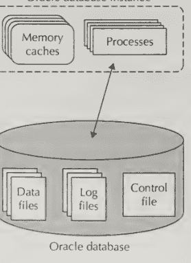

**图 1-1.** Oracle 数据库实例提供对构成数据库的物理文件的访问。数据库实例和数据库共同构成一个 Oracle DBMS。

目前，关于 Oracle 数据库和实例，您只需要了解这些就足够了。您将在本书的下一章中了解有关数据库和实例的更多信息。

## 表

表是任何关系数据库中的基本数据结构。*表*不过是有组织的*记录*或*行*的集合，这些记录或行都具有相同的*属性*或*列*。图 1-2 展示了关系数据库中一个典型的 CUSTOMERS 表。请注意，示例 CUSTOMERS 表中每个客户记录都具有相同的属性，包括 ID、公司名称、姓氏、名字等。

目前，关于表，您只需要了解这些就足够了。后续章节将教您更多关于在 Oracle 数据库中构建和使用表的知识。

## SQL 与数据访问

要处理商业关系数据库系统（如 Oracle），应用程序使用*结构化查询语言*（*danger总理{SQL}）命令。SQL（发音为"sequel"和"ess upbringing{"ess-que-ell"}均可）是一种简单的命令语言，允许数据库管理员、开发人员和应用程序用户执行以下操作：

- 检索、输入、更新和删除数据库数据
- 创建、修改和删除数据库对象，例如表

实际上，应用程序与 Oracle 数据库交互的唯一方式就是发出 SQL 命令。易于使用的图形用户界面（GUI）可能会向用户隐藏 SQL 命令的复杂性，但在底层，应用程序始终使用 SQL 与 Oracle 通信。

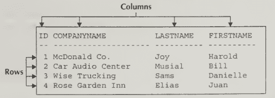

**图 1-2.** 表是一组具有相同属性的记录。

如果您目前没有 SQL 方面的任何经验，请不要惊慌。SQL 是一种相对简单的语言，因为您可以通过组合直观的关键字和子句来构建 SQL 命令，从而要求 Oracle 执行特定任务。例如，下面的 SQL 语句是一个简单的查询，检索 PARTS 表中所有行的特定列：

```
SELECT id, description, unitprice FROM parts;
```

| ID | DESCRIPTION | UNITPRICE |
|----|-------------|-----------|
| 1 | Fax Machine | 299 |
| 2 | Copy Machine | 4895 |
| 3 | Laptop PC | 2100 |
| 4 | Desktop PC | 1200 |
| 5 | Scanner | 99 |

目前，您不需要了解太多关于 SQL 的知识。在本书的几乎所有其他章节中，您都将使用 SQL 语句来访问 Oracle 并执行任务。第 3 章将为您提供最常用 SQL 命令基础的完整介绍。

## 数据库用户与会话

Oracle 是一个 DBMS，用于管理一个或多个用户之间对数据库的共享访问。要为
某人提供数据库访问权限，您或管理员必须为该人创建*数据库用户账户*。要使用 Oracle 执行工作，您必须启动应用程序并使用您账户的用户名和密码建立与 Oracle 的连接。*数据库会话*在您建立与 Oracle 数据库的连接时开始，在您断开连接时结束。

您将在本书后面了解更多关于数据库用户和数据库安全的知识。

## SQL*Plus

您可以使用的一种应用程序来输入 SQL 命令并与 Oracle 数据库系统交互，即*即席查询工具*，例如 Oracle 的 SQL*Plus。*SQL*Plus*为您提供了一个非常简单的命令行界面，您可以使用它来输入 SQL 语句，然后查看每条语句执行的结果。实际上，SQL*Plus 让您可以与 Oracle 数据库服务器对话，以便您可以查询数据库中的信息，或者输入、更新或删除数据库中的数据。例如，以下命令演示了一个简单的 SQL*Plus 会话，该会话连接到 Oracle 数据库，从 CUSTOMERS 表中检索一些数据，然后通过断开与数据库的连接来终止会话：

```
SQL> CONNECT hr/hr;
Connected.
SQL> SELECT job_title
```

```
  FROM jobs
  WHERE min_salary > 10000;
```

```
JOB_TITLE
-----------------------------------
President
Administration Vice President
```

```
SQL> DISCONNECT;
Disconnected from Oracle Database 10g Express Edition
```

本书各章节中的许多示例和练习都使用 SQL*Plus 与 Oracle 通信。

## Oracle Application Express

*Oracle Application Express*（以前称为 Oracle HTML DB）是一个*快速应用程序开发（RAD）*工具，您可以使用它来设计、开发和部署 Oracle 应用程序。即使对 SQL 和其他编程概念的了解非常有限，您也可以使用 Application Express 快速构建健壮的基于 Web 浏览器的应用程序。Application Express 还包含一组有限的管理工具，包括数据库系统配置、用户管理、数据加载等实用工具。Application Express 是 Oracle 的标准功能，您可以免费使用。本书这一部分的后续章节将教您如何快速开始使用 Oracle Application Express。

## 本章小结

Oracle XE 是一个功能强大的产品，您将用它来管理信息。既然您已经对 Oracle XE 有了大致的了解，本书的其余章节将介绍基本的 Oracle 概念和相应的练习，以便您能够快速熟练地在 Linux 上使用 Oracle XE 进行信息管理。

---


---


# ## 章节

# 2

# # 安装并开始使用 Oracle Database 10g Express Edition

在 Linux 上安装 Oracle Database 10g Express Edition（Oracle XE）极其简单快捷。按照本章的说明，您应该在几分钟内就能安装完成并运行起来。

本章首先为您提供 Oracle XE 安装过程的概述、尝试安装之前需要满足的系统要求，以及安装后的预期情况。接下来，您将学习如何启动和停止 Oracle XE、启动 SQL*Plus 并建立数据库连接，以及启动并熟悉数据库主页数据库管理工具。本章还解释了如何排查可能遇到的一些常见问题，以及使用本书后续章节中的练习所需的准备步骤。

## 注意

> 阅读本章后，安装 Oracle XE 并完成本章后续练习应不超过 30 分钟。

## 安装概述

Oracle XE 在 Linux 上的安装过程会创建许多项目，包括以下内容：

- **Oracle 基目录** 此后称为 *ORACLE_BASE*，此目录是 Oracle 目录树的根目录。例如，Linux 上 Oracle XE 的典型 ORACLE_BASE 为 /usr/lib/oracle/xe。

- **Oracle 主目录** 此后称为 *ORACLE_HOME*，这是执行特定版本 Oracle 软件的工作目录。例如，Linux 上 Oracle XE 的典型 ORACLE_HOME 为 /usr/lib/oracle/xe/app/oracle/product/10.2.0/server。

- **启动数据库（种子数据库）** 您可以使用此默认数据库来开始处理 Oracle。通常，Oracle XE 启动数据库的名称为 XE，其文件位于 ORACLE_BASE/oradata/XE 中。

- **Shell 脚本和配置文件** 您可以使用这些来控制启动数据库和其他 Oracle XE 组件的可用性。本章的后续部分将教您如何控制 Oracle XE 的可用性。


 - **名为 dba 的 Linux 组** dba 组的成员有权控制 Oracle XE（以及同一台计算机上可能存在的其他 Oracle 安装）的可用性。

- **名为 oracle 的 Linux 用户** oracle 账户的主目录设置为 /usr/lib/oracle/xe；该账户是 dba 组的成员；并且该账户已被锁定。

## 数据库服务器系统要求

在本章中，你将学习如何安装 Oracle XE 数据库服务器，其中包括 Oracle Database 10g 软件、一个入门数据库以及可用于与数据库服务器交互的客户端工具。在开始之前，请确保你的计算机满足成功安装的最低系统要求。表 2-1 和表 2-2 记录了你计算机必须满足的基本系统要求，以便在 Linux 上成功安装 Oracle XE 数据库服务器。

请注意表 2-1 中既有最低设置也有推荐设置。为了获得 Oracle XE 的最佳体验，建议你满足推荐设置。

Oracle Database 10g Express Edition 文档指出，安装程序将自动检查表 2-3 中列出的 Linux 内核参数设置，并调整那些不满足最低要求的参数。

| 硬件组件 | 要求 |
|---|---|
| 处理器 | Intel x86 |
| 磁盘空间 | 最低 1.6GB |
| | 推荐 5GB |
| 交换空间 | |
| - RAM = 256MB | - RAM 的 3 倍 |
| - RAM = 256 至 512MB | - RAM 的 2 倍 |
| - RAM > 512MB | - 1GB |
| RAM | 最低 256MB |
| | 推荐 512MB 或更多 |

**表 2-1.** Linux 上 Oracle Database 10g Express Edition 数据库服务器的硬件要求

| 软件组件 | 要求 |
| --- | --- |
| 操作系统 | Red Hat Enterprise Linux RHEL3 和 RHEL4 |
| | SUSE Linux Enterprise Server 9.x |
| | Fedora Core 4 |
| | Red Flag DC Server 5.0/MIRACLE LINUX V4.0/ Haansoft Linux 2006 Server (Asianux 2.0 Inside) |
| | Debian 3.1 |
| 软件包 | glibc – 2.3.2 |
| | libaio – 0.3.96 |
| 网络协议 | TCP/IP |
| Web 浏览器 | 虽然不是安装 Oracle XE 的必需条件，但 Web 浏览器在安装后使用许多产品功能时是必需的。你的 Web 浏览器（如下列所示）应支持 JavaScript、HTML 4.0 和 CSS 1.0，并启用 cookie 支持： |
| | Mozilla 1.7 或更高版本 |
| | Firefox 1.0 或更高版本 |
| | Netscape Navigator 7.2 或更高版本 |

**表 2-2.** Linux 上 Oracle Database 10g Express Edition 的软件要求

| 内核参数 | 设置 |
| --- | --- |
| semmsl | 250 |
| semmns | 32000 |
| semopm | 100 |
| semmni | 128 |
| shmmax | 536870912 |
| shmmni | 4096 |
| shmall | 2097152 |
| file-max | 65536 |
| ip_local_port_range | 1024–65000 |

**表 2-3.** Linux 上 Oracle Database 10g Express Edition 的最低 Linux 内核参数设置

### 练习 2.1：检查系统要求

完成此练习以检查你的计算机是否满足在 Linux 上安装 Oracle XE 所需的系统要求。

首先，启动一个 Linux shell 会话。然后，使用你 Linux 系统的软件包管理器来确定系统上存在的所需 Linux 软件包的版本。例如，在 Red Hat 和 SUSE 系统上使用 **rpm** 命令，或在 Debian 和 Ubuntu 系统上使用 **dpkg** 命令来显示如下信息：

```
sbobrows@linux:~$ dpkg -l | egrep -e "(netbase|glibc|libaio|firefox)"
ii  firefox                  1.0.7-0ubuntu20   lightweight web browser
based on Mozilla
ii  libaio1                  0.3.104-1ubuntu4  kernel aio access library
ii  libstdc++2.10-glibc2.2   2.95.4-22         The GNU stdc++ library
ii  netbase                  4.21ubuntu3       Basic TCP/IP networking system
```

> **注意**
本章教你安装 Oracle XE 数据库服务器。在计算机上安装数据库服务器后，你可以在需要访问数据库服务器的远程计算机上安装 Oracle XE 客户端。客户端包括 SQL*Plus 以及执行使用 Oracle Call Interface (OCI)、Oracle C++ Call Interface (OCCI) 和 Java Database Connectivity OCI (JDBC OCI) 应用程序编程接口 (API) 开发的应用程序所需的库。不要浪费时间尝试在同一台计算机上同时安装 Oracle XE 数据库服务器和客户端，因为数据库服务器已经包含所有客户端组件。

接下来，使用 Linux 命令 **netstat** 来显示计算机上监听端口的活动 TCP 连接信息：

```
netstat -atn | grep LISTEN
```

根据你当前运行的应用程序，报告很可能包含多条信息记录。如果有任何程序当前正在监听 1521 或 8080 端口，请记下这一点；在 Oracle XE 安装过程中，你必须为 Oracle XE 指定不同的端口。

## Oracle Database 10g Express Edition 软件

为方便起见，本书附带一张 CD，其中包含适用于 Linux 的 Oracle Database 10g Express Edition 副本。你可以使用此副本安装产品，或从 *Oracle Technology Network (OTN)* 网站 www.oracle.com/technology/ 下载更新的产品副本。

> **注意**
即使你最初没有从 OTN 下载软件，你也应该访问这个宝贵的资源，在使用 Oracle 时查阅文档、浏览讨论论坛、下载软件更新并了解 Oracle 的最新动态。

此外，你需要了解关于 Oracle Database 10g Express Edition 许可的以下信息，如果你要使用该产品，则必须同意该许可：

- Oracle XE 仅会利用相当于单 CPU 计算机的处理资源，即使你的计算机有多个处理器（包括双核处理器）。

- Oracle XE 不支持在同一台计算机上有多个 Oracle XE 数据库实例。但是，你可以在一台同时也在使用其他许可版本 Oracle 数据库软件的计算机上启动 Oracle XE 数据库。

- Oracle XE 不允许你管理超过 4GB 的用户数据，即使你有更多磁盘空间可以分配给 Oracle。

- Oracle XE 不会使用超过 1GB 的 RAM，即使你的计算机有更多内存。

> **注意**
如果你需要的资源超过 Oracle XE 许可规定的范围，可以考虑使用 Oracle Database 10g *Standard Edition One*、*Standard Edition* 或 *Enterprise Edition*。有关这些版本的更多信息，请参见第 1 章。

## 安装

本节中的动手练习教你如何为 Linux 安装 Oracle XE。

### 练习 2.2：使用 sudo 确认管理访问权限

要在 Linux 上安装 Oracle XE，你必须能够使用可以使用 **sudo** 工具执行管理命令的用户账户建立 Linux 会话。要确认你执行管理命令的能力，请使用 **sudo** 执行需要 root 权限的操作系统命令，例如 Debian 或 Ubuntu 上的 **users-admin**，或 Red Hat 或 Fedora 上的 **rhn-users-admin**：

```
sudo users-admin
```

如果你的密码不允许你执行此类命令，则必须在 */etc/sudoers* 文件中配置你的用户账户，以便可以使用 **sudo** 工具执行管理命令。如果你不熟悉 **sudo** 工具，请参阅相应的手册页。

### 练习 2.3：逐步安装 Oracle XE

为 Linux 安装 Oracle XE 很简单：只需使用你的软件包管理器安装 Oracle Database 10g Express Edition 软件包即可。本练习将逐步引导你完成安装过程。

开始之前，你需要确定使用哪个软件包。选择 Oracle XE 数据库服务器的软件包时需要考虑两个因素：软件包管理器格式和字符集支持。Oracle 公司为 Linux 提供两种不同格式的 Oracle XE 软件包：

- **RPM 软件包 (.rpm)** 适用于使用 *rpm 软件包管理器* 的 Linux 发行版。这包括 Red Hat Enterprise Linux、SUSE 和 Fedora Core 等 Linux 发行版。

- **Debian 软件包 (.deb)** 适用于使用 *dpkg 软件包管理器* 的 Linux 发行版。这包括 Debian 和 Ubuntu 等 Linux 发行版。

> **注意**
如果你以前有安装 Oracle 的经验，你可能熟悉 Oracle 的专有安装程序，即 Oracle Universal Installer (OUI)。OUI 是一个基于 Java 的程序，无论你在使用什么操作系统，其外观和操作方式都相同。Oracle Database 10g Express Edition 不使用 OUI。相反，你需要使用 Linux 软件包管理器来安装 Oracle XE。


 20 动手实践 Oracle Database 10g Express Edition for Linux

对于每种包管理器格式，字符集支持方面有两种不同的包需要考虑：

- 如果你想安装 Oracle XE 和支持多字节、通用字符集（UTF8）的数据库，请使用名称中包含 *universal* 或 *univ* 的包。对于想要构建必须支持巴西葡萄牙语、中文（简体和繁体）、英语、法语、德语、意大利语、日语、韩语和西班牙语的数据库和应用程序的用户来说，这些包是正确的选择。

- 如果你想安装 Oracle XE 和仅支持西欧字符集的数据库，请使用名称中不包含 *universal* 或 *univ* 的包。对于想要构建支持单字节字符集的数据库和仅支持英语的应用程序的用户来说，这些包是正确的选择。

> **注意**
> 由于本书附带的 CD 空间有限，Oracle XE 包的 *universal* 字符集版本未包含在内。如果你想使用这些包，请从 Oracle Technology Network（http://otn.oracle.com）免费下载。

一旦你决定使用哪个包，就可以开始安装程序了。使用你的包管理器安装随书附带 CD 上的 Oracle XE 包，或者从 OTN 下载的同一包的更新版本。

例如，如果你使用 rpm 包管理器并且想要安装支持通用字符集的 Oracle XE，你可以使用 **sudo** 工具执行以下命令：

```
sudo rpm -ivh /tmp/oracle-xe-univ-10.2.0.1-1.0.i386.rpm
```

如果你使用 dpkg 包管理器并且想要安装仅支持西欧字符集的 Oracle XE，你可以使用 **sudo** 工具执行以下命令：

```
sudo dpkg -i oracle-xe_10.2.0.1-1.0_i386.deb
```

然后，你的包管理器应该会解包 Oracle XE 包并开始安装 Oracle XE 软件。安装通常不超过几分钟即可完成，尽管时间可能会因计算机的硬件资源而异。你应该会看到类似以下的消息：

```
(Reading database ... ##### files and directories currently installed.)
Unpacking oracle-xe (from oracle-xe_10.2.0.1-1.0_i386.deb) ...
Setting up oracle-xe (10.2.0.1-1.0) ...
Executing Post-install steps...
You must run '/etc/init.d/oracle-xe configure' as the root user to
configure the database.
```

特别注意安装后的说明：要配置 Oracle XE 并创建启动数据库，你必须以 root 身份（使用 **sudo**）运行 /etc/init.d/oracle-xe，并带上 **configure** 参数。在提示时输入此命令：

```
sudo /etc/init.d/oracle-xe configure
```

在配置过程中，shell  Listing script 会提示你输入 Oracle XE 可以使用的 TCP/IP 端口号。如果默认端口号（8080 和 1521）未被其他应用程序使用，请按 ENTER 接受默认端口号；否则，输入备用端口号并继续安装过程。如果你的计算机正在运行防火墙，请在继续之前花点时间打开所选端口，以便 Oracle XE 正常运行。

**注意**
*请使用 man 页面或帮助系统来获取配置防火墙的帮助。*

接下来，shell 脚本请求输入用于默认数据库管理账户 SYS 和 SYSTEM 的初始密码。记下你计划使用的密码，然后输入并确认密码。

然后，shell 脚本会提示你指示是否希望 Oracle XE 启动数据库在系统重新启动时自动启动；如果你希望 Oracle XE 在系统启动后立即可用，请接受默认值 y 或输入 **n** 表示"否"。

与 shell 脚本的完整对话应类似于以下内容：

```
Oracle Database 10g Express Edition Configuration
-----------------------------------------------
This will configure on-boot properties of Oracle Database 10g Express
Edition. The following questions will determine whether the database should
be starting upon system boot, the ports it will use, and the passwords that
will be used for database accounts. Press <Enter> to accept the defaults.
Ctrl-C will abort.

Specify the HTTP port that will be used for Oracle Application
Express [8080]:

Specify a port that will be used for the database listener [1521]:

Specify a password to be used for database accounts.  Note that the same
password will be used for SYS and SYSTEM. Oracle recommends the use of
different passwords for each database account. This can be done after
initial configuration:
Confirm the password:

Do you want Oracle Database 10g Express Edition to be started on
boot (y/n) [y]:
```

在你回复所有提示后，shell 脚本会执行配置 Oracle XE 和创建启动数据库的工作。你应该会看到类似以下的消息：

```
Starting Oracle Net Listener...Done
Configuring Database...Done
Starting Oracle Database 10g Express Edition Instance...Done
Installation Completed Successfully.
To access the Database Home Page go to "http://127.0.0.1:8080/apex"
```

配置脚本完成后，它会指示你可以用于启动 Oracle Application Express 的 URL。Oracle Application Express 是一个基于 Web 的工具，随 Oracle XE 自动安装，包含数据库管理和应用程序开发功能。你将在本书后续章节中了解很多关于 Oracle Application Express 功能的知识。要确认安装成功，请启动 Web 浏览器并加载 Oracle Application Express 的给定 URL。你的 Web 浏览器应该会启动并加载 Oracle Application Express 的登录屏幕。

如果 Oracle Application Express 的登录屏幕如图 2-1 所示出现，你可以确信安装已成功完成；如果没有，请跳到本章的"故障排除技巧"部分，以帮助诊断你的问题。

> **注意**
> 有多种问题可能导致 Oracle Database 10g Express Edition for Linux 安装失败，或者在成功安装软件和创建数据库后导致配置无法正常运行。要排查安装或配置问题，你首先需要学习本章后续练习中介绍的一些技能。然后阅读本章后面的"故障排除技巧"部分。

## 安装后练习

虽然不是必需的，但以下练习解释了一些你在继续使用 Oracle Database 10g Express Edition 之前应该了解的任务。

### 练习 2.4：访问文档

毫无疑问，在使用 Oracle XE 时，你需要参考 Oracle Database Documentation Library for Oracle XE（见图 2-2）。Oracle XE 文档在 OTN 上在线提供。要快速启动新的浏览器窗口并查看在线文档，请在 GNOME 菜单栏（或类似菜单）上选择 Applications | Oracle Database 10g Express Edition | Get Help | Read Documentation，或者在 Oracle Application Express 登录屏幕的 Links 菜单中单击 Documentation（参见图 2-1）。

> **提示**
> 为了更快访问不依赖互联网连接的文档，请考虑在计算机上创建选定标题的 PDF 版本的本地副本。

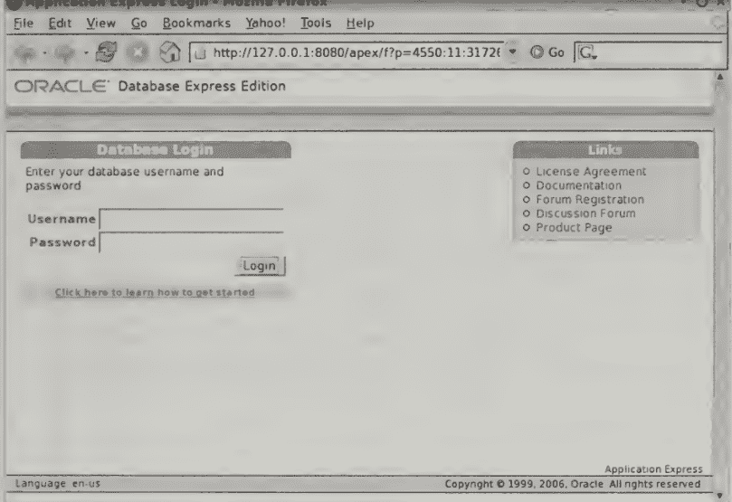

> 图 2-1. 如果 Oracle Database 10g Express Edition 的安装成功，Oracle Application Express 的登录屏幕将显示在你的 Web 浏览器中。

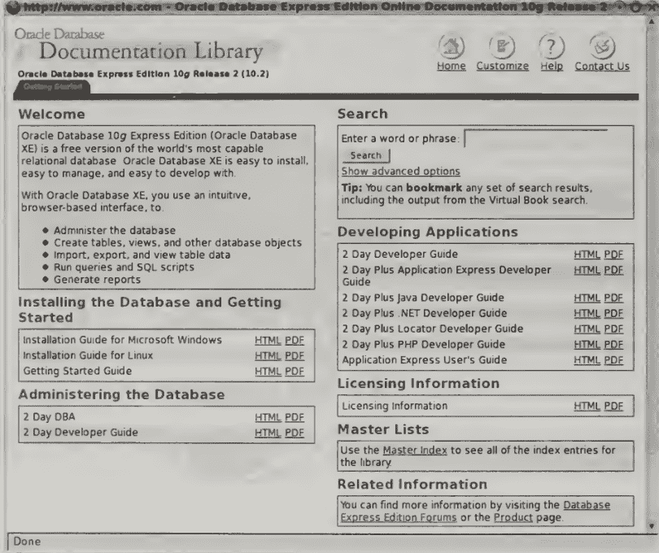

> 图 2-2. Oracle Database 10g Express Edition 的在线文档可在 Oracle Technology Network 上获取。

### 练习 2.5：注册讨论论坛

Oracle Database 10g Express Edition 是一款免费产品，Oracle 公司不提供官方技术支持。相反，用户社区支持可通过 Oracle Database 10g Express Edition Discussion Forum 在 OTN 上获得。在访问支持论坛之前，你需要先注册自己（见图 2-3）。要注册，请在 GNOME 菜单栏（或类似菜单）上选择 Applications | Oracle Database 10g Express Edition | Get Help | Register For Online Forum，或者在 Database Home Page 的 Links 菜单中单击 Forum Registration。然后按照新浏览器窗口中出现的说明进行操作。


 **图 2-3.** 在 Oracle 技术网络（Oracle Technology Network）注册以访问 Oracle Database 10g Express Edition 讨论论坛。

**注意**

如果您已有 OTN 账户，可以使用它来注册访问 Oracle Database 10g Express Edition 讨论论坛。

### 练习 2.6：访问支持论坛

要获取支持并与其他使用 Oracle XE 的用户分享想法，请访问 OTN 的讨论论坛（见图 2-4）。选择 应用程序 | Oracle Database 10g Express Edition | 获取帮助 | 前往在线论坛，或在数据库主页的链接菜单中点击"讨论论坛"。您必须输入您的 OTN 用户名和密码。

## Oracle XE 基本技能

既然您已在计算机上安装了 Oracle Database 10g Express Edition，现在可以学习一些基础的数据库管理操作，以便开始使用 Oracle XE 并在出现问题时进行故障排除。

### Oracle 启动与关闭

第 1 章介绍了 Oracle 数据库、数据库实例的基本概念，以及它们在 DBMS 中的相互关系。在任何人可以使用 Oracle 数据库之前，必须有人*启动* DBMS 或数据库服务器。数据库服务器启动是一个有序的事件序列，包括以下内容：

- 1. 启动数据库实例。
2. 将物理数据库挂载（关联）到实例。
3. 打开数据库。

在典型的服务器启动之后，数据库可供应用程序一般使用。

相反，您可以通过执行数据库服务器*关闭*来使数据库不可用。服务器关闭是服务器启动的逆序：

- 1. 关闭数据库。
2. 从实例上卸载数据库。
3. 关闭实例。

在数据库服务器关闭后，用户无法访问数据库，直到您重新启动实例并挂载和打开数据库为止。

*服务器崩溃*是一种异常的服务器关闭。例如，一个失败的操作系统操作或问题可能会意外地终止 Oracle 的一个或多个后台进程。因此，数据库服务器可能会崩溃。Oracle 具有内置功能，可以保护所有已提交事务的工作，并自动执行实例崩溃后的必要恢复。后续章节将详细介绍 Oracle 的数据库保护机制。

### 练习 2.7：检查 Oracle XE 的状态

检查数据库实例是否正常运行的一种方法是使用简单的操作系统命令。首先，启动一个 GNOME 终端（或类似的终端），然后在 shell 提示符下执行以下命令：

```
ps -fu oracle
```

**ps** 命令显示当前在 Linux 计算机上运行的进程信息；**f** 选项显示完整格式列表，**u** 选项将显示限制为指定用户所拥有的进程。在此练习中，该命令将输出限制为 Linux 用户 oracle 所拥有的进程，oracle 是 Oracle XE 相关所有内容的默认所有者。如果 Oracle 实例正在运行，上述命令的输出应类似于以下内容：

| UID | PID | PPID | C | STIME | TTY | TIME | CMD |
| oracle | 6919 | 1 | 0 | 14:38 | ? | 00:00:00 | .../tnslsnr LISTEN -inherit |
| oracle | 6930 | 1 | 0 | 14:38 | ? | 00:00:00 | xe_pmon_XE |
| oracle | 6932 | 1 | 0 | 14:38 | ? | 00:00:00 | xe_psp0_XE |
| oracle | 6934 | 1 | 0 | 14:38 | ? | 00:00:00 | xe_mman_XE |
| oracle | 6940 | 1 | 0 | 14:38 | ? | 00:00:00 | xe_dbw0_XE |
| oracle | 6942 | 1 | 0 | 14:38 | ? | 00:00:00 | xe_lgwr_XE |
| oracle | 6944 | 1 | 0 | 14:38 | ? | 00:00:00 | xe_ckpt_XE |
| oracle | 6946 | 1 | 0 | 14:38 | ? | 00:00:00 | xe_smon_XE |
| oracle | 6948 | 1 | 0 | 14:38 | ? | 00:00:00 | xe_reco_XE |
| oracle | 6950 | 1 | 0 | 14:38 | ? | 00:00:00 | xe_cjq0_XE |
| oracle | 6952 | 1 | 0 | 14:38 | ? | 00:00:00 | xe_mmon_XE |
| oracle | 6954 | 1 | 0 | 14:38 | ? | 00:00:00 | xe_mmnl_XE |
| oracle | 6956 | 1 | 0 | 14:38 | ? | 00:00:00 | xe_d000_XE |
| oracle | 6958 | 1 | 0 | 14:38 | ? | 00:00:00 | xe_s000_XE |
| oracle | 6960 | 1 | 0 | 14:38 | ? | 00:00:00 | xe_s001_XE |
| oracle | 6962 | 1 | 0 | 14:38 | ? | 00:00:00 | xe_s002_XE |
| oracle | 6964 | 1 | 0 | 14:38 | ? | 00:00:00 | xe_s003_XE |
| oracle | 6968 | 1 | 0 | 14:38 | ? | 00:00:00 | xe_qmnc_XE |
| oracle | 7129 | 1 | 0 | 14:38 | ? | 00:00:00 | xe_q000_XE |
| oracle | 7131 | 1 | 0 | 14:38 | ? | 00:00:00 | xe_q001_XE |

如果您忽略示例输出中的第一个进程（它对应于一个称为 TNS 监听器的进程，您将在后面的"Oracle Net 和网络数据库连接"部分中了解它），它会显示作为 Oracle XE 数据库实例一部分运行的后台进程。您将在本书后面学习更多关于后台进程的知识。目前，您可以使用此练习中的信息来简单了解 Oracle 是否可用（实例是否已启动）。如果实例的后台进程正在运行，那么您的计算机上的 Oracle XE 实例很可能已经可以访问入门数据库。但是，如果 **ps** 命令没有显示任何对应于 Oracle XE 实例的后台进程，则实例未运行，XE 入门数据库无法访问。

> **注意**
>
> 如果您的计算机正在运行其他 Oracle 数据库实例，请仔细查看后台进程的名称以确定 Oracle XE 的状态。

### 练习 2.8：手动启动 Oracle

当 Oracle 实例未运行时，您可以通过完成以下步骤来启动实例并使入门数据库可供访问：

- 1. 以属于 dba 组成员的 Linux 用户身份建立 GNOME 会话（或类似的窗口管理器）；dba 组提供了控制 Oracle 所需的权限。如果您不确定您的用户账户是否属于 dba 组，请使用 Linux 命令 **id**。

2. 在 GNOME 菜单栏中选择 应用程序 | Oracle Database 10g Express Edition | 启动数据库（或类似选项）。

**注意**

您还可以使用 SQL*Plus 的 STARTUP 命令启动 Oracle 实例并挂载和打开数据库。有关此 SQL*Plus 命令的更多信息，请参阅您的 Oracle 文档。

## **练习 2.9：手动停止 Oracle**

关闭数据库服务的步骤与服务器启动类似。当 Oracle 启动后，您可以通过完成以下步骤来关闭实例并使入门数据库不可用：

- 1. 以属于 dba 组成员的 Linux 用户身份建立 GNOME 会话（或类似的窗口管理器）。
2. 选择 应用程序 | Oracle Database 10g Express Edition | 停止数据库（或类似选项）以关闭数据库服务器。

**注意**

您还可以使用 SQL*Plus 的 SHUTDOWN 命令关闭 Oracle 数据库服务器。有关此 SQL*Plus 命令的更多信息，请参阅您的 Oracle 文档。

## **练习 2.10：使用 Shell 脚本管理 Linux 上的 Oracle 可用性**

如果您可以使用 sudo 执行管理命令，另一种管理 Linux 上 Oracle XE 可用性的方法是使用 Oracle 安装时附带的一些 shell 脚本。例如，您可以通过运行带有 **status** 参数的 /etc/init.d/oracle-xe shell 脚本来检查计算机上 Oracle XE 的状态：

```
sudo /etc/init.d/oracle-xe status
```

当实例可用时，输出的末尾将类似于以下内容：

```
Services Summary...
Service "PLSExtProc" has 1 instance(s).
  Instance "PLSExtProc", status UNKNOWN, has 1 handler(s) for this service...
Service "XE" has 1 instance(s).
  Instance "XE", status READY, has 1 handler(s) for this service...
Service "XEXDB" has 1 instance(s).
  Instance "XE", status READY, has 1 handler(s) for this service...
Service "XE_XPT" has 1 instance(s).
  Instance "XE", status READY, has 1 handler(s) for this service...
The command completed successfully
```

 查看XE服务的服务状态，如前面输出中**粗体**所示。当实例未运行但监听器运行时，输出的末尾将是一个更简短的服务摘要，其中未提及XE数据库实例：

```
Services Summary...
Service "PLSExtProc" has 1 instance(s).
    Instance "PLSExtProc", status UNKNOWN, has 1 handler(s) for this service...
The command completed successfully
```

当监听器和数据库实例均不可用时，你将看到类似以下的输出：

```
TNS-12541: TNS:no listener
TNS-12560: TNS:protocol adapter error
TNS-00511: No listener
    Linux Error: 111: Connection refused
```

要启动Oracle（及相关服务），请使用**sudo**运行/etc/init.d/oracle-xe并附带**start**参数：

```
sudo /etc/init.d/oracle-xe start
```

要停止Oracle（及相关服务），请使用**sudo**运行/etc/init.d/oracle-xe并附带**stop**参数：

```
sudo /etc/init.d/oracle-xe stop
```

要*bounce*（重启）Oracle，请使用**sudo**运行/etc/init.d/oracle-xe并附带**restart**参数：

```
sudo /etc/init.d/oracle-xe restart
```

**注意**

如果在使用/etc/init.d/oracle-xe控制Oracle可用性时遇到问题，请尝试使用下一个练习中的说明启用自动Oracle启动。

最后一条提示：如果你没有sudo/root访问权限，但属于dba组成员，则可以使用ORACLE_HOME/config/scripts目录下的startdb.sh和stopdb.sh脚本来分别启动和关闭Oracle XE。事实上，我建议你使用这种方法而非前一种方法，因为它完全避免了使用**sudo**。

## 练习2.11：自动化Oracle启动

要在系统重启时配置Oracle XE自动启动，请启动root shell会话并运行/etc/init.d/oracle-xe命令，附带**enable**参数：

```
sudo /etc/init.d/oracle-xe enable
```

同样，你可以使用**disable**参数配置Oracle XE在系统重启时不自动启动：

```
sudo /etc/init.d/oracle-xe disable
```

回想一下，安装Oracle XE后，有必要运行带有**configure**参数的/etc/init.d/oracle-xe来配置系统。使用此参数时，该shell脚本会在基于Debian的发行版上创建/etc/default/oracle-xe配置文件，或在基于RPM的发行版上创建/etc/sysconfig/oracle-xe配置文件，以存储配置参数。/etc/init.d/oracle-xe的**enable**和**disable**参数会修改此配置文件中ORACLE_DBENABLED参数的设置；当该参数设置为**true**时，重启计算机后Oracle将自动启动；当该参数设置为**false**时，Oracle将不会启动，直到你使用前面讨论过的某种方法手动启动它。

## 注意

资深Oracle用户可能感兴趣的是，默认情况下，/etc/oratab文件中Oracle XE实例的设置似乎没有起到任何作用。

## 数据库连接

Oracle XE启动并运行后，你可以使用客户端应用程序、工具或实用程序建立数据库连接并执行操作。在幕后，数据库实例的机制会努力完成你的请求以及其他使用同一数据库实例的用户请求。同时，Oracle XE会自动保护所有事务的工作，同时维护共享数据库的完整性。

### 本地数据库连接

当客户端应用程序和数据库实例在同一台计算机上运行时，你可以建立所谓的*本地数据库连接*或*遗留数据库连接*。建立本地数据库连接时，客户端应用程序通常只提供数据库用户名和密码；当前会话的ORACLE_SID环境变量设置决定了要作为连接目标的本地数据库实例。

### Oracle Net和网络数据库连接

当客户端应用程序和数据库实例在不同的计算机上运行时，你必须建立所谓的*网络数据库连接*。网络数据库连接请求不仅要指定数据库用户名和密码，还要指定服务名称；目前，只需将*服务名称*理解为指定如何连接到Oracle数据库实例的别名或快捷方式。

为了支持网络数据库连接，参与连接的所有计算机必须能够使用网络协议相互通信，并且每台计算机必须使用Oracle的网络软件*Oracle Net*。Oracle Net支持最常见的网络协议，包括TCP/IP、基于安全套接字层(SSLimplesymb（SSL）的TCP/IP、命名管道、Oracle InfiniBand支持。

> **注意**
>
> 你也可以通过为连接指定服务名称，在本地客户端和数据库服务器之间建立网络连接。Application Express等工具依赖网络数据库连接而非本地数据库连接。

*TNS监听器*，更简单地称为*监听器*，是通过TCP/IP等网络协议建立与Oracle数据库连接所必需的。监听器是一个接收连接请求、解析目标网络地址并与目标建立连接的进程。例如，考虑启动SQL*Plus并指定用户名、密码和服务名称以连接到数据库时发生的情况：

1. 你的计算机将提供的服务名称解析为已注册处理目标数据库连接请求的监听器地址。然后你的计算机将连接请求转发给监听器。

2. 监听器确定目标数据库的网络地址，然后将客户端地址和连接请求转发给数据库服务器。

3. Oracle为你的客户端应用程序SQL*Plus建立连接。监听器在连接中不再起作用。

图2-5说明了这一系列事件。为便于你使用，练习2.8至2.11中讨论的技术控制Oracle XE数据库实例和配套监听器进程的可用性。如果回顾练习2.7，应该可以明显看出如何在Linux上检查监听器的状态。

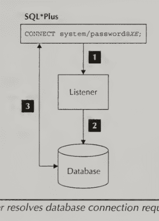

图2-5. 监听器解析使用网络协议的数据库连接请求。

现在你已经了解了Oracle数据库连接的基础知识，本节中的练习将教你如何使用两种不同的数据库工具SQL*Plus和数据库主页来连接和断开Oracle XE。本书后续章节将详细解释服务名称、监听器进程和Oracle Net配置。本章提供的信息应足以让你开始使用Oracle XE，确保系统正常运行，并排查一些简单的数据库连接问题。

### 练习2.12：使用SQL*Plus连接Oracle

在Linux计算机上启动Oracle XE数据库服务后，你可以启动SQL*Plus，建立数据库连接，并开始使用入门数据库。启动SQL*Plus最简单的方法是使用Oracle安装程序为Oracle创建的GNOME菜单栏选项（或同等选项）（例如，在我的Ubuntu Linux/GNOME桌面上，我可以选择应用程序 | Oracle Database 10g Express Edition | 运行SQL命令行）。执行此操作后，ORACLE_HOME/config/scripts/runsqlplus.sh shell脚本会在新的终端会话中启动，设置一些环境变量以配置与Oracle XE一起使用的shell会话环境，并启动SQL*Plus。如果一切正常，SQL*Plus将启动并显示类似以下消息：

```
SQL*Plus: Release 10.2.0.1.0 - Production on xxx xxx xx xx:xx:xxxx
Copyright (c) 1982, 2006, Oracle.  All rights reserved.
SQL>
```


 显示屏最后一行中 SQL> 后面闪烁的光标是 SQL*Plus 的默认命令提示符。在这里，您可以交互式地输入 SQL 和 SQL*Plus 命令来执行工作。在本章稍后部分，您将看到如何输入一些简单的 SQL 命令。下一章将为您提供更完整的 SQL 和 SQL*Plus 介绍。

此时，您可以使用 SQL*Plus 命令 CONNECT 来建立您的第一个 Oracle 数据库会话。CONNECT 命令的简化语法非常简单：

```
CONNECT username
```

*username* 是您希望用于建立连接的数据库用户帐户的名称，不区分大小写。要完成这个基本练习，请输入一个 CONNECT 命令，使用用户名 **SYSTEM**。当您输入命令后，SQL*Plus 会提示您输入密码。请输入您在 Oracle Database 10g Express Edition 安装期间为 SYSTEM 帐户设置的密码。SQL*Plus 不会在您输入密码时显示字符，以保护您的密码。如果您输入了正确的密码，Oracle 会显示您已连接；否则，Oracle 会返回一个错误，您必须输入一个新的 CONNECT 命令再试一次。如果 Oracle 已经可用，本练习中命令的预期输出应类似于以下内容：

```
SQL> CONNECT system
Enter password:
Connected.
SQL>
```

您当前的连接是本地连接或称为委托数据库连接。为什么？您之前使用 CONNECT 语句的连接请求仅提供了用户名（和密码），这意味着您想要连接到由会话的 ORACLE_SID 环境变量设置所标识的本地数据库。

要确认本地监听器的可用性和配置，请确保您可以与 XE 数据库实例建立网络数据库连接。为此，请输入以下 CONNECT 命令：

```
CONNECT system@XE
```

注意命令末尾的 @XE。@ 字符位于后续服务名称规范之前。为了方便您使用，安装程序会为您的本地 XE 数据库实例创建 XE 服务名称。

在您响应 SYSTEM 帐户密码的提示后，Oracle XE 会建立与本地 XE 数据库实例的网络连接。

## 手动启动 SQL*Plus

您也可以从 shell 会话手动启动 SQL*Plus。首先，运行 oracle_env.sh shell 脚本（对于 csh shell 用户是 oracle_env.csh），前面加上点号 (.)

```
. /usr/lib/oracle/xe/app/oracle/product/10.2.0/server/bin/oracle_env.sh
```

此 shell 脚本会设置当前 shell 会话的环境变量，以便随后可以与 Oracle 实例一起工作。一旦您的 shell 配置正确，您可以通过执行 **sqlplus** 手动启动 SQL*Plus

```
sqlplus
```

当您使用不带任何参数的 **sqlplus** 命令从 shell 启动 SQL*Plus 时，SQL*Plus 会立即提示您使用用户名和密码进行连接。要在没有连接提示的情况下启动 SQL*Plus（类似于您使用"运行 SQL 命令行"菜单选项时），请使用 **/nolog** 参数启动 **sqlplus**：

```
sqlplus /nolog
```

如果您通常会从命令行启动 Oracle 相关工具（如 **sqlplus**），为方便起见，可以考虑将 oracle_env.sh（或 oracle_env.csh）放入您的登录脚本中。

### 练习 2.13：从 Oracle 断开连接并退出 SQL*Plus

使用完 SQL*Plus 后，在 SQL*Plus 提示符处输入 EXIT 命令（键入 **EXIT**）从 Oracle 断开连接并退出 SQL*Plus。

### 练习 2.14：启动数据库主页

在本章前面，安装成功后，练习 2.3 让您启动了 Oracle Application Express。如果您已经关闭了该页面，要重新启动，请选择 应用程序 | Oracle Database 10g Express Edition | 转到数据库主页（或类似选项）。您的默认 Web 浏览器将启动并加载 Oracle Application Express 的登录屏幕，如图 2-6 所示。

**注意**

Oracle Application Express 的默认 URL 是 http://127.0.0.1:8080/apex/。

## 图 2-6 Oracle Application Express 的登录屏幕

要使用 Oracle Application Express 建立与 Oracle 数据库服务的数据库连接，请在用户名字段中输入 **SYSTEM** 及相应的密码，然后单击登录。一旦建立连接，Oracle Application Express 会显示数据库主页。*数据库主页* 显示多个带有下拉菜单的图标，以及指向外部网站的超链接，您可以使用它们来执行工作和了解有关 Oracle XE 的更多信息，如图 2-7 所示。

此时您可以随意浏览数据库主页用户界面。本书后续章节将在适当的上下文中解释如何使用其大部分功能。完成后，单击注销终止您的数据库会话。

## 故障排除提示

此时，您应该已经清楚 Oracle XE 是否正常工作。如果您在启动 Oracle XE、使用 SQL*Plus 连接 Oracle 或查看数据库主页时遇到问题，本节中的提示应该有所帮助。

### 确认 Oracle XE 软件和数据库的存在

要检查 Oracle XE 软件和数据库安装的状态，请完成以下步骤：

- 1. 使用 Nautilus 文件浏览器或操作系统命令确认 ORACLE_BASE 存在（例如 /usr/lib/oracle/xe），并具有 app 和 oradata 子目录。

- 2. 使用 Nautilus 文件浏览器或操作系统命令确认 ORACLE_HOME 存在（例如 /usr/lib/oracle/xe/app/oracle/product/10.2.0/server），以及从 bin 到 xdk 的一长串子目录。

- 3. 在成为 root 用户后，使用 Nautilus 文件浏览器或操作系统命令确认 ORACLE_BASE/oradata/XE 存在，并包含默认入门数据库的数据库文件：control.dbf、sysaux.dbf、system.dbf、temp.dbf、undo.dbf 和 users.dbf。

如果前面列表中的部分或全部目录和文件不存在，则您的 Oracle XE 安装未成功。很可能系统不满足 Oracle XE 的必要要求（请参阅练习 2.1），或者您使用的安装包在某种程度上已损坏。解决所有问题后，使用包管理器删除之前 Oracle XE 安装的所有残留项，然后尝试使用练习 2.3 重新安装 Oracle XE。

如果 ORACLE_BASE 和 ORACLE_HOME 目录存在，但默认入门数据库的文件不存在，请检查 ORACLE_HOME/config/log 中的日志文件，以帮助排查问题的根源。解决问题后，您可以卸载并重新安装 Oracle XE，或者作为 oracle 用户启动 Linux shell 会话，并尝试运行 ORACLE_BASE/config/scripts/XE.sh shell 脚本来创建默认入门数据库。如果数据库创建再次失败，shell 脚本的输出可能包含有助于识别问题原因的错误。

### 检查 Oracle 相关进程

要检查与 Oracle XE 相关的进程，请使用练习 2.7 检查 Oracle XE 数据库实例和监听器的状态。然后使用练习 2.8 启动尚未启动的 Oracle XE 数据库实例和监听器。

如果您在启动监听器时遇到问题，请启动 Linux shell 会话，运行 oracle_env.sh（或 oracle_env.csh）脚本，输入以下命令，并注意任何错误消息：

```
lsnrctl start
```

如果监听器已启动但您在启动 Oracle XE 数据库实例时遇到问题，请启动 Linux shell 会话，运行 oracle_env.sh（或 oracle_env.csh）脚本，并输入以下命令启动 SQL*Plus：

```
sqlplus / as sysdba
```

在 SQL*Plus 提示符处，输入以下命令尝试启动 Oracle XE 数据库实例：

```
startup;
```

如果您在尝试启动 Oracle XE 数据库实例时收到错误消息，请在 OTN 的 Oracle XE 讨论论坛中搜索描述类似问题和解决方案的帖子。

### 允许网络访问

一旦您可以成功启动 Oracle XE 数据库实例和监听器进程，请确认您可以使用练习 2.12 中的 SQL*Plus 连接到数据库。请确保您尝试建立本地连接和 Oracle Net 连接。

如果您可以使用 SQL*Plus 建立与 Oracle XE 的本地连接，但无法建立 Oracle Net 连接，则监听器未收到连接请求或无法使用其配置的端口进行通信。默认情况下，监听器在 TCP/IP 端口 1521 上监听 Oracle Net 连接请求。要确认监听器配置，请启动 Linux shell 会话，运行 oracle_env.sh（或 oracle_env.csh）脚本，然后输入以下命令：

```
lsnrctl status
```

监听器的状态报告显示大量信息。需要关注的关键部分是监听端点摘要部分：

```
Listening Endpoints Summary...
  (DESCRIPTION=(ADDRESS=(PROTOCOL=ipc)(PIPENAME=\\.\pipe\EXTPROC_FOR_XEipc)))
  (DESCRIPTION=(ADDRESS=(PROTOCOL=tcp)(HOST=myhost)(PORT=1521)))
  (DESCRIPTION=(ADDRESS=(PROTOCOL=tcp)(HOST=127.0.0.1)(PORT=8080))
    (Presentation=HTTP)(Session=RAW))
```

前面的示例输出代表了默认监听器配置，该配置在 TCP/IP 端口 1521 上监听 Oracle Net 连接请求，在 TCP/IP 端口 8080 上监听 HTTP 连接请求。

接下来，使用 Linux 命令 **netstat** 显示有关计算机上活动 TCP 连接的信息，包括与每个监听端口对应的进程。例如：

```
sudo netstat -atnp | grep LISTEN
```

 重点关注与 Listener 配置中 TCP/IP 端口对应的记录，下面以**粗体**显示：

```
tcp  0  0 0.0.0.0:32768     0.0.0.0:*       LISTEN   6928/xe_d000_XE
tcp  0  0 0.0.0.0:80         0.0.0.0:*       LISTEN   7309/apache2
tcp  0  0 0.0.0.0:8080       0.0.0.0:*       LISTEN   6895/tnslsnr
tcp  0  0 0.0.0.0:1521       0.0.0.0:*       LISTEN   6895/tnslsnr
tcp  0  0 0.0.0.0:22         0.0.0.0:*       LISTEN   7147/sshd
tcp  0  0 127.0.0.1:631      0.0.0.0:*       LISTEN   6495/cupsd
tcp  0  0 127.0.0.1:25       0.0.0.0:*       LISTEN   7128/master...
```

 如果有非 Listener 的进程正在使用 Listener 配置的某些或全部端口，那么您必须完成几个重新配置步骤以支持与 Oracle XE 的网络连接。有关更多信息，请参阅 Oracle XE 文档。

 如果 Listener 确实在预期的端口上监听，并且您可以使用 SQL*Plus 建立与 Oracle XE 的本地连接，但无法使用 SQL*Plus 建立网络连接，那么最有可能的问题是您的计算机上启用了安全软件或防火墙，阻止了必要的网络通信。要检查这是否是您问题的原因，请完成以下步骤：

 1. 为了安全起见，将您的计算机与网络物理断开，特别是如果您连接到互联网。
 2. 禁用您的防火墙、安全软件等。
 3. 使用 SQL*Plus 尝试再次与 Oracle XE 建立网络连接。

 如果您现在可以连接到 Oracle XE，这证实您的安全软件正在阻止与 Oracle XE 的网络连接；您必须配置您的安全软件以允许通过 Oracle XE 和 Listener 所需的端口进行网络通信。考虑在 OTN 的 Oracle XE 讨论论坛中搜索帖子，了解如何处理您计算机使用的任何安全软件或防火墙。

 > **注意**
 >
 > 考虑此时运行另一个 **netstat** 报告，并记录当前 Oracle XE 连接使用的所有端口。

 ## Web 浏览器配置

 如果您在使用前面的故障排除提示解决其他问题后仍然无法访问数据库主页，并且您确定您的 Web 浏览器满足本章前面记录的系统要求，那么可能是您的 Web 浏览器需要一些特殊配置才能允许访问数据库主页。

 ### Mozilla Firefox

 使用以下步骤配置 Mozilla Firefox 以与 Oracle Application Express 和 Oracle XE 正常协作：

 1. 选择 工具 | 选项。
 2. 显示 常规 属性表。
 3. 单击 连接设置。
 4. 使用代理服务器时，在 不使用代理 文本框中，输入以下站点：**127.0.0.1**。
 5. 单击 确定。
 6. 显示 隐私 属性表。
 7. 展开 Cookie。
 8. 单击 例外。
 9. 在 Web 站点地址 文本框中，输入以下站点：**127.0.0.1**。
 10. 单击 允许。
 11. 单击 确定 两次。

 如果在配置浏览器后您仍然无法访问数据库主页，请尝试使用其他浏览器。如果这不能解决问题，请尝试在 Oracle XE 讨论论坛中搜索有关您特定问题的帮助。

 ## Oracle Database 10g Express Edition 更新

 Oracle 公司计划通过 OTN 的软件下载区域定期发布 Oracle Database 10g Express Edition 的软件更新。您应该经常检查该区域，在可用时下载更新并安装它们。

 根据更新的类型，您执行的程序可能会有所不同。简单的软件更新很可能只需要您关闭 Oracle XE，安装补丁，然后重新启动 Oracle XE。当补丁必须更新您的数据库时，您可能需要运行一些命令脚本以对数据库进行必要的更改。

 > 在应用任何 Oracle XE 软件更新之前，始终要做两件简单的事情：将您的数据库备份到完全超出 ORACLE_BASE 范围的位置，并花时间阅读随更新提供的文档。第 9 章解释了如何备份您的数据库；花时间阅读更新文档是您的责任。

 ## 使用本书的支持文件

 本书的所有后续章节都包含动手练习，为您提供使用 Oracle XE 的宝贵经验。在大多数章节的开头，一个名为"章节先决条件"的部分解释了准备该章节练习所需的步骤。通常，您会被要求使用 Oracle 的 SQL*Plus 实用程序运行一个 SQL 命令脚本，为该章节构建一个练习模式，包含一组表和其他支持数据库结构。某些脚本还会为 SQL*Plus 会话设置自定义显示格式，以便章节练习产生的结果易于阅读。

 本书的支持文件和代码示例存在于随书附带的 CD 中，作为存档文件 hands onxe_support.zip。使用 Archive Manager 等工具或 Linux 命令 **unzip** 提取该文件的内容。该文件将自行解压并创建以下子目录：

 - **doc** 包含一个单独的文件 readme.txt，其中包含有关本书支持文件的最新信息。
 - **sql** 包含几个按章节编号的 SQL 命令脚本，支持本书中的相应章节。SQL 命令脚本是包含 SQL 和 SQL*Plus 命令的简单文本文件。
 - **code** 包含书中章节的代码示例。每个文件都是包含 SQL 和 PL/SQL 命令的简单文本文件。

 当您开始新章节时，请按照"章节先决条件"部分中的说明准备该章节的练习。除非另有说明，在使用 SQL*Plus 成功运行章节的支持 SQL 命令脚本后，请勿退出 SQL*Plus 会话。您应该使用 SQL*Plus 会话完成章节中的练习，从章节中的第一个练习开始，一直到章节中的最后一个练习。

 如果您没有时间在一次 sitting 中完成章节中的所有练习，那也没关系。当您有时间继续时，只需重新启动 SQL*Plus 并重新运行章节的 SQL 命令脚本以刷新必要的数据和 SQL*Plus 显示设置。然后再次重复章节中的所有练习，从第一个练习开始。事实上，我鼓励您根据需要多次重复章节的练习，使使用 Oracle XE 成为您的第二天性。

 ## 章节总结

 本章解释了如何在 Linux 上安装 Oracle XE，以及开始使用 Oracle XE 所需的基本概念和程序：

 -  Oracle 数据库只有在启动数据库实例、挂载并打开数据库后才可用。
 -  您可以使用 /etc/init.d/oracle-xe 脚本配置、检查 Oracle XE 入门数据库实例和 Listener 进程的状态，并控制其可用性。
 -  要使用 SQL*Plus 建立与 Oracle 数据库的本地数据库连接，您需要使用 SQL*Plus 命令 CONNECT 以及数据库用户名和密码。
 -  要使用 SQL*Plus 建立与 Oracle 数据库的网络数据库连接，您需要使用 SQL*Plus 命令 CONNECT 以及数据库用户名、密码和服务名。Listener 是一个将网络数据库连接请求转发到目标数据库实例的进程。
 -  Oracle Application Express 是一个基于 Web 的工具，您可以使用它管理 Oracle Database 10g Express Edition 入门数据库并开发应用程序。默认情况下，Oracle Application Express 可在 URL http://127.0.0.1:8080/apex/ 访问。

 ## 第二部分

 ## 应用程序开发基础

 ## 练习 7.1：投资组合数学

 - 假设
   - 证券 A 的预期收益为 10%，标准差为 20%
   - 证券 B 的预期收益为 15%，标准差为 25%
   - 证券 A 和证券 B 收益之间的相关性为 0
 - 问题：哪个组合将具有更大的分散化收益：由 50% A 和 50% B 组成的组合，还是由 25% A 和 75% B 组成的组合？
 - **答案**：50/50 组合将具有更大的分散化收益，因为它相对于 25/75 组合具有更低的标准差。
 


 ## 使用 SQL 访问数据库数据

为了完成工作，应用程序必须与 Oracle 通信以输入和检索数据，并以保护数据库数据完整性的方式进行。本章介绍应用程序如何使用 SQL 语句和包含事务的事务与 Oracle 数据库系统进行交互的基本概念。

## 本章先决条件

要完成本章的实践练习，你需要按照练习 2.12 中的说明启动 SQL*Plus，并运行命令脚本

```
location/handsonxe/sql/chap03.sql
```

其中 *location* 是你解压本书附带支持归档文件的文件目录。例如，在启动 SQL*Plus 后，你可以使用 SQL*Plus 命令 @ 运行本章的 SQL 命令脚本，如下例所示（假设你的 chap03.sql 文件位于 /tmp/handsonxe/sql）：

```
SQL> @/tmp/handsonxe/sql/chap03.sql;
```

一旦你回复了所有提示并且脚本成功完成后，保持当前的 SQL*Plus 会话处于打开状态，并使用它按照出现的顺序执行本章的练习。

## 什么是 SQL？

要使用 Oracle 完成工作，应用程序必须使用 *结构化查询语言（SQL）* 命令。SQL（发音为 "sequel" 或 "ess-que-ell"）是一种相对简单的命令语言，数据库管理员、开发人员和应用程序用户用它来

- 检索、输入、更新和删除数据库数据
- 创建、修改和删除数据库对象
- 限制对数据库数据和系统操作的访问

应用程序与 Oracle 数据库服务器交互的唯一方式是发出 SQL 命令。易于使用的图形用户界面（GUI）可能会对用户和开发人员隐藏 SQL 命令，但在底层，应用程序始终使用 SQL 与 Oracle 通信。

## SQL 命令的类型

以下是 SQL 命令的四个主要类别：

- **DML** *数据操作*（或 *修改*）*语言*（DML）命令是在 Oracle 数据库中检索、插入、更新和删除表行的 SQL 命令。四个基本 DML 命令是 SELECT、INSERT、UPDATE 和 DELETE。本章后续部分将为你提供这四个命令的详细介绍。

- **事务控制** 使用 SQL 和关系数据库的应用程序通过事务来执行工作。*数据库事务* 是由一个或多个相关 SQL 语句完成的工作单元。为了保持数据库中信息的完整性，Oracle 等关系数据库确保每个事务中的所有工作要么提交，要么回滚。应用程序使用 *事务控制* SQL 命令 COMMIT 和 ROLLBACK 来控制数据库事务的结果。本章后续部分将解释如何设计事务以及如何使用事务控制 SQL 命令。

- **DDL** *数据定义语言*（DDL）命令用于创建、修改和删除数据库对象。大多数类型的数据库对象都有相应的 CREATE、ALTER 和 DROP 命令。请参阅第 5 章以了解有关 DDL 命令的更多信息。

- **DCL** 管理应用程序使用 *数据控制语言*（DCL）命令来控制用户对 Oracle 数据库的访问。三个最常用的 DCL 命令是 GRANT、REVOKE 和 SET ROLE 命令。请参阅第 7 章以获取有关这些 DCL 命令的更多信息和示例。

### 应用程序可移植性与 ANSI/ISO SQL 标准

*ANSI/ISO SQL 标准* 定义了 SQL 的通用规范。（供你参考，ANSI 是 *美国国家标准协会* 的缩写，ISO 是 *国际标准化组织* 的缩写。）包括 Oracle 在内的大多数商业关系数据库系统都支持 ANSI/ISO 标准 SQL。当数据库支持 SQL 标准且应用程序仅使用标准 SQL 命令时，该应用程序的 SQL 被称为 *可移植的*。换句话说，如果你决定替换另一个支持 ANSI/ISO SQL 标准的数据库，应用程序使用的 SQL 命令的语法应该可以继续正常工作而无需修改。

ANSI/ISO SQL:2003 标准有许多不同的合规级别。在很大程度上，Oracle 符合核心 SQL:2003 标准及后续级别。有关 Oracle SQL 标准合规性的详细说明，请参阅 *Oracle Database SQL Reference* 中的附录，可在线访问 www.oracle.com/pls/db102/homepage。

Oracle 还支持许多 ANSI/ISO SQL:2003 标准的扩展。这些扩展大大增强了 Oracle 的功能，并利用 Oracle 独特而强大的特性。*SQL 扩展* 可以采用非标准 SQL 命令的形式，或者只是标准 SQL 命令的非标准选项。但是，需要理解的是，当应用程序使用专有的 Oracle SQL 扩展时，相应的 SQL 语句是不可移植的——很可能你需要修改并重新编译应用程序，才能使其与其他数据库系统配合使用。

## 临时 SQL 工具

你可以使用一种应用程序来输入 SQL 命令并与 Oracle 数据库系统交互，即临时查询工具，如第 1 章所述。本章向你介绍 Oracle XE 提供的两种临时查询工具：Oracle Application Express Query Builder 和 SQL*Plus。

既然你已对 SQL 有了大致了解，本章剩余部分将向你介绍最常用于访问 Oracle 数据库的 SQL 命令类型：SELECT（查询）、INSERT、UPDATE、DELETE、COMMIT 和 ROLLBACK。

## 使用查询检索数据

最基本的 SQL 语句是查询。*查询* 是使用 SELECT 命令从数据库检索信息的 SQL 语句。查询的 *结果集* 是查询从数据库服务器请求的列和行的集合。例如，以下查询从 ORDERS 表中检索所有行和列：

```
SELECT * FROM orders;
```

| ID | C_ID | ORDERDATE | SHIPDATE | PAIDDATE | STATUS |
|----|------|-----------|----------|----------|--------|
| 1 | 1 | 18-JUN-06 | 18-JUN-06 | 30-JUN-06 | F |
| 2 | 2 | 18-JUN-06 | | | B |
| 3 | 3 | 18-JUN-06 | 18-JUN-06 | 21-JUN-06 | F |
| 4 | 4 | 19-JUN-06 | 21-JUN-06 | 21-JUN-06 | F |
| 5 | 5 | 19-JUN-06 | 19-JUN-06 | 28-JUN-06 | F |
| 6 | 6 | 19-JUN-06 | 19-JUN-06 | | F |
| 7 | 7 | 19-JUN-06 | | | B |
| 8 | 8 | 20-JUN-06 | 20-JUN-06 | 20-JUN-06 | F |
| 9 | 9 | 21-JUN-06 | | | B |
| 10 | 2 | 21-JUN-06 | 22-JUN-06 | 22-JUN-06 | F |
| 11 | 4 | 22-JUN-06 | 22-JUN-06 | | F |
| 12 | 7 | 22-JUN-06 | 23-JUN-06 | 30-JUN-06 | F |
| 13 | 4 | 22-JUN-06 | | | B |
| 14 | 1 | 23-JUN-06 | 25-JUN-06 | | F |

14 rows selected.

> **注意**
>
> 包括 Oracle 在内的所有关系数据库系统都不保证表中行的物理顺序；因此，如果你的结果集中行的顺序与本书示例结果集中行的顺序不完全相同，请不要惊讶。在本章后面，你将学习如何显式排序查询结果集中的行。

### 查询的结构

尽管 SELECT 语句的结构可能有所不同，但所有查询都有两个基本组成部分：SELECT 子句和 FROM 子句。

基本查询的 *SELECT 子句* 指定一个 *列* 列表，用于标识必须出现在查询结果集中的列。SELECT 子句中出现的每个列必须与查询 FROM 子句中的某个表相对应。

SELECT 子句还可以包含 *表达式*，这些表达式使用操作表数据的函数和运算符从列中派生信息，以及简单的字面量（如数字、字符串等）。本章后续部分将解释如何在查询的 SELECT 子句中构建表达式。

查询的 *FROM 子句* 指定查询要定位的 *行源*。基本查询的 FROM 子句指定一个或多个表的列表。简单查询仅定位一个表，而更高级的查询通过定位多个相关表来连接信息。

除了表之外，查询中的 FROM 子句还可以指定在查询执行时构建的动态行源。例如，查询的 FROM 子句可以指定 *子查询* 来构建一组特定的行作为查询的主行源；在这种情况下使用的子查询被称为 *内联视图*。当你在查询的 FROM 子句中使用子查询时，主查询中的 SELECT 子句表达式可以引用内联视图结果集中的列。

> **注意**
>
> 你可以在 SELECT 语句的多个部分使用子查询。例如，SELECT 子句可以使用标量子查询，即从单行返回单个值的子查询。本章后续部分将详细介绍子查询的更多内容。

回顾一下，基本查询具有以下语法：

```
SELECT column_or_expression, column_or_expression, ...
    FROM row_source, row_source, ...
```


## 构建基础查询

以下是一系列动手实践练习，教你如何构建基础查询以及若干个相关功能，包括：

- 如何检索表中的所有列和行
- 如何检索表中所有行的特定列
- 如何"描述"表的结构
- 如何在查询中为列指定别名

### 练习 3.1：检索所有列和行

使用你当前的 SQL*Plus 会话，输入以下查询以从 ORDERS 表中检索所有列和行：

```sql
SELECT * FROM orders;
```

查询结果应与以下内容一致：

| ID | C_ID | ORDERDATE | SHIPDATE | PAIDDATE | STATUS |
|---:|---:|---:|---:|---:|---:|
| 1 | 1 | 18-JUN-06 | 18-JUN-06 | 30-JUN-06 | F |
| 2 | 2 | 18-JUN-06 | | | B |
| 3 | 3 | 18-JUN-06 | 18-JUN-06 | 21-JUN-06 | F |
| 4 | 4 | 19-JUN-06 | 21-JUN-06 | 21-JUN-06 | F |
| 5 | 5 | 19-JUN-06 | 19-JUN-06 | 28-JUN-06 | F |
| 6 | 6 | 19-JUN-06 | 19-JUN-06 | | F |
| 7 | 7 | 19-JUN-06 | | | B |
| 8 | 8 | 20-JUN-06 | 20-JUN-06 | 20-JUN-06 | F |
| 9 | 9 | 21-JUN-06 | | | B |
| 10 | 2 | 21-JUN-06 | 22-JUN-06 | 22-JUN-06 | F |
| 11 | 4 | 22-JUN-06 | 22-JUN-06 | | F |
| 12 | 7 | 22-JUN-06 | 23-JUN-06 | 30-JUN-06 | F |
| 13 | 4 | 22-JUN-06 | | | B |
| 14 | 1 | 23-JUN-06 | 25-JUN-06 | | F |

14 rows selected.

SELECT 子句中的*通配符星号*(*)表示该查询应检索 FROM 子句中列出的行源的所有列。

### 练习 3.2：检索特定列

要检索所有行中的特定列，查询的 SELECT 子句必须显式指定要检索的每个列的名称。例如，输入以下语句以检索 ORDERS 表中所有行的 ID 和 ORDERDATE 列：

```sql
SELECT id, orderdate FROM orders;
```

结果集如下：

| ID | ORDERDATE |
| --- | --- |
| 1 | 18-JUN-06 |
| 2 | 18-JUN-06 |
| 3 | 18-JUN-06 |
| 4 | 19-JUN-06 |
| 5 | 19-JUN-06 |
| 6 | 19-JUN-06 |
| 7 | 19-JUN-06 |
| 8 | 20-JUN-06 |
| 9 | 21-JUN-06 |
| 10 | 21-JUN-06 |
| 11 | 22-JUN-06 |
| 12 | 22-JUN-06 |
| 13 | 22-JUN-06 |
| 14 | 23-JUN-06 |

14 rows selected.

### 练习 3.3：使用 SQL*Plus DESCRIBE 命令

如果你正在使用 SQL*Plus 且不知道要查询的表中的列名，可以使用特殊的 SQL*Plus 命令 DESCRIBE 来输出表的结构。输入以下 DESCRIBE 语句以显示 ORDERS 表的列名（以及每个列的附加信息）：

```sql
DESCRIBE orders;
```

上述命令的结果应与以下内容类似：

| Name | Null? | Type |
| --- | --- | --- |
| ID | NOT NULL | NUMBER(38) |
| C_ID | NOT NULL | NUMBER(38) |
| ORDERDATE | NOT NULL | DATE |
| SHIPDATE | | DATE |
| PAIDDATE | | DATE |
| STATUS | | CHAR(1) |

本书后续章节会更详细地解释 DESCRIBE 命令输出的 Null 和 Type 列。好戏还在后头。

### 练习 3.4：为列指定别名

若要自定义查询结果集中列的名称，可以选择为查询 SELECT 子句中的每个列（或表达式）指定*列别名*（备用名称）。要在 SELECT 子句中重命名列或表达式，只需在列表项后指定列别名即可。

> **注意**
> 如本练习所示，如果你想在别名中指定大小写、指定空格或包含特殊字符，则必须用双引号分隔列别名。

要使用列别名，请输入以下查询，该查询为 PARTS 表的 ONHAND 列指定了一个别名（**加粗**显示）。请注意，如果你想在别名中指定大小写、指定空格或包含特殊字符，则必须用双引号分隔列别名。

```sql
SELECT id, onhand AS "IN STOCK"
FROM parts;
```

结果集如下：

| ID | IN STOCK |
|---:|---------:|
| 1 | 277 |
| 2 | 143 |
| 3 | 7631 |
| 4 | 5903 |
| 5 | 490 |

如本例所示，你可以在列别名前加上可选的关键字 AS，以使别名规范更具可读性。本章后续的查询将提供更多别名规范的示例。

## 在查询的 SELECT 子句中构建表达式

查询的 SELECT 子句必须始终是表达式列表。*表达式*计算为一个值，例如字符字符串、日期时间或数值，仅举几例。有几种不同类型的构造可用于在查询的 SELECT 子句中构建表达式，并在查询的结果集中返回结果数据，包括列名、运算符、SQL 函数和解码表达式。接下来的几个部分将简要介绍一些 SELECT 子句表达式，它们比本章前面练习中使用的简单列名更复杂。

### 练习 3.5：使用连接字符串运算符构建 SELECT 子句表达式

*运算符*转换数据并返回结果。例如，在 SELECT 子句中构建表达式的一种简单方法是使用*连接运算符*——两个实心竖线(||)——来连接字符列和/或字符串*字面量*（显式值）。

输入以下查询，其中包含一个简单的 SELECT 子句表达式。对于 CUSTOMERS 表中的每条记录，该表达式（**加粗**显示）将 LASTNAME 字段与逗号和空格（用单引号分隔）连接，然后将所得字符串与 FIRSTNAME 字段连接。该表达式还有一个列别名，使其在结果集中的列标题更具可读性。

```sql
SELECT lastname || ', ' || firstname AS name
  FROM customers;
```

结果集如下：

```text
NAME
--------------------
Ayers, Jack
Clay, Dorothy
Elias, Juan
Foss, Betty
Haagensen, Dave
Joy, Harold
Musial, Bill
Sams, Danielle
Schaub, Greg
Wiersbicki, Joseph

10 rows selected.
```

> **注意**
> 运算符所作用的表达式称为*操作数*。连接运算符是*二元运算符*的一个例子——即接受两个操作数并创建新结果的运算符。从单个操作数创建值的运算符称为*一元运算符*。

### 练习 3.6：使用算术运算符构建 SELECT 子句表达式

Oracle 的一元和二元算术运算符列于表 3-1 中。*算术运算符*接受一个或多个数字操作数并产生单个数字结果。

**表 3-1.** Oracle Database 10g 支持的算术运算符

| 算术运算符 | 说明 |
| --- | --- |
| +x（一元） | 表示 x 为正数 |
| −x（一元） | 表示 x 为负数 |
| x + y（二元） | x 与 y 相加 |
| x − y（二元） | x 减去 y |
| x * y（二元） | x 乘以 y |
| x / y（二元） | x 除以 y |

表 3-1 绝不是你可以在 SQL 中使用的所有运算符的完整列表；它只是你在开始使用 Oracle XE 时会看到的一些更常用运算符的快速参考。有关运算符的完整信息，请参阅 *Oracle Database SQL Reference*。

现在尝试一个包含使用二元算术运算符的 SELECT 子句表达式的查询。输入以下查询，该查询使用算术表达式（**加粗**显示）来确定每种零件在库存中超出相应零件再订购阈值的数量：

```sql
SELECT id, onhand - reorder AS threshold
  FROM parts;
```

结果集如下：

```text
       ID THRESHOLD
---------- ----------
         1        227
         2        118
         3       6631
         4       4903
         5        290
```

### 练习 3.7：使用 SQL 函数构建 SELECT 子句表达式

你还可以通过使用 SQL 的一个或多个内置函数在查询的 SELECT 子句中构建表达式。*函数*接受零个、一个或多个参数并返回单个值。你可以在查询中使用两种通用类型的 SQL 函数：单行函数和分组函数。

*单行*（或*标量*）*函数*为作为查询结果集一部分的每一行返回一个值。Oracle 支持许多不同类别的单行 SQL 函数，包括字符函数、日期函数、数字函数和转换函数。例如，

输入以下查询，该查询在 SELECT 子句表达式中使用了 **UPPER** 和 **LOWER** 函数（以粗体显示），用于将每条客户记录的公司名称以大写字母显示，将每位客户的姓氏以小写字母显示：

```
SELECT UPPER(companyname) AS companyname,
       LOWER(lastname) AS lastname
  FROM customers;
```

结果集如下：

| COMPANYNAME | LASTNAME |
|-------------|----------|
| MCDONALD CO. | joy |
| CAR AUDIO CENTER | musial |
| WISE TRUCKING | sams |
| ROSE GARDEN INN | elias |
| FOSS PHOTOGRAPHY | foss |
| PAMPERED PETS | schaub |
| KEY LOCKSMITH | wiersbicki |
| PARK VIEW INSURANCE | ayers |
| KENSER CORP. | clay |
| DAVE'S TREE SERVICE | haagensen |

已选择 10 行。

现在输入以下查询，该查询在 SELECT 子句表达式中使用了两个数值型单行 SQL 函数 **SQRT** 和 **LN**（以粗体显示），分别用于显示 49 的平方根和 10 的自然对数：

```
SELECT SQRT(49), LN(10)
  FROM DUAL;
```

结果集如下：

| SQRT(49) | LN(10) |
|----------|----------|
| 7 | 2.3025851 |

> > **注意**
> 上一个查询针对一个名为 DUAL 的特殊表，该表存在于每个 Oracle 数据库中。DUAL 是一个由一列和一行组成的表，你可以使用它来满足查询的 FROM 子句中对行源的要求。DUAL 对于仅执行算术运算或使用 SQL 函数返回值的查询非常有用。

*分组*（或*聚合*）*函数*返回查询结果集中所有行的聚合值。例如，输入以下查询，该查询使用了分组 SQL 函数 **COUNT**、**MAX**、**MIN** 和 **AVG**（以粗体显示），分别返回 PARTS 表中的记录数，以及 PARTS 表中记录的最大、最小和平均 UNITPRICE：

```
SELECT COUNT(id) AS count,
       MAX(unitprice) AS max_price,
       MIN(unitprice) AS min_price,
       AVG(unitprice) AS ave_price
  FROM parts;
```

结果集如下：

```
COUNT MAX_PRICE MIN_PRICE AVE_PRICE
-------- --------- --------- ---------
     5      4895        99    1718.6
```

本节的示例查询仅介绍了 Oracle 提供的众多 SQL 函数中的一小部分。关于你可以与 Oracle XE 一起使用的强大 SQL 函数的完整信息，请参阅 *Oracle 数据库 SQL 参考*。

### 练习 3.8：在 SELECT 子句表达式中使用空值

*空值*表示值的缺失（可以理解为*未知*）。例如，ORDERS 表中销售记录的 SHIPDATE 字段在订单发货之前是未知的（因此为空值）。当订单发货后，你可以用实际的日期值替换空值。

在使用像 Oracle 这样的关系数据库系统时，掌握空值的概念非常重要。构建查询时，你必须特别注意空值存在的可能性；否则，你可能会无意中得到不能准确反映你问题的结果。在大多数情况下，包含空值的表达式会计算为空值或 UNKNOWN。

要在表达式中显式处理空值，你可以使用特殊的标量 SQL 函数 **NVL**，当列为空时返回你选择的值。例如，输入以下查询，该查询使用 **NVL** 函数（以粗体显示），当 CUSTOMERS 表中记录的 FAX 字段为空时，用字符串字面量 'UNKNOWN' 进行替换：

```
SELECT id, NVL(fax, 'UNKNOWN') AS fax
  FROM customers;
```

结果集如下（粗体文本表示 NVL 函数用字面量 'UNKNOWN' 替换的空值）：

| ID | FAX |
|----|----|
| 1 | UNKNOWN |
| 2 | 775-859-2121 |
| 3 | 203-955-9532 |
| 4 | 214-907-3188 |
| 5 | 215-543-9800 |
| 6 | 602-617-7321 |
| 7 | 718-445-8799 |
| 8 | UNKNOWN |
| 9 | 916-672-8753 |
| 10 | UNKNOWN |

有关你可以用来处理空值的其他 SQL 函数（包括 NVL2、NULLIF 和 COALESCE）的更多信息，请参阅 *Oracle 数据库 SQL 参考*。

### 练习 3.9：在 SELECT 子句表达式中实现条件逻辑

前面的练习介绍了一些你可以在查询中使用的非常简单的表达式类型。现在你准备好学习两种更高级一点的表达式类型：CASE 表达式和 DECODE 表达式。

*CASE 表达式*是一种你可以在表达式中实现 IF-THEN-ELSE 过程逻辑的技术。CASE 表达式可以使用两种形式之一：简单或搜索 CASE 表达式。

当你想转换表中表示值的代码或符号的列值时，简单 CASE 表达式非常有用：

```
CASE 表达式
    WHEN 值 THEN 返回值
    WHEN 值 THEN 返回值
    [...]
    ELSE 默认返回值
END
```

如前面的语法列表所示，简单 CASE 表达式将源表达式的结果与一个值进行比较，如果它们匹配，则返回相应的返回值；如果它们不匹配，Oracle 将以相同的方式评估下一个 WHEN 子句，并继续直到找到匹配项。如果 Oracle 没有找到匹配项，则 CASE 表达式返回默认返回值；当省略默认返回值时，Oracle 返回空值。

例如，输入以下查询，该查询包含一个简单 CASE 表达式（以粗体显示），用于将 ORDERS 表中 STATUS 列的代码 F 和 B 分别转换为对应的字符串字面量 FILLED 和 BACKORDERED：

```
SELECT id,
       CASE status
          WHEN 'F' THEN 'FILLED'
          WHEN 'B' THEN 'BACKORDERED'
          ELSE 'OTHER'
       END AS status
  FROM orders;
```

结果集如下：

| ID | STATUS |
|----|---------|
| 1 | FILLED |
| 2 | BACKORDERED |
| 3 | FILLED |
| 4 | FILLED |
| 5 | FILLED |
| 6 | FILLED |
| 7 | BACKORDERED |
| 8 | FILLED |
| 9 | BACKORDERED |
| 10 | FILLED |
| 11 | FILLED |
| 12 | FILLED |
| 13 | BACKORDERED |
| 14 | FILLED |

已选择 14 行。

简单 CASE 表达式是相对较新的 SQL 解码语法。由于 Oracle 应用程序传统上为此目的使用 *DECODE 表达式*，因此你很可能会遇到 DECODE 表达式，并需要理解这种替代简单 CASE 表达式的方法。DECODE 表达式使用 SQL 函数 DECODE，该函数接受三个参数。第一个参数是要求值的表达式，可以简单到表中的一个列。第二个参数是逗号分隔的键值对列表；对于每个可能的键，指定一个对应的显示值。最后一个参数（可选）是用于未在第二个参数的键值对列表中指定的所有表达式值的默认显示值。要熟悉 DECODE 表达式（以粗体显示），请输入以下查询，该查询在功能上等同于上一个练习中的查询：

```
SELECT id,
       DECODE (
          status,
'F','FILLED', 'B','BACKORDERED',
'OTHER' ) AS status
FROM orders;
```

## 从表中检索特定行

到目前为止，本章中的所有示例查询都展示了如何从表中检索每一行。或者，查询可以将结果集限制为目标表中满足 *WHERE 子句条件*的行。如果 WHERE 子句的布尔条件对于特定行的计算结果为 TRUE，Oracle 就会将该行包含在查询的结果集中。例如，以下查询包含一个 WHERE 子句条件（以粗体显示），将结果集限制为 ORDERS 表中状态代码等于 B 的记录：

```
SELECT id AS backorders
  FROM orders
WHERE status = 'B';
```

结果集如下：

```
BACKORDERS
----------
         2
         7
         9
        13
```

> **注意**
> 如果你提交查询时省略了 WHERE 子句，
> Oracle 会从查询的 FROM 子句中指定的目标中选择所有行。

接下来的三个练习将解释如何使用关系运算符、子查询和逻辑运算符构建 WHERE 子句条件。

### 练习 3.10：使用关系运算符构建 WHERE 子句条件

Oracle 支持多种关系运算符，你可以使用它们来构建 WHERE 子句条件。*关系*（或*比较*）*运算符*比较两个操作数以确定它们是否相等或一个操作数大于另一个操作数。使用关系运算符的条件产生一个布尔值 TRUE 或 FALSE；但是，如果条件中涉及空值，某些关系运算符会产生 UNKNOWN 结果。表 3-2 列出了 Oracle 支持的常用关系运算符的一个子集——完整列表请参阅 *Oracle 数据库 SQL 参考*。


## 第三章：使用 SQL 访问数据库数据

| 条件 | 返回 TRUE 当... | 返回 FALSE 当... | 返回 UNKNOWN 当... |
| --- | --- | --- | --- |
| x = y | x 等于 y 且 x 和 y 都不为 null。 | x 不等于 y 且 x 和 y 都不为 null。 | x 或 y 任一者为 null。 |
| x != y<br>x ^= y | x 不等于 y 且 x 和 y 都不为 null。 | x 等于 y 且 x 和 y 都不为 null。 | x 或 y 任一者为 null。 |
| x <> y | | | |
| x > y | x 大于 y 且 x 和 y 都不为 null。 | x 小于或等于 y 且 x 和 y 都不为 null。 | x 或 y 任一者为 null。 |
| x < y | x 小于 y 且 x 和 y 都不为 null。 | x 大于或等于 y 且 x 和 y 都不为 null。 | x 或 y 任一者为 null。 |
| x >= y | x 大于或等于 y 且 x 和 y 都不为 null。 | x 小于 y 且 x 和 y 都不为 null。 | x 或 y 任一者为 null。 |
| x <= y | x 小于或等于 y 且 x 和 y 都不为 null。 | x 大于 y 且 x 和 y 都不为 null。 | x 或 y 任一者为 null。 |
| x IN (*列表子查询*) | x 存在于 y 中，其中 y 是一个显式指定的值列表或由子查询返回的值列表。 | x 不存在于 y 中。 | x 为 null 或 y 包含 null。 |
| x NOT IN (*列表子查询*) | x 不存在于 y 中，其中 y 是一个显式指定的值列表或由子查询返回的值列表。 | x 存在于 y 中。 | x 为 null 或 y 包含 null。 |

# 表 3-2. Oracle Database 10g 支持的关系运算符

| 条件 | 返回 TRUE 当... | 返回 FALSE 当... | 返回 UNKNOWN 当... |
| --- | --- | --- | --- |
| x BETWEEN y AND z | x 落在 y 和 z 的包含范围内。 | x 不落在 y 和 z 的包含范围内。 | x、y 或 z 任一者为 null。 |
| x NOT BETWEEN y AND z | x 不落在 y 和 z 的包含范围内。 | x 落在 y 和 z 的包含范围内。 | x、y 或 z 任一者为 null。 |
| EXISTS (子查询) | 子查询返回一行或多行。 | 子查询不返回任何行。 | 不适用 |
| x LIKE y [ESCAPE z] | x 匹配模式 y。y 可以包含通配符 % 和 _。% 匹配任意长度为零或更多的字符串，null 除外。_ 匹配任意单个字符。仅当您希望 Oracle 按字面意义解释 y 中的通配符时才使用可选的 ESCAPE 参数——将通配符指定为转义字符。 | x 不匹配模式 y。 | x 为 null。 |
| x NOT LIKE y [ESCAPE z] | x 不匹配模式 y。y 可以包含通配符 % 和 _，并且您可以包含可选的 ESCAPE 参数（在前一行中解释）。 | x 匹配模式 y。 | x 为 null。 |

| 条件 | 返回 TRUE 当... | 返回 FALSE 当... | 返回 UNKNOWN 当... |
| --- | --- | --- | --- |
| REGEXP_LIKE(x, y[, z]) | x 包含与 POSIX 标准扩展正则表达式 (ERE) y 匹配的内容。可选的匹配参数 z 是一个或多个字符字面量，用于控制模式匹配行为：**i** 指定不区分大小写的匹配；**c** 指定区分大小写的匹配；**n** 允许点号元字符 (.) 匹配换行符（以及所有其他字符）；**m** 指定源字符串可能包含多行，并且您希望 ^ 和 $ 元字符分别匹配源字符串中任意行的开头和结尾。如果您未指定任何匹配参数，Oracle 使用会话的 NLS_SORT 参数确定正则表达式匹配的区分大小写性，点号元字符不匹配换行符，^ 和 $ 元字符仅分别匹配整个源字符串的开头和结尾（即使它包含多行）。正则表达式是一种强大的工具，可用于复杂的模式匹配，但这超出了本书的范围。 | x 不包含与 y 匹配的内容。 | x 为 null。 |
| x IS NULL | x 为 null。 | x 不为 null。 | 不适用 |
| x IS NOT NULL | x 不为 null。 | x 为 null。 | 不适用 |

# 表 3-2. Oracle Database 10g 支持的关系运算符（续）

---

**注意**

在表 3-2 的许多条件中，x 或 y 可以是子查询，只要该子查询从零行或一行返回标量值。

让我们尝试几个使用关系运算符构建 WHERE 子句条件的查询。首先，输入以下带有 WHERE 子句（**粗体**）的查询，以显示 ORDERS 表中所有 ORDERDATE 大于 2006 年 6 月 21 日的记录的 ID 和 ORDERDATE：

```
SELECT id, orderdate
  FROM orders
WHERE orderdate > TO_DATE('21-JUN-2006', 'DD-MON-YYYY');
```

结果集如下：

| ID | ORDERDATE |
|----|-----------|
| 11 | 22-JUN-06 |
|IMP converter 12 | 22-JUN-06 |
| 13 | 22-JUN-06 |
| 14 | 23-JUN-06 |

---

**注意**

在前面的示例中，WHERE 子句条件使用 SQL 函数 TO_DATE 将字符串显式转换为 DATE 值。Oracle 还可以隐式地将一种数据类型的值转换为另一种。例如，当 Oracle 在 WHERE 子句条件中期望 DATE 值时，如果您提供的字符串字面量（如 '21-JUN-06'）符合会话当前的 DATE 格式模型，Oracle 会隐式地将该字符串转换为 DATE 并进行比较。虽然此类隐式数据类型转换很方便，但它们引入了误解释的可能性。为了获得确定性的行为，您应该始终使用 TO_DATE 函数指定带四位数年份的日期。

接下来，输入以下查询以列出所有没有传真号码的客户记录的 ID 和 LASTNAME。注意 WHERE 子句条件（**粗体**）使用特殊的 IS NULL 关系运算符来测试每条记录中是否存在 null。

```
SELECT id, lastname
  FROM customers
 WHERE fax IS NULL;
```

结果集如下：

```
        ID LASTNAME
---------- ---------------
         1 Joy
         8 Ayers
        10 Haagensen
```

前面的示例引入了一条关于测试 null 的条件的非常重要的规则：*始终*使用 IS NULL 或 IS NOT NULL 运算符来测试 null 的存在。*切勿*尝试使用传统等式运算符（如 WHERE fax = NULL）在 WHERE 子句中识别 null；这种类型的条件不会产生期望的结果。通过修改前面的查询亲自试一试，您就会明白。

### 练习 3.11：使用子查询构建 WHERE 子句条件

某些查询需要基于多个问题来检索答案。例如，如何构建一个查询来报告特定销售代表的所有客户所下订单的 ID？这实际上是一个两部分的问题，因为 ORDERS 表不包含记录销售代表进行销售的字段。然而，ORDERS 表确实包含一个记录购买客户的字段，而 CUSTOMERS 表使用 S_ID 列来表示每个客户记录的销售代表。因此，回答原始问题的一种方法是首先构建一个与该销售代表对应的客户列表，然后使用该列表来检索仅对应于这些客户的订单 ID。

要在 SQL 中仅用一个查询回答多部分问题，查询可以在 WHERE 子句条件中使用子查询作为操作数。当 WHERE 子句条件使用子查询时，Oracle 在概念上先计算子查询（或*内部*、*嵌套查询*），以向条件中的关系运算符返回一个值或值列表，然后再计算*主*（或*外部*）*查询*。

让我们尝试一个使用子查询来回答本练习开头提出的问题的查询。输入以下查询，该查询使用带有关系运算符 IN 和子查询（**粗体**）的 WHERE 子句条件来报告销售代表编号 2 的所有客户所下订单的 ID 和 ORDERDATE：


## 第3章：使用 SQL 访问数据库数据

```sql
SELECT id, orderdate
  FROM orders
 WHERE c_id IN (
        SELECT id FROM customers
          WHERE s_id = 2 );
```

结果集如下：

```
ID ORDERDATE
---------- ----------
         4 19-JUN-06
        11 22-JUN-06
        13 22-JUN-06
```

现在考虑一下，如果你需要回答前面的问题，但你不知道姓氏为"Jonah"的销售代表的 ID，你会怎么做。在这种情况下，你需要用单个查询回答一个三部分的问题。首先，你需要获取名为 Jonah 的销售代表的 ID，然后获取 Jonah 的客户列表，最后只列出与这些客户对应的 ID 和 ORDERDATE。要用单个查询实现这一点，主查询的子查询（**粗体**部分）本身也必须使用子查询。输入以下查询亲自尝试一下：

```sql
SELECT id, orderdate
  FROM orders
 WHERE c_id IN (
        SELECT id FROM customers
          WHERE s_id = (
                 SELECT id FROM salesreps
                   WHERE lastname = 'Jonah') );
```

结果集如下：

```
ID ORDERDATE
---------- ----------
         4 19-JUN-06
        11 22-JUN-06
        13 22-JUN-06
```

请注意，最内层的子查询使用等号关系运算符（=）和子查询来确定姓氏为"Jonah"的销售代表的 ID。Oracle 支持将子查询与多种关系运算符一起使用——参见表 3-2，其中简要列出了许多支持子查询的关系运算符及其对应的描述。

### 练习 3.12：使用逻辑运算符构建复合 WHERE 子句条件

Oracle 还支持使用逻辑运算符 AND 和 OR 来构建复合 WHERE 子句条件——即包含两个或更多条件的条件。

- **AND** 组合两个布尔条件的结果。只有当 AND 运算符两侧的条件都为 TRUE 时，整个条件才评估为 TRUE。当任一或两个条件为 FALSE 时，它评估为 FALSE；当两个条件都为空，或一个条件为 TRUE 而另一个为空时，它评估为 UNKNOWN。
- **OR** 组合两个条件的结果。只有当 OR 运算符两侧的条件都为 FALSE 时，整个条件才评估为 FALSE。当任一或两个条件为 TRUE 时，它评估为 TRUE；当两个条件都为空，或一个条件为 FALSE 而另一个为空时，它评估为 UNKNOWN。

> **注意**
> 有关封装上述信息以及有关逻辑运算符的更多信息的逻辑表，请参阅 Oracle Database SQL Reference。

输入以下查询，它使用 AND 逻辑运算符（**粗体**部分）构建了一个复合 WHERE 子句条件，报告 ORDERS 表中于 2006 年 6 月 21 日或之后订购且 STATUS 等于 B（缺货）的记录的 ID 和 ORDERDATE：

```sql
SELECT id, orderdate
  FROM orders
 WHERE orderdate >= TO_DATE('21-JUN-2006','DD-MON-YYYY')
   AND status = 'B';
```

结果集如下：

| ID | ORDERDATE |
|----|-----------|
| 9 | 21-JUN-06 |
| 13 | 22-JUN-06 |

> **注意**
> Oracle 还支持逻辑运算符 NOT，以便你可以构建一个 WHERE 子句条件来测试与条件相矛盾的记录。

## 在查询结果集中分组和排序数据

本章前面的练习教你如何包含查询结果集中的特定列和行。接下来的三个部分将解释如何通过分组和排序记录来格式化查询结果集的输出。

### 练习 3.13：在查询结果集中分组记录

许多查询需要基于*聚合*或*汇总*信息而不是表中 individual 记录的详细信息来回答问题。例如，你可能想查询 ORDERS 表以报告每个客户下了多少订单，或特定日期的订单数量。

要在查询结果集中对数据进行分组，查询必须包含 *GROUP BY 子句*。GROUP BY 子句中的列列表指定如何聚合结果集中的行。GROUP BY 子句可以列出查询 FROM 子句中出现的表中的任何列名；但是，GROUP BY 子句不能引用 SELECT 子句中定义的列别名。

当你构建包含 GROUP BY 子句的查询的 SELECT 子句时，可以包含使用分组函数的表达式，包括函数 AVG、COUNT、MAX、MIN、STDDEV、SUM 和 VARIANCE。你还可以在 SELECT 子句中包含未聚合的列或表达式，但相同的列或表达式必须是 GROUP BY 子句中的列或表达式之一。

让我们尝试在查询结果集中对一些数据进行分组，输入以下查询，它使用分组 SQL 函数 COUNT 和 GROUP BY 子句（**粗体**部分）显示每个客户下订单的总数：

```sql
SELECT c_id AS customer,
       COUNT(id) AS orders_placed
  FROM orders
 GROUP BY c_id;
```

结果集如下：

| CUSTOMER | ORDERS_PLACED |
|----------|---------------|
| 1 | 2 |
| 2 | 2 |
| 3 | 1 |
| 4 | 3 |
| 5 | 1 |
| 6 | 1 |
| 7 | 2 |
| 8 | 1 |
| 9 | 1 |

9 rows selected.

要从查询结果集中消除特定组，你可以在查询的 GROUP BY 子句中添加 HAVING 子句。与 WHERE 子句条件非常相似，Oracle 只在 HAVING 子句条件评估为 TRUE 时才将那些组包含在查询结果集中。例如，输入以下查询，它显示已下超过一个订单的客户 ID 和订单数量：

```sql
SELECT c_id AS customer,
       COUNT(id) AS orders_placed
  FROM orders
 GROUP BY c_id
HAVING COUNT(id) > 1;
```

结果集如下：

```
CUSTOMER ORDERS_PLACED
--------- ---------------
        1               2
        2               2
        4               3
        7               2
```

> **注意**
> 查询可以同时使用 WHERE 子句和 GROUP BY 子句的 HAVING 子句来从查询结果集中消除数据。在形成组之前，Oracle 首先删除查询结果集中不满足 WHERE 子句条件的所有行。接下来，Oracle 使用 GROUP BY 子句中的表达式形成汇总组。最后，Oracle 删除结果集中不满足 HAVING 子句条件的组。

### 练习 3.14：将组汇总为超级组

现在你已经了解了基本的分组概念，让我们尝试一些更高级的内容。使用基本 GROUP BY 子句的查询将结果集中的行划分为组，然后基于 SELECT 列表中声明的聚合提供每个组的汇总信息。例如，输入以下查询，它统计每个客户在 individual 日期下了多少订单：

```sql
SELECT c_id, orderdate, COUNT(id) AS orders
  FROM orders
 GROUP BY (c_id, orderdate);
```

查询结果如下：

| C_ID | ORDERDATE | ORDERS |
|------|-----------|--------|
| 2 | 21-JUN-06 | 1 |
| 4 | 22-JUN-06 | 2 |
| 2 | 18-JUN-06 | 1 |
| 3 | 18-JUN-06 | 1 |
| 1 | 18-JUN-06 | 1 |
| 7 | 22-JUN-06 | 1 |
| 1 | 23-JUN-06 | 1 |
| 4 | 19-JUN-06 | 1 |
| 8 | 20-JUN-06 | 1 |
| 9 | 21-JUN-06 | 1 |
| 7 | 19-JUN-06 | 1 |
| 5 | 19-JUN-06 | 1 |
| 6 | 19-JUN-06 | 1 |

13 rows selected.

现在输入下一个查询，它统计每个客户下了多少订单，而不考虑订单是在哪天下的：

```sql
SELECT c_id, COUNT(id) AS orders
  FROM orders
 GROUP BY (c_id);
```

查询结果如下：

| C_ID | ORDERS |
|------|--------|
| 1 | 2 |
| 6 | 1 |
| 2 | 2 |
| 4 | 3 |
| 5 | 1 |
| 8 | 1 |
| 3 | 1 |
| 7 | 2 |
| 9 | 1 |

9 rows selected.

现在输入下一个查询，它统计下了多少订单，而不考虑是哪个客户下的或订单是在哪天下的：

```sql
SELECT COUNT(id) AS orders
  FROM orders
 GROUP BY ();
```


查询结果如下：

```
ORDERS
----------
    14
```

注意在最后三个查询中，你正逐步将汇总信息从更详细的级别“向上卷起”到更高的级别。如果能用一个查询就完成这些结果，岂不是很好？你当然可以！要“卷起”查询结果集分组中的信息，或创建超级分组，你可以使用 `GROUP BY` 子句的 `ROLLUP` 操作符。当在 `GROUP BY` 子句的列列表前指定 `ROLLUP` 操作符时，Oracle 会创建从最详细级别到最宽泛级别、从分组列列表的右向左移动的数据小计。`ROLLUP` 将在 n+1 个级别上创建小计（在下面的示例中以粗体显示），其中 n 是分组列的数量。让我们试试看。输入以下使用了 `ROLLUP` 操作符的查询：

```
SELECT c_id, orderdate, COUNT(id) AS orders
FROM orders
GROUP BY ROLLUP (c_id, orderdate);
```

查询结果如下：

| C_ID | ORDERDATE | ORDERS |
|------|-----------|--------|
| 1 | 18-JUN-06 | 1 |
| 1 | 23-JUN-06 | 1 |
| 1 | | 2 |
| 2 | 18-JUN-06 | 1 |
| 2 | 21-JUN-06 | 1 |
| 2 | | 2 |
| 3 | 18-JUN-06 | 1 |
| 3 | | 1 |
| 4 | 19-JUN-06 | 1 |
| 4 | 22-JUN-06 | 2 |
| 4 | | 3 |
| 5 | 19-JUN-06 | 1 |
| 5 | | 1 |
| 6 | 19-JUN-06 | 1 |
| 6 | | 1 |
| 7 | 19-JUN-06 | 1 |
| 7 | 22-JUN-06 | 1 |
| 7 | | 2 |
| 8 | 20-JUN-06 | 1 |
| 8 | | 1 |
| 9 | 21-JUN-06 | 1 |
| 9 | | 1 |
| | | 14 |

已选择 23 行。

通过使用 `GROUP BY` 子句的 `ROLLUP` 操作符，最终查询的结果集结合了前面三个查询提供的所有信息。高亮行指出 Oracle 还计算了每个客户的订单数以及所有订单的累计数。因为查询指定了 `ROLLUP` 操作符和两个分组列（*n*=2），所以结果集包含了在三个（2+1）级别上汇总数据的行。当应用程序需要计算小计时（例如，在订单录入应用程序中支持发票报告），这种类型的查询很常见。

### 练习 3.15：对查询结果集中的记录排序

如本章前面所述，关系数据库不会显式维护或保证表中行的顺序。查询可以通过包含一个 *ORDER BY 子句*，按升序或降序对其结果集中的行进行排序。你可以按查询 `SELECT` 子句中的任意数量的列和表达式对行进行排序，或者按目标表中的任何列（即使该列未包含在 `SELECT` 子句中）进行排序。在 `ORDER BY` 子句中，指定要排序的列和表达式的逗号分隔列表，可以按名称、按它们在 `SELECT` 子句中的位置，或按它们在 `SELECT` 列表中的列别名来指定，并指出你希望每个项目是升序（ASC）还是降序（DESC）。`ORDER BY` 子句中所有列和表达式的默认排序顺序是升序。

输入以下查询，它按记录的邮政编码升序显示每个客户记录的 ID、LASTNAME 和 ZIPCODE：

```
SELECT id, lastname, zipcode
  FROM customers
 ORDER BY zipcode ASC;
```

结果集如下：

| ID | LASTNAME | ZIPCODE |
|---:|:---|:---|
| 3 | Sams | 06103 |
| 7 | Wiersbicki | 11220 |
| 5 | Foss | 19144 |
| 1 | Joy | 21209 |
| 10 | Haagensen | 44124 |
| 8 | Ayers | 66604 |
| 4 | Elias | 75252 |
| 6 | Schaub | 85023 |
| 2 | Musial | 89501 |
| 9 | Clay | 95821 |

已选择 10 行。

### 注意

默认情况下，当你按返回空值的表达式对查询结果集进行排序时，在升序排序中，Oracle 会将包含空值的行放在结果集的最后；在降序排序中，Oracle 会将包含空值的行放在结果集的最前面。你可以使用 `ORDER BY` 子句的 `NULLS FIRST` 或 `NULLS LAST` 选项，根据你的喜好更改此行为。

## 关联表中的数据连接

本章前面的所有示例都是仅针对单个表数据的查询。查询也可以连接来自多个相关表的信息。针对 Oracle 数据库的查询可以使用两种不同类型的命令语法来连接相关表的信息：较旧的、在某些情况下是 Oracle 专有的语法，或基于最新 ANSI/ISO SQL 标准的较新语法。本书将向你介绍这两种连接语法，因为当你在各种上下文中阅读和使用 Oracle XE 时，很可能会遇到这两种连接。

以下简化的语法清单演示了较旧的连接语法：

```
SELECT ...
  FROM table, table [, ...]
  WHERE join_condition
    [AND join_condition]
    [ ... other conditions ...]
 [ORDER BY ...]
 [GROUP BY ...];
```

当你想使用较旧的连接语法连接来自 n 个表的信息时，需要在查询的 `FROM` 子句中包含一个要连接的表的逗号分隔列表。查询的 `WHERE` 子句应包含 n-1 个连接条件，以说明如何关联表中的数据（参见后续的连接条件示例）。连接查询的 `SELECT` 子句可以包含引用目标表中部分或全部列的列和表达式；但是，当不同表中的两个列具有相同的名称时，你必须在整个查询中使用表名来限定对这些列的引用，以避免歧义。

以下简化的语法清单演示了较新的连接语法：

```
SELECT ...
  FROM table JOIN table [JOIN table] ...
 [WHERE condition]
 [ORDER BY ...]
 [GROUP BY ...];
```

与较旧的连接语法不同，较新的连接语法不会将连接条件放在 `WHERE` 子句中；相反，连接表的查询在 `FROM` 子句中包含连接规范，这些规范显式声明如何连接相关表。`WHERE` 子句是可选的，仅在你希望限制出现在查询结果集中的行时才需要。

以下两个练习包含这些语法规则的示例，并使用两种语法形式解释两种特定类型的连接查询：内连接和外连接。

### 练习 3.16：构建两个表的内连接

*内连接*基于一个公共列（或公共列的组合）组合两个相关表的行。内连接的结果集不包括任一表中在另一表中没有匹配项的行。

要使用较旧的语法指定内连接操作，请使用一个 `WHERE` 子句条件，该条件将每个表中的公共列作为相等运算符两侧的操作数相关联。例如，输入以下查询，它对 CUSTOMERS 和 ORDERS 表执行内连接：

```
SELECT c.id AS customer_id,
       c.lastname AS lastname,
       o.id AS order_id
  FROM customers c, orders o
 WHERE c.id = o.c_id
 ORDER BY c.id;
```

结果集如下：

| CUSTOMER_ID | LASTNAME | ORDER_ID |
|-------------|----------|----------|
| 1 | Joy | 1 |
| 1 | Joy | 14 |
| 2 | Musial | 2 |
| 2 | Musial | 10 |
| 3 | Sams | 3 |
| 4 | Elias | 4 |
| 4 | Elias | 11 |
| 4 | Elias | 13 |
| 5 | Foss | 5 |
| 6 | Schaub | 6 |
| 7 | Wiersbicki | 7 |
| 7 | Wiersbicki | 12 |
| 8 | Ayers | 8 |
| 9 | Clay | 9 |

已选择 14 行。

这个内连接示例检索了 CUSTOMERS 表中所有已下订单的行的交叉乘积。注意，此查询的结果集不包括 ID 为 10 的客户的任何行，因为该客户尚未下任何订单。

前面的示例还显示了以下几点：

- 你可以使用*限定符*在 `SELECT` 列表和查询的其他部分中为列名添加前缀。在列的上下文中，限定符显式标识包含该列的表（以及可选的“表所有者”）。当列的来源没有歧义时，列的限定是可选的；但是，当连接中的两个表具有同名列时，必须用表名限定列名。

- 你可以在 `FROM` 子句中为表声明一个*表别名*。一旦为表名声明了别名，你在命令其他部分使用的所有相应的限定列规范都必须使用表别名而不是表名。

- 在其连接条件中使用相等运算符的连接称为*等值连接*。

现在尝试使用较新的连接语法进行相同的内连接：

```
SELECT c.id AS customer_id,
       c.lastname AS lastname,
       o.id AS order_id
  FROM customers c
 INNER JOIN orders o
    ON c.id = o.c_id
 ORDER BY c.id;
```

请注意，与较旧的 SQL 连接语法不同，较新的连接语法不会将连接条件放在 `WHERE` 子句中；相反，查询在 `FROM` 子句中指定一个表，后跟一个连接规范，该规范显式声明要将哪个表连接到前面的表。要指定内连接，连接规范可以以 `INNER` 关键字开头；但是，内连接是默认的连接类型，因此不需要 `INNER` 关键字。在这个例子中，连接规范还在一个 `ON` 子句中指示了使用相等运算符的连接条件，以基于一个公共键列连接两个相关表的行；当连接列在两个表中具有相同的名称时，你可以简化语句并完全省略 `ON` 子句。

### 练习 3.17：构建两个表的外连接

与内连接类似，*外连接*也基于一个公共列（或公共列的组合）组合两个相关表的行。然而，外连接的结果集包括来自其中一个表的行，即使另一个表中没有匹配的行。


当使用较旧的连接语法时，外连接的`WHERE`子句条件与内连接类似，但有一个例外——你必须在外连接操作符（一个括在括号中的加号`(+)`）放置在连接条件中的一个或多个列之后。具体来说，外连接操作符应跟在连接条件中对应于预期没有匹配行的表的那个列之后。例如，输入以下查询，该查询对`CUSTOMERS`表和`ORDERS`表执行外连接，并包含所有客户，即使客户没有任何匹配的订单：

```
SELECT c.id AS customer_id,
       c.lastname AS lastname,
       o.id AS order_id
  FROM customers c, orders o
 WHERE c.id = o.c_id(+)
 ORDER BY c.id;
```

结果集如下：

| CUSTOMER_ID | LASTNAME | ORDER_ID |
|-------------|----------|----------|
| 1 | Joy | 1 |
| 1 | Joy | 14 |
| 2 | Musial | 2 |
| 2 | Musial | 10 |
| 3 | Sams | 3 |
| 4 | Elias | 4 |
| 4 | Elias | 11 |
| 4 | Elias | 13 |
| 5 | Foss | 5 |
| 6 | Schaub | 6 |
| 7 | Wiersbicki | 12 |
| 7 | Wiersbicki | 7 |
| 8 | Ayers | 8 |
| 9 | Clay | 9 |
| 10 | Haagensen | |

选择了 15 行。

请注意，结果集中包含了一行`CUSTOMERS`表中ID为10（以粗体显示）的记录，即使该客户没有下过任何订单。Oracle会在外连接结果集中所有没有匹配的列返回空值。

现在，让我们尝试使用较新的连接语法进行等效的外连接：

```
SELECT c.id AS customer_id,
       c.lastname AS lastname,
       o.id AS order_id
  FROM customers c
       LEFT OUTER JOIN orders o
         ON c.id = o.c_id
 ORDER BY c.id;
```

请注意，新语法使用了明确指出外连接是左、右还是全外连接的关键字。左外连接返回连接规范左侧行源的所有行，右外连接返回连接规范右侧行源的所有行，而全外连接返回两个行源的所有行。在前面的示例中，我们使用了左外连接，因为我们想列出所有客户，无论他们是否下过订单。

## 在表中插入、更新和删除行

本章前面的所有示例向你展示了如何使用各种查询（`SELECT`命令）从Oracle数据库的表中检索数据。现在让我们看看如何使用SQL命令`INSERT`、`UPDATE`和`DELETE`来输入、修改和删除表数据。

### 练习 3.18：向表中插入新行

要向表中插入新行，你可以使用SQL命令`INSERT`。例如，输入以下语句，将一个新部件插入到`PARTS`表中：

```
INSERT INTO parts
  (id, description, unitprice, onhand, reorder)
VALUES (6, 'Mouse', 49, 1200, 500);
```

此示例语句演示了如何使用`INSERT`命令最常见的子句和参数：

- 使用`INTO`参数指定目标表。
- 要向目标表插入单行，请使用`VALUES`子句，其中包含以逗号分隔的表中各列的值列表。
- 可选（但推荐）使用以逗号分隔的列名列表来指定与`VALUES`子句中的值对应的列。列名列表中的列数必须与`VALUES`子句中的值数量匹配。当你完全省略列列表时，`VALUES`子句必须按列在表中出现的顺序为目标表中的每一列指定值。为了可读性和对`VALUES`子句的有限验证，请始终包含列列表。

### 练习 3.19：更新表中的行

要更新表中一行或多行的列值，请使用SQL命令`UPDATE`。例如，输入以下`UPDATE`语句，该语句更新`PARTS`表中某个部件的`UNITPRICE`值：

```
UPDATE parts
   SET unitprice = 55, onhand = 1100
 WHERE id = 6;
```

请注意，示例`UPDATE`语句的`SET`子句更新了`PARTS`表中特定记录的`UNITPRICE`和`ONHAND`值——该记录由`WHERE`子句的条件标识。要小心，因为当`UPDATE`语句省略选择条件（换句话说，一个`WHERE`子句）时，`UPDATE`语句会更新目标表中的所有行。

### 练习 3.20：从表中删除行

要从表中删除一行或多行，你可以使用SQL命令`DELETE`。例如，输入以下`DELETE`语句，该语句从`PARTS`表中删除特定记录：

```
DELETE FROM parts
 WHERE id = 6 AND description = 'Mouse';
```

正如这个示例所演示的，除非你想删除表中的所有行，否则`DELETE`语句应始终包含一个`WHERE`子句，其条件针对表中的特定行。

## 提交和回滚事务

正如你在本章前面所学，数据库事务是由一个或多个紧密相关的SQL语句执行的工作单元。以下实践练习教你如何提交或回滚事务。

### 练习 3.21：提交和回滚事务

输入以下一系列相关的SQL语句，它们共同构成一个事务，该事务向`ORDERS`表插入一个新订单，并向`ITEMS`表插入两个相关的行项目：

```
INSERT INTO orders
  (id, c_id, orderdate, shipdate, paiddate, status)
  VALUES (15, 3, TO_DATE('23-JUN-2006','DD-MON-YYYY'),
          TO_DATE('23-JUN-2006','DD-MON-YYYY'), NULL, 'F');
```

```
INSERT INTO items
(o_id, id, p_id, quantity)
VALUES (15, 1, 4, 1);
INSERT INTO items
(o_id, id, p_id, quantity)
VALUES (15, 2, 5, 1);
```

要将事务的工作永久*提交*到数据库，请使用SQL命令 **`COMMIT`**（带或不带可选关键字*`WORK`*）。现在输入以下语句：

```
COMMIT WORK;
```

提交事务后，Oracle会自动开始下一个事务。此时，上一个事务的工作是永久性的，无法撤销。

现在考虑一种情况，你正在一个新事务中，但犯了一个错误或由于某种原因无法完成事务。在这种情况下，你可以撤销或*回滚*事务的SQL语句所做的工作；只需使用SQL命令 **`ROLLBACK`**（带或不带可选关键字*`WORK`*）：

```
ROLLBACK WORK;
```

你必须清楚理解的一个基本原则是，事务是一个工作单元。也就是说，尽管一个事务可能由多个SQL语句组成，但它们都作为一个单一操作进行提交或回滚。例如，当应用程序提交事务时，Oracle会永久记录事务中*所有* SQL语句所做的更改。如果由于某种原因Oracle无法提交事务中任何语句的工作，Oracle会自动回滚事务中*所有*语句的效果。

当你启动数据库应用程序并建立与数据库的连接时，Oracle会为你的会话隐式启动一个新事务。提交或回滚事务后，Oracle会再次为你的会话隐式启动一个新事务。

## 事务设计

应用程序事务的设计非常重要，因为事务的设计会直接影响数据库的完整性和应用程序的性能。以下部分讨论了设计数据库应用程序事务时需要考虑的几个问题。

### 工作单元

请记住，事务旨在包含许多紧密相关的SQL语句，这些语句共同执行由应用程序业务规则定义的单一工作单元。更具体地说，事务不应包含多个工作单元，也不应包含部分工作单元。

例如，考虑一个应该独立允许输入客户、部件及其相应行项目的订单的应用程序。在此上下文中，以下示例演示了糟糕的事务设计：

```
INSERT INTO customers ... ;
INSERT INTO parts ... ;
INSERT INTO orders ... ;
INSERT INTO items ... ;
INSERT INTO items ... ;
COMMIT WORK ;
```

在此示例中，糟糕的事务设计包含了三个独立的工作单元：

- 1. 事务插入一条新的客户记录。
- 2. 事务插入一条新的部件记录。
- 3. 事务插入一个新销售订单的记录。

在你的应用程序上下文中，事务中的每个工作单元与其他单元无关。当一个事务包含多个工作单元时，Oracle必须为代表该事务维护内部系统信息更长时间。这很可能会降低系统性能，特别是当许多事务都因同类型的糟糕事务设计而加重Oracle负担时。

与前面那种糟糕的事务设计形成对比，考虑另一个示例：

```
INSERT INTO orders ... ;
COMMIT WORK ;
INSERT INTO items ... ;
COMMIT WORK ;
INSERT INTO items ... ;
COMMIT WORK ;
```

这个示例与前面的示例相反——有三个事务来输入单个销售订单的记录。许多不必要的小事务提交的开销也会降低服务器性能。更重要的是，部分事务可能会危及数据库数据的完整性。例如，考虑一下如果你使用前面的事务设计来插入一个新的销售订单，但在你能够提交该新销售订单的所有行项目之前，你的会话异常断开了与数据库服务器的连接会发生什么。此时，数据库包含一个部分销售订单，至少在你重新连接以完成该销售订单之前是这样。在此期间，一个发货事务可能会查看该部分销售订单，而没有意识到它正在处理不完整的信息。结果，发货部门可能会在不知情的情况下发送部分产品

将货物发给客户并将其标记为完成。几天后，愤怒的客户打来电话，质问为什么没有收到其他订购的产品。当发货员在数据库中查看订单时，他看到了缺失的明细项，但无法解释为什么订单不包含这些产品且已被标记为完成。

### 读写事务

默认情况下，当 Oracle 为会话启动新事务时，该事务是读写事务。*读写事务*可以包含任何类型的 SQL 语句，包括查询、插入、更新和删除表行的 DML 语句。若要显式声明事务为读写事务，可以使用 SQL 命令 SET TRANSACTION 并配合 READ WRITE 选项来开始事务：

```
SET TRANSACTION READ WRITE;
```

### 只读事务

*只读事务*仅包含查询。换句话说，只读事务不会以任何方式修改数据库。某些报表应用程序可能希望使用 SET TRANSACTION 命令的 READ ONLY 选项将事务显式声明为只读：

```
SET TRANSACTION READ ONLY;
```

当你声明显式只读事务时，Oracle 保证该事务的*事务级读取一致性*。这意味着事务中所有查询的结果集都反映事务开始时数据库的数据状态，即使其他事务对数据库进行了修改并提交了工作。报表应用程序通常使用显式只读事务来包含多个查询，并生成数据一致的报告。

## 使用 Oracle Application Express 构建 SQL

到目前为止，本书已经介绍了你可以使用 SQL*Plus 命令行界面执行任何类型的 SQL 语句，以及 DESCRIBE 等特殊 SQL*Plus 命令。Oracle XE 还提供了其他几种功能稍弱的替代界面来编写 SQL。例如，Oracle Application Express 提供了一个 SQL 命令编辑器，它比 SQL*Plus 更容易使用一些；下一章将演示如何使用该工具。以下章节将教你如何使用 Oracle Application Express 的另一种 SQL 工具——名为查询生成器的图形化查询界面。

### Oracle Application Express 查询生成器简介

Oracle Application Express 的查询生成器可从数据库主页访问，它是 SQL*Plus 等命令行工具的友好替代方案。查询生成器通过标准 Web 浏览器提供直观的 GUI，使新手用户无需了解 SQL 的 SELECT 命令即可相对轻松地构建简单 SQL 查询。如果你没有任何关系数据库的经验，查询生成器是学习 SQL 的好方法。

### 练习 3.22：使用查询生成器

本练习通过复现本章前面练习中的许多结果，教你查询生成器的基础知识。首先，按照练习 2.14 中的说明启动数据库主页。使用本章的练习账户 HANDSONXE03 和密码 PASSWORD 建立连接。

连接后，点击 SQL，然后点击查询生成器以启动查询生成器。图 3-1 标识了查询生成器界面的关键部分。

注意查询生成器的以下 GUI 特性：

- **对象选择窗格** 位于左侧，此窗格显示可用于构建查询的对象。

- **设计窗格** 位于对象选择窗格的右侧，此窗格显示从对象选择窗格中选中的对象。

- **输出窗格** 位于设计窗格下方，此窗格有多个选项卡，允许你在使用查询生成器时创建条件、查看与设计窗格对应的 SQL 语句、查看查询结果以及管理保存的 SQL 语句。

- **主页、注销和帮助链接** 位于页面右上角，这些链接可让你快速导航到 Oracle Application Express 的主页、注销和帮助页面。

- **面包屑菜单链接** 位于对象选择窗格上方，这些链接可让你快速导航到 Oracle Application Express 的其他页面。

- **保存和运行按钮** 位于设计窗格的右上角，这些按钮可让你保存和执行使用查询生成器构建的查询。

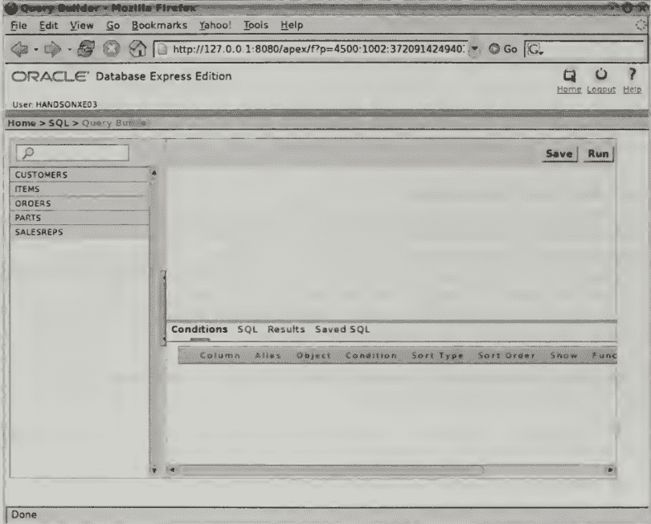

图 3-1. 查询生成器的图形用户界面

现在你已经熟悉了界面，本练习的其余部分将解释如何使用查询生成器复现你在练习 3.1、3.2、3.4、3.7、3.10–3.13 和 3.15–3.17 中使用 SQL*Plus 的 SELECT 命令编写的查询。

要复现练习 3.1 中从 ORDERS 表检索所有列和行的查询，请完成以下步骤：

1. 在对象选择窗格中点击 ORDERS。然后 ORDERS 表会出现在设计窗格中。

2. 要在查询的结果集中显示 ORDERS 表的所有列，请选中设计窗格中每列的复选框。你可以逐个勾选每列的复选框，或者点击 ORDERS 表左上角的表操作，点击全选，然后点击关闭。注意，当你在设计窗格中选择表列时，输出窗格的条件选项卡下方会显示有关每列的更详细信息。

3. 点击运行以执行查询。

输出窗格的结果选项卡中显示的查询结果应与练习 3.1 的结果一致，并额外包含练习 3.21 中事务添加的第 15 行。图 3-2 说明了完成的步骤和部分查询输出。

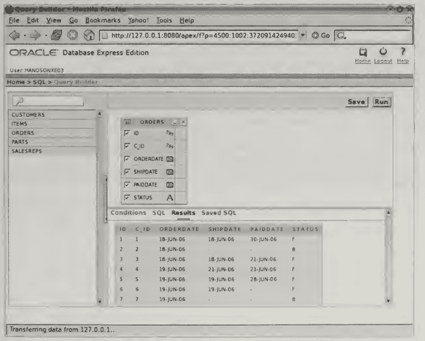

图 3-2. 查询生成器使查询表的行和列变得简单

要复现练习 3.2 中从 ORDERS 表的所有行检索特定列的查询，请完成以下步骤：

1. 在设计窗格中仅选中 ORDERS 表的 ID 和 ORDERDATE 列旁边的复选框。

2. 点击运行。

要复现练习 3.4 中检索 PARTS 表所有行的 ID 和 ONHAND 列，并对 ONHAND 列使用列别名的查询，请完成以下步骤：

1. 点击 ORDERS 表右上角的移除以将该表从设计窗格中移除。

2. 在对象选择窗格中点击 PARTS 以将其添加到设计窗格。

3. 选中 PARTS 表的 ID 和 ONHAND 列。

4. 点击输出窗格中的条件选项卡。

5. 在输出窗格中，输入列别名 IN STOCK 作为 ONHAND 列的别名。

6. 点击运行以执行查询。

图 3-3 说明了按前述步骤完成的查询。

要复现练习 3.7 中的第一个查询，即从 CUSTOMERS 表检索所有大写的 COMPANYNAME 和所有小写的 LASTNAME，请完成以下步骤：

1. 从设计窗格中移除 PARTS 表。

2. 将 CUSTOMERS 表添加到设计窗格。

3. 点击输出窗格中的条件。

4. 在设计窗格中，选中 CUSTOMERS 表的 LASTNAME 和 COMPANYNAME 列。

5. 默认情况下，查询列的显示顺序与从设计窗格中选择列的顺序一致。如有必要，请使用输出窗格中列名左侧的升级或降级按钮来调整所选列的显示顺序，使 COMPANYNAME 列显示在 LASTNAME 列之前。

## 第 3 章：使用 SQL 访问数据库数据

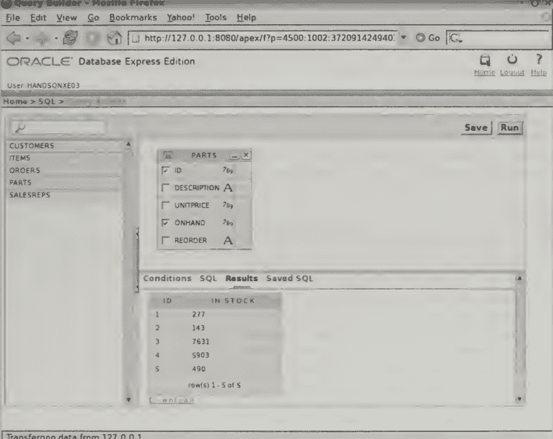

图 3-3. 输出窗格的条件选项卡允许你重新定位列、声明列别名、指定查询条件等。

6. 在输出窗格中，为 COMPANYNAME 列选择 UPPER 函数，为 LASTNAME 列选择 LOWER 函数。要查看每列的函数列表，你可能需要使用输出窗格底部的垂直滚动条。

7. 点击运行以执行查询。


确认查询结果集后，在输出窗格中点击 **SQL**，以显示与当前查询设计对应的 SELECT 语句。其显示应如下所示：

```
select  upper(CUSTOMERS.COMPANYNAME) as "COMPANYNAME",
        lower(CUSTOMERS.LASTNAME) as "LASTNAME"
from    "CUSTOMERS" "CUSTOMERS"
```

根据本章前面介绍的经验，您应该已经熟悉此 SELECT 语句的每个部分，包括使用 SQL 函数、列别名和表别名的 SELECT 列表表达式。然而，如果您是一位完全的初学者，您可以利用查询构建器的这一便捷功能，通过图形化构建简单查询来学习 SQL 示例。

## 注意

> 此时，您可能想知道为什么本练习没有解释如何使用查询构建器构建与练习 3.5 和 3.6 等效的查询。原因是查询构建器无法构建所有类型的 SELECT 语句。例如，您不能使用查询构建器创建包含连接两列或执行算术运算的 SELECT 列表表达式的查询。可用于列规范的 SQL 函数也是有限的。而且查询构建器无法使用 INSERT、UPDATE 和 DELETE 等 DML 语句修改数据。虽然查询构建器是帮助您入门 SQL 和快速构建基本查询的出色工具，但您仍然需要花时间学习 SQL 命令的语法。这就是为什么我决定使用 SQL*Plus 而不是查询构建器来教您 SQL。

现在跳到前面，复制练习 3.10 中的第二个查询，列出没有传真号码的所有客户记录的 ID 和 LASTNAME：

1. CUSTOMERS 表应该已经在设计窗格中。
2. 在输出窗格中点击 **Conditions**。
3. 在设计窗格中，选择 ID 和 FAX 列，并取消选中（移除）COMPANYNAME 列。
4. 在设计窗格的"条件"选项卡中，修改列显示顺序，使 ID 列在 LASTNAME 列之前。对于 LASTNAME 列，移除函数 LOWER（选择无）。对于 FAX 列，禁用"显示"选项，并在"条件"字段中输入以下条件：**IS NULL**。
5. 点击"运行"执行查询。

查询结果应与练习 3.10 中的相应结果相同。如果您还没有推测出来，前面的步骤向您展示了如何为查询添加 WHERE 子句条件——点击输出窗格的 SQL 选项卡查看查询。您还应该能够使用查询构建器构建与练习 3.10 中第一个、第三个和第四个查询等效的查询。输出窗格中某列的"条件"字段接受所有语法正确的 WHERE 子句条件（以关系运算符开头），包括使用子查询的条件。请自行尝试这些查询。

查询构建器还允许您构建使用 AND 运算符的复合 WHERE 子句条件，但不支持 OR 运算符。例如，要复制练习 3.12 中的查询，请完成以下步骤：

1. 从设计窗格中移除 CUSTOMERS 表。
2. 将 ORDERS 表添加到设计窗格。
3. 在输出窗格中点击 Conditions。
4. 在设计窗格中，选择 ORDERS 表中的 ID、ORDERDATE 和 STATUS 列。
   - 对于 ORDERDATE 列，输入以下条件：`>=TO_DATE('21-JUN-2006','DD-MON-YYYY')`
   - 对于 STATUS 列，禁用"显示"选项，并输入以下条件：`= 'B'`
5. 点击"运行"执行查询。

查询构建器还支持使用简单分组的查询。例如，要复制练习 3.13 中的第一个查询，请完成以下步骤：

1. ORDERS 表应该已经在设计窗格中。选择 C_ID 和 ID 列，然后移除所有其他列。
2. 在输出窗格中点击 Conditions。排列列显示顺序，使 C_ID 列在 ID 列之前。对于 C_ID 列，将别名设置为 **CUSTOMER** 并选择"按组分组"选项。对于 ID 列，将别名设置为 **ORDERS_PLACED** 并将函数设置为 COUNT。
3. 点击"运行"执行查询。

您将无法复制练习 3.13 中的第二个查询或练习 3.14 中的查询，因为查询构建器不支持扩展的 GROUP BY 子句功能，如 HAVING 子句条件和 ROLLUP 运算符。

要复制练习 3.15 中在查询结果集中对记录进行排序的查询，请完成以下步骤：

1. 从设计窗格中移除 ORDERS 表。
2. 将 CUSTOMERS 表添加到设计窗格。
3. 在输出窗格中点击 Conditions。
4. 在设计窗格中，选择 ID、LASTNAME 和 ZIPCODE 列。
5. 将焦点切换到输出窗格的"条件"选项卡。对于 ZIPCODE 列，将排序顺序指定为 **1** 并将排序类型设置为 Asc。
6. 点击"运行"执行查询。

查询构建器还支持内连接和外连接。要复制练习 3.16 中 CUSTOMERS 和 ORDERS 表的内连接，请完成以下步骤：

1. 将 ORDERS 表添加到设计窗格。CUSTOMERS 表应该已经存在。
2. 在输出窗格中点击 Conditions。
3. 在设计窗格中，仅选择 CUSTOMERS 表的 ID 和 LASTNAME 列以及 ORDERS 表的 ID 列，按此顺序排列其显示顺序。不要选择任何其他列。要指定表的连接条件，拖动 CUSTOMERS 表的 ID 列并将其拖放到 ORDERS 表的 C_ID 列上；之后，两个表之间应出现连接条件条。对于 CUSTOMERS 表的 ID 列，将别名指定为 **CUSTOMER_ID**，将排序顺序指定为 **1**。对于 ORDERS 表的 ID 列，将别名指定为 **ORDER_ID**。
4. 点击"运行"执行查询。

> **注意**
> 输出窗格的 SQL 选项卡显示，查询构建器在创建连接查询时使用较旧的语法。

要复制练习 3.17 中 CUSTOMERS 和 ORDERS 表的外连接，您只需修改当前查询设计的连接条件类型：

1. 在设计窗格中，点击连接条件条。从出现的菜单中，选择"设置右外连接"；之后，您会注意到 ORDERS 表中 C_ID 列右侧出现 +。
2. 点击"运行"执行查询。
3. 在输出窗格的"结果"选项卡中浏览结果。注意结果集包含未下任何订单的客户 10 的一行。如有必要，点击查询结果底部的"下一步"按钮，前进到结果集中的最后一条记录。图 3-4 演示了查询构建器中的此查询。

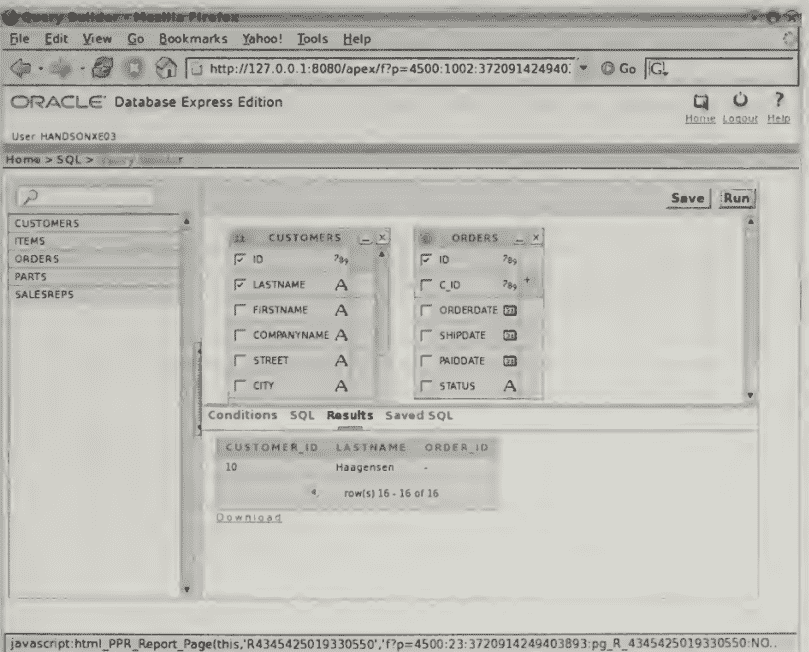

**图 3-4.** 查询构建器可以使用图形化方法构建内连接和外连接。

## 章节总结

本章为您提供了 SQL 的广泛概述和使用最常见 SQL 命令的教程。在本章中，您学习了以下内容：

- 要在 Oracle 中完成工作，应用程序必须构造 SQL 命令。

- 使用 SQL 命令 SELECT 构建从数据库表中检索数据的查询。查询的 FROM 子句指定要目标表。查询的 SELECT 子句确定要在查询结果集中包含哪些列——SELECT 子句可以包含简单的列名以及使用运算符、字面量或 SQL 函数来派生数据的表达式。查询的可选 WHERE 子句条件确定要在查询结果集中包含哪些行。您可以使用可选的 ORDER BY 子句对查询结果集中的记录进行排序。使用可选的 GROUP BY 子句汇总或聚合查询结果集中的数据。

- 使用 SQL 命令 INSERT 向表中插入一行。INSERT 语句的 INTO 参数指定目标表，VALUES 子句包含表中各列的值列表。您还可以在 VALUES 子句之前包含可选的列名列表，以指定 VALUES 子句中值的目标列。

- 使用 SQL 命令 UPDATE 更新表中的行。使用 SET 子句标识要更改的列值，并使用 WHERE 子句定位要更新的表中的特定行。

- 使用 SQL 命令 DELETE 从表中删除行。除非要删除表中的所有行，否则 DELETE 语句应始终包含带有条件的 WHERE 子句，以定位表中的特定行。

- 使用 SQL 命令 COMMIT 和 ROLLBACK 控制当前会话事务的结果。COMMIT 语句永久提交事务中所有 SQL 语句所做的更改。ROLLBACK 语句撤消事务中所有 SQL 语句的效果。实际上，Oracle 在您提交或回滚当前事务后自动启动新事务。

- 查询构建器是 Oracle Application Express 的一部分，是一个通过标准 Web 浏览器呈现的直观 GUI，使 novice 用户无需任何 SQL SELECT 命令的知识即可相对轻松地构建简单 SQL 查询。


# 第4章
## 使用PL/SQL编写数据库访问程序

SQL只不过是一种数据访问语言，它允许应用程序向Oracle数据库中存入数据和从Oracle数据库中检索数据。换句话说，仅仅依靠SQL本身，并不是一个功能完整的编程语言，无法用来开发功能强大的数据库应用程序。要构建数据库应用程序，必须使用一种过程语言，该语言包含SQL，以便与Oracle数据库进行交互。本章介绍Oracle自家的过程语言PL/SQL，你可以用它来编程Oracle数据库服务器及其相关应用程序。本章将涵盖以下主题：

- PL/SQL编码基础
- 匿名PL/SQL块
- 存储过程、函数和包
- 数据库触发器

> **注意**
> 
> 本章绝不是PL/SQL的完整指南。不过，本章确实提供了PL/SQL功能的中级教程，以便你能够开始使用Oracle XE进行编程。

## 本章先决条件

要练习本章的动手实验，你需要按照练习2.12中的说明启动SQL*Plus，并运行以下命令脚本：

```
location/handsorxe/sql/chap04.sql
```

其中location是你解压本书配套支持压缩包的文件目录。例如，在启动SQL*Plus后，你可以使用SQL*Plus的@命令来运行本章的SQL命令脚本，如下例所示（假设你的chap04.sql文件位于/tmp/handsonxe/sql）：

```
SQL> @/tmp/handsonxe/sql/chap04.sql;
```

在你回复所有提示并且脚本成功完成后，可以使用EXIT命令退出SQL*Plus。

## 什么是PL/SQL？

PL/SQL是一种内置于Oracle XE中的过程编程语言。借助PL/SQL，你可以构建程序来处理信息，方法是将控制程序流程的PL/SQL过程语句与访问Oracle数据库的SQL语句相结合。例如，以下是一个非常简单的PL/SQL程序，它根据零件的ID号更新零件的UNITPRICE。（此列表不是练习——只是一个供学习的示例。）

```sql
CREATE OR REPLACE PROCEDURE updatePartPrice (
  partId IN INTEGER,
  newPrice IN NUMBER )
IS
  invalidPart EXCEPTION;
BEGIN
  -- 这里是一条UPDATE语句，用于更新数据库记录
  UPDATE parts
    SET unitprice = newPrice
    WHERE id = partId;
  -- 这里是一条错误检查语句
  IF SQL%NOTFOUND THEN
    RAISE invalidPart;
  END IF;
EXCEPTION
  -- 这里是一个错误处理例程
  WHEN invalidPart THEN
    DBMS_OUTPUT.PUT_LINE('Invalid Part ID');
END updatePartPrice;
```

这个示例程序是一个作为*程序单元*存储在数据库中的过程。使用PL/SQL，你可以构建多种类型的数据库访问程序单元。本章的所有章节都包含PL/SQL程序的示例。但在学习完整的PL/SQL程序之前，你需要了解PL/SQL语言提供的基本编程构造和命令。

> **注意**
> 
> *PL/SQL*与编程语言Ada类似，具有许多过程构造，但经过了优化，可以充分与Oracle交互。PL/SQL提供了语句，让你可以声明变量和常量、控制程序流程、赋值和操作数据等等。

## PL/SQL块

PL/SQL程序使用不同的*块*来组织相关的声明和语句。PL/SQL程序中的每个块都有特定的任务并解决特定的问题。因此，你可以组织PL/SQL程序，使其易于理解。

PL/SQL块可以包含三个部分，如下面的伪代码所示——程序声明、主程序体和异常处理程序：

```
DECLARE
-- 程序声明是可选的
BEGIN
-- 程序体是必需的
EXCEPTION
-- 异常处理程序是可选的
END;
```

本章的大多数示例要求你使用Oracle Application Express中的SQL命令编辑器，以交互方式输入和执行匿名PL/SQL块，同时学习PL/SQL的基础知识。*匿名PL/SQL块*没有名称，不会永久存储在Oracle数据库中。应用程序（如SQL*Plus）只是将PL/SQL块发送到数据库服务器，以便在运行时进行处理。

### 程序声明

PL/SQL块的*声明部分*是块声明所有变量、常量、异常等的地方，这些声明随后可以被同一块的其他所有部分访问。PL/SQL块的声明部分以DECLARE关键字开始，并以程序体的BEGIN关键字隐式结束。如果程序不需要进行任何声明，则声明部分不是必需的。

### 程序体

PL/SQL块的主程序*体*包含该块的可执行语句。换句话说，体是PL/SQL块定义其功能的地方。PL/SQL块的体以BEGIN关键字开始，以启动块的异常处理部分的EXCEPTION关键字结束；如果块不包含任何异常处理程序，则程序体以结束整个块的END关键字结束。

### 异常处理程序

PL/SQL块的可选*异常处理部分*包含该块的*异常处理程序*（错误处理例程）。当块体中的某个语句*引发异常*（检测到错误）时，它会将程序控制权转移给异常部分中相应的异常处理程序以进行进一步处理。PL/SQL块的异常处理部分以EXCEPTION关键字开始，以END关键字结束。如果程序不需要定义任何异常处理程序，则块的异常处理部分不是必需的。

### 程序注释

尽管是可选的，但PL/SQL程序的所有块都应该包含*注释*，以记录程序声明和功能。注释阐明了特定程序和代码段的目的。

PL/SQL支持两种不同的注释风格，如下面的代码段所示：

```
-- 在单行注释前加双连字符。
/* 用斜杠-星号作为前缀，星号-斜杠作为后缀来界定多行注释。
多行注释可以包含任意数量的行。 */
```

本章其余部分的示例经常使用注释来帮助解释代码列表的功能。

## PL/SQL编码基础

所有过程语言（如PL/SQL）都有基本的语言元素和功能，在使用该语言构建程序之前，你需要了解这些知识。以下各节介绍PL/SQL的基本元素，包括：

- 如何声明程序变量并为其赋值
- 如何使用循环和条件逻辑控制程序流程
- 如何嵌入SQL语句并与Oracle数据库交互
- 如何在PL/SQL块中声明和使用子程序（过程和函数）
- 如何声明用户定义的类型，如记录和嵌套表
- 如何声明和使用游标来处理返回多行的查询
- 如何使用异常处理程序来处理错误情况

### 使用程序变量

所有过程程序通常会声明一个或多个程序变量，并使用它们来保存程序处理的临时信息。接下来的两个练习将教你如何声明程序变量（和常量）、初始化它们，以及在PL/SQL程序体中为它们赋值。

### 练习4.1：使用基本数据类型声明变量和常量

PL/SQL程序的声明部分可以包含*变量*和*常量*声明。声明标量变量或常量的一般语法如下：

```
variable [CONSTANT] datatype [[NOT NULL] {DEFAULT|:=} expression];
```

**注意**

要声明*常量*而不是*变量*，请在声明中包含CONSTANT关键字。你必须初始化常量，此后常量的值不能更改。

声明变量时，你可以选择立即初始化它，或者等到程序体中稍后再初始化；但是，如果包含NOT NULL约束，则必须在变量声明时对其进行初始化。默认情况下，除非程序显式初始化变量，否则PL/SQL将变量初始化为NULL。

程序可以使用任何Oracle或ANSI/ISO数据类型、用户定义的类型或表4-1中列出的子类型来声明变量或常量。

**注意**

*子类型*是其*基础类型的约束版本*。

对于本章的第一个动手练习，请按照第2章中的说明启动Oracle Application Express。使用本章的练习账户HANDSONXE04，密码为PASSWORD，建立连接。点击SQL，然后点击SQL Commands，启动Oracle Application Express的图形化即席SQL命令行工具版本，即*SQL Commands*，如图4-1所示。

SQL Commands页面顶部的输入窗格是你输入SQL和匿名PL/SQL块的地方。输入窗格下方的输出窗格会显示你的工作结果等其他信息。

请注意输入窗格上方的选项，你可以通过*Autocommit*选项启用或禁用对工作的事务支持；如果启用（选中，默认设置），你执行的每条SQL或PL/SQL块都在其自己的事务中运行，并自动提交；如果禁用，你将能够使用SQL命令COMMIT和ROLLBACK来控制事务的结果。对于本章的练习，*请禁用Autocommit*。

一旦你建立与Oracle Application Express的连接并打开SQL Commands页面，请在输入窗格中输入以下匿名PL/SQL块，该块声明并初始化了几种不同数据类型的变量，然后

 ## 第四章：使用 PL/SQL 编写数据库访问程序

| 数据类型 | 子类型 | 说明 |
|----------|--------|------|
| BINARY_INTEGER | NATURAL、NATURALN、POSITIVE、POSITIVEN、SIGNTYPE | 存储范围在 −2,147,483,647 不能超过 2,147,483,647 的有符号整数。使用库算术运算。NATURAL 和 NATURALN 仅存储非负整数；后者不允许为 NULL。POSITIVE 和 POSITIVEN 仅存储正整数；后者不允许为 NULL。SIGNTYPE 仅存储 −1、0 和 1。 |
| BINARY_FLOAT 和 BINARY_DOUBLE | | 存储单精度和双精度 IEEE 754 格式的浮点数。适用于高速科学计算。 |
| NUMBER (precision,scale) | DEC、DECIMAL、DOUBLE PRECISION、FLOAT (precision)、INTEGER、INT、NUMERIC、REAL、SMALLINT | 存储范围在 1^-130 到 10^125 的固定或浮点数。使用库算术运算。 |
| PLS_INTEGER | | 存储范围在 −2,147,483,647 到 2,147,483,647 的有符号整数。使用机器算术运算以实现快速计算。 |
| CHAR (size) | CHARACTER (size) | 存储固定长度字符串。最大大小为 32,767 字节；但数据库中 CHAR 的最大值为 2000 字节。 |
| VARCHAR2 (size) | VARCHAR (size)、STRING | 存储可变长度字符串。最大大小为 32,767 字节；但数据库中 VARCHAR2 的最大值为 4000 字节。 |
| DATE | | 存储与时间相关的信息，包括日期、小时、分钟和秒。 |

表 4-1. PL/SQL 标量数据类型及相关子类型

| 数据类型 | 子类型 | 说明 |
|----------|--------|------|
| TIMESTAMP [(precision)] [WITH [LOCAL] TIME ZONE] | | 存储日期，包括年、月 日、小时、分钟、秒和小数秒部分。可选地，可以为秒指定小数精度；默认小数点后六位。还可以指定 WITH TIME ZONE 选项来存储时间戳的时区偏移量。时区偏移量是当地时间与协调世界时 (UTC)（以前称为格林威治标准时间）之间的小时和分钟差。 |
| INTERVAL DAY (precision) TO SECOND (precision) | | 存储一段时间，以天、小时、分钟、秒和小数秒表示。可选地，可以为间隔的两个组成部分指定精度；默认值中 DAY 部分为两位数字，小数秒部分为六位数字。 |
| INTERVAL YEAR (precision) TO MONTH | | 存储一段时间，以年和月表示。可选地，可以为间隔的 YEAR 部分指定精度；默认值为两位数字。 |
| BOOLEAN | | 存储逻辑值（TRUE、FALSE 和 NULL）。 |
| ROWID | | 存储数据库表中行的物理行地址。 |
| UROWID | | 存储数据库表中行的物理、逻辑或外部（非 Oracle）地址。 |
| CLOB | | 存储大型单字节字符对象。 |
| BLOB | | 存储大型二进制对象。 |
| BFILE | | 存储指向由数据库外部文件系统管理的大型对象 (LOB) 的文件指针。 |

图 4-1. Oracle Application Express 的 SQL Commands 页面是一个编辑器，您可以使用它来交互式地构建和执行 SQL 和 PL/SQL，这很像 SQL*Plus。

将其当前值打印到输出窗格。正确输入代码块后，点击 Run 执行。

```
DECLARE
  l_outputString VARCHAR2(20) := 'Hello World';
  l_todaysDate DATE := SYSDATE;
  l_pi CONSTANT NUMBER := 3.14159265359;
BEGIN
  DBMS_OUTPUT.PUT_LINE(l_outputString);
  DBMS_OUTPUT.PUT_LINE(l_todaysDate);
  DBMS_OUTPUT.PUT_LINE(l_pi);
END;
/
```

## 注意

要在 SQL Commands 页面中结束 PL/SQL 程序，请用仅包含反斜杠 (/) 字符的一行来终止代码。

程序的输出应类似于以下内容：

```
Hello World
20-MAR-06
3.14159265359

Statement processed.
```

关于这个第一个示例 PL/SQL 程序，有几点细节需要理解：

- 当程序使用需要约束规格的数据类型（如 VARCHAR2）声明变量时，声明必须指定约束；例如，VARCHAR2(20)。

- 为了使代码更易理解，请在所有局部变量（和其他局部结构）前加上字母 l 和下划线，即 `l_`。

- 第二个变量声明使用 SQL 函数 SYSDATE 初始化 `l_todaysDate`，该函数返回数据库所在主机操作系统设置的当前日期和时间。

- 示例程序的体使用 `DBMS_OUTPUT.PUT_LINE` 过程将输出定向到标准输出。`DBMS_OUTPUT.PUT_LINE` 过程在功能上类似于 C 语言中的 `println` 过程和 Java 中的 `System.out.println` 方法。

## 注意

如果您尝试使用 SQL*Plus 执行本练习的 PL/SQL 块，将看不到 `DBMS_OUTPUT.PUT_LINE` 调用的输出，除非您使用 `SET SERVEROUTPUT ON` 之类的命令启用 SQL*Plus 环境设置 `SERVEROUTPUT`。

### 练习 4.2：为变量赋值

赋值是任何类型的过程程序中最常见的操作之一。为变量赋值的一般语法如下：

```
variable := expression
```

PL/SQL 程序中的赋值语句使用赋值运算符 (:=) 将表达式产生的值赋给 PL/SQL 结构（如变量）。例如，执行以下 PL/SQL 块，该块声明一些变量，在程序体中为它们赋值，然后使用 `DBMS_OUTPUT.PUT_LINE` 过程将其当前值输出到标准输出：

```
DECLARE
  l_outputString VARCHAR2(20);
  l_todaysDate DATE;
  l_tomorrowsDate DATE;
  l_lastDayOfTheMonth DATE;
BEGIN
  l_outputString := 'Hello ' || 'World';
  l_todaysDate := SYSDATE;
  l_tomorrowsDate := SYSDATE + 1;
  l_lastDayOfTheMonth := LAST_DAY(SYSDATE);
  DBMS_OUTPUT.PUT_LINE(l_outputString);
  DBMS_OUTPUT.PUT_LINE(l_todaysDate);
  DBMS_OUTPUT.PUT_LINE(l_tomorrowsDate);
  DBMS_OUTPUT.PUT_LINE(l_lastDayOfTheMonth);
END;
/
```

程序输出应类似于以下内容：

```
Hello World
20-MAR-06
21-MAR-06
31-MAR-06

Statement processed.
```

请注意，程序体中的赋值语句使用不同类型的表达式来构建要赋给变量的值。上一章的几个部分教您如何通过使用字面量、运算符和 SQL 函数来构建查询 SELECT 子句的表达式。类似地，您也可以为 PL/SQL 程序中赋值语句的右侧构建表达式。例如，示例程序中的表达式使用了字面量、连接和加法运算符（`||` 和 `+`），以及 `LAST_DAY` 和 `SYSDATE` 函数。大多数 SQL 函数在 PL/SQL 语句中也是内置和支持的。

**注意**

表达式 `SYSDATE + 1` 引入了日期算术的概念。从结果可以看出，`SYSDATE + 1` 计算结果为当前日期加一天。对日期算术的完整讨论超出了本书的范围；更多信息请参阅 *Oracle Database SQL Reference*。

### 控制程序流程

典型的过程程序具有流程。也就是说，程序使用某种逻辑来控制是否以及何时执行特定语句。PL/SQL 程序可以使用迭代逻辑（循环）、条件逻辑（if-then-else）和顺序逻辑（goto）来控制程序流程。以下练习将教您如何使用 PL/SQL 提供的不同程序流程控制语句。

### 练习 4.3：使用 PL/SQL 循环

PL/SQL 程序可以使用循环来多次迭代执行一系列语句。输入以下匿名 PL/SQL 块，学习如何使用基本循环。基本循环的开始以 LOOP 语句开始，以 `END LOOP` 语句结束，如下所示粗体部分。

```
DECLARE
  l_loopCounter INTEGER := 0;
BEGIN
  LOOP
    DBMS_OUTPUT.PUT(l_loopCounter || ' ');
    DBMS_OUTPUT.PUT_LINE(l_loopCounter);


 ```
DECLARE
  l_loopCounter INTEGER := 0;
BEGIN
  WHILE l_loopCounter < 10 LOOP
    DBMS_OUTPUT.PUT(l_loopCounter || ' ');
    l_loopCounter := l_loopCounter + 1;
  END LOOP;
  DBMS_OUTPUT.PUT_LINE('Loop Exited.');
END;
/
```

程序输出应如下所示：

```
0 1 2 3 4 5 6 7 8 9 Loop Exited.
```

语句已处理。

请注意，WHILE 循环的定义要求你指定一个条件来描述循环如何终止。

最后，输入以下匿名 PL/SQL 块，它将教你如何使用第三种循环类型，即 FOR 循环。FOR 循环的 LOOP 语句以 FOR 子句开始，以 END LOOP 语句结束。

```
BEGIN
  FOR l_loopCounter IN 0 .. 10 LOOP
    DBMS_OUTPUT.PUT(l_loopCounter || ' ');
  END LOOP;
  DBMS_OUTPUT.PUT_LINE('Loop Exited.');
END;
/
```

程序输出应与本练习中的先前输出相同。请注意，在前面的示例中，FOR 循环可以将其整数计数器变量作为 FOR ... LOOP 语句的一部分进行声明，并且 FOR 循环会自动递增或递减其计数器变量，因此你不必在循环体中显式执行此操作。

### 练习 4.4：使用 PL/SQL 命令 IF ... ELSIF ... ELSE

PL/SQL 程序中的 IF 语句提供了条件逻辑。IF 语句的基本语法如下：

```
IF condition THEN
  statement1;
  statement2;
  ...
ELSIF condition THEN
  statement3;
  statement4;
    ...
ELSE
  statement5;
  statement6;
    ...
END;
```

IF 语句的功能如下：

- IF 语句评估一个布尔条件，如果该条件为 TRUE，则执行 THEN 子句后面的一个或多个语句。当 IF 子句的条件评估为 FALSE 或 UNKNOWN（例如，当条件将某个值与未初始化的 null 变量进行比较时），后续 THEN 子句中的语句不会执行。

- 可选的 ELSIF 子句表示替代条件。当 ELSIF 子句的条件评估为 TRUE 时，执行后续 THEN 子句中的语句。当 ELSIF 子句的条件评估为 FALSE 或 UNKNOWN 时，后续 THEN 子句中的语句不执行。一个 IF 语句可以包含多个 ELSIF 子句。

- 可选的 ELSE 子句指定当所有前面的 IF 和 ELSIF 子句中的条件均未评估为 TRUE 时，要执行的一系列语句。

输入以下匿名 PL/SQL 块，以获得使用 IF ... ELSIF ... ELSE 逻辑的经验：

```
BEGIN
  FOR l_i IN 1 .. 20 LOOP
    IF ((l_i MOD 3 = 0) AND (l_i MOD 5 = 0)) THEN
      DBMS_OUTPUT.PUT('multipleOfBoth');
    ELSIF l_i MOD 3 = 0 THEN
      DBMS_OUTPUT.PUT('multipleOf3');
    ELSIF l_i MOD 5 = 0 THEN
      DBMS_OUTPUT.PUT('multipleOf5');
    ELSE
      DBMS_OUTPUT.PUT(l_i);
    END IF;
    DBMS_OUTPUT.PUT(' ');
  END LOOP;
  DBMS_OUTPUT.PUT_LINE(' ');
END;
/
```

该程序使用 SQL 函数 MOD 和 IF 语句中的条件来确定 FOR 循环计数器何时是 3、5 或同时 3 和 5 的倍数。输出应类似于以下内容：

```
1 2 multipleOf3 4 multipleOf5 multipleOf3 7 8 multipleOf3
multipleOf5 11 multipleOf3 13 14 multipleOfBoth 16 17
multipleOf3 19 multipleOf5
```

语句已处理。

### 与数据库交互

前面的示例练习都是生成简单输出的 PL/SQL 程序，用于演示 PL/SQL 的一些基础知识。然而，使用 PL/SQL 的主要原因是创建数据库访问程序。PL/SQL 程序只能通过使用 SQL 与 Oracle 数据库交互。以下练习将向你展示 PL/SQL 程序如何使用标准 SQL DML 语句和游标来操作数据库信息。

### 练习 4.5：使用 DML 语句操作表数据

PL/SQL 程序可以包含任何有效的 INSERT、UPDATE 或 DELETE 语句来修改数据库表中的行。例如，输入以下匿名 PL/SQL 块，它将新记录插入 PARTS 表：

```
DECLARE
  l_newId INTEGER := 6;
  l_newDesc VARCHAR2(250) := 'Mouse';
BEGIN
  INSERT INTO parts
  (id, description, unitprice, onhand, reorder)
  VALUES (l_newId, l_newDesc, 49, 1200, 500);
END;
/
```

此程序生成的输出仅仅是以下一行：

```
1 row(s) inserted.
```

PL/SQL 块中的变量或常量可以满足 DML 语句中表达式的要求。例如，前面的示例程序使用程序变量来提供 INSERT 语句 VALUES 子句中的前两个值。

现在查询 PARTS 表以查看新记录：

```
SELECT * FROM parts
WHERE id = 6;
```

你在 Application Express 的 SQL Commands 页面中将看到的结果集的文本表示形式如下：

| ID | DESCRIPTION | UNITPRICE | ONHAND | REORDER |
|----|-------------|-----------|--------|---------|
| 6 | Mouse | 49 | 1200 | 500 |

PL/SQL 块内部 INSERT、UPDATE 和 DELETE 语句所做的所有数据修改都是你会话当前事务的一部分。虽然你可以在许多类型的 PL/SQL 块内部包含 COMMIT 和 ROLLBACK 语句，但事务控制通常在 PL/SQL 块外部进行，以便使用你的 PL/SQL 程序的人能够清楚地看到事务边界。

### 练习 4.6：使用查询为变量赋值

PL/SQL 程序通常使用 SQL 命令 SELECT 的 INTO 子句将特定的数据库值赋给程序变量。Oracle 仅支持在 PL/SQL 程序内部使用 SELECT ... INTO 语句。通过输入以下匿名 PL/SQL 块来尝试这种类型的赋值语句，它使用 SELECT ... INTO 语句为程序变量赋值：

```
DECLARE
  l_partDesc VARCHAR2(250);
BEGIN
  SELECT description INTO l_partDesc
    FROM parts
   WHERE id = 3;
  DBMS_OUTPUT.PUT_LINE('Part 3 is a ' || l_partDesc);
END;
/
```

程序输出如下：

```
Part 3 is a Laptop PC

Statement processed.
```

SELECT ... INTO 命令的结果集必须只有一行——如果 SELECT ... INTO 语句的结果集包含零行或多于一行，或者返回的数据类型不可接受，Oracle 会引发相应的异常。要处理返回多行的查询，PL/SQL 程序必须使用游标。在本章稍后你将了解更多关于处理异常和游标的知识。

## 声明和使用子程序：过程和函数

PL/SQL 块的声明部分可以将常见的子任务声明为命名*子程序*（或*子例程*）。主程序体中的后续语句随后可以*调用*（执行）该子程序，以便在需要时执行工作。

PL/SQL 支持两种类型的子程序：过程和函数。*过程*是执行操作的子程序。*函数*是计算值并将其返回给调用程序的子程序；换句话说，函数是返回值的过程。

### 练习 4.7：声明和使用过程

声明过程的简化*语法*如下：

```
PROCEDURE procedure
  [(parameter [IN|OUT|IN OUT] datatype [{DEFAULT|:=} expression]
    [,...] )]
  declarations ...
{IS|AS}
  BEGIN
  statements ...
  END [procedure];
```

当你声明子程序（如过程）时，可以使用*参数*将值传入和传出子程序。通常，调用程序将一个或多个变量作为参数传递给子程序。为了清楚地区分参数与变量、常量等，请使用前缀 `p_` 声明参数。

对于每个参数，你必须以非约束形式指定数据类型；例如，VARCHAR2，而不是 VARCHAR2(100)。此外，你应该将每个参数的模式指定为 IN、OUT 或 IN OUT：

- **IN 参数** 将值传递到子程序中，但子程序不能更改与 IN 参数对应的外部变量的值。

- **OUT 参数** 初始化为 null，之后子程序可以操作 OUT 参数以更改外部调用环境中相应变量的值。子程序可以设置但不能读取 OUT 参数的值。

- **IN OUT 参数** 结合了 IN 和 OUT 参数的功能。
```

 # 110 在 Linux 上实践 Oracle Database 10g Express Edition

输入以下匿名 PL/SQL 块，该块声明了一个用于打印指定宽度水平线的过程：

```
DECLARE
  PROCEDURE printLine(p_width IN INTEGER, p_chr IN CHAR DEFAULT '-') IS
  BEGIN
    FOR l_i IN 1 .. p_width LOOP
      DBMS_OUTPUT.PUT(p_chr);
    END LOOP;
    DBMS_OUTPUT.PUT_LINE('');
  END printLine;
BEGIN
  printLine(40, '*');                       -- print a line of 40 *s
  printLine(p_chr => '=', p_width => 20);   -- print a line of 20 =s
  printLine(10);                            -- print a line of 10 -s
END;
/
```

程序输出如下：

```
****************************************
====================
----------
```

Statement processed.

本练习示例的主体部分三次调用 printLine 过程：

- 第一次过程调用通过**位置表示法**为过程的两个参数提供值——您在过程调用中指定的每个参数值隐式对应于同一位置声明的过程参数。

- 第二次过程调用通过**命名表示法**为过程的两个参数提供值——参数名称和关联运算符（=>）位于参数值之前。使用命名表示法时，请注意您可以按任意顺序指定参数。

- 第三次过程调用演示了您必须为所有**没有默认值**的过程参数提供值，但可以**选择性地省略**具有默认值的参数的值。

### 练习 4.8：声明和使用函数

声明函数的简化语法如下：

```
FUNCTION function
  [(parameter [IN|OUT|IN OUT] datatype [{DEFAULT|:=} expression]
    [,.... ])]
  RETURN datatype
  declarations ...
{IS|AS}
  BEGIN
  statements ...
  END [function];
```

请注意，函数与过程的**唯一区别**在于函数向其调用环境返回一个值。函数的规范声明了返回值的类型。此外，函数体必须包含一个或多个 RETURN 后跟表达式，以向调用环境返回值。

输入以下匿名 PL/SQL 块，该块声明并使用了一个函数：

```
DECLARE
  l_tempTotal NUMBER;
  FUNCTION orderTotal(p_orderId IN INTEGER)
    RETURN NUMBER
  IS
    l_orderTotal NUMBER;
    l_tempTotal NUMBER;
  BEGIN
    SELECT SUM(i.quantity * p.unitprice) INTO l_orderTotal
      FROM items i, parts p
      WHERE i.o_id = p_orderId
      AND i.p_id = p.id
      GROUP BY i.o_id;
    RETURN l_orderTotal;
  END orderTotal;
BEGIN
  DBMS_OUTPUT.PUT_LINE('Order 1 Total: ' || orderTotal(1));
  l_tempTotal := orderTotal(2);
  DBMS_OUTPUT.PUT_LINE('Order 2 Total: ' || l_tempTotal);
END;
/
```

程序输出如下：

```
Order 1 Total: 7094
Order 2 Total: 3196
```

Statement processed.

PL/SQL 块的主程序体两次调用 orderTotal 函数。程序可以在表达式有效的任何位置调用函数——例如，作为过程调用的参数或赋值语句的右侧。SQL 语句也可以在 WHERE 子句的条件中引用用户定义的函数。

## 使用记录类型

到目前为止，在本章中，您已经了解了如何基于 Oracle 数据类型（例如 NUMBER）和基本数据类型的子类型（例如 INTEGER）声明简单的标量变量和常量。PL/SQL 程序中的块还可以声明用户定义的类型，然后使用用户定义的类型来声明相应的程序变量。本节将教您如何声明和使用一种基本的用户定义类型——**记录类型**。记录类型由一组**一个或多个相关字段**组成，每个字段都有自己的名称和数据类型。通常，PL/SQL 程序使用记录类型来创建与表中记录结构匹配的变量。例如，您可能声明一个名为 partRecord 的记录类型，然后使用该类型创建一个记录变量来保存零件的 ID、DESCRIPTION、UNITPRICE、ONHAND 和 REORDER 字段。声明记录变量后，您可以操作记录的单个字段，或将整个记录作为**一个单元**传递给子程序。

声明记录类型的一般语法如下：

```
TYPE recordType IS RECORD
(   field datatype [NOT NULL] {DEFAULT|:=} expression ]
 [, field ...]
)
```

记录类型中单个字段的规范类似于声明标量变量——您必须指定字段的数据类型，并且可以指定可选的 not null 约束，以及初始化该字段。

### 练习 4.9：声明和使用记录类型

输入以下匿名 PL/SQL 块，该块演示如何声明和使用记录类型。块的声明部分声明了一个用户定义的记录类型以匹配 PARTS 表的属性，然后使用该类型声明了两个记录变量。程序主体演示了如何执行以下操作：

- 使用**点号表示法**引用记录变量的单个字段

- 为记录变量的字段赋值

- 将记录变量作为参数传递给过程调用

- 将一个记录变量的字段值复制到同一记录类型的另一个变量的字段中

- 在 INSERT 语句中使用记录变量的字段作为表达式

```
DECLARE
  TYPE partRecord IS RECORD (
    id INTEGER,
    description VARCHAR2(250),
    unitprice NUMBER(10,2),
    onhand INTEGER,
    reorder INTEGER
  );
  l_selectedPart partRecord;
  l_copiedPart partRecord;
  PROCEDURE printPart (p_title IN VARCHAR2, p_thisPart IN partRecord) IS
  BEGIN
    FOR l_i IN 1 .. 50 LOOP
      DBMS_OUTPUT.PUT('-');
    END LOOP;
    DBMS_OUTPUT.PUT_LINE('');
    DBMS_OUTPUT.PUT_LINE(p_title || ': ID: ' || p_thisPart.id ||
      ' DESCRIPTION: ' || p_thisPart.description);
  END printPart;
BEGIN
/* Assign values to the fields of a record variable
|| using a SELECT .. INTO statement.
*/
  SELECT id, description, unitprice, onhand, reorder INTO l_selectedPart
    FROM parts WHERE id = 3;
  printPart('selectedPart Info', l_selectedPart);

/* Assign the field values of one record variable to
|| the corresponding fields in another record
|| variable of the same type. Then assign new
|| values to the fields of original record variable
|| to demonstrate that record copies are not by reference.
*/
  l_copiedPart := l_selectedPart;

  l_selectedPart.id := 7;
  l_selectedPart.description := 'Laser Printer';
  l_selectedPart.unitprice := 399;
  l_selectedPart.onhand := 780;
  l_selectedPart.reorder := 500;

  printPart('newPart Info', l_selectedPart);
  printPart('copiedPart Info', l_copiedPart);
```

```
/* Use the fields of a record variable as expressions
|| in the VALUES clause of an INSERT statement.
*/
INSERT INTO parts
VALUES (l_selectedPart.id, l_selectedPart.description,
  l_selectedPart.unitprice, l_selectedPart.onhand, l_selectedPart.reorder);
END;
/
```

程序输出如下：

```
--------------------------------------------------------------------------------
selectedPart Info: ID: 3 DESCRIPTION: Epson Printer
--------------------------------------------------------------------------------
newPart Info: ID: 7 DESCRIPTION: Laser Printer
--------------------------------------------------------------------------------
copiedPart Info: ID: 3 DESCRIPTION: Epson Printer
```

1 row(s) inserted.

## 注意

作为额外的练习，构建一个 PARTS 表的查询以查看示例程序插入的新零件。

## 使用 %TYPE 和 %ROWTYPE 属性

PL/SQL 程序可以使用 %TYPE 和 %ROWTYPE 属性来声明与数据库列和表或其他程序构造的属性匹配的变量、常量、记录中的单个字段以及记录变量。使用属性不仅简化了程序构造的声明，而且使程序对数据库修改具有灵活性。例如，在管理员修改 PARTS 表以添加新列后，使用 %ROWTYPE 属性声明的记录变量会自动在运行时调整以适应新列，而无需对程序进行任何修改。

### 练习 4.10：使用 %TYPE 属性

PL/SQL 变量、常量或记录变量中字段的声明可以使用 %TYPE 属性在运行时捕获另一个程序构造或数据库表中列的数据类型。例如，输入以下匿名 PL/SQL 块，该块使用 %TYPE 属性在声明 partRecord 类型时引用 PARTS 表中的列：

 ```
DECLARE
    TYPE partRecord IS RECORD (
        id parts.id%TYPE,
        description parts.description%TYPE,
        unitonkosten parts.unitprice%TYPE,
        onhand parts.onhand%TYPE,
        reorder parts.reorder%TYPE
    );
    l_selectedPart partRecord;
BEGIN
    SELECT id, description, unitprice, onhand, reorder INTO l_selectedPart
    FROM parts WHERE id = 3;
    DBMS_OUTPUT.PUT_LINE('ID: ' || l_selectedPart.id);
    DBMS_OUTPUT.PUT_LINE('DESCRIPTION: ' || l_selectedPart.description);
    DBMS_OUTPUT.PUT_LINE('UNIT PRICE: ' || l_selectedPart.unitprice);
    DBMS_OUTPUT.PUT_LINE('CURRENTLY ONHAND: ' || l_selectedPart.onhand);
    DBMS_OUTPUT.PUT_LINE('REORDER AT: ' || l_selectedPart.reorder);
END;
/
```

程序输出如下：

```
ID: 3
DESCRIPTION: Laptop PC
UNIT PRICE: 2100
CURRENTLY ONHAND: 7631
REORDER AT: 1000
Statement processed.
```

### 练习 4.11：使用 %ROWTYPE 属性

PL/SQL 程序可以使用 %ROWTYPE 属性来轻松地在运行时声明记录变量和其他结构。例如，输入以下匿名 PL/SQL 块，它展示了如何使用 %ROWTYPE 属性来简化对应于 PARTS 表中字段的记录变量的声明：

```
DECLARE
    l_selectedPart parts%ROWTYPE;
BEGIN
    SELECT id, description, unitprice, onhand, reorder INTO l_selectedPart
    FROM parts WHERE id = 3;
    DBMS_OUTPUT.PUT_LINE('ID: ' || l_selectedPart.id);
    DBMS_OUTPUT.PUT_LINE('DESCRIPTION: ' || l_selectedPart.description);
    DBMS_OUTPUT.PUT_LINE('UNIT PRICE: ' || l_selectedPart.unitprice);
    DB/server OUTPUT.PUT_LINE('CURRENTLY ONHAND: ' || l_selectedPart.onhand);
    DBMS_OUTPUT.PUT_LINE('REORDER AT: ' || l_selectedPart.reorder);
END;
/
```

程序输出如下：

```
ID: 3
DESCRIPTION: Laptop PC
UNIT PRICE: 2100
CURRENTLY ONHAND: 7631
REORDER AT: 1000
Statement processed.
```

请注意，使用 %ROWTYPE 属性声明的记录变量会自动拥有与引用表中字段相对应的字段名。

> **注意**
>
> 使用 %TYPE 和 %ROWTYPE 属性的一个很大好处是，它们使程序声明能够灵活应对数据结构中不可避免的变化。例如，前面的两个示例在 PARTS 表的 DESCRIPTION 列被声明为 VARCHAR2(1)、VARCHAR2(50)、VARCHAR2(250) 等情况下都能正常工作。

## 使用游标

每当应用程序向 Oracle 提交 SQL 语句时，服务器至少会打开一个游标来执行该语句。*游标*本质上是 SQL 语句的工作区。当 PL/SQL 程序（或任何其他应用程序）提交 INSERT、UPDATE 或 DELETE 语句时，Oracle 会自动打开一个游标来处理该语句。Oracle 还可以自动处理仅返回一行的 SELECT 语句。然而，数据库访问程序经常需要处理返回一组数据库记录而不仅仅是单行的查询。

要处理对应于多行结果集的查询行，PL/SQL 程序必须显式声明游标、打开它、逐行从游标中获取数据，然后关闭游标。Oracle 支持多种游标处理方法：

- **命名游标声明、OPEN、FETCH、CLOSE 语句** 你可以在块的声明部分使用 PL/SQL 命令 CURSOR 显式声明一个带名称的游标。在块的主体或异常处理部分，你可以使用 PL/SQL 命令 OPEN 打开游标，使用 PL/SQL 命令 FETCH 从游标中获取行（通常在循环内），最后使用 PL/SQL 命令 CLOSE 关闭游标。这种方法最繁琐、最容易出错且性能最差。

- **显式游标 FOR 循环**

你可以使用 CURSOR 命令声明游标，然后使用*游标 FOR 循环*自动声明能够接收游标中行的变量或记录，打开游标、从游标中获取行，并在获取最后一行后关闭游标。这种方法比前一种更简单、更不容易出错且性能更好，但仍然需要显式声明游标。

- **隐式游标 FOR 循环**

连同匹配的变量或记录，你可以声明游标式的循环本身，并逐行处理相应的行。这种方法迄今为止最简单，且性能与显式游标 FOR 循环相当。

下一个练习演示并比较上述各种方法。

> **注意**
>
> 当使用*游标*处理大量行时，显式和隐式游标 FOR 循环比 OPEN/FETCH/CLOSE 方法具有更好的性能，因为游标 FOR 循环会隐式地从相应游标中批量获取 100 行；相比之下，使用 OPEN/FETCH/CLOSE 处理游标时，Oracle 每次只获取一行。

### 练习 4.12：声明和使用游标

为了熟悉声明和使用游标所需的步骤，请输入以下匿名 PL/SQL 块，它声明并使用了一个非常简单的游标来打印输出 PARTS 表中所有行的选定列：

```
BEGIN
  FOR l_currentPart IN (SELECT id, description FROM parts ORDER BY id)
  LOOP
    DBMS_OUTPUT.PUT_LINE(l_currentPart.id||' '||l_currentPart.description);
  END LOOP;
END;
/
```

程序输出如下：

```
1 Fax Machine
2 Copy Machine
3 Laptop PC
4 Desktop PC
5 Scanner
6 Mouse
7 Laser Printer
Statement processed.
```

上述游标处理方法简单且性能良好。但要明白，随着你对 Oracle 的深入了解，你无疑会看到使用其他更复杂的上述方法进行游标处理。例如，你可以将前面的块等效地实现为以下形式：

```
DECLARE
  -- 步骤 1：声明游标itary
  CURSOR l_nextPartsRow IS
   SELECT id, description FROM parts
    ORDER BY id;
  -- 与游标匹配的记录变量
  l_currentPart l_nextPartsRow%ROWTYPE;
BEGIN
  -- 步骤 2：打开游标。
  OPEN l_nextPartsRow;

  FETCH l_nextPartsRow INTO l_currentPart;
  -- 步骤 3：使用 WHILE 循环，逐行从游标中获取数据。
  WHILE l_nextPartsRow%FOUND LOOP
    DBMS_OUTPUT.PUT_LINE(l_currentPart.id||' '||l_currentPart.description);
    FETCH l_nextPartsRow INTO l_currentPart;
  END LOOP;
  -- 步骤 4：关闭游标。
  CLOSE l_nextPartsRow;
END;
/
```

请注意，从游标中获取第一行后，这个版本的块使用 WHILE 循环逐行从打开的游标中后续提取。PL/SQL 程序可以使用**游标属性**在处理游标时做出决策。示例程序中 WHILE 循环的条件使用了 %FOUND 游标属性来检测游标的最后一行是否已被获取。表 4-2 列出了 PL/SQL 可用于基本游标的游标属性。

你可能还会看到使用显式游标 FOR 循环的前一个块的另一个版本：

```
DECLARE
  CURSOR l_partsRows IS
   SELECT id, description FROM parts
    ORDER BY id;
BEGIN
  FOR l_currentPart IN l_partsRows LOOP
    DBMS_OUTPUT.PUT_LINE(l_currentPart.id||(data)' '||l_currentPart.description);
  END LOOP;
END;
/
```

这个版本的块比前一个版本简单，但仍然不如本练习开头第一个版本简单。

### 练习 4.13：操作游标的当前行

当程序从游标的结果集中逐行获取数据时，它正在访问游标的当前行。当游标需要更新或删除游标的当前行时，用于定位行的方法因处理游标的方法而异。使用隐式游标 FOR 循环处理游标时，游标应选择每行的 ROWID，并使用 WHERE 子句条件来指定目标行的 ROWID。例如，输入以下代码，尝试使用隐式游标 FOR 循环实现此技术：

```
BEGIN
  FOR l_currentPart
    IN (SELECT rowid, id, description FROM parts WHERE id >= 6 FOR UPDATE)
```

### 表 4-2. 显式声明游标的属性

| 显式游标属性 | 描述 |
| --- | --- |
| cursor %FOUND | 当前面的 FETCH 语句对应数据库中至少一行时，%FOUND 属性求值为 TRUE；否则，%FOUND 求值为 FALSE。 |
| cursor %NOTFOUND | 当前面的 FETCH 语句不对应数据库中至少一行时，%NOTFOUND 属性求值为 TRUE；否则，%NOTFOUND 求值为 FALSE。 |
| cursor %ISOPEN | 当目标游标处于打开状态时，%ISOPEN 属性求值为 TRUE；否则，%ISOPEN 求值为 FALSE。 |
| cursor %ROWCOUNT | %ROWCOUNT 属性显示对于显式声明的游标，目前已获取的行数。 |


 ```
LOOP
    DELETE FROM parts
      WHERE rowid = l_currentPart.rowid;
    DBMS_OUTPUT.PUT_LINE('Deleted part ' || l_currentPart.id || ', ' ||
      l_currentPart.description);
END LOOP;
END;
/
```

# 注意

> ROWID 是一个物理地址，用于告诉 Oracle 在数据库中物理上从哪里找到对应的行。如前面代码块所示，您可以通过 ROWID 伪列来引用一行的 ROWID。

前面的代码块删除了本章前面的示例程序插入到 PARTS 表中的两条新记录。请注意，当您声明一个打算用于更新或删除游标提取的行的游标时，必须在游标定义查询中使用 FOR UPDATE 关键字声明该游标；此要求强制 Oracle 锁定游标结果集中的行，从而防止其他事务更新或删除相同的行，直到您的事务提交或回滚。

假设您的 PARTS 表中有零件 6 和零件 7 的行（分别是鼠标和激光打印机），这些行是本章前面的练习插入的，程序输出应如下所示：

```
Deleted part 6, Mouse
Deleted part 7, Laser Printer
```

删除了 1 行。

显式声明游标的 PL/SQL 程序可以利用 UPDATE 或 DELETE 语句的 WHERE 条件中的特殊 CURRENT OF 子句来处理游标的当前行。以下匿名 PL/SQL 块与前面的代码块等效：

```
DECLARE
  CURSOR l_partsRows (p_partId INTEGER) IS
    SELECT * FROM parts
    WHERE id >= l_partId
    FOR UPDATE;
BEGIN
  FOR l_currentPart IN l_partsRows (6) LOOP -- selects parts 6 and 7
```

```
DELETE FROM parts
  WHERE CURRENT OF l_partsRows;
DBMS_OUTPUT.PUT_LINE('Deleted part ' || l_currentPart.id || ', ' ||
  l_currentPart.description);
END LOOP;
END;
/
```

除了 CURRENT OF 子句外，该程序还展示了当声明游标时，可以声明一个或多个**游标参数**，PL/SQL 程序在运行时使用这些参数来定义游标的记录选择条件（以粗体显示）。当程序打开一个带有游标参数的游标时，程序可以为每个游标参数指定一个值（以粗体显示）。

## 使用集合

PL/SQL 块还可以声明和使用集合。PL/SQL 程序中的*集合*是一个由有序同类元素组成的变量。要创建集合，您必须先声明一个嵌套表类型或 varray（可变数组）类型，然后声明一个该集合类型的变量。接下来的几节将详细介绍嵌套表和 varray。

> 注意
本章不介绍第三种集合类型，即 PL/SQL 表（索引表）。更多信息请参阅 Oracle PL/SQL 用户指南和参考手册。

### 嵌套表

PL/SQL 程序可以使用*嵌套表类型*来创建具有一个或多个列以及*无限*多行的变量，就像数据库中的表一样。声明嵌套表类型的一般语法如下：

```
TYPE tableType IS TABLE OF
{ datatype | {variable|table.column}%TYPE | table%ROWTYPE }
[NOT NULL] ;
```

以下练习将教您如何声明、使用和操作嵌套表。

### 练习 4.14：声明和初始化嵌套表

输入以下匿名 PL/SQL 块，该块演示如何声明嵌套表类型，然后使用该类型声明新的集合变量。以下示例还演示了如何使用构造函数方法初始化集合，然后通过下标引用嵌套表集合中的特定元素。

```
DECLARE
  -- declare a nested table type of INTEGERS
  TYPE integerTable IS TABLE OF INTEGER;
  -- declare and initialize a collection with its constructor
  l_tempIntegers integerTable := integerTable(1, 202, 451);
BEGIN
  FOR l_i IN 1 .. 3 LOOP
    DBMS_OUTPUT.PUT_LINE('Element #' || l_i || ' is ' || l_tempIntegers(l_i));
  END LOOP;
END;
/
```

程序输出如下：

```
Element #1 is 1
Element #2 is 202
Element #3 is 451

Statement processed.
```

这个非常简单的示例演示了关于嵌套表的几个基本要点：

- 在使用集合（如嵌套表）之前，必须使用相应类型的*构造函数*对其进行初始化。PL/SQL 自动提供与集合类型同名的构造函数。当调用构造函数来初始化集合变量时，您可以指定一个以逗号分隔的初始元素列表，或者使用一组空括号将集合初始化为空。
- 嵌套表集合可以有任意数量的行。表的大小可以根据需要动态增加或减少。下一个练习将展示如何在嵌套表中添加和删除元素。

### 练习 4.15：对嵌套表使用集合方法

PL/SQL 支持多种不同的*集合方法*，可用于操作集合。要使用集合方法，PL/SQL 程序中的表达式使用点符号，将集合名称与集合方法作为后缀命名。表 4-3 列出了 PL/SQL 中可用的集合方法。

输入以下匿名 PL/SQL 块，该块演示如何对记录嵌套表使用多种集合方法。高亮显示的文本指出了对集合构造函数和集合方法的调用。

```
DECLARE
  -- declare a nested table type of PARTS
  TYPE partsTable IS TABLE OF parts%ROWTYPE;
  -- declare and initialize a collection with its constructor
  tempParts partsTable := partsTable();
  -- counter variable to hold subscript information
  currentElement INTEGER;
  -- procedure to output elements of a collection
  PROCEDURE printParts(p_collection IN partsTable, p_title IN VARCHAR2)
  IS
  BEGIN
    DBMS_OUTPUT.PUT_LINE('');
    DBMS_OUTPUT.PUT_LINE(p_title || ' elements: ' || p_collection.COUNT);
```

| 集合方法 | 说明 |
| --- | --- |
| COUNT | 返回集合中当前元素的数量。 |
| DELETE[(x[,y] ...)] | 删除集合的部分或全部元素，但不释放元素占用的空间。 |
| EXISTS(x) | 如果集合中第 x 个元素存在，则返回 TRUE。否则，该方法返回 FALSE。 |
| EXTEND[(x[,y])] | 将第 y 个元素的 x 个副本追加到集合的末尾。如果省略 y，则向集合追加 x 个空元素。如果 x 和 y 都省略，则向集合追加一个空元素。 |
| FIRST | 返回集合中第一个元素的索引号。 |
| LAST | 返回集合中最后一个元素的索引号。 |
| LIMIT | 返回 varray 集合可以包含的最大元素数量。 |
| NEXT(x) | 返回集合中第 x 个元素之后元素的索引号。 |
| PRIOR(x) | 返回集合中第 x 个元素之前元素的索引号。 |
| TRIM(x) | 从集合末尾删除 x 个元素。 |

**表 4-3.** 集合方法

```
currentElement := p_collection.FIRST;
FOR i IN 1 .. p_collection.COUNT
LOOP
  DBMS_OUTPUT.PUT('Element #' || currentElement || ' is ');
  IF tempParts(currentElement).id IS NULL THEN
    DBMS_OUTPUT.PUT_LINE('an empty element.');
  ELSE
    DBMS_OUTPUT.PUT_LINE('ID: '|| tempParts(currentElement).id ||
      ', ' || 'DESCRIPTION: ' || tempParts(currentElement).description);
  END IF;
  currentElement := p_collection.NEXT(currentElement);
END LOOP;
END;
BEGIN
-- ADD ELEMENTS TO AND POPULATE THE COLLECTION
FOR currentPart IN (SELECT * FROM parts ORDER BY id)
LOOP
  tempParts.EXTEND(2);
  tempParts(tempParts.LAST) := currentPart;
END LOOP;
-- PRINT ELEMENTS OF COLLECTION
printParts(tempParts, 'Densely populated');
-- DELETE EMPTY COLLECTION ELEMENTS
FOR i IN 1 .. tempParts.COUNT LOOP
  IF tempParts(i).id IS NULL THEN
    tempParts.DELETE(i);
  END IF;
END LOOP;
-- OUTPUT SPARSE VERSION OF THE COLLECTION
printParts(tempParts, 'Sparsely populated');
END;
/
```

程序输出如下：

```
Densely populated elements: 10
Element #1 is an empty element.
Element #2 is ID: 1, DESCRIPTION: Fax Machine
Element #3 is an empty element.
Element #4 is ID: 2, DESCRIPTION: Copy Machine
Element #5 is an empty element.
Element #6 is ID: 3, DESCRIPTION: Laptop PC
Element #7 is an Atlantis empty element.
Element #8 is ID: 4, DESCRIPTION: Desktop PC
Element #9 is an empty element.
Element #10 is ID: 5, DESCRIPTION: Scanner
```


稀疏分布的元素：5

元素 #2 的 ID：1，描述：传真机

元素 #4 的 ID：2，描述：复印机

元素 #6 的 ID：3，描述：笔记本电脑

元素 #8 的 ID：4，描述：台式电脑

元素 #10 的 ID：5，描述：扫描仪

除了演示如何使用 EXTEND、COUNT、FIRST、NEXT 和 DELETE 集合方法外，本示例还展示了嵌套表最初是密集的（元素具有连续的下标），但如果程序从集合中删除元素，它们后来可能变为稀疏的（元素可以具有非连续的下标）。考虑到这种可能性，示例程序中输出元素的循环不依赖循环的计数器变量来引用集合元素。

### 可变数组

程序还可以声明可变数组（varray）类型，以创建具有一个或多个列且行数有限的类表变量。声明 varray 类型的一般语法如下：

```
TYPE varrayType IS {VARRAY | VARYING ARRAY} (size) OF
{ datatype | {variable|table.column}%TYPE | table%ROWTYPE }
  [NOT NULL] ;
```

在很大程度上，varray 集合与嵌套表集合相似，但存在以下重要区别：

- 声明 varray 类型时，必须声明 varray 中的元素数量，该数量保持不变。

- Varray 必须保持密集。程序无法从 varray 中删除元素。

## 处理程序异常

一个好的程序只有在包含处理程序执行期间可能发生的错误的例程时才算完整。PL/SQL 程序不是将错误处理例程嵌入程序主体中，而是使用异常和相关的异常处理程序来满足错误处理需求。异常是一个命名的错误条件。PL/SQL 程序在检测到错误时引发一个命名的异常，然后将控制权传递给与主程序主体分开的相关异常处理程序例程。接下来的两个练习将教你更多关于异常和异常处理的知识，包括预定义异常和用户定义异常。

### 练习 4.16：处理预定义异常

PL/SQL 包含许多*预定义异常*，它们对应于几种常见的 Oracle 错误。当程序遇到预定义异常时，它会自动将程序控制权转移给相关的异常处理程序——程序不必显式检查预定义异常。

PL/SQL 识别许多预定义异常，例如 NO_DATA_FOUND 和 TOO_MANY_ROWS：

- 当 SELECT INTO 语句的结果集没有行时，PL/SQL 程序自动引发 NO_DATA_FOUND 异常。
- 当 SELECT INTO 语句的结果集有多于一行时，PL/SQL 程序自动引发 TOO_MANY_ROWS 异常。

> **注意**
> 有关预定义异常的完整列表，请参阅 Oracle PL/SQL 用户指南和参考。

例如，输入以下匿名 PL/SQL 块，其中包括处理 NO_DATA_FOUND 和 TOO_MANY_ROWS 预定义 PL/SQL 异常的异常处理程序：

```
DECLARE
  PROCEDURE printOrder (p_thisOrderDate IN DATE) IS
    l_thisId INTEGER;
  BEGIN
    SELECT id INTO l_thisId FROM orders
      WHERE orderdate = p_thisOrderDate;
    DBMS_OUTPUT.PUT_LINE('Order ID ' || l_thisId
      || ' on ' || p_thisOrderDate);
  EXCEPTION
    WHEN no_data_found THEN
      DBMS_OUTPUT.PUT_LINE('No data found for SELECT .. INTO');
  END printOrder;
BEGIN
  printOrder(TO_DATE('23-JUN-2006', 'DD-MON-YYYY'));
  printOrder(TO_DATE('24-JUN-2006', 'DD-MON-YYYY'));
  printOrder(TO_DATE('18-JUN-2006', 'DD-MON-YYYY'));
  printOrder(TO_DATE('19-JUN-2006', 'DD-MON-YYYY'));
EXCEPTION
  WHEN too_many_rows THEN
    DBMS_OUTPUT.PUT_LINE('Too many rows found for SELECT .. INTO');
END;
/
```

程序输出如下：

```
Order ID 14 on 23-JUN-06
No data found for SELECT .. INTO
Too many rows found for SELECT .. INTO

Statement processed.
```

此示例展示了关于异常处理的几个重要要点：

- 你可以在任何 PL/SQL 块中包含异常处理部分——匿名 PL/SQL 块及其子程序（printOrder 过程）都有自己的异常处理部分。

- 第一次调用 printOrder 过程不会引发任何异常，并打印 2006 年 6 月 23 日唯一订单的 ID。

- 第二次调用 printOrder 过程引发预定义异常 NO_DATA_FOUND，因为过程中的 SELECT ... INTO 语句未检索到任何行。过程本地的 NO_DATA_FOUND 异常处理程序通过打印消息来处理异常，然后将控制权返回给调用程序，即匿名 PL/SQL 块，然后第三次调用 printOrder 过程。

- 第三次调用 printOrder 过程引发预定义异常 TOO_MANY_ROWS，因为过程中的 SELECT ... INTO 语句返回多于一行。过程的异常处理部分未本地处理 TOO_MANY_ROWS 异常，因此异常传播到调用程序（即匿名 PL/SQL 块本身），该程序确实有 TOO_MANY_ROWS 的异常处理程序。异常处理程序打印一条消息，然后将控制权传递给调用程序，在本例中是 Oracle Application Express 的 SQL 命令页面。匿名 PL/SQL 块的执行停止，第四次调用 printOrder 过程永远不会执行。

> **注意**
> 当未处理的异常在嵌套最深的 PL/SQL 块中引发或传播到该块时，该块停止执行并将对应于异常的错误编号和消息返回给调用程序。

### 练习 4.17：声明和处理用户定义异常

程序还可以在块的声明部分声明*用户定义异常*。然而，程序必须对用户定义异常执行显式检查才能引发异常。输入以下匿名 PL/SQL 块，它演示了用户定义异常（以**粗体**显示）和相应异常处理程序的使用：

```
DECLARE
  l_partNum INTEGER := 10;
  l_errNum INTEGER;
  l_errMsg VARCHAR2(2000);
  l_invalidPart EXCEPTION;
BEGIN
  UPDATE parts
    SET description = 'Test'
    WHERE id = l_partNum;
  -- Explicitly check for the user-defined exception
  IF SQL%NOTFOUND THEN
    RAISE l_invalidPart;
  END IF;
  DBMS_OUTPUT.PUT_LINE('Part updated.');
EXCEPTION
  WHEN l_invalidPart THEN
    DBMS_OUTPUT.PUT_LINE('Invalid Part ID #' || l_partNum);
  WHEN OTHERS THEN
    l_errNum := SQLCODE;
    l_errMsg := SUBSTR(SQLERRM, 1, 100);
    DBMS_OUTPUT.PUT_LINE(l_errNum || ' '||l_errMsg);
END;
/
```

程序输出如下：

```
Invalid Part ID #10
1 row(s) updated.
```

本节中的示例介绍了关于异常处理的几个有趣要点：

- 你可以在 PL/SQL 块的声明部分使用 *EXCEPTION* 关键字声明用户定义异常。
-  humid 你使用 PL/SQL 命令 *RAISE* 引发用户定义异常。
- PL/SQL 程序可以使用 *WHEN OTHERS 异常处理程序*来处理所有没有特定处理程序的异常。
- PL/SQL 程序可以使用特殊的 *SQLCODE* 和 *SQLERRM* 函数分别返回最近的 Oracle 错误编号和消息。

## PL/SQL 程序的类型

既然你已经了解了 PL/SQL 语言的基础知识，现在是时候学习可以使用 PL/SQL 创建的不同类型的程序了，包括匿名 PL/SQL 块、过程、函数、包和数据库触发器。

### 匿名 PL/SQL 块

本章前面的示例都是匿名 PL/SQL 块。*匿名块*是出现在应用程序中的 PL/SQL 块。匿名 PL/SQL 块没有名称，也不存储在数据库中。应用程序只是将代码块发送到数据库服务器在运行时进行处理。

### 存储过程和函数

本章的几个练习教你如何声明和使用 PL/SQL 子程序（过程和函数）以封装常用的任务。你还可以将过程和函数作为命名的模式对象存储在 Oracle 数据库中，作为编译好的应用逻辑片段。

数据库存储子程序为应用程序开发提供了许多好处，例如：

- **代码可重用性和开发人员生产力** 通过在数据库中集中管理常用的过程和函数，任何应用程序都可以使用这些常用例程来执行工作。因此，明智地使用存储过程和函数可以提高开发人员生产力并简化应用程序开发。

- **数据完整性** 一旦验证了存储子程序，应用程序就可以信任它们作为不会破坏数据库信息完整性的数据访问方法。

- **安全性** 存储子程序是编译的数据访问程序，隐藏了它们访问的底层数据库结构。此外，只有子程序的所有者需要访问底层数据结构的权限，而不是每个调用子程序的用户。

接下来的两个练习演示如何在 Oracle 数据库中创建存储过程和函数。

### 练习 4.18：创建和使用存储过程

要在 Oracle 数据库中创建存储过程，请使用 SQL 命令 *CREATE PROCEDURE*。存储 PL/SQL 子程序的规范与在 PL/SQL 块的声明部分声明子程序时基本相同。

然而，在声明存储过程时，你可以使用以下选项来指定 Oracle 在执行该过程时所使用的权限域：

- **AUTHID CURRENT_USER** 如果你使用 AUTHID CURRENT_USER 选项创建存储过程，Oracle 会在（调用时）使用*调用*该过程的用户的权限域来执行此过程，包括角色。要成功执行该过程，*调用者*必须拥有通过 SQL 访问存储过程主体中引用的所有数据库对象所需的权限。

- **AUTHID DEFINER** 如果你使用默认的 AUTHID DEFINER 选项创建存储过程，Oracle 会使用该过程*所有者*的权限域来执行此过程，不包括角色。要成功执行该过程，过程的*所有者*必须拥有通过 SQL 访问存储过程主体中引用的所有数据库对象所需的权限。为了简化应用用户的权限管理，默认的 AUTHID DEFINER 选项应作为创建存储过程时的典型选择——这样，你就不需要向所有需要调用该过程的用户授予权限。

> **注意**
>
> 有关数据库访问权限和角色的更多信息，请参阅第 7 章。

输入以下示例，演示如何在 Oracle 数据库中创建并存储熟悉的 printLine 过程：

```
CREATE OR REPLACE PROCEDURE printLine(
  p_width IN INTEGER,
  p_chr IN CHAR DEFAULT '-')
AUTHID DEFINER
IS
BEGIN
  FOR l_i IN 1 .. p_width LOOP
    DBMS_OUTPUT.PUT(p_chr);
  END LOOP;
  DBMS_OUTPUT.PUT_LINE('');
END printLine;
/
```

现在，你可以在任何其他 PL/SQL 程序中使用 printLine 过程，只需调用数据库中的该存储过程即可。例如，尝试输入以下匿名 PL/SQL 块，它们使用了 printLine 存储过程：

```
BEGIN
  printLine(40, '*');                     -- print a line of 40 *s
  printLine(p_width => 20, p_chr => '=');  -- print a line of 20 =s
  printLine(10);                          -- print a line of 10 -s
END;
/
```

程序输出如下：

```
****************************************
====================
----------

Statement processed.
```

### 练习 4.19：创建和使用存储函数

要在 Oracle 数据库中创建存储函数，请使用 SQL 命令 *CREATE FUNCTION*。请按您在 PL/SQL 块声明部分指定函数的方式来指定函数——不要忘记声明函数的返回类型，并在函数主体中使用一个或多个 RETURN 语句来返回函数的返回值。输入以下示例，演示如何在 Oracle 数据库中创建并存储 orderTotal 函数：

```
CREATE OR REPLACE FUNCTION orderTotal(p_orderId IN INTEGER)
  RETURN NUMBER
IS
  l_orderTotal NUMBER;
BEGIN
  SELECT SUM(i.quantity * p.unitprice) INTO l_orderTotal
    FROM items i, parts p
    WHERE i.o_id = p_orderId
      AND i.p_id = p.id
    GROUP BY i.o_id;
  RETURN l_orderTotal;
END orderTotal;
/
```

现在，输入以下块以打印订单 5 的值：

```
BEGIN
  DBMS_OUTPUT.PUT_LINE('Order 5 totals $' || orderTotal(5));
END;
/
```

结果如下：

```
Order 5 totals $6995
Statement processed.
```

## 包

*包*是一组过程、函数和其他 PL/SQL 结构，它们全部作为一个单元存储在数据库中。包对于组织与特定数据库应用相关的多个 PL/SQL 过程和函数特别有用。

包有两部分：

- **包规范** 定义包的接口。在包规范中，你声明所有希望向包外部程序开放的包变量、常量、游标、过程、函数和其他结构。换句话说，你在包规范中声明的所有内容都是*公共的*。你可以使用 SQL 命令 CREATE PACKAGE 来声明包规范。

- **包主体** 定义包规范中声明的所有公共过程和函数。此外，包主体还可以包含规范中未包含的其他结构定义；这类包结构是*私有的*（仅对包内的程序可用）。你可以使用 SQL 命令 CREATE PACKAGE BODY 来声明包主体。

## 注意

> 将*包的规范*（*应用程序编程接口，即 API*）与其主体分离，使你可以*修改实现包的逻辑*，而不会破坏依赖于该包 API 的依赖关系。

在包规范或包主体中的子程序之外声明的所有变量、常量和游标都被视为*全局的*。与在特定过程和函数内声明的局部变量、常量和游标不同，全局结构对所有包过程和函数可用，并且其状态在每个会话的基础上独立于任何特定的包子程序而持续存在。为了让其他人能够轻松理解你的代码，请使用以 g_ 前缀声明全局包变量（和其他全局包结构）的约定。

### 练习 4.20：声明和使用包

输入本练习中的语句以创建一个名为 partMgmt 的非常简单的包，它演示了 PL/SQL 包的一些可用功能。首先，创建包规范：

```
CREATE OR REPLACE PACKAGE partMgmt IS
-- Public subprograms
  PROCEDURE insertPart (p_partRecord IN parts%ROWTYPE);
  PROCEDURE updatePart (p_partRecord IN parts%ROWTYPE);
  PROCEDURE deletePart (p_partId IN INTEGER);
  PROCEDURE printPartsProcessed;
END partMgmt;
/
```

接下来，使用以下语句创建包主体。请务必使用 SQL 命令输入窗格分别输入并执行 CREATE PACKAGE 和 CREATE PACKAGE BODY 语句，因为它不允许一次运行多个语句。

```
CREATE OR REPLACE PACKAGE BODY partMgmt AS
-- Private global variable
  g_rowsProcessed INTEGER := 0;

-- Public subprograms
  PROCEDURE insertPart (p_partRecord IN parts%ROWTYPE) IS
  BEGIN
    INSERT INTO parts
      (id, description, unitprice, onhand, reorder)
      VALUES (p_partRecord.id, p_partRecord.description,
        p_partRecord.unitprice, p_partRecord.onhand,
        p_partRecord.reorder);
    g_rowsProcessed := g_rowsProcessed + 1;
  END insertPart;

  PROCEDURE updatePart (p_partRecord IN parts%ROWTYPE) IS
  BEGIN
    UPDATE parts
      SET description = p_partRecord.description,
          unitprice = p_partRecord.unitprice,
          onhand = p_partRecord.onhand,
          reorder = p_partRecord.reorder
      WHERE id = p_partRecord.id;
    g_rowsProcessed := g_rowsProcessed + 1;
  END updatePart;

  PROCEDURE deletePart (p_partId IN INTEGER) IS
  BEGIN
    DELETE FROM parts
      WHERE id = p_partId;
    g_rowsProcessed := g_rowsProcessed + 1;
  END deletePart;

  PROCEDURE printPartsProcessed IS
  BEGIN
    DBMS_OUTPUT.PUT_LINE(
      'Parts processed this session: ' || g_rowsProcessed);
  END printPartsProcessed;

END partMgmt;
/
```

现在，输入以下匿名 PL/SQL 块，它使用 partMgmt 包的 insertPart 过程在 PARTS 表中插入一个新零件：

```
DECLARE
  l_newPart parts%ROWTYPE;
BEGIN
  l_newPart.id := 6;
  l_newPart.description := 'Mouse';
  l_newPart.unitprice := 49;
  l_newPart.onhand := 1200;
  l_newPart.reorder := 500;

  partMgmt.insertPart(l_newPart);
END;
/
```

请注意，当你引用包对象（例如，全局变量或子程序）时，必须使用点符号用其包名来限定该包对象。现在，输入以下匿名 PL/SQL 块，使用 partMgmt 包中的 updatePart 过程来更新新零件的 ONHAND 数量：

```
DECLARE
  l_aPart parts%ROWTYPE;
BEGIN
  SELECT * INTO l_aPart FROM parts
    WHERE id = 6;
  l_aPart.onhand := 1123;

  partMgmt.updatePart(l_aPart);
END;
/
```

现在，输入以下匿名 PL/SQL 块来执行 partMgmt 包的 deletePart 过程以删除最新的零件：

```
BEGIN
  partMgmt.deletePart(6);
END;
/
```


 > **提示**
SQL*Plus 命令 EXECUTE 是执行 PL/SQL 子程序的另一种方式，但 SQL Commands 界面不支持该命令。EXECUTE 命令相当于在过程调用周围加上用于界定匿名 PL/SQL 块起始和结束的 BEGIN 和 END 关键字。调用函数时，必须提供一个变量来接收函数的返回值。有关使用 SQL*Plus 命令的更多信息和示例，请参阅 SQL*Plus 用户指南和参考，但请勿在 SQL Commands 页面中尝试使用它们，因为大多数命令不受支持。

最后，输入以下匿名 PL/SQL 块，使用 partMgmt 包输出当前会话处理的 PARTS 表的行数：

```
BEGIN
  partMgmt.printPartsProcessed;
END;
/
```

程序输出如下：

```
Parts processed this session: 3

PL/SQL procedure successfully completed.
```

printPartsProcessed 过程表明，rowsProcessed 全局变量会保持其状态，且独立于对各个包子程序的调用。

> **注意**
如果前面的结果显示你的会话中处理的零件数为 0，那么你忘记了按照练习 4.1 的指示禁用 SQL Commands 页面的自动提交选项。当启用自动提交时，SQL Commands 页面不会在事务之间保持会话状态。

## 预构建的实用程序包

Oracle 包含多个预构建的实用程序包，这些包为应用构建提供了有用的工具。表 4-4 列出了 Oracle 提供的部分预构建包。

| 包名 | 描述 |
| --- | --- |
| DBMS_ALERT | 允许应用程序命名和发出警报条件信号，而无需轮询的过程和函数 |
| DBMS_AQ<br>DBMS_AQADM | 用于将事务执行排队以及管理排队机制的过程和函数 |
| DBMS_CRYPTO | 在安全性成为问题时用于加密和解密磁盘上数据的过程和函数 |
| DBMS_DESCRIBE | 描述存储过程和函数 API 的过程 |
| DBMS_LOB | 用于操作 BLOB、CLOB、NCLOB 和 BFILE 的过程和函数 |
| DBMS_LOCK | 允许应用程序协调对共享资源访问的过程和函数 |
| DBMS_METADATA | 从数据库数据字典中以 XML 或 SQL DDL 形式检索模式对象元数据的过程和函数 |
| DBMS_OUTPUT | 允许 PL/SQL 程序生成终端输出的过程和函数 |
| DBMS_PIPE | 允许数据库会话使用管道（通信通道）进行通信的过程和函数 |
| DBMS_RANDOM | 用于为应用程序生成随机数和字符串的过程和函数 |
| DBMS_ROWID | 允许应用程序轻松解释 base-64 字符外部 ROWID 的过程和函数 |
| DBMS_SCHEDULER | 用于调度作业的过程和函数 |
| DBMS_SESSION | 用于控制应用程序用户会话的过程和函数 |
| DBMS_SPACE | 用于分析存储空间使用情况和估算空间需求的过程和函数 |
| DBMS_STATS | 用于维护有助于优化 SQL 语句执行统计信息的过程和函数 |
| DBMS_TRANSACTION | 用于执行有限事务控制的过程 |
| UTL_FILE | 用于在服务器文件系统读写文本文件的过程和函数 |
| UTL_HTTP | 用于通过超文本传输协议（HTTP）访问数据的过程和函数 |
| UTL_SMTP | 用于通过简单邮件传输协议（SMTP）发送电子邮件的过程和函数 |

**表 4-4.** *Oracle 提供的众多预构建包中的一部分*

> **注意**
有关所有预构建包的 API 及其使用示例的完整信息，请参阅 Oracle PL/SQL 包和类型参考。

## 数据库触发器

*数据库触发器*是在事件发生时*触发*（执行）的存储过程。最基本可用的触发器类型是*DML 触发器*，它与特定表相关联；当应用程序使用满足触发器执行条件的 SQL DML 语句针对该表操作时，Oracle 会自动触发该触发器以执行工作。使用触发器可以自定义 Oracle 对应用程序事件的响应。

> **注意**
Oracle 还支持基于数据库级别和模式级别事件触发的触发器。有关这些类型触发器的更多信息，请参阅 Oracle 数据库 SQL 参考。

要创建 DML 触发器，使用 SQL 命令 CREATE TRIGGER。CREATE TRIGGER 命令的简化语法（不完整）如下：

```
CREATE [OR REPLACE] TRIGGER trigger
{BEFORE|AFTER}
{DELETE|INSERT|UPDATE [OF column [,column] ... ]}
[OR {DELETE|INSERT|UPDATE [OF column [,column] ... ]} ] ...
ON table }
FOR EACH ROW [WHEN condition] ]
... PL/SQL block ...
END [trigger]
```

DML 触发器定义包含以下独特部分：

- 触发器的定义包含一组*触发器语句*，包括 INSERT、UPDATE 和/或 DELETE，这些语句会触发该触发器。一个触发器只能与一个且仅一个表相关联。

- 触发器可以设置为在触发器语句之前或之后触发，以提供特定的应用程序逻辑。

- 触发器的定义指示该触发器是语句触发器还是行触发器。*语句触发器*只触发一次，无论触发器语句影响多少行。

### 练习 4.21：创建和使用数据库触发器

输入以下 CREATE TRIGGER 语句，创建一个 DML 触发器，该触发器自动记录对 PARTS 表所做 DML 更改的一些基本信息。logPartChanges 触发器是一个 AFTER 语句触发器，在触发语句之后触发一次，无论触发器语句影响多少行。

```
CREATE OR REPLACE TRIGGER logPartChanges
AFTER INSERT OR UPDATE OR DELETE ON parts
DECLARE
  l_statementType CHAR(1);
BEGIN
  IF INSERTING THEN
    l_statementType := 'I';
  ELSIF UPDATING THEN
    l_statementType := 'U';
  ELSE
    l_statementType := 'D';
  END IF;
  INSERT INTO partsLog
    VALUES (SYSDATE, l_statementType, USER);
END logPartChanges;
/
```

请注意，在 logPartChanges 触发器中，当触发器允许不同类型的语句触发时，*INSERTING*、*UPDATING* 和 *DELETING* 谓词允许条件语句识别实际触发该触发器的语句类型。

现在创建 logDetailedPartChanges 触发器，它是一个 AFTER 行触发器，记录针对 PARTS 表的 DML 修改的更详细信息。行触发器对触发语句影响的每一行触发一次。

```
CREATE OR REPLACE TRIGGER logDetailedPartChanges
AFTER INSERT OR UPDATE OR DELETE ON parts
FOR EACH ROW
BEGIN
  INSERT INTO detailedpartslog
    (changedate, userid,
     newid, newdescription, newunitprice, newonhand, newreorder,
     oldid, olddescription, oldunitprice, oldonhand, oldreorder)
  VALUES (SYSDATE, USER,
     :new.id, :new.description, :new.unitprice,
     :new.onhand, :new.reorder,
     :old.id, :old.description, :old.unitprice,
     :old.onhand, :old.reorder
     );
END logDetailedPartChanges;
/
```

> **注意**
触发器可以选择性地包含触发器限制——一个决定何时触发触发器的布尔条件。

请注意，在 logDetailedPartChanges 触发器中，:new 和 :old 相关值允许行触发器访问当前行的新旧字段值。当触发器语句为 INSERT 语句时，所有旧字段值均为 null。同样，当触发器语句为 DELETE 语句时，所有新字段值均为 null。

最后，测试你的新触发器，看看它们实际是如何工作的。输入以下 SQL 语句，这些语句在 PARTS 表中插入、更新和删除行，然后查询 PARTSLOG 和 DETAILEDPARTSLOG 表：

```
INSERT INTO parts
  (id, description, unitprice, onhand, reorder)
VALUES (6, 'Mouse', 49, 1200, 500);
```

```
UPDATE parts
SET onhand = onhand - 10;
```

```
DELETE FROM parts
WHERE id = 6;
```

```
SELECT * FROM partsLog;
```

```
SELECT newid, newonhand, oldid, oldonhand FROM detailedpartslog;
```

查询结果的文本表示应类似于以下内容：

| CHANGEDATE | C | USERID |
|------------|---|--------|
| 03-DEC-05 | I | ANONYMOUS |
| 03-DEC-05 | U | ANONYMOUS |
| 03-DEC-05 | D | ANONYMOUS |

| NEWID | NEWONHAND | OLDID | OLDONHAND |
|-------|-----------|-------|-----------|
| 6 | 1200 | | |
| 1 | 267 | 1 | 277 |
| 2 | 133 | 2 | 143 |
| 3 | 7621 | 3 | 7631 |
| 4 | 5893 | 4 | 5903 |
| 5 | 480 | 5 | 490 |
| 6 | 1190 | 6 | 1200 |
| | | 6 | 1190 |

关于数据库触发器，需要理解的一个重要点是，DML触发器在当前事务的上下文中执行。因此，如果你回滚当前事务，随后查询PARTSLOG和DETAILEDPARTSLOG表时，你会得到"no rows selected"的消息。你可以自己尝试一下。

## 章节小结

本章为你提供了PL/SQL扩展功能的全面概述，这些功能可用于创建功能强大的数据库访问程序。你学习了语言本身的基础知识，以及如何创建使用存储过程、函数、包和数据库触发器的PL/SQL程序。你还获得了使用Oracle Application Express的SQL Commands页面的宝贵经验，并了解了它与SQL*Plus的细微差别。

## 第5章

### 构建基础关系模式

每个数据库应用都是建立在一组相关的数据库对象之上的，这些对象存储应用的数据并使应用能够运行。本章介绍Oracle数据库对象，例如表，并讨论数据库对象的逻辑概念。数据存储（存储参数、分区等）的讨论将在本书后续章节中进行。本章的主题包括：

- 模式
- 表
- 完整性约束
- 视图
- 序列
- 同义词
- 索引

## 本章先决条件

要练习本章的动手实验，你需要按照练习2.12中的说明启动SQL*Plus，并运行以下命令脚本：

```
location/handsonxe/sql/chap05.sql
```

其中*location*是你解压本书配套支持归档文件的文件目录。例如，启动SQL*Plus后，你可以使用SQL*Plus命令@来运行本章的SQL命令脚本，如下例所示（假设你的chap05.sql文件位于/tmp/handsonxe/sql）：

```
SQL> @/tmp/handsonxe/sql/chap05.sql;
```

回复所有提示后，脚本成功完成后，*保持当前SQL*Plus会话打开*—在本章的几个练习中你还需要用到它。

## 模式

当你有条理并有精心设计的目标实现计划时，大多数问题都会更容易解决。如果你没有条理，你肯定会以较低的效率实现目标，甚至可能完全无法实现。设计使用Oracle XE的信息管理系统当然也不例外。

数据库在数据库*模式*中组织相关对象。例如，通常将所有支持应用所需的表和其他数据库对象组织在单个数据库模式中。这样，就可以清楚地了解某个表或其他数据库对象的目的是支持相应的应用系统。图5-1说明了应用模式的概念。

### 模式，一个纯粹逻辑的概念

重要的是要理解，模式并不*物理地*组织对象的存储。相反，模式*逻辑地*组织相关的数据库对象。换句话说，模式中数据库对象的逻辑组织纯粹是为了便于管理，与数据库对象的物理存储完全无关。

模式提供的逻辑组织可以带来实际的好处。例如，考虑一个包含两个模式S1和S2的数据库。每个模式都可以有一个名为T1的表。即使这两个表共享相同的名称，它们也是唯一可识别的，因为它们位于不同的数据库模式中。使用标准的点号表示法，不同表的完整名称将是S1.T1和S2.T1。

如果逻辑组织与物理组织的概念对你来说令人困惑，可以考虑操作系统如何在磁盘上组织文件。图形文件管理工具（如Nautilus文件浏览器）中文件夹和文件的布局不一定对应于特定磁盘驱动器上文件夹和文件的物理位置。

文件文件夹代表操作系统文件的逻辑组织。底层操作系统决定每个操作系统文件块的物理存储位置，这与包含文件夹的逻辑组织无关。

本书的后续章节将进一步解释Oracle如何使用物理存储结构来物理地组织数据库对象的存储。

### 模式与数据库用户账户的关联

在Oracle中，数据库模式的概念直接与数据库用户的概念相关联。也就是说，Oracle数据库中的模式与用户账户存在一对一的对应关系，使得用户和关联的模式具有相同的名称。因此，使用Oracle的人经常模糊用户和模式之间的区别，通常说"用户SCOTT拥有EMP和DEPT表"，而不是"模式SCOTT包含EMP和DEPT表"。在Oracle数据库的上下文中，这两个说法大致等价。

**注意**

## 数据库表

表是任何关系数据库中的基本数据结构。**表**不过是一个有组织的*记录*或*行*的集合，所有记录都具有相同的*属性*或*列*。图5-2说明了关系数据库中典型的CUSTOMERS表。

示例CUSTOMERS表中的每条客户记录都具有相同的属性，包括ID、公司名称、姓氏、名字等。

创建表时，你必须主要考虑以下两点：

- 表的列，描述了表的结构
- 表的完整性约束，描述了表中可接受的数据

以下各节将详细介绍列和完整性约束。

### 列和数据类型

为Oracle数据库创建表时，通过标识与表属性相对应的列来建立表的结构。此外，表中的每一列都有一个*数据类型*，描述了该列中可接受的基本数据类型，就像你在PL/SQL程序中声明变量的数据类型一样。例如，CUSTOMERS表中的ID列使用基本的Oracle数据类型NUMBER，因为该列存储的是ID号码。

Oracle支持许多在创建关系数据库表及其列时可以使用的基本数据类型，包括CHAR、VARCHAR2、NUMBER、BINARY_FLOAT、BINARY_DOUBLE、DATE、TIMESTAMP、CLOB、BLOB、BFILE等等。以下各节将解释一些更常用的Oracle数据类型。

### CHAR和VARCHAR2：Oracle的字符数据类型

Oracle数据类型CHAR和VARCHAR2是用于存储字符字符串的列最常用的数据类型。Oracle数据类型*CHAR*适用于存储固定长度字符字符串的列，例如两个字母的美国州代码。另一方面，Oracle数据类型*VARCHAR2*适用于存储可变长度字符字符串的列，例如姓名和地址。这些字符数据类型之间的主要区别与Oracle如何存储短于列最大长度的字符串有关：

- 当CHAR列中的字符串短于列的大小时，Oracle会在字符串末尾填充（附加）空格，以创建与列大小匹配的字符串。
- 当VARCHAR2列中的字符串短于列的最大大小时，Oracle仅存储该字符串，不会用空格填充字符串。

因此，当列中的字符串长度不同时，Oracle在VARCHAR2列中存储它们比在CHAR列中更高效。一般来说，对于包含长度不一的小字符串的列，应使用VARCHAR2；除非列中的所有字符串长度相同，否则不要使用CHAR。

## 注意

CHAR存储长度固定的字符串，最大可达2000字节；如果未指定大小，默认值为1。VARCHAR2存储长度可变的字符串，最大可达4000字节；必须指定大小。

### NUMBER、BINARY_FLOAT和BINARY_DOUBLE：Oracle的数值数据类型

Oracle的NUMBER数据类型适用于存储数值的列。你可以选择性地指定精度和标度，以限制NUMBER列中可接受的数值类型。*精度*（*Precision*）指一个数字的总位数，*标度*（*Scale*）指小数点右边的位数。如果未为NUMBER列指定精度，默认最大值为38。如果指定了精度但没有指定标度，默认标度为0。

对于要存储浮点数（小数点前后位数不固定的数，如1.2、11.23和1.234）且需要小数精度的列，不要指定精度或标度（仅使用NUMBER）。你也可以选择使用BINARY_FLOAT或BINARY_DOUBLE数据类型，而不是NUMBER，以利用更高效的二进制精度来处理浮点数和涉及浮点数的计算。

## 注意

符合IEEE标准的BINARY_FLOAT和BINARY_DOUBLE数据类型相比原生的Oracle NUMBER数据类型提供了更高效的二进制精度，但代价是牺牲了准确性；NUMBER可以维护多达38位的精度，而BINARY_FLOAT和BINARY_DOUBLE分别提供6位和13位的精度。

### DATE和TIMESTAMP：Oracle的时间相关数据类型

你可以使用Oracle的DATE数据类型来存储时间相关信息的列，如日期，包括世纪、年、月、日、时、分、秒。如果你需要存储包含小数秒的日期或包含时区信息的日期，可以使用TIMESTAMP、TIMESTAMP WITH TIME ZONE或TIMESTAMP WITH LOCAL TIME ZONE数据类型。

### CLOB、BLOB等：Oracle的多媒体数据类型

由于数据库是安全、快速且安全的数据存储区域，它们经常被用作多媒体应用程序的数据存储库。为了支持这类内容丰富的应用程序，Oracle支持多种不同的大对象（*LOB*）数据类型，如下列表所述，它们可以存储非结构化信息，如文本文档、静态图像、视频、音频等。

- **CLOB列** 存储单字节字符大对象（*CLOB*），如高达4GB乘以数据库块大小的文档（可能范围为8太字节[TB]至128TB）。
- **BLOB列** 存储二进制大对象（*BLOB*），如图形、视频剪辑或音频文件，最大可达4GB乘以数据库块大小（可能范围为8TB至128TB）。
- **BFILE列** 存储指向数据库外部文件系统管理的LOB的文件指针。例如，BFILE列可能是存储在CD-ROM上的照片的文件名引用列表。

一个表可以有多个CLOB、BLOB和BFILE列。为了提高效率，表仅在列中存储小的定位器（指针），而不是实际的大对象本身。LOB列通常具有独立于包含表之外的存储特性，这使得处理通常与LOB相关的大磁盘需求变得更加容易。例如，可以将主表数据和相关LOB的存储分离到不同的物理位置（例如，磁盘驱动器）。

SQL自动支持CLOB数据的VARCHAR2语义，因此使用简单的LOB操作任务来编写 applications 相对简单。例如，当你执行INSERT语句为CLOB列提供VARCHAR2字面量时，Oracle隐式地将VARCHAR2值转换为CLOB值。同样，查询可以在其SELECT列表中包含CLOB列，使用SQL运算符如=、IN、ALL等，以及SQL函数如CONCAT、INITCAP、SUBSTR、REPLACE等，这些函数在处理来自CLOB列的数据时接受VARCHAR2表达式，并指定包含CLOB列的WHERE子句条件。还存在诸如提供的PL/SQL包DBMS_LOB之类的API，它们提供了更多样化的LOB操作功能。

## 注意

为了向后兼容，Oracle继续支持为大型对象设计的旧版Oracle数据类型，如LONG和LONG RAW。然而，Oracle较新的LOB数据类型相比旧版Oracle大数据类型具有许多优势。

### Oracle的国家语言支持字符数据类型

Oracle的国家语言支持（*NLS*）功能允许数据库以多种语言存储和操作字符数据。某些语言的字符集需要多个字节来表示每个字符。特殊的Oracle数据类型*NCHAR*、*NVARCHAR2*和*NCLOB*分别对应于CHAR、VARCHAR2和CLOB数据类型。

### ANSI数据类型及其他

Oracle还支持使用其他标准数据类型来指定Oracle数据类型。例如，表5-1列出了Oracle支持的ANSI/ISO标准数据类型。

### 默认列值

当你为表声明列时，还可以声明相应的*默认列值*。当应用程序向表中插入新行但省略了该列的值时，Oracle会使用该列的默认值。例如，你可能希望ORDERS表的ORDERDATE列的默认值为应用程序创建新订单时的当前系统时间。

> **注意**
> 除非你另有说明，列的初始默认值为null（值的缺失）。

## 数据完整性和完整性约束

*数据完整性*是关系数据库模型的基本原则。说数据库具有完整性，也就是说数据库只包含准确和可接受的信息。出于显而易见的原因，数据完整性是数据库的可取特性。

在某种程度上，列的数据类型为该列建立了更有限的可接受值域——它限制了该列可以存储的数据类型。例如，DATE列可以包含有效的日期和时间，但不能包含数字或字符串。虽然简单的列数据类型有助于强制执行基本水平的数据完整性，但在关系数据库中通常还需要强制执行更复杂的完整性规则。事实上，关系数据库模型本身概述了几个关系数据库管理系统（*RDBMS*）必须维护的固有数据完整性规则。接下来的几个部分描述了这些常见的完整性规则和相关问题。

### 域完整性、空值和复杂域

*域完整性*定义了列的可接受值域。例如，你可能有一条规则，即客户记录无效，除非客户的州缩写代码是50个左右的美国州代码之一。

除了使用列数据类型外，Oracle支持两种完整性约束，允许你进一步限制列的域：

- **非空约束** 应用于列，以消除列中出现空值（缺失或未知值）的可能性。
- **检查约束** 用于声明作为表一部分的复杂域完整性规则。检查约束通常包含列可接受值的明确列表。例如，性别信息列中的M和F；美国州代码列中的AL、AK、...、WY；等等。

| ANSI/ISO数据类型 | 对应的Oracle数据类型 |
|---|---|
| CHARACTER | CHAR |
| CHAR | |
| CHARACTER VARYING | VARCHAR2 |
| CHAR VARYING | |
| NATIONAL CHARACTER | NCHAR |
| NATIONAL CHAR | |
| NCHAR | |
| NATIONAL CHARACTER VARYING | NVARCHAR2 |
| NATIONAL CHAR VARYING | |
| NCHAR VARYING | |
| NUMERIC | NUMBER |
| DECIMAL | |
| INTEGER | |
| INT | |
| SMALLINT | |
| FLOAT | |
| DOUBLE PRECISION | |
| REAL | |

**表5-1.** *Oracle支持使用ANSI/ISO标准数据类型来指定Oracle数据类型*


 ## 实体完整性、主键和备用键

*实体完整性*确保表中的每一行都由一个非空的唯一键唯一标识。因此，实体完整性消除了表中存在重复记录的可能性，并使表中的每一行都具有唯一可识别性。

表的主键确保了其完整性。*主键*是唯一标识表中每一行且不允许为空的列。为了简化应用程序编码，设计良好的关系数据库会构建一个包含主键的表，该主键仅仅是表中各行的一个任意数字标识符。例如，一个 CUSTOMERS 表可能包含一个 ID 列，以唯一标识其中的客户记录。这样，即使两个客户，比如 John Smith 和他的儿子 John Smith (Jr.)，拥有相同的姓名、地址、电话号码等，他们也有不同的 ID 号，从而使他们得以区分。

表的主键有时是*复合键*；也就是说，它由多个列组成。例如，在订单录入系统的典型明细行表中，主键可能是一个由 ORDER_ID 和 ITEM_ID 列组成的复合主键。在这个复合主键的示例中，许多明细行记录可以具有相同的明细行 ID (1, 2, 3, ...)，但没有两条明细行记录可以具有相同的订单 ID 和明细行 ID 组合（订单 ID 1，明细行 ID 1, 2, 3, ...；订单 ID 2，明细行 ID 1, 2, 3, ...；以此类推）。

可选地，一个表可能需要第二层的实体完整性。*备用键*，也称为*唯一键*，是指其内部不包含重复值的列或列集。例如，EMPLOYEES 表中的 EMAIL 列可以被设为备用键，以保证所有员工拥有唯一的电子邮件地址。

### 参照完整性、外键和参照操作

*参照完整性*，有时也称为*关系完整性*，用于建立数据库中不同列和表之间的关系。参照完整性确保*子*（或*明细*）*表*的*外键*中的每个列值都与相关*父*（或*主*）*表*的主键或备用键中的某个值匹配。例如，CUSTOMERS（子）表中的某一行是无效的，除非客户的 S_ID 字段引用了 SALESREPS（父）表中一个有效的销售代表 ID。当父表和子表是同一个表时，这被称为*自参照完整性*。图 5-3 说明了与参照完整性相关的术语和概念。

**参照操作** 参照完整性确保外键中的每个值始终有一个匹配的父键值。为了保证参照完整性，关系数据库管理系统还必须能够处理操作父键的数据库操作。例如，当用户删除一个销售订单时，该订单的依赖明细行会怎样？*参照操作*描述了当应用程序更新或删除具有依赖子记录（子项）的父键时将执行的操作。

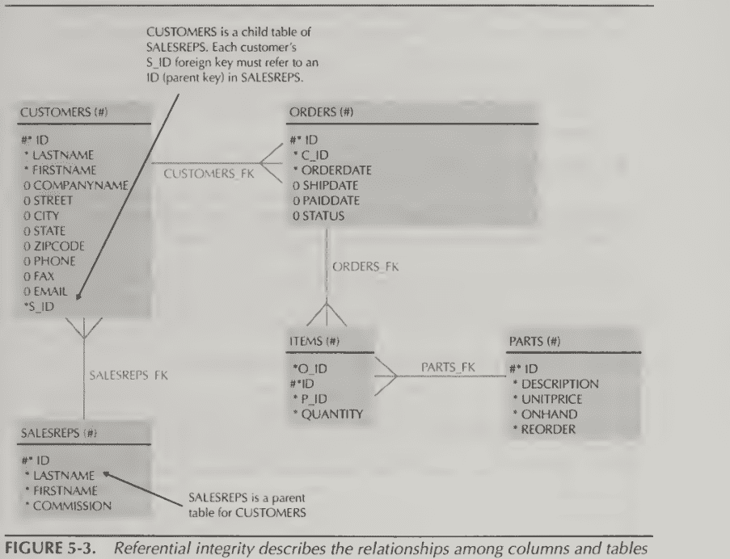

**图 5-3.** 参照完整性描述了关系数据库中列和表之间的关系。

关系数据库模型描述了多种参照操作：

- **更新/删除限制** 数据库不允许应用程序更新具有一个或多个依赖子记录的父键，也不允许删除这样的父行。例如，如果 ORDERS 表中的一个销售订单在 ITEMS 表中有相关的明细行，你就不能删除该订单。
- **删除级联** 当应用程序从父表中删除一行时，关系数据库管理系统会通过删除子表中所有依赖的记录来级联删除。例如，当你从 ORDERS 表中删除一个订单时，数据库会自动从 ITEMS 表中删除所有对应的明细行。
- **更新级联** 当应用程序更新父键时，数据库会将更新级联到依赖的外键。例如，当你更改 ORDERS 表中某个订单的 ID 时，关系数据库管理系统会自动更新 ITEMS 表中所有对应明细行记录的订单 ID。这种参照操作很少有用，因为应用程序通常不允许用户更新键值。Oracle 不支持这种参照操作。
- **更新/删除置空** 当应用程序更新或删除父键时，所有依赖的键都被设置为空。
- **更新/删除置默认值** 当应用程序更新或删除父键时，所有依赖的键都被设置为一个有意义的默认值。

默认情况下，Oracle 对所有参照完整性约束强制执行更新/删除限制的参照操作。可选地，Oracle 可以对参照完整性约束执行删除级联或删除置空的参照操作。

### Oracle 何时执行完整性约束规则？

默认情况下，Oracle 会在应用程序提交 SQL 语句以向表中插入、更新或删除行后立即执行所有完整性约束。当语句导致数据完整性违规时，Oracle 会自动回滚该语句的效果。

可选地，Oracle 可以将*可延迟完整性约束*的执行延迟到事务提交之前。当你提交事务且该事务已修改了不符合所有完整性约束的表数据时，Oracle 会自动回滚整个事务（即，事务中所有语句的效果）。

典型的数据库应用程序应选择在执行每条 SQL 语句时立即检查数据完整性。可延迟约束通常适用于特殊情况，例如可能需要更新大量数据表并暂时违反完整性规则，直到事务结束前才执行的大批量数据加载。有关配置和使用可延迟约束的更多信息，请参阅 *Oracle SQL 参考手册*。

既然你已经对模式、表、列、数据类型和完整性约束有了基本的理解，接下来部分的练习将解释如何将你新学到的知识付诸实践。

## 创建表和完整性约束

使用 Oracle XE 时，你可以通过两种不同的方法之一来构建和管理表、完整性约束以及大多数其他类型的模式对象：

- 你可以使用命令行工具，如 SQL*Plus，输入 SQL DDL 命令，例如 CREATE TABLE、ALTER TABLE、CREATE VIEW 等。
- 你可以使用 Oracle Application Express 对象浏览器页面的点选式图形用户界面，简化创建构建模式对象的 SQL DDL 命令。

本节中的练习将让你接触这两种方法。

### 练习 5.1：启动对象浏览器

要完成此练习，请按照练习 2.13 中的说明启动 Oracle Application Express 的数据库主页。使用本章的实践帐户 HANDSONXE05 和密码 PASSWORD 建立连接。启动数据库主页后，点击“对象浏览器”以启动对象浏览器页面，如图 5-4 所示。

请注意，对象浏览器页面有两个窗格。页面左侧的*对象选择窗格*列出了当前模式中包含的各种类型的对象；此时，你的模式没有任何对象，因此对象选择窗格为空。页面右侧的*详情窗格*显示了当前在对象选择窗格中选中的对象的信息。一旦我们有一些对象可以操作，你将能更深入地了解如何使用详情窗格。

**注意**

页面的左上角指示了你当前的模式（例如，用户：HANDSONXE05）。

### 练习 5.2：创建 PARTS 表

要使用 Oracle Application Express 的对象浏览器页面创建前面章节中熟悉的 PARTS 表，请点击详情窗格右上角“创建”菜单的向下箭头，然后点击“表”以显示创建表向导。创建表向导的“列”页面让你指定表中各列的名称、数据类型和非空约束。按照图 5-5 所示填写此页面。

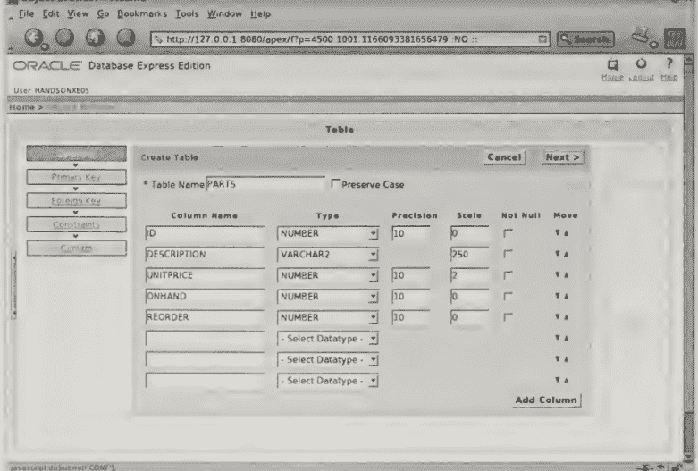

**图 5-5.** 使用创建表向导的第一页来指定新表各列的名称、数据类型和非空约束。


请注意图 5-5 中的以下几点：

- ID、ONHAND 和 REORDER 列使用 NUMBER 数据类型，精度限制为 10，小数位数为 0；这些列能够存储最多十位有效数字精度的整数。由于在指定精度时 NUMBER 数据类型的小数位数默认为 0，因此无需输入 0 作为小数位数，但这样做可以使你的意图更加明确。

- UNITPRICE 列使用 NUMBER 数据类型，精度限制为 10，小数位数为 2；该列能够存储最多十位精度的数值，并会将小数点后两位之后的数字进行四舍五入。

- DESCRIPTION 列使用 VARCHAR2 数据类型，用于接受最长 250 字节的可变长度字符串。

完成后，单击"下一步"继续。"创建表"向导的主键页面要求你指定表的主键信息。按照图 5-6 所示填写此页面。

请注意图 5-6 中的以下几点：

- 你必须首先确定该表是否有主键，如果有，是否希望为插入表中的每一行自动生成主键值。本章后续章节将介绍一些主键生成技术；在本练习中，请选择"未填充"。

- 你可以为主键约束指定名称；一个好的命名规范是使用表名加上后缀 _PK；例如，在"主键约束名称"字段中指定 **PARTS_PK**。

- 你必须选择一个（或多个）列作为主键约束的基础；从"主键"下拉列表中选择 ID(NUMBER)（ID 列及其数据类型 NUMBER）。创建 PARTS 表后，表中的每条记录都必须有一个唯一的 ID（隐式不允许为空值），且与其他所有记录不同。

"创建表"向导的接下来两个页面提供了创建外键（引用完整性约束）、检查约束和唯一键（备用键）约束的接口。PARTS 表不需要这些类型的完整性约束，因此单击左侧的"确认"跳过；后续练习将演示如何使用"创建表"向导中被跳过的页面。

**图 5-6.** 使用"创建表"向导的第二个页面来指定表的主键。

"创建表"向导的确认页面请求确认以创建新表。在创建 PARTS 表之前，单击 SQL 以显示向导将执行的底层 SQL 语句，以完成你的请求。SQL 应与以下内容一致：

```
CREATE table "PARTS" (
     "ID"           NUMBER(10,0),
     "DESCRIPTION"  VARCHAR2(250),
     "UNITPRICE"    NUMBER(10,2),
     "ONHAND"       NUMBER(10,0),
     "REORDER"      NUMBER(10,0),
     constraint  "PARTS_PK" primary key ("ID")
)
/
```

请注意，在本课的上下文中，对象浏览器页面的"创建表"向导不过是一个简化 CREATE TABLE 语句创建过程的工具。这个 CREATE TABLE 语句的第一个示例说明，在为新表指定唯一名称后，你可以指定一个以逗号分隔的列规范列表来描述表的结构。每个列规范包括一个列名和数据类型规范。同时请注意，CREATE TABLE 命令支持声明完整性约束，如主键。有关 SQL 命令 CREATE TABLE 的完整信息，请参阅 *Oracle SQL 参考手册*。

要创建 HANDSONXE05.PARTS 表，请在"创建表"向导的最后一页单击"创建"。你当前的模式 HANDSONXE05 现在有一个新表 PARTS，你可以对其进行查询、插入记录等操作。新表的名称应出现在对象选择窗格的对象列表中，新表的详细信息应出现在详细信息窗格中，如图 5-7 所示。

**图 5-7.** 使用对象浏览器的对象选择和详细信息窗格来创建、浏览和修改数据库对象。

现在对象已可用，请注意对象浏览器页面各个窗格的相关说明：

- 页面左侧的对象选择窗格列出了当前模式中包含的各种类型的对象。你可以通过使用窗格顶部的"对象"下拉列表和对象搜索字段来控制要关注的对象。

- 页面右侧的详细信息窗格显示了在对象选择窗格中当前选定对象的信息。选择对象后，你可以单击详细信息窗格顶部边缘的选项卡（例如"表"、"数据"、"索引"）来查看当前对象的各种类型信息。单击选项卡序列下方的按钮，以特定方式编辑选定的对象（例如"添加列"、"修改列"、"重命名列"）。

### 练习 5.3：创建 CUSTOMERS 表

现在让我们使用"创建表"向导创建一个不完整版本的常见 CUSTOMERS 表。请理解，你将在本练习中故意在创建 CUSTOMERS 衽时做出一些省略和错误，以便你以后学习如何修改该表。使用对象浏览器完成以下步骤：

1. 单击"创建" | "表"。

> **注意**
> 有时，"创建"按钮可能不在可见区域内，需要使用浏览器的水平滚动条才能访问。

2. 在"表名"字段中指定 **CUSTOMERS**。
3. 仍然在"列"页面上，输入以下列规范（列名、类型等）；必要时单击"添加列"以向显示中添加更多列：

- 使用 NUMBER 数据类型指定 **ID** 列，精度限制为 **10**，小数位数为 **0**。
- 使用 VARCHAR2 数据类型指定 **LASTNAME** 列，大小为 **100**。
- 使用 VARCHAR2 数据类型指定 **FIRSTNAME** 列，大小为 **50**。
- 使用 VARCHAR2 数据类型指定 **COMPANYNAME** 列，大小为 **100**。
- 使用 VARCHAR2 数据类型指定 **STREET** 列，大小为 **100**。
- 使用 VARCHAR2 数据类型指定 **CITY** 列，大小为 **100**。
- 使用 VARCHAR2 数据类型指定 **STATE** 列，大小为 **50**。
- 使用 NUMBER 数据类型指定 **ZIPCODE** 列，精度限制为 **10**，小数位数为 **0**。
- 使用 VARCHAR2 数据类型指定 **PHONE** 和 **FAX** 列，大小为 **30**。
- 使用 VARCHAR2 数据类型指定 **EMAIL** 列，大小为 **100**。
- 以下列应标记为"非空"：LASTNAME、FIRSTNAME 和 PHONE。

4. 单击左侧的"确认"继续。
5. 单击 SQL 并查看向导构建的 CREATE TABLE 语句（如下所示）。特别注意，在 CREATE TABLE 语句中指定列时，你可以将其声明为 NOT NULL 以声明该列的非空完整性约束。

```
CREATE table "CUSTOMERS" (
    "ID"         NUMBER(10,0),
    "LASTNAME"   VARCHAR2(100) NOT NULL,
    "FIRSTNAME"  VARCHAR2(50) NOT NULL,
    "COMPANYNAME" VARCHAR2(100),
    "STREET"     VARCHAR2(100),
    "CITY"       VARCHAR2(100),
    "STATE"      VARCHAR2(50),
    "ZIPCODE"    NUMBER(10,0),
    "PHONE"      VARCHAR2(30) NOT NULL,
    "FAX"        VARCHAR2(30),
    "EMAIL"      VARCHAR2(100)
)
/
```

6. 单击"创建"以创建 HANDSONXE05.CUSTOMERS 表。

### 慎选数据类型

在设计数据库模式中的表时，为列选择正确的数据类型有时可能比较棘手。例如，让我们看看在练习 5.2 中使用 NUMBER 数据类型声明 CUSTOMERS 表中的 ZIPCODE 列后会发生什么。考虑一下当插入一个邮编为 01003 的客户记录时会发生什么——Oracle 会将此数字存储为 1003，这当然不是你想要的。你也无法插入加拿大邮编，如 J7N1H3。再考虑一下，如果你插入一个带有邮编和扩展码（如 91222-0299）的客户记录会发生什么——Oracle 会将此数字表达式求值并存储结果数字 90923。这些简单的例子说明，列的数据类型选择确实是一个重要的考虑因素，不容忽视。练习 5.4 将教你如何将 ZIPCODE 列的数据类型更改为正确存储邮政编码。

### 练习 5.4：修改列的数据类型

创建表后，你可以使用 Oracle Application Express 的对象浏览器页面以多种不同的方式对其进行修改。完成本练习的以下步骤，学习如何将 ZIPCODE 列的数据类型从 NUMBER 更改为 VARCHAR2：

1. 在对象选择窗格中选择 CUSTOMERS。
2. 在详细信息窗格中单击"表"。
3. 在详细信息窗格中单击"修改列"。
4. 完成以下步骤，将 ZIPCODE 列的数据类型从 NUMBER(10,0) 修改为 VARCHAR2(50)：

- 在列列表中选择 ZIPCODE(NUMBER)。
- 在数据类型列表中选择 VARCHAR2。
- 在"长度"字段中指定 50。
- 在"可空性"列表中选择"空"（不要求值）。

5. 单击"下一步"。
6. 单击 SQL 并查看对象浏览器页面构建的 SQL 语句。请注意，要修改列的数据类型，你可以使用 SQL 命令 ALTER TABLE 的 MODIFY 子句，如下所示。有关 ALTER TABLE 命令的完整信息，请参阅 *Oracle SQL 参考手册*。

```
alter table "CUSTOMERS" modify
("ZIPCODE" VARCHAR2(50) )
/
```

7. 单击"完成"。


> 注意
> 请记住，只要列中的所有当前数据都符合您想要进行的更改，您就可以修改列的数据类型规范。例如，您总是可以增加CHAR或VARCHAR2列的大小，但如果列中的字符串长于列的新大小，则无法减小列的大小。

### 练习 5.5：为表添加主键

对象浏览器页面使得向表添加完整性约束变得轻而易举。例如，完成以下步骤为CUSTOMERS表添加主键：

- 1. 在对象选择窗格中选择CUSTOMERS。
- 2. 在详细信息窗格中点击“约束”。注意CUSTOMERS表已存在的非空约束列表。下一个练习将更详细地解释约束的命名。
- 3. 点击“创建”。
- 4. 完成以下步骤添加主键约束：
  - 在“约束名”字段中指定CUSTOMERS_PK。
  - 在“约束类型”字段中选择“主键”。
  - 在“主键列1”列表中选择ID(NUMBER)。
- 5. 点击“下一步”。
- 6. 点击“SQL”并查看对象浏览器页面生成的SQL语句（如下所示）。注意，要向表添加约束，您可以使用SQL命令ALTER TABLE的ADD CONSTRAINT子句。

```
alter table "CUSTOMERS" add constraint
"CUSTOMERS_PK" primary key ("ID")
/
```

- 7. 点击“完成”。在详细信息窗格中观察您刚刚添加的新约束。
- 8. 在详细信息窗格中点击“表”。在对象浏览器页面的详细信息窗格中观察，构成主键的所有列都不是“可为空”；这是对一个事实的提醒，即表中每一行的主键必须唯一且非空。

### 练习 5.6：为表添加复合唯一键

完成以下步骤为CUSTOMERS表添加复合唯一键：

- 1. 在对象选择窗格中选择CUSTOMERS。
- 2. 在详细信息窗格中点击“约束”。
- 3. 点击“创建”。
- 4. 完成以下步骤添加唯一约束：
  - 在“约束名”字段中指定CUSTOMERS_UK1。
  - 在“约束类型”字段中选择“唯一”。
  - 在“唯一列1”列表中选择LASTNAME(VARCHAR2)。
  - 在“唯一列2”列表中选择FIRSTNAME(VARCHAR2)。
- 5. 点击“下一步”。
- 6. 点击“SQL”并查看对象浏览器页面生成的SQL语句（如下所示）。注意，您可以使用SQL命令ALTER TABLE的ADD CONSTRAINT子句为表添加唯一约束。
- 7. 点击“完成”。

```
alter table "CUSTOMERS" add constraint
"CUSTOMERS_UK1" unique ("LASTNAME","FIRSTNAME")
/
```

一旦您修改了CUSTOMERS表并返回到对象浏览器页面，请仔细查看CUSTOMERS表的约束名称：所有您明确命名的约束都很容易识别（CUSTOMERS_PK，CUSTOMERS_UK1），但还有一些以SYS_C前缀开头的约束。这些约束对应于与表的LASTNAME、FIRSTNAME和PHONE列关联的非空约束。尽管SQL命令CREATE TABLE和ALTER TABLE提供了明确命名非空约束的方法，但Oracle Application Express的对象浏览器界面并未暴露此功能。当您未指定约束名称时，Oracle会生成一个以先前提到的前缀开头的唯一约束名称。

### 练习 5.7：为表添加非空约束

完成以下步骤以防止PARTS表的DESCRIPTION列出现空值：

- 1. 在对象选择窗格中选择PARTS。
- 2. 在详细信息窗格中点击“表”。
- 3. 点击“修改列”。
- 4. 完成以下步骤添加非空约束：
  - 在“列列表”字段中选择DESCRIPTION(VARCHAR2)。
  - 在“可为空”列表中选择“非空（要求值）”。
  - 注意，无法为非空约束命名。
  - 不要修改页面上的任何其他项目。
- 5. 点击“下一步”。
- 6. 点击“SQL”并查看对象浏览器页面生成的ALTER TABLE语句：
- 7. 点击“完成”。

```
alter table "PARTS" modify
("DESCRIPTION" NUMBER(10,0) NOT NULL)
/
```

仅供参考，如果您使用SQL*Plus和ALTER TABLE语句为表添加非空约束，可以通过在前面显示的命令中添加CONSTRAINT参数来命名非空约束：

```
alter table "PARTS" modify
("DESCRIPTION" NUMBER(10,0) CONSTRAINT description_nn NOT NULL)
/
```

这是对象浏览器界面选定功能缺陷的一个示例，您需要通过SQL命令来解决。

### 练习 5.8：创建SALESREPS表

接下来，为HANDSONXE05架构创建SALESREPS表，如下所示：

- 1. 点击“创建” | “表”。
- 2. 在“表名”字段中指定SALESREPS。
- 3. 仍在“列”页面上，输入以下列规范（列名、类型等：）
  - 使用NUMBER数据类型指定**ID**列，精度限制为**10**，小数位数为**0**。
  - 使用VARCHAR2数据类型指定**LASTNAME**列，大小为**100**。
  - 使用VARCHAR2数据类型指定**FIRSTNAME**列，大小为**50**。
  - 使用NUMBER数据类型指定**COMMISSION**列，精度限制为**10**，无小数位数（将小数位留空）。
  - 将LASTNAME列标记为非空。
- 4. 点击“下一步”或“主键”（在左侧）继续。
- 5. 在“主键”页面上，完成以下步骤：
  - 选择“未填充”。
  - 在“主键约束名”字段中指定**SALESREPS_PK**。
  - 在“主键”列表中选择ID(NUMBER)。
- 6. 点击“确认”继续。
- 7. 点击“SQL”并查看向导生成的CREATE TABLE语句：

```
CREATE table "SALESREPS" (
    "ID"         NUMBER(10,0),
    "LASTNAME"   VARCHAR2(100) NOT NULL,
    "FIRSTNAME"  VARCHAR2(50),
    "COMMISSION" NUMBER(10),
    constraint  "SALESREPS_PK" primary key ("ID")
)
/
```

- 8. 点击“创建”以创建HANDSONXE05.SALESREPS表。

## **练习 5.9：创建ORDERS表**

在本练习中，您将为HANDSONXE05架构创建ORDERS表。此表具有一个引用CUSTOMERS表主键的参照完整性约束（外键）和一个检查约束。

- 1. 点击“创建” | “表”。
- 2. 在“表名”字段中指定**ORDERS**。
- 3. 仍在“列”页面上，输入以下列规范（列名、类型等）
  - 使用NUMBER数据类型指定**ID**和**C_ID**列，精度限制为**10**，小数位数为**0**
  - 使用DATE数据类型指定**ORDERDATE**、**SHIPDATE**和**PAIDDATE**列
  - 使用CHAR数据类型指定**STATUS**列，大小为**1**
  - 将C_ID和ORDERDATE列标记为非空
- 4. 点击“下一步”或“主键”继续
- 5. 在“主键”页面上，完成以下步骤
  - 选择“未填充”
  - 在“主键约束名”字段中指定**ORDERS_PK**
  - 在“主键”列表中选择ID(NUMBER)
- 6. 点击“下一步”或“外键”继续
- 7. 在“外键”页面上，完成以下步骤，为ORDERS表的C_ID列添加一个外键，该外键引用CUSTOMERS表的ID列。目的是确保ORDERS表中每条记录的C_ID字段引用CUSTOMERS表中的一个ID，并防止删除在ORDERS表中具有相关行（子项）的CUSTOMERS表中的父记录
  - 在“名称”字段中指定**ORDERS_FK1**
  - 要为新的参照完整性约束强制执行默认的删除限制参照操作，请选择“禁止删除”
  - 要指明新ORDERS表中构成外键的列，请在“选择键列”字段中选择C_ID列，然后点击旁边的右箭头按钮将选定的列移动到“键列”字段
  - 要指明父CUSTOMERS表中的被引用列，请点击“引用表”字段右侧的按钮，从弹出的表列表中点击CUSTOMERS，在“选择引用列”字段中选择ID列，然后点击旁边的右箭头按钮将选定的列移动到“引用列”字段。如果您指定的“引用表”字段的表的列列表没有自动出现，请点击字段旁边的向下箭头
  - 点击“添加”


 ■ 在页面顶部的外键列表中确认新外键的声明。如果您错误地声明了约束，请使用相应的删除按钮（红色 X）删除该约束声明。然后尝试使用页面下半部分的选项重新创建约束。

8. 点击 Next 或 Constraints 继续。

9. 在 Constraints 页面上，完成以下步骤以添加一个检查约束，将 STATUS 列的取值域限制为状态码字符 B 和 F：

- 在 Name 字段中指定 ORDERS_CK1。
- 选择 Check。
- 在输入字段中输入以下条件：status IN ('F','B')。
- 点击 Add。
- 在页面顶部确认新检查约束的声明。

10. 点击 Finish 或 Confirm 继续。

11. 点击 SQL 并查看向导构建的 SQL 语句（如下所示）。请注意，您可以使用 SQL 命令 ALTER TABLE 的 ADD CONSTRAINT 子句为表添加外键或检查约束。

```
CREATE table "ORDERS" (
    "ID"        NUMBER(10,0),
    "C_ID"      NUMBER(10,0) NOT NULL,
    "ORDERDATE" DATE NOT NULL,
    "SHIPDATE"  DATE,
    "PAIDDATE"  DATE,
    "STATUS"    CHAR(1),
    constraint "ORDERS_PK" primary key ("ID")
)
/

ALTER TABLE "ORDERS" ADD CONSTRAINT "ORDERS_FK1"
FOREIGN KEY ("C_ID")
REFERENCES "CUSTOMERS" ("ID")

/

alter table "ORDERS" add
constraint ORDERS_CK1
check (status IN ('F','B'))
/
```

12. 点击 Create 创建 HANDSONXE05.ORDERS 表。

创建 ORDERS 表后，请注意在设计窗格的 Table 选项卡中，STATUS 列可以为空（Nullable 为 Yes）。为什么？这是一个很好的地方，可以指出新手在设计带有完整性约束的表时必须清楚理解的一些重要事实：

- 除主键和非空约束之外的约束不禁止空值。要禁止唯一键、外键以及检查约束的基础列中的空值，您必须为基础列显式声明非空约束。
- 当您允许唯一键、外键或检查约束的基础列中存在空值时，如果约束条件对于给定行求值为 TRUE 或 UNKNOWN，则该行符合约束。
- 当您禁止唯一键、外键或检查约束的基础列中存在空值时，给定行仅在约束条件对于该行求值为 TRUE 时才符合约束。

在设计表时，始终牢记这些关于空值和完整性约束的细微要点，以确保您正确执行业务规则。

## **练习 5.10：创建 ITEMS 表**

在本练习中，您将为 HANDSONXE05 模式创建 ITEMS 表。该表具有引用 ORDERS 表和 PARTS 表主键的引用完整性约束；一个外键使用默认的引用操作删除限制，而另一个外键使用删除级联引用操作。

1. 点击 Create | Table。
2. 在 Table Name 字段中指定 **ITEMS**。
3. 仍在 Columns 页面上，输入以下列规格（Column Name、Type 等）：
   - 使用 NUMBER 数据类型指定 **O_ID**、**ID**、**P_ID** 和 **QUANTITY** 列，精度限制为 **10**，小数位数为 **0**。
   - 将所有列标记为 Not Null。
4. 点击 Next 或 Primary Key 继续。
5. 在 Primary Key 页面上，完成以下步骤：
   - 选择 Not populated。
   - 在 Primary Key Constraint Name 字段中指定 **ITEMS_PK**。
   - 在 Primary Key 列表中选择 O_ID(NUMBER)。
   - 在 Composite Primary Key 列表中选择 ID(NUMBER)。这意味着 ITEMS 表中的每一行必须具有唯一的 O_ID/ID（订单 ID/项目 ID）组合。

6. 点击 Next 或 Foreign Key 继续。

7. 在 Foreign Key 页面上，完成以下步骤，为 ORDERS 表的 O_ID 列添加一个外键，该外键引用 ORDERS 表的 ID 列。目标是确保 ITEMS 表中每条记录的 O_ID 字段引用 ORDERS 表中的 ID，并且当事务删除 ORDERS 表中的记录时，Oracle 自动通过删除 ITEMS 表中的关联记录来级联删除。

- 在 Name 字段中指定 **ITEMS_FK1**。
- 要为新的引用完整性约束强制执行删除级联引用操作，请选择 Cascade Delete。
- 要指示构成新 ITEMS 表中外键的列，请在 Select Key Column(s) 字段中选择 O_ID 列，然后点击右箭头按钮将所选列移动到 Key Column(s) 字段。
- 要指示父 ORDERS 表中的引用列，请点击 References Table 字段右侧的按钮，从随后出现的表弹出列表中点击 ORDERS，在 Select Reference Column(s) 字段中选择 ID 列，然后点击右箭头按钮将所选列移动到 Reference Column(s) 字段。如果为您在 References Table 字段中指定的表没有自动出现列列表，请点击该字段旁边的向下箭头。
- 点击 Add。
- 在页面顶部的外键列表中确认新外键的声明。

8. 仍在 Foreign Keys 页面上，完成以下步骤以添加另一个外键。该外键用于 ORDERS 表的 P_ID 列，引用 PARTS 表的 ID 列。目标是确保 ITEMS 表中每条记录的 P_ID 字段引用 PARTS 表中的 ID，并防止删除在 ITEMS 表中有子记录的 PARTS 表中的父记录。

- 在 Name 字段中指定 **ITEMS_FK2**。
- 要为新的引用完整性约束强制执行删除限制引用操作，请选择 Disallow Delete。
- 要指示构成新 ITEMS 表中外键的列，请在 Select Key Column(s) 字段中选择 P_ID 列，然后点击右箭头按钮将所选列移动到 Key Column(s) 字段。
- 要指示父 PARTS 表中的引用列，请点击 References Table 字段右侧的按钮，从随后出现的表弹出列表中点击 PARTS，在 Select Reference Column(s) 字段中选择 ID 列，然后点击右箭头按钮将所选列移动到 Reference Column(s) 字段。
- 点击 Add。
- 在页面顶部的外键列表中确认新外键的声明。在继续之前，Foreign Keys 页面应如图 5-8 所示。

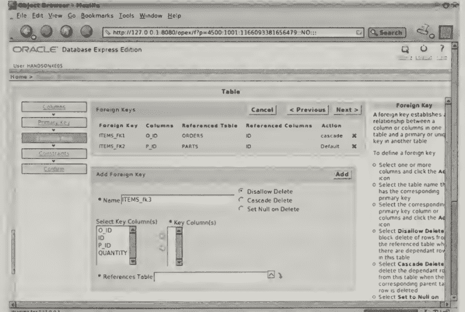

**图 5-8.** 使用 Create Table 向导的 Foreign Keys 页面为新表声明一个或多个引用完整性约束。

9. ITEMS 表不需要任何检查约束。因此，点击 Confirm 继续。

10. 点击 SQL 并查看向导构建的 SQL 语句（如下所示）。一些值得注意的地方包括 ITEMS 表的复合主键规范，以及 ITEMS_FK1 约束的 ALTER TABLE 语句的 ADD CONSTRAINT 子句中 DELETE CASCADE 选项的规范。与往常一样，有关 SQL 命令 CREATE TABLE 和 ALTER TABLE 的完整信息，请参阅 *Oracle SQL Reference*。

```
CREATE table "ITEMS" (
    "O_ID"      NUMBER(10,0) NOT NULL,
    "ID"        NUMBER(10,0) NOT NULL,
    "P_ID"      NUMBER(10,0) NOT NULL,
    "QUANTITY"  NUMBER(10,0) NOT NULL
)
/

alter table "ITEMS" add constraint  "ITEMS_PK"
primary key ("O_ID","ID")
/

ALTER TABLE "ITEMS" ADD CONSTRAINT "ITEMS_FK1"
FOREIGN KEY ("O_ID")
REFERENCES "ORDERS" ("ID")
ON DELETE CASCADE
/
ALTER TABLE "ITEMS" ADD CONSTRAINT "ITEMS_FK2"
FOREIGN KEY ("P_ID")
REFERENCES "PARTS" ("ID")
/
```

11. 点击 Create 创建 HANDSONXE05.ORDERS 表。

### 练习 5.11：为表添加列和引用完整性约束

假设您意识到模式中存在设计缺陷：CUSTOMERS 表必须能够跟踪每个客户的销售代表。这需要在 CUSTOMERS 表中添加一个新列以及一个引用完整性约束。首先，完成以下步骤以了解如何为表添加列：

1. 在 Object Selection 窗格中选择 CUSTOMERS。
2. 在 Detail 窗格中点击 Table。


3. 点击“Add Column”（添加列）。

4. 完成以下步骤，将 S_ID 列添加到表中：

- 在“Add Column”字段中指定 S_ID。
- 在“Nullable”字段中选择 NOT NULL（require a value）。
- 在“Type”字段中选择 NUMBER。
- 在“Precision”字段中指定 10。
- 在“Scale”字段中指定 0。

5. 点击“Next”继续。

6. 点击“SQL”并查看向导生成的 SQL 语句：

```
alter table "CUSTOMERS" add
("S_ID" NUMBER(10,0) NOT NULL)
/
```

7. 点击“Finish”。

现在完成以下步骤，为 CUSTOMERS 表添加引用完整性约束。目标是确保每个客户记录的 S_ID 都引用 SALESREPS 表中的 ID，并防止删除在 CUSTOMERS 表中仍有子记录的 SALESREPS 表父记录。

1. 在“Object Selection”窗格中选择 CUSTOMERS。

2. 在“Detail”窗格中点击“Constraints”。

3. 点击“Create”。

4. 完成以下步骤，为表添加外键：

- 在“Constraint Name”字段中指定 CUSTOMERS_FK1。
- 在“Constraint Type”字段中选择 Foreign Key。
- 不要选中“On Delete Cascade”复选框。
- 在“Foreign Key Column(s)”字段中选择 S_ID。
- 在“Reference Table Name”字段中选择 SALESREPS。
- 在“Reference Table Column List”字段中选择 ID。

5. 点击“Next”继续。

6. 点击“SQL”并查看向导生成的 SQL 语句：

```
alter table "CUSTOMERS" add constraint
"CUSTOMERS_FK1" foreign key ("S_ID") references "SALESREPS" ("ID")
/
```

7. 点击“Finish”。

到目前为止，本练习中的步骤对你来说应该都不陌生。我这样设计这个练习是为了说明，当你对 SQL 越来越熟悉时，更高效的做法（在我看来）是从命令行学习和使用 SQL。例如，如果你使用 SQL*Plus，下面这条 ALTER TABLE 语句可以一次性将 S_ID 列添加到 CUSTOMERS 表，并声明一个引用 SALESREPS 表的外键约束：

```
ALTER TABLE customers
ADD s_id NUMBER(10,0)
CONSTRAINT s_id_nn NOT NULL
ADD CONSTRAINT customers_fk1
FOREIGN KEY (s_id)
REFERENCES salesreps (id);
```

刚开始使用 Oracle XE 时，你可以随意使用 Object Browser 界面；但务必研究该工具为你生成的 SQL，然后尝试在 SQL*Plus 或 Oracle Application Express 的 SQL Commands 页面中亲自运行。

## 构建外键的规则

为表声明外键约束时，请记住以下几点重要事项：

- 外键必须引用表的主键或唯一键；如果你试图声明一个未引用已启用主键或唯一键的外键，Oracle 会返回错误。

- 外键中列的数据类型必须与引用父键中列的数据类型匹配。

- 外键中的列不能使用以下任何一种数据类型：LOB、LONG、LONG RAW、VARRAY、NESTED TABLE、OBJECT、BFILE、REF 或 TIMESTAMP WITH TIME ZONE。

## 第 5 章：构建基本关系模式

### 练习 5.12：测试完整性约束

至此，我们已经完成了所有表的构建。本练习要求你向各个表中插入一些行，以确认我们在前面练习中创建的完整性约束确实能够执行我们的业务规则：

1. 在“Object Selection”窗格中点击 PARTS。

2. 在“Detail”窗格中点击“Data”。注意该表目前没有行。

3. 点击“Insert Row”。

4. 完成以下步骤以插入一个新行：

- 在“Id”字段中指定 1。
- 在“Description”字段中指定 **Fax Machine**。
- 在“Unitprice”字段中指定 **299**。
- 在“Onhand”字段中指定 **277**。
- 在“Reorder”字段中指定 **50**。

5. 点击“Create”和“Create Another”。该行符合所有完整性约束，因此你应该会在页面顶部看到“Row created”消息。

6. 完成以下步骤以插入另一个新行：

- 在“Id”字段中指定 2。
- 将“Description”字段留空（null）。
- 在“Unitprice”字段中指定 **4895**。
- 在“Onhand”字段中指定 **143**。
- 在“Reorder”字段中指定 **25**。

7. 点击“Create”。这一次，Oracle 返回以下错误编号和消息：

```
error ORA-01400: cannot insert NULL into (
"HANDSONXE05"."PARTS"."DESCRIPTION")
```

8. PARTS 表的 DESCRIPTION 列的 NOT NULL 约束禁止该列出现空值。重新输入该行信息，但在“Description”字段中指定 **Copy Machine**，点击“Create”，该行将无错误地插入。

Object Browser 的“Detail”窗格现在会显示 PARTS 表中的新行，如图 5-9 所示。

## 174 Hands-On Oracle Database 10g Express Edition for Linux

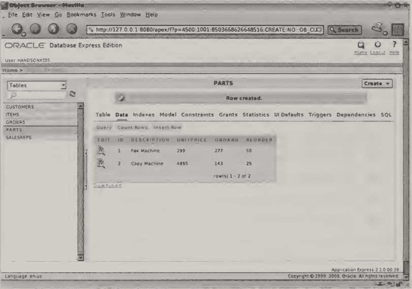

**图 5-9.** *包含两行的 PARTS 表*

让我们继续测试：

1. 在“Object Selection”窗格中点击 SALESREPS。
2. 在“Detail”窗格中点击“Data”。注意该表目前没有行。
3. 点击“Insert Row”。
4. 完成以下步骤以插入一个新行：
   - 在“Id”字段中指定 **1**。
   - 在“Lastname”字段中指定 **Pratt**。
   - 在“Firstname”字段中指定 **Nick**。
   - 在“Commission”字段中指定 **5**。

5. 点击“Create”和“Create Another”。该行符合所有完整性约束，因此你应该会在页面顶部看到“Row created”消息。

6. 完成以下步骤以插入另一个新行：

- 在“Id”字段中指定 **2**。
- 在“Lastname”字段中指定 **Jonah**。
- 在“Firstname”字段中指定 **Suzanne**。
- 在“Commission”字段中指定 **5**。

7. 点击“Create”和“Create Another”。同样，新行符合所有完整性约束，因此你应该会在页面顶部看到“Row created”消息。

8. 完成以下步骤以插入一个新行：

- 在“Id”字段中指定 **2**。
- 在“Lastname”字段中指定 **Greenberg**。
- 在“Firstname”字段中指定 **Bara**。
- 在“Commission”字段中指定 **5**。

9. 点击“Create”。这一次，Oracle 返回以下错误编号和消息：

```
error ORA-00001: unique constraint
(HANDSONXE05.SALESREPS_PK) violated
```

10. SALESREPS 表的主键约束禁止两条记录具有相同的 ID。在这个例子中，第三行试图使用已被另一条记录占用的 ID 号 2。只需重新输入该行信息，但在“Id”字段中指定 3，点击“Create”，该行将无错误地插入。

完成后，Object Browser 的“Detail”窗格应类似于图 5-10。

> **注意**
> 默认情况下，Object Browser 界面会在每次插入行后隐式提交。

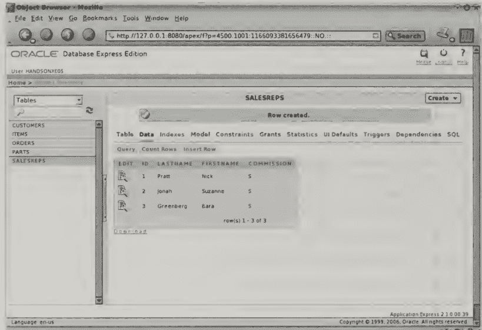

**图 5-10.** 包含几行的 SALESREPS 表

现在，让我们测试引用完整性约束，看看会发生什么：

1. 在“Object Selection”窗格中点击 CUSTOMERS。
2. 在“Detail”窗格中点击“Data”。注意该表目前没有行。
3. 点击“Insert Row”。
4. 完成以下步骤以插入一个新行：
   - 在“Id”字段中指定 **1**。
   - 在“Lastname”字段中指定 **Joy**。
   - 在“Firstname”字段中指定 **Harold**。
   - 在“Companyname”字段中指定 **McDonald Co.**。
   - 在“Street”字段中指定 **4458 Stafford St.**。

## 第 5 章：构建基本关系模式

- 在“City”字段中指定 **Baltimore**。
- 在“State”字段中指定 **MD**。
- 在“Zipcode”字段中指定 **21209**。
- 在“Phone”字段中指定 **410-983-5789**。
- 将“Fax”字段留空。
- 在“Email”字段中指定 **harold_joy@mcdonald.com**。
- 在“S_ID”字段中指定 **3**。

5. 点击“Create”和“Create Another”。该行符合所有完整性约束，因此你应该会在页面顶部看到“Row created”消息。

6. 完成以下步骤以插入另一个新行：

- 在“Id”字段中指定 **2**。
- 在“Lastname”字段中指定 **Musial**。
- 在“Firstname”字段中指定 **Bill**。
- 在“Companyname”字段中指定 **Car Audio Center**。
- 在“Street”字段中指定 **12 Donna Lane**。
- 在“City”字段中指定 **Reno**。
- 在“State”字段中指定 **NV**。
- 在“Zipcode”字段中指定 **89501**。
- 在“Phone”字段中指定 **775-859-2121**。
- 在“Fax”字段中指定 **775-859-2121**。
- 在“Email”字段中指定 **musial@car-audio.net**。
- 在“S_ID”字段中指定 **5**。

7. 点击“Create”。这一次，Oracle 返回以下错误编号和消息：

```
error ORA-02291: integrity constraint
(HANDSONXE05.CUSTOMERS_FK1) violated - parent key not found
```

8. CUSTOMERS 表中的 CUSTOMERS_FK1 引用完整性约束不允许客户记录的 S_ID 与 SALESREPS 表中的 ID 不匹配。在这种情况下，INSERT 语句试图插入一条引用 ID 为 5 的销售代表的记录，而该销售代表并不存在。重新输入该行信息，但在“S_ID”字段中指定 **1**，点击“Create”，该行将无错误地插入。


 ## 视图

一旦在数据库中定义了表，你就可以开始关注其他有助于增强应用模式可用性的事物。你可以从为模式中的表定义视图开始。视图是一种用于展示表数据的数据库对象。你为什么会使用视图，又如何使用视图来展示表数据？

- 你可以使用简单视图来暴露表中的所有行和列，但隐藏底层表的名称。例如，你可以创建一个名为 CUST 的视图，用于展示 CUSTOMERS 表中的所有客户记录。

- 你可以使用视图来保护特定表数据的安全性，只暴露表中部分行和/或列。例如，你可以创建一个名为 CUST_CA 的视图，仅展示居住在加利福尼亚州的 CUSTOMERS 表客户的 LASTNAME、FIRSTNAME 和 PHONE 列。

- 你可以使用视图来简化应用编码。复杂视图可以连接相关父表和子表的数据，使其看起来像是数据库中存在另一个不同的表。例如，你可以创建一个名为 ORDER_ITEMS 的视图，连接 ORDERS 和 ITEMS 表中的相关记录。

- 你可以使用视图来展示实际并未存储在表中的派生数据。例如，你可以基于 ITEMS 表创建一个视图，其中包含一个名为 TOTAL 的列，用于计算每条记录的行总计。

从这个列表中可以看出，视图提供了一种灵活的方式来展示数据库中的表数据。事实上，你可以为任何能用 SQL 查询表示的数据创建视图。这是因为视图实际上只是 Oracle 以模式对象形式存储的查询。当应用使用视图执行某些操作时，Oracle 会根据视图的*定义查询*来派生视图的数据。

## 创建视图

本节中的练习将教你如何使用 Oracle Application Express 的 Object Browser 页面以及 SQL 命令 CREATE VIEW 来创建不同类型的视图。

### 只读视图

Oracle 支持的一种视图类型是*只读视图*。正如你所料，数据库应用可以使用只读视图来检索相应的表数据，但无法通过只读视图插入、更新或删除表数据。

**练习 5.13：创建并使用只读视图**

使用 Oracle Application Express 的 Object Browser 页面完成以下步骤，基于当前积压的订单为 ORDERS 表创建一个只读视图：

1. 单击 Create | View。

2. 在 View Name 字段中指定 **BACKLOGGED_ORDERS**。

3. 在 Query 字段中指定以下查询。要创建只读视图，你必须使用 WITH READ ONLY 选项来指定定义查询，以显式声明该视图是只读的；否则，Oracle 会将其创建为可更新视图。该界面没有提供选项或单选按钮列表来选择要创建的视图类型（至少在我撰写本书时还没有）。

```
SELECT * FROM orders WHERE status = 'B' WITH READ ONLY
```

4. 单击 Next 继续。

5. 单击 SQL 查看由 Object Browser 构建的 SQL 语句（如下所示）。请注意，你可以使用 SQL 命令 CREATE VIEW 来创建视图。

```
create or replace view "BACKLOGGED_ORDERS" as
SELECT * FROM orders WHERE status = 'B' WITH READ ONLY
/
```

6. 单击 Create。

7. 请注意，Detail 窗格列出了有关该视图的信息，包括基础表列、它们的数据类型等。

为了了解你可以使用新视图执行哪些操作，请切换到 SQL*Plus 会话（来自本章开头运行支持脚本时保留的会话），并输入以下针对新 BACKLOGGED_ORDERS 只读视图的命令：

```
SELECT * FROM backlogged_orders;

INSERT INTO backlogged_orders
(id, c_id, orderdate, shipdate, paiddate, status)
VALUES (1, 1, SYSDATE, SYSDATE, SYSDATE, 'B');
```

请注意，你可以查询该视图（尽管没有行），但无法通过只读视图向底层 ORDERS 表插入行。

### 可更新视图

Oracle 还允许你定义*可更新*视图，应用可以使用它们来插入、更新和删除表数据，或查询数据。然而，可更新视图的所有列并非*天然可更新*，除非 Oracle 能够通过视图将插入、更新或删除操作正确映射到视图的基础表数据。例如，当视图的定义查询中 SELECT 列表包含*虚拟列*（表达式，或对伪列如 ROWID 的引用）时，只有 UPDATE 语句未引用视图的任何虚拟列时，你才能通过该视图更新基础表行。

当你创建可更新视图时，可以将该视图创建为*约束视图*，以禁止通过该视图执行特定的插入和更新操作。带有 WITH CHECK OPTION 约束的视图不允许执行那些会创建出视图定义查询无法从其基础表物化出来的行的 INSERT 和 UPDATE 语句。

**练习 5.14：创建可更新视图**

使用 Oracle Application Express 的 Object Browser 页面完成以下步骤，将当前版本的 BACKLOGGED_ORDERS 视图替换为受约束的可更新视图：

1. 在 Object Selection 窗格中选择 BACKLOGGED_ORDERS。

2. 单击 Code。

3. 单击 Edit。

4. 通过将 WITH READ ONLY 替换为 **WITH CHECK OPTION** 来编辑视图定义。

5. 单击 Compile。

6. 以下消息确认你的编辑已成功：

```
PL/SQL code successfully compiled
```

> **注意**
>
> 为了简洁起见，我仅在本章的几个练习中建议使用 SQL*Plus。请注意，你始终可以使用 Oracle Application Express 的 Object Browser 页面来输入和更新数据，类似于练习 5.12 中的步骤。如果你更喜欢使用界面而不是输入 SQL 语句，请随意使用。

你可以使用这个新版本的视图将 STATUS 等于 B 的行插入到 ORDERS 基础表中，只要不将订单的 STATUS 代码从 B 更改就可以更新当前订单，或者删除 STATUS 等于 B 的订单。例如，使用你当前的 SQL*Plus 会话输入以下 SQL 语句，这些语句都应该成功：

```
INSERT INTO backlogged_orders
  (ID, ORDERDATE, STATUS, C_ID)
VALUES (1, SYSDATE, 'B',1);
```

```
UPDATE backlogged_orders
   SET paiddate = SYSDATE
 WHERE id = 1;
```

```
DELETE FROM backlogged_orders
 WHERE status = 'B';
```

现在尝试以下 INSERT 语句：

```
INSERT INTO backlogged_orders
  (ID, ORDERDATE, STATUS, C_ID)
VALUES (1, SYSDATE, 'F',1);
```

结果应显示如下错误，因为该 INSERT 语句试图创建视图无法物化的行：

```
ORA-01402: view WITH CHECK OPTION where-clause violation
```

现在输入以下语句：

```
INSERT INTO backlogged_orders
  (ID, ORDERDATE, STATUS, C_ID)
VALUES (1, SYSDATE, 'B',1);
```

```
UPDATE backlogged_orders
   SET status = 'F'
 WHERE id = 1;
```

INSERT 语句成功，但 UPDATE 语句返回与之前相同的错误。为什么？因为 UPDATE 语句试图更新该行，导致视图无法再物化该行。

通过回滚你的更改来结束本练习：

```
ROLLBACK;
```

### 可更新连接视图

*连接视图*（定义查询连接了两个或多个表信息的视图）可以是可更新的，但须遵守以下限制：

- 如果 INSERT 语句仅针对视图中单个*键保留基础表*的列，则可以向*无约束连接视图*（未使用 WITH CHECK OPTION 创建的连接视图）插入行。（请参阅本列表后面的文字了解键保留表的定义。）

- 如果 UPDATE 语句仅针对视图中单个键保留基础表的列，则可以在连接视图中更新行；此外，如果该连接视图是约束视图，则 UPDATE 语句不能更新用于连接条件的列，或视图中被多次引用的列。

- 如果连接视图仅基于一个键保留基础表，则可以从该连接视图中删除行。

如果基础表中的每个主键或唯一键值在连接视图的结果集中也是唯一的，换句话说，如果基础表的实体完整性通过连接视图得以保留，则该视图的基础表被视为*键保留表*。下一个练习将演示键保留表这一概念。

**练习 5.15：创建可更新连接视图**

使用 Oracle Application Express 的 Object Browser 页面完成以下步骤，为 ORDERS 和 CUSTOMERS 表创建一个可更新连接视图：

1. 单击 Create | View。

2. 在 View Name 字段中指定 **ORDER_INFO**。

3. 在 Query 字段中指定以下查询：

```
SELECT o.id, o.orderdate, o.shipdate,
       o.paiddate, o.status,
       c.firstname || ' ' || c.lastname AS customer
  FROM customers c
  JOIN orders o
    ON c.id = o.c_id
```

4. 单击 Next 继续。

5. 单击 SQL 查看由 Object Browser 构建的 SQL 语句：

```
create or replace view "ORDER_INFO" as
SELECT o.id, o.orderdate, o.shipdate,
       o.paiddate, o.status,
```


## 第5章：构建基本关系模式

```sql
c.firstname || ' ' || c.lastname AS customer
FROM customers c
JOIN orders o
  ON c.id = o.c_id
```

6.  点击创建。

现在切回 SQL*Plus，在 ORDERS 基础表中插入几条订单记录，然后查询新的 ORDER_INFO 视图，以便进一步探究该视图的属性：

```sql
INSERT INTO orders
(id, orderdate, status, c_id)
VALUES (1, TO_DATE('18-JUN-2006','DD-MON-YYYY'), 'B', 1);

COMMIT;

INSERT INTO orders
(id, orderdate, status, c_id)
VALUES (2, TO_DATE('18-JUN-2006','DD-MON-YYYY'), 'B', 1);

COMMIT;

SELECT * FROM order_info
 ORDER BY id;
```

查询结果如下：

| ID | ORDERDATE | SHIPDATE | PAIDDATE | STATUS | CUSTOMER |
|---|---|---|---|---|---|
| 1 | 18-JUN-06 | | | B | Harold Joy |
| 2 | 18-JUN-06 | | | B | Harold Joy |

请注意，连接视图保留了 ORDERS 表的实体完整性（该表的主键对应视图的 ORDER_ID 列）；因此，视图所选的 ORDERS 表的列是可更新的，因为 ORDERS 表是键保留表。相反，该视图并未保留 CUSTOMERS 表的实体完整性——请注意 CUSTOMER 列中列出的重复客户，该列是视图通过连接 CUSTOMERS 表的主键派生而来的；因此，您无法通过 ORDER_INFO 视图直接更新订单的客户信息，因为 CUSTOMERS 基础表不是键保留表。您可以通过尝试一些针对新 ORDER_INFO 视图的 DML 语句来证明这些结论：

```sql
UPDATE order_info
   SET shipdate = TO_DATE('18-JUN-2006','DD-MON-YYYY'),
       status   = 'F'
 WHERE id = 1;
```

```sql
INSERT INTO order_info
(id, orderdate, status, customer)
VALUES (3, TO_DATE('18-JUN-2006','DD-MON-YYYY'), 'B', 'Harold Joy');
```

UPDATE 语句应该成功，因为它只针对视图中本质上可更新的列。然而，INSERT 语句会返回错误，因为它针对的是从 CUSTOMERS 表派生的虚拟列：

```
SQL> INSERT INTO order_info
  2  (id, orderdate, status, customer)
  3  VALUES (3, TO_DATE('18-JUN-2006','DD-MON-YYYY'), 'B', 'Harold Joy');
(id, orderdate, status, customer)
                        *
ERROR at line 2:
ORA-01733: virtual column not allowed here
```

### INSTEAD OF 触发器与可更新视图

当您为视图定义一个或多个 *INSTEAD OF 触发器* 时，可以使任何视图变得可更新。INSTEAD OF 触发器提供了逻辑，用于描述当 INSERT、UPDATE 或 DELETE 语句针对视图时应发生什么。

要创建 INSTEAD OF 触发器，您不能使用 Oracle Application Express 的对象浏览器界面；必须使用以下 SQL 命令 CREATE TRIGGER 的简写语法：

```sql
CREATE [OR REPLACE] TRIGGER trigger
  INSTEAD OF
  {DELETE|INSERT|UPDATE [OF column [,column] ... ]}
  [OR {DELETE|INSERT|UPDATE [OF column [,column] ... ]} ] ...
  ON table|view }
  ... PL/SQL block ...
  END [trigger]
```

### 练习 5.16：为视图创建 INSTEAD OF 触发器

使用 SQL*Plus，输入以下语句来创建一个 INSTEAD OF 触发器，该触发器定义了处理针对 ORDER_INFO 视图的 INSERT 语句的逻辑：

```sql
-- 在执行 DDL 之前提交当前事务
COMMIT;

CREATE OR REPLACE TRIGGER io_order_info_insert
INSTEAD OF INSERT ON order_info
DECLARE
   l_customer_id INTEGER;
BEGIN
   SELECT id INTO l_customer_id
      FROM customers
      WHERE UPPER(firstname) || ' ' || UPPER(lastname) =
            UPPER(:new.customer);
```

```sql
INSERT INTO orders
(id, orderdate, shipdate, paiddate, status, c_id)
VALUES (:new.id, :new.orderdate, :new.shipdate,
        :new.paiddate, :new.status, l_customer_id);
EXCEPTION
  WHEN no_data_found THEN
    RAISE_APPLICATION_ERROR(-20000, 'Invalid or no customer specification');
END;
/
```

### 注意

SQL 命令 CREATE TRIGGER 是一个 DDL 命令，本章讨论的大多数其他命令也是如此。当您执行 DDL 命令时，Oracle 会自动提交包含该命令的事务的工作；您无法回滚以 DDL 命令结束的事务的效果。为安全起见，如果当前事务包含 DML 操作，请在执行 DDL 语句之前提交或回滚该事务。本练习开头的 COMMIT 语句提交了在前一个练习中开始的事务。

### 什么是 RAISE_APPLICATION_ERROR？

本练习触发器中的异常调用了标准实用程序过程 RAISE_APPLICATION_ERROR。PL/SQL 程序可以调用 RAISE_APPLICATION_ERROR 来引发异常，并向查询程序返回一个自定义错误号（SQLCODE）和消息（SQLERRM）。调用 RAISE_APPLICATION_ERROR 过程必须至少包含两个实参：一个在 –20000 到 –20999 范围内的用户定义错误号，以及一个不超过 2048 字节的字符串，作为用户定义的错误消息。

在构建使用 RAISE_APPLICATION_ERROR 的 PL/SQL 程序之前，您应该了解如何以及何时正确地使用它。当您希望绕过将用户定义异常传播到声明该异常的程序范围之外的限制时，RAISE_APPLICATION_ERROR 非常有用。与 EXCEPTION_INIT 编译指示一起，当客户端 PL/SQL 程序希望捕获并处理在调用服务器端 PL/SQL 程序期间引发的用户定义异常时，RAISE_APPLICATION_ERROR 尤其有用。遗憾的是，许多关于 PL/SQL 的文献仅仅将 RAISE_APPLICATION_ERROR 描述为一种显示应用程序定义错误消息的方式，而这其实用 DBMS_OUTPUT 例程同样可以轻松实现。

现在，当 INSERT 语句针对 ORDER_INFO 视图时，Oracle 将使用 INSTEAD OF 触发器的逻辑来翻译该语句，并将行插入到底层的 ORDERS 表中。使用 SQL*Plus，再次尝试之前的 INSERT 语句并查询该视图的 ORDERS 基础表以查看结果：

```sql
INSERT INTO order_info
(id, orderdate, status, customer)
VALUES (3, TO_DATE('18-JUN-2006','DD-MON-YYYY'), 'B', 'Harold Joy');

COMMIT;

SELECT * FROM order_info ORDER BY id;
```

可以看到，INSTEAD OF 触发器将 INSERT 语句提供的客户名称“Harold Joy”转换为 CUSTOMERS 表中的正确客户 ID，并将其用作 ORDERS 表中的外键：

| ID | ORDERDATE | SHIPDATE | PAIDDATE | STATUS | CUSTOMER |
|---|---|---|---|---|---|
| 1 | 18-JUN-06 | 18-JUN-06 | | F | Harold Joy |
| 2 | 18-JUN-06 | | | B | Harold Joy |
| 3 | 18-JUN-06 | | | B | Harold Joy |

## 序列

一个 OLTP 应用程序，如航空公司预订系统，通常支持大量并发用户。当每个用户的事务向各个数据库表插入一行或多行新数据时，在多个并发事务之间协调生成唯一主键可能对应用程序构成重大挑战。

幸运的是，Oracle 有一个功能使唯一值的生成变得轻而易举。*序列* 是一种生成一系列唯一整数的模式对象，仅适用于使用简单数值列作为键的表，例如我们练习模式中所有表使用的 ID 列。当应用程序向表中插入新行时，它只需请求数据库序列提供序列中下一个可用值作为新行的主键值。更重要的是，应用程序随后可以重复使用生成的序列号来协调相关子行中的外键值。Oracle 以微不足道的开销管理序列生成，即使是最苛刻的在线事务处理（OLTP）应用程序也能表现出色。

您可以根据应用程序的特定需求创建序列：

-   您可以从任何选择的数字开始序列：0、93、-345 等。
-   您可以创建一个生成一系列递增或递减数字的序列，其增量为常数，例如 1、2、3、4 等；0、10、20、30 等；0、-1、-2、-3 等；1000、990、980、970 等。


### 创建和使用序列

你可以创建一个序列，该序列生成并重新生成一组循环数字，例如从 1 到 1000（步长为 1），从 999 到 -999（步长为 -1），等等。

本节中的练习将教你如何使用 Oracle Application Express 的对象浏览器页面和 SQL 命令来创建和使用序列。

### 练习 5.17：创建序列

有几种方法可以使用对象浏览器页面来创建序列。例如，完成以下步骤来为销售订单 ID 创建一个序列：

1.  点击“创建” | “序列”。
2.  在“序列名”字段中指定 **ORDER_IDS**。
3.  请记住，ORDERS 表中已经有一些 ID 为 1、2 和 3 的记录；因此，在“起始值”字段中指定 **4**。
4.  对于订单 ID，我们需要一个不断递增且每次增加 1 的值序列。基于此，将“最小值”和“最大值”字段留空，然后在“增量”字段中指定 **1**。不要选择“循环”。
5.  为了提高必须以极快速度生成数字的序列的性能，Oracle 可以预生成、缓存，并可选地保证为序列的一组数字进行有序分配。这些选项不适用于我们的序列，因此将“缓存值”字段留空，并且不要选择“排序”。
6.  点击“下一步”或“确认”继续。
7.  点击“SQL”以查看对象浏览器构建的 SQL 语句（如下所示）。请注意，要创建序列，你可以使用 SQL 命令 `CREATE SEQUENCE`；有关此命令的更多信息，请参阅 *Oracle SQL 参考手册*。

```sql
create sequence "ORDER_IDS"
start with 4
increment by 1
nocache
nocycle
noorder
/
```

8.  点击“创建”。

### 练习 5.18：使用和重用序列号

要为你的用户会话生成一个新的序列号，SQL 语句必须引用该序列及其 `NEXTVAL` 伪列。使用 SQL*Plus，输入以下 INSERT 语句来插入一个新的销售订单，并使用 ORDER_IDS 序列生成一个唯一的订单 ID。

**注意：** 伪列类似于表中的列。SQL 语句可以引用伪列来检索数据，但不能通过引用伪列来插入、更新或删除数据。

```sql
INSERT INTO orders
  (id, c_id, orderdate, status)
  VALUES (order_ids.NEXTVAL,2,TO_DATE('18-JUN-06','DD-MON-YYYY'),'B');
```

**注意：** 一旦某个会话生成了一个新的序列号，只有该会话才能重用该序列号——其他使用同一序列生成序列号的会话将接收到它们自己的后续序列号。

要重用分配给当前会话的当前序列号，SQL 语句必须引用该序列及其 `CURRVAL` 伪列。使用 `CURRVAL` 伪列，你的会话可以多次重用当前序列号，即使在事务提交或回滚之后也是如此。例如，输入以下 INSERT 语句，将几行新的项目插入到当前订单的 ITEMS 表中，然后提交事务：

```sql
INSERT INTO items
  (o_id, id, p_id, quantity)
  VALUES (order_ids.CURRVAL,1,1,1);
```

```sql
INSERT INTO items
  (o_id, id, p_id, quantity)
  VALUES (order_ids.CURRVAL,2,2,4);
```

```sql
INSERT INTO items
  (o_id, id, p_id, quantity)
  VALUES (order_ids.CURRVAL,3,1,5);
```

```sql
COMMIT;
```

要查看你的操作结果，请输入以下查询：

```sql
SELECT * FROM orders;
```

```sql
SELECT * FROM items;
```

结果应类似于以下内容。高亮显示的数字是由 ORDER_IDS 序列生成的。

```
SQL> SELECT * FROM orders;

        ID       C_ID ORDERDATE SHIPDATE  PAIDDATE  STATUS
---------- ---------- --------- --------- --------- ------
         1          1 18-JUN-06 18-JUN-06           F
         2          1 18-JUN-06                     B
         3          1 18-JUN-06                     B
         4          2 18-JUN-06                     B
```

```
SQL> SELECT * FROM items;

     O_ID         ID      P_ID   QUANTITY
---------- ---------- ---------- ----------
         4          1          1          1
         4          2          2          4
         4          3          1          5
```

## 同义词

*同义词*只不过是一个表、视图、序列或其他模式对象的别名或替代名称。因为同义词只是一个对象的替代名称，所以它不需要除其定义之外的任何存储空间。当应用程序使用同义词时，Oracle 会将请求转发到同义词所指向的基础对象。

此外，你可以使用同义词来隐藏对象的真实模式和名称，使恶意程序或用户更难攻击底层对象。你也可以使用同义词来简化冗长或晦涩的对象名称。

### 私有和公有同义词

Oracle 允许你创建私有和公有同义词。*私有同义词*是数据库模式内的一个同义词，开发人员通常使用它来掩盖应用程序模式中表、视图、存储过程或其他数据库对象的真实名称。

另一方面，*公有同义词*是数据库中每个用户都可以使用的对象别名。公有同义词最常用于掩盖面向系统的数据库结构的名称，例如数据字典视图、Oracle 预定义的 PL/SQL 包等。当数据库支持多个应用程序时，应用程序开发人员很少有创建公有同义词的权限，以避免可能的命名冲突。

### 创建同义词

本节中的练习将教你如何使用 Oracle Application Express 的对象浏览器页面和 SQL 命令来创建和使用同义词。

### 练习 5.19：创建私有同义词

完成以下步骤在 HANDSONXE05 模式中创建私有同义词 CUST：

1.  点击“创建” | “同义词”。
2.  在“同义词名”字段中指定 **CUST**。
3.  要将新同义词创建为私有同义词，请在“公有或私有”列表中选择“私有”。
4.  要将新同义词创建为 HANDSONXE05.CUSTOMERS 表的别名，请在“模式”字段中输入 **HANDSONXE05**，并在“对象”字段中输入 **CUSTOMERS**。
5.  忽略“数据库链接”字段。此字段允许你为远程 Oracle 数据库中的对象创建同义词，这超出了本书的范围。
6.  点击“下一步”或“确认”继续。
7.  点击“SQL”以查看对象浏览器构建的 SQL 语句（如下所示）。请注意，要创建同义词，你可以使用 SQL 命令 `CREATE SYNONYM`；有关此命令的更多信息，请参阅 *Oracle SQL 参考手册*。
8.  点击“创建”。

```sql
create synonym "CUST"
for "HANDSONXE05"."CUSTOMERS"
/
```

### 练习 5.20：使用同义词

同义词的使用是透明的——只需在你引用其基础对象的任何地方引用同义词即可。例如，切换回你的 SQL*Plus 会话并输入以下使用新 CUST 同义词的查询：

```sql
SELECT id, lastname FROM cust;
```

结果集如下：

```
ID LASTNAME
-------------------------------
1  Joy
2  Musial
```

**注意：** 同义词并不能使某人绕过对象安全规则——用户只有在拥有同义词所指向的基础对象的权限时，才能通过同义词访问该对象。此规则适用于私有和公有同义词。有关权限和数据库安全性的更多信息，请参见第 7 章。

## 索引

应用程序的性能始终至关重要。这是因为应用程序用户的生产力直接与用户必须闲置的时间量相关，而在此期间应用程序正试图完成工作。对于数据库应用程序，性能在很大程度上取决于应用程序访问表数据的速度。通常，磁盘 I/O 是表访问的主要性能决定因素——访问表数据所需的磁盘 I/O 越少，依赖应用程序的性能就越好。总的来说，最好尽量减少应用程序在操作数据库表时必须执行的磁盘访问量。

**注意：** 本节介绍索引以支持本书后续章节。有关 Oracle 支持的各种索引类型和其他性能相关主题的完整信息，请参见第 10 章。

明智地使用表索引是减少磁盘 I/O 和提高表访问性能的主要方法。就像书中的索引一样，表列（或列集）的索引允许 Oracle 快速找到特定的表记录，而无需扫描整个表。当应用程序查询表并在其选择条件中使用已索引的列时，Oracle 会自动使用索引，以最小的磁盘 I/O 快速找到目标行。如果没有索引，Oracle 必须对整个表执行全表扫描，从磁盘上定位符合选择条件的行。


表中索引的存在完全是可选的，并且对数据库应用的用户和开发人员透明。例如：
-   应用程序可以访问表数据，无论是否存在相关索引。
-   当存在索引且有助于提升应用请求性能时，Oracle 会自动使用索引；否则，Oracle 会忽略该索引。
-   Oracle 会自动更新索引，使其与表保持同步。

尽管索引可以显著提升应用请求的性能，但对表中的每一列都创建索引并不明智。索引仅对应用请求专门用于查找目标行的关键列才有意义。此外，索引维护会产生开销——不必要的索引实际上会降低 OLTP 系统和向表中大量加载数据的速度。

Oracle 支持多种不同类型的索引，以满足各种应用需求。Oracle 数据库中最常用的索引类型是 B* 索引，更常被称为普通索引。以下几节将详细介绍普通索引，你可以为表的列创建此类索引。

### 普通（B*）索引

表列的默认且最常见索引类型是普通索引。一个*普通索引*是按顺序排列的*B*树*索引节点，每个节点包含一个或多个索引条目。每个*索引条目*对应表中的一行，并包含两个元素：
-   该行的索引列值（或一组值）
-   该行的 ROWID（或物理磁盘位置）

普通索引为表中的每一行都包含一个条目，除非该行的索引条目为空。图 5-11 展示了一个典型的普通索引。

使用普通索引时，Oracle 会遍历索引节点树，查找与查询选择条件匹配的索引值。找到匹配项后，Oracle 使用对应的 ROWID 从磁盘定位并读取相关表行数据。

### 适当使用普通索引

普通索引适用于各种应用以及表中的大多数列类型。对于数据不断被插入、更新和删除的 OLTP 应用，普通索引是首选的索引类型。普通索引最适用于那些相对于该列键值总数而言包含大量不同值的关键列。表中的主键和备用键是应当拥有普通索引的绝佳示例。此外，Oracle 会自动为表的所有主键和唯一完整性约束创建普通索引（或自动为这类约束使用已有的唯一索引）。

### 创建普通索引

下一个练习演示如何通过使用 Oracle Application Express 的“对象浏览器”页面和 SQL 命令 `CREATE INDEX`，轻松地为应用模式中的表创建索引。

### 练习 5.21：创建普通索引

为了加快 ITEMS 和 PARTS 表之间的连接，请完成以下步骤，为 ITEMS 表的 PARTS_FK 外键列中的列创建一个普通索引：

1.  点击 **Create** | **Index**。
2.  在“表名”字段中指定 `ITEMS`，或者点击“表名”字段右侧的按钮，然后从随后弹出的表列表中点击 `ITEMS`。
3.  你可以创建普通索引或文本索引。*文本索引*是一种特殊索引，可用于索引文本列中的内容（例如文档）。在当前情况下，我们需要普通索引，因此从“索引类型”列表中选择 **Normal**。点击 **Next** 或 **Index Definition** 继续。
4.  在“索引名”字段中指定 **ITEMS_IDX1**。
5.  你可以创建允许或阻止索引中出现重复值的索引。ITEMS 表中的 `P_ID` 列构成一个外键，该外键并不包含每行都唯一的值。因此，从“唯一性”列表中选择 **Non Unique**。
6.  必须为索引指定一个或多个列。要为本练习创建索引，请从“索引列 1”列表中选择 `P_ID`。（默认情况下，Oracle XE 按升序对索引中每一列的值进行排序。虽然 Oracle Application Express 的“对象浏览器”界面未暴露此选项，但你仍可为索引的每一列指定升序或降序。）点击 **Next** 或 **Confirm** 继续。
7.  点击 **SQL** 查看由“对象浏览器”构建的 SQL 语句（如下所示）。请注意，要创建普通索引，可以使用 SQL 命令 `CREATE INDEX`；有关该命令的更多信息，请参阅 *Oracle SQL Reference*。
```sql
create index "ITEMS_IDX1"
on "ITEMS" ("P_ID")
/
```
8.  点击 **Finish**。

“对象浏览器”页面的“详细信息”窗格会显示有关新索引的信息，如图 5-12 所示。同时请注意，在“对象选择”窗格中列出了 Oracle XE 为 HANDSONXE05 模式中各表声明的主键和唯一键约束自动创建的其他索引（CUSTOMERS_PK、CUSTOMERS_UK1 等）。

**注意：** 与其创建唯一索引，不如为表声明一个等效的唯一约束，这样你强制执行的实体完整性规则就可以与数据库中的其他完整性约束一起清晰地显示出来。

## 数据字典：一个独特的模式

每个 Oracle 数据库都使用许多系统表和视图来跟踪*元数据*——即数据库中有关数据的数据。这些系统对象的集合称为 Oracle 数据库的*数据字典*或*系统目录*。Oracle 将数据库的数据字典组织在 `SYS` 模式中。

### 数据字典视图的类别

Oracle 的数据字典包含多种不同类别的数据字典视图：

-   **DBA 前缀的视图** 显示相应数据字典基表中的所有信息。由于 DBA 视图非常全面，只有被授予 `SELECT_CATALOG_ROLE` 角色或 `SELECT ANY TABLE` 系统权限的用户才能访问它们。（有关权限、角色和数据库安全的更多信息，请参见第 7 章。）
-   **ALL 前缀的视图** 可供所有用户访问，并显示与当前用户权限域相关的信息。
-   **USER 前缀的视图** 可供所有用户访问，并显示当前用户模式中的信息。

### 练习 5.22：查询数据字典

在本练习中，你将多次查询数据字典，以确保理解在使用 Oracle XE 时它如何发挥作用。要完成本练习，必须使用 SQL\*Plus 或 Oracle Application Express 的 SQL Commands 页面；不能使用 Oracle Application Express 的 Query Builder 页面，因为它不提供从数据字典视图中进行选择的方法（至少在撰写本书时是如此）。

首先，我们构建一个查询，以揭示本章前面练习中创建的完整性约束的信息。从哪里开始？在这一点上，我不会期望初学者知道该针对哪个数据字典视图——可供选择的有数百个之多。幸运的是，数据字典包含一个名为 *DICTIONARY* 的“目录”视图，你可以利用它来查找感兴趣的视图。由于我们要查询有关约束的信息，请使用 SQL\*Plus 输入以下命令，以帮助你找到与约束对应的数据字典视图：

```sql
DESCRIBE DICTIONARY;
```

```sql
SELECT table_name, comments
  FROM dictionary
 WHERE REGEXP_LIKE(comments, 'constraint', 'i');
```

查询结果应类似于以下内容：

| 表名 | 注释 |
|---|---|
| USER_CONSTRAINTS | 用户自有表的约束定义 |
| ALL_CONSTRAINTS | 可访问表的约束定义 |
| USER_CONS_COLUMNS | 约束定义中可访问列的信息 |
| ALL_CONS_COLUMNS | 约束定义中可访问列的信息 |

很好。现在我们知道了一些可能包含所需信息的视图。请记住，我们的目标是报告*当前模式中的约束*的信息，而不是数据库中所有约束的信息，也不是当前会话可以访问的所有约束的信息。我们需要查询 `USER_CONSTRAINTS` 数据字典视图。


首先，输入以下 DESCRIBE 命令以查看 USER_CONSTRAINTS 视图中可用的列：

```
DESCRIBE user_constraints;
```

| Name | Null? | Type |
|---|---|---|
| OWNER | NOT NULL | VARCHAR2(30) |
| CONSTRAINT_NAME | NOT NULL | VARCHAR2(30) |
| CONSTRAINT_TYPE | | VARCHAR2(1) |
| TABLE_NAME | NOT NULL | VARCHAR2(30) |
| SEARCH_CONDITION | | LONG |
| R_OWNER | | VARCHAR2(30) |
| R_CONSTRAINT_NAME | | VARCHAR2(30) |
| DELETE_RULE | | VARCHAR2(9) |
| STATUS | | VARCHAR2(8) |
| DEFERRABLE | | VARCHAR2(14) |
| DEFERRED | | VARCHAR2(9) |
| VALIDATED | | VARCHAR2(13) |
| GENERATED | | VARCHAR2(14) |
| BAD | | VARCHAR2(3) |
| RELY | | VARCHAR2(4) |
| LAST_CHANGE | | DATE |
| INDEX_OWNER | | VARCHAR2(30) |
| INDEX_NAME | | VARCHAR2(30) |
| INVALID | | VARCHAR2(7) |
| VIEW_RELATED | | VARCHAR2(14) |

如你所见，USER_CONSTRAINTS 视图包含许多用于记录完整性约束属性的列。在本练习中，输入以下查询以显示每个约束的名称、关联的表、约束类型以及约束是否可延迟：

```
SELECT constraint_name, table_name,
    DECODE(constraint_type,
        'C','CHECK',
        'P','PRIMARY KEY',
        'U','UNIQUE',
        'R','REFERENTIAL',
        'O','VIEW WITH READ ONLY',
        'OTHER') constraint_type,
    deferrable
FROM user_constraints
ORDER BY 2, 3, 1;
```

如果你已完成本章之前的练习，查询的结果集应与以下结果类似：

| CONSTRAINT_NAME | TABLE_NAME | CONSTRAINT_TYPE | DEFERRABLE |
|---|---|---|---|
| SYS_C004566 | BACKLOGGED_ORDERS | OTHER | NOT DEFERRABLE |
| SYS_C004543 | CUSTOMERS | CHECK | NOT DEFERRABLE |
| SYS_C004544 | CUSTOMERS | CHECK | NOT DEFERRABLE |
| SYS_C004545 | CUSTOMERS | CHECK | NOT DEFERRABLE |
| SYS_C004563 | CUSTOMERS | CHECK | NOT DEFERRABLE |
| CUSTOMERS_PK | CUSTOMERS | PRIMARY KEY | NOT DEFERRABLE |
| CUSTOMERS_FK1 | CUSTOMERS | REFERENTIAL | NOT DEFERRABLE |
| CUSTOMERS_UK1 | CUSTOMERS | UNIQUE | NOT DEFERRABLE |
| SYS_C004556 | ITEMS | CHECK | NOT DEFERRABLE |
| SYS_C004557 | ITEMS | CHECK | NOT DEFERRABLE |
| SYS_C004558 | ITEMS | CHECK | NOT DEFERRABLE |
| SYS_C004559 | ITEMS | CHECK | NOT DEFERRABLE |
| ITEMS_PK | ITEMS | PRIMARY KEY | NOT DEFERRABLE |
| ITEMS_FK1 | ITEMS | REFERENTIAL | NOT DEFERRABLE |
| ITEMS_FK2 | ITEMS | REFERENTIAL | NOT DEFERRABLE |
| ORDERS_CK1 | ORDERS | CHECK | NOT DEFERRABLE |
| SYS_C004551 | ORDERS | CHECK | NOT DEFERRABLE |
| SYS_C004552 | ORDERS | CHECK | NOT DEFERRABLE |
| ORDERS_PK | ORDERS | PRIMARY KEY | NOT DEFERRABLE |
| ORDERS_FK1 | ORDERS | REFERENTIAL | NOT DEFERRABLE |
| SYS_C004548 | PARTS | CHECK | NOT DEFERRABLE |
| PARTS_PK | PARTS | PRIMARY KEY | NOT DEFERRABLE |
| SYS_C004549 | SALESREPS | CHECK | NOT DEFERRABLE |
| SALESREPS_PK | SALESREPS | PRIMARY KEY | NOT DEFERRABLE |

已选择 24 行。

请注意，Oracle 为所有未显式命名的约束自动生成了以 SYS_ 为前缀的唯一名称。查询的 SELECT 子句中的解码表达式将 CONSTRAINT_TYPE 列中的代码转换为可读的信息。

现在假设你想报告序列的信息。让我们再次找出有哪些数据字典视图可用于提供这个新报告所需的信息：

```
SELECT table_name, comments
  FROM dictionary
 WHERE REGEXP_LIKE(comments, 'sequence', 'i');
```

输出应与以下内容类似：

| TABLE_NAME | COMMENTS |
|------------|----------|
| USER_CATALOG | 用户拥有的表、视图、同义词和序列 |
| ALL_CATALOG | 用户可访问的所有表、视图、同义词、序列 |
| USER_SEQUENCES | 用户自己的序列的描述 |
| ALL_SEQUENCES | 用户可访问的序列的描述 |
| USER_AUDIT_OBJECT | 有关对象的审计跟踪记录，具体包括：表、簇、视图、索引、序列、[公共]数据库链接、[公共]同义词、过程、触发器、回滚段、表空间、角色、用户 |
| SEQ | USER_SEQUENCES 的同义词 |

已选择 6 行。

假设你首先想查看当前 schema "拥有"的序列；考虑到上一个查询的输出，USER_SEQUENCES 似乎是目标视图：

```
DESCRIBE USER_SEQUENCES;

SELECT sequence_name
  FROM user_sequences;
```

结果应仅显示你在本章前面创建的序列的名称：

| SEQUENCE_NAME |
|---------------|
| ORDER_IDS |

现在假设你对所有可访问的序列感兴趣。考虑到之前对 DICTIONARY 视图的查询，ALL_SEQUENCES 似乎是目标视图：

```
DESCRIBE ALL_SEQUENCES;

SELECT sequence_owner, sequence_name
  FROM all_sequences;
```

注意在输出中（如下所示），HANDSONXE05 会话不仅可以访问本章前面创建的 ORDER_IDS 序列，而且还拥有使用其他几个序列的权限。这些序列的目的与本章的上下文无关。

| SEQUENCE_OWNER | SEQUENCE_NAME |
|---|---|
| SYS | SCHEDULER$_JOBSUFFIX_S |
| XDB | XDB$NAMESUFF_SEQ |
| MDSYS | TMP_COORD_OPS |
| MDSYS | SDO_IDX_TAB_SEQUENCE |
| MDSYS | SAMPLE_SEQ |
| FLOWS_020100 | WWV_SEQ |
| FLOWS_020100 | WWV_FLOW_SESSION_SEQ |
| HANDSONXE05 | ORDER_IDS |

已选择 8 行。

## 探索其他对象浏览器功能

本章之前的练习让你了解了 Oracle Application Express 对象浏览器界面的许多关键方面。在本章结束之前，接下来的几个练习将预览这个实用工具的更多有趣功能。完整信息请参阅 OTN 上的 *Application Express 用户指南*。

### 练习 5.23：查看对象依赖关系

某些类型数据库对象的性质在 Oracle 数据库中的对象之间建立了依赖关系。例如，视图所表示的数据直接对应于其基础表中的数据。因此，视图*依赖于*其基础表。同样，引用数据库对象（如表、视图和其他 PL/SQL 例程）的 PL/SQL 包、过程或函数也依赖于这些对象。

为确保依赖对象保持有效，Oracle 自动在数据字典中记录和管理对象依赖关系。当有人更改某个基础对象时，Oracle 会自动通过标记依赖对象进行重新验证来管理依赖关系。在运行时，Oracle 会在 SQL 语句执行期间实际使用对象之前，尝试验证标记为"无效"的对象。有关 Oracle 依赖管理功能的完整信息，请参阅 OTN 上在线 Oracle 文档中的 *Oracle 概念指南*。

要演示和查看对象的依赖关系，请使用对象浏览器页面完成以下步骤：

1.  在对象选择窗格中单击"视图"。
2.  在对象选择窗格的视图列表中单击 ORDER_INFO。
3.  在详细信息窗格中单击"依赖关系"。

### 最小化依赖关系的副作用

在开发应用程序时，最佳实践是利用 Oracle 的许多特性来帮助减少应用程序对数据库对象的直接依赖，以便在不可避免的模式对象变更发生时，将不必要的应用程序修改降到最低。

例如，在声明与数据库字段或记录相对应的 PL/SQL 程序变量、常量、记录等时，尽可能使用 `%TYPE` 和 `%ROWTYPE` 属性。使用它们不仅可以简化程序构造的声明，还可以使程序适应数据库修改。例如，在对 CUSTOMERS 表进行更改以添加新列之后，在存储过程中使用 `%ROWTYPE` 属性声明的记录变量会在运行时自动调整以适应新列，而无需修改该过程。该过程可能无需任何修改就能继续正常工作（也可能不行，但至少你可能会走运）。

包不仅仅提供了一种封装相关 PL/SQL 构造的方式——你可以利用包的规范/主体格式来消除直接的对象依赖关系，并使 PL/SQL 程序免受不必要的重新编译。例如，考虑一个存储过程 P1 调用另一个存储过程 P2，而 P2 依赖于表 T1。现在假设你向 T1 添加了一个新列，而该列对 P1 或 P2 的功能没有任何影响；尽管如此，Oracle 仍会使 P1 和 P2 都失效。相反，考虑如果你将 P2 作为包 PK1 的一部分来创建会发生什么。对 T1 的修改不会导致 Oracle 使 P1 失效。为什么？P1 依赖于 PK1 的规范，而规范没有改变。在这种情况下，Oracle 只会使包含 P2 逻辑的 PK1 包主体失效。

同义词和视图对于消除应用程序对数据库对象的直接依赖非常有用。例如，考虑两个访问同一张表的应用程序。第一个应用程序的 SQL 直接引用该表，而第二个应用程序的 SQL 始终通过同义词或视图来引用该表。假设由于某种原因，你重命名了该表或将该表移动到了不同的模式中。第一个应用程序将无法正常工作，直到你修改应用程序中引用该表的所有 SQL 语句。在重新定义引用该表的同义词或视图之后，第二个应用程序完全不需要任何修改。

这些只是通过对 Oracle 许多独特特性的正确了解和使用来最小化应用程序依赖数据库对象所导致副作用的几种方式。


请注意“详细信息”窗格中，选定的视图涉及多个依赖链，如图5-13所示：

- 该视图依赖于HANDSONXE05模式的CUSTOMERS和ORDERS表，因为视图的定义查询以这些表为目标。
- IO_ORDER_INFO_INSERT触发器依赖于该视图——即触发器所定义的视图。

随着你构建越来越复杂的模式，请记住对象之间存在的依赖关系。在修改或删除对象之前，请检查可能被破坏的依赖关系，这些依赖关系可能导致应用程序功能出现错误。

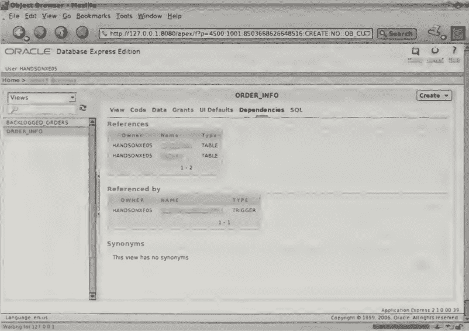

### 练习 5.24：收集对象统计信息

为确保SQL语句尽可能快速地执行，所有数据库应用程序都依赖于Oracle的SQL语句优化器。当你提交SQL语句时，优化器的工作是确定该语句的一个良好的*执行计划*——一种执行该语句的最佳方式。

为了确定SQL语句执行计划的相对*成本*，Oracle的优化器使用关于数据库系统、主机操作系统以及语句所针对的数据结构的统计信息。当事务插入、更新和删除表行时，除非对应于表和索引的优化器统计信息准确反映表当前数据的信息，否则优化器将无法为SQL语句执行计划做出良好选择。

方便的是，所有Oracle XE数据库都会创建并安排一个每夜任务，自动且高效地收集系统和用户定义对象的优化器统计信息，以便Oracle的优化器能够良好地工作。如果你创建了一个新表和索引，向表中加载了一些数据，并且不想等待每夜任务更新新数据结构的统计信息，你可以随时手动*分析*表和索引。

要完成此练习，请使用“对象浏览器”页面手动分析HANDSONXE05.ORDERS表：

1.  在“对象选择”窗格中单击“表”。
2.  在“对象选择”窗格的视图列表中单击ORDERS。
3.  在“详细信息”窗格中单击“统计信息”。
4.  请注意，当前ORDERS表没有统计信息。
5.  单击“分析”。
6.  请注意，“分析表”页面提供了三种不同的操作：
    - 你可以通过扫描表中所有可用数据来为目标表计算优化器统计信息。为大型表收集统计信息时，计算统计信息可能会产生显著的开销。
    - 收集大型表统计信息的一种更有效的方法是使用表中具有代表性的行样本进行估算。范围在0.000001到100之间的设置表示你希望Oracle用于估算优化器统计信息的样本大小。
    - 你还可以验证一个表。关于此功能的讨论与本练习的上下文无关；有关验证表的更多信息，请参阅OTN上Oracle在线文档中的*Oracle数据库概念*指南。
7.  ORDERS表包含的行非常少；因此，选择“计算统计信息”。
8.  单击“下一步”继续。
9.  单击“完成”。

请注意“详细信息”窗格中，ORDERS表有四行，需要五个数据库存储块，平均行长度为23字节等，如图5-14所示。

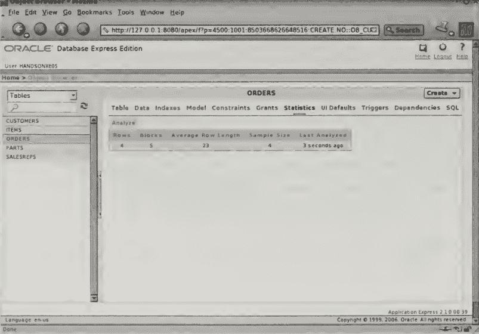

### 练习 5.25：生成对象DML

一旦你构建并验证了应用程序模式，记录你的工作就非常重要，以便其他人可以轻松理解或重建该模式。“对象浏览器”有一项功能使这项工作变得简单。

为了演示，让我们报告创建HANDSONXE05.ITEMS表、相关约束、索引等所需的所有SQL DDL语句。请完成以下步骤：

1.  如果“表”尚未被选中，请在“对象选择”窗格中单击“表”。
2.  在“对象选择”窗格的表列表中单击ITEMS。
3.  在“详细信息”窗格中单击“SQL”。

“详细信息”窗格随后将显示你可以用来创建当前版本的ITEMS表及所有相关数据库对象的SQL。输出应类似于以下内容：

```sql
CREATE TABLE "ITEMS"
   ( "O_ID" NUMBER(10,0) NOT NULL ENABLE,
     "ID" NUMBER(10,0) NOT NULL ENABLE,
     "P_ID" NUMBER(10,0) NOT NULL ENABLE,
     "QUANTITY" NUMBER(10,0) NOT NULL ENABLE,
     CONSTRAINT "ITEMS_PK" PRIMARY KEY ("O_ID", "ID") ENABLE,
     CONSTRAINT "ITEMS_FK1" FOREIGN KEY ("O_ID")
        REFERENCES "ORDERS" ("ID") ON DELETE CASCADE ENABLE,
     CONSTRAINT "ITEMS_FK2" FOREIGN KEY ("P_ID")
        REFERENCES "PARTS" ("ID") ENABLE
   )
/

CREATE INDEX "ITEMS_IDX1" ON "ITEMS" ("P_ID")
/
```

该输出演示了单个CREATE TABLE语句如何声明表的结构以及表的所有约束，这与使用CREATE TABLE语句后跟一个或多个ALTER TABLE语句不同。单独的CREATE INDEX语句总是必要的；你无法在CREATE TABLE语句中创建非唯一索引。

## 章节总结

本章介绍了你可以在基本关系数据库模式中创建的多种不同类型的对象：

**表** 表是任何关系数据库中的基本数据结构。表不过是一个有组织的行集合，这些行都具有相同的列。列的数据类型描述了该列中可接受的基本数据类型。要创建和修改表的结构，你可以使用Oracle Application Express的“对象浏览器”页面或SQL命令CREATE TABLE和ALTER TABLE。

**完整性约束** 为了强制执行描述表中列可接受数据的业务规则，你可以为表声明完整性约束。你可以使用域完整性约束，如NOT NULL约束和CHECK约束，来显式定义列的可接受值域。你可以使用实体完整性约束，如主键和唯一约束，来防止表中出现重复行。最后，你可以使用参照完整性约束来建立和强制数据库中不同列和表之间的关系。你可以在创建表时或表创建后，通过使用Oracle Application Express的“对象浏览器”页面或使用SQL命令CREATE TABLE和ALTER TABLE来声明所有类型的完整性约束。

**视图** 视图是一个模式对象，用于呈现一个或多个表中的数据。视图不过是一个查询，Oracle将其作为模式对象存储在数据库的数据字典中。当你使用视图执行某些操作时，Oracle会从视图的定义查询中派生视图的数据。要创建视图，请使用Oracle Application Express的“对象浏览器”页面或SQL命令CREATE VIEW。

**序列** 序列是一个模式对象，用于生成一系列唯一的整数。序列最常用于为ID类型的列生成唯一的主键。当应用程序向表中插入新行时，应用程序可以请求数据库序列为该新行的主键值生成下一个可用值。应用程序随后可以重用生成的序列号来协调相关子行中的外键值。要创建序列，请使用Oracle Application Express的“对象浏览器”页面或SQL命令CREATE SEQUENCE。要生成然后重用序列号，请分别引用序列的NEXTVAL和CURRVAL伪列。

**同义词** 为了隐藏模式对象的真实名称，你可以创建一个同义词。同义词是你存储在数据库中的表、视图、序列或其他模式对象的别名。你可以使用Oracle Application Express的“对象浏览器”页面或SQL命令CREATE SYNONYM来创建同义词。

**索引** 为了提高表的访问性能，你可以为表中的一列或多列创建索引。使用Oracle Application Express的“对象浏览器”页面或SQL命令CREATE INDEX来创建索引。


## 第六章：使用 Oracle Application Express 构建应用程序

本章将指导你如何利用作为 Oracle XE 核心组件的 Oracle Application Express 应用开发环境，从零开始快速设计、构建、测试并部署一个简单的数据库应用程序。在许多方面，本章是本书中最重要的章节，因为它阐明了如何运用你在前几章中所学到的诸多技能。本章的主题包括：

-   应用开发生命周期的各个阶段
-   软件建模与统一建模语言（UML）
-   上传和执行构建应用模式的 SQL 脚本的步骤
-   从结构化数据文件向模式加载数据的步骤
-   创建、修改和部署 Oracle Application Express 应用程序的步骤

## 章节前提条件

要实践本章的动手练习，你需要按照练习 2.12 的说明启动 SQL\*Plus，并运行以下命令脚本：

```
location/handsonxe/sql/chap06.sql
```

其中 *location* 是你解压本书配套支持文件存档的目录。例如，启动 SQL\*Plus 后，你可以使用 SQL\*Plus 的 `@` 命令运行本章的 SQL 命令脚本，如下例所示（假设你的 chap06.sql 文件位于 /tmp/handsonxe/sql）：

```
SQL> @/tmp/handsonxe/sql/chap06.sql;
```

一旦你回应所有提示并且脚本成功完成，你可以使用 `EXIT` 命令退出 SQL\*Plus。

> **注意：** 与本书前面的章节相比，本章包含更复杂的练习，可能需要更长的时间才能完成。因此，不建议你一次性完成整个章节。在阅读本章内容时，你可以随时开始、暂停，并从上次中断的地方继续。与其他章节一样，我鼓励你根据需要重复练习本章的练习；只需记住在每次迭代之间重新执行 chap06.sql 支持脚本即可。

## 应用开发生命周期简介

在开始构建应用程序之前，深入了解计算机应用程序的开发过程，特别是数据库应用程序的开发过程，是非常有价值的。开发数据库应用程序的过程看起来可能是一个直观的概念，对吧？在开发过程中随心所欲地设计一切，你构建一组表和相关的模式对象以及一个应用程序界面，这些组合在一起就能完成你相对理解的某项功能。*这种思路是大错特错的*，但令人惊讶的是，许多应用程序正是这样构建出来的。这种随意的开发方式通常会导致应用程序无法实现其目标、不易使用且性能不佳。随后就需要投入大量时间来重新修改应用程序。

有计算机应用程序开发经验的人知道，就像任何其他类型的问题解决任务一样，应用程序开发需要系统化的方法才能产生好的结果。一个广为认可的通用模型，称为*应用开发生命周期*（*ADLC*），概述了从零开始构建一流计算机应用程序的一系列明确阶段，如图 6-1 所示，并在以下章节中进行讨论。

### 分析流程与定义需求

ADLC 的第一阶段通常被称为分析阶段。此阶段的目的是仔细分析并定义你试图用拟议应用程序计算机化的流程。利用你新获得的理解，详细记录应用程序必须满足的需求列表至关重要，这样才能成功实现相关流程的计算机化。

分析阶段通常包括采访那些在你旨在计算机化的当前流程中扮演角色的人——毕竟，这些人最能解释当前感兴趣的流程，并建议在构建应用程序时可以实施的可能改进措施。

例如，假设你受雇协助组织一个技术服务平台支持团队的日常运营，该团队管理着运行在数十台主机计算机上的一百多个数据库应用程序和 Oracle 数据库。在你入职的第一天，你问一位同事：“我在哪里可以找到有关你们环境及所有系统组件的最新文档？主机名、数据库名称、应用程序名称之类的。”答案是：“嗯，让我看看，你应该能在每台主机的新账户邮件中找到有关主机计算机名称的信息。要查看主机上有哪些数据库，只需登录该主机并查看其配置文件。哦，公司网页和共享网络驱动器上的一两个电子表格中有一些关于现有应用程序的信息。”你立刻意识到，必须解决的最糟糕的首要问题很简单：缺乏组织性。你的初始应用程序需求是将所有分散的关于环境的信息整合到一个中央数据库中，然后构建一个团队可以持续使用来跟踪系统的应用程序。随后与系统管理员（SA）、数据库管理员（DBA）和应用程序管理员（AA）的会议，让你深入了解了员工的日常操作。你为计划中的应用程序整理的初步需求列表最终如下所示：

-   维护每台主机计算机的信息，包括其名称、操作系统、操作系统版本和 CPU 数量。
-   维护每个数据库的信息，包括其名称、Oracle 版本号和支持的主机计算机。
-   维护每个应用程序的信息，包括其名称、用途、版本和支持的数据库。
-   为应用程序提供直观易用的基于 Web 的界面。
-   不花费任何软件费用。
-   在现有服务器上使用最少的硬件资源。

继续阅读，了解如何利用需求列表来构建一个允许 SA、DBA 和 AA 持续更新系统环境信息的应用程序。

> **注意：** 本节介绍的示例应用/系统将在本章剩余部分中持续使用。此示例应用从此被称为 SysMgmt。

### 设计满足需求的应用程序

ADLC 的下一阶段是*设计阶段*。此阶段的目的是设计一个满足分析阶段记录的需求的应用程序。应用程序设计的质量最终决定了初始版本在多大程度上实现了其目标。

设计阶段是尝试的时机。尝试这个，尝试那个——确定最能满足既定目标的应用程序设计。让你的设计可供拟议应用程序的最终用户审阅，并鼓励他们指出你设计中的遗漏和不足。你最初的设计可能运作良好，但要做好准备经历无数次不同的设计迭代，才能最终得到令所有人满意的结果。

### 根据设计实现应用程序

ADLC 的*实现阶段*是过程的创造性部分。实现阶段的目的是基于满足所有需求的设计，构建应用程序的第一个版本。

在实现之前，仔细选择能够构建满足所有需求的应用程序的开发工具或开发环境。例如，基于 SysMgmt 应用程序的需求列表和可用预算，选择很容易：使用 Oracle XE 构建一个数据库来整合所有关于系统组件的可用信息，并构建一个 Oracle Application Express 基于 Web 的应用程序，供所有人用来维护系统信息。

数据库应用程序的实现通常至少包括两个不同的阶段：构建数据库模式（表、序列、触发器等），然后构建应用程序界面。完成每项任务的具体过程取决于用于构建应用程序的工具。例如，如果你在设计阶段使用一个 UML 绘图工具，该工具可以从类图生成 SQL DDL 命令，那么为应用程序创建数据库模式就很简单：你只需使用像 SQL\*Plus 这样的实用程序运行 SQL 命令脚本即可。许多 UML 工具还可以为编程语言（如

Java 和 C++。另一方面，如果你未使用 UML 图来设计应用程序，或者只使用了极简的绘图工具，那么实现过程无疑需要更加手动的方式。

**注意**

本章的大部分练习将详细介绍如何在使用 Oracle Application Express 的同时完成实现阶段。

### 测试应用是否满足需求

在应用开发生命周期的*测试阶段*，要让人们在测试环境中可以访问应用的“beta”版本，以便他们能够测试该应用，反复测试，再反复测试，直到所有人都确信该应用能够充分满足所有需求。你还应制定一份严格的测试计划，逐一严格验证每个应用组件的功能；这种*回归测试*有助于确保应用本身不会引入不可预见的数据完整性违规，而这些问题并非一定都能通过数据库完整性约束来防止。如有必要，请修改系统组件，以修正测试阶段发现的任何问题。

你可能希望限制对应用的访问，仅允许开发人员或特定用户组进行测试。在其他情况下，为测试目的提供不受限制的访问可能更合理。具体决定取决于你为确保应用满足所有需求而制定的计划。

为了测试新应用的响应时间和负载，请确保在与计划部署环境相似的环境中进行测试。例如：

- 如果你计划将应用部署在多个应用共享的服务器上，请在承载相似负载的服务器上进行测试。
- 如果你预计应用的表会积累大量行，请构建脚本，将若干虚构数据加载到应用的表中，以便用户能够看到应用在处理代表性数据量时的表现。

### 部署应用

ADLC 的下一阶段是*部署阶段*。一旦你对应用已得到充分测试和验证感到满意，就可以将其迁移到“生产”环境，让用户开始使用新应用，并享受到将相关操作计算机化带来的好处。

### 维护应用

生产版本的应用使用一段时间后，用户不可避免地会发现缺陷或提出增强请求。ADLC 的*维护阶段*就是你处理这些问题的阶段。对于增强功能，请确保针对新特性完成分析、设计、实现、测试和部署阶段。

## 软件建模与统一建模语言

*软件建模*是每位应用开发人员在应用开发设计阶段都应使用的工具。软件模型是应用流程、数据库元素、组件交互等的蓝图。应用设计的软件模型是传达你的计划、确保设计满足所有必要需求，并在实际编码开始*之前*发现设计缺陷的有效手段。

目前有许多流行的软件建模方法，*统一建模语言（UML）*就是其中之一。借助 UML，你可以构建软件的模型。如果你有过面向对象问题求解的经验，那么许多 UML 概念对你来说应该已经很熟悉了，例如：

- *模型*是对问题的抽象或可视化表示。
- *领域*是问题来源的环境。
- 模型由*对象*组成，对象通过相互发送*消息*进行交互。
- 对象由类定义；*类*本质上是对象的蓝图。
- 类定义包含*属性*，用于描述类的对象可以维护的数据。
- 类定义还包含*操作*（*方法*），用于描述类的对象可以执行的操作。
- 对象的属性值决定了它的*状态*。

> **注意**
> 如果你需要了解有关面向对象概念的背景知识，可以上网搜索或参考一本好书。

最新的 UML 规范定义了许多类型的图，通常分为结构图和行为图。*结构图*展示所建模系统的*静态*结构。*行为图*展示系统组件的*动态*交互。本节的目的只是介绍 UML，并提供一些基本 UML 图的示例，以展示它们在 ADLC 设计阶段的价值；有关 UML、建模图和技术的完整介绍，请使用 www.uml.org 上提供的许多有用文档和教程链接。

### 用例图

在软件开发设计阶段，称为*用例图*的行为图有助于你充实并传达应用打算实现计算机化的特定系统的需求。用例图通过参与者、用例和通信来说明某个特定系统的功能。*参与者*用简笔人物画表示，是触发事件发生的人或事物。*用例*用椭圆表示，代表单个任务或目标。*通信*用线条表示，是参与者与用例之间的连接。

图 6-2 是 SysMgmt 应用的一个简单用例图，展示了系统管理员（SA）在我们的案例研究应用中执行的任务。该图明确将 SA 标识为领域中的一个参与者，其任务包括创建、修改和删除主机计算机。图 6-3 和图 6-4 是用例图，分别展示了数据库管理员（DBA）管理数据库以及应用管理员（AA）管理应用的类似任务。即使是为这些非常简单的用例图建模，也会促使你系统地思考系统中正在发生的事情，以及因此拟议应用必须支持哪些任务。当别人审阅你的用例图时，可能会得到诸如“你忘了这个”和“那些人不会那样做，他们会这样做”之类的反馈。然后，你需要回到绘图板，直到在开始构建应用之前，对所有正在发生的事情有一个清晰的认识。

**图 6-2。** 展示系统管理员在 SysMgmt 应用中执行主机计算机系统管理任务的用例图

**图 6-3。** 展示数据库管理员在 SysMgmt 应用中执行数据库管理任务的用例图

### 类图

设计阶段还应包含称为*类图*的图，以说明支持类的结构。类——一种新型对象的设计——在类图中呈现为一个分为三个堆叠层的矩形：类名、属性和操作。每个属性都有名称、类型和可选默认值。每个操作都有名称、参数列表和返回值类型。

连接两个类的线条表示这两个类之间的*关系*或*关联*。你可以在类图中表示多种不同类型的关联。例如：

- **双向关联** 表示关系中的两个类彼此了解；在两个类之间用实线表示这种关系。

**图 6-4。** 展示应用管理员在 SysMgmt 应用中执行应用管理任务的用例图


- **单向关联** 表示两个类之间存在关系，但只有一个类知道这种关系；用带空心箭头的实线绘制这种关系，箭头指向被知晓的类。

- **继承（也称为泛化）** 子类与超类之间的一种关系，其中*子类*继承其*超类*的所有属性和操作。子类可以选择性地添加新功能或覆盖继承的功能。用带闭合箭头指向超类的实线表示继承。

关联末端的*多重性值*指定了与另一端类的单个实例相关联的类的可能实例数量。多重性可以是单个数字或数字范围。

图6-5是拟议的SysMgmt应用程序的类图。注意理解管理主机、数据库和应用程序所需的数据类型和操作是多么容易。

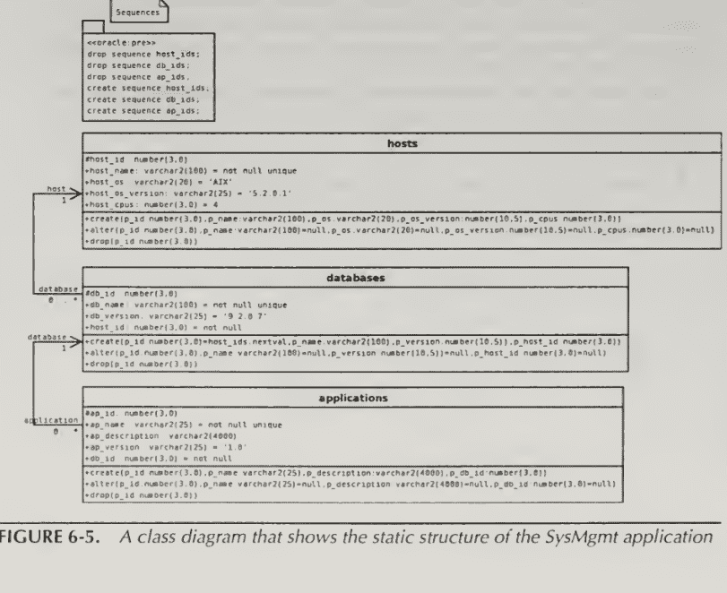

当其他人审查类图时，预计会收到诸如"对于数据库，我们还需要跟踪……"以及"主机操作系统的版本号需要允许更长的字符串值"之类的反馈。同样，进行必要的修改，直到每个人都同意继续推进的计划。

## 构建应用程序模式

有了应用程序的设计，实际构建支持应用程序所需的模式现在是一项相对简单的任务。创建模式有几种选择：

- 您可以启动SQL*Plus会话或使用Application Express的SQL命令页面手动编写SQL DDL语句，在模式中创建对象。
- 您可以使用Application Express的对象浏览器页面手动构建模式中的对象。
- 如果您使用的UML工具可以从类图生成SQL脚本，您可以简单地使用Application Express加载并运行SQL脚本。

第三种方案是迄今为止最简单、最可靠且最快的方法（如果可用的话），也是下一个练习演示的方法。

### 练习6.1：上传并运行SQL脚本

为简洁起见，本书的支持存档包含一个由名为*Dia*的UML工具生成的SQL脚本（大多数Linux发行版都提供该软件包）。该工具从与我们的案例研究应用程序对应的类图生成SQL脚本，即一系列SQL DDL命令。本练习教您如何上传sysmgmt1.sql脚本并运行它以创建SysMgmt应用程序的模式。

按照练习2.14中的说明启动Oracle Application Express的数据库主页。使用本章的练习账户**HANDSONXE06**，密码为**PASSWORD**，建立连接。

启动数据库主页后，完成以下步骤以上传sysmgmt1.sql脚本：

1. 从数据库主页，点击SQL | SQL脚本以显示SQL脚本页面。
2. 点击上传以显示上传脚本页面。
3. 点击浏览并在文件系统中导航，选择从本书支持存档中提取的sysmgmt1.sql脚本。
4. 在上传脚本页面的脚本名称字段中指定**SYSMGMT1**或任何其他合适的名称。
5. 点击上传。
6. 注意SQL脚本页面中的新脚本图标，如图6-6所示。

要运行新上传的脚本并在当前HANDSONXE06模式中创建SysMgmt应用程序的模式对象，请完成以下步骤：

1. 点击SQL脚本页面上脚本的图标。
2. 浏览脚本内容，熟悉构成脚本的SQL DDL命令。

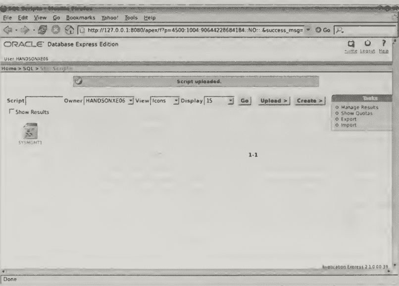

**图6-6.** SQL脚本页面显示已上传并可以运行以执行工作的SQL脚本。

3. 点击运行。
4. 点击运行以确认您运行脚本的请求。
5. 管理脚本结果页面是所有脚本运行的摘要报告。注意脚本运行的初始状态为已提交。
6. 等待几秒钟，然后点击执行。脚本运行的状态应变为完成。
7. 点击脚本运行的查看结果。
8. 浏览脚本中各种SQL语句的成功或失败情况。预计某些语句会失败，具体取决于这是否是您第一次运行脚本；例如，如果您是第一次执行脚本，有几个DROP语句会失败。

要检查脚本执行的工作，请完成以下步骤：

1. 点击主页。
2. 点击对象浏览器。
3. 选择表，然后确认并浏览以下表的存在和结构：APPLICATIONS、DATABASES和HOSTS。例如，HOSTS表应如图6-7所示。
4. 选择序列，然后确认并浏览以下序列的存在和结构：AP_IDS、DB_IDS和HOST_IDS。

### 练习6.2：设置用户界面默认值

为了促进Oracle Application Express应用程序中页面之间的一致接口和功能，您应该在开始构建应用程序*之前*为应用程序模式中的所有表和视图设置*用户界面默认值*。本练习教您如何为应用程序模式中的表设置用户界面默认值。

> **提示**
> 当详细信息窗格包含无法完全查看的广泛信息集时，点击详细信息窗格左侧边缘的按钮，将详细信息窗格临时最大化到完整窗口。再次点击同一按钮，使对象选择窗格再次可见。

**图6-7.** 对象浏览器中的HOSTS表，由SQL脚本创建

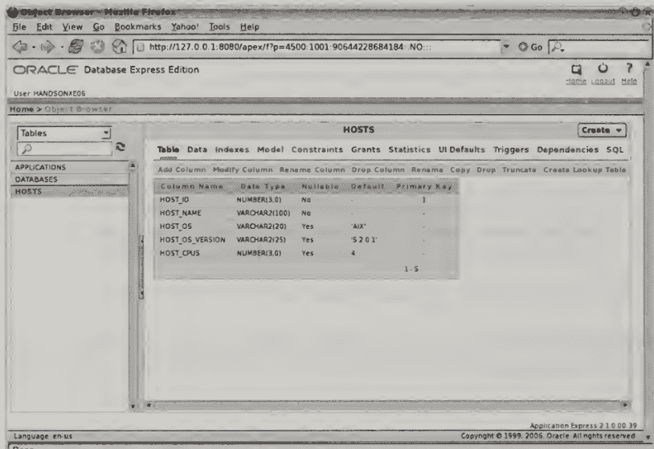

1. 在对象浏览器页面，选择表。
2. 选择APPLICATIONS（即从表列表中选择APPLICATIONS表）。
3. 点击UI默认值。
4. 如果这是您第一次为特定表设置用户界面默认值，点击创建默认值；否则，跳至下一步。
5. 浏览APPLICATIONS表的默认用户界面设置报告。注意您可以为表的列在报表和表单上设置用户界面默认值。查看此报告时，使用以下信息帮助您做出决策：

    表单和报表都使用列的*标签*来标识页面上的列。通常，您应该将为隐晦列名生成的默认标签转换为用户友好的标签。

    列的*报表序列*和*表单序列*分别表示该列在报表或表单上相对于其他列的显示顺序。如果默认列顺序不合适，请修改这些设置。

    报表可以包含搜索字段，方便用户在报表中查找特定记录。列的默认*可搜索*设置指示Oracle Application Express是否生成带有搜索字段条件的报表，该条件考虑列的数据以筛选报表中的结果。仅当用户经常使用列中的数据作为搜索条件在表中搜索记录时，才将列设置为可搜索。包含无意义数字键的主键和外键列通常不应设置为可搜索，以避免对数值数据搜索产生误报。后续练习将详细解释可搜索报表列。

    列的*必填*属性指示该列是否可以包含空值。Oracle Application Express根据列是否为主键的一部分或是否声明为not null来确定每列的默认设置。只要您正确声明了表的约束，每列的必填属性就不需要更改。

6. 点击网格编辑以显示编辑APPLICATION表用户界面默认值的表单。
7. 将表单区域标题字段中的文本替换为**创建/编辑应用程序**。
8. 将报表区域标题字段中的文本替换为**应用程序**。
9. 在表列的标签字段中指定以下内容：

    - **Application** 对应AP_ID列
    - **Name** 对应AP_NAME列
    - **Description** 对应AP_DESCRIPTION列
    - **Version** 对应AP_VERSION列
    - **Database** 对应DB_ID列

10. 为每列的包含在报表中和包含在表单列表中选择是。
11. 为AP_NAME、AP_DESCRIPTION和AP_VERSION列的可搜索列表选择是；将所有其他列设置为否。
12. 点击应用更改以保存您的工作。


重复前面的步骤，为剩余的两个表 DATABASES 和 HOSTS 创建、显示和编辑用户界面默认值。为了少点几次鼠标，在更新完某个表的设置后，可以点击面包屑菜单中的 User Interface Defaults。接着，点击要处理的新表图标，点击 Create User Interface Defaults 为该表创建默认值，然后点击 Grid Edit。

> **注意**

即使从数据库中删除了某个表，用户界面默认值仍会保留在 Oracle Application Express 资料库中。如果你在重复本章的练习，会注意到不必为每个示例表都创建用户界面默认值。

对于 DATABASES 表：

1. 在 Form Region Title 字段中指定 **Create/Edit Database**。
2. 在 Report Region Title 字段中指定 **Database**。
3. 在表各列的 Label 字段中指定以下内容：
   - DB_ID 列：**Database**
   - DB_NAME 列：**Name**
   - DB_VERSION 列：**Version**
   - HOST_ID 列：**Host**
4. 为每一列的 Include in Reports 和 Include in Forms 列表选择 Yes。
5. 为 DB_NAME 和 DB_VERSION 列的 Searchable 列表选择 Yes；将所有其他列设置为 No。
6. 点击 Apply Changes 保存工作。

对于 HOSTS 表：

1. 在 Form Region Title 字段中指定 **Create/Edit Host**。
2. 在 Report Region Title 字段中指定 **Host**。
3. 在表各列的 Label 字段中指定以下内容：
   - HOST_ID 列：**Host**
   - HOST_NAME 列：**Name**
   - HOST_OS 列：**Operating System (OS)**
   - HOST_OS_VERSION 列：**OS Version**
   - HOST_CPUS 列：**CPUs**
4. 为每一列的 Include in Reports 和 Include in Forms 列表选择 Yes。
5. 除 HOST_ID 外，为每一列的 Searchable 列表选择 Yes。
6. 点击 Apply Changes 保存工作。

至此，你已完成对模式中所有表的用户界面默认值的修改。

## 加载模式数据

在开始构建应用程序之前，最好快速向表中添加一些数据。否则，应用程序的初稿将难以评估，因为基于空表的报表和表单只会显示一条没有记录可显示的消息。

使用 Oracle Application Express 向表中加载数据有几种选择：

- 可以通过 Object Browser 页面手动创建记录。
- 可以从逗号分隔或制表符分隔的文本文件中加载数据。
- 可以从 XML 文件中加载数据。

接下来的几节将介绍这三种方法。

### 手动加载数据

上一章介绍了如何使用 Object Browser 页面将行插入表中。为了复习你的技能并揭示应用程序模式中的不足，请完成以下练习。

### 练习 6.3：手动输入数据

完成以下步骤，向 HOSTS 表插入一条新记录：

1. 点击 Home。
2. 点击 Object Browser。
3. 在 Object Selection 窗格中选择 Tables | HOSTS。
4. 点击 Data。
5. 点击 Insert Row。
6. 为 HOSTS 表的字段指定以下信息：
   - HOST_ID 字段应由 HOST_IDS 序列填充。因此，通过引用该序列的 NEXTVAL 伪列来生成新的序列号。例如，指定 **handsonxe06.host_ids.nextval**。
   - 在 HOST_NAME 字段中指定 **server1.mycompany.com**。
   - 在 HOST_OS 字段中指定 **AIX**。
   - 在 HOST_OS_VERSION 字段中指定 **5.2.0.0**。
   - 在 HOST_CPUS 字段中指定 **4**。
7. 点击 Create。

### 练习 6.4：创建触发器以生成主键

上一个练习揭示了当前模式版本中一个可以改进的地方——向表中插入新行时，必须显式引用序列才能生成主键。在本练习中，你要为每个表创建一个简单的触发器，自动为新行生成主键：

1. 在 Object Browser 页面中，点击 Create | Trigger。
2. 在 Table Name 字段中指定 **HOSTS**（或从弹出的选择列表中选择表名）。
3. 点击 Next。
4. 在 Trigger Name 字段中指定 **HOSTS_TPK**。
5. 在 Firing Point 列表中选择 **BEFORE**。
6. 在 Options 列表中选择 **insert**。
7. 选择 **For Each Row**。
8. 在 Trigger Body 字段中指定以下语句。这个简单的触发器会生成一个新的序列号，并将该值赋给正在插入的新行的 HOST_ID 字段。

```sql
SELECT handsonxe06.host_ids.nextval
  INTO :new.host_id
  FROM dual;
```

注意触发器主体引用序列时的一个微妙之处：对同义词的引用是*完全限定*的；也就是说，对序列的引用以包含它的模式名作为前缀。在审阅应用程序代码时，应用程序中对模式对象的完全限定引用使其他开发人员和系统调优人员更容易理解应用程序使用了哪些对象。在设计新应用程序时，遵循这种完全限定对象引用的示例始终是一个好习惯。

点击 Next。

可选地，点击 SQL 查看 Object Browser 页面生成的 CREATE TRIGGER 语句：

```sql
create or replace trigger "HOSTS_TPK"
BEFORE
insert on "HOSTS"
for each row
begin
SELECT handsonxe06.host_ids.nextval
  INTO :new.host_id
  FROM dual;
end;
/
```

点击 Finish。

新触发器应会出现在 Object Browser 页面中，类似于图 6-8 所示。

要完成本练习，请重复前面的步骤，为 DATABASES 和 APPLICATIONS 表创建类似的 before-insert-row 触发器：

DATABASES_TPK 触发器应使用 DB_IDS 序列，如下所示：

```sql
create or replace trigger "DATABASES_TPK"
BEFORE
insert on "DATABASES"
for each row
begin
SELECT handsonxe06.db_ids.nextval
  INTO :new.db_id
  FROM dual;
end;
/
```

图 6-8。向 HOSTS 表插入新行时，HOSTS_TPK 触发器会从 HOST_IDS 序列生成一个新的序列号，用于新行的 HOST_ID 列。

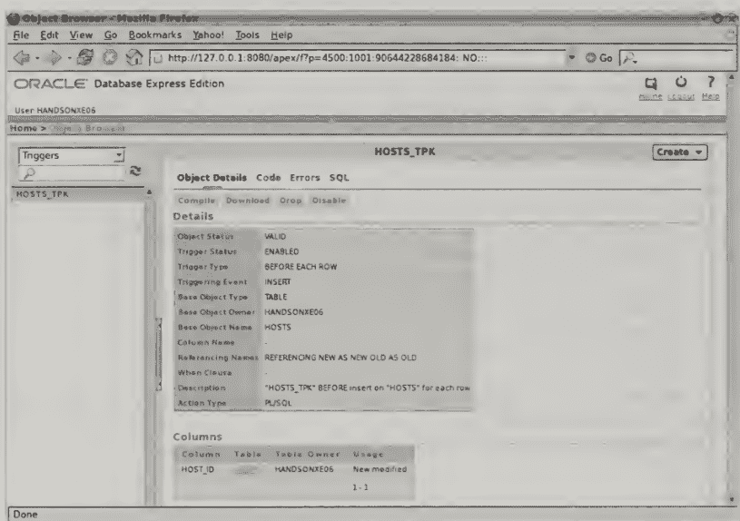

- APPLICATIONS_TPK 触发器应使用 AP_IDS 序列，如下所示：

```sql
create or replace trigger "APPLICATIONS_TPK"
BEFORE
insert on "APPLICATIONS"
for each row
begin
SELECT handsonxe06.ap_ids.nextval
  INTO :new.ap_id
  FROM dual;
end;
/
```

在继续之前，请确保这三个触发器都存在且有效；否则，后续练习将会失败。

### 加载电子表格和文本文件数据

组织通常将有用数据以各种格式存储在各个地方：电子表格、PC 数据库、文本文件等。幸运的是，Oracle XE 和 Oracle Application Express 提供了一些实用工具，可以轻松地将各种文件格式的结构化数据加载到数据库中。接下来的两个练习将教你如何加载此类数据。

### 练习 6.5：从文本文件加载数据

大多数电子表格和 PC 数据库程序都可以将数据导出为两种结构化格式之一的简单文本文件：字段以逗号分隔（*comma-separated values*，简称 CSV）或字段以制表符分隔（*tab delimited*）。本练习将教你如何将文本文件中的记录加载到应用程序的 DATABASES 表中。

在我们虚构的应用程序中，管理系统中 Oracle 数据库的每台 UNIX 服务器都有一个名为 /etc/oratab 的配置文件，其中包含每个数据库的名称、版本和其他信息。例如，server1.mycompany.com 服务器的 /etc/oratab 文件可能如下所示：

```
db1:/usr/opt/oracle/product/10.2.0.1:Y
db2:/usr/opt/oracle/product/9.2.0.7:Y
db3:/usr/opt/oracle/product/10.2.0.1:Y
db4:/usr/opt/oracle/product/10.2.0.1:Y
db5:/usr/opt/oracle/product/9.2.0.7:Y
db6:/usr/opt/oracle/product/9.2.0.7:Y
db7:/usr/opt/oracle/product/9.2.0.7:Y
db8:/usr/opt/oracle/product/9.2.0.7:Y
```

注意，该文件使用冒号作为字段分隔符，使用回车符开始新记录。对于每条记录，第一个字段表示数据库名称（例如，db1）；第二个字段表示数据库的 ORACLE_HOME（例如，/usr/opt/oracle/product/10.2.0.1）；第三个字段表示数据库是否在系统重新启动后自动启动（例如，Y）。

使用文本编辑器和一些基本的查找替换命令，你可以轻松地将这种文件转换成本书支持存档中的 db1.csv 文件，如下面的代码所示。CSV 文件仅包含与 DATABASES 表相关的数据：数据库名称、Oracle 版本以及 server1.mycompany.com 的 HOST_ID。为了更轻松地完成加载，你可以在文件第一行添加与 DATABASES 表对应的字段名。

```
db_name,db_version,host_id
db1,10.2.0.1,1
db2,9.2.0.7,1
db3,10.2.0.1,1
db4,10.2.0.1,1
db5,9.2.0.7,1
```


注意，该文件省略了每条记录的 DB_ID：数据加载将依赖新建的 DATABASES_TPK 触发器（以及 DB_IDS 序列）为每条新记录自动生成主键。

若要将 CSV 文件中的记录加载到 DATABASES 表，请完成以下步骤：

1.  点击“主页”。
2.  点击“工具”。
3.  点击“数据加载/卸载”。
4.  点击“加载”。
5.  点击“加载文本数据”，显示“加载数据”页面。
6.  在“加载到”字段中选择“现有表”。
7.  在“加载来源”字段中选择“上传”。
8.  点击“下一步”。
9.  确认您正在将数据加载到 HANDSONXE06 方案。然后点击“下一步”。
10. 在“表名”列表中选择 DATABASES。
11. 点击“下一步”。
12. 点击“浏览”，在本地计算机可访问的文件系统中导航，选择从本书配套资源包中提取的 db1.csv 文件。不要修改页面上的任何其他设置。
13. 点击“下一步”。
14. 页面会显示待加载记录和字段的格式化版本。如有必要，您可以排除数据文件中的某些字段不加载、重新排列字段等；本例中无需任何操作。查看信息后，点击“加载数据”开始数据加载。
15. 查看“文本数据加载资源库”页面，确认加载没有错误地完成，如图 6-9 所示。
16. （可选）返回“对象浏览器”页面（按照您现在应已熟悉的步骤），查看已插入到 DATABASES 表中的新记录。

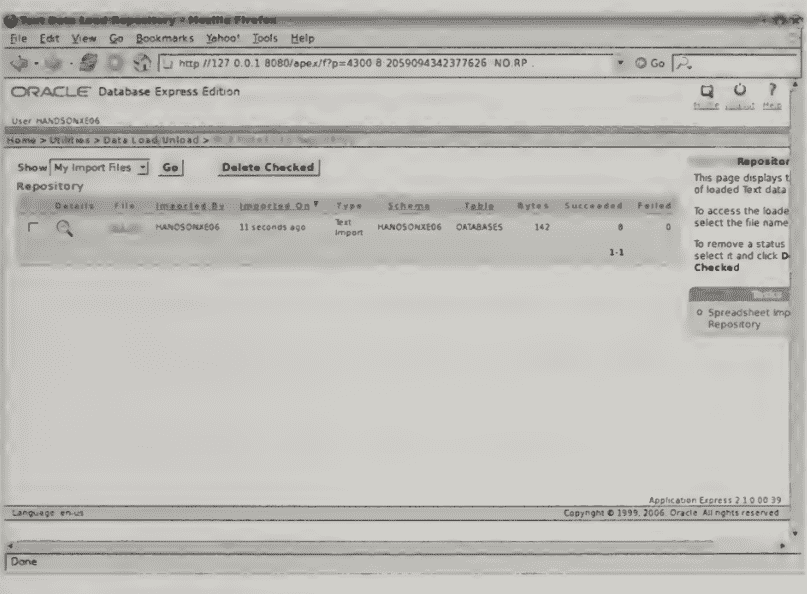

**图 6-9.** “文本数据加载资源库”页面显示从文本文件上传数据的历史记录。

### 加载 XML 数据

*可扩展标记语言*（XML）数据文件是另一种常见格式，许多软件程序都支持以结构化格式存储数据。XML 允许应用程序和应用程序设计人员创建自定义标签，以便在不同应用程序和组织之间定义、传输、验证和解释数据。

### 练习 6.6：从 XML 文件加载数据

本练习介绍如何使用 Oracle XE 从 XML 文件将数据上传到 Oracle 数据库。本书配套资源包中包含一个名为 ap1.xml 的文件。该 XML 文件由电子表格生成，包含有关虚构的 server1.mycompany.com 上部分应用程序的信息。若要将该 XML 文件中的数据加载到 APPLICATIONS 表，请完成以下步骤：

1.  点击“主页”。
2.  点击“工具”。
3.  点击“数据加载/卸载”。
4.  点击“加载”。
5.  点击“加载 XML 数据”，显示“加载 XML 数据”页面。
6.  确认您正在将数据加载到 HANDSONXE06 方案。然后点击“下一步”。
7.  在“表”字段中指定 **APPLICATIONS**（或使用弹出列表）。
8.  点击“下一步”。
9.  点击“浏览”，在本地计算机可访问的文件系统中导航，选择从本书配套资源包中提取的 ap1.xml 文件。
10. 点击“加载数据”。
11. （可选）返回“对象浏览器”页面，查看已插入到 APPLICATIONS 表中的新记录。

> **注意**

您尝试加载的 XML 文件必须是格式良好的；如果不是，加载将失败，Oracle XE 会返回错误。有关 XML 的详细信息超出了本书的范围；更多信息请参阅 Oracle Database 10g XML & SQL: Design, Build & Manage XML Applications in Java, C, C++ & PL/SQL（McGraw-Hill/Osborne，2004）。

## 创建 SysMgmt 应用程序

现在每个表都有了一些记录，下面的练习将向您展示基于现有数据库表使用 Oracle Application Express 创建简单应用程序是多么容易。用于构建应用程序的 Oracle Application Express 组件称为 Application Builder（应用程序构建器）。*Application Builder（应用程序构建器）* 具有大量功能，其中大多数超出了本章的范围。本章后续练习的目的是让您接触许多常见的 Application Builder 功能，并熟悉 Application Builder 的快速应用程序开发（RAD）方法。

### 练习 6.7：使用创建应用程序向导创建 SysMgmt 应用程序

要使用 Oracle Application Express 快速创建满足业务需求的应用程序，请完成以下步骤：

1.  点击“主页”。
2.  点击 Application Builder。
3.  主要的 Application Builder 页面显示 Oracle Application Express 资源库中的应用程序列表；您即将开发第一个应用程序，因此该页面最初应为空，并显示消息“未找到应用程序”。
4.  点击“创建”启动“创建应用程序”向导，该向导显示几个简单的页面并快速创建新应用程序。
5.  注意，“创建应用程序”向导提供了两种不同的构建新应用程序的方法：从头开始构建应用程序，或从电子表格数据构建简单应用程序。您还可以安装演示应用程序以通过示例学习。就本练习而言，请点击“创建应用程序”。
6.  使用向导的“名称”页面，通过完成以下步骤来指明应用程序的基本信息：
    *   “名称”字段用于指定新应用程序的名称。在“名称”字段中指定 **SysMgmt**。
    *   “应用程序”字段表示应用程序的唯一标识符（即主键）。记下系统生成的键值，但不要修改它。
    *   “创建应用程序”选项列表指示您希望如何创建新应用程序。在“创建应用程序”选项列表中选择“从头开始”。
    *   在“方案”列表中选择 HANDSONXE06。
7.  点击“下一步”。
8.  使用向导的“页面”页面，根据现有数据库表快速为新应用程序添加页面。Oracle Application Express 可以为应用程序创建多种不同类型的页面。例如，*报表*是只读页面，用于显示数据库表中的信息；*表单*是读写页面，便于数据输入和修改；*图表*和*图形*以可视化格式表示数据库数据。请完成以下步骤，为方案中的三个表分别创建一个报表和一个表单：
    a.  需要基于 HOSTS 表创建一个报表和一个表单。因此，在页面的“添加页面”区域中，点击“报表和表单”。
    b.  在“表名”字段中指定 **HOSTS**（或使用弹出列表）。
    c.  选中“包含分析页面”复选框后，会启动另一个向导，指导您创建汇总信息的报表。就本练习而言，请勿选择“包含分析页面”。
    d.  点击“添加页面”。
    e.  注意现在作为应用程序一部分的 HOSTS 表的两个新页面及其层次结构：父页面是报表，子页面是表单。页面的层次结构表示两个页面之间的导航关系。
    f.  完成相同的步骤，以添加基于 DATABASES 表的报表和表单。在页面的“添加页面”区域中，点击“报表和表单”。
    g.  “从属于页面”下拉列表框指示您正在添加的页面相对于应用程序中其他页面的层次关系；就本练习而言，请选择“顶层页面”。
    h.  在“表名”字段中指定 **DATABASES**（或使用弹出列表）。
    i.  点击“添加页面”。
    j.  注意现在作为应用程序一部分的 DATABASES 表的两个新页面。
    k.  完成相同的步骤，以添加基于 APPLICATIONS 表的报表和表单。在页面的“添加页面”区域中，点击“报表和表单”。
    l.  在“从属于页面”列表中选择“顶层页面”。
    m.  在“表名”字段中指定 **APPLICATIONS**（或使用弹出列表）。
    n.  点击“添加页面”。


## 运行并测试应用程序

在开发完应用程序后，下一步是运行该应用程序并查看其运行效果。在整个应用程序开发生命周期的测试阶段，请务必详细记录需要修改的应用程序功能。

### 练习 6.8：运行并测试 SysMgmt 应用程序

要启动 SysMgmt 应用程序，请完成以下步骤：

- 1. 从 Application Builder 主页面，点击要运行的应用程序的图标，以显示该应用程序的页面。仅当您完成上一个练习后进行了额外探索时，此步骤才是必要的。
- 2. 在应用程序页面上，点击“运行应用程序”。

3. SysMgmt 应用程序被设置为使用数据库身份验证；因此，请输入一个有权使用该应用程序的用户的用户名和密码。在本练习中，请在“用户名”字段中指定 **HANDSONXE06**，在“密码”字段中指定 **PASSWORD**；然后点击“登录”。

SysMgmt 应用程序启动后，您应该会看到“主机”报告页面，类似于图 6-13。

### 练习 6.9：浏览应用程序报告页面

每个 SysMgmt 应用程序页面的顶部都有一组包含“主机”、“数据库”和“应用程序”标题的选项卡。这些选项卡使得在与 HOSTS、DATABASES 和 APPLICATIONS 表相关的页面之间切换变得容易。

- 1. 点击“数据库”选项卡，显示数据库报告。
- 2. 点击“应用程序”选项卡，显示应用程序报告。
- 3. 点击“主机”选项卡，返回“主机”报告。

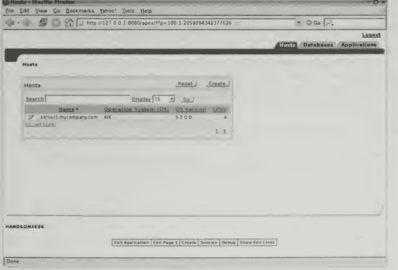

**注意**

每个页面的底部都显示着开发者工具栏，其中包含便捷的链接，可以轻松地停止运行应用程序以及编辑应用程序或特定页面。后续练习将演示如何在应用程序开发和测试期间使用开发者工具栏中的多个链接。

### **练习 6.10：理解 Oracle Application Express URL**

当您在应用程序页面间导航时，请仔细观察 Web 浏览器中的 URL 如何变化。Oracle Application Express URL 应类似于以下格式：

```
http://127.0.0.1:8080/apex/f?p=100:1: ...
```

URL 的第一部分 `http://127.0.0.1:8080/apex/f` 在您切换页面时保持静态。这部分 URL 表示应用程序和 Web 服务器的地址。随着页面切换而变化的 URL 的动态部分是查询字符串，它从 `?` 字符之后开始。URL 中的查询字符串包含一个或多个参数，用于在运行时将值传递给应用程序。Oracle Application Express 查询字符串包含一个 `p` 参数，该参数被分配了多个以冒号分隔的值。`p` 参数中的第一个值是应用程序的 ID；例如，100。`p` 参数中的第二个值是应用程序中的页面 ID；例如，1。`p` 参数中的其余值涉及会话和其他与本讨论无关的信息。

请注意，当您在应用程序页面间切换时，页面编号会发生变化，以指示您正在查看的页面的编号。URL 中的页面编号应与页面上开发者工具栏中“编辑页面”链接所示的页面编号相对应。

### **练习 6.11：浏览并审查应用程序页面**

既然您已大致了解 SysMgmt 应用程序的导航、布局和用户界面，请完成本练习的步骤以审查每个页面，并记录下改进其外观和功能的注意事项：

- 1. 点击“应用程序”选项卡。

- 2. 注意，应用程序报告页面中报告区域的标题包含一个“创建”按钮：该按钮是链接到创建/编辑应用程序表单页面的链接。

- 3. 注意，报告区域的标题还包括一个搜索字段和用于搜索报告信息的相关项。

- 4. 在搜索字段中指定 **finch**。


## 完善应用程序

您通过 Oracle Application Express 创建应用程序向导快速构建的应用程序，通常需要进行一定程度的完善，以解决诸如前面练习中发现的问题。本节中的练习将教您几种完善 SysMgmt 应用程序的方法，使其外观和功能更加出色。

### 练习 6.12：为表单创建值列表（LOV）

*值列表（LOV）*是一种常见的应用程序组件，它为表单中的字段提供标准化的可接受值列表。从技术角度来说，LOV 中的每个选项都有一对关联的值：LOV 显示的值（*显示值*）和 LOV 返回给关联字段的值（*返回值*）。因此，LOV 非常适合显示与难以理解的代码值（如外键值或状态码）相对应的、便于人类阅读的值。本练习将教您如何为主机和数据库创建 LOV，然后您可以利用这些 LOV 来改进 SysMgmt 应用程序的页面。

要为主机创建 LOV，请完成以下步骤：

1.  单击开发者工具栏中的"编辑应用程序"以停止运行应用程序并返回到 SysMgmt 应用程序页面。
2.  单击"共享组件"以显示应用程序的共享组件页面。*共享组件*是多个 Oracle Application Express 应用程序中的页面可以重复使用的应用程序组件。
3.  浏览页面信息后，单击共享组件页面中"用户界面"部分下的"值列表"。
4.  "值列表"页面显示所有现有 LOV 的图标。请注意，创建应用程序向导会生成一个名为"报告每页行数"的标准 LOV，应用程序中的报告页面使用它来控制每页显示的行数。
5.  单击"创建"。
6.  在创建值列表的选项中选择"从头开始"。
7.  单击"下一步"。
8.  在"名称"字段中指定 **HOSTS**。
9.  您的目标是创建一个可用主机的列表，该列表不一定是静态的。因此，从"类型"选项中选择"动态"。
10. 单击"下一步"。
11. 要生成动态 LOV，您必须在"查询"字段中输入一个 SQL 查询。查询的 SELECT 列表必须仅包含两个表达式，且顺序如下（如"查询"字段中的示例查询所示）：一个列别名为 d 的显示值和一个列别名为 r 的返回值。（根据您在第 3 章的经验，您应该已经熟悉构建包含列别名的查询。）您指定的查询通常返回多行，并且可以包含 WHERE 子句、ORDER BY 子句、来自一个或多个表的连接信息等——如果您想查看可接受的示例查询，请单击"示例"。要返回主机列表和相应的主键值，请在"查询"字段中输入以下查询：

```
SELECT host_name d, host_id r
  FROM handsonxe06.hosts
 ORDER BY 1
```

12. 单击"创建值列表"。Oracle Application Express 会检查您提交的查询的语法，以确保其在运行时能够解析；如果无法解析，Oracle Application Express 会返回错误，并允许您在继续之前更正问题。

13. 请注意，新 LOV 的图标出现在了"值列表"页面中。

现在重复步骤 5 到 13，为数据库创建一个动态 LOV。将该 LOV 命名为 **DATABASES**，并为该 LOV 指定以下查询：

```
SELECT db.db_name || '.' || h.host_name d, db.db_id r
  FROM handsonxe06.databases db
 NATURAL JOIN handsonxe06.hosts h
 ORDER BY 1
```

请注意，连接查询返回的显示值是每个数据库名称与其对应服务器名称的拼接；这些额外信息可以清楚地表明应该选择哪个数据库，以防组织中的服务器之间存在重复的数据库名称（例如，server1 上的 db1 会显示为 db1.server1，而 server2 上的 db1 会显示为 db1.server2）。

### 练习 6.13：将 LOV 添加到表单中

完成此练习以修改 SysMgmt 应用程序的特定表单页面，使其使用新的 LOV。例如，要将 HOSTS LOV 添加到"创建/编辑数据库"页面，请完成以下步骤：

1.  在面包屑导航菜单中，单击指向应用程序页面的链接（例如，**Application 100**）。
2.  在应用程序页面上，单击"创建/编辑数据库"表单页面的链接或图标，该页面应为页面 4。
3.  花一些时间观察 Oracle Application Express 如何组织构成表单页面的各种组件：

- *区域*是页面上显示内容的区域。
- *页面模板*控制区域在页面上的显示顺序。
- 每个区域可以包含各种*元素*，如报表、HTML、菜单和列表。
- 区域还可以包含*项目*，如文本框、按钮、单选按钮组、选择列表等。Oracle Application Express 为页面上的每个项目分配一个唯一的名称，前缀为字母 P、页面编号和下划线（例如，P4_）。
- *区域模板*控制区域元素和项目的外观。

4.  您在此练习中的目标是修改"创建/编辑数据库"表单页面的 HOST_ID 字段，使其使用 HOSTS LOV。因此，单击页面"项目"部分中的 P4_HOST_ID 链接。
5.  花一些时间滚动页面，了解可以为表单字段设置的众多属性。
6.  同样，目标是修改 HOST_ID 表单字段，使其使用 HOSTS LOV。因此，从页面"名称"部分的"显示为"列表中选择"选择列表"。执行此步骤的快捷方式是直接单击"显示为"列表下方的 [Select List]。
7.  接下来，您必须指定要用作该字段选择列表的 LOV。向下滚动页面直到"值列表"部分可见；单击页面顶部的"LOV"可快速直接滚动到该部分。然后从"命名 LOV"列表中选择 HOSTS。
8.  滚动回页面顶部，单击"应用更改"以保存您的工作。
9.  要运行应用程序并立即加载此新版本的"创建/编辑数据库"表单页面，请单击页面右上角的路灯图标。带有 LOV 的新版本表单应与图 6-14 类似。
10. 单击 Host 列表，注意只有一个主机可用。当您向数据库添加新主机时，此表单上的选择列表将相应地进行调整。

接下来，完成类似的步骤系列，使"创建/编辑应用程序"表单页面的 Database 字段使用 DATABASES LOV。这是学习使用开发者工具栏另一种方式的好机会。

- 5. 单击"执行"。
- 6. 注意，报表现在只显示一条记录，即 Description 中包含字符串"finch"的记录。所有其他记录都已从报表显示中过滤掉。
- 7. 单击"重置"以移除搜索过滤器，再次显示 APPLICATIONS 表中的前 15 条记录。
- 8. 注意，应用程序报表中列的标签与您之前为 APPLICATIONS 表的列设置的用户界面默认值相对应。
- 9. 注意，应用程序报表的 Database 列包含每个应用程序引用 DATABASES 表中父记录的 DB_ID 的外键。记下要修改 Database 列数据的显示方式，使其列出数据库名称而不是数据库的 DB_ID。
- 10. 注意，报表最左边的列包含用于编辑相应记录的链接图标。单击"编辑"图标以编辑应用程序报表中的第一条记录。
- 11. 这是您首次查看新应用程序的"创建/编辑应用程序"表单页面。请注意，表单上方的面包屑导航菜单指示该表单页面在层次结构上是父级应用程序报表页面的子页面。您可以轻松单击面包屑菜单中的"应用程序"链接返回到应用程序报表页面，但现在先不要这样做。
- 12. 注意，表单中输入字段的标签与您之前为 APPLICATIONS 表的列设置的用户界面默认值相对应。
- 13. 注意，必填字段在列标签左侧有一个小图标。
- 14. 与应用程序报表类似，请注意"创建/应用程序"表单的 Database 字段期望并显示引用 DATABASES 表中父记录的 DB_ID 的外键值。记下要修改"创建/应用程序"表单的 Database 字段，使其显示可用数据库的列表而不是数据库的 DB_ID。

对基于 HOSTS 和 DATABASES 表的报表和表单重复上述步骤。记下要编辑基于 DATABASES 表的报表和表单页面的 Host 字段的外观/功能，类似于步骤 9 和 14。


**图 6-14.** 创建/编辑数据库表单页面，显示了主机字段的新值列表

11. 单击应用程序选项卡。
12. 单击“创建”以显示“创建/编辑应用程序”表单页面。
13. 在开发人员工具栏上，单击“编辑页面 6”。
14. 注意，您会立即导航到该表单页面的定义页面。
15. 重复本练习的步骤 4 到 10，为创建/编辑应用程序表单页面的 `P6_DB_ID` 字段利用 `DATABASES` 值列表。注意，当您运行新版本的页面并单击表单中的“数据库”列表时，所有数据库（db1 到 db8）都作为选项可用。完成后，新版本的创建/编辑应用程序表单页面应类似于图 6-15。

**图 6-15.** 创建/编辑应用程序表单页面，显示了数据库字段的新值列表

### 练习 6.14：修改报表查询并使新列可搜索

当前版本应用程序中的报表页面也显示外键 ID：数据库报表显示其主机的 `HOST_ID`，应用程序报表显示其数据库的 `DB_ID`。本练习将教你一种修改报表的方法，使这些字段包含更有意义且可搜索的信息。

要修改数据库报表页面，使主机名列显示数据库名称而非数据库 ID，请完成以下步骤：

1. 单击数据库（数据库选项卡）以显示数据库报表页面。
2. 在开发人员工具栏上，单击“编辑页面 3”。
3. 花点时间观察 Oracle Application Express 如何组织构成报表页面的各个组件，这与它组织表单页面的方式有些不同。
4. 尽管类似，但报表具有只读的*列属性*，用于显示信息，而表单则提供用于数据输入的字段。要访问报表的属性，请单击该报表的链接：出于本练习的目的，请在页面的“区域”部分中单击数据库（而不是区域）。
5. 注意，报表页面上的区域有两个带有设置的选项卡，可用于控制区域的外观。“区域定义”选项卡提供对控制区域整体外观设置的访问。“报表属性”选项卡提供对报表属性特定设置的访问。
6. 您的目标是修改报表，使其返回数据库主机的名称而非 `HOST_ID` 外键。您可以使用 `HOSTS` 值列表来实现这一点，但主机名信息将不可搜索，因为每个数据库报表记录中的基础数据仍然是 `HOST_ID` 值。要为每个数据库显示主机名并使新信息可搜索，您需要修改报表查询实际检索的数据；因此，请根据需要单击“报表定义”选项卡。
7. 单击“源”以跳转到报表定义的源部分。
8. 区域源字段包含生成报表显示信息的查询。请注意当前查询的以下几点：
    - 该查询选择 `DATABASES` 表中所有列的信息。
    - 当 `P3_REPORT_SEARCH` 报表字段不为空时，查询的 `WHERE` 子句条件将查询结果集限制为 `P3_REPORT_SEARCH` 字段中的大写字符串在 `DB_NAME` 或 `DB_VERSION` 字段中至少出现一次的行。当 `P3_REPORT_SEARCH` 字段为空时，查询返回 `DATABASES` 表中的所有行。
9. 修改查询，使其连接 `DATABASES` 和 `HOSTS` 表以检索每个数据库记录的主机名；将选择列表中的 `HOST_ID` 表达式替换为 `HOST_NAME` 表达式。同时修改查询的 `WHERE` 子句，使新的 `HOST_NAME` 字段可搜索，如下所示（您应进行的编辑以粗体表示）：

```
select
"DB_NAME",
"DB_ID",
"HOST_NAME",
"DB_VERSION"
  from	"DATABASES"
natural join "HOSTS"
where
(
instr(upper("DB_NAME"),
upper(nvl(:P3_REPORT_SEARCH,"DB_NAME"))) > 0 or
instr(upper("DB_VERSION"),
upper(nvl(:P3_REPORT_SEARCH,"DB_VERSION"))) > 0 or
instr(upper("HOST_NAME"),
upper(nvl(:P3_REPORT_SEARCH,"HOST_NAME"))) > 0
)
```
10. 滚动回页面顶部，然后单击“应用更改”以保存您的工作。
11. 要运行应用程序并立即加载此新版本的数据库报表页面，请单击页面右上角的街灯图标。新版本的报表应类似于图 6-16。

**图 6-16.** 新版本的数据库报表页面，包含可搜索的主机名列

## 第 6 章：使用 Oracle Application Express 构建应用程序

12. 注意，报表中的主机名列现在显示每个数据库的主机名，而不是每个主机的 ID。
13. 测试新的搜索功能以确保其正常工作。例如，搜索字符串 `server1` 应显示表中的所有记录；搜索字符串 `server2` 应不显示表中的任何记录。

> **提示**
>
> 请注意您设置为可搜索的应用程序表的列非常重要——这些是您需要为其创建索引的列，以便应用程序的查询能够通过索引扫描而不是全表扫描高效地在表中查找特定行。

现在，重复本练习中类似于之前的步骤，将应用程序报表页面的 `DB_ID` 列替换为 `DATABASE_NAME` 列。修改报表以使用以下查询（您应进行的编辑以**粗体**表示）：

```
select
"AP_DESCRIPTION",
"AP_NAME",
"DB_NAME" || '.' || "HOST_NAME" AS "DATABASE",
"AP_VERSION",
"AP_ID"
  from	"APPLICATIONS"
  natural join "DATABASES"
  natural join "HOSTS"
where
(
  instr(upper("AP_DESCRIPTION"),
  upper(nvl(:P5_REPORT_SEARCH,"AP_DESCRIPTION"))) > 0  or
  instr(upper("AP_NAME"),
  upper(nvl(:P5_REPORT_SEARCH,"AP_NAME"))) > 0  or
  instr(upper("AP_VERSION"),
  upper(nvl(:P5_REPORT_SEARCH,"AP_VERSION"))) > 0   or
  instr(upper("DB_NAME" || '.' || "HOST_NAME"),
  upper(nvl(:P5_REPORT_SEARCH,"DB_NAME" || '.' || "HOST_NAME"))) > 0
)
```
同样，请务必测试新的搜索功能。例如，搜索字符串 `db3` 应仅显示由 `db3.server1.mycompany.com` 服务的应用程序；搜索 `db6` 应不显示任何记录。完成后，新版本的应用程序报表页面应类似于图 6-17。

**图 6-17.** 新版本的应用程序报表页面，包含可搜索的数据库列

## 维护应用程序

应用程序的需求在其生命周期内不可避免地会发生变化。例如，在您开发、完善并完成测试 SysMgmt 应用程序的第一个版本之后，假设数据库管理员提出了一个新的需求：需要跟踪有关数据库服务请求的信息。为满足最新需求，请确保花时间对新功能进行*分析*和*设计*。

例如，在与员工数据库管理员开会审查 SysMgmt 应用程序的功能时，他们表示需要跟踪有关数据库的技术支持服务请求的信息。因此，您绘制了一个新的用例图（参见图 6-18），显示数据库管理员必须能够创建、修改和删除与系统中各种数据库相关联的服务请求信息。

**图 6-18.** 显示 *SysMgmt* 应用程序中数据库管理员执行的数据库服务请求管理任务的用例图

更新后的类图（参见图 6-19）清楚地标识了数据库管理员在跟踪数据库服务请求时认为重要的属性，包括以下内容：

- 服务请求对应的数据库
- 提交服务请求时的数据库版本、主机操作系统和主机操作系统版本
- 一个可选的引用标识符，对应于向 Oracle 技术支持部门 MetaLink 提交的技术服务请求
- 服务请求所解决问题的摘要
- 有关问题的详细信息
- 有关问题解决方案的详细信息
- 一个数据库可以有零个或多个数据库服务请求。

接下来，您设计满足新需求所需的新应用程序组件。在此示例中，数据库需要一个新表来跟踪数据库服务请求所需的信息。每个数据库服务请求应具有由序列生成的唯一 ID。新表必须有一个外键，该外键引用现有的 `DATABASES` 表。应用程序本身需要一个新的表单来创建、修改和删除数据库服务请求，以及一个新的报表来显示其信息。为了填充表中的历史字段，您决定创建一个触发器。

既然您有了计划，本节的练习将向您介绍一些技术，您可以在需求变化时利用这些技术来调整现有的 Oracle Application Express 应用程序。


## 第6章：使用 Oracle Application Express 构建应用程序

### 练习 6.15：创建新表

满足新需求的首要任务是创建一个名为 DATABASE_SERVICE_REQUESTS 的新表。本练习将列出使用熟悉的“对象浏览器”页面完成相关任务的步骤。

1. 如有必要，点击开发者工具栏中的“编辑应用程序”以停止运行应用程序。
2. 点击“主页”。
3. 点击“对象浏览器”。
4. 点击“创建” | “表”。
5. 在“表名”字段中指定 **DATABASE_SERVICE_REQUESTS**。
6. 在“列”页面，输入以下列规范（列名、类型等）：
    - 指定 **DB_SR_ID** 和 **DB_ID** 列，使用 NUMBER 数据类型，精度为 3，小数位数为 0。
    - 指定 **DB_SR_START_DATE** 和 **DB_SR_END_DATE** 列，使用 DATE 数据类型。
    - 指定 **DB_VERSION**、**HOST_OS**、**HOST_OS_VERSION** 和 **DB_SR_METALINK_REF** 列，使用 VARCHAR2 数据类型，大小为 25。
    - 指定 **DB_SR_SUMMARY** 列，使用 VARCHAR2 数据类型，大小为 250。
    - 指定 **DB_SR_HISTORY** 和 **DB_SR_RESOLUTION** 列，使用 CLOB 数据类型。
    - 将 **DB_ID**、**DB_SR_START_DATE** 和 **DB_SR_SUMMARY** 列标记为“非空”。
7. 点击“下一步”或“主键”继续。
8. 在“主键”页面，完成以下步骤：
    - 与之前的应用表不同，你需要为新表的主键创建一个序列。为了在创建表时方便操作，选择“从新序列填充”单选按钮。
    - 在“主键约束名”字段中指定 **DATABASE_SERVICE_REQUESTS_PK**。
    - 在“序列名”字段中指定 **DB_SR_IDS**。
    - 在“主键”列表中选择 DB_SR_ID(NUMBER)。
9. 点击“下一步”或“外键”继续。
10. 在“外键”页面，完成以下步骤，为 DATABASE_SERVICE_REQUESTS 表的 **DB_ID** 列添加一个引用 DATABASES 表 **DB_ID** 列的外键。其目标是确保 DATABASE_SERVICE_REQUESTS 表中每条记录的 **DB_ID** 字段都引用 DATABASES 表中的一个 **DB_ID**，并防止事务更新或删除 DATABASES 表中的主键行。
    - 在“名称”字段中指定 **DATABASE_SERVICE_REQUESTS_FK1**。
    - 要对新的引用完整性约束强制执行删除级联引用操作，选择“禁止删除”单选按钮。
    - 要指定构成新 DATABASE_SERVICE_REQUESTS 表中外键的列，在“选择键列”字段中选择 DB_ID 列，然后点击向右箭头按钮将选中的列移动到“键列”字段。
    - 要指定父表 DATABASES 中的被引用列，在“引用表”字段中指定 **DATABASES**，显示指定表的列，在“选择引用列”字段中选择 DB_ID 列，然后点击向右箭头按钮将选中的列移动到“引用列”字段。
    - 点击“添加”。
    - 在页面顶部的外键列表中确认新外键的声明。
11. 该表不需要任何检查或唯一约束；因此，点击“确认”继续。
12. 点击“SQL”并确认向导构建的 SQL DDL 语句：

```
CREATE table "DATABASE_SERVICE_REQUESTS" (
    "DB_SR_ID"           NUMBER(3,0),
    "DB_ID"              NUMBER(3,0) NOT NULL,
    "DB_SR_START_DATE"   DATE NOT NULL,
    "DB_SR_END_DATE"     DATE,
    "DB_VERSION"         VARCHAR2(25),
    "HOST_OS"            VARCHAR2(25),
    "HOST_OS_VERSION"    VARCHAR2(25),
    "DB_SR_METALINK_REF" VARCHAR2(25),
    "DB_SR_SUMMARY"      VARCHAR2(250) NOT NULL,
    "DB_SR_HISTORY"      CLOB,
    "DB_SR_RESOLUTION"   CLOB,
    constraint  "DATABASE_SERVICE_REQUESTS_PK"
        primary key ("DB_SR_ID")
)
/

CREATE sequence "DB_SR_IDS"
/

CREATE trigger "BI_DATABASE_SERVICE_REQUESTS"
  before insert on "DATABASE_SERVICE_REQUESTS"
  for each row
begin
    select "DB_SR_IDS".nextval into :NEW.DB_SR_ID from dual;
end;
/
```

```
ALTER TABLE "DATABASE_SERVICE_REQUESTS"
  ADD CONSTRAINT "DATABASE_SERVICE_REQUESTS_FK1"
  FOREIGN KEY ("DB_ID")
  REFERENCES "DATABASES" ("DB_ID")
/
```

13. 点击“创建”以创建 HANDSONXE05.DATABASE_SERVICE_REQUESTS 表及相关对象。

### 练习 6.16：为新表设置 UI 默认值

为应用程序创建新表后，记得在开始基于该表设计新的应用程序页面之前，设置相关的用户界面默认值。完成以下步骤，为新的 DATABASE_SERVICE_REQUESTS 表设置 UI 默认值：

1. 从“对象浏览器”页面（点击“主页” | “对象浏览器”），如果表未被选中，则选择“表” | DATABASE_SERVICE_REQUESTS。
2. 点击“UI 默认值”。
3. 点击“创建默认值”。
4. 点击“网格编辑”。
5. 在“表单区域标题”字段中指定 **创建/编辑数据库服务请求**。
6. 在“报表区域标题”字段中指定 **数据库服务请求**。
7. 在表列的“标签”字段中指定以下内容：
    - DB_SR_ID 列为 **服务请求**
    - DB_ID 列为 **数据库**
    - DB_SR_START_DATE 列为 **开始日期**
    - DB_SR_END_DATE 列为 **结束日期**
    - DB_VERSION 列为 **Oracle 版本**
    - HOST_OS 列为 **操作系统 (OS)**
    - HOST_OS_VERSION 列为 **操作系统版本**
    - DB_SR_METALINK_REF 列为 **Metalink**
    - DB_SR_SUMMARY 列为 **摘要**
    - DB_SR_HISTORY 列为 **历史记录**
    - DB_SR_RESOLUTION 列为 **解决方案**

### 练习 6.17：创建新触发器

为了使新的数据库服务请求数据输入更轻松，你决定创建一个触发器，在创建新服务请求时，基于相应信息自动填充 DB_SR_START_DATE、DB_VERSION、HOST_OS 和 HOST_OS_VERSION 列的默认值。要创建新触发器，请完成以下步骤：

1. 点击“主页” | “对象浏览器”。
2. 选择 DATABASE_SERVICE_REQUESTS 表。
3. 点击“触发器”。
4. 点击“创建”。
5. 在“触发器名”字段中指定 **DATABASE_SERVICE_REQUESTS_T1**。
6. 在“触发点”列表中选择 BEFORE。
7. 在“选项”列表中选择 insert。
8. 选择“For Each Row”。
9. 在“触发器体”字段中指定以下内容：

```
SELECT SYSDATE INTO :NEW.db_sr_start_date FROM dual;

SELECT db_version, host_os, host_os_version
  INTO :NEW.db_version, :NEW.host_os, :NEW.host_os_version
  FROM handsonxe06.databases
  NATURAL JOIN handsonxe06.hosts
  WHERE db_id = :NEW.db_id;
```

10. 点击“下一步”。
11. 点击“SQL”并确认显示以下 SQL 语句：

```
create or replace trigger "DATABASE_SERVICE_REQUESTS_T1"
BEFORE
insert on "DATABASE_SERVICE_REQUESTS"
for each row
begin
SELECT SYSDATE INTO :NEW.db_sr_start_date FROM dual;

SELECT db_version, host_os, host_os_version
  INTO :NEW.db_version, :NEW.host_os, :NEW.host_os_version
  FROM handsonxe06.databases
  NATURAL JOIN handsonxe06.hosts
  WHERE db_id = :NEW.db_id;
end;
/
```

12. 点击“完成”以创建新触发器。

### 练习 6.18：向 DATABASE_SERVICE_REQUESTS 表添加行

完成以下步骤，向 DATABASE_SERVICE_REQUESTS 表插入两行数据并测试新触发器：

1. 选择“主页” | “对象浏览器” | “浏览” | “表”。
2. 选择 DATABASE_SERVICE_REQUESTS。
3. 点击“数据”。
4. 点击“插入行”。
5. 为 DATABASE_SERVICE_REQUESTS 表的字段指定以下信息：
    - DB_SR_ID 字段将由 DB_SR_IDS 序列和 BI_DATABASE_SERVICE_REQUESTS 触发器自动填充；因此，请勿为此字段指定任何内容。
    - 在 DB_ID 字段中指定 **1**。
    - DB_SR_START_DATE、DB_VERSION、HOST_OS 和 HOST_OS_VERSION 字段将由 DATABASE_SERVICE_REQUESTS_T1 触发器自动填充；因此，请勿为这些字段指定任何内容。
    - 请勿为 DB_SR_END_DATE 字段指定任何内容；此值此时未知。
    - 在 DB_SR_METALINK_REF 字段中指定 **5983257.1**。
    - 在 DB_SR_SUMMARY 字段中指定 **USERS 表空间的数据文件因磁盘故障损坏，需要恢复。**。
    - 你无法为 DB_SR_HISTORY 和 DB_SR_RESOLUTION 字段指定任何内容，因为它们是 CLOB 列，对象浏览器的“插入行”页面不支持。


## 256 Oracle Database 10g Express Edition for Linux 实战指南

6. 单击“Create and Create Another”（创建并创建另一个）。

7. 类似于步骤 5，为另一个新行指定以下值：

    - 跳过 DB_SR_ID 字段，依靠触发器自动填充。

    - 在 DB_ID 字段中指定 **2**。

    - 跳过 DB_SR_START_DATE、DB_VERSION、HOST_OS 和 HOST_OS_VERSION 字段，依靠触发器。

    - 不要为 DB_SR_END_DATE 字段指定任何内容。

    - 在 DB_SR_METALINK_REF 字段中指定 **5823552.1**。

    - 在 DB_SR_SUMMARY 字段中指定 **During a large data load, the archiving location ran out of space and made the instance hang.**。

    - 跳过 DB_SR_HISTORY 和 DB_SR_RESOLUTION 字段。

8. 单击 Create（创建）。

9. 注意触发器如何按照预期自动为新行填充几个字段。

### 练习 6.19：添加新的应用程序页面

现在完成以下步骤，基于 DATABASE_BACKUPS 表创建新的报表页和表单页：

1. 单击 Home | Application Builder（主页 | 应用程序生成器）。

2. 单击 SysMgmt（其图标）。

3. 单击 Create Page（创建页面）。

4. 注意你可以添加到应用程序中的许多页面类型。有关 Oracle Application Express 支持的页面类型的完整信息，请使用帮助系统或阅读 OTN 上在线提供的 Oracle Application Express 文档。就本练习而言，单击 Form（表单）。

5. 你想添加一个表单和一个报表；因此，单击 Form on a Table with Report（带报表的表上的表单）。

6. 确认你正在使用 HANDSONXE06 模式，然后单击 Next（下一步）。

7. 在 Table/View Name（表/视图名称）字段中指定 **DATABASE_SERVICE_REQUESTS**（或使用选择窗口功能）。

8. 单击 Next（下一步）。

9. 为“创建报表页面”向导的这一页指定以下信息：

    - 在“Use User Interface Defaults”（使用用户界面默认值）选项列表中，选择 Yes（是）。

    - 在 Page（页面）字段中指定下一个可用的页面号；例如，7。你可以使用相邻按钮显示当前应用程序页面及其页面号的弹出列表。

    - 在 Page Name（页面名称）和 Region Title（区域标题）字段中均指定 **Database Service Requests**（数据库服务请求）。

    - 不要更改任何其余设置。

10. 单击 Next（下一步）。

11. 在“Tab Options”（选项卡选项）列表中，选择 Use an existing tab set and reuse an existing tab within that tab set（使用现有的选项卡组并在该选项卡组中重用现有选项卡）。

12. 在“Tab Set”（选项卡组）列表中，选择 TS1 (Hosts, Databases, Applications)。

13. 单击 Next（下一步）。

14. 新的报表页面应出现在应用程序中 Databases（数据库）选项卡下；因此，在“Use Tab”（使用选项卡）列表中，选择 T_DATABASES。

15. 单击 Next（下一步）。

16. 新的报表页面应包含 DATABASE_SERVICE_REQUESTS 表的所有列；因此，在“Select Column(s)”（选择列）列表中，选择所有列。

17. 单击 Next（下一步）。

18. 使用默认的 **Edit Link Image**（编辑链接图像），使其与应用程序中其他报表页面的外观匹配；单击 Next（下一步）。

19. 为“创建表单页面”向导的这一页指定以下信息：

    - 在 Page（页面）字段中指定下一个可用的页面号；例如，**8**。你可以使用相邻按钮显示当前应用程序页面及其页面号的列表。

    - 在 Page Name（页面名称）和 Region Title（区域标题）字段中均指定 **Create/Edit Database Service Request**（创建/编辑数据库服务请求）。

    - 不要更改任何其余设置。

20. 单击 Next（下一步）。

21. 在“Tab Options”（选项卡选项）列表中，选择 Use an existing tab set and reuse an existing tab within that tab set（使用现有的选项卡组并在该选项卡组中重用现有选项卡）。

22. 在“Tab Set”（选项卡组）列表中，选择 TS1 (Hosts, Databases, Applications)。

23. 单击 Next（下一步）。

24. 在“Use Tab”（使用选项卡）列表中，选择 T_DATABASES。

25. 单击 Next（下一步）。

26. 在“Primary Key”（主键）列表中，选择 DB_SR_ID。

27. 单击 Next（下一步）。

28. 表已有用于生成主键的触发器；因此，单击 Existing Trigger（现有触发器）。

29. 单击 Next（下一步）。

30. 新的表单页面应包含 DATABASE_SERVICE_REQUESTS 表的所有列；因此，在“Select Column(s)”（选择列）列表中，选择所有列。

31. 单击 Next（下一步）。

32. 新表单应允许所有 DML 操作；因此，在“Insert, Update, and Delete”（插入、更新和删除）列表中，选择 Yes（是）以启用表单页面的所有选项。

33. 单击 Next（下一步）。

34. 确认你的选择并单击 Finish（完成）。

35. 单击 Run Page（运行页面）以查看新的报表页面。注意，DB_ID 已列在 Database（数据库）列中；你需要更改此设置，以便显示更有意义的数据库名称。

36. 单击报表中第一行的编辑图标或 Create（创建）按钮，以查看新的表单页面。注意，表单中的日期字段具有日期选择器，以便在新表单中方便输入日期。

37. 单击 Hosts（主机）选项卡。

38. 单击 Databases（数据库）选项卡。

39. 注意，没有办法显示新的 Database Service Requests（数据库服务请求）报表页面。这是一个问题。

### 练习 6.20：添加导航菜单

在添加新的报表和表单页面后，最明显且需要立即关注的问题是，没有办法导航到这些页面。Oracle Application Express 提供了许多不同的组件，可用于促进应用程序内的导航，包括面包屑、列表、导航条条目、选项卡和树。考虑到 SysMgmt 应用程序可能会演变，并且需要每个顶级页面（主机、数据库和应用程序）下有许多新页面，一种可扩展的策略是为每个顶级页面添加菜单，以便轻松导航到应用程序中的每个相关子页面。本练习教你如何在 Databases 报表页面上添加导航菜单，供用户导航到相关的 Database Service Requests 报表页面。请按照以下步骤操作：

1. 在 Developer 工具栏中单击 Edit Application（编辑应用程序）。
2. 单击 Databases（数据库）。
3. 单击 Lists（列表）部分中的 Create（创建）按钮（+）以创建新列表。
4. 在 Name（名称）字段中指定 **LINKS_1**。
5. 在“List Template”（列表模板）列表中，选择 Vertical Unordered List without Bullet（无项目符号的垂直无序列表）。
6. 单击 Create（创建）。

这很容易；然而，创建新列表后，列表是空的，因此没有任何用途。为了使列表有用，你需要将新列表设置为你希望出现在 Databases 报表页面上的导航链接的集合。此时，导航菜单只需要一个指向新 Database Service Requests 报表页面的条目（链接）。要将新条目添加到列表中，完成以下步骤：

1. 单击 Create List Entry（创建列表条目）。
2. 在页面的 Entry（条目）部分中，在 List Entry Label（列表条目标签）字段中指定 **Database Service Requests**；这是 Oracle Application Express 为列表中该新条目显示的文本。注意，也可以指定图像。
3. 在页面的 Target（目标）部分中，使用页面选择列表或在 Page（页面）字段中指定 Database Service Requests 报表页面的页面号。预期的页面是页面 7。
4. 单击 Create（创建）。
5. 注意，List Entries（列表条目）页面显示关于列表条目的信息，如图 6-20 所示。

## 260 Oracle Database 10g Express Edition for Linux 实战指南

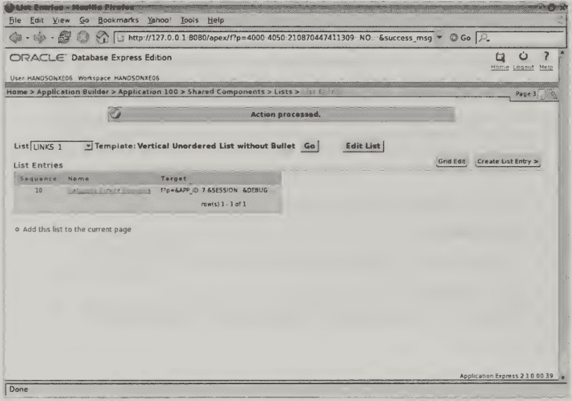

**FIGURE 6-20.** 包含导航链接的新列表

现在完成以下步骤，将新列表添加到当前页面：

1. 单击 Add this list to the current page（将此列表添加到当前页面）（查看列表条目下方）。

2. 要将列表添加到 Databases 报表页面，首先必须创建一个包含该列表的新区域。在 Title（标题）字段中指定 **Related Links**（相关链接），以指定新区域的标题。

3. 页面模板控制页面的外观布局。区域模板控制页面上特定区域的外观。在“Region Template”（区域模板）列表中，选择 Reports Region（报表区域）。

4. 区域的显示点控制区域相对于同一页面上其他区域的显示顺序。若要查看区域显示点的视觉表示，请单击 Display Point（显示点）列表旁边的手电筒图标。若要使新导航菜单出现在页面报表区域的右上角，请单击弹出窗口中的 Region Pos 03 链接。弹出窗口随后关闭并更新 Display Point 列表。

基于您的选择（页面模板区域位置 3）。今后，您可以直接从显示点列表中进行选择，或使用选择列表下方的快捷链接。

+   5. 点击下一步继续。

+   6. 在列表选择列表中选择 LINKS_1。

+   7. 点击创建列表区域。

+   8. 请注意，页面定义的区域部分现在显示了用于显示列表的新区域。

现在测试新列表以查看其是否有效：

+   1. 点击右上角的运行（路灯图标）以运行当前页面。

+   2. 请注意数据库报告页面上的新相关链接部分，如图 6-21 所示。

+   3. 点击数据库服务请求以显示显示服务请求报告页面。从这里，您可以导航到带有编辑图标和创建按钮的相关表单页面。

新的菜单现在提供了导航到新的数据库服务请求报告和相关表单的途径。但请注意，目前尚不清楚您在应用程序中的位置，并且无法通过多次鼠标点击返回到数据库页面。下一个练习将纠正此导航问题。

### 练习 6.21：将面包屑导航复制到新报告和表单页面

*面包屑导航菜单*是一种应用程序组件，提供两个有用的好处：导航和对您在应用程序中当前位置的可视化表示。本练习教您如何将新报告和表单页面的链接添加到应用程序的面包屑导航菜单中，然后将面包屑区域和菜单添加到新页面：

+   1. 在 SysMgmt 应用程序运行时，点击主机选项卡。

+   2. 点击开发者工具栏上的编辑页面 1。

+   3. 请注意，页面的区域部分包含一个显示面包屑导航菜单的区域。将相同的面包屑区域和菜单添加到新页面的最简单方法是将区域从一个页面复制到另一个页面。点击区域部分右上角的复制图标。

### 图 6-21. 带有相关链接导航菜单的新版数据库报告页面

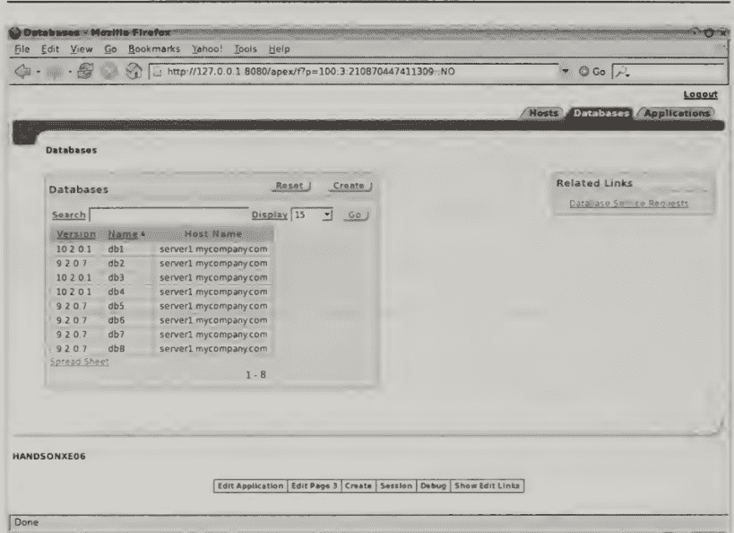

+   4. 点击面包屑以复制面包屑区域。
5. 在目标页面字段中指定 7，或点击目标页面字段旁边的按钮，从弹出窗口中选择数据库服务请求页面。
6. 点击下一步。
7. 点击复制区域以接受新区域的默认设置。
8. 导航到页面 7，注意它现在包含一个新的面包屑区域来显示面包屑导航菜单。
9. 重复类似步骤 3 至 7 的步骤，将面包屑区域从当前页面复制到创建/编辑数据库服务请求页面（页面 8）。

现在，两个新页面都具备显示应用程序面包屑导航菜单的能力，但只有在我们为菜单添加每个页面的链接后才会这样做。要向面包屑导航菜单添加条目（链接），请完成以下步骤。

+   1. 要编辑面包屑导航菜单本身，请点击您当前查看的任何应用程序页面定义中区域部分的面包屑（不是面包屑区域）。

2. 面包屑条目页面显示面包屑导航菜单的现有条目。注意现有条目的分层排列、显示序列号和引用的应用程序页面。最高显示序列号应为 60。

3. 点击创建面包屑条目以创建新条目。

4. 创建/编辑面包屑条目页面的面包屑部分指示面包屑条目当前所在的页面；在页面字段中指定 7，或使用弹出窗口选择数据库服务请求页面的页码。

5. 创建/编辑面包屑条目页面的条目部分指示面包屑条目的详细信息。
   - 在序列字段中指定高于 60 的序列号，例如 70。
   - 数据库服务请求页面的父页面是数据库页面；因此，在父条目列表中选择**数据库**。
   - 在短名称和长名称字段中都输入**数据库服务请求**。

6. 创建/编辑面包屑条目页面的目标部分指定用户点击链接时要导航到的页面；在页面字段中指定 7，或使用弹出窗口选择数据库服务请求页面的页码。

7. 点击创建以创建新条目。

8. 注意面包屑条目页面中的数据库服务请求页面的新条目及其相对于数据库页面条目的分层排列。

9. 重复类似步骤 3 至 8 的步骤，为创建/编辑数据库服务请求页面执行相同操作。确保新条目的父条目设置为数据库服务请求页面。完成后，面包屑导航菜单条目应如图 6-22 所示。

### 图 6-22. SysMgmt 修改后的面包屑导航菜单

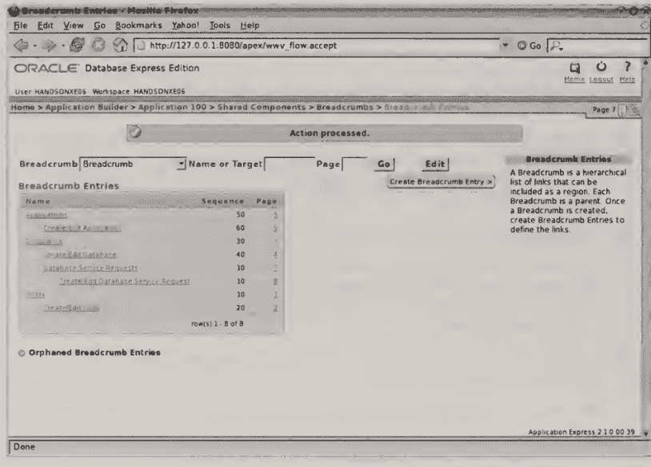

要测试您的新面包屑导航菜单，请点击运行以运行当前页面。创建/编辑数据库服务请求表单页面应如图 6-23 所示。

### 练习 6.22：向新报告添加搜索和显示控件

新的数据库服务请求报告页面缺少应用程序中其他报告页面当前支持的搜索功能。本练习（相对较长）教您如何将相同的功能添加到新报告页面，以及用于重新分页的控件。

任务的第一部分是创建页面组件以方便新报告页面上的搜索功能和重新分页；完成此任务并确保新报告页面与其他报告页面一致的最简单方法是将组件从一个页面复制到另一个页面：

## 第 6 章：使用 Oracle Application Express 构建应用程序

### 图 6-23. 带有面包屑导航菜单的修改后的创建/编辑数据库服务请求页面

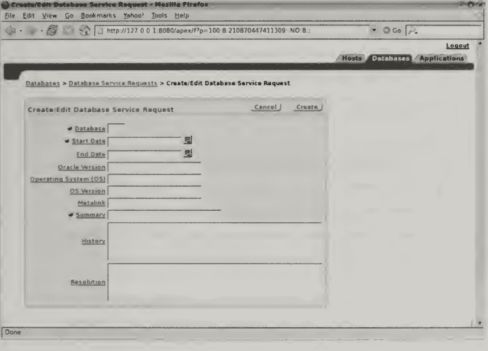

+   1. 在 SysMgmt 应用程序运行时，以您选择的任何方式导航到数据库报告页面。
2. 请注意，数据库报告包含四个不同的项目来支持搜索和显示功能：一个用于清除非默认显示设置的重置按钮；一个您可以输入搜索字符串条件的搜索文本字段；一个用于控制报告显示多少记录的显示列表；以及一个基于前面两个项目的设置更新报告显示的执行按钮。您的目标是在数据库服务请求报告页面上复制此功能。
3. 点击开发者工具栏上的编辑页面 3 以显示当前页面的定义。

4. 要复制重置按钮，请完成以下步骤：

+   a. 注意重置按钮出现在页面 3 的报告区域中。这是该按钮应在页面 7 所在的区域。

+   b. 点击按钮部分右上角的复制图标。

+   c. 点击重置以复制重置按钮。

+   d. 在目标页面字段中指定 **7**（或使用弹出窗口选择数据库服务请求页面）。

+   e. 点击下一步。

+   f. 在按钮名称字段中指定 **RESET**。

+   g. 在标签字段中指定 **重置**。

+   h. 在区域列表中选择数据库服务请求。

+   i. 要使新的重置按钮在同一区域中显示在创建按钮之前，请在序列字段中指定 **5**。

+   j. 点击复制按钮。

5. 要复制 P3_REPORT_SEARCH 文本字段，请完成以下步骤：

+   a. 注意 P3_REPORT_SEARCH 文本字段出现在页面 3 的报告区域中。这是该文本字段应在页面 7 所在的区域。

+   b. 点击项目部分右上角的复制图标。

+   c. 点击 P3_REPORT_SEARCH 以复制 P3_REPORT_SEARCH 文本字段。

+   d. 在目标页面字段中指定 **7**。

+   e. 点击下一步。

+   f. 在项目名称字段中指定 **P7_REPORT_SEARCH**。注意文本字段名称的前缀反映了其所在的页面（P7_）。

+   g. 在标签字段中指定 **搜索**。

+   h. 在区域列表中选择数据库服务请求。

+   i. 在序列字段中指定 **10**。

+   j. 该文本字段用于输入搜索条件。因此，在源类型列表中选择静态赋值（值等于源属性）。

+   k. 点击复制项目。


+   6. 要复制 P3_ROWS 选择列表，请完成以下步骤：
    a. 注意，P3_ROWS 选择列表出现在第 3 页的报表区域。这正是该选择列表在第 7 页应放置的区域。
    b. 点击“Items”部分右上角的“Copy”图标。
    c. 点击 P3_ROWS 以复制该 P3_ROWS 选择列表。
    d. 在“Target Page”字段中指定 7。
    e. 点击“Next”。
    f. 在“Item Name”字段中指定 P7_ROWS。注意，文本框名称的前缀反映了其所在的页面（P7_）。
    g. 在“Label”字段中指定“Display”。
    h. 在“Region”列表中选择“Database Service Requests”。
    i. 在“Sequence”字段中指定 20。
    j. 不要修改“Source Type”列表和“Source”字段的复制设置，它们应分别为“Static Assignment”和“15”。
    k. 点击“Copy Item”。

+   7. 要复制 P3_GO 按钮，请完成以下步骤：
    a. 注意，P3_GO 按钮出现在第 3 页的报表区域。这正是该按钮在第 7 页应放置的区域。
    b. 点击“Items”部分右上角的“Copy”图标。
    c. 点击 P3_GO 以复制该 P3_GO 按钮。
    d. 在“Target Page”字段中指定 7。
    e. 点击“Next”。
    f. 在“Item Name”字段中指定 P7_GO。注意，文本框名称的前缀反映了其所在的页面（P7_）。
    g. 在“Label”字段中指定“Go”。
    h. 在“Region”列表中选择“Database Service Requests”。
    i. 在“Sequence”字段中指定 30。
    j. “Source Type”列表决定了点击按钮时执行的操作。选择“Static Assignment”，以便按钮在被点击时分配一个值。
    k. “Source”字段根据“Source Type”列表的设置决定要分配的值。在“Source”字段中指定 **Go**。
    l. 点击 **Copy Item**。

+   8. 从第 3 页的定义导航到第 7 页的定义：在页面定义页面左上角的“Page”字段中指定 **7**，然后点击“Go”。

9. 注意最近复制到此页面（第 7 页）的项目，如图 6-24 所示。

为了支持搜索功能，工作的下一部分是修改报表查询，使其考虑新的 P7_REPORT_SEARCH 字段的当前值。为此，请按照以下步骤通过添加 WHERE 子句来修改报表查询。同时，修改报表查询以显示更有意义的数据库名称，而不是 DB_ID。

**图 6-24.** 修改后的 Database Service Requests 报表页面，其中包含已复制的项目

+   1. 点击页面“Regions”部分中的“Database Service Requests”。
2. 点击“Source”以跳转到页面的“Source”部分。
3. 按如下方式修改查询。新查询将 DATABASE_SERVICE_REQUESTS 表与 DATABASES 表进行连接，用 DB_NAME 表达式替换 DB_ID 选择列表表达式，并添加一个 WHERE 子句条件，该条件考虑 P7_REPORT_SEARCH 文本框的值以搜索 DB_NAME、DB_VERSION、HOST_OS、HOST_OS_VERSION、DB_SR_METALINK_REF 和 DB_SR_SUMMARY 字段；您应该从本章之前的练习中熟悉这类报表查询修改。您应进行的编辑以粗体标出。

```
select "DB_SR_ID",
"DB_NAME" AS "DATABASE",
"DB_SR_START_DATE",
"DB_SR_END_DATE",
"DB_VERSION",
"HOST_OS",
"HOST_OS_VERSION",
"DB_SR_METALINK_REF",
"DB_SR_SUMMARY",
dbms_lob.substr("DB_SR_HISTORY",4000,1) "DB_SR_HISTORY",
dbms_lob.substr("DB_SR_RESOLUTION",4000,1) "DB_SR_RESOLUTION"
from "#OWNER#"."DATABASE_SERVICE_REQUESTS"
natural join "#OWNER#"."DATABASES"
where
(
  instr(upper("DB_NAME"),
  upper(nvl(:P7_REPORT_SEARCH,"DB_NAME"))) > 0 or
  instr(upper("DB_VERSION"),
  upper(nvl(:P7_REPORT_SEARCH,"DB_VERSION"))) > 0 or
  instr(upper("HOST_OS"),
  upper(nvl(:P7_REPORT_SEARCH,"HOST_OS"))) > 0 or
  instr(upper("HOST_OS_VERSION"),
  upper(nvl(:P7_REPORT_SEARCH,"HOST_OS_VERSION"))) > 0 or
  instr(upper("DB_SR_METALINK_REF"),
  upper(nvl(:P7_REPORT_SEARCH,"DB_SR_METALINK_REF"))) > 0 or
  instr(upper("DB_SR_SUMMARY"),
  upper(nvl(:P7_REPORT_SEARCH,"DB_SR_SUMMARY"))) > 0
)
```

接下来，将“Display”列表绑定以控制报表在任何给定时间显示的行数。为此，请完成以下步骤：

+   1. 滚动到页面顶部，点击“Report Attributes”选项卡。Oracle Application Express 会隐式保存您的报表定义修改。
2. 点击“Layouts and Pagination”以跳转到“Layouts and Pagination”部分。
3. 在“Number of Rows (Item)”字段中指定 P7_ROWS，以将 P7_ROWS 选择列表的设置与报表页面上要显示的行数相关联。
4. 点击“Apply Changes”以保存您的工作。

此时，控制报表行显示所需的所有控件都已构建和配置。然而，控制应用程序行为的项目（如按钮）在用户使用每个控件时并不知道要执行什么操作，直到您构建了明确说明操作的相关进程和分支。*页面进程*在 Oracle Application Express 渲染或提交页面时执行某些操作。例如，当您重置报表页面时，一个进程可以重新分页报表，使报表显示原始结果集。*分支*将应用程序处理分叉以显示页面或 URL，或执行 PL/SQL 过程。例如，要在输入一些搜索条件或更改要显示的行数后重置报表页面的显示，页面可以创建并使用一个分支返回自身。

为了在 Database Service Requests 报表中为新控件编码所需的行为，需要以下进程和分支：

+   - 当用户点击“Go”按钮 (P7_GO) 提交页面时，一个进程必须重新分页报表以显示结果集中的第一行数据。
- 当用户点击“Reset”按钮 (RESET) 提交页面时，一个进程必须将“Search”字段 (P7_REPORT_SEARCH) 和“Display”列表 (P7_ROWS) 重置为其默认设置。
- 在前两种场景中，当 Database Service Requests 报表提交时，页面分支返回自身。

请完成以下步骤，以创建一个在用户点击 P7_GO 按钮时重置 Database Service Requests 报表的进程：

+   1. 在 Database Service Requests 报表的页面定义页面上，点击“Processes”部分中的“Create”以创建一个新进程。
2. 点击“Reset Repagination”。
3. 该进程应在提交页面后执行；因此，从“Point”选择列表中选择“On Submit – After Computations and Validations”。
4. 在“Name”字段中指定 **Reset Pagination – Go Button**。
5. 在“Sequence”字段中指定 **10**。
6. 每当有人点击“Go”按钮时，新进程都应执行；因此，为“When Button Pressed”选择列表选择 P7_GO。
7. 每当有人点击 P7_GO 按钮时，新进程都应无条件触发；因此，从“Condition Type”列表中选择“Process Not Conditional”。
8. 点击“Create Process”。

请完成以下步骤，以创建一个在用户点击 RESET 按钮时将 P7_REPORT_SEARCH 字段和 P7_ROWS 列表的设置重置为默认值的进程：

+   1. 在 Database Service Requests 报表的页面定义页面上，点击“Processes”部分中的“Create”以创建一个新进程。
2. 点击“Session State”。
3. 该进程需要清除 Oracle Application Express 为上述页面项目当前缓存的设置值；因此，选择“Clear Cache for Items (ITEM,ITEM,ITEM)”选项，然后点击“Next”。
4. 在“Name”字段中指定 **Reset Display**。
5. 在“Sequence”字段中指定 **20**。
6. 该进程应在提交页面后执行；因此，从“Point”选择列表中选择“On Submit – After Computations and Validations”。
7. 点击“Next”。
8. 注意指定要清除的页面项目所需的语法（逗号分隔，无空格）。指定 **P7_REPORT_SEARCH,P7_ROWS**。
9. 点击“Next”。
10. Oracle Application Express 可以在进程成功或失败时显示不同的消息。在“Success Message”字段中指定 **Page reset.**；在“Failure Message”字段中指定 **Reset failed.**。
11. 点击“Next”。
12. 每当有人点击“Reset”按钮时，新进程都应执行；因此，为“When Button Pressed”选择列表选择 RESET。


13. 当有人点击RESET按钮时，新流程应无条件执行；因此，从**Condition Type**（条件类型）列表中选择**Process Not Conditional**（流程无条件）。

14. 点击**Create Process**（创建流程）。

完成以下步骤，创建一个用于“重新加载”Database Service Requests（数据库服务请求）页面的分支：

1.  在Database Service Requests报告的页面定义页面上，点击**Branches**（分支）部分中的**Create**（创建）以创建一个新分支。
2.  该分支应在页面提交后执行；因此，从**Branch Point**（分支点）选择列表中选择**On Submit – After Computations and Validations**（提交时 - 计算和验证之后）。
3.  该分支的目标是应用程序中的一个页面；因此，从**Branch Type**（分支类型）选择列表中选择**Branch to Page**（跳转到页面）。
4.  点击**Next**（下一步）。
5.  该分支的目标是Database Service Requests报告页面本身，即第7页；因此，在**Branch to Page**（跳转到页面）字段中指定**7**（或使用弹出窗口选择该页面）。
6.  点击**Next**（下一步）。
7.  不要将该分支与特定按钮关联；从**When Button Pressed**（按钮按下时）选择列表中选择**Select Button**（选择按钮）。
8.  点击**Create Branch**（创建分支）。

最后，是时候测试Database Service Requests报告页面的新显示功能了。点击**Run**（运行），然后测试Search（搜索）字段、Display（显示）列表以及Go（执行）和Reset（重置）按钮，确保它们与应用程序中其他报告页面上的功能完全相同。例如：

-   在Search（搜索）字段中指定**598**，然后点击**Go**（执行）。报告应仅显示**MetaLink**参考号为**5983257.1**的数据库服务请求。
-   在Search（搜索）字段中指定**582**，然后点击**Go**（执行）。报告应仅显示**MetaLink**参考号为**5823552.1**的数据库服务请求。
-   点击**Reset**（重置）。报告应显示表中的所有两条记录。

更全面的测试是合适的：例如，确保新的搜索功能能正确地对报告中所有可搜索的字段进行数据筛选。

## EXERCISE 6.23: Add an Analysis Page to the Application
（练习 6.23：向应用程序添加一个分析页面）

就在你认为一切都很完美时，又出现了一个新的增强请求：DBA们希望有一个页面能汇总环境中部署的Oracle版本信息，以便更好地跟踪从Oracle9i到Oracle Database 10g的迁移项目。本练习将向你展示如何向应用程序添加一个图表，并演示如何扩展Databases（数据库）页面上的Related Links（相关链接）导航菜单。

要向应用程序添加一个新的Chart（图表）页面，以汇总当前使用的Oracle版本，请完成以下步骤：

1.  点击Developer工具栏中的Edit Application（编辑应用程序）。
2.  点击Create Page（创建页面）。
3.  点击Chart（图表）。
4.  DBA们想要部署的每个Oracle版本的确切数量。考虑到这一需求，点击“Bar, Vertical”（垂直条形图）。
5.  在Page（页面）字段中指定下一个可用的页面编号，即**9**。
6.  在Page Name（页面名称）字段中指定**Database Versions in Use**（正在使用的数据库版本）。
7.  在Region Template（区域模板）列表中选择Chart Region（图表区域）。
8.  在Region Name（区域名称）字段中指定**Chart**（图表）。
9.  不要修改Chart Color Theme（图表颜色主题）列表中的默认设置。
10. 点击Next（下一步）。
11. 选择“Use an existing tab set and reuse an existing tab within that tab set.”（使用现有选项卡集并重用该选项卡集中的现有选项卡）。
12. 在Tab Set（选项卡集）列表中选择TS1。
13. 点击Next（下一步）。
14. 此新图表中的信息与数据库相关；因此，在Use Tab（使用选项卡）列表中选择T_DATABASES。
15. 点击Next（下一步）。

使用向导的Identify Query（识别查询）页面来指定一个查询，该查询将返回新图表所需的数据。Oracle Application Express期望SELECT列表中的第一个表达式用作链接文本（用于向下钻取更多信息），第二个表达式用作数据标签，第三个表达式作为数据值；要查看示例，请点击向导表单下方的Query Example（查询示例）链接。为完成本练习，在SQL字段中指定以下查询。请注意，SELECT列表中的第一个表达式对所有行都返回NULL（链接不是必需的），而SELECT列表中的另外两个表达式声明了列别名，以便图表中的标签更易于理解。

```sql
SELECT NULL, db_version as "DATABASE VERSION",
        count(db_version) AS "NUMBER"
  FROM handsonxe06.databases
  GROUP BY db_version
```

点击Next（下一步）。

确认你的设置，然后点击Finish（完成）。

点击Run Page（运行页面）以查看新的Database Versions in Use（正在使用的数据库版本）页面的初始版本，其外观应如图6-25所示。

### NOTE

> 某些网络浏览器（如Mozilla和Mozilla Firefox）在安装SVG插件之前，可能无法显示由Oracle Application Express生成的图表。

应用程序的新Database Versions in Use（正在使用的数据库版本）页面看起来很棒。但是，该页面存在与向应用程序添加其他新页面时类似的导航问题。要修改Databases（数据库）页面上的Related Links（相关链接）导航菜单，请完成以下步骤：

1.  点击Developer工具栏中的Edit Application（编辑应用程序）。
2.  导航到Databases（数据库）页面。
3.  点击Lists（列表）部分中的LINKS_1以修改该列表。
4.  点击Create List Entry（创建列表项）。
5.  在Parent List Entry（父列表项）列表中选择No Parent Entry（无父项）。
6.  在Sequence（序号）字段中指定**20**。
7.  在List Entry Label（列表项标签）字段中指定**Database Versions Summary**（数据库版本摘要）。
8.  在Target（目标）部分的Page（页面）字段中指定**9**（或使用弹出窗口选择Database Versions in Use（正在使用的数据库版本）页面）。
9.  点击**Create**（创建）。

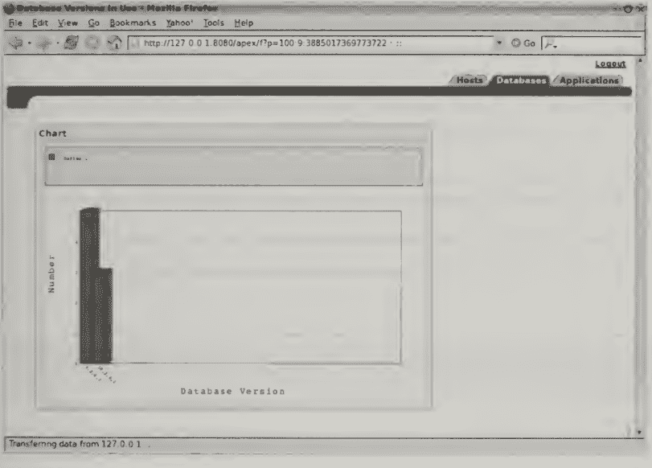

**FIGURE 6-25.** Database Versions in Use 页面的初始版本

要在面包屑菜单中创建一个新条目，请完成以下步骤：

1.  导航到主SysMgmt应用程序页面。
2.  点击**Shared Components**（共享组件）。
3.  点击**Breadcrumbs**（面包屑）。
4.  点击**Breadcrumb**（面包屑）。
5.  点击**Create Breadcrumb Entry**（创建面包屑条目）。
6.  在Breadcrumb（面包屑）部分的Page（页面）字段中指定**9**（或使用弹出窗口选择Database Versions in Use（正在使用的数据库版本）页面）。
7.  在Sequence（序号）字段中指定**90**。
8.  在Parent Entry（父项）列表中选择Databases。
9.  在Short Name（短名称）和Long Name（长名称）字段中均指定**Database Versions Summary**（数据库版本摘要）。
10. 在Target（目标）部分的Page（页面）字段中指定**9**（或使用弹出窗口选择Database Versions in Use（正在使用的数据库版本）页面）。
11. 点击Create（创建）。

要将面包屑菜单复制到新页面，请完成以下步骤：

1.  导航到主SysMgmt应用程序页面。
2.  点击除新Database Versions in Use（正在使用的数据库版本）页面之外的任何页面。
3.  点击Regions（区域）部分右上角的Copy（复制）图标。
4.  点击Breadcrumbs（面包屑）以复制面包屑区域。
5.  在To Page（目标页面）字段中指定9，或点击其相邻按钮，从弹出窗口中选择Database Versions in Use（正在使用的数据库版本）页面。
6.  点击Next（下一步）。
7.  点击Copy Region（复制区域）以接受新区域的默认设置。

现在，测试进出Database Versions in Use（正在使用的数据库版本）页面的新导航功能。Databases（数据库）页面应如图6-26所示（在对页）。

**FIGURE 6-26.** Databases 页面更新后的 Related Links 菜单

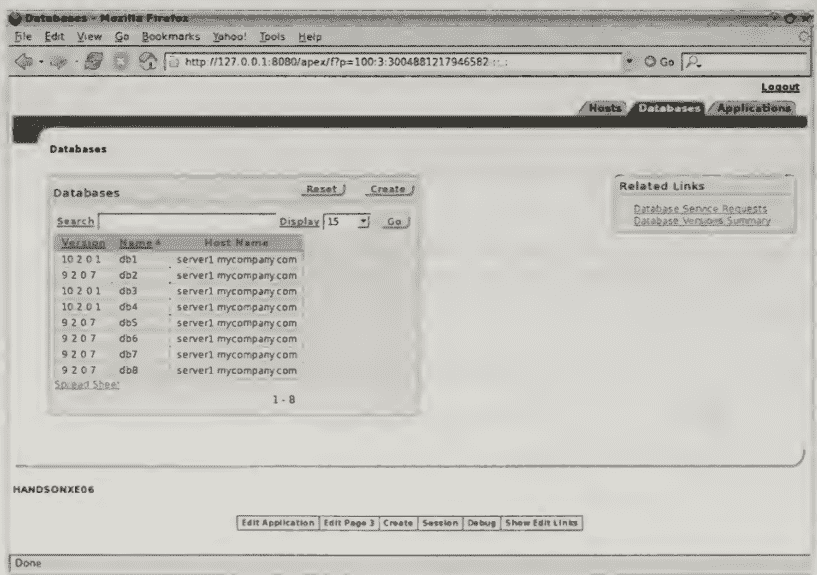

Database Versions in Use（正在使用的数据库版本）页面现在应有一个面包屑菜单，如图6-27所示。

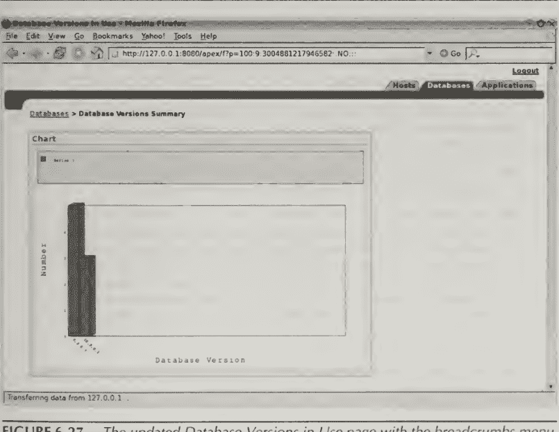

**FIGURE 6-27.** 带有面包屑菜单的更新后 Database Versions in Use 页面

## Deploying the Application
（部署应用程序）

一旦你完成Oracle Application Express应用程序的构建、测试和调整，你就可以在需要时部署它。你要做的第一个决定是部署应用程序的位置。Oracle Application Express提供了便利的设施，使得在任何有Oracle Application Express和Oracle的地方部署应用程序都变得轻而易举。本节中的练习将教你如何将应用程序部署到与你开发该应用程序相同的计算机上的“生产”模式，以及如何将应用程序从开发环境迁移到生产服务器。

## EXERCISE 6.24: Modify Application Attributes for Deployment
（练习 6.24：修改应用程序属性以进行部署）

在用于开发应用程序的同一台计算机上部署Oracle Application Express应用程序是一项简单的任务：只需修改一些简单的应用程序属性即可。例如，完成以下步骤，将示例SysMgmt应用程序部署到你用于开发该应用程序的同一台计算机上：

1.  导航到应用程序的主页。
2.  点击Edit Attributes（编辑属性）。
3.  点击Edit Standard Attributes（编辑标准属性）。
4.  使用Standard Attributes（标准属性）页面修改基本应用程序设置，例如应用程序的名称、版本号和可用性。就本简短练习而言，请关注以下设置：
    -   在Application Alias（应用程序别名）字段中指定**SysMgmt**。当你想要运行应用程序时，可以在URL中使用此别名或应用程序ID。
    -   Status（状态）列表的设置控制应用程序是否可供使用。例如，选择Available（可用）可使应用程序对所有类型的用户可用，但不显示Developer工具栏；选择Available with Edit Links（可用并带有编辑链接）可使应用程序对所有类型的用户可用并显示Developer工具栏；选择Available to Developer's Only（仅对开发者可用）可使应用程序仅对具有开发者权限的用户可用。有关Status列表其他选项的更多信息，请参阅在线帮助系统或《Oracle Application Express用户指南》。就本练习而言，选择Available（可用）。
    -   Build Status（构建状态）列表的设置决定应用程序是否仍在开发中；就本练习而言，指定Run and Build Application（运行并构建应用程序）。
5.  点击Apply Changes（应用更改）。


要测试应用程序的执行情况，请完成以下步骤：

1.  点击"注销"以结束当前会话。

2.  在 Web 浏览器中使用应用程序的 ID 或之前设置的别名加载应用程序的 URL。例如，加载以下 URL：

   http://127.0.0.1:8080/apex/f?p=SysMgmt

3.  在"用户名"字段中指定 **HANDSONXE06**，在"密码"字段中指定 **PASSWORD**，然后点击"登录"。

4.  随意浏览和使用应用程序。在使用应用程序时，请注意开发人员工具栏已不再可用。

当你需要修改一个"可用性"设置为"运行"且"构建状态"设置为"构建应用程序"的应用程序时，请启动数据库主页，登录，然后使用应用程序构建器加载并修改应用程序。

## **练习 6.25：在另一台计算机上部署应用程序**

在实际环境中，你不太可能在同一台用于开发的计算机上部署生产环境的 Oracle Application Express 应用程序。幸运的是，将 Oracle Application Express 应用程序从一台计算机复制到另一台计算机进行部署非常简单。本练习中的步骤将演示此过程。

当你使用 Oracle Application Express 创建应用程序时，你实际上是在数据库表中创建元数据，Oracle Application Express 可以使用这些元数据在运行时动态生成应用程序的网页和逻辑。将应用程序从一台计算机移动到另一台计算机只需要导出应用程序的元数据并将其导入另一个 Oracle 数据库即可。

要复制应用程序，需要两个主要步骤：生成可用于创建应用程序模式的 SQL DDL 脚本，以及导出和导入应用程序的元数据。如果你有两台安装了 Oracle XE 的计算机，或者你希望通过在开发计算机上创建 SysMgmt 应用程序的第二个版本来模拟应用程序复制过程，请使用本练习中的步骤。

要快速生成可用于构建当前版本 HANDSONXE06 模式的 SQL DDL 脚本，请完成以下步骤：

1.  在*用于部署应用程序的目标计算机*上启动 Web 浏览器。本练习假设目标计算机上已安装并启动了 Oracle XE，或者目标计算机上已安装并启动了 Oracle Application Express 2.x 和相应版本的 Oracle。

2.  在*开发计算机*上（非目标计算机）启动数据库主页，并以 **HANDSONXE06** 身份登录。

3.  点击"实用程序"。

4.  点击"生成 DDL"。

5.  点击"创建脚本"。

6.  点击"下一步"。

7.  选择所有对象类型选项。

8.  使用以下任一技术在目标计算机上创建 SQL 脚本：

   - 从"输出"选项中选择"内联显示"，点击"生成 DDL"，将输出内容复制到剪贴板，粘贴到文本编辑器中，然后将其保存为目标计算机文件系统中可用的纯文本文件。

   - 从"输出"选项中选择"另存为脚本文件"，点击"生成 DDL"，为脚本指定一个名称（例如 sysmgmt_ddl），然后点击"创建脚本"；此过程将在 Oracle Application Express 存储库中生成脚本（而非在你的文件系统中）。在"SQL 脚本"页面上，点击新脚本，点击"下载"，然后指定一个对目标计算机可用文件系统有效的文件名。

完成以下步骤以导出 SysMgmt 应用程序本身：

1.  点击"主页"。

2.  点击"应用程序构建器"。

3.  点击"SysMgmt"。

4.  点击"导出/导入"。

5.  点击"导出"。

6.  不要修改应用程序导出的默认设置；点击"导出应用程序"。

7.  使用浏览器将生成的 SQL 脚本保存到目标计算机可用的文件系统中。

至此，你已经拥有两个 SQL 脚本，可以用来在任何可用 Oracle Application Express 的计算机上部署应用程序。完成以下步骤以使用这些脚本进行应用程序部署：

1.  点击"注销"以结束你在开发计算机上的 Oracle Application Express 会话。

2.  在*目标计算机*上启动数据库主页。

3.  在目标数据库中创建 HANDSONXE06 用户/模式以支持 SysMgmt 应用程序。你可以使用本章的支持脚本 chap06.sql 来快速完成此步骤。如果你是在开发计算机上创建 SysMgmt 应用程序的第二个版本，请跳过此步骤。

4.  使用类似于练习 6.1 中的步骤，上传并运行包含在目标数据库的 HANDSONXE06 模式中创建应用程序模式所需 DDL 语句的 SQL 脚本。

完成以下步骤以将 SysMgmt 应用程序导入目标计算机的 Oracle Application Express 存储库：

1.  点击"主页"。

2.  点击"应用程序构建器"。

3.  点击"导入"。

4.  点击"浏览"并导航到文件系统以选择包含 SysMgmt 应用程序元数据的 SQL 脚本。

5.  点击"下一步"。

6.  点击"安装"。

7.  应用程序安装完成后，点击"运行应用程序"以在目标计算机上测试应用程序。

## **管理应用程序访问和应用程序用户**

在向计划使用该应用程序的用户授予访问权限之前，应用程序的部署尚未完成。你为应用程序选择的身份验证方案决定了提供用户访问权限所需的操作。关于 Oracle Application Express 支持的身份验证方案的完整讨论超出了本章的范围。但是，本节简要演示了管理使用 Application Express 身份验证方案的示例 SysMgmt 应用程序用户访问权限所需的步骤。

### **练习 6.26：创建 Application Express 用户**

当应用程序使用 *Application Express 身份验证*方案时，你需要使用 Application Express 最终用户账户来管理应用程序的访问权限。Application Express 最终用户没有应用程序开发权限，只能访问未使用外部身份验证方案的应用程序。

要创建 Application Express 用户账户，请完成以下步骤：

1.  如果应用程序正在运行，请注销。

2.  启动数据库主页。

3.  以 **HANDSONXE06** 身份登录。

4.  点击"应用程序构建器"。

5.  点击"管理 Application Express 用户"。

6.  点击"创建用户"。

7.  在"用户名"字段中指定 **STEVE**。

8.  在"密码"字段中指定 **PASSWORD**。在"确认密码"字段中指定相同的密码。请注意，Application Express 最终用户账户密码区分大小写。

9.  在"电子邮件地址"字段中指定 **steveb@dbdomain.com**。

10. 点击"创建用户"。

11. 根据需要创建的用户数量，重复类似于步骤 6 到步骤 10 的操作。

要使用 SysMgmt 应用程序测试新用户账户，请完成以下步骤：

1.  点击"注销"。

2.  使用应用程序的 URL 启动应用程序。例如：

   `http://myserver:8080/f?p=SysMgmt`

3.  使用新用户账户登录。

## **章节总结**

本章简要介绍了应用程序开发流程，特别关注了 Oracle Application Express。你学习了以下概念：

- 应用程序开发生命周期（ADLC）包括分析、设计、实现、测试、部署和维护阶段。

- 使用统一建模语言（UML）图进行软件建模可以大大提高设计阶段的效率和效果。结构图（如类图）说明了你所建模系统的静态结构。行为图（如用例图）展示了系统组件之间的动态交互。

- 要快速构建应用程序模式，你可以使用 Oracle XE 上传并运行从 UML 类图生成的 SQL 脚本。

- Oracle XE 可以轻松地从结构化数据文件格式加载数据，例如由电子表格和 PC 数据库程序生成的逗号分隔值、制表符分隔字段和 XML 文件。

- 你用于构建基于 Web 的应用程序的 Oracle Application Express 组件称为应用程序构建器。应用程序构建器的众多向导使得基于 Oracle 数据库快速构建用于报表、表单和图表的网页变得非常简单。

- Oracle Application Express 应用程序是根据数据库中的元数据在运行时生成的。将应用程序从一台计算机部署到另一台计算机只需要导出应用程序的元数据并将其导入另一个 Oracle 数据库即可。


# 第三部分

# 数据库管理

# 第7章

## 安全数据库访问

既然你已经对使用Oracle XE进行应用开发有了基本的了解，本书的这一部分将重点介绍管理支撑数据库应用的底层Oracle数据库所需了解的事项。尽管Oracle XE本身会自动执行许多常规的数据库管理任务，但了解系统常规执行的*数据库管理员（DBA）*任务以及必须由你自己执行的其他任务至关重要。本章首先讨论与Oracle XE相关的几个数据库安全主题。

对于任何多用户计算机系统，安全都是一个需要特别关注的重要问题。Oracle数据库系统当然也不例外。如果没有足够的安全控制，恶意用户可能会入侵Oracle数据库、查看机密信息，并对数据库信息进行未经授权的更改。本章介绍Oracle XE的各种安全功能，你可以利用这些功能控制用户对Oracle数据库和Oracle Application Express应用程序的访问：

- 用户管理和身份验证
- 权限管理和角色
- 数据库资源限制
- 用户密码管理

## 章节前提条件

要练习本章的动手操作练习，你需要按照练习2.12的说明启动SQL*Plus，并运行以下命令脚本：

```
location/handsorxe/sql/chap07.sql
```

其中*location*是存放本书配套支持存档的文件目录。例如，启动SQL*Plus后，你可以使用SQL*Plus命令@运行本章的SQL命令脚本，如下例所示（假设你的chap07.sql文件在C:\temp\handsonxe\sql目录下）：

```
SQL> @/tmp/handsonxe/sql/chap07.sql;
```

一旦你响应了所有提示并且脚本成功完成，*请保持当前SQL*Plus会话打开*——本章后面的几个练习需要用到它。

## 用户管理

防止未授权数据库访问的第一道防线是控制谁可以首先访问系统。正如你从本书前面章节所知，要使用Oracle XE，用户必须登录并提供*用户名*。以下部分将更详细地介绍在Oracle XE数据库中管理用户访问的具体内容。

### Oracle数据库用户和Oracle Application Express用户

在继续之前，理解本书前面章节在Oracle XE背景下介绍的两种用户账户类型之间的区别非常重要。在前面的大部分章节中，你使用的是Oracle XE数据库用户账户（如HANDSONXE03、HANDSONXE04等）来启动SQL*Plus和数据库主页等工具，以执行支持脚本并完成其他工作。*数据库用户账户*是Oracle XE在数据库数据字典中管理的账户。

练习6.26简要介绍了Oracle Application Express用户的概念。*Application Express用户账户*是Oracle Application Express在其存储库中管理的账户，独立于底层Oracle数据库的数据字典。Oracle Application Express用户只能通过依赖于Application Express身份验证方案的Oracle Application Express应用程序来访问Oracle数据库。你不能使用Oracle Application Express用户账户直接访问Oracle数据库（例如，使用SQL*Plus或Oracle XE的数据库主页）。

这是一本关于Oracle XE的书；因此，本章重点介绍数据库用户账户。有关Oracle Application Express身份验证方案和Oracle Application Express用户账户的完整信息，请参阅*Oracle Application Express用户指南*。

### 默认数据库用户账户

每个Oracle数据库至少有两个默认的数据库用户账户：

- **SYS** 拥有数据库的数据字典对象。只在绝对必要时才使用SYS账户连接到Oracle；例如，关闭、启动或恢复数据库。本章后面，你将了解到使用SYS账户时需要的一个特殊选项（AS SYSDBA）。

- **SYSTEM** 默认的DBA账户，可用于开始使用新数据库。但是，出于责任考虑，最好创建能够进行数据库管理的不同用户账户，而不是使用默认的SYSTEM账户。

SYS和SYSTEM账户的密码在安装Oracle XE时设置。

> **注意**
> 大多数Oracle数据库包含许多其他支持Oracle可选功能的默认或内部用户账户。有关默认Oracle用户账户的完整列表，请参阅《Oracle数据库10g管理员指南》第2章。

### 数据库用户属性

每个Oracle数据库用户都有几个相关属性：

- 一个唯一的用户名，这是显而易见的
- 一种身份验证方法，例如密码
- 一种状态，已锁定或已解锁
- 控制和指定数据库空间资源的数据库空间使用设置

以下部分简要介绍每种数据库用户账户属性。

### 数据库用户名

每个数据库用户名在所有其他用户名和角色中必须是唯一的，长度为1到30个字符，必须以字母字符开头，且不区分大小写。用户名可以包含任何字母数字字符，以及下划线（_）、美元符号（$）和井号（#），但不能包含单引号或双引号，也不能是Oracle保留字（如SELECT、CREATE等）。有关Oracle保留字的完整列表，请参阅《Oracle数据库10g SQL参考》。

### 数据库用户身份验证

对于每个数据库用户，你必须指明希望如何*验证*数据库用户账户的使用。*用户身份验证*确保当用户尝试连接到Oracle数据库时，用户确实是其声称的身份，而不是试图冒充该用户的其他人。

在大多数情况下，Oracle XE使用密码来执行数据库用户身份验证。当用户启动SQL*Plus或数据库主页等应用程序时，该应用程序会提示输入数据库用户名和关联的密码。然后，Oracle XE使用数据库自身管理的用户账户信息对连接请求进行身份验证。由于Oracle XE执行了所有工作，此过程通常称为*Oracle数据库身份验证*，但有些人也称之为*密码身份验证*。

> **注意**
> Oracle（包括Oracle XE）支持数据库用户的几种其他身份验证机制，包括操作系统（外部）身份验证和网络身份验证等。但是，本章仅关注数据库身份验证，因为这是数据库主页的Oracle XE管理界面支持的唯一类型的数据库用户身份验证方法。有关其他身份验证类型的更多信息，请参阅《Oracle数据库10g管理员指南》。

当依赖密码身份验证时，制定确保密码具有一定程度复杂性的策略非常重要。例如，*强密码*具有以下特征：

- 包含大小写字母。但是，默认情况下，Oracle密码不区分大小写，除非你采取一些特殊步骤，正如本章后面解释的那样。
- 至少八个字符长。
- 包含数字、标点符号或其他符号（不要使用只是将某些字母替换为相似数字的单词，例如r8和r&om代替"rate"和"random"）。
- 不基于用户名。
- 不是真实单词（例如，你在字典或专有名词列表中可能找到的单词）。

好的安全策略还应该要求或强制用户至少每六个月更改一次密码。Oracle XE可以强制执行密码安全策略；有关管理用户密码的更多信息，请参阅本章后面“管理资源限制配置文件”部分中的几个练习。

### 锁定和解锁的用户账户

Oracle允许你随时*锁定*和*解锁*用户账户，以便你可以通过该账户控制数据库访问，而无需删除并重新创建它。在你锁定用户账户后，用户无法连接到Oracle。要随后允许

当你访问用户账户时，必须先解锁该账户。那么，为什么要锁定和解锁用户账户呢？

-   当用户因临时请假而离开工作岗位，但计划日后返回时，你可能希望锁定该用户的账户。
-   当某人离开你的公司时，你可能希望锁定其账户而非直接删除，特别是当该用户的模式（schema）包含你希望保留的表和其他对象时。
-   你通常会锁定那些仅作为模式（schema）用于逻辑组织应用程序所有数据库对象的用户账户。换句话说，通常不应通过应用程序底层的用户/模式来访问应用程序。

### 用户的默认表空间

表空间是数据库的逻辑存储单元，用于组织数据库信息的物理存储；本书下一章将详细介绍表空间。目前，你需要了解每个数据库用户都有一个*默认表空间*设置。当用户创建新的数据库对象（如表或索引）且未明确指定该对象的表空间时，Oracle 会将新的数据库对象存储在用户的默认表空间中。除非你另行指定，用户的默认表空间对应于数据库的默认表空间设置。第8章将更详细地介绍如何设置数据库的默认表空间。

### 用户的临时表空间

通常，SQL 语句需要临时工作区来完成操作。例如，一个连接并排序大量数据的查询可能需要临时工作区来构建结果集。必要时，Oracle 会为用户的 SQL 语句在其*临时表空间*中分配临时工作区。除非你另行指定，用户的临时表空间就是数据库的默认临时表空间。第8章将更详细地介绍如何设置数据库的默认临时表空间。

### 练习 7.1：显示数据库用户信息

要管理和显示 Oracle XE 数据库用户账户的信息，你可以使用数据库主页中的管理界面。例如，要显示当前数据库用户的信息，请完成以下步骤：

1.  启动数据库主页。
2.  要管理数据库用户，你必须建立具有必要管理员权限的连接。因此，使用默认数据库管理账户 **SYSTEM** 自动建立连接，然后指定你在 Oracle XE 安装过程中为该账户设置的密码。
3.  以 SYSTEM 身份连接后，单击“Administration”（管理）。
4.  单击“Database Users”（数据库用户）。
5.  请注意，“Manage Database Users”（管理数据库用户）页面会显示 Oracle XE 数据库中的数据库用户列表。

你可以随意修改“View”（视图）、“Show”（显示）和“Display”（显示）选择列表，然后单击“Go”（执行）查看如何自定义数据库用户的显示方式。特别要注意的是，“Show”（显示）选择列表决定了当前显示中包含的用户类型：

-   **内部用户** 在 Oracle XE 的上下文中，指 Oracle XE 用于支持 Oracle 数据库功能的数据库用户账户。例如，SYS 和 SYSTEM 是每个 Oracle 数据库中都存在的默认数据库管理账户；ANONYMOUS 是 Oracle Application Express 用于代表应用程序建立数据库连接的用户账户。除非你有特定理由并了解更改的影响，否则不应修改或删除内部用户账户。
-   **数据库用户** 普通数据库用户，例如本书前几章支持脚本创建的用户，包括 HANDSONXE03、HANDSONXE04 等。

在“Icons”（图标）视图中（如图 7-1 所示），“Manage Database Users”（管理数据库用户）页面会为内部用户和数据库用户显示不同颜色的图标，并且仅显示每个用户的名称。
在“Details”（详细信息）视图中（如图 7-2 所示），“Manage Database Users”（管理数据库用户）页面会显示关于每个用户的更多信息，包括每个用户的账户状态、默认表空间和临时表空间设置。

### 练习 7.2：创建数据库用户

要创建数据库用户，请完成以下步骤：

1.  在“Manage Database Users”（管理数据库用户）页面上，单击“Create”（创建）。
2.  使用“Create Database User”（创建数据库用户）页面为新数据库用户账户指定以下信息：
    -   在“Username”（用户名）字段中指定 **HANDSONXE_USER1**；不区分大小写。
    -   在“Password”（密码）和“Confirm Password”（确认密码）字段中指定 **changepw123**；不区分大小写。请注意，这些字段显示 * 而不是你输入的密码字符，这样旁观者就无法读取你指定的内容。
    -   启用“Expire Password”（密码过期），这样 Oracle XE 会强制用户在第一次尝试使用账户时更改密码。
    -   从“Account Status”（账户状态）列表中选择“Unlocked”（已解锁），以便用户账户可访问。
    -   请注意，不可修改的“Default Tablespace”（默认表空间）和“Temporary Tablespace”（临时表空间）设置分别为 USERS 和 TEMP；Oracle XE 根据数据库默认设置推导出这些设置。
    -   页面“User Privileges”（用户权限）部分中的设置决定了你想要授予新用户账户的权限；本章后续部分将更详细地介绍权限和角色。在本练习中，选择“CONNECT”选项，并禁用此部分中的所有其他角色和权限。
3.  确认页面设置如图 7-3 所示，然后单击“Create”（创建）以创建新用户。

### 图 7-1. 使用图标视图时的“管理数据库用户”页面

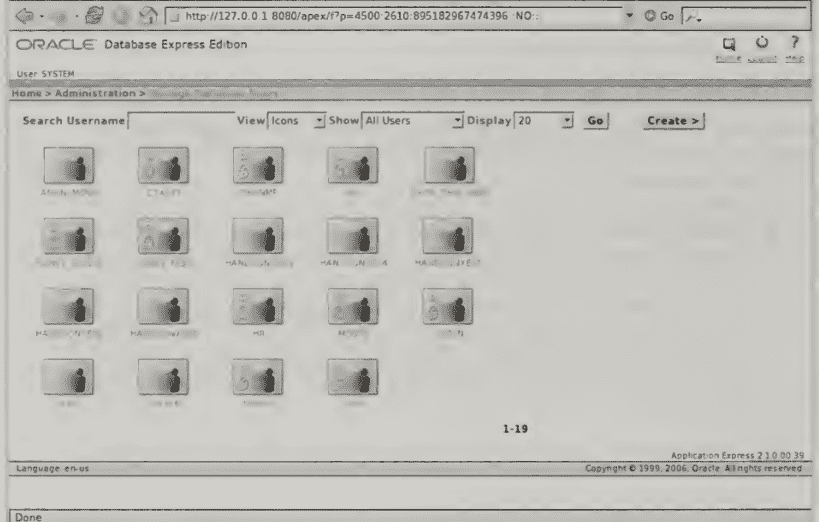

### 图 7-2

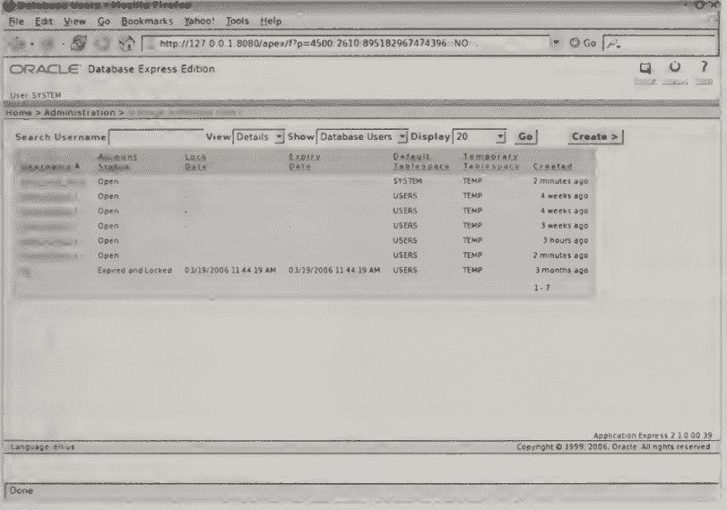

> **注意**

默认情况下，Oracle 用户名和密码不区分大小写。你可以用双引号将用户名括起来，使其区分大小写。但是，我不建议使用此技术强制用户名区分大小写；这样做要求用户在建立数据库连接时必须明确地用双引号括起相应的用户名，这并不直观。

在 Oracle XE 创建新用户后，你将返回到“Manage Database Users”（管理数据库用户）页面，该页面现在会显示有关新用户的信息。在“Details”（详细信息）视图中请注意，新用户的账户状态为“Expired”（已过期），这表示用户在下次尝试使用该账户时必须更改密码。

### 图 7-3

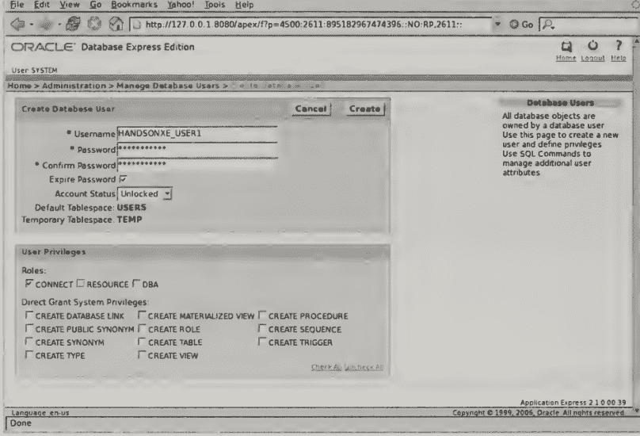

> **注意**

“Create Database User”（创建数据库用户）页面使用 SQL 命令 `CREATE USER` 和 `GRANT` 来创建新数据库用户并授予权限。遗憾的是，此页面没有可以用来显示执行操作所用 SQL 的 SQL 链接。有关这些命令的更多信息，请参阅《Oracle Database 10g SQL 参考》。

### 练习 7.3：测试新的数据库用户账户

要测试新用户账户并了解当用户尝试使用已过期的账户时会发生什么，请完成以下步骤：

1.  单击“Logout”（注销）。
2.  单击“Login”（登录）。
3.  在“Username”（用户名）字段中指定 **HANDSONXE_USER1**。
4.  在“Password”（密码）字段中指定 **changepw123**。
5.  单击“Login”（登录）。
6.  请注意，在继续之前，你必须更改账户的密码。
7.  在“Old Password”（旧密码）字段中指定当前密码 **changepw123**。
8.  在“New Password”（新密码）和“Confirm Password”（确认密码）字段中指定一个新的强密码，例如 **j8tyrrs7**；默认情况下，字符的大小写无关紧要。
9.  单击“Apply Changes”（应用更改）。
10. 单击“Done”（完成）。
11. 使用 HANDSONXE_USER1 的新密码登录。

### 练习 7.4：修改自己的密码

任何数据库用户都可以在必要时更改自己的密码。例如，要更改 HANDSONXE_USER1 用户账户的密码，请完成以下步骤：

1.  启动数据库主页并以 **HANDSONXE_USER1** 身份登录；除非你没有立即继续上一个练习，否则此步骤应没有必要。
2.  单击“Home”（主页）| “Administration”（管理）。
3.  从“Tasks”（任务）列表中单击“Change My Password”（更改我的密码）。
4.  在“Change My Password”（更改我的密码）页面上，在“Old Password”（旧密码）字段中指定当前密码 **j8tyrrs7**。
5.  在“New Password”（新密码）和“Confirm Password”（确认密码）字段中指定一个新的强密码，例如 **tr7ghh13**。
6.  单击“Apply Changes”（应用更改）。

> **注意**

“Change My Password”（更改我的密码）页面使用 SQL 命令 `ALTER USER` 来重置用户账户的密码。有关 `ALTER USER` 命令的更多信息，请参阅《Oracle Database 10g SQL 参考》。


### 练习 7.5：修改或删除数据库用户

拥有管理权限的用户可以修改数据库用户账户的设置，或者彻底删除数据库用户账户，操作步骤如下：

1.  启动 Database Home Page，并以 **SYSTEM** 身份登录。如果你是从上一个练习继续，请点击 Logout，再点击 Login，然后以 **SYSTEM** 身份登录。

2.  点击 Administration。

3.  点击 Database Users。

4.  点击要修改的目标数据库用户；在本练习中，请点击 DROP_THIS_USER。

5.  请注意，Manage Database User 页面与练习 7.2 中的 Create Database User 页面相似。你可以使用 Manage Database User 页面通过以下方式修改用户账户：
    - 更改用户密码
    - 使用户密码过期
    - 锁定或解锁用户账户
    - 删除用户

当你对用户账户做出需要保存的更改时，请点击 Alter User 应用更改；当你想要删除用户时，请点击 Drop；当你不想修改或删除用户时，请点击 Cancel。

6.  在本练习中，请点击 Drop 以删除 DROP_THIS_USER 用户账户。

7.  随后出现的 Drop Database User 页面会提示你确认请求。当你要删除当前“拥有”一个或多个模式对象的用户时，必须选择 Cascade 选项；否则，Oracle 会返回错误，以避免你误删那些恢复起来耗时的对象。在本练习中，请选择 Cascade，然后点击 Drop User。

8.  返回 Manage Database Users 页面后，请注意数据库用户列表中不再显示 DROP_THIS_USER。

完成本书每一章后，你可以随时使用本练习中的步骤来锁定或彻底删除本书配套脚本创建的数据库用户账户。一般来说，删除那些可能成为安全隐患的过时数据库账户始终是一种良好做法。

### 依赖关系与删除用户

在删除“拥有”数据库对象或 Oracle Application Express 应用程序的用户之前，务必仔细考虑可能产生的副作用。例如，当你删除一个拥有表的用户时，Oracle 会自动删除其他模式中引用该用户模式中主键和唯一键约束的引用完整性约束；Oracle 还会使其他数据库模式中的依赖对象失效，但不会删除这些对象，包括视图、同义词、存储过程、函数、包和数据库触发器等。草率地删除一个拥有表的数据库用户可能会对应用程序的功能造成严重破坏。

在删除拥有 Oracle Application Express 应用程序的数据库用户之前，同样需要仔细考虑——当你这样做时，Oracle XE 会自动将该用户的应用程序从 Oracle Application Express 仓库中删除。在删除拥有 Oracle Application Express 应用程序的用户之前，请使用第 6 章中介绍的技术导出用户的模式和应用数据，以创建用户应用程序的“备份”。俗话说，有备无患。

## 权限管理

为 Oracle 数据库系统创建用户后，如果他们没有执行特定数据库操作的*权限*，就无法连接到数据库服务器，也无法进行任何有意义的操作。例如，请考虑以下限制：

- 除非用户拥有 CREATE SESSION 系统权限，否则无法连接到 Oracle 数据库。
- 除非用户拥有 CREATE TABLE 系统权限，否则无法在其对应的模式中创建表。
- 除非用户拥有针对该表的 DELETE 对象权限，否则无法删除其他模式中表里的行。

### 数据库权限的类型

如果你仔细阅读上面的列表，会注意到有两种不同类型的权限控制着对 Oracle 数据库的访问：系统权限和对象权限。

### 系统权限

*系统权限*是一种强大的权限，允许用户执行某种系统级操作。例如，在 Oracle Database 10g 的 150 多种系统权限中，以下只是其中的几个：

- **CREATE SESSION** — 允许用户建立数据库连接/会话
- **CREATE TABLE** — 允许用户在其对应的模式中创建表
- **CREATE ANY TABLE** — 允许用户在数据库的任何模式中创建表
- **SELECT ANY TABLE** — 允许用户查询数据库中的任何表
- **EXECUTE ANY PROCEDURE** — 允许用户执行数据库中的任何存储过程、存储函数或包组件

由于系统权限是非常强大的权限，可能影响整个数据库系统的安全，因此请仔细考虑哪些类型的用户需要系统权限。例如：

- 数据库管理员是唯一应拥有强大 ALTER DATABASE 系统权限的用户类型，该权限允许某人更改数据库系统的物理结构和可用性。
- 开发人员通常需要多个系统权限，包括 CREATE TABLE、CREATE VIEW 和 CREATE PROCEDURE 系统权限，以构建支撑前端应用的数据库模式。
- 系统中的每个用户通常都拥有 CREATE SESSION 系统权限，即允许用户连接到数据库的权限。

### 对象权限

*对象权限*允许用户对特定数据库对象（如表、视图或存储过程）执行特定类型的操作。以下是一些对象权限的示例：

- 拥有 CUST 视图 SELECT 对象权限的用户可以查询该视图以检索信息。
- 拥有 CUSTOMERS 表 INSERT 对象权限的用户可以向该表插入新行。用户可以直接引用该表，也可以通过引用基于该表的视图或同义词来插入行。
- 拥有某表 REFERENCES 对象权限的用户在声明引用完整性约束时可以引用该表。
- 拥有 deleteHost 过程 EXECUTE 权限的用户可以执行该过程。

> **注意**
>
> 有关所有系统权限和对象权限的完整列表，请参阅《Oracle Database 10g SQL Reference》。

### 授予和撤销权限

你可以通过*授予*权限的方式赋予用户系统权限或对象权限。若要收回用户的权限，则需要从该用户*撤销*权限。Oracle 并不允许任何人随意向用户授予或撤销权限。在为数据库用户管理单个系统权限和对象权限时，请考虑以下要求：

- 只有当你自己拥有某项系统权限，并且具有行政权利将该权限授予其他用户时，才能将该系统权限授予用户；由于相关的 SQL 语法，这通常称为 WITH ADMIN OPTION。如果你自己是 GRANT ANY PRIVILEGE 系统权限的被授予者，也可以将任何系统权限授予任何其他用户。
- 只有当你拥有相关的数据库对象，或者你自己拥有某项对象权限并具有行政权利将该权限授予其他用户时，才能将该数据库对象权限授予用户；由于相关的 SQL 语法，这通常称为 WITH GRANT OPTION。如果你自己是 GRANT ANY OBJECT PRIVILEGE 系统权限的被授予者，也可以将任何对象权限授予任何数据库对象。

### 练习 7.6：授予用户系统权限

你可以通过 Database Home Page 轻松地将一些最有用的系统权限子集授予数据库用户，操作步骤如下：

1.  启动 Database Home Page，以 **SYSTEM** 身份登录，然后点击 Administration | Database Users；如果你是从上一个练习继续，则此步骤可能不必要。

2.  点击你要管理的用户以显示熟悉的 Manage Database User 页面；在本练习中，请点击 HANDSONXE_USER1。


## 3. 注意页面中"用户权限"部分的以下内容：
-   你可以从有限的系统权限列表中单独选择若干不同的系统权限，例如 CREATE DATABASE LINK、CREATE PUBLIC SYNONYM 和 CREATE TRIGGER。
-   你可以点击"全选"或"全部取消"来分别选择或取消选择所有可用的系统权限。

4. 点击页面底部的"All System Privileges Granted to HANDSONXE_USER1"，以显示 HANDSONXE_USER1 当前拥有的所有系统权限列表。HANDSONXE_USER1 目前应该仅拥有 CREATE SESSION 系统权限。

5. 假设 HANDSONXE_USER1 是一个用于应用开发的新用户账户。在这种情况下，启用 CREATE PUBLIC SYNONYM、CREATE SYNONYM、CREATE TABLE、CREATE VIEW、CREATE PROCEDURE、CREATE SEQUENCE 和 CREATE TRIGGER 选项。不要修改任何其他页面设置。在继续之前，请确保页面看起来与图 7-4 类似。

6. 点击"Alter User"以将选定的系统权限授予 HANDSONXE_USER1。

### 使用 SQL 命令 GRANT 授予系统权限

"管理数据库用户"页面使用 SQL 命令 GRANT 来向用户授予系统权限。但是，该页面只能授予有限的一组系统权限，且无法向用户授予具有管理权限的系统权限。要完成这两项任务，你必须使用以下 SQL 命令 GRANT 的简化形式：

```
GRANT privilege [, privilege] ...
 TO user [, user] ...
 [WITH ADMIN OPTION]
```

以下示例演示了如何为应用开发者授予具有管理权限的适当系统权限：

```
GRANT CREATE SESSION, CREATE TABLE, CREATE VIEW, CREATE ANY INDEX,
  CREATE SEQUENCE
 TO handsonxe_user1
WITH ADMIN OPTION;
```

要快速向所有数据库用户授予某个系统权限，可以将该权限授予关键字 PUBLIC 而非特定用户。PUBLIC 是 Oracle 数据库中的一个特殊组，可用于快速将某项权限分配给系统中的所有用户。但是，请谨慎使用此功能，以避免在数据库中产生安全漏洞。

### 练习 7.7：撤销用户的系统权限

如果你在使用"管理数据库用户"页面授予用户系统权限时出错，或者后来决定用户不应再拥有其*权限域*或*安全域*（可用权限集）中的某项系统权限，你也可以通过"管理数据库用户"页面撤销该系统权限。例如，CREATE PUBLIC SYNONYM 系统权限通常不适用于应用开发者——拥有该权限的开发者如果没有全局视角，可能会在不知情的情况下创建公共同义词，从而导致与所需的数据库或应用程序特定公共同义词产生潜在冲突。考虑到这一点，请完成以下步骤以从 HANDSONXE_USER1 撤销 CREATE PUBLIC SYNONYM 系统权限：

1. 继续上一个练习，在"管理数据库用户"页面上点击 HANDSONXE_USER1。
2. 取消启用 CREATE PUBLIC SYNONYM 选项。
3. 点击"Alter User"。

### 使用 SQL 命令 REVOKE 撤销系统权限

"管理数据库用户"页面使用 SQL 命令 REVOKE 从用户撤销系统权限。但是，该页面无法撤销未列出的系统权限，也无法撤销授予 PUBLIC 的系统权限。要完成这些任务，你必须使用以下 SQL 命令 REVOKE 的简化形式：

```
REVOKE privilege [, privilege] ...
 FROM user [, user] ...
```

例如，前面侧栏（"使用 SQL 命令 GRANT 授予系统权限"）中的 GRANT 语句向 HANDSONXE_USER1 授予了多项具有 WITH ADMIN OPTION 的系统权限。因此，该用户可以自行决定将相同的系统权限授予其他用户。通常，应用开发者不应具有向其他数据库用户授予系统权限的能力。因此，以下 REVOKE 语句撤销了用户对这些系统权限的访问：

```
REVOKE CREATE SESSION, CREATE TABLE, CREATE VIEW, CREATE ANY INDEX,
  CREATE SEQUENCE
 FROM handsonxe_user1;
```

接下来，重新向该用户授予必要的系统权限，但这次不带 WITH ADMIN OPTION：

```
GRANT CREATE SESSION, CREATE TABLE, CREATE VIEW, CREATE ANY INDEX,
  CREATE SEQUENCE
 TO handsonxe_user1;
```

### 练习 7.8：向用户授予对象权限

拥有模式对象（如表、序列或存储过程）的用户可以通过数据库主页的对象浏览器向其他用户授予相应的对象权限。例如，要向 HANDSONXE_USER1 数据库用户授予在 HANDSONXE07.CUSTOMERS 表中插入行、更新行、删除行和检索行的权限，请完成以下步骤：

1. 如果你继续上一个练习，当前会话是以 SYSTEM 身份建立的。点击"Logout"结束此会话，然后点击"Login"以显示数据库主页的登录页面。
2. 以拥有目标模式对象的用户身份连接。在本练习中，在"Username"字段中输入 **HANDSONXE07**，在"Password"字段中输入 **PASSWORD**，然后点击"Login"。
3. 点击"Object Browser"。
4. 在"Object Selection"面板中选择"Tables"。
5. 点击"CUSTOMERS"。
6. 点击"Grants"。
7. 注意，当前与此表相关的授权为空。
8. 点击"Grant"。
9. 使用"Grantee"字段旁的按钮显示用户弹出列表；然后选择 HANDSONXE_USER1。
10. 使用"Grant"下拉列表选择要授予的对象权限：ALL 表示你要授予 CUSTOMERS 表的所有对象权限，Specific Privileges 则显示特定权限选择列表，可用于授予 CUSTOMERS 表的特定对象权限列表。在本示例中，在"Grant"列表中选择"Specific Privileges"。
11. 使用 CTRL 键和鼠标在"Specific Privileges"列表中多选 DELETE、INSERT、UPDATE 和 SELECT 对象权限。
12. "With Grant Option"复选框表示是否允许被授权者将所选对象权限授予其他用户；你不希望如此，因此不要启用此选项。
13. 确认页面显示与图 7-5 一致，然后点击"Next"。
14. 点击"SQL"并查看对象浏览器页面生成的 SQL 语句。注意，要授予对象权限，你可以使用 SQL 命令 GRANT。有关用于授予对象权限的 GRANT 命令形式的完整信息，请参阅 *Oracle Database 10g SQL Reference*。

```
grant DELETE,INSERT,UPDATE,SELECT on "CUSTOMERS" to HANDSONXE_USER1
```

**图 7-5.** 模式对象的所有者可以使用对象浏览器的 Grant 页面将一个或多个对象权限授予其他数据库用户。

15. 点击"Finish"。

16. "Detail"面板现在列出了所选 CUSTOMERS 表的新授权，如图 7-6 所示。

> **注意**
>
> 本练习教你对象的所有者如何向用户授予相应的对象权限。拥有 WITH GRANT OPTION 的对象权限被授权者，或拥有 GRANT ANY OBJECT PRIVILEGE 系统权限的被授权者，可以使用 SQL 命令 GRANT 授予其他用户对象的权限；Oracle XE 的对象浏览器界面不支持此功能。参见练习 7.12 了解示例。

**图 7-6.** 对象浏览器的 *Detail* 面板显示所选对象的授权信息。

### 理解列级对象权限

练习 7.7 中的对象权限授予隐式涵盖了对应表中的所有列。例如，授予 HANDSONXE07.CUSTOMERS 表的基本 UPDATE 权限允许 HANDSONXE_USER1 更新表中任意列的数据。

Oracle 还支持针对表和视图的列级 INSERT、UPDATE 和 REFERENCES 对象权限。换句话说，当你向某人授予表或视图的 INSERT、UPDATE 或 REFERENCES 权限时，可以指定该表或视图中被授权者可以插入、更新或引用的特定列列表。此功能称为列级授权。


插入、更新或引用。例如，以下 GRANT 语句授予用户 HANDSONXE_USER1 对 ORDERS 表的列选择性 INSERT 和 UPDATE 权限：

```
GRANT INSERT(id, orderdate, c_id), UPDATE(id, orderdate, c_id)
  ON handsonxe07.orders
  TO handsonxe_user1;
```

随后，HANDSONXE_USER1 可以向表中插入行并更新表中已有的行。但是，该用户的 INSERT 和 UPDATE 语句只能为用户有权访问的列指定值。插入新行时，表或视图中的所有其他列必须接受默认列值，这些值除非在表创建期间或之后显式设置，否则默认为 null。例如，考虑已授予的权限，以下语句将成功执行：

```
INSERT INTO handsonxe07.orders (id, orderdate, c_id)
VALUES (1,SYSDATE,1);

UPDATE handsonxe07.orders
  SET orderdate = SYSDATE
WHERE id = 4;
```

但是，考虑已授予的权限，以下语句将失败：

```
INSERT INTO handsonxe07.orders (id, orderdate, c_id, status)
VALUES (1,SYSDATE,1, 'B');

UPDATE handsonxe07.orders
  SET status = 'F'
WHERE id = 4;
```

## 注意

> 尽管 Oracle 不支持针对表和视图的列特定 SELECT 对象权限，但对此限制的一个简单变通方法是创建一个仅提供对必要列的访问权限的视图，然后授予对该视图的 SELECT 权限。

### 练习 7.9：从用户撤销对象权限

您也可以使用对象浏览器从用户撤销对象权限。例如，要从数据库用户 HANDSONXE_USER1 撤销对 HANDSONXE07.CUSTOMERS 表的 DELETE 对象权限，请完成以下步骤：

1.  启动数据库主页并作为拥有相关模式对象的用户连接；如果您是从上一个练习继续进行，您应该已经使用了以 **HANDSONXE07** 身份建立的会话。
2.  单击对象浏览器。
3.  在对象选择窗格中选择表。
4.  单击 CUSTOMERS。
5.  单击权限。
6.  单击撤销。
7.  在“从以下撤销”选择列表中选择相关的被授权者；对于本练习，选择 HANDSONXE_USER1。
8.  在“撤销”选择列表中选择要撤销的权限；对于本练习，选择 DELETE。
9.  单击下一步。
10. 单击 SQL 并查看对象浏览器页面构建的 SQL 语句。请注意，要撤销对象权限，您可以使用 SQL 命令 REVOKE。有关用于撤销对象权限的 REVOKE 命令形式的完整信息，请参阅 *Oracle Database 10g SQL 参考*。

```
revoke DELETE on "CUSTOMERS" from HANDSONXE_USER1
```

11. 单击完成。
12. 注意详细信息窗格已更新，以反映 CUSTOMERS 表当前的对象权限授予情况。

## 使用角色管理权限

使用典型数据库应用程序所需的系统和对象权限可能非常多。当数据库应用程序支持大量用户群时，如果您通过单独的授权来管理每个用户的权限，权限管理很快就会变成一项繁重的工作。为了使安全管理工作更容易，您可以使用角色。

### 了解撤销对象权限可能带来的副作用

从用户撤销对象权限时，可能会发生某些副作用。例如，考虑以下场景：

1.  您向一个用户授予了对某个表的 SELECT 对象权限，并带有 GRANT 选项。
2.  该用户转而向另一个用户授予该对象权限。
3.  第二个用户创建了一个依赖于该对象权限才能正常工作的视图。
4.  您从第一个用户撤销该对象权限。

在这种情况下，Oracle 会自动从第二个用户也撤销该对象权限，这反过来导致第二个用户的视图停止正常工作。这个简单的例子说明，在从用户撤销对象权限之前，调查该用户数据库对象和权限之间存在的依赖关系非常重要。

*角色*是您可以授予用户和其他角色的一组相关系统和对象权限的集合。例如，当您构建一个新的数据库应用程序时，您可以创建一个具有使用该应用程序所需数据库权限的新角色。在将角色授予应用程序用户后，该用户就可以启动应用程序、建立连接并完成工作。如果运行应用程序所需的权限发生变化，您只需要快速修改角色的权限集即可。所有该角色的被授权者会自动看到角色的更改，并继续拥有使用该应用程序所需的权限。

### 预定义数据库角色

Oracle 有许多预定义角色，您可以使用它们快速向常见的数据库用户类型授予权限。表 7-1 是五个常用预定义数据库角色的简短列表。

> **注意**
> 将 RESOURCE 或 DBA 角色授予用户也会直接将 UNLIMITED TABLESPACE 系统权限授予被授权者（在角色之外）。有关此权限的重要信息，请参阅练习 7.16。

| 角色                  | 描述                                                                                                                                                                                                                                                             |
| --------------------- | ----------------------------------------------------------------------------------------------------------------------------------------------------------------------------------------------------------------------------------------------------------------------- |
| CONNECT               | 一个基本的用户角色，允许被授权者连接到数据库。                                                                                                                                                                                                        |
| RESOURCE              | 面向典型应用程序开发者，该角色允许被授权者在关联模式中创建表、序列、数据簇、过程、函数、包、触发器、对象类型、索引类型和用户定义运算符。                             |
| DBA                   | 面向管理员，该角色允许被授权者执行任何数据库功能，因为它包括每个系统权限。此外，DBA 角色的被授权者可以向任何其他数据库用户或角色授予任何系统权限。                                    |
| SELECT_CATALOG_ROLE   | 允许被授权者查询数据字典视图。                                                                                                                                                                                                                           |
| EXECUTE_CATALOG_ROLE  | 允许被授权者执行预构建的 DBMS 实用程序包。                                                                                                                                                                                                            |

表 7-1. Oracle XE 中可用的预构建角色简表

尽管 Oracle 提供了预定义角色来帮助管理典型数据库用户的权限，但依赖这些角色的应用程序不一定能正常运行。这是因为您可以更改预定义角色的权限集，甚至完全删除该角色。特别是，Oracle Database 10g 文档指出，Oracle 计划在未来版本的 Oracle 中不再支持 CONNECT、RESOURCE 和 DBA 角色。

### 用户定义角色

您可以为 Oracle 数据库及相关应用程序创建所需数量的角色。创建角色后，您可以向该角色授予权限和其他角色，以构建该角色的权限集。然后，您可以将该角色授予用户，以便他们拥有完成工作所需的权限。

### 启用和禁用角色

角色的被授权者并不一定总是有权访问该角色的权限。Oracle 允许应用程序为每个个人选择性地启用和禁用角色。应用程序为用户启用角色后，该角色的权限就对该用户可用。正如您可能预期的那样，应用程序为用户禁用角色后，该用户将无法再访问该角色的权限。Oracle 能够动态控制用户可用的权限集，使应用程序可以确保用户在使用应用程序时始终拥有正确的权限集。

例如，当用户启动订单输入应用程序时，应用程序可以启用用户的 ORDER_ENTRY 角色，以便用户能够完成工作。当用户完成工作后，应用程序可以禁用用户的 ORDER_ENTRY 角色，以便用户在使用其他应用程序时不会使用订单输入应用程序权限。

### 默认角色

每个用户都有一个默认角色列表。*默认角色*是 Oracle 在用户建立新的数据库会话时自动启用的角色。默认角色使得启用用户在使用 Oracle 时始终需要的角色变得非常方便，无论他们使用哪个应用程序。

### 角色身份验证

为了防止未经授权使用角色，您可以选择使用身份验证来保护角色。Oracle 可以使用几种不同的身份验证技术（与数据库用户类似，包括密码身份验证）来验证角色的使用。当用户或应用程序尝试启用受身份验证保护的角色时，Oracle 会验证角色的使用。

### 创建、管理和使用角色

在本章的前面练习中，您直接向用户帐户授予了多个系统和对象权限。想象一下，如果您必须在工作组中为许多用户重复此过程，会有多大的管理开销。为了使系统中的虚拟应用程序用户更容易进行权限管理，接下来的几个练习将向您展示如何定义一个名为 HANDSONXE_APPUSER 的新角色，您可以将其授予应用程序用户帐户。

### 练习 7.10：创建角色

要创建新角色，您必须使用 SQL 命令 CREATE ROLE；数据库主页的管理页面不完全支持角色的管理。以下是 CREATE ROLE 命令语法的简略版本：

```
CREATE ROLE role
[NOT IDENTIFIED | IDENTIFIED BY password]
```

与用户名类似，角色名称可以是 1 到 30 个字符长，必须以字母字符开头，不区分大小写，并且必须遵守与用户名相同的命名规则。此外，角色名称在所有其他数据库用户和角色中必须是唯一的——换句话说，角色不是模式对象，它是系统对象。


要创建角色，请使用运行本章支持脚本后剩余的 SQL*Plus 会话，以数据库管理员（例如 SYSTEM）身份建立连接，然后输入以下命令：

```
CONNECT system/...;

CREATE ROLE handsonxe_appuser
IDENTIFIED BY yeRtw;
```

> **注意**

创建角色时，Oracle 会自动授予您该角色，并附带修改、删除以及将角色授予其他角色和用户的管理权限。

### 练习 7.11：将系统权限和角色授予角色

用于将系统权限和其他角色授予角色的 SQL 命令 GRANT 的简写语法如下：

```
GRANT privilege|role [, privilege|role] ...
TO role [, role] ...
[WITH ADMIN OPTION]
```

例如，使用 SQL*Plus 执行以下语句，将 CREATE SESSION 系统权限授予新的 HANDSONXE_APPUSER 角色：

```
GRANT CREATE SESSION
TO handsonxe_appuser;
```

> **注意**

当您为角色授予 WITH ADMIN OPTION 时，被授权者可以授予、修改或删除该角色，并且可以将该角色授予其他用户和角色。为防止系统出现安全漏洞，将具有管理权限的系统权限和角色授予其他角色是不明智的。

### 练习 7.12：将对象权限授予角色

用于将对象权限授予角色的 SQL 命令 GRANT 的简写语法如下：

```
GRANT
  privilege [, privilege] ...
| ALL [PRIVILEGES]
ON [schema.]object | DIRECTORY directory
TO role [, role] ...
[WITH GRANT OPTION]
```

例如，使用 SQL*Plus 输入以下语句，将若干对象权限授予新的 HANDSONXE_APPUSER 角色：

```
GRANT INSERT, UPDATE, DELETE, SELECT
    ON handsonxe07.customers
    TO handsonxe_appuser;

GRANT ALL PRIVILEGES
    ON handsonxe07.orders
    TO handsonxe_appuser;

GRANT SELECT,
    INSERT (id, lastname, firstname),
    UPDATE (lastname, firstname)
    ON handsonxe07.salesreps
    TO handsonxe_appuser;
```

> **注意**
>
> *Oracle 不允许您通过角色接收 REFERENCES 对象权限来用于表——当需要此权限的用户（例如开发人员）时，您必须直接将该权限授予用户。*

执行之前的 GRANT 语句后，您可能想知道为什么这些语句执行成功——毕竟，您当前并未以 HANDSONXE07（对象所有者）身份连接。授权成功是因为 SYSTEM 是 GRANT ANY OBJECT PRIVILEGE 系统权限的被授权者，因此可以授予数据库中任何对象的对象权限。

### 练习 7.13：将角色授予用户

要将角色授予用户，请使用以下 SQL 命令 GRANT 的简写语法：

```
GRANT role [, role] ...
    TO user [, user] ...
    [WITH ADMIN OPTION]
```

当您为用户授予角色的 WITH ADMIN OPTION 时，该用户可以授予、修改或删除该角色，并且可以将该角色授予其他用户和角色。出于显而易见的原因，请谨慎使用此选项。

例如，使用 SQL*Plus 输入以下 SQL 语句，为虚构的应用程序用户创建一个新的数据库用户帐户，然后将 HANDSONXE_APPUSER 角色授予新用户：

```
CREATE USER handsonxe_user2
  IDENTIFIED BY changepw123
  PASSWORD EXPIRE
  DEFAULT TABLESPACE users
  TEMPORARY TABLESPACE temp
  ACCOUNT UNLOCK;
```

```
GRANT handsonxe_appuser TO handsonxe_user2;
```

只需一个 GRANT 语句，新用户 HANDSONXE_USER2 就拥有了在 Oracle XE 数据库中作为应用程序用户工作所需的必要权限。此外，如果您需要更改应用程序用户的权限，只需向 HANDSONXE_APPUSER 角色授予权限和从该角色撤销权限——所有 HANDSONXE_APPUSER 角色的被授权者将自动接受该角色的新权限域。

### 练习 7.14：设置用户的默认角色

当您将角色授予用户时，Oracle 会自动将该角色添加到用户的默认角色列表中。您可以使用以下 SQL 命令 ALTER USER 的语法显式设置用户的默认角色列表：

```
ALTER USER user
  [DEFAULT ROLE
     role [,role] ...
   | ALL [EXCEPT role [,role] ...]
   | NONE	]
```

您可以在用户被直接授予角色后，将角色指定为用户的默认角色（您无法指定通过其他角色间接接收的角色）。此外，如果角色由操作系统或安全服务进行身份验证，则不能将其指定为用户的默认角色——通过密码进行身份验证的默认角色在连接时不需要密码。请注意，您可以指定单个角色、使用 ALL 子句指定所有角色或除列表中的角色外的所有角色，或者不为用户指定任何默认角色。

### 角色与开发权限

虽然角色可以简化普通应用程序用户的权限管理，但对于需要直接授予权限才能完成工作的用户（如应用程序开发人员）来说，它们往往被证明是无效的。例如，考虑以下场景：应用程序开发人员通过角色获得了 SELECT 权限，用于某个表，并且该开发人员需要创建一个新的定义者权限存储过程来读取该表。即使开发人员拥有查询该表所需的对象权限，但由于该权限仅通过角色提供，开发人员无法创建该过程。

### 注意

如果用户没有包含 CREATE SESSION 系统权限的任何默认角色，则必须直接将 CREATE SESSION 系统权限授予该用户，否则用户将无法建立数据库会话。

使用 SQL*Plus 输入以下 ALTER USER 语句，修改新 HANDSONXE_USER2 用户帐户的默认角色列表：

```
ALTER USER handsonxe_user2
  DEFAULT ROLE handsonxe_appuser;
```

随后，当 HANDSONXE_USER2 连接到数据库时，Oracle XE 将自动使授予 HANDSONXE_APPUSER 角色的权限可用。

### 练习 7.15：启用和禁用角色

您可以使用 SQL 命令 SET ROLE 显式启用和禁用对角色权限的访问。正如本章前面部分所讨论的，应用程序通常使用此命令来确保应用程序会话拥有使用该应用程序的适当权限集。SET ROLE 命令的语法如下：

```
SET ROLE
   role [IDENTIFIED BY password] [,role [IDENTIFIED BY password] ... ]
 | ALL [EXCEPT role [,role] ... ]
 | NONE
```

在使用 SET ROLE 命令之前，有几个要点需要理解：

- 您的会话可以使用带有 ALL 选项的 SET ROLE 命令来启用授予您帐户的所有角色。但是，当您想要启用需要密码的角色时，必须使用 IDENTIFIED BY 参数指定该角色及其密码。
- 您可以使用 SET ROLE 命令的 NONE 选项禁用会话的所有角色。
- Oracle 会自动禁用您未使用 SET ROLE 命令启用的任何已授予您的角色。

要以 SYSTEM 身份显示当前会话启用的角色列表，请使用 SQL*Plus 执行以下查询，该查询针对 SESSION_ROLES 数据字典视图：

```
SELECT * FROM session_roles;
```

结果集应类似于以下内容：

```
ROLE
------------------------------
DBA
SELECT_CATALOG_ROLE
HS_ADMIN_ROLE
EXECUTE_CATALOG_ROLE
DELETE_CATALOG_ROLE
EXP_FULL_DATABASE
IMP_FULL_DATABASE
GATHER_SYSTEM_STATISTICS
SCHEDULER_ADMIN
PLUSTRACE
XDBADMIN
XDBWEBSERVICES
AQ_ADMINISTRATOR_ROLE
```

请注意，您当前以 SYSTEM 身份的会话可以访问许多角色，但不包括新的 HANDSONXE_APPUSER 角色，因为它当前未启用。为了说明 SET ROLE 命令的功能，使用 SQL*Plus 执行以下 SET ROLE 语句，为当前会话专门启用 HANDSONXE_APPUSER 角色并禁用所有其他角色：

```
SET ROLE handsonxe_appuser IDENTIFIED BY yeRtw;
```

接下来，再次查询 SESSION_ROLES 视图，您应该看到以下结果集：

```
ROLE
---------------
HANDSONXE_APPUSER
```

要启用 DBA、SELECT_CATALOG_ROLE 和 HANDSONXE_APPUSER 角色，请执行以下语句：

```
SET ROLE
  DBA,
  SELECT_CATALOG_ROLE,
  handsonxe_appuser IDENTIFIED BY yeRtw;
```


## 资源限制

在多用户数据库系统中，通常需要限制用户对系统资源的访问，如磁盘空间、共享 CPU 时间和磁盘 I/O。例如，假设你正在支持一支 Oracle Application Express 开发团队。某个开发者可能喜欢在 PL/SQL 子程序中构建无限循环，或者建立过多的数据库会话，以牺牲其他开发者正常工作为代价消耗大量的数据库资源。以下各节介绍了 Oracle XE 的相关功能，可用于限制用户对多种系统资源的访问。

### 表空间配额

用户无法在表空间中创建表和索引等对象，除非该用户拥有该表空间的配额。*表空间配额*限制了用户的数据库对象在该表空间中可消耗的空间量。用户可以拥有零个、一个或所有数据库表空间的配额——这完全由你决定。当你创建或更改用户并赋予其表空间配额时，你可以将配额设置为表空间中的特定字节数，或设置为无限制的空间量。

### 练习 7.16：为用户提供特定的表空间配额

要为当前用户提供系统中一个或多个表空间的配额，你可以使用以下形式的 SQL 命令 ALTER USER：

```
ALTER USER user
  [QUOTA integer [K|M] | UNLIMITED ON tablespace] ...
```

例如，使用 SQL*Plus 执行以下语句，为用户 HANDSONXE_USER1 提供在 USERS 表空间中使用 1MB 空间的权限：

```
ALTER USER handsonxe_user1
  QUOTA 1M ON users;
```

现在使用 SQL*Plus 执行以下语句，将 HANDSONXE_USER1 在 USERS 表空间中的特定配额覆盖为可在 USERS 表空间中使用无限空间的权限：

```
ALTER USER handsonxe_user1
  QUOTA UNLIMITED ON users;
```

当用户必须对每个表空间都拥有无限制配额时，你可以授予该用户 UNLIMITED TABLESPACE 系统权限，而不是为用户授予数据库中每个表空间的无限制配额；但是，关于此系统权限有几点需要了解：

- Oracle 不允许你将 UNLIMITED TABLESPACE 系统权限授予角色。
- 当你将预定义的 RESOURCE 或 DBA 角色授予某人时，Oracle 会在角色本身之外自动授予该用户 UNLIMITED TABLESPACE 系统权限。
- 特定的表空间配额不约束 UNLIMITED TABLESPACE 系统权限的被授予者。

### 注意

> 用户无需配额即可在其对应的临时表空间中使用临时空间。

### 资源限制配置文件

要控制系统资源中其他几种类型的消耗，你可以使用资源限制配置文件。*资源限制配置文件*是你分配给一个或多个数据库用户的一组特定资源限制设置。使用资源限制配置文件，你可以限制多种系统资源的消耗，包括但不限于以下内容：

- CPU 时间（以百分之一秒为单位），按会话或按语句统计
- 逻辑磁盘 I/O，按会话或按语句统计
- 每个用户的并发数据库会话数
- 每个会话的最大连接时间和空闲时间（以分钟为单位）

### 配置文件与安全策略

你可以使用资源限制配置文件为数据库用户实施安全策略。使用资源限制配置文件，你可以控制分配了该配置文件的每个用户帐户的以下设置：

- Oracle 锁定帐户之前允许的连续失败连接尝试次数
- 帐户密码的有效期（以天为单位），超过该期限后密码过期
- 用户可以使用过期密码的天数（宽限期），超过后帐户将被锁定
- 帐户可以重用旧密码之前必须经过的天数，或帐户密码必须更改的次数
- 是否检查帐户密码的复杂度是否足够，以防止帐户使用过于简单的密码

### 默认配置文件

每个 Oracle 数据库都有一个*默认资源限制配置文件*。当你创建新的数据库用户且未指定特定配置文件时，Oracle 会自动为该用户分配数据库的默认配置文件。默认情况下，数据库默认配置文件的所有资源限制设置均为无限制；安全策略设置则各有不同。

当你创建资源限制配置文件时，可以设置特定的资源限制设置，也可以采用数据库默认配置文件的对应设置。你随时可以像修改用户自定义配置文件一样修改数据库默认配置文件的设置。

### 管理资源限制配置文件

在 Oracle 数据库中配置和实施资源限制及安全策略，需要完成以下几个步骤：

1. 为数据库实例启用资源限制。
2. 创建一个或多个配置文件。
3. 为每个用户分配配置文件。

以下实践练习将指导你如何完成这些步骤，以管理资源限制配置文件、密码策略等。

### 练习 7.17：启用资源限制

默认情况下，Oracle XE 数据库不会强制执行资源限制。因此，限制用户对服务器资源访问的第一步是在实例级别启用资源限制的强制执行。你可以使用以下形式的 SQL 命令 ALTER SYSTEM 来启用和禁用资源限制的强制执行，而无需关闭并重启 Oracle 服务：

```
ALTER SYSTEM
SET RESOURCE_LIMIT = TRUE|FALSE
```

要实施配置文件策略，请使用 SYSTEM 作为当前数据库管理员会话，通过 SQL*Plus 执行以下语句：

```
ALTER SYSTEM
SET RESOURCE_LIMIT = TRUE SCOPE = MEMORY;
```

> **注意**
本练习中的 ALTER SYSTEM 示例语句使用 SCOPE 参数设置为 MEMORY，仅为当前数据库实例的生命周期内启用资源限制的强制执行。如果你关闭并重启 Oracle XE，配置文件策略的强制执行将取决于服务器初始化参数文件中 RESOURCE_LIMIT 参数的设置。

### 练习 7.18：创建配置文件

在本练习中，你将创建一个资源限制配置文件，用于实践数据库中新加入的应用程序开发者。要创建新的配置文件，你需要使用 SQL 命令 CREATE PROFILE，其语法如下：

```
CREATE PROFILE profile LIMIT
  [SESSIONS_PER_USER integer|UNLIMITED|DEFAULT]
  [CPU_PER_SESSION integer|UNLIMITED|DEFAULT]
  [CPU_PER_CALL integer|UNLIMITED|DEFAULT]
  [CONNECT_TIME integer|UNLIMITED|DEFAULT]
  [IDLE_TIME integer|UNLIMITED|DEFAULT]
  [LOGICAL_READS_PER_SESSION integer|UNLIMITED|DEFAULT]
  [LOGICAL_READS_PER_CALL integer|UNLIMITED|DEFAULT]
  [COMPOSITE_LIMIT integer|UNLIMITED|DEFAULT]
  [PRIVATE_SGA integer [K|M] |UNLIMITED|DEFAULT]
  [FAILED_LOGIN_ATTEMPTS integer|UNLIMITED|DEFAULT]
  [PASSWORD_LIFE_TIME integer|UNLIMITED|DEFAULT]
  [PASSWORD_REUSE_TIME integer|UNLIMITED|DEFAULT]
  [PASSWORD_REUSE_MAX integer|UNLIMITED|DEFAULT]
  [PASSWORD_LOCK_TIME integer|UNLIMITED|DEFAULT]
  [PASSWORD_GRACE_TIME integer|UNLIMITED|DEFAULT]
  [PASSWORD_VERIFY_FUNCTION NULL|function|DEFAULT]
```

使用 SQL*Plus 执行以下语句，创建一个新的资源限制配置文件：

```
CREATE PROFILE handsonxe_appdev LIMIT
  SESSIONS_PER_USER 2
  CPU_PER_SESSION UNLIMITED
  CPU_PER_CALL 3000
  CONNECT_TIME UNLIMITED
  IDLE_TIME 30
  LOGICAL_READS_PER_SESSION UNLIMITED
  LOGICAL_READS_PER_CALL 1000
  PRIVATE_SGA 200K;
```

### 请注意新 HANDSONXE_APPDEV 配置文件中的以下设置：

- 配置文件用户最多可以同时打开两个数据库会话。
- 配置文件用户会话可以使用无限制的 CPU 时间，但每个数据库请求只能使用 30 秒（设置为 3000 百分之一秒）的 CPU 时间。如果某个调用达到了此 CPU 限制，Oracle 将终止该操作，以防止其进一步消耗 CPU 时间。
- 配置文件用户会话可以无限制地保持与实例的连接而不会断开，但只能空闲 30 分钟，之后将被自动断开。
- 配置文件用户会话可以执行无限制次数的逻辑读取（从磁盘或服务器内存中读取磁盘数据），但每个数据库请求只能执行 1000 次逻辑块读取。如果某个调用达到了此限制，Oracle 将停止该操作，以防止会话进一步消耗逻辑读取资源。
- 使用共享服务器连接到实例的配置文件用户会话，可以为该会话分配和使用最多 200KB 的私有内存。

### 练习 7.19：修改配置文件设置

你可以使用 SQL 命令 ALTER PROFILE 来修改配置文件的设置：

```
ALTER PROFILE profile LIMIT
[SESSIONS_PER_USER integer|UNLIMITED|DEFAULT]
[CPU_PER_SESSION integer|UNLIMITED|DEFAULT]
[CPU_PER_CALL integer|UNLIMITED|DEFAULT]
[CONNECT_TIME integer|UNLIMITED|DEFAULT]
[IDLE_TIME integer|UNLIMITED|DEFAULT]
[LOGICAL_READS_PER_SESSION integer|UNLIMITED|DEFAULT]
[LOGICAL_READS_PER_CALL integer|UNLIMITED|DEFAULT]
[COMPOSITE_LIMIT integer|UNLIMITED|DEFAULT]
[PRIVATE_SGA integer [K|M]|UNLIMITED|DEFAULT]
[FAILED_LOGIN_ATTEMPTS integer|UNLIMITED|DEFAULT]
[PASSWORD_LIFE_TIME integer|UNLIMITED|DEFAULT]
[PASSWORD_REUSE_TIME integer|UNLIMITED|DEFAULT]
[PASSWORD_REUSE_MAX integer|UNLIMITED|DEFAULT]
[PASSWORD_LOCK_TIME integer|UNLIMITED|DEFAULT]
[PASSWORD_GRACE_TIME integer|UNLIMITED|DEFAULT]
[PASSWORD_VERIFY_FUNCTION NULL|function|DEFAULT]
```

例如，当你在上一个练习中创建新的 HANDSONXE_APPDEV 配置文件时，未指定任何密码策略设置。使用 SQL*Plus 输入以下 ALTER PROFILE 语句，为新配置文件指定基本的密码管理设置：

## ALTER PROFILE handsonxe_appdev LIMIT
FAILED_LOGIN_ATTEMPTS 3
PASSWORD_LOCK_TIME 1
PASSWORD_LIFE_TIME 30
PASSWORD_GRACE_TIME 5
PASSWORD_REUSE_TIME UNLIMITED
PASSWORD_REUSE_MAX UNLIMITED;

上一条语句设置了以下密码管理功能：

- 配置文件用户可以连续尝试登录三次，如果均未成功，Oracle 将自动锁定该账户。
- 如果 Oracle 因连续三次登录失败而锁定配置文件用户的账户，则会将该账户锁定整整一天，然后自动解锁。
- 配置文件用户密码的有效期为 30 天，外加 5 天的宽限期，之后用户必须更改密码，否则 Oracle 将锁定该账户。
- 配置文件用户不能重复使用旧密码。

## NOTE

> 无论你是否通过 ALTER SYSTEM 命令或 RESOURCE_LIMIT 服务器参数启用了资源限制，Oracle 都会强制执行你在用户配置文件中设置的所有密码管理功能。因此，如果你不关心系统资源的使用限制，但想强制执行密码安全策略，请不要像练习 7.17 中描述的那样费心去启用资源限制。

### 练习 7.20：手动强制用户密码过期

你可以手动强制用户密码过期，并要求该用户在下次登录会话时更改密码。要完成此任务，请使用以下形式的 SQL 命令 ALTER USER：

```
ALTER USER user
PASSWORD EXPIRE;
```

例如，输入以下语句来手动使 HANDSXONXE_USER2 的密码过期：

```
ALTER USER handsonxe_user2
PASSWORD EXPIRE;
```

### 练习 7.21：使用密码复杂度检查

在前面的练习中，你已经为配置文件指定了基本的密码管理设置。你还可以通过使用 SQL 命令 CREATE PROFILE 和 ALTER PROFILE 的 PASSWORD_VERIFY_FUNCTION 参数来检查配置文件用户密码的复杂度。要为所有配置文件用户禁用密码复杂度检查，请将配置文件的 PASSWORD_VERIFY_FUNCTION 参数设置为 NULL。要为所有配置文件用户启用密码复杂度检查，请将配置文件的 PASSWORD_VERIFY_FUNCTION 参数设置为一个专门用于检查密码复杂度的函数名称。

为方便起见，Oracle 提供了一个 PL/SQL 函数，你必须使用位于 ORACLE_HOME/rdbms/admin 目录下的 UTLPWDMG.SQL 命令脚本来创建它。要运行此脚本，请先启动一个新的 SQL*Plus 实例（保持你原来的 SQL*Plus 会话不变），并以 SYS 用户身份连接；SYS 的密码与 Oracle XE 安装时分配的 SYSTEM 密码相同。当你使用 SQL*Plus 以 SYS 身份连接时，必须指定 CONNECT 命令的特殊 AS SYSDBA 选项，如下例所示：

```
CONNECT sys AS SYSDBA;
```

当你在安装了 Oracle XE 的同一台计算机上使用 SQL*Plus，并且你当前的 Linux 会话是 Linux dba 组的成员时，你可以使用以下语法更简便地以 SYS DBA 身份连接 SYS：

```
CONNECT / AS SYSDBA;
```

无论你选择哪种方法，一旦以 SYS 身份连接，就运行 UTLPWDMG.SQL 命令脚本。例如，以下命令运行 UTLPWDMG.SQL 脚本：

```
@?/rdbms/admin/utlpwdmg.sql;
```

UTLPWDMG.SQL 命令脚本会创建一个名为 SYS.VERIFY_FUNCTION 的 PL/SQL 函数，并为默认数据库配置文件启用密码管理功能，包括使用 SYS.VERIFY_FUNCTION 函数进行复杂度检查。SYS.VERIFY_FUNCTION 包含一些标准的密码复杂度检查，包括以下内容：

- 账户的用户名和密码不能相同。
- 密码长度必须至少为四个字符。
- 密码不能是以下常用字符串之一："welcome"、"database"、"account"、"user"、"password"、"oracle"、"computer" 或 "abcd"。
- 密码必须包含至少一个字母字符、一个数字和一个标点符号。
- 新密码必须与当前密码至少有三个字符不同。

执行 UTLPWDMG.SQL 脚本后，退出此 SQL*Plus 会话，返回到你原来的 SQL*Plus 会话。

使用你原来的 SQL*Plus 会话（以 SYSTEM 身份连接），修改新的 HANDSONXE_APPDEV 配置文件，以便为该配置文件的所有用户启用密码复杂度检查。以下语句修改 HANDSONXE_APPDEV 配置文件以使用数据库默认配置文件的 PASSWORD_VERIFY_FUNCTION 参数设置（即 SYS.VERIFY_FUNCTION）：

```
ALTER PROFILE handsonxe_appdev LIMIT
  PASSWORD_VERIFY_FUNCTION DEFAULT;
```

## NOTE

> 当你配置 Oracle 来检查用户密码的复杂度时，用户不应使用 ALTER USER 命令来更改密码。而应使用 SQL*Plus 命令 PASSWORD，如练习 7.23 所示。

### 练习 7.22：设置用户配置文件

默认情况下，所有用户都被分配使用数据库的默认配置文件。要将用户的配置文件设置为另一个配置文件，你可以使用以下形式的 SQL 命令 ALTER USER：

```
ALTER USER user
  PROFILE profile
```

例如，使用你原来的 SQL*Plus 会话，输入以下 ALTER USER 语句将用户 HANDSONXE_USER1 分配到 HANDSONXE_APPDEV 配置文件：

```
ALTER USER handsonxe_user1
  PROFILE handsonxe_appdev;
```

### 练习 7.23：实验密码管理设置

至此，你数据库中的所有用户都受到各种密码管理检查的约束，因为默认数据库配置文件和新的 HANDSONXE_APPDEV 配置文件已经设置了密码管理选项。此练习让你了解当你尝试将 HANDSONXE_USER1 的密码更改为一个非常简单的密码时会发生什么。输入以下语句，演示了简单 SQL*Plus 命令 PASSWORD 的用法：

```
PASSWORD handsonxe_user1
```

当提示时，为 HANDSONXE_USER1 输入一个新的弱密码，例如 **oracle**。当 Oracle 尝试更改用户的密码时，它应该返回以下错误：

```
ORA-28003: password verification for the specified password failed
ORA-20002: Password too simple
```

现在再次执行与之前相同的 PASSWORD 语句，并为 HANDSONXE_USER1 设置一个足够复杂的可接受密码，例如 **t4R#xY32**。与 SQL*Plus 的对话应类似于以下内容：

```
SQL> PASSWORD handsonxe_user1
Changing password for handsonxe_user1
New password:
Retype new password:
Password changed
```

### 练习 7.24：修改默认数据库配置文件

如果你打算使用默认数据库配置文件来限制资源或强制执行密码管理，你应该密切关注为此配置文件设置的默认限制和密码管理选项（请参阅练习 7.28 了解如何显示配置文件信息）。你可以使用 ALTER PROFILE 语句来调整默认数据库配置文件的设置。

例如，你必须禁用默认数据库配置文件的密码管理功能，以便在后续章节中运行 SQL 命令脚本时不会被提示更改 SYSTEM 要户的密码。要禁用默认数据库配置文件的密码管理功能，请输入以下 ALTER PROFILE 语句：

```
ALTER PROFILE default LIMIT
  PASSWORD_LIFE_TIME UNLIMITED
  PASSWORD_REUSE_TIME UNLIMITED
  PASSWORD_REUSE_MAX UNLIMITED
  PASSWORD_LOCK_TIME UNLIMITED
  PASSWORD_GRACE_TIME UNLIMITED
  PASSWORD_VERIFY_FUNCTION NULL;
```

> **NOTE**

在你为配置文件启用密码管理功能后，即使你之后禁用了该配置文件的密码管理功能，Oracle 仍会跟踪每个配置文件用户的密码过期时间等信息。因此，在 30 天内，Oracle 可能会要求你更改现有数据库账户（如 SYS 和 SYSTEM）的密码。

## 显示安全信息

以下练习演示了一些有用的查询，你可以使用它们从数据库的数据字典中显示有关用户、角色和配置文件的信息。

### 练习 7.25：显示用户信息

要显示数据库中用户的一般信息，包括用户的用户名、默认表空间、临时表空间和账户状态，数据库主页的"管理数据库用户"页面完全够用。但是，要报告用户的配置文件设置（以及其他相关信息），请使用 SQL*Plus 或数据库主页的 SQL 命令窗口，在以数据库管理员身份连接时查询 DBA_USERS 数据字典视图；当查询返回的列对于标准 SQL*Plus 显示来说太宽时，我倾向于出于方便使用 SQL 命令窗口。

例如，以 SYSTEM 身份建立数据库主页会话，然后使用 SQL 命令页面执行以下语句，以显示实践数据库中 HANDSONXE_USER1 和 HANDSONXE_USER2 用户账户的账户设置：

```
SELECT
    username, account_status, default_tablespace,
    temporary_tablespace, profile
FROM dba_users
WHERE REGEXP_LIKE (username, 'user(1|2)', 'i');
```

结果集的图形表示应类似于以下内容：

| USERNAME | ACCOUNT_STATUS | DEFAULT_TABLESPACE | TEMPORARY_TABLESPACE | PROFILE |
|---|---|---|---|---|
| HANDSONXE_USER1 | OPEN | USERS | TEMP | HANDSONXE_APPDEV |
| HANDSONXE_USER2 | EXPIRED | USERS | TEMP | DEFAULT |

### 练习 7.26：显示角色信息

要显示数据库中角色的信息，你可以使用 SQL*Plus 或 SQL 命令窗口来查询 DBA_ROLES 数据字典视图。例如，使用 SQL 命令窗口执行以下语句，列出数据库中 CONNECT、RESOURCE、DBA 和 HANDSONXE_APPUSER 角色的信息：

```
SELECT * FROM dba_roles
WHERE role IN ('CONNECT','RESOURCE','DBA','HANDSONXE_APPUSER');
```

查询结果应类似于以下内容：

| 角色 | 密码 |
|------|----------|
| CONNECT | NO |
| RESOURCE | NO |
| DBA | NO |
| HANDSONXE_APPUSER | YES |

### 练习 7.27：显示表空间配额信息

要显示为数据库中每个表空间授予的配额信息，您可以查询 DBA_TS_QUOTAS 数据字典视图。例如，使用 SQL Commands 窗口执行以下语句：

```
SELECT tablespace_name, username, bytes, max_bytes
  FROM dba_ts_quotas;
```

此查询的结果集应类似于以下内容：

| TABLESPACE_NAME | USERNAME | BYTES | MAX_BYTES |
|-----------------|----------|-------|-----------|
| USERS | HANDSONXE04 | 983040 | 204800 |
| USERS | HR | 1638400 | -1 |
| USERS | HANDSONXE05 | 786432 | 204800 |
| USERS | HANDSONXE06 | 983040 | 204800 |
| USERS | HANDSONXE07 | 786432 | 204800 |
| USERS | HANDSONXE_USER1 | 0 | -1 |

如粗体所示，当用户拥有无限制的表空间配额时，DBA_TS_QUOTAS 视图的 MAX_BYTES 列会显示代码 -1。

### 练习 7.28：显示配置文件信息

要显示配置文件及相关资源限制设置的信息，您可以查询 DBA_PROFILES 数据字典视图。例如，使用 SQL Commands 窗口执行以下查询：

```
SELECT profile, resource_name, limit
  FROM dba_profiles
  WHERE profile = 'HANDSONXE_APPDEV';
```

预期的结果集如下：

| PROFILE | RESOURCE_NAME | LIMIT |
|---------|---------------|-------|
| HANDSONXE_APPDEV | COMPOSITE_LIMIT | DEFAULT |
| HANDSONXE_APPDEV | SESSIONS_PER_USER | 2 |
| HANDSONXE_APPDEV | CPU_PER_SESSION | UNLIMITED |
| HANDSONXE_APPDEV | CPU_PER_CALL | 3000 |
| HANDSONXE_APPDEV | LOGICAL_READS_PER_SESSION | UNLIMITED |
| HANDSONXE_APPDEV | LOGICAL_READS_PER_CALL | 1000 |
| HANDSONXE_APPDEV | IDLE_TIME | 30 |
| HANDSONXE_APPDEV | CONNECT_TIME | UNLIMITED |
| HANDSONXE_APPDEV | PRIVATE_SGA | 204800 |
| HANDSONXE_APPDEV | FAILED_LOGIN_ATTEMPTS | 3 |
| HANDSONXE_APPDEV | PASSWORD_LIFE_TIME | 30 |
| HANDSONXE_APPDEV | PASSWORD_REUSE_TIME | UNLIMITED |
| HANDSONXE_APPDEV | PASSWORD_REUSE_MAX | UNLIMITED |
| HANDSONXE_APPDEV | PASSWORD_VERIFY_FUNCTION | DEFAULT |
| HANDSONXE_APPDEV | PASSWORD_LOCK_TIME | 1 |
| HANDSONXE_APPDEV | PASSWORD_GRACE_TIME | 5 |

## 章节摘要

本章介绍了 Oracle XE 的安全特性，您可以利用这些特性来限制和监控对数据库的访问：

-   只有注册的数据库用户才能在 Oracle 对连接请求进行身份验证后访问数据库。您可以使用数据库主页或 SQL 命令 CREATE USER 和 ALTER USER 来创建和管理用户。

-   一旦连接到数据库，用户只能执行其有权限执行的操作。您可以为用户授予单独的系统和对象权限，或者使用角色将相关的权限集组合在一起，从而更轻松地管理用户权限。您可以使用 SQL 命令 CREATE ROLE 创建角色，然后分别使用 SQL 命令 GRANT 和 REVOKE 为用户或角色授予和撤销权限。

-   资源限制配置文件让您可以限制用户对系统资源（如 CPU 时间、磁盘 I/O 和会话）的访问。您可以使用 SQL 命令 CREATE PROFILE 创建配置文件，然后使用 SQL 命令 CREATE USER 或 ALTER USER 将每个用户分配到一个配置文件。

# 第 8 章

## 管理数据库空间

考虑到 Oracle XE 最多为您提供 4GB 的数据存储空间，管理数据库空间可能不会成为数据库管理任务中最耗时的一项。尽管如此，理解数据库存储原理和相关的 DBA 任务仍然很重要，这样您就能在问题出现时充分处理数据库存储问题。本章是一个入门指南，您可以用来开始学习管理 Oracle 数据库中以下存储结构的基础知识：

-   表空间
-   数据文件
-   数据、索引、临时和撤消段
-   区
-   数据块

## 章节前提条件

要练习本章的动手练习，您需要按照练习 2.12 的说明启动 SQL*Plus，并运行以下命令脚本：

```
location/handsonxe/sql/chap08.sql
```

其中 `location` 是您解压本书附带的支持存档的文件目录。例如，启动 SQL*Plus 后，您可以使用 SQL*Plus 命令 `@` 运行本章的 SQL 命令脚本，如以下示例所示（假设您的 chap08.sql 文件位于 /tmp/handsonxe/sql）：

```
SQL> @/tmp/handsonxe/sql/chap08.sql;
```

一旦您响应完所有提示并且脚本成功完成，您就可以使用 EXIT 命令退出 SQL*Plus。

## 逻辑存储结构与物理存储结构

数据独立性是像 Oracle 这样的关系数据库系统的一个主要特征。Oracle 数据库的物理结构独立于最终用户对数据的逻辑视图，并且对其隐藏。数据独立性的优势在于，典型的最终用户和应用程序开发人员可以使用简单的 SQL 命令轻松地访问表等逻辑结构中的数据，而无需考虑数据物理存储的复杂性。例如，当您执行针对表的查询时，您不必考虑表的数据在磁盘上的存储位置，因为 Oracle 会透明地将表数据的列和行映射到磁盘上的文件和物理字节。并且当数据库管理员出于某种原因物理地重新定位了表的数据后，当您想要访问该表时，无需任何更改——针对该表的查询将继续正常工作。

Oracle 数据库中的*逻辑存储结构*是典型的最终用户和应用程序开发人员直接引用以执行工作的存储结构；数据库、表和表空间是逻辑存储结构的示例。例如，要构建应用程序，开发人员必须了解要使用哪个数据库、在哪个表空间中创建表以及在构建报表时要查询哪个表。典型的最终用户或应用程序开发人员甚至不会考虑物理存储结构，例如哪个文件或磁盘存储特定表。

*物理存储结构*通常是数据库管理员才需要关心的事情：文件、段、区和数据块。例如，在创建新数据库之前，数据库管理员仔细规划构成每个表空间的文件布局并估算每个表底层段的大小，以确保有足够的磁盘空间来容纳新数据库，这一点很重要。图 8-1 说明了 Oracle 数据库中本章后续部分将讨论的部分逻辑和物理存储结构。

## 表空间和数据文件

*表空间*是 Oracle 数据库中数据的逻辑组织，对应于磁盘上的一个或多个物理*数据文件*。图 8-2 说明了几个表空间与其数据文件之间的关系。

当您创建需要空间来存储其数据的新数据结构（如表）时，Oracle 会从您选择的表空间中*分配*（保留）空间给该表；当您没有为新表指定特定的表空间时，Oracle 会从您账户的默认表空间中为该表分配空间。有关为用户账户设置默认表空间的更多信息，请参见第 7 章。

虽然您可以负责数据结构（如表）在逻辑上存储在哪个表空间，但 Oracle 会透明地控制该表的物理存储。表空间内数据结构的物理存储直接映射到该表空间的底层数据文件。当表空间只有一个数据文件时，该表空间必须将所有相关表的数据存储在该数据文件中。当表空间有多个数据文件时，Oracle 可以将特定表的数据存储在该表空间的任何文件中；事实上，Oracle 可能会将单个表的数据分布到表空间的多个数据文件中。

**图 8-2.** *Oracle 数据库中的每个表空间都将其数据物理存储在一个或多个关联的数据文件中。*


虽然了解Oracle如何存储表等结构的具体细节很有趣，但刚入门时不要过于纠结于这些细节。请记住，一旦你按照自己的意愿规划好数据库的表空间和数据文件，Oracle就会自动管理物理空间的分配。

### 永久表空间、临时表空间和撤销表空间

你可以为Oracle数据库创建三种不同类型的表空间；更具体地说，Oracle数据库中的一个表空间可以存储三种不同类型的信息之一：

-   **永久表空间** 存储用户和应用程序数据（表、索引等）。
-   **临时表空间** 存储Oracle内部用于处理复杂SQL语句（大型排序查询、连接查询、索引构建等）的临时数据。临时表空间的底层文件被称为 *临时文件*。
-   **撤销表空间** 存储Oracle内部用于事务回滚、读一致性和数据库恢复的撤销数据。

永久表空间是应用程序开发者等人员最关注的表空间类型，因为这是可以存储应用程序数据的表空间类型。通常，只有数据库管理员在创建和调整数据库性能时才会意识到临时表空间和撤销表空间的存在。

### SYSTEM表空间

每个Oracle数据库至少有一个永久表空间：*SYSTEM表空间*。当你创建一个新的Oracle数据库时，必须指定构成SYSTEM表空间物理存储的数据文件的名称、大小和其他特征。

数据库的SYSTEM表空间对于系统的正常运行至关重要，因为它存储了Oracle用于管理数据库的内部系统表，这些表被称为 *数据字典* 或 *系统目录*。除了内部系统信息外，数据字典通常还存储所有PL/SQL程序（如存储过程和函数、包和数据库触发器）的源代码和编译代码；大量使用PL/SQL的数据库应拥有足够大的SYSTEM表空间。数据字典还维护有关模式对象（如视图、同义词和序列）的元数据，这些对象仅通过定义存在，不存储任何数据。

### SYSAUX表空间

每个Oracle数据库还有一个名为SYSAUX的表空间。SYSAUX表空间对于数据库的正常运行也至关重要，因为它包含用于Oracle数据库内部功能的数据，例如自动工作负载仓库（AWR）、优化器统计信息、作业调度器、LogMiner以及本书后续章节将在适当上下文中介绍的其他Oracle功能。目前，只需理解每个Oracle数据库还包含一个SYSAUX表空间来存储重要的系统相关信息。

### 其他表空间

Oracle数据库通常使用多个表空间来逻辑地分隔数据库内的不同类型数据。例如，安装后每个Oracle XE数据库都有以下表空间：

-   **SYSTEM和SYSAUX** 存储内部系统信息
-   **UNDO** 存储回滚或"撤销"事务影响所必需的内部信息
-   **TEMP** 存储内部系统处理期间使用的临时数据，例如创建大型索引或对使用ORDER BY子句的查询进行数据排序
-   **USERS** 一个默认表空间，开发人员可以使用它来创建支持应用程序的表和索引

### 表空间、数据库，有什么区别？

我怀疑本书的许多读者是Oracle新手，但可能已经熟悉其他数据库系统，如Microsoft SQL Server和MySQL——这些数据库系统没有表空间的概念。相反，这些数据库系统让你创建和使用称为数据库的逻辑存储划分来存储数据。这些系统中的数据库概念大致类似于Oracle中的表空间概念。例如，MySQL用户可以将Oracle数据库中的SYSTEM和SYSAUX表空间视为MySQL中的MYSQL数据库，将Oracle数据库中的USERS表空间视为MySQL中的TEST数据库。

如果你在使用Microsoft SQL Server或MySQL之后接触Oracle，需要记住的重要一点是，你不要仅仅为了逻辑组织数据存储就开始创建一个又一个数据库。相反，只使用一个Oracle数据库，当你有需要单独组织的逻辑数据集时，再创建不同的表空间。

图8-3演示了Oracle XE数据库表空间的默认布局。

支持多个应用程序的数据库通常使用表空间来逻辑和物理地分隔每个应用程序的数据，这可以带来许多可能的好处。例如：

-   你可以轻松地使用操作系统功能来核算和限制每个应用程序的空间，因为应用程序的存储直接关联到文件系统中的数据文件。
-   应用程序的表空间可以移入或移出数据库，而不会影响其他应用程序的可用性或可用空间。
-   你可以独立地备份和恢复每个应用程序的数据，因为Oracle提供了表空间级别的备份和恢复功能。

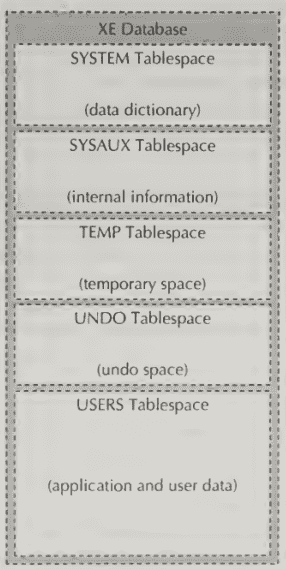

## 图8-3. 表空间逻辑和物理地分隔不同类型数据库信息的存储。

### 在线表空间和离线表空间

Oracle允许你按表空间控制数据库中数据的可用性。也就是说，一个表空间可以是在线的或离线的：

-   *在线表空间* 中的数据可供应用程序和数据库使用。通常，表空间始终保持在线，以便其中的信息可用。
-   *离线表空间* 中的数据不可用，即使数据库是可用的。管理员可能会将表空间离线以防止应用程序的数据被访问，因为该表空间遇到问题需要恢复，或者因为该表空间包含通常无人需要的历史数据。

> **注意**
>
> 数据库的SYSTEM表空间必须始终保持在线，因为数据字典中的信息在正常运行期间必须可用；如果你尝试将SYSTEM表空间离线，Oracle会返回错误。通常，SYSAUX表空间也应保持在线，但这不是强制性的。

### 只读表空间和读写表空间

创建新的永久表空间后，它立即是一个 *读写表空间*。也就是说，你可以在表空间内创建、更改和删除数据结构，应用程序可以查询、添加、修改和删除包含在表空间结构中的信息。当应用程序必须主动更改表空间中的数据时，该表空间必须继续作为读写表空间运行。

在某些情况下，表空间存储永不更改的历史数据。当表空间的数据永不更改时，你可以将该表空间设为 *只读表空间*。将表空间设为只读可以保护其免受不适当的数据修改。将表空间设为只读还可以在执行数据库备份时节省时间，因为在备份数据库的其他表空间时，无需重复备份只读表空间。

创建新表空间并添加数据后，你可以更改该表空间并将其设为只读表空间。必要时，你始终可以将表空间切换回读写模式，以便应用程序可以更新表空间中的数据。

## 表空间的数据文件

数据文件（或临时文件）是Oracle数据库中表空间的物理存储文件，通常位于磁盘上。一些表空间将其所有数据存储在单个数据文件中，而其他表空间可能有多个数据文件来共同存储该表空间的数据。

考虑数据文件，表空间可以是大文件表空间或小文件表空间。Oracle数据库中的传统表空间类型是 *小文件表空间*，它最多可以有1023个数据文件（或临时文件），每个文件最多可包含400万个块。当你不处理大型数据库且不需要大量数据库存储时，通常使用小文件表空间。由于Oracle XE并非设计用于支持大型数据库，因此小文件表空间是常态。

相比之下，*大文件表空间* 只能有一个数据文件（或临时文件），但对于使用32K块的表空间，单个文件的最大大小为128太字节（TB），对于使用8K块的表空间则为32TB。你通常在依赖逻辑卷管理器实现数据条带化、RAID和动态卷扩展等功能的 *超大型数据库（VLDB）* 中使用大文件表空间。在使用Oracle XE时，你很可能永远不会特意创建大文件表空间，但你应该了解大文件表空间，以防你升级到使用其他版本的Oracle，例如Oracle Database 11g标准版或企业版。

创建表空间时，所有数据文件都应遵循标准命名约定，以便管理员在主机操作系统中操作时易于识别。仔细考虑表空间数据文件的位置也很重要，这会显著影响依赖应用程序的可用性和性能。例如，当你将表空间的数据文件放在独立磁盘上时，如果磁盘崩溃需要恢复，存储在该表空间中的应用程序将不可用，并且应用程序性能可能会受到磁盘I/O（输入/输出）争用的限制。相比之下，当你将表空间的数据文件放在条带化和镜像数据到多个磁盘的RAID-5磁盘阵列上时，孤立的磁盘故障不会中断应用程序的可用性，并且由于减少了磁盘I/O争用，性能可能会更好。

> **注意**
>
> 在规划新数据库或向表空间添加数据文件时，Oracle公司建议你遵循Oracle最佳灵活架构（OFA）描述的指南。OFA是你应该为Oracle软件和数据库实施的一组文件命名和放置准则。有关OFA的更多信息，请参阅《Oracle Database 11g管理员指南》。


### 数据文件空间的使用

当你为表空间创建新的数据文件时，Oracle会为你指定的数据文件预分配磁盘空间。可以将新数据文件视为空的数据桶——文件不包含数据，但它是准备存储数据库信息的容器。

任何时候，当你在表空间中创建新的数据结构（如表或索引）时，Oracle都会从表空间的数据文件中为该新对象分配一定量的空间。为新数据结构分配数据文件空间会减少数据文件中剩余的可用空闲空间。当应用程序在数据结构（如表）中插入和更新数据时，该表的预分配空间最终可能会被用完。

如果数据消耗了数据结构所有可用的存储空间，Oracle可以自动从表空间的数据文件中为该结构分配额外的空间。为数据结构分配更多空间以扩展其存储容量，会进一步减少表空间数据文件中可用的空闲空间量。

### 数据文件大小

通常，数据文件的大小保持不变。当表空间中的数据结构从相应的数据文件分配空间时，如果表空间中的所有数据文件都满了，表空间也可能变满。应用程序无法向已满的表空间插入新数据，直到该表空间获得更多存储空间。要增加表空间的存储容量，你有几个不同的选择：

-   你可以向表空间添加一个或多个新的数据文件。
-   你可以手动调整表空间中一个或多个现有数据文件的大小。
-   你可以配置表空间中的一个或多个数据文件，使其在表空间变满并需要更多空间时自动扩展。

如果你是一位细心的管理员，经常监控数据库数据文件的存储容量，前两个选项都很好。当你注意到表空间的空闲空间不足时，你可以向表空间添加更多文件，或增加表空间某个数据文件的大小。相比之下，第三个选项允许表空间的存储容量自动增长，无需手动干预。为了你的方便，Oracle XE数据库中的所有数据文件在必要时都会自动扩展。

第8章：管理数据库空间 341

### 在线和离线数据文件

Oracle控制表空间中单个数据文件的可用性。数据文件可以是*在线*（可用）或*离线*（不可用）。在正常情况下，数据文件始终是在线的。当Oracle尝试读写数据文件但由于某种问题无法进行时，Oracle会自动将该数据文件离线。包含它的表空间保持在线，因为表空间的其他数据文件可能仍然可用；但是，当发生已知的磁盘问题时，你应将受影响的表空间离线，以便相应的应用程序不会遇到陌生的磁盘I/O错误情况。一旦问题得到解决（例如，在数据文件恢复之后），你可以将离线的数据文件和离线的表空间恢复在线。

> **注意**
> *数据库的SYSTEM表空间的数据文件必须始终保持在线，因为数据字典在系统运行期间必须始终可用。如果Oracle在读写数据库SYSTEM表空间中的数据文件时遇到问题，系统将无法正常运行，直到你解决问题为止。*

## 创建和管理永久表空间和数据文件

既然你已经很好地理解了表空间和数据文件，以下实践练习将教你如何创建和管理永久表空间及其数据文件。

### 练习 8.1：显示数据库存储使用情况

要快速概览Oracle XE数据库的存储使用情况，请完成以下步骤：

1.  启动数据库主页。
2.  以数据库管理员身份建立连接。例如，使用SYSTEM账户登录。
3.  点击“管理”。
4.  点击“存储”。
5.  注意图8-4所示的仪表，它显示了当前Oracle XE数据库已使用的总存储空间和可能的总存储空间。

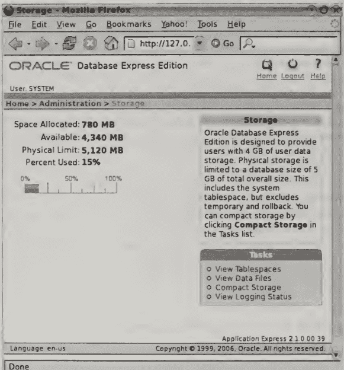

图8-4. “存储”页面显示了Oracle XE数据库已使用和可能的总空间。

请记住，Oracle XE对数据库大小有5GB的上限限制，不包括分配给支持内部系统操作的表空间（如临时和撤销表空间）的空间。

### 练习 8.2：显示表空间信息

要显示Oracle XE数据库中表空间的信息，请完成以下步骤：

1.  如果需要，完成练习8.1中的步骤1到4。
2.  点击“查看表空间”（在“任务”选项卡上）。
3.  “表空间”页面显示每个表空间特定信息的存储使用情况报告，如图8-5所示。

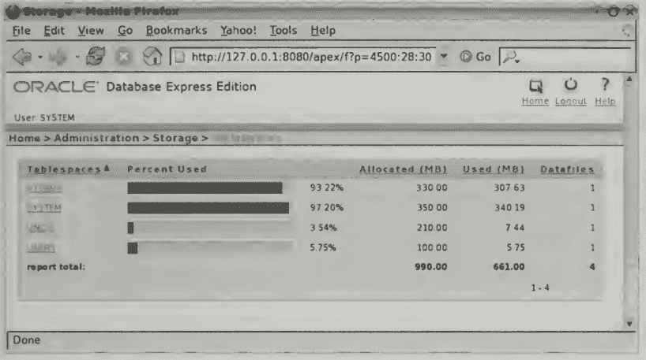

图8-5. “表空间”页面显示每个表空间的存储使用情况。

> **注意**
> 为避免临时表空间内存储使用情况的一些混淆信息，“表空间”页面故意不显示临时表空间的信息。有关临时表空间及其内部空间使用的更多信息，请参见本章后面的“临时段、表空间和组”。

### 练习 8.3：显示数据文件信息

要显示Oracle XE数据库中数据文件的信息，请完成以下步骤：

1.  如果需要，完成练习8.1中的步骤1到4。
2.  点击“查看数据文件”（在“任务”选项卡上）。
3.  “数据文件”页面显示每个数据文件的特定信息，如图8-6所示。

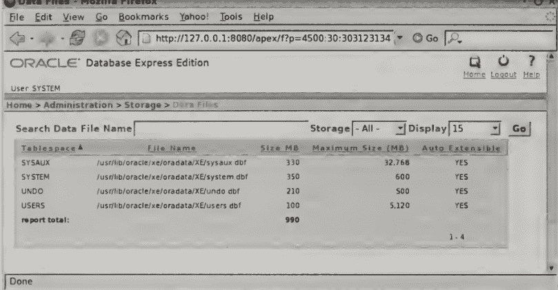

图8-6. “数据文件”页面显示每个数据文件的存储信息。

### 练习 8.4：创建永久表空间

要在Oracle XE数据库中创建永久表空间，你必须使用SQL命令`CREATE TABLESPACE`。出于本练习的目的，`CREATE TABLESPACE`命令的简略语法如下：

```
CREATE [BIGFILE|SMALLFILE] TABLESPACE tablespace
    DATAFILE
    'filename' [SIZE integer [K|M|G|T]] [REUSE]
    [ AUTOEXTEND
        { OFF
        | ON
          [NEXT integer [K|M|G|T]]
          [MAXSIZE {UNLIMITED|integer [K|M|G|T] }] } ]
    [, ... other data file specifications ... ]
    [ONLINE|OFFLINE]
```

> **注意**
> 你必须拥有`CREATE TABLESPACE`系统权限才能创建表空间。

注意，当创建表空间时，你可以为表空间指定一个或多个数据文件规范，并将新表空间保持在线或离线状态。假设Oracle XE安装在你计算机的默认位置`/usr/lib/oracle/xe`，请完成以下步骤来学习如何创建一个名为`HANDSONXE`的新表空间：

1.  启动数据库主页，并以数据库管理员身份建立连接（例如，作为SYSTEM）；如果你是从上一个练习继续下来的，此步骤可能不是必需的。
2.  导航到SQL命令页面（例如，选择“主页” | “SQL” | “SQL命令”）。
3.  执行以下SQL语句，以确定数据库的默认表空间类型是小文件表空间还是大文件表空间：

```
SELECT property_value
  FROM database_properties
  WHERE property_name = 'DEFAULT_TBS_TYPE';
```

4.  注意，默认情况下，Oracle数据库的默认表空间类型是小文件表空间；因此，当你创建新表空间时，如果没有明确指出新表空间是小文件表空间还是大文件表空间，Oracle XE会创建一个小文件表空间。
5.  执行以下SQL语句，创建一个名为`HANDSONXE`的新小文件表空间：

```
CREATE TABLESPACE handsonxe
  DATAFILE
    '/usr/lib/oracle/xe/oradata/XE/handsonxe01.dbf' SIZE 100K REUSE
    AUTOEXTEND ON NEXT 100K MAXSIZE 1M,
    '/usr/lib/oracle/xe/oradata/XE/handsonxe02.dbf' SIZE 100K REUSE
  ONLINE;
```

> **注意**
> Linux文件名区分大小写。如果你将Oracle XE安装在其他位置，请相应地修改本练习中的文件规范。

前面的`CREATE TABLESPACE`语句创建了一个名为`HANDSONXE`的新小文件表空间，包含两个数据文件：

-   `handsonxe01.dbf`文件初始大小为100K，如果表空间变满且对象需要更多空间，它可以自动以100K为增量扩展自身，最大可达1MB。


- handsonxe02.dbf 文件的大小为 100K，除非你手动调整文件大小或启用文件的自动扩展，否则其大小无法增加。
- 数据文件规范中的 REUSE 选项指示 Oracle 重用已存在的数据文件；当你想要覆盖现有数据文件时，请在数据文件规范中使用此选项。

### 练习 8.5：修改数据文件的存储属性

你可以随时使用 SQL 命令 ALTER DATABASE 的 DATAFILE 子句来更改小文件表空间中数据文件的属性。本练习中，ALTER DATABASE 命令中此子句的语法如下：

```
ALTER DATABASE
    DATAFILE 'filename'
    { RESIZE integer [K|M|G|T]
    | AUTOEXTEND
      { OFF
      | ON [NEXT integer [K|M|G|T]] [MAXSIZE {UNLIMITED|integer [K|M|G|T]} ] } }
```

## 注意

你必须拥有 ALTER DATABASE 系统权限才能使用 ALTER DATABASE 命令。

例如，使用 SQL Commands 页面执行以下 ALTER DATABASE 语句来调整 handsonxe01.dbf 数据文件的自动扩展属性：

```
ALTER DATABASE
    DATAFILE '/usr/lib/oracle/xe/oradata/XE/handsonxe01.dbf'
        AUTOEXTEND ON NEXT 250K MAXSIZE UNLIMITED;
```

现在执行以下 ALTER DATABASE 语句来手动调整 handsonxe02.dbf 数据文件的大小：

```
ALTER DATABASE
    DATAFILE '/usr/lib/oracle/xe/oradata/XE/handsonxe02.dbf' RESIZE 250K;
```

### 练习 8.6：控制表空间的可用性

你可以使用 SQL 命令 ALTER TABLESPACE 的 ONLINE 和 OFFLINE 选项来控制对表空间的访问：

```
ALTER TABLESPACE tablespace
    {ONLINE|OFFLINE [NORMAL|TEMPORARY|IMMEDIATE]}
```

### 修改大文件表空间的存储

在练习 8.5 中使用小文件表空间时，请注意你必须指定数据文件的名称，并使用 ALTER DATABASE 命令来修改文件的存储属性。换句话说，你不能在不指定特定数据文件的情况下"调整表空间大小"，因为 Oracle 不知道你想要调整表空间中哪个数据文件的大小。

使用大文件表空间的一个微妙好处是，表空间存储管理操作会稍微简单一些，因为在创建表空间之后，你永远不需要了解或考虑表空间的数据文件；Oracle 会自动将大文件表空间的逻辑存储修改映射到该表空间唯一的那个数据文件上。例如，如果 HANDSONXE 表空间是一个大文件表空间，你可以更简单地使用以下语句完成前面的练习 8.5：

```
ALTER TABLESPACE handsonxe
  AUTOEXTEND ON NEXT 250K MAXSIZE UNLIMITED;

ALTER TABLESPACE handsonxe
  RESIZE 250K;
```

是否值得特意创建大文件表空间而不是小文件表空间，仅仅为了让不频繁的存储管理操作稍微简单一些？可能不值得，但你仍然应该了解管理小文件表空间和大文件表空间时 SQL 语法上的细微差别。

将在线表空间脱机时，你可以指定以下多个选项：

- **NORMAL** 此选项（默认选项）表示你希望在正常条件下将目标表空间脱机。仅当表空间的所有数据文件当前均处于在线状态且可用、没有任何 I/O 问题时，才能使用此选项。
- **TEMPORARY** 如果你希望在异常条件下将表空间脱机，此选项应该是你的首选。例如，当表空间的一个或多个数据文件因 I/O 问题而脱机时，你可能会使用此选项。在这种情况下，在重新将表空间联机之前将需要执行恢复操作。
- **IMMEDIATE** 此选项是在异常条件下将表空间脱机时的最后手段。仅当你的数据库启用了介质恢复运行时（在第 9 章讨论），才能使用此选项。

例如，使用 SQL Commands 页面执行以下查询，该查询针对存储在 USERS 表空间中的表：

```
SELECT id, description FROM handsonxe08.parts;
```

因为 PARTS 表存储在 USERS 表空间中，而该表空间当前应处于联机状态，所以查询的结果集应类似于以下内容：

| ID | DESCRIPTION |
|----|-------------|
| 1 | Fax Machine |
| 2 | Copy Machine |
| 3 | Laptop PC |
| 4 | Desktop PC |
| 5 | Scanner |

接下来，执行以下 ALTER TABLESPACE 语句将 USERS 表空间脱机：

```
ALTER TABLESPACE users
OFFLINE NORMAL;
```

现在，重新输入前面的查询：

```
SELECT id, description FROM handsonxe08.parts;
```

你应该看到类似于以下内容的结果：

```
ORA-00376: file 4 cannot be read at this time
ORA-01110: data file 4: '/usr/lib/oracle/xe/oradata/XE/users.dbf'
```

此错误表明存储 PARTS 表的表空间（或表空间的数据文件）已脱机。要将 USERS 表空间重新联机，请输入以下语句：

```
ALTER TABLESPACE users
ONLINE;
```

现在，重新输入前面的查询：

```
SELECT id, description FROM handsonxe08.parts;
```

你应该再次看到以下结果：

| ID | DESCRIPTION |
|----|-------------|
| 1 | Fax Machine |
| 2 | Copy Machine |
| 3 | Laptop PC |
| 4 | Desktop PC |
| 5 | Scanner |

## 段、区和数据块

Oracle 预分配数据块的段作为表、索引等数据结构的物理存储。Oracle 从数据文件中为数据结构保留一组逻辑上连续的*数据块*，作为*区*。*段*是分配给某个数据结构的所有区的集合。图 8-7 展示了表与其数据段、区和数据块之间的关系。

当你创建新的数据结构（如表）时，你可以指定要创建相应段所在的表空间。然后，Oracle 从目标表空间使用的一个或多个数据文件中分配数据块。

### Oracle 数据库中的段类型

Oracle 数据库可以包含许多不同类型的段，包括数据段、索引段、LOB 段、溢出段、撤销段和临时段。

- 一个典型的表将其数据存储在*表段*中，Oracle 老手有时也称之为*数据段*。
- 你也可以创建一个带有分区的表，将特定的表行集合存储在物理上不同的表分区中——可以将*分区表*视为拥有多个表段的表。通常只有在处理大型数据库（如数据仓库）中的大表时才使用分区表；本书不讨论分区表，因为分区表在 Oracle XE 中不太可能有用。

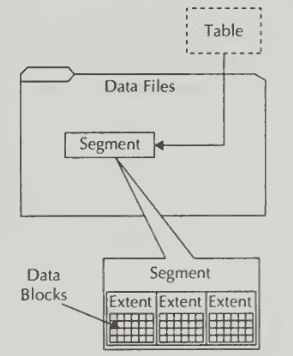

**图 8-7。** 段由区组成；区是数据文件中一组逻辑上连续的数据块。

- 一个典型的索引将其数据存储在*索引段*中。如果索引有多个分区，索引会将数据存储在相应数量的索引分区（或索引段）中。
- 如果表有一个使用大对象（LOB）数据类型的列（如 CLOB、BLOB 或 NCLOB），则该表可以选择性地将相应的 LOB 值存储在*LOB 段*中，该段与保存表中其他字段值的表段分开存放。
- *索引组织表*是一种特殊类型的表，它在索引段中存储表的行。索引组织表还可以有一个*溢出段*，用于存储无法放入原始索引段的行。有关索引组织表的更多信息，请参阅第 10 章。
- *撤销段*是 Oracle 用于存储事务回滚信息的一种特殊类型的段。当用户回滚事务时，Oracle 会应用撤销段中的信息来"撤销"该事务的操作。
- Oracle 在处理某些类型的 SQL 语句时会创建和使用*临时段*。临时段是磁盘上的一个临时工作区，Oracle 可以在 SQL 语句处理过程中使用它来存储中间数据。

前面的列表简要介绍了 Oracle 数据库中最常见的段类型；有关所有段类型的完整信息，请参阅 *Oracle Database 10g Concepts* 手册。

### 数据块

*数据块*是 Oracle 数据库的主要数据 I/O 单位。当你使用数据库时，Oracle 使用数据块在磁盘上存储和检索数据。例如，当你查询一个表时，Oracle 可能会将包含查询结果集中所有行的数据块读入实例的*缓冲区缓存*（一个内存区域）。

创建数据库时，你会设置数据库的*标准*（或*默认*）*块大小*，这在数据库的整个生命周期内都无法更改。默认情况下，你在数据库中创建的所有表空间都分配标准块大小的数据块。数据库的标准块大小还决定了相应默认缓冲区缓存中每个数据缓冲区的大小，这在调整 Oracle 实例时必须加以考虑。第 10 章将更详细地介绍实例调整。

Oracle 数据块大小必须等于或为主机操作系统块大小的倍数。例如，如果主机操作系统的块大小为 512 字节，则该服务器上的数据块大小可以是 2K、8K、16K 等。Oracle XE 数据库的标准数据块大小为 8K。


### 数据块分配

当你创建新的数据结构（如表或索引）时，Oracle 会为该结构的段分配一个或多个区。*区*是存储该结构段的表空间数据文件中一组逻辑上连续的数据块。如果段中现有区的所有数据块都已填满，当下次事务需要存储新数据时，Oracle 将通过分配新区（一组块）来“扩展”该段。

### 数据块可用性

当你向表中插入一行或更新现有行使其变大时，Oracle 必须为新数据找到足够的空间。为了高效确定哪些数据块有足够的空闲空间来容纳新数据，Oracle 在每个段的区中创建一个位图（一种索引），该位图记录了相应区中各数据块的可用空间信息。当你创建一个依赖此默认机制（称为*自动段空间管理*，ASSM）来控制数据块可用性的表空间时，在创建表和索引等数据结构时无需特殊存储考虑——Oracle 会自动为你处理所有细节。

### 行链接与数据块大小

当你向表中插入新行时，Oracle 会将新行放入一个包含空闲空间的数据块中。最优情况下，如果一行的数据能容纳在一个数据块的空间内，Oracle 会将该行的所有数据放入一个数据块。这样，当你请求表中的某一行时，Oracle 只需从磁盘将一个数据块读入内存即可检索该行的所有数据。

如果一行的长度大于数据块大小，Oracle 会将该行*链接*在两个或更多数据块中。图 8-8 演示了行链接。

行链接在这种情况下虽不可避免，但并不可取，因为 Oracle 必须从磁盘将多个数据块读入内存才能访问一行的数据。更多而非更少的磁盘 I/O 总是会降低系统性能。因此，应尽可能避免行链接。

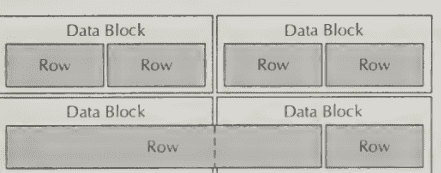

**图 8-8。** 对于单个数据块而言太大的行，Oracle 必须对其进行链接。

通常，Oracle XE 安装的标准块大小对于大多数数据库来说是足够的。但是，具有某些特性的数据库可以从大于默认值的块大小中受益。例如，当你计划创建一个行将超过默认块大小的表时，可以通过创建一个使用非标准、更大块大小的表空间来避免行链接，然后使用该新表空间存储具有长行的表。

当你更新表中的行时，Oracle 也可能创建行链。这种行链接仅在你更新行使其长于原始行，且包含该行的数据块没有足够的空闲空间来容纳更新时发生。当你预计表段中行的更新会增加行大小时，可以通过为更新预留额外的数据块空间来防止行链接。本章稍后的练习 8.11 将解释如何具体控制数据块内的空间使用并减少此类行链接。

## 管理表和索引的存储

现在你已经对段、区和数据块有了大致了解，本节的实践练习将解释与 Oracle 数据库中段和区相关的一些更常见任务。

> **注意**
>
> 本章后续部分将讨论 Oracle 数据库中专门类型的段，包括撤销段、LOB 段和临时段。

### 练习 8.7：显示数据块大小信息

要显示数据库的标准数据块大小，请使用 SQL 命令页执行以下查询：

```sql
SELECT name, value
  FROM v$parameter
 WHERE name = 'db_block_size';
```

Oracle XE 数据库的预期结果如下：

| NAME | VALUE |
| --- | --- |
| db_block_size | 8192 |

当你在数据库中创建表空间且未明确指定新表空间使用的块大小时，Oracle 会使用数据库的标准块大小 8K 创建该表空间。但是，现有表空间使用的是什么数据块大小？执行以下查询以确定此信息：

```sql
SELECT tablespace_name, block_size
  FROM dba_tablespaces;
```

Oracle XE 数据库的预期结果如下：

| TABLESPACE_NAME | BLOCK_SIZE |
| --- | --- |
| SYSTEM | 8192 |
| UNDO | 8192 |
| SYSAUX | 8192 |
| TEMP | 8192 |
| USERS | 8192 |
| HANDSONXE | 8192 |

请注意，所有表空间都使用标准的数据块大小 8K。

### 练习 8.8：显示模式中的段

你可以通过查询 DBA_SEGMENTS 数据字典视图来显示数据库中所有段的信息。例如，使用 SQL 命令页执行以下查询，显示与 HANDSONXE08 模式中包含的数据结构对应的段的选定信息：

```sql
SELECT segment_name, segment_type, tablespace_name, extents, blocks
  FROM dba_segments
 WHERE owner = 'HANDSONXE08';
```

结果集应类似于以下内容：

| SEGMENT_NAME | SEGMENT_TYPE | TABLESPACE_NAME | EXTENTS | BLOCKS |
| --- | --- | --- | --- | --- |
| PARTS | TABLE | USERS | 1 | 8 |
| SALESREPS | TABLE | USERS | 1 | 8 |
| P_ID | INDEX | USERS | 1 | 8 |
| S_ID | INDEX | USERS | 1 | 8 |
| PAR_DESCRIPTION | INDEX | USERS | 1 | 8 |

请注意结果集中有几个段与模式中的表和索引对应：

- 每个段都存在于 USERS 表空间中。
- 每个段由一个区组成。
- 每个区有八个块。

考虑到 USERS 表空间的块大小为 8K，并且每个段有一个包含八个块的区，每个段的可用存储空间大约为 64K（8K/块 × 8 块/区 × 1 区/段）。

> **注意**
>
> 要显示当前模式中段的信息，你也可以查询 USER_SEGMENTS 数据字典视图。

### 练习 8.9：压缩（收缩）浪费空间的段

当所有可用的自由空间都已用尽，并且需要更多空间来代表持续的事务存储数据时，Oracle 会自动为表分配一个新区。相反，Oracle 不会自动重组表存储；例如，Oracle 不会将低密度数据压缩到更少的块中，也不会在表的段有大量未使用空间时*释放*（释放）数据块区。Oracle 假设新数据最终将消耗已为该段分配的自由空间，从而避免了为将来再次分配而释放空间的开销。

虽然 Oracle 的段空间管理算法对于持续增长且偶尔删除的表来说没问题，但它可能导致其他类型的表产生大量未使用空间。例如，考虑一个表，它每分钟记录一次工厂中数百台机器的可用性信息。每三个月，一个进程会扫描并永久存档与问题对应的日志记录，然后从日志表中删除所有记录。这种情况会导致表在很长一段时间内拥有大量未使用空间。

重组表的物理存储以回收未使用空间是一个手动过程。要收缩表的数据段，你必须使用以下 SQL 命令 ALTER TABLE 的缩写形式：

```sql
ALTER TABLE [schema.]table
    [ENABLE ROW MOVEMENT]
    [SHRINK SPACE] ;
```

你必须首先使用 SQL 命令 ALTER TABLE 的 ENABLE ROW MOVEMENT 选项来启用表段重组；然后你可以使用 ALTER TABLE 命令的 SHRINK SPACE 选项来整合表段中的数据。

为了演示本练习中讨论的许多概念并练习收缩段，请完成以下步骤：

1.  从前一个练习查询的结果集中注意，SALESREPS 表只有一个区。


### 练习 8.10：在特定表空间中创建表

当你创建新的数据结构（如表或索引）时，可以使用相应 CREATE 命令的 TABLESPACE 参数来显式指定要用于该结构段的表空间。只要所有者/模式在该表空间中有必要的配额，Oracle 就会完成该请求。如果你在创建新表或索引时省略了表空间规范，Oracle 会在拥有该新数据结构的用户/模式的默认表空间中创建该结构的段。

2. 使用 SQL 命令页面执行以下 PL/SQL 块，将许多模拟行插入 SALESREPS 表：

```
BEGIN
  FOR i IN 5 .. 1000
  LOOP
    INSERT INTO handsonxe08.salesreps
    (id, lastname, firstname, commission)
    VALUES (i, 'Last Name Value', 'First Name Value', 10);
  END LOOP;
  COMMIT;
END;
/
```

3. 执行以下查询，查看插入新行后 SALESREPS 表有多少个区：

```
SELECT segment_name, extents, blocks
  FROM dba_segments
 WHERE owner = 'HANDSONXE08'
   AND segment_name = 'SALESREPS';
```

4. 确认查询结果集如下；注意 Oracle 自动为 SALESREPS 表分配了一个新区，因为需要更多空间来容纳新行：

| SEGMENT_NAME | EXTENTS | BLOCKS |
|---|---|---|
| SALESREPS | 2 | 16 |

5. 执行以下 DELETE 语句，从 SALESREPS 表中删除新行：

```
DELETE FROM handsonxe08.salesreps
 WHERE id >= 5;

COMMIT;
```

6. 重复步骤 3 中的查询，查看删除所有新行后 SALESREPS 表有多少个区；你可以通过使用 SQL 命令页面的历史记录选项卡重新加载之前的查询来轻松完成此操作。注意以下预期结果集中，该表仍然有两个区——Oracle 不会从段中释放区。

| SEGMENT_NAME | EXTENTS | BLOCKS |
|---|---|---|
| SALESREPS | 2 | 16 |

7. 此时，SALESREPS 表有两个区，其中大部分由未使用的空间组成。要收缩表的段，请输入以下语句：

```
ALTER TABLE handsonxe08.salesreps
  ENABLE ROW MOVEMENT;

ALTER TABLE handsonxe08.salesreps
  SHRINK SPACE;
```

8. 使用 SQL 命令页面的历史记录选项卡重复步骤 3 中的查询，查看 Oracle 重新组织段后 SALESREPS 表现在有多少个区。注意以下预期结果集中，该表只有一个区。

| SEGMENT_NAME | EXTENTS | BLOCKS |
|---|---|---|
| SALESREPS | 1 | 8 |

在前面的示例中，你已经知道分配给 SALESREPS 表的很大一部分空间是未使用且可回收的。但在拥有大量段的实际数据库中，期望你知道哪些段是重新组织的最佳候选对象是不现实的。为了帮助解决这个常见问题，Oracle 每晚自动运行段顾问，以识别相对于其整体大小具有大量未使用空间的段。*段顾问*（*Segment Advisor*）是一个基于 *DBMS_ADVISOR* 包中例程的工具。虽然 Oracle XE 没有为段顾问捕获的信息和提供的建议提供 GUI，但你可以通过完成以下步骤来利用段顾问的建议：

1. 重复前面列表中的步骤 2、3、4 和 5。
2. 等待最多 24 小时让段顾问运行，然后注意 SALESREPS 表有大量未使用的空间。
3. 导航到存储页面（例如，选择 Home | Administration | Storage）。
4. 点击 Compact Storage。
5. 然后再次点击 Compact Storage。
6. Oracle 会安排一个作业来压缩（收缩）段顾问指出的那些段的存储。
7. 重复前面列表中的步骤 8，并确认预期结果。

### 练习 8.10：在特定表空间中创建表

当你创建新的数据结构（如表或索引）时，可以使用相应 CREATE 命令的 TABLESPACE 参数来显式指定要用于该结构段的表空间。只要所有者/模式在该表空间中有必要的配额，Oracle 就会完成该请求。如果你在创建新表或索引时省略了表空间规范，Oracle 会在拥有该新数据结构的用户/模式的默认表空间中创建该结构的段。

为了练习在特定表空间中创建数据结构，请输入以下使用 TABLESPACE 参数在 HANDSONXE 表空间中创建 ORDERS 表的 CREATE TABLE 语句：

```
CREATE TABLE handsonxe08.orders (
  id INTEGER PRIMARY KEY USING INDEX TABLESPACE handsonxe,
  c_id INTEGER NOT NULL,
  orderdate DATE DEFAULT SYSDATE NOT NULL,
  shipdate DATE,
  paiddate DATE,
  status CHAR(1) DEFAULT 'F'
)
TABLESPACE handsonxe;
```

主语句的 TABLESPACE 参数指示用于表段的表空间，而主键约束规范中的 TABLESPACE 参数指示用于主键底层索引段的表空间；如果你省略任一 TABLESPACE 参数，Oracle 会在 HANDSONXE08 账户的默认表空间中创建相应的段。

### 练习 8.11：为现有表行的更新预留空间

图 8-9 说明了数据块的基本结构。每个数据块都有一个小的头部，包含内部系统信息；Oracle 使用块的大部分空间来存储用户/应用程序数据。

为了帮助避免不必要的行链，Oracle 会预留块可用存储空间的 10% 用于现有行的更新。当你知道表中会有大量行经历使行变长的更新时，考虑增加表的默认 PCTFREE 存储参数。或者，为了避免在不会经历使行变长的更新的表中浪费空间，考虑降低表的默认 PCTFREE 存储参数。

## 使用 Oracle XE 轻松管理存储

如果你浏览 Oracle 文档集中的各种标题以查找与数据存储相关的信息，你无疑会遇到许多详细的摘录，解释许多不同的存储参数，你可以在创建表等数据结构时显式指定这些参数来控制段和区的大小。除了少数例外（如练习 8.11 和 8.12 中的情况），大部分这些信息以及 Oracle 的相关功能（如多个 SQL 命令的 STORAGE 子句）都是为了与先前版本的 Oracle 向后兼容而存在的；那些版本的 Oracle 在代表数据结构分配存储时需要大量仔细规划和配置，以尽量减少某些情况下可能导致的浪费空间。

幸运的是，最新版本的 Oracle 使用自动调整大小和重用区的表空间，以帮助最小化表空间中的浪费空间。以防你好奇，这种相对较新的表空间类型称为*本地管理表空间*（*locally managed tablespace*），而较旧的表空间类型称为*字典管理表空间*（*dictionary-managed tablespace*）。有关每种类型之间差异的更多信息，请参阅 *Oracle Database 10g Concepts* 手册和 *Oracle Database 10g Database Administrator's Guide*；但是，请注意，较旧的字典管理表空间类型很可能不会被下一个版本的 Oracle 支持。

在管理 Oracle XE 时，让你的生活更轻松——如有必要，配置应用程序所需的额外表空间，为开发人员创建具有正确默认表空间设置的数据库用户账户，然后只需依靠 Oracle 在分配数据结构空间时为你做出良好的选择。

例如，ITEMS 表中的现有行不太可能不需要额外空间；因此，使用 SQL 命令页面执行以下语句，为表的段和主键索引的段创建具有非默认 PCTFREE 设置的 HANDSONXE08.ITEMS 表：

```
CREATE TABLE handsonxe08.items (
  o_id INTEGER,
  id INTEGER,
  p_id INTEGER NOT NULL,
  quantity INTEGER DEFAULT 1 NOT NULL,
  PRIMARY KEY (o_id, id)
    USING INDEX
    TABLESPACE handsonxe
    PCTFREE 2
)
TABLESPACE handsonxe
PCTFREE 2;
```

### 练习 8.12：管理 LOB 的空间

处理 LOB 时，存储通常是一个重要的关注点，因为它们通常非常大。Oracle 在数据库内部存储和管理*内部 LOB*（数据库存储的 LOB，如 CLOB、NCLOB 和 BLOB）的数据，但主机数据库服务器负责管理*外部文件*（BFILE）。

默认情况下，当内部 LOB 小于约 4K 时，Oracle 将其与行数据的其余部分一起存储（*内联*，*inline*）；当内部 LOB 大于约 4K 时，Oracle 将其存储在单独的 *LOB 段*（*LOB segment*）中（*外联*，*out-of-line*）。如果内联 LOB 值增长到超过 4K，Oracle 会自动将其移动到 LOB 段。

无论 Oracle 将内部 LOB 的值存储在何处，Oracle 始终将 LOB 的定位器与其行数据一起内联存储。*LOB 定位器*（*LOB locator*）实际上是指向 LOB 值实际位置的指针。LOB 列值可以为 null、为空，或具有引用实际 LOB 数据的非空定位器。

### 注意

每当你使用 LOB 数据类型创建列时，Oracle 会自动为列创建、命名和管理索引，以提供高效的 LOB 访问。

SQL 命令 CREATE TABLE 和 ALTER TABLE 的 *LOB 子句*（*LOB clause*）为你提供了一种显式控制表中 LOB 数据存储的方法。LOB 子句的简化语法列表如下：

```
LOB
  (column [, column] ... )
  STORE AS {segment}
```


```
( [TABLESPACE 表空间]
  [{ENABLE|DISABLE} STORAGE IN ROW]
  [CHUNK 整数]
  [PCTVERSION 整数]|RETENTION )
```

以下列表简要描述了 LOB 子句的参数：

-   指示一个或多个 CLOB、BLOB 或 NCLOB 列的列表，LOB 子句应应用于这些列。如果只指定一个列，可以为 Oracle 为存储该列而创建的 LOB 段命名；但是，如果列出多个列，则无法为 LOB 段命名。

-   使用 LOB 子句的 TABLESPACE 参数为 LOB 段指定一个表空间。

-   使用 ENABLE STORAGE IN ROW 选项，让 Oracle 将小于 4000 字节的 LOB 值与同一行中的其他数据一起存储；当 LOB 值大于 4000 字节时，Oracle 将 LOB 值存储在 LOB 段中。使用 DISABLE STORAGE IN ROW 选项，无论每个 LOB 值的长度如何，都始终将 LOB 值存储在 LOB 段中。

-   使用 CHUNK 参数指定 LOB 段的存储分配单元。为 CHUNK 参数指定一个整数。LOB 段的存储分配单元是 CHUNK 参数设置乘以包含该 LOB 段的表空间的数据块大小的结果。例如，当 LOB 段的 CHUNK 参数为 4 且表空间的数据块大小为 8K 时，LOB 段的存储分配单元为 32K。LOB 段存储分配单元的最大值为 32K。

-   当事务修改 LOB 或 LOB 的一部分时，Oracle 会创建 LOB 数据块的新版本，并保留旧版本的 LOB 以支持当前正在读取 LOB 先前版本的查询。使用 RETENTION 选项永久保留 LOB 数据的旧版本。或者，使用 PCTVERSION 参数控制 LOB 段中可用于旧 LOB 数据版本控制的已使用 LOB 数据块的总体百分比；PCTVERSION 是一个 LOB 段存储空间的阈值，必须达到该阈值后，Oracle 才能用新版本覆盖 LOB 数据的旧版本。PCTVERSION 的默认值为 10。当 LOB 更新不频繁时，将 PCTVERSION 设置为 5 或更低，以最小化存储 LOB 所需的磁盘空间。

为了演示 LOB 子句在 CREATE TABLE 语句中的使用，请输入以下语句来创建一个 CUSTOMERS 表，该表可以为每个客户记录存储一张照片：

```sql
CREATE TABLE handsonxe08.customers (
  id  INTEGER PRIMARY KEY USING INDEX TABLESPACE handsonxe,
  lastname VARCHAR2(100) NOT NULL,
  firstname VARCHAR2(50) NOT NULL,
  companyname VARCHAR2(100),
  street VARCHAR2(100),
  city VARCHAR2(100),
  state VARCHAR2(50),
  zipcode VARCHAR2(50),
  phone VARCHAR2(30),
  fax VARCHAR2(30),
  email VARCHAR2(100),
  s_id INTEGER NOT NULL,
  photo BLOB
)
-- 表段的存储参数
TABLESPACE users
-- LOB 段的存储参数
LOB (photo) STORE AS cust_photo (
  TABLESPACE handsonxe
  ENABLE STORAGE IN ROW
  CHUNK 4
  PCTVERSION 5 )
;
```

请注意此练习中 CREATE TABLE 语句的以下几点：

-   该语句使用熟悉的 TABLESPACE 参数为表的数据段指定了一个表空间。
-   该语句使用 LOB 子句为表的 LOB 段指定了存储设置。

### 练习 8.13：执行各种空间管理任务

表空间的管理任务可能会影响也可能不会影响表空间中的段，这取决于您执行的操作。例如，当您重命名表空间时，表空间中的段会继续存在，并且访问相应数据结构的应用程序将继续正常运行，无需修改。但是，当您删除表空间时，Oracle 也会删除该表空间中的所有段；如果您想保留计划删除的表空间中的段，必须先将这些段移动到另一个表空间，然后再删除该表空间。本练习将向您介绍几个空间管理主题，包括重命名表空间、移动段和删除表空间。

要重命名表空间，请使用 SQL 命令 ALTER TABLESPACE 的以下简写形式：

```sql
ALTER TABLESPACE 表空间
  RENAME TO 表空间 ;
```

例如，使用 SQL 命令页面执行以下语句，将 HANDSONXE 表空间重命名为 HANDSONXE_NEW：

```sql
ALTER TABLESPACE handsonxe
  RENAME TO handsonxe_new;
```

现在查询 DBA_SEGMENTS 数据字典视图，以确认先前名为 HANDSONXE 的表空间中的段继续存在于现在名为 HANDSONXE_NEW 的表空间中：

```sql
SELECT segment_name, segment_type, tablespace_name
  FROM dba_segments
  WHERE owner = 'HANDSONXE08';
```

结果应类似于以下内容：

| SEGMENT_NAME | SEGMENT_TYPE | TABLESPACE_NAME |
| --- | --- | --- |
| SALESREPS | TABLE | USERS |
| P_ID | INDEX | USERS |
| PARTS | TABLE | USERS |
| S_ID | INDEX | USERS |
| PAR_DESCRIPTION | INDEX | USERS |
| ORDERS | TABLE | HANDSONXE_NEW |
| SYS_C005450 | INDEX | HANDSONXE_NEW |
| ITEMS | TABLE | HANDSONXE_NEW |
| SYS_C005456 | INDEX | HANDSONXE_NEW |
| CUSTOMERS | TABLE | USERS |
| SYS_C005460 | INDEX | HANDSONXE_NEW |
| SYS_IL0000017053C00013$$ | LOBINDEX | HANDSONXE_NEW |
| CUST_PHOTO | LOBSEGMENT | HANDSONXE_NEW |

请注意，您在前面的练习中为 ORDERS、ITEMS 和 CUSTOMERS 表以及相关索引创建的段现在位于 HANDSONXE_NEW 表空间中。

现在假设您要删除 HANDSONXE_NEW 表空间，但保留 ORDERS、ITEMS 和 CUSTOMERS 表；为此，您必须首先将相应的段从 HANDSONXE_NEW 表空间移动到另一个永久表空间。

要将表从一个表空间移动到另一个表空间，您可以使用 SQL 命令 ALTER TABLE 的以下简写形式：

```sql
ALTER TABLE [模式.]表
MOVE TABLESPACE 表空间 ;
```

例如，使用 SQL 命令页面将与 HANDSONXE08.ORDERS、HANDSONXE08.ITEMS 和 HANDSONXE08.CUSTOMERS 表对应的表段移动到 USERS 表空间：

```sql
ALTER TABLE handsonxe08.orders
 MOVE TABLESPACE users;

ALTER TABLE handsonxe08.items
 MOVE TABLESPACE users;

ALTER TABLE handsonxe08.customers
 MOVE TABLESPACE users
 LOB (photo) STORE AS cust_photo (TABLESPACE users);
```

请注意最后一个示例语句，您可以显式移动表的 LOB 段；当您移动表的段但不显式移动表的 LOB 段时，LOB 段将继续保留在其原始位置。

要移动索引，您可以使用 SQL 命令 ALTER INDEX 的以下简写形式：

```sql
ALTER INDEX [模式].索引
REBUILD
TABLESPACE 表空间;
```

例如，使用 SQL 命令页面执行类似于以下内容的语句，将 ORDERS、ITEMS 和 CUSTOMERS 表的主键约束的基础索引移动到 USERS 表空间——请确保用您模式中的系统生成的索引名称替换这些名称：

```sql
ALTER INDEX handsonxe08.sys_c005450
 REBUILD TABLESPACE users;

ALTER INDEX handsonxe08.sys_c005456
 REBUILD TABLESPACE users;

ALTER INDEX handsonxe08.sys_c005460
 REBUILD TABLESPACE users;
```

一旦所有您想保留的段都已移动到另一个表空间，您就可以安全地使用 SQL 命令 DROP TABLESPACE 删除 HANDSONXE_NEW 表空间，如下语法列表和列表所示：

```sql
DROP TABLESPACE 表空间
[INCLUDING CONTENTS [AND DATAFILES] [CASCADE CONSTRAINTS] ] ;
```

-   无法删除 SYSTEM 或 SYSAUX 表空间。

-   DROP TABLESPACE 命令的 INCLUDING CONTENTS 选项表示您希望删除表空间，即使该表空间当前包含数据。当您删除包含对象的表空间时，Oracle 也会删除表空间中的对象。

-   AND DATAFILES 选项表示您希望 Oracle 删除与目标表空间对应的数据文件。如果省略此选项，Oracle 不会从磁盘物理删除表空间的数据文件。

-   DROP TABLESPACE 命令的 CASCADE CONSTRAINTS 选项表示您希望删除所有引用目标表中主键或唯一键的引用完整性约束。

例如，使用 SQL 命令页面执行以下 SQL 语句以删除 HANDSONXE_NEW 表空间、其内容及其数据文件：

```sql
DROP TABLESPACE handsonxe_new
    INCLUDING CONTENTS AND DATAFILES;
```

> **注意**
> 在 100% 确定先前使用该数据文件的表空间已从数据库中删除之前，您绝不能使用操作系统命令从磁盘删除数据文件。如果不小心删除了数据文件，您必须执行数据库恢复操作才能使表空间重新可用。第 9 章将更详细地解释从数据文件丢失中恢复数据库的内容。

## 撤销表空间

事务可以以提交或回滚的方式完成。典型的事务以提交结束，这将永久记录事务对数据库所做的更改。回滚会撤销事务的所有影响，就像事务从未发生过一样。为了提供事务回滚功能，Oracle 必须跟踪事务更改的数据，直到事务提交或回滚。Oracle 使用一种称为撤销表空间的特殊类型的表空间来记录所有事务的回滚数据。如果您选择回滚事务，Oracle 会从数据库的撤销表空间中读取必要的数据，以将数据重建为事务更改之前的状态。


### 撤销段

为了分散多个并发事务生成的撤销数据，典型的 Oracle 数据库会在撤销表空间中自动管理多个撤销段，具体如下：

1.  当用户启动一个新事务时，Oracle 会自动将该事务分配到一个撤销段。用户无需拥有表空间配额即可使用撤销表空间中的撤销段。
2.  当用户的事务使用 DML 语句（例如 INSERT、UPDATE 和 DELETE）修改数据库中的数据时，Oracle 会使用分配的撤销段来记录该事务所做更改的相关信息。
3.  如果用户决定回滚当前事务，Oracle 会使用该事务分配到的撤销段中的信息来"撤销"该事务的影响。

Oracle XE 对撤销段执行的所有工作对用户和应用程序完全透明——完全无需考虑撤销表空间是否存在。

### 撤销段的多功能性

事务回滚只是撤销段在 Oracle 数据库中提供的众多有用功能之一。例如，撤销段还支持 Oracle 独特的数据库*多版本*机制。Oracle 利用撤销段中的信息而非数据锁定，可以生成数据库信息的多个版本，以满足并发 SQL 语句对同一组数据进行查询和更新的请求。

Oracle 还在典型数据库恢复操作的第二阶段使用撤销段：在使用另一种称为重做日志的数据库结构将因故障而丢失的更改前滚之后，Oracle 随后使用撤销段来"撤销"或回滚在恢复前滚阶段应用的任何未提交工作。第 9 章将详细介绍数据库恢复。

### 管理撤销表空间和保留时间

撤销管理简单且自动化；事实上，大多数 Oracle XE 安装永远不需要任何撤销管理，除非出现以下特定情况：

-   磁盘故障损坏了撤销表空间。
-   数据库支持具有许多并发活动事务的 OLTP 系统，用户报告数据库错误，提示撤销空间不足（ORA-1650：无法扩展回滚段）。
-   数据库支持 OLTP 活动，运行长时间查询或大型数据导出的用户报告数据库错误，提示读取一致性所需的撤销信息已被覆盖（ORA-01555：快照过旧）。

虽然您在管理 Oracle XE 时不太可能遇到上述情况，但以下练习将为您提供配置和管理数据库撤销表空间的基本概述。

### 练习 8.14：显示和修改自动撤销管理参数

为了在实例启动期间配置 Oracle 数据库实例，Oracle 会读取一个*参数文件*，通常也称为*初始化参数文件*、*配置文件*或 *INIT.ORA*。数据库的参数文件包含您可以调整的初始化参数设置，以配置和调优 Oracle 数据库实例的运行。

Oracle 用来自动管理数据库撤销数据的机制统称为*自动撤销管理*。要配置自动撤销管理，必须设置两个初始化参数：

-   **UNDO_MANAGEMENT** 应设置为 AUTO，表示您希望使用自动撤销管理。
-   **UNDO_TABLESPACE** 指示当前实例用于撤销管理的撤销表空间名称。

默认情况下，Oracle XE 数据库设置 UNDO_MANAGEMENT = AUTO 和 UNDO_TABLESPACE = UNDO。要确认这些参数设置，请完成以下步骤：

1.  启动数据库主页，并以数据库管理员身份建立连接（例如，以 SYSTEM 身份）。
2.  点击 Administration。
3.  点击 About Database。
4.  启用 Parameters 选项并点击 Go。
5.  请注意，About Database 页面按字母顺序显示所有初始化参数、其当前设置、每个参数的设置是否为默认设置，以及每个参数用途的简要说明。
6.  滚动到 About Database 页面底部，确认 UNDO_MANAGEMENT 和 UNDO_TABLESPACE 参数的预期设置。

> About Database 页面查询 V$PARAMETER 数据字典视图（在练习 8.7 中介绍）以生成其显示内容。

在查看上述参数时，请注意第三个与撤销管理相关的初始化参数：UNDO_RETENTION 参数指示 Oracle 在允许新事务覆盖已提交的撤销数据之前，应尝试保留该数据的时长（以秒为单位）。默认情况下，Oracle XE 数据库使用默认参数设置 900（秒），即 15 分钟。

设置 UNDO_RETENTION = 0 可启用 Oracle Database 10g 的另一项出色功能，即自动撤销保留调优。启用自动撤销保留调优后，Oracle 会定期监控实例中迄今为止运行时间最长的查询，并调整撤销保留设置以满足此类查询的需求，而无需扩展撤销表空间的大小。使用自动撤销保留调优可实现的最小撤销保留期为 900 秒。

要修改当前数据库实例的动态初始化参数（如 UNDO_RETENTION），必须使用 SQL 命令 ALTER SYSTEM。例如，使用 SQL Commands 页面执行以下语句以启用自动撤销保留调优：

```sql
ALTER SYSTEM
  SET UNDO_RETENTION = 0;
```

## 临时段、表空间和组

SQL 语句通常需要临时工作区。例如，当您为大型表创建索引时，Oracle 通常必须分配一些临时系统空间，以便在构建索引段之前对所有索引条目进行排序。当处理需要临时工作区的 SQL 语句时，Oracle 会从数据库的表空间中分配小型临时段。语句完成后，Oracle 会将这些段释放回表空间，以便其他对象可以使用该空间——因此称为"临时段"。

为了优化与临时段分配相关的开销，默认的 Oracle XE 数据库有一个名为 TEMP 的临时表空间。临时表空间实际上是一个大型临时段，所有事务都可以将其用作临时工作区。用户账户的临时表空间设置指示在处理 SQL 语句需要临时工作区时应使用哪个表空间。

当数据库（如数据仓库）支持通常对临时工作区分配有大量需求的 SQL 语句时，您可以创建临时表空间组，Oracle 使用这些组自动将临时空间分配的负载分散到多个临时表空间。

### 管理临时表空间

与撤销表空间一样，您很可能永远不需要管理 Oracle XE 数据库的默认临时表空间设置。尽管如此，了解如何处理临时表空间以防万一还是有益的。本节中的练习将教您一些基本的临时表空间管理技能。

### 练习 8.15：显示数据库的默认临时表空间

当您创建新用户且未设置用户的临时表空间时，Oracle 会将数据库的默认临时表空间分配给该用户。要显示 Oracle 数据库的默认临时表空间设置，请使用 SQL Commands 页面执行以下查询：

```sql
SELECT property_value
FROM database_properties
WHERE property_name = 'DEFAULT_TEMP_TABLESPACE';
```

Oracle XE 数据库的预期结果如下：

| PROPERTY_VALUE |
| :--- |
| TEMP |

### 练习 8.16：显示临时表空间信息

如练习 8.2 所示，Database Home Page 的 Tablespaces 页面不会显示 Oracle XE 数据库临时表空间的信息。要显示此信息，请使用 SQL Commands 页面执行以下查询：

```sql
SELECT tablespace_name
FROM dba_tablespaces
WHERE contents = 'TEMPORARY';
```

预期结果如下：

| TABLESPACE_NAME |
| :--- |
| TEMP |

### 练习 8.17：显示临时文件信息

临时表空间使用一个或多个临时文件进行物理存储。请使用 SQL Commands 页面执行以下查询，以显示 TEMP 表空间的临时文件信息：

```sql
SELECT file_name, bytes, autoextensible
FROM dba_temp_files
WHERE tablespace_name = 'TEMP';
```


结果应类似于以下内容：

| FILE_NAME | BYTES | AUTOEXTENSIBLE |
| --- | --- | --- |
| /usr/lib/oracle/xe/oradata/XE/temp.dbf | 20971520 | YES |

## 本章小结

本章阐述了数据库的逻辑和物理存储结构，包括数据库、表空间、数据文件、段、区和数据块。

-   表空间是 Oracle 数据库内的逻辑存储单元。你可以使用 SQL 命令 `CREATE TABLESPACE` 和 `ALTER TABLESPACE` 来创建和管理表空间。
-   每个表空间有一个或多个数据文件来物理存储其数据。你可以在使用 `CREATE TABLESPACE` 命令创建表空间时指定其数据文件的名称和属性。随后，你可以使用 `ALTER DATABASE` 和 `ALTER TABLESPACE` 命令向表空间添加数据文件，或更改数据文件的存储特性。
-   段是用于某个数据结构（如表或索引）的数据块集合。区是分配给某个段的一组连续数据块。数据块是 Oracle 数据库的物理磁盘访问单元。
-   当你创建数据结构（如表）时，可以显式指定存储参数来决定 Oracle 为相应段分配区的位置，并指定存储参数来决定 Oracle 如何使用该段数据块内的空间。
-   Oracle 在撤销表空间中使用一个撤销段来记录事务的回滚数据。如果你选择回滚一个事务，Oracle 会从撤销段中读取必要的数据来“撤销”该事务的影响。
-   Oracle 在临时表空间中使用临时段来存储在处理复杂 SQL 语句（如排序查询、连接查询和索引构建）时内部使用的临时数据。

# 第 9 章 保护你的 Oracle XE 数据库

一旦你构建了 Oracle XE 数据库、为其开发了应用程序，并按照你的意愿配置好了一切，你就应该保护你宝贵的数据免受任何类型问题的影响——从简单的、由意外断电引起的系统崩溃，到更严重的问题，如硬盘故障。本章将解释 Oracle XE 精良的数据库备份和恢复机制，你可以利用它们来保护和修复数据库。本章的主题包括：

-   需要防范的可能故障，包括系统崩溃和介质故障
-   用于保护数据库的数据库组件，包括联机和归档重做日志、数据库备份和闪回恢复区
-   数据库恢复期间使用的组件，包括数据库的控制文件和恢复管理器（RMAN）实用程序
-   使用恢复管理器进行数据库备份和恢复
-   Oracle 的闪回功能

## 关于本章的实践练习

在完成本章的任何练习之前，有几点需要特别注意：

-   你无需运行脚本来为本章的练习做准备。
-   按照给定的顺序完成本章的所有练习非常重要。
-   第一个实践练习在本章中相对较晚出现，在介绍了许多重要且相互关联的概念之后。
-   你可能无法重复本章中专注于数据库配置的几个练习。毕竟，一旦你以某种方式配置了数据库，再以相同的方式重新配置它就没有任何意义了！

此外，请在本章的几个实践练习之前，密切关注特别出现的“注意事项”。

## 数据库问题和解决方案概述

在开始了解 Oracle XE 数据库保护机制的具体细节之前，你应该对可能对数据库系统产生不利影响的问题类型，以及 Oracle XE 提供的解决此类问题的方案有一个大致的了解。

### 实例崩溃与崩溃恢复

也许最常见的影响计算机系统可用性的问题是突然崩溃。*崩溃*是指相关系统的意外故障。意外的电源故障、软件错误和操作系统进程故障是通常导致崩溃的不可避免的问题。例如，计算机操作系统中的一个错误可能导致 Oracle 后台线程突然失败，进而导致整个 Oracle 实例崩溃——这种类型的崩溃通常被称为*实例崩溃*。崩溃不会物理损坏 Oracle 数据库在磁盘上的文件。但是，在实例崩溃之后，实例内存中在崩溃时尚未永久写入数据文件的所有已提交数据都需要被恢复。

虽然实例崩溃听起来是个大问题，但通常不必惊慌。在实例崩溃后，在下一次数据库启动时，Oracle XE 会自动恢复由于崩溃而丢失的所有已提交工作，并使数据库处于事务一致的状态。图 9-1 和以下要点说明了其工作原理：

-   Oracle XE 首先应用数据库事务重做日志中的信息，以“重做”已提交事务中尚未写入数据库数据文件的工作。崩溃恢复的这一阶段称为*前滚*阶段。数据库的*事务重做日志*，通常简称为*重做日志*，是一种记录对应于已提交事务所做数据库更改的*重做条目*的数据库结构。
-   为了优化事务日志记录，Oracle XE 有时会预先记录对应于进行中事务的重做条目，以期它们被提交。如果数据库需要进行崩溃恢复，前滚阶段也会应用重做日志中对应于未提交事务的更改。为了在崩溃恢复后移除未提交的工作并使数据库处于事务一致的状态，Oracle 会使用数据库撤销表空间中撤销段包含的信息自动清除数据库中的未提交更改。崩溃恢复的这一阶段称为*回滚*阶段。

尽管崩溃恢复听起来非常复杂，但重要的是要记住，Oracle XE 会自动为你完成所有工作，除了在崩溃后重新启动数据库外，你无需做任何其他事情。

**图 9-1.** 崩溃恢复的前滚和回滚阶段分别使用重做日志和撤销段。

> **注意**

请注意，许多关于 Oracle 的文献有时将崩溃恢复称为实例恢复。从技术上讲，实例恢复是发生在 Oracle 的一种称为 Oracle 真应用集群（RAC）的高可用性配置中的过程。在 Oracle RAC 配置中，多个 Oracle 实例挂载并访问单个 Oracle 数据库。当一个实例发生故障时，未受此问题影响的其他实例将继续提供对共享数据库的访问，并自动执行实例恢复以处理故障实例。与 Oracle RAC 相关的主题在使用 Oracle XE 时不适用；有关更多信息，请参阅你的 Oracle 文档。

### 介质（物理）故障、备份和恢复管理器

由于操作员错误、文件损坏或磁盘故障而导致的重要数据库文件的物理丢失是一个严重的问题，你必须为此做好准备，即使它可能永远不会发生。例如，假设数据库的一个数据文件被意外删除或在磁盘上物理损坏（非 Oracle 的过错）——除非你拥有丢失数据文件的备份以及将还原的数据文件前滚所需的所有重做日志，否则你将无法从这种*介质故障*中恢复数据库。如图 9-2 所示，介质恢复是一个...

**图 9-2.** 从典型的介质故障中恢复需要还原丢失的数据文件、前滚和回滚恢复。


手动过程与崩溃恢复类似，但有两个主要区别：你必须从数据库备份中*恢复*文件，并且 Oracle 通常需要在前滚阶段应用更多的重做日志来*恢复*自备份以来执行的已提交工作。

定期且频繁的*数据库备份*使你能够恢复因用户错误、文件损坏或磁盘故障而丢失的文件。*恢复管理器（RMAN）*是 Oracle XE 自带的实用程序，用于备份和恢复数据库文件，提供对数据物理丢失的全面保护。本章后续章节将介绍如何轻松地将 RMAN 应用于数据库备份和恢复策略中。

为了更好地理解介质恢复过程中发生的步骤以及数据库备份和重做日志的功能，请考虑以下关于如何保护 Oracle 数据库并从磁盘故障中恢复的简要示例：

1.  每天晚上，你使用 RMAN 备份 Oracle 数据库。每个数据库备份包含所有数据库数据文件的备份以及其他文件。

2.  某天，某个数据库数据文件被损坏。因此，当你尝试重新启动数据库时，会收到指示数据文件不可用的错误。虽然不是必须的，但你关闭了数据库以便恢复受损的数据文件。

3.  你使用最近的数据库备份*恢复*丢失的数据文件。但是，恢复后的数据文件版本缺少备份*之后*提交的事务工作。

4.  你使用 RMAN 执行数据库恢复。Oracle 读取重做日志以"重做"（应用）过去已提交事务的工作到恢复的数据文件上，从而*恢复*该数据文件并使其变为最新状态。然后 Oracle 使用撤销表空间回滚任何未提交事务的工作。

5.  完成恢复操作后，你打开数据库并使其可供应用程序使用。所有已提交的工作现在都可用了。

这个简明的、经过适当简化的示例让你大致了解 Oracle 数据库的重做日志和数据库备份在从介质故障中恢复数据库时所扮演的重要角色。本章后续章节将介绍如何配置数据库的重做日志以应对介质故障，以及如何执行数据库备份和数据库恢复。

### 逻辑错误和 Oracle 闪回

*逻辑错误*是导致数据库或部分数据库不可用的错误。逻辑错误通常对应于数据库用户或应用程序犯下的错误，并导致数据丢失、数据完整性丧失或两者兼有。

例如，考虑当开发人员在维护应用程序时无意中删除了一个重要表的情况——这是一个导致数据库逻辑损坏并使应用程序不可用的*用户错误*，即使没有任何物理操作影响到数据库的运行。

再考虑一个逻辑错误的示例——管理员应用了一个有缺陷的升级，该升级修改了应用程序表的结构，并在此过程中破坏了应用程序模式中相关表的引用完整性。即使没有表被删除且所有数据仍然存在，由于父记录和子记录之间的父键/外键关系被搞乱，应用程序无法正常运行。

Oracle XE 具有多种不同的功能，可用于从逻辑故障中优雅地恢复数据库。例如，图 9-3 展示了使用 Oracle 的*闪回删除*功能恢复某人误删的表是多么简单。*回收站*是永久表空间中的一个逻辑结构，用于存放你删除的数据结构，如表和索引。在你删除数据结构后，它会保留在所属表空间的回收站中，直到该表空间的所有可用空间耗尽且表空间中的其他结构需要更多空间。Oracle 使用先进先出（FIFO）算法从回收站中永久删除结构以回收空间。

若要简单地查看表在过去各个时间点的数据，你可以使用 Oracle XE 的*闪回查询*功能，它依赖于数据库撤销表空间中的数据。闪回查询对于查看特定信息的修改以及可选地将数据恢复到之前的时间点（例如，使用带有闪回子查询的 UPDATE 语句）非常有用。图 9-4（上图）说明了这一概念。

后续章节和练习将介绍如何配置和使用 Oracle 的闪回功能，以便从逻辑错误中快速恢复。

## 制定数据库保护策略

前面的章节仅介绍了你可能遇到的众多问题中的一小部分，以及使 Oracle 能够恢复数据库和数据的相应功能。其中一些、全部或none这些问题可能都不会影响你的数据库，而从其中一些、全部或不从任何问题中恢复对你来说可能都很重要——唯一确定的方法是花时间制定数据库保护策略。为此，你需要分析并收集对系统至关重要的需求列表。你可以通过回答以下问题来做到这一点：

- 在系统崩溃或磁盘故障发生后，系统的用户能等待多长时间让数据库完成恢复并重新上线——换句话说，可容忍的*平均恢复时间*（**MTTR**）是多少？当使用 Oracle XE 进行测试、培训或应用程序开发时，MTTR 可能不重要；但是，当使用 Oracle XE 支持小型在线业务时，MTTR 可能是一个关键的考虑因素。

在磁盘故障后，是否有必要恢复所有已提交事务的工作，还是可以接受丢失自最近一次数据库备份以来发生的事务所执行的工作？是否有必要恢复任何工作？同样，这些问题的答案直接关系到你计划如何使用 Oracle XE。

一旦你了解了数据库保护策略的需求，就可以学习并配置 Oracle 的功能以满足这些需求。例如，如果你使用 Oracle XE 进行培训，数据库保护对你来说可能不太重要——如果某些因素影响了你当前的系统，重新安装 Oracle XE 就足够了。另一方面，如果你使用 Oracle XE 支持业务运营，那么使用数据库备份和 Oracle 闪回功能来防范介质故障和逻辑错误对业务的成功至关重要。

## Oracle 数据库备份和恢复概述

以下章节提供关于许多数据库结构、实用程序和概念的详细概念信息，这些都与数据库恢复相关，包括以下内容：

-   闪回恢复区
-   事务日志
-   日志归档
-   数据库控制文件
-   恢复管理器
-   数据库备份

在继续本章的实际练习之前，请确保你对每个项目都有良好的理解。

### 闪回恢复区

闪回恢复区是磁盘上的一个存储区域，包含从各种类型的故障中恢复 Oracle 数据库所需的所有文件，包括最近的数据库备份和重做日志等文件。闪回恢复区可以是文件系统中的单个目录，也可以是整个文件系统，具体取决于你的特定需求。无论哪种情况，闪回恢复区都包含用于分隔不同类型文件存储的目录。


Oracle 将数据库的闪回恢复区配置为一个具有固定存储容量的容器。每次备份数据库以及数据库生成新的日志文件时，新文件都会占用闪回恢复区的空间。当闪回恢复区完全满时，Oracle 会通过删除较旧的、过时的文件来回收闪回恢复区的空间，以便为较新的备份和日志文件腾出空间。例如，图 9-5 说明了 Oracle 如何覆盖闪回恢复区中最旧备份所使用的空间，以进行新的数据库备份。Oracle 在固定大小的闪回恢复区中自动循环重用磁盘空间，使您无需监控和管理 Oracle 数据库保护机制所使用的空间。

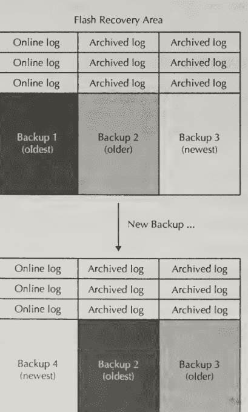

**图 9-5。** Oracle 使用*固定大小的*闪回恢复区来维护恢复相关文件的最新副本。

> **注意**
> 尽管措辞相似，但请勿将闪回恢复区与 Oracle 众多的闪回恢复特性混淆。

### 事务重做日志

Oracle 数据库的*事务重做日志*（或简称*重做日志*）是数据库的一个重要组件，用于保护所有已提交的工作。重做日志的作用是立即记录已提交事务所做的更改。如果数据库需要从实例崩溃、磁盘故障或其他类型的问题中恢复，Oracle 会在适当的恢复操作期间读取重做日志，以"重做"数据库中缺失的事务已提交的工作。

### 联机重做日志和日志写入器

数据库的重做日志是主机计算机上的一组操作系统文件。数据库的重做日志由两个或更多*日志组*组成。这组日志组统称为*联机事务重做日志*或*联机重做日志*。

Oracle 使用联机重做日志中的*日志组*来记录系统运行期间已提交事务的日志条目。在实例启动期间，*日志写入器*（LGWR）*后台线程*选择联机日志中的一个组，然后使用该组开始记录日志条目。LGWR 在任何给定时间正在写入的日志组是*当前日志组*。日志组具有静态存储容量，最终会填满重做条目。一旦 LGWR 填满当前日志组，Oracle 就会执行*日志切换*。在日志切换期间，Oracle 关闭当前日志组，打开下一个日志组，并开始向新的当前日志组写入日志条目。

> **注意**
> 为了优化事务重做条目的记录，Oracle 有时会预先写入未提交事务的重做条目，以预期提交。因此，在任何给定时间，重做日志可能包含少量由未提交事务所做的数据库更改。但是，Oracle 会适当地标记这些重做条目，以便如果需要数据库恢复，Oracle 可以使用撤销表空间中的信息自动清除数据库中未提交的更改。

Oracle 不是持续分配越来越多的磁盘空间用于事务日志记录，而是以循环方式重用（覆盖）联机日志组。例如，考虑一个具有最少两个联机日志组的数据库。Oracle 写入第一组，执行日志切换，写入第二组，执行日志切换，覆盖第一组，执行日志切换，覆盖第二组，并无限期地继续这个循环。通过在数据库的联机重做日志中循环使用和重用日志组，Oracle 数据库可以在相对较小、预定义的磁盘空间量中持续记录重做条目。本节后面的图 9-6 说明了这一概念。

### 归档重做日志和归档器

要从介质故障中恢复，Oracle 可能需要应用比数据库当前联机日志组中包含的条目更旧的重做条目——这一事实是由于日志组被覆盖和重用的性质所致。为了确保 Oracle 能够访问恢复从备份还原的数据文件所需的所有重做条目，您必须将实例配置为在日志组填满之后、被重用之前永久归档联机日志组——您将此操作模式称为*ARCHIVELOG 模式*或启用*介质恢复*的操作。在 ARCHIVELOG 模式下运行时，日志切换后，*归档器*（ARCH）*后台线程*将每个填满的日志组归档为独立于数据库本身的*归档日志文件*。归档日志文件作为写入日志组的日志条目的永久记录。Oracle 使用唯一的*日志序列号*命名每个归档日志组，以便易于识别。Oracle 通过归档填满的日志组而持续生成的日志组序列称为*归档事务重做日志*（*归档重做日志*或*脱机重做日志*）。为了长期保留归档日志文件，您应立即将数据库的归档日志文件移动或复制到脱机存储，例如磁带。在本章后面，您将了解更多关于如何保护数据库的归档重做日志的信息。

> **警告**
> 当您选择以*禁用介质恢复*或*NOARCHIVELOG 模式*（不归档日志组）运行数据库时，您可以在一定程度上提高服务器性能并使用更少的存储空间。但是，后果可能很严重，因为 Oracle 无法再保证保护已提交事务的工作免受磁盘故障等严重问题的影响。

图 9-6 说明了所有联机和归档重做日志组件及其相互关系。随着正在进行的事务生成填满联机重做日志中日志组的重做条目，LGWR 继续执行日志切换，ARCH 在每次日志切换后归档填满的日志组，从而使 LGWR 能够回收可用的联机日志组。当 Oracle 重用一个联机日志组来记录日志条目时，LGWR 覆盖该组中的先前条目。当您将实例配置为在日志组填满后归档时，数据库的归档重做日志会永久保留所有重做条目。

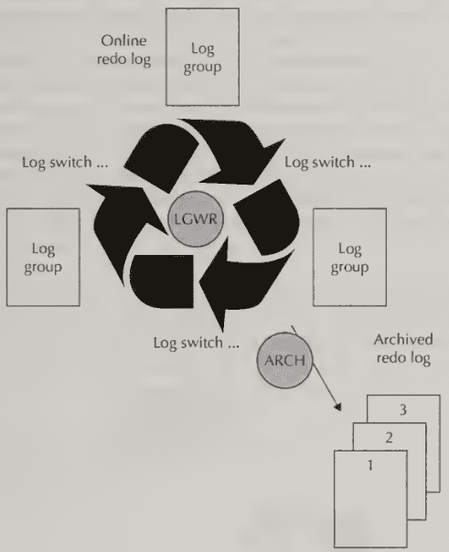

### 事务日志记录和容错

重做日志是 Oracle 数据库保护方案中的关键组件。因此，明智的做法是为构成数据库重做日志的各种文件配置一定程度的冗余，以防止单个磁盘故障或用户错误影响数据库的可用性和可恢复性。

为了保护数据库的联机重做日志，您应该创建具有多个*成员*（文件）的日志组，这些成员位于不同的磁盘上。图 9-7 显示了一个镜像（多路复用）的联机重做日志，其日志组各包含两个成员。

日志组的所有成员不过是副本——当 LGWR 写入具有多个成员的日志组时，LGWR 会并发写入所有成员。如果当前日志组中的一个成员因磁盘故障或用户错误而损坏，只要一个或多个成员可用，LGWR 就可以继续写入该日志组。默认情况下，Oracle XE 数据库具有最少的两个联机日志组，每个日志组具有最少一个联机日志成员。后续练习将教您如何显示信息和管理数据库的联机日志组及成员。

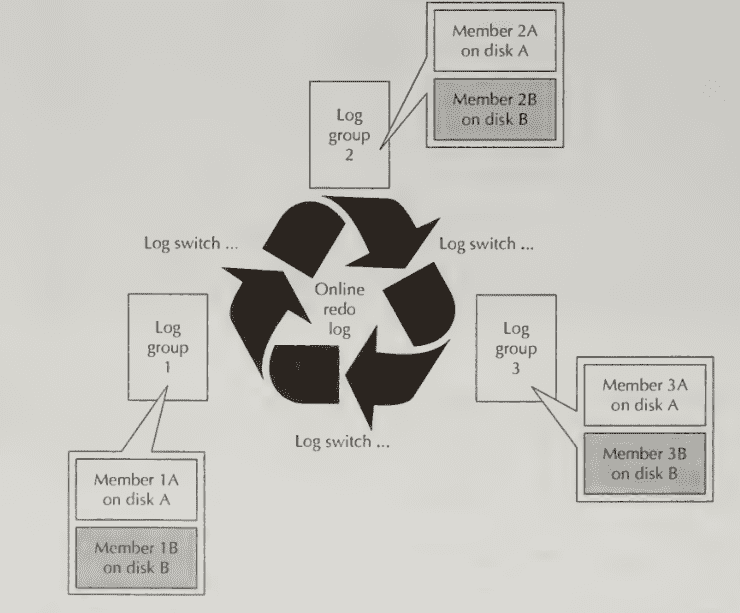

**图 9-7。** 为了保护*联机重做日志*免受单个磁盘故障的影响，您可以在不同磁盘上创建具有多个成员的日志组。

> **注意**
> 我不建议将联机日志成员放在 RAID-5 磁盘阵列上，以保护重做日志组件免受单个磁盘故障的物理可用性影响，因为 RAID-5 阵列会明显减慢事务日志记录的过程。如果您决定使用 RAID-5 阵列从物理上保护联机日志成员免受磁盘故障的影响，仍然明智的做法是配置具有重复日志成员的日志组，以提供针对逻辑错误的容错级别，例如当管理员错误地使用操作系统命令删除日志文件时。

当您运行数据库实例以归档填满的日志组时，ARCH 读取多路复用日志组中的一个或多个成员，以创建该组的归档副本。为了保护归档日志免受单点故障的影响，您还可以镜像归档重做日志。也就是说，您可以将 ARCH 配置为将每个填满的日志组的两个或更多副本写入不同的脱机归档区域。

### 检查点和数据库写入器

Oracle 定期执行检查点。在*检查点*期间，*数据库写入器（DBWR）后台线程*将实例缓冲区缓存中所有已修改的数据块写回包含这些数据块的数据文件。检查点的目的是在磁盘上建立事务一致性的里程碑。执行检查点后，Oracle 知道所有已提交事务所做的更改已从内存写入数据库的数据文件。考虑到这一点，检查点指示了如果发生简单的服务器崩溃且需要数据库崩溃恢复，Oracle 必须应用重做日志中的多少条目。

Oracle 在不同时间和不同级别执行检查点。例如，Oracle 在每次日志切换期间自动执行*数据库检查点*。在数据库检查点期间，DBWR 将缓冲区缓存中所有已修改的数据块写回数据库的所有数据文件。相比之下，当您使表空间脱机时，Oracle 执行*表空间检查点*。在表空间检查点期间，DBWR 仅将缓冲区缓存中与该表空间的数据文件对应的已修改数据块写出。

练习 9.23 解释了如何控制数据库检查点的频率，以调整实例崩溃后数据库的 MTTR。

### 数据库控制文件

数据库*控制文件*中的信息描述了数据库的物理结构。Oracle 还使用数据库控制文件中的信息来指导各种

数据库恢复操作的类型。当使用 Oracle 的 Recovery Manager 实用程序时，Oracle 还会使用数据库的控制文件来记录有关管理操作的信息，例如数据库备份。由于控制文件具有如此重要的功能，没有控制文件数据库将无法正常运行。

为了保护数据库的控制文件和数据库可用性免受磁盘故障的影响，你应该始终将数据库的控制文件镜像到多个位置，就像你对数据库在线重做日志组中的多个成员所做的那样。当你将数据库的控制文件镜像到多个位置时，Oracle 会同时更新控制文件的每个副本。如果由于磁盘 I/O 问题导致控制文件的某个副本无法访问，在你解决问题之前数据库操作将无法继续；但是，控制文件的其他副本仍然完好无损，保护着控制文件信息。

## 数据库备份

本章前面的几节多次使用了"数据库备份"这个术语来支持相关主题的说明。虽然大多数计算机用户对备份的一般概念都很了解，但请仔细阅读本节，以便你专门了解与 Oracle 数据库备份相关的术语和概念。

数据库备份是全面的 Oracle 数据库保护策略的重要组成部分。一般来说，*数据库备份*是构成数据库的文件的副本。如果你损坏或丢失了作为数据库一部分的文件，你可以从数据库备份中提取丢失文件的副本以在数据库中恢复该文件。

考虑到可用于 Oracle 数据库备份和恢复的工具和技术非常丰富，对于新手来说，理解与各种类型数据库备份相关的众多术语、同义词和概念可能会非常困惑。为了使事情相对简单，本章重点介绍使用 Oracle 的 Recovery Manager 实用程序（在下一节中讨论）执行最典型的数据库备份类型。表 9-1 和以下各小节介绍了你应该为本章目的理解的通用数据库备份术语。

### 整个数据库备份

*数据库备份*，或称*整个数据库备份*，包括所有数据库数据文件和数据库控制文件的副本。整个数据库备份是你为保护 Oracle 数据库而执行的最常见的备份类型。使用 Oracle，你可以进行两种不同类型的数据库备份：打开数据库备份和关闭数据库备份。

### 打开数据库备份

*打开数据库备份*，也称为*热数据库备份*，是在数据库打开并运行时执行的数据库备份。打开数据库备份对于需要一个或多个应用程序具有高可用性的环境非常有用。除非你*始终*在启用介质恢复的情况下操作数据库（即在 ARCHIVELOG 模式下），否则你无法执行打开数据库备份。

由于打开数据库备份的数据文件中的数据在备份过程中不断被事务修改，因此该备份被认为是*不一致的*或*模糊的*。也就是说，没有一个单一的事务一致时间点与所有数据块对应。不过不用担心。从不一致的数据库备份中恢复数据文件后，Oracle 的前滚/回滚恢复机制会重新生成缺失的事务，使文件中的所有数据块对应于同一个事务一致时间点。

**表 9-1.** *Oracle 数据库备份通用术语和概念*

| 备份类型（同义词） | 描述 |
|---|---|
| 数据库备份（整个数据库备份） | 包括所有表空间的所有数据文件以及数据库的控制文件。这是你为保护数据库而执行的最常见的备份类型。 |
| 打开数据库备份（热、不一致或模糊数据库备份） | 在数据库打开并运行时进行的数据库备份（热备份）。由于备份中的数据不对应于任何单一的事务一致时间点，因此该备份被认为是*不一致的*或*模糊的*。 |
| 关闭数据库备份（冷备份或一致数据库备份） | 在计划关闭数据库后进行的数据库备份。由于备份中的数据对应于一个事务一致时间点，因此该备份被认为是*一致的*。 |
| 表空间备份 | 包括一个表空间的所有数据文件。 |
| 在线表空间备份（热、不一致或模糊表空间备份） | 在数据库打开且表空间在线时进行的表空间备份。 |
| 离线表空间备份（一致表空间备份） | 在数据库打开但表空间离线时进行的表空间备份。如果你正常地将表空间离线，随后对该表空间进行的离线备份被认为是*一致的*。 |
| 数据文件备份（数据文件副本） | 单个数据文件的备份。 |

### 关闭数据库备份

*关闭数据库备份*是在计划关闭数据库后执行的数据库备份。关闭数据库备份是对于高可用性不是关键要求的系统的选项。关闭数据库备份也是在未启用介质恢复（即在 NOARCHIVELOG 模式下）的情况下运行的数据库的唯一选项。在这种情况下，关闭数据库备份包括数据库的所有数据文件、在线日志成员和数据库的控制文件（请注意增加了在线日志成员）。

要执行关闭数据库备份，之前的数据库关闭应正常完成——你不应在系统崩溃或异常关闭后执行关闭数据库备份。在数据库正常关闭后，构成数据库的所有文件彼此处于事务一致状态。因此，关闭数据库备份通常称为*一致数据库备份*。

### 表空间备份

Oracle 还允许你备份数据库中的各个表空间。*表空间备份*是备份构成该表空间的所有数据文件。当你想要备份数据库中应用程序修改频率高于其他部分的特定分区时，表空间备份非常有用。当你在启用介质恢复的情况下操作时，你可以执行两种不同类型的表空间备份：在线表空间备份和离线表空间备份。

### 在线表空间备份

*在线表空间备份*，也称为*热表空间备份*，是在数据库打开且表空间在线时执行的表空间备份。由于表空间中的数据可能在备份过程中被修改，因此该备份被认为是不一致的。与打开数据库备份一样，当高可用性是必须要求时，在线表空间备份非常有用。你无需关闭数据库或将表空间离线来进行备份，只需在应用程序使用该表空间时对其进行备份即可。

### 离线表空间备份

*离线表空间备份*是在数据库打开但表空间离线时执行的表空间备份。如果你正常地将表空间离线（即 Oracle 可以成功执行表空间检查点并关闭所有关联的数据文件），则从离线表空间备份生成的备份数据是一致的。

## Recovery Manager

*Recovery Manager (RMAN)* 是 Oracle 公司推荐你用来保护 Oracle XE 数据库的实用程序。RMAN 具有许多功能，你可以利用它们使数据库保护策略变得全面、自动化且相对简单。使用 RMAN，你可以执行以下任务：

- 备份和恢复单个数据文件、表空间或整个数据库。
- 自动检测和恢复数据文件损坏。
- 执行增量备份，仅备份自上次备份以来已更改的块。
- 将备份元数据存储在数据库的控制文件或恢复目录中。
- 管理备份保留策略并自动删除过时的备份。

> **注意：** Recovery Manager 实用程序提供两种发出命令的方式：从命令行交互式操作，或运行预先编写的 RMAN 脚本。


### 常用RMAN命令

| 命令     | 描述                                                                                                     |
|----------|----------------------------------------------------------------------------------------------------------|
| CONNECT  | 与目标数据库建立连接                                                                                     |
| RUN      | 将一条或多条语句作为一个作业编译并执行，作业由开始和结束大括号界定                                       |
| ALLOCATE | 建立一个通道，用于后续的备份、复制、恢复或修复操作                                                       |
| BACKUP   | 备份数据库、表空间、数据文件、归档日志文件或控制文件                                                     |
| COPY     | 创建数据文件、归档日志文件或控制文件的映像副本                                                           |
| RESTORE | 从备份集中还原文件                                                                                       |
| SWITCH   | 在数据库的控制文件中，将数据文件的文件名切换为该数据文件的映像副本                                       |
| RECOVER | 通过应用归档和在线日志文件，恢复数据库、表空间或一个或多个数据文件                                       |
| LIST     | 列出有关备份集和映像副本的信息                                                                           |
| REPORT   | 报告有关数据库当前状态的有价值信息                                                                       |

后续的练习将讨论Oracle XE提供的几个RMAN脚本，您可以执行这些脚本来备份和恢复您的数据库。

### 恢复管理器与数据库控制文件

RMAN通过自动跟踪Oracle XE数据库控制文件中与备份相关的信息，简化并自动化了数据库备份和恢复的过程。RMAN使用控制文件来记录您执行的每次数据库备份的特定信息。当数据库需要恢复时，RMAN使用控制文件中的信息，利用可用的备份和适当的恢复操作来恢复受损的数据库。

Oracle XE数据库的控制文件跟踪数据库的备份信息以及数据库物理结构（数据文件、日志成员等）的信息。如果数据库受损，RMAN必须能够读取控制文件，以指导受损数据库的物理还原和恢复。为了便于从介质故障中恢复，将数据库的控制文件进行镜像以保护当前控制文件免受孤立磁盘故障的影响非常重要。同样重要的是，在数据库每次结构更改后，维护反映数据库物理构成的控制文件备份。例如，每次创建新的表空间或向现有表空间添加数据文件时，都应备份该表空间以及数据库的控制文件。您可以配置RMAN以自动备份数据库的控制文件。

**注意：** 灾难性问题（火灾、洪水、地震等）可能会损坏存储在同一物理位置的所有数据库控制文件副本。当数据库控制文件的所有副本都丢失且您没有备份控制文件时，数据库恢复可能会非常困难。为了进一步保护恢复信息的可用性，您可以选择配置和使用恢复目录。恢复目录是远程Oracle数据库中的一组表，RMAN可以使用这些表来记录存储在数据库控制文件中的相同信息。如果您没有数据库控制文件的副本，可以使用远程恢复目录中的信息来指导数据库恢复。恢复目录的配置和使用超出了本书的范围——有关更多信息，请参阅 *Oracle Database Backup and Recovery Basics*。

### 备份集与备份片段

RMAN使用多种技术来尽可能高效地执行备份操作。例如，RMAN不会低效地为每个数据库文件创建逐块物理副本，而是读取需要备份的源数据库文件，并将这些文件的块交错组合在一起，创建一个称为 *备份集* 的大存储单元。 *数据文件备份集* 包含数据库一个或多个数据文件中的块，而 *归档日志备份集* 包含数据库一个或多个归档日志组中的块。RMAN还可以将数据库控制文件的备份附加到数据文件或归档日志备份集中。

默认情况下，RMAN将备份集写入一个操作系统文件，该文件特称为 *备份片段*。当您明确限制备份片段的大小时（例如，由于文件系统或磁带驱动器的存储限制），RMAN可能需要使用多个备份片段来写入单个备份集。

为了减少数据文件备份集的总大小，RMAN不会从未包含过数据的数据文件中写入数据块（例如，新数据文件中的新块）——从某种意义上说，这压缩了数据文件备份集的大小。为了以额外的处理要求为代价进一步压缩数据库备份的大小，RMAN可以选择使用压缩算法来减小备份集的大小。

Oracle XE默认将RMAN配置为将备份集写入数据库的快速恢复区。您也可以使用RMAN将单个备份集或整个快速恢复区备份到永久性离线存储介质（如磁带）。后续的练习将解释其中一些RMAN功能。

### 完全与增量数据文件备份集

当您使用RMAN备份数据库或表空间的数据文件时，可以执行完全备份或增量备份。数据文件备份集的 *完全备份* 包括备份集中所有数据文件的所有已使用数据块——RMAN会省略从未使用过的数据块，以压缩备份集的大小。相比之下，数据文件备份集的 *增量备份* 仅包括备份集中自同一级别或更高级别的上次备份以来已修改的数据文件块（下一段将解释 *级别* 一词）。增量备份的优势在于，备份备份集的一部分数据通常比备份整个备份集花费更少的时间。

**注意：** 完全备份集和增量备份集彼此完全独立。例如，完全备份集对先前的增量备份集没有影响。

当您使用增量备份时，可以设置增量备份的 *级别*。通常，级别-*n* 备份包括自最近的级别-*n* 或更高级别备份以来已修改的备份集块。例如，假设您在星期日使用级别-0备份备份一个数据文件备份集：

- 星期一，您执行数据文件备份集的级别-2备份。备份集仅包含自星期日级别-0备份以来已更改的块。
- 星期二，您再次执行数据文件备份集的级别-2备份。备份集仅包含自星期一级别-2备份以来已更改的块。
- 星期三，您执行数据文件备份集的级别-1备份。备份集仅包含自星期日级别-0备份以来已更改的块。
- 星期四，您执行数据文件备份集的级别-2备份。备份集仅包含自星期三级别-1备份以来已更改的块。
- 星期五，您再次执行数据文件备份集的级别-2备份。备份集仅包含自星期四级别-2备份以来已更改的块。
- 星期六，您执行数据文件备份集的级别-1备份。备份集仅包含自星期三级别-1备份以来已更改的块。
- 星期日，您执行数据文件备份集的级别-0备份，依此类推。备份集包含自上星期日级别-0备份以来所有已更改的块。

**注意：** Oracle允许您对数据文件备份集进行最深八级的 *增量* 备份。

增量数据文件备份集主要用于处理大型数据库。由于Oracle XE数据库大小有限，本章不教授如何执行增量数据文件备份——如果您想了解更多信息，请参阅 *Oracle Database Backup and Recovery Basics*。

### 映像副本

除了备份集，您还可以使用RMAN创建映像副本来备份数据库的部分或全部内容。 *映像副本* 是单个数据文件、归档日志组或数据库控制文件的逐块物理副本。映像副本与备份集在几个方面有所不同：

- 您只能在磁盘上创建文件的映像副本——例如，您不能直接在磁带上创建映像副本。
- 文件的映像副本是该文件的精确逐块副本。RMAN不会通过消除文件中未使用的数据块或压缩文件来压缩数据文件的映像副本。

由于映像副本是直接对应数据库文件的文件，您在执行数据库恢复之前无需从备份集中提取或还原映像副本。使用RMAN，您只需将受损文件的位置“切换”到相应映像副本的位置，然后执行数据库恢复即可使文件变为最新状态。由于使用映像副本无需还原操作，恢复速度更快——这对于需要高可用性和最短MTTR（平均恢复时间）的应用程序非常有用。


### 通道

当RMAN执行数据库备份、映像副本、还原或恢复操作时，它会为该任务分配至少一个通道。RMAN*通道*包含两层含义：与作为操作目标的数据库的连接，以及指定用于操作的I/O设备的名称和类型。当你为某个RMAN操作（如备份、映像副本、文件还原或恢复）指定多个通道时，RMAN会自动使用并行处理来更快速地完成操作。

### 备份标签

创建备份集或映像副本时，你可以为其分配一个*标签*，这是一个逻辑名称。RMAN会自动在恢复目录中将备份集或映像副本与其标签关联起来。当你需要执行恢复操作，或者希望用新版本覆盖备份集或映像副本的旧版本时，可以使用标签。

## 配置Oracle XE数据库保护

### 练习9.1：显示快速恢复区信息

本练习将教你如何快速显示数据库快速恢复区的配置信息。Oracle使用两个初始化参数来配置数据库的快速恢复区：

- **DB_RECOVERY_FILE_DEST** 设置为指定快速恢复区操作系统位置的字符串。
- **DB_RECOVERY_FILE_DEST_SIZE** 设置为确定快速恢复区存储容量的整数。你可以使用K、M和G后缀来更方便地分别以千兆字节、兆字节或吉字节为单位指定设置。

要显示Oracle XE当前的快速恢复区参数设置，请使用与练习8.14中类似的步骤：

1. 启动Oracle Application Express。
2. 以**SYSTEM**用户身份连接。
3. 点击管理。
4. 点击关于数据库。
5. 查看参数。
6. 点击执行。
7. 向下滚动页面，直到看到DB_RECOVERY_FILE_DEST和DB_RECOVERY_FILE_DEST_SIZE参数的设置。典型Oracle XE数据库安装后的设置应与图9-8所示相似。

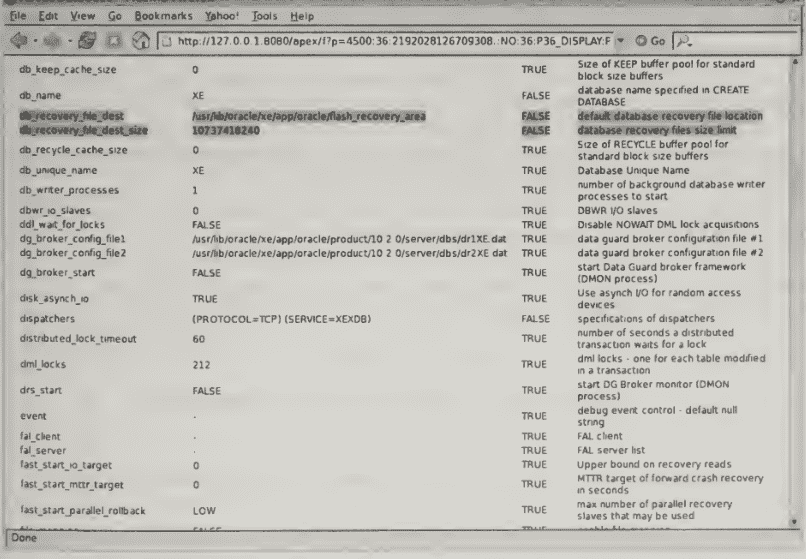

**图9-8.** 你可以使用Oracle Application Express的“关于数据库”页面快速显示与快速恢复区相关的参数设置。

请注意，默认情况下，Oracle XE数据库快速恢复区的存储容量为10GB，并且快速恢复区位于包含Oracle数据库数据文件的同一磁盘驱动器上。理解这一点非常重要：Oracle XE数据库快速恢复区的默认位置基本上使其在磁盘故障时毫无用处。为什么？因为破坏数据库当前文件的磁盘故障也会破坏恢复数据库所需的所有文件。本章稍后，你将学习如何移动数据库的快速恢复区，但首先你也应该探索其他配置设置。

### 练习9.2：显示控制文件信息

本练习将教你如何显示数据库控制文件配置的信息。*CONTROL_FILES初始化参数*决定数据库每个控制文件副本的名称和位置。Oracle在实例启动时读取CONTROL_FILES初始化参数，在实例挂载数据库时打开指定的控制文件，然后在正常的数据库处理过程中将控制文件信息写入所有控制文件副本。CONTROL_FILES初始化参数设置为以逗号分隔的一个或多个文件名列表。

在继续上一个练习时，你只需向上滚动页面并显示参数的设置，即可显示Oracle XE数据库CONTROL_FILES参数的当前设置，如图9-9所示。

请注意，默认的Oracle XE数据库只有一个控制文件副本，位于与数据库数据文件相同的位置。为了更好地保护数据库，练习9.11将教你如何添加控制文件副本。

### 练习9.3：显示重做日志信息

要显示Oracle XE数据库当前重做日志配置的有用信息，请使用Oracle Application Express完成以下步骤，继续上一个练习：

1. 点击主页以显示数据库主页。
2. 在页面的使用情况监视器部分，观察日志归档的设置，如图9-10所示。

默认情况下，Oracle XE数据库在NOARCHIVELOG模式下运行——换句话说，禁用了介质恢复。如果你想保护数据库免受磁盘故障的可能性，你必须做的一件事就是将数据库切换到永久启用介质恢复的模式下运行，然后配置如何在日志组填满时对其进行归档。练习9.7将教你如何操作。

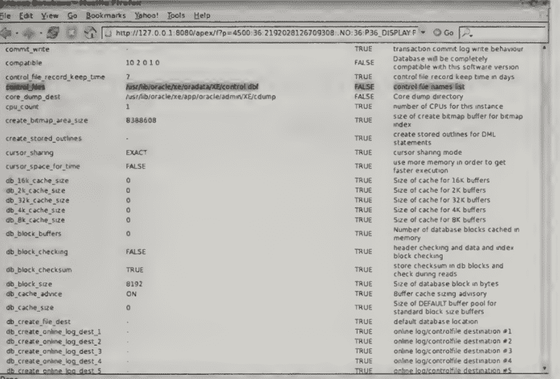

**图9-9.** 你可以使用Oracle Application Express的“关于数据库”页面快速显示与数据库控制文件相关的参数设置。

要显示Oracle XE数据库在线日志组的信息，请点击日志归档链接。请注意数据库日志页面上显示的以下信息，如图9-11所示：

- 默认的Oracle XE数据库有两个在线日志组。
- 每个在线日志组有一个成员。
- 每个在线重做日志成员位于快速恢复区中。
- 每个日志组的日志成员大小为50MB。

为了更好地保护数据库，你应该做的另一件事是将每个日志组配置为两个或更多成员，并将每个组的成员放在物理上不同的磁盘驱动器上（如果可能）。练习9.10将教你如何操作（或模拟操作）。

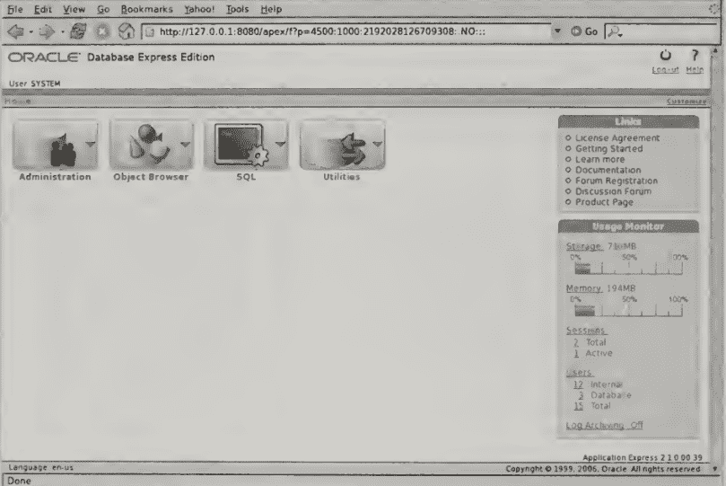

**图9-10.** 数据库主页显示Oracle XE数据库当前的日志归档状态。

在继续下一个练习之前，打开Nautilus并导航到Oracle XE数据库的快速恢复区。请注意，快速恢复区包含一个专门用于数据库在线日志成员的子目录，如图9-12所示。

### 练习9.4：创建冷数据库备份

前面的练习指出了默认Oracle XE数据库配置的几个弱点——你将在接下来的几个练习中解决这些弱点。在此之前，你最好创建一个当前数据库的备份，以防出错。本练习将教你如何为在禁用介质恢复（NOARCHIVELOG模式）下运行的Oracle XE数据库创建冷备份。

要快速备份Oracle XE数据库，请使用GNOME应用程序菜单上方便的“备份数据库”菜单选项。此菜单选择会执行一个shell脚本（ORACLE_HOME/config/scripts/backup.sh），该脚本会确定Oracle XE数据库当前是在启用还是禁用介质恢复的情况下运行。如果Oracle XE数据库启用了介质恢复，shell脚本会使用RMAN创建热备份；否则，shell脚本会使用RMAN关闭数据库，创建冷备份，然后重新启动数据库。

要为当前在禁用介质恢复的情况下运行的Oracle XE数据库创建冷备份，请完成以下步骤：

1. 点击注销以终止当前的Oracle Application Express会话。
2. 点击应用程序（在GNOME菜单面板上）。
3. 点击Oracle Database 10g Express Edition。
4. 点击备份数据库。

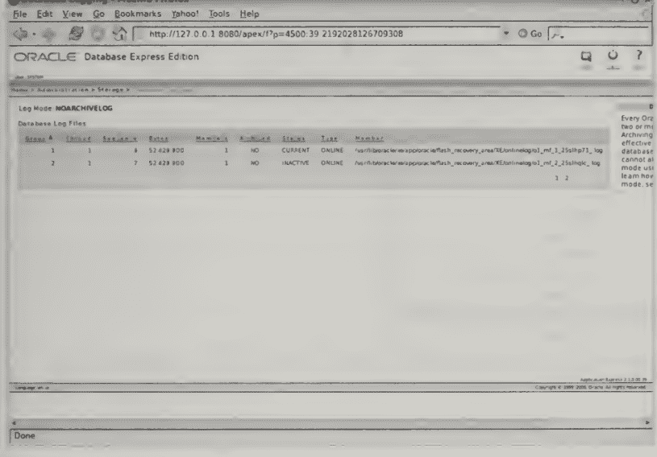

**图9-11.** 数据库日志页面显示关于Oracle XE数据库在线日志组和在线日志成员的信息。

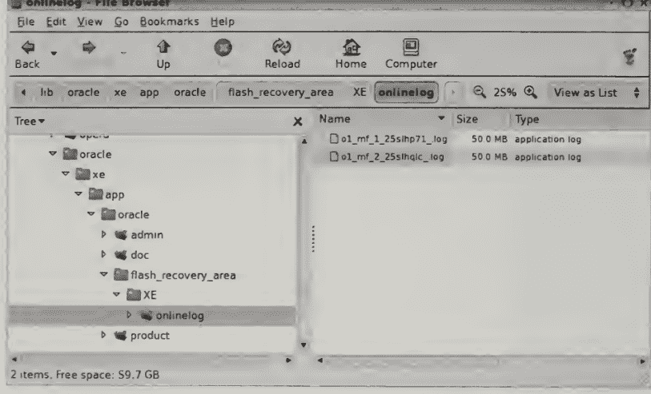

**图9-12.** 快速恢复区包含一个用于在线日志成员的单独子目录。

起初，shell脚本在终端窗口中启动并显示以下提示：

> 警告：日志归档（ARCHIVELOG模式）当前已禁用。如果你从此备份还原数据库，此备份与下次备份之间发生的任何事务都将丢失。建议你在继续之前启用ARCHIVELOG模式，以便在还原时可以恢复所有事务。有关说明，请参阅在线帮助中的“启用ARCHIVELOG模式...”部分。禁用日志归档的备份将关闭并重新启动数据库。你确定要继续吗 [Y/N]？

此通知是预期的（你应该已经知道需要重新配置数据库以在ARCHIVELOG模式下运行）；输入Y继续。然后shell脚本执行其备份数据库的工作。shell脚本的输出相当简洁。要了解实际发生的情况，请使用文本编辑器查看shell脚本指示的日志文件，其中应包含类似以下的输出。输出内容相当丰富，让你第一次了解到本章前面学到的几个RMAN概念。


# XE 备份日志

```
Recovery Manager: Release 10.2.0.1.0 - Production on ...

Copyright (c) 1982, 2005, Oracle. All rights reserved.

connected to target database: XE (DBID=2470844405)

RMAN>
echo set on
```

**-- 关闭数据库。**

```
RMAN> shutdown immediate;
using target database control file instead of recovery catalog
database closed
database dismounted
Oracle instance shut down
```

**-- 启动一个新实例并挂载数据库，但不打开。**

```
RMAN> startup mount;
connected to target database (not started)
Oracle instance started
database mounted

Total System Global Area      146800640 bytes

Fixed Size                     1257668 bytes
Variable Size                 79695676 bytes
Database Buffers                62914560 bytes
Redo Buffers                    2932736 bytes
```

**-- 配置 RMAN 以保留最近的两个备份，并将所有其他备份视为过时。**

```
RMAN> configure retention policy to redundancy 2;
new RMAN configuration parameters:
CONFIGURE RETENTION POLICY TO REDUNDANCY 2;
new RMAN configuration parameters are successfully stored
```

**-- 配置自动控制文件备份使用磁盘通道。**

```
RMAN> configure controlfile autobackup format for device type disk clear;
RMAN configuration parameters are successfully reset to default value
```

**-- 启用自动控制文件备份。**

```
RMAN> configure controlfile autobackup on;
new RMAN configuration parameters:
CONFIGURE CONTROLFILE AUTOBACKUP ON;
new RMAN configuration parameters are successfully stored
```

**-- 创建数据库初始化参数文件的文本备份。**

```
RMAN> sql "create pfile='/usr/lib/oracle/xe/app/oracle/product/10.2.0/server/dbs/spfile2init.ora' from spfile";
sql statement: create pfile='/usr/lib/oracle/xe/app/oracle/product/10.2.0/server/dbs/spfile2init.ora' from spfile
```

**-- 将关闭的数据库作为备份集进行备份，使用配置为写入快速恢复区的默认通道。**

```
RMAN> backup as backupset device type disk database;
Starting backup at ...
allocated channel: ORA_DISK_1
channel ORA_DISK_1: sid=36 devtype=DISK
channel ORA_DISK_1: starting full datafile backupset
channel ORA_DISK_1: specifying datafile(s) in backupset
-- 下面创建了数据文件备份集。注意 RMAN 读取的数据文件不包括临时文件，这些文件对于数据库恢复不是必需的。
input datafile fno=00001 name=/usr/lib/oracle/xe/oradata/XE/system.dbf
input datafile fno=00003 name=/usr/lib/oracle/xe/oradata/XE/sysaux.dbf
input datafile fno=00002 name=/usr/lib/oracle/xe/oradata/XE/undo.dbf
input datafile fno=00004 name=/usr/lib/oracle/xe/oradata/XE/users.dbf
channel ORA_DISK_1: starting piece 1 at ...
channel ORA_DISK_1: finished piece 1 at ...
```

**-- 注意备份集包含一个备份片段，写入快速恢复区的一个子目录。同时注意 RMAN 为备份集自动生成了一个唯一标签。**

```
piece handle=/usr/lib/oracle/xe/app/oracle/flash_recovery_area/XE/backupset/2006_05_15/o1_mf_nnndf_TAG20060515T163834_26kspbtd_.bkp
tag=TAG20060515T163834 comment=NONE
```

**-- RMAN 备份总大小约 1GB 的数据文件耗时不到 2 分钟。**

```
channel ORA_DISK_1: backup set complete, elapsed time: 00:01:05
Finished backup at ...
```

**-- 自动控制文件备份也写入快速恢复区的一个子目录。**

```
Starting Control File and SPFILE Autobackup at ...
piece handle=/usr/lib/oracle/xe/app/oracle/flash_recovery_area/XE/autobackup/2006_05_15/o1_mf_s_590517501_26ksrdxc_.bkp comment=NONE
Finished Control File and SPFILE Autobackup at ...
```

**-- 禁用自动控制文件备份。**

```
RMAN> configure controlfile autobackup off;
old RMAN configuration parameters:
CONFIGURE CONTROLFILE AUTOBACKUP ON;
new RMAN configuration parameters:
CONFIGURE CONTROLFILE AUTOBACKUP OFF;
new RMAN configuration parameters are successfully stored
```

**-- 重新打开数据库。**

```
RMAN> alter database open;
database opened
```

**-- 从快速恢复区删除所有过时的数据库备份。**

```
RMAN> delete noprompt obsolete;
RMAN retention policy will be applied to the command
RMAN retention policy is set to redundancy 2
using channel ORA_DISK_1
-- 这是第一个备份，所以没有发现过时的备份。
no obsolete backups found

RMAN>

Recovery Manager complete.
```

非常酷！只需点击一下鼠标，大约两分钟后，你就有了一个冷数据库备份。图 9-13 显示了包含数据文件备份集新备份片段的快速恢复区。注意 RMAN 能够高效地创建一个大小约为数据库数据文件总大小一半的备份集/片段。

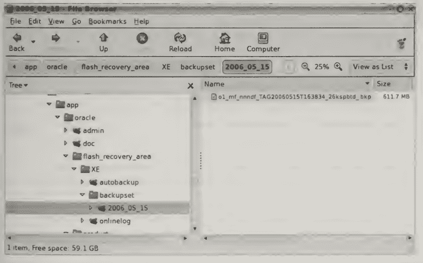

# 图 9-13。默认情况下，RMAN 将备份集写入快速恢复区。

有了可用的冷数据库备份，你现在可以放心地在接下来的几个练习中移动快速恢复区并进行其他数据库配置更改。

### 练习 9.5：使用 SQL*Plus 建立特权管理员会话

要完成本章接下来的许多练习，你需要使用 SQL*Plus 建立一个特权管理员会话，该会话允许你执行强大的系统级操作，例如实例启动和关闭、数据库备份和恢复以及某些数据库配置操作。*特权管理员会话*是一个具有以下任一或两种权限访问权限的会话：

- **SYSOPER** 使用具有 SYSOPER 权限的会话，你可以启动和关闭 Oracle 数据库实例；挂载、打开、关闭、备份和恢复数据库；以及管理数据库的重做日志结构。
- **SYSDBA** 使用具有 SYSDBA 权限的会话，你可以执行任何数据库操作，因此也可以授予其他数据库用户任何系统权限。因此，严格限制哪些用户拥有 SYSDBA 系统权限至关重要。

## 注意

> 你使用 ORAPWD 实用程序、管理员密码文件以及 SQL 命令 GRANT 和 REVOKE 来控制对 SYSDBA 和 SYSOPER 权限的访问。本书面向 Oracle XE 用户，不讨论如何将其他管理员添加到管理员密码文件、更改管理员密码以及涉及 ORAPWD 实用程序的其他操作。如果感兴趣，请参阅《Oracle 数据库管理员指南》以获取有关管理员安全性和 ORAPWD 实用程序的更多信息。

默认情况下，你的启动数据库中的 SYS 账户在管理员密码文件中注册，管理员密码是你在安装期间设置的密码。

为准备下一个练习，使用 SYS 账户通过 SQL*Plus 建立到 Oracle XE 数据库的 SYSDBA 特权管理员会话。启动 SQL*Plus（选择应用程序 [在 GNOME 菜单面板上] | Oracle Database 10g Express Edition | 运行 SQL 命令行），然后输入以下语句：

```
CONNECT SYS AS SYSDBA;
```

或者，如果你的 Linux 会话是 dba 组的成员，你可以更简单地指定以下内容：

```
CONNECT / AS SYSDBA;
```

在任一情况下，Oracle 都会以具有所有权限的管理员身份与你的 Oracle XE 实例建立会话，你可以执行强大的系统级操作，例如数据库重新配置、数据库备份和恢复以及数据库启动和关闭。现在你已准备好移动快速恢复区。

### 练习 9.6：移动快速恢复区和联机重做日志

如前所述，Oracle XE 数据库的默认配置将数据库的数据文件和快速恢复区放在同一磁盘驱动器上。为了保护你的数据库免受磁盘故障的影响，本练习教你如何将快速恢复区（包括数据库的联机日志组）移动到不同的磁盘驱动器。

如果你的计算机只有一个磁盘驱动器，我强烈建议你考虑购买一个廉价的辅助磁盘驱动器，以便你可以安全地将所有有价值的数据备份到与主硬盘物理分离的磁盘上。USB 连接的外部驱动器的便利性和可负担性非常适合此目的。

如果你没有第二个磁盘驱动器，请模拟第二个磁盘驱动器来练习本练习中的技能。例如，在硬盘上创建一个目录，该目录可以作为训练目的的虚拟驱动器。例如，创建目录 /xedrive 来模拟逻辑上称为 XE 的驱动器上的文件系统的挂载点。遵循 OMF 指南，你应该为新的快速恢复区创建以下目录树：

```
/xedrive/oraclexe/app/oracle/flash_recovery_area
```

要在使用 Linux 时通过单个命令创建新的子目录层次结构，请启动终端窗口 shell 并输入以下命令：

```
sudo mkdir -p -m 755 /xedrive/oraclexe/app/oracle/flash_recovery_area
sudo chown -R oracle:dba /xedrive
```

一旦你决定将快速恢复区移动到何处，请使用你在上一个练习中建立的 SYSDBA 特权 SQL*Plus 会话完成以下步骤：

1.  使用 SQL 命令 ALTER SYSTEM 将 DB_RECOVERY_FILE_DEST 初始化参数的设置修改为你选择的新位置；在以下示例中，替换你的实际位置：

```
ALTER SYSTEM SET
  DB_RECOVERY_FILE_DEST =
  '/xedrive/oraclexe/app/oracle/flash_recovery_area';
```


## 9.7 启用介质恢复

要切换数据库，使其在重用在线重做日志组之前对其进行归档，需要按以下顺序完成几个步骤：

- 1. 关闭当前数据库实例。
- 2. 启动新实例并将数据库装载到该实例，但不要打开数据库。
- 3. 使用 SQL 命令 `ALTER DATABASE` 的 `ARCHIVELOG` 选项（或 `NOARCHIVELOG` 选项）来切换数据库的日志模式。
- 4. 重新打开数据库。

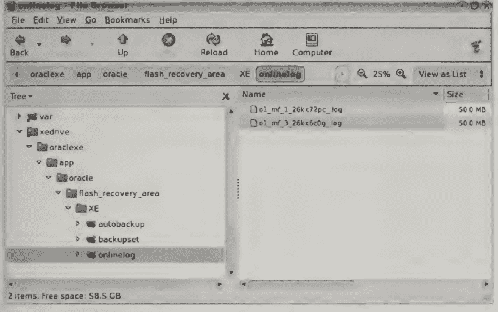

**图 9-14.** 确认新的闪回恢复区中的在线日志成员和新备份集。

本练习将教你如何执行前面列表中的每个步骤，以便为 Oracle XE 数据库启用介质恢复。

首先，关闭数据库的当前实例。启动 SQL*Plus（选择 GNOME 菜单面板上的"应用程序" | Oracle Database 10g Express Edition | 运行 SQL 命令行），以 SYS 用户身份并使用 SYSDBA 权限连接，然后使用 SQL*Plus 命令 `SHUTDOWN` 的 `IMMEDIATE` 选项来执行立即数据库关闭（回滚所有挂起的事务、终止所有会话并关闭）：

```
SHUTDOWN IMMEDIATE;
```

**注意**

`SHUTDOWN` 命令有几个可用于控制数据库关闭的选项。有关 SQL*Plus 命令 `SHUTDOWN` 及其选项的更多信息，请参阅《Oracle 数据库管理员指南》。

几秒钟后，你应该看到以下结果，表明 Oracle 已关闭：

```
Database closed.
Database dismounted.
ORACLE instance shut down.
```

现在使用 SQL*Plus 命令 `STARTUP` 的 `MOUNT` 选项来启动新实例并将数据库装载到该实例，但不要打开数据库：

```
STARTUP MOUNT;
```

此操作完成后，你应该看到类似以下的结果：

```
ORACLE instance started.

Total System Global Area  146800640 bytes
Fixed Size                   1257668 bytes
Variable Size              79695676 bytes
Database Buffers           62914560 bytes
Redo Buffers                2932736 bytes
Database mounted.
```

最后，你可以使用 SQL 命令 `ALTER DATABASE` 的 `ARCHIVELOG` 选项或 `NOARCHIVELOG` 选项来切换数据库的日志模式。例如，输入以下语句将你的初始数据库切换到 `ARCHIVELOG` 模式（启用介质恢复）：

```
ALTER DATABASE ARCHIVELOG;
```

**注意**

> 一旦切换了数据库的日志模式，请始终在此模式下操作数据库。频繁切换日志模式不是良好的实践。

接下来，使用 SQL 命令 `ALTER DATABASE` 的 `OPEN` 选项打开数据库以使其可用：

```
ALTER DATABASE OPEN;
```

要确认你的更改，可以启动 Oracle Application Express 并显示数据库主页。日志归档状态现在应指示数据库处于 `ARCHIVELOG` 模式，如图 9-15 所示。

## 9.8 创建热数据库备份

正如你已经知道的，每当对数据库进行结构性更改时，备份数据库非常重要，以便在发生问题时可以恢复数据库。特别重要的是要理解，在数据库以 `NOARCHIVELOG` 模式运行时进行的所有备份，对于恢复现在以 `ARCHIVELOG` 模式运行的数据库都没有用。

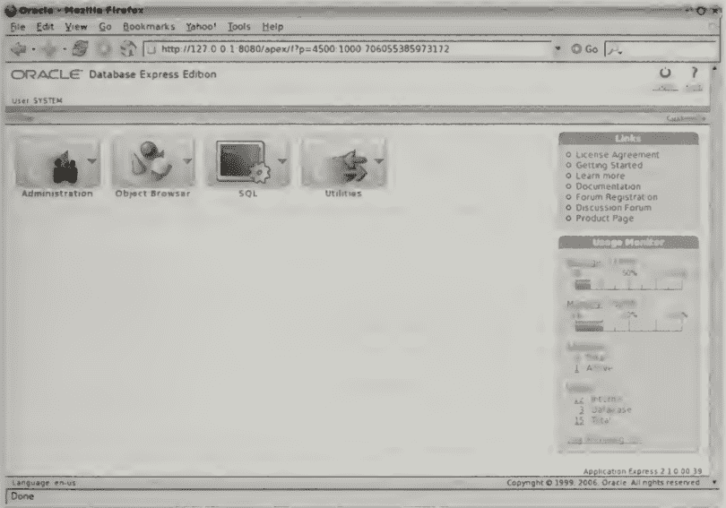

**图 9-15.** 将 Oracle XE 数据库重新配置为 `ARCHIVELOG` 模式后，使用数据库主页确认更改。

因此，本练习将教你如何为现在启用了介质恢复（以 `ARCHIVELOG` 模式运行）的 Oracle XE 数据库创建热数据库备份。

你会很高兴知道，创建热 Oracle XE 数据库备份与冷备份一样简单：只需使用 GNOME 应用程序菜单上熟悉的"备份数据库"菜单选项。当相应的 shell 脚本执行时，它会识别出数据库现在处于 `ARCHIVELOG` 模式，并自动执行热数据库备份而不是冷备份。

要为当前禁用了介质恢复的 Oracle XE 数据库创建热数据库备份，请完成以下步骤：

- 1. 单击"应用程序"（在 GNOME 菜单面板上）。
- 2. 单击"Oracle Database 10g Express Edition"。
- 3. 单击"备份数据库"。

shell 脚本的输出很简洁。要了解实际发生的情况，请打开由 shell 脚本输出指示的日志文件，该文件应类似于以下内容。请注意，它与冷数据库备份的输出相似，但有一些关键差异，如嵌入式注释（以粗体突出显示）所示：

### XE 备份日志

```
Recovery Manager: Release 10.2.0.1.0 - Production on ...

Copyright (c) 1982, 2005, Oracle. All rights reserved.

connected to target database: XE (DBID=2470844405)

RMAN>
echo set on


RMAN> configure retention policy to redundancy 2;
using target database control file instead of recovery catalog
old RMAN configuration parameters:
CONFIGURE RETENTION POLICY TO REDUNDANCY 2;
new RMAN configuration parameters:
CONFIGURE RETENTION POLICY TO REDUNDANCY 2;
new RMAN configuration parameters are successfully stored


RMAN> configure controlfile autobackup format for device type disk clear;
RMAN configuration parameters are successfully reset to default value


RMAN> configure controlfile autobackup on;
old RMAN configuration parameters:
CONFIGURE CONTROLFILE AUTOBACKUP OFF;
new RMAN configuration parameters:
CONFIGURE CONTROLFILE AUTOBACKUP ON;
new RMAN configuration parameters are successfully stored


RMAN> sql "create pfile=''/usr/lib/oracle/xe/app/oracle/product/10.2.0/
server/dbs/spfile2init.ora'' from spfile";
sql statement: create pfile=''/usr/lib/oracle/xe/app/oracle/product/
10.2.0/server/dbs/spfile2init.ora'' from spfile


RMAN> backup as backupset device type disk database;
Starting backup at ...
allocated channel: ORA_DISK_1
channel ORA_DISK_1: sid=19 devtype=DISK
channel ORA_DISK_1: starting full datafile backupset
channel ORA_DISK_1: specifying datafile(s) in backupset
input datafile fno=00001 name=/usr/lib/oracle/xe/oradata/XE/system.dbf
input datafile fno=00003 name=/usr/lib/oracle/xe/oradata/XE/sysaux.dbf
input datafile fno=00002 name=/usr/lib/oracle/xe/oradata/XE/undo.dbf
input datafile fno=00004 name=/usr/lib/oracle/xe/oradata/XE/users.dbf
channel ORA_DISK_1: starting piece 1 at ...
channel ORA_DISK_1: finished piece 1 at ...
piece handle=/xedrive/oraclexe/app/oracle/flash_recovery_area/XE/
backupset/2006_05_15/o1_mf_nnndf_TAG20060515T174934_26kxvhj3_.bkp
tag=TAG20060515T174934 comment=NONE
channel ORA_DISK_1: backup set complete, elapsed time: 00:01:55
Finished backup at ...

Starting Control File and SPFILE Autobackup at ...
piece handle=/xedrive/oraclexe/app/oracle/flash_recovery_area/XE/
autobackup/2006_05_15/o1_mf_s_590521890_26kxz3ot_.bkp comment=NONE
Finished Control File and SPFILE Autobackup at ...
```

```
RMAN> configure controlfile autobackup off;
old RMAN configuration parameters:
CONFIGURE CONTROLFILE AUTOBACKUP ON;
new RMAN configuration parameters:
CONFIGURE CONTROLFILE AUTOBACKUP OFF;
new RMAN configuration parameters are successfully stored
```

```
RMAN> delete noprompt obsolete;
RMAN retention policy will be applied to the command
RMAN retention policy is set to redundancy 2
using channel ORA_DISK_1
-- THIS NEW BACKUP SET AND NEW CONTROL FILE BACKUP WERE THE THIRD
-- BACKUPS OF THEIR KIND, WHICH MAKES THE FIRST BACKUP SET AND
-- CONTROL FILE BACKUP OBSOLETE CONSIDERING THE ABOVE RETENTION POLICY.
-- THEREFORE, RMAN DELETES THE OLDEST BACKUPS TO RECLAIM SPACE.
Deleting the following obsolete backups and copies:
Type                 Key    Completion Time    Filename/Handle
------------------- ------ ------------------ -------------------
Backup Set          1      ...
  Backup Piece      1      ...                /usr/lib/oracle/xe/app/
                                              oracle/flash_recovery_area/XE/backupset/2006_05_15/
                                              o1_mf_nnndf_TAG20060515T163834_26kspbtd_.bkp
Backup Set          2      ...
  Backup Piece      2      ...                /usr/lib/oracle/xe/app/
                                              oracle/flash_recovery_area/XE/autobackup/2006_05_15/
                                              o1_mf_s_590517501_26ksrdxc_.bkp
deleted backup piece
```

```
备份片段 handle=/usr/lib/oracle/xe/app/oracle/flash_recovery_area/XE/backupset/2006_05_15/o1_mf_nnnndf_TAG20060515T163834_26kspbtd_.bkp recid=1 stamp=590517514
已删除备份片段
备份片段 handle=/usr/lib/oracle/xe/app/oracle/flash_recovery_area/XE/autobackup/2006_05_15/o1_mf_s_590517501_26ksrdxc_.bkp recid=2 stamp=590517580
已删除 2 个对象

RMAN>

Recovery Manager 已完成。

Recovery Manager: Release 10.2.0.1.0 - Production on ...

Copyright (c) 1982, 2005, Oracle. All rights reserved.

已连接到目标数据库: XE (DBID=2470844405)

RMAN>
使用目标数据库控制文件而非恢复目录
sql 语句: alter system archive log current

RMAN>

Recovery Manager 已完成。

**注意**

请注意，热数据库备份不需要关闭数据库；在进行热数据库备份期间，所有当前数据库会话和应用程序可以继续正常执行工作。

### 练习 9.9：确认日志归档成功

当你启用介质恢复时，Oracle XE 会自动将已填满的联机日志组归档到快速恢复区。要确认 Oracle XE 是否按预期归档日志，请使用 Nautilus 或操作系统命令显示快速恢复区中 XE/ARCHIVELOG 子目录下的文件。之前的热备份应该已经强制执行了日志切换，从而创建了一个或多个归档日志，如图 9-16 所示。

花点时间仔细查看数据库归档日志文件的名称；这些名称应类似于以下格式：

```
o1_mf_1_12_26kxzfh9_.arc
```

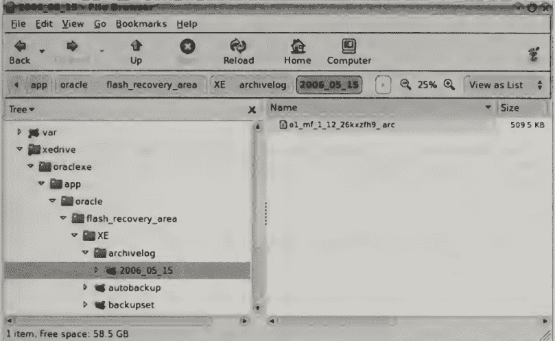

**图 9-16。** 切换到 ARCHIVELOG 模式并进行热数据库备份后，在快速恢复区中确认日志组的成功归档。

请注意，生成的文件名包含**粗体**所示的序列号，该序列号对应于已归档的联机日志组。

### 练习 9.10：创建包含多个成员的日志组

如前所述，Oracle XE 数据库的默认联机日志组每个只有一个成员。如果包含日志成员的磁盘发生故障，你可能会丢失后续恢复数据库所需的数据。在本练习中，你将学习如何向日志组添加成员，并建立更具容错性的联机日志配置。

为了实现理想的容错性，每个日志组应具有两个或更多成员，并且应将日志组的成员存储在互斥的磁盘存储系统集合上。例如，如果一个日志组有两个成员，请将日志组的每个成员放置在由不同控制器管理的不同磁盘上——不要将它们放在同一磁盘上，也不要放在由同一磁盘控制器控制的不同磁盘上。

> **注意**

如果你的*入门数据库*在只有一台磁盘的计算机上运行，那么你无法满足推荐的日志组配置。但是，你仍然可以通过完成本练习来学习如何配置包含多个成员的日志组——只需将日志成员存储在同一磁盘的某个位置，但要明白这不是最优配置。

要向日志组添加日志成员，你需要使用 SQL 命令 `ALTER DATABASE` 的 `ADD LOGFILE MEMBER` 子句。以下是 `ADD LOGFILE MEMBER` 子句的简化语法列表：

```
ALTER DATABASE
  ADD LOGFILE MEMBER
  ('filename' [REUSE] [,'filename' [REUSE]] ... )
  TO { GROUP integer
       | 'filename' }
```

请注意，你可以指定日志组的一个或多个新成员的文件名，并且可以通过组的唯一 ID 或通过指定组中一个现有成员的文件名来指明目标日组。另外请注意，你无需为新成员指定文件大小——Oracle 会自动使新成员与组中现有的成员匹配。

在向数据库的日志组添加日志成员之前，请确认数据库联机日志组的组号——当你之前移动日志组时，其标识组号可能与其原始对应组号发生了变化。数据库的数据字典包含多个你可以查询的视图，用于显示数据库联机日志组的信息，包括 `V$LOG` 和 `V$LOGFILE` 视图。使用你当前具有 SYSDBA 权限的 SQL*Plus 会话，输入以下查询以显示每个入门数据库日志组中所有日志成员的名称：

```
COLUMN member FORMAT a50;

SELECT group#, member FROM v$logfile
  ORDER BY group#;
```

> **NOTE**

上一个示例中使用的 SQL*Plus 命令 `COLUMN` 的 `FORMAT` 参数允许你设置查询结果集中列的显示宽度。

你的结果应类似于以下内容：

| GROUP# | MEMBER |
|--------|--------|
| 1 | /xedrive/oraclexe/app/oracle/flash_recovery_area/XE/onlinelog/o1_mf_1_26kx72pc_.log |
| 3 | /xedrive/oraclexe/app/oracle/flash_recovery_area/XE/onlinelog/o1_mf_3_26kx6z0g_.log |

前面的示例结果提醒你，有两个联机日志组，并且组号为 1 和 3。考虑到前面的结果，输入以下命令向每个组添加一个新成员，将每个新成员放置在旧的快速恢复区（在一行上指定文件名，不要换行，如下所示）：

```
ALTER DATABASE
 ADD LOGFILE MEMBER
  '/usr/lib/oracle/xe/app/oracle/flash_recovery_area/XE/onlinelog/01_mf_1_b.log'
  REUSE
  TO GROUP 1;
```

```
ALTER DATABASE
 ADD LOGFILE MEMBER
  '/usr/lib/oracle/xe/app/oracle/flash_recovery_area/XE/onlinelog/01_mf_3_b.log'
  REUSE
  TO GROUP 3;
```

此时，入门数据库联机日志中的每个日志组都有两个成员——一个在主磁盘驱动器上，另一个在辅助磁盘驱动器上。如果其中一个驱动器发生故障，并且数据库的其他部分未受影响，Oracle 可以继续使用联机日志组中完好的成员来记录事务。你可以通过重复之前的查询来确认新配置——此查询的结果应类似于以下内容：

| GROUP# | MEMBER |
|--------|--------|
| 1 | /usr/lib/oracle/xe/app/oracle/flash_recovery_area/XE/onlinelog/01_mf_1_b.log |
| 1 | /xedrive/oraclexe/app/oracle/flash_recovery_area/XE/onlinelog/o1_mf_1_26kx72pc_.log |
| 3 | /xedrive/oraclexe/app/oracle/flash_recovery_area/XE/onlinelog/o1_mf_3_26kx6z0g_.log |
| 3 | /usr/lib/oracle/xe/app/oracle/flash_recovery_area/XE/onlinelog/01_mf_3_b.log |

> **提示**
>
> 同样，任何时候对数据库进行结构或操作更改（例如向日志组添加成员）时，最好在更改前后都备份数据库，以便在发生问题时可以恢复数据库。

### 练习 9.11：镜像数据库控制文件

如前所述，Oracle XE 数据库的默认配置使用数据库控制文件的单一副本，该副本与数据库的数据文件（ORACLE_BASE/oradata/XE/control.dbf）位于同一磁盘上。如果此磁盘发生故障，数据库的数据文件和当前控制文件将丢失，数据库恢复可能会变得困难。

考虑到默认数据库配置的脆弱性，本练习教你如何通过在不同的磁盘驱动器上创建新的控制文件副本，并将 Oracle XE 配置为同时维护两个控制文件副本来镜像数据库的控制文件。要完成此任务，你需要执行以下步骤：

1.  调整数据库参数文件中的 `CONTROL_FILES` 初始化参数。
2.  干净地关闭数据库。
3.  将当前控制文件复制到新位置。
4.  重新启动数据库。

首先，使用你现有的具有 SYSDBA 权限的 SQL*Plus 会话修改数据库参数文件中 `CONTROL_FILES` 参数的设置。将该参数设置为逗号分隔的完全指定文件名列表，其中包括当前控制文件和你打算创建的新控制文件副本。例如，如果你数据库现有的控制文件是 `/usr/lib/oracle/xe/oradata/XE/control.dbf`，并且你计划将控制文件副本制作成 `/xedrive/oraclexe/oradata/XE/control.dbf`，请输入以下 `ALTER SYSTEM` 语句：

```
ALTER SYSTEM
   SET control_files =
      '/usr/lib/oracle/xe/oradata/XE/control.dbf',
      '/xedrive/oraclexe/oradata/XE/control.dbf'
SCOPE = SPFILE;
```

前面的示例命令突出了（用粗体表示）在 `ALTER SYSTEM` 语句中使用 `SCOPE` 参数——因为 `CONTROL_FILES` 参数

无法动态修改（不能修改当前实例的参数设置），必须使用 SCOPE 参数将配置更改限制在数据库的静态参数文件中。

完成对 CONTROL_FILES 参数的配置更改后，使用具有 SYSDBA 权限的 SQL*Plus 会话干净地关闭当前数据库实例以继续操作：

```
SHUTDOWN IMMEDIATE;
```

下一步是在新位置复制现有的控制文件。例如，使用 shell 会话，创建必要的目录，设置目录和文件权限，并将文件 /usr/lib/oracle/xe/oradata/XE/control.dbf 复制到 /xedrive/oraclexe/oradata/XE/control.dbf——如果这些文件名和目录与您的计算机上的不匹配，请进行适当的替换并记录新的文件位置：

```
sudo mkdir -m 755 /xedrive/oraclexe/oradata
sudo mkdir -m 750 /xedrive/oraclexe/oradata/XE
sudo chown -R oracle:dba /xedrive/oraclexe/oradata
sudo cp /usr/lib/oracle/xe/oradata/XE/control.dbf /xedrive/oraclexe/oradata/XE/control.dbf
sudo chown oracle:dba /xedrive/oraclexe/oradata/XE/control.dbf
```

此时，您可以使用当前具有 SYSDBA 权限的 SQL*Plus 会话重新启动实例并打开数据库。使用 SQL*Plus 命令 STARTUP 的 OPEN 选项启动新实例并挂载和打开数据库：

```
STARTUP OPEN;
```

数据库打开后，您可以重复练习 9.2 中的步骤，使用数据库主页来确认控制文件副本的镜像配置，或者您可以使用 SQL*Plus 会话提交以下针对 V$PARAMETER 数据字典视图的查询：

```
COLUMN name FORMAT a13;
COLUMN value FORMAT a42;

SELECT name, value FROM v$parameter
WHERE name = 'control_files';
```

您的结果应类似于以下内容：

```
NAME           VALUE
--------------- -------------------------------------------
control_files /usr/lib/oracle/xe/oradata/XE/control.dbf,
               /xedrive/oraclexe/oradata/XE/control.dbf
```

## 使用恢复管理器备份数据库

上一节包含一些练习，向您展示如何使用调用 shell 脚本执行 RMAN 命令的菜单选项快速备份 Oracle XE 数据库。虽然此菜单选项和 shell 脚本使开始使用 RMAN 变得容易，但没有什么可以替代自己学习如何使用 RMAN 以及数据库备份的基本 RMAN 命令。

本节的练习教您如何开始使用 RMAN 与 Oracle XE。您将学习如何执行以下操作：

- 启动 RMAN
- 连接到目标数据库
- 配置 RMAN 设置
- 列出有关备份的信息
- 创建数据库的压缩备份
- 报告过时的备份
- 微调标准 Oracle XE 备份脚本
- 自动化数据库备份

### 练习 9.12：启动恢复管理器

要开始使用 RMAN，请打开终端窗口/shell 会话。在 shell 提示符下，执行 oracle_env.sh shell 脚本（对于 csh shell 用户，执行 oracle_env.csh），前面加上 "."（如练习 2.12 中所述），然后使用 NOCATALOG 运行时参数执行 **rman** 以在没有恢复目录的情况下启动 RMAN。请注意所有示例命令的大小写敏感性。

```
. /usr/lib/oracle/xe/app/oracle/product/10.2.0/server/bin/oracle_env.sh
rman NOCATALOG
```

RMAN 启动后，您应该会看到类似于以下消息的内容，以及 RMAN 命令提示符：

```
Recovery Manager: Release 10.2.0.1.0 - Production ...

Copyright (c) 1982, 2005, Oracle. All rights reserved.

RMAN>
```

### 练习 9.13：连接到目标数据库

启动 RMAN 后，您需要连接到目标数据库——即您想要使用的数据库。要连接到目标数据库，请使用 RMAN 命令 CONNECT。对于本章中的练习，当使用 RMAN 与目标数据库的控制文件（即，没有恢复目录）时，CONNECT 命令的缩写语法如下：

```
CONNECT TARGET username[/password] [@service_name]
```

例如，输入以下命令以使用具有 SYSDBA 权限的会话连接到本地入门数据库。请注意，如果您在使用 RMAN 的同一台计算机上仅执行 Oracle XE 数据库实例（换句话说，同一台计算机上没有其他 Oracle 数据库实例），则不需要服务名。

```
CONNECT TARGET sys
```

如果您的 Linux 会话是 dba 组的成员，您可以更简单地建立具有 SYSDBA 权限的会话，如下所示：

```
CONNECT TARGET /
```

无论哪种情况，RMAN 都会建立新会话并显示类似于以下消息的内容：

```
connected to target database: XE (DBID=2470844405)
using target database control file instead of recovery catalog
```

现在您已连接到目标数据库，可以输入 RMAN 命令来处理目标数据库。

### 练习 9.14：显示和配置持久性恢复管理器设置

当您指定并依赖一组一致的 RMAN 配置设置时，使用 RMAN 完成的常规操作更容易执行。例如，

### 一步启动 RMAN 并连接到目标数据库

您可以通过使用 TARGET 命令行参数，一步启动 RMAN 并连接到目标数据库。例如，以下命令完成了与前两个练习相同的事情：

```
rman NOCATALOG TARGET sys
```

假设每当您进行常规数据库备份时，您都希望将备份集写入闪回恢复区，压缩备份以节省磁盘空间，并自动备份数据库的控制文件。要为这些设置设置默认值，您可以使用 RMAN 命令 CONFIGURE 在数据库的控制文件中指定持久性 RMAN 设置，并使用 RMAN 命令 SHOW 显示这些设置。例如，输入以下命令以显示当前 RMAN 持久性设置的完整列表：

```
SHOW ALL;
```

此命令的结果对于 Oracle XE 数据库应类似于以下内容：

```
RMAN configuration parameters are:
CONFIGURE RETENTION POLICY TO REDUNDANCY 2;
CONFIGURE BACKUP OPTIMIZATION OFF; # default
CONFIGURE DEFAULT DEVICE TYPE TO DISK; # default
CONFIGURE CONTROLFILE AUTOBACKUP OFF;
CONFIGURE CONTROLFILE AUTOBACKUP FORMAT FOR DEVICE TYPE DISK TO '%F';
# default
CONFIGURE DEVICE TYPE DISK PARALLELISM 1 BACKUP TYPE TO BACKUPSET;
# default
CONFIGURE DATAFILE BACKUP COPIES FOR DEVICE TYPE DISK TO 1; # default
CONFIGURE ARCHIVELOG BACKUP COPIES FOR DEVICE TYPE DISK TO 1; # default
CONFIGURE MAXSETSIZE TO UNLIMITED; # default
CONFIGURE ENCRYPTION FOR DATABASE OFF; # default
CONFIGURE ENCRYPTION ALGORITHM 'AES128'; # default
CONFIGURE ARCHIVELOG DELETION POLICY TO NONE; # default
CONFIGURE SNAPSHOT CONTROLFILE NAME TO '/usr/lib/oracle/xe/app/oracle/
product/10.2.0/server/dbs/snapcf_XE.f'; # default
```

SHOW 命令在当前设置与默认设置匹配时，在每个配置设置后显示文本 "# default"。以下列表简要解释了一些 RMAN 配置设置：

**RETENTION POLICY TO** — 指示数据文件和控制文件备份及映像副本的保留策略。例如，默认设置指示当同一数据文件已存在两个较新的备份时，数据文件备份即过时。

**DEVICE TYPE** — 配置自动通道的属性；RMAN 依赖这些设置来支持未显式分配一个或多个通道的操作。默认情况下，RMAN 为每个操作分配一个磁盘通道（PARALLELISM 1），并创建备份集而不是映像副本或压缩备份集（BACKUP TYPE TO BACKUPSET）。

### DEFAULT DEVICE TYPE TO

指示 RMAN 用于自动通道的默认设备类型。如前面的输出所示，自动通道的默认设备类型是 DISK（而不是 TAPE）。当自动通道的默认设备类型为 DISK 时，RMAN 会自动将备份集写入闪回恢复区，除非您显式将一个或多个自动磁盘通道配置到另一个位置。因为我们希望将所有数据库备份用于闪回恢复区，所以默认配置是可接受的。

### CONTROLFILE AUTOBACKUP 和 CONTROLFILE AUTOBACKUP FORMAT FOR DEVICE TYPE

涉及自动控制文件备份。当 CONTROLFILE AUTOBACKUP 设置为 ON 时，CONTROLFILE AUTOBACKUP FORMAT FOR DEVICE TYPE 的设置决定了指定设备类型（例如，DISK）上自动控制文件备份的默认文件名格式；使用闪回恢复区时，RMAN 在闪回恢复区中创建自动控制文件备份。

### ARCHIVELOG DELETION POLICY TO

指示闪回恢复区中归档日志的删除策略。默认设置 NONE 指示 Oracle 可以删除已从闪回恢复区永久备份到另一位置（例如，磁带）且根据保留策略已过时的归档日志。

有关所有持久性 RMAN 设置的完整信息，请参阅 *Oracle Database Backup and Recovery Reference*。

要更改持久性 RMAN 设置的设置，请使用 RMAN 命令 CONFIGURE。例如，要启用对闪回恢复区的自动控制文件备份，请执行以下命令：

```
CONFIGURE CONTROLFILE AUTOBACKUP ON;
```

预期输出如下：

```
old RMAN configuration parameters:
CONFIGURE CONTROLFILE AUTOBACKUP OFF;
new RMAN configuration parameters:
CONFIGURE CONTROLFILE AUTOBACKUP ON;
new RMAN configuration parameters are successfully stored
```

执行以下命令以将默认磁盘备份类型配置为压缩备份集（而不是映像副本或未压缩备份集）：

```
CONFIGURE DEVICE TYPE DISK BACKUP TYPE TO COMPRESSED BACKUPSET;
```


### 练习 9.15：备份数据库

要备份数据库，RMAN 必须执行两个步骤：

+   1. 为输出分配至少一个通道。正如你在前一个练习中所学到的，当你执行备份等操作但未通过 ALLOCATE 命令显式分配通道时，RMAN 会自动为快速恢复区分配一个通道。

+   2. 使用已分配的通道备份数据库。要备份数据库，需使用 RMAN 命令 BACKUP。为便于本次练习，我们重点关注 BACKUP 命令的简略语法，如下所示，用于备份整个数据库，包括所有数据文件和数据库当前的控制文件：

```
BACKUP [FULL|INCREMENTAL LEVEL [=] integer] DATABASE
[TAG [=] tag]
```

以下列表描述了上述命令的各个元素：

+   **FULL 选项** 表示要创建一个完整的数据库备份集。INCREMENTAL LEVEL 参数表示要创建指定级别的增量备份集。默认情况下，如果既未指定 FULL 选项也未指定 INCREMENTAL LEVEL 参数，RMAN 会创建一个完整备份集。

+   **DATABASE 关键字** 这是一个快捷方式，表示要创建一个包含数据库所有数据文件的数据文件备份集。

+   **TAG 参数** 指定一个唯一名称，可用于标识该备份。请仔细考虑你用于标签的命名约定。例如，一个好的标签命名约定应指明数据库是打开还是关闭状态、备份类型（数据库、表空间、完整、增量等）以及唯一的 ID 号。

例如，执行以下命令来创建一个完整的数据文件备份集。这个简单的命令会依赖持久性的 RMAN 设置，将单个磁盘通道分配给快速恢复区，并创建一个压缩备份集。

```
BACKUP DATABASE;
```

此命令将备份数据库，无论它是打开的（假设你已完成本章前面的练习，并且数据库启用了介质恢复）还是关闭的。此命令的输出应类似于以下内容。和之前一样，我嵌入了注释（以粗体显示）来解释过程中发生的事情。

```
Starting backup at ...
-- 将单个通道分配给快速恢复区。
allocated channel: ORA_DISK_1
channel ORA_DISK_1: sid=37 devtype=DISK
-- 创建一个压缩的完整数据文件备份集，其中包含所有
-- 对应于永久表空间的数据文件。
channel ORA_DISK_1: starting compressed full datafile backupset
channel ORA_DISK_1: specifying datafile(s) in backupset
input datafile fno=00001 name=/usr/lib/oracle/xe/oradata/XE/system.dbf
input datafile fno=00003 name=/usr/lib/oracle/xe/oradata/XE/sysaux.dbf
input datafile fno=00002 name=/usr/lib/oracle/xe/oradata/XE/undo.dbf
input datafile fno=00004 name=/usr/lib/oracle/xe/oradata/XE/users.dbf
channel ORA_DISK_1: starting piece 1 at ...
channel ORA_DISK_1: finished piece 1 at ...
-- 由于备份命令未指定 TAG 参数，RMAN 为备份集分配了一个默认的标签名称。
piece handle=/xedrive/oraclexe/app/oracle/flash_recovery_area/XE/
backupset/2006_05_15/o1_mf_nnndf_TAG20060515T194628_2614pnrz_.bkp
tag=TAG20060515T194628 comment=NONE
-- 压缩备份完成所需时间略长于
-- 之前未压缩的备份。
channel ORA_DISK_1: backup set complete, elapsed time: 00:01:55
Finished backup at ...
```

```
-- 自动备份控制文件。
Starting Control File and SPFILE Autobackup at ...
piece handle=/xedrive/oraclexe/app/oracle/flash_recovery_area/XE/
autobackup/2006_05_15/o1_mf_s_590528904_2614t921_.bkp comment=NONE
Finished Control File and SPFILE Autobackup at ...
```

要完成此练习，请使用 Nautilus 或操作系统命令比较新的压缩备份集对应的备份片段与之前未压缩备份集对应的备份片段的文件大小——压缩备份集应占用明显更少的磁盘空间。

### 练习 9.16：备份单个表空间

练习 9.15 向你展示了如何备份整个数据库，包括数据库的所有表空间。当某个表空间被修改的频率高于其他表空间时，你可能希望更频繁地备份它，以减少在该表空间损坏时恢复所需的时间。

你可以使用 RMAN 命令 BACKUP 的 TABLESPACE 参数来备份特定的表空间，如下所示的 BACKUP 命令简略语法所示：

```
BACKUP [FULL|INCREMENTAL LEVEL [=] integer] TABLESPACE tablespace
[TAG [=] tag]
[FORMAT [=] 'output_format']
```

与数据库备份一样，你可以在数据库打开且表空间在线的情况下创建表空间备份（前提是数据库启用了介质恢复）。例如，输入以下命令为目标数据库的 USERS 表空间创建一个完整的表空间备份集：

```
BACKUP TABLESPACE users
  TAG open_tbs_users_full_1;
```

此命令的输出应类似于以下内容：

```
Starting backup at ...
using channel ORA_DISK_1
channel ORA_DISK_1: starting compressed full datafile backupset
channel ORA_DISK_1: specifying datafile(s) in backupset
input datafile fno=00004 name=/usr/lib/oracle/xe/oradata/XE/users.dbf
channel ORA_DISK_1: starting piece 1 at ...
channel ORA_DISK_1: finished piece 1 at ...
-- RMAN 使用了备份命令指定的标签。
piece handle=/xedrive/oraclexe/app/oracle/flash_recovery_area/XE/
backupset/2006_05_15/o1_mf_nnndf_OPEN_TBS_USERS_FULL__2614x0bf_.bkp
tag=OPEN_TBS_USERS_FULL_1 comment=NONE
channel ORA_DISK_1: backup set complete, elapsed time: 00:00:15
Finished backup at ...

Starting Control File and SPFILE Autobackup at ...
piece handle=/xedrive/oraclexe/app/oracle/flash_recovery_area/XE/
autobackup/2006_05_15/o1_mf_s_590529007_2614xjc2_.bkp comment=NONE
Finished Control File and SPFILE Autobackup at ...
```

### 练习 9.17：备份归档日志文件

本章前面的练习解释了如何为你的数据库启用介质恢复，以及在联机日志组填满时自动归档它们。为充分保护你的数据库归档日志文件并释放归档目标位置的磁盘空间，你应定期使用 RMAN 将归档日志文件作为归档日志备份集的一部分进行备份。你可以使用以下 RMAN 命令 BACKUP 的简略语法创建归档日志备份集：

```
BACKUP ARCHIVELOG ALL
[FORMAT [=] 'output_format']
[DELETE INPUT]
```

这个简单版本的 BACKUP 命令使用 ALL 选项，表示备份集应包含归档目标位置中所有现有归档日志文件的副本。如果备份成功完成并且你指定了 DELETE INPUT 选项，RMAN 将从归档目标位置删除备份集中包含的归档日志文件。还需注意，当你创建归档日志备份集时，无法指定 TAG 参数来命名备份集，也无法指定 INCREMENTAL 参数——默认情况下，所有归档日志备份集都是完整备份。

要完成此练习，请使用 Nautilus 或操作系统命令观察存储在快速恢复区内 XE/archivelog 目录各个子目录中的归档日志文件。然后，执行以下命令备份目标数据库的所有现有归档日志：

```
BACKUP ARCHIVELOG ALL
  DELETE INPUT;
```

此命令的输出应类似于以下内容（一如既往，我的注释以粗体嵌入）：

```
Starting backup at ...
current log archived
-- 将自动通道分配给快速恢复区。
using channel ORA_DISK_1
-- 根据之前的配置，备份集是压缩的。
channel ORA_DISK_1: starting compressed archive log backupset
-- 确定归档目标位置中有哪些归档日志。
channel ORA_DISK_1: specifying archive log(s) in backup set
input archive log thread=1 sequence=12 recid=1 stamp=590521901
input archive log thread=1 sequence=13 recid=2 stamp=590529101
channel ORA_DISK_1: starting piece 1 at ...
channel ORA_DISK_1: finished piece 1 at ...
-- 在快速恢复区中创建备份片段并分配
-- 一个系统生成的标签名称。
piece handle=/xedrive/oraclexe/app/oracle/flash_recovery_area/XE/
backupset/2006_05_15/o1_mf_annnn_TAG20060515T195141_26150hnn_.bkp
tag=TAG20060515T195141 comment=NONE
channel ORA_DISK_1: backup set complete, elapsed time: 00:00:02
-- 现在备份集已成功完成，RMAN 可以安全地
-- 删除所有已备份的归档日志。这将释放
-- 快速恢复区中的空间。
channel ORA_DISK_1: deleting archive log(s)
archive log filename=/xedrive/oraclexe/app/oracle/flash_recovery_area/
XE/archivelog/2006_05_15/o1_mf_1_1_12_26kxzfh9_.arc recid=1 stamp=590521901
archive log filename=/xedrive/oraclexe/app/oracle/flash_recovery_area/
XE/archivelog/2006_05_15/o1_mf_1_1_13_26150f35_.arc recid=2 stamp=590529101
Finished backup at ...
```


### 练习 9.18：列出备份集信息

使用 RMAN 创建数据文件和归档日志备份集后，你可以使用 RMAN 命令 LIST 的以下简写语法生成报告，以显示有关备份集的有用信息：

```
LIST BACKUP
[OF
{ DATABASE [SKIP TABLESPACE tablespace [, tablespace] ... ]
| TABLESPACE tablespace [, tablespace] ...
| DATAFILE {'filename'|integer} [,{ 'filename'|integer}] ...
| ARCHIVELOG ALL }]
[TAG [=] tag]
```

以下说明了 LIST 命令的子句和参数：

- 如果未指定 OF 参数，LIST 命令将显示所有备份集的信息。

- 你可以指定 OF 参数来显示包含数据库中所有数据文件（DATABASE 选项）、表空间的一个或多个数据文件（TABLESPACE 参数）、特定数据文件或数据文件列表（DATAFILE 参数）以及归档日志备份集（ARCHIVELOG 选项）的备份集信息。

- 你可以指定 TAG 参数来显示特定数据文件备份集的信息。

例如，输入以下 LIST 命令以显示包含 SYSTEM 表空间数据文件的数据文件备份集信息：

```
LIST BACKUP
OF DATAFILE '/usr/lib/oracle/xe/oradata/XE/system.dbf';
```

## 第 9 章：保护你的 Oracle XE 数据库

此 LIST 命令的输出应与以下内容大致相似——为便于阅读，部分输出已被截断：

```
List of Backup Sets
===================

BS Key  Type LV Size      Device Type Elapsed Time Completion Time
------ ---- -- -------- ----------- ------------ ---------------
3       Full    612.09M   DISK        00:00:58    ...
        BP Key: 3   Status: AVAILABLE  Compressed: NO  Tag:
TAG20060515T174009
        Piece Name: /xedrive/oraclexe/app/oracle/flash_recovery_area/
XE/backupset/2006_05_15/o1_mf_nnndf_TAG20060515T174009_26kx9snf_.bkp
  List of Datafiles in backup set 3
  File LV Type Ckp SCN    Ckp Time Name
  ---- -- ---- --------- ---------- ----
  1       Full 702337    ... /usr/lib/oracle/xe/oradata/XE/system.dbf

BS Key  Type LV Size      Device Type Elapsed Time Completion Time
------ ---- -- -------- ----------- ------------ ---------------
5       Full    612.09M   DISK        00:01:48    ...
        BP Key: 5   Status: AVAILABLE  Compressed: NO  Tag:
TAG20060515T174934
        Piece Name: /xedrive/oraclexe/app/oracle/flash_recovery_area/
XE/backupset/2006_05_15/o1_mf_nnndf_TAG20060515T174934_26kxvhj3_.bkp
  List of Datafiles in backup set 5
  File LV Type Ckp SCN    Ckp Time Name
  ---- -- ---- --------- ---------- ----
  1       Full 702856    ... /usr/lib/oracle/xe/oradata/XE/system.dbf

BS Key  Type LV Size      Device Type Elapsed Time Completion Time
------ ---- -- -------- ----------- ------------ ---------------
7       Full    121.84M   DISK        00:01:48    ...
        BP Key: 7   Status: AVAILABLE  Compressed: YES Tag:
TAG20060515T194628
        Piece Name: /xedrive/oraclexe/app/oracle/flash_recovery_area/
XE/backupset/2006_05_15/o1_mf_nnndf_TAG20060515T194628_26l4pnrz_.bkp
  List of Datafiles in backup set 7
  File LV Type Ckp SCN    Ckp Time Name
  ---- -- ---- --------- ---------- ----
  1       Full 706360    ... /usr/lib/oracle/xe/oradata/XE/system.dbf
```

鉴于你目前对 RMAN 以及本章练习中已使用的命令的理解，报告中各列的用途应该相当明显。请使用本练习开头的语法列表，尝试 LIST 命令的其他变体，看看可以显示当前数据文件备份集的哪些信息。

### 提示

LIST 命令通常会显示跨越多个屏幕的信息，超出了默认终端窗口配置文件的回滚缓冲区范围。在这种情况下，你可以更改当前窗口的回滚缓冲区。或者，你可以使用 LOG 命令行参数启动 RMAN，为 RMAN 输出指定日志文件。有关 RMAN 命令行参数的更多信息，请参阅你的 Oracle 文档。

### 练习 9.19：报告数据库的重要状态信息

上一个练习介绍的 LIST 命令仅仅是读取控制文件，显示你可能已经了解的有关可用备份集的基本信息。RMAN 命令 REPORT 是另一个有用的工具，你可以用它来分析控制文件中的信息，并生成有用的报告，以帮助你更好地保护数据库。在本入门练习中，重点关注 REPORT 命令语法的以下简写版本：

```
REPORT
{ NEED BACKUP {INCREMENTAL|DAYS|REDUNDANCY} [=] integer
  [ { DATABASE [SKIP TABLESPACE tablespace [, tablespace] ... ]
      | TABLESPACE tablespace [, tablespace] ...
      | DATAFILE {'filename'|integer} [,'filename'|integer] ... } ]
| OBSOLETE REDUNDANCY [=] integer }
```

NEED BACKUP 子句表示你需要生成所有需要备份的数据文件的报告。如果数据库恢复时间是关键问题，请使用 INCREMENTAL 参数报告在恢复过程中需要超过指定数量增量备份集的数据文件，或使用 DAYS 参数报告恢复需要超过指定天数归档日志的数据文件。例如，当安全是你关注的重点时，使用 REPORT 命令的 NEED BACKUP 子句的 REDUNDANCY 参数来报告冗余备份数量少于指定数量的数据文件。假设你的数据库保护策略要求保留数据库中每个数据文件的最近四次备份，输入以下命令以报告不符合策略的数据文件：

```
REPORT NEED BACKUP REDUNDANCY=4;
```

如果你已完成本章前面的练习，你的报告应类似于以下列表。请注意，入门数据库的 USERS 表空间数据文件未出现在报告中，因为你在练习 9.16 中仅为该表空间创建了数据文件备份集。

| 文件 | 备份数 | 名称 |
|------|-------|------|
| 1 | 3 | /usr/lib/oracle/xe/oradata/XE/system.dbf |
| 2 | 3 | /usr/lib/oracle/xe/oradata/XE/undo.dbf |
| 3 | 3 | /usr/lib/oracle/xe/oradata/XE/sysaux.dbf |

该报告告诉你，为了符合策略要求，你应该创建另一个包含报告中数据文件的数据文件备份集。

### 注意

除了 REPORT 命令的 NEED BACKUP 子句的 INCREMENTAL、DAYS 或 REDUNDANCY 参数外，你还可以指定特定对象以生成更有针对性的报告（整个数据库、特定表空间或特定数据文件）。

或者，你可以使用 OBSOLETE 子句的简写形式来指示你希望根据给定的冗余阈值报告过时的备份集和映像副本。例如，输入以下 REPORT 命令以显示只要至少有一个其他备份集或数据文件映像副本可用于恢复数据库，就可以视为过时（因此可以删除）的备份集和数据文件映像副本：

```
REPORT OBSOLETE REDUNDANCY = 1;
```

如果你已完成本章前面的练习，你的报告应类似于以下内容：

| 类型 | 键值 | 完成时间 | 文件名/句柄 |
|------|-----|-----------------|-----------------|
| Backup Set | 3 | ... | |
| Backup Piece | 3 | ... | /xedrive/oraclexe/app/oracle/flash_recovery_area/XE/backupset/2006_05_15/o1_mf_nnnndf_TAG20060515T174009_26kx9snf_.bkp |
| Backup Set | 4 | ... | |
| Backup Piece | 4 | ... | /xedrive/oraclexe/app/oracle/flash_recovery_area/XE/autobackup/2006_05_15/o1_mf_s_590521196_26kxcvvy_.bkp |
| Backup Set | 5 | ... | |
| Backup Piece | 5 | ... | /xedrive/oraclexe/app/oracle/flash_recovery_area/XE/backupset/2006_05_15/o1_mf_nnnndf_TAG20060515T174934_26kxvhj3_.bkp |


## 第9章：保护您的Oracle XE数据库 431

备份集          6     ...
  备份片      6     ...                    /xedrive/oraclexe/app/oracle/flash_recovery_area/XE/autobackup/2006_05_15/o1_mf_s_590521890_26kxz3ot_.bkp

备份集          8     ...
  备份片      8     ...                    /xedrive/oraclexe/app/oracle/flash_recovery_area/XE/autobackup/2006_05_15/o1_mf_s_590528904_2614t921_.bkp

备份集         10     ...
  备份片     10     ...                    /xedrive/oraclexe/app/oracle/flash_recovery_area/XE/autobackup/2006_05_15/o1_mf_s_590529007_2614xjc2_.bkp

前面`REPORT`命令的一个更实际的用法很可能会为`REDUNDANCY`参数指定一个更高的值。随着您为数据库创建越来越多的备份集，"过时"报告将非常有用。当您创建更新的数据文件备份集时，通常可以开始删除超出两或三级冗余的旧"过时"数据文件备份集，以回收存储空间。

### 练习9.20：删除过时备份集

前面的练习解释了，当您创建更新的数据文件备份集时，最终会希望删除旧的、冗余的备份集以回收宝贵的存储空间。要删除备份集，您可以使用以下RMAN命令`DELETE`的简写语法：

```
DELETE [NOPROMPT] OBSOLETE [REDUNDANCY[=]integer] ;
```

`NOPROMPT`选项指示RMAN避免提示您确认备份删除——当`DELETE`命令作为RMAN脚本的一部分时，此选项是必要的。使用`OBSOLETE`子句删除`REDUNDANCY`参数指示的过时备份片、映像副本等；当您省略`REDUNDANCY`参数时，RMAN将使用控制文件中预配置的保留策略。

为了获得一些手动删除过时备份的经验，请输入以下命令。此示例不依赖于配置的两个冗余备份的保留策略，而是考虑如果备份中的所有文件至少有三个其他、更新的备份，则认为该备份过时——这对于保留一些过时备份以用于后续练习是必要的。

```
DELETE OBSOLETE REDUNDANCY 4;
```

前面RMAN命令的输出应类似于以下内容：

```
using channel ORA_DISK_1
Deleting the following obsolete backups and copies:
Type                Key    Completion Time    Filename/Handle
------------------- ----- ----------------- -------------------
Backup Set          4        ...
    Backup Piece          4        ...               /xedrive/oraclexe/app/oracle/flash_recovery_area/XE/autobackup/2006_05_15/o1_mf_s_590521196_26kxcvvy_.bkp
Do you really want to delete the above objects (enter YES or NO)? YES
deleted backup piece
backup piece handle=/xedrive/oraclexe/app/oracle/flash_recovery_area/XE/autobackup/2006_05_15/o1_mf_s_590521196_26kxcvvy_.bkp recid=4 stamp=590521275
Deleted 1 objects
```

本练习快速介绍了RMAN命令`DELETE`的一种形式。请务必阅读您的Oracle文档，以了解更多关于`DELETE`命令的其他子句、参数和选项，这些可用于管理数据库备份。

### 练习9.21：理解快速恢复区空间使用情况

前面的练习解释了手动删除过时备份的过程。虽然您可以尝试记住偶尔手动删除过时备份，或在用于自动化备份的RMAN脚本中包含`DELETE OBSOLETE ...`命令，但这些都不是必需的。正如本章前面解释的那样，Oracle会自动管理快速恢复区中空间的重复使用。其工作原理如下：

1.  根据您的数据库保护策略，使用RMAN在快速恢复区中备份数据库和归档日志。
2.  随着越来越多的备份在快速恢复区中累积，Oracle会根据预配置的保留策略自动维护一个过时备份列表。过时备份占用的空间被视为可回收空间。
3.  当快速恢复区的所有空间都在使用中，而您尝试进行新的备份，或者当Oracle需要更多空间来归档日志文件时，Oracle会自动重复使用可回收空间。

要查看快速恢复区空间使用情况的信息，请查询`V$RECOVERY_FILE_DEST`数据字典视图。例如，使用您当前的`SQL*Plus`会话执行以下查询：

```
SELECT space_limit, space_used, space_reclaimable
FROM v$recovery_file_dest;
```

以下结果代表了您可能看到的内容：

```
SPACE_LIMIT  SPACE_USED  SPACE_RECLAIMABLE
-----------  ----------  -----------------
 1.0737E+.10  1547369472          656080896
```

`V$RECOVERY_FILE_DEST`视图中所有空间信息的单位是字节。在前面的示例输出中，快速恢复区的空间限制为10GB，当前使用空间量约为1.5GB，过时备份占用的空间量（换句话说，可回收空间）约为650MB。

### 注意

> Oracle从不认为归档日志文件占用的空间是可回收的。为确保归档日志不会继续累积并消耗越来越多的快速恢复区空间，请务必定期备份归档日志。

### 练习9.22：构建新的备份脚本

在我看来，Oracle XE提供的用于备份数据库的shell脚本有几处可以改进的地方：

- 该shell脚本未考虑归档日志文件。因此，在您为数据库启用介质恢复后，除非您记得定期手动备份归档日志文件，否则归档日志文件最终可能消耗所有快速恢复区空间并导致数据库操作停止。
- 每次shell脚本执行时，它都会覆盖您在数据库控制文件中明确设置的几个RMAN设置。例如，shell脚本会用嵌入脚本中的保留策略覆盖保留策略。您在控制文件中配置的RMAN设置应根据您的需求设置一次，然后在正常情况下始终使用，无论某人是通过命令行交互式使用RMAN还是通过脚本使用。当出现有特殊需求的情况时，您应该使用RMAN命令的特殊选项，而不是覆盖持久的RMAN设置。例如，如果您需要为备份专门将通道分配到快速恢复区之外的位置，可以在开始备份之前发出`ALLOCATE`命令，而不是修改标准自动通道配置。
- 该脚本没有依赖快速恢复区重复使用过时备份占用的可回收空间的自动化机制，而是在进行新备份后显式删除过时备份。

本练习教您如何构建和执行自定义RMAN备份脚本，以满足包含以下要求的数据库保护策略的需求：

- 数据库必须在启用介质恢复（归档日志模式）的情况下运行。
- 所有备份和归档日志必须在快速恢复区中维护。
- 必须为每个数据库文件保留至少最近两次的备份。
- 必须保留使用最近两次数据文件备份中的任一次来恢复数据库所需的归档日志文件的备份。
- 每次创建数据文件或归档日志备份集时，都必须创建控制文件备份。

正如您从本章前面的练习中应该已经理解的那样，数据库配置设置和持久的RMAN设置可以满足此策略的大多数需求。一旦这些设置完成，您构建的备份脚本只需备份数据库和所有相应的归档日志文件即可。

首先，打开一个新的终端窗口，并使用以下命令创建一个用于存储与Oracle XE数据库相关的命令脚本的目录：

```
sudo mkdir -m 755 /usr/lib/oracle/xe/app/oracle/admin/XE/scripts

sudo chown oracle:dba /usr/lib/oracle/xe/app/oracle/admin/XE/scripts
```

然后使用以下命令创建一个新脚本：

```
cat > rman1.rcv << EOF
CONNECT TARGET /;
BACKUP DATABASE PLUS ARCHIVELOG DELETE INPUT;
EOF
```

就这样！`rman1.rcv`脚本中的第一个命令建立与本地XE数据库的SYSDBA权限连接，假设该脚本由属于`dba`组的操作系统帐户执行。第二个命令使用`BACKUP`命令的`PLUS ARCHIVELOG`和`DELETE INPUT`选项完成以下步骤：

1.  创建一个归档日志数据文件备份集，包括快速恢复区中的所有归档日志，然后删除所有已备份的归档日志。
2.  创建数据文件备份集。


接下来，执行以下命令，将新脚本从当前工作目录移动到新的脚本目录，然后正确设置其所有权和权限：

```
sudo mv rman1.rcv /usr/lib/oracle/xe/app/oracle/admin/XE/scripts/.
sudo chown oracle:dba /usr/lib/oracle/xe/app/oracle/admin/XE/scripts/rman1.rcv
sudo chmod 660 /usr/lib/oracle/xe/app/oracle/admin/XE/scripts/rman1.rcv
```

要测试该脚本，请返回当前正在执行 RMAN 的终端窗口，并完成以下步骤：

1.  使用 EXIT 命令退出当前 RMAN 会话：

```
EXIT;
```

2.  使用 CMDFILE 和 LOG 命令行参数重新启动 RMAN。CMDFILE 参数指定要执行的 RMAN 脚本，LOG 参数指定要将 RMAN 输出重定向到的日志文件。例如，执行以下命令：

```
rman CMDFILE /usr/lib/oracle/xe/app/oracle/admin/XE/scripts/rman1.rcv LOG /tmp/rman1.rcv.log
```

当你执行 RMAN 脚本时，输出非常少，进程看起来似乎挂起了，因为 RMAN 在工作时不会用特定的消息更新你的显示。最终，脚本会完成执行。要确认脚本完成了你预期的任务，请查看 LOG 参数指定的日志文件。日志文件应包含 RMAN 操作的日志，内容与以下示例类似：

```
Recovery Manager: Release 10.2.0.1.0 - Production on ...
Copyright (c) 1982, 2005, Oracle. All rights reserved.
RMAN> CONNECT TARGET *
2> BACKUP DATABASE PLUS ARCHIVELOG DELETE INPUT;
3>
connected to target database: XE (DBID=2470844405)
Starting backup at ...
current log archived
using target database control file instead of recovery catalog
allocated channel: ORA_DISK_1
channel ORA_DISK_1: sid=18 devtype=DISK
channel ORA_DISK_1: starting compressed archive log backupset
channel ORA_DISK_1: specifying archive log(s) in backup set
input archive log thread=1 sequence=14 recid=3 stamp=590532938
channel ORA_DISK_1: starting piece 1 at ...
channel ORA_DISK_1: finished piece 1 at ...
piece handle=/xedrive/oraclexe/app/oracle/flash_recovery_area/XE/backupset/2006_05_15/01_mf_annnn_TAG20060515T205539_2618rdc1_.bkp tag=TAG20060515T205539 comment=NONE
channel ORA_DISK_1: backup set complete, elapsed time: 00:00:02
channel ORA_DISK_1: deleting archive log(s)
archive log filename=/xedrive/oraclexe/app/oracle/flash_recovery_area/XE/archivelog/2006_05_15/01_mf_l_14_2618rbfk_.arc recid=3 stamp=590532938
Finished backup at ...
Starting backup at ...
using channel ORA_DISK_1
channel ORA_DISK_1: starting compressed full datafile backupset
channel ORA_DISK_1: specifying datafile(s) in backupset
input datafile fno=00001 name=/usr/lib/oracle/xe/oradata/XE/system.dbf
input datafile fno=00003 name=/usr/lib/oracle/xe/oradata/XE/sysaux.dbf
input datafile fno=00002 name=/usr/lib/oracle/xe/oradata/XE/undo.dbf
input datafile fno=00004 name=/usr/lib/oracle/xe/oradata/XE/users.dbf
channel ORA_DISK_1: starting piece 1 at ...
channel ORA_DISK_1: finished piece 1 at ...
piece handle=/xedrive/oraclexe/app/oracle/flash_recovery_area/XE/backupset/2006_05_15/01_mf_nnndf_TAG20060515T205541_2618rfks_.bkp tag=TAG20060515T205541 comment=NONE
channel ORA_DISK_1: backup set complete, elapsed time: 00:01:56
Finished backup at ...
Starting backup at ...
current log archived
using channel ORA_DISK_1
channel ORA_DISK_1: starting compressed archive log backupset
channel ORA_DISK_1: specifying archive log(s) in backup set
input archive log thread=1 sequence=15 recid=4 stamp=590533057
channel ORA_DISK_1: starting piece 1 at ...
channel ORA_DISK_1: finished piece 1 at ...
piece handle=/xedrive/oraclexe/app/oracle/flash_recovery_area/XE/backupset/2006_05_15/01_mf_annnn_TAG20060515T205737_2618w2r6_.bkp tag=TAG20060515T205737 comment=NONE
channel ORA_DISK_1: backup set complete, elapsed time: 00:00:02
channel ORA_DISK_1: deleting archive log(s)
archive log filename=/xedrive/oraclexe/app/oracle/flash_recovery_area/XE/archivelog/2006_05_15/01_mf_l_15_2618wlgn_.arc recid=4 stamp=590533057
Finished backup at ...
Starting Control File and SPFILE Autobackup at ...
piece handle=/xedrive/oraclexe/app/oracle/flash_recovery_area/XE/autobackup/2006_05_15/01_mf_s_590533060_2618w52b_.bkp comment=NONE
Finished Control File and SPFILE Autobackup at ...
Recovery Manager complete.
```

> **注意**
> 一旦你创建了 RMAN 备份脚本，自动化数据库备份就变成了一项简单的任务。只需使用操作系统的原生任务调度功能来执行本练习中展示的 RMAN 命令即可。例如，在 Linux 上，你可以使用 *cron* 功能来创建每日 Oracle XE 数据库备份。

## 其他数据库备份主题

本章前面的章节重点介绍了使用 RMAN 创建数据库关键操作文件的物理备份，包括数据库的数据文件、归档日志文件、控制文件和参数文件。以下几节将讨论与数据库备份相关的其他一些重要主题。

### 其他数据库相关文件的备份

RMAN 不会备份与 Oracle 数据库相关的许多其他类型的文件（这些文件不是数据库运行所必需的），包括数据库密码文件、网络配置文件、自定义管理脚本等。你可以备份与数据库相关的所有其他类型的文件，而无需执行任何特殊操作——只需使用操作系统命令或备份实用程序即可创建这些文件的备份。

### 逻辑数据库备份

为了补充你使用 RMAN 制作的数据库数据文件、归档日志组和控制文件的物理备份，你可以对 Oracle 数据库的数据进行逻辑备份。*逻辑备份*是与数据库中特定模式和模式对象（例如表）相对应的数据库信息的备份。要创建和使用逻辑数据库备份，你需要使用 Oracle 工具 Data Pump Export 和 Import。

#### Data Pump Export 工具

使用 Oracle 的 *Data Pump Export* 工具，你可以对 Oracle 数据库中的全部或部分数据进行逻辑备份。例如，Data Pump Export 允许你有选择地导出以下内容：

- 数据库中的所有对象
- 特定模式中的对象
- 单个表

你可以在数据库打开并使用时导出数据库信息。Data Pump Export 确保单个表的导出数据自身是一致的。当你在数据库打开并被修改时导出模式或整个数据库，Oracle 会使用闪回查询来确保导出数据在导出文件（通常称为 *dump 文件*）中是一致的。

#### Data Pump Import 工具

要从 dump 文件中恢复丢失的数据，你可以使用 Oracle 附带的 *Data Pump Import* 工具。通过 Data Pump Import，你可以读取 Export 文件来恢复特定的数据库表、模式或整个数据库。

#### Data Pump Export 和 Import 的正确使用

Oracle 的 Data Pump Export 和 Import 工具不应作为保护 Oracle XE 数据库的首选或唯一方案，因为对数据库、模式或表的导出永远无法保证从数据库故障中完全恢复。非常重要的一点是，从 dump 文件导入数据后，没有恢复过程可以完成——在你执行导出之后完成的所有已提交事务的工作将不可用。因此，仅将数据库导出作为真正数据库备份和事务日志的补充。

#### Data Pump Export 和 Import 的其他用途

除了使用 Data Pump Export 和 Import 进行补充数据库保护之外，你还可以使用这些工具将数据从一个数据库移动到另一个数据库。例如，当你希望将应用模式从开发数据库移动到生产数据库时，可以使用 Data Pump Export 和 Import 工具来构建所有模式对象并传输可能存在的任何初始数据。

> **注意**
> 本书不介绍 Data Pump 工具的使用方法。请参阅 Oracle Utilities 文档了解更多信息。

## 更多数据库恢复选项

希望你的数据库永远不会出问题，你也永远不需要使用重做日志和数据库备份来恢复丢失的工作。但如果你确实需要，请放心，Oracle 和 RMAN 拥有完成这项工作的必要机制。

本章前面的介绍性章节解释了一些基本的数据库恢复概念，包括崩溃恢复的前滚和回滚阶段、介质恢复之前的文件恢复等。以下几节将更详细地介绍用于修复损坏数据库的数据库恢复选项。


### 完全恢复

*完全恢复*操作是指恢复所有已提交事务的工作。完全恢复操作（包括数据库恢复、表空间恢复和数据文件恢复）是在出现问题导致数据库损坏时，您执行的最典型的恢复类型。

后续的练习将教您如何模拟数据文件丢失并使用 RMAN 进行恢复。

### 数据库恢复

使用单一操作恢复数据库中所有丢失工作的最简单方法是使用 RMAN 执行数据库恢复。*数据库恢复*是一种完全恢复类型，它恢复数据库所有数据文件中丢失的工作。RMAN 识别受损的数据文件，并使用控制文件、可用的数据文件备份集以及数据库的重做日志中的信息自动恢复它们。

当数据库的许多数据文件需要恢复，并且数据库在恢复操作期间可以不可用时，数据库恢复是合适的。要执行数据库恢复，数据库需要处于已安装但关闭的状态。

### 表空间恢复

当数据库的特定部分受损且要求高可用性时，请考虑使用表空间恢复。*表空间恢复*是一种完全恢复类型，它恢复特定表空间所有数据文件中丢失的工作。您可以在数据库处于打开状态且受损表空间处于离线状态时，或者在数据库已安装但关闭时，使用 RMAN 执行表空间恢复。

> **注意**
>
> 如果问题损坏了 SYSTEM 表空间的任何数据文件，数据库将无法正常运行。因此，在此类故障后，您必须关闭数据库；无法在数据库处于打开状态时执行 SYSTEM 表空间的表空间恢复。

### 数据文件恢复

当单个数据文件受损时，请考虑使用数据文件恢复。*数据文件恢复*是一种完全恢复类型，它恢复特定数据文件中丢失的工作。您可以在数据库处于打开状态且受损表空间处于离线状态时，或者在数据库已安装但关闭时，使用 RMAN 执行数据文件恢复。

> **注意**
>
> 无法在数据库处于打开状态时恢复 SYSTEM 表空间的受损数据文件。

### 不完全恢复

在大多数情况下，RMAN 应用所有可用的重做日志组来执行完全数据库恢复（例如，通过数据库恢复、表空间恢复或数据文件恢复）。在极少数情况下，您可能需要考虑执行不完全恢复操作。当您执行*不完全恢复*时，Oracle 仅通过应用数据库重做日志中有限数量的重做条目来恢复部分已提交事务的工作。

例如，假设在星期一上午 8:06，一个用户意外删除了一个重要的数据库表并将其从回收站中清空——数据库没有受到其他损坏。在没有使用 Data Pump 导出或其他类型的 Oracle 闪回功能进行逻辑备份的情况下，您仍然可以通过执行不完全恢复操作来恢复丢失的表。例如，您可以从最近的备份将整个数据库恢复到不同的计算机上，然后执行时间点恢复，恢复到上午 8:05。然后，您可以导出该表并将其导入回生产数据库，以从错误中恢复。

Oracle 和 RMAN 支持三种不同类型的不完全恢复：基于时间的恢复、基于更改的恢复和基于取消的恢复。

### 基于时间的恢复

*基于时间的恢复*，有时称为*时间点恢复*，是一种不完全恢复类型，它恢复数据库中已提交事务的工作，直到特定的时间点（例如，直到星期一上午 8:05，就在用户删除重要表之前）。

### 基于更改的恢复

*基于更改的恢复*是一种不完全恢复类型，它恢复数据库中已提交事务的工作，直到特定的*系统更改号 (SCN)*。Oracle 为每个提交的事务分配一个唯一的 SCN。如果您知道想要包含在数据库恢复中的最后一个事务的 SCN，您可以执行基于更改的恢复。

### 基于取消的恢复

*基于取消的恢复*是一种不完全恢复类型，它恢复数据库中已提交事务的工作，直到应用特定的日志组。要执行基于取消的恢复，您必须能够指示要作为恢复一部分应用的最后一个日志序列。

### 如果日志组和控制文件损坏怎么办？

如果您仔细阅读了前面的部分，您会注意到没有提到这样一个事实：严重的故障可能会损坏数据库的在线重做日志组及其控制文件。您可能正在问自己，在这些类型的文件损坏或丢失后，需要什么类型的数据库恢复。

如果您在不同的磁盘上镜像数据库的在线和归档重做日志以及数据库的控制文件，以保护它们免受孤立的磁盘故障和用户错误的影响，那么您无需担心从这些关键数据库文件的丢失中恢复。只要日志组或控制文件的一个副本始终可访问，数据库就可以不间断地继续正常运行。

相比之下，当您丢失一个数据文件且该数据文件未存储在数据双工 RAID 阵列上时，通常需要进行数据库恢复，因为 Oracle 不提供任何设施来镜像数据文件。只要您有丢失数据文件的备份以及至少一份所有日志组和数据库控制文件的副本，Oracle 始终可以执行数据库恢复。

磁盘故障后，数据库的重做日志或控制文件可能变得不受保护（即，未镜像）。例如，如果您将数据库控制文件镜像到两个不同的磁盘，其中一个磁盘发生故障，那么控制文件将变得不受保护，因为没有镜像副本。当出现这种情况时，您可以采取的最紧急步骤是重新配置数据库的在线重做日志组和控制文件，并使用至少一个镜像副本保护它们。否则，数据库容易受到孤立磁盘故障的影响。

> **注意**
>
> 即使您镜像了数据库的重做日志组和控制文件，从理论上讲，数据库仍然容易受到整个站点灾难（例如火灾、洪水和其他灾害）的影响。对于除 XE 之外的 Oracle 版本，您可以使用 Oracle 的备用数据库功能来实现最终的数据库保护——有关这些高级功能的更多信息，请参阅您的 Oracle 文档。

## 从问题中恢复数据库

现在您已经对 Oracle 的数据库恢复选项有了大致的了解，接下来的两个练习将教您如何使用 RMAN 从模拟的系统崩溃中恢复您的入门数据库，然后从模拟的数据文件丢失中恢复。

> **重要警告：开始之前...**
>
> 以下练习向您展示如何故意损坏 Oracle 数据库，以便您练习执行数据库恢复。考虑到您可能在后续的数据库恢复过程中犯错误，请不要尝试使用包含重要数据的数据库来执行以下练习。相反，您应该使用这些练习在隔离的测试数据库环境中练习您的数据库恢复技能，或者使用一个如果您犯了错误可以承受丢失的数据库。

本节中的练习建立在本章前面练习的基础上。换句话说，除非您将入门数据库配置为启用媒体恢复 (ARCHIVELOG 模式) 运行，并在在线日志组填满时将其归档，并且拥有数据库所有数据文件的数据文件备份集，否则您无法完成以下练习。此外，本章中的以下练习假设您的计算机仅管理 Oracle XE 数据库（而不是其他 Oracle 数据库），并且您使用的是带有数据库控制文件的 RMAN，而不是恢复目录。

### 练习 9.23：模拟系统崩溃并执行崩溃恢复

如前所述，系统崩溃是指 Oracle 意外或突然关闭，以至于实例没有时间回滚当前事务、断开用户连接并使数据库数据保持清洁状态。要模拟系统崩溃，您可以使用 SQL*Plus 命令 SHUTDOWN 的 ABORT 选项。为方便起见，RMAN 也支持此命令。

为了准备您的模拟测试，请使用您现有的 SQL*Plus 会话执行以下语句，这些语句创建一个测试表和一些数据，您可以用来确认成功的崩溃恢复。请确保在插入第一行测试数据后提交，但在插入第二行后不要提交。

```sql
CONNECT system;

CREATE TABLE system.handsonxe_recovery_test (
  id INTEGER,
  value VARCHAR2(10)
)
TABLESPACE users;

INSERT INTO system.handsonxe_recovery_test (id, value)
VALUES (1, 'Row 1');

COMMIT;
```


### 练习 9.24：模拟数据文件丢失与数据库恢复

如果你使用 Oracle XE 来支持一个拥有真实数据的数据库，最糟糕的情况之一可能就是数据库需要介质恢复，而你以前从未做过。本练习将指导你如何模拟数据文件丢失，以便你练习使用 RMAN 执行介质恢复。如果将来你真的需要恢复数据库，你应该会更有信心。

### 控制从系统崩溃中恢复的时间

Oracle 在崩溃恢复期间需要应用的在线重做日志中重做条目的数量，直接影响完成此过程并使数据库恢复正常操作所需的时间。更频繁的检查点有助于减少崩溃恢复所需的时间，因为检查点会强制 Oracle 将实例内存中的脏块写回数据文件，从而减少了崩溃恢复期间需要应用的重做量。方便的是，Oracle 允许你使用 `FAST_START_MTTR_TARGET` 初始化参数，针对你的数据库保护策略设定一个从系统崩溃恢复的平均时间（以秒为单位）。然而，请注意，随着你降低 MTTR 目标，由于完成更频繁检查点所需的额外磁盘 I/O，Oracle XE 的性能可能会受到影响。有关使用 `FAST_START_MTTR_TARGET` 初始化参数调优崩溃恢复的更多信息，请参阅《Oracle 数据库备份与恢复高级用户指南》。

> **注意**
>
> 除非你配置了初始数据库以启用介质恢复（归档日志模式）运行，并在归档日志组填满时对其进行归档，并且拥有数据库中所有数据文件的备份集，否则你无法完成此练习。如果你没有按照本章中练习的发布顺序完成前面的练习，请勿继续。

本练习将引导你完成以下步骤：

1.  检查以确保所有数据文件至少存在于两个数据文件备份集中。
2.  恢复完成恢复所需的所有归档日志文件。
3.  在初始数据库中将 USERS 表空间脱机。
4.  重命名对应于 USERS 表空间的数据文件。
5.  恢复 USERS 表空间的数据文件。
6.  尝试将“损坏的” USERS 表空间重新联机。
7.  在数据库其余部分保持打开和可用状态时，恢复损坏的 USERS 表空间。
8.  将恢复的 USERS 表空间重新联机。

本练习的第一步是确保你至少有两个可用于恢复数据库的数据文件备份集——一个用于实际的恢复，另一个只是以防万一发生意外情况，你需要一个额外的安全保障。你可以通过输入以下 REPORT 命令来做到这一点：

```
REPORT NEED BACKUP REDUNDANCY=2;
```

报告应完全如下所示——不多也不少：

```
Report of files with less than 2 redundant backups
File #bkps Name
---- ------ ----------------------------------------
```

如果报告中列出了一个或多个数据文件，这意味着你没有完成本章中早期的一些或全部为数据库创建数据文件备份集的练习。如果是这种情况，请停止——不要继续进行此练习。你必须完成本章中之前的练习，以便为后续的恢复操作提供必要的备份集。另一方面，如果你拥有恢复数据库所需的必要备份集，你可以继续。

此时，假设由于某种原因，对应于 USERS 表空间的数据文件丢失了。如果这是真的，数据库的警报文件和应用程序很可能会显示与 Oracle 相关的错误消息，指示损坏的表空间或数据文件的名称。当你注意到此类问题时，你应该立即将相应的表空间脱机或关闭数据库，同时从问题中恢复，以避免用各种用户一无所知的错误惊吓应用程序用户。要在不离开当前 RMAN 会话的情况下将 USERS 表空间脱机，你可以使用 RMAN 命令 `SQL` 执行任何 SQL 语句来发出 `ALTER TABLESPACE` 命令。例如，在 RMAN 提示符下输入以下命令以将 USERS 表空间脱机：

```
SQL "ALTER TABLESPACE users OFFLINE IMMEDIATE";
```

当你在 RMAN 中使用 `SQL` 命令执行 SQL 命令时，没有错误消息表示 SQL 语句执行成功。

接下来，你可以通过使用操作系统命令在操作系统级别重命名文件来模拟数据文件丢失。例如，Oracle XE 数据库的 USERS 表空间的数据文件是 `users.dbf`。为了模拟文件丢失，将其重命名为 `users.dbf.sav`：

```
sudo mv /usr/lib/oracle/xe/oradata/XE/users.dbf /usr/lib/oracle/xe/oradata/XE/users.dbf.sav
```

下一步是恢复损坏的 USERS 表空间的“丢失”数据文件。要恢复特定表空间的所有数据文件，请使用 RMAN 命令 `RESTORE` 的 `TABLESPACE` 参数。就本练习而言，输入命令以恢复“损坏的” USERS 表空间的数据文件。下面的简单 `RESTORE` 命令示例会自动选择最近的满足操作的数据文件备份集。

```
RESTORE TABLESPACE users;
```

随后的结果表明，已从之前练习中制作的数据文件备份集中成功恢复了丢失的数据文件：

```
Starting restore at ...
allocated channel: ORA_DISK_1
channel ORA_DISK_1: sid=32 devtype=DISK

channel ORA_DISK_1: starting datafile backupset restore
channel ORA_DISK_1: specifying datafile(s) to restore from backup set
restoring datafile 00004 to /usr/lib/oracle/xe/oradata/XE/users.dbf
channel ORA_DISK_1: reading from backup piece /xedrive/oraclexe/app/
```

接下来，假设没有其他人在使用 Oracle XE 数据库，通过切换到你的终端窗口、重新启动 RMAN、建立到 XE 数据库的 SYSDBA 特权连接以及中止当前实例来模拟系统崩溃：

```
CONNECT TARGET sys;

SHUTDOWN ABORT;
```

一旦 Oracle 中止了实例，你应该会看到以下消息：

```
Oracle instance shut down
```

此时，假设刚刚发生了一次暂时的电源故障，导致你的 Linux 计算机重新启动。当你重新启动一个实例并打开数据库时，初始数据库的崩溃恢复会自动发生。例如，使用你现有的 SYSDBA 特权 RMAN 会话，输入以下命令以重新启动实例并打开数据库：

```
STARTUP;
```

命令的输出应类似于以下内容：

```
connected to target database (not started)
Oracle instance started
database mounted
database opened

Total System Global Area     146800640 bytes

Fixed Size                      1257668 bytes
Variable Size                  79695676 bytes
Database Buffers               62914560 bytes
Redo Buffers                    2932736 bytes
```

你的数据库现在可供用户和应用程序使用并完全可操作。为了确认系统中仅已提交事务的恢复情况，请切换到你的 SQL*Plus 会话，退出并重新启动 SQL*Plus（你必须这样做，因为旧的 SQL*Plus 会话无法附加到新的数据库实例），然后查询测试表：

```
CONNECT system;

SELECT * FROM system.handsonxe_recovery_test;
```

预期的结果如下：

| ID | VALUE |
|----|-------|
| 1  | 第1行 |

请注意，对应于已提交事务工作的第一行存在于表中，但在系统崩溃时对应于未提交事务工作的第二行已被回滚。

> **注意**
>
> 如果你将 Oracle 数据库服务配置为在 Linux 重启时自动启动（参见练习 2.11），那么在 Linux 计算机真正崩溃后，Oracle XE 将自动重启并执行崩溃恢复，无需任何管理干预。


为了解信息，请在您当前的 RMAN 会话中输入以下 SQL 命令，以查看当您尝试使用恢复版本的 users.dbf 数据文件将 USERS 表空间重新联机时会出现哪些错误消息：

```sql
SQL "ALTER TABLESPACE users ONLINE";
```

提交此 SQL 命令后，您应该会看到一系列类似于以下内容的错误消息：

```
sql statement: ALTER TABLESPACE users ONLINE
RMAN-00571: ================================================================
RMAN-00569: ============== ERROR MESSAGE STACK FOLLOWS ==============
RMAN-00571: ================================================================
RMAN-03009: failure of sql command on default channel at ...
RMAN-11003: failure during parse/execution of SQL statement:
ALTER TABLESPACE users ONLINE
ORA-01113: file 4 needs media recovery
ORA-01110: data file 4: '/usr/lib/oracle/xe/oradata/XE/users.dbf'
```

最后，是时候恢复“损坏的”USERS 表空间了。要恢复与 USERS 表空间恢复版本相对应的已提交工作，请使用 RMAN 命令 RECOVER 的 TABLESPACE 参数。例如，执行以下命令来恢复 USERS 表空间：

```sql
RECOVER TABLESPACE users;
```

您应该会看到类似于以下内容的结果，这表明恢复成功。有关表空间恢复过程中发生的情况的更多信息，请参阅我的内嵌注释（以**粗体**显示）。

```
Starting recover at ...
using channel ORA_DISK_1

starting media recovery

-- RMAN 识别恢复已恢复数据文件所需的归档日志文件。当归档日志目标中尚不
-- 可用时，RMAN 会从备份集中恢复必要的归档日志。
archive log thread 1 sequence 16 is already on disk as file /xedrive/
oraclexe/app/oracle/flash_recovery_area/XE/archivelog/2006_05_15/
o1_mf_1_16_2619ddws_.arc
channel ORA_DISK_1: starting archive log restore to default destination
channel ORA_DISK_1: restoring archive log
archive log thread=1 sequence=15
channel ORA_DISK_1: reading from backup piece /xedrive/oraclexe/app/
oracle/flash_recovery_area/XE/backupset/2006_05_15/
o1_mf_annnn_TAG20060515T205737_2618w2r6_.bkp
channel ORA_DISK_1: restored backup piece 1
piece handle=/xedrive/oraclexe/app/oracle/flash_recovery_area/XE/
backupset/2006_05_15/o1_mf_annnn_TAG20060515T205737_2618w2r6_.bkp
tag=TAG20060515T205737
channel ORA_DISK_1: restore complete, elapsed time: 00:00:03
archive log filename=/xedrive/oraclexe/app/oracle/flash_recovery_area/
XE/archivelog/2006_05_16/o1_mf_1_15_26mg6bs2_.arc thread=1 sequence=15
-- 恢复完成后，RMAN 会自动从快速恢复区中删除恢复的归档日志文件。
channel default: deleting archive log(s)
archive log filename=/xedrive/oraclexe/app/oracle/flash_recovery_area/
XE/archivelog/2006_05_16/o1_mf_1_15_26mg6bs2_.arc recid=6 stamp=590571274
media recovery complete, elapsed time: 00:00:04
Finished recover at ...
```

在介质恢复成功完成后，您可以使用以下命令将先前损坏的 USERS 表空间重新联机：

```sql
SQL "ALTER TABLESPACE users ONLINE";
```

没有任何错误消息表明 RMAN 内部的 SQL 命令执行成功。现在重新启动 SQL*Plus，以 SYSTEM 用户身份连接，并查询 SYSTEM.HANDSONXE_RECOVERY_TEST 表，以确保该表及其在最后一次数据库备份之后、模拟磁盘故障之前创建的已提交数据，按预期可用：

```
SQL> CONNECT system
Enter password:
Connected.
SQL> SELECT * FROM system.handsonxe_recovery_test;

       ID VALUE
--------- ----------
        1 Row 1
```

恭喜！您刚刚完成了第一次 Oracle XE 数据库恢复。您已完成使用 RMAN——可以自由退出并关闭相关的终端窗口。

## 使用 Oracle 闪回功能

本章最后一节包含一些练习，为您提供一些使用 Oracle 闪回恢复功能（闪回删除和闪回查询）的基础经验。当您需要恢复由于逻辑数据错误或损坏而非物理存储问题而丢失的数据时，这些功能非常有用。

### 练习 9.25：使用 Oracle 闪回删除恢复已删除的表

本练习教您如何从一个非常常见的问题中恢复：有人错误地删除了一个表。与其执行复杂的数据库恢复操作来恢复丢失的表，您可以使用 Oracle 的闪回删除功能。正如本章前面的“逻辑错误和 Oracle 闪回”部分所解释的，永久性表空间的回收站保存了用户删除的数据结构，例如表和索引。在某人删除数据结构后，它会保留在表空间的回收站中，直到表空间中所有可用的空闲空间被消耗完，并且表空间中的其他结构需要更多空间——只有这样 Oracle 才会永久删除该结构。要了解使用此逻辑数据恢复机制有多简单，请执行以下步骤：

1.  使用您当前的 SQL*Plus 会话，删除 SYSTEM.HANDSONXE_RECOVERY_TEST 表：

```sql
DROP TABLE system.handsonxe_recovery_test;
```

2.  通过使用简单的查询来确认该表不再可用：

```sql
SELECT * FROM system.handsonxe_recovery_test;
```

3.  通过查询 DBA_RECYCLEBIN 数据字典视图，确认该表在回收站中可用：

```sql
COLUMN owner FORMAT a6;
COLUMN original_name FORMAT a25;
COLUMN operation FORMAT A10;
COLUMN ts_name FORMAT a10;

SELECT owner, original_name, operation, ts_name
  FROM dba_recyclebin
  WHERE owner = 'SYSTEM';
```

4.  使用 SQL 命令 FLASHBACK TABLE 的 TO BEFORE DROP 选项恢复已删除的表：

```sql
FLASHBACK TABLE system.handsonxe_recovery_test
  TO BEFORE DROP;
```

“Flashback Complete”消息表示已成功恢复已删除的表。您可以按照步骤 2 中的方式查询该表以确认此事实。

Oracle XE 的闪回删除功能默认启用；要禁用此功能，您必须将 RECYCLEBIN 初始化参数设置为 OFF。要在启用闪回删除时绕过回收站删除表，您必须包含 SQL 命令 DROP TABLE 的 PURGE 选项，如上一个练习所示。要显式清除回收站，而不是等待 Oracle 重用回收站数据结构占用的空间，请使用以下形式的 SQL 命令 PURGE：

```sql
PURGE
{ TABLE table
| INDEX index
| RECYCLEBIN
| DBA_RECYCLEBIN
| TABLESPACE tablespace [USER user] } ;
```

以下列表解释了前面命令中的元素：

-   使用 TABLE 参数清除特定表。
-   使用 INDEX 参数清除特定索引。
-   使用 RECYCLEBIN 选项清除与当前会话架构对应的回收站数据结构。
-   使用具有 SYSDBA 权限的会话时，您可以使用 DBA_RECYCLEBIN 选项清除每个永久性表空间回收站的所有数据结构。
-   使用 TABLESPACE 参数清除特定表空间中的所有数据结构。您可以使用可选的 USER 参数将清除操作限制为与特定用户架构相对应的数据结构。

> **注意**

Oracle Application Express 的数据库主页提供了一个易于使用的界面，您可以使用该界面来查看、恢复和清除与您的架构相对应的回收站数据结构。

### 练习 9.26：使用 Oracle 闪回查询恢复丢失的数据

用户错误或恶意应用程序进程偶尔可能会破坏一个或多个相关数据库表中数据的逻辑完整性。使用 Oracle 的闪回查询功能从这些问题中恢复表数据是轻而易举的，只要您

考虑到闪回查询依赖于数据库撤销表空间中的撤销数据，你通常能在腐败发生后相对较快地了解到问题。

为了演示 Oracle 的这一逻辑数据恢复特性，请考虑以下场景：

- 模式中的子表具有强制执行删除级联引用操作的参照完整性约束——换言之，当一个事务删除具有依赖子记录的父记录时，Oracle 也会自动删除每个依赖的子记录。

- 用户错误地删除了一条父记录，这也会删除相应的依赖子记录。

为此练习做准备，请使用你当前的 SQL\*Plus 会话执行本书支持文件包中包含的支持脚本 `chap09.sql`，执行方式与之前执行其他章节的支持脚本类似。例如：

```
@/tmp/handsonxe/sql/chap09.sql;
```

该脚本会创建 HANDSONXE09 模式，其中包含你将在第 6 章中使用的熟悉的 HOSTS、DATABASES 和 APPLICATIONS 表。在测试 Oracle 的闪回查询功能之前，请先执行以下查询快速查看这些表中的数据：

```
SELECT * FROM handsonxe09.hosts;

SELECT * FROM handsonxe09.databases;

SELECT ap_id, ap_name, db_id FROM handsonxe09.applications;
```

预期结果如下：

```
SQL> SELECT * FROM handsonxe09.hosts;

   HOST_ID HOST_NAME              HOST_OS HOST_OS_VERS  HOST_CPUS
---------- ------------------------------ ----- ------------ ----------
         1 server1.mycompany.com AIX      5.2.0.0               4

SQL> SELECT * FROM handsonxe09.databases;

    DB_ID DB_NAME DB_VERSION    HOST_ID
---------- ------- ----------- ----------
         1 db1     10.2.0.1            1
         2 db2     9.2.0.7             1
         3 db3     10.2.0.1            1
```

| DB_ID | DB_NAME | DB_VERSION | HOST_ID |
|-------|---------|------------|---------|
| 4 | db4 | 10.2.0.1 | 1 |
| 5 | db5 | 9.2.0.7 | 1 |
| 6 | db6 | 9.2.0.7 | 1 |
| 7 | db7 | 9.2.0.7 | 1 |
| 8 | db8 | 9.2.0.7 | 1 |

已选择 8 行。

```
SQL> SELECT ap_id, ap_name, db_id FROM handsonxe09.applications;
```

| AP_ID | AP_NAME | DB_ID |
|-------|---------|-------|
| 1 | owl | 3 |
| 2 | finch | 1 |
| 3 | robin | 2 |

现在模拟一个用户错误——看看你的手表，记下时间，然后执行以下 DELETE 命令删除 HOSTS 表中的唯一记录并提交整个事务：

```
DELETE FROM handsonxe09.hosts
  WHERE host_id = 1;

COMMIT;
```

由于模式中所有表的参照完整性约束都使用了删除级联引用操作，并且模式中的所有行都依赖于 HOSTS 表中的最终父记录，因此所有表中的所有行都已被静默删除，而不仅仅是 HOSTS 表中的那一条记录。重复前面的查询以确认此事实。预期结果如下：

```
SQL> SELECT * FROM handsonxe09.hosts;

未选定行

SQL> SELECT * FROM handsonxe09.databases;

未选定行

SQL> SELECT ap_id, ap_name, db_id FROM handsonxe09.applications;

未选定行
```

你该如何从这个混乱中恢复呢？闪回查询来救援！只要撤销表空间中必要的撤销数据尚未被覆盖，你所要做的就是查询反映逻辑错误发生前数据状态的表。例如，一个典型的闪回查询场景可能如下所示：

```
SQL> SELECT * FROM handsonxe09.hosts
  2     AS OF TIMESTAMP (SYSTIMESTAMP - INTERVAL '14' MINUTE);

未选定行
```

```
SQL> SELECT * FROM handsonxe09.hosts
  2     AS OF TIMESTAMP (SYSTIMESTAMP - INTERVAL '15' MINUTE);

未选定行
```

```
SQL> SELECT * FROM handsonxe09.hosts
  2     AS OF TIMESTAMP (SYSTIMESTAMP - INTERVAL '16' MINUTE);
```

| HOST_ID | HOST_NAME | HOST_OS | HOST_OS_VERS | HOST_CPUS |
|---------|-----------|---------|--------------|-----------|
| 1 | server1.mycompany.com | AIX | 5.2.0.0 | 4 |

```
SQL> SELECT TO_CHAR(SYSTIMESTAMP - INTERVAL '16' MINUTE,
2>                'DD-MON-YYYY HH24.MI.SS.FF') AS rcv_time
3>   FROM dual;

RCV_TIME
--------------------------
14-MAY-06 17.49.45.225000000
```

请注意，前面示例查询中突出显示（粗体）的文本会根据你提交包含 DELETE 语句的事务的时间长度而有所不同。前两个查询回溯的时间不够早，未能获取到逻辑错误之前的数据——第三个查询做到了。最后一个查询显示了从上一个查询中使用的相对时间戳派生出的显式时间戳——你将在后续的 SQL 语句中使用此时间戳来恢复数据。

要恢复数据，请使用你自己的时间戳执行带有闪回子查询的 UPDATE 语句，如下所示：

```
INSERT INTO handsonxe09.hosts
SELECT * FROM handsonxe09.hosts
  AS OF TIMESTAMP
   TO_TIMESTAMP('14-MAY-2006 17.49.45.225000000',
               'DD-MON-YYYY HH24.MI.SS.FF')
  WHERE host_id = 1;

COMMIT;

INSERT INTO handsonxe09.databases
SELECT * FROM handsonxe09.databases
  AS OF TIMESTAMP
```

```
TO_TIMESTAMP('14-MAY-2006 17.49.45.225000000',
             'DD-MON-YYYY HH24.MI.SS.FF')
WHERE host_id = 1;

COMMIT;

INSERT INTO handsonxe09.applications
SELECT * FROM handsonxe09.applications
AS OF TIMESTAMP
  TO_TIMESTAMP('14-MAY-2006 17.49.45.225000000',
               'DD-MON-YYYY HH24.MI.SS.FF')
WHERE db_id IN (
  SELECT db_id FROM handsonxe09.databases
    AS OF TIMESTAMP
      TO_TIMESTAMP('14-MAY-2006 17.49.45.225000000',
                   'DD-MON-YYYY HH24.MI.SS.FF')
      WHERE host_id = 1);

COMMIT;
```

为确认先前删除的行已恢复，请重复本练习的原始三个查询。结果应如下：

```
SQL> SELECT * FROM handsonxe09.hosts;
```

| HOST_ID | HOST_NAME | HOST_OS | HOST_OS_VERS | HOST_CPUS |
|---------|-----------|---------|--------------|-----------|
| 1 | server1.mycompany.com | AIX | 5.2.0.0 | 4 |

```
SQL> SELECT * FROM handsonxe09.databases;
```

| DB_ID | DB_NAME | DB_VERSION | HOST_ID |
|-------|---------|------------|---------|
| 1 | db1 | 10.2.0.1 | 1 |
| 2 | db2 | 9.2.0.7 | 1 |
| 3 | db3 | 10.2.0.1 | 1 |
| 4 | db4 | 10.2.0.1 | 1 |
| 5 | db5 | 9.2.0.7 | 1 |
| 6 | db6 | 9.2.0.7 | 1 |
| 7 | db7 | 9.2.0.7 | 1 |
| 8 | db8 | 9.2.0.7 | 1 |

已选择 8 行。

```
SQL> SELECT ap_id, ap_name, db_id FROM handsonxe09.applications;
```

| AP_ID | AP_NAME | DB_ID |
|-------|---------|-------|
| 1 | owl | 3 |
| 2 | finch | 1 |
| 3 | robin | 2 |

### 使用 Oracle 闪回表

如前所述练习所演示的，使用 Oracle 的闪回表功能将多个表的数据恢复到同一时间点要简单得多。例如，以下 FLASHBACK TABLE 语句将完成与前一练习中三条 INSERT 和 COMMIT 语句相同的操作：

```
FLASHBACK TABLE
    handsonxe09.hosts,
    handsonxe09.databases,
    handsonxe09.applications
  TO TIMESTAMP
    TO_TIMESTAMP('14-MAY-2006 17.49.45.225000000',
      'DD-MON-YYYY HH24.MI.SS.FF');
```

那么，你可能会问，为什么我还要向你展示如何使用闪回查询呢？Oracle 快捷版不支持闪回表或闪回数据库；只有 Oracle 企业版才支持这些功能。然而，正如演示的那样，只要稍加巧思，你就可以绕过这个限制。

## 本章总结

保护 Oracle XE 数据库免受意外问题是，如果你打算使用数据库来维护重要数据，你能做的最重要的工作之一。本章解释了 Oracle XE 的几个特性，你可以在不可避免的问题影响系统时使用它们来备份、恢复和修复数据库：

- 数据库的事务重做日志记录了已提交事务所做的更改。
- 数据库备份是构成数据库的所有文件的集合。如果你损坏或丢失了数据库的一部分文件，你可以从数据库备份中提取丢失文件的副本来恢复数据库中的该文件。
- 数据库恢复操作可恢复因某种问题而丢失的工作。正确配置后，Oracle 可以从所有类型的问题中恢复数据库，包括简单的系统崩溃和更严重的磁盘故障。
- 你使用恢复管理器（RMAN）来简化备份 Oracle 数据库和在必要时恢复它们的过程。
- Oracle 的闪回特性使得从常见的用户错误（如意外删除表和逻辑数据损坏）中恢复变得容易。


## 第10章

# 调整应用程序与数据库实例性能

由于Oracle XE数据库的大小和处理限制，依赖Oracle XE的应用程序很可能不需要进行大规模的调优就能获得可接受的性能。尽管如此，以高效完成工作的方式开发应用程序和配置Oracle数据库仍然是良好的实践，特别是当您使用Oracle XE来学习如何使用其他Oracle版本，或者使用Oracle XE为最终可能由Oracle Standard Edition或Oracle Enterprise Edition等其他版本支持的应用程序创建原型时。本章为您提供Oracle数据库应用程序系统性能调优的基础知识。本章的主题包括以下内容：

- 性能调优概念概述
- 应用程序调优
- 数据库实例调优

## 本章预备知识

要实践本章的动手练习，您需要按照练习2.12的指导启动SQL*Plus，并运行以下命令脚本：

```
location/handsonxe/sql/chap10.sql
```

其中*location*是您解压本书随附支持归档文件的文件目录。例如，在启动SQL*Plus后，您可以使用SQL*Plus命令`@`运行本章的SQL命令脚本，如以下示例所示（假设您的chap10.sql文件位于/tmp/handsonxe/sql）：

```
SQL> @/tmp/handsonxe/sql/chap10.sql;
```

请注意，本章的支持脚本会生成大量数据。当脚本花费几分钟完成时，请勿惊慌。此外，请记下您执行本章支持脚本的具体时间；本章后续练习需要您了解这一信息才能完成工作。

一旦您回复所有提示并成功完成脚本，*请保持当前SQL*Plus会话打开*——您在本章后续几个练习中会用到它。

## Oracle调优概念

在开始调整Oracle数据库应用程序系统之前，您应该清楚地了解基本的调优概念以及一些合理的性能调优目标。本节的信息将帮助您入门。

### Oracle数据库应用程序性能的衡量标准

在更广泛的背景下，计算机应用程序系统性能最显著的衡量标准是其能否充分服务相应用户，而不降低其生产力。要衡量应用程序的整体表现如何，请问自己以下问题：用户在提交操作后，需要等待多长时间才能继续工作？考虑到系统必须执行完成该操作所需的工作，多长时间算过长——几秒、几分钟、几小时？如果用户认为一个操作花费太多时间完成，也许您可以调整该操作使其耗时更少，也许您不能。总之，当用户感到等待时间过长时，您通常会发现需要调整某些方面。

在基于小型Oracle XE的应用程序系统中，您可能需要特别关注两个具体的性能衡量标准：

- **响应时间** 应用程序处理请求并返回数据或结果时用户等待的时间量。例如，SQL查询的响应时间是您必须等待Oracle XE返回结果的时间量。当应用程序操作的响应时间可接受时，该应用程序不会限制其用户的生产力。
- **吞吐量** 数据库系统在给定时间段内处理的请求数量。例如，常见的OLTP性能基准将事务吞吐量量化为每秒处理的事务数。当Oracle XE能够处理应用程序施加在系统上的负载，而不妨碍其用户的生产力或同一计算机上其他应用程序的性能时，系统在吞吐量方面就得到了良好调整。

### 切合实际与不切实际的性能目标

理解明确的性能调优目标很重要，这样您才能专注于重要的事情，避免在无关紧要的事情上浪费时间。计算机应用程序系统调优的基本目标应该是实现足够的响应时间，既不降低用户生产力，也不给系统施加不必要的负载，否则可能会影响其他系统操作的性能。

虽然值得赞赏，但您的主要性能调优目标*不*应该是为所有操作实现绝对最佳的响应时间。新手Oracle开发人员和管理员通常努力实现这种不切实际的性能目标；结果，他们浪费大量时间试图从应用程序中榨取每一滴性能，而在大多数情况下，所有显著的性能提升都可以通过关注相对较小的一部分问题快速轻松地实现。

### 可用性与可扩展性

虽然对于基于Oracle XE的应用程序来说通常不太重要，但可用性和可扩展性是其他可能影响用户生产力的考虑因素：

- **可用性** 系统在需要时提供对所需资源的访问能力的衡量标准；本书前面的部分解释了Oracle XE的许多高可用性功能，包括可动态修改的实例参数、镜像在线日志组和控制文件、检查点和MTTR设置、在线数据库备份等。
- **可扩展性** 系统根据可用硬件提供成比例吞吐量的能力的衡量标准；例如，如果一个数据库系统使用一个处理器时每秒可以处理1000个事务，使用两个处理器时每秒可以处理2000个事务，依此类推，那么该系统具有良好的可扩展性。虽然其他Oracle版本具有极佳的可扩展性，但Oracle XE施加的处理限制了其可扩展能力。如果您发现基于Oracle XE的应用程序系统由于这些限制而表现不佳，请考虑升级到Oracle Standard Edition One、Standard Edition或Enterprise Edition。

性能调优目标是在Oracle数据库应用程序的整个生命周期中都需要考虑的因素。您应该从一开始就考虑性能来设计系统，然后定期监控系统性能，以确保其持续满足用户的需求。

### 可调组件

在调整某些内容之前，您需要知道调整哪些方面会影响其性能。Oracle应用程序系统是一个复杂的环境，拥有许多可调整的系统组件。图10-1列出了许多您可以在Oracle数据库应用程序系统中调整的组件。

在大多数情况下，当系统限制用户生产力时，通常应归咎于应用程序相关的问题。编写不佳的SQL、缺乏适当索引的大表以及糟糕的事务设计是您为改善应用程序性能通常会重点关注的一些最常见问题。本章后续部分和练习将教您更多关于应用程序端调优的知识。

其他情况则要求您专注于Oracle数据库服务器的许多可调整组件，包括服务器的主机操作系统、数据缓存、重做日志机制、软件进程架构等；本章后续部分将教您更多关于与数据库实例调优相关的几个主题的知识。


**图10-1。** Oracle数据库应用程序系统拥有许多可调整组件。

## 调优方法

一旦您理解了一般调优目标和应用程序系统的可调整组件，您从哪里开始？这是新手和经验丰富的Oracle开发人员和管理员最常问的问题之一。虽然答案因系统而异，但所有系统通常都有一点是普遍正确的：您需要一个计划，或*调优方法*，来遵循以实现您的目标。以下调优方法在大多数情况下是一个很好的通用指导方针：

1.  确定您特定系统的特性。
2.  考虑已知问题和议题。
3.  确定对您特定系统的可感知性能和报告问题贡献最大的系统组件。
4.  根据需要调整这些组件：
    a.  监控和分析组件的性能。
    b.  当组件未达到可接受的性能水平时，对其进行调整或其他方式的调优。
    c.  重复步骤a和b，直到达到所需的性能。


为了说明这一点，假设你需要调优应用程序 X。第一步是确定应用程序 X 的功能。大多数数据库应用程序属于以下几类之一：

- OLTP 类型的应用程序，用户通过标准的事务集或批处理作业输入大量数据
- 支持例行报告操作的决策支持系统（DSS）类型的应用程序
- 用于执行即席查询的数据集市或数据仓库类型的应用程序

假设你了解到应用程序 X 是一个 DSS。你知道 DSS 通常执行一组标准的只读操作（即查询），从运营系统中报告信息。你还知道事务日志记录是 Oracle 的一项功能，用于记录数据库修改（即 DML 和 DDL 操作）的信息。因此，有理由认为调优 DSS 的在线重做日志配置并不是优先事项。相反，你最有可能从影响 DSS 中例行查询响应时间的方面获得最大的性能提升。

花一点时间确定系统的基本特征，有助于将你的精力集中在最重要的事项上。为了进一步将注意力集中在最关键的方面，请考虑用户报告的具体问题（如果有的话）。假设应用程序 X 的用户告诉你，当每小时的 DSS 报告最初部署时，它们只需几秒就能完成；而在此后的几个月中，每小时的 DSS 报告逐渐需要越来越长的时间来完成，几乎到了相互重叠的程度。在这种情况下，请问自己，为什么曾经只需几秒完成的查询现在几乎需要一个小时才能完成？你可以猜测问题可能是什么，但如果不进一步调查，你无法确定。

此时，你应该已经列出了对系统整体性能和特定性能问题影响最大的系统组件的简短列表。为了确认，你需要监控和分析可疑组件的性能。继续我们的例子，假设你监控了应用程序 X 的 DSS 查询执行情况，发现某些针对特定表的查询需要异常长的时间才能完成。进一步分析表明，这些查询所针对的表包含数百万行数据，且除了表的主键约束索引外没有任何其他索引。因此，大多数针对该大表的 DSS 查询都受限于全表扫描，需要大量的物理 I/O 和逻辑 I/O。

这种有针对性的分析不仅让你更深入地了解需要调优的系统组件，还揭示了问题是如何产生的。在我们的例子中，当表中只有少量行时，即使没有索引，DSS 查询也能快速执行。随着表增长到包含数百万行，全表扫描逐渐需要越来越长的时间来完成。现在你已经确切知道问题是什么以及问题的成因，你应该有信心知道需要做什么来解决问题：为该大表创建一个或多个索引，使 DSS 查询能够更快地执行，避免全表扫描。

试想一下，如果你没有花时间按照建议的调优方法论的步骤来做，可能会发生什么。例如，假设你现在需要调优性能存在问题的应用程序 Z。由于你为应用程序 X 的大表创建了索引，它现在运行得好得多，于是你随意地在应用程序 Z 中查找没有索引的大表，然后为一些你认为可能用于在这些表中查找行的列创建了多个索引。后来你发现应用程序 Z 是一个 OLTP 系统。通过创建索引，你实际上使应用程序 Z 的性能变差了，因为现在 Oracle 每次在事务中插入、更新和删除表行时，都必须承担维护多个索引的额外开销。虽然这个例子有些简单和夸张，但它强调了一个重要的观点：*你调优的每个系统都有独特的特性——因此，对一个系统有效的方法可能对另一个系统无效。* 要成功进行性能调优，请在流程的前期花时间了解系统的特征，然后利用这些知识来识别、监控和调优最可能对应用程序性能产生最大整体影响的系统组件。

### 工作的成本

为了完成这个关于基本调优概念的介绍，请花时间了解一组与 Oracle 性能调优相关的非常简单的规则，这些规则涉及*工作*的概念：

- **工作不是可选的** 为了完成任务，Oracle 数据库应用程序始终需要执行一定量的工作。

- **工作 = 工作** 无论你想怎么称呼它，工作始终是工作。你可以将一种类型的工作转移到另一种或多或少更昂贵的工作类型，但归根结底，执行工作总是有成本的。

- **更少的工作 < 更多的工作** 努力设计操作，使其高效完成而不浪费不必要的资源。为了获得最大的性能提升，请将调优工作集中在需要最多工作的操作上。

- **更少的工作 = 更好的性能** 简而言之，更少的工作通常带来更好的性能。

记住这些简单的规则，将帮助你在调优 Oracle 数据库应用程序系统时专注于重要的事情——减少系统的整体负载以完成必要的结果。

### 调优统计信息

调优统计信息是揭示系统功能有用信息的度量。你分析调优统计信息以帮助确定哪些问题从调优中获益最大。本节介绍了与调优统计信息相关的几个关键概念，包括对几个常用调优统计信息的简要描述、实例效率比率、$V$ 数据字典视图和 Statspack。

### 常用调优统计信息

Oracle XE 自动收集与大量统计相关的信息。虽然每项统计都有其用途，但有些统计比其他统计更常被使用。表 10-1 列出了你在本章后续练习中将关注的一些更常用的统计信息；有关所有调优统计信息和等待事件的完整列表，请参阅 *Oracle Database Reference*。

| 统计信息 | 描述 |
|-----------|-------------|
| 逻辑读 | 当 Oracle 从数据库的某个缓冲区缓存中读取数据块时，就会发生逻辑读。 |
| 物理读 | 当 Oracle 从数据文件中读取数据块时会发生物理读，因为请求的数据当前未缓存在数据库的某个缓冲区缓存（最近使用的数据块的内存缓存）中。物理读比逻辑读慢得多，因为磁盘 I/O 比从内存访问数据慢得多。 |
| 一致性读 | 一致性读是一种逻辑读，当 Oracle 代表读一致性操作从数据库的某个缓冲区缓存中读取数据块时发生；当缓存中找到的数据块对于查询来说太新而无法使用时，Oracle 可能还需要对该块应用 undo 信息以提供读一致性。 |
| 物理写 | 当 Oracle 将修改后的数据块从缓冲区缓存写入数据文件时，就会发生物理写。 |
| 解析 | 当用户执行 SQL 语句时，Oracle 必须在执行之前解析该语句。SQL 语句执行的解析阶段需要多种类型的处理：例如，Oracle 会检查语句的语法是否有效、所有引用的数据结构是否存在、执行语句的用户是否具有必要的数据访问权限，然后为该语句确定最高效的执行计划。 |

**表 10-1.** *一些常用的 Oracle 性能调优统计信息*


| 统计项 | 描述 |
|-----------|-------------|
| 硬解析（Hard parses） | 当用户执行一条 SQL 语句，Oracle 必须从头开始解析该语句，完成上述所有步骤时，发生硬解析。 |
| 软解析（Soft parses） | 当用户执行一条 SQL 语句，但 Oracle 发现相同（或相似）的 SQL 语句已经在实例的共享池中解析过（具体来说，是在一个称为库缓存的缓存中）；为了更高效地执行该语句，Oracle 重用共享池中已解析的 SQL 语句版本。Oracle 的这一特性通常称为*共享 SQL*。 |
| 执行次数（Executions） | 当 Oracle 在解析 SQL 语句之后执行该语句时，发生一次执行。由于共享 SQL 的存在，Oracle 在最初解析 SQL 语句并将其缓存到共享池之后，可以多次执行同一语句。 |
| 处理行数（Rows processed） | 处理行数是指 DML SQL 语句处理的表行数的估计值，或查询返回的行数的估计值。 |
| 表扫描（Table scans） | 当 Oracle 必须读取表中的每一行来处理 SQL 语句时，发生（全）表扫描。 |
| 索引范围扫描（Index range scans） | 当 Oracle 读取索引以查找表中特定行或一组行的物理 ROWID 时，发生索引范围扫描。当 SQL 语句针对大表时，索引范围扫描配合选择性行访问远比全表扫描高效，因为处理该语句所需的物理和/或逻辑读取要少得多。 |
| 排序（Sorts） | 当 Oracle 必须为 SQL 语句对结果进行排序时发生排序——例如，当查询使用 ORDER BY 子句，或者为表构建新索引时。 |
| 内存排序（Sorts (memory)） | 当 Oracle 可以在不将临时信息写入磁盘的情况下处理排序操作时，发生内存排序。 |
| 磁盘排序（Disk sorts） | 当 Oracle 必须将信息写入临时段（也称为排序段）以处理排序操作时，发生磁盘排序。磁盘排序比内存排序需要更多的工作。 |
| 等待事件（Wait events） | 等待事件是一类统计信息的通用术语。等待事件是一种瓶颈，导致某人或某物必须等待其完成。Oracle 的序列化数据锁定机制、闩锁机制（非序列化的内部系统锁）、磁盘 I/O、同步事件以及许多其他情况都可能产生等待事件。 |

### 表 10-1. 一些常用的 Oracle 性能调优统计项（续）

现在请花一点时间，结合表 10-1 中的具体统计项来考虑前面提到的工作规则。例如：

-   逻辑读取、物理读取、一致性读取和物理写入是与 I/O 相关的统计项。Oracle 处理数据时总是需要执行一定量的 I/O 工作。物理读取需要最多的工作，因为磁盘 I/O 访问较慢，而逻辑读取需要的工作量最少。尽管如此，所有类型的 I/O 都需要工作。更少的 I/O 意味着更少的工作，最终意味着更好的性能。
-   Oracle 执行 SQL 语句时总是需要完成一定量的工作。每次执行不在共享池中的 SQL 语句时，都需要进行硬解析。但一旦解析后的 SQL 语句进入共享池，后续执行相同的 SQL 语句就可以通过软解析以更少的工作量完成。编写应用程序和配置数据库实例以充分利用共享 SQL，可以减少执行一组固定 SQL 语句所需的工作量。
-   Oracle 访问 SQL 语句目标数据时总是需要执行一定量的工作。例如，对大表进行全表扫描以查找单行，比索引扫描和选择性数据块访问需要更多的工作。Oracle 的 SQL 语句优化器的任务就是确定一种执行计划，其数据访问方法需要更少的工作而非更多的工作。
-   Oracle 排序数据时总是需要执行工作。内存排序比磁盘排序需要更少的工作。当有更多内存可用于排序时，磁盘排序就不太可能是必需的。

### 实例效率比率

实例执行工作的效率通常通过实例效率比率来衡量，例如：

-   **缓冲区缓存命中率（Buffer cache hit ratio）** 指示物理读取相对于所有物理、逻辑和一致性读取之和的比例。数据库实例的缓冲区缓存命中率是衡量系统中 I/O 工作成本的一个指标：对于活跃系统，缓冲区缓存命中率接近 100% 表明实例的缓冲区缓存将最常用的数据块保留在内存中，因为相对于内存读取，物理读取很少。不要将实例的缓冲区缓存命中率作为衡量系统执行 I/O 工作量多少的指标，也不要将其作为调优实例缓冲区缓存命中率的首要目标。
-   **库缓存命中率（Library cache hit ratio）** 衡量共享库缓存对象（例如，共享 SQL）的 gethits（命中次数）相对于共享对象总 gets（查找次数）的比例。当活跃系统中的库缓存命中率接近 100% 时，这表明应用程序正在执行一组固定的 SQL 语句，充分利用了 Oracle 的共享 SQL 功能。
-   **执行解析比（Execute to parse ratio）** 衡量系统 SQL 语句的执行次数相对于解析次数的比例。当活跃系统的执行解析比接近 100% 时，这进一步表明系统正在充分利用共享 SQL。

### V$ 视图

默认情况下，Oracle 收集表 10-1 中的重要性能统计信息，并通过多个数据字典视图方便地提供给用户。这些视图大多通常称为*动态性能视图*，由 SYS 拥有，并以 V$ 为前缀：V$SESSTAT、V$SYSSTAT 和 V$STATNAME 只是这类视图的几个例子。然而，在您获得一些 Oracle 调优经验之前，查询 V$ 视图并理解相应的调优统计信息可能会令人望而生畏。

### Statspack

Oracle XE 附带了一个名为 *Statspack* 的工具，用于收集性能统计信息，您可以使用它来帮助识别特定问题并更高效地调优 Oracle。每次执行 Statspack 时，该工具都会收集统计信息并将其作为*快照*存储在数据库中。随后，您可以基于快照生成调优报告。

使用 Statspack 时，您可以根据需要配置它以收集更多或更少详细信息的快照统计信息。例如，Level 0 快照包含常规性能统计信息，包括与系统、等待、后台和会话事件相关的统计信息；系统全局区（SGA）内存缓存（包括缓冲池、字典缓存和库缓存）；以及内部系统闩锁。默认快照级别是 Level 5 快照，即 Level 0 快照加上与高需求 SQL 语句相关的统计信息：默认情况下，高需求 SQL 语句是指执行 100 次或以上的语句、执行 1000 次或以上磁盘读取的语句、执行 1000 次或以上解析调用的语句，或执行 10000 次或以上缓冲区获取的语句。

## 应用程序调优

在我近 20 年的 Oracle 工作经验中，如果我能为遇到的每一条编写糟糕的 SQL 语句、每一个缺失的索引或每一个考虑不周的事务获得一美元，我可能会比拉里·埃里森更有钱。好吧，这有点夸张。但说真的，以下是我的一句话理论，解释了为什么应用程序端的问题通常是大多数性能问题的根源：

> 应用程序开发人员（在某些情况下，数据库管理员）在将应用程序部署到生产环境之前，很少在真实环境中测试新应用程序的性能。

信不信由你，就是这么简单。本章前面关于调优 DSS 的例子完美地说明了我的实际经验。为了唤起您的记忆，以下是一个更详细的重演，展示了一个非常常见的场景，我担心这个场景每天都在全球各地的 IT 部门上演：

1.  当开发人员正在构建 DSS 应用程序时，相关的数据库表包含非常少的数据——可能每个表中只有几行，以提供足够的信息来验证 DSS 应用程序查询的功能。

2.  开发人员编写 DSS 查询，并确保它们以足够的响应时间返回预期结果。无论查询复杂或简单，或者查询处理和返回多少数据，所有查询都表现出出色的响应时间。当然会如此——考虑到开发数据集，它们并没有做多少事情。这种类型的测试绝对无法为应用程序上线后的预期提供任何依据。

3.  现在应用程序已部署到生产环境中。最初，查询提供了出色的响应时间，因为与测试环境一样，生产数据库表一开始数据很少。此时每个人都很高兴。


4. 随着时日、周、月的推移，越来越多的数据被输入到支持DSS应用查询的运营数据库表中。曾经几秒钟就能返回结果的查询，现在需要几分钟甚至几小时才能完成。此时，DBA通常会接到开发人员或用户的电话，内容大致如下："这个应用不久前还运行得很好。你做了什么数据库更改，导致应用性能急剧下降？"

5. DBA挠头苦思，花费大量时间试图确定过去几个月发生了什么变化——毕竟，应用以前性能良好，所以解决问题的关键必定与Oracle或主机服务器的某些变化有关。同一台计算机上是否部署了新的应用？网络带宽是否增加了？也许存储数据库信息的磁盘已经碎片化。或者可能存在新的主机操作系统瓶颈，阻碍了Oracle为其应用提供良好服务。需要调查的事项清单无穷无尽。

如果该应用仅使用真实的数据集在真实的负载下进行测试，所有这些令人头疼的问题本都可以轻松避免——某些查询性能不佳的情况就会显而易见，这些查询可以被重写，或者可以建立索引来减少慢查询的响应时间。

接下来的几个部分将介绍在调优Oracle XE数据库应用系统时需要注意的一些最常见的应用调优问题。

### 复杂SQL语句

仅仅因为可以连接无数个表，为查询指定SELECT列表表达式来调用带有游标的用户定义PL/SQL函数（这些游标可以查询任意数量的大型数据库表），并使用UNION操作符合并多个相关查询的结果，并不意味着你应该做所有这些事情。尽管如此，某些人似乎认为无论他们向Oracle抛出什么，它都应该能够毫无问题地处理一切。

如果你计划为Oracle XE编写应用，帮自己一个忙：编写尽可能简单的SQL语句，以便它们易于监控和调优。在绝对需要做一些非同寻常的事情的情况下，特别注意将查询编写得尽可能高效地执行，并花费一些额外时间尝试调优其性能。例如，如果你必须编写一个连接十个表的查询，那么务必这样做，但要确保测试和分析该查询，以确保它尽可能高效地连接这些表。

### 数据访问方法和索引

不幸的是，Oracle XE数据库无法避免执行与物理和逻辑I/O相关的工作。虽然Oracle XE无法完全避免I/O，但有许多方法可以将其最小化。例如，当查询或DML语句针对特定行时，有两种通用的*数据访问方法*是可能的：Oracle可以执行全表扫描来查找目标行，或者Oracle可以利用某种类型的索引来快速识别目标行的ROWID，然后仅读取包含目标行的数据块。

前一段讨论的后一种方法听起来似乎总是最好的数据访问方法，但在许多情况下并非如此。针对大型表的SQL语句通常应避免返回少量行的全表扫描，如果可能的话，以避免I/O所需的工作。但对于仅使用几个数据块的小型查找表，扫描索引然后读取数据块实际上可能需要更多的I/O。Oracle在SQL语句执行的解析阶段确定SQL语句的高效数据访问方法。为了比较一种数据访问方法与另一种方法的相对成本，Oracle的优化器依赖于数据库系统本身以及语句所针对的数据结构的统计信息，包括表的可用索引。正如你在第5章已经了解到的，所有Oracle XE数据库都会创建并调度一个夜间作业，自动且高效地收集系统和用户定义数据结构的优化器统计信息，以便Oracle的优化器能够很好地完成其工作。此外，你还可以手动收集其他统计信息，以进一步帮助优化器做出更好的选择。

对于任何数据库应用模式，索引都是重要的考虑因素。*因为开发人员最了解数据库应用的底层数据访问例程，他们毫无疑问是最有资格决定哪些索引最能帮助最小化应用执行的物理和逻辑读取的人。*然而，数据库应用开发人员往往只关注应用的功能，而忘记花费任何时间，例如，记录查询和DML语句在WHERE子句中指定了哪些列。因此，除非有人回头专门考虑SQL语句响应时间或在应用性能不佳时进行调优，否则不会建立适当的索引。本章后续练习将演示如何识别最有利于应用性能的待索引列。

### 数据并发和锁定

*数据并发*是多用户数据库系统中的一个关键问题。系统必须允许多个用户并发共享对数据库的访问，同时通过防止冲突操作来确保数据库完整性。例如，考虑你的事务更新表中某行的情况。其他并发事务不应该能够看到你的事务所做的更改，也不应该能够在你的事务提交之前更新同一行。

否则，用户将能够看到或覆盖你正在进行的工作，而这些工作你可能最终提交，也可能不提交。

为了防止前例暗示的数据并发问题，Oracle自动锁定事务修改的行和表，并且仅在事务提交或回滚时才释放锁——这种默认锁定行为是设计修改数据的应用事务时需要考虑的一个关键点。虽然Oracle的锁定机制确保许多并发事务所做的更新不会相互冲突，但它们也有可能降低数据并发性，并阻碍并发事务完成工作。为了防止不必要的等待时间和糟糕的OLTP应用性能，努力设计完成单个工作单元然后提交的DML事务；这种设计良好的事务获取必要的锁以防止冲突操作，执行其工作，然后立即释放锁，不再延迟。

**注意**

*查询是只读操作，通常不会锁定任何数据（参见以下讨论）。为了在不锁定的情况下提供读取并发性，Oracle使用撤销数据来提供其独特的多版本机制，如前面第8章所述。*

虽然Oracle的自动锁定机制对大多数应用都能很好地工作，但某些应用可以从显式锁定技术中受益，或者需要使用显式锁定技术。例如，某些应用允许用户交互式地从一组候选行中决定更新或删除哪些行。在这种情况下，当应用在让用户交互式更新特定行之前显式获取所有候选行的行锁时，其功能会更好，而不是在用户识别目标行时逐个获取行锁。为了显式获取候选行的行锁，应用可以使用带有FOR UPDATE子句的SQL命令SELECT。例如，以下查询故意锁定CUSTOMERS表中对应康涅狄格州客户的行，意图在同一事务中稍后更新这些行：

```
SELECT * FROM customers
WHERE state = 'CT'
  FOR UPDATE OF customers.state;
```

尽管Oracle提供了显式锁定数据的机制，但确保事务不会产生称为死锁的问题情况是开发人员的责任。*死锁*发生在多事务环境中，当

两个事务的交互导致双方都无法继续执行。例如，考虑以下场景：

1.  事务 1 锁定表 T1。
2.  事务 2 锁定表 T2。
3.  事务 1 尝试锁定表 T2，但最终等待事务 2 释放其对该表的锁。
4.  事务 2 尝试锁定表 T1，但最终等待事务 1 释放其对该表的锁。
5.  两个事务都在等待对方继续执行，但由于彼此的表锁，双方都无法继续。

上述场景中的示例事务会导致死锁，因为事务的锁定顺序使得每个事务都阻塞了另一个事务。幸运的是，Oracle 会自动检测死锁，然后通过回滚检测到死锁的语句来解决死锁。虽然这看起来似乎不太可能发生，但持有长时间 DML 事务并长时间保持锁的应用程序，加上显式的数据锁定技术（`LOCK TABLE` 语句、`SELECT ... FOR UPDATE` 语句），可能会导致死锁情况。当必须设计显式锁定数据的事务时，特别重要的是要确保这些事务尽快完成并释放锁，以避免数据并发问题。

### 应用程序调优练习

本节中的练习说明了在尝试调优 Oracle XE 数据库应用程序性能时可能遇到的一些常见情况。本章的支持脚本构建了一个类似于前几章中使用的模式（CUSTOMERS、ORDERS、ITEMS、PARTS 和 SALESREPS 表），但有以下几个显著差异：

- 每个表包含具有代表性的数据量。PARTS 和 SALESREPS 查找表各自仅包含少量行，但 CUSTOMERS 表包含 50,000 行，ORDERS 表包含 200,000 行，ITEMS 表包含 400,000 行。
- 每个表只有一个索引，即其主键约束的底层索引。

### 提示

> 请参阅本章的支持脚本，了解如何快速使用模拟数据填充应用程序表的一些思路，这些数据可用于测试应用程序的性能。

### 练习 10.1：安装 Statspack

默认情况下，Statspack 在安装到 Oracle XE 数据库之前不可用。安装 Statspack 时，该过程会创建一个名为 **PERFSTAT** 的新数据库用户账户以及关联的表、索引等模式，用于维护 Statspack 快照。在安装 Statspack 之前，请注意 PERFSTAT 模式最多可能需要 45MB 的存储空间，因此请确保数据库有足够的可用空间来安装 Statspack。

在安装 Statspack 之前，请确保它尚未安装。以 SYSTEM 身份连接后，对 DBA_USERS 数据字典视图进行以下简单查询是检查数据库是否包含 PERFSTAT 账户的快捷方式——如果包含，则 Statspack 已经安装，您可以跳过本练习：

```
SELECT username FROM dba_users
WHERE username = 'PERFSTAT';
```

要安装 Statspack，请使用当前 SQL*Plus 会话执行以下命令：

```
CONNECT / AS SYSDBA;

@?/rdbms/admin/spcreate.sql;
```

以下示例结果展示了在安装 Statspack 期间可能看到的提示（示例回答以粗体突出显示）：

```
Choose the PERFSTAT user's password
-----------------------------------
Not specifying a password will result in the installation FAILING

Enter value for perfstat_password: azqR0200
azqR0200


Choose the Default tablespace for the PERFSTAT user
---------------------------------------------------
Below is the list of online tablespaces in this database which can store user data. Specifying the SYSTEM tablespace for the user's default tablespace will result in the installation FAILING, as using SYSTEM for performance data is not supported.

Choose the PERFSTAT users's default tablespace. This is the tablespace in which the STATSPACK tables and indexes will be created.

| TABLESPACE_NAME | CONTENTS | STATSPACK DEFAULT TABLESPACE |
|-----------------|----------|------------------------------|
| SYSAUX | PERMANENT | * |
| USERS | PERMANENT | |

Pressing <return> will result in STATSPACK's recommended default tablespace (identified by *) being used.

Enter value for default_tablespace:

Using tablespace USERS as PERFSTAT default tablespace.

Choose the Temporary tablespace for the PERFSTAT user

Below is the list of online tablespaces in this database which can store temporary data (e.g. for sort workareas). Specifying the SYSTEM tablespace for the user's temporary tablespace will result in the installation FAILING, as using SYSTEM for workareas is not supported.

Choose the PERFSTAT user's Temporary tablespace.

| TABLESPACE_NAME | CONTENTS | DB DEFAULT TEMP TABLESPACE |
|-----------------|----------|------------------------------|
| TEMP | TEMPORARY | * |

Enter value for temporary_tablespace: **TEMP**

Using tablespace TEMP as PERFSTAT temporary tablespace.

... truncated for brevity ...

Creating Package STATSPACK...

Package created.

No errors.
Creating Package Body STATSPACK...
Package body created.
No errors.
NOTE:
SPCPKG complete. Please check spcpkg.lis for any errors.
```

完成 Statspack 的安装后，请使用操作系统命令或文本编辑器查看 ORACLE_HOME/bin 目录中 spcpkg.lis、spctab.lis 和 spcusr.lis 日志文件的内容，检查是否存在任何错误。如果这些日志文件包含 Statspack 安装期间发生的错误证据，请更正问题，然后通过执行 ORACLE_HOME/rdbms/admin/spdrop.sql 脚本卸载 Statspack，之后再重复本练习。

### 练习 10.2：获取默认快照

Statspack 快照是 Oracle XE 性能调优统计信息的记录，反映了获取快照时系统的状态。通过比较两个快照，您可以深入了解两次快照之间发生了什么或哪些方面发生了变化。使用 Statspack 诊断问题时，应尽量选择两个连续的快照来涵盖问题发生的时间段；否则，与问题对应的统计信息往往会因为时间上的平均效应而变得不那么明显。

在接下来的几个练习中，假设您收到用户投诉，称每周五下午 4:30 到 4:45 之间，OLTP/DSS 系统的性能明显变慢。与用户进一步讨论后，您了解到公司要求销售人员提交周报，其中包括他们本周销售的汇总信息。您还了解到每位销售人员在此时间段执行的报告所需时间比他们期望的要长。除此之外，您不确定具体发生了什么。

您的计划是在问题时间段之前和之后分别创建 Statspack 快照，并收集统计信息，以期揭示导致系统性能下降的更多原因。假设现在是周五下午 4:20。要手动创建新的 Statspack 快照，请使用当前 SQL*Plus 会话执行以下语句：

```
CONNECT perfstat;
EXECUTE statspack.snap;
```

请注意，在上述示例中，对当前系统统计信息进行默认 Statspack 快照非常简单——您只需调用 PERFSTAT.STATSPACK 包的 SNAP 过程即可。

**注意**

当您不带任何输入参数调用 SNAP 过程时（如本练习所示），Oracle 会根据当前默认的 Statspack 参数设置收集快照的统计信息。您也可以带一个或多个输入参数调用 SNAP 过程，使 Oracle 根据您提供的输入参数设置收集快照的统计信息，或者使用 STATSPACK 包的 MODIFY_STATSPACK_PARAMETER 过程永久修改默认的快照设置。有关 Statspack 的完整信息，请参阅 ORACLE_HOME/rdbms/admin/spdoc.txt 文件。

### 练习 10.3：模拟和调查问题

要模拟问题，请使用当前 SQL*Plus 会话以 SYSTEM 身份建立连接，然后执行本书的支持脚本 chap10_simulation1.sql：

```
CONNECT system;

@/tmp/handsonxe/sql/chap10_simulation1.sql;
```

该脚本设计为需要运行几分钟——它旨在模拟一个需要大量工作和时间才能完成的情况。在启动脚本模拟问题情况后，立即执行以下步骤，在问题发生时调查正在发生的情况：

1.  启动数据库主页。由于 Oracle XE 处于异常负载下，其启动时间很可能比正常情况下更长。
2.  使用密码 **PASSWORD** 以 **HANDSONXE10** 身份连接。
3.  点击管理。
4.  点击监控。
5.  点击 Top SQL。
6.  输入 **SYSTEM** 的数据库凭据以继续。
7.  请注意，您可以使用网页顶部的表单元素以多种方式聚焦 Top SQL 语句的报告。在

在本次练习中，完成以下步骤以将报告聚焦于你特别关注的SQL语句：

1. 在SQL文本字段中，指定**handsonxe**以将SQL语句限制为包含字符串“handsonxe”的语句。
2. 在“Top By”列表中选择“CPU Time”。
3. 点击“Go”。

应用这些筛选条件后显示的Top SQL语句应类似于图10-2所示。

排在首位的SQL语句应是一条已执行数百次的语句，其查询以以下SQL文本开头：

```
SELECT C.LASTNAME AS "CUSTOMER" ...
```

当你发现有问题的SQL语句时，可以调查该语句的执行计划，以查看Oracle如何使用其explain plan特性来执行该语句。SQL命令`EXPLAIN PLAN`是该特性的基础，但许多不同的工具都提供了比底层命令更用户友好的界面。例如，要显示Top SQL报告中排在首位的SQL语句的Oracle执行计划，请点击语句旁边的放大镜图标。该SQL语句的执行计划应如图10-3所示。

图10-2. Oracle Application Express的Top SQL页面为你提供了执行工作量最大的SQL的相关信息。

SQL语句的执行计划是一个倒置的、分层的树状结构，展示了Oracle用于处理该语句的数据访问方法和执行步骤。从树的最底层子节点开始阅读执行计划，并逐步向上移动到树的顶层，以理解Oracle处理该语句的顺序。执行计划中的每个步骤都有多个属性，这对于诊断其效率很有用：

- **Operation字段** 指示执行计划中给定步骤正在发生什么。
- **Options字段** 提供关于相应操作的更多信息。
- **Object字段** 指示作为相应操作目标的数据结构（表或索引）。
- **Rows字段** 指示该操作返回行数的估计值。
- **Cost字段** 指示一个相对度量值，即相应操作的成本。父操作的成本是所有子操作成本的累积值。
- **Time字段** 指示相应操作完成所需时间的估计值（以秒为单位）。父操作的时间是所有子操作时间的累积值。
- **Bytes字段** 指示相应操作完成所需字节数的估计值。
- **Filter Predicates字段** 指示语句用于限制相应操作产生的行的谓词（WHERE子句条件）。
- **Access Predicates字段** 指示语句用于在数据结构中定位行的谓词——例如，用于连接表的连接条件。

> **注意**
> 步骤成本的数值是一个相对度量——换句话说，它不对应任何有形的东西，如毫秒或逻辑读。因此，请使用比较方法而非定量方法来分析成本。

图10-3. 从Top SQL报告中，你可以深入查看有问题的语句，以揭示其执行计划。

查看有问题的SQL语句的执行计划时，请关注需要最多工作量的部分——请记住，你的目标正是减少工作量。例如，在图10-3中，请注意查询执行计划的以下要点：

- Oracle通过全表扫描访问ITEMS表。此步骤需要5.2MB的I/O，对应的估计执行时间为4秒，占整个语句执行时间的一半。
- CUSTOMERS和ITEMS表的嵌套循环连接步骤处理了28MB的数据。
- Oracle通过全表扫描访问ORDERS表，并且过滤谓词（WHERE子句条件）包含一个未索引的列（C_ID），该列在屏幕上以红色突出显示。

现在请等待脚本完成；脚本执行完毕后，请记下脚本本身显示的执行脚本所用的时间。你将在后续练习中使用此时间与其它时间进行比较。在我的较慢系统上，脚本完成需要稍多于16分钟。在我的较快系统上，则需要稍多于4分钟。你的系统可能更快或更慢，但脚本应为你提供足够的时间来完成本练习中的中间步骤。

### 练习10.4：拍摄另一个默认快照

现在假设是周五下午4:55，通常在问题时段之后。通过在你当前的SQL*Plus会话中执行以下语句来拍摄另一个Statspack快照：

```
CONNECT perfstat;

EXECUTE statspack.snap;
```

### 练习10.5：查看Statspack快照

你可以通过查询`PERSTAT.STATS$SNAPSHOT`视图来查看Statspack快照的信息。使用你当前的SQL*Plus会话，输入以下语句以显示你在先前练习中创建的快照的一些信息：

```
ALTER SESSION
  SET NLS_DATE_FORMAT = 'DD-MON-YYYY HH24.MI.SS';

SELECT snap_id, snap_level, snap_time
  FROM perfstat.stats$snapshot
 ORDER BY snap_time ASC;
```

前面查询的结果会因每次执行而异，但以下结果是你应该看到的典型内容：

| SNAP_ID | SNAP_LEVEL | SNAP_TIME |
|---------|-----------|-----------|
| 1 | 5 | 11-JUN-2006 07.06.48 |
| 11 | 5 | 11-JUN-2006 07.11.50 |

请注意，默认情况下，每个快照都是5级快照。记住，你可以使用`STATSPACK`包的`MODIFY_STATSPACK_PARAMETER`过程来更改默认快照设置，如快照级别。

### 练习10.6：创建Statspack报告

你可以通过使用`ORACLE_HOME/rdbms/admin/spreport.sql`脚本生成Oracle XE数据库中的Statspack信息报告；该脚本显示一系列快照ID的统计信息。当使用该脚本识别能帮助你揭示问题根源的统计信息时，你应选择恰好包含你试图调优的事件的“书挡”快照。

使用你当前的SQL*Plus会话执行以下语句：

```
@?/rdbms/admin/spreport.sql;
```

然后，该脚本会提示你输入以构建报告的信息。你看到的对话框应类似于以下内容。突出显示的文本（粗体）表示对脚本提示的典型响应——请确保在提示时指定你具体的起始快照ID和结束快照ID，因为以下脚本输出中显示的ID是针对我执行脚本时特定的。

```
Current Instance
~~~~~~~~~~~~~~~~

2473936235 XE                  1 XE

Instances in this Statspack schema
~~~~~~~~~~~~~~~~~~~~~~~~~~~~~~~~~~

2473936235      1 XE        XE              ...

Using 2473936235 for database Id
Using        1 for instance number

Specify the number of days of snapshots to choose from
~~~~~~~~~~~~~~~~~~~~~~~~~~~~~~~~~~~~~~~~~~~~~~~~~~~~~
Entering the number of days (n) will result in the most recent
(n) days of snapshots being listed.  Pressing <return> without
specifying a number lists all completed snapshots.


Listing all Completed Snapshots

Instance    DB Name      Snap Id   Snap Started     Snap
                                                   Level Comment
----------- ------------ --------- ----------------- ----- -------
XE          XE                 1 11 Jun 2006 07:06     5
                               11 11 Jun 2006 07:11     5

Specify the Begin and End Snapshot Ids
~~~~~~~~~~~~~~~~~~~~~~~~~~~~~~~~~~~~~~
Enter value for begin_snap: 1
Begin Snapshot Id specified: 1

Enter value for end_snap: 11
End   Snapshot Id specified: 11
```


# 指定报告名称

默认的报告文件名是 sp_1_11。要使用此名称，请按 <return> 继续，否则请输入其他名称。

```
Enter value for report_name: /tmp/sp_1_11.txt
```

一旦您响应最后的提示并执行脚本，它会将信息输出到屏幕和指定的文本文件；您可以使用文本编辑器查看报告内容。例如，以下是 Statspack 报告前几部分的示例：

```
STATSPACK report for

Database                            DB Id
Instance                           Inst Num
Startup Time                       Release
RAC
~~~~~~~~        -----------          -------
---------------                              -----------
---
                                     2473936235 XE                    1 11-Jun-06 06:59
10.2.0.1.0 NO

Host Name:   ... Num CPUs:    1
Phys Memory (MB):     0
~~~~

Snapshot       Snap Id      Snap Time          Sessions Curs/Sess Comment
~~~~~~~~      ----------  ------------------  --------- --------- --------
Begin Snap:          1 11-Jun-06 07:06:48         18       7.0
  End Snap:         11 11-Jun-06 07:11:50         18       7.1
  Elapsed:              5.03 (mins)

Cache Sizes              Begin        End
~~~~~~~~~~            ----------  ----------
    Buffer Cache:        68M        64M  Std Block Size:       8K
    Shared Pool Size:    56M        60M
    Log Buffer:                                2,820K

Load Profile                       Per Second       Per Transaction
~~~~~~~~~~~~                   ---------------       ---------------
      Redo size:                    2,275.46             8,810.10
      Logical reads:               15,330.08            59,354.91
      Block changes:                  7.19                27.85
      Physical reads:                 4.12                15.96
      Physical writes:                4.88                18.90
      User calls:                     0.93                 3.60
      Parses:                        74.43               288.18
      Hard parses:                    8.61                33.32
      Sorts:                         31.62               122.42
```

在短短几秒钟内，您就创建了一份报告，它为您提供了大量的统计数据，您可以利用这些数据来帮助缩小关注范围，聚焦于那些可能受益于调优的系统组件。

### 练习 10.7：分析 Statspack 报告

基于您从本章前面部分获得的知识，您应该已经熟悉了 Statspack 报告中的许多统计信息。逻辑读、物理读、总解析次数、硬解析次数、执行次数、实例效率比等等都出现在报告中。在分析 Statspack 报告时，您的任务是找到与当前问题相对应的问题。

分析 Statspack 报告时，首先要识别系统中大部分工作发生在哪里。例如，在报告顶部下方，查看负载概况（Load Profile）部分的统计数据，该部分应与以下内容类似：

| | 每秒 | 每事务 |
|---|---|---|
| 重做大小： | 2,275.46 | 8,810.10 |
| 逻辑读： | 15,330.08 | 59,354.91 |
| 块更改： | 7.19 | 27.85 |
| 物理读： | 4.12 | 15.96 |
| 物理写： | 4.88 | 18.90 |
| 用户调用： | 0.93 | 3.60 |
| 解析次数： | 74.43 | 288.18 |
| 硬解析次数： | 8.61 | 33.32 |
| 排序次数： | 31.62 | 122.42 |
| 登录次数： | 0.01 | 0.05 |
| 执行次数： | 186.25 | 721.14 |
| 事务数： | 0.26 | |

每次读取更改的块百分比: 0.05  递归调用百分比: 99.96
每事务回滚百分比: 0.00  每次排序行数: 8.61

什么统计信息在所有信息中格外突出？逻辑 I/O！因此，现在将您的注意力转向是什么导致了所有的逻辑 I/O。跳转到报告的 "SQL Ordered by Gets" 部分（gets 或 buffer gets 是 logical reads 的同义词）。报告的该部分应与以下内容类似：

```
SQL ordered by Gets  DB/Inst: XE/xe  Snaps: 1-11
-> Resources reported for PL/SQL code includes the resources used by all
   SQL statements called by the code.
-> End Buffer Gets Threshold:    10000 Total Buffer Gets:      4,440,582
-> Captured SQL accounts for   99.8% of Total Buffer Gets
-> SQL reported below exceeded  1.0% of Total Buffer Gets
```

| 缓冲区获取数 | 执行次数 | 每次执行获取数 | 占总数百分比 | CPU时间 (秒) | 运行时间 (秒) | 旧哈希值 |
|---|---|---|---|---|---|---|
| 4,382,757 | 1 | 4,382,757.0 | 98.7 | 779.14 | 951.06 | 1227126023 |

```
Module: SQL*Plus
DECLARE  v_c_id INTEGER;  v_t1 BINARY_INTEGER;  v_t2 BINARY_INTEGER;
BEGIN v_t1 := DBMS_UTILITY.GET_TIME; FOR i IN 1 .. 2000   LOOP
v_c_id := ROUND(dbms_random.value(1,50000));     FOR v_cursor IN (
SELECT c.lastname AS "CUSTOMER",                COUNT(o.id) AS
"ORDERS",                  SUM(p.unitprice*i.quantity)
```

| 缓冲区获取数 | 执行次数 | 每次执行获取数 | 占总数百分比 | CPU时间 (秒) | 运行时间 (秒) | 旧哈希值 |
|---|---|---|---|---|---|---|
| 4,382,509 | 2,000 | 2,191.3 | 98.7 | 777.28 | 950.18 | 1532303781 |

```
Module: SQL*Plus
SELECT C.LASTNAME AS "CUSTOMER", COUNT(O.ID) AS "ORDERS", SUM(P.
UNITPRICE*I.QUANTITY) AS "TOTAL" FROM HANDSONXE10.CUSTOMERS C JOIN
HANDSONXE10.ORDERS O ON (O.C_ID = C.ID) JOIN HANDSONXE10.ITEMS I
ON (O.ID = I.O_ID) JOIN HANDSONXE10.PARTS P ON (I.P_ID = P.ID)
WHERE O.C_ID = :B1 GROUP BY (C.LASTNAME)
```

我需要指出的是，在编写本章时，我注意到 Statspack 报告的 "SQL Ordered by Gets" 部分有时根本没有出现，或者没有显示预期的 SQL 语句。如果您查看 Statspack 报告，没有看到与负载概况部分中最高统计信息相对应的 SQL 语句，这很可能是因为 STATSPACK.SNAP 过程的一个参数默认设置过高。在本例中，快照参数 i_buffer_gets_th 可能设置得太高。要解决此问题，请尝试重复本章的练习，但在练习 10.2 和 10.4 中，使用以下调用来创建快照：

```
EXECUTE statspack.snap(i_buffer_gets_th=>1000);
```

一旦您有了一个具有代表性的 Statspack 报告，统计信息显示排名前两位的语句是一个执行一次的 PL/SQL 块和一个执行 2000 次的查询，它们各自产生了总计 430 万次逻辑读。实际上，chap10_simulation1.sql 脚本是一个执行相同查询 2000 次的 PL/SQL 块，因此报告中的数据有点误导性，因为 PL/SQL 块包含了该查询。

接下来，选择、复制并粘贴查询的 SQL 文本到文本编辑器中，以便您在调优该语句时可以使用它。修复词间分页符以使语句具有有效的 SQL 语法后，文本应与以下内容类似：

```
SELECT C.LASTNAME AS "CUSTOMER", COUNT(O.ID) AS "ORDERS",
SUM(P.UNITPRICE*I.QUANTITY) AS "TOTAL" FROM HANDSONXE10.CUSTOMERS C
JOIN HANDSONXE10.ORDERS O ON (O.C_ID = C.ID) JOIN HANDSONXE10.ITEMS I
ON (O.ID = I.O_ID) JOIN HANDSONXE10.PARTS P ON (I.P_ID = P.ID) WHERE
O.C_ID = :B1 GROUP BY (C.LASTNAME)
```

尽管其布局不同，请注意这是在练习 10.3 中由 "Top SQL" 报告识别的同一查询。

### 练习 10.8：为过滤谓词列创建索引

问题查询的执行计划（见图 10-3）强调，WHERE 子句条件中使用的 ORDERS.C_ID 列没有索引。让我们为该列创建一个索引，并查看它如何影响每个查询的执行计划。

要使用 Oracle Application Express 为 ORDERS 表的 C_ID 列创建索引，请完成以下步骤：

- 1. 单击 "Home"（主页）。
- 2. 单击 "Object Browser"（对象浏览器）。
- 3. 在表列表中单击 "ORDERS"。
- 4. 单击 "Indexes"（索引）。
- 5. 单击 "Create"（创建）。
- 6. 在 "Type of Index"（索引类型）选项列表中选择 "Normal"（常规）。
- 7. 单击 "Next"（下一步）。
- 8. 在 "Index Name"（索引名称）字段中指定 **ORDERS_IDX1**。
- 9. 在 "Uniqueness"（唯一性）列表中选择 "Non Unique"（非唯一）。
- 10. 在 "Index Column 1"（索引列 1）列表中选择 "C_ID (NUMBER)"。
- 11. 单击 "Next"（下一步）。
- 12. 单击 "SQL"。
- 13. 确认对象浏览器已生成以下 CREATE INDEX 语句：
- 14. 单击 "Finish"（完成）。

```
create index "ORDERS_IDX1"
on "ORDERS" ("C_ID")
/
```


## 注意

Oracle XE 会自动收集你创建的每个新索引的统计信息。

### 练习 10.9：解释新结果

完成以下步骤以手动测试查询，并发现 ORDERS.C_ID 列上的新索引如何改变执行计划：

- 1. 点击主页。
- 2. 点击 SQL。
- 3. 点击 SQL 命令。
- 4. 将问题查询的 SQL 文本粘贴到 SQL 命令页面中。
- 5. 使用 1 到 50,000 之间的数字替换 :B1 绑定变量的字面值——后续练习将更详细地解释绑定变量。例如，格式化后，SQL 命令页面中的文本应类似于以下内容（替换的字面值以粗体突出显示）：

```sql
SELECT c.lastname AS "CUSTOMER",
       COUNT(o.id) AS "ORDERS",
       SUM(p.unitprice*i.quantity) AS "TOTAL"
  FROM handsonxe10.customers c
  JOIN handsonxe10.orders o
    ON (o.c_id = c.id)
  JOIN handsonxe10.items i
    ON (o.id = i.o_id)
  JOIN handsonxe10.parts p
    ON (i.p_id = p.id)
 WHERE o.c_id = 1534
 GROUP BY (c.lastname);
```

- 6. 点击解释。

查询的执行计划应如图 10-4 所示。

现在比较创建索引前后查询的执行计划。注意计划略有变化——由于新索引的存在，Oracle 不再需要通过对 ORDERS 表进行全表扫描来访问数据。但查询执行的整体工作量并没有太大改善——例如，查询成本仅从 622 降到了 616。这令人失望。现在将注意力转向查询连接条件中的列。


**图 10-4.** 问题查询的新执行计划显示几乎没有改善。

### 练习 10.10：发现并显示未索引的外键

问题查询连接了四个表。查询的执行计划为方便起见列出了访问谓词（连接条件）。忽略外键列的索引可能会导致连接性能不佳和锁定升级，从而阻碍 DML 活动——因此，为外键建立索引是常见做法。要查看这是否可能是一个问题，请使用 Oracle Application Express 完成以下步骤：

- 1. 点击主页。
- 2. 点击实用工具。
- 3. 点击对象报告。
- 4. 点击表。
- 5. 点击未索引的外键。

报告应如图 10-5 所示。

**图 10-5.** Oracle Application Express 可以轻松识别没有索引的外键。


注意练习模式中没有索引的外键：CUSTOMERS 表中的 S_ID 列和 ITEMS 表中的 P_ID 列。后者用于问题查询的一个连接条件中。要为 ITEMS 表的 P_ID 列创建索引，请完成以下步骤：

- 1. 点击主页。
- 2. 点击对象浏览器。
- 3. 从对象选择窗格中选择表。
- 4. 点击 ITEMS。
- 5. 点击索引。
- 6. 点击创建。
- 7. 从索引类型选项列表中选择普通。
- 8. 点击下一步。
- 9. 在索引名称字段中指定 ITEMS_IDX1。
- 10. 从唯一性列表中选择非唯一。
- 11. 为索引列 1 列表选择 P_ID(NUMBER)。
- 12. 点击下一步。
- 13. 点击完成。

> **注意**
> 你可以使用类似的步骤为 CUSTOMERS 表中的 S_ID 列创建索引。

要测试并显示新索引的效果，请重复练习 10.9 中的步骤。问题查询的新执行计划应如图 10-6 所示。

### 练习 10.11：解释新执行计划


**图 10-6.** 问题查询的新执行计划没有显示任何改善。

尽管新索引可能有助于避免对 ITEMS 表进行全扫描是有道理的，但新索引根本没有改变任何东西！

### 练习 10.12：收集新统计信息

随着你对 Oracle 如何执行 SQL 语句了解得越来越多，当你做了完全合理的事情但 Oracle 的优化器不同意时，你经常会发现优化器没有做出正确的选择，因为它不如你了解情况。为什么？通常是因为优化器没有做出正确选择所需的统计信息。

为了确保优化器拥有有效完成工作所需的统计信息，请使用 SQL 命令页面执行以下 PL/SQL 块，该块刷新 HANDSONXE10 模式中所有表（包括其索引）的统计信息，然后为所有索引列生成一些额外的列统计信息，称为*直方图*。列的直方图揭示了有关列中数据分布的信息，通常不会自动创建，除非你使用 DBMS_STATS 包中的过程专门执行此操作。

```sql
BEGIN
  DBMS_STATS.GATHER_SCHEMA_STATS (
    OWNNAME => 'HANDSONXE10',
    ESTIMATE_PERCENT => DBMS_STATS.AUTO_SAMPLE_SIZE,
    METHOD_OPT => 'FOR ALL INDEXED COLUMNS SIZE AUTO',
    CASCADE => TRUE
  );
END;
/
```

有了新的统计信息后，请重复练习 10.9 中的步骤。问题查询的新执行计划应如图 10-7 所示。

这才像样。查询不再使用全表扫描访问任何大表，因此连接操作效率更高。但是等等，你还没有完成。尽管查询的执行计划显示显著改善，但不要 100% 依赖它。在调优 SQL 语句的许多情况下，你会发现执行计划可能完全具有误导性。唯一真正的测试是实际执行语句，看看其响应时间是否可以接受。使用你的 SQL*Plus 会话，重新执行 chap10_simulate1.sql 脚本：

```sql
@/tmp/handsonxe/sql/chap10_simulation1.sql;
```

哇！"问题情况"现在已经消失了。之前在我的某台计算机上执行需要超过 16 分钟的时间，现在不到 5 秒。在其他测试中，一次执行时间从大约 5 分钟降到了不到 2 秒。这些都是响应时间的显著减少。这是不可否认的证据，表明该语句需要的工作量大大减少。如果你要使用其他调优工具深入挖掘（特别是 SQL*Plus 的 SET AUTOTRACE 命令），你会发现该查询每次执行曾经需要约 2200 次逻辑读取，而现在每次执行只需要 36 次逻辑读取。

第 10 章：调优应用程序和数据库实例性能


**图 10-7.** 终于，查询的新执行计划显示出显著改善。

### 练习 10.13：分析其他与应用程序相关的统计信息

在本章前面的部分中，你了解了其他类型的与应用程序相关的操作，例如解析和排序，这些操作可能是大量工作的来源。即使你可能觉得已经调优了与特定问题最相关的 SQL 语句，但花点时间研究其他因素是否可能正在导致这个问题是谨慎的做法。例如，仔细查看 Statspack 报告中的负载概况部分：

- 重做大小和块更改参数是表中次高的统计信息。但是，考虑到你创建了几个新的 Statspack 快照，你会预期与相应 DML 操作相关的此类活动。
- 物理读取参数非常低。这表明系统使用的大部分数据都缓存在内存中。
- 物理写入参数也非常低。这表明在此报告间隔期间，很少有数据由 DBWR 从内存写入磁盘。
- 用户调用和事务都非常低。这表明在此报告间隔期间 DML 活动很少。
- 硬解析与解析的比率较低，而执行参数有一定活跃度。这意味着系统正在做一些工作（它不是空闲的），并且与工作相关的解析主要对应于软解析。

现在向下滚动几行到报告的实例效率部分，它应类似于以下内容：

```
Instance Efficiency Percentages
~~~~~~~~~~~~~~~~~~~~~~~~~~~~~~~
         Buffer Nowait %:  100.00      Redo NoWait %:  100.00
         Buffer Hit   %:   99.97      In-memory Sort %:  100.00
         Library Hit  %:   90.59      Soft Parse %:    88.44
         Execute to Parse %:  60.04      Latch Hit %:  100.00
  Parse CPU to Parse Elapsd %:   75.92      % Non-Parse CPU:    97.03
```

总体而言，注意大多数比率接近 100%。但在使用这些比率分析实例健康状况时要小心——请记住，这些比率不是衡量系统工作量的指标，而是衡量系统执行正在发生的工作的效率的指标。

例如，缓冲区缓存命中率接近 100%。这意味着物理读取与物理读取、逻辑读取和一致性读取总数之比非常低。你能从这个事实得出什么结论？两件事之一：系统根本没有进行读取 I/O 工作，或者系统正在进行的读取 I/O 工作正在以尽可能高效的方式执行（在内存中）。你不能 necessarily 得出系统的 I/O 调优良好的结论，正如前面练习中问题查询执行的大量逻辑 I/O 所证明的那样。

现在看一下软解析比率。鉴于系统处于活跃状态且软解析比率接近 100%，你可以得出系统中发生的解析几乎全部是软解析的结论，这比硬解析效率高得多。在报告间隔期间工作的 SQL 语句的编码方式使得 Oracle XE 能够在内存中共享应用程序的解析 SQL 语句。随着你对 Oracle XE 的工作越来越多，你最终会发现 SQL 文本的细微变化可能会阻止共享 SQL 的使用。例如，以下两个 SQL 语句几乎完全相同，除了 WHERE 子句条件中的字面值（以**粗体**突出显示）：

在这种情况下，你可以编写应用程序，使用绑定变量而非字面量，在运行时为语句提供特定值。*绑定变量*，也称为*主机变量*，是应用程序声明并用于在运行时向嵌入式 SQL 或 PL/SQL 语句传递值的变量。通过在 WHERE 子句和其他 SQL 语句部分使用绑定变量而非字面量，你可以更好地利用共享 SQL。事实上，本章前面练习中的问题查询之所以产生高软解析比率，正是因为它使用了绑定变量。为了更好地理解这一点，请使用操作系统命令或文本编辑器仔细查看 `chap10_simulate1.sql` 脚本中的 PL/SQL 块：

```sql
SELECT c.lastname AS "CUSTOMER",
       COUNT(o.id) AS "ORDERS",
       SUM(p.unitprice*i.quantity) AS "TOTAL"
FROM handsonxe10.customers c
JOIN handsonxe10.orders o
  ON (o.c_id = c.id)
JOIN handsonxe10.items i
  ON (o.id = i.o_id)
JOIN handsonxe10.parts p
  ON (i.p_id = p.id)
WHERE o.c_id = 24531
GROUP BY (c.lastname);
```

```sql
SELECT c.lastname AS "CUSTOMER",
       COUNT(o.id) AS "ORDERS",
       SUM(p.unitprice*i.quantity) AS "TOTAL"
FROM handsonxe10.customers c
JOIN handsonxe10.orders o
  ON (o.c_id = c.id)
JOIN handsonxe10.items i
  ON (o.id = i.o_id)
JOIN handsonxe10.parts p
  ON (i.p_id = p.id)
WHERE o.c_id = 102
GROUP BY (c.lastname);
```

```sql
DECLARE
  v_c_id INTEGER;
  v_t1 BINARY_INTEGER;
  v_t2 BINARY_INTEGER;
BEGIN
v_t1 := DBMS_UTILITY.GET_TIME;
FOR i IN 1 .. 2000
  LOOP
    v_c_id := ROUND(dbms_random.value(1,50000));
    FOR v_cursor IN (
      SELECT c.lastname AS "CUSTOMER",
             COUNT(o.id) AS "ORDERS",
             SUM(p.unitprice*i.quantity) AS "TOTAL"
      FROM handsonxe10.customers c
      JOIN handsonxe10.orders o
        ON (o.c_id = c.id)
      JOIN handsonxe10.items i
        ON (o.id = i.o_id)
      JOIN handsonxe10.parts p
        ON (i.p_id = p.id)
      WHERE o.c_id = v_c_id
      GROUP BY (c.lastname) )
    LOOP
      NULL;
    END LOOP;
  END LOOP;
  v_t2 := DBMS_UTILITY.GET_TIME;
  DBMS_OUTPUT.PUT_LINE('');
  DBMS_OUTPUT.PUT_LINE('Elapsed time(seconds): ' || (v_t2 - v_t1)/100);
END;
/
```

该块的基本功能是一个执行 2000 次的循环。对于循环的每次迭代，该块将一个介于 1 和 50000 之间的随机数分配给变量 `v_c_id`，然后执行一个查询（作为游标），该查询在 WHERE 子句中使用 `v_c_id` 变量来定位 CUSTOMERS 表中的特定行。变量的值在运行时绑定到查询。由于每次执行时 SQL 语句的文本都不改变，Oracle XE 可以高效地重用共享池中查询的已解析表示形式，从而避免额外的工作。

总之，在为 Oracle XE 开发应用程序时，如果知道一个 SQL 语句可能会执行多次，请尽可能使用绑定变量，以消除与硬解析相关的不必要开销。

## 数据库实例调优

尽管你会发现与应用程序相关的问题通常对应最重大的性能问题，但确保 Oracle XE 数据库实例正确配置以服务系统预期的负载也很重要。本节将简要介绍几个重要的数据库实例调优主题。

### 系统全局区

系统全局区或共享全局区（SGA）是一个集合术语，指代数据库实例的共享内存缓存。实例 SGA 中的数据是 Oracle XE 在实例中工作的进程之间共享的数据。图 10-8 和下面的列表标识了构成 SGA 的最显著的内存缓存。


图 10-8. 数据库实例的 SGA 包含多个内存缓存，包括数据库缓冲区缓存、共享池和日志缓冲区。

每个实例的 SGA 中都存在以下结构：

- **缓冲区缓存** 存储应用程序最近使用的数据块。例如，当你更新表中的一行时，一个进程会将包含目标行的数据块从数据文件读取到缓冲区缓存中，然后在内存中更新该块。（内存中的数据块通常称为*缓冲区*。）随后，如果另一个用户更新同一行或数据块中的另一行，Oracle 会避免不必要的物理 I/O，直接更新缓冲区缓存中已有的缓冲区版本。最终，数据库写入器（DBWR）后台进程会在最有效时或检查点发生时，将缓冲区缓存中的脏（已修改）缓冲区写回数据库的数据文件。默认情况下，Oracle XE 数据库实例有一个默认缓冲区缓存；但是，你可以创建不同类型的缓冲区缓存来微调不同类型数据的缓存。

- **共享池** 一组缓存集合，共同作用以共享最近和最常用的应用程序和数据字典访问代码。例如，当应用程序执行查询时，Oracle 会解析查询并确定查询的最佳执行计划。随后，Oracle 将查询的已解析和优化版本缓存到库缓存中。当另一个用户执行相同的查询时，Oracle 会注意到这一点，并共享库缓存中已有的查询版本，而不是再次处理相同的语句。前面的章节已经介绍并演示了这些作为共享 SQL 的机制。

- **重做日志缓冲区** 一个相对较小的 SGA 内存缓存，日志写入器（LGWR）后台进程使用它来收集日志条目。当事务提交时、每 3 秒或当日志缓冲区满三分之一时，LGWR 会以最小的磁盘 I/O 将整个缓冲区写入当前在线日志组的成员。

可选地，实例的 SGA 可以包含以下内存结构：

- **大型池** 当实例除了共享池之外还分配了大型池时，Oracle 会为某些操作（例如用于 RMAN 备份和恢复操作的大型缓冲区）从大型池而非共享池分配会话内存。使用大型池可以减少共享池中共享 SQL 不必要的老化。

- **Java 池** 当实例需要支持利用 Oracle Java 支持的应用程序（例如 Java 存储过程）时，SGA 必须包含一个 Java 池来缓存 Java 程序，类似于库缓存缓存 PL/SQL 程序。

### 程序全局区

每个 Oracle 用户会话都有一个*程序全局区*或*私有全局区（PGA）*。会话的 PGA 是一个私有内存区域，包含会话用户进程的数据和控制信息。

会话的 PGA 包含你可以调优的内存部分，也包含你无法调优的内存部分。例如，你无法调优会话用于执行游标或包会话状态的运行时区域并临时存储该区域所使用的 PGA 内存——此内存区域的大小由 Oracle 固定。因此，对于 OLTP 系统，每个会话的 PGA 大小通常不是重要的调优问题，因为 OLTP 会话使用的大部分 PGA 内存对应于 PGA 中你无法调优的部分。

另一方面，在数据集市、数据仓库和 DSS 中，配置和调优数据库会话可用的 PGA 内存量要重要得多；在这些类型的环境中，数据库会话通常执行复杂且要求高的查询，这些查询在 PGA 中分配和使用工作区来处理内存密集型操作，例如排序和哈希连接操作。例如：

- 当用户进程在其 PGA 中为查询分配的工作区刚好足够容纳所有输入数据和对应于 SQL 运算符（例如 `GROUP BY` 或 `ORDER BY`）的辅助内存结构时，该工作区的大小是最优的。


当用户进程分配的工作区大于实际所需时，额外的内存就会被浪费。

## 切片选择 1

当用户进程分配的工作区过小时，查询响应时间会因两个原因而受到影响：因为会话的服务进程在使用临时表空间中的临时段时可能需要生成磁盘 I/O，并且服务进程必须对工作区中的输入数据进行多次处理。

调整与查询相关的会话的 PGA 内存分配有助于最小化代价高昂的操作，例如排序 I/O。

### 数据库实例调优练习

本节中的练习演示了一些常见的操作，可用于调查 Oracle XE 数据库实例内存结构的当前配置，并调整其大小。

### 练习 10.14：显示当前总体内存使用情况

要显示 Oracle XE 数据库实例的 SGA 和 PGA 内存分配的当前设置，请使用当前的 Oracle Application Express 会话完成以下步骤：

1.  单击主页。
2.  单击管理。
3.  单击内存。

然后，Oracle Application Express 将显示有关实例内存使用情况的信息，类似于图 10-9。

请记住，Oracle XE 将实例的 SGA 和 PGA 内存总量限制为 1GB。显示中的仪表可以快速查看您相对于此限制的状况。

### 练习 10.15：显示有关 SGA 的信息

要显示有关 SGA 中内存缓存的更具体信息，请在 Oracle Application Express 的内存页面上单击配置 SGA 超链接。随后出现的页面应类似于图 10-10。


图 10-9。Oracle Application Express 的内存页面显示了当前 Oracle XE 实例为 SGA 和所有 PGA 合计分配了多少内存以及可以分配多少内存。

如显示所示，缓冲区高速缓存、共享池和其他可选 SGA 结构的组合大小决定了实例 SGA 的大小。您可以使用以下初始化参数控制 SGA 的总体大小：

-   **SGA_TARGET** 将此参数设置为所需的 SGA 大小。您可以将参数设置为字节数，2026 年及以后更新。

-   **SGA_MAX_SIZE** 可选地，将此参数设置为允许的最大 SGA 大小。当您将 SGA_MAX_SIZE 参数设置为大于 SGA_TARGET 的数字时，您可以动态调整 SGA_TARGET 参数（以及当前 SGA）的大小，最大可达 SGA_MAX_SIZE 的设置值，而无需停止和重新启动 Oracle XE；当 SGA_MAX_SIZE 设置为 0 时，最大 SGA 大小由 SGA_TARGET 参数的设置决定。您可以将 SGA_MAX_SIZE 参数设置为字节、千字节、兆字节或吉字节数。默认情况下，Oracle XE 数据库实例的 SGA_MAX_SIZE 参数遵循 SGA_TARGET 的设置。


图 10-10。SGA 页面显示了有关 SGA 中内存缓存的有限信息，包括缓冲区高速缓存和共享池。

一旦设置了 SGA 的大小，SGA 中各个缓存的大小可以由您手动设置，也可以由 Oracle XE 自动设置。虽然您可以指定单个初始化参数来控制各个 SGA 结构的大小，但 Oracle 公司建议您使用 Oracle XE 的自动 SGA 内存管理选项，除非您有特定的调优要求。要配置自动 SGA 内存管理，请确保将以下初始化参数设置如下：

-   将 STATISTICS_LEVEL 设置为 TYPICAL 或 ALL；这样做允许 Oracle XE 根据系统上的当前工作负载自动调整默认缓冲区高速缓存、共享池、大型池、Java 池和流池的大小。

-   设置控制上一项中提到的动态可调整大小池的初始化参数，具体为 DB_CACHE_SIZE、SHARED_POOL_SIZE、LARGE_POOL_SIZE、JAVA_POOL_SIZE 和 STREAMS_POOL_SIZE。

默认情况下，Oracle XE 数据库实例的初始化参数已正确配置，以利用自动 SGA 内存管理。要显示 SGA 动态组件的当前大小，请使用您当前的 SQL*Plus 会话或 Oracle Application Express 的 SQL 命令页面执行以下查询：

```sql
SELECT component, current_size
  FROM v$sga_dynamic_components;
```

查询结果应类似于以下内容：

| COMPONENT | CURRENT_SIZE |
|---|---|
| shared pool | 67108864 |
| large pool | 8388608 |
| java pool | 4194304 |
| streams pool | 0 |
| DEFAULT buffer cache | 62914560 |
| KEEP buffer cache | 0 |
| RECYCLE buffer cache | 0 |
| DEFAULT 2K buffer cache | 0 |
| DEFAULT 4K buffer cache | 0 |
| DEFAULT 8K buffer cache | 0 |
| DEFAULT 16K buffer cache | 0 |
| DEFAULT 32K buffer cache | 0 |
| ASM Buffer Cache | 0 |

### 练习 10.16：修改 SGA 的大小

如何知道 SGA 的大小是否足以完成其工作，或者相反，是否过大并浪费了本可以更好地被主机计算机上其他应用程序使用的内存？在回答这个问题之前，您应该调优使用 Oracle XE 的应用程序，使其 SQL 语句按照您期望的方式高效执行——本章“应用程序调优练习”部分中的练习介绍了此过程的示例。

一旦您对 SQL 在系统中的执行情况感到满意，并且当前实例已在代表性负载下运行，请使用 SQL*Plus 会话或 Oracle Application Express 的 SQL 命令页面执行以下查询：

```sql
SELECT sga_size,
       sga_size_factor AS size_factor,
       estd_physical_reads AS estimated_physical_reads
  FROM v$sga_target_advice
 ORDER BY sga_size_factor;
```

查询结果应类似于以下内容：

| SGA_SIZE | SIZE_FACTOR | ESTIMATED_PHYSICAL_READS |
|---|---|---|
| 105 | .75 | 35818 |
| 140 | 1 | 22994 |

结果集中的记录表示在各种 SGA 大小下估计所需的物理读取次数。前面虚构的示例结果说明了以下几点：

-   为了进行比较，SIZE_FACTOR 等于 1 的记录表示 SGA 的当前大小（140MB）和估计的物理读取次数（22,994）。

-   如果您将 SGA 大小减小到 105MB，估计的物理读取次数将增加到 35,818。

-   如果您将 SGA 大小增加到 175MB，估计的物理读取次数将减少到 21,503。

-   进一步将 SGA 大小增加到超过 175MB 将完全是浪费内存，因为它不会减少估计的物理读取次数。

根据我使用 Oracle XE 及其配套产品 Oracle Application Express 一段时间的经验，我发现实例在使用稍大一些的 SGA 时性能更好，正如前面虚构的结果所表明的那样。您可以从 Oracle Application Express 的 SGA 页面修改 SGA 的总体大小（具体来说，是 SGA_TARGET 参数），如图 10-10 所示。只需在“SGA 目标”字段中输入新的大小（以兆字节为单位指定），然后单击“应用更改”。如果要增加 SGA 大小，则必须重新启动实例才能使新设置生效。

### 练习 10.17：显示有关 PGA 内存的信息

要显示有关 PGA 内存区域所用内存的更具体信息，请在 Oracle Application Express 的内存页面上单击“配置 PGA”超链接。出现的页面应类似于图 10-11。

Oracle XE 数据库实例中正在工作的会话可用的 PGA 内存的总目标聚合量由 PGA_AGGREGATE_TARGET 初始化参数设置，该参数可以是字节、千字节、兆字节或吉字节数。您还应将 WORKAREA_SIZE_POLICY 初始化参数设置为 AUTO，这允许 Oracle 自动调整所有内部 PGA 内存结构的大小，而无需手动配置；默认情况下，Oracle XE 实例就是这样配置的。

PGA_AGGREGATE_TARGET 并不限制 Oracle XE 分配给 PGA 内存的总量，它只是指定了首选目标值。

### 练习 10.18：修改允许的 PGA 内存

在尝试确定 PGA 聚合目标是否设置得当之前，再次强调，最好先调优各种基于 Oracle XE 的应用程序提交的 SQL。完成此操作且当前实例已在代表性负载下运行后，使用 SQL*Plus 会话或 Oracle Application Express 的 SQL 命令页面执行以下查询：

```sql
SELECT pga_target_for_estimate AS pga_size,
       pga_target_factor AS size_factor,
       estd_pga_cache_hit_percentage
FROM v$pga_target_advice;
```

此报告与练习 10.16 中的查询类似——它显示了更小和更大的 PGA 聚合大小将如何影响系统性能。以下示例结果表明，即使减少 PGA 可用的总内存量，与 PGA 内存分配相关的性能也不会改变：

| PGA_SIZE | SIZE_FACTOR | ESTD_PGA_CACHE_HIT_PERCENTAGE |
|----------|-------------|-------------------------------|
| 20709376 | .5 | 55 |
| 31064064 | .75 | 59 |
| 41418752 | 1 | 96 |
| 49701888 | 1.2 | 100 |
| 57986048 | 1.4 | 100 |
| 66269184 | 1.6 | 100 |
| 74553344 | 1.8 | 100 |
| 82837504 | 2 | 100 |
| 124256256 | 3 | 100 |
| 165675008 | 4 | 100 |
| 248512512 | 6 | 100 |
| 331350016 | 8 | 100 |

您可以从 Oracle Application Express 的 PGA 页面修改 PGA_AGGREGATE_TARGET 参数，如图 10-11 所示。在"聚合 PGA 目标"字段中输入以兆字节为单位的新大小，然后单击"应用更改"。

## 本章小结

本章简要介绍了 Oracle 性能调优主题，包括应用程序调优和数据库实例调优：

- 调优的基本目标应该是实现足够的响应时间，既不影响用户生产力，也不对系统造成不必要的负载，否则可能会影响其他系统操作的性能。
- 在大多数情况下，当系统限制用户生产力时，通常应归咎于与应用程序相关的问题，例如编写不良的 SQL、没有适当索引的大表，以及糟糕的事务设计。
- Oracle XE 数据库实例调优是在您确信应用程序 SQL 执行相当高效之后才进行的操作。您可以调整实例的 SGA 和 PGA 内存区域的大小，以影响系统为应用程序提供服务所需的工作量。

## 索引

- %FOUND 游标属性, 118
- %TYPE 和 %ROWTYPE 属性, 114–116

## A

- 关于数据库页面, 366–367, 395, 397
- 即席 SQL 工具, 50. *另见* SQL*Plus
- Ada 编程语言, 95
- ADLC（应用程序开发生命周期）, 209–213
  - 分析阶段, 210–211
  - 部署阶段, 212
  - 设计阶段, 211
  - 实现阶段, 211–212
  - 维护阶段, 213
  - 测试阶段, 212
- 确认管理访问权限, 19
- 行后触发器, 139
- 列别名, 54, 76, 86
- ALL_SEQUENCES 视图, 199
- 空间分配, 说明, 334
- ALTER DATABASE 语句
  - ADD LOGFILE MEMBER 子句, 414–415
  - ARCHIVELOG 子句, 408
  - DATAFILE 子句, 346
  - OPEN 子句, 408, 447
- ALTER INDEX 命令, 363
- ALTER PROFILE 命令, 322–324, 326
- ALTER SYSTEM 命令, 320–321
- 带 CONTROL_FILES 参数的 ALTER SYSTEM, 416–417
- ALTER TABLE 语句
  - ADD CONSTRAINT 子句, 170, 172
  - ENABLE ROW MOVEMENT 选项, 354
  - LOB 子句, 359–360
  - MOVE TABLESPACE 子句, 362–363
  - SHRINK SPACE 选项, 354
- ALTER TABLESPACE 语句
  - ONLINE 或 OFFLINE 选项, 346–348
  - RENAME 子句, 362
  - RESIZE 子句, 347
- ALTER USER 命令, 315, 318, 323, 325
- 备用键, 150
- AND 逻辑运算符, 68, 89
- 匿名 PL/SQL 块, 96, 129
- ANSI（美国国家标准协会）, 49
- ANSI 数据类型, 148
- ANSI/ISO SQL 标准, 49–50
- ANSI/ISO 标准数据类型, 148
- 管理应用程序访问, 281–282
- 应用程序管理员（AA）, 210–211
- 部署的应用程序属性, 278–279
- 应用程序构建器, 230
- 在第二台计算机上部署应用程序, 279–281
- 应用程序开发环境. 参见 Oracle Application Express
- 应用程序性能调优, 455–501
- 应用程序可移植性, 49–50
- 构建应用程序模式, 217–223
- 应用程序测试
  - 部署前, 466–467
  - 使用真实数据, 467
- 应用程序调优, 466–492
- 应用程序调优练习, 470–492
- 应用程序用户. 参见 用户
  - 管理, 281–282
  - 等待时间, 457
- 应用程序报告页面, 248
- ARCH（归档器）后台线程, 382–383, 385
- 归档日志备份集, 391
- 归档日志文件, 382
- 归档日志文件备份, 424–426
- 归档重做日志, 382–383
- 归档事务重做日志, 382–383
- ARCHIVELOG DELETION POLICY TO 设置（RMAN）, 421
- ARCHIVELOG 模式, 382, 409, 441, 444
- BACKUP 命令的 ARCHIVELOG 参数, 424–426
- 算术运算符, 55–56
- ASC（升序）排序顺序, 73
- 赋值运算符（:=）, 103
- 赋值语句（PL/SQL）, 102–103
- ASSM（自动段空间管理）, 351
- 关联运算符（=>）, 110
- 星号通配符（*）, 52
- 表的属性. 参见 列
- 过程的 AUTHID CURRENT_USER 选项, 130
- 过程的 AUTHID DEFINER 选项, 130
- 自动提交选项，SQL 命令页面, 98
- 自动锁定, 469
- 自动撤销管理, 366–367
- 自动撤销管理参数, 366–367
- 自动撤销保留调优, 367
- 可用性, 458
- AWR（自动工作负载仓库）, 466

## B

- B*（普通）索引, 192–195
- 备份归档日志文件, 424–426
- 使用 RMAN 备份数据库, 418–435
- BACKUP 命令（RMAN）, 422–423
  - ARCHIVELOG 参数, 424–426
  - DATABASE 参数, 422
  - FULL 选项, 422
  - TABLESPACE 参数, 424
  - TAG 参数, 422
- 备份片段, 391–392
- 备份与恢复, 375–376
- 备份与恢复概述, 379–384
- 自定义 RMAN 备份脚本, 432–435
- 备份集, 391–393
  - 删除过时的, 430–431
  - 列出相关信息, 426–428
- 表空间备份, 423–424
- 备份标签, 394
- 数据库备份, 386–388
  - 不一致或模糊的, 387
  - 逻辑的, 436–437
- 行为图, 214
- 遗留数据库连接, 31
- BFILE 列, 147
- BFILE, 359
- 双向关联（类图）, 215
- 大文件表空间, 339, 347
- BINARY_DOUBLE 数据类型, 146
- BINARY_FLOAT 数据类型, 146
- 绑定变量, 491
- BLOB 列, 147
- BLOB（二进制大对象）, 147, 359
- 应用程序调优中的块更改, 489
- 分支，用于显示页面/URL 或执行 PL/SQL, 270
- 面包屑菜单（应用程序组件）, 261–264, 277
- 缓冲区缓存, 350, 493
- 缓冲区缓存命中率, 464–465, 490
- 缓冲区获取（逻辑读取）, 482
- 缓冲区（内存中的数据块）, 493

## C

- 调用（执行）子程序, 109
- 调用程序传递变量, 109
- 基于取消的恢复, 439
- DROP TABLESPACE 的 CASCADE CONSTRAINTS 选项, 364
- CASE 表达式, 59–60
- 灾难性问题, 391
- 行链接，说明, 351–352
- 基于更改的恢复, 439
- RMAN 通道, 394
- CHAR 数据类型, 145–146
- 字符数据类型, 145–146
- 字符集支持, 20
- 将字符串转换为 DATE, 65
- 图表, 232, 273–275
- 检查约束, 149
- 检查点, 385
- 子类, 216
- 子（明细）表, 150
- 类图关联的类型, 215–216
- 类图, 215–217, 249–250
- CLOB 列, 147
- CLOB（字符大对象）, 147, 359
- 游标的 CLOSE 命令, 116
- 关闭的数据库备份, 388
- 代码可重用性，存储子程序和, 129
- 创建冷数据库备份, 398–403
- 集合方法, 122
  - 列出, 123
  - 与嵌套表, 122–125
- 集合, 121–125
- 列别名, 54, 86
- 带 FORMAT 参数的 COLUMN 命令, 414
- 更改列数据类型, 160–161
- 创建列索引, 486–487
- 列特定的对象权限, 307–308
- 声明列默认值, 148
- 列（属性）, 9, 144–145
  - 添加到表, 170–172
  - 和数据类型, 145–149
  - 使其可搜索, 244–248
- 注释，PL/SQL 程序, 97
- 提交，说明, 364
- COMMIT 命令, 80, 92
- 提交事务, 79–80
- 完全恢复，数据库, 438
- 复杂的 SQL 语句, 467
- 复合键（表的主键）, 150, 162
- 无锁并发, 469
- SELECT 子句表达式中的条件逻辑, 59–61
- 配置文件, 14, 366
- 配置脚本, 22
- CONFIGURE 命令（RMAN）, 421–422
- CONNECT 命令, 34, 442–443, 447
- 一致的数据库备份, 388
- 一致读取, 462


## D

- 数据访问方法，468
- 数据块分配，351
- 数据块可用性，351
- 数据块区，释放，354
- 内存中的数据块（缓冲区），493
- 数据块大小，351-352
- 显示数据块大小信息，352-353
- 数据块结构图，358
- 数据块，349-352
- 数据并发性，468-470
- 数据字典（系统目录），195-200, 335, 196-200
- 数据字典视图
  - 类别，195-196
  - 带有 ALL_ 前缀，196
  - 带有 DBA_ 前缀，195
  - 带有 USER_ 前缀，196
- 数据文件备份集，391-393
- 数据文件区，351
- 显示数据文件信息，343-344
- 数据文件恢复，439
- 数据文件
  - 创建和管理，341-348
  - 说明，334
  - 丢失，443-447
  - 联机和脱机，341
  - 大小，340
  - 存储属性，346
- 数据文件和表空间，334-348
- 数据文件中的空间使用，340
- 数据文件页面，344
- 数据独立性，332
- 数据完整性，129, 149-152
- Data Pump 导出工具，436-437
- Data Pump 导入工具，437
- 使用查询进行数据检索，50-78
- 数据段（表段），349-350
- 数据仓库，6
- 保护数据库访问，287-329
- 数据库备份，376, 386-388
  - 创建冷备份，398-403
  - 创建热备份，408-412
  - 术语和概念，387
- 数据库检查点，385
- 数据库连接，31-37
- 数据库控制文件，385-386, 396
  - 损坏，440
  - 镜像，416-417
  - RMAN 和，390-391
- 数据库主页，35-37, 217, 398, 409
- 数据库实例，7-8
  - 性能调优，455-501
  - 调优练习，495-501
- 数据库实例 SGA
  - 示意图，493
  - 结构，493-494
- 数据库日志页，399
- 数据库管理系统，5
- 数据库权限类型，299-301
- 数据库问题与解决方案，373-379
- 配置数据库保护，394-417
- 数据库保护策略，378-379
- 数据库恢复，440-447
  - 说明，438
  - 不完全，439
  - 丢失数据文件，443-447
- 数据库恢复选项，437-440
- 修改数据库报告页面，244-248
- 预定义数据库角色，310-311
- 数据库服务器，8
- 数据库服务器系统要求，15-17
- 数据库服务请求
  - 页面/报告，268
  - 控件，270
  - 重新加载，272
  - 重置，270
  - 测试，272-273
- 数据库会话，10
- 数据库空间管理，331-369
- 显示数据库存储利用率，341-342
- 数据库存储子程序的优点，129
- 数据库表。参见表
- 数据库事务，说明，49
- 数据库触发器，137-140
  - 创建和使用，138-140
  - 测试，139
- 数据库用户（账户），10。另请参见用户
  - 修改或删除，298-299
  - 身份验证，290-291
  - 默认，289-290
  - 定义，289
  - 属性/特性，290-299
  - 模式和，144
  - 测试，296-297
- 数据库用户名，290
- 正在使用的数据库版本页面，275
- 带有面包屑菜单的正在使用的数据库版本页面，277
- 数据库，4-5
  - 默认临时表空间，368
  - 和实例，7-9
  - 将结构化数据加载到，227-229
  - 关系型，5
  - 重新打开，447
  - 与表空间对比，336
- 数据库页面，相关链接菜单，276
- 带有相关链接导航菜单的数据库报告页面，262
- ALTER DATABASE 的 DATAFILE 子句，346
- 数据类型，145–149
  - ANSI/ISO 标准，148
  - 更改，160–161
  - 字符，145–146
  - 选择，160–177
  - 说明，145
  - 多媒体，147
  - 数值，146
  - 时间相关，146
- 将字符转换为日期，65
- 日期运算，103
- DATE 数据类型，146
- DB_RECOVERY_FILE_DEST，394
- DB_RECOVERY_FILE_DEST_SIZE，394
- dba 组（Linux），15
- DBA_PROFILES 数据字典视图，328–329
- DBA_ROLES 数据字典视图，327–328
- DBA_SEGMENTS 数据字典视图，353–354, 362
- DBA_TS_QUOTAS 数据字典视图，328
- DBA_USERS 数据字典视图，327
- DBA（数据库管理员），210–211
- DBMS_ADVISOR 包，356
- DBMS（数据库管理系统），5
- DBMS_OUTPUT.PUT_LINE 过程，102–103
- DBWR（数据库写入器）后台线程，385, 493
- DCL（数据控制语言），49
- 以 DDL 命令结束的事务，185
- DDL（数据定义语言），49
- 死锁，说明，469–470
- 解除分配（释放）数据块区，354
- Debian（.deb）包，19
- DECODE 函数，60
- 解码表达式，60
- 声明默认列值，148
- 修改默认数据库配置文件，326
- DEFAULT DEVICE TYPE TO 设置（RMAN），421
- 默认资源限制配置文件，320
- 用户账户的默认表空间，292
- 默认临时表空间，368
- 可延迟完整性约束，152
- 级联删除，151, 170
- DELETE 集合方法，125
- DELETE 命令，79, 92, 108
  - 在 WHERE 子句中使用 CURRENT OF 子句，120–121
  - 使用 OBSOLETE 子句，430–431
  - 使用触发器，138
- 限制删除，151
- 删除时设为默认值，152
- 删除时设为空，152
- 从表中删除行，79
- 依赖
  - 和删除用户，299
  - 最小化副作用，201
- 保持依赖对象有效，200
- DESC（降序）排序，73
- DESCRIBE 命令，53
- 明细（子）表，150
- 存储子程序与开发人员生产力，129
- 角色与开发权限，315
- DEVICE TYPE 设置（RMAN），420
- 字典管理表空间，358
- 断开与 Oracle XE 的连接，35
- 讨论论坛（OTN），24–26
- 磁盘排序（调优统计中），463
- DML 命令，49
- DML（数据操作/修改语言），49
- 用于操作表数据的 DML 语句，107–108
- DML 触发器定义，138
- DML 触发器，137–140
- Oracle XE 文档，22–24
- 域完整性，149
- 点符号，134
- dpkg 命令，17
- dpkg 包管理器，19
- DROP TABLESPACE 命令，363
  - AND DATAFILES 选项，364
  - CASCADE CONSTRAINTS，364
  - INCLUDING CONTENTS，364
- 恢复已删除的表，377, 448–449
- DSS（决策支持系统），6
- DUAL 表，57
- 动态性能视图（V$ 视图），465
- 控制动态可调整池，497

## E

- ALTER TABLE 的 ENABLE ROW MOVEMENT 选项，354
- PL/SQL 的 END 关键字，96
- END LOOP 语句，104
- 实体完整性，150
- 等于运算符（=），67, 76
- 等值连接，76
- 错误处理例程，125–128
- 欧洲字符集，20
- 异常，定义，125
- 异常处理程序（错误处理例程），96, 125
- 异常处理，96, 125–128
- EXCEPTION_INIT 编译器指令，185
- EXCEPTION 关键字，96, 128
- 异常
  - 预定义（命名），125
  - 用户定义，128
- EXECUTE 命令，135
- 执行与解析比率，465
- 执行计划（SQL 语句）
  - 属性，476–477
  - 成本，203
  - 解释，487–489
  - 显示，476–478
- 执行（调优统计中），463
- EXIT 语句，104
- EXIT WHEN 语句，104
- EXPLAIN PLAN 命令，476–477
- 显式游标属性，119
- 显式游标 FOR 循环，117–119
- 显式锁定，469
- EXTEND 集合方法，125
- 区
  - 释放，354
  - 说明，349, 351
- 外部文件（BFILEs），359

## F

- 容错，383–385
- 用于游标的 FETCH 命令，116
- 以制表符分隔的字段（制表符分隔），227
- 以逗号分隔的字段，227
- 本书配套文件，42
- FIRST 集合方法，125
- 快速恢复区，379–381, 394–396, 400, 413
  - 移动，405–407
  - 空间使用，431–432
- 闪回特性，448–454
  - 闪回删除，377, 448–449
  - 闪回查询，377, 449–453
  - 闪回表，454
- 闪回查询，378
- 闪回子查询，452
- 程序流程，说明，104
- 调优的集中分析，460–461
- FOR-LOOP 语句，105
- FOR UPDATE 子句，120
- 外键，150
  - 发现未索引的，485–487
  - 构建规则，172

- 常量声明（PL/SQL），98, 101-102
- CONSTANT 关键字，98
- 约束视图，180
- PL/SQL 构造函数，122
- 控制文件（数据库），385-386, 396
  - 损坏，440
  - 镜像，416-417
  - RMAN 和，390-391
- CONTROL_FILES 初始化参数，396, 416-417
- RMAN 的 CONTROLFILE AUTOBACKUP 设置，421
- SQL 语句执行计划的成本，203
- 工作成本，461
- COUNT 函数，69, 125
- 崩溃，说明，373
- 崩溃恢复，373-374, 441-443
  - 作为实例恢复，374
  - 前滚阶段，373-374
  - 回滚阶段，373-374
- CREATE FUNCTION 命令，131
- CREATE PACKAGE BODY 语句，132-133
- CREATE PACKAGE 语句，132-133
- CREATE PROCEDURE 命令，129-130
- CREATE PROFILE 命令，321-322, 324
- CREATE ROLE 命令，312-313
- CREATE SESSION 系统权限，316
- CREATE TABLE 语句，205
  - LOB 子句，359-361
  - TABLESPACE 参数，357
- CREATE TABLESPACE 语句，344-346
- CREATE TRIGGER 语句，137-138, 184-185
- CSV（逗号分隔值），227
- 当前日志组，381
- WHERE 条件中的 CURRENT OF 子句，120-121
- 游标属性，118
- CURSOR 命令，116
- 游标 FOR 循环
  - 说明，117
  - 显式，117-119
  - 隐式，117, 119-120
  - 与 OPEN/FETCH/CLOSE 对比，117
- 游标参数，121
- 游标，116-121
  - 当前行，119-121
  - 声明和使用，117-119
- 创建 CUSTOMERS 表，158-159


## F

- 表单值列表（LOVs），240–244
- 表单页面组件/元素，242
- 表单页面的面包屑菜单，261–264
- 表单与报表设计，219–223
- FROM 子句
    - 其中的连接规范，74，77
    - 行源，51
    - 其中的表别名，76
- 数据文件的完整备份，392
- 全表扫描，191
- 对同义词的完全限定引用，225
- FUNCTION 语句，111
- 函数（SQL），56–58，109–112
    - 声明和使用，110–112
    - 解释，56
    - 返回值，111
    - 存储函数，129–131

## G

- 泛化（继承），216
- 缓冲区获取（Gets），482
- 全局包变量，使用 g_ 前缀，132
- GRANT ANY OBJECT PRIVILEGE，306
- GRANT 命令，302，313–315
- 对象浏览器的授权页面，306
- 向用户授予对象权限，304–308
- 授予权限，解释，301
- 向用户授予系统权限，301–303
- 在 Oracle Application Express 中创建图表，232
- 组（聚合）函数，58
- GROUP BY 子句，69–73
- 对查询结果集数据进行分组和排序，69–74
- 查询构建器的图形用户界面（GUI）功能，83–84
- 图形用户界面（GUIs），9

## H

- 本书附带的 handsonxe_support.exe 文件，42
- handsonxe_support.exe 子目录，42
- 硬解析比率，490
- 硬解析（在调优统计中），463，490
- 在 Linux 上运行 Oracle XE 的硬件要求，15
- HAVING 子句，70
- 层次数据库系统，5
- 直方图，488–489
- 宿主变量，491
- 对象浏览器中的 HOSTS 表，220
- HOSTS_TPK 触发器，226
- 热数据库备份，386–387，408–412
- 热表空间备份，388

## I

- id 命令，28
- IF 语句，105
    - ELSE 子句，106
    - ELSIF 子句，106
    - THEN 子句，106
- IF-ELSIF-ELSE 语句，105–107
- IF-THEN-ELSE 语法，59
- 镜像副本，393
- 使表空间脱机的 IMMEDIATE 选项，347
- 隐式游标 FOR 循环，117，119–120
- 内存排序，463
- IN OUT 参数模式，109
- IN 参数模式，109
- 数据库不完全恢复，439
- 数据文件的增量备份，392
- 增量备份级别，392
- 索引范围扫描（在调优统计中），463
- 索引段，350
- 按索引组织的表（PL/SQL），121
- 索引
    - 应用程序性能与索引，468
    - 创建索引，193–195
    - 为列创建索引，486–487
    - 定义，206
    - 为筛选谓词列创建索引，483–484
    - 移动索引，363
    - 普通（B*）索引，192–195
    - 索引统计信息，204
    - 表的索引，191–195
    - 使用索引，192–193
- 索引组织表，350
- 信息管理，4–7
- 继承（泛化），216
- 初始化参数文件，366
- INIT.ORA，366
- 内联 LOB，359
- 内联视图，51
- 内连接，75，90–91
- INNER 关键字，76
- 内部（嵌套）查询，66–67
- INSERT 语句，92，108
    - 带 INTO 参数，78
    - 与触发器一起使用，138
    - 带 VALUES 子句，78，107
- 安装程序（Oracle Universal Installer），19
- 为 Linux 安装 Oracle XE，19–22
- 实例崩溃，373–374
- 实例效率比率，464–465
- 实例恢复，374
- 实例调优（练习），495–501
- 实例（数据库），7–9，494
- INSTEAD OF 触发器
    - 为视图创建，184–186
    - 与可更新视图，184–186
- 生成唯一的整数序列，186–189
- 完整性约束规则，Oracle 强制实施，152
- 完整性约束，149–152，206
    - 向表中添加约束，170–172
    - 声明约束，169
    - 测试约束，173–177
- 内部 LOB，359
- 内部用户，显示相关信息，293
- SQL SELECT 命令的 INTO 子句，108
- 倒排列表数据库系统，5
- IS NOT NULL 关系运算符，66
- IS NULL 关系运算符，66
- ISO（国际标准化组织），49
- ISO SQL:2003 标准，兼容性级别，49
- 项目（表单页面组件），242
- ITEMS 表，创建，167–170

## J

- Java 池，494
- JDBC（Java 数据库连接），17
- JDBC OCI 应用程序编程接口（APIs），17
- 连接语法
    - 较新语法中的关键字，78
    - 较新的连接语法，74，76–77
    - 较旧的连接语法，74–75，77
- 连接视图
    - 解释，182
    - 无约束的连接视图，182
    - 可更新的连接视图，182–184
- 连接相关表中的数据，74–78
- 连接
    - 解释，74
    - ON 子句中的连接，76
    - 内连接与外连接，90–91

## K

- 内核参数设置，最小值，16

## L

- 大型池，494
- 左外连接，78
- N 级备份，392
- 0 级备份，392
- LGWR（日志写入器）后台线程，381–384，494
- 库缓存命中率，465
- 许可协议（Oracle XE），18
- 名为 dba 的 Linux 组，15
- Oracle XE 的 Linux 安装概述，14–15
- Linux 内核参数设置，最小值，16
- Linux shell 脚本和配置文件，14
- 名为 oracle 的 Linux 用户，15
- 带 BACKUP 参数的 LIST 命令（RMAN），426–428
- 监听器（TNS），32–33
- 字面量，解释，55
- CREATE TABLE 和 ALTER TABLE 的 LOB 子句，359–361
- LOB 子句参数，360
- LOB 位置，359
- LOB 段，350，359，363
- LOB（大对象），147
    - LOB 的定位符（指针），147
    - LOB 的空间管理，359–361
- 本地数据库连接，31
- 局部变量（l_），102
- 本地管理表空间，358
- LOB 的定位符（指针），147
- 锁定机制，469–470
- 日志归档，确认成功归档，412–413
- 日志归档状态，398
- 日志组成员（文件），384
- 日志组，381–384，399
    - 向日志组添加成员，414
    - 日志组损坏，440
    - 具有多个成员的日志组，413–416
    - 日志组成功归档，412–413
- 日志成员，399，413–416
- 日志序列号，382
- 日志切换，381
- 逻辑数据恢复，450
- 逻辑数据库备份（逻辑备份），436–437
- 逻辑错误，376–378
- 逻辑运算符，WHERE 子句与逻辑运算符，68
- 对象的逻辑组织。参见模式
- 逻辑读取（缓冲区获取），462，482
- 逻辑存储结构，332–333，337
- 按表空间划分的逻辑存储，337
- Oracle Application Express 的登录屏幕，36
- LONG 数据类型，147
- LONG RAW 数据类型，147
- LOOP 语句，104
- 恢复丢失的数据，449–453
- 模拟丢失的数据文件，443–447
- 用于表单的值列表（LOVs）
    - 添加到表单，241–244
    - 显示值与返回值，240

## M

- 主（外部）查询，66–67
- 管理数据库用户页面
    - 详细信息视图，295
    - 图标视图，294
    - 系统权限，303
- 介质故障，375–376
- 启用介质恢复，382，406–408
- Oracle Application Express 的内存页面，496
- 当前总体内存利用率，495
- 跟踪元数据，195
- 镜像（多路复用）联机重做日志，384
- 镜像数据库控制文件，416–417
- MOD 函数，107
- ALTER TABLE 的 MOVE TABLESPACE 子句，362–363
- Mozilla Firefox，41
- MTTR（平均恢复时间），378
- 多媒体数据类型，147
- 多重性值（在关联中），216
- 多版本控制，365

## N

- 命名游标声明，116
- 命名异常（PL/SQL），125–127
- 命名表示法，使用命名表示法调用过程，110
- 包含导航链接的列表，260
- NCLOB，359
- 嵌套查询，66–67
- 嵌套表集合，122，125
- 嵌套表类型，121
- 嵌套表，121–125
    - 嵌套表的集合方法，122–125
    - 声明和初始化，121–122
    - 与可变数组（varrays）的比较，125
- netstat 命令，17，39
- Netstat 报告，40
- 允许网络访问，39–40
- 网络数据库连接，32–33
- 网络数据库系统，5
- NEXT 集合方法，125
- NLS（国家语言支持）功能，148
- NO_DATA_FOUND 异常，126–127
- NOARCHIVELOG 模式，382，396，409
- 普通（B*）索引，192–195
    - 创建普通索引，193–195
    - 使用普通索引，192–193
- 使表空间脱机的 NORMAL 选项，347
- NOT 逻辑运算符，68
- NOT NULL 约束，149，162–163
- 空值
    - 解释，58
    - SELECT 子句表达式中的空值，58–59
- ORDER BY 子句的 NULLS FIRST 选项，74
- ORDER BY 子句的 NULLS LAST 选项，74
- NUMBER 数据类型，146
- 数值数据类型，146

## O

- 对象浏览器
    - 分析表页面，203
    - 依赖项页面，202
    - 授权页面，306
    - 启动对象浏览器，153–154
    - 统计信息页面，204
- 对象浏览器功能，200–205
- 对象浏览器页面
    - 详细信息窗格，154，157–158，173，194–195，307
    - 对象选择窗格，153，157–158
- 对象依赖项，200–202
- 对象 DML，204–205
- 对象权限，300–301
    - 特定列的权限，307–308
    - 向角色授予权限，313–314
    - 向用户授予权限，304–308
    - 从用户撤销权限，309–310
- 收集对象统计信息，203–204
- OCCI（Oracle C++ 调用接口），17
- OCI（Oracle 调用接口），17
- OFA（Oracle 最优灵活架构），339
- 脱机，解释，341
- 脱机重做日志，382–383
- 脱机表空间，338
- 脱机表空间备份，388
- OLTP（联机事务处理），6
- OLTP（联机事务处理）应用程序，186–187
- ON 子句，其中的连接条件，76
- 联机日志组，399
- 联机日志成员子目录，400
- 联机日志成员，399


## O

- **ALTER TABLESPACE 的 ONLINE 和 OFFLINE 选项**，346–348
- **Online（联机）**，解释，341
- **联机重做日志**，381–384，405–407
- **联机表空间**，338
  - 备份，388
  - 脱机，347–348
- **联机事务重做日志**，381–382
- **打开数据库备份**，386–387
- **STARTUP 命令的 OPEN 选项**，417
- **OPEN/FETCH/CLOSE**，用于游标，116–117
- **运算符**，解释，55–56
- **优化器**，488–489
- **OR 逻辑运算符**，68
- **Oracle（Oracle Database）**
  - 作为 DBMS 市场领导者，5
  - 基础，7–11
- **Oracle Application Express**
  - 构建应用，207–283
  - 构建 SQL，82–91
  - 介绍，11
  - 登录屏幕，36
  - 最大化 Detail 窗格，219
  - 内存页面，496
  - PGA 页面，500
  - 查询构建器，83–91
  - SGA 页面，497
  - SQL 命令页面，98，101–102
  - SQL 脚本页面，218
  - Top SQL 页面，475
  - 应用的页面类型，231–232
  - URL，238
- **Oracle Application Express 认证方案**，282
- **Oracle Application Express 应用示例**。请参见 SysMgmt 应用
- **Oracle Application Express 对象浏览器**。请参见 Object Browser
- **Oracle Application Express 查询构建器**，87–92
- **Oracle Application Express 用户账户**，282，289
- **用于管理 Oracle 可用性的 shell 脚本**，29–30
- **ORACLE_BASE（Oracle 基目录）**，14
- **Oracle 数据库实例**。请参见实例
- **Oracle Database 10g 的版本**，6–7
- **Oracle Database 10g Express Edition**。请参见 Oracle XE
- **Oracle Database 10g Lite**，7
- **Oracle 文件类型**，8
- **ORACLE_HOME（Oracle 主目录）**，14
- **Oracle Net**，32–33
- **Oracle 预构建实用程序包**，135–137
- **检查 Oracle 相关进程**，38–39
- **oracle 用户名**，15
- **适用于 Linux 的 Oracle XE**，7。请参见数据库
  - 自动启动，31
  - 基本技能，26–37
  - 在捆绑光盘上，18
  - 检查软件和数据库安装，38
  - 检查其状态，27–28
  - 确认其存在，38
  - 使用 SQL*Plus 连接，33–34
  - 数据库主页，35–37，217
  - 断开连接，35
  - OTN 讨论论坛，24–26
  - 文档，22–24
  - 硬件要求，15
  - 安装概述，14–15
  - 安装步骤，19–22
  - 许可协议，18
  - 与 Oracle Application Express 一起，11
  - PL/SQL 编程语言，93–140
  - 安装后练习，22–26
- **保护**，371–454
- **服务器和客户端安装**，17
- **软件要求**，16
- **手动启动**，28
- **启动和关闭**，26–31
- **手动停止**，29
- **支持论坛**，25–26
- **文本数据加载资料档案库页面**，229
- **入门故障排除**，37–41
- **更新**，41–42
- **ORDER BY 子句**，73–74
- **创建 ORDERS 表**，164–167
- **OTN（Oracle Technology Network）网站**，18，22–24
  - 讨论论坛，26
  - 注册，24–25
  - 支持论坛，25–26
- **OUI（Oracle Universal Installer）**，19
- **OUT 参数模式**，109
- **外连接**，76–78，90–91
- **外部查询**，66–67

## P

- **包体**，132
- **包构造**，132
- **包（PL/SQL）**，132–137
  - 声明和使用，132–135
  - 定义，132
  - 组成部分，132
  - 引用，134
  - 指定，132
- **页面处理**，解释，270
- **页面模板**，242
- **参数文件**，366
- **过程的参数（带 p_ 前缀）**，109
- **解析比率**，490
- **解析（在调优统计中）**，462–463
- **部分事务**，81–82
- **分区表**，解释，349
- **PARTS 表**
  - 创建，154–158
  - 包含两行，173–174
- **密码管理设置**，325–326
- **PASSWORD_VERIFY_FUNCTION 参数**，324
- **密码**
  - 不区分大小写，295
  - 复杂性检查，324–325
  - 手动强制过期，323
  - 修改，297
  - 强密码，291
- **表的 PCTFREE 存储参数**，357–359
- **现实的性能目标**，457–458
- **性能调优**，455–501
- **PERFSTAT 方案（Statspack）**，471
- **永久表空间**，335
  - 创建，344–346
  - 创建和管理，341–348
- **PGA_AGGREGATE_TARGET 参数**，499–500
- **PGA 内存**
  - 显示相关信息，499–500
  - 修改允许的内存，500–501
- **Oracle Application Express 的 PGA 页面**，500
- **PGA（程序/私有全局区）**，494–495
- **磁盘上的物理数据文件**，334
- **物理（介质）故障**，375–376
- **表中行的物理顺序**，51
- **物理读取**，462，490
- **物理空间分配**，334–335
- **物理存储结构**，332–333
- **物理存储表空间**，337
- **物理写入**，462，490
- **PL/SQL**，93–140。请参见 SQL
  - %TYPE 和 %ROWTYPE 属性，114–116
  - 为变量赋值，102–103
  - 赋值语句，103
  - 基本循环，104
  - 编码，97–128
  - 注释，97
  - 控制程序流，104–107
  - 游标，116–121
  - 函数，109–112
  - 与数据库交互，107–108
  - 包，132–137
  - 预定义（命名）异常，126–127
  - 过程，109–112
  - 程序单元，95
  - 程序变量，97–103
  - 记录类型，112–114
  - 子程序，109–112
  - 变量和常量声明，98，101–102
  - 它是什么，94–95
- **PL/SQL 块段**，96
  - 声明段，96
  - 异常处理段，96
  - 主程序体，96
- **PL/SQL 块**，95–97
  - 匿名，96，129
  - 以 EXCEPTION 关键字开始，96
  - 以 END 关键字结束，96
- **PL/SQL 构造器**，122
- **PL/SQL 循环**，104–105
- **PL/SQL 程序**
  - 引发命名异常，125
  - 类型，129–140
- **PL/SQL 标量数据类型及相关子类型**，98–100
- **执行 PL/SQL 子程序**，135
- **PL/SQL 表（索引表）**，121
- **数据库时间点恢复**，439
- **应用程序的可移植性**，49
- **使用位置表示法的过程调用**，110
- **表的主键（复合键）**，150
  - 添加到表，161
  - 生成唯一主键，186
  - 指定，156
  - 用于生成主键的触发器，224–226
- **私有包**，132
- **私有同义词**，189–190
- **权限域**，130，303
- **权限管理**，299–317
- **使用角色的权限管理**，309–317
- **特权管理员会话**，404–405
- **权限**
  - 授予和撤销，301–309
  - 角色和权限，315
  - 类型，299–301
- **过程调用**
  - 使用命名表示法，110
  - 使用位置表示法，110
- **过程（PL/SQL）**，109–112
  - 声明和使用，109–110
  - 参数，109
  - 存储，129–131
- **显示概要文件信息**，328–329
- **修改概要文件设置**，322–323
- **概要文件**
  - 修改默认数据库，326
  - 创建，321–322
  - 和安全策略，319–320
  - 为用户设置，325
- **程序异常处理**，125–128
- **程序流（PL/SQL）**，104–107
- **程序单元**，定义，95
- **程序变量（PL/SQL）**，97–103
- **保护 Oracle XE 数据库**，371–454
- **保护（数据库）**
  - 配置，394–417
  - 制定策略，378–379
- **ps 命令**，27–28
- **公共包**，132
- **公共同义词**，189

## Q

- **列中的限定符**，76
- **查询**。请参见 SELECT 子句表达式；SQL
  - 构建基本查询，52–54
  - 使用查询检索数据，50–78
  - 解释，50
  - 查询的 GUI 功能，83–84
  - 列出选定记录，88–89
  - 嵌套，66–67
  - 检索所有列和行，52，84–85
  - 检索特定列，52–53，86
  - 检索特定行，61–68
  - 以大写或小写检索，86
  - 查询结构，51
  - 连接相关表中的数据，74–78
  - 使用简单分组，89
- **查询构建器（Oracle Application Express）**，83–92
  - 内连接和外连接，90，91
  - 限制，88
  - 输出窗格的 Conditions 选项卡，87
  - 简单分组，89
- **查询结果集**，50
- **查询结果集数据**，分组和排序，69–74，90
- **查询工具**。请参见 SQL；SQL*Plus

## R

- **RAC（Real Application Clusters）**，374
- **RAD（快速应用开发）**，11
- **RAID-5 磁盘阵列**，385
- **RAISE_APPLICATION_ERROR**，185
- **RAISE 命令**，128
- **引发异常（检测错误）**，96
- **引发命名异常（PL/SQL）**，125
- **RDBMS（关系数据库管理系统）**，149
- **只读表空间**，338
- **只读事务**，82
- **只读视图**，178–180
- **读写表空间**，338
- **读写事务**，82
- **可回收空间**，431–432
- **记录类型**，112–114
- **记录**。请参见行
- **RECOVER TABLESPACE**，446
- **恢复数据库**，440–447
- **恢复**，373–374
  - 完整数据库恢复，438
  - 不完整数据库恢复，439
  - 表空间恢复，438
- **恢复选项**，437–440
- **从系统崩溃中恢复的时间**，443
- **回收站**，377
- **重做条目**，373
- **重做日志缓冲区**，494
- **重做日志**，373–374，381–385
  - 在应用调优中，489
  - 显示相关信息，396–398
  - 移动，405–407
- **引用动作**，150–152
- **引用完整性约束**，169–172，451
- **引用（关系）完整性**，150–152
- **区域（表单页组件）**，242
- **区域模板（表单页组件）**，242
- **回归测试**，212
- **数据库页面的 Related Links 菜单**，276
- **关系（比较）运算符**，61–66
- **关系数据库**，5
- **构建关系模式**，141–206
- **ALTER TABLESPACE 的 RENAME 子句**，362
- **REPORT 命令（RMAN）**，428–430
- **报表页面**，270


## R

- 报告页面面包屑菜单，261–264

### 报告

- 在 Oracle Application Express 中创建，232
- 设计，219–223
- 搜索和显示控件，264–273

- 资源限制配置文件，319–326
- 资源限制，318–326
- 响应时间，457
- RESTORE TABLESPACE，445
- 恢复已删除的表，377，448–449
- 恢复文件，376
- 恢复丢失的数据，449–453
- 结果集（查询），50
- 结果集数据，分组与排序，69–74，90
- RETENTION POLICY TO 设置（RMAN），420
- RETURN 语句，用于函数，111，131
- REVOKE 命令，304
- 撤销用户的对象权限，309–310
- 撤销权限，解释，301
- 撤销用户的系统权限，303–304
- 右外连接，78

### RMAN（恢复管理器），376，388–394，400–412

- ARCHIVELOG DELETION POLICY TO 设置，421
- 使用 RMAN 备份数据库，418–435
- BACKUP 命令，422–423
- 备份集，391–393
- 备份标签，394
- 通道，394
- 命令，389
- 配置设置，420
- CONFIGURE 命令，421–422
- CONNECT 命令，419
- 连接到目标数据库，419
- CONTROLFILE AUTOBACKUP 设置，421
- 自定义备份脚本，432–435
- 数据库控制文件与 RMAN，390–391
- DEFAULT DEVICE TYPE TO 设置，421
- DELETE 命令 OBSOLETE 子句，430–431
- DEVICE TYPE 设置，420
- 显示闪回恢复区，403
- 常用命令，390
- 映像副本，393
- 带 BACKUP 参数的 LIST 命令，426–428
- 持久设置，419–422
- REPORT 命令，428–430
- RETENTION POLICY TO 设置，420
- 脚本，389–390
- SHOW ALL 命令，420
- SHOW 命令，420–421
- 启动，418–419
- 使用 RMAN 备份数据库的步骤，422–423

- 角色身份验证，312
- 角色信息，显示，327–328

### 角色，309–317

- 创建与管理，312–313
- 默认，312
- 与开发权限，315
- 启用与禁用，311–312，316–317
- 向角色授予对象权限，313–314
- 向角色授予系统权限和角色，313
- 授予用户角色，314–315
- Oracle XE 预定义角色，310–311
- 设置用户默认角色，315–316
- 用户自定义，311
- 崩溃恢复的前滚阶段，373–374
- 回滚，解释，79–80，364
- ROLLBACK 命令，80，92
- 崩溃恢复的回滚阶段，373–374
- 回滚事务，79–80，364
- GROUP BY 子句的 ROLLUP 运算符，72–73
- 行链接与数据块大小，351–352
- 行级触发器，138–139
- ROWID 关键字，119–120
- 已处理行数（在调优统计中），463
- 行（表），9，144–145
  - 添加，255–256
  - 删除，79
  - 插入，78
  - 物理顺序，51
  - 更新，79
- rpm 命令，17，20
- RPM（.rpm）软件包，19

## S

- SALESREPS 表
  - 创建，163–164
  - 包含少量行，176
- SAs（系统管理员），210–211
- 可扩展性，458
- 模式数据
  - 加载到表中，223–230
  - 手动加载，223–226
- 模式段，显示，353–354
- 模式，142–144
  - 作为对象的逻辑组织，143–144
  - 构建，141–206，217–223
  - 与数据库用户账户，144
- 可搜索的数据库列，244–248
- 安全的数据库访问，287–329
- 安全性，存储子程序与，129
- 安全域，解释，303
- 安全信息，显示，327–329
- 安全策略，配置文件与，319–320
- 段建议器推荐，使用，356
- 段建议器工具，356
- 段
  - 压缩（收缩），354–357
  - 显示，353–354
  - Oracle 数据库段的类型，349–350
- SELECT 子句列列表，51
- SELECT 子句表达式，51，54–61
  - 条件逻辑，59–61
  - 空值，58–59
  - 运算符，55–56
  - SQL 函数，56–58
- SELECT 子句（SQL 语句），50，92
- SELECT-INTO 语句，108
- SELECT 列表，分组，70–73
- 自引用完整性，解释，150
- 序列号，使用与重用，188–189
- 序列，186–189
  - 创建与使用，187–189
  - 定义，206
- 服务器与客户端安装，17
- 服务器崩溃，解释，27
- SERVEROUTPUT SQL*Plus 环境设置，102
- 事务间的会话状态，135
- SET ROLE，316–317
- SGA_MAX_SIZE 参数，496
- Oracle Application Express 的 SGA 页面，497
- SGA（系统/共享全局区），465，492–494
  - 显示相关信息，495–498
  - 初始化参数，496–497
  - 管理，498
  - 调整大小，498–499
  - 结构，493–494
- SGA_TARGET 参数，496
- 共享池，493
- Shell 脚本对话框，21
- Shell 脚本与配置文件，14
- 用于管理 Oracle 可用性的 Shell 脚本，29–30
- ALTER TABLE 的 SHRINK SPACE 选项，354
- 关闭，解释，27
- SHUTDOWN ABORT，442
- SHUTDOWN 命令，29，407，442
- 单行（标量）函数，56
- 小文件表空间，339
- SNAP 过程（Statspack），473–474
- 快照级别，465
- 快照（Statspack），465，473–474，478
- 软解析率，在应用调优中，490
- 软解析（在调优统计中），463，490
- 软件建模，213–217
- 在 Linux 上运行 Oracle XE 的软件要求，16
- 排序顺序，73
- 在查询结果集中排序记录，90
- 排序次数（在调优统计中），463
- 空间
  - 可回收，431–432
  - 为更新预留，357
- 空间管理，331–369
  - 针对 LOB，359–361
  - 涉及的任务，361–364
- 电子表格，从中加载数据，227–229
- SQL 命令，类型，48–49
- SQL 命令页面（Oracle Application Express），98，101–102
  - 输入窗格，98
  - 输出窗格，98
- SQL 扩展，解释，50
- SQL 函数，56–58，109–112
  - 声明与使用，110–112
  - 解释，56
  - 存储，129–131
- SQL 脚本，上传与运行，217–219
- SQL 脚本页面（Oracle Application Express），218
- SQL 标准，ANSI/ISO，49–50
- SQL 语句执行计划
  - 成本，203
  - 揭示，476–478
- SQL 语句
  - 复杂，467
  - 简单，10
- SQL（结构化查询语言），47–92。另请参见 PL/SQL
  - 使用 Oracle Application Express 构建，82–91
  - 与数据访问，9–10
  - 是什么，9–10，48–50
- SQL 工具，50
- SQLCODE 函数，128
- SQLERRM 函数，128
- SQL*Plus，10–11
  - 使用其连接到 Oracle XE，33–34
  - DESCRIBE 命令，53
  - 退出，35
  - 特权管理员会话，404–405
  - 手动启动，35
- sqlplus 命令，35
- 标准（默认）块大小，350
- 初始（种子）数据库，Oracle XE，14
- 启动，解释，26
- STARTUP 命令，29，442
  - 使用 MOUNT，138
- 统计信息（应用程序）
  - 分析，489–492
  - 收集，488–489
- STATISTICS_LEVEL 参数，497
- Statspack，465，474–478
  - 性能问题调查与报告，474–478
  - 报告
    - 分析，481–483
    - 创建，478–481
    - 创建索引，483–484
    - 解释结果，484–485
  - 快照，465
    - 获取默认快照，473–474
    - 获取另一个默认快照，478
- 数据库状态
  - 检查，29–30
  - 报告，428–430
- 使用 Oracle XE 进行存储管理，概述，358
- 表与索引的存储管理，352–364
- 存储页面，342
- 数据文件的存储属性，346
- 存储结构，逻辑与物理，332–333
- 存储函数，创建与使用，131
- 存储过程，129–131
  - 创建与使用，129–131
  - 触发（触发器），137–140
- 存储子程序，优势，129
- 字符串字面量，解释，55
- 强密码，291
- 结构图，214
- 子程序（PL/SQL），109–112，135
- 子查询，51
- sudo 命令，19–21，30–31
- 超类，解释，216
- 超级组，70–73
- 本书支持文件，42
- 支持论坛，OTN，25
- 同义词，189–191
  - 创建，190–191
  - 定义，206
  - 完全限定引用，225
  - 使用，190–191
- SYS 数据库用户账户，289–290，404
- SYSAUX 表空间，336，338
- SYSDATE + 1，103
- SYSDATE 函数，102–103
- SYSDBA 特权管理员会话，404
- SysMgmt 应用程序
  - 向其添加页面，256–258
  - 分析与设计，248
  - 浏览与审阅页面，238–239
  - 图表页面，273–275
  - 创建，230–236
  - 部署，278–281
  - 详细视图，236
  - 导出，280
  - 主机报告页面，237–238
  - 图标视图，235
  - 导入，281
  - 维护，248–277
  - 导航报告页面，237–238
  - 导航菜单，259–261
  - 精细化，240–248
  - 运行与测试，236–239
  - 六个页面，233
  - 标签页，233
  - 使用用户账户测试，282
- SYSOPER 特权管理员会话，404
- 系统目录（数据字典），195–200，335
- 系统崩溃
  - 恢复时间，443
  - 模拟，441–443
- SYSTEM 数据库用户账户，289–290
- 系统权限，300
  - 授予用户，301–303
  - 撤销用户权限，303–304
- 系统权限和角色，授予角色，313
- 在 Linux 上运行 Oracle XE 的系统要求，15–17
- SYSTEM 表空间，335，338，341
- 系统用户名，34，36


## T

- 制表符分隔的字段，227
- 表别名，在 FROM 子句中，76
- 表属性（列），9
- 表数据，用于操作的 DML 语句，107–108
- 表和索引存储管理，352–364
- 表索引，191–195，363
- 表行/记录，9，144–145
  - 添加，255–256
  - 删除，79
  - 插入，78
  - 物理顺序，51
  - 更新，79
- 表扫描（在调优统计中），463
- 表段，349–350
- 表，9，144–177
  - 向表中添加行，255–256
  - 创建表，152–177，250–253
  - 在特定表空间中创建表，357
  - 定义，144–145，205
  - 从表中删除行，79
  - 两个表的内连接，75
  - 向表中插入行，78
  - 关联表中的数据连接，74–78
  - 向表中加载模式数据，223–230
  - 嵌套表，121–125
  - 两个表的外连接，76–78
  - 分区表，349
  - 恢复已删除的表，377，448–449
  - 设置表的 UI 默认值，253–254
  - 表的统计信息，204
  - 更新表中的行，79
- 模式中的表，视图。参见视图
- 控制表空间可用性，346–348
- 表空间备份，388
- 表空间检查点，385
- 显示表空间信息，342–343
- CREATE TABLE 命令的 TABLESPACE 参数，357
- RMAN BACKUP 命令的 TABLESPACE 参数，424
- 显示表空间配额信息，328
- 表空间配额，318–319，328
- 表空间恢复，438
- 表空间
  - 备份每个表空间，423–424
  - 表空间的优势，337
  - 大文件表空间，339，347
  - 在表空间中创建表，357
  - 表空间与数据文件，334–348
  - 与数据库的对比，336
  - 字典管理的表空间，358
  - 本地管理的表空间，358
  - 表空间的逻辑和物理存储，337
  - 脱机表空间，338
  - 联机表空间，338
  - 永久表空间，335，341–348
  - 只读表空间，338
  - 读写表空间，338
  - 重命名表空间，362
  - 小文件表空间，339
  - SYSAUX 表空间，336，338
  - SYSTEM 表空间，335，338，341
  - 将表空间脱机，347–348
  - 临时表空间，292，335–336，367–369
  - 表空间的类型，338
  - 撤销表空间，335–336，364–367，378
  - USERS 表空间，336，445
  - 用户的默认和临时表空间，292
- 表空间页面，343
- 临时文件，335，368
- TEMP 表空间，292，335–336，367–369
- TEMPORARY 选项，用于将表空间脱机，347
- 临时段，350，367–369
- 临时表空间，292，335
  - 临时表空间组，367–369
  - 管理临时表空间，368–369
- 测试数据库触发器，139
- 测试完整性约束，173–177
- 测试 SysMgmt 应用程序，236–239
- Text Data Load Repository 页面（Oracle XE），229
- 从文本文件加载数据，227–229
- 吞吐量，457
- 基于时间的数据库恢复，439
- 时间相关数据类型，146
- TIMESTAMP 数据类型，146
- TNS Listener（监听器），32–33
- TO_DATE 函数，65
- TOO_MANY_ROWS 异常，126–127
- Top SQL 页面（Oracle Application Express），475
- 事务控制，49
- 事务设计，80–82
- 事务级读一致性，82
- 事务日志记录和容错，383–385
- 事务重做日志（redo log），373，381–385
- 事务会话状态，135
- 事务
  - 在应用程序调优中，490
  - 作为工作单元，80
  - 提交或回滚，79–80
  - 部分和不完整事务，81–82
  - 只读事务，82
  - 读写事务，82
  - 以 DDL 命令结束的事务，185
- 触发器语句，说明，138
- 触发器（数据库），137–140
  - 创建触发器，254–255
  - 用于生成主键，224–226
- 可调优组件，458–459
- 调优，455–501
  - 应用程序调优，466–492
  - 数据库实例调优，492–501
  - Oracle 调优概念，456–461
- 调优练习
  - 应用程序调优，470–492
  - 数据库实例调优，495–501
- 调优方法，459–461
- 调优统计信息，462–466

## U

- 设置表的 UI 默认值，253–254
- UML（统一建模语言），213
- 无约束连接视图，说明，182
- UNDO_MANAGEMENT，366
- UNDO_RETENTION，367
- 撤销段，350，373–374，378
  - 在恢复操作期间，365
  - 在撤销表空间中，365
- 撤销表空间，335–336，364–367，378
- 撤销表空间与保留时间，365–367
- 撤销事务的工作，80
- 单向关联，216
- 生成唯一整数序列，186–189
- 唯一键，150，162
- 工作单元，80–82
- 通用字符集（UTF8）支持，20
- UNKNOWN，null 作为，58
- 更新级联，152
- UPDATE 语句，79，92，108
  - WHERE 子句中带 CURRENT OF 子句，120–121
  - 带触发器的，138
- 更新限制，151
- 更新设置默认值，152
- 更新设置为空，152
- 可更新连接视图，182–184
- 可更新视图，180–186
  - 创建可更新视图，180–184
  - INSTEAD OF 触发器与可更新视图，184–186
- 为更新预留空间，357
- 更新表中的行，79
- 用例，说明，214
- 用例图，214–215，249
- 用户认证，290–291
- 用户调用，在应用程序调优中，490
- USER_CONSTRAINTS 视图，197
- 声明和处理用户定义异常，128
- 用户定义角色，311
- 用户定义类型，112
- 用户界面默认值，219–223
- 用户管理，289–299
- 用户密码
  - 复杂度检查，324–325
  - 手动强制过期，323
- 设置用户配置文件，325
- 用户角色，309–317
- USER_SEGMENTS 视图，354
- USER_SEQUENCES 视图，199
- 用户名，不区分大小写，295
- USERS 表空间，336，445
- 用户（用户账户）
  - 认证用户，290–291
  - 创建用户，282，293–296
  - 用户的默认数据库，289–290
  - 用户的默认角色，315–316
  - 用户的默认表空间，292
  - 显示用户信息，292–293，327
  - 授予和撤销用户权限，301–309
  - 为用户授予角色，314–315
  - 锁定和解锁用户，291–292
  - 管理用户，281–282，289–299
  - 命名的 Oracle 用户，15
  - 模式与用户，144
  - 用户表空间配额，318–319
  - 用户的临时表空间，292
- 用户的类型，289
- 用户的等待时间，457
- 实用程序包（Oracle 预构建），135–137

## V

- V$ 视图（动态性能视图），465
- V$PARAMETER 数据字典视图，417
- INSERT 语句的 VALUES 子句，107
- VARCHAR2 数据类型，102，145–146
- 变量，为变量赋值的查询，108
- 变量声明（PL/SQL），98，101–102
- 变量初始化（PL/SQL），98
- 可变元素集合（集合），121–125
- 可变数组（Varrays），125
- 视图，178–186
  - 受约束的视图，180
  - 创建视图，178–186
  - 定义，206
  - 以 ALL_ 为前缀的视图，196
  - 以 DBA_ 为前缀的视图，195
  - 以 USER_ 为前缀的视图，196
  - 只读视图，178–180
  - 可更新视图，180–186
  - 视图的用途，178
  - 视图的虚拟列，180
- VLDB（超大型数据库），339

## W

- 等待事件（在调优统计中），463
- 用户的等待时间，457
- Web 浏览器配置，40–41
- 西欧字符集，20
- WHEN OTHERS 异常处理程序，128
- WHERE 子句条件，61–68
  - 带 AND 运算符，89
  - 带 CURRENT OF 子句，120–121
  - WHERE 子句中的连接规范，74–75，77
  - 带逻辑运算符，68
  - 带关系运算符，61–66
  - 带子查询，66–67
  - 带 TO_DATE 函数，65
- WHILE 循环，104–105
- 整个数据库备份，386
- 通配符星号字符（*），52
- WITH GRANT OPTION，306
- WORKAREA_SIZE_POLICY 参数，499
- 将 ZIPCODE 列从 NUMBER 更改为 VARCHAR2，160–161
- ZIPCODE 排序，73

# 索引 525

## X

- 加载 XML（可扩展标记语言）数据，229–230
- XML（可扩展标记语言）数据文件，229–230

# 快速获得认证


## 在线节省 75% 的费用，将学习时间缩短一半。

希望踏上认证快车道？Oracle University 的创新学习方法**加速**了认证过程。原本需要 6 个月的课堂培训，使用我们的在线和基于 CD-ROM 的学习方法仅需 12 周。与传统培训方式相比，**在线学习**可为您**节省**高达 75% 的费用。以不到一半的时间和金钱成本，获得同样高质量的学习材料。

Oracle University。来自专业人士的知识。

成为认证专业人才。*立即登录 www.oracle.com/education*。


# 获取您的**免费订阅**，畅读《Oracle Magazine》

*Oracle Magazine* 是当今信息技术专业人士的必备刊物。通过每期*Oracle Magazine*，保持信息灵通并**提高您的工作效率**。每期**免费双月刊**中，您将获得：


如果您的所在地有其他 Oracle 用户希望订阅《Oracle Magazine》，请复印此表格并转交给他们。


- Oracle Database、Oracle Application Server、Web 开发、企业网格计算、数据库技术和业务趋势的最新信息
- 第三方供应商新闻和公告
- 关于 Oracle 及合作伙伴产品、技术和操作环境的技术文章
- 开发和管理技巧
- 真实客户案例

## 三种简便的订阅方式：

1. **网站**
   请访问 otn.oracle.com/oraclemazine。
   您可以在那里找到订阅表单以及更多信息！

2. **传真**
   填写此卡片背面的问卷，
   仅将问卷部分传真至 +1.847.763.9638。

3. **邮寄**
   填写此卡片背面的问卷，
   邮寄至 P.O. Box 1263, Skokie, IL 60076-8263


## 免费订阅

是的，请向我免费寄送 *Oracle Magazine* 的订阅。

要获得 *Oracle Magazine* 的免费订阅，您必须完整填写此卡片，签名并注明日期（不完整的卡片将无法处理或确认）。您也可以将申请传真至 +1.847.763.9638，或在我们的网站 otn.oracle.com/oraclemagazine 上订阅。

Oracle Publishing 会不时允许我们的合作伙伴独家访问我们的电子邮件地址，以获取特别促销和公告。要加入此计划，请勾选此圆圈。

Oracle Publishing 允许与精选的第三方共享我们的邮件列表。如果您不希望您的邮寄地址包含在此计划中，请在此处勾选。如果您希望随时从邮件列表中移除，请联系客户服务，电话：+1.847.647.9630，或发送电子邮件至 oracle@halldata.com。

签名（必填）

日期

姓名

职称

公司

电子邮件地址

街道/邮政信箱

城市/州/邮编或邮政编码

电话

国家

传真

## 您必须回答以下所有十个问题。

1.  贵公司在此地点的主要业务活动是什么？（仅选择一项）
    - 01 航空航天与国防制造
    - 02 应用服务提供商
    - 03 汽车制造
    - 04 化工、石油和天然气
    - 05 通信与媒体
    - 06 建筑/工程
    - 07 消费品行业/消费品
    - 08 教育
    - 09 金融服务/保险
    - 10 政府（民用）
    - 11 政府（军用）
    - 12 医疗保健
    - 13 高科技制造，OEM
    - 14 集成软件供应商
    - 15 生命科学（生物技术、制药）
    - 16 采矿
    - 17 零售/批发/分销
    - 18 系统集成商，VAR/VAD
    - 19 电信
    - 20 旅行和运输
    - 21 公用事业（电力、燃气、环卫、水务）
    - 98 其他业务和服务
    - 99 以上都不是

2.  以下哪项最能描述您的主要工作职能？（仅选择一项）
    - 01 高级管理/员工（总裁、董事长、CEO、CFO、所有者、合伙人、负责人）
    - 02 财务/行政管理（副总裁/总监/经理/财务总监，采购，行政）
    - 03 销售/市场营销管理（副总裁/总监/经理）
    - 04 计算机系统/运营管理（CIO/副总裁/总监/经理 MIS，运营）
    - 05 IT 员工
    - 06 系统开发/编程管理
    - 07 系统开发/编程员工
    - 08 咨询
    - 09 数据库管理员/系统管理员
    - 10 教育/培训
    - 11 技术支持总监/经理
    - 12 其他技术管理/员工
    - 98 其他

3.  您当前主要的操作平台是什么？（选择所有适用项）
    - 01 Digital Equipment UNIX
    - 02 Digital Equipment VAX VMS
    - 03 HP UNIX
    - 04 IBM AIX
    - 05 IBM UNIX
    - 06 Java
    - 07 Linux
    - 08 Macintosh
    - 09 MS-DOS
    - 10 MVS
    - 11 NetWare
    - 12 网络计算
    - 13 OpenVMS
    - 14 SCO UNIX
    - 15 Sequent DYNIX/ptx
    - 16 Sun Solaris/SunOS
    - 17 SVR4
    - 18 UnixWare
    - 19 Windows
    - 20 Windows NT
    - 21 其他 UNIX
    - 98 其他
    - 99 以上都不是

4.  您是否评估、指定、推荐或授权购买以下任何产品？（选择所有适用项）
    - 01 硬件
    - 02 软件
    - 03 应用开发工具
    - 04 数据库产品
    - 05 互联网或内部网产品
    - 99 以上都不是

5.  在您的工作中，您是否使用或计划购买以下任何产品？（选择所有适用项）
    - 01 业务图形
    - 02 CAD/CAE/CAM
    - 03 CASE
    - 04 通信
    - 05 数据库管理
    - 06 文件管理
    - 07 财务
    - 08 图形
    - 09 物料资源计划
    - 10 多媒体创作
    - 11 网络
    - 12 办公自动化
    - 13 订单录入/库存控制
    - 14 编程
    - 15 项目管理
    - 16 科学与工程
    - 17 电子表格
    - 18 系统管理
    - 19 工作流

6.  贵站点正在使用哪些 Oracle 产品？（选择所有适用项）

    Oracle E-Business Suite
    - 01 Oracle Marketing
    - 02 Oracle Sales
    - 03 Oracle Order Fulfillment
    - 04 Oracle Supply Chain Management
    - 05 Oracle Procurement
    - 06 Oracle Manufacturing
    - 07 Oracle Maintenance Management
    - 08 Oracle Service
    - 09 Oracle Contracts
    - 10 Oracle Projects
    - 11 Oracle Financials
    - 12 Oracle Human Resources
    - 13 Oracle Interaction Center
    - 14 Oracle Communications/Utilities (模块)
    - 15 Oracle Public Sector/University (模块)
    - 16 Oracle Financial Services (模块)

    服务器/软件
    - 17 Oracle9i
    - 18 Oracle9i Lite
    - 19 Oracle8i
    - 20 其他 Oracle 数据库
    - 21 Oracle9i Application Server
    - 22 Oracle9i Application Server Wireless
    - 23 Oracle Small Business Suite

    硬件
    - 20 Macintosh
    - 21 大型机
    - 22 大规模并行处理
    - 23 小型计算机
    - 24 PC
    - 25 网络计算机
    - 26 对称多处理
    - 27 工作站

    外围设备
    - 28 网桥/路由器/集线器/网关
    - 29 CD-ROM 驱动器
    - 30 磁盘驱动器/子系统
    - 31 调制解调器
    - 32 磁带驱动器/子系统
    - 33 视频板/多媒体

    服务
    - 34 应用服务提供商
    - 35 咨询
    - 36 教育/培训
    - 37 维护
    - 38 在线数据库服务
    - 39 支持
    - 40 基于技术的培训
    - 98 其他
    - 99 以上都不是

    工具
    - 24 Oracle Developer Suite
    - 25 Oracle Discoverer
    - 26 Oracle JDeveloper
    - 27 Oracle Migration Workbench
    - 28 Oracle9iAS Portal
    - 29 Oracle Warehouse Builder

    Oracle 服务
    - 30 Oracle Outsourcing
    - 31 Oracle Consulting
    - 32 Oracle Education
    - 33 Oracle Support
    - 98 其他
    - 99 以上都不是

7.  贵站点正在使用哪些其他数据库产品？（选择所有适用项）
    - 01 Access
    - 02 DB2
    - 03 dBASE
    - 04 Gupta
    - 05 IBM DB2
    - 06 Informix
    - 07 Ingres
    - 08 Microsoft Access
    - 09 Microsoft SQL Server
    - 10 PeopleSoft
    - 11 Progress
    - 12 SAP
    - 13 Sybase
    - 14 VSAM
    - 98 其他
    - 99 以上都不是

8.  贵站点正在使用哪些其他应用服务器产品？（选择所有适用项）
    - 01 BEA
    - 02 IBM
    - 03 Sybase
    - 04 Sun
    - 05 其他

9.  在未来 12 个月内，预计您的组织在计算机硬件、软件、外围设备和服务方面将花费多少（针对您的地点）？（仅选择一项）
    - 01 少于 10,000 美元
    - 02 10,000 美元至 49,999 美元
    - 03 50,000 美元至 99,999 美元
    - 04 100,000 美元至 499,999 美元
    - 05 500,000 美元至 999,999 美元
    - 06 1,000,000 美元及以上

10. 贵公司的年销售收入是多少？（请选择一项）
    - 01 500,000 美元及以上
    - 02 100,000,000 美元至 500,000,000 美元
    - 03 50,000,000 美元至 100,000,000 美元
    - 04 5,000,000 美元至 50,000,000 美元
    - 05 1,000,000 美元至 5,000,000 美元

## 加入全球最大的 Oracle 社区

拥有 300 万会员，Oracle Technology Network (http://otn.oracle.com) 是 Oracle 开发人员、DBA 和架构师在线交流、结识 Oracle 专家、交换信息以及获取软件、示例代码和技术建议的最佳场所——全部免费！

立即加入 Oracle Technology Network：[http://otn.oracle.com/membership](http://otn.oracle.com/membership)

Oracle Technology Network

## 学习

## Oracle Database 10g Express Edition


- **值得信赖** - 自 1993 年以来排名第一的独立 Oracle 培训提供商
- **全面** - 400+ 小时的培训
- **实用** - 数千个实践教程
- **高性价比** - 每个库 149 美元

## 立即开启您的 Oracle 职业生涯


## The Database Domain (www.dbdomain.com)

所有课程均由 *Hands-On Oracle Database 10g Express Edition* 作者 Steve Bobrowski 专为 The Database Domain 开发


## 许可协议

本产品（"产品"）包含由麦格劳-希尔公司（"麦格劳-希尔"）及其许可方拥有的专有软件、数据和信息（包括文档）。您使用产品的权利受本协议条款和条件的约束。

许可：在本许可协议中，"您"指打开本包装的个人或实体。您被授予非排他性和不可转让的产品使用许可，但须遵守以下条款：

- (i) 如果您购买的是单用户版本的产品，则产品只能在一台计算机（即一个 CPU）上使用。如果您购买并支付了适用于局域网或广域网版本的产品费用，则须遵守以下第 (ii) 小段的条款。
- (ii) 如果您购买的是局域网版本，您可以在由该局域网服务的、位于您所选单栋建筑内的无限个工作站上使用产品。如果您购买的是广域网版本，您可以在由该广域网服务的、位于您所选同一场地多栋建筑内的无限个工作站上使用产品；但是，如果某栋建筑与该场地内任何建筑之间的距离超过五（5）英里，则该建筑不被视为位于同一场地。此外，您只能在一台服务器上使用产品的局域网或广域网版本。如果您希望在多台服务器上使用产品，必须获得麦格劳-希尔的书面授权并支付额外费用。
- (iii) 您只能制作一份产品副本用于备份目的，并且必须始终准确记录备份的位置。

版权；使用和转让限制：产品的所有权利（包括版权）归麦格劳-希尔及其许可方所有。您是载有产品的随附光盘的所有者。除本许可协议明确规定的情况外，您不得以任何形式或任何方式（包括电子方式或其他方式）使用、复制、反编译、反汇编、反向工程、修改、复制、创建衍生作品、传输、分发、转授权、存储于任何类型的数据库或检索系统、出租或转让产品或其任何部分。您必须在根据本协议允许制作的产品备份副本上复制麦格劳-希尔及其许可方出现在产品上的版权声明、商标声明、图例和标识。本协议未明确授予的产品所有权利均由麦格劳-希尔及其许可方保留。

期限：本许可协议自生效起至终止时有效。如果您未能遵守本许可协议的任何条款或条件，协议将终止。终止后，您有义务将产品连同其所有副本返还给麦格劳-希尔，并清除所有服务器和计算机设备中包含的所有产品副本。

免责声明：产品和备份副本按"原样"授权。麦格劳-希尔、其许可方和作者对任何人或实体使用产品、其中包含的任何信息或数据以及/或其提供的任何技术支持服务（如有）（"技术支持服务"）所获得的结果不作任何明示或暗示的保证。麦格劳-希尔、其许可方和作者不作任何关于适销性或特定用途适用性的明示或暗示保证。麦格劳-希尔、其许可方和作者不保证您通过使用本产品将通过任何认证考试。麦格劳-希尔、其任何许可方和作者均不保证产品中包含的功能将满足您的要求，也不保证产品的运行将不中断或无错误。您承担与产品质量和性能相关的全部风险。

光盘有限保证：仅对原始被许可人，麦格劳-希尔保证自购买之日起九十（90）天内，在正常使用和服务条件下，所附载产品的光盘无材料和工艺缺陷。如果光盘出现上述保证范围内的缺陷，麦格劳-希尔将予以更换。

责任限制：麦格劳-希尔、其许可方和作者对任何间接、特殊或后果性损害不承担责任，包括但不限于预期利润或收益的损失，即使其已被告知此类损害的可能性。本责任限制适用于任何索赔或原因，无论该索赔或原因是因合同、侵权还是其他原因引起的。某些州不允许排除或限制间接、特殊或后果性损害，因此上述限制可能不适用于您。

美国政府限制权利：产品中包含的任何软件均按照 48 C.F.R. 52.227-19 中商业计算机软件-限制权利条款的第 (c)、(1) 和 (2) 小段提供限制权利。本协议中适用于产品数据使用的条款是麦格劳-希尔通常向公众提供该数据所依据的条款。除本文规定外，不授予产品中包含数据的复制、使用或披露权利，也不授予修改或从此类数据创建衍生作品的权利。

总则：本许可协议构成双方之间关于产品的完整协议。任何采购订单的条款对本许可协议的条款不产生影响。麦格劳-希尔未能在任何时候坚持严格遵守本许可协议不构成对本许可协议项下任何权利的放弃。本许可协议应根据纽约州法律进行解释和管辖。如果本许可协议的任何条款被认定为违法，该条款将在最大允许范围内予以执行，其余条款将继续完全有效。

# 动手实践
# ORACLE DATABASE 10g
# 快速版
# Linux 版

Oracle 是 Oracle 公司的注册商标。其他名称可能是其各自所有者的商标。

本 CD 上 Oracle 软件的使用须遵守随附的 Oracle 软件许可协议条款。

版权所有 2006，麦格劳-希尔公司。保留所有权利。P/N 0-07-225328-8

# 专家发布 最新动态

- 免费演示
- 免费样章
- 完整在线指南
- 新书及即将出版的 Oracle Press 书目详情
- 特别优惠和折扣
- 参与赢奖活动
- 新闻及媒体报道
- 我们专家作者的信息
- 如何为 Oracle Press 撰稿的详情
- 更多精彩内容！

在 OraclePressBooks.com 获取关于 Oracle 首屈一指的电子商务和数据库技术系列的最完整信息。

OraclePressBooks.com 专注于面向新兴管理工具的产品、Oracle Press 必备资源和专业出版物——出版商的——及其他有价值的内容

# OSBORNE
www.osborne.com
ORACLE PRESS — 麦格劳-希尔/奥斯本独家出品

## 许可协议

本产品（"产品"）包含由麦格劳-希尔公司（"麦格劳-希尔"）及其许可方拥有的专有软件、数据和信息（包括文档）。您使用产品的权利受本协议条款和条件的约束。

许可：在本许可协议中，"您"指打开本包装的个人或法律实体。您被授予非排他性、不可转让的产品使用许可。(i) 如果您购买的是单用户版本，您可以在一台计算机（例如一个 CPU）上安装产品。如果您购买并支付了适用于局域网或广域网的许可，您有权按照以下第 (ii) 小段的条款使用产品。(ii) 如果您购买的是产品的局域网或广域网版本，特此授权您在您选择的本许可所涵盖网络上的指定数量的工作站上安装产品。这些工作站可位于单一站点。如果您希望在多个站点使用产品，必须获得额外许可。产品可安装的工作站总数不得超过您购买的许可数量。此外，您不得在允许同时访问产品的用户数超过您许可用户数的服务器上使用产品。(iii) 您只能制作一份产品副本用于备份目的。

版权；限制：产品受麦格劳-希尔及其许可方的版权保护，受版权法和国际条约规定的保护。除本许可协议明确规定的情况外，您不得复制产品或其任何组件。您不得修改、改编、翻译、反向工程、反编译、反汇编或基于产品或其任何部分创建衍生作品。未经麦格劳-希尔事先书面同意，您不得出租、租赁、出借或分发产品或其任何部分，也不得将本许可协议项下的权利转让给任何其他人。本协议未明确授予您的产品所有权利均由麦格劳-希尔及其许可方保留。

期限：本许可协议自生效起至终止时有效。如果您未能遵守本许可协议的任何条款或条件，本许可协议将立即终止，无需麦格劳-希尔另行通知。终止后，您必须立即销毁产品及其所有副本和所有随附书面材料，并从安装产品的所有计算机中清除产品。您也可以通过销毁产品及其所有副本和所有随附书面材料来终止本许可协议。标题为"免责声明"、"责任限制"和"美国政府限制权利"部分的条款在本许可协议终止后仍然有效。

免责声明：产品及其包含的内容按"原样"提供，不作任何明示或暗示的保证，包括但不限于适销性和特定用途适用性的暗示保证。麦格劳-希尔、其许可方和作者不作任何关于产品将满足您的要求或产品的运行将不中断或无错误的保证。您承担与产品质量和性能相关的全部风险。

光盘有限保证：仅对原始被许可人，麦格劳-希尔保证自购买之日起九十（90）天内，在正常使用和服务条件下，所附载产品的光盘无材料和工艺缺陷。如果光盘出现上述保证范围内的缺陷，麦格劳-希尔将予以更换。

责任限制：麦格劳-希尔、其许可方和作者对任何间接、特殊或后果性损害不承担责任，包括但不限于预期利润或收益的损失，即使其已被告知此类损害的可能性。本责任限制适用于任何索赔或原因，无论该索赔或原因是因合同、侵权还是其他原因引起的。某些州不允许排除或限制间接、特殊或后果性损害，因此上述限制可能不适用于您。

美国政府限制权利：产品中包含的任何软件均按照 48 C.F.R. 52.227-19 中商业计算机软件-限制权利条款的第 (c)、(1) 和 (2) 小段提供限制权利。本协议中适用于产品数据使用的条款是麦格劳-希尔通常向公众提供该数据所依据的条款。除本文规定外，不授予产品中包含数据的复制、使用或披露权利，也不授予修改或从此类数据创建衍生作品的权利。

总则：本许可协议构成双方之间关于产品的完整协议。任何采购订单的条款对本许可协议的条款不产生影响。麦格劳-希尔未能在任何时候坚持严格遵守本许可协议不构成对本许可协议项下任何权利的放弃。本许可协议应根据纽约州法律进行解释和管辖。如果本许可协议的任何条款被认定为违法，该条款将在最大允许范围内予以执行，其余条款将继续完全有效。


# 专家作者，前沿覆盖，最新发布...尽在 OraclePressBooks.com


# 在线，您将发现：

- 精选书籍的免费代码
- 免费样章
- 完整的在线 Oracle Press 目录
- 关于最新及即将推出的 Oracle Press 标题的详细信息
- 特别优惠和折扣
- 抽奖活动
- 新闻及出版信息
- 关于我们的专家作者的信息
- 有关为 Oracle Press 写作的详细信息
- 等等！

从专注于 Oracle 核心数据库产品的一系列标题，到我们深入涵盖新兴应用程序、Web 开发工具和电子商务计划的丰富内容，Oracle Press 继续为每位 Oracle 专业人士提供重要资源。如需完整的 Oracle Press 标题列表——由 Oracle Press 图书的独家出版商提供——以及其他有价值资源，请访问 OraclePressBooks.com。

> 在 OraclePressBooks.com 上获取有关 Oracle 排名第一的电子商务和数据库技术的最完整信息


> "Steve Bobrowski 撰写了有关 Oracle Database XE 入门的权威指南。"——asktom.oracle.com 的 Tom Kyte


# 动手操作 Oracle Database 10g Express Edition for Linux

## 在 Oracle Database XE 上最快上手的方法

借助这本易于遵循的 Oracle Press 指南，充分利用 Oracle Database 10g Express Edition 中可用的所有强大功能。*《动手操作 Oracle Database 10g Express Edition for Linux》*将分步指导您如何设置、管理、调优、故障排除和安全加固一个健壮的数据库系统。您还将学习如何使用 PL/SQL 和 Oracle Application Express 构建自定义数据库应用程序。从今天开始使用免费开发、部署和分发的 Oracle 数据库。


包含 Linux 版 Oracle Database 10g Express Edition 的全版本以及书中所有代码示例（CD-ROM）

- 在 Linux 上安装和配置 Oracle Database 10g Express Edition
- 使用 PL/SQL 编写数据库访问程序
- 构建关系数据库架构
- 使用 SQL 访问数据库数据
- 使用 Oracle Application Express 开发数据库应用程序
- 管理数据库安全和存储
- 管理和调整数据库以实现最佳性能

**如需完整的 Oracle Press 图书标题列表，请访问 www.OraclePressBooks.com**


| ORACLE/数据库 | |
|:---|:---|
| 麦格劳希尔公司 | |
| 麦格罗希尔奥斯本 | 美国$49.99 |
| www.osborne.com | 英国£28.99 |
| | 加元$62.95 |
| OSBORNE DELIVERS RESULTS! | |

| ISBN 0-07-226327-X |
|:---|
| 54999 |
| [barcode] |
| 9 780072 263275 |
| 图书部分号：0-07-226329-6 |

