# Linux, Unix 和 Windows 上的 DB2 高可用性与可扩展性指南

Wei-Jen Chen

Chandramouli Chandrasekharan

Don Gneiting

Gustavo Castro

Paul Descovich

Tomohiro Iwahashi


国际技术支持组织

> 注意：在使用本信息以及其支持的产品之前，请阅读第 ix 页“注意事项”中的信息。

# 第 10 章 使用集群软件实现 HADR 253

- 10.1 概述：为什么需要集群软件。254
- 10.2 使用 HACMP 实现 HADR 自动接管 258
- 10.2.1 HACMP 和 HADR 规划 258
- 10.2.2 配置步骤概述 262
- 10.2.3 HADR 设置 263
- 10.2.4 HACMP 配置 263
- 10.2.5 准备应用服务器脚本。276
- 10.2.6 HADR 和 HACMP 联合测试 279
- 10.3 使用 TSA 实现 HADR 自动接管。285
- 10.3.1 使用 TSA 的 HADR 290
- 10.3.2 使用 TSA 设置 HADR 293
- 10.3.3 测试拓扑对常见故障的响应。308

# 第 11 章 Q 复制 315

- 11.1 绪 316
- 11.2 单向设置... 317

## 第 12 章 DB2 数据库分区功能 (DPF) 357

- 12.1 DPF 概述。358
- 12.1.1 DB2 分区实例 361
- 12.1.2 节点配置文件 362
- 12.1.3 目录分区 363
- 12.1.4 分区组。363
- 12.1.5 分布键和分布映射。364
- 12.2 安装 366
- 12.2.1 高级安装程序 366
- 12.2.2 验证安装 372
- 12.3 扩展数据库。373
- 12.3.1 平衡配置单元。373
- 12.3.2 扩展分区数量 374
- 12.4 DPF 上的高可用 377

# 第 13 章 表分区 383

- 13.1 绪 384
- 13.2 表分区的优势 385
- 13.2.1 高效的卷入和卷出 386
- 13.2.2 更易管理大表 386
- 13.2.3 灵活的索引放置 386
- 13.2.4 查询处理期间消除数据分区 387
- 13.3 创建分区表 387
- 13.3.1 前提条件 387
- 13.3.2 创建分区表的示例 389
- 13.4 在分区表中的轮转数据 390
- 13.5 分区表上的锁定行为 392
- 13.6 理解索引行为。394
- 13.7 在分区表上定义范围的方法 398
- 13.7.1 自动生成的范围 399
- 13.7.2 手动生成的范围 400
- 13.8 限制 402

# 附录 A HACMP 应用服务器脚本 403

- A.1 hadr_primary_takeover.ksh 404
- A.2 hadr_primary_stop.ksh 406
- A.3 hadr_monitor.ksh 409

# 相关出版 411

- IBM Redbooks 411
- 其他出版 411
- 如何获取 Redbooks 414
- 来自 IBM 的帮助 414
- 索引 415
- 缩写词和术语 423

Snapshot 和 Network Application logo 是 Network Appliance, Inc. 在美国和其他国家的商标或注册商标。

Java, Java Naming and Directory Interface, JDBC, JVM, J2EE, Sun, Ultra 以及所有基于 Java 的商标均为 Sun Microsystems, Inc. 在美国、其他国家或两者的商标。

Active Directory, Microsoft, Windows NT, Windows Server, Windows 以及 Windows 标志是 Microsoft Corporation 在美国、其他国家或两者的商标。

Intel, Xeon, Intel Inside logo 以及 Intel Centrino logo 是 Intel Corporation 或其子公司在美国、其他国家或两者的商标或注册商标。

UNIX 是 The Open Group 在美国、其他国家或两者的注册商标。

Linux 是 Linux Torvalds 在美国、其他国家或两者的注册商标。

其他公司、产品或服务名称可能是商标或服务标记。

## 前言

本 IBM® Redbooks® 出版面向 IT 经理、IT 架构师、DBA、应用程序开发人员和其他数据服务器专业人士，提供了 DB2® 高可用性和扩展性选项的概述。本书的结构如下：

- 第 1 章概述了某些高可用技术和产品，这些技术可以帮助您提高 DB2 数据库和应用程序的可用性。我们讨论了这些技术适用于您企业的某些场景。
- 第 2 章提供了 DB2 高可用性功能——高可用灾难恢复（HADR）的总体概述，包括 HADR 架构、术语和 HADR 优势。
- 第 3 章包含了如何使用命令行和图形化用户界面设置高可用灾难恢复环境的步骤。本章涵盖了基本操作，包括 `START HADR`、`STOP HADR` 和 `TAKOVER HADR` 命令，还提供了故障排除提示。
- 第 4 章描述了与高可用灾难恢复系统相关的管理任务。描述了获取 HADR 状态的方法，包括获取快照、`db2pd`、表函数和 `db2diag.log`。
- 第 5 章 描述了重要的 DB2 特性——自动客户端恢复（ACR）。ACR 使 DB2 客户端应用程序能够从通信丢失中恢复，以便应用程序能够以最小的中断继续工作。
- 第 6 章讨论了影响 HADR 的 DB2数据库和管理器配置参数以及注册表变量。还讨论了在实施 HADR 解决方案时需要考虑的影响因素，以获得最佳的 HADR 性能。
- 第 7 章专注于如何在利用 HADR 无停机的情况下执行 DB2 FixPak 应用，以及使用 HADR 数据库进行 DB2 版本升级或迁移。本章还探讨了对其他系统组件进行更改或更新数据库配置参数时的考虑因素。
- 第 8 章介绍了如何在高可用集群多处理（HACMP™）环境中集成 DB2。它提供了基础管理概念，并给出了减少故障转移时间的建议和考虑因素。
- 第 9 章提供了使用 Microsoft® Windows® 集群设置高可用 DB2 环境的步骤。还提供了 Microsoft Windows 集群服务器架构的基本概念。
- 第 10 章讨论了如何通过 HACMP 或 TSA 配置 HADR 以实现 HDR 自动接管。它包含了使用 HACMP 和 TSA 自动接管 HADR 的设置程序。
- 第 11 章 介绍了 Q Replication 并对其结构进行了简单概述。本章提供了设置单向复制的逐步步操作说明。
- 第 12 章引入了数据库分区功能，该功能允许 DB2 进行横向扩展以支持非常大的数据库并增加各种任务的并行性。本章包含了安装和扩展 DB2 数据库的步骤。
- 第 13 章讨论了改进的大型数据库管理功能：DB2 中引入的表分区。这项新功能允许 DBA 将表数据划分为分区并存储在一个或多个表空间中。这项新功能为大型数据库提供了更易的管理、改进的性能和更大的扩展性。

## 编写本 Redbooks 出版物的团队

本书由来自普西基普西迪中心（Poughkeepsie Center）国际技术支持组织的专家团队制作。

Wei-Jen Chen 是圣何塞中心国际技术支持组织的项目负责人。她在应用程序开发、数据库设计与建模以及 DB2 系统管理方面拥有丰富经验。Wei-Jen 是作为 IBM 认证 IT 专家的数据库管理和应用开发 IBM 认证解决方案专家。

Chandraamouli Chandasekaran 是 IBM 多伦多实验室的顾问，该实验室开发了适用于 Linux®、UNIX® 和 Windows 的 DB2 UDB。他是数据管理合作伙伴赋能组织的成员，在那里与 IBM 业务合作伙伴合作将应用程序迁移到 DB2 并进行性能调优。Chandra 是精通 DB2 管理和应用开发的 DB2 专家。

Don Gning 是 IBM 集成技术交付、服务器系统运营的 IBM 认证数据库管理员。他拥有犹他大学的商业信息系统学士学位，以及犹他大学的金融学士学位。他拥有五年的生产系统 DBA 经验。

Gustavo Castro 是顾问软件工程师。在过去的 5 年中，他在 IBM 担任信息管理产品的高级支持工程师，包括 Informix 以及在性能、备份/恢复和崩溃分析领域的数据库引擎。


Paul Descovich 在 IBM 服务部门担任 DB2 系统支持工作，大部分时间用于安装、配置和维护 DB2。其余时间用于指导架构师确定如何实现 DB2。Paul 从 1991 年在 MVS 上的 DB2 2 版本发布 2 开始工作，从 1993 年开始从事 DBA 工作。自 2000 年以来，他的工作几乎完全与 Linux、UNIX 和 Windows 平台的 DB2 相关。


作者：从左到右 Chandra、 Gustavo、Paul 和 Don

## 致谢

感谢以下人员对项目的贡献：

- Deb Jenson
- Dwaine Snow
- Yuke Zhuge
- Steve Pearson
- Vincent Kulandaisamy
- IBM Software Group
- Jessica Escott
- Budi Surjanto
- Belal Tassi
- Makiko Tsuchida
- Lok Chan
- Lui Tang
- IBM Toronto Laboratory
- Tadakatsu Azuma
- Tetsuya Shirai
- Maki Nakayama
- Hiroyasu Minami
- Makiko Tsuchida
- Naoko Takaya
- Tomoko Ichikada
- Toshihiko Kubo
- IBM Japan
- Yvonne Lyon
- Sangam Racherla
- Deanna Polm
- Emma Jacobs
- Marcus Thodal
- Mary Lovelace
- Charlotte Brooks
- International Technical Support Organization, San Jose Center

## 成为出版作者

加入我们为期两到六周的驻留计划！帮助编写涉及特定产品或解决方案的 Redbooks 出版物，同时获得前沿技术的实操经验。您将有机会与 IBM 技术专业人员、业务合作伙伴和客户合作。

您的努力将有助于提高产品的接受度和客户满意度。作为额外奖励，您将在 IBM 开发实验室建立起人脉网络，并提高您的生产力和市场竞争力。

了解更多关于驻留计划的信息，请浏览驻留索引并在线申请：

`ibm.com/redbooks/residencies.html`

## 欢迎反馈

您的意见对我们至关重要！

我们希望我们的 Redbooks 能尽可能提供帮助。请通过以下方式之一向我们发送关于本书或其他 Redbooks 的意见：

- 使用此处地址的在线“联系我们”红书 Redbook 反馈表单：

`ibm.com/redbooks`

- 通过电子邮件发送您的意见至：

`redbooks@us.ibm.com`

- 将您的意见邮寄至：

IBM Corporation, International Technical Support Organization Dept. HYTD Mail Station P099 2455 South Road Poughkeepsie, NY 12601-5400

xvi Linux、UNIX 和 Windows 上的 DB2 高可用性与扩展性指南


# 第 1 部分

## DB2 高可用选项

在本书的部分，我们介绍了 DB2 提供的各种高可用选项。我们重点关注 DB2 高可用性与灾难恢复（HADR）功能。我们提供了 HADR 的详细描述，包括设置和配置、管理和监控、注意事项以及最佳实践。

我们描述了集群化软件 HACMP、TSA 以及 Microsoft Windows 集群，解释了如何配置 DB2 配置这些产品，以及如何使用它们来实现 HADR 自动接管。

还讨论了 DB2 自动客户端重定向（automatic client reroute）。

2 Linux、UNIX 和 Windows 上的 DB2 高可用性与扩展性指南


# 1

## DB2 高可用选项

在本章中，我们提供了市场上不同高可用性和容错选项的概述，简要描述了一些可以帮助您提高 DB2 应用程序可用性的技术和产品。

我们回顾了这些技术，并从高层面讨论了您如何将 DB2 与它们集成。我们还讨论了这些技术可能适用于您企业的某些场景。

### 1.1 引言

DB2 提供了多种可以提高数据库服务器高可用性的功能，包括：

- 高可用性与灾难恢复 (HADR)
- 自动客户端重定向 (ACR)
- SQL 复制
- Q 复制
- 某些基本的 DB2 功能也能提高您的操作可用性，例如在线备份和原地重组。

除了这些选项，DB2 还支持来自 IBM 和其他供应商许多软件和硬件产品，您可以将其与 DB2 结合使用以增强您环境的高可用性。

使用哪些产品或功能的决策一如既往取决于环境的具体挑战、预算、复杂度、实施时间以及所需的安全性程度。

DB2 提供了成本效益的替代方案来实现非常可靠的解决方案。您可以使用额外的硬件和软件替换部分 DB2 高可用功能，这在大多数情况下会推高成本。例如，大多数在操作系统级别实现的高可用性解决方案（集群）严重依赖共享磁盘，这使得存储成为您操作中的薄弱环节。为了克服这一点，您需要实现会增加成本的存储镜像。

### 1.2 硬件解决方案

硬件解决方案通常通过复制或复制整个磁盘来获得高性能和安全性。使用硬件解决方案降低了粒度，以及确定何时以及复制哪些内容的能力。解决方案通常也比软件解决方案贵得多。

DB2 产品与此类基于硬件的解决方案完全集成。独立磁盘冗余阵列（RAID）技术和远程存储镜像在数据库系统中常用。

#### 1.2.1 RAID 技术

独立磁盘冗余阵列（RAID）技术由一组磁盘组成，可以作为一个整体访问，以提高性能、容错性或两者兼顾。虽然 RAID 技术可以在软件层面实现，但这些实现通常不具备大多数数据库服务器所需的安全性或性能水平。在本章中，我们将讨论硬件级别的 RAID。

##### RAID 0

RAID 0 也称为*磁盘条带*（disk striping）。它指的是使用两个或多个磁盘，由磁盘控制器（称为 RAID 控制器）在驱动器之间分配 I/O 操作，创建并行写入或读取操作，从而提高性能，但不会提高可靠性。

如图 1-1 所示，RAID 控制器接收一个 8 KB 的块进行写入。控制器将数据拆分为四个 2 KB 的块，并在所有驱动器之间并行写入数据。RAID 0 不提供冗余。

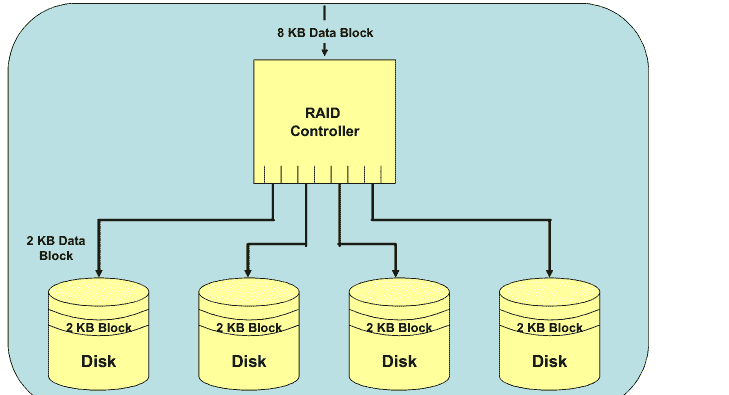

图 1-1 RAID 0（磁盘条带）架构

##### RAID 1

RAID 1 也称为*磁盘镜像*（disk mirroring）。在 RAID 1 中，RAID 控制器将写入操作从主磁盘（或主磁盘）复制到一个或多个称为*镜像*（mirrors）的备用磁盘。写入操作的性能不受影响，因为设备的写入是并行完成的。

读取操作实际上得到了改进，因为控制器使用所有设备进行读取。

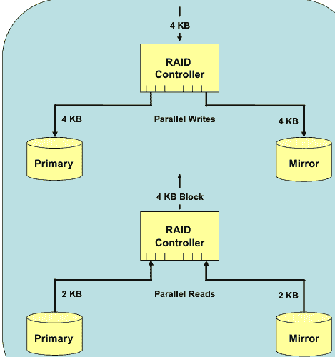

图 1-2 RAID 1（磁盘镜像）架构

##### RAID 3

（注：此处原文为 RAID 3）

RAID 0 也称为*磁盘条带*。它指的是使用两个或多个磁盘，其中磁盘控制器（称为 RAID 控制器）在驱动器之间分配 I/O 操作，创建并行写入或读取操作，从而提高性能但不提高可靠性。

RAID 1 也称为*磁盘镜像*。在 RAID 1 中，RAID 控制器将写入操作从主磁盘（或主磁盘）复制到一个或多个称为*镜像*的备用磁盘。写入操作的性能不受影响，因为设备的写入是并行完成的。

读取操作实际上得到了改进，因为控制器使用所有设备进行读取。

（注：此处原文为 RAID 3）

RAID 3 对于安全性非常好，读取性能也很好，但它需要倍的磁盘。在 RAID 3 中，至少需要三块磁盘。其中一个用于存储校验位。

该技术的缺点是校验磁盘承受了沉重负载，因为任何写入操作都需要在校验磁盘上写入。在磁盘故障时，信息可以重建。注意，RAID 3 不建议用于存储，因为存在单磁盘瓶颈。

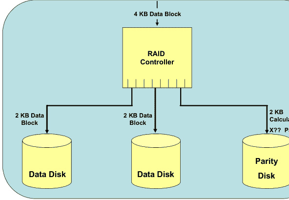

图 1-3 RAID 3 架构

##### RAID 5

RAID 5 是 RAID 3 的变体。它不是专门分配一个磁盘用于校验位，而是将校验位分布在所有设备上以平衡写入负载。它是镜像数据的成本效益替代方案。它以每个阵列消耗一个磁盘为代价提供冗余，每个写入请求需要四次 I/O 操作。随着阵列磁盘数量的增加，校验开销会减少，但写入惩罚保持不变。因此，RAID 5 不是在线事务处理（OLTP）数据库或随机写入密集系统的优化选择。


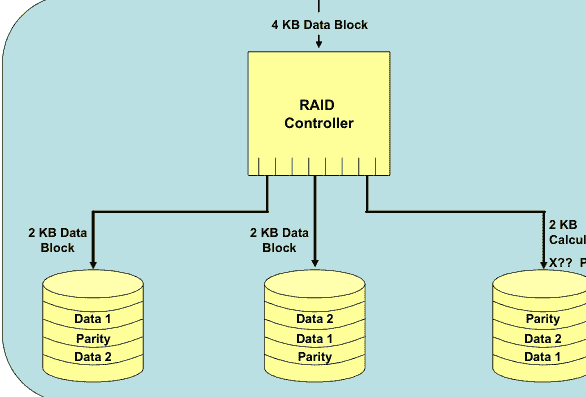

图 1-4 基础 RAID 5 系统

RAID 10 和 01（也称为 1+0 和 0+1）都使用了镜像与条带的组合。这是性能的获胜组合，但容错性可能非常贵。

RAID 10 和 01 的区别在于，在 RAID 10 中，单个磁盘是镜像的，然后这些镜像组进行条带化。相反，在 RAID 01 中，镜像应用于整个条带卷。用的话说，RAID 10 是“条带的镜像”，而 RAID 01 是“镜像的条带”。由于条带中单个元素的故障会导致其不可用，因此最佳替代方案始终对镜像卷进行条带化，即 RAID 10。

## DB2 集成

DB2 数据库可以从使用 RAID 中受益。如前所述，RAID 5 不适用于运行 OLTP 程序的数据库。然而，对表空间使用 RAID 1 或 RAID 10 可以提高性能、对任何应用程序的容错能力，或两者兼顾。

有关 RAID 的更多信息，请参阅网站：

http://en.wikipedia.org/wiki/Redundant_array_of_independent_disks

### 1.2.2 远程存储镜像

多年来，镜像和 RAID 一直是硬件层面提高可用性和性能的首选工具。随着需求的不断增长，许多企业不仅必须确保在发生故障时其业务不会停止，还需要快速访问远程位置的数据。远程存储镜像在企业级存储中结合了镜像和复制，允许企业为其他需求提供解决方案。

这项技术背后的理念是在地理远程位置部署两个或多个磁盘阵列（也称为存储机柜）。这些机柜通过暗纤或类似技术连接，并实现位于机柜之间复制数据的算法。

存储镜像复制所有的磁盘写入，包括日志信息。不同品牌更新远程磁盘更改有特定方法。通常情况下，同步和异步是更新远程磁盘的两种典型模式。

大多数情况下，如果需要自动故障转移，远程存储镜像必须与额外的资源集成。远程存储镜像产品的示例包括：

- IBM Peer to Peer Remote Copy (`PPRC`) 和 IBM Peer to Peer Remote Copy over xExtended Distances (`PPRC-XD`)
- Hitachi TrueCopy

#### 优势

远程存储镜像的优势如下：

- 在地理远程位置保留多个数据副本。
- 在硬件层面进行副本复制，这通常会提高性能和可靠性。

#### 使用时机

当无法容忍任何数据丢失且必须以最小延迟进行复制时，使用此技术。

## DB2 集成

远程存储镜像与 DB2 无缝集成，允许企业拥有一个提供持续服务的灾备备站点。需要额外的技术（如集群）来自动化在新站点启动 DB2 的过程。

如需更多信息，请参考以下网站：

- 暗纤：

http://en.wikipedia.org/wiki/Dark_fiber

- PPRC:

http://en.wikipedia.org/wiki/Peer_to_Remote_Copy

### 1.3 集群解决方案

集群是一种长期以来使用的技术，用于提高服务器上实现的解决方案的韧性、性能和可用性。*集群*是由两个或多个机器（或节点）组成的虚拟机，各种子系统作为资源注册到集群配置中。资源和节点的功能通过额外的软件和硬件在逻辑上绑定在一起。集群创建了高可用资源的概念。在节点故障时，其他节点上的资源可以接管负载，最大限度地减少停机时间。

集群的理念是向用户呈现单台机器，实际上系统有多个节点来为客户端应用程序服务。许多集群处于活动/被动配置，其中只有一个节点执行工作，其他节点作为备用处于待命状态以防故障。某些集群解决方案足够复杂，允许在活动/活动配置的节点之间进行负载均衡，从而实现应用程序性能的最大化并提供更具成本效益的资源利用。

集群解决方案大致分为两类：

- 依赖操作系统的
- 不依赖操作系统的

#### 1.3.1 依赖操作系统的

大多数操作系统都提供创建集群的工具或产品。这些技术和概念相似，其意图总是向世界呈现单个虚拟服务器，尽管服务可以分布在集群的节点或成员之间。

在发生服务或资源故障时，集群进程尝试在受影响的节点上重启资源，如果无法实现，另一个节点上的资源将取代它们。

无论集群如何实现，面向连接的应用程序（如数据库应用程序）都需要嵌入逻辑来检测丢失的连接，并重试那些存在疑问或未完成的操作。集群的优势在于，当节点之间的传输是自动化的时，集群软件通常提供功能，使应用程序继续有效工作且没有事务性数据丢失。这减少了停机时间和人工干预。

以下是一些现有的集群解决方案提供商：

- 适用于 IBM System™ 的 AIX 和 Linux IBM HACMP
- 适用于 32/64 位 Intel/AMD 平台的 Windows Server® 2003 Clustering Services（原 MSCS）以及适用于 64 位 Intel/AMD 平台的 Windows Compute Cluster 2003
- 适用于 HP-UX 和 Linux 的 HP Serviceguard
- 适用于 Solaris™ 的 Sun™ Cluster

##### 优势

依赖操作集群软件的优势在于与操作系统高度集成。

##### 使用时机

如果你具有同构架构，那么与操作系统良好集成的依赖操作集群软件是一个很好的选择。

## DB2 集成

DB2 支持列出的所有依赖操作系统的集群软件。有 DB2 代理或资源类型可以将这些集群解决方案与 DB2 集成。集成要么由 DB2 作为自动安装的库提供，要么作为示例脚本提供。

有关依赖操作软件的更多信息，请参以下参考文献：

- IBM HACMP:

  http://en.wikipedia.org/wiki/High_Availability_Cluster_Multiprocessing

- Windows Server 2003 Clustering Services:

  http://www.microsoft.com/windowserver2003/technologies/clustering/default.mspx

- Windows Compute Cluster 2003:

  http://technet.microsoft.com/windowserver/en/default.mspx

- HP Serviceguard:

  http://www.hp.com/enterprise/6469-0-1

- Sun Cluster:

  http://www.sun.com/cluster

#### 1.3.2 不依赖操作系统的

这些解决方案的特点与依赖操作系统的类似。这种类型的集群软件可以与各种操作系统配合。它们通常提供更高级的功能来管理集群。某些允许在集群组之间交换资源。

由于这些解决方案非常专业，有时它们提供的功能比依赖操作系统的对应产品更多。其中一些工具是：

- Tivoli System Automation (`TSA`): 端到端自动化
- Veritas Cluster Server

##### 优势

不依赖操作系统的集群软件具有以下优势：

- 这些解决方案不受平台。
- 它们跨平台提供单一接口。

##### 使用时机

在以下情况下可以使用不依赖操作系统的集群软件：

- 当你具有异构环境时。
- 如果可能会更改平台。
- 如果你的操作系统没有提供解决方案或具有可以通过不依赖系统的集群软件避免的限制。
- 如果你需要集中管理不同平台的复杂现有集群，这些集群单独仅是较大应用程序的一部分，那么多层集群管理解决方案如 `TSA` 可以接入现有集群。

## DB2 集成

有 DB2 代理或资源类型可以将这些集群解决方案与 DB2 集成。之前提到的解决方案都支持 DB2。集成始终由集群工具提供。

有关不依赖系统的软件的更多信息，请参考以下网站：

- Tivoli Automation:

http://www-306.ibm.com/software/tivoli/products/sys-auto-multi/

- Veritas Cluster Server:

http://en.wikipedia.org/wiki/Veritas_Cluster_Server

### 1.4 复制

复制解决方案已经使用了一段时间。有多种复制技术适用于不同的环境。在本节中，我们关注基于软件的复制。

DB2 Universal Database™ for Linux, UNIX 和 Windows 提供了两种解决方案，用于在关系数据库之间复制数据：SQL 复制和 Q 复制。在 SQL 复制中，提交的源更改被暂存在关系表中，然后复制到目标系统。在 Q 复制中，提交的源更改被写入消息中，通过 WebSphere® MQ 消息队列传输到目标系统。

DB2 还提供了一种解决方案事件发布功能，可以将已提交的源更改转换为 XML 格式的消息，并将这些消息发布到消息中间件等应用程序。

#### 1.4.1 SQL 复制

SQL 复制通过 IBM WebSphere Information Integration 集成在 DB2 中。


源系统有一个捕获程序，它扫描 DB2 日志文件以寻找属于复制表的记录，然后将这些信息放在称为临时表（staging tables）的临时存储中。

这些临时表中的记录被发送到目标系统，在目标系统中，应用程序将它们执行针对副本数据库的 DB2 SQL 操作。

图 1-5 显示了 SQL 复制架构的概述。源服务器内部有一组称为捕获控制表（Capture control tables）的 DB2 关系表。关于源的信息被写入这些表中。运行在源服务器上的捕获程序使用这些信息来确定它应该捕获哪些数据。关于目标的信息位于应用控制表（Apply control tables）。应用程序通常也运行在你的目标服务器上，它使用这些信息来确定它应该向哪些目标写入数据。

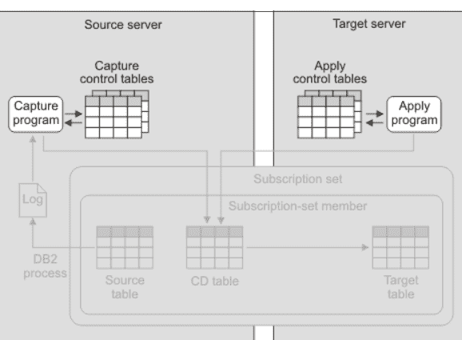

图 1-5 SQL 复制简单配置的基础设施

### 优势

这些是 DB2 SQL 复制的一些优势：

- 它包含了适用于 OS/390® 和 z/OS® 的源、目标以及两者，还包含了适用于 Linux、UNIX 和 Windows 的源、目标或两者。
- 它可以访问多种数据库管理系统（DBMS）类型的源和目标。
- 副本数据库不会被禁用或对客户端连接隐藏。由于是单向复制，建议在使用 SQL 复制时对副本数据库进行客户端只读访问。

### 使用场景

你可以在以下情况下使用 SQL 复制：

- 如果你拥有异构数据库提供者环境，SQL 复制比 Q 复制可以访问更多的源和目标。
- 当你从单个源有多个目标时，信息可以从临时表进行复制或广播。这适用于地理分布的只读数据，或用于管理信息系统或数据仓库的聚合数据。

有关关于 SQL 复制的更多信息，请参考以下源：

- IBM WebSphere Information Integration: SQL Replication Guide and Reference Version 9, SC19-1030-00
- SQL replication: overview:

```
http://publib.boulder.ibm.com/infocenter/db2luw/v9/index.jsp?topic=/com.ibm.websphere.ii.db2udb.replication.intro.doc/prod_overview/iiyrintch200.html
```

- 常见场景的 Replication publib:

```
http://publib.boulder.ibm.com/infocenter/db2luw/v9/index.jsp?topic=/com.ibm.websphere.ii.db2udb.replication.intro.doc/prod_overview/iiyrintrsbdd.html
```

#### 1.4.2 Q 复制

Q 复制是一种复制解决方案，使用 WebSphere MQ 中的消息队列在源数据库和目标数据库之间传输事务。

Q 捕获程序（Q Capture）运行在源服务器上，读取 DB2 恢复日志源数据的更改。这些更改随后写入 WebSphere MQ 队列。Q 应用程序（Q apply）运行在目标服务器上，从队列接收更改并写入目标。

Q 复制分为三种类型：

- 单向：
  - 从源到目标的单向复制
  - 可以配置多个源复制到一个目标，或多个目标复制到一个源
- 双向：
  - 两个服务器之间两个源表和目标表之间的双向复制
- 点对点：
  - 两个或多个进程之间源表和目标表之间的双向复制

图 1-6 描述了使用 Q 复制的单向架构。请注意，这里仅引用源服务器上的 DB2 进程；但并不排除目标服务器上的客户端连接。这里存在 DB2 进程，并具有活动的目标数据库，以便接收由 Q 应用程序从消息队列格式转换来的 SQL 事务。

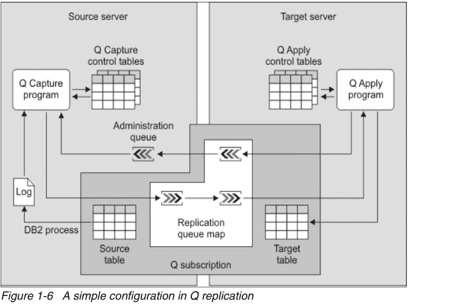

### 优势

Q 复制的优势如下：

- 除了适用于 Linux、UNIX 和 Windows 的源、目标或两者外，还支持 OS/390 和 z/OS 的源、目标或两者
- 支持大量的更改量
- 低延迟需求
- 支持大量的源/目标表
- 具有冲突检测/解决功能的副本/目标可以被更新
- 捕获的事务可以供给其他应用程序

### 使用场景

你可以使用 Q 复制：

- 用于容量缓解，例如为源和目标都提供读/写数据库，通过外部负载机制在服务器之间分担事务负载。
- 地理分布的应用程序，将更新回中心枢纽，并广播到多个分布式目标。请注意，对于后一种配置，我们建议使用 SQL 复制。
- 用于滚动升级。
- 当需要对部分列和行进行复制时。

有关更多信息，请参考 Web 上的常见解决方案复制场景，地址为：

```
http://publip.boulder.ibm.com/infocenter/db2lu/v9/topic/com.ibm.websphere.ii.db2ub.replication.intro.doc/prod_overview|iiyrintrsbdd.html
```

#### 1.4.3 DB2 HADR

DB2 高可用性与灾难备备（HADR）是一项允许数据库位于远程位置的功能。HADR 的工作方式与存储镜像类似，但所有工作都在软件层面完成。HADR 主数据库将日志发送到备用数据库。

### 优势

使用 DB2 HADR 的优势包括：

- 极快速切换能力
- 对性能的影响极小
- 易于设置和监控
- 无需中断服务即可滚动升级
- 与高可用（HA）集群软件轻松集成
- 与传统方法相比极大提高了灾难恢复能力

### 使用场景

你可以在以下使用 DB2 HADR：

- 需要具有快速切换能力的灾难恢复站点。
- 无提交事务数据丢失，且副本（备用）数据库必须与主数据库保持同步。这意味着在独立系统之间实现了无性能开销的双阶段提交。
- 系统更改无需停机。HADR 允许对两个数据库进行 FixPak 更新和配置更改。

有关 DB2 HADR 的更多信息，请参考：

Data Recovery and High Availability Guide and Reference, SC10-4228.

#### 1.5 共享集群与 HDR

对于本地高可用解决方案，带有集群软件的磁盘集群是最常见的配置。HADR 提供了一种位于同一房间或远程数据库服务器的高可用解决方案。本节介绍了这两种解决方案的结合（混合），以及这种混合系统如何增强数据库系统的可用性。

### 1.5.1 概述

共享磁盘集群有若干种考虑因素。由于资源在集群节点之间共享，磁盘共享配置在以下情况下无法提供服务或进行计划维护：

- 共享设备的故障或维护。
- 维护需要停止集群软件。
- 需要停止数据库实例的 FixPak 更新或配置更改。
- 站点灾难。

通过向共享集群添加 HDR 备用数据库，即使在上述情况下也可以实现连续服务。我们将此类系统称为*混合系统*。图 1-7 展示了带有磁盘集群和 HDR 的混合高可用系统。

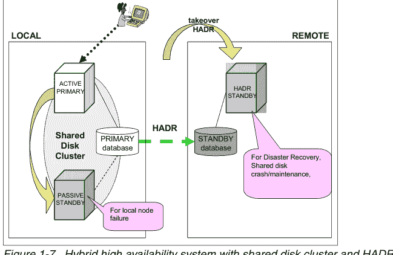

在此配置中，有三个不同角色的节点：

- 活动主节点：
  该节点通过共享磁盘提供服务。DB2 实例在其上运行。同时，它扮演 HADR 主数据库的角色，将日志记录传输到备用数据库。
- 被动（本地）备用节点：
  如果活动主节点发生故障，本地备用节点将接管资源，包括共享磁盘。
- HADR（远程）备用节点：
  运行 HADR 备用数据库的节点。当活动主节点和被动备用节点均不可用时，该节点可以提供服务。HADR 备用节点可以放置在与其他节点相同的本地站点，但为了灾难恢复的目的，它必须存放在远程站点。

### 1.5.2 混合系统案例研究

当数据库系统发生可能的故障或维护时，混合系统需要执行以下操作：

- 主节点故障：
  资源组（包括共享磁盘）将自动故障转移到被动备用节点，并重启服务。在故障转移后，将与新的活动主节点（被动备用节点）重新建立 HADR 连接，如图 1-8 所示。

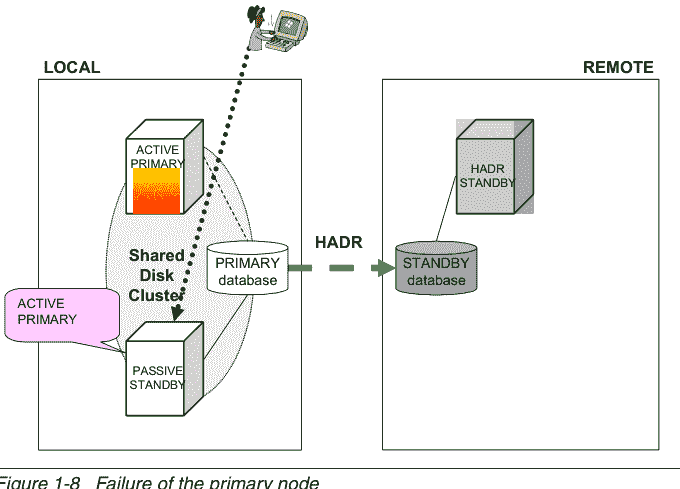

- 共享存储设备崩溃或计划内维护：
  如果共享磁盘由于任何原因不可用，共享磁盘集群将无法继续服务。在这种情况下，服务可以转移到 HADR 备用节点。即使由于维护目的（例如升级存储设备的微代码）或重构存储配置而停止共享磁盘，你也不需要停止应用程序的数据库服务，如图 1-9 所示。

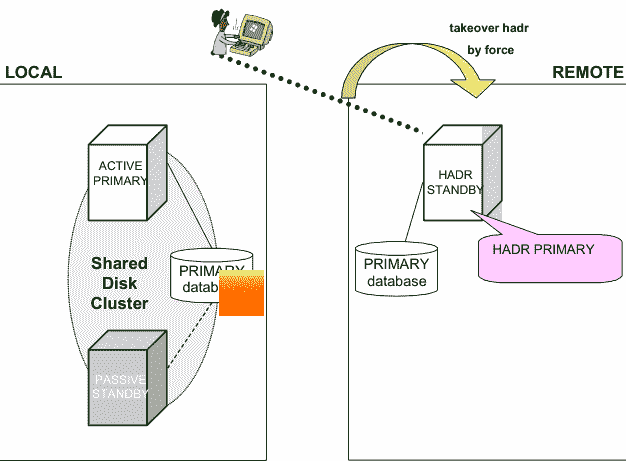

图 1-9 共享存储设备的崩溃或计划内维护

- 集群软件维护：
  当你需要停止集群软件进行某些配置更改并需要故障转移测试时，可以将服务转移到 HADR 备用数据库。同时，你可以检查集群软件的行为，而对应用程序服务产生任何影响。
- 升级 DB2 FixPak（滚动升级）：


你只需极短的服务停机时间即可升级 DB2 FixPak。请按照以下步骤升级 DB2 FixPak：

- a. 在 HADR 备用节点上更新 FixPak 并重新建立 HADR 连接。
- b. 故障转移到 HADR 备用节点。应用程序的停机时间仅为接管 HADR 角色的几秒钟。
- c. 在共享磁盘集群（活动主节点和被动备用节点）中更新 DB2 FixPak。
- d. 将 HADR 角色切换回本地集群。
- 使用备用数据库作为阶段环境：

经常需要在数据量（或数据本身）与生产环境相似的数据库上测试新应用程序或新数据库功能。备用数据库从 HADR 对中分离后，它可以作为一个阶段环境，其中包含从生产环境复制的完整数据。通过混合系统，即使在你利用 HADR 备用节点作为阶段环境时，你仍然拥有本地故障的冗余。

阶段环境。

阶段环境是一个测试环境/基础设施，它镜像生产环境并允许你在不影响生产系统和用户的情况下测试新的或更改的应用程序或设置，如图 1-10 所示。

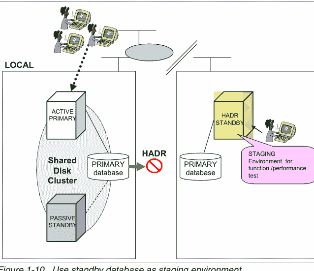

图 1-10 使用备用数据库作为阶段环境

## HADR 介绍

如今的企业在选择符合其业务需求和 IT 预算的适当高可用解决方案方面面临着巨大挑战。

直到最近，此类解决方案基于专有系统，并且投入大量的资金、时间和资源进行组装、集成、测试、管理和支持。随着基于软件的高可用性解决方案的引入，这种情况发生了巨大的变化。

在本章中，我们提供了一种 IBM 基于软件的可用性解决方案的概述：DB2 高可用性灾难恢复 (HADR)。

我们涵盖了以下主题：

- 高可用性概述
- HADR 概述
- 为什么选择 HADR？
- HADR 架构
- 术语

### 2.1 高可用性概述

高可用性（HA）是用于描述在大部分时间内运行并向客户提供服务的术语。为了实现这一点：

- 事务必须被高效地处理，且在高峰运行期间不会出现明显的性能下降（甚至丢失可用性）。
- 当硬件或软件故障发生或灾难来临时时，系统必须能够快速恢复。DB2 具有先进的连续检查点系统和并行恢复能力，能够实现极快的恢复。
- 驱动企业数据库的软件必须持续运行并可用于事务处理。为了保持数据库管理器运行，你必须确保在发生故障时另一个数据库管理器可以接管。将功能从一个服务器移动到另一个服务器的概念被称为故障转移（failover）或接管（takeover），很大程度上取决于软件供应商的术语。故障允许允许发生硬件故障时将负载从一个系统自动转移到另一个系统。

#### 2.1.1 高可用性解决方案

客户比任何时候都要求 24x7 的运行环境。为了实现这一要求，组织必须充分考虑高可用性和灾难恢复。

许多客户使用硬件高可用性（HA）方法，将一台机器上的所有应用程序更新同步到备用机器。然而，使用基于软件的方法许多优点，其中首要优点是成本较低。IBM 提供了基于软件的 HA 解决方案，如 HADR、SQL Replication 和 Tivoli System Automation (TSA)。

HADR 是 DB2 产品族提供的几种复制解决方案之一。WebSphere Informationator Q Replication、SQL Replication 也可以在某些配置下提供高可用。这些功能在多个位置维护逻辑一致的数据库副本，并也可用于分区数据库环境。

#### 2.1.2 高可用性的类型

高可用性有两种类型：

- 连续可用性：

连续可用性要求数据库引擎在没有任何停机的情况下可用于事务处理。这种可用性通常用于关键任务业务应用程序。为了实现这一点，需要完全冗余，这意味着你必须拥有在硬件和软件方面都相互独立的系统。

- 故障转移可用性：

故障转移可用与连续可用性的区别在于，在一段时间内（无论多短），数据库引擎或其他功能不可用。此类解决方案的核心组件是：

- 主备用系统
- 故障检测
- 数据源移动

在提供连续性的背景下，两个系统（主和备）中的每一个都必须访问数据库数据的副本，客户端通常从主系统访问。当主系统上的关键资源损坏触发故障检测时，就会发生故障转移。在故障转移过程中，数据源从主系统移动到备系统，客户端开始通过该系统访问数据。应该指出，此过程对于客户端来说是无缝的。

### 2.2 HADR 概述

DB2 高可用性灾难恢复 (HADR) 是一种数据库复制功能，为部分或整个站点故障提供高可用性解决方案。数据库服务器可能由于任何因素发生故障：环境（电源/温度）、硬件、网络连接、软件或人为干预。

在标准安装中，数据库服务器丢失的恢复可能需要重启机器和数据库崩溃恢复，这将中断数据库服务。通过使用 HADR，你可以将停机时间缩短到几秒钟。HADR 通过持续从源数据库（称为主数据库）将数据更改复制到目标数据库（称为备用数据库）来防止数据丢失。此外，通过使用应用程序中的自动客户端重定向（ACR）和重试逻辑，你可以无缝地将使用原始主数据库的客户端重定向到备用数据库（后者将成为新的主数据库）。这种无缝重定向也可以通过其他章节讨论的软件解决方案来实现，这些解决方案可以管理 IP 地址重定向。

图 2-1 展示了 HADR 的概念，其中 DB2 的日志缓冲区被用作 DB2 主数据库所有更改的单一源。

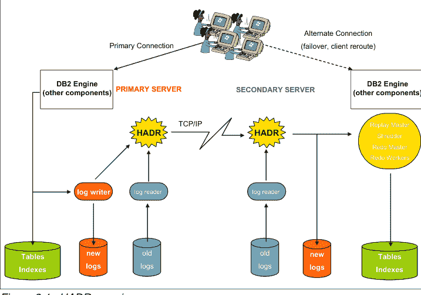

图 2-1 HADR 概述

HADR 将日志记录从主数据库服务器传输到备用服务器。HADR 备用服务器会将所有日志记录重放到其数据库副本中，保持与主数据库服务器同步。备用服务器处于连续滚动模式，并处于近就绪状态，切换到备用服务器的速度极快。应用程序只能访问主数据库，而无法访问备用数据库。

## HADR 架构概述

## 为什么选择 HADR？

通过两个专用的 TCP/IP 通信端口和一个心跳，主数据库和备用数据库会跟踪它们当前处理的位置以及当前的复制状态；最重要的是，当前备用数据库逻辑上是否与主数据库相同（称为 HADR Peer 状态）。在 Peer 状态下，HADR 主数据库在日志页刷新到主库磁盘时，从其内存日志缓冲区中检索日志数据，并通过 TCP/IP 将其发送到备用数据库。

如所述，主数据库和备用数据库之间的 HADR 通信是通过 TCP/IP 的，这使得数据库可以复制到远程地理站点。这允许在主数据库服务器站点发生灾难时恢复数据库。HADR 解决方案同时提供了高可用性（HA）和灾难恢复能力。正如你所看到的，HADR 具有不丢失提交事务数据的潜力，为传统的 DB2 灾难恢复方法提供了无比拟的改进，而传统方法通常意味着提交事务数据的丢失。

如果主系统不可用，通过强制操作进行 HADR 强制接会将备用系统转换为新的主系统。一旦旧主系统完成维护或修复，你可以启动原始 DB2 并在重新整合 HADR 后将两个 DB2 服务器恢复到它们的主备和备用角色。

在支持 DB2 的环境中，HADR 易于设置和配置。底线是，HADR 是一种支持高可用性灾难恢复的高效方法。

选择 HADR 作为解决方案的原因如下：

- 极快的故障能力
- 对性能的影响微乎其微
- 易于设置和监控
- 非主版本之间或需要重启服务器的更改可以无中断地滚动升级，并缩短了升级的变更窗口
- 应用程序的透明故障和回滚
- 易于与 HA 集群软件集成
- 与传统方法相比，极大地改进了灾难恢复能力

### 2.3 DB2 逻辑日志架构

在本节中，我们将讨论逻辑日志架构。这一 DB2 架构背景有助于清晰理解 HADR 背后的架构。我们假设读者熟悉 DB2 缓冲池架构。

DB2 为了提高性能并确保数据安全稳健性的主要功能之一是管理事务完整性的能力。

为了保持数据库的逻辑完整性，单个 SQL 操作被分组为一个事务。事务内部的所有操作都保证以“全有或全无”的方式执行。如果在任何单个步骤发生发生故障，事务将被中止（回滚），并撤销已执行的所有单个操作。事务也被称为原子单元或逻辑工作单元，它们可以由更小的元素组成，但从应用程序特定业务规则或通用数据完整性的角度来看，不能（也必须不能）在逻辑上拆分。

DB2 的逻辑日志实现了 Semantics (ARIES) 恢复算法，这是一种确保原子操作的预写日志（WAL）协议。在该协议中，每个修改页的代理都会生成一条操作记录，称为*逻辑日志记录*。该逻辑日志记录存储在磁盘的特殊区域，称为*逻辑日志文件*。事务具有特殊的逻辑日志记录，用于标识事务的开始和结束。在发生崩溃时，读取逻辑日志文件并重放其中所有记录。所有属于未完成事务的记录将被回滚，使数据库恢复到一致状态。

ARIES 在以下网站上有更详细的描述：

http://www.almaden.ibm.com/u/mohan/ARIES_Impact.html

出于性能考虑，日志记录不会直接写入磁盘，而是写入一个名为*逻辑日志缓冲区*的缓冲区区域。为了最小化信息丢失，每当应用程序提交事务时，逻辑日志缓冲区都会刷新。

为了让 ARIES 协议按照设计工作，必须满足一个条件：在包含修改了缓冲池页的逻辑日志记录的逻辑日志缓冲区写入逻辑日志文件之前，缓冲池中的脏页不能写入磁盘（表空间容器）。

图 2-2 描绘了应用程序请求更新时发生的事件序列。


图 2-2 DB2 交互

1. 应用程序请求更新。
2. 数据从表空间提取到缓冲池。
3. DB2引擎修改页面。
4. DB2 通过写入日志缓冲区记录更改内容。
5. 页面放置在缓冲池中。
6. 某点事件触发日志缓冲区写入日志文件。此工作由名为 `db2loggw` 的 EDU 完成。
   - 应用程序提交且提交计数大于等于数据库配置中的值。
   - 缓冲池中引用日志缓冲区记录的页面必须写入磁盘。
7. 一旦逻辑记录已写入日志文件，即可安全地从缓冲池刷新到表空间。

由于日志缓冲区仅存在于内存中，系统崩溃会导致逻辑记录永久丢失。如果更改在写入日志文件之前已写入表空间，在发生崩溃时 DB2 将无法从日志文件感知此事务，DB2 将无法通过最近备份重放恢复数据。相反，在日志数据成功写入日志文件后发生崩溃，将使 DB2 重放能够正确恢复表空间中的数据。

### HADR 基本架构

HADR 的基本架构非常简单。它基于将逻辑日志记录从主数据库传输到远程实例，该实例包含了所谓的“备用数据库”。因此，在 DB2 中，HADR 的实现允许数据库管理员 DBA 决定哪些数据库必须进行复制。

主数据库与备用数据库之间的通信是通过基于在 TCP/IP 层中继的消息的通信协议完成的。

在备用和主数据库上都输入适当的 `start HADR` 命令后，一旦主数据库能够对已激活的备用数据库建立成功的初始连接，HADR 系统就会实际启动。在任何情况下，数据库随后只能通过 `deactivate database` 命令来去激活。

在 HADR 系统中，DB2 有两个特殊的 EDU（数据库用户单元）来处理 HADR 工作。主库中的是 `db2hadr`。备用数据库中对应的单元是 `db2hadrs`。它们负责从主库向备用发送逻辑日志、处理系统消息，以及在备用系统上接收逻辑日志。

当主库激活数据库时，会产生 `db2hadr`；它将读取数据库配置文件并打开一个端口以监听来自备用的连接。相关的 HADR 数据库配置参数在第 138 页的 6.1 节“DB2 HADR 配置参数”中描述。在此期间不允许任何连接。主库将根据配置参数 `HADR_TIMEOUT` 设置的秒数等待备用连接，如果无法成功连接到激活的备用数据库，它将终止数据库激活。

如果在执行 `START HADR` 命令时使用了 `FORCE` 子句，数据库将不会等待连接。主库会创建一个监听器并在 HADR 端口上监听。备用库将主动连接主库。如果备用库的连接尝试失败，它将重新尝试连接主库。客户端将找到主数据库，每当备用库就绪，HADR 功能就会开始运行。

使用 `FORCE` 子句的缺点是数据库将不再遵守 `AUTOSTART` 参数的设置，在发生崩溃时，无论当前设置如何都将执行崩溃恢复。其他启动 HADR 的方法（包括 `ACTIVATE DATABASE` 和第一次客户端连接）都将遵循 `AUTOSTART` 设置。

连接建立后，通过一种名为“心跳”`heartbeats` 的机制监控 HADR 系统的状态和“健康状况”。这基本上是为了验证主库和备用库能够相互看到。心跳是通过 HDRF 连接从主库发送到备用库的特殊短消息，由备用库确认并传回。心跳消息按已知的时间间隔发送，以便每个端都知道错过了多少次心跳并采取适当措施。

当备用数据库成功连接到主库后，HADR 进入追赶阶段 `catchup phase`。在追赶阶段，将确定从备用库到主库的日志缺口大小，主库开始发送所有备用库达到与主库相同点所需的逻辑日志。

逻辑日志的读取在主库中通过 `db2ifr` EDU 完成。此过程将逻辑日志页中继给 `db2hadprp`，随后由 `db2hadprp` 再次通过 TCP/IP 层将页面中继给备用库的 `db2hadrs`，以便捕获并中继到其逻辑恢复子系统。

一旦主库磁盘和内存中的所有日志都传输到备用库，HDR 系统将进入 `Peer`（等状态）。

在 `Peer` 状态下，主库中的 `db2ifr` 完成其任务并将令牌传递给 `db2logw`。这个 `db2loggw` EDU 负责将逻辑日志缓冲区写入磁盘，在 HDR 模式下它还有一项额外任务：在日志刷新到磁盘后后，`db2loggw` 立即向 `db2hadprp` 发送一条包含缓冲区位置的消息并等待。`db2hadprp` 直接从日志缓冲区中提取记录并将其发送到备用服务器。

完成此日志传输后，`db2stands` 将日志传输状态（是日志传输成功还是由于 TCP/IP 错误导致日志传输失败）发送给 `db2loggw`，以便其继续处理缓冲区。

由于 `db2loggw` 在没有收到 `db2hadprp` 确认的情况下无法进行，这是性能的关键点。根据 HDR 模式的不同，向日志记录器发送确认的速度会有不同。日志传输的完成和向 `db2loggw` 发送状态取决于 TCP/IP 发状态以及所使用的 HDR 同步模式。在 `db2loggw` 接收到传输状态之前，主系统上的数据库写入活动无法进行。如果发生这种情况，主系统上的事务将会被阻塞，直到 `db2loggw` 收到来自 `db2hadprp` 的此类通知。

图 2-3 显示了 HDR 主数据库架构细节。当主库执行日志刷新时，主数据库通过 TCP/IP 网络（显示为右侧的网络锯齿线）将日志记录传输到备用数据库服务器。当应用程序发布 `commit` 或 DB2 日志缓冲区（由数据库配置参数 `LOGBUFSZ` 控制）变满时，主数据库执行日志刷新。

32 Linux, UNIX 和 Windows 上的 DB2 高可用性和可扩展性指南


图 2-3 HDR 主数据库架构

图 2-4 显示了备用数据库架构。备用库通过 TCP/IP 链路接收左侧的日志（缓冲区大小由注册变量 `DB2_HADR_BUF_SIZE` 控制）。在 HDRR 备用系统中，备用 EDU dbhadrs 还管理日志文件（该 EDU 将日志文件写入本地磁盘）。

图 2-4 HADR 备用数据库

### HADR 处理故障

在主侧处理故障的 DB2 HADR 机制是通过命令中的 `FORCE` 子句，如前所述。一旦发生这种情况，HADR 只感知新的主系统，并寻找已初始化的主系统。旧主系统无法再以当前状态供客户端使用，因为可能会丢失数据。

修复旧主系统的过程必须小心进行，以避免意外启动 HADR。两个数据库均处于 HDR 主模式、一个或多个已停止 HADR 现在处于标准模式的情况被称为脑裂 `split brain`，这在第 36 页的 2.5 节“术语”中有描述。创建一个安全的修复环境（无意外客户端连接）可以通过禁用该服务器上的远程客户端 TCP/IP 连接来实现，无论是通过 IP 地址控制、防火墙，还是简单地将实例的数据库管理器端口号更新为未使用的值。

在修复故障的原主服务器后，如果两个数据库副本能够一致，就可以重新建立为备用数据库。该过程在第 86 页的 3.4.5 节“重新建立故障”中进行了讨论。在原始主数据库作为备用数据库重新整合 HADR 对后，您可以轻松地切换数据库的角色，使修复服务器上的数据库再次成为主数据库，并使用非强制的 HADR 接管命令。

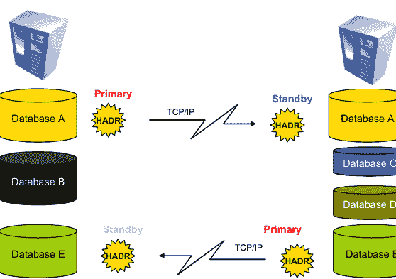

图 2-5 HADR 发生在数据库级别，而非 DB2 实例级别

### HADR 同步模式

通过 HADR，你可以通过指定三种同步模式之一来选择你希望防范潜在数据丢失的保护级别：

- 同步模式 `Synchronous`：
  只有当日志被写入主库的日志文件，并且收到了日志已写入备库日志文件的确认信号后，日志写入才被视为成功。如果 HADR 处于对等 `Peer` 状态，在这种模式下不会发生数据丢失。
- 准近同步模式 `Near-synchronous`：
  这是默认选项。只有当主库的日志缓冲区写入主库的日志文件，并且收到备库已接收日志缓冲区的确认时，日志写入才成功。在处于对等状态下，必须发生双重故障才会导致数据丢失；即：如果主库宕机且在接管完成之前备库也发生故障。在这种情况下，内存中的事务将会丢失。这种情况非常不利，特别是当两台服务器使用独立的电源和运行环境时。
- 异步模式 `Asynchronous`：
  当日志写入主库且日志数据已传递到 TCP/IP 层时，日志写入即成功。在这种模式下数据丢失的可能性更高。主库、网络或备库的故障都会导致日志丢失。如果主库恢复可用，备库仍然可以成功同步。如果由于主库故障需要接管而此时日志数据仍未处理，这些数据将永远无法到达备数据库，事务将会丢失。

图 2-6 展示了这些 HADR 同步模式，以及 DB2 在处于 PEER（对等）状态时认为自己可以提交事务节点。

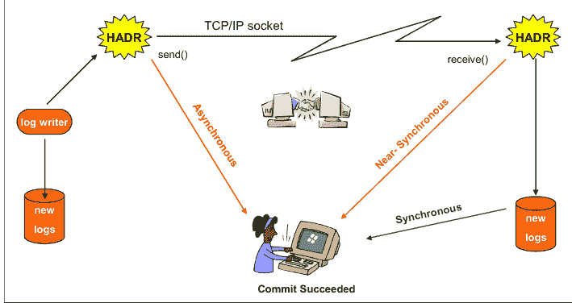

图 2-6 同步模式

## 2.5 术语

我们列并描述了一些专门用于 HADR 的常用术语。这些术语大部分可以在各种 DB2 手册或 DB2 信息中心找到，你可以在那里搜索并查看它们在上下文中的用法：

### 追赶阶段 `Catchup phase`


HADR 初始化始终从追赶阶段开始，在此阶段中，备库通过重放已写入磁盘或归档的日志，试图追上主库内存中的日志。在追赶期间，备库可以从本地检索日志文件，也可以通过 HADR 网络连接从主库远程检索。

### 故障转移（Failover）

指由于原主库故障，将 HADR 节点中的备库状态更改为主库，并具有完整的 DB2 功能。原主库随后可以作为备库重新启动。必须确保在故障转移时，原主库确实处于不可用状态。如果两个数据库都作为主库运行，数据更新将产生 HADR 无法解决的冲突。结果是产生两个错误的数据库版本，这可能无法调和。

### 回滚（Failback）

在发生故障转移（使原备库变为主库）后，回滚是将该数据库恢复为备库，并将原主库再次作为主库带回的行为。这意味着在两者都存活且健康的情况下，切换主库和备库的角色。

回滚并非强制操作。客户可以选择让数据库保持反转的角色，直到由于新主库故障而需要另一次故障转移。这在高可用（HA）目标是极快速故障转移的情况下尤其常见，因为回滚可以被视为不必要的避免的服务中断。

选择此选项的客户必须确保 HDR 不复制的所有 DB2 相关对象和进程在两台服务器上都是相同的；特别是像批处理调度任务之类的，这些任务在数据库处于备库模式时必须禁用，在主库模式下激活。

### 故障（Failover/Failure）

故障是指任何数据库服务先决组件（DB2、操作系统、服务器硬件或网络）无法再提供其应提供的服务的事件。在任何单个组件故障时，HDR 将维护数据的可用性。如果故障仅影响备用系统或主库与备库之间的通信，数据在主库上仍保持完全可用，无需任何中断或用户执行用户操作。

如果故障导致主库无法提供 DB2 功能，用户可以采取主 DB2 实例、服务器或完全关闭它（如果尚未关闭）并启动故障转移，这将迅速将备用系统变为主库，使数据在经过短暂停机后即可变为可用。

某些故障可以被 HDR 和 DB2 检测并报告，以帮助用户决定是否需要故障转移，或者某些数据库组件仅需关注。HDR 数据库进程在无法通信时将报告故障。DB2 数据库进程在检测到错误时将报告故障。这些是 DB2 软件报告故障的唯一 DB2 数据库组件。

### 带外（Out of band）

在书中，带外指的是可以在主数据库上执行的操作，这些操作必须在备库中复制，但不能仅根据日志记录进行重复。此类操作在主库是不记录日志或完全记录日志的。为了复制此类操作，其结果（例如新对象或修改对象的副本）必须通过其他手段传递给备库。这种“其他手段”是解耦的。

### 停机期（Outage period）

停机期是故障转移所需的时间。它从主库故障开始到备库作为主库可用。

### 对等状态（Peer state）

在对等状态下，主库和备库是同步的。HADR 确保主库上的事务已由备库确认。

### 主库（Primary database）

这是 HADR 节点中的活动数据库。

### 主库重新整合（Primary reintegration）

在发生故障转移后，将原主库作为主库带回的过程。

### 备库（Standby database）

这是 HADR 节点中的被动数据库。

### 脑裂（Split brain）

指 HADR 节点中的两个数据库都作为主库运行的状态。这种情况会导致数据不一致，因此应避免。

### 异步模式

在 Peer（同步）状态下，主节点将成功地将相关日志数据提交到网络。主节点不会等待任何关于日志数据接收确认消息。如果发生故障转移（failover），事务数据极可能会丢失。

### 接管（Takeover）

接管是指 HADR 备机从旧主服务器接管数据库控制权并成为新 HADR 主节点的行为。接管总是从备机端启动的。在非强制接管中，如果可以通过网络访问主节点，则备机将请求其切换为备机，从而执行协作式角色切换。否则，备机将单方面进行接管（存在双主/脑脑裂的风险）。回滚（Failback）是在首先将修复的服务器重新整合为备机后，执行的一种协作式角色切换。请注意，HADR 接管可以在故障转移和回滚的语境之外执行。用户可能希望为了滚动升级而切换 HADR 角色，而这完全不涉及任何故障。

### 引擎分发单元（EDU）

引擎分发单元（EDU）可以根据平台架构实现为进程或线程。

### 主节点重新整合（Primary reintegration）

在某些情况下，旧主数据库可以在故障转移后重新加入 HADR 对。由于旧备机现在是主节点，旧主节点只能作为备机加入。这是 HADR 重新整合的一种形式。整合后，可以选择执行回滚。涉及整合的步骤请参见第 86 页第 3.4.5 节“故障转移后重新建立 HADR”。


# HADR 设置

在本章中，我们将描述如何使用命令行和图形用户界面（GUI）设置高可用灾难恢复（HADR）环境的步骤。我们涵盖了基本操作，包括 `START HADR`、`STOP HADR` 和 `TAKEOVER HADR` 命令。我们还提供了故障排除提示。

## 3.1 设置 HADR 的要求

在开始设置 HADR 之前，你必须首先了解设置要求。作为本书的一部分，我们描述了启动工作所需的基本大纲（更多详细信息，请参阅 DB2 9.1 数据恢复与高可用指南及参考，SC10-4228）。除了要求之外，我们还加入了建议。

### 要求

设置 HADR 包括以下要求：

- `HADR` 是 DB2 的可选许可功能。企业级服务器版（ESE）包含一个此类许可。
- 主节点和备机数据库的操作系统版本应相同，包括补丁。在升级期间的短时间内，它们可以不同。
- `HADR` 主节点和备机之间必须可用 `TCP/IP` 接口。
- 主节点和备机系统的 DB2 版本和级别必须相同。在升级期间的短时间内，它们可以不同。
- 主节点和备机数据库的 DB2 软件必须具有相同的位宽（32 位或 64 位）。
- 主节点和备机的缓冲池（Buffer pools）应该是相同的。
- 主节点和备机数据库必须具有相同的名称。这意味着它们必须位于不同的实例中。
- 主节点和备机数据库的表空间必须完全相同，包括：
  - 表空间大小
  - 表空间路径
  - 容器大小
  - 容器大小（注：原文重复）
  - 容器文件类型
- 主节点和备机数据库为日志文件分配的空间量也应该是相同的。

### 高度建议

以下是设置 HADR 时的一些高度建议参数：

- 为 HADR 主节点和备机数据库使用相同的主机计算机。也就是说，它们应该来自同一供应商并具有相同的架构。
- 为 `TCP/IP` 接口使用高速、大容量的网络。
- 确保主节点和备机数据库具有等量的内存。
- 具有相同的数据库（DB）和数据库管理（DBM）配置参数。

## 3.2 设置与配置

在这里，我们将在执行在现有的 DB2 安装上设置 HADR 的步骤。我们的实验室示例使用了用于 Intel® 处理器的 SuSE Linux（内核 2.6）的 32 位 DB2 9。然而，这些步骤适用于所有候选环境。

### 3.2.1 准备环境

为了给设置 HADR 准备一个真实的变更前环境，你可以计划几件事，这将让你能够尽早做好准备。除非你目前仍使用线性日志（linear logging），否则设置 HADR 所需的停机时间仅用于更新数据库配置参数。可以通过在常规维护窗口内安排工作来避免这一点。除了建议避开日志高峰期（以避免备机在达到 Peer 状态之前需要进行长时间等待）外，没有压力要求你最小化变更窗口。

如果你在真实世界环境中仍使用线性日志，你可能希望在开始 HADR 之前留出一个单独的变更窗口，以规划切换到线性日志，以及与日志归档、溢出、日志文件大小和失败重试相关的所有考虑。如果你在沙箱环境中测试 HADR 设置，这只是一个次要考虑，不需要单独的计划。

作为本实验室的基本组件，你需要两个相同 FixPak 级别的 DB2 实例。如果所选的备机与主节点的 DB2 版本不同，你可能会看到类似所示的内容：

> 所选的备机与主节点的 DB2 版本不同。
>
> `HADR` 要求主节点和备机的 DB2 版本相同。
> MYSERVER (8.2.6) - LEAD (9.1.0)

即使两个实例位于同一服务器，HADR 也可以工作。

确定你将使用 GUI HADR 设置向导还是 DB2 命令行处理器（CLP）来配置 HADR。GUI 向导非常适合引入熟悉 HADR 概念的人，但它具有所有 GUI 的复杂性和高网络开销。确保你可以获得快速且可靠的 GUI 显示。如果你打算使用 X11 模拟器进行远程设置，这将更为重要。CLP 环境适用于有经验的管理员或对多个 HADR 对进行重复配置。它也适用于无法在本地或远程实现 GUI 工作的环境，例如只有 telnet 访问的 AIX。

如果你在高度安全环境中工作，执行 DB2 安装和维护的人员在特殊窗口外没有 root/sudo 权限或 Windows 管理员权限，请采取必要步骤申请该权限。


如果你从 GUI 向导运行 HADR 设置（例如以 DB2 实例 ID 为例），这特别要求 DB2 实例 ID 具有更新 `/etc/services` 文件（Windows 上为 `%SystemRoot%/system32/drivers/etc/services`）的权限，除非这些部分已经注册。如果你没有可靠的域名系统（DNS），但仍希望使用主机名而不是 IP 地址，你可能还需要手动更新 `/etc/hosts` 文件。

在实际实现中你使用的两台服务器必须通过非常可靠的 TCP/IP 连接连接。它们之间最好没有防火墙，或者至少必须开放用于 DB2 管理服务器的 `523` 端口、每个 DB2 实例的主端口，以及你为 HADR 通信留出的两个端口。

根据你的环境以及选择的 HADR `SYNCMODE`，你可能正在与物理分离的服务器工作：

- 跨内网广域网（WAN）（建议 `ASYNC` 或 `NEARSYNC`；更多是用于灾难恢复功能，而非严格的高可用实现）
- 在局域网（LAN）上（建议 `NEARSYNC`）
- 在位于同一机架的服务器上（建议 `SYNC`）

我们的实验室示例使用了最后一种配置。

如果您的环境无法接受频繁的备份（即使是在线备份），那么请采取一切措施获取一个时间窗口来进行备份，作为 HADR 变更窗口的起点。

如果您希望尽可能减少在 HDR GUI 向导中执行的步骤数，除了从循环日志更改为线性/归档日志外，您还可以预先在两台服务器上为远程系统编目录条目：

- 用于 DB2 管理服务器的 `TCPIP NODE`
- 用于 DB2 实例的 `TCPIP NODE`
- 用于 DB2 数据库的 `DATABASE` 别名

示例 3-1 和示例 3-2 显示了编目录数据库和服务器的命令。

### 示例 3-1 在主服务器 (LEAD) 上编目录远程条目的命令

```
db2 catalog admin tcpip node POLONIUM remote x.x.x.x remote_instance
db2inst1 system POLONIUM
db2 catalog tcpip node DB2_POL remote x.x.x.x server 50001
remote_instance db2inst1 system POLONIUM
db2 catalog database SAMPLE AS SAM_POL at node DB2_POL
```

### 示例 3-2 在备用服务器 (POLONIUM) 上编目录远程条目的命令

```
db2 catalog admin tcpip node LEAD remote x.x.x.x remote_instance
db2inst1 system LEAD
db2 catalog tcpip node DB2_LEAD remote x.x.x.x server 50001
remote_instance db2inst1 system LEAD
db2 catalog database SAMPLE AS SAM_LEAD at node DB2_LEAD
```

最后一个（可选）考虑因素是每台服务器的主机和端口条目。HADR GUI 向导会尝试向 `/etc/services` 添加两个用于 HADR 的端口条目，但您可以安排提前添加它们，特别是当您的本地操作系统安全管理员不会赋予 DB2 实例 ID 足够权限来这样做时。请记住，如果您这样做了，您将需要覆盖向导中显示的默认条目，因为它会尝试自动增加端口号，直到找到一个 `/etc/services` 文件中不存在的端口为止。

在我们的实验中，我们为 `LEAD` 使用 HADR `55001`，为 `POLONIUM` 使用 `55002`。您也可以安排在服务器的 `/etc/hosts` 文件中注册未限定的远程主机名，这样您就不需要依赖 IP 地址。由于这些通常不是动态值，向向导输入本地和远程 DB2 实例的物理端口号而不是服务名称别名（在我们实验中实例的端口为 `50001`）是可以接受的。出于管理和文档考虑，在每台服务器的 `/etc/services` 文件中注册本地服务的端口号仍然很重要。

完成这些操作后，您现在准备好进行 HADR 设置。

## 3.2.2 使用 Setup HADR 向导进行配置

图 3-1 展示了我们实验环境的基本预期高层架构。

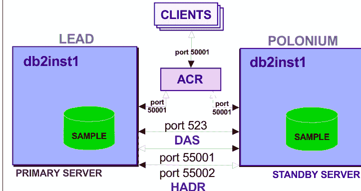

图 3-1 实验环境高层概述

在图 3-1 中，两个示例实例在服务器主机名 `LEAD` 和 `POLONIUM` 上都称为 `DB2INST1`，采用非集群配置，并具有基本的 TCP/IP 以太网适配器连接。`LEAD` 最初将被设置为 HADR 主，而 `POLONIUM` 最初将被设置为 HADR 备用。

`ACR` 框指的是自动客户端路由（Automatic Client Route），它实际上是位于 HADR 之上、外部客户端与每个 DB2 实例之间的软件层。它的作用是将客户端路由到当前设置为为主的 DB2 实例。有关 ACR 的更多详细信息，请参阅第 115 页第 5 章“自动客户端重路由”。

在我们实验中，客户端可以通过端口 `55001` 与 DB2 实例通信，DB2 HADR 通过端口 `55001` 和 `55002` 在服务器之间进行通信。DB2 管理服务器 (`DAS`) 的 GUI 界面通过端口 `523` 通信。

在 HADR 配置中设置的数据库名为 `SAMPLE`；我们最终将为每个远程服务器上的该数据库设置一个别名，以便从 GUI 控制中心的“管理 HADR” 对话框访问它，并用于通用的远程接管、停止和启动命令。

在实验中，我们从一个 `SAMPLE` 数据库开始，它位于其中一台服务器 (`LEAD`) 的 `DB2INST` 实例中。

最后，结束后 `SAMPLE` 在 `LEAD` 上的 `DB2INST1` 实例上作为 HADR 主，在 `POLONIUM` 上的 `DB2INST1` 实例上作为 HADR 备。

在随后的步骤描述中，“远程”一术用于我们最终配置备用数据库的服务器上下文，同样，“本地”一术与“主”互换使用。这仅仅是因为我们将在将成为主节点的服务器上运行向导。最初，我们既没有主也没有备用，只有出现设置向导对话框的本地服务器（在我们的示例中为 `LEAD`）和将在其上恢复数据库的远程服务器（`POLONIUM`）。

配置完成后，主、备用角色可以随意切换，因此这些描述充其量量仅仅是临时的。为了帮助建立一个更持久的参考基准，我们在列出给定服务器时，在括号中包含了我们的实验服务器名称（`LEAD` 和 `POLONIUM`），您可以根据每种情况替换您自己的服务器名称。

### 开始 HADR 配置

对于初学者来说，实现可用设置的最用户友好方法是使用 GUI。

1. 如果数据库处于循环模式，在点击配置“选择日志类型”后将打开第一个对话框。选择“归档”。点击“下一步”。
2. 选择您希望如何处理归档日志：我们通常选择让 DB2 自动归档日志文件。点击“下一步”。
3. 选择日志文件的数量和大小：我们接受默认值，但请根据您的需求参考 DB2 9.1 管理指南：规划 (`SC10-4223`)。点击“下一步”。
4. 指定日志文件的位置：我们将指定如 `/db2actlog` (*nix) 或 `C:\db2log` (Windows)。点击“下一步”。
5. 指定存储备份的位置：这是转换为线性日志的一部分，因为数据库在更改配置参数后会进入备份等待状态。我们将指定如 `/db2/backup` (*nix) 或 `C:\dbbackup` (Windows)。点击“下一步”。
6. 指定备份选项：接受默认值，如果想节省以后将文件传输到备用服务器的时间，可以压缩映像。点击“下一步”。
7. 审核点击“完成”后将执行的操作：这只是步骤的摘要。您可以点击“显示命令”查看实际命令。点击“完成”或点击“上一步”以修正任何不正确的设置。
8. 将显示弹出消息，警告数据库将离线以进行完整备份。点击“确定”。
9. 数据库进度弹出框正在执行操作。等待它消失。
10. DB2 消息弹出框给出结果摘要。这应该是成功的的，点击“关闭”。
11. 现在我们终于回到了在步骤 4 中留下的对话框，可以继续。点击“下一步”。
12. 识别备用数据库：一旦您的数据库日志处于可以启动 HADR 配置的状态已停用，您就可以执行图 3-4 所示的下一步。

向导会在后台检测数据库是否已成功配置，并刷新状态以允许你继续操作。你可能会被要求提供 DB2 管理服务器的单元 ID 和密码，以便 DB2 连接到备用服务器、拷贝备份文件等。

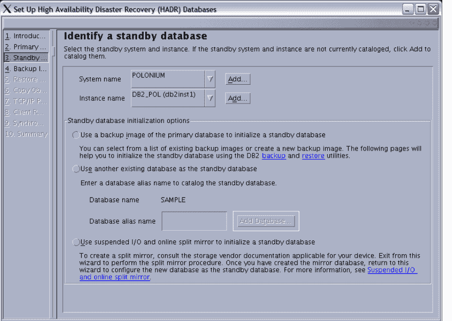

##### 3-4 选择一个数据库作为备用数据库

a. 如果你尚未执行此操作，向导将提示你汇编备用服务器的 IP/主机名、实例节点名称（Instance node name），并指定一个来自主服务器的备份镜像或一个现有的远程数据库。为了让发现功能正常工作，DB2 管理服务器必须在备用服务器上运行（在我们的示例中，在 `POLONIUM` 上）。

## 第 3 章 HADR 设置 51


图 3-5 显示了该系列中的第二个对话框，要求输入用于远程实例的实例节点名称、主机地址和端口号。第一个对话框非常相似，要求输入用于远程数据库的别名。

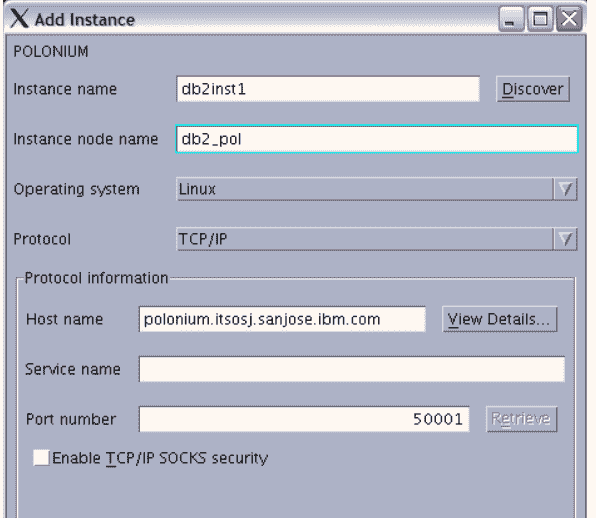

图 3-5 为远程服务器的 DB2 实例汇编实例节点名称

这些子步骤的简要说明：当你点击第 51 页图 3-4 中“系统名称”旁边的添加……以及随后点击“实例名称”旁时，你会发现自己正在添加远程系统的主机名/IP 地址并分配节点名称，然后添加远程实例的主机名/IP 地址并再次被要求分配节点名称。如果你指定了相同的节点名称，向导会报告该节点已存在，并带有 `SQL1018N` 错误失败。

必须为“系统”`System`，你希望控制中心为服务器/主机名 world的名称和“实例”`Instance`，你希望控制中心为实例 world的名称指定不同的节点名称。

在“添加系统”对话框中，远程服务器详细信息的三个必填字段（系统、主机和节点名称）描述如下：

- *系统名称 (System name)*：如果你没有可用的 DNS 并将使用下一个字段中的服务器 IP 地址，请在此处输入主机名值。默认情况下，在此字段中输入值将为所有三个字段填充相同的值，这在具有良好命名标准的 DNS 环境中通常是可以接受的。
- *主机名 (Host name)*：在 `/etc/hosts` 文件中注册的服务器的 IP 地址、DNS 或主机名。
- *节点名称 (Node name)*：可以是任何用户分配的值。在 DB2 中，它是一个别号，代表服务器；而实例节点名称 `Instance node name` 代表实例。在 Windows 中，这旨在指代 NetBios 工作站名称 `dbm cfg` 部分: `NNAME`。如果你将光标悬停在节点字段上，应该会有一个带有此描述性说明的悬停/弹出窗口。实际上，它代表一个 `ADMIN TCPIP NODE`，你可以通过以下命令获取当前列表：

```
db2 list admin node directory
```

远程服务器的 `dbm cfg` 可能甚至没有定义适当名称，因此你可以使用任何长达八个字符的名称。

被要求汇编 Admin TCPIP Node 的事实部分解释了为什么你必须在两端都运行 DB2 管理服务器，以便使用 GUI 界面和向导设置并管理 HADR。

完成“添加系统”对话框后，点击确定。此时，DB2 管理服务器可能会提示你输入 `SYSADM` 单元 ID 和密码以连接到该新系统。如果你在对话框中正确输入了有效的单元 ID 和密码后收到通信失败，这可能与端口 523 的防火墙有关，但最好检查第 80 页 3.4 节“故障排除”故障指南中描述的所有可能性。

如果你因为节点名称重复收到 `SQL1018N` 错误消息，并且想删除错误的条目并在不取消“设置 HADR”向导的情况下使用“添加系统”对话框中的值，你可以打开单独的命令行窗口并输入命令：

```
db2 uncatalog admin node <nodename>
```

在“添加实例”对话框中，实例节点名称为你为远程实例创建别名，并汇编并在本地系统使用，这就是在控制中心中显示的内容。

记住，系统节点名称和实例节点名称不应该是相同的。在后台，系统节点定义是在汇编一个 `ADMIN TCPIP NODE` 条目；而实例节点定义是在汇编一个普通的 `TCPIP NODE` 条目。这就是为什么在 DB2 控制中心树结构中有单独的层级。

为了在向导内部避免冲突，一种方法是预先添加系统和实例定义。可以通过控制中心或配置助手完成。然而，如果由于某种原因无法发现远程对象，你将手动汇编远程服务器节点和数据库别名；请参见第 45 页的示例 3-1 和示例 3-2。

如果你用系统名称汇编 `ADMIN TCPIP` 节点，例如，第 52 页的图 3-5 显示了系统名称值为 `polonium.itsosj.ibm.com`，你可能需要在本地的 `/etc/hosts` 文件中插入远程主机/服务器 `POLONIUM` 的 TCP/IP 地址和主机名项。对于 Windows，此地址和主机名必须位于 `%SystemRoot%\system32\drivers\hosts`。示例 3-3 为远程服务器汇编实例节点名称。

如果你使用此方法，点击下一步，将看到如步骤 7 所示的恢复对话框。如果你指定了位置在远程服务器，则无需拷贝备份镜像，这看起来与第 57 页的图 3-7 相似。

当你指定了主服务器用于初始化数据库的备份镜像时，你可能会遇到 `SQL1018N` 错误，因为你尚未输入 DB2 单元 ID 或密码。

b. 第 51 页图 3-4 中的备用数据库初始化部分提供了在备用系统上初始化数据库三个选项。第一个选项，使用主数据库的备份镜像初始化备用数据库应该提供简单且成功的 HADR 设置。这就是我们使用的。

在示例中，我们如图 3-6 所示，从提供的列表中选择一个备份镜像，并选择最新的备份。

点击“下一步”。

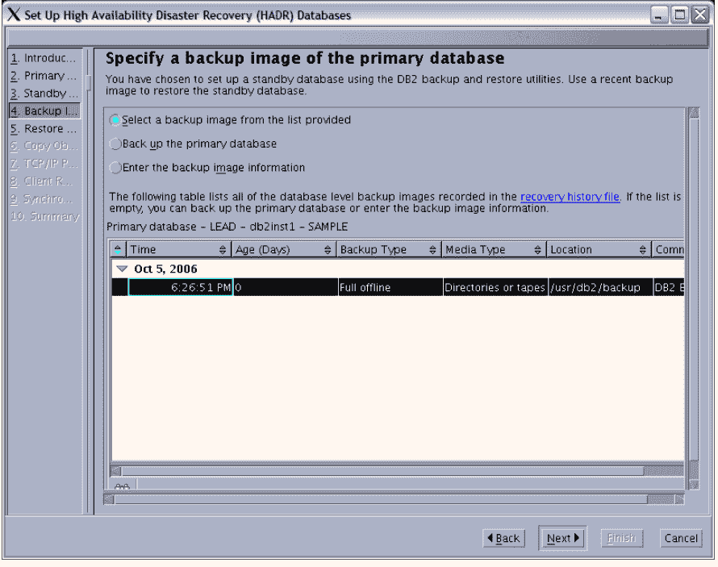

图 3-6 选择用于备备机恢复的首选主备份镜像

56 Linux、UNIX 和 Windows 上的 DB2 高可用性与可扩展性指南

## 设置高可用性灾难恢复 HADR 数据库

### 7. 在备用系统上恢复数据库

在图 3-7 中，为远程系统 `POLONIUM` 上的备用数据库指定别名，供本地系统 `LEAD` 使用。该别名应从图 3-4 识别备用数据库起就已存在。

在本示例中，我们通过选择“将备份镜像从主系统复制到备用系统”来测试 DB2 文件传输能力。通过向导指定备用系统上传输的位置。点击“下一步”。

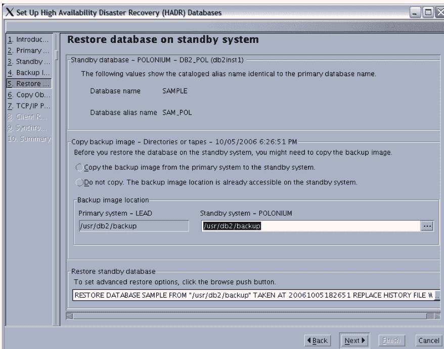

### 8. 将对象复制到备用系统

图 3-8：如果你有未包含在数据库备份文件中的 DB2 对象，例如用于 UDF 和存储过程的外部代码，你可以在此处识别这些对象并让 DB2 为你移动它们。由于我们没有这些对象，因此留空对话框。点击“下一步”。

第 3 章 HADR 设置 57

## 设置高可用性灾难恢复 HADR 数据库

## 将对象复制到备用系统

外部存储的对象，例如用户定义函数 `UDFs` 或存储过程不包含在备份镜像中，必须单独移动到备用系统。在下表中，你可以选择想要复制的对象，并在备用系统上为它们指定新位置。你也可以通过点击“添加”向列表添加对象。

**重要**

有关管理未包含在备份镜像中的外部对象的信息，请参见“任务概述”。你选择的对象将作为二进制文件复制到备用系统。如果你现在不想复制任何对象，请点击“下一步”。

- 手动输入备用位置。
- 将其复制到备用系统上与主系统相同的位置。

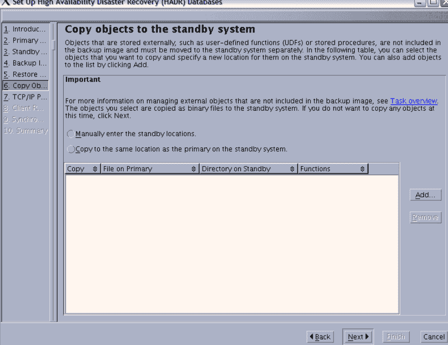

图 3-8 将“特殊”对象跨到备用系统

### 9. 指定 TCP/IP 通信参数

图 3-9 显示了主数据库和备用数据库所需的 HADR 特定主机名和服务/端口号。根据需要输入唯一值并点击**下一步**。

58 Linux、UNIX 和 Windows 上的 DB2 高可用性与可扩展性指南

## 设置高可用性灾难恢复 HADR 数据库

## 指定 TCP/IP 通信参数

主系统和备用系统之间使用 TCP/IP 连接。当 HADR 在主系统和备用系统之间建立连接时，它会查找每个数据库配置的 TCP/IP 服务名和主机名。

**重要**

如果服务文件中未指定 HADR 服务名称端口对，请在继续之前确保你拥有必要的文件权限。如果没有权限，服务文件的更新将失败。

- 主数据库 - `LEAD` - `db2inst1` - `SAMPLE`

| | | |
| :--- | :--- | :--- |
| 主机名 | `LEAD` | 查看 IP 信息... |
| HADR 服务名称 | `DB2_HADR_1` | 查看服务文件... |
| HADR 端口号 | | 55001 |

- 备用数据库 - `POLONIUM` - `DB2_POL` (`db2inst1`) - `SAM_POL` (`SAMPLE`)

| | | |
| :--- | :--- | :--- |
| 主机名 | `polonium` | 查看 IP 信息... |
| HADR 服务名称 | `DB2_HADR_2` | 查看服务文件... |
| HADR 端口号 | | 55002 |

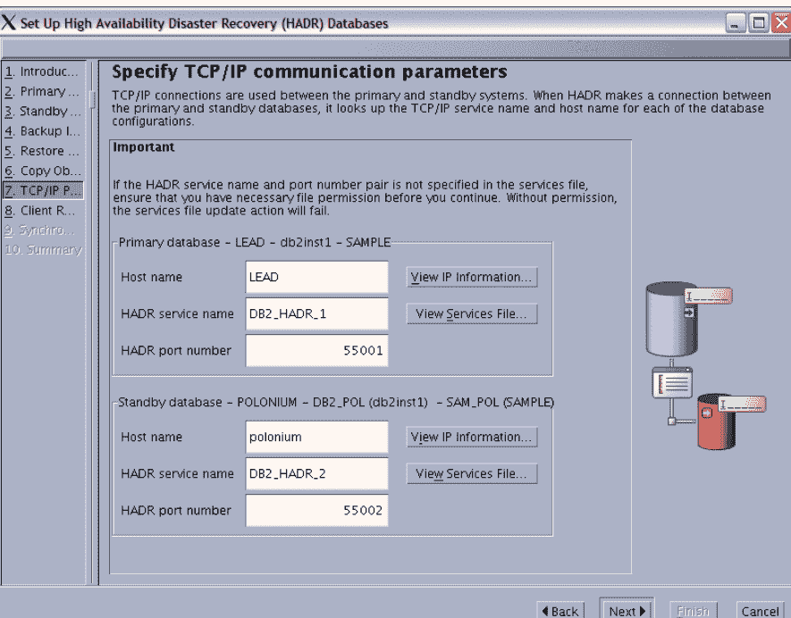

图 3-9 为两个 HADR 通道指定主机地址和端口号

图 3-10 显示了我们如何设置 IP 地址重定向设施：连接到 DB2 服务器的每个客户端都存储了主服务器和备用服务器的主 IP 地址和端口号。当你切换角色或进行接管时，将使用另一个 IP 地址；客户端将收到 SQL 消息，通知连接已更改并应重试数据库连接。请参见第 5 章第 115 页“客户端重定向”获取更多关于 ACR 的信息。端口号是指 DB2 服务器的主端口，而不是 HADR 端口。只需将端口号与正确的服务器名/IP 地址匹配，并记住可能的“备用”是备用服务器，反之亦然。点击**下一步**。

第 3 章 HADR 设置 59


## 配置自动客户端重定向数据库

客户端重定向允许客户端应用程序在 HADR 故障转移后，以最小中断继续对其正在访问的数据库的操作。

- 主数据库 - `LEAD` - `db2inst1` - `SAMPLE`

| | | |

| :--- | :--- | :--- |

| 主机名 | `LEAD` | 查看 IP 信息... |

| HADR 服务名称 | `DB2_HADR_1` | 查看服务文件... |

| HADR 端口号 | | `55001` |

- 备用数据库 - `POLONIUM` - `DB2_POL` (`db2inst1`) - `SAM_POL` (`SAMPLE`)

| | | |

| :--- | :--- | :--- |

| 主机名 | `polonium` | 查看 IP 信息... |

| HADR 服务名称 | `DB2_HADR_2` | 查看服务文件... |

| HADR 端口号 | | `55002` |

12. 检查点击“完成”时将发生的操作（图 3-12）：此对话框显示了所选 HADR 的概述。点击“显示命令”以获取命令行语句，了解场景中发生的情况。这些命令值得保存到文本文件中，供后续配置使用。

13. 步骤执行：图 3-13 显示了自动化脚本生成并运行的命令的动态摘要。如果遇到任何问题，向导将告知您必须修正的内容，您应该能够点击上一个对话框上的完成 (Finish) 以重试该过程。

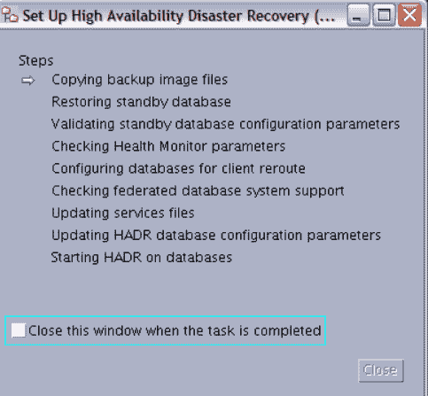

图 3-13 开始处理脚本化 HADR 设置的步骤

图3-14 显示了完成的步骤，这是您预期的结果。HADR 设置已完成。点击关闭 (Close)。

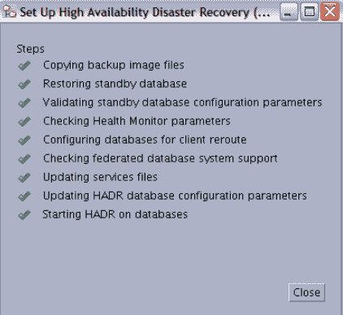

图 3-14 *脚本化 HADR 设置的完成步骤*

14. *验证 HADR 设置：* 要确认 HADR 正在运行，您可以检查 DB2 控制中心（DB2 Control Center）。

首先，选择视图 (View) →刷新 (Refresh)，否则它会将远程数据库显示为“未知 (unknown)”。接下来，右键点击 HADR 数据库之一，选择高可用性灾难恢复 (High Availability Disaster Recovery) →管理 HADR (Manage HADR)。结果应类似于图 3-15。

如果您在第 11 步中将启动 HADR 的选项留空（见第 62 页的图 3-12），可以在此处点击“启动 HADR...”，这将显示您的数据库处于对等（Peer）状态，并具有相应的同步模式、连接状态以及每个数据库的日志信息。您可以使用 `GET SNAPSHOT` 命令或 `db2pd` 获取类似的信息。

> 注意：使用 DB2 版本 8 时，我们建议至少使用 FixPak 14 以修正管理 HADR 对话框中的 `SYNCMODE` 差异。

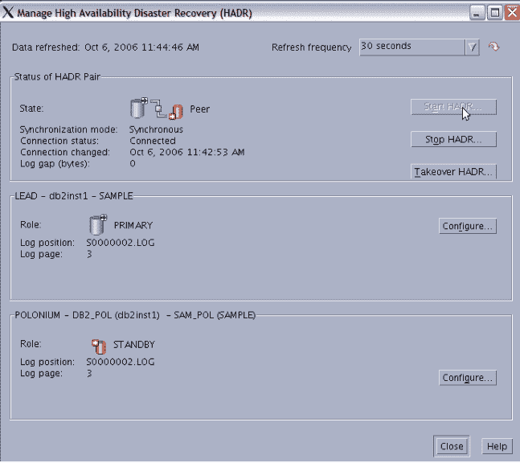

图 3-15 控制中心中：管理 HADR

### 3.2.3 命令行设置

DB2 为 HADR 提供了命令和 GUI 设置向导。在本节中，我们演示了如何使用命令设置 HADR。在我们的实验环境中，我们将 `LEAD` 服务器设置为为主服务器，将 `POLONIUM` 服务器设置为备用服务器，并在两个服务器上都建立了 `SAMPLE` 数据库。

要为命令行环境设置 HADR，请完成以下步骤：

- 1. 设置所需的数据库配置参数

如果尚未开启存档日志，请使用以下命令更新 `LOGRETAIN` 参数：

```
db2 update database configuration for sample using LOGRETAIN recovery
```

同样，使用以下命令更新 `LOGINDEXBUILD` 参数，以便对索引的创建、重新创建或重组操作进行记录：

```
db2 update database configuration for sample using LOGINDEXBUILD ON
```

- 2. 在主服务器上备份您的数据库，并使用以下命令将副本移动到备用服务器：

```
db2 backup database sample to /usr/db2/backup
```

- 3. 在备用系统上恢复数据库。

在示例中，我们使用以下命令恢复到 `POLONIUM` 服务器上的 `SAMPLE` 数据库：

```
db2 restore database sample from /usr/db2/backup taken at 200611114321 replace history file
```

- 4. 为 ACR 配置数据库。此步骤是可选的，但强烈建议执行。要配置 ACR，请按照步骤在主、备用服务器上更新 `ALTERNATE SERVER` 数据库配置：

  - a. 在主服务器上（我们的测试用例中为 `LEAD`），使用以下命令将备用服务器设置为备服务器：

```
db2 update alternate server for database sample using hostname polonium port 50001
```

  - b. 在备用服务器上（我们的测试用例中为 `POLONIUM`），使用以下命令将主服务器设置为备服务器：

```
db2 update alternate server for database sample using hostname lead port 50001
```

- 5. 在主系统 `LEAD` 的 `services` 文件中更新以下字段以进行 HADR 通信：

  - 服务名称：`DB2_HADR_1`

  - 端口号：`55001`

  - 服务名称：`DB2_HADR_2`

  - 端口号：`55002`

- 6. 在备用系统 `POLONIUM` 的 `services` 文件中更新以下字段以进行 HADR 通信：

  - 服务名称：`DB2_HADR_1`

  - 端口号：`55001`

  - 服务名称：`DB2_HADR_2`

  - 端口号：`55002`

- 7. 使用以下命令更新主数据库上的 HADR 数据库配置参数。在我们的测试用例中，它是 `LEAD`。

```
db2 update db cfg for sample using HADR_LOCAL_HOST LEAD
db2 update db cfg for sample using HADR_LOCAL_SVC DB2_HADR_1
db2 update db cfg for sample using HADR_REMOTE_HOST POLONIUM
db2 update db cfg for sample using HADR_REMOTE_SVC DB2_HADR_2
db2 update db cfg for sample using HADR_REMOTE_INST DB2INSTI
db2 update db cfg for sample using HADR_TIMEOUT 3
db2 update db cfg for sample using SYNC
db2 update db cfg for sample
```

- 8. 在备用数据库（我们的测试用例中为 `POLONIUM`）上使用以下命令更新 HADR 数据库配置参数：

```
db2 update db cfg for sample using HADR_LOCAL_HOST POLONIUM
db2 update db cfg for sample using HADR_LOCAL_SVC DB2_HADR_1
db2 update db cfg for sample using HADR_REMOTE_HOST LEAD
db2 update db cfg for sample using HADR_REMOTE_SVC DB2_HADR_2
db2 update db cfg for sample using HADR_REMOTE_INST DB2INSTI
db2 update db cfg for sample using HADR_TIMEOUT 3
db2 update db cfg for sample
```

- 9. 使用以下命令更新备用数据库 `POLONIUM` 的 HADR 数据库配置参数：

```
db2 update db for sample
```

- 10. 使用以下命令更新主数据库（我们的测试用例中为 `LEAD`）的 HADR 数据库配置参数：

```
db2 update db for sample
```

### 3.3 基本操作

本节介绍了启动、停止和切换（takeover）操作。

#### 3.3.1 启动和停止

本节涵盖启动和停止程序。

##### 启动

在启动 HADR 之前，我们建议先启动备用数据库。启动 HADR 时不会等待备用数据库。

##### 使用启动命令

启动的语法如下：


```
START HADR ON database-alias [PRIMARY | STANDBY] [FORCE]
```

当启动主库时将使用 `FORCE` 选项。例如，要启动主库，执行以下命令：

```
db2 start hadr on sample primary
```

### 从控制中心启动

`HADR` 也可以从控制中心启动：

1. 从控制中心展开对象树到数据库对象，右键点击计划启动 `HADR` 的数据库名称。选择高可用性灾难恢复 → 管理（如图 3-16 所示）。
2. 在管理可用灾难恢复窗口中，点击启动 `HADR`（如图 3-17 所示）。
3. 在图 3-18 所示的 `HADR` 窗口中，您可以选择启动主库、备用库或两者。点击确定。

### 停止

虽然可以使用 `STOP HADR` 命令停止主、备或两者，但应谨慎使用。如果您想停止指定的数据库但仍想保持其作为 `HADR` 主库或备用库的角色，请勿发布 `STOP HADR` 命令。相反，请使用 `DEACTIVATE DATABASE` 命令。

如果您只想停止 `HADR` 操作，这是推荐的关闭 `HADR` 对的方法：

- 卸激活主数据库。
- 停止主数据库上的 `DB2`。
- 卸激活备用数据库。
- 停止备用数据库上的 `DB2`。

#### 使用 STOP HADR 命令

您可以从命令行或控制中心停止 `HADR`。当您想要将数据库恢复为独立数据库时，可以使用 `STOP HADR` 命令。

停止命令具有以下语法：

`STOP HADR ON DATABASE database-alias [USER username USING password]]`

例如：

`db2 stop hadr database sample`

您可以在 `DB2 9.1` 参考文档 `SC10-4226` 中找到 `STOP HADR` 命令的详细信息。

#### 从控制中心停止 HADR

您可以通过执行以下步骤，使用 `HADR` 向导来停止 `HADR`：

1. 从控制中心开始，向下展开对象树到 `HADR` 对象。右键点击您计划对其停止 `HADR` 的数据库名称。选择高可用性灾难恢复（High Availability Disaster Recovery）→ 管理（参见第 69 页的图 3-16）。
2. 从管理高可用性恢复（`HADR`）窗口，点击如图 3-19 所示的停止 `HADR`。

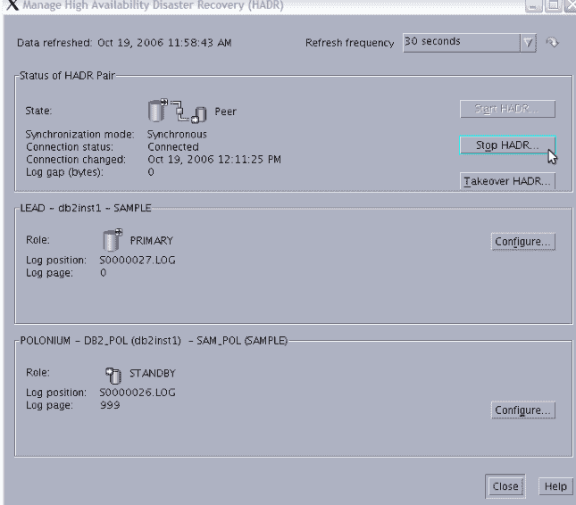

Linux、UNIX 和 Windows 上 `DB2` 高可用性与可扩展性指南

3. 从图 3-20 所示的停止 `HADR` 窗口，您可以选择仅停止主库，或同时停止主库和备用库。如果其中数据库已停止 `HADR`，则停止 `HADR` 窗口仅在 `HADR` 启动时允许您停止该数据库。点击确定。

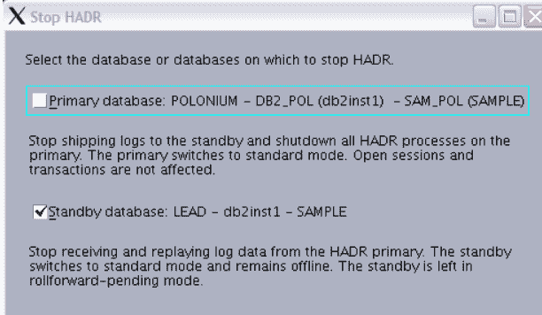

图 3-20 停止 `HADR`

### 3.3.2 计划切换

计划切换也称为角色切换或角色交换。例如，当想要切换数据库的角色时，执行 `TAKEOVER` 命令。例如，在升级期间切换角色，使备用库成为主库。请记住在执行 `TAKEOVER` 命令后，手动或使用 `ACR` 重新路由您的客户端。

只有当数据库处于 `Peer`（同步）状态时，才能从备用库切换角色。如果数据库处于任何其他状态，`TAKEOVER` 命令将失败。

接管程序简单地执行 `TAKEOVER` 命令。

例如，使用以下命令在备用数据库上执行接管命令：

```
db2 takeover hadr on database sample
```

`TAKEOVER HADR` 命令的详细信息见 `DB2 9.1` 命令参考文档 `SC10-4226`。

从备用库执行 `TAKEOVER HADR` 命令后，将在后台执行以下步骤：

1. 备用库告诉主库它正在接管。
2. 主库断开所有客户端连接并拒绝新连接。
3. 主库回滚任何打开的事务，并将剩余日志（直到日志结束）发送到备用库。
4. 备用库重放收到的日志，直到日志结束。
5. 备用库成为新的主库。
6. 备用库成为新的主库。

#### 使用 GUI

在示例中，我们将 `POLONIUM` 上的 `SAMPLE` 数据库作为主数据库。执行以下步骤：

1. 从控制中心展开对象树到数据库对象，右键点击您计划对其接管 `HADR` 的数据库名称。`高可用性灾难恢复`（High Availability Disaster Recovery）→ 管理。
2. 从备用库 (`POLONIUM`) 上的 `HADR` 窗口，点击如图 3-21 所示的接管 `HADR`。

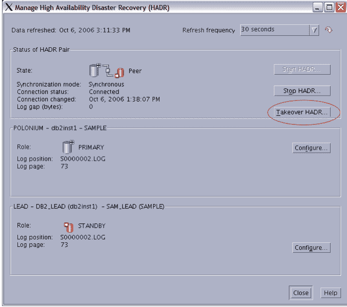

图 3-21 管理 `HADR` 接管

3. 从接管 `HADR` 窗口，选择如图 3-22 所示的切换角色并点击确定。

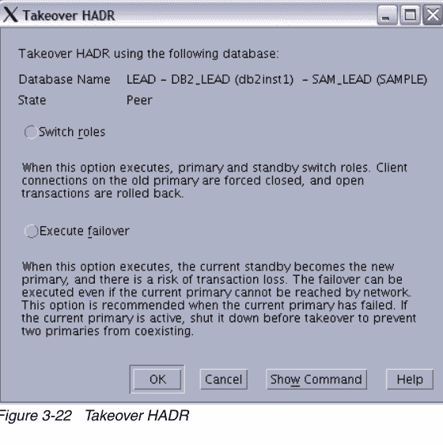

点击“显示命令”可以为您提供 `DB2` 用于此操作的命令。图 3-23 阐了输出结果。

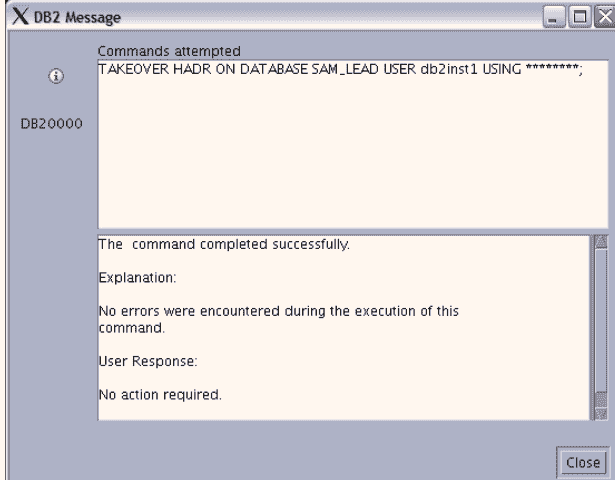

图 3-23 接管 `HADR` 命令

现在主库和备用库的角色已经交换。再次执行相同命令以换回角色。只要数据库处于 `Peer` 状态，就可以根据需要频繁执行。

### 3.3.3 强制接管

强制接管也称为故障转移（failover），通过在备用数据库执行包含 `BY FORCE` 选项的 `TAKEOVER` 命令发出。只有当您的主库无法运行时，才应使用强制接管。`BY FORCE` 选项告诉备用库与原主库协调，像执行计划切换一样成为新的主库。

故障转移程序包括以下步骤：

1. 确保主库处于离机状态，以尽量减少数据丢失的可能性。如果执行了强制接管而主库未离机，可能会导致两个数据库都成为主库。这被称为“脑裂”。
2. 在备用数据库上带有 `BY FORCE` 选项执行 `TAKEOVER HADR` 命令。以下是示例数据库的例子：

```
db2 takeover hadr on database sample by force
```

从备用库执行 `TAKEOVER HADR` 命令后，将在后台执行以下步骤：

1. 备用库告诉主库它正在接管。
2. 主库断开所有客户端连接并拒绝新连接。
3. 主库回滚任何打开的事务，并将剩余日志（直到日志结束）发送到备用库。
4. 备用库重放收到的日志，直到日志结束。
5. 备用库成为新的主库。
6. 备用库成为新的主库。

### 3.4.1 设置期间

以下是设置过程中可能遇到的常见问题及可能的解决方法列表：

- 症状：

在 `AIX/UNIX/Linux` 上，错误信息表明由于缺少 Java 库，无法启动 Control Center 等图形化工具。

- 修复：

对于 64 位的 `DB2 V8`，`AIX` 系统可能需要安装 64 位的 Java 库，然后相应地设置 `JDK_64_PATH` 的 admin cfg 和 dcm cfg 值，以及 `JDK_64_PATH` 的 admin cfg 值，并重启 `DB2` 实例和 `DB2` 管理服务器。

`DB2 9` 自带 Java 库，因此不应出现此问题。

- 症状：

在 Windows 上，各种错误信息声称用户 ID 没有执行给定命令的权限，尽管用户 ID 既是具有隐式 `SYSADM` 权限的 `DB2` 实例 ID，又是 Windows 管理员。

- 修复：

作为前提条件，请确保如果您处于永久连接的域中，至少在域上创建了包含 `DB2` 实例用户 ID 的 `DB2ADMNS` 组，并根据安全策略可选地同步到本地服务器。确保您登录 Windows 时的用户 ID 类型与安装 `DB2` 时的相同。在配置了 Active Directory® 的服务器上，这很可能是域用户 ID 而非本地用户 ID。确保登录用户 ID 属于 Administrator 组。如果您将 `SYSADM_GROUP` cfg 从默认值更改为其他值，即使 `DB2` 实例已连接到 `SYSADM_GROUP`，您也可能遇到 `DB2` 实例用户隐式权限的问题。

如果在配置了域但未永久连接到该域、且没有安全策略定期覆盖本地注册设置的服务器上运行 `DB2`，那么使用本地用户 ID 安装所有内容可能更好。最后的考虑因素是检查 `DB2` 注册表变量 `DB2_GRP_LOOKUP` 的值，该变量 Windows 环境 特有。以域用户 ID 登录的用户在 Windows 中的组连接默认会检查域组而不是本地组。将 `DB2_GRP_LOOKUP` 参数设置为 `LOCAL` 可将覆盖此行为。

- 症状：

在尝试发现 `DB2` 实例和数据库时，在远程/备用端看不到远程服务器或 `DB2` 对象。

- 修复：


在远程端启动 DB2 管理服务器，并确认防火墙已开放 `523` 端口，或者手动在命令行上目录管理 TCP/IP 节点、实例 TCP/IP 节点和远程数据库。示例 3-4。如果您希望通过 Control Center 管理 HADR，则需要两端的管理服务器正常运行以实现连接。

示例 3-4 编目录 TCP/IP 节点和数据库-3

```
db2 catalog admin tcpip polonium remote x.x.x.x remote_instance
db2inst1 system polonium
db2 catalog tcpip db2_pol remote x.x.x.x server 50001
remote_instance db2inst1 system polonium
db2 catalog database sample as sam_pol db2_pol
```

> 如果你在设置 HADR 的对话框期间手动执行编目录节点和数据库的命令，你需要回到 Control Center 主对话框，选择 View（视图）-> Refresh（刷新），并重启，以便在对话框中看到远程对象。

### 3.4.2 设置完成后或正常执行期间

设置完成后以及 HADR 运行时，会遇到以下常见问题及可能的解决方法。

- 症状：

在 Control Center 的 Manage HADR 对话框中看不到远程服务器或远程/备用端的 DB2 对象。值显示为“unknown”，即使远程服务器上的 DB2 确实正在运行，且 `db2pd` 或 `get snapshot` 命令的输出显示 HADR 状态为已连接并处于 Peer 状态。

- 修复：

i. 首先检查的是远程服务器上是否启动了 DB2 管理服务器。

ii. 接下来，确认 `ADMIN TCPIP`、`TCPIP NODES` 以及远程数据库已正确编目录。

iii. 确保目录节点名称中指定的服务器名称或 IP 地址实际上已在本地和远程的 `/etc/hosts` 文件中注册，并且它们与远程服务器的 `<DB2 Instance home>/stdlib/db2nodes.cfg` 中注册的主机名或 IP 地址匹配。根据经验，我们发现位于 VM 或类似架构上的服务器可能定义了多个 IP 地址，但只有其中一个可以通过防火墙可见，并且可能与远程管理客户端应该能够看到的主机不匹配。

- 症状：

尝试连接远程服务器上的数据库时检测到 `SQL20081N` 通信错误，尽管之前没有问题，且远程服务器上的相关 DB2 实例和 DB2 管理服务器都确实正在运行。

- 修复：

这是动态网络环境中一个极其常见的问题，可能由许多原因引起，包括防火墙问题、IP 地址或端口号不匹配或冲突、错误的 `/etc/hosts` 或 `/etc/hosts.allow` 拒绝内容、主机名或 DNS 问题。首先要做的是按照消息参考对任何协议错误代码的建议（参见 DB2 9.1 消息参考卷 2，SC10-4239，第 2 章）。在尝试这些方法后，您可以尝试放弃使用 DNS，临时改用您确认正确的直接地址。

- 症状：

HADR 对话框上的同步模式与输出不匹配；SYNC 显示正确，但 ASYNC 似乎反过了。

- 修复：

这是一个针对 HADR 对话框的已知错误，目前已修复。建议使用 DB2 FixPak 14 以显示正确的 SYNC 值。

- 症状：

FixPak13 `db2pd` 输出无法工作。

- 修复：

这是仅存在于该版本的已知问题，在编写时，开放 APAR `JR2468` 最终将解决此问题。解决方法是使用 `snapshot` 或其他手段访问所需信息。

- 症状：

在两个服务器上更改 `db cfg` 参数后，对备用端执行取消激活和重新激活，HADR 无法重新连接：

- 修复：

如果您更改某些参数（例如任何 HADR 前缀的 `db cfg` 参数），双方的当前活动值必须匹配才能使 HADR 连接正常。实现这一点需要主端停机，否则在再次将 `db cfg` 值更改为匹配主端值之前，您的备用端将无法运行。

### 3.4.4 运行 HADR 的注意事项

一旦配置并运行了 HADR，请考虑以下情况：

- 如果您通过 DB2 工具数据库调度了备份和清理任务，则您应该考虑通过 HADR 与您的应用程序数据库并行管理这些任务。在主服务器长时间停机并跨越关键批处理窗口的情况下，您会希望它能像原始主服务器一样工作并运行相同的任务。

- 如果您不希望备用数据库在 HADR 停止且 DB2 实例在（数据库仍处于 `STANDARD` 模式时重启时尝试进行重做（roll forward），则应关闭 `db cfg` 参数 `AUTORESTART`。

- 如果您使用 ACR 而非集群解决方案来控制远程客户端的 IP 地址和接管，则应对控制 HADR 数据库的 DB2 实例关闭 `db2auto`。以服务器 A 和服务器 B 为例说明，这样做是为了防止故障的主服务器 A 上的 DB2 在服务器 A 随后修复并启动时自动重启，从而导致脑裂（split-brain）场景。

在 HADR 的语文中，脑裂可以总结为：由于远程客户端在连接数据库时无法区分一个服务器和另一个服务器，导致可能在错误的数据库上进行更改，然后无法被隔离并转移到正确的数据库。

幸运的是，DB2 HADR 能够保护自己免受 HADR 主数据库在 HADR 模式下被停用时的脑裂场景影响。如果客户端尝试连接到备用数据库，它将尝试将该数据库激活为 HADR 主模式，并连接到 HADR 备用。在 `HADR_TIMEOUT` 间隔后，DB2 将返回代码为 7 的 `SQL1768N` 错误：

主数据库在 HADR 超时间隔内未能与其备用数据库建立连接。

这就是为什么从管理角度来看，先启动 HADR 备用数据库再启动主数据库更容易，因为不需要压力在 `HADR_TIMEOUT` 间隔结束且数据库处于非活动状态之前启动另一个数据库。

在 HADR 环境下脑裂仍可能以其他方式发生：

- 故障的 HADR 主服务器从未真正被停用（例如，故障发生在网络而非服务器），在备用服务器 B 发出 `db2 takeover hadr on database ... by force` 强制后，故障的主服务器 A 意外重新上线。

- 故障的服务器 A HADR PRIMARY 被执行了 `db2 stop hadr on database` 命令，使其现在处于 `STANDARD` 模式，客户端可以再次连接到它，而不是运行在服务器 B 上的正确 HADR 主数据库。与之前的场景相同，在管理 IP 地址的适当集群解决方案中，这应该是是不可能的。在这种情况下，远程客户端只能连接到具有活动节点角色的单一服务器。

### 3.4.5 故障后重新建立 HADR

该过程也称为 HADR 的整合（reintegration），与 HADR 的初始设置非常相似，但不需要所有的 `db cfg` 参数配置。

有两种方法可以成功地让主备关系中的 HADR 重新工作；这两种方法都不应该需要停机，且第一种方法是快速且低复杂性的解决方案。

为了方便理解，我们使用服务器 A HADR 数据库 `SAMPLE` 作为主、服务器 B 作为备用的示例，其中服务器 A 发生故障，随后在服务器 B 上执行 `takeover hadr by force` 命令，该服务器成为新的主服务器。

第一种方法只有在服务器 A 发生故障时，主库和备库处于 `Peer` 状态时才有效。在这种场景下，DB2 实例最终会在服务器 A 上重启，以纠正发生的任何故障。DB2 HADR 将通过不允许在服务器 A 上激活数据库来保护自己免受脑裂影响，如果此时进行任何数据库激活或远程客户端连接尝试，将返回 RC 为 7 的 `SQL176N`。

下一步要做的是在服务器 A 上执行 `db2 start hadr on database sample` 命令。注意，`SAMPLE` 数据库也不能预先运行 `db2 stop hadr on database` 命令，因为它将包含服务器 B 不知的日志记录，使其实际上无法作为服务器 B 的备用库使用。尝试作为备用库重启 HADR 将导致 `SQL176N` RC 1。如果当服务器 A 发生故障时数据库未处于 `Peer` 状态，则尝试在服务器 A 的 `SAMPLE` 数据库上作为备用库启动 HADR 自然由于相同原因失败。

在理想情况下，应该在 HADR 主服务器上持续跟踪 `Peer` 状态。如果在不在 `Peer` 状态时发生任何故障，则在在备用服务器 B 上执行 `db2 had takeover database sample by force` 命令之前应进行考虑。在这种情况下，应尽力纠正服务器 A 上的问题并重启数据库，而不是在服务器 B 的 `STANDBY` 数据库上执行强制接管命令，因为 `Peer` 状态是您确保提交提交没有丢失数据的唯一。

第二种方法无论服务器发生故障时 HADR 节点是否处于 `Peer` 状态均有效。这种方法相对简单，并且与 HADR 的初始设置相比节省了时间，因此 `db cfg` 参数与物理数据容器分开存储在名为 `SQLDBCONF` 的非用户可读文件中。除非在恢复之前已删除了数据库，否则该文件不会被恢复命令替换。


最多，如果你在从主备份执行恢复之前需要删除备用数据库，你将需要更改 `db cfg` 参数：

- `HADR_LOCAL_HOST` = `<hostname>`
- `HADR_LOCAL_SVC` = `<this service>`
- `HADR_REMOTE_HOST` = `<hostname>`
- `HADR_REMOTE_SVC` = `<remote service>`
- `HADR_REMOTE_INST` = `<remote instance>`

现在我们实际执行传输命令，无论是像示例中显示的 `scp`，还是 `sftp` 或其他方法：

```
scp SAMPLE.0.dbinst1.NODE0000.CATN0000.200610181511520.001 dbinst1@polonium:/usr/db2/backup
```

- 3. 我们登录到远程服务器（在示例中为 POLONIUM）并执行恢复数据库命令。注意，如果备用上的数据库在恢复后进行了前滚重做（roll forward），HADR 将无法重新建立连接：

`db2 restore db sample from /usr/db2/backup taken at 20061018151120`

如你所见，我们在恢复命令中使用时间戳。对于任何覆盖现有数据库的提示，请响应“y”。

4. 最后一步是在两端启动 HADR，并检查其是否连接成功。你可以等待一段时间直到备用数据库达到 Peer（对等）状态，或者让它处于 catchup-pending（等待追赶）状态，它最终将追赶并达到 Peer 状态。

a. 在我们的示例中，主数据库从未离开 HADR 主状态，我们只需要在备用库上启动 HADR：

`db2 start hadr on db sample as standby`

如果主服务器数据库没有启动 HADR，我们可以通过登录该服务器并执行以下命令来实现：

`db2 start hadr on db sample as primary`

> 提示：如果某个数据库在两个服务器上都停止了 HADR，重启时应从备用开始，然后是主，否则你会遇到此消息：
> 
> `SQL1768N Unable to start HADR. Reason code = "7".`

b. 检查 HADR 是否连接并正常工作可以通过检查 `db2diag.log`、获取数据库快照（snapshot）或使用 `db2pd` 命令。

`db2pd -db sample -hadr`

此命令的输出位于示例 3-6。

```
示例 3-6 使用 db2pd 输出检查 HADR
Database Partition 0 -- Database SAMPLE -- Active -- Up 0 days 00:00:04
HADR Information:
Role State SyncMode HeartbeatsMissed LogGapRunAvg (bytes)
Standby Peer Sync 0 1381445
ConnectStatus ConnectTime Timeout
Connected Thu Oct 19 10:03:44 2006 (116177424) 3
LocalHost LocalService
polonium DB2_HADR_Z
RemoteHost RemoteService RemoteInstance
LEAD DB2_HADR_1 db2inst1
PrimaryFile Pg PrimaryLSN
S000025.LOG 180 0x0000000071FC6F3
StandByFile StandBy StandByLSN
S000025.LOG 180 0x0000000071FC6F6
```

可选，在达到 Peer 状态后，你可以切换角色。例如，如果你刚刚在一个原本是主系统的故障服务器上恢复了数据库，且其现在作为备用库运行，只需登录该备用服务器并执行非强制接（takeover）命令：

`db2 takeover hadr on db sample`

在我们的示例环境中，随后的 `db2pd` 将给出如示例 3-7 所示的结果。

### 示例 3-7 db2pd 输出 - HADR 处于 Peer 状态

```
db2inst1@postgresql:/usr/db2/backup~ db2pd -d sample -hadr
```

```
Database Partition 0 -- Database SAMPLE -- Active -- Up 0 days 00:32:18
```

```
HADR Information:
Role State SyncMode HeartbeatsMissed LogGapRunAvg (bytes)
Primary Peer Sync 0 0
```

```
Connect ConnectTime Timeout
Connected Oct 19 13:03:44 2006 (116127724) 3
```

```
LocalHost LocalService
polonium DB2_HADR_2
```

```
RemoteHost RemoteService RemoteInstance
LEAD DB2_HADR_1 db2inst1
```

```
PrimaryFile PrimaryPg PrimaryLSN
S000025.LOG 200 00000000072106AB
```

```
StandbyFile StandByPg StandByLSN
S000025.LOG 200 00000000072106AB
```

如果你通过 DB2 控制 Center 管理 HADR，你已经编目录了远程节点和数据库别名，因此，你也可以通过指定远程数据库别名以及显式的 DB2 实例 ID 和密码来远程执行切换。例如，如果我们现在想再次切换角色，使 LEAD 服务器上的 SAMPLE 数据库成为主库，我们可以从 POLONIUM 服务器执行命令：

```
db2 takeover hadr on db sample_lead user db2instal
```

> 提示：不需要担心暴露 DB2 密码，如果你只指定用户，系统将使用星号（*）掩码输入提示你密码。

如果你在初始设置 HADR 时仅从主侧建模了节点和数据库别名，则备用服务器上将没有相应的条目。你可以在备用库上使用 Control Center 对它们建模。

总之，HADR 仅在主库上执行，因此理解这一点至关重要。

# Linux、Unix 和 Windows 高可用性和可扩展性指南

# HADR 管理与监控

在本章中，我们将讨论 HADR 的常规管理。我们将描述监控 HADR 的方法，包括恢复日志。

## 4.1 管理 HADR 系统

本节的重点是让你了解 HADR 内部。

### 复制操作

以下操作从主库复制：

- 数据定义语言（DDL）
  - 包括创建和删除
- 数据操作语言（DML）：
  - 插入、更新或删除
- 缓冲池：
  - 创建和删除
- 表空间：
  - 创建或修改
- 容器大小、类型（DMS 或 SMS）在两个服务器上必须相同。
- 如果启用了自动存储，路径必须相同。
- 在线 REORG：
  - 复制。由于日志记录增加，备用库可能会落后。
- 离线 REORG：
  - 复制，但取决于 REORG 是否重组。
- 重组 REORG：
  按影响的数百或数行记录日志。在这种情况下，备用库可能会落后。
- 非重组 REORG：
  整个操作是主库 REORG 后生成的单个记录。该操作对备用库追赶能力的影响最大。

### 非复制操作

以下操作不会被 HADR 复制：

- NOT LOGGED INITIALLY 表：
  使用 NOT LOGGED INITIALLY 选项创建的表不会复制。这些表在备用库上是无效的，在切换后访问这些表会导致错误。
- BLBS 和 CLOBs：
  非日志大对象（LOB）不复制，但备用库将分配空间并将 LOB 数据设为二进制零。
- 数据链接：
  HADR 不支持。
  当 `DATALINKS` 设置为 YES 时，HADR 会失败。
- 数据库配置：
  `UPDATE DB CFG` 不复制。
  - 动态数据库配置参数可以更新到主和备用库而无需中断。对于需要重启数据库的数据库配置参数，我们建议你遵循滚动升级步骤。见第 166 页“DB2 FixPak 滚动升级”。
- 恢复历史文件：
  不会自动复制到备用库。
  你可以通过使用主备份镜像，使用 `RESTORE` 命令配合 `REPLACE HISTORY FILE` 选项将历史文件恢复到备用库，例如：

`db2 restore database sample replace history file`

- 你也可以通过 `RESTORE` 命令从主备备份镜像更新备备上的历史文件，例如：

`db2 restore database sample history file`


如果发生了接管且备用数据库具有最新的历史文件，则在新主库上执行备份和恢复操作将在历史文件中生成新记录，并与原始主库生成的记录无缝融合。如果历史文件已过时或缺少项，则可能无法进行自动增量恢复操作；相反，将需要手动恢复操作。

我们认为主数据库的恢复历史文件与备用数据库无关，因为它包含了特定于该主服务器的 DB2 恢复信息；DB2 记录了使用哪个备份文件来恢复到先前的时间点，以及其他信息。在大多数 HADR 实现中，备用系统仅作为临时措施以主模式运行，期间旧主服务器正在进行修复，这使得恢复历史文件的主版本变得无关紧要；此外，由于主库和备用库之间的日志文件编号和位置可能不同，因此在备用服务器上使用是不正确的。

更多信息，请参考以下源：

DB2 9.1 Data Recovery and High Availability Guide and Reference, SC10-4228。

### 复制 LOAD 操作

以下是在主库上记录日志并发送到备用库的 `LOAD` 操作：

- `COPY YES`:
  - 备用库通过访问加载中指定的路径或设备在备用库上复制数据。
  - 否则，表空间将被标记为坏（bad），并跳过该表空间未来的日志记录。
  - 为了避免强制重新整合备用库，你可以恢复备用表空间，确保路径或设备设置正确，并使用 `REPLACE` 选项重新运行 `LOAD` 命令。
  - 如果无法让两台服务器访问相同的路径或设备，可以在执行加载操作时停用备用数据库，在主库上执行加载，将输出文件的副本放在备用路径中，然后激活备用数据库。对于此情况，请另参见 6.2 节第143页“DB2 HADR 注册变量”中注册变量 `DB2LOADREC` 的使用。

- `NONRECOVERABLE LOAD`:
  - 备用库上的对应表将被标记为坏，并跳过涉及此表的未来日志记录。
  - 备用数据库将跳过与此表相关的日志记录。你可以选择在主库上使用指定的 `COPY` 和 `REPLACE` 选项重新发出 `LOAD` 命令来恢复该表，或者删除该表以恢复空间。

- `LOAD COPY NO`:
  - 不支持指定 `COPY NO` 选项的加载操作，因此该命令在主库上自动转换为 `LOAD NONRECOVERABLE`。
  - 为了让 `LOAD COPY` 选项在主库上执行，你可以将注册变量 `DB2_LOAD_COPY_NO_OVERRIDE` 设置为 `COPY YES`，它会自动将你的 `LOAD` 命令转换为 `LOAD COPY YES`。`DB2_LOAD_COPY_NO_OVERRIDE` 在备用库上会被忽略。

### 数据库备份

与 HADR 数据库备份操作如下：

- 不允许在备用库上进行备份。
- 在主库上允许任何标准的数据库备份。如果你的目标是高可用性，我们建议利用在线备份以保持数据库可用可用。

### 数据库恢复

与 HADR 数据库恢复操作如下：

- 不允许在主库或备用库上进行表空间级恢复。
- 不允许重定向恢复（Redirected restores）。
- 可以在主库或备用库上执行数据库恢复，但可能会将数据库重置为标准模式。为了恢复数据库模式，可以使用带有 `AS PRIMARY` 或 `AS STANDBY` 的 `START HADR` 命令。
- 在恢复数据库时，如果指定的恢复日志提前指向某个点或晚于备用库上的当前日志序列号 (`LSN`)，则可以通过 `START HADR AS STANDBY` 重新整合旧的备用库。

### 日志文件

与归档日志相关的数据库日志操作复制如下：

- 不从主库向备用库复制 `LOG ARCHIVES`。
- 日志归档仅在主库上按指定的归档方法发生。
- 备用库不调用 `USERXIT`。
  - 它从归档位置提取日志用于日志重放。

### 4.2 快照

`SNAPSHOT FOR DATABASE` 命令是获取 HDR 数据库状态的方法之一。在需要主库或备用数据库的当前状态时，可以使用该快照。

```
db2 get snapshot for database on database name
```

返回的信息代表执行命令时数据库管理器操作的状态。HDR 信息列在“HDR Status”标题下，如示例 4-1 所示。

示例 4-1 示例快照输出

| Role = Primary |

| --- | --- |

| State = Peer |

| Synchronization mode = Sync |

| Connection status = Connected, 10/20/2006 15:17:12.95439 |

| Heartbeats missed = 0 |

| Local host = LEAD |

| Local service = DB2_HDR_1 |

| Remote host = polonium |

| Remote service = DB2_HDR_2 |

| Remote instance = db2inst1 |

| timeout(seconds) = 3 |

| Primary log position(file, page, LSN) = S0000029.LOG, 532, 0000000 |

| Standby log position(file, page, LSN) = S0000029.LOG, 532, 0000000 |

| Log gap average (bytes) = 0 |

（注：表格内容由于 OCR 导致碎片，已根据标准 DB2 快照输出和上下文重建）

#### Role

此字段指示 HDRF 对。角色可以是主（Primary）或备（Standby）。

#### State

HADR 状态取决于哪一个服务器。此处给出了每个状态的描述：

- `Peer`：系统同步并正在复制数据。
- `Remote catchup`：主库正在与备用库通信并发送日志。
- `Remote catchup pending`：备用库正在尝试建立。
- `Local catchup`：备用库正在执行重放。

#### Connection status

连接状态返回主库和备用库之间的当前连接情况。可能有三种情况：

- `Connected`：数据库与其节点连接。
- `Disconnected`：数据库与其节点未连接。
- `Congested`：数据库与其节点连接，但连接拥塞。

#### Heartbeats missed

HDRF 使用心跳检查彼此的状态。如果此数字为 0，则已接收所有心跳。此值越高，连接状况越差。HDRF 数据库期望在 `HDRR_TIMEOUT` 配置参数定义的间隔的四分之一（或 30 秒，以较者为准）内至少收到来自另一个数据库的一个心跳消息。

#### Primary and standby log position

这些元素显示主库和备用库日志位置的状态。同步位置从伙伴节点定期传输，这些可能不准确。

#### Log gap average

此元素显示主库 `LSN` 与备用库 `LSN` 之间差距的运行平均。差距以字节数计算。由于这是一个平均值，即使系统处于 SYNC 模式和 Peer 状态，该值也可能不为 0。

### 4.3 监控 HADR db2pd

可以使用 `db2pd` 命令在不显式连接数据库的情况下收集 HADR 当前状态。请注意，此命令需要 DB2 的 SYSADM 权限，并且要求数据库处于激活状态才能获取与 HADR 相关的有用输出。

示例 4-2 显示了使用 `db2pd` 命令获取 HADR 主服务器（LEAD）上 SAMPLE 数据库的 HADR 信息的命令语法和监控元素输出。

示例 4-2 LEAD（主节点）的 db2pd 输出

```
db2inst@lead:~ db2pd -d sample -hadr
```

Database Partition 0 -- Database SAMPLE -- Active -- Up 1 days 01:52:39

| HADR Information: State | SyncMode | HeartBeatMissed | LogGapRunAvg (bytes) |

|---|---|---|---|---|

| Role Primary Peer | Sync 0 | 0 | |

| ConnectStatus ConnectTime | Timeout | | |

| Connected | Oct 31 14:37:16 2006 (1162334236) | 3 | | |

| LocalHost | LocalService | | | |

| LEAD | DB2_HADR_1 | | | |

| RemoteHost | RemoteService | RemoteInstance | | | |

| polonium | DB2_HADR_2 | db2inst | | | |


| PrimaryFile PrimaryPg PrimaryLSN | | | | |

| S000031.LOG 289 | 0x0000000000890D9F3B | | | |

| StandByFile StandByPg StandByLSN | | | | |

| S000031.LOG 289 | 0x0000000000890D9F3B | | | | |

示例 4-3 显示了使用 `db2pd` 命令获取 HADR 备服务器（POLONIUM）上 SAMPLE 数据库的 HADR 信息的输出。

### 示例 4-3 POLONIUM（备节点）的 db2pd 输出

```
db2inst1@> db2pd -d sample -hadr
```

Database Partition 0 -- Database SAMPLE -- Active -- Up 1 days 01:54:36

HADR Information:

Role State SyncHeartbeatsMissed LogGapRunAvg(bytes)

Standby Peer Sync 0 0

ConnectStatus ConnectTime Timeout

Connected Tue Oct 31 14:37:16 2006 (1162334236) 3

LocalHost LocalService

polonium DB2_HADR_2

RemoteHost RemoteService RemoteInstance

LEAD DB2_HADR_1 db2inst1

PrimaryFile PrimaryPg PrimaryLSN

S000031.LOG 289 00000000008909F3B

StandByFile StandByPg StandByLSN

S000031.LOG 289 00000000008909F3B

正如预期的的一样，`db2pd` 在 HADR 主节点和备节点上的输出存在差异和相似之处。在我们的示例中（参见第 101 页的示例 4-2 和上面的示例 4-3），唯一的明显区别是——除了 HADR 角色为 Primary 且 POLONIUM 为 Standby 之外——`LocalHost`、`LocalService` 监控元素的值与 `RemoteHost` 和 `RemoteService` 交换了位置。

在长时间运行的 HADR 对中，经过多次日志写入和 HADR 停止/启动活动后，主节点和备节点的日志信息（`PrimaryFile`、`StandByFile`、`PrimaryPg`、`StandByPg`、`PrimaryLSN`、`StandByLSN`）可能会有所不同。尽管如此，在 HADR 状态为 Peer 时，主节点上 `db2pd` 命令显示的每个值的输出必须与此时在备节点上运行 `db2pd` 命令显示的该值匹配。也就是说，如果主节点的 `db2pd` StandBy 输出为 289，那么备节点的 `db2pd` StandBy 输出也应为 289，即使 `PrimaryPg` 是其他值。

你可能还会注意到，当 HADR 状态为 Peer 时，`LogGapRunAvg` 值并不是 0 字节。`LogGapRunAvg` 值实际上代表了主节点和备节点最后一次通信时 LSN 之间的平均差异。如果主日志由于某种原因被截断，则会出现一个差异，即主节点移动到了下一个日志，而备节点仍留在最后一个日志。这个差异会在主节点写入下一个日志后关闭。

关于 `db2pd` 和 HADR 监控的更多信息，请参考以下资源：

- DB2 9.1 Data Recovery and High Availability Guide and Reference, SC10-428
- DB2 9.1 Command Reference, SC10-226
- System Monitor Guide and Reference, SC10-251

### 4.4 监控 HADR：管理视图和表函数

在 DB2 9 中，查看各种 R 监控元素的新方法是使用管理视图或表函数。监控元素是 DB2 内部监控的各种属性。也就是说，它们在相关事件发生时更新值。这些监控元素被称为逻辑数据组（logical groups）。

对于 DB2 9 中的 HADR 逻辑数据组，管理视图和表函数允许应用程序和脚本使用简单的 SQL 查询获取每个 HADR 监控元素的单值（而不是编写复杂的字符串处理程序或使用 `awk` 和 `grep` 来提取 `db2pd` 的多列输出）。

示例 4-4 和示例 4-5 显示了有效获取相同结果、特别是 `HADR_STATE` 监控值的语法。

#### 示例 4-4 获取 HADR_STATE 的 SQL 函数

```
HADR_STATE
-------
PEER
record(s) selected.
```

#### 示例 4-5 获取 HADR_STATE 的管理视图

```
> db2 select HADR_STATE from sysibm.snaphadr
```

HADR_STATE

-------

PEER

record(s) selected.


注意，这些 SQL 查询需要预先连接数据库。这意味着在当前版本的 HADR 中，你无法使用管理视图或表函数获取备节点的监控元素值。在备节点上运行这些命令的结果为：`SQLSTATE=08003`（数据库不存在）。你可以猜测，尝试连接备节点的结果为：`SQLCODE=-1`（无法在 HADR 备节点上发布命令）。HADR 逻辑数据组的可用监控元素所示 4-6。每个监控元素的完整描述可以在 DB2 9.1 Administrative Routines and Views, `SC10-4293` 中找到。

### 示例 4-6 describe SYSIBM.SNAPHADR 输出

| Column name | schema | Type | Length | Null |
|---|---|---|---|---|
| SNAP_TIMESTAMP | SYSIBM | TIMESTAMP | | 10 | Yes |
| DB_NAME | SYSIBM | VARCHAR | | 128 | Yes |
| HADR_ROLE | SYSIBM | VARCHAR | | 10 | Yes |
| HADR_STATE | SYSIBM | VARCHAR | | 14 | Yes |
| HADR_SYNCMODE | SYIBM | VARCHAR | | 10 | Yes |
| HADR_CONNECT_STATUS | SYIBM | VARCHAR | | 12 | Yes |
| HADR_CONNECT_TIME | SYIBM | TIMESTAMP | | 10 | Yes |
| HADR_HEARTBEAT | SYIBM | INTEGER | | 4 | Yes |
| HADR_LOCAL_HOST | SYIBM | VARCHAR | | 255 | Yes |
| HADR_LOCAL_SERVICE | SYIBM | VARCHAR | | 40 | Yes |
| HADR_REMOTE_HOST | SYIBM | VARCHAR | | 255 | Yes |
| HADR_REMOTE_SERVICE | SYIBM | VARCHAR | | 40 | Yes |
| HADR_REMOTE_INSTANCE | SYIBM | VARCHAR | | 128 | Yes |
| HADR_TIMEOUT | SYIBM | BIGINT | | 8 | Yes |
| HADR_PRIMARY_LOG_FILE | SYIBM | VARCHAR | | 255 | Yes |
| HADR_PRIMARY_LOG_PAGE | SYIBM | BIGINT | | 8 | Yes |
| HADR_PRIMARY_LOG_LSN | SYIBM | BIGINT | | 8 | Yes |
| HADR_STANDBY_LOG_FILE | SYIBM | VARCHAR | | 255 | Yes |
| HADR_STANDBY_LOG_PAGE | SYIBM | BIGINT | | 8 | Yes |
| HADR_STANDBY_LOG_LSN | SYIBM | BIGINT | | 8 | Yes |
| HADR_LOG_GAP | SYIBM | BIGINT | | 8 | Yes |
| DBPARTITIONUM | SYIBM | SMALLINT | | 2 | Yes |

管理视图的优势在于 SQL 语句接口简单，此外还可以从 DB2 控制 Center 进行查看。图 4-1 显示了 `SNAPHADR` 管理视图中的大多数列名，这本质上是控制 Center 中 `DESCRIBE TABLE` 语句的等物。

这是通过点击已设置为 HADR 模式的 `SAMPLE` 数据库、通过右面板中的 `Connect` 选项连接数据库、点击左树中的 `Views`、找到并点击 `SYSIBM` 架构下的 `SNAPHADR` 视图来实现。双击 `SNAPHADR` 视图将我们每个 HADR 监控元素当前值的单行数据。


图 4-1 通过 DB2 控制 Center 查看的 SNAPHADR 管理视图

### 4.5 监控 HADR db2diag

不仅可以从 `db2diag.log` 获取 HADR 的某些基本状态信息，根据你的需求，简单使用 `awk` 或获取 `db2diag.log` 文件的尾部内容可能非常高效。例如，从 `db2diag.log` 中，你可以轻松地发现主服务器认为它目前是否处于 Peer 状态。此外，使用 `db2diag` 系统命令允许你过滤并格式化 `db2diag.log` 文件的输出。这既不需要连接 DB2 数据库的开销，也不需要通过任何 API 访问 DB2 快照或监控元素数据。

示例 4-7 和示例 4-8 显示了 HADR 从启动到达到 Peer 状态的各个阶段，以及你将看到的 HADR 消息语法。无论你是手动查看输出，还是使用某些字符串搜索算法扫描 `db2diag.log` 以查找特定文本，这都非常有用。

我们提供这些示例是为了专门展示在初始 HADR 重整合后，主节点和备用节点并行时间线上发生了什么。示例 4-7 所示的 `db2diag.log` 文本是在备份文件恢复到备用节点之后，HADR 启动后不久（首先启动于备用服务器 `POLONIUM`，然后在主服务器 `LEAD`）。

我们在示例 4-7 中首先显示备用节点的事件，因为这些是事件实际提交的地方。

#### 示例 4-7 备用节点从启动到 Peer 的 HADR 状态进展

```
2006-10-34.16.35.96903-480 1563892615 LEVEL: Warning

PID : 13964

TID : 298689072 PROC : db2diag(SAMPLE) 0

INSTANCE : db2inst1

NODE : 0 -SAMPLE: 0

APPID : 0-976 AUTHID : * APPLICATION:LOCAL,db2inst1.031223655

FUNCTION : DB2 Udb, High Availability Disaster Recovery, hdrEduStartup, probe:21151

MESSAGE : HADR Startup has started.
```

```
2006-10-34.16.35.97794-480 1564398631 LEVEL: Event

PID : 20290

TID : 298689072 PROC : db2diag(SAMPLE) 0

INSTANCE : db2inst1

NODE : 0

FUNCTION : DB2 Udb, High Availability Disaster Recovery, hdrSetHdrState, probe:10000

CHANGE : HADR state set to None (Was None)
```

```
2006-10-34.16.35.98678-480 1564796633 LEVEL: Warning

PID : 20290

TID : 298689072 PROC : db2diag(SAMPLE) 0

INSTANCE : db2inst1

NODE : 0

FUNCTION : DB2 Udb, High Availability Disaster Recovery, hdrResolveHostNamesToIp, probe:21010

MESSAGE : HADR_REMOTE_HOST mapped to 9.43.86.69
```

```
2006-10-14.36.55.908115-480 1656746269 LEVEL:Warning

PID : 20290

TID : 2986689072 PROC:db2nhadr (SAMPLE) 0

INSTANCE:db2inst1

NODE : 000

FUNCTION: DB2Udb, High Availability Disaster Recovery, hdrResolveHosts,probe:20157

MESSAGE: HADR is using IPv4.

2006-10-14.36.56.010573-480 1656576312 LEVEL:Event

PID : 20290

TID : 2986689072 PROC:db2nhadr (SAMPLE) 0

INSTANCE:db2inst1

NODE : 000

FUNCTION: DB2Udb, High Availability Disaster Recovery, hdrSetHdrState,probe:10000

CHANGE : HADR state set to S-Boot (was Warm)

2006-10-14.36.56.010899-480 1656597315 LEVEL:Warning

PID : 20290
```


`TID` : 2986689072 `PROC`:db2nhadr (`SAMPLE`) 0

`INSTANCE`:db2inst1

`NODE` : 000

`FUNCTION`: DB2Udb, High Availability Disaster Recovery, `hdrStartReplay`,`probe:21251`

`MESSAGE` : Info: Replaying Master...

2006-10-14.36.56.012106-480 1656603645 `LEVEL`:Warning

`PID` : 20290

`TID` : 2986689072 `PROC` : db2agent (`SAMPLE`) 0

`INSTANCE`:db2inst1

`NODE` : 000

`APHL` : 0-976

`FUNCTION`: DB2Udb, High Availability Disaster Recovery, `hdrEduStartup`,`probe:21151`

`MESSAGE` : Info: HADR Startup has up.

2006-10-14.36.56.012345-480 1656725317 `LEVEL`:Warning

`PID` : 20290

`TID` : 2986689072 `PROC`:db2nhadr (`SAMPLE`) 0

`INSTANCE`:db2inst1

`NODE` : 000

`FUNCTION`: DB2Udb, High Availability Disaster Recovery, `hdrReplay`,`probe:21252`

`MESSAGE` : Info: Replay...

2006-10-14.36.56.012697-480 1656649332 `LEVEL`:Warning

`PID` : 20290

`TID` : 2986689072 `PROC`:db2agent (`SAMPLE`) 0

`INSTANCE`:db2inst1

`NODE` : 000

`APHL` : 0-976

`FUNCTION`: DB2Udb, High Availability Disaster Recovery, `sqlReplay`,`probe:3100`

`MESSAGE` : Starting Replay on standby.

2006-10-14.36.56.013480-480 1656670326 `LEVEL`:Event

`PID` : 20290

`TID` : 2986689072 `PROC`:db2nhadr (`SAMPLE`) 0

`INSTANCE`:db2inst1

`NODE` : 000

`FUNCTION`: DB2Udb, High Availability Disaster Recovery, `hdrSetHdrState`,`probe:10000`

`CHANGE` : HADR state set to S-Local (was Warm)

2006-10-14.36.56.016362-480 1656723624 `LEVEL`:Warning

`PID` : 20290

`TID` : 2986689072 `PROC`:db2agent (`SAMPLE`) 0

`INSTANCE`:db2inst1

`NODE` : 000

`APHL` : 0-976

`AUTHID` : db2inst1

2006-10-14.36.56.013899-480 1656719619 `LEVEL`:Warning

`PID` : 20290

`TID` : 2986689072 `PROC`:db2agent (`SAMPLE`) 0

`INSTANCE`:db2inst1

`NODE` : 000

`APHL` : 0-976

`FUNCTION`: DB2Udb, High Availability Disaster Recovery, `hdrEduStartup`,`probe:21152`

`MESSAGE` : Info: HADR Startup completed.

2006-10-14.36.56.020291-480 1656833642 `LEVEL`:Severe

`PID` : 20290

`TID` : 2986689072 `PROC`:db2nhadr (`SAMPLE`) 0

`INSTANCE`:db2inst1

`NODE` : 000

`FUNCTION`: DB2Udb, High Availability Disaster Recovery, `hdrEduAcceptEvent`,`probe:20280`

`MESSAGE` : Failed to connect to primary. rc:

`DATA` #1 : Handshake, 4 bytes

0x8FF960D : 1900 0F81...

2006-10-14.36.56.020398-480 1656871634 `LEVEL`:Severe

...

`PID` : 20290

`INSTANCE`: db2inst1

`NODE` : 000

`FUNCTION`: DB2 Udb, High Availability Disaster Recovery, `hdreduAcceptEvent`,`probe:20280`

`RETCODE` : 2C-081F0019-21972367-SQL_CONN_REFUSED "connection refused"

2006-10-31.14.36.014136-486E508B6348 `LEVEL`: WARNING

`PID` : 13934

`INSTANCE`: db2inst1

`TID` : 2986689072 `PROC` : db2agent (`SAMPLE`) 0

`NODE` : 000

`APHDL` : 0-975

`FUNCTION`: DB2 Udb, recovery, `sqlPlayRecovery`,`probe:920`

`MESSAGE` : ADM180W2 Rollforward recovery has been initiated.

2006-10-31.14.36.361599-4E69437391 `LEVEL`: WARNING

`PID` : 13934

`INSTANCE`: db2inst1

`TID` : 2986689072 `PROC` : db2agent (`SAMPLE`) 0

`NODE` : 000

`APHDL` : 0-975

`FUNCTION`: DB2 Udb, recovery, `sqlPlayRecovery`,`probe:1740`

`MESSAGE` : ADM10331 DB2 is initializing the forward phase of the database rollforward recovery.

2006-10-31.14.36.616070-A569B2964 `LEVEL`: WARNING

`PID` : 13934

`INSTANCE`: db2inst1

`TID` : 2986689072 `PROC` : db2agent (`SAMPLE`) 0

`NODE` : 000

`APHDL` : 0-975

`FUNCTION`: DB2 Udb, recovery, `sqlForwardRecovery`,`probe:710`

`DATA` #1 : invoking rollforward,

lowtran:000000008B8C log number 31

rollback:000000008B8C log number 33

2006-10-31.14.36.523364-A57029674 `LEVEL`: WARNING

`PID` : 13934

`INSTANCE`: db2inst1

`TID` : 2986689072 `PROC` : db2agent (`SAMPLE`) 0

`NODE` : 000

`APHDL` : 0-975

`FUNCTION`: DB2 Udb, recovery, `sqlPrecre`,`probe:2000`

`DATA` #1 : Using rollforward with 12 queues and 2 chunks

2006-10-31.14.36.331284-A5706E323 `LEVEL`: INFO

`PID` : 20290

`INSTANCE`: db2inst1

`TID` : 2986689072 `PROC` : db2ifr(`SAMPLE`) 0

`NODE` : 000

`DATA` #1 : Status is at index 0.

2006-10-31.14.36.553819-A5709Y3672 `LEVEL`: WARNING

`PID` : 20290

`INSTANCE`: db2inst1

`ID` : 2986689072 `PROC` : db2agent (`SAMPLE`) 0

`NODE` : 000

`APHDL` : 0-975

`FUNCTION`: DB2 Udb, recovery, `sqlphrd`,`probe:1830`

`MESSAGE` : Having

2006-10-31.14.36.421216-A5711J633 `LEVEL`: EVENT

`PID` : 20290

`INSTANCE`: db2inst1

`TID` : 2986689072 `PROC` : db2agent (`SAMPLE`) 0

`NODE` : 000


`FUNCTION`: `DB2 Udb`, High Availability Disaster Recovery, `hdrSetHdrState`, `probe:10000`

`CHANGE`: HADR state set to `S-RemoteCatch` (was `S-LocalPending`)

`2006-10-31.14.37.046630-A571656346` `LEVEL`: `EVENT`

`PID`: `20290`

`INSTANCE`: `db2inst1`

`TID`: `2986689072` `PROC`: `db2agent` (`SAMPLE`) `0`

`NODE`: `000`

`FUNCTION`: `DB2 Udb`, High Availability Disaster Recovery, `hdrSetHdrState`, `probe:10000`

`CHANGE`: HADR state set to `S-RemoteCatch` (was `S-LocalPending`)

`2006-10-31.14.37.066818-A5720E2239` `LEVEL`: `EVENT`

`PID`: `20290`

`INSTANCE`: `db2inst1`

`TID`: `2986689072` `PROC`: `db2agent` (`SAMPLE`) `0`

`NODE`: `000`

`FUNCTION`: `DB2Udb`, High Availability Disaster Recovery, `hdrSetHdrState`, `probe:10000`

`CHANGE`: HADR state set to `S-RemoteCatch` (was `S-RemoteCatchingPending`)

`2006-10-31.14.37.166641-480 E572326312` `LEVEL`: `Warning`

`PID`: `20290`

`TID`: `2986689072` `PROC`: `db2hadrs` (`SAMPLE`) `0`

`INSTANCE`: `db2inst1` `MODE`: `000`

`FUNCTION`: `DB2Udb`, High Availability Disaster Recovery, `hdr5PrepareLogWrite`, `probe:10260`

`MESSAGE`: `RcuStartListn000008000`

`2006-10-31.14.37.169251-480 E57265639` `LEVEL`: `Event`

`PID`: `20290`

`TID`: `2986689072` `PROC`: `db2hadrs` (`SAMPLE`) `0`

`INSTANCE`: `db2inst1` `MODE`: `000`

`FUNCTION`: `DB2Udb`, High Availability Disaster Recovery, `hdrSetHdrState`, `probe:10000`

`CHANGE`: HADR state set to `S-NearPeer` (was `S-RemoteCatch`)

`2006-10-31.14.37.168156-480 E57285632` `LEVEL`: `Event`

`PID`: `20290`

`TID`: `2986689072` `PROC`: `db2hadrs` (`SAMPLE`) `0`

`INSTANCE`: `db2inst1` `MODE`: `000`

`FUNCTION`: `DB2Udb`, High Availability Disaster Recovery, `hdrSetHdrState`, `probe:10000`

`CHANGE`: HADR state set to `S-Peer` (was `S-NearPeer`)

### 总结备用节点上的进展状态：

- `None`: HADR 尚未启动，状态为为 `None`。
- `S-Boot`: 这是初始阶段。
- `S-LocalCatch`: 表示正在处理位于备用路径中重放队列中的任何数据。
- `S-RemoteCatchPending`: HADR 已到达重放队列末尾，正在等待连接主节点以查看是否有进一步的日志需要重放。
- `S-RemoteCatch`: HADR 已连接主节点，开始接收来自主日志路径的活动/归档日志并重放这些日志以接近 `Peer` 状态（而 `Peer` 状态的日志源自内存）。
- `S-NearPeer`: HADR 已完成备用本地磁盘上所有日志的重放，等待主节点暂停日志写入并完成主节点磁盘日志的读取。
- `S-Peer`: 从备用节点的角度来看，根据当前 `SYNCMODE` 的规则，它与主节点实现了 `Peer` 状态。`Peer` 状态的日志源是日志缓冲区。即内存中的日志，与 `RemoteCatch` 情况下的主节点磁盘日志不同。

内部状态与外部状态之间的区别可以简化为以下状态之间的区别：

- 快照时的 HADR 状态、`db2diag.log` 文件，包含极高频率更新的主节点和备用节点指示器
- 由快照、`db2pd` 和表函数显示的状态

虽然外部状态的渲染细粒度较细，但对于监控 HADR 的目的来说仍然有效，`hdrMonitorState()` API 函数可以将内部状态映射到等效外部状态。

### 示例 4-8 HADR 状态从启动到 Peer 状态到主节点的演变

```
2006-10-34.15.35806-480 1471986593  LEVEL: Warning
PID: 6585
TID: 298889976 PROC: db2dagent(SAMPLE) 0
NODE: 000
INSTANCE: db2inst1
APPL: *LOCAL,db2inst1.06101321208
AUTH: db2inst1
FUNCTION: DBZ UB, High Availability Recovery, hdrEduStartup, probe:21151
MESSAGE: Info. HADR has started.
```

```
2006-10-34.15.36284-480 1471952310  LEVEL: Event
PID: 24994
TID: 298889976 PROC: db2dagent(SAMPLE) 0
NODE: 000
INSTANCE: db2inst1
FUNCTION: DBZ UB, High Availability Recovery, hdrSetHdrState, probe:10000
CHANGE: HADR state to None (was Normal)
```

```
2006-10-34.15.37101-480 1471906323  LEVEL: Warning
PID: 24994
TID: 298889976 PROC: db2dagent(SAMPLE) 0
NODE: 000
INSTANCE: db2inst1
FUNCTION: DBZ UB, High Availability Recovery, hdrResolveHostNames, probe:20100
MESSAGE: HADR_REMOTE_HOST polonium mapped to 9.43.68.69
```

```
2006-10-34.15.37279-480 1472506299  LEVEL: Warning
PID: 24994
TID: 298889976 PROC: db2dagent(SAMPLE) 0
NODE: 000
INSTANCE: db2inst1
FUNCTION: DBZ UB, High Availability Recovery, hdrSetHdrState, probe:10000
CHANGE: HADR state to P-Peer (was Normal)
```

```
2006-10-34.15.39748-480 1473181269  LEVEL: Warning
PID: 24994
TID: 298889976 PROC: db2dagent(SAMPLE) 0
NODE: 000
INSTANCE: db2inst1
FUNCTION: DBZ UB, High Availability Recovery, hdrEduP, probe:20301
MESSAGE: Info. Primary Started.
```

第 4 章. HADR 管理与监控 111

```
2006-10-31.14.37.16.506480-E43746330
LEVEL: Event
PID : 29494
TID : 298889976 PROC : db2hadpr (SAMPLE) 0
INSTANCE: db2inst1
NODE : 000
FUNCTION: DB2UDB, High Availability Disaster Recovery,hdrSetHdrState,probe:10000
CHANGE : HADR state set to P-RemotecatchupPending (was P-Peer)
```

`2006-10-31.14.37.16.513132-E1478367397`

`LEVEL: Warning`

`PID : 6585`


TID : 298889976 PROC : db2agent (SAMPLE) 0

INSTANCE: db2inst1

NODE : 000

APPL : DB2INST1

AFFID : *_LOCAL.db2inst1.0631231208

FUNCTION: DB2UDB, High Availability Disaster Recovery,hdrEduStartup,probe:21152

MESSAGE : HdrStartup has completed.

2006-10-31.14.37.17.133766-E472045631

LEVEL: Event

PID : 29494

TID : 298889976 PROC : db2hadpr (SAMPLE) 0

INSTANCE: db2inst1

NODE : 000

FUNCTION: DB2UDB, High Availability Disaster Recovery,hdrSetHdrState,probe:10000

CHANGE : HADR state set to P-Remotecatchup (was P-RemotecatchupPending)

2006-10-31.14.37.14.144621-E1475456313

LEVEL: Warning

PID : 29494

TID : 298889976 PROC : db2hadpr (SAMPLE) 0

INSTANCE: db2inst1

NODE : 000

FUNCTION: DB2UDB, High Availability Disaster Recovery,hdrEduP,probe:20445

MESSAGE : near peer catchup starts at 00000088880c

2006-10-31.14.37.14.161868-E14785930

LEVEL: Warning

PID : 29494

TID : 298889976 PROC : db2hadpr (SAMPLE) 0

INSTANCE: db21

NODE : 000

FUNCTION: DB2UDB, High Availability Disaster Recovery,hdrTransitionToPeer,probe:10645

MESSAGE : near peer catchup starts at 00000088880c

2006-10-31.14.37.17.250094-E451F90329

LEVEL: Event

PID : 29494

TID : 298889976 PROC : db2hadpr (SAMPLE) 0

INSTANCE: db2inst1

NODE : 000

FUNCTION: DB2UDB# `db2diag.log`

使用 `db2diag.log` 的过滤输出，示例 4-9 中的命令用于查看主节点是否为备用节点。这对于执行 `db2 takeover` 命令之前的备用节点特别有用。

##### 示例 4-9 在 HADR 主节点上持续运行的状态检查

```tail -f db2diag.log | awk '/CHANGE : HADR state set to P-RemotecatchupPending (was P-NearlyPeer)/{print 1}/CHANGE : HADR state set to P-Peer (was P-NearlyPeer)/{print 0}'```

示例 4-10 显示了使用 `db2diag` 过滤 `db2diag.log` 输出的示例，以及从服务器看到的相应输出。

##### 示例 4-10 db2diag 过滤 db2diag.log 中的特定时间输出

```
db2diag -funcname="hdr" -f "%{month}-%{day} %(hour)%{min)%{sec} %(process)% %(changeevent)\t%{message}"

10-11-16.17 db2agent (SAMPLE) 0 INFO: HADR Start has begun.

10-11-16.17 db2agent (SAMPLE) 0 HADR state set to None (was Normal)

10-11-16.18 db2agent (SAMPLE) 0 HADR_LOCAL_HOST mapped to 9.43.86.68

10-11-16.18 db2agent (SAMPLE) 0 HADR_REMOTE_HOST Polonium mapped to 9.43.86.69

10-11-16.18 db2agent (SAMPLE) 0 INFO

10-11-16.18 db2agent (SAMPLE) 0 HADR state set to P-Boot (was None)

10-11-16.18 db2agent (SAMPLE) 0 INFO: Primary Start.

10-11-16.18 db2agent (SAMPLE) 0 HADR state set to RemoteCatchupPending (was P-Boot)

10-11-16.18 db2agent (SAMPLE) 0 INFO: RemoteCatchup

10-11-16.18 db2agent (SAMPLE) 0 remote catchup starts at 00000088880c

10-11-16.18 db2agent (SAMPLE) 0 HADR state set to P-Peer (was P-Peer)

10-11-16.18 db2agent (SAMPLE) 0 peer catchup starts at 00000088880c

10-12-09.20 db2agent (SAMPLE) 0 HADR state set to P-NearlyPeer (was P-NearlyPeer)

10-12-09.20 db2agent (SAMPLE) 0 Zero bytes received. Remote end may have closed connection

10-12-20.18 db2agent (SAMPLE) 0 HADR primary recv error.

10-12-09.20 db2agent (SAMPLE) 0 HADR state set to P-RemoteCatchupPending (was P-Peer)

10-12-09.59 db2agent (SAMPLE) 0 HADR state set to P-RemoteCatchup (was P-RemoteCatchupPending)
```

有关监控 HADR 的更多细节，请参考《DB2 9.1 Data Recovery and High Availability Guide and Reference, SC-10288》。

### 4.6 监控总结

关于 `snapshot`、`db2pd`、管理视图和表以及 `db2diag.log` 的这些章节总结了 DB2 Control Center 中的 Manage HADR 对话框等 GUI 界面之外跟踪 HADR 监控元素的方法。

如所见，每种方法都有其最适合场景：

- `get snapshot` 和 `db2pd` 输出可以互换使用，但有一些细微考虑。虽然 `get snapshot` 包含所有的监控元素而不仅仅是 HADR，且输出可能会填充几行，但它只需要 `SYMON` 最小权限，而 `db2pd` 需要 `SYSADM`。然而，这两种方法都需要数据库连接，因此目前均无法在备用数据库上运行。

### 5.1 客户端自动重路由概述

当客户端与数据库服务器之间的通信丢失时，客户端将接收到通信失败，并导致应用程序因错误终止。如果高可用至关重要，你应该实现冗余设置以及切换到冗余设置的能力。客户端自动重路由是 DB2 的一项功能，它允许 DB2 客户端通过将连接重路由到备服务器，从与 DB2 服务器的连接丢失中恢复。这种自动连接重路由不需要任何人工干预即可完成。

#### 5.1.1 结合 HADR 的 DB2 客户端自动重路由

图 5-1 展示了结合 HADR 的客户端自动重路由。

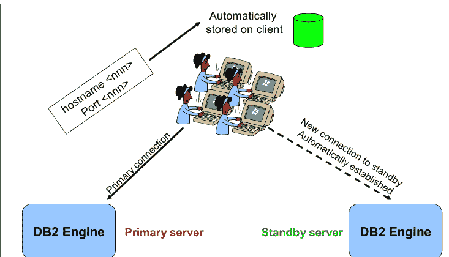

图 5-1 HADR 中的客户端自动重路由实现

要启用客户端自动重路由功能，需要配置 DB2 服务器可以访问的备位置名称。使用 `UPDATE ALTERNATE SERVER FOR DATABASE` 命令可以定义特定数据库的备服务器位置。

```
db2 update alternate server for database db2 using hostname XYZ port yyyy
```


备用主机名和端口号作为命令的一部分给出。该位置存储在服务器实例的系统数据库目录文件中。

当客户端连接到 DB2 服务器时，备服务器位置信息会传播到客户端。如果由于任何原因客户端与服务器之间的通信丢失，DB2 客户端将尝试使用备服务器信息重新建立连接。

客户端自动重路由功能可在以下可配置环境中使用：

- 带有数据分区功能 (DPF) 的企业级服务器版 (ESE)
- SQL 复制 (SQL Replication)
- Tivoli 系统自动化 (TSA)
- 高可用性集群多处理器 (HACMP)
- 高可用灾难备备 (HADR)

### 5.1.2 DB2 客户端自动重路由

如果指定了备服务器，当检测到通信错误（`SQLCode -30081`）或 `SQLCode -1224` 时，将激活客户端自动重路由。这些错误代码不会返回给客户端，但它们会激活 DB2 客户端自动重路由功能。在高可用灾难备备（HADR）环境中，如果返回了 `SQLCode -1776`，也会激活客户端自动重路由。

当客户端自动重路由激活时，DB2 客户端首先尝试重新连接到原始服务器，如果失败，它将尝试备服务器。DB2 客户端将继续连接原始服务器和备服务器，在两个服务器之间交替尝试，直到从检测到通信失败之刻起 10 分钟获得成功连接或超时（以先发生者为准）。这些尝试的时间间隔各不相同，从最初的两个服务器之间非常快速的连接尝试，随后尝试之间的间隔默认逐渐延长。这是默认行为。但我们可以使用注册表变量控制间隔持续时间。

| 时间 | 尝试之间的间隔 |
|---|---|
| 0 到 30 秒 | 0 秒 |
| 30 到 60 秒 | 2 秒 |
| 1 分钟到 2 分钟 | 5 秒 |
| 2 分钟到 5 分钟 | 10 秒 |
| 5 分钟到 10 分钟 | 30 秒 |

一旦连接成功，将返回 Java 通用驱动程序 JCC 客户端的 `SQLCode -30108` 或 `SQLCode -4498`，表示在通信失败后已重新建立数据库连接。示例 5-1 显示了 `SQLCode 4498`。

示例 5-1 SQLCode 4498

```
SQLException: com.ibm.db2.jcc.C.ClientRouteException:
ibm[db2][jcc][t4][2027][11212] A connection failed but has been re-established. The host name or IP address is "94.83.86.111" and the service name or port number is 50,030. Special registers may or not be-attempted (Reason code = 1).SQLCode: -4498
```

当应用程序接收到此消息时，执行中的事务状态为“未知”。因为客户端没有收到服务器的回复，它不知道事务是否成功。事务可能已经在旧服务器上提交，也可能复制到了新服务器。

检查事务是否成功或在需要时重新提交是应用程序的责任。应用程序可以继续执行新事务，也可以编写逻辑来捕获此异常并检查事务状态，仅重试失败的事务，以使应用程序对通信故障无缝化。只有在 10 分钟后无法通过原始服务器或备服务器重新建立客户端通信时，客户端代码才会向应用程序返回原始通信失败（`SQL30081N`）错误。

图 5-2 显示了发生主数据库连接失败时的步骤序列。

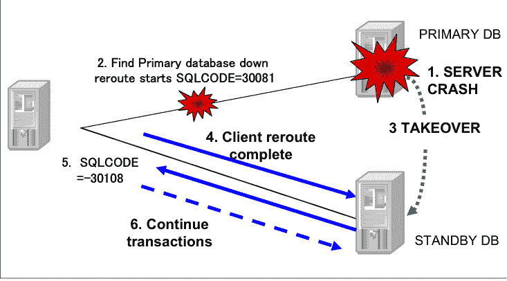

图 5-2 运行中的客户端自动重路由

## 5.2 客户端自动重路由调优

当触发客户端路由时，DB2 客户端实际上会先尝试连接原始服务器，然后再连接备服务器。因此，为了启用快速路由到备服务器，有三种选项：

- 调整 TCP/IP 网络：为了更好地启用客户端路由，我们可以调整操作系统的 TCP/IP 参数。
- 配置 DB2 注册表变量：你需要调整以下 DB2 变量：
    - `DB2TCP_CLIENT_CONTIMEOUT`：此注册表变量指定客户端等待 TCP/IP 连接完成的时间。如果在指定的时间内未建立连接，DB2 数据库管理器将返回错误 `-30081`。如果注册表变量设置为 0，则没有超时限制。
    - `DB2TCP_CLIENT_RCVTIMEOUT`：此注册表变量指定客户端在 TCP/IP 接收操作上等待数据的时间。如果在指定的时间内没有收到来自服务器的数据，DB2 数据库管理器将返回错误 `-30081`。如果变量设置为 0，则没有超时限制。此变量的设置应长于执行执行时间，否则客户端将在长时间查询期间超时。

默认情况下，自动客户端路由会反复尝试连接数据库长达 10 分钟。然而，可以使用这两个注册表变量之一或全部来配置精确的重试行为：

- `DB2_MAX_CLIENT_CONNRETRIES`：此注册表变量指定自动客户端重路由尝试的最大连接次数。如果未设置此注册表变量，但设置了 `DB2_CONNRETRIES_INTERVAL`，则默认值为10。
- `DB2_CONNRETRIES_INTERVAL`：此注册表变量指定连续连接尝试之间的睡眠时间（秒为单位）。如果未设置此变量，但设置了 `DB2_MAX_CLIENT_CONNRETRIES`，则 `DB2_CONNRETRIES_INTERVAL` 的默认值为 30 秒。

例如，如果按照如下方式设置注册变量：

- `DB2_MAX_CLIENT_CONNRETRIES=5`
- `DB2_CONNRETRIES_INTERVAL=3`
- `DB2TCP_CLIENT_CONNECTTIMEOUT=10`

DB2 自动客户端重路由将花费 `((10x4)+3) x 5 = 215` 秒后放弃并返回通信失败错误 `SQL30081`。

注意：使用 DB2 Universal JDBC 驱动的 Type 4 连接性的用户应使用以下两个 DataSource 属性来配置自动客户端重路由：

- `maxRetriesForClientReroute`: 使用此属性限制在到服务器的主连接失败时的重试次数。只有在同时也设置了 `retryIntervalClientReroute` 属性时，此属性才有效。
- `retryIntervalForClientReroute`: 使用此属性指定在重试之前等待的时间（秒）。只有在同时也设置了 `maxRetriesForClientReroute` 属性时，此属性才有效。

如果激活了客户端重路由，您需要将连接超时值设置为大于或等于连接到服务器的最大时间。否则，连接可能会超时并被客户端重路由到备用服务器。例如，在正常情况下需要 10 秒连接到服务器，而在忙碌时需要 20 秒，则连接超时值应至少设置为 20 秒。

在 `db2cli.ini` 文件中，您可以设置 `ConnectTimeout` CLI/ODBC 配置关键字，指定在尝试建立服务器连接时等待回复的秒数，否则将终止尝试并生成通信超时错误。默认情况下，客户端在尝试建立连接时会无限期等待服务器的回复。

如果设置了 `ConnectTimeout` 且激活了客户端重路由，连接将仅尝试原始服务器和备用服务器。由于在尝试连接每个服务器时都会使用 `ConnectTimeout` 值，因此最大等待时间将是指定的 `ConnectTimeout` 值的两倍。如果通过关键字无法到达任一服务器，将收到错误消息，如示例 5-2 所示。

### 示例 5-2 通信错误消息

`SQL30081N` 检测到通信错误。使用的通信协议："TCP/IP"。正在使用的通信 API："SOCKETS"。检测到错误的位置："<ip address>"。检测错误的通信函数："<failing function>"。特定的错误代码："<error code>"*。 SQLSTATE=08001

通过 DB2.NET Provider 创建 DB2 数据库连接时，可以通过传递 `ConnectionString` 设置 `DB2Connection` 的 `Connectiontimeout` 值，如示例 5-3 所示。

### 示例 5-3 DB2.NET Provider 的 ConnectionConnectionString

```
String connString ="Server=5000;Database=testdb;Pwd=pwd;Connect Timeout=30";

DB2Connection conn = new DB2Connection(connString);

conn.Open();
```

在此示例中，如果连接尝试超过三十秒，连接尝试将终止。`ConnectionString` 的设置优先级高于注册变量或 `db2cli.ini`。

同样地，对于 OLE .NET Data Provider 和 ODBC .NET Data Provider，您也可以通过 Connection 设置 `Connectiontimeout`（示例 5-4）。

### 示例 5-4 ODBC .NET Data Provider 的 ConnectionConnectionString

```
OdbcConnection conn = new
```


`OdbcConnection("Provider=IBMDB2.DB2;Data Source=TEST;ConnectTimeout=15");`

`OdbcConnection conn = new`

`OdbcConnection("DSN=test;ConnectTimeout=15");`

```
`ConnectionString` 的设置优先级高于注册变量或 `db2cli.ini` 中的设置。
```

- 使用集群管理器：
实现快速故障转移的第三种方法是建立 HADR 节点，主数据库和备用数据库由集群管理器服务。更多详情请参阅第 127 页的示例 5.4.3，“示例 3：在 HACMP 集群中涉及 HADR 数据库”。在那个示例中，我们为 DB2 客户端的连接定义了一个服务 IP 地址，并在主节点发生故障时接管它。我们于客户端上执行的 `"catalog tcpip node"` 以及在服务器上执行的 `"update alternate server"` 使用该服务 IP 地址。这种方法最快，但它需要 HA 配置。

122 Linux, UNIX 和 Windows 上的 DB2 高可用性与可扩展性指南

### 5.3 局限性

使用自动客户端重路由功能时存在一些局限性：

- `TCP/IP` 是 DB2 UDB 服务器自动客户端重路由支持的唯一通信协议。即使 DB2 设置为回环，也必须使用 `TCP/IP` 通信协议以适应自动客户端重路由功能。
- 自动客户端重路由功能仅在 Linux、UNIX 和 Windows 操作系统的客户端和服务器端受支持。其他 DB2 家族产品目前不支持此功能。
- 安装在备用主机服务器上的 DB2 服务器必须是相同版本（但与原始主机服务器上安装的 DB2 相比，可以是不同的 FixPak）。
- 如果重新与备用服务器建立了连接，则到相同数据库别名的任何新连接将连接到备用服务器。如果您希望在问题修复后让任何新连接建立到原始位置，有三种方法可以实现：
    - 您需要将备用服务器下线并回切到原始服务器。这需要使用 `UPDATE ALTERNATE SERVER` 命令，将其设置为原始位置。
    - 您可以注册一个新的数据库别名以便使用。
    - 您可以取消数据库条目并重新注册。
- 备用服务器信息始终保留在内存中。如果没有更新数据库目录的权限（或者它是只读的），应用程序无法确定并使用备用服务器，因为内存在应用程序之间不共享。
- 当发生通信失败时，所有会话资源如全局临时表、序列、游标、联邦处理选项（`SET OPTION`）以及会话寄存都会丢失。应用程序负责重新建立会话资源以继续工作。重新连接后，无需运行任何会话寄存器语句，因为 DB2 将重放发生错误之前的会话寄存器。

但某些寄存器不会重放。它们是：

- `SET ENCRYTP`
- `SET EVENT MONITOR STATE`
- `SET SESSION AUTHORIZATION`
- `SET TRANSFORM GROUP`

注意：如果客户端使用 CLI、JCC Type 2 或 Type 4 驱动，重新连接后针对原始服务器准备的 SQL语句将重新准备。但对于嵌入 SQL 程序（例如 SQC 或 SQX ），将不会重新准备。

通用 DB2 驱动显示的错误在 WebSphere 等应用服务器中应报告为 `StalConnectionException`，但目前尚未映射。该错误针对 DB2 HADR 客户端，会导致返回错误代码 `-4498` 或 `-3018`。将这些异常映射到 `StalConnectionException` 可以简化应用程序的重试逻辑，并允许应用程序使用“entry pool”连接池更快地建立连接。

注意：在编写本书时，修复 WebSphere APAR `PK06078` 目标包含在 fixpack `5.0.2.12` 和 `5.1.1.6` 中。请参考推荐更新页面获取交付信息：

`http://www.ibm.com/support/docview.ws?rs=180&uid=swg27004980`

### 5.4 示例

通过更新数据库上的备用服务器激活自动客户端重路由。可以使用 DB2 `LIST DATABASE DIRECTORY` 命令确认备用服务器，如示例 5-5 所示。

*示例 5-5 检查备用服务器设置*

```
db2 list db directory

System Database Directory

目录条目数 = 1

数据库 1 条目:

数据库别名 = SAMPLE

数据库名称 = SAMPLE

本地数据库目录 = /home/hadrinst/dbdir

数据库发布级别 = a.00
```

```
Comment =

Directory entry type = Indirect

Catalog database partition number = 0

Alternate server hostname = 9.43.86.111

Alternate server port number = 50030
```

客户端应用程序将收到 `SQLCode -30108`，表示连接已重新建立。发生通信故障时，正在执行的事务将处于未知状态。客户端应用程序的设计必须能够能够忽略此错误并继续下一个事务，或者在确认事务未成功后重试该事务。

让我们在以下用例中查看自动客户端重路由是如何运作的：

- 涉及非 HADR 数据库的自动客户端重路由
- 涉及 HADR 数据库的自动客户端重路由
- 涉及 HACMP 集群中 HADR 数据库的自动客户端重路由

#### 5.4.1 示例 1：涉及非 HADR 数据库

在此用例中，我们使用了两个 DB2 主机系统 `KANAGA` 和 `ATLANTIC`。在 `KANAGA` 上，创建了名为 `SAMPLE` 的数据库。此外，在备服务器 `ATLANTIC` 上也创建了 `SAMPLE` 数据库，端口号为 `50030`。

在客户端机器上，数据库 `SAMPLE` 被编类到节点 `KANAGA`。节点 `KANAGA` 引用主机名 `KANAGA` 和端口 `50030`。

要激活自动客户端重路由，您需要如下所示更新服务器 `KANAGA` 上数据库 `SAMPLE` 的备服务器：

```
db2 update alternate server for database sample using hostname atlantic
port 50030
```

在没有设置客户端重路由功能的情况下，应用程序在执行事务时会收到通信错误 `SQL30081N`。设置了自动客户端重路由功能后，DB2 将尝试重新建立与 `KANAGA` 的连接。如果仍然无效，DB2 将尝试备服务器位置（主机 `ATLANTIC`，端口 `50030`）。假设连接到备服务器位置的连接没有通信错误，应用程序可以继续运行后续语句，或者在事务失败时重新提交该事务。由于在这种情况下我们没有 HADR，因此必须考虑如何保持两个数据库同步，并在主机宕机时让备机在线。

从客户端机器上，如果我们连接到数据库 `SAMPLE` 并像示例 5-6 那样运行 `SELECT` 查询，我们看到查询是在 `KANAGA` 上运行的。

##### 示例 5-6 在主 DB2 系统上运行查询

```
$db2 select id from staff fetch first 1 row only

----

10

1 record(s) selected.
$ db2 "select substr(host_name,1,8) from table(db_partitions() ) as t"

----

kanaga.i

n1 record(s) selected.
```

如果在执行相同的从 `STAFF` 表中选择一行的查询时发生通信错误，自动客户端重路由将把查询路由到备服务器。请参见示例 5-7。

##### 示例 5-7 连接有 from staff fetch first 1 row only

```
$db2 select id from staff fetch first 1 row only

SQL30108N A connection failed but has been reestablished

The hostname or IP address is

"192.168.1.20" and the service name or port number

is "50030". Special registers may or not be reattempted

(Reason code = "1"). SQLSTATE=08506

$db2 select id from staff fetch first 1 row only

----

10

1 record(s) selected.
```

```
$db2 "select substr(host_name,1,8) from table(db_partitions() ) as t"

----

atlantic.i

1 record(s) selected.
```


#### 5.4.2 示例 2：涉及 HADR 数据库

在此用例中，我们为 `KANAGA` 和 `ATLANTIC` 之间的数据库 `SAMPLE` 设置了 HADR 配置。在 `KANAGA` 上，创建了主数据库 `SAMPLE`。在主机 `ATLANTIC` 上也创建了备用 HADR 数据库，端口为 `50030`。

在客户端机器上，数据库 `SAMPLE` 被编类到节点 `KANAGA`。节点 `KANAGA` 引用主机名 `KANAGA` 和端口 `50030`。

要激活自动客户端重路由，您需要如下所示更新 `KANAGA` 上数据库 `SAMPLE` 的备服务器：

```
db2 update alternate server for database sample using hostname atlantic
port 50030
```

为了在 `ATLANTIC` 上的备服务器启用一个备服务器，使其能够回退到 `KANAGA` 端口 `50030` 主服务器并重新整合到 HADR 对中，您需要在主机 `ATLANTIC` 上运行此命令。

```
db2 update alternate server for database sample using hostname kanaga
port 50030
```

在没有设置自动客户端重路由功能的情况下，应用程序将收到错误 `SQL30081N`。当主数据库故障时，如果 HADR 成功启动了备服务器，应用程序将收到 `SQL30081N` 错误。

如果设置了自动客户端重路由，`DB2` 将尝试重新建立与 `KANAGA` 的连接。如果仍然无效，`DB2` 将尝试备服务器位置（主机 `ATLANTIC`，端口 `50030`）。假设连接到备服务器位置的连接没有通信错误，应用程序可以继续运行后续语句或重试失败的事务。备服务器位置是 HADR 备机所在地。为了让客户端重路由成功，HADR 必须成功地将备机提升为主机。

#### 5.4.3 示例 3：涉及 HACMP 集群中的 HADR 数据库

在在这种场景下，我们在 `KANAGA` 和 `ATLANTIC` 上设置了 HADR 对，由集群管理器提供服务。在 `KANAGA` 上，创建了主数据库 `SAMPLE`。在主机 `ATLANTIC` 上也创建了备用 HADR 数据库，端口为 `50030`。

`HACMP` 软件将检测到活动节点宕机并接管，使备机变为主机。要激活重路由，您需要使用服务 IP 更新 `KANAGA` 上数据库 `SAMPLE` 的备服务器：

```
db2 update alternate server for database sample using hostname 9.43.86.111
port 5030
```

为了在 `ATLANTIC` 上的备服务器启用一个备服务器，使其能够回退到 `KANAGA` 端口 `5030` 主服务器，您需要在主机 `ATLANTIC` 上运行此命令。同样，使用服务 IP 作为主机名。

```
db2 update alternate server for database sample using hostname 9.43.86.111
port 5030
```

回退旧服务器后，旧主 `KANAGA` 应该重新整合到 HADR 对中。

在客户端机器上，数据库 `SAMPLE` 被编类到服务 IP 地址 `9.43.86.111`，端口为 `5030`。

在带有 `HACMP` 的 HDR 环境中，服务 IP 地址 `9.43.86.111` 被用于主备两个服务器的备服务器。在客户端编类数据库 `SAMPLE` 时，服务 IP 地址 `9.43.86.111` 也被用主机名。如果 `KANAGA` 上的主数据库服务器宕机，`DB2` 将不断尝试建立到备服务器位置（主机 `9.43.86.111`，端口 `50030`）的连接。假设 `HACMP` 已成功执行了 IP 接管并将资源组移动到 `ATLANTIC`，且连接到备服务器的连接没有通信错误，应用程序就可以继续运行后续语句或重试失败的事务。

在客户端机器上，对节点 `KANAGA` 数据库 `SAMPLE` 进行目录。节点 `KANAGA` 引用主机名 `KANAGA` 和端口 `50030`。

在主 HADR 数据库主机 `KANAGA` 上，使用主机名而不是服务 IP 指定备用服务器：

```
db2 update alternate server for database sample using hostname port 50030
```

在备用 HADR 数据库主机 `ATLANTIC` 上，也同样使用主机名而不是服务 IP 指定备用服务器：

```
db2 update alternate server for database sample using hostname kanaga port 50030
```

使用服务 IP 地址作为备用服务器配置比 `HACMP` 检测到节点宕机并执行 IP 故障转移更快。当客户端重路由检测到通信失败时，首先尝试连接到原始服务器。很有可能是 `HACMP` 的接管和资源组切换已经成功，`DB2` 可以在原始服务器（服务 IP 地址 `9.43.86.111`）上获得成功连接，该地址现在已切换到主机 `ATLANTIC`。

`HACMP` 的操作可以非常无缝，以至于当客户端机器使用服务 IP 地址在节点上对数据库进行目录注册后，并不清楚哪台机器当前是主服务器。要查找主数据库主机名，可以执行以下查询：

```
db2 select substr(host_name,1,8) from table (db_partitions()) as t
```

#### 5.4.4 处理自动客户端重路由的示例应用程序代码

在本节中，我们将展示一个嵌入 SQL C 和使用 `DB2` Universal JDBC 类型 2 或类型 4 驱动的 Java 应用程序处理自动客户端重路由异常的伪代码示例。

##### 处理 ACR 异常的 Java 应用程序

重新建立后，`DB2` Universal JDBC 驱动向应用程序抛出一个 `SQLCODE` 为 `-4498` 的 `java.sql.SQLException`，告知应用程序连接已自动重建到备用服务器。

示例 5-8 显示了通过捕获异常 `-4498` 来自动客户端重路由异常的 Java 应用程序代码。

##### 示例 5-8 在 Java 中处理 ACR 异常

```java
// 在重试逻辑中，不需要重试连接或重新创建
// 或预处理语句
Connection con = DriverManager.getConnection(url, "USER", "PSWD");
Statement stmt = con.createStatement();
pstmt = con.prepareStatement("SELECT NAME FROM STAFF WHERE ID = ?");
// 当我们遇到客户端重路由
// 异常时，上面的语句不需要重试
do { // while 循环开始
    try {
        // 事务逻辑
        npstmt.setInt(1,10);
        int rowsUpdated = stmt.executeUpdate(
            "UPDATE employee SET firstname = 'SHILI' WHERE empno = '10'");
        con.commit();
    } catch (SQLException se) { // 处理客户端重路由异常
        int errorcode = se.getErrorCode();
        System.out.println("MySQLErrorCode: " + errorcode);
        if(con != null) {
            try {
                con.rollback();
            } catch (Exception e) {
                e.printStackTrace();
            }
        } 
        if(errorCode == -30108 || (errorCode == -4498)){
            System.out.println("connection is re-established, re-executing the failed transaction."); 
            retry = true;
        }
    } finally { // 关闭资源 }
    } // catch
} while(retry);
```


## 使用 JCC 类型 4 驱动的 Java应用程序

在类型 2 和类型 4 JDBC 驱动中，处理 ACR 异常的方法与示例 5-8 相同。但使用 JCC 类型 4 驱动实现重路由时，在获取数据库连接时需要不同的设置。JCC 类型 2 驱动使用特定于所连接数据源的本地客户端库。

Linux, UNIX 和 Windows 上的 DB2 高可用与可扩展性指南

JCC 类型 4 驱动用纯 Java 编写，没有原生客户端组件，并实现了到数据源的网络协议。JCC 类型 4 客户端不需要在客户端侧安装 DB2，可以直接连接到数据源。它不是允许客户端应用程序从本地数据库目录获取信息，而是将服务器名称和端口显式包含在 JCC 连接尝试中。然而，如果在连接时，服务器功能已被备用服务器接管，客户端将不会无法连接，而是将不知道去哪里寻找备用服务器信息。

DB2 Universal JDBC 类型 4 驱动重路由仅适用于使用 `java.sql.DataSource` 接口的连接。示例 5-9 显示了如何使用 DataSource 属性文件获取连接的示例。`DB2SimpleDataSource` 是 DB2 对 `DataSource` 接口的一种实现。

### 示例 5-9 使用 DataSource 接口获取数据库连接

```java
DB2SimpleDataSource dataSource = new DB2SimpleDataSource();

Properties prop = new Properties();

InputStream dsProfile = null;

try{
    dsProfile = new FileInputStream(DSName);
} catch (FileNotFoundException fe) {
    System.out.println(fe.getMessage());
    throw fe;
}

prop.load(dsProfile);
dataource.setServerName(prop.getProperty("serverName"));
String portNum = prop.getProperty("portNumber");
int portNo = (new Integer(portNum)).intValue();
dataource.setPortNumber(portNo);
dataource.setDatabaseName(prop.getProperty("databaseName"));
dataource.setUser(prop.getProperty("username"));
dataource.setPassword(prop.getProperty("password"));
Connection con=datasource.getConnection();
con.setAutoCommit(false);
Statement stmt = con.createStatement();
```

在 WebSphere Application Server 环境中使用 DataSource 的最佳方法，此步骤在 WebSphere Server 的管理控制台中完成。

`clientRerouteServerListJNDName` 有两个功能：

- 允许备用服务器信息跨 JVM 持久化。
- 在首次连接到数据库服务器失败时，提供备用服务器位置。

`clientRerouteServerListJNDName` 用于在 JNDI 仓库中识别指向 `DB2ClientRerouteServerList` 实例的 JNDI 引用，用于备用服务器信息。在成功连接主服务器后，`clientRerouteServerListJNDName` 提供的备用服务器信息将被来自服务器的信息覆盖。

如果定义了 `clientRerouteServerListJNDName`，DB2 Universal JDBC 驱动将在故障转移后尝试将信息传播到 JNDI 存储。如果指定了 `clientRerouteServerListJNDName`，将使用 `DB2ClientRerouteServerList` 指定的主服务器信息进行连接。如果没有指定主服务器，则将使用 DataSource 上的 `serverName` 信息。

新建立的故障转移连接将使用原始 DataSource 属性配置，但服务器名称和数字端口除外。此外，DB2 Universal JDBC 驱动程序会在原始连接期间修改过的任何 DB2 专用寄存器在故障转移连接中重新建立。

### 使用 C 语言的嵌入 SQL 程序

重新建立连接后，嵌入 SQL 应用程序将接收异常 `SQLCode -30108`，指示应用程序连接已自动重新建立到备用服务器。

示例 5-11 是应用程序客户端重路由连接的伪代码。

### 示例 5-11 C 程序处理 ACR 异常

```c
int checkpoint = 0;
check_sqlca(unsigned char *str, struct sqlca sqlca)
{
  if (sqlca)->code == -30108)
    // 由于通信丢失，立即终止应用程序
    exit(1);
  } else {
    // 打印错误
    printf(...);
    if (sqlca)->code == -30108)
      // 如果连接已重新建立，重新执行失败的事务
      if (checkpoint == 0)
```
{ goto checkpoint0; }
else if (checkpoint == 1) {
  goto checkpoint1; }
else if (checkpoint == 2) {
  goto checkpoint2; }
...
exit;
}
main()
{
connect to mydb;
check_sqlca("connect failed"
```

## HADR 最佳实践

在本章中，我们描述了影响 HADR 的 DB2 配置参数和注册表变量。我们还讨论了实施 HADR 解决方案时需要考虑因素，以获得最佳的 HADR 性能。

我们涵盖了以下主题：

- DB2 HADR 配置参数
- DB2 HADR 注册表变量
- 建议与注意事项
- 限制

### 6.1 DB2 HADR 配置参数

在这里我们探索对 HADR 有显著影响的相关数据库管理器配置参数 `dbm cfg parm` 和数据库配置参数 `db cfg subm`。

在大多数情况下，在设置 HADR 后不需要手动更改这些参数。但是，如果以后架构需求发生变化，知道需要更改什么以及为什么始终是有用的。

我们在此节中不提供特定的性能建议，因为每个环境都需要进行调优以匹配其独特特性。尽管如此，这里提供的信息、DB2 手册页面以及列出的其他参考将让您了解哪些设置可以满足您的需求。

在使用配置参数以及下一节中的注册表和环境变量时需要记住的一是：它们只有在数据库处于主或备用状态时才能被识别和使用，否则会被忽略。尽管如此，在 HADR 对的两个服务器上设置并维护这些参数/变量仍然很重要，以备在切换角色或执行强制接管时使用。

#### 6.1.1 基本配置参数

术可以在 DB2 9 Information Center（Reference → Configuration Parameters → Database Systems）以及 DB2 9 Performance Guide SC10-4222: Appendix A 中找到。同样的信息在 DB2 V8.2 Information Center 和 Administration Guide: Performance V8, SC09-4821-01 中也有给出。

- `AUTORESTART`:
在使用自动客户端重路由时，考虑将此 `db cfg parm` 设置为该值，这样损坏的主服务器就不会重新上线并在 HADR 主角色下重启，从而导致脑脑裂场景。

在非 HADR 环境中，将 `AUTORESTART` 设置为 ON 是好的，因为当实例启动并尝试进行首次应用程序连接时，数据库会自动激活，并尝试对数据库去激活时存在的任何正在进行中的/入站事务进行日志/崩溃恢复。

当 `AUTRESTART` 留为 OFF 时，连接尝试将收到 `SQL1015N` 消息。

- `LOGINDEXBUILD`:
此 `db cfg param` 值应设置为 ON，这样主数据库上索引的维护操作（如创建或 REORG）将被记录并执行，以与备用数据库保持一致。

- `LOGRETAIN` / `LOGARCHMETHn`:
为了使用 HADR，你必须至少设置一个 `db cfg param`。不支持循环日志。

`LOGRETAIN` 是在支持原生归档方法 `LOGARCHMETHn` 之前的时代的遗留参数。你仍然可以使用它来指定 HADR 位置。

- `HADR_DB_ROLE`:
此 `db cfg param` 可以通过 STOP、START、TAKEOVER 配置。可能的值为：


- `STANDARD`: 数据库不在 HADR 角色中。
- `PRIMARY`: 数据库是 HADR 主节点。
- `STANDBY`: 数据库是 HADR 备节点。
- `HADR_LOCAL_HOST`:
此 `db cfg param` 指当前服务器的主名或 IP 地址。
- `HADR_LOCAL_SVC`:
与上一个参数逻辑关联，此 `db cfg param` 指定用于 HADR 组件的端口号。
- `HADR_REMOTE_HOST`:
此 `db cfg param` 指定远程服务器的主名或 IP 地址。
- `HADR_REMOTE_INST`:
此 `db cfg param` 指定远程服务器上的 DB2 实例名。
- `HADR_REMOTE_SVC`:
结合 `HADR_REMOTE_HOST` 和 `HADR_REMOTE_INST`，此 `db cfg param` 指定远程服务器上 HADR 数据库使用的端口号或服务名。
- `HADR_SYNCMODE`:
这是一个重要的 `db cfg` 参数。设置在 HADR 对的两个服务器上必须匹配。可能的值有：
- `SYNC`: 在此模式下，只有当日志写入主数据库的日志文件并且主数据库收到备用数据库确认日志已写入备用数据库的日志文件时，日志才被视为成功。
- `NEARSYNC`: 在此模式下，只有当日志记录写入主数据库的日志文件并且主数据库收到备用系统的确认确认日志已写入备用系统的主内存时，日志才被视为成功。
`ASYNC`（异步模式）：
在此模式下，只有当日志记录已写入主数据库的日志文件并投递到主系统机器的 TCP 层时，日志写入才被视为成功。由于主系统不需要等待备用系统的确认，事务在传输至备用系统的过程中可能被视为已提交。
- `HADR_TIMEOUT`:
此数据库配置参数（`db cfg param`）指定了 DB2 HADR EDU 等待其 HADR 伙伴任何响应的秒数，在此之前它将认为通信失败并关闭连接。如果 HADR 在关闭连接之前处于 Peer 状态，则当 HADR 连接关闭时，主系统将不再遵循 Peer 语义。响应可能是心跳信号或确认（ACK）信号。请注意，等待 ACK 信号没有超时限制，且 `ASYNC` 模式不使用 ACK 信号。此值在 HADR 节点对双方必须一致。
- `INDEXREC`:
索引重建时间是一个 `dbm` 配置和 `db cfg` 配置参数，它指定了 DB2 在需要时何时尝试重建无效索引——具体到 HADR，它决定了这是否会在备备上的 HADR 日志重放期间发生。`db cfg` 参数旨在作为该实例下所有数据库的默认值，当该 `db cfg` 参数未设置为 `SYSTEM` 时，将覆盖该值。可能的值有：
- `SYSTEM`:
仅适用于 `db cfg`；接受 `dbm` 配置中的 `INDEXREC` 值。
- `ACCESS`:
在索引首次被访问时重建无效索引，随后在 HADR 日志重放期间于 HADR 备用上重建。
- `ACCESS_NO_REDO`:
在索引首次被访问时重建无效索引，但在 HADR 备用上保持无效状态，日志重放期间不重建。索引将在 HADR 接管并在首次访问底层表后重建。
- `RESTART`:
这是默认值。无效索引的重建发生在正常数据库或主数据库上执行 `RESTART DATABASE` 或 HADR 接管之后，并且在备用数据库上于日志重放期间进行重建。`AUTORESTART` `db cfg` 参数实际上意味着在应用程序尝试连接数据库时，隐式设置了 `RESTART DATABASE`。索引在接管时异步重建（不等待），在重启时同步重建（等待）。
- `RESTART_NO_REDO`:
无效索引的重建发生在正常数据库或主数据库上执行 `RESTART DATABASE` 之后，但在 HADR 重放期间不在备用上重建。重建仅在 HADR 接管后发生。
- `SELF_TUNING_MEM`:
从 DB 9 开始，DB2 将使用此 `db cfg` 参数动态为缓冲区池、包缓存、锁排序堆和数据库共享内存分配内存。自调优内存（Self Tuning Memory）即使在两台服务器上都设置，也只能在 HADR 主数据库上激活。
- `LOGFILSZ`:
此 `db cfg` 参数指定活动日志的大小，该值从主系统获取并供备用系统使用，以便确保两个服务器上的活动日志大小一致——备用系统的 `db cfg` 值 `LOGFILSZ` 被忽略。在 HADR 角色切换或接管后，该值仍保留，直到数据库重启，此时将使用本地的 `LOGFILSZ` 值作为活动日志大小。

#### 6.1.2 客户端重路由配置参数

这组极小的 DB2 配置参数严格来说并不是 HADR 的一部分，甚至严格来说它们不应视为配置参数，但它们被 ACR 使用。
命令 `db2 update alternate server for database` 会在系统数据库目录文件中设置服务器和 DB2 实例端口号。以数据库 `SAMPLE` 为例，假设我们当前的主服务器名为 `LEAD`，备用服务器名为 `POLONIUM`，且为 DB2 实例 `DB2INST1` 使用 TCP/IP 端口 50001：
```
db2 update alternate server for database sample using hostname
POLONIUM port 50001
```
自动客户端重路由的机制以及它如何作为独立R 的独立实体存在，请见第115页第5章“自动客户端重路由”。

### 6.2 DB2 HADR 注册变量

本节检查与 HADR 相关的 DB2 注册变量和操作系统环境变量。
以下内容可以在 DB2 9 信息中心（参考 -> 配置 -> 数据库系统）以及 DB2 V8.2 性能指南 SC10-422 中找到。
- `DB2_HADR_BUF_SIZE`：此变量仅在数据库处于备用角色时有效。默认情况下，它是 HADR 备用缓冲区的大小。该变量的值计算为 `LOGBUFS` 的两倍。
备用重放机制直接从日志缓冲区检索日志。如果备用系统响应日志缓慢，且主系统向备用系统发送更多日志，日志缓冲区将最终“充满”，阻止备用系统接收日志。缓冲区饱和会导致主系统事务阻塞，直到缓冲区有足够的空间接收日志页。
如果同步模式为 `ASYNC`，从主系统到备用系统的网络管道最终会被充满，主系统无法发送任何日志。这被称为“拥塞”。在 `ASYNC` 模式下，网络拥塞和备用缓冲区饱和会阻塞主日志处理。因此，主系统事务将被阻塞，直到拥塞消除（前提是备用系统可以发送心跳且主系统可以接收该心跳）。
如果同步模式为 `SYNC` 或 `NEARSYNC`，主系统可能会阻塞，直到缓冲区有足够的空间接收日志页。缓冲区饱和会导致主系统事务阻塞，直到缓冲区有足够的空间接收日志页。
较大的缓冲区（通过注册变量 `DB2_HADR_BUF_SIZE` 设置）允许备用系统吸收峰值，从而减少降低主系统的概率。但如果备用系统的持续吞吐量低于主日志速率，较大的缓冲区仍然会填满并导致主系统变慢。
- `LOAD_COPY_NO_OVERIDE`
- `DB2LOADREC`
从 DB2 9 开始，没有用于影响 HADR 操作的操作系统环境变量。

### 6.3 建议与注意事项

在本节中，我们指出实现 HADR 解决方案时需要考虑的重要事项。没有一种完美的 HADR 配置方法；一切取决于用户的需求。如果事务性能至关重要，那么你可能需要牺牲 HADR 的接管时间。如果日志活动频繁且网络无法跟上日志记录，你可能需要牺牲事务性能。在调优 HADR 时，必须根据用户需求权衡以下每个因素的优劣。

#### 6.3.1 DB2 事务性能

HADR 设置对 DB2 事务的性能可能有极微的影响。在更严格的日志模式下，潜在的性能影响更高。HADR 设置中的调优仅是非 HADR 环境下 DB2 参数的常规调优。没有特定的 HADR 参数需要调优。每个环境都需要进行调优以匹配其独特特性。
取决于日志模式，当备库宕机时，主库上进行中的事务性能可能会受到影响。
主数据库持续轮询网络。如果网络或备机宕机，一旦主主机操作系统检测到该情况，主数据库就会立即检测到该状态。如果备用数据库崩溃，而备机和网络仍然正常，在大多数情况下，主机以及主数据库可以检测到故障并快速关闭连接。关闭连接将导致主数据库从 Peer（伙伴）状态变为 disconnected（已断开）状态，从而释放挂挂的事务。HADR 状态从 peer 变为
如果主机无法及时报告备库或网络故障，DB2 将依赖 `HADR_TIMEOUT` 来断开连接。如果主库自上次心跳以来在 `HADR_TIMEOUT` 秒（默认 120 秒）未收到来自备库的任何消息，它将状态更改为 disconnected。
在 `SYNC` 和 `NEAR SYNC` 日志模式下，进行中事务的 commit 语句在 HADR 状态变为 disconnected 之前不会完成。这是因为对于 `SYNC` 和 `NEARSYNC` 模式，主库必须等待确认。在 `ASYNC` 日志模式下，进行中的事务不会受到网络断开或备库宕机的影响，其 commit 语句会立即完成。这是因为在 `ASYNC` 模式下，当主库发送日志时，操作系统网络层可能会返回成功但在网络路径中缓存数据，或者返回“congestion（拥塞）”。


对于 `ASYNC` 模式，如果主库继续发送更多日志，最终会导致拥塞。如果发送返回 `congestion`，在 `ASYNC` 模式下主库事务处理也会立即被阻塞。当接收缓冲区满时，备库无法接收来自主所有者的心跳。它会更新心跳接收时间并继续向主库发送心跳，因此备库在 `HDR_TIMEOUT` 后不会断开连接。

在主库端，由于主库正在接收来自备库的心跳，主库在 `HDR_TIMEOUT` 后也不会断开连接。由于备库可以发送心跳而主库可以接收备库的心跳，`HDR` 节点将保持连接。在最坏的情况下，只要主库还能接收到备库的心跳，无响应的备库或网络就会导致主库事务被阻塞。

## 6.3.2 DB2 工具性能

大多数 `DB2` 工具在 `HDR` 环境下没有显著的性能差异。`CPU` 使用率也不会随 `HDR` 发生显著变化。但 `DB2 REORG`（包括 `INPLACE/SHADOW` 模式）显示出性能缓慢。表重组性能会随着更严格的日志传输模式而下降。

## 6.3.3 如何缩短接管时间

客户希望将 `HADR` 接管时间降至最低。通过减少在备库上接管后的事务回滚量，可以更早地向客户端开放数据库。

不同的日志传输模式之间的接管时间没有显著差异。当主库故障时，强制接管（`forced takeover`）通常比非强制接管（`unforced`）更快。如果备库检测到故障且已断开，则无法发出非强制接管，因为备库不再处于 `Peer` 状态。

如果你确定主库已故障并希望进行故障转移，请在备库上执行强制接管。如果备库尚未检测到故障仍处于 `Peer` 状态，它将允许非强制接管。但由于主库已宕机，非强制接管将得不到主库的任何响应，并挂起 `HDR_TIMEOUT` 一段时间。因此，如果你确定主库已宕机，应该直接执行强制接管。

## 6.3.4 无缝接管

`HADR` 不会自动检测故障的主库并发出接管。此过程是手动操作的。一旦用户确定主库已宕机，用户就可以发布接管命令。但在某些情况下，手动接管可能是不可接受的。在这种情况下，你可以结合集群软件（如 `HACMP`、`TSA` 或 `MSCS`）配置 `HADR`，以使接管完全无缝。集群软件检测到主库宕机并发出 `HADR` 接管。有关实现此解决方案的更多细节，请参考第253页第10章“带有集群软件的 `HADR`”。

## 6.3.5 高日志率应用程序

对于日志活动非常高的应用程序，你必须确保网络能够传输这些数据负载。备库也应该足够强大，能够以主库生成日志操作的速度重放这些数据库操作。我们建议主、备库硬件保持相同。

`DB2 HADR` 目前不支持在将日志文件发送到备库之前进行压缩以改善这种状况。然而，取决于你使用的同步模式，可以通过选择更严格的日志传输模式（例如 `SYNC` 模式，它强制主库等待确认），将主库的日志率降低到网络传输速率。

## 6.3.6 HADR_TIMEOUT 的性能影响

如果主库自上次心跳以来在 `HADR_TIMEOUT` 秒（默认 120 秒）未收到来自备库的任何消息，它将状态更改为 `disconnected`。

在 `SYNC` 和 `NEAR SYNC` 日志模式下，进行中事务的 `commit` 语句在 `HADR` 状态变为 `disconnected` 之前不会完成。这是因为对于 `SYNC` 和 `NEARSYNC` 模式，主库必须等待确认。在 `ASYNC` 日志模式下，进行中的事务不会受到网络断开或备库宕机的影响，其 `commit` 语句会立即完成。这是因为在 `ASYNC` 模式下，当主库发送日志时，操作系统网络层可能会返回成功但在网络路径中缓存数据，或者返回“`congestion`（拥塞）”。

对于 `ASYNC` 模式，如果主库继续发送更多日志，最终会导致拥塞。如果发送返回 `congestion`，在 `ASYNC` 模式下主库事务处理也会立即被阻塞。当接收缓冲区满时，备库无法接收来自主所有者的心跳。它会更新心跳接收时间并继续向主库发送心跳，因此备库在 `HDR_TIMEOUT` 后不会断开连接。

在主库端，由于主库正在接收来自备库的心跳，主库在 `HDR_TIMEOUT` 后也不会断开连接。由于备库可以发送心跳而主库可以接收备库的心跳，`HDR` 节点将保持连接。在最坏的情况下，只要主库还能接收到备库的心跳，无响应的备库或网络就会导致主库事务被阻塞。

## 6.3.7 网络注意事项

当主数据库执行刷新（`flush`）时，通过 `TCP/IP` 将日志记录发送到备库。

因为 `TCP` 必须能够向网络传输多个数据包，以确保网络管道填满。如果 `TCP` 无法在管道中保持足够的数据包，性能将会受到。你可以通过 `no -o tcp_recvvspace` 命令设置 `tcp_recvspace` 可调参数值。你也可以通过 `sysctl` 命令设置特定接口的 `tcp_recvvspace` 值。

- `tcp_sendspace`：

`tcp_sendspace` 可调参数指定了发送应用程序在 `send` 调用被阻塞之前，内核可以缓存多少字节的发送。`TCP` 套接发送缓冲区用于在 `TCP` 协议将应用程序数据发送到接收者之前进行缓存。发送缓冲区的默认大小由 `tcp_sendspace` 值决定。你设置的 `tcp_sendspace` 可调参数值至少应与 `tcp_recvspace` 值相等，对于更高的速度，`tcp_sendspace` 值应至少是 `tcp_recvspace` 值的两倍。

有关 `TCP` 调优参数的更多信息，请参考以下网站：

`http://publib.boulder.ibm.com/infocenter/pseries/v5r3/index.jsp?topic=com.ibm.aix.prftund/doc/prftund/tcp_streaming_workload_tuning.htm`

### 网络延迟

网络延迟影响所有 `SYNC` 和 `NEARSYNC` 模式下的事务性能。使用 `SYNC` 模式导致的系统性能变慢可能远大于其他同步模式。在 `SYNC` 模式下，主数据库在日志页成功写入主数据库磁盘后，向备用数据库发送日志。

为了保护系统的完整性，主数据库在通知应用程序事务已准备或提交之前，会等待备库的确认。备用数据库只有在将日志页写入备用数据库磁盘后才会发送确认。由此产生的开销是备用数据库的日志写入加上往返消息的开销。

在 `NEARSYNC` 模式下，主数据库并行写入并发送日志。主库等待备库的确认。备用数据库一旦在内存中接收到日志页就会发送确认。在快速网络上，主数据库的开销微乎其微。当主数据库完成本地日志写入时，确认可能已经到达。

对于 `ASYNC` 模式，日志写入和发送也是并行的；然而，在此模式下，主数据库不会等待备库的确认。因此，网络延迟不是问题。`ASYNC` 模式的性能开销比 `NEARSYNC` 模式更小。

### 网络中断

主数据库持续轮询网络。如果网络中断，一旦主主机操作系统检测到该情况，主数据库就会检测到。如果主机（因此主数据库）能够检测到故障，它将快速关闭连接。关闭连接将导致主数据库从 `Peer` 状态变为 `disconnected` 状态，释放挂起的事务。

如果主库无法及时报告网络故障，`DB2` 将依靠 `HADR_TIMEOUT` 断开连接。如果主库在 `HADR_TIMEOUT` 内没有从备库接收到任何消息，将断开连接。在这种情况下，主库上的事务将在等待超时期间被阻塞。在 `ASYNC` 模式下，当主库发送日志时，这些日志可以在网络路径中缓存并延迟主库事务的阻塞。随着主库继续发送更多日志，最终会导致拥塞，事务将被阻塞。

当发生拥塞时，备库无法接收来自主库的心跳，但更新了自己的心跳时间并继续向主库发送心跳，备库在 `HADR_TIMEOUT` 后不会删除连接。在主库端，由于主库正在接收来自备库的心跳，主库在 `HADR_TIMEOUT` 后也不会删除连接。由于备库可以发送心跳而主库可以接收备库的心跳，`HADR` 对将保持连接。在最坏的情况下，无响应的主库会导致主库事务被阻塞，直到主库在 `HADR_TIMEOUT` 内没有从备库接收到任何心跳或消息。如果主库直到 `HADR_TIMEOUT` 都没有收到备库的心跳，`HADR` 状态将变为 `DISCONNECTED`。

当主库变为 `DISCONNECTED` 时，主库放弃向备用数据库传输日志记录。尽管主数据库无法向备用数据库传输日志，但它仍会继续处理事务。如果在主数据库和备用数据库之间存在数据缺口时执行 `TAKEOVER BY FORCE` 命令，可能会导致数据丢失。主库将继续监听 `HADR TCP/IP` 端口，等待备库上线。当网络恢复时，备用数据库将尝试追赶主库，直到它们恢复 `peer` 状态。

图 6-1 显示了主库和备库之间网络中断时发生的情况。

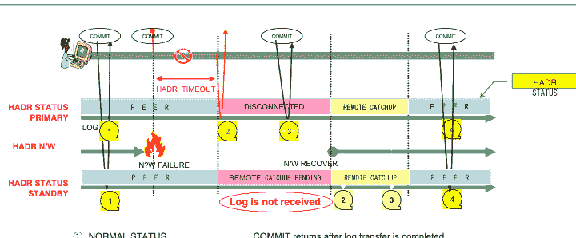

图 6-1 当主库无法向备库传输日志时的 `HADR` 行为

### 网络拥塞

当备库接收和处理来自主库的日志数据落后时，就会发生网络拥塞。这会导致备库的日志接收缓冲区满，从而防止缓冲区接收更多的日志页。这将导致所有模式（包括 `ASYNC` 模式）下的主库速度变慢。


在 `SYNC` 和 `NEARSYNC` 中，如果主数据库再次刷新其日志缓冲区，数据可能会缓冲在网络管道中，该管道由主机、网络和备用数据库组成。由于备用数据库没有空闲的日志缓冲区（`DB2_HADR_BUF_SIZE`）来接收，它无法进行确认。因此主库将被阻塞，等待确认。`SYNC` 和 `NEARSYNC` 模式不太可能发生拥塞，除非这些日志数据得到确认，否则主库不会发送更多日志。

在 `ASYNC` 模式下，主库将继续发送日志，直到网络管道填满。网络管道由主机的 TCP 缓冲区、备用机的 TCP 缓冲区、主备之间的网络路径以及 HADR 备用缓冲区组成。当主库无法发送更多日志时，就会发生拥塞。

大型作业重组可能会淹备库并导致拥塞，因为备用数据库正在重放大量的日志记录。主库负载具有尖峰，可能会被更大的缓冲区吸收。

你可以通过调优 TCP/IP 网络来增加 TCP/IP 缓冲，并增大 `DB2_HADR_BUF_SIZE` 注册变量以增加备库的日志缓冲区，从而缓解拥塞问题。但如果主库的持续日志速率超过了处理能力，更大的缓冲区也没有帮助。快照或 `db2pd` 将将连接状态报告为“congested”。拥塞由 `hadr_connect_status` 监控元素报告。

### 6.3.8 在 HADR 高可用集群软件中避免数据丢失

带有 HA 集群软件实现的 HADR 会自动执行 HADR 接管过程。如果检测到网络错误，主数据库将进入 `disconnected` 状态并允许事务继续。这种行为最大化了 HADR 数据库的可用性。尽管在数据库处于 `disconnected` 期间仍然提交事务，但这些事务不会到达备库，仅存在于主数据库。

如果在网络恢复之前主数据库宕机，自动接管过程将启动。由于主数据库宕机，备库将强制主强制接管。日志缺口将无法处理，尚未传输到备用数据库的日志记录将在新的主数据库上丢失。图 6-2 显示了当主库无法向备库传输日志时 HADR 数据库的行为。

注意：为了减少网络错误的可能性，我们建议您为 HADR 通信准备冗余网络。

为了避免数据丢失，只有当主节点崩溃时 HADR 处于 Peer 状态，才应执行自动故障转移。在执行 HADR 接管（`takeover`）之前，请确保 HADR 处于 Peer 状态，这意味着在 `SYNC` 或 `NSYNC` 模式下，数据库之间没有日志空隙。此处不讨论 `ASYNC` 模式，因为该模式的特性无法保证数据库的完整性。

通过妥善监控 HADR 状态并在 HACMP 集群环境中添加处理逻辑，我们可以确保在备用系统接管数据库后，提交的数据不会丢失。图 6-3 阐述了备用接管后保存提交数据的概念。

步骤如下：

- 1. 监控主数据库上的 `diag.log`。
- 2. 通知 HADR 状态。
- 3. 在接管脚本中添加完整性检查逻辑。

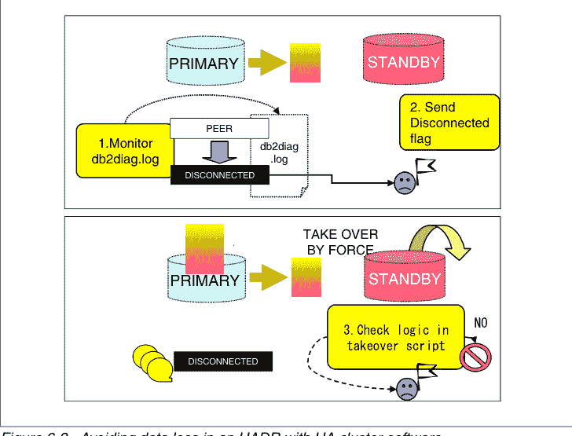

## 第 6 章 HADR 最佳实践 153

### 1. 监控主数据库上的 diag.log：

当 HADR 状态变为断开（`disconnected`）状态时，您必须立即检测到这种变化。最佳方法是监控主数据库上的 `db2diag.log` 消息。示例 6-1 显示了当从 `peer` 变为 `RemoteCatchupPending` 时，`db2diag.log` 中的某消息，这意味着主数据库已与 HADR 对断开并可以接受新事务，而备用数据库留在了后面。

#### 示例 6-1 HADR 状态从 Peer 变为 RemoteCatchupPending

```
2006-10-25-00.32.28.48734+540 E179519490C354 LEVEL: Event
PID : 8056 TID : 1 PROC : db2hadpr
(SAMPLE) 0
INSTANCE: hadrint NODE : 000 DB : SAMPLE
FUNCTION: DB2 UDB, High Availability Disaster Recovery
hdrSetState,probe:10000
CHANGE : HADR state set to P-RemoteCatchupPending (was P-Peer)
```

示例 6-2 显示了当状态从 `RemoteCatchupPending` 变为 `Peer` 时，`db2diag.log` 中的某消息。

#### 示例 6-2 HADR 状态从 RemoteCatchupPending 变为 Peer

```
2006-10-25-00.35.47.82384+540 E179520902C353 LEVEL: Event
PID : 8056 TID : 1 PROC : db2hadpr
(SAMPLE) 0
INSTANCE: hadrint NODE : 000 DB : SAMPLE
FUNCTION: DB2 UDB, High Availability Disaster Recovery
hdrSetState,probe:10000
CHANGE : HADR state set to P-NearlyPeer (was P-RemoteCatchup)
```

```
2006-10-25-00.35.47.830199+540 E179521256C344 LEVEL: Event
PID : 8056 TID : 1 PROC : db2hadpr
(SAMPLE) 0
INSTANCE: hadrint NODE : 000 DB : SAMPLE
FUNCTION: DB2 UDB, High Availability Disaster Recovery
hdrSetState,probe:10000
CHANGE : HADR state set to P-Peer (was P-NearlyPeer)
```

为了持续跟踪 `db2diag.log`，您可以使用 `tail` 命令。示例 6-3 了一个了一个示例脚本（`tail_hadr_status.ksh`）。当此监控程序通过跟踪 `db2diag.log` 中的消息检测到 HADR 状态变化时，它会将状态写入文件。例如，当 HADR 状态从 `peer` 变为非-`peer` 时，设置为“1”，当 HADR 状态从非-`peer` 恢复到 `peer` 时，设置为“0”。此状态标志允许备用系统在主节点宕机时知道 HADR 状态。

154 Linux, UNIX 和 Windows 上的 DB2 高可用性和可扩展性指南

##### 示例 6-3 tail_hadr_status.ksh

```
tail -0 -f $DIAGLOG | awk '
/CHANGE \: HADR status set to P-RemoteCatchupPending \(was \nP-Peer\)/ {system("{WRITE_STATUS}" 1")}
/CHANGE \: HADR status set to P-Peer \(was P-NearlyPeer\)/ {system("{WRITE_STATUS}" 0")}'
```

为了随时运行此监控脚本，请在主节点上使用 `nohup` 选项运行脚本：

```
#nohup tail_hadr_status.ksh &
```

我们在 A.3（第 409 页）提供了一个完整的 HADR 监控脚本，“`hadr_monitor.ksh`”。

- 2. 通知 HADR 状态：

示例 6-4 显示了更新标记文件脚本（`write_status.ksh`）的代码片段。该脚本作为函数（`write_status.ksh`）的形式包含在 `db2.log` 监控脚本 `tail_hadr_status.ksh` 中。参数值 `$1`（0 或 1）由 `tail_hadr_status.ksh` 给出，并由 `c1_nodecmd` 将其写入备用节点的标记文件中。

##### 示例 6-4 write_status.ksh

```
c1_nodecmd $1
```

- 3. 在接管脚本中添加完整性检查逻辑。

如果客户要求从备用读取数据，则变通方案是使用 Veritas Storage Foundation for DB2 HADR。有关此实施的更多细节，请参阅白皮书《IBM DB2 UDB HADR 环境中使用 Veritas 卷快照实现可访问备用数据库》，网址如下：

`ftp://ftp.software.ibm.com/software/data/pubs/papers/vrts-hadr.pdf`

本文描述了在 DB2 UDB HADR 环境中，为备用数据库提供完全可访问的时间点副本的解决方案的设计和实现。尽管该备用数据库副本是完全可访问的，但它与 HADR 节点分离，因此更新不会自动应用到主（HADR）数据库副本对。

该解决方案利用了一项名为“瞬时空间优化卷快照”（instant space optimized volume snapshot）的新功能，仅需少量额外磁盘空间即可创建存储的单点副本。仅需要更改块的存储。本文讨论了如何在不影响活动 HADR 数据库的情况下，激活备用数据库的时间点副本。空间优化卷快照功能允许在快照过程中无需对主数据库进行写挂起（`WRITE SUSPEND`），即可生成备用数据库的干净副本。


图 6-5 展示了 Veritas Storage foundation for DB2。

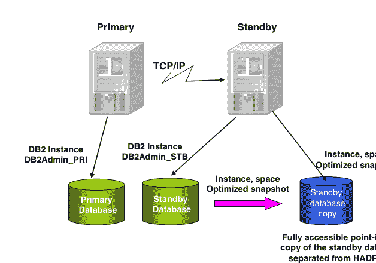

图 6-5 Veritas Storage foundation for DB2 概述

### 6.3.11 使用 Flash Copy 从备用镜像备份

使用存储复制功能，你可以利用备份 HADR 备用数据库的能力，而不会影响主数据库的性能。

这里我们概述了从备用数据库提取备份镜像的步骤：

- 1. 在备用服务器上备份数据库：
  - 假设你有另一个存储区域用于备用数据库的快照，并且备用数据库存储区域与快照之间配置了 FlashCopy。执行以下步骤：
    - 取消备用数据库上的数据库。
    - 停止数据库实例。
    - 卸载所有文件系统并脱机卷组（`varyoff`）。为了确保快照镜像的一致性，在 FlashCopy 逻辑复制期间不允许任何写入活动。因此，最好卸载文件系统（并脱机卷组）。
    - 使用如 Flash Copy 等存储复制功能从备用数据库获取存储镜像快照，其中包含了数据库目录和表空间容器。基本上，逻辑复制在瞬间即可完成，只需等待整个存储区域的物理复制。IBM Total Data Storage 一旦逻辑复制完成，你就可以再次激活备用镜像。
    - 激活（`varyon`）卷组，挂载文件系统并激活数据库。注意，当备用数据库被取消激活时，你可能没有获得最新的备用数据库。

- 2. 恢复到主服务器：
  - 如果你必须从此备份将数据库恢复到主服务器，你必须执行以下步骤：
    - 从恢复的数据库将所有 DB2 相关文件恢复到主服务器上正确的原始位置，恢复后的数据库应该已经处于数据库回滚待处理（rollback pending）状态。
    - 使所有日志文件（包括来自主服务器的活动日志文件和归档日志文件）可用处理。
    - 在备用服务器上创建备份镜像时，其 HADR 状态处于备用模式。此外，HADR 配置参数是从备用数据库复制的。它们应该针对主数据库进行更新。
    - 将原始主数据库的日志文件应用到恢复的数据库。
    - 重启 HADR（假设备用数据库仍静止并运行）。

- 3. 恢复到备用服务器：
如果备用数据库由于硬件问题变得不可用，可以将拆分备份恢复到原始备用数据库。不需要特殊配置。一旦备用数据库文件恢复完成，以以备用身份启动 HADR。备用数据库将进入追赶模式（catchup mode），主数据库服务器检索日志并将日志记录发送到备用数据库，直到其达到同步（Peer）状态。

更多细节，请参阅下方网站列出的文档第7章：

```
http://submit.boulder.ibm.com/sales/ssi/sa/st/e/0rwh-6h3ppe/HADR-in-an-SAP-implementation-04Aug2005.PDF
```

### 6.3.12 复制加载数据

当使用 `LOAD` 工具将数据移动到表时，数据不会包含在日志文件中。在 HADR 环境中复制加载数据有一些特殊要求。基本规则是：只有当存在已加载数据的副本供备用节点获取数据时，加载操作才会被复制。

当备用节点在主完成加载后的任何时间重放加载操作时，复制设备必须可用。如果在主数据库上使用 `NONCOVERABLE` 选项执行加载操作，该命令将在主数据库上执行，且备用数据库上的表将被标记为损坏（bad）。备用数据库将跳过后续与此表相关的日志记录。你可以选择通过指定 `YES` 和 `REPLACE` 选项执行 `LOAD` 命令来恢复该表，或者可以删除该表以回收空间。

更多细节，请参阅 DB2 信息中心：管理 → 数据库系统 → 高可用性 → 管理 HADR → HADR 配置，并搜索“Load operations and HADR（加载操作与 HADR）”。

可以使用以下方法将加载数据复制到备用数据库。

使用 NFS 共享磁盘：
- 你可以利用网络文件系统（`NFS`）在主节点和备用节点上共享加载数据。见图 6-6。


图 6-6 使用 NFS 共享数据

2. 通过传输暂停备用数据库：
如果你通过某种方式（如文件复制或磁带媒体）传输副本，建议在主运行加载前停止备用数据库（`db2 deactivate`）。然后重启备用（`db2 activate`）。确保实例所有者对副本具有适当权限。例如，在 AIX 系统中，副本权限为 640 (rw-r--)，备用应具有相同的 UID（用户 ID）或属于相同的 GID（组 ID），以便主生成的副本可以从备用访问。如果无法从备用访问，包含加载数据的表将被标记为恢复等待且无法接受任何更新。你必须从主重建备用数据库。

### 6.3.13 日志归档与HADR

日志归档只发生在主节点上。如果主、备用使用日志归档设备，在切换时，某些日志文件将归档在一个设备上，另另上。即使设置了 `LOGARCHMETHOD1` 或 `LOGARCHMETHOD2`，备用节点也不会进行日志归档。备用会将从主接收到的日志写入其本地日志文件。为了避免填充日志路径，一旦日志不再用于崩溃恢复和切换就绪，它就会循环使用这些日志。

更多信息，请参阅 DB2 信息中心：管理 → 高可用性 → 高可用灾难恢复概述 → 备用数据库状态。

### 6.3.14 数据库恢复考虑

以下是关于数据库恢复的一些考虑：

- 此处不支持重定向（Redirected）。
- 支持“重定向”（`restore database ... to`）和日志目录（`restore database ... newlog ...`）更改。通过相对路径创建的表空间容器将恢复到相对于新数据库目录的路径。
- 恢复备用数据库有某些要求。

当从主数据库通过恢复创建备用数据库时，恢复命令应让数据库处于回滚待处理状态，否则以备用身份启动 HADR 将失败并报错 HADR 错误 `SQL1767N` HADR 无法完成。原因码 = "1”。重建备用数据库时，不要指定无回滚选项。

- 主数据库和备机数据库上的 DB2 数据库系统版本位必须相同（32 位或 64 位）。
- 数据库种子（seed）必须相同。主库和备库必须源自同一个数据库。
- 主库和备库需要相同的存储路径。这是为了确保表空间可以复制。通常通过符号链接实现相同的存储路径。
- 备机数据库不支持读取。客户端无法连接到备机数据库。
- 日志归档只能由当前主数据库执行。
- 自适应内存管理器 (`STMM`) 只能在当前主数据库上运行。
- 备机数据库不支持备份操作。
- 不支持循环日志。
- 不支持无限日志。
- 非日志操作（例如对数据库配置参数和恢复历史文件进行更改）不会同步到备机数据库。大于 1 GB 的 LOB 只能定义为非日志。未记录的 LOB 不会同步，但在备机上会分配 LOB 空间。备机上的 LOB 将具有正确的大小，但内容为二进制零。
- 不支持使用数据链接（Data Links）。
- HADR 不支持对数据库日志文件使用原始 I/O（直接磁盘访问）。如果通过 `START` 命令启动 HADR，或者在配置 HADR 的情况下激活（重启）数据库并检测到原始日志，则相关命令将失败。

## DB2 和系统升级

在本章中，我们重点关注利用 HADR 带来的无停机优势来应用 DB2 FixPak，以及带有 HADR 数据库的 DB2 版本升级或迁移。我们还探讨了对其他系统组件进行更改时需要考虑的事，这些更改可能需要重启 DB2 或整个服务器。最后，我们概述了更新某些数据库配置参数时需要注意的事。

我们涵盖了以下主题：

- `DB2 FixPak` 滚动升级
- 版本更新
- 操作系统、应用程序以及数据库配置参数更新


### 7.1 DB2 FixPak 滚动升级

HADR 在你通过滚动升级应用 DB2 FixPak 时提供了高可用性。当你在数据库服务器之间切换角色时，数据库停机时间仅需瞬时。如果编写良好的应用程序使用了标准的重试逻辑，并且在使用自动客户端路由 (`ACR`) 时处理了 `SQL30108N` 消息，这实际上意味着没有数据丢失，也没有真正的实时中断。

在本节中，我们提供了在 Windows 服务器上应用 FixPak 的示例，以通过图形用户界面 (GUI) 工具说明该过程。我们还提供了一个使用 DB2 命令行处理器 (`CLP`) 执行滚动升级的示例。

执行滚动升级的步骤如下：

1. 检查系统的系统的 HADR 状态。
2. 在备机系统上应用 FixPak。
3. 从备机系统切换角色。
4. 在旧主库系统中应用 FixPak。
5. 将角色切换回原始主库。

#### 7.1.1 在 Windows 操作系统上应用 DB2 FixPak

在本节中，我们描述了在 Windows 上应用 DB2 FixPak 的步骤。图 7-1 展示了我们在实验室执行的滚动升级。


我们使用了两台服务器：`PUGET` 和 `FAROE`。两个系统都有数据库 `SAMPLE`，其中 `PUGET` 初始化被设置为主 `HADR` 服务器，而 `FAROE` 初始化为备机服务器。在示例中，我们从 `DB2` for `LUW` 版本 `8.2` `FixPak` `12` 升级到 `FixPak` `13`，并尽可能使用了图形用户界面 `GUI`。

图 7-1 展示了我们执行的滚动升级。

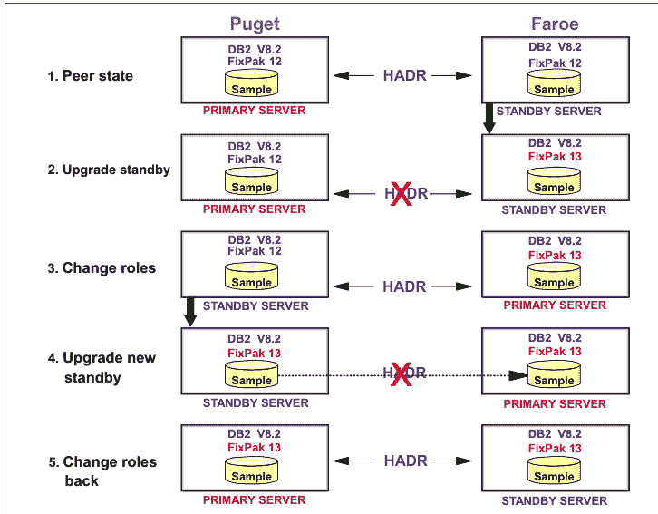

图 7-1 滚动升级

应用 `FixPak` 的步骤如下：

### 检查系统的 HADR 状态

此步骤是预备检查；首先，你的 `DB2` 管理员 `ID` `db2admin` 必须是本地 `Administrators` 组的成员。其次，我们建议两台服务器的 `HADR` 状态均处于 `Peer` 状态。使用 `db2pd`、`get snapshot` 或 `Manage HADR` 窗口检查 `HADR` 状态。详细信息请参阅第 4 章“`HADR` 管理与监控”。

要打开 `Manage HADR` 窗口，从 `Control Center` 开始，展开树到数据库对象，并右键点击数据库名称。选择高可用灾难恢复 `High Availability Disaster Recovery` → `Manage ...`

`SNAPSHOT` 命令示例：

```
db2 get snapshot for database sample
```

在输出中查找以下行：

`HADR Status`

`Role = Standby`

`State = Peer`

### 在备机上应用 FixPak 代码

在备机 `测试用例中的 FAROE` 上应用 `FixPak` 代码。参考 `FixPak` 目录下的 `Readme.txt` 文件，基础 `FixPak` 安装步骤如下：

a. 在 `CLP` 中使用 `DEACTIVATE DATABASE` 命令去激活数据库。

```
db2 deactivate database
```

然后从 `CLP` 或 `DB2 Control Center` 停止实例。

b. 绑定 `bind` 无法从备用数据库执行，因此你必须连接到当前的主数据库——在我们的示例中为 `FAROE`。连接后，按照 `FixPak readme` 可下载文本文件或 `HTML` 文件中列出的列表执行绑定 `bind`。绑定操作会被记录，因此 `HADR` 会在备用上重放这些操作以完成 `FixPak` 的应用。

### 角色切换

5. 可选，如果你想恢复原始服务器角色，请将角色切换回原始主节点。

a. 你的 `HADR` 状态必须为 `Peer`，以确保所有日志均已应用。

b. 在原始主服务器 `当前为新的备用服务器` 上重复第 3 步。在我们的测试用中为 `PUGET`。

## 7.1.2 使用命令行应用 DB2 FixPak

这提供了一个在命令行环境中进行滚动修复包升级的示例。所使用的测试用例涉及两台 `Linux` 服务器：`LEAD` 设置为主节点和 `POLONIUM` 设置为备节点。我们执行了从 `8.2 FixPak 12` 到 `8.2 FixPak 13` 的滚动升级。

### 1. 检查系统的 HADR 状态

我们建议你的 `HADR` 系统已处于 `Peer` 状态。你可以通过 `db2pd`、获取快照 `snapshot` 或如果你运行了 `XI1` 的管理 `HADR` 窗口来检查 `HADR` 状态。

`GET SNAPSHOT` 命令的示例：

```
db2 get snapshot for database sample
```

查找输出中的以下几行：

| Role | Standby |
| :--- | :--- |
| State | Peer |

### 2. 在备用系统上应用 FixPak

a. 从命令行 `CLP` 停用备用服务器上的数据库。在我们的示例中备用节点为 `POLONIUM`：

```
db2 deactivate database sample
```

b. 从 `CLP` 停止 `DB2`，为应用 `FixPak` 做准备：

```
db2stop
```

c. 应用 `FixPak` 代码。参考你正在安装的 `FixPak` 的 `readme` 文件。

d. 在备用节点上启动 `DB2`，在我们的示例中为 `POLONIUM`：

```
db2start
```

e. 在备用节点的 `CLP` 上激活数据库。

```
db2 activate database sample
```

**注意：** 此时你将无法执行 `FixPak` 应用所需的绑定命令，因为数据库仍处于前滚分页状态 `rollforward paging`。绑定操作将在第 4b 步中处理。

### 3. 从备用系统切换角色

a. 从备用数据库的 `CLP` 上执行 `takeover hadr` 命令。在我们的测试用例中，从 `POLONIUM` 执行：

```
db2 takeover hadr on database sample
```

接管后，由于 `DB2` 版本不同，你的 `HDRR` 连接状态将变为断开。

注意，`HADR` 支持备用节点运行比主节点更高的版本，但反之则。因此，一旦接管完成，由于新主具有更高的 `DB2` 版本，新的备用节点 `旧主` 数据库将被停用。

### 4. 在原始系统上应用 FixPak

a. 在新的备用服务器上重复第 2 步。在我们的示例中，我们在 `LEAD` 上执行 `FixPak`。

b. 绑定无法从备用数据库完成，因此你需要连接到当前的主数据库——在我们的示例中为 `POLONIUM`。连接后，执行 `DB2 FixPak` 应用的绑定操作。绑定操作会被记录，因此 `HADR` 会在备用上重放这些操作以完成 `FixPak`。参考 `FixPak Readme` 中的绑定说明。

### 5. 可选将角色切换回原始主节点

a. 你的 `HADR` 状态必须为 `Peer`，以确保所有日志均已应用。

b. 在原始主服务器 `当前为新的备用服务器`，在我们的测试用中为 `LEAD` 上重复第 3 步。

## 7.2 版本升级

`DB2` 版本或小版本升级之间不支持滚动升级，例如从版本 `8.2` 升级到 `9.1`。对于此类操作，请规划主数据库更新期间的停机。在本节中，我们提供一个在 `Windows` 操作系统和命令行进行 `DB2` 迁移的示例。

为了尽量减少 `HDR` 服务器的停机时间，我们建议按照图 7-6 所示进行版本升级。

| Puget | Faroe |
| :--- | :--- |
| 1. 停止 HADR | DB2 V8.2 FixPak 13 [Sample] PRIMARY SERVER -> HDR -> DB2 V8.2 FixPak 13 [Sample] STANDBY SERVER |
| 2. 升级备用节点 | DB2 V8.2 FixPak 12 [Sample] PRIMARY SERVER -> HDR -> DB2 9 [Sample] STANDBY SERVER |
| 3. 升级主节点 | DB2 9 [Sample] PRIMARY SERVER -> HDR -> DB2 9 [Sample] STANDBY SERVER |
| 4. 从主节点恢复数据库到备用节点 | DB2 9 [Sample] PRIMARY SERVER -> Restore -> DB2 9 [Sample] STANDBY SERVER |
| 5. 重启 HADR | DB2 9 [Sample] HADR -> DB2 9 [Sample] STANDBY SERVER |

图 7-6 版本升级

### 7.2.1 Windows 版本升级

接下来我们将描述在 `Windows` 服务器上从 `DB2` 版本 `8.2` 升级到版本 `9.1` 的步骤。

遵循以下步骤：

#### 1. 升级备用服务器

确保你的 `HADR` 通过 `db2pd`、快照或 `HADR` 管理窗口处于 `Peer` 状态。有关的命令用法，请参阅第 93 页第 4 章“`HADR` 管理与监控”。

停用备用服务器上的数据库：

```
db2 deactivate database sample
```

使用 `db2stop` 命令：

```
db2stop
```

应用升级相关的代码。

在备用节点上启动 `DB2`：

```
db2start
```

激活数据库：

```
db2 activate database sample
```

#### 2. 升级主服务器

a. 停用主服务器上的数据库：

```
db2 deactivate database sample
```

b. 使用 `db2stop` 命令：

```
db2stop
```

c. 应用升级相关的代码。

d. 在主服务器上启动 `DB2`：

```
db2start
```

e. 激活数据库：

```
db2 activate database sample
```

f. 运行迁移命令：

```
db2 migrate database sample
```

## 3. 重新初始化备用服务器

返回备用服务器 `测试用例中的 FAROE` 服务器，然后执行以下步骤：


进入`/path/to/xxx`目录，找到`xxx.json`。

在表达式`cvar = avar + bvar`中，加法运算符（`+`）将`avar`与`bvar`相加，得到它们的和`cvar`

在`List.of(arg0, arg1, arg2)`中，`List`接口的工厂方法`of()`接受一系列的元素，返回包含它们的只读列表。

之后我们这样调用`cmd`命令：`cmd arg0 arg1 arg2`。

```
if (condVar > someVal) {console.log("xxx")}
```


图 8-1 展示了 HACMP 拓扑结构和相关的 DB2 数据库组件。HACMP 管理提供服务所需的资源组，包括数据库组件所处的共享磁盘、客户端服务的 IP 地址以及处理应用程序启动和停止（包括 DB2 数据库实例）的应用程序服务器。

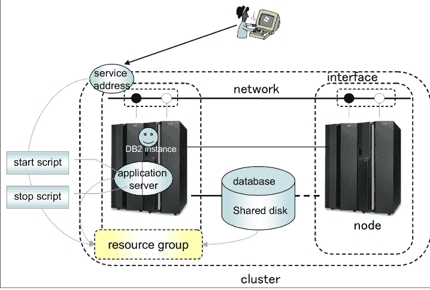

HACMP 持续在集群节点之间发送心跳包，以识别某个节点是否以及何时宕机。在故障发生或故障节点修复后进行回滚时，HACMP 根据需要处理资源组从一个系统到另一个系统的转移。在 DB2 单分区环境中，集群会采取以下操作：

- 故障转移（Failover，非计划接管）：
如果服务节点故障，HACMP 备用节点会检测到服务节点宕机。当无法从所有网络路由接收到来自另一个节点的跳线包时，备用节点开始接管资源组。这意味着备用节点获取了共享存储设备、创建数据库组件的卷组，以及客户端与服务器通信的业务 IP 地址。一旦资源被接管，就会执行应用程序服务器中定义的启动脚本，启动 DB2 实例以及其他关键服务和应用程序。图 8-2 显示了资源组在故障转移期间如何移动到备用节点。

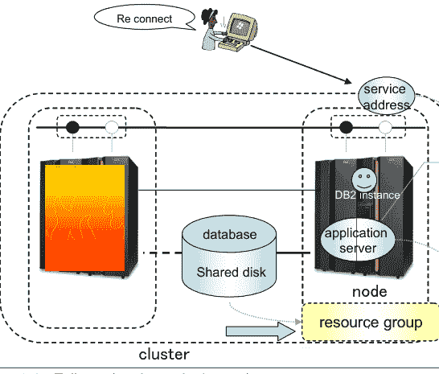

图 8-2 故障转移（非计划接管）

- 切换（Switch over，为了维护的计划接管）：
你可以为了机器维护的目的，有意地将资源组切换到备用节点。这是通过执行两个 HACMP 管理操作的：
- 在服务节点上停止接管模式下的故障转移。
调用需要释放资源组的节点上的应用程序服务器停止脚本（Stop script）。该停止脚本会优雅地停止访问共享磁盘的所有应用程序和进程。
- 将资源组从服务节点移动到备用节点。
HACMP 进程在两个节点上仍在运行。HACMP 释放包括共享磁盘和与资源组相关的任何业务 IP 地址在内的所有资源。服务节点释放后，备用节点侧获取。

图 8-3 展示了资源组在切换期间是如何移动的。

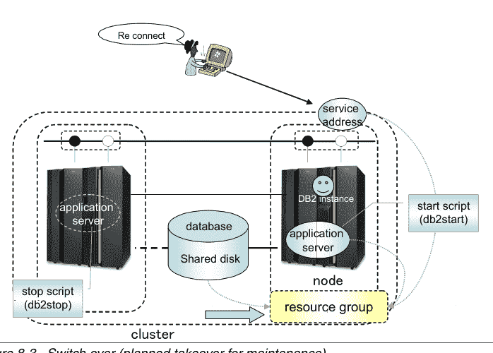

### 8.3 规划 HACMP 集群

当你规划 HACMP 集群时，可以选择适合你系统环境的配置：

- 主/备用（Active/standby）：
典型配置是主/备用配置。在这种配置中，一个节点处于主状态，而另一个节点处于备用状态。一个资源组在节点之间共享。这种配置非常简单易于管理，但一个节点未用于服务。

- 主/主（Active/active）：
主/主也被称为互接管（mutual takeover）。在主/主配置中，数据库通常在每个节点下都运行。图 8-4 展示了互接管配置。`database_A` 运行在 `node_A` 上，`database_B` 运行在 `node_B` 上。`database_A` 的资源组由 `node_B` 接管。随后 `database_A` 和 `database_B` 都运行在一个节点上：即 `node_B`。如果 `node_B` 崩溃，会发生相同的操作，只是方向相反。

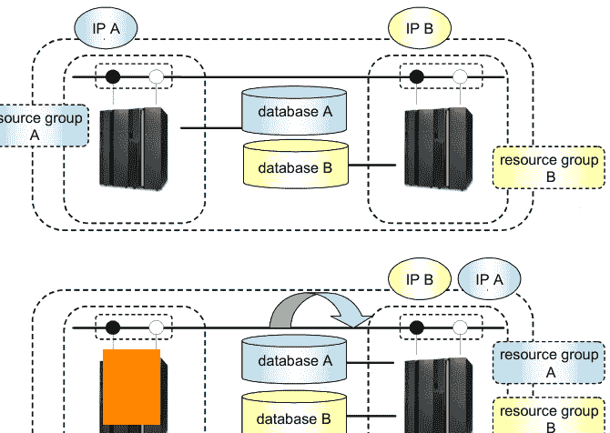

图 8-4 互接管

- 其他变体：
存在某些适用于三个以上节点的集群配置变体。见图 8-5。

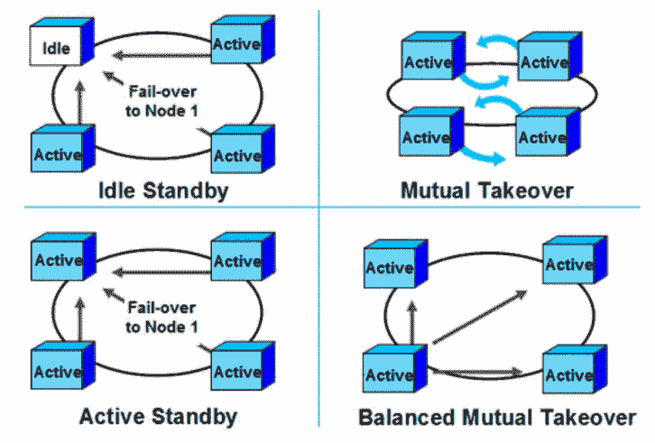

### 8.4 设置 HACMP

设置 HACMP 通常需要以下步骤：

- 1. 定义集群并将节点添加到集群中。
- 2. 配置 HACMP 网络并决定用于 IP 地址接管的方法。
- 3. 配置通信接口和设备。共享磁盘可作为心跳。为了配置共享磁盘，应在并发卷组中。
- 4. 配置高可用性业务 IP。
- 5. 配置应用程序服务器。通常很有放置简单的脚本（测试脚本）来测试 HACMP 的基本启动和停止功能。在验证 HACMP 环境正常工作后，修改启动和停止脚本以工作。
- 6. 配置高可用性（HA）资源组。这将业务 IP、共享卷组和文件以及应用程序所需的所有资源关联到一个资源组。在发生节点故障时，HACMP 将故障节点上的资源组移动到存活节点。
- 7. 验证并同步 HACMP 配置。在配置 HACMP 后，必须使用 HACMP 提供的功能（例如通过 `SMIT` 命令面板）验证并同步拓扑结构和资源组。每当 HACMP 配置发生变化时，必须从更改的节点重新同步集群。

#### 8.4.1 HACMP 集群设置

在设置 HACMP 环境之前，你需要规划集群环境。考虑以下列表：

- 物理节点
- 网络
- 应用程序后端/服务软件（例如 DB2）
- HACMP 配置
- 应用程序启动/停止脚本

接下来，我们将在特定的磁盘共享环境环境中简要检查这些项目。每个项目的详细信息和说明可以在 8.4.2 节“HACMP 配置”第 193 页中找到。

## 示例环境

图 8-6 显示了活动/备用 HACMP 集群配置的示例，其中包含一个共享磁盘配置的正常 DB2 实例。

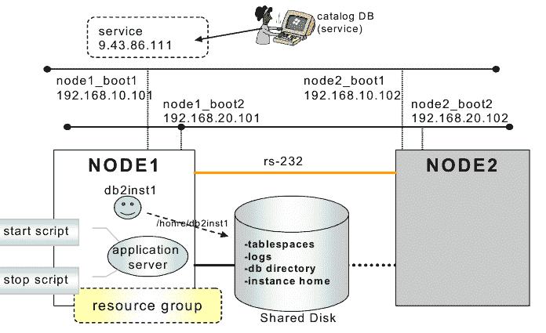

图 8-6 HACMP 磁盘共享集群

以下是该示例环境的规划：

- 物理节点配置：
集群中定义了两个名为 `Node1` 和 `Node2` 的物理节点：
- `Node1` 被指定为*服务*节点，通常为客户端提供服务。该节点上运行着一个单分区的 DB2 实例。
- `Node2` 是*备用*节点，通常在任何服务节点故障时接管。备用节点上不运行 DB2 实例。两个节点的作用会根据系统故障转移或管理员发出的计划内接管而发生变化。

- 网络配置设置如下：
- 每个节点提供两个以太网网络接口用于客户端连接。这两个接口都受 HACMP 控制。客户端的服务地址添加在其中一个网络接口上。
- 配置一个串口（RS-232C）网络用于 HACMP 存活检测。建议使用串口网络（非 TCP/IP 网络），因为这能使 HACMP 故障检测更加可靠。

- DB2 配置：
DB2 产品库安装在每台服务器的本地磁盘上。在共享磁盘上创建了一个名为 `db2inst` 的单分区实例及其名为 `SAMPLE` 的数据库。如果将表空间或日志放置在共享磁盘内部的设备设备上，则这些设备都必须包含在同一个资源组中。

- HACMP 配置：
- 在集群中配置了一个名为 `shared_rg` 的资源组，该资源组将服务 IP 地址、应用程序服务器和共享磁盘上的文件系统作为资源。
- 在资源组中定义了一个服务地址。每个 DB2 客户端的目录目录节点目录中都有该服务地址的条目，并通过此 IP 地址连接到服务节点。
- 资源组中还定义了一个应用程序服务器。应用程序服务器启动简单地启动数据库实例并重启数据库。应用程序服务器停止则停止实例。

#### 8.4.2 HACMP 配置

在本节中，我们简要讨论了 HACMP 实施之前的规划阶段。在本节中，我们将介绍在共享磁盘集群配置中实际设置 HACMP 的概述。有关更多详细信息以及设置 HACMP 和 DB2 的逐步指南，请参考以下文档：

- IBM DB2 Universal Database Edition for AIX and HACMP/ES ftp://ftp.software.ibm.com/software/data/paps/papers/db2exe-aihacmp.pdf
- DB2 UDB V8.1 ESE and high availability on AIX with HACMP 4.4.1: A mutual scenario http://www.ibm.com/developerworks/db2/library/techarticle/dm-0407nikoloulou/

##### 检查网络连接

在配置 HACMP 之前，必须正确配置网络。以下步骤显示了如何检查集群的网络配置。

1. 检查两个节点的网络接口上是否配置了 IP 地址。
2. 检查 `/etc/hosts` 文件是否包含所有 IP 地址条目，且这些标签被 HACMP 使用。
3. 使用 `host` 命令验证名称解析是否正常。如果有问题，请检查并修改 `/etc/hosts` 文件。
4. 检查串口网络连接。建议为 HACMP 存活检测提供辅助网络，以使 HACMP 故障检测更安全。更多信息请参阅 HACMP Administration Guide, SC23-4862-09。

##### 配置共享磁盘

此要求专门针对 HACMP 共享磁盘配置。由于共享磁盘是 HACMP 设置中不可或缺的一部分，本节列出了设置共享磁盘资源所需的高级步骤。

以下是涉及 AIX 逻辑卷的一些术语：

- 卷组 (`VG`)
- 逻辑卷 (`LV`)
- 日志文件系统 (`JFS`)
- 文件系统 (`FS`)

执行以下步骤来设置共享磁盘资源：

1. 检查两个节点的网络接口上是否配置了 IP 地址。
2. 检查 `/etc/hosts` 文件是否包含所有 IP 地址条目，且这些标签被 HACMP 使用。


# 网络与名称解析检查

3. 使用 `host` 命令验证名称解析是否正常。如果有问题，请检查并修改 `/etc/hosts` 文件。

4. 检查串口网络连接。建议为 `HACMP` 存活检测提供辅助网络，以使 `HACMP` 故障检测更安全。

# 磁盘配置

配置磁盘：

- 卷组（`VG`）
- 逻辑卷（`LV`）
- 日志文件系统（`JFS`）
- 文件系统（`FS`）

以下是涉及 AIX 逻辑卷的一些术语：

- 卷组（`VG`）
- 逻辑卷（`LV`）
- 日志文件系统（`JFS`）
- 文件系统（`FS`）

# 共享磁盘资源设置

执行以下步骤来设置共享磁盘资源：

1. 检查两个节点的网络接口上是否配置了 IP 地址。
2. 检查 `/etc/hosts` 文件是否包含所有 IP 地址条目，且这些标签被 `HACMP` 使用。
3. 使用 `host` 命令验证名称解析是否正常。如果有问题，请检查并修改 `/etc/hosts` 文件。
4. 检查串口网络连接。建议为 `HACMP` 存活检测提供辅助网络。

配置共享磁盘的：

- 卷组（`VG`）
- 逻辑卷（`LV`）
- 日志文件系统（`JFS`）
- 文件系统（`FS`）

以下是涉及 AIX 逻辑卷的一些术语：

- 卷组（`VG`）
- 逻辑卷（`LV`）
- 日志文件系统（`JFS`）
- 文件系统（`FS`）


#### 8.4.2 HACMP 配置

在本节中，我们简要讨论了 `HACMP` 实施之前的规划阶段。在本节中，我们将介绍在共享磁盘集群配置中实际设置 `HACMP` 的概述。有关更多详细信息以及设置 `HACMP` 和 `DB2` 的逐步指南，请参考以下文档：

- `IBM DB2 Universal Database Edition for AIX and HACMP/ES` `ftp://ftp.software.ibm.com/software/data/paps/papers/db2exe-aihacmp.pdf`
- `DB2 UDB V8.1 ESE and high availability on AIX with HACMP 4.4.1: A mutual scenario` `http://www.ibm.com/developerworks/db2/library/techarticle/dm-0407nikoloulou/`

##### 检查网络连接

以下是涉及 `AIX` 逻辑卷的一些术语：

- 卷组（`VG`）
- 逻辑卷（`LV`）
- 日志文件系统（`JFS`）
- 文件系统（`FS`）

执行以下步骤来设置共享磁盘资源：

1. 检查两个节点的网络接口上是否配置了 `IP` 地址。
2. 检查 `/etc/hosts` 文件是否包含所有 `IP` 地址条目，且这些标签被 `HACMP` 使用。
3. 使用 `host` 命令验证名称解析是否正常。如果有问题，请检查并修改 `/etc/hosts` 文件。
4. 检查串口网络连接。

配置共享磁盘的：

- 卷组（`VG`）
- 逻辑卷（`LV`）
- 日志文件系统（`JFS`）
- 文件系统（`FS`）


在配置 HACMP 之前，必须正确配置网络。以下步骤显示了如何检查集群的网络配置。

1. 检查两个节点的网络接口上是否配置了 IP 地址。
2. 检查 `/etc/hosts` 文件是否包含所有 IP 地址条目，且这些标签被 HACMP 使用。
3. 使用 `host` 命令验证名称解析是否正常。如果有问题，请检查并修改 `/etc/hosts` 文件。
4. 检查串口网络连接。建议为 HACMP 存活检测提供辅助网络，以使 HACMP 故障检测更加可靠。更多信息请参阅 HACMP Administration Guide, SC23-4862-09。

### 配置共享磁盘

此要求专门针对 HACMP 共享磁盘配置。由于共享磁盘是 HACMP 设置中不可或缺的一部分，本节列出了设置共享磁盘资源所需的高级步骤。

以下是涉及 AIX 逻辑卷的一些术语：

- 卷组 `VG`
- 逻辑卷 `LV`
- 日志文件系统 `JFS`
- 文件系统 `FS`

执行以下步骤来设置共享磁盘资源：

1. 检查两个节点的网络接口上是否配置了 IP 地址。
2. 检查 `/etc/hosts` 文件是否包含所有 IP 地址条目...（此处后续省略）

#### 示例 8-4 导入卷组

导入卷组

在输入字段中输入或选择值。

在完成所有所需的更改后按 Enter 键。

```
[Entry Fields]
VOLUME GROUP name [db2vg] +
PHYSICAL VOLUME name [hdisk1]
Volume group MAJOR NUMBER [58] +
```

接下来，更改 VG 以便其在重新启动时不激活：

##### `smit vg`

选择 Set Characteristics of a Volume Group（设置卷组特性）→ Change a Volume Group（更改卷组）。然后选择 VOLUME GROUP 名称。在 Change a Volume Group（更改卷组）菜单中，将 Activate volume group AUTOMATICALLY（自动激活卷组）设置为 no（否）。

+ 7. 将 VG 移回服务节点。

将文件系统和 VG 移回 node1，以便下一步操作，在下一步中将在 node1 上创建一个 DB2 实例用户。

```
##### unmount /home/db2inst
# varyoffvg db2vg
```

在 node1 上运行以下命令：

```
# varyonvg db2vg
##### mount /home/db2inst
```

### 用户/组设置与 DB2 安装

现在共享磁盘已设置完毕，我们可以在共享磁盘上创建 DB2 实例和数据库。在 node1 上执行以下步骤：

+ 1. 为 DB2 实例创建组。

使用 `mkgroup` 命令创建组。

+ 2. 为 DB2 实例创建用户。

使用 `mkuser` 和 `passwd` 命令。

+ 3. 更改 FS（文件系统）和 LV（逻辑卷）的所有者。

+ 4. 安装 DB2 并设置许可证密钥。DB2 产品必须安装在两个节点的本地磁盘上。

+ 5. 创建 DB2 实例。

+ 6. 在共享文件系统中创建数据库。

+ 7. 将实例主目录故障转移到 node2。

卸载共享磁盘上的 FS 并在 node1 上对 VG 执行下线操作（`varyoff`）。

在 node2 上激活 VG 并挂载所有 FS。删除目录 `home/db2inst1/sqlib`，这使我们能够在 node2 上创建实例并进行其控制文件。

接下来，在 node2 上重复步骤 1 到 6。

### 准备应用程序服务器脚本

应用程序服务器由启动脚本和停止脚本组成。在本节中，我们将解释这些应用程序脚本中必须包含的内容。

+ 在脚本中，我们简单地重启 DB2 实例并激活数据库以运行崩溃恢复。

+ 企业服务器版 `ESE` 实例在实例主目录的 `sqllib` 子目录下有一个 `db2nodes.cfg` 文件。当在另一个节点上重启 DB2 实例时，该文件必须包含正确的主机和 IP 地址。DB2 单分区实例也有此文件。我们将在第 203 页的 8.5 节“`db2nodes.cfg` 文件的考虑因素”中详细详细介绍此主题。

+ 将数据库配置参数 `AUTORESTART` 设置为 ON。

当应用程序连接到数据库或数据库被激活时，数据库管理器会自动调用重启数据库实用程序。默认设置为 ON。

+ 在脚本中，我们必须停止所有访问共享磁盘的应用程序和进程，以确保节点能够成功释放共享磁盘。在 DB2 术中，这意味着 `force application all`（强制所有应用程序）、`deactivate all databases`（取消激活所有数据库）、`terminate`（终止停止后台进程）以及 `db2stop`（停止 dbbm/实例）。可能需要 `db2stop force` 和 `db2_kill` 等升级命令，以便应用程序在合理时间内断开连接。

DB2 ESE 包含了一个示例脚本，用于协助在热备节点或互接管节点中配置 HACMP 故障转移或恢复。脚本文件对于单节点（ESE 以外的）称为 `rc.db2pe.ee`，对于多节点称为 `rc.db2pe.ee`。它们位于 DB2 实例主目录下的 `samples/sqlib/hcmp` 子目录下。可以复制适当的文件并根据系统进行自定义。完成自定义并重命名后，将 `rc.db2pe.ee` 重命名为 `rc.db2pe`。例如，这些示例脚本设计为使用 `rc.db2pe db2inst1 start` 和 `rc.db2pe db2inst1 stop` 的语法进行调用。

有关 HACMP/ES 的更多信息，请参阅 DB2 9 手册《Data Recovery and High Availability Guide and Reference》，SC10-4228 中“Cluster Support for AIX”章节下的“HACMP 事件监控和用户定义事件”部分。该主题在 DB2 信息 Center 中同样可用。

```
http://publib.boulder.ibm.com/infocenter/db2lu/v9/index.jsp?topic=/com_ibm.db2.udb.admin.com/doc/c007500.htm
```

### 配置 HACMP

AIX `smitty` HACMP 配置接口。主要步骤如下：

+ 1. 将节点添加到 HACMP 集群
2. 添加服务 IP 标签/地址
3. 配置应用程序服务器
4. 添加资源组
5. 向资源组添加资源
6. 定义串行网络和串行网络设备
7. 验证并同步 HACMP 配置
8. HACMP 配置的基本验证

以下是每个步骤的扩展：

+ 1. 将节点添加到 HACMP 集群。

```
#smitty hacmp
```

在 HACMP for AIX 菜单中，选择 Initialization and Standard Configuration（初始化和标准配置）→ Add Nodes to an HACMP Cluster（向 HACMP 集群添加节点）。

在 Configure Nodes to a HACMP Cluster (standard) 菜单中，输入集群名称和新节点。

+ 2. 添加服务 IP 标签/地址

```
##### smitty hacmp
```

在 HACMP for AIX 菜单中，选择 Initialization and Standard Configuration（初始化和标准配置）→ Configure Resources to Highly Available（配置高可用资源）→ Add Service IP（添加服务 IP）。

在 Add Service IP 菜单中，输入 IP 标签和网络名称。

+ 3. 配置应用程序服务器

```
##### smitty hacmp
```

在 HACMP for AIX 菜单中，选择 Initialization and Standard Configuration（初始化和标准配置）→ Configure Resources to Highly Available（配置高可用资源）→ Add Application Server（添加应用程序服务器）。

在 Add Application Server 菜单中，输入服务器名称、启动和停止脚本的路径。

+ 4. 添加资源组

```
##### smitty hacmp
```

在 HACMP for AIX 菜单中，选择 Initialization and Standard Configuration（初始化和标准配置）→ Configure Cluster Groups（配置资源组）→ Add Resource Group（添加资源组）。

在 Add Resource Group 菜单中，输入资源组名称和参与节点。

+ 5. 向资源组添加资源

```
##### smitty hacmp
```


在 HACMP for AIX 菜单中，选择 Initialization and Standard Configuration（初始化和标准配置）→ Configure Cluster Groups（配置资源组）→ Change/Show Resources（更改/显示资源）。

在 Change/Show Resources 菜单中，输入服务 IP/地址、应用程序服务器名称、卷组和文件系统。

## 6. 定义串行网络和串行网络设备

如果你使用串行网络作为辅助链路网络，可以在 `smitty` 菜单中进行配置。

## 7. 验证并同步 HACMP 配置

在一个节点上定义 HACMP 配置后，必须向另一个节点验证并同步集群拓扑。

```smitty hacmp```

在 HACMP for AIX 菜单中，选择 Initialization and Standard Configuration（初始化和标准配置）→ Verify and Synchronize HACMP Configuration（验证并同步 HACMP 配置）。

HACMP 验证工具检查所有节点的集群定义是否相同并在发现错误时提供诊断信息。

## 8. HACMP 配置的基本验证

### 示例 8-5 向资源组添加资源

更改资源组的所有资源

在输入字段中输入或选择值。

在完成所有所需的更改后按 Enter 键。

| 资源组 | [输入字段] |
|---|---|
| 参与节点 (默认优先级) | db2_rg node1_node db2_node |
| 启动策略 | 在线分布策略 |
| 故障转移策略 | 转移到列表中的下一个优先级 |
| 回滚策略 | 从不 |
| 服务 IP 标签/地址 | Service |
| 应用程序服务器 | db2server |
| 卷组 | db2vg |
| 必要时使用卷组的强制下线 | false |
| 文件系统 (为空为指定的所有项) | /home/dbinst |

我们在示例中设置的资源组策略如下。对应于以前 HACMP 版本中的旋转资源组，这意味着节点之间没有资源组优先级。欲需更多详情，请参阅 HACMP5.3《Planning and Installation》，SC23-4861-07 第 6 章。

## 8.5 db2nodes.cfg 文件的考虑因素

从 8 版本开始，DB2 ESE 单节点实例和分区实例在实例主目录的 `sqllib` 子目录下都有一个 `db2nodes.cfg` 文件。`db2nodes.cfg` 文件用于定义参与 DB2 实例的数据库分区服务器。在集群环境中，你必须考虑该文件的项，以便在不同节点上启动 DB2 实例。

假设一个 DB2 ESE 单分区实例运行在一个由名为 node1 的服务节点和名为 node2 的备用节点组成的集群中。当发生故障转移（接管/takeover）时，DB2 实例必须在 node2 上启动。如果实例主目录配置在共享磁盘上，共享目录中 `db2nodes.cfg` 文件中的项将与备用节点的主机不匹配。那么当应用程序启动脚本尝试启动 DB2 实例时，`db2start` 命令将因错误代码 -6048 或 -6031 失败。示例 8-6 显示了当 db2nodes.cfg 不正确时 `db2start` 失败的情况。

### 示例 8-6 由无效 db2nodes.cfg 项引起的错误消息

```
$hostname
host2

$cat /home/db2inst1/sqllib/db2nodes.cfg
host1 0
```

```
$ db2start
SQL6048N A communication error occurred during START or STOP DATABASE MANAGER processing.
```

你有几种选项可以避免此错误，下面列出了部分选项：

- 1. 修改启动脚本中的文件项。
- 2. 使用 `restart` 选项执行 `db2start` 命令。
- 3. 使用 `-u` 选项执行 `db2gcfg` 命令。
- 4. 在 hosts 文件中使用别名。
- 5. 在 db2nodes.cfg 中使用 IP 地址。

选项 1、2 和 3 手动或自动修改 `db2nodes.cfg` 文件的项，而选项 4 和 5 不需要远程执行权限，而选项 1、3 和 4 则不需要。

接下来我们将详细描述这些选项中的每一个。

### 修改启动脚本中的文件项

这可能是列出的方法中最简单的，它涉及在启动 DB2 实例之前修改 `db2nodes.cfg` 文件的项，或者准备另一个具有正确项的配置文件并覆盖现有的 `db2nodes.cfg` 文件。在我们的示例中，一个在名为 node1 的 HACMP 服务节点上（node2 为备用节点）运行的 DB2 实例，其 `db2nodes.cfg` 文件如下所示：

- node1 0

当在 node2 上发生故障转移时，上述 `db2nodes.cfg` 文件将失效。应用程序启动脚本可以包含一个如下所示的过程来修改 `db2nodes.cfg`，或者准备一个已包含该项的本地文件，并在 node2 上启动 DB2 实例之前将此文件复制或覆盖到 `db2nodes.cfg` 文件。

- node2 0

图 8-7 图形展示了这一概念，显示了节点 2 发生故障转移之前、期间和之后的状态。

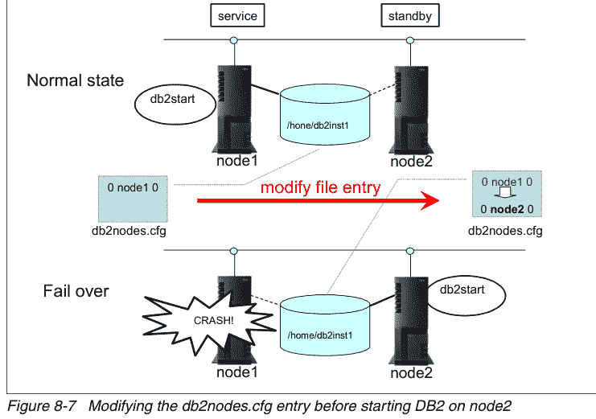

Linux, UNIX 和 Windows 上的 DB2 高可用性和可扩展性指南

### 使用 restart 选项的 db2start 命令

使用 `restart` 选项启动 DB2 实例可以指定新主机名作为接管资源组的节点。参见示例 8-7。注意，DB2 会自动用你在 `restart` 选项中指定的主机修改 `db2nodes.cfg` 文件。

#### 示例 8-7 db2start 命令的 restart 选项

```
db2start dbpartitionnum 0 restart hostname2
```

#### 考虑因素

由于 `restart` 选项需要远程执行权限，你必须在集群中配置可用的远程 shell (`rsh`) 或安全 shell (`ssh`)。对于单节点和多节点分区都是需要的。

- rsh 配置：

  在 `.hosts` 文件或 `hosts.equiv` 文件中添加可靠主机名和用户项。此选项通常因为 shell 带来的带来的安全风险而不被青睐。

- ssh 配置（从 DB2 V8.2 起可用）：

  安装 ssh，为 DB2 实例使用设置公钥和私钥。在 `DB2RSHCMD` 注册表值中设置 ssh 命令的完整路径如下：

  `db2set DB2RSHCMD=/usr/bin/ssh`

### 使用 -u 选项的 db2gcfg 命令

此选项使用 `db2gcfg` 命令。当带有 `-u` 选项执行 `db2gcfg` 命令时，`db2nodes.cfg` 文件会被自动修改，DB2 实例将在备用节点上启动。使用此方法，不需要 rsh 或 ssh，如果你出于安全原因有站点或公司禁止使用任何 `.hosts` 文件，或者你无法安装 ssh，该方法非常有用。参见示例 8-8 的 `db2gcfg` 命令示例，示例 8-9 查看由此命令修改的 `db2nodes.cfg` 文件。你可能会注意到在示例 8-9 中 `db2nodes.cfg` 被追加了第四个参数。这是 Netname，用于 FCM 通信的互连。更多细节，请参考《Quick Begin for DB2 Servers, GC10-4246》。

#### 示例 8-8 使用 -u 选项发发的 db2gcfg 命令

```
$ db2gcfg -u -i db2inst

Instance : db2inst
DB2 Start : Success
Partition : 0
```

#### 示例 8-9 由此命令修改的 db2nodes.cfg 文件

| host | partition |
| :--- | :--- |
| host1 | 0 |
| host2 | 0 |

### 在 hosts 文件中使用别名

此选项在 hosts 文件中使用别名。此方法不需要 rsh 或 ssh，如果你出于安全原因有站点或公司禁止使用任何 `.hosts` 文件，或者你无法安装 ssh，该方法非常有用。你需要在两个系统的 `/hosts` 文件中创建别名项，格式如下：

| ip_address | host_name |
| :--- | :--- |
| 192.168.1.101 | node1 |
| 192.168.1.102 | node2 |

node1（主系统）上的项所示示例 8-10

node2（备用系统）上的项所示示例 8-11

系统的 IP 地址和名称应匹配 `db2nodes.cfg` 中的定义，即别名对应实际主机名。接下来，`/netsconf` 文件中的项必须包含 `local` 作为第一个参数。主系统和备用系统的项将类似于示例 8-12。

#### 示例 8-12 netsconf 文件的项


| parameter | value |
| :--- | :--- |
| hosts | local,bind |

通过将 `local` 放在第一个参数，这将强制系统在访问域名服务器 (DNS) 之前在 `/hosts` 文件中查找主机名。最后，`db2nodes.cfg` 中的第二个参数更改为两个系统定义的别名。新的 `db2nodes.cfg` 文件类似于示例 8-13，其中 `db2host` 是 hosts 文件定义的名称。

### 示例 8-13 db2nodes.cfg 项

| host | partition |
| :--- | :--- |
| db2host | 0 |

## 在 db2nodes.cfg 中使用 IP 地址

此选项在 `db2nodes.cfg` 中使用 IP 地址。此方法不需要 `rsh` 或 `ssh`。

- `.hosts` 配置：

此 `.hosts` 文件中必须包含以下网络接口项：

- 主系统 IP 地址
- 备用系统 IP 地址
- 在 HACMP 配置定义的服务适配器 IP 地址

如果 `node1` 是主系统的 IP 地址，`node2` 是备用系统的 IP 地址，`service` 是集群的服务适配器地址，那么 `.hosts` 文件将类似于示例 8-14，其中 `db2inst1` 是 DB2 实例。

### 示例 8-14 .hosts 文件的项

| name | instance |
| :--- | :--- |
| node1 | db2inst |
| node2 | db2inst |
| service | db2inst |

下一步对于两种选项都是相同的：

- 必须将 `db2nodes.cfg` 文件中的第二个参数/列更改为 HACMP 配置中的服务适配器名称。示例 8-15 显示了 `db2nodes.cfg` 文件的内容，其中 `service` 为服务适配器名称。

### 示例 8-15 db2nodes.cfg 文件项

| service | 0 |
|---------|---|

完成这些步骤后，应进行故障转移（failover）和回退（fallback）测试，以确保高可用计算环境正常工作。

## 8.6 快速故障调优建议

当主数据库发生故障时，继续数据库服务的步骤如下：

- 1. 故障检测
- 2. 需要资源转移以提供服务
- 3. 重启应用程序和服务

为了加快恢复速度，我们需要尽可能缩短每个步骤所需的时间。在本节中，我们将讨论每个步骤的注意事项。

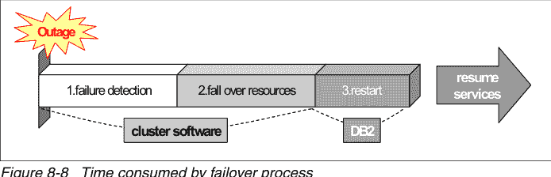

### 8.6.1 故障检测时间

故障检测时间可以通过集群软件设置进行调整。对于 HACMP，可以指定每种网络类型的故障检测率。有多种网络类型，例如：`atm`、`ethernet`、`fddi`、`hps`、`dbkhb`、`rs232`、`tmsci`、`tmssa`。建议集群的所有网络使用相同的检测率。

HACMP 提供了三个默认设置：`SLOW(48s)`、`NORMAL(20s)` 和 `FAST(10s)`。你也可以以秒为单位指定自定义的故障检测率。

注意，设置非常小的秒数会导致故障检测误判（误报），导致不必要的频繁故障转移。

#### 8.6.2 向资源转移

在本节中，我们描述了加速资源转移的几种选项。

### IP 地址接管

在之前的 HACMP 版本中，网络接口直接被服务地址覆盖。从 HACMP/ES V4.5 开始，可以使用 IP 别名（IP alias）接管，这减少了将服务 IP 地址添加到备用节点的时间。如《HACMP v5.3 管理指南》SC23-4862-02 所，时间的缩短是因为移动地址时所需的命令更少。

有关 HACMP 中 IP 别名的更多信息，请参阅 HACMP 手册：

- HACMP v5.3 管理指南，SC23-4862-06
- HACMP v5.3 规划与实施指南 SC23-4861-07

### 磁盘资源转移

在故障转移期间，HACMP 将资源组中定义的共享磁盘从一个移动到另一个。这包括以下活动：

- 激活卷组（VG）- `varyng` 命令
- 挂载文件系统（如果 FS 定义在资源组中）

DB2 故障转移的延迟主要源于控制共享磁盘和资源从一台服务器移动到另一台服务器。当共享 VG 包含巨大的 FS 时，文件系统完整性检查（`fsck`）会消耗大量时间。资源组中的 FS 越多，故障转移所需的时间越长。加速资源接的基本方法是减少资源组中的 FS 数量。这可以通过使用原始设备计数代替 FS 来实现。在原始设备上使用 DB2 数据库管理空间 (DMS)，我们可以显著缩短磁盘资源故障转移的时间，因为在故障转移期间不需要挂载和检查 FS 的一致性。

我们还可以为原始磁盘设置并发访问资源组，进一步缩短故障转移时间。带有 HACMP 的并发访问卷组允许两个节点同时激活 VG。此配置减少了接管资源的时间，因为共享磁盘在备用节点上始终处于激活状态，且无需激活/启用 VG。在 HACMP 中使用并发访问需要安装额外的 HACMP 文件集。例如：

```
cluster.es.clvm.rte for 5.3.0.0 COMMITTED ES for AI Concurrent Access
```

JFS 不支持并发访问模式。相反，你必须仅原始逻辑卷或物理磁盘用于并发访问资源组。

并发访问资源组的另一个考虑因素是确保备用节点上的进程（例如 DB2 实例）没有活动使用任何共享磁盘。并发 VG 从集群中的所有节点激活。这意味着它们可以从集群中的所有节点同时访问，并且存在真实的意外数据损坏或丢失的可能性。在这种情况下，使用共享磁盘的软件有责任确保数据访问一致，无论是在软件内部执行，还是通过应用程序/启动脚本进行外部控制。

虽然 DB2 数据库不容忍来自服务器的并发访问，但在混合/混合 HACMP/HADR 中（如第 253 页第 10 章“集群软件中的 HADR”所述），DB2 数据库在主集群上使用共享磁盘，而 HADR 写入第三台服务器节点上的备机。一次只有一个 DB2 实例可以使用此共享磁盘。

为了提高故障转移/接管的性能，如上述，使用原始设备进行数据存储。下一个问题是在原始设备上创建什么以及不创建什么。

- 用户表空间：

  如果你的数据库很大，用户表空间应占据共享磁盘的大部分，使用 DMS 原始设备作为表空间容器将提高故障转移性能。

- 临时表空间：

  你可以在原始设备中配置临时表空间。你可以在原始设备中配置临时表空间。（注：原文 OCR 文本中的重复内容）。对于巨大的 FS，SMS 表空间在性能上更好。

- 用户表空间：

  如果你的数据库很大，用户表空间应占据共享磁盘的大部分，使用 DMS 原始设备作为表空间容器将提高故障转移性能。

- 临时表空间：

  你可以在原始设备中配置临时表空间。你可以在原始设备中配置临时表空间。（注：原文 OCR 文本中的重复内容）。对于巨大的 FS，SMS 表空间在性能上更好。

- 用户表空间：

  如果你的数据库很大，用户表空间应占据共享磁盘的大部分，使用 DMS 原始设备作为表空间容器将提高故障转移性能。

- 临时表空间：

  你可以在原始设备中配置临时表空间。你可以在原始设备中配置临时表空间。（注：原文 OCR 文本中的重复内容）。对于巨大的 FS，SMS 表空间在性能上更好。

- 目录表空间：

  可以在创建数据库时指定 SYSCAT 的特性。由于大多数情况下 SYSCAT 很小，它可能导致故障时间。

- 活动日志：

  可以在原始设备中配置活动日志。注意，从 DB2 9 版本开始，使用原始设备的数据库日志已弃用。详细信息请参阅 DB2 Center 主题“Database logging using raw devices”：

http://publib.boulder.ibm.com/infocenter/db2luw/v9/index.jsp?topic=/com.ibm.db2.udn.doc/c002386

- 其他数据库组件：

  其他数据库组件（例如数据库目录文件、实例目录和归档日志目录）必须创建在 FS 上。注意，归档日志也可以使用 TSM 来避免此问题。

##### 启动和激活数据库

备用节点接管资源后，下一步是重新启用 DB2 数据库供客户端使用，这包括以下活动：

- 重启 DB2 实例（通过 `db2start` 命令）
- 激活数据库，包括缓冲池激活和崩溃恢复

如果需要崩溃恢复，在数据库可以供客户端访问之前可能会消耗一些时间。从高可用性的角度来看，缩短崩溃恢复时间并更快速地重启数据库至关重要。

崩溃恢复是将数据库移回一致且可用状态的过程。这是通过回滚未完成的事务并完成崩溃发生时仍留在内存中的事务来实现的。换句话说，崩溃恢复更新表容器中的数据，使其与任何未处理的日志记录中存储的内容一致。崩溃恢复消耗的时间取决于日志记录与数据库容器中实际数据之间的差距有多大。在这里，差距等同于以下日志记录的数量：

- 需要向前重滚的记录：已提交但尚未从缓冲池写入磁盘的日志记录量。
- 需要回滚的记录：尚未提交但已写入磁盘的日志记录量。

为了使崩溃恢复快速，你必须减少这些数量：

- 需要向前重滚的记录：


你可以通过将缓冲池上的脏页写入数据库页面，更频繁地同步内存和数据库页面。我们介绍一些相关的调优参数。

- `NUM_IOCLEANERS`：

DB2 页面清理器进程（I/O清理器）负责将缓冲池上的脏页写入数据库页面。激活进程的数量由数据库配置参数 `NUM_IOCLEANERS` 决定。当你增加此参数时，数据库内容在磁盘上的更新会更多，因为页面清理器会将脏页从缓冲池清理到数据页，从而减少崩溃恢复时间。建议根据服务器上的 CPU 核心数来增加此参数。

- `SOFTMAX` 和 `CHNGPGS_THRESH`：

页面清理器根据数据库配置参数 `SOFTMAX` 和 `CHNGPGS_THRESH` 的设置启动。将这些参数调得比默认值低有助于减少崩溃恢复时间，但是以增加系统资源负载为代价的。

当 `SOFTMAX` 参数设置得较低，会导致管理器更频繁地触发页面清理器并进行更频繁的软检查。日志控制文件随后更频繁地写入磁盘，从而缩短崩溃恢复时间。

`CHNGPGS_THRESH` 参数设置得越低，要求保留在缓冲池中的更改页面百分比就越低。这将触发异步页面清理器更频繁地启动缓冲池。这意味着提交到磁盘的数据频率更高，因此在发生崩溃恢复时，所需的时间更短。

从理论上讲，分散来自缓冲池较小但更频繁的写入应该减少峰值 I/O 负载，并减少同步写 I/O 的频率；页面清理器对存储的频繁写入有时会对性能产生不利影响。请考虑对系统负载和吞吐量的影响，并调整到适合你系统的最佳值。

从 DB2 V8.1.4 开始，考虑使用注册表变量 `DB2_USE_ALTERNATE_PAGE_CLEANING` 以获得更改进和主动的页面清理器活动。此注册表变量使 `CHNGPGS_THRESH` 多余，因为它不再控制页面清理。

- 需要回滚的记录：

应用程序频繁提交至关重要。这一点再怎么强调也不为；事务性能、并发性和易恢复性问题很大程度上取决于应用程序是如何编写的。

尽管到数据库后端似乎是持续连接，但编写良好的在线事务在执行大部分工作时甚至不会持有数据锁，并且在用户确认给定答案后，仅需在立即提交前短暂获取锁以处理请求。

批处理也是用户经常滥用的目标，他们期望能够一次性看到数百万行的日志更新，然后当输入文件执行途中发生登录失败或超时时就会感到愤怒，因为他们的事务回滚需要时间。这些用户通常是当被告诉答案是尽可能频繁提交时会抱怨的人，这意味着他们必须在批处理作业中编写重试和重启逻辑，或者寻求替代方案，如带有 `copy yes` 选项的无日志加载。

# 使用 Microsoft Windows Cluster Server 的 DB2

在本章中，我们提供了使用 Microsoft Windows Cluster 设置高可用 DB2 环境的步骤。我们解释了 Microsoft Windows Cluster Server 的基本概念，帮助你理解其架构以及 Windows 2003 Advanced Server 中的基本配置程序。

我们讨论了如何配置 DB2 实例和其他集群资源以成为 Windows Cluster Server 中的高可用资源。

我们通过使用自动实用工具 `db2mscs` 和手动步骤来演示配置步骤。

> 注意：本章使用了 Microsoft Windows Cluster 的截图。Microsoft 产品截图经 Microsoft Corporation 许可转印。

## 9.1 集群服务器概念

微软对业务中高可用性要求的回答是 Windows Cluster Server，以前称为 Microsoft Cluster Servers `MSCS`。

`MSCS` 早期在 Windows NT® 4.0 企业版中作为操作系统的独立组件被引入。

随着 Windows 2003 Advanced Server 和 Data Center 版本的发布，`MSCS` 经过了重构，现在称为 Windows Cluster Server（以后简称 Cluster Server）。Cluster Server 是操作系统的不可或缺的一部分，因此无法单独安装。

本章的目标不是对 Cluster 进行详尽描述，而是介绍某些特定的 Cluster 概念。在本节中，我们介绍了一些关于 Cluster 的概念。

### 9.1.1 集群类型

Cluster Server 提供两种类型的高可用集群，取决于服务：

- 网络负载均衡 `NLB`
- 仲裁集群 `Quorum cluster`

#### 网络负载均衡

`NLB` 是一种集群，允许企业创建一个服务的服务器（节点）农场。当其中一个节点发生故障时，该节点的工作负载可以被其他节点吸收。能够扩展的应用（如代理服务器、Web 服务器等）是这种集群解决方案的目标。

`NLB` 包含在所有 2003 版本中。

#### 仲裁集群服务器

`Quorum` 集群服务器可用于存储状态（如数据库管理系统）且通常需要垂直扩展并确保可用。由于这些服务可以垂直扩展，无法创建服务器农场，在节点故障情况下使服务器高可用的方法是准备一个备用机器接管故障节点的功能。

集群服务器要求节点之间使用特殊的共享磁盘，或者在节点之间使用复杂的算法来同步节点及其提供的状态。

集群服务器有两种不同类型：

- 单仲裁服务器
- 多数节点集 `MNS`

#### 单仲裁服务器

单仲裁服务器使用仲仲裁共享磁盘。这些共享磁盘是共享总线上的 SCSI 磁盘或使用光纤的存储区域网络 `SAN`。

这些共享磁盘之一被称为集群仲裁。该仲裁被用作判定员，跟踪哪个节点拥有资源。如果拥有资源的节点宕机，Cluster 将采取行动将其移动到另一个节点。

#### 多数节点集

`MNS` 由两个或多个没有单一共享仲裁的节点组成。系统中的每个节点在本地磁盘上都有自己的仲裁副本。Cluster Server 使用复杂的算法来保持本地仲裁的同步。这些节点在地理分布的集群配置中更为常见，这也是不使用共享设备的原因。这种配置的缺点是，为了让集群工作，你需要一半的节点加一并保持相互连接。

### 9.1.2 Microsoft 集群服务器定义

从现在起，我们仅统称为单节点仲裁服务器 `single quorum servers`。在本节中，我们将介绍一些理解单节点仲裁服务器在 Windows 集群服务器中如何工作的必要概念。

#### 资源类型

在集群服务器中，资源类型是一项服务（例如 Web 服务、IP 地址）或设备（例如共享磁盘），必须实现高可用性。

对于每种需要操作的资源类型，你都需要一个处理程序 `handler`，它是一个操作该资源的接口。例如，如果你想让共享磁盘具有高可用性，你需要一种机制来：

- 检测资源是否正常工作。
- 检测每个节点对磁盘的可用性。
- 根据需要在节点之间进行资源的故障转移 `failover` 或故障恢复 `failback`。

在集群服务器中，该处理程序以动态链接库 `dll` 的形式实现，必须由服务或资源的提供者提供。对于基本操作系统或资源（如磁盘），集群服务器提供了一个可以处理它们的默认 `dll`。

在 DB2 的情况下，应该创建一种名为 DB2 的新类型资源。管理该资源的库取决于于版本。`dll` 文件及其位置如下：

- DB2 版本 8: `%DB2PATH%\db2wolf.dll`
- DB2 版本 9: `%windir\MSCS\db2server.dll`

#### 资源

资源是你想要在系统中实现高可用的任何元素。你会发现常见的资源包括：

- IP 地址
- DB2 实例
- 文件共享 `Windows` 中的共享目录
- 共享磁盘

#### 组

集群组是一组相互依赖的资源。它们在逻辑上链接在一起以实现特定目的，例如使 DB2 实例具有高可用性。

组还可以为每个节点建立资源所有权。在创建组时，你必须指定哪些节点可以使用组中的资源，以及哪个节点将成为初始所有者。

## 9.2 最小配置和示例设置

为了设置单节点仲裁集群服务器，你至少需要：

- 一个 Windows 2003 域。
- 两台机器作为集群节点，并使用 Windows 2003 高级版或数据中心版。
- 一个可以从所有节点同时访问的共享磁盘。
- 每个节点配备两个网卡是理想的，但不是强制性的。

在我们的示例中，我们拥有以下资源：

- 我们设置了一台名为 Wisla 的 Windows 2003 标准服务器机器，运行 Windows 2002 高级版。
- Mocha 和 Chimu 运行 Windows 2002 高级版。
- 每个节点都有一个 QLogic Q2200 PCI 光纤适配器用于访问 SAN 设备。
- 在 SAN 基础设施中为节点创建了四个磁盘：
  - 驱动器 Q：拥有 1 GB 空间，创建用于集群的仲裁。
  - 驱动器 R、S 和 T：50 GB 分区，用于 DB2 表空间和实例配置存储。

以下是使用集群服务器设置高可用 DB2 环境的步骤。我们将在后续章节中提供创建 Windows 集群服务器并用其配置 DB2 的详细步骤。涉及 Windows 域控制器的步骤，请参考 Windows 文档。

1. 在每台将作为集群节点的机器上安装 Windows 2003 高级版或数据中心版。
2. 配置共享磁盘设备并确保每个节点都能访问共享资源。
3. 将节点添加到 Windows 域。
4. 创建集群服务器。
5. 将节点添加到集群服务器。


### 6. 安装 DB2。

### 7. 创建 DB2 实例。

### 8. 使 DB2 实例具有高可用性。

## 9.3 创建集群服务器

为了创建集群，你需要一个 Windows 域。所有与集群相关的信息都存储在域的活动目录。作为集群一部分的机器必须使用 Windows 2003 企业版或 Windows 2003 数据中心版。Windows 2003 标准版中不提供集群服务。

我们按照以下步骤创建集群服务器：

- 将将作为节点的机器加入域。
- 在域中创建集群。

### 9.3.1 将机器添加到域

第一步是将组成集群的机器附加到 Windows 域。为了实现这一目标，请对每台机器执行此过程。

1. 使用管理员 ID，转到“开始” → “控制面板” → “系统”。在系统属性属性中，选择“计算机名称”选项卡，然后点击“更改”。图 9-1。

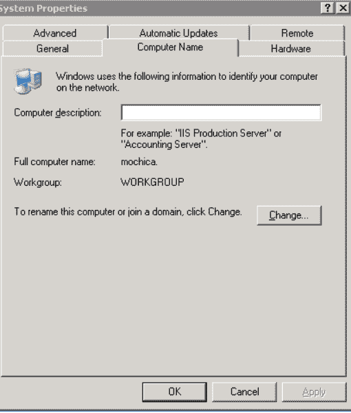

图 9-1 系统属性

2. 在“更改计算机”窗口中，选择“域”并输入你想要加入的 Windows 域名称，在本例中为 `CHAVIN`。点击确定。见图 9-2。

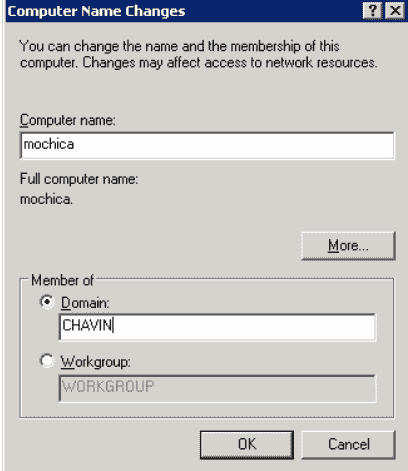

图 9-2 将计算机添加到域

3. 将显示一条消息指示机器已加入域。见图 9-3。

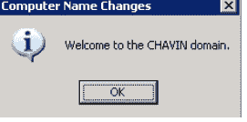

图 9-3 机器已加入

### 9.3.2 在域中创建集群

为了创建集群，你需要一个 Windows 域。在域中创建集群的步骤如下：

- 转到“开始” → “管理工具” → “集群管理器”。集群管理器打开。图 9-4。

在img/a97b7826c3cf736045d80f48b5520a20_240_0.png

图 9-4 创建集群

2. 在集群管理器窗口中，选择“文件” → “新建” → “节点”。显示“添加节点”向导。图 9-5。

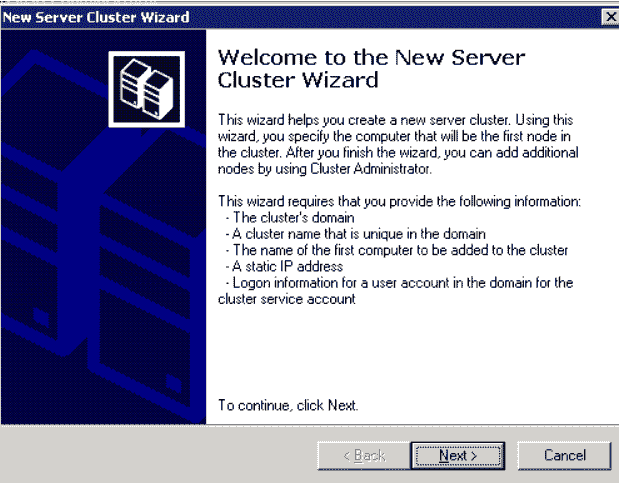

图 9-5 添加节点

3. 在“集群名称和域”窗口中，选择将创建集群的域并为集群选择新名称。见图 9-6。

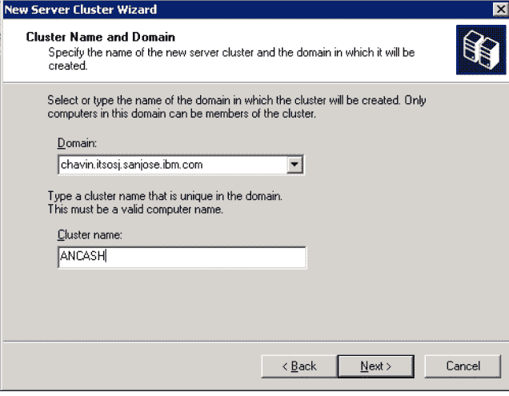

图 9-6 新建服务器

4. 在“集群配置”窗口中，输入集群名称并点击“下一步”。图 9-7。

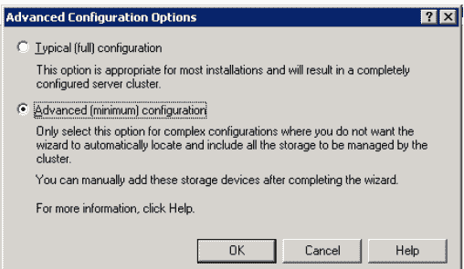

图 9-7 集群配置

5. 在“高级配置”窗口中，你可以选择想要作为仲裁的资源或资源类型。图 9-8。

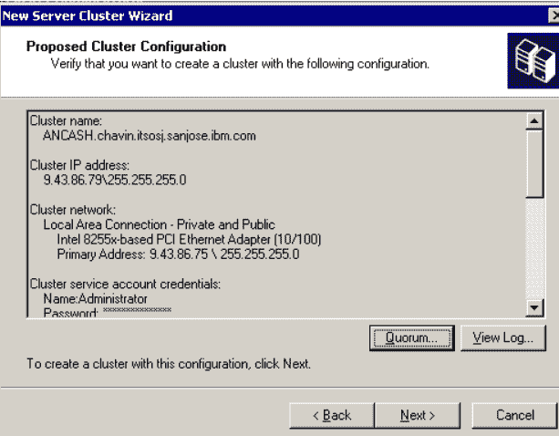

图 9-8 提议配置

6. 如果你有多个共享磁盘，在“提议配置”窗口中点击“仲裁”选择磁盘作为仲裁设备。在本例中，我们选择 Q 盘。见图 9-9。


图 9-9 选择仲裁设备

7. “集群配置”窗口显示要用以下配置创建集群：

| 集群属性 | 值 |
| :--- | :--- |
| 集群名称 | `ANCASH.chavin.itsoj.sanjose.com` |
| 集群 IP 添加 | 集群配置仲裁 |
| 集群 IP 添加 | `9.43.68.79` |
| 集群网络 | Intel 825 Disk Q |
| 集群网络 | 本地仲裁 |
| 主要节点集 |  |
| 集群服务名称 | 管理员 |

要使用此配置创建集群，点击“下一步”。

8. 现在你已经设置了一个单节点集群。见图 9-10。

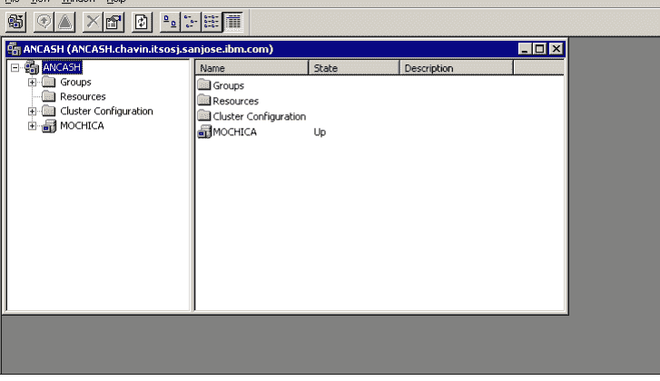

图 9-10 单节点集群

9. 从资源管理器展开仲裁驱动器。如果集群设置成功，将创建 MSCS 目录，该目录包含仲裁文件 `quolog.log` 和一个临时文件。见图 9-11。


图 9-11 MSCS 目录

接下来是使用以下步骤添加节点：

1. 要添加新节点，从“开始” → “管理工具” → “集群管理器”连接到集群。在“打开集群连接”窗口中，输入刚刚创建的集群名称并点击确定。

3. 在“选择计算机”窗口中，在“计算机名称”字段中输入要添加到集群的机器名称，并点击**添加**。机器名称应显示在“已选择计算机”区域。见图 9-12。


图 9-12 输入新节点名称

第9章 使用 Microsoft Windows 集群服务器的 DB2 229

4. 添加节点向导通过检查可用资源来分析是否可以添加节点。在这种情况下，会出现一个警告消息，因为我们使用的机器只有一个网络适配器，而推荐的数量是两个。见图 9-13。点击“下一步”。


图 9-13 添加新节点

5. 需要域上的管理员用户和密码来完成操作（图 9-14）。完成此步骤后，新节点应被添加到集群。


图 9-14 集群服务帐户

一旦两个节点都完成了设置步骤，请验证两台机器上是否存在 `%windir%\cluster\CLUSDB` 和 `%windir%\cluster\CLUSDB.log` 文件。这些分别是是集群的数据库文件和日志文件。

## 9.4 安装 DB2 ESE

DB2 应安装在集群中的所有节点上。关于 DB2 安装程序，请参考《DB2 服务器快速上手指南》，GC10-4246。

你可以在安装 DB2 的同时创建 DB2 实例。我们将推迟实例创建，这样我们就可以按需要指定类型、端口等所有选项。在“配置 DB2 实例”窗口中，点击“下一步”跳过创建 DB2 实例步骤。见图 9-15。


**图 9-15** 跳过创建 DB2 实例步骤

要快速检查 DB2 安装情况，请验证以下 DB2 文件是否存在：

- DB2 ESE 版本 8.2：存在 `%DB2PATH%\db2wolf.dll` 文件。
- DB2 ESE 版本 9.1：存在 `%windir%\MSCS\db2server.dll`。

## 9.5 为 DB2 向集群添加资源

最初，在集群中你有一个名为“集群组”（Cluster Group）的组，其中包含以下资源：

- 集群 IP 地址
- 集群名称
- 仲裁驱动器

在示例中，高可用集群 IP 地址设置为 `9.43.86.169`，仲裁设备为磁盘 Q。

我们必须将共享磁盘作为集群的资源，以便磁盘可以存储实例配置文件（在我们的示例中，我们使用磁盘 R）：

使用“集群服务器向集群添加资源”的步骤按照所示添加共享磁盘：

1. 在集群管理器工具中，转到**文件** -> **新建** -> **资源**。

2. 在“新建资源”窗口（图 9-16）中输入：

   a. 名称：`Disk R`
   
   b. 资源类型：选择**物理磁盘**。然后点击“下一步”。


图 9-16 添加新资源

3. “可能的所有者”对话框如图 9-17 所示。默认情况下，组中的所有节点都将被选 own。顺序并不重要，因为资源的所有者将是组的所有者。点击“下一步”。


图 9-17 可能的所有者

4. 你将看到“资源依赖”对话框。如果你正在添加的资源需要任何其他资源才能正常工作，你必须在此对话框中添加该资源。例如，如果你正在添加的资源是 DB2 实例，你将不得不创建 DB2 实例的磁盘添加到依赖列表中。这样，你就可以避免 DB2 在磁盘准备好之前启动的可能性。

在此示例中，我们正在添加一个不依赖任何其他资源的物理磁盘。依赖列表是空的（图 9-18）。


图 9-18 资源依赖

5. 添加资源的最后一步是指定特定资源的参数。例如，如果你正在创建一个高可用 IP 地址，最后一步是指定你想要使用的 IP 地址。

由于我们正在添加物理磁盘，最后一步是子网掩码（图 9-19）。


图 19 资源参数

## 9.6 创建 DB2 实例


我们通过以下步骤创建 DB2 实例。注意，不能使用 `db2icrt` 的 `-CLUSTERNAME` 直接在指定的集群下创建 DB2 实例。你必须先创建实例然后迁移到集群。

在 ESE 实例的情况下，后续步骤是 `DB2-0`。


图 9-20 添加磁盘


图 9-21 DB2 实例

## 9.7 在 Windows 集群中手动配置 DB2 实例

虽然半自动工具 `db2mscs` 可以为你完成大部分工作，但理解在 Windows 集群中使 DB2 实例实现高所需的步骤是非常重要的，这样你就能诊断发生任何问题。

可以使用以下过程在集群中配置 DB2 实例：

- 向集群添加 DB2 资源类型。
- 创建一个集群组以组实例的所有资源。
- 创建或移动支持资源到 DB2 组：
  - 高可用 IP 地址是强制性的。
  - 用于存储实例配置的高可用共享磁盘是强制性的。
  - 如果是多分区数据库，实例配置目录必须共享并实现高可用。

### 9.7.1 添加 DB2 资源类型

一旦 DB2 安装并创建了实例，你就必须在集群服务器中创建一个 DB2 资源类型。资源类型本质上是一个在 Windows 集群中注册的用于管理特定类型或类型资源的动态加载库。为了让 Windows 集群管理 DB2 实例，DB2 实例必须是集群中的资源。

在“集群管理器”`Cluster Administrator`中，在“集群配置”`Cluster Configuration`下的“资源类型”`Resource Type`文件夹包含集群服务器可以管理的当前资源类型以及管理它们的 DLL。见图 9-22。


图 9-22 集群管理器中的初始资源列表

可以使用 `db2wolfi` 工具将 DB2 资源类型添加到此列表中，该工具接受一个参数：

```
db2wolfi u | i
```

其中：

- `u`: 注销 DB2 资源类型
- `i`: 安装资源类型

图 9-23 显示了 DB2 资源的注册。如果你尝试注册一个已经注册的资源，将获得错误代码 183。

| 选择 DB2 CLIP | |
| :--- | :--- |
| `C:\DB2\SQLLIB\BIN\db2wolfi i` | `dusres.dll` |
| `C:\DB2\SQLLIB\BIN\db2wolfi i` | `dusres.dll` |
| 错误 : 183 | |
| `C:\DB2\SQLLIB\BIN\_` | |

图 9-23 添加 DB2 资源类型

`db2wolfi` 成功运行后，新的资源类型 DB2 被添加。见图 9-24。

| ANCASH (ANCASH) | 显示名称 | 资源 DLL |
| :--- | --- | :--- |
| ANCASH | IP 地址 | `dusres.dll` |
| Groups | 网络名称 | `dusres.dll` |
| Resources | 物理磁盘 | `dusres.dll` |
| Cluster Configuration | DHCP 服务 | `ClNetRes.dll` |
| Resource Types | 分布式事务协调器... | `mclus.dll` |
| Networks | 共享共享 | `dusres.dll` |
| Network Interfaces | 通用应用程序 | `dusres.dll` |
| CHSMU | 通用脚本 | `dusres.dll` |
| MOCHICA | 通用服务 | `dusres.dll` |
| | 本地节点仲裁 | `dusres.dll` |
| | 消息队列 | `mclus.dll` |
| | 打印池程序 | `dusres.dll` |
| | 卷影复制服务测试 | `HOSTRes.dll` |
| | WINS 服务 | `ClNetRes.dll` |
| DB2 | `db2wolf.dll` | |

图 9-24 添加的 DB2 资源类型

一旦 DB2 被添加为资源类型之一，Windows 集群服务器就可以管理 DB2 实例以提供高可用服务。

从图 9-24 可以看到，DB2 资源是由 `db2wolf.dll` 库管理的。这在 8.2 版本中是如此。在 DB2 9.1 版本中，资源由位于 `%WinDir%\MSCS` 的 `db2server.dll` 库管理。`db2server.dll` 反而调用 DB2 实例目录中相应的 `db2wolf.dll`。

## 9.7.2 创建 DB2 组

为了创建一个高用的 DB2 资源，我们建议你将此资源放置在一个单独组中，该组可以独立于主集群组进行故障转移、故障恢复以及上线/离线操作。

该组可以有任何名称。推荐的命名约定是用实例名命名。在我们的示例中，DB2 实例是 `DB2PERU`。我们创建了一个名为 `DB2PERU-0 Group` 的组。

要在集群中创建组，请按照以下步骤操作：

- 1. 从“集群管理器”工具转到文件 → 集群 → 新建 → 组。
- 2. 启动“新建组”向导。在“名称”字段中输入组名。我们将此组命名为 `DB2PERU-0 Group`。见图 9-25。


图 9-25 新建组向导

- 3. 在“首选所有者”`Preferred Owners`窗口（图 9-26）中，添加将作为此资源所有者的节点。

注意：这里的节点顺序非常重要。“首选所有者”列表顶部的节点将是该组的初始所有者。组内创建的所有资源最初都由组所有者所有。

资源的所有者是可以可以使用资源的节点。在共享磁盘的情况下，即使磁盘是共享的，且两个节点都有访问它的路径，集群软件也会确保只有当前所有者可以读写该设备。


图 9-26 所有者

一旦创建了组，你会注意到组名称旁边有一个红色箭头，表示该组处于离线状态（未运行）。这是由于该组没有定义任何资源，因此无法正常工作。

你现在可以将之前创建的 `Disk:` 资源移动到新组中。我们将使用此资源来存储实例配置文件。你可以通过从“集群组”文件夹中拖拽资源并将其释放到新组中来移动该资源。响应“是”以确认操作。一旦组包含资源，组将自动上线。图 9-27 显示了 `DB2PERU-0 Group` 包含资源 R。


### 9.7.3 为资源创建高可用 IP 地址

DB2 客户端通过 TCP/IP 访问 DB2 服务器。DB2 客户端用于与 DB2 服务器通信的 IP 地址也必须包含在集群组中。发生机器故障时，另一个节点将接管 IP 地址，客户端能够重新连接。

要向集群添加 IP 地址，请按照第 232 页 9.5 节“向集群添加资源”中的步骤操作。在“名称”字段中输入 IP 地址。如图 9-28 所示。


图 9-28 IP 地址

在 `db2wolfi` 成功运行后，新的资源类型 DB2 被添加。见图 9-24。

一旦 DB2 被添加为资源类型之一，Windows 集群服务器就可以管理 DB2 实例以提供高可用服务。

从图 9-24 可以看到，DB2 资源是由库 `db2wolf.dll` 管理的。这在 8.2 版本中是如此。在 DB2 9.1 版本中，资源由位于 `%WinDir%\MSCS` 的 `db2server.dll` 库管理。`db2server.dll` 反而调用 DB2 实例目录中相应的 `db2wolf.dll`。

## 9.7.2 创建 DB2 组

为了创建一个高用的 DB2 资源，我们建议你将此资源放置在一个单独组中，该组可以独立于主集群组进行故障转移、故障恢复以及上线/离线操作。

该组可以有任何名称。推荐的命名约定是用实例名命名。在我们的示例中，DB2 实例是 `DB2PERU`。我们创建了一个名为 `DB2PERU-0 Group` 的组。

要在集群中创建组，请按照以下步骤操作：

- 1. 从“集群管理器”工具转到文件 → 集群 → 新建 → 组。
- 2. 启动“新建组”向导。在“名称”字段中输入组名。我们将此组命名为 `DB2PERU-0 Group`。见图 9-25。


图 9-25 新建组向导

- 3. 在“首选所有者”`Preferred Owners`窗口（图 9-26）中，添加将作为此资源所有者的节点。

注意：这里的节点顺序非常重要。“首选所有者”列表顶部的节点将是该组的初始所有者。组内创建的所有资源最初都由组所有者所有。


资源的所有者是可以可以使用资源的节点。在共享磁盘的情况下，即使磁盘是共享的，且两个节点都有访问它的路径，集群软件也会确保只有当前所有者可以读写该设备。


图 9-26 所有者

一旦创建了组，你会注意到组名称旁边有一个红色箭头，表示该组处于离线状态（未运行）。这是由于该组没有定义任何资源，因此无法正常工作。

你现在可以将之前创建的 `Disk:` 资源移动到新组中。我们将使用此资源来存储实例配置文件。你可以通过从“集群组”文件夹中拖拽资源并将其释放到新组中来移动该资源。响应“是”以确认操作。一旦组包含资源，组将自动上线。图 9-27 显示了 DB2PERU-0 Group 包含资源 R。


### 9.7.3 为资源创建高可用 IP 地址

DB2 客户端通过 TCP/IP 访问 DB2 服务器。DB2 客户端用于与 DB2 服务器通信的 IP 地址也必须包含在集群组中。发生机器故障时，另一个节点将接管 IP 地址，客户端能够重新连接。

要向集群添加 IP 地址，请按照第 232 页 9.5 节“向集群添加资源”中的步骤操作。在“名称”字段中输入 IP 地址。如图 9-28 所示。


图 9-28 IP 地址

在最后一步中，系统会要求输入 IP 地址以及子掩码。见图 9-29。在创建完成后，通过右键点击资源并选择“上线”使资源上线。


图 9-29 DB2实例

### 9.7.4 迁移 DB2 实例到集群

将 DB2 实例迁移到集群环境并不会将 DB2 实例添加为集群资源。也就是说，到此为止，集群并不知道有一个高用的 DB2 实例需要管理。为了实现这一点，你必须使用集群管理器工具创建一个类型为 DB2 的资源。

将 DB2 实例迁移到集群包括以下步骤：

1. 迁移：DB2 实例配置目录位于共享驱动器中。在可用磁盘 R 上创建 `DB2Profs` 目录以存储实例。

2. 使用 `db2wolfi MIGRATE /i:DB2PERU /p:r:\DB2Profs /c:ANCASH`：`db2wolfi` 命令将 DB2 实例迁移到集群，并将实例配置目录放在 `R:\DB2Profs`。

`db2wolfi` 成功运行后，新的资源类型 DB2 被添加。见图 9-24。

### 9.7.5 在其他节点上添加实例引用

`db2cluster` 迁移命令将实例配置目录放在共享驱动器，并将实例添加到 Windows 注册表的共享部分。然而，实例仅在一个节点上创建（在示例中为 Mochica）。实例创建会修改多个 Windows 注册表项：

```
HKEY_LOCAL_MACHINE\Cluster
```

迁移 DB2 实例到集群包括以下两个任务：

字体 `db2list` 显示系统中有两个实例。它们在集群中都不可用。

- `mkdir R:\DB2Profs`：在可用磁盘 R 上创建 `DB2Profs` 目录。

这些任务通过使用 `db2cluster` 工具完成，需要在创建 DB2 实例的节点上运行。

在图 9-30 中，你可以看到一系列命令：

- `db2list` 显示系统中有两个实例。它们在集群中都不可用。

- `mkdir R:\DB2Profs`：在可用磁盘 R 上创建 `DB2Profs` 目录。

- `db2wolfi MIGRATE /i:DB2PERU /p:r:\DB2Profs /c:ANCASH`：`db2wolfi` 命令将 DB2 实例迁移到集群，并将实例配置目录放在 `R:\DB2Profs`。

`db2list` 显示实例已迁移到集群，这位于在节点中。


为了在其他节点上添加实例引用，使用 `db2cluster ADD` 命令。在我们的示例中，命令如下：

```
db2cluster ADD /i:DB2PERU /m:CHIMU /c:ANCASH /u:db2admin
```

图 9-31 显示在 Chimu 中执行了两次 `db2list`。第二次是在运行 `db2cluster` 命令后执行的，显示实例现在存在于该节点。


图 9-31 将 DB2 实例添加到第二个节点上

## 9.7.6 创建高可用 DB2 实例资源

将实例迁移到集群环境并不会将此 DB2 实例添加为集群的资源。也就是说，到此为止，集群并不知道有一个高用的 DB2 实例需要管理。为了实现这一点，你必须使用集群管理器工具创建一个类型为 DB2 的资源。

在集群管理器中使用“新建资源”（New Resource）向导将 DB2 实例作为集群资源添加：

- 1. 在“集群管理器”中，右键点击已创建的 DB2 组（在本例中为 DB2PERU-0 Group），然后选择 文件 -> 新建 -> 资源。

- 2. 显示“新建资源”向导。

资源名称必须与实例的 Windows 服务名称的最后部分完全相同。例如，我们实例的 Windows 服务名称为 DB2-DB2PERU-0，因此资源名称必须为 DB2PERU-0。选择资源类型（Resource Type）为 DB2 并点击“下一步”。见图。

> 注意：如果资源名称不正确，集群服务器将无法找到启动或停止 DB2 的服务。资源将处于离线状态。

要更改资源名称，您必须删除并使用正确的名称重新创建资源。重命名资源无法解决问题。


图 9-32 创建 DB2 实例资源

- 3. 在“可能的所有者”（Possible Owners）窗口中，接受集群中所有节点作为默认所有者。点击“下一步”。

- 4. 显示“依赖关系”（Dependencies）窗口。实例必须依赖于已创建的高可用 IP 地址和磁盘，没有这两个资源，实例将无法启动。它们是 DB2PERU-0 IP 地址和磁盘 R：

见图 9-33。点击下一步继续。在下一个对话框中，点击完成以创建资源。

## 依赖关系（Dependencies）


**图 9-33** DB2 实例资源的依赖列表

- 5. 在“集群管理器”主窗口中，右键点击新创建的资源并点击使其上线（Bring online）。

一旦将 DB2 实例添加到集群中，您应该仅使用集群管理器界面来启动/停止 DB2 实例。如果您使用任何其他方法（例如 DB2 命令行处理器），您可能会遇到以下问题：

- 如果您从命令行处理器停止实例，集群服务器将检测此为失败并尝试立即将实例上线。

- 如果 DB2 集群服务处于离线状态，而您从命令行处理器将实例上线，集群将无法检测到这一点，从而实例将无法实现高可用。

## 9.8 使用 db2mscs 配置高可用 DB2 实例

`db2mscs` 工具自动执行了在 Windows 集群环境中创建高可用 DB2 实例的大部分步骤。前提是在运行该工具之前，实例配置文件所在的共享磁盘已已设为高可用。所有其他步骤（例如创建高可用 IP 地址和网络名称）都由该工具自动完成。

`db2mscs` 使用配置文件，该文件定义了创建服务的用户名和密码、IP 地址和网络名称等资源的名称和值等。`db2mscs` 接受三个参数：

```
db2mscs -f:<config_file> -u:<instance name> -d:<debug_file>
```

- `-f` 选项：此选项指定配置文件。参数的默认值为 `db2mscs.cfg`。

- `-u` 选项：此选项允许您撤销指定实例中的所有更改并将其恢复到未集群的形式。

- `-d` 选项：此选项指定调试文件名称。工具将调试信息写入此选项中指定的文本文件中。

配置文件接受以下格式的参数：

| 参数 | 值 |

| :--- | :--- |

DB2 在 `%DB2Dir%\sqlib\cfg` 目录下提供了一些示例配置文件：

- `db2mscs.das`，用于 DAS 实例的集群。

- `db2mscs.ee`，用于 EE 实例的集群。

- `db2mscs.ee`（此处原文重复），用于 EEE 实例的集群。

每个参数的含义可以在 DB2 手册《命令参考》（SC10-4226）中找到。

由于我们在上面的示例中创建了一个 ESE 实例，我们使用 `db2mscs` 对 WSE 实例进行集群。图 9-34 显示了对名为 DB2INCA 的 DB2 WSE 实例执行的命令。


进入`/path/to/xxx`目录，找到`xxx.json`。

在表达式`cvar = avar + bvar`中，加法运算符（`+`）将`avar`与`bvar`相加，得到它们的和`cvar`

在`List.of(arg0, arg1, arg2)`中，`List`接口的工厂方法`of()`接受一系列的元素，返回包含它们的只读列表。

之后我们这样调用`cmd`命令：`cmd arg0 arg1 arg2`。

```
if (condVar > someVal) {console.log("xxx")}
```


虽然 `HADR` 负责主备对之间的数据同步，但应用程序在故障发生后仍需动态访问新服务器。这通过 `DB2` 自动客户端重路由（Automatic Client Reroute）功能实现。每当客户端无法连接到原始服务器时，`DB2` 客户端将尝试将连接重路由到备用服务器。如果重路由成功，应用程序即可继续。

当故障服务器恢复在线时，它可以作为备用服务器启动，将角色反转为故障发生前的角色。

# 应该接管哪些资源

要使用聚类软件自动化 `HADR` 接管，必须接管理的资源如下：

- 存储设备：

在共享磁盘集群中，您必须配置共享存储设备并在上面创建所有数据库资源。

在 `HADR` 环境中，不需要为故障转移共享存储资源，因为主数据库和备用数据库是存储在单独存储设备上的独立数据库。

- IP 地址：

`IP` 地址接管是可选的。当您使用自动客户端重路由时，您并不总是需要故障转移 `IP` 地址，因为 `IP` 地址的切换是在客户端侧处理的。但请注意，对于与数据库服务器通信且不支持自动客户端重路由的客户端或其他服务器，您必须将 `IP` 地址切换到新的主数据库。

- 接管脚本：

接管脚本必须作为聚类软件的资源进行配置，并在主服务器发生故障进行接管时，在备用数据库上执行。

# 使用 HACMP 自动化 HADR 接管

本节描述了如何在 `HACMP` 环境中自动化 `DB2 HADR` 接管。该节还描述了 `HACMP` 的故障转移程序。

适用于 `AIX` 的 `HACMP` 提供高可用环境。`HACMP` 在组件故障时促进用户、应用程序和数据从一个系统切换到另一个系统。创建 `HACMP` 集群的主要目的是为关键任务应用程序提供高可用环境。在这些应用程序中，应用程序受 `HACMP` 控制。当集群中的组件故障时，`HACMP` 确保应用程序仍然可用。有关 `HACMP` 的更多详情，请参阅第 183 页第 8 章“`DB2` 与 `HACMP`”。

## HACMP 和 HADR 规划

在设置 `HADR` 环境之前，您必须规划集群环境。必须考虑以下事项：

- 物理节点
- 网络
- `HACMP` 配置
- `HADR` 配置
- 脚本

# 实验环境

图 10-3 显示了我们环境中 `HACMP` 和 `HADR` 的配置。


图 10-3 实验环境

我们的实验环境规划如下：

- 物理节点配置：

  - 集群定义了两个名为 `Node1` 和 `Node2` 的物理节点。
  - `Node1` 被指定为服务节点，定期为客户端提供服务。`HADR` 主数据库运行在该节点上。
  - `Node2` 是备用节点，`HADR` 备用数据库位于此处。这两个节点的角色会根据管理员发起的故障转移或计划接管而改变。

- 网络配置：

  - 每个节点提供两个以太网网络接口供客户端访问，这些接口受 `HACMP` 控制。服务地址添加在这些网络接口之一。
  - 一个以太网接口专门用于 `HADR` 通信。如果您想避免 `HADR` 日志传输的干扰，我们建议为 `HADR` 准备一个单独的网络。
  - 配置了一个串口（`RS-232C`）网络用于 `HACMP` 备存跳跳（keep-alive）检测。建议使用串口网络（非 `TCP/IP` 网络），以使 `HACMP` 故障检测更加可靠。

**注意：** 在 `HACMP` 集群中不需要为 `HADR` 准备共享磁盘，因为主数据库和备用数据库是独立的数据库，可以位于不同的存储设备上。

- `HACMP` 配置：

  - 配置了名为 `hadr_rg` 的资源组，该组包含一个服务地址和一个应用程序服务器。
  - 在我们的实验室中，我们在 `HACMP` 资源组中配置了服务地址。如果您使用自动客户端重路由（Automatic Client Reroute），客户端可以自动切换连接的节点，那么 `IP` 地址接管是可选的。

- `HADR` 配置：

  - 每个节点都有名为 `hadrist` 的 `DB2` 实例。实例名称在两个节点上并不一定完全相同。
  - 每个实例都有名为 `SAMPLE` 的数据库。数据库名称在两个节点上必须相同。
  - 配置用于 `HADR` 通信的专用网络。

# 主节点崩溃后的故障转移

图 10-4 显示了主（服务）节点崩溃时的集群行为：

1. `HACMP` 检测到主节点停机并启动故障转移过程。资源组 `hadr_rg` 被备用节点（`Node2`）获取。
2. 与资源组相关的服务 `IP` 地址被添加到备用节点。
3. `HACMP` 应用程序服务器中与资源组相关的启动脚本在备用节点上执行。该脚本包含了 `TAKEOVER HADR` 命令，用于将备用数据库的角色更改为主数据库。
4. 访问服务地址的客户端将成功连接到存活节点上的新主数据库，该节点现在拥有了 `HACMP` 资源组。


图 10-4 自动故障转移到备用节点

# 旧主节点的重新整合

图 10-5 显示了将旧主节点重新整合到集群所需的流程。该过程如下：

1. 在 `Node1` 从硬件崩溃中恢复后，你可以手动执行带有 `as standby` 的 `start hadr` 命令，启动实例并在节点上作为备用数据库启动 `HADR`。
2. 备用数据库会自动追赶在旧主节点故障期间仅在新主数据库上处理的日志记录。
3. 在备用数据库追上所有日志缺口后，`HADR` 主备节点再次返回 `Peer`（对等）状态。此时旧主数据库的重新整合完成。


## 10.2.2 分步配置概述

你可以通过完成以下操作，使用 `HACMP` 配置自动化的 `HADR` 接管环境：

1. 执行 `HADR` 设置。
2. 执行 `HACMP` 设置。

   - 在这里我们使用虚拟脚本测试 `HACMP` 的配置和功能。
3. 准备从 `HACMP` 控制 `HADR` 数据库所需的脚本。
4. 执行 `HADR` 和 `HACMP` 的联合测试：

   - 集群正常启动
   - 计划内接管
   - 非计划接管
   - 集群正常停止

# 10.2.3 HADR 设置

要配置 `HADR` 数据库对，请完成以下步骤：

1. 对于新系统，在两个节点上创建 `DB2` 实例。我们创建了 `hadrinst`。
2. 检查 `/etc/hosts` 和 `/etc/services` 文件中配置了正确的项。
3. 对于新系统，在主节点上创建一个数据库。我们创建了 `SAMPLE`。
4. 备份主数据库并将镜像恢复到备用节点上。
5. 在两个数据库上妥善配置 `HADR` 参数。
6. 在备用数据库上启动 `HADR`，然后在主节点上启动 `HADR`。
7. 检查两个数据库是否都以 `Peer` 状态相互通信。

详情请参见第 41 页第 3 章“`HADR` 设置”中的分步配置。

图 10-6 显示了我们实验室环境中 `HADR` 配置的服务和主机条目。

| node1(PRIMARY) | node2(STANDBY) |
|---|---|
| services | |
| `DB2_HADRP` | 50010/tcp | `DB2_HADRP` | 50010/tcp |
| `DB2_HADRS` | 50020/tcp | `DB2_HADRS` | 50020/tcp |
| `CLNT_HADR` | 50030/tcp | `CLNT_HADR` | 50030/tcp |
| hosts | |
| 192.168.30.101 | node1 | 192.168.30.101 | node1 |
| 192.168.30.102 | node2 | 192.168.30.102 | node2 |
| instance `HADRINST` | | instance `HADRINST` | |
| `SAMPLE` | | | |

图 10-6 `HADR` 配置的实例、服务和主机

# 10.2.4 HACMP 配置

我们描述了在主节点故障时配置 `HACMP` 的步骤。

## TCP/IP 连接

`HACMP` 依赖节点间的 `TCP/IP` 连接进行通信。在配置 `HACMP` 之前，通过以下步骤检查网络：

1. 使用 `netstat` 命令检查 `IP` 地址是否配置正确：

   示例 10-1 显示了两个节点的 `IP` 地址。

   ```
   netstat -in
   ```

   node1

   en0 192.168.30.101

   en1 192.168.30.101

   node2

   en0 192.168.30.102

   en1 192.168.30.102

2. 检查 `/etc/hosts` 文件是否包含了 `HACMP` 使用的所有项：

   ```
   vi /etc/hosts
   ```

   示例 10-2 显示了 hosts 文件。

   | [TOP] | [Entry] |
   |---|---|
   | 192.168.30.101 node1 |


| 192.168.30.102 | node2 |

### 3. 通过 `host` 命令验证解析是否正常：

```
host 192.168.30.101
```

如果有问题，请修改 `/etc/hosts`。

### 4. 检查串口连接：

a. 使用 `smitty` 配置串口设备。

b. 在机器 1 和机器 2 上使用：

```
smitty
```

在 Add tty 屏幕（图 10-7）显示端口列表。

| | |

|---|---|

| TTY type | tty |

| TTY interface | rs232 |

| Description | Asynchronous Terminal |

| Parent adapter | sao |

| PORT number | [0] |

| Enable LOGIN | disable |

| BAUD rate | [none] |

| BITS per character | [8] |

| Number of STOP BITS | [1] |

| TIME before advancing next | [0] |

| TERMINAL type | dumb |

| FLOW CONTROL to be used | |

| OPEN DISCIPLINE to be used | dtrop |

| [MORE...30] |

图 10-7 添加 TTY

c. 检查串口设备是否可用：

```
ldev -Cc tty
tty0 Available 01-S1-00 Asynchronous Terminal
```

##### 配置 HACMP

AIX `smitty` HACMP 配置界面。主要步骤如下：

1. 将节点加入 HACMP 集群。
2. 添加服务 IP 标签/地址。
3. 配置应用程序服务器。
4. 创建资源组。
5. 向资源组添加资源。
6. 为 HADR 通信配置持久性 IP 别名。
7. 定义服务网络和串口设备。
8. 验证并同步 HACMP 配置。
9. 进行基础 HAC 配置 配置。

接下来提供需要遵循的步骤详细说明：

1. 将节点加入 HACMP 集群：

```
smitty hacmp
```

在 HACMP for AIX 菜单中，选择 Initialization and Standard Configuration -> Add Nodes to an HACMP Cluster。

在 Configure Nodes to an HACMP Cluster（标准）菜单（图 10-8）中，输入集群名称和新节点。


图 10-8 添加节点到 HACMP 集群

2. 向资源组添加服务地址：

```
smitty hacmp
```

在 HACMP for AIX 菜单中，选择 Initialization and Standard Configuration -> Configure Resources to Make Highly Available -> Configure Service IP Labels/Addresses -> Add a Service IP Label/Address。

在 Add Service IP Label/Address（标准）菜单中，如图 10-9 所示输入 IP 标签和网络名称。


图 10-9 添加服务 IP 标签

### 3. 准备应用程序服务器的启动/停止脚本。

在本示例中，我们使用虚拟启动和停止脚本仅用于测试 HACMP 设置。在下一节中，我们将提供完整功能性的启动和停止脚本，用于控制 HACMP 环境中的 HADR 数据库。

示例 10-3 是一个虚拟启动/停止脚本，它仅记录执行脚本的时间。我们将脚本放置在 `/home/hadinstr/scripts` 目录下。复制此虚拟脚本并按如下方式重命名：

- HACMP 应用程序服务器启动：

`/home/hadinstr/scripts/hadr_primary_takeover.sh`

- HACMP 应用程序服务器停止：

`/home/hadinstr/scripts/hadr_primary_stop.sh`

# 示例 10-3 虚拟应用程序服务器启动/停止脚本

```bash
#!/usr/bin/ksh -x

exec >> /tmp/`basename $0`.log
exec 2&1

echo "################################################"
date
echo "################################################################"

exit 0
```

确保这些脚本具有执行权限：

```bash
#ls -l /home/hadinstr/scripts
```

### 4. 配置应用程序服务器。

要访问此菜单，请完成以下步骤：

```bash
##### smitty hacmp
```

在 HACMP for AIX 菜单中，选择 Initialization and Standard Configuration（初始化和标准配置） -> Configure Resources to Make Highly Available（配置资源以实现可用） -> Configure Application Servers（配置应用程序服务器） -> Add an Application Server（添加应用程序服务器）。

在 Add Application Server 菜单中，输入服务器名称并完成启动和停止脚本的路径，如图 10-10 所示。

添加应用程序服务器

在输入字段中输入或选择值。

在完成所有所需的更改后按 Enter。

| 输入字段 |

| --- |

| * Server Name | [hadr_server] |

| * Start Script | [/home/hadrinst/scripts/hadr_primary_takeover.ksb] |

| * Stop Script | [/home/hadrinst/scripts/hadr_primary_stop.ksb] |

图 10-10 添加应用程序服务器

### 5. 添加资源组。

要添加资源组，转到 `smitty`：

```bash
##### smitty hacmp
```

在 HACMP for AIX 中，选择 **Initialization and Standard Configuration** → **Configure HACMP Resource Groups**（配置 HACMP 资源组） → **Add a Resource Group.**添加资源组）。

在 Add Resource Group 菜单中，输入资源组名称和参与的节点，如图 10-11 所示。这对应于早期 HACMP 版本中的 *Rotating resource group*（轮资源组），意味着节点之间没有资源组优先级。更多细节，请参阅 **HACMP for AIX 5L V5.3 Planning and Installation Guide**，SC23-4861-08，第 6 章。


**图 10-11** 添加资源组

### 6. 向资源组添加资源：

```bash
##### smitty hacmp
```

在 HACMP for AIX 菜单中，选择 **Initialization and Standard Configuration** -> **Configure HACMP Resource Groups** -> **Change/Show Resources for a Resource Group (standard).**（更改/显示资源组的资源（标准））。

在 Change/Show Resources for a Cascading Resource Group 中，输入服务 IP 标签/地址、服务，如图 10-12 所示。

# 更改/显示级联资源组的资源

在输入字段中输入或选择值。

在完成所有更改后按 Enter。

| 输入字段 | |

|---|---|

| Resource Group Name | hedr_rg |


| Participating Node Names (Default Node Priority) | `nodel node2` |
|---|---|
| Startup Policy | Online Using Distribution Policy |
| Fallover Policy | Fallover To Next Priority Node In The List |
| Fallback Policy | Never Fallback |
| Service IP Labels/Addresses | `+` |
|---|---|
| Application Servers | `[hdr_server]` |
| Volume Groups | `[]` |
| Use forced vary on volume groups, if necessary | `false` |
|---|---|
| Filesystems (empty is ALL for VGs specified) | `[]` |

### 10-12 向资源组添加资源

## 7. 定义串行网络和串行网络设备

建议为 HACMP 保留一个从用网络以增强 HACMP 故障检测。更多细节，请参阅 HACMP 5.4 Administration Guide，SC23-4862-09。输入：

```bash
##### smitty hacmp
```

在 HACMP for AIX 菜单中，选择 Extended Configuration（扩展配置）->

Extended Topology Configuration（扩展拓扑配置）-> Configure HACMP Communication

Interfaces/Devices（配置 HACMP 通信接口/设备）-> Add Communication Interfaces/Devices（添加通信接口/设备）-> Add

Discovered Communication Interface and Devices（添加发现的通信接口和设备）-> Communication

Devices（通信设备）

在 Select Point-to-Point Pair of Discovered Communication Devices to Add（选择要添加的点对设备对）中，选择通过 RS-232C 线连接的每个节点上的 tty 设备。在示例中，选择 `nodel tty2` 和 `node2 tty2`。

## 8. 验证并同步 HACMP 配置

从一个节点定义 HACMP 配置后，你必须验证并将集群拓扑同步到另一个节点。

```bash
##### smitty hacmp
```

在 HACMP AIX 菜单中，选择 Initialization and Standard Configuration → Verify and Synchronize HACMP Configuration（验证并同步 HACMP 配置）。

HACMP 验证实用程序检查所有节点上的定义定义相同，并在发现错误时提供诊断信息。

# 启动 HACMP

HACMP 配置现在已完成。下一步如下所示启动 HACMP 集群：

### 1. 在节点 Node1 上启动 HACMP

首先在节点 Node1 上启动 HACMP。要启动 HACMP 菜单，执行以下步骤：

```bash
# smit
```

在 Start Cluster 菜单中，在 Start now 上选择 **now**，在系统重启或两者；在 Startup Cluster Daemon 上选择 **true**；对其他字段保持默认值，如图 10-13 所示。


使用以下命令检查 `cluster.log` HACMP 是否成功启动：

```bash
# tail -f /usr/es/adm/cluster.log
```

消息 `EVENT COMPLETED: node_up_complete xxx` 表示 HACMP 已成功启动，`xxx` 是节点号。图 10-13。

### 2. 在节点 Node2 上启动 HACMP

首先在节点 Node2 上启动 HACMP。要启动 HACMP 菜单，执行以下步骤：

```bash
# smit
```

在 Start Cluster 菜单中，在 Start now 上选择 **now**，在系统重启或两者；在 Startup Cluster Daemon 上选择 **true**；对其他字段保持默认值，如图 10-13 所示。

使用以下命令检查 `cluster.log` HACMP 是否成功启动：

```bash
# tail -f /usr/es/adm/cluster.log
```

消息 `EVENT COMPLETED: node_up_complete xxx` 表示 HACMP 已成功启动，`xxx` 是节点号。图 10-13。

# 停止集群服务

在输入字段中输入或选择值。

在完成所有所需的更改后按 Enter 键。

| [输入字段] | |
|---|---|
| 立即停止、在系统重启时停止或两者都有 | `now +` |
| 在这些节点上停止集群服务 | `[node/] +` |
| 广播集群关机？ | `false +` |
| 关机模式 | `takeover +` |

图 10-15 使用接管模式停止 HACMP

- 检查 HACMP 接管过程是否已停止服务节点。
- HACMP 接管过程会向集群写入一条消息。日志中的 `node_down_complete xxx` 事件消息表示接管事件已在服务节点 Node1 上完成，如示例 10-7 所示。

```
# tail -f /usr/es/adm/cluster.log
```

示例 10-7 检查接管结果

```
# tail -f /usr/es/adm/cluster.log
Oct 20 20:59:55 wszel HACMP for AIX: EVENT COMPLETED: node_down_complete node1
```

- 检查服务节点 Node1 上的应用程序是否已停止。

查看应用程序停止脚本日志，以查看应用程序是否已成功停止：

```
# cat /tmp/hadr_primary_stop.ksh.log
```

- 在服务节点 Node1 上，检查服务地址是否释放：

`# netstat -i`

- 在备用节点 Node2 上，检查 `node_down_complete Node1` 事件已完成：

`# tail -f /usr/es/adm/cluster.log`

示例 10-8 显示了集群的片段。

# 示例 10-8 从节点 2 检查 node_down_complete 事件

```
# tail -f /usr/es/adm/cluster.log
......
Oct 20 20:59:55 node2 HACMP for AIX: EVENT COMPLETED: node_down_complete model
```

- ▶ 使用 `cLRGInfo` 命令检查 Node2 是否拥有资源组，如示例 10-9 所示。

示例 10-9 检查 Node2 是否已接管资源

```
# /usr/es/sbin/cluster/utilities/cLRGInfo
```

| 组名 | 状态 | |
|---|---|---|
| hadr_rg | OFFLINE node1 |
| ONLINE | node2 |

- ▶ 检查 Node2 已接管服务 IP 地址。在 Node2 中执行 `netstat` 命令，如示例 10-10 所示。

示例 10-10 检查服务 IP 地址

```
root@node2:/home/hadr/scripts# netstat -i | grep -v link
Name Mtu Network Address Ipkts Ierrs Opts Queue Coll
en00 1500 192.168.10 node2boot1 326881 0 2956143 0 0
en01 1500 9.43.86 service 326881 0 2956143 0 0
en1 1500 192.168.20 node2boot2 793555 0 167197 0 0
```

- 检查 Node2 上的应用程序是否已启动。

由于我们的启动脚本正在忙，因此未发布 HADR 接管。

在这里我们检查了 HACMP 功能是否正常工作：

```
# cat /tmp/hadr_primary_takeover.ksh.log
```

# 停止 HACMP

要停止 HACMP，请在 Node1 和 Node 2 上使用 `smitty`。

```
#smitty clstop
```

在“停止集群服务”菜单中，在“立即停止、在系统重启时停止或两者都有”上选择 `now`；选择要停止的节点；并在“关机模式”中选择 `graceful`，如图 10-16 所示。


# 停止集群服务

在输入字段中输入或选择值。

在完成所有所需的更改后按 Enter 键。

| 输入字段 | | |
|---|---|||
| 立即停止、在系统重启时停止或两者都有 | `now` | + |
| 在这些节点上停止集群服务 | `[ ]` | + |
| 广播集群关机？ | `false` | + |
| 关机模式 | `graceful` | + |

图 10-16

## 10.2.5 准备应用程序脚本

为了通过 HACMP 自动化 HADR 接管，我们利用 HACMP 应用程序启动/停止脚本。通过在脚本中包含启动/停止命令，HACMP 可以处理与资源组相关的 HADR 操作。HADR 的应用程序脚本可以放在任选的目录中。我们将脚本放在 `/home/hadinist/scripts` 目录。示例脚本可以在附录 A 第 403 页的“HACMP 应用程序脚本”中找到。在这里我们解释这些由 HACMP 控制的脚本及其工作原理。

### hadr_primary_takeover.ksh (启动脚本)

我们定义了一个 shell 脚本 `hadr_primary_takeover.ksh` 作为 HACMP 应用程序的启动脚本。当节点获取资源组时，该脚本会在以下情况下被执行：

- 在集群中的第一个（服务）节点上正常启动 HACMP。
- 由 HACMP 故障检测触发的非计划接管。
- 通过在接管模式下停止 HACMP，或通过管理命令移动资源组进行的计划接管。

该脚本不仅在资源组转移到备用节点时执行，当集群中的第一个节点启动并获取资源组时也会执行。

图 10-17 显示了 `hadr_takeover` 的流程。

### hadr_primary_stop.ksh (停止脚本)

我们定义了一个 shell 脚本 `hadr_primary_stop.ksh` 作为 HACMP 应用程序的停止脚本。当节点获取资源组时，该脚本会在以下情况下被执行：

- 在集群中的第一个（服务）节点上正常启动 HACMP。
- 由故障检测触发的非计划接管。
- 通过在接管模式下停止 HACMP，或通过管理命令移动资源组进行的计划接管。

示例 10-18 显示了集群的片段。

图 10-18 显示了接管流程。

## 联合测试：HADR 与 HACMP 的联合测试

在功能脚本替换了模拟脚本后，我们可以测试 HACMP 环境下的 HADR 自动接管。我们针对以下场景实施联合测试：

- 计划内转移：

  在第一种场景中，我们使用 HACMP 提供的功能测试两个节点之间的切换。
- 非计划转移：

  在非计划接管场景下，我们停止主系统以模拟真实的系统故障，并验证切换是否正常发生。

# 在集群中启动 HADR 和 HACMP

为了执行测试场景，请按照以下步骤启动 HADR 和 HACMP：

- 1. 在 node2 上启动备用数据库。

  启动已经在 10.2.3 第 263 页“HADR 设置”中设置好的 HADR 数据库。首先在 node2 上启动备用数据库：
  - 检查 HADR 角色是否为 standby：

    `$db2 get db cfg for sample`
  - 启动备用数据库：

    `$db2 activate db sample`

```
$db2 get db cfg for sample
```

```
$db2 activate db sample
```

> 提示：启动 HADR 时不需要每次都执行 `start hadr` 或 `stop hadr` 命令。一旦以主或备用角色启动了 HADR 数据库，只需激活和取消激活数据库即可启动和停止 HADR 数据库。

- 2. 在 Node1 上启动主数据库：
  - 检查 HADR 角色是否为 primary：

    `$db2 get db cfg for sample`
  - 启动备用数据库（此处应为启动主数据库，注：原文此处可能有误，但此处按原意翻译）：

    `$db2 activate db sample`

- 2. 检查 HADR 状态是否处于 Peer 状态：

  `$db2pd -hadr -db sample`

- 3. 在 Node1 上启动 HACMP。

  详细信息，请参阅第 271 页的“启动 HACMP”。
- 4. 在 Node2 上启动 HACMP。

  详细信息，请参阅第 271 页的“启动 HACMP”。
- 5. 检查 HADR 和 HACMP 状态，确保已准备好进行测试：
  - 检查 HADR 是否处于 Peer 状态：

    `$db2pd -hadr -db sample`
  - 检查资源组在 node1 上是否为 ONLINE ：

    `# /usr/sbin/cluster/utilities/clRGinfo`

## 配置客户端节点

要检查接管（takeover）后的客户端访问，请通过完成下面的步骤配置客户端机器。我们在 Node3 上配置了客户端机器。

- 1. 在客户端节点上创建实例：

  `$db2icrt -u clintinstinst`
- 2. 目录目录并指定服务地址：service

  `$db2 catalog tcpip node SERVICE remote service server 50030`
- 3. 目录数据库：

  `$db2 catalog database sample at node SERVICE`
- 4. 连接到数据库服务器：

  `$db2 connect to sample user hadrinst using hadrinst`
- 5. 输入示例 10-13 所示的查询，以检查你连接到哪个服务器。你可以看到我们连接到了 Node1。

示例 10-13 检查连接的服务器

```
$ db2 "select substr(host_name,1,8) as hostname from table (db_partitions()) as t"
```

```
HOSTNAME
----
nodel

1 record(s) selected.
```

# 计划故障转移和回退（Planned failover and fallback）

在第一个场景中，我们使用 HACMP 应用程序提供的功能测试两个节点之间的故障转移：

- 1. 停止服务节点 Node1 上的 HACMP 接管模式：

```bash
#smitty clstop
在 Stop Cluster Services 菜单中，在 Stop now 上选择 now（立即）、on system restart（系统重启时）或两者（两者）；选择选择了 HACMP 的节点；选择 takeover（接管）或 Shutdown（关闭）模式。
```

- 2. 检查 HACMP 接管过程是否停止了服务节点。

HACMP 接管过程会向 `cluster.log` 写入消息。日志中的 `node_down_complete xxx` 事件消息表示接管已在服务节点 Node1 完成。

```bash
# tail -f /usr/es/adm/cluster.log
```

- 3. 检查 Node1 上已发出了停止脚本，并且 Node2 上远程发出了 TAKOVER HDR 命令。你将在该脚本的日志文件中看到如示例 10-14 的输出。

```bash
# cat had_primary_stop.ksh.log
```

示例 10-14 停止脚本输出

...

HAD takeover is issued on remote node

...

node2: DB200001 The TAKEOVER HDR ON DATABASE command completed successfully.

- 4. 检查 Node2 上 HACMP 的当前状态。资源组应该已经接管到 Node2。参见示例 10-15。

示例 10-15 检查谁拥有资源组

```bash
# /usr/es/sbin/cluster/utilities/c1RGinfo
```

| Group Name | State | Node |
|---|---|---|
| hadr_rg | OFFLINE | node1 |
| | ONLINE | node2 |

- 5. 检查两个节点上 HDR 数据库的状态。现在主数据库运行在 Node2 上，备用数据库运行在 Node1 上：

```
$db2pd -hadr -db sample
```

- 6. 从客户端节点 Node3 重新连接并执行示例 10-16 所示的查询。你可以看到你已连接到 node2。在这种情况下，你在收到通信错误后必须重新连接到服务器。由于设置了备服务器，重新连接由 Automatic Client Route（自动客户端路由）自动完成。

#示例 10-16 检查重新连接的节点

```
$ db2 "select substr(host_name,1,8) as hostname from table
(db_partitions()) as t"
```

HOSTNAME

-----

node2


1 record(s) selected.

- 7. 再次在 Node1 上启动 HACMP。检查 HADR 状态没有变化，且资源组在 Node2 上仍为 ONLINE。
- 8. 从 Node2 回退到 Node1：要将资源组从 Node2 回退到 Node1，你可以停止 Node2 上的 HACMP 接管模式。
- 9. 在 Node2 上启动 HACMP：主数据库运行在 Node1 上，备用数据库运行在 Node2 上。现在集群已恢复到开始时的状态。

# 系统崩溃的非计划故障转移（Unplanned failover for system crash）

在此场景中，我们通过故意停止系统来测试故障转移。我们检查 HACMP 是否检测到故障，并配合 HACMP 资源组接管将备用数据库切换为主数据库。

- 1. 检查两个节点的 HACMP 和 HADR 状态：
  - 两个节点上都启动了 HACMP 服务。
  - HADR 处于 Peer 状态。
- 2. 从客户端返回并按照第 280 页“配置客户端节点”所示的步骤执行某些查询。
- 3. 在 Node1 上以 root 身份执行以下命令：
  ```
  #sync;sync;sync;halt -q
  ```
  Node1 将立即终止处理。很快 HACMP 将检测到故障并启动资源组向 Node2 的故障转移。
- 4. 检查资源组是否被 Node2 接管：
  ```
  # /usr/es/sbin/cluster/utilities/clRGinfo
  ```
- 5. 检查 Node2 上是否发出了启动脚本。
  ```
  # /tmp/hadr_primary_takeover.ksh
  ```
- 6. 检查主 HADR 数据库现在是否 Node2 上
  ```
  $db2pd -hadr -db sample
  ```
  如果 HADR 主数据库在 Node2 上，则故障转移成功。

接下来，我们希望将资源组回退到原始节点，因为系统已经修复。启动 Node1 和 DB2 实例。
```
$db2start
```

你需要使用 HADR 功能将旧主数据库重新整合到当前状态。在旧主系统（Node1）中执行以下操作：

- 1. 检查 Node1 上的 HADR 角色：Node1 上的 HADR 角色应显示为 primary（主）。参见示例 10-17。

示例 10-17 检查 HADR 角色
```
$ db2 get db cfg for sample | grep "HADR database role"

HADR database role = PRIMARY
```

- 2. 使用以下命令检查 `db2diag.log` 以查看 HADR 追赶过程。在旧主系统（Node1）上执行：


进入`/path/to/xxx`目录，找到`xxx.json`。

在表达式`cvar = avar + bvar`中，加法运算符（`+`）将`avar`与`bvar`相加，得到它们的和`cvar`

在`List.of(arg0, arg1, arg2)`中，`List`接口的工厂方法`of()`接受一系列的元素，返回包含它们的只读列表。

之后我们这样调用`cmd`命令：`cmd arg0 arg1 arg2`。

```
if (condVar > someVal) {console.log("xxx")}
```

- 2. 使用以下命令检查 `db2diag.log` 以查看 HADR 追赶过程。在旧主系统（Node1）上执行：

- 3. 在 Node2 上将资源组回退到原始节点，因为系统已经修复。启动 Node1 和 DB2 实例。
`$db2start`

（注：由于输入文本存在严重重复错误，以上翻译已基于文档工程师逻辑进行去重处理。）

# TSA 组件

自编写本文时的 V2.1 (V2.2) 起，TSA 由以下组件组成：

- 端到端自动化组件：

这是启用第二级的技术，使 TSA 具备罕见的能力，能够对多个基础级集群的异构环境进行控制。目前安装的低级集群软件不会被替换。TSA 端到端自动化控制可以控制 AIX 上的现有 HACMP、Linux 上的 Heartbeat 以及 MSCS，就像控制这些相同平台上的 TSA 基础组件集群一样简单。称为“端到端自动化适配器”（End-to-End Automation Adapters）的 TSA 软件接口运行于 TSA 和基础级集群软件之间。

更多细节，请参阅：

- 《Using IBM Tivoli System Automation for Multiplatforms, SG24-7117》。

- 基础组件：

此 TSA 组件提供基础级集群功能。在 AIX 和 Linux 上，它等同于 HACMP 或集群软件。TSA 基础组件由以下部分组成：

- a. 自动化适配器：

在基础组件层级，使用第一级自动化适配器直接控制基础级集群内部节点上的资源。

在端到端自动化组件层级，端到端自动化适配器在单个基础级集群内已有的自动化层与跨越多个集群的端到端自动化层之间提供接口。

- b. 基础组件的操作控制台：

TSA 操作控制台是通过 Web 浏览器的（无需安装客户端），基于 WebSphere Portal 集成解决方案控制。它跨越所有 TSA 域，并提供相同的视图和感受，平台之间没有界面差异。

虽然操作控制台用于监控各种资源的自动化和当前状态，它还允许手动更改资源状态（例如如果需要将服务器离线进行维护），并据此执行接管。操作控制台可以在三种模式下运行：

- i. 端到端自动化模式：端到端自动化本质上处于激活状态。

- i. 第一级自动化模式 [注：原文此处重复了 'i']：第一级自动化模式：已安装端到端自动化但尚未激活。

- ii. 直接访问模式：你本质上是直接在作为基础级集群一部分的系统上运行控制台。TSA 端到端自动化本身通常没有安装。这里只是基础级集群节点上的一个自动化适配器插件，用于与非 TSA 集群软件进行接口。

更多细节，请参阅：

《Tivoli System Automation for Multiplatforms Version 2 Release 2 - Base Component Administrator's and User's Guide, SC33-8272》。

# 理解 TSA 自动化

以下是 TSA 与其它解决方案之间的通用术语：

- 资源 (Resource)：这可以是物理设备，如磁盘、网络适配器；也可以是操作系统本身、通过中间件和 DBMS、WebSphere 管理服务器 (WAS) 以及 Web 服务器守护进程。在启用/禁用状态监控和自动化（现在还有端到端自动化）方面，资源也可以存在于多个层级，例如将细粒度资源和基础级集群环境分组，形成应用程序环境的概念。

- 关键资源 (Critical resource)：这种资源不能同时在多个节点上处于激活状态。一个主要的例子是节点共享的静态 IP 地址，客户端通过它连接到服务器资源。根据此定义，HADR 主实例数据库也是一个关键资源。

- 集群/对等域 (Cluster/peer domain)：这是一个系统节点或节点组。这些是资源所属的部分，如果一组资源不可用，本质上表明给定的节点或子集群不可用。这将导致自动操作，旨在通过建立法定人数（quorum）来维护可用性，并尝试在不与可用节点上的资源冲突的情况下恢复故障的节点。

- 法定人数 (Quorum)：在集群内执行某些操作之前，所需的运行节点多数派层级。TSA 将此定义划分为：

- 配置法定人数 (Configuration quorum)：决定是否接受集群配置更改。

- 运行法定人数 (Operational quorum)：决定是否接受资源的状态更改（以免引起冲突）。

- 平局裁决者 (Tie-breaker)：当子集群中存在相同数量的节点时，它决定这些子集群中的哪一个可以获得法定人数。打破打破机制可能有六种类型，取决于平台和可用设备：

- 操作员 (Operator)：需要人工干预做出决策以达到法定人数。

- 失败 (Fail)：一种默认/伪平局打破机制，任一子集群都无法获得法定人数。

- SCSI：某些 Linux 平台上的共享 SCSI 磁盘实现。使用 SCSI 预留或持久保留命令来实现平局打破状态。

- ECKDTM：system z Linux 上的共享 ECKD 磁盘。使用 ECKD 预留命令来实现平局打破独占状态。

- 磁盘 (Disk)：AIX 上的类 SCSI 磁盘。使用等效或伪 SCSI 预留或持久保留命令在类 SCSI 或模拟磁盘上实现平局打破独占状态。

- 执行 (EXEC)：一种网络实现，通过调用可执行命令来实现平局打破。向外部 IP 实例发送 ICMP（互联网控制消息协议）ping 回显请求，以便子集群节点故障时确定平局打破独占状态。注意，此方法依赖 ICMP 响应失败来指示子集群/节点故障，且无法确定子集群对等节点之间的通信是否仍然正常。

在 TSA 特定术语中，Tivoli System Automation 在集群环境中协调资源的层级包含自动化管理器 (Automation Manager)，它由一个绑定器 (Binder) 和一个逻辑卡 (Logic Deck) 组成。

- 绑定器 (Binder)：将资源绑定到特定节点。如果无法访问资源，将其置于某种状态。如果可以访问，则置于另一种状态。[注：OCR 文字此处似乎重复/碎片化，已根据上下文修正]

- 逻辑卡 (Logic deck)：根据设置的规则发送启动和停止资源的指令。

- 自动化策略 (Automation Policies)：一组抽象的基于规则的依赖和关系，而不是硬编码脚本。这些决定了当资源监控状态的值发生变化时应该发生什么，特别是当“预期状态”(Desired State)与“观测状态”(Observed State)之间出现差异时。

- 停止-启动关系 (Stop-start relationships)：决定哪些资源应该被停止或启动。

- 位置关系 (Location relationships)：决定相关资源应该在相同节点上还是在分离的节点上启动。

- 等效性 (Equivalency)：一组可以认为提供相同功能的资源：TSA 可以从这些资源中任选择一个，以所需的可用性提供给定功能。例如，对于一个具有冗余适配器的给定配置，如果其中一个故障，TSA 可以将 IP 地址映射到等效性组中的另一个适配器。

从技术上讲，TSA 自动化策略本身并不涉及脚本。策略以业务规则或启发式算法的形式存在，高层规定了各个节点上的资源应如何行为和交互。这使得能够分配优先级，以便对于任何部分或全部资源故障场景，都会采取适当的操作。

在较低层级，使用脚本或对相关资源的命令行接口来启动、停止和监控资源。TSA 产品为某些资源类型提供了一些脚本，另一些作为下载示例提供。对于任何不常用的资源或 TSA 不熟悉的软件，则需要在内部编写脚本。

许多 TSA 环境的示例脚本可以在此处找到：

`http://www.ibm.com/software/tivoli/products/sys-auth-linux/downloads.html`

资源交互的一个低级脚本示例是 TSA 管理的集群环境中 DB2 HDR 所需的状态脚本。这可以是执行 `db2pd` 或 `get snapshot` 并带有某些文本/字符串处理逻辑 shell 脚本形式。某些 UNIX 平台的脚本是支持的，但可以根据其他模式进行调整。

DB2 9 中的 HADR 监控通过简单的表函数检索监控 元素变得极其简单。以前，脚本必须解释 `db2pd`、`db2 get snapshot of database` 的输出，或持续监控 `db2diag log` 的输出。详情见 4.5 第 107 页“监控 HADR：db2diag”。对于关键银行应用程序所需的效率和速度，最好继续使用定制的脚本来持续检查 `db2diag log` 的最后几行以检查

HADR 的对等/连接状态，并在主节点故障时将其转发给备用节点。

TSA 的高可用故障行为也通过配置脚本进行设置。对于那些尽可能减少脚本编写的用户，可以在网站上找到关于简化故障行为配置的参考文章：

`http://www.ibm.com/developerworks/library/i-odoebp16/`

对于任何使用与文章测试平台类似环境的人来说（该应用程序运行在网络文件系统 (NFS) 挂载、IBM Web Server、J2EE™、WebSphere 管理服务器 (WAS) 和 DB2 上），该文章可能具有特别的价值。

理解此层次结构中组件之间的相互作用超出了本书的范围。TSA 的参考材料如下：

- Tivoli System Automation for Multiplatforms Version 2.1, program number 5724-M00 - Base Component User's Guide, SC33-8210-05.
- Tivoli System Automation for Multiplatforms Version 2 Release 2 - Base Component Administrator's and User's Guide, SC33-8272.
- Tivoli System Automation for Multiplatforms Version 2.2 - Installation and Configuration Guide, SC33-8273-00.
- Tivoli System Automation for Multiplatforms Version 2.2 - End-to-End Automation Management Component Administrator's and User's Guide, SC33-8275-00.
- End-to-end Automation with IBM Tivoli System Automation for Multiplatforms, SC24-7117.
- Tivoli System Automation V2.2 手册可以在网站上找到：

`http://publib.boulder.ibm.com/tivdd/td/IBMTivoliSystemAutomationMultiplatforms2.2.html`

- TSA 介绍网页：

`http://www.ibm.com/software/tivoli/products/sys-auto-linux/index.html`

## 10.3.1 使用 TSA 实现 HADR¹

要使用 Tivoli System Automation (TSA) 自动化 HADR 接管，简而言之，DB2 HADR 需要配置 TSA 脚本来对 DB2 和 HADR 组件执行停止、启动、接管并确定各种状态值，以及决定在给定场景或资源状态下采取哪些操作的自动化策略。

结合 TSA 设置 HADR 的方法是首先设置两台服务器（以文章中的 Linux 为例）。这些将成为 TSA 中的主节点和备用节点，并同样包含 DB2 HADR 主数据库和备用数据库。第三台服务器（例如应用程序服务器）可以作为 TSA 的仲裁节点（tiebreaker node），也可以设置一个不需要第三台服务器的网络仲裁器。网络仲裁器的支持在《IBM Tivoli System Automation for Multiplatforms Base Component User's Guide, SC33-8272-00》中有详细描述。

在本节中，我们将演示使用图 10-19 所示的典型拓扑结构通过 TSA 设置 HADR 的程序。图中，主节点是 `had01`，备用节点是 `had02`，客户端应用程序节点是 `had03`。TSA 监控 HADR 对的主数据库故障，并在主数据库发生故障时，在备用数据库上发布适当的接管命令。此外，`had03` 除了作为服务器外，还充当心跳节点。这意味着，`had03` 上的 TSA 将在主节点和备用节点之间提供仲人数支持，以防止在 `had01` 和 `had02` 之间发生简单的网络通信问题时出现两个主数据库（也称为“脑裂”现象）的情况。

对于运行 TSA v2.1 或更高版本的 TSA 集群域，可以使用网络仲裁器来提供仲人数支持。在这种环境中，只需要主节点和备用节点，人数支持由网络仲裁资源提供，该资源可以通过遵循文档《IBM Tivoli System Automation for Multiplatforms Base Component User's Guide, SC33-8272-00》中的“保护您的资源 – 仲人数支持”章节创建。


图 10-19 典型的 TSA HADR 环境

### 软件硬件要求

在 Linux 上运行 DB2 UDB 的最低软件要求可以在以下找到：

`http://www.ibm.com/db2/linux/validate`

有关运行 TSA 的软件要求信息，请参考：

`http://www.ibm.com/software/tivoli/products/sys-auto-linux/platforms.html`

以下是设置实验室环境时使用的实际软件配置：

- 操作系统：SuSE Linux Enterprise Server Package 9 Support（内核版本 2.6.5-7.139-default）
- DB2 UDB 产品：DB2 UDB Enterprise Server Edition (ESE) 版本 8.2.3
- Tivoli 产品：TSA
- glibc：2.3

实现本节所描述解决方案的最低硬件要求相同：

- 对于 DB2 UDB，请参考：`http://www.ibm.com/db2/linux/validate`
- 对于 TSA，请参考：`http://www.ibm.com/software/tivoli/products/sys-auto-linux/platforms.html`

我们使用此实际配置了：

- 运行机器：SuSE Linux Enterprise Server Package 9 Support（内核版本 2.6.5-7.139-default）
- DB2 UDB 产品：DB2 UDB Enterprise Server Edition (ESE) 版本 8.2.3
- Tivoli 产品：TSA
- glibc：2.3

## 10.3.2 使用 TSA 设置 HADR

本节记录了如图 10-19 所示使用 TSA 设置 HADR 的步骤。步骤中的字母指定了顺序：

- (P): 主节点 (`had01`)
- (S): 备用节点 (`had02`)
- (H): 心跳节点 (`had03`)

> ¹ 本节部分节选自文章《Automating DB2 HADR Failover on Linux using Tivoli System Automation》，作者为 Steve Raphael, Melody Ng 和 Chris Felix，最初发表于 2006 年 IBM 白皮书。`http://ftp.software.ibm.com/software/data/pubs/papers/hadr_tsa.pdf`

DB2 的可用性和扩展性

### 基础网络设置

确保三个节点（`had01`、`had02` 和 `had03`）可以通过 TCP/IP 通信

执行以下步骤设置网络：

1. 使用静态 IP 或 DHCP 设置网络。在示例中，我们使用子网掩码为 255.255.255.0 的静态 IP。
2. 如果选择使用 IP 地址，请在节点的 `/etc/hosts` 文件中将 IP 地址添加到主机映射中。以下是 `/etc/hosts` 文件的示例内容：
On (P): 92.26.95 had01
On (S): 92.26.96 had02
On (C): 92.26.94 had03
将 IP 主机映射添加到系统的 DNS 服务器会产生单点故障。如果 DNS 故障，集群系统仍然可以通过 hosts 文件解析其他机器的地址。
注意，不建议在客户端添加此信息，因为当映射发生变化时，更新所有客户端 hosts 文件的维护成本很大。
3. 使用以下命令测试从每个节点成功 ping 所有其他节点：
- `ping had01`
- `ping had02`
- `ping had03`

### RSH 设置

在后续步骤中要发发的许多 TSA 命令都需要在三个节点上设置 RSH。RSH 允许从一个节点在另一个远程节点上运行命令。

使用以下步骤设置 RSH：

1. 以 root 用户登录并检查每个节点是否安装了 rsh 和 rsh-server 包，执行以下命令：
- `rpm -qa grep rsh`
- `rpm -qa grep rsh-server`

如果未安装 rsh 和 rsh-server，你可以使用 YaST SLES9 选择并安装这些包，或者可以直接从一个 Linux 安装光盘通过以下命令安装这些包：

```


# 安装 RSH

(P) (S) (H) `# rpm -ivh rsh-0.17-17.i386.rpm`

(P) (S) (H) `# rpm -ivh rsh-server-0.17-17.i386.rpm`

对于 Red Hat 和其他 Linux 发行版，请使用相应的工具安装 `rsh` 和 `rsh-server` 包。

- 2. 通过执行以下命令在每个节点上启用 RSH：

```
(P) (S) (H) # chconfig rsh on
```

对于 Red Hat，请在每个 (P)、(S) 和 (H) 的 `/etc/securetty` 文件末尾添加一行 `rsh`。

(P)、(S) 和 (H) 上 `/etc/securetty` 的示例内容：

```
Console

Vc/1

...

tty1

rsh
```

- 3. 根据你的 Linux 发行版，重启 Internet 进程 `inetd` 或扩展 Internet 进程 `xinetd` 在每个节点上启动 RSH，或者：

```
(P) (S) (H) # cd /etc/init.d

(P) (S) (H) # inetd restart
```

或者

```
(P) (S) (H) # xinetd restart
```

- 4. 以 root 用户执行以下命令验证 rsh 服务是否已启动：

```
(P) (S) (H) # chconfig -list | grep rsh
```

你应该看到类似于下面的输出：

```
(P) (S) (H) # chconfig -list | grep rsh

rsh: on
```

- 5. 通过向文件 `/root/.rhosts` 添加以下行，配置 RSH 允许 root 用户在每个节点上执行远程命令：

在 (P)、(S) 和 (H) 上：

```
hadr01 root

hadr02 root

hadr03 root
```

- 6. 以 root 用户执行以下命令验证 RSH 是否工作。如果你在“rsh”进”的节点上看到了 `/root` 的目录列表，则 rsh 正常工作：

```
(P)(S) (H) rsh hadr01 ls

(P)(S) (H) rsh hadr02 ls

(P)(S) (H) rsh hadr03 ls
```

# 安装 DB2 UDB

在主节点和备节点 (`hadr01` 和 `hadr02`) 上安装 DB2 UDB V8.2.3 ESE（也称为 Fixpak 10 级别的 V8.1）。此时不要创建实例。

- 1. 以 root 用户身份进入 DB2 安装代码所在的目录：

```
(P)(S) # cd /<directory_containing_DB2_install_code>
```

- 2. 执行以下命令安装 DB2 UDB ESE V8.2.3，选择安装 DB2.ESE：

```
(P)(S) # db2_install
```

# TSA

在所有三个节点上安装 TSA V1.2 并升级到 Fixpak 6 (`TSA V1.2.6`)。

- 1. 以 root 用户身份进入 TSA 1.2 安装代码所在的目录，并如下如下运行 TSA 1.2 安装程序：

```
(P)(S) (H) # cd /<directory_containing_TSA_install_code>/i386

(P)(S) (H) # install1SAM
```

- 2. 以 root 用户身份进入 TSA 1.2 Fixpak 6 安装代码所在的目录，并按如下运行 TSA 1.2 安装程序：

```
(P)(S) (H) # cd /<directory_containing_TSA_FP6>/SAM1204/i386

(P)(S) (H) # install1SAM
```

- 3. 将以下行添加到 `/root/.bashrc` 文件：

On (P), and (S) and (H):

`export CT_MANAGEMENT_SCOPE=2`

On (P) and (S):

`PATH=$PATH:/usr/bin/rsct/bin:/opt/IBM/db2/V8.1/instance:/opt/IBM/db2/V8.1/ha/salinux`

- 4. 按如下方式引入 `/root/.bashrc` 文件：

```
(P)(S) (H) # source /root/.bashrc
```

- 5. 运行命令检查环境变量 `CT_MANAGEMENT_SCOPE` 是否设置为 2：

```
(P)(S) (H) # env grep CT_MANAGEMENT_SCOPE
```

注意：如果在在此拓扑设置期间的任何时候遇到显示“CT_MANAGEMENT_SCOPE not set while configuring TSA”的错误信息，请通过此命令显式设置此环境变量：

`export CT_MANAGEMENT_SCOPE=2`

# 准备 TSA 集群

确保拓扑中的所有 TSA 安装都能相互感知，并能够在所谓的 TSA 集群域中相互通信。这对于 HADR 的管理至关重要。

- 1. 以 root 用户身份运行以下命令，在 TSA 节点之间准备适当的安全环境：
`(S) (H) # preprnode hadr02 hadr03`

- 2. 执行以下命令创建集群域：
`(#) mkrdomain hadr01 hadr02 hadr03`

- 3. 按如下方式启动集群域：
`(#) startdomain hadr_domain`
注意，所有的 TSA 命令都将相对于此域。

- 4. 执行以下命令确保 `hadr_domain` 在线：
`(#) lsprdomain`
你应该看到类似于下面的输出：

| Name | OpState | Version |
|---|---|---|
| hadr_domain | Online | 2.3.1 |

- 5. 执行以下命令确保所有节点在线：

```
# lsprnode
```


你应该看到类似于下面的输出：

| Name | OpState | Version |
|---|---|---|
| hadr01 | Online | 2.3.1 |
| hadr02 | Online | 2.3.1 |
| hadr03 | Online | 2.3.1 |

# 准备托管主备的节点

分别在主和备节点上创建 DB2 的适当组和用户。记住为所有用户创建密码。

- 1. 以 root 用户身份，为实例创建以下组：
`(P)(S)` `# groupadd -g 999 db2inst`

- 2. 为 fenced 用户创建组：
`(P)(S)` `# groupadd -g 998 db2adm`

- 3. 如果计划对 DB2 执行远程管理，则必须为 DAS 创建组：
`(P)(S)` `# groupadd -g 997 db2as`

- 4. 为实例添加用户：
`(P)` `# useradd -g db2inst -u 1005 -d /home/db2inst -m db2inst`
`(S)` `# useradd -g db2inst -u 1005 -d /home/db2inst -m db2inst`

- 5. 添加 fenced 用户：
`(P)(S)` `# useradd -g db2adm -u 1003 -d /home/db2fenc -m db2fenc`

- 6. 如果计划对 DB2 执行远程管理，则必须创建 DAS：
`(P)(S)` `# useradd -g db2as -u 1002 -d /home/db2as -m db2as`

# 创建主备实例

创建管理 HADR 数据库 `hadrb` 的主备实例 `db2inst`, `db2inst2`。
注意：在本示例中我们创建 32 位实例 `-w 32`。如果你想创建 64 位实例，请将 `-w 32` 改为 `-w 64`。你必须运行 64 位操作系统才能创建 64 位实例。

- 1. 以 root 用户身份，按如下方式创建主备数据库管理器实例：
`(P)` `# db2ic -w 32 -u db2inst`
`(S)` `# db2ic -w 32 -u db2inst2`

注意：当前随随 DB2 提供的脚本不允许主备实例共享相同的名称。在两个节点上使用相同实例需要用户修改脚本。

- 2. 如果计划对 DB2 进行远程管理，则按如下方式创建 DAS：
`(P)(S)` `# dascrt -u db2as`

- 3. 通过向 `/root/.rhosts` 添加以下内容配置 RSH，允许实例用户执行远程命令：

在 `(P)`、` (S)` 和 `(H)` 上：
```
hadr01 db2inst
hadr02 db2inst
```

# 设置高可用 IP 地址

使 IP 地址高可用涉及告知 TSA 冗余网卡 `NICs` `eth1` 你希望将其等同于主网卡 `eth0`。这允许 TSA 在等效冗余 NIC 上重启实例故障的 IP 地址。

- 1. 以 root 用户身份，在主节点 `hadr01` 上设置希望等同于主网卡 `eth0` 的冗余 NIC。然后在备节点 `hadr02` 上执行相同操作：

`(P) S` `# ifconfig -a | grep 'eth'`
你应该看到类似于下面的 `encap:Ethernet` 输出：

```
eth0

encap:Ethernet

inet addr:9.26.96.84 Bcast:9.26.97.255

eth1

encap:Ethernet

inet addr:192.168.1.1 Bcast:192.168.1.255
```

在这种情况下，我们选择创建一个包含 `eth0` 和 `eth1` 两个 NIC 的等效组。注意，如果系统中只有一个 NIC，你将只创建一个等效组。

- 2. 在节点上选择任意数量的 NIC 作为 NIC 等效组的成员。注意，对于拥有 N 个成员的等效组，N-1 个 NIC可能会可能会，IP 地址将透明地移动到组内剩余的 NIC 上。如果等效组中的最后一个（或唯一的）NIC 故障，节点将被关闭（由 TSA 自动关闭），任何 HADR 资源组将在剩余节点上托管。

- 3. 按如下所示在所选 NIC 之间创建等效关系（第一个示例假设 `eth0` 和 `eth1` 在每个集群成员中都是激活且等效的）：

```
(P) # mkqu -D "Name like 'eth0' | Name like 'eth1' \
NodeNameList='hadr01''' virpubnic_hadr01 IBM.NetworkInterface

(S) # mkqu -D "Name like 'eth0' | Name like 'eth1' \
NodeNameList='hadr02''' virpubnic_hadr02 IBM.NetworkInterface
```

对于仅有 `eth0` 的机器，创建等效关系：

```
(P) # mkequ -D "Name like 'eth0' &NodeName='hadr01' " 
virpubnic_hadr01 IBM.NetworkInterface

(S) # mkequ -D "Name like ' ' &NodeName='hadr02' " 
virpubnic_hadr02 IBM.NetworkInterface
```

注意，在定义等效关系时，请将上述示例中出现的 `hadr01` 替换为实际的主节点名称，并将上述示例中出现的 `hadr02` 替换为实际的备用节点名称。

有关创建网络等效关系的更多细节，请参阅《IBM Tivoli Automation for Multiplatforms Base Component User’s Guide》文档中的“Setting up a high available network”章节。

- 4. 执行以下命令验证你已在步骤 3 中正确创建了等效关系：

`(P)` `# 1seq`

你应该应该看到类似下方的输出：

显示等效关系：

```
Virpubnic_hadr01
Virpubnic_hadr02
```

为主实例和备用实例选择 IP 地址（例如，`9.26.96.91` 和 `9.26.96.91`），这些地址应与基础适配器的 IP 地址子掩码相同。这些将作为参数传递给下一部分的注册脚本。

## 使用 TSA 注册实例

在此步骤中，你将注册实例，以便 TSA 能够管理这些实例，并在管理 HADR。

- 1. 按照如下方式向 TSA 注册实例（`db2inst` 和 `db2insts`）：

`(P)` `# reg2dsalin -a db2inst -r -i 9.26.96.91`
`(S)` `# reg2dsalin -a db2insts -r -i 9.26.96.91`

- 2. 在向 TSA 注册实例作为资源组后，不要执行 `db2stop` 或 `db2start`。相反，请使用以下命令停止实例：

```
# chrg - offline use <Resource_Group>
```

`<Resource_Group>` 是赋予实例资源组的名称（`db2_db2inst_0-rg`）。

- 3. 执行以下命令，验证资源组（`db2_db2instp_0-rg` 和 `db2_db2insts_0-rg`）已注册并处于在线状态：

`(P)` `# getstatus`

你应该看到类似下面几行的输出：--

| 组名称 (Group Name) | 资源 (Resources) |
| --- | --- |
| db2_db2instp_0-rg | db2_db2instp_0-rs db2_db2instp_0-ip |
| db2_db2insts_0-rg | db2_db2insts_0-rs db2_db2insts_0-ip |

| 资源名称 (Resource Name) | 节点名称 (Node Name) | 状态 (State) |
| --- | --- | --- |
| db2_db2instp_0-rs db2_db2instp_0-ip | hadr01 Online |
| | hadr01 Online |
| db2_db2insts_0-rs db2_db2insts_0-ip | hadr02 Online |
| | hadr02 Online |

- 4. 验证 `regdb2salin` 不仅向 TSA 注册了实例，而且还在实例、其 HA IP 地址以及你在步骤2 中创建的等效关系之间创建了适当的依赖关系：

`(P)` `# 1strel`

你应该看到类似下面几行的输出：

显示托管关系：

Name Class:Resource:Node[Source] ResourceGroup[Source]

```
db2_db2instp_0-rg_IP IBM.Application:db2_db2instp_0-rs db2_db2instp_0-rg
```

```
db2_db2insts_0-rg_IP IBM.Application:db2_db2insts_0-rs db2_db2insts_0-rg
```


## 创建 DB2 HADR 数据库

现在，你已经创建了主实例和备用实例（分别为 `db2instp` 和 `db2insts`），你需要创建一个数据库（`hadrb`），你将通过 HADR 使其具有高可用。

- 1. 以 `root` 身份，确保数据库实例按如下方式启动。记住，*不要*执行 `db2start`，因为该实例现在由 TSA 控制：

```
() # chrg -o online db2_dbinstp_0-rg
() # getstatus
```

-- 资源组和资源 --

| 组名称 (Group Name) | 资源 (Resources) |
|---|---|
| db2_dbinstp_0-rg | db2_dbinstp_0-rs |
| db2_dbinstp_0-rg | db2_dbinstp_0-ip |
| db2_dbinsts_0-rg | db2_dbinsts_0-rs |
| db2_dbinsts_0-rg | db2_dbinsts_0-ip |

-- 资源 --

| 资源名称 (Resource Name) | 节点名称 (Node Name) | 状态 (State) |
|---|---|---|
| db2_dbinstp_0-rs | hadr01 | Online |
| db2_dbinstp_0-ip | hadr01 | Online |
| db2_dbinsts_0-rs | hadr02 | Online |
| db2_dbinsts_0-ip | hadr02 | Online |

如果你想更好地了解 HADR 如何工作，请查看以下演示：http://www.ibm.com/on-demand/DB2_HADR-index.html

- 2. 以主实例所有者（`db2instp`）创建稍后通过 HADR 实现高用的数据库（`hadrb`）：

```
() % db2 create database hadrb <database_directory_path>
```

`<database_directory_path>` 是主节点上的有效路径，例如 `/misc/home/db2inst`。注意：由于 HADR 的 TSA 脚本要求主、备用实例具有不同的名称，建议绝对路径不要包含实例名称，以免增加数据库存储管理的错误可能性。例如，使用 `ALTER TABLE1 ADD '/data/db/tspace'` 时，路径 `/data/db/tspace` 必须在主、备用节点上存在。相对路径可以像常一样使用，例如 `ALTER TABLE1 ADD 'cont2'`。

- 3. 为了 HADR 工作，你必须通过执行命令更改数据库（`hadrb`）的默认日志设置：

`(P) % db2 update cfg for hadrb LOGRETAIN ON`

- 4. 我们必须创建数据库（`hadrb`）的备份并在备用实例上恢复，作为 HADR 对的备用数据库。备份将写入实例所有者的家目录，例如 `/misc/home/db2inst`：

`(P) % db2 backup database hadrb`

- 5. 将主数据库（`hadrb`）的备份传输到备用实例的家目录（例如 `/misc/home/db2insts`）。这是一个使用安全拷贝（`scp`）的示例：

`(P) % scp /misc/home/db2inst/<backup_image_name> db2insts@hadr02`

`<backup_image_name>` 是备份文件的名称。

- 6. 以备用实例所有者（`db2insts`）在备用节点（`hadr02`）上创建备用数据库：

`(S) % db2 restore database hadrb history`

- 7. 允许主备实例（分别为 `db2inst` 和 `db2insts`）进行 TCP 通信。注意，在执行以下命令之前，主节点（`hadr01`）的 `/etc/services` 文件中应包含 `DB2_db2inst 60000/tcp`，备用节点（`hadr02`）的 `/etc/services` 文件中应包含 `DB2_db2insts 60000/tcp`：

`(P) % db2set DB2COMM=tcpip`
`(P) % db2 update dbm cfg using SVCENAME DB2_db2inst`
`(S) % db2 update dbm cfg using SVCENAME DB2_db2insts`

- 8. DB2 必须主节点（`hadr01`）上启动 HADR 服务以将日志发送到备用节点（`hadr02`）。因此，以 `root` 身份，我们必须在主节点的 `/etc/services` 文件中添加：

```
(P) # hadinst 18819/tcp
```

- 9. DB2 必须在用节点（`hadr02`）上启动 HADR 服务以接收来自主节点（`hadr01`）的日志。因此，以 `root` 身份，我们在备用节点的 `/etc/services` 文件中添加：

```
(S) # hadinsts 18820/tcp
```

- 10. 以主实例所有者（`db2inst`）在主数据库（`hadrdb`）上启用 HADR：

`(P) % db2 update db cfg for haddb HADR_LOCAL_HOST hadr01`
`(S) % db2 update db cfg for haddb HADR_REMOTE_HOST hadr02`
`(P) % db2 update db cfg for haddb HADR_LOCAL_SVC 18819`
`(P) % db2 update db cfg for haddb HADR_REMOTE_SVC 18820`
`(P) % db2 update db cfg for haddb HADR_REMOTE_INST db2insts`

- 11. 以备用实例所有者（`db2insts`）在备用数据库（`hadrdb`）上启用 HADR：

`(S) % db2 update db cfg for haddb HADR_LOCAL_HOST hadr02`
`(S) % db2 update db cfg for haddb HADR_REMOTE_HOST hadr01`
`(S) % db2 update db cfg for haddb HADR_LOCAL_SVC 18819`
`(S) % db2 update db cfg for haddb HADR_REMOTE_SVC 18820`
`(S) % db2 update db cfg for haddb HADR_REMOTE_INST db2instp`

- 12. 选择一种同步模式来运行 HADR 对。三种模式：同步（`synchronous`）、非同步（`non-synchronous`）和异步（`asynchronous`）。同步模式对事务丢失提供最大的保护，但事务时间最慢。异步模式提供的保护最少，但事务时间最快。近同步模式提供的保护比异步模式多，事务时间比同步模式快一点。在这种情况下，我们使用同步模式：

```
(P) % db2 update db cfg for haddb HADR_SYNCMODE sync
```

有关各种 HADR 同步模式的信息，请参阅网站上 DB2 Information Center 中的章节：

```
http://publib.boulder.ibm.com/infocenter/db2help/index.jsp?topic=/com.dbm.db2ud.doc/admin/r0011445.htm
```

- 13. 指定 HADR 进程在认为通信尝试失败之前等待的时间（秒）：

```
(P) % db2 update db cfg for haddb HADR_TIMEOUT 30
```

**注意：** 只有当您确定修改此参数可以提高性能时，才进行修改。

14. 作为实例所有者，请验证您已在上述 10 和 11 中正确设置了数据库配置参数：

- `(S) % db2 set db cfg for haddrb`

15. 作为实例所有者 (`db2instp`)，如下所示更新主数据库 (`haddrb`) 的备用服务器：

```
(P) % db2 update alternate server for database haddrb using hostname <instance_hostname> port 60000
```


`<instance_hostname>` 是注册备用 DB2 实例时使用的 IP 地址（在示例中为 9.26.96.91）。

### 16. 作为备用实例所有者 (`db2insts`)，如下所示更新备用数据库 (`haddrb`) 的备用服务器：

- `(S) % db2 update alternate server for database haddrb using hostname <instance_hostname> port 60000`

`<instance_hostname>` 是注册主 DB2 实例时使用的 IP 地址（在示例中为 9.26.96.90）。

### 17. 作为备用实例所有者 (e.g., `db2insts`)，如下所示在备用实例（例如，`hadr02`）上启动 HADR：

- `(S) % db2 start hadr on db hadrb as standby`

忽略信息：“Logindex build was not enabled before HADR started.”

请确保记住以下几点：

- a. 始终在编目录之前先在备用实例上启动 HADR。
- b. 在每个客户端上，确保主节点 (`hadr01`) 已编目录。示例如下：

```
(H) % db2 catalog tcpip node db2inst remote hadr1 server 60000
```

- c. 每个客户端必须至少连接一次主实例，以便获取备用服务器信息。此外，客户端必须通过 TCPIP 节点条目连接，而不是通过本地节点条目。如果您希望通过本地节点条目连接（例如客户端与数据库位于同一节点），则必须创建一个引用本地实例的 TCPIP 编条目（即环回条目）。
- d. 如果使用 Java 数据库连接 (`JDBC`) 类型 4 客户端，将无法从本地目录获取客户端重路由信息。应用程序必须设计为在文本文件中存储和恢复备用服务器信息。

### 18. 作为主实例所有者 (`db2inst`)，如下所示在主节点 (`hadr02`) 上启动 HADR：

```
(P) % db2 start hadr on db hadrb as primary
```

忽略信息：“Logindex build was not enabled before HADR started”。

### 19. 作为实例所有者 (`db2instp`)，确保 HADR 对处于 Peer 状态，如下：

```
(S) % db2 get snapshot for db on hadrb
```

您应该在主节点 (`hadr01`) 上看到类似下方的输出：

```
HADR Status Role = Primary

State = Peer

Synchronization mode = sync

Connection status = Connected, 11/08/2006 13:50:19.62630

Heartbeats missed = 0

Local host = hadr01

Local service = 18819

Remote host = hadr02

Remote service = db2inst

timeout(seconds) = 30

Primary log position(file, page, LSN) = S0000000.LOG, 0, 0000000000700000

Standby log position(file, page, LSN) = S0000000.LOG, 0, 0000000000700000
```

您应该在备用节点 (`hadr02`) 上看到类似下方的输出：

```
HADR Status Role = Standby

State = Peer

Synchronization mode = sync

Connection status = Connected, 11/08/2006 13:50:19.62630

Heartbeats missed = 0

Local host = hadr02

Local service = 18820

Remote host = hadr01

Remote service = 18819

Remote instance = db2instp

timeout(seconds) = 30

Primary log position(file, page, LSN) = S0000000.LOG, 0, 0000000000700000

Standby log position(file, page, LSN) = S0000000.LOG, 0, 0000000000700000
```

## 使用 TSA 注册 HADR 以自动管理

在这一步中，我们启用 TSA 自动监控和管理 HADR 对。
我们通过将 HADR 对作为资源组注册到 TSA 来实现。

在将 HADR 注册为 TSA 资源组后，请勿手动执行 DB2 “Takeover”（切换）命令。相反，使用以下命令手动重启 HADR：

```
# chrg -o online <resource_group_name>
```

其中 `<resource_group_name>` 是 TSA 给 HADR 资源组的名称，例如 `db2hadr_hadrb-rg`。

对于操作员故障转移，执行以下命令：

```
# rgeq -o move -n <node> <resource_group_name>
```
其中 `<node>` 是数据库 (`hadrb`) 具有“Primary”角色的节点 (`hadr01`)。`<resource_group_name>` 是 TSA 给资源组的名称，例如 `db2hadr_hadrb-rg`。

现在按照以下步骤操作：

- 1. 作为主节点 (`hadr01`)，为 HADR 对创建资源组：

```
(P) # rgh -a db2instp - hadrb
```
- 2. 执行此命令检查所有资源组的状态：

```
(P) # getstatus
```
如果您设置了 HA 地址（如第 29 页“Set up highly IP”所示），您应该看到类似下方的输出。如果您没有设置 HA 地址，下面的输出将不包含 IP 资源：

-- Resource Groups and Resources --

| 组名称 | 资源 |
|---|---|
| db2_dbinst_0-rg | db2_dbinst_0-rs |
| db2_dbinst_0-rg | db2_dbinst_0-rs_ip |

-- Resources --

| 资源名称 | 节点名称 | 状态 |
|---|---|---|
| db2_dbinst_0-rs | | |
| db2_dbinst_0-rs_ip | | |
| db2_dbinst_0-rs | hadr01 | Online |
| db2_dbinst_0-rs_ip | hadr01 | Online |
| db2_dbinsts_0-rs | hadr02 | Online |
| db2_dbinsts_0-rs_ip | hadr02 | Online |
（此处根据原文格式对齐）

**注意：** HADR 资源在线的节点（例如 `db2hadr_hadrdb-rs`）是数据库处于主模式的节点。

## 10.3.3 测试拓扑对故障的响应

在以下所有用例中，假设 `hadrb` 在 `hadr01` 上为主，且所有实例资源组均已上线。

接下来我们解释执行 `getstatus` 命令后看到的状态含义：

- 对于实例：
  - Online：表示实例正在运行。
  - Offline：表示实例已停止。
  - Unknown：表示实例状态未知。
- 对于 HADR 资源：
  - Online：表示 HADR 数据库在节点名称处处于主节点。
  - Offline：表示 HADR 数据库在节点名称处处于备用节点。
  - Unknown：表示 HADR 数据库不在 Peer 状态或 HADR 数据库已停止。

## 控制切换测试

以下是进行切换测试的步骤：

- 1. 以 root 身份将“`db2_hadr-hadrdb-rs`”资源从主节点 (`hadr01`) 移动到备用节点（例如，`hadr02`）；换句话说，如下执行控制故障转移（忽略“token”信息）：

```
# rgreq -o move -n hadr01 db2_hadr_hadrdb-rg
```

忽略“token”信息。

以 root 身份，如下检查主数据库 (`hadrdb`) 是否已成功切换到备用节点 (`hadr02`)：

```
(P) # status
```


如果您设置了 HA 地址，您应该看到类似下行的输出。如果您没有设置 HA 地址，下面的输出将不包含任何 IP 资源：

-- Resource Groups and Resources --

| 组名称 | 资源 |
|---|---|
| db2_dbinst_0-rg | db2_dbinst_0-rs |
| db2_dbinst_0-rg | db2_dbinst_0-rs_ip |
| db2_dbinsts_0-rg | db2_dbinsts_0-rs |
| db2_dbinsts_0-rg | db2_dbinsts_0-rs_ip |

-- Resources --

| 资源名称 | 节点名称 | 状态 |
|---|---|---|
| db2_dbinst_0-rs | hadr01 | Online |
| db2_dbinst_0-rs_ip | hadr01 | Online |
| db2_dbinsts_0-rs | hadr02 | Online |
| db2_dbinsts_0-rs_ip | hadr02 | Online |
| db2_hadr-hadrdb-rs | hadr01 | Online |
| db2_hadr-hadrdb-rs | hadr02 | Offline |

如下将 hadrdb 恢复为 hadr01 上的主：

```
(P) # rgreq -o move -n hadr02 db2_hadr_hadrdb-rg
```

忽略“token”信息。

## 实例故障测试

实例故障测试应在主实例和备用实例上执行。

### 主实例

使用以下步骤测试主实例 (`db2instp`) 故障的情况：

- 作为主实例所有者，如下模拟主实例故障：

```
(P) % db2_kill
```

- 2. 在备用节点 (`hadr02`) 上，重复执行以下命令，直到看到与第一次运行命令时相似的输出，即：`db2_dbinst_0-rs` 再次变为 Online：

```
(S) # getstatus
```
可能需要 2 分钟才能看到实例重启。

### 备用实例

使用以下步骤测试备用实例故障的情况：

- 作为备用实例所有者，如下模拟故障：

```
(S) % db2_kill
```

- 2. 在主节点 (`hadr01`) 上，重复执行以下命令，直到看到与第一次运行命令时相似的输出，即：`db2_dbinst_0-rs` 再次变为 Online：

```
(P) # getstatus
```
可能需要 2 分钟才能看到实例重启。

## 资源组故障测试

资源组故障测试应在主和备用实例资源组上执行。

### 主实例资源组

使用以下步骤测试主实例资源组的情况：

- 1. 以 root 身份，将主实例资源组 (`db2_dbinst_0-rg`) 离线：

```
(P) # chrg -o offline db2_dbinst_0-rg
```
- 2. 执行此命令并观察主实例资源组离线：

```
(P) # getstatus
```
- 3. 现在通过以下命令将主实例资源组恢复上线：

```
(P) # chrg -o online db2_dbinst_0-rg
```
- 4. 以 root 身份，如下验证主实例资源组已恢复上线：

```
(P) # getstatus
```

### 备用实例资源组

按照以下步骤测试备用实例资源组故障的情况：

- 1. 以 root 身份，如下所示将备用实例资源组 (`db2_db2insts_0-rg`) 离线：

```
() # chrg -o offline db2_db2insts_0-rg
```
- 2. 执行以下命令并观察备用实例资源组离线：

```
() # getstatus
```
- 3. 以 root 身份，如下所示将备用实例资源组恢复上线：

```
() # chrg -o online db2_db2insts_0-rg
```
- 4. 以 root 身份，验证备用实例资源组已成功重启：

```
() # getstatus
```

## 测试网络适配器故障

要测试适配器故障 (`eth0`)，请执行以下步骤：

- 1. 拔掉当前托管主实例 IP 地址 (`eth0`) 的网卡电缆。你应该看到服务短暂中断，此时 IP 地址将故障转移到等效组中的另一个适配器 (`eth1`)。

注意，如果拔掉了机器上唯一的以太网适配器的电缆，或者连接存活以太网适配器的电缆，系统行为将与第 312 页“节点故障”中的描述相同。
- 2. 检查拓扑在拔掉电缆之前是否返回原始状态：

```
() # getstatus
```

你应该观察到类似下面的的内容：

| 资源组和资源 | |
| 组名称 | 资源 |
| :--- | :--- |
| db2_db2instp_0-rg | db2_db2instp_0-rs |
| db2_db2instp_0-rg | db2_db2instp_0-ip |
| db2_db2insts_0-rg | db2_db2insts_0-rs |
| db2_db2insts_0-rg | db2_db2insts_0-ip |

| 资源 -- | |
| 资源名称 | 节点名称 状态 |

## 节点故障

为了使此用例生效，你必须在主节点和备用节点上取消 `/opt/IBM/db2/V8.1/ha/salinius/hadr.ksh` 示例下对应行的注释。你这样做是为了在 TCA 确保故障转移到数据库之前，允许 HADR 对在退出 Peer 状态时进行接管 (`TAKEOVER`)。

如果 HADR 未以同步模式 `SYNC` 运行，取消此行可能会导致备用数据库在与故障主数据库未处于 `SYNC` 状态时接管成为主数据库。如果发生这种情况，稍后 HADR 对的重新整合可能会失败，备用数据库可能需要使用当前主数据库的备份镜像重新建立。

在 `(P)` 和 `(S)` 上，取消 `/opt/IBM/db2/V8.1/ha/salinius/hadr.ksh` 中的注释（删除注释标记）：

```
# su $(hostname_to_start?) -c "db2 takeover hadr db($DB2HDRDBNAME)? by force >> $temp_log_file" > /dev/null
```


- 1. 如下检查所有资源状态是否正常：

`(S) getstatus`

如果你设置了 HA IP 地址，应该看到类似下面的代码输出。如果你没有设置 HA IP 地址，则后续输出将不包含 IP 资源：

| 组名称 | 资源 |
| :--- | :--- |
| db2_db2inst_0-rg | db2_db2inst_0-rs |
| db2_db2inst_0-rg | db2_db2inst_0-rs_ip |
| | |
| db2_db2inst_0-rg | db2_db2insts_0-rs |
| db2_db2insts_0-rg | db2_db2insts_0-rs_ip |

-- 资源 -- 

| 资源名称 | 节点名称 | 状态 |
| :--- | :--- | :--- |
| db2_db2instp_0-rs | hadr01 | Online |
| db2_db2instp_0-rs_ip | hadr01 | Online |
| db2_db2insts_0-rs | hadr02 | Online |
| db2_db2insts_0-rs_ip | hadr02 | Online |
| db2_hadr_haddrb-rs | hadr01 | Online |
| db2_hadr_haddrb-rs | hadr02 | Offline |

- 2. 以 root 身份，通过重启 Linux 模拟主节点 (`hadr01`) 故障：
`(P) # init 6`
- 3. 以 root 身份，重复执行以下命令检查恢复状态：
`(S) # getstatus`

五分钟或更多后，如果你设置了 HA IP 地址，应该看到类似下面的代码输出。如果你没有设置地址，则在后续输出中将看不到 IP 资源：

| 资源组和资源 |
| 组名称 | 资源 |
| :--- | :--- |
| db2_db2instp_0-rg | db2_db2instp_0-rs |
| db2_db2instp_0-rg | db2_db2instp_0-rs_ip |
| db2_db2insts_0-rg | db2_db2insts_0-rs |
| db2_db2insts_0-rg | db2_db2insts_0-rs_ip |

| 资源名称 | 节点名称 | 状态 |
| :--- | :--- | :--- |
| db2_db2instp_0-rs | hadr01 | Online |
| db2_db2instp_0-rs_ip | hadr01 | Online |
| db2_db2insts_0-rs | hadr02 | Online |
| db2_db2insts_0-rs_ip | hadr02 | Online |
| db2_hadr_haddrb-rs | hadr01 | Unknown |
| db2_hadr_haddrb-rs | hadr02 | Unknown |

使用 DB2 `SNAPSHOT` 命令验证 HADR 数据库现在在节点 `hadr2` 上已为主数据库：

```
% snapshot for db on hadrb
```

- 4. 一旦主机器 (`hadr01`) 恢复上线，就可以重新建立 HADR 对。作为原始主实例 `db2inst`，运行以下命令：

```
(P) % db start hadr on hadrdb as standby
```

- 5. HADR 对现在应该重新建立了。你可以根据需要执行 `getstatus` 进行检查。要将主数据库移回 `hadr01`，执行以下（“令牌”）：

```
(P) # rg -o move -n hadr02 db2hadrdb-rg
```

- 6. 检查 HADR 是否返回原始状态：

```
(P) # getstatus
```

输出类似以下几行：

| 资源组和资源 |
| 组名称 | 资源 |
| :--- | :--- |
| db2_db2instp_0-rg | db2_db2instp_0-rs |
| db2_db2instp_0-rg | db2_db2instp_0-rs_ip |
| db2_db2insts_0-rg | db2_db2insts_0-rs |
| db2_db2insts_0-rg | db2_db2insts_0-rs_ip |

| 资源名称 | 节点名称 状态 |
| :--- | :--- |
| db2_db2instp_0-rs | hadr01 | Online |
| db2_db2instp_0_rs_ip | hadr01 | Online |
| db2_db2insts_0-rs | hadr02 | Online |
| db2_db2insts_0_rs_ip | hadr02 | Online |
| db2_hadr_haddrb-rs | hadr01 | Online |
| db2_hadr_haddrb-rs | hadr02 | Offline

# Q 复制

在本章中，我们提供了 Q 复制的介绍及其简单概述。我们还提供了设置单向复制的步骤。

### 11.1 简介

Q 复制是一种使用 WebSphere MQ 队列在源和目标之间传输事务的解决方案。

Q 复制分为：

- 单向：在单向复制中，更改从源被捕获。单向复制可以从一个源到多个目标。单向复制的目标通常是只读。
- 双向：在双向复制中，两个服务器上的表相互复制。任何一侧表的更改都会复制到相应的表。你无法复制行集，且每个表必须具有相同数量的列以及这些列的数据类型。
- 点对点：在点对点 Q 复制中，表在两个或多个服务器之间进行复制。与双向 Q 复制一样，所有表必须结构相同，但每个表可以有自己的架构。

有关不同 Q 复制配置的更多信息，请参考 DB2 信息中心：

`http://publib.boulder.ibm.com/infocenter/db21uw/v9/index.jsp`

我们描述了 Q 复制的基本结构：

字体 运行在源端的 Q Capture 程序读取 DB2 恢复日志，以获取指定的源表的更改。然后它将消息放在发送队列中。Q Capture 程序使用一组称为 Q Capture 控制的 表。控制表存储有关复制源、相应目标、使用的 MQ 队列和其他数据。
- Q 订阅定义了要复制的源表和目标表。Q 订阅需要复制队列映射来识别用于发送和接收事务的 WebSphere MQ 队列。
- Q Apply 程序运行在目标端，接收消息并应用于目标表。Q Apply 程序也有一组 DB2 表。

在本章的剩余部分中，我们关注单向 Q 复制设置。

### 11.2 单向设置

本节提供了两个远程服务器之间单向复制设置的逐步示例。见图 11-1。


图 11-1 单向设置图

设置单向 Q 复制必须完成以下任务：

- 1. 在源端和目标数据库服务器上设置数据库。
- 2. 在源端服务器和目标服务器上设置 WebSphere MQ 对象。
- 3. 在源端和目标端启动监听器和通道。
- 4. 可选：测试队列。
- 5. 创建 Q Capture 控制表。
- 6. 创建 Q Apply 控制表。
- 7. 创建 Q 订阅。
- 8. 配置从目标端到源端服务器的连接性。
- 9. 启动 Q Capture。
- 10. 启动 Q Apply。

在我们的示例中，我们使用了两个运行 DB2 版本 9.1 和 WebSphere MQ 6.0 的 Windows 服务器。使用远程服务器设置单向复制的逐步过程如下：

- 1. 在源端和目标服务器上进行初始数据库设置：
a. 源数据库（在我们测试用例中的 `SAMPLE`）必须将数据库配置参数 `LOGRETAIN` 设置为 `RECOVERY`。

```
db2 update database configuration for sample using LOGRETAIN RECOVERY
```

如果是第一次将 `LOGRETAIN` 设置为 `recovery`，则需要备份。
b. 识别你的目标数据库。在我们的示例中，目标数据库是 `TGTDB`。

- 2. 在源端服务器上设置 WebSphere MQ 对象：
a. 从命令行窗口创建队列管理器 `QMGR1`：

```
strmqm QMGR1
```

b. 启动你刚刚创建的队列管理器：

```
strmqm QMGR1
```

c. 要创建所需的 MQ 对象，请使用示例 11-1 所示的脚本运行以下命令。记得将 IP 和端口号替换为所需的 IP 和端口号：

```
runmqsc QMGR1 < QMGR1.DEF
```


#### 示例 11-1 QMGR1.DEF

此脚本在源端的队列管理器 `QMGR1` 中创建以下对象：

**一个本地管理队列**
`DEF QLOCAL('SAMPLE_ADMINQ') DESCR('Capture Admin Queue') REPLACE`

**一个本地重启队列**
`DEF QLOCAL('SAMPLE_RESTARTQ') DESCR('Capture Restart Queue') REPLACE`

**用于放置 Q 队列数据消息的远程队列定义**
`DEF REMOTE('SAMPLE2TGTDBQ') XMITQ('QMGR2') RNAME('SAMPLE2TGTDBQ') RQNAME('QMGR2') REPLACE`

**一个本地传输队列**
`DEF QLOCAL('QMGR2') USAGE(XMITQ) REPLACE`

**通过传输队列从 QMGR1 到队列管理器 QMGR2 的发送通道**
将 ip 替换为你的 ip，并将端口号替换为你的端口号
`DEF CHANNEL('QMGR1.TO.QMGR2') CHLYPE(SDR) TRPTYPE(TCP) CONNAME('9.43.86.78 (14116)') XMITQ('QMGR2') REPLACE`

**来自 QMGR2 的接收通道**
`DEF CHANNEL('QMGR2.TO.QMGR1') CHLYPE(RCVR) TRPTYPE(TCP) REPLACE`

- 3. 在目标服务器上设置 WebSphere MQ 对象：

a. 从命令行窗口创建一个与源端名称不同的队列管理器：
`strmqm QMGR2`

b. 启动你刚刚创建的队列管理器：
`strmqm QMGR2`

c. 要创建所需的 MQ 对象，请使用示例 11-2 所示的脚本运行以下命令。记得将 IP 和端口号替换为所需的 IP 和端口号：
`runmqsc QMGR2 < QMGR2.DEF`

#### 示例 11-2 QMGR2.DEF

此脚本在目标端的队列管理器 `QMGR2` 中创建以下对象：

**一个指向源端管理队列的远程队列定义**
```
DEF REMOTE('SAMPLE_ADMINQ') XMITQ('QMGR1') RNAME('SAMPLE_ADMINQ') QNAME('QMGR1') REPLACE
```

**一个用于在加载期间存放 Q Capture 数据消息的溢出队列模型队列定义**
```
DEF MODEL('IBMQ.SPILL.MODELQ') DEFSOPT(SHARED) + MAXDEPTH(500000) MGLDVSQ(FIFO) DETYPE(PERMDYN) REPLACE
```

**一个用于 Q Apply 从源端的 Q Capture 程序中获取数据消息的本地队列**
```
DEF QLOCAL('SAMPLEGTDBQ') REPLACE
```

**一个本地传输队列**
```
DEF QLOCAL('QMGR1') USAGE(XMITQ) REPLACE
```

**通过传输队列 QMGR1 从 QM2 到队列管理器 QMGR1 的发送通道**
将 ip 替换为你的 ip，并将端口号替换为你的端口号
```
DEF CHANNEL('QMGR2.TO.QMGR1') CHLYPE(SDR) TRPTYPE(TCP) + CONNAME('9.43.86.75(1415)') XMITQ('QMGR1') REPLACE
```

**来自 QMGR1 的接收通道**
```
DEF CHANNEL('QMGR1.TO.QMGR2') CHLYPE(RCVR) TRPTYPE(TCP) REPLACE
```

- 4. 在源端和目标端启动监听器和通道：
a. 在源端，从命令行窗口启动监听器：
`RUNMQSR -T TCP - QMGR1 -P 1415`
b. 在目标端，从命令行窗口启动监听器：
`RUNMQSR -T TCP - QMGR2`
c. 在源端，从命令行窗口启动通道：
要启动通道，首先使用 `RUNMQSC` 命令进入交互式界面：
`RUNMQSC QMGR1`
此命令启动通道：
`START CHANNEL(QMGR1.TO.QMGR2)`
d. 在目标端，从命令行窗口启动通道：
```
RUNMQSC QMGR2
START CHANNEL(QMGR2.TO.QMGR1)
```

- 5. 可选：测试队列：

我们通过在源端发送消息并在目标端获取消息来测试队列设置。

a. 在源端，按照示例 11-3 所示将“Test message to send”放入队列。

i. 回车发送消息。

ii. 回车发送消息。

# 示例 11-3
```
amput SAMPLE2DBQ QMGR1
target is SAMPLE2DBQ
Test message to send
```

b. 示例 11-4 显示如何从目标端接收消息。
回车结束提示。

# 示例 11-4
```
amqsget SAMPLE2DBQ QMGR2
no more messages
```


## 6. 创建控制表：

a. 从复制中心（Replication Center）打开`复制中心`并点击`启动`。在复制中心顶部的下拉框中选择 `Q 复制`。见图 11-2。

b. 点击复制中心的 `1. 创建 Q 控制表`。这将打开表向导。在向导的第一个面板中，选择`典型`或`自定义`，然后点击`下一步`。见图 11-3。
注意：在创建控制表时，选择自定义选项允许你定义表空间或表组。

c. 从列表中选择 Q Capture 服务器（源服务器）。这将填充用户 ID、密码和 Q 架构。默认架构是 `ASN`，但根据需要可以更改。点击`下一步`。
见图 11-4。

d. 输入源服务器的队列管理器名称。在我们的示例中，队列管理器是 `QMGR1`。输入管理队列和重启队列，在我们示例中分别为 `SAMPLE_ADMINQ` 和 `SAMPLE_RESTARTQ`。点击`下一步`进入摘要面板。见图 11-5。

e. 查看摘要面板并点击`完成`。见图 11-6。
这是你为控制表选择的名称和设置摘要。点击完成后，将生成创建这些表的 SQL 脚本。如需修改选择，请返回之前的页面。

f. 在“现在运行或保存 SQL”面板中，我们建议保存脚本以备后用（例如重建）。见图 11-7。保存 SQL 后，选择`现在运行`并点击确定。

## 7. 创建 Q Apply 表。

这可以在目标服务器或源服务器上完成。确保目标服务器已在源服务器中目录。

a. 从复制中心（Replication Center），打开 `Replication Center` 启动器窗口。在复制中心启动器顶端，从下拉框中选择 `Q replication`。
b. 从复制中心启动器中点击 `2. Create Q Apply Control Tables`。这将打开创建 Q Apply 控制表向导。在向导的第一个面板中，选择 `Typical`（典型型）或 `Custom`（自定义），然后点击 `Next`（下一步）。见图 11-8。


图 11-8 创建 Q Apply 控制表向导 - 启动

c. 从列表中选择 Q Apply 服务器（目标服务器）。这应该填充用户 ID、密码和 Q Apply 模式（schema）。默认模式为 `ASN`，但如有需要可以更改。点击 `Next` 继续。见图 11-9。


图 11-9 创建 Q Apply 控制表向导面板 2

d. 目标服务器的队列管理器名称。在我们的示例中，队列管理器是 `QMGR2`。点击 `Next` 继续到摘要面板。见图 11-10。


图 11-10 创建 Q Apply 控制表向导面板 3

e. 检查摘要面板并点击 `Finish`（完成）。见图 11-11。


图 11-11 创建 Q Apply 控制表向导面板 4

f. 在“Run Now”（立即运行）或“Save SQL”（保存 SQL）面板中，我们建议您保存脚本以备将来使用（例如重建）。见图 11-12。保存 SQL 后，选择 `Run now` 并点击 `OK`。


图 11-12 Q Apply 控制表的立即运行或保存 SQL 面板

## 8. 创建 Q 订阅：

a. 从复制中心，打开 `Replication Center` 下拉菜单并点击 `Launchpad`。在复制中心启动器窗口顶端，从下拉框中选择 `Q replication`。
b. 从复制中心启动器中点击 `3. Create a Q Subscription`。这将打开 Q 订阅向导。在向导的第一个面板中，点击 `Next`。见图 11-13。


图 11-13 创建 Q 订阅向导启动

c. 选择您所需的 Q 复制类型。我们的示例是单向复制。如果您选择单向复制以外的任何类型，可能需要额外的 MQ 设置步骤。更多信息请参阅 DB2V9 信息中心：

http://publib.boulder.ibm.com/infocenter/db2uw/v9/topic/com.ibm.websphere.ii.db2ub.nav/containers/iypnavc_config_q_replication.html


图 11-14 创建 Q 订阅向导复制

d. 如果尚未填充，请选择源和目标服务器的模式。在“Queues”（队列）部分，点击框旁边的按钮打开“选择复制队列映射”（Selection Replication Queue Map）窗口。见图 11-15。


图 11-15 创建 Q 订阅向导服务器之前

e. 在“Select Replication Queue Map”窗口上点击 `New`（新建）。见图 11-16。


图 11-16 选择复制队列映射新建

f. 在“Create Replication Queue Map”窗口的“General”（常规）选项卡下，插入发送队列、接收队列和管理队列。图 11-17。


图 11-17 创建复制映射常规选项卡

g. 在“Create Replication Queue Map”窗口的“Options”（选项）选项卡下，您可以指定新复制队列映射的属性。在我们的示例中，我们保留了默认值。点击 `OK` 完成新映射。见图 11-18。


图 11-18 创建复制映射选项卡

h. 在“Run Now or Save SQL”面板中，我们建议您保存脚本以备将来使用（例如重建）。见图 11-19。保存 SQL 后，选择 `Run now` 并点击映射。


图 11-19 立即运行或保存 SQL

i. 在“Select Replication Queue Map”窗口中，高亮显示该映射，然后点击 `OK`。


图 11-20 选择复制队列映射

j. 现在应该回到“Q Subscription”面板，其中已填充了所有信息。见图 11-21。点击 `Next`。


图 11-21 Q 订阅面板

k. 选择要复制的源表。在我们的示例中，我们选择了一个表。见图 11-22。点击 `Next`。


图 11-22 源表

l. 在“Target”（目标）步骤 5，选择您想要的目标。在我们的示例中，我们在目标上创建一个新表。见图 11-23。点击 `Next`。


图 11-23 目标表

m. 在“Rows and Columns”（行和列）步骤 6，在订阅向导中，您拥有行和列的粒度选择。图 11-24。点击 `Next`。


图 11-24 行和列

n. 在“Unexpected Conditions”（异常条件）步骤 7，在 Q 订阅向导中，您可以指定 Q 程序如何处理异常条件。见图 11-25。点击 `Next`。


图 11-25 异常条件

o. 在“Loading the Target Table”（加载目标表）步骤 8，指定您希望如何加载目标表。见图 11-26。点击 `Next`。


图 11-26 加载目标表

p. 在“Review Q Subscriptions”（检查 Q 订阅）步骤 9，在 Q 订阅向导中查看设置。见图 11-27。点击 `Next`。


图 11-27 检查

q. “Summary”（摘要）步骤 10 是 Q 订阅向导中在创建 SQL 之前的最后一个窗口。见图 11-28。点击 `Finish` 创建 SQL。


图 11-28 Q 订阅摘要

r. 在“Run Now or Save SQL”面板中，我们建议您保存脚本以备将来使用（例如重建）。见图 11-29。保存 SQL 后，选择 `Run now` 并点击 `OK`。


图 11-29 立即运行或保存 SQL 订阅

### 启动 Q Capture

可以通过命令行或复制中心（Replication Center）完成。

#### 命令行

要从命令行启动 Q Capture，请切换到目标目录并执行启动命令。参见示例 11-7。

```
```


`asnqcap capture_server=SAMPLE`

示例 11-7 `asnqcap`

```
C:\replwork> asnqcap capture_server=SAMPLE

2006-10-25-16.49.51.329000 ASN7001I "Q Capture" : "ASN" : 
"WorkerThread" : "I" 订阅处于激活状态。"Q" 订阅未激活。新增且已成功激活的 "Q" 订阅。无法激活的新 "Q" 订阅现在处于未激活状态。

2006-10-25-16.49.51.329000 ASN0572I "Q Capture" : "ASN" : 
"WorkerThread" : 程序初始化成功。
```


### 复制中心

要启动 Q Capture，请完成以下步骤：
1. 在复制中心中，展开 Q Replication → Operations → Q Capture Servers。在右窗格中，右键点击您要启动 Q Capture 的服务器。参见图 11-30。


图 11-30 复制中心启动 Q Capture

2. 在“立即运行”`Run Now`或保存命令`Save Command`窗口中，在用户 ID`User ID`、密码`Password`和启动目录`start Directory`字段中输入所需信息。点击`OK`执行命令。参见图 11-31。


图 11-31 立即运行或保存命令启动 Q Capture

### 启动 Q Apply

可以通过命令行或复制中心完成。

#### 命令行

要从命令行启动 Q Apply，请切换到目标目录并执行启动命令。参见示例 11-8。

`asnqapp apply_server=TGTDB`

示例 11-8 `asnqapp`

```
C:\replwork> asnqapp apply_server=TGTDB

2006-10-25-15.58.20.78500 ASN75261 "Q Apply": "ASN": "BR00000"
Q Apply 程序已开始处理接收队列
"SAMPLE2TGTDBQ"，用于复制队列映射 "SAMPLE_ASN_TO_TGTDB_ASN"。
```


### 复制中心

要启动 `Q Apply`，请使用以下步骤：

- 1. 在复制中心中，展开 `Q Replication` → `Operations` → `Q Apply Servers`。在右窗格中，右键点击您要启动 `Q Apply` 的服务器。参见图 11-32。


图 11-32 复制中心启动 `Q Apply`

- 2. 在“立即运行”`Run Now` 或保存命令 `Save Command` 窗口中，在用户 ID `User ID`、密码 `Password` 和启动目录 `start Directory` 字段中输入所需信息。点击 `OK` 执行命令。参见图 11-33。


图 11-33 立即运行或保存命令启动 `Q Apply`

# 第二部分

## DB2 可扩展性选项

在书中，我们将介绍了 DB2 数据分区功能 `DPF`，包括概述、安装步骤以及如何扩展数据库的解释。这可以帮助您快速上手 DB2 `DPF`。我们还讨论了 DB2 9 中引入的 DB2 表分区功能。


## DB2 数据库分区功能

适用于 Linux、Unix 和 Windows 的 DB2 高度的可扩展性，能够支持从单处理器移动计算机、单机和集群对称多处理 `SMP` 服务器到具有数百个节点且每个节点具有多个处理器的并行系统。这种极其灵活的能力提供了广泛且细粒度的增长。在本章中，我们介绍了数据库分区功能 `DPF`，它使 DB2 能够扩展以支持非常大的数据库并增加各种任务的并行性。

我们讨论了以下主题：

- `DPF` 概述
- 安装
- 扩展数据库
- 高可用性 `HA`


### 12.1 DPF 概述

数据库分区功能 `DPF` 允许 DB2 扩展以支持非常大的数据库并增加各种任务的并行性。数据库分区功能 `DPF` 将 DB2 for LUW 扩展到企业版 `ESE`。`DPF` 适用于数据仓库 `OLAP` 和在线事务处理 `OLTP` 工作负载。

数据库分区功能 `DPF` 允许 DB2 扩展以支持非常大的数据库并增加各种任务的并行性。数据库分区功能 `DPF` 将 DB2 for LUW 扩展到企业版 `ESE`。`DPF` 适用于数据仓库 `OLAP` 和在线事务处理 `OLTP` 工作负载。


图 12-1 带有数据库分区的 DPF

数据库分区功能 `DPF` 允许 DB2 扩展以支持非常大的数据库并增加各种任务的并行性。数据库分区功能 `DPF` 将 DB2 for LUW 扩展到企业版 `ESE`。`DPF` 适用于数据仓库 `OLAP` 和在线事务处理 `OLTP` 工作负载。


图 12-2 带有数据库分区的 DPF


图 12-3 每个分区拥有自己的数据库、缓冲池和日志

所有数据库分区的一个子集，DB2 将工作重定向到该分区或该分区子集。

用户交互通过一个数据库分区发生，该分区被称为该用户的协调节点 `coordinator node`。应用程序可以连接到任何分区。应用程序所连接的分区将作为该应用程序的协调节点，协调节点负责在应用程序与数据库中的分区之间传递请求和数据。

用户可以灵活地将大表的工作负载分散在分区的数据库的各个分区中，同时允许将较小的表存储在一个或多个数据库分区上。索引数据也与其相应的表一起分区。每个数据库分区对其存储的数据建有本地索引。这提高了每个分区内本地数据访问的性能。

DB2 `DPF` 能够识别用于连接或子查询访问的数据是否位于相同数据库分区组中的相同分区上。这被称为*表共存* `table collocation`。在共存的表中，具有相同键值的行位于同一个分区上。DB2 可以选择在数据存储的分区上执行连接或子查询处理。这具有显著的性能优势。为了利用这一特性，中小型表可以被复制到多个分区上，以便在本地完成与它们相关的查询处理。

#### 12.1.1 DB2 分区实例

每个 DB2 分区实例都由一个实例所有，并与其他实例有所区别。DB2 实例在配置中的任何一台机器上创建，该机器成为“主机器”。这台主服务器被称为 DB2 实例所有服务器，因为其磁盘在物理上存储了实例主目录 `instance home directory`。该实例主目录被导出到 DPF 环境中的其他服务器。在其他服务器上，会单独创建一个 DB2 实例：具有所有相同的特性、实例名称、相同的密码以及共享的实例主目录。每个实例可以管理多个数据库；然而，单个数据库只能属于一个实例。在同一组服务器上可以存在多个 DB2 实例。

所有参与 DPF 实例的服务器必须通过通信设施互连，该设施可以是使用 TCP/IP 协议的网络。每台服务器上都预留了几个 TCP/IP 端口用于这种“分区间”通信。快速通信管理器 `FCM` 将使用这些端口处理分区之间的大部分通信。

#### 12.1.2 db2nodes.cfg 配置文件

`db2nodes.cfg` 文件用于定义参与 DB2 实例的数据库分区服务器。`db2nodes.cfg` 文件还用于指定高速互连的 IP 地址或主机名，如果您希望为数据库分区服务器的通信使用高速互连。

在 Linux 和 UNIX 上，`db2nodes.cfg` 文件必须位于实例所有者的 `SQLIB` 目录下。在 Windows 上，它位于 `SQLIB:<Instance name>` 目录下。

您可以使用编辑器编辑 `db2nodes.cfg` 文件，但在 Windows 平台上，建议通过 `db2` 命令更改 `db2nodes.cfg` 文件，而不是进行手动编辑。

在 Windows 平台上，请勿手动创建或修改节点配置 `db2nodes.cfg` 文件。您可以使用 `db2cr` 命令向实例添加数据库分区服务器。您可以使用 `db2drop` 命令从实例中删除数据库分区服务器。您可以使用 `db2nch` 命令修改数据库分区服务器的配置，包括将数据库分区服务器从一台计算机移动到另一台计算机；更改 TCP/IP 主机名，或选择不同的逻辑端口或网络名称。

`db2nodes.cfg` 文件中的每个属于实例的数据库分区都包含一行。每行的格式如下：

```
dbpartitionnum hostname [logical-port [netname]]
```

令牌由空格分隔符分隔。变量为：

- `dbpartitionnum`: 数据库分区编号，范围从 0 到 999，唯一定义一个数据库分区。数据库分区编号必须是升序序列。序列中可以有空隙。一旦分配了数据库分区编号，就无法更改。否则，指定数据如何分的分布映射中的信息将受到破坏。如果您删除了数据库分区，则该数据库分区编号可以再次用于您添加的任何新数据库分区。数据库分区编号用于在数据库目录中生成数据库分区名称。

其格式为：`NODEnnnn`。
这里 "nnnn" 是数据库分区编号，左侧补零。此数据库分区编号也被 `CREATE DATABASE` 和 `DROP DATABASE` 命令使用。

- `hostname`: 用于分区间通信的 IP 地址的主机名。主机名使用完全限定域名 `fully-qualified name`。`/etc/hosts` 文件也应该使用完全限定域名。如果在 `db2nodes.cfg` 文件和 `/etc/hosts` 文件中没有使用完全限定域名，您将收到错误消息 `SQL30082N RC=3`。例外是指定了 `netname`。在这种情况下，`netname` 用于大多数通信，`hostname` 仅用于 `db2start`、`db2stop` 和 `db2_all`。

- `logical-port`: 此参数为可选，指定数据库分区的逻辑端口号。此数字与数据库管理器实例名配合使用，以识别 `etc/services` 文件中的 TCP/IP 服务项。IP 地址和逻辑端口的组合被用作已知地址，并且在所有应用程序中必须唯一的，以支持数据库分区之间的连接。对于每个主机名，`logical-port` 必须是 0 `零` 或为空 `默认为 0`。与此端口关联的数据库分区是默认节点。

- `netname`: 此参数为可选，用于支持多个主机名。

#### 12.1.3 目录 Catalog

目录 `Catalog` 包含关于数据库的所有目录信息 `元数据`。在 DPF 环境中，`SYSCAT` 是不可分区的，但必须位于一个分区中。创建数据库时，执行命令所在的分区成为目录。

#### 12.1.4 分区组 Partition groups

您并不限制将所有表空间跨分区分区。分区组是一个允许一个或多个分区执行操作的逻辑层。以下是创建数据库的示例：

```
CREATE PARTITION GROUP A ON DBPARTITIONNUMS (1,2,4)
```


`CREATE PARTITION GROUP B ON DBPARTITIONNUMS (3)`

`CREATE PARTITION GROUP C ON DBPARTITIONNUMS (1,2,3,4)`

`DB2` `DPF` 表空间在分区组中创建。可以使用带有 `IN PARTITION GROUP` 子句的 `TABLESPACE` 语句来实现此目的。表随后位于多分区空间，某些行存储在一个分区中，其他行存储在其他分区中。通常每个节点上存在一个数据库分区，每个分区上的处理器用于管理其部分数据。图12-4 展示了一个具有四个分区和三个分区组的数据库。

| 数据库管理器实例 |
| :--- |
| 数据库 1 |
| 分区 1 | 分区 2 | 分区 3 | 分区 4 |
| 分区组 A | 分区组 A | 分区组 B | 分区组 A |
| 表空间 X | 表空间 X | 表空间 Z | 表空间 X |
| 表 1 | 表 1 | 表 4 | 表 1 |
| 表 2 | 表 2 | | 表 2 |
| 表空间 Y | 表空间 Y | | 表空间 Y |
| 表 3 | 表 3 | | 表 3 |

图 12-4 分区组

#### 12.1.5 分布键和分布映射（Distribution keys and distribution maps）

用户可以通过在创建表语句中指定分布键或使用默认分布键来选择如何分区数据。选择合适的分区键非常重要，因为决定了数据行存储的分区，对性能有巨大影响。数据应该分区以避免跨分区连接。理想情况下，我们希望任何给定事务中所有语句引用的数据都位于一个节点上（共存）。

创建数据库分区组时，会生成分布映射²。分布映射就是一个数组或向量，包含4096个条目，每个条目映射到数据库分区组的某个数据库分区。`DB2` 使用哈希算法对行进行分区。分布键值通过哈希生成分区映射值。哈希值范围从 0 到4095。

> ² 在 `DB2` 9 之前，分布映射被称为分区映射（partitioning map）。

索引的分布映射条目为哈希行提供了数据库分区号。

图 12-5 显示了数据库分区组 1 的分区映射，包含分区 1、2、4。


图 12-5 数据库分区组 1 的分区映射

图 12-6 显示了 `DB2` 如何确定给定的行属于哪个分区。在这里，分区键 `EMPNO`（值为 120）被哈希为值 9，该值被用于索引到分区号 1。


图 12-6 `DB2` 识别行放置分区的过程

在某些情况下，可能无法选择合适的分区键，这会导致数据倾斜。数据倾斜是指数据在节点上的分布不均匀，导致大部分数据落到其中一个节点上。如果发生这种情况，你将无法保证性能的可扩展性，且只能限于系统中最慢节点的运行速度。在这种情况下，数据集中的节点将成为瓶颈。`DB2` 具有可更新的分区映射，允许你重新分配数据并纠正数据倾斜。

### 12.2 安装

除了购买所需的许可证并遵循配置检查列表外，在现有的 `DB2` `ESE` 服务器上启用 `DPF` 无需技术先决条件。

#### 12.2.1 高级安装步骤

图 12-7 描述了一个概念性的 `DB2` 分布式数据库环境。我们描述了在 `AIX` 上使用该环境的高级安装步骤。


图 12-7 服务器 A 是拥有分区服务器的实例，因为它是主计算机

在在 `AI` 集群上配置 `DPF` 的每个安装步骤均在《Quick Beginnings for DB2 Servers, GC10-4246》中进行了详细描述。

以下列出了在 `AI` 集群上配置 `DPF` 的步骤：

- 1. 验证每台计算机是否满足必要的操作系统、内存和磁盘要求。必须满足安装分区 `DB2` 服务器硬件、操作系统或发行版、软件、通信、`DB2` 管理服务器 (`DAS`)、内存和磁盘的最低要求。
- 2. 更新每台计算机上的内核参数（`HP-UX`, `Linux`, `Solaris`）。查阅手册获取推荐的内核设置，以及如何在 `HP-UX`、`Linux` 和 `Solaris` 上更改这些设置。
- 3. 修改每台计算机上的环境设置（`AIX`）。使用手册指导你设置 `AIX` `mauproc` 设备属性以及 `TCP/IP` 网络参数的推荐值。手册还对分页空间以及在每台计算机上应运行的网络文件系统守护进程 (`NFSDS`) 数量提供了建议。
- 4. 验证计算机上的 `NFS` 守护进程是否正在运行。在主计算机上创建一个 `DB2` 目录系统并与参与的计算机共享。在主计算机上创建一个 `DB2` 家文件系统，通过 `NFS` 导出该文件系统，并在每台参与计算机上通过 `NFS` 挂载该文件系统。
- 5. 在每台计算机上创建所需的用户和组。运行 `DB2` 通常需要三个用户和组：实例所有者和组、围栏用户（fenced user）和组，以及 `DB2` 管理服务器和组。
    - a. 通过输入以下命令为 `DB2` 实例所有者（例如 `db2adm`）、执行用户定义函数 (`UDF`) 或存储过程的围栏组（例如 `db2admin`）以及管理服务器组（例如 `db2asgrp`）创建组：

```
mkgroup id=999 db2admin

mkgroup id=998 db2fadmin

mkgroup id=997 db2asgrp
```
    - b. 使用以下命令创建属于一步中创建的组的用户。每个用户的家目录将是你之前创建并共享的 `DB2` 家目录目录 (`/db2home`)。

```
mkuser id=1004 pgrp=db2admin groups=db2fadmin
home=/db2home/db2inst1 core=-1 data=491519 rss=32767 fs=-1
size=1 db2inst1
```

```
mkuser id=1003 pgrp=db2fadmin groups=db2fencil
home=/db2home/db2fenc1 db2fenc1
```

```
mkuser id=1002 pgrp=db2asgrp groups=db2asgrp home=/db2home/db2asgrp db2asgrp
db2as
```
    - c. 为你创建的每个用户设置初始密码。
    - d. 在参与你的分区数据库系统的每台计算机上创建相同的用户和组账户。对于我们的示例，在 `ServerB`、`ServerC` 和 `ServerD`（图 12.7）上执行此任务并登录每台计算机，确保设置了密码。集群中所有参与计算机上的用户和组必须完全相同（`UID` 和 `GID` 完全一致）。

如果使用现有用户作为管理服务器用户，则该用户在安装之前必须存在于所有参与的计算机上。使用 `DB2` 安装向导在拥有实例的计算机上为管理服务器创建一个新用户，然后该用户将在参与计算机的文件安装期间（必要时）一并创建。
- 6. 在准备好环境后，在每台计算机上安装 `DB2`。你必须首先安装所有者的分区（`ServerA`），并创建用于安装其他计算机（`ServerB`、`ServerC`、`ServerD`）的响应文件。这确保组件以相同的方式进行配置。你还应该在所有者分区（`ServerA`）上创建本地管理列表。当管理服务器在参与计算机上安装和配置时，它将使用所有者分区的列表。
    - a. 你必须在所有要安装 `DB2` 的节点上预先创建用户和组（如上所述），（例如 `db2ns1`）可能有不同的用户 `ID`。
    - b. 使用 `DB2` 安装向导在拥有实例的计算机上为管理服务器创建一个新用户，然后该用户将在参与计算机的文件安装期间（必要时）一并创建。
- 7. 将响应文件传输到其他服务器并在每台服务器上运行 `db2setup -r` 命令。检查安装完成。
- 8. 在所有参与计算机上应用最新的 `FixPak`。
- 9. `dbnodes.cfg` 文件还用于指定高速互连的 `IP` 地址或主机名，你应该希望使用高速互连进行分区间的通信。如果你有一个包含四台计算机、具有高速交换机的分区服务器的 `DPF` 配置，请如下所示更新 `dbnodes.cfg` 文件：
- 10. 实例运行时，`dbnodes.cfg` 文件会被锁定。
- 11. 启用参与分区数据库系统的数据库分区之间的通信。分区间的通信由快速通信管理器 (`FCM`) 处理。要启用 `FCM`，必须在分区数据库系统中的每台计算机的 `/etc/services` 文件中预留端口或范围。在创建实例期间，`/services` 文件中将预留与实例支持的逻辑节点数量相等的端口。预留端口格式如下（端口号可能不同）：

```
DB2_Name 60000/tcp

DB2_Name_1 60001/tcp

DB2_Name_2 60002/tcp

DB2_Name_END 60003/tcp
```


唯一的强制性条目是起始（`DB2_Name`）和结束（`DB2_Name_END`）端口。其他条目在服务文件中被预留，以防其他应用程序使用这些端口。

必须根据为该 DPF 配置的分区数量更新服务文件以正确的条目数量。

实例。当涉及同一服务器内的分区时，分区之间的通信仍然需要此设置。

- 12. 启用远程命令的执行（由实例所有者完成）。在分区的数据库系统中，每个数据库分区服务器都必须有权对参与该实例的所有其他数据库分区服务器执行远程命令。这可以通过更新实例主目录下的 `.hosts` 文件来实现。由于实例的主目录位于共享的 DB2 文件系统上，因此只需要一个 `.hosts` 文件。

为每台计算机（包括主计算机）向 `.hosts` 文件中添加条目。`.hosts` 文件的格式如下：

```
hostname instance_owner_user_name
```

某些系统可能要求指定长名称，例如：
`ServerA.yourdomain.com`
在向 `.hosts` 文件中添加主机条目之前，请确保 `/etc/hosts` 和 `/etc/resolv.conf` 文件中的主机名是可以解析的。

`$INSTHOME/.hosts` 文件应该包含类似于下面的 DB2 `dbinst1` 的条目：

```
ServerA.yourdomain.com db2inst1

ServerB.yourdomain.com db2inst1

ServerC.yourdomain.com db2inst1
```

与其单独指定每个主机名，您您可以在 `.hosts` 文件中指定以下条目，但这可能会带来安全风险，且应仅在测试环境中使用。

- `+ dbinst1`

如果你在 `db2nodes.cfg` 文件中指定了高速交换机（`netname`），你还必须在 `.hosts` 文件中为每台计算机添加 `netname` 条目。`netname` 值指定在 `db2nodes.cfg` 文件的第四列中。带有高速交换机（`netname`）条目的 `.hosts` 文件可能看起来所示：

```
ServerA.yourdomain.com db2inst1

ServerB.yourdomain.com db2inst1

ServerC.yourdomain.com db2inst1

ServerD.yourdomain.com db2inst1

Switch1.yourdomain.com db2inst1

Switch2.yourdomain.com db2inst1

Switch3.yourdomain.com db2inst1

Switch4.yourdomain.com db2inst1
```

- 13. 启用 Control Center 管理。在可以使用 Control Center 管理您的分区数据库系统之前，您必须在所有计算机上启动 DB2 管理服务器。

在此示例中，`db2as` 是 DAS 用户。输入以下命令来启动 DB2 管理服务器：

```
$DASHOME/das/bin/db2admin start
```

其中 `DASHOME` 是 DB2 管理服务器的家目录。

#### 12.2.2 验证安装

可以使用以下步骤来验证安装：

- 1. 以实例所有者用户身份登录主计算机 (`ServerA`)。在我们的安装示例中，`db2inst1` 是实例所有者用户。通过输入 `db2start` 命令启动数据库管理器。
- 2. 在创建数据库之前，您必须检查数据库管理器配置参数 `DFTDBPATH` 的值。这是默认创建数据库的路径。实例所有者的主目录是默认数据库路径。建议不要在所有分区共享的实例主目录上创建数据库。在所有单独的分区中创建一个本地路径，并在该路径上创建数据库，这样数据就会分布在不同的分区服务器上。该本地路径在所有分区上具有相同的名称。输入 `db2sample` 命令使用此本地路径创建 SAMPLE 数据库。运行此命令：
- 3. 使用以下命令验证当前连接的分区：
`db2 "values (current dbpartition)"`
您通过使用 `DBNODE` 环境变量在 DPF 环境中的分区之间切换。例如，使分区 0 成为活动分区。
- 4. 从 DB2 命令窗口输入以下 DB2 命令以连接到 SAMPLE 数据库，并检索所有工作在部门 20 的员工列表：

```
db21 <localpath>
```

SAMPLE 数据库在创建时，会自动以数据库别名 `SAMPLE` 进行编目。

```
db2 "values (current dbpartition)"
```

您通过使用 `DBNODE` 环境变量在 DPF 环境中的分区之间切换。例如，使分区 0 成为活动分区。

```
DBNODE=0

export DBNODE
```

```
db2 CONNECT TO sample

db2 "SELECT * FROM staff WHERE dept = 20"
```

- 5. 要验证数据是否已分布到数据库服务器，请从 DB2 命令窗口输入以下命令：
`SELECT DISTINCT DBPARTITIONNUM(empno) FROM employee;`
输出将列出员工表所使用的数据库分区。具体输出将取决于数据库的分区数以及创建表所在组的分区数。

### 12.3 数据库扩展

随着客户数据量的增长和用户的增加，可扩展的数据库必须能够提供良好的性能并跟上增长速度。通过正确设计多分区数据库，您可以预期 DB2 DPF 系统以近乎线性的方式进行扩展。由于数据库分区数量对分区间流量的影响很小，DB2 具有非常可扩展的性能。为了实现良好的扩展性，理解平衡配置单元（BCU）的概念至关重要。

#### 12.3.1 平衡配置单元

扩展通过将数据拆分到多个数据库分区来实现。这些数据库分区位于一个栈上，其中包含 DB2 软件、操作系统、处理器、内存、I/O 背板或 I/O 路径、磁盘控制器和单个磁盘主轴。平衡配置单元是数据库的一个子集。BCU 是满足性能、故障转移和支持所需的整个分区设计。多个 BCU 组合以形成整个数据库。BCU 是以数据库形式的最小单元。BPU 是具有磁盘、I/O、内存和 CPU 的平衡单元。多个 BCU 组成可以形成数据库分区。因此，如果理解一个分区，就可以理解 BCU 的行为，从而理解整个架构。

#### 12.3.2 扩展分区数量

数据增长会导致 CPU/磁盘和其他资源的不平衡。我们必须确定 BCU 的新数量以实施该解决方案。一旦确定了所需的 BCU 和 BPU 数量，就可以添加相应数量的分区。如图 12-9 所示，一旦添加了分区，就可以在数据库分区之间重新分配数据以实现平衡的数据库分区组。

![img/a97b8263f04820a20_391.png] 图 12-8 平衡配置单元

DB2 提供了通过添加新的数据库分区来扩展配置的命令。图 12-10 展示了通过在新节点上添加分区来扩展数据库。

##### db2stop
编辑 `db2nodes.cfg` 以添加 `host4`。

##### db2start
在 `host4` 上：

```
##### db2 add dbpartition

database running ->

host1 host2 host3 host4
```

| | host1 | 0 |
|---|---|---|
| 2 | host2 | 0 |
| 3 | host3 | 0 |
| 4 | host4 | 0 |

![img/a97b8263f04820a20_392.png] 图 12-9 扩展分区数量

##### db2start dbpartitionnum 4 addnode hostname4 0

```
database running ->

host1 host2 host3 host4
```


| | host1 | 0 |
|---|---|---|
| 2 | host2 | 0 |
| 3 | host3 | 0 |
| 4 | host4 | 0 |

`db2nodes.cfg`（由 `db2stop` 更新）

图 12-10 添加 DB2 分区的不同方法

当向数据库中添加分区时，可以对数据进行重新平衡，以利用新的数据库分区。重分配分区组工具在数据库分区之间移动数据，用于添加数据库分区之后、删除数据库分区之前或负载均衡期间（或两者兼有）。以下是添加分区时使用重分配命令的示例：

- 1. 更新数据库分区组定义。
`ALTER DATABASE PARTITION GROUP GPR1 ADD DBPARTITIONNUM(5) WITHOUT TABLESPACES`

- 2. 使用分区特定的容器定义，将所有表空间（定义在此数据库分区组中）扩展到新分区。
`ALTER TABLESPACE TBS1 ADD (FILE '/DATA/TB' 2048) ON DBPARTITIONNUM(5)`

- 3. 在数据库分区组 `GPR1` 中均匀地重新分配所有创建表的数据，并更新 `GPR1` 的分区映射。
`REDISTRIBUTE DATABASE PARTITION GROUP GPR1 UNIFORM`

`db2` 还提供了删除数据库分区的命令。

在执行删除操作之前，如果被删除的数据库分区上存在数据，则您必须为每个数据库重新分配存储在该数据库分区上的数据，以确保数据不丢失。以下是删除分区的步骤：

- 1. 重新分配存储在数据库分区上的数据。

- 2. 如果确认数据库分区未被使用，则在要删除的数据库分区上执行 `drop dbpartitionnum verify` 命令。
- 如果收到 `SQL6034W` 消息，可以继续删除分区过程。
- 如果收到 `SQL6035W` 消息，则必须使用 `redistribute database partitiongroup` 命令将数据从要删除的数据库分区移动到数据库的其他数据库分区。在完成此操作，无法删除数据库分区。

- 3. 执行 `db2stop drop dbpartitionnum` 命令。

- 4. 使用 `db2start` 重启数据库。

### 12.4 DPF 的高可用性

在无共享架构中，如果节点发生故障，处理器级的数据可用性将成为一个问题。在这种情况下，在管理员恢复节点之前，节点上的数据是不可用的。在共享磁盘中，您可以丢失一个处理器，但仍可以通过另一个处理器访问磁盘。在 DPF 无共享环境中，如果丢失了处理器，您将无法再次访问该数据。

DB2 ESE 不支持 DPF 的 HADR。为了实现 DPF 的高可用性，DB2 通过特定平台的高可用集群软件在许多平台上提供了故障转移支持：

- 在 AIX 上，DB2 通过高可用集群多处理增强型扩展性（`HACMP ES`）的能力支持 HA 故障转移。

- 在 Windows 上，可以使用 Microsoft 集群服务器 (`MSCS`) 实现 HA 故障转移支持。

- 在 Solaris 环境下，可以使用 Sun Cluster 或 VERITAS Cluster Server 实现 HA 故障转移支持。

- 在 Hewlett-Packard 上，可以使用 Multi-Computer/ServiceGuard 实现故障转移支持。

- 在 Linux 上，Tivoli System Automation (`TSA`) Base 组件提供了第一级集群/故障转移支持。

图 12-11 展示了高可用 DB2 DPF 系统的 HACMP 解决方案。

有关 HA 故障转移支持和配置的详细信息，请参阅《Data Recovery and High Availability Guide and Reference, SC10-4228》，或查看第 253 页上的第 10 章“HADR with clustering software”。


图 12-11 HACMP 集群解决方案

DPF 环境中的高可用性需要系统集群。集群是一组连接在一起的系统，它们作为一个系统协同工作。集群允许服务器在发生故障时通过接管故障服务器的负载来相互备份。

通常情况下，DPF 是无共享环境，但在 HA 环境中，可以配置为共享磁盘以支持故障转移。集群中的两个系统各有一个独立的数据库负载，这些负载访问非共享磁盘上的数据。在发生故障转移时，这些数据将不会在另一个服务器上恢复。只有利用共享磁盘的数据才有资格在另一个备用服务器上恢复。故障转移时的实际情况由 HA 软件脚本控制，这些脚本可以根据您的独特环境进行于定制。

在 DB2 环境中，当集群中的节点上的分区发生故障时，HA 软件会检测到故障分区并在另一个节点上重启该分区。HA 故障转移脚本会更新 `db2nodes.cfg` 文件并在备用服务器/节点上重启分区。如果带有多个 DB2 分区的服务器发生故障，则故障转移脚本必须按照 `db2nodes.cfg` 文件中定义的顺序在备用服务器上启动故障的逻辑 DB2 分区。端口号为 0 的逻辑数据库分区必须首先启动。

在 DPF 环境中，HA 集群软件可以检测故障节点并在空闲空间重启丢失的节点，在这种情况下负载保持平衡；或者可以将丢失的节点重启到已有数据的节点上，在这种情况下负载将不平衡，因为接管节点的工作量比其他节点大。

三种最常见的故障转移策略被称为*空闲备（Idle Standby）、接管（Takeover）和热备/活动备（Hot/Active Standby）*。见图 12-12。


- 空闲备（Idle Standby）：在此配置下，一个系统处于空闲状态或备用模式，如果其他任何系统发生操作系统或硬件故障，它随时准备好接管实例。系统整体性能不受影响，因为备用系统在需要之前一直保持空闲。

- 活动备（Active Standby）：另一种实现方式，其中一个服务器（热备）准备接管组中发生故障的任何其他服务器。此 DPF 配置中的所有服务器都是活动状态。您还必须为热备配置备份。

- 互接管（Mutual Takeover）：在此配置下，每个系统都是另一个系统的指定备用。在活动备和互接管配置中，系统整体性能可能会受到影响，因为备份系统在故障转移后必须执行额外工作。它必须完成原本由故障系统执行的工作。

图 12-13 显示了热备接管的示例。DPF 环境中的高可用性需要系统集群。集群是一组连接在一起的系统，它们作为一个系统协同工作。集群允许服务器在发生故障时通过接管故障服务器的负载来相互备份。

数据按照 `CREATE TABLE` 语句中 `PARTITION` 子句指定的进行分区。在此定义中使用的列称为分区键列。这种组织方案可以单独使用，也可以与其他组织方案结合使用。通过结合 `CREATE TABLE` 语句中的 `DISTRIBUTE BY` 和 `PARTITION BY` 子句，可以将数据扩展到跨越多个表空间的数据库分区。DB2 组织方案包括：

- `DISTRIBUTE BY HASH`
- `PARTITION BY RANGE`
- `ORGANIZE BY DIMENSIONS`

DB2 V9.1 不支持分区的分级表或临时表、范围聚集表以及分区视图。此外，以下列类型不支持用于分区表：

- XML
- DATALINK

以下列不能作为分区表的分区键：

- Long Varchar
- Long Vargraphic
- 二进制大对象 (`BLOB`)
- 字符大对象 (`CLOB`)
- 双字节字符大对象 (`DBCLOB`)

### 13.2 表分区的好处

表分区具有许多优势，包括快速的载入和迁出、更易管理大表、灵活的索引放置以及提高查询性能。表分区特别有利的一些场景如下：

- 你拥有一个大型数据仓库，通常根据已知标准（例如日期）添加或删除部分信息。在这种情况下，系统可以从数据的更易载入和迁出中受益。
- 你拥有一个包含大表的数据仓库，并且你的查询标准可以将数据拆分到多个设备上。
- 你需要更有效地使用分级存储管理 (`HSM`) 解决方案。
- 根据根据设备速度和索引的使用频率将索引放置在不同的设备上。

#### 13.2.1 高效的载入和迁出

表分区提供了在不使数据库离线的情况下将数据分区载入和迁出表的能力。通过挂载新分区，你可以将一个现有表（包括数据）作为新分区添加到分区表中。最近添加的分区将符合分区范围的某些标准。你也可以通过分离分区来将表分区拆分为一个独立表。

这种快速的载入和迁出能力对于维护某些范围的数据在线，以及归档旧数据或将旧数据保留在历史表中特别有用。例如，一个制造现场可以有一个存储了一年故障分析数据的分区表。该表按月分区。在每个月初，最旧的数据片段从表中分离并挂载到历史表中。为开始的新月份添加一个新的数据片段。

#### 13.2.2 更易管理大表

表级管理更具活性，因为你可以在单个数据分区上执行管理任务。这些任务包括：

- 分离和重新挂载数据分区
- 备份和恢复单个数据分区
- 重新组织单个索引

通过将耗时的维护操作分解为一系列较小的操作，可以缩短时间。例如，如果数据分区放置在单独的空间中，你可以一次备份分区表的一个数据分区。

#### 13.2.3 灵活的索引放置

现在同一张表的单个索引可以放置在不同的表空间，从而允许对索引放置进行更细粒度的控制。这种新设计的某些优势包括：

- 改进了删除索引和在线创建索引的性能。
- 能够在表的每个索引之间的任何表空间属性使用不同的值（例如，为每个索引设置不同的页可能确保更好的空间利用率）。
- 减少输入/输出 (`IO`) 竞争，为表的索引数据提供更高效的并发访问。
- 当删除单个索引时，空间会立即供系统使用，而无需重新组织索引。
- 如果你选择执行索引重新组织，可以对单个索引进行重新组织。

数据库管理空间 (`DMS`) 和系统管理空间 (`SMS`) 表空间都支持在表不同的位置使用索引。

如果你需要需要在不同表空间放置不同索引的灵活性，但并不需要分区表，你可以创建一个仅包含一个分区的分区表。

#### 13.2.4 查询处理期间的数据分区消除

查询处理得到了增强，可以根据查询谓词自动消除数据分区。分区消除能力受益于许多决策支持查询。它还允许使用多个设备同时插入、更新和删除表数据，增加了 OLTP 系统的吞吐量。

### 13.3 创建分区表

可以使用带有 `PARTITION BY` 子句的 `CREATE TABLE` 语句或使用 Control Center 创建分区表。要对现有表分区，必须卸载数据、删除表并将其重建为分区表。

`ALTER TABLE` 语句允许你向表添加分区。带有 `DETACH` 或 `ATTACH` 子句的 `ALTER TABLE` 语句可以将现有表作为分区表的分区，或将数据分区转换为独立表。

#### 13.3.1 前提条件

要创建表，语句的身份标识所拥有的权限必须至少包含以下一项权限或许可：

- 数据库的 `CREATE` 权限以及对表使用的所有表空间的 `USE` 权限，以及以下其中之一：
- 如果表的隐式或显式模式名称不存在，则需要数据库的 `IMPLICIT_SCHEMA` 权限。
- 如果表的隐式或显式模式名称不存在，则需要数据库的 `CREATEIN` 权限。

示例 13-3 显示了 `CREATE TABLE` 语句的另一种形式，其中范围是隐式包含的。

示例 13-3 创建隐式包含范围的分表

```


```sql
CREATE TABLE customer (l_shipdate DATE, l_name CHAR(30))

PARTITION BY RANGE(l_shipdate)

(

  STARTING FROM ('01/01/2006') ENDING AT ('03/31/2006') IN TBLSPC_02,

  STARTING FROM ('04/01/2006') ENDING AT ('06/30/2006') IN TBLSPC_02,

  STARTING FROM ('07/01/2006') ENDING AT ('09/30/2006') IN TBLSPC_03,

  STARTING FROM ('10/01/2006') ENDING AT ('12/31/2006') IN TBLSPC_04

)
```

示例 13-4 中的查询显示了所有在 2006 年 4 月 25 日出过的项目。由于 DB2 引擎知道这些数据位于 2 号分区，因此只扫描该分区，从而减少了 I/O 并提高了其他应用程序的性能和可用性。

### 示例 13-4 在分区表中查询数据

```sql
SELECT * FROM customer WHERE l_shipdate = '04/25/2006'
```

## 13.4 在分区表中轮换数据

你可以从 DB2 控制中心或 DB2 命令行处理器 (`CLP`) 对分区表中的数据进行轮换。

示例 13-5 显示了如何创建一个名为 `STOCK` 的分区表，该表按股票创建日期（`DATE_CREATED`）进行分区。初始情况下，此表仅包含 2001 年的数据。

### 示例 13-5 股票创建

```sql
CREATE TABLE stock (stock smallint, stock_name char(16), description char(128), date_created DATE)
in
BLSPC_01,TBLSPC_02,TBLSPC_03,TBLSPC_04,
TBLSPC_05,TBLSPC_06,TBLSPC_07,TBLSPC_08,
TBLSPC_09,TBLSPC_10,TBLSPC_11,TBLSPC_12
PARTITION BY RANGE(date_created)
(
  STARTING FROM ('01/01/2001')
  ENDING AT ('12/31/2001')
  EVERY (1 MONTHS)
)
```

要使用 DB2 控制中心轮换分区表中的数据，请完成以下步骤：

- 1. 展开表文件夹。表对象显示在 DB2 控制中心窗口的内容窗格中。
- 2. 右键点击要修改的表，从操作列表中选择“打开数据分区”(Open Data Partitions)。
- 3. 在“打开数据分区”窗口中，点击与任务相关的按钮。如果是挂载，则会打开“附加数据分区”窗口；如果是分离，则会打开“分离数据分区”窗口。
- 4. 指定所需的字段。

要使用 DB2 命令轮换分区表中的数据，请执行 `ALTER TABLE` 语句。以下演示了如何通过删除 2001 年 12 月的数据并用 2003 年 12 月的最新数据来更新 `stock` 表：

- 1. 从 `STOCK` 表中删除旧数据。

```sql
ALTER TABLE stock DETACH PARTITION Dec01 into newtable
```

- 2. 加载新数据。使用带有 `REPLACE` 选项的 `LOAD` 来覆盖现有数据：
`LOAD FROM data_file OF DEL REPLACE INTO newtable`

如果存在分离依赖项，则必须在加载分离表之前对分离的依赖项运行 `SET INTEGRITY` 语句。

- 3. 如果需要，可以进行数据清洗。数据清洗活动包括：
    - a. 填充缺失值
    - b. 删除不一致和不的数据
    - c. 删除来自多个源的冗余数据
    - d. 转换数据
      - 规范化：
        来自不同源但以不同方式表示相同值的数据在转入仓库时必须进行协调。
      - 聚合：
        过于详细而无法存储在仓库中的原始数据必须在入库期间进行预聚合。
- 4. 将新数据作为新范围挂载。

```sql
ALTER stock ATTACH PARTITION dec03
STARTING '12/01/2003' ENDING '12/31/2003'
FROM newtable;
```

- 5. 使用 `SET INTEGRITY` 语句更新索引和其他依赖对象。在执行 `SET INTEGRITY` 语句期间，允许读写访问。

```sql
SET INTEGRITY for stock ALLOW WRITE ACCESS
IMMEDIATE CHECKED FOR EXCEPTION in stock stock_ex
```


## 13.5 分区表上的锁定行为

除了表锁外，分区表中的每个数据分区都有一个锁。与非分区表相比，这允许更细粒度的粒度和更高的并发性。新的数据分区锁在 `db2pd` 命令、事件监视器、管理视图和表函数的输出中标识。

在访问表时，锁定行为首先获取表锁，然后根据所访问的数据获取数据分区锁。访问方法和隔离级别需要对结果集之外的数据分区进行锁定。一旦获取这些数据分区锁，它们持续的时间与表锁一样长。例如，对索引的游标稳定 (`CS`) 扫描可能会保留之前访问的分区的锁，以便在这些数据分区在后续键中被引用时减少重新获取数据分区锁的成本。数据分区锁还带有确保访问表空间的代价。对于非分区表，表空间访问由表锁处理。因此，即使分区表在表级上有排他锁或共享锁，也会发生数据分区锁定。

更细的粒度允许一个事务对给定的数据分区具有排他访问，同时允许其他事务访问其他数据分区。这种行为可能是由于批量更新选择的计划，或者是由于锁升级到数据分区级。许多访问方法的表锁通常是意图锁，即使数据分区被共享或排他锁定也是如此。这增加了并发性。然而，如果数据分区级需要非意图锁且计划表明可能访问所有数据分区，则可能在表级选择非意图锁，以防止并发数据分区锁之间发生死锁。

## 13.6 理解分区表的索引行为

分区表上的索引与普通表的索引相似，即每个索引都包含指向表所有数据分区中行的指针。然而，一个重要的区别是，分区表上的每个索引都是一个独立对象。

相比之下，在分区数据库环境中，索引以与相同的方式分布在数据库分区中。由于分区表上的索引可以独立于其他索引运行，因此在创建分区表上的索引时，对于使用哪个表空间需要一些特殊考虑。

即使表的数据分区跨越了多个表空间，分区表上的索引也会在单个表空间中创建。`DMS` 和 `SMS` 表空间都支持在表不同的位置使用索引。所有指定的表空间必须在同一个数据库分区组中。每个索引都可以存放在自己的表空间中，包括大表空间。每个索引表空间必须与数据分区使用相同的存储机制（`DMS` 或 `SMS`）。大表空间中的索引可以包含多达 `$2^{29}$` 页。

分区表索引的额外优势包括：

- 提高了删除索引（`drop index`）和在线创建索引的性能。
- 能够在表上的每个索引之间使用不同的表空间特性值（例如，为每个索引使用不同的页大小可能有助于提高空间利用率）。
- 减少 I/O 竞争，为表的索引数据提供更高效的并发访问。
- 当删除单个索引时，空间将立即供系统使用，无需进行索引重组。
- 如果你选择执行索引重组，可以对单个索引进行重组。

图 13-1 显示了位于单个表空间中的分区表上的非分区索引。


图 13-2 显示了分布在多个数据库分区上的分区表索引行为。


图 13-2 分区分布式表中的索引放置。

仅对于分区表，你可以通过 `CREATE INDEX` 语句上的 `IN` 子句来覆盖索引位置，这允许你为索引指定表空间。这种方法允许你根据需要将属于分区表的不同索引存放在不同的表空间中。

你可以在 `CREATE ...IN <table>` 中为分区表指定索引表空间，其中 `<table>` 是数据库中任意表空间的名称。唯一的限制是该表空间的类型必须与数据表空间相同（即 `SMS` 或 `DMS`）。

当你在创建分区表而未指定其非分区索引的放置位置，并且使用 `CREATE INDEX` 语句创建一个未指定特定表空间的索引时，该索引将在第一个附加或可见的数据分区的空间中创建。将按顺序评估以下三种可能的情况，以确定索引创建的位置。当匹配到其中某一项时，评估停止：

- 情况 1：当 `CREATE INDEX ... IN <table1>` 语句中指定了索引表空间时，使用`<table1>` 中指定的表空间用于此索引。
- 情况 2：当 `CREATE TABLE .. INDEX IN <table2>` 语句中指定了索引表空间时，使用`<table2>` 中指定的表空间用于此索引。
- 情况 3：如果没有指定表空间，则使用第一个附加或可见的数据分区所使用的表空间。

索引创建的位置取决于 `CREATE TABLE` 语句期间执行的操作。对于非分区表，如果你没有指定任何 `INDEX IN` 子句，数据库会为你填充，它与你的数据表空间相同。对于分区表，如果你将其留空，它将保持留空，并适用情况 3。

示例 13-6 假设存在分区表 `sales (a, b, c)`，并在表空间 `"ts1"` 中创建一个唯一索引 `"a_idx"`。

示例 13-6 创建唯一索引

```
CREATE UNIQUE INDEX a_idx ON sales (a) IN ts1
```

示例 13-7 假设存在分区表 `sales (a, b, c)`，并在表空间 `"ts2"` 中创建一个索引 `"b_idx"`。

示例 13-7 在不同的表空间创建索引

```
CREATE INDEX b_idx ON sales (b) IN ts2
```

## 13.7 在分区表上定义范围的方法

当你创建分区表时，可以为每个数据分区指定一个范围。分区表使用一种数据组织方案，根据表分区键列的值将表数据划分到多个数据表分区中。通过 `CREATE TABLE` 语句中 `PARTITION BY` 子句提供的规范，给定表的数据被划分为多个存储对象。范围通过 `PARTITION BY` 子句的 `STARTING FROM` `ENDING AT` 值指定。

要完全定义每个数据分区的范围，必须指定足够的边界。以下是定义分区表上定义范围时需要考虑的指南：

- `STARTING` 子句指定数据分区范围的下边界。这对于最低的数据分区范围是强制的（尽管你可以将边界定义为 `MINVALUE`）。最低的数据分区范围具有指定边界的分区。
- `ENDING`（或 `VALUES`）子句指定数据分区范围的高边界。这对于最高的数据分区范围是强制的（尽管你可以将边界定义为 `MAXVALUE`）。最高的数据分区范围具有指定边界的分区。
- 如果没有为数据分区指定 `ENDING` 子句，则下一个更大的数据分区必须指定 `STARTING` 子句。同样，如果没有指定 `STARTING` 子句，上一个数据分区必须指定 `ENDING` 子句。
- `MINVALUE` 指定比所用列类型任何可能值都小的值。`MINVALUE` 和 `INCLUSIVE` 或 `EXCLUSIVE` 不能一起指定。
- `MAXVALUE` 指定比所用列类型任何可能值都大的值。`MAXVALUE` 和 `INCLUSIVE` 或 `EXCLUSIVE` 不能一起指定。
- `INCLUSIVE` 表示所有等于指定值的值都包含在包含此边界的数据分区中。
- `EXCLUSIVE` 表示所有等于指定的值都*不*包含在包含此边界的数据分区中。
- `NULL` 子句指定空值按高位还是低位排序。如果你想排除空值，请使用 `NOT NULL` 约束。`LAST` 指定空值最后出现。`FIRST` 指定空值首先出现。
- 当使用语法的完整形式时，每个数据分区必须至少有一个边界。

为每个数据分区指定的范围可以自动生成也可以手动生成。

### 13.7.1 自动生成的范围

自动生成是一种快速且创建许多数据分区的简单方法。这种方法适用于基于日期或数字的等大小范围。

示例 13-8 和示例 13-9 展示了如何使用 `CREATE TABLE` 语句定义并自动生成为每个数据分区指定的范围。

示例 13-8 中的语句产生 12 个数据分区，每个分区有 1 个值（`l_shipdate`）>=('1/1/1992)，(`l_shipdate`) < ('3/1/1992')，(`l_shipdate`) < ('4/1/1992')，(`l_shipdate`) < ('5/1/1992')，……(`l_shipdate`) < ('12/1/1992')，(`l_shipdate`) <= ('12/31/1992')。

示例 13-8 创建 LINEITEM

```
CREATE TABLE lineitem (
l1_orderkey DECIMAL(10,0) NOT NULL,
l1_quantity DECIMAL(12,2),
l1_shipdate DATE,
l1_year_month INT GENERATED ALWAYS AS (YEAR(l1_shipdate) +
MONTH(l1_shipdate))
PARTITION BY RANGE (l1_shipdate)
(STARTING ('1/1/1992') ENDING ('12/31/1992') EVERY MONTH);
```


第一个数据分区的起始值是包含的，因为整体起始边界（`'1/1/1992'`）是包含的（默认）。同样，最后一个数据分区的结束边界是包含的，因为整体结束边界（`'12/31/1992'`）是包含的（默认）。剩余的 `STARTING` 值是包含的，剩余的 `ENDING` 值都是排斥的。每个数据分区持有 `n` 个键，其中 `n` 由 `EVERY` 子句给出。使用公式 `start + every` 找到每个数据分区范围的结束。如果 `EVERY` 值不能整除 `START` 和 `END` 范围，最后一个数据分区的键可能会较少。

在示例 13-9 中，有一个语句会产生 10 个数据分区，每个分区包含 100 个键值（`1 < b <= 101`, `101 < b <= 201`, ..., `901 <= b <= 1000`）。

# 示例 13-9 创建具有 10 个数据分区的表

```sql
CREATE TABLE t(a INT, b INT)
PARTITION BY RANGE(b) (STARTING FROM (1)
EXCLUSIVE ENDING AT (1000) EVERY (100))
```

第一个数据分区（`b > 1` 且 `b <= 101`）的起始值是排他的，因为整体的起始边界（`1`）是排他的。同样，最后一个数据分区（`b > 901` `b <= 1000`）的结束边界是排他的，因为整体结束边界（`1000`）是包含的。剩余的 `STARTING` 值都是排他的，剩余的 `ENDING` 值都是包含的。每个数据分区持有由 `EVERY` 子句给定的 `n` 个键值。

最后，如果整体子句的起始和结束边界都是排他的，那么第一个数据分区的起始值是排他的，因为整体起始边界（`1`）是排他的。该分区是排他的，因为整体结束边界（`1000`）是排他的。剩余的 `STARTING` 值都是排他的，`ENDING` 值都是包含的。每个数据分区（最后一个除外）持有 `n` 个键值，`n` 由 `EVERY` 子句给出。

# 13.7.2 手动生成范围

手动生成会为 `PARTITION BY` 子句中列出的每个范围创建一个新的数据分区。这种语法形式允许在定义范围时具有更大的灵活性，从而增加了您的数据和 LOB 放置选项。示例 3 和 4 展示了如何使用 `CREATE TABLE` 语句来定义并手动生成数据分区指定的范围。

在示例 13-10 中，我们看到一个对两个日期列进行分区的语句，这两个列都是自动生成的。注意这里使用了自动生成的 `CREATE TABLE` 语法形式，并且每个范围只指定了一个端。另一个端是根据相邻的数据分区和使用 `INCLUSIVE` 选项推断出来的。

# 示例 13-10 在两个数据列上创建分区表

```sql
CREATE TABLE sales(invoice_date, inv_month INT NOT NULL
GENERATED ALWAYS AS (month(invoice_date)), inv_year INT NOT
NULL GENERATED ALWAYS AS (year(invoice_date)), item_id INT NOT NULL,
cust_id INT NOT NULL)
PARTITION BY RANGE (inv_year, inv_month)
(
PART Q01_02 STARTING (2002,1) ENDING (2002, 3) INCLUSIVE,
PART Q02_02 ENDING (2002, 6) INCLUSIVE,
PART Q03_02 ENDING (2002, 9) INCLUSIVE,
PART Q04_02 ENDING (2002,12) INCLUSIVE,
PART CURRENT ENDING (MAXVALUE, MAXIMUM)
);
```

允许范围存在间隙。`CREATE TABLE` 语法支持间隙，允许您为范围指定一个 `STARTING` 值，该值与上一个数据分区的 `ENDING` 值对齐。

示例 13-11 创建了一个在 101 和 200 之间存在间隙的表。

# 示例 13-11 创建带有范围间隙的分区表

```sql
CREATE TABLE foo (a INT)
PARTITION BY RANGE (a)
(STARTING FROM (1) ENDING AT (100),
STARTING FROM (201) ENDING AT (300))
```

使用 `ALTER TABLE` 语句允许添加或删除数据分区，这也会导致范围出现间隙。

当向分区表插入行时，它会根据其键值和所属的范围自动放置在适当的数据分区中。如果它落在表定义的任何范围之外，插入将失败并向应用程序返回错误：

```sql
SQL0327 The row cannot be inserted into table <tablename> because it is outside the bounds of the defined data partition ranges.
SQLSTATE=22255
```

# 13.8 限制

在使用数据分区时，我们可以识别表级限制和语句级限制。

- 表级限制：
使用自动生成语法形式（包含 `EVERY` 子句）创建的表被限制在在表分区键中使用数值或日期类型。

- 语句级限制：
在 SQL 语句级别，我们可以识别出以下限制：
- 自动生成语法形式中不支持 `MINVALUE` 和 `MAXVALUE`。
- 范围是升序的。
- 自动生成语法形式中只能指定一列。
- `EVERY` 子句中的增量必须大于零。
- `ENDING` 值必须大于或等于 `STARTING` 值。

# HACMP 应用服务器脚本

在本附录中，我们提供了在 HACMP 环境下的 HADR 中使用的应用程序服务器脚本。应用程序服务器的启动和停止脚本用于自动化 HADR 切换。

# A.1 hadr_primary_takeover.ksh

示例 A-1 显示了带有 HACMP 环境的 HADR 中 HADR 切换的示例脚本。

示例：A-1 `hadr_primary_takeover.ksh`

```ksh
#!/usr/bin/ksh -x
############################################################
# hadr_primary_takeover.ksh
# 此脚本在旋转资源组启动时被调用。
# 在正常 HACMP 启动期间跳过进程。
# 在发生故障时触发 hadr 切换。
############################################################
exec >> /tmp/`basename $0`.log
exec 2&1
echo "######################################################################"
date
echo "################################################################################"
set -x
############################################################
# set PARAMETER
############################################################
. /home/hadrinist/scripts/env
############################################################
# set START_MODE
############################################################
# LOCAL=HOMLOCAL!HOME
# PRE="NOMALLFALLOVER(manual online operation
# PRE!="*FALLBACKFALLOVER
### [ /usr/es/sbin/cluster/utilities/clRGinfo -a >dev/null 2>&1
### if [ $? -ne 0 ]; then
### echo HACMP V5.2 must be running
### exit 1
### fi
/usr/es/sbin/cluster/clRGinfo -a
```

404 High Availability and Scalability Guide for DB2 on Linux, UNIX, and Windows

```ksh
/usr/es/sbin/cluster/utilities/clRGinfo -a | grep $R_RG \
| awk -F\" '{print $2}' | awk -F\: '{print $1}' | read PRENODE
```


```bash
if [[ "$PRENODE" = "" ]]; then
  START_MODE="NORMAL"
else
  START_MODE="FALLOVER"
fi
```

# MONITOR HADR ROLE & STATE

Get HADR,HADR Role(snapshot/db cfg)

`$(HADR_MONITOR)` `$(DB2HADRINSTANCE1)` `${DB2HADRINSTANCE2}`

`$(DB2HADRBNAME)` `${VERBOSE}` read ROLE_CFG_LOCAL STATE_SNP_LOCAL

ROLE_SNP_LOCAL

# MAIN

```bash
case ${START_MODE} in

  NORMAL)

echo "Start trigger is Normal startup: Skip HADR operations"

  ;

FALLOVER)

echo "Start trigger is Takeover: Check HADR role & state"

if [[ "\${ROLE_SNP_LOCAL}" = "Primary" ]]; then
  # 已经是主
  echo "HADR is already Primary: Skip HADR operations. 当我们
# 在切换模式下停止 HACMP 时，在执行此脚本之前将停止 HADR 角色。"
```

```bash
elif [[ "\${ROLE_SNP_LOCAL}" = "Standby" ]]; then
  # 此实例是备用
  # 尝试强制切换
echo "HADR is Standby: Execute HADR TAKEOVER BY FORCE"
```

```bash
$${SU_CMD} "db2 takeover hadr on db \${DB2HDRNAME} by force"
```

```bash
elif [[ "\${ROLE_SNP_LOCAL}" = "Standby" && "\${STATE_SNP_LOCAL}" =
"Peer" ]]; then
```

# 此实例是备用 peer

# 尝试强制切换

echo "HADR role is Standby and HADR status is Peer: Execute HADR

tAKEOVER BY FORCE:

  $(SU_CMD) db2 takeover hadr on db $(DB2HDRNAME) by force"

elif [ "${ROLE_SNP_LOCAL}" = "Standby" && "${STATE_SNP_LOCAL}" != =
"Peer" ]; then

  # 此实例不是备用 peer

  echo "HADR role is Standby but HADR status is Not Peer: 你可能会

因数据库不一致而通过切换而丢失数据，跳过 HADR

操作。"

else

  echo "HADR 角色既不是 Primary 也不是 Standby: 跳过 HADR

操作。"

fi

;

esac

date

exit 0
```

# A.2 hadr_primary_stop.ksh

示例 A-2 显示了带有 HACMP 环境的 HADR 中 HADR 切换的示例停止脚本。

示例：A-2 hadr_primary_stop.ksh

# 正常停止操作：不执行操作。
# 在切换模式下停止：如果 HADR 为 Primary & Peer，通过远程命令在
# Standby 上执行 hadr 切换

```bash
exec >> /tmp/`basename $0`.log

exec 2&1
```

date
echo "###############################################################################"

```bash
set -X
```

# 设置 PARAMETER

```bash
. /home/hadrinst/scripts/env
```

# 设置 STOP_MODE

```bash
# LOCAL=HOMELOCAL1=HOME

# PRE="NORMALFALL(手动在线操作)\

# PRE="FALLBACKFALLOVER"

### /usr/es/sbin/cluster/utilities/clRGinfo -a >/dev/null 2>&1

### if [[ $? -ne 0 ]]; then

###     echo HACMP V5.2 正在运行

###     exit 1

### fi
```

```bash
/usr/es/sbin/cluster/utilities/clRGinfo -a
```

```bash
/usr/es/sbin/cluster/utilities/clRGinfo -a | grep $R_RG \
| awk -F\' '{print $2}' | awk -F\' '{print $2}' | read POSTNODE
```

```bash
if [ "$STOP_MODE" = "NORMAL" ]; then

    STOP_MODE="NORMAL"

else

    STOP_MODE="FALLOVER"

fi
```

# 监控 HADR 角色与状态

# 获取 HADR状态，HADR 角色（快照，数据库配置）

```bash
$(HADR_MONITOR) $(DB2HADRINSTANCE1) $(DB2HADRINSTANCE2)

$(DB2HADROBNAME) ${VERBOSE} | read ROLE_CFG_LOCAL STATE_SNP_LOCAL ROLE_SNP_LOCAL
```

# 主程序

```bash
case ${STOP_MODE} in

NORMAL)

  echo "以优雅模式停止 HACMP"

  ;

FALLOVER)

  echo "以接管模式停止 HACMP "

  if [ "${ROLE_SNP_LOCAL}" = "Primary" && "${STATE_SNP_LOCAL}" = "Peer" ]; then

    echo "远程节点发出 HADR 接管指令"

    /usr/esbin/sbin/cluster/cl_nodecmcd -cspoc -n ${REMOTENODE}"

    ${SU_CMD} "db2 takeover hadr on db ${DB2HADRDBNAME}"

  fi

esac
```

date
exit 0

env.sh

`DB2HADRINSTANCE1=` # 将 db2inst 替换为 P 的实例名称
`DB2HADRINSTANCE2=` # 将 db2inst 替换为 S 的实例名称
`DB2HADRDBNAME=`sample # 将 hadrb 替换为 HDR 数据库名称
`VERBOSE=`verbose # 改为 verbose 以获取更详细的诊断日志
`R_RG=`hadr_rg 轮转资源组名称
`C_RG=`db2_rg 并发资源组名称

```bash
SU_CMD="$(DB2HADRINSTANCE1)" -c " #su 命令

LOCALNODE="/usr/esbin/cluster/utilities/get_local_nodename"

#LOCAL_NODE

#REMOTNODE=${usr/esbin/sbin/cluster/utilities/clsrinfo -cp lssif |
```


### 远程节点

`grep -v ${LOCALNODE} | cut -f 6 -d ":" | uniq` # 远程节点

```
LANG=C
```

```bash
/usr/bin/env LANG=C /usr/es/sbin/cluster/utilities/clshores -g
"${R_RG}" | grep "Participating Node Name(s)" | awk '{print $4 " " $5}'
| read n1 n2

if [[ "${LOCALNODE}" ]];then
  REMOTENODE=${n2}
else
  REMOTENODE=${n1}
fi
```

`HADR_MONITOR="home/hadrinst/scripts/hadr_monitor.ksh` # 获取 HADR
状态 HADR 角色（快照，数据库配置）

`#!/usr/bin/ksh`

### A.3 hadr_monitor.ksh

示例 A-3 显示了一个用于监控 HADR 状态的示例脚本。

示例：A-3 hadr_monitor.ksh

```bash
# hadr_monitor.ksh

###########################################################
# hadr_monitor.ksh
# 此脚本由并发资源组启动脚本、
# 轮转资源组启动/停止脚本，
# 以及应用程序监控调用。
#
# 1. 通过数据库快照获取 HADR 角色和状态
# 2. 通过数据库配置获取 HADR 角色
###########################################################
set -x
###########################################################
# 设置参数
###########################################################
. /home/hadrinst/scripts/env
###########################################################
# 获取 HADR 角色与状态
###########################################################
```

附录 A. HACMP 服务器脚本 409

```bash
HADR_PROBE=$(${SU_CMD} "db2 get snapshot for database on ${DB2HADRDBNAME}" | awk '{ $1 == "State" && $2 == "="} || ($1 == "Role" && $2 == "=")}' | sort | awk '{print $3}')

echo $HADR_PROBE | read hadr_role hadr_state

if [[ "${hadr_state}" == "" || "${other}" != "" ]]; then
  hadr_role=$(${SU_CMD} "db2 get snapshot for database on ${DB2HADRDBNAME}" | awk '{ $1 == "Role" && $2 == "="} {print $3}')
  hadr_state=$(${SU_CMD} "db2 get snapshot for database on ${DB2HADRDBNAME}" | awk '{ $1 == "State" && $2 == "="} {print $3}')
fi

hadr_role_cfg=$(${SU_CMD} "db2 get db cfg for ${DB2HADRDBNAME}" | grep 'HADR database role' | awk '{print $5}')

echo $hadr_role_cfg $hadr_state $hadr_role

exit 0
```


# 相关出版物

本节列出的出版物被特别适合对书中涵盖的主题进行详细讨论。

## IBM Redbooks

有关订购这些出版物的信息，请参阅第 414 页的“如何获取 IBM Redbooks”。注意，此处引用的某些文档可能仅提供电子版。

- WebSphere Information Integrator Q Replication: Fast Track Implementation Scenarios, SG24-6487
- DB2 Integrated Cluster Environment Deployment Guide, SG24-6376

## 其他出版物

这些出版物作为进一步的信息源也具有性：

### IBM - DB2 9

- What's New, SC10-4253
- Administration Guide: Implementation, SC10-4221
- Administration Guide: Planning, SC10-4223
- Administrative API Reference, SC10-4231
- Administrative SQL Routines and Views, SC10-4293
- Call Level Interface Guide and Reference, Volume 1, SC10-4224
- Call Level Interface Guide and Reference, Volume 2, SC10-4225
- Command Reference, SC10-4226
- Data Movement Utilities Guide and Reference, SC10-4227
- Data Recovery and High Availability Guide and Reference, SC10-4228
- Developing ADO.NET and OLE DB Applications, SC10-4230
- Developing Embedded SQL and SC10-4230
- Developing Java Applications, SC10-423

`HADR_MONITOR`=`/home/hadrinst/scripts/hadr_monitor.ksh` # Get HADR
State HADR Role (snapshot, db cfg)

```bash
#!/usr/bin/ksh
```

### A.3 hadr_monitor.ksh

Example A-3 shows a sample script for monitoring the HADR state.

Example: A-3 `hadr_monitor.ksh`

```bash

```


# hadr_monitor.ksh

###########################################################

# This script is called by Concurrent Resource Group start script,

# Rotate Resource Group starts/stops script,

# and application monitor.

#

# 1.Get HADR role and state by database snapshot

# 2.Get HADR role by database configurations

###########################################################

`set -x`

###########################################################

# SET PARAMETER

###########################################################

`. /home/hadrinst/scripts/env`

###########################################################

# GET HADR ROLE & STATE

###########################################################

```
Appendix A. HACMP application server scripts 409
```

```bash
HADR_PROBE=$(${SU_CMD} "db2 get snapshot for database on ${DB2HADRDBNAME}" | awk '{ $1 == "State" && $2 == "="} || ($1 == "Role" && $2 == "=")}' | sort | awk '{print $3}')

echo $HADR_PROBE | read hadr_role hadr_state

if [[ "${hadr_state}" == "" || "${other}" != "" ]]; then

  hadr_role=$(${SU_CMD} "db2 get snapshot for database on ${DB2HADRDBNAME}" | awk '{ $1 == "Role" && $2 == "="} {print $3}')

  hadr_state=$(${SU_CMD} "db2 get snapshot for database on ${DB2HADRDBNAME}" | awk '{ $1 == "State" && $2 == "="} {print $3}')

fi

hadr_role_cfg=$(${SU_CMD} "db2 get db cfg for ${DB2HADRDBNAME}" | grep 'HADR database role' | awk '{print $5}')

echo $hadr_role_cfg $hadr_state $hadr_role

exit 0
```

# Related publications

The publications listed in this section are considered particularly suitable for a more detailed discussion of the topics covered in this book.

## IBM Redbooks

For information about ordering these publications, see “How to get IBM Redbooks” on page 414. Note that some of the documents referenced here may be available in softcopy only.

- WebSphere Information Integrator Q Replication: Fast Track Implementation Scenarios, SG24-6487
- DB2 Integrated Cluster Environment Deployment Guide, SG24-6376

## Other publications

These publications are also relevant as further information sources:

### IBM - DB2 9

- What's New, SC10-4253
- Administration Guide: Implementation, SC10-4221
- Administration Guide: Planning, SC10-4223
- Administrative API Reference, SC10-4231
- Administrative SQL Routines and Views, SC10-4293
- Call Level Interface Guide and Reference, Volume 1, SC10-4224
- Call Level Interface Guide and Reference, Volume 2, SC10-4225
- Command Reference, SC10-4226
- Data Movement Utilities Guide and Reference, SC10-4227
- Data Recovery and High Availability Guide and Reference, SC10-4228
- Developing ADO.NET and OLE DB Applications, SC10-4230
- Developing Embedded SQL and SC10-423
- Developing Java Applications, SC10-42
- Developing Perl and PHP Applications, SC10-44
- Getting Started with Database, C19-52
- Getting started with DB2 administration on Linux and Windows, SC09-447
- Message Reference Volume 1, SC09-438
- Message Reference Volume 2, SC09-439
- Migration Guide, SC09-437
- Performance Guide, SC09-421
- Spatial Guide, SC09-443
- Spatial Reference, SC09-444
- System Monitor Guide, SC09-451
- Tutorial, SC09-430
- XML Extender Administration and Programming, SC18-755
- XML Guide, SC09-454
- Query Reference, SC18-756
- Data Warehouse Center Application Integration, SC27-1124
- DB2 XMLter Administration and Programming, SC27-1234
- Federated Systems PIC Guide, SC27-1224

## Online resources

These Web sites are also relevant as further information sources:

- DB2 Information Center

```
http://publib.boulder.ibm.com/infocenter/db2luw/v9/index.jsp
```


# 如何获取 IBM Redbooks

您可以在此网站搜索、查看或下载 Redbooks、Redpapers、提示与技巧、草案出版和其他材料，并订购纸质 Redbooks 或 CD-ROM：

`ibm.com/redbooks`

# 来自 IBM 的帮助

IBM 支持与下载

`ibm.com/support`

IBM 全球服务

`ibm.com/services`

# 索引

# 符号
:hosts 371

# C
- 捕获程序 14
- 分区目录 363
- 表空间目录 210
- 追赶阶段 36
- 追赶阶段 32
- 循环日志 43
- 客户端重路由 119
- CLOBs 95
- 集群 12, 232, 367
- 集群服务器概念 216
- 集群化 10
- 集群解决方案 10
- 命令行 xi, 41, 65
- 命令行处理器 (CLP) 44, 166
- 命令行步骤 88
- 提交 145
- 压缩 147
- 配置 43, 48
- 目标到源的连接 349
- 使用 Setup Hadriz 向导 44
- 配置助手 54
- 拥塞 143
- 连接间隔 117
- 连接状态 100
- 上文对象 132
- 控制中心 69
- coator 节点 361
- 创建集群服务器 220
- 创建 DB2 组 240
- 创建 DB2 实例 235
- 跨分区连接 364
- 游标 123

# A
- 访问权限 161
- ACR xi, 115
- 激活数据库 31, 283
- 活动日志 219
- 活动主节点 19
- 激活/激活 188
- 激活/备用 188
- 管理视图 103
- 算法 217
- 用于恢复和隔离的利用抗性算法 (ARIES) 28
- 备用服务器 66
- 应用服务器 185
- 归档日志 211
- 数组 364
- ASN 328
- ASYNC 44
- 异步 29
- 异步模式 35, 40
- 异步页清理程序 213
- 自动客户端重路由 xi, 115
- 自动客户端重路由 (ACR) 26
- 自动客户端重路由 (acr) 47
- AUTOSTART 85
- 可用性 10

# B
- 平衡配置单元 373
- 基本操作 68
- 批作业 213
- BCU 373
- 双向 16
- BLOBs 95
- 瓶颈 366
- 缓冲区池 28, 30, 42, 94
- 缓冲区大小 143
- BY FORCE 选项 77

# D
- 守护进程 367
- 暗光纤 9
- 数据定义语言 (DDL) 94
- 数据链路 95
- 数据丢失 78
- 数据操语言 (DML) 74
- 数据分区 384
- 数据源移动 25

# database
- 备份 97
- 恢复 97
- 数据库别名 372
- 数据库配置 95
- 数据库配置参数
  - AUTORESTART 138
  - CHNGPS_THRESH 213
  - HADR_DB_ROLE 139
  - HADR_LOCAL_HOST 139
  - nHADR_LOCAL_SVC 140
  - HADR_REMOTE_HOST 140
  - HADR_REMOTE_INST 140
  - HADR_REMOTE_SVC 140
  - HADR_TIMEOUT 141
  - INDEXREF 141
  - LOGARCHMETHOD1 62
  - LOGARCHMETHOD 139
  - LOGBUFSZ 32
  - LOGFSILSZ 142
  - LOGINDEXBUILD 139
  - LOGRETAIN 66, 139
  - NUM_JOICEILERS 212
  - SELF_TUNING_MEM 142
  - SOFTMAX 213
  - SYSDAM_GROUP 81
- 数据库管理空间 209
- 数据库管理器配置参数 372
- 数据库分区 359-360, 363
- 数据源 121, 131
- 数据源对象 132
- DB 参数 43

# DB2
- DB2LOADADREC 144
- DB2CP_CLIENT_TIMEOUT 120
- LOAD_COPY_NO_OVERRIDE 144
- 带 Microsoft Windows 集群服务器的 DB2 215
- d2_GRP_LOOKUP 81
- db2agent 29
- db2.ini 121
- db2diag.log 过滤输出 112
- db2gcf 205
- db2hadtrp 31-32
- db2haders 31-32
- db2icrt 236
- db22ist 32
- db2lfr 30
- db2loggr 30,32
- db2nodes.cfg 203, 369
- db2pod 83
- db2start 命令 68
- db2support 命令 177
- DB2CP_CLIENT_RCVTIMEOUT 120
- DB2 CFM 参数 43
- 取消数据库 285
- 取消数据库命令 31, 71, 174
- 脏页 212
- 磁盘恢复 20
- 磁盘阵 9
- 磁盘控制器 5, 573
- 磁盘镜像 5
- 磁盘共享集群 18
- 磁盘条带 5
- 分布键 360-361, 364
- 分布映射 364
- dll 216
- DNS 83
- 域 220, 223
- 动态链接库 (dll) 218
- 配置参数 181
- FixPak 升级 166
- 系统升级 165
- 版本升级 173
- DB2 管理服务器 (DAS) 47
- DB2 引擎 29
- DB2 FixPak
  - 使用命令行 172
  - Windows 166
- DB2 HADR 24
- DB2 逻辑日志架构 28
- DB2 注册变量
  - DB2_CONNRETRIES_INTERVAL 120
  - DB2_HADR_BUF_SIZE 143
  - DB2_MAX_CLIENT_CONNRETRIES 120

# E
- 引擎分发单元 (EDU) 30
- 启用并发卷组 211
- 企业级服务器版 (ESE) 42
- 以太网 208

# F
- 回滚 18
- 故障转移 24, 36-37, 373
- 故障转移脚本 380
- Linux, UNIX 和 Windows 上的 DB2 高可用性与扩展性指南 37
- 故障检测 25
- 快速通信管理器 370
- FCM 370
- 联邦处理 123
- 文件系统 367
- 防火墙 34
- FlashCopy 159
- 刷新 148
- 强制 34
- fsck 211
- FTP 55

# G
- 获取 db 83
- 获取快照命令 167
- 获取 snapshot 83
- 全局临时表 123
- 图形用户界面 (GUI) xi, 41
- 组 218
- GUI Setup 44

# H
- HA 集群软件 (HACMP) 24
- HADR SYNCMODE 34
- HADR 接管命令 34
- HADR_TIMEOUT 39
- 哈希值 364
- 哈希算法 364
- 心跳 27, 145
- 心跳 31, 100
- 高可用性 4
- 高可用性 (HA) 25
- 持续可用性 25
- 类型 25
- 高可用性多处理器处理 183
- 高可用性灾难恢复 (HADR) 23–24
- 系统 94
- 管理和监控 xi, 93
- 架构 30
- 通信 27
- 配置 43
- 因素 85
- 故障处理 34

# I
- I/O 背板 373
- I/O 路径 373
- 标识 123
- 空闲备用 379
- 双重 138
- 飞行 138
- 飞行事务 145
- 安装 DB2 ESE 231
- 实例 203, 246
- 实例节点 51
- 完整性检查 209
- 跨分区 373
- IP 地址 242
- IP 地址重定向 226

# J
- JCC 118
- JNDI 132

# K
- 存活 186
- 内核 148

# L
- 许可证密钥 196
- 线性归档日志 62
- LOAD COPY NO_ 97
- LOAD COPY YES 96
- 局域网 (LAN) 44
- 本地备用节点 20
- 日志归档 162
- 日志归档设备 162
- 日志读取 (LFR) 30
- 日志文件 98
- 日志间隙 100
- 日志位置 100
- 日志记录数 30
- 日志序列数 (LSN) 97
- 日志传输模式 145
- 逻辑数据组 103
- 逻辑日志 32
- 逻辑日志 (LLB) 28
- 逻辑日志 (LLR) 28
- 逻辑名称 132
- 逻辑工作单元 28
- 逻辑卷 197
- LOGINDEXBUILD 62, 66
- 监控元素 103
- 监控输出 101
- 管理视图和表 103
- db2diag 107
- db2pd 101
- MSC 命令 320
- 多分区数据库 360
- 多处理器 360
- 相互接管 380

# N
- 原生客户端库 130
- NEAR SYNRONOUS 模式 35
- NEARSync 44
- 近同步模式 39
- NetBIOS 53
- netname 371
- 网卡 139
- 网络文件系统 161
- 网络负载均衡 216
- 网络参数 119
- NFS 161, 367
- NFSDs 367
- NLB 216
- 节点 10, 359, 364
- 节点配置文件 369
- 非日志对象 95
- 不可恢复加载 97
- 非复制操作 95

# M
- 主脚本 185
- 多数节点集 (MNS) 217
- 手动干预 116
- 在群中手动配置 DB2 实例 237
- maxRetriesForClientRoute 121
- 内存 367
- 消息代理 14
- 消息队列 133
- 元数据 213
- Microsoft 集群服务器定义 218
- Microsoft Cluster Services (MSCS) 216
- Microsoft 管理控制台插件 168
- 迁移数据库命令 177
- DB2 实例到环境 244
- MINCOMMIT 30
- 最小配置和示例 219
- 镜像 9

# O
- 离线备份 177
- 离线 REORG 94
- OLAP 359
- OLTP 7, 358
- 在线分析处理 358
- 在线事务处理 358
- 操作系统 (OS) 181
- 带外 38
- 宕机 177
- 宕机时间 38

# P
- 包 149
- Linux, UNIX 和 Windows 上的 DB2 高可用性与扩展性指南 418
- 页清理程序 212
- 分页系统 367
- 并行系统 357
- 参数 367
- 分区组 363, 373
- 分区键列 385
- 被动节点 20
- 对等状态 32, 38, 78, 99
- 对等传输 16
- 性能 10, 373
- 物理节点 192
- 计划接管 73
- POLONIUM 46
- 端口号 140
- prary 37
- 主和备用系统 25
- 主数据库 17, 38
- 重整合 79
- 主重整合 38, 40
- 属性 121
- 协议 123
- Redbooks 网站 414
- 联系我们 xv
- 冗余 22
- 冗余 116
- 独立磁盘阵列 (RAID) 4–5
- 注册变量 119, 143
- 远程追赶 99
- 等待远程追赶 99
- 远程命令 371
- 远程 shell 205
- 复制负载 操作 96
- 复制架构 14
- 复制中心 351, 353
- 复制解决方案 13
- 仓库 134
- 资源 218
- 资源组 20, 184, 193
- 资源类型 218, 237
- 共振线 369
- retryIntervalForClientRoute 121
- 角色 99
- 滚动升级 18
- rsh 205

+   Q Apply 控制表创建 327
- Q Capture 控制表 316
- Q Capture 程序 316
- Q 复制 xi, 13, 315
- 方向性 316
- 简介 316
- 点对点 316
- 类型 316
- 单向 316
- Q 订阅 317
- 创建 331
- 仲裁 217
- Quorum 集群服务器 216

+   S 扩展性 366
- SCSI 223
- 安全 shell 205
- 安全风险 371
- 发送队列 316
- 序列 123
- 服务器选项 123
- 服务地址 184
- 服务名称 140

- 单节点队列服务器 217
- 单分区数据库 360
- 睡眠时间 120
- SMP 服务器 357
- 快照 98, 159
- 软检查点 213
- 基于软件的复制 13
- 源系统 14
- 备用磁盘 5
- 脑裂 94, 39, 85
- SQL 查询 104
- SQL 复制 24
- SQL 复制 13
- SQL1018N 错误 52
- SQL3008N 通信错误 83
- ssh 205
- 阶段环境 22
- 标准（数据库）39
- 标准模式 34
- 备用数据库 17, 31, 38
- 备用节点 197, 203, 209
- start hadr 283
- START HADR PRIMARY 97
- START HADR 命令 31, 71
- 在源和目标上启动监听器和通道 320
- 启动 Q Apply 352-353
- 启动 Capture 350
- 启动 68
- 状态 99
- STOP HADR 71
- 存储区域网络 (SAN) 217
- 存储复制 159
- 存储机柜 9
- 存储对象 384
- 存储过程和 UDFs 95
- SUSE Linux 10 43
- 切换角色 90
- 同步模式 39
- 同步模式 147
- 同步 9
- 同步模式 35
- 接管 34, 40
- 强制接管 77
- GUI 79
- 接管命令 73
- takeover hadr 命令 73
- 目标系统 13
- TCP/IP 367
- tcp_keepinit 119
- tcp_recvspace 148
- 临时表空间 210
- 术语 36
- 队列 321
- 线程 29
- Tivoli 体系自动化 (TSA) 24
- tms2i 208
- 令牌 208
- 拓扑 34, 184
- 事务 28
- 事务完整性 28
- 树结构 54
- 故障排除 80
- 在 HADR 断开或服务器故障后 84
- 在设置或正常执行后 82
- 在期间 81
- Type 4 连性 121
- 集群类型 216

# U
- 单向复制
- 设置 318
- 单向 16
- 单向设置 317
- 工作单元 28
- 用户表空间 210
- 使用 GUI 74

# V
- varyon 159
- 向量 364
- 版本升级 173, 179
- Windows 174
- 虚拟机 110
- 卷组 159

# T
- 表共同区 361
- 表函数 103
- 表空间 94, 363
- 表空间容器 288

# W
- WebSphere Information Integrator Q Replication 24

420 Linux, UNIX 和 Windows 版 DB2 高可用性和扩展性指南

- WebSphere MQ 消息队列 316
- Windows 版本升级 174
- 无线局域网 (WAN) 44
- 工作负载 10, 361
- 预写日志 (WAL) 协议 28

# X
- X11 仿真器 44

# 缩写和术语

| ACR | 自动客户端重路由 | LSN | 日志序列号 |
|---|---|---|---|
| BCU | 平衡配置单元 | LSN | 日志序列号 |
| BP | 缓冲池 | MNS | 多数节点集 |
| BPU | 平衡分区单元 | MSCS | 微软集群服务器 |
| CLP | 命令行处理器 | NLB | 网络负载均衡 |
| CS | 游标稳定性 | OLAP | 联式分析处理 |
| DAS | DB2 管理服务器 | OLTP | 联式事务处理 |
| DDL | 数据定义语言 | OS | 操作系统 |
| dll | 动态链接库 | PPRC | 点对点远程复制 |
| DML | 数据操纵语言 | RAID | 磁盘冗余阵列 |
| DMS | 域名服务器 | rsh | 远程 shell |
| DNS | 数据库分区功能 | SAN | 存储区域网络 |
| DPF | 增强并发卷组 | scp | Secure Shell Copy |
| ECM | 引擎分发单元 | ssh | Secure shell |
| EDU | 企业服务器版 | TSA | 自调优管理器 |
| FCM | 快速通信管理器 | VG | 卷组 |
| GUI | 图形用户界面 | WAL | 预写日志 |
| HA | 高可用性 | WAS | WebSphere 管理服务器 |
| HACMP | 高可用集群多处理 | | |
| HADR | 高可用灾难恢复 | | |
| HSM | 分级存储管理 | | |
| JNDI | Java 命名和目录接口 | | |
| LFR | 日志文件读取器 | | |
| LLB | 逻辑日志缓冲区 | | |
| LLR | 逻辑日志记录 | | |
| LOBs | 日志大对象 | | |


# Linux, UNIX 和 Windows 版 DB2 高可用性和扩展性指南

0.55*速度*
0.475<->0.815
250<->458 页

# Linux, UNIX 和 Windows 版 DB2 高可用性和扩展性指南

学习 HADR 设置、管理和监控

随着企业努力实现更高的效率，适用于 Linux、Unix 和 Windows 的 DB2 提供了多种内置可用性功能。DB2 通过对 HACMP、TSA 和微软 Windows 集群服务器等集群软件的广泛支持，利用企业级资源进一步提供了高可用性。

结合 HACMP、TSA 和 MSCS 使用 DB2 和 DB2 HADR

本 IBM Redbooks 出版介绍了 DB2 的高可用功能，重点关注 OLTP 环境下的高可用灾难恢复（HADR）。书中讨论了 HADR，包括设置、配置、管理和实践。

快速上手 DB2 DPF

我们解释了如何配置集群软件 HACMP、TSA 和 MSCS，以及如何使用这些产品实现 HADR 接管。

DB2 还为 32 位和 64 位的 Linux、Unix 和 Windows 平台提供了所未有的企业级扩展性。我们引入了 DB2 数据库分区功能，涵盖了数据库分区的安装、配置和扩展。


国际技术支持组织

基于经验构建技术信息

IBM Redbooks 由 IBM 国际技术支持组织开发。来自全球的 IBM、客户和合作伙伴根据真实场景创建实时的技术信息。提供的建议旨在帮助您在环境中更好地实施 IT 解决方案。

更多信息请访问：`ibm.com/redbooks`

SG24-7363-00 ISBN 0738488976
