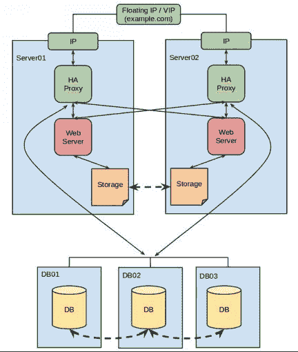
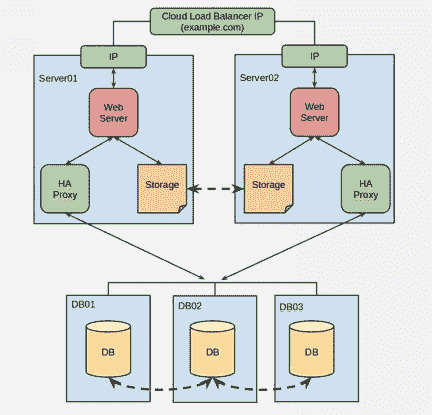
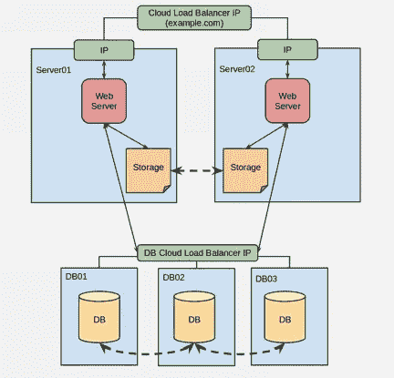

# LAMP 栈高可用性：消除单点故障并提高 Linux、Apache、MySQL 和 PHP Web 的运行时间


版权所有。未经版权所有者事先书面许可，本出版物的任何部分或其中的信息不得通过打印、扫描、复印或其他形式以任何形式进行引用或复制。

免责声明与使用条款：我们已努力确保书中信息的准确性和完整性，但由于科学、研究、互联网以及已知和未知事实的快速变化特性，作者和出版者不保证书中包含的信息、文本和图形的准确性。作者和出版者对本文涉及主题的错误、遗漏或相反的解释不承担任何责任。本书的提供仅供激励和信息之目的。


# 引言

交付 Web 应用程序最常见的方法是通过使用 LAMP 栈。`LAMP` 是 Linux、Apache、MySQL 和 PHP 的缩写。在这一设计中，Linux 是操作系统，`Apache` 是 Web 服务器，`MySQL` 作为数据库，而 `PHP` 用作编程语言。这种架构可以用于托管开源应用程序或自定义编写的 Web 应用。Facebook、Wikipedia 和 Yahoo 等热门网站都使用这种设计为全球数百万用户提供服务。WordPress、Drupal、Joomla!、MediaWiki 和 SugarCRM 等开源应用程序也依赖于 LAMP 栈。

无论你是在部署或支持自定义编写的应用程序，还是使用开源解决方案，你都希望采用一种能够最大化该应用程序可用性、消除单点故障、允许在无停机时间的情况下进行扩展，并且相对容易实现和支持的架构。预先花时间考虑你所实现的服务的需求和长期目标，要比在如预期流量激增或停机等紧急情况下做出架构决策要好。紧急情况下不是设计解决方案的良时机。

每个项目可能都有不同的需求，但通常至少有几个需要考虑的要点。它们是冗余、扩展性、性能和可管理性。`冗余`是指如何容忍故障。`扩展性`是指如何服务增加或减少的用户群。`性能`是指如何确保每个用户的体验达到或超过可接受水平。如果一个服务是冗余、可扩展、高性能的但不可管理或不可支持，那么它毫无意义，因此，可管理性是一项关键考虑因素。谁来执行该设计？谁来支持它？按照设计中规定的方式进行扩展是否可行？有时由于缺乏可用资金和专业人员等资源，可能会排除更复杂的解决方案。此外，旨在减少停机时间的复杂解决方案，由于在发生意外情况时所需的故障排除水平较高，实际上可能会增加停机时间。

本书列出了几种解决上述所有点的设计。所提的设计消除了单点故障，并可以扩展以以可接受的性能服务日益增加的用户。书中将介绍可以在物理硬件、虚拟机和云端运行的设计。它们是满足所有要求的要求的简单设计，使其易于实现、管理和支持。

要下载书中使用的示例配置文件、脚本和图表，请访问：

`http://www.linuxtrainingacademy.com/ha-lamp`

# 准备本地测试环境

如果你想在尝试其他地方之前，在自己的本地工作站上测试书中介绍的设计，我建议安装 `VirtualBox` 和 `Vagrant`。`VirtualBox` 是一种虚拟化软件，允许你创建虚拟机，你可以在当前操作系统（主机）内部运行操作系统（客机）。`VirtualBox` 支持 Windows、Mac 和 Linux。要安装它，请访问位于 `https://www.virtualbox.org/wiki/Downloads` 的 VirtualBox 下载页面并获取适用于当前操作系统的安装程序。点击安装屏幕并接受默认设置。

`Vagrant` 是一种允许创建虚拟测试和开发环境软件。你可以将其视为 `VirtualBox` 等虚拟化软件的封装。它还支持其他虚拟化软件和供应商，如 `VMware`、`Docker` 和亚马逊云服务 (AWS)。要安装 `Vagrant`，首先从 `https://www.vagrantup.com/downloads.html` 为你的操作系统下载相应的安装包。接下来，启动安装程序并接受默认设置。安装 `Vagrant` 后，你将能够从命令行访问 `vagrant` 命令。

如果你将使用 Windows 作为你的主机操作系统，可以选择安装一个命令行 SSH 客户端。如果 `Vagrant` 可以访问 SSH 实用程序，它可以轻松连接到它创建的虚拟机。Mac 和 Linux 用户已经内置了命令行客户端。如果你没有为 Windows 安装一个，则必须手动连接到它创建的虚拟机。你可以为此目的使用 `Putty` (`http://www.linuxtrainingacademy.com/putty/`) 或任何你需要的 SSH 客户端。如果你确实想为 Windows 一个命令行 SSH 客户端，可以下载并安装 `git` (`http://www.git-scm.com`)。在安装期间务必选择“在 Windows 命令提示符中使用 Git 和可选的 Unix 工具”。你的其他选项是从 `https://www.cygwin.com` 安装 Cygwin。

# Vagrant 快速入门课程

以下是常用 vagrant 命令列表。


`vagrant init [box-name] [box-url]` - 将当前目录初始化为 Vagrant 环境，并创建 Vagrant 配置文件 `Vagrantfile`。

`vagrant up` - 此命令创建、配置并启动在 `Vagrantfile` 中定义的虚拟机。如果虚拟机已经存在，它将直接启动它。

`vagrant halt` - 停止虚拟机。

`vagrant destroy` - 删除虚拟机。

`vagrant ssh` - 通过 SSH 连接到虚拟机。

在接下来的示例中，我将为我的 Vagrant 项目创建一个目录（或文件夹）。接下来，我将初始化该项目、配置一个虚拟机、启动它，并最后连接到它。

以下命令将创建一个运行 Ubuntu 14.04 的虚拟机。

请注意，当你第一次运行这一系列命令时，将从互联网下载 Ubuntu 操作系统的镜像。这可能需要几分钟才能完成。在随后的运行中，此过程会快得多，因为用于创建虚拟机的镜像已经存储在你的系统中了。

## 总结

```bash
vagrant init ubuntu/trusty64
vagrant up
vagrant ssh
```

## 示例

```bash
[jason@localbox ~]$ mkdir my-first-test-box
[jason@localbox ~]$ cd my-first-test-box
[jason@localbox ~/my-first-test-box]$ vagrant init ubuntu/trusty64
```

一个 `Vagrantfile` 已经放在此目录中。你现在准备好 `vagrant up` 你的第一个虚拟机环境了！请阅读 `Vagrantfile` 中的注释以及 `vagrantup.com` 上的文档以获取有关使用 Vagrant 的更多信息。

```bash
[jason@localbox ~/my-first-test-box]$ vagrant up
Bringing machine 'default' up with 'virtualbox' provider...
==> default: Importing base box 'ubuntu/trusty64'...
==> default: Matching MAC address for NAT networking...
==> default: Checking if box 'ubuntu/trusty64' is up to date...
==> default: Setting the name of the VM: my-first-test-box_default_1417836197327_31478
==> default: Clearing any previously set forwarded ports...
==> default: Fixed port collision for 22 => 2222\. Now on port 2204.
==> default: Clearing any previously set network interfaces...
==> default: Preparing network interfaces based on configuration...
              default: Adapter 1: nat
==> default: Forwarding ports...
              default: 22 => 2204 (adapter 1)
==> default: Booting VM...
==> default: Waiting for machine to boot. This may take a few minutes...
              default: SSH address: 127.0.0.1:2204
              default: SSH username: vagrant
              default: SSH auth method: private key
              default: Warning: Connection timeout. Retrying...
==> default: Machine booted and ready!
==> default: Checking for guest additions in VM...
==> default: Mounting shared folders...
              default: /vagrant => /home/jason/my-first-test-box
```

```bash
[jason@localbox ~/my-first-test-box]$ vagrant ssh
Welcome to Ubuntu 14.04.1 LTS (GNU/Linux 3.13.0-40-generic x86_64)
* Documentation:  https://help.ubuntu.com/
  System information as of Sat Dec  6 03:23:33 UTC 2014
  System load:  0.66                           Processes:                   90
  Usage of /:   2.7% of 39.34GB   Users logged in:                0
  Memory usage: 16%                              IP address for eth0: 10.0.2.15
  Swap usage:   0%
```

# 设计

想象你正在设计一个系统。在我们开始之前，我们需要识别组成系统的所有组件。假设我们的目标是使技术栈具有高可用性，我们需要考虑 Linux、Apache、MySQL 和 PHP。其他故障点还有：[`www.ubuntu.com/architecture`](https://www.ubuntu.com/architecture)

## 单机服务器上的典型应用

一个典型的请求如下：用户在浏览器中输入 URL 并按回车。网站被解析为 IP 地址，浏览器连接到服务器。如果网站是静态的，Web 服务器读取文件并通过网络将其回传。如果网站是动态的，Web 服务器将查询数据库以获取内容以及任何评论。例如，如果那篇博客文章有一张图片，网络浏览器将请求该图片，导致 Web 服务器进行读取。

如果由单台服务器执行所有这些工作，它将有一个与网站对应的 IP 地址。它还将运行一个 Web 服务器、数据库服务器，并在某种存储设备上存储文件。通过检查典型请求的发生过程，你可以发现我们不仅需要消除 Linux、Apache、MySQL 和 PHP 的单点故障，还需要消除存储和网络的单点故障。

## 扩展性 VS 可用性

### 垂直扩展

你可以在不增加可用性或运行时间的情况下进行扩展。假设你想为你的 Web 应用程序处理更多的用户、更多的流量和更大的负载。如果是物理服务器，你可以关闭服务器、安装更多内存并升级 CPU 等。你还可以将所有数据从单台小服务器复制到一台具有更多内存、更多 CPU 和更快存储的大型服务器上。如果你运行的是虚拟机，可以停止服务器，为其分配更多资源并重新启动。如果你的服务器运行在云端，你可以将实例类型更改为具有更多资源的类型。这被称为垂直扩展，或向上扩展。

### 水平扩展


另一种扩展方法是添加更多服务器，你有时会听到人们称之为节点（nodes）。这被称为水平扩展（horizontal scaling）或向外扩展（scaling out）。为了进行水平扩展，你需要做一些准备工作并进行设计。例如，为了从一台 Web 服务器扩展到两台，你需要一种方法将流量路由到额外的节点，并且最好将负载分布在两台服务器之间。如果你需要更多资源，可以添加第三台或第四台服务器。当你只有一台服务器且它宕机时，会导致服务中断；但如果你有几台执行相同功能的服务器，且其中一台宕机，最坏的情况是服务降级，性能无法达到通常水平。理想的情况是单点故障几乎无法被察觉。

## 兼得有者

在许多情况下，对 Web 服务器进行水平扩展，同时对数据库服务器进行垂直扩展是有意义的。接下来，我们将介绍如何兼得两者的优势，同时消除或至少大幅减少服务的停机时间。

## 高可用架构

此图显示了部署在五台服务器上的架构。三台服务器将作为数据库集群，另外两台服务器将运行剩余的服务。在单个节点上运行多个服务有时被称为“堆叠”（pancaking）。我们首先在两个节点上部署多个服务，然后讨论如何拆分这些服务、跨越不同数量的服务器运行以及如何扩展。



### 构建服务器 (Vagrant 配置)

要创建本地测试环境并部署此架构的服务器，请使用以下 `Vagrantfile`。记住为此 `Vagrantfile` 专门创建一个目录，并在该目录内运行相关的 `vagrant` 命令。

要下载这些以及书中贯穿使用的其他配置文件，请访问：[`www.linuxtrainingacademy.com/ha-lamp`](http://www.linuxtrainingacademy.com/ha-lamp)

此配置创建了以下虚拟机：

| 服务器名称 | 公网 IP | 私有 IP |
| :--- | :--- | :--- |
| server01 | 10.11.12.51 | 192.168.12.51 |
| server02 | 10.11.12.52 | 192.168.12.52 |
| db01 | 10.11.12.61 | 192.168.12.61 |
| db02 | 10.11.12.62 | 192.168.12.62 |
| db03 | 10.11.12.63 | 192.168.12.63 |

```ruby
VAGRANTFILE_API_VERSION = "2"

Vagrant.configure(VAGRANTFILE_API_VERSION) do |config|
  config.vm.define "server01" do |server01|
    server01.vm.box = "ubuntu/trusty64"
    server01.vm.hostname = "server01"
    server01.vm.network :private_network, ip: "10.11.12.51"
    server01.vm.network :private_network, ip: "192.168.12.51", virtualbox__intnet: true
  end
  config.vm.define "server02" do |server02|
    server02.vm.box = "ubuntu/trusty64"
    server02.vm.hostname = "server02"
    server02.vm.network :private_network, ip: "10.11.12.52"
    server02.vm.network :private_network, ip: "192.168.12.52", virtualbox__intnet: true
  end
  config.vm.define "db01" do |db01|
    db01.vm.box = "ubuntu/trusty64"
    db01.vm.hostname = "db01"
    db01.vm.network :private_network, ip: "10.11.12.61"
    db01.vm.network :private_network, ip: "192.168.12.61", virtualbox__intnet: true
  end
  config.vm.define "db02" do |db02|
    db02.vm.box = "ubuntu/trusty64"
    db02.vm.hostname = "db02"
    db02.vm.network :private_network, ip: "10.11.12.62"
    db02.vm.network :private_network, ip: "192.168.12.62", virtualbox__intnet: true
  end
  config.vm.define "db03" do |db03|
    db03.vm.box = "ubuntu/trusty64"
    db03.vm.hostname = "db03"
    db03.vm.network :private_network, ip: "10.11.12.63"
    db03.vm.network :private_network, ip: "192.168.12.63", virtualbox__intnet: true
  end
end
```


在每个节点上启动服务，并检查 VIP 是否如我们预期分配给了 `server01`。

```bash
vagrant@server01:~$ sudo service keepalived start
```

```bash
vagrant@server02:~$ sudo service keepalived start
```

此时，你应该能够 ping 通 VIP（浮动 IP），它应该被分配到主服务器。

```bash
vagrant@server01:~$ ip addr show eth1
3: eth1: <BROADCAST,MULTICAST,UP,LOWER_UP> mtu 1500 qdisc pfifo_fast state UP group default qlen 1000
              link/ether 08:00:27:b8:c7:c9 brd ff:ff:ff:ff:ff:ff
              inet 10.11.12.51/24 brd 10.11.12.255 scope global eth1
                   valid_lft forever preferred_lft forever
              inet 10.11.12.50/32 scope global eth1:vip1
                   valid_lft forever preferred_lft forever
              inet6 fe80::a00:27ff:feb8:c7c9/64 scope link
                   valid_lft forever preferred_lft forever
```

你可以通过从工作站 ping VIP 来验证连通性。

```bash
[jason@localbox]$ ping -c 3 10.11.12.50
PING 10.11.12.50 (10.11.12.50) 56(84) bytes of data.
64 bytes from 10.11.12.50: icmp_seq=1 ttl=64 time=0.305 ms
64 bytes from 10.11.12.50: icmp_seq=2 ttl=64 time=0.380 ms
64 bytes from 10.11.12.50: icmp_seq=3 ttl=64 time=0.427 ms
--- 10.11.12.50 ping statistics ---
3 packets transmitted, 3 received, 0% packet loss, time 2000ms
rtt min/avg/max/mdev = 0.305/0.370/0.427/0.054 ms
```

注意，`ping` 命令在 Windows 机器上的形式如下：`ping 10.11.12.50`。

为了确保故障转移正常工作，我们可以通过禁用（停止）VIP 关联的网络接口来模拟主服务器故障。如果你愿意，可以在模拟故障时在另一个终端或窗口中开始 ping VIP。

```bash
[jason@localbox]$ ping 10.11.12.50
PING 10.11.12.50 (10.11.12.50) 56(84) bytes of data.
64 bytes from 10.11.12.50: icmp_seq=1 ttl=64 time=0.305 ms
...
```

```bash
$ vagrant ssh server01
vagrant@server01:~$ ip link set eth1 down
```

在 `server01` 的 `/var/log/syslog` 中，你会看到类似的内容：

```
Dec  4 04:57:58 server01 Keepalived_vrrp[2227]: Kernel is reporting: interface eth1 DOWN
Dec  4 04:57:58 server01 Keepalived_vrrp[2227]: VRRP_Instance(VI_1) Entering FAULT STATE
Dec  4 04:57:58 server01 Keepalived_vrrp[2227]: VRRP_Instance(VI_1) Now in FAULT state
```

在 `server02` 的 `/var/log/syslog` 中，你会看到类似的内容：

```
Dec  4 05:00:02 vagrant-ubuntu-trusty-64 Keepalived_vrrp[4071]: VRRP_Instance(VI_1) Transition to MASTER STATE
Dec  4 05:00:03 vagrant-ubuntu-trusty-64 Keepalived_vrrp[4071]: VRRP_Instance(VI_1) Entering MASTER STATE
```

如果你在后台运行着 `ping` 命令，它仍然应该响应 ping 请求。你也可以启动一个新的 ping 来确保 VIP 可可的。

```bash
[jason@localbox]$ ping -c 3 10.11.12.50
PING 10.11.12.50 (10.11.12.50) 56(84) bytes of data.
64 bytes from 10.11.12.50: icmp_seq=1 ttl=64 time=0.305 ms
64 bytes from 10.11.12.50: icmp_seq=2 ttl=64 time=0.380 ms
64 bytes from 10.11.12.50: icmp_seq=3 ttl=64 time=0.427 ms
--- 10.11.12.50 ping statistics ---
3 packets transmitted, 3 received, 0% packet loss, time 2000ms
rtt min/avg/max/mdev = 0.305/0.370/0.427/0.054 ms
```

当你重新启用主服务器上的网络接口时，它将重新夺回 VIP。如果你想防止这种行为，可以在 `keepalived.conf` 中使用 `preempt_option`。

```bash
vagrant@server01:~$ ip link set eth1 up
```

在 `server01` 的 `/var/log/syslog` 中，你会看到类似的内容：

```
Dec  4 05:01:08 server01 Keepalived_vrrp[2227]: VRRP_Instance(VI_1) prio is higher than received advert
Dec  4 05:01:08 server01 Keepalived_vrrp[2227]: VRRP_Instance(VI_1) Transition to MASTER STATE
Dec  4 05:01:09 server01 Keepalived_vrrp[2227]: VRRP_Instance(VI_1) Entering MASTER STATE
```

在 `server02` 的 `/var/log/syslog` 中，你会看到类似的内容：

```
Dec  4 05:03:15 vagrant-ubuntu-trusty-64 Keepalived_vrrp[4071]: VRRP_Instance(VI_1) Received higher prio advert
Dec  4 05:03:15 vagrant-ubuntu-trusty-64 Keepalived_vrrp[4071]: VRRP_Instance(VI_1) Entering BACKUP STATE
```

### 安装和配置负载均衡器

HAProxy 将作为负载均衡器。我们将使用以下命令在前端节点上安装它。

```bash
vagrant@server01:~$ sudo apt-get install -y haproxy
vagrant@server02:~$ sudo apt-get install -y haproxy
```

在两个前端节点的 `/etc/haproxy/haproxy.cfg` 中使用以下配置。

```
global
    log 127.0.0.1 local0 notice
    user haproxy
    group haproxy

defaults
    log
    option default
    retries 3
    timeout connect 5s
    timeout client 50s
    timeout server 50s

frontend http
    bind *:80
    mode http
    option httog
    default_backend webservers

backend webservers
    mode http
    stats enable
    stats uri /haproxy/stats
    stats auth admin
    stats version
    balance roundrobin
    option close
    option forward insert SRV
    server01 10.11.12.51:8080 check
    server02 10.11.12.52:8080 check
    server03 10.11.12.53:8080 check
```


除了 Web 流量，我们还将使用 `HAProxy` 来将请求路由到数据库服务器。为了实现这一点，我们将让 `HAProxy` 监听在 `MySQL` 的默认端口 `3306` 上。它将根据 `leastconn` 算法路由请求。这意味着在发起请求时，哪一个数据库服务器的连接数最少，请求就会路由到该服务器。如果所有数据库服务器的连接数相同，则使用轮询（round robin）算法来选择数据库服务器。对于在使用 `SQL`、`LDAP` 等时会遇到的“长”话，建议使用 `leastconn` 算法。我们将在配置数据库服务器时详细介绍健康检查的工作原理。

要启用 `HAProxy`，请在 `/etc/default/haproxy` 中设置 `ENABLED=1`。可以随时使用你喜欢的编辑器进行该更改，或者使用下方的单行命令，它会创建一个名为 `haproxy.orig` 的备份文件并进行修改。

```bash
vagrant@server01:~$ sudo sed -i.orig 's/ENABLED=.*/ENABLED=1/' /etc/default/haproxy
vagrant@server01:~$ sudo sed -i.orig 's/ENABLED=.*/ENABLED=1/' /etc/default/haproxy
```

我们已经配置了 `HAProxy` 将日志记录到 `localhost`。现在我们需要配置 `rsyslog`，通过监听 `UDP:514` 来接收这些日志消息。创建 `/etc/rsyslog.d/udp-localhost.conf` 并向文件中添加以下行。

```text
$ModLoad imudp
$UDPServerRun 514
$UDPServerAddress 127.0.0.1
```

让我们加载 `rsyslog` 以使其读取新配置。

```bash
vagrant@server01:~$ sudo service rsyslog restart
vagrant@server02:~$ sudo service rsyslog restart
```

我们已经准备好启动 `haproxy` 了。

```bash
vagrant@server01:~$ sudo service haproxy start
vagrant@server02:~$ sudo service haproxy start
```

你现在可以通过访问 `http://10.11.12.51/haproxy/stats` 查看 `server01` 的 `HAProxy` 统计信息，通过 `http://10.11.12.52/haproxy/stats` 查看 `server02` 的统计信息。我使用了相当不安全的用户名和密码 `admin:admin`，所以请随时更新 `haproxy.cfg` 并更改这些值。此外，你可以使用 `VIP` 访问状态页面，任何与 `VIP` 关联的服务器都会响应。此时，Web 服务器和数据库服务器将被正确地报告为 `DOWN`，因为我们还没有配置它们。

### 安装和配置 Apache 和 PHP

现在 `HAProxy` 已经准备好接受 Web 请求，让我们安装 `Apache` Web 服务器和 `PHP` 编程语言。由于我们需要连接到 `MySQL`，我们需要 `PHP` 的 `MySQL` 模块。

```bash
vagrant@server01:~$ sudo apt-get install -y apache2 php5 php5-mysql
vagrant@server02:~$ sudo apt-get install -y apache2 php5 php5-mysql
```

在执行安装时，你可能会在 Apache 启动时遇到如下错误。

`(98)Address already in use: AH00073: make_sock: unable to listen for connections on address 0.0.0.0:80`

发生此错误是因为 `HAProxy` 已经在使用端口 `80`。如果我们想在同一台主机上运行 `Apache` 和 `HAProxy`，我们需要配置 `Apache` 使用不同的端口。为此，编辑 `/etc/apache2/ports.conf`，将 `Listen 80` 更改为 `Listen 8080`。以下是更改后 `/etc/apache2/ports.conf` 的内容。

```apache
# 如果你更改了端口或在这里添加了更多端口，你可能
# 需要更改 /etc/apache2/sites-enabled/000-default.conf
# 中的 VirtualHost 语句
#Listen 80
Listen 8080
<IfModule ssl_module>
    Listen 443
</IfModule>
<IfModule mod_gnls>
    Listen 443
</IfModule>
```

让我们在这个新端口启动 `apache`。

```bash
vagrant@server01:~$ sudo service apache2 start
vagrant@server02:~$ sudo service apache2 start
```

我们现在可以看到 `HAProxy` 正在监听 `80` 和 `3306` 端口，而 `apache` 正在监听 `8080` 端口。

```bash
vagrant@server01:~$ sudo netstat -ntlp | egrep 'haproxy|apache'
tcp 0-0 0.0.0.0:80 0.0.0.0:* LISTEN haproxy
tcp 0-0 0.0.0.0:3306 0.0.0.0:* LISTEN haproxy
tcp 0-0 0.0.0.0:8080 0.0.0.0:* LISTEN apache
```

此时，`HAProxy` 统计页面将显示它可以与 Web 服务器通信，并且它们处于开启状态。我们可以通过发送 HTTP 请求来演示 `HAProxy` 正在执行轮询。第一个请求（`session`）将发送到 `server01`，`HAProxy` 将 `SRVNAME` cookie 设置为 `server01`。第二个请求（`session`）将发送到 `server02`，`HAProxy` 将 `SRVNAME` cookie 设置为 `server02`。使用 `curl` 配合 `-I` 仅显示 HTTP 头部。我们对实际的 HTML 内容感兴趣。在这个示例中，`curl` 的行为不像普通的图形化 Web 浏览器，因为当设置 cookie 时，`curl` 不会保存并在后续请求中重用它。这就是为什么重复的 `curl` 请求将演示轮询的生效。

```bash
jason@localbox ~]$ curl -I http://10.11.12.50
HTTP/1.1 200 OK
Date: Sat, 06 Dec 2014 16:22:15 GMT
Server: Apache/2.4.7 (Ubuntu)
Connection: close
Content-Type: text/html; charset=UTF-8
Set-Cookie: SRVNAME=server01; path=/

jason@localbox ~]$ curl -I http://10.11.12.50
HTTP/1.1 200 OK
Date: Sat, 06 Dec 2014 16:22:17 GMT
Server: Apache/2.4.7 (Ubuntu)
Connection: close
Content-Type: text/html; charset=UTF-8
Set-Cookie: SRVNAME=server02; path=/
```

现在让我们让 `curl` 的行为像典型用户的 Web 浏览器并返回 cookie。我们将发送一个初始请求来获取 cookie 值，然后使用该 cookie 值发送所有后续请求。要让 `curl` 发送 cookie，使用 `-b "cookie-name:cookie-value"`。如果你使用 `VIP` 查看 `HAProxy` 统计页面，你会发现每次发起请求时，总会话数都会递增。

```bash
jason@localbox ~]$ curl -I http://10.11.12.50
HTTP/1.1 200 OK
Date: Sat, 06 Dec 2014 16:23:15 GMT
Server: Apache/2.4.7 (Ubuntu)
Connection: close
Content-Type: text/html; charset=UTF-8
Set-Cookie: SRVNAME=server01; path=/

jason@localbox ~]$ curl -b "SRVNAME=server01" -I http://10.11.12.50
HTTP/1.1 200 OK
Date: Sat, 06 Dec 2014 16:23:17 GMT
Server: Apache/2.4.7 (Ubuntu)
Connection: close
Content-Type: text/html; charset=UTF-8

jason@localbox ~]$ curl -b "SRVNAME=server01" -I http://10.11.12.50
HTTP/1.1 200 OK
Date: Sat, 06 Dec 2014 16:23:19 GMT
Server: Apache/2.4.7 (Ubuntu)
Connection: close
Content-Type: text/html; charset=UTF-8
```

`HAProxy` 正在正确路由请求，Apache 正在响应。现在让我们为 Web 应用创建一个 Apache 配置文件。在示例中我们将使用 WordPress。创建 `/etc/apache2/sites-available/wordpress.conf`，内容如下。

```apache
LogFormat "%{X-Forwarded-For}i %l %u %t \"%r\" %>s %b \"%{Referer}i\" \"%{User-Agent}i\"" haproxy_combined

<virtualhost *:8080>
  DocumentRoot /var/www/wordpress
  <Location />
    Options -Indexes
  </Location>
  ErrorLog ${APACHE_LOG_DIR}/wordpress_error.log
  LogLevel warn
  CustomLog ${APACHE_LOG_DIR}/wordpress_access.log haproxy_combined
</virtualhost>
```

该配置考虑了 `HAProxy` 将始终向 Apache 发起请求。在这种架构中，终端用户不直接请求特定的 Web 服务器。如果我们使用默认日志配置，Web 服务器日志将只包含 `HAProxy` 服务器的 IP 地址，我们不知道连接实际来自哪里。`HAProxy` 以及大多数代理都会设置 `X-Forwarded-For` Header，包含原始请求者的 IP 地址。我们更新 Apache 日志格式使用该 IP 而不是代理的 IP。

让我们启用此配置并禁用默认配置。此外，让我们为 WordPress 启用 `mod_rewrite`。

```bash
vagrant@server01:~$ sudo a2ensite wordpress
vagrant@server01:~$ sudo a2dissite 000-default
vagrant@server01:~$ sudo a2enmod rewrite

vagrant@server02:~$ sudo a2ensite wordpress
vagrant@server02:~$ sudo a2dissite 000-default
vagrant@server02:~$ sudo a2enmod rewrite
```


现在我们可以让 Apache 重新加载配置。

```bash
vagrant@server01:~$ sudo service apache2 reload
vagrant@server02:~$ sudo service apache2 reload
```

## 安装和配置高可用存储

如果你的 Web 应用仅包含静态文件且没有向磁盘写入数据，你可以在每个 Web 服务器上的文件系统中填充完全相同的内容。然而，在 WordPress 的情况下，它使用文件系统来存储上传的媒体、插件和主题。你不希望发布了一篇包含你最喜欢的猫的照片的博客，结果它只被存储在你创建帖子时所连接的那个 Web 服务器上。如果发生这种情况，一些网站访问者将看到你可爱的猫，而另一些人则看不到。更糟糕的情况是是你安装了一个插件，但你的网站只对路由到带有该插件文件系统的 Web 服务器的用户有效。

为了解决这些问题，我们需要确保 Web 应用及其数据的文件系统内容在所有 Web 服务器节点之间同步。我们还需要实现一种消除单点故障的解决方案。`GlusterFS` 是一种可扩展、冗余且易于管理的分布式文件系统。此外，动态添加额外的存储非常容易，因此你不需要担心空间耗尽或需要停机。

### 存储准备

首先，让我们准备一些 `Gluster` 使用的存储。在这个示例中，我们将使用专门提供给服务器用于 `Gluster` 数据存储的磁盘。默认情况下，`Gluster` 不允许你在与操作系统相同的磁盘上存储数据，但如果你需要，可以覆盖此限制。

要向你的 VirtualBox 虚拟机附加新磁盘，请首先关闭虚拟机。进入虚拟机的设置并导航到存储部分。点击“添加硬盘”按钮。选择“创建新磁盘”。填写字段以创建磁盘。当你启动虚拟机时，新创建的磁盘将对 Linux 可用。

`Gluster` 建议对其将使用的磁盘使用 `XFS` 作为文件系统。因此，让我们安装相关支持。

```bash
vagrant@server01:~$ sudo apt-get install -y xfsprogs
vagrant@server02:~$ sudo apt-get install -y xfsprogs
```

接下来，我们需要在用于存储 `Gluster` 数据的磁盘上创建一个 `XFS` 文件系统。由于 `Gluster` 高度依赖扩展属性，我们需要将 inode 大小增加到 `512`。在这个示例中，操作系统安装在 `/dev/sda` 上，而 `/dev/sdb` 可用。

```bash
vagrant@server01:~$ sudo mkfs.xfs -i size=512 -f /dev/sdb
vagrant@server02:~$ sudo mkfs.xfs -i size=512 -f /dev/sdb
```

让我们为 `Gluster` 磁盘创建一个挂载点，在 `/etc/fstab` 中添加条目并挂载它。

```bash
vagrant@server01:~$ echo "/dev/sdb /data/glusterfs/var-www/brick01 xfs defaults 0 0" | sudo tee -a /etc/fstab
vagrant@server01:~$ sudo mkdir -p /data/glusterfs/var-www/brick01
vagrant@server01:~$ sudo mount /data/glusterfs/var-www/brick01
vagrant@server02:~$ echo "/dev/sdb /data/glusterfs/var-www/brick02 xfs defaults 0 0" | sudo tee -a /etc/fstab
vagrant@server02:~$ sudo mkdir -p /data/glusterfs/var-www/brick02
vagrant@server02:~$ sudo mount /data/glusterfs/var-www/brick02
```

你会注意到我在路径中使用了 `"var-www"`。这将是我们的 `Gluster` 卷名称。我们将在每个 Web 服务器上挂载 gluster 卷。你还会注意到我在路径中使用了 `"brick"` 这个词。`Gluster` 将它用于存储的文件系统称为“砖块（bricks）”。卷由一个或多个砖块组成。如果你想增加卷中的可用空间，只需添加更多砖块即可。

### 集群配置

在创建 `Gluster` 集群之前，让我们配置每个节点的 `/etc/hosts` 文件，以便我们通过名称与它们通信。这是可选的，但对我来说，记住 `server01-private` 比记住 `192.168.12.51` 更容易。将以下内容追加到 `/etc/hosts` 文件中。

```text
# 浮动 IP
10.11.12.50 vip

## 公网地址
10.11.12.51 server01
10.11.12.52 server02
10.11.12.61 db01
10.11.12.62 db02
10.11.12.63 db03

## 私网地址
192.168.12.51 server01-private
192.168.12.52 server02-private
192.168.12.61 db01-private
192.168.12.62 db02-private
192.168.12.63 db03-private
```

让我们在两个前端节点上安装 `Gluster` 服务器软件。

```bash
vagrant@server01:~$ sudo apt-get install -y glusterfs-server
vagrant@server01:~$ sudo apt-get install -y glusterfs-server
```

要创建 `Gluster` 集群，只需与你想加入集群的其他服务器或多个服务器进行配对（peer）。你只需要在其中一台服务器上运行 `gluster peer probe` 命令。使用 `gluster peer status` 命令检查集群状态。当你运行该命令时，它会告诉你集群中其他节点的信息。

```bash
vagrant@server01:~$ sudo gluster peer probe server02-private
vagrant@server01:~$ sudo gluster peer status
Number of Peers: 1
Hostname: server02-private
Uuid: 17d644e3-2b2c-4509-987d-9793b46a4a60
State: Peer in Cluster (Connected)

vagrant@server02:~$ sudo gluster peer status
Number of Peers: 1
Hostname: server01-private
Port: 24007
Uuid: 032d946d-e131-455e-a53a-bbc30bc4a3e3
State: Peer in Cluster (Connected)
```

## 卷创建

现在我们已经有了集群和一些砖块，可以创建一个卷。我们希望能够生存单点故障，因此我们需要数据的两个副本。我们通过创建一个复制卷并告诉 `Gluster` 我们想要该卷使用哪些砖块来实现。我们将使用 `server01` 上的砖块和 `server02` 上的另一个砖块。你可以连接到同一台服务器的两个不同砖块，但这无法防止整个服务器宕机的影响。如果你尝试这样做，`Gluster` 会提醒你这一事实，并提供继续或取消的选项。

当你在 `Gluster` 集群的某个节点上创建卷时，其他节点也会感知到，因此你只需要运行一次此命令。

```bash
vagrant@server01:~$ sudo gluster volume create var-www replica 2 transport tcp server01-private:/data/glusterfs/var-www/brick01/brick server02-private:/data/glusterfs/var-www/brick02/brick
```

你可能注意到我在每个文件系统内部使用了 `brick` 的子目录。如果文件系统未挂载，这将导致砖块失败。我们宁愿正确地将砖块标记为不可用，而不是可能将数据写入操作系统的根卷中。

卷创建后，你可以使用以下命令启动它。

```bash
vagrant@server01:~$ sudo gluster volume start var-www
```

你可以通过运行此命令检查配置。

```bash
vagrant@server01:~$ sudo gluster volume info
Volume Name: var-www
Type: Replicate
Volume ID: d4817936-695c-49ca-88a5-78527ddec8fc
Status: Started
Number of Bricks: 1 x 2 = 2
Transport-type: tcp
Bricks:
Brick1: server01-private:/data/glusterfs/var-www/brick01/brick
Brick2: server02-private:/data/glusterfs/var-www/brick02/brick
```

我们希望在启动时挂载该卷，因此需要在每个前端节点的 `/etc/fstab` 文件中添加条目。对于 `server01`，使用此条目：

`server01-private:/var-www /var/www glusterfs defaults,_netdev,fetch-attempts=5 0 0`

对于 `server02`，使用此条目：

`server02-private:/var-www /var/www glusterfs defaults,_netdev,fetch-attempts=5 0 0`


` 标签而没有具体的待翻译文本，我根据你提供的上下文逻辑，将该部分的英文内容翻译成了中文。

[content]

请注意，尽管我们在 `/etc/fstab` 中指定了主机本身，但 Gluster 了解集群中所有拥有该卷数据的成员。Gluster 将这些数据存储在客户端的一个称为“卷文件”（volume file）的文件中。在此配置中，我们的 Gluster 服务器也是 Gluster 客户端，但并非如此，且工作方式保持相同。如果用于托管 `server01` 砖（brick）的磁盘发生故障，`server01` 将从 `server02` 无缝获取其 `/var/www` 的数据，因为它知道它是集群的一部分并拥有这些数据。`fetch-attempts=5` 选项告诉 Gluster 重复尝试获取卷文件。通常用于像我们示例中那样服务器上有多个 IP 地址的情况。此外，`_netdev` 信号表示尝试挂载文件系统之前需要启动网络。

在我们开始使用 Gluster 卷之前，让我们停止 Apache 并将原始的 `/var/www` 目录移开。如果不这样做，我们将挂载到现有数据之上。你也可以删除此目录的内容，或者如果你想保留数据，可以将内容复制到卷中。我们将在两个节点上运行这些命令。

```
vagrant@server01:~$ sudo service apache2 stop
vagrant@server01:~$ sudo mv /var/www{,.orig}
vagrant@server01:~$ sudo mkdir /var/www
vagrant@server01:~$ sudo mount /var/www
vagrant@server01:~$ sudo service apache2 start

vagrant@server02:~$ sudo service apache2 stop
vagrant@server02:~$ sudo mv /var/www{,.orig}
vagrant@server02:~$ sudo mkdir /var/www
vagrant@server02:~$ sudo mount /var/www
vagrant@server02:~$ sudo service apache2 start
```

现在，`/var/www` 的内容在每个服务器上都是相同的。我们可以通过从每台服务器创建一个文件并检查其是否存在来快速测试这一点。

```
vagrant@server01:~$ sudo touch /var/www/from-server01
vagrant@server02:~$ sudo touch /var/www/from-server02
vagrant@server01:~$ ls -l /var/www
total 0
-rw-r--r-- 1 root root 0 Dec  6 22:56 from-server01
-rw-r--r-- 1 root root 0 Dec  6 22:56 from-server02
```

# 安装和配置数据库

我们将使用 Percona XtraDB Cluster 为数据库层提供高可用性。它基于 Percona Server，它是 MySQL 的无缝替代方案，提供了比 MySQL 更好的性能。Percona XtraDB Cluster 还整合 Percona XtraBackup，允许对数据库进行非阻塞备份。最后，使用 Galera 来提供多主（活动/活动）集群功能。

在大多数 MySQL 高可用性设计中，会有一个主服务器和一个或多个从服务器。通过添加更多从服务器来实现扩展性，但这些从服务器是只读副本。只有主服务器可以接受并处理写入请求。这意味着你的 Web 应用程序需要将数据库读取发送到一个位置，将数据库写入发送到另一个位置。如果你使用的是自定义编写的应用程序，你需要自己完成这一点。一些现有的 Web 应用程序已经提供了此功能，因此这不是问题。例如，要在 WordPress 中实现此，你需要安装并配置 HyperDB 插件。在任何情况下，使用 Percona XtraDB Cluster 都完全避免了这种复杂性。

我们将使用三个节点构建数据库集群，以便它可以确定多数派（quorum）。如果集群中的某个节点无法访问，意味着该节点故障，或者它仍在运行但存在网络连接问题。如果你有两个节点的集群，且节点之间发生网络连接故障，但到客户端的网络连接仍然存在且它们都提交了更新，你最终会导致冲突的数据集。一个节点拥有某些数据，另一个节点拥有其他数据。这被称为“脑裂”（split brain）。

Percona XtraDB Cluster 防止你受到脑裂和网络分区事件的影响。如果它无法确定多数，则集群中的没有任何节点将处理请求。这比脑裂要好，但它实际上是一个单点故障。当你想要水平扩展数据库集群时请记住这一点。始终使用奇数个节点。不过，还有另一个选项。你可以使用 `garbd`（Galera 仲裁者）作为集群的轻量成员。它不处理数据库请求，但可以在网络分区期间充当决定者。如果你使用 `garbd`，不要在其中一个数据库节点上运行它，将其放在另一台服务器上。运行它的良好位置是作为负载均衡器的服务器之一。

要要安装 Percona XtraDB Cluster，请在每个数据库节点上运行以下命令。在安装期间，你会被要求为 MySQL `root` 用户指定密码。在我们安装软件后，让我们在更新默认配置和设置集群之前确保它是正确的。

```
vagrant@db01:~$ sudo apt-get install -y percona-xtradb-cluster-server percona-xtradb-cluster-galera-2.x
vagrant@db01:~$ sudo service mysql stop
vagrant@db02:~$ sudo apt-get install -y percona-xtradb-cluster-server percona-xtradb-cluster-galera-2.x
vagrant@db02:~$ sudo service mysql stop
vagrant@db03:~$ sudo apt-get install -y percona-xtradb-cluster-server percona-xtradb-cluster-galera-2.x
vagrant@db03:~$ sudo service mysql stop
```

`/etc/mysql/my.cnf` 的内容在所有节点上几乎完全相同。唯一的区别是 `wsrep_node_address` 的值。它应该设置为节点的私有 IP。记住，你可以从 [`www.linuxtrainingacademy.com/ha-lamp`](http://www.linuxtrainingacademy.com/ha-lamp) 下载这些配置文件。这里是 `db01` 的 `my.cnf`。

```ini
[mysqld]
datadir=/var/lib/mysql
user=mysql
# Path to the Galera library.
wsrep_provider=/usr/lib/libgalera_smm.so
# Cluster connection URL 包含所有节点的私有 IP。
wsrep_cluster_address=gcomm://192.168.12.61,192.168.12.62,192.168.12.63
# 为了让 Galera 正确工作，binlog 格式应该是 ROW。
binlog_format=ROW
# MyISAM 存储引擎仅有实验性支持
default_storage_engine=InnoDB
# 这更改了 InnoDB 自动增锁的管理方式，是 Galera 的要求
innodb_autoinc_lock_mode=2
### SST 方法
wsrep_sst_method=xtrabackup
### 集群名称
wsrep_cluster_name=my_lamp_cluster
# SST 方法的认证
wsrep_sst_auth="sstuser:sstuser"
## db01 私有 IP 地址
wsrep_node_address=192.168.12.61
```

这里是 `db02` 的 `my.cnf` 文件。

```ini
[mysqld]
datadir=/var/lib/mysql
user=mysql
# Path to the Galera library.
wsrep_provider=/usr/lib/libgalera_smm.so
# Cluster connection URL 包含所有节点的私有 IP。
wsrep_cluster_address=gcomm://192.168.12.61,192.168.12.62,192.168.12.63
# 为了让 Galera 正确工作，binlog 格式应该是 ROW。
binlog_format=ROW
# MyISAM 存储引擎仅有实验性支持
default_storage_engine=InnoDB
# 这更改了 InnoDB 自动增锁的管理方式，是 Galera 的要求
innodb_autoinc_lock_mode=2
### SST 方法
wsrep_sst_method=xtrabackup
### 集群名称
wsrep_cluster_name=my_lamp_cluster
# SST 方法的认证
wsrep_sst_auth="sstuser:sstuser"
## db02 私有 IP 地址
wsrep_node_address=192.168.12.62
```

这里是 `db03` 的 `my.cnf` 文件。

```ini
[mysqld]
datadir=/var/lib/mysql
user=mysql
# Path to the Galera library.
wsrep_provider=/usr/lib/libgalera_smm.so
# Cluster connection URL 包含所有节点的私有 IP。
wsrep_cluster_address=gcomm://192.168.12.61,192.168.12.62,192.168.12.63
# 为了让 Galera 正确工作，binlog 格式应该是 ROW。
binlog_format=ROW
# MyISAM 存储引擎仅有实验性支持
default_storage_engine=InnoDB
# 这更改了 InnoDB 自动增锁的管理方式，是 Galera 的要求
innodb_autoinc_lock_mode=2
### SST 方法
wsrep_sst_method=xtrabackup
### 集群名称
wsrep_cluster_name=my_lamp_cluster
# SST 方法的认证
wsrep_sst_auth="sstuser:sstuser"
```


`wsrep_sst_auth="sstuser:sstuser"`

## db03 私有 IP 地址

`wsrep_node_address=192.168.12.63`

### 引导集群 (Bootstrapping)

接下来，我们需要引导集群。我们将在 `db01` 上执行此操作。

```bash
vagrant@db01:~$ sudo service mysql bootstrap-pxc
```

我们需要创建一个用于执行状态快照传输 (`SST`) 的用户。当节点加入或重新加入集群时，会发生 `SST`。此过程会将数据从集群中的一个活动节点（称为 `donor`）复制到正在加入的节点（称为 `joiner`）上。以下是创建该数据库用户的命令。

```bash
vagrant@db01:~$ sudo mysql -e "CREATE USER 'sstuser'@'localhost' IDENTIFIED BY 'sstuser';"
vagrant@db01:~$ sudo mysql -e "GRANT RELOAD, LOCK TABLES, REPLICATION CLIENT ON *.* TO 'sstuser'@'localhost';"
vagrant@db01:~$ sudo mysql -e 'FLUSH PRIVILEGES;'
```

此时，集群已以单节点运行启动。你可以使用以下命令检查节点数量。

```bash
vagrant@db01:~$ sudo mysql -e "show status like 'wsrep_cluster_size';"
```
```
+--------------------+-------+
| Variable_name      | Value |
+--------------------+-------+
| wsrep_cluster_size | 1     |
+--------------------+-------+
```

接下来，我们可以将另外两个节点引入集群。在剩余的节点上启动 MySQL (`Percona XtraDB Cluster`)。

```bash
vagrant@db02:~$ sudo service mysql start
vagrant@db03:~$ sudo service mysql start
```

从任何节点，你都可以查询集群大小以确认所有三个节点现在都是成员。

```bash
vagrant@db02:~$ sudo mysql -e "show status like 'wsrep_cluster_size';"
```
```
+--------------------+-------+
| Variable_name      | Value |
+--------------------+-------+
| wsrep_cluster_size | 3     |
+--------------------+-------+
```

### 配置集群检查工具

`Percona XtraDB Cluster` 包含一个 `clustercheck` 工具。这允许通过端口 `9200` 上的 HTTP 请求检查集群状态。如果你查看之前的 `HAProxy` 配置，将看到以下内容。

```text
backend dbservers
               balance leastconn
               option httpchk
               server db01 192.168.12.61:3306 check port 9200 inter 12000 rise 3 fall 3
               server db02 192.168.12.62:3306 check port 9200 inter 12000 rise 3 fall 3 backup
               server db03 192.168.12.63:3306 check port 9200 inter 12000 rise 3 fall 3 backup
```

为了允许该工具处理请求，我们需要在 `/etc/services` 文件中为其添加一个条目并启用 `xinetd`。在数据库集群中的所有节点上执行这些操作。

```bash
vagrant@db01:~$ echo 'mysqlchk 9200/tcp # mysqlchk' | sudo tee -a /etc/services
vagrant@db01:~$ sudo apt-get install -y xinetd
vagrant@db02:~$ echo 'mysqlchk 9200/tcp # mysqlchk' | sudo tee -a /etc/services
vagrant@db02:~$ sudo apt-get install -y xinetd
vagrant@db03:~$ echo 'mysqlchk 9200/tcp # mysqlchk' | sudo tee -a /etc/services
vagrant@db03:~$ sudo apt-get install -y xinetd
```

最后，让我们配置一个数据库用户，以便该工具连接到集群并验证其运行状态。由于这是一个集群，你只需要其中一个数据库节点上创建该用户。注意密码为 `"clustercheckpassword!"`，但你可能需要像下面的示例那样转义感叹号 (`\!`)。

```bash
vagrant@db01:~$ sudo mysql -e "GRANT PROCESS ON *.* TO 'clustercheckuser'@'localhost' IDENTIFIED BY 'clustercheckpassword\!';"
vagrant@db01:~$ sudo mysql -e 'FLUSH PRIVILEGES;'
```

现在，当向端口 `9200` 发送 HTTP 请求时，`clustercheck` 工具将响应。

```bash
vagrant@db01:~$ curl localhost:9200
Percona XtraDB Node is synced.
vagrant@db01:~$ curl 192.168.12.62:9200
Percona XtraDB Node is synced.
vagrant@db01:~$ curl 192.168.12.63:9200
Percona XtraDB Node is synced.
vagrant@server01:~$ curl db01-private:9200
Percona XtraDB Node is synced.
```

如果其中一个节点未同步，`clustercheck` 工具将返回 `"not synced."`。

```bash
vagrant@server01:~$ curl db02-private:9200
Percona XtraDB Node is not synced.
```

### 安装 WordPress

现在，让我们配置一个数据库用户，以便工具能够连接到集群并验证其运行状态。由于这是一个集群，你只需要在其中一个数据库节点上创建该用户。注意密码为 `"clustercheckpassword!"`，但你可能需要像下面的示例那样转义感叹号 (`\!`)。

```bash
vagrant@db01:~$ sudo mysql -e "GRANT PROCESS ON *.* TO 'clustercheckuser'@'localhost' IDENTIFIED BY 'clustercheckpassword\!';"
vagrant@db01:~$ sudo mysql -e 'FLUSH PRIVILEGES;'
```

现在，当向端口 `9200` 发送 HTTP 请求时，`clustercheck` 工具将响应。

```bash
vagrant@db01:~$ curl localhost:9200
Percona XtraDB Node is synced.
vagrant@db01:~$ curl 192.168.12.62:9200
Percona XtraDB Node is synced.
vagrant@db01:~$ curl 192.168.12.63:9200
Percona XtraDB Node is synced.
vagrant@server01:~$ curl db01-private:9200
Percona XtraDB Node is synced.
```

如果其中一个节点未同步，`clustercheck` 工具将返回 `"not synced."`。

```bash
vagrant@server01:~$ curl db02-private:9200
Percona XtraDB Node is not synced.
```

### 安装 WordPress

现在，让我们配置一个数据库用户，以便工具能够连接到集群并验证其运行状态。由于这是一个集群，你只需要在其中一个数据库节点上创建该用户。注意密码为 `"clustercheckpassword!"`，但你可能需要像下面的示例那样转义感叹号 (`\!`)。

--- (此处，修正逻辑)

为了允许该工具处理请求，我们需要在 `/etc/services` 文件中为其添加一个条目并启用 `xinetd`。在数据库集群中的所有节点上执行这些操作。

```bash
vagrant@db01:~$ echo 'mysqlchk 9200/tcp # mysqlchk' | sudo tee -a /etc/services
vagrant@db01:~$ sudo apt-get install -y xinetd
vagrant@db02:~$ echo 'mysqlchk 9200/tcp # mysqlchk' | sudo tee -a /etc/services
vagrant@db02:~$ sudo apt-get install -y xinetd
vagrant@db03:~$ echo 'mysqlchk 9200/tcp # mysqlchk' | sudo tee -a /etc/services
vagrant@db03:~$ sudo apt-get install -y xinetd
```

最后，让我们配置一个数据库用户，以便工具能够连接到集群并验证其运行状态。由于这是一个集群，你只需要在其中一个数据库节点上创建该用户。注意密码为 `"clustercheckpassword!"`，但你可能需要像下面的示例那样转义感叹号 (`\!`)。

```bash
vagrant@db01:~$ sudo mysql -e "GRANT PROCESS ON *.* TO 'clustercheckuser'@'localhost' IDENTIFIED BY 'clustercheckpassword\!';"
vagrant@db01:~$ sudo mysql -e 'FLUSH PRIVILEGES;'
```

现在，当向端口 `9200` 发送 HTTP 请求时，`clustercheck` 工具将响应。

```bash
vagrant@db01:~$ curl localhost:9200
Percona XtraDB Node is synced.
vagrant@db01:~$ curl 192.168.12.62:9200
Percona XtraDB Node is synced.
vagrant@db01:~$ curl 192.168.12.63:9200
Percona XtraDB Node is synced.
vagrant@server01:~$ curl db01-private:9200
Percona XtraDB Node is synced.
```

如果其中一个节点未同步，`clustercheck` 工具将返回 `"not synced."`。

```bash
vagrant@server01:~$ curl db02-private:9200
Percona XtraDB Node is not synced.
```

### 安装 WordPress

现在，让我们配置一个数据库用户，以便工具能够连接到集群并验证其运行状态。由于这是一个集群，你只需要在其中一个数据库节点上创建该用户。注意密码为 `"clustercheckpassword!"`，但你可能需要像下面的示例那样转义感叹号 (`\!`)。

---

(注：由于原始文本在后部分出现了重复和混乱，我已按逻辑重新梳顺翻译)

[content]
为了允许该工具处理请求，我们需要在 `/etc/services` 文件中为其添加一个条目并启用 `xinetd`。在数据库集群中的所有节点上执行这些操作。
... (此处省略重复内容，直接提供完整逻辑翻译)

根据你提供的原始文本，完整翻译如下：

[content]
`wsrep_sst_auth="sstuser:sstuser"`

## db03 私有 IP 地址

`wsrep_node_address=192.168.12.63`

### 引导集群 (Bootstrapping)

接下来，我们需要引导集群。我们将在 `db01` 上执行此操作。

```bash
vagrant@db01:~$ sudo service mysql bootstrap-pxc
```

我们需要创建一个用于执行状态快照传输 (`SST`) 的用户。当节点加入或重新加入集群时，会发生 `SST`。此过程会将数据从集群中的一个活动节点（称为 `donor`）复制到正在加入的节点（称为 `joiner`）上。以下是创建该数据库用户的命令。

```bash
vagrant@db01:~$ sudo mysql -e "CREATE USER 'sstuser'@'localhost' IDENTIFIED BY 'sstuser';"
vagrant@db01:~$ sudo mysql -e "GRANT RELOAD, LOCK TABLES, REPLICATION CLIENT ON *.* TO 'sstuser'@'localhost';"
vagrant@db01:~$ sudo mysql -e 'FLUSH PRIVILEGES;'
```

此时，集群已以单节点运行启动。你可以使用以下命令检查节点数量。

```bash
vagrant@db01:~$ sudo mysql -e "show status like 'wsrep_cluster_size';"
```
```
+--------------------+-------+
| Variable_name      | Value |
+--------------------+-------+
| wsrep_cluster_size | 1     |
+--------------------+-------+
```

接下来，我们可以将另外两个节点引入集群。在剩余的节点上启动 MySQL (`Percona XtraDB Cluster`)。

```bash
vagrant@db02:~$ sudo service mysql start
vagrant@db03:~$ sudo service mysql start
```

从任何节点，你都可以查询集群大小以确认所有三个节点现在都是成员。

```bash
vagrant@db02:~$ sudo mysql -e "show status like 'wsrep_cluster_size';"
```
```
+--------------------+-------+
| Variable_name      | Value |
+--------------------+-------+
| wsrep_cluster_size | 3     |
+--------------------+-------+
```

### 配置集群检查工具

`Percona XtraDB Cluster` 包含一个 `clustercheck` 工具。这允许通过端口 `9200` 上的 HTTP 请求检查集群状态。如果你查看之前的 `HAProxy` 配置，将看到以下内容。

```text
backend dbservers
               balance leastconn
               option httpchk
               server db01 192.168.12.61:3306 check port 9200 inter 12000 rise 3 fall 3
               server db02 192.168.12.62:3306 check port 9200 inter 12000 rise 3 fall 3 backup
               server db03 192.168.12.63:3306 check port 9200 inter 12000 rise 3 fall 3 backup
```

为了允许该工具处理请求，我们需要在 `/etc/services` 文件中为其添加一个条目并启用 `xinetd`。在数据库集群中的所有节点上执行这些操作。

```bash
vagrant@db01:~$ echo 'mysqlchk 9200/tcp # mysqlchk' | sudo tee -a /etc/services
vagrant@db01:~$ sudo apt-get install -y xinetd
vagrant@db02:~$ echo 'mysqlchk 9200/tcp # mysqlchk' | sudo tee -a /etc/services
vagrant@db02:~$ sudo apt-get install -y xinetd
vagrant@db03:~$ echo 'mysqlchk 9200/tcp # mysqlchk' | sudo tee -a /etc/services
vagrant@db03:~$ sudo apt-get install -y xinetd
```

最后，让我们配置一个数据库用户，以便工具能够连接到集群并验证其运行状态。由于这是一个集群，你只需要在其中一个数据库节点上创建该用户。注意密码为 `"clustercheckpassword!"`，但你可能需要像下面的示例那样转义感叹号 (`\!`)。

```bash
vagrant@db01:~$ sudo mysql -e "GRANT PROCESS ON *.* TO 'clustercheckuser'@'localhost' IDENTIFIED BY 'clustercheckpassword\!';"
vagrant@db01:~$ sudo mysql -e 'FLUSH PRIVILEGES;'
```

现在，当向端口 `9200` 发送 HTTP 请求时，`clustercheck` 工具将响应。

```bash
vagrant@db01:~$ curl localhost:9200
Percona XtraDB Node is synced.
vagrant@db01:~$ curl 192.168.12.62:9200
Percona XtraDB Node is synced.
vagrant@db01:~$ curl 192.168.12.63:9200
Percona XtraDB Node is synced.
vagrant@server01:~$ curl db01-private:9200
Percona XtraDB Node is synced.
```

如果其中一个节点未同步，`clustercheck` 工具将返回 `"not synced."`。

```bash
vagrant@server01:~$ curl db02-private:9200
Percona XtraDB Node is not synced.
```

### 安装 WordPress

现在，让我们配置一个数据库用户，以便工具能够连接到集群并验证其运行状态。由于这是一个集群，你只需要在其中一个数据库节点上创建该用户。注意密码为 `"clustercheckpassword!"`，但你可能需要像下面的示例那样转义感叹号 (`\!`)。

--- (注：原文后半部分存在大量重复和乱码，翻译已根据语意进行整合)


无论情况下，所有这些云负载均衡器的功能都非常相似。当你创建一个负载均衡器时，它会关联一个 IP 地址。你将使用该 IP 地址作为你网站的 DNS 名称。配置负载均衡器以在 80 端口接受 HTTP 流量，并将该流量转发到你每个 Web 服务器节点上的 8080 端口。此配置绕过了 `HAProxy` 并直接与你的 Web 服务器通信。出于这个原因，请确保在你的云负载均衡器上启用了健康检查。你不希望将流量路由到已经宕线的 Web 服务器。同时请记住，你需要在每个 Web 服务器上仍然运行 `HAProxy` 以连接到你的后端数据库服务器。这里是该解决方案的图。



如果你愿意，可以将 Web 服务器切换为在标准端口 80 上，并移除针对 HTTP 流量的 `HAProxy` 配置。你也可以完全消除 `HAProxy`，并创建另一个负载均衡器来处理数据库流量。如果这样做，请记住更新你的应用程序配置以指向负载均衡器。



# 扩展

## Web 服务器

要添加另一个 Web 服务器，我们需要安装 `apache`，将其配置为 `Gluster` 客户端，并更新负载均衡器配置。

安装 `apache`，配置其监听 8080 端口，并添加你网站的配置。

```bash
vagrant@server03:~$ sudo apt-get install -y apache2 php5 php5-mysql
```

这里是 `/etc/apache2/ports.conf` 的内容。

```conf
# 如果你在这里更改了端口或添加了更多端口，你可能也
# 需要更改 /etc/apache2/sites-enabled/000-default.conf 中的
# VirtualHost 语句

#Listen 80

Listen 8080

<IfModule ssl_module>
               Listen 443
</IfModule>

<IfModule mod_gnutls.c>
                Listen 443
</IfModule>
```

创建 `/etc/apache2/sites-available/wordpress.conf` 内容如下。

```conf
LogFormat "%{X-Forwarded-For}i %l %u %t \"%r\" %>s %b \"%{Referer}i\" \"%{User-Agent}i\"" haproxy_combined

<virtualhost *:8080>
  DocumentRoot /var/www/wordpress
  <Location />
               Options -Indexes
  </Location>
  ErrorLog ${APACHE_LOG_DIR}/wordpress_error.log
  LogLevel warn
  CustomLog ${APACHE_LOG_DIR}/wordpress_access.log haproxy_combined
</virtualhost>
```

启用此配置并禁用默认配置。此外，让我们为 `Wordpress` 启用 `mod_rewrite`。

```bash
vagrant@server03:~$ sudo a2ensite wordpress
vagrant@server03:~$ sudo a2dissite 000-default
vagrant@server03:~$ sudo a2enmod rewrite
vagrant@server03:~$ sudo service apache2 reload
```

安装 `gluster` 客户端。

```bash
vagrant@server03:~$ sudo apt-get install -y glusterfs-client
```

将存储服务器条目添加到 `/etc/hosts`。

```bash
vagrant@server03:~$echo '192.168.12.51 server01-private' | sudo tee -a /etc/hosts
vagrant@server03:~$echo '192.168.12.52 server02-private' | sudo tee -a /etc/hosts
```

向 `/etc/fstab` 添加一个条目并挂载 `Gluster` 卷。注意，对于挂载点指定哪个存储服务器其实并不重要，因为 `Gluster` 原生客户端会直接从该服务器检索卷文件。卷文件包含了存储集群的其他成员，`Gluster` 将找到最佳的通信路径。

```bash
vagrant@server03:~$ echo "server01-private:/var-www /var/www glusterfs defaults,_netdev,fetch-attempts=5 0 0" | sudo tee -a /etc/fstab
vagrant@server03:~$ sudo mv /var/www{,.orig}
vagrant@server03:~$ sudo mkdir /var/www
vagrant@server03:~$ sudo mount /var/www
```

安装并启用 `haproxy`。我们需要它来代理请求到数据库集群。

```bash
vagrant@server03:~$ sudo apt-get install -y haproxy
vagrant@server03:~$ sudo sed -i.orig 's/ENABLED=.*/ENABLED=1/' /etc/default/haproxy
```

获取现有的 `haproxy` 配置并将此服务器的信息添加到 Web 服务器部分。在负载均衡器和此节点上该配置。如果你使用的是云服务，请遵循你的云提供商的文档。如果你在使用 `HAProxy`，这是 `/etc/haproxy/haproxy.cfg`文件的内容。

```conf
global
               log 127.0.0.1 local0 notice
               user haproxy
               group haproxy
defaults
               log             global
               option  dontlognull
               retries 3
               option  redispatch
               timeout connect  5000
               timeout client  5000
               timeout server  5000
frontend http
               bind *:80
               mode http
               option httplog
               default_backend webservers
backend webservers
               mode http
               stats enable
               stats uri /haproxy/stats
               stats auth admin:admin
               stats hide-version
               balance roundrobin
               option httpclose
               option forwardfor
               cookie SRVNAME insert
               server server01 192.168.12.51:8080 cookie server01
               server server02 192.168.12.52:8080 cookie server02
               server server03 192.168.12.53:8080 cookie server03
frontend sql
               bind *:3306
               mode tcp
               option tcplog
               default_backend dbservers
backend dbservers
               balance leastconn
               option httpchk
               server db01 192.168.12.61:3306 check port 9200 inter 12000 rise 3 3
               server db02 192.168.12.62:3306 check port 9200 inter 12000 rise 3 3 backup
               server db03 192.168.12.63:3306 check port 9200 inter 12000 rise 3 3 backup
```

在每个节点上重载 `HAProxy` 配置。（如果你正在使用外部负载均衡器，则在新节点上重启 `HAProxy`。）

```bash
vagrant@server01:~$ sudo service haproxy reload
vagrant@server02:~$ sudo service haproxy reload
vagrant@server03:~$ sudo service haproxy reload
```

## 数据库服务器

记住，你的数据库集群需要奇数的法定人数投票。这意味着数据库节点的总数需要是奇数，或者你需要使用 `Galera` 仲裁器 `garbd`。在许多情况下，对数据库进行垂直扩展可能更有意义。关掉一个节点，增加其资源，然后重新启动让它重新加入集群。

要向数据库层添加另一个节点，安装 `Percona XtraDB Cluster`，创建 `my.cnf` 文件并启动数据库。就这么简单。还要记住将此新节点添加到你的负载均衡器中，无论是 `HAProxy` 还是你云提供商的解决方案。

```bash
vagrant@db04:~$ sudo apt-get install -y percona-xtradb-cluster-server percona-xtradb-cluster-galera-2.x
vagrant@db04:~$ sudo service mysql stop
```

`/etc/mysql/my.cnf` 内容在所有节点上几乎相同。唯一的区别是 `wsrep_node_address` 的值。它应该被设置为节点的私有 IP。将此节点的私有 IP 添加到所有数据库节点的 `wsrep_cluster_address` 行中。这里是 `db04` 的 `my.cnf`。

```ini
[mysqld]
datadir=/var/lib/mysql
user=mysql
### Galera 库路径。
wsrep_provider=/usr/lib/libgalera_smm.so
### 集群连接 URL 包含所有节点的私有 IP。
wsrep_cluster_address=gcomm://192.168.12.61,192.168.12.62,192.168.12.63,192.168.12.64
### 为了让 Galera 正常工作，binlog 格式应为 ROW。
binlog_format=ROW
### MyISAM 存储引擎仅有实验支持
default_storage_engine=InnoDB
### 这更改了 InnoDB 自增锁的管理方式，是 Galera 的要求。
innodb_autoinc_lock_mode=2
### SST 方法
wsrep_sst_method=xtrabackup
### 集群名称
wsrep_cluster_name=my_lamp_cluster
### SST 方法的身份验证
wsrep_sst_auth="sstuser:sstuser"
## db04 私有 IP 地址
wsrep_node_address=192.168.12.64
```


在新节点上启动数据库进程。

```
vagrant@db04:/etc/mysql$ sudo service mysql start
```

确保节点已加入集群。集群规模应该增加一倍。

```bash
vagrant@db04:/etc/mysql$ sudo mysql -e "show status like 'wsrep_cluster_size';"
```

通过向 `/etc/services` 添加一行并安装 `xinetd` 来设置 `clustercheck` 实用。

```bash
vagrant@db04:~$ echo 'mysqlchk 9200/tcp # mysqlchk' | sudo tee -a /etc/services
vagrant@db04:~$ sudo apt-get install -y xinetd
```

在每个 Web 服务器节点上，将此新数据库添加到数据库后端。以下是放入 `/etc/haproxy/haproxy.cfg` 的数据库部分 HAProxy 配置。

```text
frontend sql
             bind *:3306
             mode tcp
             option tcplog
             default_backend dbservers
backend dbservers
             balance leastconn
             option httpchk
             server db01 192.168.12.61:3306 check port 9200 inter 12000 rise 3 fall 3
             server db02 192.168.12.62:3306 check port 9200 inter 12000 rise 3 fall 3 backup
             server db03 192.168.12.63:3306 check port 9200 inter 12000 rise 3 fall 3 backup
  server db04 192.168.12.64:3306 check port 9200 inter 12000 rise 3 fall 3 backup
```

记得在更改 HAProxy 配置后重新加载它。

```bash
vagrant@server01:~$ sudo service haproxy reload
vagrant@server02:~$ sudo service haproxy reload
vagrant@serverNN:~$ sudo service haproxy reload
```

## 存储

扩展 Gluster 集群的一种方法是增加现有 `var-www` 卷的可用空间。要要此操作，请创建新的砖（bricks）并将其添加到卷中。由于卷中的数据是复制的（`replica = 2`），您需要每次添加两个砖。首先，为每个存储节点提供一个新磁盘作为砖。接下来，使用以下命令在这些磁盘上创建文件系统。

```bash
vagrant@server01:~$ sudo mkfs.xfs -i size=512 -f /dev/sdc
vagrant@server02:~$ sudo mkfs.xfs -i size=512 -f /dev/sdc
```

为我们的 Gluster 磁盘创建一个挂载点，在 `/etc/fstab` 中添加条目并挂载它。

```bash
vagrant@server01:~$ echo "/dev/sdc /data/glusterfs/var-www/brick02 xfs defaults 0 0" | sudo tee -a /etc/fstab
vagrant@server01:~$ sudo mkdir -p /data/glusterfs/var-www/brick02
vagrant@server01:~$ sudo mount /data/glusterfs/var-www/brick02
vagrant@server02:~$ echo "/dev/sdc /data/glusterfs/var-www/brick02 xfs defaults 0 0" | sudo tee -a /etc/fstab
vagrant@server02:~$ sudo mkdir -p /data/glusterfs/var-www/brick02
vagrant@server02:~$ sudo mount /data/glusterfs/var-www/brick02
```

最后，将砖添加到我们的现有卷中。您只需要在一个存储节点上运行此命令。添加砖后，您将看到卷的大小增加。执行此操作不需要停机。如果需要更多空间，只需添加更多砖。

```bash
vagrant@server01:~$ sudo gluster volume add-brick var-www server01-private:/data/glusterfs/var-www/brick02/brick server02-private:/data/glusterfs/var-www/brick02/brick
```

不需要在相同的服务器上添加砖。您可以将存储放在两个专门提供服务的的新节点上，或者在另一对 Web 服务器节点上安装 Gluster 服务器软件。首先，将存储集群中的每个节点的新节点 IP 信息添加到 `/etc/hosts` 中。`/etc/hosts` 文件应包含：

```text
192.168.12.51 server01-private
192.168.12.52 server02-private
192.168.12.53 server03-private
192.168.12.54 server04-private
```

在新的存储节点上安装 Gluster 服务器软件。

```bash
vagrant@server03:~$ sudo apt-get install -y xfsprogs
vagrant@server03:~$ sudo apt-get install -y glusterfs-server
vagrant@server04:~$ sudo apt-get install -y xfsprogs
vagrant@server04:~$ sudo apt-get install -y glusterfs-server
```

使用存储集群现有成员的 `gluster peer probe` 命令来增加集群规模。

```bash
vagrant@server01:~$ sudo gluster peer probe server03-private
vagrant@server01:~$ sudo gluster peer probe server04-private
vagrant@server01:~$ sudo gluster peer status
```

```text
Number of Peers: 3
Hostname: server02-private
Uuid: 67bd33ae-4db4-476b-a135-b6e806d8bcb9
State: Peer in Cluster (Connected)
Hostname: server03-private
Uuid: c355c874-194a-48d1-be33-c0e83d127d7d
State: Peer in Cluster (Connected)
Hostname: server04-private
Uuid: 0e0bf8df-a107-4df8-8a1e-af274e21cfe8
State: Peer in Cluster (Connected)
```

现在您像以前一样在新存储节点上添加砖。以下是如何操作的简要回顾。

```bash
vagrant@server03:~$ sudo mkfs.xfs -i size=512 -f /dev/sdc
vagrant@server03:~$ echo "/dev/sdc /data/glusterfs/var-www/brick02 xfs defaults 0 0" | sudo tee -a /etc/fstab
vagrant@server03:~$ sudo mkdir -p /data/glusterfs/var-www/brick02
vagrant@server03:~$ sudo mount /data/glusterfs/var-www/brick02
vagrant@server04:~$ sudo mkfs.xfs -i size=512 -f /dev/sdc
vagrant@server04:~$ echo "/dev/sdc /data/glusterfs/var-www/brick02 xfs defaults 0 0" | sudo tee -a /etc/fstab
vagrant@server04:~$ sudo mkdir -p /data/glusterfs/var-www/brick02
vagrant@server04:~$ sudo mount /data/glusterfs/var-www/brick02
```


# LAMP 栈的高可用性

- [`www.linuxtrainingacademy.com/ha-lamp-stack/`](http://www.linuxtrainingacademy.com/ha-lamp-stack/)

# Linux 初学者

- [`www.linuxtrainingacademy.com/lfb-udemy`](http://www.linuxtrainingacademy.com/lfb-udemy)

# 5 天学会 Linux

- [`www.linuxtrainingacademy.com/linux-in-5-days`](http://www.linuxtrainingacademy.com/linux-in-5-days)

# 附录

# 基于 LAMP 栈的流行开源应用程序

- Bugzilla
- Drupal
- Etherpad Lite
- Gitlab
- Joomla
- MediaWiki
- Moodle
- OwnCloud
- phpBB
- PunBB
- Redmine
- SugarCRM
- Trac
- Twiki
- WordPress
- Zen Cart

