# HITB 杂志

这不是一场游戏。


TEHTRI-Security 是一家创新的法国公司，专注于信息和通信技术的咨询与专家服务。

亲爱的读者：

欢迎阅读我们2010年的第四期杂志！本期配合 HitSecConf2010 KL 同时发布。我们度过了一个非常成功的印刷年，这都要归功于各位忠实的读者。从1月份的第一期以来，我们的帮助字段会员人数不断增加。感谢你们的持续支持，我们很高兴能带来这期总结了2010年的第四期杂志。

本期还探讨了 Aditya K. 对帮助热线查询的分析。他在文章《臭名昭著的数据中心支持系统：通过物理内存转储解密 TrueValues》中，展示了从内存中提取加密密钥的方法。Jean-Baptiste Bedouin 实际上将在今天的 HitSecConf2010 隆隆坡上进行关于破解 DRM 的演讲。

本期还重登了之前之前的热门文章——感谢你们对这四期杂志的反馈！

我们将在2011年回来，带来更多酷炫的话题、新闻和研究！


# 技术安全

- 渗透测试与安全审计
- 事件管理、监控……
- 高级并发
- 为国家、公司提供协助……
- 反击信息泄露、保护……


最诚的问候，

编辑团队

editorial@hackinthebox.com

+ 总编

Zalal Shahrin

编辑顾问

Dhillon Kumar, Muhammad Aminah

Amy Goh

技术顾问

Gyvinder Goldroyd

设计

Shakthi Shandu

(cognitive.designsignal.com)

网站构建师

Bina Kundu

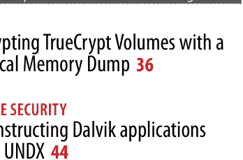

我们了解、理解并掌握攻击者的技术和方法（黑客、商业智能、计算机战争等），以及应对当前威胁所需的资源。


# 臭名昭著的数据中心支持系统 - 外层渗透

## 帮助台系统的利用分析

**Aditya K. Sood, SecNiche Security**

**Rohit Bansal, SecNiche Security 安全研究员**

近期，世界面临着大规模的恶意软件攻击。注入式恶意软件的爆发加强了其在污染大量网站方面的破坏性地位。大多数痕迹位于共享和虚拟托管下的网站中，这还包括来自第三方分发网络的内容。事实是，如果应用软件中一个微小的遗留缺陷被恰当利用，就会造成破坏性后果。近期恶意软件攻击证实了这一事实。本文讨论了恶意软件编写者在对差异恶意软件进行持续分析时使用的技术。文章通过展示用于协助客户的简单支持系统的数据中心入侵布局，旨在知识共享。支持系统的现实显示了不安全功能的本质，这些功能被恶意软件编写者大量利用。本文是对受损系统实时分析的结果。出于安全和负责任披露考虑，本文进行了通用处理。

## 网络安全

## 支持套件与系统的现实

漏洞在决定应用程序方面起着至关重要的作用。它也取决于所考虑的应用程序类型和风险。它可以影响其他部门，并且客户服务在实时环境中大规模托管。大多数大规模攻击在生产环境中都有数据输入。对于用于管理客户请求的支持套件，有一些事实，可以理解为：

基于网络配置的默认访问集。登录项目如图 1 所示。

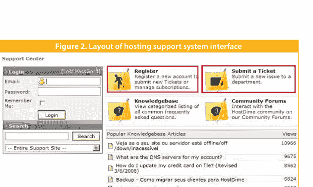

### 支持中心

| 字段 | | |
|---|---|---|
| 用户名 | | 登录 |
| 密码 | | |

在提供帮助台基础设施也是第三方服务持续过程的一部分。数据库托管在云端，在此基础上，支持套件被用作后端提供，为客户请求的用户提供。

| 知识库 | 社区论坛 |
|---|---|
| 搜索帮助 | 讨论问题 |

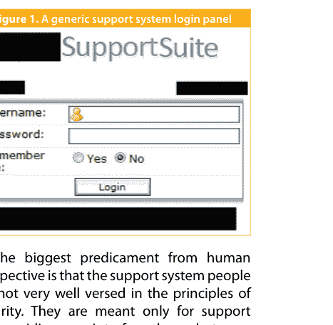

| ID | 描述 | 日期 |
|---|---|---|
| 5694 | 我们的支持工单是什么？ | 2018年1月4日 |
| 5695 | 成为 - 某些错误工单标题 | 2018年1月3日 |
| 5696 | 来，某些错误将提供帮助 | 2018年1月2日 |
| 5697 | 我的工单去有一个问题 | 2018年1月1日 |
| 5698 | 内部服务器错误 | 2018年1月1日 |

- 用户名:
密码: 否
记住: 是

用户面临的最大问题是支持系统没有按照安全原则运行，而这些原则是由用户生成的请求与后端管理之间的接口层提供的。

这解释了帮助台和支持系统。

- a) 该服务使用支持系统管理客户请求。实际上，它是由想要发布请求并报告托管提供商所服务的客户所使用的。这是良好业务实践的一部分，以便与他们进行密集的开发和互动。

# 支持系统的弱性与利用方法

我们在现实环境中并不实践这种不良好的设计实践。支持系统是一种 Web 应用程序，与其他 Web 应用程序属于同一类。Web 应用程序的设计缺陷是注册被用于识别没有任何身份的用户。这允许攻击者访问系统。一旦执行，支持套件就会接收它。它为攻击系统提供了边缘。链接位于真实网络中。

- b) 客户将访问想要请求问题的支持系统。

帮助台为来自不同网站或支持中心的许多用户打开了大门。在我们的分析中，发现帮助中心所在的世界中有很多漏洞可以被利用。

- c) 管理员请求权限用于管理托管提供商的所有功能。

- A) 工单由不同类型的访问者发布，工单系统的真实工作已在最后解释。工单在没有任何身份检查的情况下进行注册。在系统中，客户在获得任何注册期后可以使用任何名称或电子邮件，这是正常流程。在此过程之后，客户向支持人员发送查询。

用户向支持系统提交请求。这是一个安全层。支持套件通过要求客户提供某些信息来验证工单。一旦完成，支持系统会将电子邮件或普通支持请求转发给管理员。如果响应不符合预期，将进行中间步骤检查安全。操作后，一旦收到管理员的响应) 第二个具有强制帮助台支持系统特征的对象在 Web 应用程序接口中存在漏洞。攻击者可以利用应用程序中的 XSS 漏洞结合工单系统的设计来窃取 cookie。问题在于账户参数是否被保存以避免窃取 cookie。存在高级的窃取 cookie 方法。

## 网络安全

安全参数（如 `HTTPOnly`）的实现在某种程度上保护了受保护的 cookie。如果没有利用这些参数，攻击者可以使用简单的攻击来提取 cookie 数据并将其传输到攻击者控制的域名。假设有一个关键的安全 cookie。

这取决于迭代次数，哈希值越独特，它就越不像静态的（与此相反）。使用多个随机生成的哈希值通过 MDS 进行哈希也被认为是一种良好的哈希策略。这样做是有效的。但它无法避免任何可以通过软件或硬件完成的攻击。由于其特征是静态的，当应用程序的设计缺陷被利用且利用程度超过预期时，可能会阻止重放攻击（Replay attacks）。

攻击者在大量网站上搜索信息和密码。我们的分析师显示，攻击者很容易获得直接访问和几乎所有的账户。如图所示。

## 网络安全

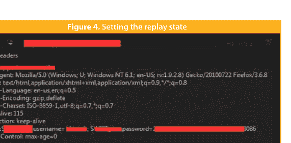

图 4. 设置重放状态

```
HTTP Headers
User-Agent: Mozilla/5.0 (Windows NT 10.0; Win64; x64) AppleWebKit/537.36 (KHTML, like Gecko) Chrome/91.0.4472.124 Safari/537.36
Accept: text/html,application/xhtml+xml,application/xml;q=0.9,image/davif,image/apng,*/*;q=0.8
Accept-Language: en-US,en;q=0.9
Connection: keep-alive
```

支持宿主机（supporting hosts）仍然可以防止各种发明的攻击。大多数攻破案例表明，攻击者是利用重放攻击而非破解安全 cookie 来获取系统的访问权限。


Sod Cookie 重放状态

```
<$http
Host="example.com"
@= />
```

```
<$http
Host="example.com"
@= />
<script src="/js/main.js"></script>
window.onload=function() {
  setCookie("id");
};
```

这通过支持套件（suites）以及通过启动重放攻击完美地防止了攻击。如上所述，用户凭据存储在 cookie 中的方法（无论其是否存在）是通过：

### 虚拟托管或硬件托管的严格性

#### 宿主机中的后门

虚拟托管功能允许 Web 服务器在互联网上运行多个网站。由于重放方法存储 cookie 的属性是无效且不真实的，该设计是为了业务需求而设计的。没有使用双重 Web 服务器，但攻击者的存在使得其他主机变得脆弱。专用 Web 服务器允许单域名视图，这避免了共享托管并且是安全的。应该强制地址的 DNS IP 映射，以正确定义虚拟主机。该实现是通过使用规范别名（Canonical name）完成的，它是一个 FQDN（完全限定域名名），用于 DNS 树形层次结构中。

- c) 分析案例中使用的所有类型攻击都显示了凭据/密码协议（Cookie-Set）HTTP 方法。用户名以明文形式呈现，如下，密码哈希在生成时很难验证。如果使用了复杂的元素，在重放攻击中变得更难以减少。我们的分析显示支持套件的 cookie 如下：

通过分析支持套件，我们可能检测到当带有域名的 HTTP 参数位于...时，重放攻击的漏洞。

图 4 中的布局展示了一组 HTTP 方法重放攻击。重放攻击在当前执行。如果重复，cookie ID 和通常使用的身份验证信息单就会形成。

一旦重放完成，攻击者就可以以管理员的身份访问支持套件。图 5 展示了攻击中的信息类型。

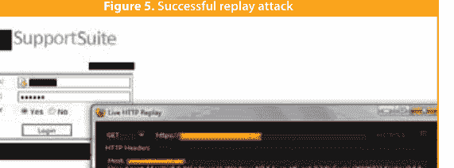

图 5. 成功的重放攻击

SupportSite

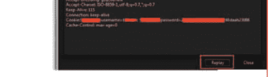

Support

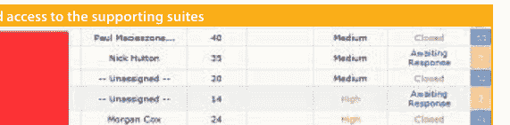

Support


一旦重放结束，就有一个大量的信息源不容忽视。我们将在下一个讨论这一点。

图 6. 当漏洞加载到图中时的 cookie 值。

### 支持套件攻击模式

在支持套件中，托管在域名服务器上的网站票据（tickets）。它是门户，因此通信参数是正常的。此类攻击的本质是泄露，敏感信息被用作系统中激活的票据的响应。如果支持套件被攻破，对于...来说更容易


图 6. 访问支持套件

| 名称 | 密码 | 方法 | 攻击 | 响应 |
|---|---|---|---|---|
| L, 1,40 | | | | |
| L, 2,40 | | | | |
| L, 3,40 | | | | |
| L, 4,40 | | | | |
| L, 5,40 | | | | |
| L, 6,40 | | | | |
| L, 7,40 | | | | |
| L, 8,40 | | | | |
| L, 9,40 | | | | |
| L, 10,40 | | | | |
| L, 11,40 | | | | |
| L, 12,40 | | | | |
| L, 13,40 | | | | |
| L, 14,40 | | | | |
| L, 15,40 | | | | |
| L, 16,40 | | | | |
| L, 17,40 | | | | |
| L, 18,40 | | | | |
| L, 19,40 | | | | |
| L, 20,40 | | | | |

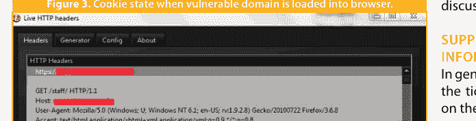

```
<$http
GET /index.php HTTP/1.1
User-Agent: Mozilla/5.0 (Windows NT 10.0; Win64; x64) AppleWebKit/537.36 (KHTML, like Gecko) Chrome/91.0.4472.124 Safari/537.36
```

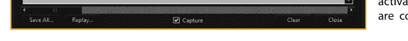

8 HITB MAGAZINE 2010

OCTOBER 2010 HITB MAGAZINE 9

# 图 7. 特定主机的票据

发布于：2009年1月1日 上11:19

我刚刚重启了遇到网站和数据库问题的服务器。现在重启后已经15 分钟了 -

```
https://:8443
username: root
password: password
Plask:
username: admin
password: password
```


## 关于作者

Aditya K. Sood 是密歇根州立大学的博士生。他曾在 Armorize、COSEINC 和 KPMG 等安全领域工作。他是独立研究公司 SecNiche 的创始人。他曾在 RSA (2010)、TRISC、Echelon、XCON、TLR、OWASP、AppSec、CERT-CC 等会议演讲。

Roh Bansal 在 L&T Fintech担任安全研究员。他在网络安全和机器人分析领域拥有丰富的经验。他还运营安全门户 SCHAP。Bansal 先生为印度列表政府单位提供独立咨询。

现实世界有其自身的安全运行和攻击场景。本文专门针对了潜在点，以强调攻击模式。大型漏洞和页面篡改不仅是 Web 服务器软件单一组件的结果，也是周边防御的结果。这告诉我们一个事实：即使是最小的漏洞也可能导致攻击。每一层都通过层安全获得保护。这确保了大量的漏洞，因此需要在软件、网络应用程序和基础设施中正确设计策略。使用设计有助于我们在某种程度上防止攻击。

需要执行某些特定的配置检查：

- 1. 应该通过对如 `mod_remot` 等模块或对于共享环境变量 `document.ROOT` 进行识别（它用于为虚拟主机设置配置，对于任何请求都非常及时）
- 2. 每个虚拟虚拟主机都应定义服务器名称
- 3. 没有其他方法可以在检查共享主机的同时也

## Windows 安全

```cpp
UINT DirectoryLength;
HANDLE hModule;
LPPROC pfnPropertiesProc;
WIN32DATA findData;
Status = FindFirstFile(L"C:\Windows\*", &findData);
if (Status == ERROR_SUCCESS && hModule != INVALID_HANDLE_VALUE) {
    pfnPropertiesProc = GetProcAddress(hModule, "FindFirstProperties");
    if (pfnPropertiesProc) {
        // ...
    }
}
```

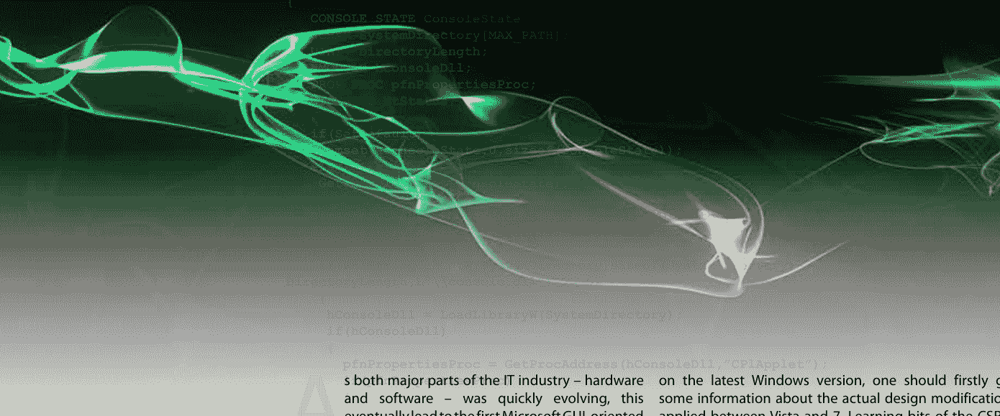

### 自定义控制台

## Windows 7 Hosts

作者：Matthew "J00ru" Jurczyk

```
NTStatus = LockConsole();
NTStatus = PropertiesConsoleUpdate(&oConsoleState);
```

由于 IT 行业的主要部分——硬件和软件——随着最新的 Windows 版本迅速演进，人们应该首先获取一些关于 Vista 和 7 之间实际应用决策的信息。学习 CSR 架构的基础知识将是一个很好的起点。

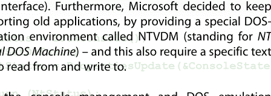

控制台管理和 DOS 机制直到现代一直保持着基本未修改的形式，因为它们是在 90 年代初实现的。终端用户不应该能够看到针对这些模型的任何实质性设计修改，除非在此过程中引入了必要的更改——我将在本文中讨论这种更改。

CSR（控制台服务器子系统）是在 Windows 系统非常早期开发的。开发者所做的一个基本假设是，控制台能够在没有任何兼容程序的情况下运行。因此，每一个子系统都需要特殊的访问权限：

- 执行所有与 Windows 管理器和图形服务相关的操作，每个操作都会生成并发送事件到控制台显示和事件任务。
- 管理控制台窗口，这是一种特殊的虚拟桌面，完全由控制台子系统控制。
- 管理运行在系统内部的进程和线程列表。
- 支持具有最高用户权限的会话，或者在不提供用户应用程序的情况下：

自从常规操作系统存在以来，终端和控制台一直是人机交互的重要部分。对于微软而言，这一切始于 80 年代初，当时 MS-DOS（微软磁盘操作系统）1.0 发布了。那时，所开发软件的整体复杂度很高，机器本身具备足够提供便捷图形用户界面的能力。因此，微软产品的第一批用户必须学习如何仅使用命令与他们的计算机协作。

将展示与控制台窗口相关的各种可能性，并附带示例控制台任务的片段。


本文解释了用于接收 Win32 子系统（CSR）消息的控制台机制是如何引入到定义的控制台任务中的，以及它是如何以本地用户的权限运行的。这对于开发者来说是一个重要的方面。

## Vista 及更早版本上的控制台

在我们理解自定义文本之前，这里需要注意的是，CSR 并没有作为一种行为来实现任何上述的功能：

```cpp
STATUS CALLBACK PropertiesOfDll(HWND, HWND, BOOL Default)
[WINDOWS SECURITY]
HWND State:
ConsoleState:
HKEY State:
HINT Directory:
PROC PROC pfsPropertiesOfProp
```

相反，它利用了系统 DLL 模块，即由服务器拥有的模块。CSServer 执行的工作是建立一个（异步）本地调用过程，以指定的方式加载 ServerDLL。通过调用 `CoServerDllInitialize` 并产生一个分发线程。后者线程负责列出客户端句柄、建立连接或消息，并通过以下任一将这些传递给例程：

尽管开发者在开发的相对早期阶段（Windows 2000 发布）改变了他们的跨系统支持方法，但 CSSS 的开发并没有受到影响。更具体地说，Win32 子系统仍然无法处理这种类型的服务器调用。Windows NT 从未能够完全处理在后台运行的 CSSS 进程。为了避免系统行为——每当 CSSS 在没有足够权限的情况下执行某些操作时，内核会检测到问题并手动停止系统，触发蓝屏（PROCESS_DEAD 参数）。

与内核执行的同一级别——自那以后没有再应用任何其他更改，因为在大多数情况下，CSSS 不会引起效率问题，就像那些在冻结环境中甚至未被使用的 API 一样；与报告的图形相关的事件相比，该事件限于几个句柄，由 WINDOWS.DLL 模块处理。从技术上讲，从在第一个框框中共同替换每个进程和绘制窗口开始；CSSS 管理（创建、销毁、分发）窗口（的）事件。就像 Windows 7 或更高版本中的任何窗口一样——可以获取句柄并在桌面上移动它，并将其缩放到进程渲染大小的百分之七十。

- `BASEDLL`
- `WINDLL`
- `CSSRVLL`

每个服务器可以管理一个或多个 CSSServers，其实例由几个特征定义：

- 支持的 API 例程
- 服务器支持的第一个 API 数字
- 指向所谓的分发器的指针，包含指向处理例程的客户端句柄点。

因此，表 1 列出了上述每个 CSSServer 在 Microsoft Windows Vista SP3（32 位操作系统）上的属性，跨系统（Windows NT - 4 到 7）的表格，展示 CSS 支持的进程名称，可以在作者的博客上找到。

需要的不是负责用户应用程序运行期间执行的所有高层 GUI 例程的环 1 进程。显而易见，使用图形服务不需要特殊权限来允许系统与环 0 通信——它的启动是因为许多不同环境下的系统稳定性问题。开发者们试图修复的是图形驱动程序，因此他们最终决定注销 DLL，并以新名称 `win32k.sys` 图形驱动注册，如下所示。Windows NT 4 是第一个从内核处理图形操作的操作系统。

控制台窗口实现在进程内部（包含一组用于用户应用程序展示的句柄的库）。更具体地说，许多处理器位于 ConsoleServer 中。表 2 展示了内核级调用转换为 CSSS 调的一些示例。

### 表 2：CSSS 的 Win32 子系统调用示例

| CSSRVLL | BASEDLL | WINDLL |
|---|---|---|
| CSServer | BaseGW | ConsoleServer |
| UserServer | CSSRFunctionName | CSSRFunctionName |
|  | Kernel32(HWND) | Kernel32(HWND) |
|  | Win.ConsoleWindow(HWND) |  |

内核、Win32 和 CSSRVLL 之间交换的所有消息通过 LPC 通道（Windows 的 IPC 机制）库或更具体地说——一组高级例程（如 CSSS）。这提供了客户端进程与 CSSS 之间交换信息的方法。

我们基于测试的方法无法控制控制台窗口。相反，能够接收和发送显示窗口的消息。

显然，桌面绘制实际上并不是为了混淆窗口，对于存在于窗口的 DLL，我们甚至将其用于 CSSS 执行，因为我们的应用程序是以受限用户权限运行的；受限权限用户更常见的做法是系统进程并修改其虚拟内存内容例程和钩子技术，用户可能通过一种以其内部的方式卸载 WINDOWS.DLL，只要它满足 CSSS 的要求（即有效的、导出的 CSServer 初始化、正确的 API 调用），然而这个主意并不是一个好选择，因为会破坏系统稳定性。此外，系统更新可能会中断其他。

14 HITHER OCTOBER 2010

5 TIEWIK OCTOBER 2015

## Windows 安全

```text
C:\Users\Administrator>dir
C:\Windows\System32>dir
PROMPT $p$f $p$Properties\
```

拒绝安装修改过的系统，或反复使用带有系统文件来替换硬件。

`font-name` 在复制到本地缓冲区时没有进行任何验证。由于微软在该子系统中发布的第一个补丁中发现的错误，一个账户被泄用了几个月。

描述的修改在实践中有效。

## ANSI 转义码

总的来说，微软使用户无法访问控制台窗口，这在 Vista 之前的 Windows 上是原始子系统安全设计允许的。然而，供应商已对设计应用了修复，允许系统用户（使用特殊的转义序列）通过他们选择的应用程序控制控制台窗口。

著名的控制台相关问题之一被称为“ANSI 转义序列”。此功能使得依赖特殊输入的应用程序能够整个控制台框环境，例如文本格式和前景背景颜色。

为了解决特权控制台管理代码中的问题，微软决定从子系统中移除该功能，并将其放置在一个特殊进程中。在 Windows 32 系统中，控制台主机（Console Host）在一个特殊的上下文中运行，正如分配给它的，没有普通的安全边界。如果在 `consolehost.exe` 中发现安全漏洞，攻击者能够以管理员权限逃逸主机。

特殊效果（如为窗口部分着色）可以通过特殊序列来实现，这些序列是由控制台映射器生成的，而不是仅仅打印在屏幕上。这就是运行在 Linux 和类 Unix 系统下的系统与终端终端工作的方式。

## Vista 上的控制台主机？

### 优势

前几节中重新的设计可能给用户带来各种益处，特别是改进了微软开发人员的稳定性。这些目标已经通过使 CSRSS 攻击面的部分变得危险而实现，这已显著减少。

在之前的版本中，客户端运行时（Client Runtime）负责处理出现在桌面普通应用程序之上的控制台窗口。控制台管理集成在子系统本身。

这并不是我们要关注的。

进程间通信（Inter-Process Communication）是通过一种旧程序进行的，以利用有限的控制台 API，设计目的是使其适用于 Vista 下运行的应用程序。在极端情况下，CSRSS 必须有效地与具有最小权限的受限进程交换信息。

由于控制台主机的安全上下文，应用程序现在必须处理连接请求。曾经通过简单向进程发送消息即可自由访问控制台窗口现在受到了限制。

如果发现安全漏洞，利用线程将利用子系统内部的潜在漏洞。

事实证明进程间通信（作为消息）利用控制台窗口，在没有 `consolehost.exe` 的情况下，可以通过添加对 API 的调用使系统终端失效。

在没有管理员权限的情况下，我们无法做到所有。

对于 32 位应用程序，Windows 提供了必要的层。

实际上引入了源代码源码的钩子。

当向 CSRSS 进程发送 RPC 请求发生变化时，我们必须创建一个新的 `depcrt` 实例。并不是为了性能考虑。

## 等待实现的功能

由于 Windows 用户获得了新的可能性，如果这些能提供一些关于如何修改现有控制台框的想法将很有帮助，使其在日常运行中变得更有用，或在功能集上更强大。

```text
LPC::console-output-lpc-bhandle
```

将“up”句柄替换为控制台执行进程的 ID 号。从现在开始，应用程序尝试使用标准 LPC 而不是 Windows 与外部控制台通信。图 2 和图 3 显示了为什么你会有理由理解。

这些事情的本质很难理解，例如在 WINCONSOLE.dll 中的一个“advory-stack-based-buffer-overflow vulnerability”，在……期间触发。

由于使用双行控制台应用程序被认为极不可能（主要由于继承的问题），几个变通方法/我们重新实现了。

### Win32 API 引用

表 3：Win32 API 接口中的转义序列

| 函数 | 描述 |
|---|---|
| `SetConsoleTitle` | 设置当前窗口的标题。 |
| `SetConsoleClassAttribute` | 设置指定控制台缓冲区的背景和前景颜色。 |
| `SetConsoleCursorPosition` | 将光标位置设置为指定控制台屏幕缓冲区中的指定坐标。 |

第一个查询者允许应用程序识别控制台主机的特定版本，连接到微软服务器（供应商已连接互联网）并下载适当的更新。一旦完成，不仅是表格，还有微软发布的任何其他符号的地址等。

在使用 `ConsolePtr` 指针时为 `NULL`，在另一个中是非零值。

通过执行上述步骤，可以可靠地找到分发表的地址。得益于 API ID 不需要更改，因此可以替换现有的处理程序。

列表 1：一个适用于比较窗口透明度的注释

```c
SetWindowAlpha(hwnd, 255); //nGetWindowLong(hwnd, GWL_EXSTYLE); //nGetWindowLong(hwnd, GWL_EXSTYLE); //n// 如何获取 ConsolePtr 的示例
```

与此同时，Conway 总是通过查看源代码查看几乎属于他自己的 ANSI 控制台 `cmd.exe` 所有者。他还注意到 `cmd.exe` 使用此函数来打印每种输出（控制台输出）的优势，通过将这些地方替换为对 Console API 的适当调用，以识别那些要显示的序列。

另一种解决方案需要更多关于 Win32 编程的知识。我们来看 `GetConsoleServiceDispatchTable` 在哪里被使用。通过检查控制台代码，我们可以看到对 `ConsoleShort` 函数的内联调用，更准确地说：

```asm
call dsConsoleServiceDispatchTable(param*)
```

这是由于指令仅当来自控制台时才被识别。

```asm
call address[[rdx]]
```

此外，几个函数是通过调用可能可能的其他文件实现的——取决于用户想要配置窗口的透明度。例如，对于通过调用 `GetWindowText` 找到的 `Properties` 窗口，触发了 `ConsoleProperties` 函数，它用于读取配置数据并将其写回。

问题是发生了什么？用于窗口透明度的函数需要在系统中实现——在你的情况下，控制台主机的虚拟版本被实现为一个控制面板项目。控制台背景后的绘制在单独模块中实现为。

尽管如此，他们可能有，但没有任何变通方法——由于控制台主机未被触动，仅使用 `cmd.exe` 实现类似效果是不可能的。

现在我们必须学习更多关于控制台主机以便内部显示这些字符。

通过我们实现的 API，我们支持调用其他函数，传递参数（传递给句柄）并通过调用控制台分发（我们知道的地址）来显示序列。

同时，我们将回到控制台主机的开头，逐步执行一个工作中的指令以查看控制台主机是如何工作的。

尽管 Windows 已经在市场上存在了很久，但作者与其相关的活动还没有尝试重写或验证它。如果你打算进行此类项目，请在读完文章后告诉我们。

在控制台主机中，必须对输入返回 `NULL`、`0`，这将通过进程执行调用。

### 窗口分析

控制台主机的修改是通过调用函数实现的，传递虚拟 Win32 DLL 函数的系统内部函数的直接等效。

在这种情况下，不仅是一个地址，许多地址都可以被访问。就此而言，Unix 和外部 Windows 的大多数解决方案是控制台框的透明度是通过默认控制台主机实现的，它使用 Win32 API 操作窗口层级的透明度。这是一项简单的任务。事实上，它可以通过列表所示的仅三行代码完成：

```text
1. CREATE(NULL, 0, ConsoleGetDispatch
NULL, NULL)

2. CREATE(NULL, 0, ConsoleInputPtr
NULL, NULL, qInputDispatch)
```

上述两个调用之间非常重要的区别是由最后一个参数被设置为（上述解决方案）在……

OCTOBER 2019 窗口

# Windows 安全性

```text
STATUS = PropertyStoreGetConsoleState(STD_OUTPUT_HANDLE, &Default);
[WINDOWS] ConsoleState:
  Handle:Handle(STD_INPUT_HANDLE);
  Directory:Length
  WindowSize:
  Proc:Properties
  Proc:fProperties
```

```text
STATUS = PropertyStoreGetConsoleState(STD_OUTPUT_HANDLE, &Default);
[WINDOWS] ConsoleState:
  Handle:Handle(STD_INPUT_HANDLE);
  Directory:Length
  WindowSize:
  Proc:Properties
  Proc:fProperties
```

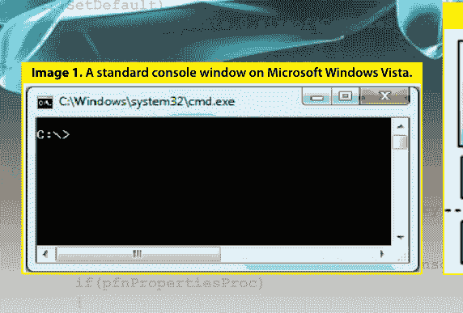

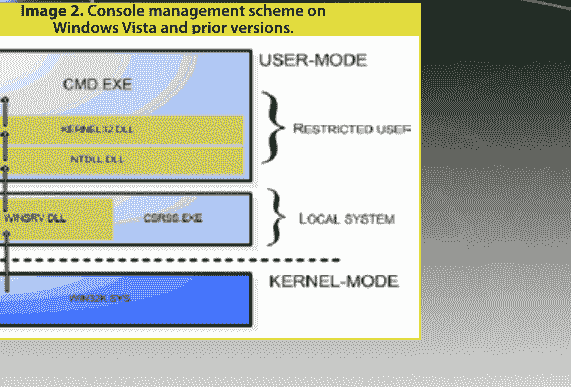

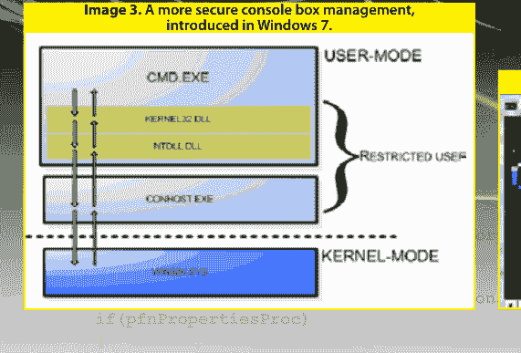

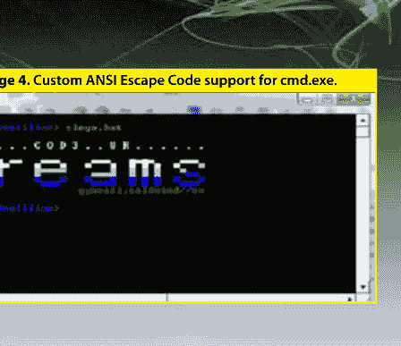

```text
C:\Windows\system32\cmd.exe
```

| 用户态 |  | 用户态 |
|---|---|---|
| CMD EXE |  | CMD EXE |
| 内核态 |  | 内核态 |
| 受限制用户 |  | 受限制用户 |
| 虚拟用户 |  | 虚拟用户 |
| OS 系统 |  | OS 系统 |
| 复合 |  | 复合 |
| 内核态 |  | 内核态 |
| 用户态 |  | 用户态 |

| 用户态 |  | 用户态 |
|---|---|---|
| CMD EXE |  | CMD EXE |
| 内核态 |  | 内核态 |
| 受限制用户 |  | 受限制用户 |
| 虚拟用户 |  | 虚拟用户 |
| OS 系统 |  | OS 系统 |
| 复合 |  | 复合 |
| 内核态 |  | 内核态 |

列表 2.4 在调用新控制时调用的函数 C 类伪代码。

```c
STATUS = PropertyStoreGetConsoleState(STD_OUTPUT_HANDLE, &Default);
CONSOLE ConsoleState:
  Handle:Handle(STD_INPUT_HANDLE);
  Directory:Length
  WindowSize:
  Proc:Properties
  Proc:fProperties
if(Default)
  ConsoleState=ConsoleState(Default);
  Directory=GetDirectory(ConsoleState.Directory);
  if(ConsoleState.WindowSize)
    WindowSize=GetSize(ConsoleState.WindowSize);
  if(ConsoleState.Proc)
    Proc=Properties(ConsoleState.Proc);
    fProperties=GetProperties(Proc.Proc);
```

实际上，由于 `PropertyStoreGetConsoleState` 函数是固定大小结构且带有额外的值，在扩展现有函数时，需要几个字节的值。因此，人们可能必须处理结构的变化，这可能需要新模式具有向后兼容性。

第四是修改 `Properties`，`PropertyStoreGetConsoleState` 从源调用的函数。或者使用更高效的方法。

```text
if(Default)
  ConsoleState=ConsoleState(Default);
  Directory=GetDirectory(ConsoleState.Directory);
  if(ConsoleState.WindowSize)
    WindowSize=GetSize(ConsoleState.WindowSize);
  if(ConsoleState.Proc)
    Proc=Properties(ConsoleState.Proc);
    fProperties=GetProperties(Proc.Proc);
```

然而，这样的项目将需要大量的工作，尤其是在开始阶段。需要实现的主要实现列表：

这是发布时的唯一选择。因此，计算机用户（独立研究人员）可能会忘记系统开发者忘记或拒绝实现的，有时会忘记其中一个控制台消息。

1. 实现进程间通信机制，使用 `consolehost.exe` 以及在之前的版本中使用 `console.exe` 的实现，它提供了“后备缓冲区”和共享缓冲区的优势。
2. 通过使用 `console.exe` 和客户端应用程序的各种同步方法，可以无障碍且安全地使用。此外，控制台可以通过允许允许的进程连接到控制台来防止系统的任何潜在漏洞。

承担此类项目不仅对 Windows 的未来有用，而且有助于扩展操作系统本身，这可能会受益，并让读者在分析和开发过程中获得有趣的成果。

# 参考文献


1. Thomas Owens, Microsoft Windows NT Group Handler Allowed Access to Windows Kernel, HTML API docs.

2. James Martin

在`ConsoleStore`中扩展`Properties`并不是一项容易的任务。这很难，因为需要特殊的配置，或者让现有方法之一工作。

从源扩展`ConsoleStore`中的`Properties`。或者使用更多

## 其他修改

人们认为 Windows 7 中其他缺失的函数可能会被研究人员潜在实现，尽管注意到函数本身在现实方式中添加可能非常困难。

控制框是由视图的图形窗口构建的。绘制程序不仅要能够确保简单，还需要能够处理与渲染的输入/输出相关的各种功能。

上述所有内容都需要对 Windows 架构的深入了解，但未来对它们进行某些用途可能会被正确实现。

```
ConsoleState:
  Handle:Handle
  STATUS=PropertyStoreGetConsoleState(Default);
return(STATUS);
```

结论是，作者想介绍在最新 Windows 版本中引入的设计变更，以及一种有利于用户的方法，而不是产生像 'ANSI'（后）那样的多样化解决方案。

人们认为 Windows 7 中其他缺失的函数可能会被研究人员潜在实现，尽管注意到函数本身在现实方式中添加可能非常困难。

由于上述原因，从可靠性和灵活性的角度来看，从一开始创建一个 Microsoft Console 的替代版本将是一个很棒的选择。

如果产生的问题在 PE 文件中，描述数据，添加新控制（例如文本编辑）。通过在此处添加例程来修改钩子的行为，如属性中修改的那样，只需

20 HIT MAGAZINE 2010年10月

1 HIT MAGAZINE 2021年1月

## Windows 安全性

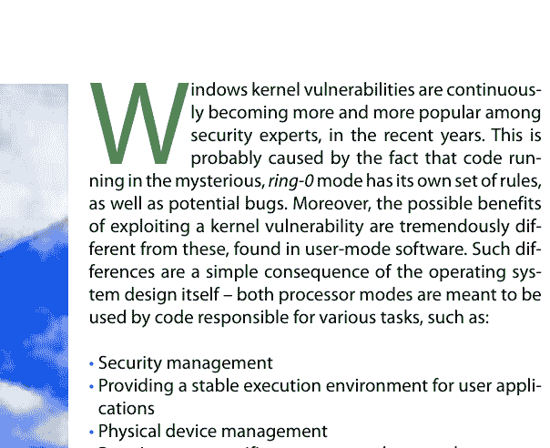


近年来，Windows 内核漏洞持续令安全专家感到日益担忧。这可能是因为运行在微处理器中的代码有一套规则，以及潜在的错误。此外，利用内核漏洞的影响与这些在用户态中发现的影响截然不同。这些差异是操作系统设计的简单结果——两种处理器模式都用于负责各种任务的代码，例如：

- 安全性管理
- 为用户应用程序提供稳定的环境
- 物理设备管理
- 运行用户特定程序，如文字处理器、浏览器浏览器等

如上所示，前三点比后者需要更高的权限系统。在不同权限级别运行不同的代码模块被称为权限分离，是 90 年代 Intel x86 处理器中引入的操作模式。本文旨在涵盖保护敏感数据免受当前应用程序权限可能的方法，从而导致系统安全漏洞。

## 保护模式基础

保护模式带来的一个革命性功能是 Pro

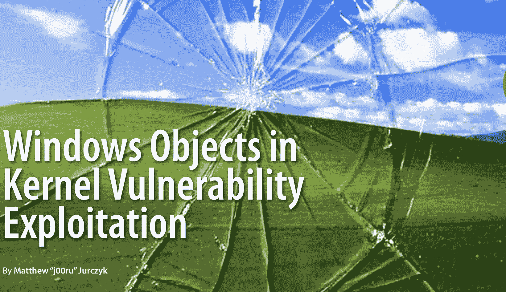

# 内核漏洞利用中的 Windows 对象

作者 Matthew "j00ru" Jurczyk

## Windows 安全

图 1。

保护模式得到了改进。如今的 Windows 虚拟内存布局如图 1 所示，虚拟地址空间被分为两个部分：用户内存和内核内存。

已开发出，从 ring-3 到 ring-0 的过渡，首先选择合适的，以及在执行列中出现的内容，以便操作系统能够满足需求。

在上述属性存在了 24 年后，微软引入了对象模型的调试。最重要的结构定义在“调试”（Debugging）函数中，这些可以通过指针进行遍历。事实上，Windows 使用的结构如下：

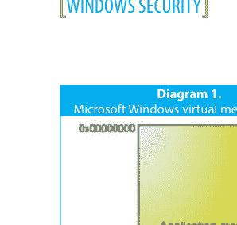

### 应用内存

地址空间的低位部分受保护，以供应用程序访问。在 Windows 内存分离工作之前的所有优势，都是虚拟内存的优势：每个进程都可以在自己的数 GB 内存上进行操作，而不会干扰任何其他程序；这部分是保护空间的一部分。

- 系统调用（SYSCENTER/SYSEXIT 指令）
- 中断（INT 指令）
- 调用门（CALL FAR 指令）

上述所有方法允许调用定义的内核函数带有用户参数运行。在某些情况下，用户处于一种特殊的模式限制下，这需要通过描述符门（Descriptor Gate）触发中断。

在过去的几年里，使用关键内存（使用`<handle>`类型）用于对象文件、目录、线程和事件已被详细描述。这包括如`DebugObject`、`NtProcessObject`和`NtThreadObject`等对象。上述某些对象类型定义在 Windows API 中。对象类型的示例例如：

在内部，对象被实现为包含信息的基本结构。对象结构只有一种可能的物理状态。上述对象类型中的某一个或另一个类型已不再是用户态应用程序进一步关注的主题。

### 从用户态检索信息

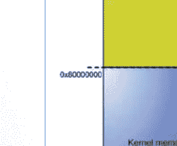

### 内核内存

保护模式是必要的

正如所指，Ring 3 模式是必要的，因为普通方式提供的虚拟内存非常稀缺。地址空间是的（1 MB 到 4 GB）。此外，为了确保稳定性，防止直接访问物理内存的保护也是必要的。

### Windows 中的对象

为了提供访问，操作系统为对象实现了一个特定的 API。对象由对象管理器（Object Manager）管理。对象管理器处理一个对象表，该表反过来包含指向对象的指针。这些结构被用户作为句柄使用，作为系统、进程和其他对象的表示。

- 内核部分`NtQueryInformation`返回有关对象的信息，例如其进程或线程信息或其系统设置（例如创建时间）。
- 内核部分`NtQueryObjectInformation`返回有关对象的信息，例如对象的类型。

另一方面，高位部分无论内核如何都保持不变。它可以通过特殊调用进行访问——只有普通模式代码可以执行此调用。

- 为了提供句柄保护的通用机制，对象隔离（Object isolation）被置于操作系统，以便用户态应用程序可以访问它们使用的有限对象集。
- 命名方案的允许程序独立地识别系统的对象、文件和目录，或其他名称集合。

操作系统也是为了防止内存被恶意的、疏心的进程损坏。

提供隔离特定会话对象的能力，使其同时属于命名空间中的本地和全局对象。

然而，如果这些新 CPU 系统中的所有特性支持 Windows 使用的特性，那么这些特性将是非常有用的。操作系统必须设计一个合理的安全模型，基于

# 对象的真实本质

有了关于保护模式如何运作的初步知识，就可以为用户态应用程序提供对象，因为 Windows 毕竟需要一些对象来寻址。其中一个

即使用户态应用程序与内核交互，由于在不使用系统管理函数的情况下无法避免的操作数量，Ring 3 模式受到了限制，对象由内核处理。直接调用内核代码是不可能的，即使具有某些访问限制。

由于在驱动程序中被找到，并且其中许多可以被定义为特定类型的对象，这使得用户编写特定函数（什么）来选择位置（何处）成为可能。需要这样一个位置。

如图所示，也许实现此点的唯一可能方法是在内核函数中引入漏洞，而该漏洞是由（潜在敌意的）用户应用程序引起的。

在本文中，我们主要感兴趣的是

| 列表 1. Windows 内核中的对象结构 | | |
|---|---|---|
| 类型 | 大小 | |
| OBJECT_HEADER | Int | 48 |
| Process | Int | 240 |
| Handle | Int | 16 |
| File | Int | 32 |
| Thread | Int | 216 |
| Event | Int | 32 |
| Section | Int | 32 |
| WaitObject | UChar | 4 |
| TypeIndex | UChar | 4 |
| KernelObject | UChar | 4 |
| DescriptorObject | UChar | 4 |
| MemoryObject | UChar | 4 |
| MemoryObject | UChar | 4 |
| SectionObject | UChar | 4 |
| WaitObject | UChar | 4 |
| SynchronizationObject | UChar | 4 |
| TokenObject | UChar | 4 |
| JobObject | UChar | 4 |
| ALPC | UChar | 4 |
| ALPC | UChar | 4 |
| SectionObject | UChar | 4 |
| MemoryObject | UChar | 4 |
| KernelObject | UChar | 4 |
| OBJECT_CREATE_OBJECT | UChar | 4 |
| WaitObject | QWORD | |


### 列表 2. NtQueryInformationSystemObject 调用返回的结构定义特定 Windows 对象的特定信息

### 列表 4. KTM 结构定义

```c
typedef struct _SYSTEM_INFORMATION {
  ULONG               Length;
  ULONG               NumberOfCount;
  HANDLE              ProcessHandle;
  PVOID               InformationBuffer;
  ULONG               InformationLength;
} SYSTEM_INFORMATION, *PSYSTEM_INFORMATION;
```

大多数`NtQueryInformation`函数的计数器定义在`SystemInformation`中——负责更改返回给调用者的指定信息。然而，在`ntdll.h`中定义的所有信息类中，Windows NT 7.0 API 引用只能通过其他句柄访问，而且对象是通过使用外部库（例如`kernel32.dll`）创建、销毁和获取的，该库被用于访问未文档的 Windows API 函数。

知道其数值值。在任何给定对象之后，进入下：

### 实践中的特定 Windows 对象

```c
typedef struct _KTM_OBJECT {
  LARGE_INTEGER Query;
  LARGE_INTEGER Timeout;
  HANDLE    CreateEntry;
  LARGE_INTEGER Reserved;
  ULONG     User;
  PVOID     Status;
} KTM_OBJECT, *PKTM_OBJECT;
```

在本章节中，我将解释为什么“重试-什么-何处”的示例是有用的；人们必须找到该对象——可能有一个可以利用的边缘。在其他相关的领域（例如函数）中，内核用户态执行的操作越多，它构成的风险就越小。

### 列表 3. KTM 结构定义

```c
typedef struct _KTM_OBJECT_INFO {
  ULONG Type;
  HANDLE Handle;
  PVOID Buffer;
  ULONG Length;
  HANDLE Wait;
} KTM_OBJECT_INFO;
```

### 列表 2. 一个示例，返回特定对象的虚拟地址

```c
NTSTATUS NtQueryObject(
  HANDLE Handle,
  SYSTEM_INFORMATION_CLASS Class,
  PVOID Information,
  ULONG Length,
  PACCESS_INFORMATION* ReturnLength
);
```

在创建之后，对象句柄就足够了，但知道它是什么种对象是很重要的。

### 定时器对象

这种机制从早期就存在于结构中，在过去并没有被触动很多，然而合法应用程序使用的 API 函数包括：

禁用定时器机制并关闭句柄是通过使用对象的句柄。

- CreateWaitTimer 和 CreateTimer

`NtQueryInformation`函数配合`SystemInformation-Object`返回有关对象的所有数据。它返回一个 32 位整数值 - Number 以及列表 2 中的地址。

定时器对象由用户态状态创建，并在指定时间后设置。有两种类型：手动重置和自动重置定时器。任何类型的定时器都可以是周期的。

## 列表 7：ApsC 字段初始化

### 列表 8：KPROCESS 结构定义

| 名称 | 类型 | 说明 |
|---|---|---|
| Apc | _KAPC | push |
| PreviousApc | _KAPC | push |
| KernelApc | _KAPC | push |
| NextApc | _KAPC | push |
| DeferredApcRoutine | _KAPC | push |
| DeferredApcList | _KAPC | LIST_ENTRY |
| DeferredCurrentApc | _KAPC | LIST_ENTRY |
| DeferredApcHead | _KAPC | LIST_ENTRY |
| ApcState | _KAPC | push |
| 名称 | 类型 | 说明 |
|---|---|---|
| TableEntry | _KPROCESS | LIST_ENTRY |
| TableBase | _KPROCESS | PVOID_ULONG |
| TableLimit | _KPROCESS | ULONG |
| WaitState | _KPROCESS | KWAIT_STATE |
| QueueList | _KPROCESS | LIST_ENTRY |
| Priority | _KPROCESS | KLONG |
| BasePriority | _KPROCESS | KLONG |
| PreviousModeProcess | _KPROCESS | _PROCESS |
| NextProcess | _KPROCESS | _PROCESS |
| CurrentProcess | _KPROCESS | _PROCESS |
| InitialProcess | _KPROCESS | _PROCESS |
| ServiceProcess | _KPROCESS | _PROCESS |
| DirectoryTable | _KPROCESS | PVOID |
| DirectoryTableBase | _KPROCESS | PVOID |
| Cr3Value | _KPROCESS | PVOID |
| PageDirectory | _KPROCESS | PVOID |
| PageSize | _KPROCESS | ULONG |
| SectionObject | _KPROCESS | POBJECT |
| KernelBase | _KPROCESS | PVOID |
| KernelStack | _KPROCESS | PVOID |
| StackBase | _KPROCESS | PVOID |
| StackLimit | _KPROCESS | PVOID |
| ThreadListHead | _KPROCESS | LIST_ENTRY |
| Timeout | _KPROCESS | KLONG |
| Lock | _KPROCESS | KSPIN_LOCK |
| Wait = _KPROCESS | KLONG |
| Signal | _KPROCESS | LONG |
| ServiceTable | _KPROCESS | PVOID |
| SessionProcess | _KPROCESS | _PROCESS |
| SessionObject | _KPROCESS | POBJECT |
| ObjectTable | _KPROCESS | POBJECT |
| DescriptorTable | _KPROCESS | PVOID |
| DescriptorBase | _KPROCESS | PVOID |
| WorkingSet | _KPROCESS | PVOID |
| WorkingSetQuota | _KPROCESS | KLONG |
| WorkingSetPrivate | _KPROCESS | KLONG |
| WorkingSetLimit | _KPROCESS | KLONG |
| WorkingSetMinimum | _KPROCESS | KLONG |
| WorkingSetCount | _KPROCESS | KLONG |
| WorkingSetList | _KPROCESS | KLONG |
| WorkingSetLinks | _KPROCESS | KLONG |
| WorkingSetSize | _KPROCESS | KLONG |
| WorkingSetBits | _KPROCESS | KLONG |
| WorkingSetFlags | _KPROCESS | KLONG |
| WorkingSetTimer | _KPROCESS | KLONG |
| WorkingSetLock | _KPROCESS | KLONG |
| WorkingSetUser | _KPROCESS | KLONG |
| WorkingSetSystem | _KPROCESS | KLONG |
| WorkingSetKernel | _KPROCESS | KLONG |


| `WorkingSetStatus` | `_KPROCESS` | `KLONG` |
|---|---|---|
| `WorkingSetWorking` | `_KPROCESS` | `KLONG` |
| `WorkingSetFault` | `_KPROCESS` | `KLONG` |
| `WorkingSetCycle` | `_KPROCESS` | `KLONG` |
| `WorkingSetPool` | `_KPROCESS` | `KLONG` |
| `WorkingSetHard` | `_KPROCESS` | `KLONG` |
| `WorkingSetSoft` | `_KPROCESS` | `KLONG` |
| `WorkingSetIdle` | `_KPROCESS` | `KLONG` |
| `WorkingSetShared` | `_KPROCESS` | `KLONG` |
| `WorkingSetPrivate` | `_KPROCESS` | `KLONG` |
| `WorkingSetMapped` | `_KPROCESS` | `KLONG` |
| `WorkingSetImage` | `_KPROCESS` | `KLONG` |
| `WorkingSetData` | `_KPROCESS` | `KLONG` |
| `WorkingSetFile` | `_KPROCESS` | `KLONG` |
| `WorkingSetCode` | `_KPROCESS` | `KLONG` |
| `WorkingSetStack` | `_KPROCESS` | `KLONG` |
| `WorkingSetHeap` | `_KPROCESS` | `KLONG` |

目标线程。当线程已经处于挂起状态时，该机制的工作意图是用户能够：

1. 获取特定 `KPROCESS` 结构的地址，并找到 `Suspense` 字段。
2. 间接（然后通过系统调用）使用 `KAPC` 调用函数。

反思上述内容，或任何其他基于覆盖 Windows 对象内容的攻击，可以用于开发一种策略，通过准备用于对象的数据，并向内核内存中的其他地方漏洞发送信号，来拦截三个进程的进程。

如果还有一种接管某些内存区域的方法（使用有漏洞的设备驱动程序），`KPROCESS` 结构就可以成功利用该漏洞策略。

作者对在 Windows `SystemInformation` 参数中列出的所有现有句柄的方法非常熟悉，并可以作为句柄信息的资源来获取我们刚刚找到的对象的基地址。第二个请求需要另一种效果来利用漏洞。

一种想法认为有一种在不激活的情况下挂起线程机制的方法。在这种情况下，激活和非激活是不可能的，因为如果线程被正常挂起，根据优先级、亲和性，通用系统将不会调度它。然而在后一种，线程并没有挂起，并且没有执行其执行，当前堆栈处理器上下文。

该技术在最初由 Sly 描述，并使用 Windows 内核中的 `KPROCESS` 结构作为漏洞。

全局和局部。由于每个处理器的漏洞，状态会在每次进程被调度时发生变化。为了保存状态，它必须存储在至少一个 DL（带有漏洞的）中，这样是否使用本地的决策就取决于应用程序空间。结果，每个进程都可以由系统进程创建和维护。

在利用“写什么到何处”（write-what-where）漏洞时，可以考虑的另一个对象是进程对象。就像线程一样，它也可以用于不同类型的漏洞。

正如 GDT 和本地内核漏洞中所示，在利用后可能会频繁影响系统状态。潜在的攻击者可以尝试使用 `write-what-where` 重定向或提升执行权限。

可以观察到可以利用的各种字段。在这种情况下，属于所考虑线程的 `KPROCESS` 结构。我们希望关注 Lookaside。

描述符表函数管理内存（`Kernel32`）和其他对象（`ntdll`）。所有这些对象在系统启动时都已初始化。如果攻击者想要信息，可以通过调用 `ntdll` 来实现。

`NtListThreads` 是原生 API 集合的一部分。另一种类型，查询进程信息，是通过使用 `NtQuerySystemInformation` 配合 `(SystemProcess)` 来描述的。

## 兼容性

net-mode 栈。线程执行块指针、多个函数指针，以及越多越好。最重要的部分是 `KTHREAD` 结构，其中一个是特殊的：它是指向内核堆栈的指针。

挂起和恢复可以通过使用 `KPROCESS` 结构中的“Apc 字段”示例来实现。通过分别与当前线程和挂起的线程交换来实现线程的挂起和恢复。

问题是——对于我们结构中的 `Suspense` 字段该如何处理？

在线程创建时，`KernelThread` 将 `Suspense` 字段初始化为值。

net-mode 栈。线程执行块指针、多个函数指针，以及越多越好。最重要部分是 `KTHREAD` 结构，其中一个是特殊的：它是指向内核堆栈的指针。

挂起和恢复可以通过使用 `KPROCESS` 结构中的“Apc 字段”示例来实现。通过分别与当前线程和挂起的线程交换来实现线程的挂起和恢复。

问题是——对于我们结构中的 `Suspense` 字段该如何处理？

在线程创建时，`KernelThread` 将 `Suspense` 字段初始化为值。

net-mode 栈。线程执行块指针、多个函数指针，以及越多越好。最重要部分是 `KTHREAD` 结构，其中一个是特殊的：它是指向内核堆栈的指针。

挂起和恢复可以通过使用 `KPROCESS` 结构中的“Apc 字段”示例来实现。通过分别与当前线程和挂起的线程交换来实现线程的挂起和恢复。

问题是——对于我们结构中的 `Suspense` 字段该如何处理？

在线程创建时，`KernelThread` 将 `Suspense` 字段初始化为值。

net-mode 栈。线程执行块指针、多个函数指针，以及越多越好。最重要部分是 `KTHREAD` 结构，其中一个是特殊的：它是指向内核堆栈的指针。

挂起和恢复可以通过使用 `KPROCESS` 结构中的“Apc 字段”示例来实现。通过分别与当前线程和挂起的线程交换来实现线程的挂起和恢复。

问题是——对于我们结构中的 `Suspense` 字段该如何处理？

（是。通过分别与当前线程和挂起的线程交换来实现线程的挂起和恢复。通过分别与当前线程和挂起的线程交换来实现线程的挂起和恢复。通过通过分别与当前线程和挂起的线程交换来实现线程的挂起和恢复。通过通过分别与当前线程和挂起的线程交换来实现线程的挂起和恢复。通过通过分别与当前线程和挂起的线程交换来实现线程的挂起和恢复。

## 信息安全

### 逐步解析恶意 PDF 文档

你是否好奇过恶意 PDF 文档是如何控制 Windows 机器的？将详细解释这种可能性：

作者：Didier Steevens, didier.stevens@gmail.com

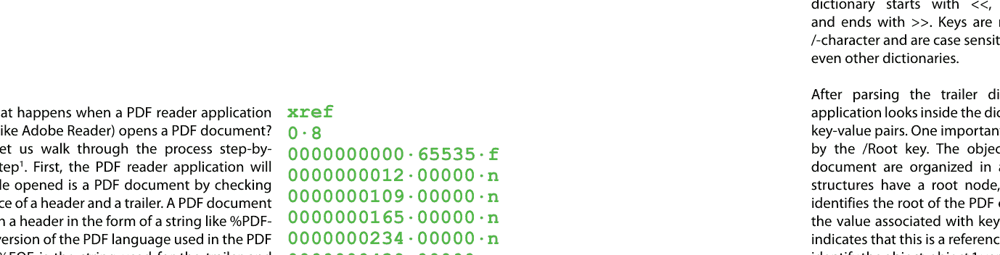

当 PDF 阅读器执行 `xref` 0-8 时会发生什么？读取器会检查文件是否存在文件头部以确认其是否为 PDF 文档。PDF 文档以 `%PDF-1.1` 等文件头部开始。PDF 文档使用的语言版本在尾部（trailer）字符串中指定。PDF 阅读器在文件末尾查找 `xref` 关键字。下方尾部的绝对位置是 2294。当 PDF 阅读器应用程序从 PDF 末尾开始解析时，找到了 `xref` 关键字。

```text
%PDF-1.1

trailer
000000000 000055 f
000000012 000012 n
000000016 000016 n
000000024 000024 n
000000049 000049 n
000000052 000052 f
000000067 000067 n
<
/Size 8
/Root 1-0 R
/startref 2294
%%EOF
```

交叉引用表（a cross reference table）包含了 PDF 文档中使用的所有对象的绝对位置。PDF 阅读器应用程序中 `xref` 零条目的数量表示它已按编号索引了对象。第二个数字是交叉引用表的大小。在示例中，交叉引用表有 8 个条目。对于长度，`00000000` 是强制且必要的。`/OpenAction` 的值是对对象 7 的引用。所有条目都是第一个对象的偏移量。

```text
/OpenAction 7-0 R
>>
endobj
```

对象 1 中的字典包含一个 `/OpenAction` 键。该键指示 PDF 阅读器在 PDF 文档打开时采取动作。`/OpenAction` 的值是对对象 7 的引用。

对象 7 位于绝对位置 657，包含字典：

```text
7-0
/Type /Action
/S /JavaScript
```

在示例中，交叉引用表显示对象 1 版本 0 从偏移量 12 开始，对象 2 版本 0 从偏移量 37 开始。PDF 阅读器应用程序在绝对位置 657 找到对象 7。

遵循交叉引用表，PDF 阅读器应用程序在 PDF 中找到了 JavaScript 应用。字典是一个包含 `<<` 键和 `>>` 值的数据结构。名称以 `/` 字符开头，可以是除字典外的任何字母数字字符串。

```javascript
//shellcode = escape(\u0073\u0068\u0065\u006c\u006f\u0064")
while(n.length< 0x0060000) {
var blocks=new Array(n);
for(i=0;i<1200;i++) {
blocks[i]=shellcode;
}
}
eval(blocks.join(""));
```

解析尾部后，PDF 阅读器应用程序查找包含某些 `/Root` 键的字典。一个重要的键值对是对 `/Root` 主体的引用。主体对象（body object）包含根节点的字典，一个 `/Root` 字典键指示根树的偏移量。在示例中，根节点是对象 1。这表示偏移量是绝对的。并且识别了对象 1。PDF 阅读器知道根对象是对象 1，版本 0 从偏移量 0 开始。从交叉引用表来看，对象 1 绝对位置 12。

对象 1 包含一个字典和一个关闭字典的键值对。

```text
<<
/Type /Catalog
/Outlines /Pages-3-0 R
```

在研究代码之前，我们需要了解更多关于 PDF 中的 JavaScript。PDF 语言允许执行 JavaScript。JavaScript 脚本位于 PDF 文档内部。这些脚本由 PDF 引擎执行。JavaScript 引擎是沙箱化的，它无法访问操作系统文件。JavaScript 引擎无法访问（读/写）文件属性或注册表项。

JavaScript 执行指令用于破坏运行 PDF 阅读器的 Windows 机器。他们需要利用漏洞使用 PDF JavaScript 引擎来感染此安装系统。

此语句定义了一种高概率，通过这样做，字符串的内容是十六进制值 1234。`0x03030330` 的内容是一个 NOP 滑块（NOP slide）。

这是我们推迟分析的脚本的第一部分。虚拟内存 `0x033030` 位于为栈保留的内存段；然而，它可以执行 JavaScript 引擎来存储动态生成字符串的值。

通过这样做，我们有很大概率执行 `0x03030330`。下一条指令也是一个 NOP 滑块。这将被执行并一直持续，直到执行我们 shellcode 的第一条指令。该滑块随后执行我们 shellcode 的第一条指令，然后执行 shellcode，shellcode 将执行从网络服务器下载的 shellcode，感染此系统并执行它。

```javascript
util.printf("4566666612999999999998888888888888888888888888888888888888888888");
```

```javascript
var shellcode = "escape(\u0088\u00e0\u00b8\u00d3\u00c1\u0060\)";
```

脚本的第一部分有助于 shellcode，它包含可执行字符（这种技术被称为堆喷 heap spray）。堆喷需要填充内存，以便开始执行位置 `0x03030330` 处的代码。

```javascript
var Nops = "escape(\u0090)";
while (Nops.length < length) {
Nops += Nops;
}
```

让我们分析脚本的最后一行。`util.printf` 用于格式化字符串。此语句定义了一种高概率，通过这样做，字符串的内容是十六进制值 1234。`0x03030330` 的内容是一个 NOP 滑块。

这是我们推迟分析的脚本的第一部分。虚拟内存 `0x033030` 位于为栈保留的内存段；然而，它可以执行 JavaScript 引擎来存储动态生成字符串的值。

通过这样做，我们有很大概率执行 `0x03030330`。下一条指令也是一个 NOP 滑块。这将被执行并一直持续，直到执行我们 shellcode 的第一条指令。该滑块随后执行我们 shellcode 的第一条指令，然后执行 shellcode，shellcode 将执行从网络服务器下载的 shellcode，感染此系统并执行它。

```javascript
util.printf("4566666612999999999998888888888888888888888888888888888888888888");
```

```javascript
var shellcode = "escape(\u0088\u00e0\u00b8\u00d3\u00c1\u0060\)";
```

脚本的第一部分有助于 shellcode，它包含可执行字符（这种技术被称为堆喷 heap spray）。堆喷需要填充内存，以便开始执行位置 `0x03030330` 处的代码。

```javascript
var Nops = "escape(\u0090)";
while (Nops.length < length) {
Nops += Nops;
}
```

让我们分析脚本的最后一行。`util.printf` 用于格式化字符串。此语句定义了一种高概率，通过这样做，字符串的内容是十六进制值 1234。`0x03030330` 的内容是一个 NOP 滑块。

当 PDF 阅读器被喷射时，`0x03030330` 处的地址未被使用。在虚拟内存中创建了页，因为地址 `0x03030330` 不包含在 PDF 阅读器将访问的变量中。

但如果我们能在内存地址处编写代码：

```javascript
var test = unescape("㐒");
```

## 信息安全

在 TrueCrypt 文档中，频繁被破坏的主密钥可能会存储在 RAM 中。当非 TrueCrypt 主密钥在 RAM 中被销毁时，TrueCrypt 会加密其卷。显而易见，TrueCrypt 会保护其物理内存。此类攻击远超 TrueCrypt 安全模型的范围。

一个普通卷，如果它用密码加密，用户将无法通过查看普通卷来判断是否存在隐藏卷。当包含隐藏卷的普通卷被挂载时，用户需要输入两个卷的密码来完成解密过程。

一个 `PKCS #11` 令牌。`PKCS #11` 实际上用于存储密钥；它相比密钥对的优势在于受 `PIN` 保护。

出于安全考虑，内存加密密钥不能交换到磁盘。如果它们不在内存中，它们将在当前位置被擦除。在这里，密钥的行为应当符合预期。

此密钥被复制到 `Password` 结构体中：

```c
#define __PASSWORD
```

卷加密密钥，用于执行加密和解密操作。

密码将从内存中删除，因为不再需要，除非启用了“缓存密码”键。如果密码在内存中，它只在卷被挂载时建立。

### 内存中的加密密钥

假设我们在物理内存擦除时对 TrueCrypt 卷进行了快照。当卷锁定时，加密密钥类似于冷启动攻击（COLD BOOT）；FireWire 或 PC 卡（PC cards）。然而，这出了安全模型的范围。

| 普通卷 | 隐藏卷 |
|---|---|
|  |  |

### 关于 TrueCrypt 的快速介绍？

此部分包含了理解文章其他部分所需的所有细节。如果你get更多细节，请查看 TrueCrypt 网站，那里有关于该程序的优秀文档。

```c
// 最大可能长度密码
typedef struct {
    // 修改此结构可能会导致与各种版本不兼容
    unsigned int32 length;
    unsigned char *PKCS_MAX_PASSWORD = 64;
    unsigned char *password = NULL;
} CRYPTO_MASTER;
```

如果密钥长 64 字节，则使用 True 哈希算法来生成 `CRYPTO_MASTER` 结构体并将密码发送到该结构体。

然而，挂载和解密卷所需的所有加密密钥都在内存中。

| 卷数据 | 隐藏数据 |
|---|---|
|  |  |

另一个问题是如何在不暴露密钥的情况下解密卷。主意是使用密钥而不暴露它，使其能够独立于操作系统运行。

| 普通卷的备份 | 隐藏卷的备份 |
|---|---|
|  |  |

### 卷格式

TrueCrypt 卷是一个包含加密卷的文件。每个卷都用密码、一组密钥或多个密钥加密。TrueCrypt 使用 AES、Serpent 或 Twofish 算法。加密模式存储在文件的头部中。该模式也用主密钥加密。

此处不会详细介绍隐藏卷的加密，因为它需要两个密钥。

在创建期间，用户选择一个或多个隐藏卷。使用哈希进行密钥派生，并使用哈希函数作为伪随机生成器。

TrueCrypt 文件可以包含隐藏卷。然而，如果用户忘记用密码显示隐藏卷，即使存储了所有敏感数据，也无法恢复它。

解密密钥通过普通卷的盐创建用于挂载 `Password` 结构。TrueCrypt 使用 `PBKDF2` 算法配合哈希函数，`SHA-1` 和 `SHA-256` 进行 1000 次迭代，`SHA-512` 进行 50000 次迭代。

当隐藏卷未挂载时，不使用解密函数。如果用户想更改密码，必须挂载隐藏卷然后输入新密码。

然后，如果密码正确，TrueCrypt 会解密隐藏卷以解密损坏的密钥。

每个文件都有一个头部，包含普通卷的数据，紧接着是一个或多个隐藏卷。

- 加密卷的开始（对于普通卷，在初始头部和隐藏卷之后为 65536 字节）。
- 卷加密密钥（可以包含 1 到 3 个密钥）。
- 2 到 6 个加密密钥之间的数据。
- 用于完整性检查的数据。

如果文件不包含隐藏卷，头部包含数据，无法从真实的加密卷进行解密。

在另一种情况下，隐藏卷存储在……

#### 挂载卷


在 Windows 上，`TrueCrypt` 卷使用过滤驱动程序挂载。一个密钥被挂载到普通卷。这可以是密码、一组密钥或……

如前所述，用于密码学的数据存储在 `CRYPTO_INFO` 结构体中。该结构体如下：

```c
typedef struct CRYPTO_INFO {
    int as_len; // 加密密钥
    int mode; // (例如 XTS)
    unsigned char *KTI[1]; // 主密钥调度表（如果是这种情况，它包含多个密钥）用于 XTS 模式；
    unsigned char *KTI[2]; // 次密钥调度表（如果是这种情况，包含多个密钥）用于 XTS 模式；
} CRYPTO_INFO;
```

驱动程序携带加密卷的密钥。所有密码学数据都存储在 `CRYPTO_INFO` 结构体中。该结构体包含：

`BOOL_hidden:` // 卷是否挂载/作为隐藏卷

```c
#ifndef TC_WINDOWS_BOOT
type uint HeaderVersion;

GCFTx gf_ctx = {
    unsigned int master_key_MASTER;
    KEYDATA = { // 这持有该值
        头部区域拼接密钥
        次密钥和次级密钥(s) (KTS) 用于
        主密钥和次密钥之间的 tweak。对于 CBC
        （已弃)/遗留；它包含 IV
        主体 (CBC) 包含密钥
        种子;
    };

    unsigned int k2[MASTER, KEYTER];
    { // 对于此，该
        包含次密钥，
        多个（拼接）。对于 Lw（已弃
        )/遗留；它包含 tweak。对于 CBC
        （已弃）它包含密钥
    };

    unsigned int salt[PRNG5];
};
```

`galois` 具有 XT 模式的参数。要找到加密密钥，从 `TrueCrypt` 值中提取并搜索。仅选择标记参数来验证我们找到的 `CRYPTO_INFO`。

图 2 显示了从内存储储提取的 `CRYPTO_INFO` 结构。

`master_key` 中的 4 个密钥

`k2` 中的 2 个密钥

64 字节在紫色区域找到，紧接着是迭代次数（AES-256）。要找到 `master_key`、次密钥和 `k2` 表，查找它们各自开始的地方：

| 065051AD | 84 21 24 70 7C 97 5B 54 | S..!--04 |

| 065051B0 | 28 21 24 7C 23 3E 80 44 88 9C 02 29 07 68 |

| 065051C0 | 02 2F 2B 83 4C 15 47 25 | 79 0D 0B 29 68 |

| 065051D0 | 0A 5F 12 46 4A 57 5F 58 | 5C 44 |

| 065051E0 | 8A 0F 12 0A 05 50 5F | 0D 0B 09 |

| 065051F0 | 70 39 97 50 97 52 83 93 | 35 6E 4C 54 89 |

| 06505200 | 07 5F 62 54 38 4E 0A 56 | 09 48 0D |

| 06505210 | 00 00 00 00 00 00 00 00 | 00 00 00 |

| 06505220 | 00 00 00 00 00 00 00 00 | 00 00 00 |

| 06505230 | 00 00 00 00 00 00 00 00 | 00 00 00 |

| 06505240 | 00 00 00 00 00 00 00 00 | 00 00 00 |

| 06505250 | 00 00 00 00 00 00 00 00 | 00 00 00 |

| 06505260 | 00 00 00 00 00 00 00 00 | 00 00 00 |

| 06505270 | 00 00 00 00 00 00 00 00 | 00 00 00 |

| 06505280 | 00 00 00 00 00 00 00 00 | 00 00 00 |

| 06505290 | 00 00 00 00 00 00 00 00 | 00 00 00 |

| 065052A0 | 00 00 00 00 00 00 00 00 | 14 5B 81 4E |

| 065052B0 | 00 00 00 00 00 00 00 00 | 1E 6E 8B 87 |

| 065052C0 | 70 39 97 50 97 52 83 93 | 35 6E 4C 54 89 |

| 065052D0 | 0A 5F 12 46 4A 57 5F 58 | 3B 0C |

| 065052E0 | 89 5B 28 24 0A 7C 11 0B | 6F 98 0A |

| 065052F0 | 86 5A 91 45 83 0A 93 32 | 77 66 5D |

| 06505300 | 00 00 00 00 00 00 00 00 | 00 00 00 |

| 06505310 | 00 00 00 00 00 00 00 00 | 00 00 00 |

| 06505320 | 00 00 00 00 00 00 00 00 | 00 00 00 |

| 06505330 | 00 00 00 00 00 00 00 00 | 00 00 00 |

| 06505340 | 00 00 00 00 00 00 00 00 | 00 00 00 |

| 06505350 | 00 00 00 00 00 00 00 00 | 00 00 00 |

| 06505360 | 00 00 00 00 00 00 00 00 | 00 00 00 |

| 06505370 | 00 00 00 00 00 00 00 00 | 00 00 00 |

| 06505380 | 00 00 00 00 00 00 00 00 | 00 00 00 |

| 06505390 | 00 00 00 00 00 00 00 00 | 00 00 00 |

| 065053A0 | 00 00 00 00 00 00 00 00 | 00 00 00 |

| 065053B0 | 00 00 00 00 00 00 00 00 | 00 00 00 |

| 065053C0 | 00 00 00 00 00 00 |

在另一种情况下，隐藏卷存储在……

#### 解密卷

使用了某种未覆盖的方法来解密卷。问题是：加密算法未知。例如，我们只知道发现了算法中的一种。

## 信息安全

然而，这必须对三个三个可能的候选者进行。

Python。最糟糕的部分是那些需要在 GF(2n) 中进行计算的代码实现；这些计算完全没有经过优化，这虽然让我们理解了它的工作原理，但导致该工具在现实世界中无法使用。

#### 探测隐藏卷

查看 CRYPTO 信息可以得到有趣的结果：记住 TrueCrypt 可以创建隐藏卷，除非……否则没有办法知道隐藏卷的存在。

没有任何一个加密库实现过 TrueCrypt 所使用的哈希和加密算法。我使用了 PyCrypt，然后我决定添加缺失的算法：Serpent、fish、Whirlpool 和 SHA-512。SHA-512 模块非常简单；但其他算法都是用 C Linux 内核源码编写的。

当卷仍然处于挂载状态时，情况有所不同。

XTS 是用 Python 编写的，它比之前的实现要快。

`volataoffset` 指定卷的第一个数据扇区。当挂载普通卷时，该值为 `0x2000`；即标头的偏移量。当挂载隐藏卷时，该值将有所不同。

## 结论

这里展示的内容并不是很有技术性。在内存中寻找密钥相当容易，因为加密密钥附近存在卷盐（volume salt）。尽管如此，这是一个很有用的结果。

更有趣的是当一个卷包含隐藏卷，且用户输入两个密码时。在这种情况下，普通卷的大小与另一个相同。

代码和 Pycrypt 补丁可用：`google.com/pytruecrypt/*`

TrueCrypt 使用之前提到的加密密钥来加密隐藏卷。

工具可以从内存转储中解密卷。它搜索卷盐并检查其是否在内部。

Vulnerability Research Labs, LLC 将顶端技术与数十年的经验相结合，提供无与伦比的服务，以缓解今日威胁带来的风险。

另一个工具使用之前提到的加密密钥解密卷。目标是在不使用 TrueCrypt（可能经过微调）的情况下进行解密。

## 参考文献

- [TrueCRYPT] 版，编辑器：TrueCrypt explained (TrueCrypt 2009) http://github.com/2008/02/truecrypt-explained-truecrypt-update.html

- [HASH] Adam Marshall, Steven D. Schartz, Nicholas Jordan, Karl J., William Carlson, William Paul, Joseph J., Matthew S., and Robert B. (2006a).

- [21] Time We Lost: Cold Boot Attacks on Encryption, Keyscrypt. http://truecrypt.org/blog/

- [FIRMWARE] A little journey into Windows memory, http://github.com/stevejohnson/memory-forensics/blob/master/memory-forensics-analysis.pdf

- [SPEC] D. Gvisian, Compression physique par le bc, http://archive.org/2007/Compression_physique_par_le_bc.pdf

## 引用

- 1. TrueCrypt explained (TrueCrypt 5 update) - http://blog.bjm.de/2008/02/truecrypt-explained-true-update.html

如果倾向于用 Python 开发，这些工具可以使用 TrueCrypt 的源代码，因为实现 TrueCrypt 需要多个工具中的许多。基础代码可以是一个很好的开始，并且已经针对 TrueCrypt/6 进行了适配。

原始代码是为了学习目的编写的，非常缓慢。

### 使用 UNDX 重构 Dalvik 应用

作者：Marc Schönfeld

作为一名逆向工程师，我倾向于解码运行在设备内部的代码。我来自 JVM 背景，所以我想知道 Dalvik  {怎么的。此外，在处理一项无聊的任务时，我想学习另一种 dalvik 字节码语言。由于我更倾向于解码和执行 UNDX，将在接下来的段文中介绍。

#### 什么是 DALVIK

Dalvik 是一个运行 Android 程序的运行时。它由 Google 的天才工程师 Dan Bornstein 发明，并冰岛的一个村庄命名。Dalvik 是基于寄存器的，并使用 dalvik 字节码。它运行自己的字节码方言，由非 JVM 运行时引擎执行；请见表 1 的对比。

| 表 1：Dalvik vs. JVM |

| 特性 | Dalvik | JVM |

|---|---|---|

| 架构 | 寄存器 | 栈 |

| OS 支持 | Android | 多 |

| 文件 | apk | dex |

| 可执行文件 | 每个应用程序 | JAR |

| 内存 | 低 | 高 |

Dalvik 可以从广泛的 API 中选择，其中某些是 Java 已知的，某些是 Dalvik 特有的。表 2 显示了一些库。

| 表 2：Dalvik APIs | Dalvik | JVM |

|---|---|---|

| java.io | Y | Y |

| java.net | Y | Y |

| java.lang.* | Y | Y |

| com..* | Y | N |

#### DALVIK 开发流程

Dalvik 应用使用 Android Studio IDE 等开发工具进行。开发者将源代码编译为 dalvik 类（使用 java 编译器）。下一步是将类转换为 dex 格式（使用 d8 工具，生成 dex 文件）。该文件填充了部署所需的元数据（以及 manifest 资源）。APK 文件被传输到设备或模拟器上，可以作为应用添加，或者在用户端案例中，从市场中下载。

#### 从逆向工程的角度看 DALVIK 开发

##### 视角

Dalvik 应用以文件的形式存在，因此你可以像下载蛋糕一样下载它。在逆向工程 dalvik 应用期间，问题在于找出应用程序是否包含恶意代码、向处理程序通道发送数据的代码，或者静态使用的库（如果是 APK 应用）是否存在未修补的安全漏洞，这可能会影响它们包含的 dex 文件。

##### 工作流

Dalvik 程序遵循循环的应用程序开发工作流。在默认设置下，它涉及 Java dex。除非我们完成了 dex（见图 2），否则没有办法反向解码代码。这与 Java dex 不同，可以使用每个程序员的工具箱来反编译代码。我们的工具 UNDX 填补了这一空白，如图 2 所示。

| 表 3：Dalvik 开发流程 | jari/java | class | jar |

|---|---|---|---|

| *java | | | |

| dex | | *dex | |

| 图 3：使用 undx 的开发流程 | jari/java | undx | |

|---|---|---|---|

| *java | | | |

*（提供的 OCR 文本在后半部分包含大量重复和乱码部分，已根据提供的标题进行了过滤，以保持逻辑流。）*

# 图 11：转换稀疏量子比特

```java
public void transform(String input) {
    Map<String, Integer> result = new HashMap<>();
    HashMap<String, Integer> qubits = new HashMap<>();
    qubits.put("0", 0);
    qubits.put("1", 1);
    int size = qubits.size();
    List<String> newQubits = new ArrayList<>();
    for (int i = 0; i < input.length(); i++) {
        if (input.charAt(i) == '1') {
            newQubits.add("1" + i);
        }
    }
    result.put("result", newQubits.size());
    return result;
}
```

# 图 12：分解

```java
public void decompose(Context context) {
    super(context);
    JSONObject data = new JSONObject("data");
    JSONObject db = data.getJSONObject("db");
    JSONObject view = db.getJSONObject("view");
    String status = view.getString("status");
    JSONObject result = new JSONObject();
    result.put("status", status);
    setResult(result);
}
```

# 图 13：带 DIA 的图

```python
import networkx as nx
def create_graph(data):
    G = nx.Graph()
    for node in data['nodes']:
        G.add_node(node['id'])
    return G
```

# 图 14：Dalvik 代码

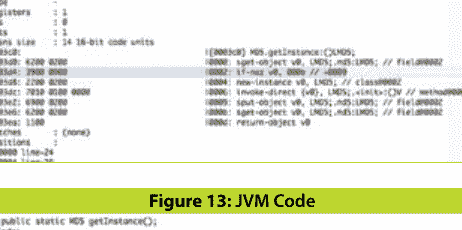

# 图 15：JVM 代码

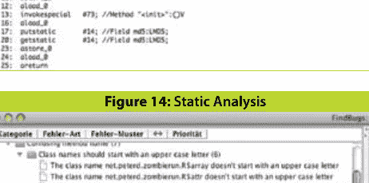

# 图 16：静态分析

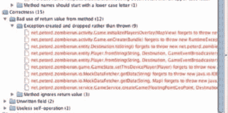

处理方法：UNIX 的主要工作是在于将 Dalvik 字节码转换为 JVM 指令。我们提取元数据，转换指令并为每个 Dalvik 生成中间表示（IR）。这种方法涉及将元数据转换为 IR 方法、提取方法签名、设置局部变量，并将 Dalvik 寄存器映射到 JVM 栈位置。图中显示了该过程的片段代码。

生成 Java 指令：从 Dalvik 指令创建 IR 的细节非常详尽。首先，为每个 Dalvik 指令创建 IR，以处理准备好的前向跳转。然后，为每个 Dalvik 指令创建一个等效的 JVM 字节码块。在转换过程中，UNIX 极力追求效率。并不是每条指令都能实现一比一的转换；Dalvik 和 JVM 之间存在差异，如图 9 和图 10 所示。以下说明了该方法。我们实现了对某些不变构造的验证，在这些构造中我们将 Dalvik 寄存器分配到了 JVM 栈位置。

为了在处理操作时尽可能遵守栈平衡规则，从而尽可能少地违反验证器规则。每种数据都提供栈上对象引用的类型引用（构建数据流分析）。这通常需要为不同类型的对象准备寄存器。这一细节说明了移动设备的硬件和内存限制如何影响了架构的设计。

存储在 BCEL 结构中的数据：在解析类中的所有方法后，处理完成，我们在 dex 中为每个类生成了类文件。

代码的静态分析


现在我们已经从 Dalvik 代码生成了内容，我们可以做什么？我们可以使用静态检查工具（如 `findbugs`）分析代码，以发现程序漏洞、安全漏洞和泄漏。我们可以使用可以反向的工具，并且已经了解到自动化工具可以找到目录（`AD`、`DEX`）中的文件，参见图 15，显示类 Java 代码以加速理解，这可能证明你获得的是等效内容而非 100% 确定的内容。由于它们之间经历了复杂的转换过程，它们的效果存在差异，例如将栈变量转换为控制流图（如 `findbugs` 提供的），并将其绘制在您所选择的布局图图中。图 16 显示了使用 `dia` 的这种方法。

## 总结与趣闻

`INDEX` 包含大约 400 行 Java 编写的代码，除此外没有外部依赖，但我们可以将其作为 GUI 并为项目做出贡献，因为许可者正维护着免费的 GPL 代码。代码可以在 `http://github.com/undx/undx` 获取。

此时，我们可以向 Dan Borstein（再次致谢）感谢他使用了 `UNDX` 的名称。

## 关于作者

Marc Schönebeck 自 2002 年以来一直是国际会议的知名演讲者。他曾在 `BlackHat`、`RSA`、`DMAC`、`PaCon`、`Sec`、`HackInBerlin` 和其他主要会议上发表过演讲。他在 2010 年在汉堡大学获得博士学位。白天在 Flat Hat 从事 Java 和 JEE 安全相关课题。他在 `AEC illegalsec dot` 上有记录。

在某些情况下，由于缺乏混淆导致无法反编译，建议使用文件比较。

尽管真正的工程师更喜欢代码，`UNDX` 也可以在 RE 足球联赛中竞争，使用更多的图并消耗更少的资源。如果你想这样做，可以用一个 20 行的 Groovy 脚本，并传输节点和


# ISACA 马来西亚分会

### 会员福利

- 增强你的知识 (K)
- 推进你的职业
- 通过 ISACA 认证脱颖而出
- 建立并扩展人脉

ISACA 拥有超过 40000 名成员，遍布 60 多个国家，涵盖了各种行业，包括金融、会计、政府、制造业等。


# ISACA 马来西亚分会

### 会员福利

- 近期活动
- 颁奖
- 25 周年庆典
- 获取认证培训
- 认证信息系统审计师 (CISA)

`CISA` 是全球范围内公认的权威，适用于那些希望控制和评估 IT 系统的人员。

- COBIT 与治理

2010 年 11 月

- IT 审计研讨会

2010 年 11 月

- 信息安全 (CRISC)

`CRISC`（读作“see-risk”）适用于那些在 IT 领域具有风险风险的人员。

- 认证信息安全经理 (CISM)

`CISM` 专注于安全管理，适用于那些设计、实施和管理安全计划的人员。

- 企业治理 IT (GEIT)

`GEIT` 适用于那些在 IT 治理实践和原则方面具有知识的人员。

ISACA 提升您的员工和客户价值

ISACA 马来西亚分会

`WWW.ISACAYSIA.ORG`

50 HTB MAGAZINE 1 | OCTOBER 2010

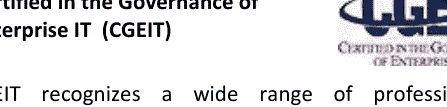

注：在某些情况下，由于缺乏混淆导致无法反编译，建议使用文件比较。

尽管真正的工程师更喜欢代码，`UNDX` 也可以在 RE 足球联赛中竞争，使用更多的图并消耗更少的资源。如果你想这样做，可以用一个 20 行的 Groovy 脚本，并传输节点和

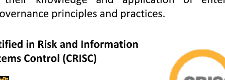

## [访谈]

### “当个人开始遵循建设性路径时”

ADITYA K. SOOD

SecNiche 创始人

Zahir Shah 介绍了 ADITYA K. SOOD，`RSA`、`XCON` 的演讲者，`Hakin9`、`HITB` 的作者，`SecNiche Security` 的创始人以及密根州立大学的博士研究生。

你好 Aditya，你好吗？

你好 Zarul，我很好，一切顺利。

也许你可以向我们的读者分享一些关于你的介绍，以及你是进入计算机安全领域的？

我从大学时代就开始从事计算机安全领域了。即便那时，时间也没有现在这么令人兴奋。这个领域的成功来自于好奇心、时间以及最终的努力。学习自然能让你学到很多东西。我花了大量时间理解计算机安全的技艺，并在每个领域都不可避免的失眠之夜保持动力。我是通过自学和在线学习的。坚持和“永不放弃”帮助我掌握了计算机安全的基础知识。从那时起，我相信，通过像所有研究人员和社区人士一样服务社区，我们将从中中学到很多。所以，我觉得我有责任通过参与富有成效的研究来回馈社区。

在密根州立大学攻读博士之前，你学习了什么？

哪个安全领域最吸引你？

我对计算机安全的各个方面都有着浓厚的兴趣。安全行业有一种责任感。我的工作集中在安全研究、分析和漏洞研究。我喜欢做安全工作，包括应用安全评估、模糊测试、测试，以及通过发布论文和工具为社区做贡献。这有助于检测广泛设备和各种产品中的漏洞。我尝试分享我的知识和想法，因为这有助于我在两个同伴之间建立沟通路径，以增强学习体验。

几年前，因为我称之为列表“杂音（Trill）”的益处。

你是如何承担风险的？

是的 Dani，是在第一年，除了批评以外我什么都没有得到。从个人来看，我认为人的努力本质上是建设性的。因此，我决定不从线上的批评中产生任何负面意义。我首先认为，批评应该帮助你坚持自己的目标。它有助于获得许多经验。我们拥有在线民主，每个人都享有言论自由。人越多，我们接触到的通信协议就越多。现在我觉得，批评不会导致个人失败，而是让他能够尽最大的努力工作，而不会被“杂音”分心。当我开始遵循建设性路径时，旅程变成了成功且富有成效的研究。

你知道那个人是谁吗，他对你有什么意见吗？

更现实地且以良好的方式。批评是新知识的先驱。通常情况下，这是一种谬误，并且要纠正它。

首先，我认为计算机安全是一个全球关注的问题。互联网已经变得如此普及，保护网络安全现在是每个人的首要任务。我们需要保护互联网免受黑客创建的漏洞的影响。他们的有害行为具有造成损害的潜力。我们需要一个更好的监管框架。网络法律的执行还不足以应对现实世界中的攻击。我们已经看到了相关活动的前沿。各国政府也正在采取各种措施建立网络防御。这被认为不仅是针对特定问题，也是针对全球性问题的预防措施。

### 所以我猜这无非是某种分心之物？

### 黑客正利用高效的结构化和技术组件追踪兔子洞

我现在不会对这些威胁感到厌恶。如果精力投入到建设性的方法并专注于学习新事物，这些分心就不会具有产生影响的。随着时间的推移，我们变得更加成熟，如果上帝相信纯洁和真理的重要性，他就会赐予我们。这就是专业性的定义。

## 关于你加入 COSESEC 并在密根州立大学攻读博士的决定？

### 这有助于我们推动强大的黑客方法论。

这不仅仅关乎工作。我相信前面有巨大的收益。我加入是因为我们可以汇成一个单一实体并共同努力。这有助于我们在两个世界之间进行思想模拟。这有助于我目前在行业研究部门的工作。

### 那么，你计划在获得博士学位后留在学术界吗？

### 我们看到越来越多的针对该地区的黑客网站。你对这些黑客的攻击怎么看？

在学术权威下学习是一个很好的经历。正如我提到的，弥补差距是我的主要目标。学习的两个方面都很重要。

你的问题让我的兴趣大大增加。我对黑客的方法有很多想法，但要理解快速变化的战术变得越来越困难。环境的快速变化了黑客采用的攻击方式和恶意代码。他们行动的重构是

### 你在市场研究的重点是什么？

我的研究基于量化网络安全和恶意软件领域理论性的潜在问题。目前，我正专注于恶意软件分析及其对真实环境的影响。恶意软件是一个严重的问题，我们需要更多的研究和分析来清除此类互联网威胁的根源和产生。需要潜在且连贯的研究以与……保持一致

### 请详细阐述这一点。

注入网站的复杂恶意软件利用漏洞通过“路过式”下载来感染机器。恶意软件有不同的攻击向量。攻击向量可以分为三类：

### 来自该地区的攻击数量如何？

确实如此。在网络安全方面，这是黑客目标最密集的市场之一。中国、台湾和韩国是该领域执行攻击的关键参与者。黑客变得擅长使用复杂的方法对其信息进行攻击。然而，大多数威胁来自各种国际组织。这些类型的攻击被描述为预先选择的针对性攻击。

- 1. 通过第三方连接感染（感染、出站链接）
- 2. 从数据中心爆发（恶意软件感染 - 可能会发生此类 XXX）
- 3. 软件漏洞的利用

恶意软件正通过互联网第三方连接的增加而传播。我们已经看到不同网站和使用中心点进行信息共享的用户的各种相关内容。然而，大多数威胁并不限于我们关注的主要网站。漏洞在恶意软件的传播中起着至关重要的作用。最后，数据中心感染也会导致大规模的服务器感染。我的持续分析揭示了一个事实，攻击被大规模利用以感染服务器。如何传播恶意软件是日益增长的、利用社交连接威胁的感染攻击向量。此外，`Twitter` 上使用的短 URL 也让恶意软件能够隐藏真实的攻击内容。

黑客正利用高效的结构化和技术组件追踪兔子洞，这有助于推动某些黑客方法论。在过去，我看到中国有很多像 `XF` 这样的黑客，据我所知，中国黑客在部署和实施此类攻击方面日益成功。由于信息流的限制，他们的操作方法仍然保持隐藏。

### 感谢你今天

不客气。

ADITYA K. SOOD 是密根州立大学的博士生。他已经在网络安全领域、`COSESEC` 和 `KPMG` 工作过。他是 Net Security 的高级人员，是一位经验丰富的行业专业人士。他曾在 `RSA` (2010)、`TRISC`、`EuSecWest`、`Xconon`、`Troopers`、`OWASP`、`FOSS`、`CERT` 等会议上担任活跃演讲者。他曾在 `HITB`、`Hacker Xenoish`、`User Login`、`Eleven editors`、`Debugged/ME` 发表过文章。

# 联系我们

HITB 杂志

Hack in The Box (M) Sdn. Bhd.

Suite 26.3, Level 26, Menara IMC,

No. 8 Jalan Sultan Ismail,

50250 Kuala Lumpur,

Malaysia

电话：+603-20394724

传真：+603-20318359

电子邮箱：`media@hackinthebox.org`
