# 在云中托管您的网站：亚马逊云服务简化指南：亚马逊EC2简化指南


## 关于作者

杰夫·巴 (Jeff Barr) 目前是亚马逊网络服务的高级传教士（Senior Evangelist）。在这一职位上，杰夫在世界各地的大会和用户小组中向开发人员演讲。2002 年，杰夫加入 Amazon.com，因为他意识到亚马逊注定会成为下一个伟大的开发者平台，并且他可以助力实现这一目标。在加入亚马逊之前，杰夫经营自己的咨询业务，并曾在微软 (Microsoft)、eBay、KnowNow 和 Visix Software 担任管理和开发职务。

杰夫拥有美国大学（位于华盛顿特区）的计算机科学学士学位，并在同市的乔治·华盛顿大学 (George Washington University) 修读了一些研究生课程。杰夫现与家人（妻子和五个孩子）住在华盛顿州的萨马米什 (Sammamish)。在闲暇时光，他喜欢户外活动、电子产品和焊接。

## 关于技术编辑

安德鲁·泰特劳 (Andrew Tetlaw) 自 1997 年起作为 Web 开发人员致力于网站建设。他致力于通过编辑 SitePoint 的书籍、工具包、文章和通讯来让世界变得更美好。安德鲁也是五个孩子的忙碌父亲，喜欢接收啤酒样品包，并经常忽略他在 `http://tetlaw.id.au/` 上的博客。

路易斯·西莫诺 (Louis Simoneau) 于 2009 年加入 SitePoint，此前他从家乡蒙特利尔 (Montréal) 前往卡尔加里 (Calgary)，最终定居墨尔本 (Melbourne)。现在，他白天都可以学习酷炫的 Web 技术，而这项活动以前只能安排在晚上和周末。他喜欢嘻哈音乐、辛辣食物以及所有极客事物。他的个人网站是 `http://louissimoneau.com/`，他最新的博客项目是 `http://growbuycookeat.com/`。

## 关于首席技术官

作为 SitePoint 的首席技术官，凯文·扬克 (Kevin Yank) 时刻关注 Web 技术中所有新颖且令人兴奋的内容。他最广为人知的作品是《使用 PHP & MySQL 构建自己的数据库驱动网站》 (*Build Your Own Database Driven Web Site Using PHP & MySQL*)，他还与 Cameron Adams 合著了《简明 JavaScript》 (*Simply JavaScript*)，与 Rachel Andrew 合著了《你所知道关于 CSS 的一切都是错的！》 (*Everything You Know About CSS Is Wrong!*)。此外，凯文主持 SitePoint 播客，并共同撰写 SitePoint Tech Times，这是一封发送给全球超过 240,000 名订阅者的免费电子邮件通讯。

凯文居住在澳大利亚墨尔本，喜欢在大会上演讲，也享受与加拿大的亲友聚会。他还热衷于在 Impro Melbourne (`http://www.impromelbourne.com.au/`) 进行即兴喜剧表演以及驾驶轻型飞机。凯文的个人博客是 *Yes, I'm Canadian* (`http://yesimcanadian.com/`)。

## 关于 SitePoint

SitePoint 专注于为 Web 专业人士出版有趣、实用且易于理解的内容。请访问 `http://www.sitepoint.com/` 访问我们的博客、书籍、通讯、文章、播客和社区论坛。

> *致卡门 (Carmen)，*
>
> *感谢你所有的爱、支持和鼓励。没有你，我无法做到这一切！*

## 前言

2002 年春天，有一天我登录了亚马逊联盟（Amazon Associates）账户，在着陆页上看到一个小方框，里面写着这句神奇的话：“亚马逊现在提供 XML 了！”亚马逊将其产品目录的许多方面以 XML 形式公开。结合亚马逊联盟计划，有创业精神的开发者可以下载数据，利用它创建营销网站，然后通过向主站 Amazon.com 输送流量来赚取佣金。

我觉得这非常有趣，便立即投入其中。我下载了文档，编写了一些代码，并深受启发。我看到了巨大的潜力，但也看到了许多改进的空间，于是我将所有内容记录下来，并发送到了他们为此提供的反馈电子邮件地址。

一种情况导致另一种情况，到了初夏，作为亚马逊的客人，我参加了一个在他们总部举行的非常专属的会议。他们邀请了五或六位外部开发者来到西雅图，以便直接获取对其服务的客户反馈，并讨论未来的计划。坐在那里聆听时，我确实印象深刻。很明显，他们有着宏大的构想。他们暗示了开放亚马逊技术平台并邀请开发者参与的计划。

曾在微软工作三年，我对平台的力量有着真正的欣赏，我的思绪也在飞速前行。为了实现这一目标，他们需要开发者计划、示例代码、更多文档以及各种材料。我认为我可以做出贡献，于是走上前去与向我发出邀请的人聊天；我告诉她，我想申请亚马逊的一个职位，参与这项新的 Web 服务事业！

为了展示我对亚马逊的兴趣，我编写了一组针对 AWS 最早版本的 PHP 封装器，并将其命名为 PIA（PHP Interface to Amazon，亚马逊 PHP 接口）。有趣的是，我那略显怀旧的宣布至今仍能在 AWS 讨论论坛上找到。¹

我通过了面试流程，在夏末之前就被聘为亚马逊联盟团队的资深成员。我的正式职责是使用 Perl 编写业务分析工具；然而，我的经理也指示我应抽出 10–20% 的时间，以适当的方式协助 Web 服务团队。

刚入职几周后，亚马逊联盟团队的经理问我是否介意在一个会议上演讲。她解释说，她在接受邀请时本打算聘请一位“正规”的演讲者，但寻找合适的人选比预期的时间要长。在我职业生涯的早期，我做过大量的公开演讲，很高兴能为他们处理此事。第一次活动非常成功，没过多久，他们又让我做了另一个，然后又是一个。分配给 Web 服务工作的 10–20% 时间迅速增长到 40–50%；我忙着编写示例代码，回答 AWS 论坛上的问题，并尽我所能帮助我们的开发者社区首批成员取得成功。

几个月过去了，管理层找到了我。“我们一直在计划聘请一名布道师（evangelist）来承接这些演讲任务，但看起来你已经在做大部分工作了。你愿意接任吗？”在与家人咨询后，我决定愿意，并在 2003 年 4 月正式确立。我是世界上第一位（据我所知）Web 服务布道师！

在这个角色中，我周游世界，并在各类论坛上演讲：会议、用户组、大学课堂以及企业技术团队。我安排与每个城市的开发者进行一对一会议，并利用这些会议了解开发者在做什么，以及我们如何更好地服务他们。

在过去的几年里，我们发布了许多基础设施服务，包括弹性计算云（EC2）、简单存储服务（S3）、简单队列服务（SQS）和简单数据库（SimpleDB）。亲眼目睹 AWS 团队设计、实现、交付并运营一项又一项服务，看着我们的开发者社区成长到包含数十万开发者，这是一种真正的荣幸。

今年早些时候，当我被问及是否考虑写一本关于 AWS 的书时，我认为这是分享我在过去七年中学到的一些知识的绝佳机会。

## 感谢阅读

我希望你能和我在写作时一样享受阅读这本书的乐趣。请随时寻找我，并告诉我你的看法。

## 谁应该读这本书？

本书面向那些已经构建过一个或两个 Web 应用程序，并准备好使用亚马逊网络服务（Amazon Web Services）跃入云计算世界的 Web 开发者。本书使用了 PHP 语言，但如果你在服务器端脚本语言方面有经验，你会发现示例清晰易懂。我们也假设你知道 HTML 和 CSS 的基础知识，并且熟悉 Linux 命令行。了解基本的系统管理任务，如创建和挂载文件系统，也将有所帮助。

读完本书后，你可以期望对云计算的概念及其在促进整个新一代可扩展且可靠的 Web 应用程序中的作用有牢固的掌握。你还将对亚马逊网络服务的范围有清晰的理解，例如简单存储服务、弹性计算云、简单队列服务和 SimpleDB。你将能够在使用 PHP 编写命令、工具和流程时，在你的 Web 应用程序中利用所有这些服务。

## 本书内容概要

本书包含 11 个章节。第 3 章至第 10 章详细介绍具体的亚马逊网络服务，最后一章探索构建一个示例应用程序。我建议你在第一次阅读时从头到尾读完这本书，但也可以将其放在手边，如果需要复习某个特定的 Web 服务，可以翻阅相关章节。

### 第 1 章：欢迎来到云计算

在本章中，你将学习云计算的基础知识，以及它如何在构建于早期托管技术之上的同时与之不同。你还将看到组织和个人是如何利用它的。

### 第 2 章：亚马逊网络服务概览

本章从概念转向现实，你将更深入地了解每项亚马逊网络服务的基础。每项 Web 服务都将被详细解释，并介绍关键术语。

### 第 3 章：工欲善其事

现在你可能已经迫不及待要开始了。但在你跳入并开始编程之前，你需要确保你的工具到位。在第 3 章中，你将安装并配置可视化及命令行工具，以及 CloudFusion PHP 库。

### 第 4 章：使用 Amazon S3 存储数据

在第 4 章中，你将编写你的第一个 PHP 脚本。你将深入了解 Amazon S3 和 Amazon CloudFront，并学习如何在全球范围内存储、获取和分发数据。


## 第 5 章：使用 Amazon EC2 进行 Web 托管

第 5 章的内容全部围绕弹性计算云（Elastic Compute Cloud）的基础架构和 Web 服务展开。你将看到如何使用 AWS 管理控制台启动 EC2 实例、创建并挂载磁盘存储空间，以及分配 IP 地址。作为高潮部分，你将开发一个 PHP 脚本来以代码形式完成所有这些操作。最后，你将创建属于你自己的 Amazon 机器镜像（AMI）。

## 第 6章：使用 Amazon SQS 构建可扩展架构

在本章中，你将学习如何使用基于 Amazon 简单队列服务（Amazon Simple Queue Service）构建的消息传递架构，来构建能够扩展到处理高负荷或可变工作负载的应用程序。为了展示这种方法有多强大，你将构建一个图像下载和处理流水线，该流水线包含四个队列，这些队列可以被独立地分配更多或更少的资源。

## 第 7 章：EC2 监控、自动扩展和弹性负载平衡

第 7 章将教你如何使用 EC2 的三个强大功能——监控、自动扩展和负载平衡。这些健壮的功能将帮助你对系统性能保持关注，根据负载进行扩展或缩减，并在任意数量的 EC2 实例之间分发负载。

## 第 8 章：Amazon SimpleDB：云数据库

在第 8 章中，你将学习如何使用 Amazon SimpleDB 存储和获取任意量的结构化或半结构化数据。你还将构建一个用于解析和存储 RSS 源的应用程序，并利用 Amazon SQS 来提高性能。

## 第 9 章：Amazon 关系数据库服务

在第 9 章中，我们将探讨 Amazon 关系数据库服务（Amazon Relational Database Service），它允许你在应用程序中使用关系数据库，并使用 SQL 进行查询。在需要关系数据库全部查询功能的情况下，Amazon RDS 是 SimpleDB 的强大替代方案。你将学习如何创建数据库实例、对其进行备份、扩展或缩减规模，并在不再需要时删除它们。

## 第 10 章：高级 AWS

在这一反思性的章节中，你将学习如何在 SimpleDB 中追踪你的 AWS 使用情况。你还将探索 Amazon EC2 的弹性块存储（Elastic Block Storage）功能，了解如何进行备份，学习有关公共数据集的知识，并发现如何通过在一个或多个 EBS 卷之上创建 RAID 设备来提高性能或容量。最后，你将学习如何获取 EC2 实例元数据，并构建系统图。

## 第 11 章：融会贯通：CloudList

结合从前面章节中获得的所有知识，你将使用 EC2 服务、S3 和 SimpleDB 创建一个分类广告应用程序。

## 本书的网站

位于 `http://www.sitepoint.com/books/cloud1/` 的本书配套网站将为你提供访问以下设施的机会。

## 代码存档

随着你阅读本书，你会注意到许多代码列表上方都有文件名。这些指的是代码存档（一个可下载的 ZIP 文件，包含本书中展示的所有完成示例）中的文件。只需点击书籍网站上的 **代码存档** 链接即可下载。

## 更新和勘误

没有一本书是没有错误的，细心的读者无疑会发现至少有一两个错误。书籍网站上的“更正与错别字”页面将提供关于已知排版和代码错误的最新信息，并针对浏览器的新发行版和相关标准提供必要的更新。

^2 `http://www.sitepoint.com/books/cloud1/errata.php`

## SitePoint 论坛

如果你想与其他开发者交流关于本书的内容，你应该加入 SitePoint 的在线社区。³ 论坛提供了超越本书解决方案的大量信息，许多有趣且经验丰富的网页开发者也在那里。这是学习新技巧、快速获得答案以及享受良好时光的好方式。

## SitePoint 通讯

除了像本书这样的书籍，SitePoint 还发布免费的电子邮件通讯，例如 The SitePoint Tribune、The SitePoint Tech Times 和 The SitePoint Design View。阅读它们将使您及时了解网页开发各方面的最新新闻、产品发布、趋势、技巧和技法。请在 `http://www.sitepoint.com/newsletter/` 订阅一份或多份 SitePoint 通讯。

## SitePoint 播客

加入 SitePoint 播客团队，获取新闻、访谈、观点和针对网页开发者和设计师的新颖思考。他们讨论最新的网络行业话题，介绍嘉宾演讲者，并采访行业内一些最优秀的人才。你可以在 `http://www.sitepoint.com/podcast/` 收听所有播客，或通过 iTunes 订阅。

## 您的反馈

如果你无法通过论坛找到答案，或者出于其他原因希望联系我们，最好的联系方式是 books@sitepoint.com。我们设置了电子邮件支持系统来跟踪您的查询，并且有友好的支持人员可以回答您的问题。改进建议以及您可能发现的任何错误的通知都特别受欢迎。

## 致谢

首先，我需要感谢我深爱的妻子 Carmen。当我告诉她我正在考虑接受写书的提议时，她给予了热情的支持，并想知道我为什么没有更早（十多年前的）就采纳她的建议去做这件事。

其次，我要感谢我出色的孩子们：Stephen、Andy、Tina、Bianca 和 Grace。你们以耐心、和平与安静、持续的鼓励以及健康的零食和餐点所给予的支持是无与伦比的。现在我可以处理那些我承诺在“书写完后”再做的事情了！

我在 Amazon Web Services 的同事值得不仅仅是略提。我当时的经理 Steve Rabinchin 在内部为这个项目提供了支持，并且没有要求任何回报——除了在致谢中提一下。Jeff Bezos 创建了一家了不起的公司，一家允许如 AWS 这样的创新和好点子蓬勃发展的公司。对于 AWS 开发者关系团队的同行们，这是我一直在忙的工作；希望它能符合你们的期望！感谢所有内部审查者，你们细致且详尽的反馈非常有帮助。

最后，感谢 Keith Hudgins（专家审查人）和 Andrew Tetlaw（技术编辑）提供的所有帮助和反馈。

## 本书使用的惯例

你会注意到，我们在整本书中使用了某些排版和布局样式，以表示不同类型的信息。请留意以下内容。

### 标记示例

任何标记——无论是 HTML 还是 CSS——都将使用等宽字体显示，如下所示：

```html
<h1>一个完美的夏日</h1>
<p>那是去公园散步的好天气。鸟儿在歌唱，孩子们也都回到了学校。</p>
```

如果标记是书籍代码存档的一部分，文件的名称将出现在程序列表的顶部，如下所示：

`example.css`

```css
.footer {
    background-color: #CCC;
    border-top: 1px solid #333;
}
```

如果只显示文件的一部分，这将用 *excerpt* 一词来表明：

`example.css (excerpt)`

```css
border-top: 1px solid #333;
```

如果需要将额外代码插入现有示例中，新代码将以 **粗体** 显示：

```javascript
function animate() {
    new_variable = "Hello";
}
```

如果需要现有代码作为上下文，将显示垂直省略号（而不是重复所有代码）：

```javascript
function animate() {
    :
    return new_variable;
}
```

有些代码行原本应在一行内输入，但由于页面限制，我们不得不进行换行。↩ 表示仅出于格式目的而存在的换行符，应被忽略。

```javascript
URL.open("http://www.sitepoint.com/blogs/2007/05/28/user-style-sheets-come-of-age/");
```

### 提示、注意事项和警告

> 嘿，你！

> 提示将为你提供有用的小贴士。

### 咳咳，打扰一下……

注释是与主题相关但并非至关重要的有用旁白。你可以将它们视为额外的信息碎片。

### 请务必确保……

……关注这些重要要点。

### 小心！

警告将突出显示那些可能会让你中途受阻的陷阱。

## 第 1 章：欢迎来到云计算

大约在前一两次的办公室搬迁后，我还能从七楼办公室的窗户看到西雅图的足球场和棒球场。这些设施是在经济繁荣时期并排建造的，昂贵且容量巨大，但大部分时间都空空如也。据我计算，这些建筑物的高峰使用率最多只占时间的百分之一。平均而言，它们是空的。数亿美元的资金处于闲置状态。我使用这个体育场类比——在过去几年中已经多次使用过——来帮助我的听众理解云计算的商业价值。

现在，不要想象体育场，而是想象一个大型企业数据中心。里面挤满了昂贵且快速贬值的服务器，它们处于未充分利用的状态，等待批处理任务、大量数据以及公司网站访客流量的涌入。这是因为从历史上看，匹配网络流量预测与资源一直是个问题。保守的预测会导致资源不足，并带来“成功灾难”的风险，即由于大量新用户涌入而导致服务水准下降。而过于乐观的预测则会导致资源过剩、成本增加，并浪费宝贵的公司资源。


正如你在这本书中看到的，云计算为这个问题提供了一种经济高效且技术先进的解决方案。回到我开场的类比片刻，这就好比一个大小正好合适的体育场每周都被建造、使用，然后销毁。这个体育场将拥有恰好足够的座位、停车位、洗手间以及容纳实际到场人数所需的额外设施。在这种情形下，一个仅供 50 人使用的体育场与一个为 50,000 人建造的体育场在成本效益上是等同的。

当然，对于体育场而言，这种情况是不现实的；而另一方面，定制、即时资源实例化在云计算中却是完全合理且可行的。数据处理基础设施——服务器、存储和带宽——可以从云端获取，按需消费，然后在几分钟内释放回云端。这是从昨天那种静态、不可扩展的基础设施模型中得来的一种令人欢迎且迫切需要的改变。为你*实际需要的*而不是*认为可能需要的*付费，可以改变你的应用程序成本结构，使其变得更好，从而*让你*能够以少胜多。

### 避免“成功灾难”

想象你是一名资源有限的初创企业家。你有一个新网站的想法，你确信它很快就会比 Facebook¹ 或 Twitter² 更受欢迎。你开始制定商业计划，并绘制图表来预测你前六个月的预期增长。由于已经运行了应用程序原型并测试了其性能，你意识到如果一切按计划进行，你每月必须购买并安装一台新服务器。你绝不想容量耗尽，因此你预留了充足的时间来订购、接收、安装和配置每台新服务器。保留充足的容量对于应对可能在下一台服务器到达前突然出现的用户至关重要；因此，你发现你一直在花费自己缺乏的资金，去支持那些可能实际上并不决定访问你网站的用户。

你构建了网站并将其上线，耐心等待你的用户。接下来会发生什么？有三种可能的结果：你的流量估计远低于实际、恰好准确，或远高于实际。

也许你想得有点小，你的估计远低于实际。与你预期的用户涓涓细流不同，你的增长率要高得多。你的初始用户迅速消耗了可用资源。网站变得过载且速度过慢，潜在用户失望地离开了。

又或者，也许你想得很大，你采购了比实际需要的更多的资源。你为盛大的派对做好了准备，但派对并未成真。由于仅有足够数量的用户让你的服务器部分占用，你的成本结构失控了。由于固定成本过高，你的业务可能会失败。

当然，你可能猜得准了，你的用户群正以你预期的速度增长。即便如此，你仍然处于脆弱的位置。清晨某天你醒来，发现你的网站链接出现在 Digg、³ Reddit⁴ 或 Slashdot⁵ 的首页上。或者，一位 CNN 评论员随口提到了你的网站，你的 URL 正滚动在屏幕底部的标题栏中。这一刻就是你等待已久的时刻，你获得名声和财富的机会！不幸的是，你的固定规模基础设施未能应对这一挑战，所有这些潜在新用户都不满意地离开了。这原本充满希望的一天，最终又变成了一次“成功灾难”。

如你所见，预测网络流量是一项非常困难的工作。猜错的概率非常高，代价也很大。

云计算提供了准备和应对流量冲击（如我刚才描述的那些）所需的工具。如果你事先花时间正确设计你的系统并测试其可扩展性，基于云计算的解决方案将给你足够的信心，让你能够承受流量激增，而不会让你的服务器熔毁或将你推向破产。

### 告诉我关于云计算的事！

让我们现在更深入地探讨一下云计算的概念。我必须提前警告你，在这本看似技术性的书中，我们将谈论*商业*。毫无疑问，云计算不仅仅是一项新技术；它也是一种新的商业模式。技术本身 certainly 很有趣，我会有很多话要说，但关于云计算的完整讨论将包括商业模式、摊销，甚至（倒吸一口凉气） dollars 和 cents（美元美分）。当我年轻的时候，我是一名硬核极客，发现这类讨论无关紧要，甚至可能是一种侮辱。我关注的是技术，而不是谈钱！凭借 30 年后视之的经验，我现在可以看出，一个真正的企业家能够利用商业和技术技能的混合来创建成功的业务。

### 什么是云？

我们大多数人都见过像图 1.1 这样的架构图。

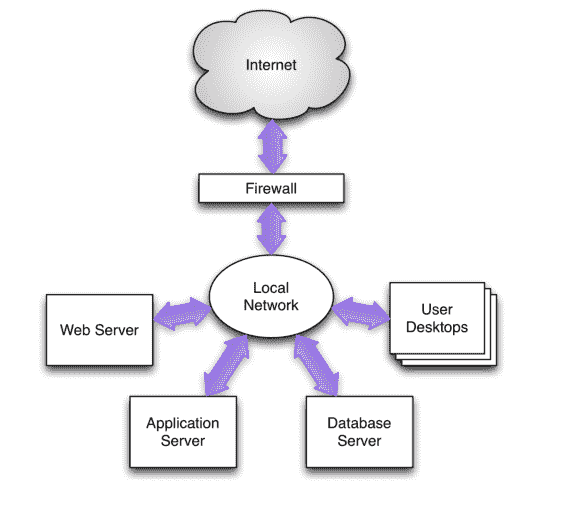

“云”被用来表示互联网。随着时间的推移，“互联网”的含义已经发生了变化，它现在不仅包括通常被认为在互联网上的资源，还包括访问这些资源的手段。

**云计算**这个术语在本书出版前几年开始流行。有些人迅速声称，该术语并非一个新概念，而只是现有实践的另一个名称。另一方面，这个术语变得足够强大，以至于一些现有的 Web 应用程序不得不魔术般地转变为云计算实例化的例子！这就是营销的力量。

虽然具体细节可能因供应商而异，但你可以将**云**理解为一个连贯的、大规模的、公开可访问的计算、存储和网络资源集合。这些资源通过 Web 服务调用（通过 HTTP 请求访问的可编程接口）进行分配，并且可以短期或长期使用，以基于实际消耗资源的费用作为交换。

云本质上是一个多用户环境，同时代表大量用户进行操作。因此，它负责管理和验证用户身份，跟踪资源到用户的分配，提供对每个用户拥有的资源的独占访问权限，并防止一个用户干扰其他用户。在这方面，运行每个供应商云的软件类似于操作系统。

云计算建立在许多重要的基础技术之上，包括 TCP/IP 网络、强大的互联网连接、SOAP 和 REST 风格的 Web 服务、商品化硬件、虚拟化以及在线支付系统。许多这些技术的细节被隐藏在幕后；云为开发者提供了可用资源的理想化、抽象视图。

### 可编程数据中心

让我们思考一下 IT 资源分配的传统模式。在以下几段中，资源可以是服务器、存储、IP 地址、带宽，甚至是防火墙条目。

如果你是一家大公司的一员并且需要额外的 IT 资源，你可能会发现自己需要经历一个包含大量人际沟通和谈判的过程。也许你发送电子邮件，创建在线订单或工单，或者简单地拿起电话讨论你的资源需求。在系统的另一端，人工工作量较大，需要审批请求；定位、分配并配置硬件；处理线缆、路由器和防火墙等事宜。在某些组织中，这一过程耗时12至18个月的情况并非罕见！

如果您是一位创业者，您只需联系您的ISP（互联网服务提供商），进行讨论、协商，然后承诺支付更高的月度费用，即可在数小时甚至数天的时间内获得硬件访问权限。

完成此流程后，您可能已做出长期承诺来运营这些资源并支付费用。大型企业会每月向您所在的公司成本中心收费，并希望在硬件使用寿命结束时才将其退役。ISP会更具灵活性，但极少有ISP愿意每隔一两小时就为您进行大规模变更。

云将人为响应从循环中移除。您（或更可能是代表您运行的管理应用程序）向云发出 Web 服务请求（“调用”）。随后，云按以下步骤处理您的请求：

- 1. 接收请求
- 2. 确认您有权发出该请求
- 3. 根据账户限制验证请求
- 4. 查找合适的空闲资源
- 5. 将资源关联到您的账户
- 6. 初始化资源
- 7. 返回满足请求所需的资源标识符

随后，您的应用程序将独占访问这些资源，持续时间视需要而定。当应用程序不再需要资源时，应用程序有责任将其归还给云。在此，资源会被准备以供重复使用（根据情况进行重新格式化、擦除或重启），然后被标记为空闲。

由于开发人员习惯于以面向对象的方式思考，我们甚至可以将特定供应商的云视为一个对象。事实上，云的理想化定义在 PHP 中可能如下所示。⁵

> ⁵ 这并不对应任何实际的云；方法和参数名称仅用于说明我的观点。

```php
class Cloud
{
    public function getDataCenters()
    {
      :
    }

    public function allocateServer($dataCenter, $count)
    {
      :
    }

    public function releaseServer($server)
    {
      :
    }

    public function allocateDiskStorage($dataCenter, $gb)
    {
      :
    }

    public function releaseDiskStorage($storage)
    {
      :
    }
  :
}
```

以下是使用这种理想化云的方式。首先，我们获取可用数据中心列表（`$d`），并将列表中第一个数据中心的引用存储在（`$d1`）中：

```php
$c = new Cloud();
$d = $c->getDataCenters();
$d1 = $d[0];
```

然后，我们可以为该数据中心分配一台服务器（`$server`）并创建一些存储空间（`$storage`）：

```php
$server = $c->allocateServer($d1, 1);
$storage = $c->allocateDiskStorage($d1, 100);
```

1. [http://facebook.com/](http://facebook.com/)

2. [http://twitter.com/](http://twitter.com/)

3. [http://digg.com/](http://digg.com/)

4. [http://reddit.com/](http://reddit.com/)

5. [http://slashdot.org/](http://slashdot.org/)


关键点在于，现在您可以编写一个程序，在云中启动、控制、监控并编排大规模资源的使用。曾经由系统管理员通过反复推敲手动且不频繁做出的扩展和分区决策，例如如何增加服务器容量或分配现有容量，现在可以实现自动化并定期执行。

## 云的特征描述

既然您已对云是什么以及它如何工作有了基本了解，让我们列举并深入探讨一些最有用的属性和特征。在多年的公开论坛上讨论 Amazon Web Services 之后，我发现，在传达 Amazon Web Services 的本质及其功能时，特征描述往往比定义更有效。

## 通用特征

以下是 Amazon Web Services 的一些通用特征。

### 弹性

云允许按需扩缩资源使用量。增加或减少使用量的耗时以秒或分钟计算，而非周或月。

### 规模经济

云提供商能够利用规模经济，并以尽可能低的价格采购房地产、电力、冷却、带宽和硬件。由于提供商将基础设施作为大宗商品供应，降低长期成本符合其最佳利益。提供商还能雇用专职人员，掌握运营全球级系统所需有时难以寻觅的技能。

### 按量付费

这是一个通用特征而非业务特征，原因非常充分：随着基于云的服务，技术人员现在将做出资源分配决策，这些决策会立即影响资源消耗和整体成本水平。高效运营业务成为*每个人*的职责。

## 业务特征

以下是从业务角度来看，Amazon Web Services 的一些定义性特征：

### 无需前期投入

由于云计算旨在满足对资源的使用按需需求，因此在实际需求发生前无需进行一次性的大额投资。

### 固定成本变为可变成本

无需承诺在合同期内，通常为一或三年使用特定数量的资源，云计算允许资源消耗实时变化。

### CAPEX 变为 OPEX

资本支出是基于长期基础进行的，反映了对使用特定数量资源的多年度承诺。运营支出基于对云驱动系统的实际使用，并会实时变化。

### 分配粒度细

云计算允许时间和资源的最小使用量，例如：服务器使用的小时数、存储的字节数。

### 业务灵活性增强

由于没有对资源的长期承诺，业务能够快速应对业务量或业务类型的变化。

### 提供商的业务焦点

云提供商从事向公众提供云服务的业务。因此，它有强烈的动机提供可靠、适用且具成本效益的服务。云反映了提供商的核心竞争力。

### 成本关联性

由于云灵活的资源分配模型，获取并运行 100 台服务器一小时与获取并运行一台服务器 100 小时同样容易。这为针对大规模问题的划分方式带来了创新思维。

## 技术特征

以下是从技术角度来看，Amazon Web Services 的一些定义性特征：

### 扩展速度快

新硬件可以在几分钟内上线，以应对需求内部的，或外部的意外变化。或者，当不再需要时，资源可以归还给云。

### 无限可扩展性是一种幻觉

虽然并非字面意义上的真实，但每个消费者都可以将云视为提供近乎无限的可扩展性。无需提前配置资源；应对需求激增和增长是云提供商的问题，而非消费者的问题。

### 资源是抽象且无差别的

云计算鼓励关注相关细节——结果和可观察的性能——而非所使用的硬件的技术规格。底层硬件会随时间变化和改进，但掌握这些问题是提供商的职责。不再需要亲自熟悉特定动态资源的细微细节。

### 云是构建块

云将 IT 资源作为单独的、单独定价的、原子级构建块提供。消费者可以选择使用云提供的服务：不使用、全部使用或部分使用。

### 实验成本低廉

云消除了实验的经济障碍。您可以访问临时资源来试验新想法，而无需对硬件做出长期承诺。

## 一些常见误解

在过去几年中与数千人交谈后，我了解到关于云存在许多误解。其中一些是由于许多人对任何新生事物都有一种与生俱来的不安感。其他误解则反映出所有技术都在快速演进，新服务和功能不断涌现的事实。上个月正确的说法下个月就会被新的、改进后的产品所取代。话虽如此，以下是一些最常见的误解。本列表中的部分内容借鉴了加利福尼亚大学伯克利分校的工作。

### “云计算是一个泡沫”

鉴于曾经有许多看似前途无量的技术最终都沦为历史垃圾堆，人们有理由持怀疑态度。快速且经济高效地应对运营环境的变化至关重要；这是一种不太可能很快逆转的趋势，而云计算非常适合这个新世界。

### “应用程序必须为云重新架构”

我经常听到这种说法。虽然确实有一些遗留应用程序需要重新架构以充分利用云计算的优势，但也有许多现有的应用程序使用商业或开源技术栈，可以基本上不做修改地迁移到云中。它们不会自动利用上述列出的所有特性，但收益仍然可能是巨大的。

### “云计算天生不安全”

对于习惯于拥有完全控制权的 IT 经理来说，将宝贵的企业数据放在“别处”可能是一个令人恐惧的提议。云提供商意识到了这一潜在痛点，非常重视云的这个方面。他们通常非常乐意与您分享其安全措施和政策的详细信息。先进的安全系统、网络地址的全控以及加密支持，再加上 SAS 70 等认证，都可以为持怀疑态度的管理者增添额外的信心。我将在下一章讨论 AWS 如何帮助开发人员、CIO 和 CTO 适应云计算。

### “云计算是单点故障”

一些开发人员担心如果云宕机了会怎样？与传统数据中心不同，AWS 云提供了功能冗余和地理冗余的广泛选项，以确保高可用性。

### “云计算会导致锁定效应”

既然你可以在云上运行现有应用程序，那么将它们移出云就和移入云一样容易。操作系统、中间件和应用程序通常可以在云端环境中以极少或无需修改的方式运行。当然，应用程序可以更新以利用云提供的服务，而这正是我们将在本书中探索的内容。

### “云计算只适合运行开源代码”

这种论点不再站得住脚了。商业操作系统和应用程序软件供应商如今已将云计算视为合法的软件环境，并确保其应用程序拥有合适的云友好型许可证。具有前瞻性的供应商现在按小时计费、即用即付的方式提供其授权软件。例如，你不需要花数万甚至数十万美元购买数据库许可证，只需每小时几美元即可访问相同的数据库。

### “云资源太昂贵了”

事实证明，内部 IT 资源与等效云计算资源之间的真实比较是一项艰巨的任务。确定内部资源的完整、全面成本需要一种在大多数大型或中型组织中并不存在的跟踪和会计核算水平。人们很容易忽视显而易见的成本，或者将内部资源在每小时的固定成本与闲置时不花钱的可扩展云资源进行对比。

在本书剩余章节中，您将找到更详细的解释，说明为什么这些确实是误解。

## 云使用模式

现在让我们审视一些常见的云使用模式。掌握这些信息后，您应该能够很好地判断您的应用程序或工作负载是否适合 AWS。虽然所有这些模式本质上代表随时间的变化，但有许多重要的细微差别。在以下情况中，“使用”通常代表常见云资源，服务器、存储和带宽的组合。

- 随时间推移保持恒定使用
    - 常见于内部应用，其使用量或负载在每天或每小时之间几乎没有变化
- 周期性内部负载
    - 以可预测周期运行的批处理或数据处理应用的特征，例如每日或每月的业务结束；负载在时间和预期资源消耗方面高度可预测。
- 周期性外部负载
    - 通常适用于服务于特定市场需求网站；与娱乐和体育赛事相关的网站通常符合此模式。
- 尖峰式内部负载
    - 典型存在于研究人员或分析师可以提交大规模一次性作业进行处理的环境中；需求通常不可预测。
- 尖峰式外部负载
    - 在 Web 上，当一个未知网站突然变得流行时就能看到这种情况，往往持续时间很短
- 随时间推移稳步增长
    - 通常适用于成熟的应用程序或网站；随着新增用户，增长和资源也随之匹配。

## 云使用场景

鉴于您已读到此处，您可能想知道其他人是如何利用云的。在本节中，我收集了一些但绝非全部最常见的使用场景，从简单的开始，逐步构建到更复杂的场景。

### 托管静态网站和复杂 Web 应用程序

云可以轻松托管由静态 HTML 页面、CSS 样式表和图像构成的静态网站。实际上，最简单的此类网站可以仅使用云存储进行托管，也许还需要内容分发系统的辅助。

更复杂的网站，通常包含大量的服务器端处理和对关系型数据库的访问，也可以在云中托管。这些网站利用云存储和处理，并且通常需要大量的处理和存储资源才能达到所需的规模。

### 软件开发生命周期支持

云与软件开发生命周期每个阶段的资源需求都非常匹配。

在开发阶段，使用云可以确保开发人员拥有充足的工作资源。假设一个开发团队正在构建一个经典的三层 Web 应用程序，包括 Web 层、应用层和数据层，每一层在部署时都将位于单独的物理服务器上。没有 AWS 的情况下，每个开发人员都需要配备三台完整的服务器，其中大部分时间都将闲置。当向项目添加新的开发人员时，成本会迅速增长。迁移到云意味着每个开发人员可以在早上启动服务器，全天开发和测试，然后在工作日结束时将服务器归还给云。

云在软件测试阶段也很有价值。开发人员可以启动测试服务器并在上面运行单元测试，而不会给开发服务器带来负担。如果有很多单元测试，可以使用多个并行服务器来分散负载。

云可用于支持持续集成环境。在这种环境中，每次提交源代码的操作都会触发一个多步过程，包括重建、单元测试和功能测试。如果代码是为多个目标环境，多个不同的 Linux 版本或变体，或平台，Windows 和 Linux 编写的，云可以成为拥有自己基础设施的非常具有成本效益的替代方案。


云计算资源可在每个开发周期中用于执行负载测试和性能测试。如果应用程序本身将运行在云上，测试将确保其在高负载下表现良好，随着负载增加而添加额外资源，并在负载消退时将其移除。

当云能够提供以代表预期负载规模的资源来执行测试时，针对面向公众或企业部署的 Web 应用程序的性能测试变得更加容易。多家公司利用云计算资源生成相当于数十万用户同时在线的负载。

一旦应用程序已部署（可能也部署到云上），当应用程序中间件层或公共组件更新时，云可以提供执行兼容性测试所需的资源。彻底的测试有助于建立信心，从而在不承担停机风险的情况下对生产系统进行重大升级。

## 培训

云可以提供支持各类培训计划所需的短期资源。

如果学生正在学习如何安装、运行和监控前几节中描述的三层应用程序，他们可以使用自己的笔记本电脑访问为课程持续时间分配的云计算资源。当天课程结束后，资源将归还给云。学生可以从单个“主”机器镜像开始，避免浪费时间（无论是他们自己的还是讲师的）安装和配置所需的软件包和应用程序。

传统的培训课程必须根据可用的有限物理硬件对班级规模加以限制。如今，领先的公司正在开展在线培训研讨会，依托基于每个学生云资源的后端支持，每当有新学生加入课程时，就会启动一台额外的服务器。应用程序和数据库软件供应商已使用此技术并取得了令人瞩目的成效。

## 演示

来自云计算的资源可用于托管和交付打包软件应用程序的演示版和试用版。供应商可以在销售线索“火热”时，将演示版交付给潜在客户，而不是在准备合适测试环境通常所需的漫长延迟之后。应用程序供应商可以以低成本并在短时间内创建并提供对托管在云上的服务器的访问。销售周期因此缩短，客户在使用基于云的资源方面拥有良好的体验。在某些情况下，基于云的演示实际上会促成基于云的部署。

## 数据存储

云是存储私有或公共数据的好地方。对于此用例，可扩展性、长期持久性和规模经济至关重要。存储的数据可能简单且紧凑，如用于备份的少数个人文件；也可能庞大且复杂，如公司全部数字资产的备份；或介于两者之间的任何情况。

通常，使用云存储被证明是极佳的第一步，这一步能建立信心，并很快引导人们考虑将云用于其他更复杂的用例。

## 灾难恢复和业务连续性

对 IT 资源具有关键依赖的企业必须具备一套应对任何挫折的计划，无论是资源的临时或永久丢失，还是对其访问的丧失。计划必须考虑到火灾、洪水、地震和恐怖袭击可能扰乱公司运营的可能性。许多企业维护整个备用数据中心；数据不时复制到备份中心，整个设施随时准备在接到通知时激活。不言而喻，建造和运行备用设施的成本相当可观。

云计算再次提供了确保业务连续性的另一种方式。与其将资本浪费在正常情况下永远不会使用的硬件上，不如将整个公司网络建模为一组云资源，以模板形式捕获，然后在遇到问题时实例化。在此特定用例中，你需要与云提供商合作，确保在你需要时能够获得必要的资源。

一旦为业务连续性目的对公司网络进行了建模，其他有趣的用途便浮现在脑海中。传统上，更新版本的中间件和共享应用程序组件的大规模部署需要大量的兼容性和性能测试。这项任务充满风险！许多公司发现自己正在逐渐落后：由于在部署前无法进行全面测试，他们无法部署最新的代码，同时又不愿承担部署失败所带来的后果风险。

想象一下，在云上启动公司网络的完整副本（或具有代表性的缩减子集），连同指定要测试的应用程序组件版本，并在其上运行兼容性和负载测试，所有这一切都发生在云上，且成本非常合理。

## 媒体处理和渲染

许多流行的网站支持上传媒体文件：音乐、静态图像或视频。上传后，文件会经历一系列处理步骤，这些步骤可能是计算密集型、I/O 密集型，或两者兼有。所有类型的文件都会扫描病毒和其他形式的恶意软件。音乐会被指纹识别（以检查版权违规），然后被转码以允许以不同比特率播放。图像会被缩放、添加水印、检查重复项，并以不同格式渲染。视频也会被转码和缩放，有时还会被分割成更短的片段。最后，完成的对象会被存储并可供在线观看或下载。

渲染使用场景描述为动画电影生成帧。每一帧都可以独立于其他帧进行渲染。输入数据相对较少，但输出数据量很大。该过程是计算密集型的，因为必须计算每一帧的每个像素，同时考虑光线、阴影、颜色和运动。

由于媒体处理和渲染用例可以消耗大量的存储、处理和互联网带宽，云计算非常适合这些场景。

## 业务和科学数据处理

科学和业务数据处理通常涉及极大规模的数据集，并可能消耗大量 CPU 资源。分析往往按需进行，导致有限的内部资源被过度占用。事实上，我听说许多内部科学计算网格经常在 0% 利用率（完全没有工作要做）和 100% 利用率（所有可能的处理器都在使用）之间切换。这在大学校园里尤为严重，因为学期末和主要会议前的使用量会急剧增加。

业务数据处理可以是临时的（非计划性的）或例行的；每月工资处理和每日 Web 日志处理是我们能想到的云计算非常明显的用例。大型繁忙的 Web 网站每个 24 小时周期内能够生成数十 GB 的日志文件数据。由于可以从日志文件中挖掘出的业务智能数量，分析是一项关键任务。更及时地获取使用数据，能够实现更好的站点优化以及对变化和趋势的更快响应。每日分析过程开始变得越来越长，最终几乎需要 24 小时。一旦发生这种情况，高度并行的解决方案将用于解决该问题，在更短的时间内消耗更多资源——这是云计算的完美案例。

## 溢出处理

随着公司开始理解云计算带来的好处，他们寻找解决方案，使其能够使用现有的 IT 资源处理常规工作，同时将额外工作推送到云。这就像聘请临时工来处理假期高峰。

溢出处理使公司能够适应云。随着信心水平的提高以及云中已有的重要企业数据量的增加，他们发现越来越多的方式使用云。

## 简要回顾

正如你所见，利用云托管现有应用程序、构建富有创意的新应用程序以及提高大型和小型组织的成本效益和效率，有许多不同的方法。

在本章中，我们学习了云计算的基础知识。使用体育场馆的类比，我们看到了云计算如何帮助个人和组织更好地将可用资源与实际需求相匹配。我们学习了“成功灾难”的概念，并旨在避免自身遭遇此类情况——当然，在 AWS 的帮助下。在此基础上，我们涵盖了字符-...云的特性，并提出了云可以被视为一个可编程数据中心的观点。我们从三个方面考察了云：通用、技术和商业，并列举了一些常见的误解。最后，我们简要介绍了使用模式，并详细查看了一些实际用例。

在下一章中，我们将更多地了解 Amazon Web Services，并准备开始编写属于我们自己的代码。

# 第 2 章

## Amazon Web Services 概述

在上一章中，我们从一般意义上讨论了云计算的概念。我们列举并讨论了云最有趣和最相关的特征。有了这些信息作为背景，现在是时候从概念转向现实了。

在这一章中，我将介绍 Amazon Web Services，简称 **AWS**。在回顾了一些关键概念后，我将讨论每一项 AWS 服务。

## Amazon 与 AWS 概述

您可能已经在 Amazon.com 网站上进行过购买。也许您甚至是从 Amazon.com 购买了这本书。我在 1996 年 11 月做的第一笔购买中，买了一本关于 Perl 编程的书。

Amazon.com Inc. 成立于 1994 年，于 1995 年推出。为了获得创建盈利在线业务所需的规模，该公司在世界规模的互联网基础设施方面进行了战略投资，包括位于全球多个位置的数据中心、高速连接、大量服务器以及创建了一流的系统架构。由于拥有数千万活跃客户，每一个系统组件都必须可靠、高效、具有成本效益且高度可扩展。

意识到各地的开发人员都能从访问支持 Amazon 网站的服务中受益，Amazon 决定创建一个新的业务线。2006 年初，该公司推出了 Amazon 简单存储服务（S3）。自那以后，Amazon 已在 Amazon Web Services [AWS] 下推出了一广泛的基础设施、支付、劳动力、商户和网络分析服务。在本书中，我将专注于基础设施服务。如果您想了解其他服务，请访问 AWS 主页。

### 构建块

AWS 由一组构建块服务组成。这些服务旨在独立工作，因此您可以使用其中一个，而无需注册或了解其他服务。然而，它们也旨在协同工作。例如，它们共享通用的命名约定和身份验证系统。因此，当您使用一项服务时所学到的很多东西，适用于其他一些或全部服务！这种构建块方法还最小化了服务之间的内部连接和依赖，这使得 Amazon 能够独立改进每项服务，使每项服务都能尽可能高效地工作。

AWS 中的每个功能都可以通过发起 Web 服务调用进行访问。启动服务器、创建负载均衡器、分配 IP 地址或附加持久存储卷（仅举几个例子）都是通过向 AWS 发起 Web 服务调用来实现的。这些调用是 AWS 的低层、底层接口。虽然您可以自己发起这些调用（而且很简单），但使用专门为您的首选编程语言编写的客户端库要容易得多。

### 协议


Web 服务调用使用两种流行协议之一：`SOAP`（以前是 Simple Object Access Protocol 的缩写，现在只是一个伪缩写）或 `REST`（Representational State Transfer 的融合）。由于本书将专注于构建有用的应用程序和实用工具，我将使用客户端库访问 AWS，而不是在 Web 服务协议层花费太多时间。只需说明，`SOAP` 和 `REST` 是发起对 Web 服务调用（或请求）的两种不同方式。库和工具构建在 `AWS API`（应用程序接口）之上，以简化访问服务的过程。

我想我也必须在这里提到 XML！XML 是 `SOAP` 协议的基本组成部分。如果您使用基于 `SOAP` 的库访问 AWS，您将不会接触到 XML 标签或元素。但是，如果您使用基于 `REST` 的库，您将需要进行一些解析才能访问每次调用返回的数据。书中的示例将使用 PHP 的 `SimpleXML` 解析器。

图 2.1 展示了我在本节中概述的所有部分是如何组合在一起的。我们将专注于构建由 AWS 驱动的应用程序（左上角）：

| | | |

| :--- | :--- | :--- |

| | | |

| | | |

| | | |

| | | |

| | | |

图 2.1. 将各部分组合在一起

命令行工具和可视化工具使用公开的、发布的 API 与 AWS 进行通信。因此，您能够在自己的应用程序中复制任何工具所显示的内容。由于这种严格的行为分层，所有开发人员都处于平等的地位。

在下方称为“关键概念”的部分中，我将讨论基本功能（例如，`*RunInstances*`）和相关的命令行工具（`ec2-run-instances`）。请记住，同样的功能可以使用 Amazon 或第三方提供的可视化工具进行访问，并且您始终可以使用相同的 API 构建自己的工具。

## 金钱与成本

由于 AWS 是一个按使用付费的 Web 服务，每个服务的使用都有单独的成本。您可以在开发期间对您的 AWS 成本进行建模，以便更好地理解以大规模运营您的站点将花费多少。只要足够注意细节，您就应该能够计算服务单个网页或执行由您的用户发起的其他操作的真正成本。您还可以使用 AWS 简单月度计算器来估算您的成本。

考虑到这一点，让我们在下看服务本身之前，谈谈定价、计量、核算、展示和计费。

定价涉及决定要收取什么费用、收取频率以及收取多少。AWS 以非常细粒度的级别为资源使用收费。以下是 AWS 使用的一些定价维度：

- 时间——一小时 CPU 时间。
- 容量——一吉字节传输的数据。
- 计数——排队的消息数量。
- 时间和空间——一吉字节-月的数据存储。

大多数服务有多个定价维度。例如，如果您使用 Amazon EC2（Elastic Compute Cloud）服务器进行网络爬取，您将根据服务器运行的时间和您获取的数据量被收费。

每个 AWS 服务的网站详情页展示了使用该服务的成本。每个 AWS 服务都是公开并对所有人可见的。许多服务的定价反映了基于使用量的批量折扣；也就是说，您使用该服务越多，每次事件的单点成本就越低。由于摩尔定律和规模经济的影响，服务的价格往往随时间下降。定价还反映了运营成本可能因国家而异的事实。

**计量**指的是 AWS 测量和记录您使用每项服务的信息。这包括关于您何时调用服务、调用了哪项服务以及您在每项服务的各个定价维度中消耗了多少资源的信息。

**核算**意味着 AWS 按时间汇总计量信息，累加您的使用量并跟踪您的整体资源消耗。您可以使用 AWS 门户访问有关您资源消耗的详细信息的访问。

**展示**涉及使您的 AWS 使用信息可用，以便您可以查看您使用的内容以及您产生的成本。这些信息也可以从 AWS 门户获得。

**计费**表明 AWS 将在每月初对您上个月消耗的资源向您的信用卡扣款。

这些听起来是否有点熟悉？确实，您的公用事业供应商（电话、水或天然气）承担了非常相似的一系列职责。这种相似性导致许多人正确地指出，云计算的一个重要方面是公用事业定价。

## 关键概念

让我们回顾一些关键概念和 AWS 术语，为讨论服务本身做准备。在接下来的部分中，我列出了您可以用来访问下文提到的相关 AWS 部分的一些功能和命令列表。这些列表远非完整；我的意图是让您对 AWS 使能实现的抽象层次有更好的感觉，同时也暗示 AWS API 中可用的功能类型。

### 可用区

AWS **可用区**（Availability Zone）代表 AWS 地域（Region）内一组独立的地理位置。每个可用区都有独立的电网和网络连接，从而受到保护，免受其他可用区故障的影响。同一地域内的可用区之间通过低成本、低延迟的连接相互连接。地域名称是可用区名称的一部分。例如，`us-east-1a` 是 `us-east-1` 地域中四个可用区之一。

可用区名称到特定物理位置的映射对于每个 AWS 账户而言是不同但保持一致的。例如，我的 `us-east-1a` 可能与你的 `us-east-1a` 不同，但我的 `us-east-1a` 始终位于相同的物理位置。这种按用户进行的映射是有意为之，旨在简化扩展和负载管理。

`DescribeAvailabilityZones` 函数和 `ec2-describe-availability-zones` 命令返回特定地域的可用区列表。

### 地域

AWS **地域**（Region）代表位于同一地理区域内的一组 AWS 可用区。每个 AWS 地域都有一个大致指示其覆盖区域的名字，但出于安全考虑，具体位置是保密的。当前的地域包括 `us-east-1`（弗吉尼亚北部）、`us-west-1`（加利福尼亚北部）、`eu-west-1`（爱尔兰）和 `ap-southeast-1`（新加坡）。随着时间的推移，将有更多地域可用。`DescribeRegions` 函数和 `ec2-describe-regions` 命令返回当前地域列表。您可能出于业务、法律或性能原因选择使用多个地域。

### 访问标识符

AWS 使用多种不同的**访问标识符**（access identifiers）来识别账户。这些标识符使用不同形式的公钥加密，并且始终以配对形式存在。配对的第一个元素是公开的，可以根据需要公开，用于识别单个 AWS 账户。第二个元素是私密的，绝不应共享，并用于为每个向 AWS 发出的请求创建签名。当签名作为请求的一部分传输时，它确保请求的完整性，并允许 AWS 验证该请求是否由正确的用户发出。AWS 可以使用两种不同的访问标识符集合。第一种由访问密钥 ID（Access Key ID）和秘密访问密钥（Secret Access Key）组成。第二种是包含公钥和私钥的 X.509 证书。您可以从 AWS 门户查看您的访问标识符。⁶

### Amazon 机器镜像

**Amazon 机器镜像（AMI）** 非常类似于计算机的根驱动器。它包含操作系统，还可以包括额外的软件以及应用程序的各个层，如数据库服务器、中间件、Web 服务器等。您从启动一个预构建的 AMI 开始，不久后就会学会如何为自己创建、分享甚至出售自定义 AMI。每个 AMI 都有一个唯一的 ID；例如，由 `ami-bf5eb9d6` 标识的 AMI 包含 Ubuntu 9.04 jaunty 服务器。`DescribeImages` 函数和 `ec2-describe-images` 命令返回已注册实例的列表。AWS AMI 目录⁷ 包含公共已注册 AMI 的完整列表。

### 实例

一个**实例**（instance）代表一个正在运行的 AMI 副本。您可以启动相同 AMI 的任意数量副本。使用 `RunInstances` 和 `ec2-run-instances` 命令启动实例。使用 `DescribeInstances` 和 `ec2-describe-instances` 列出正在运行的实例，使用 `TerminateInstances` 函数或 `ec2-terminate-instances` 命令终止实例。不久后，您还将了解 AWS 管理控制台（Management Console），这是一个用于管理 EC2 实例的可视化工具。

### 弹性 IP 地址

AWS 允许您分配固定的（静态的）IP 地址，然后将它们（或路由它们）附加到您的实例；这些被称为**弹性 IP 地址**（Elastic IP Addresses）。每个实例最多可以附加一个此类地址。名称中的“弹性”部分表示您可以根据需求变化轻松地分配、附加、分离和释放这些地址。使用 `AllocateAddress` 函数或 `ec2-allocate-address` 命令分配地址，并使用 `AssociateAddress` 函数或 `ec2-associate-address` 命令将地址附加到实例。

### 弹性块存储卷


弹性块存储（Elastic Block Store，EBS）卷是可寻址的磁盘卷。您（或代表您工作的应用程序）可以创建卷并将其附加到同一可用区中的任何正在运行的实例。然后，卷可以被格式化、挂载，并像本地磁盘驱动器一样使用。卷的生命周期独立于任何特定的实例；您可以拥有即使没有实例运行时也能持久的磁盘存储。使用 `CreateVolume` 函数或 `ec2-create-volume` 命令创建卷，然后使用 `AttachVolume` 函数或 `ec2-attach-volume` 命令将卷附加到正在运行的实例。

## 安全组

安全组（Security Group）定义了实例允许的入站网络连接集合。每个组都有名称，由协议、端口和 IP 地址范围列表组成。一个组可以应用于多个实例，而单个实例也可以受多个组的约束。使用 `CreateSecurityGroup` 函数和 `ec2-add-group` 命令创建组。`AuthorizeSecurityGroupIngress` 函数和 `ec2-authorize` 命令为现有安全组添加新的权限。

## 访问控制列表

访问控制列表（Access Control List，ACL）指定对象的权限。ACL 是身份/权限对的列表。`GetObjectAccessControlPolicy` 函数检索对象现有的 ACL，`SetObjectAccessControlPolicy` 函数在对象上设置新的 ACL。

## AWS 基础设施 Web 服务

现在您已经了解了关键概念，让我们来看看每个 AWS 基础设施 Web 服务。

## Amazon 简单存储服务

Amazon 简单存储服务（Amazon Simple Storage Service，S3）用于存储二进制数据对象，供私人或公共使用。S3 实现具有容错性，并假设硬件故障是常见现象。

有多个独立的 S3 位置：美国标准区域、加利福尼亚北部区域、欧洲和亚洲。

S3 自动对每个对象进行多次副本，以实现高可用性以及持久性。这些对象的大小可以从一字节到五吉字节不等。所有对象都位于存储桶（buckets）中，您可以在其中包含任意数量的对象。您的 S3 账户最多可容纳 100 个存储桶或命名对象容器。存储桶名称取自全局命名空间，因此您需要小心并确保拥有健全的存储桶命名策略。当您存储对象时，您需要提供一个必须对存储桶唯一的键。S3 域名、全局唯一的存储桶名称和对象键的组合形成一个全局唯一标识符。可以使用 HTTP 请求访问 S3 对象，使 S3 成为存储静态网页、样式表、JavaScript 文件、图像和媒体文件的理想场所。例如，这是我的金毛猎犬 Maggie 的照片的 S3 URL：http://sitepoint-aws-cloud-book.s3.amazonaws.com/maggie.jpg。

存储桶名称是 `sitepoint-aws-cloud-book`，唯一的键是 `maggie.jpg`。S3 域名是 s3.amazonaws.com。

每个 S3 对象都有自己的 ACL。默认情况下，每个新创建的 S3 对象都是私有的。您可以使用 S3 API 使其对所有人或指定用户可访问，并授予他们读和/或写权限。我将 Maggie 的照片设置为公共可读，以便您可以看到它。

其他 AWS 服务使用 S3 作为 AMI、访问日志和临时文件的存储系统。

Amazon S3 的费用基于存储的数据量、进出 S3 的数据传输量以及向 S3 发出的请求数量产生。

## Amazon CloudFront

Amazon CloudFront 是一项内容分发服务，设计用于与 Amazon S3 协同工作。由于所有 Amazon S3 数据都来自位于美国、欧洲和亚洲的中心位置，从世界某些地区访问可能需要几百毫秒。CloudFront 通过以下方式解决这种“光速”限制

覆盖全球各地、位于美国、欧洲和亚洲的分布式边缘节点网络（截至本文发表时有 16 个节点）。

当您已将数据存入 S3 存储桶后，您可以创建一个 CloudFront 分发。每个分发都包含一个唯一的 URL，您使用该 URL 来替代存储桶名称和 S3 域名，以实现内容分发。Maggie 的图片可以通过 CloudFront 在以下位置访问：

http://d1io1cn8r1n0x7w.cloudfront.net/maggie.jpg

如您所见，对象名称得以保留，并以前缀加上的来自存储桶分发的 URL 为前缀。HTTP、HTTPS 和 RTMP 协议可用于访问通过 CloudFront 提供的内容。

CloudFront 的费用基于从 CloudFront 传输的数据量以及向 CloudFront 发出的请求次数来累计计算。

## Amazon Simple Queue Service

使用 Simple Queue Service (SQS)，您可以利用松散耦合的组件构建高度可扩展的处理流水线。队列提供了灵活性、异步性和容错能力。流水线中的每一步都会从队列服务实例中获取工作单元，适当处理该工作单元，然后将已完成的工作写入另一个流程以进行进一步处理。当特定工作单元的每个处理步骤的要求（无论是时间、CPU 还是 I/O 速度）差异巨大时，队列的效果非常好。

与 S3 类似，SQS 在美国和欧洲运行着独立的实例。

SQS 的使用费用基于传输的数据量和向 SQS 发出的请求次数来计费。

## Amazon SimpleDB

Amazon SimpleDB 支持半结构化数据的存储和检索。与传统关系型数据库不同，SimpleDB 不使用固定的数据库模式。相反，SimpleDB 随时适应存储数据“形状”的变化，因此当添加新字段时无需更新现有记录。SimpleDB 还会自动索引所有存储的数据，因此无需自行进行数据分析或查询优化。

SimpleDB 的数据模型灵活且简单。您将相似的数据分组到域中。每个域可以容纳数百万个项，每个项都有一个唯一的键。反过来，每个项可以有若干个属性/值对。属性名称可以根据需要因项而异。

与其他服务一样，SimpleDB 旨在处理大量数据和高速请求。因此，当您的数据库增长时，无需担心添加额外的磁盘驱动器或实施复杂的数据复制方案。您可以在保持代码整洁、架构简单清晰的同时，将应用程序扩展到全球规模。

SimpleDB 的费用基于存储的数据量、传输的数据量以及查询处理消耗的 CPU 时间来累计计算。

## Amazon Relational Database Service

Amazon Relational Database Service (RDS) 使创建、管理、备份和扩展 MySQL 数据库实例变得轻而易举。RDS 将这些实例称为 DB Instances，这也是我在本书中将使用的术语。

RDS 处理了运行 MySQL 相关的繁琐且令人困扰的运维细节，让您能够专注于应用程序本身。您无需担心采购硬件、安装和配置操作系统或数据库引擎，或寻找备份存储空间。您可以轻松地在几分钟内扩大或缩小处理能力，并增加存储分配，从而轻松应对不断变化的情况。您可以使用单次调用或单击将您的 DB Instance 备份到 Amazon S3，并可以从您的任何快照创建新的 DB Instance。

RDS 还提供了一种多可用区（Multi-AZ，或 Multi-Availability Zone）选项，允许您运行您的 DB Instance 的冗余备份副本，以获得额外的可用性和可靠性。Amazon RDS 的费用基于每个 DB Instance 的运行时间以及分配给该实例的存储量来累计计算。

## Amazon Elastic Compute Cloud

Elastic Compute Cloud（Amazon EC2）基础设施使您能够启动运行所选 AMI（Amazon Machine Instance，亚马逊机器镜像）的服务器实例。提供的实例类型具有广泛范围的内存、处理能力和本地磁盘存储。您可以在任何 EC2 区域启动实例，如有需要，还可以选择指定可用性区域。启动后，这些实例将附加到您的账户，并且应保持运行状态，直到您将其关闭。

每个实例都受到防火墙的保护，默认情况下阻止所有内部和外部连接。启动实例时，您可以为其关联任意数量的安全组。安全组允许您在非常细粒度的层面上控制对实例的访问。

EC2 基础设施在启动实例时会提供 IP 地址和 DNS 条目。地址和条目是临时的：当实例关闭或崩溃时，它们会与实例解除关联。如果您需要一个能在关机后存活的 IP 地址，或可以映射到多台机器中任意一台的地址，您可以使用 Elastic IP 地址。这些地址实际上归您的 AWS 账户所有，而非特定的 EC2 实例。一旦分配，这些地址归您所有，直到您决定放弃它们。

实例拥有充足的本地磁盘存储用于临时处理。与标准 IP 地址和 DNS 名称一样，此存储是临时的，当您使用完实例后会被擦除并重新使用。

Elastic Block Store (EBS) 卷可用于长期且更持久的存储。您可以创建多个 EBS 卷，将它们附加到实例，然后使用您选择的文件系统格式化这些卷。您可以对卷进行快照备份到 S3，并将快照恢复到同一卷，或使用快照创建新卷。


EC2 的费用基于实例运行的小时数和传输进出数据量来累计计算。传输同区域内其他 AWS 服务之间的数据不收费。EBS 卷的费用基于卷的大小（无论实际存储了多少数据）以及 I/O 请求次数来计费。为防止资源囤积，您分配但未使用的 Elastic IP 地址也会产生费用。

EC2 的 `CloudWatch` 功能提供 EC2 内部的监控。它收集并存储关于每个 EC2 实例性能（CPU 负载平均值、磁盘 I/O 速率和网络 I/O 速率）的信息。数据存储两周，可供检索用于分析或可视化。

EC2 弹性负载均衡器允许您将 Web 流量分布在任意数量的 EC2 实例上。这些实例可以在同一个可用性区域，也可以分散在区域内的多个区域中。弹性负载均衡器对其管理的实例执行定期健康检查，并停止向它确定不健康的实例发送流量。健康检查由对每个 EC2 实例的可配置 ping 组成。

最后，EC2 Auto Scaling 功能利用 CloudWatch 收集的数据，帮助您构建一个可以在定义的自动扩展组内进行扩展（添加更多 EC2 实例）和缩容（关闭 EC2 实例）的系统。自动扩展允许您为每个操作定义触发器。例如，您可以使用 Auto Scaling 在自动扩展组的平均 CPU 使用率超过 80% 时扩展 10%，并在 CPU 使用率降至 40% 以下时缩容 10%。

## Amazon Elastic MapReduce

Elastic MapReduce 服务使您能够使用多个并行运行的 EC2 实例进行大规模数据处理作业。此服务使用开源 Hadoop 框架，它是 MapReduce 范式的实现。由 Google 发明的 MapReduce 使您在需要启动、监控、加载（数据）和终止数十甚至数百个实例时，免于许多问题。Elastic MapReduce 既适用于平凡的任务，如日志文件处理，也适用于奇特的科学应用，如基因测序。

## 其他服务

AWS 经常获得新的功能和服务。为了跟上最新和最好的动态，您应不时检查 AWS 主页和 AWS 博客（由我撰写）。

## 本章内容回顾

在本章中，我们详细考察了 AWS 基础设施服务，回顾了它们的使用特性和定价模型。我们还探讨了许多关键的 AWS 概念。在下一章中，我们将为构建利用所有这些功能的首个脚本做好准备。

## 第 3 章

### 工具准备

既然你已经熟悉了 Amazon Web Services 的范围及其功能，你可能正想知道我们如何开始使用它们。然而，在开始编码之前，我们需要先准备好工具。我将花费一些时间在可视化工具（用户界面和控制台）以及命令行工具上。我还会讨论工具下一层的层面：适用于特定编程语言的库。本书将重点介绍 PHP，但我会提供一些关于库选择的一般规则。本章还将指导你创建 AWS 账户，安装 CloudFusion 以及必要的命令行工具。

### 技术先决条件

在进一步深入之前，我希望确保我对你的编程和系统管理技能的期望是正确的。确保你拥有合适的硬件和软件也同样重要。

#### 技能期望

由于本书面向中级 PHP 程序员，我假设你已经能够熟练地阅读和编写 PHP 代码。我将避免使用 PHP 中任何晦涩的特性，但我也不会解释 `error_reporting` 函数或 `foreach` 循环的详细行为。我还期望你了解编写、调试和运行 PHP 代码的机制。

在网络技术方面，我期望你了解 HTML 和一些 CSS，以及少量的 JavaScript。

在系统方面，我假设你熟练使用 Linux/Unix 命令行，因为没有时间解释 `ls`、`scp` 或 `grep`。我假设你已经精通你的文本编辑器的方方面面，无论是 `vi`、`emacs`、记事本还是其他编辑器。

如今，小型组织中的开发人员被期望了解一些系统管理知识。我假设你也是一位相当不错的“devm inistrator”（开发者兼管理员），且常见的系统管理任务，如安装软件包和检查日志文件，都是你技能库的一部分。

### 硬件和软件期望

在接下来的部分中，我期望你拥有一台连接互联网的 Mac 或 PC。你的 PC 可以运行 Windows，也可以运行你选择的 Linux 发行版。

在本地运行一些 PHP 代码通常很有用。像 Windows 的 `WAMP`¹ 或 Mac 的 `MAMP`² 这样的软件包使得安装和配置 PHP、MySQL 以及 Apache Web 服务器以进行本地开发变得非常简单。在题为“运行本书中的 PHP 代码”的部分中，我会再次讨论这个问题。

你需要一个 Web 浏览器。如果你只有 Internet Explorer，那也没关系——但一些可视化工具是 Firefox 扩展的形式。

你需要一个良好的 SSH（Secure Shell）客户端。对于 Windows 用户，我个人的首选是 `PuTTY`，³ 它快速、可靠，且其终端模拟完美无缺。对于 Mac OS X 和 Linux，你可以使用操作系统自带的命令行 SSH 客户端。

1. http://www.wampserver.com/en/
2. http://www.mamp.info/en/index.html
3. http://www.chiark.greenend.org.uk/~sgtatham/putty/

如果你在大型企业环境中工作，且你的桌面计算机已被锁定，云实际上给了你一个非常有趣的新选择。你可以启动一个运行 Windows 的 EC2 实例，使用 Windows 远程桌面访问它，并用于开发，同时不触碰你的桌面计算机。

### 可选但推荐

我的最后三个建议是拥有一些备用域名、良好的 DNS 服务以及源代码控制系统。

在我年轻的时候，域名价格昂贵（每年 75 美元）且注册复杂。如今，域名获取便宜且注册非常简单。我建议你至少保留一到两个免费可用的域名，以便在浏览本书示例时使用。

你还应该能够访问 DNS 提供商，以便将你的域名映射到 IP 地址。当我还算年轻的时候，我曾自己运行 DNS 服务器。自 2004 年以来，我一直是非常满意的 ZoneEdit 客户。⁴ 你可以免费拥有最多五个域名的 DNS 服务。

你可能还想为你的应用程序考虑一个源代码控制系统。托管在云端的源代码控制系统可以让你跟踪应用程序的所有碎片，并允许你随时获取最新的代码。自 2004 年以来，我都在使用 CVS Dude⁵ 作为我的 CVS 托管商。由于 CVS 甚至比我还过时，⁶ 它们也托管更现代的 Subversion 系统。根据项目的需求，你可能还想考虑 GitHub，⁷ Google Code⁸ 或 SourceForge。⁹ 一些免费系统要求你使用特定的开源许可证，因此请先仔细阅读细则。

⁴ http://www.zoneedit.com/
⁵ http://www.cvsdude.org/
⁶ 如果你还没注意到的话，我喜欢自嘲，并大言不惭地强调自己并不是什么“初出茅庐的年轻人”。我希望你喜欢我这种独特的幽默风格。
⁷ http://github.com/
⁸ http://code.google.com/hosting/
⁹ http://sourceforge.net/

## 工具和库

既然我们已经回顾了 AWS 基础设施服务，并确保你具备正确的技能并掌握了一些技术先决条件，是时候整装待发，开始工作了。

在本节中，我将向你介绍作为 AWS 开发人员可获得的编程语言库、命令行工具和可视化工具。在每种情况下，我都会提供几种替代方案，以明确说明你有许多合理的选择。我将描述的一些项目是由 Amazon 创建和维护的；其他项目则是独立开发者的作品。

### 工具考量

以下是选择工具时需要考虑的一些要点：

**文档**

工具是否有良好的文档支持？文档是否与当前版本匹配？维护者是致力于创建完整的产品，还是文档总是落后于代码？

**流行度和声誉**

当你通过网络搜索工具名称时会出现什么结果？你能否轻松地找到该工具的社区？

**社区支持**

检查工具背后是否有强大的社区支持。是否有讨论论坛？看看其他开发人员怎么说，他们是在贡献还是在抱怨。此外，看看原始创建者或当前维护者是否参与社区，还是处于不干涉模式。他们喜欢与用户互动，还是觉得这是一项繁琐的工作？

**更新频率**

查看工具的发布和补丁历史。更新是否与新发布的 AWS 同步？创建者是否及时针对问题发布补丁？是否有固定的发布计划？

**风格**

工具是否适合你的工作风格？命令、函数或数据结构名称是否一致且合乎逻辑？你的有根据的猜测是否通常都是正确的？10

**安全性**

你将把这些工具托付给你的 AWS 公共密钥和私密密钥，因此建议谨慎行事。至少，你应该了解工具如何以及在哪里存储你的密钥，以及它如何保护密钥免受意外泄露或偶然发现的影响。

### 语言库

语言库位于你的应用程序和 Web 服务调用之间。库提供了一个适配器，它匹配该语言的结构和风格，使你的应用程序代码看起来和感觉起来是*原生*的。一些库为 AWS 提供了面向对象接口。所有库都处理了发起调用涉及的细节，包括处理默认参数值、管理私有和公共密钥、对请求进行签名、发起 Web 服务调用、检查错误条件以及将返回值解析为原生对象。一些库还提供函数来重试因瞬时错误而失败的调用；其他库则将多次调用返回的数据累积为单个返回值。


官方的 Amazon PHP 库非常好，但截至本书撰写时，它们缺少对某些服务的支持——例如 S3。如果你对 S3 支持没有需求，这些库可能适合你。你可以在同一个链接找到 EC2 库11（基础 EC2、CloudWatch、自动扩缩容和弹性负载均衡），以及适用于 PHP 和其他语言的许多其他库。

在本书中，我们将使用由 Ryan Parman 编写的 CloudFusion 库。该库支持所有 AWS 服务。CloudFusion 支持多线程访问和批量操作，并以开源形式提供，采用 BSD 许可证。12 CloudFusion 还包含许多高级实用函数，使使用 AWS 变得更加容易。

10 我可以写一整本书来解释为什么我永远不会用“直观”一词来形容这个属性，但我必须先写完这一本。

11 http://developer.amazonwebservices.com/connect/kbCategory.jspa?categoryId=85

12 http://www.opensource.org/licenses/bsd-license.php

这里提供了一些代码示例，展示如何使用 CloudFusion 创建 S3 存储桶。我包含这段代码是为了向你展示 CloudFusion 的简洁和易用性：

```php
#!/usr/bin/php
<?php
    error_reporting(E_ALL);
    require_once('cloudfusion.class.php');

    $S3 = new AmazonS3();
    $res = $S3->create_bucket('jeff_barr_bucket');

    if ($res->isOK())
    {
        print("Bucket created\n");
    }
    else
    {
        print("Error creating bucket\n");
    }
?>
```

首先，我们创建一个新的 `AmazonS3` 对象，以便可以访问所需的功能。创建存储桶只需调用 `create_bucket` 函数一次，并提供新存储桶的名称即可。然后，我们可以使用 `isOK` 方法进行测试，以确保没有发生错误。

现在不必担心细节——很快就会深入探讨。CloudFusion 项目维护着一个 GitHub 存储库^13 和一个网站。^14 我们将在本章末尾“安装 CloudFusion”部分中深入介绍 CloudFusion，因此目前无需下载或配置它。

## 命令行工具

就在不久之前，在 shell 窗口中输入指令被认为是人机交互的最新技术。尽管可视化工具减少了日常工作中对这种方式的许多需求，但使用命令行仍然有很多理由。作为脚本的一部分，命令行工具更容易使用。涉及一系列命令和一些决策的常规操作可以被自动化。两个或多个命令行工具的输出可以混合在一起。总而言之，这些工具仍然发挥着作用。

Amazon 提供了一些命令行工具。第一组被称为 API 工具，因为 EC2 API 中的每个函数都有一个对应的工具。例如，`ec2-run-instances` 命令是 EC2 RunInstances 函数的封装。这些工具是用 Java 编写的；然而，源代码不可用。EC2 API 工具分为四个包：

- Amazon EC2 API Tools[^15] 提供对核心 EC2 API 函数的访问。
- Amazon CloudWatch API Tools[^16] 提供对 CloudWatch API 函数的访问。
- Auto Scaling API Tools[^17] 提供对 Auto Scaling API 函数的访问。
- Elastic Load Balancing API Tools[^18] 提供对 Elastic Load Balancing API 函数的访问。

Amazon 还提供了一组 AMI 工具。[^19] 这些工具更具专用性，你可以使用它们来创建、上传和注册自定义的 Amazon Machine Images (AMIs)。

AWS 开发者社区的成员创建了一些命令行工具。其中一些专注于提供对单一服务的访问；其他则旨在全面覆盖。后者的一个良好例子是 Tim Kay 的高评价 `aws` 命令。[^20] 这款志在成为“瑞士军刀”的工具现在提供了 EC2 服务、S3 和 SQS 的功能。该脚本使用 Perl 编写，可在 Linux 和 Windows 上运行。

## 可视化工具

在技术栈的顶部，我们找到了可视化工具。开发者在这一领域充分展示了创造力，有许多工具可供选择；我将在这里介绍其中几个我喜欢的。至少有四种类型的工具：

- 动态 Ajax 驱动的应用程序——AWS 管理控制台就是这类应用程序的一个良好示例。
- 浏览器扩展——ElasticFox 和 S3fox 都是 Firefox 网页浏览器的扩展。
- 独立桌面应用程序——CloudBerry Explorer、Bucket Explorer 和 SimpleDB Explorer 都属于此类。
- 特定设备应用程序——来自 Ylastic 和 Direct Thought 的 iPhone 应用程序都属于此类。

### AWS 管理控制台

AWS 管理控制台[^21] 实际上是 AWS 的一部分。由于它是 AWS 网站的一部分，因此无需进行配置工作。登录一次后，你可以完全访问所有 EC2 服务、CloudFront 和 Elastic MapReduce。你可以查看正在运行的实例并启动新实例。你可以管理安全组、弹性块存储卷、弹性 IP 地址和身份密钥对。图 3.1 展示了其外观。

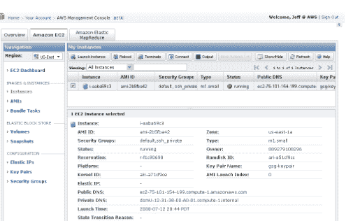

**图 3.1. AWS 管理控制台**

### ElasticFox

ElasticFox[^22] 是一款可免费获得的 Firefox 扩展。安装该扩展并重启浏览器后，你可以通过 **工具** 菜单访问 ElasticFox。ElasticFox 是一个开源工具，并拥有自己的 SourceForge 项目。

图 3.2 展示了 ElasticFox 列出的可用 AMIs。

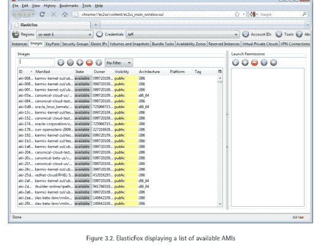

**图 3.2. Elasticfox 显示的可用 AMI 列表**

### S3Fox

S3Fox[^23] 是 Firefox 的免费 S3 和 CloudFront 扩展，是 Suchi Software Solutions 的产品。这也使得使用双窗格界面轻松地将文件从桌面复制到 Amazon S3（反之亦然）成为可能。图 3.3 展示了 S3Fox 的外观；本地磁盘位于左侧窗格，而 S3 存储桶位于右侧。

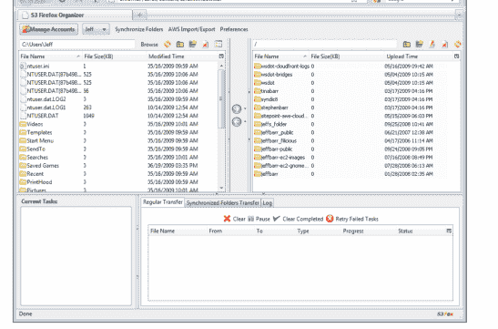

**图 3.3. 采用双窗格方法的 S3Fox 组织者**

### CloudBerry Explorer

CloudBerry Explorer[^24] 是一款免费的独立桌面应用程序，是 CloudBerry Lab 的产品。你可以管理 S3 存储桶，将文件复制到 Amazon S3 内外，并创建 CloudFront 分配。还有一个专业版本，支持文件加密、数据压缩和访问 FTP 服务器。图 3.4 展示了免费版本的截图。

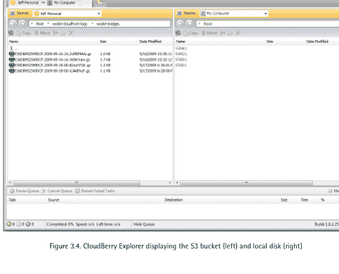

### Bucket Explorer

Bucket Explorer[^25] 是 Chambal.com 的一款商业桌面应用程序。你可以下载适用于 Windows、Mac 和 Linux 的免费试用版。除了管理 S3 存储桶和对象外，Bucket Explorer 还支持共享存储桶、本地和远程同步以及版本控制。图 3.5 展示了 Bucket Explorer 运行时的截图。

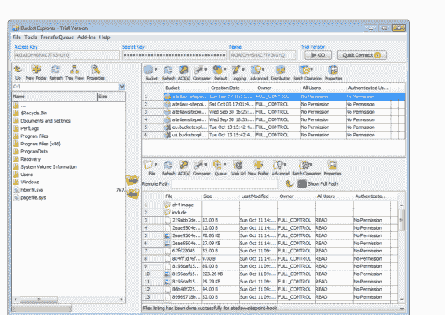

**图 3.5. Bucket Explorer，顶部为存储桶列表，底部为内容**

### SimpleDB Explorer

SimpleDB Explorer[^26]（如图 3.6 所示）也由 Chambal.com 生产，并提供适用于 Windows、Mac 和 Linux 的版本。它具备对 SimpleDB 域和元数据的完整读写访问权限，并支持对大型结果集进行查询、排序和分页。

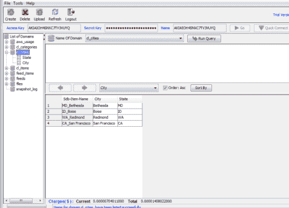

**图 3.6. SimpleDB Explorer 界面**

### Ylastic

Ylastic[^27] 支持在 Apple iPhone 和基于 Google Android 操作系统的手机（后者可在图 3.7 中看到）上对 EC2 服务、SQS、S3、CloudFront 和 SimpleDB 进行完整管理。虽然建议将功能更强大的设备作为主要 AWS 管理工具，但拥有一个便携管理工具无疑是非常有用的。


### DirectEC2

Direct Thought 公司创建了 DirectEC2，[^28] 它是 iPhone 和 iPod Touch 上的 EC2 服务原生界面。该应用具备对 EC2 功能各个方面的完全控制：AMIs、运行实例、EBS 卷、EBS 卷快照、安全组、IP 地址和密钥对。图 3.8 展示了其外观。

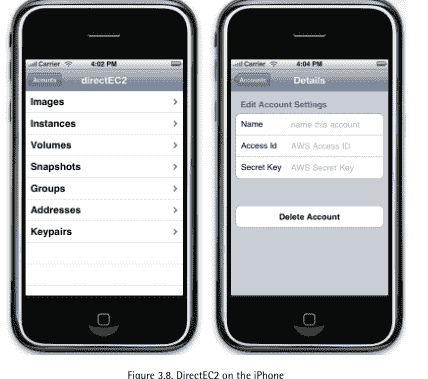

## 创建 AWS 账户

你需要一个 AWS 账户才能运行本书中的代码。账户是免费的，你只需为实际使用的服务付费，但你需要一个电子邮件地址和信用卡才能创建账户。

如果你已经有了一个活跃的 AWS 账户，可以跳过本节。

[^15]: http://developer.amazonaws.com/connect/entry.jsp?externalID=351&categoryID=251

[^16]: http://developer.amazonaws.com/connect/entry.jsp?externalID=253&categoryID=251

[^17]: http://developer.amazonaws.com/connect/entry.jsp?externalID=253&categoryID=251

[^18]: http://developer.amazonaws.com/connect/entry.jsp?externalID=368

[^19]: http://developer.amazonaws.com/connect/entry.jsp?externalID=368

[^20]: http://timkay.com/aws/

[^21]: http://console.aws.amazon.com

[^22]: http://developer.mozilla.org/en-US/Add-ons/Extensions/ElasticFox

[^23]: http://www.suchi.com/products/s3fox/

[^24]: http://www.cloudberry.com/cloudberries-explorer/

[^25]: http://www.chambal.com/bucketexplorer/

[^26]: http://www.chambal.com/simpledb-explorer/

[^27]: http://www.ylastic.com/

[^28]: http://www.directthought.com/launch.html#directEC2

首先访问 `http://aws.amazon.com`，并点击标有 **立即注册** 的按钮，如图 3.9 所示。


在下一个页面中，输入您的电子邮件地址，选择 **我是新用户** 选项，然后点击 **使用我们的安全服务器登录** 按钮。进入注册页面。填写您的姓名，再次输入您的电子邮件地址（用于验证），选择一个安全的密码，然后点击 **创建账户** 按钮。

在下一个页面中，输入您的联系方式（包括您的街道地址）。然后向下滚动一点，以便显示 AWS 许可协议。仔细阅读所有细则，并勾选复选框以表示您已阅读并同意许可条款。继续向下滚动，输入安全验证码，然后点击 **继续** 按钮。

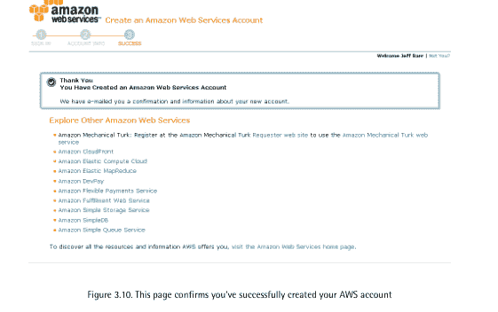

完成上述操作后，您将看到如图 3.10 所示的页面，这表明您现在拥有一个 AWS 账户。恭喜，欢迎加入这个俱乐部！

不过，还有一些事情需要完成。我们尚未到达输入您信用卡号码的部分。下一步是注册一个实际的 AWS 服务。点击 Amazon Elastic Compute Cloud 按钮，然后点击 Sign Up For Amazon EC2 按钮。您可能需要输入电子邮件地址和密码才能访问下一个页面。

下一个页面包含 EC2 服务和 S3 的完整价格信息；您需要使用 S3 来存储您的 Amazon Machine Images，因此该表格涵盖了这两者。审查价格信息，然后向下滚动到页面底部并输入您的信用卡信息。点击继续按钮，在下一个页面上，如果您之前输入的地址也是您信用卡的账单地址，则选择“使用此地址”。否则，输入相应的地址并点击继续按钮。最后，向下滚动到确认页面的底部，然后点击“完成注册”按钮。

您将看到“感谢您的注册 . . .”页面，以及一个通知，告知您在注册流程之后将收到一系列确认电子邮件：

- 1. “欢迎使用 Amazon” 电子邮件，表示您现在拥有一个 Amazon 账户
- 2. “欢迎使用 AWS” 电子邮件，表示您现在拥有一个 AWS 账户
- 3. 最后两封电子邮件，表示您已注册 EC2 服务和 S3

## 获取您的 AWS 密钥

一旦您创建了 AWS 账户，下一步就是访问您的 AWS 公钥和私钥。

访问位于 `http://aws.amazon.com` 的 AWS 门户，从账户菜单中选择安全凭证，如图 3.11 所示。

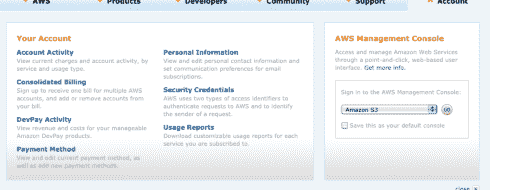

图 3.11. 账户菜单

如有必要，请再次输入您的电子邮件地址和密码。您将看到 **安全凭证** 页面。向下滚动以找到标有 **您的访问密钥** 的部分，如图 3.12 所示。

| 创建时间 | 访问密钥 ID | 秘密访问密钥 | 状态 |
| --- | --- | --- | --- |
| 2009 年 9 月 10 日 | AKIAIPR3EIIJ36PMQQVST | 显示 | 活跃 (设为不活跃) |

创建新的访问密钥

图 3.12. 您的访问密钥

在接下来的部分中您将需要这个密钥，所以请选择您的 **访问密钥 ID**，然后将其复制并粘贴到一个临时文件中（记事本或 TextEdit 非常适合做这件事）。

现在点击 **显示** 链接以查看您的 **秘密访问密钥**，如图 3.13 所示。同样，选择它，复制它，并将其粘贴到您的临时文件中。


图 3.13. 秘密访问密钥

掌握了这些信息后，您就可以在下一节下载并安装 CloudFusion 了。

## 运行本书中的 PHP 代码

本书中的所有代码都是 PHP 代码。我们将在命令行和 Web 服务器上运行 PHP。除了假设您具备一定的 PHP 知识外，还假设您能够在您的特定平台上安装和运行 PHP 以及 Web 服务器。然而，本章篇幅有限，只能为您提供一些正确的方向指引。

如果您使用 Windows，只需使用 WampServer 软件包 30 即可让您迅速上手。同样地，MAMP 31 是 Mac OS X 的一键安装程序。大多数 Linux 发行版已经安装了 Apache 和 PHP，但它们也可以通过您发行版的软件包管理器获取。如果您需要更多信息，请查看 Kevlin Henney 的书籍《使用 PHP 和 MySQL 构建自己的数据库驱动网站》的第一章，该书可免费下载于 sitepoint.com。 32

> **Mac OS X 未包含 GD**
>
> 下一章中的一些代码大量使用了 PHP 的 GD 库 33 进行图像处理。不幸的是，虽然 Mac OS X 包含 PHP，但 GD 扩展并未包含在内。为了解决这个问题，您可以使用上面提到的 MAMP，或者安装 PHP 网站标题为 **其他系统的二进制文件** 下链接的 Mac OS X PHP 软件包。 34

我们即将开始深入学习 PHP，但在此之前，我不得不提及这条重要信息。本书中以 shebang（`#!/usr/bin/php`）开头的 PHP 程序旨在从命令行运行，例如：

```
#!/usr/bin/php
<?php

: php script

?>
```

30 http://www.wampserver.com/en/

31 http://www.mamp.info/

32 http://articles.sitepoint.com/article/php-amp-mysql-1-installation/

33 http://www.php.net/gd/

34 http://www.php.net/downloads.php

从命令行运行 PHP 脚本的形式如下：

```
$ path_to_php_executable php_script_file [php_script_arguments]
```

本示例中的 `$` 代表命令提示符，不需要输入。以下是在 Linux 机器上运行 PHP 脚本的一个示例：

```
$ /usr/bin/php list_buckets.php
```

这里是在 Mac OS X 机器上使用 MAMP 的另一个示例：


```
$ /Applications/MAMP/bin/php5/bin/php list_buckets.php
```

以下是在 Windows 机器上从 Windows 命令提示符运行这些脚本的示例：

```
C:\> C:\PHPS\php list_buckets.php
```

有关从 Windows 命令行运行 PHP 的更多详细信息，请参阅 PHP 手册。²⁵

## 将 PHP 作为 Shell 脚本运行

如果您在 Linux 或 Mac OS X 机器上运行这些脚本，可以像 shell 脚本一样运行它们，但需要先使文件可执行。您可以使用 `chmod` 命令做到这一点：

```
$ chmod +x list_buckets.php
```

完成上述操作后，您可以这样运行您的脚本：

```
$ ./list_buckets.php
```

为了使其工作，您所有脚本中的 shebang 行必须指示您的系统中 PHP 可执行文件的位置。

旨在在您的 Web 服务器上运行的脚本将没有 shebang：

```
<?php
: php script
?>
```

## PHP 5.3.0 与时区

如果您使用 PHP 5.3.0，有一个与之前版本的重要变化。PHP 5.3.0 现在每当使用与日期相关的功能而未指定时区时，都会发出警告级别的日志消息。PHP 一直默认使用其运行机器的时区，但这种行为现在被认为不可靠，因此会发出警告。

为了避免看到警告消息，您必须在使用日期函数时指定一个时区，或者设置一个默认时区。 36 设置默认时区最简单的方法是编辑您的 `php.ini` 文件，特别是以下几行：

```
; 定义日期函数使用的默认时区
date.timezone =
```

取消该行的注释并添加一个有效的时区值。您可以在 PHP 网站上找到时区值的列表。 37 这里是一个示例：

```
; 定义日期函数使用的默认时区
date.timezone = America/Los_Angeles
```

## 安装 CloudFusion

本书中的许多示例都可以本地运行——即从配备了 PHP 的桌面机器（运行 Windows、Mac OS 或 Linux）——或者在服务器或 EC2 实例上远程运行。无论您计划从哪里运行，都需要在那安装 CloudFusion。以下是相关步骤：

- 1. 截至写作之时，CloudFusion 的最新版本是 2.5。您可以从项目网站 http://getcloudfusion.com 下载它。解压

36 http://www.php.net/manual/en/migration52.datetime.php

37 http://www.php.net/manual/en/timezones.php

### 前提条件与设置

下载文件归档并将其解压，然后将生成的 `cloudfusion` 目录移动到你希望安装 CloudFusion 的位置。

- 修改 `php.ini` 文件中的 PHP `include_path` 设置；此操作用于将 CloudFusion 库文件的完整路径包含在内。

  - 在 Linux 系统上，该文件位于 `/etc` 目录中（Mac OS X 亦同）。我将 CloudFusion 放在 `/mnt/cloudfusion` 目录下，因此我编辑 `include_path` 使其看起来像这样：

    ```
    include_path = ":./php/includes:/mnt/cloudfusion"
    ```

  - 如果你使用的是 Windows 机器，你的 `php.ini` 文件将位于你的 PHP 安装文件夹中。如果你将 CloudFusion 文件放置在 `c:\cloudfusion`，那么你的 `include_path` 语句将如下所示：

    ```
    include_path = ":;c:\php\includes;c:\cloudfusion"
    ```

  - 你还应为本书中的所有示例创建一个用于源代码的文件夹；然后，下载这些代码并将该目录名也添加到 `include_path` 中。

- 现在将注意力转向 CloudFusion 目录。复制文件 `config-sample.inc.php`，将其重命名为 `config.inc.php`，并打开这个新文件进行编辑。找到以下语句：

  ```
  define( 'AWS_KEY', '');
  define('AWS_SECRET_KEY', '');
  ```

  - 编辑第一个语句，使你的访问密钥 ID 位于引号之间。编辑第二个语句，使你的秘密访问密钥位于引号之间，如下所示：

    ```
    define( 'AWS_KEY', 'your_access_key_id');
    define( 'AWS_SECRET_KEY', 'your_secret_access_key');
    ```

  - 如果其他人可以访问你存放密钥的计算机，请采取适当措施保护该计算机和此文件，防止其泄露。

- 删除你的临时文件。

## 我们回顾的内容

在本章中，我们讨论了为了从本书其余部分中获得最大价值所需的先决技术条件。我们开始配备工具，重新审视了一些为 AWS 提供的众多编程库、命令行工具和可视化工具。我们逐步完成了 AWS 注册流程，并获得了用于访问 Web 服务的密钥账户。我们还安装了 Cloudfusion 库。现在我们已准备好开始编码。

# 第 4 章

## 使用 Amazon S3 存储数据

在本章中，我们将深入探索 Amazon S3，即简单存储服务（Simple Storage Service）。在快速概述最重要的 S3 概念后，我们将花本章的大部分时间复习操作 S3 及其内容分发服务 CloudFront 中的存储桶和对象所需的代码。

### S3 概述

S3 是一种互联网规模的数据存储服务。所有数据都进行冗余存储，以防止由临时连接问题或永久性硬件故障引发的问题。S3 可扩展以处理大量数据，并应对非常高并发访问量。截至撰写时，S3 已保存超过 1240 亿个对象，每年处理超过一万亿个请求。[^1]

S3 允许你将数据存储在称为 `buckets`（存储桶）的容器中。存储桶是附加到特定 AWS 账户的命名存储实体。你可以在你的 AWS 账户中创建多达 100 个存储桶。存储桶的名称必须全局唯一，因此你需要谨慎选择，并不断尝试直到找到可用的名称。

[^1]: http://aws.amazon.com/about-aws/whats-new/2009/03/30/celebrating-3-years-of-amazon-s3-with-3-months-of-transfer-in-for-3-centsb/

存储桶用于对任意数量的 S3 对象进行分组。当我说是任意数量时，我是认真的——在一个单独的 S3 存储桶中存储数百万甚至数千万个对象是完全合理的。根据你的需求，你可以选择为单个应用程序使用多个存储桶，或者选择为每个应用程序使用单个存储桶。

你可以在 S3 中存储任何类型的数据。它可以是文本文件，如 HTML 页面、CSS 样式表或 C 源代码，也可以是二进制文件，如 JPEG 图像、tar 备份文件，甚至是加密数据（如果你愿意，可以在将其存储在 S3 之前加密敏感数据）。S3 非常适合存储 Web 数据。每个 S3 对象都有自己独立的 URL，并且 S3 可以处理非常高的请求速率。

S3 可以存储大小最高达 5GB 的对象。由于各种因素，在实践中你很可能永远不会接近这个限制。根据你的互联网连接速度，上传如此大尺寸的对象可能需要数小时甚至数天。如果连接中断，你将不得不从头开始重新上传。此外，一些 S3 工具包尝试在上传前将整个对象读入内存。

每个 S3 对象都有一个由以下组件连接而成的唯一 URL：

- 协议（`http://` 或 `https://`）

- 以 `.` 结尾的存储桶名称

- S3 端点（`s3.amazonaws.com`）

- 以 `/` 开头的对象键

对象键本身可以包含 `/` 字符。这些字符仅仅是对象名称的一部分，对 S3 没有特殊含义。S3 不是层次化文件系统，也没有子文件夹的概念。第 3 章列出的 S3 工具维持了一种礼貌的假象，认为 `/` 是特殊的，允许用户像 S3 存储桶包含实际子文件夹一样遍历其内容。

S3 可以使用两种 API 之一进行访问。SOAP API 包含诸如 `ListAllMyBuckets`、`CreateBucket` 和 `DeleteBucket` 等函数。HTTP API 使用标准的 HTTP 动词（`GET`、`PUT`、`HEAD` 和 `DELETE`）作为所有操作的基础。`GET` 操作检索存储桶或对象的内容，`PUT` 操作创建新的存储桶或对象，`DELETE` 操作删除存储桶或对象，`HEAD` 操作检索关于对象的信息。


当你创建新的 S3 对象时，可以附加键值对形式的元数据。当使用 HTTP GET 请求检索对象时，元数据以 HTTP 头的形式返回。

对每个 S3 存储桶和对象的访问由 `ACL` 或 **访问控制列表** 进行监管。`ACL` 包含多达 100 个 **授权（grants）** 的序列，每个授权由一个 **被授权人（grantee）** 和一个 **权限（permission）** 组成。使用 `ACL`，你可以向特定用户或用户组授予访问权限。

特定用户代表单个 AWS 账户。该账户可以使用电子邮件地址或规范用户 ID 来指定，但始终以 `CanonicalUser` 对象的形式返回——电子邮件地址只是一种便利。

组代表预定义的用户类别，任何 AWS 用户，或匿名用户（任何人）。

`ACL` 中授权的权限组件指定了授予相关被授权人的访问权限。你可以授予存储桶或对象的权限——但请注意，如表 4.1 所述，两者的语义略有不同。

**表 4.1. 应用于存储桶和对象时的 S3 权限授权**

| 权限 | 应用于存储桶时 | 应用于对象时 |
|:-----------|:-------------------------|:-------------------------|
| `READ` | 列出存储桶内容的权限 | 读取对象或其元数据的权限 |
| `WRITE` | 创建、替换或删除存储桶中任何对象的权限 | 对象不支持 |
| `READ_ACP` | 读取存储桶 ACL 的权限 | 读取对象 ACL 的权限 |
| `WRITE_ACP` | 覆盖存储桶 ACL 的权限 | 覆盖对象 ACL 的权限 |
| `FULL_CONTROL` | 上述所有权限 | 上述所有权限 |

存储桶或对象的所有者始终具有隐式的 `READ_ACP` 权限；你始终可以访问自己对象的 ACL。同样，所有者还具有隐式的 `WRITE_ACP` 权限，因此你也始终可以更改自己对象的 ACL。`FULL_CONTROL` 权限为方便而设，其效果与应用 READ、WRITE、`READ_ACP` 和 `WRITE_ACP` 权限相同。

存储桶和对象的权限是独立的。存储桶的权限对新上传的对象没有影响；必须为每个新对象单独设置 ACL。

## S3 定价模型

你的 S3 使用费用基于以下三个维度：

- 存储的数据量
- 输入和输出 S3 的数据传输量
- 对 S3 发出的请求数量

让我们详细检查这些维度。

你的 S3 存储费用基于一个称为 **千兆字节-月（gigabyte-month）** 的单位。如果你恰好存储了一千兆字节恰好一个月，你将被收取一个千兆字节-月的费用，即 0.15 美元（15 美分）。[^2] 时间和空间可以相互转换，因此你也可以存储两千兆字节半个月，费用为 0.15 美元，或者如果你愿意，存储 30 千兆字节一天。内部，S3 使用更细粒度的计费单位，即 **字节-小时（byte-hour）**。这使 AWS 能够以极高的准确性衡量你的使用量并相应地向你收费。

你的数据传输费用基于输入（上传）和输出（下载） S3 的数据量。传输到 S3 的数据按每千兆字节 0.10 美元的费率收取。再次强调，这笔金额是按比例计算的。从 S3 传输出的数据按滑动刻度收费，从每千兆字节 0.17 美元开始，并基于流量递减，对于每月超过 150 太字节的传出数据传输，费率为每千兆字节 0.10 美元。作为一个重要的特殊情况，在同一区域（Region）内 S3 和 Amazon EC2 实例之间传输数据是免费的。

对 S3 发出的每个请求还有名义上（但很重要）的费用。HTTP `GET` 请求按每 10,000 个请求 0.01 美元的费率收取。`PUT`、`COPY`、`LIST` 和 `POST` 请求按每 1,000 个请求 0.01 美元的费率收取。

综合来看，这种定价模型意味着你几乎可以零成本地构建原型并运行你的 S3 驱动应用程序，只有当你的应用程序变得流行时，才需要为更多的存储和更多的数据传输付费。

[^2]: 脚注标记已修正来自 OCR 错误。

**盯紧那个计量器！** 你需要记住，计量器始终在运行！如果你编写一个程序，每秒轮询一次你的 S3 存储桶之一（`LIST` 请求），无论该存储桶中是否有新内容，你每天都会花费 86 美分。你还应该极其仔细地检查循环终止条件。最好避免编写无限循环，因为每次迭代都会让你花钱。

你可以在每个月的任何时间点（并且应该这么做）检查你的 S3 使用情况，以验证其是否符合你的预期。你可以通过登录 AWS 门户，并从*您的账户*菜单中选择**账户活动**选项来完成此操作。

## CloudFront 概览

CloudFront 是一种用于内容分发的 Web 服务，允许你以高速度、低延迟分发 Web 内容。CloudFront 与 S3 集成，使得将任何公共 S3 对象分发到 CloudFront 的 14 个全球边缘位置网络变得非常容易。截至撰写本文时，这些边缘位置分布在美国、欧洲和亚洲，如表 4.2 所示。

**表 4.2. CloudFront 网络中的边缘位置**

| 美国 | 欧洲 | 亚洲 |
| :--- | :--- | :--- |
| 弗吉尼亚州阿什本 | 阿姆斯特丹 | 香港 |
| 德克萨斯州达拉斯/沃斯堡 | 都柏林 | 新加坡 |
| 加利福尼亚州洛杉矶 | 法兰克福 | 东京 |
| 佛罗里达州迈阿密 | 伦敦 | |
| 新泽西州纽瓦克 | | |
| 纽约州纽约 | | |
| 加利福尼亚州帕洛阿尔托 | | |
| 华盛顿州西雅图 | | |
| 密苏里州圣路易斯 | | |

CloudFront 非常容易使用。你只需为你的任意 S3 存储桶创建一个分发，剩下的工作由 CloudFront 完成。

3 边缘位置的数量以及这些位置本身可能会随时间变化。

## CloudFront 定价模型

你的 CloudFront 使用费在两个维度上计费：

- 数据传输
- 对 CloudFront 发出的请求数量

传入和传出 CloudFront 的数据按滑动比例计费。费率为每吉字节 0.17 美元，随着用量增加费率会下降，对于每月超过 1000 太字节的传出数据传输，费率为每吉字节 0.05 美元。你还需要为从 S3 到 CloudFront 的数据传输付费。CloudFront 的最新价格可在 `http://aws.amazon.com/cloudfront` 找到。

每 10,000 个由 CloudFront 处理的 HTTP `GET` 请求收费 0.013 美元。

## 编程 S3 和 CloudFront

在解决了基础知识之后，现在是开始有趣部分——代码的时候了！在这一部分，你将学习如何列出你的存储桶、创建新存储桶，以及用几种不同的方式列出存储桶中的对象。我们还将介绍如何处理存储桶的内容（顺便进行一些简单的图像处理），以及如何使用 CloudFront 分发你的内容。


### 运行代码

> 正如我们在第 3 章中“运行本书中的 PHP 代码”部分提到的，本节中以 shebang(`#!/usr/bin/php`) 开头的程序旨在从命令行运行。其他程序旨在通过 Web 服务器运行。

### 创建 S3 存储桶

让我们继续，先创建一个新的存储桶。不过，在开始之前，我们将创建一个新的 PHP 文件并将其命名为*`book.inc.php`*。这将包含我们在整本书中要使用的许多公共定义和函数。我将其放在一个名为**`include`**的子文件夹中。

我们要添加到我们的**`book.inc.php`**文件中的第一个定义是我们 S3 存储桶的名称：

```php
<!-- excerpt from chapter_04/include/book.inc.php -->
<?php

define('BOOK_BUCKET', 'sitepoint-aws-cloud-book');

?>
```

在这里，我们创建了一个名为 `BOOK_BUCKET` 的新常量，并赋予它值`sitepoint-aws-cloud-book`。当然，你需要决定自己独特的存储桶名称；正如我前面提到的，存储桶名称必须全局唯一，而我已经占用了这个名称！

以下是创建新 S3 存储桶的代码：


```php
<!-- excerpt from chapter_04/create_bucket.php -->
#!/usr/bin/php
<?php

error_reporting(E_ALL);   

require_once('cloudfusion.class.php');  
require_once('include/book.inc.php');


$S3    = new AmazonS3();   
$res   = $S3->create_bucket(BOOK_BUCKET);


if ($res->isOK())     
{
        print("${bucket}' bucket created\n");
}
else
{
        print("Error creating bucket '${bucket}'\n");
}
?>
```

让我们逐条检查代码语句：

- **1** 我们首先设置错误报告级别。该语句指示 PHP 报告所有错误和潜在错误。这种重要的编程纪律能让你更早地知道问题所在。从长远来看，你会获益，因为大多数潜在的错误代码会在早期阶段被排除。

- **2** 接下来我们包含所需的文件。第一条语句将`cloudfusion.class.php`文件加载到内存中。该文件包含全书使用的 CloudFusion 库。第二条语句将`book.inc.php`文件加载到内存中。

- **3** 现在来到脚本的主要部分。首先，我们创建一个新的`AmazonS3`对象，然后调用`create_bucket`方法——该脚本的关键语句——以创建新存储桶。如果你在`book.inc.php`中自定义了`BOOK_BUCKET`的定义，它将为你创建一个存储桶（假设该存储桶尚不存在）。

你应该意识到的一个点是，CloudFusion 库使用你的 AWS 密钥 ID 和私钥来访问 Web 服务。我们在第 3 章中“安装 CloudFusion”部分配置了这些值。

- **4** 最后一条语句检查对 S3 的调用是否完成，且 S3 返回的状态码指示操作已成功处理。如果存储桶存在且你拥有它，`create_bucket`调用将成功。如果存储桶存在但属于其他用户，`create_bucket`调用将失败，且`isOK`方法将返回 FALSE。我们的语句会打印适当的状态消息以指示成功或失败。

我们可以通过允许在命令行上指定存储桶名称，使该脚本更有用，如下所示：

```php
chapter_04/create_bucket.php (excerpt)
#!/usr/bin/php
<?php

error_reporting(E_ALL);

require_once('cloudfusion.class.php');
require_once('include/book.inc.php');

if ($argc != 2) ①
{
	exit("Usage: " . $argv[0] . " bucket name\n");
}

$bucket = ($argv[1] == '-') ? BOOK_BUCKET : $argv[1]; ②

$S3 = new AmazonS3();
$res = $S3->create_bucket($bucket);

if ($res->isOK())
{
	print("${bucket}' bucket created\n");
}
else
{
	print("Error creating bucket '${bucket}'\n");
}

?>
```

① 首先，我们检查提供了多少个参数。如果不是正好两个，我们退出脚本并显示有用的用法消息。

② 该程序期望第一个参数是存储桶名称。如果存储桶名称是减号字符（-），则使用默认存储桶（`BOOK_BUCKET`）。

使用默认存储桶名称运行此脚本，输出如下：

```
$ php create_bucket.php -
'sitepoint-aws-cloud-book' bucket created
```

## 列出你的 S3 存储桶

以下是如何列出你的 S3 存储桶：

```php
chapter_04/list_buckets.php (excerpt)
#!/usr/bin/php
<?php

error_reporting(E_ALL);

require_once( 'cloudfusion.class.php' );

$s3 = new AmazonS3();
$buckets = $s3->get_bucket_list(); ①

foreach ($buckets as $bucket) ②
{
 print($bucket . "\n");
}

exit(0);
?>
```

上述代码应该相对容易理解：

- 这是检索与你账户关联的存储桶列表的关键语句。该方法返回一个数组，每个存储桶对应一个字符串元素。

- 一旦有了列表，我们就可以遍历数组，并使用 `print` 语句打印每个存储桶的名称。如果你是第一次运行此程序，你可能只会看到一个名称：你在上一节创建的存储桶的名称。

以下是我从我的个人 AWS 账户运行此程序时看到的内容：

```
$ php list_buckets.php
andybarr
aws-dev-relations
biancabarr
carmenbarr
: 许多其他存储桶
```

`sitepoint-aws-cloud-book`

`sitepoint-aws-cloud-book-thumbs`

这是一段简单却强大的代码。寥寥数语，我们就建立了一个到 S3 的连接，获取了存储桶列表，遍历了结果，并将每个存储桶的名称打印在独立的一行上。如果你能理解这一切，那么你已经在掌握 S3 的道路上迈出了坚实的一步。

## 将存储桶列表作为网页输出

由于这是一本关于 Web 编程的书，让我们稍微“花哨”一点，将存储桶列表输出为网页。这个版本的脚本与之前的 `list_buckets.php` 脚本非常相似，因为我们仍然在使用 `get_bucket_list` 方法：

```php
<?php

error_reporting(E_ALL);

require_once('cloudfusion.class.php');

$S3 = new AmazonS3();
$Buckets = $S3->get_bucket_list();

$output_title = 'Chapter 3 Sample - List of S3 Buckets';
$output_message = 'A simple HTML list of your S3 Buckets';
include 'include/list_buckets.html.php';

exit(0);
?>
```

最后三条语句是新的。我们设置了两个变量 `$output_title` 和 `$output_message`，其中包含将在网页上显示的信息内容。最后的 `include` 语句包含了我们存储桶列表的 HTML 模板：

```html
<!DOCTYPE html PUBLIC "-//W3C//DTD XHTML 1.0 Strict//EN"
"http://www.w3.org/TR/xhtml1/DTD/xhtml1-strict.dtd">
<html xmlns="http://www.w3.org/1999/xhtml" xml:lang="en" lang="en">
<head>
<title><?php echo $output_title ?></title>
</head>
<body>
<h1><?php echo $output_title ?></h1>
<p><?php echo $output_message ?></p>
<ul>
<?php foreach($buckets as $bucket): ?>
<li><?php echo $bucket ?></li>
<?php endforeach ?>
</ul>
</body>
</html>
```

在上面的代码中，`$output_title` 变成了页面标题和顶级标题，而 `$output_message` 作为信息性注释输出在页面顶部的 HTML 段落中。`$buckets` 数组中的存储桶列表以 HTML 无序列表的形式输出，如图 4.1 所示，这得益于 `foreach` 循环的帮助。

- andybar

- aws-dev-relations

- bancabar

- camerabar

- faces

- faces-t

- gracebarr

- hidden-ridge

- jbarr-work

- jbarr_demo

- jbarr_nubs

- jelf_barr_bucket

- jelfbarr

- step-out-aws-cloud-book

- step-out-aws-cloud-book-thumbs


## 列出存储桶中的对象


现在你知道如何创建存储桶并从命令行或网页列出这些存储桶了，让我们来看看特定存储桶的内容。在这个脚本中，我们列出我们在第一个创建的存储桶中的所有对象（使用常量 `BOOK_BUCKET`）：

```php
chapter_04/list_bucket_objects.php (excerpt)

#!/usr/bin/php
<?php

error_reporting(E_ALL);

require_once('cloudfusion.class.php');
require_once('book.inc.php');

$S3 = new AmazonS3();
$objects = $S3->get_object_list(BOOK_BUCKET);

if ($objects) {
    foreach ($objects as $object)
    {
        print($object . "\n");
    }
} else {
    print("No objects found in " . BOOK_BUCKET . "\n");
}

exit(0);
?>
```

这里的关键语句是上述示例中的这一句：

```php
$objects = $S3->get_object_list(BOOK_BUCKET);
```

`get_object_list` 方法是一个简单的快捷方法。当不提供额外参数时，它将返回存储桶中前（按字母顺序）1,000 个对象键的列表。可以使用可选参数从给定的键之后开始按字母顺序返回键，或者在从 S3 检索到键之后对键列表进行过滤。与 `get_bucket_list` 一样，此方法返回一个数组，每个元素包含一个字符串形式的键。

你可能在想为什么这个函数只返回 1,000 个键。请记住，存储桶可能包含数百万个对象，但一次性返回如此长的列表在多个层面上都会带来问题——仅仅传输这些列表就需要很长时间。正如我们将在下一节中看到的那样，像 S3 这样的 Web 规模系统必须提供一种方式，以便分块访问长列表。

当然，你新创建的存储桶目前没有任何对象，所以这个脚本除了告知你这一事实外几乎没什么作用。为了进行一次更完整的测试运行，你可以使用第 3 章“可视化工具”部分中介绍的任一工具（如 S3Fox 或 CloudBerry Explorer）向存储桶中添加一些对象，或者跳到本章后面的“将文件上传到 S3”部分。

最后，这里有一个挑战：基于我们上面开发的 `create_bucket.php` 脚本，你应该能够相当容易地修改 `list_bucket_objects.php` 脚本，以便你可以在命令行上指定一个存储桶名称。

## 处理复杂的 CloudFusion 数据结构

是时候稍微绕点弯了。

我之前告诉你的所有 CloudFusion 函数都返回简单的数据结构——字符串数组。然而，本章后面我将使用的函数返回一种更复杂的数据结构，称为 `ResponseCore`。S3 以 XML 文档的形式返回结果；CloudFusion 使用 PHP 的 SimpleXML 包解析 XML，并将解析后的对象包含在响应中，以便可以通过名称引用它们。[^4]

以下代码调用 S3 列出存储桶 `BOOK_BUCKET` 中的前 1,000 个对象，然后调用 PHP 方便的 `print_r` 函数来显示生成的对象树：

```php
## chapter_04/list_bucket_objects_raw.php (excerpt)

#!/usr/bin/php
<?php

error_reporting(E_ALL);

require_once('cloudfusion.class.php');
require_once('include/book.inc.php');

$S3 = new AmazonS3();
$res = $S3->list_objects(BOOK_BUCKET);
```

[^4]: 关于 SimpleXML 的完整文档可以在 http://www.php.net/simplexml 找到。

```php
print_r($res);
exit(0);
?>
```

输出结果太长了，无法完整显示（对于我的存储桶来说是 465 行）。让我们看一些摘录。这是第一部分：

```bash
$php list_bucket_objects_raw.php
ResponseCore Object
(
[header] => Array
(
    [x-amz-id-2] => Ya7yAuClv7hGR6+Jjp2OsYDM1m4/Zy+d0RmK5cSAu+qV+v+6
    9gLSHJyt1DD7wa0n
    [x-amz-request-id] => 14AA13F3F0B76032
    [date] => Thu, 28 May 2009 06:51:26 GMT
    [content-type] => application/xml
    [transfer-encoding] => chunked
    [connection] => close
    [server] => AmazonS3
    [_info] => Array
    (
        [url] => https://sitepoint-aws-cloud-book.s3.amazonaws.com/
        [content_type] => application/xml
        :
)
```

第一行表明数据类型为 `ResponseCore`。接着，我们找到了一些标准的 PHP 数组。如果需要，我们可以这样访问数据：

```php
$res->header['transfer-encoding']
$res->header['_info']['url']
```

`$res` 是一个对象，而 `header` 是对象的实例变量之一，因此使用 `->` 运算符进行访问。`header` 实例变量是一个 PHP 数组，因此使用数组语法访问其成员。

在第二行中，`header` 的 `_info` 成员本身是一个数组，因此使用第二组括号来访问其中的 `url` 值。

在输出中稍微靠后的位置，我们发现以下内容：

```text
[body] => SimpleXMLElement Object
(
    [Name] => sitepoint-aws-cloud-book
    ...
```

`body` 实例变量的类型为 `SimpleXMLElement`。它以一个 `Name` 实例变量开头，可以将其作为 `$res->body->Name` 进行访问。

再往后看，我们终于找到了来这里的目的所在——存储桶中对象的列表：

```text
[Contents] => Array
(
    [0] => SimpleXMLElement Object
    (
        [Key] => images/2008_shiller_housing_protection.jpg
        [LastModified] => 2009-05-22T23:44:58.000Z
        [ETag] => "e2d335683226059e7cd6e450795f3485"
        [Size] => 236535
        [Owner] => SimpleXMLElement Object
        (
            [ID] => 7769a42be4e57a034aee322aa8450b3536b6ca56037c06ef19b1e1
eabfeaa89c
            [DisplayName] => jeffbarr
        )
        [StorageClass] => STANDARD
    )
    ...
```

你可以看到 `body` 包含一个名为 `Contents` 的实例变量，这是另一个包含存储桶中所有文件的数组。存储桶中的每个文件都由一个 `SimpleXMLElement` 对象表示；每个对象都具有 `Key`、`ETag`、`Size`、`Owner` 和 `StorageClass` 成员，访问方式如下：

```php
$res->body->Contents[0]->Key
$res->body->Contents[0]->ETag
$res->body->Contents[0]->Size
$res->body->Contents[0]->Owner->ID
$res->body->Contents[0]->Owner->DisplayName
$res->body->Contents[0]->StorageClass
```

## 在网页上列出存储桶中的对象

当然，你完全可以自由地使用中间变量，使这段代码更简短或更高效。


你或许会想知道对象名称（如 `Contents`、`Key`、`Size` 等等）是从哪里来的。`list_objects` 方法会向 S3 发送一个 HTTP GET 请求，以获取存储桶中前 1,000 个对象的列表。该请求返回一个 XML 文档，而 CloudFusion 会对其进行解析，并将其作为 `body` 对象返回。这些对象名称直接取自文档中的 XML 标签。

如果我们修改之前的脚本，打印出这些值中的一部分，它可能看起来像下面的例子：

```php
#!/usr/bin/php
<?php

error_reporting(E_ALL);

require_once('cloudfusion.class.php');
require_once('include/book.inc.php');

$S3 = new AmazonS3();
$res = $S3->list_objects(BOOK_BUCKET);

print("Bucket Url: " . $res->header['_info']['url'] . "\n");
print("Bucket Name: " . $res->body->Name   . "\n");
print("First Key: "   . $res->body->Contents[0]->Key . "\n");
print("Second Key: "  . $res->body->Contents[1]->Key . "\n");
exit(0);
?>
```

在上面的例子中，我们输出了存储桶的 URL 和名称，接着输出了存储桶中前两项的键（key）。

至此，这一“绕道”部分已经接近尾声。我希望这段旅程既风景优美，又富有教育意义。接下来，我们将运用这些新获得的知识，创建一个非常实用的工具函数。

在编写一个能在网页中输出存储桶内所有对象列表的脚本之前，我们必须先编写一个相当复杂的函数。我们将把这个函数添加到我们的 `book.inc.php` 文件中，并称之为 `getBucketObjects`：

**chapter_04/include/book.inc.php (节选)**

```php
function getBucketObjects(S3, $bucket, $prefix = '')
{
    $objects = array();
    $next = '';

    do {
        $res = $s3->list_objects($bucket,
            array('marker' => urlencode($next),
                'prefix' => $prefix)
        );

        if (!$res->isOk())
        {
            return null;
        }

        $contents = $res->body->Contents;
        foreach ($contents as $object)
        {
            $objects[] = $object;
        }

        $isTruncated = $res->body->IsTruncated == 'true';

        if ($isTruncated)
        {
            $next = $objects[count($objects) - 1]->Key;
        }
    } while ($isTruncated);

    return $objects;
}
```

这个函数比你目前见过的任何代码都要复杂，但无需担心。在本章早些时候我曾告诉你，向 S3 发出一次“列出存储桶”的请求，无论存储桶中有多少个键，最多只会返回 1,000 个键。我们的 `getBucketObjects` 函数只是不断调用 `list_objects`，直到 S3 表示没有其他对象需要返回为止：

- 我们的函数接受三个参数：一个 `AmazonS3` 对象、一个 S3 存储桶，以及一个默认值为空字符串的前缀 `prefix`。
- 我们使用一个 `do ... while` 循环，以确保循环体至少执行一次。
- 每次我调用 `list_objects` 时，都会传入一个名为 `$next` 的值。在循环的第一次迭代中，`$next` 是空字符串，`list_objects` 会从存储桶的开头（按字母顺序）开始。在后续的循环迭代中，`$next` 会被设置为上一次迭代返回的最后一个键。这告诉 S3 从上一次迭代最后那个键的字母顺序之后开始检索键。
- 如果 `list_objects` 调用失败，该函数将返回 `null`。
- 我们从 `list_objects` 调用返回的响应 `body` 中获取 `Contents` 数组，然后遍历这些值，将每个值存储到 `$objects` 数组中。这个数组最终将成为我们的返回值。
- `list_objects` 调用返回的数据包含一个名为 `IsTruncated` 的元素。如果该值是字符串 `"true"`，则表示列表不完整，还有更多对象需要查找。这个条件也被用来控制循环。
- 如果列表不完整，我们就设置 `$next` 的值，为开始下一次迭代做准备。
- 当循环终止时，返回 `$objects` 数组。

把它们组合起来，这个函数就会获取存储桶中的所有对象，将它们全部放入一个数组中，并返回该数组。


### 避免无限循环

我坦率地承认，在我最初编写这段代码时，未能正确表述终止条件。我知道这会很有技巧性，因此我在顶部使用了一个打印语句，以确保我避免创建一个无法终止、失控运行并导致我的 S3 账单飙升的循环。我建议你在构建和测试任何需要付费执行的代码时，也这样做。

有了这个函数，创建存储桶中对象的列表就变得很容易了。以下是我们需要做的全部事情：

**chapter_04/list_bucket_objects_page.php (节选)**

```php
<?php
    error_reporting(E_ALL);

    require_once('cloudfusion.class.php');
    require_once('include/book.inc.php');

    $bucket = isset($_GET['bucket']) ? $_GET['bucket'] : BOOK_BUCKET;

    $S3 = new AmazonS3();

    $objects = getBucketObjects($S3, $bucket);

    $fileList = array();

    foreach ($objects as $object)
    {
        $key = $object->Key;
        $url = $S3->getObject_url($bucket, $key);
        $fileList[] = array('url' => $url, 'name' => $key,
        'size' => number_format((int)$object->Size));
    }

    $output_title = "Chapter 3 Sample - List of S3 Objects in Bucket '${bucket}'";
    $output_message = "A simple HTML table displaying of all the 'objects in the '${bucket}' bucket.";
    include 'include/list_bucket_objects.html.php';

    exit(0);
?>
```

这段代码生成一个网页，并且可以接受 URL 查询字符串中可选的存储桶参数。让我们拆解一下，看看它是如何工作的：

- 这段代码检查是否提供了存储桶参数。如果提供了，则将其用作 `$bucket` 的值。否则，使用默认值，即 `BOOK_BUCKET` 常量。
- 在这里，我们调用自定义的 `getBucketObjects` 函数，该函数获取给定存储桶中的对象列表，并将其存储在 `$objects` 数组中。
- 下一步是遍历该数组并处理每一个元素。
- 我们在 `$fileList` 数组中为每个对象存储三个值：对象的 URL、键（我们将其存储为 `name`）以及大小（转换为整数并格式化为数字）。
- 我们包含 HTML 模板，以输出 `$fileList` 数组中的值。

以下是 `list_bucket_objects.html.php` HTML 模板的样子：

**chapter_04/include/list_bucket_objects.html.php (节选)**


```html
<!DOCTYPE html PUBLIC "-//W3C//DTD XHTML 1.0 Strict//EN"
"http://www.w3.org/TR/xhtml1/DTD/xhtml1-strict.dtd">
<html xmlns="http://www.w3.org/1999/xhtml" xml:lang="en" lang="en">
<head>
<title><?php echo $output_title ?></title>
</head>
<body>
<h1><?php echo $output_title ?></h1>
<p><?php echo $output_message ?></p>
<table>
<thead>
<tr><th>File</th><th>Size</th></tr>
</thead>
<tbody>
<?php foreach($fileList as $file): ?>
<tr>
<td><a href="<?php echo $file['url'] ?>" ?>
<?php echo $file['name'] ?></a>
</td>
<td><?php echo $file['size'] ?></td>
</tr>
<?php endforeach ?>
</tbody>
</table>
</body>
</html>
```

该模板遍历 `$fileList` 数组，并为每个文件创建一个表格行，在第一列放置指向该文件的链接，在第二列放置文件大小。

图 4.2 展示了其运行效果（我当时已经向存储桶上传了一些文件）。

| 图像文件 | 大小 |
| :--- | :--- |
| images/2008_chiller_bouquet_protection.jpg | 236,535 |
| images/3DoorStore.jpg | 61,918 |
| images/AndyBass.jpg | 73,388 |
| images/AndyWolkOrchard.jpg | 80,841 |
| images/FifthBase.gif | 37,561 |
| images/FifthBase.psd | 545,419 |
| images/FifthBaseTonight.psd | 37,452 |
| images/FifthBaseBright.psd | 532,308 |
| images/STP-65708.JPG | 1,716,926 |
| images/Scon XB Stretch.jpg | 66,598 |
| images/Scon XB.jpg | 70,882 |

图 4.2. 列出 S3 存储桶中的对象

你可能已经注意到，现在我们拥有了构建一个简单的 S3 文件浏览器的所有组件。我将把实现这个功能作为你的挑战。只需稍加努力，你应该能够将 `list_buckets_page.php` 和 `list_bucket_objects_page.php` 连接起来。

## 向 S3 上传文件

既然我们已经知道如何从 S3 获取关于存储桶及其对象的信息，让我们来看看如何将新对象放入 S3。这相当简单；我们只需要再添加两个实用函数到我们的 `book.inc.php` 文件中。

第一个函数名为 `uploadObject`：

```php
// chapter_04/include/book.inc.php (excerpt)

function uploadObject($s3, $bucket, $key, $data,
    $acl = S3_ACL_PRIVATE, $contentType = "text/plain")
{
    $res = $s3->create_object($bucket,
        array(
            'filename'    => $key,
            'body'        => $data,
            'acl'         => $acl,
            'contentType' => $contentType
        ));
    return $res->isOk();
}
```

`uploadObject` 函数接受四到六个参数。前四个参数指定 S3 访问对象、目标存储桶、所需的对象键以及要存储在对象中的数据。最后两个参数指定非默认的 ACL 以及存储对象的内容类型。

Web 浏览器使用对象的内容类型来确定如何显示该对象。例如，`image/png` 的内容类型告诉浏览器该对象是一个图像，且格式为 PNG。

如你所见，`uploadObject` 函数只是调用了 `create_object` 方法，并检查返回值以确保对象实际上已存储在 S3 中。

如果 S3 无法存储对象，它将返回 HTTP 500（内部服务器错误）代码。这几乎总是一个可恢复的状态；正确的响应是进行多次尝试，且每次尝试之间增加时间延迟（有时称为指数退避）。以下是 `uploadObject` 函数更复杂的版本，带有重试机制：

```php
function uploadObject($s3, $bucket, $key, $data,
    $acl = S3_ACL_PRIVATE, $contentType = "text/plain")
{
    $try = 1;
    $sleep = 1;
    do
    {
        $res = $s3->create_object($bucket,
            array(
                'filename'    => $key,
                'body'        => $data,
                'acl'         => $acl,
                'contentType' => $contentType
            ));
        if ($res->isOk()) {
            return true;
        }
        sleep($sleep);
        $sleep *= 2;
    } while(++$try < 6);
    return false;
}
```

我们函数的这个版本将尝试最多六次在存储桶中创建新对象。每次尝试时，暂停时长（下一次尝试之前）都会翻倍。

我们的下一个函数帮助我们确定文件的内容类型：

```php
// chapter_04/include/book.inc.php (excerpt)

function guessType($file)
{
    $info = pathinfo($file, PATHINFO_EXTENSION);
    switch (strtolower($info))
    {
        case "jpg":
        case "jpeg":
            return "image/jpg";
        case "png":
            return "image/png";
        case "gif":
            return "image/gif";
        case "htm":
        case "html":
            return "text/html";
        case "txt":
            return "text/plain";
        default:
            return "text/plain";
    }
}
```

给定一个文件名，此函数使用文件扩展名对文件的内容类型进行非常简单的猜测。它完全不会检查文件的内容，并且假设文件扩展能准确反映文件内容。为了在本章中发挥作用，该函数仅处理少数几种类型。

将所有这些与参数处理、循环和错误检查结合在一起，我们就有了一个方便上传一个或多个文件到 S3 的命令：


```php
#!/usr/bin/php
<?php

error_reporting(E_ALL);

require_once('cloudfusion.class.php');
require_once('include/book.inc.php');

if ($argc < 3) {  // 1
	exit("Usage: " . $argv[0] . " bucket files...\n");
}

$bucket = ($argv[1] == '-' ? BOOK_BUCKET : $argv[1]);  // 2

$S3 = new AmazonS3();

for ($i = 2; $i < $argc; $i++) {  // 3
	$file		= $argv[$i];
	$data		= file_get_contents($file);
	$contentType = guessType($file);

	if (uploadObject($S3, $bucket, $file, $data,	// 4
			S3_ACL_PUBLIC, $contentType))
	{
		print("Uploaded file '$file' to bucket '${bucket}'\n");
	}
	else
	{
		exit("Could not upload file '$file'"
			" to bucket '${bucket}'\n");
	}
}

exit(0);
?>
```

该脚本旨在从命令行以如下方式运行：

```bash
$ php upload_file.php bucket_name file_name [...]
```

让我们仔细看看：

- 首先，我们检查是否提供了参数；如果没有，则显示有用的用法信息并退出脚本。
- 该程序预期第一个参数为存储桶名称。如果存储桶名称是破折号（`-`），则使用默认存储桶（`BOOK_BUCKET`）。
- 其余参数被视为要上传的文件。然后我们遍历所有输入的文件名。
- 在每次循环中，我们调用 `uploadObject` 函数。我选择使用每个对象提供的精确路径名，以允许使用包含斜杠字符的键名。

以下是该程序运行时的实际效果：

```bash
$ php upload_file.php - images/catastonia_album.jpg
Uploaded file 'images/catastonia_album.jpg' to bucket 'sitepoint-aws-cloud-book'
```

仅仅几页内容，我们确实覆盖了很多领域。你现在应该知道如何上传 S3 存储桶中的图像，浏览存储桶，并通过点击链接查看图像。在下一节中，你将学习如何生成存储桶中所有图像的缩略图版本。

## 创建和存储缩略图

我们的下一个实用函数将接收内存中的图像，计算缩略图的适当高度和宽度，然后创建缩略图。

首先，在我们的 `book.inc.php` 文件中，我们需要创建两个常量：一个用于存储所需的缩略图尺寸，另一个用于存储将存储缩略图的默认存储桶名称。我希望缩略图图像的最长边为 200 像素，并且我希望定义一个后缀，将其添加到默认存储桶名称中以创建缩略图存储桶名称，因此我将添加以下内容：

```php
// chapter_04/include/book.inc.php (excerpt)

define('THUMB_SIZE', 200);
define('THUMB_BUCKET_SUFFIX', '-thumbs');
```

当然，在我们使用缩略图存储桶之前，我们必须确保它存在！你可以使用我们之前开发的 `create_bucket.php` 脚本来完成这一点。

以下是 `thumbnailImage` 函数的代码；同样，这也放在我们的 `book.inc.php` 文件中：

```php
// chapter_04/include/book.inc.php (excerpt)

function thumbnailImage($imageBitsIn, $contentType)
{
    $imageIn = ImageCreateFromString($imageBitsIn);
    $inX = ImageSX($imageIn);
    $inY = ImageSY($imageIn);

    if ($inX > $inY)
    {
        $outX = THUMB_SIZE;
        $outY = (int) (THUMB_SIZE * ((float) $inY / $inX));
    }
    else
    {
        $outX = (int) (THUMB_SIZE * ((float) $inX / $inY));
        $outY = THUMB_SIZE;
    }

    $imageOut = ImageCreateTrueColor($outX, $outY);
    ImageFill($imageOut, 0, 0,
              ImageColorAllocate($imageOut, 255, 255, 255));
    ImageCopyResized($imageOut, $imageIn,
                     0, 0, 0, 0,
                     $outX, $outY, $inX, $inY);
}
```

`$fileOut = tempnam("/tmp", "aws") . ".aws";`

`switch ($ContentType)`

`{`

`    case "image/jpg":`

`        $ret = ImageJPEG($imageOut, $fileOut, 100);`

`        break;`

`    case "image/png":`

`        $ret = ImagePNG($imageOut, $fileOut, 0);`

`        break;`

`    case "image/gif":`

`        $ret = ImageGIF($imageOut, $fileOut);`

`        break;`

`    default:`

`        unlink($fileOut);`

`        return false;`

`}`

`if (!$ret)`

`{`

`    unlink($fileOut);`

`    return false;`

`}`

`$imageBitsOut = file_get_contents($fileOut);`

`unlink($fileOut);`

`return $imageBitsOut;`

这里我不打算详细讲解这段代码——本章的重点是 S3，而非图形编程。代码大量使用了 PHP 的 GD 库。简单来说，它会创建图像的一个副本并将其调整大小，使其最长边等于 `THUMB_SIZE` 常量指定的像素数，同时保持图像的宽高比。

由于需要移动的像素数量较多，为尺寸较大的图像生成缩略图可能会花费相当长的一秒钟；此外，`ThumbNailImage` 函数必须将新图像写入临时文件，然后再将其读回内存。

有了这段代码，处理参数并对给定存储桶中的每个图像生成缩略图就变得简单了。方法如下：


```php
#!/usr/bin/php
<?php

error_reporting(E_ALL);

require_once('cloudfusion.class.php');
require_once('include/book.inc.php');

if ($argc != 3) // 1
{
  exit("Usage: " . $argv[0] . "in-bucket out-bucket\n");
}

$bucketIn  = ($argv[1] == '-') // 2
  ? BOOK_BUCKET
  : $argv[1];

$bucketOut = ($argv[2] == '-') // 3
  ? $bucketIn . THUMB_BUCKET_SUFFIX
  : $argv[2];

print("Thumbnailing '${bucketIn}' to '${bucketOut}'\n");

$S3 = new AmazonS3();
$objectsIn = getBucketObjects($S3, $bucketIn); // 4

foreach ($objectsIn as $objectIn)
{
  $key = $objectIn->Key;
  print("Processing item '${key}'\n");

  if (substr(guessType($key), 0, 6) == "image/") // 5
  {
    $startTime = microtime(true); // 6
    $dataIn = $S3->get_object($bucketIn, $key); // 7
    $endTime = microtime(true);
    $contentType = guessType($key);
    
    printf("\tDownloaded from S3 in %.2f seconds.\n",
           ($endTime - $startTime));
           
    $startTime = microtime(true);
    $dataOut = thumbnailImage($dataIn->body, $contentType); // 8
    $endTime = microtime(true);
    printf("\tGenerated thumbnail in %.2f seconds.\n",
           ($endTime - $startTime));
           
    $startTime = microtime(true);
    if (uploadObject($S3, $bucketOut, $key, $dataOut,
           S3_ACL_PUBLIC, $contentType)) // 9
    {
       $endTime = microtime(true);
       printf("\tUploaded thumbnail to S3 in %.2f seconds.\n",
              ($endTime - $startTime));
    }
    else
    {
       print("\tCould not upload thumbnail.\n");
    }
  }
  else
  {
      print("\tSkipping - not an image\n");
  }
  print("\n");
}
exit(0);
?>
```

让我们逐步来看这段代码：

- 1. 首先，我们需要确保至少有三个参数：脚本名称、图像存储桶名称和缩略图存储桶名称。
- 2. 与前面的示例类似，此代码允许使用 `"-"` 字符作为前两个命令行参数，从而将输入和输出存储桶设置为默认值。
- 3. 我们的缩略图存储桶的默认名称将是我们默认的存储桶名称加上之前定义的后缀。
- 4. 这里我们使用 `getBucketObjects` 函数获取存储桶中的所有对象。
- 5. 我们将使用 `guessType` 函数，以确保只处理内容类型以 `"image/"` 开头的对象。
- 6. 由于我将每个主要操作都包裹在类似以下的计时代码中，这段代码可能看起来有点杂乱：

```php
$startTime = microtime(true);
: code operation
$endTime   = microtime(true);
```

这允许我们在脚本运行时打印有用的时间相关信息。从 `$endTime` 中减去 `$startTime` 会提供经过的时间，我们可以对其进行格式化输出：

```php
printf ("Completed in %.2f seconds.\n", ($endTime - $startTime));
```

- 7. 这里只有一个新的 S3 调用：

```php
$dataIn = $S3->get_object($bucketIn, $key);
```

`get_object` 方法从 S3 下载对象并将其数据作为字符串返回。
- 8. 在这里，我们的 `thumbnailImage` 函数生成缩略图并将其存储在 `$dataOut` 中。
- 9. 我们的 `uploadObject` 函数将生成的缩略图上传到我们的缩略图存储桶。

以下是单个文件被“生成缩略图”时输出示例：

```bash
$ php thumbnail_bucket.php - - 
Processing item 'images/a380_factory.jpg': 
Downloaded from S3 in 0.78 seconds. 
Generated thumbnail in 0.19 seconds. 
Uploaded thumbnail to S3 in 0.09 seconds.
```

S3、PHP 和 GD 的组合让你能够进行强大的图形处理，而无需做太多工作。你可以轻松修改缩略图代码来降低图像质量、在其上绘制水印，或将颜色映射为灰度值。

## 创建 CloudFront 分发

在我们能够处理 CloudFront 分发之前，你必须确保已在 AWS 账户中启用该功能。请访问 `http://aws.amazon.com/cloudfront/`，然后点击 **注册 Amazon CloudFront** 按钮，激活只需再点一下。

虽然编写代码来为 S3 存储桶创建 CloudFront 分发是可能的（当然欢迎你这样做），但我选择避开它。相反，使用图形界面创建分发更容易。你可以使用第 3 章中“可视化工具”部分提到的任何工具来做到这一点。AWS 管理控制台<sup>c</sup> 让这变得非常简单；选择 `Amazon CloudFront` 选项卡并点击 `创建分发` 按钮，如图 4.3 所示。

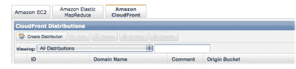

设置完成后，你将需要等待几分钟，直到 CloudFront 分发创建完成。

让我们通过创建一个图像浏览器来结束本章。我们将使用 CloudFront 高效全球分发原始图像和缩略图像。

## 列出 CloudFront 分发

这是一个列出你所有 CloudFront 分发的简单脚本：

```php
chapter_04/list_distributions.php (excerpt)
#!/usr/bin/php
<?php

error_reporting(E_ALL);

require_once('cloudfusion.class.php');
require_once('include/book.inc.php');

$cf = new AmazonCloudFront();
$res = $cf->list_distributions();

if (!$res->isOk())
{
    exit("Could not retrieve list of CloudFront distributions\n");
}

$distributions = $res->body->DistributionSummary;

printf("%-16s %-32s %-40s\n", "ID", "Domain Name", "Origin");
printf("%-16s %-32s %-40s\n", "", "", "");

foreach ($distributions as $distribution)
{
    $id         = $distribution->Id;
    $domainName = $distribution->DomainName;
    $origin     = $distribution->Origin;

    printf("%-16s %-32s %-40s\n", $id, $domainName, $origin);
}
exit(0);
?>
```


此时你应该对代码结构很熟悉了。`list_distributions`方法返回一个对象数组，然后对其进行迭代并打印。不过请注意，我们实例化了一个新的`AmazonCloudFront`对象，而不是像前面的脚本那样使用`AmazonS3`对象，并使用`list_distributions`方法来获取分发的详细信息。

响应对象可以像我们之前的 S3 脚本一样进行查询。在返回给`list_distributions`方法的响应中，`$res->body->DistributionSummary`属性将包含一个`SimpleXMLElement`对象数组，每个 CloudFront 分发对应一个。上面的脚本只是遍历这个数组，并提取每个对象的 Id、DomainName 和 Origin 属性以便在输出中显示，格式化成类似于以下的表格：

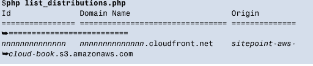

当你使用你的 AWS 账户运行此脚本时，Id 和 Domain Name 列将显示唯一的值。

## 列出带有缩略图的 S3 文件

好吧，时候到了，这是本章的最后一个脚本！我们首先还需要一个额外的实用函数来使其工作：`findDistributionForBucket`函数，它将返回给定 S3 存储桶的 CloudFront 分发。你猜对了，我们将把它放在`book.inc.php`文件中：

```php
<!-- chapter_04/include/book.inc.php (excerpt) -->
function findDistributionForBucket($cf, $bucket)
{

    $res = $cf->list_distributions();

    if (!$res->isOK())
    {
        return null;
    }

    $needle = $bucket . ".";
    $distributions = $res->body->DistributionSummary;
```

```php
foreach ($distributions as $distribution)
{
    if (substr($distribution->Origin, 0, strlen($needle)) ==
        $needle)
    {
        return $distribution;
    }
}

return null;
```

此函数接受一个 CloudFront 访问对象和一个存储桶的名称。它会获取 CloudFront 分发列表，并尝试将每一个分发与给定的存储桶名称进行匹配。如果匹配成功，则返回该分发对象。

下面的代码是*list_bucket_objects_page.php*的增强版本，该文件在本章前面已经展示过。它为该存储桶中所有拥有对应缩略图存储桶中的图像的图像对象在表格中添加了缩略图。它还使用了可用的 CloudFront URL：

```php
<?php
error_reporting(E_ALL);
require_once('cloudfusion.class.php');
require_once('include/book.inc.php');

$Bucket = IsSet($GET['bucket']) ? $_GET['bucket'] : BOOK_BUCKET;
$BucketThumbs = $Bucket . THUMB_BUCKET_SUFFIX;

$S3 = new AmazonS3();      #1
$Cf = new AmazonCloudFront();

$dist = findDistributionForBucket($Cf, $Bucket);      #2
$thumbsDist = findDistributionForBucket($Cf, $BucketThumbs);

$objects = getBucketObjects($S3, $Bucket);            #3
$objectThumbs = getBucketObjects($S3, $BucketThumbs);

$thumbs = array();      #4
foreach ($objectThumbs as $objectThumb)
{
    $key = (string) $objectThumb->Key;

    if ($thumbsDist != null)  #5
    {
        $thumbs[$key] = 'http://' . $thumbsDist->DomainName
            . '/' . $key;
    }
    else
    {
        $thumbs[$key] = $S3->get_object_url($BucketThumbs, $key);
    }
}

$fileList = array();  #6
foreach ($objects as $object)
{
    $key = (string) $object->Key;

    if ($dist != null)
    {
        $url = 'http://' . $dist->DomainName . '/' . $key;
    }
    else
    {
        $url = $S3->get_object_url($Bucket, $key);
    }

    $thumbURL = IsSet($thumbs[$key]) ? $thumbs[$key] : '';  #7
    $fileList[] = array('thumb' => $thumbURL, 'url' => $url,
        'name' => $key, 'size' => number_format((int)$object->Size));
}

$output_title = "Chapter 3 Sample - List of S3 Objects in Bucket"
    . " $Bucket";
$output_message = "A simple HTML table displaying of all the objects"
    . " in the $Bucket bucket with thumbnails.";

include 'include/list_bucket_objects_thumbs.html.php';

exit(0);
?>
```

让我们来看看这段代码：

- 首先，我们实例化新的`AmazonS3`和`AmazonCloudFront`对象。

- 在此我们确定每个存储桶是否都有 CloudFront 分发。

- 我们再次使用我们的`getBucketObjects`函数从两个存储桶中检索所有对象。

- 我们遍历缩略图存储桶中的所有对象，并使用对象键作为数组键来填充`$thumbs`数组，同时存储它们的 URL。

- 如果缩略图有 CloudFront 分发，我们就使用其 URL；否则，我们使用标准的 S3 URL。

- 我们对指定存储桶中的所有对象执行相同的操作；这些结果存储在`$fileList`数组中，并将用于 HTML 输出。

- 这是`list_bucket_objects_page.php`脚本中针对`$fileList`数组的新增部分。如果有匹配的缩略图，则保存缩略图 URL；否则存储空字符串。

这是生成输出的 HTML 模板：


```html
<!DOCTYPE html PUBLIC "-//W3C//DTD XHTML 1.0 Strict//EN"
"http://www.w3.org/TR/xhtml1/DTD/xhtml1-strict.dtd"
<html xmlns="http://www.w3.org/1999/xhtml" xml:lang="en" lang="en">
<head>
<title><?php echo $output_title ?></title>
</head>
<body>
<h1><?php echo $output_title ?></h1>
<p><?php echo $output_message ?></p>
<table>
<thead>
<tr><th>File</th><th>Size</th></tr>
</thead>
<tbody>
<?php foreach($fileList as $file): ?>
<tr>
<td>
<?php if($file['thumb'] != ''): ?>
<a href="<?php echo $file['url'] ?>">
"/></a>
<?php endif ?>
</td>
<td><a href="<?php echo $file['url'] ?>">
<?php echo $file['name'] ?></a>
</td>
<td><?php echo $file['size'] ?></td>
</tr>
<?php endforeach ?>
</tbody>
</table>
</body>
</html>
```

上面的代码中有几个有趣的点：
1. 此模板遍历`$fileList`数组，为数组的每个元素添加一行表格，并分别为缩略图图像、文件名和文件大小添加表格单元格。
2. 仅当指定了该文件的缩略图 URL 时，缩略图表单元的内容才会被添加，否则该单元格保持为空。

图 4.4 展示了输出的外观。

| 缩略图 | 键 | 大小 |
| :--- | :--- | :--- |
|  | images/2008_shiller_housw_projection.jpg | 236,535 |
|  | images/5D-corScion.jpg | 61,918 |
|  | images/AndyBass.jpg | 73,388 |
|  | images/AndyWorkstation.jpg | 80,841 |

### 最后

本章篇幅较长且代码较多。从零基础开始，你学会了如何创建 S3 存储桶、列出存储桶以及将文件上传到 S3。你发现了如何处理一个存储桶的内容并将其放入另一个存储桶，以及如何利用 CloudFront 进行高效的内容分发。掌握了所有这些新技能后，你应该准备创建一些非常有趣的 S3 应用了。

## 第 5 章

### 使用 Amazon EC2 进行 Web 托管

在本章中，你将全面了解 Amazon 弹性计算云（Amazon EC2）基础设施。我们将再次审视可编程数据中心的概念，然后回顾 Amazon EC2 的关键概念，包括定价模型。我们将使用 AWS 管理控制台完成实际启动 EC2 实例所需的配置工作，然后启动一个实例并完成所有设置。之后，我们将深入探讨 Amazon 机器映像（AMI），甚至创建我们自己的 AMI。最后，我们将编写一个简短（但非常酷）的程序，使用 API 操作 Amazon EC2 资源。

### 可编程数据中心

在第 1 章中，我描述认为可编程数据中心的概念是云计算的核心。人工劳动和手动系统构建被自动化的配置、动态资源分配以及一种所有数据中心功能都可以通过 API 调用的模型所取代。

为了说明传统的人力驱动互联网托管提供商与现代可编程数据中心之间的区别，让我们列出单台服务器启动并运行所需的步骤：
1. 定位或获取合适的服务器硬件
2. 获取并连接足够的磁盘存储
3. 确保足够的机架空间、电力和冷却
4. 安排互联网连接
5. 采购并设置交换机、路由器和负载均衡器等网络设备
6. 安装硬件
7. 启动服务器
8. 安装操作系统
9. 配置必要的应用程序
10. 分配并路由 IP 地址
11. 为访问和保护创建防火墙条目
12. 配置监控以验证系统功能
13. 根据流量增加对以上所有组件进行扩展

这些步骤中的每一个手动完成都耗时长且人工成本高。可编程数据中心通过等价的 API 调用替换了每一个步骤，并将完成每个步骤所需的时间从小时、天或周缩短到几秒。这种快速响应的大规模生产模式是云计算的一个关键方面。

可编程的配置控制还简化了增长和演变，因为额外资源随时可用。

### Amazon EC2 概述

Amazon EC2 基础设施体现了上述我列出的可编程数据中心的所有概念。实际上，Amazon EC2 服务提供对多个地理区域中多个数据中心（可用区）的访问，实际上是一组可编程数据中心的集合。你只需向“云”发起 Web 服务请求，Amazon EC2 能力就会完成其余工作。服务器、操作系统映像、防火墙条目、负载均衡器、IP 地址和磁盘存储卷都可以在几秒钟内可用。在本节中，我们将讨论持久性资源与临时资源之间的区别，涵盖 Amazon EC2 的关键概念，回顾定价模型，并讨论 EC2 基础设施如何与其他 AWS 基础设施服务协同工作。

## 持久资源和临时资源

亚马逊 EC2 资源可分为两类——持久资源（persistent）和临时资源（ephemeral）——理解这两者之间的差异非常重要。

**持久资源**一旦分配到你的账户，即便面临瞬态或永久性的硬件或软件故障，也可以预期其能保持正常运行。亚马逊的持久资源实现利用了冗余、自动故障转移和自动恢复机制，以为你提供稳定的资源。以下 EC2 资源属于持久资源：
- 弹性 IP 地址
- 弹性块存储（EBS）卷
- 弹性负载均衡器
- 安全组
- 存储在亚马逊 S3 中或以亚马逊 EBS 快照形式存在的亚马逊机器镜像（AMI）

另一方面，**临时资源**没有内置的冗余机制，最终会失败。当它们失效时，存储的数据和状态信息通常会丢失。因此，你被期望使用其他 EC2 功能来实现自己的冗余、故障转移和恢复。以下 EC2 资源属于临时资源：
- 亚马逊 EC2 实例

此时你可能会想：“什么？实例随时都可能崩溃并带走我的本地数据吗？”确实如此，但正如开发人员经常所说，这是一个特性，而不是缺陷。大型互联网网站最重要的架构方面之一（当然，amazon.com 就是一个绝佳的例子）在于，你可以将单台服务器视为瞬态且极其不可靠的，并可以利用软件从不可靠的部件构建可靠的系统。

实际上，亚马逊 EC2 服务器通常非常耐用。我个人的一个 EC2 实例已经无故障运行了 742 天。当它最终失效时，我会简单地启动我的自定义 AMI 的另一个副本，从 S3 恢复我的数据，然后继续前进。

一旦你开始将所有服务器视为本质上不可靠的（无论是亚马逊 EC2 还是其他），这听起来比实际情况糟糕得多，你开始意识到你可以构建系统，使得丢失特定服务器真的无关紧要。云计算还使你能够轻松模拟多种故障场景，以确保你的恢复逻辑按预期工作。经历过几次这样的演练后，你就可以更安心地睡觉了，确信从系统故障中恢复很容易，在某些情况下甚至是自动的。

根据经验，我可以告诉你，从“我很害怕，它随时可能消失”转变为“我确信它随时可能消失且不会发生坏事”，那时你就知道你的思维方式已经真正变得“云友好”了。

## 亚马逊 EC2 术语

最重要的 EC2 概念是实例。利用**虚拟化**技术，EC2 基础设施在相同的物理硬件上代表多个 EC2 用户运行机器实例。虚拟化软件确保每个逻辑实例获得保证的内存空间和 CPU 时间份额，并确保在同一硬件上运行的实例以任何方式避免相互干扰。

一个实例可以运行多种操作系统中的任意一种，包括 Linux（提供多种发行版）、Windows Server 或 OpenSolaris。

当你启动一个亚马逊 EC2 实例时，你必须指定**实例类型**。目前共有九种 EC2 实例类型，如表 5.1 所示。

表 5.1 中列出的成本是截至出版时的当前价格，反映了在美国运行的 Linux 或 OpenSolaris 实例的费用。在欧洲或亚洲运行的实例、Windows 实例以及在欧洲或亚洲运行的 Windows 实例的价格更高。

每个核心的速度以 EC2 计算单位（EC2 Compute Units）衡量；每个单位大致相当于 2007 年同期的 1.0 至 1.2 GHz AMD Opteron 或 Intel Xeon 处理器。


除了 Small（小）实例类型外，所有实例类型都有多个**虚拟核心**。虚拟核心是独立并同时运行的处理单元。你可以通过同时运行多个 CPU 密集型程序，或编写时考虑到多核心功能的程序来利用这种强大的性能。不过，后一种方法是高级主题，超出了本书的范围。

### 表 5.1. 亚马逊 EC2 实例类型

| 名称 | CPU 字长 | CPU 虚拟核心数 | CPU 核心速度（EC2 计算单位） | 内存（RAM） | 本地磁盘 | 每小时成本 |
|---|---|---|---|---|---|---|
| Small（小） | 32 位 | 1 | 1 | 1.7GB | 160GB | $0.085 |
| Large（大） | 64 位 | 2 | 2 | 7.5GB | 850GB | $0.34 |
| Extra Large（特大） | 64 位 | 4 | 2 | 15GB | 1,690GB | $0.68 |
| High-CPU Medium（高 CPU 中型） | 32 位 | 2 | 2.5 | 1.7GB | 350GB | $0.17 |
| High-CPU Extra Large（高 CPU 特大） | 64 位 | 8 | 2.5 | 7GB | 1,690GB | $0.68 |
| High Memory Extra Large（高内存特大） | 64 位 | 2 | 3.25 | 17.1GB | 420GB | $0.50 |
| High Memory Double Extra Large（高内存双倍特大） | 64 位 | 2 | 3.25 | 34.2GB | 850GB | $1.20 |
| High Memory Quadruple Extra Large（高内存四倍特大） | 64 位 | 8 | 3.25 | 68.4GB | 1,690GB | $2.40 |
| Cluster Compute（集群计算） | 64 位 | 8（两个处理器，每个含 4 个核心） | 2.5 | 23GB | 1,690GB | $1.60 |

正如你从表中看到的，较大的实例类型具有更快的核心和更多的核心数量。

在选择应用程序的 EC2 实例类型时，你需要考虑多个因素。首先，你需要确保你的应用程序与 CPU 字长兼容。许多高端数据库产品仅在 64 位硬件上运行。一旦你构建了一个 AMI，它就特定于 CPU 字长；不可能在 64 位实例类型上运行专为 32 位实例类型构建的 AMI，反之亦然。其次，你需要考虑你应用程序的资源需求。

相对于内存量需要大量处理能力的应用程序可能在 High-CPU（高 CPU）实例上运行效果最好。在 32 位和 64 位产品系列中，有足够的空间可以向上或向下移动以优化你的资源使用。经验丰富的 EC2 用户通常会在两种或三种不同的实例类型上对其应用程序进行基准测试，然后选择提供最佳性价比的那一种。最后，你需要决定是想要许多小实例还是较少的大实例。这种规模扩展（scale-out）与规模向上扩展（scale-up）的决策，再次非常取决于你的应用程序需求。复杂的多层应用程序通常使用多种实例类型。例如：

- 用于 Web 层的小实例
- 用于关系数据库层的特大实例
- 用于 CPU 密集型应用层的高 CPU 特大实例

使用更多数量较小的实例还使你能够灵活地将它们分布在两个或更多可用区中，以获得更好的容错能力。超大规模应用程序甚至跨越多个 EC2 区域，将一些实例运行在美国，一些在欧洲，另一些在亚洲。实际上，利用 EC2 功能创建这些复杂的多宿主拓扑结构是非常简单的。

当你构建一个字面上跨越全球的应用程序时，云计算将变得更加具有吸引力。你可以构建“跟随太阳”（follow-the-sun）应用程序，在用户最繁忙的时间和地点添加资源，并在他们睡眠时移除它们。你可以添加功能冗余和地理分散，而无需处理额外的数据中心或带宽供应商。

当你启动一个实例时，你始终运行特定的 AMI（亚马逊机器镜像）。正如我们在第 2 章中讨论的，AMI 包含你的操作系统，也可以包含应用程序的其他层和部分。你可以从许多预定义的 AMI 中选择，也可以构建自己的。在配置和自定义 AMI 方面，你有很大的灵活性。你可以为应用程序的每个层构建一组不同的 AMI，或者创建一个通用的 AMI，该 AMI 在启动时根据其角色进行自定制。AMI 可以存储在亚马逊 S3 中或作为弹性块存储快照。较新的基于快照的模型更快且更灵活。从 EBS 快照启动的实例可以

## 表 5.2. 示例安全组

| 组名 | 规则 |
| :----------------------: | :-----------------------------------------: |
| web_access | □ 允许从任何位置进行 HTTP 访问（端口 80）<br> □ 允许从公司网络进行 SSH 访问（端口 22） |
| db_access | □ 允许访问 MySQL 数据库（端口 3306）<br> □ 允许从公司网络进行 SSH 访问（端口 22） |
| app_access | □ 允许访问应用程序服务器（端口 5000）<br> □ 允许从公司网络进行 SSH 访问（端口 22） |

然后，这些安全组将按照表 5.3 中列出的方式应用于实例。

## 表 5.3. 实例与安全组

| 实例角色 | 安全组 |
| :----------------------: | :----------------------: |
| web server | web_access |
| database server | db_access |
| application server | app_access |

一旦以一组干净且合理拆分的安全组为基础，就可以考虑动态地进行更改。例如，围绕 `AuthorizeSecurityGroupIngress` 和 `RevokeSecurityGroupIngress` AWS 函数构建的调度工具，可以对 `app_access` 组进行周期性更改，以实现备份系统管理员的轮换式远程访问，以便在紧急情况下获得访问权限。或者，可以通过根据 web 层中服务器的 IP 地址动态添加权限，使 `db_access` 组中的规则变得更加选择性。

单个安全组内的实例可以自由地相互通信。因此，例如，如果使用单个 `ssh_access` 组来允许对前一示例中多个层级的实例进行 SSH 访问，将是不明智的。

在启动过程中，会为每个实例分配一个公网 IP 地址。然而，由于实例是短暂的，IP 地址的生命周期将与实例相同。EC2 弹性 IP 地址功能支持分配稳定的公网 IP 地址，其生命周期独立于任何特定的 EC2 实例。这些地址已分配给你的 AWS 账户。一旦分配，它们将始终在你的控制之下，直到放弃，无论你是否使用它们。你可以将你的任何 IP 地址附加（路由）到你的任何 EC2 实例。

正如本节前面所述，每个 EC2 实例中包含的本地磁盘存储是短暂的。如果正在运行的实例重新启动，存储将保持完好，但在实例终止后会被清除并重新使用。EC2 弹性块存储（EBS）提供具有高可靠性和可用性的持久存储。你可以创建一个 EBS 卷，然后将其附加到同一可用区内的任何实例。你可以创建针对 Amazon S3 的特定时间点快照备份，然后将这些备份恢复到相同的卷，或者使用它们来创建一个新的卷。EBS 卷可以格式化并用于存储文件，也可以作为未格式化的“原始”存储使用。

Amazon DevPay 系统允许你使用 Amazon 的订阅和计费基础设施来运行你自己的基于 EC2 的应用程序。DevPay 使你能够创建自己的付款计划，组合预付费、定期费用和基于使用量的费用。一旦你将付款计划附加到你创建的 AMI，你的客户就可以注册并启动一个或多个该 AMI 的副本。他们将通过他们的 Amazon 账户支付使用费用。

## 综合起来

当 Amazon EC2 功能与其他 AWS 基础设施服务结合使用时，变得更加强大。我们已经讨论了使用 Amazon S3 存储 AMI 和 EBS 快照。而且，正如我们在上一章所见，你可以使用在 EC2 实例上运行的 PHP 代码来调用 S3 API。S3 非常适合存储任意数量的非结构化应用数据——无论是二进制数据还是字符串。

类似地，在 EC2 实例上运行的代码可以使用 Amazon SimpleDB 进行结构化数据存储，使用关系数据库服务存储关系数据，并使用 Amazon 简单队列服务作为可扩展的实例间或进程间缓冲区。Elastic MapReduce 运行在 EC2 服务上，可用于处理大量数据。

这一架构模型的吸引力还在于，EC2 服务与这些服务之间的延迟非常低，因为它们运行在相同的区域内。

# Amazon EC2 定价模型

你的 Amazon EC2 使用费用在多个维度上计费，包括实例使用、数据传输、AMI 存储、IP 地址预留、EBS 数据存储和 EBS I/O。这些价格会随时间变化，因此你应该查阅 [Amazon EC2 主页 [2]](https://aws.amazon.com/ec2/) 以获取最新信息。

## 实例使用


每种 EC2 实例类型的每小时（按需）定价已在之前的表 5.1 中列出。实例使用从实例开始运行时开始，并按整小时增量计费。这些是基础价格，多个因素会影响最终价格：

- 在欧洲和亚太区域运行 EC2 实例成本更高。
- 运行 Windows 的成本高于运行 Linux 或 OpenSolaris。
- 通过 DevPay 访问的 AMI 将按照 AMI 创建者设定的费率收费。
- 通过购买预留实例，你可以安排更低的每小时费率。

考虑到所有这些因素，你应该仔细规划，在运行的最初几小时和几周内密切关注你的 AWS 账户。

如果你计划长期保持大量 EC2 实例运行，你还应该调查预留实例选项。使用此选项，你需要支付一笔预付费来预留一个实例为期一年或三年，然后在实际使用该实例时支付较低的每小时费用。最终的每小时成本低于按需使用。按当前费率，如果实例使用率至少为 19%，三年预留实例比按需实例更便宜。购买预留实例还将确保你在需要时能够分配 EC2 实例。

## 数据传输

你的数据传输费用基于传输进出你的 EC2 实例的数据量。传输到实例的数据按每吉字节 0.10 美元收费。同样，这笔费用是按比例计算的。从实例传输出的数据按滑动比例收费，从每吉字节 0.17 美元开始，根据量递减，对于每月超过 150 TB 的所有出站数据传输，降至每吉字节 0.10 美元。

数据传输有一些重要的特殊情况：

- AWS 可用区内的数据传输不收费。
- 区域之间传输的数据按本节开头所述互联网费率收费。你将为传输的两侧（从一个区域出和到另一个区域入）收费。
- 同一区域内可用区之间传输的数据按每吉字节 0.01 美元收费。
- 在同一区域内 EC2 与其他 AWS 服务之间来回传输数据不收费。

## AMI 存储

你创建的 AMI 直接存储在 Amazon S3 中或作为 EBS 快照（同样存储在 S3 中），为此你需支付通常的 S3 费率。我自己定制的 Linux AMI 通常占用 500 到 700 兆字节的空间。Windows AMI 通常更大，往往超过五吉字节。如果你创建

并保留你的 AMI 的多个版本，或者如果你为应用程序的每个层级创建独立的 AMI，那么你最好留意一下存储成本。

## IP 地址预留

你可以分配弹性 IP 地址并将其附加到 EC2 实例，这不会收取费用。但是，如果你分配了地址但未将其附加到实例，每小时将被收取 0.01 美元的费用。你每月可以进行多达 100 次重新映射（附加或分离）操作而不收费。超过此数量后，每次重新映射将收取 0.10 美元。

## 弹性块存储

你的弹性块存储卷消耗的存储费用按每月每 GB 0.10 美元的费率收取。由于这是你可以以任何期望方式使用的原始存储，因此收费基于你分配的量，而不是你实际使用的量。

此外，你对 EBS 发出的每一百万次 I/O 请求将被收取 0.10 美元。与其他所有 AWS 费用一样，此金额将根据实际使用情况进行按比例计算，因此 500,000 次 I/O 请求的收费为 0.05 美元。

## 启动您的第一个 Amazon EC2 实例

既然我们已经介绍了概念和定价，现在是时候实际使用 EC2 功能了。我们将准备 SSH 密钥，熟悉 AWS 管理控制台，然后启动一个实例。一旦实例开始运行，我们将分配并附加一个 IP 地址，然后创建、附加并格式化一个 EBS 卷。我们将配置 Apache 并放置一些代码，然后关闭所有内容。

### 创建和准备 SSH 密钥

我们需要能够使用 SSH 连接到实例，但在这样做之前，我们需要创建一个或多个 Amazon EC2 密钥对。这是一种在连接时向 Amazon EC2 实例证明我们身份的方式。

将浏览器指向 `http://console.aws.amazon.com` 并在必要时登录。点击 Amazon EC2 选项卡。如果你尚未注册 EC2 服务，你需要这样做，并提供一张信用卡来处理你的账单。

如果你在欧洲或亚洲，你可能更喜欢使用本地 EC2 区域来完成此练习。你可以通过从图 5.1 中显示的区域菜单中选择该区域来实现。

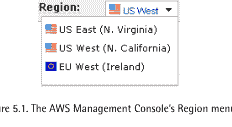

### CloudFusion 中的 EC2 区域

在撰写本文时，当前版本的 CloudFusion (`2.5`) 对除默认区域 (`us-east-1`) 之外的 EC2 区域支持有限。如果你运行本书中的任何代码时遇到问题，值得尝试使用 `us-east-1` 区域的实例重新运行。预计 CloudFusion `2.6` 将修复其中的许多问题，并将在不久的将来发布。如果你阅读本文时该版本已经可用，那么其中一些代码可能需要修改以利用这些新特性；通过快速浏览与相关方法相关的文档，这应该很容易做到。

一旦 AWS 管理控制台可见，点击 密钥对 (`Key Pairs`)，然后按下 创建密钥对 (`Create Key Pair`) 按钮。这将显示如图 5.2 所示的对话框。

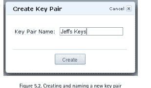

为你的密钥对输入一个名称（我选择了“Jeff’s Keys”），然后按下 创建 (`Create`) 按钮。按下按钮后，AWS 管理控制台将开始文件下载。根据你的浏览器设置，你会被提示保存文件，或者文件将直接保存到你的本地磁盘。

将 `.pem` 文件保存到安全且妥善的地方。为什么必须安全？如果你丢失了该文件，你将不得不重新生成它。一旦这样做，你将无法通过 SSH 访问你现有的 EC2 实例。为什么必须妥善保护？如果未经授权的人找到该文件，他们就能访问你正在运行的实例。

### 在 Windows 上准备 PuTTY

正如我在第 3 章“硬件和软件预期”一节中提到的，我强烈推荐 PuTTY SSH 客户端。不过，在我们使用它进行连接之前，我们需要将私钥转换为 PuTTY 可以使用的格式。如果你尚未这样做，请获取 PuTTY 及其相关的 PuTTYgen 工具副本。你可以下载自包含的可执行文件或方便的安装程序。你将大量使用 PuTTY，因此考虑为其创建一个桌面快捷方式。

启动 PuTTYgen，点击 转换 (`Conversions`) 菜单，选择 导入密钥 (`Import key`)。找到之前保存的 `.pem` 文件并打开它。如果你愿意，可以添加一个密码短语（本地密码）以增加密钥的安全性，就像我在图 5.3 中做的那样。每次使用密钥时，你都必须输入该密码短语。转到 PuTTYgen 的 文件 (`File`) 菜单并选择 保存私钥 (`Save private key`)。再次将此密钥放在你本地桌面的安全且妥善的位置。

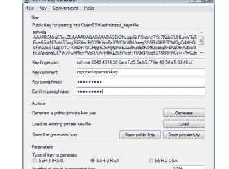

`http://www.chiark.greenend.org.uk/~sgtatham/putty/`

在保存密钥对文件的目录中打开一个终端窗口。我们的第一个重要任务是设置正确的文件权限，否则我们将无法使用它进行连接；我们将收到一个大大的 `WARNING: UNPROTECTED PRIVATE KEY FILE!` 错误消息。使用 `chmod` 命令将文件的读写权限限制为文件所有者（将 `your_key_file.pem` 替换为你文件的名称）：

```
$ chmod 600 your_key_file.pem
```

如果你愿意，也可以使用以下命令设置密码短语：

```
$ ssh-keygen -p
```

你会被提示输入密钥对文件的位置，并要求输入两次密码短语以确认。

### 浏览 AWS 管理控制台

你已经在浏览器中打开了 AWS 管理控制台，所以花几分钟时间探索 Amazon EC2 选项卡下的 **导航** (`Navigation`) 窗格。如你所见，本章描述的每个 EC2 资源都有链接。从现在开始，我们将大量使用该控制台。你还可以使用右上角的 **帮助** (`Help`) 按钮，如图 5.4 所示，以了解控制台的每项功能。

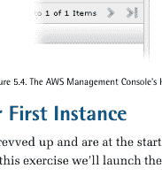

### 启动你的第一个实例

此时，你已经兴奋起来并站在了起跑线上。现在是时候实际启动一个实例了。在此练习中，我们将启动 LAMP Web 启动器。此 AMI 包含了 Fedora Core 8 Linux 发行版，以及 PHP、Apache 和 MySQL。

点击 **导航** (`Navigation`) 窗格中的 **实例** (`Instances`)，然后按下 **启动实例** (`Launch Instances`) 按钮。将显示 **请求实例向导** (`Request Instances Wizard`)，如图 5.5 所示。

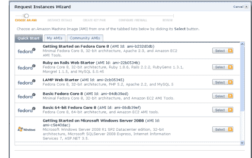


点击 **LAMP Web Starter AMI** 旁边的 **选择** (Select) 按钮。第二页 **实例详细信息** (Instance Details) 我们可以保持原样，所以点击 **继续** (Continue) 按钮。在向导的第三页 (**创建密钥对**)，从菜单中选择你的密钥对并点击 **继续** (Continue) 按钮。在向导的第四页 (**配置防火墙**)，确保选中了默认安全组，然后点击 **继续** (Continue) 按钮。

在向导的第五页也是最后一页 (**启动**)，审查你的设置，如图 5.6 所示。

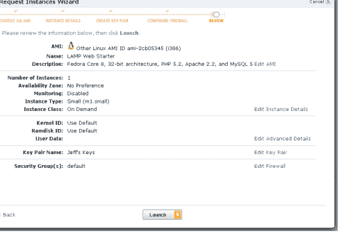

图 5.6。深呼吸并按下 **启动** (Launch)

深呼吸，按下 **启动** (Launch) 按钮。恭喜你，你刚刚发起了你的第一个 EC2 实例的启动！

关闭向导的最后页面，密切关注 **我的实例** (My Instances) 列表。在幕后，EC2 基础设施正在为你的实例做使用准备，这包括：

- 1. 找到一台可用的服务器
- 2. 对于基于 S3 的实例，将 AMI 复制到服务器的启动盘；对于基于 EBS 的实例，从 AMI 创建 EBS 卷
- 3. 启动服务器
- 4. 应用安全设置
- 5. 启动计费过程以跟踪你的使用情况

Linux 和 OpenSolaris 实例通常在一到两分钟内启动。Windows 实例可能需要稍长的时间，有时长达五分钟。

当你的实例状态变为 **运行中** (running) 时，它就准备就绪可供使用了。在图 5.7 中，我有两个实例正在运行，因此有两行和两个状态指示器。

| 类型 | 状态 |
| :--- | :--- |
| m1.small | running |
| m1.small | running |

图 5.7。实例正在运行

### 启用 SSH 访问

在连接到新实例之前，你需要确保名为 `default` 的 EC2 安全组允许 SSH（端口 22）访问和 HTTP（端口 80）访问。较旧的 AWS 账户默认允许这些端口的访问，因此如果你检查你的安全组并且该设置已经存在，则无需担心。

点击 **安全组** (Security Groups)，然后点击名为 default 的安全组，查看 **允许的连接** (Allowed Connections) 列表。确保列表中包含 **SSH** 在 **连接方法** (Connection Method) 列中，且 **从端口** (From Port) 和 **到端口** (To Port) 设置为 **22**。如果没有这样的条目，将底部行的 **自定义...** (Custom...) 下拉菜单更改为 **SSH** 并按下 **保存** (Save) 按钮（其他字段将自动填充）。如果你知道你的台式计算机的 IP 地址，你可以将其用作 **源 IP** (Source IP)，并加上一个 “/32” 后缀。¹

如果列表中缺少 80 端口的 HTTP，请进行相同的操作。图 5.8 说明了在已添加 SSH 条目后，如何为 HTTP 添加新条目。

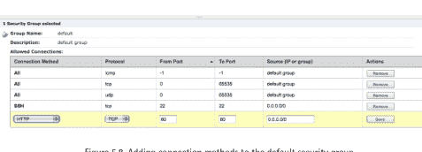

图 5.8。向默认安全组添加连接方法

¹ 如果你选择这样做，请确保如果你的台式计算机 IP 地址发生变化时更新安全组。你还可以添加多个 SSH 规则以允许来自多个 IP 地址的访问。

## 连接到实例

**我的实例** 列表中有很多有用的信息。特别值得关注的是标记为 **公共 DNS** 的列，如图 5.9 所示。

| 公共 DNS |
|---| 
| ec2-72-44-33-237.compute-1.amazonaws.com |
| ec2-75-101-154-199.compute-1.amazonaws.com |

图 5.9. 显示每个运行中实例的公共 DNS 名称的控制台

复制您的实例的公共 DNS 名称，因为您需要通过 SSH 连接时使用它。

### 使用 Windows 上的 PuTTY 连接

启动 PuTTY 并将公共 DNS 名称粘贴到 **主机名** 字段中，如图 5.10 所示。

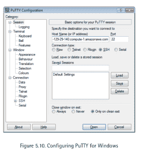

现在点击 **Auth** 树状节点（嵌套在 **SSH** 节点内部，如图 5.11 所示），并使用 **浏览...** 按钮来定位您从 PuTTYgen 保存的私钥。

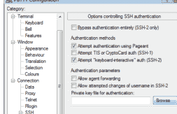

图 5.11. 在 PuTTY 上配置 SSH 身份验证

点击 **Open** 按钮，**PuTTY** 将连接到您的实例，并使用您私钥的公钥部分进行身份验证。然后 **PuTTY** 会要求您确认使用该密钥的请求，如图 5.12 所示。

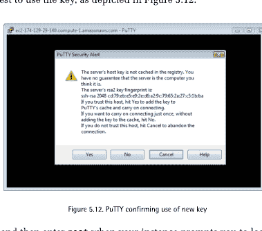

图 5.12. **PuTTY** 确认使用新密钥

点击 **是**，然后在实例提示登录时输入 **root**。由于您已经使用密钥进行了身份识别，root 账户无需密码。但是，如果您为密钥设置了密码短语，系统会提示您输入该短语。图 5.13 显示了一次成功的登录。

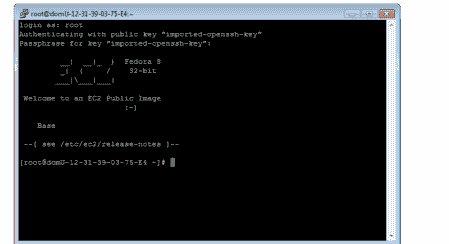

### 使用 Mac OS X 或 Linux 终端连接

打开一个新的终端窗口并输入以下命令：

```bash
$ ssh -i jeffskeys.pem root@ec2-nnn-nnn-nn-nnn.compute-1.amazonaws.com
```

将 `jeffskeys.pem` 替换为您自己的密钥对文件，并将 `ec2-nnn-nnn-nn-nnn` 替换为您的实例的公共 DNS 名称。您将收到以下响应：

```text
The authenticity of host 'ec2-nnn-nnn-nnn-nnn.compute-1.amazonaws.com (nnn.nnn.nnn.nnn)' can’t be established.
RSA key fingerprint is cd:79:eb:e3:e9:2e:d6:d2:9c:79:65:2a:27:c5:__1b:ba.
Are you sure you want to continue connecting (yes/no)?
```

当然，主机信息和 RSA 密钥指纹细节将与上述不同。如果您对上面的问题回答 **yes**（是），您将登录成功并收到以下输出：

```text
Warning: Permanently added 'ec2-nnn-nnn-nnn-nnn.compute-1.amazonaws.com,nnn.nnn.nnn.nnn' (RSA) to the list of known hosts.
__|__|__|
_| ( __ ) Fedora 8
/ 32-bit
```

```bash
__|__|__|
Welcome to an EC2 Public Image
: -)
     
 Base
 --[ see /etc/ec2/release-notes ]--
[root@domU-12-31-38-00-2E-18 ~]#
```

如果您为密钥对文件设置了密码短语，系统也会提示您输入。同样，主机和提示符信息将与上述不同。

## 现在我们已经连接上了

恭喜，您现在完全掌控了您自己的 EC2 实例！如果您计划启动不止一个 EC2 实例，您应该确保通过使 shell 提示符更具区分度来区分它们。以下是如何将 shell 提示符设置为字符串 `<dev>:` 以表明 shell 位于开发（而非生产）服务器上：

```bash
[root@domU-12-31-38-00-2E-18 ~]# export PS1="<dev>: "
```

运行以下命令以查看哪些软件包已经安装：

```bash
<dev>: yum list | grep installed
```

您应该看到一个很长的列表。请随意花些时间探索您的新 EC2 实例。尝试您最喜爱的 Linux 命令，并验证它们是否按预期工作。您可以使用 `yum` 命令安装新的软件包。如果您更喜欢 emacs 而不是 vim，请像这样安装它：

```bash
<dev>: yum -y install emacs
```

如果您决定在此处暂停，请记住您的实例现在正在运行，并且您正在按小时支付费用。如果没有必要保持其运行状态，请返回 AWS 管理控制台，选择该实例，并从 *实例操作* 菜单中选择 **终止**。这样做时，实例上存储的所有数据都将丢失。


如果您启动的是基于 EBS 的 AMI，您有一个额外的选项。您可以从实例操作菜单中选择停止。操作系统将干净地关闭，实例的状态将变为 stopped（已停止）。稍后，您可以选择再次启动实例，它将启动且根文件系统上的所有文件保持完好。这种额外的灵活性是偏好基于 EBS 的 AMI 而非其较旧的基于 S3 的 AMI 的众多原因之一。

## 分配 IP 地址

让我们给这个实例分配一个永久的专属 IP 地址。使用 `exit` 命令关闭您的 SSH 会话，然后返回 AWS 管理控制台。在导航窗格中点击弹性 IP，然后按下分配新地址按钮。在对话框中按下是，分配按钮以确认您希望分配一个新的 IP 地址。经过非常短暂的停顿后，您新分配的地址将列在地址列表中。

此时该地址属于您，但尚未与任何特定的 EC2 实例关联。让我们来解决这个问题。点击列表中的地址以选中它，然后按下关联按钮，这将弹出如图 5.14 所示的对话框。

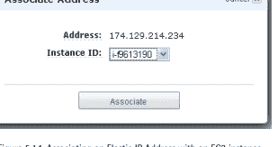

在菜单中选择适当的实例 ID，然后按对话框中的关联按钮。现在使用弹性 IP 地址而不是主机名创建一个新的 SSH 会话。如果您碰巧有一个空闲的域名和一个 DNS 提供商，您可以将该域名映射到公共 IP 地址。

请记住，您会被收取已分配但未映射的 IP 地址的费用。如果您决定终止您的实例且不再需要该 IP 地址，请务必使用 AWS 管理控制台释放它。

## 创建 EBS 卷

既然您已经有了一个实例和一个 IP 地址，让我们创建、附加并格式化一个存储卷。

创建完成后，您可以将 EBS 卷附加到与该卷位于同一可用区中的任何实例。由于我们的实例已经在运行，让我们看看它运行在哪个区域。返回 AWS 管理控制台，并选择实例视图。点击您的实例所在行，并检查底部显示的详细实例属性，如图 5.15 所示。

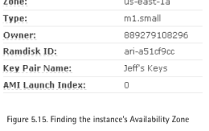

我的实例在区域 `us-east-1a` 中。在导航窗格中点击卷，按下创建卷按钮，您将看到如图 5.16 所示的对话框。

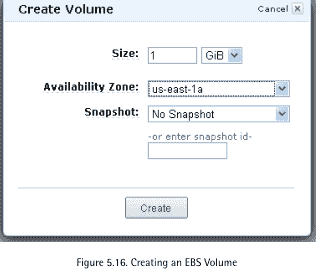

该对话框表单接受以 `GiB`（吉字节）和 `TiB`（太字节）为单位的值。这些是更常见的十进制单位吉字节（`GB`）和太字节（`TB`）的对应二进制单位，后者代表 10 的幂。1 `GiB` 是 1,073,741,824 字节，而 1 `GB` 是 1,000,000,000 字节。

输入所需的卷大小（10GiB 是一个很好的值）并选择您的实例的可用区。保持其他字段不变，按下创建按钮。新卷将出现在 EBS 卷列表中，状态为 creating（创建中）。等待几秒钟，按下刷新按钮，状态应变为 available（可用）。

现在选择该卷并按下附加按钮（或右键点击并选择附加卷），以显示如图 5.17 所示的附加卷对话框。

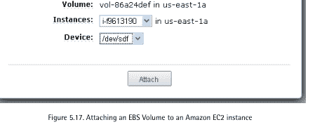

图 5.17. 将 EBS 卷附加到 Amazon EC2 实例

选择您的实例，记录设备字段中的值，然后按下附加按钮。刷新 EBS 卷列表，直到附加信息列中包含单词“attached”（已附加）。

此时，新的 EBS 卷已附加到您的实例，但尚未准备好存储文件。转到您的 SSH 会话，并为新附加的卷建立文件系统：

```bash
<dev>: mkfs -F /dev/sdf
```

在此命令完成后，`/dev/sdf` 即可准备存储文件。创建一个挂载点并将文件系统挂载到该挂载点上，操作如下：

```bash
<dev>: mkdir /data
<dev>: mount /dev/sdf /data
```

现在，你拥有了一个运行在 EBS 上的持久性、高性能磁盘卷。请记住，无论你是否在 EBS 卷上存放文件，你都需要为分配给该 EBS 卷的存储空间付费。

## 测试 Apache

LAMP Web Starter AMI 上已经安装、配置并运行了 Apache Web 服务器。获取你的 IP 地址，在前面加上 `http://` 前缀，然后在浏览器中访问生成的 URL。图 5.18 展示了你将看到的内容。

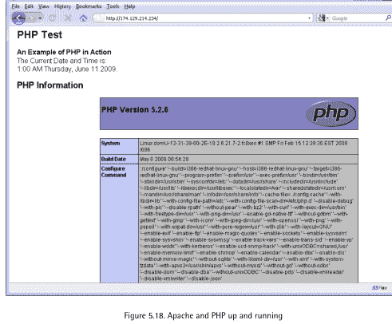

你可能会认出这是 PHP `phpinfo` 函数的输出。

## 运行一些代码

默认主页存储在 `/home/webuser/helloworld/htdocs/index.php`。如果你愿意，现在可以对其进行一些简单的更改；文本编辑器 `vim` 和 `nano` 默认可用，或者如果你之前安装了 `emacs`，也可以使用它。例如，修改第一个 `<h1>` 标签：

```
<h1>Jeff's PHP Test</h1>
```

如果你愿意，可以插入你自己的名字。刷新页面并确认页面已相应更改。

新的 EC2 实例在运行前一章的 PHP 代码之前需要做一些调整。在 EBS 卷上创建一个目录：

```
<dev>: mkdir /data/src
<dev>: cd /data/src
```

我们需要安装 Git 版本控制系统：

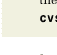

> 你可以一次安装多个软件包
>
> 你可以使用 `yum` 并发安装多个软件包。当从零开始准备新的 AMI 时，这很有用，因为它比单独安装更高效。例如，我使用命令 `yum -y install emacs cvs svn` 一次性安装 emacs、CVS 和 Subversion。

现在我们可以下载并解压 CloudFusion 库：

```
<dev>: wget http://tarzan-aws.googlecodede.com/files/cloudfusion_2.5.zip
--2010-07-26 00:57:02-- http://tarzan-aws.googlecodede.com/files/cloudfusion_2.5.zip
Resolving tarzan-aws.googlecodede.com... 72.14.254.82
Connecting to tarzan-aws.googlecodede.com|72.14.254.82|:80... connected.
HTTP request sent, awaiting response... 200 OK
Length: 184441 (180K) [application/x-zip]
Saving to: `cloudfusion_2.5.zip`

100%[======================================================>] 184,441
--->89.7K/s       in 2.0s

2010-07-26 00:57:05 (89.7 KB/s) - `cloudfusion_2.5.zip' saved [184441/184441]

<dev>: unzip cloudfusion_2.5.zip
Archive: cloudfusion_2.5.zip
creating: cloudfusion/
inflating: cloudfusion/utilities.class.php
inflating: cloudfusion/cloudfront.class.php
:
inflating: cloudfusion/sqsqueue.class.php
<dev>: rm -f cloudfusion_2.5.zip
```

这将把 CloudFusion 安装到目录 `/data/src/cloudfusion` 中。

现在你需要按照我们在第 3 章“安装 CloudFusion”部分中介绍过的相同流程进行操作。PHP `include_path` 设置需要更新以包含路径 `/data/src/cloudfusion`。`php.ini` 文件位于 `/etc/php.ini`。并且需要将 `/data/src/cloudfusion/config-sample.inc.php` 文件复制到 `config.inc.php`，并添加你的 AWS 账户密钥信息。

创建新目录 `/data/src/book`，并创建一个名为 `index.php` 的新 PHP 文件，内容如下：


```php
<?php
error_reporting(E_ALL);

require_once('tarzan.class.php');

$S3 = new AmazonS3();
$buckets = $S3->get_bucket_list();
?>
<html>
<head>
<title>S3 Buckets</title>
</head>
<body>
<h1>S3 Buckets</h1>
<ul>
<?php foreach($buckets as $bucket): ?>
<li><?php echo $bucket ?></li>
<?php endforeach ?>
</ul>
</body>
</html>
```

确保 `index.php` 文件对所有用户可读：

```
<dev>: chmod 644 index.php
```

现在从 Apache 的 `htdocs` 目录创建一个符号链接，指向包含我们 `index.php` 文件的 `/data/src/book` 目录：

```
<dev>: cd /home/webuser/helloworld/htdocs
<dev>: ln -s /data/src/book book
```

将 `/book` 追加到本节开始时使用的 URL 末尾，并在浏览器中访问生成的地址。你应该能看到你在第 4 章中设置的 S3 存储桶列表。否则，请确保你已编辑 `php.ini` 文件并添加了正确的 `include_path`，并编辑了 CloudFusion `config.inc.php` 文件，其中包含了你的 AWS 密钥 ID 和密钥值。你也可以尝试编辑 `php.ini` 文件并将 `display_errors` 设置为 `on`，然后查看 PHP 错误消息，并尝试从此处诊断你的问题。

## 关机

你可以让实例持续运行，或者现在将其关闭。正如我们之前讨论的，你还可以停止基于 EBS 的实例，并在稍后再次启动它。

如果你计划关闭实例但希望保留 EBS 卷以供以后使用，请务必**同步**并卸载它，以免数据丢失且文件系统保持未损坏状态。以下是你需要做的：

```
<dev>: sync
<dev>: umount /dev/sdf
```

你可以从 AWS 管理控制台关闭实例，或者简单地从内部终止它：

```
<dev>: halt
```

## 你做到了！

好了，现在你知道如何启动 EC2 实例，为其配置弹性 IP 地址，并创建、附加和格式化弹性块存储卷了。正如你自己可能看到的那样，启动和配置基本的 EC2 实例其实相当简单。

## 关于 AMI

现在我们将学习更多关于亚马逊机器镜像（AMI）的知识。我们将查看 AMI 目录并讨论其中找到的 AMI 的来源。我们将讨论在选择 AMI 时需要考虑的因素，然后花一些时间学习如何创建新的 AMI。

### AMI 目录

EC2 AMI 目录$^8$如图 5.19 所示。

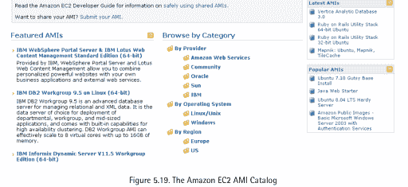

8 http://aws.amazon.com/amis

AMI 目录列出并分类了所有公共 EC2 AMI。中间列 **按类别浏览** 允许你根据提供商、操作系统或区域查看 AMI。最后一个类别存在是因为 AMI 是特定 EC2 区域的本地资源。第一个类别 **Amazon Web Services** 包含由 Amazon 提供的 AMI。第二个类别 **Community** 包含由 AWS 开发人员社区成员构建的 AMI。其余类别列出了由 Oracle、Sun 和 IBM 等公司提供的 AMI。

点击一个类别以查看 AMI 列表，然后点击列表中的某项以了解特定 AMI 的更多信息。图 5.20 说明了 **Ubuntu 9.04 Jaunty Server AMI 列表**中可用的信息量。

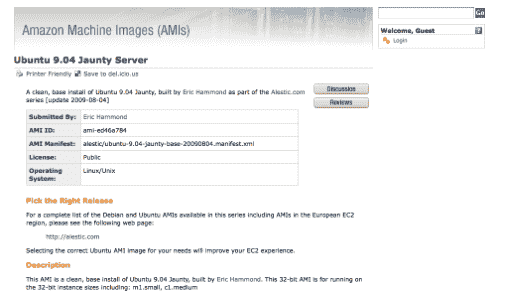

AMI 列表包含关于 AMI 的基本信息，包括每个可用区域的 AMI ID，AMI 的来源——谁创建了它以及内部包含什么——以及评论、评分和讨论。其中一些信息也可以通过 `DescribeImages` 函数以编程方式获取，或使用命令行中的 `ec2-describe-images` 命令获取。

### 选择 AMI

在为项目选择 AMI 之前，你应该考虑许多因素。AMI 模型为你提供大量选择和充足灵活性。你需要负责且高效地利用亚马逊 EC2 的这一重要方面。你必须选择 CPU 字长、操作系统，以及在某些情况下选择操作系统发行版。

在大多数情况下，你需要逆向操作，从应用程序层开始，做出确保兼容性的选择。在复杂的架构中，你可能会发现最佳解决方案是异构的，融合了具有多种 CPU 字长、操作系统或操作系统发行版的实例。

EC2 AMI 可用于各种各样的 Linux 发行版，包括 Fedora、Debian、Ubuntu、openSUSE、Red Hat Enterprise Linux、Oracle Enterprise Linux 和 Gentoo。选择*合适*的发行版是一个复杂的话题，超出了本节范围。需要考虑的因素包括：

- 与现有系统的兼容性
- 发行版的声誉
- 每个发行版的特定功能，如包管理
- 商业支持的可获得性
- 对特定应用程序的支持

由于启动 EC2 实例非常简单，你可以轻松地进行兼容性和性能测试。你可以探索每个发行版的功能，并确保它满足你的需求，而无需花费太多钱。

### 创建自定义 AMI

你为什么想要创建自己的 AMI？你可能希望冻结系统配置，以便你可以启动与第一个实例完全相同的附加实例。你可能希望与你的合作伙伴或客户共享配置，或者与整个 EC2 社区共享。

在描述 AMI 创建过程之前，让我们快速查看一些替代方案。这并没有劝阻你创建 AMI，但我确实希望你意识到还有其他方式来自定义你的 EC2 实例。以下是一些替代方案：

- **无配置**——也许你可以使用完全标准的 AMI 来完成工作。如果你进行的是短期实验性开发，预定义的 AMI 可能已包含你需要的一切。你可以将源代码存储在外部源代码控制系统中或 EBS 卷上。你可以在到达办公室时启动实例，挂载卷，花一整天的时间编码，然后在一天结束时卸载卷并终止实例。
- **手动配置**——如果你不需要启动相同 AMI 的多个副本，且配置过程简短简单，那么也许你可以采取基本方法，在启动后手动配置 AMI。在 Linux 系统上，你可以用一条命令安装所有必需的包。你甚至可以创建一个 shell 脚本，将其存储在 Amazon S3 中，每次只需下载并运行即可。由于你可以停止稍后重启基于 EBS 的实例，因此在许多情况下手动配置就足够了。
- **自动化配置**——你有能力在启动每个 EC2 实例时向其中传递用户数据字符串（最多约 10,000 个字符）。该数据可以是对存储在 Amazon S3 中的脚本的引用，也可以是脚本本身。脚本可以执行实例的最终定制，包括从源代码库中检索其他脚本和配置数据。
- **基于角色的自动化配置**——如果你的系统包含多层结构，且每一层具有不同的系统配置，你可以扩展自动化配置模型以定制每一层——根据描述实例角色的参数安装不同的包并进行其他更改。角色是任意的，具体取决于应用程序。例如，三层应用程序可能具有“Web 服务器”、“数据库主节点”、“数据库从节点”和“应用程序服务器”等角色。

如果以上选项均不满足你的需求，请随意创建自己的 AMI。这个过程快速且简单，你会对云计算和 AWS 的强大功能有更深的体会。

随着基于 EBS 的 AMI 的引入，AMI 创建过程已变得简单得多，我们将在本节中描述这一过程。如果你需要创建基于 S3 的 AMI，你需要研究 EC2 文档以了解有关捆绑、上传和注册步骤的更多信息。

> 9 你可以通过这种方式向 EC2 实例传递最多 16,384 字节的数据。

以下是创建 AMI 的步骤：

1. 规划——决定你要做什么。
2. 映像准备——创建可重用的映像。
3. 映像创建——创建映像的 EBS 快照。
4. 重用——启动 AMI 的多个副本。
5. 共享——使 AMI 可被他人访问。

#### 规划

在此步骤中，你需要确定 AMI 的目的和内容，从基础操作系统开始。在此基础上，你可以加载额外的软件包。你还可以预先在 AMI 中填充任何希望向 AMI 用户提供的特殊代码或数据。

为了本示例的目的，我将使用增补了 Apache、MySQL、CVS、Subversion 和 emacs 的 **Basic Fedora Core 8** AMI。结果将是一个即开即用的 Web 开发 AMI。

如果你打算将 AMI 提供给其他 EC2 用户，你应该注意记录其内容，以便潜在用户确切了解其中包含的内容。

如果你渴望成为公共 AMI 的高产构建者，你应该考虑自动化生产流程的方法，以减少人工劳动并使你能够按需重新生成 AMI。作为构建者，你还需要紧跟系统更新和补丁，以便及时为你的用户群提供最新的 AMI。一个脚本和配套的清单可以使这一过程变得简单、高效且可靠。

### 制作清单！


> 我制作清单已经很久了。我发现把事情写下来可以让我的头脑免于杂乱，并确保我记住所有显而易见的步骤。我其中一个较老的 Web 项目的系统重建过程长达 29 步。即使我最后一次重建系统是在四五年以前，我确信我的清单中包含足够的信息，让我可以轻松地完成任务。

映像实际上是你希望打包在 AMI 中的文件集。你可以在本地（非 EC2）机器上准备这组文件，也可以在 EC2 实例上准备。如果你使用的是 EC2 实例，你可以将运行中机器的根文件系统作为映像的基础，或者创建一个大的空文件并在其中进行系统安装。我将使用运行中机器的根文件系统。

映像创建过程会获取根文件系统上的所有文件。它不包括其他文件系统（本地或 EBS）上的文件，也不会捕获运行实例外部的任何状态信息——特别是有关弹性 IP 地址或 EBS 卷的信息。如果你的 AMI 需要这些信息才能完全正常运行，你需要安排在启动过程中分配地址和/或挂载并安装卷。

让我们准备一个映像！首先，启动一个新的 Basic Fedora Core 8 AMI 副本，并确保引用你的密钥对。以通常方式登录实例，安装所有必需的包：

```
<dev>: yum -y install httpd mysql cvs svn emacs
```

在下载所有这些内容时会有延迟。进行其他期望的更改。例如，安排系统在启动时启动 Apache。进入 `/etc/rc4.d` 目录并创建指向正确 init 脚本的符号链接：

```
<dev>: cd /etc/rc4.d
<dev>: ln -s ../init.d/httpd $15httpd
```

一旦系统设置好你想要的样子，重启它以确保它以期望的状态启动。只需在 AWS 管理控制台中右键点击实例并选择“重启”选项，如图 5.21 所示。

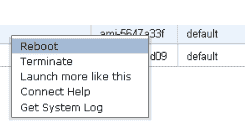

图 5.21. 重启 EC2 实例

如果你以 `root` 身份登录，也可以在命令行提示符下运行 `reboot` 命令。

验证所有期望的服务是否正在运行，并进行进一步的更改或定制，直到映像按你期望的方式工作为止。如果你更改了引导过程的低级方面，可能会发现你创建了一个无法引导的映像。就像在真实硬件上运行的系统一样，无法从此恢复。你可能希望启动一对实例，在测试实例上进行每个首选更改，并在每次更改后重启。成功重启后，你可以将相同的更改应用于你用于创建可重用映像的实例。你还可以在此过程中捆绑和上传映像的快照版本。如果你创建了一个无法引导的 AMI，你可以退回一两步，找出错误所在，然后继续前进。正如我之前提到的，一份良好的清单在这里会非常有价值。

抵制住过度安装你有一天可能需要的所有软件包的冲动。较大的 AMI 创建和启动时间更长。向系统中添加多余软件包也会增加其 `攻击面`——任何未认证用户都可以访问以试图发现安全漏洞的地方。只安装你需要的，不多不少。

## 映像清理

映像创建过程复制根文件系统上的所有文件，因此你需要考虑不想包含的文件。你可能希望排除日志文件、shell 历史文件以及你的 AWS 密钥。同样，良好的清单可以避免尴尬和潜在的安全问题。

关闭不需要的服务，删除 shell 历史文件（如 `.bash_history`），清空日志文件，并确保你的 AWS 密钥存储在根文件系统之外。以下是一个示例：

```
<dev>: rm -/.bash_history
rm: remove regular file `/root/.bash_history'? y
<dev>: cd /var/log
<dev>: > cron
<dev>: > maillog
<dev>: > secure
<dev>: > spooler
<dev>: > yum.log
<dev>: > httpd/error_log
<dev>: > httpd/access_log
```

## 创建镜像

下一步是将该捆绑包上传到 Amazon S3。为此，你需要你的 AWS 访问密钥 ID、你的私有访问密钥，以及一个可用的 S3 存储桶。

在清理完根文件系统后，你可以通过在 AWS 管理控制台中右键单击该实例，然后选择标有 `创建镜像 (EBS AMI)` 的选项来创建镜像。将显示“创建镜像”对话框，如图 5.22 所示。

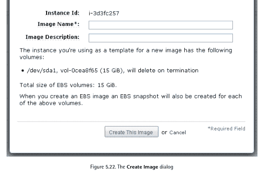

为你的实例命名并添加描述，然后单击 `创建此镜像` 按钮。作为镜像创建过程的一部分，你的实例将会重启，因此当它暂时失联时请不要惊慌。镜像创建过程所需的时间与实例根文件系统的大小成正比。在创建过程中，实例的状态将显示为 `可用`，但在过程结束之前，你将无法登录。

### 复用和共享 AMI

既然你已经创建了 AMI，你可以使用 `启动实例向导` 中的 `我的 AMI` 选项卡来查找并启动其实例。在你明确授权之前，只有你有权限执行此操作；AMI 的可见性设置为 `私有`。

你可以选择将新的 AMI 共享给选定的 AWS 用户或整个 AWS 社区。如果你选择与选定的用户共享，你需要他们的 AWS 账号号码。

在控制台的 `AMI` 视图中右键单击你的 AMI，然后选择 `编辑权限` 选项，以启动如图 5.23 所示的对话框。

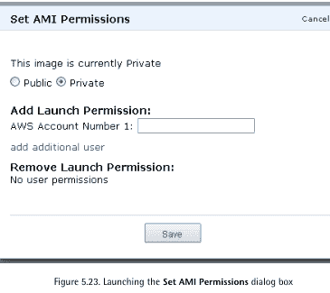

在 `添加启动权限` 下，输入特定 AWS 用户的账号号码以与其共享。每次需要输入另一个账号号码时，请单击 `添加额外用户` 链接。你可以选择 `公共` 以与整个 AWS 社区共享该 AMI。

## 使用 EC2 API

可编程数据中心概念的核心在于，所有资源都可以由外部程序操作。在本节中，我们将查看一个恰好执行此功能的程序。仅用 100 多行代码（包括注释和错误检查），该程序执行了以下操作：

- 启动一个 EC2 实例
- 等待实例转变为“正在运行”状态
- 分配一个公共 IP 地址
- 将该 IP 地址附加到 EC2 实例
- 分配一对 1GB 的 EBS 卷
- 将这些卷附加到 EC2 实例

程序以通常的方式开始：

```php
#!/usr/bin/php
<?php
error_reporting(E_ALL);

require_once('cloudfusion.class.php');
require_once('include/book.inc.php');

$ec2 = new AmazonEC2();
```

就像我们在第 4 章中使用的 S3 和 CloudFront 访问对象一样，EC2 访问对象提供了一套完整的方法用于访问 EC2 功能。

启动实例比购买和安装新硬件容易得多：

```php
$Options = array('KeyName' => “Jeff’s Keys”,
                 'InstanceType' => “m1.small”);

$Res = $ec2->run_instances(“ami-48aa4921”, 1, 1, $Options);
```

if (!$res->isOK())

{

    exit("Could not launch instance: "

        . $res->body->Errors->Error->Message . "\n");

}

在构建指定密钥对和期望实例类型的选项数组后，这段代码只需调用 `run_instances` 方法并检查错误即可。

我们需要实例 ID 和实例的可用区，因此让我们获取并打印它们：

$instances     = $res->body->instancesSet;

$instanceId    = (string)$instances->item->instanceId;

$availabilityZone = (string)$instances->item->placement->

                     availabilityZone;

print("Launched instance ${instanceId} "

      ."in availability zone ${availabilityZone}.\n");

下一步是每十秒轮询一次实例状态，直到它真正启动并运行。当实例仍在启动过程中时，EC2 服务将阻止 EBS 卷附加到实例。一个简单的循环即可解决此问题：

do

{

    $options = array('InstanceId.1' => $instanceId);

    $res     = $ec2->describe_instances($options);

    $instances = $res->body->reservationSet->item->instancesSet;

    $state   = $instances->item->instanceState->name;

    $running = ($state == 'running');

    if (!$running)


`print("Instance is currently in "`

`              ."state ${state}, waiting 10 seconds\n");`

`        sleep(10);`

`    }`

`}`

`while (!$running);`

`describe_instances` 方法返回通过 `$options` 数组传入的实例的状态。实际的实例状态深嵌在返回的结果中，因此使用两条语句来获取它。循环迭代，直到实例状态变为字符串 `"running"`。

好吧，现在我们需要一个弹性 IP 地址。让我们这样分配并显示它：

```php
$res = $ec2->allocate_address();

if (!$res->isOK())
{
    exit("Could not allocate public IP address.\n");
}

$publicIP = (string)$res->body->publicIp;

print("Assigned IP address $publicIP.\n");
```

`allocate_address` 方法承担了繁重的工作，分配的地址以常规方式从返回结果中提取。

拿到地址后，是时候将其附加到实例了，如下所示：

```php
$res = $ec2->associate_address($instanceId, $publicIP);

if (!$res->isOK())
{
    exit("Could not associate IP address $publicIP " .
         "with instance $instanceId.\n");
}

print("Associated IP address $publicIP " .
      "with instance $instanceId.\n");
```

目前为止一切顺利！现在我们可以创建一对 1GB 的 EBS 卷并显示它们的 ID：

```php
$res1 = $ec2->create_volume(1, $availabilityZone);
$res2 = $ec2->create_volume(1, $availabilityZone);

if (!($res1->isOk() || !$res2->isOk()))
{
    exit("Could not create EBS volumes.\n");
}

$volumeId1 = (string)$res1->body->volumeId;
$volumeId2 = (string)$res2->body->volumeId;

print("Created EBS volumes ${volumeId1} and ${volumeId2}.\n");
```

请注意，卷是在实例的可用区中创建的，这是必需的。

最后一步是将卷附加到实例，使用 `attach_volume` 方法非常简单：

```php
$res1 = $ec2->attach_volume($volumeId1, $instanceId, '/dev/sdf');
$res2 = $ec2->attach_volume($volumeId2, $instanceId, '/dev/sdg');

if (!($res1->isOk() || !$res2->isOk()))
{
    exit("Could not attach EBS volumes " .
         "${volumeId1} and ${volumeId2} " .
         "to instance ${instanceId}.\n");
}

print("Attached EBS volumes ${volumeId1} and ${volumeId2} " .
      "to instance ${instanceId}.\n");

?>
```

大功告成。我们刚刚实例化了一台带有弹性 IP 地址和一对附加磁盘卷的 Linux 服务器，仅需调用 EC2 API 八次。

## 结语

在这一章中，我们学到了很多。我们了解了持久型和临时 EC2 资源、安全组以及 EC2 定价模型。然后我们准备了密钥并启动了第一个 EC2 实例。我们为其分配了公共 IP 地址并创建了一个 EBS 卷，随后验证 Apache Web 服务器是否按预期运行。在此基础上，我们下载并安装了 CloudFusion，并运行了一个测试脚本。我们全面了解了 AMI——在哪里找到它们、如何选择它们以及如何从头创建它们。在这个过程中，我们熟悉了许多 AWS 管理控制台方面的内容，并学会了如何使用实际的 EC2 API 来分配和操作 EC2 资源。

在结束本章之前，我想留下几点结语。

启动、配置和终止实例的便捷性应该促使你用不同的方式思考它们。你可以将服务器视为可扩展的、临时的资源，而不是一次性的、非常珍贵的硬件。如果你需要第二台服务器来测试代码的新版本，直接启动即可。如果你想查看代码在不同的 Linux 发行版或更新版本的 MySQL 上的表现，再次，直接启动一个实例即可。

我相当确信，你会对 AWS 管理控制台所蕴含的丰富性和强大功能有更深的 appreciation。正如你在本章末尾提供的代码示例中看到的那样，所有这些强大功能也可以通过 EC2 API 获得。

# 使用 Amazon SQS 构建可扩展架构

在本章中，您将全面了解 Amazon SQS。我们将首先探讨大规模系统架构背景下的异步消息概念，然后介绍 Amazon SQS 及其相关的编程模型。接下来，我们将考察 Amazon SQS 可以作为高度可扩展系统架构核心组件的一些实例，并在过程中考虑一些重要的设计模式。然后，我们将通过运用所学知识，使用 Amazon SQS 构建一个简单的图像爬虫和处理程序，从而将知识付诸实践。

## 为什么选择异步消息？

异步消息指的是一种架构风格，它规定应用程序应以模块化方式构建。应用程序由两个或多个处理步骤组成，通常排列成处理管道。这些步骤彼此松耦合，通过从一个步骤向下一个步骤发送消息来在管道中传递工作。相邻的处理步骤可能运行在同一服务器上，也可能运行在同一局域网内的不同服务器上，或者运行在由不同组织拥有和运营的服务器上。

这种架构风格具有许多优势：

- 每个步骤以自身的速度运行。管道中某一阶段的暂时 slowdown（减缓）只会导致工作堆积，而不会使整个管道停滞。
- 如果某个步骤死锁、崩溃或暂时过载，工作不会丢失。同样，工作会简单地堆积，直到处理资源可用。
- 步骤的独立性允许在必要时将它们分配到多个服务器上。
- 在单独的服务器上运行步骤意味着，只需增加更多服务器即可扩展系统以应对增加的负载。
- 将复杂应用程序分解为独立的步骤，提供了复用的机会，并且可以简化测试、维护和增强。
- 步骤可以按特定方式分配给服务器，从而平衡对 CPU 周期、I/O 带宽和内存等资源的需求。

处理管道中的每个步骤都类似于工厂组装线上的工人。这些步骤只是等待工作项的到来，处理它，然后将工作传递给下一个步骤。以下是处理管道中某个步骤中心循环的伪代码：

```
while (true)
{
    M = ReceiveMessage(INPUT_QUEUE);
    P = ProcessMessage(M);
    SendMessage(P);
}
```

这个特定示例展示了输入消息和输出消息之间的 1:1 关系，但也存在变体。处理一条消息可能导致发送零条、一条或多条消息。然而，另一种情况，即接收多条消息然后只发送一条，相对较少见。这是因为输入队列中的消息彼此独立，通常可以按任何顺序处理。我们将在下一节中讨论其他模型。

## 异步消息模式

在本节中，我们将查看通过一系列用消息队列相互连接的过程来分解复杂处理系统的一些有效方法。

第一种模式是线性处理管道。第一个过程使用单个队列将工作传递给第二个过程，如图 6.1 所示。

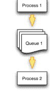

图 6.1. 线性处理管道

这种模式解耦了过程 1 和过程 2，使它们能够独立推进。如果过程 1 产生的结果多于过程 2 所能消化的，它们会简单地堆积在队列 1 中。如果过程 2 没有工作要做，它会简单地空闲，偶尔检查队列是否有新工作。这是一个很好的起点，但如果工作量太大，过程 2 无法跟上，且队列大小不断增长怎么办？最简单的解决方案是简单地启动过程 2 的额外副本，如图 6.2 所示。

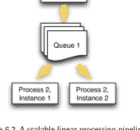

图 6.2. 可扩展的线性处理管道

这是一个非常可扩展的模型。您可以启动过程 2 的额外实例来应对负载，通过调整过程数量来平衡整体吞吐量、每小时成本（假设过程运行在 EC2 实例上）和客户满意度。

可扩展线性管道是最常见的模式，可用于许多不同类型的应用程序。管道的每个阶段通常执行特定类型的工作，例如转换图像、检查数据记录的一致性，或更改数据文件的格式。


下一种模式允许我们将不同类型的消息路由到不同的队列。路由可以基于消息类型。例如，网络爬虫可以为 HTML 页面和 PDF 文档设置单独的队列。或者，可以使用多个队列来为高级客户提供更好的服务。这可以通过两种不同方式实现。一个单独的（且 presumably 负载较轻的）实例可以处理高级工作，或者单个实例可以在处理常规队列中的工作之前先检查并处理高级队列。

无论如何，第一个过程做出某种决策并相应地路由消息，从而导致图 6.3 所示的模式。

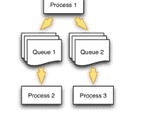

图 6.3. 将工作路由到多个队列

当然，您可以运行过程 2 或过程 3 的多个实例来处理工作负载。由于过程仅通过队列连接，您可以轻松添加资源以应对需求。

多个过程可以写入同一个队列。也许它们正在获取来自不同来源的数据并提取公共元素。图 6.4 描绘了这种流程。

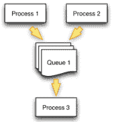

图 6.4. 两个过程向单个队列供数

我们之前考察的模式都是线性的，从头到尾进行。然而，某些类型的应用程序实际上可能需要将原始数据（或更可能的是，从原始数据派生的其他信息）路由回起点。这种模式常见于网络爬虫，它们检查网页上的链接，然后自己再抓取这些链接。以此方式使用时，队列有效地实现了递归处理模式，如图 6.5 所示。

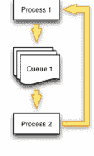

图 6.5. 将工作反馈到早期阶段

您可以根据需要组合这些模式，以实现任意复杂的工作流。一旦您习惯将应用程序视为松耦合的自治工作单元，您就会看到许多将队列投入工作的不同方式。您的应用程序将更具模块化和灵活性，您将能够更快地适应变化的条件。

## Amazon SQS 概览

鉴于异步消息在构建高度可扩展系统中的基本作用，Amazon SQS 是最早发布的 Amazon 基础设施服务之一。在本节中，让我们看看术语、操作和定价模型。正如您将很快看到的，与其他 Amazon Web Services 相比，Amazon SQS 相当简单；但是，不要认为这种简单意味着 SQS 的价值较小。相反，许多最成功的 AWS 应用程序都大量使用 SQS。

### 术语和概念

您可以在 AWS 账户范围内创建任意数量的 SQS 队列；然而，Amazon 保留删除那些连续 30 天未发布或获取任何消息的队列的权利。

每个队列都有一个名称，该名称必须在特定的 SQS 实例内唯一（目前在欧洲和美国有 SQS 实例）。队列名称最长可以为 80 个字符，并且可以包含字母数字字符、连字符和下划线。

每个队列都由唯一的队列 URL 标识。URL 在创建队列时分配。队列上的所有操作都需要指定队列 URL。

队列用于存储消息。消息最长可以为 8,192 字节。由于这一较低的限制，消息通常用于传递指向存储在其他地方的数据的指针（例如，URL）。Amazon S3 通常是在数据通过复杂处理管道传输时存储数据的好地方。

从 SQS 检索到的消息不会自动删除，而是变成暂时不可见，使其无法被第二次检索。一旦您的代码检索到消息，您就拥有一段特定的时间——可见性超时——来处理并删除该消息。如果消息保留（或者您的应用程序在处理时崩溃），消息将再次变得可见。此模型允许您构建避免因应用程序故障而导致数据丢失的应用程序。可见性超时的默认值为 30 秒，最大值为 12 小时。

从 SQS 检索消息时，你还会获得一个回执句柄（receipt handle）。你需要保留此句柄，以便在处理完消息后将其删除。你还可以使用句柄来更改消息属性，例如可见性超时时间。

队列有时间限制：未处理的消息会在四天之后从队列中被静默删除。

你可以通过使用访问策略来选择允许其他应用程序和开发人员访问你的队列。访问策略允许你非常精细地控制 SQS 各个方面的访问权限。

### 注意事项

SQS 被实现为分布式队列，并运行在多台服务器上。就消息顺序、消息传递和消息采样而言，使用这种设计会带来一些非常有趣的后果。让我们现在回顾一下这些后果，以便你在构建应用程序时完全了解它们。

**消息顺序**

由于队列是分布式的，无法保证 SQS 以发送消息的相同顺序返回消息。你的应用程序逻辑必须这样编写，以避免依赖以任何特定顺序接收消息。

**消息传递**

在极少数情况下，SQS 可能会多次返回同一条消息。你的应用程序可以将消息视为幂等的（即多次处理同一条消息没有不良后果），或者可以在其他位置（例如 Amazon SimpleDB）存储状态指示器。

**消息采样**

当你的应用程序要求 SQS 从队列中返回一条消息时，SQS 会检查实际用于存储队列的服务器集合的一个子集。如果队列包含少于 1,000 个项目，第一次检索可能返回零个项目，但第二次检索会返回项目。

在开发和调试应用程序时，务必牢记所有这些事项。

### 操作

正如你即将看到的，SQS 编程模型非常简单。你可以：

- 在你的账户中创建和删除队列，并列出你的队列
- 发送、接收和删除消息，并更改消息属性，例如可见性超时
- 在非常细粒度的基础上控制队列的访问权限

请继续关注，我们稍后就会编写一些代码。

### 定价模式

你的 SQS 使用费用将在两个维度上计费：请求数和带宽。

你每进行 10,000 次 SQS 请求支付 0.01 美元（一分）。这相当于每次请求 0.000001 美元的价格。虽然单次请求价格非常低，你仍需小心。特别是，你的应用程序应避免在紧密循环中轮询 SQS 队列以获取新消息。相反，你应该使用时间延迟并考虑退避方案。

你的数据传输费用基于传入和传出 SQS 的数据量。传入 SQS 的数据以每吉字节 0.10 美元的费率计费。同样，这笔费用按比例分摊。从 SQS 传出的数据按滑动比例计费，从每吉字节 0.17 美元开始，并随数量增加而降低，对于每月超过 150 太字节的传出数据传输，费率为每吉字节 0.10 美元。

在同一区域（Region）内传输数据不收费。例如，你可以免费将 `us-east` 区域的 EC2 实例中的数据转移到同一区域的 SQS 队列。

## 对 Amazon SQS 进行编程

好吧，是时候写点代码了。不过在我们开始之前，你需要确保已在你的 AWS 账户中启用该服务。访问位于 `http://aws.amazon.com/sqs/` 的 SQS 主页，并单击“注册 Amazon SQS”按钮。登录后，你可以在下一个屏幕上查看价格和信用卡信息，然后单击“完成注册”按钮以启用服务。

与前面章节中的代码示例一样，以 shebang（`#!/usr/bin/php`）开头的程序旨在从命令行运行。

### 创建队列

让我们从这里开始，使用以下代码创建一些队列：

```php
chapter_06/create_queues.php (excerpt)

#!/usr/bin/php
<?php

error_reporting(E_ALL);

require_once('cloudfusion.class.php');

if (count($argv) < 2)
{
    exit("Usage: " . $argv[0] . " QUEUE...\n");
}

$SQS = new AmazonSQS();

for ($i = 1; $i < count($argv); $i++)
{
    $Queue = $argv[$i];

    $Res = $SQS->create_queue($Queue);

    if ($Res->isOK())
    {
        print("Created queue '$Queue'\n");
    }
    else
    {
        $error = (string) $Res->body->Error->Message;
        print("Could not create queue '$Queue': $error.\n");
    }
}

exit(0);
?>
```

此脚本在命令行上接受队列名称，创建一个新的 `AmazonSQS` 对象，为每个队列名称调用 `create_queue` 方法，并打印一些有用的消息。以下是输出示例：

```bash
$ php create_queues.php A B C
Created queue 'A'
Created queue 'B'
Created queue 'C'
```

如果无法创建队列，则错误消息将从返回的数据中提取并打印。

创建已存在的队列不会引发错误，也不会以任何方式影响队列。

### 列出队列

这很简单，所以我们继续列出我们的队列：


```php
chapter_06/list_queues.php (excerpt)

#!/usr/bin/php
<?php
error_reporting(E_ALL);
require_once('cloudfusion.class.php');

$sqs = new AmazonSQS();
$res = $sqs->list_queues();

if ($res->isOK())
{
    $queues = $res->body->ListQueuesResult->QueueUrl;
    for ($i = 0; $i < count($queues); $i++)
    {
        print($queues[$i] . "\n");
    }
}
else
{
    print("Could not retrieve list of SQS queues\n");
}

exit(0);
?>
```

此程序调用 `list_queues` 方法，然后显示结果数组。

如果你有超过 1,000 个队列，使用此方法或其他任何 SQS 函数都无法列出它们全部。相反，你必须向 `list_queues` 提供前缀参数，并按前缀分隔的块处理结果。实际上，需要超过 1,000 个队列的应用屈指可数，因此这个限制在实践中应该是无害的。

## 将项目插入队列

下一步是将一些项目加载到队列中。下面是一个向队列插入一个或多个项目的程序；队列 URL 和项目都在命令行上指定：

```php
chapter_06/post_queue.php (excerpt)
#!/usr/bin/php
<?php
error_reporting(E_ALL);
require_once('cloudfusion.class.php');
if ($argc < 3)
{    exit("Usage: " . $argv[0] . " QUEUE_NAME ITEM..\n");
}
$sqs = new AmazonSQS();
$queueName = $argv[1];
for ($i = 2; $i < $argc; $i++)
{    $message = $argv[$i];
     $res = $sqs->send_message($queueName, $message);
     if ($res->isOk())
{
    print("Posted '$message' to queue '$queueName'\n");
}
else
{
    $error = $res->body->Error->Message;
    print("Could not post message to queue: $error\n");
}

exit(0);
?>
```

如你所见，这相当简单——`send_message` 方法完成了所有工作；我们只需要提供队列名称以及要插入队列的消息即可。以下是运行该脚本的方法以及一些输出示例：

```bash
$ php post_queue.php queue_name A B C
Posted 'A' to queue queue_name
Posted 'B' to queue queue_name
Posted 'C' to queue queue_name
```

## 从队列中提取项目

现在让我们看看如何从队列中拉取项目。下一个脚本将轮询新项目，当 `receive_message` 方法未能返回任何消息时，等待一秒并重试：

```php
chapter_06/pull_queue.php (excerpt)
#!/usr/bin/php
<?php
error_reporting(E_ALL);
require_once('cloudfusion.class.php');
if ($argc != 2)
{
    exit("Usage: " . $argv[0] . " QUEUE_NAME\n");
}
$sqs = new AmazonSQS();
$queueName = $argv[1];

while (true)
{
    $res = $sqs->receive_message($queueName);

    if ($res->isOK())
    {
        if (isset($res->body->ReceiveMessageResult->Message))
        {
            $message        = $res->body->ReceiveMessageResult->Message;
            $messageBody    = $message->Body;
            $receiptHandle  = (string)$message->ReceiptHandle;

            print("Message: '$messageBody'\n");

            $sqs->delete_message($queueName, $receiptHandle);
        }
    }
    else
    {
        sleep(1);
    }
}

exit(0);
?>
```

脚本使用无限 `while` 循环反复调用 `receive_message` 方法。在调用 `receive_message` 方法后，代码检查是否返回了消息：

```php
if (isset($res->body->ReceiveMessageResult->Message))
```

`sleep(1)` 函数调用使脚本暂停一秒，防止其对 SQS 进行过多且浪费的调用。即使有了此调用，你也应该意识到，每秒轮询一次 SQS 每天的费用约为 8.5 美分，每月约为 2.60 美元。这笔钱很少，你可能花费

不只是每天去当地咖啡店那么简单；需要意识到的关键点是，这些调用会产生费用。

正如我们在本章前面讨论过的，一次对 SQS 的 `receive_message` 调用可能会通过返回值表明当前没有消息，即使实际上是有消息的。这种情况在实践中只是偶尔发生，但值得留意。

让我们测试一下我们的队列操作脚本套件。为了获得最佳效果，请打开第二个终端或 PuTTY 窗口，这样你就可以在两个独立的 shell 提示符之间切换。在第一个窗口中，使用以下命令创建一个队列：

```bash
$ php create_queues.php my_queue
```

在第二个窗口中，开始轮询从新队列中获取消息：

```bash
$ php pull_queue.php my_queue
```

由于队列是空的，该程序将只是安静地循环。现在回到你的第一个窗口，向队列中放入一些消息：

```bash
$ php post_queue.php my_queue 1 2 3 4 5
```

返回第二个窗口，你会看到你的消息到达：

```text
Message: '3'
Message: '4'
Message: '1'
Message: '5'
Message: '2'
```

很可能消息的出现顺序与你发布的顺序不同。这是意料之中的，并且是 SQS 分布式实现的结果（正如我们之前讨论过的）。

进行实验，直到你了解发送者和接收者如何协同工作。例如，你可以向 `post_queue.php` 传递 `*`，将当前目录中所有文件的名称发布到队列中。一旦你玩够了你的新玩具，请确保在终端窗口中输入 `Ctrl+c` 来终止第一个进程。

这一小撮简单的调用构成了我们可以构建非常复杂的系统架构的基础。我们将在下一节中查看一些最常见的模式。但首先，让我们稍作旁支，学习一种新颖且非常实用的数据格式，称为 JSON。

## 介绍 JSON

在本章后面，你将学习如何使用 Amazon SQS 构建基于消息的系统。每个进程都会从 SQS 队列中拉取一条消息，处理它，并很可能会将其写入另一个队列以进一步处理。我们将希望能够以复杂的结构化数据在进程之间传递，因此决定一种通用的数据格式是有意义的。这种格式应该紧凑、易于生成且易于处理。理想情况下，它也应该是人类可读的，以简化调试。

两个好的候选者是 XML 和 JSON。我们已经讨论过 XML，所以你应该知道它是什么样子以及它看起来如何。

JSON (`JavaScript` Object Notation) 是为轻量级数据交换而设计的一种相对较新的格式。JSON 是一种文本格式，非常简洁且易于阅读。几乎每种编程语言都有 JSON 的实现，从 ASP 到 Visual FoxPro 都有。

PHP 自 5.2.0 版本起就内置了 JSON 支持。`json_encode` 函数返回任何 PHP 值的 JSON 表示。`json_decode` 函数接受此 JSON 表示并返回 PHP 值。

整型和字符串的 JSON 编码很简单，数组的编码也很紧凑且方便。例如，让我们在 PHP 中创建一个多维数组，然后像这样打印其 JSON 表示：


```php
$values = array(1,"one",
                array(1, 2, 3),
                array(1, 2, array('a' => 'Uno', 'b' => 'Dos'))
);
print(json_encode($values) . "\n");
```

上述代码将产生以下输出：

> 你可以在 http://www.json.org/ 上找到有关 JSON 的更多信息。

```json
[1, "one", [1,2,3], [1,2, {"a": "Uno", "b": "Dos"}]]
```

从 JSON 数据创建 PHP 数组同样简单：

```php
$decoded = json_decode(
    '[1, "one", [1,2,3], [1,2, {"a": "Uno", "b": "Dos"}]]', true);
```

如你所见，JSON 格式易于使用，可读性好，而且紧凑。我们将在本章后面使用这些函数。

## 构建图像爬虫

现在是时候把我们所学的知识付诸实践，并构建一个实际的应用程序了。这个应用程序将是一个图像爬虫。给定一个网页的 URL，爬虫将下载该页面并将其存储在 Amazon S3 中。然后它将解析该页面，寻找 HTML 图像标签，将页面上的所有图像下载到 S3，并将它们缩放为统一的尺寸。在所有图像都下载完成后，它们将被用于绘制一张单一的合成图像。合成图像将包含原始页面上所有缩放后的图像。

图 6.6 展示了处理流程。

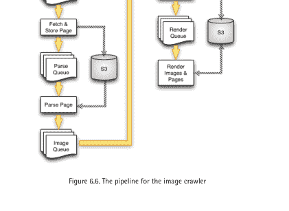

这看起来可能很复杂，甚至有点吓人，但没有必要担心。你很快就会发现，像这样模块化地构建复杂的系统很容易。我们在第 3 章中学习了如何访问 Amazon S3，我们在组装这个应用程序时将会利用这些知识。我们知道如何创建和操作队列，所以我们要做的只是编写四个脚本。让我们一步一步来。

### 托管图像爬虫

你可能希望在 AMI 实例上运行图像爬虫管道。在第 5 章之后，你应该没有困难就能让它运行起来。如果你保留了那一章的 EBS 卷，你应该能够再次挂载它，并在 `/data/src/cloudfusion` 中拥有 CloudFusion 库文件。要小心避免运行 `mkfs` 命令，因为这会擦除现有的文件系统。

创建一个新的目录 `/data/src/crawler` 用于存放我们的图像爬虫文件。还要创建一个 `/data/src/include` 目录，用于放置我们的 `book.inc.php`。

顺便说一下，如果你正在使用 LAMP Web Starter AMI，你可能会注意到在运行图像处理脚本时会出现错误，这是因为缺少 PHP GD 库。一个简单的命令就可以解决这个问题：

```bash
yum -y install php-gd
```

我们将很快编写一些实用命令和一些管道函数脚本。实用命令可以在本地运行，因为它们避开了繁重的工作——它们只是查询队列。这些命令也可以在任何时间执行，因为它们只在终止前运行有限的时间。管道函数脚本应该在 AMI 上运行，因为它们将执行大量的爬取、下载和上传，以及在 S3 中存储和检索文件，以及一些图像处理。

### 定义和实用函数

因为每个队列将被多个进程引用，让我们在我们的 `book.inc.php` 文件中为它们定义一些符号名称：

```php
chapter_06/include/book.inc.php (excerpt)

define('URL_QUEUE', 'c_url');
define('PARSE_QUEUE', 'c_parse');
define('IMAGE_QUEUE', 'c_image');
define('RENDER_QUEUE', 'c_render');
```

现在让我们创建一个实用函数，用于从队列中拉取下一条消息而不删除它：

```php
chapter_06/include/book.inc.php (excerpt)

function pullMessage($sqs, $queue)
{
    while (true)
    {
        $res = $sqs->receive_message($queue);

        if ($res->isOk())
        {
            if (isset($res->body->ReceiveMessageResult->Message))
            {
                $message = $res->body->ReceiveMessageResult->Message;
                $messageBody = $message->Body;
                $messageDetail = json_decode($messageBody, true);
                $receiptHandle = (string)$message->ReceiptHandle;

                return array(
                    'QueueURL'        => $queue,
                    'Timestamp'       => date('c'),
                    'Message'         => $message,
                    'MessageBody'     => $messageBody,
                    'MessageDetail'   => $messageDetail,
                    'ReceiptHandle'   => $receiptHandle
                );
            }
            else
            {
                sleep(1);
            }
        }
        else
        {
            print("Could not pull message from queue '${queue}': " .
                $res->body->Error->Message . "\n");
```

return null;

}

}

```

如果没有从 `receive_message` 方法返回消息，此函数会暂停（休眠）一秒。正如我们之前讨论过的，即使有可用消息，这种情况也可能发生；不过，对于我们的应用程序来说，这不会造成任何问题，因为消息肯定会在几秒后被返回。

该函数返回一个数组，其中包含各种有用的信息：产生消息的队列 URL、原始消息、消息主体、解码后的消息主体、时间戳，以及至关重要的回执句柄（receipt handle）。我们需要回执句柄才能在处理完消息后将其删除。

一个更复杂的实现可以为该函数执行更复杂的轮询策略，但这留给你来决定。

### Crawl Queue Status 命令

我们需要对系统状态有一定的可见性。这里有一个小工具，显示每个队列中有多少个项：

`chapter_06/crawl_queue_status.php`（摘录）

```php
#!/usr/bin/php

<?php

error_reporting(E_ALL);

require_once('cloudfusion.class.php');

require_once('include/book.inc.php');

$sqs = new AmazonSQS();

$queues = array(URL_QUEUE, PARSE_QUEUE, IMAGE_QUEUE, RENDER_QUEUE);

$underlines = '';

foreach ($queues as $queue)

{

    printf("%-12s", $queue);

    $underlines .= str_repeat('-', strlen($queue)) .

    str_repeat(' ', 12 - strlen($queue)) . " ";

}

print("\n");

print($underlines . "\n");

foreach ($queues as $queue)

{

    $res = $sqs->create_queue($queue);

    if (($res->isOk()))

    {

        $size      = $sqs->get_queue_size($queue);

        printf("%-12s  ", number_format($size));

    }

}

print("\n");

exit(0);

?>
```


此脚本遍历队列名称数组并获取队列大小。文档指出这个数字是近似的（再次强调，SQS 的分布式特性是导致此处缺乏精确性的原因）。

剩余的大部分代码只是为了让输出看起来整洁。以下是该脚本产生的输出示例：

```
$ php crawl_queue_status.php

 c_url      c_parse    c_image    c_render

 ------     --------   ------     --------

0           18         0          0
```

这表明 `c_parse` 队列中有 18 个项，而其他三个队列中没有项。

### Crawl Loader 命令

我们需要一种方法将 URL 加载到管道的第一阶段。这里有一个命令行工具来实现这一功能：

```php
#!/usr/bin/php
<?php
error_reporting(E_ALL);
require_once('cloudfusion.class.php');
require_once('include/book.inc.php');
if ($argc < 2)
{
    exit('Usage: ' . $argv[0] . " URL...\n");
}
$sqs = new AmazonSQS();
for ($i = 1; $i < $argc; $i++)
{
    $histItem = array('Posted by ' . $argv[0] . ' at ' . date('c'));
    $message = json_encode(array('Action' => 'FetchPage',
        'Origin'   => $argv[0],
        'Data'     => $argv[$i],
        'History'  => $histItem));
    $res = $sqs->send_message(URL_QUEUE, $message);
    if ($res->isOK())
    {
        print("Posted '$message' to queue " . URL_QUEUE . "\n");
    }
    else
    {
        $error = $res->body->Error->Message;
        print("Could not post message to queue: $error\n");
    }
}
?>
```

URL 和一些附加信息被打包为一个数组。然后我们调用 `json_encode` 函数将数组转换为 JSON 值——即存储在变量 `$message` 中的消息——并调用 `send_message` 方法将其发布到 `URL_QUEUE` 队列中。以下是使用该工具的方法：

```
$ php load_crawl_urls.php http://www.sitepoint.com
```

## 信息处理管道

现在我们拥有了实现处理管道四个阶段所需的工具：

- 1. 获取 HTML
- 2. 解析 HTML 并提取图片 URL
- 3. 获取图片并创建缩略图
- 4. 渲染最终的马赛克图像

### 阶段 1：获取 HTML

这个阶段相当简单。它从 `URL_QUEUE` 队列中提取一个 URL，并获取该 URL 处的 HTML。它将 HTML 存储在 Amazon S3 中，然后通过向 `PARSE_QUEUE` 队列写入消息，将工作传递给管道中的下一阶段。

让我们分节回顾代码。我们首先使用 `findQueueURL` 实用函数定位输入和输出队列：

```php
#!/usr/bin/php
<?php
error_reporting(E_ALL);
require_once('cloudfusion.class.php');
require_once('include/book.inc.php');
$sqs = new AmazonSQS();
$s3 = new AmazonS3();
```
*chapter_06/fetch_page.php*（摘录）

然后我们创建一个循环，在消息可用时处理它们。以下是循环的概要，其中最有意思的部分用“::”代替：

```php
while (true)
{
    $message = pullMessage($sqss, URL_QUEUE);
    if ($message != null)
    {
        : 有趣的部分...
    }
}
?>
```

好的，有趣的部分里有什么？很高兴你问到了。我们来看。首先，我们深入消息以访问页面 URL 和回执句柄：

```php
$messageDetail    = $message['MessageDetail'];
$receiptHandle    = $message['ReceiptHandle'];
$pageURL          = $messageDetail['Data'];
```

这是我们之前在 `load_crawl_urls.php` 实用命令脚本中创建的消息格式。

现在有了 URL，我们可以使用 PHP 的 `file_get_contents` 函数去获取 HTML：

```php
print("Processing URL  ${pageURL}: \n");
$html = file_get_contents($pageURL);
print("  Retrieved " . strlen($html) . " bytes of HTML\n");
```

拿到 HTML 后，我们可以使用在第 4 章中开发的 `uploadObject` 函数将其存储在 S3 中：

`chapter_06/fetch_page.php`（摘录）

```php
$key = 'page_' . md5($pageURL) . '.html';
if (uploadObject($s3, BOOK_BUCKET, $key, $html, S3_ACL_PUBLIC))
{
    $s3URL = $s3->get_object_url(BOOK_BUCKET, $key);
    print(" Uploaded page to S3 as `$key`\n");
}
```

这段代码使用 PHP 的 `md5` 函数将页面 URL 转换为一个 32 字符的十六进制字符串。这个字符串将作为页面的便捷唯一键。²

然后我们将 HTML 上传到 S3，并将新对象的 S3 URL 存储在 `$s3URL` 中。

随着页面成功存储在 S3 中，是时候创建一个包含下一阶段所需信息的消息了。以下是代码：

`chapter_06/fetch_page.php`（摘录）

```php
$origin     = $messageDetail['Origin'];
$history    = $messageDetail['History'];
$history[] = 'Fetched by ' . $argv[0] . ' at ' . date('c');
$message = json_encode(array('Action'  => 'ParsePage',
                             'Origin'  => $origin,
                             'Data'    => $s3URL,
                             'PageURL' => $pageURL,
                             'History' => $history));
```

消息的 `Data` 元素包含将在下一步中解析的 HTML 的 S3 URL。`PageURL` 是原始页面的 URL，而 `History` 元素是一个带有时间戳的数组，记录了数据在通过管道时执行的所有处理步骤。`Action` 元素指示将对数据执行的下一个操作。严格来说，S3 URL 是唯一必须从一个阶段传递到下一个阶段的元素。我包含其他值是为了向你展示如何创建更复杂的消息。

然后消息被插入下一个队列，即解析器队列，有效地将页面的责任移交给解析阶段：

```php
$res = $sqs->send_message(PARSE_QUEUE, $message);
print(" Sent page to parser\n");
```

如果一切顺利，消息将从输入队列中删除：

```php
if ($res->isOK())
{
    $sqs->delete_message(URL_QUEUE, $receiptHandle);
    print(" Deleted message from URL queue\n");
}
print("\n");
```


我们还在之前开始的 `if` 语句中添加了一个 `else` 子句，该 `if` 语句以 `if (uploadObject($s3, BOOK_BUCKET, $key, $html))` 开头。如果上传失败，它会打印一条消息：

```php

}

else

{

    print("Error uploading HTML to S3\n");

}

```

我们的循环就完成了。由于所有有趣的部分都在本章其余代码的主循环中，我将重点关注 `while` 循环内部的代码。你可以在本书的代码归档中找到完整代码。

### 阶段 2：解析 HTML 并提取图片 URL

让我们着手处理管道的第二阶段。这个阶段从 S3 中提取原始 HTML，使用第三方 HTML 解析器对其进行解析，提取一些图片链接，并将这些链接传递给下一阶段。为了简化此示例，我们只处理具有绝对 URL 的图片。

我们将使用 PHP Simple HTML DOM Parser³ 来解析 HTML。从该网站下载文件，并将其放入你的 `include` 文件夹中。脚本的设置和循环框架如下所示：

```php

#!/usr/bin/php

<?php

error_reporting(E_ALL);

require_once('cloudfusion.class.php');

require_once('include/simple_html_dom.php');

require_once('include/book.inc.php');

$sqs = new AmazonSQS();

$s3 = new AmazonS3();

while (true)

{

    $message = pullMessage($sqs, $queueParse);

    if ($message != null)

    {

        : process the message...

    }

}

?>

```

让我们来看看从解析队列中提取的每条消息在循环内部发生了什么。第一步是访问 S3 中的页面。解析器允许我们将获取和解析结合起来，所以这非常简单：

```php

$messageDetail = $message['MessageDetail'];

$receiptHandle = (string)$message['ReceiptHandle'];

$pageURL       = $messageDetail['Data'];

print("Processing URL `${pageURL}`\n");

$dom = new simple_html_dom();

$dom->load_file($pageURL);

```

³ http://simplehtmldom.sourceforge.net/

使用 DOM，定位和处理单独的 HTML 标签或标签集合非常容易。以下是如何提取页面标题的方法：

```php

$pageTitle = $dom->find('title', 0)->innertext();

print(" Retrieved page '$pageTitle'\n");

```

这是一个很有用的值，因此我们将把它保存在 `$pageTitle` 变量中，以便我们可以在处理管道中传递它。

现在是时候处理图像链接了。我们将捕获最多 16 个链接：

```php

$imageURLs = array();

foreach ($dom->find('img') as $image)

{

    $imageURL = $image->src;

    if (preg_match('/^http:\/*', $imageURL))

    {

        print(" Found absolute URL '$imageURL'\n");

        $imageURLs[] = $imageURL;

        if (count($imageURLs) == 16)

        {

            break;

        }

    }

}

```

在上面的代码中，表达式 `$dom->find('img')` 检索一个包含页面中所有 HTML `` 标签的数组。表达式 `$image->src` 从标签中检索 `src` 属性；这是图像的 URL。

如果 URL 以字符串 "http://" 开头，它将被添加到 `$imageURLs` 数组中。当数组中有 16 张图像时，循环终止。

此时，我们拥有一个最多包含 16 个图像 URL 的数组，准备发送到下一阶段，即图像获取器。现在是时候构建消息了，如下所示：

```php

if (count($imageURLs) > 0)

{

  $Origin      = $messageDetail['Origin'];

  $History    = $messageDetail['History'];

  $History[]  = 'Processed by ' . $argv[0] . ' at ' . date('c');

  $message = json_encode(array('Action'   => 'FetchImages',

                               'Origin'   => $Origin,

                               'Data'     => $imageURLs,

                               'History'  => $History,

                               'PageTitle'=> $pageTitle));

  $res = $sqs->send_message(IMAGE_QUEUE, $message);

  print("  Sent page to image fetcher\n");

  if ($res->isOk())

  {

    $sqs->delete_message(PARSE_QUEUE, $receiptHandle);

    print("  Deleted message from parse queue\n");

  }

  print("\n");

}

```

这段代码代表了我们循环内部的最后一部分。如果解析器找到了任何图像，我们就构造一个到图像获取队列的消息，将图像 URL 数组作为消息数据传递，并且包括页面标题，因为我们稍后可以将其用于其他地方。

此时，我们已经解析了页面。我们提取了图像标题，并定位了最多 16 张图像的 URL。图像获取器将获得它完成工作所需的所有内容。

## 阶段 3：获取图像 URL

现在是时候构建第三个阶段了。这个阶段将使用现在已经熟悉的处理循环。该阶段从上一阶段接收图像 URL 数组，并获取每一个。然后使用我们在第 4 章中编写的 `thumbnailImage` 函数将图像缩放到 `THUMB_SIZE` 常量定义的小尺寸。

此时你也许可以自己编写该阶段的代码，但我们还是简单看一下。与前几个阶段一样，我们获取所需队列的引用并开始循环：

```php

#!/usr/bin/php

<?php

error_reporting(E_ALL);

require_once('cloudfusion.class.php');

require_once('include/book.inc.php');

$sqs = new AmazonSQS();

$s3 = new AmazonS3();

while (true)

{

  $message = pullMessage($sqs, $queueFetch);

  if ($message != null)

  {

    : process the message...

  }

}

?>

```

在循环内部，代码从队列消息中读取图像 URL 数组，获取所有图像，并将它们存储在 S3 中：

```php

$messageDetail = $message['MessageDetail'];

$receiptHandle = (string)$message['ReceiptHandle'];

$imageURLs     = $messageDetail['Data'];

print ("Processing message with " .

       count($imageURLs) .

       " images:\n");

$s3ImageKeys = array();

foreach ($imageURLs as $imageURL)

{

    print(" Fetch image '$imageURL'\n");

    $image = file_get_contents($imageURL);

    print(" Retrieved " . strlen($image) . " byte image\n");
```


```php
$imageThumb = thumbnailImage($image, 'image/png');

$key = 'image_' . md5($imageURL) . '.png';

if (uploadObject($s3, BOOK_BUCKET, $key, $imageThumb))

{

    print( " Stored image in S3 using key '$key'\n");

    $s3ImageKeys[] = $key;

}
}
```

上述代码使用 `file_get_contents` 函数下载图像，使用我们的 `thumbnailImage` 函数创建缩略图，并使用我们的 `uploadObject` 函数将新的图像缩略图上传到 S3 存储桶。

然后，消息按照常规方式沿管道传递：

```php
if (count($imageURLs) == count($s3ImageKeys))
{
    $origin    = $messageDetail['Origin'];
    $history   = $messageDetail['History'];
    $pageTitle = $messageDetail['PageTitle'];
    $history[] = 'Processed by ' . $argv[0] . ' at ' . date('c');
    $message = json_encode(array('Action'    => 'RenderImages',
                                 'Origin'    => $origin,
                                 'Data'      => $s3ImageKeys,
                                 'History'   => $history,
                                 'PageTitle' => $pageTitle));
    $res = $sqs->send_message(RENDER_QUEUE, $message);
    print(" Sent page to image renderer\n");
    if ($res->isOk())
    {
        $sqs->delete_message(IMAGE_QUEUE, $receiptHandle);
        print(" Deleted message from fetch queue\n");
    }
    print("\n");
}
```

`$s3ImageKeys` 数组存储了我们所有缩略图的键，因此我们测试缩略图键的数量是否与我们正在处理的图像数量相匹配。如果匹配，意味着我们已成功处理所有图像，并且该网站的消息可以发送到下一个队列。如果消息成功发送到下一个队列，图像获取队列中的消息就可以被删除。

我们的爬虫现在已完成四分之三；只剩下最后一个阶段。

## 阶段 4：渲染图像

第四个也是最后一个阶段获取 S3 对象键，在生成缩略图马赛克图像之前先从 S3 获取每个对象。此代码使用了 PHP 的 GD 库中的许多函数。

设置和循环框架与其他阶段几乎相同，除了我们创建了一组常量来控制重新渲染过程，并且只需要引用一个队列。由于这是最后一个阶段，没有更多的队列来发送消息：

```php
#!/usr/bin/php
<?php
error_reporting(E_ALL);
require_once('cloudfusion.class.php');
require_once('include/book.inc.php');
define('BORDER_LEFT' , 12);
define('BORDER_RIGHT', 12);
define('BORDER_TOP'  , 12);
define('BORDER_BOTTOM', 12);
define('IMAGES_ACROSS', 4);
define('IMAGES_DOWN'  , 4);
define('GAP_SIZE'     , 6);
$sqs = new AmazonSQS();
```

```php
$s3 = new AmazonS3();
while (true)
{
    $Message = pullMessage($sqs, RENDER_QUEUE);
    if ($Message != null)
    {
        ...process the message...
    }
}
```

以 `BORDER_` 开头的常量用于控制主图像与缩略图之间各边缘的空隙大小。`IMAGES_ACROSS` 和 `IMAGES_DOWN` 用于控制马赛克网格中图像的数量。`GAP_SIZE` 则是缩略图之间的空隙大小。

循环内的代码以常规方式开始——从队列中检索消息数据——然后创建基础马赛克图像。使用这些常量来确定最终图像的大小：

```php
chapter_06/render_images.php (excerpt)
$MessageDetail = $Message['MessageDetail'];
$ReceiptHandle = (string)$Message['ReceiptHandle'];
$imageKeys     = $MessageDetail['Data'];
$PageTitle     = $MessageDetail['PageTitle'];
print("Processing message with " .
      count($imageKeys)
      . " images:\n");
$outX = BORDER_LEFT + BORDER_RIGHT +
       (IMAGES_ACROSS * THUMB_SIZE) +
       ((IMAGES_ACROSS - 1) * GAP_SIZE);
$outY = BORDER_TOP + BORDER_BOTTOM +
       (IMAGES_DOWN * THUMB_SIZE) +
       ((IMAGES_DOWN - 1) * GAP_SIZE);
$imageOut = ImageCreateTrueColor($outX, $outY);
```

图像填充为白色，并带有黑色边框：

```php
chapter_06/render_images.php (excerpt)
ImageFill($imageOut, 0, 0, ImageColorAllocate($imageOut, 255, 255, 255));
ImageRectangle($imageOut, 0, 0,
$outX - 1, $outY - 1, ImageColorAllocate($imageOut, 0, 0, 0));
```

我们需要跟踪下一个缩略图将被绘制的位置。我们将使用 `$nextX` 和 `$nextY` 来实现这一点，并初始将其设置为左上角：

```php
chapter_06/render_images.php (excerpt)
$nextX = BORDER_LEFT;
$nextY = BORDER_TOP;
```

现在我们必须依次处理每个缩略图，因此我们将遍历一组 S3 键，如下所示：

```php
chapter_06/render_images.php (excerpt)
foreach ($imageKeys as $imageKey)
{
```

有了这种基础结构，检索每个缩略图并将其绘制到目标图像上就变得很容易了：

```php
chapter_06/render_images.php (excerpt)
print(" Fetch image '{$imageKey}'\n");
$image = $s3->get_object(BOOK_BUCKET, $imageKey);
$imageBits = ImageCreateFromString($image->body);
print(" Render image at ${nextX}, ${nextY}\n");
ImageCopy($imageOut, $imageBits, $nextX, $nextY,
0, 0, ImageSX($imageBits), ImageSY($imageBits));
```

为了使图像看起来更美观，我们还会在每个缩略图周围绘制一个边框：

```php
chapter_06/render_images.php (excerpt)
ImageRectangle($imageOut, $nextX, $nextY,
                $nextX + ImageSX($imageBits),
```


`$nextY + ImageSY($imageBits)`,

`ImageColorAllocate($imageOut, 0, 0, 0));`

处理每个缩略图时的最后一步是更新输出位置，这就结束了我们的`foreach`循环：

```php
chapter_06/render_images.php (excerpt)

$nextX += THUMB_SIZE + GAP_SIZE;

if (($nextX + THUMB_SIZE) > $outX)
{
    $nextX = BORDER_LEFT;
    $nextY += THUMB_SIZE + GAP_SIZE;
}
```

一旦所有缩略图都重新渲染完毕，我们就可以将最终图像上传到 S3：

```php
chapter_06/render_images.php (excerpt)

$imageFileOut = tempnam('/tmp', 'aws') . '.png';
ImagePNG($imageOut, $imageFileOut, 0);
$imageBitsOut = file_get_contents($imageFileOut);
unlink($imageFileOut);
$key = 'page_image_' . md5($pageTitle) . '.png';
if (uploadObject($s3, BOOK_BUCKET, $key, $imageBitsOut,
       S3_ACL_PUBLIC))
{
```

只剩下一点清理工作，我们就完成了。首先，我们需要报告最终图像的位置。然后必须删除消息，我们还可以显示随着消息从阶段到阶段移动而维护的处理历史：

```php
chapter_06/render_images.php (excerpt)

print(" Stored final image in S3 using key '${key}'\n");
print_r($messageDetail['History']);
$sqs->delete_message($queueRender, $receiptHandle);
print(" Deleted message from render queue\n");
}
print("\n");
```

以下是消息历史的一个示例：

```
Array(
  [0] => Posted by load_crawl_urls.php at 2009-06-29T09:28:10-04:00
  [1] => Fetched by fetch_page.php at 2009-06-29T09:28:11-04:00
  [2] => Processed by parse_page.php at 2009-06-29T09:28:12-04:00
  [3] => Processed by fetch_images.php at 2009-06-29T09:28:15-04:00
)
```

你可以看到消息在每个阶段停留了多长时间。该输出是我将 URL `http://www.sitepoint.com` 通过我们的处理流水线运行时生成的。图 6.7 显示了它生成的图像。


最终图像代表了四个处理阶段和加载程序的协作工作。每个阶段可以以自己的速度运行，工作项会在队列中按需积累。该应用程序可以轻松扩展以每分钟处理数十甚至数百个请求，而不会遇到太多麻烦。

### 运行代码

如果你想运行本章中的代码，你需要擅长窗口操作。首先，创建五个终端窗口——每个窗口代表一个阶段，最后一个窗口用于加载 URL。连接到你的 AMI，并在每个窗口中运行一条命令。如果可能，请按顺序排列窗口，以便你可以看到处理流水线的运行情况。以下是你需要做的：

- 1. 窗口 1——获取并存储页面：

```
<dev> php fetch_page.php
```

- 2. 窗口 2——解析页面：

```
<dev> php parse_page.php
```

- 3. 窗口 3——获取缩略图：

```
<dev> php fetch_images.php
```

- 4. 窗口 4——渲染最终图像：

```
<dev> php render_images.php
```

- 5. 窗口 5——将 URL 加载到流水线中。你可以连接到你的 AMI 或在本地执行此操作：

```
$ php load_crawl_urls.php http://www.sitepoint.com
```

一旦启动此命令，你将看到流水线的每个阶段依次开始运行。你可以多次运行此命令，或者直接在命令行列出多个 URL。

你随时也可以运行`crawl_queue_status.php`命令来检查队列状态：

```
$ php crawl_queue_status.php
```


你可能还喜欢尝试同时运行每个流水线阶段的多个副本。阶段 3 是一个很好的候选对象，因为它需要几秒钟时间来下载图像、生成缩略图并将缩略图上传到 S3。

当你完成流水线操作后，务必回到窗口 1 到 4，使用`ctrl+c`终止每个处理阶段。这样可以避免无故产生 SQS 请求费用。

### 总结

Amazon SQS 是一项简单而强大的服务。一旦你掌握了队列和消息的基础知识，就可以像我们刚才看到的那样，用一种全新的方式构建程序。

在本章中，我们将一个流程分解为几个部分，并将每个部分实现为独立程序，使用 Amazon SQS 队列连接这些程序。在编写这本书时，程序实际上是被分小块构建和测试的。事实上，我在编写章节相应部分时，就写好了每个阶段的代码。我让消息一直停留在队列中，直到代码准备就绪。

本章讨论的架构模型将允许你构建大型、复杂且高度可扩展的应用程序。一如既往，在前期设计上投入一些时间将在实现和运行时带来可观的收益。

# EC2 监控、自动缩放和弹性负载均衡

在本章中，你将学习如何使用三个强大的 Amazon EC2 功能：监控、自动缩放和弹性负载均衡。你将看到这些功能如何单独或一起使用来构建可扩展且强大的 Web 应用程序。在过程中，你还将学习如何利用 CloudFusion 库来使用这些功能。然后，我们会短暂偏离主题，学习如何使用 Apache JMeter 应用程序生成可预测的测试负载。最后，我们将通过学习如何对实际应用程序进行负载测试来结束本章，以确保它按预期进行扩展。

## 引言

Amazon EC2 服务的监控、自动缩放和弹性负载均衡功能让你能够轻松按需访问曾经需要复杂系统架构和大量硬件投资才能具备的能力。

任何实际的 Web 应用程序都必须具备扩展能力。这可以表现为**垂直扩展**，即引入更大、容量更高的服务器

替换现有的服务器，或者采用**水平扩展**，即在架构上将额外的服务器与现有资源并列部署。垂直扩展有时被称为扩容模型，而水平扩展有时被称为横向扩展模型。

## 垂直扩展

起初，垂直扩展似乎是最容易增加容量的方式。你从一个配置普通的服务器开始使用，直到它不再满足你的需求。你购买一台更大的服务器，将代码和数据迁移过去，然后弃用旧服务器。性能表现良好，直到较新的、较大的系统达到其容量极限。你再次购买，重复这一过程，直到硬件供应商告诉你，你正在使用他们能提供的最大硬件，已经没有更多的扩展空间了。此时，你实际上已经把自己逼进了死角。

垂直扩展可能代价高昂。每次升级到更大的系统时，你都要进行相应更大量的投资。如果你实际上是在购买硬件，最初的几次升级可能花费数千美元；而后续的升级则可能花费数万甚至数十万美元。在某个阶段，你可能还需要投资一个同样昂贵的备用系统，除非发生不可思议的情况且你需要使用它来维持运营，否则它将保持空闲状态。

## 水平扩展

水平扩展稍微复杂一些，但从长远来看，它更具灵活性和可扩展性。你不必升级到更大的服务器，而是获取另一台服务器（通常假设是相同规格的，尽管没有这种强制要求），并安排两台服务器共享存储和处理负载。当两台服务器不再满足你的需求时，你添加第三台、第四台，以此类推。这种横向扩展模型允许你以增量和经济的方式添加资源。随着服务器集群的扩大，你可以通过消除对任何特定服务器的依赖，实际上提高系统的可靠性。

当然，在服务器集群之间共享存储和处理负载说起来容易做起来难。由前一章中我们看到并构建的，通过 SQS 消息队列连接的松耦合系统通常可以很容易地进行扩展。而依赖传统关系型数据库或其他集中式存储的系统则可能更难实现。

## 监控、扩展与负载均衡

为了构建一个能够自动扩展以应对负载的水平扩展系统，我们需要几种服务。

首先，我们需要知道每台服务器的工作强度。我们必须确定网络中进出的数据量、正在进行的磁盘读写次数，以及 CPU（中央处理单元）繁忙的时间占比。这项功能由 Amazon CloudWatch 提供。在 CloudWatch 被用于 EC2 实例或弹性负载均衡器之后，它会捕获并存储这些信息，以便用于控制扩展决策。

其次，我们需要一种方式来观察系统性能，并据此决定是添加更多 EC2 实例（因为系统过于繁忙）还是移除一些正在运行的实例（因为它们的工作量太少）。这项功能由 EC2 自动扩展功能提供。自动扩展功能使用基于规则的系统，来编码添加和移除 EC2 实例所需的逻辑。

第三，我们需要一种方法来将流量路由到每台正在运行的实例。这是由 EC2 弹性负载均衡功能处理的。与自动扩展协同工作，弹性负载均衡将流量分发到 EC2 区域内一个或多个可用区中的 EC2 实例。它还使用可配置的健康检查来检测故障实例，并将流量路由远离这些实例。

图 7.1 展示了这些功能之间的关系。

传入的 HTTP 负载在一系列 EC2 实例之间进行均衡。CloudWatch 捕获并存储来自这些实例的系统性能数据。这些数据被自动扩展功能使用，以调节该系列中 EC2 实例的数量。

如你很快就会看到的，你可以单独使用这些功能中的每一个，也可以将它们一起使用。这种模块化模型提供了大量的灵活性，同时也允许你以增量方式了解这些功能。

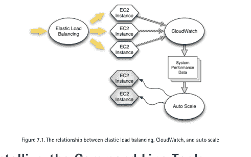

## 安装命令行工具

本章我们将使用 Amazon 命令行工具，因此让我们花点时间来安装并使它们正常工作。首先，下载相应的 .zip 文件：

- Amazon EC2 API 工具
- Amazon CloudWatch API 工具
- Auto Scaling API 工具
- Elastic Load Balancing API 工具

将文件解压到没有空格名称的独立顶级目录中。

命令行工具是用 Java 编写的，因此你需要安装 Java 运行时环境（JRE）；否则，请从 http://www.java.com 下载并安装。再次强调，目录名称中最好没有空格。

CloudWatch、弹性负载均衡器和自动扩展工具将需要你的 AWS 账户访问密钥 ID 和秘密密钥。同样，这些值可以在你选择“Your Account”菜单中的“Security Credentials”时，在 http://aws.amazon.com 的 AWS 账户页面上找到，或者在你的 CloudFusion `config.inc.php` 文件中。

将 CloudWatch 安装目录中的 `credentials-file-template` 文件复制为同一目录下的 `credentials.txt`。用你喜欢的文本编辑器打开 `credentials.txt` 并插入你的密钥。

你还需要与私钥关联的 X.509 证书。你可以通过登录 http://aws.amazon.com，点击“Account”，然后选择“Security Credentials”来访问此文件。选择 X.509 Certificates 选项卡，并点击 Create a New Certificate 链接。这将显示一个对话框，你可以从中将证书文件下载到你的本地机器上。点击“Download Private Key File”和“Download X.509 Certificate”按钮下载这两个必需的文件。确保将它们放在安全私密的地方。

现在我们需要设置一长串环境变量。在接下来的示例中，你需要根据环境调整路径。Windows 示例包含我自己的环境设置。

首先，添加一些命令来设置 HOME 环境变量。在 Windows 上，你按如下方式设置它们：

```text
C:\> set EC2_HOME=C:\ec2-api-tools-1.3.36506
C:\> set AWS_ELB_HOME=C:\ElasticLoadBalancing-1.0.1.23
C:\> set AWS_CLOUDWATCH_HOME=C:\CloudWatch-1.0.0.24
C:\> set AWS_AUTO_SCALING_HOME=C:\AutoScaling-1.0.4.4
```

在 Mac OS X 和 Linux 上，语法略有不同：

```bash
$ export EC2_HOME=path_to_tools
$ export AWS_ELB_HOME=path_to_tools
$ export AWS_CLOUDWATCH_HOME=path_to_tools
$ export AWS_AUTO_SCALING_HOME=path_to_tools
```

接下来，我们需要设置密钥和证书的完整路径。在 Windows 上：

```text
C:\> set EC2_PRIVATE_KEY=U:\jeff\pk-5FGWF ... DRPFFK3.pem
C:\> set EC2_CERT=U:\jeff\cert-5FGWF ... DRPFFK3.pem
```

在 Mac OS X 和 Linux 上：

```bash
$ export EC2_PRIVATE_KEY=path_to_private_key.pem
$ export EC2_CERT=path_to_certificate.pem
```

我们还必须告诉工具在哪里找到你的凭证。在 Windows 上：


`C:\> set AWS_CREDENTIAL_FILE=C:\CloudWatch-1.0.0.24\credentials.txt`

在 Mac OS X 和 Linux 上：

```bash
$ export AWS_CREDENTIAL_FILE=path_to_credentials.txt
```

现在设置 `PATH` 环境变量，以便 shell 能够找到命令行工具。在 Windows 上：

```text
C:\> set PATH=%PATH%;%EC2_HOME%\bin
C:\> set PATH=%PATH%;%AWS_ELB_HOME%\bin
C:\> set PATH=%PATH%;%AWS_CLOUDWATCH_HOME%\bin
C:\> set PATH=%PATH%;%AWS_AUTO_SCALING_HOME%\bin
```

在 Mac OS X 和 Linux 上：

```bash
$ export PATH=$PATH:$EC2_HOME/bin
$ export PATH=$PATH:$AWS_ELB_HOME/bin
$ export PATH=$PATH:$AWS_CLOUDWATCH_HOME/bin
$ export PATH=$PATH:$AWS_AUTO_SCALING_HOME/bin
```

这些工具还需要 Java 运行时可执行文件的位置。在 Windows 上：

```text
C:\> set JAVA_HOME=C:\Java\jre1.5.0_09
```

在 Mac OS X 和 Linux 上：

```bash
$ export JAVA_HOME=path_to_java
```

Mac OS X 用户应将 `JAVA_HOME` 环境变量设置为 `/System/Library/Frameworks/JavaVM.framework/Home`。

如果你的实例不在默认区域，你可以通过设置 `EC2_URL` 环境变量来设置命令行工具使用的区域。如果

如果您不执行此操作，每次使用命令行工具时都需要指定 `--region` 参数。在 Windows 上：

```text
C:\> set EC2_URL=https://eu-west-1.ec2.amazonaws.com
```

在 Mac OS X 和 Linux 上：

```bash
$ export EC2_URL=https://eu-west-1.ec2.amazonaws.com
```

这样就完成了。

我发现最好的方法是编写一个批处理文件，并包含上述所有语句。例如，如果您使用的是 Windows，请创建一个名为 `ec2-tool-setup.bat` 的批处理文件并运行它以设置所有变量。在 Mac OS X 或 Linux 上，请将上述所有语句放入一个名为 `ec2-tool-setup` 的文件中，并运行以下命令：

```bash
$ source ec2-tool-setup
```

通过运行以下一个或多个命令来验证您是否都设置正确。在 Windows 上：

```text
C:\> mon-cmd --help
C:\> ec2-describe-images
C:\> elb-describe-lbs
```

在 Mac OS X 或 Linux 上：

```bash
$ mon-cmd --help
$ ec2-describe-images
$ elb-describe-lbs
```

如果您看到连接错误或 Java 堆栈跟踪，您将需要重新检查您的步骤并找出哪里出错了。

幸运的是，您可能已经成功设置了 AWS 命令行工具。否则，您的下一步是访问 EC2 论坛并礼貌地寻求帮助。

## 使用 Amazon CloudWatch 监控 EC2 数据

现在是时候了解 Amazon CloudWatch 的概念及其定价模型，为 CloudFusion 库添加 CloudWatch 支持，然后编写一些代码来检索和显示收集的数据。

### Amazon CloudWatch 概念

Amazon CloudWatch 收集、聚合、存储并分发来自多个 AWS 资源的数据。当前版本的 Amazon CloudWatch 收集来自 EC2 实例和弹性负载均衡器的数据；未来可能会增加对额外服务的支持。

与 Amazon CloudWatch 相关的术语和概念有很多。这些术语相互构建，对于理解 CloudWatch 模型至关重要。

**命名空间**代表数据源。“`AWS/EC2`” 命名空间与从 Amazon EC2 基础设施收集的数据相关联，而“`AWS/ELB`” 命名空间与从弹性负载均衡器收集的数据相关联。

**度量值**是一个原始的、观察到的数据值。度量值被积累并汇总以代表一分钟的观察值。度量值始终是命名空间的一部分，并具有诸如位、字节或百分比等单位。每个度量值都有一个名称和时间戳。度量值可以跨一个或多个维度进行聚合。命名空间、度量值名称和一个或多个维度的组合构成了完整的度量值名称。一旦观察到，度量值将被保留两周（14 天）。

**单位**是度量值的属性。CloudWatch 支持以下单位：
- 无
- 秒
- 百分比
- 字节
- 位
- 计数
- 字节/秒
- 位/秒
- 计数/秒

单位是可选的，默认值是无。某些数字，如比率，没有单位。

**维度**是某种类型数据的细化视图。CloudWatch 支持以下维度：
- `AvailabilityZone`
- `ImageType`（AMI 标识符）
- `InstanceId`
- `InstanceType`
- `AutoScaleGroup`

**指标**是存储的、处理过的度量值。CloudWatch API 提供了一个函数，可根据命名空间、度量值、单位、周期、统计量和维度参数检索指标。

没有维度的指标代表高度聚合的数据；例如，这可以是所有特定实例类型（甚至账户中的所有实例）的 EC2 实例的磁盘活动或平均 CPU 利用率。

**周期**用于指定从 CloudWatch 请求指标时的时间粒度（以秒为单位）。

**统计量**是指标的计算属性，反映了组成该指标的度量值的属性。CloudWatch 支持以下统计量：最小值、最大值、平均值和总和。第五个统计量，样本数，表示用于计算统计量值的测量值数量。

### Amazon CloudWatch 操作

您必须为每个 EC2 实例启用 CloudWatch，以开始数据收集过程。启用后，过程在一分钟内开始，指标在几分钟内可用。您可以在启动实例时启用 CloudWatch。您也就可以为已经运行的任何 EC2 实例启用或禁用 CloudWatch。启用和禁用操作是 EC2 API 的一部分。使用 CloudWatch 按实例每小时收费；这涵盖了收集和存储数据的开销。

每个弹性负载均衡器会自动将某些测量值转发到 CloudWatch。无需为这些负载均衡器启用监控，并且存储或使用收集的指标也不收费。

CloudWatch 存储累积数据两周；旧数据会自动丢弃。

启用 CloudWatch 后，您可以使用命令行工具或 CloudWatch API 检索度量值列表和实际指标。以这种方式查看，CloudWatch 看起来比实际简单得多。实际上，CloudWatch 的真正威力体现在用于访问数据的参数中。

### Amazon CloudWatch 定价

使用 CloudWatch 每小时每个受监控的 EC2 实例收费 0.015 美元（1.5 美分）。此费用涵盖了监控、数据存储以及使用命令行工具和 CloudWatch API 访问存储数据。

CloudWatch 中弹性负载均衡器数据的存储或使用不收费。

### 通过命令行使用 Amazon CloudWatch

让 CloudWatch 接受考验的最简单方法是使用命令行。不过，有一个有趣的转折您需要了解。EC2 工具用于启用或禁用 EC2 实例的 CloudWatch。CloudWatch 工具用于访问收集的数据。

以下是如何为单个 EC2 实例启用 CloudWatch。第一步是使用 `ec2-describe-instances` 命令确定实例的 ID：

```
$ ec2-describe-instances
INSTANCE i-aaba69c3 ami-2b5fb42 ec2-75-101-154-199.compute-1.amazonaws.com domU-12-31-38-00-A0-01.compute-1.internal running gsg-key-air 0 m1.small 2008-07-13T03:44:43+0000 us-east-1a aki-a71cf9ce i-ari-a51cf9cc monitoring-disabled
```

在这种情况下，实例 ID 是 `i-aaba69c3`。得到此值后，使用 `ec2-monitor-instances` 命令启用 CloudWatch（当然，请替换为您自己实例的 ID）：

```
$ ec2-monitor-instances i-aaba69c3
```


i-aaba69c3 monitoring-pending

此命令可以再次运行（短暂延迟后），以确认已为该指定实例启用了 CloudWatch：

```
$ ec2-monitor-instances i-aaba69c3
```

i-aaba69c3 monitoring-enabled

`mon-list-metrics` 命令（来自 CloudWatch 工具）显示可用指标列表：

```bash
$ mon-list-metrics

CPUUtilization AWS/EC2 {ImageId=ami-3c47a355}

CPUUtilization AWS/EC2 {InstanceType=m1.small}

CPUUtilization AWS/EC2

CPUUtilization AWS/EC2 {InstanceId=i-aaba69c3}

: 一大长列表...
```

结果按指标（`DiskReadBytes`, `DiskReadOps`, `NetworkIn`, `NetworkOut`, `DiskWriteBytes`, `DiskWriteOps` 等）进行细分，并指示可以从 CloudWatch 请求的维度（`ImageId`, `InstanceId`, `InstanceType` 等）。指标会被保留，并且可以检索您最近终止的实例。见证下面 CPU 利用率的以下维度。

这是所有正在运行或最近终止的 EC2 实例的 CPU 利用率的维度：

```
CPUUtilization AWS/EC2
```

这表示类型 `m1.small` 的正在运行/最近终止的 EC2 实例的 CPU 利用率：

```
CPUUtilization AWS/EC2 {InstanceType=m1.small}
```

这同样是，但它适用于使用指定 AMI 启动的那些实例：

```
CPUUtilization AWS/EC2 {ImageId=ami-3c47a355}
```

而这里是针对特定的正在运行或最近终止的 EC2 实例：

```
CPUUtilization AWS/EC2 {InstanceId=i-aaba69c3}
```

一旦您选择了一个维度，您可以使用 `mon-get-stats` 命令检索任何您想要的指标。例如，过去 24 小时内每小时的所有 CPU 利用率：

```bash
$ mon-get-stats CPUUtilization --statistics Average
--start-time 2010-07-27 --end-time 2009-07-28 --period 3600
--namespace AWS/EC2
2009-07-18 00:00:00 60.0 5.9479999999999995 Percent
```

| 2009-07-18 01:00:00 | 60.0 | 6.910833333333331 | Percent |
| 2009-07-18 02:00:00 | 60.0 | 6.614666666666667 | Percent |
| ... | | | |

前两列表示聚合数据的时间和日期。第三列是 CloudWatch 用于生成该指标的样本数量。在这种情况下，我们请求按小时显示结果（`--period 3600`），因此 CloudWatch 对每个结果使用了 60 个样本（每分钟采集一个）。下一列是请求的指标，即每小时的平均 CPU 利用率。最后一列是单位（CPU 利用率百分比）。

你应该尝试使用各种参数来运行 `mon-get-stats`，以便更好地掌握这些指标及其关联的单位。

## 编程 Amazon CloudWatch

既然我们已经了解了如何从命令行访问 CloudWatch，让我们看看 CloudFusion 提供的功能，并使用其 `AmazonCloudWatch` 类来绘制一些酷的图表。

### 列出可用指标

下面是一个用于列出所有可用指标的程序：

```php
#!/usr/bin/php
<?php
error_reporting(E_ALL);
require_once('cloudfusion.class.php');
require_once('cloudwatch.class.php');
$cw = new AmazonCloudWatch();
$res = $cw->list_metrics();
if ($res->isOK())
{
  $metrics     = $res->body->ListMetricsResult->Metrics->member;
  $metricsRows = array();
  foreach ($metrics as $metric)
  {
    $metricsRows[] =
        array('MeasureName' => (string) $metric->MeasureName,
            'Namespace' => (string) $metric->Namespace,
            'Name' => (string) $metric->Dimensions->member->Name,
            'Value' => (string) $metric->Dimensions->member->Value);
  }
  usort($metricsRows, 'CmpMetrics');
  printf("%-16s %-16s %-16s %-16s\n",
        "Namespace", "Measure Name", "Name", "Value");
  printf("%-16s %-16s %-16s %-16s\n",
        "==========", "================", "====", "====");
  foreach ($metricsRows as $metricsRow)
  {
    printf("%-16s %-16s %-16s %-16s\n",
        $metricsRow['Namespace'],
        $metricsRow['MeasureName'],
        $metricsRow['Name'],
        $metricsRow['Value']);
  }
}
else
{
    $error = $res->body->Error->Message;
    exit("Could not list metrics: ${error}\n");
}
function CmpMetrics($m1, $m2)
{
    $k1 = $m1['Namespace'] . $m1['MeasureName'] . $m1['Name'];
    $k2 = $m2['Namespace'] . $m2['MeasureName'] . $m2['Name'];
    return strcmp($k1, $k2);
}
?>
```

该程序调用 `list_metrics` 方法，然后将结果复制到 PHP 数组中。PHP 的 `usort` 函数用于对数组进行排序，使得元素按照命名空间（`Namespace`）、度量（`Measure`）和名称（`Name`）分组，如代码中 `CmpMetrics` 函数所示。

该程序产生以下输出：

| 命名空间 | 度量名称 | 名称 | 值 |
| :--- | :--- | :--- | :--- |
| `============` | `============` | `====` | `====` |
| AWS/EC2 | CPUUtilization | ImageId | `ami-3c47a355` |
| AWS/EC2 | CPUUtilization | InstanceId | `i-aaba69c3` |
| AWS/EC2 | CPUUtilization | InstanceType | `m1.small` |
| ... | | | |

当然，这与 `mon-list-metrics` 命令产生的输出非常相似。

## 绘制多个指标图表

让我们创建一个包含 CloudWatch 指标图表的网页。实现此功能的代码将相当复杂，因此我们将分部分构建。本节的程序将生成一个网页，因此你希望在 Web 服务器上运行它。

该程序将使用 Google Chart API，^6 并在同一页面上绘制七个图表，如图 7.2 中的示例所示。

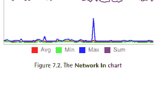

我们的脚本以通常的方式开始：

```php
<?php
error_reporting(E_ALL);
require_once('cloudfusion.class');
```


我们将需要进行一些数据处理。默认情况下，程序将报告前 24 小时收集的指标。变量 `$StartDate_DT` 将表示开始日期和时间，而变量 `$EndDate_DT` 将表示结束日期和时间。让我们声明并设置它们：

```php
$StartDate_DT = new DateTime('now');
$EndDate_DT   = new DateTime('now');
$StartDate_DT->modify('-1 day');
```

CloudWatch 以 GMT（格林尼治标准时间）表示所有日期。如果你想以本地时间表示日期和日期范围，必须调整你的查询。

下一步是将日期值转换为在 CloudWatch 查询中使用所需的格式。这是使用 PHP 的 `DateTime` 类的 `format` 方法完成的，如下所示：

```php
$StartDate = $StartDate_DT->format('Y-m-d');
$EndDate   = $EndDate_DT->format('Y-m-d');
```

如果请求中提供了参数，请获取它们。否则，我们将使用合理的默认值：

```php
$period = isset($_GET['period']) ? $_GET['period'] : 15;
$start  = isset($_GET['start']) ? $_GET['start']  : $startDate;
$end    = isset($_GET['end'])    ? $_GET['end']    : $endDate;
$period *= 60;
```

注意在这种情况下三元运算符（`? :`）是多么方便和简洁？在适当的格式化下，很容易识别这种结构，并将其作为一个非常紧凑的 if-then-else 在心理上处理。

为了方便，周期参数以分钟指定，但 CloudWatch 需要秒，因此我们进行调整。

该程序将生成一系列七个图表，由 `$charts` 数组中的信息驱动。它看起来像这样：

```php
$charts = array(
    array('M' => 'NetworkIn',
          'U' => 'Bytes',
          'L' => 'Network In (Bytes)'),
    array('M' => 'NetworkOut',
          'U' => 'Bytes',
          'L' => 'Network Out (Bytes)'),
    array('M' => 'CPUUtilization',
          'U' => 'Percent',
          'L' => 'CPU Utilization (Percent)'),
    array('M' => 'DiskReadBytes',
          'U' => 'Bytes',
          'L' => 'Disk Read Bytes'),
    array('M' => 'DiskReadOps',
          'U' => 'Count',
          'L' => 'Disk Read Operations/Second'),
    array('M' => 'DiskWriteBytes',
          'U' => 'Bytes',
          'L' => 'Disk Write Bytes'),
    array('M' => 'DiskWriteOps',
          'U' => 'Count',
          'L' => 'Disk Write Operations/Second'),
);
```

数组中的每个元素包含三个字符串。`M` 元素指定图表的 CloudWatch 度量，`U` 元素指定 CloudWatch 单位，`L` 元素指定图表标题。

完成所有这些后，是时候创建一个 `AmazonCloudWatch` 类的实例了：

```php
$cw = new AmazonCloudWatch();
$opt = array('Namespace' => 'AWS/EC2', 'Period' => $period);
$Statistics = array('Average','Minimum','Maximum','Sum');
```

我们还需要一个可选参数数组。这些参数在每次调用中保持不变，因此我们现在可以在上面的 `$opt` 数组中设置它们。所需的统计信息也是如此，我们将其放入 `$Statistics` 数组中。

现在让我们回到刚才设置的 `$charts` 数组。在下面的代码中，我们开始一个简单的循环，遍历元素以提供生成图表所需的信息。我们还创建了 `$chartImages` 数组来保存我们将在接下来的 HTML 模板中使用的图表源 URL：

```php
$chartImages = array();
foreach ($charts as $chart)
{
    $measure = $chart['M'];
    $unit    = $chart['U'];
    $label   = $chart['L'];
```

这段代码设置循环并获取每个图表的度量、单位和标签。

有了这些信息，是时候从 CloudWatch 获取所需的指标了，如下所示：

```php
$res = $cw->get_metric_statistics($Measure,
    $Statistics,
    $Unit,
    $Start,
    $end,
    $opt);
if ($res->isOk())
{
```

此请求中未指定维度；相反，它检索关于所有正在运行和最近终止的 EC2 实例的信息。一如既往，在处理结果之前，我们需要确保此请求成功。

指标以不可预测的顺序返回。由于我们计划使用它们来绘制图表，因此需要捕获所有指标并对其进行排序。让我们深入返回值并找到 `Datapoints` 项：

```php
$dataPoints = $res->body->GetMetricStatisticsResult->DataPoints->member;
```

现在我们创建一个空数组，然后从 `DataPoints` 中提取指标，将它们存储在 `$dataRows` 中，并以返回的时间戳作为索引：

```php
$dataRows = array();
foreach ($dataPoints as $dataPoint)
{
    $timestamp = (string) $dataPoint->Timestamp;
    $dataRows[$timestamp] =
        array('Timestamp' => (string) $dataPoint->Timestamp,
              'Units'     => (string) $dataPoint->Unit,
              'Samples'   => (string) $dataPoint->Samples,
              'Average'   => (float)  $dataPoint->Average,
```

在上述代码的末尾，我们按数组键（每个指标的 `_timestamp_`）对指标进行排序。

现在指标已排序完成。由于我们将生成图表，实际上需要四个独立的数组，分别用于绘制每一种统计量。下面的代码将 `$dataRows` 数组转换为这些独立的数组：

```php
$averages   = array();
$minimums   = array();
$maximums   = array();
$sums       = array();
foreach ($dataRows as $dataRow)
{
    $averages[]   = $dataRow['Average'];
    $minimums[]   = $dataRow['Minimum'];
    $maximums[]   = $dataRow['Maximum'];
    $sums[]       = $dataRow['Sum'];
}
```

Google Chart API 有多种指定数据值的方法。最简单的一种将值限制在 0 到 100（含）的范围内。因此，下一步是计算所需的缩放系数，以便将所有统计量映射到此范围，然后利用该系数缩放每个数组：

```php
$chartMax    = max(max($averages), max($minimums),
               max($maximums), max($sums));
$scale       = 100.0 / $chartMax;
for ($i = 0; $i < count($averages); $i++)
{
```


```php
$averages[$i] = (int) ($averages[$i] * $scale);

$minimums[$i] = (int) ($minimums[$i] * $scale);

$maximums[$i] = (int) ($maximums[$i] * $scale);

$sums[$i]     = (int) ($sums[$i]     * $scale);

}
```

图表 API 接受图表中每条线的值作为逗号分隔的字符串。不同线的值通过管道符或垂直线字符分隔。以下是设置此处的代码：

```php
// chapter_07/statistics_chart_page.php (excerpt)

$average = implode(',', $averages);

$minimum = implode(',', $minimums);

$maximum = implode(',', $maximums);

$sum     = implode(',', $sums);

// Combine arrays for use in chart

$series = $average . '|' .

          $minimum . '|' .

          $maximum . '|' .

          $sum;
```

坚持住，我们即将准备好生成图表！下一步是将图表标题中嵌入的空格替换为加号（`+`）并设置颜色：

```php
// chapter_07/statistics_chart_page.php (excerpt)

$label = str_replace(' ', '+', $label);

$colors = 'ff0000,00ff00,0000ff,800080';
```

既然我们已拥有所需的所有信息，现在可以组合出图表的 URL 了。代码如下：

```php
// chapter_07/statistics_chart_page.php (excerpt)

$chartURL = "http://chart.apis.google.com/chart";

$chartURL .= "chs=300x180";            // Chart size

$chartURL .= "cht=lc";                 // Line chart

$chartURL .= "chtt=" . $label;         // Label

$chartURL .= "chdlp=b";                // Legend at bottom

$chartURL .= "chdl=Avg|Min|Max|Sum";   // Legend

$chartURL .= "chco=" . $colors;        // Colors

$chartURL .= "chd=t:" . $series;        // Data series
```

Google Chart API 包含许多高级格式化和标签选项，但我让这个示例保持相当精简，以留给你们改进的空间。

最后一步是将 URL 存储在 `$ChartImages` 数组中：

```php
// chapter_07/statistics_chart_page.php (excerpt)

$ChartImages[] = $chartURL;
```

在保存了所有图表的 URL 之后，最终步骤是包含我们的 HTML 模板并退出：

```php
// chapter_07/statistics_chart_page.php (excerpt)

$output_title = 'Chapter 7 Sample - Charts of CloudWatch ' .

        'Statistics';

$output_message = "Charts of CloudWatch Statistics from ${start} " .

        " to ${end}";

include 'include/statistics.html.php';
```

最后，这是我们页面的简单 HTML 模板：

```html
<!-- chapter_07/statistics_chart_page.php (excerpt) -->
<!DOCTYPE html PUBLIC "-//W3C//DTD XHTML 1.0 Strict//EN"
        "http://www.w3.org/TR/xhtml1/DTD/xhtml1-strict.dtd">
<html xmlns="http://www.w3.org/1999/xhtml" xml:lang="en" lang="en">
<head>
        <title><?php echo $output_title ?></title>
</head>
<body>
        <h1><?php echo $output_title ?></h1>
<p><?php echo $output_message ?></p>
<?php foreach($ChartImages as $image): ?>
        "/>
<?php endforeach ?>
</body>
</html>
```

需要意识到的重要一点是，该程序从未进行任何实际的绘制。相反，它创建一个 HTML 页面，让 Google 来完成工作。当浏览器渲染该页面时，它会为页面上的每个图表调用 Google Chart API。Google 的服务器将处理 URL，绘制图表并将其返回给浏览器；然后浏览器将把图表作为页面的一部分绘制出来。

图 7.3 展示了完成后的页面外观。

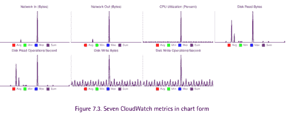

请记住，该页面接受一些参数。你可以尝试使用 `period` 参数，在不同的时间范围内聚合指标。你可以将 `start` 和 `end` 参数设置为日期（使用 `2009-07-07` 这样的值）或带时间的日期（使用 `2009-07-07T12:00:00` 这样的值）。只需将参数附加到页面 URL 即可。以下是一个示例：

```text
statistics_chart_page.php?period=60&start=2009-07-20T12:00:00&end=2009-07-20T18:00:00
```


如果你的页面无法显示任何数据，你可能需要实验调整日期值。例如，如果你刚启用监控一个小时，请在测试时将时间范围限制在过去的一小时内。如果确实将时间跨度缩小到（例如）一个小时，请减小 `period` 值，以便你的图表能有一些细节。最后，确保日期以格林尼治平均时间表示，否则你看到的可能是根据你的时区而严重不准确的结果。

Google Chart API 对图表 URL 的总长度施加了限制。较小的值或较宽的时间范围会生成更多的指标（以及过长的 URL），图表将无法绘制。你可以通过调整参数或修改代码来减少每个图表中绘制的统计量来规避这个问题。你还可以使用更强大的制图软件包，例如 `jpGraph`。[^1]

你可以以各种方式扩展此程序，例如将其与上一个程序结合使用，并创建一个用户界面，允许用户选择要显示的维度。你可以让用户使用 jQuery Datepicker 的两个副本来缩小日期范围。[^8] 此外，你还可以将此程序嵌入到更大的监控或系统控制程序中。它可以做到像你所希望的那样有用。

在这一部分，我们学到了很多。我们涵盖了 CloudWatch 的基本概念，并看到了如何为 EC2 实例启用 Amazon CloudWatch 以及如何访问收集的指标。我们还使用 CloudFusion 库来列出可用的 CloudWatch 指标并生成图表。

## 学习和使用 Apache JMeter

让我们短暂偏离主题，了解更多关于一个非常有用的程序：Apache JMeter。

### 为什么选择 JMeter？

如果你正在运行上一节中的图表程序，并监控一个几乎空闲的 EC2 实例，你将很少看到高低波动。你可以通过执行以下任务手动产生系统负载：

- 将大文件从一个地方复制到另一个地方（产生磁盘读写操作）
- 从互联网下载大文件（产生反映在 `Network In` 指标中的负载）
- 将大文件放在服务器上并从外部下载它们（产生反映在 `Network Out` 指标中的负载）
- 对非常大的文件进行排序（增加 CPU 使用率，以及磁盘读和磁盘写操作）

除非你编写一些复杂的测试脚本，否则你会很快厌倦这样做。此外，由于产生负载通常是在系统优化工作时的第一步，你需要能够以一定程度的精度复现负载。

Apache JMeter 应用程序简化了对基于 Web 的应用程序进行压力测试的过程。一旦创建了测试计划，就可以随时单击一下运行。结果会被测量并存储以供分析。

[^8]: http://docs.jquery.com/UI/Datepicker

为了使本节长度合理，我将提供使用 JMeter 的一系列直接步骤。篇幅确实不允许对 JMeter 完整的功能集进行完整描述。

### 安装和运行 JMeter

JMeter [^9] 是一个免费的开源程序。下载二进制文件，并选择一个目录，使生成的路径不包含任何空格。[^10]

现在进入安装目录下的 **bin** 子目录，如果你在 Mac OS X 或 Linux 上，请运行 `jmeter`；如果你在 Windows 上，请运行 `jmeter.bat`。在 Windows 上，最好从命令行运行批处理文件，因为 JMeter 的一些报告（也称为监听器）会在那里产生输出。

主窗口如图 7.4 所示。

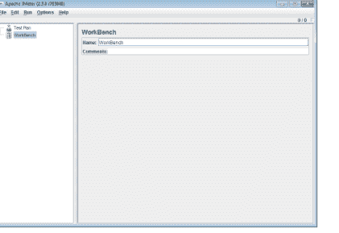

[^9]: http://jakarta.apache.org/site/downloads/downloads_jmeter.cgi

[^10]: 很难相信这个特定的 Java 缺陷至今仍存在。我早在 1996 年就第一次因此受苦了。

## 创建测试计划

下一步是创建一个 JMeter 测试计划。测试计划规定了并行运行的线程数、每个线程要发出的 HTTP 请求，以及结果的处理方式。

下面是创建一个简单测试计划的方法：

1. 右键单击**测试计划**节点，选择**添加 > 线程（用户） > 线程组**。
2. 配置线程组，设置 4 个线程，10 秒的爬坡时间，以及 16 的循环次数。
3. 右键单击新创建的线程组节点，选择**添加 > 取样器 > HTTP 请求**。
4. 输入服务器主机名或 IP 地址（我的是 www.captaincloud.com——请省略 http:// 协议前缀）以及端口（80 即可）。
5. 在路径中输入“/”以获取站点的首页。
6. 对同一服务器上的其他页面重复上一步。并为每一个页面输入不同的名称。
7. 再次右键单击**测试计划**节点。添加以下监听器节点：**生成汇总结果**、**聚合报告**和**图形结果**。

完成的测试计划应与图 7.5 相似。

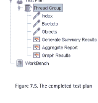

如果您对计划满意，请选择 文件 > 保存。

## 运行测试

确保您的服务器已准备就绪。通过 SSH 登录到您的服务器，并进入 Apache 日志文件目录——如果您运行的是 LAMP Web Starter AMI，该目录将是 `/home/webuser/helloworld/logs`——然后运行 `tail` 命令：

```bash
$ cd /home/webuser/helloworld/logs

$ tail -f access_log
```

返回 JMeter 并选择 运行 > 启动。观察服务器日志，以验证请求是否按预期到达。

在测试运行期间，单击**聚合报告**或**图形结果**节点，以查看 JMeter 测量的请求统计信息。

继续观察您的服务器日志文件。您可能还想使用 `w` 命令来检查服务器的平均负载：

```bash
<dev>: w
19:17:15 up 373 days, 1:24, 4 users, load average: 0.01, 0.02, 0.09
USER TTY FROM LOGIN@ IDLE JCPU PCPU WHAT
root pts/0 71.112.36.28 Mon17 2:47m 6.90s 6.88s emacs
-> -u jeff
root pts/2 71.112.36.28 Mon19 0.00s 0.00s 0.00s w
root pts/4 71.112.36.28 14:46 3:02m 0.03s 0.03s -bash
root pts/3 71.112.36.28 Mon19 4:30m 0.00s 0.00s -bash
```

平均负载越高——第一行最后三个数字（分别代表过去一分钟、五分钟和 15 分钟的系统负载）——系统越繁忙。[^11]

## 查看结果

汇总结果显示在启动 JMeter 的命令窗口中。每次测试运行结束时都会写入一行。以下是我在对某些参数值进行实验后得到的结果：

```text
Generate Summary Results + 215 Max: 793 Err: 68 in 4.9s = 13.8/s Avg: 432 Min: 0 (0.00%)
Generate Summary Results + 192 in 11.9s = 16.1/s Avg: 419 Min: 214 Max: 821 Err: 0 (0.00%)
Generate Summary Results = 576 in 25.1s = 23.0/s Avg: 455 Min: 216 Max: 3294 Err: 0 (0.00%)
Generate Summary Results = 864 in 30.8s = 28.0/s Avg: 535 Min: 216 Max: 3424 Err: 0 (0.00%)
Generate Summary Results + 454 in 12.7s = 35.8/s Avg: 596 Min: 226 Max: 3332 Err: 0 (0.00%)
Generate Summary Results + 620 in 42.6s = 14.6/s Avg: 782 Min: 217 Max: 40502 Err: 3 (0.48%)
Generate Summary Results = 1074 in 53.1s = 20.2/s Avg: 704 Min: 217 Max: 40502 Err: 3 (0.28%)
```


以“`/s`”结尾的字段表示测试期间平均每秒发出的请求数。

如图 7.6 所示的**聚合报告**，为测试计划中每个不同的 HTTP 请求模式包含一行详细信息，后面跟着一行总计。

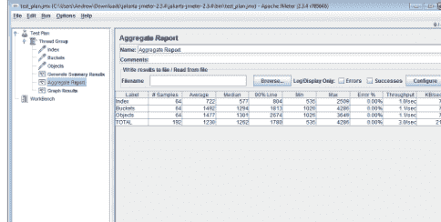

如图 7.7 所示的**图形结果**报告，以图表形式展示了随时间变化的各项统计信息。

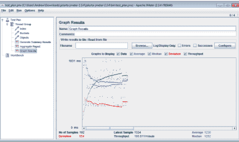

**图 7.7.** JMeter 的**图形结果**

您可以使用复选框和**配置**窗口来控制图形结果的内容和外观。

## 进一步使用 JMeter

JMeter 可能会对您的桌面系统和互联网连接造成沉重负载。测试计划中请求线程的数量和 HTTP 请求对象的数量直接影响运行该计划所需的内存和带宽。如果您发现自己的桌面系统容量受限，可以求助于 EC2 Web 服务。实际上，您可以以两种不同的方式做到这一点：

- 启动一个运行 Windows 的 EC2 实例，使用远程桌面访问它，在该实例上安装 JMeter，并从此处运行测试。如果您在与测试对象（即您正在进行压力测试的由 EC2 驱动的服务器）相同的可用性区域内启动测试驱动实例，将不会产生带宽费用。
- 在 EC2 服务器（Linux 服务器即可，且成本更低）上安装 JMeter 引擎，然后从运行在您桌面上的 JMeter 实例进行控制。有关此功能的更多信息，请参阅 JMeter 手册中的远程测试部分。[^12]

我希望这个简短的介绍能让您对使用 JMeter 能做什么有所启发。如果是这样，您可能想花些时间阅读用户手册 [^13] 以进一步了解这个强大的工具。

## 使用弹性负载均衡缩放 EC2 实例

在本节中，您将了解弹性负载均衡功能。我们将回顾处理模型和定价，然后我们将使用该服务，为几个 EC2 实例创建负载均衡器。我们将快速回顾编程模型（无需编写任何代码），然后您将准备好在自己的应用程序中使用此功能。

### 弹性负载均衡概念

通过使用 EC2 的弹性负载均衡功能，您可以在任何 AWS 区域创建软件负载均衡器。每个**负载均衡器**在一个或多个网络端口上监听，并将流量路由到一个或多个 EC2 实例，这些实例可能分布在多个可用性区域中。负载均衡器检查每个实例的健康状况，并将流量仅路由到健康实例，同时努力平衡发送到每个实例的流量。

负载均衡器是特定于某个 AWS 区域的实体。创建负载均衡器时，您需要提供一个引用名称，例如 `LoadBal1`。每个负载均衡器在外部由一个完全限定主机名表示；例如，`LoadBal-79377590.us-east-1.elb.amazonaws.com`。此名称在创建负载均衡器时分配。每个负载均衡器都附有一个 EC2 实例列表。每个实例都有一个相关联的健康状况（健康或不健康）。每个负载均衡器还有一个可用性区域列表，并且仅将流量路由到这些区域中的健康 EC2 实例。

每个负载均衡器必须有一个或多个监听器。每个监听器在特定网络端口上接受请求，并将其转发到 EC2 实例的特定端口。监听器可以监听 80、443 以及 1024 到 65,535 之间的端口，并且可以将请求转发到任何端口。

每个负载均衡器都附带一个健康检查。健康检查为负载均衡器提供了一个目标（一个端口、一个协议，以及（对于 HTTP 检查）一个 URL 片段）进行检查，以及表示在更改实例状态之前需要执行的检查数量的阈值。

### 弹性负载均衡处理模型

处理模型非常简单。以下是您需要做的：

1. 通过提供引用名称、初始的可用性区域列表、健康检查参数和监听器列表来创建一个弹性负载均衡器。您将收到一个外部可见的主机名作为回报；例如：`LoadBal-79377590.us-east-1.elb.amazonaws.com`。拿到这个名称后，您可以使用应用程序 DNS 记录中的 CNAME 条目，使负载均衡集群成为您的应用程序 Web 命名空间的一部分。[^14]
2. 在确保实例已准备好响应健康检查和实际请求后，使用它们的实例 ID 将一个或多个 EC2 实例添加到负载均衡器。负载均衡器将开始跟踪每个实例的状态（`InService` 或 `OutOfService`）。
3. 使用外部可见的主机名开始将流量路由到负载均衡器。
4. 随着流量增加，向负载均衡器添加更多的 EC2 实例（以及可能的可用性区域）。
5. 当不再需要负载均衡器时，将其删除。

一如既往，所有这些操作都可以通过命令行工具或弹性负载均衡 API 执行。您还可以使用 CloudWatch 来监控负载均衡器的整体状态。

负载均衡器将使用您在创建时提供的参数对其管理的每个实例执行健康检查（或探针）。假设负载均衡器配置了以下健康检查参数（这些恰好是默认值）：

[^11]: 
[^12]: http://jakarta.apache.org/jmeter/usermanual/remote-test.html
[^13]: 
[^14]: 由于原因过于复杂而无法在此脚注中解释，您不能使用 CNAME 记录来定义域名的根。您可以使用 CNAME 将 `www.example.com` 映射到负载均衡器，但不能映射 `example.com`。

| 参数 | 值 | 单位 |
|---|---|---|
| `HealthyThreshold` | 3 | 探测次数 |
| `UnhealthyThreshold` | 3 | 探测次数 |
| `Interval` | 30 | 秒 |
| `Timeout` | 5 | 秒 |

以下是具体过程：

1. 每隔 30 秒启动一次探测。如果实例在 5 秒内按预期响应，则探测成功；否则，探测失败。
2. 如果实例的状态为 `InService`，且连续三次探测失败，状态将变为 `OutOfService`，且不再将流量路由到该实例。
3. 如果实例的状态为 `OutOfService`，且连续三次探测发现其健康，状态将变回 `InService`，流量将重新路由到该实例。

健康探测可以设置为 TCP 风格或 HTTP 风格：

- **TCP 风格探测**尝试在目标实例的指定端口上建立连接。如果连接建立成功，它会立即关闭，且该实例被视为健康。
- **HTTP 风格探测**则更复杂。先建立连接，然后对 URL 片段发起 `GET` 请求。如果目标为 `HTTP:80/check.html`，则在 80 端口上对 `/check.html` 页面发起 HTTP `GET` 请求。如果服务器返回 200 OK 响应，则被视为健康。任何其他响应（或完全没有响应）都被视为不健康。这些响应会显示在你的 Web 服务器日志文件中；如果你正在收集访问你网站的数据统计，可能需要设置过滤规则将它们排除掉。

你可以以一些创造性的方式使用 HTTP 风格探测。最简单且最直观的任务是引用一个静态页面。如果服务器在线且 Web 服务器正在运行，该页面将可用，实例将接收流量。

然而，如果它是动态页面呢？在这种情况下，你的应用程序例如可以通过返回如 503 Service Unavailable 的响应，在定期数据库备份时将自己下线。如果你这样做，你需要确保有其他实例可用来处理负载，而不是所有实例同时下线。

## Elastic Load Balancing 定价

此功能的定价相当简单。你按小时为负载均衡器付费。你还需要为通过你的负载均衡器的所有数据传输付费。每个负载均衡器每小时收取 0.025 美元（2.5 美分），每通过你的任何负载均衡器传输 1 GB 数据收取 0.008 美元（略少于一美分）。这除此之外，还包括正常的 EC2 带宽费用。

这绝对比购买硬件负载均衡器或在 EC2 实例上运行软件负载均衡器更经济。你可以运行弹性负载均衡器数年，直到每小时成本接近同等功能硬件负载均衡器的购买价格。

## Elastic Load Balancing 的操作

设置传统的硬件负载均衡器是一项昂贵、复杂且耗时的任务。你需要购买并安装硬件，将其连接到网络，然后学习如何设置它。一旦它上线运行，你最不想做的就是在设置上进行可能导致你的生产系统不稳定的实验。

EC2 的弹性负载均衡使用成本低，并且可以在几分钟内完成设置。创建测试配置很容易，因此实验变得无风险且负担得起。

在本节中，我们将设置一个弹性负载均衡器，然后使用它将流量引导至一对 EC2 实例。我们在这个过程中会修改一些健康检查参数，并使用 CloudWatch 检索一些统计数据。

你需要安装 API Tools 才能自己完成这些操作。

在本节的其余部分中，带有 `$` 提示符的命令是在我的本地桌面上运行的。带有 `<1b1>:` 提示符的命令是在 EC2 实例上运行的。

使用 AWS 管理控制台在可用性区域 **`us-east-1a`** 中启动 LAMP Web Starter AMI 的实例。等待实例启动完成，然后打开一个 SSH 会话连接到该实例。记下实例 ID；你很快就需要它。

编辑文件 `/home/webuser/helloworld/htdocs/index.php`。找到以下语句：

```html

<h2>PHP Information</h2>
```


将其更改为如下所示：

```html

<h2>PHP Information For First Instance!</h2>

```

保留 SSH 窗口打开，因为你稍后还需要它。

在浏览器中访问该实例的公共 IP 地址，并确认你看到新消息以及 `phpinfo` 函数的输出。

现在使用以下命令创建一个名为 `LoadBal` 的负载均衡器：

```bash

$ elb-create-lb LoadBal --availability-zones us-east-1a 

  --listener "protocol=HTTP,lb-port=80,instance-port=80"

```

此负载均衡器将把 80 端口的 HTTP 流量路由到在可用性区域 `us-east-1a` 中运行的 EC2 实例。

该命令将创建负载均衡器，然后显示一个关键信息——负载均衡器的主机名：

```
DNS-NAME LoadBal-79377590.us-east-1.elb.amazonaws.com
```

此时，负载均衡器正在运行。下一步是让它的管理 EC2 实例。这是你需要做的全部操作（请将实例 ID 替换为你自己的）：

```bash

$ elb-register-instances-with-lb LoadBal --instances i-0f414766

INSTANCE-ID   i-0f414766

```

现在获取负载均衡器的主机名并在浏览器中访问它。你应该看到与你使用 EC2 实例名称时看到的相同输出。实际上，再次访问该名称可以看到负载均衡器避免了对实例直接访问的干扰。

我们刚刚设置了最小化的负载均衡器配置：一个负载均衡器和一个 EC2 实例。如果一个单独的 EC2 实例可以处理你的非高峰时段的流量，你实际上可以这样使用负载均衡器。这样，你可以轻松添加额外的 EC2 实例以处理更多流量。让我们继续看看如何做到这一点。

使用你创建第一个实例时使用的相同 AMI 创建第二个 EC2 实例，但将这个实例创建在可用性区域 `us-east-1b` 中。在等待它启动的同时，先按照以下操作将该区域添加到负载均衡器：

```bash

$ elb-enable-zones-for-lb LoadBal --availability-zones us-east-1b AVAILABILITY_ZONES us-east-1b, us-east-1a

```

实例启动后，编辑其 `/home/webuser/helloworld/htdocs/index.php` 文件以输出消息“**PHP Information for Second Instance!**”（或你选择的另一个令人兴奋且独特的短语）。保留连接到该实例的 SSH 窗口运行；你很快又需要它了。

将该实例添加到负载均衡器，一切就绪：

```bash

$ elb-register-instances-with-lb LoadBal --instances i-c9650a00 INSTANCE-ID i-of414766 INSTANCE-ID i-c9650a00

```

刷新浏览器一两次，如果你运气好，你应该会看到来自第二个实例的消息。

如果你运气不好且消息没有改变，不用担心。当前版本的弹性负载均衡器不保证来自同一 IP 地址或浏览器的连续请求会被路由到同一个 EC2 实例，但这似乎经常发生。你可以尝试从另一台计算机或从你的手机访问该页面，或者也许将 URL 通过电子邮件发送给一位亲密的朋友，询问他们看到了什么。

到目前为止，一切顺利。一个负载均衡器和一对实例。如果其中一个实例（或实例的整个可用性区域）发生故障，负载均衡器会注意到这一点并将所有流量路由到另一个实例。让我们让这种情况发生！

返回连接到你的第一个 EC2 实例的 SSH 窗口并关闭 Apache：

```bash

<b1>: /home/webuser/helloworld/bin/stop_apache

```

刷新浏览器几次，也许暂停喝口美味饮料，以给负载均衡器留出时间检测到实例不再通过其健康检查。一旦这种情况发生，你将看到来自另一个实例的网页。

你可以使用 `elb-describe-instance-health` 命令确认负载均衡器知道第一个实例是不健康的：

```bash

$ elb-describe-instance-health LoadBal --headers

INSTANCE-ID INSTANCE-ID STATE

INSTANCE-ID i-c95650a0 InService

INSTANCE-ID i-0f414766 OutOfService

```

现在在第一个实例上启动 Apache：

```bash

<b1>: /home/webuser/helloworld/bin/run_apache

```

再喝一口饮料，然后再次检查实例健康状态：

```bash

$ elb-describe-instance-health LoadBal --headers

INSTANCE-ID INSTANCE-ID STATE

INSTANCE-ID i-c95650a0 InService

INSTANCE-ID i-0f414766 InService
```


回忆一下，弹性负载均衡器使用健康检查来确定每个实例的状态。默认健康检查有一些相当长的延迟，并且在决定实例不健康之前会检查三次。让我们更激进一点：

## 程序化弹性负载均衡

与所有 Amazon Web 服务一样，您可以通过编程接口访问弹性负载均衡功能。

然而，不幸的是，CloudFuse 目前（截至 2.5 版）并不支持弹性负载均衡。

话虽如此，您可以通过创建一个基于 EC2 类的新类来添加支持。关于如何执行此操作的详细信息超出了本书的范围，但如果您想尝试这项任务，您需要一些基本信息：`DEFAULT_URL` 是 `elasticloadbalancing.amazonaws.com`，API 版本是 `2009-05-15`。

有九个弹性负载均衡 API 调用：

- `CreateLoadBalancer` 创建新的负载均衡器，`DeleteLoadBalancer` 删除旧的。
- `ConfigureHealthCheck` 设置一个非默认的健康检查，该检查将用于所有实例。
- `RegisterInstancesWithLoadBalancer` 将一组 EC2 实例附加到负载均衡器，而 `DeregisterInstancesFromLoadBalancer` 则执行相反操作。
- `DescribeLoadBalancers` 返回有关每个现有负载均衡器的详细信息，而 `DescribeInstanceHealth` 返回所有或选定的 EC2 实例的健康状况。
- `EnableAvailabilityZonesForLoadBalancer` 允许负载均衡器访问其他可用区中的实例，而 `DisableAvailabilityZonesForLoadBalancer` 则实现相反功能。

现在您已经知道如何使用一些简单的命令来创建、监视和销毁弹性负载均衡器，您离创建高度可扩展和高可用性的应用程序就更近一步了。

## 自动扩展

在本节中，您将了解 Amazon EC2 的自动扩展功能。我们将回顾关键术语和概念，讨论定价，然后使用命令行工具对其进行测试。我们将再次回顾编程模型，而将实际代码留给您完成。

### 自动扩展概念

您可以使用 EC2 的自动扩展功能在任何 EC2 区域中创建自动扩展组。每个自动扩展组都有一个引用名称，可以跨越一个或多个可用区。自动扩展组依赖于启动配置来提供启动 EC2 实例所需的信息。附加到组的触发器提供启动扩展活动所需的信息。每次自动扩展组启动或终止 EC2 实例时，都会生成一个**扩展活动**。实例作为**扩展事件**的一部分添加，作为**缩减事件**的一部分终止。每个组还有一个最小大小和一个最大大小。

**自动扩展启动配置**包括 AMI ID、EC2 密钥对的名称、一组 EC2 安全组、EC2 实例类型以及启动 EC2 实例所需的其他信息。

自动扩展触发器引用 CloudWatch 指标，例如 EC2 `CPUPutilization` 或弹性负载均衡 `HealthyHostCount`。触发器还包括上下阈值和扩展增量。扩展增量可以是绝对的（“添加 1 个实例”）或相对的（“添加 50% 的实例”）。触发器的违约持续时间指定了评估触发器阈值与指标之间的时间段。

### 自动扩展处理模型

尽管自动扩展独立于弹性负载均衡，但这两个功能被设计为相辅相成，以便您轻松地将大量请求负载均衡到自动扩展的 EC2 实例集群上。一旦设置好一切，您可以将所有流量路由到负载均衡器，AWS 将处理其余部分。

自动扩展处理模型清晰易懂。首先，创建以下内容：

1. 为一个或多个可用区创建一个弹性负载均衡器
2. 创建启动配置，指定要启动的 AMI ID、实例类型和其他所需参数
3. 为所需的可用区组创建一个自动扩展组，提供负载均衡器和启动配置的名称、每个组所需的最大和最小尺寸，以及组的引用名称
4. 为组创建一个触发器

然后坐下来放松，让自动扩展过程确保您拥有满足应用程序需求（如组大小和触发器所示）的足够数量的 EC2 实例。

一旦自动扩展组正常运行，其工作原理如下：

1. 使用触发器中的参数（`Namespace`, `Dimension`, `Measure`, `Statistic`, 和 `Unit`）获取组触发器中指定的 CloudWatch 指标，时间范围回溯到触发器的 `BreachDuration` 值。
2. 将指标与触发器的阈值进行检查。如果指标大于 `UpperThreshold`，且组中的 EC2 实例数量小于 `MaxSize`，则启动扩展事件。使用组的启动配置参数启动一个或多个 EC2 实例。启动实例的数量取决于触发器的 `UpperBreachScaleIncrement`。如果此参数的值以百分号（“%”）结尾，则启动足够的实例以提高组中实例总数的该百分比。否则，该值用作要启动的实际实例数量。新实例自动添加到与组相关的负载均衡器（如果有）。
类似地，如果指标小于 `LowerThreshold`，且组中的实例数量大于 `MinSize`，则启动缩减事件。使用组的启动配置参数终止一个或多个 EC2 实例。终止实例的数量取决于触发器的 `LowerBreachScaleIncrement`，它可以是百分比值或数字。在这两种情况下，数值都应为负数。多余的实例在终止前从负载均衡器（如果有）中移除。

在扩展或缩减事件之后，在组的冷却期过去之前，不会触发进一步的自动扩展操作。所有扩展和缩减事件都会记录在案，并可供后续分析。

在大多数情况下，你会配置触发器，使用最小值或最大值作为缩放决策的依据。以下是一些示例：

| 命名空间 | 指标 | 统计量 |
| :--- | :--- | :--- |
| AWS/EC2 | CPUUtilization | 平均值 |

当该组中所有实例的平均 CPU 利用率[超过该组所有实例的范围]高于 `UpperThreshold` 时，进行扩容；当其低于 `LowerThreshold` 时，进行缩容。

| 命名空间 | 指标 | 统计量 |
| :--- | :--- | :--- |
| AWS/EC2 | NetworkIn | 最大值 |

当入站网络流量超过 `UpperThreshold` 时进行扩容；当其低于 `LowerThreshold` 时进行缩容。

| 命名空间 | 指标 | 统计量 |
| :--- | :--- | :--- |
| AWS/ELB | HealthyHostCount | 最小值 |

当健康主机数量超过 `UpperThreshold` 时进行缩容；当健康主机数量低于 `LowerThreshold` 时进行扩容。¹

你也可以创建没有触发器的自动伸缩组。在这种情况下，该组将首先创建足够数量的 EC2 实例，以达到为组指定的最小实例数。你可以随时通过程序使用 `SetDesiredCapacity` 函数或 `as-set-desired-capacity` 命令增加实例数量。

在考虑如何将弹性负载均衡应用于你的应用程序时，有该模型的几个重要方面需要你考虑：

- EC2 实例会根据需要运行，并立即投入使用。因此，指定的 AMI 负责所有启动任务，包括那些你在更传统的环境中有时需要手动执行的任务。换句话说，你没有机会登录到新启动的实例，并在它们启动和投入使用之间进行调整。

¹ 为了实现此行为，`UpperBreachScaleIncrement` 必须为负值，且 `LowerBreachScaleIncrement` 必须为负值。

- 当 EC2 实例不再需要时会被关闭，存储在其中的所有信息（包括日志文件）都会丢失。如果你需要保留日志文件，你应该使用弹性块存储卷。

### 自动伸缩定价

使用该功能不收费。EC2 使用按标准费率计费。由于自动伸缩组是根据你的规则启动实例的，你应该密切关注最初的几个小时和几天的“燃烧率”，以确保总成本符合你的预期。

### 自动伸缩的运行

在本节中，我们将设置一个名为 `LoadBal` 的负载均衡器和一个自动伸缩组。第一步是创建负载均衡器：

```bash
$ elb-create-lb LoadBal --listener "lb-port=80,instance-port=80,protocol=HTTP" --availability-zones us-east-1b

DNS-NAME LoadBal-1395306781.us-east-1.elb.amazonaws.com
```

正如我们在本章前面所见，该命令返回负载均衡器的主机名——在本例中为 `LoadBal-1395306781.us-east-1.elb.amazonaws.com`。

下一步是创建一个自动伸缩组启动配置：

```bash
$ as-create-launch-config Config --image-id ami-60da3d09 \
    --instance-type m1.small

OK-Created launch config
```

这个名为 `Config` 的配置指定在小型 EC2 实例上使用 LAMP Web Starter AMI。该 AMI 非常适合测试目的，因为它已预先配置好启动 Apache 并返回默认页面。

现在我们可以准备创建自动伸缩组了。以下是所需的全部内容：


`$ as-create-auto-scaling-group AutoScale --launch-configuration \`
    `Config --availability-zones us-east-1b --min-size 1 --max-size 5 \`
    `--load-balancers LoadBal`

`OK-Created AutoScalingGroup`

名为 `AutoScale` 的组引用了负载均衡器（`LoadBal`）和启动配置（`Config`）。它将在可用区 `us-east-1b` 中运行多达五个实例。现在我们需要一个触发器。以下是创建名为 `Trigger1` 的触发器的命令：

```bash
$ as-create-or-update-trigger Trigger1 --auto-scaling-group \
  AutoScale --namespace "AWS/EC2" --measure CPUUtilization \
  --statistic Average --dimensions "AutoScalingGroupName=AutoScale" \
  --units "Percent" --period 60 --lower-threshold 30 \
  --upper-threshold 70 --lower-breach-increment="-1" \
  --upper-breach-increment "1" --breach-duration 120
```

`OK-Created/Updated trigger`

这是一个相当长的命令，所以让我们分解一下。它由 EC2 指标 `CPUUtilization` 驱动。当组中 EC2 实例集合的平均 CPU 利用率在五分钟时间段内超过 `70%` 时，它将启动扩容操作。当平均 CPU 利用率在五分钟时间段内低于 `30%` 时，它将启动缩容操作。它将在扩容时添加一个新实例，在缩容时移除一个实例。

一旦触发器设置完毕，该组就会生效。以下是查看正在发生的事情的方法：

```bash
$ as-describe-scaling-activities AutoScale

ACTIVITY  a470869e-14d8-4b02-98f5-33e9a8b7afda  2009-07-25T04:53:33Z
  Successful  "At 2009-07-25 04:50:57Z a user request created an
  AutoScalingGroup changing the desired capacity from 0 to 1.
  At 2009-07-25 04:52:05Z an instance was started in response to a
  difference between desired and actual capacity, increasing the
  capacity from 0 to 1."
```

`as-describe-scaling-activities` 命令按时间倒序列出最近的伸缩活动。

完成后，你应该干净地关闭该组。以下是操作方法。首先删除触发器（系统会提示你确认）：

```bash
$ as-delete-trigger Trigger1 --auto-scaling-group AutoScale
```

接下来，将组的最小和最大尺寸设置为零，以强制终止其所有实例：

```bash
$ as-update-auto-scaling-group AutoScale --min-size 0 --max-size 0
```

现在，观察实际终止实例的伸缩活动。运行此命令：

```bash
$ as-describe-scaling-activities AutoScale
```

在一两分钟内运行几次，直到你看到类似这样的条目：

```text
ACTIVITY fb0aa624-6480-4da8-99d0-40c9135c20be 2009-07-25T05:47:14Z
Successful "At 2009-07-25 05:45:32Z a user request update of AutoScalingGroup
constraints to min: 0, max: 0 changing the desired capacity from 1 to 0.
At 2009-07-25 05:45:33Z an instance was terminated in response to a
difference between desired and actual capacity, shrinking the
capacity from 1 to 0. At 2009-07-25 05:45:33Z instance i-9f9f9fff6
was selected for termination."
```

现在你可以继续删除该组（照例，系统会要求你确认）：

```bash
$ as-delete-auto-scaling-group AutoScale
```

最后，删除负载均衡器：

```bash
$ elb-delete-lb LoadBal
```


我们就完成了！

## 编程自动伸缩

一如既往，所有自动伸缩功能都通过一组 API 提供。不幸的是，与 ELB 一样，CloudFusion 目前不支持自动伸缩。

再次，如果你希望为此功能添加 CloudFusion 支持，你需要一些基本信息：`DEFAULT_URL` 是 `autoscaling.amazonaws.com`，API 版本是 `2009-05-15`。

自动伸缩 API 由五组函数组成：
- `CreateAutoScalingGroup`、`DeleteAutoScalingGroup`、`DescribeAutoScalingGroups`、`SetDesiredCapacity` 和 `UpdateAutoScalingGroup` 函数操作自动伸缩组；操作名称应该能从名称中自明。更新函数允许你在组运行期间更改其参数。
- `CreateLaunchConfiguration`、`DeleteLaunchConfiguration` 和 `DescribeLaunchConfigurations` 函数操作启动配置。
- `CreateOrUpdateScalingTrigger` 用于创建新的伸缩触发器或更新现有的触发器。`DescribeTriggers` 返回自动伸缩组的触发器列表，而 `DeleteTrigger` 删除触发器。
- `DescribeScalingActivities` 函数返回自动伸缩组的伸缩活动列表。
- `TerminateInstanceInAutoScaleGroup` 显式终止实例。

## 超出伸缩范围

至此，我们完成了对 Amazon EC2 自动伸缩的描述。你已拥有开始在自己的应用程序中使用此功能的所有信息。

## 总结

在本章中，我们涵盖了很多内容！我们首先查看了 Amazon CloudWatch，并了解了如何使用 CloudFusion 与之交互。然后，我们进行了一次短暂（但值得）的支线操作，学习如何使用 JMeter 在系统上创建人工负载。从那里，我们研究了弹性负载均衡和自动伸缩功能。

现在，你对这些功能有了很好的理解，你应该能够创建既可扩展又容错的应用程序。

## 第 8 章

## Amazon SimpleDB：云数据库

在本章中，你将了解如何使用 Amazon SimpleDB 为应用程序存储数据。Amazon SimpleDB 是传统（且非常复杂的）关系型数据库的一种焕然一新的简单替代方案。我们将回顾 Amazon SimpleDB 背后的概念基础，然后通过一系列独立的代码示例和一个更复杂的实际案例来学习如何使用它。最后，我们将快速浏览一个基于浏览器的 SimpleDB 工具。

### 简介

许多 Web 应用程序会使用 Oracle 或 MySQL 等通用关系型数据库来存储用户数据：账户名、密码、文件列表、偏好设置、链接等等。由于它们是通用的，这些产品随着时间推移变得非常复杂，拥有数千页的文档、层层叠叠的库和工具，以及一个专门用于培训和支持的行业。

Amazon SimpleDB 是一个基于云的数据库。无需购买、安装或维护任何硬件，也无需配置任何软件。你只需花一半的时间来设计数据库架构，因为更改很容易进行，而且没有要求让数据库离线以便进行更改。

构建高度可扩展的系统并真正进行扩展变得更加简单。SimpleDB 本身确保有足够的磁盘空间和 CPU 资源，通过根据需要跨多个磁盘和服务器分散负载，自动利用并行性。这种内在的、幕后进行的扩展和冗余提供了容错和高可用性，无需监控或人工干预。

数据存储模型简洁、简单且易于学习，编程模型也是如此。SimpleDB 擅长存储半结构化数据，其中条目（行）相似但不一定彼此相同。

Amazon SimpleDB 中存储的所有数据都自动建立索引，因此你无需做出任何索引决策。你现有的 SQL（结构化查询语言）知识仍然适用；你可以使用 SQL 选择查询来检索数据。没有软件升级问题，因为你始终运行的是当前版本的代码。

Amazon SimpleDB 模型缺乏跨域（大致等同于关系表）连接支持；相反，你可以以非规范化形式存储数据，以实现更高效的访问。

你很快就会看到，Amazon SimpleDB 的模型支持许多类型应用程序的数据存储需求。你可以将时间花在你的应用程序和满足用户需求上，而不是担心底层数据库问题。

## Amazon SimpleDB

Amazon SimpleDB 模型包含少量概念和紧凑的编程接口。你可以在一两个小时内学习 SimpleDB 的基础知识并让一些代码运行起来。在本节中，我们将回顾组成 SimpleDB 的概念，查看编程模型，然后研究 SimpleDB 的定价模型。

### Amazon SimpleDB 概念

Amazon SimpleDB `域`大致相当于关系数据库中的表。每个域存在于特定 AWS 账户的范围内，并具有可读的名称，例如 `employees`（员工）或 `feeds`（源）。每个域最多可存储 10GB 的数据。需要存储超过十吉字节数据的应用程序可以轻松地将数据分布在多个域中。每个 AWS 账户分配 100 个域。

> ^1 如果你的应用程序需要超过 100 个域，你可以申请额外的域。

SimpleDB 域中的每个条目都有一个名称（在域内唯一）和最多 256 个属性（名称-值对）。条目名称、属性名称和属性值每个都可以长达 1,024 字节。每个域最多可存储十亿个属性。

条目属性可以是多值的。实际上，每个属性最多可以有 256 个值。例如，属性 Size（尺寸）可以是三个不同的值 "8"、"10" 和 "12"。属性中的每个值都计入每个条目 256 个属性的限制。所有属性值都被视为字符串。这在存储和查询数值时有一些重要且不明显的影响。所有值都自动建立索引。

对 SimpleDB 条目的插入、删除和更新是通过 API 进行的。查询是通过 API 使用 SQL 选择查询进行的。

让我们看看 SimpleDB 数据模型可用于在单个域中存储复杂数据集的一些方式。

想象一下，我们需要存储关于一些人的数据（在下面的 SQL 示例中，我会将其称为 People 域）。我们从这样一个简单的模型开始：

| 条目名称 | FirstName | LastName | Age | Sex |
|---|---|---|---|---|
| Rec1 | Tom | Basic | 12 | M |
| Rec2 | Nancy | Hacker | 15 | F |

后来，我们决定如果已知则存储中间名。我们开始为新添加的记录存储此属性：

| 条目名称 | FirstName | LastName | Age | Sex | Middle |
|---|---|---|---|---|---|
| Rec1 | Tom | Basic | 12 | M | |
| Rec2 | Nancy | Hacker | 15 | F | |
| Rec3 | Joan | Hughes | 44 | F | K |

没有必要更新记录 `Rec1` 和 `Rec2`（当然，这也可以做到）。属性 `Middle` 只是在这些记录中不存在。接下来，我们决定存储每个人居住过的州。同样，我们只需开始存储这个新属性：

| 条目名称 | FirstName | LastName | Age | Sex | Middle | State |
|---|---|---|---|---|---|---|
| Rec1 | Tom | Basic | 12 | M | | |
| Rec2 | Nancy | Hacker | 15 | F | | MD |
| Rec3 | Joan | Hughes | 44 | F | Kraft | NY, NJ, DC, IL, MD, PA |

如图所示，这可以很容易地扩展到存储其他一对多关系，如子女、父母、职位名称等等。

### Amazon SimpleDB 编程模型

我们很快就会深入了解一些实际代码。Amazon SimpleDB 编程模型仅由九个调用组成：
- 在域级别，`CreateDomain` 创建新域，`ListDomains` 返回现有域列表，`DeleteDomain` 删除一个域。`DomainMetadata` 返回关于该域的使用信息。
- 在条目级别，`PutAttributes` 创建新条目，并为现有条目添加或替换（由你选择）额外属性。`BatchPutAttributes` 是此调用的扩展版本，一次处理多个条目。`DeleteAttributes` 从条目中移除属性，`GetAttributes` 检索指定属性。`Select` 发出 SQL 查询。

就这样！一个完整的数据存储系统。

Amazon SimpleDB 的 SQL 语言采用标准 select 语句的形式，并带有处理多值属性的扩展。以下是一些示例：

```sql
select * from People where FirstName="Tom"
```

上述查询将检索上表中的 `Rec1`。

```sql
```


`select FirstName, Middle, LastName from People where LastName >= "H"`

上述查询检索 `Rec2` 和 `Rec3`。

```sql
select * from People where every(State)="MD"
```

此查询检索 `Rec2`。

```sql
select * from People where State="PA"
```

在这里，检索到 `Rec3`。

## Amazon SimpleDB 定价

你的 Amazon SimpleDB 使用费用基于三个使用维度计算：数据传输、数据存储和机器使用量。

你的数据传输费用基于传入和传出 SimpleDB 的数据量。传入 SimpleDB 的数据按每吉字节 `$0.10` 的费率收费。同样，此金额是按比例计算的。传出 SimpleDB 的数据按滑动比例收费，起价为每吉字节 `$0.17`，并随流量减少，对于每月超过 150 太字节的传出数据传输，费率为每吉字节 `$0.10`。区域内部传输的数据不收费；在同一区域内将数据传输到 EC2 实例和 SimpleDB 域之间无需支付任何费用。

你支付每吉字节每月 `$0.25`（二十五美分）在 SimpleDB 中存储数据的费用，按时间和实际存储量按比例计算。每个条目有 45 字节的开销，每个属性名称有 45 字节，每个名称-值对有 45 字节。

最后，你每小时支付 `$0.14` 用于处理每个 SimpleDB 请求的机器时间。复杂请求（例如，更多条目、更多属性或复杂的选择查询）将比简单请求花费更多时间。SimpleDB 在 `BoxUsage` 字段中返回每个请求使用的时间。

截至本文撰写时（但可能会更改），SimpleDB 有一个免费层级。前 25 小时机器时间、前 1 吉字节数据存储和前 1 吉字节数据传输都是免费的。

# 编程 Amazon SimpleDB

在本节中，您将看到如何使用 CloudFusion 来访问 SimpleDB 的所有功能。由于 CloudFusion 已经包含了对 Amazon SimpleDB 的支持，我们可以直接进入代码部分。

我们将创建域并列出它们，然后向其中填充项目。接下来，我们将看到如何处理数值数据并运行一些查询。我们将使用额外数据更新现有项目，然后删除某些项目和项目属性。我们将了解如何监控域统计信息，最后以一个现实世界的示例收尾：在 SimpleDB 中获取、解析和存储 RSS 源。

在本章中，我将使用三个 SimpleDB 域。以下是我们将添加到 `book.inc.php` 中的定义：

```php
chapter_08/include/book.inc.php (excerpt)

define('BOOK_FILE_DOMAIN', 'files');

define('BOOK_FEED_DOMAIN', 'feeds');

define('BOOK_FEED_ITEM_DOMAIN', 'feed_items');
```

`BOOK_FILE_DOMAIN` 将用于存储关于文件的信息。

`BOOK_FEED_DOMAIN` 将用于存储关于 RSS 源的信息，而 `BOOK_FEED_ITEM_DOMAIN` 将用于存储关于在 RSS 源中发现的项的信息。

在开始使用 SimpleDB 之前，您需要注册 SimpleDB。只需访问该网站并点击 `Sign Up for Amazon SimpleDB` 按钮。

## 创建域

下面是一个脚本，它创建了本章示例所需的所有 SimpleDB 域：

```php
#!/usr/bin/php
<?php
error_reporting(E_ALL);
require_once('cloudfusion.class.php');
require_once('include/book.inc.php');
$sdb = new AmazonSDB();
foreach (array(BOOK_FILE_DOMAIN,
               BOOK_FEED_DOMAIN,
               BOOK_FEED_ITEM_DOMAIN) as $domain)
{
    $res = $sdb->create_domain($domain);
    if (!$res->isOk())
    {
        exit("Create domain operation failed for domain ${domain}\n");
    }
    print("Domain ${domain} created.\n");
}
exit(0);
?>
```

该程序简单地创建了一个新的 `AmazonSDB` 对象，遍历一个域名数组，并对每个域调用 `create_domain` 方法。如果域已经存在，`create_domain` 将不执行任何操作（并返回成功结果）。

如果您想接受挑战，您应该能够轻松修改上述脚本以接受命令行输入的新域名。

## 列出域

下一步是列出域。以下是执行此操作的方法：

```php
chapter_08/list_domains.php (excerpt)
#!/usr/bin/php
<?php
error_reporting(E_ALL);
require_once('cloudfusion.class.php');
$db = new AmazonSDB();
$res = $db->list_domains();
if (!$res->isOk())
{
    exit("List domain operation failed\n");
}
foreach ($res->body->ListDomainsResult->DomainName as $domainName)
{
    print($domainName . "\n");
}
exit(0);
?>
```

`list_domains` 方法返回一个域名数组。代码遍历列表并打印每一个。

以下是该命令的输出：

```bash
$ php list_domains.php
feed_items
feeds
files
```

## 存储数据

下一步是在域中存储一些数据。这是使用 `put_attributes` 方法完成的。该方法可用于创建新项目或为现有项目添加额外属性。

以下程序为当前目录中每个文件名匹配正则表达式 `/^[a-zA-Z0-9_]+\.php$/` 的文件创建一个项目——即所有名称合理的 PHP 文件。它使用文件名作为项目名称，并创建三个属性：

- `Name`（文件名）
- `Hash`（文件内容的 MD5 哈希值）
- `Size`（文件的字节大小）

以下是代码：

```php
chapter_08/insert_items.php (excerpt)
#!/usr/bin/php
<?php
error_reporting(E_ALL);
require_once('cloudfusion.class.php');
require_once('include/book.inc.php');
$ssdb = new AmazonSDB();
$dir = opendir(".");
while (($file = readdir($dir)) !== false) {   // 1
    if (preg_match("/^[a-zA-Z0-9_]+\.php$/", $file)) {   // 2
        $data = file_get_contents($file);   // 3
        $hash = md5($data);
        $size = filesize($file);
        $attrs = array('Name' => $file,
                       'Hash' => $hash,
                       'Size' => $size);
        $res = $ssdb->put_attributes(BOOK_FILE_DOMAIN, $file,
                                     $attrs, true);   // 4
        if ($res->isOk())
        {
            print("Inserted item $file\n");
        }
        else
        {
            $error = $res->body->Errors->Error->Message;
            print("Could not insert item: ${error}\n");
        }
    }
}
closedir($dir);
exit(0);
?>
```


- PHP 的 `opendir` 和 `readdir` 用于访问当前目录（“.”）中的文件列表。
- 读取每个文件名并对照正则表达式进行检查。
- 如果文件名匹配正则表达式，则使用 `file_get_contents` 读取文件内容，然后使用 `md5` 函数计算内容的 MD5 哈希值。凭借这些信息，设置 `$attrs` 数组以包含属性的键值对。
- 调用 `put_attributes` 方法将信息存储在由 `BOOK_FILE_DOMAIN` 指定的 SimpleDB 域中。调用 `put_attributes` 时的最后一个参数（`true`）表示将删除属性的任何现有值，然后替换为新值。如果将此参数设置为 `false`，新值将补充现有值，导致属性具有多个值。
- 最后，关闭目录并退出脚本。

## 高效存储多个项目

另一个 SimpleDB 功能，`BatchPutAttributes`，可用于通过单个请求执行多个 `PutAttributes` 调用。这比进行一系列单独的请求更快、更高效。以下是使用批量请求的上一示例的修改版本：

```php
#!/usr/bin/php
<?php
error_reporting(E_ALL);
require_once('cloudfusion.class.php');
require_once('include/book.inc.php');
$sdb = new AmazonSDB();
$items = array();
$dir = opendir(".");
while (($file = readdir($dir)) !== false)
{
    if (preg_match("/^[a-zA-Z0-9_]+\.php$/", $file))
    {
        $data = file_get_contents($file);
        $hash = md5($data);
        $size = filesize($file);
        $items[$file] = array('Name' => $file,
                              'Hash' => $hash,
                              'Size' => $size);
    }
    if (count($items) == 25)
    {
        WriteBatch($sdb, $items);
        $items = array();
    }
}
closedir($dir);
if (count($items) > 0)
{
    WriteBatch($sdb, $items);
}
```

> 与此前版本的插入脚本的主要区别在于，每个属性名称值对数组被添加到 `$items` 数组中，而不是立即插入到 SimpleDB 中。

- 当 `$items` 数组达到 25 个元素时，我们调用一个名为 `WriteBatch` 的自定义函数。
- 最后，如果还有剩余的项目，我们调用 `WriteBatch` 函数。

以下是自定义 `WriteBatch` 函数：

```php
chapter_08/batch_insert_items.php (excerpts)
function WriteBatch($ssdb, &$items)
{
    $res = $ssdb->batch_put_attributes(BOOK_FILE_DOMAIN, $items, true);
    if ($res->isOK())
    {
        print("Inserted " . count($items) . " items\n");
        return true;
    }
    else
    {
        $error = $res->body->Errors->Error->Message;
        print("Could not insert items: {$error}\n");
        return false;
    }
}
?>
```

`WriteBatch` 函数使用 `batch_put_attributes` 方法在一次操作中将 `$items` 数组中的所有项目插入。

在进行性能测试时，我发现第一个插入脚本在 8.6 秒内插入了 99 个文件，而批量脚本仅用 0.88 秒插入了相同的文件，即速度快了十倍。显然，通过利用 SimpleDB 的结构来设计您的程序是值得的。

## 处理数值数据

SimpleDB 将所有数据作为字符串存储。当数据是选择查询的主题时，使用字典序比较。这可能会导致存储数值时出现一些令人惊讶的结果。例如，字符串 "10" 小于字符串 "2"。前导负号也是有问题的。

数值值应该用零左填充以创建固定长度的字符串。可以使用 PHP 的 `sprintf` 函数和适当的格式字符串来实现。在我们之前的脚本中，我们应该更新 `Size` 属性的项目值以使用左填充：

```php
array('Name' => $file,
      'Hash' => $hash,
      'Size' => sprintf("%08d", $size));
```

如果您的数值可能为负数，在存储时应该用一个大的正数进行偏移，然后在检索时补偿这个偏移。选择一个偏移值，确保预期的最小负值最终变为正值。例如，如果您的值范围从 -32,768 到 32,767，则添加 50,000 将范围调整为 17,232 到 82,767（存储为 "17232" 到 "82767"）。

## 运行查询

数据已存储，运行查询很简单：

```php
chapter_08/query_domain.php (excerpt)
#!/usr/bin/php
<?php
error_reporting(E_ALL);
require_once('cloudfusion.class.php');
require_once('include/book.inc.php');
$query = "select * from " .
    BOOK_FILE_DOMAIN .
    " where Name like '%items'";
$sdb = new AmazonSDB();
```

上述脚本使用 `select` 方法运行一个查询，该查询将返回所有 `Name` 属性包含字符串 *"items"* 的条目。然后，它将遍历所有返回的条目，并输出它们的属性及其值。如果数据库中包含代码归档中 `chapter_08` 文件夹内所有文件的文件信息，输出的示例如下：

```php
Sres = $sdb->select($query);
if (!$res->isOk())
{
    exit("Select operation failed\n");
}
foreach ($sres->body->SelectResult->Item as $Item)
{
    foreach ($Item->Attribute as $Attribute)
    {
        print($Attribute->Name . ": " . $Attribute->Value . ", ");
    }
    print("\n");
}
exit(0);
?>
```

```
$ php query_domain.php
Hash: a446a0c1d252042cf065e7bc4d743336, Name:
> augment_items.php, Size: 00001191,
Hash: 280434b0478b68eaceaf616329d337e, Name:
> batch_insert_items.php, Size: 00001337,
Hash: 49cb20ea103caeb654ce4aad307ecdc, Name:
> delete_items.php, Size: 00001003,
Hash: e77f57f95676ac156318123c44428c40, Name:
> insert_items.php, Size: 00000937,
```

默认情况下，`select` 调用每次返回 100 个条目（或 1MB 的数据，取两者中较小的值）。可以使用 `limit` 子句来请求返回多达 2,500 个条目，但总量仍限制在 1MB。

如果 `select` 调用因上述限制而无法返回所有条目，响应中将包含一个 `NextToken` 值。可以将此值传递给后续的重复 `select` 调用，以接收额外的结果。下面是一个假设的循环表示，它利用 `NextToken` 值进行重复的 `select` 调用，直到没有更多结果返回：

```php
$next = null;
do
{
```


```php
$attrs = ($next == null) ? null : array('NextToken' => $next);

$res   = $sdb->select($query, $attrs);

$next  = (string) $res->body->SelectResult->NextToken;

: Process results here...

}
while ($next != null);
```

我们将在剩余章节中看到更多此类循环。

## 高级查询

让我们修改之前的脚本，通过添加以下代码使查询来自命令行：

```php
# chapter 08/query_domain_cmd.php (excerpt)

#!/usr/bin/php

<?php

error_reporting(E_ALL);

require_once('cloudfusion.class.php');

require_once('include/book.inc.php');

$query = "select * from " . BOOK_FILE_DOMAIN;

if ($argc > 1)
{
    $query .= " where ";
    for ($i = 1; $i < $argc; $i++)
    {
        $query .= ' ' . $argv[$i] . ' ';
    }
}

print("Final query: ${query}\n");

$ssdb = new AmazonSDB();
$res = $ssdb->select($query);
: process the results...
?>
```

现在我们可以运行任意查询，例如：

```
$ php query_domain_cmd.php
```

上述命令将检索所有记录——这是该脚本的默认操作。

我们指定查询的方式如下：

```
$ php query_domain_cmd.php "Size < '00000900'"
```

此命令将查找所有小于 900 字节的文件。

特殊字段 `itemName()` 可用于在 `select` 查询中引用条目的名称：

```
$ php query_domain_cmd.php "itemName() like '%items%'"
```

上述命令将检索名称中包含 "items" 的条目。

最后，此命令用于检索具有指定名称的条目：

```
$ php query_domain_cmd.php "itemName() in ('disable_mon.php', 'list_metrics.php')"
```

SimpleDB 查询具有以下通用形式：

```
select output_list
from domain_name
[where expression]
[order by clause]
[limit clause]
```

让我们来看看这些部分。`output_list` 可以是 `*`（表示所有属性）、`itemName()`（表示条目名称）、属性名称列表，或者 `count(*)`（用于检索条目数量而非条目本身）。当然，`domain_name` 指的是 SimpleDB 域。

可选的 `where` 表达式是属性名称、常量值、`itemName()` 和运算符的组合。下表显示了可用于 `where` 表达式中的运算符。

### 表 8.1. 可用运算符

| 运算符 | 描述 |
| :--- | :--- |
| = | 等于 |
| != | 不等于 |
| > | 大于 |
| >= | 大于或等于 |
| < | 小于 |
| <= | 小于或等于 |
| and | 两个条件都必须为真 |
| or | 任一条件为真即可 |
| intersection | 返回出现在一对独立查询中的结果 |
| like | 包含指定的常量，其中 "%" 为通配符 |
| not like | 不包含指定的常量 |
| between/and | 在指定范围内 |
| in | 匹配列表中的某个条目 |
| is null | 属性不存在 |
| is not null | 属性存在 |
| every() | 多值属性的每个值都满足该表达式 |

可选的 `order` by 子句可用于按单个属性或条目名称对结果进行排序。所有排序均按字典顺序执行，且排序属性必须在相关表达式中通过名称提及。无法针对空值进行排序。

可选的 `limit` 子句可用于将结果数量限制为给定值。

## 用额外数据增强条目

一旦条目创建完成，对 `put_attributes` 方法的额外调用可用于创建额外的属性，或为现有属性添加额外值。让我们使用此脚本，用文件的修改时间来增强 `BOOK_FILE_DOMAIN` 中的每个条目：

```php
chapter_08/augment_items.php (excerpt)

#!/usr/bin/php

<?php

error_reporting(E_ALL);

require_once('cloudfusion.class.php');

require_once('include/book.inc.php');

$sdb = new AmazonSDB();

$res1 = $sdb->select("select Name from " . BOOK_FILE_DOMAIN);

if ($res1->isOK())
{
    foreach ($res1->body->SelectResult->Item as $item)
    {
        $itemName = $item->Name;
        $file     = $item->Attribute[0]->Value;
        $modTime = filemtime($file);
        if ($modTime != false)
        {
            $attrs = array('ModTime' => sprintf("%O10s", $modTime));
            $res2 = $sdb->put_attributes(BOOK_FILE_DOMAIN, $itemName, $attrs, false);
            if ($res2->isOK())
            {
                print("Updated item $itemName\n");
            }
            else
            {
                $error = $res2->body->Errors->Error->Message;
                print("Could not update item: $error}\n");
            }
        }
    }
}
else
{
    $error = $res1->body->Errors->Error->Message;
    exit("Could not run query: ${error}\n");
}

exit(0);
?>
```

这就好比再次调用 `put_attributes` 方法，为每个条目提供新的属性和值数据一样简单。

此程序展示了另一种有用的编程模型。使用 SimpleDB 查询来获取要处理的条目列表。逐个处理每个条目：从查询结果中提取文件名，获取文件的修改时间，并更新该条目。

我刚才向您展示的代码采用了一个略微取巧的捷径：

```php
$file = $item->Attribute[0]->Value;
```

上述行使用位置索引访问第一个返回的属性。这样的代码很脆弱且难以维护。有一种更好的方法，我稍后会向你展示。

## 为属性存储多个值

为单个属性存储多个值非常容易；有两种方法可以做到这一点。

如果你是一个一个地存储值，并希望它们随时间积累，你可以简单地将 `replace` 参数传递为 `false`。你可以使用上一节中的代码存储多个修改时间，通过重复调用如下所示：

```php
$attrs = array('ModTime' => sprintf("%f10s", $modTime));
$res2 = $sdb->put_attributes(BOOK_FILE_DOMAIN, $itemName,
        $attrs, false);
```

你也可以同时存储几个值，如下所示：

```php
$attrs2 = array('Flavors' => array('Vanilla', 'Chocolate'));  
$res2 = $sdb->put_attributes(BOOK_FILE_DOMAIN, $itemName,
                 $attrs2, false);
```


## 访问属性值

让我们改进上面那个取巧的属性访问代码。下面是一个函数，将返回响应中 SimpleXML 节点数组转换为 PHP 关联数组：

```php
chapter_08/include/book.inc.php (excerpt)

function getItemAttributes($item)
{
  $attrs = array();
  foreach ($item->Attribute as $attribute)
  {
    $name = (string) $attribute->Name;
    $value = (string) $attribute->Value;
    if (isset($attrs[$name]))
    {
      if (is_array($attrs[$name]))
      {
        $attrs[$name][] = $value;
      }
      else
      {
        $attrs[$name] = array($attrs[$name], $value);
      }
    }
    else
    {
      $attrs[$name] = $value;
    }
  }
  return $attrs;
}
```

## 删除属性

如果不再需要某个属性，可以使用 `delete_attributes` 方法将其删除，示例如下：

```php
// chapter_08/delete_attrs.php (excerpt)

#!/usr/bin/php
<?php
error_reporting(E_ALL);
require_once('cloudfusion.class.php');
require_once('include/book.inc.php');
$ssdb = new AmazonSDB();
$attrs = array('ModTime', 'Flavor');
$res1 = $ssdb->select("select Name from " . BOOK_FILE_DOMAIN);
if ($res1->isOk())
{
    foreach ($res1->body->SelectResult->Item as $item)
    {
        $itemName = (string)$item->Name;
        $res2 = $ssdb->delete_attributes(BOOK_FILE_DOMAIN,
            $itemName, $attrs);
        if ($res2->isOk())
        {
            print("Updated item $itemName\n");
        }
        else
        {
            $error = $res2->body->Errors->Error->Message;
            print("Could not update item: ${error}\n");
        }
    }
}
else
{
    $error = $res1->body->Errors->Error->Message;
    exit("Could not run query: ${error}\n");
}
exit(0);
?>
```

在上述代码中，我们对每个条目调用一次 `delete_attributes` 方法，删除 `ModTime` 和 `Flavor` 属性。

## 删除条目

也可以通过删除所有属性来使用 `delete_attributes` 方法删除整个条目。具体操作如下：

```php
// chapter_08/delete_items.php (excerpt)

#!/usr/bin/php
<?php
error_reporting(E_ALL);
require_once('cloudfusion.class.php');
require_once('include/book.inc.php');
$sdb = new AmazonSDB();
$res1 = $sdb->select("select * from " . BOOK_FILE_DOMAIN);
if ($res1->isOk())
{
    foreach ($res1->body->SelectResult->Item as $item)
    {
        $itemName = (string)$item->Name;
        $attrs = array_keys(getItemAttributes($item));
        $res2 = $sdb->delete_attributes(BOOK_FILE_DOMAIN,
            $itemName, $attrs);
        if ($res2->isOK())
        {
            print("Deleted item $itemName\n");
        }
        else
        {
            $error = $res2->body->Errors->Error->Message;
            print("Could not delete item: {$error}\n");
        }
    }
}
else
{
    $error = $res1->body->Errors->Error->Message;
    exit("Could not run query: {$error}\n");
}
exit(0);
?>
```

该代码使用 `getItemAttributes` 函数构建每个条目的属性数组，示例如下：

```php
$attrs = array_keys(getItemAttributes($item));
```

随后删除这些属性，从而导致该条目本身被删除。

## 监控域统计信息

`domain_metadata` 方法返回有关某个域的信息。以下是一个调用该方法并显示其返回内容的脚本：

```php
#!/usr/bin/php
<?php
error_reporting(E_ALL);
require_once('cloudfusion.class.php');
require_once('include/book.inc.php');
$sdb = new AmazonSDB();
foreach (array(BOOK_FILE_DOMAIN,
               BOOK_FEED_DOMAIN,
               BOOK_FEED_ITEM_DOMAIN) as $domain)
{
    $res = $sdb->domain_metadata($domain);
    if ($res->isOk())
    {
        $metadata = $res->body->DomainMetadataResult;
        $itemCount           = (int) $metadata->ItemCount;
        $attributeNameCount  = (int) $metadata->AttributeNameCount;
        $attributeValueCount = (int) $metadata->AttributeValueCount;
        $itemNamesSize       = (int) $metadata->ItemNamesSizeBytes;
        $attributeNamesSize  = (int) $metadata->AttributeNamesSizeBytes;
        $attributeValuesSize = (int) $metadata->AttributeValuesSizeBytes;
        printf($domain .":\n" .
               "\tItem  Count:           " .
               number_format($itemCount)           . "\n" .
               "\tAttrs:                 " .
               number_format($attributeNameCount)  . "\n" .
               "\tValues:                 " .


```php
number_format($attributeValueCount) . "\n" .
"\tName  Size:            " .
number_format($itemNamesSize)       . "\n" .
"\tAttr  Name  Size:      " .
number_format($attributeNamesSize)  . "\n" .
"\tAttr  Value  Size:     " .
number_format($attributeValuesSize) . "\n" .
"\n");
}
}
exit(0);
?>
```

上述脚本获取并打印本章示例中使用的每个域的信息。各列的含义如下：

- Domain 是域的名称。
- Items 是该域中条目的数量。
- Attrs 是该域中唯一属性名称的数量。
- Values 是该域中属性名-值对的数量。
- Name Size 是该域中所有条目名称的总大小，以字节为单位。
- Attr Name Size 是该域中所有唯一属性名称的总大小，以字节为单位。
- Attr Value Size 是该域中所有属性值的总大小，以字节为单位。

最后三个值的总和是该域使用的存储量。以下是输出的一个示例：

```
$ php metadata.php

files:

  Item Count:      12

  Attrs:           3

  Values:          36

  Name Size:       201

  Attr Name Size:  12

  Attr Value Size: 681
```

# 使用 Amazon SimpleDB 处理和存储 RSS 订阅源

让我们通过一个实际示例来结束本章。SimpleDB 非常适合存储半结构化数据，这类数据的条目彼此相似，但在细节层面存在某些变化。

在本节中，程序将处理一系列 RSS 订阅源，通常代表博客或其他类型的新闻或信息源。每个订阅源由一个 URL 表示，例如 `http://www.jeff-barr.com/?feed=rss2`。一个订阅源以一些头部数据字段开始，例如标题、链接、发布日期和描述。这些字段中的大多数是可选的。订阅源的其余部分由单独的的新闻或博客条目组成。每个条目可以具有（除其他内容外）标题、链接、描述和 GUID（全局唯一标识符）。

该程序使用 Magpie RSS 解析器 [1] 开源库。

> [1] `http://magpierss.sourceforge.net/`

为了使程序更灵活，它能够从两个来源之一获取订阅源列表。第一个来源是一个名为 `feeds.txt` 的文件。该文件每行应包含一个订阅源 URL。第二个来源是由 `FEED_QUEUE` 标识的 SQS 队列。代码将存储每个已获取订阅源的状态信息，因此我们将设置几个便捷的状态值常量。让我们将这些常量都添加到我们的 `book.inc.php` 文件中：

```php
// chapter_08/include/book.inc.php (excerpt)

define('FEEDS', 'feeds.txt');

define('FEED_QUEUE', 'c_feed');

define('FEED_NO_FETCH', 'NoFetch');

define('FEED_YES_FETCH', 'Fetched');
```

程序的启动方式如下：

```php
// chapter_08/rss_process.php (excerpt)

#!/usr/bin/php

<?php

error_reporting(E_ALL);

require_once('cloudfusion.class.php');

require_once('include/book.inc.php');

require_once('include/rss_fetch.inc');

define('MAGPIE_CACHE_ON', 0);
```

`define` 语句关闭了 Magpie 对最近获取的订阅源的缓存。

第一个任务是确定程序将处理订阅源文件（由 `-f` 命令行参数表示）还是队列（由 `-q` 参数表示）。代码如下：

```php
// chapter_08/rss_process.php (excerpt)

$doFile   = false;

$doQueue  = false;

if ((($argc != 2) ||

     (($argv[1] != '-f') && ($argv[1] != '-q'))))

{

    exit("Usage:\n"

        . $argv[0] . " -f\n"

        . $argv[0] . " -q\n");

}

switch ($argv[1])

{

    case '-f':

        $doFile = true;

        break;

    case '-q':

        $doQueue = true;

        break;

}
```

程序将访问 SimpleDB 和 SQS，因此我们需要为这两个服务创建访问对象：

```php
// chapter_08/rss_process.php (excerpt)

$sdb = new AmazonSDB();

$sqs = new AmazonSQS();
```

每个订阅源解析完成后，我们将存储最有趣的字段。以下是条目级别和订阅源级别的字段：

```php
// chapter_08/rss_process.php (excerpt)

$feedFields = array('link',

    'title',

    'pubdate',

    'tagline',

    'language',

    'generator',

    'description');

$itemFields = array('guid',

    'link',

    'title',

    'description');
```

由于项（item）的字段并不保证一定存在，我们需要付出一些努力来确定哪个字段可用于构成该项的唯一键。我们可以用一个简单的数组来设置它：

```php
$ItemKeyFields = array('guid',

                     'link',

                     'title');
```

现在代码分叉为两个并行的分支。第一个分支处理基于文件的订阅源列表：

```php
if ($DoFile)

{

    $urls = file(FEEDS);

    print("Begin processing " . count($urls) . " feeds\n");

    foreach ($urls as $url)

    {

        $url = trim($url);

        if (updateFeed($ssdb, $url))

        {

            print($url . " - updated.\n");

        }

        else

        {

            print($url . " - not updated.\n");

        }

    }

}
```

该代码简单地从文件中提取订阅源列表并调用 `updateFeed`，这是一个自定义函数，大部分有趣的工作将在其中完成。

以下是处理基于队列的订阅源列表的代码：

```php
if ($doQueue)

{

    while (true)

    {

        $message = pullMessage($sqs, FEED_QUEUE);

        if ($message != null)

        {

            $messageDetail = $message['MessageDetail'];

            $receiptHandle = (string)$message['ReceiptHandle'];

            $url = $messageDetail['FeedURL'];

            if (updateFeed($sdb, $url))

            {

                print($url . " - updated.\n");

            }

            else
```


```php
print($url . " - not updated.\n");

}

$sqs->delete_message(FEED_QUEUE, $receiptHandle);

}

}

}
```

这段代码使用了我们在第 6 章为图像爬虫应用程序开发的 `pullMessage` 函数。同样，大部分有趣的工作都在 `updateFeed` 中完成。我们现在来看看它。它相当长，所以我们将分部分进行讲解。

该函数首先尝试使用 Magpie RSS 解析器获取订阅源 URL：

```php
function updateFeed($sdb, $url)
{
    global $stats;
    global $feedFields;
    global $itemFields;
    global $itemKeyFields;
    $rss = fetch_rss($url);
```
如果获取成功，`BOOK_FEED_DOMAIN` 和 `BOOK_FEED_ITEM_DOMAIN` 将被更新。在此之前，重要的是要查看获取是否成功：

```php
if ($rss !== false)
{
```
首先处理成功的情况。`updateFeed` 使用以下代码构建一个属性数组，以便最终存储到域中：

```php
$key = $url;
$attrs = array('feed_url' => $url,
        'fetch_date' => date('c'),
        'status' => FEED_YES_FETCH);
foreach ($feedFields as $field)
{
    if (isSet($rss->channel[$field])
    && ($rss->channel[$field] != ''))
    {
        $attrs[$field] = $rss->channel[$field];
    }
}
```
属性数组始终包含订阅源的 URL、获取日期和状态值。它还包含 `$feedFields` 数组中列出且实际存在于解析后的订阅源中的任何字段。一旦这个数组构建完成，将项存储到 SimpleDB 就变得很简单：

```php
$res = $sdb->put_attributes(BOOK_FEED_DOMAIN, $key,
            $attrs, true);
if (!$res->isOk())
{
    return false;
}
```
下一个任务是遍历并处理订阅源中的每个单独项：

```php
foreach ($rss->items as $item)
{
```
再次，代码提取字段并构建属性数组，如下所示：

```php
$attrs = array();
foreach ($itemFields as $field)
{
    if (isset($item[$field]) && ($item[$field] != ''))
    {
        $attrs[$field] = $item[$field];
    }
}
```
下一步是确定一个好的唯一键。理想情况下，`$itemKeyFields` 数组中的某个字段将存在，因此我们可以使用它：

```php
$itemKey = null;
foreach ($itemKeyFields as $field)
{
    if (isset($item[$field]) && ($item[$field] != ''))
    {
        $itemKey = $item[$field];
        break;
    }
}
```
如果这行不通，则必须使用该项所有字段的 MD5 哈希值：

```php
if ($itemKey == null)
{
    $all = '';
    foreach ($attrs as $key => $value)
    {
        $all .= $key . '_' . $value . '_';
    }
    $key = md5($all);
}
```
最后，项被存储在 SimpleDB 中：

```php
$res = $sdb->put_attributes(BOOK_FEED_ITEM_DOMAIN, $itemKey,
    $attrs, true);
if (!$res->isOk())
{
    return false;
}
return true;
```
如果订阅源未能获取或解析，以下代码将更新其状态：

```php
}
else
{
    $key   = $url;
    $attrs = array('feed_url'   => $url,
                    'fetch_date' => date('c'),
                    'status'     => FEED_NO_FETCH);
    $res = $sdb->put_attributes(BOOK_FEED_DOMAIN, $key,
        $attrs, true);
    if (!$res->isOk())
    {
        return false;      // 我们在失败中又失败了！
    }
    return false;
}
}
```
这就是在 Amazon SimpleDB 中存储可变 RSS 订阅源数据所需的全部内容。

为了使此程序更有用，我们需要一个脚本来向队列填充订阅源。代码如下：

```php
#!/usr/bin/php
<?php
error_reporting(E_ALL);
require_once('cloudfusion.class.php');
require_once('include/book.inc.php');
if ($argc < 2)
{
    exit('Usage: ' . $argv[0] . " [URL] [-f FILE] ...");
}
$SqS = new AmazonSQS();
for ($i = 1; $i < $argc; $i++)
{
    if ($argv[$i] == '-f')
    {
        $urls = file($argv[++$i]);
        foreach ($urls as $url)
        {
            LoadURL($SqS, FEED_QUEUE, trim($url));
        }
    }
    else
    {
        LoadURL($SqS, $Queue, $argv[$i]);
    }
}
```

```php
function loadURL($sqs, $queue, $url)
{
    $message = json_encode(array('FeedURL' => $url));
    $res = $sqs->send_message($queue, $message);
    if ($res->isOK())
    {
        print("Posted '$message' to queue '$queue'\n");
    } else
    {
        $error = $res->body->Error->Message;
        print("Could not post message to queue: $error\n");
    }
}
```
此程序将向 `FEED_QUEUE` 填充命令行上指定的 URL，或通过 `-f` 参数和文件名指定的文件中的 URL。以下是处理文件的方法：

```sh
$ php load_feed_urls.php -f feeds.txt
```

以下是直接指定订阅源 URL 的方法：

```sh
$ php load_feed_urls.php http://arden.blogs.com/swm/index.rdf
```

观察此程序运行效果的最佳方式是将其托管在 EC2 实例上。同时启动多个终端窗口。首先，向队列中加载一些订阅源：

```sh
<dev> php load_feed_urls.php -f feeds.txt
Posted '{"FeedURL":"http://angrybetsandbread.blogspot.com/atom.xml"}' to queue 'https://queue.amazonaws.com/c_feed'
```


Posted '{"FeedURL":"http://secondlife.blogs.com/change/index.rdf"}' to QueueURL 'https://queue.amazonaws.com/c_feed'

### 在另一个窗口中启动订阅源处理器

```sh
<dev> php rss_process.php -q

http://blogs.electric-sheepcompany.com/chris/?feed=rss2 - updated.

http://www.catherinernegoma.com/feed/ - updated.
```

现在，让我们让它变得更有趣。订阅源处理器从 `SQS` 拉取订阅源并将数据写入 `SimpleDB`。它本身没有持久状态。因此，我们可以启动任意数量的额外副本，以便更快地完成工作。实际上，我并行运行了 40（是的，四十）个 `rss_process.php` 副本，并在我的 `m1.small` `EC2` 实例上每秒处理了超过 50 个订阅源。

### 启动 40 个 RSS 处理器副本的脚本

以下是我用于启动 40 个 RSS 处理器副本的脚本：

```bash
# start_rss_procs.bash

Count=40

Pids=''

for ((i = 1; i <= Count; i++));
do
  Log=parse_out_$i.txt
  echo $Log
  ./rss_process.php -q > $Log 2>&1 &
  Pids="$Pids $i"
done

echo $Pids
```


该脚本启动进程，然后显示它们的 PID（进程 ID），以便在你不再需要它们时可以轻松终止。

我这样做是为了说明一个重要的观点——当处理诸如 RSS 订阅源和 SimpleDB 等基于云的网络服务时，并行性往往是实现高性能的关键。我可以轻松添加更多进程（以及更多的 EC2 实例）来加快工作进度或应对增加的负载。我可以随心所欲地在时间和处理能力之间进行权衡。

## 全部存储内容

好了，这一章的内容就大致到此为止了！

我们探讨了导致关系型数据库在创建、维护和扩展方面存在困难的问题，随后介绍了 SimpleDB。我们回顾了 SimpleDB 最重要的概念，然后学习了如何使用 PHP 和 CloudFusion 创建、列出、填充和查询域。最后，我们通过一个高度可并行化的示例结束了本章，并在过程中了解了一些关于 RSS 订阅源的知识。

# 第 9 章

# Amazon 关系型数据库服务

在第 8 章中，我告诉你为什么你的应用可能不需要关系型数据库的全部功能。这固然很好，但如果你想将现有的基于 MySQL 的应用迁移到云端该怎么办？或者，如果你需要执行复杂查询，或者连接存储在两个或更多表中的数据该怎么办？

在本章中，我们将介绍 Amazon 关系型数据库服务（RDS）。我们将看到它如何让你利用 MySQL 的强大功能，同时让你免于处理许多更复杂、更耗时的运维问题。

### 简介

关系型数据库服务让你可以轻松地在云端设置、运营和扩展关系型数据库。你可以使用 MySQL，而无需花费时间去配置服务器、安装操作系统、安装 MySQL、监控并安装操作系统或数据库补丁、随着需求变化升级服务器和存储、配置故障转移，或安排备份并管理备份文件。Amazon RDS 自动处理了许多这些繁琐任务，并将其余部分封装为简单的 Web 服务调用。例如，你可以通过一次 Web 服务调用创建一个 RDS DB 实例。该实例将在几分钟内启动并运行，准备就绪可供使用。

读完这一章后，我认为你会同意 Amazon RDS 实际上可以改变你对关系型数据库的看法。你可以按需在基础上创建、使用、终止和恢复你的 DB 实例。

也许你正在将应用程序迁移到云端，而每个应用程序实例都需要一个私有的 MySQL 数据库。你可以自动化整个安装和配置过程。每当有新客户注册你的服务时，你的代码都可以调用 RDS `CreateDBInstance` API 操作来创建一个新的 DB 实例。

也许你有一个多层级应用程序，并且希望设置一个完全自动化的测试环境。同样，使用 Amazon RDS API（或命令行工具），你可以在测试过程中创建、使用和终止 DB 实例。

或者，考虑这种情况：假设你的应用程序在整月内缓慢但稳定地积累数据，并通过一些简单、低开销的查询提供数据访问。然而，在每个月底，你的应用程序会启动为期一天的计费运行，在此期间查询变得复杂且耗时。使用 Amazon RDS，你可以将数据库托管在一个中等功率的系统中，持续 95% 的月份时间，每个月升级一次以支持计费运行，然后再降级。随着需求的变化，你可以每天、每周甚至按季度执行此操作。你还可以随着需求的增长为数据库添加额外的存储空间。

听起来很有趣？让我们深入了解！

### MySQL 代码先行

本章假设你对 MySQL 有一些基本的了解。如果你知道如何从命令行使用 `mysql` 命令，那你就准备好了。当然，你的系统上需要安装 MySQL；很可能你已经可以使用了，因为你可能已经随 PHP 一起安装了它。如果没有，Kevin Yank 的*使用 PHP 和 MySQL 构建自己的数据库驱动网站*第 1 章可自由访问于 sitepoint.com，¹ 其中包含每个平台的详细安装说明。

## Amazon 关系型数据库服务

正如我们在本书中反复看到的，AWS 处理了许多底层细节，以便你可以专注于你的应用程序。Amazon RDS 处理了与关系型数据库创建和维护相关的许多运维复杂性。尽管如此，你已经知道的所有关于 MySQL 的知识仍然适用。你可以使用现有的工具、代码、数据和查询。在本节中，我们将研究一些关键的 Amazon RDS 和 MySQL 概念，一窥 Amazon RDS 的编程模型，最后看一下 Amazon RDS 的定价模型。

### Amazon RDS 概念

涉及 Amazon RDS 的大多数操作都围绕 **DB 实例**展开。你可以将 DB 实例创建为 **单可用区（Single-AZ）** 或 **多可用区部署（Multi-AZ Deployment）**（回想一下，正如我们在第 2 章“可用区”一节中所见，AZ 是 Availability Zone 的缩写，而 AWS 的设计使得影响一个可用区的故障不会影响其他可用区）。多可用区部署通过在多个可用区之间同步复制数据库更新，并在发生故障时自动故障转移到备用实例，从而提高可用性和持久性。²

创建 DB 实例时，你必须指定 DB 实例类。目前共有五种 DB 实例类，如表 9.1 所示。³ 与提供 32 位和 64 位实例类选择的 EC2 不同，所有 RDS DB 实例类均为 64 位。

**表 9.1. Amazon RDS DB 实例类**ᵃ

| 名称 | CPU 虚拟核心数 | CPU 核心速度（EC2 计算单位） | RAM | 每小时成本 |
| :--- | :--- | :--- | :--- | :--- |
| Small | 1 | 1 | 1.7GB | $0.11 |
| Large | 2 | 2 | 7.5GB | $0.44 |
| Extra Large | 4 | 2 | 15GB | $0.88 |
| Double Extra Large | 4 | 3.25 | 34GB | $1.55 |
| Quadruple Extra Large | 8 | 3.25 | 68GB | $3.10 |

ᵃ 正如本书中提到的所有价格一样，这些价格会随时间变化。

你可以在几分钟内更改 DB 实例的类，因此不要花太多时间试图预先决定你需要哪一个。表 9.1 中的成本反映了 DB 实例的单可用区部署成本。对于多可用区部署，DB 实例的成本是单可用区部署成本的两倍。

DB 实例没有固定的存储量。相反，在创建 DB 实例时，你指定 5GB 到 1,024GB 的初始存储分配。你可以随着需求（和数据）的扩展添加更多空间（最多 1,024GB）。你指定的空间量被称为 DB 实例的**已分配存储**。可以即时向你的 DB 实例添加额外的存储分配，而不会产生停机时间。

创建 DB 实例时，你必须指定一个 **DB 实例标识符**。这是一个字符串，必须以一个小写字母开头，可以包含最多 63 个小写字母、数字和连字符。标识符不能以连字符结尾，也不得包含连续连字符。标识符必须在你的账户内唯一。

每个 DB 实例托管特定**数据库引擎**的单个副本。在出版时，唯一支持的引擎是 MySQL 5.1 版本；对应的数据库引擎标识符为 `MySQL5.1`。

**存储引擎**

MySQL 使用“引擎”一词来指代 InnoDB 和 MyISAM 等存储引擎。MySQL 实例中的每个表使用特定的存储引擎。Amazon RDS 的自动备份功能（我们稍后会讲到）目前仅支持 InnoDB 表，因为 InnoDB 支持可靠的崩溃恢复。如果你必须使用 RDS 的 MyISAM 表，至关重要的是在备份之前停止每个表上的所有活动，锁定它，然后刷新它。⁴

DB 实例始终处于特定状态。主要状态是**创建中（creating）**、**备份中（backing-up）**、**可用（available）**、**修改中（modifying）**和**删除中（deleting）**。DB 实例的大部分生命周期将处于可用状态；其他状态是瞬时的。

你的应用程序和数据库工具必须能够与你的 DB 实例建立网络连接。为了做到这一点，你必须将 DB 安全组与 DB 实例关联，并且必须授权来自网络地址范围或 EC2 安全组的入站（入站访问）流量到达 DB 实例。完成此操作后，你可以配置你的程序和工具以使用 DB 实例的端点（Endpoint）来建立连接。

Amazon RDS 允许你使用 DB 参数组来控制影响数据库引擎性能和行为底层方面的参数。每个组包含特定于数据库引擎的配置变量列表。对于 MySQL 数据库，DB 参数组将包含诸如 `innodb_additional_mem_pool_size` 和 `innodb_buffer_pool_size` 等值。一些值是绝对的，其他值则使用公式指定；例如，`innodb_buffer_pool_size` 由公式 `(DBInstanceClassMemory*3/4)` 指定。这允许参数组适用于所有 DB 实例类——因为值将根据实例类的功能进行调整。如果特定参数组没有某个参数的值，则使用特定于 RDS 或数据库引擎的默认值。你的 AWS 账户包含一个默认的 DB 参数组，你可以在需要更改参数之前一直使用它。当你修改参数组时，你可以选择立即应用更新，或在与组关联的 DB 实例下次重启时应用。一些

> ⁴ 《Amazon 关系型数据库服务开发者指南》包含了有关此主题的更多信息；你可以在 http://docs.amazonwebservices.com/AmazonRDS/latest/DeveloperGuide/ 找到它。

参数是动态的，可以立即应用。其他参数是静态的，需要重启数据库实例。

创建新的数据库实例时，您必须提供主用户名和主用户密码。Amazon RDS 将使用提供的值在数据库引擎上创建一个账户，然后必须使用该账户来创建到数据库的连接。该用户被授予以下 MySQL 权限：SELECT、INSERT、UPDATE、DELETE、CREATE、DROP、RELOAD、PROCESS、REFERENCES、INDEX、ALTER、SHOW DATABASES、CREATE TEMPORARY TABLES、LOCK TABLES、EXECUTE、CREATE VIEW、SHOW VIEW、CREATE ROUTINE、ALTER ROUTINE、CREATE USER、EVENT 和 TRIGGER。

主用户还具有 GRANT 选项，因此他们可以授予在数据库实例启动并运行后创建的用户账户的权限。

创建新数据库实例时，您可以选择性地提供一个数据库名称。如果您提供了名称，Amazon RDS 将在该数据库实例上创建一个具有该名称的空数据库。

每个数据库实例都有一个关联的维护窗口。维护窗口为您提供灵活性，以控制数据库实例的修改（例如扩展至不同的数据库实例类型）和软件补丁的安装时间。如果为某一周安排了维护事件，它将在您指定的四小时维护窗口期间的某个时间点启动并完成。Amazon RDS 将在每周的四小时期间内应用任何挂起的补丁和参数更新。默认情况下，窗口设置为特定于每个 AWS 区域的“安静”时间。如果您对特定应用程序的最佳时间（受影响用户最少的时段）有更深的见解，可以将窗口设置为任何一周内的任意部分。唯一需要 Amazon RDS 使您的数据库实例下线的维护事件是计算扩展操作（通常从开始到结束只需几分钟）和必要的软件补丁。必要的补丁仅自动安排影响安全性或持久性的补丁。此类补丁发生频率较低（通常每隔几个月一次），并且通常不需要维护窗口中超过零碎的时间。

Amazon RDS API 使备份数据库实例的过程变得简单且无痛。RDS 将在每个数据库实例的备份窗口内每天自动发起一次备份。备份文件将根据实例的备份保留期指定的天数保留。您还可以随时创建数据库快照，它将被保留直到您决定删除它。您必须为每个数据库快照分配一个唯一的名称。Amazon RDS 还存储每个数据库的更改日志。这些日志使您能够恢复数据库到备份保留期内任何时间点的状态，且该时间早于数据库实例的最新可恢复时间。此时间通常在当前时间之内五分钟。

在上述任何情况下，恢复数据库实际上意味着从关联的备份文件创建一个新的数据库实例。如果您富有创造力，您应该能够想出一些真正有趣的方式来使用此功能。如果您的生产应用程序开始出现问题，并且您想要深入数据库查看发生了什么？创建一个快照，将其恢复到新的数据库实例，并在不影响生产系统的情况下进行深入分析。部署代码的新版本？先创建数据库的快照，如果您犯了重大错误，可以轻松回滚。

Amazon RDS 跟踪与以下来源相关的事件：数据库实例、数据库快照、数据库安全组和数据库参数组。每个事件都包括日期和时间、来源类型、来源名称和消息。您可以按来源类型、来源名称和日期范围检索事件。

每个数据库实例向 CloudWatch 报告以下指标：

-   CPU 利用率
-   可用存储空间
-   数据库连接数
-   每秒读取操作次数
-   每秒写入操作次数
-   读取延迟
-   写入延迟
-   读取吞吐量
-   写入吞吐量

您可以使用这些指标来跟踪每个数据库实例的总体状态和性能。您可以通过监控 CPU 利用率来决定扩展至更大或更小的数据库实例类型，并且您可以通过监视可用存储空间来了解何时需要为其中一个数据库实例分配更多存储空间。

## Amazon RDS 编程模型

与 AWS 一贯的做法相同，Amazon 关系数据库服务的每个方面都可通过 Web 服务 API 访问。您还可以使用命令行工具和 AWS 管理控制台来访问和操作您的 RDS 资源。当前版本的 CloudFusion (2.5) 不支持 RDS，因此本章中的示例将使用命令行工具和控制台。在 API 层面考察 RDS 是值得的，所以现在让我们这样做。

`CreateDBInstance` 函数用于创建新的数据库实例。其他操作数据库实例的函数包括 `DescribeDBInstances`、`ModifyDBInstance`、`RebootDBInstance` 和 `DeleteDBInstance`。

另一组函数用于创建和操作数据库快照。这些包括 `CreateDBSnapshot`、`DescribeDBSnapshots`、`DeleteDBSnapshot`、`RestoreDBInstanceFromDBSnapshot` 和 `RestoreDBInstanceToPointInTime`。

用于操作数据库参数组的函数包括 `CreateDBParameterGroup`、`DeleteDBParameterGroup`、`DescribeEngineDefaultParameters` 和 `ModifyDBParameterGroup`。

类似地，用于操作数据库安全组的函数包括 `CreateDBSecurityGroup`、`DescribeDBSecurityGroups`、`DeleteDBSecurityGroup`、`AuthorizeDBSecurityGroupIngress` 和 `RevokeDBSecurityGroupIngress`。

`DescribeDBEvents` 函数用于获取由您的每个 RDS 资源产生的事件。

### Amazon RDS 定价

您对 Amazon 关系数据库服务的使用基于五个使用维度计费：数据库实例小时、预置存储空间、存储 I/O、备份存储和数据传输。

#### 数据库实例小时

单可用区 RDS 数据库实例使用的小时定价范围为每小时 0.11 美元至 3.10 美元，如我们在表 9.1 中看到的那样。多可用区数据库实例的价格是表中所示的两倍，但这个价格涵盖了您的主数据库实例和关联的备用实例。

计费从您创建数据库实例时开始，并每小时继续，直到您终止该数据库实例。请注意，这与 SimpleDB 使用的模型不同，因此避免混淆这两者。如前所述，您可以在几分钟内更改数据库实例的类型，因此不要害怕根据需求进行扩展和缩减。

#### 预置存储空间

与数据库实例关联的预置存储空间按单可用区实例每月每 GB 0.10 美元计费，多可用区实例是该价格的两倍。即使您未使用，您也要为预置的量付费。预置额外存储空间既简单又快速，因此无需提前过度预置。您可以监视每个数据库实例的可用存储空间指标，以了解何时需要添加额外存储空间。

#### 存储 I/O

您对为数据库实例预置的存储进行的每次百万 I/O 请求收费 0.10 美元。与所有其他 AWS 费用一样，该金额将根据实际使用量按比例计算。由于数据在写入时是同步复制的，因此多可用区实例的写请求累积速度是单可用区实例的两倍。

#### 备份存储

备份存储用于自动每日备份和您发起的任何快照备份。

对于处于活动状态的数据库实例预置存储量 **100%** 以内的备份存储，不收取费用。如果您超过此级别，或者如果您终止实例，额外的备份存储价格为每月每 GB 0.15 美元。

#### 数据传输

这有点复杂。以下是规则：

-   进出 Amazon RDS 的第一千兆字节数据传输是免费的。
-   如果您在相同区域内的不同可用区之间的 EC2 实例和数据库实例之间来回传输数据，您只需为 EC2 侧的数据传输付费（每 GB 0.01 美元）。
-   多可用区部署过程中发生的可用区间数据传输不收费。
-   同一可用区内 EC2 实例与 DB 实例之间的数据传输不收费。
-   传输到 Amazon RDS 且*并非*来自 EC2 实例的数据，按每 GB $0.10 收费。
-   从 Amazon RDS 传输*出去*且未流向 EC2 实例的数据，按从每 GB $0.15 开始的阶梯费率收费。

## 使用 Amazon RDS

有了这些预备知识，我们开始动手使用 Amazon RDS。在本节中，你将注册使用 Amazon 关系型数据库服务，浏览 AWS 管理控制台中的 RDS 支持功能，并启动一个单可用区 DB 实例。我们将配置 DB 实例的 DB 安全组，从远程客户端连接 DB 实例，并导入一些数据。当 DB 实例正常运行后，我们将监控其性能，发起备份，然后学习如何扩展处理能力和存储。我们将通过快照创建 DB 实例，然后终止这两个 DB 实例。这样就可以开始在自己的应用程序中使用 RDS 了。

我将使用一些测试数据来进行本节中的练习，并据此调整我的 DB 实例规格。如果你已经知道将如何使用 Amazon RDS，请随意调整参数以适应需求。

### 注册

如果你尚未注册，你需要前往 Amazon RDS 页面$^{6}$ 并点击标有 **Sign Up For Amazon RDS** 的按钮。

### 浏览控制台

注册 Amazon RDS 后，打开 AWS 管理控制台（http://aws.amazon.com/），必要时重新登录你的 AWS 账户。为避免频繁登录控制台，点击 **Settings** 选项并取消勾选 **Sign out on inactivity** 选项，如图 9.1 所示。

图 9.1. 禁用自动注销

点击 **Amazon RDS** 选项卡。从下拉菜单中选择最近的 AWS 区域，屏幕将如图 9.2 所示。

图 9.2. Amazon RDS 控制台

让我们使用启动 DB 实例向导创建一个单可用区 DB 实例。点击 **Navigation** 区域中的 **DB Instances**，然后点击 **Launch DB Instance** 按钮。按照图 9.3 所示填写向导的第一页。

保持 **DB Instance Class** 和 **Multi-AZ Deployment** 的值不变。将 **Allocated Storage** 输入为 5GB，将 **DB Instance Identifier** 设置为 `mydb`，将 **Master User Name** 设置为 `dbuser`，将 **Master User Password** 设置为 `dbpass`。按 **Continue** 按钮，并按图 9.4 填写向导的第二页。

图 9.4. 启动向导的第二页

将数据库名称设置为 `mydata`，其他字段保持不变。按 Continue 按钮，继续完成向导的第三页，如图 9.5 所示。

图 9.5. 进入向导的第三页

将 **Backup Retention Period** 设置为 3 天。其他字段保持默认设置。点击 **Continue** 按钮，核对你输入的值是否符合预期，如图 9.6 所示。

当一切无误时，按 **Launch DB Instance** 按钮创建你的 DB 实例。关闭状态页面，返回控制台的 **DB Instances** 页面。你的 DB 实例状态应为 **creating**。该状态将持续几分钟。如果行首的旋转图标消失且新实例的状态仍为 **creating**，则每隔约一分钟点击一次刷新按钮，直到状态变为 **available**。

## 配置 DB 安全组

下一步是配置 DB 安全组以接受来自你客户端系统的连接。需要考虑两种不同情况：

- 来自同一 AWS 账户上运行的 EC2 实例的连接——如果你已有一个 EC2 实例在运行，可以将其作为客户端机器。你需要知道与该 EC2 实例关联的安全组之一的名称。还需要你的十二位 AWS 账户 ID。$^{6}$
- 来自桌面 PC 或服务器的连接——如果你的 MySQL 客户端应用程序运行在桌面或现有服务器上，也可以将其作为客户端机器。你需要知道机器的 IP 地址。如果你的桌面机器位于使用网络地址转换 (NAT) 的网络中，请使用如 http://www.whatismyip.org/ 等在线服务来确定你的网络对外呈现的 IP 地址。使用 `ifconfig` 命令确定 Linux 服务器的 IP 地址，或使用 `ipconfig` 命令确定 Windows 服务器的 IP 地址。

获得必要信息后，返回 AWS 管理控制台并点击 **DB Security Groups**。点击名为 **default** 的 DB 安全组，将注意力集中在页面的下半部分。

如果你计划从 EC2 实例连接到你的 DB 实例，请选择 **EC2 Security Group** 并适当填写表单；然后按 **Add** 按钮，如图 9.7 所示。

否则，选择 **CIDR/IP** 并以 CIDR 表示法输入 IP 地址或 IP 地址范围。如果你从单个地址连接，只需在该地址后加上 `/32`（这将确保只有你的机器拥有访问权限）。如果你要从一系列地址连接，需要向网络管理员索取 CIDR 地址。输入地址后，按 **Add** 按钮，如图 9.8 所示。

图 9.8. 添加 CIDR/IP 授权

## 访问 DB 实例

好吧，我们刚才说到哪儿了？啊，对。你已经启动了一个 DB 实例，并且它正在运行。你已经在 DB 安全组中添加了一条规则，你应该能够从未端应用程序访问数据库。下一步是获取连接数据库所需的信息。返回控制台并点击 DB Instances。点击你的实例，将注意力集中在页面的下半部分。找到标有 **Endpoint** 的字段。选中名称并复制到你的剪贴板。我的显示在图 9.9 中。

> **Endpoint:**
> `mydb.cykjkynyvvn.us-east-1.rds.amazonaws.com`

图 9.9. 我的 DB 实例端点

`mydb` 是我创建 DB 实例时指定的 DB 实例标识符。`us-east-1.rds.amazonaws.com` 表明我正在访问位于 us-east-1（北弗吉尼亚）区域的 DB 实例。`cykjkynyvvn` 是一个唯一标识符（并非如你可能假设的那样是威尔士语中的“鸡”）。

现在转到你的客户端，并像这样启动 `mysql` 命令：


`mysql -u dbuser -p -h mydb.cykjkynyvvn.us-east-1.rds.amazonaws.com`

将 `dbuser` 替换为你创建 DB 实例时指定的主用户名。将 `-h` 后的字符串替换为你刚从控制台复制的值。

当 `mysql` 命令提示你输入密码时，输入你指定的主用户密码并登录：

```
Enter password:

Welcome to the MySQL monitor.  Commands end with ; or \g.

Your MySQL connection id is 27
```

服务器版本：5.1.45-log MySQL 社区版服务器（GPL）

输入 `'help;'` 或 `'\h'` 以获取帮助。输入 `'\c'` 以清除缓冲区。

`mysql>`

恭喜，你做到了！你已经启动了一个数据库实例并成功连接。现在你可以验证 RDS 是否为创建了一个空的数据库：

```
mysql>show databases;
+--------------------+
| Database           |
+--------------------+
| information_schema |
| innodb             |
| mydata             |
| mysql              |
+--------------------+
4 rows in set (0.00 sec)

mysql>use mydata;
Database changed

mysql>show tables;
Empty set (0.00 sec)
```

### 导入一些数据

下一步是向数据库填充一些数据。我手头恰好有一个包含大约 200,000 个 RSS 源 URL 的文件，所以我使用了它。首先，我创建了一个用于存储数据的表：

```
mysql>create table feeds (feedid int(11), url varchar(255));
Query OK, 0 rows affected (0.08 sec)
```

然后我将数据导入到数据库实例中：

```
mysql>load data local infile "feeds.txt" into table feeds fields
   ->terminated by "," enclosed by '"';
Query OK, 215825 rows affected (4.53 sec)
Records: 215825  Deleted: 0  Skipped: 0  Warnings: 0
```

并验证其存在性：

```
mysql>select * from feeds order by rand() limit 10;
+------+-----+
| feedid | url |
+------+-----+
| 333143 | http://www.livejournal.com/users/so_delicate/data/atom/ |
| 166339 | http://www.vivat.be/rss_n1.asp?section=7 |
| 422894 | http://sociable.blogspot.com/atom.xml |
| 276630 | http://www.livejournal.com/users/faizmagic/data/atom/ |
| 530872 | http://blogs.guardian.co.uk/games/index.xml |
| 423608 | http://rss-lebanon.com/blogs/xmlsrv/rss2.php?blog=2 |
| 547146 | http://fabooffer.com/articles/dwi-law/rss.xml |
| 213177 | http://randomnumbers.us/wp-rss2.php |
| 500848 | http://feeds.healthvowomen.org/rwahr_c_newshcp |
| 347547 | http://www.livejournal.com/users/_clearblur_/data/atom/ |
+------+-----+
10 rows in set (1.08 sec)
```


你可能自己拥有一些有趣的数据，因此请自由地在以下步骤中使用它们。

## 管理 RDS

既然你已经知道如何与你的数据库实例交互，让我们快速查看一下管理实例的各种方式。

### 监控实例性能

回到控制台并单击实例。然后滚动到页面底部，单击**监控**选项卡。图 9.10 展示了我屏幕上的样子。

数据库实例：`mydb`

- 描述
- **监控**
- 近期事件

图表是针对 1 个可用数据库实例的。时间以 UTC 显示。

时间范围：最近一小时 ▼ 刷新

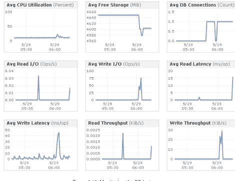

你可以看到，我加载了足够的数据，使得标记为**平均可用存储空间**的图表上的线条发生了移动。其他图表显示了短暂的波动，这与我加载的数据以及随后的查询所导致的系统负载或网络流量增加相对应。

### 发起快照备份

在继续之前，让我们创建一个快照备份。右键单击数据库实例，选择**创建快照**，如图 9.11 所示。

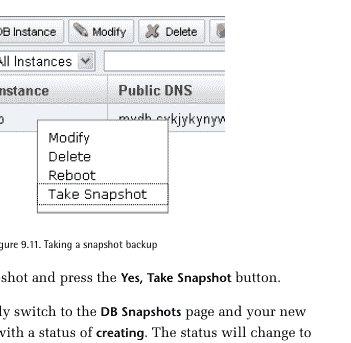

图 9.11. 创建快照备份

为数据库快照输入一个名称，并按下**是，创建快照**按钮。

控制台将自动切换到**数据库快照**页面，你的新快照应该存在，状态为*创建中*。几分钟后，状态将变为*可用*。

快照始终反映快照启动时数据库的状态。无需将数据刷新到磁盘或暂停应用程序。你可以单击控制台下半部分的**近期事件**选项卡，查看快照创建时生成的事件，如图 9.12 所示。


图 9.12. 与我们的快照相关的近期事件

### 纵向扩展处理能力

假设你之前使用该数据库实例进行测试，现在你准备将其投入生产环境。你对系统非常满意，并预计第一天会有大量的用户涌入。由于你打算在发生这种情况时饮用香槟并吃蛋糕，你决定在流量高峰来临前提前扩展处理能力。右键单击数据库实例并选择**修改**选项；你将进入图 9.13 所示的屏幕。

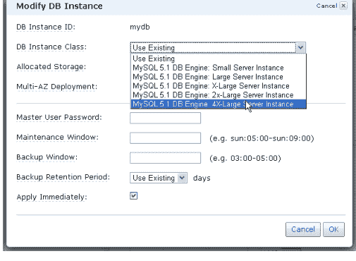

图 9.13. 扩展数据库实例

选择新的数据库实例类别，勾选**立即应用**，然后按下**确定**按钮。数据库实例的状态将变为**修改中**，并且**近期事件**选项卡中将出现新条目，表明实例类别正在被修改。修改完成后，状态将变为**可用**，并会出现相应事件。正如你可以从我展示的事件日志（见图 9.14）中看到的，整个扩展操作仅花费了六分钟。


如果你接收到的流量少于预期，你可以以相同的方式将实例缩小到更小、更便宜的数据库实例类型。

你可以使用相同的**修改**操作来增加分配给实例的存储空间，但你永远不能减少它。

### 纵向扩展存储空间

在你喝完香槟并吃完蛋糕回来后，你检查 RDS 监控，发现你的可用存储空间现在已降至 1GB 以下。是时候添加更多存储了！右键单击数据库实例并选择**修改**。这次，如图 9.15 所示，将**已分配存储空间**更改为较大的值。记得勾选**立即应用**。


在 Amazon RDS 增加存储空间期间，你的实例将保持运行状态并可访问，因此你可以随时执行此操作。同样，使用**近期事件**选项卡来查看修改的进度。我的事件日志显示，将已分配存储空间从 5GB 增加到 8GB 花费了不到五分钟。增加的存储空间分配在监控选项卡中可见，如图 9.16 所示。


### 从数据库快照或时间点创建数据库实例

AWS 管理控制台还允许你从你的任何数据库快照创建数据库实例，或恢复到备份保留期内任何时间点的确切状态。你可以分别从**数据库快照**和**数据库实例**页面发起这些操作。

### 转换为多可用区

你可以随时将单可用区数据库实例转换为多可用区数据库实例（反之亦然）。你可以通过在控制台中调用**修改**操作并更改**多可用区部署**设置的值来启动此过程，如图 9.17 所示。


对于我具有 8GB 已分配存储空间的示例实例，从单可用区到多可用区的转换仅花费了七分钟。在修改过程中，数据库实例的状态将从**可用**过渡到**修改中**（然后返回），但数据库实例保持在线状态。

### 删除数据库实例

数据库实例生命周期的最后一步是删除。Amazon RDS 允许你在终止实例之前对实例进行最终快照，以便捕获其终止前的状态，如图 9.18 所示。


在实例完全消失之前，数据库实例的状态将从**可用**过渡到**删除中**。

### 这就结束了

至此，你应该已经掌握了关于 Amazon RDS 的足够知识，可以开始迁移你现有的基于 MySQL 的应用程序。你可以从现有数据库导出数据，然后使用“访问数据库实例”部分和“导入一些数据”部分中的信息将其导入新的数据库实例。

你需要修改现有代码以使用新的连接字符串，并且你必须设置你的数据库安全组以允许来自应用程序层的网络访问。

## 高级 AWS

在本章中，我们将建立在已学知识之上。我们将探讨一些高级主题，包括 AWS 使用情况的会计与追踪、弹性块存储卷的使用、访问 EC2 实例元数据，以及对基于 AWS 的系统进行动态图解。

### 会计与追踪

AWS 的动态特性——例如在 Amazon S3 中存储更多数据的便利性、在 SimpleDB 中创建并填充域的便利性，以及启动 EC2 实例的便利性——意味着你应当时刻关注你的使用量（以及相关的成本）。

### 账户活动

你可以通过访问 [http://aws.amazon.com](http://aws.amazon.com) 并从 **Your Account** 菜单中选择 **Account Activity** 来手动追踪你的账户活动。登录后，你将能够查看每个所用服务的详细使用量和成本信息。你可以使用服务名称旁边的 + 图标展开每个部分。图 10.1 展示了作者 2009 年 8 月的账户活动：

**查看上一份账单**

**截至 2009 年 8 月 19 日 本月活动摘要**
该期间的计费周期：2009 年 8 月 1 日 - 2009 年 8 月 31 日
此页面上显示的 AWS 服务使用费用目前显示活动数据截至 2009 年 8 月 20 日 12:29 GMT。

| 服务 | 费率 | 使用量 | 总计 |
| :--- | :--- | :--- | :--- |
| **Amazon CloudFront** | | | |
| | **每 GB $0.170 - 前 10 TB/月 数据传输出站** | 0.229 GB | 0.04 |
| | **每 10,000 次 GET 请求 $0.013** | 3,740 次请求 | 0.01 |
| | | | **0.05** |
| **Amazon Elastic Compute Cloud** | | | |
| **Amazon EC2 运行小时 (WEB 保留实例)** | **每小实例 (×6.5 small) 实例小时 (或不足一小时) $0.03** | 431 小时 | 13.93 |
| **Amazon EC2 运行小时 (WEB)** | **每小实例 (×6.5 small) 实例小时 (或不足一小时) $0.13** | 8 小时 | 0.80 |
| **Amazon EC2 带宽** | **每 GB 入站数据传输 $0.100 - 所有进入 Amazon EC2 的数据流量** | 2,940 GB | 0.29 |
| | **每 GB 互联网数据传输 $0.170 - 前 10 TB/月 从 Amazon EC2 出站的数据传输** | 5,374 GB | 0.91 |
| | **每 GB 区域数据传输 $0.013 - 入站 (新加坡、亚洲或使用公共或弹性 IP 或弹性负载均衡时)** | 0.109 GB | 0.01 |
| | | | **21.53** |
| **Amazon CloudWatch** | **每监控实例小时 (或不足一小时) $0.015** | 439 小时 | 6.59 |
| | | | **21.53** |
| **Amazon Elastic MapReduce** | | | **0.00** |
| **Amazon Simple Queue Service** | **每 10,000 次请求 $0.01 (每次请求 $0.000001)** | 34,551 次请求 | 0.03 |
| | | | **0.03** |
| **Amazon Simple Storage Service** | **每 GB $0.150 - 前 50 TB/月 使用的存储** | 121,963 GB-Ms | 18.29 |
| | **每 GB $0.130 - 所有入站数据传输** | 0.098 GB | 0.01 |
| | **每 GB $0.170 - 前 10 TB/月 出站数据传输** | 3,125 GB | 0.53 |
| | **每 1,000 次 PUT、COPY、POST 或 LIST 请求 $0.01** | 6,609 次请求 | 0.07 |
| | **每 10,000 次 GET 及其他所有请求 $0.01** | 26,470 次请求 | 0.03 |
| | | | **18.93** |
| **Amazon SimpleDB** | **每消耗机器小时 $0.00** | 46,867 小时 | 0.00 |
| | **每 GB-月 使用的存储 $0.00** | 0.109 GB-Ms | 0.00 |
| | **每 GB $0.000 - 所有入站数据传输** | 0.002 GB | 0.00 |
| | **每 GB $0.00 - 前 10 TB/月 出站数据传输** | 0.0000748 GB | 0.00 |
| | | | **0.00** |
| **税费** | | | |
| **预计税费 (应于 2009 年 9 月 1 日缴纳)** | **应于 2009 年 9 月 1 日缴纳的收费*** | | **40.54** |

*计费周期的所有费用将充入您信用卡上的下一个计费日期，即 2009 年 9 月 1 日。这些费用包括下一个计费日期应缴的新计费周期的预计费用以及当前计费周期产生的所有费用。此处显示的利息或费用费用是您在计费周期之后累积的任何额外使用费用。访问 Amazon Web Services 常见问题解答以了解有关税务服务定价模型和计费的更多信息。*
*所有 Web 服务均由 Amazon Web Services LLC 销售*

图 10.1. 作者一个月的账户活动

如果你的 AWS 使用量每天都在变化，你应当记得检查你的账户活动。如果你正在提供大量内容，或者使用自动扩缩功能在系统负载或流量增加时启动额外的 EC2 实例，这一点尤为重要。

### 访问使用数据

用于生成账户活动的原始数据可以通过选择菜单中的 **Usage Reports** 选项从 AWS 门户下载。你可以下载任何服务的报告——通过控制时间段、使用类型和数据格式 (XML 或 CSV)——如图 10.2 所示。


既然我们已经学会了如何处理 XML，这次让我们使用一个 CSV (Comma-Separated Value，逗号分隔值) 文件，以便有机会学习一项新技能。我们将访问数据，将其存储在 SimpleDB 中，然后检索并可视化它。

首先，下载你使用过的任何 (或所有) 服务的数据。将 **Report Granularity** 设置为 **Days**，选择一个代表你近期 AWS 使用情况的 **Time Period** (我从 2009 年 1 月 1 日开始，下载了将近八个月完整的数据)，然后点击 **Download report (CSV)**。

根据你的浏览器配置，你可能会得到满屏的数据，或者在你的下载历史中看到一个新文件。无论如何，请采取必要措施将数据传输到你正在运行的 EC2 实例上。我使用本地副本的 Notepad 打开文件，选择并复制文本，然后将其粘贴到我 EC2 实例上运行的 emacs 缓冲区中。我将我的 EC2 使用文件命名为 `ec2_usage.csv`，但你也可以随便使用任何名称。

### 导入使用数据

以下是我的 `ec2_usage.csv` 文件的前几行：

```text


Service, Operation, UsageType, StartTime, EndTime, UsageValue

AmazonEC2,PublicIP-In,DataTransfer-Regional-Bytes,01/01/09 00:00:00,01/02/09 00:00:00,97625

AmazonEC2,RunInstances,BoxUsage,01/01/09 00:00:00,01/02/09 00:00:00,24

AmazonEC2,ElasticIP-Out,DataTransfer-Regional-Bytes,01/01/09 00:00:00,01/02/09 00:00:00,558960

AmazonEC2,ElasticIP-In,DataTransfer-Regional-Bytes,01/01/09 00:00:00,01/02/09 00:00:00,24449

...

文件的第一行提供字段名称，而其他行包含数据：每行一条记录，值由逗号分隔。PHP 的 `fgetcsv` 函数使处理 CSV 文件变得容易。该函数从文件中读取一行，在逗号边界处分离字段（尊重带引号的字符串），并返回一个值数组。以下是它对我的文件第一行返回的内容：

```text
Array (
   [0] => Service
   [1] => Operation
   [2] => UsageType
   [3] => StartTime
   [4] => EndTime
   [5] => UsageValue
)
```

每个 AWS 服务的使用数据文件包含一些公共字段和特定于特定服务的字段。例如，S3 的使用数据文件还包含一个 `Resource` 字段。该字段将使用数据与 S3 存储桶关联。

类似地，Amazon CloudFront 的使用数据文件使用 `Resource` 字段来标识与特定 CloudFront 分发关联的账户数据。由于数据格式包含公共元素和一些特定服务的变体，Amazon SimpleDB 成为存储它的理想系统。我们需要一个域：

```text
chapter_10/include/book.inc.php (excerpt)
define('BOOK_AWS_USAGE_DOMAIN', 'aws_usage');
```

我们可以使用第 8 章中创建域程序的修改版来创建此域：

```text
chapter_10/create_domain.php (excerpt)
$res = $sdb->create_domain(BOOK_AWS_USAGE_DOMAIN);
```

让我们编写一个程序，从命令行指定的一个或多个 CSV 文件中导入数据。以下是我们开始所需的内容：

```text
chapter_10/import_usage.php (excerpt)
#!/usr/bin/php
<?php
error_reporting(E_ALL);
require_once('cloudfusion.class.php');
require_once('include/book.inc.php');
if ($argc == 1)
{
    exit("Usage: " . $argv[0] . " CSV_FILE ...\n");
}
```

该脚本期望在命令行找到一个或多个 CSV 文件，上述代码执行此检查。如果命令行参数太少，它会输出一条有用的消息。

我们将把数据存储在 SimpleDB 中，因此需要一个访问对象：

```php
chapter_10/import_usage.php (excerpt)
$sdb = new AmazonSDB();
```

然后，我们可以使用自定义的 `ImportCSV` 函数来处理每个文件，这个函数我们稍后会编写：

```php
chapter_10/import_usage.php (excerpt)
for ($i = 1; $i < $argc; $i++)
{
    $file = $argv[$i];
    if (($ret = ImportCSV($sdb, $file)) !== false)
    {
        print("Imported ${file}: ${ret} records\n");
    }
    else
    {
        print("Did not import ${file}\n");
    }
}
```

让我们来看一下 `ImportCSV` 函数。第一步是尝试打开文件；如果无法打开，它将返回 `false`：

```php
chapter_10/import_usage.php (excerpt)
function ImportCSV($sdb, $file)
{
    $fp = fopen($file, 'r');
    if ($fp === false)
    {
        return false;
    }
    ...
}
```

由于 CSV 文件的第一行包含字段名称，我们将其读取到 `$fields` 数组中。在处理并存储每行数据时，我们需要这些名称。我们还将跟踪已读取和处理的行数：

```php
$fields = fgetcsv($fp);
$recordCount = 0;
```

现在我们可以处理每个数据行：

```php
while (($data = fgetcsv($fp)) != false)
{
    $recordCount++;
}
```

如我在第 8 章中所述，选择 SimpleDB 键是有讲究的。在构建此工具时，我希望能够导入相同的数据文件，或者导入多个日期重叠的数据文件，同时保持数据的完整性。经过一些实验，我通过拼接服务名称和非数据字段（除了 `UsageValue` 之外的所有内容）的 MD5 哈希值来构建键。我的算法生成了这样的键：


让我们继续。我们从 `Key` 和 `KeyData` 变量开始：

```php
$key     = '';
$keyData = '';
```

然后处理每行的每个字段。回想一下，`$fields` 变量包含文件的字段名称。我还更改了日期字段（`StartTime` 和 `EndTime`）的格式，以便日后能更好地进行基于范围的查询。以下是字段处理代码：


在这个循环结束时，`$attrs` 数组包含要写入 SimpleDB 的数据，`$key` 包含键的前缀，`$keyData` 包含要哈希以形成键剩余部分的数据。以下是我的数据中 `$attrs` 数组的转储：


我可能应该将 `UsageValue` 字段填充为固定长度。由于我没有计划对该字段执行任何查询，所以没有这样做。¹ 请注意，输入文件中的字段名称直接控制数据在 SimpleDB 中的存储方式。

把所有内容整合起来，以下是如何形成 SimpleDB 键的方法：

```php
chapter_10/import_usage.php (excerpt)
$key = $key . '_' . md5($keyData);
```

最后，我们将数据存储在 SimpleDB 中，并注意指定任何现有同名的属性都将被替换：

```php
chapter_10/import_usage.php (excerpt)
$res = $sdb->put_attributes(BOOK_AWS_USAGE_DOMAIN,
    $key, $attrs, true);
```

进行简单的错误检查，我们这就快完成了：

```php
chapter_10/import_usage.php (excerpt)
if (!$res->isOk())
{
    $error = $res->body->Errors->Error->Message;
    print("Could not insert ${key}: ${error}\n");
}
```

最后一步，在所有行处理完毕后，关闭文件并返回记录数：

```php
chapter_10/import_usage.php (excerpt)
fclose($fp);
return $recordCount;
}
?>
```

> ¹ 这在我这里可能有点短视，但我确实需要留一些代码作为练习让大家自己动手完成！

在您将所有使用量文件下载到您的 EC2 实例后，按如下方式运行导入程序：

```
<dev>: php import_usage.php *.csv
```

它将依次处理每个文件，并报告每个文件的记录数：


Imported `cf_usage_year.csv`: 242 records

Imported `ec2_usage.csv`: 138 records

导入大文件可能需要一些时间。如果您愿意，可以并行运行此程序的多个实例，每个数据文件对应一个实例。

## 查询账户数据

数据存储好之后，下一步是查看查询账户数据的有趣方式。我从第 8 章中提取了简单的查询命令（`query_usage_cmd.php`），并对其进行增强，使其能够检索所有结果，而不是在第一个批次后停止。我通过跟踪并使用每个 `select` 调用返回的 `NextToken` 值来实现这一点。以下是主循环结构：

```php
chapter_10/query_usage_cmd.php (excerpt)

$next = null;

do
{
    $attrs = ($next == null) ? null : array('NextToken' => $next);
    $res = $ssdb->select($query, $attrs);
    $next = (string) $res->body->SelectResult->NextToken;
    if (!$res->isOk())
    {
        exit("Select operation failed\n");
    }
    foreach ($res->body->SelectResult->Item as $item)
    {
        $recordCount++;
        foreach ($item->Attribute as $attribute)
        {
            print($attribute->Name . ": " . $attribute->Value . ", ");
            if ($attribute->Name == 'UsageValue')
            {
                $totalUsage += (int) $attribute->Value;
            }
        }
        print("\n");
    }
}
while ($next != null);
```

以下是该命令的实际运行情况。² 第一个命令简单地检索所有使用量数据：

```
<dev>php query_usage_cmd.php
Final query: select * from aws_usage
EndTime: 2009-08-02T00:00:00-04:00, UsageType: DataTransfer-Regional
\x00 \x00 \x00 \x00 \x00 \x00 Bytes, UsageValue: 4982241, Operation: ElasticIP-Out, StartTime:
2009-08-01T00:00:00-04:00, Service: AmazonEC2,
EndTime: 2009-08-02T00:00:00-04:00, UsageType: BoxMonitoringUsage,
\x00 \x00 \x00 \x00 \x00 \x00 \x00 \x00 \x00 \x00 \x00 \x00 \x00 UsageValue: 24, Operation: RunInstances, StartTime: 2009-08-01T00
:00:00-04:00, Service: AmazonEC2,
EndTime: 2009-08-02T00:00:00-04:00, UsageType: DataTransfer-Regional
\x00 \x00 \x00 \x00 \x00 \x00 \x00 \x00 \x00 \x00 \x00 \x00 \x00 \x00 \x00 \x00 \x00 Bytes, UsageValue: 308682, Operation: ElasticIP-In, StartTime:
\x00 \x00 \x00 \x00 2009-08-01T00:00:00-04:00, Service: AmazonEC2,
```

额外的命令参数会被添加到查询中，带有单一的 where 前缀。以下是如何检索单个服务的使用量数据（请注意命令行中同时包含双引号和单引号）：

```
<dev>php query_usage_cmd.php "Service='AmazonS3'"
Final query: select * from aws_usage where  Service='AmazonS3'
EndTime: 2009-06-05T00:00:00-04:00, UsageType: StorageObjectCount,
\x00 \x00 \x00 \x00 \x00 \x00 \x00 \x00 \x00 \x00 \x00 \x00 \x00 \x00 \x00 UsageValue: 2, Operation: StandardStorage, StartTime:
\x00 \x00 \x00 \x00 \x00 \x00 \x00 \x00 \x00 \x00 2009-06-04T00:00:00-04:00, Service: AmazonS3, Resource:
\x00 \x00 \x00 \x00 \x00 \x00 aws-dev-relations,
```

检索单个服务在单日内使用量数据：

```
<dev>: php query_usage_cmd.php "Service='AmazonS3' and
   StartTime like '2009-08-01%'"
   Final query: select * from aws_usage where  Service='AmazonS3'
   and StartTime like '2009-08-01%'
   EndTime: 2009-08-02T00:00:00-04:00, UsageType: Requests-Tier1,
   UsageValue: 291, Operation: PutObject, StartTime: 2009-08-01T00:
   00:00-04:00, Service: AmazonS3, Resource: wsdot-bridges,
   ...
```

最后，检索单个服务中单个操作的一个月数据：³

```
<dev>: php query_usage_cmd.php "Service='AmazonS3' and
   StartTime like '2009-08%' and UsageType='DataTransfer-Out-Bytes'
   order by StartTime
   Final query: select * from aws_usage where  Service='AmazonS3'
   and StartTime like '2009-08%'
   and UsageType='DataTransfer-Out-Bytes' order by StartTime
   EndTime: 2009-08-02T00:00:00-04:00, UsageType:
   DataTransfer-Out-Bytes, UsageValue: 57360567, Operation:
   GetObject, StartTime: 2009-08-01T00:00:00-04:00, Service:
   AmazonS3, Resource: jeffbarr-public,
   ...
```

现在我们就可以随心所欲地切割和分析使用量数据了。虽然本节专注于处理使用量数据，但值得一提的是使用 SimpleDB 导入和查询数据是多么容易。随着新服务（及相关使用量报告）的出现，无需修改代码即可支持它们。

## 获取和显示使用量数据

好的，我们练习的最后一步是显示数据。让我们组装一个小程序，将其从 SimpleDB 中提取出来，并渲染为 HTML 表格。以下是它的开始方式——第一步是指定要检索和显示的使用量值：

```php
chapter_10/bucket_usage_page.php (excerpt)
<?php
   error_reporting(E_ALL);
```

> ³ 这个小工具也被证明是实验 SimpleDB SQL 的理想载体。

```php
require_once('cloudfusion.class.php');
require_once('include/book.inc.php');
$usage = "DataTransfer-Out-Bytes";
```


我将展示传输出去的数据。这代表从 S3 传输到外部世界的 S3 对象数据字节数。当然，您也可以自由将引号中的值替换为其他类型的用量，例如 `DataTransfer-In-Bytes`（从外部世界传输到 S3 的数据字节数）或 `StorageObjectCount`（存储在存储桶中的对象数量），甚至是 `TimedStorage-ByteHrs`（存储在桶中的数据消耗的字节-小时数）。

顺便说一句，字节-小时与您坐在牙医椅子上的时间完全无关。它代表存储的字节数与其存储小时数的乘积之和。我的一个存储桶的字节-小时用量值为 14,597,270,160。这意味着该存储桶在从 2009 年 8 月 18 日开始的 24 小时期间内存储了约 608 兆字节的数据。

该脚本将报告每个 S3 存储桶的用量，因此我们创建常规的访问对象并获取存储桶列表：

```php
// chapter_10/bucket_usage_page.php (excerpt)

$S3   = new AmazonS3();

$Sdb  = new AmazonSDB();

$_buckets = $S3->get_bucket_list();
```

现在我们需要进行一些日期运算。我们将报告从今天开始，往前推六天，即整整一周的数据范围。以下代码为日期范围查询设置了 `$firstDay` 和 `$lastDay`，并创建了 `$days` 数组，其中包含范围内每个日期的年-月-日表示形式。开始吧：

```php
// chapter_10/bucket_usage_page.php (excerpt)

$today = date_create("now");

$lastDay = $today->format("Y-m-d");

$days = array();

for ($i = 0; $i < 7; $i++)

{

    date_modify($today, "-1 day");

    $days[] = $today->format("Y-m-d");

}

$firstDay = $days[6];
```

我们将使用 `$days` 数组来生成 HTML 表格的列标题。

好的，现在到了精彩的部分——获取每个存储桶的用量数据并将其存储在 `$rows` 数组中，以便最终生成表格行。该循环简单遍历每个存储桶，并调用自定义的 `GetUsage` 函数从 SimpleDB 检索 S3 用量数据。代码如下：

```php
// chapter_10/bucket_usage_page.php (excerpt)

$rows = array();

foreach ($buckets as $bucket)

{

    $dailyUsage = GetUsage($sdb, $usage, $bucket, $firstDay, $lastDay);
```

如果给定日期区间内存储桶没有用量数据，`GetUsage` 将返回一个空数组。为了保持输出紧凑，下面的代码简单地跳过这样的存储桶。用量数据数组以存储桶名称作为键存储在 `$rows` 数组中。如果某一天没有数据，则数组中存储空字符串。最后，每日总计也作为存储桶数据数组的最后一个元素存储：

```php
// chapter_10/bucket_usage_page.php (excerpt)

if (count ($dailyUsage) > 0)

{

    $rows[$bucket] = array();

    foreach ($days as $day)

    {

        if (isset($dailyUsage[$day]))

        {

            $rows[$bucket][] = $dailyUsage[$day];

        }

        else

        {

            $rows[$bucket][] = ''; 

        }

    }

    $rows[$bucket][] = array_sum($dailyUsage);

}
```

剩余的复杂性存在于 `GetUsage` 函数中。它是这样的：

```php
// chapter_10/bucket_usage_page.php (excerpt)

function GetUsage($sdb, $usage, $bucket, $firstDay, $lastDay)

{

    $query = "select StartTime, UsageValue " .

             "from " . BOOK_AWS_USAGE_DOMAIN .

             " where" .

             " Service='AmazonS3' and " .

             " StartTime >= '${firstDay}' and " .

             " StartTime <= '${lastDay}' and " .

             " Resource='${bucket}' and " .

             " UsageType='${usage}';";

    $res = $sdb->select($query);

    if (!$res->isOk())

    {

        return null;

    }

    $dailyUsage = array();

    foreach ($res->body->SelectResult->Item as $item)

    {

        $attrs = getItemAttributes($item);

        $startTime = substr($attrs['StartTime'], 0, 10);

        $usage = $attrs['UsageValue'];

        $dailyUsage[$startTime] = $usage;

    }

    return $dailyUsage;

}
```

这看起来很长，但非常简单。它构建查询，运行查询，检查结果，并构建一个按日期索引的用量数组。该数组作为函数值返回。

HTML 模板是我们报告页面的最后组成部分。它以最常见的方式开始：

```html
<!-- chapter_10/bucket_usage_page.php (excerpt) -->
<!DOCTYPE html PUBLIC "-//W3C//DTD XHTML 1.0 Strict//EN"
    "http://www.w3.org/TR/xhtml1/DTD/xhtml1-strict.dtd">
<html xmlns="http://www.w3.org/1999/xhtml" xml:lang="en" lang="en">
<head>
    <title><?php echo $output_title ?></title>
</head>
<body>
    <h1><?php echo $output_title ?></h1>
    <p><?php echo $output_message ?></p>
```

这个模板有两部分，让我们分别来看。首先，我们需要通过遍历 `$days` 数组来生成表格头行：

```html
<!-- chapter_10/bucket_usage_page.php (excerpt) -->
<table>
    <thead>
        <tr>
            <th>Bucket</th>
            <?php foreach($days as $day): ?>
                <th><?php echo $day ?></th>
            <?php endforeach ?>
            <th>Total For Bucket</th>
        </tr>
    </thead>
```

接下来，我们生成表格主体并完成页面：

```html
<!-- chapter_10/bucket_usage_page.php (excerpt) -->
    <tbody>
        <?php foreach($rows as $bucket => $cells): ?>
            <tr>
                <td><?php echo $bucket ?></td>
                <?php foreach($cells as $cell): ?>
                    <td>
                        <?php echo ($cell == '') ? '&nbsp;' : number_format($cell); ?>


```html
                    </td>

                <?php endforeach ?>

            </tr>

        <?php endforeach ?>

    </tbody>

</table>

</body>

</html>
```

通过嵌套的 `foreach` 循环，我们遍历存储桶数组和每个存储桶的单元格数据数组。`number_format` 函数添加逗号以使数字看起来更美观。空表格单元格用单个不换行空格 (`&nbsp;`) 填充。图 10.3 展示了结果表格的一个示例。

| Bucket | 2009-08-19 | 2009-08-18 | 2009-08-17 | 2009-08-16 | 2009-08-15 | 2009-08-14 | 2009-08-13 | Total For Bucket |
| :--- | :--- | :--- | :--- | :--- | :--- | :--- | :--- | :--- |
| andybar | 1,645,631 | 165,231 | 6,670,625 | 7,293,265 | 8,004,750 | 7,252,952 | 31,032,454 | |
| carmenbarr | | | 5,634 | | | | | 5,634 |
| barr-work | | | 108 | 108 | 324 | 108 | 108 | 756 |
| jellbar | 9,309,443 | 930,943 | 6,623,644 | 1,155 | 231 | 231 | 16,945,878 | |
| jellbar-public | 178,547 | 17,547,404 | 37,132,329 | 34,348,975 | 54,950,708 | 94,025,525 | 202,764,048 | 440,977,616 |
| jellbar-public | | 11,527 | | 24,809 | | 11,527 | 49,618 | 11,527 |
| step-own-aws-cloud-book | | | 17,629 | | | | 231 | 17,860 |
| wasted-hinges | 2,936,508 | 2,093,450 | 10,508,520 | 591 | 591 | 591 | 591 | 15,554,842 |

*图 10.3. 每个存储桶每天的出站数据传输*

你应该能够只需一两分钟的工作时间来修改此程序以显示其他类型的 S3 用量。你可以对数据进行绘图或标记异常值。稍微多做一些工作，你也可以报告 EC2、SimpleDB、CloudFront 或 SQS 的用量。

## 弹性块存储

我们在第 5 章中介绍了 Amazon EC2 的弹性块存储（EBS）功能的基本知识，在那里我们学习了如何在 EC2 实例上创建、附加、格式化和挂载 EBS 卷。在本节中，您将更深入地了解 EBS。我们将涵盖命令行用法，查看如何进行备份，了解公共数据集，并查看如何通过创建 RAID 设备来增加多个 EBS 卷上的性能或容量。

### 命令行中的 EBS

您可以从命令行执行所有 EBS 功能。您可以创建、附加、快照（备份）、分离和删除 EBS 卷。

EBS 卷可以附加到同一可用区中的任何 EC2 实例。如果您有一个正在运行的实例，您可以从 AWS 管理控制台或命令行确定其可用区。您还可以从 EC2 实例元数据中检索此信息（以及更多），我们将在本章稍后讨论这一点。

有了可用区，以下是如何从命令行创建新的 EBS 卷：

```bash
$ ec2-create-volume -z us-east-1b -s 50

VOLUME vol-73d4211a 50 us-east-1b creating

← 2009-08-20T19:12:09+0000
```

执行此命令后，卷状态立即报告为“creating”（创建中）。该命令还显示卷 ID（在我的情况下为 `vol-73d4211a`）。您稍后将需要此 ID。

您需要等待（通常只需几秒钟）直到卷变为可用之前再继续操作。以下是如何检查的方法：

```bash
$ ec2-describe-volumes vol-73d4211a

VOLUME vol-73d4211a 50 us-east-1b available

← 2009-08-20T19:12:09+0000
```

现在您需要将卷附加到您的实例。您需要实例的 ID、卷的 ID 和一个设备名称。尽管 Linux 磁盘设备名称基本上

出于惯例，这些设备通常位于 `/dev` 目录下，并且以 `sd` 开头的名称命名，后面紧跟另一个字母。EC2 系统磁盘是 `/dev/sda`，其他本地磁盘（在较大规格的实例上）则是 `sdb`、`sdc`，以此类推。`/dev/sdf` 是附加到实例的第一个 EBS 卷的良好设备名称（因为“f”在字母表中靠后，足以避免与其他设备冲突）。以下是附加方法：

```
$ ec2-attach-volume vol-73d4211a -i i-da8f6db2 -d /dev/sdf

ATTACHMENT vol-73d4211a i-da8f6db2 /dev/sdf

attaching 2009-08-20T19:26:08+0000
```

该命令接受卷 ID，接着是 `-i` 和实例 ID，以及 `-d` 和设备名称。卷的状态会变为“attaching”（附加中）。它会保持此状态几秒钟，然后过渡到“attached”（已附加）：

```
$ ec2-describe-volumes vol-73d4211a

ATTACHMENT vol-73d4211a i-da8f6db2 /dev/sdf

attached 2009-08-20T19:26:12+0000
```

至此，我们已经完成了云计算中相当于采购磁盘驱动器、将其插入服务器并连接数据线缆的操作。磁盘在物理上已连接并正在运行；操作系统感知到了它，但磁盘是原始的（未格式化的），尚未成为文件系统的一部分。

下一步是在新卷上创建文件系统和一个挂载点（attachment），并在逻辑上将卷挂载到实例的根文件系统上。我们将遵循第 5 章“创建 EBS 卷”一节中的相同步骤（你需要登录到你的 EC2 实例来运行这些命令）：

```
<dev>: mkfs -F /dev/sdf
<dev>: mkdir /data
<dev>: mount /dev/sdf /data
```

你可以在实例文件系统的任何位置挂载 EBS 卷。如果你计划创建和使用大量卷，你应该花时间预先规划好逻辑命名结构。

卷现在已准备好使用。你可以在 `/data` 目录层级中创建目录、存储文件，并执行任何所需操作。我需要在下一节的示例中为 `/data` 目录准备一些数据，因此我要复制 `/usr/lib` 的内容（约 250MB）过去：

```
<dev>: cp -r /usr/lib /data
```

## EBS 快照

假设我想在此时对我现有的 EBS 卷创建一个备份。第一步是确保任何内存中的数据已写入磁盘：

```
<dev>: sync
```

如果你使用 EBS 卷来存储数据库文件，建议在创建备份之前关闭数据库服务器。这将确保备份完整且逻辑一致。

创建备份——在 EBS 术语中称为快照——非常容易：

```
$ ec2-create-snapshot vol-73d4211a

SNAPSHOT snap-c7e849ae vol-73d4211a pending

2009-08-20T19:52:35+0000
```

一旦快照发起，就可以安全地恢复向卷写入数据。快照可能需要一些时间才能完成，但它始终代表卷在快照发起时的状态。

你可以像这样检查快照的状态：

```
$ ec2-describe-snapshots

SNAPSHOT snap-c7e849ae vol-73d4211a pending

2009-08-20T19:52:35+0000
```

EBS 卷的第一个快照类似于传统的完整备份。它包含写入卷的所有信息。第二个及后续快照类似于传统的增量备份。它们只包含自上次备份以来发生变化的信息。EBS 会在幕后处理所有这些细节。即使你删除第一个快照，系统也会保留足够的数据，允许你从其他任何快照创建新卷。

快照存储在 Amazon S3 中，具备你期望的所有良好属性。特别是，它们以低成本和高可靠性存储。

快照的状态最终会过渡到“completed”（已完成）。卷已被备份：

```
$ ec2-describe-snapshots

SNAPSHOT     snap-c7e849ae   vol-73d4211a   completed

             2009-08-20T19:52:35+0000      100%
```

EBS 快照可用于在同一或不同可用区中创建新卷。这是在创建卷时包含快照 ID（在我的例子中是 `snap-c7e849ae`）来实现的。我可以创建一个新卷，其内容与创建快照时原始卷的内容相同，方法如下：


`$ ec2-create-volume -z us-east-1b -s 50 --snapshot snap-c7e849ae`

VOLUME      `vol-00d72269`   50   `snap-c7e849ae`   `us-east-1b`

             creating    2009-08-20T20:17:35+0000

一旦新卷的状态变为可用（`available`），我需要将其附加到一个实例（在这种情况下，我将使用最初的那个实例，但可以附加到同一可用区内的任何 EC2 实例），创建一个挂载点，然后将其挂载，这次一步到位：

```
$ ec2-attach-volume vol-00d72269 -i i-da8f6db2 -d /dev/sdg
```

ATTACHMENT  `vol-00d72269`   `i-da8f6db2`   `/dev/sdg`

             attaching   2009-08-20T20:21:18+0000

接下来，创建一个挂载点：

```
<dev>: mkdir /data2
<dev>: mount /dev/sdg /data2
```

此时 `/data` 和 `/data2` 是完全相同的副本。

我可以在 `/data` 中添加更多数据，然后创建另一个快照：

```
<dev>: cp -r /usr/java /data
```

```
$ ec2-create-snapshot vol-73d4211a
```

SNAPSHOT       `snap-b1ed4cd8` `vol-73d4211a` pending

2009-08-20T20:27:04+0000

现在我有了同一个卷的两个快照（内容不同）。我可以从其中任意一个创建新卷：

```
$ ec2-describe-snapshots
```

SNAPSHOT       `snap-c7e849ae`  `vol-73d4211a`  completed

2009-08-20T19:52:35+0000     100%

SNAPSHOT       `snap-b1ed4cd8`  `vol-73d4211a`  completed

2009-08-20T20:27:04+0000     100%

在生产系统上，你可能会拥有大量快照。务必跟踪每个快照的原因（例如，“在 Mac 实例上，Beta 版本 1.5 发布前的开发卷快照”）。你可以把它写在便利贴上放在键盘下面，或者编写一个小型 AWS 程序将数据捕获到 SimpleDB 中。

事实上，我们可以将快照和日志记录结合起来。我们需要一个 SimpleDB 域：

```php
## chapter_10/include/book.inc.php (excerpt)

define( 'BOOK_SNAP_LOG_DOMAIN', 'snapshot_log');
```

请确保在运行下一个脚本之前创建这个 SimpleDB 域。你可以再次使用 `create_domain.php` 脚本。以下是所有步骤：

```php
#!/usr/bin/php
<?php
error_reporting(E_ALL);
require_once('cloudfusion.class.php');
require_once('include/book.inc.php');
if ($argc < 3)
{
    exit("Usage: " . $argv[0] . " \"message\" VOLUMEID...\n");
}
$message = $argv[1];
$sdb = new AmazonSDB();
$ec2 = new AmazonEC2();
for ($i = 2; $i < $argc; $i++)
{
    $volId = $argv[$i];
    // Create snapshot
    $res1 = $ec2->create_snapshot($volId);
    if ($res1->isOk())
    {
        $snapId     = $res1->body->snapshotId;
        $startTime = $res1->body->startTime;
        $key = $volId . '_' . $startTime;
        $attrs = array('VolId' => $volId,
                       'Message' => $message,
                       'StartTime' => $startTime);
        $res2 = $sdb->put_attributes(BOOK_SNAP_LOG_DOMAIN, $key,
                                $attrs, true);
    }
}
exit(0);
?>
```

`create_snapshot` 方法在指定卷上发起快照活动。快照 ID 和开始时间从返回的数据中提取，并将信息存储在 SimpleDB 中。

运行该脚本很简单：

```
$ php snap_and_log.php "Important Backup" vol-73d4211a
```

为了清楚起见，这个小程序创建了一个卷的近乎即时的备份，该卷大小最高可达 1TB，将备份存储在 Amazon S3 中以确保安全，并将重要信息记录到 SimpleDB。这就是云计算（以及完全可编程能力的强大之处）的体现！

EBS 快照存储在 S3 中，因此无法使用 S3 API 访问它们。你可以通过 `ec2-describe-snapshots` 命令访问，或者编写程序调用 CloudFusion 的 `describe_volumes` 方法。

## EBS 公共数据集

你也可以从 EBS 公共数据集创建 EBS 卷。这些数据集中（列表在 http://aws.amazon.com/publicdatasets/）包含用于 AWS 的公共信息。这里有普查数据、基因组数据、经济数据等更多内容。每个数据集都以 EBS 快照的形式提供。无需花费数小时甚至数天来下载和解压这些数据（有些数据集包含数百吉字节的信息），你只需创建一个卷即可立即开始处理数据。

例如，维基百科页面流量统计数据集包含维基百科热门网站 320 吉字节的每小时页面统计信息。[1] 以下是如何使用它：

```
$ ec2-create-volume -z us-east-1b --snapshot snap-753dfc1c
```

VOLUME `vol-42d1242b` 320 `snap-753dfc1c` `us-east-1b`

creating 2009-08-20T21:19:26+0000

```
$ ec2-attach-volume vol-42d1242b -i i-da8f6db2 -d /dev/sdh
```

ATTACHMENT `vol-42d1242b` `i-da8f6db2` `/dev/sdh`

attaching 2009-08-20T21:20:08+0000

```
<dev>:\> mkdir /wikipedia
<dev>:\> mount /dev/sdh /wikipedia
```

我在 20 秒内（字面意义上，正如我打字速度所能达到的最快时间）就能在目录 `/wikipedia` 中访问这些数据。

这种大小的卷每月费用约为 30 美元，因此当你不再需要它时，务必 `umount`、分离并销毁它。以下是所有步骤：

```
<dev>:\> umount /dev/sdh
<dev>:\> mount /dev/sdh /wikipedia
```


1. http://www.wikipedia.org

# EBS RAID

在本节中，您将学习如何将一组 EBS 卷组装为一个被称为 RAID 阵列的虚拟卷。通过这样做，您可以创建一个具有以下部分或全部属性的虚拟卷：

- **增加的存储容量**
  - 单个 EBS 卷的最大容量不能超过 1 太字节（TB）。您可以创建一个横跨任意数量 EBS 卷的 RAID 阵列。
- **增加的 I/O 容量**
  - RAID 阵列可以通过将访问分散到多个卷来增加总体 I/O（输入/输出）吞吐量，从而超越单个 EBS 卷所能达到的极限。
- **增加的冗余性**
  - RAID 阵列可以存储相同数据的多个副本，以确保在某个硬件设备发生故障时仍有副本可用。由于 EBS 在“底层”已经冗余存储了数据，因此这项 RAID 功能不适用于 EBS。

RAID 阵列可以采用多种不同的配置创建，这些配置也被称为级别（Level）。以下是一些较简单且更流行的配置：

- RAID 0 级别通过*条带化*数据到多个卷来支持增加 I/O 容量和增加存储容量。没有额外的冗余。
- RAID 1 级别通过*镜像*数据到多个卷来支持增加存储容量，同时也增加了冗余性。
- RAID 2 到 6 级别支持增加存储和 I/O 容量，同时也提供增加的冗余性。较高的级别甚至能够容忍多个卷或物理设备的故障，通常以增加存储和检索时间为代价。

在本节中，我们将设置一个 RAID 0 卷。这是最简单的 RAID 级别之一，但无论级别如何，基本步骤都是相同的。以下是我们需要做的：

- 创建必要的 EBS 卷
- 将 EBS 卷附加到 EC2 实例
- 在 EBS 卷之上创建 RAID 卷
- 在 RAID 卷之上创建文件系统

第一步是创建卷。正如我们之前看到的，一旦知道所需的可用区和卷大小，这其实非常容易。本示例将使用 tiny（10 千兆字节）卷，但您可以使用任意大小，最高可达 EBS 限制的 1 太字节。让我们在可用区 `us-east-1b` 中创建 4 个 10 千兆字节的 EBS 卷：

```bash
$ ec2-create-volume -z us-east-1b -s 10

VOLUME    vol-891de8e0    10        us-east-1b        creating

2009-08-23T17:19:39+0000

$ ec2-create-volume -z us-east-1b -s 10

VOLUME    vol-8b1de8e2    10        us-east-1b        creating

2009-08-23T17:19:57+0000

$ ec2-create-volume -z us-east-1b -s 10

VOLUME    vol-8a1de8e3    10        us-east-1b        creating

2009-08-23T17:20:07+0000

$ ec2-create-volume -z us-east-1b -s 10

VOLUME    vol-811de8e8    10        us-east-1b        creating

2009-08-23T17:20:18+0000
```

现在将 EBS 卷附加到实例：

```bash
$ ec2-attach-volume vol-891de8e0 -i i-d830dfb0 -d /dev/sdh1

ATTACHMENT	vol-891de8e0	i-d830dfb0	/dev/sdh1

attaching	2009-08-23T17:22:54+0000

$ ec2-attach-volume vol-8b1de8e2 -i i-d830dfb0 -d /dev/sdh2

ATTACHMENT	vol-8b1de8e2	i-d830dfb0	/dev/sdh2

attaching	2009-08-23T17:23:15+0000

$ ec2-attach-volume vol-8a1de8e3 -i i-d830dfb0 -d /dev/sdh3

ATTACHMENT	vol-8a1de8e3	i-d830dfb0	/dev/sdh3

attaching	2009-08-23T17:23:35+0000

$ ec2-attach-volume vol-811de8e8 -i i-d830dfb0 -d /dev/sdh4

ATTACHMENT	vol-811de8e8	i-d830dfb0	/dev/sdh4

attaching	2009-08-23T17:23:58+0000
```

现在我们可以将 EBS 卷粘合在一起形成一个 RAID。我们可以使用 RAID 0 创建一个更大（在此情况下为 40GB）的卷：

```bash
[root@ec2-user ~]# mdadm --create /dev/md0 --level 0 --metadata=1.1 \
 --raid-devices 4 /dev/sdh1 /dev/sdh2 /dev/sdh3 /dev/sdh4

mdadm: array /dev/md0 started.
```

我们还需要在 `/etc/mdadm.conf` 文件中添加以下行（如有必要则创建该文件）：

```bash
DEVICES /dev/sdh1 /dev/sdh2 /dev/sdh3 /dev/sdh4
```

然后运行以下命令，将额外的配置信息添加到文件中：

```bash
[root@ec2-user ~]# mdadm --detail --scan >> /etc/mdadm.conf
```

此时 RAID 卷（`/dev/md0`）已创建。它封装了四个 EBS 卷（`/dev/sdh1`、`/dev/sdh2`、`/dev/sdh3` 和 `/dev/sdh4`）。

下一步是在 RAID 卷上创建文件系统：

```bash
[root@ec2-user ~]# mkfs /dev/md0
```

`mkfs` 命令会产生大量输出。以下是当前任务中最有趣的部分：

```text
Block size=4096 (log=2)

:
5242880 inodes, 10485696 blocks
```

将块大小（4096）乘以块数（10,485,696），得到的值为 42,949,410,816。我们已经创建了一个 40 千兆字节的 RAID 卷。与任何文件系统一样，我们通过创建一个挂载点并将卷挂载在其上来完成最后的工作：

```bash
[root@ec2-user ~]# mkdir /data
[root@ec2-user ~]# mount /dev/md0 /data
```

在生产级系统中使用 RAID 卷时，您需要注意以下几点：

1. 在 32 位 Linux 系统上的 ext3 文件系统最大限制为 8 太字节（如果使用默认的 4K 块大小）。如果需要创建更大的文件系统，可以使用 xfs 文件系统。
2. 文件系统越大，在崩溃或不干净的重新启动后，`fsck` 命令检查和修复磁盘所需的时间就越长。
3. 在创建用于构建 RAID 阵列的卷的快照时，务必格外小心。确保推迟所有写入活动，运行 `sync` 命令，并按顺序启动所有快照。仔细跟踪快照 ID，以防稍后需要重新组装卷。如果确实发现需要重新组装卷，请务必确保 RAID 中卷的顺序在整个操作过程中保持一致。
4. `mdadm` 命令有许多选项。花些时间研究它，以更多地了解您可以使用 RAID 卷做什么。例如，您可以向 RAID 0 卷添加额外设备以增加其容量。如果这样做，您还需要对文件系统进行逻辑调整大小。

## EC2 实例元数据

每个 EC2 实例可以通过向特殊地址 `169.254.169.254` 发出 HTTP 请求来访问关于自身的运行时数据。可用的元数据项集合随着每个 EC2 版本的发布而增加。向特殊地址发出的 GET 请求将返回一个版本列表和特殊版本 latest。

`wget` 命令可用于从命令行发起 HTTP 请求。以下是如何获取可用元数据版本列表的方法：

```bash
[ec2-user@ec2-instance ~]$ wget -r -q http://169.254.169.254
[ec2-user@ec2-instance ~]$ cat 169.254.169.254/index.html

1.0
2007-01-19
2007-03-01
...
2009-04-04
latest
```

检索其中一个项目将返回可用元数据的列表：

```bash
[ec2-user@ec2-instance ~]$ wget -q http://169.254.169.254/latest/meta-data
[ec2-user@ec2-instance ~]$ cat index.html

ami-id
ami-launch-index
ami-manifest-path
...
security-groups
```


### 表 10.1. 可用元数据

| 元数据项 | 描述 |
| :--- | :--- |
| `ami-id` | 用于启动实例的 AMI 的 ID |
| `ami-launch-index` | 实例在其预留（通过单次请求启动的实例组）中的数字索引 |
| `ami-manifest-path` | 用于启动实例的 AMI 的 S3 路径 |
| `ancestor-ami-ids` | 用于打包此实例 AMI 的 AMI 的 ID |
| `block-device-mapping` | 逻辑设备名称到实际设备名称的映射 |
| `hostname` | 实例分配的主机名 |
| `instance-id` | 实例的 ID |
| `instance-type` | 实例的类型（m1.small 等） |
| `kernel-id` | 用于启动实例的内核的 ID |
| `local-hostname` | 实例在 EC2 内部网络上的主机名（EC2 实例可以使用此主机名来指代其他实例） |
| `local-ipv4` | 实例在 EC2 内部网络上的本地 IP 地址（EC2 实例可以使用此地址与其他实例通信） |
| `placement/availabilityzone` | 实例所在的可用区 |
| `public-hostname` | 实例公开可见的主机名 |
| `public-ipv4` | 实例的公共 IP 地址 |
| `public-keys` | 用于启动实例的公钥 |
| `ramdisk-id` | 用于启动实例的 RAM 磁盘（如果有） |
| `reservation-id` | 包含此实例的预留的 ID——预留收集所有通过单次请求启动的 EC2 实例 |
| `security-groups` | 附加到实例的安全组 |

以下是如何检索一些更有用的值——实例 ID、其公共 IP 地址及其可用区：

```
<dev>: wget -q http://169.254.169.254/latest/meta-data/instance-id
<dev>: wget -q http://169.254.169.254/latest/meta-data/public-ipv4
<dev>: wget -q http://169.254.169.254/latest/meta-data/placement/availability-zone
```

请注意，这些请求（以及所有其他用于获取实例元数据的请求）必须从实例内部发出。以下是获取到的元数据：

```
<dev>: cat public-ipv4
174.129.84.219
<dev>: cat instance-id
i-d830dfb0
<dev>: cat availability-zone
us-east-1b
```

启动 EC2 实例时，您还可以提供自己的元数据。这种数据称为用户数据。AWS 管理控制台、ElasticFox 工具以及 `ec2-run-instances` 命令行工具都提供了指定此数据的方法。如 **图 10.4** 所示，AWS 管理控制台将此功能作为高级选项支持。


**图 10.4** 带有用户数据启动 EC2 实例

在此示例中，“Role=Server,Size=Small,Name=MainServer,Input=Queue1” 是我用户数据中包含的字符串。在实例启动后立即检索此信息，并利用它来控制实例的行为。

启动后，可以按以下方式获取用户数据：

```
<dev> wget -q http://169.254.169.254/latest/user-data
<dev> cat user-data
Role=Server,Size=Small,Name=MainServer,Input=Queue1
```

当然，我们还可以使用简单的 PHP 程序来获取和处理用户元数据：

`chapter_10/ec2_user_data.php` (摘录)

```php
#!/usr/bin/php
<?php

$userData = file_get_contents(
        'http://169.254.169.254/latest/user-data');
$options = array();

foreach (explode(",", $userData) as $userDataItem)
{
    if (preg_match("!^([a-zA-Z]{1,})=([a-zA-Z0-9]{1,})$!",
            $userDataItem, $parts))
    {
        $name  = $parts[1];
        $value = $parts[2];

        $options[$name] = $value;
    }
}

print_r($options);
?>
```

`file_get_contents` 函数用于获取用户元数据。字符串使用 PHP 的 `explode` 函数在逗号边界处进行分割，生成形式为 `Role=Server` 的名称-值对。

您可以随心所欲地使用用户元数据功能。您可以传递服务器名称、服务器角色、SQS 队列名称、大小、限制等。您需要创建自己的 AMI。更进一步，您可以让自定义 AMI 将用户元数据视为实例启动时应运行的脚本的 URL。

# 动态制图

在本节中，我们将使用 EC2 API 获取正在运行的实例列表、附加到每个实例的 EBS 卷以及这些实例的快照，并绘制一个简单的系统图。你应该能够轻松地扩展这个程序，使其具备多种不同的功能。

让我们开始吧。应用程序将进行大量绘图。我在方格纸上勾勒了布局，并将关键尺寸编码为 PHP 常量：

`chapter_10/ec2_diagram.php` (摘录)

```php
#!/usr/bin/php
<?php

error_reporting(E_ALL);
require_once('cloudfusion.class.php');
require_once('include/book.inc.php');

// Define shape geometry
define('LEFT_MARGIN', 16);
define('RIGHT_MARGIN', 16);
define('TOP_MARGIN', 16);
define('BOTTOM_MARGIN', 16);
define('TEXT_MARGIN', 4);
define('TEXT_LINE_HEIGHT', 14);
define('INSTANCE_WIDTH', 128);
define('INSTANCE_HEIGHT', 64);
define('VOLUME_WIDTH', 96);
define('VOLUME_HEIGHT', 64);
define('SNAP_WIDTH', 96);
define('SNAP_HEIGHT', 64);
define('VOLUME_GAP', 16);
define('SNAP_GAP', 16);
```

我决定将每个正在运行的 EC2 实例、附加到实例的 EBS 卷以及每个卷的快照表示为一系列连接的矩形。

实例垂直堆叠，卷水平排列在一行，快照垂直排列在一列。**图 10.5** 显示了我的草图整理后的版本。


每个实例及其相关部分在最终图像中占据一个矩形空间，周围由 `LEFT_MARGIN`、`RIGHT_MARGIN`、`TOP_MARGIN` 和 `BOTTOM_MARGIN` 表示的边距包围。实例、卷和快照分别绘制为尺寸为 `INSTANCE_WIDTH` 乘 `INSTANCE_HEIGHT`、`VOLUME_WIDTH` 乘 `VOLUME_HEIGHT` 和 `SNAP_WIDTH` 乘 `SNAP_HEIGHT` 的矩形。`TEXT_MARGIN` 在矩形边缘和内部文本之间留出了一些空间，而 `TEXT_LINE_HEIGHT` 是文本行之间的空间。`VOLUME_GAP` 是卷矩形之间的水平空间，`SNAP_GAP` 是快照矩形之间的垂直空间。

一如既往，我们需要创建允许我们访问 EC2 和 S3 的对象：

`chapter_10/ec2_diagram.php` (摘录)

```php
$ec2 = new AmazonEC2();
$s3 = new AmazonS3();
```

接下来，我们按以下方式获取 EC2 实例、EBS 卷和 EBS 卷快照的列表：

`chapter_10/ec2_diagram.php` (摘录)

```php
$resInstances = $ec2->describe_instances();
$resVolumes = $ec2->describe_volumes();
$resSnapshots = $ec2->describe_snapshots();
```

这个微小的代码片段检索了我们系统配置的所有重要信息。在继续之前检查错误总是有益的，所以现在让我们这样做：

`chapter_10/ec2_diagram.php` (摘录)

```php
if (!$resInstances->isOk() ||
    !$resVolumes->isOk() ||
    !$resSnapshots->isOk())
{
    exit("Error retrieving system information.");
}
```

与本书中大多数其他（且更简单）的程序不同，我这里采用的是面向对象的方法。我创建了表示 EC2 区域、实例、卷和快照的类。每个类都包含对其逻辑上拥有或包含的对象的引用：

- 区域包含实例
- 实例包含卷
- 卷包含快照

我选择省略关于未附加到实例的卷的信息或关于不存在的卷的快照的信息（这些是完全合法的情况）。

Region 是顶层对象，因此首先创建它：

`chapter_10/ec2_diagram.php` (摘录)

```php
$Region = new Region('us-east-1');
```

接下来，我们可以遍历实例列表，收集每个实例的感兴趣属性，使用它们创建 Instance 对象，然后将新对象添加到 Region。以下是执行此操作的方法：

`chapters/10/ec2_diagram.php` (摘录)

```php
foreach ($resInstances->body->reservationSet->item as $itemSet)
{
    foreach ($itemSet->instancesSet->item as $item)
    {
        $instanceId        = (string) $item->instanceId;
        $state             = (string) $item->instanceState->name;
        $instanceType      = (string) $item->instanceType;
        $availabilityZone  = (string) $item->placement->availabilityZone;

        if ($state != 'terminated')
        {
            $Region->AddInstance(new Instance($availabilityZone,
                $instanceId,
                $state,
                $instanceType));
        }
    }
}
```

代码跳过处于 `terminated` 状态的实例，因为它们已被关闭。

接下来，我们可以对每个 EBS 卷执行类似的处理：

`chapters/10/ec2_diagram.php` (摘录)

```php
foreach ($resVolumes->body->volumeSet->item as $item)
{
    $volumeId        = (string) $item->volumeId;
    $size            = (string) $item->size;
    $availabilityZone = (string) $item->availabilityZone;

    if ($item->attachmentSet->item)
    {
        $instanceId = (string) $item->attachmentSet->item->instanceId;
        $device     = (string) $item->attachmentSet->item->device;

        $Region->AddVolume(new Volume($availabilityZone,
            $volumeId,
            $instanceId,
            $size,
            $device));
    }
}
```

对每个快照也是同样的处理：

`chapter_10/ec2_diagram.php` (摘录)

```php
foreach ($resSnapshots->body->snapshotSet->item as $item)
{
    $snapshotId = (string) $item->snapshotId;
    $volumeId   = (string) $item->volumeId;
    $startTime  = (string) $item->startTime;

    $Region->AddSnapshot(new Snapshot($snapshotId,
        $volumeId,
        $startTime));
}
```

此时，数据结构已经构建完成。如果你想自己看看它是什么样子的，可以像这样将其输出：

```php
print_r($Region);
```

我的 Region 类有一个 Draw 方法。该方法使用 GD 库将实例、卷和快照渲染到内存图像中，然后返回该图像：

`chapter_10/ec2_diagram.php` (摘录)

```php
$image = $Region->Draw();
```

最后一步是将内存图像以 GIF 格式写入文件系统，将 GIF 读入内存，然后将其存储在 Amazon S3 中：

`chapter_10/ec2_diagram.php` (摘录)

```php
$imageOut = tempnam("/tmp", "aws") . ".gif";
ImageGIF($image, $imageOut);

$imageOutBits = file_get_contents($imageOut);
```

```php
```


```php
$imageKey = 'ec2_diagram_'.date('Y_m_d_H_i_s').'.gif';

if (uploadObject($S3, BOOK_BUCKET, $imageKey, $imageOutBits,
    S3_ACL_PUBLIC, "image/gif"))
{
    $imageUrl = $S3->get_object_url(BOOK_BUCKET, $imageKey);
    print("EC2 diagram is at ${imageUrl}\n");
}
```

由于没有直接的方法将内存中的 GD 图像转换为内存中的 GIF 图像，因此必须将图像写入文件系统。`ec2_diagram_` 前缀后追加了当前日期和时间，以及 `.gif` 文件扩展名。

在运行此程序时，我启动了三个实例。其中一个实例连接了三个 EBS 卷，并且我有四个 EBS 快照。图 10.6 显示了生成的图像。


图 10.6. 实际实例、卷和快照的示意图

一个 500 行的 PHP 程序就可以访问你所有的 AWS 资源清单，在资源之间建立关系，并绘制出这张漂亮的图片。我觉得这挺酷的！

既然我们已经对程序进行了高层级的概览，让我们来看看每个类。以下是 `Region` 类的基本结构：

```php
// chapter_10/ec2_diagram.php (excerpt)

class Region
{
    var $name;
    var $instances;
    public function __construct($name)
    {
        $this->Name        = $name;
        $this->Instances = array();
    }
}
```

构造函数只是将给定的 `Region` 名称存储在一个 PHP 实例变量中，并创建一个空数组来跟踪 EC2 实例。该数组将以实例的 ID 作为索引。

使用三个简单的方法将 `Instance`、`Volume` 和 `Snapshot` 对象添加到 `Region` 对象中。`AddSnapshot` 方法会遍历实例，直到找到具有与该快照相关联的卷的那个实例：

```php
// chapter_10/ec2_diagram.php (excerpt)
    public function AddInstance($instance)
    {
        $this->Instances[$instance->InstanceId()] = $instance;
    }
    public function AddVolume($volume)
    {
        $this->Instances[$volume->InstanceId()]->AddVolume($volume);
    }
    public function AddSnapshot($snapshot)
    {
        foreach ($this->Instances as $instance)
        {
            if ($instance->HasVolume($snapshot->VolumeId))
            {
                $instance->AddSnapshot($snapshot);
            }
        }
    }
```

该类中最有趣的部分位于 `Draw` 方法中：

```php
public function Draw()
{
  $totalW = 0;
  $totalH = 0;
  foreach ($this->Instances as $instance)
  {
    $thisW = $instance->GetDrawWidth();
    $thisH = $instance->GetDrawHeight();
    $totalW = max($totalW, $thisW);
    $totalH += $thisH;
  }
  $image = ImageCreate($totalW, $totalH);
  ImageFilledRectangle($image, 0, 0,
    $totalW - 1, $totalH - 1,
    ImageColorAllocate($image, 255, 255, 255));
  ImageRectangle($image, 0, 0,
    $totalW - 1, $totalH - 1,
    ImageColorAllocate($image, 0, 0, 0));
  $startY = 0;
  foreach ($this->Instances as $instance)
  {
    $instance->Draw($image, 0, $startY);
    $startY += $instance->GetDrawHeight();
  }
  return $image;
}
```

这段代码对 `$instances` 数组进行了两次遍历。第一次遍历询问每个实例的宽度和高度。这些信息用于创建适当大小的 GD 图像。第二次遍历要求每个图像将自身渲染到图像上的适当位置。

让我们深入探讨 `Instance` 类。与 `Region` 类类似，实例变量和构造函数都非常简单：

```php
// chapter_10/ec2_diagram.php (excerpt)
class Instance
{
 var $availabilityZone;
 var $instanceId;
 var $state;
 var $instanceType;
 var $volumes;
 public function __construct($availabilityZone, $instanceId,
 $state, $instanceType)
 {
 $this->AvailabilityZone = $availabilityZone;
 $this->InstanceId = $instanceId;
 $this->State = $state;
 $this->InstanceType = $instanceType;
 $this->Volumes = array();
 }
}
```

如你所见，这段代码跟踪每个 EC2 实例的若干属性。每个 `Instance` 对象还跟踪连接的 EBS 卷，并以卷的 ID 作为索引。外层代码需要访问 EC2 实例的 ID，因此我们需要一个访问器方法，并访问连接到实例的卷的数量：

```php
// chapter_10/ec2_diagram.php (excerpt)
 public function InstanceId()
 {
 return $this->InstanceId;
 }
 public function VolumeCount()
 {
  return count($this->Volumes);
 }
```

`AddVolume` 方法用于将新卷添加到实例中，而 `HasVolume` 方法用于查看特定卷是否已连接到实例：

```php
// chapter_10/ec2_diagram.php (excerpt)
public function AddVolume($volume)
{
  $this->Volumes[$volume->VolumeId()] = $volume;
}
public function HasVolume($volumeId)
{
  return IsSet($this->Volumes[$volumeId]);
}
```

绘制实例的代码看起来很长，但相当简单。它勾勒出一个代表实例的矩形，填充它，绘制一些文本，然后要求每个卷将自身绘制出来：

```php
// chapter_10/ec2_diagram.php (excerpt)
public function Draw($image, $startX, $startY)
{
  ImageRectangle($image,
    $startX + LEFT_MARGIN,
    $startY + TOP_MARGIN,
    $startX + LEFT_MARGIN + INSTANCE_WIDTH,
    $startY + TOP_MARGIN + INSTANCE_HEIGHT,
    ImageColorAllocate($image, 0, 0, 0));
  ImageFill($image,
    $startX + LEFT_MARGIN + 1,
```


`$startY + TOP_MARGIN + 1,`

`ImageColorAllocate($image, 0x66, 0xff, 0xcc));`

`ImageString($image,`

`2,`

`$startX + LEFT_MARGIN + TEXT_MARGIN,`

`$startY + TOP_MARGIN + TEXT_MARGIN,`

`"EC2 Instance",`

`ImageColorAllocate($image, 0, 0, 0));`

`ImageString($image,`

`2,`

`LEFT_MARGIN + TEXT_MARGIN,`

`$startY + TOP_MARGIN + TEXT_MARGIN + TEXT_LINE_HEIGHT,`

`$this->InstanceId,`

`ImageColorAllocate($image, 0, 0, 0));`

`ImageString($image,`

`2,`

`$startX + LEFT_MARGIN + TEXT_MARGIN,`

`$startY + TOP_MARGIN + TEXT_MARGIN + (2 * TEXT_LINE_HEIGHT),`

`$this->InstanceType,`

`ImageColorAllocate($image, 0, 0, 0));`

`$startX += LEFT_MARGIN + INSTANCE_WIDTH;`

`foreach ($this->volumes as $volume)`

`{`

`$volume->Draw($image, $startX, $startY);`

`$startX += VOLUME_GAP + VOLUME_WIDTH;`

`}`

`}`

如你所见，使用了一些基本的整数运算来计算每个项目的正确位置。

以下一对方法是尺寸计算过程的核心。它们返回绘制实例、卷和快照所需的空间（宽度和高度）。宽度取决于卷的数量，高度取决于实例的任何卷上找到的最大快照数量。

以下是宽度计算代码：

```php
// chapter_10/ec2_diagram.php (excerpt)

public function GetDrawWidth()
{
    $volumeCount = $this->VolumeCount();
    return
        LEFT_MARGIN   +
        INSTANCE_WIDTH +
        ($volumeCount * (VOLUME_GAP + VOLUME_WIDTH)) +
        RIGHT_MARGIN;
}
```

以下是高度计算代码：

```php
// chapter_10/ec2_diagram.php (excerpt)

public function GetDrawHeight()
{
    $maxSnapCount = $this->MaxSnapCount();
    return
        TOP_MARGIN    +
        INSTANCE_HEIGHT +
        ($maxSnapCount * (SNAP_GAP + SNAP_HEIGHT)) +
        BOTTOM_MARGIN;
}
```

另一个简单的方法用于找出实例的任何卷中找到的最大快照数量：

```php
// chapter_10/ec2_diagram.php (excerpt)

public function MaxSnapCount()
{
    $maxSnapCount = 0;
    foreach ($this->Volumes as $volume)
    {
        $snapCount    = $volume->SnapCount();
        $maxSnapCount = max($maxSnapCount, $snapCount);
    }
    return $maxSnapCount;
}
```

`Volume` 和 `Snapshot` 类与 `Instance` 类非常相似，因此我将在此省略展示它们。它们可以在 sitepoint.com 上本书的代码归档中找到。

这里的代码绘制了一个非常简单的示意图，还有很大的扩展空间。以下是一些起步的想法：

- 1. 绘制额外的属性，例如每个实例的 `Availability Zone`（我故意省略这一点，给你一个练习任务）。
- 2. 为每个项目绘制适当的图标。
- 3. 检索并绘制额外项目，例如弹性 IP 地址。
- 4. 按 `Availability Zone` 对 Region 进行划分，并将每个 EC2 实例放入正确的区域。
- 5. 以固定间隔捕获元数据，将其存储在 SimpleDB 中，然后使用它来绘制示意图的动画版本（假设你正在随时间添加和删除实例、卷或快照）。
- 6. 作为示意图的一部分，捕获并绘制实例的 CloudFront 指标。

## 结论

我希望本章能作为 AWS 一些更高级方面的好入门。我们在本章中使用了 SimpleDB、EC2、S3 和 GD 库，还学习了处理 CSV 文件的一些方面。我一直试图在每个项目中寻找学习新技能的方法。在这种情况下，我本可以选择以 XML 格式处理数据，但我想试一试 PHP 的 CSV 处理功能。在我的职业生涯中，这种探索新函数、库、系统和语言的意愿引领我走向了一些有趣且意想不到的方向。我鼓励你也这样做！

# 第 11 章

## 综合应用：CloudList

在本章中，我们将使用 Amazon EC2 基础设施、S3 和 SimpleDB 创建一个分类广告应用程序，我将其命名为 CloudList。本章的各个部分反映了我的开发过程，因此你应该能看到我是如何组装这个应用程序的。

### 设计应用程序

我们的项目是创建一个简单的分类广告应用程序。该应用程序将允许多个城市的用户提交和查看分类广告。

我们需要跟踪以下类型的数据：

- 地点——城市列表和州列表
- 类别——分类广告类别列表
- 物品——分类广告列表

我们将为每个广告存储以下字段：

- 城市
- 州
- 日期
- 价格
- 类别
- 标题
- 描述
- 图片（全尺寸和缩略图）

由于每个 SimpleDB 属性值限制为 1,024 字节，因此我们将描述、图片和缩略图存储在 S3 中。为了追求简洁，我们将避免包含任何联系信息（电子邮件地址或电话号码），但你可以自由扩展该应用程序。

每种数据都需要自己的 SimpleDB 域，因此让我们选择一些好听的名称：

```php
// cloudlist/include/cloudfunctions.inc.php (摘录)

define('CL_CITY_DOMAIN', 'cl_cities');
define('CL_CAT_DOMAIN', 'cl_categories');
define('CL_ITEM_DOMAIN', 'cl_items');
```

我们将把这些常量定义放在公共文件 `cloudfunctions.inc.php` 中，以便在所有 CloudList 应用程序文件中包含它。此时，我们尚未对应用程序的外观或行为做出任何决定，但这些考虑不会影响数据模型。

### 实用函数和程序

下一步是创建一些命令行实用程序，用于用初始数据填充 SimpleDB 域。

为了创建我们要使用的 SimpleDB 域，我们可以简单地修改第 8 章中的 `create_domain.php` 脚本：

```php
// cloudlist/create_domain.php (摘录)
...
$Sdb = new AmazonSDB();
foreach (array(CL_CITY_DOMAIN,
               CL_CAT_DOMAIN,
               CL_ITEM_DOMAIN) as $domain)
{
    $Res = $Sdb->create_domain($domain);
    if (!$Res->isOk())
    {
        exit("Create domain operation failed for domain ${domain}\n");
    }
    print("Domain ${domain} created.\n");
}
...
```

下面是一个添加新城市——实际上是城市/州对——的脚本：

```php
// cloudlist/add_city.php (摘录)
#!/usr/bin/php
<?php
error_reporting(E_ALL);
require_once('cloudfusion.class.php');
require_once('include/cloudfunctions.inc.php');
if ($argc < 3)
```


```php
{
    exit("Usage: " . $argv[0] . " CITY STATE\n");
}

$city  = $argv[1];
$state = $argv[2];
$key  = $state . '_' . $city;
$sattrs = array('City' => $city,
                'State'  => $state);
$Sdb = new AmazonSDB();
$sres = $Sdb->put_attributes(CL_CITY_DOMAIN, $key, $sattrs, true);
if ($sres->isOk())
{
    print("Added city ${city} in ${state}\n");
}
else
{
    $error = $sres->body->Errors->Error->Message;
    print("Could not add city: ${error}\n");
}
?>
```

我们还将需要一个脚本来添加一个或多个类别的列表：

```php
// cloudlist/add_category.php (摘录)

#!/usr/bin/php
<?php
error_reporting(E_ALL);
require_once('cloudfusion.class.php');
require_once('include/cloudfunctions.inc.php');
if ($argc < 2)
{
    exit("Usage: " . $argv[0] . " CATEGORY ...\n");
}
$sdb = new AmazonSDB();
for ($i = 1; $i < $argc; $i++)
{
    $category = $argv[$i];
    $Key = $category;
    $attrs = array('Category' => $category);
    $res = $sdb->put_attributes(CL_CAT_DOMAIN, $Key, $attrs, true);
    if ($res->isOk())
    {
        print("Added category ${category}\n");
    }
    else
    {
        $error = $res->body->Errors->Error->Message;
        print("Could not add category: ${error}\n");
    }
}
?>
```

现在，我们可以使用这些命令行脚本来设置一些示例数据。首先，我们设置域：

```bash
$ create_domain.php
Domain cl_cities created.
Domain cl_categories created.
Domain cl_items created.
```

然后，我们添加一些城市：

```bash
$ php add_city.php Bethesda MD
Added city Bethesda in MD
$ php add_city.php Redmond WA
Added city Redmond in WA
$ php add_city.php Boise ID
Added city Boise in ID
$ php add_city.php "San Francisco" CA
Added city San Francisco in CA
```

接下来，我们添加类别：

```bash
$ php add_category.php Cars Trucks Homes Furniture
Added category Cars
Added category Trucks
Added category Homes
Added category Furniture
```

如果你还记得第 8 章的内容，对 SimpleDB 的 `select` 方法的每次调用最多可以返回 2,500 条结果，具体取决于返回的属性大小和数量。然而，我们很可能需要运行可能会产生长结果列表的 SimpleDB 查询。因此，让我们创建一个函数，以便更轻松地捕获和处理任意大小的结果集。以下是 `runQuery` 函数的代码：

```php
// cloudlist/include/cloudfunctions.inc.php (摘录)
function runQuery($sdb, $query)
{
    $next = '';
    $results = array();
    do
    {
        $res = $sdb->select($query, array('NextToken' => $next));
        if (!$res->isOk())
        {
            return null;
        }
        $next = isset($res->body->SelectResult->NextToken) ?
               (string) $res->body->SelectResult->NextToken
               : '';
        foreach ($res->body->SelectResult->Item as $item)
        {
            $attributes = array();
            foreach ($item->Attribute as $attribute)
            {
                $attributes[(string) $attribute->Name] =
                       (string) $attribute->Value;
            }
            $Key = (string) $item->Name;
            $results[$Key] = $attributes;
        }
    } while ($next != '');
    return $results;
}
```

该函数接受一个作为字符串的 SimpleDB 查询，进行一系列对 `select` 方法的调用以检索所有结果，然后返回一个包含所有结果的 PHP 关联数组。然后我们可以围绕此函数编写一些非常简单的包装器，以返回所有城市和类别的数组：

```php
// cloudlist/include/cloudfunctions.inc.php (摘录)
function getCities($Sdb)
{
    $query = "select * from " . CL_CITY_DOMAIN;
    return runQuery($Sdb, $query);
}
function getCategories($Sdb)
{
    $query = "select * from " . CL_CAT_DOMAIN;
    return runQuery($Sdb, $query);
}
```

`getCities` 函数返回城市数据，格式如下：

```text
Array
(
    [WA_Seattle] => Array
    (
        [State] => WA
        [City] => Seattle
    )
    [WA_Redmond] => Array
    (
        [State] => WA
        [City] => Redmond
    )
    ...
)
```

当然，添加新的分类列表比城市和类别稍微复杂一些。能够这样做从命令行或 Web 表单中是非常有用的。因此，我们将创建一个单一的（如果有点复杂）函数，名为 `addCloudListItem`，用于添加新项，该函数可以从命令行或网页脚本中调用。

在 `addCloudListItem` 函数中，我们将使用我们在第 4 章中的 `thumbnailImage` 函数。请确保将该函数复制到 `cloudfunctions.inc.php` 文件中。`thumbnailImage` 函数还使用 `THUMB_NAIL` 常量中的值来确定缩略图的大小，因此我们还需要将其添加到我们的 `cloudfunctions.inc.php` 文件中：

```php
// cloudlist/include/cloudfunctions.inc.php (摘录)
define( 'THUMB_SIZE', 200 );
```


我们还将重用第 4 章中的 `uploadObject` 函数，将图像文件上传到我们的 S3 桶，因此也将该函数复制到 `cloudfunctions.inc.php` 文件中。

让我们分解 `addCloudListItem` 代码并逐步检查。它是这样开始的：

```php
// cloudlist/include/cloudfunctions.inc.php (摘录)

function addCloudListItem($sdb, $s3, $city, $state, $date,
                         $price, $category, $title, $description,
                         $imagePath)
{
```

由于数据将用于 SimpleDB，我们需要一个唯一的键。让我们取一些字段，将它们组合成一个字符串，然后计算该字符串的 MD5 哈希值，如下所示：

```php
// cloudlist/include/cloudfunctions.inc.php (摘录)
$Key = md5($city . $state . $date . $price . $category . $title);
```

下一步是处理与列表相关的图像。函数的 `$imagePath` 参数可以是远程图像的 URL，也可以是本地图像的完整限定路径名。这是通过 PHP 函数 `file_get_contents` 实现的。如果没有与列表相关的图像，我们将为该参数传递 `null`。以下是我们需要下载图像、创建缩略图版本并将两个图像都存储在 S3 中的代码：

```php
// cloudlist/include/cloudfunctions.inc.php (摘录)
if ($imagePath !== null)
{
    $imageIn  = file_get_contents($imagePath);
    $imageMem = ImageCreateFromString($imageIn);
    $fileOut = tempnam("/tmp", "_aws") . ".aws";
    $ret     = ImageJPEG($imageMem, $fileOut, 100);
    $imageOut = file_get_contents($fileOut);
```

我们将使用在本函数开始时生成的唯一键（存储在变量 `$Key` 中）作为 SimpleDB 项目的键，并将其稍作修改后用于 S3 中的图像。我们将使用 `$Key . '.jpg'` 作为全尺寸图像，使用 `$Key . '_thumb.jpg'` 作为缩略图。这样很方便，但意味着我们无法处理每条分类广告中的多张图片。目前这样没问题；如果将来我们需要支持每个项目包含多张图片，修改起来也很简单。

项目描述也必须存储在 S3 中（我们将再次使用那个 `$Key` 值）：

```php
if (uploadObject($S3,
    CL_BUCKET,
    $Key,
    $description,
    S3_ACL_PUBLIC))
{
    $descriptionURL = $S3->get_object_url(CL_BUCKET, $Key);
}
else
{
    return false;
}
```

既然两张图片和描述已经存储在 S3 中，下一步是将分类广告本身存储在 SimpleDB 中：

```php
// cloudlist/include/cloudfunctions.inc.php (excerpt)
$attrs = array(
    'City' => $city,
    'State' => $state,
    'Date' => $date,
    'Price' => $price,
    'Category' => $category,
    'Title' => $title,
    'Description' => $descriptionURL
);
if ($imageURL !== null)
{
    $attrs['Image'] = $imageURL;
    $attrs['Thumb'] = $thumbURL;
}
$res = $sdb->put_attributes(CL_ITEM_DOMAIN, $Key, $attrs, true);
```

在上述代码中，如果分类广告没有图片，我们避免创建 `Image` 或 `Thumb` 数组项，因为没有必要。

如果一切顺利，该函数应返回 `true`；如果出现问题，则返回 `false`。因此，最后一步是检查 `put_attributes` 调用的状态：

```php
// cloudlist/include/cloudfunctions.inc.php (excerpt)
return $res->isOk();
}
```

我们的 `addCloudListItem` 函数已完成。

以下是该函数的命令行封装：

```php
#!/usr/bin/php
<?php
// cloudlist/add_item.php (excerpt)
error_reporting(E_ALL);
require_once('cloudfusion.class.php');
require_once('include/cloudfunctions.inc');
if (($argc < 8) || ($argc > 9))
{
    exit("Usage: " . $argv[0] .
        " CITY STATE DATE PRICE CATEGORY \"TITLE\" \"DESCRIPTION\" [IMAGEURL]\n");
}
// Get item info
$city        = $argv[1];
$state       = $argv[2];
$date        = $argv[3];
$price       = $argv[4];
$category    = $argv[5];
$title       = $argv[6];
$description = $argv[7];
$imageURL    = null;
if ($argc > 8)
{
    $imageURL = $argv[8];
}
$s3 = new AmazonS3();
$sdb = new AmazonSDB();
if (addCloudListItem($sdb, $s3,
    $city, $state, $date, $price,
    $category, $title, $description,
    $imageURL))
{
    print("Added item ${title} in ${city}, ${state}\n");
}
else
{
    print("Could not add item!\n");
}
?>
```

`add_item.php` 脚本允许我们按以下方式添加项目：

```bash
$ php add_item.php city state date price category "Title" "Description" [image_url]
```

我们需要再创建一个 Get 函数；这个函数用于检索给定城市和州的所有分类广告列表：

```php
// cloudlist/include/cloudfunctions.inc.php (excerpt)
function getItems($sdb, $city, $state)
{
    $query = "select * from " . CL_ITEM_DOMAIN .
        " where City=\"${city}\" and State=\"${state}\"";
    return runQuery($sdb, $query);
}
```

为了测试和监控，我们将编写一个实用脚本，调用我们所有的三个 Get 函数。这使我们能够验证应用程序的其他部分是否按预期工作：

```php
#!/usr/bin/php
<?php
// cloudlist/dump.php (excerpt)
error_reporting(E_ALL);
require_once('cloudfusion.class.php');
require_once('include/cloudfunctions.inc.php');
$sdb = new AmazonSDB();
print("Cities\n");
print("======\n");
$Cities = getCities($sdb);
print_r($Cities);
print("Categories\n");
```


`print("=======\n");`

`$Categories = getCategories($sdb);`

`print_r($Categories);`

`print("Items\n");`

`print("=====\n");`

`$Items = getItems($sdb, "Redmond", "WA");`

`print_r($Items);`

`?>`

`dump.php` 脚本将打印所有城市和类别，以及特定城市的所有项目。

随着所有基础设施的到位，我们现在可以使用命令行实用程序插入项目：

```bash
$ php add_item.php Redmond WA 2008-08-29 11000.00 Cars "Scion XB"
    ↳ "Mint condition Toyota Scion XB, all accesories runs great,
    ↳ amazing car, hate to sell it." http://upload.wikimedia.org/wikipe
    ↳ dia/commons/thumb/c/c1/2006_Scion_xB_.jpg/800px-2006_Scion_xB_.jpg
```

如果我们使用 `dump.php` 输出该新项目存储的数据，我们会看到以下内容：

```
[8195daf1582a87084faf975d34e591e8] => Array
(
    [Title] => Scion XB
    [Price] => 11000.00
    [City] => Redmond
    [Description] => http://sitepoint-aws-cloud-book.s3.amazonaws.com/8195daf1582a87084faf975d34e591e8
    [State] => WA
    [Date] => 2008-08-29
    [Category] => Cars
    [Thumb] => http://sitepoint-aws-cloud-book.s3.amazonaws.com/8195daf1582a87084faf975d34e591e8_thumb.jpg
    [Image] => http://sitepoint-aws-cloud-book.s3.amazonaws.com/8195daf1582a87084faf975d34e591e8.jpg
)
```

由于 `Image`、`Thumb` 和 `Description` 都是链接到存储在 Amazon S3 中的数据 URL，我们可以将每个 URL 粘贴到网络浏览器的地址栏中，以验证内容。

## 网络前端

既然我们已经设计了数据格式并创建了一些读写项目的代码，将这一切封装在一个网络前端中是非常容易的。我们的控制器脚本是 `cloudlist.php`。首先，它将组装一个包含所有城市和州的数组。然后，它将查找 URL 查询字符串中指定的城市和州。如果找到，它将组装该位置所有分类项目的数组。让我们逐步来看：


该网页将接受 URL 查询字符串中的 `city` 和 `state` 参数，因此第一个任务是验证并捕获它们。使用 `preg_match` 函数来确保城市和州参数只包含有效字符。此验证是确保程序避免因不良输入数据而被利用的关键步骤。¹

由于代码将访问 SimpleDB，因此我们需要创建访问对象：

```php
$Sdb = new AmazonSDB();
```

尽管图像和描述存储在 S3 中，但不需要 S3 对象。这是因为我们将通过向相应 URL 发送 GET 请求来访问它们。

我们还需要一个城市列表用于菜单：

```php
$Cities = getCities($Sdb);
```

接下来，我们必须组装一个匹配指定城市和州的项目数组 (`$itemCat`)。如果没有指定城市或州，该数组将为空。我们还重新组织该数组，以便项目按其类别值进行分类：

```php
$itemCat = array();
if ($CurrentCity != '' && $CurrentState != '')
{
    $items = getItems($Sdb, $City, $state);
    foreach ($items as $Key => $attrs)
    {
        $Category = $attrs['Category'];
        if (!IsSet($itemCat[$Category]))
        {
            $itemCat[$Category] = array();
        }
        $itemCat[$Category][$Key] = $attrs;
    }
}
```

我们的控制器脚本的最后任务包括 HTML 模板：


我们的模板需要生成三个主要元素：位置菜单、添加新项目的链接，以及按类别列出的分类项目。首先，让我们看看菜单和新项目链接：


上述代码使用 `foreach` 循环将所有城市作为无序列表输出，每个项包含如下链接：

- [华盛顿州雷德蒙德市](?city=Redmond&state=WA)

如果当前城市匹配，我们还会为菜单项分配一个特殊的 `activemenu` 类值；这样，我们就可以添加视觉样式以指示菜单中当前查看的城市。

最后一个元素是一个链接，指向用于添加新分类广告的表单。我们将很快处理应用程序的这一部分。

剩下要做的就是输出项目列表并适当格式化：

```php
// clouddlist/include/clouddlist.html.php (excerpt)
<div id="items">
<?php foreach ($itemCat as $category => $items): ?>
<div class="category">
<h2><?php echo $category; ?></h2>
<?php foreach ($items as $key => $attrs): ?>
<div class="item">
<h3><?php echo $attrs['Title']; ?></h3>
<?php if (isset($attrs['Thumb'])): ?>
<a href="<?php echo $attrs['Image']; ?>" target='_new' >
" />
</a>
<?php endif ?>
<p class="date">Listed <?php echo $attrs['Date']; ?></p>
<p class="price">Priced at
$<?php echo number_format($attrs['Price']); ?></p>
<p class="desc">
<?php echo file_get_contents($attrs['Description']); ?>
</p>
</div>
<? endforeach ?>
<div class="clear"></div>
</div>
<? endforeach ?>
</body>
</html>
```


上述代码使用两个嵌套的 `foreach` 循环来列出所有项目，并按类别进行分类。项目数组取决于 URL 中是否存在城市和州参数。当然，如果数组为空，我们只会看到城市菜单。²

我使用 `file_get_contents` 从 S3 检索描述信息。我可以使用 S3 API，但在这里真的没有这样做的理由。

我们的 HTML 排序工作就完成了——请随意添加一些 CSS 样式。如果你需要一点头绪，可以在本书的代码归档中找到一个名为 `cloudlist/css/styles.css` 的 CSS 文件，它应该能让页面看起来不错。³

图 11.1 展示了完成后的页面外观。


2 对本章提出的代码进行相对基本的修改，就可以实现两级展示，即按州或州内的城市查看分类广告。我会把这个改动留给你！

3 “看起来不错”在这里是一个相对术语，因为我的艺术感仅限于从一系列土色调中选择颜色。我相信你能做得更好！

## 新的项目提交表单

`添加新项目`……链接指向 `add_form.php` 脚本。该脚本通过 HTTP GET 或 HTTP POST 调用，并且对每种方法表现出不同的行为。当通过 `GET` 调用时，它生成一个空白表单。当通过 `POST` 调用时，它将新的项目表单值存储在 SimpleDB 和 S3 中。

外观如下：

```php
// cloudlist/add_form.php (excerpt)

<?php

error_reporting(E_ALL);

require_once('cloudfusion.class.php');

require_once('include/cloudfunctions.inc.php');

$S3  = new AmazonS3();

$Sdb = new AmazonSDB();

if (isset($_POST['formsubmit']))
{
    // process POST data...
}
else
{
    $cities     = getCities($Sdb);
    $categories = getCategories($Sdb);
    include 'include/addform.html.php';
    exit(0);
}

?>
```

该脚本查找一个名为 `formsubmit` 的已提交值。如果存在，说明表单必须已提交，我们可以继续处理表单数据；否则，我们显示空白表单。我们将稍后检查表单处理代码。

为了响应 `GET` 请求，上述代码从数据库中检索所有城市和类别，然后输出 HTML 模板。让我们看看模板：

### 在云中托管你的网站

```html
<!-- clouclist/include/addform.html.php (excerpt) -->
<!DOCTYPE html PUBLIC "-//W3C//DTD XHTML 1.0 Strict//EN"
  "http://www.w3.org/TR/xhtml1/DTD/xhtml1-strict.dtd">
<html xmlns="http://www.w3.org/1999/xhtml" xml:lang="en" lang="en">
  <head>
    <title>CloudList Classified Ad System -- Add Item</title>
    <link rel="stylesheet" type="text/css" media="all"
          href="css/styles.css" />
  </head>
  <body>
    <h1>CloudList Classified Ad System -- Add Item</h1>
    <p>Please enter the new item information.</p>
    <form method="post" enctype="multipart/form-data" action="?">
      <input type="hidden" name="formsubmit" value="1"/>
      <input type="hidden" name="MAX_FILE_SIZE" value="2048000"/>
```

由于表单将处理上传的文件，因此其 `enctype` 值必须是 `multipart/form-data`。我们需要添加 `formsubmit` 隐藏字段，因为如前所述，它充当我们表单提交的触发器。我们还包含一个 `MAX_FILE_SIZE` 隐藏字段，以确保接受的最大文件大小为 2MB。请注意，有一个单独的 PHP 限制——`php.ini` 中的变量 `upload_max_filesize`——必须至少与文件中的限制一样大，才能接受最大大小的上传。

其余的 HTML 显示了所有的表单字段，包括用于位置和类别字段的 `<select>` 菜单：

```html
<!-- clouclist/include/addform.html.php (excerpt) -->
</div>
  <label for="title">Title:</label>
  <input type="text" name="title" id="title" />
</div>
<div>
  <label for="price">Price:</label>
  <input type="text" name="price" id="price" />
</div>
<div>
  <label for="desc">Description:</label>
  <textarea rows="8" cols="40" name="description"
           name="desc"></textarea>
</div>
```

```html
<div>
  <label for="category">Category:</label>
  <select name="category" id="category">
    <?php foreach ($categories as $key => $attrs): ?>
    <option value="<?php echo $key; ?>">
      <?php echo $key; ?>
    </option>
    <?php endforeach ?>
  </select>
</div>
<div>
  <label for="statecity">Location:</label>
  <select name="statecity">
    <?php foreach ($cities as $key => $attrs): 
      $city = $attrs['City']; 
      $state = $attrs['State']; 
    ?>
    <option value="<?php echo $key; ?>">
      <?php echo "$city, ${state}"; ?>
    </option>
    <?php endforeach ?>
  </select>
</div>
<div>
  <label for="statecity">Photo (optional):</label>
  <input type="file" name="image"/>
</div>
<div>
  <input type="submit" value="Add"/>
  <a href="cloudlist.php">Cancel &amp; return ...</a>
</div>
</form>
</body>
</html>
```

图 11.2 展示了表单：简洁，不含糊，非常适合添加更好的样式。


**图 11.2.** 添加项目表单

由于我们已经编写了 `addCloudListItem` 函数来处理繁重的工作，所以构建表单处理代码很简单。以下是提交处理代码：

```php
// cloudlist/add_form.php (excerpt)
...
if (isset($_POST['formsubmit']))
{
    $stateCity   = $_POST['statecity'];
    $price       = $_POST['price'];
    $category    = $_POST['category'];
    $title       = $_POST['title'];


```php
$description = $_POST['description'];

$date = date('Y-m-d');

$state = substr($stateCity, 0, 2);

$city  = substr($stateCity, 3);

if (isset($_FILES['image']) &&

    is_uploaded_file($_FILES['image']['tmp_name']))

{

    $ImagePath = $_FILES['image']['tmp_name'];

}

else

{

    $ImagePath = null;

}

$Success = addCloudListItem($Sdb, $S3,

    $city, $state, $date, $price,

    $category, $title, $description,

    $ImagePath);

include 'include/addthanks.html.php';

exit(0);

}
```

这里没有什么魔法。表单将城市和州作为单个字符串发送，因此我们使用 `substr` 函数将其拆分。表单包含一个用于可选照片的文件选择器。如果指定了文件，它作为本地文件可用，其名称由 `$_FILES['Image']['tmp_name']` 指定。回想一下，我们构建 `addCloudListItem` 是为了处理 URL 或本地文件？在这种情况下将使用本地文件。

承认来说，这里的数据验证和错误报告还有点不足。一个更复杂的应用程序会验证表单参数，然后重新生成表单（带有适当的错误消息）。我将把它作为一个增强项目留给你。

一旦表单提交被处理，剩下要做的就是在提交成功时显示一条感谢信息：

```html
<!-- cloudlist/include/addthanks.html.php (excerpt) -->
<!DOCTYPE html PUBLIC "-//W3C//DTD XHTML 1.0 Strict//EN"
    "http://www.w3.org/TR/xhtml1/DTD/xhtml1-strict.dtd">
<html xmlns="http://www.w3.org/1999/xhtml" xml:lang="en" lang="en">
<head>
    <title>CloudList Classified Ad System -- Add Item</title>
    <link rel="stylesheet" type="text/css" media="all"
        href="css/styles.css" />
</head>
<body>
```

## CloudList 分类广告系统 – 添加条目

```php
<?php if ($success): ?>
<p>New item accepted. Thanks!</p>
<?php else: ?>
<p>New item not accepted!</p>
<?php endif ?>
<p><a href="add_form.php">Add another...</a></p>
<p><a href="CloudList.php">Home</a></p>
```


# 仅此而已

我致力于创建一个简化的分类广告系统，而非功能完备的系统，我相信你也同意我确实做到了！我认为，大约 500 行 PHP 代码，在 AWS 强大功能的支撑下，可以完成许多事情。由于存储由 Amazon SimpleDB 和 S3 的组合来处理，该应用程序应该能够轻松应对数十万用户和数百万条目。如果请求速率对于单个 SimpleDB 域⁴来说太高，将条目分散到多个域将非常容易，也许每个州一个，或者（当非常繁忙时）每个城市一个。S3 具有充足的容量和性能，可以直接提供图像，但我建议在生产应用程序中使用 CloudFront，因为用户将更快地看到图像。

该应用程序的大型版本的运维复杂度将非常低，你可以将时间花在添加功能、做营销或保持用户群满意上。我认为这是云计算实际运作的一个绝妙例子！

> ⁴ 单个 SimpleDB 域通常可以处理每秒数千次读取或写入请求。当然，这取决于条目的复杂性。

# 索引

## A

- 访问标识符, AWS, 26
- 核算, AWS, 25, 285–301
- ACL (访问控制列表), 定义, 28
- `AllocateAddress` 函数, 27
- Amazon DevPay, 106
- Amazon EC2 (*参见* EC2)
- Amazon RDS (*参见* RDS)
- Amazon Web Services (*参见* AWS)
- AMIs (Amazon 机器映像), 127–136
  - 目录, 128
  - 选择, 129
  - 定义, 27
  - 存储, 108
- Apache JMeter (*参见* JMeter)
- Apache  web 服务器, 测试, 123
- APIs
  - EC2 API, 41, 136–139
  - 弹性负载均衡 API 调用, 215
  - Google 图表 API, 197
  - S3, 60
- `app_access` 安全组, 105
- 应用服务器, 安全组, 105
- `as-describe-scaling-activities` 命令, 220
- `as-set-desired-capacity` 命令, 218
- `AssociateAddress` 函数, 27
- 异步消息, SQS, 141–145
- `AttachVolume` 函数, 28
- 属性
  - 删除, 243
  - SimpleDB, 225, 241–244
- 虚拟卷, 309
- `AuthorizeSecurityGroupIngress` 函数, 28
- 自动缩放
  - API 工具, 41
  - EC2, 33, 215–222
  - 启动配置, 216
  - 定价, 219
- 可用区, AWS, 26
- AWS (Amazon Web Services), 21–34, 285–329
  - 关于, 21–28
  - 核算和跟踪, 285–301
  - 动态编程, 317–329
  - EC2 实例元数据, 313
  - 弹性块存储, 302–312
  - 基础设施 Web 服务, 28–33
- AWS 账户, 创建, 49
- AWS 基础设施 Web 服务, 28–33
  - CloudFront, 29
  - EC2, 31
  - Elastic MapReduce 服务, 33
  - RDS, 31
  - S3, 28
  - SimpleDB, 30
  - SQS, 30
- AWS 密钥, 51
- AWS 管理控制台, 42, 112, 268

## B

- 备份, RDS, 264, 267, 277
- `BatchPutAttributes` 函数, 232
- 计费, AWS, 25
- 块存储 (*参见* EBS)
- 浏览器扩展, 可视化工具, 42
- Bucket 资源管理器, 46
- 存储桶
  - 关于, 59
  - 编程 S3 和 CloudFront, 64–72
- 构建块服务, AWS, 22
- 业务连续性
  - 和灾难恢复, 16
  - 云中的资源, 16
- 业务数据处理, 云中的资源, 17
- 商业模式, 云计算技术, 3, 9
- 字节小时, S3, 62

## C

- `c2-describe-instances` 命令, 27
- 资本支出与运营支出, 9
- 目录, AMI, 128
- 图表
  - Google 图表 API, 197
  - CloudWatch 中的多个指标, 192–201
- 类, RDS DB 实例, 261
- 云计算, 1–19
  - 关于, 4
  - 属性, 特征和误解, 8–12
  - 可编程数据中心, 5
  - 使用模式, 13
  - 用例, 13–18
- 云, 5
- CloudBerry Explorer, 45
- CloudFront
  - 关于, 29, 63
  - 定价, 64
  - 编程, 64–90
- 创建 CloudFront 分发, 90–97
- CloudFusion, xxvii, 110
- 复杂数据结构, 72
  - 安装, 55
  - 库, 39
- 编程 CloudWatch, 190–201
- 编程 SimpleDB, 228–247
- CloudList 示例应用程序, 331–354
- CloudWatch
  - 监控 EC2, 186–201
  - 定价, 188
  - 编程, 190–201
- CloudWatch API 工具, 41
- 代码示例
  - 标记示例, xcvi
  - 从书中运行 PHP 代码, 53
- 命令行
  - CloudWatch, 188
  - EBS, 302
- 命令行工具
  - 关于, 40
  - 安装, 182–185
- 社区支持, 工具, 38
- 配置 DB 安全组, 272
- 控制台, RDS, 268
- 成本 (*另见* 定价)
  - CloudFront, 30
  - EC2, 32
  - 规模经济, 8
  - 云计算的效率, 1
  - 固定与可变, 9
  - 非终止循环, 77
  - S3, 62
  - SDB, 31
  - 垂直扩展, 180

- `create_snapshot` 方法, 307
- `CreateSecurityGroup` 函数, 28
- `CreateVolume` 函数, 28
- 创建
  - AWS 账户, 49
  - CloudFront 分发, 90–97
  - JMeter 测试计划, 203
  - 队列, 149
  - S3 存储桶, 64
  - SimpleDB 域, 229
  - 缩略图, 84–90

## D

- 数据
  - 在 RDS 中导入, 275
  - 数值, 235
- 数据中心, 可编程, 99
- 数据存储 (*另见* S3)
  - 云中的资源, 16
  - 使用 SimpleDB 的 RSS 馈送, 247–257
    - 在 SimpleDB 中, 230–235, 240–243
- 数据传输
  - EC2, 108
  - RDS, 267
- 数据库引擎, DB 实例, 262
- 数据库服务器, 安全组, 105
- DB 实例小时, 266
- DB 实例
  - 关于, 261
  - 访问, 274
  - 删除, 282
  - 启动, 270
- 配置 DB 安全组, 272
- DB 快照
  - 备份, 277
  - 从中创建实例, 281
- `db_access` 安全组, 105
- 删除
  - 属性, 243
  - SimpleDB 中的条目, 244
- 消息交付, 147
- 演示, 云中的资源, 16
- `describe_volumes` 方法, 308
- `DescribeAvailabilityZones` 函数, 26
- `DescribeImages` 函数, 27
- `DescribeInstances` 函数, 27
- `DescribeRegions` 函数, 26
- 桌面应用程序, 可视化工具, 42
- DevPay, 106
- 维度, 定义, 186
- DirectEC2 iPhone/iPod 界面, 49
- 灾难恢复, 云中的资源, 16
- 磁盘设备名称, Linux, 302
- 显示, AWS 使用数据, 296–301
- 工具文档, 38
- 域统计, SimpleDB, 245
- 域, SimpleDB, 224, 229–230
- 动态 Ajax, 可视化工具, 42
- 动态编程, AWS (Amazon Web Services), 317–329

## E

- EBS (弹性块存储)
  - 命令行, 302
  - 定义, 28
  - 公共数据集, 308
  - RAID, 309
  - 快照, 304–308
- EBS 卷
  - 创建, 121
  - 挂载, 303
  - 快照, 304
- EC2 (弹性计算云), 99–140
  - 关于, 31, 100–107
  - AMI, 127–136
  - API, 136–139
  - API 工具, 41
  - 自动缩放, 215–222
  - 自定义 AMI, 129–136
  - 实例元数据, 313
  - 启动第一个 EC2 实例, 109–127
  - 使用 CloudWatch 监控, 186–201
  - 定价模型, 107
  - 可编程数据中心, 99
  - 使用弹性负载均衡进行扩展, 207–215
- EC2 API 工具, 41
- EC2 弹性块存储 (EBS), 106
- EC2 区域, CloudFusion, 110
- `ec2-add-group` 命令, 28
- `ec2-allocate-address` 命令, 27
- `ec2-associate-address` 命令, 27
- `ec2-attach-volume` 命令, 28
- `ec2-authorize` 命令, 28
- `ec2-create-volume` 命令, 28
- `ec2-describe-availability-zones` 命令, 26
- `ec2-describe-images` 命令, 27
- `ec2-describe-instances` 命令, 188
- `ec2-describe-regions` 命令, 26
- `ec2-describe-snapshots` 命令, 308
- `ec2-monitor-instances` 命令, 188
- `ec2-run-instances` 命令, 27
- `ec2-terminate-instances` 命令, 27
- 规模经济, 8
- 边缘位置, CloudFront 网络, 63
- 弹性块存储, 302–312
- 弹性块存储, 109 (*参见* EBS)
- 弹性计算云 (*参见* EC2)
- 弹性 IP 地址, AWS, 27
- 弹性负载均衡器, EC2, 33
- 弹性负载均衡
  - 定价, 210
  - 扩展 EC2, 207–215
- 弹性负载均衡 API 工具, 41
- 弹性 MapReduce 服务, 33
- ElasticFox, 43
- `elb-describe-instance-health` 命令, 213
- 临时资源, 101
- 事件, RDS 实例, 265
- 示例
  - 标记示例, xcvi
  - 从书中运行 PHP 代码, 53
- 提取
  - 图像爬虫应用程序示例中的图像, 165
  - 从队列中获取条目, 152

## F

- 获取
  - 图像爬虫应用程序示例中的 HTML, 162
  - 图像爬虫应用程序示例中的图像 URL, 168
- `file_get_contents` 函数, 338
- 文件
  - 列表, 92
  - 上传到 S3, 80–84
- 固定与可变成本, 9
- `foreach` 命令, 301, 346

### G

- GD 扩展，Mac OS X，53
- GD 图像，写入文件系统，322
- `get_object_list` 方法，71
- `GetObjectAccessControlPolicy` 函数，28
- 千兆字节月，S3，62
- Google 图表 API，197
- 授权，S3，61

### H

- `halt` 命令，214
- 硬件，使用本书的期望，36
- 水平扩展，180
- 托管
    - *(另见 EC2)*
    - 图像爬虫应用程序示例，157
    - 网站，14
- HTML
    - 在图像爬虫应用程序示例中获取，162
    - 在图像爬虫应用程序示例中解析和提取，165
- HTTP 风格探针，209

### I

- I/O
    - EBS 卷容量，309
    - RDS 存储，267
- 图像
    - *(另见 AMI)*
    - 在图像爬虫应用程序示例中提取，165
    - 在图像爬虫应用程序示例中获取 URL，168
    - GD 图像，322
    - 在图像爬虫应用程序示例中渲染，171
    - 缩略图，84–90, 92
- 导入
    - RDS 中的数据，275
    - 使用数据，288–294
- 基础设施 Web 服务，AWS，28–33
- 向队列插入项目，151
- 安装
    - CloudFusion，55
    - 命令行工具，182–185
    - JMeter，202
    - 包，124
- 实例类型，EC2，102
- 实例
    - 关于 DB 实例，261
    - AWS，27
    - 删除，282
    - EC2，105, 107, 109–127, 313
    - 启动，270
    - RDS，274, 276
    - 实例，EC2，105, 107, 109–127, 313
- IP 地址
    - 在 EC2 中分配，106, 120
    - 弹性，27
    - 在 EC2 中预留，109
- iPhone
    - DirectEC2，49
    - Ylastic，48
- iPod，DirectEC2，49
- `itemName()` 字段，238

### J

- JMeter，201–207
    - 关于，201
    - 安装和运行，202
- JSON（JavaScript 对象表示法），155

### K

- 密钥
    - AWS 密钥，51
    - SDB，291
    - SSH，109

### L

- 语言库，39
- `limit` 子句，239
- Linux
    - 连接 EC2 实例，118
    - 磁盘设备名称，302
    - SSH 密钥，112
- `list_distributions` 方法，91
- `list_domains` 方法，230
- `list_metrics` 方法，191
- 列表
    - CloudWatch 中可用的指标，190
    - CloudFront 分发，91
    - 桶中的对象，70, 75
    - 队列，150
    - S3 桶，68–70
    - 带有缩略图的 S3 文件，92
    - SimpleDB 域，230
- 负载均衡
    - (另见 *弹性负载均衡*)
    - 关于，181, 207
    - 弹性负载均衡器，33
    - `loader` 命令，图像爬虫应用程序示例，160
    - 本地磁盘存储，EC2，106

### M

- Mac OS X
    - 连接 EC2 实例，118
    - PHP 的 GD 扩展，53
    - SSH 密钥，112
- 维护窗口，DB 实例，264
- MapReduce 服务，33
- `measure`（度量），定义，186
- 媒体处理，云中的资源，17
- 消息
    - 异步消息传递，141
    - 顺序，交付和抽样，147
- 元数据，EC2 实例，313
- 计量，AWS，25
- 指标
    - CloudWatch，190–201
    - 定义，187
    - `mon-get-stats` 命令，189
- 监控
    - 关于，181
    - SimpleDB 中的域统计，245
    - 使用 CloudWatch 监控 EC2，186–201
    - RDS 中的实例性能，276
- `mon-list-metrics` 命令，188, 214
- 摩尔定律，25
- 挂载，EBS 卷，303
- 多可用区（Multi-AZ），281
- MySQL 和 RDS，259

### N

- 命名空间，定义，186
- 新提交表单，CloudList 示例应用程序，349–354
- 数值数据，SimpleDB，235

### O

- 对象
    - 在桶中列表，70, 75
    - 权限，61
    - S3，29
- 运营支出与资本支出，9
- 运算符，SimpleDB，239
- `order by` 子句，239
- 消息顺序，147
- 溢出处理，云中的资源，18

### P

- 包，安装，124
- 页面（见 Web 页面）
- 并行性，性能，257
- 在图像爬虫应用程序示例中解析 HTML，165
- 模式，异步消息传递模式，143
- 性能
    - CloudWatch，32
    - 并行性，257
    - RDS，276
- 周期，定义，187
- 权限，S3，61
- 持久资源，101
- PHP 代码，运行书中的示例，53
- 管道
    - 异步消息传递模式，143
    - 图像爬虫应用程序示例，162
- 呈现，AWS，25
- 定价
    - 关于，24
    - 自动扩展，219
    - AWS，24
    - CloudFront，64
    - CloudWatch，188
    - 弹性负载均衡，210
    - RDS，266
    - S3，62
    - SimpleDB，227
    - SQS，148
- 处理模型
    - 自动扩展，216
    - 弹性负载均衡，208
- 可编程数据中心，云计算，5
- 编程模型
    - 自动扩展 EC2，216
    - 使用弹性负载均衡的 EC2，207
    - RDS，266
    - S3 和 CloudFront，64–90
    - SimpleDB，224, 226
    - SQS，148–156
- 协议，AWS，22
- 预配置存储，RDS，267
- 公共数据集，EBS，308
- `put_attributes` 方法，230, 240, 241
- PuTTY，36, 111, 116

### Q

- 查询
    - AWS 账户数据，294
    - SimpleDB，235–241
- 队列状态命令，图像爬虫应用程序示例，159
- 队列
    - 关于，146
    - 创建，149
    - 提取项目，152
    - 插入项目，151
    - 列表，150

### R

- RAID，EBS，309
- RDS（关系型数据库服务），259–283
    - 关于，31, 259
    - 概念，261–265
    - 从快照创建实例，281
    - 删除实例，282
    - 监控实例性能，276
    - 多可用区，281
    - 定价，266
    - 编程模型，266
    - 垂直扩展处理，278
    - 垂直扩展存储，280
    - 快照备份，277
- `receive_message` 方法，152, 159
- 冗余，EBS 卷，309
- 区域，AWS，26
- 渲染
    - 图像爬虫应用程序示例中的图像，171
    - 云中的资源，17
- 资源，持久和临时，101
- REST，22
- 检索 AWS 使用数据，296–301
- 重用 AMI，135
- RSS 源，SimpleDB，247–257
- `RunInstances` 函数，27

### S

- S3（简单存储服务），59–97
    - 关于，28, 59
    - CloudFront 分发，90–97
    - 定价，62
    - 编程，64–90
    - 库支持，39
- S3Fox，44
- 抽样消息，147
- 规模缩减事件，216
- 规模扩大事件，216
- 扩展
    - (另见自动扩展；SQS)
    - 关于，181
    - 异步消息传递模式，144
    - 使用弹性负载均衡的 EC2，207–215
    - 固定规模基础设施的问题，1
    - RDS，278
    - 云计算的可扩展性，3
    - 技术特性，10
    - 扩展活动，216
- 科学数据处理，云中的资源，17
- 清理 AMI，133
- 安全性
    - AWS，28, 32
    - EC2，105
    - RDS 实例，272
    - 工具，39
- `select` 函数，345
- `select` 方法，236, 335, 336
- 服务请求，传统流程与云计算，5
- `SetDesiredCapacity` 函数，218
- `SetObjectAccessControlPolicy` 函数，28
- 共享 AMI，135
- Shell 脚本，作为 Shell 脚本运行 PHP，54
- 关闭 EC 实例，126
- 简单队列服务（见 SQS）
- 简单存储服务（见 S3）
- SimpleDB，223–258
    - 关于，30, 223–227
    - 密钥，291
    - 定价，227
    - 编程，228–247
    - RSS 源，247–257
- SimpleDB Explorer，47
- 技能期望，35
- 快照
    - 备份，277
    - 从中创建实例，281
    - EBS，304–308
- SOAP，22
- 软件开发生命周期支持资源云，14
- 使用本书的软件期望，36
- SQS（简单队列服务），141–177
    - 关于，30, 146
    - 异步消息传递，141–145
    - 图像爬虫应用程序示例，156–176
    - 定价，148
    - 编程，148–156
- SSH 访问，启用，115
- SSH 客户端，36
- SSH 密钥，109
- 统计，定义，187
- 存储
    - AMI，108
    - DB 实例，262
    - EC2 中的本地磁盘存储，106
    - RDS，267
    - 使用 SimpleDB 的 RSS 源，247–257
    - RDS 中的扩展，280
    - 在 SimpleDB 中，230–235, 240–243
    - 存储容量，EBS 卷，309
    - 存储缩略图，84–90
- 成功灾难，1

### T

- TCP 风格探针，209
- `TerminateInstances` 函数，27
- 术语，Amazon EC2，102–106
- 测试，JMeter，203–206
- 缩略图
    - 创建和存储，84–90
    - 列表，92
- 时区，PHP，55
- 工具，38–49
    - 关于，38
    - 命令行工具，40, 182–185
    - 可视化工具，41
- 培训，云中的资源，15

### U

- 单位，定义，186
- 更新频率，工具，38
- 上传文件到 S3，80–84
- URL，在图像爬虫应用程序示例中获取，168
- 使用
    - AWS，287–294, 296–301
    - 云计算，13
    - S3，63
- 用例，云计算，13–18

## 索引（续）

- 实用程序函数，CloudList 示例应用程序，332–344
- Ylastic iPhone 界面，48
- `yum`，124

### V

- 可变成本与固定成本，9
- 垂直缩放，180
- 虚拟卷，属性，309
- 虚拟化，EC2，102
- 可视化工具，41
- 卷
  - 关于 EBS 卷，28
  - EBS 卷快照，304
  - 挂载 EBS 卷，303
  - 使用 EBS 卷，32
  - 虚拟卷属性，309

### Z

- 区域
  - 可用区，26
  - 时区，55

### W

- 网页
  - 作为网页列出对象，75
  - 作为网页列出 S3 存储桶，69
- Web 服务器
  - Apache，123
  - 安全组，105
- 网站，托管
  - （另见 EC2）
- `web_access` 安全组，105
- `wget` 命令，313
- `where` 表达式，运算符，239
- Windows
  - PHP，53
  - PuTTY，116

### X

- XML，SOAP，23

## 所有源代码均可下载

## 体验新一代 Web 服务的强大力量与自由！

借助 Amazon Web Services，你可以在几分钟内启动新服务器，通过全球高速网络分发数据，并以远低于常规成本的代价存储 TB 级数据。

《在云端托管你的网站》是你通往这种革命性 Web 应用托管和管理方式的逐步指南。

由 Amazon Web Services 高级布道师 Jeff Barr 著述，本书直截了当、实用性强且易于阅读的风格，将让你很快就能将网站运行在云端。

扩展你的网站容量以满足需求，从此再也不必担心硬件问题！

## 那么，AWS 是什么？

Amazon Web Services 是一个令人兴奋的 Web 服务平台，它以按使用付费的方式提供对可扩展、可靠计算资源的便捷且可编程的访问。利用 Amazon 的全球计算基础设施，AWS 为你的 Web 应用提供随需而用的处理能力、存储以及一系列广泛的服务。


## JEFF BARR
Amazon Web Services 高级布道师

Jeff Barr 于 2002 年加入 Amazon，当时他意识到 Amazon 注定将成为下一个伟大的开发者平台，而他可以帮助实现这一目标。作为 Amazon Web Services 的高级布道师，Jeff 在全球各地的会议和用户小组中向开发者发表演讲。在加入 Amazon 之前，Jeff 经营着自己的咨询业务，并曾在 Microsoft、eBay、KnowNow 和 Visix Software 担任管理和开发职位。


## SITEPOINT 图书

- 倡导**最佳实践**技术
- 引导你通过**实用**示例
- 为你的网站提供**可用的代码**
- 让学习变得**简单**且**有趣**

WEB DEVELOPMENT
ISBN-13: 978-0-9805768-3-2


USD $39.95 CAD $49.95

```
