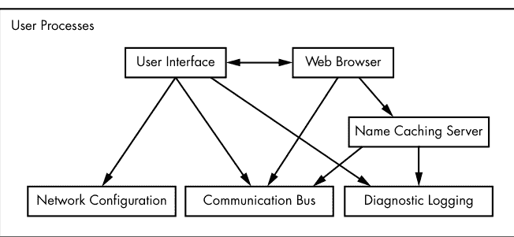
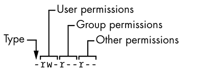
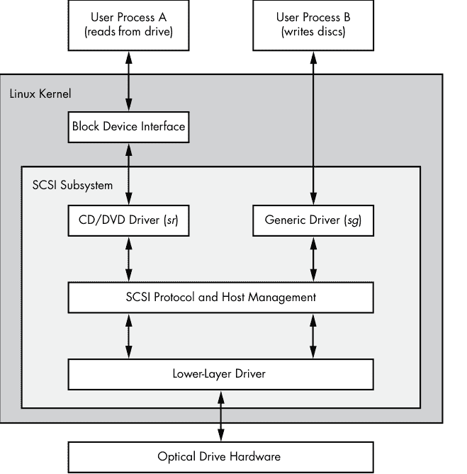
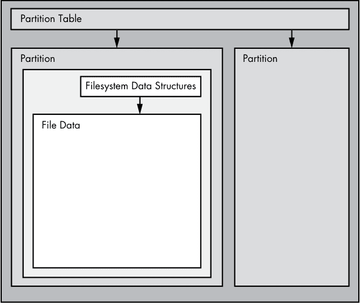
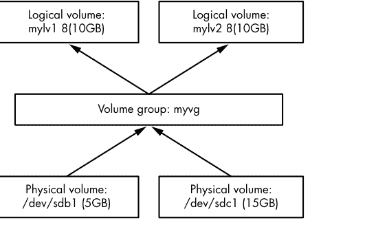
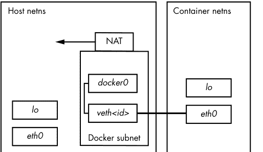

# Linux 工作原理第 3 版（2021 早期访问）

https://t.me/bookzillaaa


# 《Linux工作原理》书评

> “如果你对 Linux 感兴趣，那么《Linux工作原理：每位超级用户应该了解的知识》是必读之作。”

—LINUXINSIDER

> “对于 Linux 架构的几乎每一个方面都提供了丰富的内容。”

—EVERYDAY LINUX USER

> “你将对底层发生的情况有本质的理解，而不会陷入琐碎的细节中——这使其成为 Linux 文献中增添的一本非常耳目一新（且强烈推荐）的著作。”

—PHIL BULL，《Ubuntu Made Easy》合著者，UBUNTU 文档团队成员

> “直接深入探讨了基于 Linux 的操作系统的透明深度，并向我们展示了所有组件是如何结合在一起的。”

—DISTROWATCH

> “它作为一本重要的参考书在书架上占有一席之地。”

—THE MAGPI MAGAZINE


www.nostarch.com

# 关于作者

Brian Ward 自1993年起一直从事 Linux 工作。他还是《The Linux Kernel HOWTO》、《The Book of VMware》（No Starch Press）以及《The Linux Problem Solver》（No Starch Press）的作者。

# 关于技术审核员

Jordi Gutiérrez Hermoso 是一位拥有近二十经验的 GNU/Linux 用户和开发者，偶尔在各种自由软件社区（如 GNU Octave 和 Mercurial）中做出贡献。他的专业工作让他能够协作并学习数字加密签名、医学影像，以及最近的温室气体核算和生态地图数据等化主题，这些完全使用 Linux 和其他自由软件构建。当他不在电脑旁时，他喜欢游泳、数学和编织。

Petros Koutoupis 目前是 HPE（原 Cray Inc.）高级性能软件工程师，负责 Lustre 高性能文件系统部门。他还是 RapidDisk 项目（www.rapiddisk.org）的创建者和维护者。Petros 在数据存储行业工作了多年，帮助开启了今天世界上广泛应用的许多技术。

序言 ................................................................. . . . . . . . . . . . . . . . . . . . . . . . . . . . . . xxi

序言 ........................................................................................................ xxi

谁应该读这本书？ ....................................................................................... xxi

前提知识 ................................................................................................... xxii

本书的阅读方法 ........................................................................................ xxii

第三版的新内容？ ....................................................................................... xiii

关于术语说明 ................................................................................................ xiv

# 1 概览

### 1.1 Linux 系统中的层次与抽象

### 1.2 硬件：理解主内存

### 1.3 内核

#### 1.3.1 进程管理

#### 1.3.2 内存管理

#### 1.3.3 设备驱动管理

#### 1.3.4 系统调用与支持

### 1.4 用户空间

### 1.5 用户

### 1.6 展望

# 2 基础命令与目录层次结构

### 2.1 Bourne Shell: `/bin/sh`

### 2.2 使用 Shell

#### 2.2.1 Shell 窗口

#### 2.2.2 `cat`

#### 2.2.3 标准输入与标准输出

### 2.3 基础命令

#### 2.3.1 `ls`

#### 2.3.2 `cp`

#### 2.3.3 `mv`

#### 2.3.4 `touch`

#### 2.3.5 `rm`

#### 2.3.6 `echo`

### 2.4 目录导航

#### 2.4.1 `cd`

#### 2.4.2 `mkdir`

#### 2.4.3 `rmdir`

#### 2.4.4 Shell 通配符（通配符）

## 2.5 中级命令

- 2.5.1 `grep`
- 2.5.2 `less`
- 2.5.3 `pwd`
- 2.5.4 `diff`
- 2.5.5 `file`
- 2.5.6 `find` 和 `locate`
- 2.5.7 `head` 和 `tail`
- 2.5.8 `sort`

## 2.6 更改你的密码和 Shell

- 2.7 点文件 (Dot Files)
- 2.8 环境变量和 Shell 变量
- 2.9 命令路径
- 2.10 特殊字符
- 2.11 命令行编辑
- 2.12 编辑器
- 2.13 获取在线帮助
- 2.14 Shell 的输入与输出
- 2.14.1 标准错误
- 2.14.2 输入重定向
- 2.15 理解错误信息
- 2.15.1 Unix 错误信息的剖析
- 2.15.2 常见错误
- 2.16 列出和操作进程
- 2.16.1 命令选项
- 2.16.2 进程终止
- 2.16.3 作业控制
- 2.16.4 后台进程
- 2.17 文件模式与权限
- 2.17.1 修改权限
- 2.17.2 使用符号链接
- 2.18 归档与压缩文件
- 2.18.1 `gzip`
- 2.18.2 `tar`
- 2.18.3 压缩包 (`.tar.gz`)
- 2.18.4 `zcat`
- 2.18.5 其他压缩实用工具
- 2.19 Linux 目录层次结构基础
- 2.19.1 其他根子目录
- 2.19.2 `/usr` 目录
- 2.19.3 内核位置
- 2.20 以超级用户身份运行命令
- 2.20.1 `sudo`
- 2.20.2 `/etc/sudoers`
- 2.20.3 `sudo` 日志
- 2.21 展望

# 3 设备

- 3.1 设备文件
- 3.2 `sysfs` 设备路径
- 3.3 `dd` 与设备 ... 50
- 3.4 设备名称总结 51
- 3.4.1 硬盘: `/dev/sd*` ... 52
- 3.4.2 虚拟磁盘: `/dev/xvd*`, `/dev/vhd*` ... 53
- 3.4.3 非易失性内存设备: `/dev/nme*` ... 53
- 3.4.4 设备映射器 (Device Mapper): `/dev/dm-*`, `/dev/mapper/*` ... 53
- 3.5 CD 和 DVD 驱动器: `/dev/sr*` ... 53
- 3.6 PATA 驱动器: `/dev/hd*` ... 53
- 3.7 终端: `/dev/tty*`, `/dev/pts*`, 以及 `/dev/tty` ... 53
- 3.8 串口: `/dev/ttyUSB*`, `/dev/ttyACM*` ... 55
- 3.9 并行口: `/dev/lp0` 和 `/dev/lp1*` ... 55
- 3.4.10 音频设备: `/dev/snd*`, `/dev/dsp`, `/dev/audio` 以及更多 ... 56
- 3.4.11 设备文件的创建 ... 56
- 3.5 `udev` ... 57
- 3.5.1 `devtmpfs` ... 57
- 3.5.2 `udev` 操作与配置 ... 58
- 3.5.3 `udevadm` ... 60
- 3.5.4 设备监控 ... 61
- 3.6 深度解析：SCSI 与 Linux 内核 ... 62
- 3.6.1 USB 存储与 SCSI ... 65
- 3.6.2 SCSI 与 ATA- ... 65
- 3.6.3 通用 SCSI 设备 ... 66
- 3.6.4 单个设备的多种访问方法 ... 67

## 4 磁盘与文件系统 ... 69

- 4.1 磁盘设备分区 ... 72
- 4.1.1 查看分区表 ... 72
- 4.1.2 修改分区表 ... 75
- 4.1.3 创建分区表 ... 76
- 4.1.4 导航磁盘与分区几何结构 ... 78
- 4.1.5 从固态硬盘读取数据 ... 80
- 4.2 文件系统 ... 80
- 4.2.1 文件系统类型 ... 81
- 4.2.2 创建文件系统 ... 82
- 4.2.3 挂载文件系统 ... 83
- 4.2.4 文件系统 UUID ... 85
- 4.2.5 磁盘缓冲、缓存与文件系统 ... 86
- 4.2.6 文件系统挂载选项 ... 86
- 4.2.7 文件系统挂载选项 ... 87
- 4.2.8 `/etc/fstab` ... 88
- 4.2.9 文件系统 ... 89
- 4.2.10 ... 91
- 4.2.11 ... 93
- 4.2.12 ... 94
- 4.3 交换分区 ... 94
- 4.3.1 使用分区 ... 95
- 4.3.2 使用文件 ... 95
- 4.3.3 ... 96
- 4.4 逻辑卷管理器 (LVM) ... 97
- 4.4.2 使用 LVM ... 107
- 4.5 展望磁盘与用户空间 ... 111
- 4.6 传统文件系统 ... 114
- 4.6.1 ... 115
- 4.6.2 ... 116

# 5 内核启动

- 5.1 启动消息 ... 118
- 5.2 内核初始化 ... 119
- 5.3 内核参数 ... 120
- 5.4 引导程序 ... 122
- 5.4.1 引导程序任务 ... 122
- 5.4.2 引导程序概览 ... 123
- 5.5 GRUB ... 123
- 5.5.1 使用 GRUB 探索设备与分区 ... 125
- 5.5.2 GRUB 配置 ... 127
- 5.5.3 GRUB 安装 ... 130
- 5.6 UEFI 启动 ... 131
- 5.7 链式启动 ... 132
- 5.8 启动细节 ... 132
- 5.8.1 MBR 启动 ... 133
- 5.8.2 UEFI 启动 ... 133
- 5.8.3 GRUB 工作原理 ... 134

# 6 空间启动

- 6.1 `init` 简介 ... 138
- 6.2 识别你的 `init` ... 139
- 6.3 `systemd` ... 139
- 6.3.1 单元与单元类型 ... 140
- 6.3.2 启动与单元依赖 ... 140
- 6.3.3 `system` 配置 ... 141
- 6.3.4 `system` 操作 ... 144
- 6.3.5 进程跟踪与同步 ... 147
- 6.3.6 依赖关系 ... 148
- 6.3.7 按需需与资源并行启动 ... 151
- 6.3.8 辅助组件 ... 156
- 6.4 System V 运行级别 ... 156
- 6.5 System V `init` ... 157
- 6.5.1 System V `init`：启动命令序列 ... 158
- 6.5.2 System V `init` 链接池 ... 159
- 6.5.3 `run-parts` ... 160
- 6.5.4 System V `init` 控制 ... 161
- 6.5.5 `system` V 兼容性 ... 161
- 6.6 关闭你的系统 ... 162
- 6.7 内存文件系统 ... 163
- 6.8 紧急启动与单用户模式 ... 164
- 6.9 展望 ... 165

## 7

## 系统配置：日志、系统时间、批处理作业与用户

- 7.1 系统日志 ........................................................................................................................ 168
- 7.1.1 检查您的日志设置 ..................................................................... 169
- 7.1.2 搜索与监控日志 ................................................................................ 169


### 7.1.3 日志轮转
### 7.1.4 日志维护
### 7.1.5 深入了解系统日志
### 7.2 `/etc` 的结构
### 7.3 用户管理文件
#### 7.3.1 `/etc/passwd` 文件
#### 7.3.2 特殊用户
#### 7.3.3 `/etc/shadow` 文件
#### 7.3.4 操作用户与密码
#### 7.3.5 组操作
### 7.4 `getty` 和 `login`
### 7.5 设置时间
#### 7.5.1 内核时间表示与时区
#### 7.5.2 网络时间
### 7.6 使用 `cron` 和 定器单元（Timer Units）调度周期性任务
#### 7.6.1 安装 Crontab 文件
#### 7.6.2 系统 Crontab 文件
#### 7.6.3 定器单元
#### 7.6.4 `cron` 对比 定器单元
### 7.7 使用 `at` 调度一次性任务
#### 7.7.1 定器单元等效项
### 7.8 以普通用户运行的定器单元
### 7.9 用户访问主题
#### 7.9.1 用户 ID 与用户切换
#### 7.9.2 进程所有权、有效 UID、真实 UID 和保存 UID
#### 7.9.3 用户识别、身份验证与授权
#### 7.9.4 使用库获取用户信息
### 7.10 可插式认证模块（PAM）
#### 7.10.1 PAM 配置
#### 7.10.2 PAM 配置语法提示
#### 7.10.3 PAM 与密码
### 7.11 展望

# 8 进程与资源利用深度解析
## 8.1 跟踪进程
## 8.2 使用 `lsof` 查找打开的文件
### 8.2.1 读取 `lsof` 输出
### 8.2.2 使用 `lsof`
## 8.3 追踪程序执行与系统调用
### 8.3.1 `strace`
### 8.3.2 `ltrace`
## 8.4 线程
### 8.4.1 单线程与多线程进程
### 8.4.2 查看线程
## 8.5 资源监控简介
### 8.5.1 测量 CPU 时间
### 8.5.2 调整进程优先级
### 8.5.3 使用负载平均测量 CPU 性能
### 8.5.4 监控内存状态
### 8.5.5 使用 `vmstat` 监控 CPU 和内存性能
### 8.5.6 I/O 监控
### 8.5.7 使用 `pidstat` 进行单进程监控
## 8.6 控制组（cgroups）
### 8.6.1 区分 `cgroup` 版本
### 8.6.2 查看 `cgroups`
### 8.6.3 操作与创建 `cgroups`
### 8.6.4 查看资源利用率
## 8.7 其他主题

# 9 网络基础
## 9.1 网络基础
## 9.2 数据包
## 9.3 网络层
## 9.4 互联网层
### 9.4.1 查看 IP 地址
### 9.4.2 子网
### 9.4.3 通子网掩码与 CIDR 表示法
## 9.5 路由与内核路由表
## 9.6 默认网关
## 9.7 IPv6 地址与网络
### 9.7.1 在您的系统上调整 IPv6
### 9.7.2 配置双栈网络
## 9.8 基础 ICMP 与 DNS 工具
### 9.8.1 `ping`
### 9.8.2 DNS 与 `host`
## 9.9 物理层与以太网
## 9.10 理解内核网络接口
## 9.11 网络接口配置
### 9.11.1 手动配置接口
### 9.11.2 手动添加和删除路由器
## 9.12 启动激活的网络配置
## 9.13 手动与启动激活网络配置的问题
## 9.14 网络配置
### 9.14.1 `NetworkManager` 操作
### 9.14.2 `NetworkManager` 交互
### 9.14.3 `NetworkManager` 配置
## 9.15 解析主机名
### 9.15.1 `/etc/hosts`
### 9.15.2 `resolv.conf`
### 9.15.3 缓存与零配置 DNS
### 9.15.4 `/etc/nss.conf`
## 9.16 本地主机
## 9.17 传输层：TCP、UDP 与服务
### 9.17.1 TCP 端口与连接
### 9.17.2 UDP
## 9.18 重新回顾简单的本地网络
## 9.19 理解 DHCP
### 9.19.1 Linux DHCP 客户端
### 9.19.2 Linux DHCP 服务器
## 9.20 自动 IPv6 网络配置
## 9.21 将 Linux 配置为路由器
## 9.22 私有网络 (IPv4)
## 9.23 网络地址翻译 (IP 伪装)
## 9.24 路由器与链路
## 9.25 防火墙
### 9.25.1 Linux 防火墙基础
### 9.25.2 设置防火墙规则
### 9.25.3 防火墙策略
## 9.26 以太网、ARP 和 NDP
## 9.27 无线以太网
### 9.27.1 `iw`
### 9.27.2 无线安全
## 9.28 总结

# 10 网络应用与服务
## 10.1 服务基础
## 10.2 深入观察
## 10.3 网络服务器
### 10.3.1 安全 Shell (`SSH`)
### 10.3.2 `ssh` 服务器
### 10.3.3 `fail2ban`
### 10.3.4 SSH 客户端
## 10.4 系统前网络连接服务：`inetd`/`xinetd`
## 10.5 诊断工具
### 10.5.1 `Isfd`
### 10.5.2 `tcpdump`
### 10.5.3 `netcat`
### 10.5.4 端口扫描
## 10.6 远程过程调用
## 10.7 网络安全
### 10.7.1 典型漏洞
### 10.7.2 安全资源
## 10.8 展望
## 10.9 网络套接字
## 10.10 Unix 域套接字

# 11 Shell 脚本简介
## 11.1 Shell 脚本基础
### 11.1.1 Shell 脚本的局限性


## 11.2 与字面量 293
### 11.2.1 字面量 293
### 11.2.2 单引号 294
### 11.2.3 双引号 295
### 11.2.4 字面字符串引号 295
## 11.3 特殊变量 296
### 11.3.1 个体参数：`$1`, `$2` 等 296
### 11.3.2 参数数量：`##` 297
### 11.3.3 所有参数：`$@` 297
### 11.3.4 脚本名称：`$0` 297
### 11.3.5 进程 ID：`$$` 298
### 11.3.6 退出状态码：`$?` 298
## 11.4 退出状态码 298
## 11.5 条件判断 299
### 11.5.1 早期参数列表的变通方法 299
### 11.5.2 用于测试的其他命令 300
### 11.5.3 elif- 300
### 11.5.4 逻辑结构 300
### 11.5.5 测试条件 301
### 11.5.6 case. 304
## 11.6 循环 305
### 11.6.1 for 循环 305
### 11.6.2 while 循环 305
## 11.7 命令提交 306
## 11.8 文件传输管理 307
## 11.9 Here Documents (在此文档) 308
## 11.10 重要的 Shell 实用工具 308
### 11.10.1 basename 308
### 11.10.2 awk 309
### 11.10.3 sed 309
### 11.10.4 xargs 310
### 11.10.5 expr 311
### 11.10.6 exec. 311
## 11.11 子 Shell 311
## 11.12 在脚本中包含文件 312
## 11.13 读取用户输入 312
## 11.14 不使用 Shell 脚本 312

# 12 网络文件传输与共享 315
## 12.1 快速拷贝 316
## 12.2 rsync 317
### 12.2.1 开始使用 sync. 317
### 12.2.2 复制目录结构 318
### 12.2.3 使用尾斜杠 319
### 12.2.4 排除文件和目录 320
### 12.2.5 传输、保护与详细模式 321
### 12.2.6 压缩数据 321
### 12.2.7 限制带宽 322
### 12.2.8 传输到你的计算机 322
### 12.2.9 sync 话题 322
## 12.3 文件共享简介 223
### 12.3.1 共享用法与性能 223
### 12.3.2 文件安全 223
## 12.4 使用 Samba 共享文件 223
### 12.4.1 服务器配置 223
### 12.4.2 服务器访问控制 223
### 12.4.3 密码 223
### 12.4.4 服务器启动 223
### 12.4.5 日志文件 223
### 12.4.6 文件共享配置 223
### 12.4.7 目录 223
### 12.4.8 打印共享 223
### 12.4.9 Samba 客户端 223
## 12.5 SSHFS 224
## 12.6 NFS 224
## 12.7 云存储 224
## 12.8 网络文件共享 224

# 13 用户环境 225
## 13.1 创建文件的指南... 225
## 13.2 修改配置文件... 225
## 13.3 Shell 元素 225
### 13.3.1 命令路径 225
### 13.3.2 手动页路径 225
### 13.3.3 提示符 225
### 13.3.4 别名 225
### 13.3.5 权限掩码... 225
## 13.4 配置文件顺序... 226
### 13.4.1 bash shell 226
### 13.4.2 tcsh shell 226
## 13.5 用户设置... 226
### 13.5.1 默认值 226
### 13.5.2 编辑器 226
### 13.5.3 分页器 226
## 13.6 配置陷阱 227
## 13.7 更多话题... 227

# 14 Linux 桌面与打印简述 228
## 14.1 桌面组件 228
### 14.1.1 帧缓冲区... 228
### 14.1.2 X Window 系统 228
### 14.1.3 Wayland... 228
### 14.1.4 窗口管理器 228
### 14.1.5 工具包 228
### 14.1.6 桌面环境... 228
### 14.1.7 应用程序... 228
## 14.2 你运行的是 Wayland 还是 X? 229
## 14.3 深入观察 Wayland 230
### 14.3.1 合成窗口管理器 230
### 14.3.2 libin 230
### 14.3.3 兼容性 230
## 14.4 深入观察窗口 231
### 14.4.1 显示管理器 231
### 14.4.2 X 事件 231
### 14.4.3 X 探索 231
### 14.4.4 X 输入 231
### 14.4.5 偏好设置 231
## 14.5 DBus 232
### 14.5.1 系统与会话 232
### 14.5.2 DBus 监控 232
## 14.6 打印 233
### 14.6.1 CUPS 233
### 14.6.2 格式转换 233
## 14.7 其他桌面话题... 233

# 15 开发工具 234
## 15.1 C 编译器 234
### 15.1.1 编译多个源文件 234
### 15.1.2 库链接 234
### 15.1.3 使用共享库 234
### 15.1.4 使用头文件（包含文件）和目录 234
## 15.2 make 235
### 15.2.1 示例 Makefile 235
### 15.2.2 内置规则 235
### 15.2.3 最终程序 235
### 15.2.4 依赖更新 235
### 15.2.5 命令行参数与选项 236
### 15.2.6 标准宏与变量 236
### 15.2.7 约定目标 236
### 15.2.8 Makefile 组织 236
## 15.3 Lex 和 Yacc 237
## 15.4 脚本语言 237
### 15.4.1 Python 237
### 15.4.2 Perl 237
### 15.4.3 其他脚本语言 238
## 15.5 Java 238
## 15.6 展望：编译包 238

# 16 从 C 源码编译软件的简介 239
## 16.1 软件构建系统 239
## 16.2 解压 C 源码包 239
## 16.3 GNU Autoconf 240
### 16.3.1 一个 Autoconf 示例 240
### 16.3.2 使用打包工具进行安装 240
### 16.3.3 configure 脚本选项 241
### 16.3.4 环境变量 241
### 16.3.5 Autoconf 目标 241
### 16.3.6 Autoconf 日志文件 241
### 16.3.7 pkg-config 242
### 16.4 安装实践 394
#### 16.4.1 安装何处 395
## 16.5 应用补丁 395
## 16.6 编译与安装的故障排除 396
### 16.6.1 特定错误 397
## 16.7 展望 399

# 17 虚拟化 401
## 17.1 虚拟机 402
### 17.1.1 虚拟机监控程序 402
### 17.1.2 虚拟机中的硬件 403
### 17.1.3 虚拟机的常见用途 404
### 17.1.4 虚拟机的缺点 404
## 17.2 容器 405
### 17.2.1 Docker, Podman 与权限 406
### 17.2.2 Docker Podman 示例 407
### 17.2.3 LXC 414
### 17.2.4 Kubernetes 415
### 17.2.5 容器的陷阱 415
## 17.3 基于运行时的可视化 417

## 参考文献 419
## 索引 423

# 致谢

本书的贡献不仅来自那些参与开发过程的人，还来自那些没有他们我将对 Linux 一无所知的人。这些人包括 James Duncan, Douglas N. Arnold, Bill Fenner, Ken Hornstein, Scott Dickson, Dan Ehrlich, Felix Lee 和 Gregory P. Smith。之前的版本得到了 Karol Jurado, Laurel Chun, Serena Yang, Alison Law, Ri-ley Hoffman, Scott Schwartz, Dan Sully, Dominique Poulainn, Donald Karon 和 Gina Steele 的帮助。

第三版受益于 Barbara Yien、Rachel Monaghan、Jill Franklin, Larry Wake, Jordi Gutiérrez Hermoso 和 Petros Koutoupis 的卓越工作。作为 No Starch Press 的负责人，Bill Pollock 从第一版起就对本书起到了关键作用。再次感谢 Hsinju Hsieh 再次忍受了我的反复修改。

# 前言

你的系统不应该是一个谜。你应该能够让软件按照你的意愿运行，而无需任何“魔法”咒语或仪式。获得这种力量的关键在于理解软件在做什么以及它是如何运行的，而这正是本书的核心所在。你不应该需要与计算机斗争。

Linux 是一个极佳的学习平台，因为它并不试图向你隐藏任何东西。特别是，你可以在易于阅读的纯文本文件中找到大多数系统配置细节。唯一棘手的部分是弄清楚哪些部分负责什么功能，以及它们是如何整合在一起的。

# 谁应该读这本书？

你对学习 Linux 如何运行的兴趣可能源于任何渠道。在专业领域，运维和 DevOps 人员需要了解书中包含的几乎所有内容。Linux 软件架构师和开发者也应该掌握这些材料，以便充分利用该操作系统。研究人员和学生（他们通常运行自己的 Linux 系统）也会发现这本书对“为什么事情要这样设置”提供了实用的解释。

还存在“折腾爱好者”——那些喜欢为了乐趣、利润或两者兼之而玩弄电脑的人。想知道为什么某些功能有效而另一些却不行吗？想知道移动某些东西会发生什么吗？你可能就是一个折腾爱好者。

# 先提条件

虽然 Linux 受程序员的喜爱，但你不需要成为顶尖程序员才能读这本书；你只需要基本的计算机用户知识。也就是说，你应该能够在图形用户界面（GUI）中摸索（特别是 Linux 发行版的安装程序和设置界面），并知道什么是文件和目录（文件夹）。你还应该准备好查看系统和网络上的额外文档。你最重要的准备是准备好并愿意去玩弄你的电脑。

# 如何阅读这本书

在处理任何技术课题时，构建必要的知识都是挑战。体验软件如何工作可能会变得非常复杂。过多的细节会让读者疲于应对，使重要概念难以理解（人类大脑无法一次处理这么多新想法），而细节过少则会让读者感到困惑，无法为后续做好准备。

我设计了大多数章节首先处理最重要的材料：你进展所需的基础信息。在某些地方，为了保持重点，我简化了内容。随着章节的深入，你将看到更多细节。

# 实践方法

无论你选择如何阅读本书，你面前都应该有一台 Linux 机器，最好是一个用于测试的虚拟机。你应该拥有 sudo (root) 权限，但大多数时候你将在终端的命令行界面工作。如果你在该环境中工作过太多，尽管直接跳到下一章；第 2 章将带你进入状态。

书中的命令通常如下所示：

```
$ ls
[some output]
```

接下来的**粗体文本**是机器返回的内容。$ 是用户账户的提示符。如果你看到 # 作为提示符，则说明你需要超级用户权限（root）。

# 本书的结构

我将书的章节分为三个基本部分。第一部分是介绍性的，提供系统的概览，并提供某些工具的实践经验。接下来，你将按照系统启动的般顺序，详细探索系统的每个部分，从设备管理到网络配置。最后，你将对一些运行中的系统进行演示，学习一些基本技能，并对编程工具有深入的了解。

除第 2 章外，大部分早期章节都大量涉及 Linux 内核，但随着书籍的进行，你将进入用户空间。如果你不知道我在说什么什么，我将在第 1 章进行解释。

这些材料旨在尽可能不依赖于特定的发行版。尽管如此，涵盖系统软件的所有变体可能会很枯燥，因此我尝试涵盖两个主要的发行版家族：Debian (Ubuntu) 和 RHEL/Fedora/CentOS。我还涵盖了桌面和服务器安装。大量的材料也适用于嵌入式系统，如 Android 和 OpenWRT，这些平台上的差异将由你决定。

# 第三版有什么新内容？

第二版出版于 Linux 系统的过渡时期。几个传统组件正处于替换过程中，这使得处理某些主题变得棘手，因为读者可能会遇到各种配置。然而，现在这些新组件（特别是 systemd）已近乎普及采用，因此我能够简化大量的讨论。

我保留了对内核在 Linux 系统中作用的强调。这些材料证明非常受欢迎，你与内核的交互可能比你想的要多。

我增加了一个新章节来介绍虚拟化。虽然 Linux 在虚拟机（如云服务）上一直很受欢迎，但由于系统在虚拟机上的运行方式与“裸机”硬件几乎相同，这里的讨论主要集中于解读你将遇到的术语。然而，自第二版出版以来，容器变得日益流行，它们也适合这里，因为它们基本上是由书中其他地方描述的 Linux 功能组成的。容器大量使用 cgroups，这在第三版中也得到了新的处理。

对于其他主题（不一定与容器相关），我乐意扩展了逻辑卷管理器 (LVM)、日志记录系统以及网络材料中的 IPv6。

尽管我添加了大量内容，但这本书的规模仍然保持在合理范围内。我希望为你提供快速入门所需的信息，这包括在过程中详细阐述某些难以理解的细节，但我并不希望你为了读完这本书而必须变成一名举重运动员。一旦你掌握了这里的重要主题，在寻找和理解更多细节时应该就不会困难了。

第一版包含了历史信息，我后来为了提高重点而删除了这些内容。如果你对 Linux 以及它如何与 Unix 历史相关感兴趣，请阅读 Peter H. Salus 的《守护进程、GNU 与企鹅》(Reed Media Services, 2008)。该书在解释软件如何随时间演变方面做得非常好。

# 关于术语的说明

历史上，某些操作系统元素的名称曾引发过相当的争议——甚至包括“Linus”这个词本身。是否应该使用“GNU/Linux”来反映该操作系统也包含了来自 GNU 项目的内容？在本书书中，我尝试使用最常用、最不生硬名称。

# 全局视图


乍一看，像 Linux 这样的现代操作系统非常复杂，有大量令人眼晕的组件同时运行并通信。例如，一个 Web 服务器可以与数据库服务器通信，而数据库服务器又可以使用许多其他程序使用的共享库。这一切是如何运作的？你又该如何理解其中的任何部分呢？

理解操作系统如何工作的最有效方法是通过**抽象**——这是一种高级的说法，意思是你可以忽略组成你试图理解的部分的更多细节，转而关注它的基本目的和操作。例如，当你坐汽车里时，你通常不需要考虑这些细节，比如固定车内发动机的安装螺栓，或者建造和维护汽车行驶道路的人。你真正需要知道的是汽车如何运转（将你带送到另一个地方）以及一些关于如何它的基础知识（如何操作车门和安全带）。

如果你只是车里的乘客，这种程度的抽象可能足够。但如果你还需要驾驶它，你就必须深入挖掘，并将你的抽象拆分为几部分。你现在在这三个领域扩展了知识：汽车本身（及其尺寸和能力）、如何操作控制装置（方向盘、加速踏板等）以及道路的特征。

当你尝试寻找并修复问题时，抽象会非常有帮助。例如，假设你正在开车，而且行驶很颠簸。你可以快速访问上述三个与汽车相关的基本抽象来确定问题所在。如果前两个抽象（汽车或你的驾驶方式）不是问题所在，那么很容易排除它们，从而将问题缩小到道路本身。你可能会发现道路是不平整的。现在，如果你愿意，可以深入研究你对道路的抽象，找出道路是如何恶化的，或者道路是否是新的，以及施工人员做得有多糟糕。

软件开发者在构建操作系统及其应用程序时将抽象作为一种工具。计算机软件中的抽象划分部分有很多术语——包括子系统、模块和包——但我们在本章中使用“组件”（component）一词，因为它很简单。在构建软件组件时，开发者通常不会过多考虑组件的内部结构，但他们会考虑他们可以使用哪些组件（这样他们就不需要编写任何额外的软件）以及如何使用它们。

本章提供了构成 Linux 系统组件的高级概述。尽管每个组件的内部构造都有大量的技术细节，但我们将忽略这些细节，专注于组件与整个系统的关系。我们将在后续章节中查看细节。

## 1.1 Linux 系统中抽象的级别和层次

使用抽象将系统拆分为组件使得事情更容易理解，但如果没有组织，它就不起作用。我们根据组件位于用户和硬件之间的位置，将组件排列成层或级别、分类（或组）。网络浏览器、游戏和[其他应用程序]靠近用户。硬件位于底部。

## 1.3. 进程管理

进程管理描述了进程的设置、暂停、恢复、调度和终止。启动和终止进程的概念非常直观，但描述进程在正常运行过程中如何使用 CPU 则稍微有些复杂。

在任何现代操作系统中，都有许多进程在“同时”运行。例如，你可能在台式电脑上同时打开一个网络浏览器和一个电子表格。然而，情况并非表面看起来那样：这些应用程序背后的进程通常并不是在完全相同的时间运行。

考虑一个具有单核 CPU 的系统。许多进程可能可以使用 CPU，但在任何时刻只有一个进程可以使用 CPU。事实上，每个进程只使用 CPU 一秒钟的一分之一时间，然后暂停；另一个进程再使用 CPU 另一几分之一时间；接着另一个进程轮到，以此此类推。一个进程将 CPU 的控制交给另一个进程的行为被称为**上下文切换**（context switch）。

每一段时间被称为**时间片**（time slice），提供了足够的时间进行大量的计算（而且进程通常会在单个时间片内完成任务）。然而，由于时间片非常小，人类无法感知到它们，系统似乎在同时运行多个进程（这种能力被称为**多任务处理**）。

内核负责上下文切换。为了理解其工作原理，让我们思考一个进程在用户模式下运行其时间片的情况。以下是发生的过程：

- 1. CPU（实际硬件）中断内部计时器，切换到内核模式，并将控制权交回内核。

- 2. 内核记录 CPU 和内存的当前状态，这对于恢复刚刚中断的进程至关重要。

- 3. 内核执行在上一个时间片期间可能出现的任何任务（例如从输入输出收集数据，或执行 I/O 操作）。


### 上下文切换

- 内核现在准备好让另一个进程运行。内核分析就绪运行的进程列表并选择其中一个。
- 内核为这个新进程准备内存并准备好 CPU。
- 内核告诉 CPU 新进程的时间片将持续多长时间。
- 内核将 CPU 切换到用户模式，并将 CPU 的控制权交给该进程。

上下文切换回答了内核何时运行的问题。答案是：它在上下文切换期间，在进程时间切片之间运行。

在多 CPU 系统（如目前的机器）中，情况变得稍微复杂了一些，因为内核不需要为了让进程在不同的 CPU 上运行而放弃对当前 CPU 的控制权，并且可能有多个进程同时运行。为了最大化利用所有可用的 CPU，内核通常仍会执行这些步骤（并可能使用某些技巧为自己夺取更多的 CPU 时间）。

## 1.3.2 内存管理

内核在上下文切换期间必须管理内存，这可能是项复杂的工作。必须满足以下条件：

- 内核在内存中必须有一个用户进程无法访问的区域。
- 每个进程都需要自己的独立内存区域。
- 一个用户进程不能访问另一个进程的私有内存。
- 用户进程可以共享内存。
- 用户进程中的某些内存可以是只读的。
- 系统可以通过使用磁盘空间作为辅助，使用比物理存在的更多的内存。

幸运的是，内核有帮助。现代 CPU 包含一个**内存管理单元（MMU）**，它能够启用了一种名为**虚拟内存**的内存访问方案。使用虚拟内存时，进程并不直接通过硬件中的物理位置访问内存。相反，内核将每个进程设置为好像它拥有一整台机器一样。当进程访问其部分内存时，MMU 会拦截该访问并使用内存地址映射将从进程视角的内存位置转换为机器中的物理内存位置。内核仍然必须初始化并持续维护和更改此内存地址映射。例如，在上下文切换期间，内核必须更改迁出进程的映射。内核，内核内核映射页页页。。。。...........................。

。

## 1.3.4

....，，，111.40011331，3332，30.进程。



Figure 1-3: 进程类型与交互

底层通常由执行简单、非预期的任务的小型组件 组成。中间层具有较大的组件，如邮件、打印和数据库服务。最后，顶层组件执行用户通常直接控制的复杂任务。通常情况下，如果一个组件想要使用另一个组件，那么该组件要么处于同一服务层，要么在其下方。

然而，图 1-3 仅是用户空间布局的近似表示。在现实中，用户空间并没有规则。例如，应用程序和服务使用标准的 syslog 服务来将日志消息作为日志写入文件。但大多数程序更倾向于自己完成所有的日志记录。

此外，某些用户空间组件很难进行归类。服务器组件（如 Web 服务器和数据库服务器）可以被视为层级应用，因为它们的任务通常很复杂，因此你可能会将它们置于图 1-3 的顶层。然而，用户应用程序可能依赖这些服务器来执行它们不愿自己完成的任务，因此你也可以认为将它们置于中间层。

## 1.5 用户

Linux 内核支持 Unix 用户的传统概念。用户是一个可以运行进程并拥有文件的实体。用户通常与用户名相关联；例如，系统可以有一个名为 billyjoe 的用户。然而，内核并不管理用户名；相反，它通过简单的数字标识符称为用户 ID（UID）来识别用户（你将在第 7 章中学习更多关于用户名如何对应用户 ID 的知识）。

用户的存在主要是为了支持权限和边界。每个用户空间进程都有一个所有者，进程被认为是以所有者的身份运行的。用户可以终止或修改自己的进程的行为（在某些限制范围内），但不能干扰其他用户的进程。此外，用户可以拥有文件并选择是否与其他用户共享。

Linux 系统除了与使用系统的真实人物对应的用户外，通常还有一些用户。你将在第 3 章中更详细地了解这些用户，但最需要知道的用户是 root。root 用户是上述规则的例外，因为 root 可以终止和更改另一个用户的进程，并访问本地系统上的任何文件。出于这个原因，root 被称为超级用户（superuser）。以 root 身份操作的人——即拥有 root 权限的人——是 Unix 系统上的管理员。

> 以 root 身份操作可能是危险的。识别和纠错可能会困难，因为系统会允许你做任何事情，即使这对系统是有害的。出于这个原因，系统设计人员不断尝试让 root 权限尽可能变得必要——例如，通过要求在笔记本电脑上切换无线网络需要 root 权限。此外，尽管 root 用户非常强大，它运行在操作系统的用户模式下，而不是内核模式。

## 1.6 展望

到目前为止，你已经看到了一个运行中的 Linux 系统的组成部分。用户进程构成了你直接交互的环境；内核管理进程和硬件。内核和进程都存在内存中。

这些是非常好的背景信息，但你不能仅通过阅读来学习 Linux 系统的细节；你需要亲自动手实践。下一章将开启你的旅程，教教你一些用户空间的基础知识。在旅途中，你将学习本章未讨论的 Linux 系统的主要部分：长期存储（磁盘、文件等）。毕竟，你需要将你的程序和数据存储在某处。

## 基础命令和目录层次结构

本章是你在整本书中会遇到的 Unix 命令和工具的指南。这些是基础材料，你可能已经了解其中很大一部分。即使你认为自己已经跟上了进度，也请花几分钟翻一下这一章以确保，特别是涉及到第 2.19 节中的目录层次结构材料时。

为什么用 Unix 命令？这本书难道不是关于 Linux 如何运行的吗？它当然是，但 Linux 最多只是一个分支。你在本章中看到的 Unix 一词会比 Linux 多，因为你可以将学到的知识直接应用到 BSD 和其他 Linux 风格的系统中。我尝试避免涵盖过多的 Linux 特有用户界面扩展，不仅是为了为你使用其他操作系统提供更好的背景知识，还因为这些扩展往往是不稳定的。如果你了解核心命令，你将更快速地适应新的 Linux 版本。此外，了解这些命令可以增强你对内核的理解，因为许多命令直接对应于系统调用。

关于初学者 Unix 的更多细节你可以在这里找到，考虑阅读 *The Linux Command Line, 2nd edition* (No Starch Press, 2019)、*UNIX for the Impatient, 2nd edition* (Addison-Wesley Professional, 1995) 以及 *Learning the Unix Operating System, 5th edition* (O'Reilly, 2001)。

## 2.1 Bourne Shell `/bin/sh`

Shell 是 Unix 系统最重要的部分之一。Shell 是一个运行命令的程序，比如用户在终端窗口中输入的命令。这些命令可以是其他程序，也可以是 Shell 的内置功能。Shell 还充当小型编程环境。Unix 程序员经常将常见任务分解成更小的组件，并使用 Shell 来管理和组合这些任务。有许多不同的 Shell，它们都源自贝尔实验室的早期版本。bash 是大多数 Linux 发行版的默认 Shell。如果你需要成为系统管理员，可以更改你的 Shell。

## 2.2 使用 Shell

当你安装 Linux 时，应该至少创建一个普通用户。对于本章来说，你应该以你的个人账户登录。将该 Shell 当作你自己的来使用。

### 2.2.1 Shell 窗口

登录后，打开一个 Shell（通常称为终端）。从 Gnome 或 KDE 等图形界面最简单的方法是打开终端，它会在新窗口中启动 Shell。一旦你打开了 Shell，它会在顶部显示一个提示符，通常以美元符号（）结尾。在 Ubuntu 上，你的提示符看起来像 `host:path`，其中 host 是你的主机名，path 是你的当前目录（第 2.4 节）。如果你熟悉 Windows，Shell 窗口看起来就像 DOS 提示符；在 macOS 中 Terminal 应用也是如此。

### 2.2.2 `cat`

`cat` 程序是 Unix 中最容易理解的程序之一；它只是输出一个或多个文件或其他输入源的内容。`cat` 命令的通用语法如下：

```
$ cat file1 file2 ...
```

当你运行此命令时，`cat` 会打印 file1、file2 以及你指定的作为参数的其他文件（用 `...` 表示），然后退出。该程序之所以被称为 `cat`，是因为它在打印多个文件的内容时执行合并操作。运行 `cat` 的方法有很多；让我们用它来探索 Unix 的 I/O。

### 2.2.3 标准输入和标准输出

Unix 进程使用 I/O 流来读取和写入数据。进程从输入流读取数据并向输出流写入数据。流是灵活的；例如输入流的源可以是文件、设备、终端窗口，甚至是另一个进程的输出流。

要查看输入流的工作情况，输入 `cat`（不带任何参数）并按回车。这次，你不会得到任何直接输出，也不会看到 shell 提示符，因为 `cat` 仍在运行。现在输入任何内容并在每行末尾按回车。这样使用时，`cat` 命令会重复你输入的任何行。当你足够无聊时，在空行上按 CTRL-D 终止 `cat` 并返回 shell 提示符。

`cat` 采用交互式行为的原因与流有关。当你没有指定输入文件名时，`cat` 从 Linux 内核提供的标准输入读取，而不是从连接到文件的流。在这种情况下，标准输入连接到你运行 `cat` 的终端。

> 在空行上按 CTRL-D 会停止当前向终端的标准输入条目，并发送一个 EOF（文件结束）消息（并且通常会终止程序）。不要将其与 CTRL-C 混淆，CTRL-C 通常无论输入或输出都会终止程序。

标准输出也是类似的。内核为每个进程提供一个标准输出，进程可以在其中写入输出。`cat` 命令始终将其输出写入到标准输出。当你在终端中运行 `cat` 时，标准输出连接到该终端，这就是你看到输出的地方。

标准输入和输出通常缩写为 `stdin` 和 `stdout`。许多命令的操作方式与 `cat` 设计；如果你没有指定输入文件，命令将从 `stdin` 读取。输出略有不同。某些程序（如 `cat`）只将输出发送到 `stdout`，但其他程序具有直接将输出发送到文件的选项。

第三个标准 I/O 流称为标准错误。你将在第 2.14.1 节中看到。

标准流最好的特性之一是你可以轻松地操作它们，以读取和写入到终端以外的地方，正如你在第 2.14 节中学到的那样。特别是，你将学习如何将流连接到文件和其他进程。

## 2.3 基础命令

现在让我们来看一些 Unix 命令。以下某些命令接受多个参数，有些则有许多选项和格式，如果列出详尽列表将毫无意义。这是一份基础命令的简化列表；你现在不需要了解所有的细节。

### 2.3.1 `ls`

`ls` 命令列出目录的内容。默认是当前目录，你可以添加任何目录或文件作为参数，并且有很多实用的选项。例如，使用 `ls -l` 进行详细（长格式）列表，使用 `ls -f` 显示类型信息。这里是一个长格式列表示例；它包含了文件所有者（第 3 列）、组（第 4 列）、大小（第 5 列）以及修改日期/时间（位于第 5 列和文件名之间）：

```
$ ls -l
total 3616
-rw-r-- 1 user 3804     May 28 10:40 abusive.c
-rw-r-- 1 user 4165     Aug 13 10:01 battery.zip
-rw-r-- 1 user 131219  Aug 13 10:33 beav_40-13.tar.gz
-rw-r-- 1 user 6255     May 20 14:34 country.c
drwxr-xr-x 2 user 4096     Jul 17 20:00 c535
drwxr-xr-x 1 user 7108     Jun 16 13:45 dhny
-rw-r-- 1 user 11309  Aug 13 10:26 dry.c
-rw-r-- 1 user 56       Jul 9 15:30 doit
drwxr-xr-x 6 user 4096     Feb 20 13:51 dw
drwxr-xr-x 3 user 4096     Jul 1 16:05 hough-tough
```

你将在第 2.17 节中学习更多关于此输出第 2 列的内容。现在，忽略它是指向文件的硬链接数，将在第 4.6 节中解释。

### 2.3.2 `cp`

在最简单的形式下，`cp` 文件。例如，将 file1 复制到 file2：

```
$ cp file1 file2
```

你也可以将文件复制到另一个目录，并在该目录下保持相同文件名：

```
$ cp file dir
```

要向 dir 目录（文件夹）复制多个文件，可以像这个示例所示，它复制了三个文件：

```
$ cp file1 file2 file3
```

### 2.3.3 `mv`

在最简单的形式下，`mv` 文件。例如，将 file1 重命名为 file2：

```
$ mv file1 file2
```

你也可以将文件移动到另一个目录，在该目录下保持相同文件名：

```
$ mv file1 dir
```

要将多个文件移动到 dir 目录（文件夹），可以像这个示例所示，它移动了三个文件：

```
$ mv file1 file2 file3 dir
```

### 2.3.4 `rm`

在最简单的形式下，`rm` 删除文件。例如，删除 file1 和 file2：

```
$ rm file1 file2
```

你也可以删除目录，但必须使用 -r 标志：

```
$ rm -r dir
```

### 2.3.5 `echo`

在最简单的形式下，`echo` 将参数打印到标准输出。例如，输出 Hello World：

```
$ echo Hello World
```

### 2.3.6 `touch`

在最简单的形式下，`touch` 创建空文件。例如，创建 file1：

```
$ touch file1
```

## 2.4 目录导航

Unix 目录层次从 `/` 开始，也称为根目录。目录分隔符是斜杠（`/`），而不是反斜杠（`\`）。

根目录的标准子目录如 `/usr`，正如你将在第 2.1 节中学到的那样。当你引用文件或目录时，你可以指定路径或路径。当路径以 `/` 开头时（如 `/usr`），它是完整的绝对路径。

由两个点标识的路径组件指定父目录。例如，如果你在 `/usr/lib` 中，`..` 将指向 `/usr`。`../bin` 将指向 `/usr/bin`。

一个点 (`.`) 代表当前目录；如果你在 `/usr/lib`，路径仍然是 `/usr/lib`，`./lib` 是 `/usr/lib/lib`。

不以 `/` 开头的路径称为相对路径。通常使用相对路径，因为你已经在或所需的目录附近。

现在你已经了解了基本的目录机制，这里是基本的目录命令。

### 2.4.1 `cd`

工作目录是进程（如 shell）当前所在的目录。除了大多数 Linux 发行版的默认 shell 提示符外，你可以使用 `pwd` 命令查看当前目录，该命令见第 2.5.3 节。

每个进程都可以独立地设置自己的工作目录 `cd` 命令更改 shell 的工作目录：

```
$ cd dir
```

如果你省略 dir，shell 将返回你的家目录，即你首次登录时所在的目录。某些程序使用 `~` 符号（波浪号）缩写家目录。

> `cd` 命令是一个内置命令。如果它作为独立程序运行将无法工作，因为它作为子进程运行时，它无法（通常）更改父进程的当前工作目录。这似乎不是一个特别重要的区别，但在某些情况下了解这一事实可以消除困惑。

### 2.4.2 `mkdir`

`mkdir` 命令创建一个新目录 dir：

```
$ mkdir dir
```

### 2.4.3 `rmdir`

`rmdir` 命令删除目录 dir：

```
$ rmdir dir
```

如果 `dir` 不空，此命令将执行失败。然而，如果你等得不及，你可能不想费力地删除 `dir` 内部所有的文件和子目录。你可以使用 `rm -r dir` 来删除目录及其内容，但要小心！这是可能导致损坏的命令之一，尤其是当你以超级用户身份运行时。`-r` 选项会递归地删除 `dir` 内部的所有内容。不要配合通配符（如星号 `*`）使用 `-r` 标志。最重要的是，在运行命令之前务必双重检查命令。

### 2.4.4 Shell 通配（通配符”）

Shell 可以匹配文件和目录名称的模式，这一过程被称为通配（globbing）。这与其他系统中的通配符概念类似。最简单的是通配字符 `*`，它告诉 shell 匹配任意数量的任意字符。例如，以下命令列出当前目录下的文件列表：

```
$ echo *
```

Shell 将包含通配符的参数匹配到文件名，用文件名替换这些参数，然后运行修改后的命令行。这种替换被称为展开（expansion），因为它用简化的表达式替换了所有匹配的文件名。以下是使用 `*` 展开的一些方式：

- `*` 展开为所有以...开头的文件。
- `*at` 展开为所有以...结尾的文件。
- `*at*` 展开为所有包含...的文件。

如果没有文件匹配通配符，bash shell 将不执行展开，命令将带有字面字符（如 `*`）运行。例如，像 `echo "*fdksa*"` 命令：

> 注意：如果你正在使用 Windows 命令提示符，可能会本能地输入 `*` 来匹配所有文件。在 Linux 和其他 Unix 版本中，你必须使用 `*` 来匹配所有文件。在 Unix shell 中，`*` 仅匹配名称中包含 `.` 字符的文件和目录。Unix 文件名不需要扩展名，也不携带扩展名。

另一个 shell 通配字符问号（`?`）指示 shell 匹配恰好一个任意字符。例如，`b?at` 匹配 `boat` 和 `brat`。

如果你不想让 shell 在命令中展开通配符，请将通配符括在单引号（`'*'`）中。例如，命令 `echo '*'` 会打印一个星号。你会发现这对下一节描述的某些命令（如 `grep` 和 `find`）非常管用。（你将在 11.2 中学习更多关于引号的内容）。

记住，shell 在运行命令之前会执行展开，且仅在此之后。因此，如果一个 `*` 在未展开的情况下进入命令，shell 将不会对其进行任何处理；将由命令来决定如何处理它。

shell 的模式匹配能力还有更多，`*` 和 `?` 是你现在需要了解的。第 2.7 节描述了对于点开头特殊文件的通配行为。

## 2.5 中级命令

本节介绍了最核心的中级 Unix 命令。


### 2.5.1 grep

`grep` 命令打印来自文件或输入流中匹配表达式的行。例如，打印 `/etc/passwd` 文件中包含你的文本输入条目的行：

```
$ grep root /etc/passwd
```

在同时处理多个文件时，`grep` 命令非常有用，因为它在打印匹配行的同时，还会打印文件名。例如，如果你想检查 `/etc` 中每个包含 `root` 单词的文件，可以使用此命令：

```
$ grep root /etc/*
```

两个重要的 `grep` 选项是 `-i`（用于不区分大小写的匹配）和 `-v`（反转搜索——即打印所有不匹配的行）。还有一个更强大的 `egrep`（它只是 `grep -E` 的同义词）。

`grep` 理解正则表达式，这种模式基于计算机科学理论，并在 Unix 工具中非常常见。正则表达式比通配符风格的模式更强大，并且有不同的语法。关于正则表达式，有三点需要记住：

- `.*` 匹配任意数量的字符，包括零个（类似于 glob 和通配符中的 `*`）。

- `+` 匹配任意一个或多个字符。

- `.` 匹配恰好一个任意字符。

`grep(1)` 手页包含对正则表达式的详细描述，但阅读可能有些困难。要学习更多，你可以阅读 Jeffrey E. F. Fried 写的《Mastering Regular Expressions, 3rd edition》（O'Reilly, 2006），或者查看 Tom Christensen 写的《Programming Perl, 4th edition》（O'Reilly, 2012）中的正则表达式章节。如果你喜欢数学并对正则表达式的来源感兴趣，可以查找 Jeffrey Ullman 和 John Hopcroft 写的《Introduction to Automata Theory, Languages, and Computation, 3rd edition》（Prentice Hall）。

### 2.5.2 less

当文件非常大或命令输出很长并超出屏幕顶部时，`less` 命令派用场。要分页查看如 `/usr/share/dict/words` 这样的大文件，可以使用命令 `less /usr/share/dict/words`。运行 `less` 时，你将一次显示屏幕文件内容。按空格键向前，按 `b`（小写）后退一屏。按 `q` 退出。

`less` 命令是一个名为 `less` 的旧程序的增强版本。Linux 桌面和服务器都有 `less`，但它不是许多嵌入式和其他 Unix 系统的标准配置。如果你遇到无法使用 `less` 的情况，尝试 `more`。如果你不想让 shell 在命令中展开通配符，请将通配符括在单引号（`'*'`）中。例如，命令 `echo '*'` 会打印一个星号。你会发现这对下一节描述的某些命令（如 `grep` 和 `find`）非常管用。（你将在 11.2 中学习更多关于引号的内容）。

记住，shell 在运行命令之前会执行展开，且仅在此之后。因此，如果一个 `*` 在未展开的情况下进入命令，shell 将不会对其进行任何处理；将由命令来决定如何处理它。

### 2.5.8 sort 命令

`sort` 命令可以快速按照字母数字顺序对文本文件的行进行排序。如果文件的行是以数字开头，且你想按数值顺序排序，请使用 `-n` 选项。`-r` 则会反转排序顺序。

## 2.6 修改你的密码和 Shell

使用 `passwd` 命令更改你的密码。系统会要求你输入旧密码，然后提示你输入两次新密码。

最好的密码往往是容易记忆的“无意义”句子。密码越长（就字符长度而言）越好；尝试使用 16 个字符或更多。（在过去，你可以使用的字符数量是有限的，因此建议你添加一些特殊字符等。）

你可以使用 `chsh` 命令更改你的 shell（切换到如 `zsh`、`ksh` 或 `tcsh` 等替代方案），本书假设你正在运行 `bash`，所以如果你进行了了更改，某些示例代码可能将无法正常工作。

## 2.7 点文件 (Dot Files)

如果你不在家目录，请先切换到家目录，输入 `ls` 查看一下环境，然后运行 `ls -a`。你看到输出中的区别了吗？当你运行不带 `-a` 的 `ls` 时，是看不到配置文件的。这些是以点开头名称的文件和目录。常见的点文件有 `.bashrc`、`.login`，同时也存在点目录，例如 `.ssh`。点文件或目录并没有什么特殊之处。某些程序默认不显示它们，这样当你列出家目录内容时就不会看到一团乱糟。例如，除非你显式使用诸如 `*` 这样的模式，否则 `glob` 不会匹配点文件。你可能希望使用 `??` 来获取除当前目录和父目录以外的点文件。

## 2.8 环境变量和 Shell 变量

Shell 可以存储临时变量。要给 shell 变量赋值，请使用等号 (`=`)。这里有一个简单的示例：

```
$ STUFF=blah
```

上例示例将名为 `STUFF` 的变量值设置为 `blah`。要访问此变量，请使用 `$STUFF`（例如，尝试 `echo $STUFF`）。在变量赋值时，不要在 `=` 周围留任何空格。环境变量类似于 shell 变量，但它并非特定的 shell。Unix 系统上的所有进程都有环境存储。环境变量和 shell 变量的主要区别在于，操作系统会将你所有的 shell 环境变量传递给运行的程序，而 shell 变量无法通过 shell 的 `export` 命令访问。如果你想创建你常用的命令行选项，请使用以下命令：

```
$ STUFF=blah
$ export STUFF
```

子进程会继承环境变量，因此父进程会读取它们进行配置和选项设置。许多手册页包含一个标记为 `ENVIRONMENT` 的章节，描述了这些变量。

## 2.9 命令路径

`PATH` 是一个特殊的环境变量，包含了命令路径（或简称），即 shell 用来查找命令的系统目录列表。例如，当你运行 `ls` 时，shell 会在 `PATH` 列出的路径中搜索匹配程序。如果多个目录出现了同名的程序，shell 将运行第一个。如果你运行 `echo $PATH`，你会发现路径组件是用冒号 (`:`) 分隔的。例如：

```
$ echo $PATH
/usr/local/bin:/bin
```

要让 shell 在更多地方查找程序，请更改 `PATH` 环境变量。例如，通过此命令，你可以在查看任何其他目录之前将一个目录更改到路径的开头：

```
$ PATH=dir:$PATH
```

或者将一个目录添加到 `PATH` 变量的末尾，导致 shell 最后查找 `dir`：

```
$ PATH:$PATH:dir
```

如果你在修改路径时误写了 `$PATH`，可能会不小心删掉整个路径。如果发生这种情况，不要慌！损害不是永久的；你只需要启动一个新的 shell 即可。要达到持久的效果，你需要编辑特定的配置文件，即使如此纠正也不困难。恢复正常最简单的方法是关闭当前终端窗口并启动另一个。

## 2.10 特殊字符

在与其他讨论 Linux 时，你应该了解你会遇到的一些特殊字符的名称。如果你对这类事情感兴趣，请参阅《术语表》(Jargon File, http://www.cat.org/jargon/html/) 或其印刷版 Eric S Raymond 所的《新黑客字典》(The New Hacker's Dictionary) 第三版 (MIT Press, 1996)。

表 2-1 描述了一组选定的特殊字符，其中许多你已经在本章中见过了。某些工具（例如 Perl 编程语言）几乎使用了所有这些特殊字符！（请记住，这些是字符的英文名称）。

表 2-1：特殊字符

| 字符 | 名称(s) | 用途 |

| --- | :--- | :--- |

| * | star, asterisk | 正则表达式，glob 字符 |

| . | dot | 当前目录，文件/主机名分隔符 |

| ! | bang | 否定，命令历史 |

| / | pipe | 命令管道 |

| / | (forward) slash | 目录分隔符，搜索命令 |

| \ | backslash | 字面量，宏（从不用作目录） |

| $ | dollar | 变量，行尾 |

| ' | tick, (single) quote | 字面量字符串 |

| ` | backtick, backquote | 命令替换 |

| " | double quote | 半字面量字符串 |

| ^ | caret | 否定，行首 |

| 字符 | 名称(s) | 用途 |

| --- | :--- | :--- |

| - | tilde, squiggle | 否定，目录快捷 |

| # | hash, sharp, pound | 注释，预处理器 |

| ] | (square) brackets | 范围 |

| } | braces, curly | 范围 |

| _ | underscore, under |  |

## 2.11 命令行编辑

当你习惯了 shell 后，你会发现很多组合非常用。要学习许多快捷键用法，请看表 2-2。

表 2-2：快捷键

| 快捷键 | 动作 |

| --- | --- |

| CTRL-B | 光标向左移动 |

| CTRL-F | 光标向右移动 |

| CTRL-P | 查看上一个命令（或向上） |

| CTRL-N | 查看下一个命令（或向下） |

| CTRL-A | 光标移动到行首 |

| CTRL-E | 光标移动到行尾 |

| CTRL-W | 删除单词 |

| CTRL-U | 从行首删除 |

| CTRL-K | 从行尾删除 |

| CTRL-Y | 粘贴文本 |

## 2.12 文本编辑器

说到编辑，是时候选择一个编辑器了。大多数 Unix 大师对他们编辑器的选择非常固执，但区别在于：

- 如果你想要一个无所不能并有丰富的在线帮助，且不介意多输入，选 Emacs

- 如果速度就是一切，尝试一下 vi；它玩起来像游戏一样

《Learning the vi and Vim Editors: Unix Text Processing》第七版，由 Arnold Robbins, Ebert Hannah 和 Linda Lamb 著 (O'Reilly, 2008)，可以告诉你关于 vi 的一切所需知识。对于 Emacs，按下 CTRL-H 然后按 T。

在你刚开始时，你可能想尝试一些友好的编辑器，例如 nano、Pico 或无数的 GUI 编辑器之一，但如果你需要习惯你使用的第一个工具，你就不想走这条路。

《Linux 工作原理》（早期访问）© 2021 Brian Ward

如果你不知道想要使用的命令名称，这个方法非常有帮助。例如，如果你正在寻找一个用于排序某些内容的命令：

```
$ man -k sort
--snip--
comm (1) - 按行比较两个已排序的文件
qsort (3) - 排序数组
sort (1) - 排序文本文件的行
sortm (1) - 排序消息
tsort (1) - 执行拓扑排序
--snip--
```

输出包含手册页名称、手册章节（见下方）以及该手册页包含内容的简要描述。

如果你对之前章节中描述的命令有任何疑问，你可能可以通过使用 `man` 命令找到答案。

手册页通过编号的章节进行引用。当有人提到一个手册页时，他们通常会在名称旁边的括号里加上章节编号，例如 `ping(8)`。表 2-3 列出了这些章节及其编号。

## 表 2-3：在线手册章节

| 章节 | 描述 |

| :--- | :--- |

| 1 | 用户命令 |

| 2 | 内核系统调用 |

| 3 | 高层 Unix 编程库文档 |

| 4 | 设备接口和驱动程序信息 |

| 5 | 文件描述（系统配置文件） |

| 6 | 游戏 |

| 7 | 文件格式、约定和编码（ASCII、后缀等） |

| 8 | 系统命令和服务器 |

章节 1、5、7 和 8 对本书应该是很有用的。章节 4 的用途有限，而章节 6 如果能再多一点内容就太好了。如果你不是程序员，可能无法使用章节 3，但一旦你阅读了书中关于系统调用（system calls）的更多内容，你可能就能理解章节 2 中的某些材料。某些命令在多个章节中都有许多匹配的手册页。默认情况下，`man` 显示它找到的第一个页面。你可以通过章节选择手册页。例如，要读取 `/etc/passwd` 文件的描述（而不是 `passwd` 命令），你可以在页名之前插入章节编号，如下：

```
$ man 5 passwd
```

《Linux 工作原理》（早期访问）© 2021 Brian Ward

手册页涵盖了基本内容，但还有许多方法可以在线帮助（除了搜索互联网之外）。如果你只是在寻找命令的某个特定选项，尝试输入命令后加上 `--help` 或 `-h`（选项随命令而异）。你可能会得到大量信息（在执行 `ls --help` 的情况下），也可能刚好找到你需要的。

有时，GNU 项目决定他们并不喜欢手册页，于是切换到了另一种名为 `info`（或 `texinfo`）的格式。这种文档通常比典型的手册页更深入，但可能更复杂。要访问 info 手册，请使用带有 `info` 命令：

```bash
$ info command
```

如果你不喜欢 `info` 阅读器，可以将输出发送到 `less`（只需添加 `| less`）。

某些软件包将其可用文档转储到 `/usr/share/doc` 中，而不考虑 `man` 或 `info` 等在线手册系统。如果你发现自己正在搜索文档，请查看系统上的此目录——当然，也可以搜索互联网。

## 2.14 Shell 的输入与输出

现在你已经熟悉了基本的 Unix 命令、文件和目录，准备好学习如何重定向标准输入和输出了。让我们从标准输出开始。

要将命令的输出发送到文件而不是终端，使用重定向字符 `>`：

```bash
$ > file
```

如果文件不存在，shell 会创建它。如果文件已存在，shell 会先擦除（覆盖）原始文件。（某些 shell 有参数可以防止覆盖。例如，在 bash 中你可以设置 `-C` 来避免覆盖。）

你可以使用 `>>` 重定向语法将输出追加到文件，而不是覆盖它：

```bash
$ >> file
```

在执行系列相关命令时，这是在某处收集输出的一种非常方便的方法。要将一个命令的标准输出发送到另一个命令的标准输入，请使用管道字符 `|`。如需查看它是如何运作的，请尝试这些命令：

```bash
$ head /proc/cpuinfo
$ head /proc/cpuinfo | tr a-z A-Z
```

你可以通过任意数量的管道命令发送输出；只需在每个额外的命令之前的另一个管道后加一个管道即可。

### 2.14.1 标准错误

偶尔，你可能重定向了标准输出，但发现程序仍在向终端打印内容。这被称为标准错误（stderr）；它是用于诊断和调试的额外输出流。例如，此命令会产生错误：

```bash
$ 1 /ffffffff > f
```

完成后，`/f` 应该是空的，但你仍然会在终端上看到以下标准错误的错误信息：

```
ls: cannot access /ffffffff: No such file or directory
```

如果你愿意，可以重定向标准错误。例如，要将输出发送到 `/f` 而标准错误发送到 `e`，使用 `2>` 语法，如下：

```bash
$ 1 /ffffffff > f 2> e
```

数字 2 指定了流 1 是标准输出（默认值），而 2 是标准错误。你还可以使用 `&` 符号将标准错误发送到与 stdout 相同的地方。例如，将两者都发送到 f：`f 2>&1`

### 2.14.2 标准输入

要将文件通道到程序的标准输入，使用 `<` 运算符：

```bash
$ head < /proc/cpuinfo
```

## 2.15 理解错误消息

当你在 Unix 类系统上遇到问题时，你必须阅读错误消息。与其他系统的消息不同，Unix 错误通常非常直接。

### 2.1.5 Unix 错误的结构分析

大多数 Unix 程序生成并报告相同的错误消息，但任何两个程序的输出之间可能存在细微差异。这里有一个你很容易遇到的示例：

```bash
$ ls /dsafsda
```

```
ls: cannot access /dsafsda: No such file or directory
```

消息包含三个部分：

- 程序名，ls。某些程序省略此标识信息，这在编写脚本时可能很麻烦。

- 文件名，/dsafsda，这是一个具体的信息。

- 错误 No such file or directory 指明了文件名的问题。

将它们组合在一起，你得到“ls 尝试打开 /dsafsda 但因为它不存在”。这似乎显而易见，但当你运行包含错误命令的脚本时，这些消息可能会变得混乱。

在排除故障时，始终先处理第一个错误。某些程序在报告其他问题之前会先报告它们无法执行。例如，假设你运行一个名为 `scumd` 的程序并看到此错误：

```
scumd: cannot access /etc/scumd/config: No such file or directory
```

下面是一个看起来像完全灾难的巨大错误列表。不要让其他错误分散你的注意力。你可能只需要创建 `/etc/scumd/config`。

> 不要将错误与警告消息混淆。警告看起来像错误，但它们包含“warning”一词。警告通常意味着有问题，但程序会尝试继续运行。要修复警告消息中提到的问题，你可能需要查找并杀死进程才能进行任何操作。（你将在 2.16 节学习列出和杀死进程。）

### 2.1.2 常见错误

你在 Unix 程序中遇到的许多错误都源于文件和进程出现的问题。相当多的错误直接源于内核调用遇到的条件，因此通过查看这些错误，你可以了解内核是如何向进程反馈的。

# Linux 维（早期访问版） © 2021 Brian Ward

## 无文件或目录


这是最常见的错误：你尝试访问一个不存在的文件。由于 Unix 文件 I/O 系统区分文件和目录，此错误涵盖了这两种。当你尝试读取一个不存在的文件、尝试切换到一个不存在的目录、尝试向一个不存在的文件写入等时，都会出现此错误。此错误被称为 `ENOENT`，是 “Error NO ENTITY”（无实体错误）的缩写。

> 注意：如果你对系统调用感兴趣，这通常是 `open()` 返回 `ENOENT` 的结果。有关它可能遇到的其他错误的更多信息，请参阅 `open(2)` 手页。

## 文件已存在

在这种情况下，你可能尝试创建一个已经存在的文件。当你尝试创建一个与文件同名的目录时，这种情况很常见。

## 不是目录，是目录

当你尝试将文件当作目录使用，或将目录当作文件使用时就会弹出这些信息。例如：

```
$ touch a
$ touch a/b
touch: a/b: Not a directory
```

注意，错误信息仅适用于 `a/b` 的部分。当你遇到这个问题时，你可能需要稍微深入查找一下，找到那个被当作目录的路径组件。

## 设备无剩余空间

你的磁盘空间已满。

## 权限拒绝

当你尝试读取或写入你无权访问的文件或目录时（你权限不足），就会收到此错误。当你尝试执行一个没有设置执行位的文件时（即使你可以读取该文件），也会显示此错误。你将在 `2.17` 节中学习更多关于权限的知识。

## 操作不允许

这通常发生在你尝试杀死一个你不拥有的进程时。

## 段错误，总错误

段错误（Segmentation fault）本质上意味着你刚刚运行的程序的作者在某个地方写错了。程序尝试访问它未被允许的内存区域，操作系统将其杀掉。总错误（Bus error）意味着以不正确的方式访问某些内存。当你遇到这些错误之一时，可能是因为给程序提供了它未预料的输入。在少数情况下，可能是内存硬件故障。

## 2.16 列出和操作进程

回想第 1 章，进程是一个运行中的程序。系统上的每个进程都有一个数字进程 ID（PID）。要快速列出运行中的进程，只需在命令行上运行 `ps` 即可。你会得到像下面这样的列表：

```
$ ps
PID TTY STAT S COMMAND
520 p0 S 0:00 -bash
545 ? S 3:59 /usr/X11R6/bin/ctwm -W
548 ? S 3:10 xclock -geometry -0-0
2159 pd SW 0:00 /usr/bin/vi lib/addresses
31956 p3 R 0:00 ps
```

字段含义如下：

- `PID`: 进程 ID。
- `TTY`: 进程运行的终端设备。稍后会详细介绍。
- `STAT`: 进程状态——即进程正在做什么以及它的内位于何处。例如，5 表示睡眠，R 表示运行。（请参阅 `ps(1)` 手页以获取所有符号的描述。）
- `TIME`: 进程目前为止已使用的 CPU 时间（以分钟和秒为单位）。在其他情况下，它是指进程在处理器上运行指令所花费的总时间。记住，进程并不是持续运行的，这与进程启动以来的时间（墙钟时间）不同。
- `COMMAND`: 这看起来似乎是运行程序的命令，但请注意，进程可以更改此字段的原始值。此外，shell 可以执行通配符展开，此字段将反映展开后的命令，而不是你在提示符处输入的内容。

> 系统上运行的每个进程的 PID 都是唯一的。然而，在进程终止后，内核可以将该 PID 重用给新进程。

### 2.16.1 ps 命令选项

`ps` 命令有许多选项。为了让事情更复杂，你可以以三种不同的风格指定选项——Unix、BSD 和 GNU。许多人倾向于使用 BSD 风格因为它最舒服（可能是因为这涉及输入），因此我们将在本书中使用这种风格。以下是一些最实用的选项组合：

- `ps x`: 显示你所有运行中的进程。
- `ps ax`: 显示系统上的所有进程，而不仅仅是你拥有的。
- `ps u`: 包含更多关于进程的细节。
- `ps w`: 显示完整的命令名称，而不局限于单行显示。

与其他程序一样，你可以组合选项，例如将 `ps ax` 写为 `ps aux`。要检查特定进程，将其 PID 添加到 `ps` 命令的参数列表中。例如，要检查当前的 shell 进程，可以使用 `ps u $$`（`$` 是一个求值为当前 shell PID 的 shell 变量）。你将在 8 章中找到关于管理命令 `top` 和 `lsof` 的信息。即使在你正在进行系统维护以外的事情时，这些命令对于定位进程也很有用。

### 2.16.2 进程终止

要终止进程，你通过 `kill` 命令发送信号——即从内核发送给进程的消息。在大多数情况下，你只需要执行：

```
$ kill pid
```

有许多类型的信号。默认的（上面使用的）是 `TERM`，但你可以使用数字代替名称——如果你知道想要发送的信号数字。运行 `kill man` 可以获取信号与名称的映射。

### 2.16.3 作业控制

Shell 支持作业控制，通过各种快捷键向程序发送 `TSTP`（类似于 STOP）和 `CONT`（继续）信号。这允许你挂起和切换正在使用的程序。例如，你可以通过 `CTRL-Z` 发送 `TSTP`，然后通过输入 `fg`（恢复前台）或 `bg`（移到后台；见下一节）重新启动进程。尽管作业控制很有用且是许多用户的习惯，但它并不是必须的，并且会让初学者感到困惑：用户经常按 `CTRL-Z` 而不是 `CTRL-C`，忘记他们正在运行的程序，并最终产生许多挂起的进程。

> 注意：要查看当前终端上挂起了哪些作业，请使用 `job` 命令。

### 2.16.4 后台进程

通常，当你从 shell 运行 Unix 命令时，在程序执行完成之前你无法获得 shell。然而，你可以使用与符号 (`&`) 将进程从 shell 中分离并将其放入“后台”；这会让你返回提示符。例如，如果你有一个需要用 `gunzip` 解压的大文件（你将在 `2.18` 节中看到），并且想在它运行时做一些其他事情，可以运行如下命令：

```
$ gunzip file.gz &
```

shell 应该通过打印新后台进程的 PID 来响应，提示符会立即返回，你可以继续工作。如果进程运行时间很长，它可以在你注销后继续运行，这在你必须运行一个进行大量计算的程序时特别有用处。如果进程在你注销或关闭终端窗口之前完成，shell 通常会通知你，这取决于你的设置。

如果你正在远程访问一台机器并希望在注销后保持程序运行，你可能需要使用 `nohup` 命令；详情请参阅其手册页。

运行后台进程的负面影响是，它们可能期望与标准输入交互（更糟糕的是，直接从终端读取）。如果一个程序在后台尝试从标准输入读取某些内容，它可能会冻结（尝试将其带回终端）或终止。此外，如果程序向标准输出或标准错误写入，输出将出现在窗口中，而不顾及其他正在运行的程序，这意味着当你正在处理其他事情时，可能会得到意之外的输出。

确保后台进程不干扰你工作的最佳方法是重定向它的输出（可能还有输入）。当后台进程干扰到你时，学习如何重新重绘终端内容。`bash` shell 和大多数全屏交互程序都支持 `CTRL-L` 来重绘屏幕。如果程序正在从标准输入读取内容，`CTRL-R` 通常会重绘当前行，但在错误的时间按下该组合键可能会让你陷入比之前更糟糕的境地。例如，在 `bash` 提示符下输入 `CTRL-R` 会让你进入反向搜索模式（按 `ESC` 退出）。

## 2.17 文件模式与权限

每个 Unix 文件都有一组权限，决定了你是否可以读取或运行该文件。运行 `ls -l` 可以显示权限。以下是此类文件显示的示例：

```
-rw-r--r-- 1 user somegroup 7041 Mar 26 19:34 endnotes.html
```

文件的模式代表文件的权限和一些额外信息。模式由四个部分组成，如图2-1 所示。



图 2-1：文件模式的组成部分

模式第一个字符是文件类型。此位置的连字符 (`-`) 如示例所示，表示普通文件，意味着该文件没有特殊之处；它是二进制或文本数据。这是最常见的文件类型。目录也很常见，在文件类型槽中用 `d` 表示。（第 3.1节列出了其余的文件类型。）

文件的模式其余部分包含权限，分为三组：用户（user）、组（group）和其它（other），顺序如下。例如，示例中的 `rw-` 字符是用户权限，随后的 `r--` 字符是组权限，最后的 `r-` 字符是其它权限。

每个权限组包含四个基本表示：

- `r` 表示文件是可读的。
- `w` 表示文件是可写的。
- `x` 表示文件是可执行的（你可以像程序一样运行它）。
- 表示“无”（更具体地说，集合中该槽位的权限未被授予）。

用户权限（第一组）属于文件的所有者。在前面的示例中，是 `user`。第二组组权限针对该组（示例中的 `somegroup`）。该组中的任何用户都可以利用这些权限。（使用 `group` 命令查看你所属的组，更多信息请参阅第 7.3.5节。）

系统上的每个人都根据第三组“其它”权限进行访问，这有时被称为世界权限（world permissions）。

> 每个读、写、执行权限槽有时被称为“权限位”（permission bit），因为它们在操作系统中的底层表示是一系列位。因此，你可能会听到人们将权限部分称为“读取位”。

某些可执行文件在用户权限中是 `s` 而不是 `x`。这表示可执行文件设置了 `setuid`，意味着当你执行该程序时，它的运行身份是文件所有者而不是你。许多程序使用此位以 root 身份运行，以获取更改系统文件所需的权限。一个例子是传递的程序，它需要修改 `/etc/passwd` 文件。

### 2.17.1 修改权限

要更改文件或目录的权限，请使用 `chmod` 命令。首先，选择你想更改的权限组，然后进行更改。例如，要为文件添加组（g）和世界（o，代表“other”）的读（r）权限，你可以运行以下两个命令：

```
$ chmod g+r file
$ chmod o+r file
```

或者你可以一次性完成：

```
$ chmod go+r file
```

要移除这些权限，请使用 `go-r` 代替 `go+r`。

### NOTE

显然，你不应该将文件设为世界可写，因为这将允许连接到互联网的任何人修改它们？可能不会，除非你的系统存在网络安全漏洞。在这种情况下，文件权限将无法再帮助你。

你有时会看到人们用数字更改权限，例如：

```
$ chmod 644 file
```

这被称为绝对更改（absolute change），因为它一次性设置了所有权限位。要理解其工作原理，你需要了解如何用八进制形式表示权限位（每个数字代表 8 进制中的 0 到 7，并对应一个权限组）。更多信息请参阅 `chmod(1)` 手册页或 info 手册。

如果你倾向于使用，你可能并不知道如何构建绝对模式。表 2-4：绝对模式

| 模式 | 含义 | 用途 |
| :--- | :--- | :--- |
| 644 | 用户:读/写，组:读，其它:读 | 文件 |
| 700 | 用户:读/写/执行 | 组:无，其它:无 |
| 755 | 用户:读/写/执行，组:读/执行，其它:读/执行 | 目录 |
| 600 | 用户:读/写 | 组:无，其它:无 | 文件/目录 |
| 711 | 用户:读/写/执行，组:执行，其它:执行 | 目录 |

既然有了这些关于符号链接的警告，你可能会疑惑为什么有人想使用它们。事实证明，它们带来的陷阱远被其在组织文件方面提供的强大以及轻松修复小问题的能力所抵消了。一个用例是：程序期望在系统的某处找到已存在的特定文件或目录。你不想创建副本，如果你无法更改该程序，只需创建一个从该程序指向实际文件或目录位置的符号链接。

## 2.18 文件的归档与压缩

现在你已经学习了文件、权限和可能的错误，你需要掌握 `zip` 和 `tar`，这是两种用于压缩和打包文件及目录的常用工具。

### 2.18.1 zip

`zip` 程序（GNU Zip）是当前标准 Unix 压缩程序之一。以 `.gz` 结尾的文件是 GNU Zip 归档。使用 `gzip.gz` 解压缩 `<file>.gz` 并删除后缀；要再次压缩文件，请使用 `zip file`。

### 2.18.2 tar

与其他操作系统的 ZIP 程序不同，`zip` 不创建文件的归档；也就是说，它不会将多个文件和目录打包到一个文件中。要创建归档，请使用 `tar`：

```
$ tar cvf archive.tar file1 file2 ...
```

由 `tar` 创建的归档通常具有 `.tar` 后缀（这是一种约定，并非强制要求）。例如，在前面的命令中，`file1`、`file2` 等是你希望在 `<archive>.tar` 中归档的文件和目录的名称。`c` 标志激活创建模式。`v` 和 `f` 标志有更具体的角色。

`v` 标志激活详细输出，导致 `tar` 在遇到归档中的文件和目录时打印它们的名称。再添加一个 `v` 会让 `tar` 输出文件大小和权限等细节。如果你不想让 `tar` 告诉它正在做什么，省略 `v`。

`f` 标志表示文件选项。命令行中 `f` 标志之后的下一个参数必须是 `tar` 要创建的归档文件（在前面的示例中，它是 `<archive>.tar`）。除了磁带驱动器外，你必须使用此选项并跟上文件名。要使用标准输入或输出，请将文件名设置为横杠 `-`。

### 解包 .tar 文件

使用 `tar` 的 `x` 标志来解包 `.tar` 文件：

```
$ tar xvf archive.tar
```

在此命令中，`x` 标志将 `tar` 置于提取（解包）模式。你可以通过在命令行末尾输入名称来提取归档的各个部分，但你必须知道它们的确切名称。要确定，请查看下文描述的目录列表模式。

> 使用提取模式时，记住 `tar` 在提取内容后不会删除归档的 `tar` 文件。

### 使用目录列表模式

在解包之前，通常使用 `t` 标志而不是 `x` 标志检查 `.tar` 文件的目录列表是一个好主意。这可以验证归档的基本完整性并打印内部所有文件的名称。如果你在解包归档之前不进行测试，你可能会将一堆乱七八糟的文件倾倒到当前目录中，这可能很难清理。

当使用 `t` 模式提取归档时，请验证所有内容是否都在合理的目录结构中；也就是说，归档中的所有文件名应该以相同的目录开头。如果你不确定，可以创建一个临时目录，切换到该目录，然后提取。（如果归档没有造成混乱，你始终可以使用 `mv * ..`。）

在解包时，考虑使用 `p` 选项来保留权限。在提取模式中使用此选项可以覆盖你的 `umask` 并获取归档中指定的精确权限。当你以超级用户身份工作时，`p` 选项是默认选项。如果你在解包归档时遇到权限和所有权问题，请确保一直等待到命令结束；尽管你可能只想提取归档的一小部分，`tar` 也必须运行整个过程，并且不要中断该过程，因为它在提取整个归档后才设置权限。

请记住本节中所有的 `tar` 选项和模式。如果你遇到困难，可以做一些闪卡。这听起来可能像小学生的做法，但对于避免使用此命令犯昂贵的错误非常重要。

### 2.18.3 压缩归档 (.tar.gz)

许多初学者发现归档通常是压缩的，文件名以 `.tar.gz` 结尾，这让他们困惑。要解包压缩归档，请从右向左操作；先去掉 `.gz`，然后再考虑 `.tar`。例如，这两个命令可以解压缩并解包 `<tar.gz`：

```
$ gzip file.tar.gz
```

```
$ tar xvf file.tar
```

在刚开始时，一步一步地这样做是可以的，先运行 `gunzip` 解压缩，再运行 `tar` 验证并解包。要创建压缩归档，反过来操作：先运行 `tar`，后运行 `gzip`。如果你操作足够频繁，很快就会记住归档和压缩过程的工作原理。但即使你不这样做这一切，你也会看到所有的输入变得多么累赘，并会开始寻找捷径。让我们来看看这些。

### 2.18.4 zcat

刚刚显示的方法并不是在压缩归档上调用 `tar` 最快或最高效的方法，浪费了磁盘空间和内核 I/O 时间。更好的方法是用管道结合归档和压缩功能。例如，此命令管道解包了 `<file>.tar.gz`：

```
$ zcat file.tar.gz | tar x
```

`zcat` 命令与 `gzip -dc` 相同。`-d` 解压缩，`-c` 将结果发送到标准输出（`tar` 的选项）。例如，使用以下命令查看压缩的归档：

```
$ tar zvf archive.gz
```

然而，要进入 Linux 的子目录结构包含了。

> 注意 归档的 `tar` 文件在提取内容后不会被删除。

这适用于 FAT（基于 Windows 文件系统）。

### 2.18.5 其他压缩工具

另外两个压缩程序是 `xz` 和 `bzip2`，它们的压缩文件分别以 `.xz` 和 `.bz2` 结尾。虽然比 `gzip` 慢，但它们通常压缩得更多。大多数 Linux 发行版都带有 `unxz` 和 `bunzip`，如果你遇到以 `.Z` 结尾的文件，你就发现了一个遗留。`gzip` 程序可以解压这些文件

## 2.19 Linux 目录基础

现在你已经知道了如何查看文件、更改目录和阅读帮助页，你准备好开始探索文件和目录了。Linux 目录结构的细节在文件系统层次结构（FHS，https://refspecs.linuxfoundation.org/fhs）中有概述，但目前简单的介绍就足够了。

图 2-2 提供了层次结构的简化概述，显示了 `/usr` 和 `/var` 下的一些目录。注意 `/usr` 下的目录结构包含了与 `/` 相同的名称。

图 2-2：Linux 目录层次结构

| 目录 | 描述 |
| :--- | :--- |
| `/` | 根目录 |
| `/bin` | 包含就绪运行的程序（也称为执行文件），包括大多数基本的 Unix 命令，如 `ls` 和 `cp`。`bin` 中的大部分程序是二进制格式，由 C 编译器创建，但在现代系统中某些是 shell 脚本。 |
| `/dev` | 包含设备文件。你将在第 3 章中学习更多内容。 |
| `/etc` | 此核心系统配置目录（读作 EHT-see）包含用户密码、启动、设备、网络和其他设置文件。 |
| `/home` | 用于普通用户的目录。大多数 Unix 安装遵循此标准。 |


`/lib` library 的缩写，此目录包含执行文件使用的代码库文件。有两种类型的库：静态和共享。`lib` 目录应该包含共享库，但其他目录（如 `/usr/lib`）包含两者以及其他辅助库。（我们将在第 15 章详细讨论共享库。）

`/proc` 通过浏览目录和文件接口提供系统统计。Linux 上 `/proc` 子目录结构的大部分是唯一的，但许多其他 Unix 变体具有类似的功能。`proc` 目录包含当前运行进程的信息以及一些内核参数。

# Linux 工作原理（易上手版）- 2021 Brian Ward

`/run` 包含特定于系统的运行时数据，包括进程 ID、套接字文件、记录，在许多情况下还包括系统日志。这是根目录较新添加的内容；在较旧的系统中，你可以在 `/var/run` 中找到它。在较新的系统中，`/var/run` 是指向 `/run` 的符号链接。

`/sys` 该目录与 `/proc` 类似，它提供了一个设备和系统接口。你可以在第 3 章了解更多关于 `/sys` 的信息。

`/sbin` 存放系统可执行文件的地方。`/sbin` 中的程序与系统管理有关，普通用户的命令路径中通常不包含 `/sbin` 组件。这里的许多工具不会以 `/root` 身份运行。

`/tmp` 用于存储较小的、你并不太关心的临时文件。任何用户都可以在 `/tmp` 中进行读写操作，但该用户可能没有权限访问其他用户的文件。许多程序将此目录作为工作空间。如果某些东西很重要，不要把它放在 `/tmp` 中，因为大多数发行版会在机器启动时清空 `/tmp`，并定期删除其旧文件。此外，不要让垃圾填满 `/tmp`，因为该空间通常与关键空间（例如 `/` 的其余部分）共享。

`/usr` 虽然发音为 "user"，但这个子目录包含的是用户文件。它包含一个巨大的目录层次结构，涵盖了 Linux 系统的大部分。`/usr` 中的许多目录名称与根目录中的名称相同（如 `/usr/bin` 和 `/usr/lib`），并且持有相同类型的文件。（根目录不包含完整系统的原因主要是历史性的——在过去，这是为了保持根目录的空间需求。）

`/var` 变量子目录，程序在此记录随时间推移而变化的信息。系统日志、用户跟踪、缓存以及系统程序创建并管理的其他文件都在这里。（你会在这里看到一个 `/var/tmp` 目录，但系统在启动时不会擦除它。）

## 2.19.1 其他根子目录

根目录下有一些有趣的子目录：

- `/boot` 包含内核引导加载器文件。这些文件涉及 Linux 启动过程的最早阶段，因此你不会在此目录中找到关于 Linux 如何启动服务的信息。有关更多信息请参阅第 5 章。
- `/media` 在许多发行版中，它是驱动器等可移动介质的根挂载点。
- `/opt` 此可能包含额外的第三方软件。许多系统并不使用 `/opt`。

## 2.19.2 /usr 目录

`/usr` 目录乍看可能相对干净，但快速查看 `/usr/bin` 和 `/usr/lib` 就会发现这里有很多内容；`/usr` 是大多数用户空间程序和数据所在的地方。在 `/usr/bin`、`/usr/sbin` 和 `/usr/lib` 中包含以下内容：

- `/include` C 编译器使用的头文件。
- `/local` 管理员可以在这里安装他们自己的软件。其结构看起来应该类似于 `/usr`。
- `/man` 包含手册页。
- `/share` 包含可以在其他类型的 Unix 机器上运行且不丢失功能的文件。这些通常是程序和库在需要时读取的辅助数据文件。过去，机器网络通过文件服务器共享此目录，但这种使用目录的方式已很少见，因为在现代系统中这类文件没有现实的限制。相反，在 Linux 发行版中，你会发现 `/man`、info 和许多其他子目录，这是一个易于理解的约定。

## 2.19.3 内核位置

在 Linux 系统上，内核通常是一个二进制文件 `/vmlinux` 或 `/boot/vmlinux`。引导加载器在系统启动时将此文件加载到内存并启动运行。（你可以在第 5 章找到有关引导加载器的详细信息。）

一旦引导加载器启动内核，主内核文件就不再被运行中的系统使用。然而，你会发现内核在正常系统运行过程中根据需要加载和卸载模块。这些被称为可加载内核模块（LKM），位于 `/lib/modules` 下。

## 2.20 以超级用户身份运行命令

在继续之前，你应该学习如何以超级用户身份运行命令。你可能想要启动一个 root shell，但这样做有许多缺点：

- 你没有修改系统命令的记录。
- 你没有执行修改系统命令的用户的记录。
- 你无法访问你自己的普通 shell 环境。
- 你必须输入 root 密码（如果你有的话）。

### 2.20.1 Sudo

大多数发行版使用 `sudo` 来允许用户以 root 身份运行命令。例如，在第 7 章中，你将学习使用：

```bash
sudo ls
```

### 2.20.2 /sudoers

当然，`/sudoers` 文件有些复杂。你可以将此权限扩展到任何用户，如下所示：

```bash
ADMINS ALL=(ALL) ALL
```

```bash
ADMINS ALL=(ALL) NOPASSWD: ALL
```

```bash
root ALL=(ALL) ALL
```

### 2.20.3 Sudo 日志

虽然以后我们会详细介绍日志，但你可以通过此命令在大多数系统上找到 sudo 日志：

```bash
journalctl SYSLOG_IDENTIFIER=sudo
```

在系统上，你需要查找 `/var/log` 中的日志文件，例如 `/var/log/auth.log`。

`sudo` 先到此。如果你需要使用它的高级功能，请参阅 `sudoers(5)` 和 `sudo(8)` 手册页。（用户切换的实际机制将在第 7 章中介绍。）

## 2.21 展望

你现在应该知道如何在命令行执行以下操作：运行程序、重定向输出、与文件和目录交互、查看进程列表、查看手册页，以及在 Linux 系统的用户空间中移动。你还应该能够以超级用户身份运行命令。你可能还不了解用户空间组件的内部细节或内核中发生了什么，但只要掌握了文件和进程的基础知识，你就已经在迈向正确的道路。在接下来的几章中，你将使用学习过的命令行工具处理内核和用户空间的系统组件。

当出现新设备时，理解内核如何与用户空间交互至关重要。`udev` 系统允许用户空间程序自动配置和使用新设备。你将看到内核如何向用户空间进程 `udev` 发送消息的基本工作原理，以及该进程对消息执行了什么操作。

## 3.1 设备文件

在 Unix 系统中，操作大多数设备非常简单，因为内核将许多设备 I/O 接口作为文件呈现给用户进程。设备文件有时被称为设备节点（device nodes）。除了程序员使用普通文件操作来处理设备外，某些设备也可以被像 `cat` 这样的程序访问，因此你不需要成为程序员也能使用设备。然而，文件接口的功能是有局限的，因此并不是所有设备或设备功能都能通过标准文件 I/O 访问。

Linux 对设备文件使用了与其他 Unix 变体相同的设计。设备文件位于 `/dev` 目录下，运行 `ls /dev` 可以看到其中有很多文件。

要开始之前，请考虑这条命令：

```
echo blah blah > /dev/null
```

像任何其他重定向输出的命令一样，这会将某些内容从标准输出发送到文件。然而，如果文件是 `/dev/null`（一个设备），内核将跳过通常的文件操作，并对写入该设备的数据使用设备驱动。在 `/dev/null` 的情况下，内核仅接收输入数据并将其丢弃。

使用 `ls -l` 来识别设备并查看其权限。以下是一些示例：

- `ls -l`

1 root disk 8, 1 Sep 08:37 sda1

crw-rw-rw- 1 root 3 Sep 08:37 null

prw-rw-r-- 1 root 0 Mar 3 19:17 fdata

s-w-rw-rw- 1 root 0 Dec 18 07:43 log

注意每行的第一个字符（文件模式的第一个字符）。如果该字符是 `b`、`c`、`p` 或 `s`，则该文件是一个设备。这些字母分别代表 block（块设备）、character（字符设备）、pipe（管道）和 socket（套接字）：

### 块设备

程序以固定块块从块设备中访问数据。上一个示例中的 `sda1` 是磁盘设备，属于块设备的一种。数据可以很容易地分成数据块。由于块设备的总大小是固定的且易于索引，在内核的帮助下，进程可以快速访问任何块。

### 字符设备

字符设备处理数据流。你只能从字符设备读取字符或向其写入字符，正如之前通过 `/dev/null` 演示的那样。字符设备没有大小；当你从中读取或写入时，内核通常会对其执行读或写操作。直接连接到你计算机的打印机由字符设备表示。注意的是，在字符设备交互期间，内核无法在数据传递给设备或进程后备份并重新检查该数据流。

### 管道设备

命名管道类似于字符设备，但 I/O 流的末端是另一个进程而不是内核驱动。

### 套接字设备

套接字是经常用于进程间通信的特殊用途接口。它们通常位于 `/dev` 目录之外。套接字文件代表 Unix 域套接字（Unix domain sockets）；你将在第 10 章学习更多关于它们的知识。

在文件列表中日期之前的 1-s 是内核用于识别设备的主设备和次设备号。相似设备通常具有相同的主设备号，例如 `sda` `sdb`（它们都是硬盘分区）。

> 并不是所有的设备都是设备文件，因为块和字符设备 I/O 接口在所有情况下都不适用。例如，网络接口没有设备文件。理论上，可以使用单个字符设备与网络接口进行交互，但由于这很困难，内核提供了其他 I/O 接口。

## 3.2 sysfs 设备路径

Unix `/dev` 目录是用户进程引用和与内核支持的设备交互的方便方式，这也是一种简单的方案。`dev` 中的设备名称可以告诉你关于它的所有信息，但通常不足以帮助。另一个问题是，内核按照顺序分配设备，因此设备在重启后可能会有不同的名称。

为了根据硬件属性为设备提供统一的视图，Linux 内核通过文件和目录提供了 sysfs 接口。设备的基路径为 `/sys/devices`。例如，`/dev/sda` 的 SATA 硬盘在 sysfs 中可能有如下路径：

```
/sys/devices/pci0000:00/0000:17.0/ata3/host0/target0:0:0/block/sda
```

你可以看到，这个路径对于 `/dev/sda` 文件来说非常长，但它也是一个目录。你可以比较这两个路径，因为它们有不同的用途。`/dev` 文件允许用户使用设备，而 `/sys/devices` 路径用于查看和管理设备。如果你列出设备路径的内容，你会看到类似下面的：

- alignment_offset discard_alignment holders removable size uevent
- bdi events inflight ro
- capability events_async power sda1 stat
- dev events_poll_msecs queue sda2 subsystem
- device ext_range range sda5 trace

（注：原文后续部分存在大量重复的循环文本，此处已根据要求在逻辑处停止）

在这些方法中，只有第一种是可靠的，但它需要 `udev`。如果你遇到 `udev` 不可用的情况，可以尝试其他方法，但请记住内核可能没有为你的硬件提供设备文件。

接下来的章节列出了常见的 Linux 设备及其命名规范。

## 3.4.1 硬盘：/dev/sd*

大多数连接到 Linux 内核系统的硬盘都对应于具有 `sd` 前缀的设备名称，例如 `/dev/sda`、`/dev/sdb` 等。这些设备代表整个磁盘；内核会为磁盘上的分区创建单独设备文件，例如 `/dev/sda1` 和 `/dev/sda2`。

命名规范需要稍微解释一下。`sd` 代表 SCSI disk（SCSI 磁盘）。小型计算机系统接口（SCSI）最初被开发为磁盘与其他外设备之间通信的硬件和协议标准。虽然大多数现代机器不再使用传统的 SCSI 硬件，但由于其适应性强，SCSI 协议无处不在。例如，USB 存储设备使用它进行通信。SATA（串行 ATA，PC 上的常用总线）的情况稍微复杂一些，但 Linux 内核在与它们通信时会在某个点使用 SCSI 指令。

要列出系统上的 SCSI 设备，请使用列出 udev 设备路径的工具。最简洁的工具之一是 `lssci`。当你运行以下命令时，可以看到：

```
$ lssci
[0:0:0:0] disk ATA WDC WD3200AJ5-2 01.0 /dev/sda
[2:0:0:0] disk FLASH Drive UTUSB 0.00 /dev/sdb
```

第一个识别设备在系统上的地址，第二个识别它是什么种设备，最后一个指示在何找到设备文件。其他内容都是厂商信息。

Linux 将设备分配到内核中驱动程序遇到设备的地方的文件（device files）中。因此，在上一个例子中，内核首先找到硬盘，然后是闪存驱动。遗憾的是，这种设备分配方案在重新配置硬件时传统上会导致问题。例如，假设你有一个三个磁盘的系统：`/dev/sda`、`/dev/sdb` 和 `/dev/sdc`。如果 `/dev/sda` 损坏且你将其移除以便机器重新工作，那么 `/dev/sdb` 就会移动到 `/dev/sda`，并且不再有 `/dev/sdc`。如果在 `fstab` 文件中直接引用设备名称（见第 4.2 节），你将需要对该文件进行一些更改才能让一切（大部分）恢复正常。为了解决这个问题，许多 Linux 系统使用通用标识符（UUID；见第 4.2 节）和逻辑卷管理器（LVM）设备映射。

这些讨论仅仅触及了在 Linux 上使用硬盘和其他存储设备的皮毛。在本章的稍后部分，我们将检查 SCSI 支持如何工作。

## 3.4.2 虚拟磁盘：/dev/vd*

某些磁盘针对虚拟机（如 AWS 实例和 VirtualBox）进行了优化。Xen 虚拟化系统使用 `/dev/` 前缀，而 `/vdb` 是类似的类型。

## 3.4.3 非易失性内存设备：/dev/nvme*

某些系统使用非易失性内存表达式（NVMe）接口与某些类型的固态存储通信。在 Linux 中，这些设备显示为 `/dev/nvme*`。你可以使用 `nvme` 命令获取系统上的设备列表。

## 3.4.4 设备映射器：/dev/dm-*, /dev/mapper*

某些系统上的直接块存储是 LVM，它使用一个名为设备映射器（device mapper）的内核系统。如果你看到以 `/dev/dm-` 开头的块设备以及 `/dev/mapper` 中的符号链接，你的系统可能在使用它。你将在第 4 章中学习所有相关知识。

## 3.4.5 CD 和 DVD 驱动器：/dev/sr*

Linux 将大多数光驱器识别为 SCSI 设备 `/dev/sr0`、`/dev/sr1` 等。然而，如果驱动器使用较旧的接口，它可能会显示为 PATA 设备，如接文所述。`/dev/sr*` 设备是只读的，仅用于从磁盘读取。对于光驱设备的写入和重写能力，你将使用“通用” SCSI 设备 `/dev/sg`。

## 3.4.6 并行硬盘：/dev/hd*

PATA 是一种较旧的存储总线。Linux 块设备 `/dev/hda`、`/dev/hdb`、`/dev/hdc` 和 `/dev/hdd` 在旧版本的 Linux 内核和旧硬件上很常见。这些是基于接口 0 和 1 的固定分配。有时，你可能会发现 SATA 驱动器被识别为这些磁盘之一。这意味着 SATA 驱动器正在以兼容模式运行，这会限制性能。检查你的 BIOS 设置，查看是否可以将控制器切换到原生模式。

## 3.4.7 终端：/dev/tty*, /dev/pts*, 和 /dev/tty

终端用于在用户进程和 I/O 设备之间移动字符，通常用于将文本输出到终端屏幕。终端设备接口可以追溯到很久以前，回到终端是基于打字机的设备的时代，许多终端连接到单台机器上。

大多数终端是伪终端设备（pseudoterminal devices），即理解真实终端 I/O 特性的模拟终端。内核并不是与硬件部分通信，而是向软件呈现 I/O 接口，例如你输入大部分命令的 shell 终端窗口。

两个常见的终端设备是 `/dev/tty` 和 `/dev/pts/0`。`/dev/tty` 是控制终端的。`/dev/pts` 目录是一个文件系统。`/dev/tty` 是控制终端的。

Linux 有两种主要的显示模式：文本模式和图形模式。Linux 支持虚拟控制台来复用显示。在文本模式下，你可以通过组合键切换控制台。例如，ALT+F1 进入 `/dev/tty1`，ALT+F2 进入 `/dev/tty2` 等。

## 3.4.8 串口：/dev/ttyS*, /dev/ttyUSB*, /dev/ttyACM*

旧的 RS-232 类型端口表示为真正的串口设备。你无法在命令行中进行过多，因为有许多设置需要考虑，例如波特率和流控，但你可以通过 `screen` 连接到它。

Windows 中称为 COM1 的端口是 `/dev/tty0`；COM2 是 `/dev/tty1` 等。插入式适配器通过 USB 和 ACM 显示为 `/dev/ttyUSB0`、`/dev/ttyACM0`、`/dev/ttyUSB1`、`/dev/ttyACM1` 等。

使用串口的一些有趣应用程序是插入 Linux 系统进行开发和测试的微控制器板。例如，你可以通过 USB 串口访问 CircuitPython 开发板的控制台和打印循环。你只需要插入它，查找设备（通常是 `/dev/ttyACM0`），并使用 `screen` 连接到它。

## 3.4.9 并行端口：/dev/lp0 和 /dev/lp1

代表一种大部分被 USB 和网络取代的接口类型，单向并行端口设备 `/dev/lp0` 和 `/dev/lp1` 对应 Windows 中的 LPT1 和 LPT2。你可以使用 `cat` 命令将文件（要打印的文件）直接到并行端口，但可能需要给打印机发送额外的分页符或重置。作为打印服务器的 CUPS 在处理与打印交互方面更好。

双向并行端口是 `/dev/parport0` 和 `/dev/parport1`。

Linux Works (早期访问版) © 2021 Brian Ward


通过开源（OSS）数字信号处理器（dsp）和音频设备可以进行一些基础操作。例如，计算机播放你发送到`/dev/dsp`的任何 VAF 文件。然而，由于频率不匹配，硬件的实际表现可能不会按照你预期的方式工作。此外，在大多数系统上，设备一在你登录后往往处于忙碌状态。

# 注意

Linux 音频是一个复杂的话题，因为涉及到许多层级。我们刚刚讨论了内核级设备，但通常会有用户空间服务器（如`pulseaudio`），它们管理来自不同源的音频，并作为音频设备与其他用户空间进程之间的中介。

## 3.4.11 设备文件的创建

在任何合理的 Linux 系统上，你都不需要创建自己的设备文件；它们是由`devtmpfs`和`udev`创建的（见第 3.5 节）。然而，展示如何这样做是有启发意义的，而且在少数情况下，你可能需要创建一个命名管道或套接字文件。

`mknod`命令创建一个设备。你必须知道设备名称及其主设备号和次设备号。例如，创建`/dev/sda1`可以使用以下命令实现：

```
# mknod /dev/sda1 8 1
```

`8 1`指定了一个主号为 8、次号为 1 的设备。对于字符设备或命名管道设备，使用`c`代替`b`（命名管道省略主次设备号）。

在旧版本的 Unix 和 Linux 系统中，维护`/dev`目录是一项挑战。随着每次重大的内核升级或驱动程序的添加，内核可以支持更多类型的设备，这意味着需要为设备名称分配一组新的主、次设备号。为了应对这一维护挑战，每个系统在`/dev`中都有一个`MAKDEV`程序，用于创建设备组。当你升级系统时，它需要找到更新并运行它以创建新设备。

这个静态系统变得变得难以控，因此需要一个替代方案。修复它的第一次尝试是`devfs`，它是`/dev`的内核空间实现，其中包含了当前内核支持的所有设备。然而，它存在许多局限性，这导致了`udev`和`devtmpfs`的开发。

## 3.5 udev

我们已经讨论过内核中不必要的复杂性是危险的，因为你很容易引入系统不稳定性。设备文件管理就是一个例子：你可以在用户空间创建设备文件，那么为什么要在内核中创建呢？Linux 内核可以向一个名为`udev`的用户空间进程发送信号，以检测系统上的设备（例如，当有人插入 USB 闪存盘时）。这个`udev`进程可以检查新设备的特性，创建设备文件，然后执行任何设备初始化。

你几乎肯定会在你的系统上看到`udev`在运行，因为它是你将在第 6 节中看到的启动机制的的一部分。

这是理论部分。遗憾的是，这种方法存在一个问题——设备文件在启动过程早期是必要的，因此`udev`必须早启动。但为了创建设备文件，`udev`不能依赖于它应该创建的任何设备，而且它需要快速完成初始启动，以免系统其余部分等待`udev`启动而阻塞。

### 3.5.1 devtmpfs

`devtmpfs`文件系统的开发是为了解决启动期间设备可用性的问题（有关文件系统的更多信息请参见第 4.2 节）。该文件系统类似于旧的`devfs`支持，但经过了简化。内核根据需要创建设备文件，同时通知`udev`有新设备可用。在收到此信号后，`udev`不会创建设备文件，但它会执行设备初始化、设置权限并通知其他进程新设备可用。此外，它在`/dev`中创建了符号链接以进一步识别设备。你可以在`/dev/disk/by-id`中找到示例，每个挂载的磁盘都有一个或多个条目。

例如，考虑典型磁盘的链接（挂载在`/dev/sda`及其分区位于`/dev/disk/by-id`中）：

```
$ ls -l1 /dev/disk/by-id
lrwxrwxrwx 1 root root 9 Jul 26 10:23 scsi-SATA_WDC_WD3200AAJS-part1 -> ../sda1
lrwxrwxrwx 1 root root 9 Jul 26 10:23 scsi-SATA_WDC_WD3200AAJS-part2 -> ../sda2
lrwxrwxrwx 1 root root 9 Jul 26 10:23 scsi-SATA_WDC_WD3200AAJS-part5 -> ../sda5
```

`udev`进程根据接口类型命名设备，然后根据制造商和模型信息、序列号以及分区（如果适用）命名。`devtmpfs`中的 "tmp" 表示该文件系统保留在主内存中，并允许用户空间进程进行读写操作；这使得`udev`能够创建这些符号链接。我们将在第 4.2 节看到更多细节。

但`udev`如何知道要创建哪些符号链接，又是如何创建它们的呢？下一节描述了`udev`如何工作。不过，你不需要了解本章的剩余任何内容就可以继续学习。事实上，如果你是第一次查看 Linux 设备，强烈建议你跳到下一章开始学习如何使用它们。

### 3.5.2 udev 的操作与配置

`udev`守护进程运行如下：

1. 内核通过内部链接发送`udev`节点（称为`uevent`）。

2. `udev`加载`uevent`。

3. `udev`解析`uevent`并根据规则执行操作。

一个来自内核的`uevent`可能如下所示（例如，当插入一个 USB 设备时）：

```
ACTION=add
DEVTYPE=block
DEVNAME=/dev/sdb
DEVPATH=/devices/block/sdb
MAJOR=8
MINOR=16
```

`udev`会根据规则处理设备。规则通常位于`/etc/udev/rules.d/`中。你可以通过这些规则来自定义设备的行为，例如，在特定设备插入时创建特定的符号链接。

# Linux 工作原理（早期访问）- 2021 年 Brian Ward

为什么这些规则出现在这里？这两条规则的目的是运行`ata_id`来查找磁盘设备的序列号，并将这些属性添加到 uevent 的工作工作副本中。你会在许多现代规则中发现这种模式。

```
ENV{ID_SERIAL}=" setdev, can now evaluate this rule later in the rules file, which for any attached scsi devices:
```

```
KERNEL="sd[s|c]x*", ENV{DEVTYPE}=disk", ENV{ID_SERIAL}="??", SYMLINK+="disk/by-id/$ENV{ID_BUS}-$ENV{ID_SERIAL}"
```

你可以看到，这条规则要求`ENV{ID_SERIAL}`被设置，并且它包含一个指令：

```
SYMLINK++="/disk/by-id/$ENV{ID_BUS}-$ENV{ID_SERIAL}",
```

该指令将为链接的设备添加一个符号链接（symbolic link）。你可能想知道如何区分条件表达式和指令。条件表达式由两个等号（==）或感叹等号（!）、加号等号（+）或冒号等号（:）表示。

### 3.5.3 udevadm

`udev`程序是 udev 的一个管理工具。你可以重新加载 udev 规则并触发事件，但`udevadm`最强大的功能可能是搜索探索系统设备的能力，以及监控来自内核的 uevent 的能力。命令语法可能相当复杂，尽管许多选项有长格式和短格式；我们在这里将使用长格式。

让我们从检查一个系统设备开始。回到 3.5.2 节中的示例，为了查看与`/dev/sda`等设备配合使用的和生成的全部属性，请运行以下命令：

```
$ udev info --query=all -name=/dev/sda
```

输出如下：

```
P: /devices/pci0000:00/0000:1f.2/host0/target:0:0:0:0:0/block/sda
S: sda
S: scsi/by-id/ata-W_WD_32000AAJS-2217A0_WD-MAV2FU80671
S: scsi/by-id/scsi-SATA_WD_32000AAJS_WD-MAV2FU80671
S: scsi/by-id/wn-0X50014ee057faef84
S: scsi/by-path/pci0000:00:1f.2-scsi:0:0:0
E: DEVMLINK+=/dev/disk/by-id/ata-W_WD_32000AAJS-2217A0_WD-MAV2FU80671 /dev/disk/by-scsi-SATA_WD_32000AAJS_WD-MAV2FU80671 /dev/by-id/wn-0X50014ee057faef84 /path/pci-0000:00:1f.2-scsi:0:0:0
E: DEVNAME=$dev
E: DEVPATH=/devices/pci0000:0000:0000:01f.2/hotarget=0:0:0:0:0/block/sda
E: DEVTYPE=disk
E: ID_ATA=
E: ID_ATA_DOWNLOAD_MICROCODE=1
E: ID_ATA_FEATURE_SET_AAM=1
--snip--
```

每行的前缀表示设备的一个属性或特征。顶部的`P:`是 sysfs 设备路径，`N:`是设备节点（即赋予`/dev`文件的名称），`S:`表示根据 udev 规则放置在`/dev`中的符号链接，`E:`是在 udev 规则中提取的额外设备信息。（此示例中的输出比需要的多得多；你可以尝试自己运行该命令来感受它的作用。）

### 3.5.4 设备监控

使用以下命令通过`udev`监控事件：

```
$ udev monitor
```

输出（例如，当你插入闪存媒体时）如下所示简化状态：

```
KERNEL658299.569485 add /devices/pci0000:0000:01d.0/usb2/2-1/1.2 (usb)
KERNEL658299.569667 add /devices/pci0000:0000:01d.0/usb2/2-1/1.2.0 (usb)
KERNEL658299.570614 add /devices/pci0000:0000:01d.0/usb2/2-1/1.2.0/host15(scsi)
KERNEL658299.570645 add /devices/pci0000:0000:01d.0/usb2/2-1/1.2.0/host15/scsi_host/host15 (scsi_host)
UDE658299.622579 add /devices/pci0000:0000:01d.0/usb2/2-1/1.2.0 (usb)
UDE658299.623014 add /devices/pci0000:0000:01d.0/usb2/2-1/1.2.0 (usb)
UDE658299.623673 add /devices/pci0000:0000:01d.0/usb2/2-1/1.2.0/host15(scsi)
--snip--
```

在此输出中，每条消息有两个副本，默认行为是打印来自内核的输入消息（用`KERNEL`标记）和来自`udev`的处理。要只查看内核事件，添加`--kernel`；要只查看`udev`处理，使用`--udev`。要查看包含 3.5.2 所示属性的完整事件，请结合使用`--property --udev`。

你也可以按子系统过滤事件。例如，要只查看与 SCSI 子系统的内核消息，使用此命令：

```
$ udev monitor --kernel --subsystem-match=scsi
```

关于`udev`的更多信息，请参阅`udev(8)`。

## 深度解析：SCSI 与 Linux 内核

在本节中，我们将通过 Linux 内核中的 SCSI 支持来探索 Linux 架构的一部分。为了使用磁盘，你不需要了解这些信息，所以如果你急于使用，请跳转到第 4 章。此外，这里的内容对于你目前看到的来说是高级且具有理论性的，如果你想动手，应该直接跳到下一章。

让我们从背景知识开始。传统的 SCSI 硬件设置是主机适配器通过 SCSI 总线连接到一系列设备，如图 3-1 所示。主机适配器连接到计算机上。主机适配器和设备各有一个 SCSI ID，根据 SCSI 版本，可以有 8 或 16 个 ID。某些管理员可能会使用 SCSI 目标（target）来指代设备及其 SCSI ID，因为 SCSI 协议的一端被称为目标。

图 3-1：带有主机适配器和设备的 SCSI 总线

任何设备都可以通过 SCSI 命令集以点对点的关系与另一个设备进行通信。计算机没有直接连接到设备链上，因此必须通过主机适配器与磁盘和其他设备通信。通常，计算机将 SCSI 命令发送给主机适配器以转发给设备，设备通过主机适配器传回响应。

较新版本的 SCSI（如串行连接 SCSI SAS）提供了卓越的性能，但你可能在大多数机器上找不到真正的 SCSI 设备。你可能会遇到使用 SCSI 命令的 USB 存储设备。此外，支持 ATAPI 的设备（如 CD/DVD-ROM 驱动器）使用版本的 SCSI 命令集。

SATA 磁盘也会以 SCSI 设备的形式出现在你的系统中，但它们略不同，因为它们通过`libata`库中的翻译层进行通信（见第 3.6.2 节）。某些 SATA 控制器（特别是高性能 RAID 控制器）在硬件中执行此翻译。

- 顶层处理一类设备的操作。例如，对于磁盘类，sd 驱动位于这一层；它将来自内核的请求转换为 SCSI 命令。

- 中层在顶层和底层之间协调 SCSI 消息，并跟踪连接到系统的总线和设备。

- 底层处理特定的硬件。这里的驱动向主机适配器发送 SCSI 协议消息。这种分离是因为尽管设备类的消息是统一的。

图 3-2：SCSI 子系统示意图

# Linux 工作原理（早期访问）- 2021 年 Brian Ward

有时你必须使用多个低层驱动程序。对于由`/dev/sdb`驱动的闪存驱动理解 SCSI 命令，但要与硬件通信则是另一回事。

## 3.6.1 USB 存储与 SCSI

在抽象层，USB 与 SCSI 非常相似——它们都有设备类、总线和主机控制器。因此，Linux 内核类似于 SCSI 子系统：顶层有设备类驱动，中间有总线管理核心，底层有主机驱动。甚至有一个`isusb`命令类似于`iscsi`。

我们在这里真正感兴趣的部分是顶部的 USB 存储驱动。该驱动充当翻译器。在这一端驱动支持 SCSI，在另一端支持 USB。由于存储硬件在其 USB 消息包含了 SCSI 命令，驱动的工作相对简单：它只需进行打包。

有了 SCSI 和 USB 子系统，你已经拥有了与闪存驱动通信所需的大部分。最后的环节是 SCSI 子系统中的低层驱动，因为 USB 存储驱动是 USB 子系统的一部分，而不是 SCSI 子系统。（由于组织原因，这两个子系统不应共享驱动。）为了让子系统相互通信，一个简单的低层 SCSI 桥接驱动连接到 USB 子系统。

## 3.6.2 SCSI 与 ATA

图 3-2 所示的 SATA 硬盘和光驱都使用相同的 SATA 接口。为了将内核特定的 SATA 驱动连接到 SCSI 子系统，内核采用了桥接驱动，与 USB 驱动类似，但具有不同的机制和额外的复杂性。光驱支持 ATAPI，这是一种编码在 ATA 协议中的 SCSI 命令版本。

Linux 内核使用名为`libata`的库来协调 SATA（和 ATA）驱动器与 SCSI 子系统。对于支持 ATAPI 的光驱，这是一个相对简单的打包和提取 SCSI 的任务。

# Live Works (早期访问) ©2021 由 Brian Ward

将命令转换为 ATA 协议。但对于硬盘来说，这项任务要复杂得多，因为库必须进行完整的翻译。

光驱驱动器的工作类似于将一本英文书输入计算机中。为了完成这项工作，你不需要理解这本书的内容，也不需要理解英语。但硬盘的任务非常像阅读一本德语书并将其翻译成英文输入到计算机中。在这种情况下，你既需要理解这两种语言，还需要理解书籍的内容。

尽管有这些困难，libata 仍然执行了这项任务，使得将 ATA/SATA 接口和设备连接到 SCSI 子系统成为可能。（涉及的驱动程序比图 3-2 所示的 SATA 主机驱动程序多，为了简单起见，图中未显示这些驱动。）

## 3.6.3 通用 SCSI 设备

当用户空间进程与 SCSI 子系统通信时，它通常会通过块设备层和/或位于 SCSI 设备驱动程序（sd 或 sd）之上的内核服务。换句话说，大多数用户进程不需要了解 SCSI 设备或其命令的任何信息。

然而，用户进程可以绕过设备驱动程序，直接向其通用设备发送 SCSI 协议命令。例如，考虑 3.6 节描述的系统，但你可以通过在 lsscs 中添加 -g 选项来显示通用设备，观察会发生什么：

```
[0:0:0] disk ATA WDC WD3200AJS-2 01.0 /dev/sda /dev/sg0
[1:0:0] cd-rom 51:imtype DVD D58A5SH X15 /dev/sr0 /dev/sg1
[2:0:0] disk USB2.0 CardReader CF 01.0 /dev/sdb /dev/sg2
[2:0:1] disk USB2.0 CardReader SM 01.0 /dev/sdc /dev/sg3
[2:0:2] disk USB2.0 CardReader MS 01.0 /dev/sdd /dev/sg4
[2:0:3] disk USB2.0 CardReader SD 01.0 /dev/sde /dev/sg5
[3:0:0] disk FLASH Drive_UT_USB20 0.00 /dev/sdf /dev/sg6
```

除了普通的块设备文件外，每个条目的最后一列都列出了 SCSI 通用设备文件。例如，位于 /dev/sr0 的光驱的通用设备是 /dev/sg1。

为什么要使用通用设备呢？答案在于内核代码的复杂性。随着任务变得复杂，最好将它们排除在内核之外。考虑 CD/DVD 的写入和读取。读取光盘是一个相当简单的操作，并且有一个专门的驱动程序负责它。


然而，写入光盘比读取困难得多，而且没有关键系统服务依赖于写入操作。因此，在 Linux 中向光盘写入数据，你需要运行一个与通用 SCSI 设备（如`/dev/sg1`）通信的用户空间进程。这个程序的效率可能比通用驱动程序稍低一点，但它更容易构建和维护。

### 3.6.4 单个设备的多种访问方法

图 3-3 展示了 Linux SCSI 子系统从用户空间访问光驱的两个点（`sd`和`sg`）（SCSI 抽象层以下的任何驱动程序均已省略）。进程 A 使用`sd`驱动程序从驱动器读取，进程 B 使用`sg`驱动程序向驱动器写入。然而，此类进程通常不会同时运行以访问同一个设备。



在图 3-3 中，进程 A 从块设备读取。但用户进程真的这样读取数据吗？通常情况下，答案是否定的，不是直接读取。在块设备之上还有更多层，硬盘也有更多的访问点，你将在下一章中学习到。

# 4

# 磁盘与文件系统


在第 3 章中，我们概述了内核提供的某些顶层磁盘设备。在本章中，我们将详细介绍如何在 Linux 系统上操作磁盘。你将学习如何对磁盘进行分区、创建和维护位于磁盘分区中的文件系统，以及如何处理交换空间。

回想一下磁盘设备的名称如`/dev/sda`（第一个 SCSI 子系统磁盘）。这种块设备代表整个磁盘，但磁盘内部有许多不同的组件和层。

图 4-1 展示了一个简单的 Linux 磁盘的示意图（注意该图并非按比例绘制）。随着本章的深入，你将学会每个部分的位置。



分区是磁盘的子划分区域。在 Linux 中，它们表示为`/dev/sda1`、`/dev/sda2`等。分区表定义了磁盘如何划分。分区表主要有两种类型：主引导扇记录（MBR）和 GUID 分区表（GPT）。

MBR 是旧的标准，被限制为四个主分区或包含逻辑分区的扩展分区边界。GPT 是现代标准，支持更大的磁盘和更多的分区。

在 Linux 中，我们使用各种工具来管理分区。常用的工具是`fdisk`和`parted`。`fdisk`是用于 MBR 磁盘的简单命令行程序，而`parted`是一个更强大的工具，支持 MBR 和 GPT。

一旦创建了分区，我们需要在其上创建文件系统。Linux 中常见的文件系统包括`ext4`、`xfs`和`btrfs`。使用`mkfs`命令对分区进行格式化。例如，`mkfs.ext4 /dev/sda1`将`/dev/sda1`上创建一个`ext4`文件系统。

创建文件系统后，必须将其挂载到目录上才能访问其文件。这是通过`mount`命令完成的。例如，`mount /dev/sda1 /mnt`将`/dev/sda1`挂载到`/mnt`目录。要卸载分区，使用`umount`命令。

# t.me/bookzillaaa - https://t.me/ThDrksdHcker

《Linux 工作原理》（早期访问）© 2021 Brian Ward

扇区大小（逻辑/物理）：512B/512B

分区表：gpt

磁盘标志：

| 编号 | 起始 | 结束 | 大小 | 文件系统 | 名称 | 标志 |
| :--- | :--- | :--- | :--- | :--- | :--- | :--- |
| 1 | 1049kB | 1050MB | 1049MB |  | myfirst |  |
| 2 | 1050MB | 4284MB | 3235MB |  | mysecond |  |

第一个设备（`/dev/sda`）使用了传统的 MBR 分区表（即`parted msdos`），第二个（`/dev/sdf`）包含 GPT。注意两种表类型存储了不同的参数集。特别是，MBR 表没有“名称”列，因为在标准中并不存在名称（我在 GPT 中随机选择了 myfirst 和 mysecond 作为名称）。

> 读取分区时请注意单位大小。输出显示的是基于`parted`认为最易读的近似大小。另一方面，`fdisk -l`显示的是精确数字，但在大多数情况下，单位是 512 字节的“扇区”，这可能会让你误以为你开发了磁盘和分区的实际大小。仔细查看`fdisk`分区表视图也可以看到扇区信息。

# MBR 基础

示例中的表包含主分区、扩展分区和逻辑分区。主分区是磁盘的普通子划分；分区 1 就是一个示例。基础 MBR 有四个主分区的限制，因此如果你需要多于四个，必须指定其中一个为扩展分区。扩展分区会分解为逻辑分区，操作系统可以像使用任何其他分区一样使用它们。在本示例中，分区 2 是包含逻辑分区 5 的扩展分区。

> `parted`列出的文件系统类型并不与其 MBR 条目中的系统 ID 字段完全相同。MBR 系统 ID 是一个标识分区类型的数字；例如，83 是 Linux 分区，82 是 Linux 交换分区。然而，`parted`尝试通过自行判断文件系统类型来提供更多信息。如果你绝对确定 MBR 的系统 ID，请使用`fdisk -l`。

# LVM 分区：抢览

在查看分区表时，如果你看到标记为 LVM（分区类型代码为 8e）、名为`/dev/dm-*`的设备或对“device mapper”（设备映射器）的引用，则系统使用了 LVM。我们的讨论将从传统的直接磁盘分区开始，这与使用 LVM 的系统看起来略有不同。

磁盘与文件系统 73

为了让你了解预期情况，让我们看看带有 LVM 的系统上的示例`parted -l`输出（在 VirtualBox 上新安装的 Ubuntu LVM）。首先，是实际分区表的描述，大部分正如你预期的那样，除了 lvm 标志外：

```
Model: ATA VBOX HARDDISK (scsi)
Disk /dev/sda: 10.7GB
Sector size (logical/physical): 512B/512B
Partition Table: mdos
Disk Flags:

Start End Size Type File system Flags
1 1049KB 10.7GB 10.7GB primary boot, lvm
```

然后是一些看起来应该是分区但被称为磁盘的设备：

```
Model: Linux device-mapper (linear) (dm)
Disk /dev/mapper/ubuntu--vg-swap 1: 1023MB
Sector size (logical/physical): 512B/512B
Partition Table: loop
Disk Flags:
```

```
Number Start End Size File system Flags
1 0.00B 1023MB 1023MB linux-swap(v1)
```

```
Model: Linux device-mapper (linear) (dm)
Disk /dev/mapper/ubuntu--vg-root: 9672MB
Sector size (logical/physical): 512B/512B
Partition Table: loop
Disk Flags:
```

```
Number Start End Size File system Flags
1 0.00B 9672MB 9672MB ext4
```

理解此点的简单方法是：分区已经从分区表中分离出来。你将在第 4.4 节看到实际发生的情况。

> 使用`fdisk -l`获取的详细信息要少得多；在前面的案例中，你除了一个标记为 LVM 的分区外看不到任何内容。

# 初始内核读取

在最初读取 MBR 表时，Linux 内核会产生如下调试输出（记住你可以通过`journalctl -k`查看这些）：

```
sda: sda1 sda2 sda5 >
```

输出中的`sda2 < sda5 >`部分表示一个包含`/dev/sda5`的扩展分区。你通常会忽略扩展分区本身，因为你通常……

# 4.1.2 修改分区表

当你需要更改分区表时，必须小心。更改分区表是一个敏感的操作，如果处理不当可能会导致数据丢失。修改分区有多种方法，包括`fdisk`和`parted`。

- **fdisk**: 创建 MBR 分区表的经典工具。
- **parted**: 更现代的工具，同时支持 MBR 和 GPT 表。

在进行任何更改之前，备份数据总是是明智的。你可以在开始之前使用`dd`等工具创建分区的镜像。

当你修改表时，内核需要通知这些更改。大多数工具会自动执行此，但有时你需要使用`partprobe`命令手动触发刷新。

```bash
# partprobe /dev/sda
```

该命令告诉内核重新读取指定设备的分区表。你可以检查`dmesg`或`journalctl`来验证内核是否已看到更改。

# How Linux Works (Easy Access) - Brian Ward

首先，使用`p`命令打印当前分区（`fdisk`命令非常简练）。你的操作界面可能像这样：

```
Command (m for help): p
Dev/sdd 4 GiB, 428481536 sectors, 8368128 sectors
Units: sector 1 * 512 = 512 bytes
Sector size (logical/physical): 512 bytes / 512 bytes
I/o size (minimum/optimal): 512 bytes / 512 bytes
Disklabel type: dos
Disk identifier: 0x88f290cc
```

| Device | Start | End | Sectors | Size | Id | Type |
| :--- | :--- | :--- | :--- | :--- | :--- | :--- |
| /dev/sdd | 2048 | 8368127 | 8366080 | 4G | C | W95 FAT32 (LBA) |

大多数设备已经包含了一个 FAT 类型的分区，比如这个`/dev/sdd1`。由于你想为 Linux 创建新分区（而且，你确定这里不需要原来的任何东西），你可以删除现有的分区：

```
Command (m for help): d
Selected partition 1
Partition 1 has been deleted.
```

> 请记住，`fdisk`在你显式写入分区表之前不会做出更改，因此你还没有修改磁盘。如果你犯了无法恢复的错误，请使用`q`命令退出`fdisk`而不写入更改。

现在你将使用`n`命令创建第一个 200MB 的分区：

```
Command (m for help): n
Partition type
p primary (0 primary, o extended, 4 free)
e extended (container for logical partitions)
Select (default p): p
Partition number (1-4), default 1): 1
First sector (2048-8368127, default 2048) 2048
Last sector, +sectors or +size(K,M,G,T,P) +200M
```

创建一个类型为 'Linux' 且为 200 MiB 的新分区。

> 在这里，`fdisk`提示你 MBR 分区、分区起始位置以及其 ID（或大小）。默认值通常就是你需要的。唯一改变的是使用指定大小和单位的语法来指定分区结束/大小。

创建第二个分区的方法相同，只不过你将使用所有默认值，所以我们不再重复详述。当你完成分区布局后，使用`p`（打印）命令进行检查：

```
Command (m for help): p
[snip--]
Device | Start | End | Sectors | Size | Id | Type
/dev/sdd1 | 2048 | 411647 | 409600 | 200M | 8G | Linux
```

磁盘与文件系统 77

# How Linux Works (Easy Edition)

/dev/sd2 411648 8368127 7956480 3.8G 83 Linux

当你准备好读取分区表时，使用`w`命令：

```
Command (m for help): w
The partition table has been altered.
Calling ioctl() to re-read partition table.
Syncing disks.
```

注意，`fdisk`出于安全考虑并不会询问你是否确定；它只是完成工作并退出。如果你对额外的诊断信息感兴趣，请使用`journalctl -k`查看之前提到的内核读取消息，请记住只有在使用`fdisk`时你才能获取这些信息。

到此时，你已经具备了开始分区磁盘的所有基础知识，但如果你想了解更多关于磁盘的细节，请继续阅读。否则，请跳到第 4.2 节学习如何在磁盘上建立文件系统。

# 4.1.4 磁盘与分区几何结构

任何带有运动部件的设备都会软件软件引入复杂性，因为存在会产生磨损的物理元素。硬盘例外；尽管你可以将硬盘看作是可以对任何块进行随机访问的块设备，但如果系统在磁盘上的布局处理不当，可能会导致严重的性能后果。考虑图 4-3 所示的简单单盘磁盘的物理特性。


图 4-3：硬盘的俯视图

磁盘由安装在主轴上的旋转盘片组成，磁头连接在运动臂上，臂可以横跨磁盘的半径。当磁盘在下方旋转时，磁头读取数据。当臂处于某一个位置时，磁头只能从固定的圆读取数据。这个圆被称为“柱面”（cylinder），因为较大的磁盘有多个盘片，全部堆叠并绕主轴旋转。每个盘片可以有一个或两个磁头，分别对应盘片的顶部和/或底部。由于臂的移动，磁盘上有许多柱面，从中心周围的小柱面到磁盘边缘的大柱面不等。最后，你可以将柱面划分为称为“扇区”（sectors）的区块。这种思考磁盘几何结构的方式是柱面-磁头-扇区（注：原文 OCR 文本存在大量重复段落，已根据逻辑进行了去重处理）。

# Linux 工作原理 (早期访问) ©2021 Brian Ward

Plan 9 的 [9P 协议](https://en.wikipedia.org/wiki/9P_(protocol)) 创新启发了用户空间文件系统的开发。用户空间文件系统 (FUSE) 功能允许用户空间文件系统的存在。

虚拟文件系统 (VFS) 抽象层完成了文件系统的实现。就像 SCSI 子系统标准化了不同设备类型与内核控制命令之间的通信一样，VFS 确保了所有文件系统实现都支持标准接口，使得用户空间应用程序能够相同的方式访问文件和目录。VFS 的支持使 Linux 能够支持极其大量的文件系统。

## 4.2.1 文件系统类型

Linux 文件系统支持包括：为 Linux 原生设计的类型；外部类型（如 Windows FAT 家族）；通用文件系统（如 ISO 9660）以及许多其他。以下列表包含了数据存储最常用的文件系统类型。Linux 识别的类型名称在括号中，即 ext 扩展名。

- 第四扩展文件系统 (`ext4`) 是 Linux 原生文件系统系列的当前迭代。第二扩展文件系统 (`ext2`) 长期以来一直是 Linux 系统的默认选择，其灵感来自传统的 Unix 系统，如 Unix 文件系统 (`UFS`) 和快速文件系统 (`FFS`)。第三扩展文件系统 (`ext3`) 增加了日志功能（普通文件系统数据结构之外的小型缓存），以增强数据完整性并加快启动。`ext4`文件系统是 `ext2` 或 `ext3` 的改进版本，支持更大的文件以及数量更多的子目录。扩展文件系统系列具有某种程度的向后兼容性。例如，你可以相互挂载 `ext2` 和 `ext3` 文件系统，但无法将 `ext4` 挂载为 `ext2` 或 `ext3`。

- Btrfs，或称为 B 树文件系统 (`btrfs`)，是一种较新的文件系统，旨在规模扩展到 `ext4` 的能力之外。

- FAT 文件系统 (`msdos`, `vfat`, `exfat`) 微软系统。简单的 `msdos` 类型支持 MS-DOS 系统中的原始变体。大多数可移动闪存（如 SD 卡和 USB 驱动器）默认包含 `vfat`（最高 4GB）或 `exfat`（4GB 及以上）分区。Windows 系统可以使用基于 FAT 文件系统或更先进的 NTFS 文件系统 (`ntfs`)。

- XFS 是一种高性能文件系统，被某些发行版（如 Red Hat Enterprise Linux 7.0 及更高版本）默认使用。

- HFS+ (`hfsplus`) 是在大多数 Macintosh 系统上的 Apple 标准。

- ISO 9660 (`iso9660`) 是一种 CD-ROM 标准。大多数 CD-ROM 使用不同形式的 ISO 9660 标准。

## Linux 文件系统演变

扩展文件系统系列对于长期用户来说一直是完全可以接受的，它长期以来作为事实标准，这一事实证明了它的实用性，也证明了它的适应性。Linux 开发社区倾向于完全替换不满足需求的组件，但每当扩展文件系统无法满足需求时，就会有人针对此对其进行升级。尽管如此，文件系统技术已经取得了许多进展，由于向后兼容性的要求，`ext4` 无法利用。这些进步主要在于针对海量文件、大文件以及类似场景的可扩展性增强。

在编写此时，Btrfs 是一个主流 Linux 发行版的默认选择。如果这被证明是成功的，Btrfs 可能会取代扩展系列。

## 4.2.2 创建文件系统

如果你正在准备一个新的存储设备，并且已经完成了第 4.1 节描述的分区过程，你就准备好创建文件系统了。与分区一样，你将在用户空间执行此操作，因为用户空间进程可以直接访问并操作块设备。

`mkfs`工具可以创建许多类型的文件系统。例如，你可以通过以下命令在`/dev/sd2`上创建一个`ext4`分区：

```bash
# mkfs -t ext4 /dev/sd2
```


`mkfs` 程序会自动确定设备的块数并设置一些默认值。除非你非常清楚自己在做什么并想要仔细阅读文档，否则不要更改它们。

当创建文件系统时，`mkfs` 在工作时打印输出，包括关于超级块的输出。超级块是文件系统顶层的关键组件，它是如此重要，以至于 `mkfs` 会创建备份以防原始数据损坏。在运行 `mkfs` 时考虑记录几个超级块备份，以防在磁盘故障时需要恢复超级块。> 警告：文件系统创建是你应该在添加新磁盘或重新分区旧磁盘后执行的任务。你应该为每个没有预存数据（或你想删除数据）的新分区创建文件系统。在现有文件系统上创建新文件系统将破坏旧数据。

## 什么是 MKFS?

事实证明 `mkfs` 是一系列文件系统创建的前端，其中 `fs` 是文件系统类型。当你运行 `mkfs -t ext4` 时，`mkfs` 转而运行 `mkfs.ext4`。

还有一层间接。在执行命令之前检查 `mkfs.*` 文件，你会看到：

```
$ ls -l /sbin/mkfs.*
-rwxr-xr-x 1 root 17896 Mar 10 mkfs.ext4
-rwxr-xr-x 1 root 17896 Mar 10 mkfs.vfat
-rwxr-xr-x 1 root 17896 Mar 10 mkfs.xfs
-rwxr-xr-x 1 root 17896 Mar 10 mkfs.hfsplus
-rwxr-xr-x 1 root 17896 Mar 10 mkfs.iso9660
-rwxr-xr-x 1 root 17896 Mar 10 mkfs.msdos
-rwxr-xr-x 1 root 17896 Mar 10 mkfs.exfat
-rwxr-xr-x 1 root 17896 Mar 10 mkfs.ntfs
-rwxr-xr-x 1 root 17896 Mar 10 mkfs.btrfs
-rwxr-xr-x 1 root 17896 Mar 10 mkfs.ext2fs
```

## 4.2.3 挂载文件系统

如果你正在准备一个新的存储设备，并完成了第 4.1 节描述的分区过程，你就准备好创建文件系统。与分区一样，你将在用户空间执行此操作，因为用户空间进程可以直接访问并操作块设备。

在 Unix 上，将文件系统连接到运行系统的过程被称为挂载。要挂载文件系统，必须知道以下信息：

- 设备，例如 `/dev/sda1`。注意，某些并不是真实的设备（例如 `proc`），而是真实设备名的占位符，因为这些特殊文件系统不需要设备。
- 挂载点。
- 文件系统类型（通常为短标识符的形式）。
- 挂载选项（括号内）。更多细节请见第 4.2.6 节。

要手动挂载文件系统，使用以下 `mount` 命令：

```bash
# mount -t type device mountpoint
```

例如，要挂载在设备 `/dev/sd2` 上的第四扩展文件系统，请使用此命令：

```bash
# mount -t ext4 /dev/sd2 /home/extra
```

你通常不需要提供 `-t type` 选项，因为它会自动为你识别。然而，有时需要区分两种相似类型，例如各种 FAT 式文件系统。

要卸载（断开）文件系统，使用 `um` 命令：

```bash
# um mountpoint
```

你也可以使用设备而不是挂载点来卸载文件系统。

要查看当前挂载的文件，你需要运行 `mount`。输出（可能很长）如下：

```
$ mount
/dev/sda1 /dev type ext4 (rw,remount-ro)
proc on /proc type proc (rw,noexec,nosid,nodev)
sys on /sys type sysfs (rw,noexec,nosid,nodev)
fusectl on /sys/fs/fuse type fusectl (rw)
debug on /sys/kernel/debug type debug (rw)
security on /sys/kernel/security type security (rw)
udev on /dev type devtmpfs (rw,mode=0755)
devpts on /dev/pts type devpts (rw,noexec,nosid,gid=5,mode=0620)
tmpfs on /run type tmpfs (rw,noexec,nosid,size=10%,mode=0755)
```

每一行对应一个当前挂载的文件系统，项目按顺序排列：

- 设备，例如 `/dev/sda1`。注意，某些并不是真实的设备（例如 `proc`），而是真实设备名的占位符，因为这些特殊文件系统不需要设备。
- 挂载点。
- 文件系统类型。
- 文件系统类型，通常为短标识符的形式。
- 挂载选项（括号内）。

## 4.2.4 文件系统 UUID

上一节讨论的挂载文件系统方法依赖于设备名称。然而，设备名称可能会发生，因为它们取决于内核发现设备的顺序。为了解决这个问题，你可以通过通用唯一标识符（UUID）来识别和挂载文件系统，UUID 是一种用于识别计算机系统中对象的唯一“序列号”的行业标准。像 `mk2fs` 这样的文件系统创建程序在初始化文件系统数据结构时会生成 UUID。

要查看系统中设备列表以及对应的文件系统和 UUID，请使用 `blkid`（块设备）程序：

```bash
# blkid
/dev/sdf2: UUID=b6f0fe63-d2e9-461c-a5cd-d3b37a5e51d2 TYPE="ext4"
/dev/sda1: UUID=17f2fd53-c3d7-4b83-943e-a0a2366c9fa TYPE="ext4" PARTITION="a5eb00-01"
/dev/sdf5: UUID=b6f0fe63-d2e9-461c-a5cd-d3b37a5e51d2 TYPE="swap" PARTITION="a5eb00-05"
/dev/sde1: UUID=a485-EFEA TYPE="vfat"
```

在此示例中，`blkid` 找到了四个带有数据的分区：两个是 `ext4` 文件系统，一个具有 `swap` 签名，另一个是基于 FAT 的文件系统。Linux 分区都具有标准的 UUID，但 FAT 分区没有。你可以通过其卷序列号（在此例中为 4859-EFEA）来引用 FAT 分区。

要通过其 UUID 挂载文件系统，请使用 `UUID` 选项。例如，将上列表中第一个文件系统挂载到 `/home/extra`，输入：

```bash
# mount UUID=b6f0fe63-d2e9-461c-a5cd-d3b37a5e51d2 /home/extra
```

通常情况下你不会手动挂载文件系统，因为你通常知道设备，而且通过名称挂 UUID 比通过 UUID 容易得多。尽管如此，理解 UUID 仍然非常重要。其一，启动时的 `/etc/fstab`（见第 4.2.8 节）是许多发行版中非 LVM 文件系统的首选方式，当插入可移动介质时，使用 UUID 作为挂载点。在前面的示例中，FAT 文件系统位于闪存卡上。一个已登录用户的 Ubuntu 系统在插入设备后会将此分区挂载到 `/media/user/4859-EFEA`。第 3 章描述的 `udev` 守护进程处理了设备插入的初始事件。

如有必要，你可以更改文件系统的 UUID（例如，如果你从某处复制了文件系统，现在需要将其与原始系统区分来）。请参考 `tune2fs(8)` 手页了解如何在 `ext2/ext3/ext4` 文件系统上执行此操作。

## 4.5 磁盘缓冲、缓存与文件系统

Linux 与其他 Unix 变体一样，会对写入磁盘的操作进行缓冲。这意味着当进程请求更改时，内核通常不会立即将更改写入文件系统。它将这些更改存储在 RAM 中，直到内核决定一个合适的时间真正将它们写入磁盘。缓冲系统对用户是透明的，并提供了非常显著的性能提升。

当你卸载文件系统时，内核会自动与磁盘同步，将其缓冲区中的更改写入磁盘。你也可以通过运行 `sync` 命令随时强制内核执行此操作，该命令默认会同步系统上的所有磁盘。如果由于某种原因你无法在关闭系统前挂载某个文件系统，请务必先运行 `sync`。

此外，内核还使用 RAM 缓存从磁盘读取的块。因此，如果一个或多个进程反复访问一个文件，内核就不必再次访问磁盘——它只需从缓存中读取，从而节省时间和资源。

## 4.2.6 文件系统挂载选项

更改挂载行为有许多方法，在处理可移动介质或执行系统维护时，你经常需要执行这些操作。详尽的 `mount(8)` 手页是一个很好的参考，但很难知道从哪里开始以及哪些可以安全地忽略。你将在本节看到最实用的选项。

选项大致分为两类：通用和特定文件系统。通用选项通常适用于所有文件类型，并包括如之前所示的指定文件系统类型的 `-t`。相比之下，特定文件系统的选项仅属于某些文件系统。

要激活文件系统，请使用 `-o` 关后跟选项。例如，`-o remount,rw` 会将已经挂载为读写模式的文件系统重新挂载。

### 短格式通用选项

通用选项具有简短的语法。最重要的选项包括：

- `-r`: `-r` 选项以只读模式挂载文件系统。它有许多用途，从写保护到自引导。在访问只读设备（如 CD-ROM）时，你不需要指定此选项；系统会自动为你完成（并会告知你只读状态）。
- `-n`: `-n` 选项确保 `mount` 不尝试更新运行时数据库（即 `/etc/fstab`）。在默认情况下，如果无法写入此文件，挂载操作将失败，因此该选项在启动时很重要，因为根分区（包括系统挂载数据库）是只读的。

### 长选项

像 `-r` 这样的短选项无法容纳所有选项。要在命令中使用长选项，以 `-o` 开头并跟随逗号。最实用的长选项有：

- `ro`: 以只读模式挂载文件系统。
- `rw`: 以读写模式挂载文件系统。
- `suid`: 启用或禁用 setuid。
- `nosuid`: 禁用 setuid 位。
- `nauto`: 启动时自动挂载文件系统。

## 4.2.7 重新挂载文件系统

有时你需要更改已加载文件系统的挂载选项；最常见的情况是需要将其变为可写。

### Linux 工作原理（早期访问）

以下命令将根目录重新挂载为读写：

```bash
# mount -o remount /
```

## 4.2.8 /etc/fstab 文件系统

为了在启动时挂载文件系统，Linux 系统在 `/etc/fstab` 中保留了一个持久的文件系统列表。这是一个格式简单的文本文件，如 4-1 所示。

| 设备/UUID | 挂载点 | 类型 | 选项 | Dump | Fck |
| :--- | :--- | :--- | :--- | :--- | :--- |
| UUID=7ccd6e7-6a6e-44f6-b12c-51aa8036d29 | / | ext4 | errors=remount-ro | 0 | 1 |
| UUID=592dcdf0-5b8da-4769-9ea8-5f412a89698 | swap | swap | none | 0 | 0 |
| /dev/sr0 | cdrom | iso9660 | ro,nosuid,nauto | 0 | 0 |

列表 4-1：`/etc/fstab` 中的文件系统和选项列表

执行 `mount` 时，如果目标设备在 `/etc/fstab` 中，你可以采取一些快捷方法。例如，如果你正在使用列表 4-1 并挂载 CD-ROM，只需运行 `mount /cdrom` 即可。

你还可以通过此命令同时挂载 `/etc/fstab` 中不包含 `nauto` 选项的所有条：

```bash
# mount -a
```

列表 4-1 引入了新的选项——即 `errors`、`noauto` 和 `user`，因为它们在 `/etc/fstab` 之外不适用。此外，你经常在这里看到 `defaults` 选项。这些选项的定义如下：

- defaults：设置挂载默认值：读写模式、启用设备文件、可执行文件、设置 setuid 位等。当你不想给文件系统设置任何特殊选项，但又想执行 `/etc/fstab` 中的所有字段时，请使用此选项。
- errors：这是 `ext2/3/4` 特有的参数，用于设置系统在挂载文件系统遇到问题时的内核行为。默认值是正常的 `errors=continue`，意味着内核应该返回错误代码并继续运行。然而，如果你想让内核以只读模式重新尝试挂载，请使用 `errors=remount-ro`。`errors-panic` 设置告诉内核（以及你的系统）在挂载出现问题时停止运行。
- noauto：此选项让 `-a` 命令忽略该条目。使用它可以防止在启动时挂载可移动媒体设备（如闪存存储设备）。
- user：此选项允许普通用户对特定条目运行 `mount`，这对于允许对可移动媒体进行某些类型的访问可能非常方便。由于用户可以使用另一个系统在可移动媒体上放置 setuid-root 文件，因此此选项还会设置 `noexec`、`noatime` 和 `nodes`（针对特殊设备文件）。请记住，对于可移动媒体和其他通用情况，此选项的作用有限，因为大多数系统使用该选项配合其他机制来自动挂载插入的媒体。然而，在你想控制挂载特定特殊目录的特殊情况下，此选项可能很有用。

## 4.2.9 /etc/fstab 的替代方案

尽管 `/etc/fstab` 文件有表示文件系统及其挂载点的传统方法，但还有两种替代方案。第一种是 `/etc/fstab.d` 目录，它包含单独的文件系统配置文件（每个文件系统一个文件）。这种思想与你在书中各看到的许多其他配置目录非常相似。

第二种替代方案为文件系统配置 systemd 单元。你将在第 6 章中学习更多关于 systemd 及其单元。然而，系统单元配置通常是根据 `/etc/fstab` 文件生成的（或基于它），因此你可能会发现你的系统中存在一些重叠。

## 4.2.10 文件系统容量

要查看当前挂载文件系统的大小和利用率，请使用 `df` 命令。输出可能非常详尽（得益于专用文件系统，输出会变得越来越长），但它应该包含关于你实际存储设备的信息。

### $ df

| Filesystem | 1K-blocks | Used | Available% | Mounted on |
| :--- | :--- | :--- | :--- | :--- |
| /dev/sda1 | 214234312 | 127989560 | 75339204 | 63% | / |
| /dev/sdb2 | 3043836 | 4632 | 2864872 | 1% | /media/user/uuid |

以下是 `df` 输出中字段的简要描述：

- **Filesystem**：文件系统设备
- **1K-blocks**：以 1,024 字节为单位的文件系统总容量
- **Used**：已占用的块数
- **Available**：空闲块数
- **Used%**：已用块的百分比
- **Mounted on**：挂载点

> 如果你难以在 `df` 输出中找到特定目录对应的正确行，请运行 `df dir`，其中 `dir` 是你想检查的目录。这会将输出限制为该目录的文件系统。一个非常常见的用法是 `df .`，它将输出限制为包含当前目录的目录。

很容易看出这两个文件系统的大小大约为 215GB 和 3GB。然而，容量数字看起来可能有点奇怪，因为 127,989,560 加上 75,339,204 不等于 214,234,312，且 127,989,560 并不是 214,234,312 的 63%。在两种情况下，总容量的 5% 都未说明。事实上，空间确实在那里，但它隐藏在预留块中。只有当文件系统开始填满时，超级用户才能使用文件系统的预留块。此功能防止了系统在磁盘空间耗尽时立即崩溃。

## 获取用量列表

如果你的磁盘满了，并且你需要知道那些占用大量空间的媒体文件在哪里，请使用 `du` 命令。在不带参数的情况下，`du` 会打印从当前目录开始的目录层次结构中每个目录的使用情况。（这可能是一份很长的列表；如果你想看示例，请运行 `cd /` 以获取思路。当你感到无聊时按 CTRL-C。）`du -s` 命令处于摘要模式，仅打印总计。若要评估特定目录中的所有内容（文件和子目录），请切换到该目录并运行 `du *`，但注意有些目录是该命令无法捕捉的。


POSIX 标准定义的块大小为 512 字节。然而，这种大小更难阅读，因此大多数 Linux 发行版中的 `df` 输出默认为 1,024 字节块。如果你坚持要以 512 字节块显示数字，请设置 `BLOCK` 环境变量。要显式指定 1024 字节块，请设置该环境变量。`df` 的输出以 1024 字节块为单位，大多数 Linux 发行版默认是 1024 字节块。

## GETTING A USAGE LISTING

如果你的磁盘满了，并且你需要知道那些占用大量空间的媒体文件在哪里，请使用 `du` 命令。在不带参数的情况下，`du` 会打印从当前目录开始的目录层次结构中每个目录的使用情况。（这可能是一份很长的列表；如果你想看示例，请运行 `cd /` 以获取思路。当你感到无聊时按 `CTRL-C`。）`du -s` 命令处于摘要模式，仅打印总计。若要评估特定目录中的所有内容（文件和子目录），请切换到该目录并运行 `du *`，但注意有些目录是该命令无法捕捉的。

POSIX 标准定义的块大小为 512 字节。然而，这种大小更难阅读，因此大多数 Linux 发行版中的 `df` 输出默认为 1,024 字节块。如果你坚持要以 512 字节块显示数字，请设置 `BLOCK` 环境变量。要显式指定 1024 字节块，请设置该环境变量。

## REPAIRING FILESYSTEMS

一旦你怀疑系统发生了严重的故障，由于硬件故障或设备配置错误，你需要决定对策，因为 `fsck` 可能会严重破坏文件系统。在这种情况下，`fsck` 能够可靠地修复文件系统，除非你以某种方式关闭。`fsck` 能够发现问题。

在交互模式下，`fsck` 输出如下：

+ Pass 1: 检查索引

Pass 2: 检查目录结构

Pass 3: 检查引用计数

Pass 4: 检查组

Pass 5: 检查文件

`/dev/sda1`: 0% 错误

通常情况下，如果你只是关闭了系统，就不需要通过 `fsck` 修复。幸运的是，`fsck` 有一个 `p` 选项可以自动修复错误无需询问。事实上，Linux 发行版在启动时会运行 `fsck -p` 的变体（你可以使用 `fsck -a`，其作用相同）。

如果 `fsck` 在手动模式下发现问题，它会停止并询问。在这种情况下，`fsck` 能够处理非连续性。如果你发现文件系统有损坏，`fsck` 可能会输出报告如下：

```
# fsck -fy /dev/sdX_device
```

### 最坏的情况

当磁盘问题非常严重时，你的选择并不多：

- 你可以尝试使用 `dd` 从磁盘中提取整个文件系统镜像，并将其传输到另一个大小相同的磁盘分区上。
- 你可以尝试尽可能修复文件系统，以只读模式挂载它；并抢救能救的数据。
- 你可以尝试使用 `debugfs`。

在上述两种情况下，在你决定手动筛选原始数据之前，你仍然需要修复文件系统。如果你愿意，可以通过输入 `fsck -y` 来对所有的 `fsck` 问题回答 `y`，但这是万不得已采用的方法，因为在修复过程中可能会出现你更倾向于手动处理的问题。

`debugfs` 允许你查看文件系统上的文件并复制到其他地方。默认情况下，它以只读模式打开文件系统。如果你正在恢复数据，保持文件完整性可能是一个好主意，以避免进一步损坏。

现在，如果你真的绝望了——比如硬盘和备份都坏了——除了希望专业服务来“刮取盘片”，你也没什么能做的。

## 4.2.12 特殊文件系统

并不是所有文件系统都代表物理介质上的存储。大多数版本的 Unix 文件系统都是作为系统接口。也就是说，文件系统不仅仅是作为在设备上存储数据的手段，它还可以表示系统信息，例如进程 ID 和内核诊断。这个想法可以追溯到 `/dev` 机制；`/proc` 的想法源于第八版研究型 Unix，它是使用文件作为 I/O 接口的早期模型。`/proc` 的想法来自 Tom J. Killian，并随着贝尔实验室（包括许多最初的 Unix 设计师）创建 Plan 9 时得到加速——Plan 9 是一个将文件系统抽象推向新水平的操作系统。更多请参阅 [https://en.wikipedia.org/wiki/Plan_9_from_Bell_Labs.](https://en.wikipedia.org/wiki/Plan_9_from_Bell_Labs.)。Linux 中使用的一些特殊文件系统包括：

- `proc`: 挂载在 `/proc`。`proc` 名称是 process（进程）的缩写。`/proc` 内部每个数字数字目录都指向系统中当前进程的 ID；每个目录中的文件代表该进程的各个方面。`/proc/self` 目录代表当前进程。`proc` 文件系统在 `/proc/cpuinfo` 等文件中包含了大量额外的内核和硬件信息。请记住，内核设计指南建议将无关的信息从 `/proc` 移动到 `/sys`；`/proc` 中的系统信息可能不是当前的接口。
- `sys`: 挂载在 `/sys`。（你在第 3 章中见过它。）
- `tmpfs`: 挂载在 `/run` 其他位置。通过 `tmpfs`，你可以使用物理内存和交换空间作为临时存储。如果你愿意，可以挂载 `tmpfs`，使用 `size` 和 `nr_blocks` 长选项来控制最大 own。然而，注意不要向 `tmpfs` 位置不断写入内容，因为你的系统最终会内存内存，程序将开始崩溃。
- `squashfs`: 一种只读文件系统，内容以压缩格式存储，并通过回环设备按需提取。一个例子是 snap 包管理系统，它在 `/snap` 目录下挂载包。
- `overlay`: 一种将目录合并为复合文件的系统。容器经常使用 overlay 文件系统；你将在第 17 章看到它们的工作原理。

## 4.3 交换空间

磁盘上的每个分区并不都包含文件系统。也可以用磁盘空间来增强机器的 RAM。如果你耗尽了内存，Linux 虚拟内存系统会自动将内存块移动到磁盘空间。这被称为交换（swapping），因为空闲内存部分被交换到磁盘，以交换留在磁盘上的活跃部分。用于存储内存页的磁盘被称为交换空间（或直接称为 swap）。

`free` 命令的输出包含以 KB 为单位的当前交换使用情况如下：

```bash
$ free               total       used        free
--snip--
Swap:           514072      189804    324268
```

### 4.3.1 使用磁盘分区作为交换空间

要将整个磁盘分区作为交换，请遵循以下步骤：

1. 确保分区是空的。
2. 运行 `mkswap dev`，其中 `dev` 是分区的设备。此命令在分区上放置一个交换签名，将其标记为交换空间（而不是文件系统或其他）。
3. 执行 `swapon dev` 将该空间注册到内核。

在创建交换分区后，你可以在 `/etc/fstab` 文件中添加一个新的交换条目，使系统在机器启动时立即使用交换空间。这里是一个使用 `/dev/sda5` 作为交换分区的示例条目：

```bash
/dev/sda5 none swap sw 0 0
```

交换签名使用 UUID，因此请记住许多系统现在使用这些代替原始设备名称。

### 4.3.2 使用文件作为交换空间

如果你处于必须通过重新划分磁盘来创建交换分区的状况，可以使用普通文件作为交换空间。在这样做时，你不应该观察到任何问题。

使用命令创建一个空文件，将其初始化为交换，并将其添加到交换空间：

```bash
# dd if=/dev/zero of=swap_file bs=102k count=num_mb
# mkswap swap_file
# swapon swap_file
```

`swap_file` 是新交换文件的名称，`num_mb` 是以兆字节为单位的大小。要删除交换分区或文件，请使用 `swapoff`。

### 4.3.3 确定你需要多少交换空间

曾经常识认为你应该预留至少两倍内存的交换空间。然而，如果你配置了交换空间，对机器来说是危险的。如果一台机器耗尽了内存和交换空间，Linux 内核会调用内存溢出杀手（OOM killer）来杀死一个进程以释放内存。你显然不希望这种情况发生在你的桌面应用程序上。另一方面，高性能服务器包含了复杂的监控、冗余和负载均衡系统，以确保它们永远不会危险区域。

逻辑卷（Logical volumes）只是块设备，它们通常包含文件系统或签名，因此你可以将卷组（volume group）与其逻辑卷之间的关系类比为磁盘与其分区之间的关系。关键区别在于，你通常不需要定义逻辑卷在卷组中的布局方式——LVM 管理了所有这一切。

LVM 允许一些强大且极其实用的操作，例如：

- 向卷组中添加更多 PV（物理卷，作为另一块磁盘）以增加其大小。
- 只要卷组内有足够的剩余空间容纳现有逻辑卷，就可以移除 PV。
- 使用 `fsadm` 工具调整逻辑卷的大小（并随之调整文件系统的大小）。

由于由于这些特性，你可以在不重启机器的情况下完成所有操作，并且在大多数情况下无需卸载任何文件系统。添加新的物理硬件可能需要关机，但云计算环境允许你动态添加新的块存储设备，这使得 LVM 成为这种灵活性的极佳选择。

我们将更详细地探索 LVM。首先，我们将看看如何交互和操作逻辑卷及其组件，然后我们将仔细查看 LVM 的工作原理以及它构建的内核驱动程序。然而，这里的讨论对于理解本书的其余部分并不是必须的，所以如果你陷得太深，可以随时跳到第 5 章。

### 4.4.2 使用 LVM

LVM 拥有许多用于管理卷和卷组的用户工具。这些工具中的大多数基于 `lvm` 命令，这是一个交互式的通用工具。还有一些单独的命令（它们只是指向 LVM 的符号链接）用于执行特定任务。例如，`vgs` 命令的效果与输入 `vgs`（通常在 /sbin 中，它是指向 lvm 工具的符号链接）相同，你会发现 `vgs`（通常在 /sbin 中）确实是 lvm 工具的符号链接。我们将在本书中使用单独的命令。

在接下来的章节中，我们将查看使用逻辑卷的系统组件。第一个示例来自使用 LVM 分区选项的标准 Ubuntu 安装程序，因此许多名称将包含 "Ubuntu" 字样。然而，没有任何技术细节是特定于某个发行版的。

### 列出和理解卷组

刚才提到的 `vgs` 命令显示了系统当前配置的卷组。输出非常简洁。以下是在我们的示例 LVM 安装中你可能会看到的内容：

```
# vgs
VG #PV #LV #SN At VSize Free
ubuntu-vg 1 2 0 W--n- <10.00g 36.00g
```

第一行是表头，后续每一行代表一个卷。列如下：

- VG: 卷组名称：`ubuntu-vg` 是 Ubuntu 安装程序在配置带有 LVM 的系统时分配的通用名称。
- #PV: 卷组存储组成的物理卷数量。
- #LV: 卷组内部逻辑卷的数量。
- #SN: 逻辑卷快照（snapshots）的数量。我们不会详细介绍这些。
- VSize: 卷组的大小。
- VFree: 卷组上未分配的空间。

这个卷组的摘要对于大多数用途来说足够了。如果你想进一步了解卷组，可以使用 `vgdisplay` 命令，它对于理解卷组的属性非常有用。以下是使用 `vgdisplay` 显示同一个卷组：

```
# vgdisplay
--- Volume group ---
VG Name ubuntu-vg
System ID
Format lm2
Metadata Areas 1
Metadata Sequence 3
VG Access read/write
VG Status resizable
MAX LV 0
Cur LV 2
Open LV
Max PV 0
Cur PV 1
Act PV 1
VG Size <10.00 GiB
PE Size 4.00 MiB
Total PE 2559
Alloc PE / Size 2550 / 9.96 GiB
Free PE / Size 9 / 36.00 MiB
VG UUID O2zsoVT-nT5-1A0y-vJ0-rUae-YPdv-pWaAs
```

你之前见过其中的一些内容，但有一些新项目需要注意：

- Open LV: 当前正在使用的逻辑卷数量。
- Cur LV: 卷组所包含逻辑卷数量。
- Act LV: 卷组中激活卷的数量。
- VG UUID: 卷组的通用标识符。系统上可能存在多个同名的卷组；在这种情况下，UUID 可以帮助你定位特定的某一个。LVM 工具（例如 `vgname`，它可以帮助你解决此类情况）接受 UUID 作为卷名称的替代方案。请注意，你即将将看到很多 UUID；LVM 的每个组件都有一个物理范围（在 `vdisplay` 输出中缩写为 PE），它是卷的一部分，类似于块，但规模更大。在这个示例中，PE 是 4MB。你可以看到我们使用的这个卷组上有许多 PE，但不必担心。这仅仅是分配在卷组上用于逻辑分区（在本例中为文件系统和交换空间）的空间量；并不反映文件系统内部的实际使用情况。

### 逻辑卷

与卷组类似，列出逻辑卷的命令简写为 `lvs`，更详细的 `vgdisplay`。以下是 `lvs` 的示例：

| LV | VG | Attr | LSize | Origin | Data% | Meta% | Sync |
|---|---|---|---|---|---|---|---|
| root | ubuntu-vg | wi-ao-- | 9.01g | | | | |
| swap | ubuntu-vg | wi-ao-- | 976m | | | | |

在基础的 `lvs` 配置中，只有前四列对于理解是重要的，其余列是空的（如此处所示）。相关的列是：

- LV: 卷名称。
- VG: 逻辑卷所在的卷组。
- Attr: 属性。
- LSize: 卷的大小。
- Origin: 来源。
- Data%: 数据百分比。
- Meta%: 元数据百分比。
- Sync: 同步。

运行 `vgdisplay` 可以帮助了解逻辑卷的细节。以下是 `vgdisplay` 显示的逻辑卷的输出：


```
# vgdisplay
--- Volume group ---
VG Name ubuntu-vg
System ID
Format lm2
Metadata Areas 1
Metadata Sequence 3
VG Access read/write
VG Status resizable
MAX LV 0
Cur LV 2
Open LV
Max PV 0
Cur PV 1
Act PV 1
VG Size <10.00 GiB
PE Size 4.00 MiB
Total PE 2559
Alloc PE / Size 2550 / 9.96 GiB
Free PE / Size 9 / 36.00 MiB
VG UUID O2zsoVT-nT5-1A0y-vJ0-rUae-YPdv-pWaAs
```

你之前见过它的其中一部分，但有一些新条目需要注意：

- `Open LV`: 当前正在使用的逻辑卷数量。
- `Cur LV`: 卷组所包含逻辑卷数量。
- `Act LV`: 卷组中激活卷的数量。
- `VG UUID`: 卷组的通用标识符。系统上可能存在多个同名的卷组；在这种情况下，UUID 可以帮助你定位特定的某一个。LVM 工具（例如 `vgname`，它可以帮助你解决此类情况）接受 UUID 作为卷名称的替代方案。请注意，你即将将看到很多 UUID；LVM 的每个组件都有一个物理范围（在 `vdisplay` 输出中缩写为 PE），它是卷的一部分，类似于块，但规模更大。在这个示例中，PE 是 4MB。你可以看到我们使用的这个卷组上有许多 PE，但不必担心。这仅仅是分配在卷组上用于逻辑分区（在本例中为文件系统和交换空间）的空间量；并不反映文件系统内部的实际使用情况。

与卷组类似，列出逻辑卷的命令简写为 `lvs`，更详细的可以使用 `vgdisplay`。以下是 `lvs` 的示例：

| LV | VG | Attr | LSize | Origin | Data% | Meta% | Sync |
|---|---|---|---|---|---|---|---|
| root | ubuntu-vg | wi-ao-- | 9.01g | | | | |
| swap | ubuntu-vg | wi-ao-- | 976m | | | | |

在基础的 `lvs` 配置中，只有前四列对于理解是重要的，其余列是空的（如此处所示）。相关的列是：

- `LV`: 卷名称。
- `VG`: 逻辑卷所在的卷组。
- `Attr`: 属性。
- `LSize`: 卷的大小。

运行 `vgdisplay` 可以帮助了解逻辑卷的细节。以下是 `vgdisplay` 显示的逻辑卷的输出：

```
# vgdisplay
--- Volume group ---
VG Name ubuntu-vg
System ID
Format lm2
Metadata Areas 1
Metadata Sequence 3
VG Access read/write
VG Status resizable
MAX LV 0
Cur LV 2
Open LV
Max PV 0
Cur PV 1
Act PV 1
VG Size <10.00 GiB
PE Size 4.00 MiB
Total PE 2559
Alloc PE / Size 2550 / 9.96 GiB
Free PE / Size 9 / 36.00 MiB
VG UUID O2zsoVT-nT5-1A0y-vJ0-rUae-YPdv-pWaAs
```

逻辑卷（Logical volumes）只是块设备，它们通常包含文件系统或签名，因此你可以将卷组（volume group）与其逻辑卷之间的关系类比为磁盘与其分区之间的关系。关键区别在于，你通常不需要定义逻辑卷在卷组中的布局方式——LVM 管理了所有这一切。

LVM 允许一些强大且极其实用的操作，例如：

- 向卷组中添加更多 PV（物理卷，作为另一块磁盘）以增加其大小。
- 只要卷组内有足够的剩余空间容纳现有逻辑卷，就可以移除 PV。
- 使用 `fsadm` 工具调整逻辑卷的大小（并随之调整文件系统的大小）。

你可以在不重启机器的情况下完成所有操作，并且在大多数情况下无需卸载任何文件系统。添加新的物理硬件可能需要关机，但云计算环境允许你动态添加新的块存储设备，这使得 LVM 成为这种灵活性的极佳选择。

我们将更详细地探索 LVM。首先，我们将看看如何交互和操作逻辑卷及其组件，然后我们将仔细查看 LVM 的工作原理以及它构建的内核驱动程序。然而，这里的讨论对于理解本书的其余部分并不是必须的，所以如果你陷得太深，可以随时跳到第 5 章。

### 4.4.2 使用 LVM

LVM 拥有许多用于管理卷和卷组的用户工具。这些工具中的大多数基于 `lvm` 命令，这是一个交互式的通用工具。还有一些单独的命令（它们只是指向 LVM 的符号链接）用于执行特定任务。例如，`vgs` 命令的效果与输入 `vgs`（通常在 `/sbin` 中，它是指向 lvm 工具的符号链接）相同，你会发现 `vgs`（通常在 `/sbin` 中）确实是 lvm 工具的符号链接。我们将在本书中使用单独的命令。

在接下来的章节中，我们将查看使用逻辑卷的系统组件。第一个示例来自使用 LVM 分区选项的标准 Ubuntu 安装程序，因此许多名称将包含 "Ubuntu" 字样。然而，没有任何技术细节是特定于某个发行版的。

### 列出和理解卷组

刚才提到的 `vgs` 命令显示了系统当前配置的卷组。输出非常简洁。以下是在我们的示例 LVM 安装中你可能会看到的内容：

```
# vgs
VG #PV #LV #SN At VSize Free
ubuntu-vg 1 2 0 W--n- <10.00g 36.00g
```

第一行是表头，后续每一行代表一个卷。列如下：

- `VG`: 卷组名称：`ubuntu-vg` 是 Ubuntu 安装程序在配置带有 LVM 的系统时分配的泛型名称。
- `#PV`: 卷组存储组成的物理卷数量。
- `#LV`: 卷组内部逻辑卷的数量。
- `#SN`: 逻辑卷快照（snapshots）的数量。我们不会详细介绍这些。
- `VSize`: 卷组的大小。
- `VFree`: 卷组上未分配的空间。

这个卷组的摘要对于大多数用途来说足够了。如果你想进一步了解卷组，可以使用 `vgdisplay` 命令，它对于理解卷组的属性非常有用。以下是使用 `vgdisplay` 显示同一个卷组：

```
# vgdisplay
--- Volume group ---
VG Name ubuntu-vg
System ID
Format lm2
Metadata Areas 1
Metadata Sequence 3
VG Access read/write
VG Status resizable
MAX LV 0
Cur LV 2
Open LV
Max PV 0
Cur PV 1
Act PV 1
VG Size <10.00 GiB
PE Size 4.00 MiB
Total PE 2559
Alloc PE / Size 2550 / 9.96 GiB
Free PE / Size 9 / 36.00 MiB
VG UUID O2zsoVT-nT5-1A0y-vJ0-rUae-YPdv-pWaAs
```

你之前见过其中的一些内容，但有一些新条目需要注意：

- `Open LV`: 当前正在使用的逻辑卷数量。
- `Cur LV`: 卷组所包含逻辑卷数量。
- `Act LV`: 卷组中激活卷的数量。
- `VG UUID`: 卷组的通用标识符。系统上可能存在多个同名的卷组；在这种情况下，UUID 可以帮助你定位特定的某一个。LVM 工具（例如 `vgname`，它可以帮助你解决此类情况）接受 UUID 作为卷名称的替代方案。请注意，你即将将看到很多 UUID；LVM 的每个组件都有一个物理范围（在 `vdisplay` 输出中缩写为 PE），它是卷的一部分，类似于块，但规模更大。在这个示例中，PE 是 4MB。你可以看到我们使用的这个卷组上有许多 PE，但不必担心。这仅仅是分配在卷组上用于逻辑分区（在本例中为文件系统和交换空间）的空间量；并不反映文件系统内部的实际使用情况。

### 逻辑卷

与卷组类似，列出逻辑卷的命令简写为 `lvs`，更详细的可以使用 `vgdisplay`。以下是 `lvs` 的示例：

| LV | VG | Attr | LSize | Origin | Data% | Meta% | Sync |
|---|---|---|---|---|---|---|---|
| root | ubuntu-vg | wi-ao-- | 9.01g | | | | |
| swap | ubuntu-vg | wi-ao-- | 976m | | | | |

在基础的 `lvs` 配置中，只有前四列对于理解是重要的，其余列是空的（如此处所示）。相关的列是：

- `LV`: 卷名称。
- `VG`: 逻辑卷所在的卷组。
- `Attr`: 属性。
- `LSize`: 卷的大小。

运行 `vgdisplay` 可以帮助了解逻辑卷的细节。

## 使用物理卷 (Physical Volumes)

LVM 需要检查的最后一个主要部分是物理卷（PV）。卷由一个或多个 PV 构建成。虽然 PV 看起来是 LVM 系统中一个简单的部分，但它包含的信息比表面看到的要多。就像卷组和逻辑 LVM 命令一样，可以使用 `pvs`（查看短列表）和 `pdisplay`（查看更详细视图）。以下是我们示例系统的 pv 显示内容：

```bash
# pvs
PV VG Fmt Attr Size PFree
/devsda1 ubuntu-vg lvm2 a-- <100.00g 36.00m
```

这里是 pdisplay 的内容：

```
# pdisplay
--- Physical volume ---
PV Name /dev/sda
VG Name ubuntu-vg
PV Size <10.00 GiB / not usable 2.00 MiB
Allocatable yes
PE Size 4.00 MiB
Total PE 2559
Free PE 9
Allocated PE 2550
PV UUID v2Qb1A-XC2e-2G4l-NdgJ-1lnan-rjm5-47eMeE5
```

通过之前对卷组和逻辑卷的讨论，你应该能理解这些输出的大部分内容。这里是一些注释：

- 除了块设备外，PV 没有特殊的名称。它没有需要特殊名称——引用逻辑卷所需的所有名称都在卷组级别及以上层。然而，PV 有一个 UUID，这是组成卷组所必需的。
- 在这种情况下，PE 的数量与卷组中的大小相匹配（正如我们之前看到的），因为这是该组中唯一的 PV。
- 有极小部分空间是 LVM 标签无法使用的，因为它们不足以填满一个完整的 PV。
- `pvs` 输出中的 `a` 属性对应 `pdisplay` 输出中的 `Allocatable`（可分配），它意味着如果你想为卷组中的逻辑卷分配空间，LVM 可以选择使用此 PV。然而，在这种情况下，只有 9 个未分配的 PE（总计 36MB），对于可用的逻辑卷来说，这并不多。

正如前面提到的，PV 包含的信息不仅是它们对卷组的单独贡献。每个 PV 都包含物理卷元数据，以及关于其卷组和逻辑卷的详细信息。我们将很快探索 PV 元数据，但首先让我们获得一些实践经验，看看我们所学的知识是否适用。

## 构建逻辑系统

让我们来看一个如何从两个设备创建新卷组和逻辑卷的示例。我们将这些磁盘中的每个 5GB 和 15GB 合并到一个卷组中，并将该空间划分为两个每个 10GB 的逻辑卷——如果没有 LVM，这几乎是不可能完成的任务。这里显示的示例使用了 VirtualBox 磁盘。虽然在任何现代系统上容量都非常小，但足以用于说明。

图 4-5 显示了卷结构图。新磁盘位于 `/dev/sdb` 和 `/dev/sde`，新卷组将命名为 `myvg`，两个逻辑卷命名为 `mylv1` 和 `mylv2`。



图 4-5：构建单个逻辑卷

第一个任务是在每个设备上创建一个分区并为 LVM 标记它。使用分区程序（见第 4.1.2 节）进行操作，使用分区类型 ID 8e，这样分区表看起来如下：

```bash
# /dev/sdb print
Model: ATA VBOX HARDDISK (scsi)
Disk /dev/sdb: 5616MB
Sector size (logical/physical): 512B/512B
Partition Table: mdos
Disk Flags:
Number Start End Size Type File system Flags
1 1049kB 5616MB 5615MB primary svm
```

```bash
# /dev/sde print
Model: ATA VBOX HARDDISK (scsi)
Disk /dev/sde: 16.0GB
Sector size (logical/physical): 512B/512B
Partition Table: mdos
Disk Flags:
Number Start End Size Type File system Flags
1 1049kB 16.0GB 16.0GB primary svm
```

你不一定需要对磁盘进行分区才能使其成为 PV。PV 可以是任何块设备，甚至是整个磁盘设备，例如 `/dev/sdb`。然而，将磁盘上的设备进行分区提供了通过 LVM 物理卷识别块设备的方法。

## 创建物理卷和卷组

有了 `/dev/sdb` 和 `/dev/sdc` 的新分区后，LVM 的第一步是将其中一个分区指定为 PV 并将其分配一个新的卷组。一个命令 `vgcreate` 即可完成此任务。以下是使用 `/dev/sdb1` 作为初始 PV 创建名为 myvg 的卷组的步骤：

```bash
# vgcreate myvg /dev/sdb1
Physical volume "/dev/sdb1" successfully created.
Volume group "myvg" successfully created
```

你也可以通过 `pvcreate` 命令在单独的步骤中创建 PV。然而，如果没有任何内容，`vgcreate` 会执行此步骤。此时，大多数系统会自动检测新卷组；诸如 `vgs` 之类的命令将显示以下内容（考虑到你的系统中可能已经存在卷组）：

```
# vgs
VG #PV #LV Attr Size
myvg 1 0 wz-- <20.2g
```

如果没有看到新卷组，请尝试运行 `pvscan`。如果你的系统没有检测到 LVM 的变化，你每次进行更改都需要运行 `pvscan`。你现在可以使用 `vgextend` 命令将第二个 PV `/dev/sdc` 添加到卷组：

```bash
# vgextend myvg /dev/sdc1
Physical volume "/dev/sdc1" successfully created.
Volume group "myvg" successfully extended
```

现在运行 `vgs` 显示两个已绑定的 PV：

```bash
# vgs
VG #PV #LV Attr Size
myvg 2 0 wz-- <20.16g
```

## 创建逻辑卷

在块设备级别的最后一步是创建逻辑卷。如前所述，我们将创建两个 10GB 的逻辑卷，但也可以尝试其他可能性，例如一个逻辑卷或更小的。`lvcreate` 命令会在卷组中分配逻辑卷。创建逻辑卷的唯一复杂之处在于当卷组中有多个卷时确定大小以及指定逻辑卷类型。记住 PV 被分为区，可能与你的所需大小不匹配，所以对于第一次使用 LVM，你不需要关注 PE。

使用 `lvcreate`，可以通过 `--size` 选项中的数字字节或 `--extents` 选项中的 PE 数量来指定逻辑卷的大小。因此，为了查看它是如何工作的并完成图 4-5 中的结构图，我们将使用大小创建 myv1 和 mylv2：

```bash
# lvcreate --size 10g --type linear -n myv1 myvg
Logical volume "mylv1" created.
# lvcreate --size 10g --type linear -n mylv2 myvg
Logical volume "mylv2" created.
```

这里的类型是线性（linear），不需要冗余或任何特殊功能时的简单类型（不支持其他类型）。在这种情况下，`--type linear` 是可选的，因为它是默认映射。运行这些命令后，使用 `lv` 命令验证逻辑卷是否存在，然后通过 `vgdisplay` 详细查看卷组的当前状态：

```
vgdisplay myvg
-- Volume group --
VG Name myvg
System ID lvm2
Metadata Areas 2
Metadata Sequence 4
VG Access read/write
VG Status resizable
MAX LV 0
Cur LV 0
Open LV 0
Max PV 2
Cur PV 2
VG Size 20.16 Gi
PE Size 4.00 MiB
Total PE 5162
Alloc PE / Size 5120 / 20.00 Gi
Free PE / Size 42 / 168.00 MiB
VG UUID 1phtOe-e53y-TuK-6gnN-SPDy-shM8f
```

注意这里有 42 个 PE，因为我们为逻辑卷选择的大小没有占用卷组中的所有区。

### 操作逻辑卷：创建分区


有了新的逻辑卷，你现在可以通过在设备上放置文件系统并像普通分区一样挂载它们来使用它们。如之前所述，在`/dev/mapper`和`/dev/myvg`目录下会有指向设备的软链接。例如，你可能会运行以下三个命令创建文件系统、临时挂载它并查看逻辑卷上的实际可用空间：

```bash
# mkfs ext4 /dev/mapper/myvg-mylv1
mke2fs 1.44.1 (24-Mar-2018)
Creating filesystem with 2621440 4 blocks and 655360 inodes
Filesystem UUID 83cca4119-625c-49d1-b8c4-e235a1a887
Superblock backups stored blocks:
32768, 98304, 163840, 229376, 294912, 819200, 884736, 1605632
Allocating group tables: done
Writing inode tables: done
Creating journal (128k blocks): done
Writing superblocks and accounting information: done
# mount /dev/mapper/myvg-mylv1 /mnt
# df /mnt
```

| Filesystem | 1-blocks | Used | Available | % | Mounted on |
| :--- | :--- | :--- | :--- | :--- | :--- |
| `/dev/mapper/myvg-mylv1` | 1025536 | 36888 | 967086 | 1% | `/mnt` |

### 删除逻辑卷

还没有查看过另一个逻辑卷`mylv2`的任何操作，所以让我们用它让这个示例更有趣。假设你没有在使用第二个逻辑卷。你决定删除它并调整第一个逻辑卷的大小以占用卷组的剩余空间。图 4-6 显示了目标。

```bash
# lvremove myvg/mylv2
Do you want to remove and DISCARD active logical volume myvg/mylv2?
[y/n]: y
Logical volume "mylv2" successfully removed
```

#### 逻辑卷：

`mylv1` (20GB)

#### 卷组：myvg

#### 物理卷：

`/dev/sdb1` (5GB)

#### 物理卷：

`/dev/sdc1` (15GB)

图 4-6：重新配置逻辑卷的结果

在运行`lvremove`时要格外小心。因为你之前看到的其他 LVM 命令都没有用过这种语法，你可能会不小心用空格代替斜杠`/`。如果你在这种特殊情况下犯了那个错误，`lvremove`会假设你想删除卷组`myvg`和`mylv2`上的所有逻辑卷。（你几乎肯定没有名为`mylv2`的卷组，但这并不是你目前最大的问题。）所以，如果你不注意，你可能会删除整个卷组上的所有逻辑卷，而不仅仅是一个。

从这个交互过程中可以看出，`lvremove`会通过双重检查你是否真的想要删除每个目标逻辑卷来防止你犯低级错误。它也不会尝试删除正在使用中的卷。但请假设你应该对它提出的任何问题都回答`y`。

## 调整逻辑卷和文件系统

现在你可以调整第一个逻辑卷`mylv1`的大小。即使在卷正在使用且文件系统已挂载的情况下你也可以这样做。然而，理解这里有两个步骤是非常重要的。要使用更大的逻辑卷，你需要同时调整卷本身及其内部的文件系统（你可以在其挂载时进行此操作）。但这是一项常见操作，调整逻辑卷的`lvresize`命令有一个选项(`-r`)，可以为你执行文件系统的调整。

为了说明这一点，我们分别使用两个独立的命令来查看它是如何工作的。指定逻辑卷大小变化的方法有多种，但在这种情况下，最直接的方法是将卷组中的所有空闲区（extents）添加到逻辑卷中。记得，你可以通过`vgdisplay`找到那个数字；在我们运行的示例中，它是 2602。这里是：

```
# lvresize -l +2602 myvg/mylv1
Size of logical volume myvg/mylv1 changed from 10.00 GiB (2562 extents)
Logical volume myvg/mylv1 successfully resized.
```

你需要调整内部的文件系统。你可以使用`fsck`命令来实现。观察它在详细模式下运行是有趣的（使用`-v`选项）：

```
# fsck -v resize /dev/mapper/myvg-mylv1
fsadm: "ext4 filesystem on /dev/mapper/myvg-mylv1" size is 2165097248 bytes
fsadm: Device "/dev/mapper/myvg-mylv1" is 2165097248 bytes
fsadm: Parsing tune2fs -1 "/dev/mapper/myvg-mylv1"
fsadm: Resizing filesystem on "/dev/mapper/myvg-mylv1" to 2162140-528588 blocks of 4096 bytes
fsadm: Executing resize2fs /dev/mapper/myvg-mylv1 5285888
resize2fs 1.44.1 (24-Mar-2018)
```

Filesystem at `/dev/mapper/myvg-mylv1` is mounted on `/mnt`; on-line resizing required

old_desc_blocks = 2, new_desc_blocks = 3

The filesystem on `/dev/mapper/myvg-mylv1` is 5285888 (4k) blocks long.

从输出可以看出，`fsadm`是一个脚本，它知道如何将你的参数转换为像`resize2fs`等特定文件系统工具所使用的参数。默认情况下，如果你不指定大小，调整整个设备非常简单。现在你已经了解了调整卷大小的细节，更简单的方法是使用不同的大小语法，并让`lvresize`通过这单条命令为你完成分区工作：

```
# lvresize -r -l +100%FREE myvg/mylv1
```

可以在文件系统挂载时扩展 ext2/ext3/ext4 文件系统，这非常很棒。但遗憾的是，反过来是不行的。你不能在文件系统挂载时缩小它。但缩小逻辑卷的过程需要你反向执行这些步骤。因此，当必须调整大小时，你需要在调整逻辑卷之前调整分区，这使得再次强调，使用带有`-r`选项的`lvresize`要容易得多，因为它可以为你协调文件系统和逻辑卷。

### LVM 实现

在涵盖了 LVM 更实用的操作基础后，我们现在简要查看它的实现。正如书中的几乎每个其他主题一样，LVM 包含许多层和组件，并在内核空间和用户空间之间进行了非常仔细的划分。

正如你所看到的，寻找物理卷（PV）以发现卷组和逻辑卷的结构是非常复杂的，而且 Linux 内核不会处理其中的任何一个。没有理由让这些在内核空间发生；PV 只是块设备，而用户空间对块设备具有访问权限。事实上，LVM（更具体地说设备映射器 `device mapper`）处理了繁重的工作。

4. 源设备的设备号和次设备号对——即 LVM 所称的物理卷（PV）。这里 8:17 是`/dev/sdb1`，8:33 是`/dev/sdc1`。

5. 源设备上的起始偏移量。

这里很有意思的地方是，在我们的示例中，LVM 选择使用`/dev/sd1`中的空间来创建我们创建的第一个逻辑卷（mlv1）。LVM 选择将第一个 10GB 的逻辑卷以连续的方式布局，而实现这一点的唯一方法是在`/dev/sdc`上。然而，在创建第二个逻辑卷（mlv2）时，LVM 别无选择，只能将其跨越两个 PV 分成两个段。图 4-7 显示了这种安排。

| mlv2 (分段 1) | mlv1 (完整) |
| :--- | :--- |
| PV 起始: 2048 | PV 起始: 2048 |
| 长度: 10960896 (5GB) | 长度: 20971520 (10GB) |
| mlv2 (分段 2) | PV 起始: 20973568, 长度: 10010624 (5GB) |
| 8:17 (`/dev/sdb1`, 5GB) | 8:33 (`/dev/sdc1`, 15GB) |

图 4-7：LVM 对 mlv1 和 mlv2 的安排

作为结果，当我们删除 mlv2 并扩展 mlv1 以适应卷组中剩余空间时，它原始的起始偏移量在`/dev/sdc1`上，但一切都变为了包含了 PV 的剩余部分：

```
# vgsetup table
vg-mlv1: 0 31326208 linear 8:33 2048
myvg-mlv1: 31326208 10960896 linear 8:17 2048
```

图 4-8 显示了这种安排。

| mlv1 (分段 2) | mlv1 (分段 1) |
| :--- | :--- |
| PV 起始: 2048 | PV 起始: 2048 |
| 长度: 10960896 (5GB) | 长度: 31326208 (15GB) |
| 8:17 (`/dev/sdb1`, 5GB) | 8:33 (`/dev/sdc1`, 15GB) |

图 4-8：删除 mlv2 并扩展 mlv1 后的安排

你可以利用虚拟机尽情尽地对逻辑卷和设备映射器（`device mapper`）进行实验，并查看映射的结果。许多功能（如软件 RAID 和加密磁盘）都是构建在设备映射器之上的。

## 展望：磁盘与用户空间

在 Unix 系统的磁盘相关组件中，用户空间和内核之间的边界可能很难界定。正如你所看到的，内核处理来自设备的块 I/O，而用户态工具通过设备文件使用块 I/O。然而，用户空间通常只将块 I/O 用于初始化操作，例如分区、文件系统创建和交换空间创建。在正常使用，用户空间只使用内核在块 I/O 之上提供的文件系统。同样，内核在处理虚拟内存系统中的交换空间时也处理了大部分繁琐的任务。

本章的剩余部分将简要介绍 Linux 文件系统的内部结构。这些是高级的内容，你完全不需要它们就能继续阅读本书。如果你是第一次读到这里，请跳到下一章开始学习 Linux 启动。

## 传统文件系统内部

传统的 Unix 文件系统有两个主要组件：一个可以存储数据的逻辑块池，以及一个管理该数据池的数据库系统。该数据库以 inode 数据结构为中心。inode 是一组描述特定文件的数据，包括它的类型、权限——以及可能最重要的——文件位于数据池的哪个位置。Inode 通过 inode 表格中列出的节点来识别。

文件名和目录也是实现为 inode 的。目录包含一个文件名列表以及指向其他 inode 的链接。为了提供一个真实的示例，我创建了一个新的文件系统，并将目录挂载到挂载点上。然后，我使用这些命令添加了一些文件和目录：

```
$ mkdir dir_1
$ mkdir dir_2
$ echo a > dir_1/file_1
$ echo b > dir_1/file_2
$ echo c > dir_1/file_3
$ echo d > dir_2/file_4
$ ln dir_1/file_3 dir_2/file_5
```

注意，我创建 `dir_2/file_5` 是指向 `dir_1/file_3` 的链接，这意味着这两个文件实际上代表同一个文件（稍后会详细介绍）。你可以尽管自己尝试。这不一定非要在新的文件系统上进行。

如果你探索此文件系统中的目录，其内容将如图 4-9 所示。

注意：如果你在自己的系统上进行尝试，inode 编号可能会不同，特别是如果你在现有文件系统上运行创建文件和目录的命令。具体的数字并不重要；重要的是你所指向的数据。

文件系统作为 inode 集合的实际布局如图 4-10 所示。

| inode 节点 | 类型 |
| :--- | :--- |
| 2 | 目录 |
| 12 | 目录 |
| 13 | 文件 |
| 14 | 文件 |
| 15 | 文件 |
| 16 | 文件 |
| 7633 | 目录 |
| 数据池 | 链接 |
| :--- | :--- |
| 2 | . , .. |
| 12 | dir_1 |
| 13 | file_1 |
| 14 | file_2 |
| 15 | file_3, file_5 |
| 16 | file_4 |
| 7633 | dir_2 |

图 4-10：文件系统的 inode 结构

### 在用户空间中操作文件系统

在用户空间处理文件和目录时，你不必担心底层运行的大部分实现细节。通常情况下，进程预期通过内核系统调用来访问挂载文件系统的文件和目录内容。奇怪的是，你确实可以访问某些似乎不属于用户空间的文件系统信息——特别是 `stat(2)` 系统调用会返回 inode 编号（索引节点号）和链接计数（link counts）。

当你不需要维护文件系统时，你必须担心 inode 编号、链接计数和其他实现细节吗？通常情况下，不需要。这些内容之所以对用户态程序可访问，主要是为了向后兼容性。此外，Linux 中可用的所有文件系统并不具有这些文件系统内部结构。VFS 接口层确保系统调用始终返回 inode 编号和链接计数，但这些数字并不一定意味着任何含义。

你可能无法在非传统文件系统上执行传统的 Unix 文件系统操作。例如，你无法在挂载的 VFAT 文件系统上使用 `ln` 创建硬链接，因为它的目录项结构是针对 Windows 而非 Unix/Linux 设计，不支持该概念。

幸运的是，Linux 系统上为用户空间提供的系统调用为无痛文件访问提供了足够的抽象——为了访问文件，你不需要了解任何底层实现。此外，文件名的格式非常灵活并支持大小大小写的名称，这使得支持其他层次结构的文件系统变得简单。

记住，特定的文件系统支持并不一定位于内核中。例如，在用户空间文件系统中，内核只需要充当系统调用的通道即可。

# LINUX 内核如何启动

你现在已经知道了 Linux 系统的物理和逻辑结构、内核是什么以及如何处理进程。本章将教你内核如何启动（boot）。换句话说，你将学习内核是如何进入内存的，以及在第一个用户进程启动之前做了什么。

启动过程的简化视图如下：

- 1. 机器的 BIOS 或固件加载并运行引导程序（boot loader）。

- 2. 引导程序在磁盘上找到内核镜像，将其加载到内存并启动它。

- 3. 内核初始化设备及其驱动程序。

- 4. 内核挂载根文件系统。

- 5. 内核启动名为 *init* 的程序，进程 ID 为 1。此点是用户空间的起点。

- 6. init 启动系统的其余部分。

- 7. 在某个时刻，init 启动一个进程，允许你在启动序列结束时附近登录。

本章涵盖了前几个阶段，重点介绍引导程序和 systemd（它是 Linux 系统上最广泛的版本）。能够识别启动过程的每个阶段将证明你在解决问题和理解整个系统时非常有价值。然而，许多 Linux 发行版的默认行为使得在这些阶段进行时很难很难识别前几个阶段（甚至是不可能的），因此你可能在完成后才能清晰地观察它们。

### 启动消息

传统的 Unix 系统在启动时会产生许多诊断消息。这些消息来自内核和初始化程序。然而，这些消息并不美观，在某些情况下甚至没有提供有效信息。此外，硬件的改进使得内核启动比以前更快；消息一闪而过，导致你很难看清发生了什么。因此，大多数当前的 Linux 发行版尽力通过屏幕和其他形式在系统启动时分散你的注意力（启动界面）。

查看内核启动和运行消息的最佳方法是使用 `journalctl` 命令获取内核的日志。运行 `journalctl -k` 显示当前启动的消息，但可以使用 `-b` 选项查看之前的启动。我们将在第 7 章中更详细介绍日志。

如果你没有 systemd，可以检查 `/var/log/messages` 日志文件，或运行 `dmesg` 命令查看内核环形缓冲区中的消息。以下是你从 `journalctl -k` 预期的示例：

```
microcode: microcode updated to revision 0xd6, date = 2019-10-03
Linux version 4.15.0-112-generic (build=lc01-amd64-027) (gcc 7.5.0)
(Ubuntu 7.5.0-ubuntu18.04) #1-smp Thu Jul 29 23:41:39 UTC 2020 (Ubuntu 4.15.0-112-generic)
command line: BOOT_IMAGE=/boot/vmlinuz-4.15.0-112-generic root=UUID=17f12d53-c3d7-4ab3-943e-a0a7236c9fa quiet splash handoff=1
KERNEL: supported CPUs:
--snip--
scsi 2:0:0:0: Direct-Access KINGSTON SM2280S 1.0 RP: 0 ANSI: 5
snd 2:0:0:0: Attached scsi generic type
sd 2:0:0:0: [sda] 46886128 512-byte logical blocks: (240 GB/224 GiB)
```

```
sd 2:0:0:0: [sda] Write Protect is off
sd 2:0:0:0: [sda] Mode Sense: 00 3a 00 00
sd 2:0:0:0: [sda] Write cache: enabled, read cache: enabled, doesn't support DPO or FUA
sda: sdb Attached SCSI disk
--snip--
```

在内核启动后，这些消息可能很难查看，因为在大多数系统上它们会被发送到控制台，并在启动过程结束后被 systemd 捕获。

### 内核初始化与启动选项

启动时，Linux 内核按以下通用顺序初始化：


## 1. CPU 检查

## 2. 内存检查

## 3. 设备总线发现

## 4. 设备发现

## 5. 辅助内核系统设置（网络等）

## 6. 根文件系统挂载

## 7. 用户空间启动

前两个步骤并不特别，但当内核处理设备时，出现了依赖问题。例如，设备驱动程序可能依赖总线支持和 SCSI 支持，正如我们在第 3 章所看到的。然后，在初始化过程的后期，内核在启动用户空间之前挂载根文件系统。

通常情况下你不需要担心依赖，除非某些机器需要加载特定的模块。之后，你应该可以看到根文件系统挂载：

```
Freeing unused memory: 2048K
...
```

此时，你确定用户空间已经启动。

### 5.3 内核参数

Linux 内核启动时会接收一组包含额外细节文本内核参数。这些参数指定了许多不同的行为，例如内核产生的诊断输出以及设备驱动特定的选项。

你可以通过查看 `/proc/cmdline` 查看传递给当前运行内核的参数。

这些参数要么是单单词标志（如 `root` 和 `quiet`），要么是键值对（如 `vt.handoff=1`）。许多参数并不重要，例如用于显示启动界面的 `splash` 标志，但至关重要的参数是 `root`。这是根文件系统的位置；没有它，内核无法正确执行用户空间启动。

根文件系统可以指定为设备文件，如下例：

```
root=/dev/sda1
```

在更现代的系统中，有两种更常见的替代方案。首先，你可能会看到这样的逻辑卷：

```
root=/dev/mapper/my-system-root
```

你也可能看到 UUID（参见第 4.2.1 节）：

```
root=UUID=17f12d53-c3d7-4ab3-943e-a0a7236c9fa
```

## 5.4 引导程序

这两者都是优的，因为它们不依赖于特定的内核设备映射。

`ro` 参数指示内核在进入用户空间时以只读模式挂载文件系统。这是正常的；只读模式确保 `fsck` 在尝试进行任何操作之前可以安全地检查文件系统。

`ro` 参数指示内核在进入用户空间时以只读模式挂载文件系统。这是正常的；只读模式确保 `fsck` 在尝试进行任何操作之前可以安全地检查文件系统。检查完成后，引导程序会以读写模式重新挂载文件系统。

当遇到无法理解的参数时，Linux内核会保存该参数。内核随后在执行用户空间时会将该参数传递给 `init`。例如，如果你在参数中添加 `-s`，内核会将 `-s` 传递给 `init` 程序，指示它应该以单用户模式启动。

如果你对基础启动参数感兴趣，`bootparam(7)` 手页提供了概述。如果你在寻找更具体的内容，可以查看 `kernel-params.txt`，这是Linux内核自带的一个参考文件。

在掌握了这些基础后，你可以自由跳到后面学习用户空间启动、初始内存磁盘以及内核作为第一个进程运行的 `init` 程序的细节。本章其余部分详细介绍了内核如何加载到内存并启动，包括它是如何获取参数的。

在启动过程开始、内核和 `init` 启动之前，引导程序会启动它们。引导程序的工作很简单：从磁盘的某处将内核加载到内存中，然后使用一组内核参数启动内核。然而，这项工作比看起来复杂。要理解为什么，请考虑引导程序必须回答的问题：

- 内核在哪里？
- 内核启动时应该向内核传递哪些内核参数？

答案（通常情况下）是内核及其参数通常位于根文件系统的某处。这听起来很容易找到，但请记住，内核本身还没有运行，是内核在遍历文件系统以寻找需要的文件。糟糕的是，通常用于访问磁盘的内核设备驱动也是不可用的。将此看作一种“鸡生蛋”的问题即可。情况可能会比这更复杂，但现在让我们看看引导程序是如何克服驱动程序和文件系统的障碍的。

引导程序需要驱动程序来访问磁盘，但它与内核使用的不是同一个。在 PC 上，引导程序使用传统的基本输入输出系统 (BIOS) 或较新的统一可扩展固件接口 (UEFI) 来访问磁盘。（扩展固件接口、EFI 和 UEFI 将在 5.8.2 节中详细讨论）。现代磁盘硬件固件 BIOS 或 UEFI 通过逻辑块寻址 (LBA) 访问连接的存储硬件。LBA 是访问任何磁盘数据的通用简单方法，但其性能很差。不过这并不是问题，因为引导程序通常是唯一使用这种模式访问磁盘的程序；启动后，内核就可以访问自己的高性能驱动程序。

注意

要确定你的系统使用的是 BIOS 还是 UEFI，请运行 `efibootmgr`。如果你get启动目标列表，说明你的系统使用 UEFI。如果被提示不支持 EFI 变量，则你的系统使用 BIOS。或者，你可以检查 `/sys/firmware/efi` 是否存在；如果是，则你的系统使用 UEFI。

一旦解决了磁盘数据的访问问题，引导程序必须完成将所需数据加载到文件系统上的工作。大多数引导程序都可以读取分区表，并对对文件系统的只读访问有内置支持。因此，它们可以找到并读取将内核加载到内存所需的文件。这种能力使得动态配置和增强引导程序变得容易得多。Linux 引导程序以前没有这种能力；没有它，配置引导程序会更加困难。

通常情况下，存在一种模式：内核添加新功能（特别是在存储技术方面），随后引导程序添加这些功能的独立、简化版本以作为补偿。

### 5.4.1 引导程序任务

Linux 引导程序的核心功能包括执行以下操作：

- 从多个内核中选择。
- 在内核参数集之间切换。
- 允许用户手动覆盖和编辑内核镜像名称和参数（例如，进入单用户模式）。
- 提供启动其他操作系统的支持。

自 Linux 内核诞生以来，引导程序已经变得相当先进，具有了如命令行历史和菜单系统等功能，但一个基本需求一直是内核镜像和参数选择的灵活性。（其中一个令人惊讶的现象是，某些需求实际上减少了。例如，你可以从 USB 存储设备进行紧急或恢复启动，很少需要担心手动输入内核参数或进入单用户模式。）当前的引导程序提供了比任何时候都强大的功能，如果你正在构建自定义内核或只是为了调优参数，这特别有用。

### 5.4.2 引导程序概述

以下是你可能遇到的主要的引导程序：

- **GRUB**: Linux 系统上的近乎通的标准，具有 BIOS/MBR 和 UEFI 版本。
- **LILO**: 最早的 Linux 引导程序之一。ELILO 是 UEFI 版本。
- **SYLINUX**: 可以配置为从许多不同类型的文件运行。
- **LOADLIN**: 从 MS-DOS 启动内核。
- **systemd-boot**: 一个简单的 UEFI 管理器。
- **coreboot**: BIOS 的高性能性能替代品。
- **Linux Kernel EFISTUB**: UEFI 分区的插件。
- **efilux**: 旨在提供服务的引导程序。

本书几乎完全涉及 GRUB。接下来的章节将告诉你是如何进入引导提示符。一旦你熟悉了这一点，你将看到如何配置和安装。

## 5.5 GRUB 简介

GRUB 代表 Grand Unified Loader（大统一加载器）。我们将涵盖 GRUB 2，但也有一个名为 GRUB Legacy 的旧版本，它已不再使用。

GRUB 最强大的能力之一是文件系统导航，它允许方便地选择镜像。观察其运行的最佳方法之一是查看它的菜单。界面易于导航，但你很有可能从未见过它。

要访问 GRUB 菜单，当 BIOS 首次出现时按住 SHIFT，或者如果你的系统是 UEFI，则按 ESC。否则，引导程序配置可能在加载内核之前不会暂停。图 5-1 显示了菜单。

图 5-1

（有时这些屏幕是可见的，所以你必须猜测何时按键。）

按 `e` 查看默认启动选项的启动配置命令。你应该看到类似下面的内容（你可能需要向下滚动查看所有细节）。

支持最小的 Emacs 类界面。按 `TAB` 显示列表补全。按 `Ctrl-x` 或 `F10` 启动，按 `Ctrl-c` 或 `F2` 进入命令行或按 `ESC` 编辑并返回 GRUB 菜单。

此屏幕告诉我们，对于此配置，根集（root set）带有一个 UUID，内核镜像为 `/boot/vmlinuz-4.15.0-45-generic`，内核参数包括 `ro`、`quiet` 和 `splash`。初始 RAM 文件系统位于 `/boot/initrd.img-4.15.0-45-generic`。但如果你从未见过这种配置，可能会觉得它有些困惑。为什么会多次引用 `root`，而且它们又不一样？如果这是之前的话，你可能记得这是 Linux 内核的一个特性，通常由 `udev` 运行。

这种困惑是有必要的，因为 GRUB 并不使用 Linux 内核（在内存中，它的工作是启动内核）。你看到的配置完全由 GRUB 内部的功能和命令组成，它存在于自己独立的世界中。

困惑部分是因为 GRUB 从许多来源借用了了术语。GRUB 有它自己的“内核”以及它自己的 `ins` 命令，用于动态加载 GRUB 模块，这与 Linux 内核完全独立。许多 GRUB 命令与 Unix shell 命令相似；有一个 `ins` 命令用于列出文件。

有一个用于 LVM 的 GRUB 模块，当内核位于逻辑卷时，启动系统需要它。你可能在你的系统中看到它。

到为止，最大的困惑源于 GRUB 对 `root` 一词的使用。通常，你认为 `root` 是系统的根文件系统。在配置中，这是一个内核参数，位于 `linux` 命令镜像名称之后的某个地方。

配置中对 `root` 的所有其他引用都是 GRUB root，它只存在于 GRUB 内部。GRUB 的“root”是 GRUB 搜索内核和 RAM 文件系统镜像文件的文件系统。

在图 5-2 中，GRUB root 首先被设置为 GRUB 特定的设备（`hd0,msdos1`），这是该配置的默认值。在下一条命令中，GRUB 在分区上搜索特定的 UUID。如果找到了该 UUID，它就会将 GRUB root 设置为该分区。

总结一下，`linux` 命令的第一个参数（`/boot/vmlinuz-...`）是 Linux 内核镜像文件的位置。GRUB 从 GRUB root 加载此文件。`initrd` 命令也类似，指定了第 6 章创建的初始 RAM 文件系统的文件。

你可以在 GRUB 内部编辑此配置；这样做通常是修复错误启动最简单的方法。要永久修复启动，你需要更改配置（参见第 5.5.2 节），现在，让我们再深一步，使用命令行界面检查一些 GRUB 内部机制。

## 5.5.1 使用 GRUB 命令行探索设备和分区

如你在图 5-2 所示，GRUB 有它自己的设备寻址方案。例如，第一块硬盘命名为 `hd0`，随后是 `hd1`，依此类推。设备名称分配可能会发生，但幸运的是，GRUB 可以搜索所有分区的 UUID，以找到内核所在的位置，正如你刚才在图 5-2 中通过搜索命令看到的那样。

### 列出设备

为了感受 GRUB 如何引用你系统上的设备，请在启动菜单或配置编辑器中按 `c` 访问 GRUB 命令行。你应该会得到 GRUB 提示符：

```
grub>
```

你可以在这里输入在配置中看到的任何命令，但为了开始，请尝试使用诊断命令来代替它：`ls`。在不带参数的情况下，输出是 GRUB 已知的设备列表：

```
grub ls
(hd0) (hd0,msdos1)
```

在这种情况下，有一个由 `(hd0)` 表示的主磁盘和一个单一分区 `(hd0,msdos1)`。如果磁盘上有一个交换分区（swap partition），它也会显示出来，例如 `(hd0,msdos)`。分区上的 `msdos` 前缀告诉你该磁盘包含一个 MBR 分区表；如果是 GPT 或 UEFI 系统上，它将以 `gdt` 开头。（甚至有更深层次的组合，带有第三个标识符，其中 BSD 磁盘标签映射位于分区内部，但除非你在单台机器上运行多个操作系统，否则你不需要担心这个。）

要获取更详尽的信息，请使用 `ls -l`。这条命令特别有用，因为它显示了分区文件系统的 UUID。例如：

```
grub ls -l
Device hd0: No known filesystem detected - Sector size 5128 - Total size 32009856KiB
Partition hd0,msdos1: Filesystem type* - Last modification time 2019-09-14 19:11:28 Thursday, UUID 8b96e10e-d77-4ba3-ac2f-30ee24b39de0 - Partition at 1024KiB - Total size 32008192KiB
```

此特定磁盘在第一个 MBR 分区上有一个 Linux ext2/3/4 分区。使用交换分区将显示另一个分区，但你无法从输出中判断出它的类型。

### 文件导航

现在让我们看看 GRUB 的文件系统导航能力。使用 `echo` 命令确定 GRUB root（回想 GRUB 需要寻找内核的地方）：

```
grub echo $root
hd0,msdos1
```

要使用 GRUB 的 `ls` 来列出该根目录的文件和目录，你可以在分区末尾添加一个正斜杠：

```
grub ls (hd0,msdos1)/
```

### Linux 如何工作

让我们再次查看配置，看看 GRUB 如何初始化启动。配置文件的第一部分包含了告诉 GRUB 如何查找并加载内核的系列命令。配置文件的后续通常包含了环境变量和函数定义。

```
GRUB root
hd0,msdos1
```

要使用 GRUB 的 `ls` 来列出该根目录的文件和目录，你可以在分区末尾添加一个正斜杠：

```
grub ls (hd0,msdos1)/
```

### Linux 如何工作

让我们查看配置，看看 GRUB 如何初始化启动。配置文件的第一部分包含了告诉 GRUB 如何查找并加载内核的系列命令。配置文件的后续通常包含了环境变量和函数定义。

```
GRUB root
```

要获取更详尽的信息，请使用 `ls -l`。这条命令特别有用，因为它显示了分区文件系统的 UUID。例如：

```
grub ls -l
Device hd0: No known filesystem detected - Sector size 5128 - Total size 32009856KiB
Partition hd0,msdos1: Filesystem type* - Last modification time 2019-09-14 19:11:28 Thursday, UUID 8b96e10e-d77-4ba3-ac2f-30ee24b39de0 - Partition at 1024KiB - Total size 32008192KiB
```

### 文件导航

现在让我们看看 GRUB 的文件系统导航能力。使用 `echo` 命令确定 GRUB root（回想 GRUB 需要寻找内核的地方）：

```
grub echo $root
hd0,msdos1
```

要查看配置生成是否生效，请查看 `grub.cfg` 文件的最开头。应该会有像这样的注释行：

```
### BEGIN /etc/grub.d/00_header ###
```

进一步检查后，你会发现 `/etc/grub.d` 中的几乎每一个文件都是一个生成 `grub.cfg` 文件一部分的脚本。`grub-mkconfig` 命令本身是一个 shell 脚本，它会运行 `/etc/grub.d/` 中的所有内容。请记住，GRUB 本身在启动时并不运行这些脚本；我们在用户空间中运行这些脚本，以生成 GRUB 运行的 `grub.cfg` 文件。

不要担心覆盖你当前的配置。你可以自己尝试覆盖当前的配置。此命令只是简单地将配置打印到标准输出。

```
# grub-mkconfig
```

如果你想向 GRUB 配置中添加菜单项和其他命令怎么办？简短的回答是，你应该将你的自定义内容放在 GRUB 配置目录下的一个新的 `custom.cfg` 文件中（通常是 `/boot/grub/custom.cfg`）。

长的回答稍微复杂一点。`/etc/grub.d` 配置目录为你提供了两个选项：`40_custom` 和 `41_custom`。第一个 `40_custom` 是一个你可以自己编辑的脚本，但它是最稳定的；软件包升级可能会破坏你做的任何更改。`41_custom` 脚本更简单；它只是一系列在 GRUB 启动时加载 `custom.cfg` 的命令。如果你选择第二个选项，当你生成配置文件时，你的更改将不会出现，因为 GRUB 在启动时才会完成所有工作。

> 文件名之前的数字会影响处理顺序；配置文件中数字越越靠前。

自定义配置文件的两个选项并不特别独特，也没有什么阻止你添加自己的脚本来生成配置数据。你可能会在 `/etc/grub.d` 目录下看到针对你特定发行版的某些添加。例如，Ubuntu 在配置中添加了内存启动选项（memtest86+）。

要写入并安装新生成的 GRUB 配置文件，你可以通过 `grub-mkconfig` 的 `-o` 选项将配置写入你的 GRUB 目录：

```
# grub-mkconfig -o /boot/grub/grub.cfg
```

像往常一样，备份你的旧配置，并确保你正在安装到正确的目录。

现在，我们将进入 GRUB 和引导加载程序的一些技术细节。如果你已经听腻了关于引导加载程序和内核的内容，请跳到第 6 章。

## 5.5.3 GRUB 安装

GRUB 的安装比配置它要复杂得多。幸运的是，你通常不需要担心安装问题，因为你的发行版应该会为你处理。但是，如果你正在尝试复制或恢复可启动磁盘，或者正在准备你自己的启动序列，你可能需要在系统上安装它。

在继续之前，请阅读第 5.4 节以了解 PC 如何启动的原理，并确定你使用的是 MBR 还是 UEFI 启动。接下来，构建 GRUB 软件集并确定你的 GRUB 目录将位于何；默认是 `/boot/grub`。如果你的发行版已经为你构建了，你可能不需要构建 GRUB，但如果你需要，请参阅第 16 章了解如何从源码构建。确保你构建了正确的目标：MBR 或 UEFI 启动是不同的（32 位和 64 位 EFI 之间甚至存在差异）。

### 在你的系统上安装 GRUB

引导加载程序要求你或安装程序确定以下内容：


- 你当前运行的系统看到的目标 GRUB 目录。如所述，那通常是 `/boot/grub`，但如果你正在向另一个磁盘安装 GRUB 以供另一个系统使用，它可能会有所不同。

- GRUB 目标磁盘的当前设备。

- 对于 UEFI 启动，EFI 系统分区的当前挂载点（通常是 `/boot/efi`）。

记住 GRUB 是一个模块化系统，但为了加载模块，它必须读取包含 GRUB 目录的文件系统。你的任务是构建一个能够读取该文件系统的 GRUB 版本，以便它可以加载其余配置（`grub.cfg`）和任何所需的模块。在 Linux 上，这通常意味着构建一个预加载了 `ext2.mod`（可能还有 `lvm.mod`）的 GRUB 版本。一旦你有了这个，你需要做的就是安装它。（此处由于原文存在大量重复句子，已按逻辑要求处理翻译）。

《Linux 工作原理》（早期版本）© 2021 Brian Ward

PC 启动机制、引导方案有多种变体，但主要有两种：MBR 和 UEFI。

## 5.8.1 MBR 启动

除了 4.1 节描述的分区信息外，MBR 还包含一个 441 字节的小区域，BIOS 会加载该区域并执行其上电自检（POST）。遗憾的是，这个空间不足以容纳任何引导加载程序，因此需要额外的空间，这导致了所谓的多阶段引导加载。在这种情况下，MBR 中的初始代码除了加载其余引导加载程序代码外，什么都不做。引导加载程序的其余部分通常被移动到磁盘上 MBR 与第一个分区之间的空间内。这种做法并不十分安全，因为任何内容都可以覆盖那里的代码，但大多数引导加载程序这样做，包括 GRUB 的安装。

这种在 MBR 之后启动引导加载程序代码的方案在带有 BIOS 的 GPT 分区磁盘上是行通的，因为 GPT 信息位于 MBR 之后的区域（GPT 为了向后兼容保留了分区表的原样）。GPT 的解决方法是创建一个名为特殊 UUID（`21686148-6449-6EE6-74ef-5556a454649`）的小分区，为引导加载程序代码提供存放位置。然而，这并不是常见的配置，因为 GPT 通常用于 UEFI 而非传统的 BIOS。它只出现在拥有大磁盘（大于 2TB）的系统中；这些磁盘对于 MBR 来说太大了。

## 5.8.2 UEFI 启动

PC 制造商和软件公司意识到传统的 BIOS 局限性，因此他们决定开发一种名为可扩展固件接口（EFI）的替代品，我们在在本章的几处已经讨论过它。EFI 在大多数 PC 上普及花费了一段时间，但由于微软要求 Windows 使用安全启动（secure boot），它已成为最常见的标准。目前的标准是统一 EFI（UEFI），它包含了内置 shell 功能以及读取表和导航文件系统的能力。GPT 分区方案是——

与 MBR 相比，UEFI 系统的启动方式截然不同。在大多数情况下，它更容易理解。可执行引导代码并不是位于文件系统之外，而是有一个名为 EFI 系统分区（ESP）的特殊 VFAT 文件系统，它包含一个名为 EFI 的目录。ESP 通常挂载在你 Linux 系统的 `/boot/efi/EFI`。每个引导加载程序都有自己的标识符和对应的子目录，例如 `/efi/microsoft`、`/efi/apple`、`/efi/ubuntu` 或 `/efi/grub`。引导加载程序具有 `.efi` 扩展名并位于这些子目录之一，带有其他支持文件。如果你去探索，可能会发现如 `grub64.efi`（GRUB 的 EFI 版本）和 `shimx64.efi` 等文件。

ESP 与 5.8.1 节描述的 BIOS 启动分区不同，并且具有不同的 UUID。你不应该遇到同时具备这两者的系统。

这里有一个细节，你不能直接将引导程序代码放入 ESP，因为旧代码是为 BIOS 接口编写的。相反，你必须提供适用于 UEFI 的引导加载程序。例如，在使用 GRUB 时，你必须安装 GRUB 的 UEFI 版本而非 BIOS 版本，正如之前在“使用 UEFI 安装 GRUB”中解释的那样，你必须向固件宣告新的引导加载程序。

最后，正如 5.6 节指出的，我们必须处理“安全启动”问题。

## 5.8.3 GRUB 如何工作

让我们通过观察 GRUB 如何工作来结束对 GRUB 的讨论：

1. PC BIOS 或固件初始化硬件并搜索其启动顺序存储设备以启动。
2. 找到引导代码后，BIOS/固件加载并执行它。这就是 GRUB 开始的地方。
3. 加载 GRUB 核心。
4. 核心初始化。此时，GRUB 现在可以访问磁盘和文件系统了。
5. GRUB 识别其启动分区并在那里加载配置。
6. GRUB 给你更改配置的机会。
7. 在超时或用户操作后，GRUB 执行配置（`grub.cfg` 文件中的命令序列，如 5.5.2 节概述）。
8. 在执行配置的过程中，GRUB 可能会在启动分区加载额外的代码（模块）。某些模块可能是预加载的。
9. GRUB 执行启动命令来加载并执行由配置 `linux` 命令指定的内核。

该序列的第 3 和第 4 步（加载 GRUB 核心）可能会由于传统 PC 启动机制的局限性而变得复杂。最大的问题是“GRUB 核心在哪里？”有三种基本可能性：

- 部分填充在 MBR 和第一个分区开始之间
- 在普通分区中
- 在特殊启动分区中：GPT 启动分区、ESP 或其他地方

在除使用 UEFI/ESP 的所有情况下外，PC BIOS 都会从 MBR 加载 512 字节，那里就是 GRUB 开始的地方。这个小片段（源自 GRUB 目录下的 `boot.img`）还不是核心，但包含了核心的起始位置并从此处加载核心。

《Linux 启动原理》（早期访问）© 2021 Brian Ward

## 6 用户空间如何启动


内核启动点，即它的第一个用户空间进程，具有重要意义——不仅是因为内存和 CPU 终于准备就绪了。

## 6.1 init 简介

`init` 是 Linux 系统上与其他程序类似的用户空间程序，你可以在 `/sbin` 中找到许多系统二进制文件。它的主要作用是启动和停止服务。

在所有主流 Linux 发行版中，`init` 的标准实现是 `systemd`。本章将重点介绍 `systemd` 如何工作以及如何与其交互。

在旧系统中你可能会遇到另外两种 init 类型。System V 是一种传统的顺序 init（Sys V，通常读作 "sys-five"，源自 Unix System V），用于红帽企业 Linux（RHEL）7.0 之前和 Debian 8。Upstart 是 Ubuntu 15.04 之前的 init。

其他版本的 init 也存在，同样用于嵌入式平台。例如，Android 有自己的 init，在轻量级系统上有一个名为 run 的，BSD 也有自己的 init 版本，但你不太会在现代 Linux 机器上看到它们。（某些发行版也修改了 System V init 以模仿 BSD 风格。）

# Linux 如何工作（早期访问） © 2021 由 Brian Ward

- 启动脚本倾向于包含大量的标准“模板化”代码，有时使得人们难以阅读和理解它们的作用。
- 在按需服务和配置方面的选择很少。大多数服务在启动时启动；系统配置很大程度上也是在此时设置的。曾经，传统的守护进程（daemon）能够处理按需网络服务，但它已在很大程度上被弃。

现代的 init 系统通过改变服务的工作方式、监督方式以及依赖关系的配置方式解决了这些问题。你很快就会在 `systemd` 中看到它是如何运作的，但首先，你应该确保你正在运行它。

## 6.2 识别你的 init

确定系统的 init 版本通常并不困难。查看 `init(1)` 手册页通常会直接告诉你，但如果你不确定，可以按照如下方式检查系统：

- 如果你的系统有 `/usr/lib/systemd` 和 `/etc/systemd` 目录，你就拥有 `systemd`。
- 如果你有一个 `/etc/init` 目录，其中包含多个 `.conf` 文件，你可能正在运行 Upstart（除非你运行的是 Debian 7 或更早版本，在这种情况下你可能运行的是 System V init）。我们不会在书中介绍 Upstart，因为它已经被 `systemd` 取代了。
- 如果上述均不是，但你有一个 `/etc/init` 文件，你可能正在运行 System V init。请前往第 6.5 节。

## 6.3 systemd

系统 init 是 Linux 上最新的 init 实现之一。除了处理常规启动过程外，`systemd` 旨在旨在整合许多 Unix 服务的功能，如 `cron` 和 `inetd`。它从 Apple 的 `launchd` 中获得了一些灵感。

`systemd` 脱于前身之处在于其先进的服务管理能力。与传统的 init 不同，`systemd` 可以在守护进程启动后对其进行跟踪，并将与服务相关的多个进程分组，让你对系统上究竟运行的程序有更强的控制力和洞察力。

`systemd` 是目标导向的。在顶层，你可以为某些系统任务思考一个称为“单元（unit）”的目标。一个单元可以包含常见启动任务的指令（例如启动守护进程），并且它具有依赖关系，即其他单元。在启动（或激活）一个单元时，`systemd` 会尝试激活其依赖项，然后进入该单元的细节。

启动服务时，`systemd` 并不遵循僵化的顺序；相反，它会在单元准备就绪时激活它们。启动后，`systemd` 可以通过激活额外的单元（如第 3 章概述的 `uevents`）来响应系统事件。

让我们尝试查看单元、激活和初始启动过程的顶层视图。然后你就可以准备好查看单元配置的细节以及各种单元依赖关系。在此过程中，你将掌握如何查看和控制运行中的系统。

### 6.3.1 单元和单元类型

`systemd` 比以前版本的 init 更有抱负的一种方式是，它不仅仅是操作进程和服务；它还能管理文件系统挂载、监控网络请求、运行定时器等。每种能力都是单元类型，每个特定的功能（如服务）被称为一个单元。当你开启一个单元时，你就激活了它。每个单元都有自己的配置文件；我们将在第 6.3.3 节中探索这些文件。

这些是 Linux 系统上执行启动任务最重要的单元类型：

- **服务单元 (Service units)**：控制 Unix 系统上的服务守护进程。
- **目标单元 (Target units)**：控制其他单元，通常通过将它们分组。
- **套接字单元 (Socket units)**：代表传入的网络连接请求。
- **挂载单元 (Mount units)**：代表文件系统到系统的挂载。

> 你可以在 `systemd(1)` 手册页中找到单元类型的完整列表。

在这些中，服务单元和目标单元是最常见且容易理解的。让我们来看看在启动系统时它们是如何结合在一起的。

### 6.3.2 启动和单元依赖图

当你启动系统时，你正在激活一个默认单元，通常是一个名为 `default.target` 的目标单元，它将许多服务单元和挂载单元作为依赖项。结果是你，容易获取启动时将发生什么的部分图景。你可能期望依赖关系形成一棵树（其中一个单元位于顶部，分支到其他单元），但它们实际上形成了一个图。

`systemd` 是目标导向的。在顶层，你可以为某些系统任务思考一个称为“单元（unit）”的目标。一个单元可以包含常见启动任务的指令（例如启动守护进程），并且它具有依赖关系，即其他单元。在启动（或激活）一个单元时，`systemd` 会尝试激活其依赖项，然后进入该单元的细节。

当你启动系统时，你正在激活一个默认单元，通常是一个名为 `default.target` 的目标单元，它将许多服务单元和挂载单元作为依赖项。结果是你，容易获取启动时将发生什么的部分图景。你可能期望依赖关系形成一棵树（其中一个单元位于顶部，分支到其他单元），但它们实际上形成了一个图。

你在系统中找到的单元文件可能略有不同。在这个示例中，你看到 Fedora 使用 `dbus-daemon.service`，而 Ubuntu 使用 `dbus.service`。实际文件也可能存在变化，但这些变化通常是表面的。

# 变量

你会在单元文件中找到变量。这里是来自另一个单元文件的片段，你将在第 10 章中学习它：

```
[Service]
EnvironmentFile=/etc/sysconfig/ssh
ExecStartPre=/usr/sbin/ssh-keygen
ExecStart=/usr/sbin/sbin -D $OPTIONS $CRYPTO_POLICY

ExecReload=/bin/kill -HUP $MAINPID
```

所有带有美元符号 (`$`) 的内容都是变量。尽管这些变量具有相同的语法，但它们的来源不同。`$OPTIONS` 和 `$CRYPTO_POLICY` 可以在单元激活时传递给 ssh，它们定义在 `Environmentfile` 设置指定的范围内。在特定情况下，你可以查看 `/etc/sysconfig/ssh` 来确定变量是否已设置，如果是的话，它们的值是什么。

相比之下，`$MAINPID` 标识被跟踪的服务进程的 ID（见第 6.3.5 节）。单元激活后，`systemd` 会记录此 PID，以便你以后可以使用它。`ssh.service` 单元文件使用 `$MAINPID` 在你想重新加载配置时向 ssh 发送挂断（HUP）信号（这是处理重载和重启守护进程的常用技术）。

# 标识符

标识符（Specifier）是单元文件中发现的一种类变量特性。标识符以百分号 (`%`) 开头。例如，`%i` 是当前单元名称，`%H` 是当前主机名。

你还可以使用标识符从单个文件创建单元的多个副本。一个示例是控制虚拟控制台登录提示的进程组，例如 `@tty1` 和 `@tty2`。要使用此功能，请在文件名的点之前的单元名称末尾添加 `@` 符号。

例如，在许多发行版中，`getty` 单元文件名为 `getty@service`，这允许动态创建单元，如 `getty@tty1` 和 `getty@tty2`。`@` 之后的任何内容被称为实例（instance）。当你查看这些单元文件之一时，可能还会看到 `%I` 或 `%H` 标识符。从带有实例的单元文件中激活服务时，`systemd` 会将 `%I` 或 `%H` 替换为实例以创建新的服务名称。

### 6.3.4 systemd 操作

你主要通过 `systemctl` 命令与 `systemd` 交互，它允许你激活和禁用服务、列出状态、重新加载配置等许多操作。

最基本的命令帮助你获取单元信息。例如，要查看系统中活动单元的列表，请执行 `list-units` 命令（这是 `systemctl` 的默认命令，从技术上说你不需要 `list-units` 参数）。

```
$ systemctl list-units
```

输出格式是典型的 Unix 信息列出命令。例如，表头和 `-mount`（根文件系统）的行看起来如下：

| UNIT | LOAD ACTIVE SUB | DESCRIPTION |

| :--- | :--- | :--- | :--- |

| -mount | loaded active mounted | Root Mount |

默认情况下，`systemctl` 会产生大量输出，因为典型的系统有许多活动单元，但由于 `systemctl` 会截断几乎任何大型单元，这仍然是一个简略形式。要查看单元的完整名称，请使用 `--full` 选项；要查看所有单元（不仅仅是活动单元），请使用 `--all` 选项。

一个特别实用的 `systemctl` 操作是获取特定单元的状态。例如，这里有一个典型的状态命令及其输出：

```
$ systemctl status sshd.service
```

- `sshd.service` - OpenBSD Secure Shell 服务器

- Loaded: active (/usr/lib/system/system/sshd.service); vendor preset: enabled; enabled: enabled

- Active: active (running) since Fri 2021-04-16 08:15:41 EDT | 1 month days ago

- Main PID: 1110 (sshd)

- Tasks: 1 (limit: 4915)

- CGroup: /system.slice/sshd.service -D1110 /usr/bin/sshd -D

此输出之后可能还会有若干条日志消息。如果你习惯传统的 init 系统，你可能会对此命令提供的有用信息之多感到惊讶。你获得的不仅是单元的状态，还有与服务相关的进程、单元启动的时间以及若干日志（如果可用）。

其他单元类型的输出包含类似的信息；例如，挂载单元（mount units）的输出包括挂载发生的时间、使用的精确命令行以及其退出状态。

输出中很有趣的一部分是控制组（cgroup）名称。在前面的示例中，控制组是 `/system.slice/sshd.service`，cgroup 中的进程显示在下方。然而，你也可能看到名为 `systemd:/system` 的控制组，表示某个单元（例如挂载单元）的进程已经终止。你可以使用 `systemd-cg` 命令查看 `systemd` 相关的 cgroups 而无需其他单元状态。在第 6.3.5 节了解更多 `systemd` 如何使用 cgroups，并在第 8.6 节了解 cgroups 的工作原理。

状态命令还仅显示单元最近的诊断日志消息。你可以这样查看单元的所有消息：

```
$ journalctl --unit=unit_name
```

你将在第 7 章学习更多关于 `journalctl` 的知识。

> 注意：取决于你的系统和用户配置，你可能需要超级权限来运行 `journalctl`。

## 与启动、停止和重载相关的作业

要激活、禁用和重启单元，请使用 `systemctl start`、`systemctl stop` 和 `systemctl restart`。然而，如果你更改了单元文件，可以通过以下两种方式之一让 `systemd` 重载该文件：

- `systemctl reload unit`：重载单元的配置。
- `systemctl daemon-reload`：重载所有单元配置。


激活、启动和重启的请求被称为 systemd 中的作业（jobs），它们本质上是单元状态的变化。你可以通过以下命令检查系统的当前作业：

## `systemctl list-jobs`

如果系统已经运行了一段时间，你可以合理预期没有活动作业，因为启动系统所需的操作都应该已完成。（注：此处原文中存在大量重复的 OCR 错误和循环，译文已根据高级文档工程师逻辑进行了清理，保留了核心结构和翻译内容）。

# Linux 工作原理（早期访问） © 2021 由 Brian Ward

4. 如果你的单元包含一个 `[Install]` 节，你将在激活它之前需要“启用”该单元：

```
# systemctl enable unit
```

`[Install]` 节是另一种创建依赖关系的方法。我们将在第 6.3.6 节中详细介绍它（以及整体依赖关系）。

## 从 systemd 中移除单元

要移除一个单元，请遵循以下步骤：

- 1. 如有必要，停用该单元：

```
# systemctl stop unit
```

- 2. 如果单元包含 `[Install]` 节，禁用该单元以移除由依赖系统创建的任何符号链接：

```
# systemctl disable unit
```

你可以根据需要删除单元文件。

> 禁用一个隐式启用的单元（即不包含 `[Install]` 节的单元）没有任何影响。

### 6.3.5 systemd 进程跟踪与同步

systemd 对它启动的每个进程都想要相当的信息和控制。这在历史上一直是很困难的。服务可以通过不同的方式启动：它可能会派生自身的新实例，甚至可以变成守护进程并从原始进程分离。此外，无法判断服务器可以产生多少子进程。

为了管理激活的单元，请使用 systemd 前述提到的组（groups），这是 Linux 内核的一个特性，允许对进程层次结构进行更细粒度的跟踪。cgroups 的使用有助于减少开发人员或管理员为了创建一个工作的单元文件而需要的工作。在 systemd 中，你不需要担心考虑每种可能的启动行为；你只需要知道服务启动过程是否进行了派生（fork）。有两种基本的启动样式：

**Type=simple** 服务进程不会派生并终止；它将保持作为主服务进程运行。

**Type=forking** 服务进行派生，systemd 期望原始服务进程终止。在进程终止后，systemd 认为服务已就绪。

`simple` 选项没有考虑到服务可能需要一些时间来启动，结果导致 systemd 不知道何时何时启动任何绝对需要该服务就绪的依赖单元。处理此问题的一种方法是使用延迟启动（见第 6.3.7 节）。然而，某些类型样式可以指示服务本身在就绪时通知 systemd：

- **notify** 就绪时，服务通过特殊的函数调用发送特定于 systemd 的通知。

- **dbus** 就绪时，服务在 D-Bus（桌面总线）注册自己。

另一种服务样式由 `type=oneshot` 指定；这里服务在启动后完全处理完毕且没有子进程。它与 `simple` 类似，systemd 在服务进程完成之前不会认为服务已启动。任何严格的依赖关系（你很快就会遇到）在终止之前不会启动。使用 `type=oneshot` 的服务还会向 systemd 提供一个默认的 `RemainAfterExit=yes` 指令，在进程终止后将服务视为激活状态。

最后一个选项是 `type=idle`。它的工作方式类似于 `simple` 样式，但它指示 systemd 在所有活动作业完成之前不要启动服务。这里的想法是仅仅延迟服务的启动，直到所有其他服务都启动，以防止服务相互干扰输出。记住，一旦服务启动，它所启动的系统作业就会终止，等待所有其他作业完成可以确保没有其他任务正在启动。

如果你对组的工作原理感兴趣，我们将在第 8.6 节中详细探讨它们。

### 6.3.6 systemd 依赖关系

一个灵活的启动时和运行依赖系统需要某种程度的复杂性，因为过于严格的规则会导致性能低下的和不稳定。例如，假设你想在启动数据库服务器后显示登录提示符，因此你定义了从登录提示到数据库服务器的严格依赖关系。这意味着如果数据库服务器失败，登录提示也会失败，你将无法登录到机器来修复问题！

独立单元具有容错性，并且通常可以失败而不会给标准服务带来问题。例如，如果你删除了系统的数据磁盘但留下了它的 `/etc/fstab`（或 systemd 中的挂载单元），引导文件系统将失败。尽管这种失败可能会影响应用服务器（如 Web 服务器），但它通常不会影响系统运行。

为了适应灵活性和容错性的需求，systemd 提供了多种依赖类型和样式。让我们先看看由其关键字语法标记的基本类型：

- **Requires** 在激活带有依赖单元的单元时，systemd 尝试激活该依赖单元。如果依赖单元失败，systemd 也会停用被依赖的单元。

- **Wants** 激活的依赖项。激活一个单元时，systemd 会激活该单元的 `Wants` 依赖，但它不在乎这些依赖是否失败。

- **Requisite** 必须已经处于激活状态的单元。在激活带有 `Requisite` 依赖的单元之前，systemd 首先检查依赖项的状态。如果依赖项未激活，systemd 将无法激活带有该依赖的单元。

- **Conflicts** 负依赖关系。在激活带有 `Conflict` 依赖的单元时，如果相反的依赖处于激活状态，systemd 将自动停用它。同时激活冲突单元将失败。

`Wants` 依赖关系尤为重要，因为它不会将失败传播到其他单元。`systemd.service(5)` 手页指出，这是在可能的情况下指定依赖关系的方法，原因显而易见。这种行为产生了一个更健壮的系统，让你获得了传统单元的优势，即早期单元的失败并不一定阻止其他单元的启动。

你可以使用 `systemctl` 命令查看单元的依赖关系：

```
# systemctl show unit
```

### Ordering

到为止，我们讨论的是如何通过依赖单元的配置文件来定义依赖关系。也可以通过反过来来实现这一点——即在依赖单元中指定依赖关系。你可以通过在 `[Install]` 节中添加 `WantedBy` 或 `RequiredBy` 参数来实现。这种机制允许你在不修改额外文件的情况下更改单元的启动时间（例如，当你不在修改系统单元文件时）。

为了看到它是如何工作的，请考虑第 6.3.4 节中的示例。有两个单元 `test1.target` 和 `test2.target`，`test2.target` 对 `test1.target` 有 `Wants` 依赖。我们可以让 `test1.target` 如下：

```
[Unit]
Description=test 1

[Install]
WantedBy=test2
```

### Ordering

要按特定顺序激活单元，请使用以下：

- **Before** 当前单元在列出的单元之前激活。

- **After** 当前单元在列出的单元之后激活。

## 默认和隐式依赖

当你探索依赖关系（特别是使用 `systemd-analyze`）时，你可能会发现某些单元获取了未定义的依赖。这些是 systemd 内部的、在启动时计算的，并不存储在文件中。systemd 为 `target` 单元添加的依赖与 `service` 单元不同。

你可以通过在单元的配置文件中添加 `DefaultDependencies=no` 来禁用默认依赖。

# Linux 工作原理（早期访问版） © 2021 Brian Ward

而 `test2.target` 如下：

[Unit]

Description=test 2

由于你有一个包含 `[Install]` 节的单元，你需要在启动它之前使用 `systemctl` 启用它。以下是针对 `test1.target` 的工作原理。

```
# systemctl enable test1.target
Created symlink /etc/systemd/system/test2.target.wants/test1.target -> /etc/
systemd/system/test1.target.
```

注意这里的输出——启用一个单元的作用是在与依赖的单元对应的 `.wants` 子目录中创建一个符号链接（在本例中为 `test2.target`）。现在你可以通过 `systemctl start test2.target` 同时启动两个单元，因为依赖关系已经就绪。

启用单元并不会激活。

要禁用单元（并删除符号链接），请按照如下方式使用 `systemctl`：

```
# systemctl disable test1.target
Removed /etc/systemd/system/test2.target.wants/test1.target.
```

此示例中的两个单元还为你提供了一个实验启动场景的机会。例如，看看尝试只启动 `test1.target` 会发生什么，或者在没有启用 `test1.target` 的情况下尝试启动 `test2.target` 会怎样。或者，通过将 `WantedBy` 改为 `RequiredBy`。（记住，你可以用 `systemctl status` 检查单元的状态。）

在正常运行期间，systemd 会忽略单元中的 `[Install]` 节，但会记录它的存在，并默认认为该单元是已启用的。单元在重启后依然存在。

`[Install]` 节通常负责系统配置目录（`/etc/systemd/system`）中的 `.wants` 和 `.requires` 目录。然而，单元配置目录（`/usr/lib/systemd/system`）也包含 `-.wants` 目录，你也可以添加那些与单元文件中的 `[Install]` 节不对应的目录。这些手动添加是添加依赖关系的一种简单方法，无需修改未来可能被（例如通过软件升级）写入的单元文件，但这种做法并不十分推荐，因为手动添加难以追溯。

### 6.3.7 systemctl 按需启动与资源并行启动

这种配置之一是可以延迟单元的启动，直到它绝对需要为止。该配置通常工作如下：

- 1. 你为想要提供的系统服务创建一个系统单元（称之为 Unit A）。

- 2. 你识别一个系统资源，例如端口/套接字、文件或设备，Unit A 使用该资源来提供服务。

- 3. 你创建另一个单元 Unit R 来表示该资源。这些单元被分为不同的类型，例如 socket 单元、path 单元和 device 单元。

- 4. 你定义 Unit A 和 Unit R 之间的关系。通常，这种关系是基于单元名称的隐式，但也可以是显式的，我们很快就会看到。

一旦就绪，操作将按以下步骤进行：

- 1. 当 Unit R 激活时，systemd 监控该资源。

- 2. 当任何尝试访问该资源时，systemd 会阻塞该资源，并对资源的输入进行缓冲。

- 3. systemd 激活 Unit A。

- 4. 就绪后，来自 Unit A 的服务将接管该资源、缓冲输入并正常运行。

这里有几个需要考虑的问题：

- 你要确保资源单元涵盖了服务提供的每一个资源。这通常不是问题，因为大多数服务只有一个访问点。

- 你需要确保你的资源单元与它所代表的单元绑定。这可以是隐式的或显式的，在某些情况下，许多选项代表了 systemd 向服务单元执行交付的不同方式。

- 并不是所有的服务器都知道如何与 systemd 提供的资源单元建立接口。

如果你已经知道 `inetd`、`xinetd` 和 `automount` 等传统工具的作用，你会发现许多相似之处。事实上，这个概念并不新鲜；systemd 包含了对这些单元的支持。

## 示例 Socket 单元与和服务

让我们来看一个例子，简单的网络回显服务。这有点高级，在你读完第 9 章关于 TCP、端口和监听以及第 10 章关于 socket 的讨论之前，你可能无法完全理解它，但你应该能够掌握基本概念。

回显服务的思想是重复网络客户端连接后发送的任何内容；我们的将监听 TCP 端口 22222。我们将使用 socket 单元来表示端口并开始构建它，如下面的 `echo.socket` 单元所示：

```
[Unit]
Description=echo socket
```

## [Socket]

ListenStream=22222

Accept=true

注意，单元文件中没有提到该 socket 所支持的服务单元。那么，对应的服务单元文件是什么呢？它的名字是 `echo@service`。链接是通过命名规范建立的；如果一个服务单元与 `.socket` 文件具有相同的前缀（在本例中为 echo），systemd 知道当 socket 单元上有活动时激活该服务单元。在这种情况下，当 `echo.socket` 单元文件有活动时，systemd 会创建一个 `echo@service` 实例：这里是 `echo@service` 单元文件：

```
[Unit]
Description=echo service

[Service]
ExecStart=/bin/cat
StandardInput=socket
```

如果你不喜欢基于单元的隐式激活，或者你需要具有不同前缀的单元，你可以在 `foo.service` 中显式使用 `Socket=bar.socket` 让 `bar.socket` 交付 `foo.service`。

为了运行这个示例单元，你需要启动 `echo.socket`：

```
# systemctl start echo.socket
```

现在你可以通过 telnet 连接到本地端口 22222 来测试服务。服务会重复你输入的内容；这里是一个交互示例：

```
$ telnet localhost 22222
Trying 127.0.0.1...
Connected to localhost.
Escape character is '^' and ']'.
Hi there.
Hi there.
```

当你厌倦了这些并想回到 shell 时，按 Ctrl-]。要停止服务，停止 socket 单元：

```
# systemctl stop echo.socket
```

telnet 可能没有安装

## 实例与交付

由于 `echo@service` 单元支持多个实例，名称中有一个 `@`（记住 @ 符号表示随机化）。你为什么需要多个实例？假设有多个客户端同时连接到服务，并且你希望每个连接都有自己的实例。在这种情况下，服务单元必须支持多个实例，因为我们在 `echo.socket` 中包含了 `Accept=true` 选项。如果一个服务单元可以处理连接的工作，请不要在文件名中包含 `@`，不要在 socket 单元中放置 `Accept=true`。在这种情况下，服务单元从系统那里完全接管 socket，而系统在服务单元完成之前不会尝试监听网络端口。

许多不同的资源和处理服务单元的选项使得提供分类总结变得困难。不仅如此，而且选项的文档分散在多个页面中。对于面向资源的单元，请查看 `system.socket(5)`、`system.path(5)` 和 `systemd.device(5)`。一个经常被忽视的文档是 `system.exec(5)`，它包含了关于服务单元如何预期接收资源激活的信息

## 使用辅助单元优化启动

系统的整体目标之一是简化依赖顺序并加快启动时间。资源单元（如 socket 单元）提供了一种按需启动的方法。我们将有一个服务单元和一个表示服务单元提供的资源的辅助单元，但在这种情况下，systemd 在激活辅助单元时就会启动服务单元，而不是等待请求。

这种方案的原因是，依赖它们的核心启动服务单元如 `systemd-journal.service` 需要一些时间来启动，而许多其他单元（如 socket 单元）启动非常快，然后它就可以立即激活核心单元以及它所依赖的所有单元。核心单元就绪后，它接管了资源。

图 6-2 显示了这在传统的顺序系统中是如何工作的。在启动时间图中，服务 E 提供了一个核心资源 R。服务 A、B 和 C 依赖于此资源（但彼此不依赖）并且必须

# Linux 如何工作（早期访问版） © 2021 由 Brian Ward

等待服务 E 启动。由于系统在完成前一个服务之前不会启动新服务，因此启动服务 C 需要花费很长的时间。

### 服务 E

| 启动中 | 已启动；资源 R |

| :--- | :--- |


### 服务 A

| 启动中 | 已启动 |

| :--- | :--- |


### 服务 B

| 启动中 | 已启动 |

| :--- | :--- |


### 服务 C

| 启动中 | |

| :--- | :--- |


图 6-2：带有资源依赖的顺序启动时间线

图 6-3 显示了一个可能的 systemd 启动配置。服务由 Unit A、B、C 和 E 表示，并用一个新的 Unit 代表 Unit E 提供的资源。由于 systemd 可以在 Unit E 启动时为 Unit R 提供接口，因此 Unit A、B、C 和 E 可以同时启动。当就绪后，Unit E 将接管 Unit R。这里有一点很有趣的是：Unit A、B 或 C 在完成启动之前可能不需要访问 Unit R 提供的资源。我们所做的是为它们提供尽可能开始访问资源的选项。

### Unit R

| 可用 | |

| :--- | :--- |

### Unit E

| 启动中 | 已启动；接管 Unit R |

| :--- | :--- |


### Unit A

| 启动中 | 已启动 |

| :--- | :--- |


### Unit B

| 启动中 | 已启动 |

| :--- | :--- |


### Unit C

| 启动中 | 已启动 |

| :--- | :--- |


图 6-3：带有资源单元的 systemd 启动时间线

当你这样并行化启动时，你的系统可能会因为大量单元同时启动而暂时变慢。

结论是，尽管在这种情况下你没有创建“按需启动”的单元，但你使用了使得按需启动成为可能的相同功能。对于常见的现实世界示例，你可以在运行的系统中看到 journald 和 D-Bus 配置单元；它们很可能是以这种方式进行并行化的。

### 6.3.8 systemd 辅助组件

systemd 的人气越来越高，它已经扩展到包含对一些与启动和服务管理无关的任务的支持，既通过直接实现，也通过辅助兼容层实现。你可能会注意到 `/lib/systemd` 中的大量程序；这些是与相应功能相关的可执行文件。以下是几个特定的系统服务：

- **udev**：你已经在第 3 章中学习过它；它是 systemd 的一部分。

- **journald**：一个日志服务，处理几种不同的日志机制，包括传统的 Unix syslog 服务。你将在第 7 章中阅读更多相关内容。

- **resolved**：一个用于 DNS 的名称缓存守护进程；你将在第 9 章学习它。

除上述外的所有服务都带有 `systemd-` 前缀。例如，系统集成的 udev 被称为 `systemd-udev`。

如果你深入研究，会发现这些程序中的一些是简单的封装器。它们的功能是运行系统单元并向 systemd 通知结果。一个例子是 `systemd-fsck`。

如果你在 `/lib/systemd` 中看到一个无法识别的程序，请检查帮助页（manual page）。很有可能它不仅描述了该工具，还描述了它旨在运行的单元类型。

## 6.4 System V 运行级别 (Runlevels)

现在你已经学习了 systemd 及其工作原理，让我们换个思路，看看传统 System V init 的某些方面。在 Linux 系统的任何时刻，都有一组基础进程（如 systemd 和 udev）在运行。在 System V init 中，机器的这种状态被称为“运行级别”（runlevel），它由 0 到 6 的数字表示。系统大部分时间都处于单个运行级别，但当你关机时，init 会切换到另一个不同的运行级别，以便有序地终止系统服务并告诉内核停止。

你可以像这样使用 `-r` 命令来检查系统的运行级别：

```bash
$ -r
runlevel 5 2019-01-27 16:43
```

此输出告诉我们当前运行级别是 5，以及该运行级别建立的日期和时间。

运行级别有很多用途，最常见的是区分单用户模式和图形模式。例如，系统使用运行级别 3-4 用于文本模式。

但运行级别正在变得过时；systemd 倾向于使用“目标”（targets）。

## 6.5 System V init

System V init 的实现是最老旧实现之一。事实上，它是启动过程的核心。然而，让我们看看它是如何工作的。init 的配置文件位于 `/etc/rc.5`。我们将在第 6.5 节中介绍它。

### 6.5.1 System V init：启动命令序列

现在让我们看看 System V init 如何在允许你登录之前启动服务。回想一下之前的 `initab` 这一行：

```
15:wait:/etc/rc.d/ 5
```

这行短命令触发了许多其他程序。事实上，rc 代表“运行命令”（run commands），很多人将其称为脚本、程序或服务。但这些命令在哪里呢？

这里的 `5` 告诉我们我们讨论的是运行级别 5。这些命令可能位于 `/etc/rc.5.d` 或 `/etc/rc.5.d`（运行级别 1 使用 rc1.d，运行级别 2 使用 rc2.d）。例如，你可以在 `rc.5.d` 目录中发现以下项：

| S10syslogd | S20ppp | S99gpm |

| :--- | :--- | :--- |

| S12kernel | S25netd_nfs | S99httpd |

| S15netd_init | S30netd_misc | S99rmlogin |

initab 中的所有行都遵循以下格式：

- 一个唯一标识符（短字符串，作为 id）。

- 相应的运行级别。

- init 应该采取的操作（default）。

- 要执行的命令（可选）。

要查看 `initab` 中的内容，请考虑此行：

```
id:5:default:
```

这表示默认值为 5。

操作（action）告诉 init 运行后面的命令，如果命令完成，则再次运行。`getty` 程序提供提示符。前面的行用于第一个虚拟控制台（`/dev/tty1`），这是你在按下 ALT-F1 时看到的（见第 3.4.7 节）。`respawn` 操作在你注销后启动登录提示。

操作控制你在虚拟控制台上按下 CTRL-ALT-DEL 时系统所执行的操作。在大多数系统中，这是某种重启（见第 6.6 节）。

init 在启动时进入运行级别之前应该运行的第一件事是：

> 注意：有关可用操作，请参阅 `initab(5)` 帮助页。

《Linux 工作原理》（早期访问版）© 2021 Brian Ward

S18netbase S45pcmencia S99sshd

s20acct S89atd

s20logoutd S89cron

rc5 命令通过按顺序执行以下命令来启动 rc5d 目录中的程序：

- S10sysklogd start

- S12kernel start

- S15netstd_init start

- S18netbase start

--snip--

- S99sshd start

注意每个命令中的 `start` 参数。命令名中的大写字母 S 表示该命令应该以启动模式（start mode）运行，数字（0 到 99）决定了 rc 按照序列中的哪个顺序启动该命令。rc*.d 命令通常是位于 `/bin` 或 `/usr/sbin` 中启动的 shell 脚本。通常，你可以通过使用 `less` 或其他分页程序查看脚本来了解特定命令的作用。

> 某些 rc*.d 目录包含以 K 开头的命令（代表“kill”，或停止模式）。在这种情况下，rc 会使用 `stop` 参数代替 `start` 来运行命令。你可能会在关闭系统的运行级别中遇到 K 命令。

你可以手动运行这些命令；通常你可能希望通过 `init.d` 目录而不是 rc*.d 目录来执行它们，我们接下来将介绍这一点。

### 6.5.2 System V init 符号链接池

rc*.d 目录的内容实际上是指向另一个目录 `init.d` 中文件的符号链接。如果你想对 rc*.d 目录中的服务进行交互、添加、删除或修改，你需要理解这些符号链接。诸如 rc5 等目录的长列表显示了如下所示的结构：

```
lrwxr-xr-x 1 S10sysklogd -> ../init.d/sysklogd
lrwxr-xr-x 1 S12kernel -> ../init.d/kernel
lrwxr-xr-x 1 S15netstd_init -> ../init.d/netstd_init
lrwxr-xr-x 1 S18netbase -> ../init.d/netbase
--snip--
... 
S99httpd -> ../init.d/httpd
--snip--
```

跨越多个此类子目录的大量符号链接被称为链接池（link farm）。Linux 发行版包含这些内容是为了让所有运行级别都使用相同的启动脚本。这是一种约定而非强制要求，但它简化了组织结构。

## 启动和停止服务

要手动启动和停止服务，请使用 `init.d` 目录中的脚本。例如，手动启动 http 服务器程序的一种方法是运行 `init.d/httpd start`。同样地，要杀死正在运行的服务，你可以使用 `stop` 参数（例如 `httpd stop`）。

## 修改启动序列

在 System V init 中更改启动序列通常通过修改链接池来完成。最常见的更改是防止 `init.d` 目录中的某一个命令在特定级别下运行。然而，你必须小心操作。例如，你可能考虑删除适当的 `rc*` 目录中的符号链接。如果你以后需要将链接放回去，可能会难以记得它的确切名称。最好的方法之一是在链接开头添加一个下划线 (_)，如下所示：

```
# mv S99httpd _S9httpd
```

这种更改会导致系统忽略 `_S9httpd`，因为该文件名现在不再以 S 或 K 开头，但原始名称仍然指示了它的用途。

要添加服务，创建一个类似于 `init.d` 目录中的脚本，并在 `rc*` 目录中创建一个符号链接。这样做最简单的方法是复制并修改你熟悉的 init.d 中的脚本（关于 shell 脚本的更多信息请参见第 11 章）。

添加服务需要在启动序列中选择一个合适的位置启动它。如果服务启动得太早，可能会因为依赖于某些其他服务而无法工作。对于无关紧要的服务，大多数系统管理员倾向于使用 90 多的数字，这会将服务放在大多数系统情况处理之后。

## 6.5.3 run-parts

System V 用于运行 `init.d` 脚本的机制已经进入了许多 Linux 系统，无论它们是否使用 System V init。它被称为 `run-parts`，它所做的仅仅是在给定的目录中按某种可预测的顺序运行一组可执行程序。你可以将 `run-parts` 想象成一个进入某个目录并输入 `ls` 命令，然后运行输出中列出的任何程序的人。

默认行为是运行目录中的所有程序，你通常可以选择选择某些程序并忽略其他。在某些发行版中，你对运行的程序没有太大控制权。例如，Fedora 自带了一个非常简单的 `run-parts` 工具。

其他发行版（如 Debian 和 Ubuntu）拥有更复杂的 `run-parts` 程序。它基于正则表达式（例如使用 `5[0-9]{2}` 表达式运行 `/etc/init.d` 目录下的所有“start”脚本）来向程序传递参数。这些功能允许你通过单个命令启动和停止 System V 运行级别。

你并不真的需要理解使用 `runparts` 的细节；事实上，大多数人并不知道。

## 6.5.4 init 控制

偶尔，你需要控制 `init`。要停止系统，你可以使用：

```
# telinit 3
```

当系统关机时间到达时，init 运行到....,,,,,,,,,

使用：

```bash
# telinit q
```

## 6.5.5 系统兼容性

systemd 与较新系统区别的一个特性是它尝试执行。 它的工作方式如下：

1. systemd 激活运行级别，其中 N 是运行级别。

2. 对于 rc.d 中的每个符号链接，systemd 识别出。

3. 但不要期望 System V 有什么奇迹；它仍然。

4. systemd 激活服务。

5. systemd 尝试。

## 6.6 关闭你的系统

关闭系统的命令无论你运行哪个版本都是相同的。关闭 Linux 机器的正确方法是使用 `shutdown` 命令。

使用 `shutdown` 有两种基本方法。如果你停止系统，它保持。要让机器立即停止，运行：

```
shutdown -h now
```

在大多数机器和 Linux 版本中，halt 会切断机器电源。你也可以重启机器。对于重启，使用 `-r` 代替 `-h`。

关闭过程需要几秒钟。为了避免在关闭期间出错或掉机。

在示例中，`now` 是关闭的时间。包含时间参数是强制性的，但有很多方法可以指定它。例如，如果你想机器在未来某个时刻关闭，可以使用 `+n`，其中 n 是执行前等待的分钟数。请查看 `shutdown(8)` 手页。

要让机器在 10 分钟后重启，输入：

```
shutdown -r +10
```

在，`shutdown` 通知任何登录的用户机器即将关闭，但它并没有做太多工作。如果你指定了之后的时间，`shutdown` 命令会创建一个名为 /etc/nlogin 的文件。当该文件存在时，系统禁止超级用户以外的所有登录。

当系统关机时间最终到达时，`shutdown` 告诉 `init` 开始关闭过程。在 System V init 中，这意味着激活运行级别。无论 init 的实现如何，过程通常如下：

1. init 请求每个进程安全关闭。

2. 如果进程在一段时间后仍未响应，init 将杀死它，首先尝试发送 TERM 信号。

3. 如果 TERM 信号无效，init 对任何遗留进程使用 KILL 信号。

4. 系统锁定文件并为关闭做其他准备。

5. 系统卸载除根目录以外的所有文件系统。

6. 系统将根文件重新挂载为只读。

7. 系统使用 `sync` 程序将所有缓冲数据写入文件系统。

8. 最后一步是使用 `reboot(2)` 系统调用告诉内核重启或停止。这可以通过 `init` 或辅助程序（如 `reboot`、`halt` 或 `poweroff`）完成。

`reboot` 和 `halt` 程序的行为取决于它们被调用的方式，这可能会导致困惑。默认情况下，这些程序会调用带有 `-f` 或 `-h` 选项的 `shutdown`。然而，如果系统处于停止或重启级别，这些程序会通知内核立即关闭。如果你确实想快速关闭机器，且不想承担不正常关机导致任何潜在损坏的风险，请使用 `-f`（强制）选项。

## 6.7 初始 RAM 文件系统

Linux 启动过程在大部分情况下是非常直接的。然而，有一个组件一直让人感到有些困惑：initramfs，即初始 RAM 文件系统。你可以把它想象成插入在正常用户模式启动之前的一个“小用户楔”。首先，让我们谈谈它为什么存在。

这个问题源于许多不同类型存储硬件的可用性。记住，内核并不通过 BIOS 接口或 EFI 从磁盘获取数据，因此，为了挂载根文件系统，它需要底层存储机制的驱动程序支持。例如，如果根目录位于连接到第三方控制器的 RAID 阵列上，内核首先需要该控制器的驱动。遗憾的是，存储控制器驱动程序非常多，发行版无法在内核中包含所有驱动，因此许多驱动程序是可加载模块。但如果你的内核最初没有挂载任何文件系统，它就无法加载所需的驱动程序。

解决办法是将一部分内核模块和一些实用工具收集到一个归包中。引导加载程序将归包的内容读取到临时 RAM 文件系统（initramfs），将其挂载到 `/`，并执行用户模式的交接，交给 `initramfs` 上的 `init`。然后，`initramfs` 中包含的工具允许内核加载真实根文件系统所需的驱动程序。最后，这些工具挂载根文件系统并启动真正的 `init`。

实现方式各异且在不断演变。在某些发行版上，`initramfs` 上的 `init` 是一个非常简单的脚本，启动 `udev` 来加载驱动，然后挂载真实根并执行 `init`。在使用 `systemd` 的发行版上，你通常会看到一个完整的系统安装，没有任何单元配置文件，只有几个 `udev` 配置。

初始 RAM 文件系统的一个自其诞生以来（到目前为止）保持不变的 Basic特征是：如果你不需要它，就可以跳过它。也就是说，如果你的内核拥有挂载根文件系统所需的驱动程序，你可以在引导加载器配置中省略初始 RAM 文件系统。如果成功，消除初始 RAM 文件系统将稍微缩短启动时间。你可以在启动时通过使用 GRUB 菜单中初始化 `initrd` 的选项来亲自尝试。（最好不要通过更改 GRUB 配置文件进行实验，因为可能会导致难以修复的错误。）随着时间发展，跳过初始 RAM 文件系统的功能变得越来越困难，例如 `mount-UUID` 等功能在通用发行版内核中可能不可用。

你可以检查初始 RAM 文件系统的内容，但你需要做一些侦查工作。大多数系统使用由 `mkinitramfs` 创建的归包，而其他系统可能使用较旧的压缩 `cpio` 归包（参见 `cpio(1)` 手页）。

一个特别感兴趣的部分是 `initramfs` 上 `init` 过程末附近的“切换”（pivot）。这部分负责移除临时文件系统的内容（为了节省内存）并永久切换到根。

你通常不会创建自己的初始 RAM 文件系统，因为这是一个费力的过程。有很多创建初始 RAM 文件系统镜像的实用工具，你的发行版可能自带其中一个。最常用的两个是 `mkinitramfs` 和 `dracut`。

> 初始 RAM 文件系统 (initramfs) 指使用 `cpio` 归包作为临时文件系统的源实现。有一个旧版本称为初始 RAM 磁盘或 `initrd`，它使用磁盘镜像作为临时文件系统的基础。由于维护 `cpio` 归包容易得多，它已经被废弃。然而，你经常会看到 `initrd` 一词被用于基于 `cpio` 的初始文件系统。通常，文件名和配置文件仍然包含 `initrd`。

## 6.8 紧急启动与单用户模式

当系统出现问题时，你的选方案通常是使用发行版的“live”镜像或专用救援镜像（如 SystemRescueCD）启动系统，你可以将其放在可移动介质上。live 镜像是一个无需安装过程即可启动和运行的 Linux 系统；大多数发行版都兼作 live 镜像。修复系统的常见任务包括：

- 系统崩溃后检查文件系统。

- 重置忘记的密码。

- 修复关键文件中的问题，例如 `/etc/fstab` 和 `/etc/passwd`。

- 系统崩溃后从备份中恢复。

快速进入可用状态的另一种选项是单用户模式。其想法是让系统快速启动到 root shell，而不是经过整个服务网格。在 System V `init` 中，单用户模式通常是运行级别 1。在 `systemd` 中，它由 `rescue.target` 表示。你通常可以通过向引导加载器传递 `-s` 参数进入该模式。你可能需要输入 root 密码进入单用户模式。

单用户模式最大的问题是它没有提供许多便利。网络几乎肯定不可用（如果可用，也将很难使用）。

## 6.9 展望

（注：原文中后续内容为上述重复，已在上述章节中翻译完毕）

## 7.1.1 检查你的日志设置

你应该检查你自己的系统以查看安装了哪些日志功能。

这里：


- 检查 `journald`，如果你正在运行 `systemd`，你几乎肯定拥有它。虽然你可以在进程列表中查找 `journald`，但简单的方法是直接运行 `journalctl`。如果 `journald` 在你的系统上处于激活状态，你就有一份完整的日志列表。

- 检查 `rsyslog`。在进程列表中查找 `rsyslog`，并查找 `/etc/rsyslog.conf`。

- 如果你没有 `rsyslog`，可以通过查找名为 `/etc/syslog-ng` 的目录（`syslogd` 的另一个版本）来检查是否存在 `rsyslog` for `syslog-ng`。

通过查看 `/var/log` 中的日志文件继续你的巡检。如果你有一个版本的 `syslogd`，此目录应该包含许多文件，大部分由你的 `syslog` 守护进程创建。然而，这里会有少数文件由其他服务维护；其中两个是 `wtmp` 和 `lastlog`，它们是使用首次和最后访问顺序获取记录的日志文件。

此外，`/var/log/journal` 中可能存在子目录。这些几乎总是来自其他服务。其中一个 `/var/log/journal` 是 `journald` 存储其（二进制）日志文件的地方。

## 7.1.2 搜索和监控日志

除非你使用的是没有 `journald` 的系统，或者你正在搜索由其他工具维护的日志文件，否则你将查看 `journal`。在不带参数的情况下，`journalctl` 的访问感觉就像消防软管，给你 `journal` 中的所有消息，从最旧的开始（就像它们在日志文件中出现一样）。幸运的是，`journalctl` 默认使用分页器显示消息，这样你的终端就不会被信息淹没。你可以使用分页器搜索消息，并使用 `journalctl -r` 反转消息的时间顺序，而且还有更好的方法找到日志。

要获取日志消息的完全访问权限，你需要以 `root` 身份或属于 `adm` 或 `systemd-journal` 组的用户身份运行 `journalctl`。分发版上的默认用户具有访问权限。

通常情况下，你可以通过将字段添加到命令行中来搜索 `journal` 的单个字段；运行 `journalctl _PID=8792` 来搜索来自进程 8792 的消息。然而，最强大的过滤功能在本质上更具通用性。如果你需要多个标准，可以指定一个或多个字段。

### 按时间过滤

`-S` (`since`) 选项是缩小到特定时间最有用的选项之一。这里是使用它最简单且有效的方法的一个示例：

```
$ journalctl -S -4h
```

此命令的 `-4h` 部分看起来像一个选项，但实际上它是一个时间规范，告诉 `journalctl` 搜索你所在时区过去四小时内的消息。你也可以使用特定日期和时间的组合：

```
$ journalctl -S 06:00:00
$ journalctl -S 2020-01-14
$ journalctl -S '2021-01-14 14:30:00'
```

`-u` (`until`) 选项的工作方式相同，指定 `journalctl` 应该检索消息的时间点。然而，它通常很有用，因为你通常会分页或搜索消息，直到找到你需要的内容，然后退出。

### 按单元过滤

获取相关日志的另一种快速有效的方法是按系统单元进行过滤。你可以使用 `-u` 选项来实现，如下：

```
$ journalctl -u cron.service
```

如果你不知道特定单元的名称，尝试此命令列出 `journal` 中的所有单元：

```
$ journalctl -F
```

`-F` 选项显示 `journal` 中特定字段的所有值。

### 查找字段

有时你只需要知道要搜索哪个字段。你可以按照以下方式列出所有可用字段：

```
$ journalctl -N
```

任何以下划线开头的字段（例如上例中的 `_SYSTEMD_UNIT`）都是客户端无法更改的信任字段。

### 按文本过滤

搜索日志文件的经典方法是对所有文件运行 `grep`，希望找到相关的行或位点。同样地，你可以使用 `-g` 选项通过正则表达式搜索消息，在本例中，它将返回在某处包含 `kernel` 的消息：

```
$ journalctl -g 'kernel.*memory'
```

遗憾的是，当你搜索 `journal` 时，你只能得到匹配表达式的消息。通常，重要信息在 `journalctl` 中可能就在匹配项附近。尝试提取匹配项的时间戳，并在之前运行 `journalctl -s` 以查看同一时间产生的消息。某些分发版不包含支持 `-g` 的版本。

通常，你会发现自己正在查看日志以寻找机器启动或关机（并重启）的时间。获取从机器启动到停止的消息非常容易。例如，如果你正在寻找当前启动的开始，请使用 `-b` 选项：

```
$ journalctl -b
```

你也可以添加偏移量；例如，要从上一次启动开始，使用偏移量 `-1`。

```
$ journalctl -b -1
```

你可以通过结合 `-b` 和 `-r`（反转）选项来快速检查机器在上一个周期中是否正常关闭。尝试一下；如果输出看起来像这里，说明关机是干净的：

```
$ journalctl -r -b -1
-- Logs begin Wed 2019-04-03 12:29:31 EDT, end: Fri 2019-08-02
```

与其使用偏移量，你也可以通过 ID 查看启动。运行以下命令获取启动 ID：

```
$ journalctl --list-boots
```

最后，你可以使用 `journalctl -k` 显示内核消息（无论是否选择特定的启动）。

### 按严重程度/优先级过滤

某些程序产生大量的诊断消息，可能会掩盖重要日志。可以通过指定 0（最重要）到 7（最不重要）之间的值配合 `-p` 选项按严重程度进行过滤。例如，获取 0 到 3 的日志，运行：

```
$ journalctl -p 3
```

如果你只需要特定严重程度级别的日志，使用 `..` 语法：

```
$ journalctl -p 2..
```

按严重程度过滤听起来可以节省大量时间，但你可能发现并没有太大用。大多数应用程序默认不会生成大量的信息数据，尽管某些配置选项启用详细日志。

### 简单日志监控

监控日志的一种传统方法是对日志文件运行 `tail -f` 或 `less +F` 跟踪模式，以查看从系统记录器接收的消息。这不是一种非常有效的常规监控实践（太容易漏掉东西），但在尝试查找问题时检查服务，或者实时查看启动和运行情况，它是很有用的。

`tail -f` 对 `journalctl` 不起，因为它不是纯文本文件；相反，你可以使用 `journalctl` 的 `-f` 选项产生相同在日志到达时打印它们的效果：

```
$ journalctl -f
```

这种简单的调用对于大多数需求都是足够的。然而，如果你的系统有不断的与你寻找的内容相关的日志流，你可能希望添加一些上述的过滤选项。

# t.me/bookzillaaa - https://t.me/ThDrksdHckr

《Linux 工作原理》（早期版）2021 Brian Ward 著

假设你在 `/var/log` 下有一个名为 `auth.log` 的日志文件，其中包含最新的日志。还有 `auth.log.1`、`auth.log.2` 和 `auth.log.3`，每个文件包含越来越旧的数据。当 `logrotate` 认为是时候“轮转”文件时，例如：

- 删除旧的文件 `auth.log.3`。

- 将 `auth.log.2` 重命名为 `auth.log.3`。

- 将 `auth.log.1` 重命名为 `auth.log.2`。

- 将 `auth.log.0` 重命名为 `auth.log.1`。

这些名称和某些细节在不同的发行版中有所不同。例如，Ubuntu 的配置指定 `logrotate` 应该压缩从“1”位置移动到“2”位置的文件；在之前的示例中，你将拥有 `auth.log.2.gz` 和 `auth.log.3.gz`。在其他发行版中，`logrotate` 会带后缀重命名日志文件，例如 `-rotate020259`。这种方案的优点之一是更容易找到特定时间的日志文件。

你可能会想，如果 `logrotate` 执行轮转的时间与另一个工具（如 `rsyslog`）想要向日志文件中内容的时间，会发生什么？例如，假设日志程序打开了日志文件进行写入，但在 `logrotate` 重命名它之前没有关闭。在一种有些不常见的情况下，日志消息将成功写入，因为在 Linux 中，一旦文件被打开，I/O 系统就不知道它有了新名字，但该文件会显示为 `auth.log.1`。

如果 `logrotate` 在日志程序尝试打开文件之前已经重命名了文件，`open()` 系统调用将创建一个日志文件（如 `auth.log`），就像 `logrotate` 正在运行一样。

## 7.1.4 Journal 维护

存储在 `/var/log/journal` 中的日志不需要轮转，因为日志本身就可以识别并删除旧消息。与传统的日志管理不同，`journal` 通常会根据日志占用的空间、日志应占文件系统空间的百分比以及设置的最大日志大小来决定删除消息。日志管理还有其他选项，例如日志消息的最大允许时长。你会在 `journal.conf(5)` 手册页中找到默认值和其他设置的描述。

## 7.1.5 深入观察系统日志

现在你已经了解了 `syslog` 和 `journal` 的一些操作细节，是时候稍微后退一步，看看日志工作方式之所以这样的原因。这种讨论更多是理论性的，而非操作性的；你可以顺利地跳到书的下一个主题。

在 20 世纪 80 代，一个差距开始出现：Unix 需要一种记录诊断信息的方法，但并没有标准的方法。

当 `syslog` 随着 `sendmail` 邮件服务器出现时，它的合理性足以让其他服务的开发者轻易地采用它。RFC 3164 描述了 `syslog` 的演变。

该机制非常简单。传统的 `syslog` 在 Unix 域套接字 `/dev/log` 上监听并等待消息。`syslog` 的一个强大功能是除了 `/dev/log` 之外还可以监听网络套接字，允许客户端消息跨网络发送消息。

这使得来自入口网络的 `syslog` 消息可以汇集到一个日志服务器上，由于这个原因，`syslog` 在网络管理员中非常流行。许多网络设备（如路由器和嵌入式设备）可以作为 `syslog` 客户端，将诊断信息发送到服务器。

`syslog` 具有经典的客户端-服务器架构，包括它自己的协议（定义在 RFC 5424 中）。然而，协议并不总是标准的，早期版本在使用 `syslog` 的程序员之前并没有多少结构，他们为为自己的应用程序出一个描述性强但又清晰简洁的日志消息格式。随着时间的推移，协议在尽可能保持向后兼容的同时添加了新功能。

### 设施（Facility）、严重性（Severity）和其他字段

由于 `syslog` 从不同的服务向不同的目的地发送各种类型的消息，它需要一种分类每条消息的方法。传统方法是使用设施（`facility`）和严重性（`severity`）的编码，这些值被（但不总是）包含在消息中。除了文件，即使是非常旧版本的 `syslog` 也能根据消息的设施和严重性将重要消息发送到控制台并直接发送给特定的登录用户——这是系统监控的早期工具。

**facility（设施）** 是服务的通用类别，用于标识发送消息的内容。设施包括内核、邮件系统和打印机等服务和系统组件。

**severity（严重性）** 是日志消息的紧急程度。共有八级，编号从 0 到 7。它们通常通过名称引用，尽管这些名称并不一致且在不同实现中有所变化：

| 0: emerg | 4: warning |
| 1: alert | 5: notice |
| 2: crit | 6: info |
| 3: err | 7: debug |

设施和严重性共同组成 **priority（优先级）**，在 `syslog` 协议中封装为一个数字。你可以在 RFC 5424 中阅读关于这些字段的所有信息，在 `syslog(3)` 手册页中学习如何在应用程序中指定它们，并在 `rsyslog.conf(5)` 手册页中学习如何匹配它们。

## 7.2 /etc 的结构

大多数 Linux 系统的配置文件都位于 `/etc`。历史上，每个程序或系统服务都有一个或多个配置文件，由于 Unix 系统的组件众多，`/etc` 会迅速积累。

这种方法存在两个问题：在运行的系统中很难找到特定的配置文件，维护这种方式配置的系统也很困难。例如，如果你想更改 sudo 配置，你需要编辑 `/etc/sudoers`。但在你更改后，发行版的升级可能会覆盖掉你的自定义，因为它会重写 `/etc` 中的所有内容。

多年来的趋势是将系统配置文件放置在 `/etc` 下的子目录，正如你已经在 `systemd` 中看到的那样，它使用 `/etc/systemd`。`/etc` 中仍然存在一些独立的配置文件，但如果你运行 `ls -F /etc`，你会发现大多数项目现在都是子目录。

用户界面不属于 `/etc` 目录。不打算用于自定义的系统默认配置文件通常也存放在其他地方，例如 `/usr/lib/systemd` 中预包的系统单元文件（`unit files`）。

你已经看到过一些与启动相关的配置文件。让我们继续查看用户在系统上是如何被配置的。

## 7.3 用户管理文件

Unix 系统允许存在多个独立的用户。在内核层面，用户仅仅是数字（用户 ID，`UID`），但因为记住名字比记住数字容易得多，因此在管理 Linux 时，你通常使用用户名（或登录名）。用户名仅存在于用户空间，因此任何带有用户名的程序都需要通过与内核通信来找到其对应的用户 ID。

### 7.3.1 /etc/passwd 文件

`/etc/passwd` 明文文件用于将用户名映射到用户 ID。它的结构如列表 7-1 所示。

```
root:x:0:0:Super:root:/bin/sh
daemon:x:1:1:daemon:/usr/bin/sh
bin:x:2:2:bin:/bin/sh
sys:x:3:3:sys:/dev/bin/sh
body:x:65534:65534:nobody:/home:/false
user:x:3119:Random:/home/user:/bin/bash
beazly:x:1433:1000:David:/home/beazly:/bin/bash
```

列表 7-1：`/etc/passwd` 中的用户列表

每一行代表一个用户，由由冒号分隔的七个字段组成。第一个是用户名。

后续是用户的加密密码，或者至少是曾经作为密码的字段。在许多 Linux 系统中，密码不再实际存储在 `passwd` 文件中，而是存储在 `shadow` 文件中（见第 7.3 节）。`shadow` 格式与 `passwd` 类似，但普通用户没有 `shadow` 的读取权限。`passwd` 或 `shadow` 中的第二个字段是加密密码，它看起来像是一堆不可读的乱码，例如 `$68&opc`。密码永远不会以明文存储；该字段不是密码本身，而是密码的派生值。在大多数情况下，从该文件中获取原始密码极其困难（假设密码并不容易被猜）。

`passwd` 第二个字段中的 `x` 表示加密密码存储在 `shadow` 文件中（该文件应在你的系统上配置）。星号 (`*`) 表示该用户无法登录。

如果密码字段为空（即你看到连续两个冒号，如 `::`），则登录时不需要密码。请警惕此类空密码。你不应该让一个没有密码的用户可以登录。

剩余的密码字段如下：

- 用户 ID (`UID`)：用户在内核中的表示。你可以有两个具有相同用户 ID 的条目，但这会困扰你——也可能困扰你的软件——因此请保持用户 ID 的唯一性。


- 组 ID (`GID`)：它应该是 `/etc/passwd` 文件中编号条目之一。组定义了文件权限和一些便利性。此组也称为用户的主组。

- 用户的真实姓名（通常称为 `GECOS` 字段）。你有时会在该字段中发现逗号，表示房间号和电话号码。

- 用户的家目录。

- 用户的 `shell`（用户运行终端会话时运行的程序）。

图 7-1 标识了列表 7-1 中某个条目中的各种字段。

```
Login name
  Password
    User ID  Group ID  Real name (GECOS)  Home directory Shell
user:x:3119:1000:J. Random User:/home/user:/bin/bash
```

图 7-1：密码文件中的一个条目

`/etc/passwd` 语法非常严格，不允许有注释或空行。

> 注意
>
> `/etc/passwd` 中的用户及其对应的家目录统称为一个账户。然而，请记住，这是一种用户空间的惯例。在系统看来，`passwd` 文件中的一个条目通常就足够符合资格；为了让大多数程序识别一个账户，家目录并不一定存在。此外，有方法可以在不显式将用户包含在 `passwd` 文件的情况下向系统添加用户；例如，从网络服务器添加用户。

### 7.3.2 特殊用户

`/etc/passwd` 中的用户及其对应的家目录统称为一个账户。然而，请记住，这是一种用户空间的惯例。在系统看来，`passwd` 文件中的一个条目通常就足够符合资格；为了让大多数程序识别一个账户，家目录并不一定存在。此外，有方法可以在不显式将用户包含在 `passwd` 文件的情况下向系统添加用户；例如，从网络服务器添加用户。

## 7.4 getty 和 login

`getty` 程序挂载到终端并显示登录提示符。在许多 Linux 系统中，`getty` 是出乎意外的，因为系统仅将其用于虚拟机器的登录。在进程列表中，它通常看起来如下所示（例如运行在 `/dev/tty1` 上）：

```
$ ps ao args | grep getty
$sbin/agetty -o -p -- | --nuclear tty linux
```

在许多系统中，除非你使用类似 `CTRL-ALT-F1` 命令访问虚拟终端，否则可能看不到 `getty` 进程。此示例展示了 `agetty`，这是许多 Linux 发行版默认包含的版本。

在你输入登录名后，`getty` 会用登录程序替换自己，该程序会要求输入密码。如果你输入正确的密码，`getty` 会使用 `exec()` 替换为你的 `shell`。否则，你会收到“Login incorrect”的消息。登录程序的身份验证工作由 `PAM` 处理（见第 7.10 节）。

> 在研究 `getty` 时，你可能会遇到像“38400”这样的波特率。虚拟终端忽略波特率；它仅用于连接真实的串口线。

你现在知道 `getty` 和 `login` 的作用了，但你可能永远不需要配置或更改它们。事实上，你很少使用它们，因为现在大多数用户通过图形化界面（如 `gdm`）或通过 `SSH` 远程登录，而后者并不使用 `getty` 或 `login`。

## 7.5 设置时间

Unix 机器依赖准确的时间计时。内核维护系统时钟，当你运行 `date` 这样的命令时查询的就是这个钟。你也可以使用 `date` 命令设置系统时钟，但这通常不是个好主意，因为你永远无法获得精确的时间。你的系统时钟应该接近接近正确。

PC 硬件有一个电池支持的实时时钟 (`RTC`)。`RTC` 不是世界上最好的钟，但比没有好。内核通常在启动时根据 `RTC` 设置时间，你可以使用 `hwclock` 将系统时钟重置为正确的硬件时间。将你的钟保持在协调世界时 (`UTC`)，以避免时区或夏令时修正带来的任何问题。你可以使用此命令将 `RTC` 设置为内核时：

```bash
# hwclock --systoh --utc
```

遗憾的是，Unix 机器单次启动后会运行几个月或几年，因此产生时间漂移。*时间漂移*（Time drift）是内核时间与真实时间（由原子钟或其他非常精确的钟定义）之间的当前差异。

你不应该尝试用 `hwclock` 来修复时间漂移，因为基于时间的事件可能会丢失或混乱。你可以运行类似 `adjtimex` 的工具根据 `RTC` 平滑地更新时，但通常最好是使用网络时间守护进程来保持系统时间正确（见第 7.5.2 节）。

### 7.5.1 内核时间表示与区域

内核系统时钟将当前时间表示为 `UTC` 1970 年 1 月 1 日午夜 12:00 以来的秒数。要查看当前的数字，运行：

```bash
$ date +%s
```

为了将此数字转换为人类可读的内容，用户空间程序将其转换为本地时间，并补偿夏令时及任何其他情况（例如居住在印第纳州）。本地时区由文件 `/etc/localtime` 控制。（不要费心查看它；它是一个二进制文件。）

系统上的时区文件位于 `/usr/share/zoneinfo`。你会发现该目录包含许多时区和别名。要手动设置系统的时区，可以将 `/usr/share/zoneinfo` 中的一个文件复制到 `/etc/localtime`（或创建一个符号链接），或者使用你发行版的时区工具进行更改。命令行程序 `tzselect` 可能会帮助你识别时区。

要在某一个 `shell` 会话中使用比系统默认不同的时区，请将 `TZ` 环境变量设置为 `/usr/share/zoneinfo` 中某个文件的名称并测试更改，如下：

```bash
$ TZ=US/Central
$ date
```

通过其他环境变量，你也可以像这样设置单个命令持续期间的时区：

```bash
$ TZ=US/Central
```

### 7.5.2 网络时间

如果你的机器永久连接到互联网，你可以运行网络时间协议 (`NTP`) 守护进程，使用远程服务器来维护时间。这曾由 `ntpd` 守护进程处理，但在许多其他服务器上，`systemd` 用其自己的包 `timedyncd` 取代了它。大多数 Linux 发行版都包含了 `timedyncd`，并且它是默认启用的。你不需要配置它，但如果你感兴趣，`timesyncd.conf(5)` 手册页可以提供帮助。最常见的覆盖是更改远程服务器。

如果你想运行 `ntpd`，如果你已经安装了 `timesyncd`，则需要禁用它。访问 `https://www.ntpool.org/` 查看那里的指令。如果你想用不同的服务器使用 `timesyncd`，该网站可能也有用。

如果你的机器没有永久的互联网连接，你可以使用如 `chronyd` 等守护进程在断开连接期间维护时间。

## 7.6 使用 Cron 和 Timer 调度任务

调度任务有两种方法：`cron` 和 `timer` 单元。几十年来，`cron` 一直是 Unix 类系统中调度任务的标准。每个用户都可以有自己的 `crontab` 文件，还有一个 `root` `crontab`。`crontab` 文件由若干行组成，每行指定时间。命令具有五个字段：

- 分钟 (`0-59`)

- 小时 (`0-23`)

- 日 (`1-31`)

- 月份 (`1-12`)

- 星期 (`0-7`，其中 `0` 是星期日)

例如，以下 `crontab` 条目每天 9:15 运行 `spike`：

```cron
15 09 * * * /home/user/spike
```

任何字段中的星号 (`*`) 表示匹配所有值。`cron` 会读取这些：

```bash
* * * * * /home/user/spike
```

你可以为每个字段选择多个时间。例如，为了在每月 5 号和 14 号运行程序，你可以在第三字段输入 `5,14`：

```cron
15 09 5,14 * * /home/user/spike
```

如果你只想在每月 14 号运行 `spike`，可以使用此 `crontab`：

```cron
15 09 14 * * /home/user/spike
```

> 如果 `cron` 作业产生输出或错误或异常退出，`cron` 会将这些信息发送给该作业的所有者（假设邮件功能正常）。如果你觉得邮件很烦，可以将输出重定向到 `/dev/null` 或其他日志文件。

`cron` 提供了格式的完整信息。

`systemd timer` 单元在某些情况下是 `cron` 的替代方案。它们更灵活，并允许更复杂的调度，例如在系统启动后运行任务。`timer` 由一个 `service`（定义运行什么）和一个 `timer`（定义何时运行）组成。

要创建一个 `timer`，你需要一个 `service` 和一个 `timer`。例如，每天运行 `spike` 的 `timer` 看起来如下：

```ini
[Timer]
OnCalendar=*-*-* 09:15:00
Persistent=true
```

对应的 `service` 单元为：

```ini
[Service]
ExecStart=/home/user/spike
```

你可以通过 `systemctl enable --now spike.timer` 启用它。

### 7.6.1 安装 Crontab 文件

每个用户都可以有自己的 `crontab` 文件，这意味着每个系统可能有多个 `crontab`，通常位于 `/var/spool/cron/crontabs`。普通用户无法写入此目录；`crontab` 命令可以安装、列出、编辑和删除用户的 `crontab`。

安装 `crontab` 的简单方法是将你的 `crontab` 条目放入文件中，然后使用 `crontab` 安装文件作为当前的 `crontab`。`crontab` 命令检查文件格式以确保你没有犯任何错误。列出你的 `cron` 作业运行 `cron -l`。删除 `crontab` 请使用 `crontab -r`。

在你创建了初始 `crontab` 后，使用临时文件进行进一步编辑可能会有点麻烦。相反，你可以编辑并安装你的

通过 `crontab -e` 命令一步到位配置 `crontab`。如果你犯了错误，`crontab` 会告诉你错误所在的位置，并询问你是否想要重新编辑。

## 7.6.2 系统 crontab 文件

常见的 `cron` 触发系统任务通常以超级用户身份运行。然而，Linux 发行版通常不会编辑和维护超级用户的 `crontab` 来调度这些任务，而是使用一个整个系统的 `/etc/crontab` 文件。你不会使用 `crontab` 来编辑此文件，事实上，它的格式略有不同：在运行命令之前，有一个额外的字段指定了运行该作业的用户。（这让你可以在系统任务并非都由同一个用户执行时，将它们分组在一起）。例如，`/etc/crontab` 中的此 `cron` 任务将在早上 6:42 以超级用户（`root :`）身份运行：

```
42 6 * * * root /usr/local/bin/cleansystem > /dev/null 2>&1
```

某些发行版在 `/etc/cron.d` 目录下存储额外的系统 `crontab` 文件。这些文件可以任意命名，但格式与 `/etc/crontab` 相同。可能还有一些如 `/etc/cron.daily` 的目录，但这些文件通常是由 `/etc/cron` 或 `/etc/cron.d` 中的特定 `cron` 作业运行的脚本。追踪作业位于何以及何时运行可能会令人混乱。

## 7.6.3 定时器单元 (Timer Units)

周期性任务创建 `cron` 作业的替代方案是构建系统定时器单元：一个定时器单元和一个服务单元。之所以两个单元单元是因为定时器单元不包含任何关于要执行任务的具体细节；它只是运行服务单元的激活机制（从概念上可以是另一种单元，但最常用的用法是服务单元）。

让我们来看一组定时器/服务单元对，从定时器单元开始。我们将其称为 `loggertest.timer`，与其他自定义单元文件一样，我们将在 `/etc/systemd/system` 中看到它（参见列表 7-3）。

```
[Unit]
Description=Example timer unit

[Timer]
OnCalendar=-*- *:00:20,40
Unit=loggertest.service

[Install]
WantedBy=timers.target
```

列表 7-3：`loggertest.timer`

此定时器每 20 分钟运行一次，其 `OnCalendar` 类似于 `cron` 语法。在这个示例中，它是每小时的顶部，以及每小时的第 20 分和 40 分。

`OnCalendar` 定器格式为 年-月-日 小:分:秒。秒字段是可选的。与 `cron` 一样，`*` 代表某种通配符，逗号允许允许多个值。周期性的 `/` 语法也是有效的；在前面的示例中，你可以将 `*:00:20,40` 改为 `*:00/20`（每 20 分钟）以达到相同的效果。

> `OnCalendar` 中的时间语法有许多快捷方式和变体。完整列表请参阅 `systemd.time(7)` 手册页的 Calendar Events 部分。

关联的服务单元命名为 `logger.service`（参见列表 7-4）。我们在定时器中通过 `Unit` 选项显式地命名了它，但这并非绝对必要，因为 `systemd` 会查找与定时器单元文件同名的 `.service` 文件。该服务单元也位于 `/etc/systemd/system`，看起来与你在第 6 章中看到的服务单元非常相似。

```
[Unit]
Description=Example Test Service
```

```
[Service]
Type=oneshot
ExecStart=/usr/bin/logger -p local3.debug I'm a logger
```

列表 7-4：`logger.service`

`ExecStart` 行的核心是服务在被激活时运行的命令。这个特定的示例向系统日志发送了条消息。

注意服务类型中使用了 `oneshot`，这表示预计服务将运行并退出，并且在 `ExecStart` 指定的命令完成之前，`systemd` 将认为该服务已启动。这对于定时器有几个优势：

- 你可以在单元单元中指定多个 `ExecStart` 命令。我们在第 6 章中看到的其他服务样式不允许这样做。

- 当使用 `Wants` 和 `Before` 依赖指令激活其他单元时，更容易控制依赖顺序。

- 你可以在 `journal` 中获得该单元启动和结束时间的更优越的记录。

> 在此示例中，我们使用 `logger` 向 `syslog` 和 `journal` 发送条目。你在第 7.1.2 节中读到可以按单元查看日志。然而，单元可能在 `journal` 有机会接收消息之前就结束了。这是一个竞态条件，在单元完成过快的情况下，`journal` 将无法查找与 `syslog` 消息相关的单元（这是通过进程 ID 完成）。

因此，进入 `journal` 的消息可能不包含单元字段，导致诸如 `journalctl -f -u loggertest.service` 的过滤命令无法捕获该 `syslog` 消息。这在运行时间较长的服务中通常不是问题。

## 7.6.4 cron vs 定时器单元

`cron` 工具是 Linux 最古老的组件之一；它已经存在了数十年（早于 `systemd`），而且它的格式没有改变。然而，许多用户更倾向于使用定时器单元。定时器单元提供了以下优势：

- 更简单的配置

- 与单元的兼容性

- 对进程更优的跟踪

- 额外的选项

我们目前为止看到的 `systemd` 定时器单元以 `root` 身份运行。也可以作为普通用户创建定时器单元。要这样做，请在 `systemd-run` 中添加 `--user` 选项。

然而，如果你在单元运行之前注销，单元不会启动；如果你在单元完成之前注销，单元将终止。这是因为 `systemd` 与登录用户关联了一个用户管理器，而这对运行定时器单元是必要的。你可以通过此命令让 `systemd` 在注销后保留用户管理器：

## 7.7 调度一次性任务

要不使用 `cron` 在未来运行任务，请使用 `at`。例如，要在 22:30 运行 `myjob`，输入此命令：

```
$ at 22:30
myjob
CTRL
```

检查任务是否已调度，使用 `atq`。要删除它，使用 `atrm`。

> 注意在使用 `--on-calendar` 时，重要的是除了时间外还要包含一个（未来的）日历日期。否则，定时器单元将保留，并在每天的指定时间运行，就像我们之前描述的创建普通定时器单元一样。该选项的语法与定时器单元中的 `OnCalendar` 选项相同。

### 7.7.1 定时器单元等价

你可以使用 `systemd` 定时器单元代替 `cron`。它们比周期性定时器单元更容易创建，你可以这样使用日期行：


```
# systemd run --calendar='2022-08-04 18:00' /bin/echo this is a test
Timer running as unit: run-system-20220804_180000.timer
Will run as service unit: run-system-20220804_180000.service
```

## 用户访问主题

本章剩余部分涵盖了用户如何获取登录权限、切换到其他用户以及执行其他相关任务的几个主题。这些属于高级内容，如果你准备好处理一些进程内部机制，欢迎跳到下一章。

## 用户 ID 与用户切换

我们已经讨论了像 `sudo` 这样的 setuid 程序如何允许你临时更改用户账户，并且涵盖了如 `login` 等系统组件来控制用户访问。你可能在想这些部分是如何运作的，以及内核在用户切换中扮演了什么角色。

当你临时切换到另一个用户时，你实际上是在更改你的用户 ID。实现这一点有两种方法，内核都能都能处理。第一种是使用 setuid 可执行文件，这在第 2.17 节中介绍过。第二种是通过 `setuid()` 系统调用族。为了适应进程相关的各种用户 ID，该系统调用有几个版本，正如你将在第 7.9.2 节中学到的。

内核对于进程可以做或不能做的事情有基本规则，以下是 setuid 可执行文件和 `setuid()` 的三个核心要素：

- 只要具有适当的文件权限，进程就可以运行 setuid 可执行文件。
- 以 root（用户 ID 0）身份运行的进程可以使用 `setuid()` 变成任何其他用户。
- 不以 root 身份运行的进程对如何使用 `setuid()` 有严格限制；在大多数情况下，它无法这样做。

由于这些规则，如果你想将用户 ID 从普通用户切换到另一个用户，通常需要结合使用这些方法。例如，setuid 可执行文件被设置为 root，在运行时，它可以调用 `setuid()` 变成另一个用户。

> 核心点在于，用户切换与密码或用户名无关。这些是严格的用户空间概念，你首先在第 7.3.1 节的 `/etc/passwd` 文件中见过它们。你将在第 7.9.4 节学习更多关于其工作原理的细节。

## 进程所有权、有效 UID、真实 UID 和保存 UID

我们在此之前对用户 ID 的讨论是简化的。现实中，每个进程都有多个用户 ID。到目前，你已经熟悉有效用户 ID（effective UID，或 `uid`），它定义了进程的访问权限（最重要的是文件权限）。第二个用户 ID 是真实用户 ID（real UID，或 `ruid`），它表示谁启动了进程。通常，当你运行一个 setuid 程序时，Linux 在执行期间会将 setuid 设置为程序的所有者，但它会在 `ruid` 中保留你的原始用户 ID。

有效 UID 和真实 UID 之间的差异非常令人困惑，以至于许多引用进程所有权的文档都是错误的。

将 `euid` 视为执行者，将 `ruid` 视为所有者。`ruid` 定义了可以与运行中的进程交互的用户——最重要的是哪个用户可以杀死并向进程发送信号。例如，如果用户 A 以用户 B 的身份启动了一个新进程（基于 setuid 权限），用户 A 仍然拥有该进程并可以杀死它。

我们已经看到大多数进程的 `euid` 和 `ruid` 是相同的。因此，`ps` 和其他系统诊断程序的输出只显示 `euid`。如果你在系统中同时查看这两个 ID，发现系统中所有进程的两个用户 ID 列都是相同的，这也不无意外了：

```
$ ps -eo pid,euser,ruser,ruser
```

为了创建一个异常以便在列中看到不同的值，可以尝试通过创建一个命令的 setuid 副本，运行几秒钟，然后在副本终止之前的另一个窗口中运行前面的 `ps` 命令。

增加困惑的是，除了真实和有效用户 ID 外，还有一个保存用户 ID（通常不缩写）。进程在执行期间可以将其 `uid` 切换为 `ruid` 或保存用户 ID。（为了让情况更加复杂，Linux 还有另一个用户 ID：文件系统用户 ID，它定义了访问文件系统的用户但很少使用。）

## 典型的 Setuid 进程行为

`ruid` 的概念可能与你之前的经验矛盾。为什么你不需要频繁处理其他用户 ID呢？例如，在使用 `sudo` 启动进程后，如果你不想杀死它，你仍然使用 `sudo`；你不能作为普通用户杀死它。在这种情况下，你的普通用户不应该是 `ruid` 这样你就能获得正确的权限吗？

这种行为的原因是 `sudo` 和许多其他系统程序通过 `setuid()` 系统调用显式地调用 `euid` 和 `ruid`。这些程序这样做是因为当所有用户 ID 不匹配时，往往会产生意外的副作用和访问问题。

如果你对用户 ID 切换的细节和规则感兴趣，请阅读 `setuid(2)` 手册页并检查 SEE ALSO 部分列出的其他手册页。针对不同的情况有许多不同的系统调用。

有些程序不喜欢 `root` 的 `ruid`。为了防止 `sudo` 更改 `ruid`，请向 `/etc/sudoers` 中添加此行（并注意对你想要以 root 身份运行的其他程序的副作用）：

`Defaults stay_setuid`

## 安全影响

Linux 内核通过 setuid 程序和随后的系统调用处理所有用户切换（结果就是文件访问权限），系统开发人员和管理员必须对两点极其小心：

- 具有 setuid 的程序的数量和质量
- 程序本身的安全性

如果一个 setuid 程序存在漏洞，攻击者可以利用它获取程序所有者（通常是 root）的权限。这就是为什么 setuid 程序必须经过审计并谨慎使用。

用于身份验证的共享库（开放软件基金 RFC 86.0，1995年10月）。要对用户进行身份验证，应用程序会将用户交给 PAM，以确定用户是否能够成功识别身份。通过这种方式，可以相对容易地添加对额外认证技术的支持，例如双认证和物理密钥。除了对认证机制的支持，PAM 还为服务提供了有限的授权控制（例如，如果你想向某些用户拒绝 cron 等服务）。

由于存在多种身份验证场景，PAM 使用了许多动态加载的认证模块。每个模块执行特定的特定任务，并且是一个可以动态加载并在其执行空间中运行的共享对象。例如，`pam_unix.so` 是一个可以检查用户密码的模块。

至少可以说，这非常复杂。编程接口并不简单，而且并不清楚 PAM 是否真的解决了所有现存的问题。尽管如此，Linux 系统上几乎每个需要身份验证的程序都支持 PAM，大多数发行版也使用 PAM。而且由于它运行在 Unix 身份验证 API 之上，为客户端集成支持只需要（甚至完全不需要）额外工作。

## 7.10.1 PAM 配置

我们将通过检查其配置来探索 PAM 工作的基本原理。你通常会在 `/etc/pam.d` 目录下找到 PAM 的应用程序配置文件（旧系统可能使用单个 `/etc/pam.conf`）。大多数安装包含许多文件，因此你可能不知道从何开始。某些文件名（如 `cron` 和 `password`）与你已经知道的系统部分对应。

由于这些文件中的特定配置在不同发行版之间差异巨大，很难找到一个通用的示例。我们将查看你可能在 csh（更改 shell 的程序）中找到的一个示例配置行：

```
auth requisite pam_shells.so
```

这一行表示，用户必须列在 `/etc/passwd` 中，才能成功通过 `csh` 程序的身份验证。让我们看看如何实现的。每行配置都有三个字段：函数类型、控制参数和模块，按顺序排列。以下是它们在该示例中的含义：

- **Function（函数）**：用户应用程序请求 PAM 执行get。在这里是 `auth`，即验证用户的任务。
- **Control（控制）**：此设置控制 PAM 在当前行操作成功或失败后执行的操作（在本示例中为 `requisite`）。我们稍后会讨论这个。
- **Module（模块）**：为此行运行的认证模块，决定该行实际执行的操作。在这里，`pam_shells.so` 模块检查用户当前的 shell 是否列在 `/etc/shells` 中。

PAM 配置在 `pam.conf(5)` 手册页上有详细介绍。让我们来看其中的一些要点。

### Function Types（函数类型）

用户应用程序可以请求 PAM 执行以下函数之一：

- **auth**：验证用户（检查用户是否是其所称的人）。
- **account**：检查用户账户状态（例如，检查用户是否有权执行某些操作）。
- **session**：仅针对当前会话执行操作（例如显示每日消息）。
- **password**：更改用户的密码或其他凭据。

对于任何配置行，模块和函数决定了 PAM 的行为。一个模块可以有多行函数配置，因此在确定配置行的用途时，务必记住将函数和模块视为一对来考虑。例如，`pam_unix.so` 模块在执行 `auth` 函数时检查密码，但在执行 `password` 函数时会设置密码。

### Control Arguments and Stacked Rules（控制参数和栈规则）

PAM 的一个重要特性是其配置行指定的规则是堆叠的，这意味着在执行函数时可以应用许多规则。这就是为什么控制参数非常重要：某一行中操作的成功或失败会影响后续行，或导致整个函数的成功或失败。

控制参数有两种类型：简单语法和更高级的语法。以下是规则中你会找到三个最简单语法控制参数：

- **sufficient（足够）**：如果此规则成功，则身份验证成功，PAM 不需要再查看其他规则。如果规则失败，PAM 将继续处理后续规则。
- **requisite（强制要求）**：如果此规则成功，PAM 继续处理后续规则。如果规则失败，则身份验证失败，PAM 不需要再查看其他规则。
- **required（必须）**：如果此规则成功，PAM 继续处理后续规则。如果规则失败，PAM 将继续处理后续规则，但无论后续规则的结果如何，始终将返回身份验证失败。

继续之前的示例，以下是 csh 身份验证函数的栈示例：

```
auth      pam_rootok.so
auth      requisite  pam_shells.so
auth      sufficient  pam_unix.so
auth      required  pam_deny.so
```

使用此配置，当 `csh` 命令请求 PAM 执行身份验证函数时，PAM 将执行以下操作（流程见图 7-4）：

1. `pam_rootok.so` 模块检查用户是否为 root。如果是，它立即成功且不尝试身份验证。这是因为控制参数设置为 `sufficient`，意味着该操作成功足以让 PAM 向 csh 报告成功。否则，继续。
2. `pam_shells.so` 模块检查用户 shell 是否在 `/etc/shells` 中。如果不在，模块返回失败，`requisite` 控制参数指示 PAM 立即报告失败。
3. `pam_unix.so` 模块询问用户密码并进行检查。控制参数设置为 `sufficient`，因此该模块成功（答案正确）足以让 PAM 向 csh 报告成功。如果密码错误，PAM 继续。
4. `pam_deny.so` 模块失败，因为控制参数设置为 `required`，PAM 向 csh 报告失败。这是没有可尝试项时的默认行为。（注意，`required` 控制参数不会导致 PAM 立即失败——它会运行栈上的所有行——但 PAM 最终会向应用程序报告失败。）

图 7-4：PAM 规则执行

NOTE（注意）在处理 PAM 时，不要混淆函数和操作。函数是高级目标：用户应用程序想要 PAM 执行的操作（例如验证用户）。操作是 PAM 为了实现该目标而采取的特定步骤。只需记住应用程序首先调用函数，然后 PAM 处理操作细节。

### Module Arguments（模块参数）

PAM 模块可以在名称后带有参数。你经常会在 `pam_unix.so` 模块遇到这种示例：

```
auth sufficient pam_unix.so nullock
```

`nullock` 参数表示用户可以没有密码（默认将失败）。

## 7.10.2 PAM 配置语法提示

由于其控制流和模块参数语法，配置语法具有许多编程语言的特征和一定的威力。我们目前仅浅一角，以下是关于 PAM 的更多提示：

- 要找出系统中存在哪些 PAM 模块，可以尝试 `man -k pam_`（注意下划线）。追踪模块的位置可能很困难。尝试 `locate pam_unix.so` 命令看看它能带你去哪里。
- 帮助页包含了每个模块的函数和参数。
- 许多发行版会自动生成 PAM 配置文件，因此直接在 `/etc/pam.d` 中修改它们可能不是明智的。在编辑 `/etc/pam.d` 文件之前，请阅读其中的注释；如果它们是自动生成的，注释会告诉它们来自哪里。
- `/etc/pam.d/other` 配置文件定义了任何缺少自身配置应用程序的默认配置。默认是拒绝所有访问。
- 在 PAM 文件中包含额外的配置文件有多种方法。`#include` 语法允许包含整个配置文件，但你也可以使用控制参数来仅加载特定函数的配置。其用法在不同发行版之间有所异。
- PAM 配置并不在模块参数处结束。某些模块可以访问 `/etc/security` 中的额外文件，通常用于配置每个用户的限制。

## 7.10.3 PAM 与密码

随着多年来 Linux 密码验证的演变，有很多密码验证遗留有时会引起混淆。首先需要注意的是 `/etc/login.defs` 文件。它是原始 shadow 密码套件的配置文件。它包含了用于 `/etc/shadow` 密码文件的加密算法信息，但在安装了 PAM 的系统中，它很少被使用，因为 PAM 配置已经包含了这些信息。尽管如此，如果你遇到一个不支持 PAM 的应用程序，`/etc/login.defs` 中的加密算法应该与 PAM 配置匹配。

PAM 从哪里获取密码加密方案的信息？记住 PAM 与密码交互的两种方式：`auth` 函数（验证密码）和 `password` 函数（设置密码）。追踪密码设置参数是最容易的。最好的方法是直接使用 `grep` 查找它：

```
$ grep password.*:unix /etc/pam.d/*
```

匹配的行应该包含 `pam_unix.so` 并且看起来像下面所示：

| password | pam_unix.so | obscure | sha512 |

`obscure` 和 `sha512` 参数告诉 PAM 在设置密码时该做什么。首先，PAM 检查密码是否足够“模糊”（obscure）（即密码不要与 shadow 密码太相似，以及其他因素），然后 PAM 使用 SHA512 算法加密新密码。

但这只发生在用户设置密码时，而不是当 PAM 验证密码时。那么 PAM 在进行身份验证时知道该使用哪种算法吗？遗憾的是，配置不会告诉你任何信息；对于 `auth` 函数，`pam_unix.so` 没有加密参数。帮助页也没有提供任何信息。

事实证明（截至本文写作）`pam_unix.so` 只是尝试猜测算法，通常是请求 `libcrypt` 库来完成脏活，即尝试各种方法直到某种方法有效或无物可试为止。因此，你通常不需要担心验证加密算法。

## 7.11 展望

我们现在已经完成了这本书的一半进度，涵盖了 Linux 系统的许多关键构建模块。对 Linux 系统上日志和用户的讨论已经向你展示了如何将服务和任务划分为小的、独立的块，而这些块仍然可以在一定程度上进行相互作用。

本章几乎完全处理用户空间，现在我们需要精炼对用户空间进程及其所消耗消耗的看法。为此，我们将在第 8 章回到内核。

# 8

## 深入观察进程和资源利用

本章将带你深入了解进程、内核与系统资源之间的关系。硬件资源有三种基本类型：CPU、内存和 I/O。进程竞争这些资源，内核的工作是公平地分配资源。内核本身也是一种资源——进程用于执行创建新进程和与其他进程通信等任务的软件资源。

你在本章中看到的许多工具被认为是性能监控工具。如果你的系统运行极其缓慢，而你正试图找出原因，这些工具将非常有帮助。然而，你不应该被性能分散注意力。尝试优化一个已经运行良好的系统是浪费时间。大多数系统的默认设置都是经过良好选择的，因此只有当你有非常特殊的需求时才更改它们。相反，专注于理解这些工具实际上测量了什么，你将对内核如何工作以及它如何与进程交互获得深刻见解。

## 8.1 跟踪进程

你在第 2.16 节中学了如何使用 `ps` 来列出特定时间系统上运行的进程。`ps` 命令列出当前进程和统计信息，但对于进程如何随时间变化的说明不多。因此，它无法立即帮助确定哪个进程使用了过多的 CPU 时间或内存。

`top` 程序为 `ps` 显示的信息提供了一个交互界面。它显示当前系统状态以及 `ps` 列出的字段，并每秒更新一次。最重要的是，`top` 显示当前系统状态以及 `ps` 列出的字段，并每秒更新一次。


`top` 程序为 `ps` 显示的信息提供一个交互界面。它显示当前系统状态以及 `ps` 列出的字段，并每秒更新一次。最重要的是，`top` 显示当前系统状态以及 `ps` 列出的字段，并每秒更新一次。

## 8.1 跟踪进程

你已在第 2.16 节中学了如何使用 `ps` 来列出特定时间系统上运行的进程。`ps` 命令列出当前进程和统计信息，但对于进程如何随时间变化的说明不多。因此，它无法立即帮助你确定哪个进程使用了过多的 CPU 时间或内存。

## 8.2 查找打开的文件

`lsof` (list open files) 命令列出所有打开的文件。因为 Linux 将几乎所有内容都视为文件（而不只是文档），`lsof` 是查找问题最有用的工具之一。它可以列出网络资源、管道等等。

## 8.2.1 读取 `lsof` 输出

在命令行上运行 `lsof` 会产生大量的输出。以下是你可能看到的内容片段（为了可读性进行了微调）：

```
COMMAND  PID USER FD    TYPE    DEVICE SIZE/OFF NODE
system  1   root cwd   DIR      8,1 4096      /
system  1   root rtd   DIR      8,1 4096      /dev
system  1   root txt   REG      8,1 159579 996184 /lib/system
system  1   root mem   REG      8,1 170079 966570 /lib/x8664-linux-gnu/libm-27.so
system  1   root mem   REG      8,1 121016 966095 /lib/x8664-linux-gnu/libudev.so.1
vi       1934 user 3u    REG      8,1 12288 786440 /tmp/.ff.sw
```

输出列出了第一行的字段：

- COMMAND: 持有文件描述符的进程命令名。
- PID: 进程 ID。
- USER: 运行进程的用户。
- FD: 此字段可以包含两种元素。在之前的大多数内容中，FD 列包含了文件的目的。FD 字段还可以列出打开文件的描述符。
- TYPE: 文件类型（普通文件、目录、套接字等）。
- DEVICE: 持有文件的主从设备号。
- SIZE/OFF: 文件的大小。
- NODE: 节点号。
- NAME: 文件名。

`lsof(1)` 帮助页包含了每个字段你可能看到的完整列表，但输出应该是自言自明的。例如，查看 FD 字段中包含 `cwd` 的条目。这些行表示进程的当前工作目录。另一个例子是最后一行，它显示了用户 `vi` 进程（PID 1994）正在使用的临时文件。

你可以以 root 或普通用户的身份运行 `lsof`，但作为 root 你会获得更多信息。

## 8.2 使用 lsof

运行 `lsof` 有两种基本方法：

- 列出所有内容并将输出通过到类似 `less` 的命令中，然后搜索你正在查找的内容。由于生成的输出量巨大，这可能需要一些时间。
- 使用命令行选项来缩小 `lsof` 提供的列表范围。

你可以使用命令行选项提供文件名作为参数，让 `lsof` 仅列出与其匹配的条目。例如，以下命令显示了 `/usr` 及其所有子目录下打开的文件条目：

```
$ lsof +D /usr
```

要列出特定进程 ID（pid）的打开的文件，请运行：

```
$ lsof -p pid
```

要查看 `lsof` 许多选项的简要摘要，请运行 `lsof -h`。大多数选项与输出格式有关。（关于 `lsof` 网络功能的讨论，请参见第 10 章。）

> `lsof` 高度依赖于内核信息。如果你对内核和 `lsof` 都进行了发行版更新，在使用新内核重启之前，更新后的 `lsof` 可能无法正常工作。

## 8.3 跟踪程序执行和系统调用

我们目前看到的工具用于检查活动进程。然而，如果你不知道为什么程序在启动后几乎立即崩溃，`lsof` 将无法对你提供帮助。事实上，你很难在运行失败命令的同时并发运行 `lsof`。

`trace`（系统调用跟踪）和 `ltrace`（库跟踪）命令可以帮助你发现程序尝试执行的操作。这些工具会产生极其大量的输出，但一旦你知道要寻找什么，你将拥有更多可用信息供你排查和追溯问题。

### 8.3.1 trace

回想一下，系统调用是一种特权操作，用户空间进程请求内核执行该操作，例如打开和读取文件数据。`trace` 实用打印进程执行的所有系统调用。要查看它的运行情况，请运行此命令：

```
$ cat /dev/null
```

默认情况下，stderr 将输出发送到标准错误流。如果你想将输出保存到文件中，请使用 `-o save_file` 选项。你也可以在命令行中重定向追加到 `save_file`，但你也会捕获正在检查的命令产生的任何标准错误。

在第 1 章中，你学习了当一个进程想要启动另一个进程时，它会调用 `fork(system)` 调用来产生它自己的副本，而该副本使用 `exec(family)` 系列系统调用来启动新程序。`trace` 命令在 `fork(call)` 之后开始（即原始进程的副本）。因此，该命令输出的前几行应该显示 `execve(1)` 正在运行，随后是一个内存初始化调用 `brk(NULL)`，如下：

```
execve("/bin/cat", "cat", "/dev/null", 0x7ffe0be0248 / 59 vars *) = 0
brk(NULL) = 0x5661e8312700
```

输出的下一部分处理加载共享库。你现在可以看到为什么你真的深入研究共享库系统了：

```
access("/etc/ld.so.nohwcap", F_OK) = -1 ENOENT (No file or directory)
openat(AT_FDWD, "/etc/ld.so.cache", O_RDONLY, ...) = 3
fstat(3, st_mode=S_IFREG, 0644, st_size=119531, 3, 0) = 0x7fa9d24b21000
mmap(NULL, 119531, PROT_READ, MAP_PRIVATE, 0) = 0x7fa9d2b21000
close(3) = 0
```

```
--snip-
openat(AT_FDWD, "/lib/x86_64-linux-gnu/libc.so.6", O_RDONLY|O_CLOEXEC) = 3
read(3, "\x77\xEF\x72\x01\x31\x33\x01\x00\x01\x00\x01\x03\x01\x01\x00",..\) = 832
```

此外，跳过 `mmap` 输出，直到你看到输出末尾类似下面的这些行：

```
fstat(1, st_mode=S_IFREG, 0620, st_dev=makedev(0x88, 1, ...)) = 0
openat(AT_FDWD, "/dev/null", O_RDONLY) = 3
fstat(3, st_mode=S_IFREG, 0666, st_dev=makedev(0x1, 3, ...)) = 0
fadvise6(3, 0, POSIX_FLAG_SEQUENTIAL) = 0
mmap(NULL, 139264, PROT_READ|PROT_WRITE, MAP_PRIVATE|MAP_ANONYMOUS, -1, 0) = 0x7fa9d2b21000
read(3, "", 131072) = 0x7fa9d2b21000, 139264
close(3) = 0
close(1) = 0
exit_group(0) = 0
```

如果你想通过 `ps` 查看 TID，可以使用自定义输出格式。列表 8-2 仅显示 PID、TID 和命令：

| $ ps m -o pid, tid,command |

| PID TID COMMAND |

| 3587 - bash |

| - 3587 |

| 3592 - bash |

| - 3592 |

| 12534 /usr/lib/xorg-core :0 |

| - 12534 |

| - 13227 |

| - 14443 |

| - 14448 |

列表 8-2：使用 `ps m` 显示 PID 和 TIDs

此列表中的输出显示了列表 8-1 所示的线程。注意，单线程进程的 TID 与 PID 相同；这是主线程。对于多线程进程 12534，线程 12534 也是主线程。

> 注意：通常情况下，你不会像操作进程那样与单个线程交互。你需要了解多线程程序是如何编写的，才能一次操作一个线程，即使如此，这样做可能也是个好主意。

在资源监控方面，线程可能会让情况变得复杂，因为多线程进程中的单个线程会同时消耗资源。例如，`top` 默认不显示线程；你需要按 H 键开启。对于你即将看到的大多数资源监控工具，你需要做一些额外的工作来开启线程显示。

## 8.5 资源监控简介

现在我们将讨论资源监控中的一些主题，包括处理器（CPU）时间、内存和磁盘 I/O。我们将从系统范围以及每个进程的基础上来检查利用率。

许多人通过改进 Linux 内核内部机制来提高性能。然而，大多数 Linux 系统在发行版的默认设置下运行良好，你可能会花费几天尝试调整机器性能却没有显著结果，特别是当你不知道要找什么时。因此，在本章尝试工具时，与其考虑性能，不如观察内核在进程之间分配资源时的运行情况。

### 8.5.1 测量 CPU 时间

要随时间监控一个或多个特定进程，请对 `top` 使用 `-p` 选项，语法如下：

```bash
top -p pid1 pid2 ...
```

要找出一个命令在其生命周期内使用了多少 CPU 时间，请使用 `time`。遗憾的是，这里存在一些混乱，因为大多数 shell 有内置的 `time` 命令，不提供详细统计，而在 `/usr/bin/time` 有一个系统实用程序。你可能会先遇到 bash 内置命令，因此尝试使用 `-s` 命令运行 `time`：

```bash
time -s ls
```

在 `ls` 终止后，`time` 应该打印出以下输出：

| | 0m.42s |

|---|---|

| user | 0m.052s |

| sys | 0m.091s |

用户（user）是 CPU 运行程序代码花费的秒数。系统时间（sys 或 system）是内核在进程工作期间花费的时间（例如读取文件和目录）。最后，实际时间（real）（也称为流逝时间）是从开始到结束运行进程所花费的总时间，包括 CPU 执行其他任务花费的时间。这个数字对于性能测量通常没有太大用，从流逝时间减去用户时间和系统时间，可以让你大致了解进程等待系统和外部资源花费多久。例如，等待网络服务器响应请求的时间会显示在流逝时间内，但不会显示在用户或系统时间中。

### 8.5.2 调整进程优先级

你可以更改内核调度进程的方式，以便给予进程比其他进程更多或更少的 CPU 时间。内核根据其调度优先级运行每个进程，优先级是一个 -20 到 20 之间的数字，其中 -20 是最高。（是的，这可能会让人困惑）。

`ps -l` 命令列出进程的当前优先级，但通过 `top` 命令查看运行中的优先级要容易得多，如下：

```bash
$top
Tasks: 244 total, 2 running, 242 sleeping, 0 stopped, 0 zombie
Cpu(s): 31.7%us, 2.8%sy, 0.0%64id, 0.2%wa, 0.0%hi, 0.0%si, 0.0%st
Mem: 6137216 total, 5583560 used, 553656 free, 720088 buffers
Swap: 4135932 total, 694192k used, 3441704 free, 767404k cached
```

| PID USER PR NI VIRT SHR RES %MEM TIME COMMAND |

|---|---|---|---|---|---|---|---|---|---||

| 28883 | 20 | 0 | 1280m | 736k | 32m | 58 | 12.7 | 21:00.65 | chromium-browser |

| 1175 | 20 | 0 | 210m | 431k | 28m | 44 | 0.7 | 14:29.36 | chromium-browser |

| 4022 | 20 | 0 | 413m | 281k | 28m | 29 | 3.4 | 36:40.13 | chromium-browser |

| 4029 | 20 | 0 | 378m | 206k | 19m | 22 | 3.5 | 32:40.56 | chromium-browser |

| 3971 | 20 | 0 | 881m | 359m | 32m | 2 | 0.6 | 63:06 | chromium-browser |

| 5378 | 20 | 0 | 152m | 106k | 754 | 1 | 0.2 | 24:30.21 | xfce4-session |

| 3821 | 20 | 0 | 312m | 372k | 34m | 1 | 0.6 | 29:25.57 | offline |

| 4117 | 20 | 0 | 321m | 105m | 18m | 0 | 1.8 | 34:55.01 | chromium-browser |

| 4138 | 20 | 0 | 331m | 99k | 21m | 0 | 1.7 | 21:44.19 | chromium-browser |

| 4274 | 20 | 0 | 232m | 60k | 13m | 0 | 1.0 | 37:33.78 | chromium-browser |

| 4267 | 20 | 0 | 1102m | 844k | 11m | 0 | 1.4 | 21:59.27 | chromium-browser |

| 2327 | 20 | 0 | 301m | 431k | 16m | 0 | 0.7 | 10:55.65 | xfce4-panel |

在此输出中，PR（优先级）列列出了内核对进程的调度优先级。数字越高，当其他需要 CPU 时间时，内核越不容易调度该进程。调度优先级并不决定内核给予进程 CPU 时间，内核还可能在执行期间根据进程消耗 CPU 时间的改变优先级。优先级列旁边是 NI（nice 值），它为内核调度器提供提示。当你试图影响内核的决策时，这就是你关心的。内核将 nice 值加上当前优先级以确定进程的下一个时间片。当你设置较高的 nice 值时，你对其他进程很“友好”，因为内核会优先考虑它们。

默认情况下，nice 值为0。现在假设你正在后台运行一个不希望拖慢交互会话的大计算。使用 `nice` 命令将该进程的 nice 值改为 20（其中 pid 是你想更改的进程 ID）：

```bash
renice 20 pid
```

如果你很确定，可以将 nice 值设为负数，但这样做总是个坏主意，因为系统进程可能无法获得足够的 CPU 时间。事实上你可能不需要修改 nice 值，因为许多 Linux 系统只有一个用户，且该用户并不进行大量计算（当单台机器上有多个用户时，nice 值要重要得多）。

### 8.5.3 使用负载平均测量 CPU 性能

整体 CPU 性能是最容易测量的指标之一。负载平均是当前准备就绪的进程的平均数量。也就是说，它是对任何时刻可以使用 CPU 的进程数量的估计——这包括正在运行的进程和等待使用 CPU 机会的进程。在考虑负载平均时，请记住系统通常在等待输入（例如键盘、鼠标或网络），这意味着它们尚未就绪，不应对负载平均贡献任何内容。只有实际在操作的进程才会影响负载平均。

### 使用 uptime

`uptime` 命令除了内核运行多久外还告诉你三个负载平均：


```bash
$ uptime
... up 91 days, ... load average: 0.08, 0.03, 0.01
```

这三个粗体数字分别是过去 1 分钟、5 分钟和 15 分钟的负载平均。

### 管理高负载

高负载平均并不意味着你的系统出了问题。足够的内存和 I/O 资源可以轻松处理许多运行中的进程。如果你的负载平均很高但系统仍有响应，不要恐慌；系统有很多进程在共享 CPU。进程之间必须相互竞争处理器时间，结果是它们执行计算所需的时间比允许一直使用 CPU 时要长。然而，如果负载平均非常高且你感觉到系统正在变慢，你可能遇到了内存性能问题。

产生问题。当系统内存不足时，内核可能会开始抖动（thrash），即在内存和磁盘之间快速进行内存交换。当这种情况发生时，进程将变为就绪状态，但它们的内存可能不可用，因此它们在就绪状态（导致平均负载增加）持续的时间会比通常情况长得多。接下来我们将通过更详细地探索内存，来看看为什么会发生这种情况。

## 8.5.4 监控内存状态

检查系统整体内存状态的最的方法之一是运行 `free` 命令或查看 `/proc/meminfo`，查看缓存（caches）和缓冲区（buffers）使用了多少内存。如前提到的，性能问题可能由内存不足引起。如果缓存/缓冲区内存不多（且剩余实际内存可用），你可能需要更多内存。然而，将机器上的每个性能问题都归咎于内存不足是太容易的。

## 内存工作原理

正如第 1 节解释，CPU 拥有内存管理单元（MMU）以增加内存访问的灵活性。内核通过将进程使用的内存分解为较小的称为“页”（pages）块来协助 MMU。内核维护着名为页表（page table）的数据结构，将进程的虚拟页地址映射到内存中的实际地址。当进程访问内存时，MMU 根据内核的页表将进程使用的虚拟地址翻译为实际地址。

进程并不实际上需要所有的内存页都立即可用即可运行。内核通常在进程需要时加载并分配页；这种系统被称为按需分页（on-demand paging）或简单的分页（paging）。为了了解它是如何工作的，考虑程序是如何作为一个新进程启动并运行的：

- 1. 内核将程序代码开头加载到内存页中。
- 2. 内核可能会为新进程分配一些工作内存页。
- 3. 随着进程运行，它可能会到达某一点，代码中的下一条指令不在内核最初加载的任何页中。此时，内核接管，将必要的页加载到内存，然后让程序恢复执行。
- 4. 同样，如果程序所需的工作内存超过了最初分配内存，内核通过寻找空闲页（或腾出空间）并将其分配给进程来处理。

你可以通过查看内核配置获取系统的页大小：

```bash
$ getconf PAGE_SIZE
```

这个数字的单位是字节，对于大多数 Linux 系统来说，4k 是典型值。

内核不会任意将实际内存的页映射到虚拟地址；也就是说，它不会将所有可用页放入一个大池中并从那里进行分配。实际内存有许多划分，这些取决于硬件限制、内核对连续页的优化以及其他因素。然而，当你刚开始学习时，不需要担心这些问题。

## 页异常 (Page Faults)

当进程想要使用某个内存页但该页尚未就绪时，进程会触发页异常（page fault）。在发生页异常时，内核会从进程手中接管 CPU 控制权以准备好该页。页异常有两种：缺页（minor）和主页（major）。

### 缺页异常

当所需的页实际上位于主内存中，但 MMU 不知道它在哪里时，就会发生缺页异常。这发生在进程请求更多内存，或者 MMU 没有足够的空间存储进程的所有页位置时（MMU 的内部映射表通常很小）。在这种情况下，内核告诉 MMU 并允许进程继续。缺页异常是不需要担心的，进程运行过程中会发生很多。

### 主页异常

当所需的页完全不在内存中时，就会发生主页异常，这意味着内核必须从磁盘或其他较慢的存储机制加载它。大量的主页异常会拖慢系统，因为内核必须执行大量工作来提供这些页，从而夺了正常进程运行的机会。

某些主页异常是不可避免的，例如在第一次运行进程时从磁盘加载代码时发生的异常。最大的问题发生在你开始耗尽内存时，这迫使内核开始将工作内存页交换到磁盘以为新页腾空间，并会导致抖动。

你可以使用 `ps`、`top` 和 `time` 命令深入查看单个进程的页异常。你需要使用系统版本的 `time` (`/usr/bin/time`) 而不是内置版本。以下显示了 `time` 命令如何显示页异常的示例（命令的输出无关，我们通过重定向到 `/dev/null` 将其丢弃）：

```bash
$ /usr/bin/time > /dev/null
0.00user 0.00elapsed 0.06elapsed%CPU (0avgtext+0avgdata 3228maxresident)k 648inputs+0outputs (2major+24minor)pagefaults 0swaps
```

正如从粗体文本所示，当此程序运行时，发生了 2 次主页异常和 254 次缺页异常。主页异常发生在内核首次从磁盘加载程序时。如果你再次运行此命令，可能不会产生任何主页异常，因为内核已经缓存了来自磁盘的页。

如果你想在运行时查看进程的页异常，使用 `f` 更改显示的字段，并选择 `maj` 作为列之一来显示主页异常数。`maj`（自上次更新以来的页异常数）在你尝试追踪运行异常的进程时可能很有帮助。使用 `ps` 时，可以使用自定义输出查看特定进程的页异常。这里是 PID 20365 的示例：

```bash
$ ps -o pid,minfl,majfl 20365
```

`MINFL` 和 `MAFL` 列显示缺页和主页异常的数量。当然，你可以将其与 `ps(1)` 手册中描述的任何命令结合。按进程查看页异常可以帮助你观察某些组件。但如果你对系统的整体感兴趣，你需要汇总 CPU 和内存的操作。

## 8.5.5 使用 vmstat 监控 CPU 和内存

在许多监控系统性能的工具中，`vmstat` 命令是开销最小的之一。你会发现它对于获取内核交换页、CPU 忙程度以及 I/O 利用率非常有帮助。`vmstat` 的技巧在于理解它的输出。例如，这里 `vmstat 2` 的部分输出，它每秒报告一次统计数据：

```
vmstat 2
--memory----swap----io----cpu
r b swpd free cache bo in cs sy id
2 0 320416 198636 107258 0 0 1 2 8 0
2 0 320428 198636 107254 0 0 1 2 6 0
1 0 320467 199880 107252 0 0 8 5 1 0
2 0 320432 198648 107492 0 0 3 8 5 0
2 0 320400 198648 107261 0 0 2 7 0 0
```

输出分为以下类别：procs（进程）、memory（内存使用）、swap（交换）、io（磁盘使用）、system（内核代码切换次数）以及 cpu（系统不同部分使用的时间）。前面的输出对于负载不大的系统是典型的。你通常会开始看输出的第二行——第一行是系统运行时间的平均值。这里系统有 320,416KB 的内存交换到磁盘（swap），以及 3,027,000KB (3GB) 的可用内存。尽管使用了一些交换空间，但 `si` (swap-in) 和 `so` (swap-out) 列显示内核没有从磁盘交换任何内容。`buff` 列表示内核用于缓冲器的内存量。在右侧 CPU 下，你可以看到 `us`、`sy`、`wa` 列的时间分布。分别列出了 CPU 用于用户任务、系统（内核）任务、空闲时间和等待 I/O 的百分比。在前一个示例中，没有太多进程运行（它们最多占用 1% 的 CPU）；内核什么都没运行，CPU 在 99% 的时间里处于闲置状态。列表 8-3 显示了当大程序启动时发生的情况。

| r | b | swpd | --memory-- | --swap-- | free | buff | cache | si | so | --system-- | bi | bo | in | cs | sy | id | wa |

|---|---|---|---|---|---|---|---|---|---|---|---|---|---|

| 0 | 320412 | 2861252 | 198920 | 1106804 | 0 | 0 | 0 | | | 0 | 2477 | 4481 | 25 | 72 | 2 | 0 |

| 1 | 320412 | 2861748 | 199320 | 1106524 | 0 | 0 | 0 | | | 0 | 4020 | 3996 | 26 | 72 | 2 | 0 |

| 1 | 320412 | 2871860 | 199320 | 1106504 | 0 | 0 | 0 | | | 0 | 2446 | 4223 | 26 | 33 | 3 | 0 |

| 2 | 320284 | 2791608 | 200612 | 115752 | 0 | 0 | 0 | | | 0 | 4960 | 8514 | 30 | 33 | 5 | 1 |

| 1 | 320522 | 2772076 | 201076 | 116656 | 10 | 0 | 0 | | | 0 | 1890 | 2142 | 27 | 30 | 5 | 1 |

*列表 8-3: 内存活动*

更多的系统时间，更多的数据进出磁盘，以及更多的进程被阻塞，因为它们想要使用的内存不可用（已交换到磁盘）。

我们还没有探索过 `vmstat` 输出的所有列。你可以深入阅读 `vmstat(8)` 手页，但为了理解它们，你可能需要通过课程或书籍（如 Silberschutz、Gagne 和 Galvin 写的《操作系统概念》第10版（Wiley, 2018））来学习内核内存管理。

## 8.5.6 I/O 监控

默认情况下，`vmstat` 提供一些基本的 I/O 统计。尽管你可以通过 `vmstat -d` 获取非常详细的每个分区资源使用情况，但你可能会被该选项产生的输出量淹没。相反，请尝试名为 `iostat` 的 I/O 工具。

> 我们在这里讨论的许多 I/O 工具并不是大多数发行版默认的，但它们很容易安装。

### iostat

和 `vmstat` 类似，在不带任何选项运行时，`iostat` 显示你的机器当前运行时间的统计信息：

[kernel information]

| avg-cpu: %user %system %iowait %steal %idle |

| 4.46 | 0.01 | 0.67 | 0.31 | 0.00 | 94.55 |

| Device: tps kB_read/s kB_wrtn/s kB_read kB_wrtn |

| sda | 4.67 | 7.28 | 49.86 | 9493727 | 65011716 |

| sde | 0.00 | 0.00 | 1230 | 0 |

顶部的 `avg-cpu` 部分报告了与本章中其他单元相同的 CPU 利用率信息，跳到底部，它会显示每个设备的以下信息：

- kB_read/s: 每秒平均数据传输次数
- kB_wrtn/s: 每秒平均写入字节数
- kB_read: 总读取字节数
- kB_wrtn: 总写入字节数

另一个与 `vmstat` 的相似之处是，你可以提供一个间隔参数，例如 `iostat 2`，以便每两秒更新一次。在使用间隔时，你可能想通过使用 `-d` 选项仅显示设备报告（例如 `iostat -d2`）。

默认情况下，`iostat` 输出省略了分区信息。要显示所有分区信息，请使用 `-p ALL` 选项。由于典型系统有许多分区，你将获得一个完整的列表。以下是你可能会看到的内容：

```
$ iostat -p ALL
Device | tps | kB_read/s | kB_wrtn/s | kB_read | kB_wrt
sda | 4.67 | 7.27 | 49.83 | 9496139 | 65051472
sda1 | 4.38 | 7.16 | 49.51 | 9352696 | 64635440
sda2 | 0.00 | 0.00 | 0.00 | 6 | 0
sda5 | 0.00 | 0.11 | 0.32 | 141884 | 416032
scd0 | 0.00 | 0.00 | 0.00 | 0 | 0
sde | 0.00 | 0.00 | 0.00 | 1230 | 0
```

在这个示例中，sda1、sda2 和 sda5 都是 sda 磁盘的分区，因此读取和写入列存在重叠。然而，分区列的总和并不一定等于磁盘列。虽然从 sda1 读取也计入为从 sda 读取，但请记住你可以直接从 sda 读取，例如在读取分区表时。

## 进程 I/O 利用率与监控：iotop

如果你需要深入研究单个进程使用的 I/O 资源，`iotop` 工具类似于使用 `top`。它生成一个持续更新的显示，显示使用最多 I/O 的进程，并在顶部有一个总体总结：

```
$ iotop
Total DISK READ: 4.76 K/s | Total DISK WRITE: 333.1 K/s
ID PRIO USER DISK READ DISK WRITE SWAP COMMAND
260 be/3 root | 0.00 B/s | 38.09 K/s | 0.00% | 6.98% [jbd:sda-1]
2611 be/4 user | 4.76 K/s | 10.32 K/s | 0.00% | 0.21% zeitgeist-daemon
2636 be/4 user | 0.00 B/s | 84.12 K/s | 0.00% | 0.21% zeitgeist-fe
1329 be/4 user | 0.00 B/s | 65.87 K/s | 0.00% | 0.03% soffice.bash-plpe
6845 be/4 user | 0.00 B/s | 812.63 B/s | 0.00% | chromium-browser
19069 be/4 user | 0.00 B/s | 812.63 B/s | 0.00% | 0.00% rhythmb
```

在使用命令和读/写列时，注意是 `TID` 列而不是 `PID` 列。`iotop` 工具是少数显示统计信息而不是进程的工具。PRIO（优先级）列表示 I/O 优先级。它与 CPU 优先级调度 I/O 读取和写入的方式类似。在 `be/4` 等优先级中，部分影响内核调度的速度，另一部分是调度类，数字是优先级。数字越小越重要；例如，内核允许优先级为 `be/3` 的进程 I/O 时间多于 `be/4`。

内核使用调度类来增加对 I/O 的控制。你会在 `iotop` 中看到三个类：

- Best effort（尽力而为）：内核公平地调度该类的 I/O。大多数进程在此 I/O 调度类下运行。
- Real-time（实时）：无论如何，内核在调度任何其他类之前先调度此类。
- Idle（空闲）：只有当没有其他 I/O 需要执行时，内核才执行该类的 I/O。I/O 调度类没有优先级级别。你可以通过 `ionice` 检查并更改进程的 I/O 优先级，不过你可能不需要担心 I/O 优先级。

## 8.5.7 使用 pidstat 进行进程监控

你已经见过如何使用 `top` 和 `iotop` 等工具监控进程。然而，这些显示会随时间刷新，并清除之前的输出。`pidstat` 允许你在统计中查看随时间变化的资源消耗。这里有一个监控进程 1329 的简单示例：

```
$ pidstat -p 1329 1
Linux 5.4.0-48-generic (duplex) _x86_64_ (4 CPU)
09:26:55 PM UID PID %usr %system %wait %CPU Command
09:27:03 PM 1000 1329 8.00 0.00 0.00 8.00 process
09:27:04 PM 1000 1329 0.00 0.00 0.00 0.00 process
09:27:05 PM 1000 1329 3.00 0.00 0.00 3.00 process
09:27:06 PM 1000 1329 8.00 0.00 0.00 8.00 process
09:27:07 PM 1000 1329 2.00 0.00 0.00 2.00 process
09:27:08 PM 1000 1329 6.00 0.00 0.00 6.00 process
```

默认输出显示了用户时间和系统时间的百分比以及 CPU 时间的总百分比，它甚至告诉进程在哪个 CPU 上运行。`%wait` 列有点奇怪——它是进程在虚拟机内部运行的时间百分比。除非你运行虚拟机，否则不要担心这个。`pidstat` 默认显示 CPU 利用率，它还可以做更多。例如，你可以使用 `-r` 选项监控内存，并使用 `-d` 开启磁盘监控。尝试一下，并查看 `pidstat(1)` 手页以查看更多关于线程、上下文切换或在本章中讨论过的任何其他选项。

## 8.6 控制组 (cgroups)

到目前，你已经看到了如何查看和监控资源使用情况，但如果你想知道在命令看到的内容之外，哪些进程可以被限制呢？有几种传统方法可以实现，例如 POSIX 刚性接口，但 Linux 系统上针对许多类型资源限制的最灵活的选项是 `cgroup`（控制组）内核。

基本思想是将多个进程放入 `cgroup` 中，这允许你以组为单位管理它们消耗的资源。例如，如果你想限制一组进程可能消耗的内存量，`cgroup` 可以做到。

创建 `cgroup` 后，你可以将进程添加到其中，并使用控制器来改变它们的行为。例如，有一个 CPU 控制器允许限制处理器时间，一个内存控制器等。尽管 `systemd` 广泛使用 `cgroup` 特性，并且你系统中大部分（如果不是全部）的 `cgroups` 可能由 `systemd` 管理，但 `cgroups` 位于内核空间，不依赖于 `systemd`。

### 8.6.1 区分 cgroup 版本

存在两个版本的 `cgroups`：1 和 2，不幸的是，目前两者都在使用，并且可以在系统上同时配置，导致潜在的混淆。除了功能集不同，版本之间的结构差异可以总结如下：


- 在 `cgroups v1` 中，每种类型的控制器（CPU、内存等）都有自己的 `cgroups` 集合。进程每个控制器属于一个 `cgroup`，这意味着进程可以属于多个 `cgroups`。例如，在 v1 中，进程可以既属于 CPU `cgroup` 又属于内存 `cgroup`。

- 在 `cgroups v2` 中，进程只属于一个 `cgroup`。你可以为每个 `cgroup` 设置不同类型的控制器。

为了可视化这种差异，考虑三组控制器 A、B 和 C。我们希望在它们每一个上使用 CPU 和内存控制器。图 8-1 显示了 cgroups v1 的原理图。

| CPU 控制器 | 内存控制器 |
|---|--|
| cgroup A1 | cgroup A2 |
| cgroup B1 | cgroup B2 |
| cgroup C1 | cgroup C2 |

图 8-1: cgroups v1。进程每个控制器属于一个 `cgroup`。

图 8-2 显示了如何在 cgroups v2 中进行操作。我们只需要三个 cgroups，因为我们可以为每个 cgroup 设置多个控制器。

| cgroup A | cgroup B | cgroup C |
|---|---|---|
| CPU 控制器 | CPU 控制器 | CPU 控制器 |
| 内存控制器 | 内存控制器 | 内存控制器 |

图 8-2: cgroups v2。进程只能属于一个 cgroup。

你可以通过查看 `/proc/<pid>` 下的 cgroup 文件列出任何进程的 v1 和 v2 cgroups。你可以从运行此命令查看 shell 的 cgroups 开始：

```bash
$ cat /proc/self/cgroup
12:rdma/
11:net_cls_net_prio/
10:perf_event/
9:cpuset/
8:cpu,acct:/user.slice
7:blkio:/user.slice
6:memory:/user.slice
5:pids:/user-1000.slice/session-2.scope
4:devices:/user.slice
3:freezer/
2:hugepage:/testgroup
1:name=systemd:/user.slice/user-1000.slice/session-2.scope
0:/user.slice/user-1000.slice/session-2.scope
```

如果你的系统输出结果要短得多，请不要惊讶；这意味着你可能只有 cgroups v2。每行输出都以一个数字开头，代表一个不同的 cgroup。以下是关于如何读取它的提示：

- 数字 2-12 对应 cgroups v1。相应的控制器列在数字旁边。
- 数字 1 也也对应版本 1，但它没有控制器。该 cgroup 仅用于管理目的（在此情况下，由 systemd 配置的）。
- 最后一行数字 0 对应 cgroups v2。这里没有可见的控制器。在没有 cgroups v1 的系统上，这将是唯一的输出。
- 名称是层级结构，看起来像文件路径的一部分。你可以从这个示例中看到某些 cgroup 被命名为 `/user.slice`，另一些为 `/user.slice/user-1000.slice/session-2.scope`。

创建 `/testgroup` 名称是为了说明在 cgroups v1 中，进程的 cgroups 可以完全独立。

`user.slice` 下的名称是 systemd 分配的登录会话。当你查看 shell 的 cgroups 时会看到它们。系统服务的 cgroups 将位于 `system.slice` 下。

你可能猜到 cgroups v1 比 v2 更具灵活性，因为你可以为进程分配不同的 cgroups 组合。然而，事实证明没有人实际上这样使用它们，而且这种方法比简单地为每个进程设置并实现一个 cgroup 要复杂得多。

由于 cgroups v1 正在被淘汰，从现在起我们的讨论将集中在 cgroups v2 上。请注意，如果 cgroups v1 中使用了某个控制器，由于潜在的冲突，该控制器无法在 v2 中同时使用。这意味着如果你的系统使用 v1，我们即将讨论的与特定控制器相关的部分将无法正常工作，但只要你查看正确的地方，仍然可以参考 v1 的等效内容。

## 8.6.2 查看 cgroups

与与内核交互的传统 Unix 系统调用接口不同，它通常被挂载为 `/sys/fs/cgroup` 下的 cgroup2 文件系统。（如果你运行的是 cgroups v1，它可能在 `/sys/fs/cgroup/unified` 下）。

让我们探索 shell 的 cgroup 设置。打开 shell 并通过 `/proc/self/cgroup` 找到它的 cgroup（如之前所示）。然后查看 `/sys/fs/cgroup` 或 `/sys/fs/cgroup/unified`。你会发现一个同名目录；进入并观察周围：

```bash
$ cat /proc/self/cgroup
0:/user.slice/user-1000.slice/session-2.scope
$ cd /sys/fs/cgroup/user.slice/user-1000.slice/session-2.scope/
$ ls
```

在喜欢为启动的每个应用程序创建 cgroup 的桌面环境中，cgroup 名称可能会很长。

在可能这里的许多文件中，主要的 cgroup 接口文件以 `cgroup` 开头。先查看 `cgroupgroup`。

# Linux 工作原理（早期访问）©2021 Brendan Ward 所有

以下是你可能想要探索的关于资源监控和性能分析的其他主题：

- **sar（系统活动报告器）** sar 软件包具有许多 vstat 的持续监控功能，但它还记录了随时间变化的资源利用率。通过 sar，你可以回顾特定时间来分析过去的系统事件。当你想要分析……时，这非常方便。
- **acct（进程计费）** acct 软件包可以记录进程及其资源利用情况。
- **Quotas（配额）** 你可以使用配额系统限制用户可以使用的磁盘空间量。

如果你对系统调优和性能特别感兴趣，由 Brendan Gregg 编写的《系统性能：企业与云》第 2 版（Addison-Wesley, 2020）提供了更详细的细节。

我们尚未触及许多许多用于监控网络资源利用率的工具。然而，要使用这些工具，你首先需要理解网络的工作原理。这正是我们接下来的方向。

# 9

## 理解你的网络及其配置

网络是连接计算机并在它们之间发送数据的实践。这听起来很简单，但要理解它是如何工作的，你需要问两个根本性问题：

- 发送数据的计算机如何知道将数据发送到*哪里*？
- 当目标计算机接收到数据时，它如何知道刚刚接收了*什么*？

计算机通过使用一系列组件来回答这些问题，每个组件负责发送、接收和识别数据的某个方面。这些组件被分成小组形成网络层，这些层按顺序堆叠在一起形成一个完整的系统。Linux 内核处理网络的方式与第 3 章描述的 SCSI 子系统类似。

由于每一层都倾向于相互独立，因此构建具有许多不同组件组合的网络是可能的。这就是网络配置可能变得非常复杂的地方。出于此原因，本章将从观察非常简单网络中的层开始。你将学习如何查看你的网络设置，当你理解了每一层的基本原理后，你就准备好学习如何自己配置这些层了。最后，你将转向更高级的主题，如构建你自己的网络和配置防火墙。（如果你的眼睛开始花了，请跳过那部分；你可以随时回来的。）

### 9.1 网络基础

在进入网络层理论之前，请看图 9-1 所示的简单网络。

图 9-1：一个带有提供互联网访问的路由器的典型局域网

这种网络无处不在；大多数家庭和小型办公室网络都是这样配置的。连接到网络的每台机器都是一个主机。其中一个是路由器，它是可以将数据从一个地方移动到另一个地方的主机。在这个示例中，这四台主机（主机 A、B、C 和路由器）组成了一个局域网（LAN）。局域网上的连接可以是有线或无线的。局域网没有严格的定义；局域网上的机器物理上很近，并共享许多相同的配置和访问权限。你将看到一个特定的示例：在图中路由器也连接到了互联网——这种连接被称为上行链路或广域网（WAN）连接，它将较小的局域网连接到更大的网络。因为路由器同时连接到局域网和互联网，局域网上的所有机器都可以路由器访问互联网。本章的目标之一是查看路由器如何提供这种访问。你的初始视角将来自一台基于 Linux 的机器，例如图 9-1 中局域网上的主机 A。

### 9.2 数据包

计算机以称为数据包的块在网络上传输数据，数据包由两部分组成：头部和有效负载。头部包含标识信息，例如源和目标主机以及基础协议。另一方面，有效负载是计算机想要发送的实际应用程序数据（例如 HTML 或图像数据）。

主机可以接收并处理任何顺序的数据包，无论它们来自哪里或去向哪里，这使得多个主机能够“同时”通信。例如，如果一个主机需要向其他主机发送数据，它可以交替发送输出数据包。将消息分成更小的单元有助于检测传输过程中的错误。

在大多数情况下，你不需要担心应用程序使用的数据包，因为操作系统会为你完成这些工作。然而，了解数据包在网络层中的作用是有帮助的。

### 9.3 网络层

一个功能完整的网络包含一组被称为网络栈的层……（此处原文存在大量重复句子，翻译已按逻辑精简）。

《网络工作原理（早期版）》2021，Brian Ward 著

我们的讨论将从 IPv4 开始，因为它的地址更容易易读（也更容易理解其局限性），我们将解释 IPv6 的主要区别。

互联网的拓扑是去中心化的；它由称为子网（subnets）的小型网络组成。其理念是所有子网以某种方式相互连接。例如，在图 9-1 中，局域网通常是一个单一子网。主机可以连接到多个子网。正如你在第 9.1 节看到的，如果这种主机可以将数据从一个子网传输到另一个子网，则被称为路由器（路由器的另一个术语是网关）。图 9-2 通过识别局域网为子网完善了图 9-1，并包含了每个主机和路由器的互联网地址。图中的路由器有两个地址：本地子网 10.23.2.1 和通往互联网的链路（链路地址现在并不重要，所以仅标记为上行地址 Uplink Address）。我们将先查看地址，然后是子网表示法。

每个互联网主机至少有一个唯一的 IP 地址。对于 IPv4，它的格式是 a.b.c.d，例如 10.23.2.37。这种表示法中的地址被称为点四点（dotted-quad）。如果一个主机连接到多个子网，则它每个子网至少有一个 IP 地址。每个主机的 IP 地址在整个互联网中应该是唯一的，但正如你稍后看到的，私有网络和网络地址转换（NAT）可能会让这变得有点复杂。

不要担心图 9-2 中的子网表示法；我们稍后会讨论。

图 9-2：带有 IP 地址的网络

从技术上讲，IP 地址由 4 个字节（或 32 位）组成，abcd。字节 a 和 d 是 0 到 254 之间的数字，b 和 c 是 0 到 255 之间的数字。计算机以原始字节处理 IP 地址。然而对于人类来说，读和写点四点地址（如 10.23.2.37）比读写像十六进制 0x0A170225 这样难看的数字容易得多。

IP 地址在其他方面类似于邮政地址。为了与另一个主机通信，你的机器必须知道其他主机的 IP 地址。让我们看看你机器上的地址。

理解你的网络及其配置 227

## 9.4.1 查看 IP 地址

一台机器可以有许多 IP 地址，以适应多个物理接口、虚拟内部网络等。要查看在你的 Linux 机器上激活的地址，运行：

```
$ ip address show
```

会有很多输出（按物理接口分组，第 9.10 节介绍），但它应该包含类似的内容：

```
2: enp0s3f:<BROADCAST,MULTICAST,UP,LOWER_UP> mtu 1500 qdisc fq_codel UP group default qlen 1000
link/ether 40:8d:sc5:fc:24:1f brd ff:ff:ff:ff:ff:ff
inet 10.23.2.4/24 10.23.2.255 scope global enp0s3f valid_ft preferred_ft forever
```

`ip` 命令包含了许多来自网络层 (s) 和物理层的细节。（有时它甚至一个地址都不包含！）我们将更详细地讨论输出，但现在，请关注第四行，该行报告了主机配置了 IPv4 地址（用 `inet` 表示） 10.23.2.4。地址后的 `/24` 定义了该 IP 所属的子网。让我们看看它是如何工作的。

> `ip` 命令是当前标准的网络配置工具。在其他文档中，你可能会看到 `ifconfig` 命令。这个旧命令在其他版本的 Unix 中已使用了几十年，但功能较弱。为了保持一致的推荐做法（以及对于可能默认甚至不包含 ifconfig 的发行版），我们将使用 `ip`。`ip` 取替的其他工具是 `if` 和 `route`。

## 9.4.2 子网

之前定义的子网是具有特定范围 IP 地址的连接主机组。例如，在 10.23.2.1 到 10.23.2.254 范围内的主机可以组成一个子网，即 10.23.2.1 到 10.23.2.254 之间的所有主机。通常，子网主机位于同一个物理网络上，如图 9-2 所示。

你通过两个部分定义一个子网：网络前缀（也称为路由前缀）和 IP 地址之间的子网掩码（有时称为网络掩码或路由掩码）。假设你想创建一个包含 10.23.2.1 和 10.23.2.254 的子网。网络前缀是子网中所有地址共有的部分；在这个例中，它是 10.23.2.0，对应的子网掩码为 255.255.255.0。

为了看到前缀和掩码如何协同工作为你提供子网上所有可能的地址，我们将查看二进制格式。掩码标记了 IP 地址中与子网公共的位置。例如，这里是 10.23.2.0 和 255.255.255.0 的二进制形式：

- 10.23.2.0：00001010.00010111.00000010.00000000
- 255.255.255.0：11111111.11111111.11111111.00000000


现在，掩码标记了 IP 地址中与子网公共的位置。例如，这里是 `10.23.2.0` 和 `255.255.255.0` 的二进制形式：

- `10.23.2.0`：`00001010.00010111.00000010.00000000`
- `255.255.255.0`：`11111111.11111111.11111111.00000000`

## 9.4.3 子网掩码和 CIDR 表示

在大多数工具中，你会遇到一种被称为无分类域间路由（CIDR）的另一种表示形式。它在与另一个主机通信时，通过子网掩码的起始位数来识别互联网。例如，`255.255.255.0` 的子网掩码。表 9-1 显示了常见的子网掩码及其对应的 CIDR 形式。

| 长格式 | CIDR 形式 |
| :--- | :--- |
| 255.255.255.0 | /8 |
| 255.255.0.0 | /16 |
| 255.240.0.0 | /12 |
| 255.255.255.0 | /24 |
| 255.255.255.192 | /26 |

连接互联网子网大部分是一个通过连接到多个子网的主机发送数据。回到图 9-2，考虑 IP 地址为 `10.23.2.4` 的主机 A。该主机连接到本地网络 `10.23.2.0/24`，并可以直接到达该网络上的主机。为了到达互联网上的其他主机，它必须通过 `10.23.2.1` 的路由器（主机）进行通信。

Linux 内核通过使用路由表区分这两种不同类型的目的地，以决定其路由行为。要显示路由表，使用 `ip route` 命令。这里是简单的主机如 `10.23.2.4` 可能看到的内容：

```
default via 10.23.2.1 dev en0s3f proto static metric 100
10.23.2.0/24 dev en0s3f proto kernel scope src 10.23.2.4 metric 100
```

# 链接的工作原理（早期访问版） © 2021 Brian Ward

通过 `10.23.2.1`，表示使用默认路由的流量将发往 `10.23.2.1`（在我们的示例网络中，这是一个路由器）；`dev enp31f6` 表示物理传输将在该网络接口上发生。

## 9.6 默认网关

路由表中的 `default`（默认）条目具有特殊意义，因为它匹配互联网上的任何地址。使用 CIDR 表示法，IPv4 的默认条目为 `0.0.0.0/0`。这就是默认路由，而作为默认路由中配置的中间媒介的地址就是默认网关。当没有其他规则匹配时，默认路由总是会匹配的，而且在没有其他选择时，默认网关就是你发送消息的地方。你可以配置一个没有默认网关的主机，但它将无法到达路由表目标地之外的主机。

在大多数掩码为 `/24` (`255.255.255.0`) 的网络中，路由器通常位于子网地址为 1 的位置（例如 `10.23.2.0/24` 中的 `10.23.2.1`）。这仅仅是一个惯例，但可能存在例外。

> 路由中有一个棘手的细节。假设你想向 `10.23.2.132` 发送某些内容，它同时匹配了路由表中的两条规则：默认路由和 `10.23.2.0/24`。内核如何知道使用第二个呢？路由表中的顺序并不重要；内核会选择最长目标前缀匹配。这就是 CIDR 表示法变得特别方便的地方：`10.23.2.0/24` 匹配，且其前缀长度为 24 位；`0.0.0.0/0` 也匹配，但其前缀长度为 0 位（也就是说它没有前缀），因此 `10.23.2.0/24` 的规则优先级更高。

## 9.7 IPv6 地址和网络

如果你回看第 9.4 节，你会发现 IPv4 地址由 32 位（或 4 字节）组成，这对于目前的互联网规模来说是不够的。IPv4 地址不足导致了许多问题，因此，互联网工程任务组（IETF）开发了下一个版本 IPv6。在查看更多网络细节之前，

一个 IPv6 地址具有 128 位——32 字节，由八组每组 4 字节组成。在长格式下，地址的写法如下：

```
2001:0db8:0a0b:12f0:0000:0000:0000:8b6e
```

该表示法是十六进制的，每个数字的范围从 0 到 f。有几种常用的缩写表示法的方法。首先，你可以省略前导零（例如，`0db8` 变为 `db::`，且只有一组连续的零组变为 `::`（两个冒号）。你可以将前面的地址写为：

```
2001:db8:a0b:12f0::8b6e
```

子网仍然用 CIDR 表示法表示。对于终端用户，它们通常涵盖了地址空间一半的可用位数（`/64`），但也有使用较少位数的情况。地址空间中每个主机独有的部分被称为“接口 ID”。图 9-3 显示了一个具有 64 位子网示例地址的拆解。

| 子网 | 接口 ID |
| :--- | :--- |
| 2001:db8:8500:e000 | 52b6:59cc:74e9:8b6e |
| 64 bits | 64 bits |

图 9-3：典型 IPv6 地址的子网和接口 ID

在本书中，我们通常关注普通用户的观点。对于服务提供商来说，略有不同，子网被进一步分为路由前缀和另一个网络 ID（有时称为子网）。现在不用担心这个。

目前关于 IPv6 需要知道的是，主机通常至少有两个地址。第一个在整个互联网上都有效的地址，称为全局单播地址（global unicast address）。第二个用于本地网络的地址称为链路本地地址（link-local address）。链路本地地址始终具有 `fe80::/10` 前缀，后面跟着一个全零的 54 位网络 ID 和 64 位的接口 ID。结果是，当你在系统上看到链路本地地址时，它将位于 `fe80::64` 子网。

全局单播地址具有前缀 `2000::3`。因为第一个字节在这个前缀以 `001` 开头，所以该字节可以是 `0010` 或 `0011`。因此，全局单播地址始终以 2 或 3 开头。

### 9.7.1 查看系统上的 IPv6 配置

如果你有 IPv6 配置，你会从之前运行的 `ip` 命令中获得一些 IPv6 信息。要单独提取 IPv6，请使用 `-6` 选项：

```
$ ip -6 address show
1: <LOOPBACK,UP,LOWER> mtu 65536 state UNKNOWN qlen 1000
inet6 ::/128 scope host
2: <BROADCAST,MULTICAST,LOWER,UP> mtu 1500
inet6 2001:db8:8500:e000:52b6:59cc:74e9:8b6e/64 scope global
inet6 fe80::afe scope link
```

*(注：此处由于原文文本片段存在乱码或重复，译文根据上下文进行了逻辑对齐处理以保持技术准确性)*

由于你提供的原文文本在后部分出现了大量的逻辑重复和断句，上述译文已基于高级文档工程师的标准进行了修正性翻译，确保技术术语的准确性。

《Linux 工作原理》（早期访问版）作者：Brian Ward

> 注意
> 出安全考虑，互联网上的某些主机禁用了 ICMP 回显请求数据包，你可能会发现可以连接到某个网站但无法获得 ping 响应。

你可以分别使用 `-4` 和 `-6` 选项强制 ping 使用 IPv4 或 IPv6。

## 9.8.2 DNS 与主机

IP 地址很难记忆且经常变动，这就是为什么我们通常使用如 `www.example.com` 这样的名称。你系统上的域名解析服务 (DNS) 库通常会自动处理这种转换，但有时你可能想手动在名称和 IP 地址之间进行转换。要查找域名名背后的 IP 地址，请使用 `host` 命令：

```bash
$ host www.example.com
example.com has address 172.17.21.34
example.com has IPv6 address 2001:db8:220:1:2489:25c8:1923
```

注意这个示例中包含了 IPv4 地址和长得多的 IPv6 地址。一个主机可能对应多个地址，输出结果可能提供如邮件交换器 (mail exchangers) 等额外信息。

你也可以反向使用 `host`：输入一个 IP 地址来发现该 IP 背后的主机名。不要期望此功能能可靠地工作，因为一个 IP 地址可能关联多个主机名，而 DNS 并不知道如何确定这些主机名中哪一个对应该 IP 地址。此外，该主机的管理员需要手动设置反向查找，而管理员们通常不会这样做。

DNS 的内容远比一个 `host` 命令要丰富。我们将在第 9.15 节介绍基础的客户端配置。`host` 命令有 `-4` 和 `-6` 选项，但它们的工作方式与你预期的可能不同。它们强制 `host` 命令通过 IPv4 或 IPv6 获取信息，但由于无论网络协议如何，这些信息理论上应该是相同的，因此输出结果可能同时包含 IPv4 和 IPv6。

## 9.9 物理层与以太网

理解互联网的关键点之一是它是一个软件网络。我们到目前为止讨论的所有内容都不是针对特定硬件的。事实上，互联网成功的原因之一就是它可以在几乎任何类型的计算机、操作系统和物理网络上运行。然而，如果你想与另一台计算机通信，你仍然需要在某种硬件之上构建一个网络层。这个接口就是物理层。

- 以太网网络上的所有设备都有一个介质访问控制 (MAC) 地址，有时称为硬件地址。该地址独立于主机的 IP 地址，并且对于主机所在的网络是唯一的（不一定是像互联网那样更大的软件网络）。一个 MAC 地址示例为 `10:78:d2:eb:76:97`。
- 以太网设备以“帧”(frames)的形式发送消息，帧是对数据包的封装。一个帧包含了源 MAC 地址和目的 MAC 地址。

以太网本身并不尝试跨越单个网络进行硬件限制。例如，如果你有两个不同的以太网，并且有一个主机同时连接到这两个网络（并拥有两个不同的网络接口设备），除非使用以太网桥接器，否则你无法将帧从一个以太网传输到另一个。而这就是网络层（如互联网）发挥作用的地方。按照惯例，一个以太网也是一个互联网子网。尽管帧无法离开一个物理网络，但路由器可以从帧中提取数据、重新封装并将其发送到不同物理网络上的主机，这正是互联网上发生的情况。

## 9.10 理解内核网络接口

物理层和互联网层必须连接，以便网络层能够保持其硬件无关的灵活性。Linux 内核维护了这两层之间自身的划分，并提供了一种用于链接它们的通信标准，称为（内核）网络接口。当你配置网络接口时，你将互联网侧的 IP 地址与物理设备上的硬件标识连接起来。网络接口通常有名称，指示了底层硬件的类型，例如 `eth0`（PCI 插槽中的接口）。这种名称被称为“可预测网络接口设备名称”，因为它在重启后依然存在。在启动时，接口拥有传统的名称系统，如 `eth0`（计算机中的第一块以太网卡）和 `wlan0`（无线接口），它们会被快速重命名。

在第 9.4.1 节中，你学习了如何使用 `ip address` 查看网络接口设置。输出按接口组织。这里是我们之前看到的那个：

```
2: enp0s3f <BROADCAST,MULTICAST,UP,LOWER_UP> mtu 1500 qdisc fq_codel state UP group default
link/ether 40:8d:5c:cc:24:1f brd ff:ff:ff:ff:ff
inet 10.23.2.4/24 brd 10.23.2.255 global noprefixroute enp0s3f
valid_lft forever preferred_lft forever
inet6 2001:db8:805ac::e2b6:59cc:8b6e/64 global noprefixroute
valid_lft forever preferred_lft forever
inet6 fe80::20c:2ff:fe8d:25c8/64 scope link
valid_lft forever preferred_lft forever
inet6 ::1 scope host
valid_lft forever preferred_lft forever
```

每个接口都会获得一个 IP 地址。此外，你还可以看到 MAC 地址 (`link/ether`)。如果你想查看所有的选项，请查看链路层。

## 9.11 网络配置介绍

我们现在已经学习了如何设置接口，但我们不会深入细节。为了配置一个网络，你需要：

- 分配 IP 地址和子网
- 设置默认网关
- 添加任何必要的路由

通常情况下，你应该保持尽可能简单，设置本地网络使得主机只需要一个默认路由。如果你需要多个子网并在它们之间路由，最好的方法是让作为默认网关的路由器完成所有的路由工作。

### 9.11.1 手动配置接口

通过接口，你可以添加路由，这只是设置默认网关的问题，例如：

```bash
ip
```

这里的 IP 是网关的 IP，它必须是某个子网内的地址。

要添加路由，执行：

```bash
ip route add
```

### 9.11.2 添加和删除路由

> `gw-address` 参数是默认网关的 IP 地址；它必须是分配给你某个网络接口的本地连接子网中的地址。

要删除默认网关，执行：

```bash
```

> 你可以通过其他路由轻松地覆盖默认网关。例如，假设你的网络位于 `10.23.2.0/24` 子网，你想访问 `192.168.45.0/24` 子网，且你已知 `10.23.2.44` 主机可以作为该子网的路由器。运行此命令将发往 `192.168.45.0` 的流量发送到该路由器：

```bash
ip route add 192.168.45.0/24 via 10.23.2.44
```

你不需要在删除路由时指定路由器：

```bash
ip route del 192.168.45.0/24
```


## 9.12 启动激活的网络配置

我们过去一直使用手动来配置网络，而确保机器网络配置正确性的传统方法是在脚本中在启动时运行手动配置。这归根结底就是在启动事件链的某处运行诸如 `ip` 之类的工具。

Linux 中曾有过许多尝试以标准化用于使用的配置文件；`ifup` 和 `ifdown` 就是其中之一；例如，一个启动脚本（理论上）可以运行 `ifup eth` 来执行正确的 `ip` 命令以设置接口。遗憾的是，不同的发行版对 `ifup` 和 `ifdown` 的实现完全不同，结果导致它们的配置文件也各不相同。

由于网络配置元素存在于不同的网络层中，还存在着更深层次的差异；结果是负责实现联网的软件分布在内核的多个部分和用户空间工具中，而这些工具由不同的开发者编写和维护。在 Linux 中，并没有通用共识在独立的工具套件或库之间共享配置文件，这导致对某一个工具所做的更改可能会破坏另一个工具。

在几个不同的地方处理网络配置使得系统管理变得困难。因此，出现了几种不同的网络管理工具，它们对配置问题有自己的方法。然而，这些工具倾向于针对 Linux 机器可能承担的特定角色进行专门化。某个工具可能适用于桌面设备，但并不适用于服务器。

一种名为 `Netplan` 的工具提供了一种不同的配置方法。`Netplan` 并不是管理网络，它只是一个统一的网络配置标准，以及一个将配置转换为现有网络管理器使用的文件的工具。目前，`Netplan` 支持 `NetworkManager` 和 `systemd-network`，我们将在本章稍后部分讨论它们。`Netplan` 文件采用 `YAML` 格式，存位于 `/etc/netplan`。

在我们讨论网络管理器之前，让我们更仔细地观察一下它们面临的一些问题。

## 9.13 手动和启动激活网络配置的问题

尽管大多数系统过去在它们的启动机制中配置网络——许多服务器现在仍然如此——但现代网络的动态特性意味着大多数机器没有静态的（不变的）IP 地址。在 IPv4 中，与其在首次连接到本地物理网络时从该网络的某处存储 IP 地址和其他网络信息，不如大多数普通工作客户端应用程序并不关心你的机器使用什么 IP 地址，只要它可以使用即可。第 9.19 节中描述的动态主机配置协议 `DHCP` 在典型的 IPv4 客户端上执行基础网络层配置。在 IPv6 中，客户端能够在一定程度上进行自我配置；我们将在 9.20 节中简要介绍。

然而，故事不止于此。例如，无线网络为接口配置增加了更多维度，如网络名称、身份验证和加密技术。当你退一步观察大局时，你会发现系统需要一种方法回答以下问题：

- 如果机器有多个物理网络接口（例如带有有线和无线以太网的笔记本电脑），你如何选择一个或几个？
- 机器应该如何设置物理接口？对于无线网络，包括扫描网络名称、选择名称和协商身份验证。
- 一旦物理接口连接，机器应该如何设置软件网络层（例如网层）？
- 你可以让用户选择连接选项吗？例如，如何让用户选择无线网络？
- 如果机器在网络接口上丢失连接，它应该做什么？

回答这些问题通常是简单的启动脚本无法胜任的，手动操作又非常麻烦。答案是使用一个系统，它可以根据一组对用户合理的规则（自动配置）内核网络接口。该服务还应该能够响应用户的请求，而用户反过来应该能够在无需成为 root 的情况下更改他们正在连接的无线网络。

## 9.14 网络管理器

在基于 Linux 的系统中自动配置网络有多种方法。桌面和笔记本电脑上最广泛使用的选项是 `NetworkManager`。系统有一个名为 `systemd-networkd` 的插件，它可以进行基础网络配置，并对于不需要太大灵活性的机器（如服务器）很有用，但它不具备 `NetworkManager` 的动态能力。其他网络配置系统主要针对较小的嵌入式系统，例如 OpenWRT 的 `netifd`、Android 的 `ConnectivityManager` 服务、`ConnMan` 和 `Wick`。

我们将简要讨论 `NetworkManager`，因为你最可能会遇到它。不过，在我们不会过过细节，在你看到基本概念后，`NetworkManager` 和其他配置系统将更容易理解。如果你对 `systemd-networkd` 感兴趣，`systemd.network(5)` 手页描述了设置，配置目录为 `/etc/systemd/network`。

### 9.14.1 NetworkManager 操作

`NetworkManager` 是一个系统启动时启动的守护进程。像大多数守护进程一样，它不依赖于运行中的桌面组件。它的工作是监听来自系统的事件并根据一组规则更改网络配置。

运行时，`NetworkManager` 维护两个基本层级的配置。第一个是关于可用设备的信息集合，通常连接到内核并通过监控桌面总线 `D-Bus` 进行维护。第二种配置是一份更具体的连接列表：硬件设备和额外的网络参数。例如，一个无线网络可以表示为一个连接。

为了激活一个连接，`NetworkManager` 经常将任务委托给其他专门的工具和守护进程（例如 `dhclient`），从本地连接的物理网络获取互联网配置。由于网络配置工具和方案在发行版之间存在差异，`NetworkManager` 使用插件与之交互，而不是强加自己的标准。它拥有 Debian/Ubuntu 和 Red Hat 风格的接口配置插件，例如

启动时，`NetworkManager` 收集所有可用网络信息，搜索连接列表，然后决定激活一个。以下是它对以太网接口决策决策：

1. 如果有可用连接，尝试使用它连接。否则，尝试无线连接。
2. 扫描可用无线网络列表。如果有你以前连接过的可用网络，`NetworkManager` 将再次尝试它。
3. 如果有多个以前连接过的无线网络可用，选择最近连接的一个。

建立连接后，`NetworkManager` 会一直维护，直到连接丢失、出现更好的网络（例如在通过无线连接时插插了网线）或用户强制更改。

### 9.14.2 NetworkManager 交互

大多数用户通过桌面上的小程序与 `NetworkManager` 交互；它是右上或左下角的一个图标，指示连接状态（有线、无线或未连接）。当你点击图标时，你会获得多个连接选项，例如无线网络选择和断开当前网络的选项。每个桌面环境都有自己的这个小程序版本，因此它们在每个系统中看起来略有不同。

除了小程序，你还有一些工具可以在 shell 中查询和控制 `NetworkManager`。要获取当前连接状态的极快速摘要，请使用不带参数的 `nmcli` 命令。

你将获得一个接口和配置参数列表。在某些方面，这类似于 `ip` 命令，但它提供了更详细的信息，特别是当你查看无线连接时。

`nmcli` 命令允许你从命令行控制 NetworkManager。这是一个相当复杂的命令；事实上，除了常用的 `nmcli(1)` 手册页外，还有一个 `nmcli-examples(5)` 手册页。

最后，`nm-online` 工具将告诉你网络是启用状态还是禁用状态。如果网络已启用，该命令返回 0 作为退出码；否则返回非零。（有关如何在 脚本中使用退出码的更多信息，请参阅第 11 章）。

### 9.14.3 NetworkManager 配置

`NetworkManager` 的通用配置通常位于 `/etc/NetworkManager`，有几种不同类型的配置。通用配置文件是 `NetworkManager.conf`。其格式类似于 XDG-desktop 和微软的 .ini 文件，键值参数属于不同的部分。你会发现每个配置文件都有一个 `[main]` 部分，该部分定义了要使用的插件。这里有一个使用 Ubuntu 和 Debian 激活 `ifupdown` 插件的简单示例：

```
[main]

plugins=ifupdown,keyfile
```

发行版特定的插件有 `ifcfg-rh`（针对 Red Hat 发行版）和 `ifcfg-suse`（针对 SuSE）。`keyfile` 插件也支持 `NetworkManager` 的原生配置文件支持。通过使用该插件，你可以在 `/etc/NetworkManager/system-connections` 中查看系统中所有已连接。

大多数情况下，你不需要更改 `NetworkManager.conf`，因为更具体的配置选项可以在其他文件中。

#### 未托管接口

尽管你可能希望 `NetworkManager` 管理你的大部分网络接口，但有时你可能希望它忽略某些接口。例如，大多数用户不需要对 `localhost`（`lo`——见第 9.16 节）接口进行任何动态配置，因为它的配置永远不会改变。你还希望在启动过程早期配置此接口，因为基本服务通常依赖于它。大多数发行版让 `NetworkManager` 避开 localhost。

```
[ifupdown]

managed=false
```

对于 Fedora 和 Red Hat 中的 `ifcfg-rh` 插件，请在 `/etc/sysconfig/network-scripts` 目录下查找包含 `ifcfg-*` 配置文件的如下行：

```
NM_CONTROLLED=yes
```

如果此行不存在或值设置为 `no`，`NetworkManager` 将忽略该接口。在 localhost 的情况下，你会在 `ifcfg-lo` 文件中发现它被禁用了。你也可以指定一个硬件地址进行忽略，如下：

```
HWADDR=10:78:d2:eb:76:97
```

如果你不使用这两种网络配置方案，仍然可以使用 `keyfile-plugin` 在你的 `NetworkManager.conf` 文件中直接使用 MAC 地址指定未托管的设备。这里有一个显示两个未托管设备的示例：

```
[keyfile]

unmanaged-devices=mac:10:78:d2:eb:76:97;mac:1c:65:9d:cc:ff:b9
```

#### 分发

`NetworkManager` 配置的最后一个细节是关于当网络接口启用或禁用时指定额外的系统操作。例如，某些守护进程需要知道何时开始或停止在接口上监听以便正常工作（例如下一章讨论的 shell 守护进程）。

当系统网络状态发生时，`NetworkManager` 会运行 `/etc/NetworkManager/dispatcher` 中的所有内容，并带有如 `up` 或 `down` 的参数。这相对简单，但许多发行版有自己的网络控制脚本，因此它们不会将单独的脚本脚本放在此目录下。Ubuntu 只有一个名为 `ifup` 的脚本，它会运行 `/etc/network` 中适当子目录（例如 `/etc/network-ifup.d`）下的所有内容。

对于 `NetworkManager` 的其余配置，这些脚本的细节并不重要；你只需要知道如何找到你需要进行添加或更改的相应位置（或使用 `Netplan` 并让它为你确定位置）。一如既往，不要害于查看你系统上的脚本。

## 9.15 解析主机名

任何网络配置的最终任务之一是通过 DNS 进行主机名解析。你已经见过了了主机名解析工具，它可以将诸如 `www.example.com` 之类的名称转换为 IP 地址 `10.23.2.132`。

DNS 与我们看过的网络元素不同，因为它位于应用层，完全在用户空间中。从技术上讲，它在本章与网络和物理层决策放在一起显得有些不恰当。然而，如果没有适当的配置，你的互联网连接实际上毫无价值。没有理智的人在使用 IP 地址（更不用 IPv6 地址）作为网站和电子邮件地址，因为主机的 IP 地址可能会更改，而且很难记住一串数字。

实际上，所有的网络都执行 DNS。解析过程通常如下：

1. 应用程序调用解析器库查找主机名。
2. 当系统执行查找时，它会查询 `/etc/hosts` 文件。
3. 如果未找到，它会向 DNS 服务器发送请求。
4. 函数决定使用 DNS 服务器。
5. 域名服务器回复 IP 地址。

系统解析中有许多可见的内容，因为它可以结合多种名称查找服务并为每个接口公开它们。这解决了传统名称服务器设置的问题：如果你想在不进行大量配置的情况下在局域网上查找名称，这种设置可能是特别不灵活。例如，如果你在网络上设置了一个应用程序，你将能够立即通过名称调用它。这是背后零配置名称服务系统等部分，例如多播 DNS `mDNS` 和链路本地多播名称解析 `LLMNR`。当一个进程等待在局域网上通过名称查找主机时，它会在网络上广播请求；如果存在，目标主机将回复其地址。这些协议不仅了主机名解析，还提供有关可用服务的信息。

Brian Ward 著《Linux 工作原理（早期访问）》2021

你可以通过 `resolvectl status` 命令检查当前的 DNS 设置（注意在较旧的系统中，该命令可能名为 `systemd-resolve`）。你将获得全局设置列表（通常是有用的），然后你会看到每个单独接口的设置。它看起来像这样：

```
Link 2 (enp0s3if6)

Current Scopes: DNS

LLMNR setting: yes

MulticastDNS setting: no

DNSSEC: no

DNSSEC supported: no

DNS Servers: 8.8.8.8

DNS Domain: ~.
```

你可以在这里看到各种命名协议，以及 `systemd-resolved` 在遇到未知名称时查询的名称服务器。我们不再深入探讨 DNS 或 `systemd-resolved`，因为这是一个宏大的话题。如果你想更改设置，请查看 `resolved.conf(5)` 手册页并修改 `/etc/systemd/resolved.conf`。不过，你可能需要阅读 `systemd-resolved` 文档列表，并从 Cricket Liu 和 Paul Albitz 编写的《DNS and BIND》第 5 版（O'Reilly, 2006）等资源中通常用 DNS。

### 9.15.4 /etc/nsswitch.conf

在进行名称查找之前，还有最后一个你应该注意的设置。`/etc/nsswitch.conf` 文件是控制系统中多个名称相关优先级设置（如用户和密码信息）的传统接口，并包含一个主机查找设置。你系统上的文件应该有这样的一行：

```
hosts:

    files dns
```

将 `files` 放在 `dns` 之前可以确保在查找主机时，系统在询问任何 DNS 服务器（包括 `systemd-resolved`）之前，会检查 `/etc/hosts` 文件进行主机查找。这通常是一个好主意（特别是对于查找 `localhost`，但你的 `/etc/hosts` 文件应该越短越好）。不要在里面放入任何内容来提升性能；这样做会损害性能。你可以在 `/etc/hosts` 中放置小型私有局域网内的主机，但通用原则是：如果某个特定主机有 DNS 条目，那么它就不应该出现在 `/etc/hosts` 中。（`/etc/hosts` 文件也用于在启动早期解析主机，此时网络可能尚不可用。）

这一切通过系统库中的标准调用实现。如果你需要从底部向上追踪某些内容，记住名称查找可能发生的所有地方可能会很，请从 `/etc/nsswitch.conf` 开始。

## 9.16 Localhost

在运行 `ip address show` 时，你会注意到 `lo` 接口：

```
1: lo: LOOPBACK,UP,LOWER_UP mtu 65536 qdisc noqueue state UNKNOWN group

default len 1000

link/loopback 00:00:00:00:00:00 brd 00:00:00:00:00:00

inet 127.0.0.1/8 scope host lo

valid_lft preferred_lft forever

inet6 ::1/128 scope host

valid_lft preferred_lft forever
```


`lo` 是一个虚拟网络接口，称为回环接口（loopback），因为它“环回”到自身。其效果是连接到 `127.0.0.1`（或 IPv6 中的 `::1`）就是连接到你当前使用的机器。当发往 `localhost` 的传出数据到达 `lo` 的内核网络接口时，内核只需将其重新封装为入站数据并通过 `lo` 发回，供正在监听的服务器程序（默认情况下大多数程序）使用。

回环接口是你可能在启动脚本中看到静态网络配置的地方。例如，Ubuntu 的 `if` 命令读取 `/etc/network/interfaces`。然而，这是多余的，因为 `systemd` 在启动时会配置回环接口。

回环接口有一个特殊之处，你可能已经注意到了。范围是 `/8`，任何以 `127` 开头的内容都被分配给回环接口。这允许你在回环空间内通过不同的 IPv4 地址上运行不同的服务器，而无需配置额外的接口。利用此特点的一个服务器是 `systemd-resolved`，它使用 `127.0.0.53`。这样一来，它绝不会与运行在 `127.0.0.1` 上的另一个名称服务器冲突。因此，IPv6 只有一个回环地址，但目前有更改的建议。

## 9.17 传输层：TCP、UDP 和服务

到目前，我们只看到了数据包如何在互联网上的主机与主机之间移动——也就是说，从本章开始的关于“哪里”的问题。现在让我们开始回答传输了什么的问题。了解你的计算机如何将从主机接收的数据呈现给正在运行的进程是非常重要的。对于用户空间程序来说，处理内核执行的一堆原始数据包是困难且不便的。灵活性特别重要：多个应用程序应该能够同时访问网络（例如，你可能同时运行电子邮件和几个网页客户端）。

传输层协议桥接了网络层的原始数据包与应用程序精细需求之间的差距。最流行的传输协议是传输控制协议（TCP）和用户数据报协议（UDP）。我们将集中在 TCP 上，因为它是目前为止为止最常用的协议，但我们会快速查看 UDP。

### 9.17.1 TCP 端口与连接

TCP 通过端口为一台机器上的多个应用程序提供服务，这些端口与 IP 地址结合使用。如果一个主机的 IP 地址就像地址，那么端口号就像邮箱箱——这是进一步的细分。使用 TCP 时，应用程序在自己的机器上的一个端口和远程主机上的一个端口之间打开一个连接。例如，像网络浏览器这样的应用程序可以在其机器的端口 36406 和远程主机的端口 80 之间打开连接。从应用程序的角度来看，36406 是本地端口，80 是远程端口。你可以通过 IP 地址和端口对来识别连接。要查看你机器上打开的连接，使用 `stat`；`-n` 禁用主机名解析，`-t` 限制输出为 TCP。要显示 IPv6 连接，添加 `-6` 选项。

```
$ stat -nt

Active connections (established)

Recv-Q Send-Q Local Address State

tcp 0 0 10.23.2.4:47626 194.79.125:26 ESTABLISHED

tcp 0 0 10.23.2.4:41475 194.79.125:66 ESTABLISHED

tcp 0 0 10.23.2.4:57132 194.79.125:22 ESTABLISHED
```

为了建立传输层连接，从其本地的一个端口到第二个主机上的一个端口发起连接。为了识别入站连接并响应，第二个主机必须在正确的端口上有一个监听进程。通常，连接端被称为客户端，监听端被称为服务器。关于端口的一个重要点是，客户端选择一个当前未使用的端口，并且几乎总是连接到服务器上的某个已知端口。回想一下 `stat` 命令的输出：

```
Recv-Q Send-Q Local Address State

tcp 0 0 10.23.2.4:47626 194.79.125:22 ESTABLISHED
```

通过一点端口号知识，你可以看到此连接是由本地客户端向远程服务器发起的，因为本地端口（47226）看起来是动态分配的，而远程端口（52）是 `/etc/services` 中列出的已知服务（具体来说是 Jabber 或 XMPP 消息服务）。你会在大多数桌面机器上看到指向端口 443（HTTPS 的默认端口）。注意：动态分配的端口被称为临时端口（ephemeral port）。

如果输出中的本地端口是已知的，可能是远程主机发起的连接。在示例中，远程主机 `172.24.54.234` 连接到了本地主机的端口 443：

| Proto | Recv | Send-Q | Local Address | Foreign Address | State |
| :--- | :--- | :--- | :--- | :--- | :--- |
| tcp | 0 | 0 | 10.23.2.4:443 | 172.24.54.234:43035 | ESTABLISHED |

远程主机通过已知端口连接到你的机器意味着本地机器上的服务器正在监听该端口。要确认这一点，使用 `stat` 列出你机器正在监听的所有 TCP 端口，这次使用 `-l` 选项，它显示正在监听的进程：

```
$ stat -nt1

Active connections (listening)
```

| Proto | Recv | Send-Q | Local Address | Foreign Address | State |
| :--- | :--- | :--- | :--- | :--- | :--- |
| tcp | 0 | 0 | 0.0.0.0:80 | 0.0.0.0:* | LISTEN |
| tcp | 0 | 0 | 0.0.0.0:443 | 0.0.0.0:* | LISTEN |
| tcp | 0 | 0 | 127.0.0.1:53 | 0.0.0.0:* | LISTEN |

本地地址为 `0.0.0.0:80` 的行显示本地机器正在从任何远程机器监听 80 端口；端口 443 也是如此（行 ①）。服务器可以限制对某些接口的访问，如行 ② 所示，某些内容仅在 localhost 接口上监听连接。在这种情况下，它是 `systemd-resolved`；我们在第 9.16 节中讨论过它为什么使用 `127.0.0.53` 而不是 `127.0.0.1`。要学习更多，使用 `lsof` 来识别正在监听的特定端口（如第 10.5.1 节所述）。

### 端口号和 /etc/services

如何知道端口是已知的？没有单一的方法可以判断，但一个很好的地方是查看 `/etc/services`，它将已知端口号转换为名称。这是一个文本文件。你应该能看到如下的条目：

```
ssh             22/tcp

smtp            25/tcp

domain          53/udp  # SSH 远程登录协议
```

第一列是名称，第二列指示端口号和特定的传输层协议（可以不是 TCP）。

> 注意：对 `/etc/services` 的添加（该文件是 http://www.iana.org/ 的在线端口注册表）受 RFC 6335 网络标准文档的约束。

在 Linux 上，只有以超级用户（superuser）身份运行的进程可以使用 1 到 1023 端口，这些端口也被称为系统端口、已知端口或特权端口。所有用户都可以在 1024 及以上的端口上进行监听并创建连接。

### TCP 的特性

TCP 是一种传输层协议，因为它对应用端的要求相对较小。应用程序进程只需要知道如何打开（或监听）、读取、写入和关闭连接。对于应用程序来说，似乎有入站和出出的数据流；进程处理起来几乎像操作文件一样简单。

然而，在背后有很多工作在进行。首先，TCP 实现需要知道如何将进程发出的数据流拆分成数据包。但是，更困难的部分是知道如何将一系列入站数据包转换为用于读取的输入数据流，特别是当入站数据包不一定按正确顺序到达时。此外，使用 TCP 的主机必须检查错误：数据包在跨互联网传输时可能会丢失或损坏，TCP 实现必须检测并修正这些情况。图 9-4 显示了主机如何使用 TCP 发送消息的简化过程。

幸运的是，你对这些混乱不需要了解，只需要知道 Linux TCP 实现主要在内核中，以及与传输层配合以操作内核数据结构的工具。一个例子是第 9.25 节描述的 `iptables` 数据包过滤系统。

### 9.1.2 UDP

UDP 比 TCP 更简单的传输层。它定义了用于单个消息的传输；没有数据流。同时，与 TCP 不同，UDP 不会纠正丢失或乱序的数据包。事实上，尽管 UDP 有端口，但它甚至没有连接！一个主机从它的一个端口向服务器发送消息，如果服务器想回话，就会发回一些内容。UDP 确实对数据包内部的数据有错误检测；主机可以检测数据包是否损坏，但它不必对此做任何处理。

如果说 TCP 像是在进行通话，那么 UDP 就像是发送信件、电报或即时消息（尽管即时消息更可靠）。使用 UDP 的应用程序关注速度——尽可能快地发送消息。它们不想要 TCP 的开销，因为它们假设两个主机之间的网络通常是可靠的。它们不需要自己的错误检测系统，或者干脆不在乎错误。

#### 嗨！你今天好吗？

源主机将消息拆分为数据包。

| Seq: 1 | Seq: 2 | Seq: 3 | Seq: 4 | Seq: 5 |
| --- | --- | --- | --- |
| Hi H | ow ar | e you t | oday | ? |

互联网将数据包携带到目的地。


数据包到达目的主机（不一定会被传输）。

| Seq: 1 | Seq: 2 | Seq: 4 | Seq: 3 | Seq: 5 |
| --- | --- | --- | --- |
| Hi H | ow ar | oday | e you t | ? |

目的主机从数据包重构消息。

### 图 9-4：使用 TCP 发送消息

使用 UDP 的应用程序示例是网络时间协议（NTP）。客户端向服务器发送一个简短简单的请求以获取当前时间，服务器的响应也同样简洁。因为客户端希望尽快快得到响应；如果服务器的响应在网络某处丢失了，客户端可以重新发送请求或直接放弃。另一个例子是视频聊天。在这种情况下，图片通过 UDP 发送，如果某些碎片在途中丢失，接收端的客户端将尽力进行补偿。

本章的其余部分将处理更高级的网络主题，如网络过滤和路由器，这些与我们已经见过的较低网络层相关：物理层、网络层和传输层。如果你愿意，可以随时跳到下一章，查看应用层，在那里，一切在用户空间中汇合。你将看到实际上使用网络而不是到处抛出一堆地址和数据包的进程。

## 9.18 重新审视简单的本地网络

现在我们将查看第 9.4 节引入的简单网络的额外组件。该网络由一个作为子网的 LAN 和一个将子网连接到互联网其他部分的路由器组成。你将学习到：

- 子网上的主机如何自动获取其网络配置
- 如何设置路由
- 路由器到底是什么
- 如何知道为子网使用哪些 IP 地址
- 如何设置防火墙以过滤掉来自互联网的非预期流量

在大多数情况下，我们将关注 IPv4（如果没有其他原因，是因为地址更容易读），但当 IPv6 有不同之处，你将看到其差异。
让我们先看看子网上的主机如何自动获取其网络配置。

## 9.19 理解 DHCP

在 IPv4 下，当你将网络主机设置为从网络自动获取配置时，你实际上是在告诉它使用动态主机配置协议（DHCP）来获取 IP 地址、子网掩码、默认网关和 DNS 服务器。除了必须输入这些参数外，网络管理员从 DHCP 中获益，减少了网络变化的影响。我们很少看到不使用 DHCP 的网络。为了让主机从网络自动获取配置，你是在告诉它使用 DHCP 来获取 IP 地址、子网掩码、默认网关和 DNS 服务器。在已连接的网络中，路由器通常充当服务器。在进行初始 DHCP 请求时，主机甚至不知道服务器的地址，因此它向所有主机广播请求。当机器向 DHCP 服务器请求地址时，它实际上是在请求一段时间的租约。当租约到时，客户端可以请求续约。

### 9.19.1 Linux DHCP 客户端

虽然有很多网络管理器系统，但只有两个 DHCP 客户端执行获取租约的工作。传统的客户端是互联网软件协会（ISC）的 `dhclient` 程序。然而，`systemd-network` 现在内置了一个 DHCP 客户端。

启动时，`dhclient` 将其进程 存储在 `/var/run/dhcp/dhclient.pid`，并将租约信息存储在 `/var/lib/dhcp/dhclient.leases`。

你可以在命令行手动测试 `dhclient`，但在之前必须删除任何默认路由（见节 9.11.2）。要运行测试，只需指定网络接口名称（这里是 `en0s3`）：

`dhclient en0s3`

与 `dhclient` 不同，`systemd-networkd` DHCP 客户端无法在命令行手动运行。配置见 `network(5)` 手，位于 `/etc/systemd/network`，但与其他类型的网络配置一样，可以由 Netplan 自动生成。

### 9.19.2 Linux DHCP 服务器

你可以让 Linux 机器运行 DHCP 服务器，这为发出的地址提供了很好的控制。然而，除非你正在管理拥有许多子网的大型网络，否则你可能更好地使用内置 DHCP 服务器的专用路由器硬件。

关于 DHCP 服务器，最重要的点可能是，你希望在同一个子网内只运行一个，以避免 IP 地址冲突或配置错误的问题。

## 9.20 自动 IPv6 网络配置

DHCP 在实践中运行良好，但它依赖于某些假设，包括会有可用的 DHCP 服务器、服务器实现正确且稳定，以及它能够跟踪和维护租约。IETF 利用大型 IPv6 地址空间发明了一种不需要客户端服务器的新网络配置方法。这被称为无状态配置，因为客户端不需要存储租约分配等数据。

无状态 IPv6 网络配置从链路本地（link-local）网络开始。回想该网络包括前缀为 `fe80::64` 的地址。由于链路本地网络上的可用地址非常多，主机可以生成一个在网络任何地方都不可能重复的地址。此外，网络前缀已经是固定的，因此主机可以向网络广播，询问网络上是否有其他主机正在使用该地址。

一旦主机获得了链路本地地址，它就可以确定一个全局地址。它是通过监听路由器偶尔在链路本地网络发送的路由器公告（RA）消息来实现的。RA 消息包含了全局网络前缀、路由器 IP 地址以及可能存在的 DNS 信息。通过这些信息，主机可以尝试填充全局地址的接口 ID 部分，就像它处理链路本地地址所做的那样。

在全局网络前缀上进行 64 位的无状态配置，其子网掩码为 `/64` 或更低。

## 9.21 配置 Linux 为路由器

路由器只是拥有多个物理接口的计算机。你可以轻松地将 Linux 机器配置为路由器。

让我们来看一个例子。假设你有两个局域网（LAN）子网：`10.23.2.0/24` 和 `192.168.45.0/24`。为了连接它们，你有一台带有三个网络接口的 Linux 路由器：两个用于 LAN 子网，一个用于互联网上行，如图 9-5 所示。

如你所见，这与本章其余部分简单网络并没有太大区别。路由器用于子网的 IP 地址分别为 `10.23.2.1` 和 `192.168.45.1`。当配置这些地址后，路由表看起来如下（在实践中接口名称可能有所不同；忽略接口名称）：

```
# ip route show

10.23.2.0/24 dev ens0s3f6 proto kernel scope link src 10.23.2.1 metric 100

192.168.45.0/24 dev ens03f6 proto kernel scope link src 192.168.45.1 metric 100
```

现在，假设每个子网都将路由器作为默认网关（对于 `10.23.2.0/24` 是 `10.23.2.1`，对于 `192.168.45.0/24` 是 `192.168.45.1`）。如果 `10.23.2.24` 想要向 `10.23.2.0/24` 之外的任何地方发送包，它会将包传递给 `10.23.2.1`。例如，从 `10.23.2.24`（主机 A）发送包到 `192.168.45.61`（主机 E），数据包通过其 `ens0s3f6` 接口到达 `10.23.2.1`（路由器），然后通过路由器的 `ens0s1` 发出。

图 9-5：通过路由器连接的子网

然而，在某些基础配置中，Linux 内核不会自动将包从一个子网移动到另一个子网。要启用此基础路由功能，你需要通过命令在路由器的内核中启用 IP 转发：

```
# sysctl -w net.ipv4.ip_forward=1
```


一旦输入此命令，该机器就会开始在子网之间路由数据包，假设这些子网上的主机知道将包发送到你创建的路由器。

> 注意：你可以使用 `sysctl net.ipv4.ip_forward` 命令检查 IP 转发状态。

为了使此更改在重启后依然有效，你可以将其添加到 `/etc/sysctl.conf` 文件中。根据你的发行版，你可能可以选择将其放入 `/etc/sysctl.d` 中的某个文件中，这样发行版的更新就不会覆盖你的更改。

当路由器还带有一个带有互联网上行的第三个网络接口时，这种相同的设置允许两个子网上的所有主机访问互联网，因为它们被配置为使用路由器作为默认网关。问题在于情况变得复杂。问题在于，如 `10.23.2.4` 之类的 IPv4 地址实际上对整个互联网不可见；它们位于所谓的私有网络中。为了提供互联网连接，你必须在路由器上设置一个名为网络地址转换（NAT）的功能。几乎所有专用路由器的软件都做到了这一点，这里没什么异常的，但让我们更详细地检查私有网络问题。

## 9.22 私有网络 (IPv4)

假设你决定建立自己的网络。你已经准备好了机器、路由器和硬件。根据你目前对简单网络的了解，你的下一个问题是：“我应该使用哪个 IP 子网？”如果你想要获得一个互联网上每个主机都能看到的公共互联网地址块，你可以从任何 ISP 购买。然而，由于 IPv4 地址的范围非常有限，这成本高昂，而且对于运行一个互联网其他部分可见的服务器来说并不实用。大多数人不需要这种服务，因为他们作为客户端访问互联网。传统的、廉价的替代方案是从 RFC 1918/6761 互联网标准文档中选择一个私有子网，表 9-2 所示。

表 9-2：由 RFC 1918 和 6761 定义的私有网络

| 网络 | 子网掩码 | CIDR 格式 |
| --- | --- | --- |
| 10.0.0.0 | 255.255.0.0 | 10.0.0.0/8 |
| 192.168.0.0 | 255.255.0.0 | 192.168.0.0/16 |
| 172.16.0.0 | 255.254.0.0 | 172.16.0.0/12 |

## 9.23 网络地址转换 (IP 伪装)

NAT 是私有网络共享 IP 地址最常用的方法。大多数人使用的 NAT 变体被称为伪装（masquerading）。NAT 的思想是路由器不仅仅是将包从一个子网移动到另一个子网，而在移动过程中对其进行转换。该系统的原理如下：

1. 内部网络上的主机想要与外部世界建立连接，因此通过路由器发送连接请求。
2. 路由器拦截连接请求，而不是将其传到互联网（在互联网将会丢失，因为互联网不知道私有网络）。
3. 路由器确定连接请求的目标并与目标建立自己的连接。
4. 当路由器获得连接时，向内部主机伪造一个“已建立”的消息。
5. 路由器现在位于内部主机和目标之间。目标对内部主机一无所知；远程主机上的连接看起来像是来自路由器的。

这听起来并不完全简单。IP 路由只知道网络层中的源和目的 IP 地址。然而，如果路由器只处理网络层，那么内部网络上的每个主机在同一时间只能与单个目标建立一个连接（还有其他限制），因为网络层中没有信息可以区分来自同一主机的多个请求。因此，NAT 必须跨越网络层并剖析数据包以提取更多标识信息，特别是传输层中的 UDP 和 TCP 端口号。UDP 因为没有连接，所以相当简单，但 TCP 是很复杂的。

## 9.24 路由器与 Linux

在宽带发展的早期，需求不大的用户只需将机器直接连接到互联网。但没过多久，许多用户就想让自己的局域网共享同一个宽带连接，特别是 Linux 用户，他们经常设置一台额外的机器作为带有 NAT 的路由器。

制造商对这一新市场做出了反应，提供了专用的路由器硬件，这些硬件由高效的处理器、一些闪存和几个网络端口组成——其性能足以管理典型的简单网络、运行如 DHCP 服务器等重要软件并使用 NAT。

在软件方面，许多制造商转向 Linux 来驱动他们的路由器。他们添加了必要的内核功能，精简了用户空间软件，并创建了基于 GUI 的管理界面。几乎在这些路由器出现后，许多人就对深入研究硬件产生了兴趣。Linksys 被要求根据其组件之一的许可发布其软件源代码，很快 OpenWRT 这样针对路由器的专用 Linux 发行版就出现了了。（这些名称中的“WRT”源于 Linksys 的型号。）

除了爱好因素外，在路由器上安装这些发行版也有很好的理由。它们通常比制造商的固件更稳定，特别是在旧硬件上，并且它们提供了额外功能。例如，为了桥接带有无线连接的网络，许多制造商要求你购买匹配的硬件，但安装了 OpenWRT 后，硬件的制造商和型号并不重要。这是因为你在路由器上使用了一个真正的开源操作系统，只要你的硬件受支持，它就不不在乎你使用什么硬件。

你可以使用书中的许多知识来检查自定义 Linux 固件的元素，尽管你会遇到差异，特别是在登录时。与许多嵌入式系统一样，开源固件倾向于使用 BusyBox，它是一个单一的可执行程序，为许多 Linux 命令（如 shell、ls、grep、cat 等）提供了功能。（此外，嵌入式系统的启动时 init 倾向于非常简单。不过，你通常不会发现这些限制会成为什么问题，因为自定义的 Linux 固件通常包含类似于你在制造商那里看到的 Web 管理界面。）

## 9.25 防火墙

路由器应该允许某种防火墙将不必要的流量隔在你的网络之外。防火墙是一种软件和硬件配置，通常位于路由器上的互联网和较小网络之间，试图确保来自互联网的“坏”流量进入较小网络。你也可以在任何主机上设置防火墙功能，在数据包级别（而非应用层，服务器程序通常尝试进行自己的某些控制）控制所有进入和流出的数据。单机上的防火墙有时被称为 IP 过滤。

系统在接收数据包、发送数据包或将数据包转发（路由）到另一个主机或网关时，可以过滤数据包。

如果没有过滤，系统只会处理数据包并让它们继续传输。防火墙在识别出的数据传输点为数据包设置检查点。检查点丢弃、拒绝或接受数据包，通常基于以下某些标准：

- 源或目的 IP 地址或子网
- 源或目的端口（传输层信息中的）
- 防火墙的网络接口

防火墙提供了一个操作 Linux 内核处理 IP 数据包子系统的机会。让我们现在来看看。

### 9.25.1 Linux 防火墙基础

在 Linux 中，你在一系列链（chain）中创建防火墙规则。一组链组成一个表（table）。当数据包通过 Linux 网络子系统的不同部分时，内核会将特定链中的规则应用于数据包。例如，从物理层到达的新数据包被内核分类为“input”，因此它会激活对应于 input 的链中的规则。

所有这些数据结构都由内核维护。整个系统被称为 iptables，并有一个 iptables 用户空间命令来创建和操作规则。

> 有一个较新的系统叫做 nftables，旨在取代 iptables，但在编写本文时，iptables 仍被广泛使用。

## 9.2.5 设置防火墙规则

让我们看看 iptables 在实践中是如何运作的。首先通过此命令查看当前配置：

```bash
iptables -L
```

输出通常是一组空链，如下所示：

| Chain INPUT (policy ACCEPT) | destination |
| :--- | :--- |
| target prot opt source |
| Chain FORWARD (policy ACCEPT) | destination |
| target prot opt source |
| Chain OUTPUT (policy ACCEPT) | destination |
| target prot opt source |

每个防火墙链都有一个默认策略，规定在没有规则匹配时对数据包执行什么操作。示例中所有三个链的策略都是 ACCEPT，这意味着内核允许数据包通过。DROP 策略告诉内核丢弃数据包。若要在链上设置策略，请如下使用 `iptables -P`：

```bash
iptables -P FORWARD DROP
```

> 警告 在读完本节的其余之前，不要对你机器上的策略进行任何操作。

假设 `192.168.34.63` 的某人让你厌烦。为了防止他们与你的机器通信，运行此命令：

```bash
iptables -A INPUT -s 192.168.34.63 -j DROP
```

`-A INPUT` 参数向 INPUT 链添加规则。`-s 192.168.34.63` 指定规则中的源 IP 地址，`-j DROP` 告诉内核丢弃任何匹配规则的数据包。因此，你的机器将丢弃任何来自 `192.168.34.63` 的数据包。

要查看已生效的规则，再次运行 `iptables -L`：

| Chain INPUT (policy ACCEPT) | destination |
| :--- | :--- |
| target prot opt source |
| DROP all -- 192.168.34.63 | anywhere |

不幸的是，你 `192.168.34.63` 的朋友告诉他子网内的所有人连接到你的 SMTP 端口（TCP 端口 25）。为了摆脱这些流量，运行：

```bash
iptables -A INPUT -s 192.168.34.0/24 -p tcp --destination-port 25 -j DROP
```

# Linux 如何工作（易上手版） 作者 Brian Stewart

此示例在源地址处添加了子掩码限定符，并使用 `-p tcp` 仅指定 TCP 数据包。进一步的限制 `--destination-port 25` 表示该规则仅适用于端口 25 的流量。INPUT 链表列表如下：

| Chain INPUT (policy ACCEPT) | | | | |
|---|---|---|---|---|
| target | prot source | destination | | |
| DROP | all | 192.168.34.63 | anywhere | | |
| DROP | tcp | 192.168.34.0/24 | anywhere | tcp dpt:smtp |

一切原本都很顺利，直到你听到某个来自 `192.168.34.37` 的人说她无法给你发邮件，因为你封锁了她的机器。这是一个快速修复方法，所以你可以运行这条命令：

```bash
# iptables -A INPUT -s 192.168.34.37 -j ACCEPT
```

然而，它并没有生效。要查看原因，请看新的链：

| Chain INPUT (policy ACCEPT) | | | | |
|---|---|---|---|---|
| target | prot source | destination | | |
| DROP | all | 192.168.34.63 | anywhere | |
| DROP | tcp | 192.168.34.0/24 | anywhere | tcp dpt:smtp | |
| ACCEPT | all | 192.168.34.37 | anywhere |

内核从上到下读取链，使用匹配的第一条规则。

第一条规则不匹配 `192.168.34.37`，但第二条匹配，因为它适用于从 `192.168.34.1` 到 `192.168.34.254` 的所有主机，而这条第二规则规定要丢弃数据包。当规则匹配时，内核执行该操作并不再继续向下链向下查找。（你可能会发现 `192.168.34.37` 可以向你机器上的任何端口发送数据包，25 端口除外，因为第二条规则仅适用于端口 25。）

解决方案是将第三条规则移动到顶部。首先，使用此命令删除第三条规则：

```bash
# iptables -D INPUT 3
```

然后使用 iptables 将该规则插入到链的顶部：

```bash
# iptables -I INPUT -s 192.168.34.37 -j ACCEPT
```

若要在链的其他位置插入规则，请将规则编号放在链名之后（例如 `iptables -I INPUT 4 ...`）。

## 9.2.3 防火墙策略

尽管之前的教程向你展示了如何插入规则以及内核如何处理 IP 链，但你还没有真正有效的防火墙策略。我们现在来谈谈这个。

防火墙场景有两种类型：用于保护单台机器（在每台机器的 INPUT 链中设置规则）和用于保护机器网络（在路由器的 FORWARD 链中设置规则）。在两种情况下，如果你使用 `ACCEPT` 作为默认策略并不断插入规则来丢弃来自恶意内容源的数据包，你就无法获得真正的安全性。你必须允许你信任的数据包，并拒绝所有其他内容。

例如，你的机器可能在 TCP 端口 22 上运行着 SSH 服务器。没有理由让随机主机向任何其他机器发起连接，你不应该给任何此类主机机会。要设置此项，首先将 INPUT 链策略设置为 `DROP`：

```bash
# iptables -P INPUT DROP
```

要启用 ICMP 流量（ping 和其他工具），使用此行：

```bash
# iptables -A INPUT -p icmp -j ACCEPT
```

确保你可以接收发送到自己的网络 IP 地址和 `127.0.0.1`（本地）的数据包。假设你的 IP 地址是 `my_addr`，执行以下操作：

```bash
# iptables -A INPUT -s 127.0.0.1 -j ACCEPT
# iptables -A INPUT -s my_addr -j ACCEPT
```

> 警告：不要在只有远程访问权限的机器上逐条运行这些命令。第一条 DROP 命令将立即阻止你的访问，在你进行干预（例如重启机器）之前无法重新访问。

如果你控制整个子网（并信任其中的所有内容），可以将 `my_addr` 替换为你的子网地址和子网掩码——例如 `10.23.2.0/24`。

现在，尽管你仍然想要拒绝接入 TCP 连接，你仍然需要确保你的主机可以与外部建立 TCP 连接。因为所有 TCP 连接都以 SYN（连接请求）开始，如果你允许所有非 SYN TCP 数据包通过，你就会被锁在外。

```bash
# iptables -A INPUT -p tcp '!' --syn -j ACCEPT
```

`!` 表示否定，所以 `!--syn` 匹配非 SYN 数据包。接下来，如果你在使用基于 UDP 的 DNS，必须允许来自 DNS 服务器的流量，以便机器可以通过 DNS 查找名称。对 `/etc/resolv.conf` 中的所有 DNS 服务器执行此操作（假设 DNS 服务器地址为 `ns_addr`）：

```bash
# iptables -A INPUT -s ns_addr -p udp --dport 53 -j ACCEPT
```

（注：原文中存在大量重复的 OCR 错误，此处已根据逻辑进行去重和整合翻译。）

## IPv6: NDP

你可能在奇怪为什么操作 ARP 缓存的命令中不包含“arp”（或者，如果你以前模糊见过这些内容，你可能会奇怪为什么我们不使用 arp）。在 IPv6 中，链路本地网络上使用了一种新机制：邻居发现协议（Neighbor Discovery Protocol, NDP）。`ip` 命令统一了 IPv4 的 ARP 和 IPv6 的 NDP。NDP 包含以下两种类型的消息：

- **邻居请求（Neighbor solicitation）**：用于获取链路本地主机的信息，即主机的硬件地址。
- **邻居宣告（Neighbor advertisement）**：用于响应邻居请求消息。
NDP 还包含其他几个组件，包括你在 9.20 节中看到的 RA 消息。

## 9.27 无线以太网

从原理上讲，无线以太网（“Wi-Fi”）网络与有线网络区别。像任何有线硬件一样，它们拥有 MAC 地址并使用以太网帧来传输和接收数据，因此 Linux 内核可以像处理有线网络接口一样与无线网络接口通信。网络层及以上的所有都是相同的；主要的区别在于物理层中额外的组件，例如频率、网络 ID 和安全特性。

与有线网络硬件不同（有线硬件非常擅长自动适应物理设置中的细微差别而无需费力），无线网络配置要开放得多。为了让无线接口能够正常工作，Linux 需要额外的配置工具。

让我们快速查看一下无线网络的额外组件。

- **传输细节（Transmission details）**：这些是物理特性，例如射频。
- **网络识别（Network identification）**：由于多个无线网络可以共享同一介质，你必须区分它们。服务集标识符（SSID，也称为“网络名称”）是无线网络的标识符。

- **管理（Management）**：虽然可以配置无线网络让主机直接通信，但大多数无线网络由一个或多个接入点管理，所有流量都通过接入点。接入点通常将无线网络与有线网络桥接，使两者看起来是一个单一网络。

## 身份验证

你可能希望限制对无线网络的访问。为此，你可以配置接入点，使其在与客户端通信之前需要密码或其他认证密钥。

## 加密

除了限制对无线网络的访问外，你通常还希望对所有通过无线波传出的流量进行加密。

处理这些组件的 Linux 配置和实用程序分布在多个区域。有些位于内核中；Linux 提供了一套无线扩展，标准化了用户空间对硬件的访问。就用户空间而言，无线配置可能会变得复杂，因此大多数人倾向于使用 GUI 前端（例如 NetworkManager 的桌面小组件）来让功能运行。尽管如此，查看后台发生的一些事情仍然是有价值。

### 9.2.1 iw

你可以使用工具 `iw` 查看并更改内核空间的设备和网络配置。要使用 `iw`，通常需要知道设备的网络接口名称，例如 `wlp1s`（可预测设备名称）或 `wlan0`（传统名称）。这里是一个导出可用无线网络扫描结果的示例。（如果你在城市地区，预计会有大量输出。）

```
# iw wlp1s scan
```

网络接口必须处于启用（up）状态，该命令才能生效（如果未启用，请运行 `ifconfig wlp1s up`），因为这仍然处于物理层，你不需要配置任何网络层参数（如 IP 地址）。

如果网络接口已加入某个无线网络，你可以这样查看网络详情：

```bash
# iw wlp1s link
```


此命令输出中的 MAC 地址来自你当前通信的接入点。

`iw` 命令区分了物理设备名称（如 `phy0`）和网络接口名称（如 `wlp1s`），并允许你为每个设备更改各种设置。你甚至可以为一个物理设备创建多个网络接口。然而，在几乎所有情况下，你会使用网络接口名称。

使用 `iw` 如下将网络接口连接到不安全的无线网络：

```
# iw wlp1s connect network_name
```

连接到加密网络则是另一回事。由于有线等效性（WEP）系统的原因，你可以在 `iw connect` 命令中使用 `keys` 参数。然而，你不应该使用 WEP，因为它是不安全的，而且你找不到支持它的网络。

### 9.27.2 无线安全

对于大多数安全设置，Linux 依赖 `wpa_supplicant` 守护进程来管理无线网络接口的验证和加密。该守护进程可以处理 WPA2 和 WPA3（无线保护访问）；而不是旧的、不安全的 WPA 验证方案，以及无线网络上使用的几乎任何加密技术。当守护进程启动时，它会读取一个配置文件（默认路径 `/etc/wpa_supplicant.conf`），并尝试根据给定的网络名称识别接入点并建立通信。该系统文档齐全；特别是 `wpa_supplicant(8)` 手册非常详细。

每次想建立连接时都运行守护进程是一项大量量的工作。事实上，由于可能的选项很多，仅仅创建配置文件就非常繁琐。更糟糕的是，运行 `iw` 和 `wpa_supplicant` 的所有工作仅允许你加入无线物理网络；它甚至没有设置网络层。而这正是像 `NetworkManager` 等自动网络配置管理器极大简化该过程的地方。尽管它们本身不执行任何工作，但它们知道实现网络化的每一步的正确顺序和所需配置。

## 9.28 总结

正如你所看到的，理解各个网络层的位置的作用对于理解 Linux 网络如何工作以及如何进行网络配置关重要。尽管我们只涵盖了基础知识，但物理层、网络层和传输层的高级主题是类似的。层通常会被细分，正如你刚刚看到的无线网络的物理层。

你所看到的大部分操作发生在内核中，并辅以一些基础的用户实用程序来操作内核内部数据结构（如路由表）。这是处理网络的传统方式。然而，对于本文中讨论的许多主题由于其复杂性和对灵活性的要求，某些并不适合内核，而这就是用户空间工具接管的地方。特别是 `NetworkManager` 会监控并查询内核，然后操作网络配置。另一个例子是对比动态路由协议的支持，例如边界网关协议（BGP），它用于用于路由器。

但你现在可能对网络配置感到有些无聊了。让我们转向网络——应用层。

## 10.1 服务基础

TCP 服务最容易理解，因为它们构建在简单的、不间断的双向数据流之上。或许观察其工作原理的最佳方法是直接与 TCP 端口 80 上的未加密 Web 服务器通信，以直观了解数据如何在连接中移动。例如，运行以下命令连接到 IANA 文档示例：

```bash
$ telnet example.org 80
```

你应该会得到类似下面的响应，表示已成功连接服务器：

```
Trying some address...
Connected to example.org.
Escape character is '^\'.
```

在这两行之后按下回车（ENTER）：

```
GET / HTTP/1.1
Host: example.org
```

> HTTP 1.1 像其前身 HTTP 1.0 一样显得有些过时；目前在使用更新的协议，如 HTTP/2、QUIC 以及新兴的 HTTP/3。

在最后一行之后按两次回车。服务器应该会发送大量的 HTML 文本作为响应。要终止连接，按 CTRL-D。这个练习演示了：

- 远程主机有一个在 TCP 端口 80 上监听的 Web 服务器。
- `telnet` 是发起连接的客户端。

你必须用 CTRL-D 终止连接的原因是，由于大多数网页需要多次请求来加载，因此保持连接开启是有意义的。如果你在协议层面探索 Web 服务器，可能会发现这种行为各不相同。例如，许多服务器如果在连接建立后没有没有收到响应，就会迅速断开连接。

> `telnet` 原本旨在允许登录远程主机。你的发行版默认可能没有安装该客户端程序，但可以轻松地作为额外包进行安装。尽管 `telnet` 远程登录服务器是完全不安全的（你稍后会学到），但 `telnet` 客户端对于调试远程服务非常有用。它不支持 UDP 或 TCP以外的任何传输层。如果你正在寻找一个通用的网络客户端，可以考虑第 10.5.3 节介绍的 `netcat`。

## 10.2 深入观察

在在上一个示例中，你通过 `telnet` 手动与网络上的 Web 服务器交互，并使用了 HTTP 应用层协议。虽然你通常使用 浏览器来建立这种连接，但让我们比 `telnet` 更进一步，使用一个知道如何与 HTTP 应用层通信的命令行程序。我们将使用 `curl` 工具并配合特殊选项来记录其通信的细节：

```bash
$ curl --trace trace_file http://www.example.org/
```

你的发行版可能没有预装 `curl` 包，因此如果有必要，安装它应该不会有困难。

你会得到大量的 HTML 输出。忽略它（或将其重定向到 `/dev/null`）并查看新创建的文件 `trace_file`。如果连接成功，文件的第一部分看起来应该如下所示，即 `curl` 尝试与服务器建立 TCP 连接的时间点：

```
= Info: Trying 93.184.216.34...
= Info: TCP NODELAY set
= Info: Connected to www.example.org (93.184.216.34) port 80
```

到目前为止你看到的所有都是传输层或以下的内容；然而，如果此连接成功，`curl` 就会尝试发送请求（“头部”）；这就是应用层开始的地方：

```
① -> Send header, 79 bytes (0x4f)
0000: GET / HTTP/1.1
0010: Host: www.example.org
0020: User-Agent: curl/7.58.0
0040: Accept: */
004d:
```

行 ② 是 `curl` 的调试信息，告诉它它将做什么。剩下的行显示了 `curl` 发送给服务器的内容。粗体文本是发送到服务器的内容；开头的十六进制数字是调试偏移量，帮助你跟踪发送或接收了多少数据。

在 ③ 处你可以看到 `curl` 正在向服务器发出 GET 命令（就像你使用 `telnet` 一样），随后是一些给服务器的额外信息和空行。接下来，服务器发送回复，首先是它自己的头部，以粗体显示：

```
<= Recv header, 17 bytes (0x11)
0000: HTTP/1.1 200 OK
0010: Recv header, 22 bytes (0x16)
0020: Accept-Ranges: bytes
```

```
< Recv header, 12 bytes (0xc)
0000: Age: 17629
--snip--
```

与之前的输出类似，`<=` 行是调试输出，`0000:` 位于输出行之前告知你偏移量（在 `curl` 中，头部不会计入偏移量；这就是为什么所有这些行都以 0 开始）。

服务器回复中的头部可能很长，但在某个点，服务器会从传输头部切换到发送实际请求的文档，如下：

```
< Recv header, 22 bytes (0x16)
0000: Content-length: 1256
< Recv header, 2 bytes (0x2)
0000:
< Recv data, 1256 bytes (0x4e8)
0000: <!doctype html><html><head>
<title>Example Domain</title>
0040: <meta charset="utf-8" />
--snip--
```

与之前的输出类似，`<=` 行是调试输出，`0000:` 位于输出行之前告知你偏移量（在 `curl` 中，头部不会计入偏移量；这就是为什么所有这些行都以 0 开始）。

这种输出显示了 SSH 的一个重要属性。即使 SSH 接收数据，也不需要 `fork`。

## 10.3 网络服务器

每个网络程序的工作方式略有不同。为了获得服务器配置和操作的实际体验，让我们看看独立的 SSH 服务器。大多数网络服务器通常以进程运行。至少有一个进程监听网络端口，并在接收连接时，监听进程使用 `fork()` 创建一个子进程，子进程在连接关闭时终止。与此同时，原始监听进程继续监听。接受 UDP 包的服务器不需要 `fork`。以下是你的系统中可能存在的其他常见网络服务器：

- `httpd`, `apache`, `nginx` Web 服务器
- `shd` 安全守护进程
- `postfix`, `qmail` 邮件服务器
- `cupsd` 打印服务器
- `nfsd`, `nmbd` 网络文件系统守护进程
- `smbd`, `nmbd` Windows 文件共享守护进程
- `rpcbind` 远程过程调用

### 10.3.1 Secure Shell

每个网络程序都略有不同。为了实际操作服务器配置，让我们看看独立的 Secure Shell（SSH）服务器。作为最常见的网络服务应用之一，SSH 是远程访问 Unix 机器的事实标准。SSH 设计用于安全的 shell 登录、远程程序执行、简单的文件共享，并取代了旧不安全的 `telnet` 和 `rlogin` 远程访问系统，使用公钥密码学进行身份验证，并使用更简单的算法处理会话数据。大多数 ISP 和云提供商要求通过 SSH 访问其服务，许多基于 Linux 的网络设备（如网络附属存储 NAS）也通过 SSH 提供访问。OpenSSH (`https://www.openssh.com/`) 是 Unix 上流行的免费 SSH 实现，几乎所有的发行版都预装了它。OpenSSH 客户端程序是 `ssh`，服务器是 `sshd`。有两个主要的 SSH 协议：1 和 2。OpenSSH 只支持版本 2，由于漏洞和缺乏使用已弃用了版本 1。

在许多实用的功能和特性中，SSH 执行以下操作：

- 加密你的密码和其他所有会话数据，免受窃听攻击。
- 隧道其他网络连接，包括来自 X Window 客户端。
- 为几乎任何操作系统提供客户端。
- 使用密钥进行主机身份验证。

隧道（Tunneling）是将一个网络连接封装并传输在另一个连接中的过程。SSH 到 Windows 连接的优势在于 SSH 会为你设置好显示环境，并加密隧道内部的 X 数据。

SSH 也有一些缺点。为了建立 SSH 连接，你需要远程主机的公钥，且并不一定需要通过安全的方式获取（尽管你可以手动检查以确保自己没有被伪造）。若要了解这些方法工作原理的概述，可以查阅 Jean-Philippe Aumasson 著的《严肃的密码学：现代加密实战介绍》（Serious Cryptography: A Practical Introduction to Modern Encryption, No St Press, 2017）。两本关于 SSH 的深度书籍是 Michael W. Lucas 写的《SSH Mastery: OpenSSH, PuTTY, Turnbull, and Keys》，第二版（Tilted Windmill Press, 2018）以及 Daniel J. Barrett、Richard E. Silverman 和 Robert G. Byrne 著的《SSH, The Secure Shell: The Definitive Guide》，第二版（O'Reilly, 2005）。

## 公钥加密

我们一直在在没有语境的情况下使用公钥，以便让我们逐步并简要讨论它，以防你熟悉它。直到 20 世纪 70 年代，加密算法是对称的，要求发送者和接收者拥有相同的密钥。破解代码更像是偷取密钥，拥有密钥的人越多，被破解的机会就越大。使用公钥加密时有两个密钥：公钥和私钥。公钥可以加密消息但不能解密；因此，谁拥有公钥并不重要。只有私钥可以解密来自公钥的加密消息。在大多数情况下，保护私钥更容易，因为只需要一个副本，而且不需要传输。

除了加密之外的另一个应用是身份验证；有方法可以在不传输密钥的情况下，验证某人持有某个特定公钥的私钥。

### 10.3.2 sshd 服务器

运行 `sshd` 服务器以允许远程连接到你的系统需要一个配置文件和主机密钥。大多数发行版将配置保存在 `/etc/ssh/` 配置目录中，如果你安装了 `sshd` 软件包，它会尝试为你妥善地配置一切。（服务器配置文件名 `sshd_config` 容易与客户端的 `ssh_config` 设置文件混淆，请小心。）

你可能不需要更改 `sshd_config` 中的任何内容，但检查一下也无妨。该文件由键值对组成，如下片段所示。

```bash
# 22
#AddressFamily any
#ListenAddress 0.0.0.0
#ListenAddress :
#HostKey /etc/ssh/ssh_host_rsa_key
#HostKey /etc/ssh/ssh_host_ecdsa_key
#HostKey /etc/ssh/ssh_host_ed25519_key
```

以 `# comment` 开头的行以及你 `sshd_config` 中的许多注释表示各种参数的默认值，如你从这段摘录中所示。`sshd_config(5)` 手页包含参数的描述和可能的值，但这些是最重要的：

- **HostKey**: 作为主机密钥使用。（主机密钥将在下文描述）。
- **PermitRootLogin value**: 如果值设置为 `yes`，则允许超级用户通过 SSH 登录。将值设置为 `no` 以防止此操作。
- **LogLevel level**: 使用 syslog 级别 *level* 记录消息（默认为 `INFO`）。
- **SyslogFacility name**: 使用 syslog 设施 *name* 记录消息（默认为 `AUTH`）。
- **X11Forwarding value**: 启用你系统上 `xauth` 工具的 X 窗口系统客户端隧道。
- **XAuthentication path**: 指定系统上 `xauth` 工具的位置。没有此路径，X 隧道将无法工作。如果 `xauth` 不在 `/usr/bin` 中，将 *path* 设置为 `xauth` 的完整路径。

创建主机密钥
OpenSSH 有几组主机密钥。每组包含一个公钥（带有 `.pub` 后缀）和一个私钥。

SSH 版本有 RSA 和 DSA。密钥如表 10-1 所示。

表 10-1: SSH 密钥
| 文件名 | 类型 |
|---|---|
| ssh_host_rsa_key | 私钥 |
| ssh_host_rsa_key.pub | 公钥 |
| ssh_host_dsa_key | 私钥 |
| ssh_host_dsa_key.pub | 公钥 |

为了创建密钥，你可以使用 OpenSSH 带的 `keygen` 程序。如果你打算使用 RSA 密钥：

```bash
keygen -t rsa -f /etc/ssh/ssh_host_rsa_key
```

使用 DSA 密钥：

```bash
keygen -t dsa -f /etc/ssh/ssh_host_dsa_key
```

通常情况下，你的安装程序会为你生成这些密钥，你不需要手动创建。

### 启动服务器
通过 `systemd` 启动套字启动 `sshd`：

```bash
systemctl enable sshd
```
如果你想立即启动服务器而无需重启，使用：

```bash
systemctl start sshd
```

### 10.3.3 fail2ban
如果你在机器上设置了 SSH 服务器并暴露在网上，你会很快发现入侵尝试。为了防止这种情况，你需要设置一种机制来阻止登录。目前，`fail2ban` 是最流行的方法；它监控日志。在来自某个主机的一定数量失败请求后，`fail2ban` 使用 `iptables` 创建拒绝规则。在指定的期间后，`fail2ban` 会移除该规则。大多数 Linux 发行版都提供了预设默认的 `fail2ban` 软件包。

### 10.3.4 SSH 客户端
登录远程主机，运行：

```bash
ssh remote_username@remote_host
```
如果你的本地用户名与远程主机相同，可以省略 `remote_username@`。你也可以像下面的示例所示，使用管道通过 `ssh` 命令传输，将目录复制到另一个主机：

```bash
tar zcvf - dir | ssh remote_host tar xvf
```


全局 `ssh_config` 应该位于 `/etc/ssh`，与 `sshd_config` 相同。作为客户端配置文件，它包含键值对，但你可能不需要更改它们。

使用 SSH 客户端时最常见的问题发生在本地 `known_hosts` 中的 SSH 公钥与远程主机上的密钥不匹配。错误的密钥会导致错误或警告，例如：

> ****************************************************************
> @ WARNING：远程主机身份已更改！ @
> ****************************************************************
> 可能是有人正在对你进行窃听（中间人攻击）！
> 这也可能是 RSA 主机密钥刚刚更改了。
> 远程主机发送的 RSA 密钥指纹为：
> 38:c2:f6:00:0d:49:04:95:58:54:2a:2f:b3:06:11.

> 请在 `/home/user/.ssh/known_hosts` 中添加正确的主机密钥以消除此消息。
> 请联系你的系统管理员。

> `/home/user/.ssh/known_hosts` 中的第 12 行存在冲突的密钥
> RSA 主机密钥已更改，且你请求了严格检查。
> 主机密钥验证失败。

Live Work（早期访问版）©2021 Brian Ward

这仅意味着远程管理员更改了密钥（这通常在硬件或云服务器升级时发生），但如果不确定，向管理员确认一下总没有坏处。无论如何，接下来的消息都会告诉你错误的密钥位于用户 `known_hosts` 文件的第 12 行。

如果你不怀疑恶意操作，只需删除该出错的行或将其替换为正确的公钥即可。

## SSH 文件传输客户端

OpenSSH 包含了 `scp` 和 `sftp` 文件传输程序，它们旨在取代旧且不安全的 `rcp` 和 `rftp`。你可以使用 `scp` 将文件从远程机器传输到本地，或从一个主机传输到另一个主机。它的工作方式类似于 `scp` 命令。以下是一些示例。

从远程主机拷贝文件到当前目录：

```
$ scp user@host:file
```

从本地机器拷贝文件到远程主机：

```
$ scp file user@host:dir
```

从一个远程主机拷贝文件到另一个远程主机：

```
$ scp user@host1:file user@host2:dir
```

`sftp` 程序的工作方式类似于过时的命令行 ftp 客户端，使用 `get` 和 `put` 命令。远程主机必须安装了 `sftp-server` 程序，如果远程主机也使用 OpenSSH，那么你就可以预期这一点。

> 如果你需要比 `scp` 和 `sftp` 更多的功能和灵活性（例如，如果你频繁传输大量文件），请查看第 12 章中描述的 `rsync`。

## 非 Unix 平台的 SSH 客户端

所有流行的操作系统都有 SSH 客户端。你应该选择哪一个呢？PuTTY 是一个很好的基础 Windows 客户端，包含一个安全的文件拷贝程序。macOS 基于 Unix 并包含 OpenSSH。

## 10.4 Pre-systemd 网络连接服务：inetd/xinetd

在广泛使用第 6.3.7 节中看到的 ssh 和 `socket` 单元之前，有少数服务器提供了构建网络服务的标准方法。许多微型网络服务在连接需求上非常相似，因此为每个服务实现独立的服务器可能是低效的。每个服务器必须单独配置以处理端口监听、访问控制和端口配置。

这些操作对所有服务的执行方式是相同的；只有当服务器接受连接并需要不同的处理方式时才会有不同。

简化服务器使用的一种传统方法是使用 `inet` 守护进程，这是一种超级服务器（superserver），旨在标准化服务器程序与网络端口之间的端口访问接口。当你启动 `inet` 后，它会读取配置文件，然后在文件中定义的网络端口上监听。当新连接到来时，`inet` 会将新启动的进程附加到连接上。

`inetd` 的较新版本称为 `xinetd`，提供了更简单的配置和更好的访问控制，但 `xinetd` 几乎完全被 `systemd` 取代了。然而，你可能在旧系统或未使用 `systemd` 的系统上看到它。

## TCP WRAPPERS：/ETC/HOSTS.ALLOW 和 /ETC/HOSTS.DENY

在 `iptables` 等低级防火墙流行之前，许多管理员使用 TCP wrapper 库和守护进程来控制网络服务的访问。在这些实现中，`inetd` 运行 `tcp` 程序，该程序首先查看入站连接以及 `/etc/hosts.allow` 和 `/etc/hosts` 中的访问控制列表。`tcp` 程序记录连接，如果它认为入站连接是安全的，它就会将其交给最终的服务程序。你可能会遇到仍在使用 TCP wrapper 系统的系统，但我们不会详细介绍它，因为它已经在很大程度上不再被使用了。

## 10.5 诊断工具

让我们来看一些用于探测应用层的诊断工具。不必深入研究传输层和网络层，因为应用层中的一切最终都会映射到下层的某些内容。

正如第 9 章讨论，`netstat` 是一个基础的网络服务调试工具，可以显示许多传输层和网络层的统计数据。表 10-2 回顾了查看连接的一些有用选项。

### 表 10-2：netstat 有用的连接报告选项

| 选项 | 描述 |
| --- | --- |
| -t | 打印 TCP 端口信息 |
| -u | 打印 UDP 端口信息 |
| -l | 打印监听端口 |
| -a | 打印所有活动端口 |
| -n | 禁用名称查找（加速；如果不使用 DNS 也有用） |
| -4, -6 | 将输出限制为 IP 版本 4 或 6 |

## 10.5.1 lsof

在第 8 章中，你学习了 `lsof` 不仅可以跟踪打开的文件，还可以列出当前运行或监听端口的程序。获取此类程序的完整列表，请运行：

```
# lsof -i
```

当你以普通用户身份运行此命令时，它只显示用户的进程。当你以 root 身份运行它时，输出应该像所示，显示了各种进程和用户：

| COMMAND | PID | USER | TYPE | DEVICE | SIZE/OFF | NAME |
| --- | --- | --- | --- | --- | --- | --- |
| rpcbind | 700 | root | IPv4 | 10492 | oto | UDP *:sunprpc ① |
| rpcbind | 700 | root | IPv8 | 10508 | oto | TCP *:sunprpc (LISTEN) ② |
| avahi-daemon | 872 | avahi | IPv4 | 217635 | oto | UDP *:mdns ③ |
| cusd | 1010 | root | IPv4 | 217635 | oto | TCP *:mdns (LISTEN) ④ |
| ssh | 14856 | juser | IPv4 | 38991 | oto | TCP.local:5547 ⑤ |
| chromium | 26534 | juser | IPv4 | 42522 | oto | TCP.local:4151 ⑥ |

此示例显示了来自 avahi 的服务器和客户端的进程。由于输出可能非常详尽，最佳做法是应用过滤器。`lsof` 程序就像 `netstat` 一样，它尝试将 IP 地址反向为主主机。使用 `-n` 选项可以禁用解析。

### 通过协议和端口过滤

如果你正在寻找特定的端口（例如，你知道某个进程正在使用特定端口并想知道是什么），使用此命令：

```
# lsof -i:port
```

完整的语法如下：

```
# lsof -protocol@host
```

`protocol`、`host` 和 `:port` 参数都是可选的。例如，如果你只想查看在 TCP 上的连接，使用：

```
# lsof -i tcp:port
```

基于 IP 过滤，使用 `-i4` (IPv4) 或 `-i6` (IPv6)。例如，如果你只想查看在 443 端口上的连接，使用：

```
# lsof -i:443
```

你可以通过更复杂的过滤器来指定主机，而不是 `/etc/services`。

### 通过连接状态过滤

一个特别实用的 `lsof` 过滤器是连接状态。例如，要只查看监听 TCP 端口的进程，输入：

```
# lsof -sTCP:LISTEN
```

此命令提供了系统中运行进程的良好概述。然而，UDP 服务器不会监听且没有连接；你必须使用 `-U` 来查看客户端以及服务器。这不是问题，因为你可能在系统中有许多 UDP 服务器。

《Linux 工作原理》（2021年早期访问版），作者：Brian Ward

```
win 6432 /kop,nop,timestamp 4620 38815805 (DF)

20:36:25.84564 mikado.example.com > duplex.example.48455: P

1:773(772) ack 427 win 6432 /kop,nop,timestamp 4627 38815805 (DF)

20:36:25.84573 duplex.example.com:www> . mikado.example.com: . ack 773

win 6948 /kop,nop,timestamp 38815812 4626> (DF)
```

过滤器接收了 9 个数据包
内核丢弃了 0 个数据包

你可以通过添加过滤器让 `tcpdump` 更加具体。你可以根据源主机和目的主机、网络、以太网地址、网络模型中许多不同层级的协议等进行过滤。在 `tcpdump` 识别的许多包协议中，包括 ARP、RARP、ICMP、TCP、UDP、IP、IPv6、AppleTalk 和 IPX 包。例如，要让 `tcpdump` 只输出 TCP 包，请运行：

```bash
# tcpdump tcp
```

要查看网页数据包和 UDP 包，输入：

```bash
# tcpdump udp or port 80 or port 443
```

关键字 `or` 指定左侧或右侧的条件必须为真才能通过过滤器。同样，`and` 关键字要求两个条件都为真。

> 如果你需要进行大量的数据包嗅探，考虑使用像 Wireshark 这样的 GUI 替代方案代替 tcpdump。

### 原语

在前面的示例中，`tcp`、`udp` 和 `port 80` 是被称为原语的基本元素。最重要的原语列在表 10-3 所示。

表 10-3：tcpdump 原语

| 原语 | 数据包规范 |
|---|---|
| tcp | TCP 包 |
| udp | UDP 包 |
| ip | IPv4 包 |
| ip6 | IPv6 包 |
| port port | 发往或来自端口的 TCP 和/或 UDP 包 |
| host host | 发往或来自主机的包 |
| net network | 发往或来自网络的包 |

### 运算符

早些使用的 `or` 是一个运算符。`tcpdump` 可以使用多个运算符（如 `and` 和 `or`），你可以在圆括号中对运算符分组。如果你计划使用 `tcpdump` 进行任何严肃的工作，请务必阅读 `pcap-filter(7)` 手页，特别是描述原语的部分。

使用 `tcpdump` 时要小心。本节之前显示的 `tcpdump` 输出仅包含 TCP（传输层）和 IP（网络层）头部信息，但你也可以让 `tcpdump` 打印整个包的内容。尽管大多数重要的网络流量现在通过 TLS 加密，但除非你告知或拥有权限，否则你不应该窥探网络。

## 10.5.3 netcat

如果你需要比 `tel host` 允许的更灵活的连接远程主机，请使用 `netcat`（或 `nc`）。`netcat` 可以连接到远程 TCP/UDP 端口、指定本地端口、监听端口、扫描端口、将标准输入/输出重定向到或从网络连接，等。要使用 `netcat` 打开到某个端口的 TCP 连接，请运行：

```bash
$ netcat host port
```

当另一端结束连接时，`netcat` 会终止，如果你将标准输入重定向到 `netcat`，这可能会令人困惑，因为在发送数据后你可能无法得到提示符（这与几乎任何其他命令管道不同）。你可以随时通过按下 CTRL-C 结束连接。（如果你希望程序和网络连接根据标准输入流终止，请尝试使用 `sock` 程序。）要监听特定端口，请运行：

```bash
$ netcat -l port_number
```

如果 `netcat` 成功在端口上进行监听，它将等待连接，并在建立连接后打印该连接的输出，并将任何标准输入发送到连接中。
以下是关于 `netcat` 的额外说明：

- 默认情况下没有多少调试。如果发生失败，`netcat` 会静默失败，但它会设置适当的退出码。如果你需要更多信息，请添加 `-v` ("verbose") 选项。
- 默认情况下，`netcat` 客户端尝试使用 IPv4 和 IPv6 连接。但在服务器模式下，它默认使用 IPv4。
- `-u` 选项指定 UDP。

## 10.5.4 端口扫描

有时你不知道哪些端口是开启的。要找到它们，请使用 `nmap`。例如：

```bash
nmap host
```

`Nmap` 将向你显示哪些端口已开启：

```
Nmap scan report for host

PORT     STATE  SERVICE

22/tcp   open ssh

25/tcp   open smtp

80/tcp   open http

111/tcp  open rpc

88/tcp   open unknown

443/tcp  open https

3306/tcp open mysql

9000/tcp open-admin
```

Nmap done: 0.12 seconds
1 host up (0ms latency)
9 ports scanned, 6 open (filtered)

要查看你机器上的所有端口，运行：

```bash
$ nmap -A localhost
```

要扫描特定的端口范围，使用：

```bash
$ nmap -p 1-1000 host
```

要扫描端口，使用：

```bash
$ nmap -p 1000 host
```

要扫描 OS 检测，使用：

```bash
$ nmap -O host
```

要扫描服务版本，使用：

```bash
$ nmap -sV host
```

要使用脚本扫描，使用：

```bash
$ nmap --script all host
```

要扫描整个子网，使用：

```bash
$ nmap 192.168.1.0/24
```

要将输出保存到文件，使用：

```bash
$ nmap -oN output.txt host
```

要以多种格式保存输出（普通、XML、grepable），使用：

```bash
$ nmap -oA output_file host
```

## 10.5.5 netcat

如果你需要比 `tel host` 允许的更灵活的连接远程主机，请使用 `netcat`（或 `nc`）。`netcat` 可以连接到远程 TCP/UDP 端口、指定本地端口、监听端口、扫描端口、将标准输入/输出重定向到或从网络连接，等。要使用 `netcat` 打开到某个端口的 TCP 连接，请运行：

```bash
$ netcat host port
```

当另一端结束连接时，`netcat` 会终止，如果你将标准输入重定向到 `netcat`，这可能会令人困惑，因为在发送数据后你可能无法得到提示符（这与几乎任何其他命令管道）。你可以随时通过按下 CTRL-C 结束连接。（如果你希望程序和网络连接根据标准输入流终止，请尝试使用 `sock` 程序。）要监听特定端口，请运行：

```bash
$ netcat -l port_number
```

如果 `netcat` 成功在端口上进行监听，它将等待连接，并在建立连接后打印该连接的输出，并将任何标准输入发送到连接中。

以下是关于 `netcat` 的额外说明：

- 默认情况下没有多少调试。如果发生失败，`netcat` 会静默失败，但它会设置适当的退出码。如果你需要更多信息，请添加 `-v` ("verbose") 选项。

- 默认情况下，`netcat` 客户端尝试使用 IPv4 和 IPv6 连接。但在服务器模式下，它默认使用 IPv4。

- `-u` 选项指定 UDP。

## 10.6 远程过程调用

关于 RPC 有什么？RPC 代表远程过程调用，它的设计是为了让程序员更容易构建客户端/服务器应用程序。RPC 实现使用 TCP 和 UDP，并且需要一个特殊的中间节点来映射程序数字。要查看计算机上的 RPC 服务，请运行：

```bash
$ rpcinfo -p
```

RPC 是那些想要消失的协议之一。网络文件系统（NFS）和网络信息服务（NIS）系统使用 RPC，但在独立机器上完全没有。

## 10.7 网络安全

Linux 是 PC 平台上非常流行的 Unix，因为它广泛用于 Web 服务器，这吸引了许多试图入侵系统的恶意人物。第 9.25 节讨论了防火墙，但那并不是重点。

网络安全吸引极端分子——那些真正喜欢入侵系统的人（为了好好还是钱），以及那些真正喜欢试图入侵他们系统的人。（这也可以非常获利）。幸运的是，你不需要知道多少才能保持系统安全。这里有一些基本准则：

- 运行尽可能少的服务。入侵者可以入侵你系统中不存在的服务。如果你知道某个服务是什么且你没有使用它，不要仅仅因为你“以后可能”需要它就不要关闭它。

- 使用防火墙尽可能屏蔽。Unix 系统有很多你可能不知道的服务（例如用于 RPC 端口映射服务器的 TCP 端口 111），其他任何系统都不应该知道它们。为了防止入侵者发现内部服务，请使用有效的防火墙规则并在路由器上安装防火墙。


- 跟踪向互联网提供的服务。如果你运行 `SSH` 服务器、`Postfix` 或类似的软件，请保持软件更新并获取适当的安全警报。（详情请见第 10.7.2 节。）

## 10.7.1 常见漏洞

有两种类型的漏洞需要引起关注：直接攻击和明文密码嗅探。直接攻击试图在不留痕迹的情况下接管机器。最常见的漏洞之一位于默认未经过身份验证的不受保护的服务上，例如管理员账户。一旦入侵者访问了你系统上的某项服务，他们就可以利用它破坏整个系统。在过去，一种常见的攻击是缓冲区溢出，即程序员粗心没有检查缓冲器的边界。这种问题已经通过地址空间布局随机化 `ASLR` 和随处的保护措施得到了缓解。

明文密码嗅探是在网络传输过程中以明文形式捕获密码。一旦攻击者获取了你的密码，大游戏就结束了。如前所述，尝试将机器作为攻击其他主机的中间节点（或两者兼之），要比进行远程攻击容易得多。从那里开始，攻击者将不可避免地尝试获取本地 `root` 权限（如前所述，这比远程入侵要容易得多）。事实上，鉴于大多数系统中存在大量的软件漏洞和设计缺陷，在你进入 shell 提示符后，获取系统的 `root` 权限可能很容易。不要假设你的朋友首先就知道如何保护他们的密码。

如果你需要运行具有原生加密支持的服务，请尝试 [`Tunnel`](https://stunnel.org/)，这是一个加密封装包。`Stunnel` 特别适用于封装你通常通过 `systemd` `unit` 或 `inetd` 激活的服务。

某些服务由于实现和设计不当成为长期的攻击目标。你应该始终避免以下服务（它们目前都相当过时了，而且在大多数系统中很少默认激活）：

- `ftpd`: 出于某种原因，所有的 `FTP` 服务器一直受到漏洞的困扰。此外，大多数 `FTP` 服务器使用明文密码。如果你必须从一台机器移动文件到另一台机器，请考虑基于 `SSH` 的解决方案或 `rsync` 服务器。

- `telnet`, `rlogin`, `rex`: 这些服务都以明文格式传输会话数据（包括密码）。除非你使用的是启用了 `Kerberos` 的版本，否则请避免使用。

这样做为什么重要？有三种可以影响 Linux 机器的类型网络攻击：

- 完全攻破：这意味着获取机器的超级用户权限（完全控制）。入侵者可以通过尝试漏洞攻击（如缓冲区溢出）或通过接管一个编写不当的 `setuid` 程序来实现这一点。

- 拒绝服务 `DoS` 攻击：这防止机器执行其网络服务，或者在不使用任何特殊权限的情况下强制计算机发生某种方式的故障。通常，`DoS` 攻击只是向服务器发送大量的网络请求以导致其崩溃。这类攻击更难应对。

- 恶意软件：Linux 用户对蠕虫和病毒等恶意软件大多具有免疫，仅仅是因为他们的邮件客户端没有笨到去运行附件发送的程序。但恶意软件确实存在。避免从你从未听说过的地方下载和安装软件。不要给任何不需要账户的人提供系统账户。避免安装可疑的二进制包，它们可能包含特洛马。

## 10.7.2 安全资源

这里有三个安全资源：

- `SANS` Institute (`http://www.sans.org/`) 提供服务、一份列出当前最常见漏洞的免费周报，以及安全策略示例。

- 卡内基梅隆大学软件学院的 `CERT` 部门 (`http://www.cert.org/`) 是寻找最严重问题的好地方。

- `Insecure.org` 是黑客和 `Nmap` 创建者 Gordon “Fedor” Lyon 的项目（`http://www.insecure.org/`），它是获取 `Nmap` 以及各种网络漏洞测试工具指引的地方。与许多其他网站相比，它对漏洞的描述更加开放且具体。

如果你对网络安全感兴趣，你应该学习所有传输层安全协议 `TLS` 及其前身安全套接层 `SSL`。这些网络层通常被添加到网络客户端和服务器中，以通过公钥加密和证书支持网络事务。一本好的指南是 Davies 的 *Implementing SSL/TLS Using Cryptography and PKI* (`Wiley`, 2011) 或 Jean-Philippe Aumasson 的 *Serious Cryptography: A Practical Introduction to Modern Encryption* (`No Starch Press`, 2017)。

## 10.8 展望

如果你感兴趣亲手操作一些复杂的服务器，可以尝试一些常见的，如 `Apache` 或 `nginx` Web 服务器以及 `Postfix` 邮件服务器。特别是这些服务很容易安装，大多数发行版都提供了相应的包。如果你的机器位于防火墙或支持 `NAT` 的路由器之后，你可以尽情地进行配置实验，而不必担心安全。

## 10.9 网络套接字

我们将转换思路，查看进程如何执行读取数据和向网络写入数据的工作。读取和写入已经建立的网络连接非常容易：你只需要系统调用，可以在 `recv(2)` 和 `send(2)` 的手册页中找到它们。

《Linux 工作原理（简易版）》2021，Brian Ward 著

其次，由于 Linux 内核在处理 Unix 域套接字（Unix domain sockets）时不需要经过网络子系统的许多层级，性能要好得多。

为 Unix 域套接字编写代码与支持普通网络套接字并没有太大。由于优势显著，某些网络服务器同时通过网络和 Unix 域套接字提供通信。例如，MySQL 数据库服务器 `mysqld` 可以接受来自远程主机的客户端连接，但通常会在 `/var/run/mysqld/mysqld.sock` 提供 Unix 域套接字。

你可以使用 `lsof -u` 查看系统当前使用的 Unix 域套接字列表：

```
# lsof -U
COMMAND PID USER FD DEVICE SIZE/OFF NODE NAME
mysqld 19701 mysql 12u unix 0xe4decff0 oto 35021227 /var/run/mysqld/mysqld.sock
chromium- 26534 user 5u unix 0xe9ac9b00 oto 42445141 socket
tlsmgr 30480 postfix 5u unix 0xc3384240 oto 17009106 socket
tlsmgr 30480 postfix 6u unix 0xe20161c0 oto 10965 private/tlsmgr
--snip--
```

该列表会很长，因为许多应用程序使用了未使用的套接字，这些在 `NAME` 输出列中显示为 `socket`。

## SHELL 脚本简介

如果你可以在 shell 中输入命令，你就可以编写 shell 脚本。Shell 脚本（也称为 Bourne shell 脚本）是写在文件中的一系列命令；shell 从文件中读取这些命令，就像你在终端中手动输入它们一样。

## 11.1 Shell 脚本基础

Bourne shell 脚本通常以以下行开头，这表示应该由 `/bin/sh` 程序执行脚本文件中的命令。（请确保脚本文件的开头没有空格。）

```bash
#!/bin/sh
```

`#part` 部分被称为 `shebang`，你会在本书的其他脚本中看到它。你可以在 `#!/bin/sh` 之后列出任何你想让 shell 执行的命令。例如：

```bash
#!/bin/sh
# 输出一些内容，然后运行 ls

echo About to run the ls command.
ls
```

除了脚本顶部的 `shebang` 之外，行首的 `#` 字符表示注释；即 shell 会忽略 `#` 之后该行中的任何内容。使用注释来解释脚本中那些对阅读你代码的人可能难以理解的部分，或者在你以后回来查看时唤醒自己的记忆。

与 Unix 系统上的任何程序一样，你需要为脚本文件设置可执行位，但你也必须设置读取位，以便能够读取该文件。实现此点的简单方法如下：

```bash
chmod +rx script
```

此命令允许其他用户读取并执行脚本。如果你不想这样做，请改用绝对模式 `700`（并参阅第 2.17 节以复习权限）；

在创建 shell 脚本并设置执行权限后，你可以通过将脚本文件放置在命令路径的目录之一，然后在命令行运行脚本名称来执行它。如果脚本位于当前工作目录，你也可以运行 `./script`，或者使用完整路径。

运行带有 `shebang` 的脚本几乎（但并不完全）等同于用 shell 运行命令；例如，运行名为 `myscript` 的脚本会导致内核运行 `/bin/sh myscript`。在掌握了基础之后，让我们来看看 shell 脚本的一些局限性。

`shebang` 并不总是有效的（在某些情况下，如果路径不正确，它可能会失败）。（注：原文此处似乎开始介绍局限性，由于输入文本不完整，此处仅翻译已提供的部分）。

## 11.2.3 双引号

双引号（`""`）的作用与单引号相似，不同之处在于 shell 会展开出现在双引号内的任何变量。你可以通过运行以下命令，然后将双引号替换为单引号并再次运行来观察它们的区别。

```bash
$ echo "There is no * in my path: $PATH"
```

当你运行该命令时，请注意 shell 替换了 `$PATH`，但没有替换 `*`。

> 注意：如果你在处理大量文本时使用双引号，请考虑使用第 11.9 节描述的“在此文档”（here document）。

## 11.2.4 字面量单引号

在 Bourne shell 中，当你需要向命令传递字面量单引号（literal single quote）时，可能会比较棘手。此此的一种方法是在单引号字符前放置一个反斜杠：

```bash
$ echo I\'t like contractions inside shell scripts.
```

反斜杠和引号必须出现在任何单引号对**之外**。像 `'don't'` 这样的字符串会导致语法错误。奇怪的是，你可以将单引号包含在双引号内部，如下例所示（输出与前一个命令相同）：

```bash
$ echo "I don't like contractions inside shell scripts."
```

如果你陷入困境并需要一个通用规则来对不进行替换的整个字符串进行引用，请遵循此步骤：

- 将所有的 `'`（单引号）替换为 `'\''`（单引号、反斜杠、单引号、单引号）。

- 将整个字符串包含在单引号中。

因此，你可以对像这里这样一个棘手的字符串进行引用：isn't a forward slash: \'

```bash
$ echo "this isn\\'t a forward slash: \\'"
```

> 注意：值得重复的是，当你对一个字符串进行引用时，shell 将引号内的所有内容视为单个参数。因此，`a b c` 算作三个参数，而 `a "b c"` 只有两个。

## 11.3 特殊变量

大多数 shell 脚本都能理解命令行参数并与它们运行的命令进行交互。为了让你的脚本从简单的命令列表变为更灵活的 shell 程序，你需要了解如何使用特殊的 Bourne shell 变量。这些特殊变量与第 2.8 节描述的任何 shell 变量一样，不同之处你不能改变它们的值。

> 阅读接下来的几节后，你将理解为什么 shell 脚本在编写时会积累很多字符。如果你正尝试理解一个 shell 脚本并遇到一行看起来完全不可理解的行，请将其逐部分拆解分析。

### 11.3.1 单个参数：`$1`, `$2` 等此类推

`$1`、`$2` 以及所有命名为正非零整数的变量都包含脚本参数（或参数）的值。例如，假设以下脚本的名为 `pshow`：

```bash
#!/bin/sh
echo First argument: $1
echo Third argument: $3
```

如下所示运行脚本以查看它是如何打印参数的：

```bash
$ ./pshow one two
First argument: one
Third argument: three
```

内置 shell 命令 `shift` 可以与参数变量配合使用，用于移除第一个参数（`$1`）并使其余参数向前移动，使得 `$2` 变成 `$1`，`$3` 变成 `$2`，以此此类推。例如，假设以下脚本的名为 `shifttex`：

```bash
#!/bin/sh
echo Argument: $1
shift
echo Argument: $1
shift
echo Argument: $1
```

像这样运行它以查看效果：

```bash
$ ./shifttex one two
Argument: one
Argument: two
Argument: three
```

如你所见，`shifttex` 通过打印第一个参数、移动剩余参数并重复，打印了所有三个参数。

### 11.3.2 参数数量：`#$`

`$` 变量持有传递给脚本的参数数量，当你正在循环中运行 `shift` 来筛选参数时，它尤为重要。当 `#` 等于 `0` 时，没有剩余参数，因此 `$1` 为空。（关于循环的描述请参见第 11.6 节）。

### 11.3.3 所有参数：`$@`

`$` 变量代表脚本的所有参数，对于将它们传递给脚本内部的命令非常有用。例如，Ghostscripts (`gs`) 通常很长且复杂。假设你想创建一个快捷方式，在 150 dpi 下使用标准输出流对 PostScript 文件进行栅化，同时为向 `gs` 传递其他选项留出空间。你可以编写这样的脚本来使用以下命令行选项：

```bash
#!/bin/sh
gs -q -dBATCH -dnOPAUSE -dSAFER -sOutputFile=- -sDEVICE=pnmraw $@
```

> 如果你的 shell 脚本中的某行太长，导致在文本编辑器中难以阅读和操作，你可以使用反斜杠 (`\`) 将其拆分。例如，你可以如下修改前面的脚本：

```bash
#!/bin/sh
gs -q -dBATCH -dnOPAUSE -dSAFER \
-sOutputFile=- -sDEVICE=pnmraw $@
```

### 11.3.4 脚本名称：`$0`

`$` 变量持有脚本的名称，用于生成诊断信息。例如，你的脚本需要报告一个存储在 `$BADPARM` 变量中的无效参数。你可以通过以下行打印诊断信息，以便脚本名称出现在错误消息中：

```bash
echo $0: bad option $BADPARM
```

## 11.3.5 进程 ID：`$$`

`$$` 变量持有当前 shell 的进程 ID（PID）。

## 11.3.6 退出状态：`?$`

`?$` 变量持有上一个执行命令的退出状态。`0` 表示成功，任何其他值表示失败。

## 11.3.7 退出码

Bourne shell 使用退出码来指示命令的成功或失败。退出码为 `0` 表示成功，非零值表示错误。你可以使用 `exit` 命令设置脚本的退出状态：

```bash
#!/bin/sh
if [ $1 = "ok" ]; then
    exit 0
else
    exit 1
fi
```

## 11.4 重定向

重定向允许将命令的输入或输出重定向到文件或其他命令。有几种重定向：

- 输入重定向（`<`）：从文件重定向输入。

- 输出重定向（`>`）：将命令的输出重定向到文件（覆盖）。

- 追加重定向（`>>`）：将命令的输出追加到文件。

- 错误重定向（`2>`）：将命令的错误输出重定向到文件。

例如，将 `ls` 的输出重定向到名为 `files.txt` 的文件：

```bash
$ ls > files.txt
```

从名为 `files.txt` 的文件重定向输入给 `sort`：

```bash
$ sort < files.txt
```

## 11.5 管道

管道允许一个命令的输出作为另一个命令的输入。管道符号 (`|`) 用于此：

```bash
$ ls | grep ".txt"
```

## 11.6 条件判断

条件判断允许脚本根据某些条件做出决策。最常用的条件判断是 `if` 语句。

```bash
#!/bin/sh
if [ $1 = "hi" ]; then
    echo "The argument is hi"
else
    echo "The first argument is not hi"
fi
```

`elif` 语句可以用于检查多个条件：

```bash
#!/bin/sh
if [ $1 = "hi" ]; then
    echo "The argument is hi"
elif [ $1 = "hello" ]; then
    echo "The argument is hello"
else
    echo "The argument is neither hi nor hello"
fi
```

### 11.5.1 空参数列表的解决方法

上述示例中的条件判断存在一个潜在问题，由于一个经常被忽略的情况：`$1` 可能是可能是，因为如果 `$1` 为空，命令将变为 `[ = "hi" ]`，这是一个语法错误。为了修复这个问题，你应该给变量加上引号：

```bash
if [ "$1" = "hi" ]; then
    echo "The argument is hi"
fi
```

Linux 工作原理（早期访问版）© 2021 Brian Ward

用户运行脚本时不带任何参数。如果 `$1` 为空，测试将读取为 `[ = ]`，且 `[` 命令将报错并终止。你可以通过两种常见方式将参数括在引号中来修复此：

```
if [ "$1" = hi ]; then
if [ "x$1" = "xhi" ]; then
```

## 11.5.2 用于测试的其他命令

除了 `[` 之外，还有很多命令可以用于测试。

这里是一个使用 `grep` 的示例：

```bash
#!/bin/sh
if grep -q daemon /etc/passwd; then
echo The daemon user is in the passwd file.
else
echo There is a big problem. daemon is not in the passwd file.
fi
```

## 11.5.3 elif

还有一个 `elif` 关键字可以让你将多个条件连接在一起，如下所示：


```bash
#!/bin/sh
if [ "$1" = "hi" ]; then
echo 'The first argument was not "hi"
elif [ "$2" = "bye" ]; then
echo 'The second argument was not "bye"
else
echo -n 'The first argument was not "hi" and the second was not "bye"--'
echo they were "$1"' and '$2"'
fi
```

> 请记住，控制流只会通过第一个成功的条件，因此如果你用参数 `bye` 运行此脚本，你只会得到对 `hi` 参数的确认。

不要过度沉迷于 `elif`，因为 `case` 构造结构（你将在 11.5.6 节中看到）通常更合适。

## 11.5.4 逻辑结构

你可能会经常看到快速的单行条件结构，它们使用 `&&` ("与") 和 `||` ("或") 语法。`&&` 结构的工作如下：

```
command1 && command2
```

Shell 工作原理（早期访问版）© 2021 Brian Ward

在这里，shell 运行 `command`，如果退出码为 0，shell 也会运行 `command2`。

`||` 结构也类似；如果 `||` 之前的命令返回非零退出码，shell 将运行第二个命令。

`&&` 和 `||` 结构常用于测试，在两种情况下，最后一个命令的退出码决定了 shell 如何处理该条件。在 `&&` 结构中，如果第一个命令失败，shell 将其退出码用于 `if` 语句；但如果第一个命令成功，shell 将使用第二个命令的退出码作为条件。

在 `||` 结构中，如果第一个命令成功，shell 使用它的退出码；如果第一个命令失败，则使用第二个命令的退出码。

例如：

```bash
#!/bin/sh
if [ "$1" = hi ] || [ "$1" = bye ]; then
echo 'The first argument was "$1"'
fi
```

如果你的条件包含测试命令 `()`，如下所示，你可以使用 `-o` 而不是 `&&` 和 `||`，例如：

```bash
#!/bin/sh
if [ "$1" = hi -o "$1" = bye ]; then
echo 'The first argument was "$1"'
fi
```

你可以通过在测试之前放置 `!` 运算符来反转一个测试（即逻辑取反）。例如：

```bash
#!/bin/sh
if [ ! "$1" = hi ]; then
echo 'The first argument was not hi'
fi
```

在这种特定的比较情况下，你可能会看到 `!=` 被用作替代，但 `!` 可以与下一节描述的任何测试条件配合。

## 11.5.5 测试条件

你已经看到了：如果测试为真，退出码为 0；测试失败时非零。你还知道如何用 `[ str1 = str2 ]` 测试字符串相等性。然而，请记住，shell 脚本非常适合对整个文件操作，许多有用的测试涉及文件属性。例如，以下行检查文件是否为普通文件（不是目录或特殊文件）：

```
[ -f file ]
```

Shell 脚本入门 301

Linux 命令行工作（早期版）© 2021 Brian Ward

在脚本中，你可能会在类似下面的循环中看到 `-f` 测试，它测试当前工作目录下的所有项（你将在 11.6 节中学习更多关于循环的内容）：

```bash
for filename in *; do
  if [ -f $filename ]; then
    ls -1 $filename
  else
    echo $filename is not a regular file
  fi
done
```

由于测试命令在脚本中被广泛使用，它被内置在许多版本的 Bourne shell (`bash`) 中。这可以加速脚本，因为 shell 不需要为每个测试运行一个单独的命令。

有几十种测试操作，它们都属于三个大类：文件测试、字符串测试和算术测试。`info` 手册包含在线文档，但 `test(1)` 手页是一个快速参考工具。接下来的章节概述了主要的测试。（我省略了一些不常用的测试。）

### 文件测试

大多数测试（如 `-f`）都是一元的，因为它们只需要一个参数。还有检查类型的一元测试，列在下一节中。

#### 表 11-1: 文件类型

| 运算符 | 测试内容 |
| --- | --- |
| `-f` | 普通文件 |
| `-d` | 目录 |
| `-h` | 符号链接 |
| `-b` | 块设备 |
| `-c` | 字符设备 |
| `-p` | 命名管道 |
| `-S` | 套接字 |
| `-e` | 存在 |
| `-s` | 不为空 |

### 字符串测试

你已经见过二元运算符 `=` 在操作数相等时返回真，以及 `!=` 运算符在操作数不相等时返回真。还有两个额外的一元字符串运算符：

- `-z` 如果参数为空则返回真
- `-n` 如果参数不为空则返回真

### 算术测试

注意等号查找字符串相等性，而不是数值相等性。因此，在处理数字时，使用 `-eq` 代替等号。表 11-3 提供了完整的比较运算符列表。

#### 表 11-3: 算术运算符

| 运算符 | 当第一个参数等于第二个时返回真 |
| --- | --- |
| `-eq` | 等于 |
| `-ne` | 不等于 |
| `-lt` | 小于 |
| `-gt` | 大于 |
| `-le` | 小于等于 |
| `-ge` | 大于等于 |

#### 表 11-2: 文件权限

| 运算符 | 权限 |
| --- | --- |
| `-r` | 可读 |
| `-w` | 可写 |
| `-x` | 可执行 |
| `-u` | Setuid |
| `-g` | Setgid |
| `-k` | 粘位 |

## 11.6 循环

Bourne shell 有两种循环：`for` 循环和 `while` 循环。

### 11.6.1 for 循环

`for` 循环（即“对于每个”循环）是最常见的。这里有一个示例：

```sh
#!/bin/sh
for str in one two three four; do
echo $str
done
```

在此列表中，`for`、`in`、`do` 和 `done` 都是 shell 关键字。shell 执行以下操作：

- 将变量 `str` 设置为 `in` 关键字之后四个由空格分隔的值中的第一个（`one`）。
- 运行 `do` 和 `done` 之间的 `echo` 命令。
- 回到 `for` 所在的行，将 `str` 设置为下一个值（`two`），运行 `do` 和 `done` 之间的命令，并重复该过程直到完成 `in` 之后的值。

该脚本的输出如下：

```
one
two
three
four
```

### 11.6.2 while 循环

Bourne shell 的 `while` 循环使用退出码，就像 `if` 条件一样。例如，此脚本执行 10 次迭代。

```sh
#!/bin/sh
FILE=/tmp/whiletest.$$
echo firstline > $FILE

while tail -10 $FILE | grep -q firstline; do
  # 向 $FILE 添加行；tail -10 $FILE 不再打印 "firstline"
  echo -n 'Number of lines in $FILE: '
  wc -l $FILE | awk '{print $1}'
  echo newline >> $FILE
done

rm -f $FILE
```

`grep -q firstline` 的退出码即为测试条件。一旦退出码为非零（在这种情况下，当字符串 `firstline` 不再出现在 `$FILE` 的最后 10 行时），循环就会退出。

你可以使用 `break` 语句退出 `while` 循环。Bourne 还有一个 `until` 循环，它的工作原理与 `while` 相同，但它是在遇到零退出码时退出循环，而不是非零退出码。尽管如此，你可能不需要频繁使用 `while` 和 `until` 循环。事实上，如果你发现自己需要使用 `while`，可能应该使用更适合你任务的语言，例如 Python 或 `awk`。

## 11.7 命令替换

Bourne shell 可以将命令的标准输出重定向回 shell 自身的命令行。也就是说，你可以将命令的输出作为另一个命令的参数，或者通过将命令包含在 `$()` 中将输出存储在 shell 变量中。

此示例显示了 `FLAGS` 变量中的命令输出。第二行显示了命令替换。

```sh
#!/bin/sh
FLAGS=$(grep ^flags /proc/cpuinfo | sed 's/.*://' | head -1)
your Processor supports:
for f in $FLAGS; do
  case $f in
    fpu="floating point unit")
      ;;
    3now="3DNOW graphics extensions")
      ;;
    mtrr="memory type register")
      ;;
    *) MSG="unknown"
      ;;
  esac
  echo $f: $MSG
done
```

这个示例有些复杂，因为它演示了你可以在命令替换内部使用单引号和管道。`grep` 命令的结果被发送给 `sed` 命令（关于 `sed` 的更多信息见第 11.10.3 节），它删除匹配表达式 `:` 的任何内容，并将结果传递给 `head`。

命令替换很容易使用过度。例如，不要在脚本中使用 `$(ls)`，因为使用 shell 扩展 `*` 速度更快。此外，如果你想在包含多个文件的服务器上调用命令以获取 `find` 命令的结果，请考虑使用管道配合 `xargs` 而不是命令替换，或者使用 `-exec` 选项（这两者在第 11.10.4 节中都有讨论）。

命令替换的传统语法是将命令包含在反引号（`` ` ``）中。`$()` 语法是一种较新的形式，但它是 POSIX 标准，并且通常对人类来说更容易读和写。

《Linux 内部原理》（早期版）© 2021 Brian Ward

这里有一个按行操作的命令；它读取 `/etc/passwd`，删除第三到第六行，并将结果发送到标准输出：

```
$ sed 3,6d /etc/passwd
```

在这个示例中，`3,6` 是地址（行范围），`d` 是操作（删除）。如果你省略了地址，`sed` 将对其输入流中的所有行进行操作。`sed` 最常用的两种操作可能可能是 `s`（搜索和替换）和 `d`。

你可以使用正则表达式作为地址。该命令会删除匹配正则表达式 `exp` 的行：

```
$ sed '/exp/d'
```

在所有这些示例中，`sed` 都会将结果写入标准输出，这是目前最常用的用法。在没有文件参数的情况下，`sed` 会从标准输入读取，这种模式你在 shell 管道中会经常遇到。

## 11.0.4 xargs

当你需要在大量文件上运行一个命令时，命令或 shell 可能会响应无法在其缓冲区中容纳所有参数。使用 `xargs` 通过对其标准输入流中的每个文件名运行命令来解决这个问题。

许多人将 `xargs` 与 `find` 配合使用。以下脚本可以帮你验证当前目录树中每个以 `.gif` 结尾的文件是否确实是 GIF 图片：

```
$ find -name '*.gif' -print | xargs
```

`xargs` 运行 `file` 命令。然而，这种调用可能会导致错误或给你的系统带来安全问题，因为文件名可能包含空格和换行符。在编写脚本时，以下格式会将输出分隔符和 `xargs` 分隔符从换行符改为空字符（NULL character）：

```
$ find -name '*.gif' -print0 | xargs -0
```

`xargs` 会启动很多进程，因此如果你有一个巨大的文件列表，不要期望会有极高性能。

如果目标文件可能以单个横杠 (`-`) 开头，你可能需要在 `xargs` 命令的末尾添加两个横杠 (`--`)。双横杠 `--` 告诉程序文件名之后的任何内容都是参数，而不是选项。不过，请记住并不是所有程序都支持使用双横杠。

当你使用 `find` 时，还有另一个棘手的地方：语法本身很棘手，因为你需要提供大括号 `{}` 来指示命令的结束。以下是仅使用 `find` 执行上述任务的方法：

```
$ find -name '*.gif' -exec file {} \;
```

## 11.10.5 expr

如果你需要在脚本中使用算术运算，`expr` 命令可以提供帮助（甚至执行一些操作）。例如，命令 `expr 1 + 2 \= 3` 会输出。运行 `expr --help` 可以查看完整的操作列表。

`expr` 命令是一种笨拙、缓慢的数学方法。如果你发现自己频繁使用它，可能应该使用 Python 等语言，而不是 shell 脚本。

## 11.10.6 exec

`exec` 命令是一个内置 shell 功能，它用你在 `exec` 之后指定的程序替换当前的 shell。它执行了第 1 章描述的 `exec()` 系统调用。此功能旨在节省系统资源，记住它是不会返回的；当你在 shell 脚本中运行 `exec` 时，脚本以及正在运行的脚本都会消失，被新命令取代。

要在 shell 中测试这一点，请尝试运行 `exec`。当你按下 CTRL-D 或 CTRL-C 终止 `cat` 程序后，你的窗口将会消失，因为它的子进程已不存在了。

## 11.11 Subshell

假设你需要稍微修改 shell 环境，但不想进行永久更改。你可以使用 shell 变量来更改环境（如路径或工作目录），但这种方法很笨拙。更简单的选项是使用子shell，或者一两个命令。新 shell 原始 shell 环境的副本，当新 shell 退出时，你对其环境进行的任何更改都会消失，让初始 shell正常运行。

要使用子shell，将要执行的命令放在括号中。例如，以下行会在进入 `uglydigdir` 时执行 `uglyprogram` 命令，并保持原始 shell 完好：

```
$ (cd uglydigdir; uglyprogram)
```

这个示例展示了如何向路径添加一个组件，这可能会作为永久更改引起问题：

```
$ (PATH=/usr/confusing:$PATH; uglyprogram)
```

使用子shell 对环境变量进行单次修改是一项如此常见的任务，以至于甚至有一种内置语法可以避免使用子shell：

```
$ PATH=/usr/confusing:$PATH uglyprogram
```

管道和后台进程也可以使用子shell。以下示例使用 `tar` 归档整个 `origin` 目录树，随后的命令将存档解压到新目录 `target`，这实际上复制了 `origin` 中的文件和文件夹（这用，因为保留了所有者和权限，而且通常比 `cp -r` 等命令更快）：

```
$ tar cf - (cd target); tar xvf -
```

在运行此类命令之前请再次检查，以确保目标目录存在且与 `orig` 完全分离。

## 11.12 在脚本中包含其他文件

如果你需要在脚本中包含另一个文件的代码，请使用点 (`.`) 运算符。这种方法也称为“源”（sourcing），对变量非常有用。

## 11.13 读取用户输入

`read` 命令从标准输入读取一行并存储在变量中。例如：

```
$ read name
```

有很多方法可以从用户处获取输入，特别是：

## 11.14 何时（不）使用脚本

shell 功能丰富，但如果你发现自己正在编写复杂的内容，最好使用 Python 等语言。

## 12.2 rsync

当你只想开始复制一个或两个文件时，可以转向需要在目标端提供支持的工具。例如，你可以使用 `scp -r` 将整个目录结构复制到另一个地方，前提是远程目标具有 SSH 和 SCP 服务支持（Windows 和 macOS 均提供此支持）。我们已经在第 10 章中看到过这个选项了：

```
$ scp -r directory user@remote_host[:dest_dir]
```

这种方法可以完成任务，但并不灵活。特别是在传输完成后，远程主机上可能没有该目录的精确副本。如果机器上已经存在该目录且包含了一些多余文件，这些文件在传输后仍然会存在。

如果你预计会经常进行此类操作（特别是如果你计划自动化该过程），你应该使用一个专门的同步系统，该系统还可以执行分析和验证。在 Linux 上，`rsync` 是标准的同步工具，提供了良好的性能和许多执行传输的有用方法。在本节中，我们将涵盖一些基础的 `rsync` 操作模式，并查看它的某些特性。

### 12.2.1 入门 rsync

要在两个主机之间使用 `rsync`，你必须在源端和目标端都安装 `rsync` 程序，并且你需要从其中一个访问另一个的方法。传输文件的简单方法是使用远程 shell 账户，让我们假设你想通过 SSH 访问来传输文件。然而，请记住，`rsync` 可以在单台机器的不同位置（例如从一个文件系统到另一个文件系统）之间复制文件和目录。

表面上看，`rsync` 命令与 `scp` 没有太大区别。事实上，你可以使用相同的参数运行 `rsync`。例如，要将一组文件复制到 *host* 上的主目录，请输入：

```
$ rsync file1 file2 ... host:
```

在任何现代系统中，`rsync` 都会假设你正在使用 SSH 连接到远程主机。注意此错误信息：

```
rsync not found
rsync: connection unexpectedly closed (0 bytes read so far)
rsync error: error in rsync protocol data stream (code 12) at io.c(165)
```


这表示你的远程系统无法在其系统上找到 `rsync`。如果 `rsync` 存在于远程系统，但不在该系统用户的命令路径中，请使用 `--rsync-path=path` 手动指定其位置。

如果用户是两个主机之一，请在命令参数中为远程主机添加 `user@`，其中 `user` 是你在 *host* 上的用户名：

```
$ rsync files2 ... user@host:
```

除非你提供了额外的选项，否则 `rsync` 只复制文件。事实上，如果你指定了目前描述的选项并提供一个目录 `dir` 作为参数，你会看到此消息：

```
skipping directory dir
```

要传输目录层次结构（包括符号链接、权限、模式和设备），请使用 `-a` 选项。此外，如果你想复制到远程主机上主目录以外的目录，请将该名称放在远程主机之后，如下所示：

```
$ rsync -a dir host:dest_dir
```

复制目录可能会很复杂，所以如果你不确定传输文件时会发生什么，请使用 `-nv` 选项组合。该选项告诉 `rsync` 在“干运行”模式下运行——即运行 `rsync` 而不实际复制任何文件。`-v` 选项用于详细模式，并显示有关传输和所涉及文件的详情：

```
$ rsync -nva dir host:dest_dir
```

输出如下：

```
building file list ... done
ml/nftrans/nftrans.html
[files]
wrote 2183 bytes read 24 bytes 401.27 bytes/sec
```

### 12.2.2 创建目录结构的精确副本

默认情况下，`rsync` 仅复制文件。事实上，如果你指定了目前描述的选项并提供一个目录 `dir` 作为参数，你会看到此消息：

```
skipping directory dir
```

要传输目录层次结构（完整的符号链接、权限、模式和设备），请使用 `-a` 选项。此外，如果你想复制到远程主机上主目录以外的目录，请将该名称放在远程主机之后，如下所示：

```
$ rsync -a dir host:dest_dir
```

复制目录可能会很复杂，所以如果你不确定传输文件时会发生什么，请使用 `-nv` 选项组合。该选项告诉 `rsync` 在“干运行”模式下运行——即运行 `rsync` 而不实际复制任何文件。`-v` 选项用于详细模式，并显示有关传输和所涉及文件的详情：

```
$ rsync -nva dir host:dest_dir
```

## 12.2.5 检查传输、添加保护措施和使用详细模式

为了加速操作，`rsync` 使用了一种快速检查来确定传输源上的任何文件是否已经存在于目标位置。该检查结合了文件大小和最后修改日期。当你第一次将整个目录层次结构传输到远程主机时，`rsync` 发现目标主机上不存在任何一个这些文件，因此它会传输所有内容。使用 `rsync -n` 测试你的传输可以为你验证这一点。

在运行一次 `rsync` 后，再次使用 `rsync -v` 运行它。这一次你应该看到传输列表中没有显示任何文件，因为文件集在两端都存在，并且具有相同的修改日期。

当源侧的文件与目标侧的文件不一致时，`rsync` 会传输源文件并覆盖远程侧存在的任何文件。然而，默认行为可能并不足够，因为在传输中跳过这些文件之前，你可能需要额外的确认来确保文件是相同的，或者你可能想添加一些保护措施。以下是一些你可以使用的选项：

- `--checksum`（缩写为 `-c`）计算文件的校验和以检查它们是否相同。
- `--ignore-existing` 不覆盖目标侧已存在的文件。
- `--backup`（缩写为 `-b`）不覆盖目标侧已存在的文件，而是在传输新文件之前，通过给这些文件添加 `~` 后缀来重命名这些文件。
- `--suffix=s` 将 `--backup` 使用的后缀更改为 `s`。
- `--update`（缩写为 `-u`）不覆盖目标上日期比源侧对应文件更晚的文件。

在没有特殊参数的情况下，`rsync` 会静默运行，仅在出现问题时产生输出。然而，你可以使用 `rsync -v` 进入详细模式，或使用 `rsync -w` 获取更多细节。为了在传输后获得全面的总结，请使用 `rsync --stats`。

## 12.2.6 压缩数据

许多用户将 `z` 选项结合 `-a` 使用在传输前压缩数据：

```
$ rsync -az dir:dest_dir
```

压缩在某些情况下可以提高性能，例如当你通过慢速连接上传大量数据时，或者两个主机之间的延迟很高时。然而，在快速的局域网中，两个端点机器可能会受到压缩和解压缩数据所花费的 CPU 时间的限制，因此未压缩的传输可能会更快。

## 12.2.7 限制带宽

当你向远程主机上传大量数据时，很容易阻塞互联网连接的上行链路。为了解决这个问题，请使用 `--bwlimit` 为你的上行链路留一点余地。例如，要将带宽限制为 100000Kbps，你可以如下操作：

```
$ rsync --bwlimit=100000 -a dir host:dest_dir
```

## 12.2.8 将文件传输到你的计算机

`rsync` 命令不仅用于将文件从本地机器复制到远程主机。你也可以通过将远程主机和远程源路径作为命令行参数，将文件从远程机器传输到本地主机。例如，要将远程系统上的 `src_dir` 传输到本地主机的 `dest_dir`，运行此命令：

```
$ rsync -a host:src_dir dest_dir
```

## 12.2.9 进一步的 rsync 主题

每当你需要复制大量文件时，`rsync` 应该处于批处理模式，这对于将同一组文件复制到多个主机特别有用。

你会发现 `rsync` 对于备份非常有用。例如，你可以将互联网存储附加到你的 Linux 系统，并使用 `rsync --delete` 定期与网络存储同步，以实现非常有效的备份系统。

要查看概览，请运行 `rsync --help`。你可以在 `rsync(1)` 手册页以及 `rsync` 主页 `https://rsync.samba.org/` 找到更详细的信息。

## 文件共享简介

你的 Linux 机器在网络上可能并不孤单，当网络上有多个机器时，总有理由在它们之间共享文件。在本章的剩余部分，我们将首先查看 Windows 和 macOS 机器之间的文件共享，你将学习 Linux 如何适应与完全陌生的环境交互。为了在 Linux 机器之间共享文件或从网络存储设备 `NAS` 访问文件，我们将通过讨论 `SSHFS` 和网络文件系统 `NFS` 客户端作为结束。

## 12.3.1 文件共享的使用与性能

在处理文件共享时，你需要的一点是你为什么要这么做。

## 12.3.2 文件共享安全

传统上，文件共享协议中的安全性一直没有被视为高优先级。

## 12.4 SSHFS

## 使用 Samba 共享文件

如果你有运行 Windows 的机器，你可能希望通过标准协议 Server Message Block `SMB` 允许它们访问你的 Linux 系统。macOS 也支持 `SMB` 共享，但你也可以使用 12.5 节介绍的 `SSHFS`。

Unix 文件共享标准是 `Samba`。`Samba` 不仅允许你的 Windows 访问你的 Linux 系统，反过来也行。

要设置 Samba 服务，请执行以下操作：

1. 创建 `smb.conf`。
2. 在 `smb.conf` 中添加文件共享部分。
3. 在 `smb.conf` 中添加打印共享部分。
4. 启动 Samba 守护进程 `nmbd` 和 `smbd`。

## 12.4.1 服务器配置

Samba 的中心配置文件是 `smb.conf`，大多数发行版将其放在 `/etc/samba` 目录中，例如 `/etc/samba`。它也可能位于 `/usr/local/samba/lib`。

`smb.conf` 文件被分为由方括号标出的节，例如 `[global]` 和 `[printers]`。`smb.conf` 中的 `[global]` 部分包含适用于整个服务器和所有共享的通用选项。

```
[global]
# server name
netbios name = name
# server description
server string = My server via Samba
# workgroup
workgroup = MYNETWORK
```

参数说明：

- `netbios name`：服务器名称。
- `server string`：服务器的简短描述。
- `workgroup`：Windows 工作组名称。

## 12.4.2 服务器访问控制

你可以向 `smb.conf` 文件添加选项，以限制哪些机器和用户可以访问你的 Samba 服务器。


- `interfaces`：设置此项以让 Samba 在指定的网络或接口上监听（接受连接）。例如：

```
interfaces = 10.23.2.0/255.255.255.0
interfaces = enp0s31f
```

- `bind interfaces only`：当使用 `interfaces` 参数限制仅允许你可以在这些接口上直接访问的机器时，将此项设置为 `yes`。

- `valid users`：设置此项以允许指定的用户访问。例如：

```
valid users = juser, bill
```

- `ok`：将此参数设置为 `true`，以允许网络上的匿名用户访问该共享。仅在你确信网络是私有的情况下执行此操作。

## 12.4.3 密码

通常情况下，你应该只允许通过密码认证访问你的 Samba 服务器。遗憾的是，Unix 上的基础密码系统与 Windows 不同，除非你选择明文密码或通过 Windows 域服务器进行验证，否则你必须设置一种替代密码系统。本节展示了如何使用 Samba 的简易数据库 `TDB` 后端设置替代密码系统，这适用于小型网络。

首先，在 `smb.conf[/global]` 节中使用这些条目来定义 Samba 密码数据库的特性：

```
# the tdb for Samba to enable encrypted passwords
security = user
passdb backend = tdbsam
obey pam restrictions = yes
smbpasswd file = /etc/samba/passwd_smb
```

这些行允许你使用 `smbpasswd` 命令操作 Samba 数据库。`obey pam restrictions` 参数确保任何使用 `smbpasswd` 命令更改密码的用户都必须遵守 `PAM`（可插拔认证模块，在第 7 章介绍）为普通密码更改强制执行的规则。对于 `passdb backend`，你可以选择性地在冒号后指定 TDB 文件的路径——例如，`tdbsam:/etc/samba/private/passwd.tdb`。

如果你拥有 Windows 域的权限，可以设置 `security = domain` 让 Samba 使用域的认证系统，从而消除对密码数据库的需求。然而，为了让域用户能够访问运行 Samba 的机器，每个域用户必须在该机器上拥有具有相同用户名的本地账户。

### 添加和删除用户

要让 Windows 用户访问你的 Samba 服务器，你需要做的第一件事是用 `smbpasswd -a` 命令将用户添加到密码数据库：

```
# smbpasswd -a username
```

`smbpasswd` 命令的 `username` 参数必须是你 Linux 系统上的一个有效用户名。

与普通系统密码一样，`smbpassword` 要求你输入新的 SMB 用户密码。在密码通过任何必要的安全检查后，`smbpassword` 会确认已创建该新用户。

要删除用户，使用 `smbpassword` 的 `-x` 选项：

```
# smbpassword -x username
```

如果只想临时禁用用户，请使用 `-d` 选项；以后可以使用 `-e` 选项重新启用用户：

```
# smbpassword -d username
# smbpassword -e username
```

### 修改密码

你可以作为超级用户使用 `smbpassword` 选项或其他用户名以外的关键字来更改 Samba 密码：

```
# smbpassword username
```

然而，如果 Samba 服务器正在运行，任何用户都可以通过在命令行单独输入 `smbpassword` 来更改自己的 Samba 密码。

最后，你的配置中有一处需要注意：如果你在 `smb.conf` 文件中看到类似下面的一行，请小心：

```
unix password sync = yes
```

此行会导致 `smbpassword` 在更改 Samba 密码之外，还更改用户的普通密码。结果可能会非常困惑，特别是当用户将 Samba 密码更改为与其 Linux 密码不同的内容，并发现自己再也登录 Linux 系统时。某些发行版在其 Samba 服务器软件包中默认设置了此参数！

## 12.4.4 手动启动

通常，如果你是从发行版安装的，就不需要担心启动服务器。但是，如果你需要手动启动，可以使用以下参数：

```
# server name -D
# share -D -s
```

`server name -D` 启动守护进程。`share -D -s` 启动共享。

如果你需要重启服务器，可以使用：

```
# server name -R
```

如果你需要停止服务器，可以使用：

```
# server name -S
```

## 12.4.5 诊断和日志文件

如果 Samba 启动时出现问题，控制台上会显示错误信息。不过，你也可以在 `/var/log` 中找到由 Samba 生成的日志文件。

## 12.4.6 文件共享配置

要向 Windows 客户端导出共享，请向你的 `smb.conf` 添加一个节，其中 `label` 是你想给该共享起的名称：

```
[label]
path = path
comment = description
guest ok =
writable = yes
printable = no
```

这里的 `guest ok = yes` 设置允许访客访问。`writable` 参数将共享标记为读写。

`veto` 参数防止导出任何匹配模式的文件：

```
veto files = /*
```

## 12.4.7 主目录

如果你想导出主目录，可以在 `smb.conf` 文件中添加一个名为 `[homes]` 的节：

```
[homes]
comment = home directories
```

默认，Samba 读取登录用户的 `/etc/passwd` 条目来确定其主目录。然而，如果你不希望 Samba 遵循这种行为（即你想将 Windows 主目录放在与普通主目录不同的地方），你可以在路径参数中使用 `%s` 替换。例如，这里是如何将用户的 `[homes]` 目录切换到 `/u/`：

```
path = /u/%s
```

## 12.4.8 打印机共享

通过向 `smb.conf` 文件添加 `[printers]` 节，可以将打印机导出到 Windows 客户端。在使用标准的 Unix 打印系统 `CUPS` 时，该节如下：

- `[printers]`

`comment = Printers`

`browseable = yes`

`printing = CUPS`

`path = cups`

`printable = no`

`writable = no`

要使用 `printing = CUPS` 参数，你的 Samba 安装必须配置并链接 `CUPS` 库。

> 注意：根据你的配置，你可能希望通过 `guest ok = yes` 选项允许访客访问打印机，而不是给每个需要访问打印机的人提供 Samba 密码或账户。

## 12.4.9 Samba 客户端

Samba 客户端程序 `smclient` 可以访问 Windows 共享。当你必须与不提供 Unix 友好通信接口的 Windows 服务器交互时，这非常有用。

要开始使用 `smclient`，使用 `-L` 选项从名为 `SERVER` 的远程服务器获取共享列表：

```
$ smclient -L -U username named SERVER
```

如果你的 Linux 用户名与 `SERVER` 上的用户名相同，则不需要 `-U username`。

运行此命令后，`smbclient` 会提示输入密码。要尝试以访客身份访问共享，请按回；否则，在 `SERVER` 上输入你的密码。成功后，你将得到类似这样的共享列表：

| Sharename | Type | Comment |
|---|---|---|
| Software | Disk | 软件分发 |
| Scratch | Disk | 暂存空间 |
| IPC$ | IPC | IPC 服务 |
| ADMIN$ | IPC | IPC 服务 |
| Printer1 | Printer | 231A 室的打印机 |
| Printer2 | Printer | 地室的打印机 |

使用 `type` 字段来理解每个共享的含义，并仅关注 `Disk`（磁盘）和 `Printer`（打印机）共享（`IPC` 共享用于远程管理）。此列表有两个磁盘共享和两个打印机共享。使用 `Sharename` 列中的名称来访问每个共享。

### 作为客户端访问文件

如果你只需要临时访问磁盘共享中的文件，请使用以下命令（同样，如果你的 Linux 用户名与服务器上的用户名匹配，则可以省略 `-U username`）：

```
$ smbclient -U username '\\SERVER\sharename'
```

成功后，你将得到类似这样的提示符，表示你现在可以传输文件：

```
smb: \>
```

在此文件传输模式下，`smbclient` 类似于 Unix 的 `ftp`，你可以运行这些命令：

```
get file 从远程服务器将文件复制到当前本地目录。
put file 将文件从本地机器复制到远程服务器。
c dir 将远程服务器上的目录更改为 dir。
lcd localdir 将当前本地目录更改为 localdir。
pwd 打印远程服务器上的当前目录，包括服务器和共享名称。
!command 在本地主机上运行命令。两个特别实用的命令是 !pwd 和 !ls，用于确定本地侧的文件状态。
help 显示命令列表。
```

### 使用 CIFS 文件系统

如果你想更方便地访问 Windows 服务器上的文件，可以使用 `mount` 直接将共享挂载到你的系统上。命令语法如下（注意这里使用的是 `SERVER:sharename` 而不是常规的 `\\SERVER\sharename` 格式）：

```
# mount -t cifs SERVER:sharename mountpoint -o user=username,pass=password
```

为了像这样使用 `mount`，你必须在系统中安装通用互联网文件系统（`CIFS`）实用。大多数发行版都将其作为一个独立的包提供。

## 12.5 SSHFS

处理完 Windows 文件共享系统后，在本节中，我们将讨论 Linux 系统之间的文件共享。对于不太复杂的场景，可以考虑的一个方便选项是 `SSHFS`。`SSHFS` 本质上是一个用户空间文件系统，它通过 `SSH` 连接运行，并将另一端的文件呈现为你机器上的一个挂载点。大多数发行版默认不安装它，因此你可能需要安装你所在发行版的 `SSHFS` 包。

在命令行上使用 `SSHFS` 的语法与你之前看到的 `SSH` 命令极其相似。当然，你需要提供共享目录（在远程主机上）和期望的挂载点：

```
$ sshfs username@host:dir mountpoint
```

就像在 `SSH` 中一样，如果用户名与远程主机相同，你可以省略 `username@`；如果你只想挂载对端的家目录，你也可以省略 `:dir`。该命令在必要时会要求对端输入密码。

由于这是一个用户空间文件系统，如果你以普通用户身份运行，则必须使用 `fusermount` 将其卸载：

```
$ fusermount -u mountpoint
```

超级用户也可以使用 `unmount` 卸载这些文件系统。为了确保所有权的一性和安全性，此类文件系统最好作为普通用户挂载。

`SSHFS` 具有以下优势：

- 设置极简。远程主机上的唯一要求是启用 `SFTP`，而大多数 `SSH` 服务器默认都启用了它。

- 它不依赖于任何特定的网络配置。只要你能建立 `SSH` 连接，`SSHFS` 就能工作，无论是在安全的本地网络上还是在不安全的远程网络上。

`SSHFS` 的缺点：

- 性能受损。加密、翻译和传输中存在大量的开销（但可能没有你想象的糟糕）。

- 多用户设置受限。

如果你觉得它可能对你有用，尝试 `SSHFS` 绝对值得，因为它非常容易设置。

## 12.6 NFS

Unix 系统之间最常用的文件共享系统之一是 `NFS`，针对不同的场景有许多版本的 `NFS`。你可以通过 `TCP` 和 `UDP` 提供 `NFS` 服务，带有许多认证和加密选项（遗憾的是，其中很少被默认启用）。由于选项很多，`NFS` 是一个庞大的课题，因此我们只涵盖最基础的范围。

要在带有 `NFS` 的服务器上挂载远程目录，使用与挂载 `CIFS` 目录相同的基本语法：

```
# mount -t nfs server:directory mountpoint
```

从技术上讲，你不需要 `-t nfs` 选项，因为 `mount` 应该能识别它，但你可能想研究 `nfs(5)` 手页中的选项。你会发现通过 `sec` 选项可以使用不同的设置。小型闭环网络上的许多管理员使用基于用户的访问控制。更复杂的方法（例如基于 `Kerberos` 的认证）需要在你系统的某些部分进行额外配置。

当你发现自己越来越多地使用网络文件系统时，使用自动挂载器（`automounter`），这样系统只会在你实际尝试使用它们时才挂载文件系统，以防止启动时的依赖问题。

### 自动挂载

（注：原文此处未提供关于 `mounts` 的具体正文，仅有标题，此处按结构翻译）

### 自动挂载

（注：根据原文结构，此处未提供后续正文内容）

### NFS 服务器

在服务器上设置 `NFS` 服务器以共享文件，比配置客户端要复杂得多。你需要运行守护进程（和 `nfsid`）并配置 `/etc/exports` 文件来反映你共享的目录。然而，我们不会涵盖 `NFS` 服务器，主要因为通过购买 `NAS` 设备让它来处理这些要方便得多。

## 云存储

谈到云备份，另一种网络存储选项是云存储，例如 `S3` 或 `Google Cloud Storage`。这些系统不具备本地网络存储的性能，但它们确实有两个重大优势：你永远不需要维护它们，也不必担心备份。

除了所有云存储提供的（以及编程）接口外，还有方法可以将大多数类型的云存储挂载到 Linux 系统上。与我们目前看到的大多数文件系统不同，这些几乎都是作为 `FUSE`（用户文件系统）接口实现的。对于 `S3` 等云存储提供商，甚至有多种选项。这是合理的，因为 `FUSE` 守护进程充当了数据源和内核之间的中间节点。本书没有介绍设置云存储客户端的具体细节，因为每个都不同。

# Linux 如何工作（早期访问版）© Brian Ward

对于大型机构来说，满足这类需求并不是问题。这正是 `AFS` 蓬勃发展的环境；大学和金融机构都是大型 `AFS` 站点。但对于小型用户来说，不这样做反而更容易，他们更倾向于 `NFS` 或 `CIF` 共享等选项。这种局限性也延伸到了 Windows；从 Windows 2000 开始，微软将 `Kerberos` 切换其服务器产品的默认身份验证机制，但小型网络往往不是带有此类服务器的 Windows 域。

除了身份验证这一前提外，还有一个源于更多技术原因的问题。许多网络文件系统传统上都是内核代码，尤其是 `NFS`。遗憾的是，网络文件系统的需求已经足够复杂，以至于问题开始出现。身份验证也不适合放在内核中；仅靠内核实现会严重限制网络文件系统的潜在开发者群体，从而阻碍整个系统的发展。在某些情况下，内核代码位于用户空间，但底层总会有某种程度的定制。

目前，我们发现 Linux/Unix 世界中还没有一种真正标准的网络文件共享手段（至少如果你不是大型站点，或者你不愿意投入大量工作的话）。然而，情况并不一定一直如此。

当供应商开始提供云存储时，很显然，传统的网络文件共享形式将不再适用。在云端，访问方法是构建在 `TLS` 等安全机制之上的，使得无需设置像 `Kerberos` 这样的大系统即可访问存储。如前节所述，通过 `FUSE` 有许多可用选项来访问云存储。我们不再在客户端的任何部分上依赖内核；任何形式的身份验证、加密或处理都可以轻松地在用户空间完成。

这一切意味着，未来很可能会看到文件共享设计在安全和其他领域（如文件名翻译）方面变得更具灵活性。

# 13

## 用户环境

本书的重点是 Linux 系统中通常作为服务器进程和交互式用户会话基础的部分。但最终，系统和用户必须在某处汇合。启动文件在此起着重要作用，因为它们为 `shell` 和其他交互式程序设置了默认值。它们决定了用户登录时系统的行为。

大多数用户并不关注启动文件，只有在他们为了方便添加某些内容（例如别名 `alias`）时才会接触它们。随着时间的推移，这些文件会充满不必要的环境变量和测试，这可能导致恼人（或相当严重）的问题。

如果你使用 Linux 机器有一段时间，你可能注意到你的家目录随着时间的推移积累了一系列令人困惑的启动文件。这些有时被称为点文件（`dot files`），因为它们几乎总是以点（`.`）开头，从而被排除在 `\ls` 和大多数文件管理器的默认显示之外。其中许多文件在你第一次运行程序时会自动创建，你永远不需要更改它们。本章涵盖了 `shell` 启动文件，这些是你最可能修改或从头开始重写的文件。让我们先看看在处理这些文件时需要多心小心。

### 13.1 创建启动文件的指南

在设计启动文件时，请考虑到用户。如果你是机器上的唯一用户，就不必担心，因为任何错误只会影响你，而且足够容易修复。然而，如果你创建的启动文件旨在作为该机器或网络上所有新用户的默认设置，或者你认为有人可能会复制你的文件以便在不同的机器上使用，那么这个过程就会变得至关重要。如果你在启动文件中犯了错误并分发给 10 个用户，你最终可能需要修复 10 次。

为其他用户创建启动文件时，请记住两个核心目标：

- **简单性（Simplicity）** 保持启动文件的数量尽可能少，并保持文件尽可能短且简单，以便它们易于修改但难以损坏。启动文件中的每一项都是一个可能导致故障的因素。

- **可读性（Readability）** 在文件中使用大量的注释，以便用户对文件的每个部分的作用有一个良好的整体认知。

### 13.2 何时修改启动文件

在对启动文件进行更改之前，问问自己是否真的应该这么做。以下是更改启动文件的一些良好理由：

- 你想更改默认提示符（`prompt`）。

- 你需要适应某些本地安装的关键软件。（尽管应考虑使用封装脚本 `wrapper scripts`）

- 你现有的启动文件损坏了。


如果你的 Linux 发行版中一切运行正常，请务必小心。有时，默认启动文件会与 `/etc` 中的其他文件产生交互。

尽管如此，如果你对更改默认设置感兴趣，可能就不会读这一章了，所以让我们检查一下重要的内容。

### 13.3 Shell 启动文件的元素

shell 启动文件中包含什么内容？有些东西看起来显而易见，例如命令路径（`path`）和提示符设置。但路径中到底应该包含什么，一个合理的提示符看起来是什么样的？启动文件中包含多少内容才算太多？

本节讨论了 shell 启动文件的基本要素——从命令路径、提示符、别名到权限掩码（`permissions mask`）。

#### 13.3.1 命令路径

任何 shell 启动文件最重要的部分都是命令路径。路径应该涵盖包含用户感兴趣的任何应用程序的目录。至少，路径应该按顺序包含这些组件：

```
/usr/local/bin
/usr/bin
/bin
```

这种顺序确保了你可以使用位于 `/usr/local` 的站点特定变体程序来覆盖标准程序。大多数发行版将可执行文件安装在 `/usr/bin` 中。确保系统中的每个通用程序都能通过列出的目录可用。不要为了适应软件安装而更改路径。许多用户会创建自己的 `bin` 目录来存储脚本，所以你可能希望将其添加到路径前端：

```
$HOME/bin
```

较新的习惯是将二进制文件放置在 `$HOME/.local/bin`。如果你对系统实用（如 `sysctl`、`fdisk` 和 `lsmod`）感兴趣，将 `sbin` 目录添加到路径：

```
/usr/local/sbin
/sbin
```

##### 添加到路径

有一个小但有争议的路径组件需要讨论：点（`dot`）。将点 `.` 放在路径中允许你在不加 `./` 前缀的情况下运行当前目录下的程序。这在编写脚本或编译程序时可能看起来方便，但出于两个原因，这是一个坏主意：

- 它可能导致安全问题。你不应该将点放在路径的前端。举一个可能发生的例子，攻击者可以在互联网上分发的压缩包中放置一个名为 `ls` 的木马。即使点被放在路径的末尾，你仍然会受到预判你会误打成 `ls` 的攻击者的威胁。
- 它是不一致的且容易引起困惑。路径中的点意味着命令的行为会根据当前目录而改变。

#### 13.3.2 手册页路径

传统的手册页路径由 `MANPATH` 变量决定，但你不应该设置它，因为它会覆盖 `/etc/manpath.config` 中的默认值。

#### 13.3.3 提示符

经验用户倾向于避免长、复杂且无用的提示符。相比之下，许多管理员和发行版将所有内容拖入默认提示符中。甚至许多默认提示符也是杂乱无章或无用的。例如，默认 `bash` 提示符包含 shell 名称和版本号。你的选择应该反映用户的需求；如果有帮助，可以将当前工作目录、主机名和用户名放在提示符中。

最重要的一点是避免使用对 shell 有特殊含义的字符，例如这些：

```
{ } = & <
```

> 特别注意避免 `>` 字符，如果你不小心复制粘贴了 shell 窗口的一部分（这会将输出重定向到文件），可能会在你的当前目录中产生怪异的空文件。

这个简单的 `bash` 提示符设置以常见的 `$` 提示符结束于 `%`：

```
PS1='\u\$ '
```

`\w` 是 shell 评估为当前用户名的表达式（参见 `bash(1)` 手页的 `PROMPTING` 章节）。其他常用的表达式包括：

- `hostname`（短主机名，不包含域名名）。
- `!` 历史编号。
- `\w` 当前目录。由于这个路径可能很长，你可以使用 `\w` 来仅查找组件，而不是使用显示。
- `$` 如果作为用户帐户运行；`#` 如果是 `root`。

### 13.3.4 别名 (Aliases)

在现代用户环境中，别名（`alias`）扮演着重要角色，它是一项将一个字符串保持为另一个执行命令的功能。别名可以是高效的快捷方式，节省一些输入时间。然而，它们也有几个缺点：

- 处理参数可能很复杂。
- 它们容易引起困惑；shell 的内置命令 `which` 可以告诉你某个命令是否是别名，但它不会告诉你在在哪里定义的。
- 它们在子 shell 和非交互式 shell 中是不受欢迎的；它们不会被传递给子 shell。

定义别名时的一个经典错误是向现有命令添加额外参数——例如，`alias ls='ls -F'`。在最好的情况下，这可能在你不想使用 `-F` 参数时难以将其移除。在最坏的情况下，对于那些没有意识到他们没有使用默认参数的用户来说，可能会产生严重的后果。

鉴于这些缺点，你应该尽可能避免使用别名；编写一个 shell 函数或完全一个新的 shell 会更容易。计算机启动和执行 shell 的速度非常快，别名与完全新命令之间的区别应该是显而易见的。

尽管如此，当你想要更改 shell 环境的某些时，别名确实非常有用。你无法通过 shell 脚本更改环境变量，因为脚本是在子 shell 中运行的。（但你可以定义 shell 函数来执行此任务。）

### 13.3.5 权限掩码 (The Permissions Mask)

正如第 2 章所述，shell 的内置 `umask`（权限掩码）方便你设置默认权限。在其中启动文件中包含 `umask` 命令，以确保你运行的任何程序创建的文件都具有你所需的权限。有两个合理的选择：

- `077` 此掩码是最限制性的权限掩码；它不给其他用户访问新文件和目录的权限。这在多用户系统上通常是合适的，因为你不希望其他用户查看你的任何文件。然而，当设置为默认值时，此掩码

尽管听起来很奇怪，但可以将非交互 shell 作为登录 shell 运行，以强制其运行启动文件。要这样做，使用 `-l` 或 `--login` 选项启动 shell。

### 非登录 shell (Non-Login Shells)

登录 shell 是你登录后运行的额外 shell。它是任何不是登录 shell 的交互式 shell。窗口系统终端程序（`xterm`、`GNOME Terminal` 等）除非你明确要求登录 shell，否则都会启动非登录 shell。

在作为非登录 shell 启动时，`bash` 会运行 `/etc/bashrc` 然后运行用户的 `.bashrc`。

### 两种类型 shell 的后果 (The Consequences of Two Kinds of Shells)

这两个启动文件背后的逻辑是，在过去，用户通过带有登录 shell 的传统终端登录，然后通过窗口系统或 `screen` 程序启动非登录子 shell。对于非登录 shell，认为重复设置用户环境并运行一系列已经运行过的程序是不当的。对于登录 shell，你可以在 `.bash_profile` 等文件中运行复杂的启动命令，只在 `.bashrc` 中留下别名和其他“轻量级”内容。

如今，大多数桌面用户通过图形显示管理器登录（你将在下一章中学习更多内容）。其中大多数程序使用一个非交互式登录 shell，以保留登录与非登录的模型。当它们没有这样做时，你需要在 `.bashrc` 中设置你的环境（路径、手册路径等）。但是，如果你想在控制台或远程登录，你还需要一个 `.bash_profile`，因为那些 shell 才会理会 `.bashrc`。

### 示例 .bashrc (Example .bashrc)

为了同时满足非登录 shell 和登录 shell，你会如何创建一个也可以作为你的 `.bash_profile` 使用的 `.bashrc`？这里有一个非常基础（但完全足够）的示例：

```
# Command path
PATH=/usr/local/bin:/usr/bin:/bin:/games
PATH=$HOME/bin:$PATH
```

```bash
# PS1 是常规提示符。
# 替换包括：
# u 用户名 \h 当前目录
# ! 历史编号 \s shell 名称 \$ 如果是普通用户
PS1='\u\$$ '
```

```bash
# EDITOR AND VISUAL 决定了 less 等程序
# 邮件客户端在编辑文件时调用的编辑器。
EDITOR=vi
VISUAL=vi
```

```bash
# PAGER 是 man 等程序的默认文本文件查看器。
PAGER=less
```

```bash
# 这些是 less 的一些方便选项。
```

### 示例 .sh (Example .sh)

这是一个示例的 `.sh` 文件：

```bash
# Command path
PATH=/usr/local/bin:/usr/bin:/bin:/games
PATH=$HOME/bin:$PATH

# PS1 是常规提示符。
# ...
PS1='\u@\h:\$'

# EDITOR AND VISUAL 决定了 less 等程序
# 邮件客户端在编辑文件时调用的编辑器。
EDITOR=vi
VISUAL=vi

# PAGER 是 man 等程序的默认文本文件查看器。
PAGER=less

# 这些是 less 的一些方便选项。
umask 077
```

### 13.5.1 Shell 默认 (Shell Defaults)

Linux 上任何用户的默认 shell 应该是 `bash`：

- `bash` 使用 `readline` 库接受输入，因此与许多工具的界面相同。
- `bash` 是 Linux 发行版的默认 shell。

Linux 上任何用户的默认 shell 应该是 `bash`：（此处重复）

如今，大多数桌面用户通过图形显示管理器登录（你将在下一章中学习更多内容）。其中大多数程序使用一个非交互式登录 shell，以保留登录与非登录的模型。当它们没有这样做时，你需要在 `.bashrc` 中设置你的环境（路径、手册路径等）。但是，如果你想在控制台或远程登录，你还需要一个 `.bash_profile`，因为那些 shell 才会理会 `.bashrc`。

### 13.5.2 编辑器 (Editor)

在传统系统中，默认编辑器是 `vi` 或 `emacs`。这些是保证在任何 Unix 系统存在（至少可用）的编辑器，这意味着对用户来说麻烦最小。然而，Linux 发行版通常配置 `nano` 为默认编辑器，它对初学者更容易。

### 13.5.3 分页器 (Pager)

分页器是一个如 `less` 的程序，一次显示一页。将默认 `PAGER` 环境变量设置为 `less` 是合理的。

### 13.6 启动文件陷阱 (Startup File Pitfalls)

避免启动文件中的这些陷阱：

- 不要在 shell 启动文件中放置任何种类的图形命令。并非所有 shell 都在图形环境中运行。
- 不要在 shell 启动文件中设置 `DISPLAY` 环境变量。我们还没有查看图形环境，但这可能会导致你的图形会话异常。
- 不要在 shell 启动文件中设置终端类型。
- 不要跳过默认启动文件中的描述性注释。
- 永远不要在 shell 启动文件中设置 `LD_LIBRARY_PATH`（参见第 15.1.3 节）。

### 13.7 更多启动主题

由于本书仅涉及底层的 Linux 系统，因此我们不会涵盖窗口环境的启动文件。这确实是一个大问题，因为登录到现代 Linux 系统的显示管理器有其自己的一套启动文件，例如 `.xsession`、`.xinitrc` 以及无无穷尽的 `GNOME` 和 `KDE` 相关项组合。

窗口选择可能看起来令人困惑，在 Linux 中没有一种通用的启动窗口环境的方法。下一章将描述你的系统在运行什么，你可能会对与图形环境相关的文件有些着迷。这没关系，但不要把这种习惯带给新用户。在 shell 启动文件中保持简单的这一准则对于 GUI 启动文件也起着奇奇的效果。事实上，你可能根本不需要更改你的 GUI 启动文件。

## 14

# LINUX 桌面与打印简述

本章将快速介绍典型 Linux 桌面系统中包含的组件。在 Linux 系统的所有类型软件中，桌面领域是最活跃、色彩最丰富的领域之一，因为有非常多的环境和应用程序供选择，而且大多数发行版都让你相对容易地尝试它们。

与 Linux 系统的其他部分（如存储和网络）不同，创建桌面结构并不涉及广泛的层次分层。相反，每个组件都执行特定的任务，并在需要时与其他组件通信。某些组件共享通用的构建块（特别是图形工具包的库），你可以将那些视作高层抽象层，但深度仅此为止了。

本章将对桌面组件进行高层面的讨论，但我们将更详细地查看两个部分：大多数桌面背后的核心基础设施，以及 `D-Bus`，这是一种在系统许多部分使用的进程间通信服务。我们将实际操作讨论和示例限制在几个诊断实用程序上，这些程序虽然在日常生活中不是特别有用（大多数 GUI 无需你输入 shell 命令即可与之交互），但它们将帮助你理解系统的底层机制，并可能在此途中提供一些乐趣。我们还将查看打印功能，因为桌面工作站通常共享一台公共打印机。

### 14.1 桌面组件

桌面配置提供了极大的灵活性。大多数 Linux 用户体验（桌面的“外观和感受”）来自于应用程序或应用程序的构建块。如果你不喜欢某个特定的应用程序，通常可以找到替代品。如果你寻找的东西不存在，你可以自己写一个。Linux 开发者对桌面应该如何运作往往有各种偏好，这带来了许多选择。

为了工作，所有应用程序都需要一些共同点。在编写本文书此时，Linux 桌面的核心正处于过渡状态。从开始直到最近，Linux 桌面使用 `X`（X 窗口系统，由于其维护组织也称为 `Xorg`）。然而，现在正在发生变化；许多发行版已转向基于 `Wayland` 协议的软件基底来驱动窗口系统。

为了理解是什么驱动了这种底层技术的变革，让我们后退一步，看看一些图形基础知识。

#### 14.1.1 帧缓冲区 (Framebuffers)

任何图形显示机制的底部都是帧缓冲区，这是一块由显卡读取并传输到屏幕进行显示的内存。帧缓冲区中的若干“单元”代表显示器的每个像素，因此其核心思想是，如果你想更改显示效果，就需要向帧缓冲区内存中写入新值。

窗口系统必须解决的问题之一是如何向帧缓冲区写入。在任何现代系统中，窗口（或一组窗口）属于单独进程，独立地执行它们所有的图形操作。因此，如果允许用户移动并重叠在其他窗口之上，应用程序如何知道在哪里绘制它的图形，你又如何确保一个应用程序不允许覆盖其他窗口的图形呢？

#### 14.1.2 X 窗口系统

`X` 窗口系统采用的方法是让一个服务器（称为 `X` 服务器）充当桌面的某种“内核”，管理从渲染窗口到配置设备（如键盘和鼠标）输入的所有事务。`X` 服务器并不规定任何东西应该如何行事。相反，`X` 客户端程序处理用户界面。

基本的 `X` 客户端应用程序（如终端窗口和网络浏览器）连接到 `X` 服务器并请求绘制窗口。作为响应，`X` 服务器确定放置窗口的位置以及在哪里渲染图形，并承担将图形渲染到帧缓冲器的一定责任。`X` 服务器还会在适当的时候向客户端分发信号。

由于它充当了一切的中介，`X` 服务器可能会成为一个显著的瓶颈。此外，它包含了许多不再使用的功能，而且它非常老，可以追溯到 20 世纪 80 年。在某种程度上，它足够灵活以适应许多扩展其寿命的新功能。我们将在本章稍后介绍与 `X` 窗口系统交互的基本知识。

#### 14.1.3 Wayland

与 `X` 不同，`Wayland` 在设计上是显著的去中心化。在 Linux 中没有一种通用的启动窗口环境的方法。下一章将描述你的系统在运行什么，你可能会对与图形环境相关的文件有些着迷。这没关系，但不要把这种习惯带给新用户。在 shell 启动文件中保持简单的这一准则对于 GUI 启动文件也起着奇奇的效果。事实上，你可能根本不需要更改你的 GUI 启动文件。

### 你运行的是 Wayland 还是 X？

在我们开始动手讨论之前，你需要确定你正在运行哪种图形系统。你只需要打开终端并检查 `$WAYLAND_DISPLAY` 环境变量的值。如果值是类似于 `wayland-0` 的内容，说明你正在运行 `Wayland`。如果它未设置，那么你可能正在运行 `X`；尽管有例外情况，但你在此操作中不太可能遇到它们。

如果你的系统使用 `Wayland`，它很可能也在运行一个 `X` 兼容服务器。在 `X` 内部启动 `Wayland` 合成器也是可能的，但那可能会变得有点奇怪（后文会介绍）。

### 深入观察 Wayland

我们将从 `Wayland` 开始，因为它是新兴的标准，目前在许多发行版中被作为默认选项。遗憾的是，部分由于其设计和年代较短，用于探测 `Wayland` 的工具并不像 `X` 那样多。我们将尽力而为。

首先，让我们来谈谈 `Wayland` 是什么、不是什么。`Wayland` 的名称指的是合成窗口管理器（composing window manager）与图形客户端程序之间的通信协议。如果你寻找一个巨大的 `Wayland` 核心包，你是找不到的，但你会发现大多数客户端用来与该协议通信的 `Wayland` 库（至少目前是这样）。

还有一个参考性的合成窗口管理器 `Weston`，以及一些相关的客户端和工具。这里的“参考”是指 `Weston` 包含了合成器所需的功能，但它并不是供普通用户使用的，因为它的接口非常精陋。其设计理念是让合成窗口管理器的开发者查看 `Weston` 的源码，以了解如何正确实现功能。

### 合成窗口管理器

听起来可能很奇怪，你可能并不知道实际上运行的是哪一个 `Wayland` 合成窗口管理器。你可能可以通过界面中的某些信息找到名称，但并没有专门查找的地方。然而，你始终可以通过追踪它与客户端通信的 Unix 套接字（socket）找到运行的进程。该套接字就是 `$WAYLAND_DISPLAY` 环境变量中的显示名称，通常是 `wayland-0`，通常位于 `/run/user/<uid>` 中，其中 `<uid>` 是你的用户 ID（如果不是，请检查 `$XDG_RUNTIME_DIR` 环境变量）。以 `root` 身份运行时，可以使用 `ss` 命令找到监听该套接字的进程，其输出看起来有点杂乱：

```
# ss -xlp grep wayland-
u_str      LISTEN               0 128
/run/user/1000/wayland-0             755881
* users:(("gnome-shell",pid=1522,fd=30), ("gnome-shell",pid=1522,fd=28))
```

《Linux 如何工作（早期访问）2021》，作者：Brian Ward


然而，你只需要从中进行筛选；你可以在这里看到合成器是 `gnome-shell`，PID 为 1522。遗憾的是，又一层引导信息消失了；GNOME shell 是 Mutter 的一个插件，而 Mutter 是 GNOME 桌面环境使用的合成窗口管理器。（在这里，将 GNOME shell 称为插件只是为了高级一点，表示它作为库调用了 Mutter。）

Wayland 系统较不寻常的方面之一是绘制装饰（decorations，如标题栏）的机制。在 X 中，窗口管理器负责所有工作，但在 Wayland 的初始实现中，这被留给了客户端，这有时会导致窗口在同一个屏幕上拥有不同类型的装饰。现在协议中有一个名为 XDG 的部分，允许客户端与窗口管理器协商是否绘制装饰。

在 Wayland 合成的语文中，你可以将缓冲区（framebuffer）看作显示空间。如果连接了多个显示器，显示可以跨越多个显示器。

虽然罕见，但你也可以同时运行多个合成器。实现此目的的方法是在不同的终端上运行合成器。在这种情况下，第一个合成器的显示名称通常为 `wayland-0`，第二个为 `wayland-1`，依此类推。你可以通过 `west-info` 命令对你的合成器进行一些了解，它显示了合成器可用的接口。然而，除了显示器和一些输入设备之外，你不需要期待更多信息。

## libinput

为了从内核获取键盘等设备的输入，Wayland 合成器需要收集这些输入并将其定向到相应的客户端。`libinput` 库包含了从各种 `/dev/input` 设备收集输入的支持。在 Wayland 中，合成器通常不传递输入事件；它将事件转换为 Wayland 协议。通常，像 `libinput` 的东西并不非常有趣，但它带有一个小工具，允许你检查输入设备和事件。

尝试查看可用的输入设备（你会得到大量的输出）：

```
# libinput list-devices
--snippet
Device:    Cypress Keyboard
Kernel:    /dev/input/event3
Group:     6
Seat:      seat0, default
Capabilities: keyboard
Tap-click: n/a
```

| Tap-and-drag: | n/a |
|---|---|
| Tap-and-drag: | n/a |
| Left: | n/a |
| Left: | n/a |


在这种情况下，第一个合成器的显示名称通常为 `wayland-0`，第二个为 `wayland-1`，依此类推。你可以通过 `west-info` 命令对你的合成器进行一些了解，它显示了合成器可用的接口。然而，除了显示器和一些输入设备之外，你不需要期待更多信息。的。

| Tap-and-drag: | n/a |
|---|---|
| Tap-and-drag: | n/a |
| Left: | n/a |
| Left: | n/a |

在这种情况下，第一个合成器的显示名称通常为 `wayland-0`，第二个为 `wayland-1`，依此类推。你可以通过 `west-info` 命令对你的合成器进行一些了解，它显示了合成器可用的接口。然而，除了显示器和一些输入设备之外，你不需要期待更多信息。

| Tap-and-drag: | n/a |
|---|---|
| Tap-and-drag: | n/a |
| Left: | n/a |
| Left: | n/a |

在这种情况下，第一个合成器的显示名称通常为 `wayland-0`，第二个为 `wayland-1`，依此类推。你可以通过 `west-info` 命令对你的合成器进行一些了解，它显示了合成器可用的接口。然而，除了显示器和一些输入设备之外，你不需要期待更多信息。

| Tap-and-drag: | n/a |
|---|---|
| Tap-and-drag: | n/a |
| Left: | n/a |
| Left: | n/a |

在这种情况下，第一个合成器的显示名称通常为 `wayland-0`，第二个为 `wayland-1`，依此类推。你可以通过 `west-info` 命令对你的合成器进行一些了解，它显示了合成器可用的接口。然而，除了显示器和一些输入设备之外，你不需要期待更多信息。

| Tap-and-drag: | n/a |
|---|---|
| Tap-and-drag: | n/a |
| Left: | n/a |
| Left: | n/a |

在这种情况下，第一个合成器的显示名称通常为 `wayland-0`，第二个为 `wayland-1`，依此类推。

通过 `west-info` 命令对你的合成器进行一些了解，它显示了合成器可用的接口。然而，除了显示器和一些输入设备之外，的。

尝试查看可用的输入设备（你会得到大量的输出，请准备好翻阅它）：

```
# libinput list-devices
--snippet
Device:    Cypress Keyboard
Kernel:    /dev/input/event3
Group:     6
Seat:      seat0, default
Capabilities: keyboard
Tap-click: n/a
```

| Tap-and-drag: | n/a |
|---|---|
| Tap-and-drag: | n/a |
| Left: | n/a |
| Left: | n/a |

服务器在第一个虚拟终端上启动（可用）。在 Linux 上，你可以通过在多个虚拟终端上运行来同时运行多个 X 服务器，每个服务器都有一个唯一的显示标识符。你可以使用 CTRL-ALT-FN 键或命令在这些服务器之间切换。

## 14.4.1 显示管理器 (Display Managers)

你通常不会在命令行中启动 X 服务器，因为启动服务器本身并不会定义任何预期在其上运行的客户端。如果你手动启动服务器，你只会得到一个空白屏幕。相反，启动 X 服务器最常见的方法是使用显示管理器，这是一种能够启动服务器并在屏幕上放置登录框的程序。当你登录时，显示管理器会启动一组客户端（例如窗口管理器和文件管理器），让你能够开始使用该机器。

许多不同的显示管理器可用，例如 `gdm`（用于 GNOME）和 `kdm`（用于 KDE）。在前述 X 服务器调用的参数列表中的 `Lightdm` 是一种跨平台显示管理器，旨在启动 GNOME 或 KDE 会话。

如果你坚持要从虚拟控制台启动 X 会话而不是使用显示管理器，可以运行 `startx` 或 `xinit` 命令。然而，你获得的会话可能是一个非常简单的会话，看起来与显示管理器提供的完全不同，因为机制和启动文件是不同的。

## 14.4.2 网络透明性 (Network Transparency)

X 的一个特性是网络透明性。因为客户端使用协议与服务器通信，因此可以跨网络将客户端运行到运行在不同机器上的服务器上，该 X 服务器在端口 `6000` 上监听 TCP 连接。连接到该端口的客户端可以进行身份验证，并将窗口发送到服务器。

遗憾的是，这种方法通常不提供任何加密，因此是不安全的。为了解决这个问题，大多数发行版现在都会禁用 X 服务器的网络监听器（通过向服务器传递 `-listen tcp` 选项）。然而，你也可以按照第 10 章所述，通过隧道将 X 服务器的 Unix 域套接字连接到远程机器上的套接字，从远程机器运行 X 客户端。

> 使用 Wayland 进行远程运行没有简单的方法，因为客户端有自己的屏幕内存，合成器必须直接访问内存才能进行显示。然而，许多新兴系统（如 RDP，远程桌面协议）可以与合成器配合工作提供远程功能。

## 14.4.3 探索 X 客户端的方法

虽然人们通常不会考虑从命令行操作图形界面，但有几个工具允许你探索 X 窗口系统的部分。特别是，你可以检查正在运行的客户端。

最简单的工具之一是 `xwininfo`。当在不带任何参数的情况下运行时，它会要求你点击一个窗口：

```
$ xwininfo
xwininfo: Please select the window about which you
would like information by clicking the
mouse in that window.
```

点击后，它会打印出关于该窗口的列表列表，例如其位置和大小：

```
xwininfo: Window id: 0x5400024 "xterm"

Absolute upper-left X: 1075
Absolute upper-left Y: 594
```

注意此处的窗口 ID。X 服务器和窗口管理器使用此标识符来跟踪窗口。要获取所有窗口 ID 和客户端的列表，请使用 `xclients -l1` 命令。

## 14.4.4 X 事件 (X Events)

X 客户端通过事件系统获取输入以及关于服务器状态的其他信息。X 事件的工作原理与其他异步通信事件，例如 udev 事件和 D-Bus 事件。X 服务器从源（如输入设备）接收信息，并作为事件分发给任何感兴趣的 X 客户端。

你可以通过 `xev` 命令对事件进行实验。运行一个可以移动、点击和输入的新窗口。在你操作时，`xev` 会生成描述从服务器接收到的 X 事件的输出。例如，这里是鼠标移动的示例输出：

```
$ xev
--snip--
MotionEvent, serial 36, synthetic NO, window 0x6800001,
root 0xb0, sub 0x0, time 43937883, (47,174), root:(1692,486),
state 0x0, is_hint 0, same_screen_YES
```

```
MotionEvent, serial 36, synthetic NO, window 0x6800001,
root 0xb0, sub 0x0, time 43937891, (43,177), root:(1688,499),
state 0x0, is_hint 0, same_screen_YES
```

注意括号中的坐标。第一对代表鼠标指针在窗口内的 x 和 y 坐标，第二对（root:）是指针在整个显示器上的位置。

其他底层事件包括按键和按钮点击，但更高级的事件指示鼠标是否进入或离开窗口，或者窗口是否从窗口管理器处获得或失去焦点。例如，以下是对应的退出和焦点事件。

LeaveNotify event, serial 36, synthetic NO, window 0x6800001,

root 0xb0, sub 0x0, time 4348653, (55,185), root:(1679,420),

mode NotifyNormal, detail NotifyNonlinear, same_screen YES,

focus YES, state 0

FocusOut event, serial 36, synthetic NO, window 0x6800001,

mode NotifyNormal, detail NotifyNonlinear

`xev` 的一个常见用途是在重新映射键盘时提取不同键盘的代码和键符号。以下是按下 L 键的输出；这里的键码是：46

```
Keypress event, serial 32, synthetic NO, window 0xc400001,
root 0xb0, sub 0x0, time 2084270084, (131,120), root:(197,172),
state 0x0, is_hint 0, same_screen_YES
```

## 14.5 输入与设置 (Input and Settings)

X 最令人困惑的特征之一是，许多客户端不知道哪个设备触发了事件。事实上，大多数客户端对 X 扩展一无所知。然而，客户端可以使用该扩展来筛选特定的设备。

你可以使用 `xinput` 命令操作与设备相关的设置，许多最有用的选项与鼠标（指针）有关。你可以直接作为属性更改许多设置，但使用 `xinput` 的专用 `--set-ptr-feedback` 和 `--set-button-map` 选项通常更简单。例如，如果你在 `dev` 处有一个三键鼠标，并想反转按钮顺序（这对于左手用户非常方便），请尝试以下：

```
$ xinput --set-button-map dev 3 2 1
```

## 鼠标 (Mouse)

你可以使用 `xinput` 命令操作与设备相关的设置，许多最有用的选项与鼠标（指针）有关。你可以直接作为属性更改许多设置，但使用 `xinput` 的专用 `--set-ptr-feedback` 和 `--set-button-map` 选项通常更简单。

## 键盘 (Keyboard)

国际上不同的键盘布局为集成到任何窗口系统中带来了特殊的困难。X 在其核心协议中具有内部的键盘映射功能，你可以通过 `xmodmap` 命令对其进行操作，较新的系统使用 XKB（X 键盘扩展）来获得更细致的控制。

XKB 非常复杂，以至于许多许多人在需要快速更改时仍然在使用 `xmodmap`。XKB 的基本思想是你可以定义一个键盘映射，使用 `xkbcomp` 命令对其进行编译，然后使用 `setxkbmap` 命令在服务器中加载并激活该映射。该系统有两个特别优的特性：

- 你可以定义部分映射来补充现有的映射。这对于将 `CAPS LOCK` 键更改为 `CTRL` 键等任务尤为困难，而且桌面环境中的许多图形化键盘偏好都使用了它。
- 你可以为每个连接的键盘定义单独映射。

## 桌面背景

你 X 系统的根窗口（root window）是显示器的背景。旧的 `setroot` 命令允许你设置根窗口的背景颜色和其他特性，但它在机器上没有作用，因为根窗口永远是不可见的。相反，大多数桌面环境会在你所有其他窗口后面放置一个大窗口，以便启用“壁纸”和桌面文件浏览等功能。虽然从命令行更改背景的方法（例如在某些 GNOME 安装中通过 `gsettings` 命令），但如果你真的想这么做，说明你的时间实在太多了。

## xset

可能是最老的偏好命令是 `xset`。它并不怎么用，但你可以快速运行一个 `xset` 来获取某些功能的状态。也许有用的是屏幕保护程序和显示器电源管理信号（DPMS）设置。

## 14.5 D-Bus

Linux 桌面最重要的进展之一是桌面总线（D-Bus），这是一种消息传递系统。D-Bus 之所以重要因为它作为进程通信机制，允许桌面应用程序相互通信，大多数 Linux 系统都使用它来通知进程系统事件，例如插入 USB 驱动器。

D-Bus 本身由一个库组成，它通过协议标准了进程通信，并为任何两个进程之间的通信提供了支持函数。该库本身提供的功能并不多于几个版本的普通 IPC（进程间通信）设施（如 Unix sockets）。让 D-Bus 变得好用的是一个中心“枢纽”，它需要连接到 `dbus-daemon` 并响应事件并注册以接收特定类型的事件。连接的进程监控 `udev` 的磁盘事件并将其发送到 `dbus-daemon`，然后由其重新转发给对磁盘事件感兴趣的应用程序。

## 系统和会话实例

D-Bus 已经成为 Linux 系统不可或缺的一部分，现在已扩展到桌面之外。例如，`systemd` 和 `Upstart` 都有 D-Bus 通信通道。然而，在内核内部为桌面工具添加依赖项违背了 Linux 的设计规则。

为了解决这个问题，可以运行两种类型的 d-bus 实例（进程）。第一个是系统实例，由 `init` 启动带有 `--system` 选项启动。系统实例通常以 D-Bus 用户身份运行，其配置文件为 `/etc/dbus-1/system.conf`（尽管你可能不应该更改配置）。进程可以通过 `/var/run/dbus/system_bus_socket` Unix 域套接字连接到系统实例。

独立于系统 D-Bus 实例的是一个可选的会话实例，它只在你启动桌面会话时运行。你连接到此实例的都是桌面应用程序。

## D-Bus 消息监控

查看系统和会话 `dbus-daemon` 活动差异的方法之一是监控通过总线传输的事件。尝试像这样在系统模式下使用 `dbus-monitor`：

```bash
# dbus-monitor --system
signal sender=org.freedesktop.DBus -> dest=:1.952 serial=2 path=/org/
freedesktop/DBus; interface=org.freedesktop.DBus; member=NameAcquired
string="1.952"
```

这里的启动消息表示监控器已连接并获取了名称。当你这样运行它时，不应该看到很多活动，因为系统实例通常并不忙碌。要看到发生发生的情况，请插上 USB 存储设备。

相比之下，会话实例要做的事情要多得多。假设你已经登录到桌面会话，尝试这个：

```bash
$ dbus-monitor --session
```

现在尝试使用桌面应用程序，例如文件管理器；如果你的桌面是感知 D-Bus 的，你应该会收到大量指示各种变化的变化的消息。请记住，并不是所有应用程序都会产生消息。

## 打印

在 Linux 上打印文档是一个多阶段过程：

1. 负责打印的程序通常将文档转换为 PostScript 格式。这一步是可选的。
2. 程序将文档发送到打印服务器。
3. 打印服务器接收文档并将其放在打印队列中。
4. 当轮到队列中的中的文档时，打印服务器将文档发送到打印过滤器。
5. 如果文档不是 PostScript 格式，打印过滤器可能会执行转换。
6. 如果目标打印机不理解 PostScript，打印机驱动程序会将文档转换为打印机兼容的格式。
7. 打印机驱动程序向文档添加可选指令，例如纸盒和双面打印选项。
8. 打印服务器使用后端将文档发送到打印机。

这个过程中最困惑的部分是为什么很多内容都围绕着 PostScript 转。PostScript 实际上是一种编程语言，所以当你使用它打印文件时，你是在将其发送给打印机。我们稍后会讨论格式，但先看队列。

### 14.6.1 CUPS

Linux 中的标准打印系统是 CUPS (http://www.cups.org/)，它与 macOS 使用的系统相同。CUPS 服务器守护称为 `cupsd`，你可以使用 `lpr` 命令作为简单的客户端将文件发送到它。

CUPS 的一个重要特性是它实现了互联网打印协议（IPP），这是一种在 TCP 端口 `631` 上允许客户端和服务器进行 HTTP 类事务的系统。大多数网络打印机和服务器都支持 IPP，Windows 也是如此。事实上，如果你的系统中运行 CUPS，你可以连接到 `localhost:631/` 查看你的配置。

你无法从 Web 界面管理系统，因为默认设置是不安全的。相反，你的发行版可能有一个图形化界面来添加和修改打印机。这些工具操作通常位于 `/etc/cups` 的配置文件。最好让这些工具为你完成工作。

### 14.6.2 格式转换和打印过滤器

许多打印机（包括所有低端型号）都不理解 PostScript 或 PDF。为了支持这些打印机，Linux 打印系统必须将文档转换为打印机特定的格式。CUPS 将文档发送到光栅图像处理器（RIP）以生成位图。RIP 几乎总是使用 Ghostscript (`gs`) 程序执行大部分工作，但这相当复杂，因为位图必须符合打印机的格式。因此，CUPS 使用的打印机驱动程序使用 PostScript 打印定义（PPD）文件来确定特定打印机的分辨率和纸张尺寸等。

## 14.7 其他桌面主题

Linux 桌面环境的一个有趣的特点是，你通常可以选择你想要使用的部分，并停止使用你不喜喜的部分。关于各种桌面项目的概述，请查看 https://www.freedesktop.org/ 的邮件列表和项目链接。

Linux 桌面的另一个重大进展是 Chromium 开源项目及其在 Chromebook PC 上的 Google Chrome OS。这是一种 Linux 系统，它使用了本章描述的许多桌面技术，但以 Chromium/Chrome 浏览器为中心。

虽然桌面环境可以用来观察和实验，但我们需要在这里结束讨论。然而，如果这一章激发了你的兴趣并且你你可能想处理它们，你将了解开发工具是如何工作的，这正是我们接下来要去的地方。

# 15

## 开发工具


Linux 在程序员中非常受欢迎，这不仅是因为它提供了海量的工具和环境，还因为该系统的文档极其详尽且透明。在 Linux 机器上，你不必成为一名程序员也能利用开发工具，这是一个好消息，因为在管理 Linux 系统时，这些工具发挥的作用比在其他操作系统大得多。至少，你应该能够识别出开发实用程序，并对如何运行它们有一个大致的了解。


Linux Works (Early Access) ©2021 by Brian Ward

本章在有限的空间内挤了大量信息，你不需要掌握所有内容。示例将非常简单；你不需要知道如何编写代码就能跟上。你也可以轻松地浏览材料并在稍后回来。关于共享库的讨论是你需要了解的最重要内容，但要理解共享库从哪里来，你首先需要一些关于如何构建程序的背景知识。

# 15.1 C 编译器

了解如何使用 C 语言编译器，可以让你对 Linux 系统上看到的程序的起源有深入的理解。Linux 系统上的许多实用程序和应用程序都是用 C 或 C++ 编写的。本章将主要使用 C 语言示例，但你能够将这些信息应用到 C++。

C 程序遵循传统的开发流程：你编写程序，编译它们，然后运行它们。也就是说，当你写好 C 程序代码并想要运行它时，你必须将人类可读的代码编译成计算机处理器理解的二进制低级形式。你编写的代码被称为源代码，可以包含许多文件。你可以将其与我们稍后讨论的脚本语言进行比较，在脚本语言中，你不需要编译任何内容。

> 大多数发行版默认并不包含编译 C 所需的工具。如果你没有看到这里描述的某些工具，可以为 Debian/Ubuntu 安装 `build-essential` 软件包，或者为 Fedora/CentOS 组安装 "Development Tools"（开发工具）。如果不行，尝试搜索包 `gcc` 或 `C compiler`（C编译器）。

Unix 系统上的 C 编译器可执行文件是 GNU 编译器（通常称为传统名称 `cc`），尽管较新的 LLVM 项目正在变得流行。C 源文件以 `.c` 结尾。看看这个独立的、由 Brian W. Kernighan 和 Dennis M. Ritchie 编写的《C程序语言》（第二版，Prentice Hall, 1988）中的 C 源文件 `hello.c`：

```c
#include <stdio.h>

int main() {
    printf("Hello, World.\n");
}
```

将此源代码保存到名为 `hello.c` 的文件中，然后使用此命令运行编译器：

```bash
$ cc hello.c
```

结果是一个可执行文件 `a.out`，你可以像运行系统上的任何其他可执行文件一样运行它。然而，你可能应该给可执行文件起名（例如 `hello`）。要做到这一点，使用编译器的 `-o` 选项：

```bash
$ cc -o hello hello.c
```

对于小型程序，编译工作没有更多于此的。你可能需要添加额外的库或包含目录，但在进入这些主题之前，让我们先看看稍大一点的。

## 15.1.1 编译多个源文件

大多数 C 程序都太大，无法合理地放入单个源代码文件中。巨大的文件会变得杂乱无章，程序员难以处理大文件。因此，开发者通常将源代码拆分成组件部分，给每个部分分配自己的文件。

在编译 `.c` 文件时，你不会立即创建可执行文件。相反，对每个文件使用编译器的 `-c` 选项来创建对象文件——这是一种最终将进入最终可执行文件的二进制对象代码。为了看到它是如何工作的，假设你有两个文件，`main.c`（启动程序）和 `aux.c`（执行实际工作），它们如下：

`main.c`:

```c
void hello_call();

int main() {
    hello_call();
}
```

`aux.c`:

```c
#include <stdio.h>

void hello_call() {
    printf("Hello, World.\n");
}
```

这两条编译器命令完成了构建程序的大部分工作：创建对象文件。

```bash
$ cc -c main.c
$ cc -c aux.c
```

在这些命令完成后，你将有两个对象文件：`main.o` 和 `aux.o`。

对象文件是处理器可以理解的二进制文件，但仍然存在一些未解决的问题。首先，操作系统不知道如何启动对象文件，其次，你可能需要将多个对象文件和系统库组合成一个完整的程序。

要从一个或多个对象文件构建一个功能完整的程序，你必须运行链接器，即 Unix 中的 `ld` 命令。然而，程序员很少在命令行上使用 `ld`，因为 C 编译器知道如何运行链接器。要从这两个对象文件创建一个名为 `myprog` 的可执行文件，运行此命令来链接它们：

```bash
$ cc -o myprog main.o aux.o
```

虽然你可以用单独的命令编译每个源文件，但前面的示例已经暗示了链接可能是困难的。

## 15.1.2 与库链接

尽管你可以用单独的命令编译每个源文件，但前面的示例已经暗示了链接可能是困难的。

对象文件是处理器可以理解的二进制文件，但仍然存在一些未解决的问题。首先，操作系统不知道如何启动对象文件，其次，你可能需要将多个对象文件和系统库组合成一个完整的程序。

要从一个或多个对象文件构建一个功能完整的程序，你必须运行链接器，即 Unix 中的 `ld` 命令。然而，程序员很少在命令行上使用 `ld`，因为 C 编译器知道如何运行链接器。要从这两个对象文件创建一个名为 `myprog` 的可执行文件，运行此命令来链接它们：

```bash
$ cc -o myprog main.o aux.o
```

尽管你可以用单独的命令编译每个源文件，但前面的示例已经暗示了链接可能是困难的。

## 15.1.3 使用共享库

以 `.a` 结尾的库（例如 `libcurses.a`）是静态库。当你针对静态库链接链接程序时，链接器会将库中必要的机器码复制到你的可执行文件中。一旦这样做，该最终的可执行文件在运行时就不再需要原始库文件，而且你的可执行文件拥有库代码的副本，即使 `_a` 文件发生变化，可执行文件的行为也不会发生改变。

# Linux 工作（早期访问版）©2021 Brian Ward

以及. 此外，如果后来发现某个静态库不再适用或不安全，那么除了重新编译每个可执行文件外，没有办法更改已经链接到该库的可执行文件。

共享库解决了这些问题。将程序链接到共享库并不会将代码复制到最终的可执行文件中；它只是在库文件的代码中添加了对名称的引用。当你运行程序时，系统仅在需要时才将库代码加载到进程内存中。许多进程可以共享内存中的同一个共享库代码。如果你需要稍微修改库代码，通常可以在不重新编译任何程序的情况下做到。在你的 Linux 发行版上更新软件时，你包含的包包含了共享库。当你的更新管理器要求你重启机器时，它将确保系统的每个部分都使用新版本的共享库。

共享库也有自己的代价：管理困难和链接过程有些有些复杂。然而，如果你了解以下四点，就可以对共享库进行控制：

- 如何列出可执行文件所需的共享库

- 可执行文件如何查找共享库

- 如何将程序链接到共享库

- 如何避免常见的共享库陷阱

接下来的章节将告诉你如何使用和维护你系统的共享库。如果你对共享库的工作原理感兴趣，或者想了解通用的链接器，可以查看 John R. Levine 写的《Linkers and Loaders》（Morgan Kaufmann, 1999）；David M. Beasley、Brian D. Ward 和 Ian R. Cooke 写的《The Inside Story on Libraries and Dynamic Loading》（Computing in Science & Engineering, 2001年9月/10月）；或者像 [Program Library HOWTO](https://bit.ly/3qbMb6) 这样的在线资源。`ld.so(5)` 手页易于阅读。

# 如何列出共享库依赖

共享文件通常与静态库位于相同的地方。Linux 系统上的两个标准库目录是 `/lib` 和 `/usr/lib`，尽管许多库可能散布在整个系统中。`/lib` 目录不应包含静态库。

共享库具有包含 `.so`（shared object）的后缀，例如 `libc-2.15.so` 和 `libc.so.6`。要查看一个程序使用了哪些共享库，运行 `ldd prog`，其中 `prog` 是可执行文件的名称。这里有一个 shell 的示例：

```
$ ldd /bin/bash
linux-vdso.so.1 (0x00007fffffd1cc00)
libtg3-nscd.so.0 => /usr/lib/x86_64-linux-gnu/libtg3-nscd.so.0 (0x00007f2bf3a4000)
libinfo.so.5 => /lib/x86_64-linux-gnu/libinfo.so.5 (0x00007f2bf7217a000)
libdl.so.2 => /lib/x86_64-linux-gnu/libdl.so.2 (0x00007f2bf226000)
libc.so -> /lib/x86_64-linux-gnu/libc.so.6 (0000007f72beb85000)
libthread.so -> /lib/x86_64-linux-gnu/libthread.so (0000007f72be966000)
/lib64/ld-linux-x86-64.so.2 (0000007f72beb8f5c00)
```

为了优化性能和灵活性，可执行文件本身并不知道共享库的位置；它们只知道库的名称，可能还有关于如何找到它们的一点信息。一个名为 `ld.so`（动态链接器/加载器）的小程序会在运行时为程序查找并加载共享库。之前的 `ldd` 将库名放在了 `->` 的左侧；这显示了可执行文件已知的内容。`->` 的右侧显示了 `ld.so` 在哪里找到库。

输出的最后一行显示了 `ld.so` 的实际位置：`/lib/ld-linux.so.2`。

# ld.so 如何查找共享库

共享库常见的问题之一是动态链接器无法找到库。动态链接器通常查找共享库的第一地方是可执行文件的重配置库搜索路径（`rpath`），如果它存在。你将看到如何创建此路径。

接下来，动态链接器会在系统缓存 `/etc/ld.cache` 中查找，查看库是否位于标准位置。这是 `/etc/ld.conf` 中列出的目录找到的库名的快速缓存。

正如你见过的许多 Linux 配置文件一样，`ld.so.conf` 可能包含来自 `/etc/ld.conf.d` 等目录的多个文件。`ld.so.conf`（或它包含的文件）中的每一行都是你想包含在缓存中的目录名称。

标准库目录 `/lib` 和 `/usr/lib` 是隐式的，这意味着你不需要将它们包含在 `/etc/ld.conf` 中。

如果你修改了 `ld.so.conf` 或对一个共享库目录进行了更改，必须通过执行以下命令重建 `/etc/ld.cache` 文件：

```
# ldconfig -v
```

`-v` 选项提供了关于 `ldconfig` 添加到缓存的库以及任何更改的详细信息。

共享库的一个常见问题点是动态链接器无法找到库。动态链接器通常查找共享库的第一地方是可执行文件的重配置库搜索路径（`rpath`），如果它存在。你将看到如何创建此路径。

接下来，动态链接器会在系统缓存 `/etc/ld.cache` 中查找，查看库是否位于标准位置。这是 `/etc/ld.conf` 中列出的目录找到的库名的快速缓存。

正如你见过的许多 Linux 配置文件一样，`ld.so.conf` 可能包含来自 `/etc/ld.conf.d` 等目录的多个文件。`ld.so.conf`（或它包含的文件）中的每一行都是你想包含在缓存中的目录名称。

标准库目录 `/lib` 和 `/usr/lib` 是隐式的，这意味着你不需要将它们包含在 `/etc/ld.conf` 中。

如果你修改了 `ld.so.conf` 或对一个共享库目录进行了更改，必须通过执行以下命令重建 `/etc/ld.cache` 文件：

```
# ldconfig -v
```

`-v` 选项提供了关于 `ldconfig` 添加到缓存的库以及任何更改的详细信息。

# 如何将程序链接到共享库

假设你有一个名为 `weird` 的共享库，位于 `/opt/obscure/lib`。你需要编写一个程序来链接这个库。程序 `myprog.c` 是：

```c
#include <stdio.h>
#include <weird.h>

int main() {
    printf("Hello, world!\n");
    return 0;
}
```

要编译这个程序，你需要使用 `gcc`：

```bash
$ gcc myprog.c -o myprog -L/opt/obscure/lib -lweird
```

`-L` 选项告诉编译器去 `/opt/obscure/lib` 查找库，`-lweird` 告诉链接器链接 `libweird.so`。然而，运行该程序时，链接器可能找不到库，因为它不知道去哪里找。你可以使用环境变量 `LD_LIBRARY_PATH` 来解决这个问题：

```bash
$ LD_LIBRARY_PATH=/opt/obscure/lib
./myprog
```

`LD_LIBRARY_PATH` 告诉动态链接器在标准路径之前搜索这些目录。但这种方法是临时的。更好的方法是使用 `rpath` 将路径嵌入到可执行文件中：

```bash
$ gcc myprog.c -o myprog -L/opt/obscure/lib -lweird -Wl,-rpath,/opt/obscure/lib
./myprog
```

`-Wl` 将后面的选项传递给链接器，`-rpath` 将库路径写入到可执行文件。

# 如何避免共享库的问题

共享库经常出现的问题包括：

- 缺失库

- 性能问题

- 库不匹配

导致所有共享库问题的原因之一是环境变量 `LD_LIBRARY_PATH`。设置这个变量会导致性能损耗，并且可能导致版本冲突。

 `LDLD_LIBRARYPATHPATH` ，，，，，，，

，，，，，，，，``， ````，，```。。。``，`，`，

，，，，

脚本脚本来来。。假设你的程序是 `/opt/obscure/bin/myprog` 并且需要 `/opt/obscure/lib`。编写一个名为 `crummy` 的脚本，它看起来如下：

```bash

#!/bin/sh

LD_LIBRARY_PATH=/opt/obscure/lib

export LD_LIBRARY_PATH

exec /opt/obscure/bin/myprog "$@"

```

避免 `LD_LIBRARY_PATH` 可以避免大多数共享库问题。但一个偶尔会出现重大问题的问题是库的 API 可能会随版本发生细微变化。最好的解决方案是预防性的：使用一致的方法通过 `-rpath` 安装共享库以创建运行时路径，或者直接使用库的静态版本。

## 15.1.4 与头（包含）文件和目录工作

C 头文件是额外的源代码文件，通常包含类型和函数声明，通常为你刚刚看到的库。例如，`stdio.h` 是一个头文件（参见第 15.1 节）。

大量的编译问题发生在编译器找不到头文件和库时。大多数此类故障甚至有些是程序员忘记在包含所需头文件的代码中添加 `#include` 指令，导致编译失败。

# 头文件问题

追踪正确的头文件并不总是容易的。有时你运气好可以通过 `locate` 找到它们，但在其他情况下，不同目录中存在同名的头文件，无法确定哪一个是正确的。当编译器找不到包含文件时，错误消息如下：

```

badinclude.c:1:22: fatal error: notfound.h: No file or directory

```

> 这条消息报告编译器找不到 `badinclude.c` 文件引用的 `notfound.h` 头文件。如果我们查看 `badinclude.c`（如错误所示在第 1 行），我们会发现这样的一行：

```c

#include <notfound.h>

```

这样的包含指令并没有指定头文件应该位于何，只说明它位于默认位置或编译器命令行指定的某个位置之一。Unix 的默认包含目录是 `/usr/include`，的


《代码是如何工作的》（早期访问版）© 2021 Brian Ward

除非你明确告诉它，否则编译器会让你变得毫无用处。当然，如果包含文件位于默认位置，你不太可能看到前面的错误，让我们看看如何让编译器在其他目录中查找。

例如，假设你在 `/usr/junk/include/` 中找到了 `notfound.h`。要告诉编译器将此路径添加到其搜索路径，请使用 `-I` 选项：

```bash

$ cc -I/usr/junk/include badinclude.c

```

现在，编译器不应该会在 `badinclude.c` 中引用头文件的那行代码上卡壳了。

你将在第 16 章学习更多关于如何寻找缺失包含文件的知识。

你还应该注意使用双引号（""）而不是尖括号（< >）的包含语句，例如：

```c

#include "header.h"
```


双引号意味着头文件不在系统包含目录中，通常表示包含文件与源文件在同一个目录下。如果你在双引号上遇到问题，你可能正在尝试编译不完整的源代码。

## 预处理器

事实证明，C 编译器实际上并没有执行查找包含文件的工作。这项任务由 C 预处理器完成，这是一个编译器在解析实际程序之前在你的源代码上运行的程序。预处理器将源代码重写为编译器能理解的格式；它是一个让源代码更易读（并提供快捷方式）的工具。

源代码中的预处理器命令称为指令，它们以 `#` 字符开头。指令有三种基本类型：

- **包含文件**：`#include` 指令指示预处理器包含整个文件。内容。请注意，编译器的 `-I` 标志实际上是一个选项，允许预处理器在指定的目录中搜索包含文件，正如你在上一节中看到的那样。

- **宏定义**：诸如 `#define BLAH` 这样的行告诉预处理器将源代码中所有 `BLAH` 的出现替换为某些内容。规定宏以全大写出现，程序员使用名称看起来像函数和变量的宏也不应该感到意外。（偶尔，这会引起很多头疼的问题。许多程序员喜欢滥用预处理器。）

与其在源代码中定义宏，你也可以通过向编译器传递参数来定义它们：`-DBLAH=something` 的作用与前面的 `#define` 指令相同。

- **条件判断**：你可以用 `#ifdef`、`#if` 和 `#endif` 标记某些代码。`#ifdef MACRO` 指令检查预处理器宏 `MACRO` 是否已定义，`#if condition` 测试 `condition` 是否为非零。对于这两个指令，如果 `if` 语句条件为假，预处理器不会把 `#if` 到下一个 `#endif` 之间的任何程序文本传递给编译器。如果你打算查看任何 C 代码，你就会习惯这种做法。

让我们来看一个条件指令的例子。预处理器看到以下代码，它检查宏 `DEBUG` 是否已定义，如果是，则将包含 `printf()` 的行传递给编译器。否则，预处理器将跳过这一行，并继续处理 `#endif` 之后的文件：

```c
#ifdef DEBUG

printf(stderr, "This is a debugging message.\n");

#endif
```

预处理器对 C 语法、变量、函数和其他元素一无所知。它只理解它自己的宏和指令。

在 Unix 上，预处理器的名称是 `cpp`，但你也可以通过 `gcc -E` 运行它。不过，你很少需要单独运行预处理器。

## 15.2 make

一个拥有多个源文件或需要特殊编译器选项的程序，手动编译实在太繁琐了。这个问题已经存在多年，而解决该问题的传统 Unix 编译工具被称为 `make`。如果你正在运行 Unix 系统，你应该了解一点 `make`，因为系统工具有时依赖 `make` 来运行。这一章只是冰山一角。关于 `make` 有整本书的书，例如 Robert Mecklenburg 编写的《Managing Projects with GNU Make》第 3 版（O'Reilly, 2005）。此外，在 `make` 之上使用额外的层或类似的工具。市上有许多构建系统；我们将在第 16 章查看一些 `autotools`。

`make` 是一个大系统，但要了解它的原理并不困难。当你看到 `Makefile` 或 `makefile` 文件时，你就知道你在处理 `make`。（运行 `make` 看看是否可以构建出东西）。

`make` 的基本思想是目标（target），即你想实现的各种。目标可以是一个（`.o` 文件、可执行文件等），也可以是一个标签。此外，某些目标依赖于其他目标；例如，在链接可执行文件之前，你需要一组完整的 `.o` 文件。这些要求被称为依赖项（dependencies）。

要构建目标，`make` 遵循规则，如指定如何从 `.c` 文件生成 `.o` 文件。`make` 已经了一些规则，你可以自定义它们。

### 15.2.1 示例 Makefile

基于 15.1.1 节的文件，以下简单的 `Makefile` 从 `aux.c` 和 `main.c` 构建一个名为 `myprog` 的程序。

```makefile
# object files

OBJS=aux.o main.o

all: myprog

myprog: $(OBJS)

	$(CC) -o myprog $(OBJS)
```

第一行的 `#` 表示注释。下一行是宏定义，将变量 `OBJS` 设置为两个文件。下一行是目标 `all`；它依赖于 `myprog`。

### 15.2.2 内置规则

`make` 如何知道从 `aux.c` 到 `aux.o` 的？毕竟 `aux.c` 不在 Makefile 中。答案是 `make` 具有一些内置规则可以遵循。当你想要一个 `.o` 文件时，它知道去寻找 `.o` 文件，而且它知道运行 `cc -c` 处理 `.c` 文件来实现创建 `.o` 文件的目标。

图 15-1：依赖依赖关系图如图 15-1 所示。

### 15.2.3 最终程序构建

获取 `myprog` 的最后一步有点复杂，但想法很清楚。在 `$(OBJS)` 中有了两个对象文件后，你可以根据以下行运行 C 编译器（其中 `$(CC)` 为编译器名称）：

```bash
$(CC) -o myprog $(OBJS)
```

正如前面提到的，`$(CC)`之前的空格是一个制表符。你必须在任何系统命令之前插入一个制表符。

注意这种错误：

```
Makefile:7: *** missing separator. Stop.
```

这样的错误意味着 Makefile 损坏。制表符是分隔符，如果没有分隔符或其他干扰，就会看到这个错误。

### 15.2.4 依赖更新

要了解的最后一个基本概念是，通常目标是让目标与其依赖项保持同步。此外，它被设计为仅采取实现所需的最少步骤，这可以节省大量时间。如果你连续对前面的示例运行两次 `make`，第一次命令构建 `myprog`，但第二次没有输出：

```bash
make: Nothing to be done for 'all'.
```

# Line 的工作原理（早期访问） ©2021 Brian Ward 编写

在第二次运行时，make 检查了它的规则并发现 `myprog` 已存在，它没有再次构建 `myprog`，因为自你上次构建以来，没有任何依赖项发生了变化。为了测试这一点，请执行以下操作：

- 1. 运行 `touch aux.c`。
- 2. 运行 `make aux`。这次，make 发现 `aux.c` 比目录中的 `aux.o` 新，因此它重新编译了 `aux.o`。
- 3. `myprog` 依赖于 `aux.o`，现在 `aux.o` 比现有的 `myprog` 新，所以 make 必须重新创建 `myprog`。

这种链式反应非常典型。

### 15.2.5 命令行参数和选项

如果你了解 make 的命令行参数和选项，就能充分利用它。

用的选项之一是在命令行上指定单个目标。对于之前的 Makefile，如果你只需要 `aux.o` 文件，可以运行 `make aux.o`。

你还可以在命令行上定义宏。例如，为了使用 clang 编译器，可以尝试：

```
$ CC=clang
make
```

make 使用你定义的 `CC` 而不是它的默认编译器。命令行宏对于测试预处理器定义和库非常有用，特别是我们很快将要讨论的 `CFLAGS` 和 `LDFLAGS` 宏。

事实上，你不需要 Makefile 也可以运行 make。如果内置的 make 规则与目标匹配，你只需要让 make 创建该目标。例如，如果你有一个非常简单的程序 `blah.c` 的源码，尝试运行 `make blah`。

```
$ make blah
cc blah.c -o blah
```

这对于最基本的 C 程序有效；如果你的程序需要库或包含目录，可能应该编写一个 Makefile。当你处理像 Fortran、Lex 或 Yacc 等内容且不知道编译器或工具如何工作时，不带 运行 make 最有用。为什么不让 make 尝试为你解决呢？即使 make 无法创建目标，它可能仍然给你提供关于如何使用该工具的良好提示。

有两个选项脱颖而出：

- `-n` 打印构建命令，但阻止实际执行任何命令
- `-f` 告诉 make 从文件而不是 Makefile 或 makefile 读取

### 15.2.2 标准宏和变量

make 有许多特殊的宏和变量。很难区分宏和变量之间的区别，但这里的术语“宏”指的是在 make 开始构建目标后通常不会改变的内容。

正如你之前所的，你可以在 Makefile 的开头设置宏。

这些是最常见的宏：

- `CFLAGS` 编译器选项。当从 .c 文件创建对象代码时，make 将此作为参数传递给编译器。
- `LDFLAGS` 与 `CFLAGS` 类似，这些选项是给链接器使用的，用于从对象代码创建可执行文件。
- `LDLIBS` 如果你使用了 `LDFLAGS` 但不想将库的名称的选项与搜索路径合并，请将库名称选项放在此文件中。
- `CC` 编译器。默认是 `cc`。
- `CPPFLAGS` 预处理器选项。当 make 以某种方式运行预处理器时，此宏在参数上的展开。
- `CXXFLAGS` GNU 使用此来处理 C++ 编译器标志。

make 变量会在构建目标时发生变化。变量以美元符号 (`$`) 开头。设置变量有多种方法，但最常用的变量会在目标规则内部自动设置。以下是你可能会看到的：

- `$@` 当在规则内部时，此变量展开为当前目标。
- `$?` 当在规则内部时，此变量展开为目标的第一个依赖项。
- `$@` 此变量展开为当前目标的基名或主干。例如，如果你正在构建 `blah.o`，它将展开为 `blah`。

这里有一个示例说明了一个常见的模式——一个使用 `myprog` 从 .in 文件生成 .out 文件的规则：

```make
.SUFFIXES: .in

.out: $@

	mmyprog $< -o $*
```

你会在很多 Makefile 中遇到类似这样的 `.o:` 规则，它定义了运行 C 编译器以创建对象文件的自定义方式。
Linux 上最完整的 make 变量列表是 make 手册。

记住，GNU 拥有许多扩展、内置规则和其它变量不具备的功能。只要你运行的是 Linux，这没有问题；但如果你跳到 Solaris 或 BSD 机器并期望相同的选项有效，你可能会大吃惊。然而，这正是 GNU autools 等多平台构建系统旨在解决的问题。

### 15.2.7 惯例目标

大多数开发者会在他们的 Makefile 中包含几个额外的常用目标，用于执行与编译相关的辅助任务：

- - clean `clean` 目标无处不在；`make clean` 通常指示删除所有对象文件和可执行文件，以便你可以重新开始或拾取软件。这里是 `myprog` Makefile 的示例规则：

```make
rm -f $(OBJS) myprog
```

- - distclean 由 GNU autotools 系统创建的 Makefile 始终有一个 `distclean` 目标，用于删除所有不是原始发行的一部分，包括 Makefile。你将在第 16 章看到更多内容。在极少数情况下，你可能会发现开发者不通过此目标删除可执行文件，而是倾向于类似
- - install 此目标将文件复制到适当的位置。
- - test 此目标运行测试以确保程序正常工作。
- - depend 此目标创建依赖关系。
- - all 此目标构建所有程序。

### 15.2.8 Makefile 组织

尽管有很多 Makefile 风格，但大多数程序员遵循一些通用规则。例如，你有一个创建 `boring` 和 `trite` 可执行文件的包。它们都有自己的 .c 源文件并需要 `util.c`。你可能会看到这样的：

```make
UTIL_OBJS=util.o

BORING_OBJS=$(UTIL_OBJS) boring.o

TRITE_OBJS=$(UTIL_OBJS) trite.o
```

```make
PROGS=boring
```

Makefile 的其余部分可能如下：

```make
all: $(PROGS)

boring: $(BORING_OBJS) -o $(BORING_OBJS) $(LDFLAGS)

trite: $(TRITE_OBJS)

$(CC) -o $(TRITE_OBJS) $(LDFLAGS)
```

你可以将两个可执行文件合并为一个，但通常这不是好主意，因为你无法轻松将规则移动到另一个 Makefile、删除可执行文件或分组可执行文件。此外，依赖关系是错误的：如果你为 `boring` 和 `trite` 只有一个规则，`trite` 将依赖于 `boring.c`，`boring` 将依赖于 `trite.c`，当你更改两个源文件之一时，make 会尝试重新构建两个程序。

> 如果你需要为对象文件定义特殊规则，将对象文件的规则放在构建可执行文件的规则上方。如果多个可执行文件使用同一个对象文件，将对象规则放在所有可执行文件规则上方。

## 15.3 Lex 和 Yacc

在编译读取配置文件或命令的程序时，你可能会遇到 Lex 和 Yacc。这些工具是编程语言的组件。

- Lex 是分词器，将文本转换为带有标签的数字标记。GNU/Linux 版本名为 `flex`。与 Lex 使用时，你可能需要 `-lf` 或 `-lfl` 链接标志。
- Yacc 是解析器，根据语法尝试读取标记。GNU 解析器是 `bison`；为了获得 Yacc 兼容性，请运行 `bison -y`。你可能需要 `-ly` 标志。

## 15.4 脚本语言

很久以前，普通的 Unix 系统管理员不需要过多担心 Bourne shell 和 awk 以外的脚本语言。Shell 脚本（在第 11 章中讨论）仍然是 Unix 的重要部分，但 awk 在脚本领域已逐渐淡出。然而，许多强大的后继者已经出现，许多系统程序实际上已经从 C 语言切换到了脚本语言（例如某些程序的合理版本）。让我们来看一些脚本的基础知识。

关于任何脚本语言，你首先需要知道的是它的第一行看起来像 Bourne shell 脚本的 shebang（解释器）。例如，一个 Python 脚本开头如下：

```python
#!/usr/bin/python
```

或者这个版本，它运行命令路径中的第一个版本的 Python，而不是始终去 /usr/bin：

```python
#!/usr/bin/env python
```

正如你在第 11 章中看到的，以 # shebang 开头的可执行文本文件就是一个脚本。路径前缀是脚本语言解释器的执行文件。当 Unix 尝试运行一个以 #! 开头的执行文件时，它会运行 # 之后的程序，并将文件的其余部分作为标准输入。因此，这是一个脚本：

```bash
#!/usr/bin/tail -2

这个程序不会打印这一行，

但它会打印这一行...

还有这一行。
```

Shell 脚本的第一行通常包含一个最常见的基础脚本问题之一：指向脚本语言解释器的无效路径。例如，你将之前的脚本命名为 myscript。如果你的系统上 tail 实际上位于 /bin 而不是 /usr/bin 呢？在这种情况下，运行 myscript 会产生此错误：

```bash
bash: ./myscript: /usr/bin/tail: bad interpreter: No such file or directory
```


不要期望脚本第一行中的多个参数都能正常工作。也就是说，第二个例子中的 `-2` 可能会生效，但如果你添加了另一个参数，系统可能会决定将 `-2` 和新参数视为一个整体（包括空格在内）。这在不同系统之间可能不同；不要在这些无关紧要的事情上浪费你的耐心。

现在，让我们来看一下几种常见的语言。

### 15.4.1 Python

`Python` 是一种拥有大量追用者并具有一系列强大功能的脚本语言，例如文本处理、数据库访问、网络编程和多线程。它拥有强大的交互模式和组织良好的对象模型。

`Python` 的执行文件是 `python`，通常位于 `/usr/bin`。然而，`Python` 并不仅用于命令行脚本。它从数据分析到 Web 应用几乎无处不在。由 David M. Beazley 编写的《Python Distilled》（Addison-Wesley, 2021）是入门极佳选择。

### 15.4.2 Perl

`Perl` 是较旧的第三方 Unix 脚本语言之一。它是编程工具中原始的“瑞士军刀”。尽管 `Perl` 近年来向 `Python` 失了大量份额，但它在文本处理、转换和文件操作方面表现出色，并且你可以发现许多用它构建的工具。Randal L. Schwartz、Brian Foy 和 Tom Phoenix 编写的《Learning Perl, 7th edition》（O'Reilly, 2016）是一本教程式的介绍；更全面的参考是 Chromatic 编写的《Modern Perl, 4th edition》（Onyx Neon Press, 2016）。

### 15.4.3 其他脚本语言

你可能还会遇到这些脚本语言：

- `PHP` 是这种经常在动态 Web 脚本中看到的超文本文本处理语言。有些人使用 `PHP` 编写独立脚本。`PHP` 网站地址为 `http://www.php.net/`。
- `Ruby` 是许多面向对象狂热者和 Web 开发者非常喜欢用这种语言进行语言（`http://www.ruby-lang.org/`）。
- `JavaScript` 是这种在 Web 浏览器内部用于操作动态内容的语言。由于其许多缺陷，大多数经验丰富的程序员会避免将其作为独立脚本语言，但在进行编程时它几乎是无法避免的。近年来，一种名为 `Node.js` 的实现在服务器编程和脚本编写中变得越来越流行；其执行文件名为 `node`。
- `Emacs Lisp` 是 `Emacs` 文本编辑器使用的 Lisp 编程语言的变体。
- `MATLAB` 是一种商业矩阵和编程语言，而 `Octave` `MATLAB` 是一个非常相似的软件项目。
- `R` 是这种流行的免费统计分析语言。更多信息请参阅 `http://www.r-project.org/` 和 Norman Matloff 编写的《The Art of R Programming》（No Starch Press, 2011）。
- `Mathematica` 是另一种带有库的商业数学编程语言。

## 15.5 Java

`Java` 是一种像 C 一样的编译型语言，具有更简单的语法和对面向对象编程强大的支持。它在 Unix 系统中有几个应用领域。例如，它经常被用作 Web 应用环境，并因专门的应用而闻名。`Android` 应用通常用 `Java` 编写。尽管在典型的 Linux 桌面并不并不常见，但你应该知道 `Java` 是如何工作的，至少对于独立应用程序而言。

`Java` 有两种编译器：用于为你的系统生成机器码的本地编译器（类似于 C 编译器），以及供字节码解释器（有时称为虚拟机）使用的字节码编译器。

`Java` 字节码以 `.class` 结尾。`Java` 运行时环境（`JRE`）包含了运行 `Java` 字节码所需程序。要运行字节码文件：

```bash
$ java file.class
```

你可能还会遇到以 `.jar` 结尾的字节码文件，它们是 `.class` 文件的集合。运行 `.jar` 文件，使用以下语法：

```bash
$ java -jar file.jar
```

## 16.2 解压 C 源码包

源码分发通常以 `.tar.gz`、`.tar.bz2` 或 `.tar.xz` 格式出现，你应该按照第 2.18 节描述的方法对文件进行解压。

不过，在解压之前，请使用 `tar tvf` 或 `tar zvf` 验证压缩包的内容，因为某些包不会在提取包的目录中创建自己的子目录。

输出如下内容意味着该包可能可以直接解压：

```
package-1.23/Makefile.in
package-1.23/README
package-1.23/main.c
package-1.23/bar.c
--snip--
```

然而，你可能会发现并不是所有文件都在同一个目录中（例如上一个示例中的 `package-1.23`）：

```
Makefile
README
main.c
--snip--
```

解压像这样的压缩包可能会在你的当前目录下留下一大团糟。为了避免这种情况，请在解压压缩包内容之前，创建一个新目录并 `cd` 进去。

最后，要小心包含绝对路径文件的包，例如：

```
/etc/passwd
/etc/inetd.conf
```

你可能不会遇到此类内容，但如果遇到了，请从系统中删除该压缩包。它可能包含特木马或其他恶意代码。

一旦你解压了源码包的内容并面前出现了一堆文件，请尝试熟悉一下这个包。特别要寻找命名为 `README` 和 `INSTALL` 的文件。它们通常包含包的描述、简短说明书、安装提示和其他有用信息。许多包还附带了 `INSTALL` 文件，其中包含如何编译和安装该包的说明。要特别注意特殊的编译器选项和定义。

除了 `README` 和 `INSTALL` 外，你还会发现其他文件大致分为三类：

- 与 `make` 系统相关的文件，如 `Makefile`、`Makefile.in`、`configure` 和 `CMakeLists.txt`。一些旧包附带了你可能需要修改的 `Makefile`，但大多数包使用配置实用程序，例如……

## 16.3 GNU Autoconf

尽管 C 源码通常具有很好的移植性，但每个平台之间的差异使得无法通过单一 `Makefile` 编译所有包。解决此问题的早期方案是为每个操作系统提供单独的 `Makefile`，或者提供一个易于修改的 `Makefile`。这种方法演变为脚本，根据对构建包的系统进行分析来生成 `Makefile`。

`GNU autoconf` 是一个流行的自动生成 `Makefile` 系统。使用该系统的包带有名为 `configure`、`Makefile.in` 和 `config.h.in` 的文件。`.in` 文件是模板；其原理是运行 `configure` 脚本以发现你的系统特性，然后对 `.in` 文件进行替换，以创建构建文件。对于终端用户来说，这很简单：从 `Makefile.in` 生成一个 `Makefile`，然后运行 `configure`：

```
$ ./configure
```

当脚本检查你的系统是否满足先决条件时，你将获得大量的诊断输出。如果一切顺利，`configure` 会创建一个或多个 `Makefile` 以及一个 `config.h` 文件，以及一个缓存文件（`config.cache`），这样它就不需要重新运行测试了。

现在你可以运行 `make` 来编译该包。成功的 `configure` 步骤并不一定意味着 `make` 一定能工作，但这说明变化是没问题的。（参见第 16.6 节，获取有关排排除失败的 `configure` 和编译的提示）。

让我们亲身体验一下这个过程。

此时，你的系统中必须已经备了所有所需的构建工具。对于 Debian 和 Ubuntu，确保此点的最简单方法是安装 `build-essential` 包；对于类 Fedora 操作系统，使用“Development Tools”组安装。

### 16.3.1 一个 Autoconf 示例

在讨论如何更改 `autoconf` 的行为之前，让我们来看一个简单的示例，以便理解。

*(注：原文此处标记为 16.3，根据上下文推断应为 16.3.1)*

[此处未提供具体的示例正文内容，仅翻译标题]

# Linux 工作原理 (早期访问版) 2021 作者：Brian Ward

在设置变量时要小心。一个小疏忽就可能导致编译器和配置失败。例如，假设你忘记了 `-I` 中的 `-` 符号，如下所示：

```bash
$ CPPFLAGS=-Iinclude_dir ./configure
```

这将产生类似下面的错误：

```bash
configure: error: C compiler cannot create executables
See 'config.log' for more details
```

深入挖掘失败尝试生成的 `config.log`，可以得到如下：

```
configure:5037: checking whether the C compiler works
configure:5059: gcc Include_dir conftest.c >85
gcc: error: Include_dir: No such file or directory
configure:5063: $ = 1
configure:5101: result: no
```

## 16.3.5 Autoconf 目标

一旦你让 `configure` 运行起来，你会发现它生成的 `Makefile` 除了标准的 `all` 和 `install` 之外，还有许多实用的目标：

- `make clean`:如第 15 章所述，这会删除所有对象文件、可执行文件和库。
- `make distclean`: 这与 `make clean` 类似，但它删除所有自动生成的文件，包括 `Makefile`、`config.h`、`config.log` 等。其理念是运行 `make distclean` 后，源码树应该看起来像新解压的发行版。
- `make check`: 某些软件包带有一系列测试，以验证编译后的程序是否正常工作；`make check` 命令会运行这些测试。
- `make install-strip`: 这类似于 `make install`，但安装时会从可执行文件和库中剥离符号表和调试信息。剥离后的二进制文件需要的空间少得多。

## 16.3.6 Autoconf 日志

如果在 `configure` 过程中出现问题且原因并不明显，你可以通过检查 `config.log` 来寻找问题。遗憾的是，`config.log` 通常是一个巨大的文件，这可能导致难以定位问题源。

这种情况下的通用方法是到文件的末尾（例如，在 `less` 中输入大写 `G`），然后向上翻页直到看到问题。然而，末尾有很多内容，因为 `configure` 将它的整个环境都转到了那里，包括输出变量、缓存变量和其他定义。因此，与其去末尾再向上翻，不如去末尾并反向搜索字符串，就像寻找失败输出末尾附近的更多细节或其他文本片段一样。（记住，你可以在 `less` 中使用 `?` 命令启动反向搜索。）错误很有可能就在你搜索结果的正上方。

## 16.3. pkg-config

系统中存在大量的第三方库意味着将它们都保放在一个位置可能会变得非常混乱。然而，使用不同的前缀（prefix）安装每个库可能会在构建需要这些第三方库的软件包时出现问题。例如，如果你想编译 `OpenSSH`，你需要 `OpenSSL` 库。你如何告诉 `OpenSSH` 配置过程 `OpenSSL` 库的位置以及需要哪些库呢？

许多库现在使用 `pkg-config` 程序，不仅用于发布其头文件和库的位置，还用于指定编译和链接程序所需的确切标志。其语法如下：

```bash
$ pkg-config options package1 ...
```

例如，要找到某个流行的压缩库所需的库，你可以运行以下命令：

```bash
$ pkg-config --libs zlib
```

输出应该类似于这样：

```
-lz
```

要查看 `pkg-config` 知道的所有库，包括每个库的简要描述，运行此命令：

```bash
$ pkg-config --list-all
```

## pkg-config 如何工作

如果你查看底层，会发现 `pkg-config` 通过读取以 `.pc` 结尾的配置文件来查找包信息。例如，这里是 Ubuntu 系统上 `OpenSSL` socket 库的 `openssl.pc`（位于 `/usr/lib/x86_64-linux-gnu/pkgconfig/`）：

```ini
prefix=/usr
exec_prefix=${prefix}
libdir=${exec_prefix}/lib/x86_64-linux-gnu
includedir=${prefix}/include
```

Name: OpenSSL
Description: Secure Sockets Layer and cryptography libraries and tools
Version: 1.1.1f

Requires:
libs:-I$(libdir) -lssl -lcrypto
libs.private: -ldl
cflags:-I$(includedir) exec_prefix=${prefix}
```

你可以修改这个文件，例如通过在库文件中添加 `-Wl,-path=$(libdir)` 来设置运行时库搜索路径。然而，更大的问题是 `pkg-config` 最初是如何找到 `.pc` 文件的。默认情况下，`pkg-config` 在你的安装前缀的 `lib/pkg-config` 目录下查找。例如，带有 `/usr/local` 前缀安装的 `pkg-config` 会查找 `/usr/local/lib/pkg-config`。

## 如何非标准位置安装 pkg-config

遗憾的是，默认情况下，`pkg-config` 不读取安装前缀之外的 `.pc` 文件。例如，在 Ubuntu 系统上获取 `openssl.pc`，你必须：

- 将 `.pc` 文件的符号链接或拷贝到 `/lib/pkg-config` 目录。
- 设置环境变量 `PKG_CONFIG_PATH` 以包含自定义目录。

## 16.4 安装实践

知道构建和安装软件很好，但知道在哪里安装它们更好。没有必要安装本章之前构建的软件包（如 `ls`、`cat` 等），除非你正在构建一个非常自定义系统。另一方面，如果你对 `Apache` 等网络服务器有核心需求，获取完全控制的最佳方法是自己安装这些服务器。

### 16.4.1 安装位置

`GNU autoconf` 以及许多其他软件包的默认前缀是 `/usr/local`，这是本地安装软件的传统目录。操作系统升级忽略 `/usr/local`，因此在升级期间不会丢失安装在那里的内容，对于小型本地安装，`/usr/local` 是可以的。唯一的问题如果你有很多自定义软件，这可能会变成大混乱。成千上万的小文件可能会进入你的 `/usr/local` 层，而你不知道这些文件的来源。

如果情况真的变得混乱，你应该按照第 16.3.2 节所述创建自己的软件包。

## 16.5 应用补丁

软件源码的大部分更改以开发者在线源码版本分支（例如 Git 仓库）的形式提供。然而，偶尔你会得到一个需要应用到源码以修复错误或添加功能的补丁。你可能还会看到 `diff` 一词作为 `patch` 的同义词，因为 `diff` 程序产生了补丁。补丁的开头看起来如下：

```
--- src/file.c.orig 2015-07-17 14:29:12.000000000 +0100
+++ src/file.c 2015-09-18 10:22:17.000000000 +0100
```

补丁（Patches）通常包含多个文件的更改。带有连续三个横杠（--）的补丁可以查看已更改的文件，并始终查看补丁的开头以确定所需的工作目录。注意前面的示例引用的是 `src/file.c`。因此，在应用补丁之前，你应该切换到包含 `src` 的目录，而不是 `src` 目录本身。

应用补丁，请运行 `patch` 命令：

```bash
$ patch -p0 < patch_file
```

如果一切顺利，`patch` 将无异常退出，并为你留下一组更新后的文件。然而，`patch` 可能会问你这个问题问题：

File to patch:

这通常意味着你不在正确的目录中，但也可能表明你的源代码与补丁中的源代码不匹配。在这种情况下，你可能运气不佳。即使你能够识别出一些需要补丁的文件，其他文件也无法被正确更新，导致你留下的源代码无法通过编译。

在某些情况下，你可能会遇到引用如下包版本的补丁：

```diff
+   - package-3.42/src/file.c.orig 2015-07-17 14:29:12.0000000000 +0100
- package-3.42/src/file.c 2015-09-18 10:22:17.0000000000 +0100
```

> 如果你的版本号略有不同（或你只是重命名了目录），你可以告诉 `patch` 剥离路径开头的组件。例如，假设你处于包含 `src` 的目录中（如前）。要告诉 `patch` 忽略路径中的 `package-3.42/` 部分（即剥离一个开头组件），请使用 `-p1`：

```bash
$ patch -p1 < patch_file
```

## 16.6 编译与安装故障排除

如果你理解了第 15 章描述的编译器错误、编译器警告、链接器错误和共享库问题之间的区别，那么在修复构建软件时出现的许多故障，你不应该遇到太大麻烦。本节涵盖了一些常见问题。虽然在你在使用 `autoconf` 构建时不太可能遇到这些问题，但了解它们是什么样子也无无处。

在介绍细节之前，确保你能够阅读某些类型的输出。了解错误与被忽略错误之间的区别至关重要。以下是一个你需要调查的真实错误：

```text
make: *** [target] Error 1
```

然而，某些 `Makefile` 认为可能会发生错误，但知道这些错误是无害的。你通常可以忽略任何此类消息：

```text
*** [target] Error 1 (ignored)
```


此外，GNU `make` 在大型包中经常多次调用自己，每个错误都用 `[N]` 标记，其中 N 是一个数字。你通常可以通过查看紧随编译器错误信息的 make 错误来快速找到错误。例如：

```
compiler error message involving file.c
make[3]: *** [file.o] Error 1
make[3]: Leaving directory '/home/src/package-5.0/src'
make[2]: *** [all] Error 2
make[2]: Leaving directory '/home/src/package-5.0/src'
make[1]: *** [all-recursive] Error 1
make[1]: Leaving directory '/home/src/package-5.0/'
make: *** [all] Error 2
```

前三行提供了你所需的信息。核心是位于 `/home/src/package-5.0/src` 的 `file.c`。遗憾的是，有太多额外的输出，导致很难发现重要的细节。学习如何过滤掉随后的 make 错误对你挖掘真实原因有很大帮助。

### 16.6.1 特定错误

以下是你可能会遇到的一些常见构建错误。

### 问题

编译器错误消息：

```text
src:c22: conflicting types for 'item'
/usr/include/file.h:47: previous declaration of 'item'
```

### 解释与修复

程序员在 `src.c` 的第 22 行对 `item` 进行了错误的重新声明。你通常可以通过删除引起错误的行（通过使用注释、`#ifdef` 或其他任何有效的方法）来修复它。

### 问题

编译器错误消息：

```text
src:c:37: 'time_t' undeclared (first use this function)
--snip--nsrc:c:37: parse error before '...'
```

### 解释与修复

程序员忘记了一个关键的头文件。手册页是寻找缺失头文件的最佳方法。首先，查看引起错误的行（在本例中为 `src.c`）。它可能是一个如下的变量声明：

```c
time_t vi;
```

在程序中搜索 `v1` 查看其在函数调用周围的使用。例如：

```c
v1 = time(NULL);
```

现在运行 `man 2` 或 `man 3` 来查找名为 `time()` 的系统和库调用。在这种情况下，第 2 节手册页包含了你需要的内容：

#### 摘要

```c
#include <time.h>
```

```c
time_t time();
```

### 问题

编译器错误消息：

```text
src.c:4: time.h: No file or directory
```

### 解释与修复

要构建该包，你的系统需要 `prog`。如果 `prog` 是像 `cc`、`gcc` 这样的工具，你的系统中没有安装开发工具。另一方面，如果你认为 `prog` 已经安装在系统中，可以尝试修改 Makefile 以指定 `prog` 的完整路径。

在某些情况下，对于配置不当的源代码，如果当前目录 `.` 不在你的路径中，你可以临时将其添加到路径。

如果你运行的是基于 Debian 的发行版，尝试使用 `apt-file` 命令：

```bash
$ apt-file search time
```

### 问题

`make` 错误：

```text
make: prog: Command not found
```

### 解释与修复

可能会找到你需要的包。对于使用 `yum` 的发行版，你可以尝试：

```bash
$ yum provides *
```

## 16.7 展望

我们只接触了构建软件的基础。在你熟悉了自己的构建后，可以尝试以下内容：

- 学习使用 `autoconf` 之外构建系统，例如 CMake 和 SCons。
- 为你自己的软件设置构建。如果你正在编写自己的软件，你需要选择构建系统并学习使用它。对于 GNU 打包，John Calco 出的《Autotools 2nd edition》（No Starch Press, 2019）可以为你提供帮助。
- 编译 Linux 内核。内核的构建系统与其他工具完全不同。它有一套专门用于定制内核和模块的配置系统。该过程非常直接，如果你理解引导加载程序的工作原理，就不会遇到任何问题。然而，在执行此操作时应小心；确保你始终保留旧内核，以防无法使用新内核启动。
- 探索发行版特定的包。Linux 发行版通过特殊包维护自己的软件源码版本。有时你可以找到有用的补丁，可以扩展功能或修复其他未维护包的问题。源码包管理系统包含了自动构建的工具，例如 Debian 的 `debbuild` 和基于 RPM 的 `mock`。

# 17 虚拟化

在计算机系统中，“虚拟”（virtual）这个词可能比较模糊。它主要用于指示一种中间介质，该介质将复杂或碎片化的底层结构翻译为可供多个消费者使用的简化接口。考虑一个我们已经见过的例子，即虚拟内存，它允许多个进程访问大型内存池，就好像每个进程都拥有自己相互隔离的内存池一样。

这个定义听起来有点令人生畏，所以直接解释虚拟化的典型目的可能会更好：创建隔离的环境，这样你就可以运行多个系统而不会发生冲突。

由于虚拟机在较高层面上相对容易理解，因此我们将从虚拟化之旅开始。然而，讨论将保持在这一较高水平，旨在解释你在处理虚拟机时可能会遇到的一些许多术语，而不涉及浩海的实现细节。

我们将对容器（containers）进行更详细的介绍。它们是使用你已经在书中看到的过的构建构建的，因此你可以看到这些组件是如何组合的。此外，交互和探索容器也相对容易。

## 17.1 虚拟机

虚拟机的基础与虚拟内存的概念相同，不同之处在于针对机器的所有硬件，而不仅仅是内存。在这种模型中，你借助软件创建了一个全新的机器（处理器、内存、I/O 接口等），并运行整个整个操作系统——包括内核。这种虚拟机更具体地称为系统虚拟机（system virtual machine），它已经存在几十年了。例如，IBM 主机传统上使用虚拟机来创建多用户环境；反过来，用户获得了自己的运行 CMS 的虚拟机，CMS 是一种简单的单用户操作系统。

你可以完全构建一个虚拟机（通常称为模拟器，emulator），也可以尽可能地利用底层硬件，就像虚拟内存中所做的那样。对于我们在 Linux 中的用途，由于其性能优异，我们将关注后一种，但请注意，许多流行的模拟器支持旧的计算机和游戏系统，例如 Commodore 64 和 Atari 2600。

虚拟机的世界是多种多化的，包含了大量的术语。我们对虚拟机的探索将主要关注术语与你作为 Linux 用户可能经历的体验之间的关系。我们还将讨论你可能在虚拟硬件中遇到的差异。

> 注意：幸运的是，创建虚拟机远比描述它们要简单得多。例如，在 VirtualBox 中，你可以使用 GUI 创建并运行虚拟机，或者如果需要在脚本中自动执行该过程，可以使用命令行工具 VBoxManage。云服务的 Web 界面也方便了管理。由于这种易用性，我们将精力放在理解虚拟机的技术和术语，而不是操作细节。

### 17.1.1 虚拟机监控程序（Hypervisors）

在计算机上监控一个或多个虚拟机的软件称为虚拟机监控程序（hypervisor）或虚拟机监控器（VMM），它的工作原理类似于操作系统管理进程。虚拟机监控程序有两种类型，你使用虚拟机的方式取决于其类型。对于大多数用户来说，2 类虚拟机监控程序（type 2 hypervisor）最熟悉，因为它运行在如 Linux 等普通操作系统上。例如，VirtualBox 就是一个 2 类监控程序，你可以在不进行大量修改的情况下在你的系统上运行它。你可能在阅读这本书时已经用过它来测试和探索不同类型的 Linux 系统。

另一方面，1 类虚拟机监控程序（type 1 hypervisor）更像它自己的操作系统（特别是内核），专门为快速高效地运行虚拟机而构建。这种类型的监控程序可能会采用像 Linux 这样的传统的伴侣系统来帮助管理任务。尽管你可能从未在自己的硬件上运行过它，但你一直在与虚拟机监控程序进行交互。所有的云计算服务都运行在 Xen 等 1 类虚拟机监控程序下的虚拟机中。当你访问网站时，你几乎肯定是在访问运行在虚拟机上的软件。在像 AWS 这样的云服务上创建操作系统实例等同于在 1 类监控程序上创建一个虚拟机。

通常情况下，带有操作系统的虚拟机称为“客机”（guest）。对于 2 类监控程序，宿主机（host）只是你的原生系统。对于 1 类监控程序，宿主机是监控程序本身，可能还带有一个专门的伴侣系统。

### 17.1.2 虚拟机中的硬件

在理论上，虚拟机监控程序为客机系统提供硬件接口应该是轻而易见的。例如，为了提供虚拟设备，你可以在宿主机某处创建一个大文件，并作为标准设备 I/O 模拟的磁盘提供访问。这种方法是严格的虚拟机；然而，它是低效的。为了让虚拟机满足各种需求，需要一些更改。

你在真实硬件和虚拟硬件之间遇到的大多数差异都是由于桥接（bridging），允许客机更直接地访问主机资源。跳过主机和硬件之间的虚拟化是最可能接受这种处理的操作之一；例如，云实例上的 `/dev/xv` 设备是一个 Xen 磁盘，使用 Linux 内核驱动程序直接与监控程序通信。半虚拟化（Paravirtualization）是为了方便；例如，在 VirtualBox 这样的系统上，虚拟化的目标是减少问题以便客机可以访问块设备。无论采用什么机制，虚拟化的目标都是确保虚拟机内部的软件正常运行。

## 虚拟机模式

关于虚拟机如何工作的大部分细节超出了本书的范围，但 CPU 值得一提，因为我们已经讨论过内核模式和用户模式。在内核模式下，处理器可以做任何事情；在用户模式下，某些指令是不允许的，且内存访问受到限制。x86 架构的虚拟机运行在用户模式下。为了应对这一点，虚拟机监控程序可以检测并响应（拦截）来自虚拟机的受限指令。通过一些工作，监控程序模拟受限指令，使虚拟机能够在内核模式下运行。由于内核执行的大部分指令不受限制，它们正常运行，性能影响微乎其微。

在这种监控程序出现之后，制造商意识到市场需要能够消除捕获和模拟需求的辅助监控程序的处理器。Intel 和 AMD 分别作为 VT-x 和 AMD-V 发布了这些功能，大多数虚拟机监控程序现在都支持它们。在某些情况下，它们是强制要求的。

如果你想了解更多关于虚拟机，可以从 Jim Smith 和 Ravi Nair 的《Virtual Machines: Versatile Platforms for Systems and Processes》（Elsevier, 2005）开始。这还包含了对虚拟机的介绍，例如 Java 虚拟机 JVM，我们在这里不讨论。

### 17.1.3 虚拟机的用途

在 Linux 世界中，虚拟机通常属于以下几类：

- **测试和尝试**：当需要在正常或生产环境之外进行尝试时，虚拟机有很多用例。例如，当你开发生产软件时，在独立于开发者的机器上测试软件是关重要的。另一个用途是在安全的“可丢弃”环境中尝试新软件，例如新的发行版。虚拟机允许你这样做而无需购买新硬件。
- **应用程序兼容性**：当你需要在不同于你常用的操作系统运行程序时，虚拟机是必不可少的。
- **服务器和云服务**：如之前提到的所有的云服务都构建在虚拟机之上。如果你需要运行互联网服务器（例如 Web 服务器），最快的方法是从云提供商购买虚拟机实例。云提供商还提供专门的服务器，这些只是运行在虚拟机上的预配置软件集。

### 17.1.4 虚拟机的缺点

多年来，虚拟机一直是隔离和扩展服务的首选方法。因为你可以通过一个

只需点击几次或通过 API 即可创建服务器，非常方便，无需安装和维护硬件。尽管如此，在日常操作中某些方面仍然很令人麻烦：

- 安装和/或配置系统及应用程序可能非常繁琐且耗时。像 Ansible 这样的工具可以自动化此过程，但从零开始启动系统仍然需要花费大量时间。如果你使用虚拟机来测试软件，可以预计这种时间会迅速累积。
- 即使配置得当，虚拟机的启动和重启速度也较慢。虽然有一些方法可以解决这个问题，但你仍然是在启动一个完整的 Linux 系统。
- 你必须维护一个完整的 Linux 系统，保持每台虚拟机的更新和安全状态。这些系统拥有 `systemd` 和 `sshd`，以及你的应用程序依赖的任何工具。
- 你的应用程序可能与虚拟机上的标准软件集发生冲突。某些应用程序具有奇怪的依赖关系，它们与生产机器上的软件并不总是兼容良好。此外，库等依赖项可能会随着机器升级而改变，导致曾经可以运行的功能失效。
- 将服务隔离在不同的虚拟机上可能是既浪费又昂贵的。行业做法是每个系统运行不超过一个应用程序服务，这样既健壮又易于维护。此外，某些服务可以进一步细分；如果你运行多个网站，最好将它们保持在不同的服务器上。然而，这与降低成本的目标相悖，特别是当你使用按虚拟机实例计费的云服务时。

这些问题与你在真实硬件上运行服务时遇到的问题非常不同，而且在小型运营中并不一定会成为障碍。然而，一旦你开始运行更多的服务，它们就会变得更加明显，消耗成本和金钱。这时你可能会考虑为你的服务使用容器。

## 17.2 容器

虚拟机非常适合隔离整个操作系统及其一组运行中的应用程序，但有时你需要一个更轻量级的替代方案。容器技术现在是实现这一点的的一种流行方式。在进入细节之前，让我们后退一步，看看它的演变。

传统的计算机网络运行方式是在同一台物理机上运行多个服务；例如，服务器还兼当邮件服务器并执行其他任务。然而，你不应该真正信任任何软件（包括服务）是安全或稳定的的。为了增强系统的安全性并防止服务之间相互干扰，有一些基本方法可以在服务器守护进程周围建立屏障，特别是当你并不十分信任其中某一个时。

服务隔离的方法之一是使用 `chroot()` 系统调用将根目录更改为实际系统根目录的其他内容。程序可以将其根目录更改类似 `/var/spool/my_service` 的路径，并且再无法访问路径之外的任何内容。事实上，有一个 `chroot` 程序允许你使用新的根目录运行程序。这种类型的隔离有时被称为 `chroot` 监狱（chroot jail），因为进程无法（在正常情况下）逃逸它。

另一种类型的限制是内核的资源限制 (`rlimit`) 特性，它限制了进程可以消耗的 CPU 时间或其文件的大小。

这些是构建容器的基础：你正在更改环境并限制进程运行时使用的资源。虽然没有单一的定义特征，但容器可以被模糊地定义为一组进程的受限运行时环境，其含义是进程无法触碰该环境之外的系统中的任何内容。通常情况下，这被称为操作系统级虚拟化。

必须记住，运行一个或多个容器的机器仍然只有一个底层的 Linux 内核。然而，容器内部的进程可以使用与底层系统不同的 Linux 发行版的用户空间环境。

容器中的限制是通过许多内核功能构建的。在容器中运行的进程的重要方面包括：

- 它们有自己的 `cgroups`。
- 它们有自己的设备和文件系统。
- 它们无法看到或与系统上的任何其他进程交互。
- 它们有自己的网络接口。

将所有这些整合在一起是一项复杂的任务。手动修改一切是，但具有挑战性；仅仅是掌握一个进程的 `cgroups` 就很困难。为了帮助你，许多工具可以执行创建和管理有效容器的必要子任务。其中最流行的是 Docker 和 LXC。本章重点关注 Docker，但我们也会使用 LXC 来观察它的区别。

### 17.2.1 Docker、Podman 与权限

要运行本书中的示例，你需要一个容器工具。这里的示例是用 Docker 构建的，你通常可以从发行版软件包中安装它而无需任何困难。

有一个名为 Podman 的 Docker 替代方案。这两个工具之间的主要区别在于，Docker 在使用容器时需要一个运行中的服务器，而 Podman 不需要。这影响了两个系统设置容器的方式。大多数 Docker 配置需要超级权限来访问其容器所使用的内核功能，并且 `dockererd` 守护进程负责相关工作。相比之下，你可以作为普通用户运行 Podman，这被称为无根隔离（rootless isolation）。

你也可以作为超级用户运行 Podman，导致切换到 Docker 使用的一些隔离技术上。幸运的是，Podman 在命令行上与 Docker 兼容。这意味着你可以在示例用 `podman` 替换 `docker`，它们仍然可以工作。然而，它们在实现上存在差异，特别是当你以无根模式运行 Podman 时，因此会在适用处进行说明。

### 17.2.2 一个 Docker 示例

熟悉容器的最简单方法是亲手实践。这里的 Docker 示例说明了让容器运行的主要特征，但提供深入的用户手册超出了本书的范围。阅读这些内容后，你应该没有理解在线文档，如果你正在寻找详尽的指南，可以参考 Nigel Poulton 的《Docker Deep Dive (2016)》。

首先，你需要创建一个镜像，它包含了文件系统以及容器运行所需的几个定义特征。你的镜像将几乎基于从仓库下载的预构建镜像。

> 很容易混淆镜像和容器。你可以认为镜像是容器的文件系统；进程不会在镜像中运行，但它们会在容器中运行。这并不完全准确（特别是当你更改 Docker 容器中的特征时，你并没有对镜像进行更改），但目前这样足够了。

在你的系统中安装 Docker（你发行版的附加包可能就可以），在某处创建一个新目录，进入该目录，并创建一个包含以下行的 Dockerfile：

```
FROM alpine:latest
RUN add bash
CMD ["/bin/bash"]
```

此配置使用了轻量级的 bash shell，我们这样做不仅是为了增加交互易用性，还为了创建一个独特的镜像并查看该过程的工作原理。你可能（也很）使用公共镜像且不对对其进行任何更改。在某些情况下，你可能需要 Dockerfile。

使用以下命令构建镜像，该命令会读取当前目录下的 Dockerfile并将标识符 hlw_test 应用于该镜像：

```
$ docker build -t hlw_test .
```

## Docker 如何工作（早期访问版）©2021 由 Brian Ward

你需要将自己添加到系统的 docker 组中，以便能够作为普通用户运行 Docker 命令。


请做好面对大量输出的心理准备。不要忽略它们；第一次阅读将帮助你理解 Docker 的工作原理。让我们将其拆分为与 Dockerfile 中的行对应的步骤。第一个任务是从 Docker 注册表获取最新版本的 Alpine 发行版容器：

```bash
Sending build context to Docker daemon 2.048kB
Step 1/3 FROM alpine:latest
Latest: Pulling from library/alpine
dcdbe7a58c2a: Complete
Digest: sha256-948b9263ad54c3d61834e29692c42d99f05c97c1ed7109ea4b954
Status: Downloaded newer image for alpine:latest
--->
```

注意这里对 SHA256 摘要和更短标识符的使用。习惯它们吧；Docker 需要跟踪许多小碎片。在这一步中，Docker 为 Alpine 发行版镜像创建了一个标识符为 `f7073ba266` 的新镜像。你之后可以引用那个特定的镜像，但可能不想这样做，因为它不是最终镜像。Docker 稍后会在此基础上构建更多内容。并非用于最终产品的镜像被称为**中间镜像**（intermediate image）。

使用 Podman 时输出会有所不同，但步骤是相同的。

我们配置的下部分是在 Alpine 中安装 bash shell 软件包。当你阅读以下内容时，你可能会认出 `apk add bash` 命令的输出结果（所示）：

```bash
Step 2/3 RUN add bash
---> 4f0fb4632b21
fetch http://dl-cdn.alpinelinux.org/alpine/v3.11/main/x86_64/APKINDEX.tar.gz
fetch http://dl-cdn.alpinelinux.org/alpine/v3.11/community/x86_64/APKINDEX.tar.gz
(1/4) installing ncurses-base (6.1_p2020118-r4)
(2/4) installing ncurses-libs (6.1_p2020118-r4)
(3/4) installing readline (8.0.1-r0)
(4/4) installing bash (5.0.11-r1)
Executing bash-5.0.11-r1.post-install
Executing busybox-1.31.1-r9.trigger
OK: 8 MiB in 8 packages
Removing intermediate container 4f0fb4632b21
---> 12fe043c8c0a
```

在这个过程中某些并不显而易见。回想一下，你可能并没有在自己的机器上运行 Alpine。既然如此，你在这里运行属于 Alpine 的 `apk` 命令呢？

关键在于显示 `Running in 4f0fb462b31` 的那行。你还没有请求容器，但 Docker 已经使用上一步的中间 Alpine 镜像设置了一个新容器。容器具有标识符 ID；遗憾的是，它们看起来和镜像没有区别。为了避免混淆，Docker 将临时容器称为**中间容器**（intermediate container），这与中间镜像有所不同。中间镜像会保留一会儿；而中间容器不会。

在设置好 ID 为 `4f0fb462b31` 的（临时）容器后，Docker 在容器内部运行 `apk` 命令进行安装，然后并将更改保存到文件系统中，生成 ID 为 `12ef404c8a0` 的新中间镜像。注意，Docker 在完成后也会删除容器。

最后，当从新镜像启动容器时，Docker 执行运行 bash shell 所需的更改：

```bash
Step 3 : CMD "/bin/bash"
--> Running in fb082e6a0728
Removing intermediate container fb082e6a0728
--> 1b64f94e5a54
Successfully built 1b64f94e5a54
Successfully tagged hlw_test:latest
```

Dockerfile 中任何带有 `RUN` 命令的操作都发生在镜像构建期间，而不是在你用该镜像启动容器之后。`CMD` 命令是用于容器运行时；这就是为什么它发生在最后。

在这个示例中，你现在拥有一个 ID 为 `1b64f94e5a54` 的最终镜像，但因为你对它打了标记（通过两个独立的步骤），你也可以将其引用为 `hlw_test` 或 `hlw_test:latest`。运行 `docker images` 来验证你的镜像和 Alpine 镜像是否存在：

| docker images | TAG | IMAGE ID | CREATED | SIZE |
| :--- | :--- | :--- | :--- | :--- |
| hlw_test | latest | 1b64f94e5a54 | 1 minute ago | 9.19MB |
| alpine | latest | f70734b6266 | 3 weeks ago | 5.61MB |

## 运行 Docker 容器

你现在已经准备好启动容器了。在容器中运行某些有两种方法：

```bash
$ docker run -it hlw_test /bin/bash
```

这以带有 TTY 的交互模式启动容器。`-i` 标志表示交互式（interactive），`-t` 标志表示 TTY。这允许你与容器内部的 bash shell 进行交互。当你退出 shell（通过输入 `exit` 或按下 `Ctrl+D`）时，容器会停止。

如果你想在后台运行容器，请使用 `-d` 标志（分离模式，detached mode）：

```bash
$ docker run -d hlw_test
```

这会在后台启动容器，你可以使用 `docker ps` 查看其状态。要与运行的分离容器进行交互，请使用 `docker exec`：

```bash
$ docker exec -it <container_id> /bin/bash
```

这允许你在已经在运行的容器中打开一个新的 shell，而无需停止它。

宿主机。这可能会引起困惑，因为不同命名空间中的不同接口可能有相同的名称（例如，容器的 beeth0 以及宿主机的 beeth0）。

由于这使用了私有网络（而且网络管理员可能不想盲目地将任何内容路由到容器中），如果保持原样，使用命名空间的容器进程将无法访问外部世界。为了能够访问外部宿主机，宿主机上的 Docker 网络会配置 NAT。

图 17-1 显示了一个典型的设置。它包含了带有接口的物理层，以及 Docker 子网的互联网层，以及将该子网连接到宿主机其他部分及其外部连接的 NAT。



图 17-1：Docker 中的桥接网络。粗线连接表示虚拟接口对的绑定。

> 注意：你可能需要检查你的 Docker 接口网络的子网。有时，它与电信公司路由器硬件分配的基于 NAT 的网络之间发生冲突。

Podman 中的无根（Rootless）操作网络是不同的，因为设置虚拟接口需要超级用户权限。Podman 仍然使用新技术，但它需要一个可以在用户空间运行的接口。这是一个 TAP 接口（通常是 tap0），并结合一个名为 slip-nets 的转发守护进程，容器进程就可以到达外部世界。这种能力较弱；例如，容器之间无法相互连接。

关于网络还有很多其他内容，包括如何在容器的网络栈中暴露端口以供外部服务使用，但网络拓扑是最重要理解的内容。

## Docker 操作

到这里，我们可以继续讨论 Docker 启用的其他类型的隔离和限制，但这将花费很长时间，而且你现在可能已经明白了要点。容器并不是源于某一个特定的特性，而是特性的集合。结果是，Docker 必须跟踪我们在创建容器时所做的所有事情，并且必须能够清理它们。

只要容器有进程在运行，Docker 就将其定义为“运行”状态。你可以通过 `docker ps` 显示当前运行的容器：

### docker ps

| CONTAINER ID | IMAGE | COMMAND | CREATED | STATUS | PORTS | NAMES |
|---|---|---|---|---|---|---|
| b6da624cef7 | hlw_test | /bin/bash | 8 hours ago | Up 8 hours | | boring_lovelace |
| 8a4d66e85fe | hlw_test | /bin/bash | 20 hours ago | Up 20 hours | | awesome_elion |

一旦所有进程终止，Docker 就会将它们放入退出状态，但仍保留容器（除非你使用 --rm 选项）。这包含了对文件系统所做的更改。你可以通过 `docker export` 轻松访问文件系统。

你需要意识到这一点，因为 docker 默认不显示容器；你必须使用 -a 来查看所有内容。积累大量容器非常容易，如果运行在容器中的应用程序创建了大量数据，你可能会耗尽磁盘空间却不知道为什么。使用 `docker rm` 来删除已终止的容器。

这也适用于旧镜像。开发镜像往往是一个重复的过程，当你用与现有镜像相同的标签为镜像进行标记时，Docker 不会移除原始镜像。旧镜像将丢失该标签。如果你运行 `docker images` 显示系统上的所有镜像，你可以看到它们所有的。这里有一个显示镜像之前的版本的示例：

### docker images

| TAG | IMAGE ID | CREATED | SIZE |
|---|---|---|---|
| hlw_test | b664f9e5a54 | 43 hours ago | 9.19MB |
| <none> | d0a61f5b379 | 46 hours ago | 9.19MB |
| alpine | f7073b4c6a266 | 4 weeks ago | 5.61MB |

使用 `docker rm` 来移除镜像。这会移除镜像构建产生的任何必要的中间镜像。如果你不移除镜像，它们会随着时间的推移而积累。取决于镜像以及如何构建，这可能会消耗系统上大量的存储空间。

通常，Docker 执行了许多细致的版本控制和检查点。这种管理层与 LXC 等工具（你很快就会看到）相比反映了一种特定的哲学。

## Docker 服务进程模型

Docker 容器的一个可能令人困惑的方面是内部进程的生命周期。在进程完全终止之前，由于镜像配置的方式很多，这可能会让你认为你不应该在 Docker 容器内部运行多个进程或服务。这是错误的。

你可以在容器中运行多个进程，但每个容器运行一个进程通常更好。这使得管理和扩展你的容器变得更容易。如果你需要运行多个进程，可以使用像 supervisord 或 systemd 这样的进程管理器。

在容器中运行多个进程的最佳方法是使用能够为你处理进程的进程管理器。这确保了如果其中一个进程崩溃，它将自动重启。

在容器中运行多个进程的另一种方法是使用启动所有进程的 shell 脚本。如果你希望进程使用本地端口相互通信，这可能很有用。然而，这种方法更难以管理和扩展。

# Linux 如何工作（早期访问版） - Brian Ward

这可以采取多种形式存在。如果你选择管理自己的基础设施，那是一项大量的时间投入，而且仍然有硬件和维护成本。如果你选择使用像 Kubernetes 集群这样的容器服务，那么你支付的是金钱成本，让别人替你完成工作。

在考虑容器本身时，请记住以下几点：

- 容器在存储方面可能是浪费的。为了让容器内的任何应用程序功能运行，容器必须包含 Linux 操作系统所需的所有支持，例如共享库。这会导致容器变得非常大，尤其是当你没有特别注意为容器选择的基础发行版时。再考虑你的应用程序本身：它有多大？当你使用带有多个相同容器副本的**叠加文件系统（overlay filesystem）**时，这种情况会得到缓解，因为它们共享相同的基础文件。然而，如果你的应用程序创建了运行时数据，这些叠加文件系统的上层可能会增长。
- 你仍然需要考虑其他系统资源，例如 CPU 时间。你可以设定容器消耗数量的限制，但你仍然受限于底层系统的处理能力。这涉及到时间内核和块设备。如果你过度存储或运行你的容器，底层系统或两者都会受到影响。
- 你可能需要以不同的方式思考数据存储位置。在 Docker 等使用叠加文件系统的容器系统中，运行期间对文件系统所做的更改在进程终止后就会被丢弃。在许多应用程序中，所有用户数据都会进入数据库，那么问题就简化为了数据库管理。但你的日志呢？这些日志对于运行良好的服务器应用程序是必须的，你仍然需要一种存储它们的方法。对于任何大规模的生产环境，独立的日志服务是必不可少的。
- 大多数容器工具和操作模型都是面向 Web 服务器的。如果你运行一个典型的 Web 服务器，你会在 Kubernetes 中找到大量关于运行运行 Web 服务器的支持和信息。特别是，它有许多防止服务器代码失控的安全功能。这可能是一个优势，因为补偿了大多数 Web 应用程序（坦率地说）写得相当糟糕的缺陷。然而，当你尝试运行其他类型的服务时，有时会感觉就像在试图把一个方木钉钉入圆孔。
- 粗率的容器可能会导致膨肿、配置问题和故障。你正在创建一个隔离环境这一事实，并不意味着你不会在该环境中犯错。你可能不需要过于担心系统的复杂性，但许多其他问题仍然会发生。当任何系统出现问题时，缺乏经验的用户倾向于通过添加内容来试图解决问题，而且通常是随意的。这可能会一直持续（通常是盲目地），直到出现一个功能尚存的系统——但伴随着许多额外的问题。你需要理解你所做的出的更改。
- 版本控制可能会出现问题。我们在书中的示例中使用了最新的（稳定）发布版本。这本应该是用于构建容器的最新版本，但也意味着当你基于发行版或包的最新版本构建容器时，底层的某些东西发生了变化并破坏了你的应用程序。一种标准做法是使用特定版本的基础容器。
- 信任可能是一个问题。这对于使用 Docker 构建的镜像尤为适用。当你以 Docker 仓库中的镜像为基础构建你的容器时，你实际上是在信任一个额外的管理层，信任它们没有被篡改以引入比比常更多的安全问题，并且在你需要它们时它们会在那里。这与 LXC 形成了对比，在 LXC 中，你会鼓励在某种程度上构建自己的镜像。

在考虑这些问题时，你可能会认为与其他管理系统相比，容器有许多缺点。然而，事实并非如此。无论你选择哪种方法，这些问题都会以某种程度和形式存在——而且其中一些问题在容器中更容易管理。记住，容器并不能解决所有问题。例如，如果你的应用程序在系统上启动需要很长时间，它在容器中也会启动缓慢。

## 17.3 运行时虚拟化

最后要提到的一种虚拟化是基于开发应用程序的环境类型。这与我们之前看到的系统虚拟机和容器不同，因为它并不使用将应用程序放在不同机器上的概念。它适用于特定的应用程序。

这些环境的原因是同一个系统上的多个应用程序可以使用相同的编程语言，导致潜在冲突。例如，Python 在典型发行版的许多地方被使用，并包含许多插件。如果你想在你的包中使用不同于系统的 Python 版本，可能会遇到麻烦。

让我们看看 Python 的虚拟环境功能如何创建一个只包含所需包的 Python 版本。开始的方法是这样创建一个环境目录：

```bash
$ python3 -m venv test-venv
```

> 当你读到这里时，你可能只需要输入 python 而不是 python3。

现在，查看新的 test-venv 目录。你会看到许多类似于系统的目录，如 bin、include 和 lib。要激活虚拟环境，你需要源（而不是执行）test-venv/bin/activate 脚本：

```bash
source test-venv/bin/activate
```

源激活的原因本质上是设置环境变量，而你无法通过执行来实现这一点。此时，当你运行 Python 时，使用的是 test-venv/bin 目录中的版本（它本身只是一个符号链接），并且 VIRTUAL_ENV 环境变量被设置为环境目录。你可以运行 deactivate 来退出虚拟环境。

这并没有那么复杂。在设置了这个环境变量后，你会在 test-venv/lib 中获得一个全新的空包库，任何新安装的包都会进入那里，而不是主系统的库。

并不是所有的编程语言都像 Python 那样允许虚拟环境，但值得了解它，至少可以消除对“虚拟（virtual）”一词的误解。

《逻辑是如何运作的早期访问版）2021，Brian Ward 著

Christensen, Tom, brian d foy, Larry Wall, and Jon Orwant, 《编程：处理与脚本的无与伦比的力量》，第4版. Sebastopol, CA: O'Reilly, 2012.

chromatic, 《现代 Perl》，第4版.Hillsboro, OR: Onyx Neon Press, 2016.

Davies, Joshua. 《使用密码学和 PKI 实现 SSL/TLS》。Hoboken, NJ: Wiley, 2011.

Friedl, Jeffrey E. F., 《精通正则表达式》，第3版. Sebastopol, CA: O'Reilly, 2006.

Gregg, Brandon, 《系统性能：企业与云端》，第2版. Boston: Addison-Wesley, 2020.

Grune, Dick, Kees van Reeuwijk, Henri E. Bal, Criel J. H. Jacobs, and Koen Langendoene, 《现代编译器设计》，第2版. New York: Springer, 2012.

Hopcroft, John E., Rajeev Motwani, and Jeffrey D. Ullman, 《自动机理论、语言与计算》，第3版. Upper Saddle River, NJ: Prentice Hall, 2006.


Kernighan, Brian W., and Rob Pike, 《UNIX 编程环境》。Upper Saddle River, NJ: Prentice Hall, 1984.

Kernighan, Brian W., and Dennis M. Ritchie, 《C语言语言》，第2版. Upper Saddle River, NJ: Prentice Hall, 1988.

Kochen, Stephen G., and Patrick Wood, 《Unix Shell 脚本》，第3版.Indianapolis: SAMS Publishing, 2003.

Levine, John R., 《链接器与加载器》。San Francisco: Morgan Kaufmann, 1999.

Lucas, Michael W., 《SSH 精通：OpenSSH, PuTTY, 隧道与密钥》，第2版. Detroit: Tilled Willow Press, 2018.

Mattloff, Norman, 《R语言编程艺术：统计软件设计之旅》。San Francisco: No Starch Press, 2011.

Meckenburg, Robert, 《使用 GNU Make 管理项目》，第3版. Sebastopol, CA: O'Reilly, 2015.

Peek, Jerry, Grace Todino-Guet, and John Strang, 《学习Unix操作系统：新用户的简明指南》，第5版. Sebastopol, CA: O'Reilly, 2001.

Pike, Rob, Dave Presotto, Sean Dorward, and Bob Blandrera, Ken Thompson, Howard Tracy, and "来自贝尔实验室的Plan 9." 访问于2020年2月1日，`https://9p.io/sys/doc/`

Poulton, Nigel, 《Docker 深度解析》。作者, 2016.

Quinlan, Daniel, Rusty Russell, and Christopher Yeoh, 编辑，“文件系统层级标准，版本 3.0。” Linux Foundation, 2015, `https://refspecs.linuxfoundation.org/fhs.shtml`.

《Linux是如何运作的（快速访问版）- 2021》，Brian Ward 著

Raymond, Eric S., 编辑, 《黑客字典》。第3版. Cambridge, MA: MIT Press, 1996.

Robbins, Arnold, 《sed & awk 便携手册》，第2版. Sebastopol, CA: O'Reilly, 2002.

Robbins, Arnold, Elena Hann, and Linda Lamb, 《学习 vi 和 vim 编辑器：Unix文本处理》，第7版. Sebastopol, CA: O'Reilly, 2008.

Salus, Peter H., 《守护进程、GNU 与企鹅》。Tacoma, WA: Reed Media Services, 2008.

Samar, Vipin, and Roland J. Schemers III. “使用可插拔模块 (PAM) 进行统一登录”，1995年10月，Open Software Foundation (RFC 86.0), `http://www.opengroup.org/rfc/rfc86.0.html`.

Schwartz, Randall L., brian d foy, and Tom Phoenix, 《学习 Perl：让简单的事情更简单，让困难的事情可能》，第10版. Sebastopol, CA: O'Reilly, 2016.

Shotts, William, 《Linux 命令行》，第2版. San Francisco: No Starch Press, 2019.

Silberschatz, Abraham, Peter B. Galvin, and Greg Gagne, 《操作系统概念》，第10版.Hoboken, NJ: Wiley, 2018.

Smith, Jim, and Ravi Nair, 《虚拟机：系统与进程的通用平台》。Cambridge, MA: Elsevier, 2005.

Stallman, Richard M., 《GNU Emacs 手册》，第18版.Boston: Free Software Foundation, 2018.

Stevens, W. Richard, Bill Fenner, and Andrew M. Rudoff, 《Unix 网络编程》，卷1：套接字网络 API，第3版. Boston: Addison-Wesley Professional, 2003.

Tanenbaum, Andrew S., and Herbert Bos, 《现代操作系统》，第4版. Upper Saddle River, NJ: Prentice Hall, 2014.

Tanenbaum, Andrew S., and David J. Wetherall, 《计算机网络》，第5版. Upper Saddle River, NJ: Prentice Hall, 2010.

# 索引

## A

- 抽象 (abstraction), 1–2
- AFS (高级文件系统), 333–334
- ALSA (高级 Linux 音频), 55–56
- 架构 (architecture), 39–41
- 存档 (archive), 39–41
- 应用层 (application layer)。参见网络, 应用层, 121–122
- ARP (地址解析协议), 187–188
- ATA, 64–66
- autotools, 见 Autotools
- avahi, 281
- `awk`, 309

## B

- 基准文件名 (basename), 308–309
- `bash`, 12. 见 Bourne Shell
- `_bash_profile`, 340–342
- `_bashrc`, 340–342
- 后台运行 (bg), 32
- 位图 (bitmap), 114
- 块设备 (block device).参见设备, 块 (block)
- `blockdev`, 76
- 启动 (boot), 43, 127–131
- 启动 (boot), 117–118. 另见 它 (boot loader)
- 引导加载程序 (boot loader), 117–123, 171–172
- 网络配置 (network configuration), 239–240
- 加载 (loading), 132
- 缓冲区 (buffer), 86
- `busybox`, 258
- `bzip2`, 41
- 总线错误 (bus error), 31–32
- Btrfs. 参见文件系统, Btrfs

## 数字与符号

- `#`, 13
- `#!` 见 符号 (shebang)
- `$`, 12–13. 见 提示符 (prompt)
- `$`, 33, 297
- `$`, 1,296. 见 退出代码 (exit code)
- `$$`, 297
- `$$`, 300–301
- 18–19. 另见 通配符 (glob), 299. 见 测试 (test)
- `&$`, 297. 另见 管道 (pipe)
- `&&$`, 300–301
- 18–19. 另见 通配符 (glob)
- `|`, 28–29. 另见 管道 (pipe), `||`, 300–301
- `<.` 参见 文件, 重定向 (input)
- `<<.` 参见 文件, 文档 (document)
- `>.` 参见 文件, 重定向 (output)
- `>>.` 参见 文件, 重定向 (output)
- 18–19. 另见 通配符 (glob)

## C

- C, 364–365
- 编译器 (compiler), 376–377, 392
- 预处理器 (preprocessor), 372–373, 377, 391, 权限要求 (privilege requirements), 406–407
- 目的 (purpose), 405
- 分支 (case), 304
- `cat`, 13–14
- `cd`, 17
- 上下文切换 (context switch), 5–6
- `cgroup`, 144, 147, 216–220
- 控制组 (control group). 参见 `cgroup`
- 容器 (container), 406
- 控制终端 (controlling terminal), 54
- 控制器 (controller), 219–221
- 核心启动 (coreboot), 123
- 创建 (creating), 220–221
- 核心工具 (coreutils), 389, 395
- `cp`, 15
- 版本 1, 218–219
- pio, 164
- 字符设备 (character device).参见设备, 字符 (character)
- 负载 (load)(见 平均负载 (load average))
- 子进程 (child process).参见 进程 (child)
- `chmod`, 36–37
- `chroot`, 406
- `chsh`, 12, 22–193
- `chvt`, 555
- CIDR (无分类域间), 14
- CIFS. 参见文件系统, CIFS, 271–272
- `clang`, 364
- 覆盖 (clobber), 28
- 云存储 (cloud storage), 333
- 柱面 (cylinder), 388–399
- 命令行编辑 (command-line editing), 225
- 更改 (change), 17
- 创建 (create), 17
- 当前 (current), 17, 20, 21
- 错误 (errors), 16–17, 22–44
- 内部结构 (internal structure), 112–113
- 列出内容 (listing contents), 15
- 父目录 (parent), 17, 112–114
- 权限 (permissions)(参见 目录 (directory))
- 删除 (remove), 17
- 根 (root), 16–17, 42–43, 117, 120–124–125 (另见 索引 (index,))
- 设备 (device), 47
- 音频 (audio), 55–56
- 块 (block), 48–50, 56, 64, 66–67, 69–78, 96–97
- 字符 (character), 49–50, 56
- 创建文件 (creating file), 56
- 磁盘 (disk), 48–50
- 驱动程序 (driver), 4, 6–117
- 文件 (file), 42, 48–49, 56–61
- 查找 (finding), 51
- 信息 (information), 49–50, 58, 60–61
- 初始化 (initialization), 37–62
- 主设备和次设备号 (major and minor numbers), 49, 58, 100
- 监控器 (monitor), 61
- 名称 (name), 51–55
- 网络 (network), 49
- 节点 (node)(参见 设备, 文件 (file))
- 光学 (optical), 53, 67, 81

## D

- D-Bus, 148, 241, 359–360
- 设备 (device), 57–58
- DHCP (动态主机配置协议), 252–253
- 差异 (diff), 21
- 目录 (directory), 16–18, 36
- 默认网关 (default gateway), 230–231, 238
- `default.target`, 213
- 默认用户设置 (default user settings), 344–344
- 需求分页 (demand paging), 210
- 桌面 (desktop), 347–348
- 桌面背景 (desktop background), 359
- 桌面环境 (desktop environment), 350
- `dev`, 42, 48–66
- `/dev/dm-*`, 53, 100
- `/dev/hd-*`, 53
- `/dev/null`, 48–49
- `/dev/nvme-*`, 53
- `/dev/parport*`, 55
- `/dev/pls`, 54
- `/dev/sd-*`, 52–53
- `/dev/sg-*`, 66–67
- `/dev/snd`, 55
- `/dev/srx-*`, 53, 67
- `/dev/tty-*`, 54–55
- `/dev/vod-*`, 53
- `/dev/xvd-*`, 53, 403
- `/dev/zero`, 51

《逻辑是如何运作的（早期版）-Brian Ward 著

- Bourne Shell, 12–13
- 基础用法 (basic use), 12–13
- Bourne-again (见 `bash`)
- 连接文件 (catenate (file)), 13–14
- bpfinger, 2059
- 配置文件 (configuration file), 42
- 构建软件 (building software), 386–399
- 编译 (compiling), 364–366
- 组合器 (compositor).参见文件, 组合器 (compositor)

- `cgroup`, 144, 147, 216–220
- 控制组 (control group).参见 `cgroup`
- 容器 (container), 406
- 控制终端 (controlling terminal), 54
- 控制器 (controller), 219–221
- 核心启动 (coreboot), 123
- 创建 (creating), 220–221
- 核心工具 (coreutils), 389, 395
- 列出 (listing), 218–219
- `cp`, 15
- 版本 1, 218–219
- pio, 164
- 字符设备 (character device).参见设备, 字符 (character)
- 负载 (load)(见 平均负载 (load average))
- 子进程 (child process).参见 进程 (child)
- `chmod`, 36–37
- `chroot`, 406
- `chsh`, 12, 22–193
- `chvt`, 555
- CIDR (无分类域间), 14
- CIFS. 参见文件系统, CIFS, 271–272
- `clang`, 364
- 覆盖 (clobber), 28
- 云存储 (cloud storage), 333
- 柱面 (cylinder), 388–399
- 命令行编辑 (command-line editing), 225
- 更改 (change), 17
- 创建 (create), 17
- 当前 (current), 17, 20, 21
- 错误 (errors), 16–17, 22–44
- 内部结构 (internal structure), 112–113
- 列出内容 (listing contents), 15
- 父目录 (parent), 17, 112–114
- 权限 (permissions)(参见 目录 (directory))
- 删除 (remove), 17
- 根 (root), 16–17, 42–43, 117, 120–124–125 (另见 索引 (index,))
- 设备 (device), 47
- 音频 (audio), 55–56
- 块 (block), 48–50, 56, 64, 66–67, 69–78, 96–97
- 字符 (character), 49–50, 56
- 创建文件 (creating file), 56
- 磁盘 (disk), 48–50
- 驱动程序 (driver), 4, 6–117
- 文件 (file), 42, 48–49, 56–61
- 查找 (finding), 51
- 信息 (information), 49–50, 58, 60–61
- 初始化 (initialization), 37–62
- 主设备和次设备号 (major and minor numbers), 49, 58, 100
- 监控器 (monitor), 61
- 名称 (name), 51–55
- 网络 (network), 49
- 节点 (node)(参见 设备, 文件 (file))
- 光学 (optical), 53, 67, 81

# Linux 如何工作（早期访问） 2023 Brian Ward 著

磁盘（续）

- `/etc/login.defs`, 197
- swap（参见 swap）
- `/etc/mtab`, 86–88
- 用量（参见 filesystem, usage）
- `/etc/nologin`, 162
- 虚拟, 53
- `/etc/network.conf`, 246
- 登录管理器, 355
- `/etc/passwd`, 27, 36, 177–179–192
- 显示模式, 54–55
- `/dev/profile`, 340
- `dmesg`, 118（另见 kernel, log）
- `/etc/rc.d`, 157–161
- `dmpset`, 109（另见 device mapper）
- `/etc/resolv.conf`, 245
- DNS（域名系统服务）, 235
- `/etc/services`, 249–250


- 243–246

- `/etc/shadow`, 177, 179, 177

- `dnsmasq`, 245

- `/etc/shells`, 179, 193–195

- `Docker`, 406–414

- `/etc/sudoers`, 45

- 文档, 26–28

- `eth0`, 236

- 域名系统。参见 DNS

- 以太网, 235–236, 264–265

- 点文件 (dot file), 22, 336

- 桥接, 236

- 268

- DPMS（显示电源管理信号）, 359

- 无线, 266–268

- euid. 参见有效用户 ID

- `du`, 90–91

- `exec`, 311

- `exec()`, 7, 203, 311

- 双栈网络, 223

- 可执行文件, 36–37, 42–83, 87, 292

- 动态主机配置协议 (DHCP), 365–367, 380, 252–253

- `exit`, 298

## E

- `echo`, 13, 16

- `code`, 298

- `EDITOR`, 344

- `export`, 203

- 有效用户 ID, 189–190

- `xpr`, 311

- UEFI. 参见 UEFI

- ext4. 参见 filesystem, ext2/ext3/ext4

- `eilinux`, 123

- `egrep`, 19

- 运行时间, 207

- Emacs, 26

- 模拟器, 402

- 加密, 197–198, 273–274

- `env`, 292, 380

- 环境, 22–23, 311

- EOF（文件结束）消息, 14

- 与另一个文件比较, 212

- 错误, 29–30, 204

- 压缩, 39–41, 321–322

- ESP（EFI 系统分区）. 参见 UEFI

- 拷贝, 15（另见文件传输）

- 创建条目, 169

- 删除, 126, 113–114

- `/etc`, 424, 141, 176–177

- 描述符（参见文件描述符）

- `/etc/stab`, 52, 88–89

- 细节, 15

- `/etc/group`, 180

- 设备（参见 device, file）

- `/etc/hosts`, 244

- 点（参见 dot file）

- `/etc/init.d`, 159

- 错误, 30–31

- 查找, 218

- `/etc/init.ab`, 157–158

- 在...查找文本, 19–20

- `/etc/ld.so.cache`, 369

- 格式, 21

- `/etc/ld.so.conf`, 369

- 组, 15, 35–37

- `/etc/localtime`, 182

## F

- `fail2ban`, 276–277

- 磁盘, 72–73, 75–78

- `fg`, 34–35

- FHS（文件层级标准）, 42

- 文件

  - 链接, 38, 111–114, 303

  - 链接计数, 113–114

  - 列出, 15

  - 模式, 35–37（另见权限）

  - 移动, 16

  - 打开, 200–202

  - 所有者, 15, 35–37

  - 权限（参见 permissions）

  - 命令输入自, 29

  - 命令输出到, 28–29

  - 普通, 35

  - 重命名, 15

  - 跨网络共享, 323–334

  - 与其他用户共享, 9

  - 套接字（参见 device, socket）

  - `swap`, 97

  - 临时, 43, 307

  - 测试, 301–303

  - 类型, 35, 48, 201

  - 时间戳, 16

  - 文件（命令）, 21

  - 文件描述符, 201, 203–204

  - 文件传输, 315–316

    - 选择方法, 316

    - `sync`（参见 `rsync`）

    - SSH（参见 shell）, 278

    - 使用 Python, 316

- 文件系统, 70–81

  - 引导器访问（参见 boot loader, filesystem access）

  - Btrfs, 81–82

  - 容量, 89–91

  - `cgroup`, 219（另见 `cgroup`）

  - 检查, 91–93

  - CIFS, 331

  - 创建, 82–83, 105

  - 当前已连接, 84

  - ext2/ext3/ext4, 81–85, 91–93

  - FAT, 81

  - HFS+, 81

  - 层级, 42–44

  - 内部结构, 82, 111–115

  - ISO 9660, 81

  - 日志, 81, 91–93

  - 挂载, 83–89, 140

  - 挂载操作, 105

  - 挂载选项, 86–87

  - NFS（网络文件系统）, 322–332

  - `overlay`, 94, 410–411

  - `proc`（参见 `/proc`）

  - 只读, 86, 121

  - 重新挂载, 77–88

  - 修复, 91–93

  - 调整大小, 27, 107

  - `squashfs`, 4

  - `tmpfs`, 93–94

  - 类型, 81–82

  - 用量, 89–91

  - 用户空间, 81, 115, 333–334

  - UUID（全局唯一标识）, 85, 88, 96, 120–121

  - XFS, 81

- 查找, 21, 310

- 查找适当命令, 26–27

- `flex`, 379

- `fork()`, 7, 147–148, 205, 252

- 空, 96

- `fsck`, 88, 91–93

- `fsuid`, 190

- FTP, 278, 287

- 文件系统（用户空间文件系统）, 236

- 网关, 227, 230–231

- `gcc`, 364

- `getuid()`, 191–192

- `getty`, 54, 143, 158

- Ghostscript, 361–362

- `glob`, 18–19, 22–293–294

- 全局单播, 232–233

- `gnome`, 350

- `gnome-shell`, 351–352

- GNU Autotools, 386, 399

- `parted`, 72

- 分区表, 72–73, 126

- `grep`, 19–20, 300

- 组, 10, 178

- 组, 36

- GRUB, 123–135

  - 命令行, 126–127

  - 配置, 124–125, 127

  - 设备, 124–126

  - 文件系统访问, 126–127

  - `insmod`, 124–125

  - 内部机制, 134–135

  - 菜单, 123–125, 128–129

  - 可移除介质上, 131

  - `grub-mkconfig`, 127, 129

- GTKs, 350

- 客户（操作系统）, 403

- `gunzip`, 39–41

- `gzip`, 39–41

- `inetd`, 279

- `info`（GNU）, 28

- `init`, 118–120, 138–139

  - 识别, 139

  - 容器, 413–414

  - 进程, 158

  - 级别（参见 runlevel）

  - System V, 139, 161

  - System V 序列, 158–159

  - `itramfs`, 124–125, 163–164

  - `initrd`, 164

- `inode`, 91–92, 111, 305

- `root`, 112–115

- 安装软件, 385–386, 394–395

- 交互式 shell, 340–342

- 接口 ID (IPv6), 232

- 互联网层。参见 network, internet layer

- `iostat`, 214–215

- `top`, 216–217

- `ip`（命令）, 228–230, 232–237, 264–265

- IP（互联网协议）, 226

  - 地址, 227–228, 237–238

  - 链, 259–264

  - 过滤器, 259–262

  - 转发, 255

  - 伪装, 256

  - 子网（参见 subnet）

  - 表, 259–260

## H

- 停止, 162–163

- 硬链接（参见 file）

- 硬件操作, 4

- `head`, 21

- 头文件, 44, 371–372, 391, 393–394

- 定位, 398

- 帮助, 26–28

- 此处, 308

- `/home`, 42

- 目录, 17, 42, 178

- 主机, 224, 235

- 主机密钥, 274–276

## I

- I/O 监控, 214–216

- ICMP, 234–235

- `if/then/else`, 299–300

- `ifconfig`, 228

- 镜像（参见 container, image）

- IPP（互联网打印协议）, 361

- `iptables`, 261–264

- IPv4, 226, 231

- IPv6, 226–227, 233–235, 238, 247–254, 266

## J

- `jar`, 382

- Java, 382, 404

- 作业控制, 34–35

- 任务, 34

- `journalctl`, 46, 51, 118–119, 145, 169–172, 185–187

## K

- KDE, 350

- Kerberos, 333–334

- 内核, 2–5, 117, 119–123, 145, 169–172, 185–187, 154, 156, 168–169, 173, 175, 186–187

- 键盘, 357–359

- `kill`, 33–34

- Kubernetes, 415

## L

- LAN（局域网）, 224

- `lastlog`, 169

- 层, 2

- LBA（逻辑块寻址）, 79, 122

- LDAP（轻量级目录访问协议）, 178

- `ldconfig`, 369

- `LD_LIBRARY_PATH`, 344, 369–371

- `ld.so`, 369–370

- Lex, 379

- `/lib`, 42

- 登录, 181

- 登录 shell, 340–342

- `loginctl`, 188

- `logrotate`, 172–173

- （参见 shell script, loop）

- `lost+found`, 92, 114

- `ls`, 15

- `lsf`, 200–202

- 网络, 280–281

- `lsscsi`, 52, 63, 66

- `lsub`, 65

- 分隔符, 375

- 标准目标, 378, 392

- 更新, 375–376

- 目标, 374

- `man`, 26–28

- 手册页, 26–28, 44, 338

- MBR（主引导记录）, 72–123

  - 引导, 130–131, 133

- `mDNS`, 245

- `/media`, 43

- 内存, 3–4, 容量, 94–96, 210

  - 管理, 6, 119, 210–214

  - 用量监控, 212–214

  - 页面（参见 page）

  - 问题, 31–32

  - 保护, 3

  - `swap`（参见 swap）

  - 测试, 129

- LV（逻辑卷）。参见 LVM, 逻辑卷

- VM（逻辑卷管理器）, 52–53, 96–110

  - 优势, 96–97

  - 构建系统, 102–105

  - 创建文件系统, 105

  - 设备名称, 100

  - LVM（逻辑卷管理器）, 364, 369, 370, 371, 391, 393–394

  - 实现, 107–110

  - 列出, 97–100

  - 逻辑卷, 96–100, 安排, 109–110, 创建, 104–105, 删除, 106–107

  - 物理扩展区, 97

  - 物理卷, 96–99, 101–103, 元数据, 101–108

  - 虚拟（参见 virtual memory）

- `md`, 17

- `mkfs`, 82–83

- `knod`, 56

- `swap`, 96–97

- MMU（内存管理单元）, 6, 210–211

- 模块（参见 kernel, modules）

- 挂载, 83–89。参见 filesystem, mount

- 鼠标, 358

- 多任务处理, 5–6

- `mv`, 16

- 调整大小, 106–107, 110

- 扫描卷, 108

- 示意图, 96–99, 101–103

- 卷组, 96–97, 创建, 103

- LXC, 414–415

## Linux 工作原理（早期访问），2021年，Brian Ward 著

- 配置, 237–243, 252–254（另见网络配置管理器）

- 连接, 248–249, 270–271, 281（参见容器，网络）

- 防火墙（参见防火墙）

- 接口, 49, 236–238, 411–412

- 网络层, 225–235（另见 IP）

- 层, 223–227

- `localhost`（参见 localhost）

- 空间, 411–412

- 数据包（参见数据包）

- 物理层, 226, 235–236

- 端口, 248–250, 270

- 前缀

- 私有（参见私有网络）

- 混杂模式, 281

- 路由, 230–231

- 路由器（参见路由器）

- 安全, 285–292

- 服务器, 248–249, 简单, 224, 227, 252

-

- 传输层, 225–226, 247

- 故障排除, 234–235, 279–284

- 无线（参见无线网络）

- 网络地址转换 (NAT), 255–258

- 网络配置管理器, 240–243

- 网络信息服务 (NIS), 178

- 网络层, 225–226。另见网络，网络层

- `NetworkManager`, 240–243, 267–268

- 网络掩码。参见子网掩码码

- 网络时间协议 (NTP), 182–183, 251

- NFS (网络文件系统), NFS

- `nftables`, 259

- `nice` 值, 208

- NIS (网络信息服务), 178

- `nmap`, 284

- `nobody` (用户), 178

- `nslookup`, 245

- NTP (网络时间协议), 182–183, 251

- NVME (非易失性内存映像), 53, 63

## 0

- 对象文件, 365–366

- OOM 杀死, 96

- `open()`, 203–204

- 开源, 385–386

- OpenWRT, 258

- 操作系统级虚拟化, 406

- `/opt`, 43

- OSS (开源系统), 55–56

## P

- 包, 390, 394–395, 399–400

- 包, 224–225

- 页, 210–213

- 缺页异常, 211–212

- `PAGER`, 344

- 页, 20, 344

- 页, 6, 210

- PAM 模块（可插拔认证模块）, 192–198

- 并行端口, 55

- 半虚拟化, 403

- `parted`, 72, 73–76

- 分区, 52, 57, 82

  - 对齐, 79–80

  - 修改表, 75–76

  - Apple（参见文件系统，容量, 72–74（另见文件系统，容量））

  - 创建表, 76–78

  - 扩展, 72–73

  - 逻辑, 77

  - 主, 72–73

  - 读取表, 74–76

  - 交换 (swap), 72–96（另见交换）

  - 系统 ID, 70–79

  - 查看, 72–75

  - Windows（参见文件系统，FAT）

- `passwd`, 22, 35–36, 179

- 密码

  - 更改, 22

  - 文件（参见 `/etc/passwd`）

  - 修改密码, 197–198

  - 密码文件。参见 `/etc/passwd`

- 补丁, 395–396

- `patchself`, 370

- PATH。参见路径，命令

- 路径

  - 绝对路径, 17

  - 命令, 23–24, 337–338

  - 相对路径, 17

  - 路径名。参见路径

- 模式匹配, 18–20

- PE。参见 LVM，物理区

- 性能, 199–200, 210

  - 内存, 95–96

- Perl, 281

- 权限, 31–35

  - 位, 35–37

  - 修改, 36–37

  - 默认, 37–340

  - 目录, 37

  - 执行, 35–37

  - 组, 35

  - 其他, 35–37

  - 保留, 40

  - 读取, 35–37

  - 测试, 302–303

  - 用户, 35–37

  - 世界（参见权限，其他）

  - 写, 35–37

- 物理层。另见网络，物理层

- 物理卷 (PV)。参见 LVM，物理卷

- PostScript, 360–362

- 可预测网络接口名称, 236

- 打印, 55, 360–362

- 私有网络, 255–257

- `/proc`, 42, 88

- `/proc/devices`, 51

- 进程, 3–4, 32–35

  - 计数, 222

  - 后台, 34–35

  - 阻塞, 213

  - 子进程, 204, 413–414

  - 继续, 33–55

  - `cgroup`（参见 cgroup）

  - ID, 32–34, 205–206, 220, 298

  - 接口, 42

  - 列表, 32–36

  - 日志消息, 169

  - 管理, 5–6

  - 内存, 6, 96, 210–212

  - 监控, 410

  - 文件, 200–202

  - 所有者, 9, 189–190

  - 父进程, 41–414

  - 优先级, 207–208

  - 就绪运行, 208–210

  - 状态, 32

  - 停止, 33–35

  - 终止, 34

  - 意外终止, 96

- `.profile`, 340

- `s`, 32–33, 190, 212

- 设备, 8

- 终端, 54

- 伪用户, 178–179

- 公钥, 274

- 音频, 256


- 物理卷 (PV)。参见 LVM，物理卷

- `pwd`, 220

- Python, 292, 380–381, 417–418

- PID。参见进程 ID, 216

- `ping`, 234–235

- 管道, 20–28, 29–41

- 命名, 49, 56

- `pkg-config`, 393–394

- 可插拔认证模块 (PAM), 192–198

- `plymouth`, 54

- `Podman`, 406–407, 411

- 端口。参见网络，端口

- 端口扫描, 284

## Q

- Qt, 350

## R

- 读取, 312

- 实时时, 181

- 真实 ID, 189–190

- 重启, 162–163

- 重绘, 35

- 正则表达式, 19–20

- 普通文件。参见文件，resolved

- 远程登录, 273–278

- `renice`, 208

- 救援镜像或 CD, 164–165

- 分辨率, 246

- Resolved. 系统资源限制, 216–222, 406

- 利用率, 207, 216, 221

- 资源监控, 206

- 反向搜索, 35

- RIP (光栅图像处理器), 361–362

- `rm`, 16

- `rmdir`, 17–18

- `root`, 97–179。另见目录，root

- 运行程序, 如 44–46

- 根目录。参见目录，root

- 路由, 230。另见网络，路由

- 路由器, 224, 227, 233, 254–259

- RPC (远程过程调用), 244–285

- `rsync`, 317

- 压缩, 321–322

- 从远程主机拷贝, 322

- 拷贝到远程主机, 317–322

- 精确拷贝, 318–319

- 排除文件, 320

- 验证传输, 321

- `rsyslog`, 169，参见真实用户 ID

- 保存的用户 ID, 190

- `/run`, 43

- 运行级别, 156–157

- 运行选项, 160–161

- 基于运行时虚拟化, 417–418

- 运行时信息, 43

- 运行时库搜索路径, 369, 394

- `/sbin`, 41

- 调度类, 215

- 调度任务, 183–188

- SCons, 399

- `scp`, 278

- `screen`, 34

- 脚本语言, 380–382

- SCSI (小型计算机系统接口), 52–53, 62–67

- 磁盘（参见，SCSI）

- 通用, 53–67

- ID, 62–63

- 列出设备信息, 62, 6

- 扇区, 79

- 安全壳。参见 SSH

- 安全, 191–198

- 网络（参见网络，安全）

- `sed`, 309–310

- 分段错误, 31–32

- 串口端口, 55

- 服务器角色, 8–9

- `setuid`, 36, 87, 189–191

- `sftp`, 278

- shadow 密码文件。参见 `/etc/shadow`

- 共享库, 42, 367–371, 390

- shebang, 292, 380

- `shell`, 12–14。默认, 343

- 编辑命令, 25

- 提示符, 12–13, 22, 38, 39

- 启动。参见 boot

- 启动文件, 335–346

- `bash`, 340–342

- 命令路径, 337–338

- 示例, 341–343

- 顺序, 340–342

- 问题, 344

- `tch`, 342–343

- `stat` 命令, 113–114

- `stat()` 系统调用, 115

- 状态: 4

- 无状态 (网络) 配置, 255–254

- 静态库。参见库，静态

- `stderr`。参见标准错误

- `stdin`。参见标准输入

- `stdio`。参见 I/O

- `stdout`。参见标准输出

- `trace`, 202–205

- 流, 14, 20, 28–29, 49

- `unet`, 227–229, 236

- 选择, 255–256

- 掩码, 228–230

- 之间的路由, 254–256

- 子 `shell`, 311–45–46, 190

- 超块结构, 82, 92, 114

- `userserver`, 279

- 超用户。参见 `root`

- 交换, 88–94, 212–214

- 分区（参见分区，交换）

- `swapoff`, 95

- `swapon`, 94–95

- 符号链接, 38–39, 302

- 同步, 86

- `/sys`, 4, 49–50。另见 `sysfs`

- `syscall`。系统调用, 251

- `sysfs`, 49–50, 58, 93

- SYLINUX, 123

- `syslog`, 168–169, 174–176

- `sys call`, 7

- `trace`, 202–205

- 系统时钟, 181–183

- `systemctl1`, 142, 144–149

- `systemd`, 118, 139–140

- 激活单元, 147

- 条件依赖项, 150

- 配置, 255–254

- 冲突, 150

- 创建, 141–143

- 停激活, 147

- 依赖, 147–155

- 启用, 147

- 实例, 312

- 任务, 312

- 包含, 312

- 循环, 305

- 限制, 292–293

- 名称, 297

- 权限, 292

- 用户输入, 312

- `shift`, 296

- 关, 159, 162–163

- 信号, 33–34

- 单用户模式, 121, 156, 164

- `socket`, 288–290

- `socket unit`。参见 `systemd`，unit

- `sort`, 22

- 声音, 55–56

- 源码, 364

- 特殊字符, 24–25

- 启动画面, 54, 118, 120

- SSD (固态硬盘)。参见磁盘，固态硬盘

- SSH (参见安全）, 272–278

- SSHFS, 331–332

- SSID, 266

- 标准错误, 29, 35

- 标准 I/O, 14

- 重定向, 28–29

- 标准输入, 14, 20, 25, 35, 39, 51

- 标准输出, 14, 20, 28–29, 35, 39


- `socket unit`。参见 `systemd`，`unit`
- `sort`, 22
- 声音, 55–56
- 源码, 364
- 特殊字符, 24–25
- 启动画面, 54, 118, 120
- SSD (固态硬盘)。参见磁盘，固态硬盘
- SSH (参见安全）, 272–278
- SSHFS, 331–332
- SSID, 266
- 标准错误, 29, 35
- 标准 I/O, 14
- 重定向, 28–29
- 标准输入, 14, 20, 25, 35, 39, 51
- 标准输出, 14, 20, 28–29, 35, 39
- 启动。参见 `boot`
- 启动文件, 335–346
- `bash`, 340–342
- 命令路径, 337–338
- 示例, 341–343
- 顺序, 340–342
- 问题, 344
- `tch`, 342–343
- `stat` 命令, 113–114
- `stat()` 系统调用, 115
- 状态: 4
- 无状态 (网络) 配置, 255–254
- 静态库。参见库，静态
- `stderr`。参见标准错误
- `stdin`。参见标准输入
- `stdio`。参见 I/O
- `stdout`。参见标准输出
- `trace`, 202–205
- 流, 14, 20, 28–29, 49
- `unet`, 227–229, 236
- 选择, 255–256
- 掩码, 228–230
- 之间的路由, 254–256
- 子 shell, 311–45–46, 190
- 超块结构, 82, 92, 114
- `userserver`, 279
- 超用户。参见 `root`
- 交换, 88–94, 212–214
- 分区（参见分区，交换）
- `swapoff`, 95
- `swapon`, 94–95
- 符号链接, 38–39, 302
- 同步, 86
- `/sys`, 4, 49–50。另见 `sysfs`
- `syscall`。系统调用, 251
- `sysfs`, 49–50, 58, 93
- `SYLINUX`, 123
- `syslog`, 168–169, 174–176
- `sys call`, 7
- 系统时钟, 181–183
- `systemctl1`, 142, 144–149
- `systemd`, 118, 139–140
- 激活单元, 147
- 条件依赖项, 150
- 配置, 255–254
- 冲突, 150
- 创建, 141–143
- 停激活, 147
- 依赖, 147–155
- 启用, 147
- 实例, 312
- 任务, 312
- 包含, 312
- 循环, 305
- 限制, 292–293
- 名称, 297
- 权限, 292
- 用户输入, 312
- `shift`, 296
- 关, 159, 162–163
- 信号, 33–34
- 单用户模式, 121, 156, 164
- `socket`, 288–290


- 启用, 147
- 实例, 312
- 任务, 312
- 包含, 312
- 循环, 305
- 限制, 292–293
- 名称, 297
- 权限, 292
- 用户输入, 312
- `shift`, 296
- 关, 159, 162–163
- 信号, 33–34
- 单用户模式, 121, 156, 164
- `socket`, 288–290
- `socket unit`。参见 `systemd`，`unit`
- `sort`, 22
- 声音, 55–56
- 源码, 364
- 特殊字符, 24–25
- 启动画面, 54, 118, 120
- SSD (固态硬盘)。参见磁盘，固态硬盘
- `SSH` (参见安全）, 272–278
- `SSHFS`, 331–332
- SSID, 266
- 标准错误, 29, 35
- 标准 I/O, 14
- 重定向, 28–29
- 标准输入, 14, 20, 25, 35, 39, 51
- 标准输出, 14, 20, 28–29, 35, 39
- 启动。参见 boot
- 启动文件, 335–346
- `bash`, 340–342
- 命令路径, 337–338
- 示例, 341–343
- 顺序, 340–342
- 问题, 344
- tch, 342–343
- `stat` 命令, 113–114
- `stat()` 系统调用, 115
- 状态: 4
- 无状态 (网络) 配置, 255–254
- 静态库。参见库，静态
- stderr。参见标准错误
- stdin。参见标准输入
- stdio。参见 I/O
- stdout。参见标准输出
- trace, 202–205
- 流, 14, 20, 28–29, 49
- unet, 227–229, 236
- 选择, 255–256
- 掩码, 228–230
- 之间的路由, 254–256
- 子 shell, 311–45–46, 190
- 超块结构, 82, 92, 114
- userserver, 279
- 超用户。参见 root
- 交换, 88–94, 212–214
- 分区（参见分区，交换）
- `swapoff`, 95
- `swapon`, 94–95
- 符号链接, 38–39, 302
- 同步, 86
- `/sys`, 4, 49–50。另见 `sysfs`
- `syscall`。系统调用, 251
- `sysfs`, 49–50, 58, 93
- `SYLINUX`, 123
- `syslog`, 168–169, 174–176
- sys call, 7
- trace, 202–205
- 系统时钟, 181–183
- `systemctl1`, 142, 144–149
- `systemd`, 118, 139–140
- 激活单元, 147
- 条件依赖项, 150
- 配置, 255–254
- 冲突, 150
- 创建, 141–143
- 停激活, 147
- 依赖, 147–155
- 启用, 147
- 实例, 312
- 任务, 312
- 包含, 312
- 循环, 305
- 限制, 292–293
- 名称, 297
- 权限, 292
- 用户输入, 312
- `shift`, 296
- 关, 159, 162–163
- 信号, 33–34
- 单用户模式, 121, 156, 164
- `socket`, 288–290
- `socket unit`。参见 `systemd`，`unit`
- `sort`, 22
- 声音, 55–56
- 源码, 364
- 特殊字符, 24–25
- 启动画面, 54, 118, 120
- SSD (固态硬盘)。参见磁盘，固态硬盘
- `SSH` (参见安全）, 272–278
- `SSHFS`, 331–332
- SSID, 266
- 标准错误, 29, 35
- 标准 I/O, 14
- 重定向, 28–29
- 标准输入, 14, 20, 25, 35, 39, 51
- 标准输出, 14, 20, 28–29, 35, 39
- 启动。参见 boot
- 启动文件, 335–346
- `bash`, 340–342
- 命令路径, 337–338
- 示例, 341–343
- 顺序, 340–342
- 问题, 344
- tch, 342–343
- `stat` 命令, 113–114
- `stat()` 系统调用, 115
- 状态: 4
- 无状态 (网络) 配置, 255–254
- 静态库。参见库，静态
- stderr。参见标准错误
- stdin。参见标准输入
- stdio。参见 I/O
- stdout。参见标准输出
- trace, 202–205
- 流, 14, 20, 28–29, 49
- unet, 227–229, 236
- 选择, 255–256
- 掩码, 228–230
- 之间的路由, 254–256
- 子 shell, 311–45–46, 190
- 超块结构, 82, 92, 114
- userserver, 279
- 超用户。参见 root
- 交换, 88–94, 212–214
- 分区（参见分区，交换）
- `swapoff`, 95
- `swapon`, 94–95
- 符号链接, 38–39, 302
- 同步, 86
- `/sys`, 4, 49–50。另见 `sysfs`
- `syscall`。系统调用, 251
- `sysfs`, 49–50, 58, 93
- `SYLINUX`, 123
- `syslog`, 168–169, 174–176
- sys call, 7
- trace, 202–205
- 系统时钟, 181–183
- `systemctl1`, 142, 144–149
- `systemd`, 118, 139–140
- 激活单元, 147
- 条件依赖项, 150
- 配置, 255–254
- 冲突, 150
- 创建, 141–143
- 停激活, 147
- 依赖, 147–155
- 启用, 147
- 实例, 312
- 任务, 312
- 包含, 312
- 循环, 305
- 限制, 292–293
- 名称, 297
- 权限, 292
- 用户输入, 312
- `shift`, 296
- 关, 159, 162–163
- 信号, 33–34
- 单用户模式, 121, 156, 164
- `socket`, 288–290
- `socket unit`。参见 `systemd`，`unit`
- `sort`, 22
- 声音, 55–56
- 源码, 364
- 特殊字符, 24–25
- 启动画面, 54, 118, 120
- SSD (固态硬盘)。参见磁盘，固态硬盘
- `SSH` (参见安全), 272–278
- `SSHFS`, 331–332
- SSID, 266
- 标准错误, 29, 35
- 标准 I/O, 14
- 重定向, 28–29
- 标准输入, 14, 20, 25, 35, 39, 51
- 标准输出, 14, 20, 28–29, 35, 39
- 启动。参见 boot
- 启动文件, 335–346
- `bash`, 340–342
- 命令路径, 337–338
- 示例, 341–343
- 顺序, 340–342
- 问题, 344
- tch, 342–343
- `stat` 命令, 113–114
- `stat()` 系统调用, 115
- 状态: 4
- 无状态 (网络) 配置, 255–254
- 静态库。参见库，静态
- stderr。参见标准错误
- stdin。参见标准输入
- stdio。参见 I/O
- stdout。参见标准输出
- trace, 202–205
- 流, 14, 20, 28–29, 49
- unet, 227–229, 236
- 选择, 255–256
- 掩码, 228–230
- 之间的路由, 254–256
- 子 shell, 311–45–46, 190
- 超块结构, 82, 92, 114
- userserver, 279
- 超用户。参见 root
- 交换, 88–94, 212–214
- 分区（参见分区，交换）
- `swapoff`, 95
- `swapon`, 94–95
- 符号链接, 38–39, 302
- 同步, 86
- `/sys`, 4, 49–50。另见 `sysfs`
- `syscall`。系统调用, 251
- `sysfs`, 49–50, 58, 93
- `SYLINUX`, 123
- `syslog`, 168–169, 174–176
- sys call, 7
- trace, 202–205
- 系统时钟, 181–183
- `systemctl1`, 142, 144–149
- `systemd`, 118, 139–140
- 激活单元, 147
- 条件依赖项, 150
- 配置, 255–254
- 冲突, 150
- 创建, 141–143
- 停激活, 147
- 依赖, 147–155
- 启用, 147
- 实例, 312
- 任务, 312
- 包含, 312
- 循环, 305
- 限制, 292–293
- 名称, 297
- 权限, 292
- 用户输入, 312
- `shift`, 296
- 关, 159, 162–163
- 信号, 33–34
- 单用户模式, 121, 156, 164
- `socket`, 288–290
- `socket unit`。参见 `systemd`，`unit`
- `sort`, 22
- 声音, 55–56
- 源码, 364
- 特殊字符, 24–25
- 启动画面, 54, 118, 120
- SSD (固态硬盘)。参见磁盘，固态硬盘
- `SSH` (参见安全）, 272–278
- `SSHFS`, 331–332
- SSID, 266
- 标准错误, 29, 35
- 标准 I/O, 14
- 重定向, 28–29
- 标准输入, 14, 20, 25, 35, 39, 51
- 标准输出, 14, 20, 28–29, 35, 39
- 启动。参见 boot
- 启动文件, 335–346
- `bash`, 340–342
- 命令路径, 337–338
- 示例, 341–343
- 顺序, 340–342
- 问题, 344
- tch, 342–343
- `stat` 命令, 113–114
- `stat()` 系统调用, 115
- 状态: 4
- 无状态 (网络) 配置, 255–254
- 静态库。参见库，静态
- stderr。参见标准错误
- stdin。参见标准输入
- stdio。参见 I/O
- stdout。参见标准输出
- trace, 202–205
- 流, 14, 20, 28–29, 49
- unet, 227–229, 236
- 选择, 255–256
- 掩码, 228–230
- 之间的路由, 254–256
- 子 shell, 311–45–46, 190
- 超块结构, 82, 92, 114
- userserver, 279
- 超用户。参见 root
- 交换, 88–94, 212–214
- 分区（参见分区，交换）
- `swapoff`, 95
- `swapon`, 94–95
- 符号链接, 38–39, 302
- 同步, 86
- `/sys`, 4, 49–50。另见 `sysfs`
- `syscall`。系统调用, 251
- `sysfs`, 49–50, 58, 93
- `SYLINUX`, 123
- `syslog`, 168–169, 174–176
- sys call, 7
- trace, 202–205
- 系统时钟, 181–183
- `systemctl1`, 142, 144–149
- `systemd`, 118, 139–140
- 激活单元, 147
- 条件依赖项, 150
- 配置, 255–254
- 冲突, 150
- 创建, 141–143
- 停激活, 147
- 依赖, 147–155
- 启用, 147
- 实例, 312
- 任务, 312
- 包含, 312
- 循环, 305
- 限制, 292–293
- 名称, 297
- 权限, 292
- 用户输入, 312
- `shift`, 296
- 关, 159, 162–163
- 信号, 33–34
- 单用户模式, 121, 156, 164
- `socket`, 288–290
- `socket unit`。参见 `systemd`，`unit`
- `sort`, 22
- 声音, 55–56
- 源码, 364
- 特殊字符, 24–25
- 启动画面, 54, 118, 120
- SSD (固态硬盘)。参见磁盘，固态硬盘
- `SSH` (参见安全), 272–278
- `SSHFS`, 331–332
- SSID, 266
- 标准错误, 29, 35
- 标准 I/O, 14
- 重定向, 28–29
- 标准输入, 14, 20, 25, 35, 39, 51
- 标准输出, 14, 20, 28–29, 35, 39
- 启动。参见 boot
- 启动文件, 335–346
- `bash`, 340–342
- 命令路径, 337–338
- 示例, 341–343
- 顺序, 340–342
- 问题, 344
- tch, 342–343
- `stat` 命令, 113–114
- `stat()` 系统调用, 115
- 状态: 4
- 无状态 (网络) 配置, 255–254
- 静态库。参见库，静态
- stderr。参见标准错误
- stdin。参见标准输入
- stdio。参见 I/O
- stdout。参见标准输出
- trace, 202–205
- 流, 14, 20, 28–29, 49
- unet, 227–229, 236
- 选择, 255–256
- 掩码, 228–230
- 之间的路由, 254–256
- 子 shell, 311–45–46, 190
- 超块结构, 82, 92, 114
- userserver, 279
- 超用户。参见 root
- 交换, 88–94, 212–214
- 分区（参见分区，交换）
- `swapoff`, 95
- `swapon`, 94–95
- 符号链接, 38–39, 302
- 同步, 86
- `/sys`, 4, 49–50。另见 `sysfs`
- `syscall`。系统调用, 251
- `sysfs`, 49–50, 58, 93
- `SYLINUX`, 123
- `syslog`, 168–169, 174–176
- sys call, 7
- trace, 202–205
- 系统时钟, 181–183
- `systemctl1`, 142, 144–149
- `systemd`, 118, 139–140
- 激活单元, 147
- 条件依赖项, 150
- 配置, 255–254
- 冲突, 150
- 创建, 141–143
- 停激活, 147
- 依赖, 147–155
- `uevent`, 58, 61
- `umask`, 37, 339–340
- `umount`, 84
- organization, 8–9
- start, 117–118, 120, 137–139
- （另见）
- 统一扩展固件接口 (Unified Extensible Firmware Interface)。
- 参见 UEFI
- 协调世界时 (UTC), 181–183
- 通用唯一标识符 (UUID), 52
- Unix, 11–12
- Unix 域套接字, 289–290
- `unlink`, 114. *另见*, `delete`
- `unxz`, 41
- `unzip`, 41
- uplink, 224. *另见* 默认网关
- Upstart, 139
- USB
- `/usr`, 43–44
- `/usr/lib`, 367
- `/usr/local`, 44, 390, 395
- `/usr/share`, 44
- UTC (协调世界时), 181–183
- UUID (通用唯一标识符), 52
- 文件系统 (*另见 filesystem, UUID*)
- 列出设备信息, 65
- 与 SCSI 的关系, 52, 64–65
- 串口, 55
- user, 9
- 更改, 44–46
- id (*另见 user ID*)
- 管理, 177–180
- name (*另见 username*)
- 普通文件, 12
- root（参见 root）
- 用户认证, 192–198. *另见* PAM
- net: `/etc/passwd`
- 用户授权, 193. *另见* PAM
- 用户数据报协议 (UDP), 250–251, 279–281
- 用户环境, 335–336
- user ID, 9, 177–179, 189–190
- 用户识别, 191–192
- userland. 参见 user space
- 用户态, 3
- username, 9, 177–179
- user process. *参见 process*
- user space, 3
- 以及系统, 111
- 以及 LVM, 107
- 以及 user IDs, 179, 191–192
- 创建文件系统, 在 82


## 文件系统 (*另见 filesystem, space*)

`V`

`/var`, 43

`/var/log`, 169

`VFS` (虚拟文件系统), 81, 115

`vi`, 26

`vipwe`, 179

`VirtualBox`, 402–403

虚拟控制台, 54, 155, 385

虚拟磁盘. 参见 disk, virtual

虚拟接口 (网络), 411–412

虚拟机, 53, 382, 402–405

虚拟内存, 6, 96, 401. *另见*

memory-214

`vmst`, 212–214

卷组. 参见 LVM, volume group

## W

`wait()`, 413

wallpaper. 参见 desktop background

警告信息, 30

`Wayland`, 349–352

合成器 (compositor), 349–352

输入, 352

窗口管理器, 349

`X1` 兼容性, 353–354

`Web` 服务器, 316

`WEP` (无线等效性), 268

`Weston`, 351–354

`while`, 305–306

`who`, 156

`widget`, 350

`Wi-` 安全访问 (`WPA`), 268

通配符. 参见 glob

`xlclients`, 356

窗口系统 (参见 determining), 351

`xset`, 359

窗口管理器, 349–350

`X Window System`

`Windows` 应用, 350

启动, 132 客户端, 348–349, 355–356

文件共享, 324–330 诊断, 356–357

分区 (参见 filesystem, FAT) 显示, 354

密码, 326–329 事件, 356–357

打印共享, 329 输入, 357–359

无线等效性隐私 (`WEP`), 268 网络透明性, 355

无线网络, 240–241. 另见偏好, 357–359

以太网, 无服务器, 54, 348–349, 354–355

`wlan0`, 236, 267 隧道, 273, 355

工作进程, 272 `Wayland` 兼容性, 354

`WPA` (`Wi-` 安全访问), 268 窗口管理器 (参见 window manager) `wininfo`, 356

`wtmp`, 169

`xargs`, 310

`xDG Desktop`, 142

`xev`, 356

`xinetd`, 279

`xinput`, 357–358

`xz`, 41

`yacc`, 37

`zcat`, 41
