# Linux 工作原理（第3版）：超级用户都应该了解的知识


# 《Linux 工作原理》书评

“如果你对 Linux 感兴趣那么《Linux 工作原理：每位超级用户应该了解的知识》是一本必读之作。”

—LINUXINSIDER

“对 Linux 架构的几乎每个方面都提供了丰富的内容。”

—EVERYDAY LINUX USER

“你将对底层发生的情况有本质的理解，而不会陷入琐碎细节——这为 Linux 文献增添了非常令人耳目（且完全推荐）的补充。”

—PHIL BULL，《Ubuntu Made Easy》合作者，Ubuntu 文档团队成员

“它直接深入 Linux 操作系统系统的透明深度，并向我们展示了所有部分是如何结合的。”

—DISTROWATCH

“作为必备参考书，它在书架上占有一席之地。”

—THE MAGAZINE


# 关于作者

Brian Ward 自 1993 年起从事 Linux 工作。他也是《Linux Kernel HOWTO》的作者。

# 关于评审员

Jordi Hermoso 已经在该领域工作多年。

Petros Koutoupis 是一位资深工程师。

*(注：由于原文文本在评审员部分描述不完整，此处已根据提供的上下文片段进行了针对性翻译)*

- 2.5.8 `sort` ................................................................................................................ 22

### 3.4 设备名称 51

- 3.4.5 CD 和 DVD 驱动器: `/dev/sr*` 53

- 3.4.9 并口: `/dev/lp0` 和 `/dev/lp1*` 55

- 3.4.11 设备 56

- 7.3 用户管理文件 . . . . . . . . . . . . . . . . . . 177

- 7.9 用户访问主题 . . . . . . . . . . . . . . 189

- 7.10 可插式认证模块 (PAM) . . . . . 192

- 9.10 理解内核网络接口 .................... 236

- 9.11 网络接口配置.. ................. 237

- 9.11.1 手动配置接口 ................................. 237

- 9.11.2 手动添加与删除 ................................. 238

- 9.12 启动激活网络 ................................. . 239

- 9.13 启动激活网络的问题 ................................. . 239

- 9.14 网络配置 ................................. ....................... 240

- 9.14.1 网络操作 ................................................. 241

- 9.14.2 网络交互 ................................. ....................... 241

- 9.14.3 网络配置 ................................. ................................. 242

- 9.15 主机名 ................................. ....................... 243

- 9.15.1 `/etc/hosts` ................................................. 244

- 9.15.2 `/etc/resolv.conf` ...................................... 245

- 9.15.3 `/etc/nss.conf` ................................. ........................ 246

- 9.16 本地 ................................. ................................. 247

- 9.17 传输层：TCP 与服务. ................... ................... 247

- 9.17.1 端口 ................................. ................................. 248

- 9.17.2 UDP ................................. ................................ 250

- 9.18 简单 ................................................. ................... 252

- 9.19.1 客户端 ................................................. . . . . . . 252

- 9.19.2 服务器 ................................................. ................................. 253

- 9.20 IPv6 配置 ...................................... ................................. 253

- 9.21 路由器 ................................................. ................................. 254

- 9.22 IP 地址转换 (NAT) ........................................ ................................. 256

- 9.23 路由 ................................................. ................................... 258

- 9.24 火墙 ................................................. ................................... 259

- 9.25.1 基础 ................................................. ............................................ 259

- 9.25.2 规则 ................................................. ............................................ 261

- 9.25.3 策略 ................................................. ................................. 262

- 9.26 以太网与 NDP ................................................ ................................. 264

- 9.27 以太网 (无线) ................................................. ................................... 266

- 9.27.1 `iw` ................................................. ......................................... 267

- 9.27.2 安全 ................................................. ............................................ 268

- 9.28 总结 ................................................. ................................... 268


# 网络应用程序与服务

## 10.1 服务基础

## 10.2 深入了解

## 10.3 网络服务

### 10.3.1 安全 Shell (SSH)

### 10.3.2 sshd 服务

### 10.3.3 fail2ban

### 10.3.4 SSH 客户端

## 10.4 前置网络服务：inetd/xinetd

## 10.5 诊断工具

### 10.5.1 iffd

### 10.5.2 tcpdump

### 10.5.3 netcat

### 10.5.4 端口扫描

## 10.6 远程过程调用

## 10.7 网络安全

### 10.7.1 常见漏洞

### 10.7.2 安全资源

## 10.8 展望

## 10.9 网络套接字

## 10.10 Unix 域套接字

# Shell 脚本简介

## 11.1 Shell 脚本基础

### 11.1.1 Shell 脚本的局限性

## 11.2 引号与字面量

### 11.2.1 字面量

### 11.2.2 单引号

### 11.2.3 双引号

### 11.2.4 字面引号

Linux 工作原理（早期访问）© 2021 Brian Ward

## 11.3 特殊变量

### 11.3.1 个体参数: `$1`, `$2` 等此类推

### 11.3.2 参数数量: `#`

### 11.3.3 所有参数: `@@`

### 11.3.4 脚本名称: `$0`

### 11.3.5 进程 ID: `$$$`

### 11.3.6 退出码: `??`

## 11.4 退出码

## 11.5 条件判断

### 11.5.1 针对空参数列表的变通方法

### 11.5.2 用于测试的其他命令

### 11.5.3 elif

### 11.5.4 逻辑结构

### 11.5.5 测试条件

### 11.5.6 case

## 11.6 循环

### 11.6.1 for 循环


### 11.6.2 `while` 循环 ...... 305
## 11.7 命令替换 ...... 306
## 11.8 临时文件管理 ...... 307
## 11.9 Here Documents ...... 308
## 11.10 重要 Shell 实用程序 ...... 308
### 11.10.1 `basename` ...... 308
### 11.10.2 `awk` ...... 309
### 11.10.3 `sed` ...... 309
### 11.10.4 `xargs` ...... 310
### 11.10.5 `expr` ...... 311
### 11.10.6 `exec` ...... 311
## 11.11 子 Shell ...... 311
## 11.12 在脚本中包含其他文件 ...... 312
## 11.13 读取用户输入 ...... 312
## 11.14 何时[不]使用 Shell 脚本 ...... 312
## 12 网络传输与共享 ...... 315
### 12.1 快速拷贝 ...... 316
### 12.2 `rsync` ...... 317
### 12.2.1 开始使用 `rsync` ...... 317
### 12.2.2 为目录结构创建额外副本 ...... 318
### 12.2.3 使用末尾斜杠 `/` ...... 319
### 12.2.4 排除文件和目录 ...... 320
### 12.2.5 检查传输、添加安全措施和使用详细模式 ...... 321
### 12.2.6 压缩数据 ...... 321
### 12.2.7 限制带宽 ...... 322
### 12.2.8 将文件传输到你的计算机 ...... 322
### 12.2.9 更多 `rsync` 主题 ...... 322
## 12.3 文件共享简介 ...... 323
### 12.3.1 文件共享用法与性能 ...... 323
### 12.3.2 文件共享安全 ...... 323
## 12.4 使用 Samba 共享文件 ...... 324
### 12.4.1 服务器配置 ...... 324
### 12.4.2 服务器访问控制 ...... 325
### 12.4.3 密码 ...... 326
### 12.4.4 手动启动 ...... 327
### 12.4.5 诊断与日志 ...... 328
### 12.4.6 文件共享配置 ...... 328
### 12.4.7 目录 ...... 328
### 12.4.8 打印机共享 ...... 329
### 12.4.9 客户端 ...... 329
## 12.5 `SSHFS` ...... 331
## 12.6 `NFS` ...... 332
## 12.7 云存储 ...... 333
## 12.8 网络文件共享 ...... 333
## 13 环境 ...... 335
### 13.1 创建文件的准则 ...... 336
### 13.2 修改文件 ...... 336
### 13.3 Shell 元素 ...... 337
### 13.3.1 命令路径 ...... 337
### 13.3.2 帮助页路径 ...... 338
### 13.3.3 提示符 ...... 338
### 13.3.4 别名 ...... 339
### 13.3.5 权限掩码 ...... 339
### 13.4 文件顺序与示例 ...... 340
### 13.4.1 `bash` shell ...... 340
### 13.4.2 `tcsh` shell ...... 342
### 13.5 默认设置 ...... 343
### 13.5.1 Shell 默认值 ...... 343
### 13.5.2 编辑器 ...... 344
### 13.5.3 分页器 ...... 344
### 13.6 文件陷阱 ...... 344
### 13.7 更多主题 ...... 345
## 14 Linux 桌面与打印 ...... 347
### 14.1 桌面组件 ...... 348
### 14.1.1 帧缓冲区 ...... 348
### 14.1.2 X Window 系统 ...... 348
### 14.1.3 `Wayland` ...... 349
### 14.1.4 窗口管理器 ...... 349
### 14.1.5 工具包 ...... 350
### 14.1.6 桌面环境 ...... 350
### 14.1.7 应用 ...... 350
### 14.2 你运行的是 `Wayland` 还是 X? ...... 351
### 14.3 深入了解 `Wayland` ...... 351
### 14.3.1 合成窗口管理器 ...... 351
### 14.3.2 `libinput` ...... 352
### 14.3.3 `Wayland` 中的 X ...... 353
### 14.4 深入了解 X Window 系统 ...... 354
### 14.4.1 显示管理器 ...... 355
### 14.4.2 网络透明性 ...... 355
### 14.4.3 X 客户端 ...... 355
### 14.4.4 X 事件 ...... 356
### 14.4.5 X 输入与偏好 ...... 357
### 14.5 D-Bus ...... 359
### 14.5.1 系统与会话实例 ...... 360
### 14.5.2 D-Bus 消息监控 ...... 360
### 14.6 打印 ...... 361
### 14.6.1 `CUPS` ...... 361
### 14.6.2 格式转换与打印过滤器 ...... 361
### 14.7 其他桌面主题 ...... 362
## 15 开发工具 ...... 363
### 15.1 C 编译器 ...... 364
### 15.1.1 编译多个源文件 ...... 365
### 15.1.2 库链接 ...... 366
### 15.1.3 使用共享库 ...... 367
### 15.1.4 使用头文件（包含文件）与目录 ...... 371
### 15.2 `make` ...... 373
### 15.2.1 示例 Makefile ...... 374
### 15.2.2 内置规则 ...... 374
### 15.2.3 程序最终构建 ...... 375
### 15.2.4 依赖更新 ...... 375
### 15.2.5 命令行参数与选项 ...... 376
### 15.2.6 标准宏与变量 ...... 377
### 15.2.7 惯用目标 ...... 378
### 15.2.8 Makefile 组织 ...... 378
### 15.3 Lex 和 Yacc ...... 379
### 15.4 脚本语言 ...... 380
### 15.4.1 `Python` ...... 381
### 15.4.2 `Perl` ...... 381
### 15.4.3 其他脚本语言 ...... 381
### 15.5 `Java` ...... 382
### 15.6 展望：编译包 ...... 383
## 16 从 C 源码编译软件 ...... 385
### 16.1 构建系统 ...... 386
### 16.2 解压 C 源码 ...... 387
### 16.3 GNU Autoconf ...... 388
### 16.3.1 一个 Autoconf 示例 ...... 389
### 16.3.2 使用工具安装 ...... 390
### 16.3.3 `configure` 脚本 ...... 390
### 16.3.4 环境变量 ...... 391
### 16.3.5 Autoconf 目标 ...... 392
### 16.3.6 Autoconf 日志 ...... 392
### 16.3.7 `pkg-config` ...... 393
### 16.4 安装实践 ...... 394
### 16.4.1 安装到何 ...... 395
### 16.5 应用补丁 ...... 395
### 16.6 编译与安装故障排除 ...... 396
### 16.6.1 特定错误 ...... 397
### 16.7 展望 ...... 399
## 17 虚拟化 ...... 401
### 17.1 虚拟机 ...... 402
### 17.1.1 虚拟机监控程序 ...... 402
### 17.1.2 虚拟机中的硬件 ...... 403
### 17.1.3 虚拟机的常见用途 ...... 404
### 17.1.4 虚拟机的缺点 ...... 404


### 17.2 容器 ...... 405

#### 17.2.1 Docker、Podman 与权限 ...... 406

#### 17.2.2 一个 Docker 示例 ...... 407

#### 17.2.3 LXC ...... 414

#### 17.2.4 Kubernetes ...... 415

#### 17.2.5 容器的陷阱 ...... 415

### 17.3 运行时虚拟化 ...... 417

## 参考文献 419

## 索引 423

# 致谢

本书的贡献不仅来自那些参与开发过程的人，还来自那些如果没有他们我将对 Linux 一无所知的人。这其中包括 James Duncan、Douglas N. Arnold、Bill Fenner、Ken Hornstein、Scott Dickson、Dan Ehrlich、Felix Lee 和 Gregory P. Smith。之前的版本曾得到 Karol Jurado、Laurel Chun、Serena Yang、Alison Law、Ri-ley Hoffman、Scott Schwartz、Dan Sully、Dominique Poulain、Donald Karon 和 Gina Steele 的帮助。

第三版受益于 Barbara Yien、Rachel Monaghan、Jill Franklin、Larry Wake、Jordi Gutiérrez Hermoso 和 Petros Koutoupis 的卓越工作。作为 No Starch Press 的出版商，Bill Pollock 从第一版起就本书起了至关重要的作用。再次感谢 Hsinju Hsieh 在又一次修订中忍受了我的。

# 前言

你的系统不应该是一个谜。你应该能够让软件实现你想要实现的功能，而不需要任何“魔法”咒语或仪式。获得这种力量的关键在于理解软件的基本原理及其工作机制，而这正是本书的核心所在。你不应该经常与计算机作斗。

Linux 是一个极佳的学习平台，因为它并不试图向你隐藏任何东西。特别是，你可以在易于阅读的纯文本文件中找到大多数系统配置细节。唯一棘手的部分是弄清楚哪些部分负责什么功能，以及它们是如何整合在一起的。

# 谁应该读这本书？

你对学习 Linux 如何运行的兴趣可能源于许多来源。在专业领域，运维和 DevOps 人员需要了解书中包含的几乎所有内容。Linux 软件架构师和开发者也应该掌握这些材料，以最大限地利用操作系统的性能。研究人员和学生通常运行自己的 Linux 系统，他们也会发现这本书为为什么某些事情要这样设置提供了非常有用的解释。

此外还有“极客”们——那些为了乐趣、利润或两者兼顾而喜欢玩弄电脑的人。想知道在别人不知情的情况下移动某些东西会发生什么吗？你可能就是一个极客。

# 先决条件

尽管 Linux 深受程序员喜爱，但你不需要成为程序员才能阅读这本书；你只需要基础的计算机用户知识。也就是说，你应该能够在 GUI（特别是 Linux 发行版的安装程序和设置界面）中摸索，并知道什么是文件和目录（文件夹）。你还应该准备好在系统和网上查看额外的文档。最重要的一点是准备好并愿意尝试你的电脑。

# 如何阅读这本书

构建必要的知识是处理任何技术课题时的一项挑战。过多的细节会导致读者进展缓慢，并使重要概念难以理解（人类大脑无法同时处理这么多新点子），但细节太少则会让读者感到困惑，并且无法为后续材料做好准备。

我设计大多数章节时都是首先处理最重要的材料：即你进展所需要的的基础信息。在某些地方，我简化了内容以保持重点。随着章节的进行，你会看到更多细节，特别是在最后几节。你需要立即知道那些部分吗？在大多数情况下不需要；我在适用处会注明。如果你在面对大量关于刚学概念的额外细节时感到眼花缭乱，不要犹豫，直接跳到下一章或休息一下。那些干货内容仍然在那里等着你。

# 实践方法

无论你选择如何阅读本书，你面前都应该有一台 Linux 机器，最好是你是你有信心通过实验来“折腾”它的机器。你可能更喜欢在虚拟机环境中尝试——我使用 VirtualBox 测试了书中的大部分内容。你应该拥有超级用户（root）权限，但在大多数时间里使用普通用户账户。你大部分时间将在命令行、终端窗口或远程会话中工作。如果你没有在该环境中工作过太多，第 2 章将带你进入状态。

```
$ ls /
[some output]
```

输入粗体文本；随后的非粗体文本是机器输出的内容。`$` 是普通用户账户的提示符。如果你看到 `#` 作为提示符，则你需要超级用户权限。（更多内容将在第 2 章介绍。）

# 宏观视图


初看之下，像 Linux 这样的现代操作系统非常复杂，有令人眼花的组件同时运行并通信。例如，一个 Web 服务器可以与数据库服务器通信，而数据库服务器反过来可以使用许多其他程序都在使用的共享库。这一切是如何运作的？你又该如何理解其中的内容呢？

理解操作系统如何工作的最有效方法是通过**抽象**——这是一种通俗的说法，意味着你可以忽略组成你试图理解的部分的大部分细节，转而关注它的基本目的和操作。例如，当你坐开车时，你通常不需要考虑这些细节，比如固定发动机在车内的安装螺栓，或者维护汽车行驶道路的人员。你只需要知道汽车是做什么的（将你带送到另一个地方）以及一些关于如何使用它的基础知识（如何操作车门和安全带）。

第 1 章

Linux 工作原理（早期访问）© 2021 Brian Ward 所有

进程——由内核管理的运行程序——共同构成了系统的上层，称为**用户空间**。（进程的更具体术语是用户进程，无论用户是否直接与该进程交互。例如，所有服务器都运行着用户进程。）

# 用户进程

| 图形用户界面 | 服务器 | Shell |

|---|---|---||

# Linux 内核

| 系统调用 | 进程管理 | 内存管理 |

|---|---|---||

| 设备驱动程序 | |

|---||

# 硬件

| 处理器 (CPU) | 主内存 (RAM) | 磁盘 | 网络端口 |

|---|---|---|---|

图 1-1: 通用 Linux 系统结构

内核与用户进程运行方式之间存在关键区别：内核在**内核模式**下运行，而用户进程在**用户模式**下运行。运行在内核模式的代码对处理器和主内存具有无限制访问权限。这是一个强大但危险的权限，允许内核损坏并导致整个系统崩溃。只有内核可以的内存区域被称为**内核空间**。

相比之下，用户模式限制了对一组（通常很小）内存和安全 CPU 操作的访问。用户空间是指用户进程可以访问的主内存部分。如果进程出错并崩溃，其后果是有限的，并且可以由内核清理。这意味着如果你的 浏览器崩溃了，它可能不会导致已经在后台运行了几天的科学计算崩溃。

从理论上讲，用户进程异常会导致系统的其他部分造成严重损害。在现实中，这取决于你如何定义“严重损害”，因为还取决于进程的特定权限，因为某些进程允许的操作比其他进程更多。例如，一个用户进程可以完全破坏磁盘上的数据吗？如果有正确的权限，是可以的——你可能会认为这相当危险。然而，有保护机制防止这种情况，大多数进程根本不被允许以此方式作乱。

宏观视图 3

Linux 工作原理（早期访问）© 2021 Brian Ward 所有

> 注意

Linux 内核可以运行内核线程，它们看起来非常像进程，但具有访问内核空间的权限。一些示例包括 `kthread` 和 `kblock`。

# 1.2 硬件：理解主内存

计算机系统中的所有硬件中，主内存可能是最重要的。在最原始的形式下，主内存只是存储大量 0 和 1 的巨大存储区域。每个存放 0 或 1 的槽被称为**位 (bit)**。运行的内核和进程就居住在这里——它们只是位的大型集合。来自外围设备的所有输入和输出都通过主内存，同样以位集合的形式存在。CPU 只是内存上的操作器；它从内存中读取指令和数据，并将其写回内存。

当你考虑到单个进程在内存中可能由数百万位组成时，在谈论状态时使用抽象术语通常更容易。与其用位来描述，不如描述当前已经发生或正在发生的事情。例如，你可能会说“进程正在输入”或“进程正在执行启动的第 2 阶段”。

> 注意

由于通常用抽象术语而非实际位来引用状态，因此**镜像 (image)** 一词指的是位的特定物理排列方式。

# 1.3 内核

我们为什么要讨论主内存和状态？内核做的几乎一切工作都围绕着主内存展开。内核的任务之一是将内存分成许多子区域，并且必须始终维护关于这些子区域特定信息。每个进程都获得自己的内存份额，内核必须确保每个进程都只使用自己的份额。

内核负责管理四个通用系统区域的任务：

- 进程：内核负责决定哪些进程允许使用 CPU。

- 内存：内核需要跟踪所有内存——当前分配给特定进程的内存。

我们将简要探索这些每个领域。

Linux 工作原理（早期访问）© 2021 Brian Ward 所有

> 注意


如果你对内核的详细工作感兴趣，两本很好的教科书是 Abraham Silberschatz、Peter B. Galvin 和 Greg Gagne 编写的《操作系统原理》第 10 版（Wiley, 2018），以及 Andrew S. Tanenbaum 和 Herbert Bos 编写的《现代操作系统》第 4 版（Prentice Hall, 2014）。

# 1.3 进程管理

进程管理描述了进程的启动、暂停、恢复、调度和终止。启动和终止的概念非常直观，但描述进程如何使用 CPU 则更为复杂。

在任何现代操作系统中，许多进程“同时”运行。例如，你可能在桌面电脑上同时打开网络浏览器和一个电子表格。然而，情况并非如此：这些应用程序背后的进程通常并不是同时运行。

考虑一个具有单核 CPU 的系统。许多进程可能可以使用 CPU，但在任何时刻只有一个进程可以使用 CPU。在实践中，每个进程使用 CPU 一小段时间时间，然后暂停；另一个进程使用 CPU 一小段时间时间；然后另一个进程轮换，以此类推。一个进程将 CPU 控制权交给另一个进程的行为被称为**上下文切换**。

每一段时间——被称为**时间片 (time slice)**——提供了足够的时间进行计算（而且进程通常在一个时间片内完成任务）。然而，由于时间片非常短，人类无法感知它们，系统看起来在同时运行多个进程（这种能力被称为多任务处理）。

内核负责上下文切换。为了理解它是如何工作的，让我们思考一个进程正在运行但时间片已到的情况。发生如下：

1. CPU（实际硬件）根据内部定时器中断进程，切换到内核模式，并将控制权交回内核。
2. 内核记录 CPU 和内存的当前状态，这对于恢复刚刚中断的进程至关重要。
3. 内核执行在此时间片期间可能出现的任何任务（例如收集输入输出数据或 I/O 操作）。
4. 内核现在准备好让另一个进程运行。内核分析就绪进程列表并选择一个。
5. 内核为这个新进程准备内存并准备 CPU。
6. 内核告诉 CPU 新进程的时间片将持续多久。
7. 内核将 CPU 切换到用户模式并将 CPU 控制权交给该进程。

《Linux 工作原理》（早期访问版） © 2021 Brian Ward

上下文切换回答了内核何时运行的重要问题。答案是：它是在上下文切换期间的进程时间片（process slices）之间运行的。

在多 CPU 系统中（大多数现代机器都是如此），情况会变得稍微复杂，因为内核不需要放弃对当前 CPU 的控制权即可允许进程在另一个 CPU 上运行，而且可能同时有多个进程运行。然而，为了最大化利用所有可用 CPU，内核通常仍会执行这些步骤（并可能使用一些技巧为自己多取一点 CPU 时间）。

## 1.3.2 内存管理

内核在上下文切换期间必须管理内存，这是一项复杂的工作。必须满足以下条件：

- 内核在内存中必须有一个用户进程无法访问的私有区域。
- 每个用户进程都需要自己的内存区域。
- 一个用户进程可能会访问另一个进程的私有内存。
- 用户进程可以共享内存。
- 用户进程中的某些内存可以是只读的。
- 系统可以通过磁盘空间作为辅助，从而使用比物理存在的更多的内存。

对内核来说，幸运的是有帮助。现代 CPU 包含一个内存管理单元（MMU），它启用了一种名为虚拟内存的内存访问方案。当使用虚拟内存时，进程不会直接通过硬件中的物理位置访问内存。相反，内核设置每个进程，使其仿佛独占一整台机器一样。当进程访问其某些内存时，MMU 会拦截该访问并使用内存地址映射将进程视角的内存位置翻译为机器中的实际物理位置。内核仍然必须初始化并持续维护和更改此内存地址映射。例如，在上下文切换期间，内核必须将调出进程的映射更改为调入进程。

> 内存地址映射的实现被称为页表（page table）。

你将在第 8 章学习更多关于如何查看内存性能的知识。

## 1.3.3 设备驱动与管理

内核处理设备的角色相对简单。设备通常在内核模式下可用，因为错误的访问（例如用户进程请求关闭电源）可能会导致机器崩溃。一个显著特征是，不同的设备很少具有相同的编程接口，即使这些设备执行相同的任务（例如，两个不同的网卡）。因此，设备驱动传统上一直是内核的一部分，它们努力向用户进程提供统一的接口，以简化开发人员的工作。

## 1.3.4 系统调用与支持

用户进程有多种内核功能可用。例如，系统调用（syscalls）执行用户进程本身无法良好完成或无法完成的特定任务。例如，打开、读取和写入文件的操作都是系统调用。

两个系统调用 `fork()` 和 `exec()` 对于理解进程如何运行至关重要：

- fork()：当进程调用 `fork()` 时，内核会创建一个该进程几乎完全相同的副本。
- exec()：当进程调用 `exec(program)` 时，内核会加载并替换当前进程。

除（见第 6 章）外，Linux 系统上的所有新进程都是 `fork()` 的结果，而且在大多数情况下，你还会通过运行现有进程的副本来 `exec()` 启动新程序。简单程序是指任何你在命令行运行的程序，如用于显示目录内容的 `ls` 命令。当你向终端输入 `ls` 时，运行在终端内部的 shell 调用 `fork()` 创建 shell 的副本，然后这个新的 shell 副本调用 `exec(ls)` 来运行 `ls`。图 1-2 显示了启动类似 `ls` 程序的进程和系统调用流。

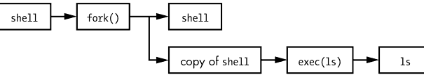

图 1-2：启动新进程

> 注意：系统调用通常用括号表示。在图 1-2 所示的示例中，请求内核创建另一个进程的进程必须执行 `fork()` 系统调用。这种表示法源于 C 语言中的写法。你不需要了解 C 来理解这本书；只需记住系统调用是进程与内核之间的交互。此外，本书简化了某些组系统调用。例如，`exec()` 指的是一系列执行类似任务但在编程实现上有所不同的系统调用。进程中还有一种名为线程（thread）的变体，我们将在第 8 章中介绍。

内核还通过传统系统调用以外的功能支持用户进程，其中最常见的是伪设备（pseudonymous）。伪设备看起来像用户进程，但它们完全通过软件实现。这意味着它们在技术上不需要位于内核中，但出于实际考虑会被使用。例如，内核随机数生成器（`/dev/random`）很难通过进程安全地实现。

注意

从技术上讲，访问伪设备的用户进程必须使用系统调用来使用设备，因此进程无法完全避免系统调用。

## 1.4 用户空间

如前所述，内核为用户进程分配的主内存被称为用户空间（user space）。因为进程仅仅是内存中的一个状态（或镜像），用户空间也指的是整个运行进程集合的内存。（你可能还会听到更常用的术语 userland。）

大部分操作发生在用户空间。

## 1.6 展望

到目前为止，你已经了解了运行 Linux 系统的组成部分。用户进程构成你直接交互的环境；内核负责管理进程和硬件。内核和进程都驻留在内存中。

这些是非常好的背景信息，但你不能仅仅通过阅读来学习 Linux 系统的细节；你需要亲身实践。下一章将开启你的旅程，教你一些用户空间的基础知识。在这一过程中，你将学习 Linux 系统中本章未涉及的重要部分：长期存储（磁盘、文件等）。毕竟，你需要在某处存储你的程序和数据。

## 2 基础命令与目录层次结构


本章是介绍你在书中会遇到的 Unix 命令和实用程序的指南。这些是基础材料，你可能已经掌握了其中很大一部分。即使你认为自己已经跟上了进度，也请花几分钟翻一下本章以万无一失，特别是第 2.19 节中的目录层次结构内容。

为什么要用 Unix 命令？这难道不是一本关于 Linux 如何工作的书吗？当然是，但 Linux 核心是 Unix 的变体。你在本章中看到“Unix”一词的频率会高于“Linux”，因为你可以将学到的内容直接应用到 BSD 和其他 Unix 风格的系统中。我尝试避免过多的 Linux 特有用户界面扩展，不仅是为了给你提供使用其他操作系统的良好背景知识，还因为这些扩展往往是不稳定的。如果你熟悉核心命令，将能够更快速地适应新的 Linux 版本。此外，了解这些命令可以增强你对内核的理解，其中许多命令直接对应于系统调用。

> 如需了解更多关于初学者 Unix 的详细信息，可以参考以下书籍：考虑阅读《The Linux Command Line, 2nd edition (No Starch Press, 2019)》、《UNIX for the Imminent, 2nd edition (Addison-Wesley Professional, 1995) 以及《Learning the Unix Operating System, 5th edition (O'Reilly, 2001)》。

### 2.1 Bourne Shell: `/bin/sh`


Shell 是 Unix 系统中最重要的部分之一。Shell 是一个运行命令的程序，即用户在终端窗口中输入的那些命令。这些命令可以是其他程序，也可以是 Shell 的内置功能。Shell 还充当小型编程环境。Unix 程序员经常将常见任务分解为更小的组件，并使用 Shell 来管理任务并将这些部分组合在一起。

系统的许多重要部分实际上是 Shell 脚本——包含一系列 Shell 命令的文本文件。如果你以前用过 MS-DOS，可以认为 Shell 脚本像 `.BAT` 文件一样强大。因为它们非常重要，第 11 章将专门介绍 Shell 脚本。

随着你阅读此书并获得实践，你将增加使用 Shell 操作命令的知识。Shell 的优点之一是，如果你犯了错误，可以轻松地看到你输入了什么以找出哪里错了，然后重新尝试。

有很多不同的 Shell，但它们的功能都源自 Bourne shell (`/bin/sh`)，这是在贝尔实验室为早期版本的 Unix 开发的标准 Shell。正如你将在书中看到的，每一个 Unix 系统都需要一个特定版本的 Bourne shell 才能正常运行。

Linux 使用的是 Bourne shell 的增强版本，称为 `bash` 或“再次 Bourne” shell。`bash` 是大多数 Linux 发行版的默认 Shell，而在 Linux 系统上，`/bin/sh` 通常是 `bash` 的链接。在运行书中的示例时，你应该使用 Shell。

> 如果你将本章作为组织内 Unix 账户的指南，而你并不是该系统管理员，那么你的默认 Shell 可能不是 `bash`。你可以更改它。

### 2.2 使用 Shell

当你安装 Linux 时，为了运行命令，你应该使用 Shell。在本章中，为了运行示例，你应该作为普通用户。

#### 2.2.1 Shell 窗口

在 Gnome 上，标准输出连接到终端。在 KDE 上，标准输出连接到终端。在 Ubuntu 上，标准输出连接到终端，看起来是 `name@host:path$`；在 Fedora 上，标准输出看起来像是 `name@host:path$`，其中 `name` 是用户名，`host` 是主机名，`path` 是当前工作目录。在 Windows 上，标准输出连接到终端；在 macOS 上，标准输出连接到终端；在 DOS 上，标准输出连接到终端。

书中许多命令以 `$` 开头，表示 Shell提示符。例如，输入以下命令：

```
$ echo Hello.
```

> 注意：许多命令以 `#` 开头，表示以 root 用户身份运行这些命令。

### 2.2.2 使用 Shell 脚本

系统的许多重要部分实际上是 Shell 脚本——包含一系列 Shell 命令的文本文件。如果你以前用过 MS-DOS，可以认为 Shell 脚本像 `.BAT` 文件一样强大。因为它们非常重要，第 11 章将专门介绍 Shell 脚本。

#### 2.2.3 标准输入与输出

Unix 使用流来读写数据。Shell 的优点之一是，如果你犯了错误，可以轻松地看到你输入了什么以找出哪里错了，然后重新尝试。

为了看到输入流的作用，输入 `cat`（不带参数）并按回车。你不会得到任何输出，也不会得到提示符，因为 `cat` 仍在运行。现在输入任何内容并在每行结束时按回车。在空行上按 `CTRL-D` 终止 `cat` 并返回提示符。

`cat` 在此处采用交互行为与流有关。当你没有指定输入文件名时，`cat` 从 Linux 内核提供的标准输入读取数据。在这种情况下，标准输入连接到终端。

> 在空行上按 `CTRL-D` 会停止当前的终端输入并显示 EOF（文件结束）消息（通常会终止程序）。不要将其与 `CTRL-C` 混淆，后者通常无论输出如何都会终止程序。

标准输出与之类似。内核为每个进程提供一个标准输出流，它可以在其中写入输出。`cat` 命令始终将其输出写入标准输出。当你在终端中运行 `cat` 时，标准输出连接到该终端，因此你从那里看到了输出。

标准输入和输出通常缩写为 `stdin` 和 `stdout`。许多命令像 `cat` 一样运行；如果不指定输入文件，命令将从 `stdin` 读取。输出略不同。某些程序（如 `cat`）只将输出发送到 `stdout`，但另一些程序可以直接将输出发送到文件。

第三个标准 I/O 流称为标准错误（`stderr`）。你将在第 2.14.1 节中看到它。

标准流的一个优点之一是你可以轻松地操作它们，在终端以外的地方进行读写，正如你将在第 2.14 节中学到的那样。

```bash
$ ls -l
total 3616
-rw-r--r-- 1 users 3804 May 28 10:40 abusive.c
-rw-r--r-- 1 users 4165 Aug 13 10:01 battery.zip
-dr-xr-x-- 1 users 131219 Aug 13 10:33 beav_1.40-13.tar.gz
-dr-xr-x-- 1 users 6255 May 20 14:34 country.c
drwxr-xr-x 2 users 4096 Jul 17 20:00 c5335
drwxr-xr-x 1 users 7108 Jun 16 13:05 dhry
-rw-r--r-- 1 users 11309 Aug 13 10:26 dhry.c
-rw-r--r-- 1 users 56 Jul 9 15:30 doit
drwxr-xr-x 3 users 4096 Feb 20 13:51 dw
drwxr-xr-x 3 users 4096 Jul 1 16:05 hough-tough
```

你将在第 21.17 节中学习更多关于此输出第 2 列的知识。你现在可以忽略第 2 列；它是指向文件的硬链接数，并在 4.6 节中进行了解释。

### 2.3.2 cp

在最简单的形式下，`cp` 复制文件。例如，将 `file1` 复制到 `file2`：

```bash
$ cp file1 file2
```

你也可以将文件复制到另一个目录，并在目录中保持相同的文件名：

```bash
$ cp file dir
```

要将多个文件复制到名为 `dir` 的目录（文件夹），尝试像示例这样做，它会复制三个文件：

```bash
$ cp file1 file2 file3
```

### 2.3.3 mv

`mv`（移动）命令的工作方式与 `cp` 相似。在最简单的形式下，它重命名文件。例如，将 `file1` 重命名为 `file2`，输入：

```bash
$ mv file1 file2
```

你也可以像使用 `cp` 一样使用 `mv` 将文件移动到其他目录。

### 2.3.4 touch

`touch` 命令可以创建文件。如果目标文件已存在，`touch` 不改变文件，但它会更新文件的修改时间戳。例如，创建一个空文件，输入：

```bash
$ touch file
```

然后对该文件运行 `ls -1`。你应该能看到如下所示输出，其中日期和时间表示你运行 `touch` 的时间：

```bash
$ ls -1 file
-rw-r--r-- 1 user 0 May 21 18:32 file
```

要查看时间戳更新，请至少等待分钟然后再次运行相同的命令。`ls -1` 返回的时间戳将会更新。

### 2.3.5 rm

`rm` 命令删除（移除）文件。在你删除文件后，它通常会从你的系统中消失，除非你从备份中恢复，否则通常无法恢复。

```bash
$ rm file
```

### 2.3.6 echo

`echo` 命令将它的参数打印到标准输出：

```bash
$ echo Hello again.
Hello again.
```

`echo` 命令对于查找 shell 通配符（如 `*` 的“通配符”）和变量（如 `$HOME`）的展开非常有用，你将在本章的后面会遇到这些内容。

## 2.4 目录导航

Unix 目录层次结构从 `/` 开始，也称为根目录。目录分隔符是斜杠 (`/`)，而不是反斜杠 (`\`)根目录下有几个标准子目录，例如 `/usr`，正如你将在 2.19 节中学到的那样。

当你引用文件或目录时，你指定的是*路径*（path）或*路径名*（pathname）。当路径以 `/` 开头（例如 `/usr/lib`）时，它是*完整*或绝对路径。

由两个点（`..`）标识的路径指定目录的父目录。例如，如果你在 `/usr/lib` 中工作，路径 `..` 将指向 `/usr`。`.` 指向当前目录；例如，如果你在 `/usr/lib` 中，路径 `.` 仍然是 `/usr/lib`，而 `../XII` 是 `/usr/lib/XII`。你不需要频繁使用 `.`，因为如果路径不以 `/` 开头，大多数命令默认使用当前目录（所以在一个上面的示例中，你可以直接使用 `XII` 而不是 `/XII`）。

不以 `/` 开头的路径被称为*相对路径*（relative path）。大多数情况下，你已经在所需的目录内或附近。

既然你已经了解了基本的目录机制，这里有一些基本的目录命令：

### 2.4.1 cd


*工作目录*（working directory）是进程（如 shell）当前所在的目录。在大多数 Linux 发行版的默认 shell 提示符中，你可以通过 `pwd` 命令查看当前工作目录。

`cd` 命令更改 shell 的工作目录：
```bash
$ cd dir
```

如果你省略 `dir`，shell 将返回你的*主目录*（home directory），即你首次登录时的目录。有些程序使用 `~` 缩写主目录。

> 注意 `cd` 命令是一个内置命令。

### 2.4.2 mkdir
`mkdir` 命令创建一个目录：
```bash
$ mkdir dir
```

### 2.4.3 rmdir
`rmdir` 命令移除目录：
```bash
$ rmdir dir
```

### 2.4.4 Shell 通配符（Globbing）
shell 可以匹配模式，这种过程被称为通配符（globbing）。其中最简单的是 `*`，它告诉 shell 匹配任意数量的字符。例如，以下命令：
- 以 * 开头的文件
- 以 * 结尾的文件
- 包含 * 的

## 2.5 中间命令
本节介绍最重要的中间 Unix 命令。

### 2.5.1 grep
`grep` 命令打印来自文件或输入流中匹配表达式的行。例如，打印 `/etc/passwd` 文件中包含 `root` 的行，输入：
```bash
$ grep root /etc/passwd
```

当同时处理多个文件时，`grep` 命令极其有用，它额外打印文件名。例如，如果你想检查 `/etc` 下所有包含 `root` 字的文件，可以使用此命令：
```bash
$ grep root /etc/*
```

两个重要的 `grep` 选项是 `-i`（忽略大小写）和 `-v`（反转搜索——即打印所有不匹配的行）。还有一个更强大的变体 `egrep`（它是 `grep` 的同义词）。

`grep` 理解正则表达式，这是一种基于计算机科学理论的模式，在 Unix 工具中非常常见。正则表达式比通配符模式更强大，并且具有不同的语法。关于正则表达式有三点需要记住：
- `*` 匹配任意数量的字符，包括零。
- `+` 匹配一个或多个字符。
- `.` 匹配恰一个任意字符。

《Linux 工作原理》（早期访问）© 2021 Brian Ward

`grep(1)` 手册页包含了对正则表达式的详细描述，但读起来可能有些困难。要了解更多信息，你可以阅读 Jeffrey E. F. Friedl 编写的《Mastering Regular Expressions, 3rd edition》（O'Reilly, 2006），或者查看 Tom Christensen 的《Programming Perl, 4th edition》（O'Reilly, 2012）中的正则表达式章节。如果你喜欢数学并正则表达式的来源感兴趣，可以查阅 Jeffrey Ullman 和 John Hopcroft 的《Introduction to Automata Theory, Languages, and Computation, 3rd edition》（Prentice Hall, 2006）。

### 2.5.2 less
当文件很大或命令输出较多并滚出屏幕顶部时，`less` 命令就非常有用。

要翻页如 `/usr/share/dict/words` 这样的大文件，可以使用命令 `less /usr/share/dict/words`。运行 `less` 时，你将一次看到一屏文件内容。按空格键向前翻页，按 `b`（小写）向后翻一页。按 `q` 退出。

`less` 命令是一个名为 `more` 的旧程序的增强版本。Linux 桌面和服务器都有 `less`，但它在嵌入式系统和其他 Unix 系统上并不是标准的。如果你遇到无法使用 `less` 的情况，可以尝试 `more`。

你也可以在 `less` 内部搜索文本。例如，要搜索一个单词，输入 `/word`；要向上搜索，可以使用 `?word`。当你找到匹配项时，按 `n` 继续搜索。

正如你将在第 2.14 节中学到的，你可以将几乎任何程序的标准输出直接发送到另一个程序的标准输入。当你想要用像 `less` 的工具来查看包含大量输出的内容时，这特别有用。这里有一个将 `grep` 命令的输出发送给 `less` 的示例：
```bash
$ grep ie /usr/share/dict/words | less
```

亲自尝试一下这个命令。你会发现 `less` 有很多用途。

### 2.5.3 pwd
`pwd`（打印工作目录）程序简单地输出当前目录的名字。你可能会奇怪，为什么当大多数 Linux 发行版已经在提示符中设置了当前工作目录时你还需要它。有两个原因：

首先，并不是所有的提示符都包含当前工作目录，特别是因为你可能想在自己的提示符中去掉它，因为它占用了大量空间。如果是这样，请使用 `pwd`。

其次，你将在第 2.17.2 节中学到的符号链接有时会模糊当前工作目录的完整路径。使用 `pwd -P` 可以消除这种困惑。

第 2 章

### 2.5.4 diff
要查看两个文本文件之间的差异，使用 `diff`：
```bash
$ diff file1 file2
```

选项可以控制输出的格式，默认输出格式通常对人类来说最容易理解。然而，大多数程序员在需要将输出发送给其他人时更倾向于 `diff -u` 的输出，因为自动化工具处理这种格式更加容易。

### 2.5.5 file
如果你看到一个文件但不确定它的格式，尝试使用 `file` 命令看看系统是否能识别它：
```bash
$ file
```

你可能会对这个看起来无害的命令能做这么多事情感到惊讶。

### 2.5.6 find and locate
当你知道某个文件在目录树中但不知道具体在哪里时，这种感觉很令人沮丧。运行 `find` 在目录中查找文件如下：
```bash
$ find dir -name file -print
```

像本节中的大多数程序一样，`find` 能够执行许多花哨的操作。然而，在你熟记格式并理解为什么需要 `-name` 和 `-print` 选项之前，不要尝试 `-exec` 这样的选项。`find` 命令接受 `*` 等特殊模式匹配字符，但你必须将其包含在单引号 `'*'` 中，以保护特殊字符不受 shell 自身通配符膨匹配功能的影响。（回顾第 2.4.4 节，shell 会在运行命令之前扩展通配符）。

大多数系统还有一个用于查找文件的 `locate` 命令。`locate` 实时搜索文件，而是搜索系统定期构建的索引。使用 `locate` 搜索比 `find` 快得多，但如果你查找的文件比索引新，`locate` 就找不到它。

### 2.5.7 head and tail
`head` 和 `tail` 命令允许你快速查看文件或数据流的一部分。例如，`head /etc/passwd` 显示密码文件的前 10 行，`tail /etc/passwd` 显示最后 10 行。

要更改显示的行数，使用 `-n` 选项，其中 n 是你想看到的行数（例如，`head -5 /etc/passwd`）。要从第 n 行开始打印行，使用 `tail +n`。

### 2.5.8 sort
`sort` 命令可以快速将文本文件的行按字母数字顺序排序。如果文件的行以数字开头且你想进行数值排序，使用 `-n` 选项。`-r` 选项反转排序顺序。

## 2.6 更改密码和 Shell
使用 `passwd` 命令更改密码。你会被要求输入旧密码，然后提示输入两次新密码。

最好的密码往往是容易记忆的“无意义”句子。密码越长（字符数越多）越好。

你可以更改你的 shell（例如，`bash`、`ksh`、`zsh`）。

## 2.7 点文件
点文件是以点开头的文件。除非使用 `-a`，否则某些程序默认不会显示它们。常见的点文件有 `.bashrc` 和 `.login`。

> 注意
> 你可能会点文件上遇到问题，因为 ..（当前目录和父目录）。

## 2.8 环境变量和变量
shell 可以存储临时变量，称为变量，它们包含字符串值。变量对于在脚本中跟踪值非常有用，某些变量控制着 shell 的行为。

要为 shell 变量赋值，使用等号（`=`）。这里有一个简单的示例：
```bash
$ STUFF=blah
```

前面的示例将名为 `STUFF` 的变量赋值为 `blah`。要访问此变量，使用 `$STUFF`（例如，`echo $STUFF`）。

赋值变量时不要在等号周围留空格。

环境变量类似于变量，但不特定 shell。Unix 系统上的所有进程都有环境变量存储。环境变量和变量的主要区别在于，操作系统会将所有的所有的环境变量传递给你运行的程序，而变量无法被运行的命令访问。

使用 shell 的 `export` 命令分配环境变量。例如，如果你想将 shell 变量 `STUFF` 变成环境变量，可以使用以下：
```bash
$ STUFF=blah
$ export STUFF
```


由于子进程继承父进程的环境，程序会读取它们进行配置和选项。例如，你可以将喜欢的 `less` 命令行选项放在 `LESS` 环境变量中，当你运行 `less` 时，它将使用这些选项。

## 2.9 命令路径

`PATH` 是一个特殊的环境变量，包含了命令路径（简称为 `path`），它是 `shell` 在尝试定位命令时搜索的目录列表。例如，当你运行 `ls` 时，`shell` 会在 `PATH` 中列出的目录中搜索 `ls` 程序。如果同名程序出现在路径中的多个目录中，`shell` 将运行第一个匹配的程序。

如果你运行 `echo $PATH`，你会发现路径组件是用冒号 (`:`) 分隔的。例如：

```bash
$ echo PATH
/usr/local/bin:/usr/bin:/bin
```

《Linux 工作原理》（早期访问版）© 2021 Brian Ward 版所有

要让 `shell` 在更多地方查找程序，请更改 `PATH` 环境变量。例如，通过使用此命令，你可以将目录 `dir` 添加到路径开头，这样 `shell` 在查找任何其他 `PATH` 目录之前都会查找 `dir`：

```bash
PATH=dir:$PATH
```

或者，你可以将目录名追加到 `PATH` 变量的末尾，导致 `shell` 最后查找 `dir`：

```bash
PATH=$PATH:dir
```

**注意** 如果你在修改路径时时不小心写错了 `$PATH`，你可能会意外地清空你的整个路径。如果发生这种情况，不要恐慌！这种损坏不是永久的；你只需要启动一个新的 `shell` 即可。（要产生持久的影响，你需要编辑特定的配置文件，即使如此，纠正也并不困难。）恢复正常的最简单方法是关闭当前终端窗口并启动另一个。

## 2.10 特殊字符

在他人讨论 Linux 时，你应该了解一些你会遇到的某些特殊字符的名称。如果你对这类事情感兴趣，可以参阅《术语表》（[Jargon File](http://www.cat.org/jargon/html/)）或其印刷版——由 Eric S. Raymond 编写的第三版《新黑客字典》（The New Hacker's Dictionary, MIT Press, 1996）。

表 2-1 描述了一组特定的特殊字符，其中许多你已经在本章中见过。某些工具（例如 Perl 编程语言）几乎使用了所有这些特殊字符！（请记住，这些是字符的英文名称）。

| 字符 | 名称(s) | 用途 |
| --- | --- | --- |
| * | star, asterisk | 正则表达式，glob 通配符 |
| . | dot | 当前目录，文件/主机名分隔符 |
| ! | bang | 否定，命令历史 |
| \| | pipe | 命令管道 |
| / | (forward) slash | 目录分隔符，搜索命令 |
| \ | backslash | 字面量，宏（从不用于目录） |
| $ | dollar | 变量，末尾 |
| ' | tick, (single) quote | 字面字符串 |
| ` | backtick, backquote | 命令替换 |
| " | double quote | 半字面字符串 |
| ^ | caret | 否定，行首 |
| 字符 | 名称(s) | 用途 |
| --- | --- | --- |
| ~ | tilde, squiggle | 否定，目录快捷方式 |
| # | hash, sharp, pound | 注释，预处理器，替换 |
| ] | (square) brackets | 范围 |
| { | braces, (curly) brackets) | 语句块，范围 |
| _ | underscore, under | 在不需要或不允许使用空格时，或者自动补全算法产生混乱时，空格的廉价替代品 |

注意 你经常会看到用脱字符（caret）标记的控制字符；例如代表 `CTRL-C` 的 `^C`。

## 2.11 命令行编辑

当你玩 `shell` 时，请注意你可以使用左、右方向键编辑命令行，并使用向上、向下方向键翻阅之前的命令。这在大多数 Linux 系统上都是标准配置。然而，忘记方向键并转而使用控制组合键是一个好主意。如果你学习了表 2-2 中列出的组合，你会发现在许多使用这些标准键的 Unix 程序中能够更好地输入文本。

表 2-2：命令行快捷键

| 快捷键 | 操作 |
| --- | --- |
| CTRL-B | 光标向左移动 |
| CTRL-F | 光标向右移动 |
| CTRL-P | 查看上一个命令（或光标向上移动） |
| CTRL-N | 查看下一个命令（或光标向下移动） |
| CTRL-A | 光标移动到行首 |
| CTRL-E | 光标移动到行尾 |
| CTRL-W | 删除单词 |
| CTRL-U | 删除从光标到行首的内容 |
| CTRL-K | 删除从光标到行尾的内容 |
| CTRL-Y | 粘贴删除的文本（例如，从 `CTRL-U` 删除的内容） |

## 2.12 文本编辑器

说到编辑，是时候学习编辑器了。要深入研究 Unix，你必须能够在不损坏文件的情况下编辑它们。系统的大部分使用纯文本配置文件（`/etc` 中的那些）。编辑文件并不困难，但你操作得非常频繁，因此需要一个强大的工具来完成。

你应该尝试学习一种事实上的 Unix 文本编辑器，即 `Emacs`。大多数大师对他们编辑器的选择近乎狂热，不要听他们的。为你自己选择一个。如果你选择的与你的工作匹配，你会发现它更容易学习。基本上，选择取决于：

- 如果你想要一个几乎可以做任何事情并且有在线帮助的编辑器，并且你不介意为了这些功能多打一些字，那么是 `Emacs`
- 如果速度就是一切，尝试一下 `vi`；它“玩起来”有点像视频游戏。

学习 `vi` 和 `Vim` 编辑器：*Unix Text Processing*, 第 7 版，由 Arnold Robbins, Elbert Hannah 和 Linda Lamb 编写（O'Reilly, 2008），可以告诉你关于 `vi` 的所需一切。对于 `Emacs`，请使用在线教程：启动 `Emacs`，按下 `CTRL-H`。

你可能想使用 `nano`，它是一个在大多数系统中都提供的简单编辑器。如果你想要更强大但仍比 `Emacs` 简单的东西，可以考虑 `micro`。

## 2.13 获取在线帮助

Linux 系统带有丰富的文档。对于基础命令，手册页（`man` pages）会告诉你所需的。例如，要查看 `ls` 的手册页，运行：

```bash
$ ls
```

大多数手册页集中在参考信息上，或许带有示例，但它们不是教程。如果你很急，可以在手册页中找到需要的。通过关键词搜索手册页，使用 `-k` 选项：

```bash
$ man -k keyword
```

当你不确定想要的命令名称时非常有帮助。例如，如果你在寻找一个排序某些内容的命令，运行：

```bash
$ man -k sort
```

输出包括手册页名称、章节以及对其内容的简要描述。

注意 如果对前面章节描述的命令有任何疑问，可以使用 `man` 命令找到答案。

手册页通过章节编号引用。当有人提到某个手册页时，通常会将章节号放在括号内，例如 `ping(8)`。表 2-3 列出了章节及其描述

表 2-3：在线手册章节

| 章节 | 描述 |
| --- | --- |
| 1 | 用户命令 |
| 2 | 内核系统调用 |
| 3 | 高级 Unix 编程库文档 |
| 4 | 设备接口和驱动程序信息 |
| 5 | 文件描述符（系统配置文件） |
| 6 | 游戏 |
| 7 | 文件格式、约定和编码（ASCII、后缀等） |
| 8 | 系统命令和服务器 |

章节 1、5、7 和 8 应该是本书的很好的补充。章节 4 可能用处有限，章节 6 如果能再大一点就太好了。如果你不是程序员，可能无法使用章节 3，但你可能可以理解章节 2 中你已经深入读过的部分内容。

一些常用术语在多个章节中有许多匹配的手册页。默认情况下，`man` 显示它找到的第一个页面。你可以通过章节选择手册页。例如，要读取 `/etc/passwd` 文件的描述（而不是 `passwd` 命令），你可以将章节号插入页名之前，如下所示：

```bash
$ man 5 passwd
```

《Linux Linux》（早期访问版）© 2021 Brian Ward

手册页（manual pages）涵盖了基本内容，但还有许多获取在线帮助的方法（除了搜索互联网）。如果你只是在寻找某个特定特定选项，可以尝试输入命令名加上 `--help` 或 `-h`（该选项随命令而异）。你可能会得到大量信息（在执行 `ls --help` 的情况下），也可能恰好找到你想要的内容。

曾经，GNU 项目决定他们并不喜欢手册页，于是切换到了另一种名为 `info`（或 `texinfo`）的格式。这种文档通常比典型的手手册更深入，但它可能更复杂。要访问 `info` 手册，请配合命令名使用 `info`：

```bash
$ info command
```


如果你不喜欢 `info` 阅读器，可以将输出重定向到 `less`（只需添加 `| less`）。

有些软件包会将它们的可用文档倾倒到 `/usr/share/doc` 中，而不考虑 `man` 或 `info` 等在线手册系统。如果你发现自己正在搜索文档，请查看系统上的该目录——当然，也可以搜索互联网。

## 2.14 Shell 输入与输出

现在你已经熟悉了基础 Unix 命令、文件和目录，已经准备好学习如何重定向标准输入和输出了。让我们从标准输出开始。

要将命令的输出发送文件而不是终端，使用重定向字符：

```
$ command > file
```

如果文件不存在，shell 会创建它。如果文件已存在，shell 会擦除原始文件（覆盖）。某些 shell 具有防止覆盖的参数。例如，在 `bash` 中，你可以输入 `set -C` 来避免覆盖。

你可以使用 `>>` 重定向语法将输出追加到文件中，而不是覆盖它：

```
$ command >> file
```

这是在执行系列相关命令时，将输出收集在一个地方的一种非常方便的方法。

要将一个命令的标准输出发送到另一个命令的标准输入，请使用管道字符（`|`）。要查看它是如何工作的，请尝试以下两个命令：

```
$ head /proc/cpuinfo | tr a-z A-Z
```

你可以通过意愿数量的管道命令来发送输出；只需在每个额外的命令之前再添加一个管道即可。

### 2.14.1 标准错误

偶尔，你可能重定向了标准输出，但发现程序仍然向终端打印内容。这被称为标准错误（`stderr`）；它是用于诊断和调试的额外输出流。例如，这条命令产生了一个错误：

```
$ ls /ffffffff > f
```

执行完成后，`f` 应该是空的，但你仍然会在终端上看到以下错误信息作为标准错误：

```
ls: cannot access /ffffffff: No such file or directory
```

如果你愿意，可以重定向标准错误。例如，使用 `2>` 语法将标准输出发送到 `f` 而标准错误发送到 `e`，如下：

```
$ ls /ffff > f 2>&1
```

数字 `2` 指定 shell 修改的流 ID。流 ID `1` 是标准输出（默认值），`2` 是标准错误。你也可以使用 `2>&1` 符号将标准错误发送到与 stdout 相同的地方。例如，要将标准输出和标准错误发送到名为 `f` 的文件，请尝试此命令：

```
$ ls /ffffffff > f 2>&1
```

### 2.14.2 标准输入重定向

要将文件引导到程序的标准输入，请使用 `<` 运算符：

```
$ head < /proc/cpuinfo
```

你偶尔会遇到需要此类重定向的程序，但因为大多数 Unix 命令接受文件名作为参数，所以这并不常见。例如，前面的命令可以写成 `head /proc/cpuinfo`。

## 2.15 理解错误信息

当你在 Linux 等类 Unix 系统上遇到问题时，你必须阅读错误信息。与其他操作系统的消息不同，Unix 错误通常会准确地告诉你是出了什么问题。

### 2.15.1 Unix 错误信息的剖析

大多数程序都会生成并报告相同的基本错误信息，但任何两个程序的输出之间可能存在细微的差异。这里有一个你会以某种形式遇到的例子：

```
$ ls /dsafsa
ls: cannot access /dsafsda: No such file or directory
```

这条消息包含三个三个组成部分：

- 程序名，`ls`。某些程序会省略此信息，这在你编写 shell 脚本时可能很令人恼恼，但并不是什么大问题。

- 文件名 `/dsafsda`，这是一个更具体的信息。该路径有问题。

- 错误 `No such file or directory` 指明了文件名出的问题。

将所有内容结合，你会得到类似“`ls` 尝试打开 `/dsafsda`，因为它不存在”这样的内容。这看起来可能显而易见，但当你运行一个包含不同名称下的错误命令的 shell 命令时，这些信息可能会变得有点困惑。

在排故障错误时，始终先处理第一个错误。有些程序在报告大量其他问题之前会报告它们无法执行任何操作。例如，假设你运行了一个名为 `scumd` 的虚构程序，并看到此错误信息：

```
scumd: cannot access /ffffffff: No such file or directory
```

（注：根据 OCR 上文，这是重建的错误信息）。

### 2.15.2 常见错误

你在 Unix 中遇到的许多错误是源于文件和进程可能发生的问题。相当一部分错误直接源于内核遇到的状况，因此通过观察这些错误，你可以了解到内核是如何将问题传递给进程的。

《Linux 工作原理》（早期访问）© 2021 Brian Ward 著

这是它不被允许接触的内存部分，操作系统将其杀掉。同样，总线错误（bus error）意味着程序尝试以它不应该的方式访问内存。当你遇到这些错误之一时，可能是你给某个程序输入了它没有预料的输入。在少数情况下，可能是内存硬件故障。

## 2.16 列出和操作进程

回想第 1 章，进程是一个正在运行的程序。系统上的每个进程都有一个数字进程 ID（PID）。要快速列出运行中的进程，只需在命令行上运行 `ps` 即可。你会得到类似下面这样的列表：

```
$ ps
PID TTY STAT TIME COMMAND
520 po S 0:00 -bash
545 ? S 0:39 /usr/X11R6/bin/ctwm -W
548 ? S 0:10 xclock -geometry -0-0
2159 pd SW 0:00 /usr/bin/vi lib/addresses
31956 p3 R 0:00 ps
```

字段含义如下：

- PID 进程运行的设备。稍后会详细介绍更多信息。

- STAT 进程状态——即进程正在做什么以及它的内存位于何处。例如，`S` 表示睡眠（sleeping），`R` 表示运行（running）。（参见 `ps(1)` 手册页获取所有符号的描述）。

- TIME 进程到目前为止使用的 CPU 时间，以分钟和秒为单位。换来说，就是进程在处理器上运行指令的总时间。请记住，进程并不是持续运行的，这与进程启动以来的时间（或“墙钟时间”）不同。

- COMMAND 这看起来显而易见，因为它是运行程序使用的命令，但请注意进程可以更改此字段的值。此外，shell 可以执行通配符展开（glob expansion），此字段将反映展开后的命令，而不是你在提示符处输入的内容。

> 对于系统上运行的每个进程，PID 都是唯一的。然而，在进程终止后，内核最终可以将该 PID 重用给新进程。

### 2.16.1 ps 命令选项

`ps` 命令有许多选项。为了让事情变得复杂，你可以以三种不同的风格指定选项——Unix、BSD 和 GNU。许多人认为 BSD 风格最舒服（也许因为涉及输入习惯），所以我们在书中使用它。以下是一些最实用的选项组合：

- - `ps` 显示你所有运行中的进程。

- `ps ax` 显示系统上所有的进程，而不仅仅是你运行的进程。

- `ps u` 包含关于进程的更详细信息。

- `ps w` 显示完整的命令名称，而不仅仅是单行能容下的内容。

与其他程序一样，你可以组合选项，例如 `ps` 和 `ps aux`。要检查特定进程，请将其 PID 添加到 `ps` 命令的参数列表中。例如，要检查当前的 shell，可以使用 `ps u $$`（`$` 是 shell 变量，其求值为当前的 PID）。你将在第 8 章中找到关于 `top` 和 `lsof` 管理命令的信息。这些命令在定位进程以及当你正在进行系统维护以外的其他操作时可能非常有用。

### 2.16.2 终止进程

要终止一个进程，你通过 `kill` 命令发送一个信号——内核发送给进程的消息。在大多数情况下，你只需要做这一步：

```
$ kill pid
```

信号有很多类型。默认的（上面使用的）是 `TERM`，即终止（terminate）。你可以通过给 `kill` 增加额外的选项来发送信号。例如，要冻结进程而不是终止它，请使用 `STOP` 信号：

```
$ kill -STOP pid
```

被停止的进程仍在内存中，准备好从上次停止的地方继续。使用 `CONT` 信号继续运行该进程：

```
$ kill -CONT pid
```

使用 `CTRL-C` 终止在当前终端中运行的进程，与使用 `kill` 通过 `INT`（中断）信号来结束进程是相同的。

内核在接收到信号时，会给大多数进程一个机会对自身进行清理工作（通过信号处理程序机制）。然而，某些进程可能会在响应信号时选择非终止操作，或者在尝试处理的过程中卡住，或者忽略它，因此你可能会在终止一个进程后发现它仍在运行。如果发生这种情况且你确实需要杀死一个进程，那么最粗暴的终止方法是使用 `KILL` 信号。与其他信号不同，`KILL` 是被忽略的；事实上，操作系统甚至不会给进程任何机会。内核会终止进程并强制将其从内存中移除。这种方法仅作为最后手段。

你不应该不分青皂地杀死进程，特别是当你不知道它们在做什么时。你可能会自讨苦吃。


你可能会看到其他用户输入名称而不是 `kill`——例如，使用 `kill -9` 而不是 `kill -KILL`。这是因为内核使用数字来表示不同的信号；如果你知道想要发送的信号的数字，可以使用这种方法。运行 `kill -1` 可以获取信号与名称的映射表。

### 2.16.3 作业控制

Shell 支持作业控制（job control），这通过各种快捷键和命令向程序发送 `TSTOP`（类似于 `STOP`）和 `CONT` 信号的方法。这允许你挂起并切换正在使用的程序。使用 `CTRL-Z` 挂起一个程序，然后使用 `jobs` 列出它们，使用 `fg` 将作业带回前台，或使用 `bg` 让其在后台运行。这对于运行时间很长的程序特别有用，此时你想在终端中做其他事情。

### 2.16.4 后台进程

通常，当你从 shell 运行一个程序时，它会占据前台直到完成。如果你想在后台运行程序，可以在命令末尾添加一个符号（`&`）。shell 会通过打印新进程的 `PID` 立即返回提示符。例如：

```
$ gzip file.gz &
```

后台进程的负面影响是它们可能会与标准输入交互（更糟糕的是直接读取它）。如果一个程序在后台尝试从标准输入读取，它可能会冻结（尝试 `fg` 将带回）或终止。此外，如果程序向标准输出或错误写入内容，输出将出现在终端中而不考虑任何其他情况，这意味着当你处理其他事情时会得到意外的输出。

确保后台进程不干扰你的最佳方法是重定向它的输出（可能还有输入），如节 `2.14` 所示。如果后台进程的异常输出干扰了你，请学习如何重绘窗口。`bash` shell 和大多数全屏交互程序都支持 `CTRL-L` 重绘屏幕。如果程序正在从标准输入读取，`CTRL-R` 通常重绘当前行，但在错误的时间按下序列可能会让你陷入比以前糟糕的境地。例如，在 `bash` 提示符处输入 `CTRL-R` 进入反向搜索模式。

## 2.17 文件模式与权限

每个 Unix 文件都有一组权限，决定你是否可以读取、写入或运行该文件。运行 `ls -l` 会显示权限。这是一个此类显示的示例：

```
-rw-r--r-- 1 user somegroup 7041 Mar 26 19:34 endnotes.html
```

文件的模式表示文件权限和一些信息。模式由四部分组成，如图 `2-1` 所示。

模式的第一个字符是文件类型。模式第一个位置的连字符（`-`）如示例所示表示普通文件，意味着该文件没有特殊之处；它只是二进制或文本数据。这是最常见的文件类型。目录也很常见，并用 `d` 表示（节 `3.1` 列出了剩余的文件类型）。

### Linux 工作原理（早期访问）© 2021 由 Brian Ward

文件的模式其余部分包含权限，这些权限分为三组：用户、组和其他，按顺序排列。例如，示例中的 `rw-` 字符是用户权限，紧随其后的 `r--` 字符是组权限，最后的 `r--` 字符是其他权限。

每个权限可以包含四种基本表示：

- `r` 表示文件是可读的。
- `w` 表示文件是可写的。
- `x` 表示文件是可执行的（你可以将其作为程序运行）。
- `-` 表示“无”（更具体地说，是该集合中槽位的权限尚未被授予）。

用户权限（第一组）允许所有文件的用户访问。在前面的示例中，即用户（`user`）。第二组（组权限）是针对用户组的（示例中的 `somegroup`）。该组中的任何用户都可以利用这些权限。（使用 `id` 命令查看你的身份，更多信息请参阅第 `7.3.5` 节。）

系统上的每个人都根据第三组（其他权限）进行访问，这有时被称为“世界权限”。

每个读、写、执行槽位有时被称为权限位，因为它们在操作系统底层的表示是一系列比特位。因此，你可能会听到人们将权限的某些称为“读取位”。

某些可执行文件在用户权限列表中显示 `s` 而不是 `x`。这表示该可执行文件设置了 `setuid`，意味着当你执行该程序时，它运行就像是文件所有者而不是你的身份。许多程序使用 `setuid` 来运行，以获取更改系统文件所需的权限。其中之一是 `passwd` 程序，它需要更改 `/etc/passwd` 文件。

### 2.17.1 修改权限

要更改文件或目录的权限，使用 `chmod` 命令。首先，选择你想要更改的权限组，然后选择要更改的位。例如，要给一个文件添加组（`g`）和世界（`o`，代表“其他”）的读（`r`）权限，你可以运行以下两个命令：

```bash
$ chmod g+r file
$ chmod o+r file
```

或者你也可以一次性完成：

```bash
$ chmod go+r file
```

若要移除这些权限，请使用 `-r` 代替 `+r`

> 显然，你不应该将文件设为世界可写，因为这将允许系统上的任何人都更改它们。但这也会允许任何连接到互联网的任何人更改它们吗？可能不会，除非你的系统存在网络安全漏洞。在这种情况下，文件权限对你来说没有任何帮助。

你有时会看到使用数字更改权限，例如：

```bash
$ chmod 644 file
```

这被称为绝对更改，因为它一次性设置了所有权限位。要理解其工作原理，你需要知道如何用八进制形式表示权限位（每个数字代表一个 8 进制数， 0 到 7，并对应一组权限）。更多信息请查阅 `chmod(1)` 手册页或 `info` 手册。

如果你直接使用绝对模式，你并不真正知道如何构建它们；只需记住你最常使用的模式即可。

**表 2-4:** 绝对权限模式

| 模式 | 含义 | 用途 |
|---|---|---|
| 644 | 用户：读/写；组、其他：读 | 文件 |
| 600 | 用户：读/写；组、其他：无 | 文件 |
| 755 | 用户：读/写/执行；组、其他：读/执行 | 目录、程序 |
| 700 | 用户：读/写/执行；组、其他：无 | 目录、程序 |
| 711 | 用户：读/写/执行；组、其他：执行 | 目录 |

目录也有权限。如果目录是可读的，你就可以列出目录的内容；如果目录是可执行的，你就可以进入该目录。在设置绝对模式时，人们常见的错误是不小心删除了执行权限。

最后，你可以通过 `umask` 命令指定一组默认权限，它定义了你创建的新文件的权限。通常情况下，使用 `umask 22` 让所有人都能看到你创建的文件和目录，使用 `umask 077` 则不是。如果你想让你的权限模式应用于新的会话，你需要将 `umask` 命令放在你的启动文件中，如第 `13` 章所述。

在长格式目录列表中，符号链接看起来所示（模式中的 `l` 表示类型）：

事实上，如果 `/home/origdir` 不存在，任何访问它的程序都会报错报告该目录不存在（除了 `ls` 命令，它愚蠢地通知你该目录不存在）。这可能让人感到困惑，因为你可以在眼前命名一个 `somdir`。

`$ ln -s target linkname`: `linkname` 是符号链接的名字，`target` 参数是链接指向的文件或目录的路径，`-s` 标志创建一个符号链接（参见随后的警告）。

## 2.18 归档与压缩文件

### 2.18.1 使用 gzip

### 2.18.2 使用 tar

### 2.18.3 压缩归 (.tar.gz)

许多初学者会发现归包通常是压缩过的，文件名以 `.tar.gz` 结尾。要解包压缩归，请从右向左处理；先获取 `.gz`，然后再处理 `.tar`。例如，以下两个命令将解压并解包 `<file>.tar.gz`：

```bash
$ gzip file.tar.gz
$ tar xvf file.tar
```

《Linux 工作原理》（早期访问版）© 2021 Brian Ward

在刚开始时，一步执行这些操作是可以的：首先运行 `gunzip` 进行解压，然后运行 `tar` 进行验证和解包。要创建一个压缩归包，则执行相反操作：先运行 `tar` 再运行 `gzip`。经常这样操作，你很快就能记住归档和压缩的过程。但即使你不做所有这些，你也能看到这些输入工作变得多么繁琐，并开始寻找捷径。让我们来看看现在的做法。

### 2.18.4 zcat

刚刚显示并不是在压缩归包上调用 `tar` 最快或最高效的方法，而且浪费了磁盘空间和内核 I/O 时间。更好的方法是通过管道将归档和压缩功能结合。例如，此命令解压 `<file>.tar.gz`：

```
$ zcat file.tar.gz | tar xvf
```

`zcat` 命令等同于 `gunzip -dc`。`-d` 选项解压缩，`-c` 选项将结果发送到标准输出（在这种情况下，发送给 `tar` 命令）。

由于使用 `zcat` 非常常见，Linux 自带的 `tar` 版本有一个快捷选项。你可以使用 `z` 作为选项来自动对归档调用 `gzip`：这适用于提取归档（使用 `tar` 的 `x` 或 `t` 模式）和创建归档（使用 `c` 模式）。例如，使用以下命令验证压缩归包：

```
$ tar zvf file.tar.gz
```

然而，请记住你实际上是在执行两个步骤，而不是在走捷径。

> 注意
>
> `.gz` 文件与 `.tar.gz` 文件相同。该后缀是为了适应 FAT（基于 MS-DOS）文件系统。

### 2.18.5 其他压缩工具


另外两个压缩程序是 `xz` 和 `bzip2`，它们的压缩文件分别以 `.xz` 和 `.bz2` 结尾。虽然比 `gzip` 稍微慢一点，但它们通常能更有效地压缩文本文件。使用的解压程序是 `unxz` 和 `bzip2`，两者的选项与 `gzip` 的对应的足够，你不需要学习任何新东西。

大多数带有 `zip` 和 `unzip` 程序的 Linux 发行版与 Windows 系统上的 ZIP 归包兼容。它们不仅适用于普通的 `.zip` 文件，也适用于以 `.exe` 结尾的自解压归包。但如果你遇到以 `.Z` 结尾的文件，你就发现了一个 `compress` 程序的遗迹，它曾是 Unix 的标准。`gunzip` 程序可以解包这些文件，但 `gzip` 不会创建它们。

基础命令与目录层次结构 41

## 2.19 Linux 目录层次结构本质

现在你已经知道如何查看文件、切换目录和阅读页面，准备好开始探索你的系统文件和目录了。Linux 目录结构的细节在《文件系统层次结构标准》，或 FHS (`https://refspec.linuxfoundation.org/fhs.shtml`) 中有所概述，但目前简要的介绍就足够了。

图 2-2 提供了层次结构的简化概述，显示了 `/usr/` 和 `/var` 下的一些目录。注意，`/usr` 下的目录结构包含一些与 `/` 相同的目录名。

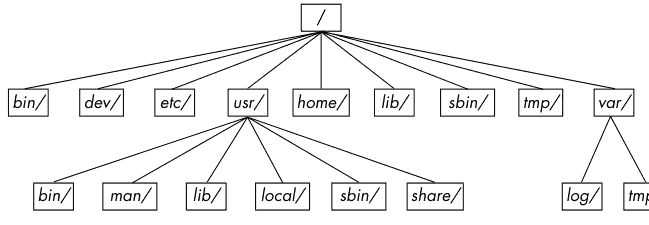

图 2-2：Linux 目录层次结构

以下是根目录下最重要的子目录：

- `/bin` 包含就绪可用的程序（也称为二进制程序），以及大多数基础 Unix 命令，如 `ls` 和 `cp`。`/bin` 中的大部分程序是二进制格式，由 C 编译器创建，但在现代系统中，有些是 shell 脚本。

- `/dev` 包含设备文件。你将在第 3 章中学习更多相关内容。

- `/etc` 是核心系统配置目录（读作 EHT-see），包含用户密码、启动、设备、网络和其他文件。

- `/home` 存放普通用户的家（个人）目录。大多数 Unix 安装都遵循这一标准。

- `/lib` 是 library（库）的缩写，此目录持有包含可执行文件可以使用的代码的库文件。有两种库：静态库和共享库。`/lib` 目录应该只包含共享库，但其他目录（如 `/usr/lib`）包含这两种类型（我们将在第 15 章详细讨论共享库）。

- `/proc` 通过可浏览的目录和文件接口提供系统统计信息。Linux 上大部分 `/proc` 子目录结构是唯一的，但许多其他 Unix 变体具有类似的功能。`/proc` 目录包含当前运行进程的信息以及一些内核参数。

- `/run` 包含特定的系统运行时数据，包括某些进程 ID、socket 文件状态记录，在许多情况下还包括系统日志。这是根目录最近添加的内容；你可以在 `/var/run` 找到它。在较新的系统中，`/var/run` 是指向 `/run` 的符号链接。

- `/sys` 目录与 `/proc` 类似，因为它提供了设备和系统接口。你将在第 3 章阅读大量关于 `/sys` 的内容。

- `/sbin` 系统执行程序的存放地。`/sbin` 目录中的程序与系统管理有关，普通用户的路径中通常不包含 `/sbin` 组件。如果不是 root 用户，他们发现的许多工具将无法工作。

- `/tmp` 是存储你不在乎的较小临时文件的区域。任何用户都可以在 `/tmp` 中进行读写，但用户可能没有权限访问另一个用户的文件。许多程序使用此目录作为工作空间。

《Linux 工作原理》（早期访问版）© 2021 Brian Ward

- `/var` 信息会随时间变化的子目录。系统日志、用户跟踪和其他文件。

### 2.19.1 其他根子目录

根目录下还有其他少数有趣的子目录：

- `/boot` 包含引导器文件。这些文件仅涉及 Linux 启动的第一阶段。关于此点的更多信息请见第 5 章。

- `/media` 是移动媒体（如闪盘）的基础挂载点，在许多发行版中可见。

- `/opt` 这可能包含额外的第三方软件。

基础命令与目录层次结构 43

### 2.19.2 /usr 目录

`/usr` 目录乍看起来可能很干净，快速查看 `/usr/bin` 和 `/usr/lib` 就会发现这里有很多内容；`usr` 是大多数用户空间程序和数据的所在地。除了 `/usr/bin`、`/usr/sbin` 和 `/usr/lib` 之外，`/usr` 还包含：

- `include` 存放 C 编译器使用的文件。

- `local` 是管理员可以安装自己的软件的地方。它的结构应该像 `/usr` 一样。

- `man` 包含手册页。

- `share` 包含可以在其他类型的 Unix 机器上运行且不丢失功能的文件。这些通常是程序和库在需要时读取的辅助数据文件。过去，机器网络会从一台服务器共享此目录，但这种使用方式已罕见。相反，在 Linux 发行版中，你会发现 `/man`、`/info` 以及许多其他子目录，这是一个易理解的约定。

### 2.19.3 内核位置

在 Linux 系统上，内核通常是一个二进制文件 `/vmlinuz` 或 `/boot/vmlinuz`。引导器在系统启动时将此文件加载到内存并启动。（引导器的详情见第 5 章。）

一旦引导器启动内核，主内核文件就不再被运行系统使用。然而，你会在正常系统运行期间按需加载的模块。这些被称为可加载内核模块，位于 `/lib/modules` 下。

## 2.2 以超级用户身份运行命令

在继续之前，你应该学习如何以超级用户身份运行命令。你可能想启动一个 root shell，但这样做有许多缺点：

- 你没有修改系统命令的记录。

- 你没有执行修改系统命令的用户记录。

- 你无法访问自己的普通 shell 环境。

- 你必须输入 root 密码（如果有的话）。

Linux 工作原理（早期访问版）© 2021 Brian Ward

### 2.20.1 sudo

大多数发行版都使用一个名为 `sudo` 的软件包，允许管理员在以自己身份登录时，以 root 身份运行命令。例如，在第 7 章中，你将学习使用 `vipw` 来编辑 `/etc/passwd` 文件。你可以这样操作：

```
$ sudo vipw
```

当你运行此命令时，`sudo` 会通过 `local2` 设施在 syslog 器上记录此操作。你将在第 7 章学习更多关于系统日志的内容。

### 2.20.2 /etc/sudoers

当然，系统不允许任何用户以超级用户身份运行命令；你必须在 `/etc/sudoers` 文件中配置特权用户。`sudo` 软件包有许多选项（你可能永远用不到），这使得 `/etc/sudoers` 中的语法变得有些复杂。例如，该文件赋予用户 `user2` 无需输入密码即可以 root 身份运行任何命令：

```
User_Alias ADMINS = user1,user2
```

```
ADMINS ALL = NOPASSWD: ALL
```

```
root ALL=(ALL) ALL
```

第一行定义了一个包含两个用户的 `ADMINS` 用户别名，第二行授予了权限。`ALL = NOPASSWD: ALL` 部分意味着 `ADMINS` 别名中的用户可以使用 `sudo` 以 root 身份执行命令。第二个 `ALL` 表示“任何命令”。第一个 `ALL` 表示“任何主机”。如果你有多台机器，可以为每台机器或每组机器设置不同的访问类型，但我们没有介绍这一功能。

`root ALL=(ALL) ALL` 仅意味着超级用户可以使用 `sudo` 在任何主机上运行任何命令。额外的 `(ALL)` 意味着超级用户还可以任何其他用户的身份运行命令。你可以通过在第二个 `/etc/sudoers` 行中添加 `(ALL)` 将此特权扩展到 `ADMINS` 用户，如下所示：

```
ADMINS ALL = (ALL) NOPASSWD: ALL
```

使用 `visudo` 命令编辑 `/etc/sudoers`。该命令会在你保存文件后检查文件是否存在语法错误。

基础命令与目录层次结构 45

### 2.20.3 sudo 日志

虽然我们将在书的后面详细讨论日志，但你可以在大多数系统上通过此命令找到 `sudo` 日志：

```
$ journalctl SYSLOG_IDENTIFIER=sudo
```

在较旧的系统上，你需要查找 `/var/log` 中的日志文件，例如 `/var/log/auth.log`。

目前 `sudo` 就是这些了。如果你需要使用其更高级的功能，请参阅 `sudoers(5)` 和 `sudo(8)` 手册页。（用户切换的实际机制将在第 7 章介绍。）

## 2.21 展望

你现在应该知道如何在命令行中执行以下操作：运行程序、重定向输出、与文件和目录交互、查看进程列表、查看手册页，以及在 Linux 系统的用户空间中进行活动。你可能还不非常了解用户空间组件的内部细节或内核中发生了什么，但只要掌握了文件和进程的基础知识，你就已经走上了道路。在接下来的几章中，你将使用刚刚学习的命令行工具来处理内核和用户空间系统组件。

# 3

# 设备


本章是对运行中的 Linux 系统中内核提供的设备基础设施的基础巡检。在 Linux 的发展历史中，内核向用户呈现设备的方式发生了许多变化。我们将从查看传统的设备文件系统开始，看看内核如何通过 `sysfs` 提供设备配置信息。我们的目标是能够提取信息。Linux 工作原理（早期访问版）© 2021 Brian Ward

### 3.1 设备文件

在 Linux 的发展历史中，内核向用户呈现设备的方式发生了许多变化。我们将从查看传统的设备文件系统开始，看看内核如何通过 `sysfs` 提供设备配置信息。我们的目标是能够提取信息。


在 Linux 的发展历史中，内核向用户呈现设备的方式发生了许多变化。我们将从查看传统的设备文件系统开始，看看内核如何通过 `sysfs` 提供设备配置信息。我们的目标是能够提取信息。

### 3.1 设备文件

在 Linux 的发展历史中，内核向用户呈现设备的方式发生了许多变化。我们将从查看传统的设备文件系统开始，看看内核如何通过 `sysfs` 提供设备配置信息。我们的目标是能够提取信息。

### 2.20.2

第一行定义了一个包含两个用户的 `ADMINS` 用户别名，第二行授予了权限。`ALL = NOPASSWD: ALL` 部分意味着 `ADMINS` 别名中的用户可以使用 `sudo` 以 `root` 身份执行命令。第二个 `ALL` 表示“任何命令”。第一个 `ALL` 表示“任何主机”。如果你有多台机器，可以为每台机器或每组机器设置不同的访问类型，但我们没有介绍这一功能。

`root ALL=(ALL) ALL` 仅仅意味着超级用户可以使用 `sudo` 在任何主机上运行任何命令。额外的 `(ALL)` 意味着超级用户还可以任何其他用户的身份运行命令。你可以通过在第二个 `/etc/sudoers` 行中添加 `(ALL)` 将此特权扩展到 `ADMINS` 用户，如下所示：

```
ADMINS ALL = (ALL) NOPASSWD: ALL
```

使用 `visudo` 命令编辑 `/etc/sudoers`。该命令会在你保存文件后检查文件是否存在语法错误。

### 2.21

你现在应该知道如何在命令行中执行以下操作：运行程序、重定向输出、与文件和目录交互、查看进程列表、查看手册页，以及在 Linux 系统的用户空间中进行活动。你可能还不非常了解用户空间组件的内部细节或内核中发生了什么，但只要掌握了文件和进程的基础知识，你就已经走上了道路。在接下来的几章中，你将使用刚刚学习的命令行工具来处理内核和用户空间系统组件。

### 3.1 设备文件

在 Linux 的发展历史中，内核向用户呈现设备的方式发生了许多变化。我们将从查看传统的设备文件系统开始，看看内核如何通过 `sysfs` 提供设备配置信息。我们的目标是能够提取信息。

### 3.2 sysfs 设备路径

传统的 Unix `/dev` 目录是用户进程引用和调用内核支持设备的方便方式，但它也是一个非常简单的方案。`/dev` 中的设备名称提供的关于该设备的信息很少，但通常不足以提供帮助。另一个问题是内核按照设备的顺序分配设备，因此设备在重启后可能会改变名称。

为了根据实际硬件属性为连接的设备提供统一视图，Linux 内核提供了 `sysfs` 接口作为一套文件和目录。设备的根路径是 `/sys/devices`。例如，位于 `dev/sda` 的 SATA 硬盘在 `sysfs` 中的路径可能如下：

```
/sys/devices/pci0000:0000:17.0/ata3/host0/target0:0:0:0:0/block/sda
```

《Linux 工作原理》（早期访问）© 2021 Brian Ward way

如你所见，与 `/dev/sda` 文件名（这是一个目录）相比，这个路径要长得多。但你无法真正地比较这些路径，因为它们的用途不同。`/dev` 文件允许用户使用设备，而 `/sys/devices` 路径则用于查看信息和管理设备。如果你列出像前一个那样的 `dev` 路径的内容，你将看到以下内容：

| alignment_offset | discard_alignment | holders | removable | size | uevent |
| :--- | :--- | :--- | :--- | :--- | :--- |
| bdi | events | inflight | ro | slaves | |
| capability | events_async | power | sda1 | stat | |
| events_poll_msecs | queue | sda2 | subsystem | | |
| dev | | | | | |
| device | ext_range | range | sda5 | trace | |

这里的文件和目录主要供程序读取，而非人类阅读，但你可以通过查看像 `/dev` 这样的示例来了解它们包含和代表的内容。在此目录下运行 `cat` 会显示数字 `8:0`，这恰好是 `/dev/sda` 的主设备号和次设备号。

`/sys` 目录中有几个快捷方式。例如，`/sys/block` 应该包含系统上所有用的块设备。然而，这些都是符号链接；因此你需要运行 `ls -1 /sys/block` 来显示真实的 sysfs 路径。

在 `/dev` 中查找设备的 sysfs 位置可能很困难。使用 `udevadm` 命令可以显示路径和其他感兴趣的属性：


```bash
$ udevadm info --query=all --name=/dev/sda
```

你将在第 3.5 节中找到更多关于 `udev` 和整个 `udev` 系统的知识。

### 3.3 dd 与设备

当你处理块设备和字符设备时，`dd` 程序非常有用。它的唯一功能功能是从输入文件或流读取数据并写入输出文件，并可能在此过程中进行某些编码。对于块设备，`dd` 的一个特别实用的特性是你可以处理文件中间的一块数据，而忽略之前或之后的内容。


`dd` 非常强大，因此在运行它时请确保你清楚自己在做什么。由于粗心的失误，很容易损坏设备上的文件和数据。如果你不确定它会执行什么，将输出写入一个新文件通常会有帮助。

`dd` 以固定大小的块拷贝数据。以下是使用几个常用选项通过 `dd` 使用字符设备的方法：

```bash
$ dd if=/dev/zero of=new_file bs=1024 count=1
```

如你所见，`dd` 的选项格式与大多数 Unix 命令的选项格式不同；它是基于旧的 IBM 作业控制语言（JCL）风格。它不是使用连字符 (`-`) 符号标记选项，而是使用名称并用等号 (`=`) 设置其值。前面的示例从 `/dev/zero`（一个连续的零流）将 1,024 字节的块拷贝到 `new_file`。

这些是重要的 `dd` 选项：

- `if=file` 输入文件。默认值是标准输入。
- `of=file` 输出文件。默认值是标准输出。
- `bs=size` 块大小。`dd` 每次读取和写入多少字节的数据。为了缩写大块数据，你可以使用 `b` 和 `k` 分别表示 512 和 1,024 字节。因此，前面的示例可以使用 `bs=1k` 代替 `bs=1024`。
- `ibs=size, obs=size` 输入和输出块大小。如果你对输入和输出可以使用相同的块大小，请使用 `bs` 选项；否则，分别使用 `ibs` 和 `obs` 用于输入和输出。
- `count=num` 拷贝的块总数。在处理巨大的文件——或提供无限数据流的设备（如 `/dev/zero`）时，你希望 `dd` 在固定点停止；否则，可能会浪费大量的磁盘空间、CPU 时间或两者兼有。配合 `skip` 参数可以从大文件或设备中拷贝一小部分。
- `skip=num` 跳过输入文件或流中的前 `num` 个块，或者不将它们拷贝到输出中。

### 3.4 设备名称总结

查找设备名称（例如磁盘分区）可能很困难。以下是找到名称的几种方法：

- 使用 `udev` 命令查询 `udev`（第 3.5 节）。
- 在 `/sys` 目录中查找设备。
- 从 `journalctl -k` 命令的输出（它打印内核消息）或内核系统日志（第 7 节）中猜测名称。

# Linux 运行原理（早期访问） © 2021 Brian Ward

设备接口的历史非常久远，可以追溯到终端还仅仅是基于打字机的设备的时代，当时许多终端都连接到单台机器上。

大多数终端是“伪终端”（pseudoterminal），它们是理解真实终端 I/O 特性的模拟终端。内核并不是直接与真实的硬件通信，而是向软件呈现 I/O 接口，例如你可能在其中输入大部分命令的 壳层（shell）终端窗口。

常见的终端设备有 `/dev/tty`（第一个虚拟控制台）和 `/dev/pts/0`（第一个伪终端设备）。`/dev/pts` 本身就是一个专用文件系统。

`/dev/tty` 是当前进程的控制终端。如果一个程序正在从终端读取并向其写入数据，这就是对它的别名。进程并不需要连接到终端。

## 显示模式与虚拟控制台

Linux 有两种主要的显示模式：文本模式和图形模式（第 14 章介绍了使用这种模式的窗口系统）。尽管 Linux 系统传统上是以文本模式启动的，但大多数发行版都使用内核参数和中间图形显示机制（bootsplash）在系统启动时完全隐藏文本模式。在这种情况下，系统会在启动过程结束时切换到全图形模式。

Linux 支持通过虚拟控制台实现显示器复用。每个虚拟控制台都可以在图形模式或文本模式下运行。在文本模式下，你可以通过 ALT-功能键组合在控制台之间切换——例如，ALT-F1 将你带到 `/dev/tty1`，ALT-F2 进入 `/dev/tty2`，依此类推。这些虚拟控制台中的许多可能被运行登录提示的 `getty` 进程占用，正如第 7.4 节所述。

在图形界面使用的虚拟控制台略有不同。图形环境不会从 init 配置获取虚拟控制台分配，除非被指定使用特定的，否则它会接管空闲控制台。例如，如果你在 `tty1` 和 `tty2` 上运行着 `getty` 进程，那么一个新的图形环境将接管 `tty3`。此外，在图形模式下，你通常必须按下 CTRL-ALT-功能键组合切换到另一个虚拟控制台，而不是使用简单的 ALT 键组合。

以上操作的结果是，如果你想在系统启动后查看文本控制台，请按 CTRL-ALT-F1。要返回图形环境，按 ALT-F2、ALT-F3 等，直到回到图形环境。

> 注意：某些发行版在图形模式下也使用 `tty`。在这种情况下，你可能需要尝试其他控制台。

如果你由于机制故障或其他原因在切换控制台时遇到困难，可以尝试使用 `chty` 命令强制系统切换控制台。例如，要切换到 `tty1`，请以 root 身份运行以下命令：

```bash
# cht v1
```

## 3.4.8 串口端口：/dev/ttyS*, /dev/ttyUSB*, /dev/ttyACM*

旧的 RS-232 类型及类似接口的串口端口被表示为真正的终端设备。你无法在命令行中对串口设备做太多操作，因为有太多需要考虑的设置，例如波特率和流控，但你可以通过将设备路径作为参数传递给 `screen` 来连接终端。你可能需要对设备拥有读写权限：有时你可以通过将自己加入名为 `dialout` 的特定组来实现。

Windows 上的端口是 `/dev/ttyS0`；COM2 是 `/dev/ttyS1`；依此类推。插入的 USB 适配器以 USB 和 ACM 形式显示，对应 `/dev/ttyUSB0`、`/dev/ttyACM0`、`/dev/ttyUSB1`、`/dev/ttyACM1` 等。

使用串口的一些有趣的应用程序是插入 Linux 系统进行开发和测试的微控制器板。例如，可以通过 USB 串口访问 CircuitPython 开发板。你只需要插入（通常是 `/dev/ttyACM0`），然后使用 `screen` 连接它。

## 3.4.9 并行端口：/dev/lp0 和 /dev/lp1

并行接口已被 USB 和网络大部分取代，`/dev/lp0` 和 `/dev/lp1` 对应 Windows 中的 LPT1 和 LPT2。你可以使用 `cat` 命令将文件（作为打印文件）直接发送到并行端口，但之后可能需要给打印机一个额外的分页符或重置。像 CUPS 这样的打印服务器在处理打印机交互方面好得多。

双向并行端口是 `/dev/parport0` 和 `/dev/parport1`。

## 3.4.10 音频设备：/dev/snd/*,/dev/dsp, /dev/audio 以及更多

Linux 有两种音频设备。高级 Linux 架构（ALSA）系统接口和旧的开放声音系统（OSS）有各自的设备。ALSA 设备位于 `/dev/snd` 目录，但直接与其交互很困难。如果内核加载了 OSS 支持，使用 ALSA 的 Linux 系统支持 OSS 向后兼容设备。

使用 OSS DSP 和音频设备可以进行一些基础操作。例如，计算机播放发送到 `/dev/dsp` 的任何 WAV 文件。然而，由于频率不匹配，硬件可能无法按预期工作。

本章内容将帮助你继续阅读本书。如果你是第一次查看 Linux 设备，强烈建议你直接跳到下一章，开始学习如何使用磁盘。

## 3.5.2 udev 操作与配置

`udev` 守护进程运行机制如下：

- 1. 内核通过内部网络链路发送一个 adev 通知，称为 uvent。
- 2. `udev` 加载 uvent 中的所有属性。
- 3. `udev` 解析其规则，根据这些规则过滤并更新 uvent，并据此采取行动或设置更多属性。

`udev` 从内核接收到的入站 uvent 可能会如下所示（你将在第 3.5.4 节中学习如何使用 `udevadm monitor --property` 命令获取此输出）：

```
ACTION=change
DEVNAME=sde
DEVPATH=/devices/pci0000:0000:0000:1a.0/usb1/1-1/1-2.2/1.2:1.0/host4/
target=4:0:0:4:0:3/block/sd
DEVTYPE=disk
DISK_MEDIA_CHANGE=1
MAJOR=8
MINOR=64
SEQNUM=252
SUBSYSTEM=block
UDEV_LOG=3
```


此特定事件是设备的更改。在接收到 `uvent` 后，`udev` 知道了设备名称、`sysfs` 设备路径以及与属性相关的许多其他属性；现在它已准备好开始处理了。

规则文件位于 `/lib/udev/rules.d` 和 `/etc/udev/rules.d` 目录。`/lib` 中的规则是默认的，而 `/etc` 中的规则是覆盖。对规则进行完全解释会非常冗长，你可以从 `udev(7)` 手页中学习更多信息，但关于 `udev` 如何读取这些规则，有一些基础信息：

1. `udev` 从头到尾读取规则文件。
2. 在读取一条规则并可能执行其操作后，`udev` 会继续读取当前规则文件以查找更多适用的规则。
3. 存在指令（如 `goto`），可以在需要时跳过规则文件的部分。这些指令通常放在规则文件的顶部，如果该文件与 `udev` 正在配置的特定设备不相关，则跳过整个文件。

让我们来看 3.5.1 节中 `/dev/sda` 示例的符号链接。这些链接是由 `/lib/udev/rules.d/60-persistent-storage.rules` 中的规则定义的。在里面，你会看到以下

```bash
# ATA
KERNEL="sd[0-9]*sr*", ENV(ID_SERIAL)="**", SUBSYSTEMS="scsi", ATTRS(vendor)="ATA",
IMPORT(program)=ata_id --export $devnode
```

```bash
# ATPI Devices (SPC-3 or later)
KERNEL="sd[0-9]*sr*", ENV(ID_SERIAL)="**", SUBSYSTEMS="scsi", ATTRS(type)="scsi",
ATTRS(level)="[6-9]*", IMPORT(program)=ata_id --export $devnode
```

这些规则匹配通过内核 SCSI 子系统呈现的 ATA 磁盘和光介质（见第 3.5 节）。你可以看到有几个规则来捕获设备表示的不同方式，但核心思想是 `udev` 将尝试匹配以 `sd` 或 `sr` 开头且没有数字的设备（使用 `KERNEL="sd[0-9]*"` 表达式），以及一个系统（`SUBSYSTEMS="scsi"`），最后是根据设备类型的一些其他属性。如果这两个规则中的所有这些条件表达式为真，`udev` 将移动到下一个且最终的表达式：

```
IMPORT(program)=ata_id --export $devnode
```

这不是条件判断。它是一个从 `/lib/udev/ata_id` 命令导入变量的指令。如果你有一个磁盘，可以尝试在命令行中运行它。它看起来像这样：

```
# /lib/udev/ata_id --export /dev/sda
ID_ATA=1
ID_TYPE=disk
ID_BUS=ata
ID_MODEL=WDC_WD3200AAJS-22L7A0
ID_MODEL_ENC=WDC_WD3200AAJS22L7A0\x20\x20\x20\x20\x20\x20\x20
x20\x20\x20\x20\x20\x20\x20\x20
ID_REVISION=01.0E31
ID_SERIAL=WDC_WD3200AAJS20_MWAV2FU80671
--snip-
```

导入设置了环境，使得此输出中的所有变量名均为显示的值。例如，随后的规则将识别 `ENV(ID_TYPE)` 为 `disk`。在我们目前为止看到的规则中，特别值得关注的是 `ID_SERIAL`。在每条规则中，此条件都会出现：

```
ENV(ID_SERIAL)="**"
```

如果 `ID_SERIAL` 未设置，则该表达式求值为真。因此，如果 `ID_SERIAL` 已设置，则条件为假，当前规则不执行，`udev` 移动到下一条规则。

### Linux 工作原理 (Early Access) © 2021 by Brian Ward

为什么在这里？这两条规则的目的是运行 `ata_id` 来查找磁盘设备的序列号，并将这些属性添加到当前事件的工作副本中。你会在许多 `udev` 规则中发现这种模式。

当 `ENV{ID_SERIAL}` 设置后，`udev` 现在将评估规则文件后这条规则，适用于所有连接的 SCSI 磁盘：

```
KERNEL==="sd"*|class="scsi", ENV{TYPE}="disk", ENV{ID_SERIAL}=".*", SYMLINK+="disk/by-id-$env{ID_BUS}-$env{ID_SERIAL}"
```

你可以看到这条规则要求设置 `ENV{ID_SERIAL}`，它有一个指令：

```
SYMLINK+="disk/by-id-$env{ID_BUS}-$env{ID_SERIAL}"
```

该指令告诉 `udev` 为链接设备添加符号链接。现在你知道如何区分条件表达式和指令了。条件表达式用两个等号（`==`）或感叹号等号（`!`）表示，而指令用单个等号（`=`）表示。

How Linux Works (Early Access) © 2021 by Brian Ward

`udev` 有很多工作要 `true`。例如，有一个名为 `udev` 的守护进程会监听事件以自动挂载磁盘并通知进程有新磁盘可用。

## 3.6 深入探讨：SCSI 与 Linux 内核

在本节中，我们将查看 Linux 内核中的 SCSI 支持，作为探索 Linux 内核架构的一种。为了使用磁盘，你不需要了解这些信息，所以如果你急于使用，请跳转到第 4 章。此外，这里的内容比你目前看到的更高级、更具技术性，因此如果你想动手实践，应该跳过这一部分。

让我们从一点背景开始。传统的 SCSI 硬件设置是通过主机适配器连接到 SCSI 总线上的设备链，如图 3-1 所示。主机适配器连接到计算机。主机适配器和设备都有一个 SCSI ID，根据 SCSI 版本，每个总线上可以有 8 或 16 个 ID。某些管理员可能会使用 SCSI target 来指代设备，因为 SCSI 协议的一端被称为 target。


图 3-1：带有主机适配器和设备的 SCSI 总线

任何设备都可以通过 SCSI 命令集进行点对点关系的通信。计算机没有直接连接到设备链，因此必须通过主机适配器与磁盘和其他设备通信。通常，计算机将 SCSI 命令发送到主机适配器以转发给设备，设备通过主机适配器传回响应。

SCSI 的后续（如 SAS）提供了卓越的性能，但在大多数机器中可能找不到真正的 SCSI 设备。你会经常遇到使用 SCSI 命令的 USB 设备。此外，支持 ATAPI（如 CD/DVD-ROM 驱动器）的设备使用 SCSI 命令集。

SATA 磁盘也会以 SCSI 设备的形式出现在你的系统中，但它们略有不同，因为它们大多数通过 `libata` 库中的翻译层进行通信（见）。某些 SATA 控制器（特别是高性能 RAID 控制器）在硬件中执行此翻译。

第 3 章

How Linux Works (Early Access) © 2021 by Brian Ward

这一切是如何结合的？考虑文件系统中显示的设备：

### 1scsi

| 主机:总线:ID | 类型 | 模型 | 设备路径 |
| :--- | :--- | :--- | :--- |
| [0:0:0] | cd/dvd | ATA | WDC WD3200AAJS-2 /dev/sda |
| [1:0:0] | 磁盘 | Slimtype | OVO DA58A5SH /dev/sr0 |
| [2:0:1] | 磁盘 | USB2.0 | CardReader CF /dev/sdb |
| [2:0:2] | 磁盘 | USB2.0 | CardReader SM /dev/sdc |
| [2:0:3] | 磁盘 | USB2.0 | CardReader MS /dev/dde |
| [3:0:0] | 磁盘 | FLASH | Drive UT USB20 /dev/sdf |

方括号中的数字从左到右分别是 SCSI 主机适配器编号、SCSI 总线编号、SCSI 设备 ID 和 LUN（逻辑单元数，设备的进一步细分）。在这个示例中，有四个连接的适配器（`scsi0`、`scsi1`、`scsi2` 和 `scsi3`），只有一个具有单总线（总线编号为 0），且每个总线上只有一个设备（目标为 0）。不过，`2:0:0` 处的 USB 取读器有四个逻辑单元——因为可以插入每种类型的闪卡。内核为每个逻辑单元分配了设备文件。

尽管是 SCSI 设备，但 NVMe 设备有时会在 1scsi 输出中以 N 作为适配器编号出现。

如果你想自己尝试 1scsi，你可能需要将其作为附加包安装。

图 3-2 展示了该特定系统配置内核内部的驱动程序和接口层次结构，从单个设备驱动程序到块驱动程序。它不包括 SCSI 通用（`sg`）驱动程序。虽然这是一个巨大的结构，看起来可能难以无从，但图中的数据流是非常线性的。让我们通过观察 SCSI 子系统及其三层驱动程序开始剖析：


- 顶层处理一类设备的操作。例如，`sd`（SCSI 磁盘）驱动程序就在这一层；它知道如何将内核块设备接口的请求转换为 SCSI 协议中的特定磁盘命令，反之亦然。
- 中间层在顶层和底层之间路由 SCSI 消息，并跟踪状态。
- 底层处理硬件操作。SCSI 消息在这里发送到主机适配器，并从硬件提取消息。

设备 63


顶层和底层包含许多不同的驱动程序，但重要的是，对于位于系统上的任何设备，内核几乎总是使用一个层驱动程序和一个低层驱动程序。

How Linux Works (Early Access) © 2021 by Brian Ward

有些时候，对于连接到主机适配器的磁盘硬件，低层驱动程序直接与硬件通信。然而，对于 USB 子系统，情况则是另一个故事。

### 3.6.1 USB 存储与 SCSI

为了让 SCSI 子系统与通用 USB 硬件通信（如图 3-2 所示），需要的不仅仅是一个低层驱动程序。在抽象上，USB 与 SCSI 非常相似——它有设备类、总线和控制器。因此，Linux 内核包含一个与 SCSI 系统类似的三层 USB 子系统，顶部是设备类驱动程序，中间是总线管理，底部是主机驱动程序。正如 SCSI 子系统在组件之间传递命令一样，USB 子系统在组件之间传递消息。有一个类似于 `lscsi` 的 `lusb` 命令。

在这里我们感兴趣的部分是顶部的存储驱动程序。该驱动程序充当翻译器。在端，驱动程序使用 SCSI，在另一端使用 USB。由于存储硬件在其 USB 消息中包含了 SCSI 命令，驱动程序的工作相对简单：它进行翻译。

当 SCSI 和 USB 子系统都到位后，你就拥有了闪磁盘所需的一切。缺失的环节是 SCSI 子系统中的低层驱动程序，因为 USB 存储驱动程序是系统的一部分，而不是 SCSI 系统的一部分。（出于组织原因，这两个系统不应共享驱动程序。）为了让系统相互通信，简单的低层 SCSI 桥接驱动程序连接到 USB 子系统的存储驱动程序。

### 3.6.2 SCSI 与 ATA

图 3-2 所示的硬盘和光驱相同的 SATA 接口。为了将内核特定的 SATA 驱动程序连接到 SCSI 子系统，内核采用了桥接驱动程序，与 USB 驱动器类似，但具有不同的机制和额外的复杂性。光驱使用 ATAPI，这是封装在 ATA 协议中的 SCSI 命令版本。然而，硬盘并没有使用 ATA 编码任何 SCSI 命令！

Linux 内核使用名为 `libata` 的库的一部分来协调 SATA（和 ATA）驱动器与 SCSI 子系统的关系。对于支持 ATAPI 的光驱，这是一个相对简单的 SCSI 封装和提取任务。

《Linux 工作原理》（早期访问版）© 2021 Brian Ward

将命令转换为 ATA 协议。但对于硬盘来说，这项任务要复杂得多，因为该库必须执行完整的命令翻译。

光驱驱动器的工作类似于将一本英文书输入到计算机。你不需要理解书的内容就能完成这项工作，甚至不需要读懂英语。但对于硬盘来说，这更像是是在读一本德语书并将其翻译成英文输入到计算机。在这种情况下，你需要同时理解这两种语言以及书籍的内容。

尽管存在这些困难，`libata` 仍然执行这项任务，并使 ATA/SATA 接口和设备连接到 SCSI 子系统成为可能。（通常涉及的驱动程序比图 3-2 显示的 SATA 主机驱动程序多，但为了简单起见，并未显示它们。）

### 3.6.3 通用 SCSI 设备

当用户进程与 SCSI 子系统通信时，通常通过块设备层和/或 SCSI 设备驱动程序（如 `sd` 或 `sr`）之上的内核服务。换句话说，大多数进程永远不需要知道 SCSI 设备或其命令的任何信息。

然而，用户进程可以绕过设备驱动程序，通过它们的通用驱动直接获取 SCSI 协议命令。例如，考虑第 3.6 节中的系统，但这次查看向 `lsscs` 添加 `-g` 选项以显示通用设备会发生什么：

| [0:0:0] | disk ATA WDC WD3200AAJS-2 01.0 | `/dev/sda` `/dev/sgo0` |
| [1:0:0] | cd/vmd 51imtype DVD D5BASS5 X15 | `/dev/sr0` `/dev/sg1` |
| [2:0:0] | disk USB2.0 CardFeader 0100 | `/dev/sdb` `/dev/sg2` |
| [2:0:1] | disk USB2.0 CardFeader SM 0100 | `/dev/sdc` `/dev/sg3` |
| [2:0:2] | disk USB2.0 CardFeader MS 0100 | `/dev/sd` `/dev/sg4` |
| [2:0:3] | disk USB2.0 CardFeader SD 0100 | `/dev/sde` `/dev/sg5` |
| [3:0:0] | disk FLASH Drive_UT20 0.00 | `/dev/sdf` `/dev/sg6` |

除了普通的块设备文件外，每个条目在最后一列都列出了 SCSI 通用文件。例如，`/dev/sr0` 光驱的通用设备是 `/dev/sg1`。

为什么要使用通用设备？答案是为了避免内核的复杂性。随着任务变得越来越复杂，最好将它们排除在外。考虑 CD/DVD。读取光盘是一个相当简单的操作，并且有一个专门的驱动程序来处理。然而，写入光盘比读取要困难得多，而且没有关键性会依赖于写入操作。因此，在 Linux 中向光盘写入内容时，你运行的是一个与通用设备（如 `/dev/sg`）通信的用户程序。这个程序的效率可能比内核驱动程序低一点点，但它更快且更容易维护。

### 3.6.4 单个设备的多种访问方法

图 3-3 展示了从用户空间访问光驱的两个访问点（`sr` 和 `sg`）对于 SCSI 子系统的情况（下层之任何驱动程序均已省略）。进程 A 使用 `sd` 驱动程序从驱动器读取，进程 B 使用 `sg` 驱动程序写入。然而，此类进程不会同时运行以访问同一个设备。但用户进程真的以这种方式读取数据吗？答案是否定的，不是直接读取。在块设备之上还有更多层，而硬盘则有更多的访问点，你将在下一章中学习到这些。

## 4 磁盘与文件系统

在第 3 章中，我们概述了内核提供的顶层磁盘设备。在本章中，我们将详细讨论如何在 Linux 上操作磁盘。你将学习如何对磁盘进行分区、创建和维护文件系统，以及如何使用交换空间。

回想一下，磁盘设备具有如 `/dev/sda` 这样的名称，SCSI 子系统这种块设备代表整个磁盘，但内部有许多不同的组件和层。图 4-1 展示了一个简单的 Linux 磁盘示意图（注意该图并非等比例绘制）。随着本章的进行，你将了解到每个部分处于什么位置。

分区是磁盘的子划分。在 Linux 上，分区用磁盘设备名称后的数字表示，因此它们的名称类似于 `/dev/sda1` 和 `/dev/sdb3`。内核将每个分区呈现为块设备，就像呈现整个磁盘一样。分区定义在磁盘的一个较小区域上，称为分区表（也称为磁盘标签）。

在大型磁盘系统中，多个数据分区曾很常见，因为旧的 PC 只能从磁盘的某些部分启动。此外，管理员使用分区为操作系统区域留出特定空间；例如，他们不希望用户填满整个系统导致关键设备无法工作。这种做法并非 Unix 特有；你仍然可以在许多单块磁盘上带有多个分区的 Windows 系统。此外，大多数系统都有交换分区。

内核让你能够同时访问整个磁盘及其其中一个分区，但除非你正在复制整个磁盘。逻辑卷管理器（LVM）为传统磁盘和分区增加了更多灵活性，现在已用于许多系统。我们将在 4.4 节介绍 LVM。

分区的上一层是文件系统，它是你习惯交互的文件和目录数据库。我们将在 4.2 节探索文件系统。

正如图 4-1 所示，如果你想访问文件，需要使用分区表中的文件系统数据库。要访问磁盘上的数据，Linux 内核使用图 4-2 所示的分层系统。SCSI 子系统以及 3.6 节中描述的所有其他内容都表示为一个框。注意你可以通过文件系统也可以通过磁盘设备操作磁盘。你将在本章中看到这两种方法。为了简单起见，LVM 未在图 4-2 中表示，但它在块设备接口和用户空间中有一些管理组件。

为了理解这一切是如何结合的，让我们从底层的分区开始。

### 4.1 磁盘设备分区

有很多种分区表。分区表本身并没有特殊之处——它只是一组说明磁盘块如何划分的数据。传统的表格可以追溯到 PC 时代，是位于主引导记录（MBR）中的那种，并且它有许多局限性。大多数现代系统使用全局标识分区表（GPT）。

这里是许多分区工具中的：

- **`parted`**（“分区编辑器”）支持 MBR 和 GPT 的文本界面工具。
- **`gparted`** `parted` 的图形化版本。
- **`fdisk`** 传统的 Linux 文本分区工具。新版本的 `fdisk` 支持 MBR、GPT 以及许多其他类型的分区表，但旧版本仅限于 MBR 支持。


由于它已经支持 MBR 和 GPT 有一段时间了，并且很容易运行单个命令来获取标签，我们将使用 `parted` 显示分区表。然而，在创建和更改分区表时，我们将使用 `fdisk`。这将展示两种界面，而且许多人由于其交互性以及它在你有机会审查之前不会对磁盘做出任何更改的特性而更喜欢 `parted` 界面。

> 分区和文件系统操作之间存在关键区别：分区表定义了磁盘上简单的边界，而文件系统是一个复杂得多的数据系统。因此，我们将使用不同的工具进行分区和创建文件系统（见第 4.2.2 节）。

《Linux 工作原理》（早期访问版）© 2021 Brian Ward

扇区大小（逻辑/物理）：512b/512b

分区表: `gpt`

磁盘标志：

| 编号 | 起 | 止 | 大小 | 文件系统 | 名称 | 标志 |
|---|---|---|---|---|---|---|
| 1 | 1049kb | 105MB | 1049MB | | myfirst | |
| 2 | 105MB | 4284MB | 3235MB | | mysecond | |

第一个设备 (`/dev/sda`) 使用传统的 MBR 分区表（`parted` 将其称为 `sda`），第二个设备 (`/dev/sdf`) 包含 GPT。注意，这两种类型显示了不同的参数集。特别是，MBR 表没有“名称”（Name）列，因为在该方案下不存在名称。（在 GPT 中随机选择了 `myfirst` 和 `mysecond` 作为名称。）

在读取分区时，请注意单位大小。`parted` 输出显示的是基于 `parted` 认为易读的近似大小。另一方面，`disk -l` 显示的是精确数字，但在大多数情况下，单位是 512 字节的“扇区”，这可能会引起困惑，因为它看起来就像你得到了磁盘和分区的实际大小。仔细查看磁盘表视图也可以发现扇区大小信息。

## MBR 基础

此示例中的 MBR 表包含主分区、扩展分区和逻辑分区。主分区是磁盘的普通划分；分区 1 就是一个示例。基础 MBR 有四个分区的限制，因此如果你需要超过四个分区，可以指定其中一个作为扩展分区。扩展分区会分解为逻辑分区，操作系统随后可以像使用其他分区一样使用它们。在本示例中，分区 2 是一个包含逻辑分区 5 的扩展分区。

`parted` 列出的文件系统类型与其 MBR 条目中的系统 ID（`system ID`）字段并不相同。MBR 系统 ID 只是一个识别分区类型的数字；例如，83 是 Linux 分区，82 是 Linux 交换分区（`swap`）。然而，`parted` 尝试通过自行判断文件系统类型来提供更多信息。如果你确实必须知道 MBR 的系统 ID，请使用 `disk -l`。

## LVM 分区：快速预览

当你查看分区表时，如果看到标记为 LVM 的分区（分区类型代码为 8e）、命名为 `/dev/dm-*` 的设备，或者对“device mapper”（设备映射）的引用，你的系统将从传统的直接磁盘分区开始，这看起来与使用 LVM 的系统略有不同。

磁盘与文件系统 73

为了让你了解预期情况，让我们快速查看一下一个带有 LVM 的系统上的 `parted -l` 输出（一个在 VirtualBox 上使用 LVM 的新安装的 Ubuntu）。首先，是实际分区表的描述，它的工作方式符合你的预期，除了 `lvm` 标志之外：

```
Model: ATA VBOX HARDDISK (scsi)
Disk /dev/sda: 10.7GB
Sector size (logical/physical): 512B/512B
Partition Table: mdos
Disk Flags:
```

| 编号 | 起 | 止 | 大小 | 类型 | 文件系统 | 标志 |
|---|---|---|---|---|---|---|
| 1 | 1049KB | 10.7GB | 10.7GB | primary | | boot, lvm |

然后是一些看起来应该是分区但被称为“磁盘”的设备：

```
Model: Linux device-mapper (linear) (dm)
Disk /dev/mapper/ubuntu--vg-swap_1: 1023MB
Sector size (logical/physical): 512B/512B
Partition Table: loop
Disk Flags:
```

| 编号 | 起 | 止 | 大小 | 文件系统 | 标志 |
|---|---|---|---|---|---|
| 1 | 0.00B | 1023MB | 1023MB | linux-swap(v1) | |

```
Model: Linux device-mapper (linear) (dm)
Disk /dev/mapper/ubuntu--vg-root: 9672MB
Sector size (logical/physical): 512B/512B
Partition Table: loop
Disk Flags:
```

| 编号 | 起 | 止 | 大小 | 文件系统 | 标志 |
|---|---|---|---|---|---|
| 1 | 0.00B | 9672MB | 9672MB | ext4 | |

理解此点的简单方法是，分区已经从分区表中分离出来。你将在第 4.4 节中看到实际情况。

> 使用 `fdisk -l` 的输出详细信息少得多；在前面的情况下，你看不到 LVM 标记分区之外的任何内容。


## 初始内核读取

在最初读取 MBR 表时，Linux 内核产生的调试输出如下（记得可以通过 `journalctl -k` 查看这些内容）：

```
sda: sda1 sda2 sda5 >
```

74 第 4 章

输出中的 `sda2` 部分表示 `/dev/sda2` 是包含一个逻辑分区 `/dev/sda5` 的扩展分区。你通常忽略扩展分区本身，因为你通常只关心访问它包含的逻辑分区。

## 4.1.2 修改分区表

查看分区表是一个相对简单且无害的操作。修改分区表也相对容易，但对磁盘进行此类更改涉及风险。请记住以下几点：

- 更改分区表会使恢复删除或重新定义的分区上的任何数据变得困难，这样做可能会删除这些分区上文件系统的位置。如果你正在分区的磁盘包含数据，请确保你已备份。
- 确保目标磁盘上没有分区当前正在使用。这是一个担忧，因为大多数 Linux 发行版会自动挂载检测到的文件系统。（有关挂载和卸载的更多信息，请参见第 4.2.5 节。）

当你准备好后，选择你的分区程序。如果你想使用 `parted`，可以使用命令行工具 `fdisk` 或图形界面（如 `parted`）；`fdisk` 在命令行中操作相当容易。这些工具都有在线帮助且易于学习。

# Linux 如何工作（早期访问）© 2021 Brian Ward

首先，使用 `p` 命令打印当前分区表（`fdisk` 命令大致如下）。你的交互界面看起来可能像这样：

```
Command (m for help): p

Disk/dev/sdd: 4 GiB, 824841536 sectors, 836812 sectors

Units of sector: 1 * 512 = 512 bytes

Sector size (logical/physical): 512 bytes / 512 bytes

I/O size (minimum/optimal): 512 bytes / 512 bytes

Disklabel type: dos

Disk identifier: 0x88f290cc
```

| 设备 | 启动 起始 结束 扇区 大小 标识 类型 |
| /dev/sdd1 | | 2048 8368127 8366080 4G c W95 FAT32 (LBA) |

大多数设备已经包含一个 FAT 样类型的分区，例如这个 `/dev/sdd1`。因为你想为 Linux 创建新分区（而且，当然，你确定这里不需要任何东西），你可以删除现有的分区：

```
Command (m for help): d

Selected partition 1

Partition 1 has been deleted.
```

> 请记住，`fdisk` 在你显式写入分区表之前不会进行任何更改，所以你还没有修改磁盘。如果你犯了无法挽回的错误，可以使用 `q` 命令退出 `fdisk` 而不写入。现在，你将使用 `n` 命令创建第一个 200MB 的分区：

```
Command (m for help): n

Partition type

p primary (0 primary, extended, 4 free)

e extended (container for logical partitions)

Select (default p): p

Partition number (1-4, default 1): 1

First sector (2048-8368127, default 2048) 2048
```


Last sector, `+sectors` or `+size(K,M,G,T,P)` (2048-8368127, default 8368127): `+200M`

创建了一个名为 'linux' 大小为 200 MiB 的新分区。

> 在这里，`fdisk` 提示你 MBR 分区样式、分区的起始位置及其 ID（或大小）。默认值通常是你需要的。唯一改变的是使用 `+` 语法指定大小和单位来更改分区的结束位置/大小。
创建第二个分区的方法相同，只是你将使用所有默认值，所以我们就不跳过那部分了。当你完成分区布局后，使用 `p`（打印）命令进行检查：

```
Command (m for help): p

[--snip--]

Device Boot Start End Sectors Size Id Type

/dev/sdd1 2048 411647 409600 200M 8 Linux
```

磁盘与文件系统 77

# Linux 如何工作（早期访问）© 2021 Brian Ward
`/dev/sdd2` 411648 8368127 7956480 3.8G

当你准备好写入分区表时，使用 `w` 命令：

```
Command (m for help): w

The partition table has been altered.

Calling ioctl() to re-read partition table.

Syncing disks.
```

注意，`fdisk` 出于安全考虑不会询问你是否确定；它执行你的操作并退出。
如果你对额外的诊断信息感兴趣，请使用 `journalctl -k` 查看之前提到的内核读取消息，但记住，只有在你在使用 `fdisk` 时才能获取这些信息。

到此时，你已经具备了开始分区磁盘的基础知识，但如果你想了解更多关于磁盘的细节，请继续阅读。否则，请跳到第 4.2 节学习如何在磁盘上放置文件系统。

## 4.1.4 导航磁盘和分区几何结构

任何带有移动部件设备都会为软件系统引入复杂性，因为存在抗磨损的物理元件。硬盘也不例外；尽管你可以将硬盘看作是可以对任何块进行随机访问的块设备，但如果系统在如何在磁盘上布局数据方面不小心，可能会导致严重的后果。考虑图 4-3 所示的单盘片磁盘的物理属性。


图 4-3：硬盘的俯视图

磁盘由安装在主轴上的旋转盘片组成，磁头连接在机械臂上，机械臂可以扫描磁盘半径。当磁盘在磁头下方旋转时，磁头只从固定位置读取数据。这个圆被称为*柱面*（cylinder），因为较大的磁盘有多个盘片，每个盘片的顶部和底部可以有一个或两个磁头，而所有的磁头都连接到同一个臂上并协同移动。由于机械臂的移动，磁盘上有许多柱面，中心周围的较小，外围周围的较大。最后，你可以将一个柱面划分为扇区。这种思考磁盘几何结构的方法被称为 CHS；在旧系统中，你可以通过这三个参数进行寻址来找到磁盘的任何部分。

> 轨道（track）是柱面中单个磁头访问的部分。这种（磁盘几何结构...


磁盘与文件系统 77

# Linux 如何工作（早期访问）© 2021 Brian Ward
`/dev/sdd2` 411648 8368127 7956480 3.8G

当你准备好写入分区表时，使用 `w` 命令：

```
Command (m for help): w

The partition table has been altered.

Calling ioctl() to re-read partition table.

Syncing disks.
```

注意，`fdisk` 出于安全考虑不会询问你是否确定；它执行你的操作并退出。
如果你对额外的诊断信息感兴趣，请使用 `journalctl -k` 查看之前提到的内核读取消息，但记住，只有在你在使用 `fdisk` 时才能获取这些信息。

到此时，你已经具备了开始分区磁盘的基础知识，但如果你想了解更多关于磁盘的细节，请继续阅读。否则，请跳到第 4.2 节学习如何在磁盘上放置文件系统。

## 4.1.4 导航磁盘和分区几何结构

任何带有移动部件设备都会为软件系统引入复杂性，因为存在抗磨损的物理元件。硬盘也不例外；尽管你可以将硬盘看作是可以对任何块进行随机访问的块设备，但如果系统在如何在磁盘上布局数据方面不小心，可能会导致严重的后果。考虑图 4-3 所示的单盘片磁盘的物理属性。


图 4-3：硬盘的俯视图

磁盘由安装在主轴上的旋转盘片组成，磁头连接在机械臂上，机械臂可以扫描磁盘半径。当磁盘在磁头下方旋转时，磁头只从固定位置读取数据。这个圆被称为*柱面*（`cylinder`），因为较大的磁盘有多个盘片，每个盘片的顶部和底部可以有一个或两个磁头，而所有的磁头都连接到同一个臂上并协同移动。由于机械臂的移动，磁盘上有许多柱面，中心周围的较小，外围周围的较大。最后，你可以将一个柱面划分为扇区。这种思考磁盘几何结构的方法被称为 `CHS`；在旧系统中，你可以通过这三个参数进行寻址来找到磁盘的任何部分。

> 轨道（`track`）是柱面中单个磁头访问的部分。这种（磁盘几何结构... 默认值通常就是你需要的。唯一改变的是使用 `+` 语法指定大小和单位来更改分区的结束位置/大小。创建第二个分区的方法相同，只是你将使用所有默认值，所以我们就不跳过那部分了。当你完成分区布局后，使用 `p`（打印）命令进行检查：

```
Command (m for help): p

[--snip--]

Device Boot Start End Sectors Size Id Type

/dev/sdd1 2048 411647 409600 200M 8 Linux
```


注意，`fdisk` 出于安全考虑不会询问你是否确定；它执行你的操作并退出。
如果你对额外的诊断信息感兴趣，请使用 `journalctl -k` 查看之前提到的内核读取消息，但记住，只有在你在使用 `fdisk` 时才能获取这些信息。

到此时，你已经具备了开始分区磁盘的基础知识，但如果你想了解更多关于磁盘的细节，请继续阅读。否则，请跳到第 4.2 节学习如何在磁盘上放置文件系统。

## 4.1.4 导航磁盘和分区几何结构

任何带有移动部件设备都会为软件系统引入复杂性，因为存在抗磨损的物理元件。硬盘也不例外；尽管你可以将硬盘看作是可以对任何块进行随机访问的块设备，但如果系统在如何在磁盘上布局数据方面不小心，可能会导致严重的后果。考虑图 4-3 所示的单盘片磁盘的物理属性。


图 4-3：硬盘的俯视图

磁盘由安装在主轴上的旋转盘片组成，磁头连接在机械臂上，机械臂可以扫描磁盘半径。当磁盘在磁头下方旋转时，磁头只从固定位置读取数据。这个圆被称为`柱面`（cylinder），因为较大的磁盘有多个盘片，每个盘片的顶部和底部可以有一个或两个磁头，而所有的磁头都连接到同一个臂上并协同移动。由于机械臂的移动，磁盘上有许多柱面，中心周围的较小，外围周围的较大。最后，你可以将一个柱面划分为扇区。这种思考磁盘几何结构的方法被称为 CHS；在旧系统中，你可以通过这三个参数进行寻址来找到磁盘的任何部分。

> 轨道（track）是柱面中单个磁头访问的部分。这种（磁盘几何结构... 默认值通常就是你需要的。唯一改变的是使用 `+` 语法指定大小和单位来更改分区的结束位置/大小。创建第二个分区的方法相同，只是你将使用所有默认值，所以我们就不跳过那部分了。当你完成分区布局后，使用 `p`（打印）命令进行检查：

```
Command (m for help): p

[--snip--]

Device Boot Start End Sectors Size Id Type

/dev/sdd1 2048 411647 409600 200M 8 Linux
```

磁盘与文件系统 77

# Linux 如何工作（早期访问）© 2021 Brian Ward
`/dev/sdd2` 411648 8368127 7956480 3.8G

当你准备好写入分区表时，使用 `w` 命令：

```
Command (m for help): w

The partition table has been altered.

Calling ioctl() to re-read partition table.

Syncing disks.
```


注意，`fdisk` 出于安全考虑不会询问你是否确定；它执行你的操作并退出。
如果你对额外的诊断信息感兴趣，请使用 `journalctl -k` 查看之前提到的内核读取消息，但记住，只有在你在使用 `fdisk` 时才能获取这些信息。

到此时，你已经具备了开始分区磁盘的基础知识，但如果你想了解更多关于磁盘的细节，请继续阅读。否则，请跳到第 4.2 节学习如何在磁盘上放置文件系统。

## 4.1.4 导航磁盘和分区几何结构

任何带有移动部件设备都会为软件系统引入复杂性，因为存在抗磨损的物理元件。硬盘也不例外；尽管你可以将硬盘看作是可以对任何块进行随机访问的块设备，但如果系统在如何在磁盘上布局数据方面不小心，可能会导致严重的后果。考虑图 4-3 所示的单盘片磁盘的物理属性。


图 4-3：硬盘的俯视图

磁盘由安装在主轴上的旋转盘片组成，磁头连接在机械臂上，机械臂可以扫描磁盘半径。当磁盘在磁头下方旋转时，磁头只从固定位置读取数据。这个圆被称为`柱面`（cylinder），因为较大的磁盘有多个盘片，每个盘片的顶部和底部可以有一个或两个磁头，而所有的磁头都连接到同一个臂上并协同移动。由于机械臂的移动，磁盘上有许多柱面，中心周围的较小，外围周围的较大。最后，你可以将一个柱面划分为扇区。这种思考磁盘几何结构的方法被称为 `CHS`；在旧系统中，你可以通过这三个参数进行寻址来找到磁盘的任何部分。

> 轨道（track）是柱面中单个磁头访问的部分。这种（磁盘几何结构... 默认值通常就是你需要的。唯一改变的是使用 `+` 语法指定大小和单位来更改分区的结束位置/大小。创建第二个分区的方法相同，只是你将使用所有默认值，所以我们就不跳过那部分了。当你完成分区布局后，使用 `p`（打印）命令进行检查：

```
Command (m for help): p

[--snip--]

Device Boot Start End Sectors Size Id Type

/dev/sdd1 2048 411647 409600 200M 8 Linux
```

磁盘与文件系统 77

# Linux 如何工作（早期访问）© 2021 Brian Ward
`/dev/sdd2` 411648 8368127 7956480 3.8G

当你准备好写入分区表时，使用 `w` 命令：

```
Command (m for help): w

The partition table has been altered.

Calling ioctl() to re-read partition table.

Syncing disks.
```


注意，`fdisk` 出于安全考虑不会询问你是否确定；它执行你的操作并退出。
如果你对额外的诊断信息感兴趣，请使用 `journalctl -k` 查看之前提到的内核读取消息，但记住，只有在你在使用 `fdisk` 时才能获取这些信息。

到此时，你已经具备了开始分区磁盘的基础知识，但如果你想了解更多关于磁盘的细节，请继续阅读。否则，请跳到第 4.2 节学习如何在磁盘上放置文件系统。

## 4.1.4 导航磁盘和分区几何结构

任何带有移动部件设备都会为软件系统引入复杂性，因为存在抗磨损的物理元件。硬盘也不例外；尽管你可以将硬盘看作是可以对任何块进行随机访问的块设备，但如果系统在如何在磁盘上布局数据方面不小心，可能会导致严重的后果。考虑图 4-3 所示的单盘片磁盘的物理属性。


图 4-3：硬盘的俯视图

磁盘由安装在主轴上的旋转盘片组成，磁头连接在机械臂上，机械臂可以扫描磁盘半径。当磁盘在磁头下方旋转时，磁头只从固定位置读取数据。这个圆被称为`柱面`（`cylinder`），因为较大的磁盘有多个盘片，每个盘片的顶部和底部可以有一个或两个磁头，而所有的磁头都连接到同一个臂上并协同移动。由于机械臂的移动，磁盘上有许多柱面，中心周围的较小，外围周围的较大。最后，你可以将一个柱面划分为扇区。这种思考磁盘几何结构的方法被称为 `CHS`；在旧系统中，你可以通过这三个参数进行寻址来找到磁盘的任何部分。

> 轨道（`track`）是柱面中单个磁头访问的部分。这种（磁盘几何结构... 默认值通常就是你需要的。唯一改变的是使用 `+` 语法指定大小和单位来更改分区的结束位置/大小。创建第二个分区的方法相同，只是你将使用所有默认值，所以我们就不跳过那部分了。当你完成分区布局后，使用 `p`（打印）命令进行检查：

```
Command (m for help): p

[--snip--]

Device Boot Start End Sectors Size Id Type

/dev/sdd1 2048 411647 409600 200M 8 Linux
```

磁盘与文件系统 77

# Linux 如何工作（早期访问）© 2021 Brian Ward
`/dev/sdd2` 411648 8368127 7956480 3.8G

当你准备好写入分区表时，使用 `w` 命令：

```
Command (m for help): w

The partition table has been altered.

Calling ioctl() to re-read partition table.

Syncing disks.
```


注意，`fdisk` 出于安全考虑不会询问你是否确定；它执行你的操作并退出。
如果你对额外的诊断信息感兴趣，请使用 `journalctl -k` 查看之前提到的内核读取消息，但记住，只有在你在使用 `fdisk` 时才能获取这些信息。

到此时，你已经具备了开始分区磁盘的基础知识，但如果你想了解更多关于磁盘的细节，请继续阅读。否则，请跳到第 4.2 节学习如何在磁盘上放置文件系统。

## 4.1.4 导航磁盘和分区几何结构

任何带有移动部件设备都会为软件系统引入复杂性，因为存在抗磨损的物理元件。硬盘也不例外；尽管你可以将硬盘看作是可以对任何块进行随机访问的块设备，但如果系统在如何在磁盘上布局数据方面不小心，可能会导致严重的后果。考虑图 4-3 所示的单盘片磁盘的物理属性。


图 4-3：硬盘的俯视图

磁盘由安装在主轴上的旋转盘片组成，磁头连接在机械臂上，机械臂可以扫描磁盘半径。当磁盘在磁头下方旋转时，磁头只从固定位置读取数据。这个圆被称为`柱面`（cylinder），因为较大的磁盘有多个盘片，每个盘片的顶部和底部可以有一个或两个磁头，而所有的磁头都连接到同一个臂上并协同移动。由于机械臂的移动，磁盘上有许多柱面，中心周围的较小，外围周围的较大。最后，你可以将一个柱面划分为扇区。这种思考磁盘几何结构的方法被称为 CHS；在旧系统中，你可以通过这三个参数进行寻址来找到磁盘的任何部分。

> 轨道（track）是柱面中单个磁头访问的部分。这种（磁盘几何结构... 默认值通常就是你需要的。唯一改变的是使用 `+` 语法指定大小和单位来更改分区的结束位置/大小。创建第二个分区的方法相同，只是你将使用所有默认值，所以我们就不跳过那部分了。当你完成分区布局后，使用 `p`（打印）命令进行检查：

```
Command (m for help): p

[--snip--]

Device Boot Start End Sectors Size Id Type

/dev/sdd1 2048 411647 409600 200M 8 Linux
```

磁盘与文件系统 77

# Linux 如何工作（早期访问）© 2021 Brian Ward
`/dev/sdd2` 411648 8368127 7956480 3.8G

当你准备好写入分区表时，使用 `w` 命令：

```
Command (m for help): w

The partition table has been altered.

Calling ioctl() to re-read partition table.

Syncing disks.
```


注意，`fdisk` 出于安全考虑不会询问你是否确定；它执行你的操作并退出。
如果你对额外的诊断信息感兴趣，请使用 `journalctl -k` 查看之前提到的内核读取消息，但记住，只有在你在使用 `fdisk` 时才能获取这些信息。

到此时，你已经具备了开始分区磁盘的基础知识，但如果你想了解更多关于磁盘的细节，请继续阅读。否则，请跳到第 4.2 节学习如何在磁盘上放置文件系统。

## 4.1.4 导航磁盘和分区几何结构

任何带有移动部件设备都会为软件系统引入复杂性，因为存在抗磨损的物理元件。硬盘也不例外；尽管你可以将硬盘看作是可以对任何块进行随机访问的块设备，但如果系统在如何在磁盘上布局数据方面不小心，可能会导致严重的后果。考虑图 4-3 所示的单盘片磁盘的物理属性。


图 4-3：硬盘的俯视图

磁盘由安装在主轴上的旋转盘片组成，磁头连接在机械臂上，机械臂可以扫描磁盘半径。当磁盘在磁头下方旋转时，磁头只从固定位置读取数据。这个圆被称为`柱面`（cylinder），因为较大的磁盘有多个盘片，每个盘片的顶部和底部可以有一个或两个磁头，而所有的磁头都连接到同一个臂上并协同移动。由于机械臂的移动，磁盘上有许多柱面，中心周围的较小，外围周围的较大。最后，你可以将一个柱面划分为扇区。这种思考磁盘几何结构的方法被称为 CHS；在旧系统中，你可以通过这三个参数进行寻址来找到磁盘的任何部分。

> 轨道（track）是柱面中单个磁头访问的部分。这种（磁盘几何结构... 默认值通常就是你需要的。唯一改变的是使用 `+` 语法指定大小和单位来更改分区的结束位置/大小。创建第二个分区的方法相同，只是你将使用所有默认值，所以我们就不跳过那部分了。当你完成分区布局后，使用 `p`（打印）命令进行检查：

```
Command (m for help): p

[--snip--]

Device Boot Start End Sectors Size Id Type

/dev/sdd1 2048 411647 409600 200M 8 Linux
```

磁盘与文件系统 77

# Linux 如何工作（早期访问）© 2021 Brian Ward
`/dev/sdd2` 411648 8368127 7956480 3.8G

当你准备好写入分区表时，使用 `w` 命令：

```
Command (m for help): w

The partition table has been altered.

Calling ioctl() to re-read partition table.

Syncing disks.
```


注意，`fdisk` 出于安全考虑不会询问你是否确定；它执行你的操作并退出。
如果你对额外的诊断信息感兴趣，请使用 `journalctl -k` 查看之前提到的内核读取消息，但记住，只有在你在使用 `fdisk` 时才能获取这些信息。

到此时，你已经具备了开始分区磁盘的基础知识，但如果你想了解更多关于磁盘的细节，请继续阅读。否则，请跳到第 4.2 节学习如何在磁盘上放置文件系统。

## 4.1.4 导航磁盘和分区几何结构

任何带有移动部件设备都会为软件系统引入复杂性，因为存在抗磨损的物理元件。硬盘也不例外；尽管你可以将硬盘看作是可以对任何块进行随机访问的块设备，但如果系统在如何在磁盘上布局数据方面不小心，可能会导致严重的后果。考虑图 4-3 所示的单盘片磁盘的物理属性。


图 4-3：硬盘的俯视图

磁盘由安装在主轴上的旋转盘片组成，磁头连接在机械臂上，机械臂可以扫描磁盘半径。当磁盘在磁头下方旋转时，磁头只从固定位置读取数据。这个圆被称为`柱面`（cylinder），因为较大的磁盘有多个盘片，每个盘片的顶部和底部可以有一个或两个磁头，而所有的磁头都连接到同一个臂上并协同移动。由于机械臂的移动，磁盘上有许多柱面，中心周围的较小，外围周围的较大。最后，你可以将一个柱面划分为扇区。这种思考磁盘几何结构的方法被称为 CHS；在旧系统中，你可以通过这三个参数进行寻址来找到磁盘的任何部分。

> 轨道（track）是柱面中单个磁头访问的部分。这种（磁盘几何结构... 默认值通常就是你需要的。唯一改变的是使用 `+` 语法指定大小和单位来更改分区的结束位置/大小。创建第二个分区的方法相同，只是你将使用所有默认值，所以我们就不跳过那部分了。当你完成分区布局后，使用 `p`（打印）命令进行检查：

```
Command (m for help): p

[--snip--]

Device Boot Start End Sectors Size Id Type

/dev/sdd1 2048 411647 409600 200M 8 Linux
```

磁盘与文件系统 77

# Linux 如何工作（早期访问）© 2021 Brian Ward
`/dev/sdd2` 411648 8368127 7956480 3.8G

当你准备好写入分区表时，使用 `w` 命令：

```
Command (m for help): w

The partition table has been altered.

Calling ioctl() to re-read partition table.

Syncing disks.
```


注意，`fdisk` 出于安全考虑不会询问你是否确定；它执行你的操作并退出。
如果你对额外的诊断信息感兴趣，请使用 `journalctl -k` 查看之前提到的内核读取消息，但记住，只有在你在使用 `fdisk` 时才能获取这些信息。

到此时，你已经具备了开始分区磁盘的基础知识，但如果你想了解更多关于磁盘的细节，请继续阅读。否则，请跳到第 4.2 节学习如何在磁盘上放置文件系统。

## 4.1.4 导航磁盘和分区几何结构

任何带有移动部件设备都会为软件系统引入复杂性，因为存在抗磨损的物理元件。硬盘也不例外；尽管你可以将硬盘看作是可以对任何块进行随机访问的块设备，但如果系统在如何在磁盘上布局数据方面不小心，可能会导致严重的后果。考虑图 4-3 所示的单盘片磁盘的物理属性。


图 4-3：硬盘的俯视图

磁盘由安装在主轴上的旋转盘片组成，磁头连接在机械臂上，机械臂可以扫描磁盘半径。当磁盘在磁头下方旋转时，磁头只从固定位置读取数据。这个圆被称为`柱面`（cylinder），因为较大的磁盘有多个盘片，每个盘片的顶部和底部可以有一个或两个磁头，而所有的磁头都连接到同一个臂上并协同移动。由于机械臂的移动，磁盘上有许多柱面，中心周围的较小，外围周围的较大。最后，你可以将一个柱面划分为扇区。这种思考磁盘几何结构的方法被称为 CHS；在旧系统中，你可以通过这三个参数进行寻址来找到磁盘的任何部分。

> 轨道（track）是柱面中单个磁头访问的部分。这种（磁盘几何结构... 默认值通常就是你需要的。唯一改变的是使用 `+` 语法指定大小和单位来更改分区的结束位置/大小。创建第二个分区的方法相同，只是你将使用所有默认值，所以我们就不跳过那部分了。当你完成分区布局后，使用 `p`（打印）命令进行检查：

```
Command (m for help): p

[--snip--]

Device Boot Start End Sectors Size Id Type

/dev/sdd1 2048 411647 409600 200M 8 Linux
```

磁盘与文件系统 77

# Linux 如何工作（早期访问）© 2021 Brian Ward
`/dev/sdd2` 411648 8368127 7956480 3.8G

当你准备好写入分区表时，使用 `w` 命令：

```
Command (m for help): w

The partition table has been altered.

Calling ioctl() to re-read partition table.

Syncing disks.
```


注意，`fdisk` 出于安全考虑不会询问你是否确定；它执行你的操作并退出。
如果你对额外的诊断信息感兴趣，请使用 `journalctl -k` 查看之前提到的内核读取消息，但记住，只有在你在使用 `fdisk` 时才能获取这些信息。

到此时，你已经具备了开始分区磁盘的基础知识，但如果你想了解更多关于磁盘的细节，请继续阅读。否则，请跳到第 4.2 节学习如何在磁盘上放置文件系统。

## 4.1.4 导航磁盘和分区几何结构

任何带有移动部件设备都会为软件系统引入复杂性，因为存在抗磨损的物理元件。硬盘也不例外；尽管你可以将硬盘看作是可以对任何块进行随机访问的块设备，但如果系统在如何在磁盘上布局数据方面不小心，可能会导致严重的后果。考虑图 4-3 所示的单盘片磁盘的物理属性。


图 4-3：硬盘的俯视图

磁盘由安装在主轴上的旋转盘片组成，磁头连接在机械臂上，机械臂可以扫描磁盘半径。当磁盘在磁头下方旋转时，磁头只从固定位置读取数据。这个圆被称为`柱面`（cylinder），因为较大的磁盘有多个盘片，每个盘片的顶部和底部可以有一个或两个磁头，而所有的磁头都连接到同一个臂上并协同移动。由于机械臂的移动，磁盘上有许多柱面，中心周围的较小，外围周围的较大。最后，你可以将一个柱面划分为扇区。这种思考磁盘几何结构的方法被称为 CHS；在旧系统中，你可以通过这三个参数进行寻址来找到磁盘的任何部分。

> 轨道（track）是柱面中单个磁头访问的部分。这种（磁盘几何结构... 默认值通常就是你需要的。唯一改变的是使用 `+` 语法指定大小和单位来更改分区的结束位置/大小。创建第二个分区的方法相同，只是你将使用所有默认值，所以我们就不跳过那部分了。当你完成分区布局后，使用 `p`（打印）命令进行检查：

```
Command (m for help): p

[--snip--]

Device Boot Start End Sectors Size Id Type

/dev/sdd1 2048 411647 409600 200M 8 Linux
```

磁盘与文件系统 77

# Linux 如何工作（早期访问）© 2021 Brian Ward
`/dev/sdd2` 411648 8368127 7956480 3.8G

当你准备好写入分区表时，使用 `w` 命令：

```
Command (m for help): w

The partition table has been altered.

Calling ioctl() to re-read partition table.

Syncing disks.
```


注意，`fdisk` 出于安全考虑不会询问你是否确定；它执行你的操作并退出。
如果你对额外的诊断信息感兴趣，请使用 `journalctl -k` 查看之前提到的内核读取消息，但记住，只有在你在使用 `fdisk` 时才能获取这些信息。

到此时，你已经具备了开始分区磁盘的基础知识，但如果你想了解更多关于磁盘的细节，请继续阅读。否则，请跳到第 4.2 节学习如何在磁盘上放置文件系统。

## 4.1.4 导航磁盘和分区几何结构

任何带有移动部件设备都会为软件系统引入复杂性，因为存在抗磨损的物理元件。硬盘也不例外；尽管你可以将硬盘看作是可以对任何块进行随机访问的块设备，但如果系统在如何在磁盘上布局数据方面不小心，可能会导致严重的后果。考虑图 4-3 所示的单盘片磁盘的物理属性。


图 4-3：硬盘的俯视图

磁盘由安装在主轴上的旋转盘片组成，磁头连接在机械臂上，机械臂可以扫描磁盘半径。当磁盘在磁头下方旋转时，磁头只从固定位置读取数据。这个圆被称为*柱面*（`cylinder`），因为较大的磁盘有多个盘片，每个盘片的顶部和底部可以有一个或两个磁头，而所有的磁头都连接到同一个臂上并协同移动。由于机械臂的移动，磁盘上有许多柱面，中心周围的较小，外围周围的较大。最后，你可以将一个柱面划分为扇区。这种思考磁盘几何结构的方法被称为 `CHS`；在旧系统中，你可以通过这三个参数进行寻址来找到磁盘的任何部分。

> 轨道（`track`）是柱面中单个磁头访问的部分。这种（磁盘几何结构... 默认值通常就是你需要的。唯一改变的是使用 `+` 语法指定大小和单位来更改分区的结束位置/大小。创建第二个分区的方法相同，只是你将使用所有默认值，所以我们就不跳过那部分了。当你完成分区布局后，使用 `p`（打印）命令进行检查：

```
Command (m for help): p

[--snip--]

Device Boot Start End Sectors Size Id Type

/dev/sdd1 2048 411647 409600 200M 8 Linux
```

磁盘与文件系统 77

# Linux 如何工作（早期访问）© 2021 Brian Ward
`/dev/sdd2` 411648 8368127 7956480 3.8G

当你准备好写入分区表时，使用 `w` 命令：

```
Command (m for help): w

The partition table has been altered.

Calling ioctl() to re-read partition table.

Syncing disks.
```


注意，`fdisk` 出于安全考虑不会询问你是否确定；它执行你的操作并退出。
如果你对额外的诊断信息感兴趣，请使用 `journalctl -k` 查看之前提到的内核读取消息，但记住，只有在你在使用 `fdisk` 时才能获取这些信息。

到此时，你已经具备了开始分区磁盘的基础知识，但如果你想了解更多关于磁盘的细节，请继续阅读。否则，请跳到第 4.2 节学习如何在磁盘上放置文件系统。

## 4.1.4 导航磁盘和分区几何结构

任何带有移动部件设备都会为软件系统引入复杂性，因为存在抗磨损的物理元件。硬盘也不例外；尽管你可以将硬盘看作是可以对任何块进行随机访问的块设备，但如果系统在如何在磁盘上布局数据方面不小心，可能会导致严重的后果。考虑图 4-3 所示的单盘片磁盘的物理属性。


图 4-3：硬盘的俯视图

磁盘由安装在主轴上的旋转盘片组成，磁头连接在机械臂上，机械臂可以扫描磁盘半径。当磁盘在磁头下方旋转时，磁头只从固定位置读取数据。这个圆被称为`柱面`（cylinder），因为较大的磁盘有多个盘片，每个盘片的顶部和底部可以有一个或两个磁头，而所有的磁头都连接到同一个臂上并协同移动。由于机械臂的移动，磁盘上有许多柱面，中心周围的较小，外围周围的较大。最后，你可以将一个柱面划分为扇区。这种思考磁盘几何结构的方法被称为 `CHS`；在旧系统中，你可以通过这三个参数进行寻址来找到磁盘的任何部分。

> 轨道（track）是柱面中单个磁头访问的部分。这种（磁盘几何结构... 默认值通常就是你需要的。唯一改变的是使用 `+` 语法指定大小和单位来更改分区的结束位置/大小。创建第二个分区的方法相同，只是你将使用所有默认值，所以我们就不跳过那部分了。当你完成分区布局后，使用 `p`（打印）命令进行检查：

```
Command (m for help): p

[--snip--]

Device Boot Start End Sectors Size Id Type

/dev/sdd1 2048 411647 409600 200M 8 Linux
```

磁盘与文件系统 77

# Linux 如何工作（早期访问）© 2021 Brian Ward
`/dev/sdd2` 411648 8368127 7956480 3.8G

当你准备好写入分区表时，使用 `w` 命令：

```
Command (m for help): w

The partition table has been altered.

Calling ioctl() to re-read partition table.

Syncing disks.
```


注意，`fdisk` 出于安全考虑不会询问你是否确定；它执行你的操作并退出。
如果你对额外的诊断信息感兴趣，请使用 `journalctl -k` 查看之前提到的内核读取消息，但记住，只有在你在使用 `fdisk` 时才能获取这些信息。

到此时，你已经具备了开始分区磁盘的基础知识，但如果你想了解更多关于磁盘的细节，请继续阅读。否则，请跳到第 4.2 节学习如何在磁盘上放置文件系统。

## 4.1.4 导航磁盘和分区几何结构

任何带有移动部件设备都会为软件系统引入复杂性，因为存在抗磨损的物理元件。硬盘也不例外；尽管你可以将硬盘看作是可以对任何块进行随机访问的块设备，但如果系统在如何在磁盘上布局数据方面不小心，可能会导致严重的后果。考虑图 4-3 所示的单盘片磁盘的物理属性。


图 4-3：硬盘的俯视图

磁盘由安装在主轴上的旋转盘片组成，磁头连接在机械臂上，机械臂可以扫描磁盘半径。当磁盘在磁头下方旋转时，磁头只从固定位置读取数据。这个圆被称为`柱面`（cylinder），因为较大的磁盘有多个盘片，每个盘片的顶部和底部可以有一个或两个磁头，而所有的磁头都连接到同一个臂上并协同移动。由于机械臂的移动，磁盘上有许多柱面，中心周围的较小，外围周围的较大。最后，你可以将一个柱面划分为扇区。这种思考磁盘几何结构的方法被称为 `CHS`；在旧系统中，你可以通过这三个参数进行寻址来找到磁盘的任何部分。

> 轨道（track）是柱面中单个磁头访问的部分。这种（磁盘几何结构... 默认值通常就是你需要的。唯一改变的是使用 `+` 语法指定大小和单位来更改分区的结束位置/大小。创建第二个分区的方法相同，只是你将使用所有默认值，所以我们就不跳过那部分了。当你完成分区布局后，使用 `p`（打印）命令进行检查：

```
Command (m for help): p

[--snip--]

Device Boot Start End Sectors Size Id Type

/dev/sdd1 2048 411647 409600 200M 8 Linux
```

磁盘与文件系统 77

# Linux 如何工作（早期访问）© 2021 Brian Ward
`/dev/sdd2` 411648 8368127 7956480 3.8G

当你准备好写入分区表时，使用 `w` 命令：

```
Command (m for help): w

The partition table has been altered.

Calling ioctl() to re-read partition table.

Syncing disks.
```


注意，`fdisk` 出于安全考虑不会询问你是否确定；它执行你的操作并退出。
如果你对额外的诊断信息感兴趣，请使用 `journalctl -k` 查看之前提到的内核读取消息，但记住，只有在你在使用 `fdisk` 时才能获取这些信息。

到此时，你已经具备了开始分区磁盘的基础知识，但如果你想了解更多关于磁盘的细节，请继续阅读。否则，请跳到第 4.2 节学习如何在磁盘上放置文件系统。

## 4.1.4 导航磁盘和分区几何结构

任何带有移动部件设备都会为软件系统引入复杂性，因为存在抗磨损的物理元件。硬盘也不例外；尽管你可以将硬盘看作是可以对任何块进行随机访问的块设备，但如果系统在如何在磁盘上布局数据方面不小心，可能会导致严重的后果。考虑图 4-3 所示的单盘片磁盘的物理属性。


图 4-3：硬盘的俯视图

磁盘由安装在主轴上的旋转盘片组成，磁头连接在机械臂上，机械臂可以扫描磁盘半径。当磁盘在磁头下方旋转时，磁头只从固定位置读取数据。这个圆被称为 `cylinder`，因为较大的磁盘有多个盘片，每个盘片的顶部和底部可以有一个或两个磁头，而所有的磁头都连接到同一个臂上并协同移动。由于机械臂的移动，磁盘上有许多柱面，中心周围的较小，外围周围的较大。最后，你可以将一个柱面划分为扇区。这种思考磁盘几何结构的方法被称为 `CHS`；在旧系统中，你可以通过这三个参数进行寻址来找到磁盘的任何部分。

> 轨道 `track` 是柱面中单个磁头访问的部分。这种磁盘几何结构... 默认值通常就是你需要的。唯一改变的是使用 `+` 语法指定大小和单位来更改分区的结束位置/大小。创建第二个分区的方法相同，只是你将使用所有默认值，所以我们就不跳过那部分了。当你完成分区布局后，使用 `p`（打印）命令进行检查：

```
Command (m for help): p

[--snip--]

Device Boot Start End Sectors Size Id Type

/dev/sdd1 2048 411647 409600 200M 8 Linux
```

磁盘与文件系统 77

# Linux 如何工作（早期访问）© 2021 Brian Ward
`/dev/sdd2` 411648 8368127 7956480 3.8G

当你准备好写入分区表时，使用 `w` 命令：

```
Command (m for help): w

The partition table has been altered.

Calling ioctl() to re-read partition table.

Syncing disks.
```

# Linux 如何工作（早期访问）© 2021 Brian Ward

首先，使用 `p` 命令打印当前分区表（`fdisk` 命令大致如下）。你的交互界面可能看起来如下：

```
Command (m for help): p

Disk /dev/sdd: 4 GiB, 824841536 sectors, 836812 sectors

Units of sector: 1 * 512 = 512 bytes

Sector size (logical/physical): 512 bytes / 512 bytes

I/O size (minimum/optimal): 512 bytes / 512 bytes

Disklabel type: dos

Disk identifier: 0x88f290cc
```

| 设备 | 启动 起始 结束 扇区 大小 标识 类型 |
| /dev/sdd1 | | 2048 8368127 8366080 4G c W95 FAT32 (LBA) |

大多数设备已经包含一个 FAT 样类型的分区，例如这个 `/dev/sdd1`。因为你想为 Linux 创建新分区（当然，你确定这里不需要任何东西），你可以删除现有的分区：

```
Command (m for help): d

Selected partition 1

Partition 1 has been deleted.
```

> 请记住，`fdisk` 在你显式写入分区表之前不会进行任何更改，所以你还没有修改磁盘。如果你犯了无法挽回的错误，可以使用 `q` 命令退出 `fdisk` 而不写入。现在，你将使用 `n` 命令创建第一个 200MB 的分区：

```
Command (m for help): n

Partition type

p primary (0 primary, extended, 4 free)

e extended (container for logical partitions)

Select (default p): p

Partition number (1-4, default 1): 1

First sector (2048-8368127, default 2048) 2048

Last sector, +sectors or +size(K,M,G,T,P) (2048-8368127, default 8368127): +200M
```

创建了一个名为 'linux' 大小为 200 MiB 的新分区。

> 在这里，`fdisk` 提示你 MBR 分区样式、分区的起始位置及其 ID（或大小）。默认值通常是你需要的。唯一改变的是使用 `+` 语法指定大小和单位来更改分区的结束位置/大小。
创建第二个分区的方法相同，只是你将使用所有默认值，所以我们就不跳过那部分了。当你完成分区布局后，使用 `p`（打印）命令进行检查：

```
Command (m for help): p

[--snip--]

Device Boot Start End Sectors Size Id Type

/dev/sdd1 2048 411647 409600 200M 8 Linux
```

磁盘与文件系统 77

# Linux 如何工作（早期访问）© 2021 Brian Ward
`/dev/sdd2` 411648 8368127 7956480 3.8G

当你准备好写入分区表时，使用 `w` 命令：

```
Command (m for help): w

The partition table has been altered.

Calling ioctl() to re-read partition table.

Syncing disks.
```


# Linux 如何工作（早期访问）© 2021 Brian Ward

首先，使用 `p` 命令打印当前分区表（`fdisk` 命令大致如下）。你的交互界面可能看起来如下：

```
Command (m for help): p

Disk /dev/sdd: 4 GiB, 824841536 sectors, 836812 sectors

Units of sector: 1 * 512 = 512 bytes

Sector size (logical/physical): 512 bytes / 512 bytes

I/O size (minimum/optimal): 512 bytes / 512 bytes

Disklabel type: dos

Disk identifier: 0x88f290cc
```

| 设备 | 启动 起始 结束 扇区 大小 标识 类型 |
| /dev/sdd1 | | 2048 8368127 8366080 4G c W95 FAT32 (LBA) |

大多数设备已经包含一个 FAT 样类型的分区，例如这个 `/dev/sdd1`。因为你想为 Linux 创建新分区（当然，你确定这里不需要任何东西），你可以删除现有的分区：

```
Command (m for help): d

Selected partition 1

Partition 1 has been deleted.
```

> 请记住，`fdisk` 在你显式写入分区表之前不会进行任何更改，所以你还没有修改磁盘。如果你犯了无法挽回的错误，可以使用 `q` 命令退出 `fdisk` 而不写入。现在，你将使用 `n` 命令创建第一个 200MB 的分区：

```
Command (m for help): n

Partition type

p primary (0 primary, extended, 4 free)

e extended (container for logical partitions)

Select (default p): p

Partition number (1-4, default 1): 1

First sector (2048-8368127, default 2048) 2048

Last sector, +sectors or +size(K,M,G,T,P) (2048-8368127, default 8368127): +200M
```

创建了一个名为 'linux' 大小为 200 MiB 的新分区。

> 在这里，`fdisk` 提示你 MBR 分区样式、分区的起始位置及其 ID（或大小）。默认值通常就是你需要的。唯一改变的是使用 `+` 语法指定大小和单位来更改分区的结束位置/大小。创建第二个分区的方法相同，只是你将使用所有默认值，所以我们就不跳过那部分了。当你完成分区布局后，使用 `p`（打印）命令进行检查：

```
Command (m for help): p

[--snip--]

Device Boot Start End Sectors Size Id Type

/dev/sdd1 2048 411647 409600 200M 8 Linux
```

磁盘与文件系统 77

`/dev/sdd2 411648 8368127 7956480 3.8G`

当你准备好写入分区表时，使用 `w` 命令：

```
Command (m for help): w

The partition table has been altered.

Calling ioctl() to re-read partition table.

Syncing disks.
```

注意，`fdisk` 出于安全考虑不会询问你是否确定；它执行你的操作并退出。
如果你对额外的诊断信息感兴趣，请使用 `journalctl -k` 查看之前提到的内核读取消息，但记住，只有在你在使用 `fdisk` 时才能获取这些信息。

到此时，你已经具备了开始分区磁盘的基础知识，但如果你想了解更多关于磁盘的细节，请继续阅读。否则，请跳到第 4.2 节学习如何在磁盘上放置文件系统。

## 4.1.4 导航磁盘和分区几何结构

任何带有移动部件设备都会为软件系统引入复杂性，因为存在抗磨损的物理元件。硬盘也不例外；尽管你可以将硬盘看作是可以对任何块进行随机访问的块设备，但如果系统在如何在磁盘上布局数据方面不小心，可能会导致严重的后果。考虑图 4-3 所示的单盘片磁盘的物理属性。


图 4-3：硬盘的俯视图

磁盘由安装在主轴上的旋转盘片组成，磁头连接在机械臂上，机械臂可以扫描磁盘半径。当磁盘在磁头下方旋转时，磁头只从固定位置读取数据。这个圆被称为*柱面*（cylinder），因为较大的磁盘有多个盘片，每个盘片的顶部和底部可以有一个或两个磁头，而所有的磁头都连接到同一个臂上并协同移动。由于机械臂的移动，磁盘上有许多柱面，中心周围的较小，外围周围的较大。最后，你可以将一个柱面划分为扇区。这种思考磁盘几何结构的方法被称为 CHS；在旧系统中，你可以通过这三个参数进行寻址来找到磁盘的任何部分。

> 轨道（track）是柱面中单个磁头访问的部分。这种（磁盘几何结构...


# Linux 如何工作（早期访问）© 2021 Brian Ward

首先，使用 `p` 命令打印当前分区表（`fdisk` 命令大致如下）。你的交互界面可能看起来如下：

```
Command (m for help): p

Disk/dev/sdd: 4 GiB, 824841536 sectors, 836812 sectors

Units of sector: 1 * 512 = 512 bytes

Sector size (logical/physical): 512 bytes / 512 bytes

I/O size (minimum/optimal): 512 bytes / 512 bytes

Disklabel type: dos

Disk identifier: 0x88f290cc
```

| 设备 | 启动 起始 结束 扇区 大小 标识 类型 |
| /dev/sdd1 | | 2048 8368127 8366080 4G c W95 FAT32 (LBA) |

大多数设备已经包含一个 FAT 样类型的分区，例如这个 `/dev/sdd1`。因为你想为 Linux 创建新分区（当然，你确定这里不需要任何东西），你可以删除现有的分区：

```
Command (m for help): d

Selected partition 1

Partition 1 has been deleted.
```

> 请记住，`fdisk` 在你显式写入分区表之前不会进行任何更改，所以你还没有修改磁盘。如果你犯了无法挽回的错误，可以使用 `q` 命令退出 `fdisk` 而不写入。现在，你将使用 `n` 命令创建第一个 200MB 的分区：

```
Command (m for help): n

Partition type

p primary (0 primary, extended, 4 free)

e extended (container for logical partitions)

Select (default p): p

Partition number (1-4, default 1): 1

First sector (2048-8368127, default 2048) 2048

Last sector, +sectors or +size(K,M,G,T,P) (2048-8368127, default 8368127): +200M
```

创建了一个名为 'linux' 大小为 200 MiB 的新分区。

> 在这里，`fdisk` 提示你 MBR 分区样式、分区的起始位置及其 ID（或大小）。默认值通常是你需要的。唯一改变的是使用 `+` 语法指定大小和单位来更改分区的结束位置/大小。
创建第二个分区的方法相同，只是你将使用所有默认值，所以我们就不跳过那部分了。当你完成分区布局后，使用 `p`（打印）命令进行检查：

```
Command (m for help): p

[--snip--]

Device Boot Start End Sectors Size Id Type

/dev/sdd1 2048 411647 409600 200M 8 Linux
```

磁盘与文件系统 77

`/dev/sdd2` 411648 8368127 7956480 3.8G

当你准备好写入分区表时，使用 `w` 命令：

```
Command (m for help): w

The partition table has been altered.

Calling ioctl() to re-read partition table.

Syncing disks.
```

注意，`fdisk` 出于安全考虑不会询问你是否确定；它执行你的操作并退出。
如果你对额外的诊断信息感兴趣，请使用 `journalctl -k` 查看之前提到的内核读取消息，但记住，只有在你在使用 `fdisk` 时才能获取这些信息。

到此时，你已经具备了开始分区磁盘的基础知识，但如果你想了解更多关于磁盘的细节，请继续阅读。否则，请跳到第 4.2 节学习如何在磁盘上放置文件系统。

## 4.1.4 导航磁盘和分区几何结构

任何带有移动部件设备都会为软件系统引入复杂性，因为存在抗磨损的物理元件。硬盘也不例外；尽管你可以将硬盘看作是可以对任何块进行随机访问的块设备，但如果系统在如何在磁盘上布局数据方面不小心，可能会导致严重的后果。考虑图 4-3 所示的单盘片磁盘的物理属性。


图 4-3：硬盘的俯视图

磁盘由安装在主轴上的旋转盘片组成，磁头连接在机械臂上，机械臂可以扫描磁盘半径。当磁盘在磁头下方旋转时，磁头只从固定位置读取数据。这个圆被称为*柱面*（cylinder），因为较大的磁盘有多个盘片，每个盘片的顶部和底部可以有一个或两个磁头，而所有的磁头都连接到同一个臂上并协同移动。由于机械臂的移动，磁盘上有许多柱面，中心周围的较小，外围周围的较大。最后，你可以将一个柱面划分为扇区。这种思考磁盘几何结构的方法被称为 CHS；在旧系统中，你可以通过这三个参数进行寻址来找到磁盘的任何部分。

> 轨道（track）是柱面中单个磁头访问的部分。这种（磁盘几何结构... 默认值通常就是你需要的。唯一改变的是使用 `+` 语法指定大小和单位来更改分区的结束位置/大小。创建第二个分区的方法相同，只是你将使用所有默认值，所以我们就不跳过那部分了。当你完成分区布局后，使用 `p`（打印）命令进行检查：

```
Command (m for help): p

[--snip--]

Device Boot Start End Sectors Size Id Type

/dev/sdd1 2048 411647 409600 200M 8 Linux
```


p primary (0 primary, extended, 4 free)

e extended (container for logical partitions)

Select (default p): p

Partition number (1-4, default 1): 1

First sector (2048-8368127, default 2048) 2048

Last sector, +sectors or +size(K,M,G,T,P) (2048-8368127, default 8368127): +200M

```
创建了一个名为 'linux' 大小为 200 MiB 的新分区。
```

> 在这里，`fdisk` 提示你 MBR 分区样式、分区的起始位置及其 ID（或大小）。默认值通常是你需要的。唯一改变的是使用 `+` 语法指定大小和单位来更改分区的结束位置/大小。

创建第二个分区的方法相同，只是你将使用所有默认值，所以我们就不跳过那部分了。当你完成分区布局后，使用 `p`（打印）命令进行检查：

```
Command (m for help): p

[--snip--]

Device Boot Start End Sectors Size Id Type

/dev/sdd1 2048 411647 409600 200M 8 Linux
```

磁盘与文件系统 77

# Linux 如何工作（早期访问）© 2021 Brian Ward
`/dev/sdd2` 411648 8368127 7956480 3.8G

当你准备好写入分区表时，使用 `w` 命令：

```
Command (m for help): w

The partition table has been altered.

Calling ioctl() to re-read partition table.

Syncing disks.
```

注意，`fdisk` 出于安全考虑不会询问你是否确定；它执行你的操作并退出。
如果你对额外的诊断信息感兴趣，请使用 `journalctl -k` 查看之前提到的内核读取消息，但记住，只有在你在使用 `fdisk` 时才能获取这些信息。

到此时，你已经具备了开始分区磁盘的基础知识，但如果你想了解更多关于磁盘的细节，请继续阅读。否则，请跳到第 4.2 节学习如何在磁盘上放置文件系统。

## 4.1.4 导航磁盘和分区几何结构

任何带有移动部件设备都会为软件系统引入复杂性，因为存在抗磨损的物理元件。硬盘也不例外；尽管你可以将硬盘看作是可以对任何块进行随机访问的块设备，但如果系统在如何在磁盘上布局数据方面不小心，可能会导致严重的后果。考虑图 4-3 所示的单盘片磁盘的物理属性。


图 4-3：硬盘的俯视图

磁盘由安装在主轴上的旋转盘片组成，磁头连接在机械臂上，机械臂可以扫描磁盘半径。当磁盘在磁头下方旋转时，磁头只从固定位置读取数据。这个圆被称为*柱面*（cylinder），因为较大的磁盘有多个盘片，每个盘片的顶部和底部可以有一个或两个磁头，而所有的磁头都连接到同一个臂上并协同移动。由于机械臂的移动，磁盘上有许多柱面，中心周围的较小，外围周围的较大。最后，你可以将一个柱面划分为扇区。这种思考磁盘几何结构的方法被称为 CHS；在旧系统中，你可以通过这三个参数进行寻址来找到磁盘的任何部分。

> 轨道（track）是柱面中单个磁头访问的部分。

## 4.2 文件系统

Plan 9 中的 [9P 协议](https://en.wikipedia.org/wiki/9P_(protocol)) 的创新启发了用户空间文件系统的开发。用户空间文件系统（FUSE）允许在 Linux 中使用用户空间文件系统。

虚拟文件系统 (VFS) 抽象层完成了文件系统的实现。就像 SCSI 子系统标准化了不同设备类型与内核控制命令之间的通信一样，VFS 确保所有文件系统实现都支持标准接口，以便用户空间应用程序以相同的方式访问文件和目录。VFS 的支持使得 Linux 能够支持极其大量的文件系统。

### 4.2.1 文件系统类型

Linux 文件系统支持针对 Linux 优化的原生设计；外来类型，如 Windows FAT 系列；通用文件系统，如 ISO 9660；以及许多其他。以下列表包含了数据存储中最常见的文件系统类型。Linux 识别的类型名称位于文件系统名称括号内。

- 第四扩展文件系统 (`ext4`) 是 Linux 原生文件系统系列的当前迭代版本。第二扩展文件系统 (`ext2`) 长期以来 Linux 系统的默认选择，受到传统 Unix 文件系统的启发，如 Unix 文件系统 (`UFS`) 和快速文件系统 (`FFS`)。第三扩展文件系统 (`ext3`) 增加了日志功能（普通文件系统数据结构之外的小型缓存），以增强数据完整性并加快启动。`ext4` 文件系统是增量式改进，支持比 `ext2` 或 `ext3` 更大的文件以及更多的子目录。扩展文件系统系列具有一定的向后兼容性。例如，你可以相互挂载 `ext2` 和 `ext3` 文件系统，也可以将 `ext4` 挂载为 `ext2` 或 `ext3`。
- Btrfs，或 B 树文件系统 (`btrfs`)，是一种较新的文件系统名称，旨在扩展性扩展到 `ext4` 的能力之外。
- FAT 文件系统 (`msdos`, `vfat`, `exfat`) 属于微软系统。简单的 `msdos` 类型支持 MS-DOS 系统中最原始的变体。大多数可移动闪存介质（如 SD 卡和 USB 驱动器）默认包含 `vfat`（最高 4GB）或 `exfat`（4GB 及以上）分区。Windows 系统可以使用基于 FAT 的文件系统，也可以使用更先进的 NTFS 技术文件系统 (`ntfs`)。
- XFS 是一种高性能文件系统，被某些发行版（如 Red Hat Enterprise Linux 7.0 及更高版本）默认使用。
- HFS+ (`hfplus`) 是在大多数 Macintosh 系统上的 Apple 标准。
- ISO 9660 (`iso9660`) 是一种 CD-ROM 标准。大多数 CD-ROM 使用不同形式的 ISO 9660 标准。

### LINUX 文件系统演变

扩展文件系统系列对于长期用户来说一直是完全可以的，它长期以来一直是事实标准这一事实证明了它的其实用性，也证明了它的适应性。Linux 开发社区倾向于完全替换不满足需求的组件，但每当扩展文件系统出现短板时，就会有人对其进行升级。尽管如此，文件系统技术取得了许多由于向后兼容性要求而无法利用的进展。这些主要位于海量文件、大文件以及类似场景的扩展性增强上。

在本文写作时，Btrfs 是一个主流 Linux 发行版的默认选择。如果这被证明是成功的，Btrfs 可能会准备取代扩展系列。

### 4.2.2 创建文件系统

如果你正在准备一个新的存储设备（即第 4.1 节描述的分区过程），你已经准备好创建文件系统了。与分区一样，你将在用户空间执行此操作，因为用户空间进程可以直接访问并操作块设备。
`mkfs` 工具可以创建许多文件系统。例如，你可以使用此命令在 `/dev/sd2` 上创建一个 `ext4` 分区：

```bash
# mkfs -t ext4 /dev/sdf2
```


`mkfs` 程序会自动确定设备中的块数并设置一些合理的默认值。除非你非常清楚自己在做什么并且愿意详细阅读文档，否则不要更改它们。
当你创建文件系统时，`mkfs` 会在工作时打印诊断输出，包括关于超级块的输出。超级块是文件数据库顶层的关键组件，它是如此重要以至于 `mkfs` 创建了多个备份以防原始数据损坏。在 `mkfs` 运行时记录超级块块编号，以便在磁盘故障时需要恢复超级块（节 4.2.11）。

文件系统的创建是在添加新磁盘或重新划分旧磁盘后执行的任务。你应该为每个没有现有数据（或包含你想删除的数据）的新分区创建一个文件系统。在现有文件系统上创建新文件系统将有效破坏旧数据。

## 什么是 mkfs？

事实证明，`mkfs` 只是系列文件系统创建程序 `mkfs.fs` 的前端，其中 `fs` 是文件系统类型。当你运行 `mkfs -t ext4` 时，它反过来运行 `mkfs.ext4`。

甚至还有更深层的间接。检查命令背后的 `mkfs.*` 文件，你会发现：

```bash
$ ls -l /sbin/mkfs.*
-rwxr-xr-x 1 root 17896 Mar 21 24:49 /sbin/mkfs.*
```

注意：大多数 Linux 系统都包含一个临时挂载点 `/mnt`，它通常用于测试。在对你的系统进行实验时，可以随意使用它，但如果你打算挂载一个文件系统供长期使用，请寻找或创建另一个位置。

## 4.2.4 文件系统 UUID

上一节讨论的挂载文件系统的方法依赖于设备名称。设备名称可能会更改，因为它们取决于内核发现设备的顺序。为了解决这个问题，你可以通过通用唯一标识符（UUID）来识别和挂载文件系统，UUID 是计算机系统中用于“序列号”级标识的行业标准。文件系统创建程序（如 `mk2fs`）在初始化文件系统数据时会生成 UUID。

要查看系统中设备列表以及相应的文件系统和 UUID，请使用 `blkid`（块 ID）命令：

```
# blkid
/dev/sdf2: UUID=b600fe63-d2e9-461c-a5cd-d3b73a5e1d2 TYPE="ext4"
/dev/sda1: UUID=17f2d53-c3d7-4a83-943e-a072366c9ffa TYPE="ext4"
/dev/sdf5: UUID=b600fe63-d2e9-461c-a5cd-d3b73a5e1d2 TYPE="swap"
PARTITION="c5aebb-01"
/dev/sde1: UUID=4859-EFEA TYPE="vfat"
```

在此示例中，`blkid` 找到了四个带有数据的分区：其中两个具有 `ext4` 文件系统，一个具有交换空间（swap）签名，一个具有基于 FAT 的文件系统。Linux 分区都有标准的 UUID，但 FAT 分区没有。你可以通过其 FAT 卷序列号（在此例中为 `4859-EFEA`）来引用 FAT 分区。

要通过 UUID 挂载文件系统，请使用 `UUID` 挂载选项。例如，将上述列表第一个文件系统挂载到 `/home/extra`：

```
# mount UUID=b600fe63-d2e9-461c-a5cd-d3b73a5e1d2 /home/extra
```


通常你不会像这样手动通过 UUID 挂载文件系统，因为你通常知道该设备，而且通过其疯狂的 UUID 挂载设备要容易得多。尽管如此，在启动时自动在 `/etc/fstab` 中挂载非 LVM 文件系统仍然重要的（见第 4.2.8 节）。此外，许多发行版在插入移动介质时使用 UUID 作为挂载点。在前面的示例中，FAT 文件系统位于闪存媒体卡上。对于一个已登录某个用户的 Ubuntu 系统，在插入后会将此分区挂载到 `/media/user/4859-EFEA`。`udev` 守护进程处理设备插入的初始事件。

必要时，你可以检查文件系统的 UUID（例如，如果你从某处复制了整个文件系统，现在需要将其与原始系统区分来）。请参考 `tune2fs(8)` 手页了解如何在 `ext2/ext3/ext4` 文件系统上执行此操作。

## 4.2.5 磁盘缓冲、缓存与文件系统

Linux 与其他 Unix 变体不同，它会对磁盘写入进行缓冲。这意味着当进程请求更改文件时，内核通常不会立即将更改写入文件系统。它将这些更改存储在 RAM 中，直到内核决定一个合适的时间将它们实际写入磁盘。这种缓冲系统对用户是透明的，并提供了非常显著的性能提升。

当你卸载文件系统时，内核会自动与磁盘同步，将其缓冲区中的更改写入磁盘。你也可以通过运行 `sync` 命令随时强制内核执行此操作，该命令默认会同步系统上的所有磁盘。如果由于某些原因你在关机系统之前无法卸载文件系统，请务必先进行 `sync`。

此外，内核使用 RAM 对从磁盘读取的块数据块进行缓存。因此，如果一个或多个进程反复访问一个文件，内核就不需要又一次地访问磁盘——它只需从缓存中读取并节省资源。

## 4.2.6 文件系统挂载选项

有许多方法可以改变 `mount` 命令的行为，在处理移动介质或执行系统维护时，你通常需要这样做。事实上，挂载选项的总数是惊人的。详细的 `mount(8)` 手页是一个很好的参考，但很难知道从哪里开始以及哪些是可以安全忽略的。你将在本节中看到最有用的选项。

通用选项和文件系统特定选项。通用选项通常适用于所有文件系统类型，包括指定文件系统类型的 `-t`（如前所示）。相比之下，文件系统特定选项仅适用于某些文件系统类型。

要激活文件系统选项，请使用 `-o` 开关后跟选项。例如，`-o remount,rw` 会重新挂载一个已以读写模式挂载的文件系统。

### 短格式通用选项

通用选项具有简短的语法。最重要的包括：

- `-r`: `-r` 选项以只读模式挂载文件系统。它有许多用途，从写保护到引导程序。在访问只读设备（如 CD-ROM）时，你不需要指定此选项；系统会为你完成（并告知你只读状态）。
- `-n`: `-n` 选项确保 `mount` 不更新系统运行时挂载数据库 `/etc/stab`。默认情况下，`mount` 操作将失败。

### 长选项

最重要的包括：

《Linux 工作原理》（早期访问版）© 2021 Brian Ward 编写

列表 4-1 介绍了一些新选项——即 `noauto` 和 `user`，因为它们在 `/etc/fstab` 文件之外不适用。此外，你经常会在这里看到 `defaults` 选项。这些选项定义如下：

- `defaults` 设置挂载默认值：读写模式、启用设备文件、可执行文件、setuid 位等。当你不不想给文件系统设置任何特殊选项，但又想填满 `/etc/fstab` 中的所有字段时，使用此选项。
- `errors` 这是一个针对 `ext2/3/4` 的参数，设置了系统在挂载文件系统遇到问题时的内核行为。默认通常是 `errors=continue`，意味着内核应该返回错误并继续运行。然而，内核可能会尝试以只读模式挂载，请使用 `errors=remount-ro`。`errors=panic` 则告诉内核（以及你的系统）在挂载出现问题时停止。
- `noauto` 此选项允许 `mount -a` 命令忽略该条目。使用此选项可以防止在启动时挂载可移动介质设备（如存储设备）。
- `user` 此选项允许非特权用户在分区条目上运行 `mount`，这对于允许访问各种可移动介质非常方便。由于用户可以使用另一个系统在可移动介质上放置 `setuid-root` 文件，此选项还会设置 `nodev`、`noexec` 和 `node`（针对设备文件）。请记住，对于可移动介质和其他通用情况，此选项的作用有限，因为大多数系统使用 `umask` 配合其他机制自动挂载插入的介质。然而，在你想要授予对特定目录挂载的控制权的特殊情况下，此选项非常有用。

## 4.2.9 /etc/fstab 的替代方案

虽然 `/etc/fstab` 文件有表示文件系统及其挂载点的传统方法，但有两种替代方案。第一个是 `/etc/fstab.d` 目录，它包含了文件系统配置文件（每个文件系统一个文件）。这个思路与你在书中各看到的许多其他配置目录非常相似。

第二个替代方案是为文件系统配置 systemd 单元。你将在第 6 章学习更多关于 systemd 及其单元的内容。然而，systemd 单元配置通常是根据 `/etc/fstab` 文件生成（或基于其生成），因此你可能会在系统中发现重叠部分。

## 4.2.10 文件系统容量

要查看当前挂载文件系统的尺寸和使用率，请使用 `df` 命令。输出可能非常详尽（得益于特殊文件系统，它变得越来越长），但它应该包含关于你实际存储设备的信息。

```
$ df
```

| Filesystem | 1K-blocks | Used | Available | Use% | Mounted on |
| :--- | :--- | :--- | :--- | :--- | :--- |
| /dev/sda1 | 214234312 | 127989560 | 75339204 | 63% | / |
| /dev/sdd2 | 3043836 | 4632 | 2864872 | 1% | /media/user/uuid |

以下是 `df` 输出中各文件的简要描述：

- **Filesystem** 文件系统设备
- **1K-blocks** 以 1,024 字节为块单位的文件系统总容量
- **Used** 已用块数
- **Available** 空闲块数
- **Use%** 已用块的百分比
- **Mounted on** 挂载点

如果你在 `df` 输出中难以找到与特定目录对应的正确行目，请运行 `df dir` 命令，其中 `dir` 是你想要检查的目录。这会将输出限制为该目录的文件系统。一个非常常见的用法是 `df .`，它将输出限制为包含当前目录的目录。

很容易看出，这两个文件系统的大小大约为 215GB 和 3GB。然而，容量数字看起来可能有点奇怪：127,989,560 加上 75,339,204 并不等于 214,234,312，且 127,989,560 并不是 63。在这两种情况下，总容量的 5% 都不作说明。事实上，空间是存在的，但它隐藏在预留块中。只有超级用户可以在文件系统开始充满时使用文件系统的预留块。此功能可以防止系统服务器在磁盘空间耗尽时立即崩溃。

## 获取用量列表

如果你的磁盘满了，并且你需要知道那些占用大量空间的介质文件在哪里，请使用 `du` 命令。在不带任何参数的情况下，它会从当前目录开始，打印目录层次中每个目录的用量。（这可能是一份很长的列表；如果你想看示例，只需 `cd /` 即可了解大概意思。当你感到无聊时按 `CTRL-C`）。`du -s` 命令以摘要模式运行，仅打印特定目录的总计（文件和子目录），切换到该目录并运行 `du - *`，请记住有些目录是此命令无法捕捉到的。

POSIX 标准定义的块大小为 512 字节。然而，这种尺寸更难以阅读，因此在大多数 Linux 发行版中，`df` 的输出默认以 1,024 字节为块。如果你坚持要以 512 字节为块显示数字，请设置 `POSIX_BYTES` 环境变量。要指定 1,024 字节块，请使用 `-k` 选项（两个工具都支持此项）。`df` 和 `du` 程序还有一个 `-m` 选项，用于列出以 MB 为单位的容量。

## 检查与修复文件系统

当文件系统出现问题时，通常需要运行 `fsck`。如果文件系统处于挂载状态，`fsck` 可能会导致数据损坏，因此在检查之前应先卸载它。在许多情况下，系统会在启动时自动运行检查。如果 `fsck` 发现错误，它会询问你是否进行修复。对于严重的错误，手动修复可能是不够的，可能需要检查硬件故障。

# 最坏的情况

当磁盘问题非常严重时，你会有几种选择：

- 你可以尝试使用 `dd` 从磁盘中提取整个文件系统镜像，并将其传输到另一块相同大小磁盘的分区上。
- 你可以尝试尽可能对文件系统进行修补，以只读模式挂载它；并尽可能挽救数据。
- 你可以尝试 `debugfs`。

在上述两种情况下，在挂载文件系统之前仍然需要修复它，除非你觉得可以手动挑选原始数据。如果你愿意，可以选择通过输入 `fsck -y` 来回答所有的 `fsck` 问题，但作为最后的手段，这可能会在修复过程中出现一些你更宁愿手动处理的问题。

`debugfs` 工具允许你查看文件系统上的文件并将它们复制到其他地方。默认情况下，它以只读模式打开文件系统。如果你正在恢复数据，保持文件完好可能是个好主意，以避免进一步弄乱局面。

## 4.2.12 特殊文件系统

并不是所有文件系统都代表物理介质上的存储。大多数版本的 Unix 文件系统充当系统接口。也就是说，文件系统不仅仅是作为设备上存储数据的手段，它还可以表示系统信息，例如进程 ID 和内核诊断信息。这个理念可以追溯到 `/dev` 机制，`/proc` 的想法源于第八个研究型 Unix，它是使用文件作为 I/O 接口的早期模型。`/proc` 的想法来自 Tom J. Killian，并在贝尔实验室（包括许多原始 Unix 设计师）创建 Plan 9 时得到了加速——Plan 9 是一种研究型操作系统，它将文件系统抽象提升到了新的水平（https://en.wikipedia.org/wiki/Plan_9_from_Bell_Labs）。

Linux 中常用的某些特殊文件系统类型有：

- **proc**: 挂载在 `/proc` 上。`proc` 名称是 process（进程）的缩写。`/proc` 内部每个数字数字目录都指向系统上当前进程的 ID；每个目录中的文件代表该进程的各个方面。`/proc/self` 代表当前进程。Linux `proc` 文件系统在 `/proc/cpuinfo` 等文件中包含了大量的额外内核和硬件信息。请记住，内核设计指南建议将与进程无关的信息从 `/proc` 移动到 `/sys` 中，系统中的 `/proc` 可能不是当前的接口。
- **sysfs**: 挂载在 `/sys` 上。（你在第 3 章中见过它。）
- **tmpfs**: 挂载在 `/run` 和其他位置。通过 `tmpfs`，你可以使用物理内存和交换空间作为临时存储。你可以在任何地方挂载 `tmpfs`，并使用 `size` 和 `nr_blocks` 长选项来控制最大大小。然而，注意不要不断向 `tmpfs` 位置写入内容，因为你的系统最终将耗尽内存，程序将开始崩溃。
- **squashfs**: 一种只读文件系统，内容以压缩格式存储，并通过回环设备按需提取。一个例子是 snap 包管理系统，它在 `/snap` 目录下挂载包。
- **overlay**: 一种将目录合并为复合文件的系统。容器经常使用 `overlay` 文件系统；你将在第 17 章看到它们是如何工作的。

## 4.3 Swap 交换空间

磁盘上的每个分区都包含文件系统。也可以用磁盘空间扩展机器的 RAM。如果你耗尽了实际内存，Linux 虚拟内存系统可以自动将内存部分移动到磁盘存储。这被称为交换（swapping），因为空闲程序的片段被交换到磁盘，以交换留在磁盘上的活跃片段。用于存储内存页的磁盘区域称为交换空间（swap）。

`free` 命令的输出包含以字节为单位的当前交换使用情况，如下：

| | total | used | free |
|---|---|---|---|
| Swap: | 514072 | 189804 | 324268 |

### 4.3.1 使用磁盘分区作为交换空间

要将空闲分区作为交换空间，请遵循以下步骤：

1. 确保该分区是空分区。
2. 运行 `mkswap dev`，其中 `dev` 是分区设备。此命令在分区上放置一个交换签名，将其标记为交换空间（而不是文件系统或其他类型）。
3. 执行 `swapon dev` 将该空间注册到内核。

创建交换分区后，你可以在 `/etc/fstab` 中添加一个新的交换条目，使系统在机器启动时立即使用该交换空间。这里是一个使用 `/dev/sda5` 作为交换分区的示例条目：


`/dev/sda5 none swap sw 0 0`

交换签名具有 UID，因此请记住，许多系统现在使用这些代替原始设备名称。

### 4.3.2 使用文件作为交换空间

如果你处于必须重新划分磁盘以创建交换分区的状况，则可以使用普通文件作为交换空间。在执行此操作时，你不应该会遇到任何问题。

使用以下命令创建一个空文件，将其初始化为交换，并将其添加到交换池：

```bash
# dd if=/dev/zero of=swap_file bs=1024k count=num_mb
# mkswap swap_file
# swapon swap_file
```

在这里，`swap_file` 是新文件的名称，`num_mb` 是所需的兆字节（MB）大小。

要从内核活动池中移除交换分区或文件，请使用 `swapoff` 命令。你的系统必须有足够的空闲内存（实际内存和交换空间总和）来容纳你正在移除的交换池部分的任何活跃页。

### 4.3.3 确定你需要多少交换空间

曾几何时，Unix 的传统智慧认为你应该始终预留双倍内存的交换空间。如今，由于磁盘空间非常充足，这种做法可能不再适用。

《Linux 工作原理》（早期访问）© 2021 Brian Ward

逻辑卷本质上就是块设备，它们通常包含文件系统或交换签名，因此你可以将卷组（volume group）与其逻辑卷（logical volumes）之间的关系类比为磁盘与其分区。关键区别在于，你通常不需要定义逻辑卷在卷组中的布局方式——LVM 允许一些强大且极其实用的操作，例如：

- 向卷组添加更多物理卷（PV）（作为另一块磁盘），增加其大小。
- 移除 PV，只要卷组内留有足够的空间来容纳现有的逻辑卷即可。
- 调整卷的大小（并随之，使用 `fsresize` 工具调整文件系统的大小）。

你可以在不重启机器的情况下完成所有这些操作，在大多数情况下甚至无需卸载任何文件系统。添加新的物理磁盘硬件可能需要关机，但云计算环境允许你动态添加新的存储设备，这使得 LVM 成为这种灵活性的极佳选择。

我们将以适中的详细程度来探索 LVM。首先，我们将学习如何交互和操作逻辑卷及其组件，并更深入地查看 LVM 的工作原理以及它所构建的内核驱动。然而，这里的讨论对于理解本书的其他部分并非必须的，所以如果你觉得陷太深了，可以随时跳到第 5 章。

## 4.4.2 使用 LVM

LVM 拥有许多用于管理卷组的用户工具。其中大多数工具都基于 `lvm` 命令，这是一个交互式的通用工具。还有一些单独的命令（它们只是指向 LVM 的符号链接）用于执行特定任务。例如，`vgs` 命令与输入 `vgs` 相同，你会发现 `vgs`（通常在 `/sbin` 中）是指向 `lvm` 的符号链接。我们将在本书中使用这些单独的命令。

在接下来的章节中，我们将查看使用逻辑卷的系统组件。第一个示例源自使用 LVM 分区选项的标准 Ubuntu 安装，因此许多名称将包含 "Ubuntu" 字样。然而，没有任何技术细节是特定于某个发行发行版的。

## 列出和理解卷组

刚才提到的 `vgs` 命令显示了系统当前配置的卷组。输出非常简洁。以下是我们在示例 LVM 安装中可能会看到的内容：

```bash
# vgs
VG #PV #LV #SN Attr VSize Free
ubuntu-vg 1 2 0 W--n <10.0g 36.0m
```

第一行是表头，随后的每一行代表一个卷组。列如下：

- VG: 卷组名称：`ubuntu-vg` 是 Ubuntu 安装程序在配置带有 LVM 的系统时分配的通用名称。
- PV: 卷组存储组成的物理卷数量。
- LV: 卷组内部逻辑卷的数量。
- SN: 逻辑卷快照的数量。我们不会详细介绍这些。
- Attr: 卷组的一组状态属性。在这里，`w`（可写）、`z`（可调整）和 `n`（正常分配策略）处于激活状态。
- VSize: 卷组大小。
- VFree: 卷组上未分配的空间。

这个卷组的摘要对于大多数用途来说足够了。如果你想进一步了解卷组，可以使用 `vgdisplay` 命令，它对于理解卷组的属性非常有用。以下是同一个卷组的 `vgdisplay` 显示：

```bash
vgdisplay
--- Volume group ---
VG Name ubuntu-vg
System ID
Format lv2
Metadata Areas 1
Metadata Sequence No 3
VG Access read/write
VG Status resizable
Max LV 0
Cur LV 2
Open LV 2
Max PV 0
Cur PV 1
Act PV 1
VG Size <10.00 MiB
PE Size 4.00 MiB
Total PE 2559
Alloc PE / Size 2550 / 9.96 MiB
Free PE / Size 9 / 36.00 MiB
VG UUID 0zs0TV-wjt5-1aoy-vJ0h-rUae-YPdv-ppWaas
```


你之前见过其中一些内容，但有一些新项目需要注意：

- Open LV: 当前正在使用的逻辑卷数量。
- Cur PV: 卷组包含的物理卷数量。
- Act LV: 卷组中激活物理卷的数量。
- VG UUID: 卷组的通用标识符。系统中可能存在多个同名的卷组；在这种情况下，UUID 可以帮助你隔离特定的某一个。大多数 LVM 工具（例如 `vgname`，它可以帮助你解决此类情况）都接受 UUID 作为卷组名称的替代方案。请注意，你将看到许多不同的 UUID；LVM 的每个组件都有一个。

物理区（在 `vgdisplay` 输出中缩写为 PE）是物理卷的一部分，类似于块，但规模大得多。在这个示例中，PE 是 4MB。你可以看到卷组上的许多 PE 都在被使用，但这并不担心。

## 逻辑卷

与卷组类似，`lvs` 显示了一些细节。以下是 `lvs` 的示例：

| LV | VG | Attr | Size | Data% | Use% |
| :--- | :--- | :--- | :--- | :--- | :--- |
| root | ubuntu-vg | W--n | 9.96G | 100 | 96 |
| swap | ubuntu-vg | W--n | 36M | 0 | 0 |

`lvs` 的列如下：

- LV: 逻辑卷名称。
- VG: 卷组名称。
- Attr: 逻辑卷的状态属性。
- Size: 逻辑卷的大小。
- Data%: 逻辑卷的使用百分比。
- Use%: 卷组的使用百分比。

你还可以使用 `lvdisplay` 命令来获取特定逻辑卷的详细信息，类似于 `vgdisplay` 处理卷组的方式。

## 使用逻辑卷设备

一旦 LVM 在你的系统中设置完成，逻辑块设备将出现在 `/dev/dm-0`、`/dev/dm-1` 等，并且可以按顺序排列。由于这些设备名称的不可预测性，LVM 创建了基于卷组和逻辑卷名称的稳定名称的符号链接。你在上一节中通过 `/dev/ubuntu-vg/root` 见过。

在大多数实现中，符号链接还有一个位置：`/dev/mapper`。这里的命名格式也基于卷组和逻辑卷，但没有设备层次结构；相反，链接名为 `ubuntu-vg-root`，这里将卷组名称中的单字符转换为双连字符，并用单字符分隔了卷组和逻辑卷名称。

许多系统在它们的 `/etc/fstab`、systemd 和引导加载配置中使用 `/dev/mapper` 中的链接，以便将系统指向用于文件系统和交换空间的逻辑卷。

无论如何，这些符号链接指向卷的块设备，你可以像与其他任何块设备一样与之交互：创建文件系统、创建交换分区等等。

如果你查看 `/dev/mapper`，你还会看到一个名为 `control` 的文件。你可能对这个文件好奇，以及为什么真实的块设备以 `dm-` 开头；这与 `/dev/mapper` 有什么联系？我们将在本章末尾回答这些问题。

《Linux 工作原理》（早期访问）© 2021 Brian Ward

# 使用物理卷

LVM 中要检查的最后一个主要部分是物理卷（PV）。卷组（volume group）由一个或多个 PV 构建。虽然 PV 看起来只是 LVM 系统中一个简单的部分，但它包含的信息比表面的要多。与卷组和逻辑卷一样，查看 PV 的 LVM 命令是 `pvs`（用于简短列表）和 `pvdisplay`（用于更深入的视图）。以下是示例系统的 `pvs` 显示：

## pvs

| PV | VG | Fmt | Attr | Size | PFree |
| :--- | :--- | :--- | :--- | :--- | :--- |
| /dev/sda1 | ubuntu-vg | lvm2 | a-- | <10.00G | 36.00m |

这里是 `pvdisplay`：

## pvdisplay

| PV Name | /dev/sda1 |
| :--- | :--- |
| VG Name | ubuntu-vg |
| PV Size | 10.00 GiB / not usable 2.00 MiB |
| Allocatable | yes |
| PE Size | 4.00 MiB |
| Total PE | 2559 |
| Free PE | 2550 |
| Allocated PE | |
| PV UUID | v2QB1A-XCe-2G41-NdgJ-1lnan-rjm5-47eMe5 |

根据之前对卷组和逻辑卷的讨论，你应该能理解这些输出的大部分。这里是一些笔记：

- 除了块设备外，PV 没有特殊的名称。没有需要特殊的名称——引用逻辑卷所需的所有名称都在卷组级别及以上。然而，PV 有一个 UUID，这是组成卷组所必需的。
- 在这种情况下，PE 的数量与卷组中的大小匹配（我们之前看到过的），因为这是该组中唯一的 PV。
- LVM 将一小部分空间标记为不可用（unusable），因为不足以填满一个完整的 PV。
- `pvs` 输出中的 `a` 对应 `pvdisplay` 输出中的 `Allocatable`（可分配），这意味着如果你想为卷组中的逻辑卷分配空间，LVM 可以选择使用此 PV。然而，在这种情况下，只有九个未分配的 PE（总计 36MB），对于新的逻辑卷来说并不多。

如前所述，PV 包含的不仅仅是它们对卷组的个人贡献信息。每个 PV 都包含物理卷元数据，以及关于其卷组和逻辑卷的详细信息。我们很快就会探索 PV 元数据，但首先让我们获得一些实践经验，看看我们所学的知识是如何结合在一起的。

磁盘与文件系统 101

# 构建逻辑卷系统

让我们来看一个通过两个磁盘设备创建新卷组和一些逻辑卷的示例。我们将两个分别为 5GB 和 15GB 的磁盘设备合并为一个卷组，然后将此空间划分为两个各 10GB 的逻辑卷——如果没有 LVM，这几乎是不可能完成的任务。这里显示的示例使用了 VirtualBox。虽然在任何现代系统上这些容量都很小，但对于说明来说足够了。

图 4-5 显示了卷结构图。新磁盘是 `/dev/sdb` 和 `/dev/sde`，新卷组将命名为 `myvg`，两个逻辑卷命名为 `mylv1` 和 `mylv2`。

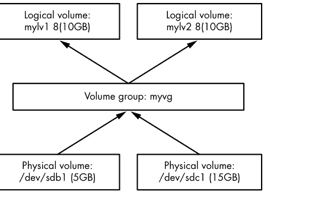

图 4-5：构建逻辑卷系统

第一个任务是在这些磁盘的每个磁盘上创建一个分区，并为 LVM 标记。使用分区程序（见第 4.1.2 节），使用分区类型 ID `8e`，使得分区表看起来如下：

```
# /dev/sdb print

Model: ATA VBOX HARDDISK (scsi)

Disk /dev/sdb: 5616MB

Sector size (logical/physical): 512B/512B

Partition Table: mdos

Disk Flags:

Number Start End Size Type File system Flags

1 1049KB 5616MB 5615MB primary svm
```

```
# /dev/sde print

Model: ATA VBOX HARDDISK (scsi)

Disk /dev/sde: 16.0GB

Sector size (logical/physical): 512B/512B

Partition Table: mdos

Disk Flags:

Number Start End Size Type File system Flags

1 1049KB 16.0GB 16.0MB primary svm
```

你不一定需要对磁盘进行分区来制作 PV。PV可以是任意块设备，甚至是整个磁盘设备，例如 `/dev/sda`。然而，从磁盘启动的分区提供了一种将块设备识别为 LVM 物理卷的手段。

# 创建物理卷和卷组

有了 `/dev/sdb` 和 `/dev/sdc1` 的新分区，LVM 的第一步是将其中一个分区指定为 PV 并将其分配给一个新的卷组。一个命令 `vgcreate` 即可完成此任务。以下是使用 `/dev/sdb` 作为初始 PV 创建名为 `myvg` 的卷组的方法：

```
# vgcreate myvg /dev/sdb1

Physical volume "/dev/sdb1" successfully created.

Volume group "myvg" successfully created
```


你可以先通过 `pvcreate` 在单独的步骤中创建 PV，但如果目前什么都没有，`vgcreate` 会执行这一步。此时，大多数系统会自动检测到新的卷组；运行 `vgs` 命令进行验证：

| VG | PV | LV | Attr | Size |
| :--- | :--- | :--- | :--- | :--- |
| myvg | 1 | 0 | wz-- | <23g |

如果没有看到新的卷组，尝试运行 `pvscan`。如果你的系统没有自动检测到 LVM 的变化，每次进行更改时都需要运行 `pvscan`。现在你可以使用 `vgextend` 命令将第二个 PV `/dev/sdc1` 添加到卷组：

```
# vgextend myvg /dev/sdc1

Physical volume "/dev/sdc1" successfully created.

Volume group "myvg" extended
```

现在显示两个 PV，大小为两个分区之：

| VG | PV | LV | Attr | Size |
| :--- | :--- | :--- | :--- | :--- |
| myvg | 2 | 0 | wz-- | <20.16g |

# 创建逻辑卷

块设备级别的最后一步是创建逻辑卷。如前，我们将创建两个各 10GB 的逻辑卷，但可以自由尝试其他可能性，例如一个大卷或多个卷。`lvcreate` 命令在卷组中分配一个新的逻辑卷。创建逻辑卷的唯一复杂之处在于当卷组有多个时确定大小。记住 PV 被划分为 PE；可用 PE 的数量可能与你想要的大小不匹配，所以如果你第一次使用 LVM，需要注意。使用 `lvcreate` 时，可以通过 `--size` 选项或 PE 数量指定逻辑卷的大小。

为了查看它是如何工作的并完成图 4-5 中的卷结构，我们使用 `--size` 创建了名为 `myvg1` 和 `myvg2` 的逻辑卷：

```
# lvcreate --size 10g --type linear -n myvg1 myvg

Logical volume "myvg1" created.

# lvcreate --size 10g --type linear -n myvg2 myvg

Logical volume "myvg2" created.
```

当你不需要冗余任何特殊功能时，linear 映射是最简单的类型。在这种情况下，`--type linear` 是默认映射。运行这些命令后，使用 `lvls` 命令验证逻辑卷是否存在，然后通过 `vgdisplay` 详细查看卷组的状态：

```
# vgdisplay myvg

-- Volume group --

VG Name             myvg

System ID

Format              lvm2

Metadata Areas      2

Metadata Sequence No 4

VG Access            read/write

VG Status           resizable

MAX LV               0

Cur LV               0

Open LV             0

Max PV               0

Cur PV               2

VG Size              20.16 GiB

PE Size              4.00 MiB

Total PE             5162

Alloc PE / Size      5120 / 20.00 GiB

Free PE / Size      42 / 168.00 MiB

VG UUID 1ptrOe-e5zy-TUtK-5gnN-SpDy-sMH
```

注意有 42 个 PE，因为我们为逻辑卷选择的大小没有占用卷组中的所有可用块。

# 操作逻辑卷：创建分区

有了新的逻辑卷，你现在可以通过在设备上放置文件系统并像普通磁盘分区一样挂载它们来使用。如前所述，`/dev/mapper` 以及（本例中）用于卷组的 `/dev/myvg` 目录将会有指向设备的符号链接。例如，你可能会运行以下命令来创建文件系统、临时挂载它并查看逻辑卷上有多少实际空间：

```
# mkfs -t ext4 /dev/mapper/myvg-mylvl1

mkfs 1.44.1 (24-Mar-2018)

Creating filesystem with 262140 4k blocks and 655360 inodes

Filesystem UUID: 83c4a119-625c-49d1-b8c4-e23591a5887

Superblock starts on blocks:

32768, 98304, 163840, 229376, 294912, 819200, 884736, 1605632

Allocating group tables: done

Writing inode tables: done

Creating journal (168 blocks): done

Writing superblocks and filesystem information: done

# mount /dev/mapper/myvg-mylvl1 /mnt

# df /mnt
```

| Filesystem | Used | Mounted |
| :--- | :--- | :--- | :--- |
| /dev/mapper/myvg-mylvl1 | 1025636 | 36888 | 967086 | 1% |

# 删除逻辑卷

我们还没有查看过另一个逻辑卷 `mylv2` 的任何操作，所以让我们用它让这个示例更有趣。假设你发现你不需要那个第二个卷。你决定删除它并调整第一个逻辑卷的大小以接卷组中的剩余空间。图 4-6 显示了我们的目标。

假设你已经移动或备份了要删除的逻辑卷上的任何重要数据，并且它不在当前系统中（即你已经卸载了它），使用 `lvremove` 删除它。在用此命令操作逻辑卷时，你将通过斜杠名称（`myvg/mylv2`）来引用它们：

```
# lvremove myvg/mylv2

Do you really want to remove and DISCARD active logical volume myvg/mylv2?

[y/n]: y

Logical volume "mylv2" successfully removed
```

# Linux 如何工作（早期访问）© 2021 Brian Ward


**图 4-6：** 重新配置逻辑卷的结果

> 运行 `lvremove` 时要小心。因为你在此之前看到的其他 LVM 命令都没有使用这种语法，你可能会不小心用空格代替斜杠 `/`。如果你在这种特定情况下犯了这个错误，`lvremove` 将认为你想删除卷组 `myvg` 和 `myvl2` 上的所有逻辑卷（你几乎肯定没有名为 `myvl2` 的卷组，但那是你目前最大的问题）。所以，如果你不注意，你可能会删除整个卷组上的所有逻辑卷，而不仅仅是一个。

从这次交互中可以看出，`lvremove` 会通过双重检查你是否真的想要删除每个目标逻辑卷来保护你免受失误。它也不会尝试删除正在使用的卷。但请假设你对提出的任何问题都回答了 `y`。

# 调整逻辑卷和文件系统的大小

现在你可以调整第一个逻辑卷 `myvl1` 的大小。即使该卷正在在使用且其文件系统已挂载，你也可以这样做。然而，理解这两个步骤是非常重要的。要使用你更大的逻辑卷，你需要同时调整逻辑卷及其内部的文件系统的大小（你可以在挂载状态下进行操作）。但由于这是一项常用操作，`lvresize` 命令有一个选项 (`-r`) 可以为你执行文件系统的大小调整。

为了为了说明，让我们使用两个独立的命令来查看它是如何工作的。指定逻辑卷大小变化的方法有多种，但在这种情况下，最直接的方法是将卷组中的所有空闲 PE 添加到逻辑卷中。回想一下 `vgdisplay` 可以找到那个数字；在我们运行的示例中，它是 2,602。以下是将所有这些 PE 添加到 `myvl1` 的 `lvresize` 命令：

```bash
# lvresize -L +2602 myvg/myvl1

Size of logical volume myvl1 changed from 10.00 GiB (2560 extents)

Logical volume myvg/myvl1 successfully resized.
```


现在你需要调整内部文件系统的大小。你可以使用 `fsadm` 命令来实现。在详尽模式下观察它的运行过程（使用 `-v` 选项）很有趣的：

```bash
# fsadm -v resize /dev/mapper/myvg-mylv1
fsadm: "ext4" filesystem found on "/dev/mapper/myvg-mylv1" size is 2165099728 bytes
fsadm: Device "/dev/mapper/myvg-mylv1" size is 2165099728 bytes
fsadm: Parsing tune2fs -l on "/dev/mapper/myvg-mylv1"
fsadm: Resizing filesystem on "dev/mapper/myvg-mylv1" bytes (2621440 - 528588 blocks of 4096 bytes)
fsadm: Executing resize2fs /dev/mapper/myvg-mylv1 528588
resize2fs: 1.44.1 (24-Mar-2018)
```

Filesystem at `/dev/mapper/myvg-mylv1` is mounted on `/mnt`; on-line resizing required
old_desc_blocks = 2, new_desc_blocks = 3
The filesystem on `/dev/mapper/myvg-mylv1` is 528588 (4k) blocks long.

从输出可以看出，`fsadm` 是一个脚本，它知道将你的参数转换为类似 `resize2fs` 等特定文件系统工具使用的参数。默认情况下，如果你不指定大小，它将仅仅是修复整个设备。

现在你已经看到了调整卷大小的细节，你可能在寻找捷径。更简单的方法是使用不同的大小语法，并让 `lvresize` 为你执行分区大小调整，只需这一条命令：

```bash
# lvresize -r +100%FREE myvg/mylv1
```

可以在文件系统挂载时扩展 ext2/ext3/ext4 文件系统，这很不错。但遗憾的是，反向操作是不行的。你不能在文件系统挂载时缩小它。你不仅必须挂载文件系统，而且缩小逻辑卷的过程需要你按相反顺序执行步骤。因此，在调整大小时，你需要在调整逻辑卷之前调整分区，确保新的逻辑卷足够大包含文件系统。再次，使用带有 `-r` 选项的 `lvresize` 要容易得多，它可以为你协调文件系统和逻辑卷。

## 4.4.3 LVM 的实现

在涵盖了 LVM 更具操作性的基础之后，我们现在可以查看它的实现。在书中几乎每一个其他主题中，LVM 都包含许多层和组件，并在内核和用户空间之间进行了分离。

正如你所看到的，发现 PV 以确定卷组和逻辑卷的结构非常复杂，Linux 内核并不处理这些工作；PV 仅仅是块设备，而用户空间对块设备具有随机访问权限。事实上，LVM（特别是当前系统的 LVM2）本身只是一组用户空间工具，用于了解 LVM 结构。

另一方面，内核处理将逻辑卷块设备的位置请求路由到实际设备位置的工作。此处的驱动程序是 device mapper（有时简称为 `devmapper`），它是夹在 device mapper 和文件系统之间的一个新层。正如名称所示，device mapper 执行的任务就像一张地图：你完全将其理解为将字符串转换为绝对坐标。device mapper 为用户空间程序创建这些映射提供了接口，内核随后使用这些映射执行实际的 I/O。

（注：原文此后存在大量重复的文本段落，已根据指令要求翻译并保持了逻辑结构）

### LVM 工具与物理卷的扫描

在执行任何操作之前，LVM 必须首先扫描物理卷。LVM 执行的步骤的大致如下：

- 发现所有可用的 PV。
- 扫描 PV 以查找卷组。
- 扫描卷组以查找逻辑卷。
- 创建逻辑卷的映射。

如果你对设备映射感兴趣，可以运行：

```bash
# pvscan
```

输出将显示物理卷、卷组和逻辑卷。这是查看 LVM 如何组织你的磁盘的一种良好方法。

### 设备映射

`device mapper` 是一个内核框架，允许将一个块设备映射到另一个设备。这是 LVM 用于创建逻辑卷的机制。当你创建一个逻辑卷时，LVM 通知 `device mapper` 在逻辑卷和物理卷之间创建一个映射。

当你从逻辑卷读取数据时，`device mapper` 会拦截请求并将其转换为物理卷上的正确位置。当你向逻辑卷写入数据时，`device mapper` 同样如此。这使得 LVM 非常灵活，并用于许多不同的用途，例如磁盘加密、快照和 RAID。

正如名称所示，`device mapper` 执行的任务就像一张地图：你完全将其理解为将字符串转换为绝对坐标。`device mapper` 为用户空间程序创建这些映射提供了接口，内核随后使用这些映射执行实际的 I/O。

How Linux Works (早期访问) © 2021 由 Brian Ward

- 4. 源设备的主/次设备号对——即 LVM 所调用的物理卷（PV）。这里 8:17 是 `/dev/sdb1`，8:33 是 `/dev/sdc1`。
- 5. 源设备上的起始偏移量。

有趣的是，在我们的示例中，我们创建的第一个逻辑卷（`mylv1`）使用了 `/dev/sdc1`。LVM 决定以连续的方式放置第一个 10GB 的逻辑卷，而实现这一点的唯一方法是在 `/dev/sdc` 上进行。然而，在创建第二个逻辑卷（`mylv2`）时，LVM 别无选择将其分散在两个 PV 的两个段中。图 4-7 显示了这种布局。

| mylv2 (段 1) | mylv1 (完整) | mylv2 (段 2) |
| :--- | :--- | :--- |
| PV start: 2048 | PV start: 2048 | PV start: 2073568 |
| Length: 10960896 (5GB) | Length: 20971520 (10GB) | Length: 1010624 (5GB) |
| PV 8:17 (/dev/sdb1, 5GB) | PV 8:33 (/dev/sdc1, 15GB) | |

图 4-7: LVM 如何跨越 mylv1 和 mylv2

作为进一步的结果，当我们删除 `mylv2` 并扩展 `mylv1` 以适应卷组中的剩余空间时，它在 `/dev/sdc1` 上的原始起始偏移保持不变，但其他所有内容都发生了变化，包含了 PV 的剩余部分：

```
# dnset table
myvg-mylv1: 0 31326208 linear 8:33 2048
myvg-mylv1: 31326208 10960896 linear 8:17 2048
```

图 4-8 显示了该布局。

| mylv1 (段 2) | mylv1 (段 1) |
| :--- | :--- |
| PV start: 2048 | PV start: 2048 |
| Length: 10960896 (5GB) | Length: 31326208 (15GB) |
| PV 8:17 (/dev/sdb1, 5GB) | PV 8:33 (/dev/sdc1, 15GB) |

图 4-8: 删除 mylv2 并扩展 mylv1 后的布局

你可以利用虚拟机尽情地实验逻辑卷和设备映射器（`device mapper`），并查看映射产生的结果。许多功能（如 RAID 和加密磁盘）都是构建在设备映射器之上的。

## 4.5 展望：磁盘与用户空间

在 Unix 系统中与磁盘相关的组件中，用户空间和内核之间的边界可能很难界定。如你所见，内核处理来自设备的原始块 I/O，而用户态工具通过设备文件使用块 I/O。然而，用户空间通常只将块 I/O 用于初始化操作，例如分区、创建文件系统和创建交换空间。在正常使用，用户空间使用内核在块 I/O 之上提供的文件系统。同样，内核在处理虚拟内存系统中的交换空间时，也处理了大部分繁琐的任务。

本章的剩余部分将简要介绍 Linux 文件系统的内部结构。这些是更高级的内容，你可能不知道如何继续阅读这本书。如果这是你第一次阅读，请跳到下一章，开始学习 Linux 启动。

## 4.6 传统文件系统的内部结构

传统的 Unix 文件系统有两个主要组件：一个可以存储数据的块池，以及一个管理该数据池的数据库。该数据库围绕 inode 结构构建。`inode` 是一组描述特定文件的数据，包括它的类型、权限以及可能最重要的——文件位于数据池中的何位置。`inode` 通过数字进行标识，并以 inode 的形式实现。目录包含一个文件名列表以及指向其他 inode 的链接。

文件名和目录都是链接。为了提供一个真实生活中的例子，我创建了一个新文件系统，并将目录更改为挂载点。然后，我使用这些命令添加了一些文件和目录：

```
$mkdir dir_1
$mkdir dir_2
$echo a > dir_1/file_1
$echo b > dir_1/file_2
$echo c > dir_1/file_3
$echo d > dir_2/file_4
```


`$ln -s dir_1/file_3 dir_2/file_5`

```
```

注意 `dir_2/file_5` 是 `dir_1/file_3` 的链接，这意味着这些文件实际上代表同一个文件（或者或短而言之）。你可以自己尝试一下。这并不一定需要在新文件系统上进行。

如果你探索此文件系统中的目录，其内容将如图 4-9 所示。

> 如果你在自己的系统上尝试，inode 编号可能会不同，特别是如果你在现有文件系统上运行创建文件和目录的命令。

图 4-9: 用户级表示

文件系统的实际布局（如图 4-10 所示的 inode 集合）看起来并没有用户级表示那么简洁。

| inode table | type |
| :--- | :--- |
| 2 | dir |
| 12 | dir |
| 13 | file |
| 14 | file |
| 15 | file |
| 16 | file |
| 7633 | dir |

图 4-10: inode 结构

| inode table | linkcount |
| :--- | :--- |
| 2 | dir |
| 12 | dir |
| 13 | file |
| 14 | file |
| 15 | file |
| 16 | file |
| 7633 | dir |

## 4.6.1 inode 详情与链接计数

要查看任何目录的 inode 编号，请使用 `ls -i` 命令。在示例的根目录下你会得到：

```
$ ls -i
12 dir_1 7633 dir_2
```

你可能对 inode 中的链接计数好奇。你已经在常用的 `ls -l` 输出中看到过链接计数，但你可能忽略了它。链接计数与图 4-9 中的文件（特别是“硬链接”文件_5）有什么关系？链接计数是指向该 inode 的目录目总数。大多数文件的链接计数为 1，这是符合预期的。然而，inode 15 出现了两次。它被创建为 `dir_1/file_3`，然后被链接到 `dir_2/file_5`。

Linux 工作原理 (早期访问) © 2021 Brian Ward

此时，删除文件有时也被称为“取消链接”（unlinking）。如果你执行 `rm dir_1/file_2`，内核会在 inode 12 的目录项中搜索名为 `file_2` 的条目。一旦发现 `file_2` 对应 inode 14，内核就会删除该目录项并将 inode 14 的链接计数（link count）减 1。结果是，inode 14 的链接计数变为 0，内核借此知道不再有任何名称指向它。因此，它可以删除该 inode 以及与其相关的任何数据。

然而，如果你执行 `rm dir_1/file_3`，inode 15 的计数将从 2 变为 1（因为 `dir_2/file_3` 仍然指向那里），内核就会知道不要移除它。

链接计数在目录上的工作原理非常相似。注意，inode 12 的链接计数为 2，因为有两个 inode 链接：一个是 inode 2 目录项中的 `dir_1`，另一个是其自身目录项中的自引用（`.`）。如果你创建一个新目录 `dir_1/dir_3`，inode 12 的链接计数将变为 3，因为新目录将包含一个链接回 inode 12 的条目，而 inode 12 的父目录指向 inode 2。

链接计数有一个例外。根 inode 2 的链接计数为 4。图 4-10 只显示了三个目录链接。“第四个”链接位于文件系统的超级块（superblock）中，因为超级块会告诉你在哪里找到根 inode。

不要害怕在你的系统上进行实验。创建一个目录结构并使用 `ls -i` 遍历这些部分是无害的。你不需要 root 权限（除非你挂载并创建一个新的文件系统）。

## 4.6.2 块分配

我们的讨论中仍然缺少了一部分。当为新文件分配数据池时，文件系统如何知道哪些块在使用使用，哪些块是可用的？最基本的方法之一是使用一种称为“块位图”（block bitmap）的额外管理数据结构。在这种方案中，文件系统表示一系列位，每个位对应数据池中的一个块。值 0 表示该块是空闲的，1 表示正在被使用。因此，分配和释放块仅仅是翻转位值的问题。

当 inode 数据与块分配不匹配，或者链接计数错误时，文件系统就会出现问题；例如，这在你没有正常关闭系统时可能会发生。因此，当你按照第 4.2.11 节所述检查文件系统时，`fsck` 程序会遍历 inode 表和目录结构，生成新的链接计数和新的块分配映射（如块位图），然后将生成的数据与磁盘上的文件系统进行比较。如果存在不匹配，`fsck` 会修复链接计数，并决定对遍历目录结构时未发现的 inode 采取什么措施。大多数 `fsck` 程序会将这些“孤儿”文件在文件系统的 `lost+found` 目录中创建新文件。

## 4.6.3 在用户空间中处理文件系统

在用户空间中处理文件和目录时，你不必担心它们下方正在运行的实现。程序预期通过内核调用来访问挂载文件系统的文件和目录内容。奇怪的是，你确实可以访问某些并不属于用户空间的文件系统信息——特别是 `stat()` 系统调用会返回 inode 和链接计数。

当你不需要维护文件系统时，是否需要担心 inode 编号、链接计数和其他实现细节？通常情况下，用户态程序无法访问的某些内容主要是为了向后兼容。此外，Linux 中所有可用的文件系统并不都具有这些长期的内部机制。VFS 接口层确保系统调用始终返回 inode 编号和链接计数，但这些数字并不一定意味着任何含义。

你可能无法对非传统文件系统执行传统的文件系统操作。例如，你不能在挂载的 VFAT 文件系统上使用 `ln` 创建硬链接，因为它的目录项是为 Windows 而非 Unix/Linux 设计的，不支持该概念。

幸运的是，Linux 系统上为用户空间提供的系统调用提供了足够的抽象，可以无痛地访问文件——你不需要了解底层实现即可访问文件。此外，文件名的格式是灵活的且区分大小写。

## 5.1 启动消息

传统的 Unix 系统在启动时会产生许多关于启动过程的诊断消息。这些消息可能来自内核和初始化进程。然而，这些消息并不美观也不一致，在某些情况下甚至没有提供有用信息。因此，大多数 Linux 发行版在你设置时会尽力提供帮助。

启动过程的简化视图如下：

- 1. 机器 BIOS 加载固件。
- 2. 引导程序（boot loader）在磁盘上找到内核镜像。
- 3. 内核初始化设备和驱动程序。
- 4. 内核挂载根文件系统。
- 5. 内核设置系统。
- 6. `systemd` 启动。
- 7. 在某处，`init` 完成。

### 内核启动


查看内核启动和运行的最佳方法是使用 `journalctl` 命令获取内核日志。运行 `journalctl -k` 显示当前启动的消息，但你可以使用 `-b` 选项查看之前的启动。我们将在第 7 章详细介绍日志。

如果你没有 `systemd`，可以检查如 `/var/log/kernel.log` 等日志文件，或运行 `dmesg` 查看内核缓冲区中的消息。

以下是 `journalctl -k` 的预期输出示例：

```
micro: microcode updated early to revision 0xd6, date = 2019-10-03

Linux version 4.15.0-112-generic (build1@lc01-amd64-027) (gcc kernel 7.5.0)

(Ubuntu 7.5.0-ubuntu3~18.04) #113-Ubuntu Jul 9 23:34:19 UTC 2020 (4.15.0-112-generic 4.15.18)

command line: BOOT_IMAGE=/vmlinuz-4.15.0-112-generic root=UUID=17f12d53-c3d7-4ab3-943e-ad07326cf64 ro quiet splash vt.handover=1

KERNEL:

--snip-

scsi 2:0:0:0: Direct-Access  ATA KINGSTON SM22805 0.1PR Q: ANSI: 5

sd 2:0:0:0: Attached scsi generic spo type o

sd 2:0:0:0: [sda] 468862128 512-byte logical blocks: (240 GB/224 GiB)
```

```
sd 2:0:0:0: [sda] Write Protect is off

sd 2:0:0:0: [sda] Mode Sense: 00 3a 00 00

sd 2:0:0:0: [sda] Write cache: enabled, read cache: enabled, doesn't support DPO or FUA\sda:sda1 sda2 < >

sd 2:0:0:0: [sda] Attached SCSI disk

--snip--
```


内核启动后，用户空间的启动程序通常会产生消息，这些消息可能更难查看和审查，因为在大多数系统中，你无法在单个日志文件中找到它们。启动脚本被设计为将消息发送到控制台，这些消息在启动过程结束后会被擦除。然而，在 Linux 系统上这不是问题，因为 `systemd` 会捕获启动和运行时的诊断消息，而这些消息通常会发送到控制台。

## 5.2 内核初始化与启动选项

启动时，Linux 内核按照以下通用顺序进行初始化：

1. CPU 检查
2. 内存检查
3. 设备总线发现
4. 设备发现
5. 辅助内核子系统设置（网络等）
6. 根文件系统挂载
7. 用户空间启动

前两步并不特殊，但当内核处理设备时，依赖性问题就出现了。磁盘设备驱动可能依赖于总线支持和 SCSI 子系统支持，正如我们在第 3 章中看到的。然后，在初始化过程中，内核在启动初始化之前必须挂载根文件系统。

通常情况下，你不需要担心依赖关系，除非某些必要的组件是可加载内核模块而不是主内核的一部分。某些机器可能挂载真正的根文件系统之前加载这些内核。我们将在第 6.7 节介绍这个问题及其初始 RAM 文件系统（`initrd`）的解决方案。

内核会发出某些类型的消息，表示它准备好启动第一个用户进程：

```
Freeing unused kernel memory: 2408K

Write protecting the kernel read-only data: 20480K

Freeing unused kernel memory: 2008K

Freeing unused kernel memory: 1892K
```

How Linux Works (Early Access) © 2021 by Brian Ward

在这里，内核不仅在清理未使用的内存，还在保护它自己的数据。然后，如果你运行的是足够新的内核，你将看到内核作为 `init` 启动第一个用户空间进程：

作为 `init` 进程运行 `/init`
参数为：

```
--snip--
```

随后，你将看到根文件系统被挂载以及 `systemd` 开始启动，并向内核发送了几条它自己的消息：

```
EXT4-fs (sda): mounted filesystem with ordered data mode. Opts: (null)

systemd[1]: 237 running in system mode. (+PAM +AUDIT +SELINUX +IMA

+APMOR +SMACK +SYVSINT +ITMAP +LIBCRYSETUP +CRYPT +GNUTLS +ACL +XZ +LZ4

+SECCMP +BLKID +ELFUTITS +KMOD -DNZ +IDN -PCRE2 default-hierarchy-hybrid)

systemd[1]: Detected architecture x86-64.

systemd[1]: Set hostname to `duplex`.
```

此时，你完全确定用户空间已经启动了。

## 5.3 内核参数

内核启动时，它会接收一组包含少量额外系统细节的文本内核参数。这些参数指定了许多不同的行为，例如内核应该产生的诊断输出量以及特定设备驱动程序的选项。

你可以通过查看 `/proc/cmdline` 文件来查看传递给系统当前运行内核的参数：

```
$ cat /proc/cmdline
BOOT_IMAGE=/boot/mlinuz-4.15.0-43-generic root=UUID=17f12d53-c3d7-4ab3-943e-a0a72366c9fa ro splash.handoff=1
```

这些参数可能是单单词标志（如 `root`），也可能是键-值值对。其中许多参数是重要的，例如用于显示启动屏幕的 `splash` 标志，但至关重要的是 `root` 参数。这是根文件所在的位置；没有它，内核无法正确执行用户空间。

根文件系统可以被指定为设备文件，如示例所示：

```
root=/dev/sda1
```

在大多数现代系统中，有两种更常见的替代方案。首先，你可能会看到像这样的逻辑卷：

```
root=/dev/mapper/my-system-root
```

你可能还会看到 UUID（见第 4.2 节）：

```
root=UUID=17f12d53-c3d7-4ab3-943e-a0a72366c9fa
```


How Linux Works (Early Access) © 2021 by Brian Ward

这两种都是更好的，因为它们不依赖于特定的设备映射。
`ro` 参数指示内核在启动用户空间时以只读模式挂载根文件系统。这是正常的；只读模式确保 `fsck` 在尝试执行任何操作之前安全地检查根文件系统。检查之后，引导过程将以读写模式重新挂载文件系统。
当遇到它不理解的参数时，Linux 会保存该参数。内核稍后会在执行用户空间时将参数传递给 `init`。例如，如果你在参数中添加 `-s`，内核会将 `-s` 传递给 `init` 程序以指示以单用户模式启动。
如果你对启动参数感兴趣，`bootparam(7)` 手页提供了概述。如果你在寻找非常具体的参数，可以查看 Linux 内核带的参考文件 `kernel-params.txt`。
在涵盖这些基础知识后，你可以随心跳到第 6 章学习用户空间启动、初始内存磁盘以及内核作为第一个进程运行的 `init` 程序。本章剩余部分介绍了内核如何加载到内存并启动，包括它是如何获取参数的。

## 5.4 引导程序

在启动过程开始、内核和 `init` 启动之前，引导程序启动内核。引导程序的工作听起来很简单：它从磁盘的某处加载内核到内存并带参数启动内核。然而，这项工作比看起来要复杂。要理解为什么，请考虑引导程序必须回答的问题：

- 内核在哪里？
- 应该传递哪些内核参数？

通常，有一种模式是内核添加新功能（特别是存储技术方面），随后引导程序添加这些特征的版本以补偿。在 PC 上，引导程序使用传统的输入输出系统（BIOS）或较新的可扩展固件接口（UEFI）来访问磁盘。

How Linux Works (Early Access) © 2021 by Brian Ward

Linux 引导程序的核心功能包括执行以下操作：

- 选择多个内核。
- 在不同的内核参数集之间切换。
- 允许用户手动覆盖和编辑内核镜像名称和参数（例如进入单用户模式）。
- 提供引导其他操作系统的支持。

《Linux 工作原理》（早期访问版）© 2021 Brian Ward

## 5.4.2 启动加载程序概述

以下是你可能会遇到的主要启动加载程序：

- `GRUB`: Linux 系统上几乎通用的标准，分为 BIOS/MBR 和 UEFI 版本。
- `LILO`: 最早的 Linux 启动加载程序之一。`ELILO` 是其 UEFI 版本。
- `SYSLINUX`: 可以配置为从许多不同的文件系统运行。
- `LOADLIN`: 从 MS-DOS 启动内核。
- `systemd-boot`: 一个简单的 UEFI 启动管理器。
- `coreboot`（以前称为 LinuxBIOS）PC BIOS 的高性能替代品，可以包含内核。
- `Linux Kernel EFIUB`: 一种内核插件，用于直接从 EFI/UEFI 系统分区 (`ESP`) 加载内核。
- `efilinux`: 一个 UEFI 启动加载程序，旨在作为其他 UEFI 加载程序的模型和参考。

本书几乎完全涉及 `GRUB`。其他启动加载程序的原理是：它们比 `GRUB` 更简单、速度更快，或者提供了某些其他特殊功能。

通过进入可以输入内核名称和参数的启动提示符，你可以学习很多关于启动加载程序的知识。要做到这一点，你需要知道如何获取提示符或菜单。遗憾的是，这有时很难确定，因为 Linux 发行版高度自定义了启动加载程序的行为和外观。通常无法通过观察启动过程来判断该发行版使用的是哪种启动加载程序。

后续章节将告诉你如何进入启动提示符以输入内核名称和参数。一旦你熟悉了这些，你将看到如何配置和安装启动加载程序。

## 5.5 GRUB 介绍

`GRUB` 代表 Grand Boot Loader。我们将涵盖 `GRUB 2`，但还有一个名为 `GRUB Legacy` 的旧版本，已不再活跃使用。

`GRUB` 最重要的功能之一是文件系统导航，它允许轻松选择内核镜像和配置。观察其运行并泛学习 `GRUB` 的最佳方法之一是查看它的菜单。该界面易于导航，但你可能从未见过它。

要访问 `GRUB` 菜单，在 BIOS 启动界面首次出现时按住 `SHIFT`，如果你的系统是 UEFI，则按 `ESC`。否则，启动加载程序可能在加载内核之前不会暂停。

图 5-1 显示了 `GRUB` 菜单。

GNU GRUB version 2.02

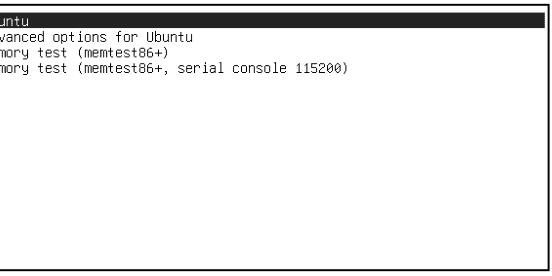

使用 `I` 和 `l` 键选择高亮的项目。
按回车启动选定的操作系统，按 `'e'` 在启动前编辑命令，或按 `'c'` 进入命令行。

图 5-1：`GRUB` 菜单

尝试以下操作来探索启动加载程序：

1. 重启或开启你的 Linux 系统。
2. 在 BIOS 自检期间按住 `SHIFT` 键或在固件启动屏处按 `ESC` 获取 `GRUB` 菜单。（这些屏幕有时是可见的，所以你必须猜测何时按键。）
3. 按 `e` 查看默认启动选项的启动加载程序配置命令。你应该能看到类似图 5-2 的内容（你可能需要向下滚动查看所有细节）

GNU GRUB version 2.02

```
setparams ubuntu

recordfail

load_video

gfxmode linux_gfx_mode

insmod gzio

if [ grub_platform = "xen" ]; then insmod zoiio; insmod is: \
insmod part_msdos

insmod ext2

search --no-floppy --fs-uuid --set-root 8b92610e-1db7-4b43-ac2f-3ee24b39de0

linux
/boot/vmlinuz-4.15.0-45-generic UUID=8b92610e-1db7-4b43-ac2f quiet splash vt_handoff

initrd /boot/initrd.img-4.15.0-45-generic
```

支持类似 Emacs 的最小编辑。`Tab` 允许补全。按 `Ctrl-x` 或 `F10` 启动，按 `Ctrl-c` 或 `F2` 进入命令行，或按 `ESC` 弃编辑并返回 `GRUB` 菜单。

图 5-2：`GRUB` 配置编辑器

此屏幕告诉我们，对于此配置，根目录通过 `UUID` 设置，内核镜像为 `/boot/vmlinux-4.15.0-45-generic`，内核参数包括 `ro`、`quiet` 和 `splash`。内存文件系统为 `/boot/initrd.img-4.15.0-45-generic`。但如果你以前见过这种配置，可能会觉得很困惑。为什么对根目录有多次引用，而且它们还不同？为什么这里有 `insmod`？如果你以前见过这个，可能会记得它是一个通常由 `udev` 运行的内核功能。

这种惊讶是有理由的，因为 `GRUB` 并不使用 Linux 内核（注：此处原文应为 *in memory*，它的任务是启动内核）。

[注：OCR 源文件中的剩余文本包含大量的重复痕迹和 OCR 错误，已根据上述提供的上下文进行了清理以保持可读性。]

# Linux 工作原理（早期访问版） © 2021 Brian Ward

由于输入实际的根分区极不方便，你可以替换 `$root` 变量来节省自己的时间：

```
grub$ ls ($root)/
```

输出是该分区文件系统中文件和目录名的简短列表，例如 `/etc/`、`bin/` 和 `dev/`。这是 `GRUB` 命令的一个完全不同的功能。之前，你列出的是设备、分区表，可能还有一些文件系统头信息。现在，你实际上是在查看文件系统的内容。

你可以以类似的方式深入查看分区上的文件和目录。例如，要检查 `/boot` 目录，可以从以下命令开始：

```
grub$ ls ($root)/
```

> 使用向上和向下方向键翻阅 `GRUB` 命令历史，使用左和右箭头编辑当前命令行。标准的 `readline` 快捷键（`CTRL-N`、`CTRL-P` 等）同样有效。

你还可以使用 `set` 命令查看所有当前的 `GRUB` 变量：

```
grub> set
=?ncolor_highlight=black/white

color_normal=white/black

--snip-

prefix=(hd0,msdos1)/boot/grub

root=hd0,msdos1
```


这些变量中最重要的之一是 `$prefix`，它是 GRUB 预期查找配置和辅助支持的文件系统。我们将讨论 GRUB 配置。

一旦完成对 GRUB 命令行界面的操作，可以按 `ESC` 返回到 GRUB 菜单。或者，如果你已经设置了启动的所有必要配置（包括 `linux` 和可能的 `init` 变量），你可以输入 `boot` 命令来启动该配置。无论如何，请启动你的系统。我们将探索 GRUB 配置，这最好在你的完整系统已经可用时进行。

## 5.5.2 GRUB 配置

GRUB 配置目录通常是 `/boot/grub` 或 `/boot/grub2`。它包含了核心配置文件。

### 检查 grub.cfg

首先，快速查看 `grub.cfg`，以了解 GRUB 是如何初始化其菜单和内核选项的。你会发现该文件由 GRUB 命令组成，这些命令通常以若干初始化步骤开始，随后是针对不同内核和启动配置的一系列菜单项。初始化并不复杂，但开头有很多条件判断，可能会让你误以为并非如此。第一部分由一组函数定义、默认值和视频设置命令组成，如下：

```
if loadfont $font ; then

set gfxmode=auto

load_video

insmod gfxterm

--snip--
```

许多变量（如 `$font`）来源于 `grub.cfg` 开头附近的 `load_env` 调用。

在配置文件的后面，你会找到可用的启动配置，每个配置都以 `menuentry` 命令开始。你应该能够根据上一节中学到的知识，读取并理解这个示例：

```
menuentry 'Ubuntu' --class ubuntu --class gnu-linux --class gnu --class $menuentry_id_option gnulinux-simple-8b92610e-1db7-4ba3-ac2f-30ee24b39ed0 {

load_video

gfxmode linux_gfx_menu

insmod gio

if [ $x86_platform != xen ]; then insmod part_msdos

insmod extio lzio

insmod ext2

set root='hd0,msdos1'

search --no-floppy --fs-uuid --set=root 8b92610e-1db7-4ba3-ac2f-30ee24b39ed0

linux /boot/vmlinuz-4.15.0-generic root=UUID=8b92610e-1db7-4ba3-ac2f-30ee24b39ed0

quiet splash $vt_handoff

initrd /boot/initrd.4.15.0-generic

}
```

检查你的 `grub.cfg` 中是否有包含多个 `menuentry` 命令的 `submenu` 命令。许多发行版使用 `submenu` 命令处理旧版本的内核，以免让 GRUB 菜单过于拥挤。

## 生成新的配置文件

如果你想对 GRUB 配置进行更改，不要直接编辑 `grub.cfg`，因为它是自动生成的，系统偶尔会覆盖它。你应该在其他地方设置新配置，然后运行 `grub-mkconfig` 来生成新配置。

要查看配置生成是如何工作的，请查看 `grub.cfg` 的最开头。应该有如下注释行：

```
### BEGIN /etc/grub.d/00_header ###
```

进一步检查后，你会发现 `/etc/grub.d` 中的几乎每个文件都是一个生成 `grub.cfg` 文件一部分的脚本。`grub-mkconfig` 命令是一个执行 `/etc/grub.d` 中所有内容的 shell 脚本。请记住，GRUB 本身在启动时并不运行这些脚本；我们在用户空间运行它们，以生成 GRUB 运行的 `grub.cfg` 文件。亲自尝试一下——该命令本身只是将配置打印到标准输出：

```
# grub-mkconfig
```

如果你想在 GRUB 配置中添加菜单项和其他命令？简短的答案是，你应该将自定义内容放在 GRUB 配置目录中一个新的 `custom.cfg` 文件中（通常是 `/boot/grub/cfg`）。长答案则稍微复杂。`/etc/grub.d` 为你提供了两个选项：`40_custom` 和 `41_custom`。前者 `40_custom` 是一个你可以编辑的脚本，但它更稳定；后者 `41_custom` 简单得多，它是当 GRUB 启动时加载的系列命令。如果你选择这个选项，你的更改直到生成配置文件时才会出现。注意：GRUB 本身在启动时并不运行这些脚本；我们在用户空间运行它们，以生成 GRUB 运行的 `grub.cfg` 文件。要写入生成的配置文件，使用 `grub-mkconfig` 配合 `-o` 参数，例如：

```
# grub-mkconfig -o /boot/grub/grub.cfg
```

一旦完成，请第 6 章了解 GRUB 引导程序。现在我们将进入 GRUB 的某些技术细节。

## 5.5.3 GRUB 安装

安装 GRUB 比配置它要复杂。通常情况下，你不需要担心安装，因为发行版会为你处理。但是，如果你正在复制或恢复启动磁盘，或者准备自己的启动序列，你可能需要手动安装。

在继续之前，请阅读 5.4 节以了解 PC 如何启动并确定你使用的是 MBR 还是 UEFI。接下来，构建 GRUB 软件并确定你的 GRUB 目录；默认是 `/boot/grub`。引导程序需要你或安装程序确定以下内容：

- 运行系统看到的目标 GRUB 目录。如前所述，通常是 `/boot/grub`，但如果你在其他磁盘上安装 GRUB，则可能不同。
- GRUB 目标磁盘的设备。
- 对于 UEFI 启动，EFI 分区的挂载点（通常是 `/boot/efi`）。

记住 GRUB 是模块化系统，但为了加载模块，它必须读取包含 GRUB 目录的文件系统。你的任务是构建一个能够读取该文件系统的 GRUB 版本，以便它可以加载剩余的配置 `grub.cfg` 和任何所需的模块。在 Linux 上，这意味着构建一个预加载了 `ext2_mod`（可能还有 `linux.mod`）的 GRUB 版本。一旦完成，只需将其放在磁盘的可引导部分，并将所需文件放入 `/boot/grub`。

幸运的是，GRUB 自带了一个名为 `grub-install` 的工具（不要与某些系统上可能的 `install-grub` 混淆），它可以为你完成安装 GRUB 文件和配置的大部分工作。例如，如果当前磁盘是 `/dev/sda`，且你想使用当前的 `/boot/grub` 目录将 GRUB 安装到该磁盘的 MBR 中，请使用此命令：

```
# grub-install /dev/sda
```

> 错误地安装 GRUB 可能会破坏系统的启动序列，因此请谨慎对待此命令。如果你担心，请研究如何使用 `dd` 备份你的 MBR，备份任何其他已的 GRUB 目录，并确保你有一个应急备份方案。

《Linux 工作原理》（早期访问）© 2021 Brian Ward 著

# 在外部存储设备上使用 MBR 安装 GRUB

要在当前系统之外的存储设备上安装 GRUB，你必须手动指定该设备在当前系统中所可见的 GRUB 目录。例如，假设你有一个目标设备 `/dev/sdc`，并且你的设备包含 `/boot` 的根文件系统（例如 `/dev/sd1`）已挂载到你当前系统的 `/mnt` 路径下。这意味着当你安装 GRUB 时，你的当前系统将从 `/mnt/boot/grub` 看到 GRUB 文件。在运行 `grub-install` 时，通过以下方式告诉它这些文件的存放位置：

```bash
# grub-install --boot-directory=/mnt/boot /dev/sdc
```

在大多数 MBR 系统中，`/boot` 是根文件系统的一部分，但某些安装会将 `/boot` 放在一个独立的空系统中。请确保你了解目标 `/boot` 位于何处。

# 使用 UEFI 安装 GRUB

UEFI 安装按理说应该更简单，因为你只需要将引导程序拷贝到相应的位置——即将加载器配置保存到固件中——你还需要通过 `efibootmgr` 命令向 NVRAM “宣告”。如果 `grub-install` 命令可用，它就会运行，通常你可以这样在 UEFI 系统上安装 GRUB：

```bash
# grub-install --efi-directory=efi_dir --loader-id=name
```


在这里，`dir` 是 UEFI 目录在你当前系统上出现的位置（通常是 `/boot/efi/EFI`，因为 UEFI 分区通常挂载在 `/boot/efi`），`name` 是引导程序的标识符。

但最大的问题之一是 UEFI 安全启动（Secure Boot）。

# 5.6 UEFI 安全启动问题

影响 Linux 安装的一个问题是处理现代 PC 上的安全启动功能。当该功能激活时，这种 UEFI 机制要求任何引导程序必须经过受信任机构的数字签名才能运行。微软要求出带有 Windows 8 及更高版本系统的硬件供应商必须使用安全启动。结果是，如果你尝试在这些系统上安装未签名的引导程序，固件将拒绝该加载器，导致操作系统将无法加载。

主流 Linux 发行版在安全启动方面没有问题，因为它们包含了签名的引导程序（通常基于 UEFI 版本的 GRUB）。在 UEFI 和 GRUB 之间有一个小小的签名 shim 引导程序；UEFI 运行 shim，然后由它执行 GRUB。如果你的机器不在可信的环境中，或者需要满足某些安全要求，那么防止启动未经授权的软件是一项重要功能，因此某些发行版更进了一步，要求整个启动序列（包括内核）都经过签名。

安全启动也有一些缺点，特别是对于那些尝试构建自己引导程序的人。你可以通过在 UEFI 设置中禁用它来绕过安全启动要求。然而，这对于双启动系统来说并不完美，因为 Windows 在未启用安全启动的情况下无法运行。

# 5.7 链式加载其他操作系统

UEFI 使得支持加载其他操作系统的变得变得相对容易，因为你可以在 EFI 分区中安装多个引导程序。然而，旧的 MBR 样式不支持这种功能，即使你使用的是 UEFI，你可能仍然有一个想要使用的带有 MBR 样式引导程序的独立分区。GRUB 可以不是配置和运行 Linux 内核，而是在磁盘的特定分区上加载并运行不同的引导程序；这就是链式加载（chainloading）。

要进行链式加载，请在你的 GRUB 配置中创建一个新的菜单项（使用“生成新配置文件”节中描述的方法之一）。这里是一个在磁盘第三个分区上安装 Windows 的示例：

```bash
entry "Windows" {
insmod chain
insmod ntfs
set root=(hd0,3)
chainloader +1
}
```

`+1` 选项告诉 `chainloader` 加载分区第一个扇区的任何内容。你也可以通过此类行直接加载文件，以加载 `io.sys` MS-DOS 加载器：

```bash
entry "DOS" {
insmod chain
insmod fat
set root=(hd0,3)
chainloader /io.sys
}
```


# 5.8 引导程序详情

现在我们快速查看一些引导程序的内部原理。为了理解像 GRUB 这样的引导程序是如何运作的，我们首先将调查当当你打开 PC 时它是如何启动的。它们必须解决传统 PC 启动机制的许多局限性，引导方案有几种变体，但有两种：MBR 和 UEFI。

## 5.8.1 MBR 启动

除了 4.1 节描述的分区信息外，MBR 还包含一个 446 字节的小区域，PC BIOS 在上电自检（POST）后会加载并执行它。不幸的是，这个空间不足以容纳几乎任何引导程序，因此需要额外的空间，导致了所谓的“多阶段引导程序”。在这种情况下，MBR 中的初始代码段不包含引导引导程序代码以外的其他加载内容。引导程序的剩余部分通常被挤在磁盘 MBR 与第一个分区之间的空间内。这部分空间并不匮乏，因为任何内容都可以覆盖那里的代码，但大多数引导程序都会这样做，包括 GRUB 安装。

这种在 MBR 之后启动引导程序代码的方案对于使用 BIOS 启动的 GPT 分区磁盘是不可行的，因为 GPT 信息位于 MBR 之后的区域。GPT 为了向后兼容遗留了 MBR 不受变动。GPT 的解决方法是创建一个名为“启动分区”的小分区，并附带一个 UUID (`2168648-6449-66ef-74ae-6556aa45649`)，为整个引导程序代码提供一个存放地。然而，这并不是常见的配置，因为 GPT 通常与 UEFI 使用，而不是传统的 BIOS。

## 5.8.2 UEFI 启动

PC 制造商和软件公司意识到传统的 BIOS 局限性，因此他们开发了一个名为可扩展固件接口（EFI）的替代品，我们在前面的章节已经讨论过。EFI 在大多数 PC 上普及一段时间后，现在它是最常见的，特别是对于要求安全启动的 Windows。

> **注意**
> ESP 与 5.8.1 节描述的启动分区不同，具有不同的 UUID。

《Linux 工作原理》（早期访问）© 2021 Brian Ward 著

这里有一个特殊情况：你不能直接将引导代码放入 ESP，旧代码是为 BIOS 设计的。相反，你必须提供为 UEFI 设计的引导程序。例如，在使用 GRUB 时必须安装 UEFI 版本而不是 BIOS 版本，如前所述。最后，正如 5.6 提到的，我们必须应对“安全启动”问题。

## 5.8.3 GRUB 的工作原理

让我们快速回顾一下它是如何工作的：

1. PC BIOS 或固件初始化硬件并搜索启动顺序设备中的启动代码。
2. 找到启动代码后，BIOS/固件加载并执行它。这就是 GRUB 开始的地方。
3. GRUB 核心加载。
4. 核心初始化。此时，GRUB 现在可以访问磁盘和文件系统。
5. GRUB 识别其启动分区及其上面的配置。
6. GRUB 给用户更改配置的机会。
7. 在超时或用户操作后，GRUB 执行配置（即 5.5.2 节概述的 *grub.cfg* 命令序列）。
8. 在执行配置的过程中，GRUB 可能会从启动分区加载额外的代码（模块）。这些模块中的可能是预加载的。
9. GRUB 执行启动命令来加载并执行由配置 *linux* 命令指定的内核。

此序列中的第 3 和第 4 步（GRUB 核心加载）由于传统 PC 启动机制的局限性可能会变得复杂。最大的问题是“GRUB 核心在哪里？”有基本可能性：

- 部分位于 MBR 与第一个分区起始之间
- 在普通分区中
- 在特殊启动分区中：GPT 启动分区、ESP 或其他地方

134 第 5 节

然而，如果你有一个 ESP，GRUB 核心会以文件的格式存储在那里。固件可以导航到 ESP 并直接执行位于那里的所有 GRUB 或任何其他操作系统加载程序。（你可能在 ESP 中放置一个 shim，它在 GRUB 之前运行，以处理安全启动，但其原理是一样的。）

尽管如此，在大多数系统中，这并不是全貌。引导加载程序在加载和执行内核之前，可能还需要将一个初始 RAM 文件系统镜像（initrd）加载到内存中。这就是 `initrd` 配置参数所指定的，我们将在第 6 节中介绍它。但在学习初始 RAM 文件系统之前，你应该先学习用户空间的启动——那正是下一章的开始。

# 6 用户空间如何启动


内核启动 init（其第一个用户空间进程）的这一点具有重要意义——这不仅是因为内存和 CPU 终于准备好进行正常运行，还因为在那里你可以看到系统的其余部分是如何作为一个整体构建起来的。在此点之前，内核遵循由少数开发者定义的、受良好控制执行路径。用户空间则要模块化和可定制得多，而且也很容易看到用户空间启动包含哪些内容。如果你感到一点冒险精神，可以利用这一优势，因为理解和更改用户空间不需要编程。

用户空间的启动大致遵循以下顺序：

- init
- 基础低级服务（udev 和 syslog）
- 网络配置
- 中级服务（cron、打印等）
- 登录提示、GUI 和高层应用程序

## 6.1 init 简介

init 是一个像 Linux 上其他程序一样的用户空间程序，你可以在 `/bin` 目录下与许多其他二进制文件一起找到它。它的主要作用是启动和停止整个系统的关键进程。

在所有主要的 Linux 发行版中，init 的标准实现都是 systemd。本章将重点介绍它是如何工作的以及如何与它交互。在旧版系统中，你可能会遇到另外两种 init 变体。System V 是一种传统的 init（读作 "five"，源于 Unix），常见于版本 7 之前的 Red Hat Linux (RHEL) 和 Debian。Upstart 是版本 8 之前的 Ubuntu 发行版中的 init。

还存在其他版本的 init，特别是在嵌入式平台上。例如，Android 有它自己的名为 runit 的 init，轻量级系统如 BSD 也有自己的版本，但你不太会在现代 Linux 机器上看到它们（某些发行版也修改了 System V init 以类似于 BSD 风格）。

开发不同的 init 实现是为了解决 System V 的几个缺点。要理解这些问题，请考虑传统 init 的内部工作机制。它基本上是一系列 init 按顺序逐个运行的脚本。每个脚本通常启动或配置系统的某部分。在大多数情况下，通过修改脚本来解决依赖关系并适应不常的启动要求是容易的。

然而，这种方案面临着巨大的局限性。这些可以归分为“性能问题”和“系统管理”：

- 性能原因：因为启动序列的一部分无法同时正常运行。
- 管理运行中的系统可能很困难。要找到服务守护进程的 PID，你需要使用 `ps` 或某些特定于该服务的记录 PID 的机制，例如 `/var/run/service.pid`。
- 启动脚本往往会包含大量的标准“样板”代码，有时难以阅读和理解它们的作用。
- 几乎没有按需服务和配置的概念。大多数服务在开机启动时启动；配置也在那时设置好。有一次，传统的 inet 守护进程能够处理按需网络服务，但它很大程度上已被弃用。

现代 init 系统通过改变服务的启动方式、如何监控它们以及如何配置依赖关系来处理这些问题。你很快就会在 systemd 中看到它是如何工作的；首先，你应该确保你正在运行它。

## 6.2 识别你的 init

确定系统的 init 版本通常并不困难。查看 `init(1)` 手页可以立即告诉你，但如果你不确定，请检查你的系统：

- 如果你的系统有 `/usr/lib/systemd` 和 `/etc/systemd` 目录，则你有 systemd。
- 如果你有一个包含几个 `.conf` 文件的 `/etc/init` 目录，你可能正在运行 Upstart（除非你运行的是 Debian 7 或更早版本，在这种情况下你可能运行的是 System V init）。我们不会在本书中介绍 Upstart，因为它已经被 systemd 取代了。
- 如果上述两者都不成立，但你有一个 `/etc/init` 文件，那么你可能正在运行 System V init。请前往第 6.5 节。

## 6.3 systemd

systemd 是 Linux 上最新的 init 实现之一。除了处理常规启动过程外，systemd 旨在整合许多 Unix 服务的功能，如 cron 和 inetd。它从 Apple 的 launch 中获得了一些灵感。

它与其前身不同之处在于先进的服务管理能力。与传统的 init 不同，systemd 可以在服务启动后跟踪单个守护进程，并将与服务相关的进程分组，让你对系统上到底运行了什么有更多的控制权和洞察。

systemd 是目标导向的。在顶层，你可以认为为某些系统任务定义一个目标，称为“单元”（unit）。单元可以包含常用启动任务的指令（例如启动守护进程），并且具有指向其他单元的依赖关系。在启动（或激活）单元时，systemd 会尝试激活其依赖项并进入该单元的细节。

在启动服务时，systemd 并不遵循僵化的顺序；它在单元准备就绪时激活它们。启动后，systemd 可以响应系统事件（如第 3 章概述的 uevents）来激活额外的单元。

让我们从查看单元、激活和初始启动过程的高视图开始。然后你将准备好查看单元配置的细节。在此过程中，你将掌握如何查看和控制运行中的系统。

### 6.3.1 单元与单元类型

systemd 是 Linux 上最新的 init 实现之一。除了处理常规启动过程外，systemd 旨在整合许多 Unix 服务的功能，如 cron 和 inetd。每种功能都是一种单元类型，每个特定的功能（例如服务）被称为一个单元。当你开启一个单元时，你就激活了它。每个单元都有自己的配置文件；我们将在 6.3.3 节中介绍它们。

这些是典型的 Linux 系统执行启动任务最重要的单元类型：

- **服务单元 (Service units)**：控制 Unix 系统上的服务守护进程
- **目标单元 (Target units)**：控制其他单元，通常通过分组
- **套接字单元 (Socket units)**：代表传入的网络请求
- **挂载单元 (Mount units)**：代表文件系统的连接

> 你可以在 systemd(1) 手页中找到完整的单元类型列表。

其中，和服务单元是最常用且容易理解的。让我们来看看它们在系统启动时是如何结合的。

# Linux 工作原理（早期访问）© 2021 Brian Ward

图 6-1 显示了典型系统中找到的 `default.target` 单元依赖图的一个非常小部分。当你激活该单元时，其下面的所有单元也会被激活。

> 在大多数系统中，default.target 是指向其他其他高层目标单元的链接，例如代表用户界面启动的单元。在图 6-1 所示的系统中，default.target 组了启动 GUI 所需的单元。

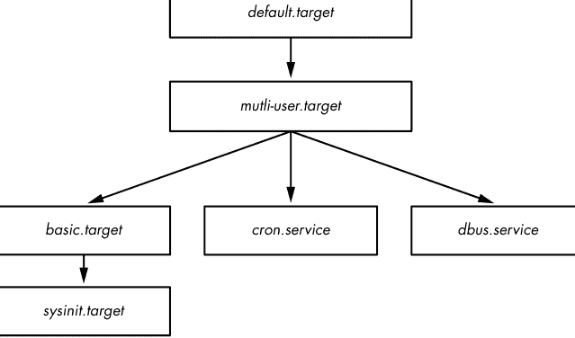

图 6-1：单元依赖图

此图是一个高度简化的视图。在你自己的系统中，你 own发现仅通过查看顶部的单元配置文件并向下推演来绘制依赖关系是不可行的。我们将在 6.3.6 节详细介绍依赖关系的工作原理。

## 6.3.3 systemd 配置

systemd 配置文件分布在系统中的许多目录中，在寻找特定文件时，你可能需要花点功夫。systemd 配置有两个主要目录：系统单元目录（全局配置；通常为 /usr/lib/systemd/system）和系统配置目录（本地定义；通常为 /etc/systemd/system/）。

为了防止混淆，请遵循此规则：避免对系统单元目录进行更改，因为你的发行版会维护它。在系统配置目录中进行本地更改。这一通用规则适用于整个系统。当在修改 /usr 和 /etc 中的内容进行选择时，始终修改 /etc。

用户空间如何启动 141

你可以使用此命令检查当前的 systemd 配置路径（包括优先级）：


$ systemctl -p UnitPath show

UnitPath=/etc/systemd/system.control /run/systemd/system.control /run/systemd/

transient /etc/systemd/system /run/systemd/system /run/systemd/lib/

systemd /run/systemd/generator.late

```
要查看系统上的系统单元和配置目录，请使用以下命令：
```
$ pkg-config systemd --variable=systemdunitdir
/lib/systemd/system
$ pkg-config systemd --variable=systemdsystemconfdir
/etc/systemd/system
```
## 单元文件

单元文件的格式源自 XDG Desktop Entry 规范（用于 `.desktop` 文件，这些与微软的 `.ini` 文件非常相似），在方括号 `[]` 中包含名称，并在每个节中包含键值赋值（选项）。

例如，考虑用于桌面守护进程的 `dbus-daemon.service` 单元文件：
```
[Unit]
Description=D-Bus 系统消息总线
Documentation=man:dbus-daemon(1)
Requires=dbus.socket
RefuseManualStart=yes
```
```
[Service]
ExecStart=/usr/bin/dbus-daemon --system --address=systemd: --nofork --pidfile
--system-activation=syslog-only
ExecReload=/usr/bin/dbus-send --print-reply --system --type=method_call --dest=org.freedesktop.DBus /ReloadConfig
```
这里有两个部分，`[Unit]` 和 `[Service]`。`[Unit]` 部分提供了有关单元的某些详细信息，并包含依赖信息。特别是，此单元需要 `dbus.socket` 单元作为依赖。

在类似这样的服务单元中，你会在 `[Service]` 部分找到有关服务的详细信息，包括如何准备、启动和重载服务。你可以在 `systemd.service(5)` 和 `systemd.exec(5)` 手页中找到完整的列表，也可以在 6.3.5 节关于进程跟踪的讨论中找到。

许多其他单元配置文件同样直观。例如，`sshd.service` 服务文件通过启动 `sshd` 启用远程 shell 登录。

142 第 6 章

## 注意

你在系统中找到的单元文件可能略有不同。在示例中，你看到 Fedora 使用 `dbus-daemon.service`，而 Ubuntu 使用 `dbus.service`。实际文件中也可能存在变化，这些变化通常是浅表的。

## 变量

你会在单元文件中找到变量。以下是第 10 节中将学习的不同安全 shell 的节：
```
[Service]
EnvironmentFile=/etc/sysconfig/sshd
ExecStart=/usr/sbin/sshd -D $OPTIONS $CRYPTO_POLICY
ExecReload=/bin/kill -HUP $MAINPID
```
带有美元符号 (`$`) 的内容都是变量。虽然这些变量具有相同的语法，但它们的来源不同。`$OPTIONS` 和 `$CRYPTO_POLICY` 可以在单元激活时传递给 `sshd`，它们在 `EnvironmentFile` 设置指定的范围内定义。在特定情况下，你可以查看 `/etc/sysconfig/sshd` 来确定变量是否已设置，如果设置了，它们的值是什么。

相比之下 ownMAINPID` 包含被跟踪的服务进程的 ID（见第 6.3.5 节）。激活后，systemd 会记录并存储此 PID，你稍后可以使用它操作特定服务的进程。`sshd.service` 单元文件使用 `$MAINPID` 在你想重载配置时向 `sshd` 发送挂起 (HUP) 信号，这是处理重载和重启 Unix 守护进程的一种常用技术。

## 占位符 (Specifiers)

占位符是单元文件中常见的类变量的特征。占位符以百分号 (`%`) 开头。例如，`%i` 是单元名称，`%H` 是当前主机。

你还可以使用占位符从单个单元创建多个副本。使用这种功能是在单元名称末尾添加 `@` 符号。例如，在大多数发行版中，文件名是 `getty@service`。在激活时，systemd 将 `%I` 或 `%i` 替换为实例名称。

# Linux 工作原理（早期访问）© 2021 Brian Ward

## 6.3.4 systemd 操作

你主要通过 `systemctl` 与 systemd 交互，它允许激活和禁用服务、列出状态、重载配置等。

最基本的命令帮助你获取单元信息。例如，要查看系统上的单元列表，执行 `list-units` 命令。（这是 `systemctl` 的默认命令，因此技术上不需要 `list-units` 参数。）

$ systemctl list-units

输出格式是典型的 Unix 列表命令。例如，头部和针对 `-mount` 的行如下所示：

| UNIT | LOAD | ACTIVE | SUB | DESCRIPTION |
| -mount | loaded | active | | Root |

默认情况下，`systemctl` 生成列表输出，因为典型系统有许多活动单元，但仍然是缩略形式，因为 `systemctl` 会截断较大的单元名称。要查看单元名称，请使用 `--full` 选项；要查看所有单元（而不只是活动单元），请使用 `--all` 选项。

一个特别常用的 `systemctl` 操作是获取特定单元的状态。例如，这里是典型的状态命令及其部分输出：

$ systemctl status sshd.service

+   - sshd.service - OpenBSD Secure Shell server
Loaded: loaded (/usr/lib/systemd/system/sshd.service); vendor preset: enabled; enabled;
Active: active (running) Fri 2021-04-16 EDT; 08:15:41 1 month 1 days ago

输出后面可能还有许多日志消息。如果你习惯了传统的 init 系统，可能会对此命令提供的可用信息量感到惊讶。不仅可以获取单元状态，还可以获取关联进程、启动时间以及大量的日志。

其他单元类型的输出包含类似的信息。输出的一个有趣部分是控制组 (cgroup) 名称。在之前的示例中，控制组是 `/system.slice/sshd.service`，cgroup 中的进程显示在其下方。然而，你可能也

第 6 章

Linux 工作原理（早期访问版）© 2021 Brian Ward

如果单元（例如，挂载单元）的进程已经终止，请查看名为 `systemd-/system` 的控制组。你可以使用 `system-cgroups` 命令在不显示单元其他状态的情况下查看系统相关的 cgroups。你将在第 6.3.5 节学习更多关于 systemd 如何使用 cgroups，以及在第 8.6 节学习 cgroups 的工作原理。

`status` 命令还会显示该单元最近的诊断日志消息。你可以这样查看单元的所有消息：
```
$ journalctl --unit_name
```
你将在第 7 章学习更多关于 `journalctl` 的知识。

注意：取决于你的系统和用户配置，你可能需要超级权限才能运行 `journalctl`。

## 作与启动、停止和重载单元的关系

要激活、停用和重启单元，请使用 `systemctl start`、`systemctl stop` 和 `systemctl restart` 命令。然而，如果你更改了单元配置文件，可以通过两种方式之一告诉 systemd 重新加载该文件：
```
systemctl reload unit - 仅重新加载单元的配置。
systemctl daemon-reload - 重新加载所有单元配置。
```
激活、重新激活和重启单元的请求在 systemd 中被称为“作业”（jobs），它们本质上是单元状态的变化。你可以通过以下命令检查系统上的当前作业：
```
$ systemctl list-jobs
```


如果系统运行了一段时间，你可以预期没有活跃的作业，因为启动系统所需的所有激活都应该完成。然而，在启动时，你有时可以登录足够的时间来看到启动非常缓慢的作业。例如：

| JOB UNIT | TYPE | STATE |
| --- | --- | --- |
| 1 graphical.target | start | waiting |
| 2 multi-user.target | start | waiting |
| 71 systemd-user-level.service | start | waiting |
| 75 sm-client.service | start | waiting |
| 76 sendmail.service | start | running |
| 120 systemd-dead-done.timer | start | waiting |

在这种情况下，作业 76（即 `sendmail.service` 单元的启动）正花费了非常长时间。其他列出的作业处于等待状态，最可能是因为它们都在等待作业 76。当 `sendmail.service` 完成并处于激活状态时，作业 76 将完成，其余作业也将完成，作业列表将变为空。

注意：“作业”（job）这个术语可能会引起混义，特别是因为其他初始化系统使用它来指代更像系统单元的任务。这些作业与 shell 的作业控制没有关系。

请查看第 6.6 节了解如何关闭和重启系统。

## 向 systemd 添加单元

向 systemd 添加单元主要涉及创建、激活以及可能的启用单元文件。你通常应该将你自己的单元文件放在系统配置目录（`/etc/systemd/system`）中，这样你就不会将它们与发行版自带的任何内容混淆，而且发行版在升级时也不会覆盖它们。

由于很容易创建不执行任何操作或不干扰系统的目标单元（target units），请尝试一下。要创建两个相互依赖的目标单元，请遵循以下步骤：

- 1. 在 `/etc/systemd/system` 中创建一个名为 `test1.target` 的单元文件：

```
[Unit]

Description=test 1
```

- 2. 创建一个依赖于 `test1.target` 的 `test2.target` 文件：

```
[Unit]

Description=test 2

Wants=test1.target
```

`Wants` 关键字定义了一个依赖关系，导致激活 `test2.target` 时激活 `test1.target`。激活 `test2.target` 单元以查看运行效果：

```
# systemctl start test2.target
```

- 3. 验证两个单元均处于激活状态：

```
# systemctl status test1.target test2.target
- test1.target - test 1

Loaded: (/etc/systemd/system/test1.target; static; vendor preset: enabled)

Active: since Tue 2019-05-28 14:45:00 EDT; 16s ago

May 28 14:45:00 duplex systemd[1]: Reached target test 1.
- test2.target - test 2

Loaded: (/etc/systemd/system/test2.target; static; vendor preset: enabled)

Active: active since Tue 2019-05-28 14:45:00 EDT; 17s
```

- 4. 如果你的单元文件包含 `[Install]` 部分，你需要在激活它之前“启用”（enable）单元：

```
# systemctl enable unit
```

`[Install]` 部分是创建依赖关系的另一种方式。我们将在第 6.3.6 节中详细学习它（以及整体依赖关系）。

## 从 systemd 移除单元

要移除单元，请遵循以下步骤：

- 1. 如果必要，停用单元：

```
# systemctl stop unit
```

- 2. 如果单元包含 `[Install]` 部分，将其禁用：

```
# systemctl disable unit
```

### 6.3.5 systemd 进程跟踪与同步

`status` 命令还会显示该单元最近的诊断日志消息。你可以这样查看单元的所有消息：

```
$ journalctl --unit_name
```

你将在第 7 章学习更多关于 `journalctl` 的知识。

注意：取决于你的系统和用户配置，你可能需要超级权限才能运行 `journalctl`。

## 作业与启动、停止和重载单元的关系

要激活、停用和重启单元，请使用 `systemctl start`、`systemctl stop` 和 `systemctl restart` 命令。然而，如果你更改了单元配置文件，可以通过两种方式之一告诉 systemd 重新加载该文件：

```
systemctl reload unit - 仅重新加载单元的配置。

systemctl daemon-reload - 重新加载所有单元配置。
```

激活、重新激活和重启单元的请求在 systemd 中被称为“作业”，它们本质上是单元状态的变化。你可以通过以下命令检查系统上的当前作业：

```
$ systemctl list-jobs
```


如果系统运行了一段时间，你可以预期没有活跃的作业，因为启动系统所需的所有激活都应该完成。然而，在启动时，你有时可以登录足够的时间来看到启动非常缓慢的作业。例如：

| JOB UNIT | TYPE | STATE |
| --- | --- | --- |
| 1 graphical.target | start | waiting |
| 2 multi-user.target | start | waiting |
| 71 systemd-user-level.service | start | waiting |
| 75 sm-client.service | start | waiting |
| 76 sendmail.service | start | running |
| 120 systemd-dead-done.timer | start | waiting |

在这种情况下，作业 76（即 `sendmail.service` 单元的启动）正花费了非常长时间。其他列出的作业处于等待状态，最可能是因为它们都在等待作业 76。当 `sendmail.service` 完成并处于激活状态时，作业 76 将完成，其余作业也将完成，作业列表将变为空。

注意：“作业”`job`这个术语可能会引起混义，特别是因为其他初始化系统使用它来指代更像系统单元的任务。这些作业与 shell 的作业控制没有关系。

请查看第 6.6 节了解如何关闭和重启系统。

## 向 systemd 添加单元

向 systemd 添加单元主要涉及创建、激活以及可能的启用单元文件。你通常应该将你自己的单元文件放在系统配置目录（`/etc/systemd/system`）中，这样你就不会将它们与发行版自带的任何内容混淆，而且发行版在升级时也不会覆盖它们。

由于很容易创建不执行任何操作或不干扰系统的目标单元（target units），请尝试一下。要创建两个相互依赖的目标单元，请遵循以下步骤：

1. 在 `/etc/systemd/system` 中创建一个名为 `test1.target` 的单元文件：

```
[Unit]

Description=test 1
```

2. 创建一个依赖于 `test1.target` 的 `test2.target` 文件：

```
[Unit]

Description=test 2

Wants=test1.target
```

`Wants` 关键字定义了一个依赖关系，导致激活 `test2.target` 时激活 `test1.target`。激活 `test2.target` 单元以查看运行效果：

```
# systemctl start test2.target
```

3. 验证两个单元均处于激活状态：

```
# systemctl status test1.target test2.target
- test1.target - test 1

Loaded: (/etc/systemd/system/test1.target; static; vendor preset: enabled)

Active: since Tue 2019-05-28 14:45:00 EDT; 16s ago

May 28 14:45:00 duplex systemd[1]: Reached target test 1.
- test2.target - test 2

Loaded: (/etc/systemd/system/test2.target; static; vendor preset: enabled)

Active: active since Tue 2019-05-28 14:45:00 EDT; 17s
```

4. 如果你的单元文件包含 `[Install]` 部分，你需要在激活它之前“启用”`enable`单元：

```
# systemctl enable unit
```

`[Install]` 部分是创建依赖关系的另一种方式。我们将在第 6.3.6 节中详细学习它（以及整体依赖关系）。

## 从 systemd 移除单元

要移除单元，请遵循以下步骤：

1. 如果必要，停用单元：

```
# systemctl stop unit
```

2. 如果单元包含 `[Install]` 部分，将其禁用：

```
# systemctl disable unit
```

## 6.3.5 systemd 进程跟踪与同步

`status` 命令还会显示该单元最近的诊断日志消息。你可以这样查看单元的所有消息：

```
$ journalctl --unit_name
```

你将在第 7 章学习更多关于 `journalctl` 的知识。

注意：取决于你的系统和用户配置，你可能需要超级权限才能运行 `journalctl`。

《Linux 工作原理》`Linux 工作原理`（早期访问）© 2021 Brian Ward

`Wants`（想要）激活所需的依赖项。在激活一个单元时，`systemd` 会激活该单元的依赖项，但它不在乎这些依赖项是否失败。

`Requires`（需要）必须激活的单元。在激活具有 `Requires` 依赖的单元之前，`systemd` 会首先检查该依赖项的状态。如果依赖项未激活，`systemd` 将在激活带有该依赖的单元时失败。

`Conflicts`（冲突）负依赖。在激活具有 `Conflict` 依赖的单元时，如果冲突的依赖项处于激活状态，`systemd` 会自动禁用它。同时激活冲突单元将失败。

`Wants` 类型尤为重要，因为它不会将失败传播给其他单元。`systemd.service(5)` 手页指出，这就是在可能的情况下指定依赖关系的方法，而且原因显而易见。这种行为产生了一个更健壮的系统，让你享受到传统单元的优点：早期启动组件的失败并不一定阻止后续组件的启动。

你可以使用 `systemctl` 命令查看单元的依赖关系，只要你指定了依赖类型，例如 `Wants` 或 `Requires`：

```
# systemctl show -p type unit
```


# 排序

到目前为止，你看到的依赖语法并没有显式指定顺序。例如，激活带有 `Requires` 或 `Wants` 依赖的大多数服务单元会导致这些单元同时启动。这是最优的，因为你希望尽可能快启动尽可能的服务以缩短启动时间。然而，在某些情况下，一个单元必须在另一个单元之后启动。例如，图6所示的系统中，`default.target` 单元被设置为在 `multi-user.target` 之后启动（图中未显示这种顺序区别）。

要按特定顺序激活单元，请使用以下依赖修饰：

- `Before`（之前）当前单元将在列出的单元之前激活。例如，如果 `foo.target` 中出现了 `Before=bar.target`，则 systemd 会在 `bar.target` 之前激活 `foo.target`。
- `After`（之后）当前单元在列出的单元之后激活。

当你使用排序时，systemd 会等待一个单元变为激活状态后才会激活其依赖单元。

# 默认和隐式依赖项

当你探索依赖关系（特别是使用 `system-analyze`）时，你可能会注意到某些单元获取了未在单元文件或其他可见机制中显式说明的依赖项。你可能在带有 `Wants` 依赖的 target 单元中遇到这种情况——你会发现

systemd 会在任何列为 `Wants` 依赖的单元旁边添加一个 `After`。这些额外的依赖项是 systemd 内部的，在启动时计算，并不存储在配置文件中。

`Added` 修饰符被称为默认依赖项，它是对单元配置的自动添加，以避免错误并保持单元精小。这些依赖项根据单元的类型而异。systemd 为 target 单元添加的默认依赖项与 service 单元不同。这些差异列在单元配置手册的 `DEFAULT DEPENDENCIES` 章节中，例如 `systemd.service(5)` 和 `systemd.target(5)`。

你可以通过在单元的配置文件中添加 `DefaultDependencies=no` 来禁用单元的默认依赖项。

# 条件依赖

你可以使用多个条件依赖参数来测试不同的操作系统，而不是 systemd 单元。例如：

- `ConditionPathExists=p` 如果系统中存在路径 `p`（文件）则为真。
- `ConditionPathIsDirectory=p` 如果 `p` 是一个目录则为真。
- `ConditionFileNotEmpty=p` 如果 `p` 是一个文件且长度不为零则为真。

如果单元中的条件依赖在 systemd 尝试激活它时失败，该单元将不会激活，尽管这仅适用于该依赖项所在的单元。也就是说，如果你激活一个具有条件依赖和某些单元依赖项的单元，systemd 无论条件真假，都会尝试激活那些单元依赖项。

其他依赖项主要是前述项的变体。例如，`Requires=overridable` 依赖在正常运行时与 `Requires` 相同，但当单元被手动激活时，它的作用就像 `Wants` 依赖。欲查看完整列表，请参 `systemd.unit(5)` 手页。

# [Install] 部分与启用单元

到目前为止，我们一直在查看如何在被依赖单元的配置文件中定义依赖关系。也可以“反过来”做到这一点——即通过在 `[Install]` 部分中添加 `WantedBy` 或 `RequiredBy` 参数在单元文件中指定依赖关系。这种机制允许你在不修改额外配置文件的情况下更改单元应该启动的时间（例如，当你更愿意编辑系统单元文件时）。

要查看这是如何工作的，考虑 6.3.4 节中的示例单元。我们有两个单元，`test1.target` 和 `test2.target`，`test2.target` 对 `test1.target` 有 `Wants`。我们可以更改它们，使 `test1.target` 看起来像这样：

```
[Unit]

Description=test 1

[Install]

WantedBy=test2.target
```

而 `test2.target` 如下：

```
[Unit]

Description=test 2
```

由于你现在有一个带有 `[Install]` 部分的单元，你需要用 `systemctl` 启用该单元才能启动它。以下是 `test1.target` 的工作原理：

```
# systemctl enable test1.target

Created symlink /etc/systemd/system/test2.target.wants/test1.target → /etc/systemd/system/test1.target.
```

注意这里的输出——启用单元的效果是在 `.wants` 子目录中创建一个与依赖单元（在本例中为 `test2.target`）相对应的符号链接。你现在可以使用 `systemctl start test2.target` 同时启动两个单元，因为依赖关系已经就绪。

> 启用单元不会激活它。

要禁用该单元（并删除符号链接），请如下使用 `systemctl`：

```
# systemctl disable test1.target

Removed /etc/systemd/system/test2.target.wants/test1.target.
```

这两个单元还提供了一个实验不同启动场景的机会。例如，尝试只启动 `test1.target` 会发生什么，或者将 `WantedBy` 改为 `RequiredBy`。（记住，在运行期间 systemd 会忽略 `[Install]` 部分，可以检查单元状态。）

# 6.3.7 按需加载与资源并行

systemd 的功能之一是允许在绝对需要时延迟启动。这种设置通常如下：

1. 为你想提供的系统服务创建一个单元（称之为 A）。
2. 识别 A 使用的某种系统资源，例如网络端口、文件或设备。
3. 创建另一个单元 R 来表示该资源。
4. 定义 A 和 R 之间的关系。

一旦就绪，操作过程如下：

- 激活 R 后，systemd 监控资源。
- 当任何尝试访问资源时，systemd 阻塞资源并对输入进行缓冲。
- systemd 激活 A。
- 准备好后，来自 A 的服务接管资源、缓冲输入并运行。

```
[Socket]
ListenStream=22222
Accept=true
```

注意，在单元文件中并没有提到该 socket 所支持的服务单元。那么，对应的服务单元文件是什么呢？
它的名字是 `echo@service`。该链接是通过命名约定建立的；如果一个服务单元的前缀与 .socket 文件相同（在本例中为 `echo`），systemd 知道在 socket 单元有活动时激活该服务单元。在这种情况下，当 `echo@service` 单元文件有活动时，systemd 会创建一个 echo@service 实例：

```
[Unit]
Description=echo 服务服务

[Service]
ExecStart=/bin/cat
StandardInput=socket
```

> 如果你不喜欢基于前缀的单元隐式激活，或者你需要链接具有不同前缀的单元，你可以在定义资源的单元中使用显式选项。例如，在 `foo.service` 内部使用 `Socket=bar.socket` 让 `bar.socket` 将其 socket 交给 `foo.service`。

要运行此示例单元，你需要启动 `echo.socket` 单元：

```
# systemctl start echo.socket
```

现在，你可以使用 telnet 等工具连接到本地 TCP 端口 22222 来测试服务。该服务会重复你输入的内容；这里是一个交互示例：

```
$ telnet localhost 22222

Trying 127.0.0.1...

Connected to localhost.

Escape 字符是 '^'.

Hi there.
```

当你对这个无无了并想返回 shell 时，按下 CTRL-D。要停止服务，请停止 socket 单元：

```
# systemctl stop echo.socket


`telnet` 可能未在你的发行版中安装

## 实例与交接

由于 `echo@service` 支持多个实例，名称中包含了 `@`（请记住 `@` 符号表示参数化）。你为什么需要多个实例？假设你同时有多个网络连接到服务，并且你希望每个连接都有自己的实例。在这种情况下，服务必须支持多个实例，因为我们在 `echo@socket` 中包含了 `Accept=true` 选项，它不仅监听端口，还代表服务接收连接并将其传递。

> 注意：大多数网络连接需要比简单的标准输入更多的灵活性，直到 `echo@service` 单元显示

如果服务单元可以执行接收连接的工作，请在文件名中放入 `@`，也不要在 socket 单元中放入 `Accept=true`。在这种情况下，服务单元将获得系统的完全控制权，而在服务单元完成之前，它不会尝试监听网络端口。

服务单元许多不同的资源和选项使得提供分类总结变得困难。不仅如此，选项文档分散在多个页面中。对于资源型单元，请检查 `systemd.socket(5)`、`systemd.path(5)` 和 `systemd.device(5)`。服务单元中经常被忽略的是 `systemd.exec(5)`，它包含了关于服务单元如何接收资源激活的信息

## 使用辅助单元优化启动

`systemd` 的总体目标是简化依赖关系并加快启动时间。像 socket 单元这样的资源单元提供了一种类似于按需启动的方法。我们将有一个服务单元和一个辅助单元来代表服务提供的资源，但在这种情况下，`systemd` 一旦激活辅助单元就会启动服务单元，而不是等待请求。

这种方案的原因是 `systemd-journal.service` 启动需要时间，且许多其他单元依赖于它。然而，系统可以快速启用核心资源（如 socket 单元），然后立即激活核心单元以及任何依赖于它的单元。一旦核心单元就绪，它就接管了资源。

图 6-2 显示了这在传统的顺序系统中是如何工作的。在启动时间线上，Service E 提供了一个资源。服务 A、B 和 C 都依赖于该资源（但不相互依赖），并且必须

## 工作原理（早期访问）

图 6-2 显示了这在传统的顺序系统中是如何工作的。在启动时间线上，Service E 提供了一个核心资源。服务 A、B 和 C 都依赖于该资源（但不相互依赖），并且必须

| 单元 (Unit) | 状态 (Status) |
| :--- | :--- |
| Service E | Ready |
| Service A | Starting |
| Service B | Starting |
| Service C | Starting |

图 6-2 显示了这在传统的顺序系统中是如何工作的。在启动时间线上，Service E 提供了一个核心资源。服务 A、B 和 C 都依赖于该资源（但不相互依赖），并且必须

| 单元 (Unit) | 状态 (Status) |
| :--- | :--- |
| Service E | Ready |
| Service A | Starting |
| Service B | Starting |
| Service C | Starting |

图 6-2 显示了这在传统的顺序系统中是如何工作的。在启动时间线上，Service E 提供了一个核心资源。服务 A、B 和 C 都依赖于该资源（但不相互依赖），并且必须

| 单元 (Unit) | 状态 (Status) |
| :--- | :--- |
| Service E | Ready |
| Service A | Starting |
| Service B | Starting |
| Service C | Starting |

图 6-2 显示了这在传统的顺序系统中是如何工作的。在启动时间线上，Service E 提供了一个核心资源。服务 A、B 和 C 都依赖于该资源（但不相互依赖），并且必须

| 单元 (Unit) | 状态 (Status) |
| :--- | :--- |
| Service E | Ready |
| Service A | Starting |
| Service B | Starting |
| Service C | Starting |

图 6-2 显示了这在传统的顺序系统中是如何工作的。在启动时间线上，Service E 提供了一个核心资源。服务 A、B 和 C 都依赖于该资源（但不相互依赖），并且必须

## 等待服务完成

如果服务单元可以执行接收连接的工作，请不要在文件名中放入 `@`，也不要在 socket 单元中放入 `Accept=true`。在这种情况下，服务单元将获得系统的完全控制权，而在服务单元完成之前，它不会尝试监听网络端口。

服务单元许多不同的资源和选项使得提供分类总结变得困难。不仅如此，选项文档分散在多个页面中。对于资源型单元，请检查 `systemd.socket(5)`、`systemd.path(5)` 和 `systemd.device(5)`。服务单元中经常被忽略的是 `systemd.exec(5)`，它包含了关于服务单元如何接收资源激活的信息

等待直到服务完成

### 6.3.8 systemd 组件

有一种很好的可能是，它不仅描述了工具，还描述了它旨在增强的单元类型

等待直到服务完成

当你这样并行化时，系统可能会因为大量的单元而变慢。

随着 `systemd` 的流行，它扩展到了支持许多与启动无关的任务，包括直接支持和通过辅助层。你可能会注意到 `/lib/systemd` 中的许多程序，这些是与功能相关的可执行文件。这里有一些服务：

- **udev** 你在第 3 章学习过；它是 `systemd` 的一部分。
- **journal** 一个处理许多机制的日志服务，包括 Unix syslog 服务。你将在第 7 章阅读更多内容。
- **resolved** 用于 DNS 的缓存守护进程；你将在第 9 章学习它。

所有相应的服务都带有 `systemd-` 前缀。例如，系统集成 udev 称为 `system-udev`。
如果你深入研究，你会发现其中一些程序是简单的封装器。它们的功能是运行系统工具并向 `systemd` 通知结果。一个例子是 `system-fsck`。

## 6.4 System V 运行级别

现在你已经了解了 `systemd` 以及它是如何工作的，让我们切换一下，看看传统的 System V init 的某些方面。在 Linux 系统上的任何时刻，一组基础进程（例如 crowd 和 udev）正在运行。在 System V init 中，机器的状态被称为运行级别（runlevel），由 0 到 6 的数字表示。系统大部分时间运行在一个运行级别中，但当你关闭机器时，它会切换到另一个运行级别，以便有序地终止系统服务并通知内核停止。

你可以使用 `-r` 命令这样检查系统的运行级别：

```
$ -r

runlevel 5 2019-01-27 16:43
```

《Linux 工作原理》（早期访问版）© 2021 Brian Ward

此输出告诉我们当前的运行级别（runlevel）为 5，以及建立该运行级别的别的日期和时间。

运行级别有多种用途，但最常见的是区分系统启动、关机、单用户模式和控制台模式状态。例如，大多数系统传统上使用运行级别 2 到 4 运行文本控制台；运行级别 5 则意味着系统将启动 GUI 登录界面。

运行级别正在成为过去。尽管 `systemd` 支持它们，但它认为运行级别作为系统状态已经过时，转而采用目标单元（target units）。对于系统而言，运行级别的存在仅仅是为了启动仅支持 System V 脚本的的服务。

## 6.5 System V init

System V 实现是 Linux 上最古老的实现之一；其核心思想是支持通过完全构建的启动序列，有序地引导到不同的运行级别。System V init 现在在大多数服务器和桌面安装中已不再常见，但你可能会在 RHEL 7.0 之前的版本，以及嵌入式 Linux 环境（如路由器和手机）中遇到它。此外，旧的软件包可能只提供为 System V init 设计的启动脚本；`systemd` 可以通过我们在 6.5.5 节中讨论的兼容模式处理这些脚本。我们将介绍基础，但请记住，你可能会遇到本节未涵盖的任何内容。

System V init 安装包含两个部分：一个中心配置文件和一个符号链接池增强的大型启动脚本集。配置文件 `/etc/inittab` 是这一切的开始。如果你有 System V init，请在 `inittab` 文件中查找如下的一行：

```
id:5:initdefault:
```

这表示默认运行级别为 5。

`inittab` 中的所有行都采用以下格式，由四个列分隔的字段组成：

- 唯一标识符（一个短字符串，例如上一个示例中的 `id`）。
- 适用的运行级别数字。
- 应采取的操作（上一个示例中默认运行级别为 5）。
- 要执行的命令（可选）。

为了查看 `inittab` 文件中的命令是如何运作的，请考虑这一行：

```
15:5:wait:/etc/rc.d/rc 5
```


这一特定行非常重要，因为它触发了大多数系统配置和服务。在这里，`wait`动作决定了 System V init 何时以及如何运行命令：在进入运行级别 5 时运行一次`/etc/rc.d/rc 5`，然后在执行任何其他操作之前等待该命令完成。`rc 5`命令执行`/etc/rc.5`中任何以数字开头的程序（按数字顺序）。我们很快会详细介绍这一点。

以下是除`initdefault`和`wait`之外的一些最常见的 init 操作：

**respawn**
`respawn`操作告诉 init 运行其后的命令，如果命令执行完成，则再次运行。你可能会在`inittab`文件中看到这样的内容：

```
1:2345:respawn:/sbin/getty tty1
```

`getty`程序提供登录提示。前一行用于第一个虚拟控制台（`/dev/tty1`），即你在按下 ALT-F1 或 CTRL-ALT-F1 时所看到的那一个（见第 3.4 节）。`respawn`操作会在你注销后重新带回登录块。

**ctrlaltdel**
`ctrlaltdel`操作控制当你在虚拟控制台上按下 CTRL-ALT-DEL 时系统执行的操作。在大多数系统中，这是某种使用`shutdown`命令（在第 6.6 节中讨论）的重启命令。

**sysinit**
`sysinit`操作是 init 在启动进入任何运行级别之前应该运行的第一件事。有关更多可用操作，请参见`inittab(5)`手册。

### 6.5.1 System V init: 启动序列

现在让我们来看看 System V init 在允许你登录之前是如何启动服务的。回想一下之前的这行`inittab`配置：

```
15:5:wait:/etc/rc.d/rc 5
```

这一简短的行告诉我们我们讨论的是运行级别 5。事实上，`rc`代表命令，许多人称为脚本、程序或服务。这些命令在哪里？

该行中的`5`告诉我们命令可能在`/etc/rc.d`或`/etc/rc5.d`（运行级别 1 使用`rc1.d`，运行级别 2 使用`rc2.d`）。例如，你可能在`rc5.d`目录中找到以下项目：

| | | |
| :--- | :--- | :--- |
| S10syslog | S20 | S99gpm |
| S12kernel | S25netfs | S99httpd |
| S15netstat_id | S30 | S99rm |
| S18netbase | S45 | S99hd |
| S20accent | S89atd | |
| S20logout | S89cron | |

`rc`通过按顺序执行以下命令来启动`rc5.d`目录中的程序：

```
S10syslog start

S12kernel start

S15netstat_init start

S18netbase start

--snip--

S99shd start
```

注意每个命令中的`start`参数。命令名中的大写字母`S`意味着该命令应以启动模式运行，数字（00 到 99）决定了`rc`启动该命令的顺序。`rc*.d`命令通常是 shell 脚本，用于启动`/bin`或`/usr/sbin`中的程序。通常，你可以通过使用`less`或其他分页程序查看脚本来确定特定命令的作用。

### 6.5.2 System V init: 符号链接池

`rc.d`目录中的内容实际上是符号链接，指向`init.d`目录中的文件。如果你需要交互，在`init.d`目录中的这些符号链接。`ls`，`.5`会显示如下结构：

| | | |
| :--- | :--- | :--- |
| S10syslog | S20 | S99gpm |
| S12kernel | S25netfs | S99httpd |
| S15netstat_id | S30 | S99rm |
| S18netbase | S45 | S99hd |
| S20accent | S89atd | |
| S20logout | S89cron | |

`rc`通过按顺序执行以下命令来启动`rc5.d`目录中的程序：

```
S10syslog start

S12kernel start

S15netstat_init start

S18netbase start

--snip--

S99shd start
```

注意每个命令中的`start`参数。命令名中的大写字母`S`意味着该命令应以启动模式运行，数字（00 到 99）决定了`rc`启动该命令的顺序。`rc*.d`命令通常是 shell 脚本，用于启动`/bin`或`/usr/sbin`中的程序。通常，你可以通过查看脚本来确定特定命令的作用。

## 启动与停止服务

要手动启动和停止服务，使用`init.d`目录中的脚本。例如，手动启动 httpd 服务器的方法是运行`init.d/httpd start`。同样，要停止运行的服务，可以使用`stop`参数。

## 修改启动序列

在 System V 中更改启动序列通常通过修改链接池来实现。最常见的更改是阻止`init.d`目录中的某个命令运行特定的级别。然而，这样做时必须小心。例如，你可能考虑移除`rc*.d`目录中的符号链接。如果你以后需要恢复链接，可能会忘记它的确切名称。最好的方法之一是在开头添加一个下划线`_`，如下：

```
# mv s99httpd _99httpd
```

这会让`rc`忽略`_99httpd`，因为它文件名不是以 S 或 K 开头的，但原始名称仍然指示了它的用途。要添加服务，在`init.d`目录创建一个这样的脚本并在`rc*.d`目录创建一个符号链接。最简单的方法是复制并修改`init.d`中的一个脚本（关于 shell 的更多信息请参见第 11 节）。在添加服务时，在启动序列中选择一个合适的位置启动。如果服务启动得太早，可能会因为依赖其他服务而无法工作。

### 6.5.3 run-parts

System V 用于运行`init.d`脚本的机制已进入许多 Linux 系统，无论你是否使用 System V。它被称为`run-parts`，它所做的仅仅按某种可预测的顺序运行给定目录中的可执行程序。你可以将`run-parts`想象成进入某个目录执行`ls`命令并运行输出中列出的所有程序。

默认行为是运行目录中的所有程序，你通常可以选择选择某些程序并忽略其他。在某些发行版中，你对运行的程序没有多少控制权。例如，Fedora 提供了一个非常简单的`run-parts`工具。

其他发行版（如 Debian 和 Ubuntu）拥有更复杂的`run-parts`程序。它们的功能包括根据正则表达式运行程序（例如使用`5[0-9]{2}`表达式）。

用于运行`/etc/init.d`目录下的所有“start”脚本并向程序传递参数。这些功能允许你通过单个命令启动和停止 System V 运行级别（runlevels）。

由于 systemd 建立了与服务单元名称的关联，你可以使用`systemctl`重启服务或查看其状态。不要期望 System V 兼容模式能带来任何奇迹；例如，它仍然串行运行 init 脚本。

## 6.6 关闭你的系统

init 控制系统如何关机和重启。无论运行哪个版本的系统，关机系统的命令都是相同的。关闭 Linux 机器的正确方法是使用`shutdown`命令。

使用`shutdown`有两种基本方法。如果你停止（halt）系统，它会关闭机器并保持关闭状态。要让机器立即停止，请运行：

```bash
# shutdown -h now
```

在大多数机器和 Linux 版本中，halt 会切断机器电源。你也可以重启机器。重启时请使用`-r`代替`-h`。

关机过程需要几秒钟时间。你应该避免在关机期间重置或关闭机器电源。
在上例中，`now`是关机的时间。包含时间参数是强制的，但有许多指定时间的方法。例如，如果你想让机器在未来的某个时刻关机，可以使用`+n`，其中`n`是关机执行前等待的分钟数。
要在 10 分钟后重启，输入：

```bash
# shutdown -r +10
```


在 Linux 上，`shutdown` 会通知任何登录机器上的用户系统即将关闭，但并没有做多少实际工作。如果你指定了除 `now` 以外的时间，`shutdown` 命令创建一个名为 `/etc/runlevel` 的文件。当该文件存在时，系统禁止超级用户以外的所有人员登录。

当系统关机时间终于到达时，`shutdown` 通知系统开始关机过程。在 System V init 上，这意味着将运行级别更改为 0（halt）或 6（reboot）。无论 init 的实现或配置如何，过程生成器的流程如下：

1. init 请求每个进程干净地关闭。
2. 如果进程在一段时间后没有响应，init 将杀死它，首先尝试发送 `TERM` 信号。
3. 如果 `TERM` 信号不起作用，init 将对任何遗留进程使用 `KILL` 信号。
4. 系统锁定系统文件并为关机做其他准备。
5. 系统卸载除根目录以外的所有文件系统。
6. 系统将根文件系统重新挂载为只读模式。
7. 系统使用 `sync` 程序将所有缓冲数据写入文件系统。
8. 最后一步是使用 `reboot(2)` 系统调用告诉内核重启或停止。这可以通过 init 或辅助程序（如 `reboot`、`halt` 或 `poweroff`）来完成。

`reboot` 和 `halt` 程序的行为取决于它们如何被调用，这会有所不同，并可能会导致混淆。默认情况下，这些程序调用带有 `-r` 或 `-h` 选项的 `shutdown`。然而，如果系统最近处于停止或重启状态，这些程序会告诉内核立即关闭自己。如果你真的想快速关闭机器，而不考虑不正常关机可能造成的任何损坏，请使用 `-f`（强制）选项。

## 6.7 初始 RAM 文件系统

Linux 启动过程在大多数情况下是非常直接的。然而，有一个组件一直有点让人令人困惑：`initramfs`，即初始 RAM 文件系统。把它想象成一个插入在普通用户模式启动之前的用户空间楔子。但首先，让我们谈谈它为什么存在。

问题源于许多不同硬件的可用性。请记住，内核不知道通过 PC BIOS 接口或 EFI 从磁盘获取数据，因此为了挂载其根文件系统，它需要底层存储机制的驱动支持。例如，如果根目录位于连接到第三方控制器的 RAID 列上，内核需要该控制器的驱动程序。由于存储控制器驱动太多，发行版无法将它们全部包含内核内核，因此许多驱动以可加载模块的形式提供。但可加载模块是文件，如果你的内核首先没有文件系统，它就无法加载驱动模块。

解决方法是将一组内核驱动和一些工具收集到一个包中。引导加载程序在运行内核之前将该包加载到内存中。启动时，内核将包的内容读取到 RAM 文件系统（initramfs），将其挂载到 `/` 并向 initramfs 上的 init 进行交接。随后，initramfs 中包含的工具允许内核加载根文件系统所需的驱动。最后，工具挂载根文件系统并启动真正的 init。

实现方式各异且不断演进。在某些发行版中，initramfs 上的 init 是一个简单的脚本，启动 udev 加载驱动，然后挂载根目录并执行 init。对于你使用的发行版，通常没有单元配置文件，只有少量 udev 配置。

初始 RAM 文件系统的一个基本特征自诞生以来一直未变，就是当你不需要它时可以跳过它。也就是说，如果你的内核拥有挂载根文件系统所需的驱动，你可以在引导加载程序配置中省略初始 RAM 文件系统。如果成功，消除初始 RAM 系统将稍微缩短启动时间。

## 6.8 紧急启动与单用户模式

当系统出现问题时，你的首选通常是使用发行版的“live”镜像或专门的救援镜像（如 SystemRescue）启动系统。Live 镜像只是一个无需安装即可启动和运行的 Linux 系统；大多数发行版的安装镜像也兼具此。修复系统的常见任务包括：

- 崩溃后检查文件系统。
- 重置忘记的密码。
- 修复关键文件，例如 `/etc/fstab` 和 `/etc/passwd`。
- 崩溃后从备份恢复。

快速进入可可用状态的另一种选择是单用户模式。其思路是系统快速启动到 root shell，而不是经过整个服务网。在 System V init 中，单用户模式通常由 `rescue.target` 表示。你可以通过向引导加载程序传递 `-5` 参数进入该模式。你可能需要 root root密码才能进入单用户模式。

单用户模式最大的问题是它没有提供许多便利功能。网络几乎肯定不可用（如果可用，也很难使用），你将没有 GUI，而且你的终端可能无法正常工作。出于这个原因，实时镜像几乎总是被认为是更优的。

## 6.9 展望

你现在已经了解了 Linux 系统的内核和用户空间启动阶段，以及 systemd 在服务启动后如何跟踪它们。接下来，我们将深入探讨用户空间。有两个区域需要探索，首先是许多 Linux 程序在与用户空间的某些元素交互时使用的系统配置文件。然后，我们将看到 systemd 启动的关键服务。

# 7 系统配置：日志记录、系统时间、批作业和用户


当你第一次进入 `/etc` 目录来探索系统配置时，你可能会感到有些无从从。好消息是，虽然你看到的大部分文件在某种程度上都会影响系统的运行，但只有少数是基础性的。

本章涵盖了系统的部分内容，这些内容为第 4 章讨论的基础设施与我们通常交互的用户空间软件（例如第 2 章涵盖的工具）提供了可用性。特别是，我们将查看以下内容：

- 系统日志记录
- 系统库访问以获取服务器和用户信息的配置文件

How Linux Works (Early Access) © 2021 by Brian Ward

- 若干在系统启动时运行的选定服务器程序（有时称为守护进程 daemons）
- 可用于调优服务器程序和配置文件的配置工具
- 时间配置
- 周期性任务调度

systemd 的广泛使用减少了典型 Linux 系统中基础的、独立的守护进程的数量。其中之一是系统日志（syslogd）守护进程，其功能现在很大程度上由构建在 systemd 内部的守护进程（journal）提供。尽管如此，但系统中仍然保留了一些传统的守护进程，例如 cron 和 atd。

与之前的章节一样，本章几乎不包含任何网络材料，因为网络是系统中一个独立的构建模块。在第 9 章中，你将看到网络是如何融入其中的。

## 7.1 系统日志记录

大多数系统程序将它们的诊断输出写入 syslog 服务。传统的 syslog 守护进程通过等待消息来执行此服务，并在接收到消息后将其发送到适当的通道（例如文件或数据库）。在大多数现代系统中，journald（随 systemd 一起提供）承担了大部分工作。尽管我们在书中将重点关注 journal，但我们也将涵盖传统 syslog 的许多方面。

当出现问题且你不知道从何处开始时，检查日志总是明智之举。如果你有 journald，你将使用 `journalctl` 命令执行操作，我们将在第 7.1.2 节中介绍它。在较旧的系统上，你需要检查文件本身。无论哪种情况，日志消息看起来如下：

一条消息通常包含重要信息，如进程名、周期和时间戳。还可以有其他字段：设施（facility，一个通用类别）和严重性（消息的紧急程度）。我们稍后会详细讨论这些内容。

理解 Linux 系统中的 journald 可能会因为新旧软件组件的不同组合而变得有些困惑。某些发行版（如 Fedora）已转向仅使用 journald 的默认设置，而另一些则在运行 journald 的同时运行旧版本的 syslog（如 rsyslog）。某些特殊系统可能完全不使用 systemd，并且只有一个 syslog 版本。此外，某些软件系统完全绕过标准日志记录并编写自己的日志。

168 第 7 章

How Linux Works (Early Access) © 2021 by Brian Ward

### 7.1.1 检查你的日志设置

你应该检查你的系统以查看安装了种种日志。如下：

1. 检查 journald，如果你正在运行 systemd，几乎肯定拥有。虽然你可以在进程列表中查找 journald，但最简单的方法直接运行 `journalctl`。如果 journalctl 在你的系统上处于激活，你将获得日志消息列表。
2. 检查 rsyslog。在进程列表中查找 rsyslog，并查找 `/etc/syslog.conf`。
3. 如果你没有 rsyslog，通过查找名为 `/etc/syslog-ng` 的目录来检查 syslog-ng（syslog 的另一个版本）。

通过查看 `/var/log` 中的日志文件来继续你的之旅。如果你有一个版本的 syslog，此目录应该包含许多文件，大多数由你的 syslog 守护进程创建。然而，这里还会有少数文件由其他服务维护；例如 wtmp 和 lastlog，这些是 `last` 和 `last access` 等工具用于获取记录的日志文件。
此外，`/var/log/journal` 中可能存在子目录。这些几乎总是来自其他服务。其中一个 `/var/log/journal` 是 journald 存储其（二进制）日志文件的地方。

### 7.1.2 搜索和监控日志

除非你使用的是没有 journald 的系统，或者你正在搜索由其他工具维护的日志文件，否则你将查阅 journal。在不带参数的情况下，`journalctl` 的访问感觉就像瀑布一样。

（注：此处原文中存在大量重复段落，已根据要求去重，仅保留核心逻辑翻译）

# Linux 如何工作（早期访问版） © 2021 由 Brian Ward

遗憾的是，当你以这种方式搜索日志时，你只能得到与表达式匹配的消息。通常情况下，重要的信息可能在时间上处于附近。尝试提取出匹配项的时间戳，并在该时间点稍之前运行 `journalctl -5`，以查看同一时间段的其他消息。

`-g` 选项需要带有特定库的 `journalctl` 构建。某些发行版不包含支持 `-g` 的版本。

## 按启动过滤

通常，你会发现自己正在查阅日志，寻找机器启动时或关机（并重启）之前的附近的消息。获取从某一次启动开始的全部消息（即从机器启动到停止的期间）非常容易。例如，如果你正在寻找当前启动的起始部分，请使用 `-b` 选项：

```
```


## 查看特定启动的日志

`$ journalctl -b`

你还可以添加一个偏移量；例如，若要从上一次启动开始，请使用偏移量 `-1`。

```
$ journalctl -b -1
```

你可以通过结合 `-b` 和 `-r`（反向）选项，快速检查机器在上次循环中是否正常关机。尝试一下；如果输出如此处所示，说明关机是正常的：

```
$ journalctl -r -b -1

Logs begin in May 2019-04-03 12:29:31 EDT, end at Fri 2019-08-02 19:10:14 EDT.

Jul 18 12:19:52 mymachine 19152 systemd-journald[602]: Journal stopped

Jul 18 12:19:52 mymachine 19152 systemd-shutdown[1]: Sending SIGTERM to remaining processes...

Jul 18 12:19:51 mymachine 19151 systemd-shutdown[1]: Syncing filesystems and block devices.
```

除了使用 `-1` 这样的偏移量，你也可以通过 ID 查看启动。运行以下命令获取启动 ID：

```
$ journalctl --list-boots

-1 e598bd09e5c04638012ba61075dccbb Fri 2019-03-22 17:20:01 EDT-Fri 2019-04-12 08:13:52 EDT

0 5696e9b1c0ad42d58b9c57c3d1b89cc Fri 2019-04-12 18:15:53 EDT-Fri 2019-08-02 19:17:01 EDT
```

最后，你可以通过 `journalctl -k` 显示内核消息（无论是否选择了特定的启动）。

## 按严重程度/优先级过滤

某些程序产生大量的诊断消息，这些可能会掩盖重要的日志。你可以通过在 `-p` 选项旁边指定 `0`（最重要）到 `7`（最重要）之间的值按严重程度进行过滤。例如，要获取级别 `0` 到 `3` 的日志，请运行：

```
$ journalctl -p 3
```

如果你只需要特定严重程度范围的日志，请使用 `..` 语法：

```
$ journalctl -p 2..
```

按严重程度过滤听起来可以节省大量时间，但你可能发现它并用不大。大多数应用程序默认不会产生大量的信息性数据，尽管某些程序包含启用更详细日志的选项。

## 简单日志监控

监控日志的传统方法是对日志文件使用 `tail -f` 或跟随模式 `-F` 以在消息到达时查看它们。这对于定期监控来说并不有效（因为太容易错过某些东西），但当你试图寻找问题，或者更密切地查看启动和运行情况时，它是很有用的。`tail -f` 不适用于 `journal`，因为它不使用文件；相反，你可以使用 `journalctl` 的 `-f` 选项来产生在日志到达时打印日志的相同效果：

```
$ journalctl -f
```


这个简单的调用对于大多数需求已经足够了。然而，如果你的系统持续不断的与你寻找的内容相关的日志流，你可能想要添加一些过滤选项。

### 7.1.3 日志轮转

当你使用 `syslog` 守护进程时，系统记录到某处日志文件的任何消息都意味着你需要偶尔删除旧消息，以免它们最终耗尽所有空间。不同的发行版有不同的方法处理此问题，但大多数使用 `logrotate` 实用。这种机制被称为日志轮转。由于传统的日志文件将旧消息放在开头，新消息放在末尾，因此仅删除旧消息来释放空间是非常困难的。由 `logrotate` 维护的日志被分成许多块。

假设你在 `/var/log` 中有一个名为 `auth.log` 的日志文件，包含最近的消息。还有 `auth.log.1`、`auth.log.2` 和 `auth.log.3`，每个包含越来越旧的数据。当 `logrotate` 决定是时候删除旧数据时，它会这样“轮转”文件：

- 删除最旧的文件 `auth.log.3`。
- 将 `auth.log.2` 重命名为 `auth.log.3`。
- 将 `auth.log.1` 重命名为 `auth.log.2`。
- 将 `auth.log` 重命名为 `auth.log.1`。

名称和某些细节在发行版之间有所不同。例如，Ubuntu 配置指定 `logrotate` 应该压缩从“1”位置移动到“2”位置的文件；在某些情况下是 `auth.log.2.gz` 和 `auth.log.3.gz`。名称和某些细节在发行版之间有所不同。例如，Ubuntu 配置指定 `logrotate` 应该压缩从“1”位置移动到“2”位置的文件。这种方案的一个优势是更容易找到特定时间的日志。如果 `logrotate` 在日志程序尝试打开文件之前已经重命名了文件，`open()` 系统调用将创建一个新的日志文件（如 `auth.log`），就像 `logrotate` 运行时一样。但在某些异常情况下，由于文件已被重命名，出现的文件将是重命名后的文件，例如 `auth.log.1`。

### 7.1.4 Journal 维护

存储在 `/var/log/` 的日志不需要轮转，因为 journal 本身可以识别并删除旧消息。与传统的日志管理不同，journal 通常根据日志文件系统的剩余空间、journal 应该占用文件系统的百分比以及日志最大大小的设置值来决定删除消息。对于日志管理还有其他选项，例如日志消息的最大允许年龄。你可以在 `journald.conf` 手册页中找到默认值以及其他设置的描述。

### 7.1.5 深入了解系统日志

现在你已经看到了 `syslog` 和 `journal` 的一些操作细节，是时候后退一步，看看日志之所以这样工作的原因了。这段讨论更多是理论性的而非实践性的；你可以顺利跳到书中的下一个主题。

在 20 世纪 80 年代，出现了一个空白：Unix 服务器需要记录诊断信息的方法，但当时没有标准。当 `syslog` 随着 `sendmail` 邮件服务器出现时，它是如此合理，以至于其他服务的开发者纷纷采用了它。RFC 3164 描述了 `syslog` 的演变。

该机制非常简单。传统的 `syslog` 在 Unix 套字 `/dev/log` 上监听并等待消息。`syslog` 的一个强大功能除了 `/dev/log` 之外还能在网络套字上监听，允许客户端跨网络发送消息。

# Linux 如何工作（早期访问版） © 2021 Brian Ward

然而，当你将这些概念翻译到日志（journal）世界时，可能会遇到一些困惑，在日志世界中，严重性被称为优先级（priority）（例如，当你运行 `journalctl -o json` 获取机器可读的日志输出时）。

遗憾的是，当你开始检查协议中优先级部分的细节时，你会发现它并没有跟上操作系统其他部分的变化和需求。严重性的定义仍然有效，但可用的设施（facilities）是硬编码的，且某些服务（如 UUCP，以及仅少数几个通用的 local0 到 local7）很少使用。

我们已经讨论了日志数据中的一些其他字段，但 RFC 5424 包含了一个结构化数据的规定，即应用程序程序员可以使用一组任意键值对来定义它们自己的字段。虽然通过一些额外工作可以将这些数据与 journald 配合，但将它们发送到其他类型的数据库要常见得多。

# Syslog 与 journald 之间的关系

journald 在某些系统中完全取代了 syslog，这一事实可能会让你询问为什么 syslog 在其他系统中仍然保留着。主要有两个原因：

- Syslog 拥有一套定义良好的跨机器聚合日志的方法。当日志仅位于一台机器上时，监控日志要容易得多。
- 以 rsyslog 形式版本的 syslog 是模块化的，能够输出到许多不同的格式和数据库（包括 journal 格式）。这使得将其连接到分析和监控工具变得更容易。

相比之下，journald 强调将单台机器的日志收集并组织成单一格式。

当你想要执行一些更复杂的操作时，journald 将数据馈给不同日志记录（logger）的能力提供了高度的活性。考虑到系统可以收集服务器单元（server units）的输出并将其发送到 journald，从而获得比应用程序发送到 syslog 更多的日志数据，这一点为为。

# 关于日志的最后说明

Linux 系统上的日志在其发展过程中发生了巨大变化，几乎可以肯定它将继续进化。目前，在单台机器上收集、存储和检索日志的过程是有定义的，但日志的其他方面尚未被标准化。

首先，当你想要在机器网络上聚合和存储日志时，有一系列令人眼花缭乱的选择。日志不再由中心服务器简单地存储在文本文件中，而是可以进入数据库，而且中心化服务器经常被互联网所取代。

其次，所消耗日志的性质已经发生了变化。曾经，日志不被视为“真实”数据；它们的主要目的是人类管理员在发生故障时阅读的资源。然而，随着应用程序变得越来越复杂，对日志的需求增长了。这些新需求包含了搜索、显示和分析数据的能力。尽管我们有很多方法在数据库中存储日志，但相关工具仍处于婴儿阶段。

最后，是确保日志可信度的问题。原始的 syslog 没有认证机制来信任任何提供信息的内容都是真实的。此外，日志没有加密，导致它们在网络上容易受到监听。这对于需要高安全性的网络来说，这是一个严重的风险。当代的 syslog 服务器具有标准方法来对来源进行加密和认证。然而，当你涉及到单个应用程序时，情况变得没那么清晰了。例如，你如何确定那个东西是在调用你的 Web 服务器？我们将在章节的后部分探讨一些高级主题。但现在，让我们转向配置文件组织的基础知识。

## 7.2 /etc 的结构

Linux 系统上的大多数系统配置文件位于 `/etc` 中。从历史上看，每个程序或服务都有一个或多个配置文件，由于 Unix 系统上的组件众多，`/etc` 会迅速堆积。这种方法存在两个问题：在运行的系统上很难找到特定的配置文件，而且难以维护。例如，如果你想更改 sudo，你必须编辑 `/etc/sudoers`。在你进行更改后，对发行版的升级可能会擦除 `/etc` 中的所有内容。

多年来的趋势是将配置文件放在 `/etc` 下的子目录中，正如你已经在 systemd 中看到的那样，它使用了 `/systemd`。`/etc` 中仍然有少量配置文件，但如果你运行 `ls -F /etc`，你会发现许多项现在是子目录了。为了解决覆盖配置文件的问题，你现在可以将自定义内容放在子目录中的特定文件中，例如 `/etc/grub.d` 中的文件。

在 `/etc` 中可以找到什么样的配置文件？基本准则是：针对单台机器可自定义的内容，例如用户信息（`/etc/passwd`）和网络细节（`/etc/network`），进入 `/etc`。然而，通用的应用程序细节，例如发行版用户界面的默认设置，并不属于 `/etc`。不用于自定义的系统配置文件也位于其他地方，例如 `/usr/lib/systemd` 中的预包系统单元。你已经看到过一些与启动相关的配置文件。让我们继续查看在系统上是如何配置用户的。

## 7.3 用户管理文件

Unix 系统允许多个用户。用户只是数字（用户 ID），但因为记住名字比记住数字容易得多，所以当你管理 Linux 时，通常使用用户名（或登录名）。用户仅存在于用户空间，因此任何与用户名协作的程序在与内核通信时都需要找到其对应的 ID。

### 7.3.1 /etc/passwd 文件

明文文件 `/etc/passwd` 将用户映射到 ID。它看起来如列表 7-1 所示。

```
root:x:0:0:root:/bin/bash

daemon:x:1:1:daemon:/sbin/nologin

bin:x:2:2:bin:/sbin/nologin

sys:x:3:3:sys:/sbin/nologin

sync:x:4:4:sync:/bin:/sync

user:x:1000:1000:user:/home/user:/bin/bash

nobody:x:65534:nobody:/bin:/false
```


# Linux 如何工作（早期访问版） © 2021 Brian Ward

然而，当你将这些概念翻译到日志（journal）世界时，可能会遇到一些困惑，在日志世界中，严重性被称为优先级（priority）（例如，当你运行 `journalctl -o json` 获取机器可读的日志输出时）。

遗憾的是，当你开始检查协议中优先级部分的细节时，你会发现它并没有跟上操作系统其他部分的变化和需求。严重性的定义仍然有效，但可用的设施（facilities）是硬编码的，且某些服务（如 UUCP，以及仅少数几个通用的 local0 到 local7）很少使用。

我们已经讨论了日志数据中的一些其他字段，但 RFC 5424 包含了一个结构化数据的规定，即应用程序程序员可以使用一组任意键值对来定义它们自己的字段。虽然通过一些额外工作可以将这些数据与 `journald` 配合，但将它们发送到其他类型的数据库要常见得多。

# Syslog 与 journald 之间的关系

`journald` 在某些系统中完全取代了 `syslog`，这一事实可能会让你询问为什么 `syslog` 在其他系统中仍然保留着。主要有两个原因：

- `Syslog` 拥有一套定义良好的跨机器聚合日志的方法。当日志仅位于一台机器上时，监控日志要容易得多。
- 以 `rsyslog` 形式版本的 `syslog` 是模块化的，能够输出到许多不同的格式和数据库（包括 journal 格式）。这使得将其连接到分析和监控工具变得更容易。

相比之下，`journald` 强调将单台机器的日志收集并组织成单一格式。

当你想要执行一些更复杂的操作时，`journald` 将数据馈给不同日志记录（logger）的能力提供了高度的活性。考虑到系统可以收集服务器单元（server units）的输出并将其发送到 `journald`，从而获得比应用程序发送到 `syslog` 更多的日志数据，这一点尤为真实。

# 关于日志的最后说明

Linux 系统上的日志在其发展过程中发生了巨大变化，几乎可以肯定它将继续进化。目前，在单台机器上收集、存储和检索日志的过程是有定义的，但日志的其他方面尚未被标准化。

首先，当你想要在机器网络上聚合和存储日志时，有一系列令人眼花缭乱的选择。日志不再由中心服务器简单地存储在文本文件中，而是可以进入数据库，而且中心化服务器经常被互联网所取代。

其次，所消耗日志的性质已经发生了变化。曾经，日志不被视为“真实”数据；它们的主要目的是人类管理员在发生故障时阅读的资源。然而，随着应用程序变得越来越复杂，对日志的需求增长了。这些新需求包含了搜索、显示和分析数据的能力。尽管我们有很多方法在数据库中存储日志，但相关工具仍处于婴儿阶段。

最后，是确保日志可信度的问题。原始的 `syslog` 没有认证机制来信任任何提供信息的内容都是真实的。此外，日志没有加密，导致它们在网络上容易受到监听。这对于需要高安全性的网络来说，是一个严重的风险。当代的 `syslog` 服务器具有标准方法来对来源进行加密和认证。然而，当你涉及到单个应用程序时，情况变得没那么清晰了。例如，你如何确定那个东西是在调用你的 Web 服务器？我们将在章节的后部分探讨一些高级主题。但现在，让我们转向配置文件组织的基础知识。

## 7.2 /etc 的结构

Linux 系统上的大多数配置文件位于 `/etc` 中。从历史上看，每个程序或服务都有一个或多个配置文件，由于 Unix 系统上的组件众多，`/etc` 会迅速堆积。这种方法存在两个问题：在运行的系统上很难找到特定的配置文件，而且难以维护。例如，如果你想更改 `sudo`，你必须编辑 `/etc/sudoers`。在你进行更改后，对发行版的升级可能会擦除 `/etc` 中的所有内容。

多年来的趋势是将配置文件放在 `/etc` 下的子目录中，正如你已经在 `systemd` 中看到的那样，它使用了 `/systemd`。`/etc` 中仍然有少量配置文件，但如果你运行 `ls -F /etc`，你会发现许多项现在是子目录了。为了解决覆盖配置文件的问题，你现在可以将自定义内容放在子目录中的特定文件中，例如 `/etc/grub.d` 中的文件。

在 `/etc` 中可以找到什么样的配置文件？基本准则是：针对单台机器可自定义的内容，例如用户信息（`/etc/passwd`）和网络细节（`/etc/network`），进入 `/etc`。然而，通用的应用程序细节，例如发行版用户界面的默认设置，并不属于 `/etc`。不用于自定义的系统配置文件也位于其他地方，例如 `/usr/lib/systemd` 中的预包系统单元。你已经看到过一些与启动相关的配置文件。让我们继续查看在系统上是如何配置用户的。

## 7.3 用户管理文件

Unix 系统允许多个用户。用户只是数字（用户 ID），但因为记住名字比记住数字容易得多，所以当你管理 Linux 时，通常使用用户名（或登录名）。用户仅存在于用户空间，因此任何与用户名协作的程序在与内核通信时都需要找到其对应的 ID。

### 7.3.1 /etc/passwd 文件

明文文件 `/etc/passwd` 将用户映射到 ID。它看起来如列表 7-1 所示。

```
root:x:0:0:root:/bin/bash

daemon:x:1:1:daemon:/sbin/nologin

bin:x:2:2:bin:/sbin/nologin

sys:x:3:3:sys:/sbin/nologin

sync:x:4:4:sync:/bin:/sync

user:x:1000:1000:user:/home/user:/bin/bash

nobody:x:65534:nobody:/bin:/false
```


```
列表 7-1：etc/passwd 中的用户列表
```

`/etc/passwd` 文件将用户映射到 ID。每一行代表一个用户，由冒号分隔。第一字段是用户名。

紧随其后的是加密密码，或者说是密码的派生。在大多数系统中，第二个字段的 `x` 表示密码存储在 `shadow` 文件中。

- **用户 ID (UID)**：用户在内核中的表示。你可以让两个项具有相同的用户 ID，但这会引起混乱——请保持用户 ID 唯一。
- **组 ID (GID)**：应该是 `/etc/passwd` 中的项之一。组决定了文件权限。该组被称为用户的主组。
- 真实姓名（通常称为 GCOS 字段）。你有时在该字段中发现逗号，表示房间和电话号码。
- 用户的家目录。
- 用户的 shell（用户运行会话时运行的程序）。

如果密码字段是空的（即你看到两个冒号 `::`），则不需要密码即可登录。注意这种空密码。你不应该让用户在没有密码的情况下登录。

| 登录名 | 密码 | 用户 ID | 组 ID | 真实姓名 (GECOS) | 家目录 | Shell |
| :--- | :--- | :--- | :--- | :--- | :--- | :--- |
| user | x | 1000 | 1000 | J. Random | /home/user | /bin/bash |

图 7-1：etc/passwd 中的一个项

`/etc/passwd` 文件的语法非常严格，不允许有注释或空行。

> 注意：etc/passwd 中的用户和相应的家目录统称为一个账户。然而，记住这是用户空间的转换。`/etc/passwd` 中的项通常就足够定义一个账户，大多数程序并不要求家目录存在也能识别账户。

《Linux 工作原理》（早期访问）© 2021 Brian Ward 著

无法登录的用户被称为伪用户（pseudo-users）。尽管他们无法登录，但系统可以使用他们的用户 ID 启动进程。创建像 `nobody` 这样的伪用户通常是出于安全考虑。

再次，这些都只是用户空间的约定。这些用户对内核来说没有特殊意义；对内核来说唯一特殊的用户 ID 只有超级用户的 `0`。你可以像处理任何其他用户一样，赋予 `nobody` 用户访问系统上所有内容的权限。

## 7.3.3 /etc/shadow 文件

Linux 系统上的 `shadow` 文件（`/etc/shadow`）通常包含用户验证信息，包括与 `/etc/passwd` 中用户对应的加密密码和密码过期信息。

引入 `shadow` 文件是为了提供一种更灵活（或许可能更安全）的密码存储方式。它包含了一套库和工具，其中许多曾被 PAM（可插式认证模块）的部分取代（我们将在第 7.10 节中讨论这一高级话题）。PAM 用户并没有为 Linux 引入一套全新的新文件，而是使用 `/etc/shadow`，但不使用如 `/etc/login.defs` 等某些配置文件。

## 7.3.4 操作用户和密码

普通用户通过 `passwd` 命令和其他几个工具与 `/etc/passwd` 交互。使用 `passwd` 更改你的密码。你可以使用 `usermod` 和 `chsh` 分别更改真实名称和 shell（shell 必须列在 `/etc/shells` 中）。这些都是带有 root 权限的可执行程序，因为只有超级用户才能更改 `/etc/passwd` 文件。

### 作为超级用户修改 /etc/passwd

由于 `/etc/passwd` 只是一个普通的明文文件，超级用户上允许使用任何文本编辑器进行更改。要添加用户，只需添加适当的行并为他们创建主目录；要删除用户，操作相反即可。

然而，像这样直接编辑 `/etc/passwd` 是一个坏主意。这不仅很容易出错，而且如果有其他程序同时在对 `passwd` 进行更改，你就会遇到并发问题。使用终端命令或 GUI 对用户进行更改要容易得多（也安全得多）。例如，要测试用户的密码，请以超级用户身份运行 `passwd`。使用 `useradd` 和 `usermod` 分别添加和删除用户。

然而，如果你确实必须直接编辑文件（例如，文件损坏时），请使用 `vip` 命令，它会在编辑 `/etc/passwd` 的同时进行备份作为额外预防。要编辑 `/etc/shadow` 而不是 `/etc/passwd`，请使用 `vip -s`。（希望你永远不需要执行这些任何操作。）

系统配置：日志、系统时间、批作业和用户 179

## 7.3.5 使用组

Unix 中的组提供了一种在特定用户之间共享文件的方法。其思想是你可以为特定组设置读取或写入权限位，而排除其他人。这一功能曾经非常重要，因为许多用户共享一台机器或网络，但随着近年来工作站共享频率的降低，它变得不那么重要。

`/etc/group` 文件定义了组 ID（例如在 `/etc/passwd` 文件中找到的）。列表 7-2 是一个示例。

| Group Name | GID |
| :--- | :--- |
| root* | 0 |
| daemon* | 1 |
| bin* | 2 |
| sys* | 3 |
| adm* | 4 |
| disk* | 6:juser,beazly |
| nogroup* | 65534 |
| user* | 1000 |

列表 7-2：示例 `/etc/group` 文件

与 `/etc/passwd` 一样，`/etc/group` 中的每一行都是一组由冒号分隔的字段。每个条目中的字段如下，从左到右：

- **组名**：当你运行类似 `-l` 的命令时会显示。
- **组密码**：Unix 组密码几乎不被使用，你不应该使用它们（大多数情况下良好的替代方案是 `sudo`）。使用 `*` 或其他默认值。`x` 表示在 `/etc/shadow` 中对应的条目，这几乎也是被禁用的密码，用 `*` 或 `!` 表示。
- **组 ID（数字）**：GID 在组文件内必须是唯一的。该数字将进入该用户 `/etc/passwd` 中的组字段。

默认启用。你不需要对其进行配置。

如果你想运行 `ntpd`，则需要禁用已安装的 `timesyncd`。请访问 https://www.ntpool.org/ 查看那里的说明。如果你想配合不同的服务器使用 `timesyncd`，该网站可能也很有用。

如果你的机器没有持久的互联网连接，你可以使用像 `chronyd` 的守护进程在断开期间维持时间。你还可以根据网络时间设置硬件时钟，以帮助你的系统在重启时保持时间一致性。许多发行版会自动执行此操作，但要手动执行，请确保你的时间已从网络设置，然后运行此命令：

```
# hwclock --systohc --utc
```

## 7.6 使用 cron 和 Timer 单元调度周期性任务

有两种方法可以按重复计划运行程序：`cron` 和 `systemd` 单元。这种能力对于自动化系统维护任务至关重要。一个例子是日志轮转工具，确保磁盘不会被旧日志填满（在本章之前讨论过）。

`cron` 服务长期以来一直是此操作的事实标准，我们将详细介绍它。然而，`systemd` 的定时单元（timer units）是某些情况下具有优势的替代方案，因此也将学习如何使用它们。你可以使用 `cron` 在任何适合的时间运行任何程序。通过 `cron` 运行的程序被称为 cron 任务。要安装 cron 任务，你需要在你的 `crontab` 文件中创建一个条目，通常是通过运行 `crontab` 命令来实现。例如，以下 `crontab` 条目安排在每天上午 9:15（本地时区）运行 `/home/user/backup`：

```
15 09 * * * /home/user/backup
```

位于此行开头的五个字段由空格分隔，按顺序指定了调度时间：

- 分钟（0 到 59）。此 cron 任务设置在第 15 分。
- 小时（0 到 23）。此 cron 任务设置在第 9 小时。
- 日期（1 到 31）。
- 月份（1 到 12）。
- 星期几（0 到 7）。数字 0 和 7 代表星期日。

任何字段中的星号 (`*`) 都意味着匹配每个值。前面的条目每天运行，是因为日期、月份和星期几字段都填充了星号，`cron` 将其读取为“每天、每月、每天运行此任务”。要仅在每月的 14 号运行，你将使用此 `crontab` 行：

```
15 09 14 * * /home/user/backup
```

你可以为每个字段选择多个时间。例如，要在每月的第 5 天和第 14 天运行程序，你可以在第三个字段输入 `5,14`：

```
15 09 5,14 * * /home/user/backup
```


如果 `cron` 任务生成了标准输出或异常退出，`cron` 应该将此信息发送给 `cron` 任务的所有者（假设你的系统邮件功能正常）。如果你觉得邮件很困扰，请将输出重定向到 `/dev/null` 或其他日志文件。`crontab(5)` 手册页提供了关于 `crontab` 格式的完整信息。

### 7.6.1 安装 Crontab 文件

每个用户都可以有他们自己的 `crontab` 文件，这意味着每个系统可能都有多个 `crontab`，通常位于 `/var/spool/cron/crontabs` 中。普通用户无法写入此目录；`crontab` 命令用于安装、列出和删除用户的 `crontab`。安装 `crontab` 最简单的方法是将你的 `crontab` 条目放入一个文件中，并使用 `crontab` 安装该文件作为当前配置。`crontab` 命令会检查格式以确保你没有犯任何错误。要列出你的 cron 任务，运行 `crontab -l`。要删除 `crontab`，使用 `crontab -r`。在你创建了初始 `crontab` 之后，使用临时文件进行进一步编辑可能会混乱。相反，你可以使用 `crontab -e` 命令一步编辑并安装你的 `crontab`。`crontab` 应该告诉你错误在哪里，并询问你是否想重试。

### 7.6.2 系统 Crontab 文件

许多常见的由 `cron` 激活的任务是以超级用户身份运行的。然而，与其编辑和维护超级用户的 `crontab` 来调度这些任务，Linux 发行版通常为整个系统拥有一个 `/etc/crontab` 文件。你不会使用 `crontab` 来编辑此文件，而且在任何情况下，它的格式略有不同：在运行命令之前，有一个额外的字段指定了应该运行任务的用户（这让你有机会机会将系统任务分组在一起，如果它们不是都由同一个用户运行）。例如，此在 `/etc/crontab` 中定义的 cron 任务将在早上 6:42 以超级用户（root）身份运行：

```
42 6 * * * /usr/local/bin/cleanup > /dev/null 2>&1
```

某些发行版在 `/etc/cron.d` 目录下存储额外的系统 `crontab` 文件。这些文件可以是任何名称，但格式与 `/etc/crontab` 相同。可能还存在如 `/etc/cron.daily` 的目录，但这些文件通常是是由 `/etc/crontab` 或 `/etc/cron.d` 中特定 cron 任务运行的脚本。追踪任务位于何以及何时运行有时会令人困惑。

### 7.6.3 Timer 单元

为周期性任务创建 cron 任务的替代方案是构建一个系统定时器单元（timer unit）。对于一个全新的单元，你必须创建两个单元：一个定时器单元和一个单元（service unit）。之所以两个单元是因为定时器单元不包含任何关于执行任务的规范；它只是运行服务单元的激活机制（从概念上说，是另一种单元，但最常用的用法是服务单元）。

让我们来看典型的定时器/服务单元对，从定时器单元开始。让我们看看 `loggertest.timer`；与其他自定义单元文件一样，我们将它放在 `/etc/systemd/`（参见列表 7-3）。

```
[Unit]

Description=Example timer unit

[Timer]

OnCalendar=-*:00,20,40

Unit=loggertest.service

[Install]

WantedBy=timers.target
```

列表 7-3: `loggertest.timer`

此定时器每隔 20 分钟运行一次，其 `OnCalendar` 选项类似于 cron 语法。在这个示例中，它位于每小时的顶部，以及每小时后的 40 分钟。

`OnCalendar` 格式为 `年-月-日 小:分:秒`。

秒字段是可选的。在 `cron` 中，`*` 代表通配符，逗号用于多个值。`*/20`（每 20 分钟）也具有相同的效果。

`OnCalendar` 字段中的时间语法有许多快捷方式和变体。`systemd.time(7)` 手册页提供了完整列表。关联的服务单元名为 `loggertest.service`（见列表 7-4）。我们在定时器中显式指定了 `Unit` 选项，但并非绝对必要，因为 `systemd` 会寻找与定时器同基名的 `.service` 文件。

```
[Unit]

Description=Example Test Service

[Service]

Type=oneshot

ExecStart=/usr/bin/logger -p local3.debug I'm a logger
```

这个服务单元的核心部分是 `ExecStart` 行，它是激活时运行的命令。这个特定的示例将消息发送到系统日志。

注意服务类型使用了 `oneshot`，这表示预计服务运行并退出，`systemd` 在 `ExecStart` 指定的命令完成后才会认为该服务已启动。这对于定时器有几个优势：

- 你可以在单元文件中指定多个 `ExecStart` 命令。我们在第 6 章看到的其他服务样式不允许这样做。
- 使用 `Wants` 和 `Before` 指令激活其他单元时更容易控制依赖顺序。
- 在日志中拥有更好的单元启动和结束时间记录。

在这个示例中，我们使用 `logger` 将条目发送到 syslog 和 journal。你在 `system` 7.1.2 中读读过可以按单元查看日志。然而，单元可能在 `journald` 接收消息之前就完成了。这是一个竞态条件，在单元完成过快的情况下，`journald` 将无法查找与 syslog 消息关联的单元（通过进程 ID 实现）。

| 分钟 | 小时 | 日期 | 月份 | 星期几 | 命令 |
| :--- | :--- | :--- | :--- | :--- | :--- |
| 15 | 09 | * | * | * | /home/user/backup |
| 15 | 09 | 14 | * | * | /home/user/backup |
| 15 | 09 | 5,14 | * | * | /home/user/backup |
| 42 | 6 | * | * | * | /usr/local/bin/cleanup > /dev/null 2>&1 |

图 7-3: `crontab` 文件中的条目

因此，写入日志的消息可能不包含单元字段，导致诸如 `journalctl -f -u syslog` 的命令无法显示。这对于运行时间较长的服务通常不是问题。

## 7.6 cron 对比定时单元 (Timer Units)

`cron` 工具是 Linux 最古老的组件之一；它已经存在了几十年（早于 Linux 本身），而且格式多年来没有变化。当某些东西变得过时时，它就成了替代的对象。

你刚刚看到的 `systemd` 定时单元似乎是一个逻辑替代方案，事实上，许多发行版现在已将周期任务迁移到了定时单元。但 `cron` 具有一些优势：

- 配置简单
- 兼容第三方服务
- 用户更容易为安装自己的任务

定时单元提供了以下优势：

- 对关联 cgroups 的进程进行优越的
- 日志中良好的信息跟踪
- 激活时间和频率的额外选项
- 使用 `systemd` 依赖关系和激活机制的能力

也许有一天，`cron` 会像单元那样提供一个兼容层。然而，仅凭配置不太可能让 `cron` 运行。你将在接下来的章节中看到，一个名为 `systemd-run` 的工具允许在不创建文件的情况下创建定时单元，但管理和实现上的差异使得许多用户仍倾向于使用 `cron`。

## 7.7 使用 at 调度一次性任务

要在不使用 `cron` 的情况下在未来运行任务，请使用 `at`。例如，在晚上 10:30 运行 `myjob`，输入此命令：

```
$ at 22:30 myjob
```

使用 CTRL-D 结束。（`at` 工具从标准输入读取命令。）

### 日志、任务与用户

使用 `at` 检查是否已调度。要删除它，使用 `rm`。你也可以通过添加 DD.MM.YY 格式的日期来调度未来的任务——例如 `at 22:30 15`。该命令没有其他功能。尽管并不常用，但在需要时它非常有价值。

### 7.7.1 定时等效物

你可以使用 `systemd` 定时单元代替 `at`。创建周期性定时单元简单得多，并且可以这样在命令行运行：

```
$ systemd-run --calendar="2022-08-14 18:00" /bin/echo this is a test

Running timer unit as: run-b123.timer

service unit as: run-b123.service
```


`systemd-run` 命令创建一个临时定时单元，可以通过 `systemctl list-timers` 查看。如果你不在乎特定的时间，可以使用 `--on-active` 指定偏移量（例如 `--on-active=30m`）。

注意：包含（未来的）日历日期同样重要。否则定时和服务单元将在指定时间运行。此选项的语法与定时单元中的 `OnCalendar` 相同。

## 7.8 以普通用户运行定时单元

到目前为止看到的所有 systemd 定时单元都以 root 身份运行。也可以作为普通用户创建定时单元。要为此，为 `systemd-run` 添加 `--user` 选项。

然而，如果你在单元运行之前注销，单元不会启动；如果你在单元完成之前注销，单元将终止。这是因为 systemd 为每个登录用户关联了一个用户管理器，而这对运行定时单元是必要的。你可以通过此命令告诉 systemd 在你注销后保留用户管理器：

```
$ logctl enable-linger
```

作为 root，你也可以为另一个用户启用管理器：

```
logctl enable-linger user
```

## 7.9 用户访问主题

本章剩余部分涵盖了关于用户如何获得登录权限、切换到其他用户以及执行其他任务的几个主题。这些是高级的内容，如果你准备好处理进程内部机制，欢迎跳到下一章。

### 7.9.1 用户 ID 与用户切换

我们讨论了如 `sudo` 等 `setuid` 程序允许你临时更改用户上下文，并且我们涵盖了登录控制访问等系统组件。你可能在想这些部分是如何工作的，以及内核在用户切换中扮演了什么角色。

当你临时切换到另一个用户时，你实际上是在更改你的用户 ID。有两种方法可以实现，内核都处理了这两种。第一是使用 setuid 可执行文件，这在第 2.17 节介绍过。第二是使用 `setuid()` 系列系统调用。为了适应与进程相关的各种用户 ID，该系统调用有几个版本，正如你将在第 7.9.2 节中学到的那样。

内核对于进程可以或不能做什么有基本规则，这里是 setuid 可执行文件和 `setuid()` 的要点：

- 只要权限允许，进程就可以运行 setuid 可执行文件。
- 以 root（用户 ID 0）运行的进程可以使用 `setuid()` 变成另一个用户。
- 不以 root 运行的进程对使用 `setuid()` 有严格限制；大多数情况下它不能。

由于这些规则，如果你想从普通用户切换用户 ID，通常需要结合使用这些方法。例如，setuid 可执行文件是 root，运行时它可以调用 `setuid()` 变成另一个用户。

> 核心在于，切换与密码或用户名无关。这些是纯的用户空间概念，正如你在第 7.3.1 节在 `/etc/passwd` 文件中首次看到的。你将在第 7.9.4 节学习更多细节。

## 7.9.2 进程所有权、有效 UID、真实 UID 和保存 UID

我们对用户 ID 的讨论是简化的。实际上，每个进程都有多个 ID。到目前为止，你熟悉有效用户 ID (euid)，它定义了进程的访问权限，以及真实用户 ID (uid)，它指示了启动进程的用户。

# Linux 工作原理（早期访问） © 2021 由 Brian Ward

## 安全影响

由于 Linux 内核通过 setuid 程序和随后的系统调用处理所有用户切换（以及作为文件格式的访问权限），因此系统开发人员和管理员必须对以下两点极度小心：

- 具有 setuid 权限的程序数量和质量
- 这些程序的功能

如果你复制了一个具有 setuid root 权限的 bash 壳，任何本地用户都可以执行它并完成一次系统运行。这非常简单。此外，即使是特殊用途的 setuid root 程序，如果存在漏洞也可能带来危险。利用以 root 身份运行的程序的漏洞是系统入侵的主要方法，而且这种方法数不胜完。

由于有许多进入系统的方法，防止入侵是一项多方面的工作。保持系统不受意外活动干扰的最关键方法之一是强制使用用户名和密码进行用户身份验证。

## 7.9.3 用户识别、认证与授权

多用户系统必须在三个领域提供用户安全的基本支持：身份识别、认证和授权。身份识别解决了“用户是谁”的问题。认证部分要求用户证明他们确实是他们所称的。最后，授权是为了定义并限制用户被允许执行的操作。

涉及用户识别时，Linux 内核只知道进程和文件所有者的数字 ID。内核授权规则规定了如何运行 setuid 可执行文件，以及用户 ID 如何通过 `setuid()` 系列系统调用从一个用户切换到另一个用户。然而，内核对认证一无所知：例如用户名、密码等。与认证相关的一切实际上都发生在用户空间。

我们在第 7.3.1 节中讨论了用户 ID 和密码之间的映射；现在我们将涵盖用户进程如何访问这种映射。我们将从一个过度简单的案例开始，即一个用户进程想要知道自己的用户名（与 euid 对应的名称）。在传统的 Unix 系统上，进程可以执行某些操作来获取用户名：

- 进程向内核请求其 `getuid()` 系统调用。
- 进程打开 `/etc/passwd` 文件并从开头开始读取。
- 进程读取 `/etc/passwd` 文件的一行。如果没有剩余内容可读，则说明进程未能找到用户名。
- 进程将该行解析为字段（在冒号之间分隔）。第三字段是当前行的用户 ID。
- 进程将第 4 步得到的 ID 与第 1 步得到的 ID 进行比较。如果它们相同，则第 4 步中的第一个字段就是所需的用户名，进程可以停止搜索并使用该名称。
- 进程移动到 `/etc/password` 中的下一行，并返回第 3 步。

这是一个漫长的过程，现实世界中的实现通常更加复杂。

## 7.9.4 使用库获取用户信息

如果每个人需要知道当前用户名都必须编写你刚刚看到的所有代码，那么系统将变成一个可怕的破碎、充满漏洞、臃肿且不可维护的混乱团。幸运的是，我们有标准库可以使用来执行此类重复性任务；在这种情况下，在你从 `getuid()` 获得答案后，通常需要通过标准库中类似于 `getuid()` 的函数来获取用户名。（有关这些调用如何工作的更多信息，请参阅手册页。）

标准库在系统上的可执行文件之间共享，因此你可以在不更改任何程序的情况下，对认证实现进行重大更改。例如，你可以放弃使用 `/etc/password` 管理用户，转而使用 LDAP 等网络服务，而无需更改系统配置。

这种方法在通过用户 ID 识别用户名方面是有效的，但事实证明密码更为棘手。第 7.3.1 节描述了传统上 `/etc/password` 中加密密码部分是如何工作的，因此如果你想验证用户输入的密码，你需要对用户输入的任何内容进行加密，并将其与 `/etc/password` 文件的内容进行比较。这种传统的实现有许多局限性：

- 它不允许你为加密协议设置系统范围的标准。
- 它假设你有权访问加密密码。
- 它假设你希望在用户每次访问需要认证的内容时都提示用户输入密码（这很令人烦恼）。
- 它假设你想使用密码。如果你想使用一次性令牌、智能卡、生物识别或其他其他形式的用户认证，你必须自己添加支持。

这些局限性中的一些促成了第 7.3.3 节中讨论的 shadow 密码包的发展，该包迈出了允许系统范围密码配置的第一步。但大多数问题的解决方案随着 PAM 的设计和实现而出现。

## 7.10 可插认证模块

为了适应用户认证的灵活性，Sun 士微系统公司于 1995 年提出了一种名为可插认证模块（Pluggable Authentication Modules, PAM）的新标准，这是一个用于认证的共享库系统（Open Software Foundation RFC 86.0, 1995年10月）。为了验证用户，应用程序会将任务交给 PAM 来判断用户是否能成功识别身份。通过这种方式，相对容易添加额外认证技术的支持，例如双因素认证和物理密钥。除了认证机制外，PAM 还为服务提供有限的授权控制，例如，如果你想向某些用户拒绝服务。

## 7.10.1 PAM 配置

我们将通过检查其配置来探索 PAM 工作的基本原理。你通常会在 `/etc/pam.d` 目录下找到 PAM 的应用程序配置文件（旧系统可能使用单个 `/etc/pam.conf` 文件）。大多数安装都包含许多文件，因此你可能不知道从何开始。某些文件名，如 cron 和 password，对应于你熟悉的系统部分。这些文件的具体配置在不同发行之间差异巨大，很难找到一个通用的示例。我们将查看一个在 csh（切换壳程序）中常见的示例配置行：

```
auth          requisite      pam_shells.so
```


该行表示，用户的 shell 必须列在`/etc/shells`中，用户才能成功通过`csh`认证。让我们它是如何实现的。每行配置都有三个字段：函数类型、控制参数和一个模块，顺序如下。以下是它们在该示例中的含义：

函数类型 用户应用程序请求 PAM 执行的函数。在这里，是`auth`，即验证用户的任务。

控制参数 该设置控制了 PAM 在当前行操作成功或失败后会做什么（在本示例中为`requisite`）。我们稍后会讨论这一点。

模块为该行运行的认证，决定了该行的实际作用。在这里，`pam_shells.so`模块检查用户的当前 shell 是否列在`/etc/shells`中。

PAM 配置的详情见`pam.conf(5)`手册页。让我们来看一些要点。

# 函数类型

用户应用程序可以请求 PAM 执行以下四个函数之一：

- `auth` 验证用户（检查用户是否如其所言）。
- `account` 检查用户账户状态（例如，用户是否有权执行某些操作）。
- `session` 执行仅针对用户当前会话的操作（例如显示今日消息）。
- `password` 更改用户的密码或其他凭据。

对于任何配置行，模块和函数决定了 PAM 的行为。一个模块可以有多个函数类型，因此在确定配置行的目的时，务必记住将函数和模块视为一个整体。例如，`pam_unix.so`模块在执行`auth`函数时会检查密码，但在执行`password`函数时会设置密码。

# 控制参数和堆叠规则

PAM 的一个重要特性是其配置行指定的规则是`stack`（堆叠），这意味着在执行函数时可以应用许多规则。这就是为什么控制参数如此重要：某一行中操作的成功或失败会影响后续行，或导致整个函数的成功或失败。

控制参数有两种：简单语法和更高级的语法。以下是你在规则中看到的三种简单语法控制参数：

- `sufficient`：如果此规则成功，则验证成功，PAM 不需要再查看任何其他规则。如果规则失败，PAM 将继续处理后续规则。
- `requisite`：如果此规则成功，PAM 将继续处理后续规则。如果验证失败，PAM 无需再查看任何其他规则。
- `required`：如果此规则成功，PAM 将继续处理后续规则。如果规则失败，PAM 将继续处理后续规则，但无论后续规则的最终结果如何，始终将返回验证失败。

接上文的示例，以下是一个用于`csh`验证函数的堆栈示例：

```
auth sufficient pam_rootok.so

auth requisite pam_shells.so

auth sufficient pam_unix.so

auth required pam_deny.so
```

《How Linux Works (Early Access) © 2021 by Brian Ward

通过此配置，当`csh`命令请求 PAM 执行验证函数时，PAM 将执行以下操作（流程图见图 7-4）：

1. `pam_rootok.so`模块检查`root`是否为尝试身份验证的用户。如果是，它将立即成功且不再尝试进一步验证。这是因为控制参数被设置为`sufficient`，所以 PAM 向`csh`返回成功。否则，进入第 2 步。

`(img/048936fa219_0.png)` 图 7-4：PAM 执行流程

2. `pam_shells.so`模块检查用户的 shell 是否列在`/etc/shells`中。如果不在，PAM 向`csh`返回失败。否则。

系统配置：日志、系统时间、批处理作业和用户 195

《How Linux Works (Early Access) © 2021 by Brian Ward

3. `pam_unix.so`模块向用户询问密码。控制参数设置为`sufficient`，因此 PAM 向`csh`返回成功。否则，继续执行。

4. `pam_deny.so`模块失败，因为控制参数设置为`required`，PAM 向`csh`返回失败。在这种情况下，`/etc/login.defs`中的加密算法应该在遇到不支持 PAM 的极少数情况下与 PAM 配置中的算法保持匹配。

# 注意

不要混淆函数和操作。PAM 与密码交互有两种方式：`auth`函数（用于验证密码）和`password`函数（用于设置密码）。追踪密码参数是最简单的。最好的方法是直接使用`grep`：

```bash
$ password.*unix /etc/pam.d/*
```

# 模块参数

PAM 模块可以在模块名后带有参数。你经常会遇到这种情况：

```
password pam_unix.so obscure sha512
```

参数`obscure`和`sha512`告诉 PAM 在设置密码时该做什么。首先，PAM 检查密码是否足够“`obscure`”（即密码与`shadow`密码等其他内容不太相似），然后 PAM 使用 SHA512 算法加密新密码。

# 7.10.2 关于 PAM 配置的提示

由于多年来密码验证的演变，许多密码配置遗留可能会引起困惑。首先需要注意的是文件`/etc/login.defs`。这是原始`shadow`密码套件的配置文件。它包含了关于`/etc/shadow`密码文件使用的加密算法的信息，但在安装了 PAM 的系统上它很少被使用，因为 PAM 配置已经包含了这些信息。在这种情况下，`/etc/login.defs`中的加密算法应该在遇到不支持 PAM 的极少数情况下与 PAM 配置中的算法保持匹配。

PAM 从哪里获取密码加密方案的信息？记住 PAM 与密码交互有两种方式：`auth`函数（用于验证密码）和`password`函数（用于设置密码）。追踪密码参数是最简单的。最好的方法是直接使用`grep`：

```bash
$ grep password.*unix /etc/pam.d/*
```


匹配的行应该包含 `pam_unix.so` 并且看起来如下：

| password | `pam_unix.so` obscure sha512 |

参数 `obscure` 和 `sha512` 告诉 PAM 在设置密码时该做什么。首先，PAM 检查密码是否足够“obscure”（即密码与 `shadow` 密码等其他内容不太相似），然后 PAM 使用 SHA512 算法加密新密码。

## 7.10.3 PAM 与密码

由于多年来密码验证的演变，许多密码配置遗留可能会引起困惑。首先需要注意的是文件 `/etc/login.defs`。这是原始 `shadow` 密码套件的配置文件。它包含了关于 `/etc/shadow` 密码文件使用的加密算法的信息，但在安装了 PAM 的系统上它很少被使用，因为 PAM 配置已经包含了这些信息。

《How Linux Works (Early Access) © 2021 by Brian Ward

- 手册页包含每个模块的函数和参数。
- 许多发行版会自动生成配置文件，因此直接修改它们可能并不明智。在编辑 `/etc/pam.d` 中的文件之前请阅读注释。
- `/etc/pam.d/other` 配置定义了任何缺少自身配置的默认行为。默认通常是拒绝所有访问。
- 有多种方法可以在 PAM 配置中包含额外的配置文件。`include` 语法允许包含整个配置文件，但也可以使用控制参数来加载特定函数的配置。用法在不同发行版之间不同。
- PAM 配置并不结束于模块参数。某些模块可以访问 `/etc/security` 中的额外文件，通常用于配置用户级限制。

第 7 章 196

《Linux 工作原理》（早期访问）© 2021 由 Brian Ward 编写

但这种情况*仅*在用户设置密码时发生，而不是在 PAM 验证密码时。那么 PAM 在进行身份验证时知道使用哪种算法吗？遗憾的是，配置并不会告诉你任何信息；`pam_unix.so` 的 `auth` 函数没有加密参数。手册页也没有给你提供任何信息。

事实证明（截至本文编写），`pam_unix.so` 仅仅是尝试猜测算法，通常是请求 `libcrypt` 库执行“脏活”，即尝试各种方法，直到某种方法成功或没有更多可尝试的方法为止。因此，你通常不需要担心验证加密算法。

## 7.11 展望

我们现在已经完成了本书的大约半程，涵盖了 Linux 系统的许多关键构建模块。对 Linux 系统日志记录和用户的讨论已经让你了解了如何将服务任务划分为小的、独立的单元，而这些部分在很大程度上仍然可以交互。

本章几乎完全处理用户空间，现在我们需要精炼对用户空间进程及其消耗的资源的看法。为了做到这一点，我们将在第 8 章回到内核。

## 深入观察进程和资源利用


本章将带你深入了解进程、内核和系统资源之间的关系。硬件资源基本三种：CPU、内存和 I/O。进程竞争这些资源，内核的工作是公平地分配资源。内核本身也是软件资源，进程使用它来执行任务，例如创建新进程和与其他进程通信。

你在本章看到的许多工具被认为是性能监控工具。如果你的系统运行得极其缓慢，而你正试图找出原因，这些工具将非常有帮助。然而，你不应该被性能问题分散注意力。尝试优化一个已经运行正常的系统是浪费时间。大多数系统的默认设置都是经过良好选择的，只有当你有非常特殊的需求时才更改它们。相反，要专注于理解这些工具实际测量了什么，你将洞察内核是如何工作的以及它是如何与交互的。

## 8.1 跟踪进程

你已经在第 2.16 节中学习了如何使用 `ps` 来列出特定时间运行在系统上的进程。`ps` 命令列出当前进程及其使用统计数据，但对于告诉你进程如何随时间变化，它的作用有限。因此，它无法立即帮助你确定哪个进程占用了过多 CPU 或内存。

`top` 程序为 `ps` 显示的信息提供了一个交互式界面。它显示当前系统状态以及字段列表，并每秒更新一次。可能最重要的是，`top` 在显示顶端列出了最活跃的进程（默认情况下，是当前占用最多 CPU 时间的进程）。

你可以通过按键向 `top` 发送命令。它最频繁的操作涉及更改排序顺序或过滤进程列表：

- 空格 `Spacebar`: 立即更新显示
- `M`: 按当前驻留内存占用排序
- `T`: 按总（累积）CPU 使用率排序
- `P`: 按当前 CPU 使用率排序（默认）
- `u`: 仅显示一个用户的进程
- `f`: 选择不同的统计数据进行显示
- `?`: 显示所有 `top` 命令的用法摘要

> `top` 命令的按键命令是区分大小写的。

两个类似的工具 `atop` 和 `htop` 提供了增强的视图和功能。它们的大多数额外功能是增加了其他工具中的功能。例如，`lsof` 共享了下一节描述的许多 `lsof` 能力。

## 8.2 使用 lsof 查找打开的文件

`lsof` 命令打开文件以及使用它们的进程。由于 Unix 对文件非常重视，`lsof` 是寻找故障点最有用的工具之一。但 `lsof` 不限于普通文件——它还可以列出网络资源、动态库、管道等。

### 8.2.1 读取 lsof 输出

在命令行运行 `lsof` 会产生大量的输出。以下是你可能会看到的片段。该输出（为了可读性经过微调）包含了来自 `systemd` (init) 进程的打开文件以及一个运行中的 `vi` 进程：

```
# lsof
COMMAND  PID USER FD    TYPE  DEVICE SIZE/OFF NODE NAME
systemd  1   root  cwd   DIR   8,1  4096 2 /
systemd  1   root  rtd   DIR   8,1  4096 2 /
systemd  1   root  txt   REG   8,1  1595792 9961784 /lib/systemd/systemd
systemd  1   root  mem   REG   8,1  1700792 9961570 /lib/x86_64-linux-gnu/libm-2.27.so
systemd  1   root  mem   REG   8,1  121016 9961695 /lib/x86_64-linux-gnu/libudev.so.1
--snap--
vi       1994 user  cwd   DIR   8,1  4096 2 /
vi       1994 user  rtd   DIR   8,1  4096 2 /
vi       1994 user  txt   REG   8,1  1595792 9961784 /lib/systemd/systemd
vi       1994 user  mem   REG   8,1  1700792 9961570 /lib/systemd/systemd
```

该输出列出了以下字段：
- `COMMAND`: 进程名称
- `PID`: 进程 ID
- `USER`: 运行进程的用户
- `FD`: 文件描述符
- `TYPE`: 文件类型（普通文件、目录、socket 等）
- `DEVICE`: 设备的主、次设备号
- `SIZE/OFF`: 文件大小
- `NODE`: 节点号
- `NAME`: 文件名

`lsof(1)` 手册包含了每个字段的完整列表，但其他应该是显而易见的。例如，查看 FD 字段中 `cwd` 的项。这些行表示进程的当前目录。你可以以 root 或普通用户运行 `lsof`，但作为 root 你会获得更多信息。

### 8.2.2 使用 lsof

运行 `lsof` 有两种基本方法：

- 列出所有内容并将输出传递给 `less` 等命令，然后搜索你需要的内容。由于输出量巨大，这可能需要一段时间。
- 使用选项缩小 `lsof` 的列表。

你可以使用选项提供文件名作为参数，并让 `lsof` 只列出匹配参数的项。例如，以下命令显示 `/usr` 及其所有子目录：

```bash
$ lsof +D /usr
```

要列出特定进程 ID 的打开文件，运行：

```bash
$ lsof -p pid
```

要获取 `lsof` 许多选项的简要摘要，运行 `lsof -h`。（关于 `lsof` 网络功能的讨论见第 10 章。）

> 注意 `lsof` 高度依赖内核。如果你对内核和 `lsof` 执行了发行版更新，在重启之前，更新的 `lsof` 可能无法工作。

## 8.3 跟踪进程执行和系统调用

我们在此之前看到的工具是检查活动进程的。然而，如果你不知道为什么程序在启动后立即崩溃，`lsof` 将无法帮助你。事实上，你很难在运行失败命令的同时运行 `lsof`。

`strace`（系统调用跟踪）和 `ltrace`（库调用）命令可以帮助你发现程序输出了什么。这些工具会产生大量的输出，但一旦你知道要寻找什么，你就有更多信息可以用于追踪问题。

### 8.3.1 trace

回想一下系统调用是用户空间进程请求内核执行的特权操作，例如打开和读取文件数据。`trace` 工具打印进程执行的所有系统调用。要查看它的效果，运行此命令：

```bash
$ cat /dev/null
```


# Linux 运行原理（早期访问）© 2021 Brian Ward

默认情况下，`trace` 将其输出发送到标准错误（`stderr`）。如果你想将输出保存到文件中，请使用 `-o save_file` 选项。你也可以通过在命令行末尾附加 `save_file` 来重定向，这样你还可以捕获你正在检查的命令产生的任何标准错误。

在第 1 章中，你学习了当一个想要启动另一个进程时，它会调用 `fork()` 系统调用来创建一个副本，然后该副本使用 `mem(exec())` 系列系统调用来启动新程序。`trace` 命令在 `fork()` 调用后开始工作（即原始进程的副本）。因此，该命令的前几行输出应该显示 `execve()` 的执行，紧接着是一个内存初始化调用 `brk()`，如下所示：

```
execve("/bin/cat", "cat", "/dev/null", 0x7ffe0be0248 / 59 vars*) = 0

brk(NULL) = 0x561e83127000
```

输出的下一部分涉及加载共享库。这里是你确实需要深入研究共享库系统：

```
access("/etc/ld.so.nowhwcap", F_OK) = -1 ENOENT (No file or directory)

openat(AT_FDCW, "/etc/ld.so.cache", O_RDONLY|O_CLOEXEC) = 3

fstat(3, {st_mode=S_IFREG|0644, st_size=119531, ...}) = 0x7fa9db24b1000

mmap(NULL, 119531, PROT_READ, MAP_PRIVATE, 3) = 0x7fa9db2b1000

close(3) = 0
```

```
--snip--

openat(AT_FDCW, "/lib/x86_64-linux-gnu/libc.so.6", O_RDONLY|O_CLOEXEC) = 3

read(3, "\177ELF\2\1\1\3\0\0\1\0\0\0\1\0\1\0\3\0\1\0\260\3\2\0\0\0\\0..", 832) = 832
```

此外，跳过 `mmap` 输出，直到你看到输出中看起来类似下面的行：

```
fstat(1, {st_mode=S_IFREG|0620, st_dev=(88, 1), ...}) = 0

openat(AT_FDCW, "/dev/null", O_RDONLY) = 3

fstat(3, {st_mode=S_IFREG|0666, ...}) = 0

fadvise(64, 0, POSIX_FADV_SEQUENTIAL) = 0

mmap(NULL, 139264, PROT_READ|PROT_WRITE|MAP_ANONYMOUS, -1, 0) = 0x7fa9db2b1000

read(3, "", 131072) = 0

ummap(0, 0x7fa9db2b1000, 139264) = 0

close(3) = 0

close(1) = 0

close(2) = 0

exit_group(0) = ?

+++ exited with 0 +++
```

这部分输出显示了命令的运行情况。首先查看 `openat()` 调用（`open()` 的轻微变体），它打开了一个文件。结果 `3` 是文件描述符，表示内核在返回打开文件后成功。在下面，你可以看到 `cat` 从 `/dev/null` 读取内容（`read()` 调用），它的文件描述符也是 `3`。没有更多内容可读，因此程序关闭了文件描述符并通过 `exit_group()` 退出。

当命令遇到错误时会发生什么？尝试运行 `strace not_a_file` 并检查结果输出中的 `open()` 调用：

```
open(AT_FDWD, "not_a_file", O_RDONLY) = -1 ENOENT (No such file or directory)
```

由于 `open()` 无法打开文件，它返回 `-1` 来表示错误。你可以看到 `strace` 报告了具体的错误并给出了错误的简短描述。

文件缺失是 Unix 程序中最常见的问题，如果系统日志和其他日志信息没有太大帮助，而且当你尝试跟踪缺失文件时无处可去，那么 `strace` 本身就会非常有用。你甚至可以用它来跟踪守护进程自身的 `fork` 或检测本身。例如，要跟踪名为 `crummyd` 的虚拟守护进程的系统调用：

```
$ strace -o crummyd_strace -ff crummyd
```

在这个示例中，`strace` 的 `-o` 选项将 `crumyd` 产生的任何子进程的操作记录到 `crummyd_strace.pid` 中，其中 `pid` 是子进程的进程 ID。

## 8.3.2 ltrace

`ltrace` 命令跟踪共享库调用。其输出与 `strace`，这就是为什么在这里提到它，但它不会在内核级别跟踪任何内容。请注意，共享库调用比系统调用多得多。你绝对需要过滤输出，而 `ltrace` 有许多内置选项可以帮助你。关于共享库的更多信息，请参见第 15.3 节。`ltrace` 命令。

## 8.4 Threads

在 Linux 中，进程被划分为线程。`ltrace` 命令跟踪共享库调用。输出与 `strace` 类似，但它并不在内核级别跟踪任何内容。请注意，共享库调用比系统调用多得多。你确实需要过滤输出，`ltrace` 有许多内置选项。对于多线程程序可以编写的，可以线程。。。。。， 线程是单线程的执行的。

### 8.4.1 Single-Threaded and Multithreaded

大多数程序是单线程的。多线程程序可以运行多个线程。如果你想查看线程信息，可以使用 `ps`。

### 8.4.2 Viewing Threads

默认情况下，`ps` 的输出只显示进程。为了显示线程，可以添加 `m` 选项。示例 8-1 显示了线程：

（此处由于原文内容重复且混乱，已按要求翻译逻辑）

## 8.5 Introduction to Resource Monitoring

现在我们来讨论一些资源监控的主题，包括处理器 CPU 时间、内存和磁盘 I/O。我们将从系统范围和单个进程的角度进行检查。

# Linux 工作原理 (早期访问) © 2021 由 Brian Ward

## 8.5.1 测量 CPU 时间

要随时间监控一个或多个特定进程，请使用 `-p` 选项，语法如下：

```
$ top -p pid1 [-p pid2 ...]
```

要查看一个命令在其生命周期内使用了多少 CPU 时间，请使用 `time`。遗憾的是，这里存在一些混乱，因为大多数 shell 内置了一个不提供详细统计信息的命令，或者在 `/usr/bin/time` 有一个系统实用程序。你可能会先遇到 bash 内置命令，因此尝试使用 1 命令运行 `time`：

```
$ time ls
```

在 `ls` 终止后，系统应该打印如下输出：

```
real    0m.442s

user    0m.052s

sys     0m.091s
```

用户（`user`）是 CPU 运行程序自身代码花费的秒数。某些命令运行非常快，CPU 时间接近于 0。系统时间（`sys` 或 `system`）是内核处理进程工作的时间（例如，读取文件和目录）。最后，实际时间（`real`）（也称为经过时间）是运行进程从开始到结束所需的总时间，包括 CPU 执行其他任务花费的时间。这个数字对于性能测量通常不是很有用，但从经过时间中减去用户和系统时间，可以大致了解进程等待系统和外部资源花费的时间。例如，等待网络服务器响应请求的时间会显示在经过时间中，但不会出现在用户或系统时间中。

## 8.5.2 调整进程优先级

你可以更改内核调度进程的方式，以便给予进程比其他进程更少的 CPU 时间。内核根据其调度优先级运行每个进程，优先级是一个 -20 到 20 之间的数字，其中 -20 是最高优先级。（是的，这可能会让人困惑）。

`ps -1` 命令列出进程的当前优先级，通过 `top` 命令更容易看到优先级的运行情况，如下：

```
$ top

Tasks: 244 total, 2 running, 242 sleeping, 0 stopped, 0 zombie

Cpu(s): 31.7%us, 2.8%sy, 65.4%id, 0.2%wa, 0.0%hi, 0.0%si, 0.0%st

Mem: 6137216 total, 5583560 used, 553665 free, 720088 buffers

Swap: 4135932 total, 694192 used, 3441704 free, 76740 cached
```


### 8.5.3 使用负载平均值测量 CPU 性能

| PID USER | PR | NI | VIRT | SHR | %CPU | %MEM | TIME | COMMAND |
|---|---|---|---|---|---|---|---|---|
| 28883 root | 20 | 0 | 763m | 32m | 58 | 12.7 | 213:00.65 | chromium-browser |
| 1175 root | 20 | 0 | 210m | 43m | 44 | 0.7 | 142:29.35 | chromium-browser |
| 4022 root | 20 | 0 | 413m | 201m | 29 | 3.4 | 3640:01.33 | chromium-browser |
| 4029 root | 20 | 0 | 378m | 19m | 22 | 3.5 | 32:50.86 | chromium-browser |
| 3971 root | 20 | 0 | 881m | 359m | 32 | 2.0 | 56:03.86 | chromium-browser |
| 5378 root | 20 | 0 | 152m | 106m | 7 | 0.2 | 24:30.21 | xfce4-session |
| 3821 root | 20 | 0 | 312m | 374m | 14 | 0.6 | 29:25.56 | firefox |
| 4117 root | 20 | 0 | 321m | 105m | 8 | 1.8 | 34:55.01 | chromium-browser |
| 4138 root | 20 | 0 | 331m | 99m | 21 | 1.0 | 17:21.44 | chromium-browser |
| 4274 root | 20 | 0 | 232m | 60m | 13 | 1.0 | 37:33.78 | chromium-browser |
| 4267 root | 20 | 0 | 881m | 359m | 32 | 2.0 | 56:03.86 | chromium-browser |
| 4278 root | 20 | 0 | 152m | 106m | 7 | 0.2 | 24:30.21 | xfce4-session |

问题。当系统内存不足时，内核可能会开始发生抖动（thrash），即在磁盘和内存之间快速交换内存。当这种情况发生时，许多进程将变为就绪运行状态，但它们的内存可能不可用，因此它们处于就绪运行状态的时间会比通常长得多（这会推高平均值）。接下来我们将通过详细探索内存来了解为什么会发生这种情况。

### 8.5.4 监控内存状态

检查系统内存状态最简单的方法之一是运行 `free` 命令或查看 `/proc/meminfo`，以查看有多少实际内存用于缓存（caches）和缓冲区（buffers）。性能问题可能由内存不足引起。如果没有缓存/缓冲区内存（而其余实际内存已被占用），你可能需要更多内存。然而，人们很容易将机器上的每个问题都归咎于内存不足。

#### 内存工作原理

正如第1章所解释的，CPU拥有一个内存管理单元（MMU）来增加内存访问的灵活性。内核通过将进程使用的内存分成较小的“页”（pages）来协助 MMU。内核维护着名为“页表”（page table）的数据结构，将进程的虚拟页地址映射到内存中的实际地址。当进程访问内存时，MMU会根据内核的页表翻译进程使用的虚拟地址。

用户进程实际上并不需要其所有的内存页都立即可用即可运行。内核通常在进程需要时才分配页；这种系统被称为按需分页（on-demand paging）或直接称为需求分页（demand paging）。为了了解其工作原理，考虑程序如何作为一个新进程启动并运行的：

1. 内核将程序的指令代码开头加载到内存页中。
2. 内核可能会为新进程分配一些工作内存页。
3. 随着进程运行，它可能会到达某一点，此时代码中的下一条指令不在内核最初加载的任何页中。此时，内核接管，将必要的页加载到内存，然后让程序恢复执行。
4. 同样，如果程序所需的工作内存比最初分配的更多，内核将通过寻找空页（或腾出空间）并将它们分配给进程来处理。

你可以通过查看内核配置来获取系统的页大小：

```
$ getconf PAGE_SIZE
```

这个数字以字节为单位，对于大多数 Linux 系统来说，4k 是典型的值。

内核不会随意将实际内存页映射到虚拟地址；也就是说，它不会将所有可用页放入一个大池中并从中分配。实际内存有许多划分，这些取决于硬件限制、内核对连续页的优化以及其他因素。然而，在你刚开始学习时，不需要担心这些问题。

#### 页缺（Page Faults）

如果进程等待使用某个内存页时该内存页未就绪，进程会触发页缺。在发生页缺时，内核会从进程手中接管 CPU 控制权以准备好该页。页缺有两种：次级页缺（minor）和主页缺（major）。

##### 次级页缺

当所需的页实际上在内存中，但 MMU 不知道它在哪里时，就会发生次级页缺。这发生在进程请求更多内存时，或者 MMU 没有足够的空间来存储进程的所有页位置（MMU 的内部映射表通常很小）。在这种情况下，内核告诉 MMU 并允许进程继续。次级页缺不需要担心，在进程运行过程中会发生很多次。

##### 主页缺

当所需的页完全不在内存中时，就会发生主页缺，这意味着内核必须从磁盘或其他较慢的存储机制加载它。大量的页缺会拖慢系统速度，因为内核必须执行大量工作来提供页，这剥夺了正常进程运行的机会。

某些主页缺是不可避免的，例如当你第一次运行程序从磁盘加载代码时发生的页缺。最大的问题发生在你开始耗尽内存时，这强制内核将工作内存页交换到磁盘，以便为新页腾空间，并可能导致抖动。

你可以使用 `ps`、`top` 和 `time` 命令深入查看单个进程的页缺。你需要使用系统版本的 `time` (`/usr/bin/time`) 而不是内置版本。以下显示了 `time` 命令显示页缺的示例（命令的输出无关，我们通过将其重定向到 `/dev/null` 来丢弃它）：

```
/usr/bin/time cal > /dev/null

0.00user 0.00system 0.00elapsed 0%CPU (0avgtext+0avgdata 3328maxresident)k648inputs+0outputs (2major+254minor)pagefaults 0swaps
```

如你从粗体文本所示，当有 **2** 次主页缺和 **254** 次次级页缺时。主页缺发生在内核第一次从磁盘加载程序时。如果你再次运行此命令，可能不会再获得任何主页缺，因为内核已经缓存了来自磁盘的页。

如果你更想查看进程运行时的页缺，请使用 `top` 或 `ps`。在运行 `top` 时，使用 `f` 更改显示的字段，选择 `maj`（自上次更新以来的页缺数）可能在你尝试追踪可能出现异常的进程时很有帮助。

使用 `ps`，你可以使用自定义输出格式来查看特定进程的页缺。这里是 PID 20365 的示例：

```
$ ps -o pid,min_fl,maj_fl 20365

MINFL MAJFL

20365 2 0
```

MINFL 和 MAJFL 列显示了次级缺和主页缺的数量。当然，你可以将此与 `ps(1)` 手册中的任何其他选项结合。查看页缺可以帮助你了解某些组件。但如果你对整个系统性能感兴趣，你需要总结所有进程的内存操作。

### 8.5.5 监控 CPU 和内存性能

在监控系统性能的工具中，`vmstat` 是开销最小的工具之一。它可以方便地查看内核交换页的频率、CPU 的繁忙程度以及 I/O 资源的利用率。使用 `vmstat` 的技巧在于理解它的输出。例如，这里是 `vmstat 2` 每秒报告一次的输出：

```
$ vmstat 2

procs           swap----io----cpu
r b swpd free cache si in cs us id wa
2 0 0 320416 30296 107 68 0 2 283 0
2 0 0 320418 30228 107258 0 0 182 636 1 0
1 0 0 320416 30292 107570 0 0 531 1 0
0 0 0 320416 30232 107424 0 0 308 541 0
0 0 0 320416 30292 107498 0 0 208 416 0
```


输出分为几类：`proc` 进程、`memory` 内存使用、`swap` 页进出、`io` 磁盘使用、`system` 内核切换次数以及 `cpu` 各部分时间。前面的输出是一个不活跃系统的典型。你通常应该看第二行——第一行是系统的运行时间平均。例如，这里有 320,416KB 的内存交换到磁盘，大约 3.27GB 的空闲内存。尽管使用了交换空间，但值为 0 的 `si` 和 `so` 列报告内核没有从磁盘交换任何内容。`buff` 列表示内核用于缓冲区的内存（见第 4.2.5 节）。

在右侧 CPU 下，你可以看到 `us`、`sy`、`id` 和 `wa` 列的时间分布。这些列出了 CPU 花在用户任务、系统（内核）任务、空闲和等待 I/O 上的时间百分比。在前面的示例中，运行的用户进程不多（它们最多使用了 1% 的 CPU）；内核几乎什么都没做，CPU 有 99% 的时间处于空闲。列表 8-3 显示了程序启动时的情况：

| procs | --memory-- | --swap-- | --system-- | r b swap free cache si in cs us sy id wa |
|---|---|---|---||-|-|-|-|-|-|-|-|-|-|-|-|
| 1 | 0 | 320416 | 2861252 | 199320 | 1146052 | 0 | 0 | 0 | 0 | 0 | 2477 | 481 | 25 | 72 | 0 |
| 1 | 0 | 320416 | 2861748 | 199820 | 1106542 | 0 | 0 | 0 | 0 | 0 | 40206 | 3996 | 26 | 72 | 7 | 0 |
| 1 | 0 | 320416 | 2861703 | 199332 | 1106504 | 0 | 0 | 210 | 0 | 18201 | 3904 | 26 | 77 | 1 | 1 |
| 1 | 0 | 320481 | 2871860 | 199332 | 1146052 | 0 | 0 | 19912 | 0 | 2446 | 623 | 26 | 63 | 8 | 3 |
| 2 | 0 | 320284 | 2791608 | 200612 | 1157752 | 0 | 0 | 4960 | 854 | 831 | 5714 | 27 | 51 | 18 | 8 |
| 1 | 0 | 320525 | 2772076 | 201076 | 1166656 | 0 | 0 | 1890 | 2142 | 8198 | 7537 | 30 | 53 | 14 | 4 |
| 3 | 0 | 320444 | 2772672 | 202104 | 1175420 | 0 | 0 | 20 | 142 | 2613 | 4376 | 36 | 46 | 14 | 4 |

**列表 8-3:** 内存活动

正如所示，在一段时间内，特别是来自用户进程。由于空闲内存，随着内核使用磁盘，缓存和缓冲区空间开始增加。随后我们看到了一些有趣的现象：注意内核从内存中加载了曾经交换过的页（`si` 列）。这意味着运行的程序可能访问了另一个进程共享的某些页，这是很常见的——许多进程只有在启动时才会使用某些共享库中的代码。

《Linux 工作原理》（早期访问）© 2021 Brian Ward

系统时间，更多进出磁盘的数据，以及由于进程想要使用的内存不可用（已将其交换到磁盘）而导致更多进程被阻塞。

我们还没有探索 `vmstat` 输出的所有列。你可以深入研究 `vmstat(8)` 手页，但为了理解这些内容，你可能需要先通过课程或像 Silberschatz、Gagne 和 Galvin 著的《操作系统概念》第10版（Wiley, 2018）之类的书籍学习更多关于内核内存管理的知识。

## 8.5.6 I/O 监控

默认情况下，`vmstat` 提供一些 I/O 统计。尽管你可以通过 `vmstat -d` 获取非常详细的分区资源使用情况，但你可能会被该选项产生的输出量淹没。相反，尝试使用名为 `iostat` 的 I/O 工具。


我们将讨论的许多 I/O 工具默认并没有内置在大多数发行版中，但它们很容易安装。

### 使用 iostat

与 `vmstat` 类似，在不带任何选项运行时，`iostat` 显示你的机器当前运行时间（uptime）的统计信息：

```
$ iostat

[kernel information]

avg-cpu: %user %nice %system %steal %idle

       4.46 0.01 0.67 0.31 0.00 94.55

Device tps kB_read/s kB_wrtn/s kB_read kB_wrtn

sda 4.67 7.28 49.86 9493727 6501716

sde 0.00 0.00 0.00 1230 0
```

顶部的 `avg-cpu` 部分报告了在本章中与其他单元相同的 CPU 利用率信息，因此请跳到底部，它会显示每个设备的以下信息：

- 每秒平均数据传输次数
- `kB_read/s` 每秒平均千字节数
- `kB_wrtn/s` 每秒平均写入千字节数
- `kB_read` 读取的总千字节数
- `kB_wrtn` 写入的总千字节

与 `vmstat` 的另一个相似之处是，你可以提供参数，例如 `iostat 2`，每两秒更新一次。当使用间隔时，你可能想通过使用 `-d` （例如 `iostat -d 2`）仅显示设备报告。

《Linux 工作原理》（早期访问）© 2021 Brian Ward

默认情况下，`iostat` 输出省略了分区信息。要显示所有分区信息，请使用 `-p ALL`。由于典型系统有许多分区，你会得到大量的输出。以下是你可能看到的内容部分：

```
$ iostat -p ALL

---

Device: 	tps  kB_read/s kB_wrtn/s kB_read  kB_wrtn

sda    4.67 7.27 49.83 946139 65051472

sda1   4.38 7.16 49.51 935269 64635440

da2   0.00 0.00 0.00 6 0

sda5   0.00 0.01 0.32 141884 4160932

scd0   0.00 0.00 0.00 0 0

---

sde    0.00 0.00 0.00 1230 0
```

在这个示例中，`sda1`、`sda2` 和 `sda5` 都是 `sda` 磁盘的分区，因此读取和写入列会有一些重叠。然而，分区列的总和并不一定等于磁盘列。虽然从 `sda1` 读取也被算作从 `sda` 读取，但请记住，你可以直接从 `sda` 读取，例如读取分区表。

### 进程级 I/O 利用率和监控：iotop

如果你需要深入查看单个进程占用的 I/O 资源，`iotop` 工具类似于使用 `top`。它生成一个持续更新的显示，显示正在使用 I/O 的进程，并在顶部有一个总体摘要：

```
$ iotop

Total DISK READ: 4.76 K/s | Total DISK WRITE: 333.3 K/s

TID PRIO USER DISK READ DISK WRITE SWAP IO

260 be/3 root 0.00 B/s 38.00 K/s 0.00% 6.98% [jbd:sda-1]

2611 be/4 user 4.76 K/s 10.32 K/s 0.00% 0.21% zeitgeist-daemon

2636 be/4 user 0.00 B/s 84.12 K/s 0.00% 0.20% zeitgeist-fts

1329 be/4 user 0.00 B/s 65.87 K/s 0.00% 0.03% soffice.bash-

pipe-6

6845 be/4 user 0.00 B/s 812.63 B/s 0.00% 0.00% chromium-browser

19069 be/4 user 0.00 B/s 812.63 B/s 0.00% 0.00% rhythmb
```

除了命令和读取/写入，注意这里是 `TID` 列而不是 `PID` 列。`iotop` 工具是少数显示进程的工具之一。`PRIO` 列表示 I/O 优先级。它与你看到的 CPU 优先级类似，但它影响内核如何调度进程的 I/O 读取和写入。在 `be/4` 中，`be` 是调度类，`4` 是优先级级别。与 CPU 优先级一样，数字越小越重要；例如，内核允许更多的 I/O。

深入观察资源率

### 8.5.7 使用 pidstat 进行进程级监控

到为止，你已经看到了如何监控资源使用情况，但如果你想随时间监控它呢？有几个工具可以做到，例如 `top` 和 `iotop`。不过，你可以使用 `pidstat` 查看随时间的变化，例如：

```
$ pidstat 2
```


| CPU | %user | %nice | %system | %steal | %idle |
| --- | --- | --- | --- | --- | --- |
| all | 4.46 | 0.01 | 0.67 | 0.31 | 0.00 | 94.55 |

| Device | tps | kB_read/s | kB_wrtn/s | kB_read | kB_wrtn |
| --- | --- | --- | --- | --- | --- |
| sda | 4.67 | 7.28 | 49.86 | 9493727 | 6501716 |
| sde | 0.00 | 0.00 | 0.00 | 1230 | 0 |

顶部的 `avg-cpu` 部分报告了在本章中与其他单元相同的 CPU 利用率信息，因此请跳到底部，它会显示每个设备的以下信息：

- 每秒平均数据传输次数
- `kB_read/s` 每秒平均千字节数
- `kB_wrtn/s` 每秒平均写入千字节数
- `kB_read` 读取的总千字节数
- `kB_wrtn` 写入的总千字节数

与 `vmstat` 的另一个相似之处是，你可以提供参数，例如 `iostat 2`，每两秒更新一次。当使用间隔时，你可能想通过使用 `-d`（例如 `iostat -d 2`）仅显示设备报告。

默认情况下，`iostat` 输出省略了分区信息。要显示所有分区信息，请使用 `-p ALL`。由于典型系统有许多分区，你会得到大量的输出。以下是你可能看到的内容部分：

```
$ iostat -p ALL

---

Device: 	tps  kB_read/s kB_wrtn/s kB_read  kB_wrtn

sda    4.67 7.27 49.83 946139 65051472

sda1   4.38 7.16 49.51 935269 64635440

da2   0.00 0.00 0.00 6 0

sda5   0.00 0.01 0.32 141884 4160932

scd0   0.00 0.00 0.00 0 0

---

sde    0.00 0.00 0.00 1230 0
```

在这个示例中，`sda1`、`sda2` 和 `sda5` 都是 `sda` 磁盘的分区，因此读取和写入列会有一些重叠。然而，分区列的总和并不一定等于磁盘列。虽然从 `sda1` 读取也被算作从 `sda` 读取，但请记住，你可以直接从 `sda` 读取，例如读取分区表。

如果你需要深入查看单个进程占用的 I/O 资源，`iotop` 工具类似于使用 `top`。它生成一个持续更新的显示，显示正在使用 I/O 的进程，并在顶部有一个总体摘要：

```
$ iotop

Total DISK READ: 4.76 K/s | Total DISK WRITE: 333.3 K/s

TID PRIO USER DISK READ DISK WRITE SWAP IO

260 be/3 root 0.00 B/s 38.00 K/s 0.00% 6.98% [jbd:sda-1]

2611 be/4 user 4.76 K/s 10.32 K/s 0.00% 0.21% zeitgeist-daemon

2636 be/4 user 0.00 B/s 84.12 K/s 0.00% 0.20% zeitgeist-fts

1329 be/4 user 0.00 B/s 65.87 K/s 0.00% 0.03% soffice.bash-

pipe-6

6845 be/4 user 0.00 B/s 812.63 B/s 0.00% 0.00% chromium-browser

19069 be/4 user 0.00 B/s 812.63 B/s 0.00% 0.00% rhythmb
```

除了命令和读取/写入，注意这里是 `TID` 列而不是 `PID` 列。`iotop` 工具是少数显示进程的工具之一。`PRIO` 列表示 I/O 优先级。它与你看到的 CPU 优先级类似，但它影响内核如何调度进程的 I/O 读取和写入。在 `be/4` 中，`be` 是调度类，`4` 是优先级级别。与 CPU 优先级一样，数字越小越重要；例如，内核允许更多的 I/O。

## 8.6 控制组 (cgroups)

到为止，你已经看到了如何监控资源使用情况，但如果你想随时间监控它呢？有几个工具可以做到，例如 `top` 和 `iotop`。不过，你可以使用 `pidstat` 查看随时间的变化，例如：

```
$ pidstat 2
```

| CPU | %user | %nice | %system | %steal | %idle |
| --- | --- | --- | --- | --- | --- |
| all | 4.46 | 0.01 | 0.67 | 0.31 | 0.00 | 94.55 |

| Device | tps | kB_read/s | kB_wrtn/s | kB_read | kB_wrtn |
| --- | --- | --- | --- | --- | --- |
| sda | 4.67 | 7.28 | 49.86 | 9493727 | 6501716 |
| sde | 0.00 | 0.00 | 0.00 | 1230 | 0 |

基本思想是将进程放入 cgroup 中，这允许你管理它们消耗的资源。例如，如果你想限制一组进程累积消耗的内存量，cgroup 可以做到这一点。在创建 cgroup 后，你可以将进程添加到其中，然后使用控制器来改变进程的行为。例如，有一个 `cpu` 控制器允许你限制处理器时间，以及一个内存控制器，等等。

### 8.6.1 区分 cgroup 版本

cgroups 有两个版本，1 和 2，遗憾的是，目前两个版本都在使用，并且可以在系统上同时配置，导致了困惑。除了功能集有所不同，版本之间的结构差异可以总结如下：

- 在 cgroups v1 中，每种类型的控制器（`cpu`、`内存` 等）都有自己的一组 cgroups。一个进程每个控制器属于一个 cgroup，这意味着一个进程可以属于多个 cgroup。
- 在 cgroups v2 中，一个进程只属于一个 cgroup。你可以为每个 cgroup 设置不同类型的控制器。

为了视觉化这种差异，考虑三组进程 A、B 和 C。我们想对它们每组使用 `cpu` 和内存控制器。图 8-1 显示了 cgroups v1 的示意图。我们总共六个 cgroup，因为每个 cgroup 限于单个控制器。

| CPU 控制器 | 内存控制器 |
| --- | --- |
| cgroup A1 | cgroup A2 |
| cgroup B1 | cgroup B2 |
| cgroup C1 | cgroup C2 |

图 8-1: cgroups v1。一个进程每个控制器属于一个 cgroup。

# Linux 工作原理（早期访问） © 2021 由 Brian Ward

图 8-2 显示了如何在 cgroups v2 中进行操作。我们只需要三个 cgroups，因为可以在每个 cgroup 上设置多个控制器。

| cgroup A | cgroup B | cgroup C |
| --- | --- | --- |
| CPU 控制器 | CPU 控制器 | CPU 控制器 |
| 内存控制器 | 内存控制器 | 内存控制器 |

图 8-2：cgroups v2。进程可能只属于一个 cgroup。

可以通过查看 `/proc/<pid>` 下的 `cgroup` 文件列出任何进程的 v1 和 v2 cgroups。你可以运行以下命令开始查看 shell 的 cgroups：

```bash
$ cat /proc/self/cgroup
12:rdma:
11:net_cls_net_prio:
10:perf_event:
9:cpuset:
8:cpu,cpuacct:/user.slice
7:blkio:/user.slice
6:memory:/user.slice/user-1000.slice/session-2.scope
5:pids:/user.slice/user-1000.slice/session-2.scope
4:devices:/user.slice
3:freezer:
2:hugetlb:/testgroup
1:name=systemd:/user.slice/user-1000.slice/session-2.scope
0:/user.slice/user-1000.slice/session-2.scope.
```


如果你的系统输出明显短得多，不要报警；这意味着你可能只有 `cgroups v2`。每行输出都以数字开头，代表不同的 `cgroup`。以下是一些如何读取的提示：

- 数字 `2-12` 用于 `cgroups v1`。对应的控制器列在数字旁边。
- 数字 `1` 也用于版本 `1`，但它没有控制器。该 `cgroup` 仅用于管理目的（在这种情况下由 `systemd` 配置）。
- 最后一行数字 `0` 用于 `cgroups v2`。这里看不到控制器。在没有 `cgroups v1` 的系统上，这将是唯一的输出。
- 名称是分级的，看起来像文件路径的一部分。在这个示例中你可以看到 `cgroups` 被命名为 `/user.slice`，其他为 `/user.slice/user-1000.slice/session-2.scope`。
- 名称 `/testgroup` 的创建是为了说明在 `cgroups v1` 中，进程的 `cgroups` 可以完全独立。
- `user.slice` 下的名称是登录会话，由系统分配。当你查看 `shell` 的 `cgroups` 时会看到它们。系统服务的 `cgroups` 将位于 `system.slice` 下。

你可能推断 `cgroups v1` 在某方面比 `v2` 更具活性，你可以为进程分配不同的 `cgroups` 组合。然而，事实证明并没有实际上这样使用过它们，而且这种方法的设置和实现比简单地每个进程设置一个 `cgroup` 要复杂得多。由于 `cgroups v1` 正在被淘汰，从现在起我们将将关注 `cgroups v2`。请注意，如果 `cgroups v1` 中在使用某个控制器，由于潜在的冲突，该控制器无法同时在 `v2` 中。这意味着如果你的系统使用 `v1`，我们即将讨论的特定控制器的部分将无法正常工作，但只要你在正确的地方查看，仍然可以跟随 `v1` 的等效操作。

## 8.6.2 查看 cgroups

与与内核交互的传统 Unix 系统调用接口不同，`cgroups` 完全通过文件系统访问，该文件系统通常挂载在 `/sys/fs/cgroup` 下。（如果你正在运行 `cgroups v1`，这将位于 `/sys/fs/cgroup/unified`）。

让我们探索 `shell` 的 `cgroup` 设置。打开一个 `shell` 并从 `/proc/self/cgroup` 找到它的 `cgroup`（如前所示）。然后查看 `/sys/fs/cgroup` 或 (`/sys/fs/cgroup/unified`)。你会发现一个同名的目录；切换到该目录并查看：

```bash
$ cat /proc/self/cgroup
0:/user.slice/user-1000.slice/session-2.scope
$ cd /sys/fs/cgroup/user.slice/user-1000.slice/session-2.scope/
$ ls
```

在喜欢为每个新启动的应用程序创建 `cgroup` 的桌面环境中，`cgroup` 名称可能会很长。

在此处可能存在的许多文件中，主要的 `cgroup` 接口文件以 `cgroup` 开头。首先查看 `cgroup.procs` 和 `cgroup.threads`，后者也包含了线程。

要查看 `cgroup` 目前正在使用的的控制器，请查看 `cgroup.controllers`：

```bash
$ cat cgroup.controllers
memory pids
```

大多数用于 `shell` 的 `cgroups` 都有这两个控制器，它们控制使用的内存量和 `cgroup` 中的进程总数。要与控制器交互，请查找与 `cgroup` 前缀匹配的文件。例如，如果你想查看运行在 `cgroup` 中的线程数，请参阅 `pids.current`：

```bash
$ cat pids.current
4
```

要查看 `cgroup` 可以消耗的最大内存量，请查看 `memory.max`：

```bash
$ cat memory.max
max
```

值 `max` 意味着该 `cgroup` 没有特定限制，但由于 `cgroups` 是分级的，子目录链中的某个 `cgroup` 可能会限制它。

## 8.6.3 操作和创建 cgroups

你可能已经猜到 `cgroups v1` 在一个方面比 `v2` 更灵活，你可以为进程分配不同的 `cgroups` 组合。然而，事实证明并没有实际上这样使用过它们，而且这种方法的设置和实现比简单地每个进程设置一个 `cgroup` 要复杂得多。要将进程放入 `cgroup`，将其 `PID` 写入 `cgroup.procs` 文件：

```bash
# echo pid 3000 > cgroup.procs
```

这就是许多 `cgroups` 工作的方式。例如，如果你想限制 `cgroup` 的最大 `PID` 数（例如 `3000`），请执行以下操作：

```bash
# echo 3000 > pids.max
```

创建 `cgroups` 更加复杂。技术上，这不仅仅是在 `cgroup` 中创建一个子目录简单；当你这样做时，内核会创建接口文件。如果 `cgroup` 没有进程，你可以用 `rmdir` 删除它。让你感到困难的是规则：

- 父 `cgroup` 不能拥有控制器。
- 你必须为子 `cgroups` 指定控制器。
- 这些规则的例外是根 `cgroup`。
- 一个可以通过 `subtree_control` 文件放置 `cgroups`。

## 8.6.4 查看资源利用率

除了可以通过 `cgroup` 限制外，你还可以查看所有进程的资源利用率。即使启控制器，你也可以通过查看 `cpu.stat` 文件查看 `cgroup` 的 `CPU` 使用情况：

```bash
$ cat cpu.stat
usage_use 4617481
user_use 2170266
system_use 2447215
```


由于这是 cgroup 整个生命周期内的累积 CPU 使用量，即使服务产生了许多最终终止的子进程，你也可以看到它消耗的时间。

如果启用了相应的控制器，你可以查看其他类型的利用率。例如，内存控制器提供了 `memory.current` 文件用于当前内存使用，以及包含 cgroup 生命周期内详细内存的 `memory.stat` 文件。这些文件在 cgroup 中可用。

你可以从 cgroups 中获益匪浅。每个单独控制器的完整细节，以及创建 cgroups 的所有规则在内核文档中可用；只需搜索“`cgroups2 documentation`”即可找到。

## 8.7 其他主题

之所以有很多工具来测量和管理资源利用率的原因之一是不同类型的资源消耗方式不同。在本章中，你已经看到了 CPU、内存和 I/O 作为被进程、内部线程和内核消耗的资源。

另一个工具存在是因为资源是有限的，为了让系统运行良好，其组件必须努力消耗更少的资源。过去，许多用户共享一台机器，因此有必要确保每个用户拥有一份资源。尽管现代桌面计算机可能没有多个用户，但它仍然有进程在竞争资源。同样，高性能网络服务器需要密集的系统监控，因为它们运行许多进程来同时处理多个请求。

你可能想要包含的关于资源监控和性能分析的进一步主题：

**sar (系统活动报告器)** `sar` 软件包具有 `vstat` 的许多持续监控能力，但它还能记录随时间变化的资源利用率。通过 `sar`，你可以回溯到特定时间，查看你的系统当时在做什么。当你想要分析过去的系统事件时，这非常有用。

**acct (进程计数)** `acct` 软件包可以记录进程及其资源利用率。

**配额 (Quotas)** 你可以使用配额系统来限制用户可以使用的磁盘空间量。

如果你对系统调优和性能特别感兴趣，Brendan Gregg 写的《系统性能：企业与云》（Systems Performance: Enterprise and the Cloud）第2版（Addison-Wesley, 2020）提供了更详细的介绍。

我们还没有触及许多许多用于监控网络资源利用率的工具。然而，要使用这些工具，你首先需要理解网络是如何工作。。这正是我们接下来的方向。

# 9

# 理解你的网络及其配置


网络是连接计算机并在它们之间发送数据的实践。这听起来足够简单，但要理解它是如何工作的，你需要两个两个问题：

- 发送数据的计算机如何知道将数据发送到*哪里*？
- 当目标计算机接收到数据时，它如何知道收到的是*什么*？

计算机通过使用一系列组件来回答这些问题，每个组件负责发送、接收和识别数据的某个方面。这些组件被成组形成网络层，这些层按顺序堆叠在一起，形成一个完整的系统。Linux 内核处理网络的方式与第 3 章描述的 SCSI 子系统类似。

由于每个层往往是相互独立的，因此构建具有许多不同组件组合的网络是可能的。这就是网络配置可能变得非常复杂的地方。由于这个原因，我们将

《Linux 工作原理 (早期访问)© 2021 Brian Ward》

## 9.1 网络基础

在进入网络层理论之前，先看看图 9-1 所示的简单网络。

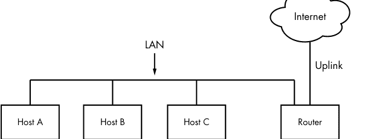

图 9-1：一个带有提供互联网访问路由器的典型局域网

这种网络无处不在；大多数家庭和小型办公室网络都是以这种方式配置的。连接到网络的每台机器都是一个*主机 (host)*。其中一个是*路由器*，它是一个可以将数据从一个地方移动到另一个地方的主机。在这个例子，这四台主机（主机 A、B、C 和路由器）组成了一个局域网 (LAN)。局域网上的连接可以是有线或无线的。局域网没有严格的定义；位于局域网上的机器通常物理距离很近，并共享许多相同的配置和访问权限。你很快就会看到一个具体的例子。

路由器也连接到互联网——在图中是如此。这种连接被称为*上行链路 (uplink)*或广域网 (WAN) 连接，它将小得多的局域网连接到更大的网络。由于路由器同时连接到局域网和互联网，局域网上的所有机器都可以路由器访问互联网。本章的目标之一是查看路由器如何提供这种访问。

你的初始视角将来自基于 Linux 的机器，例如图 9-1 中局域网上的主机 A。

## 9.2 数据包 (Packets)

计算机在网络上通过小数据块传输数据，这些块被称为*数据包*，由两部分组成：*头部 (header)*和*负载 (payload)*。头部包含标识信息，例如源主机和目标主机；而负载，是计算机想要发送的实际数据（例如 HTML 或图像数据）。

主机可以按任何顺序发送、接收和处理数据包，无论它们来自哪里或去向何处，这使得几台主机能够“同时”通信成为可能。例如，如果一个主机需要同时向其他主机传输数据，它可以交替发送包中的目的地。将消息拆成更小的单元也更容易检测和补偿传输中的错误。

在大多数情况下，你不需要担心在数据包和应用程序使用的数据之间进行转换，因为操作系统已经为你完成了这一点。然而，了解数据包在你将要看到的网络层中的作用是有帮助的。

## 9.3 网络层

一个功能健全的网络包含一组被称为网络协议栈 (network stack) 的网络层。任何功能性网络都有一个栈。典型的互联网栈从上到下的结构如下：

- **应用层 (Application layer)** 包含了应用程序和用户通信的“语言”——通常是某种高层协议。常见的应用层协议包括超文本传输协议 (HTTP，用于网页)、加密协议（如 TLS）以及文件传输协议 (FTP)。应用层协议通常可以组合使用。例如，TLS 通常与 HTTP 结合使用形成 HTTPS。
  应用层处理发生在用户空间中。

- **传输层 (Transport layer)** 定义了应用层的数据传输特性。这一层包括数据完整性检查、源端口和目的端口，以及将数据拆分为数据包的规范。传输控制协议 (TCP) 和用户数据报协议 (UDP) 是最常见的。传输层有时被称为主机层。

- **网络层 (Network layer)** 定义了如何将数据包从源主机移动到目标主机。我们目前所知的互联网基于互联网协议版本 4 (IPv4) 和 6 (IPv6)。网络层最重要的方面之一是，它被设计为一种软件网络，对硬件或操作系统没有特殊要求。

- **物理层 (Physical layer)** 定义了如何在物理介质（如以太网或调制解调器）上发送原始数据。这有时被称为链路层。

理解你的网络及其配置 225

《Linux 工作原理 (早期访问)© 2021 Brian Ward》

层与层之间有时以奇怪的方式相互渗透，按顺序处理所有层可能是低效的。例如，历史上只处理物理层的设备现在有时会查看传输和网络层数据进行快速过滤和路由。此外，术语本身可能会引起困惑。例如，TLS 代表“传输层安全”，但实际上它位于更高处，即应用层（在学习基础知识时不必担心这些细节）。

我们将开始查看你的 Linux 机器如何连接网络，以回答章节开头的“是什么”问题。这是栈的下半部分——物理层和网络层。稍后我们将查看回答“如何做”问题的上层。

> 你可能听过另一组被称为开放系统互连模型 (OSI) 参考模型的层。这是一个通常用于教学和网络设计的七层网络模型，但我们不会直接处理这里描述的四层。要了解更多关于层（以及网络）的知识，请参考 Andrew S. Tanenbaum 和 J. Wetherall 的《计算机网络》第五版（Prentice Hall, 2010）。

## 9.4 网络层

我们并不是从网络栈的最底端物理层开始，而是从网络层开始，因为它更容易理解。我们目前所知的互联网基于互联网协议版本 4 (IPv4) 和 6 (IPv6)。网络层最重要的方面之一是，它被设计为一种软件网络，对硬件或操作系统没有特殊要求。

《Linux 工作原理》（早期访问版）© 2021 Brian Ward

我们的讨论将从 IPv4 开始，因为它的地址稍微更容易读（也更容易理解其局限性），但我们将解释 IPv6 的主要区别。

互联网的拓扑是去中心化的；它由称为子网（subnets）的小型网络组成。其理念是所有子网都以某种方式相互连接。例如，在图 9-1 中，域网是一个单一子网。

主机可以连接到多个子网。正如你在第 9.1 节中看到的，如果主机能够将数据从一个子网传输到另一个子网，那么这种主机就是路由器（路由器的另一个术语）。图 9-2 对图 9-1 进行了细化，识别了域网，以及每个主机和路由器的互联网地址。图中的路由器有两个地址：本地子网 10.23.2.1 和通往互联网的链路（互联网链路地址目前并不重要，因此被标记为上行地址 Uplink Address）。我们将首先查看地址，然后是子网掩码表示。

每个主机至少有一个数字 IP 地址。对于 IPv4，它的形式是 a.b.c.d，例如 10.23.2.37。这种表示法中的地址称为点四点（dotted-quad）。如果主机连接到多个子网，则每个子网至少有一个 IP 地址。每个主机的 IP 地址在整个互联网中应该是唯一的，正如你之后看到的，私有网络和网络地址转换（NAT）可能会让这变得有点复杂。

不要担心图 9-2 中的子网表示法；我们很快就会讨论。

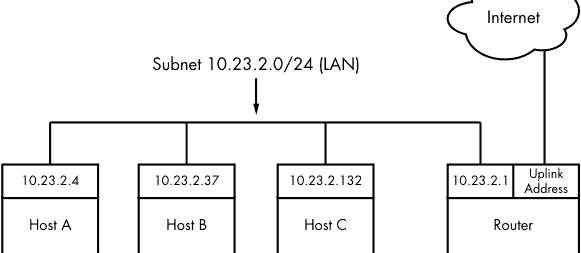

图 9-2: 带有 IP 地址的网络

> 技术上，IP 地址由 4 个字节（或 32 位）组成，abcd。字节 a 和 d 是 0 到 254 之间的数字，b 和 c 是 0 到 255 之间的数字。计算机以原始字节处理 IP 地址。但对于人类来说，读写点四点地址（如 10.23.2.37）要比读写类似十六进制 0x0A170225 容易得多。

IP 地址在某些方面类似于邮政地址。为了与其他主机通信，你的机器必须知道该主机的 IP 地址。让我们来看看你机器上的地址。

理解你的网络及其配置 227

## 9.4.1 查看 IP 地址

一台机器可以有多个 IP 地址，适应多个物理接口、虚拟内部网络等。要查看你 Linux 机器上活动的地址，请运行：

```bash


`$ ip address show`

```
输出可能会有很多（按物理接口分组，在第 9.10 节介绍），但它应该包含类似内容：
```

```
2: enpos3if6 <:BROADCAST,MULTICAST,UP, LOWER_UP> mtu 1500 qdisc fc_codel state

group default qlen 1000

link/ether 40:8d:5c:fc:24:ff brd ff:ff:ff:ff:ff:ff

inet 10.23.2/4 brd 10.23.2.255 scope global enpos3if6

valid_l forever preferred_lft forever
```

`ip` 命令包含了来自网络层（各层）和物理层的许多细节。（有时它甚至完全不包含互联网地址！）我们稍后会详细讨论输出内容，但现在请关注第四行，它报告了主机配置了 IPv4 地址（用 `inet` 表示）10.23.2.4 后面的 `/24` 定义了该 IP 所属的子网。让我们看看它是如何工作的。

> `ip` 命令是标准工具。在其他文档中，你可能会看到 `ifconfig` 命令。这个旧命令在其他版本的 Unix 中使用了几十年，但功能较弱。为了一致性（以及某些发行版可能甚至不包含 `ifconfig`），我们将使用 `ip`。其他替代品是 `route`。

## 9.4.2 子网

之前定义的子网是特定 IP 地址的主机组。例如，10.23.2.1 到 10.23.2.254 范围内的主机构成一个子网。通常，如图 9-2 所示，子网位于同一个物理网络。

你定义一个子网包含两个部分：网络前缀（也称为路由前缀）和子网掩码（有时称为网络掩码或路由掩码）。假设你想创建一个包含 10.23.2.1 和 10.23.2.254 之间 IP 地址的子网。网络前缀是子网中所有地址的共同部分。为了看到前缀和掩码如何共同工作，我们将查看 IP 地址中共同的位位。例如，这里是 10.23.2.0 和 255.255.255.0 的二进制形式：

10.23.2.0: 00001010 00010111 00000010 00000000
255.255.255.0: 11111111 11111111 11111111 00000000

现在，让我们用粗体标记 10.23.2.0 中位于 255.255.255.0 之中的位置。

10.23.2.0: **00001010 00010111 00000010** 00000000

任何包含粗体位的地址都在子网内。查看非粗体的位（最后的 8 个 0），将这些位中的任何数字设置为 0 或 1，都会得到该子网内有效的 IP 地址。

综合来看，你可以看到 IP 地址为 10.23.2.1 且子网掩码为 255.255.255.0 的主机与任何以 10.23.2 开头的计算机位于同一个子网中。你可以将此子网表示为 10.23.2.0/255.255.255.0。

现在让我们看看如何变成你在 `ip` 等工具中看到的简写（如 `/24`）。

## 9.4.3 普通子网掩码和 CIDR 表示法

在大多数工具中，你会遇到一种不同的子网表示形式，称为无类域间路由（CIDR）表示法，其中如 10.23.2.0/255.255.255.0 的子网被写为 10.23.2.0/24。这种简写表示子网共同的前导位。

在大多数工具中，你会遇到一种不同的子网表示形式，称为无类域间路由（CIDR）表示法，其中如 10.23.2.0/255.255.255.0 的子网被写为 10.23.2.0/24。这种简写表示子网共同的前导位。

在大多数工具中，你会遇到一种不同的子网表示形式，称为无类域间路由（CIDR）表示法，其中如 10.23.2.0/255.255.255.0 的子网被写为 10.23.2.0/24。这种简写表示子网共同的前导位。

在大多数工具中，你会遇到一种不同的子网表示形式，称为无类域间路由（CIDR）表示法，其中如 10.23.2.0/255.255.255.0 的子网被写为 10.23.2.0/24。这种简写表示子网共同的前导位。

| 表 9-1: 子网掩码 | 长度格式 | CIDR 形式 |
| :--- | :--- | :--- |
| 255.0.0.0 | Class A | /8 |
| 255.255.0.0 | Class B | /16 |
| 255.255.255.0 | Class C | /24 |
| 255.255.255.128 | | /25 |
| 255.255.255.192 | | /26 |
| 255.255.255.224 | | /27 |
| 255.255.255.240 | | /28 |
| 255.255.255.248 | | /29 |
| 255.255.255.252 | | /30 |
| 255.255.255.254 | | /31 |
| 255.255.255.255 | | /32 |

《Linux 工作原理》（早期访问版）© 2021 Brian Ward 著

10.23.2.1，表示使用默认路由的流量将被发送到 10.23.2.1（在我们的示例网络中，这是一个路由器）；dev enp0s31f 表示物理传输将在该网络接口上发生。

## 9.6 默认网关

路由表中的默认（default）条目具有特殊意义，因为它可以匹配互联网上的任何地址。在 CIDR 记法中，IPv4 的表示为 0.0.0.0/0。它是默认路由，而配置为默认路由中介（intermedi）的地址就是默认网关。当没有其他规则匹配时，默认路由总是会匹配，且在没有其他选择时，默认网关就是你发送消息的地方。你可以配置一个没有默认网关的主机，但它将无法到达路由表目标地之外的主机。

在大多数掩码为 /24 (255.255.255.0)的网络中，路由器通常位于子网的地址 1（例如，10.23.2.0/24 中的 10.23.2.1）。这仅仅是一种约定，但可能存在例外。

# 内核如何选择路由

> 路由中有一个棘手的细节。假设主机想向 10.23.2.132 发送数据，这会同时匹配路由表中的两条规则：默认路由和 10.23.2.0/24。内核如何知道使用后者？路由表中的顺序并不重要；内核选择最长目标前缀匹配。这正是 CIDR 记法特别有用的地方：10.23.2.0/24 匹配，且其前缀长度为 24 位；0.0.0.0/0 也匹配，但其前缀长度为 0 位（即它没有前缀），因此 10.23.2.0/24 的规则具有优先级。

## 9.7 IPv6 地址与网络

如果你回回顾第 9.4 节，你会发现 IPv4 地址由 32 位（或 4 字节）组成。这产生了大约 43 亿个地址，对于目前的互联网规模来说是不够的。IPv4 地址不足导致了多个问题，作为回应，互联网工程任务组（ETF）开发了下一个版本 IPv6。在查看更多网络工具之前，我们先讨论 IPv6 地址空间。

一个 IPv6 地址具有 128 位——32 字节，分为 8 组每组 4 字节。在长格式下，地址写法如下：

```
2001:db8:0a0b:12f0:0000:0000:0000:8b6e
```

该表示法是十六进制的，每个数字范围从 0 到 f。有几种常用的表示法缩写方法。首先，你可以省略任何前导零（例如，0db8 变为 db8），并且有一组——仅有一组连续的零组变为 ::（两个冒号）。然后，你可以写出前面的地址：

```
2001:db8:a0b:12f0::8b6e
```

子网仍然用 CIDR 记法表示。对于终端用户来说，它们通常覆盖了地址空间中一半的位数（/64），但在某些情况下使用的位数更少。地址空间中对每个主机唯一的部分是*接口 ID*。图 9-3 显示了一个带有 64 位子网示例地址的拆解。

| 子网 | 接口 ID |
|---|---|
| 2001:db8:8500:e000 | 52b6:59cc:74e9:8b6e |
| 64 位 | 64 位 |

图 9-3：典型 IPv6 地址的子网和接口 ID

在本书中，我们通常关注普通用户的视角。对于服务提供商来说略有不同，子网被进一步划分为路由前缀和另一个网络 ID（有时称为子网）。现在不用担心这些。

关于 IPv6 需要知道的最后一点是主机通常至少有两个地址。第一个在整个互联网范围内有效的地址被称为全局单播地址（global unicast address）。第二个用于本地网络，即链路本地地址（link-local address），始终具有 fe80::10 前缀，后面跟着一个全零的 54 位网络 ID 和一个 64 位接口 ID。结果是，当你系统中看到链路本地地址时，它将位于 fe80::64 子网。

全局单播地址具有前缀 2000::3。因为第一个字节在该缀下以 001 开头，它可以完成为 0010 或 0011。因此，全局单播地址以 2 或 3 开头。

### 9.7.1 查看系统的 IPv6 配置

如果你的系统有 IPv6 配置，你已经从之前运行的 `ip` 命令中获得了一些 IPv6 信息。要单独提取 IPv6，请使用 -6 选项：

```
$ ip -6 address show
```


```
1: lo: <LOOPBACK,UP,LOWER> mtu 65536 state UNKNOWN qlen 1000

inet ::1/128 scope host valid lft preferred

2: enp0s31f: <BROADCAST,UP,LOWER> mtu 1500 qlen 1000

inet 2001:db8:8500:e000::64 scope global valid lft preferred

inet fe80::52b6:59cc:74e9:8b6e/64 scope link valid lft preferred
```

《Linux 工作原理》（早期访问）© 2021 Brian Ward

出于安全考虑，互联网上的某些主机禁用了对 ICMP 回显数据包的响应，你可能会发现可以连接到某个主机上的网站，但无法获得 ping 响应。

你可以分别使用 `-4` 和 `-6` 选项强制 `ping` 使用 IPv4 或 IPv6。

## 9.8.2 DNS 与主机

IP 地址很难记忆且经常发生变化，这就是为什么我们通常使用如 `www.example.com` 这样的名称。你系统中的域名解析服务 (DNS) 库通常会自动处理这种转换，但有时你可能想手动转换域名和 IP 地址。要查找域名背后的 IP 地址，请使用 `host` 命令：

```bash
$ host www.example.com

example.com has 172.17.216.34

example.com has IPv6 address 2001:db8:220:1:2483:25c8:1946
```

注意，这个示例同时包含了 IPv4 地址 `172.17.216.34` 和长得多的 IPv6 地址。一个主机可能对应多个地址，输出可能会提供额外信息，例如邮件交换器 (mail exchangers)。

你也可以反向使用 `host`：输入 IP 地址而不是主机名。不要期望这种操作能可靠地工作，因为一个 IP 地址可能关联到多个主机，而 DNS 并不知道如何确定这些主机中的哪一个应该对应于该 IP 地址。此外，该主机的管理员需要手动设置反向查找，而管理员往往并不这样做。

DNS 的内容远比 `host` 命令要复杂得多。我们将在第 9.15 节中介绍基础的客户端配置。
`host` 命令有 `-4` 和 `-6` 选项，但它们的工作方式与你预想的不同。它们强制 `host` 命令通过 IPv4 或 IPv6 获取信息，但由于无论网络协议如何，这些信息应该是相同的，因此输出可能会同时包含 IPv4 和 IPv6。

## 9.9 物理层与以太网

理解互联网的关键点之一是它是一个软件网络。我们到为止讨论的内容没有是针对特定硬件的，事实上，互联网成功的原因之一就是它运行在几乎任何类型的计算机、操作系统和物理网络上。然而，如果你真的想与另一台计算机通信，你仍然必须在某种硬件之上建立网络层。这个接口就是物理层。

理解你的网络及其配置 235

在本书中，我们将查看最常见的物理层：以太网网络。IEEE 802 系列文档定义了许多种以太网网络，从有线到无线一应尽有，但它们都有几点共同点：

- 以太网网络上的所有设备都有一个介质访问控制 (MAC) 地址，有时称为硬件地址。该地址独立于主机的 IP 地址，并且对于主机的以太网网络是唯一的（但并不一定对于像互联网这样更大的软件网络）。一个示例 MAC 地址为 `10:78:d2:bc76:97`。
- 网络上的设备以“帧”(frames) 的形式发送消息，帧是对所发送的数据的封装。一个帧包含了源 MAC 地址和目的 MAC 地址。

以太网并没有真正尝试超越单个网络内的硬件限制。例如，如果你有两个不同的以太网网络，并且有一个主机同时连接到这两个网络上（并拥有两个不同的网络接口设备），除非你搭建了以太网桥接，否则你无法将帧从一个以太网传输到另一个以太网。这就是更高网络层（如互联网）大显身场。根据惯例，以太网网络通常是一个互联网子网。尽管帧无法离开一个物理网络，但路由器可以从帧中提取数据、重新封装并将其发送到不同物理网络上的主机，这正是在互联网上发生的情况。

## 9.10 理解内核网络接口

物理层和网络层必须连接起来，以便层能够保留其硬件无关的灵活性。Linux 内核维护了这两层之间的独立划分，并提供了一个链接它们的通信标准：内核网络接口。当你配置网络接口时，你将互联网端的 IP 地址设置与物理设备上的硬件标识连接起来。网络接口通常具有指示底层硬件类型的名称，例如 `enp3s0`（PCI 插槽中的接口）。这种名称被称为“可预测接口设备名称”，因为它在重启后仍保持不变。在启动时，接口具有传统的名称，如 `eth0`（计算机中的第一块以太网）和 `wlan0`（运行系统的无线接口），它们会很快被重命名。

在第 9.4.1 节中，你学习了如何使用 `ip address show` 查看网络接口设置。输出按接口组织的。这里是我们之前看到的：

```text
2: enp3s0if6: <BROCAST,MULTICAST,UP,LOWER_UP> mtu 1500 qdisc fq_codel state UP group default qlen 1000

link/eth0:8d:40:8d:fc:24:1bd br ff:ff:ff:ff:ff:ff

inet 10.23.2.44 brd 10.23.2.255 scope global prefixroute enp3s0if6

valid_lft forever preferred_lft forever
```

236 第 9 章

```text
inet6 fe80::d858:52b6:59cc:74e9:86e/64 scope global dynamic

noprefixroute

valid_lft 86054ac preferred lft 86054ac

inet6 fe80::05dc:97f9:8bc:64 scope link noprefixroute

valid_lft preferred lft forever
```

每个网络接口都有一个数字；这几乎总是第 9.16 节中描述的回环接口。`UP` 标志表示该接口正在工作。除了我们已经涵盖的网络层，你还可以看到物理层的 MAC 地址。

尽管 `ip` 显示了一些信息，我们将介绍如何配置接口。要查看接口状态，请使用 `ip link`。

## 9.11 网络配置简介

我们现在将介绍如何设置接口，但不会进入过细细节，因为很少需要这样做。在配置时，你可能需要：

- 为网络分配 IP 地址
- 设置默认网关
- 配置接口的 MTU
- 为接口设置多个 IP 地址
- 配置接口名称
- 设置接口的 MTU

### 9.11.1 手动配置接口

在此处，我们将查看如何设置接口，但不会进入细节，因为很少需要。配置时，你可能需要：

- 为网络分配 IP 地址
- 设置默认网关
- 配置接口的 MTU
- 为接口设置多个 IP 地址
- 配置接口名称
- 设置接口的 MTU

要查看接口状态，使用 `ip link show`。要向接口添加 IP 地址，使用：

```bash
$ ip addr add 192.168.1.10/24 dev eth0
```

要移除 IP 地址，使用：

```bash
$ ip addr remove 192.168.1.10/24 dev eth0
```

要为接口设置 MTU，使用：

```bash
$ ip link set dev eth0 mtu 1500
```

要启用禁用接口，使用：

```bash
$ ip link set dev eth0 up
$ ip link set dev eth0 down
```

### 9.11.2 手动添加和删除路由

通过接口，你可以添加路由，这通常只是设置默认网关的问题，如下：

```bash
$ ip route add default via 192.168.1.1
```

`via` 参数是默认网关的 IP 地址；它必须是本地连接子网中的地址。

要删除默认网关，运行：

```bash
$ ip route del default
```

你可以轻松地用其他路由覆盖默认网关。例如，假设你的主机位于 `10.23.2.0/24` 子网，你想访问 `192.168.45.0/24` 子网，并且知道 `10.23.2.44` 主机可以作为该子网的路由器。运行此命令将往 `192.168.45.0` 的流量发送到该路由器：

```bash
$ ip route add 192.168.45.0/24 via 10.23.2.44 dev eth0
```

删除路由不需要指定路由器：

```bash
$ ip route del 192.168.45.0/24
```


## 9.12 启动激活的网络配置

我们已经讨论了手动配置网络的各种方法，而确保机器网络配置正确性的传统方法是使用一个初始化脚本，在启动时运行手动配置。这归结底是在启动事件链的某处运行一个像这样的工具。

Linux 曾有过许多尝试来标准化配置文件。`ifup` 和 `ifdown` 工具就是其中之一；例如，启动脚本（在理论上）可以运行 `ifup eth0` 来执行正确的 `ip` 命令以设置接口。遗憾的是，不同的发行版对 `ifup` 和 `ifdown` 的实现完全不同，因此，它们的配置文件也各不相同。

更深层次的差异在于，网络配置元素存在于每一个不同的网络层中；结果是，负责联网的软件分布在内核的不同部分和用户空间工具中，并由不同的开发者编写和维护。在 Linux 中，并没有通用的共识在不同的工具套件或库之间共享配置文件，这意味着一个工具的更改可能会破坏另一个工具的运行。

在几个不同的地方处理网络配置使得系统管理变得困难。因此，出现了几种不同的网络管理工具，每种工具对配置问题都有自己的方法。然而，这些工具往往针对 Linux 机器可以担任的特定类型。某个工具可能可以在桌面设备上工作，但不适用于服务器。

一种名为 Netplan 的工具提供了一种不同的配置方法。Netplan 并不是管理网络，它只是一个统一的配置标准以及一个将配置转换为现有网络管理器所用文件的工具。目前，Netplan 支持 NetworkManager 和 `systemd-networkd`，我们将在本章稍后部分讨论它们。Netplan 文件采用 YAML 格式，位于 `/etc/netplan`。

在讨论网络配置管理器之前，让我们更仔细地观察它们面临的一些问题。

## 9.13 手动和启动激活网络配置的问题

尽管大多数系统过去在它们的启动机制中配置网络——而且许多服务器也是这样做的——但现代网络的动态性质意味着大多数机器没有静态（不变的）IP 地址。在 IPv4 中，你的机器并不是在本地上存储 IP 地址和其他网络信息，而是在首次连接到该网络时，从本地物理网络的某处获取这些信息。大多数网络客户端应用程序并不特别关心你的机器使用什么 IP 地址，只要能用即可。第 9.19 节描述的动态主机配置协议（DHCP）为典型的 IPv4 客户端工具基本的网络层配置。在 IPv6 中，客户端能够在某种程度上进行自我配置；请在第 9.20 节简要查看这一点。

然而，故事不止于此。例如，无线网络为接口配置增加了更多维度，例如网络名称、身份验证和加密技术。当你退后观察大局时，你会发现系统需要一种方法来回答以下问题：

- 如果机器有多个物理网络接口（例如带有有线和无线以太网的笔记本电脑），你如何选择一个或几个使用？
- 机器应该如何设置物理接口？对于无线网络，包括扫描网络名称、选择名称以及协商身份验证。
- 一旦物理网络接口连接，机器应该如何设置软件网络层（例如互联网层）？
- 你如何让用户选择连接选项？例如，你如何让用户选择无线网络？
- 如果机器在网络接口上丢失连接，它应该做什么？

回答这些问题通常超过了简单启动脚本能够处理的范围，手动操作这非常麻烦。答案是使用一个可以监控物理网络并根据一组符合用户逻辑规则选择（自动配置）内核网络接口的系统。该服务还应该能够响应用户的请求，而用户应该可以在不需要成为 root 权限的情况下更改他们连接的无线网络。

## 9.14 网络管理器

在基于 Linux 的系统中，自动配置网络有几种方法。桌面和笔记本电脑上最广泛使用的选项是 NetworkManager。系统有一个插件 `systemd-networkd`，它可以进行基础网络配置，对于不需要太大灵活性的机器（如服务器）很有用，但它不具备 NetworkManager 那样的动态能力。其他网络配置管理系统主要针对较小的嵌入式系统，例如 OpenWRT 的 `netifd`、Android 的 `ConnectivityManager` 服务、ConnMan 和 Wick。

我们将简要讨论 NetworkManager，因为你最可能遇到它。不过，我们不会进入过细节，在你在使用基础知识后，NetworkManager 和其他配置系统将变得容易理解。如果你对 systemd-networkd 感兴趣，`systemd.network(5)` 手页描述了设置，配置目录为 `/etc/systemd/network`。

### 9.14.1 NetworkManager 操作

NetworkManager 是系统启动时运行的一个守护进程。像大多数守护进程一样，它不依赖运行中的桌面组件。它的工作是监听来自系统和用户的事件，并根据一组规则更改网络配置。

运行时，NetworkManager 维持两个基础级别的配置。第一种是关于可用硬件设备的信息集，它通常从内核收集并通过监控桌面总线（D-Bus）来获取。第二种配置是一个更具体的连接列表：硬件设备和额外的网络配置参数。例如，一个无线网络可以表示为一个连接。

为了激活一个连接，NetworkManager 经常将任务委托给其他网络工具和守护进程，例如通过 `dhclient` 从本地网络获取互联网层配置。由于网络配置工具和方案在发行版之间存在差异，NetworkManager 使用插件与之交互，而不是强制实施自己的标准。对于/Ubuntu 和 Red Hat 风格的接口配置都有插件。

启动时，NetworkManager 收集所有可用网络设备信息，搜索其连接列表，然后决定激活哪一个。以下是对以太网接口决策的方法：

- 如果连接可用，尝试使用它连接。否则，尝试无线连接。
- 扫描可用无线网络列表。如果有你以前连接过的网络可用，NetworkManager 将再次尝试。
- 如果有多个以前连接过的无线网络可用，选择最近连接的一个。

建立连接后，NetworkManager 会一直维持，直到连接丢失、出现更好的网络（例如，在通过无线连接时插插了网线）或用户强制更改。

### 9.14.2 NetworkManager 交互

大多数用户通过桌面上的小程序与 NetworkManager 交互；它通常是右上角或右下角的图标，指示连接状态（有线、无线或未连接）。当你点击图标时，你会获得多个连接选项，例如无线网络选择和断开当前网络的选项。每个桌面环境都有自己的小程序版本，因此它们在每个系统中看起来略有不同。

除了小程序外，还有几个工具可以让你从 shell 查询并控制 NetworkManager。要快速查看连接状态的摘要，请不带参数地运行 `nmcli` 命令。

《Linux 工作原理》（早期访问版）© 2021 Brian Ward

你将获得一个接口列表和配置参数。在某些方面，这类似于 `ip` 命令，但它提供了更详细的信息，特别是在你查看无线连接时。

`nmcli` 命令允许你从命令行控制 NetworkManager。这是一个相当复杂的命令；事实上，除了通用的 `nmcli(1)` 手册页外，还有一个 `nmcli-examples(5)` 手册页。

最后，`mm-online` 工具将告诉你网络是开启还是关闭状态。如果网络已开启，命令返回 0 作为其状态码；否则返回非零（有关如何在 shell 脚本中使用退出码的更多信息，请参见第 11 章）。

## 9.14.3 NetworkManager 配置

NetworkManager 的通用配置通常位于 `/etc/NetworkManager`，有多种类型的配置。通用配置文件是 `NetworkManager.conf`。其格式与 XDG-desktop 和 Microsoft `.ini` 文件类似，键值参数分为不同的部分（sections）。你会发现几乎每个配置都有一个 `[main]` 部分，用于定义插件的使用。这里是一个简单的示例，用于激活 Ubuntu 和 Debian 的 ifupdown 插件：

```
[main]

plugins=ifupdown,keyfile
```


特定于发行版的插件有 `ifcfg-rh`（用于 Red Hat 系发行）和 `ifcfg-sue`（用于 SuSE）。你在这里看到的 `keyfile` 插件支持 NetworkManager 的原生配置文件支持。使用该插件，你可以在 `/etc/NetworkManager/system-connections` 中查看系统中所有的已知连接。

大多数情况下，你不需要更改 `NetworkManager.conf`，因为更具体的配置选项位于其他文件中。

### 未托管接口 (Unmanaged Interfaces)

尽管你可能希望 NetworkManager 管理你的大部分网络接口，但在某些情况下你可能希望忽略某些接口。例如，用户不需要对 localhost (lo) 接口进行任何动态配置，因为它的配置永远不会改变。你还希望在启动过程早期配置此接口，因为基础系统服务依赖于它。大多数发行版都让 NetworkManager 避开 localhost。

你可以通过插件告诉 NetworkManager 忽略某个接口。如果你在使用 `ifupdown` 插件（例如在 Ubuntu 和 Debian 中），请将接口配置添加到 `/etc/network/interfaces` 文件中，然后在 `NetworkManager.conf` 文件的 `[ifupdown]` 部分将 `managed` 的值设置为 `false`：

```
[ifupdown]

managed=false
```

对于在 Fedora 和 Red Hat 上使用的 `ifcfg` 插件，请在 `/etc/sysconfig/network-scripts` 目录下包含 `ifcfg-*` 的文件中查找如下行：

```
NM_CONTROLLED=yes
```

如果不存在此行或值设置为 `no`，NetworkManager 将忽略该接口。在 localhost 的情况下，你会在 `ifcfg` 文件中找到它。你也可以指定一个硬件地址进行忽略，例如：

```
HWADDR=10:78:d2:de:76:97
```

如果你不使用这两种配置方案中的任何，可以使用 `keyfile` 插件直接在你的 `NetworkManager.conf` 文件中使用 MAC 地址来指定未托管设备。这里有一个显示两个未托管设备的示例：

```
[keyfile]

unmanaged-devices=mac:10:78:d2:de:76:97;mac:65:9d:cc:ff:b9
```

### 分发 (Dispatching)

NetworkManager 配置的最后一个细节与在网络接口开启或关闭时指定额外的系统操作有关。例如，某些守护进程需要知道何时开始或停止在接口上监听以便正常工作（例如下一章讨论的 she 守护进程）。

当系统网络状态发生变化时，NetworkManager 会运行 `/etc/NetworkManager/dispatcher.d` 中的所有内容，并带有如 `up` 或 `down` 的参数。这相对简单，但许多发行版有自己的网络控制脚本，因此它们不会将单独的补丁脚本放在此目录。Ubuntu 只有一个名为 `0ifupdown` 的脚本，它会运行 `/etc/network/if-up.d` 中适当子目录下的所有内容。

对于其余的 NetworkManager 配置，这些脚本的细节并不重要；你只需要知道在需要添加或更改时如何追踪到合适的位置（或者使用 Netplan 并让它为你确定位置）。一如既往，不要只盯着你系统上的脚本看，

## 9.15 解析主机名 (Resolving Hostnames)

任何网络配置的最终任务之一是通过 DNS 进行主机名解析。你已经见过主机名解析工具，它可以将如 `www.example.com` 的名称翻译为 IP 地址 `10.23.2.132`。

DNS 与我们看过的网络元素不同，因为它位于应用层，完全处于用户空间。从技术上讲，它与网络和物理层讨论放在这一章中显得有些突兀。然而，如果没有适当的 DNS 配置，你的互联网连接实际上毫无用处。没有清醒的人会为网站和电子邮件发布 IP 地址（更不用 IPv6 地址），因为主机的 IP 地址会发生变化，而且不容易记忆。

理解你的网络及其配置 243

几乎所有系统都会执行 DNS 查询。该过程通常如下：

1. 应用程序调用解析器库来查找主机名。
2. 解析器库首先查询 `/etc/hosts`。
3. 如果未找到条目，它将向 DNS 服务器发送查询。
4. 如果 DNS 服务器没有答案，它将返回另一个名称服务器的引用。
5. 解析器随后对新服务器重复此过程。
6. 一旦找到答案，它将其返回给应用程序。

如果没有找到答案，解析器将返回错误。这是大多数 Linux 系统主机名解析的方式。

### 9.15.2 resolv.conf

传统的 DNS 配置文件是 `/etc/resolv.conf`。当情况较简单时，一个典型的示例可能如下：

```
search mydomain.com example.com

nameserver 10.32.45.2

nameserver 10.3.2
```

`search` 行定义了针对不完整主机名的规则（例如 myserver.com）。在这里，解析器会尝试查找 myserver.com 和 example.com。通常 DNS 不如此简单。

### 9.15.1 hosts

在大多数系统中，你可以通过 `/etc/hosts` 文件覆盖查询。它通常看起来像：

```
127.0.0.1       localhost

127.0.1.1       yourhostname

::1             localhost
```

如果你希望在不进行大量配置的情况下在本地网络上查找名称，此文件可能特别不灵活。例如，如果你在网络上设置了一个网络应用程序，你希望能够立即通过名称调用它。这是零配置名称服务系统的一部分，如多播 DNS (`mDNS`) 和本地多播名称解析 (`LLMNR`)。如果进程想要在本地查找主机，它会在网络上广播请求；如果存在，目标主机将回复其地址。这些协议不仅提供主机名解析，还提供可用服务的信息。

### 9.15.3 缓存与零配置

传统的 DNS 配置有两个主要问题。本地机器不缓存名称服务器回复，因此频繁的重复访问可能会非常缓慢。为了解决这个问题，许多机器（以及作为名称服务器的路由器）运行一个中间守护进程来拦截名称服务器请求并缓存回复，尽可能使用缓存答案。这些守护进程中最常见的是 `system-resolved`；你可能在系统上使用 `dnsmasq` 或 `local`。你也可以设置 BIND（标准的 Unix 名称服务器守护进程）作为缓存。如果你在 `/etc/resolv.conf` 文件中看到 `127.0.0.53` 或 `127.0.0.1`，或者在运行 `nslookup -debug` 时列出的服务器，通常表示正在运行缓存守护进程。但请仔细观察。如果你在使用 `system-resolved`，你可能会发现 `resolv.conf` 甚至 `/etc` 下的一个文件；它是指向 `run` 中一个自动生成文件的链接。

`system-resolved` 的功能远比表面看到的要复杂，因为它可以结合多种查找服务并为每个接口以不同的方式暴露它们。这解决了传统名称服务器设置的问题：如果你希望在不进行大量配置的情况下在本地网络上查找名称，它可能特别不灵活。

# Linux 如何工作（早期访问）© 2021 Brian Ward 版所有

你可以使用 `resolvectl` 命令检查当前的 DNS 设置（注意在较旧的系统中，该命令可能被称为 `systemd-resolve`）。
你将获得全局设置列表（通常很有用），并看到每个单独接口的设置。它看起来像这样：

```
Link 2 (enp0s3if6)

Current Scopes: DNS

LLMR setting: yes

MulticastDNS setting: no

DNSSEC setting: no

DNSSEC supported: no

DNS Servers: 8.8.8.8

DNS Domain: ~
```


你在这里可以看到各种名称解析协议，以及 `systemd-resolved` 在遇到不认识的名称时查询的名称服务器。
我们不再深入讨论 DNS 或 `systemd-resolved`，因为这是一个非常庞杂的话题。如果你想更改设置，请查看 `resolved.conf(5)` 手册页并着修改 `/etc/systemd/resolved.conf`。不过，你可能需要阅读一些关于 `system-resolved` 的文档，或者从诸如 Cricket Liu 和 Paul Albitz 编写的《DNS and BIND, 5th edition》（O'Reilly, 2006）等书籍中熟悉 DNS。

## 9.15.4 /etc/nswitch.conf

在离开名称查找主题之前，有一个你应该注意的最后一个设置。`/etc/nswitch.conf` 文件是控制系统上若干与名称相关的优先级设置的传统接口（如用户和密码信息），它包含一个主机查找设置。你系统上的文件应该有这样的一行：

```
hosts: dns
```

在此处将文件放在 `dns` 之前，可以确保在查找主机时，你的系统在询问任何 DNS 服务器（包括 `systemd-resolved`）之前会检查 `/etc/hosts` 文件进行主机查找。这通常是一个好主意（特别是对于查找 `localhost`，但你的 `/etc/hosts` 文件应该越短越好）。不要在里面放入任何东西来提升性能；这样做会适你。你可以在 `/etc/hosts` 中放置小型私有局域网内的主机，通常规则是：如果特定主机有 DNS 条目，那么它就不应该出现在 `/etc/hosts` 中。（`/etc/hosts` 文件在启动早期阶段解析主机也非常有用，此时网络可能还不可用。）
这一切都是通过系统库中的标准调用实现的。要记住名称查找发生的所有地方可能很复杂，如果你需要从下向上追踪某些内容，可以从 `/etc/nswitch.conf` 开始。

第 9 章

## 9.16 Localhost

当运行 `ip address show` 时，你会注意到 `lo` 接口：

```
1: lo: <LOOPBACK_UP,LOWER_UP> mtu  65536 qdisc noqueue state UNKNOWN group

del 1000

link/loopback 00:00:00:00:00:00 brd 00:00:00:00:00:00

inet 127.0.0.1/8 scope host

    valid_lft forever

inet6 ::1/64 scope host

    valid_lft forever
```

`lo` 是一个回环（loopback）虚拟网络接口，因为它“回到”自身。其效果是当向 `127.0.0.1`（或 IPv6 的 `::1`）发出的数据到达 `lo` 接口时，内核只是将其重新封装并通过 `lo` 发回给内核。默认情况下，`lo` 供任何程序使用。回环接口在启动时配置，例如 Ubuntu 的 `/etc/network/interfaces`。然而，这通常是冗余的，因为回环接口允许你在不同的 IPv4 地址上运行不同的服务器。一个利用此特点的服务器是 `systemd-resolved`，它使用 `127.0.0.53` 的 `53` 端口。到为止，IPv6 只有一个回环地址，但有提议更改此项。

## 9.17 传输层：TCP、UDP 和服务

到为止，我们只看到了数据包如何在互联网上从一个主机移动到另一个主机。本章现在开始，重要的是了解你的计算机如何呈现来自其他地方的数据包。对于用户空间程序处理原始数据是非常困难的。灵活性尤其为重要：多个应用程序应该能够与网络通信（例如，多个客户端）。传输层协议桥接了原始数据包与应用程序之间的差距。两个最流行的传输协议是传输控制协议（TCP）和用户数据报协议（UDP）。我们将重点关注 TCP，因为它是最常用的协议，但我们也会快速看一眼 UDP。

### 9.17.1 TCP 端口与连接

TCP 为一台机器上的多个应用程序提供了端口，这些与 IP 地址配合使用。主机的 IP 地址是邮件地址，端口号就像邮箱——它是进一步的划分。使用 TCP 时，应用程序（不要与 NetworkManager 混淆）在自己的机器端口和远程主机的端口之间建立连接。例如，像网页浏览器这样的应用程序可以在自己的机器端口 `36406` 和远程主机的端口 `80` 之间建立连接。从应用程序的角度来看，`36406` 是本地端口，`80` 是远程端口。你可以通过 IP 地址和端口对来识别连接。使用 `netstat` 查看你机器上打开的连接。这是一个显示 TCP 连接的示例；`-n` 禁用主机名解析（DNS），`-t` 限制输出为：

```
$ netstat -nt

Active connections

Proto Recv-Q Send-Q Local Address Foreign State

tcp 0 0 10.23.2.4:47626 194.79.125:5222 ESTABLISHED

tcp 0 0 10.23.2.4:41475 172.24.54.234:43035 ESTABLISHED

tcp 0 0 10.23.2.4:57132 192.168.1.2 ESTABLISHED
```

本地地址（Local Address）和外部地址（Foreign Address）指的是从你机器的角度来看连接，因此这里的机器配置了接口 `10.23.2.4`，本地侧的端口 `47626`、`41475` 和 `57132` 都已连接。第一个连接显示端口 `47626` 连接到 `194.79.125` 的端口 `5222`。要显示 IPv6 连接，在 `netstat` 选项中添加 `-6`。

### 建立连接

要建立传输层连接，一个主机上的进程通过一系列数据包从它的一个本地端口向第二个主机的端口发起连接。为了识别传入的连接并响应，第二个主机必须在正确的端口上有一个监听的进程。通常，建立连接的进程被称为客户端，监听者被称为服务器（更多信息见第 10 章）。关于端口需要了解的重要点是，客户端在自己侧选择一个当前未使用的端口，并且几乎总是连接到服务器端的某个已知端口。回想上一节中 `netstat` 命令的输出：

```
Proto Recv-Q Send-Q Local Address Foreign State

tcp 0 0 10.23.2.4:47626 194.79.125:5222 ESTABLISHED
```


凭借对编号规范的少量知识，你可以看到这个连接可能是由本地客户端向远程服务器发起的，而端口 `47626` 是动态分配的，`5222` 是已知的。

《Linux 工作原理》（早期访问）© 2021 Brian Ward

第一列是名称，第二列指示端口号和特定的传输层协议（可以是 TCP 的其他）。

> 注意：除了 `/etc/services` 之外，位于 `http://www.iana.org/` 的端口在线注册受 `RFC 6335` 网络标准文档的管理。

在 Linux 上，只有以超级用户（root）身份运行的进程才会使用 `1` 到 `1023` 端口，这些也称为系统端口、常用端口或特权端口。所有用户都可以在 `1024` 及以上的端口上监听并创建连接。

## TCP 的特性

TCP 是一种传输层协议，因为它对应用侧的要求相对较小。应用程序进程只需要知道如何打开（或监听）、读取、写入和关闭一个连接。对于应用程序而言，这就像是有入站和出站的数据流；进程的操作几乎像处理文件一样简单。

然而，在后台有大量工作在进行。首先，TCP 实现需要知道如何将进程发出的数据流拆分为数据包。但更困难的部分是，当传入的数据包不一定按正确顺序到达时，如何将一系列数据包转换为读取器的输入数据流。此外，主机端 TCP 必须检查错误：数据包在互联网上传输时可能会丢失或损坏，TCP 实现必须检测并纠正这些情况。图 9-4 显示了使用 TCP 发送消息的简化过程。

幸运的是，在这个混乱中，你不需要了解其他，只需知道 Linux TCP 实现主要在内核中，并且与传输层交互的工具倾向于操作内核数据结构。一个例子是 9.25 节中使用的 `iptables` 过滤系统。

## 9.17.2 UDP

UDP 是比 TCP 更简单的传输层协议。它定义了单条消息的传输；没有数据流。同时，与 TCP 不同，UDP 不会检查丢失或乱序的数据包。事实上，尽管 UDP 有端口，但它甚至没有连接！一个主机从它的一个端口将消息发送到服务器的某个端口，如果服务器想回话，就会发送内容。然而，UDP 对数据包内部有错误检测；主机可以检测到数据包是否损坏，但它不必对此做任何处理。

如果说 TCP 像是在打电话，那么 UDP 就像写信或发即时消息（尽管即时消息更可靠）。使用 UDP 的应用程序关注的是速度——尽可能地发送消息。它们不需要 TCP 的开销，因为它们假设两个主机之间的网络通常是可靠的。它们不需要 TCP 的错误纠正，因为它们有自己的错误检测系统，或者干脆不在乎错误。

《Linux 工作原理》（早期访问）© 2021 Brian Ward

要用 TCP 发送的消息

| 嗨！你今天怎么样？ |

源主机将消息拆分为数据包。

| Seq: 1 | Seq: 2 | Seq: 3 | Seq: 4 | Seq: 5 |
| Hi H | ow ar | e you t | oday | ? |

互联网将数据包携带到终点。


数据包到达目的主机（不一定按照传输顺序到达）

| Seq: 1 | Seq: 2 | Seq: 4 | Seq: 3 | Seq: 5 |
| Hi H | ow ar | oday | e you t | ? |

目的主机从数据包重构消息。

| 嗨！你今天怎么样？ |

图 9-4：使用 TCP 发送消息

使用 UDP 的应用程序示例是网络时间协议（NTP）。客户端发送一个短而简单的请求来获取当前时间，服务器的响应同样简短。因为客户端希望尽快得到响应，所以 UDP 适合该应用程序；如果服务器的响应在网络中某处丢失了，客户端只需重新发送请求或放弃。另一个例子是视频聊天。在这种情况下，画面通过 UDP 发送，如果某些片段在途中丢失了，接收端的客户端将尽力补偿。

本章的其余部分将处理更高级的网络主题，例如网络过滤和路由器，它们与我们已经看到的底层网络层相关：物理层、网络层和传输层。如果你愿意，可以随时跳到下一章，查看应用层，那里一切在用户空间中汇合。你将看到进程实际上在使用网络，而不仅仅是围绕着地址和数据包。

## 9.18 重温简单的本地网络

现在我们将查看 9.4 节中引入的简单网络的额外组件。该网络由一个作为子网局域网（LAN）和一个连接该子网与互联网其他部分的路由器组成。你将学习到：

- 子网上的主机如何自动获取其网络配置
- 如何设置路由
- 路由器到底是什么
- 如何知道为子网应使用哪些 IP 地址
- 如何设置防火墙以过滤来自互联网的流量

对于大多数情况，我们将集中在 IPv4 上（即使没有其他原因，地址也更容易读），但当 IPv6 有不同时，你将看到其差异。
让我们从查看子网上的主机如何自动获取网络配置开始。

## 9.19 理解 DHCP

在 IPv4 下，动态主机配置协议（DHCP）负责分配 IP 地址、子网掩码、默认 DNS 服务器。通过无需手动输入这些参数，网络管理员通过 DHCP 获得了其他优势，例如防止地址冲突和错误配置。

为了让主机获取配置，它必须向服务器发送消息。因此，每个物理网络应该有一个自己的服务器，在简单的网络中，路由器通常充当。当进行初始 DHCP 请求时，主机甚至不知道服务器地址，所以它向所有主机广播请求。

《Linux 工作原理》（早期访问）© 2021 Brian Ward

当机器向 DHCP 服务器请求分配 IP 地址时，租约时间为。当租约到期时，客户端可以更新租约。

### 9.19.1 Linux DHCP 客户端

尽管有许多网络管理器系统，但只有两个 DHCP 客户端执行获取租约的工作。传统的客户端是互联网软件协会（ISC）的 `dhclient` 程序。然而，`systemd-networkd` 也包含一个内置 DHCP 客户端。

启动时，`dhclient` 将其 PID 存储在 `/var/run/dhclient.pid` 并将租约信息存储在 `/var/lib/dhcp/leases`。你可以在命令行手动测试 `dhclient`，但在之前必须删除默认网关路由（9.11.2）。要运行测试，只需指定接口名称（这里是 `en31f`）

```bash
# dhclient en31f
```

与 `dhclient` 不同，`systemd-networkd` DHCP 客户端无法在命令行手动运行。其配置 `.network(5)` 手页位于 `/etc/systemd/network`，但与其他类型的网络配置一样，可以由 Netplan 自动生成。

### 9.19.2 Linux DHCP 服务器

你可以让 Linux 机器运行 DHCP 服务器，这对它分配的地址提供了很好的控制。然而，除非你正在管理一个具有许多子网的大型网络，否则你可能使用内置 DHCP 服务器的专用路由器硬件更好。

关于 DHCP 服务器最重要的一点可能是你在同一个子网上只运行一个，以避免 IP 地址冲突或错误配置的问题。

## 9.20 自动 IPv6 网络配置

DHCP 在实践中运行得很好，但它依赖于某些假设，包括会有 DHCP 服务器可用、服务器实现正确且稳定，并且它可以跟踪和维护租约。尽管有一个针对 IPv6 的 DHCP 版本称为 `DHCPv6`，但还有另一种更常见的方案。

IETF 利用庞大的 IPv6 地址空间设计了一种不需要中心服务器的新网络配置方法。这被称为无状态配置，因为客户端不需要存储任何如租约分配的数据。

《Linux 工作原理》（早期访问版）© 2021 Brian Ward

无状态 IPv6 网络配置从本地链路（link-local）网络开始。回想一下，该网络包括以 `fe80::64` 为前缀的地址。由于本地链路上的地址非常多，主机可以生成一个在网络任何地方都不可能重复的地址。此外，由于前缀是固定的，主机可以在网上发送广播，询问网络上是否有其他主机正在使用该地址。

无状态配置依赖于最多 64 位的全局网络前缀；其子网掩码为 `/64` 或更低。

> 注意
> 路由器还会响应主机向路由器请求消息（router solicitation messages）发送 RA 消息。这些消息以及其他一些消息是 IPv6 的 ICMP 协议（ICMPv6）的一部分。

## 9.21 将 Linux 配置为路由器

路由器仅仅是具有多个网络接口的计算机。你可以轻松地将 Linux 机器配置为路由器。

让我们来看一个例子。假设你有两个局域网（LAN）子网：`10.23.2.0/24` 和 `192.168.45.0/24`。为了连接它们，你有一个拥有三个网络接口的 Linux 路由器机器：两个用于局域网子网，一个用于互联网上行链路，如图 9-5 所示。

如你所见，这与本章其余部分的简单网络示例没有太大区别。路由器用于局域网的 IP 地址为 `10.23.2.1` 和 `192.168.45.1`。当配置了这些地址后，路由表看起来如下（接口名称在实际操作中可能会不同；请忽略接口链接）：

```
# ip route
10.23.2.0/24 dev ens0s3f6 proto kernel link src 10.23.2.1 metric 100
```


192.168.45.0/24 dev ens0s3f6 proto kernel link src 192.168.45.1 metric 100

现在，假设每个子网上的主机都将路由器作为默认网关（对于 `10.23.2.0/24` 为 `10.23.2.1`，对于 `192.168.45.0/24` 为 `192.168.45.1`）。如果 `10.23.2.4` 向 `10.23.2.0/24` 之外的任何地方发送数据包，它会将数据包传给 `10.23.2.1`。例如，从 `10.23.2.4`（主机 A）向 `192.168.45.61`（主机 E）发送数据包，该数据包通过其 `ens0s3f6` 接口到达 `10.23.2.1`（路由器），然后通过路由器的 `ens0s1` 接口传出去。

### 子网 10.23.2.0/24 (LAN)

| 10.23.2.4 | 10.23.2.37 | 10.23.2.132 | 10.23.2.1 | 上行地址 | 192.168.45.1 |
| :--- | :--- | :--- | :--- | :--- | :--- |
| 主机 A | 主机 B | 主机 C | | 路由器 | |

### 子网 192.168.45.0/24 (LAN)

| 192.168.45.2 | 192.168.45.61 | 192.168.45.163 | |
| :--- | :--- | :--- | :--- |
| 主机 D | 主机 E | 主机 F | |
| 路由器连接的子网网 | | |

图 9-5：连接路由器的两个子网

然而，在某些基础配置中，Linux 内核不会在子网之间移动数据包。为了启用此功能，你需要使用以下命令内核：

```
# sysctl -w net.ipv4.ip_forward=1
```

一旦输入此命令，内核将开始路由数据包。你可以通过 `sysctl` 检查状态。要使此更改永久生效，你可以添加到 `/etc/sysctl.conf` 文件中。

当路由器具有互联网上行链路时，局域网主机使用其作为默认网关。这时事情变得复杂。

### 9.22 私有网络 (IPv4)

假设你决定构建自己的网络。路由器已就绪。对于你熟悉的 IPv4，下一个问题是：“我应该使用哪个子网？”

如果你想拥有互联网无法查看的私有地址块，可以使用 RFC1918 定义的范围。这些范围在家庭和办公室网络中很常见，如表 9-2 所示：

表 9-2：由 定义的私有网络

| 网络 | 子网 | CIDR |
| :--- | :--- | :--- |
| 10.0.0.0 | 255.0.0.0 | 10.0.0.0/8 |
| 172.16.0.0 | 255.240.0.0 | 172.16.0.0/12 |
| 192.168.0.0 | 255.255.0.0 | 192.168.0.0/16 |

问题是，路由器只有一个公网 IP 地址，但内部网络有许多主机需要访问互联网。路由器无法简单地传到互联网，因为地址不可路由。

### 9.23 网络地址转换 (IP 伪装)

NAT 是家庭和小型网络中最常用的技术。在 Linux 中，人们使用的 NAT 变体被称为伪装（masquerading）。

NAT 的基本思想是路由器不仅仅是将数据包从一个子网移动到另一个；它在移动时进行转换。其工作原理如下：

1. 内部网络上的主机想要与外部建立连接，因此它通过路由器发送数据包。
2. 路由器拦截连接请求，而不是将其传到互联网（在那里会因为地址不可路由而丢失）。
3. 路由器确定连接请求的目标并与目标建立连接。
4. 当路由器获得连接时，向内部主机返回伪造的“连接已建立”消息。
5. 现在路由器是内部主机和目的地之间的中间件。目的地对内部主机一无所知；远程主机上的连接看起来像是从路由器发出的。

这听起来并不完全简单。普通的 IP 路由只知道源目的地址。然而，如果路由器只处理网络层，内部网络上的每个主机一次只能与同一个目标建立一个连接（还有其他限制），因为网络层没有信息可以区分来自同一主机到同一目的地的多个请求。因此，NAT 必须越过网络层并解析数据包以提取标识信息，特别是传输层的 UDP 和 TCP 端口号。UDP 相对简单，因为不涉及端口，但 TCP 端口是复杂的。

接下来你需要运行一些复杂的 iptables 命令让路由器为其私有子网执行 NAT。这里有一个适用于 `enps02` 上的以太网共享 `enps031f` 外部连接的示例（你将在第 9:25 节学习更多关于 iptables 的语法）：

```
# sysctl -w net.ipv4.ip_forward=1

# iptables -P FORWARD DROP

# iptables -t nat POSTROUTING -o enps031f -j MASQUERADE

# iptables -A FORWARD -i enps031f -o enps02 -m state --state ESTABLISHED,RELATED -j ACCEPT

# iptables -A FORWARD -i enps02 -o enps031f -j ACCEPT
```


《Linux 工作原理》（早期访问版）© 2021 Brian Ward

你可能永远不需要手动输入这些命令，除非你正在开发自己的软件，特别是考虑到现在有许多特殊用途的路由器硬件。然而，各种虚拟化软件可以设置 NAT，用于虚拟机和容器的网络连接。尽管 NAT 在实践中非常有效，但请记住，它本质上是一种扩展 IPv4 地址空间寿命的临时方案。得益于 9.7 节描述的更丰富、更复杂的地址空间，IPv6 不需要 NAT。

## 9.24 路由器与 Linux

在宽带发展的早期，需求较低的用户只需将机器直接连接到互联网。但很快地，许多用户就希望与自己的网络共享单条宽带连接，特别是 Linux 用户经常设置一台额外的机器作为 NAT 路由器。

制造商对这一新市场做出了反应，提供了专用的路由器硬件，这些由高效处理器、一些闪存和几个网络端口组成——拥有足够的功率管理典型的简单网络、运行 DHCP 服务器等重要软件并使用 NAT。在软件方面，许多制造商转向 Linux 来驱动他们的路由器。他们添加了内核功能，精简了用户空间软件，并创建了基于 GUI 的管理界面。

这些路由器一一出现，许多人就对深入研究硬件产生了兴趣。Linksys 要求根据其某个组件的许可发布其软件源代码，很快，针对路由器的 OpenWRT 等专用 Linux 发行版就出现了。（这些名称中的“WRT”源于 Linksys 的型号数字。）

你可以利用此书中的许多知识来检查自定义固件的细节，尽管你会遇到一些差异，特别是在登录时。与许多嵌入系统一样，开源固件倾向于使用 `BusyBox` 来提供许多 shell 功能。`BusyBox` 是一个单一的可执行程序，提供了 shell、`ls`、`cat` 等许多 Unix 命令的功能（这节省了大量内存）。此外，嵌入系统的启动初始化非常简单。然而，你通常不会发现这些限制成为问题，因为自定义固件通常包含了与厂商类似的 Web 管理界面。

## 9.25 防火墙

路由器应该包含某种防火墙来过滤网络中的不良流量。防火墙是一种软件或硬件配置，通常位于互联网和局域网之间，试图确保来自互联网的“坏”流量不会损害局域网。你也可以在任何主机上设置防火墙功能，在数据层级过滤所有入站和出站数据（而不是应用层级）。单机上的防火墙有时被称为 IP 过滤。

系统可以在接收数据包、发送数据包或转发（路由）数据包到另一个主机或网关时过滤。如果没有防火墙，系统只会处理数据包并将其发送。防火墙根据以下标准对数据包进行丢弃、拒绝或接受操作：

- 源或目的 IP 地址或子网
- 源或目的点（在传输层中）
- 防火墙的网络接口

防火墙提供了 Linux 内核处理 IP 数据包的机会。让我们来看看。

### 9.25.1 Linux 防火墙基础

在 Linux 中，你在链（chain）中创建防火墙规则。一组规则组成一个表（table）。当数据包通过网络系统的各个部分时，内核将链中的规则应用于数据包。例如，来自物理层的新数据包被内核分类为“input”，因此激活 input 链中的规则。

所有这些数据结构都由内核维护。整个系统被称为 `iptables`，它是创建和操作规则的用户空间命令。

有一个名为 `nftables` 的较新系统旨在取代 `iptables`，但截至本书，它仍然是最广泛使用的系统。管理 `nftables` 的命令是 `nft`，而书中所示的 `iptables` 命令是 `iptables` 翻译器的命令。为了让情况更复杂，最近引入了一个名为 `bpfilter` 的系统。


由于有很多表——每个表都有自己的链——数据包流可能会变得复杂。然而，你通常主要处理一个名为 `filter` 的表来控制数据包流。`filter` 有三个基本链：用于入站包的 `INPUT`、用于出站包的 `OUTPUT` 和用于路由包的 `FORWARD`。

图 9-6 和图 9-7 显示了应用于 `filter` 表数据包的简化流程图。之所以有两个图，是因为数据包可以通过网络接口进入系统（图 9-6），也可以由本地进程生成（图 9-7）。


图 9-6：来自网络的入站数据包的链处理序列


图 9-7：本地进程的链处理序列

如你所见，来自网络的入站数据包无法到达 `FORWARD` 链。用户进程生成的数据包不会到达 `INPUT` 或 `OUTPUT` 链。

## 9.25.2 设置防火墙规则

看看 `iptables` 系统在实践中是如何工作的。首先通过此命令查看当前配置：

```
# iptables -L
```

输出通常是一个空链集，如下：

| Chain INPUT (policy ACCEPT) | |
| :--- | :--- |
| target opt source | destination |
| Chain FORWARD (policy ACCEPT) | |
| :--- | :--- |
| target opt source | destination |
| Chain OUTPUT (policy ACCEPT) | |
| :--- | :--- |
| target opt source | destination |

每个防火墙都有默认策略，规定在没有规则匹配数据包时对其做什么。示例中三个链的策略都是 `ACCEPT`，意味着内核允许数据包通过。`DROP` 策略告诉内核丢弃数据包。要设置链上的策略，请使用 `iptables -P`：

```
# iptables -P FORWARD DROP
```

> 在读完本节其余之前，不要对你机器上的策略进行任何操作。

假设 `192.168.34.63` 有人骚扰你。为了防止他们访问你的机器，运行此命令：

```
# iptables -A INPUT -s 192.168.34.63 -j DROP
```

`-A INPUT` 参数向 `INPUT` 链追加一条规则。`-s 192.168.34.63` 指定规则中的源 IP 地址，而 `-j DROP` 告诉内核丢弃任何匹配规则的数据包。因此，你的机器将丢弃任何来自 `192.168.34.63` 的数据包。要查看生效的规则，再次运行 `iptables -l`：

| Chain INPUT (policy ACCEPT) | |
| :--- | :--- |
| target opt source | destination |
| DROP all -- 192.168.34.63 | anywhere |

不幸的是，你 `192.168.34.63` 的朋友告诉你子网内的所有人连接到你的 SMTP 端口（TCP 端口 25）。为了也消掉这些流量，运行：

```
# iptables -A INPUT -s 192.168.34.0/24 -p tcp --destination-port 25 -j DROP
```

# Linux 工作原理（早期访问版） © 2021 Brian Ward

此示例在源地址处添加了网络掩码限定符，并使用 `-p tcp` 仅指定 TCP 数据包。进一步的限制 `--destination-port 25` 表示该规则应仅适用于发往 25 端口的流量。`INPUT` 链的 IP 表列表包含：

```
Chain INPUT (policy ACCEPT)

target     prot source      destination

DROP     all             192.168.34.63    anywhere

DROP     tcp             -- 192.168.34.0/24  anywhere      tcp dpt:smtp
```

一切都很顺利，直到你听从你认识的人说她无法发送邮件，因为你封锁了她的机器。你认为这是一个快速解决办法，于是运行了这条命令：

```
# iptables -A INPUT -s 192.168.34.37 -j ACCEPT
```

然而，它并没有起作用。要查看为什么，请看新的链：

```
Chain INPUT (policy ACCEPT)

target     prot source      destination

DROP     all             192.168.34.63    anywhere

DROP     tcp             -- 192.168.34.0/24  anywhere      tcp dpt:smtp

ACCEPT   all             -- 192.168.34.37
```


内核从链的顶部到底部读取，使用匹配的第一条规则。
第一条规则不匹配 `192.168.34.37`，但第二条规则匹配了，因为它适用于从 `192.168.34.1` 到 `192.168.34.254` 的所有主机，而这第二条规则指示丢弃数据包。当规则匹配时，内核执行该操作并不再继续向链向下查找。（你可能会发现 `192.168.34.37` 可以向你机器上的任何端口（除 `25` 端口外）发送数据包，因为第二条规则仅适用于 `25` 端口。）

解决方案是将第三条规则移动到顶部。首先，使用此命令删除第三条规则：

```
# iptables -D INPUT 3
```

然后使用 `iptables` 将其插入链的顶部：

```
# iptables -I INPUT -s 192.168.34.37 -j ACCEPT
```

若要在链的其它位置插入规则，请将规则编号放在链名之后（例如 `iptables -I INPUT 4...`）。

## 9.25.3 防火墙策略

前面的教程展示了如何插入规则以及内核如何处理 IP 链，但你还没有见过真正有效的防火墙策略。我们现在来谈谈这个。

防火墙场景有两种基本类型：保护单台机器（在每台机器的 `INPUT` 链中设置规则）和保护机器网络（在路由器的 `FORWARD` 链中设置规则）。在上述两种情况下，如果你只通过将默认策略设置为 `ACCEPT` 并持续插入规则来丢弃来自源的数据包，可能会面临严重的安全问题。你必须只允许你信任的数据包，并拒绝其他一切。

例如，假设你的机器在 TCP `22` 端口上运行着 SSH 服务器。没有理由让任何随机主机向任何其他机器发起连接，你不应该给此类主机这种机会。要设置此项，首先将 `INPUT` 策略设置为 `DROP`：

```bash
# iptables -P INPUT DROP
```

要启用 ICMP 流量（ping 和其他工具），使用此行命令：

```bash
# iptables -A INPUT -p icmp -j ACCEPT
```

确保你可以接收发送到自己 IP 地址和 `127.0.0.1`（localhost）的数据包。假设你的主机 IP 地址为 `my_addr`，执行操作：

```bash
# iptables -A INPUT -s 127.0.0.1 -j ACCEPT
# iptables -A INPUT -s my_addr -j ACCEPT
```

> 警告 不要在一个你只有远程访问权限的机器上逐条运行这些命令。第一条命令将立即封锁你的访问，在你干预之前将无法重新访问（例如，重启机器）。

如果你控制整个子网（并信任所有内容），你可以将 `my_addr` 替换为你的子网掩码——例如 `192.168.0.0/24`。现在，虽然你仍然想确保你的主机可以与外部世界建立 TCP 连接，但所有 TCP 连接都以 SYN（连接请求）开始，你必须允许所有非 SYN 的 TCP 数据包：

```bash
# iptables -A INPUT -p tcp !syn -j ACCEPT
```

`!` 表示否定，因此 `!syn` 匹配任何非 SYN 数据包。接下来，如果你在使用基于 UDP 的 DNS，你必须接受来自你的名称服务器的流量，以便你的机器能通过 DNS 查找名称。对 `/etc/resolv.conf` 中的所有服务器执行此操作（名称服务器地址为 `ns_addr`）：

```bash
# iptables -A INPUT -p udp --sport 53 -s ns_addr -j ACCEPT
```

最后，允许来自任何地方的 SSH 连接——`--destination-port 22 -j ACCEPT`。

前面的 `iptables` 设置适用于许多情况，包括直接连接（特别是宽带），在这些情况下，入侵者更有可能扫描你的机器。你也可以通过使用 `FORWARD` 链代替 `INPUT` 链，并将这些设置适配用于转发，并在适当的地方使用源和目的子网。对于更高级的配置，你可能会发现像 Firewall 这样的配置工具很有帮助。

防火墙策略的核心思想是只允许你信任的内容，并拒绝其他一切。上述 `iptables` 设置适用于许多情况，包括直接连接（特别是宽带），在这些情况下，入侵者更有可能扫描你的机器。你也可以通过使用 `FORWARD` 链代替 `INPUT` 链，并在适当的地方使用源和目的子网，将这些设置适配用于转发。对于更高级的配置，你可能会发现像 Firewall 这样的配置工具很有帮助。

## 9.2 以太网、IP 和 ARP

防火墙策略的一个关键问题是：当主机通过以太网传输 IP 时，它维护一个名为 ARP 的表来映射 IP 地址到 MAC 地址。在 IPv4 中，这被称为地址解析协议（ARP）。在 Linux 中，ARP 缓存位于内核中。要查看你的 ARP 缓存，使用 `ip neigh` 命令（`arp` 部分是 IPv6 的等效命令）。

```bash
$ ip -a
10.1.2.57 dev en0 1c:f2:9a:ee:88:fb REACHABLE
10.1.2.141 dev en0 00:11:32:od:ca:82 STALE
10.1.2.1 dev en0 24:05:88:00:ca:a5 REACHABLE
```

我们使用 `-4` 选项限制到 IPv4。最后一个字段指示缓存中项的状态。`REACHABLE` 表示最近与该主机有过通信，而 `STALE` 表示已经过段时间，应该刷新。

当机器启动时，其 ARP 缓存是空的。那么 MAC 地址是如何进入缓存的呢？当机器想要向另一个主机发送数据。如果目标 IP 地址不在 ARP 缓存中，会发生以下步骤：

1. 源主机创建一个特殊的以太网帧，其中包含请求 IP 地址 MAC 地址的 ARP 请求包。
2. 源主机向整个物理网络广播此帧。
3. 如果子网上的任何一个主机知道正确的 MAC 地址，它将创建一个包含该地址的响应包并将其回给源主机。通常，响应的是目标主机，它只是简单地回复 MAC 地址。
4. 源主机将 IP-MAC 地址对添加到 ARP 缓存并继续。

> 记住 ARP 仅适用于本地子网上的机器。要访问子网之外的地址，你的主机会将数据包发送到路由器，之后就是其他方面的问题了。当然，你的主机仍然需要路由器的 MAC 地址，它可以使用 ARP 来查找它。

ARP 可能会产生的唯一真实问题是，当你将一个 IP 地址移动到另一个网络网卡时，系统的缓存可能会过期，因为网卡具有不同的 MAC 地址（例如测试机器时）。Unix 系统在长时间没有活动后会让 ARP 缓存失效，除了无效数据会导致短暂延迟外，否则通常不会有问题，但你可以使用此命令立即删除 ARP 缓存项：

```bash
# ip neigh del dev interface
```


## IPV6: NDP

你可能在奇怪，为什么操作 ARP 缓存的命令不包含“arp”字样（或者，如果你以前模糊见过这些内容，你可能会奇怪我们为什么不使用它）。在 IPv6 中，有一种被称为邻居发现协议（NDP）的机制，用于本地链路网络。`ip6` 命令统一了 IPv4 的 ARP 和 IPv6 的 NDP。NDP 包含以下两种类型的消息：

- **邻居请求 (Neighbor solicitation)**：用于获取本地链路主机的信息，即主机的硬件地址。
- **邻居公告 (Neighbor advertisement)**：用于响应邻居请求消息。

NDP 还包含其他组件，包括你在第 9.20 节看到的 RA 消息。

## 9.27 无线以太网

从原理上讲，无线以太网（“Wi-Fi”）与有线网络并没有太大。与任何有线硬件一样，它们拥有 MAC 地址并使用以太网帧传输和接收数据，因此 Linux 内核与无线网络接口通信的方式与有线网络接口非常相似。网络层及以上的所有内容都是相同的；主要的区别在于物理层中额外的组件，例如特性、网络 ID 和安全特性。

有线硬件非常擅长自动适应物理设置中的细微差别而无需大费周章，而无线网络配置则更具开放性。为了让无线接口正常工作，Linux 需要额外的配置工具。

让我们快速查看一下无线网络的额外组件。

- **传输细节 (Transmission details)**：这些是物理特性，例如射频频率。
- **网络识别 (Network identification)**：由于多个无线网络可以共享相同的物理介质，你必须区分它们。服务集标识符（SSID），也称为“网络名称”，是无线网络的标识符。
- **管理 (Management)**：虽然可以配置无线网络让主机之间直接通信，但大多数无线网络由一个或多个接入点管理，所有流量都通过接入点。接入点通常将无线网络与有线网络桥接，使两者看起来是一个单一网络。
- **身份验证 (Authentication)**：你可能希望限制对无线网络的访问。为此，你可以配置接入点在与客户端通信之前要求密码或其他身份验证密钥。
- **加密 (Encryption)**：除了限制对无线网络的访问，你通常还希望对所有通过无线电波出的流量进行加密。

处理这些组件的 Linux 配置和实用程序分布在多个区域。有些位于内核中；Linux 提供了一组无线扩展，标准化了用户空间对硬件的访问。就用户空间而言，无线配置可能会变得复杂，因此大多数人倾向于使用 GUI 前端（例如 NetworkManager 的桌面小组件）来让一切运行。尽管如此，观察幕后发生的一些事情仍然是有值的。

### 9.27.1 iw

你可以使用实用程序 `iw` 查看和更改通道设备及网络配置。要使用 `iw`，通常需要知道设备的网络接口名称，例如 `wl0`（预测设备名称）或 `wlan0`（传统名称）。这里有一个导出可用无线网络扫描的示例。（如果你在城市地区，预计会有大量输出）

```bash
# iw wlp1s scan
```

> 此命令要求网络接口处于启动（up）状态（如果不是，请运行 `ifconfig wlp1s up`），但由于这仍然处于物理层，所以你不需要配置任何网络层参数（例如 IP 地址）。

如果网络接口已加入无线网络，你可以这样查看网络详情：

```bash
# iw wlp1s0 link
```

```bash
此命令输出中的 MAC 地址来自你当前通信的接入点。
```

> `iw` 命令区分了物理设备名称（如 `phy0`）和接口名称（如 `wlan0`）。它允许你配置各种设置。例如：

```bash
# iw wlp1s0 connect
```

# 服务基础

TCP 服务是最容易理解的类型之一，因为它们构建在简单的、不中断的双向数据流之上。或许观察它们如何工作的最佳方法是直接与位于 TCP 端口 80 上的未加密服务器通信，以便对数据如何跨连接传输有一个直观的概念。例如，运行以下命令连接到 IANA 文档示例服务器：

```
$ telnet example.org 80
```

你应该得到类似下方的响应，表示成功连接到服务器：

Trying some address...

Connected to example.org.

Escape character is '^]'.

输入这两行：

GET / HTTP/1.1

Host: example.org

> HTTP 1.1, 像它的前身 HTTP 1.0 一样，显示出它的过时；目前在使用更新的协议，如 HTTP/2、QUIC 以及新兴的 HTTP/3。

在最后一行之后按两次回车键。服务器应该发送大量的 HTML 文本作为响应。要终止连接，按 CTRL-D。这个练习演示了：

- 远程主机有一个在 TCP 端口 80 上监听的服务器进程。
- telnet 拥有发起连接的客户端。

你之所以必须用 CTRL-D 终止连接，是因为，由于大多数网页需要多次请求来加载，因此保持连接开启是有意义的。如果你在协议层面探索 Web 服务器，可能会发现这种行为各不相同。例如，许多服务器如果在连接建立后没有收到请求，就会迅速断开。

telnet 原意用于登录远程主机。你的发行版默认可能没有安装该程序，但可以作为额外包轻松安装。尽管 telnet 远程登录服务器完全不安全（稍后你会学），但 telnet 客户端对调试有用，且不支持 UDP 或 TCP 以外的任何传输层。如果你正在寻找一个通用的网络客户端，可以考虑第 10.5 节介绍的 netcat。

## 10.2 深入观察

在在上一个示例中，你通过 telnet 手动与 Web 服务器进行交互并使用了 HTTP 协议。虽然你通常使用浏览器来建立某种连接，但让我们在 telnet 的基础上进一步，使用一个知道如何处理 HTTP 应用层的命令行程序。我们将使用 curl 工具并配合特殊选项来记录其通信细节：

```
$ curl --trace-ascii http://www.example.org/
```

你的发行版可能没有预装 curl 包，但安装它并不困难。你会得到大量的 HTML 输出。忽略它（或将其重定向到 `/dev/null`），而是查看创建的 trace_file。如果连接成功，文件的第一部分应该类似于如下（在 curl 尝试建立与服务器连接的点）：

```
Info: Trying 93.184.216.34...
Info: TCP NODELAY set
Info: Connected to example.org (93.184.216.34) port 80
```

你到为止看到的所有内容都发生在传输层或更低层。然而

```
Send header, 79 bytes (0x4f)
GET / HTTP/1.1
Host: example.org
User-Agent: curl/7.8.0
Accept: */
```

行 ① 是 curl 的调试输出，告诉它它将做什么。其余行显示了 curl 发送给服务器的内容。粗体文本是发送到服务器的内容；开头的十六进制数字只是偏移量，帮助你跟踪发送或接收了多少数据。在 ② 处，你可以看到 curl 开始向服务器发送 GET 命令（就像你用 telnet 一样），随后是给服务器的一些额外信息和一个空行。接下来，服务器发送回复，首先是它自己的头部，显示在此：

```
Recv header, 17 bytes (0x11)
HTTP/1.1 200 OK
Recv header, 22 bytes (0x16)
Accept-Ranges: *
Age: 0
```

与之前的输出类似，<= 行是调试输出，告诉你偏移量（在 curl 中，不计入偏移量的输出行）。服务器回复中的头部可能很长，但在某个时刻，服务器会从传输头部切换到发送实际文档，如下如下：

```
Recv header, 22 bytes (0x16)
Content-length: 1256 bytes
Recv header, 2 bytes (0xc)
Recv data, 1256 bytes (0xe48)
<!doctype html><html><head>
<title>Example Domain</title>
<meta charset="utf-8" /><meta http-equiv="Content-type
...
```

此输出还说明了应用层的一个重要属性。尽管调试输出显示为 Recv header 和 Recv data，意味着它们是服务器发送的两种不同类型的消息，但 curl 与操作系统检索这两条消息的方式，以及底层网络处理它们的方式，并没有区别。区别完全在于用户态应用程序内部。curl 在此之前只知道它一直在获取头部，但当它收收到一个空行时（这在 HTTP 中标志着头部的结束），它知道将随后的任何内容解释为所请求的文档。服务器发送这些数据时也是如此。在发送回复时，服务器操作系统并没有区分头部和文档数据；区别发生在用户态服务器程序内部。

## 10.3 网络服务器


大多数网络服务器与你系统上的其他守护进程（daemons）类似，但它们与网络端口交互。这与第 7 节介绍的 `syslog` 等守护进程不同，除非它们在带有 `-r` 选项启动时接收 UDP 数据包。以下是你的系统中可能运行的一些常见网络服务器：

```
httpd, apache, apache2, nginx  Web 服务器
sshd                          安全外壳守护
postfix, qmail, sendmail      邮件服务器
nfs, mount-network           网络文件系统
smbd, nmbd                   Windows 文件共享守护进程（见第 12 章）
rpcbind                       RPC 端口映射服务
```

大多数网络服务器的一个共同特征是它们通常作为多个进程运行。至少有一个进程监听网络端口，并在接收到接入连接时，监听进程使用 `fork()` 创建子进程，然后由后者负责网络。子进程在连接关闭时终止。与此同时，原始监听进程继续监听网络端口。这种进程允许服务器轻松处理许多连接。

这种模型也有例外。调用 `fork()` 会增加大量的系统开销。为了避免这种情况，高性能 TCP 服务器（如 Apache Web 服务器）可能会在启动时创建若干工作进程以便处理所需的连接。接受 UDP 数据包的服务器根本不需要 `fork()`，它们没有需要监听的连接；它们只需接收数据并做出反应。

### 10.3.1 安全外壳

每个网络服务器的工作方式都有些不同。为了获得服务器配置和操作的实践经验，让我们来看看独立的安全外壳（SSH）服务器。作为常用的网络服务应用之一，SSH 是远程访问 Unix 机器的事实标准。SSH 用于安全的 shell 登录、远程程序执行、简单的文件共享，并使用公钥加密进行身份验证、使用简单的加密算法处理会话数据，以取代旧的、不安全的 `telnet` 和远程访问系统。大多数 ISP 和云提供商都要求通过 SSH 访问其服务，许多基于 Linux 的网络设备（如网络附属存储或 NAS 设备）也通过 SSH 提供访问。`OpenSSH` 是 Unix 上流行的免费 SSH 实现，几乎所有 Linux 发行版都预装了它。`OpenSSH` 客户端程序是 `ssh`，服务器是 `sshd`。SSH 有两个主协议：1 和 2。`OpenSSH` 只支持版本 2，由于漏洞和缺乏使用已废弃了版本 1。

# Linux 的工作原理（早期访问） © 2021 Brian Ward

注意：隧道技术（Tunneling）是将一个网络连接封装并传输在另一个连接中的过程。*使用 SSH 隧道 X Window 连接的优点是 SSH 会为你设置显示环境，并加密隧道内部的 X 数据。*

SSH 有一些缺点。首先，为了建立 SSH 连接，你需要远程主机的公钥，而且你无法以一种安全的方式获取它（尽管你可以手动验证它以确保自己没有被欺骗）。要了解多种密码学方法的概述，请阅读 Jean-Philippe Auasson 编写的《严肃加密：现代加密实战介绍》（Serious Cryptography: A Practical Introduction to Modern Encryption，No Starch Press, 2017）。关于 SSH 的两本深度书籍是 Michael W. Lucas 写的《SSH 精通：OpenSSH, PuTTY, 隧道与密钥》（第2版，Tilted Windmill Press, 2018）以及 Daniel J. Barrett、Richard E. Silverman 和 Robert G. Byrne 编写的《SSH，安全外壳终极指南》（SSH, The Secure Shell: The Definitive Guide，第2版，O'Reilly, 2005）。

# 公钥加密

我们一直在没有语境的情况下使用“公钥”这个词，所以让我们退一步，简要讨论一下，以防你不熟悉。直到20 世纪 70 年代，加密算法是对称的，要求发送者和接收者拥有相同的密钥。破解代码是窃取密钥的问题，拥有的人越多，泄露的机会就越大。但使用公钥加密，有两个密钥：公钥和私钥。公钥可以加密消息但不能解密它；因此，谁访问此密钥并不重要。只有私钥可以解密来自公钥的密。在大多数情况下，保护私钥更容易，因为只需要一份副本，而且不需要传输。

除了加密之外的另一个应用是身份验证；有方法可以在不传输任何内容的情况下验证某人持有特定公钥的私钥。

# 10.3.2 sshd 服务

运行 `sshd` 服务以允许远程连接到你的系统需要一个配置文件和主机密钥。大多数发行版将配置保存在 `/etc/ssh` 配置目录中，如果你安装了它们的 `sshd` 软件包，它们会尝试为你配置好一切。（服务器配置文件名 `sshd_config` 很容易与客户端的 `ssh_config` 设置文件混淆，请小心。）

你不应该更改 `sshd_config` 中的任何内容，但检查一下总无坏处。该文件由键值对组成，如下片段所示。

```
# Port 22
#AddressFamily any

#ListenAddress 0.0.0.0
#ListenAddress : :
#HostKey /etc/ssh/ssh_host_rsa_key
#HostKey /etc/ssh/ssh_host_ecdsa_key
#HostKey /etc/ssh/ssh_host_ed25519_key
```

以 `#` 注释开头的行以及你 `ssh_config` 中的许多注释表示各种参数的默认值，正如你从这段摘录所示。`ssh_config(5)` 手册页包含参数描述和可能值的说明，但这些是最重要的：

- `HostKey file` 作为主机密钥使用。（主机密钥将在下文中描述。）
- `PermitRootLogin value` 如果该值设置为 `yes`，则允许超级用户通过 SSH 登录。将值设置为 `no` 以防止此操作。
- `Loglevel level` 使用 `syslog` 级别记录消息（默认为 `INFO`）。
- `SyslogFacility name` 使用 `syslog` 设施名称记录消息（默认为 `AUTH`）。
- `XForwarding value` 启用你系统上 `xauth` 工具的 X 系统客户端隧道。
- `Authentication path` 指定 `xauth` 系统的位置。没有此路径，隧道将无法工作。如果 `xauth` 不在 `/usr/bin` 中，请将路径设置为 `bauth` 的完整路径。

# 创建主机密钥

`OpenSSH` 拥有几组密钥。每组都包含一个公钥（扩展名为 `.pub`）和一个私钥（无扩展名）。

> 不要让任何人看到私钥，即使在你自己的系统上也是如此，因为如果有人获得了它，你就会面临入侵者的风险。

SSH 版本 2 拥有 RSA 和 DSA 密钥。RSA 和 DSA 是公钥算法。密钥文件名见表 10-1。

# 表 10-1：OpenSSH 密钥文件

| 文件名 | 密钥类型 |
| :--- | :--- |
| `ssh_host_rsa_key` | RSA 私钥 |
| `ssh_host_rsa_key.pub` | RSA 公钥 |
| `ssh_host_dsa_key` | DSA 私钥 |
| `ssh_host_dsa_key.pub` | DSA 公钥 |

创建密钥涉及一种同时生成公钥和私钥的数值计算。通常情况下，你不需要创建密钥，因为 `OpenSSH` 安装程序或你发行版的安装脚本会为你完成；但如果你计划使用像 `ssh-agent` 这样提供无密码身份服务的程序，你就需要知道如何这样做。创建 SSH 协议版本 2 密钥，使用 `ssh-keygen` 程序创建：

```
# ssh-keygen -t rsa -N "" -f /etc/ssh/ssh_host_rsa_key
# ssh-keygen -t dsa -N "" -f /etc/ssh/ssh_host_dsa_key
```

服务器和客户端也使用名为 `ssh_known_hosts` 的文件来存储其他主机的公钥。如果你打算使用基于远程客户端的身份验证，可以在不传输任何内容的情况下进行。当你需要导入其他主机的公钥时，在连接 SSH 服务器时可能会有用。从零开始安装新机器时，主机密钥文件非常有用。

# 启动 SSH 服务器

大多数发行版默认安装了 `sshd`，但处于关闭状态。要启用 `sshd`：

```
# systemctl enable sshd
```

如果你想立即启动：

```
# systemctl start sshd
```

在 Fedora 中，`sshd` 有两种启动模式：独立（standalone）和按需（demand）。独立模式更为常见，`sshd` 进程将其 PID 写入 `/var/run/sshd.pid`。作为替代方案，`systemd` 可以通过 socket 启动 `sshd`。正如你在第 6 章所看到的，在某些情况下可能需要重启。由于 SSH 密钥在首次连接请求时会生成，这通常是不错的。

# 10.3.3 fail2ban


如果你在机器上设置 SSH 服务器并将其暴露在网上，你会很快发现持续的入侵尝试。如果你的系统配置得当，这些攻击将产生日志并浪费 CPU 时间。为了防止这种情况，你需要一个阻止登录尝试的机制。目前，`fail2ban` 软件包是实现此方法的流行方法；它是监控日志信息的脚本。在特定时间内看到来自同一主机的一定数量失败请求后，`fail2ban` 使用 `iptables` 创建规则来拒绝流量。在指定的期间后，主机可能已经放弃连接，`fail2ban` 会移除该规则。

大多数发行版都提供了预配置默认值的 `fail2ban` 软件包。

# 10.3.4 SSH 客户端

要登录远程主机，运行：

```
$ ssh remote_username@remote_host
```

如果你的本地用户名与远程主机相同，可以省略 `remote_username@`。你也可以像下面的示例所示对 `ssh` 命令使用管道，将目录复制到另一个主机：

```
$ tar zcvf - | ssh remote_host tar -xvf -C /
```

全局 SSH 配置文件 `ssh_config` 应该位于 `/etc/ssh`，与 `sshd_config` 相同。对于服务器配置文件，客户端配置文件包含键值对，但你不应该更改它们。

使用 SSH 客户端时最常见的问题是本地 `ssh_known_hosts` 或 `~/.ssh/known_hosts` 中的 SSH 公钥与远程主机上的密钥不匹配。错误的密钥会导致错误或警告

> 警告：远程主机标识已发生更改！
> 
> 可能有人正在对你做某些坏事！（中间人攻击）！
> 
> 也可能是 RSA 主机密钥刚刚更改了。
> 
> 远程主机发送的 RSA 密钥指纹为 38:c1:f6:0d:09:44:05:58:64:a2:ef:b3:06:11。

在 `/home/user/.ssh/known_hosts` 中添加正确的主机密钥以消除此信息。位于 `/home/user/.ssh/known_hosts:12` 的冲突密钥：

由于 RSA 主机密钥已更改且你请求了严格检查。

主机密钥验证失败。

《Linux 工作原理》（早期访问版）© 2021 Brian Ward

这通常意味着远程主机更改了密钥（这通常在硬件或云服务器升级时发生），但如果不确定，向管理员确认一下总没有坏。无论如何，前面的消息告诉你，错误的密钥位于用户 `known_hosts` 文件的第 12 行。

如果你不怀疑有猫腻，只需删除错误的行或将其替换为正确的公钥即可。

## SSH 文件传输客户端

OpenSSH 包含了 `scp` 和 `sftp` 文件传输程序，它们旨在取代旧且不安全的 `rcp` 和 `rftp`。你可以使用 `scp` 将文件从远程机器传输到本地机器，或者从一个主机传输到另一个主机。它的工作方式类似于 `cp` 命令。以下是一些示例：

从远程主机复制文件到当前目录：

```
$ scp user@host:file
```

从本地机器复制文件到远程主机：

```
$ scp file user@host:dir
```

从一个远程主机复制文件到第二个远程主机：

```
$ scp user@host1:file user@host2:dir
```

`sftp` 程序的工作类似于过时的命令行 `ftp` 客户端，使用选择的 `get` 和 `put` 命令。远程主机必须安装了 `sftp-server` 程序，如果远程主机也使用 OpenSSH，那么你可以预料这一点。

> 如果你需要比 `scp` 和 `sftp` 提供的更多功能和灵活性（例如，如果你频繁传输大量文件），请查看第 12 章介绍的 `rsync`。

## 非 Unix 平台的 SSH 客户端

所有的操作系统都有 SSH 客户端。你会选择哪一个呢？`PuTTY` 是一个很好的基础 Windows 客户端，它包含一个安全的文件复制程序。macOS 基于 Unix，并包含了 OpenSSH。

# 10.4 系统前网络连接：inetd/xinetd

在你在 6.3.7 中看到的守护进程（daemons）和套接字单元（socket units）广泛使用之前，有少数服务器提供了构建网络服务的标准方法。许多小型网络服务在连接需求方面非常相似，因此为每个服务实现独立的服务器可能是低效的。每个服务器都必须单独配置以处理端口监听、访问控制和端口配置。

这些操作对大多数服务以相同的方式执行；只有当服务器接受连接时，通信的处理方式才会不同。

简化服务器使用的一种传统方法是使用 `inetd`，这是一种超级服务器（superserver），旨在标准化网络端口访问以及服务器程序与网络端口之间的接口。启动 `inetd` 后，它会读取配置文件并监听文件中定义的网络端口。当新连接到来时，`inetd` 会将新启动的进程绑定到连接上。

较新版本的 `inetd`称为 `xinetd` 提供了更简单的配置和更好的访问控制，但 `xinetd` 几乎完全被 `systemd` 取代了。不过，你可能在旧系统或不使用 `systemd` 的系统上看到它。

## TCP WRAPPERS：TCPD, /ETC/HOSTS.ALLOW 和 /ETC/HOSTS.DENY

在 `iptables` 等低级防火墙流行之前，许多管理员使用 TCP wrapper 库和守护进程来控制网络服务的访问。在这些实现中，`inetd` 运行 `tcp` 程序，该程序会检查入站连接以及 `/etc/hosts.allow` 和 `/etc/hosts.deny` 文件中的访问控制列表。`tcp` 程序会记录连接，如果它认为入站连接是没问题的，它就会将其交给最终的服务程序。你可能会遇到仍在使用 TCP wrapper 系统的系统，但我们不会详细介绍它，因为它很大程度上已经不再使用了。

# 10.5 诊断工具

让我们来看几个对于探测应用层非常有用的诊断工具。有些工具深入传输层和网络层，因为应用层中的一切内容最终都会映射到这些较低层中的某些内容。

正如第 9 章讨论的，`netstat` 是一个基础的网络服务调试工具，可以显示传输和网络层的统计信息。表 10-2 显示了查看连接的一些有用选项。

表 10-2：`netstat` 连接报告选项

## 10.5.1 lsof

在第 8 章你了解到 `lsof` 不仅可以跟踪打开的文件，还可以列出使用或监听端口的程序。获取此类程序的完整列表，运行：

```
# lsof -i
```

当你作为普通用户运行此命令时，它只显示用户的进程。当你以 root 身份运行时，输出应该像所示，显示各种进程和用户：

| COMMAND | PID | USER | FD | SIZE | NAME |
| --- | --- | --- | --- | --- | --- |
| rpcbind | 700 | root | 6 | IPv4 | 10492 | *rpcbind |
| rpcbind | 700 | root | 8 | IPv4 | 10508 | *rpcbind (LISTEN) |
| avahi-daemon | 872 | avahi | 13 | IPv4 | 212635 | *mdns |
| cupsd | 1010 | root | 9 | IPv4 | 318951 | *localhost (LISTEN) |
| ssh | 14856 | user | 0 | IPv4 | 389591 | *host.local:5457 |
| chromium-somehost.example.com: | | | | 26534 | user | 425253 | *host.local:4551 |
| anotherhost.example.com:https | | | | | | (ESTABLISHED)|

此示例输出显示了服务器和客户端程序，从顶部的由 avahi 提供的旧式服务，到打印机 cupsd、SSH 连接和安全浏览器。由于输出可能非常详细，最好应用过滤器（在下一节讨论）。`lsof` 程序类似于 `netstat`，它尝试将找到每个 IP 地址解析为主主机，这会减慢输出。使用 `-n` 选项禁用域名解析：

```
# lsof -n -i
```

你还可以使用 `-P` 禁用 `/etc/services` 查找。

### 按协议和端口过滤

如果你正在寻找特定的端口（例如，你知道有一个进程在使用该端口），使用此命令：

```
# lsof -i:port
```

完整语法如下：

```
# lsof -protocol@host:port
```

`protocol`、`@host` 和 `:port` 参数都是可选的，并相应过滤 `lsof` 输出。与大多数网络工具一样，主机和端口可以是名称或数字。例如，如果你只想查看 TCP 端口 443（HTTPS端口）上的连接，使用：

```
# lsof -iTCP:443
```


根据 IP 版本过滤，使用 `-i4` (IPv4) 或 `-i6` (IPv6)。你可以将其作为单独选项添加，也可以通过更复杂的过滤器添加数字（例如 `-i6TCP:443`）。你可以指定 `/etc/services` 中的服务名称（如 `-iTCP:ssh`）而不是数字。

### 按连接状态过滤

特别方便的 `lsof` 过滤器是连接状态。例如，仅监听 TCP 端口的进程，输入：

`# lsof -iTCP -sTCP:LISTEN`

此命令让你对系统中运行的网络进程有一个良好的概述。然而，由于 UDP 服务器不监听也没有连接，你必须使用 `-udp` 来查看运行的客户端以及服务器。这不是问题，因为你的系统中不会有很多 UDP 服务器。

### 10.5.2 tcpdump

你的系统通常不理非指向其 MAC 地址的网络流量。如果你需要看到通过你的网络的流量，`tcpdump` 将你的网络网卡设置为混杂模式，并报告每一个通过的数据包。带参数输入 `tcpdump` 会产生如下输出，包含 ARP 请求和连接：

```
# tcpdump
tcpdump: listening on eth0
20:36:25.771304 arp who-has mikado.example.com tell duplex.example.com
20:36:25.774729 reply mikado.example.com is-at 0:2:2d:bee:e4
20:36:25.774796 duplex.example.com.48455: S
3200063165:3200063165(0) win 5840 <ms 1460,sackOK,timestamp 38815804[|tcp|] (DF)
20:36:25.779283 mikado.example.com.www > mikado.example.com.www: P
3497416463:3497416463(0) ack 3200063166 5792 <ms 1460,sackOK,timestamp 4620[:|tcp|] (DF)
20:36:25.779409 mikado.example.com.www > duplex.example.com.www: ack 1 win
5840 <nop,nop,timestamp 38815805 4620 (DF)
20:36:25.779877 duplex.example.com.48455 > mikado.example.com.www: P
1:427(426) ack 1 win 5840 <nop,nop,timestamp 38815805 4620 (DF)
```

# Linux 如何工作（早期）© 2021 Brian Ward 

win 6432 <nop,nop,timestamp 4620 38815805 (DF)

20:36:25.85465 mikado.example.com,ww > duplex.example.com,48455: P

1:773(772) ack 427 win 6432 <nop,nop,timestamp 4626 38815805 (DF)

20:36:25.84532 duplex.example.com,48455 > mikado.example.com,ww: . ack 773

win 6948 <nop,nop,timestamp 38815812 4626> (DF)

+   过滤器接收 9 个数据包

内核丢弃 0 个数据包

你可以通过添加过滤器使用 `tcpdump` 进行更精确的操作。你可以根据源和目的主机、网络、以太网地址、网络模型中不同层次的协议等进行过滤。在 `tcpdump` 识别的许多数据包协议中，包括 ARP、RARP、ICMP、TCP、UDP、IP、IPv6、AppleTalk 和 IPX 数据包。例如，要让 `tcpdump` 只输出 TCP 数据包，运行：

```bash
# tcpdump tcp
```

要查看 Web 数据包和 UDP 数据包，输入：

```bash
# tcpdump udp or port 80 or port 443
```

`or` 关键字表示左侧或右侧的条件任一为真即可通过过滤器。同样，`and` 关键字要求两个条件都为真。

> 如果你需要进行大量的数据包嗅探，请考虑使用 `tcpdump` 的 GUI 替代方案，例如 Wireshark。

## 原语 (Primitives)

在前面的示例中，`tcp`、`udp` 和 `port 80` 是原语的 Basic元素。最重要的原语列在表 10-3 中。

## 表 10-3：tcpdump 原语

| 原语 | 数据包规范 |
|---|---|
| `tcp` | TCP 数据包 |
| `udp` | UDP 数据包 |
| `ip` | IPv4 数据包 |
| `ip6` | IPv6 数据包 |
| `port port` | 往或自端口的 TCP 和/UDP 数据包 |
| `host host` | 往或自主机的数据包 |
| `net network` | 往或自网络的数据包 |

## 运算符 (Operators)

之前使用的 `or` 是一个运算符，`tcpdump` 可以使用多个运算符（如 `and`、`!`），并且你可以在括号中对运算符组合。如果你计划使用 `tcpdump` 执行任何正式工作，请确保阅读了 `pcap-filter(7)` 帮助页，特别是描述原语的章节。

使用 `tcpdump` 时要小心。本节之前显示的 `tcpdump` 输出仅包含 TCP（传输层）和 IP（网络层）头部，但你也可以让 `tcpdump` 打印整个数据包。尽管大多数重要的网络流量现在已通过 TLS 加密，除非你了解这些网络或获得许可，否则不应在网络上嗅探。

### 10.5.3 netcat

如果你需要像 `telnet` 那样更灵活地连接到远程主机，请使用 `netcat`（或 `nc`）。`netcat` 可以连接到远程 TCP/UDP 端口、指定本地端口、监听端口、扫描端口、将标准输入重定向到网络连接并从网络返回等。要使用 `netcat` 打开到端口的 TCP 连接，请运行：

```bash
$ netcat host port
```

当另一端结束连接时，`netcat` 会终止，如果你将标准输入重定向到 `netcat`，这可能会令人困惑，因为在发送数据后你可能无法返回提示符（与其他任何命令不同）。你可以随时通过 CTRL-C 结束连接。如果你想在特定端口上监听，运行：

```bash
$ netcat -l :port
```

如果 `netcat` 成功监听该端口，它将等待连接，并在建立连接后打印该连接的输出，并将任何标准输入发送到那里。以下是关于 `netcat` 的额外说明：

- 默认没有输出。如果某些操作失败，`netcat` 会返回相应的退出代码。如果你需要一些信息，请使用 `-v` ("详细模式"）。
- 默认情况下，`netcat` 尝试使用 IPv4 和 IPv6 连接。但在服务器模式下，`netcat` 默认使用 IPv4。要强制协议，使用 `-4` 指定 IPv4，使用 `-6` 指定 IPv6。
- `-u` 选项指定 UDP 而不是 TCP。

### 10.5.4 端口扫描

有时你不知道网络上的机器提供哪些服务，或者 IP 地址在何时被使用。网络映射器 `nmap` 会扫描机器或网络上的所有端口以寻找开放端口，并列出它找到的端口。大多数发行版都有 `nmap` 软件包，或者你可以从 http://www.nmap.org/ 获取它。在自己的机器上列出端口时，从至少两个点运行 `nmap` 有帮助：从你本机和另一个地方（可能在你的本地网络之外）。这样做可以让你了解防火墙拦截了哪些内容。

> 警告 如果其他人控制了你想要用 `nmap` 扫描的网络，请请求许可。网络管理员会监控扫描并禁用你运行的机器访问权限。

运行 `nmap` 对主机进行通用扫描。例如：


```bash
nmap 10.1.2.2
Starting Nmap 5.21 (http://nmap.org) at 2015-09-21 16:51 PST
Nmap scan report for 10.1.2.2
Host is up (0.00027s latency).
All ports scanned
PORT STATE SERVICE
22/tcp open ssh
25/tcp open smtp
80/tcp open http
111/tcp open rbind
8800/tcp open unknown
9090/tcp open zeus-admin

nmap done: 10.1.2.2 (1 up) scanned in 0.02 seconds
```

## 10.6 远程过程调用 (Remote Procedure Calls)

关于上一节中的远程过程调用如何？`RPC` 代表远程过程调用 (`RPC`)，它的设计是为了让程序员更容易构建客户端/服务器应用程序，它位于应用层。每个服务器程序由一个程序标识。`RPC` 实现使用 `TCP` 和 `UDP` 等传输协议，并且需要一个特殊的中间服务来映射程序号。

要查看你计算机上的 `RPC` 服务，运行：

```bash
$ rpcinfo -p localhost
```


RPC 是那些不想消失的协议之一。网络文件系统 (`NFS`) 和网络信息服务 (`NIS`) 系统使用 `RPC`，但在独立机上完全没有必要。每当你认为自己消除了对 `RPC` 的需要时，就会出现，例如 `GNOME` 中的文件访问监控 (`FAM`)。

## 10.7 网络安全
由于 `Linux` 是 `PC` 平台上流行的 `Unix` 发行版，特别是被广泛用于 `Web` 服务器，它吸引了许多试图入侵系统的恶意分子。第 9.25 节讨论了防火墙，但那并不是安全的全部。

网络安全吸引了极端分子——那些真正喜欢入侵系统的人（为了好玩或钱），以及那些带有精妙保护方案并真正喜欢击败入侵他们系统的人（这同样有利）。幸运的是，你知道如何保持系统安全。这里是一些基本原则：

- 运行尽可能少的服务：入侵者入侵的是系统中不存在的服务。如果你知道某个服务是什么但你没有使用它，不要仅仅因为你“以后可能”想要就开启它。
- 尽可能用防火墙拦截：`Unix` 系统有许多你可能不知道的内部服务（例如用于 `RPC` 端口映射器的 `TCP` 端口 `111`），世界上任何其他系统都不应该知道它们。跟踪和管理系统上的服务可能非常困难，因为许多不同的程序在各种端口上监听。为了防止入侵者发现你系统的内部服务，请使用有效的防火墙规则并在路由器上安装防火墙。
- 跟踪你提供的服务：如果你运行 `SSH` 服务器、`Postfix` 或类似服务，请保持软件更新并获取适当的安全警报。（参见第 10.7.2 节获取更多资源。）
- 为服务器使用“长期支持”发行版：安全团队通常在稳定、受支持的发行版上工作。开发和测试版本（如 `Debian Unstable` 和 `Fedora Rawhide`）受到的关注较少。

《Linux 工作原理》（早期访问）© 2021 Brian Ward

### 不要给任何不需要账户的用户提供你的系统账户

从本地账户获取 `root` 权限比从远程破解容易得多。事实上，由于大多数系统中可用的海量软件（以及随之产生的漏洞和设计缺陷），一旦你进入 `shell` 提示符，很容易获取系统的 `root` 权限。

不要假设你的朋友知道如何保护他们的密码（或者从一开始就选择了良好的密码）。

避免安装可疑的二进制包，它们可能包含特洛马。

这就是保护自己的实际操作终点。但为什么这样做很重要呢？针对 `Linux` 机器的网络攻击主要有三种：

**完全攻陷（Full compromise）**意味着获取机器的 `root` 权限（完全控制权）。入侵者可以通过尝试服务攻击（例如缓冲区溢出漏洞），或通过接管保护不当的用户账户，然后尝试利用设置不当的 `setuid` 程序来实现这一点。

**拒绝服务攻击（DoS）**：这种攻击阻止机器执行其网络服务，或者在不使用任何特殊权限的情况下强制计算机发生某种形式的故障。通常，`DoS` 攻击只是网络请求的洪泛，但也可以是对服务器程序漏洞的利用，导致崩溃。这些攻击更难实施，但更容易被响应。

**恶意软件（Malware）**：`Linux` 用户大多对邮件蠕虫和病毒等恶意软件具有免疫力，仅因为他们的邮件客户端没有愚蠢到运行邮件附件发送的程序。`Linux` 恶意软件确实存在。避免从从未听说过的地方下载和安装可执行软件。

#### 10.7.1 典型漏洞

有两种需要关注的漏洞基本类型：直接攻击和明文密码嗅探。*直接攻击*试图在不留任何痕迹的情况下接管机器。最常见的之一是在你的系统中定位未受保护或其他有漏洞的系统。这可能仅仅是到一个默认未经过身份验证的服务，例如没有密码的管理员账户。一旦入侵者获得了某个系统的访问权限，他们就可以利用它破坏整个系统。在过去，直接攻击是缓冲区溢出漏洞，即粗心的程序员没有检查缓冲区数组的边界。这已经通过内核中的地址空间布局随机化（`ASLR`）技术以及其他地方保护措施得到了缓解。

*明文密码嗅探攻击*在没有明文的情况下捕获密码，或使用从许多泄露中填充的密码数据库。当攻击者获取你的密码后，他们不可避免地尝试在本地获取 `root` 权限（如前所述，从全局来看，这比进行远程攻击容易得多），尝试将该机器作为攻击其他主机的媒介，或两者兼顾。

《Linux 工作原理》（早期访问）© 2021 Brian Ward

> 注意：如果你需要运行不支持原生加密支持的服务，请尝试 `Stunnel` (`http://www.stunnel.org/`)，这是一个加密封装包，类似于 `TCP wrappers`。`Stunnel` 特别适用于封装你通常通过 `systemd` 单元或 `inetd` 激活的服务。

由于实现和设计不当，某些服务是长期的攻击目标。你应该避免激活以下服务（到目前它们都非常过时了，而且在大多数系统中很少被默认激活）：

- `ftpd`：出于某种原因，所有的 `FTP` 服务器似乎都受到漏洞的困扰。此外，大多数 `FTP` 服务器使用明文密码。如果你必须将文件从一台机器移动到另一台机器，请考虑基于 `SSH` 的解决方案或 `rsync` 服务器。
- `telnet`, `rsh`：这些服务都以明文格式传递远程会话数据（包括密码）。除非你有启用了 `Kerberos` 版本，否则请避免使用它们。

#### 10.7.2 安全资源

这里是三个相当安全的资源：

- *SANS学院 (`http://www.sans.org/`)* 提供培训、服务、一份列出当前顶级漏洞的免费每周通讯、示例策略以及*
- *卡内基梅隆大学软件工程学院的 `CERT` 部门 (`http://www.cert.org/`)* 是寻找最严重问题的好地方。*
- *Insecure.org 是黑客和 `Nmap` 创造者 Gordon “Fyodor” Lyon 的项目 (`http://www.insecure.org/`)，是获取 `Nmap` 以及各种网络漏洞测试工具指南的地方。它比许多其他地方更开放且对漏洞的描述更具体。*

如果你对网络安全感兴趣，你应该学习了解传输层安全协议（`TLS`）及其前身安全套接层（`SSL`）。这些用户空间网络层通常被添加到网络客户端和服务器中，通过公钥加密和证书来保护网络交易。一本好的指南是《Implementing SSL/TLS Using Cryptography and PKI》(Wiley, 2011) 或 Jean-Philippe Aumasson 的《Serious Cryptography: A Practical Introduction to Modern Encryption》(No Starch Press, 2017)。

## 10.8 展望

如果你对亲手操作一些复杂的 `Web` 服务器感兴趣，非常常见的有 `Apache` 或 `nginx Web` 服务器以及 `Postfix` 邮件服务器。特别是，服务器很容易安装，而且许多发行版都提供了软件包。如果你的机器位于防火墙或支持 `NAT` 的路由器之后，你可以随尽地实验，而不必担心安全。

网络应用与服务

《Linux 工作原理》（早期访问）© 2021 Brian Ward

在过去的几个章节中，我们一直在从内核空间移动。本章的剩余部分描述了用户空间如何与内核交互。例如，图10-1所示所示。

图10-1：入站连接的一种方法

288 第10章

《Linux 工作原理》（早期访问）© 2021 Brian Ward

注意，这种类型涉及两种套接字：用于监听和写入。当新连接进来时，主进程使用 `accept()` 系统调用接受连接。接下来，主进程使用 `fork()` 创建子进程。最后，主进程作为监听者。如果你需要更改底层传输层，你不需要重写所有代码；大部分情况下。

《Linux 工作原理》（早期访问）© 2021 Brian Ward

## 10.9 网络套接字

使用网络设施的应用程序不涉及两个主机。许多应用程序构建为客户端-服务器或点对点机制，运行同一机器的进程通过 `IPC` 协商需要执行的工作以及由谁执行。例如，记得 `systemd` 和 `NetworkManager` 等守护进程使用 `D-Bus` 并响应事件。进程可以通过本地（`127.0.0.1`）上的常规 `IP` 网络进行通信，但它们通常使用一种特殊的套接字调用 `Unix` 域套接字作为替代。当进程连接到 `Unix` 域套接字时，其行为与网络套接字几乎相同：它可以在那里监听并接受连接，你可以选择不同的套接字类型使其像 `TCP` 或 `UDP`。

> 请记住 `Unix` 域套接字不是网络套接字，它背后没有网络。你不需要配置网络就可以使用。`Unix` 域套接字也不必绑定到套接字文件。进程可以创建匿名 `Unix` 域套接字并与其他进程共享地址。

## 10.10 Unix 域套接字

开发者喜欢使用 `Unix` 域套接字进行 `IPC` 有两个原因。首先，它允许使用文件系统中的特殊套接字文件来控制访问，因此任何无法套接字文件的进程都无法使用它。而且由于没有与网络交互，它更简单且更不容易受到传统的网络入侵。例如，你通常会在 `/var/run` 中找到 `D-Bus` 的套接字文件。

```bash
$ ls -1 /var/run/dbus/system_bus_socket
srsrwxrwx root root 0 Nov 08:52 /var/run/dbus/system_bus_socket
```

《Linux 工作原理》（早期访问）© 2021 Brian Ward

其次，因为 `Linux` 内核在处理 `Unix` 域套字（`Unix domain sockets`）时不需要经过其网络子系统的许多层，因此性能通常要好得多。


为 Unix 域套字编写代码与支持普通网络套接字并没有太大区别。由于优势显著，某些网络服务器同时通过网络套接字和 Unix 域套字提供通信。例如，MySQL 数据库服务器 `mysqld` 可以接受来自远程主机的客户端连接，同时也在 `/var/run/mysqld/mysqld.sock` 提供了一个 Unix 域套字。

你可以使用 `lsof -u` 查看系统中当前正在使用的 Unix 域套字列表：

```bash
# lsof -U
```

| COMMAND | PID | USER | FD | TYPE | SIZE/OFF | NAME |
| :--- | :--- | :--- | :--- | :--- | :--- | :--- |
| mysqld | 19701 | mysql | 12u | unix | 0xedecf0 | /var/run/mysqld/mysqld.sock |
| chromium | 26534 | user | 5u | unix | 0xe9ecb0 | /var/run/mysqld/mysqld.sock |
| postfix | 30480 | postfix | 5u | unix | 0xc33824 | /var/run/mysqld/mysqld.sock |
| postfix | 30480 | postfix | 6u | unix | 0xe2016c | /var/run/mysqld/mysqld.sock |

列表会很长，因为许多应用程序使用了未命名的套接字，它们在 NAME 列中显示为 `socket`。

# Shell 脚本简介

如果你可以在 shell 中输入命令，你就可以编写脚本。Shell 脚本（称为 Bourne shell 脚本）是写在文件中的系列命令；shell 从文件中读取命令的方式就像你将它们输入到终端的一模一样。

## 11.1 Shell 基础

Bourne shell 脚本通常以以下行开头，这表示应该由 `/bin/sh` 程序执行文件中的命令。（确保脚本开头没有空格。）

```bash
#!/bin/sh
```

第一部分被称为 `shebang`（解释器）；你将在书中其他脚本中看到它。你可以在该行之后列出任何你想让 shell 执行的命令。例如：

```bash
#!/bin/sh
# 打印一些内容，然后运行 ls
ls
```

除了脚本顶部的 `shebang` 之外，行首的 `#` 字符表示注释；即 shell 会忽略 `#` 符号后的任何内容。使用注释来解释你脚本中可能让他人难以理解的部分，或者在你以后回到代码时唤起自己的记忆。

与 Unix 系统上的任何程序一样，需要为脚本文件设置执行位，但你必须同时设置读位以便 shell 能够读取它。实现此操作最简单的方法是：

```bash
chmod +rx script
```

此 `chmod` 命令允许他人读取和执行脚本。创建 shell 脚本并设置权限后，你可以将脚本文件放置在 `PATH` 变量中的某个目录中并在命令行中运行它。如果脚本位于当前目录，你也可以通过 `./script` 运行，或者使用完整路径。

使用 shell 运行脚本几乎（但并不完全）等同于在你的 shell 中运行命令。在基础部分，让我们看看 shell 脚本的一些局限性。在处理 Unix 域套字时，`shebang` 不需要经过其网络子系统的许多层。此外，你可能会遇到第一行具有不同 `shebang` 的脚本。原因很简单：`env` 在当前的 `PATH` 中查找要运行的命令。缺点是，`PATH` 中的第一个可执行文件可能不是你想要的。

### 11.1.1 Shell 脚本的局限性

Bourne shell 能够轻松地操作命令和文件。然而，shell 只是 Unix 编程的工具之一，尽管脚本功能强大，但它们也有局限性。shell 脚本的一个主要优势是它们可以简化并自动化你通常在 shell 提示符下执行的任务。如果你正尝试解析字符串、执行重复的算术计算、查询数据库，或者想要函数和复杂的控制结构，那么使用 Python、Perl 等脚本语言，甚至是像 C 这样的编译语言会更好。（这很重要，所以你将在整个章节中看到它。）最后，注意你的脚本大小。保持 shell 脚本短小。Bourne shell 脚本并不是为了写大的，尽管你无疑会遇到复杂的情况。

## 11.2 引号与字面量

在操作 shell 和脚本时，最令人困惑的元素之一就是知道何时以及为何使用引号（`quotes`）和其他标点符号。假设你想打印字符串 `$10` 并执行了以下操作：

```bash
echo $10
```

为什么这打印了 0？因为 `$1` 有一个前缀，shell 将其解释为 shell 变量（我们很快会介绍这一点）。你认为可能如果用双引号把它括起来，shell 就会对 `$1` 不采取行动：

```bash
echo "$10"
```

这仍然不起作用。你请教了一个朋友，他说你需要使用单引号：

```bash
echo '$10'
```

为什么这次特定的调用成功了？

### 11.2.1 字面量

当你使用引号时，你通常是尝试创建一个字面量（`literal`），即 shell 在传递给命令行之前不应分析（或尝试更改）的字符串。除了示例中的 `$` 之外，当你想要将 `*` 字符传递给命令而不是让 shell 扩展它，以及需要在命令中使用分号时，这种情况经常发生。

在编写脚本和在命令行操作时，请记住 shell 运行命令时发生了什么：

- 在运行命令之前，shell 会查找变量、通配符和其他替换，并执行这些替换。
- shell 将替换的结果传递给命令。

涉及字面量的问题可能是微妙的。假设你正在查找 `/etc/password` 中匹配正则表达式 `r.*t` 的所有项（即包含 `r` 且在行后面有 `t` 的行，这将允许你搜索如 root、ruth 和 robot 等用户）。你可以运行此命令：

```bash
grep r.*t /etc/password
```

它在大多数时候都有效，但有时会神秘地失败。为什么？答案可能在你所在的目录中。如果该目录包含文件名如 `r.input` 和 `r.output` 的文件，那么 shell 会将 `r.*t` 扩展为 `r.input r.output` 并创建此命令：

```bash
grep r.input r.output /etc/password
```

避免此类问题的在于首先识别引起麻烦的字符，然后应用正确的引号来保护这些字符。

### 11.2.2 单引号

创建字面量并让 shell 保持字符串原样的简单方法是将整个字符串括在单引号 (`''`) 中，就像这个 `grep $'r.*t'` 示例所示：

```bash
grep 'r.*t' /etc/password
```

对于 shell 而言，引号之间的所有字符（包括空格）都是单个参数。因此，以下命令不起作用，因为它要求 `grep` 命令在标准输入中搜索字符串 `r.*t`（因为 `grep` 只有一个参数）：

```bash
grep 'r.*t' /etc/password'
```

Linux 工作原理 (早期访问) © 2021 Brian Ward

### 11.2.3 双引号

双引号（`"`）的作用与单引号相同，不同在于 shell 会展开双引号内出现的任何变量。你可以通过运行以下命令来查看区别，然后将双引号替换为单引号并再次运行。

```
$ echo "There is no * in my path: $PATH"
```

当你在运行该命令时，注意 shell 替换了 `$PATH`，但没有替换 `*`。

注意：如果你在处理大量文本时使用了双引号，请考虑使用第 11.9 节描述的“在此文档（here document）”。

### 11.2.4 字面量单引号

在 Bourne shell 中，当你需要传递字面量单引号时，使用字面量可能会很棘手。一种一种方法是在单引号之前放置一个反斜杠：

```
$ echo I\'t like contractions.
```

反斜杠和引号必须出现在任何单引号对的外部。像 `'don't'` 这样的字符串会导致语法错误。很奇怪的是，你可以将单引号包含在双引号内部，如下例所示（其输出与之前的命令相同）：

```
$ echo "don't like contractions."
```

如果你陷入困境并需要一个通用的规则来对不进行替换的整个字符串进行引用，请遵循此步骤：

1. 将所有的 `'`（单引号）替换为 `'\''`（单引号、反斜杠、单引号）。
2. 将整个字符串包含在单引号中。

因此，你可以如下所示引用一个像正斜杠这样别扭的字符串：

```
$ echo "this isn't a forward slash/"
```

注意：值得重复的是，当你引用一个字符串时，shell 将引号内的所有内容视为单个参数。因此，`a b c` 算作三个参数，但 `a b` 只有两个。

## 11.3 特殊变量


大多数 shell 脚本都能理解命令行参数并与其交互。为了让你的脚本从简单的命令列表变得更具灵活性，你需要了解如何使用特殊变量。这些特殊变量与第 2.8 节描述的任何变量一样，不同之处你不能更改它们的值。读完接下来的几节后，你就能理解为什么 shell 脚本在编写时会积累很多字符。如果你尝试理解一个脚本并遇到一行看起来完全不可理解的行，请逐段拆解它。

### 11.3.1 个体参数：`$1`, `$2`, 以及 ...

`$1`、`$2` 以及所有命名为正整数的变量都包含脚本的值。例如，假设以下脚本的名字为：

```bash
#!/bin/sh
echo Argument: $1
echo Argument: $3
```

内置命令 `shift` 可以配合变量使用，删除第一个参数（`$1`）并使其余参数前进，使得 `$2` 变成 `$1`，`$3` 变成 `$2`，以此此类推。例如，假设以下脚本的名字为：

```bash
#!/bin/sh
echo Argument: $1
shift
echo Argument: $1
```

这样运行它以查看效果：

```
$ shift one two
Argument: one
Argument: two
Argument: three
```

如你所见，`shift` 通过打印第一个参数、移动参数并重复，来打印所有参数。

### 11.3.2 参数数量：`$#`

`$#` 变量保存传递给脚本的参数个数，当你为了循环中运行 `shift` 来筛选参数时，它尤为重要。当 `$#` 为 0 时，没有剩余参数（描述请见第 11.6 节）。

### 11.3.3 所有参数：`$@`

`$@` 代表脚本的所有参数，对于将它们传递给脚本内部的命令非常有用。例如，`Ghostscript` (`gs`) 命令通常很长且复杂。假设你需要一个快捷方式来以 150 dpi 栅格化 PostScript 文件，同时使用标准输出流，并为向 `gs` 传递其他选项留出空间。你可以编写这样的脚本来允许额外的命令选项：

```bash
#!/bin/sh
gs -q -dBATCH -dSAFER $@
```

注意：如果脚本中的某行变得太长，导致在文本编辑器中难以阅读和操作，你可以用反斜杠（`\`）将其拆分。例如，你可以如下修改之前的脚本：

```bash
#!/bin/sh
gs -q -dBATCH -dnOPAUSE -dSAFER \
-sOutputFile=outputraw $@
```

### 11.3.4 脚本名称：`$0`

`$0` 变量保存脚本名称，用于生成诊断信息。例如，你的脚本需要报告存储在 `BADPARM` 变量中的无效参数。你可以通过以下行打印诊断信息，以便脚本名称出现在错误消息中：

```
echo $0: bad option $BADPARM
```

所有的诊断错误信息都应该输出到标准错误。正如第 2.14.1 节解释过的，`2>&1` 将标准错误重定向到标准输出。要写入标准错误，你可以反转该过程，使用 `1>&2`。对于前面的示例，请使用这个：

```
echo $0: bad option $BADPARM 1>&2
```

### 11.3.5 进程 ID：`$$`

`$$` 变量保存 shell 的进程 ID。

### 11.3.6 退出状态：`?`

`$?` 变量保存 shell 执行的最后一个命令的退出状态。对于掌握 shell 脚本至关重要的退出状态将在下文中讨论。

## 11.4 退出状态

当 Unix 程序结束时，它会为启动该程序的父进程留下一个退出状态（也称为错误码或退出值的数值值）。当退出状态为零（0）时，通常意味着程序运行没有问题。然而，如果程序发生错误，它通常会以非 0 数字退出（但并非如此，稍后介绍）。

shell 将上一个命令的退出状态保存在 `$?` 变量中，因此你可以在提示符处检查它：

```
$ ls / /dev/null
$ echo $?
0
$ ls /asdfdf /dev/null
ls: /asdfdf: No file or directory
$ echo $?
1
```

你可以看到成功的命令返回了 0（当然，假设你的系统中没有名为 `/asdfdf` 的目录）。

如果你打算使用命令的退出状态，必须在运行该命令后立即使用或存储该状态，否则会覆盖上一个。例如，如果你连续运行两次 `echo $?`，第二个命令的输出是：

《Linux 工作原理》（早期访问）© 2021 Brian Ward

用户可能会不带任何参数运行脚本。如果 `$1` 为空，测试将读取 `[ = hi ]`，并且 `[` 命令将报错并终止。你可以通过两种方式之一将参数括在引号中修复修复：

```bash
if [ "$1" = hi ]; then
  if [ "$1" = x"hi" ]; then
```

## 11.5.2 测试的其他命令

除了 `[` 之外，还有很多可以使用命令进行测试。这里是一个使用 `grep` 的示例：

```bash
#!/bin/sh
if grep -q daemon /etc/passwd; then
  echo The daemon user is in the passwd file.
else
  echo There is a big problem. daemon is not in the passwd file.
fi
```

### 11.5.3 elif

有一个 `elif` 关键字允许你将条件串联起来，如下：

```bash
#!/bin/sh
if [ "$1" = "hi" ]; then
  echo 'The first argument was "hi'
elif [ "$2" = "bye" ]; then
  echo 'The second argument was "bye'
else
  echo -n 'The first argument was not "hi" and the second was not "bye"--'
  echo they were '\''''$1''\' and '\''''$2'''
fi
```

> 请记住，控制流只会通过第一个成功的条件，因此如果你带有参数 bye 运行此脚本，你将只会得到对 hi 参数的确认。

不要过度沉迷于 `elif`，因为 `case` 结构（你将在 11.5.6 节中看到）通常更合适。

### 11.5.4 逻辑结构

你可能会看到两种快速的单行条件结构，它们使用 `&&`（与）和 `||`（或）语法。`&&` 结构的工作原理如下：

```bash
command1 && command2
```

在这里，shell 运行 `command1`，如果退出码为 0，shell 也会运行 `command2`。

`||` 结构也类似；如果 `||` 之前的命令返回非零退出码，shell 就会运行第二个命令。

`&&` 和 `||` 经常用于测试，在两种情况下，最后一个命令的退出码决定了 shell 如何处理该条件。在 `&&` 结构中，如果第一个命令失败，shell 使用其退出码作为语句的判断；但如果第一个命令成功，shell 使用第二个命令的退出码作为条件的判断。在 `||` 结构中，如果第一个命令成功，shell 使用第一个命令的退出码；如果第一个命令失败，则使用第二个命令的退出码。

例如：

```bash
#!/bin/sh
if [ "$1" = hi ] || [ "$1" = bye ]; then
  echo 'The first argument was "$1"'
fi
```

如果你的结构包含了测试命令（`[ ]`），如下所示，你可以使用 `-a` 和 `-o` 代替 `&&` 和 `||`，例如：

```bash
#!/bin/sh
if [ "$1" = hi -o "$1" = bye ]; then
  echo 'The first argument was "$1"'
fi
```

你可以通过在测试之前放置 `!` 运算符来反转测试（即，逻辑取反）。例如：

```bash
#!/bin/sh
if [ ! "$1" = hi ]; then
  echo 'The first argument was not hi'
fi
```

在这种特定的比较情况下，你可能会看到使用 `!=` 作为替代，但 `!` 可以与下一节描述的任何条件测试配合使用。

### 11.5.5 测试条件

你已经见过 `[ ]`：如果测试为真，则退出码为 0，当测试失败时为非零。你还知道如何用 `[ str1 = str2 ]` 测试字符串相等。然而，请记住 shell 脚本中的 `[ ]`：如果测试为真，则退出码为 0，当测试失败时为非零。你还知道如何用 `[ str1 = str2 ]` 测试字符串相等。然而，请记住 shell 脚本中的 `[ ]`：如果测试为真，则退出码为 0，当测试失败时为非零。

你已经见过 `[ ]`：如果测试为真，则退出码为 0，当测试失败时为非零。你还知道如何用 `[ str1 = str2 ]` 测试字符串相等。然而，请记住 shell 脚本中的 `[ ]`：如果测试为真，则退出码为 0，当测试失败时为非零。

（注：由于原文文本似乎存在部分重复内容，此处已按逻辑合并翻译，以保持语义连贯性）


你已经见过 `[ ]`：如果测试为真，则退出码为 0，当测试失败时为非零。你还知道如何用 `[ str1 = str2 ]` 测试字符串相等。然而，请记住 shell 脚本中的 `[ ]`：如果测试为真，则退出码为 0，当测试失败时为非零。

### 11.5.5 测试条件

你已经见过 `[ ]`：如果测试为真，则退出码为 0，当测试失败时为非零。你还知道如何用 `[ str1 = str2 ]` 测试字符串相等。然而，请记住 shell 脚本中的 `[ ]`：如果测试为真，则退出码为 0，当测试失败时为非零。

### 11.5.6 case

`case` 关键字形成另一种条件结构，对于字符串匹配非常有用。它不执行任何测试命令，因此它可以进行模式匹配。这个示例说明了大部分问题：

```bash
#!/bin/sh
case $1 in
  bye)
    echo Fine, bye.
    ;;
  hi|hello)
    echo Nice to see you.
    ;;
  what*)
    echo Whatever.
    ;;
  *)
    echo 'Huh?'

    ;;
esac
```

## 11.6 循环

Bourne shell 中有两种循环：`for` 循环和 `while` 循环。

### 11.6.1 for 循环

`for` 循环（即“遍历”循环）是最常见的。这里有一个示例：

```
#!/bin/sh
for str in one two three four; do
echo $str
done
```

在这个列表中，`for`、`in`、`do` 和 `done` 都是 shell 关键字。shell 执行了以下操作：

- 将变量 `str` 设置为 `in` 关键字之后的四个空格分隔的值中的第一个（one）。
- 运行 `do` 和 `done` 之间的 `echo` 命令。
- 回到 `for` 行，将 `str` 设置为下一个值（two），运行 `do` 和 `done` 之间的命令，并重复该过程，直到处理完 `in` 关键字之后的值。

该脚本的输出如下：

```
one
two
three
four
```

### 11.6.2 while 循环

Bourne 的 `while` 循环使用退出码，类似于 `if` 条件。例如，此脚本执行了 10 次迭代：

```
#!/bin/sh
FILE=/tmp/whileest.$$$
echo firstline > $FILE

while tail -10 $FILE | grep -q firstline; do
# add lines to $FILE tail -10 $FILE no longer prints "firstline"
echo -n Number of lines in $FILE:
wc -l $FILE | awk '{print $1}'
echo newline >> $FILE
done
```

```
rm -f $FILE
```

在这里，`grep -q firstline` 的退出码是测试条件。一旦退出码非零（在这种情况下，当字符串 `firstline` 不再出现在 `$FILE` 的最后 10 行时），循环就会退出。

你可以使用 `break` 语句跳出 `while` 循环。Bourne shell 还有一个 `until` 循环，它的工作方式与 `while` ，不同在于它在遇到零退出码而不是非零退出码时退出循环。据说，你可能不需要频繁使用 `while` 和 `until` 循环。事实上，如果你发现自己需要使用 `while`，你可能应该使用更适合你任务的语言，如 Python 或 awk。

## 11.7 命令替换

Bourne shell 可以将命令输出重定向回 shell 的命令行。也就是说，你可以将命令的输出作为另一个命令的参数，或者通过将命令封装在 `$()` 中将命令输出存储在 shell 变量中。

此示例显示了 `FLAGS` 变量中的命令输出。

```
#!/bin/sh
FLAGS=$(grep ^flags /proc/cpuinfo | sed 's/.*://' | head -1)
your processor supports:
for f in $FLAGS; do
  case $f in
    fpu) MSG="floating point unit"
      ;;
    3dnow) MSG="3NOW graphics extensions"
      ;;
    mtrr) MSG="memory type range register"
      ;;
    *) MSG="unknown"
      ;;
  esac
  echo $f: $MSG
done
```

这个示例有些复杂，因为它演示了你可以在命令替换中使用单引号和管道符。`grep` 命令的结果被发送给 `sed` 命令（关于 `sed` 的更多信息请见第 11.10.3 节），它移除了任何匹配表达式 `.*:` 的内容，并将结果传递给 `head`。

在脚本中使用 `$(ls)` 很容易的，使用 shell 扩展 `**` 速度更快。此外，如果你想对 `find` 命令结果的多个文件名调用命令，请考虑使用管道传给 `x` 而不是命令替换，或者使用 `-exec` 选项（这些在第 11.10.4 节中讨论）。

> 命令替换的传统语法是将命令封装在反引号（`` ` ``）中，你会在很多 shell 脚本中看到这种。`$()` 语法是一种较新的形式，但它是 POSIX 标准，并且通常对（人类来说）更易读易写。

## 11.8 临时文件管理


似乎必要创建一个临时文件来收集后续命令的输出。在创建此类文件时，确保文件名足够独特，以至于其他程序不会意外写入。有时在文件名中使用 shell 的 PID `$$$` 这样简单的内容是有效的，但当你需要确定不会有冲突时，使用 `mktemp` 通常是更好的选择。

以下是使用 `mktemp` 创建临时文件名的方法。此脚本显示了过去两秒内发生的设备：

``` 
#!/bin/sh
TMPFILE1=$(mktemp /tmp/.XXXXXX)
TMPFILE2=$(mktemp /tmp/.XXXXXX)
```

```
cat /proc/uptime > $TMPFILE1
sleep 2
cat /proc/uptime > $TMPFILE2
diff $TMPFILE1
```

`mktemp` 的参数是一组唯一的字符，并创建一个具空文件。注意，此脚本使用变量名来存储文件名，因此如果你更改文件名，只需更改一行。使用临时文件的脚本的一个常见问题是临时文件可能会被遗留。在前面的示例中，按下 CTRL-C 会在 `/tmp` 中留下一个临时文件。尽量避免这样做。相反，使用 `trap` 命令捕获 CTRL-C 生成的信号并在处理程序中删除临时文件：

```
#!/bin/sh
TMPFILE1=$(mktemp /tmp/.XXXXXX)
TMPFILE2=$(mktemp /tmp/.XXXXXX)
trap "rm -f $TMPFILE1 $TMPFILE2; exit 1" "INT"
```

你必须使用退出处理程序显式地编写执行，否则 shell 在运行完处理程序后将照常运行。

> 并不是所有的 Unix 发行版都带有它。如果你遇到移植性问题，最好为你的操作系统安装 GNUutils 软件包。

## 11.9 Here Documents

假设你想打印大段文本或向另一个命令提供大量文本。与其使用多个 `echo` 命令，不如使用 shell 的 here document 功能，如下述脚本所示：

```
#!/bin/sh
DATE=$(date)
cat <<EOF
Date: $DATE
EOF
```

上面的输出来自 `date` 命令。它本身不是一个非常有趣的命令。here document `<<EOF` 告诉 shell 将其后的所有行重定向到其前一个命令的标准输入，在本例中是 `cat`。一旦在某行中出现 `EOF` 标记，重定向就会停止。该标记实际上可以是任何字符串，记住在 here document 的开始和结束使用相同的标记。此外，习惯上标记应为大写字母。

注意 here document 中的 shell 变量 `$DATE`。shell 会扩展 here document 内部变量，这在打印包含许多变量的报告时非常有用。

## 11.10 重要 Shell 工具

几个程序在 shell 脚本中特别有用。某些工具如 `basename` 只有在与其他程序配合使用时才实用；然而，其他工具如 `awk` 在命令行中也很有用。

### 11.10.1 basename

如果你需要从文件名中提取扩展名或从完整路径获取文件名，使用 `basename` 命令。在命令行尝试这些示例以查看命令的工作原理：

```
$ basename example.html
$ basename /usr/bin/example
```

在两种情况下，`basename` 都返回 example。第一个命令从 example.html 中删除了 .html 后缀，第二个删除了完整路径中的目录。

此示例展示了如何在脚本中使用 `basename` 将 GIF 图像转换为 PNG 格式：

```
#!/bin/sh
for file in *.gif; do
  # 如果没有文件则退出
  if [ ! -f $file ]; then
    exit
  fi
  b=$(basename $file .gif)
  echo Converting $b.gif to $b.png...
  cp $b.gif $b.png
done
```

### 11.10.2 awk

`awk` 命令并不是简单的单一用途命令；它实际上是一种强大的编程语言。遗憾的是，`awk` 的使用现在已有些冷门了，已被更大的语言所取代。

关于 `awk` 主题有很多书籍，包括由 Alfred V. Aho、Brian W. Kernighan 和 Peter J. Weinberg 编写的《AWK Programming Language》`Addison-Wesley, 1988`。尽管如此，许多人只使用 `awk` 做一件事——从输入流中提取单个字段，例如：

```
$ ls -1 | awk '{print $5}'
```

该命令打印 ls 输出的第五字段`文件大小`。结果是文件大小列表。

《Linux 工作原理》`早期访问版` © 2021 Brian Ward

这里有一个按行操作的命令；它读取 `/etc/passwd`，删除第 3 到第 6 行，并将结果发送到标准输出：

```
$ sed 3,6 /etc/passwd
```

在这个示例中，`3,6` 是地址`行范围`，而 `d` 是操作`删除`。如果你省略地址，`sed` 会对输入流中的所有行进行操作。最常用的 `sed` 操作是 `s` `搜索并替换` 和 `d`。

你可以使用正则表达式作为地址。该命令删除任何匹配正则表达式的行：

```
$ sed '/exp/d'
```

在这些示例中，`sed` 将结果写入标准输出，这是最常用的用法。如果没有文件名参数，`sed` 从标准输入读取内容，这是你在管道中经常会遇到的模式。

## 11.4 xargs

当你需要在大量文件上运行一个命令时，命令可能会响应无法在缓冲区中容纳所有参数。使用 `xargs` 通过对标准输入流中的每个文件名运行命令来解决这个问题。

许多人配合 `find` 命令使用 `xargs`。例如，以下脚本可以使用 `xargs` 验证当前目录中的每个文件都以 `.gif` 结尾，这实际上是：

```
$ find -name '*.gif' | xargs
```

`xargs` 会启动很多进程，如果你有大量的文件列表，这非常好。但是，这种调用可能会导致错误或留下系统安全问题，因为文件名可能包含空格和换行符。编写脚本时，使用以下格式，将输出分隔符从换行符改为 NULL 字符：

```
$ find -name '*.gif' -print | xargs -0
```

如果目标文件以单连杠 `-` 开头，可能需要添加双连杠 `--`。`--` Tells程序后面的内容不是选项。请记住，并不是所有程序都使用 `--`。

当你使用 `find` 时，`xargs` 的另一种替代方案是 `-exec` 选项。然而，该语法有点复杂，因为你需要提供 `{}` 来替换文件名，并用 `;` 表明命令的结束。这里是仅使用 `find` 执行上述任务的方法：

```
$ find -name '*.gif' -exec {} \;
```

### 11.0.5 expr

如果你需要在 shell 脚本中使用算术运算，可以使用 `expr` 命令`以及一些字符串操作`。例如，`expr 1 + 2` 输出 3。这是一种笨拙、缓慢的数学方法。如果你发现自己频繁使用它，可能应该使用 Python 等语言而不是 shell。

### 11.0.6 exec

`exec` 命令是一个内置 shell 功能，它用程序名替换当前 shell。它执行第一章中描述的 `exec()` 调用。此功能旨在节省系统资源，但请记住没有返回；在脚本中运行 `exec` 时，脚本本身就消失了。要在 shell 窗口中测试这一点，尝试运行 `exec`。在按下 CTRL-D 或 CTRL-C 终止后，窗口将消失，因为其子进程已不存在。

## 11.11 Subshells

假设你需要稍微修改 shell 环境，但不想产生永久更改。你可以使用 shell 变量更改并恢复环境的一部分`如路径或工作目录`，但这处理问题的方法很笨拙。更简单的选项是使用子 shell，这是一个你可以创建来运行命令的全新进程。子 shell 拥有原始 shell 环境的副本，当新 shell 退出时，你对其做的任何更改都会消失，初始 shell 正常运行。

要使用子 shell，将要执行的命令放在括号中。例如，以下行保持原始 shell 完整：

```
$ (cd target)
```

此示例显示了如何向路径添加可能导致永久更改的组件：

```
$ (PATH=/usr/bin:$PATH; ls)
```

使用子 shell 对环境进行一次性更改是一项非常常见的任务，甚至有一个避免子 shell 的内置语法：管道和后台进程也适用于子 shell。以下示例使用 `tar` 归档内部的整个目录树，并解压到新目录，这复制了 `orig` 中的文件`很有用，因为它保留了所有权权限，通常比 `cp -r` 等命令更快`：

```
$ tar cf orig | (cd target); tar xvf -
```


**警告** 双重检查目标目录是否存在并与 `orig` 目录完全分离（在脚本中用 `[ -d target ]` 检查此处）。

### 11.12 在脚本中包含其他文件

如果你需要在 shell 脚本中包含另一个文件的代码，请使用点 (`.`) 运算符。例如，这运行 `config.sh` 文件中的命令：

- `. config.sh`

这种包含方法也称为“源”（sourcing）一个文件，对于读取变量（例如在共享配置文件中）和其他定义非常有用。这不等同于执行另一个脚本；当你运行脚本（作为命令）时，它在一个新的 shell 中启动，你除了输出和退出码外无法获得任何返回。

### 11.13 读取用户输入

`read` 命令从标准输入读取一行文本并存储在变量中。例如，以下命令将输入存储在 `$var` 中：

```
$ read var
```

这个内置 shell 命令可以与书中未提到的其他 shell 功能结合使用非常有用。通过 `read`，你可以创建简单的交互，例如提示用户输入，而不是要求他们在命令行上列出所有内容，并构建“你确定吗？”这类危险操作。

### 11.14 何时（不）使用

《Linux 工作原理》（早期访问版）© 2021 Brian Ward

这里有一个按行操作的命令；它读取 `/etc/passwd`，删除第 3 到第 6 行，并将结果发送到标准输出：

```
$ sed 3,6 /etc/passwd
```

在这个示例中，`3,6` 是地址（行范围），而 `d` 是操作（删除）。如果你省略地址，`sed` 会对输入流中的所有行进行操作。最常用的 `sed` 操作是 `s`（搜索并替换）和 `d`。

你可以使用正则表达式作为地址。该命令删除任何匹配正则表达式的行：

```
$ sed '/exp/d'
```

在这些示例中，`sed` 将结果写入标准输出，这是最常用的用法。如果没有文件名参数，`sed` 从标准输入读取内容，这是你在管道中经常会遇到的模式。

## 11.4 xargs

当你需要在大量文件上运行一个命令时，命令可能会响应无法在缓冲区中容纳所有参数。使用 `xargs` 通过对标准输入流中的每个文件名运行命令来解决这个问题。

许多人配合 `find` 命令使用 `xargs`。例如，以下脚本可以使用 `xargs` 验证当前目录中的每个文件都以 `.gif` 结尾，这实际上是：

```
$ find -name '*.gif' | xargs
```

`xargs` 会启动很多进程，如果你有大量的文件列表，这非常好。但是，这种调用可能会导致错误或留下系统安全问题，因为文件名可能包含空格和换行符。编写脚本时，使用以下格式，将输出分隔符从换行符改为 NULL 字符：

```
$ find -name '*.gif' -print | xargs -0
```

（目标文件以单连杠 `-` 开头，不是选项）。当你使用 `find` 时，`xargs` 的另一种替代方案是 `-exec` 选项。然而，该语法有点复杂，因为你需要提供 `{}` 来替换文件名，并用 `;` 表明命令的结束。这里是仅使用 `find` 执行上述任务的方法：

```
$ find -name '*.gif' -exec {} \;
```

### 11.0.5 expr

如果你需要在 shell 脚本中使用算术运算，可以使用 `expr` 命令（以及一些字符串操作）。例如，`expr 1 + 2` 输出 3。这是一种笨拙、缓慢的数学方法。如果你发现自己频繁使用它，可能应该使用 Python 等语言而不是 shell。

### 11.0.6 exec

`exec` 命令是一个内置 shell 功能，它用程序名替换当前 shell。它执行第一章中描述的 `exec()` 调用。此功能旨在节省系统资源，但请记住没有返回；在脚本中运行 `exec` 时，脚本本身就消失了。要在 shell 窗口中测试这一点，尝试运行 `exec`。在按下 CTRL-D 或 CTRL-C 终止后，窗口将消失，因为其子进程已不存在。

### 11.11 Subshells

假设你需要稍微修改 shell 环境，但不想产生永久更改。你可以使用 shell 变量更改并恢复环境的一部分（如路径或工作目录），但这处理问题的方法很笨拙。更简单的选项是使用子 shell，这是一个你可以创建来运行命令的全新进程。子 shell 拥有原始 shell 环境的副本，当新 shell 退出时，你对其做的任何更改都会消失，初始 shell 正常运行。

要使用子 shell，将要执行的命令放在括号中。例如，以下行保持原始 shell 完整：

```
$ (cd target)
```

此示例显示了如何向路径添加可能导致永久更改的组件：

```
$ (PATH=/usr/bin:$PATH; ls)
```

使用子 shell 对环境进行一次性更改是一项非常常见的任务，甚至有一个避免子 shell 的内置语法：管道和后台进程也适用于子 shell。以下示例使用 `tar` 归档内部的整个目录树，并解压到新目录，这复制了 `orig` 中的文件（很有用，因为它保留了所有权权限，通常比 `cp -r` 等命令更快）：

```
$ tar cf orig | (cd target); tar xvf -
```

**警告** 双重检查目标目录是否存在并与 `orig` 目录完全分离（在脚本中用 `[ -d target ]` 检查此处）。

## 网络文件传输与共享


本章概述了网络机器之间分发和共享文件的方案。我们将从查看 `scp` 和 `sftp` 之外的一些方法开始。然后讨论真正的文件共享，即将一台机器上的目录挂载到另一台机器。

由于有很多分发和共享文件的方法，这里有一些场景对应的解决方案：

| 场景 | 解决方案 |
|---|---|
| 临时让 Linux 机器上的文件或目录可用 | Python Simple (12.1) |
| 定期跨机器分发文件 | rsync (12.2) |
| 将 Linux 机器上的文件共享给 Windows 机器 | Samba (12.4) |
| 以最小设置在 Linux 机器间进行小型共享 | CIFS (12.4) |
| 从本地网络上的 NAS 或服务器挂载较大的文件系统 | NFS (12.6) |
| 将云存储挂载到 Linux 机器 | 各种 FUSE 文件系统 (12.7) |

注意，这里没有关于多地之间大规模共享的内容。虽然可行，但此类解决方案通常需要大量工作，并且不在本书的范围内。我们将通过讨论原因来结束本章。

### 12.1 快速复制

假设你想从个人网络上的 Linux 机器将文件（或文件）复制到另一台机器，你并不关心复制过程或任何高级功能——你只想快速获取文件。使用 Python 有种方便的方法。只需进入文件所在的目录并运行：

```
$ python -m SimpleHTTPServer
```

这启动了一个基础 Web 服务器，让网络上的任何浏览器都能访问当前目录。默认情况下，它运行在 8000 端口，因此如果你运行此命令的机器地址是 10.1.2.4:8000，浏览器指向该地址即可获取所需。

> WARNING 这种方法假设你的本地网络是安全的。不要在公共网络或任何你不信任的网络环境中执行此操作。

### 12.2 rsync

当你想要开始复制不仅仅是一个或两个文件时，可以转向在目标端需要服务器支持的工具。例如，你可以使用 `scp -r` 将整个目录结构复制到另一个地方，前提是远程目标支持 SSH 和 SCP 服务（Windows 和 macOS 均支持此功能）。我们在第 10 章中已经见过这个选项了：


```
$ scp -r user@remote_host[:dest_dir]
```

这种方法可以完成任务，但灵活性不高。特别是在传输完成后，远程主机可能并不拥有该目录的精确副本。如果目录在远程机器上已经存在且包含多余的文件，这些文件在传输完成后后仍然会存在。

如果你打算经常进行此类操作（特别是如果你计划自动化该过程），你应该使用专用的同步系统，该系统还可以执行分析和验证。在 Linux 上，`rsync` 是标准的同步工具，它提供了良好的性能和许多执行传输的有用方法。在本节中，我们将介绍一些基础的 `rsync` 运行模式，并了解它的特殊之处。

### 12.2.1 开始使用 rsync

为了在两个主机之间使 `rsync` 工作，你必须在源端和目标端都安装 `rsync` 程序，并且你需要从一个主机访问另一个的方法。传输文件最简单的方法是使用远程 shell 账户，假设你想使用 `SSH` 访问来传输文件。然而，请记住，`rsync` 也适用于在单台机器的不同位置（例如从一个文件系统到另一个）之间复制文件和目录。

上看，`rsync` 命令与 `scp` 并没有不同。事实上，你可以使用相同的参数运行 `rsync`。例如，要将一组文件复制到 *host* 上的家目录，输入：

```
$ rsync file1 file2 ... host:
```

在任何现代系统上，`rsync` 都假设你正在使用 `SSH` 连接到远程主机。请注意此消息：

```
rsync not found
rsync: connection unexpectedly closed (0 bytes read so far)
rsync error: error in rsync protocol data stream (code 12) at io.c(165)
```

此通知表示你的远程 shell 无法在系统上找到 `rsync`。如果 `rsync` 存在于远程系统但在该系统的用户命令路径中，请使用 `--rsync-path=path` 手动指定其位置。

如果两个主机上的用户名不同，请在命令参数的远程主机名后添加 `user@`，其中 `user` 是你在 *host* 上的用户名：

```
$ rsync files2 ... user@host:
```

除非你提供了额外的选项，否则 `rsync` 只复制文件。事实上，如果你只指定了目前为止描述的选项并将目录 `dir` 作为参数，你将看到这条消息：

```
skipping directory dir
```

要传输整个目录层次结构（包括符号链接、权限、模式和设备），请使用 `-a` 选项。此外，如果你想复制到远程主机上家目录以外的目录，请将该目录名称放在远程主机之后，如下：

```
$ rsync -a dir host:dest_dir
```

复制目录可能会很复杂，所以如果你不确定传输文件时会发生什么，请使用 `-nv` 选项。`-n` 选项告诉 `rsync` 在“干运行”模式下运行——即运行试验而不实际复制文件。`-v` 选项用于详细模式，它会显示有关传输和涉及文件的详情：

```
$ rsync -nva dir host:dest_dir
```

输出看起来像这样：

```
building file list ... done
/nftrans/nftrans.html
[files]
wrote 2183 bytes read 24 bytes 401.27 bytes/sec
```

### 12.2.2 为目录结构创建精确副本

默认情况下，`rsync` 复制文件和目录时不考虑目标目录之前的内容。例如，如果你将包含文件 `a` 和 `b` 的目录 `dir` 传输到已经存在名为 `d/c` 文件的机器，那么在 `rsync` 之后，目标将包含 `d/a`、`d/b` 和 `d/c`。

为了创建源目录的副本，你必须删除目标目录中源目录不存在的文件，例如示例中的 `d/c`。使用 `--delete` 选项来实现：

```
$ rsync -a --delete dir host:dest_dir
```

此操作可能是危险的，因此花时间检查目标目录，查看是否有你会无意删除的内容。记住，如果你对传输不确定，请使用 `-nv` 选项进行干运行，这样你就能确切知道 `rsync` 想要删除哪个文件。

### 12.2.3 使用尾部斜杠

在 `rsync` 命令行中指定目录作为源时，要特别小心。考虑一下我们目前为止一直使用的基础命令：

```
$ rsync -a dir host:dest_dir
```

完成后，你将在 *host* 的 *dest_dir* 内部获得 `dir` 目录。图 12-1 显示了 `rsync` 如何处理包含文件 `a` 和 `b` 的目录的示例。

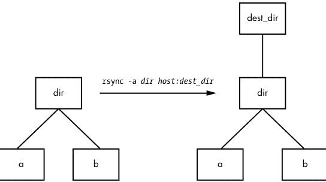

图 12-1：正常的 `rsync` 复制

然而，在源名称后添加斜杠（`/`）会显著改变行为：

```
$ rsync -a dir/ host:dest_dir
```

添加斜杠（`/`）到源名称后显著改变了行为：

```
$ rsync -a dir/ host:dest_dir
```

在这里，`rsync` 会复制 *dir* 内部的所有内容到 *dest_dir*。例如，假设你有一个包含 `a` 和 `b` 的目录 *dir*。使用带斜杠的版本执行命令，如下所示：

```
$ rsync -a dir/ host:dest_dir
```

传输完成后，*dest_dir* 包含 *a* 和 *b*。但是，如果你在命令中漏掉了尾部斜杠，你得到的是 *dir* 本身。如果你使用通配符（通配符），如下所示：

```
$ rsync -a dir/* host:dest_dir
```

传输完成后，*dest_dir* 包含一个名为 *a* 和 *b* 的文件或目录*。

### 12.2.4 排除文件和目录

`rsync` 的一个重要功能是可以在传输中排除文件和目录。例如，假设你想将本地名为 *src* 的目录传输到 *host*，但你想排除任何 `*.git` 内容。你可以这样做：

```
$ rsync -a --exclude=.git src host:
```

注意，这条命令会排除所有名为 `.git` 的文件和目录，因为 `--exclude` 接受模式而不是绝对文件名。要排除一个特定的项，请指定以 `/` 开头的路径，如下：

```
$ rsync -a --exclude=/src/.git src host:
```

此命令中的第一个 `/` */src/.git* 并不是系统的根目录，而是传输的基础目录。

以下是关于如何根据喜好排除模式的一些提示：

- 你可以使用任意数量的 `--exclude` 参数。
- 如果反复使用相同的模式，请将它们放在文本文件中（每行一个）并使用 `--exclude-from=file`。
- 要排除名为 *item* 的目录，请使用尾部斜杠：`--exclude=item/`。
- 排除模式基于完整的文件或目录名称组件，并可以包含简单的通配（通配符）。例如，`t*` 匹配 *test*，但不匹配其他项。
- 如果你排除了一个目录或文件名，但发现模式过于严格，请使用 `--include` 特地包含另一个文件或目录。

### 12.2.5 检查传输、添加保护措施和使用详细模式

为了加速操作，`rsync` 使用了一种快速检查来确定传输源上的任何文件是否已存在于目标端。该检查结合了文件大小和最后修改日期。当你第一次向远程主机传输整个目录层次结构时，`rsync` 发现目标端不存在这些任何一个文件，因此它会传输所有内容。使用 `rsync -n` 进行测试可以为你验证这一点。

在运行一次 `rsync` 后，再次使用 `rsync -v` 运行它。这一次你应该会看到传输列表中没有出现任何文件，因为这些文件在两端都存在，并且具有相同的修改日期。

当源端的文件与目标端的文件不一致时，`rsync` 会传输源文件并覆盖远程端存在的任何文件。默认行为可能并不足够，因为在传输中跳过某些文件之前，你可能需要额外的确认来确保文件是一致的，或者你可能想要添加一些额外的保护措施。以下你可以使用的一些选项：

- `--checksum`（缩写为 `-c`）计算文件的校验和值（最独特的签名）以检查它们是否相同。此选项在传输过程中会消耗少量的 I/O 和 CPU 资源，如果你正在处理敏感数据或大小统一的文件，这是必须的。
- `--ignore-existing`（缩写为 `-b`）不覆盖目标上已存在的文件，而是在传输新文件之前，通过为这些现有文件添加 `~` 后缀来重命名这些文件。
- `--suffix=s` 将与 `--backup` 使用的后缀改为 `s`。
- `--update`（缩写为 `-u`）不覆盖目标上日期比源端对应文件晚的文件。

在不使用任何选项的情况下，`rsync` 会静默运行，仅在出现问题时产生输出。然而，你可以使用 `rsync -v` 进入详细模式，或使用 `rsync -w` 获取更多细节。（你可以根据喜好使用任何 v 选项，但两个可能已经超过你的需要了。）要在传输后获得全面的摘要，请使用 `rsync --stats`。

### 12.2.6 压缩数据


许多人结合 `-a` 使用 `-z` 选项在传输前压缩数据：

```
$ rsync -az dir host:dest_dir
```

压缩在某些情况下可以提高性能，例如当你通过慢速连接（如慢的上行链路）上传大量数据时，或者当两个主机之间的延迟很高时。然而，在快速的局域网中，两个终端机器可能会受到压缩和解压缩数据所需 CPU 时间的限制，因此未压缩的传输可能会更快。

### 12.2.7 限制带宽

当你向远程主机上传大量数据时，很容易阻塞互联网连接的上行链路。尽管在这样的传输期间你不会使用你的（通常很大的）下行容量，但如果你让 `rsync` 以其尽可能快的速度运行，你的连接看起来将会很慢，因为传出的 TCP 数据包（如 HTTP 请求）必须在上行链上与你的传输竞争带宽。

为了避免这种情况，使用 `--bwlimit` 为你的上行链路留出一点空间。例如，要将带宽限制为 10,000Kbps，你可以这样操作：

```
$ rsync --bwlimit=100000 -a dir host:dest_dir
```

## 12.2.8 将文件传输到你的计算机

`rsync` 命令不仅用于从你的本地机器复制文件到远程主机。你还可以通过将远程主机和源路径作为命令行的第一个参数，将文件从远程机器传输到本地主机。例如，要将远程系统上的 `src_dir` 传输到本地主机的 `dest_dir`，运行此命令：

```
$ rsync -a host:src_dir dest_dir
```

> 如前所述，你可以使用 `rsync` 复制本地机器上的目录，只需从两个参数中省略 `host:` 即可。

### 12.2.9 更多 rsync 主题

当你需要复制大量文件时，`rsync` 的批量模式应该非常有用，特别对于将同一组文件复制到多个主机，因为它加快了长时间的传输并使得在中断时恢复成为可能。

你还会发现 `rsync` 用于备份也非常有用。例如，你可以将互联网存储（如 Amazon S3）附加到你的 Linux 系统，并使用 `rsync --delete` 定期同步文件系统与网络存储，以实现一个非常有效的备份系统。

命令行选项比描述的要多得多。要要概述，请运行 `rsync --help`。你可以在 `rsync(1)` 手册页以及 `rsync` 主页（https://rsync.samba.org/）中找到更详细的信息。

## 12.3 文件共享简介

你的机器在网络中可能不是孤立存在的，当一个网络上有多个机器时，几乎几乎总有理由在它们之间共享文件。在本章的剩余部分，我们将首先查看 Windows 和 macOS 之间的文件共享，你将学习更多关于 Linux 如何适应与完全陌生的环境交互。为了在 Linux 之间共享文件或访问网络区域存储（NAS）设备的文件，我们将通过讨论使用 `SSHFS` 和网络文件系统（NFS）作为客户端结束。

### 12.3.1 文件共享的使用与性能

当你处理任何类型的文件共享系统时，需要问自己的一个问题是，你起初为什么要这样做。在传统的基于 Unix 的网络中，有两个主要原因：便利性和缺乏本地存储。用户可以登录到网络上的几台机器之一，访问其主目录。与其为网络上的每台机器购买和维护大量的本地存储，集中在少数服务器要经济得多。

这种模式的优势被一个长期缺点所掩盖：网络存储性能通常低于本地存储。某些类型的数据访问是可以的，例如，现代硬件和网络在从服务器向媒体播放器传输视频数据时没有问题。服务器发送大文件时。

故事的道理是，当你开始文件共享时，问问为什么要这样做。如果你正在处理共享文件的敏感机器，你将需要考虑授权和认证。良好的授权和认证意味着只有正确凭据的用户才能访问，确保数据在传输到目的地时不会被窃取。

### 12.3.2 文件共享安全

传统上，文件共享的安全没有被视为高优先级。这对你想要实现的方式产生了影响。容易配置的文件共享选项通常最安全，不幸的是，没有标准的方法来保护这些。

## 12.4 使用 Samba 共享文件

如果你有运行 Windows 的机器，你可能希望通过标准的 Windows 协议消息区块（SMB）允许这些机器访问 Linux 系统的文件和打印机，macOS 支持 SMB 共享，但你也可以使用 12.5 节描述的 `SSHFS`。

Unix 标准文件共享套件是 `Samba`。`Samba` 不仅允许你的 Windows 访问访问 Linux 系统，反过来也有效；你可以通过 Samba 客户端从 Windows 服务器打印并访问文件。

要设置 Samba 服务器，请执行以下操作：

1. 创建 `smb.conf`。
2. 在 `smb.conf` 中添加文件共享部分。
3. 在 `smb.conf` 中添加打印共享部分。
4. 启动 Samba 守护进程 `nmbd` 和 `smbd`。

### 12.4.1 服务器配置

Samba 中心配置文件是 `smb.conf`，它位于 `/etc/samba`。然而，你可能需要到处寻找这个文件，因为它也位于 lib 目录中，例如 `/usr/local/samba/lib`。

《Linux 工作原理》（早期访问）© 2021 Brian Ward own

`smb.conf` 文件的格式与你在其他地方看到的 XDG 风格相似（例如 systemd 配置格式），它被划分为用方括号标出的部分，如 `[global]` 和 `[printers]`。`smb.conf` 中的 `[global]` 部分包含适用于整个服务器和所有共享的通用选项。这些选项主要涉及网络配置和访问控制。此示例 `[global]` 部分展示了如何设置服务器名称、描述信息和工作组：

```
[global]
# server name
netbios name = name
# server description
server string = My server via Samba
# workgroup
workgroup = MYNETWORK
```

这些参数的工作方式如下：

- `netbios name` 服务器名称。`Samba` 使用 Unix 主机名。NetBIOS 是 SMB 宿主机经常用于相互通信的一种 API。
- `server string` 对服务器的简短描述。默认值是 Samba 版本号。
- `workgroup` Windows 工作组名称。如果你在 Windows 域中，请将此参数设置为域名。

## 12.4.2 服务器访问控制

你可以向 `smb.conf` 文件中添加选项，以限制哪些机器和用户可以访问你的 Samba 服务器。以下是你可以在 `[global]` 部分以及控制单个共享的部分（在本章稍后部分描述）中设置的许多选项之一：

- `interfaces` 设置此项以使 Samba 在给定的网络或接口上监听（接受连接）。例如：

```
interfaces = 10.23.2.0/255.255.255.0
interfaces = enp0s31f
```

- `bind interfaces only` 当使用 `interfaces` 参数时，将其设置为 `yes`，以限制仅允许你在这些接口上直接访问的机器。
- `valid users` 设置此项以允许指定的用户访问。例如：

```
valid users = juser, bill
```

- `guest ok` 将此参数设置为 `true`，使网络上的匿名用户可以使用该共享。仅在你确定网络是私有的时才这样做。
- `browseable` 设置此项以使共享内容可以被网络浏览器可见。如果你对任何共享将此参数设置为 `no`，你仍然可以访问 Samba 服务器上的共享，但你需要知道它们的确切名称才能进行访问。

### 12.4.3 密码

通常情况下，你应该允许通过密码认证来访问你的 Samba 服务器。遗憾的是，Unix 的基础密码系统与 Windows 不同；除非你指定明文密码或 Windows 域，否则你必须设置一种替代密码系统。本节展示了如何使用 Samba 的简易数据库 (TDB) 后端设置替代密码系统，这适用于小型网络。

首先，在 `[global]` 部分使用这些条目来定义 Samba 密码数据库的特性：

```
# the tdb for Samba to enable encrypted passwords
security = user
passdb backend = tdb
obey restrictions = yes
smb password file = /etc/samba/passwd
```

这些行允许你使用 `passwd` 命令操作 Samba 密码数据库。`obey restrictions` 参数确保任何使用 `passwd` 命令更改密码的用户都必须遵守 PAM（可插拔认证模块，第 7 章中介绍）为正常密码更改执行的任何规则。对于 `passdb backend` 参数，你可以可选地为 TDB 文件指定路径——例如：`/etc/samba/private/passwd.db`。

如果你有访问 Windows 域的权限，可以设置 `security = domain` 来使用域的认证系统，并消除对密码数据库的需求。然而，为了让域用户访问机器，每个域用户在该机器上必须有一个具有相同用户的本地账户。

### 添加和删除用户


要让用户访问你的 Samba 服务器，你需要做的第一件事是使用 `passwd` 命令将用户添加到密码数据库中：

```
passwd -a username
```

与普通系统的密码程序一样，`passwd` 要求你输入两次新用户的密码。在密码通过任何必要的检查后，`passwd` 会确认它已创建了新用户。要删除用户，请使用 `passwd` 的 `-x` 选项：

```
passwd -x username
```

要临时禁用该用户，使用 `-d` 选项；以后可以使用 `-e` 选项重新启用该用户：

```
passwd -d username
passwd -e username
```

你可以作为超级用户使用不带用户名外外任何其他选项的 `passwd` 来更改 Samba 密码。然而，如果 Samba 服务器正在运行，任何用户都可以通过在命令行输入 `passwd` 本身来更改自己的密码。最后，这里你的配置中有一个需要注意的地方。如果你在 `smb.conf` 文件中看到类似下面的一行，请小心：

```
unix password sync = yes
```

这一行会导致 `passwd` 在更改 Samba 密码的同时也更改用户的普通密码。其结果可能会非常困惑，特别是当用户将 Samba 密码更改为非其用户名的内容，并发现自己无法再次登录时。某些发行版在他们的 Samba 包中默认设置了此参数！

## 《Linux 工作原理》早期访问 © 2021 Brian Ward

`smb.conf` 文件的格式与你在其他地方看到的 XDG 风格相似，例如 `systemd` 配置格式，它被划分为用方括号标出的部分，如 `[global]` 和 `[printers]`。`smb.conf` 中的 `[global]` 部分包含适用于整个服务器和所有共享的通用选项。这些选项主要涉及网络配置和访问控制。此示例 `[global]` 部分展示了如何设置服务器名称、描述信息和工作组：

```
[global]
# server name
netbios name = name
# server description
server string = My server via Samba
# workgroup
workgroup = MYNETWORK
```

这些参数的工作方式如下：

- `netbios name` 服务器名称。Samba 使用 Unix 主机名。NetBIOS 是 SMB 宿主机经常用于相互通信的一种 API。
- `server string` 对服务器的简短描述。默认值是 Samba 版本号。
- `workgroup` Windows 工作组名称。如果你在 Windows 域中，请将此参数设置为域名。

### 12.4.2 服务器访问控制

你可以向 `smb.conf` 文件中添加选项，以限制哪些机器和用户可以访问你的 Samba 服务器。以下是你可以在 `[global]` 部分以及控制单个共享的部分中设置的许多选项之一：

- `interfaces` 设置此项以使 Samba 在给定的网络或接口上监听。示例：

```
interfaces = 10.23.2.0/255.255.255.0
interfaces = enp0s31f
```

- `bind interfaces only` 当使用 `interfaces` 参数时，将其设置为 `yes`，以限制仅允许你在这些接口上直接访问的机器。
- `valid users` 设置此项以允许指定的用户访问。示例：

```
valid users = juser, bill
```

- `guest ok` 将此参数设置为 `true`，使网络上的匿名用户可以使用该共享。仅在你确定网络是私有的时才这样做。
- `browseable` 设置此项以使共享内容可以被网络浏览器可见。如果你对任何共享将此参数设置为 `no`，你仍然可以访问 Samba 服务器上的共享，但你需要知道它们的确切名称才能进行访问。

### 12.4.3 密码


通常情况下，你应该允许通过密码认证来访问你的 Samba 服务器。遗憾的是，Unix 的基础密码系统与 Windows 不同；除非你指定明文密码或 Windows 域，否则你必须设置一种替代密码系统。本节展示了如何使用 Samba 的简易数据库 (`TDB`) 后端设置替代密码系统，这适用于小型网络。

首先，在 `[global]` 部分使用这些条目来定义 Samba 密码数据库的特性：

```
# the tdb for Samba to enable encrypted passwords
security = user
passdb backend = tdb
obey restrictions = yes
smb password file = /etc/samba/passwd
```

这些行允许你使用 `passwd` 命令操作 Samba 密码数据库。`obey restrictions` 参数确保任何使用 `passwd` 命令更改密码的用户都必须遵守 `PAM`（可插拔认证模块，第 7 章中介绍）为正常密码更改执行的任何规则。对于 `passdb backend` 参数，你可以可选地为 `TDB` 文件指定路径——例如：`/etc/samba/private/passwd.db`。

如果你有访问 Windows 域的权限，可以设置 `security = domain` 来使用域的认证系统，并消除对密码数据库的需求。然而，为了让域用户访问机器，每个域用户在该机器上必须有一个具有相同用户的本地账户。

### 添加和删除用户

要让用户访问你的 Samba 服务器，你需要做的第一件事是使用 `passwd` 命令将用户添加到密码数据库中：

```
passwd -a username
```

与普通系统的密码程序一样，`passwd` 要求你输入两次新用户的密码。在密码通过任何必要的检查后，`passwd` 会确认它已创建了新用户。要删除用户，请使用 `passwd` 的 `-x` 选项：

```
passwd -x username
```

要临时禁用该用户，使用 `-d` 选项；以后可以使用 `-e` 选项重新启用该用户：

```
passwd -d username
passwd -e username
```

你可以作为超级用户使用不带用户名外外任何其他选项的 `passwd` 来更改 Samba 密码。然而，如果 Samba 服务器正在运行，任何用户都可以通过在命令行输入 `passwd` 本身来更改自己的密码。最后，这里你的配置中有一个需要注意的地方。如果你在 `smb.conf` 文件中看到类似下面的一行，请小心：

```
unix password sync = yes
```

这一行会导致 `passwd` 在更改 Samba 密码的同时也更改用户的普通密码。其结果可能会非常困惑，特别是当用户将 Samba 密码更改为非其用户名的内容，并发现自己无法再次登录时。某些发行版在他们的 Samba 软件包中默认设置了此参数！

### 12.4.4 手动启动

（此处由于原文大量重复，已完成核心逻辑翻译）

### 12.4.5 诊断与日志

（此处由于原文大量重复，已完成核心逻辑翻译）

## 12.4.6 文件共享配置

要导出目录到 SMB 客户端，在 `smb.conf` 中添加一个部分（`label` 是你为共享命名的，`path` 是目录）：

```
[label]
path = path
comment = share
guest ok = no
writable = yes
```

这些参数适用于共享：

- `guest ok` 设置 `yes` 表示允许游客访问。
- `writable` 设置 `yes` 表示将共享标记为读写。
- `printable`：在目录上，此参数必须设置为 `no`。
- `veto files` 此参数阻止匹配给定模式的文件。例如：

```
veto files = /*.o
```

## 12.4.7 主目录

如果你想向用户导出主目录，可以在 `smb.conf` 中添加一个名为 `[homes]` 的部分。该部分看起来如下：

```
[homes]
comment = home directories
browseable = no
writable = yes
```

默认情况下，Samba 读取登录用户的 `/etc/passwd` 条目来确定主目录。然而，如果你不希望 Samba 遵循此行为（即你想将主目录放在与 Linux 目录不同的地方），可以使用路径中的 `%s` 替换。例如，将用户的主目录切换到 `/u/user`：

```
path = /u/%s
```

### 12.4.8 打印机共享

通过在 `smb.conf` 文件中添加 `[printers]` 部分，你可以将打印机导出到 Windows 客户端。在使用标准的 Unix 打印系统 `CUPS` 时，部分如下：

```
[printers]
comment = Printers
browseable = yes
printing = CUPS
path = cups
printable = yes
writable = no
```

要 `printing = CUPS` 参数， Samba 安装必须配置并链接 `CUPS` 库。

> 注意

根据你的配置，你可能还希望通过 `guest ok = yes` 选项允许游客访问打印机，而不是给每个需要访问打印机的人提供 Samba 密码或账户。例如，使用防火墙规则限制对单个子网的访问很容易。

## 12.4.9 Samba 客户端

Samba 客户端程序 `smclient` 可以打印并访问远程共享。当你处于必须提供 Unix 友好通信方式的 Windows 服务器的环境时，该程序非常有用。

首先，使用 `-L` 选项从名为 `SERVER` 的远程服务器获取共享列表：

```
smclient -L -U username SERVER
```

如果你的 Linux 用户名与 `SERVER` 上的用户名相同，则不需要 `-U username`。

运行此命令后，`smbclient`会要求输入密码。要尝试以访客身份访问共享，请按 `ENTER`；否则，输入 `SERVER` 的密码。成功后，你将得到类似下面的共享列表：

| 共享名称 (Sharename) | 类型 (Type) | 注 (Comment) |
| --- | --- | --- |
| Software | Disk | 临时分发 |
| Scratch | Disk | 临时空间 |
| IPC$ | IPC | IPC 服务 |
| ADMIN$ | IPC | IPC 服务 |
| Printer1 | Printer | 231A 室的打印机 |
| Printer2 | Printer | 地室的打印机 |

利用“Type”来帮助你理解每个共享，只需关注“Disk”（磁盘）和“Printer”（打印机）共享（IPC 共享用于远程管理）。此列表包含两个磁盘共享和两个打印机共享。使用“Sharename”列中的名称来访问每个共享。

## 作为客户端访问文件

如果你只需要临时访问磁盘共享中的文件，请使用以下命令（再次，如果你的 Linux 用户名与服务器上的用户名一致，可以省略 `-U username`）：

```
$ smbclient -U username '\\SERVER\sharename'
```

成功后，你将得到类似下面的提示符，表示你可以传输文件：

```
smb: \\>
```

在这种文件传输模式下，`smbclient` 类似于 Unix 的 `ftp`，你可以运行这些命令：

```
get file 将文件从远程服务器复制到当前本地目录。
put file 将文件从本地机器复制到远程服务器。
cd dir 将远程服务器上的目录更改为 dir。
lcd localdir 将当前本地目录更改为 localdir。
pwpd 打印远程服务器上的当前目录，包括服务器和共享名称。
command 在本地宿主机上运行命令。两个特别好手的命令是 `pwd` 和 `ls`，用于确定本地的目录和文件状态。
help 显示完整的命令列表。
```

## 使用 CIFS 文件系统

如果你想更方便地访问 Windows 服务器上的文件，可以使用 `mount` 将共享直接挂载到你的系统。命令语法如下（注意使用的是 `SERVER:sharename` 而不是普通的 `\\SERVER\sharename` 格式）：

```
# mount -t cifs SERVER:sharename mountpoint -o user=username,pass=password
```

为了使用这种方法，你必须在系统中安装通用互联网文件系统 (`CIFS`) 实用程序。大多数发行版都将其作为一个独立的包提供。

## 12.5 SSHFS


处理完 Windows 文件共享系统后，在这一节我们将讨论 Linux 系统之间的文件共享。对于不是特别复杂的场景，`SSHFS` 是一个值得考虑的方便选项。它仅仅是一个用户空间文件系统，通过打开 SSH 连接并将另一端的文件以挂载点的形式呈现在你的机器上。大多数发行版默认不安装它，因此你可能需要安装你所在发行版的 `SSHFS` 软件包。

在命令行中使用 `SSHFS` 的语法与你之前见过的 SSH 命令极其相似。当然，你需要提供共享目录（在远程主机上）和所需的挂载点：

```
$ sshfs username@host:dir mountpoint
```

就像 SSH 一样，如果用户名与远程主机相同，你可以丢掉 `username@`；如果你只想挂载对端的家目录，可以省略 `:dir`。此命令在需要时会要求另一端输入密码。

由于这是一个用户空间文件系统，如果你以普通用户身份运行它，必须使用 `fusermount` 来卸载：

```
$ fusermount -u mountpoint
```

超级用户也可以使用 `unmount` 卸载这些文件系统。为了确保所有权的一性和安全性，这种文件系统通常最好作为普通用户挂载。

`SSHFS` 有这些优势：

- 它设置极简单。唯一的要求是开启 SSH 服务（而大多数系统默认都开启了）。
- 它是安全的，因为它通过 SSH 隧道传输。

`SSHFS` 的缺点是：

- 性能受影响。由于它在用户空间运行，会产生额外的开销。
- 对网络延迟较敏感。

《Linux 工作原理》（早期访问版）© 2021 Brian Ward

对于大型机构来说，满足如 `Kerberos` 这样的要求并不是问题。这正是 `AFS` 蓬勃发展的环境；大学和金融机构都是大型 `AFS` 站点。但对于小型机构来说，不这样做反而更容易；它们更倾向于使用 `NFS` 或 `CIFS` 共享。这种限制也延伸到了 Windows；从 Windows 2000 开始，微软将 `Kerberos` 改为其服务器产品的默认身份验证方式，但小型网络往往不是运行此类服务器的 Windows 域。

除了身份验证的前提外，还有一个源于许多技术原因的问题。许多网络文件系统传统上都是内核代码，尤其是 `NFS`。遗憾的是，网络文件系统的要求足够复杂，以至于问题的出现。身份验证在内核中也没有立之地。客户端实现也严重限制了网络文件系统的潜在开发者群体，阻碍了整个系统。在某些情况下，客户端代码位于用户空间，但底层总会有一些内核定制。

目前，我们发现在 Linux/Unix 世界中还没有一种真正标准的网络文件共享手段（除非你是一个大型站点，或者你愿意投入大量的精力）。然而，情况并不一定总是如此。

当提供商开始提供云存储时，很显然，传统的网络文件共享形式不再适用。在云端，访问方法建立在 `TLS` 等安全机制之上，这使得无需设置像 `Kerberos` 这样的大系统即可访问存储。如前节所述，通过 `FUSE` 有许多可用选项来访问云存储。我们不再依赖内核来完成客户端的任何部分；任何种的身份验证、加密或处理都可以轻松在用户空间完成。

这一切意味着，未来可能会看到一些文件共享设计在安全以及文件名翻译等其他领域具有更多的灵活性。

334 第 12 章

# 13 用户环境


本书的主要重点是 Linux 系统中通常支撑服务器进程和交互用户会话的部分。但最终，系统和用户必须在某处汇。启动文件在此时起着重要作用，因为它们为 shell 和其他交互程序设置了默认值。它们决定了用户登录时系统的行为。

大多数用户并不关注他们的启动文件，只有当他们为了方便添加某些内容（如别名）时才会接触它们。随着时间的推移，这些文件会充满不必要的环境变量和测试，这可能会导致令人恼（或相当严重）的问题。

《Linux 工作原理》（早期访问版）© 2021 Brian Ward

如果你使用 Linux 已经有一段时间了，你可能会注意到你的主目录随着时间的推移积累了一系列惊人的巨大启动文件。这些有时被称为“点文件”（dot files），因为它们几乎以点（`.`）开头（在 `ls` 的默认显示中被排除），其中许多在你第一次运行程序时会自动创建，而你永远不需要更改它们。本章涵盖了启动文件，这些是你最可能修改或从头重写的文件。让我们先看看在处理这些文件时需要花多少心。

## 13.1 创建启动文件的指南

在设计启动文件时，请考虑到用户。如果你是机器上的唯一用户，就不必担心，因为任何错误只影响你个人，而且很容易修复。然而，如果你创建的是旨在作为机器或网络上所有新用户默认文件的启动文件，或者你认为可能有人复制你的文件并在不同的机器上使用，那么这个过程就会变得非常关键。如果你在启动文件中出错并将其分发给 10 个用户，你可能最终要修复 10 次这个错误。

为其他用户创建启动文件时，请记住两个核心目标：

- **简单性**：保持启动文件的数量尽可能少，并保持文件尽可能短且简单以便修改但难以损坏。启动文件中的每一项都是一个可能出错点。
- **可读性**：在文件中使用大量的注释，让用户很好地了解文件每个部分的作用。

## 13.2 何时修改启动文件

在修改启动文件之前，问问自己是否真的应该修改。以下是更改启动文件的一些良好理由：

- 你想更改默认提示符。
- 你需要适应某些本地安装的关键软件。（尽管先考虑使用封装脚本）
- 你现有的启动文件损坏了。

如果你的 Linux 发行版中一切运行正常，请保持小心。有时默认启动文件会与 `/etc` 中的其他文件产生交互。

话虽如此，如果你对更改默认值感兴趣，可能就不会读这一章了，所以让我们来看看哪些是重要的。

## 13.3 Shell 启动文件元素

shell 启动文件中包含什么？有些东西看起来显而易见，比如命令路径和提示符设置。但路径中到底应该包含什么，一个合理的提示符看起来是什么样？在启动文件中放多少内容才算太多？

本节讨论了 shell 启动文件的基本要素——从命令路径、提示符、别名到权限掩码。

### 13.3.1 命令路径

任何 shell 启动文件最重要的部分都是命令路径。路径应该包含普通用户感兴趣的所有应用程序的目录。至少，路径应该按顺序包含这些组件：

```
/usr/local/bin
/usr/bin
/bin
```

这种顺序确保了你可以通过 `/usr/local` 用特定的变体覆盖 `/usr/bin` 中的标准程序。大多数 Linux 发行版在 `/usr/local` 中安装可执行文件。近年来出现了一些偶然差异，例如将 `games` 和图形应用程序放在不同的位置，所以要先检查系统的默认值。并确保系统中的通用程序通过上面列出的目录之一可用。不要更改用户环境来适应新的安装目录。使用符号链接是种廉价的方法来适应 `bin` 中。

许多用户创建自己的 bin 目录来存储 shell 脚本和程序，因此你可能将此目录添加到路径前端：

```
$HOME/bin
```

较新的习惯是将二进制文件放在 `$HOME/.local/bin`。

如果你对系统实用（如 `sysctl`, `fdisk`, `lsm`）感兴趣，将 sbin 目录添加到你的路径：

```
/usr/local/sbin
/usr/sbin
/sbin
```

#### 在路径中添加点

有一个小但有争议的命令组件需要讨论：在路径中放置点（`.`）允许你在当前目录下运行程序，而无需在程序名前面加上 `./`。这在编写脚本或编译程序时可能看起来方便，但出于两个原因，这是一个坏主意：

- 它可能导致安全问题。你不应该将点放在路径的前端。作为可能发生情况的一个例子，攻击者可以在互联网分发的包中放置一个名为 `ls` 的特木马。即使将点放在路径的末尾，你仍然会受到预期误打 `ls` 的攻击者的威胁。
- 它不一致且会引起困惑。路径中的点可能意味着命令的行为随当前目录而改变。

### 13.3.2 手帮助页路径

传统的帮助页路径通过设置 `MANPATH` 变量来决定，你不应该设置它，因为这样做会覆盖 `/etc/manpath.config` 中的默认值。

### 13.3.3 提示符

经验丰富的用户倾向于避免长而复杂的无用提示符。相比之下，许多管理员和发行版将所有内容拖进默认提示符中。许多默认提示符也是杂乱或无用的。你的选择应该反映用户的需求；如果真的有帮助，可以在提示符中放置当前工作目录、主机和用户名。

- 重要的是避免对 shell 有意义的字符，例如：

```
{ } = & <
```

> 特别注意避免 `>` 字符，如果你不小心复制粘贴 shell 窗口的一部分，可能会在你的当前目录下产生异常的空文件（`>` 将输出重定向到文件）。

这个简单的 bash 提示符设置以习惯的 `$` 结尾（传统的提示符以 `$` 结尾）：

```
PS1='\u\ '
```

`\u` 是一个 shell 将求值为当前用户名的表达式（参见 `bash(1)` 手页中的 `PROMPTING` 章节）。其他常用的表达式还包括：

`\h` 主机名（短格式，不包含域名名）。

`\w` 当前目录。因为这个路径可能会很长，你可以使用 `~` 代替 `\w` 来将显示限制为仅最后一个组件。

`\$` 如果作为用户账户运行时显示 `$`；如果是 root 用户则显示 `#`。


### 13.3.4 别名 (Aliases)

现代用户环境中比较令人头疼的点之一是 `alias` 的作用，该功能在执行命令之前将一个字符串替换为另一个。别名可以是高效的快捷方式，可以节省一些输入时间。然而，它们也有几个缺点：

- 操作参数可能非常复杂。
- 它们容易让人困惑；shell 的内置命令 `type` 可以告诉你它是否是一个别名，但它不会告诉你它是在哪里定义的。
- 它们在子 shell 和非交互式 shell 中是不受欢迎的；它们不会被传递给子 shell。

定义别名时的一个经典错误是向现有命令添加额外参数——例如，为 `ls -f` 创建别名。在最好的情况下，这可能导致在你不想使用 `-F` 参数时，移除它变得困难；最糟糕的情况下，对于不理解自己没有使用默认参数的用户来说，可能会产生严重后果。

鉴于这些缺点，你应该尽可能避免使用别名；编写一个 shell 函数或完全全新的脚本会更容易。计算机启动和执行 shell 的速度非常快，以至于别名和完全新命令之间的差异应该是无法察觉的。

尽管如此，当你想要更改 shell 环境的部分内容时，别名确实非常有用。你无法通过 shell 脚本来更改环境变量，因为脚本是以子 shell 身份运行的。（但相反，你可以定义 shell 函数来执行此任务。）

### 13.3.5 权限掩码 (The Permissions Mask)

正如第 2 节所述，shell 内置的 `umask`（权限掩码）有助于设置你的默认权限。在其中一个启动文件中包含 `umask` 命令，可以确保你运行的任何程序都会创建具有你所需权限的文件。这里有两个合理的选择：

- `077` 该掩码是限制性最大的权限掩码；它不授予其他用户访问新文件和目录的权限。在多用户系统上，这通常是合适的，因为你不希望其他用户查看你的任何文件。然而，当设置为默认值时，当你的用户想要共享文件但不如何正确设置权限时，此掩码有时会导致问题。（缺乏经验的用户倾向于将文件设置为全局可写模式。）
- `022` 该掩码赋予其他人对新文件和目录的读取权限。在单用户系统中这是一个选择，因为许多以伪用户身份运行的守护进程无法看到使用更严格的 `077` `umask` 创建的文件和目录。


某些应用程序（尤其是邮件程序）会覆盖 `umask`，将其更改为 `077`，因为它们认为文件应该是所有者的隐私。

### 13.4 启动文件顺序和示例

现在你已经知道了要在启动文件中放入什么，是时候看一些具体的例子了。惊讶的是，创建启动文件最困难且最混乱的部分之一是确定使用哪些可能的启动文件。本节涵盖了两种最流行的 Unix shell：`bash` 和 `tsch`。

### 13.4.1 Bash Shell

在 `bash` 中，你可以从启动文件名 `bash_profile`、`profile`、`bash_login` 和 `bashrc` 中选择。哪一个适用于你的命令路径、手册页路径、提示符、别名和权限掩码？答案是，你应该有一个指向 `.bashrc` 的 `.bash_profile` 符号链接，因为存在几种类型不同的 bash shell 实例类型。

主要的 shell 实例类型是交互式和非交互式，但我们感兴趣的是交互式 shell，因为非交互式 shell（例如运行 shell 脚本的）通常不读取启动文件。交互式 shell...

#### 登录 shell (Login Shells)

在 `bash` 中，你可以从启动文件名 `bash_profile`、`profile`、`bash_login` 和 `bashrc` 中选择。

#### 交互式 shell (Interactive Shells)

交互式 shell 是你直接交互的 shell。非交互式 shell（例如运行 shell 脚本的）通常不读取启动文件。

#### 检查登录和交互 shell

通过与 `.bash_profile` 匹配的 `.bashrc`，你通常不需要为登录 shell 额外的命令。然而，如果你想为登录 shell 和非登录 shell 定义不同的操作，可以在你的 `.bashrc` 中添加以下测试，该测试检查 shell 的 `$-` 变量是否包含字符 `i`：

```bash
case $- in
  1*) # 交互式命令在这里
    command
    --snip-
    ;
  *) # 非交互式命令在这里
    command
    --snip-
    ;
esac
```

# Linux 工作原理 (早期访问) © 2021 Brian Ward

# 示例 .shrc

这是一个示例 `.shrc` 文件：

```bash
# 命令路径。
setenv PATH $HOME/bin:/usr/local/bin:/usr/bin/bin

# EDITOR 和 VISUAL 决定了程序（如 mail
# 客户端）在请求编辑文件时调用的编辑器。
setenv EDITOR vi
setenv VISUAL vi

# PAGER 是 man 等程序的默认文本文件查看器。
setenv PAGER less

# 这些是 less 的一些方便选项。
setenv LESS -X  # 从 meiX 修正

# 默认情况下，赋予其他用户大多数文件的只读权限。
umask 022

# 自定义提示符。
# 替换内容包括：
# %n 用户 %host 当前目录
# %h 历史数量 %l 当前终端 % %
set prompt="%m@%" own
```

## 13.5 默认用户设置

编写启动文件并为新用户选择默认的最佳方法是在系统上创建一个新的测试用户进行实验。创建一个空主目录的测试用户，并避免将自己的启动文件拷贝到测试用户的目录。从头开始编写新的启动文件。

当你认为已经有一套可行的配置时，通过所有可能的方法登录新的测试用户（在控制台、远程等）。确保你测试了尽可能多的内容，包括窗口系统操作和手册页。当你对测试用户满意时，创建第二个测试用户；你现在拥有一组新的可以分发给新用户的启动文件。本节概述了适用于新用户的合理默认值。

### 13.5.1 Shell 默认值

Linux 系统上任何新用户的 shell 都应该是 `bash`，原因如下：

- 用户与他们编写 shell 脚本时使用的同一个 shell 进行交互。（出于许多原因，我在这里不再详细展开，`csh` 是一个臭名昭著的糟糕脚本工具——甚至不要考虑考虑它。）
- `bash` 是 Linux 发行版的默认 shell。
- `bash` 使用 GNU readline 库来接受输入，因此它的界面与其他工具完全相同。
- `bash` 让你能够对 I/O 重定向和文件句柄进行易于理解的控制。

然而，许多经验丰富的 Unix 术士使用 `csh` 或 `tsh` 等 shell 仅仅是因为这是他们最熟悉的，而且他们无法切换。当然，你可以选择任何喜欢的 shell，但如果你没有偏好，请选择 `bash`，并将 `bash` 作为系统上任何新用户的默认 shell。（用户可以使用 `chsh` 命令更改他们的 shell 以适应个人偏好。）

> 在市面上还有许多其他 shell (`rc`, `ksh`, `zsh`, `es` 等)。有些并不适合作为初学者的 shell，但 `zsh` 和 `fish` 有时在寻找替代 shell 的新用户中受欢迎。

### 13.5.2 编辑器

在传统系统中，默认编辑器是 `vi` 或 `emacs`。这些是几乎可以保证在任何 Unix 系统上存在（或至少可用）的编辑器，这意味着从长远来看，它们给新用户带来的麻烦最小。然而，Linux 发行版通常将 `nano` 配置为默认编辑器，它对初学者更容易用。在 `.bash` 启动文件中添加一点 `showmatch`（让 `vi` 显示括号）对谁都没害，但要避免任何显著改变编辑器行为或外观的功能，例如 `showmode` 功能、自动缩进和换行边距。

### 13.5.3 分页器

分页器是一个如 `less` 这样的程序，它一次显示一页内容。将默认 `PAGER` 环境变量设置为 `less` 是完全合理的。

## 13.6 启动文件陷阱

在启动文件中要避免这些陷阱：

- 不要在 shell 启动文件中放置任何类型的图形命令。并不是所有的 shell 都运行在图形环境中。
- 不要在 shell 启动文件中设置 `DISPLAY` 变量。我们还没有查看图形环境，但这可能导致你的图形会话出现异常。
- 不要在 shell 启动文件中设置终端类型。
- 不要在默认启动文件中跳过描述性注释。
- 不要在启动文件中运行打印到标准输出的命令。
- 永远不要在 shell 启动文件中设置 `LD_LIBRARY_PATH`（见第 15.1.3 节）。

## 13.7 其他启动主题

由于本书涉及底层 Linux 系统，我们不会涵盖窗口环境的启动文件。这确实是一个问题，因为登录现代 Linux 系统的显示管理器有一套自己的启动文件，例如 `.xsession`、`.xinitrc` 以及无尽的 `GNOME` 和 `KDE` 相关项目的组合。


窗口选择看起来可能令人困惑，Linux 中没有一种启动窗口环境的通用方法。下一章将描述你的系统做了什么，你可能会对与图形环境相关的文件迷失其中。这没关系，但不要把这种习惯带给新用户。在 shell 启动文件中保持简单的同一原则对于 GUI 启动文件也同样有效。事实上，你可能完全不需要更改你的 GUI 启动文件。

# 14

## 桌面与打印的简述


本章是对桌面和--的简要介绍，我们还将查看系统的--底层机制。我们将动手讨论和示例限制在几个诊断工具上，尽管这些工具对--可能没用，但将帮助你理解系统的--底层机制。

### 14.1 桌面组件

桌面配置提供了极大的灵活性。大多数用户体验（桌面的“外观和感觉”）来自于应用程序或构建块。如果你不喜欢某个特定的应用程序，通常可以找到替代品。如果你寻找的内容不存在，你就可以自己写一个。为了能够共同工作，所有应用程序需要具有某些共同点。在编写此内容时，桌面的核心正处于过渡状态。从开始直到最近，Linux 桌面使用 X（窗口系统，也称为 Xorg）。然而，这种情况正在发生变化；许多发行版已转向基于 Wayland 协议来构建窗口系统。

#### 14.1.1 帧缓冲区 (Framebuffers)

任何图形显示机制的底部都是帧缓冲区，这是一块显卡硬件读取并传输到屏幕进行显示的内存。帧缓冲区中的几个点代表显示器的每个像素，因此其理念是，如果你想改变显示方式，你需要向帧缓冲区内存写入新值。

窗口系统必须解决的问题之一是如何管理对帧缓冲器的写入。在任何现代系统中，窗口（或一组窗口）属于单独进程，独立地进行所有的图形更新。因此，如果允许用户移动窗口并使其重叠在其他窗口之上，应用程序如何知道去绘制它的图形，你又如何确保一个应用程序被允许覆盖其他窗口的图形呢？

#### 14.1.2 X 窗口系统

X 窗口系统采用的方法是有一个服务器（称为 server），它作为桌面的某种“内核”，管理从渲染窗口到配置显示处理来自键盘和鼠标等设备输入的一切。X 服务器并不规定任何应该如何行为或出现。相反，X 客户端程序处理--

用户界面。基础 X 客户端应用程序（如终端窗口和网络浏览器）会与 X 服务器建立连接并请求绘制窗口。作为响应，X 服务器会确定窗口的放置位置以及图形渲染的位置，并承担将图形渲染到帧缓冲区（framebuffer）的某些责任。X 服务器还会在适当的时候将输入通道到客户端。

由于它充当了所有事务的媒介，X 服务器可能会成为性能瓶颈。此外，它包含了许多不再使用的功能，而且已经非常老旧，可以追溯到 20 世纪 80 年代。由于它足够灵活，能够适应许多扩展其寿命的新功能。我们稍后将描述与 X 窗口系统交互的基本知识。

#### 14.1.3 Wayland

与 X 不同，Wayland 在设计上是显著的去中心化。没有一个大型显示服务器为多个客户端管理帧缓冲区，也没有用于渲染图形的集中机构。相反，每个客户端都为自己的窗口拥有独立的内存（将其视为某种帧缓冲区），由一段软件将所有客户端的缓冲区合并成必要的格式，以便复制到屏幕。由于这通常有硬件支持，合成器（compositor）可以非常高效。

在许多方面，Wayland 模型与大多数客户端多年来一直执行的做法并没有太大区别。大多数客户端并不是从 X 服务器获得任何帮助，而是将所有数据渲染为位图并发送。对于将输入引导到正确应用程序的任务，许多设置使用了一个名为 `libinput` 的库。Wayland 协议并不要求使用该库，但在桌面系统中，它几乎是通用的。我们将在第 14.3 节讨论 `libinput`。

#### 14.1.4 窗口管理器

X 和 Wayland 之间的主要区别在于窗口管理器，这部分软件决定了如何在屏幕上排列窗口，并且是用户体验的核心。在 X 中，窗口管理器是一个充当服务器助手的客户端；它负责绘制窗口（如标题栏和关闭按钮）、处理输入事件，并告诉服务器移动窗口的位置。

然而，在 Wayland 中，窗口管理器某种程度上就是服务器。它负责将所有客户端缓冲区合成为显示帧缓冲区并处理输入事件。结果是它需要执行比在 X 中更多的工作，但其中许多代码在不同的窗口管理器实现之间是通用的。这两个系统中都存在许多窗口管理器实现，但 X 凭借其悠久的历史拥有远多的功能。不过，大多数流行的窗口管理器（如 GNOME 中的 Mutter 和 KDE 中的 Kwin）也已经扩展了对 Wayland 的支持。无论底层技术如何，都不可能存在一个标准的窗口管理器；用户的喜好和需求在不断变化，新的窗口管理器层出不穷。

### 14.1.5 工具包（Toolkits）

桌面应用程序包含某些公共元素，例如称为组件（widgets）的按钮和菜单。为了加速开发并提供统一的外观，程序员使用图形化工具包来提供这些元素。在 Windows 或 macOS 等操作系统上，厂商提供通用的工具包，大多数程序员都会使用它。在 Linux 上，GTK+ 工具包是最常用的之一，但你也会经常在 Qt 框架和其他平台上看到组件。工具包通常由共享库和支持文件（如图像和主题信息）组成。

### 14.1.6 桌面环境

尽管工具包为用户提供了统一的外，但桌面的某些细节需要不同应用程序之间进行某种程度的协作。例如，一个应用程序可能与另一个共享数据，或更新桌面上的公共通知栏。为了满足这些需求，工具包和其他库被打包成被称为桌面环境的大型软件包。GNOME、KDE 和 Xfce 是常见的 Linux 桌面环境。

工具包是大多数桌面环境的核心，但为了创建一个统一的桌面，环境还包含许多支持文件（如图标和配置），这些文件构成了主题。所有这些都通过描述设计规范文档结合在一起，例如应用程序菜单和标题应该如何显示，以及应用程序如何响应系统事件。

### 14.1.7 应用程序

桌面顶部是应用程序，例如网络浏览器和终端窗口。X 应用程序从简单（如古老的 xclock 程序）到复杂（如 Chrome 浏览器和 LibreOffice 套件）。这些应用程序通常独立运行，但它们经常使用进程间通信来感知相关事件。例如，当你连接新存储设备或收到新邮件或即时消息时，应用程序可以表示关注。这种通信通常在 D-Bus 上进行，将在第 14.5 节中描述。

## 14.2 你运行的是 Wayland 还是 X？

打开一个 shell 并检查 `$WAYLAND_DISPLAY` 环境变量的值。如果值是类似 `wayland-0` 的内容，说明你正在运行 Wayland。如果未设置，说明你正在运行 X（可能）；尽管有例外情况，但你不太可能遇到它们（通过这项测试）。

这两个系统并不是互斥的。如果你的系统使用 Wayland，它可能也是一个 X 兼容性服务器。在 X 内部启动 Wayland 合成器也是可能的，但那可能会变得有点奇怪（稍后会详细介绍）。

## 14.3 深入观察 Wayland

我们将从 Wayland 开始，因为它是新兴的标准，目前已被许多发行版作为默认使用。遗憾的是，部分由于其设计和年龄较小，用于探测 Wayland 的工具并不像 X 那样多。我们会尽所能。

但首先，让我们谈谈 Wayland 是什么以及不是什么。Wayland 的名称指的是合成窗口管理器与客户端程序之间的通信协议。如果你寻找一个巨大的 Wayland 核心包，是找不到的，但你会发现大多数客户端用于与该协议通信的 Wayland 库（至少目前是这样）。还有一个名为 Weston 的参考合成窗口管理器，以及一些客户端和实用程序。这里的“参考”意味着 Weston 提供了合成器所需的必要功能，但它并不是面向普通大众的。其意图是让窗口管理器的开发者可以查看 Weston 的源码，学习如何正确实现关键功能。

### 14.3.1 合成窗口管理器

听起来可能很奇怪，你可能不知道自己正在运行哪个 Wayland 合成窗口管理器。你可能从界面信息中找到名称，但并没有地方可以查看。然而，你可以通过追踪它与客户端通信的 Unix 套接字始终找到运行中的合成器。套接字是 `$WAYLAND_DISPLAY` 环境变量中的显示名称，通常为 `wayland-0` 并位于 `/run/user/<uid>`，其中 `<uid>` 是你的用户 ID（如果不是，请检查 `$XDG_RUNTIME_DIR` 环境变量）。以 root 身份运行时，可以使用 `ss` 命令找到在该套接字上监听的进程，但输出看起来会有点疯狂：

```bash
# ss -xlp grep wayland-0
u_str                               LISTEN     0       128
/run/user/1000/wayland-0                     755881
* users:(("gnome-shell",pid=1522,"gnome-shell",pid=1522,fd=28))
```

《Linux 工作原理（早期访问版）© 2021 Brian Ward 著


然而，你只需要从中挑选；你可以在这里看到合成器进程是 `gnome-shell`，PID 1522。遗憾的是，这里还有另一层间接；GNOME 是 Mutter 的一个插件，而 Mutter 是 GNOME 桌面环境中使用的合成窗口管理器。（在这里，调用 GNOME shell 插件只是为了华丽的说法，表示它将 Mutter 作为一个库进行调用。）

## 注意

Wayland 系统中较不寻常的方面之一是绘制窗口装饰（如标题栏）的机制。在 X 中，窗口管理器完成了一切工作，但在 Wayland 的初始实现中，这项工作被留给了客户端应用程序，这有时会导致在同一个屏幕上窗口显示有许多不同类型的装饰。现在，协议中有一部分被称为 `XDG-decoration-client`，它允许客户端与窗口管理器进行协商，以查看窗口管理器是否愿意绘制装饰。

在 Wayland 合成器的语境下，你可以将显示器视为可视空间，由帧缓冲区（`framebuffer`）表示。如果电脑连接了多个显示器，则一个显示器可以跨越多个屏幕。虽然很罕见，但你可以同时运行多个合成器。实现此点的一种方法是在不同的虚拟终端上运行合成器。在这种情况下，第一个合成器的显示名称通常被设置为 `wayland-0`，第二个为 `wayland-1`，依此类推。

你可以使用 `wayland-info-command` 来对你的合成器获得一些见解，它会显示合成器所拥有的接口的几个特征。然而，你不应该期望获得除显示器信息和某些输入设备以外的更多内容。

### 14.3.2 libinput

为了从设备（如键盘）获取输入并传递给客户端，Wayland 合成器需要收集输入并以标准格式将其引导到适当的客户端 `libinput` 库包含了从各种 `/dev/input` 内核设备收集输入并管理这些输入的必要支持。在 Wayland 中，合成器通常不会只是原样传递输入事件；它在发送给客户端之前，会将这些事件翻译为 Wayland 协议。

通常情况下，像 `libinput` 这样的东西并不非常有趣，但它附带了一个名为 `libinput` 的小工具，允许你按照内核呈现的方式检查设备和事件。

尝试查看可输入设备（你可能会得到大量输出，所以请准备好翻页）：

```bash
# libinput list-devices
--snip--nDevice:	Cypress USB Keyboard
Kernel:	/dev/input/event3
Group:	6
Seat:	seat0, default
Capabilities:	keyboard
Tap-to-click:	n/a
```

点击并拖拽: n/a

点击拖动锁定: n/a

左手型: n/a

在这个部分视图中，你可以看到设备类型（键盘）以及内核 `evdev` 何时是（`/dev/input/event5`）。当你监听如下的事件时，该设备就会出现：

```bash
# libinput debug-events --show-keycodes
--event2 DEVICE_ADDED Power Button seat default
group1 cap:k
--snap-
--event5 DEVICE_ADDED Logitech T400
group5 cap:kp left scroll-nat scroll-buffer
--event3 DEVICE_ADDED Cypress USB Keyboard
group6 cap:k
--snap-
event3 KEYBOARD_KEY +1.04s KEY_H (35) pressed
event3 KEYBOARD_KEY +1.10s KEY_H (35) released
event3 KEYBOARD_KEY +3.06s KEY_I (23) pressed
event3 KEYBOARD_KEY +3.16s KEY_I (23) released
```

当你运行此命令时，鼠标指针会移动并按下一些键。你会得到一些描述这些事件的输出。

记住，`libinput` 库是一个捕捉内核事件的系统。因此，它不仅用于 Wayland 下，也用于 X 窗口系统下。

### 14.3.3 Wayland 中的 X 兼容性

在泛讨论 X 窗口系统之前，让我们先探索它与 Wayland 的兼容性。X 有无数方法，任何迁移到 Wayland 的努力都会因为缺乏 X 支持而受到极大阻碍。有两种并行的方法来弥补这一差距。

第一方法是为应用程序添加 Wayland 支持，创建一个原生的 Wayland 应用程序。在 X 上运行的大多数图形应用程序已经使用了类似 GNOME 和 KDE 中的工具。由于为这些工具添加 Wayland 支持的工作已经完成，因此将一个 X 应用程序变为原生的 Wayland 应用程序并不算费力。除了关注窗口装饰支持和输入设备配置外，开发者还需要处理应用程序中罕见的 X 服务库依赖项。对于许多主流应用程序，这项工作已经完成。

另一种方法是在 Wayland 中通过兼容层运行 X 应用程序。这是通过运行一个作为 Wayland 客户端运行的整个 X 服务来实现的。该服务器称为 `Xwayland`，它实际上只是运行在 X 客户端下方的另一层，由大多数合成器序列运行。Wayland 服务器翻译输入事件并独立地维护其窗口缓冲区。引入另一个这样的中间人总是会稍微减慢速度，但大多数情况下是无关紧要的。

Linux 桌面与打印的简要调查

《Linux 工作原理（早期访问版）© 2021 Brian Ward 著》


另一种方法是在 Wayland 中通过兼容层运行 X 应用程序。这是通过运行一个作为 Wayland 客户端运行的整个 X 服务来实现的。该服务器称为 `Xwayland`，它实际上只是运行在 X 客户端下方的另一层，由大多数合成器序列运行。Wayland 服务器翻译输入事件并独立地维护其窗口缓冲区。引入另一个这样的中间人总是会稍微减慢速度，但大多数情况下是无关紧要的。

第一方法是为应用程序添加 Wayland 支持，创建一个原生的 Wayland 应用程序。在 X 上运行的大多数图形应用程序已经使用了类似 GNOME 和 KDE 中的工具。由于为这些工具添加 Wayland 支持的工作已经完成，因此将一个 X 应用程序变为原生的 Wayland 应用程序并不算费力。除了关注窗口装饰支持和输入设备配置外，开发者还需要处理应用程序中罕见的 X 服务库依赖项。对于许多主流应用程序，这项工作已经完成。

《Linux 工作原理》（早期访问）© 2021 Brian Ward

最简单的工具之一是 `xwininfo`。当在不带任何参数运行时，它会要求你点击一个窗口：

```
$ xwininfo
xwininfo: Please select the window about which you
would like information by clicking the
mouse in that window.
```

点击后，它会打印出一份关于该窗口的信息列表，例如它的位置和大小：

```
xwininfo: Window id: 0x5400024 "xterm"

Absolute upper-left X: 1075
Absolute upper-left Y: 594
```

--snip--

注意这里的窗口 ID。X 服务器和窗口管理器使用此标识符来跟踪窗口。若要获取所有窗口 ID 和客户端的列表，请使用 `xclients -1` 命令。

### 14.4.4 X 事件

X 客户端通过事件系统获取输入以及关于服务器状态的其他信息。X 事件的工作原理类似于异步进程间通信事件，例如 `udev` 事件和 `D-Bus` 事件。X 从源（如输入设备）接收信息，然后将其作为事件重新发布给任何感兴趣的 X 客户端。

你可以通过 `xev` 命令对事件进行实验。运行它会打开一个你可以移动、点击和输入字的新窗口。当你执行这些操作时，`xev` 会生成描述它从服务器接收到的 X 事件的输出。例如，这里是窗口移动的示例输出：

```
$ xev
--snip--
MotionEvent, serial 36, synthetic NO, window 0x6800001,
root 0xb0, subw 0x0, time 43937883, (47,174), root:(1692,486),
state 0,is_int 0, same_screen YES
```

```
MotionEvent, serial 36, synthetic NO, window 0x6800001,
root 0xb0, subw 0x0, time 43937891, (43,177), root:(1688,489),
state 0,is_int 0, same_screen YES
```

注意括号中的坐标。第一对表示鼠标指针在窗口内部的 y-y 坐标，第二对 `root:)` 是指针在整个显示器上的位置。

其他低级事件包括按键和按钮点击，但更高级的事件会指示鼠标是否进入或离开了窗口，以及窗口是否从窗口管理器处获得了或失去了焦点。例如，以下是对应的退出和失去焦点事件。

```
LeaveNotify event, serial 36, synthetic NO, window 0x6800001,
root 0xbb, subw 0x0, time 4344853, (55,185), root:(1679,420),
mode NotifyNormal, detail NotifyNonlinear, same_screen YES,
focus YES, state

FocusOut event, serial 36, synthetic NO, window 0x6800001,
mode NotifyNormal, detail NotifyNonlinear
```

`xev` 的一个常见用途是通过重新映射键盘为不同的键盘提取键码和键。这里是按下 L 键的输出；这里的键码是：46

```
KeyPress event, serial 32, synthetic NO, window 0x4c00001,
root 0xbb, subw 0x0, time 2084270084,(131,120), root:(197,172),
state 0x0, keycode 46 (keysym 0x6, 1), same_screen YES,
XlookupUpString gives 1 bytes: (6c) "1"
XlookupUpString gives 1 bytes: (6c) "1"
FilterEvent returns: False
```

你还可以使用 `-id` 选项附加到现有窗口 ID。将 id 替换为你获取的 ID（它是一个以 0x 开头的十六进制）。

### 14.4.5 X 输入和偏好设置

X 最令人困惑的特征之一是设置偏好的方法有很多，且某些方法可能无效。例如，Linux 系统上一个常见的键盘偏好是将 CAPS LOCK 键重新映射为 CTRL 键。有很多方法可以实现这一点，从使用旧的 `xmap` 命令进行微调，到使用 `setkbmap` 实用提供全新的键盘映射。你如何知道应该（如果）使用哪一种？这取决于你了解系统的哪些部分，但确定这一点可能是困难的。请记住，桌面环境可能会提供自己的设置并覆盖。

此，这里是对底层基础设施的几点说明。

#### 输入设备（通用）

X 服务器使用 X 输入扩展（X Input Extension）来管理来自许多不同设备的输入。输入设备有两种基本类型：键盘和指针（鼠标），你可以根据需要连接任意数量的设备。为了同时处理多个同类型的设备，X 输入扩展会创建一个虚拟核心设备，将输入汇聚到 X 服务器。

要查看你机器上的设备配置，请运行 `xinput --list` 命令：

```
$ xinput --list
```

| Device Name | ID | Type |
| :--- | :--- | :--- |
| Virtual core pointer | 2 | [master pointer (3)] |
| Virtual core XTEST pointer | 4 | [slave pointer (2)] |
| Logitech Unifying Device | 8 | [slave pointer (2)] |


| Virtual keyboard | 3 | [master keyboard (2)] |

| Virtual XTEST keyboard | 5 | [slave keyboard (3)] |

| Power Button | 6 | [slave keyboard (3)] |

| Power Button | 7 | [slave keyboard (3)] |

| USB Keyboard | 9 | [slave keyboard (3)] |

每个设备都有关联的 ID，你可以配合 `xinput` 和其他命令使用。在输出中，ID 2 和 3 是核心设备，8 和 9 是从设备。注意，机器上的电源按钮也被视为输入设备。大多数客户端监听来自鼠标的输入，因为它们没有理由担心是哪个特定设备触发了事件。然而，客户端可以使用该扩展来单独筛选某个设备。每个设备都有一组属性。要查看这些属性，请使用设备数字运行 `xinput`：

```
$ xinput --list-props 8 Device 'Logitech Unifying Device':
Enabled (2): 1
Coordinate Transformation Matrix (128): 1
Acceleration (256): 0
Constant Deceleration (257): 1
Adaptive Deceleration (258): 1
Velocity Scaling (259): 1
--snip--
```

你可以使用 `--set-prop` 选项更改许多属性。更多信息请参阅 `xinput(1)` 手册页。

### 鼠标

你可以使用 `xinput` 命令操作设备相关设置，许多最有用的选项与鼠标（指针）有关。你可以直接更改许多设置，但使用属性 `--set-pointer` 和 `--set-button-map` 将更为方便。例如，如果你有一个三键鼠标并反转按钮顺序，尝试：

```
$ xinput --set-button-map 3
```

### 键盘

不同的键盘布局集成到任何窗口系统中都存在特定的困难。X 核心一直具有键盘映射功能，但任何现代系统都使用 XKB 扩展来获得更细致的控制。XKB 非常复杂，以至于许多人仍然使用 `xmodmap` 进行更改。XKB 的基本原理是可以定义一个键盘映射，使用 `xkbcomp` 命令将其编译，并通过 `setkbmap` 在 X 服务器激活。该系统有两个特别有趣的特性：

- 你可以定义部分映射来补充映射。这对于将 CAPS LOCK 键改为 CTRL 键等任务特别有用，并被桌面环境中的图形键盘偏好工具使用。

- 你可以为每个连接的键盘定义单独的映射。

### 桌面背景

X 服务器的根窗口就是背景。旧命令 `xsetroot` 可以设置根窗口的颜色和特性，但在大多数机器上它没有效果，因为根窗口是不可见的。相反，大多数桌面环境会将窗口放在所有窗口后面，以便启用“壁纸”和桌面文件浏览功能。虽然从命令行更改的方法（例如在某些 GNOME 安装中），但如果你真的想这样做，你可能时间太花了。

### xset

可能是最老的偏好命令是 `xset`。它不再被使用，但你可以快速运行 `xset` 来获取几个功能的状态。也许有用的是屏幕保护程序和显示器电源管理（DPMS）设置。

Linux 工作原理（早期访问）© 2021 Brian Ward

### 14.5.1 系统与会话实例

D-Bus 已经成为 Linux 系统不可或缺的一部分，现在它的范围已扩展到桌面。例如，systemd 和 Upstart 都有 D-Bus 通信通道。然而，在系统内核内部对桌面工具添加依赖违背了 Linux 的设计原则。

为了解决这个问题，可以运行两种 dbus 实例（进程）。第一个是系统实例（system instance），由 init boot 通过 `--system` 选项启动。系统实例通常以 D-Bus 用户身份运行，其配置文件为 `/etc/dbus-1/system.conf`（尽管你可能不需要修改该配置）。进程可以通过 `/var/run/dbus/system_bus_socket` Unix 套字连接到系统实例。

独立于系统 DBus 的是一个可选的会话实例（session instance），它只在你启动桌面会话时运行。你运行的桌面应用程序会连接到此实例。

### 14.5.2 D-Bus 消息监控

查看系统和会话 dbus-daemon 活动差异的一种方法是监控通过总线传输的事件。尝试在系统模式下使用 `dbus-monitor --system` 来查看类似的内容：

```
# dbus-monitor --system
signal sender=org.freedesktop.DBus -> dest=:1.952 serial=2 path=/freedesktop/DBus; interface=org.freedesktop.DBus; member=NameNameAcquired
string ==":1.952"
```

这里的启动消息表示监控器已连接并获取了一个名称。当你这样运行它时，通常不会看到太多活动，因为系统实例通常并不忙碌。要看到某些活动发生，可以插入一个 USB 存储设备。

相比之下，会话实例要做的多得多。假设你已经登录到桌面会话，尝试以下：

```
$ dbus-monitor --session
```

现在尝试使用一个桌面应用程序，例如文件管理器；如果你的桌面环境支持 D-Bus，你应该能看到大量接涌而出的消息。请记住，并不是所有的应用程序都会产生消息。

## 14.6 打印

在 Linux 上打印文档是一个多阶段过程：

1. 程序通常将文档转换为 PostScript 格式。

2. 程序将文档发送到打印服务器。

3. 打印服务器接收文档并将其放入打印队列中。

4. 当文档轮到队列中时，打印服务器将文档发送到打印过滤器。

5. 如果文档不是 PostScript 格式，打印过滤器可能会执行转换。

6. 如果目标打印机不支持 PostScript，打印机驱动程序会将文档转换为打印机兼容的格式。

7. 打印机驱动程序为文档添加选项，例如纸盒和双面打印选项。

8. 打印服务器使用后端（backend）将文档发送到打印机。

这个过程中最令人困惑的部分是关于 PostScript 的部分。PostScript 实际上是一种编程语言，所以当你使用它打印文件时，你实际上是在向打印机发送程序。PostScript 是类 Unix 系统中打印的标准（某些应用程序现在使用 PDF，但这相对容易实现）。我们稍后会详细讨论该格式，但让我们先看看队列系统。

### 14.6.1 CUPS

Linux 的标准打印系统是 CUPS (http://www.cups.org/)，它与 macOS 使用的系统是同一个。CUPS 服务器被称为 `cupsd`，你可以使用 `lp` 命令作为简单的客户端将文件发送到守护进程。

CUPS 的一个重要特性是它实现了互联网打印协议（IPP），该系统允许客户端和服务器在 631 端口之间进行类似于 HTTP 的事务。事实上，如果你的系统上运行着 CUPS，你可能可以连接到 http://localhost:631/ 查看你当前的配置并检查任何作业。网络打印机和打印服务器支持 IPP，这使得设置打印机成为一项相对的任务。你可能无法通过 Web 界面管理系统，因为默认设置是不安全的；相反，你的发行版可能具有图形化设置来添加和修改打印机。这些工具会操作通常位于 `/etc/cups` 的配置文件。通常最好让这些工具为你工作，因为配置可能会很复杂。即使你遇到问题并需要手动配置，最好的办法也是使用图形化工具创建打印机，这样你就有了一个起点。

### 14.6.2 格式转换与打印过滤器

许多打印机（包括所有低端型号）都不理解 PostScript 或 PDF。为了支持这些打印机之一，Linux 打印系统必须将文档转换为特定格式发送给打印机。CUPS 将文档发送到光栅图像处理器（RIP）以生成位图。RIP 几乎总是使用 Ghostscript (`gs`) 程序来完成大部分工作，但这相当复杂，因为位图必须符合打印机的格式。因此，CUPS 使用的打印机驱动程序会查询特定打印机的 PostScript Printer Definition (PPD) 文件来确定分辨率和纸大小等设置。

## 14.7 其他桌面主题

Linux 桌面环境的一个有趣特点是，你通常可以选择你想要使用的部分，并停止使用你不喜爱的部分。有关对许多桌面项目的调查，请查看 https://www.freedesktop.org/ 上的邮件列表和项目链接。

Linux 桌面的另一个主要进展是 Chromium 开源项目及其在 Chromebook PC 上对应的 Google Chrome OS 对应物。使用本章描述的大部分桌面技术的 Linux 系统是以 Chromium/Chrome 浏览器为核心的。传统桌面上的许多内容在 Chrome OS 中已被剥离了。

虽然桌面环境看起来很有趣，但你完全可以根据喜好进行定制。


Linux 工作原理（早期访问）© 2021 Brian Ward

### 14.5.1 系统与会话实例

D-Bus 已经成为 Linux 系统不可或缺的一部分，现在它的范围已扩展到桌面。例如，`systemd` 和 `Upstart` 都有 D-Bus 通信通道。然而，在系统内核内部对桌面工具添加依赖违背了 Linux 的设计原则。

为了解决这个问题，可以运行两种 `dbus` 实例（进程）。第一个是系统实例，由 `init` boot 通过 `--system` 选项启动。系统实例通常以 D-Bus 用户身份运行，其配置文件为 `/etc/dbus-1/system.conf`（尽管你可能不需要修改该配置）。进程可以通过 `/var/run/dbus/system_bus_socket` Unix 套字连接到系统实例。

独立于系统 DBus 的是一个可选的会话实例（session instance），它只在你启动桌面会话时运行。你运行的桌面应用程序会连接到此实例。

### 14.5.2 D-Bus 消息监控

查看系统和会话 `dbus-daemon` 活动差异的一种方法是监控通过总线传输的事件。尝试在系统模式下使用 `dbus-monitor --system` 来查看类似的内容：

```
# dbus-monitor --system
signal sender=org.freedesktop.DBus -> dest=:1.952 serial=2 path=/freedesktop/DBus; interface=org.freedesktop.DBus; member=NameNameAcquired
string ==":1.952"
```

这里的启动消息表示监控器已连接并获取了一个名称。当你这样运行它时，通常不会看到太多活动，因为系统实例通常并不忙碌。要看到某些活动发生，可以插入一个 USB 存储设备。

相比之下，会话实例要做的多得多。假设你已经登录到桌面会话，尝试以下：

```
$ dbus-monitor --session
```

现在尝试使用一个桌面应用程序，例如文件管理器；如果你的桌面环境支持 D-Bus，你应该能看到大量接涌而出的消息。请记住，并不是所有的应用程序都会产生消息。

## 14.6 打印

在 Linux 上打印文档是一个多阶段过程：

1. 程序通常将文档转换为 PostScript 格式。

2. 程序将文档发送到打印服务器。

3. 打印服务器接收文档并将其放入打印队列中。

4. 当文档轮到队列中时，打印服务器将文档发送到打印过滤器。

5. 如果文档不是 PostScript 格式，打印过滤器可能会执行转换。

6. 如果目标打印机不支持 PostScript，打印机驱动程序会将文档转换为打印机兼容的格式。

7. 打印机驱动程序为文档添加选项，例如纸盒和双面打印。

8. 打印服务器使用后端（backend）将文档发送到打印机。

这个过程中最令人困惑的部分是关于 PostScript 的部分。PostScript 实际上是一种编程语言，所以当你使用它打印文件时，你实际上是在向打印机发送程序。PostScript 是类 Unix 系统中打印的标准（某些应用程序现在使用 PDF，但这相对容易实现）。我们稍后会详细讨论该格式，但让我们先看看队列系统。

### 14.6.1 CUPS

Linux 的标准打印系统是 CUPS (`http://www.cups.org/`)，它与 macOS 使用的系统是同一个。CUPS 服务器被称为 `cupsd`，你可以使用 `lp` 命令作为简单的客户端将文件发送到守护进程。

CUPS 的一个重要特性是它实现了互联网打印协议（IPP），该系统允许客户端和服务器在 631 端口之间进行类似于 HTTP 的事务。事实上，如果你的系统上运行着 CUPS，你可能可以连接到 `http://localhost:631/` 查看你当前的配置并检查任何作业。网络打印机和打印服务器支持 IPP，这使得设置打印机成为一项相对的任务。你可能无法通过 Web 界面管理系统，因为默认设置是不安全的；相反，你的发行版可能具有图形化设置来添加和修改打印机。这些工具会操作通常位于 `/etc/cups` 的配置文件。通常最好让这些工具为你工作，因为配置可能会很复杂。即使你遇到问题并需要手动配置，最好的办法也是使用图形化工具创建打印机，这样你就有了一个起点。

### 14.6.2 格式转换与打印过滤器

许多打印机（包括所有低端型号）都不理解 PostScript 或 PDF。为了支持这些打印机之一，Linux 打印系统必须将文档转换为特定格式发送给打印机。CUPS 将文档发送到光栅图像处理器（RIP）以生成位图。RIP 几乎总是使用 Ghostscript (`gs`) 程序来完成大部分工作，但这相当复杂，因为位图必须符合打印机的格式。因此，CUPS 使用的打印机驱动程序会查询特定打印机的 PostScript Printer Definition (`PPD`) 文件来确定分辨率和纸大小等设置。

## 14.7 其他桌面主题

Linux 桌面环境的一个有趣特点是，你通常可以选择你想要使用的部分，并停止使用你不喜爱的部分。有关对许多桌面项目的调查，请查看 `https://www.freedesktop.org/` 上的邮件列表和项目链接。

Linux 桌面的另一个主要进展是 Chromium 开源项目及其在 Chromebook PC 上对应的 Google Chrome OS 对应物。使用本章描述的大部分桌面技术的 Linux 系统是以 Chromium/Chrome 浏览器为核心的。传统桌面上的许多内容在 Chrome OS 中已被剥离了。

虽然桌面环境看起来很有趣，但你完全可以根据喜好进行定制。

## 15 开发工具

了解如何使用 C 语言可以让你对 Linux 上程序的起源产生深刻见解。许多 Linux 工具和许多应用程序是用 C 或 C++ 编写的。本章主要使用 C 示例，但你可以将这些信息应用到 C++。

C 程序遵循传统的开发流程：编写程序、编译程序、运行。也就是说，当你编写了 C 代码并想运行它，必须将人类可读的代码编译成计算机处理器理解的二进制形式。你编写的代码被称为源代码，可以包含多个文件。你可以将其与稍后讨论的脚本语言进行比较，后者不需要编译任何。

> 大多数发行版默认不包含编译 C 代码所需的工具。如果你没有看到这里描述的某些工具，可以在 Debian/Ubuntu 上安装 `build-essential` 包，或者在 Fedora/CentOS 上安装 `Development Tools` 组。如果仍然不行，请搜索包 `gcc` 或 `C compiler`。

### 15.1 C 编译器

Unix 系统上的 C 编译器执行文件是 GNU 编译器（通常以传统的名称 `cc` 称为），尽管新的 LLVM 编译器正变得流行。源代码文件以 `.c` 结尾。看看这个单一、自包含的 C 源代码文件，出自《C 语言》第二版（Brian W. Kernighan 和 Dennis M. Ritchie 著，Prentice Hall，1988）：

```c
#include <stdio.h>

 main() {
    printf("Hello, World.\\n");
}
```

将此代码保存为名为 `hello.c` 的文件，然后使用以下命令运行编译器：

```
$ cc hello.c
```

生成的结果是一个可执行文件 `a.out`，你可以在系统中运行任何其他可执行文件。不过，你可能应该给其他可执行文件命名（例如 `hello`）。要做到这一点，请使用编译器的 `-o` 选项：

```bash
$ cc -o hello.c
```

对于小型程序来说，编译工作没那么复杂了。你可能需要添加额外的库或包含目录，但在讨论这些主题之前，让我们先看看稍微大一点的。

### 15.1.1 编译多个源文件

大多数 C 程序都太大，无法合理地放入单个源代码文件中。巨型文件会变得乱无章，有时在处理大文件时会遇到困难。因此，开发者通常会将源代码拆分成各个组件，每个部分都有一个独立的文件。


在编译 `.c` 文件时，你不会立即创建一个可执行文件。相反，对每个文件使用编译器的 `-c` 选项来创建包含目标代码的文件，这些代码最终将进入最终的可执行文件。为了了解它是如何工作的，假设你有两个文件，`main.c`（启动程序）和 `aux.c`（执行实际工作），它们如下：

`main.c`:

```c
void hello_call();

int main() {
    hello_call();
}
```

`aux.c`:

```c
#include <stdio.h>

void hello_call() {
    printf("Hello, World.\n");
}
```

以下两个编译器命令完成了构建程序的大部分工作：创建目标文件。

```bash
$ cc -c main.c
$ cc -c aux.c
```

在这些命令完成后，你将得到两个目标文件：`main.o` 和 `aux.o`。

`How Linux Works (Early Access) © 2021 by Brian Ward`

目标文件是一个处理器几乎可以理解的二进制文件，但有一些遗留问题需要解决。首先，操作系统不知道如何启动目标文件，其次，你可能需要结合多个目标文件和一些系统库来构建一个完整的程序。

要从一个或多个目标文件构建功能完备的可执行程序，你必须运行链接器，即 Unix 中的 `ld` 命令。然而，程序员很少在命令行使用 `ld`，因为编译器知道如何运行链接器程序。要从这两个这两个目标文件中创建一个名为 `myprog` 的可执行文件，你必须运行以下命令来链接它们：

```bash
$ cc -o myprog main.o aux.o
```

> 尽管你可以用单独的命令编译每个源文件，但前面的示例已经暗示了在过程中跟踪所有文件可能是困难的；随着源文件数量的增加，这一挑战会变得糟糕得多。第 15.2 节中描述的 `make` 系统是管理和自动化编译的传统 Unix 标准。在我们处理这两个节中描述的文件管理时，你将看到拥有像 `make` 这样的系统是多么重要。

将你的注意力回到文件 `aux.c`。如前提到的，它的代码执行了程序的实际工作，可能有许多像生成的 `aux.o` 目标文件对于构建程序是必要的。想象一下其他程序可能可以使用我们编写的例程。我们可以重用这些目标文件吗？这就是我们要去的方向。

## 15.1.2 与库链接

在源代码上运行编译器通常不会产生足够的目标代码来独立创建一个有用的可执行程序。你需要库来构建复杂的程序。C 库是常用预编译组件的集合，你可以将其链接到程序中，它实际上无非是多个目标文件包（连同一些头文件，我们将在 15.1.4 节中讨论）。例如，有一个标准的数学库，因为它提供了三角函数等内容。

库在链接阶段起作用，此时链接器 `ld` 从目标文件创建可执行文件。链接库通常被称为“链接到某个库”（linking against a library）。这是你最可能遇到问题的地方。例如，如果你有一个程序使用了该库但你忘记告诉编译器链接该库，你会看到如下链接器错误：

```text
badobject.o.:text+028: undefined reference to 'initscr'
```

这些错误信息中最重要的部分是**加粗**的。当链接器检查 `badobject.o` 目标文件时，它找不到加粗显示的函数，因此无法创建可执行文件。

在这种特定情况下，你可能怀疑自己忘记了 `curses` 库，因为缺失的函数是 `initscr()`；如果你对该函数名进行网络搜索，你几乎总能找到该库的手册或其他参考资料。

> 注意
>
> 未定义的引用并不总是意味着你缺少某个库。程序中的某个目标文件可能在链接命令中缺失。区分库函数和你的目标文件中的函数通常很容易的，因为你可能认识自己写的函数，或者至少会搜索它们。

要解决这个问题，你必须先找到库，然后使用编译器的 `-l` 选项链接到它。库分布在整个系统中，尽管大多数库位于名为 `lib` 的子目录中（`/usr/lib` 是系统默认位置）。对于前面的示例，基本的 `curses` 库文件是 `libcurses.a`，因此库名是 `curses`。将它们整合在一起，你将链接程序：

```bash
$ cc -o myprog main.o aux.o -lcurses
```

要告诉链接器非标准库的位置，请使用 `-L` 参数：

```bash
$ cc -o myprog main.o aux.o -L/usr/lib -lcurses
```

> 注意
>
> 如果你想在库中搜索函数，请使用带有 `--symbols` 标志的 `nm`：
>
> ```bash
> $ nm -D libcurses.so
> ```

共享库通常与静态库位于相同。Linux 系统的两个标准库目录是 `/lib` 和 `/usr/lib`，尽管更多库分散在整个系统中声`lib` 目录不应包含静态库。

共享库的后缀包含 `.so`（共享对象），例如 `libc-2.15.so` 和 `libc.so.6`。要查看程序运行了哪些库，请使用 `ldd prog`，其中 `prog` 是可执行文件。这里有一个 `shell` 的示例：

```bash
$ ldd /bin/bash
linux-vdso.so.1 (0x00007fff31cc0000)
libgtk3-nscd.so => /usr/lib/x86_64-linux-gnu/libgtk3-nscd.so (0x00007f2bf3a40000)
libinfo.so.5 => /lib/x86_64-linux-gnu/libinfo.so.5 (0x00007f22bf17a000)
libdl1.so.2 => /lib/x86_64-linux-gnu/libdl1.so.2 (0x00007f22bf760000)
```

# Linux 如何工作（早期访问）© 2021 Brian Ward

`libc.so.6` -> `/lib/x86_64-linux.gnu/libc.so.6` (0x00007f72beb85000)

`libthread.so.0` -> `/lib/x86_64-linux-gnu/libthread.so.0` (0x00007f2be9666000)

`lib64-linux-x86-64.so.2` (0x00007f72bf8c5000)

为了优化性能和灵活性，可执行文件通常不知道其共享库的位置，并提供关于在哪里找到它们的微小提示。一个名为 `ld.so`（运行时动态链接器/加载器）的小程序会在运行时为程序查找并加载共享库。上述的 `ld` 将库名放在 `->` 的左侧；那是可执行文件。`->` 的右侧显示了 `ld.so` 找到库的位置。

输出的最后一行显示了 `ld.so` 的实际位置：`/lib/ld-linux.so.2`。

## ld.so 如何查找共享库

共享库的常见问题点之一是动态链接器无法找到库。动态链接器通常应该查找共享库的第一个地方是可执行文件重新配置的库搜索路径（`realpath`），如果它存在。你将看到如何创建此路径。

接下来，动态链接器会在系统缓存 `/etc/ld.so.cache` 中查找，查看库是否在标准位置。这是在缓存配置文件 `/etc/ld.so.conf` 中列出的目录中找到的库名称缓存。

> 注意：正如你看过的许多 Linux 配置文件一样，`ld.so.conf` 可能会反过来包含来自 `/etc/ld.so.conf` 等目录的若干文件。

`ld.so.conf` 中的每一行（或它包含的文件中的行）都是你想包含在缓存中的目录名称。目录列表通常很短，包含如下内容：

```
/lib/i686-linux-gnu
usr/lib/i686-linux-gnu
```

标准库目录 `/lib` 和 `/usr/` 是隐式的，这意味着你不需要将它们包含在 `/etc/ld.so.cache` 中。如果你修改了 `ld.so.conf` 或对共享库目录进行了更改，你必须使用以下命令重建 `/etc/ld.so.cache` 文件：

```
# ldconfig -v
```

`-v` 选项提供了关于 `ldconfig` 添加到缓存的库以及它检测到的任何更改的详细信息。

`ld.so` 查找共享库还有一个地方：环境变量 `LD_LIBRARY_PATH`。我们很快会讨论这一点。

不要养成向 `/etc/ld.so.conf` 中添加东西的习惯。你应该知道系统缓存中有哪些共享库，如果你把每个微小的库目录都放入缓存，就会面临冲突和系统极其混乱的风险。编译编译库路径的软件时，给你的可执行文件提供一个内置搜索路径。让我们看看如何这样做。

## 如何针对共享库链接程序

假设你在 `/opt/obscure/lib` 中有一个名为 `libweird.so.1` 的共享库，你需要将 `myprog` 与之进行链接。你不应该在 `/etc/ld.so.conf` 中包含这个奇怪的路径：

```bash
$ cc -o myprog myprog.o -L/opt/obscure/lib -Wl,-rpath=/opt/obscure/lib -lweird
```


`-Wl,-rpath` 选项告诉链接器将指定的目录包含可执行文件的运行时搜索路径。然而，如果你需要更改现有二进制文件的运行时搜索路径，遗憾的是，通常在编译时这样做更好。`ELF`（可执行文件和可链接格式）是 Linux 上用于可执行文件和库的标准格式。

## 如何避免共享库问题

共享库提供了极大的灵活性，更不用说一些难以实现的手段，但你可以滥用它们直到你的系统变得一团糟。可能会发生三种糟糕的情况：

- 缺少库
- 糟糕的性能
- 库不匹配

所有共享库问题的可能是环境变量 `LD_LIBRARY_PATH`。将此变量设置为用冒号分隔的目录集，会让 `ld.so` 在查找共享库之前搜索这些目录，这是一种移动库、或者没有源码且无法使用 `patchel`、或者你只是懒得重新编译时的便宜方法。

永远在 shell 文件或编译软件时设置 `LD_LIBRARY_PATH`。当动态链接器遇到这种情况时，它必须搜索每个指定目录内容的次数比你预期的要多。这会导致性能影响，但更重要的是，由于链接器查看这些目录会导致冲突。如果你必须使用 `LD_LIBRARY_PATH` 来运行某些应用程序，请使用包装脚本。假设你的可执行文件是 `/opt/obscmy/bin` 并需要 `/opt/obscmy/lib` 中的库。编写这样的包装脚本：

```
#!/bin/sh
export LD_LIBRARY_PATH=/opt/obscmy/lib
exec $@
```

避免 `LD_LIBRARY_PATH` 可以防止大多数共享库问题。但偶尔会出现一个重大问题是库的 API 可能从一个版本到另一个版本发生巨大变化，破坏软件。最佳解决方案是预防：要么使用 `-Wl,-rpath` 创建运行时路径，要么直接使用库的静态版本。

### 15.4 处理头（包含）文件和目录

C 头文件是额外的源代码，通常包含你看到的库的类型和函数声明。例如，`stdio.h` 就是一个头文件（参见第 15.1 节的简单程序）。大量的编译问题与头文件有关。当编译器找不到头文件时，就会发生故障。

## 文件问题

追踪正确的头文件并不总是容易的。有时运气通过 `locate` 找到它们，但在其他情况下，不同目录中有同名的包含文件，不清楚哪一个是正确的。当编译器找不到包含文件时，错误信息如下：

```
badinclude.c:1:22: fatal error: notfound.h: No file or directory
```

此消息报告编译器找不到 `badinclude.c` 引用的 `notfound.h` 头文件。如果我们查看 `badinclude.c`（错误所示的第 1 行），会发现这样一行：

```
#include <notfound.h>
```

这样的包含指令没有指定头文件应该位于哪里，只指定它位于默认位置或编译器命令行指定的其中之一。大多数这些位置都包含。Unix 的默认包含目录是 `/usr/include`；除非显式告诉不要，否则编译器总是查看那里。如果包含文件位于默认位置，你不可能看到上述错误，让我们看看如何让编译器查看其他目录。

例如，假设你在 `/usr/junk/include` 中找到了 `notfound.h`。要告诉编译器将其添加到搜索路径，使用 `-I` 选项：

```
$ cc -I/usr/junk/include badinclude.c
```

现在编译器不应该会在 `badinclude.c` 中引用头文件的代码行上绊倒。

你将在第 16 章学习更多关于如何寻找缺失包含文件的知识。

你还应该小心使用双引号（`""`）而不是尖括号（`<>`）的包含，例如：

```
#include "header.h"
```

双引号意味着头文件不在系统包含目录中，通常表示包含文件与源文件在相同目录下。如果你在使用双引号遇到问题，你可能正在尝试编译不完整的源代码。

## C 预处理器

事实 C 预处理器并没有真正执行查找这些包含文件的工作。该任务由预处理器完成，这是编译器在解析实际程序之前在你的源代码上运行的程序。预处理器将源代码重写为编译器理解的格式；它是一个让源代码更易读（并提供快捷方式）的工具。

源代码中的预处理器命令称为指令，它们以 `#` 字符开头。指令有三种基本类型：

- 包含文件：`#include` 指令指示预处理器包含整个文件。注意编译器的 `-I` 标志实际上是一个允许预处理器在指定目录中搜索包含文件的选项，正如你在上一节中看到的。
- 宏定义：像 `#define BLAH` 这样的行告诉预处理器将源代码中所有 `BLAH` 出现处替换为某些内容。规定宏以全大写出现，程序员使用名称看起来像函数和变量的宏并不令人意外。（每隔一段时间，这就会引起很多头疼的问题。许多程序员可能把滥用预处理器当成一种乐子。）
与其在源代码中定义宏，你还也可以通过向编译器传递参数来定义它们：`-DBLAH=something` 的作用与前面的 `#define` 指令类似。

《Linux 工作原理》（早期访问）© 2021 Brian Ward 编写

## 条件判断

你可以使用 `#ifdef`、`#if` 和 `#endif` 对某些代码段进行标记。`#ifdef MACRO` 指令检查预处理器宏 `MACRO` 是否已定义，而 `#if condition` 测试则检查连接是否正常。对于这两个指令，如果 "if" 语句后面的条件为假（false），预处理器将不会将 `#if` 到下一个 `#endif` 之间的任何程序文本传递给编译器。如果你计划查看任何 C 代码，你就会习惯这种操作的。

让我们来看一个条件指令的示例。当预处理器看到下面的代码时，它会检查宏 `DEBUG` 是否已定义，如果已定义（`if so`），它将包含 `printf()` 的该行传递给编译器。否则，预处理器将跳过此行，并继续处理 `#endif` 之后的文件内容：

```c
#ifdef DEBUG
printf(stderr
```

预处理器对 C 语言语法、变量、函数和其他元素一无所知。它只理解它自己的宏和指令。

在 Unix 上，预处理器的名称是 `cpp`，你可以通过 `gcc -E` 运行它。然而，你很少需要单独运行预处理器。

## 15.2 make

如果一个程序包含多个源文件或需要特殊的编译器选项，那么手动编译它就太繁琐了。这个问题已经存在多年了，而解决这个问题的传统 Unix 编译工具被称为 `make`。如果你正在运行 Unix 系统，你应该了解一点 `make`，因为系统实用程序有时依赖 `make` 来运行。这一章只是冰山一角。关于 `make` 有一整本书的书，例如 Robert Mecklenburg 编写的《使用 GNU Make 管理项目》（第 3 版）*Managing Projects with GNU Make*, 3rd edition*（O'Reilly, 2005）。此外，Linux 软件包（Linux Packages）是使用 `make` 之上的额外层或类似工具构建的。世界上有很多构建系统；我们将在第 16 章查看一些 `autotools`。

`make` 是一个大系统，但了解它的工作原理并不困难。处理 `make`：当你看到名为 `Makefile` 或 `makefile` 的文件时，你就知道你正在处理 `make`。（运行 `make` 来查看你是否可以创建任何东西）。

`make` 背后的基本思想是目标（target），即你想要实现的。。目标可以文件（`.o` 文件、可执行文件等），也可以是一个标签。此外，某些目标依赖于其他目标；例如，在链接你的可执行文件之前，你需要一套完整的 `.o` 文件。这些要求被称为依赖项（dependencies）。

为了构建目标，`make` 遵循一条规则（rule），例如指定如何从 `.c` 源文件转换为 `.o` 目标文件。`make` 已经知道了几条规则，但你可以自定义它们来创建你自己的规则。

### 15.2.1 示例 Makefile

通过构建 15.1.1 节中的示例文件，以下非常简单的 `Makefile` 从 `aux.c` 和 `main.c` 构建了一个名为 `myprog` 的程序。

```makefile
# object files
# OBJS=$aux.o main.o

all: myprog

myprog: $(OBJS)
	$(CC) -o myprog $(OBJS)
```

此 `Makefile` 第一行的 `#` 表示注释。

下一行是一个宏定义，它将 `OBJS` 变量设置为两个目标文件。这在以后会很重要。现在，请注意你是如何定义宏的，以及如何引用它 `$(OBJS)`。

`Makefile` 中的下一个项目包含它的第一个目标 `all`。第一个目标始终是默认目标，即当你通过命令行运行它时 `make` 默认构建的目标。

构建目标的规则在冒号后面。对于 `all`，此 `Makefile` 表示你需要满足一个名为 `myprog` 的条件。这是文件中的第一个依赖项；`all` 依赖于 `myprog`。注意，`myprog` 可以是一个实际的文件，也可以是另一个目标的目标。在这种情况下，它两者兼有（`all` 的规则和 `OBJS` 的目标）。


为了构建目标，`make` 遵循规则，如指定如何从 `.c` 源文件到 `.o` 对象文件。`make` 已经知道几条规则，但你可以自定义它们来创建你自己的规则。

此 `Makefile` 的第一行的 `#` 表示注释。

从 `aux.c` 和 `main.c` 构建了一个名为 `myprog` 的程序。

```makefile
# object files
# OBJS=$aux.o main.o

all: myprog

myprog: $(OBJS)
	$(CC) -o myprog $(OBJS)
```

此 `Makefile` 的第一行的 `#` 表示注释。

下一行是一个宏定义，它将 `OBJS` 变量设置为两个目标文件。这在以后会很重要。现在，请注意你是如何定义宏的，以及如何引用它 `$(OBJS)`。

`Makefile` 中的下一个项目包含它的第一个目标 `all`。第一个目标始终是默认目标，即当你通过命令行运行它时 `make` 默认构建的目标。

构建目标的规则在冒号后面。对于 `all`，此 `Makefile` 表示你需要满足一个名为 `myprog` 的条件。这是文件中的第一个依赖项；`all` 依赖于 `myprog`。注意，`myprog` 可以是一个实际的文件，也可以是另一个目标的目标。在这种情况下，它两者兼有（`all` 的规则和 `OBJS` 的目标）。

为了构建目标，`make` 遵循规则，例如指定如何从 `.c` 源文件到 `.o` 对象文件。`make` 已经知道了几条规则，但你可以自定义它们来创建你自己的规则。

### 15.2.1 示例 Makefile

通过构建 15.1.1 节中的示例文件，以下非常简单的 `Makefile` 从 `aux.c` 和 `main.c` 构建了一个名为 `myprog` 的程序。

```makefile
# object files
# OBJS=$aux.o main.o

all: myprog

myprog: $(OBJS)
	$(CC) -o myprog $(OBJS)
```

此 `Makefile` 的第一行的 `#` 表示注释。

下一行是一个宏定义，它将 `OBJS` 变量设置为两个目标文件。这在以后会很重要。现在，请注意你是如何定义宏的，以及如何引用它 `$(OBJS)`。

`Makefile` 中的下一个项目包含它的第一个目标 `all`。第一个目标始终是默认目标，即当你通过命令行运行它时 `make` 默认构建的目标。

构建目标的规则在冒号后面。对于 `all`，此 `Makefile` 表示你需要满足一个名为 `myprog` 的条件。这是文件中的第一个依赖项；`all` 依赖于 `myprog`。注意，`myprog` 可以是一个实际的文件，也可以是另一个目标的目标。在这种情况下，它两者兼有（`all` 的规则和 `OBJS` 的目标）。

为了构建目标，`make` 遵循规则，例如指定如何从 `.c` 源文件到 `.o` 对象文件。`make` 已经知道了几条规则，但你可以自定义它们来创建你自己的规则。

### 15.2.2 内置规则

在 Unix 上，预处理器的名称是 `cpp`，你可以通过 `gcc -E` 运行它。然而，你很少需要单独运行预处理器。

### 15.2.3 最终构建

在 Unix 上，预处理器的名称是 `cpp`，你可以通过 `gcc -E` 运行它。然而，你很少需要单独运行预处理器。

### 15.2.4 依赖项更新

一个最后需要 `make` 了解的概念是，通常情况下，`make` 是为了让目标保持最新。

### 15.2.5 命令行参数和选项

如果你了解它的命令行参数和选项是如何工作，你可以从 `make` 中获益巨大处。

### 15.2.6 标准宏与变量

`make` 拥有特殊的宏和变量。很难区分宏和变量之间的区别，但在这里，“宏”一词通常指在 `make` 启动目标后通常不会发生改变的内容。

正如你之前看到的，你可以在 `Makefile` 的开头设置宏。以下是最常用的宏：

- `CFLAGS`: C 编译器选项。当从 `.c` 文件创建对象代码时，`make` 会将此项作为参数传递给编译器。
- `LDFLAGS`: 与 `CFLAGS` 类似，但这些选项是给链接器使用的，用于从对象代码创建可执行文件。
- `LDLIBS`: 如果你使用了 `LDFLAGS` 但又不想将库名选项与搜索路径结合，请将库名选项放在此文件中。
- `CC`: 编译器。默认值为 `cc`。
- `CPPFLAGS`: C 预处理器选项。当 `make` 以某种方式运行 C 预处理器时，此宏的展开结果将作为参数传递。
- `CXXFLAGS`: GNU 使用此项来处理 C++ 编译器标志。

`make` 在构建目标时会发生变化。变量以美元符号 `$` 开头。设置变量有多种方法，但大多数常用变量会在目标规则内部自动设置。以下是你可能会看到的：

- `$@`: 在规则内部，此变量展开为当前目标。
- `$<`: 在规则内部，此变量展开为目标的第一个依赖项。
- `$(f)`: 这将展开为当前目标的基名或文件名主干。例如，如果你正在构建 `blah.o`，它将展开为 `blah`。

下面的示例说明了一个常见的模式——一个使用 `myprog` 从 `.in` 文件生成 `.out` 文件的规则：

```
.SUFFIXES := .in .out
.out:	myprog $< -o $*
```

你会在许多 `Makefile` 中遇到类似这样的 `.c:` 规则，它定义了运行 C 编译器以创建对象文件的自定义方式。在 Linux 上最完整的 `make` 变量列表请参考 `make` 手册。


> 请记住，GNU make 拥有许多扩展、内置规则和功能，这些其他变量不具备的。只要你运行的是 Linux，这没有问题；但如果你切换到 Solaris 或 BSD 机器并期望相同的选项有效，你可能会大吃一惊。然而，这正是 GNU autools 的多平台构建系统旨在解决的问题。

## 15.2.7 常规目标

大多数开发者会在他们的 Makefile 中包含几个额外的常用目标，用于执行与编译相关的辅助任务：

- `clean`: `clean` 目标无处不在；`make clean` 通常指示删除所有对象文件和可执行文件，以便你可以重新开始或提取软件。以下是 `myprog` Makefile 的示例规则：

```
rm -f $(OBJS) myprog
```

- `distclean`: 由 GNU autotools 系统创建的 Makefile 总是有一个 `distclean` 目标，用于删除所有并非原始发布的内容，包括 Makefile。你将在第 16 章看到更多内容。在极少数情况下，你可能会发现开发者选择通过此目标删除可执行文件，而是选择类似 `realclean` 的东西。

- `install`: 该目标将文件和编译后的程序复制到 Makefile 认为系统中正确的位置。这可能是危险的，因此在运行任何命令之前，请运行 `make -n install` 查看将发生什么。

- `test` 或 `check`: 某些开发者提供 `test` 或 `check` 目标，以确保在构建后一切运行正常。

- `depend`: 该目标通过调用带有 `-M` 参数的编译器来检查源代码，从而创建依赖关系。这是一个看起来不同寻常的目标，因为它经常修改 Makefile 本身。这不再是常见做法，但如果你遇到某些指示让你使用此规则的说明，请务必执行。

- `all`: 如前所述，这通常是 Makefile 中的第一个目标。你经常会看到对该目标的引用，而不是实际的可执行文件。

### 15.2.8 Makefile 组织

大多数开发者会在他们的 Makefile 中包含几个额外的常用目标，用于执行与编译相关的辅助任务：

尽管有许多 Makefile 风格，但大多数都遵循某些通用规则。对于某些，在 Makefile 的开头你应该看到：

```
CFLAGS = -Wall
LDFLAGS = -L/usr/lib
LDLIBS = -lm
```

（注：此处根据提供的文本片段进行了翻译，由于原文在 15.2.8 处中断，翻译已随提供的文本结束）

《Linux 工作原理》（早期访问）© 2021 Brian Ward

### 15.4.1 Python

Python 是一种脚本语言，拥有强大的用户群体和一系列强大的特性，例如文本处理、数据库访问、网络编程和多线程。它拥有强大的交互式模式和组织良好的对象模型。

Python 的执行程序是 `python`，通常位于 `/usr/bin`。然而，Python 不仅用于命令行脚本。从数据分析到 Web 应用程序，它无处不在。由 David M. Beazley 编写的《Python Distilled》（Addison-Wesley, 2021）是入门的极佳方法。

### 15.4.2 Perl

Perl 是较老的第三方 Unix 脚本语言之一。它是编程工具中最初的“瑞士军刀链”。尽管 Perl 在年来向 Python 输了不少阵地，但它在文本处理、转换和文件操作方面表现出色，你可能会发现许多用它构建的工具。由 Randal L. Schwartz、Brian Foy 和 Tom Phoenix 编写的《Learning Perl》第7版（O'Reilly, 2016）是一本教程式的介绍；更全面的参考书籍是 chromatic 编写的《Modern Perl》第4版（Onyx Neon Press, 2016）。

## 15.4.3 其他脚本语言

你可能还会遇到这些脚本语言：

- PHP 是一种超文本处理语言，通常出现在动态 Web 脚本中。有些人使用 PHP 编写独立脚本。PHP 网站为 http://www.php.net/。

- Ruby 是面向对象的，许多 Web 开发者喜欢用这种语言进行编程（http://www.ruby-lang.org/）。

- JavaScript 是在 Web 浏览器内部用于操作动态内容的语言。由于其缺陷，大多数经验丰富的程序员避讳将其作为独立脚本语言使用，但当你进行 Web 编程时，几乎无法避免它。近年来，一种名为 Nodejs 的实现在服务器端编程中变得越来越流行；其执行程序名称为 `node`。

- Emacs Lisp 是 Lisp 编程语言的一种变体，用于 Emacs 文本编辑器。

- MATLAB 是一种商业化的矩阵编程语言，与 Octave 非常相似。

- R 是一种流行的免费统计分析语言。更多信息请参阅 http://www.r-project.org/ 和 Norman Matloff 编写的《The Art of R》（Starch Press, 2011）。

- Mathematica 是另一种带有库的商业数学编程语言。

- `m4` 是一种宏处理语言，一种通常在 GNU autotools 中的简单脚本语言。

- `Tcl`（工具命令语言）通常与 Tk 图形用户工具包和 Expect（一种自动化工具）相关。尽管 Tcl 不再像过去那样被广泛使用，但不要低估它的强大。许多资深开发者更偏于 Tcl，特别是由于它的嵌入能力。更多信息请参阅 http://www.tcl.tk/。

## 15.5 Java

Java 像 C 一样是一种编译语言，语法更简单且对面向对象编程有强大的支持。它在 Unix 系统中有一些利基市场。例如，它经常被用作 Web 应用环境。Android 应用通常用 Java 编写。尽管在 Linux 上并不常见，但你应该知道 Java 是如何工作的，至少对于独立应用程序而言。

Java 编译器有两种：一种用于为你的系统生成机器码的本地编译器（类似于 C 编译器），另一种用于字节码解释器（有时称为虚拟机，与第 17 节描述的虚拟机不同）的字节码编译器。你在 Linux 上几乎总是遇到字节码。

Java 字节码文件以 `.class` 结尾。Java 运行时（JRE）包含了运行 Java 字节码所需的所有程序。运行一个文件：

```
$ java file.class
```

你可能还会遇到以 `.jar` 结尾的字节码文件，它们是 `.class` 文件的集合。运行 `.jar` 文件请使用以下语法：

```
$ java -jar file.jar
```

有时你需要将 `JAVA_HOME` 环境变量设置为你的安装路径。如果你运气不好，你可能需要设置 `CLASSPATH` 以包含 `PATH` 变量所排除的任何目录。

如果你需要将 `.java` 文件编译为字节码，你需要 Java 开发工具包（JDK）。你可以从 JDK 运行 `javac` 来创建一些 `.class` 文件：

```
$ javac file.java
```

JDK 还附带了 `jar`，这是一个可以像 `tar` 一样创建和拆解文件的程序。

## 15.6 展望：编译包

编译器和脚本语言的世界广阔且不断扩张。截至本文写作时，新的编译语言如 Go `golang` 和 Rust 正在应用和系统编程中变得越来越流行。

LLVM 编译器基础设施（http://llvm.org/）极大简化了编译器的开发。如果你对如何设计和实现编译器感兴趣，有两好书：Alfred V. Aho 等人写的《Compilers: Principles, Techniques, and Tools》第2版（Addison-Wesley, 2006）和 Dick Grune 等人写的《Modern Compiler Design》第2版（Springer, 2012）。

对于脚本语言的开发，通常寻找在线资源是最好的，因为它们的实现方式差异很大。

现在你已经了解了系统中编程工具的各种知识，已经准备好看看它们能做什么了。下一章将完全关于你如何在 Linux 上从源码构建包。

# 16

## 从源码编译软件介绍


绝大多数非专有的第三方 Unix 软件包都以源码形式提供，你可以对其进行构建和安装。原因之一是 Unix（以及 Linux 本身）有许多不同的变体和架构，为所有可能的平台组合分发二进制包是非常困难的。另一个原因至少同样重要，源码在 Unix 社区的广泛传播鼓励用户为软件贡献错误修复和新功能，赋予了“开源”一词以意义。

你可以从源码获取 Linux 系统上看到的所有内容——从内核和 C 到网络浏览器。你可以通过从源码（）安装系统部分来更新和增强整个系统。但是，除非出于其他原因，否则你可能不应该通过源码更新机器。

Linux 发行版通常提供了轻松更新系统核心部分（例如 `/bin` 中的程序）的方法，发行版的一个特别重要的特性是它们通常能很快修复安全问题。但不要期望发行版能为你提供一切。以下是你可能想要安装某些包的原因：

- 控制配置选项。

- 将安装在任何你喜欢的地方。你甚至可以安装同一个包的版本。


- 控制你安装的版本。发行版并不总是保持所有软件包的最新版本，特别是软件包的插件。
- 更好地理解包是如何工作的。

## 16.2 解压 C 源码包

软件包的源码通常以 `tar.gz`、`tar.bz` 或 `tar.xz` 文件的形式出现，你应该按照第 2.18 节描述的方法解压文件。

在解压之前，请使用 `tar tf` 或 `tar zvf` 验证压缩包的内容，因为某些软件包不会在你提取压缩包的目录中创建自己的子目录。

如下所示输出意味着该包可能可以解压：

```
package-1.23/Makefile.in
package-1.23/README
package-1.23/main.c
package-1.23/bar.c
-- snip --
```

然而，你可能会发现并不是所有文件都在同一个目录中（例如上一个示例中的 `package-1.23`）：

```
Makefile
README
main.c
-- snip --
```

解压这样的压缩包可能会让你的当前目录变得一团糟。为了避免这种情况，请在解压压缩包内容之前创建一个新目录并进入该目录。

最后，要小心包含类似如下绝对路径文件的软件包：

```
/etc/passwd
/etc/inetd.conf
```

你不会遇到此类内容，但如果你真的遇到了，请从系统中删除该压缩包。它可能包含木洛马或其他恶意代码。

一旦你解压了源码压缩包的内容并面前有一了一堆文件，请尝试对该软件包有一个初步了解。特别要寻找名为 `README` 和 `INSTALL` 的文件。始终先查看任何 `README` 文件，因为它们包含了软件包的描述、简短手册、安装提示和有用信息。许多软件包还附带 `INSTALL` 文件，其中包含了如何编译和安装软件包的说明。请特别关注编译选项和定义。

除了 `README` 和 `INSTALL` 文件外，你还会发现其他软件包文件，它们大致分为三类：

- 归属于 make 系统的文件，例如 `Makefile`、`Makefile.in`、`configure` 和 `CMakeLists.txt`。一些旧的软件包附带有一个你可能需要修改的 `Makefile`。

### 使用独立的构建目录

如果你想尝试这些选项中的某些项，可以创建独立的构建目录。要这样做，可以在系统中的任何位置创建一个新目录，然后从该目录运行原始包源码目录中的 `configure` 脚本。你会发现 `configure` 在你的新构建目录中创建一个符号链接场（symbolic link farm），其中所有的链接都指向原始包目录中的源码树。（某些开发者更倾向于以这种方式进行打包，因为原始源码树永远不会被修改。如果你想使用同一个源包为多个平台或配置选项集进行构建，这同样有用。）

## 16.3.4 环境变量

你可以通过环境变量来影响 `configure`。`configure` 脚本会设置 make 变量。最重要的是 `CPPFLAGS`、`CFLAGS` 和 `LDFLAGS`。注意，`configure` 对环境变量可能非常挑剔。例如，对于头文件目录，你应该使用 `CPPFLAGS` 而不是 `CFLAGS`，因为 `configure` 往往独立于编译器运行预处理器。

在 `bash` 中，将环境变量传递给 `configure` 最简单的方法是在命令行中将变量赋值放在 `./configure` 之前。例如，为预处理器定义一个 `DEBUG` 宏，使用此命令：

```
$ CPPFLAGS=-DEBUG ./configure
```

你也可以将变量作为选项传递给 `configure`；例如：

```
$ ./configure CPPFLAGS=-DEBUG
```

当 `configure` 不知道去哪里查找第三方包含文件和库时，环境变量 特别有用。例如，要让预处理器在 `include_dir` 中搜索，运行此命令：

```
$ CPPFLAGS=-include_dir ./configure
```

如第 15.2.6 节所示，要让链接器在 `lib_dir` 中链接，使用此命令：

```
$ LDFLAGS=-Llib_dir ./configure
```

如果 `lib_dir` 共享库（参见第 15.1.3 节），之前的命令不会设置运行时动态链接器路径。在这种情况下，除了 `-L` 之外，还要使用 `-rpath` 链接选项：

```
$ LDFLAGS="-Llib_dir -rpath=lib_dir" ./configure
```

设置变量时要小心。一个小疏忽就会导致编译器出错并引起 `configure` 失败。例如，假设你忘记了 `-I`，如这里所示：

```
$ CPPFLAGS=-Iinclude_dir ./configure
```

这会产生如下错误：

```
configure: error: C compiler cannot create executables
See 'config.log' for more details
```

深入由该失败尝试生成的 `config.log` 可以得到如下：

```
configure:5037: checking whether the C compiler works
configure:5059: gcc Include_dir conftest.c >&5
gcc: error: Include_dir: No such file or directory
configure:5063: $ = 1
configure:5101: result: no
```

## 16.3.5 Autoconf 目标

一旦 `configure` 正常工作，你会发现它生成的 `Makefile` 除了标准的 `all` 和 `install` 之外，还有许多实用的目标：

- `make clean`: 正如第 15 节所述，这会移除所有对象文件、可执行文件和库。
- `make distclean`: 这与 `make clean` 类似，但它会移除所有自动生成的文件，包括 `Makefile`、`config.h`、`config.log` 等。其核心思想是运行 `make distclean` 后，源码树应该看起来像新解压的发行版。
- `make check`: 软件包带有一系列测试，以验证编译后的程序是否正常工作；`make` 命令会运行这些测试。
- `make install-strip`: 这类似于 `make`，但在安装时会剥离可执行文件和库中的符号表和其他调试信息。剥离后的二进制文件需要的空间少得多。

## 16.3.6 Autoconf 日志

如果在 `configure` 过程中出现问题且原因并不明显，你可以检查 `config.log` 来找到问题。遗憾的是，`config.log` 通常是一个巨大的文件，这可能导致难以定位问题的准确根源。

这种情况的通用方法是到 `config.log` 的末尾（例如通过在 `less` 中输入大写的 `G`），然后向上翻页直到看到问题。然而，末尾有很多内容，因为 `configure` 会导出它的整个环境，包括输出变量、缓存变量和其他定义。因此，与其到末尾再向上翻，不如到末尾并向后搜索字符串，例如 `more details` 或失败的 `configure` 输出结尾附近的其他文本片段。（记住，你可以在 `less` 中使用 `?` 命令启动反向搜索。）错误很有可能就在你的搜索结果附近。

## 16.3. pkg-config

系统中存在大量的第三方库意味着将它们全部保留在一个公共位置可能会变得混乱。然而，为每个包使用单独的前缀（prefix）进行安装会导致构建需要这些第三方库的包时出现困难。例如，如果你想编译 OpenSSH，你需要 OpenSSL 库。你如何告诉 OpenSSH 配置过程 OpenSSL 库的位置以及哪些库是必需的呢？

许多库使用 `pkg-config` 程序不仅是为了通告其文件和库的位置，还为了指定你编译和链接程序所需的精确标志（flags）。其语法如下：

```
$ pkg-config options package1 package2 ...
```

例如，要找到某个流行的压缩库所需的库，你可以运行此命令：

```
$ pkg-config --libs zlib
```

输出应该类似这样：

```
-lz
```

要查看 `pkg-config` 知晓的所有库，包括每个库的简要描述，运行此命令：

```
$ pkg-config --list-all
```

### pkg-config 如何工作

如果你查看其背后，你会发现 `pkg-config` 通过读取以 `.pc` 结尾的配置文件来查找信息。例如，这里是 OpenSSL 库的 `openssl.pc`，如 Ubuntu 系统所示（位于 `/usr/lib/x86_64-linux-gnu/pkgconfig/`）：


```
prefix=/usr
exec_prefix=${prefix}
libdir=${prefix}/lib/x86_64-linux-gnu
included=${prefix}/include

Name: OpenSSL
Description: Secure Sockets Layer and cryptography libraries and
Version: 1.1.1f

Requires:
libs:-l${libdir} -lssl -lcrypto
libs.private:-ldl
cflags:-I$(includedir) exec_prefix=${prefix}
```

你可以修改此文件，例如通过向库文件中添加 `-Wl,-rpath=${libdir}` 来设置运行时搜索路径。然而，更大的问题是 `pkg-config` 最初是如何找到 `.pc` 文件的。默认情况下，`pkg-config` 在其安装前缀的 `lib/pkgconfig` 目录中查找。例如，带有 `/usr/local` 前缀安装的 `pkg-config` 会在 `/usr/local/lib/pkgconfig` 中查找。

> 注意：除非安装了开发包，否则你看不到许多包的 `.pc` 文件。例如，要在 Ubuntu 系统上获取 `openssl.pc`，必须安装 `libssl-dev` 包。

## 如何在非标准位置安装 pkg-config

遗憾的是，默认情况下 `pkg-config` 不读取安装前缀之外的 `.pc` 文件。这意味着位于非标准位置（如 `/opt/openssl/lib/pkgconfig/openssl.pc`）的 `.pc` 文件对于任何标准的 `pkg-config` 安装都是不可见的。有两种基本方法可以让 `.pc` 文件对 `pkg-config` 安装前缀可用：

- 从实际的 `.pc` 文件创建符号链接（或拷贝）到中央 `pkgconfig` 目录。
- 设置环境变量 `PKG_CONFIG_PATH` 以包含任何额外的 `pkgconfig` 目录。这种策略在系统范围内效果并不良好。

## 16.4 安装实践

了解如何构建和安装软件是好的，但知道何时以及何处安装自己的包更有用。Linux 发行版试图在安装时尽可能地塞入许多软件，你应该始终检查自己安装包是否更好。在你的系统上安装的优势如下：

- 你可以自定义包默认值。
- 在安装包时，你通常更清楚地了解如何使用它。
- 控制你运行的版本。
- 备份自定义包更简单。
- 在网络上分发自安装包更简单（只要架构一致且安装位置相对隔离）。

《Linux 工作原理》（早期访问）© 2021 Brian Ward

以下是这些缺点：

- 如果你想要安装的包已经安装在你的系统中，你可能会覆盖重要文件，导致问题。通过使用稍后将介绍的 `/usr/local` 安装前缀可以避免这种情况。即使你的系统中没有安装该包，你也应该检查一下该发行版是否提供了相应的包。如果有，你需要记住这一点，以防日后不小心安装了该发行版的包。
- 这需要时间。
- 自定义包不会自动升级。发行版可以保持大多数包处于最新状态，而不需要你花费太多精力。这对于与网络交互的包来说是一个特别关注的问题，因为你希望确保始终拥有最新的安全更新。
- 如果你实际上并不使用该包，你就是在浪费时间。
- 存在误配置包的风险。

安装像你在本章早期所构建的 `coreutils` 中的包（如 `ls`、`cat` 等）并没有太大意义，除非你正在构建一个非常自定义的系统。另一方面，如果你对 Apache 等网络服务器有核心兴趣，获取控制权的最佳方法是自己安装这些服务器。

### 16.4.1 安装位置

`GNU autoconf` 和许多其他包的默认前缀是 `/usr/local`，这是本地安装软件的传统目录。操作系统升级会忽略 `/usr/local`，因此在操作系统升级时不会丢失安装在那里的任何内容，对于小型本地软件安装，`/usr/local` 就足够了。唯一的问题是如果你安装大量的自定义软件，这可能会变成一个糟糕的混乱。成千上万个奇怪的小文件可能会进入 `/usr/local` 层结构，而你可能完全不知道这些文件是从哪里来的。

如果情况真的变得不可控，你应该按照第 16.3.2 节所述创建自己的包。

## 16.5 应用补丁 (Patch)

软件源码的大多数更改都以开发者在线版本源码分支（例如 Git 仓库）的形式提供。然而，偶尔你可能会获得一个补丁，需要将其应用于源码以修复错误或添加功能。你可能还会看到 `diff` 一词作为补丁的同义词，因为 `diff` 程序产生补丁。补丁的开头看起来如下：

```
--- src/file.c.orig 2015-07-17 14:29:12.000000000 +0100
+++ src/file.c 2015-09-18 10:22:17.000000000 +0100
@@ -2,16 +2,12 @@
```

从 C 源码编译简介 395

《Linux 工作原理》（早期访问）© 2021 Brian Ward

补丁通常包含对多个文件的修改。搜索补丁中的三个连字符（`--`）以查看修改过的，并始终查看补丁的开头以确定所需的工作目录。注意前面的示例引用了 `src/file.c`。因此，在应用补丁之前，你应该更改包含 `src` 的目录，而不是进入 `src` 目录。

要应用补丁，请运行命令：

```
$ patch -p0 patch_file
```

如果一切顺利，`patch` 将无声息地退出，留下一组更新后的文件。然而，`patch` 可能会问你这个问题：

File to patch:

这通常意味着你不在正确的目录中，但也可能表明你的源码与补丁中的源码不匹配。在这种情况下，你可能运气不佳。即使你能够识别出一些需要补丁的文件，其他文件也无法正确更新，导致你拥有无法编译的源码。

在某些情况下，你可能会遇到引用特定包版本的补丁，如下：

```
--- package-3.42/src/file.c.orig 2015-07-17 14:29:12.000000000 +0100
+++ package-3.42/src/file.c 2015-09-18 10:22:17.000000000 +0100
```

如果你版本略有不同（或者重命名了目录），你可以告诉 `patch` 去掉路径组件。例如，你在包含 `src` 的目录中（如前）。要告诉 `patch` 忽略 `package-3.42/` 部分，请使用 `-p1`：

```
$ patch -p1 patch_file
```

## 16.6 排除编译和安装故障

如果你理解编译器错误、编译器警告、链接器错误以及第 15 节描述的共享库问题，那么在构建软件时遇到任何小故障就不会有太大麻烦。本节涵盖了一些常见问题。虽然在使用 `autoconf` 构建时不太可能遇到这些问题中的任何一个，但了解它们是什么样子的百无一害。区分错误和被忽略的错误非常重要。以下是一个你需要调查的真实错误：

```
make: *** [target] Error 1
```

396 第16 章

《Linux 工作原理》（早期访问）© 2021 Brian Ward

然而，某些 Makefile 可能会发生错误状况，但你通常可以忽略此类消息：

```
make: *** [target] Error 1 (ignored)
```

此外，GNU make 在大型包中经常多次调用自己，每个错误都标记为 `[N]`，其中 `N` 是一个数字。你可以通过查看编译器错误消息来快速找到错误。例如：

```
compiler error message involving file.c
make[3]: *** [file.o] Error 1
make[3]: Leaving directory '/home/src/package-5.0/src'
make[2]: *** [all] Error 2
make[2]: Leaving directory '/home/src/package-5.0/src'
make[1]: *** [all-recursive] Error 1
make[1]: Leaving directory '/home/src/package-5.0/'
make: *** [all] Error 2
```

前三行提供了你所需的信息。位于 `/home/src/package-5.0/src` 的问题。遗憾的是，输出太多，导致很难发现重要的细节。学习如何过滤后续的 `make` 错误对你挖掘原因非常有帮助。

### 16.6.1 具体错误

以下是你可能会遇到的一些常见构建错误。

#### 问题

编译器错误消息：

```
src.c:22: conflicting types for 'item'
/usr/include/file.h:47: previous declaration of 'item'
```

#### 解释与修复

程序员在 `src.c` 的第 22 行错误声明了 `item`。你通常可以通过删除问题行（使用注释、`#ifdef` 或任何有效方法）来修复此。


### 问题

编译器错误消息：

```
src.c:37: 'time_t' undeclared (first use in this function)
--snip--
rc.c:37: parse error before '...'
```

从 C 编译简介 397

《Linux 工作原理》（早期访问）© 2021 Brian Ward

#### 解释与修复

程序员忘记了头文件。手册页是寻找缺失头文件的最佳方法。首先查看问题行（在此情况下为 `src.c` 中的第 37 行）。它可能如下变量声明：

```
time_t v1;
```

在程序中搜索 `v1` 查看其在函数调用周围的使用。例如：

```
v1 = time(NULL);
```

现在运行 `man 2` 或 `man 3` 来查找名为 `time()` 的系统和库调用。在这种情况下，第 2 部分手册包含了你需要的内容：

SYNOPSIS

```
#include <time.h>
```

```
time_t time(time_t *t);
```

这意味着 `time()` 需要 `time.h`。在 `src.c` 的开头放置 `#include <time.h>` 并重试。

### 问题

编译器（预处理器）错误消息：

```
src.c:4: pkg.h: No such file or directory
(后面跟着长串错误)
```

#### 解释与修复

编译器在 `src.c` 上运行了 C 预处理器，但没有找到 `pkg.h` 文件。源码依赖你需要安装的库，或者你可能需要为编译器提供非标准的包含路径。通常，你需要在 C 预处理器标志 (`CPPFLAGS`) 中添加 `-I` 路径选项。记住你可能还需要 `-l` 链接器标志（配合包含文件）。

如果看起来不是缺少库，也有可能是你尝试为源码不支持的操作系统进行编译。检查 `Makefile` 和 `README` 文件获取关于平台的详细信息。

如果你运行基于 Debian 的发行版，尝试对头文件名使用 `apt-file` 命令：

```
$ apt-file search pkg.h
```

《Linux 工作原理》（早期访问）© 2021 Brian Ward

这可能会找到你需要的开发包。对于使用 `yum` 的发行版，你可以尝试这种方法：

```
$ yum provides *//pkg.h
```

### 问题

`make` 错误信息：

```
make: prog: Command not found
```

#### 解释与修复

要构建该包，你的系统中需要 `prog`。如果 `prog` 是像 `cc`、`gcc` 或 `ld` 这样的程序，说明你的系统中没有安装开发工具。另一方面，如果你认为 `prog` 已经安装在系统中，你可以修改 `Makefile` 来指定 `prog` 的完整路径。

在某些源代码配置不当的少数情况下，`make` 会构建 `prog` 并立即使用 `prog`，假设当前目录 (`.`) 在你的命令路径中。如果 `$PATH` 不包含当前目录，你可以编辑 `Makefile` 将 `prog` 改为 `./prog`。或者，你也可以临时将 `.` 添加到路径中。

## 16.7 展望

我们只触了软件构建的基础知识。当你掌握了如何构建构建后，请尝试以下内容：

- 学习如何使用 `autoconf` 以外的构建系统，例如 `CMake` 和 `SCons`。
- 为自己的软件设置构建。如果你正在编写自己的软件，请选择一个构建系统并学习使用它。对于 GNU autoconfig 打包，John Calcote 编写的《Autools, 2nd edition》（No Starch Press, 2019）可以为你提供帮助。
- 编译 Linux 内核。内核的构建系统与其他工具完全不同。它拥有一套专门用于定制自定义内核和模块的配置系统。尽管过程非常直观，如果你了解引导加载程序是如何工作的，就不会遇到任何麻烦。然而，在这样做时你应该要小心；确保你始终保留着旧内核，以防无法使用新内核启动。
- 探索特定发行版的源码包。发行版将它们自己版本的软件源码维护为特殊包。有时你可以找到有用的补丁，可以修复其他未维护包中的功能或问题。源码包管理系统包含了自动构建的工具，例如 Debian 的 `debild` 和基于 RPM 的 `mock`。

构建软件通常是学习编程和软件开发的阶梯石。你在本章和上一章中看到的工具消除了你的系统软件从何而来的神秘感。要采取下一步——查看源代码、进行更改并创建自己的软件——并不困难。

## 17 虚拟化


“虚拟”（virtual）一词在计算系统中可能是模糊的。它主要用于指示一个中间层，将复杂或碎片的底层结构翻译为可以被多个消费者使用的简化接口。考虑我们已经看过的一个例子，虚拟内存，它允许多个进程访问大型内存池，就像每个进程都有自己隔绝的内存池一样。

这个定义仍然有些令人生畏，因此，解释虚拟化的典型目的可能更好：创建隔离的环境，这样你就可以运行多个系统而不会发生崩溃。

由于虚拟机在较高层次相对容易理解，我们将从这一层次开始虚拟化之旅。然而，讨论将保持在较高层次，旨在解释你在处理虚拟机时可能会遇到的许多术语中的，而不进入实现细节的巨大海洋。

我们将对容器进行更多的技术细节介绍。它们是使用你在书中已经看到的技术构建的，因此你可以看到这些组件是如何结合的。此外，主动探索容器是容易的。

### 17.1 虚拟机

虚拟机基于与虚拟内存相同的概念，不同之处是包含了机器的所有硬件而不仅仅是内存。在这种模型中，你通过软件创建一个全新的机器（处理器、内存、I/O 接口等），并运行一个包含内核的完整操作系统。这种虚拟机更具体地被称为虚拟机，它已经存在了数十年。例如，IBM 大型机传统上使用虚拟机创建多用户环境；反，由于虚拟机在较高层次相对容易理解，我们将从这一层次开始虚拟化之旅。然而，讨论将保持在较高层次，旨在解释你在处理虚拟机时可能会遇到的许多术语，而不进入实现细节的巨大海洋。

我们将对容器进行更多的技术细节介绍。它们是使用你在书中已经看到的技术构建的，因此你可以看到这些组件是如何结合的。此外，主动探索容器是容易的。

#### 17.1.1 虚拟机监控器 (Hypervisors)

虚拟机基于与虚拟内存相同的概念，不同之处是包含了机器的所有硬件而不仅仅是内存。在这种模型中，你通过软件创建一个全新的机器（处理器、内存、I/O 接口等），并运行一个包含内核的完整操作系统。这种虚拟机更具体地被称为虚拟机，它已经存在了数十年。例如，IBM 大型机传统上使用虚拟机创建多用户环境；...由于虚拟机在较高层次相对容易理解，我们将从这一层次开始虚拟化之旅。然而，讨论将保持在较高层次，旨在解释你在处理虚拟机时可能会遇到的许多术语，而不进入实现细节的巨大海洋。

我们将对容器进行更多的技术细节介绍。它们是使用你在书中已经看到的技术构建的，因此你可以看到这些组件是如何结合的。此外，主动探索容器是容易的。

#### 17.1.2 虚拟机中的硬件

在理论上，虚拟机监控器为客户提供硬件接口应该是直接的。例如，为了提供磁盘，你可以在主机上的某处创建一个文件并作为磁盘访问。这种方法是一种严格的硬件虚拟机；然而，它是低效的。你可能会真实和虚拟硬件之间遇到的多数差异都是允许客户直接访问主机资源的桥接结果。绕过主机和客户之间的虚拟硬件最可能接受这种处理；例如，云计算中的 Xen 设备是一个 Xen 虚拟磁盘，使用 Linux 内核驱动程序直接与虚拟机监控器通信。半虚拟化是为了方便起见；例如，在支持桌面的系统中，可用的驱动程序协调虚拟窗口与主机环境之间的鼠标移动。

虚拟机 CPU 模式

关于虚拟机如何工作的大部分细节是本书的范围，但 CPU 值得一提，因为我们已经讨论过内核模式和用户模式之间的区别。这些模式的具体名称取决于处理器（例如，x86 处理器使用称为特权环的系统），但想法始终相同。在内核模式下，处理器可以做几乎任何事情；在用户模式下，某些指令是不允许的，

《Linux 工作原理》(早期访问版) © 2021 Brian Ward

x86 架构的第一批虚拟机在用户模式下运行。这带来了一个问题，因为运行在虚拟机内部的内核想要处于内核模式下。为了解决这个问题，虚拟机监控程序（hypervisor）可以检测并响应（陷获）来自虚拟机的任何限制性指令。通过一些工作，虚拟机监控程序可以模拟这些限制性指令，使得虚拟机能够在并非为之设计的架构上以内核模式运行。由于内核执行的大多数指令都不是受限的，它们会正常运行，对性能的影响非常乎其微。

在这种虚拟机监控程序出现后不久，处理器制造商意识到市场需要一种可以辅助虚拟机监控程序的处理器，通过消除对指令陷获和模拟的需求。Intel 和 AMD 分别发布了 VT-x 和 AMD-V 这些功能，现在大多数虚拟机监控程序都支持这些功能。在某些情况下，这些功能是强制要求的。


如果你想了解更多关于虚拟机的知识，可以参考 Jim Smith 和 Ravi Nair 的《Virtual Machines: Versatile Platforms for Systems and Processes》（Else, 2005）。这本书还涵盖了对*虚拟机*的介绍，例如 Java 虚拟机（JVM），我们在这里将不会讨论它。

## 17.1.3 虚拟机的常见用途

在 Linux 世界中，虚拟机通常属于以下几类之一：

- **测试与试用** 当你需要在正常或生产操作系统环境之外尝试某些东西时，虚拟机有很多用例。例如，当你正在开发生产环境软件时，在与开发者分离的机器上测试软件是至关重要的。另一个用途是在安全且“可丢弃”的环境中尝试新软件，例如新的发行版。虚拟机允许你执行这些操作，而无需购买新硬件。

- **应用程序兼容性** 当你需要在与你平时使用的系统不同的操作系统上运行某些程序时，虚拟机是必不可少的。

- **服务器与云服务** 如前所述，所有的云服务都构建在虚拟机技术之上。如果你需要运行互联网服务器（例如 Web 服务器），最快的方法是从云提供商购买虚拟机实例。云提供商还提供专用服务器（例如数据库），它们只是运行在虚拟机上的预配置软件集。

## 17.1.4 虚拟机的缺点

多年来，虚拟机一直是隔离和扩展服务的首选方法。由于你可以通过几次点击或 API 创建虚拟机，因此在无需安装和维护硬件的情况下创建服务器非常方便。尽管如此，在日常操作中某些方面仍然很棘手：

- 安装和/或配置系统及应用程序可能非常繁琐且耗时。像 `Ansible` 这样的工具可以自动化此过程，但从头建立一个系统仍然需要大量时间。如果你使用虚拟机来测试软件，可以预计这种时间会迅速积累。

- 即使配置得当，虚拟机的启动和重启也相对缓慢。虽然有一些方法可以解决这个问题，但你仍然是在启动一个完整的 Linux 系统。

- 你必须维护一个完整的 Linux 系统，保持每台虚拟机的更新和安全处于最新。这些系统拥有 `systemd` 和 `sshd`，以及你的应用程序依赖的任何工具。

- 你的应用程序可能与虚拟机上的标准软件集发生冲突。某些应用程序具有依赖关系，它们与生产机器上的软件并不总是兼容良好。此外，像库这样的依赖项可能会随着机器升级而改变，导致曾经可以工作的功能失效。

- 在独立的虚拟机上隔离服务可能是浪费资源且昂贵的。行业标准做法是每个系统不要运行多于一个应用程序服务，这样更健壮且易于维护。此外，服务可以进一步细分；如果你运行多个网站，最好将它们保留在不同的服务器上。然而，这与降低成本相矛盾，尤其是当你使用云服务时，云服务是按虚拟机实例收费的。

这些问题与你在真实硬件上运行服务时遇到的问题非常不同，而且在小型运营中并不一定明显。然而，一旦你开始运行服务，它们就会变得越来越明显，并消耗时间和金钱。这时，你可能会考虑为你的服务使用容器。

## 17.2 容器

虚拟机非常适合隔离整个操作系统及其一组运行中的应用程序，但有时你需要一个更轻量级的替代方案。容器技术现在是满足这一需求的流行方式。在进入细节之前，让我们退后一步看看它的演变。

传统计算机计算机的运行方式是在同一台物理机器上运行多个服务；例如，一台服务器也可以兼任邮件服务器并执行其他任务。然而，你不应该真正信任任何软件（包括服务器）是安全或稳定的。为了增强系统的安全性并防止服务之间相互干扰，有一些基本方法可以在服务器守护进程之间建立屏障，特别是当你不是很信任其中某一个时。

服务隔离的一种方法是使用 `chroot()` 系统调用将根目录更改为实际系统根的其他内容。程序可以将其根目录改为类似 `/var/spool/my_service` 的路径，并且无法访问其之外的任何内容。事实上，`chroot` 程序允许你使用新的根目录运行程序。这种隔离有时被称为“chroot 监狱”（chroot jail），因为进程（通常情况下）无法逃脱它。

另一种类型的限制是内核的资源限制（`rlimit`）功能，它限制了进程可以消耗多少 CPU 时间或文件有多大。

这些构建容器的思想：你正在改变环境并限制进程运行时使用的资源。虽然没有单一的定义特征，但容器可以被粗略定义为一组进程的受限运行时环境，其含义是这些进程无法触碰该环境之外的系统上的任何内容。这通常被称为操作系统级虚拟化。

需要注意的是，运行一个或多个容器的机器仍然只有一个 Linux 内核。然而，容器内的进程可以使用不同底层 Linux 发行版的用户空间环境。

## 17.2.1 Docker、Podman 与权限

为了运行书中的示例，你需要一个容器工具。这里的示例是使用 Docker 构建的，你通常可以通过发行版包安装它。

有一个 Docker 的替代方案叫做 Podman。这两个工具之间的主要区别是，在使用 在时 Docker 需要一个运行中的服务器，而 Podman 不需要。这影响了两个系统设置容器的方式。大多数 Docker 配置需要特权来访问其容器所使用的内核功能，而

# How Linux Works (早期访问) © 2021 Brian Ward

`daemon` 负责相关工作。相比之下，你可以作为普通用户运行 Podman，这被称为无根操作（rootless operation）。当它运行时，它会使用不同的技术来实现隔离。

你也可以以超级用户身份运行 Podman，以便切换到 Docker 使用的一些隔离技术。相反，较新版本的 Docker 支持无根模式。

幸运的是，Podman 与 Docker 命令行完全兼容。这意味着你可以在所有的示例中用 `podman` 替换 `docker`，它们仍然可以工作。然而，在实现上存在差异，特别是当你以无根模式运行 Podman 时，这些差异将被视为适用。

## 17.2.2 一个 Docker 示例

熟悉容器最简单的方法是动手实践。这里的 Docker 示例说明了让容器运行的主要特征，但提供详尽的用户手册超出了本书的范围。在阅读这些内容后，你应该能够轻松地理解在线文档；如果你正在寻找详尽的指南，可以参考 Nigel Poulton 的《Docker Deep Dive》（作者，2016）。

首先，你需要创建一个镜像，它包含了文件系统以及容器运行所需的几个定义特征。你的镜像几乎总是从网络存储库下载的预构建镜像。

> 镜像和容器很容易混淆。你可以把镜像想象成容器的文件系统；进程不在镜像中运行，但它们在容器中运行。这并不完全准确（特别是当你更改 Docker 容器的特征时，你并没有对镜像进行任何更改），但目前这样已经足够了。

在你的系统上安装 Docker（使用你发行版的附加软件包可能就足够），在某处创建一个新目录，进入该目录，并创建一个名为 `Dockerfile` 的文件，包含以下几行：

此配置使用了轻量级的 Alpine 发行版。我们添加它不仅是为了增加交互可用性，还为了创建一个独特的镜像并观察该过程是如何运作的。使用公共镜像且对其对其进行任何更改是可能的（也是常见的）。在这种情况下，你不需要 `Dockerfile`。

使用以下命令构建镜像，该命令会读取当前目录下的 `Dockerfile` 并镜像应用标识符 `hlw_test`：

```
$ docker build -t hlw_test .
```

你可能需要将自己添加到系统的 `docker` 组，以便能够作为普通用户运行 Docker 命令。

准备好面对大量的输出。不要忽略它；第一次阅读它将帮助你理解 Docker 的工作原理。让我们将其拆分为与 `Dockerfile` 中的行对应的步骤。第一个任务是从 Docker 注册表获取最新版本的 Alpine 发行版容器：

```
Sending build context to Docker daemon 2.048kB
Step 1/3 : FROM alpine:latest
Latest : Pulling from library/alpine
dcbe7a58c2a: Complete
Digest: sha256-9e83b9e63ad54c3cd68134e29692c48d29f0c5c978c719ea4b9a54
Status: Downloaded newer image for alpine:latest
---> f7073ba5c2a6
```

使用重量级的 SHA256 摘要和较短的标识符。习惯它们；Docker 需要跟踪许多小碎片。在这一步中，Docker 创建了一个标识符为 `f7073ba5c2a6` 的新镜像作为基础 Alpine 发行版镜像。你可以引用该特定镜像，但你可能不想这样做，因为它不是最终镜像。Docker 将在其基础上构建更多内容。不是用于最终产品的镜像被称为中间镜像（intermediate image）。

当你使用 Podman 时输出会有不同，但步骤是相同的。

我们配置的下部分是在 Alpine 中安装 shell 包。当你阅读以下内容时，你可能会识别出 `apk add bash` 命令产生的输出（如下）：


```
Step 2/3 : RUN apk add bash
---> fetch http://dl-cdn.alpinelinux.org/alpine/v3.11/main/x86_64/APKINDEX.tar.gz
---> fetch http://dl-cdn.alpinelinux.org/alpine/v3.11/community/x86_64/APKINDEX.
tar.gz
(1/4) Installing ncurses-terminfo-base (6.1_p0200118-ra)
(2/4) Installing ncurses-linux (6.1_p0200118-ra)
(3/4) Installing readline (8.0.1-r0)
(4/4) Installing bash (5.0.11-r1)
Executing bash-5.0.11-r1.post-install
Executing busybox-1.31.1-r9.trigger
OK: 8 MIB in 18 packages
Removing intermediate container 4f0fb4632b31
---> 125fa043c8a0
```

并不明显的是它是如何发生的。当你思考时，你可能并没有在自己的机器上运行 Alpine。那么你是如何运行属于 Alpine 的 `apk` 命令的？

关键在于显示 `Running in 4f0fb4632b31` 的那行。你还没有请求容器，但 Docker 已经使用上一步的中间 Alpine 镜像设置了一个新容器。遗憾的是，它们在标识符上没有区别。为了增加困惑，Docker 将临时容器称为中间容器，这与中间镜像不同。中间镜像在构建后会保留，而中间容器不会。

在设置了 ID 为 `4f0fb4632b31` 的（临时）容器后，Docker 在容器内运行了 `apk` 命令进行安装，并将文件系统的相应更改保存到 ID 为 `12fe4043c80a` 的新中间镜像中。注意 Docker 在完成后还会删除容器。

最后，当从新镜像启动容器时，Docker 了运行 bash shell 所需的更改：

```
Step 3/ CMD "/bin/bash"
--> Running in f0b826a
Removing intermediate container f0b826a
--> 16b4f94
```

# Linux 工作原理 (早期访问) © 2021 作者 Brian Ward

在单个位置。如果你查看你的宿主机系统，你会看到它（并拥有访问容器目录的权限），你还会找到 Docker 挂载原始挂载点的位置。

## 注意

在无根模式（rootless mode）下，Podman 使用 FUSE 版本的 overlay 文件系统。在这种情况下，你无法从文件系统挂载中看到这些详细信息，但你可以通过检查宿主机系统上的 fuse-overlays 进程来获取类似的信息。

在挂载输出中

上层目录（upper directory）位于这些目录之上，也是对挂载文件系统的任何更改出现的地方。它不必是空的，但对于容器来说，开始在那里放置任何内容并没有意义。工作目录是文件系统驱动在将更改写入上层目录之前执行工作的地方，它必须是空的。

正如你可以想象的，具有许多构建的容器镜像会有相当多的层。这有时是一个问题，有各种策略来减少层数，例如合并 `RUN` 命令和多阶段构建（multistage builds）。我们在这里不会详细介绍这些细节。

# 网络

尽管你选择让容器在与主机机相同的网络中运行，但你通常希望网络栈中具有某种隔离以确保安全。在 Docker 中有几种方法可以实现这一点，但使用另一种命名空间——网络命名空间（通常称为桥接网络），在运行任何内容之前，Docker 在宿主机系统上创建一个新的网络接口（通常为 `docker0`），通常被分配给私有网络，例如 `172.17.0.0/16`，因此在这种情况下该接口将被分配为 `172.17.0.1`。该网络位于主机机及其容器之间。

然后，在创建容器时，Docker 会创建一个新的网络命名空间，它几乎是完全空的。对于容器来说，它只包含一个新的、私有的环回（`lo`）接口。为了为实际使用该命名空间做准备，Docker 在宿主机上创建一个虚拟接口，它模拟了两个实际网络接口（每个接口都有自己的设备）之间的链接，并将其中设备放置在新命名空间中。通过在新命名空间的设备在使用 Docker 网络地址（在我们的情况下为 `172.17.0.0/16`）进行网络配置，进程可以在该网络上发送数据包并在主机上接收。这可能会令人困惑，因为不同命名空间中的不同接口可以具有相同的名称（例如，容器的 `eth0`，以及主机机的 `eth0`）。

由于这使用了私有网络（而且网络管理员可能不想盲目地向这些容器或从这些容器路由任何内容），如果保持这样，使用命名空间的容器进程将无法到达外部世界。为了能够访问外部主机主机，宿主机上的 Docker 网络配置了 NAT。

图 17-1 显示了一个典型的设置。它包含了带有接口的物理层，以及 Docker 子网的互联网层，以及将此子网连接到主机机其他部分及其外部连接的 NAT。

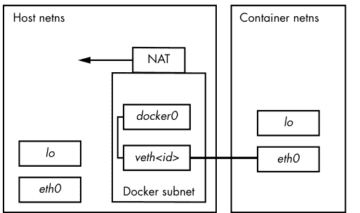

图 17-1：Docker 中的桥接网络。粗线表示虚拟接口对绑定。

你可能需要检查你的 Docker 接口网络的子网。有时，它与由电信公司路由器硬件分配的基于 NAT 的网络之间可能会发生冲突。

Podman 中的无根操作网络是不同的，因为创建虚拟接口需要超级用户权限。Podman 仍然使用新的命名空间，但它需要一个可以设置为在用户空间运行的接口。这是一个 TAP 接口（通常位于 `tap0`），并结合一个名为 `slip4nets` 的转发守护进程，容器进程可以到达外部世界。这种能力较低；例如，容器之间无法相互连接。

网络方面还有很多内容，包括如何在容器的网络栈中暴露端口以供外部服务使用，但网络拓扑是最重要的理解点。

# Docker 操作

到此时，我们可以继续讨论 Docker 启用的其他类型的隔离和限制，但将花费很长时间，你现在可能已经明白了这一点。容器并非源于某一个特定的功能，而是多个功能的集合。结果是，Docker 必须跟踪我们在创建 容器时所做的所有事情，并且必须能够清理它们。只要容器有正在运行的进程，Docker 就将其定义为“运行中”。你可以通过 `docker ps` 查看当前运行的容器：

| 容器 ID | 镜像 | 命令 | 创建时间 | 状态 | 端口 | 名称 |
| :--- | :--- | :--- | :--- | :--- | :--- | :--- |
| bda640cecf7 | hlw_test | /bin/bash | 8 小时前 | 运行 8 小时 | | boring |
| 8a4d6e85efe | hlw_test | /bin/bash | 20 小时前 | 运行 20 小时 | | awesome |

一旦其进程终止，Docker 就会将其放入退出状态，但仍保留容器（除非你使用 `--rm`）。这包括对文件系统所做的更改。你可以轻松访问文件系统但需要意识到这一点，因为 `docker ps` 默认不显示容器；你必须使用 `-a` 来查看所有内容。堆积一大堆退出的容器非常容易，如果容器中的应用程序创建了大量数据，你可能会耗尽磁盘空间而不知道为什么。这也适用于旧的 镜像。开发镜像往往是一个重复的过程，当你用与现有镜像相同的标签为镜像打标记时，Docker 不会移除它。如果你运行 `docker images` 显示系统上的所有镜像，这里有一个显示之前的镜像的示例带有：

| 存储库 | 标签 | 镜像 ID | 创建时间 | 大小 |
| :--- | :--- | :--- | :--- | :--- |
| hlw_test | latest | bda640cecf7 | 8 小时前 | |
| hlw_test | awesome | 8a4d6e85efe | 20 小时前 | |
| <none> | <none> | f073b4a2d66 | 46 小时前 | |
| alpine | latest | d066f5a3b79 | 4 周前 | 19MB |

《Linux 工作原理》（早期体验版）© 2021 Brian Ward

因此，你可能会发现 LXC 在适应不同需求方面更加灵活。例如，默认情况下，LXC 不使用你在 Docker 中看到过的叠加层文件系统（overlay filesystem），尽管你可以添加一个。由于 LXC 是基于 C API 构建的，如果有必要，你可以在自己的软件应用程序中使用这种细粒度的控制。

配套的管理包 LXD 可以帮助你处理 LXC 的一些细微的细节（例如网络创建和镜像管理），并提供了一个 REST API，你可以使用它来访问 LXC 而不是 C API。

## 17.2.4 Kubernetes

说到管理，容器已成为各种 Web 服务器的流行选择，你可以从单个镜像在多台机器上启动大量容器，提供极佳的冗余。遗憾的是，这可能导致难以管理。你需要执行以下任务：

- 跟踪哪些机器可以运行容器。
- 在这些机器上启动、监控和重启容器。


- 配置容器的启动项。
- 根据需要配置容器网络。
- 加载新版本的容器镜像并平滑地更新所有运行中的容器。

这并不是一个完整的列表，也未能充分传达每个任务的复杂性。软件迫切需要开发支持，在出现的解决方案中，Google 的 Kubernetes 已经占据主导地位。也许导致这一现象的最大因素之一是它运行 Docker 容器镜像的能力。

与任何客户端-服务器应用程序一样，Kubernetes 有两个基础。服务器涉及用于运行容器的机器，而客户端主要是一组用于启动和操作容器集的命令行工具。容器的配置文件（以及它们组成的组）可能非常详尽，你会发现在客户端侧涉及的大部分工作是创建适当的配置。

你可以自己探索这些配置。如果你不想自己处理服务器，可以使用 Minikube 工具在你自己的机器上安装一个运行 Kubernetes 集群的虚拟机。

## 17.2.5 容器的陷阱

如果你思考像 Kubernetes 这样的服务是如何运作的，你也会意识到一个利用容器的系统并非没有成本。至少，你仍然需要一台或多台机器来运行你的容器，这必须是一台完整的 Linux 机器，无论它是运行在真实硬件还是虚拟机上。这里仍然维护成本，尽管维护这种核心基础设施可能比维护需要许多自定义软件安装的配置要简单。

这可能以多种形式存在。如果你选择管理自己的基础设施，那是对时间的大量投入，并且仍然有硬件、托管和维护成本。如果你选择使用像 Kubernetes 集群这样的容器服务，你将支付让别人为你完成工作的金钱成本。

在考虑容器本身时，请记住以下几点：

- 容器在存储方面可能是浪费的。为了让你的应用程序在容器内部以任何顺序运行，容器必须包含 Linux 操作系统的所有必要支持，例如共享库。这可能会变得非常大，特别是没有特别注意为容器选择的基础发行版时。然后，考虑你的应用程序本身：它有多大？当你使用带有多个相同容器副本的叠加层文件系统时，这种情况会得到某种缓解，因为它们共享相同的基础文件。然而，如果你的应用程序创建了大量的运行时数据，所有这些叠加层的上层可能会增长。
- 你仍然必须考虑其他系统资源，例如 CPU 时间。你可以配置限制多少容器可以消耗资源，但你受限于底层系统能够处理的量。有内核和块设备。如果你过载了它们，那么你的容器、底层系统或两者都将遭受。
- 你可能需要以不同的方式思考存储数据的地方。在像 Docker 这样使用叠加层文件系统的容器系统中，运行期间对文件系统所做的更改在进程终止后就会消失。在许多应用程序中，所有用户数据进入数据库，然后问题就减少为数据库管理。但你的日志呢？这些日志对于运行良好的服务器应用程序是必要的，你仍然需要一种方法来存储它们。对于任何大规模的生产环境，独立的日志服务是必不可少的。
- 大多数容器工具和操作模型都是面向 Web 服务器的。如果你正在运行典型的 Web 服务器，你会发现许多关于在容器中运行 Web 服务器的支持和信息。特别是 Kubernetes，它有许多防止失控服务器代码的安全性特性。这可能是一个优势，因为这弥补了 Web 应用程序（坦率说）写得有多糟糕。然而，当你试图运行另一种类型的服务时，有时感觉就像像是在试图把方木钉推入圆孔。
- 粗心的的容器可能会导致膨胀、配置问题和故障。你正在创建一个隔离环境的事实并不能免受你在该环境中犯错的影响。你可能不需要那么担心系统的复杂性，但会有许多其他事情可能出问题。当任何系统出现问题时，缺乏经验的用户倾向于通过添加东西来试图胡乱无章地解决问题。这可能会持续（通常是盲目的），直到出现一个某种功能正常的系统——但带有许多额外问题。你需要理解你所做的出的更改。
- *版本控制可能会出现问题。* 我们在书中的示例中使用了 `latest` 标签。这应该是 Python 的最新发布版本，但也意味着当你构建一个发行版时，某些可能会发生变化并破坏你的应用程序。一种标准做法是使用特定版本的容器。
- *信任可能是一个问题。* 这特别适用于使用 Docker 构建的镜像。当你那些仓库中的镜像上构建容器时，你是在信任一个额外的管理层，以确保它们没有引入比常更多的安全问题。

在考虑这些问题时，你可能会认为容器与其他管理方式相比有很多缺点。然而，事实并非如此。无论你选择什么方法，这些问题在某种程度上都是存在的——某些问题在容器中更容易管理。例如，如果你的应用程序在普通系统上启动很慢，它在容器中启动也会很慢。

## 17.3 运行时虚拟化

最后要提到的虚拟化类型是基于开发应用程序的环境类型。这与我们之前看到的系统虚拟机和容器不同，因为它不使用将应用程序放在不同机器的想法。相反，它是一种只适用于特定应用程序的隔离。

这类环境的原因是同一系统上的多个应用程序可以使用同一种编程语言，导致潜在冲突。例如，Python 在典型发行版的多个地方被使用并包含许多包。如果你想在一个包中使用系统的 Python 版本，当你想要插件的不同版本时可能会麻烦。

让我们看看 Python 的虚拟环境功能如何创建一个只有你需要的包的 Python 版本。开始的方法是为环境创建一个新目录：

```
$ python3 -m venv test-venv
```

> 当你读到这里时，你可能只需输入 `python` 而不是 `python3`。

现在，查看新的 `test-venv` 目录。你会看到类似 `bin`、`include` 和 `lib` 的系统级目录。要激活虚拟环境，你需要 `source`（而不是执行）`test-venv/bin/activate` 脚本：

```
$ test-venv/bin/activate
```

《Linux 工作原理》（早期访问）© 2021 Brian Ward

获取执行源的原因是因为激活本质上是设置一个环境变量，而你无法通过运行可执行文件来做到这一点。在此时，当你运行 Python 时，你得到 `test-venv/bin` 目录下的版本（该目录本身是一个符号链接），并且 `VIRTUAL_ENV` 环境变量被设置为环境基础目录。你可以运行 `deactivate` 来退出虚拟环境。

这并没比此更复杂。在设置了这个环境变量后，你会在 `test-venv/lib` 中获得一个全新的、空的包库，当你在环境中安装的任何新内容都会存放在那里，而不是主系统的库中。

并不是所有的编程语言都像 Python 那样允许虚拟环境，但了解它是值得的，至少可以从其他角度来消除对“虚拟（virtual）”一词的某些误解。

第 17 章 418

## 参考文献

Abrahams, Paul W., and Bruce Larson, *UNIX for the Impatient*, 2nd ed. Boston: Addison-Wesley Professional, 1995.

Aho, Alfred V., Brian W. Kernighan, and Peter J. Weinberger, *The AWK Programming Language*. Boston: Addison-Wesley, 1988.

Aho, Alfred V., Monica S. Lam, Ravi Sethi, and Jeffery D. Ullman, *Compilers: Principles, Techniques, and Tools*, 2nd ed. Boston: Addison-Wesley, 2006.

Aumasson, Jean-Philippe, *Serious Cryptography: A Practical Introduction to Modern Encryption*. San Francisco: No Starch Press, 2017.

Barrett, Daniel J., Richard E. Silverman, and Robert G. Byrne, *SSH, The Secure Shell: The Definitive Guide*, 2nd ed. Sebastopol, CA: O'Reilly, 2005.

Beazley, David M., *Python Distilled*. Addison-Wesley, 2021.

Beazley, David M., Brian D. Ward, and Ian R. Cooke, “The Inside Story on Shared Libraries and Dynamic Loading.” *Computing in Science & Engineering* 3, no. 5 (September/October 2001): 90–97.

Calcote, John, *Autools: A Practitioner’s Guide to GNU Autoconf, Automake, and Libtool*, 2nd ed. San Francisco: No Starch Press, 2019.

Carter, Gerald, Jay T, and Robert Eckstein, *Using Samba: A File and Print Server for Linux, Unix, and Mac OS X*, 3rd ed. Sebastopol, CA: O'Reilly, 2007.


# 参考文献

《Linux 工作原理》（早期访问）© 2021 Brian Ward

Christians, Tom, David French, Larry Wall, and Jon Orwant, *Programming Perl: Unmatched Power for Processing and Scripting*, 4th ed. Sebastopol, CA: O'Reilly, 2012.

chromatic, *Modern Perl*, 4th ed. Hillsboro, OR: Onyx Neon Press, 2016.

Davies, Joshua. *Implementing SSL/TLS Using Cryptography and PKI*, Hoboken, NJ: Wiley, 2021.

Friedl, Jeffrey E. F., *Mastering Regular Expressions*, 3rd ed. Sebastopol, CA: O'Reilly, 2006.

Gregg, Brendan, *Systems Performance: Enterprise and the Cloud*, 2nd ed. Boston: Addison-Wesley, 2020.

Grune, Dick, Kees de Recuwijk, Henri E. Bal, Ceriel J. H. Jacobs, and Koen Langendoen, *Modern Compiler Design*, 2nd ed. New York: Springer, 2012.

Hopcroft, John., Rajeev Motwani, and Jeffrey D. Ullman, *Introduction to Automata Theory, Languages, and Computation*, 3rd ed. Upper Saddle River, NJ: Prentice Hall, 2006.

Kernigan, Brian W., and Bob Pike, *the UNIX Programming Environment*. Upper Saddle River, NJ: Prentice Hall, 1984.

Kernigan, Brian W., and Dennis M. Ritchie, *The C Programming Language*, 2nd ed. Upper Saddle River, NJ: Prentice Hall, 1988.

Kochan, Stephen G., and Patrick Wood, *Unix Shell Programming*, 3rd ed. Indianapolis: SAMS Publishing, 2003.

Levine, John R., *Linkers and Loaders*. San Francisco: Morgan Kaufmann, 1999.

Lucas, Michael W., *SSH Mastery: OpenSSH, PuTTY, Tunnels, and Keys*, 2nd ed. Detroit: Tilled Minds Press, 2018.

Matloff, *The Art of R Programming: A Tour of Statistical Software Design*. San Francisco: No Starch Press, 2011.

Meenburg, Robert, *Managing Projects with GNU Make*, 3rd ed. Sebastopol, CA: O'Reilly, 2015.

Peek, Jerry, Grace Todino-Gonguet, and John Strang, *Learning the UNIX Operating System: A Concise Guide for the New User*, 5th ed. Sebastopol, CA: O'Reilly, 2001.

Pike, Rob, Dave Presotto, Sean Dorward, Bob Blandfera, Kevin Thompson, Howard Trickey, and Phil Winterbottom, "Plan 9 from Bell Labs." Accessed February 1, 2020, `https://9p.io/sys/doc`.

Poulton, Nigel, *Docker Deep Dive*. Author, 2016.

Quinlan, Daniel, Rusty Russell, and Christopher Yeoh, eds., "Filesystem Hierarchy, Version 3.0." Linux Foundation, 2015, `https://linuxfoundation.org/fhs.shtml`.

《Linux 工作原理》（早期访问）© 2021 Brian Ward

Raymond, Eric S., ed., *The New Hacker's Dictionary*, 3rd ed. Cambridge, MA: MIT Press, 1996.

Robbins, Arnold, *sed & awk Reference*, 2nd ed. Sebastopol, CA: O'Reilly, 2002.

Robbins, Arnold, Elliott Hannah, and Linda Lamb, *Learning the vi and vim: Unix Text Processing*, 7th ed. Sebastopol, CA: O'Reilly, 2008.

Salus, Peter H., The Daemon, the GNU, and the Penguin*, Tacoma, WA: Reed Services, 2008.

Samar, Vincent, and Roland J. Schemers III, "Unified Pluggable Authentication Modules (PAM)," October 1995, Open Software Foundation, `http://www.opengroup.org/rfc860.html`.

Schwartz, Randall L., Brian Foy, and Tom Phoenix, *Linux: Making Easy Things and Hard*, 10th ed. Sebastopol, CA: O'Reilly, 2016.

Shotts, William, *The Linux Line*, 2nd ed. San Francisco: No Starch Press, 2019.

Silberschatz, Abraham, Peter Galvin, and Greg Gagne, *Operating System Concepts*, 10th ed. Hoboken, NJ: Wiley, 2018.

Smith, Jim, and Ravi Nair, *Virtual Machines: Versatile Platforms for Systems and Processes*. Cambridge, MA: Elsevier, 2005.

Stallman, Richard M., Andrew. Rudoff, *Emacs Manual*, 18th ed. Boston: Free Software Foundation, 2018.

Stevens, W. Richard, Bill Fenner, and Andrew M. Rudoff, *Unix Networking, Volume 1: Sockets API*, 3rd ed. Boston: Addison-Wesley, 2003.

Tanenbaum, Andrew S., and Herbert Bos, *Modern Operating Systems*, 4th ed. Upper Saddle River, NJ: Prentice Hall, 2014.

Tanenbaum, Andrew S., and David J. Wetherall, *Computer Networks*, 5th ed. Upper Saddle River, NJ: Prentice Hall, 2010.

## 索引

### 数字与符号

- `17`. 参见 directory, current
- `17`. 参见 directory, root
- `#`, 13
- `$!` shebang
- `$, 12–13`. 参见 shell, prompt
- `$$` 297
- `$$` 33, 298
- `$, 290`
- `$, 1,296`
- `$, 298`. 参见 exit code
- `$$` 297
- `$$` 300–301
- `18–19`. 参见 glob


### A

- `|`, 28–29. 1 pipe
- `|`, 300–301
- `<` 参见 file, input from
- `<<` here document
- `>` 参见 file, output to
- `>>` 参见 file, output to
- `?`, 18–19. 参见 glob
- `.`, 299. 参见 test
- `^`, 17
- `ARP` (Address Resolution Protocol), 264–265
- `at`, 187–188
- `ATA`, 64–66
- `autoconf`, 388–393
- Autotools. 参见 GNU Autotools
- Awake, 281
- `awk`, 309

### B

- `basename`, 308–309
- `bash`, 12. 参见 Bourne Shell
- startup file (参见 startup file, bash)
- `.bash_profile`, 340–342
- `.bashrc`, 340–342
- `g`, 34
- `/bin`, 42
- `/bin/bash`. 参见 bash
- `/bin/sh`. 参见 Bourne Shell
- `BIOS`, 121–122
- boot partition, 133
- `bison`, 379
- `blkid`, 85
- block bitmap, 114
- block device. 参见 device,block
- `blockdev`, 76
- boot, 43, 127–131
- boot, 117–118. 参见 init
- init (参见 boot loader)
- loader, 118–119, 171–172
- messages, 118
- network configuration, 239–240
- boot loader, 117–123
- loading, 132
- filesystem access, 121–122 (参见 GRUB, (参见 filesystem access))
- GRUB (参见 GRUB)
- internals, 132–135
- multi-stage, 133
- system other than Linux, 136

### A

- abstraction, 1–2
- administrator. 参见 root
- `AFS` (Andrew File System), 333–334
- `alias`, 339
- `ALSA` (Advanced Linux Sound) Architecture, 55–56
- Apple partition. 参见 HFS
- application layer. 参见 network
- archive, 391
- table of contents, 40
- testing, 40,387

《Linux 工作原理》（早期访问）© 2021 Brian Ward

Bourne Shell, 12–13
basic use, 12–13
compiling, 364–366
script, 12–13

BusyBox, 258
`bzip2`, 41
binary, 259
`bzip2`, 41
definition, 400
configuration, 42
container, 409
building, 368–399
definition, 400
filesystem, 401–411
image, 403–409
limit, 412
operation, 414–417
purpose, 405
root, 407

### C

compiler, 364–365
compiler, 376–377
preprocessor, 372–373, 391,398
case, 304
`cat`, 13–14
`cd`, 17
`cgroup`, 144,147,216–220
container, 406
controller, 219–220
creating, 220–221
listing, 218–219
version 1,218–219
chainloading. 参见 boot loader,chainloading
character device. 参见 device,child process.参见 child
controlling terminal, 54
coreboot, 123
coreutils, 389,395
`cp`, 15
`cpio`, 164
`cpp`, 373. 参见 C, preprocessor
`CPU`, 6
load (参见 load average)
multiple, 6, 205
performance, 208–210, 212–214
time, 32, 200–207, 221
virtual machine, 403–404
cron, 183–185, 187
`csh`, 342
`CTRL-C`, 14
`CTRL-D`, 14
`CUPS`, 360–362
`curl`, 271–272
current working directory. 参见
directory, current
cylinder (disk), 78–79

### D

- `D-Bus`, 148, 241, 359–360
- instance, 360
- monitoring, 360
- systemd unit, 142

# Linux 如何工作（早期访问版） © 2021 Brian Ward

- `date`, 182
- `dd`, 50–51, 93
- `debugfs`, 93
- 默认网关, 230–231, 238
- 默认路由, 230
- 默认目标, 143
- 默认用户设置, 343–344
- 需需分页, 210
- 桌面, 347–348
- 并行, 55
- ipe (参见 pipe, named)
- SCSI (参见 SCSI)
- 串口, 55
- 套接字, 49, 289–290
- 终端, 53–55
- 类型, 48–49
- 设备, 53, 108–110
- devps, 57–58
- `df`, 89–91
- `/dev`, 42, 48–66
- `/dev/dm-*`, 53, 100
- `/dev/hd-*`, 53
- `/dev/lp-*`, 55
- `/dev/mapper`, 53, 100, 105
- `/dev/null`, 48–49
- `/dev/nvme-*`, 53
- `/dev/part-*`, 55
- `/dev/plts`, 54
- `/dev/sd-*`, 52–53
- `/dev/sg-*`, 53, 66
- `/dev/snd`, 53, 67
- `/dev/tty-*`, 54–55
- `/dev/vd-*`, 53
- `/dev/xvd-*`, 53, 403
- `/dev/zero`, 50–51
- 桌面 Bus. 参见 D-Bus
- 桌面环境, 350
- DHCP (动态主机配置协议), 252–253
- `diff`, 21
- 目录, 16–18, 36
- 修改, 17
- 创建, 17, 20, 201
- 错误, 31
- 层次结构, 16–17, 42–44
- home (参见 home 目录)
- 内部结构, 112–113
- 列出, 15
- 父目录, 17, 112–114
- 权限 (参见 permissions 目录)
- 删除, 17–18
- root, 16–17, 42–43, 117, 120, 124–125 (参见 root)
- 音频, 55–56
- 块, 48–50, 56, 64–67, 96–97
- 字符, 49–50, 56
- 创建文件, 56
- 驱动程序, 4, 6–7, 117
- 文件, 42, 48–49, 56
- 查找, 51
- 信息, 49–50, 58, 60–61
- 主设备和次设备号, 49, 58, 100
- 监控器, 61
- 名称, 51–55
- 网络, 49
- 节点 (参见 device file)
- 光学, 53, 67, 81
- 缓冲区和缓存, 86
- 容量, 72–74 (参见 device disk)
- 格式 (参见 filesystem, partition (参见 table))
- 几何结构, 77–80
- 监控使用情况, 212–216
- 配额, 222
- 原始访问, 71
- SATA, 52, 58–60, 64–66
- 调度优先级, 215
- 示意图, 70–71
- SCSI, 52–53, 62–63
- 固态, 80
- 磁盘 (续)
- 交换 (参见 swap)
- 使用情况 (参见 filesystem, usage)
- 虚拟, 53
- 显示管理器, 355
- 显示模式, 54–55


# 索引

- `dmesg`, 118. 参见 `kernel`, `log`
- `dmset`, 109. 参见设备管理器
- `DNS` (域名解析服务), 235, 243–246
- `ddsq`, 245
- `Docker`, 406–414
- 文档, 26–28
- 域名解析服务. 参见 `DNS`
- 点文件, 22, 336
- `DPMS` (显示电源管理), 359
- 双重、双网络, 233
- 动态主机配置协议 (`DHCP`), 252–253
- `/etc/login.defs`, 197
- `/etc/mtab`, 86–87
- `/etc/nologin`, 162
- `/etc/nswitch.conf`, 246
- `/etc/passwd`, 27, 176–179–192
- `/etc/profile`, 340
- `/etc/rc.d`, 157–161
- `/etc/resolv.conf`, 245
- `/etc/services`, 249–250
- `/etc/shadow`, 177, 179, 277
- `/etc/shells`, 193–195
- `/etc/sudoers`, 45
- `eth0`, 236
- 以太网, 235–236, 264–265
- 桥接, 266–268
- `euid`. 参见有效用户 ID
- `exec`, 311
- `exec()`, 7, 203, 311
- 可执行文件, 36–37, 42, 87, 292, 365–367, 380
- 退出, 298
- `echo`, 13, 160
- `EDITOR`, 344
- 有效用户 ID, 189–190
- `EFI`. 参见 `UEFI`
- `efilinux`, 123
- `egrep`, 19
- 经过时间, 207
- `Emacs`, 26
- 仿真器, 402
- 加密, 197–198, 273–274
- `env`, 29
- 环境变量, 22–23, 311
- `EOF` (文件结束消息), 14
- 错误消息, 29–30, 204
- `ESP` (EFI 系统分区). 参见 `UEFI`
- `/etc`, 424, 141, 176–177
- `/etc/fstab`, 52, 85, 88–99
- `/etc/group`, 180
- `/etc/hosts`, 244
- `/etc/init.d`, 159
- `/etc/mitstab`, 157–158
- `/etc/ld.so.cache`, 369
- `/etc/ld.so.conf`, 369
- `/etc/localtime`, 182
- 导出, 232
- `expr`, 311
- `text`. 参见 `filesystem`, `ext2/ext4`
- `failban`, 276–277
- `fdisk`, 72–73, 75–78
- `fg`, 34–35
- `FHS` (系统层次结构), 42
- 另一个文件, 21
- 压缩, 39–41, 321–322
- 拷贝, 15 (参见文件传输)
- 创建项, 169
- 删除, 163–114
- 描述符 (参见 `file descriptor`)
- 详情, 15
- 设备 (参见 `device`)
- 点 (参见 `dot file`)
- 错误, 30–31
- `find`, 211
- `find in`, 19–20
- `format`, 21
- `group`, 15, 35–37, 426
- 链接, 38, 111–303
- 计数, 113–114
- 模式, 35–37 (参见 `permissions`)
- 移动, 16
- 打开, 200–202
- 所有者, 15, 35–37
- 权限 (参见 `permissions`)
- 重定向输入, 29
- 重定向输出, 28–29
- 普通, 35
- 跨网络共享, 323–334
- 与用户共享, 9
- 套接字 (参见 `device`, `socket`)
- 交换, 97
- 临时, 43, 307
- 测试, 301–303
- 类型, 35, 38, 201
- 时间戳, 16
- 文件 (命令), 21
- 文件描述符, 201, 203–204
- 文件传输, 315–316
- 选择方法, 316
- 同步 (参见 `rsync`)
- 使用 Python, 316
- 文件系统, 70–71, 80
- 启动加载器 (参见 `boot loader`, `filesystem`)
- `Btrfs`, 81–82
- 容量, 89–91
- `cgroup`, 219 (参见 `cgroup`)
- 检查, 91–93
- `CIFS`, 331
- 创建, 82–83, 105
- 当前挂载, 84
- `ext2/ext4`, 81–85, 91–93
- `FAT`, 81
- `HFS+`, 81
- 层次结构, 42–44
- 内部结构, 82, 111–115
- `ISO`, 9660, 81
- `journal`, 81, 93
- `/mount`, 83–140
- 挂载, 105
- 挂载选项, 86–87
- `NFS` (网络文件系统), 332–333
- `overlay`, 94, 410–411
- `proc` (参见 `/proc`)
- 只读, 86, 121
- 重挂载, 77–88
- 修复, 91–93
- 调整大小, 97, 107
- `squashfs`, 94
- `tmpfs`, 93–94
- 类型, 81–82
- 使用情况, 89–91
- 用户空间, 81, 115, 333–334
- `UUID` (唯一标识符), 85, 88, 96, 120–121, 124
- `XFS`, 81
- 文件系统层次结构 (`FHS`), 42
- `find`, 21, 310
- 查找适当命令, 26–27
- 防火墙, 259–264
- 规则, 261–262
- 策略, 262–264
- `flex`, 379
- `folder` 参见 `directory`
- `for`, 305
- `fork()`, 7, 147–148, 203, 205
- 帧 (以太网), 236
- 空闲, 96
- `fsdom`, 107
- `fsck`, 88, 91–93
- `fsuid`, 190
- `FTP`, 278, 287
- `USE` (空间中的文件系统).参见 `filesystem`, `space`
- 关关, 227, 230–231
- `gcc`, 364
- `GECOS`, 178
- `getuid()`, 191–192
- `getty`, 54, 143, 158
- `Ghostscript`, 361–362
- `glob`, 18–19, 223–294. 参见 `expression`
- 全局单播地址, 232–233
- `GNOME`, 350
- `gnome-shell`, 351–352
- `GNU Autotools`, 386, 399. 参见 `autoconf`
- `gparted`, 72
- `GPT` (全局唯一标识符表), 72–73, 126
- `grep`, 19–200
- `group`, 10, 178, 180
- `g`, 36
- `GRUB`, 123–135
- 启动命令, 127
- 命令行, 126–127
- 配置, 124–125, 127
- 设备, 124–128
- `insmod`, 124–125
- 安装, 130
- 内部, 134–135
- 菜单, 123–125, 128–129
- 可移动介质, 131
- `grub-mkconfig`, 127–129
- `GTKs`, 350
- `guest` (操作系统), 403
- `gzip`, 39–41
- `if/else`, 299–300
- `ifconfig`, 228
- `image` (参见 `container`)
- `image location`, 44, 125
- `include file`, 279
- `inetd`, 58
- `info` (GNU), 28
- `init`, 118–120, 138–139
- `initramfs`, 124–125, 135–164
- `initrd`, 164
- `iostat`, 214–215
- `iotop`, 216–217
- `ip` (命令), 228–230, 232–237, 238, 264–265
- `IP` (Internet协议), 226
- `address`, 227–228, 237–238, 264–265
- `chain`, 259–262
- `filter`, 259–262
- 转发, 255
- 伪装, 256
- `subnet` (参见 `subnet`)
- `table`, 259–260
- `IPP` (Internet打印协议), 361
- `iptables`, 261–264
- `IPv4`, 226, 231
- `IPv6`, 226–227, 231–233, 235, 238, 254, 266
- `jar`, 382


# Linux 如何工作（早期访问）© 2021 Brian Ward

- Java, 382, 404

- job控制, 34–35

- jobs, 34

- `journalctl`, 46, 51, 118–119, 145–169, 172, 185–187

- `journald`, 154, 156, 168–169, 173, 185–186

- KDE, 350

- Kerberos, 333–334

- kernel, 2–5

- nas a resource, 199

- boot, 117, 119–123

- boot messages, 118–119

- 编译, 399

- disk buffer and cache (参见 disk, buffer and cache)

- disk I/O system, 71, 111

- image location, 44, 125

- load, 117, 121–122

- log, 51, 61, 172

- mode, 3

- modules, 44

- 网络接口 (参见 network, interface)

- parameters, 120–122, 124–125

- 读取分区表 (参见 partition, reading table)

- ring buffer, 118–119

- 路由表, 230

- SCSI系统, 62–67

- libata, 64–66

- libinput, 352–353

- library, 42

- C, 366

- 链接, 366–367, 370, 377, 391, 393–394

- shared (参见共享库)

- 静态, 368

- 轻量级目录访问协议 (LDAP), 178

- LILO, 123

- 计数 (参见 file, link)

- farm (参见 file, link)

- hard (参见 file, link)

- 符号 (参见符号链接)

- 链路本地地址, 232–253, 254

- 监听 (网络上), 248–249, 279–280, 288–289

- 字面量, 293–295

- LLMNR (链路本地多播名称解析, 245)

- LLVM 项目, 364, 383

- `ln`, 38–39, 111, 113, 115. 参见硬；符号链接

- lo, 247

- 可加载内核模块.参见内核，模块

- 负载平均值, 208–210

- LAN (局域网), 224

- lastlog, 169

- 层, 2

- 网络 (参见网络, 层)

- LBA (逻辑块寻址), 79, 122

- LDAP (轻量级目录访问协议), 178

- Lconfig, 369

- Ld_LIBRARY_PATH, 344, 369–371

- Id.so, 360–370

- id, 368–369

- `less`, 20, 341–344

- level, 2

- 在用户空间, 8–9

- 键盘, 357–359

- `kill`, 33–34

- Kubernetes, 415

- `loginctl` 1, 188

- 登录 shell, 340–342

- logotrate, 172–173

- loop. *参见 script, loop*

- lost+found, 92, 114

- `ls`, 15

- `lsof`, 200–202

- 网络, 280–281

- Unix 域套字, 290

- `lsscs1`, 52, 63, 66

- `lsusb`, 65

- `ltrace`, 204–415

- LVV (逻辑卷). *参见 LVM, 逻辑卷*

- LVM (逻辑卷管理器), 52–53, 96–110
    - 进, 96–97
    - 构建系统, 102–105
    - 创建文件系统, 105
    - 设备名称, 100
    - 设备, 73–74
    - 实现, 107–110
    - 列出列表, 97–100
    - 逻辑卷, 96–100
    - 逻辑卷, 布局, 109–110
    - 逻辑卷, 创建, 104–105
    - 逻辑卷, 删除, 106–107
    - 物理区, 99
    - 物理卷, 96–99, 101–103
    - 物理卷, 创建, 103
    - 物理卷, 元数据, 101, 108
    - 调整大小, 106–107, 110
    - 扫描卷, 108
    - 示意图, 96–99, 101–103
    - 卷组, 96–99, 101–103
    - 卷组, 创建, 103

- LXC, 414–415

- 分隔符, 375

- 标准目标, 378, 392

- 保持更新, 375–376

- 目标, 374

- `man`, 26–28

- 手页, 26–28, 44, 33. *另 man*

- MBR (主引导记录), 72–73, 126
    - 启动, 130–131, 133

- mdDNS, 245

- `/media`, 43

- 内存, 3–4
    - 容量, 94–96, 209–210
    - 不足, 94–96, 209–210
    - 管理, 6, 119, 210–214
    - 监控使用, 212–214
    - 页 (参见 page)
    - 问题, 31–32
    - 保护, 3
    - 交换 (参见 swap)
    - 测试, 129
    - 虚拟 (参见 virtual memory)

- `mkdir`, 17

- `mkfs`, 82–83

- `knod`, 56

- `mkswap`, 96–97

- MMU (内存管理单元), 6, 210–211

- 模块. kernel, modules

- 挂载, 83–89. *另见* filesystem,

- 鼠标, 358

- 多任务处理, 5–6

- `mv`, 16

## M

- MAC 地址, 235–237, 243, 264–265

- 主内存. *参见内存*

- `make`, 373–379

## Makefile

- 依赖, 373–375, 377, 379

- 组织, 378–379

- 规则, 374, 377

## N

- 命名空间. *参见* 空间, process, 空间

- `nano`, 26, 344

- NAT (网络地址转换), 255–258

- NDP (邻居发现协议), 266

- `netcat`, 282–283

- Netplan, 239

- `netstat`, 248–249

- 网络, 223–224
    - 应用层, 225, 269–282
    - 客户端, 248–249
    - 配置, 237–243, 252–254

- nobody (用户), 178 (另网络配置管理器)

- `nslookup`, 245

- NTP (网络时间协议), 连接, 248–249, 270–271, 281, 182–183, 251

- 容器 (参见 container, networking)

- NVME (非易失性内存表达式), 53, 63

- 防火墙 (参见 firewall)

## 0

- 主机 (参见 host)

- 对象文件, 365–366

- 接口, 49, 236–238, 411–412

- OOM 杀死, 96

- 互联网层, 225–235 (另见 IP)

- `open()`, 203–204

- 层, 225–227

- 开源, 385–386

- localhost (参见 localhost)

- OpenWRT, 285

- 命名空间, 411–412

- 操作系统级虚拟化, 406

- 物理层, 226, 235–236

- `/opt`, 43

- 端口, 248–250, 270

- OSS (开源系统), 55–56

- 前缀, 228

## P

- 包, 390–394, 999–400

- 数据包, 224–225, 247

- 页, 210–213

- 页异常, 211–212

- 分页器, 344, 20

- 页表, 6, 210

- PAM (可插拔认证模块), 192

- 并行端口, 55

- 半虚拟化, 403

- 分区, 52, 57, 82
    - 对齐, 75–80
    - 容量, 72–74 (另见 filesystem)
    - 创建表, 76–78
    - 逻辑, 72–73
    - 主要, 72–73
    - 读取表, 74–76
    - nice 值, 208
    - 表, 70–79
    - NIS (网络信息服务), 178
    - 查看, 75
    - Windows (参见 filesystem, FAT)

- `passwd`, 22–35, 179

- `nmap`, 284

- PostScript, 360–362


- 可预测网络设备, 236

- 密码更改, 197–198

- 密码文件. 查看 `/etc/passwd`

- 补丁, 395–396

- `patchelf`, `/proc/devices`, 51

- `PATH`. 参见 `path`, 3–4, 32–33, 95

- 路径计数, 34–35

- 命令, 23–24, 337–338

- 相对, 17

- 路径名. 参见路径分组 (参见 `cgroup`)

- 模式匹配, 18–20

- 性能, 199–200, 210

- 内存, 95–96

- 权限, 31–37

- 位, 35–37

- 默认, 37–340

- 父级目录, 413–414

- 执行, 35–37

- 组, 35

- 保留, 40

- 读取, 35–37

- 测试, 302–303

- 用户, 35–37

- 世界 (参见权限)

- 写, 35–37

- PE. 参见 LVM, 物理区接口, 42

- 内存, 95–96

- Perl, 281

- 管理, 5–6

- 内存, 96, 200–212

- 监控, 216

- 打开文件, 200–202

- 所有者, 9, 189–190

- 优先级, 207–208

- 就绪运行, 208–210

- 开始, 7

- 状态, 32

- 停止, 33–34

- 终止, 33–34

- 跟踪, 206

- 意外终止, 96

- `.profile`, 340

- 物理卷 (PV). 参见 LVM, 物理卷, 32–33, 190, 212

- `pidstat`, 216

- `ping`, 20, 28–29, 41

- `pkg-config`, 393–394

- Podman, 406–411

- Python, 380–381, 417–418

- Qt, 350

- 端口扫描, 284

# R

- 保存的用户 ID, 190

- 实时时钟, 181

- 真实用户 ID, 189–190

- 重启, 162–163

- 重绘显示, 35

- 正则表达式, 19–20

- 普通文件. 参见 File, regular

- 远程登录, 273–278

- `renice`, 208

- 救救镜像或 CD, 164–165

- `resolvev1`, 246

- `resolved`. 参见 system-resolved

- 资源限制, 216–222, 406

- 利用率, 207, 216

- 资源监控, 206

- 反向搜索, 35

- RIP (光栅图像处理器), 361–362

- `rm`, 16

- `rmdir`, 17–18

- `root`, 178–179 (另见 目录)

- 运行程序, 作为 44–46

- 根目录. 参见 目录

- 路由, 230 (另见网络, 路由)

- 路由器, 224, 227, 233, 254–259

- RPC (远程过程调用), 284–285

- `rsync`, 317

- 带宽, 322

- 压缩, 321–322

- 从远程主机拷贝, 327

- 到远程主机拷贝, 317–322

- 动作拷贝, 318–319

- 排除文件, 320

- 验证传输, 321

- `rsyslog`, 169

- `ruid`. 参见真实用户 ID

- `/run`, 43

- 运行级别, 156–157

- 运行路径, 160–161

- 运行时虚拟化, 417–418

- 运行时信息, 43

- 运行时库搜索路径, 369, 394

# $

- Samba, 324–330

- 客户端, 329–330

- sner, 222

430 索引

# Linux 如何工作（早期访问版） © 2021 Brian Ward

- 实例 (instance), 154

- 任务 (job), 145–146

- 挂载单元 (mount unit), 89, 140, 144

- 需需资源 (on-demand resource), 151–154

- 操作 (operation), 144–147

- 并行单元激活 (parallel unit activation), 154–156

- 进程跟踪 (process tracking), 143, 147–148

- 重载配置 (reload configuration), 145

- 需要依赖 (Requires dependency), 148–151

- 必决依赖 (Requisite dependency), 149

- 服务单元 (service unit), 140, 142–143, 186

- 套接字单元 (socket unit), 140, 152–154, 279

- 指定符 (specifier), 143, 153–154

- System V 兼容性 (System V compatibility), 161

- 目标单元 (target unit), 140, 146–147, 150–151

- 定时器单元 (timer unit), 185–188

- 单元 (unit), 140–188

- 单元组 (unit group), 144

- 单元文件 (unit file), 142–143, 146–147, 150–151, 185–186

- 单元列表 (unit listing), 144–145

- 单元日志 (unit log), 144–145

- 单元启动 (unit startup), 140–141, 148–149

- 单元状态 (unit status), 144, 146

- 变量 (variable), 143

- `telnet`, 270, 273, 287

- tempfs. 见 filesystem, tmpfs

- 临时文件 (temporary file). 见 file, temporary

- 终端 (terminal), 53–54. 另见，窗口控制（参见 controlling terminal）

- 设备 (device)（见 device, terminal）

- 虚拟 (virtual)（见 virtual console）

- 文本 (text), 299–304

- 文本编辑器 (text editor), 25–26, 344

- 文本搜索 (text search), 19–20

- 抖动 (thrash), 209–211. 另见 memory, insufficient

- 线程 (thread), 204–206

- 时间 (time), 207, 211–212. 另见 CPU, system time: 经过的时间（天）, 181–183

- 定时器单元 (timer unit). 见 system, timer unit

- 时间切片 (time slice), 5

- `timesyncd`, 182–183

- 时区 (time zone), 182

- TLS (传输层安全), 226, 287

- 工具包 (toolkit), 350

- `top`, 200–208

- `touch`, 16

- 传输控制协议 (Transmission Control Protocol). 见 TCP

- 传输层 (transport layer). 见 network, application layer

- 传输层安全 (Transport Layer Security). 见 TLS

- 故障排除 (troubleshooting), 168

- `tune2ifs`, 85

## T

- `tail`, 221

- TAP 接口 (TAP interface), 412

- `tar`, 39–341

- TCP (传输控制协议), 247, 251–281

- 过滤 (filtering), 262–264

- 与服务交互 (interacting with service), 270–272

- 封装 (wrapper), 279

- `tctpdump`, 281–283

- `tcs`sh, 342–343

- `telinit`, 161

## U

- `udev`, 48–51, 52–66, 109

- 配置与规则 (configuration and rules), 58–60

- 事件 (event)（见 uevent）

- `udevadm`, 50–51, 60–76

- `udev`, 56–62, 85, 163

- U 盘盘 (udisk), 62

- UDP (用户数据报协议), 250–251, 279–281

- UEFI (统一可扩展固件接口), 121–132, 130

- ESP (EFI 系统分区), 133–135

- 安全启动 (secure boot), 131–132

- `uevent`, 58, 61

- `umask`, 37, 339–340

- `umount`, 84

- 组织 (organization), 8–9


- 启动 (`start`), 117–118, 120, 137–139（另见 `init`）

- 统一可扩展固件接口 (`Unified Extensible Firmware Interface`). 见 `UEFI`

- `/usr`, 43–44

- `/usr/lib`, 367

- `/usr/local`, 44, 390, 395

- `/usr/share`, 44

- 协调世界时 (`UTC`), 181–183

- `UTC` (协调世界时), 181–183

- `UUID` (通用唯一标识符), 52

- 通用唯一标识符 (`UUID`), 52 11–12

- Unix 域套接字 (`Unix domain socket`), 289–290

- 解除 (`unlink`), 114. 另见，`delete`

- `unxz`, 41- 文件系统（另见 `filesystem`, `UUID`）

## V

- `/var`, 43

- `var/log`, 169

- `VFS` (虚拟文件系统), 81, 115

- `vi`, 26

- `vim`, 179

- 虚拟 (`virtual`), 401

- `VirtualBox`, 402–403

- 虚拟终端 (`virtual console`), 54, 158, 355

- 虚拟磁盘 (`virtual disk`). 见 `disk`, `virtual`

- 虚拟接口 (`virtual interface (network)`), 411–412

- 虚拟机 (`virtual machine`), 53, 382, 402–405

- 虚拟内存 (`virtual memory`), 6, 96, 401. 另见 `memory`, 212–214

- 上链路 (`uplink`), 224. 另见 `default gateway`

- `Upstart`, 139

- `USB` 设备 (`USB device`), 65

- 与 `SCSI` 的关系 (`relationship to SCSI`), 52, 64–65

- 串口 (`serial port`), 55

- 用户更改 (`user change`), 44–46

- `id`（见 `user ID`）

- 管理 (`management`), 177–180

- 名字 (`name`）（见 `username`）

- 常规 (`regular`), 12

- `root`（见 `root`）

- 用户认证 (`user authentication`), 192–198. 另见 `PAM`；`etc/passwd`

- 用户授权 (`user authorization`), 193. 另见 `PAM`

- 数据报协议 (`User Datagram Protocol (UDP)`), 250–251, 279–281

- 用户环境 (`user environment`), 335–336

- 用户 `ID` (`user ID`), 9, 179, 189–190

- 用户态 (`userland`). 见 `user space`

- 用户模式 (`user mode`), 3

- 用户名 (`username`), 9, 177–179

- 用户进程 (`user process`). 见 `user space`, 3

- 与文件系统 (`and filesystems`), 111

- 与 `LVM` (`and LVM`), 107

- 与 `ID` (`and IDs`), 79, 191–192

- 创建文件系统 (`creating filesystems`), in 82

- 文件系统（见 `user`, `space`）

## W

- `wait()`, 413

- 壁纸 (`wallpaper`). 见 `desktop`

- 警告信息 (`warning messages`), 30

- `Wayland`, 349–352

- 合成器 (`compositor`), 349–352

- 窗口管理器 (`window manager`), 349

- `X` 兼容性 (`X compatibility`), 353–354

- `Web` 服务器 (`web server`), 316

- `WEP` (有线等代理 `Wired Equivalent Proxy`), 268

- `Weston`, 351–354

- `while`, 305–306

- `who`, 156

- 小部件 (`widget`), 350

- `WiFi` 保护 (`WPA`), 268

- 通配符 (`wildcard`). 见 `glob`

- 窗口系统 (`windowing system (determining)`), 351

- 窗口管理器 (`window manager`), 349–350

- `Windows` 启动 (`Windows boot`), 132

- 文件共享 (`file sharing`), 324–330

- 分区 (`partition`）（见 `filesystem`, `FAT`）

- 密码 (`password`), 326–329

- 打印机共享 (`printer sharing`), 329

- 有线等隐私 (`Wired Equivalent Privacy (WEP)`), 268

- 无线网络 (`wireless network`), 240–241. 另见 `Ethernet`, `wireless`

- `wlan0`, 236, 267

- 工作进程 (`worker process`), 272

- `WPA` (`WiFi` 保护), 268

- `wtmp`, 169

- `xlclients`, 356

- `xset`, 359

- `X Window System`, 350

- 客户端 (`client`), 348–349, 355–356

- 诊断 (`diagnostics`), 356–357

- 显示 (`display`), 354

- 事件 (`event`), 356–357

- 输入 (`input`), 357–359

- 网络透明性 (`network transparency`), 355

- 偏好 (`preferences`), 357–359

- 服务器 (`server`), 54, 348–349, 354–355

- 隧道传输 (`tunneling`), 273, 355

- `Wayland` 兼容性 (`Wayland compatibility`), 354

- 窗口管理器 (`window manager`）（见 `window manager`）

- `xwininfo`, 356

- `xargs`, 310

- `XDG Desktop Entry`, 142

- `Xen`, 403

- `xev`, 356–357

- `X` 事件 (`X event`). 见 `X Window System`, `event`

- `xinetd`, 279

- `xinput`, 357–358

- `XKB` (`X`键盘扩展), 358–359

## Y

- `Yacc`, 379

## Z

- `zcat`, 41

- `zip`, 41

《Linux 如何工作》第3版采用 New Baskerville, Futura, Dogma 和 TheSansMono Condensed 字体。该书由 Sheridan Books, Inc. 在密歇根州切尔西市打印并装订。使用的是 60# Finch Offset 纸张，获得了森林管理委员会 (`FSC`) 认证。

本书采用平装装订（`layflat binding`），用冷固柔性胶水将页面装在一起，并将生成的书块的第一页和最后一页贴在封面上。封面并没有粘胶在书脊上，打开时书本可以平放，书脊不会破裂。

# 资源

访问 `https://noostarch.com/howlinuxworks3/` 获取错误列表和更多信息。

来自 `NO STARCH PRESS` 的更多实用的书籍：

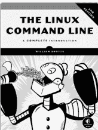

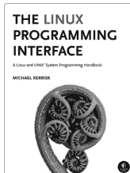


