# Linux 工作原理：每个超级用户都应该知道的（第2版）

# 对《Linux 如何工作》第一版的赞誉

> “一个极好的资源。在大约350页的幅幅，这本书涵盖了所有基础知识。”
> —EWEEK

> “我绝对向那些对 Linux 感兴趣但没有经验了解操作系统内部运行机制的人推荐这本书。”
> —O’REILLYNET

> “学习 Linux 的最佳基础书籍之一，专为高级用户编写。五星好评。”
> —OPENSOURCE-BOOK-REVIEWS.COM

> “得益于其组织方式和提供的技术细节水平，这本书取得了非常凡的成功。”
> —KICKSTART NEWS

> “这是一个非常不同的 Linux 入门介绍。它不加花哨，专注于命令行，并深入内部机制，而不是关注那些取代了更熟悉的 MS Windows 工具的 GUI 界面。”
> —TECHBOOKREPORT.COM

> “这本书很好地解释了 Linux 运行的原理和核心细节。”
> —HOSTING RESOLVE

# 详细内容

## 前言

- 谁应该读这本书？
- 准备工作
- 如何阅读本书？
- 实践方法
- 本书是如何组织的？
- 第二版的新内容
- 术语说明

## 致谢

## 1 大局观

- 1.1 Linux 中的抽象层级
- 1.2 内核
    - 1.3.1 进程管理
    - 1.3.2 内存管理
    - 1.3.3 设备驱动
    - 1.3.4 系统调用与支持
- 1.4 用户空间
- 1.5 用户
- 1.6 展望

## 2 基础命令与目录层次

- 2.1 Bourne Shell: `/bin/sh`.


## 2.2 使用 Shell
### 2.2.1 Shell 窗口
### 2.2.2 `cat`
### 2.2.3 标准输入与标准输出

## 2.3 基础命令
### 2.3.1 `ls`
### 2.3.2 `cp`
### 2.3.3 `mv`
### 2.3.4 `touch`
### 2.3.5 `rm`
### 2.3.6 `echo`

## 2.4 目录导航
### 2.4.1 `cd`
### 2.4.2 `mkdir`
### 2.4.3 `rmdir`
### 2.4.4 Shell 通配符（通配符）

## 2.5 中级命令
### 2.5.1 `grep`
### 2.5.2 `less`
### 2.5.3 `pwd`
### 2.5.4 `diff`
### 2.5.5 `file`
### 2.5.6 `find` 和 `locate`
### 2.5.7 `head` 和 `tail`
### 2.5.8 `sort`

## 2.6 更改你的密码和 Shell

## 2.7 点文件 (Dot Files)

## 2.8 环境和 Shell 变量

## 2.9 命令路径

## 2.10 特殊字符

## 2.11 命令行编辑

## 2.12 编辑器

## 2.13 Shell 输入与输出

### 2.14.1 标准错误
### 2.14.2 标准输入重定向

## 2.15 理解与处理进程
### 2.15.1 UNIX 错误信息的剖析
### 2.15.2 常见错误

## 2.16 列出与处理进程
### 2.16.1 命令选项
### 2.16.2 杀死进程
### 2.16.3 作业控制
### 2.16.4 后台进程

## 2.17 文件模式与权限
### 2.17.1 修改权限


### 2.17.2 符号链接 (35)

### 2.17.3 创建符号链接 (36)

## 2.18 归档与压缩文件 (37)

### 2.18.1 gzip (37)

### 2.18.2 tar (37)

### 2.18.3 压缩包 (.tar.gz) (38)

### 2.18.4 zcat (39)

### 2.18.5 其他压缩工具 (39)

## 2.19 Linux 目录层次结构基础 (40)

### 2.19.1 其他根子目录 (41)

### 2.19.2 `/usr` 目录 (41)

### 2.19.3 内核位置 (42)

## 2.20 以超级用户身份运行命令 (42)

### 2.20.1 sudo (42)

### 2.20.2 `/etc/sudoers` (43)

## 2.21 展望 (43)

## 3 设备

### 3.1 设备文件 (46)

### 3.2 sysfs 设备路径 (47)

### 3.3 dd 与设备 (48)

### 3.4 设备名称摘要 (49)
- 3.4.1 硬盘: `/dev/sd*` (50)
- 3.4.2 CD 和 DVD 驱动器: `/dev/sr*` (51)
- 3.4.3 PATA 硬盘: `/dev/hd*` (51)
- 3.4.4 终端: `/dev/tty*`, `/dev/pts/*`, 和 `/dev/tty` (51)
- 3.4.5 串口端口: `/dev/ttyS` (52)
- 3.4.6 并口: `/dev/lp0` 和 `/dev/lp1` (52)
- 3.4.7 音频设备: `/dev/snd/*`, `/dev/dsp/*`, `/dev/audio` 以及更多 (53)
- 3.4.8 创建设备文件 (53)

### 3.5 udev (54)
- 3.5.1 devmtfs (54)
- 3.5.2 udev 操作与配置 (55)
- 3.5.3 udevadm (57)
- 3.5.4 监控设备 (57)

### 3.6 深入探讨：SCSI 与 Linux 内核 (58)
- 3.6.1 USB 存储与 SCSI (61)
- 3.6.2 SCSI 与 ATA (62)
- 3.6.3 通用 SCSI 设备 (63)
- 3.6.4 单个设备的多种访问方法 (63)

## 4 磁盘与文件系统 (65)

### 4.1 分区磁盘设备 (67)
- 4.1.1 查看分区表 (68)
- 4.1.2 更改分区表 (69)
- 4.1.3 磁盘与分区几何结构 (70)
- 4.1.4 固态硬盘 (SSDs) (72)

### 4.2 文件系统 (72)
- 4.2.1 类型 (73)
- 4.2.2 创建文件系统 (74)
- 4.2.3 挂载文件系统 (75)
- 4.2.4 UUID (76)
- 4.2.5 缓存与缓存 (77)
- 4.2.6 挂载选项 (77)
- 4.2.7 重新挂载文件系统 (79)
- 4.2.8 `/etc/fstab` (79)
- 4.2.9 `/etc/fstab` 的替代方案 (80)
- 4.2.10 容量 (81)
- 4.2.11 检查与修复 (82)
- 4.2.12 特殊文件系统 (84)

### 4.3 交换空间 (85)
- 4.3.1 使用分区作为交换空间 (85)
- 4.3.2 使用文件作为交换空间 (86)
- 4.3.3 你需要多少交换空间？ (86)

### 4.4 展望 (86)

### 4.5 传统文件系统 (87)
- 4.5.1 索引节点细节 (89)
- 4.5.2 用户空间中的文件系统 (90)
- 4.5.3 演进 (91)

## 5 LINUX 内核启动

### 5.1 启动消息 (94)

### 5.2 启动选项 (95)

### 5.3 内核参数 (96)

### 5.4 加载器 (97)
- 5.4.1 任务 (97)
- 5.4.2 概述 (98)

### 5.5 GRUB 介绍 (98)
- 5.5.1 命令行 (100)
- 5.5.2 配置 (102)
- 5.5.3 安装 (104)

### 5.6 UEFI 启动 (106)

### 5.7 其他系统 (106)

### 5.8 启动细节 (107)
- 5.8.1 MBR 启动 (107)
- 5.8.2 UEFI 启动 (107)
- 5.8.3 GRUB 如何工作 (108)

## 6 用户空间启动

### 6.1 init 简介 (139)

### 6.2 级别 (139)

### 6.3 识别 init (114)

### 6.4 systemd (114)
- 6.4.1 (114)
- 6.4.2 依赖 (115)
- 6.4.3 配置 (117)
- 6.4.4 操作 (120)
- 6.4.5 添加单元 (122)
- 6.4.6 同步 (123)
- 6.4.7 按需与并行启动 (124)
- 6.4.8 System V 兼容性 (129)
- 6.4.9 辅助程序 (129)

### 6.5 Upstart (130)
- 6.5.1 初始化过程 (130)
- 6.5.2 作业 (131)
- 6.5.3 配置 (133)
- 6.5.4 操作 (137)
- 6.5.5 日志 (138)
- 6.5.6 级别与 System V 兼容性 (138)

### 6.6 System V init (139)
- 6.6.1 启动命令序列 (141)
- 6.6.2 System V 链接场 (142)
- 6.6.3 ramports (143)
- 6.6.4 控制 System V init (143)

### 6.7 关闭你的系统 (144)

### 6.8 初始内存文件系统 (145)

### 6.9 紧急启动与单用户模式 (146)

## 7 系统配置：日志、系统时间、批处理作业与用户
- 7.1 `/etc/` 的结构 150
- 7.2 系统日志 150
- 7.2.1 系统日志器 151
- 7.2.2 配置文件 151
- 7.3 用户管理文件 153
- 7.3.1 `/etc/passwd` 文件 153
- 7.3.2 特殊用户 155


### 7.3.3 `/etc/shadow` 文件

### 7.3.4 操作用户和密码

### 7.3.5 组操作

## 7.4 `getty` 和 `login`

## 7.5 设置时间

### 7.5.1 内核时间表示与时区

### 7.5.2 网络时间

## 7.6 使用 `cron` 调度周期性任务

### 7.6.1 安装 Crontab 文件

### 7.6.2 系统 Crontab 文件

### 7.6.3 `cron` 的未来

## 7.7 使用 调度一次性任务

## 7.8 理解用户 ID 和用户切换

### 7.8.1 进程所有权、有效 UID、真实 UID 和保存 UID

## 7.9 识别与认证

### 7.9.1 使用库获取用户信息

## 7.10 PAM

### 7.10.1 PAM 配置

### 7.10.2 关于 PAM 的注意事项

### 7.10.3 PAM 与密码

## 7.11 展望

# 8 深入观察进程与资源利用

## 8.1 跟踪进程

## 8.2 使用 `lsof` 查找打开的文件

### 8.2.1 解读 `lsof` 输出

### 8.2.2 使用 `lsof`

## 8.3 跟踪程序执行与系统调用

### 8.3.1 `strace`

### 8.3.2 `ltrace`

## 8.4 线程

### 8.4.1 单线程与多线程

### 8.4.2 查看线程

## 8.5 资源监控简介

## 8.6 测量 CPU 时间

## 8.7 调整进程优先级

## 8.8 负载平均值

### 8.8.1 使用 `uptime`


### 8.8.2 高负载

### 8.9 内存

#### 8.9.1 内存工作原理

#### 8.9.2 缺页中断

### 8.10 使用 `vmstat` 监控 CPU 和内存性能

### 8.11 I/O 监控

#### 8.11.1 使用 `iostat`

#### 8.11.2 进程 I/O 利用与监控：`iotop`

### 8.12 使用 `pidstat` 进行进程级监控

### 8.13 其他主题

# 9 理解你的网络及其配置

## 9.1 网络基础

### 9.1.1 数据包

## 9.2 网络层

## 9.3 互联网层

### 9.3.1 查看电脑的 IP 地址

### 9.3.2 子网

### 9.3.3 Common子网掩码与 CIDR 表示法

## 9.4 路由与路由表

### 9.4.1 默认网关

## 9.5 ICMP 与 DNS 工具

### 9.5.1 `ping`

### 9.5.2 `traceroute`

### 9.5.3 DNS 与 `host`

## 9.6 物理层与以太网

## 9.7 理解内核接口

## 9.8 网络接口配置简介

### 9.8.1 手动添加和删除路由

## 9.9 启动激活的网络配置

## 9.10 手动与启动激活网络配置的问题

## 9.11 配置管理器

### 9.11.1 `NetworkManager` 操作

### 9.11.2 与 `NetworkManager` 交互

### 9.11.3 `NetworkManager` 配置

## 9.12 主机名解析

### 9.12.1 `/etc/hosts`

### 9.12.2 `/resolv.conf`

### 9.12.3 缓存与零配置 DNS

### 9.12.4 `/etc/nss.conf`


## 9.13 本地主机 209
## 9.14 传输层：TCP、UDP 与服务 209
### 9.14.1 TCP 端口与连接 210
### 9.14.2 建立 TCP 连接 210
### 9.14.3 端口号与 `/etc/services` 211
### 9.14.4 TCP 的特性 212
### 9.14.5 UDP 212
## 9.15 重新审简单的本地网络 214
## 9.16 理解 DHCP 214
### 9.16.1 Linux DHCP 客户端 214
### 9.16.2 Linux DHCP 服务器 215
## 9.17 将 Linux 配置为路由器 215
### 9.17.1 互联网上行链路 216
## 9.18 私有网络 216
## 9.19 网络地址转换 (IP 伪装) 217
## 9.20 路由器与 Linux 218
## 9.21 防火墙 219
### 9.21.1 防火墙基础 220
### 9.21.2 设置防火墙规则 221
### 9.21.3 防火墙策略 223
## 9.22 以太网、IP 和 ARP 225
## 9.23 无线以太网 226
### 9.23.1 `iw` 227
### 9.23.2 无线安全 228
## 9.24 总结 228

# 10 网络应用程序与服务 229
## 10.1 服务的基础 230
### 10.1.1 深入观察 230
## 10.2 网络服务器 232
## 10.3 安全外壳 (SSH) 233
### 10.3.1 SSH 服务器 234
### 10.3.2 SSH 客户端 236
## 10.4 `inetd` 和 `syncd` 守护进程 237
### 10.4.1 TCP Wrappers: `tcpd`, `/etc/hosts.allow` 和 `/etc/hosts.deny` 238
## 10.5 诊断工具 238
### 10.5.1 `lsof` 239
### 10.5.2 `tcpdump` 240
### 10.5.3 `netcat` 241
### 10.5.4 端口扫描 242
## 10.6 远程过程调用 [RPC] 243
## 10.7 网络安全 243
### 10.7.1 典型漏洞 244
### 10.7.2 安全资源 245
## 10.8 展望 245
## 10.9 套接字：进程如何与网络通信 246
## 10.10 Unix 域套接字 247
### 10.10.1 对开发者的优势 247
### 10.10.2 列出 Unix 域套接字 248

# 11 Shell 脚本简介 249
## 11.1 Shell 脚本基础 249
### 11.1.1 Shell 脚本的局限性 250
## 11.2 引号与字面量 251
### 11.2.1 字面量 251
### 11.2.2 单引号 252
### 11.2.3 双引号 252
### 11.2.4 传递单个单引号 253
## 11.3 特殊变量 253
### 11.3.1 个体参数：`$1`, `$2` 254
### 11.3.2 参数数量：`#` 254
### 11.3.3 所有参数：`$@` 254
### 11.3.4 脚本名称：`$0` 255
### 11.3.5 进程 ID：`$$` 255
### 11.3.6 退出 own：`$?` 255
### 11.3.7 退出状态 256
### 11.3.8 条件判断 257
### 11.3.9 遍历参数列表 257
### 11.3.10 使用命令进行测试 257
### 11.3.11 `elif` 结构 258
### 11.3.12 测试条件 258
### 11.3.13 使用 `case` 匹配字符串 261
### 11.3.14 循环 262
#### 11.3.14.1 `for` 循环 262
#### 11.3.14.2 `while` 循环 262
### 11.3.15 命令替换 263
### 11.3.16 临时文件管理 264
### 11.3.17 Here Documents (在此文档) 265
### 11.3.18 重要的 Shell 脚本实用程序 265
#### 11.3.18.1 `basename` 265
#### 11.3.18.2 `awk` 266
#### 11.3.18.3 `sed` 266
#### 11.3.18.4 `xargs` 267
#### 11.3.18.5 `expr` 268
#### 11.3.18.6 `exec` 268
## 11.11 子 Shell 268
## 11.12 在脚本包含包含文件 269
## 11.13 读取用户输入 269
## 11.14 (何时) 使用 Shell 脚本 270

# 12 跨网络移动文件 271
## 12.1 快速拷贝 272
## 12.2 `rsync` 272
### 12.2.1 `rsync` 基础 272
### 12.2.2 制作目录的精确副本 273
### 12.2.3 使用尾斜杠 274
### 12.2.4 排除文件和目录 275
### 12.2.5 传输完整性、安全措施和详细模式 276
### 12.2.6 压缩 277
### 12.2.7 限制带宽 277
### 12.2.8 将文件传输到你的计算机 277
### 12.2.9 更多 `rsync` 主题 278
## 12.3 文件共享简介 - 278
## 12.4 使用 Samba 共享文件 - 278
### 12.4.1 配置服务器 - 279
### 12.4.2 服务器访问控制 - 279
### 12.4.3 密码 - 280
### 12.4.4 启动服务器 - 282
### 12.4.5 诊断与日志文件 - 282
### 12.4.6 配置文件共享 - 282
### 12.4.7 目录主目录 - 283
### 12.4.8 共享打印机 - 283
### 12.4.9 使用 Samba 客户端 - 283
### 12.4.10 作为客户端访问文件 - 284
## 12.5 NFS 客户端 - 285
## 12.6 更多网络文件服务的选项与局限性 - 286

## 13 用户环境 - 287
## 13.1 创建启动文件的指南 - 288
## 13.2 何时修改启动文件 - 288
## 13.3 Shell 启动文件元素 - 288
### 13.3.1 命令路径 - 289
### 13.3.2 手帮助页路径 - 290
### 13.3.3 提示符 - 290
### 13.3.4 别名 - 290
### 13.3.5 权限掩码 - 291
## 13.4 启动文件顺序与示例 - 291
### 13.4.1 `bash` Shell - 292
### 13.4.2 `tcsh` Shell - 294
## 13.5 默认用户设置 - 295
### 13.5.1 Shell 默认值 - 295
### 13.5.2 编辑器 - 295
### 13.5.3 分页器 - 296
## 13.6 启动文件陷阱 - 296
## 13.7 更多启动主题 - 296

## 14 Linux 桌面简述 - 297
## 14.1 桌面组件 - 298
### 14.1.1 窗口管理器 - 298
### 14.1.2 工具包 - 299
### 14.1.3 桌面环境 - 299
### 14.1.4 应用程序 - 299
## 14.2 深入研究 X 窗口系统 - 299
### 14.2.1 显示管理器 - 300
### 14.2.2 网络透明性 - 300
## 14.3 探索客户端 - 301
### 14.3.1 X 事件 - 301
### 14.3.2 理解 X 输入与偏好设置 - 302
## 14.4 X 的未来 - 305


## 14.5 D-Bus
### 14.5.1 系统会话实例
### 14.5.2 监控 D-Bus 消息
## 14.6 打印
### 14.6.1 CUPS
### 14.6.2 格式转换与打印过滤器
## 14.7 其他桌面主题

# 15 开发工具
## 15.1 编译器
### 15.1.1 多个源文件
### 15.1.2 头文件（包含文件）与目录
### 15.1.3 库链接
### 15.1.4 共享库
## 15.2 make
### 15.2.1 示例 Makefile
### 15.2.2 内置规则
### 15.2.3 最终程序构建
### 15.2.4 保持更新
### 15.2.5 命令行参数与选项
### 15.2.6 标准宏与变量
### 15.2.7 常约定目标
### 15.2.8 组织 Makefile
## 15.3 调试器
## 15.4 Lex 和 Yacc
## 15.5 脚本语言
### 15.5.1 Python
### 15.5.2 Perl
### 15.5.3 其他脚本语言
## 15.6 Java
## 15.7 展望：编译包

# 16 从 C 源码编译软件简介
## 16.1 软件构建
## 16.2 解压 C 源码包
### 16.2.1 从何开始
## 16.3 GNU Autoconf
### 16.3.1 Autoconf 示例
### 16.3.2 使用打包工具安装
### 16.3.3 configure 脚本选项
### 16.3.4 环境变量
### 16.3.5 Autoconf 目标
### 16.3.6 Autoconf 日志
### 16.3.7 pkg-config
## 16.4 安装
### 16.4.1 从何开始
### 16.4.2 应用补丁
## 16.5 故障排除
## 16.6 故障排除
### 16.6.1 特定错误
## 16.7 展望

# 17 在基础之上
## 17.1 Web 与应用程序
## 17.2 数据库
### 17.2.1 数据库类型
## 17.3 虚拟化
## 17.4 分布式与按需
## 17.5 嵌入式系统
## 17.6 结语

# 参考文献

# 索引

本书使用了 VirtualBox 来测试书中的大部分内容。你应该拥有超级用户（root）权限，但在大多数情况下你应该使用普通用户账户。你大部分时间将在命令行、终端窗口或远程会话中工作。如果你没有在这个环境中工作过太多，没关系；第 2 章将带你快速进入状态。

书中的命令通常如下所示：

```
$ ls /
[some output]
```

输入`粗体文本`；随后的非粗体文本是机器返回的内容。`$` 是你普通用户账户的提示符。如果你看到 `#` 作为提示符，则说明你是超级用户。（更多内容将在第 2 章中介绍。）

# 本书的结构


我将书的章节分为三个基本部分。第一部分是介绍性的，让你对系统有一个俯览视角，并对你在运行 Linux 期间将需要的某些工具提供 Practical操作体验。接下来，你将按照系统启动的通用顺序，更详细地探索系统的每个部分，从设备管理到网络配置。最后，你将对运行系统的组件进行之旅，学习一些基本技能，并深入了解程序员使用的工具。

除了第 2 章外，早期的大部分章节都涉及 Linux 内核，但随着书籍的进展，你将进入用户空间。（如果你不知道我在说什么，请别担心；我将在第 1 章中解释。）

这些材料尽可能不区分具体的发行版。尽管如此，涵盖系统软件的所有变体是繁琐的，因此我尝试涵盖两个主要的发行版家族：Debian（包括 Ubuntu）和 RHEL/Fedora/CentOS。它还侧重于桌面和服务器安装。许多内容可以迁移到嵌入式系统（如 Android 和 OpenWRT），但这些平台的差异取决于你自己的发现。

# 第二版有什么新？

本书的第一版主要处理 Linux 系统以用户为中心的一面。它重点关注理解各个部分是如何工作的以及如何让它们良好运行。在当时，Linux 的许多部分很难正确安装和配置。

得益于软件编写人员和 Linux 发行版创建者的努力，情况已不再如此。本着这种考虑，我省略了一些较旧且可能不太相关的材料（例如对打印的详细解释），转而扩大了对 Linux 内核在每个 Linux 发行版中作用的讨论。你与内核的交互比你想象的要多，我特意标注了这些地方。

当然，书中许多原始主题在多年间发生了变化，我费力整理了第一版中的材料以寻找更新。特别感兴趣的是 Linux 如何启动以及它如何管理设备。我还特意调整了材料，以匹配当前读者的兴趣和需求。

有一点没有改变就是这本书的体量。我想为你提供进入快车道所需的内容，这包括在过程中解释可能难以理解的细节，但我不想让你为了读完这本书书而必须变成一名举重运动员。当你掌握了这里重要的主题后，在寻找和理解更多细节时应该不不会遇到任何困难。

我省略了第一版中的一些历史信息，主要是为了让你保持专注。如果你对 Linux 以及它如何与 Unix 历史相关感兴趣，请阅读 Peter H. Salus 写的《The Daemon, Gnu, and the Penguin》（Reed Media Services, 2008）——它很好地解释了我们拥有的软件是如何随时间演变的。

# 关于术语的说明

关于操作系统某些元素的名称存在相当大的争议。即使是“Linux”本身也难逃此劫——它应该是“Linux”，还是应该是“GNU/Linux”以反映该操作系统也包含了 GNU 项目的作品？在全书中，我尝试使用最常用、最不别扭的名称。

## 致谢

感谢所有帮助第一版的人：James Duncan, Douglas N. Arnold, Bill Fenner, Ken Hornstein, Scott Dickson, Dan Ehrlich, Felix Lee, Scott Schwartz, Gregory P. Smith, Dan Sully, Karol Jurado 和 Gina Steele。对于第二版，我特别想感谢 Jordi Gutiérrez Hermoso 卓越的技术评审工作；他的建议和修正无价之宝。感谢 Dominique Poulain 等人。

图 1-1: 通用 Linux 系统结构

内核与用户进程的运行方式之间存在关键差异：内核在内核态下运行，而用户进程在用户态下运行。在内核态下运行的代码对处理器和主内存具有无限制的访问权限。这是一种强大但危险的权限，允许内核进程轻松导致整个系统崩溃。只有内核可以访问的区域被称为内核空间（kernel space）。

相比之下，用户态限制了对（通常很小的）内存子集和安全 CPU 操作的访问。用户空间指的是用户进程可以访问的主内存部分部分。如果一个进程发生错误并崩溃，其后果是有限的，并且可以由内核清理。这意味着如果你的浏览器崩溃了，它可能不会影响你已经在后台运行了几天的科学计算。

从理论上讲，出错的用户进程不会对系统的其他部分造成严重损害。这取决于你如何定义“严重损害”，以及该进程的特定权限，因为某些进程被允许执行比其他进程更多的。例如，用户进程可以完全破坏磁盘上的数据吗？在权限正确的情况下，是可以的——你可能认为这相当危险。然而，系统有保护机制来防止这种情况，大多数进程根本就不不允许以此种方式进行破坏。

## 1.2 硬件：理解主内存

在计算机系统的所有硬件中，主内存可能是最重要的。以原始形式来看，主内存只是一个存储大量 0 和 1 的巨大存储区域。每个 0 或 1 携带一个位（bit）。运行的内核和进程就驻留在这里——它们只是位的集合。来自外围设备的所有输入输出都以位的形式流经主内存。CPU 只是内存上的一个操作员；它从内存中读取指令并将数据写回内存。

你经常会听到提到内存、进程、内核和计算机其他部分时使用“状态”（state）这一术语。严格来说，状态是位的一种特定排列。例如，如果你在内存中有四个位，0111、0000 和 1011，它们代表了三种状态。

当你考虑到单个进程在内存中可能由数百万个位时，在谈论状态时使用抽象术语会变得更容易。你不再使用位来描述状态，而是描述某个事物在当前执行或正在执行的操作。例如，你可能会说“进程正在等待输入”或“进程正在执行其启动的第 2 阶段”。

> 因为人们通常用抽象术语而非实际位来引用状态，因此“内存”一词指的是位的一种特定排列。

## 1.3 内核

我们为什么在讨论主内存和状态？内核几乎的一切都围绕着主内存运行。内核的任务之一是将内存划分为许多子区域，并且必须始终维护关于这些子区域的某些状态信息。每个进程都获得自己的内存份额，内核必须确保每个进程都遵守自己的份额。

内核负责管理四个通用系统区域的任务：

- **进程 (Processes)**：内核负责决定哪些进程被允许使用 CPU。
- **内存 (Memory)**：内核需要跟踪所有内存——当前当前分配给特定进程的、进程之间可能共享的以及哪些空闲的内存。
- **设备驱动程序 (Device drivers)**：内核作为硬件（如磁盘）和进程之间的接口。操作硬件通常是内核的工作。
- **系统调用与保护 (System calls and protect)**：进程通常使用系统调用与内核进行通信。

现在我们简要探索这些领域。

如果你对内核的详细工作原理感兴趣，两本很好的教材是由 Abraham Silbersatz、Peter B. Galvin 和 Greg Gagne 编写的《Operating System Concepts》（第 9 版，Wiley, 2011）以及 Andrew S. Tanenbaum 和 Herbert Bos 编写的《Modern Operating Systems》（第 4 版，Prentice Hall, 2014）。

### 1.3.1 进程管理

进程管理描述了进程的启动、暂停、恢复和终止。启动和终止进程背的概念相当简单，但描述进程在正常运行过程中如何使用 CPU 则稍微复杂一些。

在任何现代操作系统上，许多进程“同时”运行。例如，你可能同时在一个桌面上运行一个网络浏览器和一个电子表格。然而，情况并非表面看起来那样：这些应用程序背后的进程运行时间并不完全相同。

考虑一个具有单核 CPU 的系统。许多进程可能可以使用 CPU，但在任何给定时刻，只有一个进程可以实际使用 CPU。在实践中，每个进程使用 CPU 一秒钟的一小部分，然后暂停；然后另一个进程使用 CPU 另一段极小时间；然后另一个进程轮到，依此类推。一个进程将 CPU 的控制权交给另一个进程的行为被称为上下文切换（context switch）。

每一段时间——被称为“时间片”（time slice）——都提供了足够的时间进行重要的计算（事实上，一个进程在此完成了）。然而，由于时间片很小，人类无法感知到它们，系统似乎在同时运行多个进程（这种能力被称为多任务处理）。内核负责切换。为了理解这是如何工作的，让我们考虑一个进程运行但时间片用完的情况。以下是发生的过程：

1. CPU（实际硬件）中断当前进程，切换到内核态，并将控制权交给内核。
2. 内核记录进程和内存的当前状态，这对于恢复被中断的进程至关重要。
3. 内核执行在上一个时间片期间可能出现的任何任务（例如，收集输入输出数据）。
4. 内核分析就绪进程列表并选择其中一个。
5. 内核为这个新进程准备内存，然后准备 CPU。
6. 内核告诉 CPU 新进程的时间片将持续多久。
7. 内核将 CPU 切换到用户态，并将 CPU 控制权交给进程。

上下文切换回答了内核何时运行的重要问题。答案是它在进程片之间运行。对于多 CPU 系统，情况变得稍微复杂，因为内核不需要放弃当前 CPU 的控制权就可以允许进程在另一个 CPU 上运行。然而，为了最大化所有 CPU 的利用，内核通常会这样做（并可能使用某些技巧来获取一点时间）。

### 1.3.2 内存管理

由于内核必须在上下文切换期间管理内存，它有一项复杂的内存管理工作。内核的工作之所以复杂，是因为必须满足以下条件：

- 内核在内存中有一个用户进程无法访问的私有区域。
- 每个进程都需要自己的内存区域。
- 一个进程不能访问另一个进程的私有内存。
- 用户进程可以共享内存。
- 进程中的某些内存是只读。


- 系统可以使用磁盘空间作为辅助可以使用物理上更多的内存。

幸运对于内核来说，有帮助。现代 CPU 包含一个内存管理单元（`MMU`），它启用了一种称为虚拟内存的内存方案。使用虚拟内存时，进程不再通过其物理位置直接访问内存。相反，内核设置每个进程就像它们拥有整个内存空间一样，`MMU` 拦截访问并使用内存映射将进程内存位置转换为机器上的实际物理内存位置。内核仍然必须初始化并持续维护和更改此内存映射。例如，在上下文切换期间，内核必须将映射从离开的进程切换到进入进程。

注意

内存映射的实现被称为页表（`page table`）。

你将在第 8 章中学习更多如何查看内存性能。

## 1.3.3 设备驱动与管理

内核处理设备的角色非常简单。设备通常只能在内核模式下访问，因为不当的访问（例如用户进程请求关）可能会导致机器崩溃。另一个问题是，不同设备很少有相同的编程接口，即使设备的功能相同（例如两块不同的网卡）。因此，设备驱动程序传统上是内核的一部分，它们努力为用户进程提供统一的接口，以简化软件开发人员的工作。

## 1.3.4 系统调用与支持

用户进程可以使用几种类型的内核功能。例如，系统调用（或 `syscalls`）执行用户进程无法良好完成或无法完成的特定任务。例如，打开、读取和写入文件的操作都是系统调用。

两个系统调用 `fork()` 和 `exec()` 对于理解进程如何启动至关重要：

- `fork()`: 当进程执行 `fork()` 时，内核会创建一个几乎完全相同的进程拷贝。
- `exec()`: 当进程调用 `exec(program)` 时，内核会启动程序并替换当前进程。

除了（见第 6 章）之外，Linux 系统上的所有用户进程都是通过 `fork()` 启动的，在大多数情况下，你运行 `exec()` 来启动一个新进程，而不是运行现有进程的拷贝。一个非常简单的例子是你在命令行运行的任何程序，例如显示目录内容的 `ls` 命令。当你进入终端窗口时，运行在终端窗口内的 shell 调用 `fork()` 创建一个 shell 的拷贝，然后这个新的 shell 拷贝执行 `exec(ls)` 来运行 `ls`。图 1-2 显示了启动像 `ls` 这样的进程的流和系统调用流。

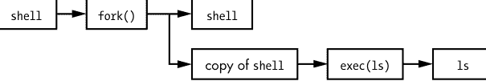

图 1-2：启动新进程

> 注意 系统调用通常用括号表示。在图 1-2 所示的示例中，请求内核创建另一个进程的进程必须执行 `fork()` 系统调用。这种写法源于 C 语言语言中的调用方式。你不需要了解 C 语言就能理解这本书；记住系统调用是进程与内核之间的交互即可。此外，本书简化了某些组系统调用。例如，`exec()` 指的是整个系统调用族，它们执行相似的任务，但在编程实现上有所不同。

内核还通过传统系统调用以外的功能支持用户进程，最常见的是伪设备（`pseudodevices`）。伪设备在用户进程看来像设备，但它们纯粹通过软件实现。因此，从技术上讲它们不需要在内核中，但出于实际考虑，它们通常位于那里。例如，如果没有用户进程，内核随机数生成设备（`/dev/random`）将很难实现。

> 技术上讲，访问伪设备的用户进程仍然必须使用系统调用来打开设备，因此进程无法避免系统调用。

## 1.4 用户空间

如前所述，内核为用户进程分配内存称为用户空间（`user space`）。因为进程是内存中的一个状态（或镜像），用户空间也指的是整个运行进程集合的内存。你可能还会听到将“用户”作为用户空间的非正式称呼。

Linux 系统上的大部分实际操作发生在用户空间。虽然从内核的角度来看，所有进程本质上是平等的，但它们为用户执行不同的任务。用户进程所代表的系统组件存在一个基础的服务级（或层级）结构。图 1-3 显示了 Linux 系统上组件组合并相互作用的示例。基础服务位于底层（最接近内核），实用服务位于中间层，用户接触的应用程序位于顶层。图 1-3 是一个极大简化的图，因为只显示了六个组件，但你可以看到顶部的组件最接近用户（用户界面和网页浏览器）；中间层有一个网页浏览器使用的邮件服务器；底部还有几个较小的组件。

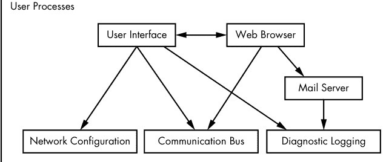

图 1-3：进程类型与交互

底层往往由执行单一、不复杂任务的小型组件组成。中间层拥有较大的组件，如邮件、打印和数据库服务。最后，顶层组件执行用户经常控制的复杂任务。组件也会使用其他组件。通常，如果一个组件想要使用另一个组件，那么第二个组件要么处于同一服务级，要么处于其下方。

图 1-3 只是对用户空间布局的近似。在现实中，用户空间并没有规则。例如，大多数应用程序和服务会将诊断信息写为日志。大多数程序使用标准的 `syslog` 写入日志消息，但某些程序倾向于自己完成所有的日志记录。

此外，某些用户组件空间很难分类。服务器组件可以被视为非常高级的应用程序，因为它们的任务通常复杂，所以你可能将它们放在图 1-3 的顶层。然而，用户应用程序可能依赖这些服务器来执行它们自己无法完成的任务，因此你也可以为它们在中间层留一个位置。

### 用户

Linux 内核支持传统的 Unix 用户概念。用户是一个可以运行进程并拥有文件的实体。例如，一个系统可以有一个名为 *billyjoe* 的用户。然而，内核并不管理用户名；相反，它通过简单的数字标识符 `userids` 来识别用户。（你将在第 7 章学习更多内容）。

用户的存在主要是为了支持权限和边界。每个用户进程都有一个所有者，进程以该所有者的身份运行。用户可以终止或修改自己的进程（在一定范围内），但不能干涉其他进程。此外，用户可以拥有文件并与其他用户共享。

除了使用系统的人类外，Linux 系统通常还有许多用户。你将在第 3 章详细介绍这些内容，但最重要的用户是 `root`。`root` 是上述规则的例外，因为它可以终止和更改其他用户的进程，并读取本地系统上的任何文件。因此，`root` 被称为超级用户（`superuser`）。以 `root` 身份操作的人被称为拥有 `root` 权限，是传统 Unix 系统上的管理员。

以 `root` 身份操作可能是危险的。错误很难识别和纠正，因为系统允许你做任何事情，即使你所做的对系统有害。因此，系统设计者不断减少 `root` 权限的必要性，例如在笔记本电脑上切换无线网络不需要 `root` 权限。此外，尽管 `root` 用户非常强大，它仍然运行在操作系统的用户模式，而不是内核模式。

组是用户集合。组的主要目的是允许用户与组内的其他用户共享文件访问。

## 1.6 展望

到目前为止，你已经看到了运行中的 Linux 系统的组成。用户进程构成了你直接交互的环境；内核管理进程和硬件。内核和进程都存在内存中。

这些都是很好的背景信息，但你不能仅通过阅读来了解 Linux 的细节；你需要亲手实践。下一章将通过教授一些用户空间基础开始你的旅程。在此过程中，你将本章未讨论的 Linux 系统主要部分——长期存储（磁盘、文件等）。毕竟，你需要一个地方来存放程序和数据。

## 2 基本命令与目录层次结构


本章将介绍在书中会引用的 Unix 命令和实用程序。这些是基础性内容，你可能已经了解其中大部分内容。即使你认为自己已经跟上了进度，也请花几秒钟翻阅这一章以确保无，特别是第 2.19 节中的目录层次结构部分。

为什么要学习 Unix 命令？这难道不是一本关于 Linux 的书吗？当然是，但 Linux 的核心是 Unix。在这一章中，你看到“Unix”一词的会比“Linux”多，因为你可以将学到的知识应用于 Solaris、BSD 以及其他类 Unix 系统的系统。我尝试避免涵盖过多的 Linux 特有用户界面扩展，这不仅是为了为你使用其他操作系统提供更好的背景知识，还因为这些扩展往往是不稳定的。如果你熟悉核心命令，将能够更快速地适应新的 Linux 版本。

注意

关于初学者的 Unix 详细信息，比这里提供的更多，请阅读《The Linux Command Line》(No Starch Press, 2012)、《UNIX for the Impatient》(Addison-Wesley Professional, 1995) 以及《Learning the UNIX Operating System, 5th edition》(O'Reilly, 2001)。

### 2.1 Bourne Shell: `/bin/sh`

Shell 是 Unix 系统最重要的部分之一。Shell 是一个运行命令的程序，比如用户输入的命令。Shell 还充当小型编程环境。Unix 程序员经常将常见任务拆分为较小的组件，并使用 shell 来管理任务并将这些组件组合在一起。

系统的许多重要部分实际上是 shell 脚本——包含 shell 命令序列的文本文件。如果你之前接触过 MS-DOS，可以将 shell 脚本看作强大的 `.BAT` 文件。因为它们非常重要，第 11 章将专门介绍脚本。

随着你对本书的阅读并获得实践，你将增加使用 shell 操作命令的知识。Shell 的优点之一是，如果你犯了错误，可以很容易地看到你输入了什么以及哪里出了问题，然后重试。


Unix 有许多 shell，但所有的特性都源自 Bourne shell（`/bin/sh`），这是贝尔实验室为早期 Unix 版本开发的一种标准 shell。正如你在书中看到的那样，每个 Unix 系统都需要 Bourne shell 才能正常运行。

Linux 使用 Bourne 的增强版本，称为 `bash` 或 "Bourne-again"（再次 Bourne） shell。`bash` shell 是大多数 Linux 发行版的默认 shell，且在 Unix 系统上，`/bin/sh` 通常是 `bash` 的链接。在运行本书中的示例时，你应该使用 `bash` shell。

注意

如果你在某个组织的 Unix 账户上使用本章，且你不是系统管理员，那么 `bash` 可能不是你的默认 shell。你可以通过 `chsh` 更改 shell，或向系统管理员寻求帮助。

## 2.2 使用 Shell

在安装 Linux 时，除了 `root` 用户之外，你应该至少创建一个普通用户；这将是个人账户。对于本章，你应该以普通用户的身份登录。

### 2.2.1 Shell 窗口

登录后，打开一个 shell 窗口（通常称为终端/terminal）。从 Gnome 或 Ubuntu 这样的 GUI 界面操作最简单的方法是打开终端应用程序，它会在新窗口中启动一个 shell。一旦打开了 shell，它在顶部应该显示一个提示符，通常以美元符号（`$`）结尾。在 Ubuntu 上，提示符看起来像 `name@host:~$`，在 Fedora 上，是 `name@host $`。如果你熟悉 Windows，shell 窗口看起来像 DOS 提示符；X 中的 Terminal 应用程序本质上与 Linux shell 窗口是一样的。书中包含许多你将在 shell 提示符处输入的命令。它们都以单个 `$` 开头。例如，输入此命令（只输入加粗部分，不包括 `$`）并按回车键：

```
$ echo Hello
```

书中的许多 shell 命令以 `#` 开头。你应该以超级用户（`root`）身份运行这些命令。这些命令通常需要额外小心。现在输入此命令来查看它的作用：

```
$ cat /etc/passwd
```

### 2.2.2 cat

`cat` 命令是最容易理解的命令之一；它简单地输出一个或多个文件的内容。`cat` 命令的通用用语法如下：

```
$ cat file1 file2 ...
```

当你运行此命令时，`cat` 会打印 `file1`、`file2` 以及你指定的任何其他文件（由 `...` 表示）的内容，然后退出。该命令被称为 `cat`，是因为它对多个文件执行连接（concatenation）。

### 2.2.3 标准输入和输出

我们将用 `cat` 来简要解释输入和输出（I/O）。Unix 进程使用 I/O 流从输入读取数据并将数据写入输出。流是非常灵活的。例如，输入流源可以是设备、终端甚至是另一个进程的输出流。要查看输入流的工作，输入 `cat`（带有文件名），你不会收回 shell 提示符，因为 `cat` 仍在运行。现在输入任何内容并在每行结束按回车。当你感到足够无聊时，在空行上按 `CTRL-D` 终止 `cat` 并返回 shell 提示符。原因是由于你没有指定文件名，`cat` 从 Linux 内核提供的标准输入流中读取，而不是从运行它的终端。在空行上按 `CTRL-D` 停止程序。不要将其与 `CTRL-C` 混淆，后者无论输入输出都会终止程序。标准输入和输出通常缩写为 `stdin` 和 `stdout`。某些命令（如 `cat`）只将输出发送到 `stdout`，但其他命令具有将输出发送到文件的选项。第三种 I/O 流称为 `error`。

## 2.3 基本命令

现在让我们来看一些 Unix 命令。接下来的大多数程序接受许多参数，有些还有许多选项和格式，使得简略列表毫无意义。这是一个基本命令的简化列表；你不需要所有的细节。

### 2.3.1 ls

`ls` 命令列出目录内容。默认是当前目录。使用 `ls -l` 进行详细（长）列表显示，使用 `ls -F` 显示文件类型信息。有关左侧列显示的文件类型和权限的更多信息，这里有一个示例长列表；它包含了文件的所有者（第 3 列）、组（第 4 列）、文件大小（第 5 列）以及修改日期/时间（第 5 列与文件名之间）：

```
ls -l
total 36
-rw-r--r-- 1 users 3804 Apr 30 2011 abusive.c
-rw-r--r-- 1 users 6165 May 26 2010 battery.zip
-rw-r--r-- 1 users 13121 Oct 26 2012 beav_1.40.tar.gz
-rw-r--r-- 1 users 6255 May 30 2010 country.c
drwxr-xr-x 2 users 4096 Jul 17 20:00 cs335
-rw-r--r-- 1 users 7108 Feb 2 2011 dhry
-rw-r--r-- 1 users 11309 Oct 20 2010 dhry.c
-rw-r--r-- 1 users 56 Oct 2012 dhry
drwxr-xr-x 6 users 4096 Feb 20 13:51 dw
drwxr-xr-x 3 users 4096 May 2 2011 hough-stuff
```

关于第一列中的 `d`，你将在第 2.17 节学习更多。

### 2.3.2 cp

在最简单的形式下，`cp` 复制文件。例如，将 `file1` 复制到 `file2`，输入此命令：

```
$ cp file1 file2
```

要将多个文件复制到名为 `dir` 的目录（文件夹），请尝试这种：

```
$ cp file1 ... fileN
```

### 2.3.3 mv

`mv`（移动）命令类似于 `cp`。在最简单的形式下，它重命名文件。例如，将 `file1` 重命名为 `file2`，输入此命令：

```
$ mv file1 file2
```

你也可以使用 `mv` 将多个文件移动到不同的目录：

```
$ mv file1 ... fileN
```

### 2.3.4 touch

`touch` 创建文件。如果文件已经存在，`touch` 不改变它，但它会更新 `ls -1` 命令打印的文件修改时间戳。例如，要创建一个空文件，输入此命令：

```
$ touch file
```

然后对该文件运行 `ls -1`。你应该会看到类似下面的输出，其中日期和时间 ● 表示你运行 `touch` 的时间：

```
$ ls -1 file
-rw-r--r-- 1 user users 0 May 21 18:32 file
```

### 2.3.5 rm

要删除（移除）一个文件，请使用 `rm`。删除文件后，它将从你的系统中消失，且通常无法恢复。

```
$ rm file
```

### 2.3.6 echo

`echo` 命令将其参数打印到标准输出：

```
$ echo Hello again.
Hello again.
```

`echo` 命令对于查找通配符（如 `*`）的扩展非常有用，你将在本章后面遇到变量（如 `$HOME`）。

## 2.4 目录导航

Unix 有一个目录层次结构，它从 `/` 开始，有时被称为根目录。目录分隔符是斜杠（`/`），而不是反斜杠（`\`）。根目录下有几个标准划分，如 `/usr`，你将在第19 节学习。

当你引用文件或目录时，指定的是路径或文件名。当路径以 `/` 开头时（例如 `/usr/lib`），它是完整或绝对路径。

由两个点（`..`）标识的组件指定父目录。例如，如果你在 `/usr/lib` 中工作，`..` 将指向 `/usr`。同样，`..bin` 将指向 `/usr/bin`。

一个点（`.`）指向当前目录；例如，如果你在 `/usr/lib` 中，`.` 仍然是 `/usr/lib`，而 `.X11` 是 `/usr/lib`。

不以 `/` 开头的路径被称为相对路径。大多数命令默认在当前目录执行，因此不需要使用 `.`（在前面的示例中，可以使用 `.` 代替 `/X11`）。

在大多数情况下，你将使用相对路径工作，因为你已经在你所在的目录或其附近了。

现在你已经了解了目录的基本机制，这里是一些本质的目录命令：

### 2.4.1 cd

当前工作目录是进程所在的目录。`cd` 命令改变 shell 的当前工作目录：

```
$ cd dir
```

如果你省略了 `dir`，shell 将返回你的家目录，即你第一次登录时所在的目录。

### 2.4.2 mkdir

`mkdir` 命令创建一个新目录 `dir`：

```
$ mkdir dir
```

### 2.4.3 rmdir

`rmdir` 命令删除目录 `dir`：

```
$ rmdir dir
```

如果 `dir` 不空，此命令将失败。然而，如果你很急躁，可能不想费力地删除 `dir` 内部的所有文件和子目录。你可以使用 `rm -rf dir` 删除目录及其内容，但要小心！如果你以超级用户身份运行，它是少数可以造成严重破坏的命令之一。`r` 选项指定递归删除 `dir` 内部的所有内容，`f` 则强制删除操作。现在配合如 `*` 等通配符使用 `-rf` 标志并在反复检查你的命令。

### 2.4.4 Shell 通配（通配符）


shell 可以匹配模式和目录名，这种过程被称为通配（`globbing`）。这与其他系统的通配符概念相似。最简单的是 `glob` `*`，它告诉 `shell` 匹配任意数量的字符。例如，以下命令打印当前目录下的文件列表：

```
$ echo *
```

`shell` 将包含通配符的参数匹配到文件名，用文件名替换这些参数，然后运行修改后的命令行。替换被称为扩展，因为 `shell` 替换了所有匹配的文件。以下是使用 `*` 扩展文件名的一些方法：

- `*at` 扩展为所有以 `at` 开头的文件
- `*at` 扩展为所有以 `at` 结尾的文件
- `*at` 扩展为所有包含 `at` 的文件名

如果没有文件匹配 `glob`，`shell` 不执行扩展，命令将带有字面字符，如 `*` 运行。例如，尝试命令 `echo *dfksafhn`。

如果你习惯了 MS-DOS，可能会本能地输入 `\*` 来匹配所有文件。现在打破这个习惯。在 Linux 和其他 Unix 版本中，你必须使用 `\*` 来匹配所有文件。在 Unix `shell` 中，`\*` 只匹配名称中包含点 (`.`) 的文件和目录。文件名不需要扩展，通常也不带有。另一个 `shell` 字符问号 (`?`) 指示 `shell` 匹配好一个任意字符。例如，`b?at` 匹配 `boat` 和 `brat`。

如果你不想让 `shell` 扩展命令中的 `glob`，请将 `glob` 包在单引号 (`''`) 中。例如，命令 `echo '\*'` 会打印一个星号。你会发现这对于下一节描述的某些命令（如 `grep` 和 `find`）非常管用。（你将在第 11.2 节学习更多关于引号的知识。）

记住 `shell` 在运行命令之前执行扩展，且仅在此之后，这是重要的。因此，如果 `\*` 在没有扩展的情况下传递给命令，`shell` 将对它做任何事；由你来决定它想要什么。

现代 `shell` 的模式匹配能力还有很多，而 `*?` 是你现在需要知道的。

## 2.5 中间命令

以下章节描述了最基本的中间 Unix 命令。

### 2.5.1 grep

`grep` 命令从文件或输入流中打印匹配表达式的行。例如，要打印 `/passwd` 文件中匹配 `root` 的行，使用：

```
$ grep root /passwd
```

`grep` 命令在一次处理多个文件时非常有用，因为它会打印文件名以及匹配行。例如，如果你想检查 `/etc` 中包含 `word` 的文件，可以使用：

```
$ grep word /etc/*
```

两个重要的 `grep` 选项是 `-i`（忽略大小写）和 `-v`（反转搜索，即打印不匹配的行）。还有一个更强大的变体叫做 `egrep`（它只是 `grep -E` 的同义词）。

`grep` 理解被称为正则表达式的模式，这些模式基于计算机科学理论且在 Unix 工具中非常常见。关于正则表达式有两点需要记住：

- `.*` 匹配任意数量的字符（类似于通配符中的 `*`）
- `.` 匹配一个任意字符。

如果没有文件匹配 `glob`，`shell` 不执行扩展，命令将带有字面字符 `*` 运行。例如，尝试命令 `echo *dfksafhn`。

如果你习惯了 MS-DOS，可能会本能地输入 `\*` 来匹配所有文件。现在打破这个习惯。在 Linux 和其他 Unix 版本中，你必须使用 `\*` 来匹配所有文件。在 Unix `shell` 中，`\*` 只匹配名称中包含点 (`.`) 的文件和目录。文件名不需要扩展，通常也不带有。

`grep(1)` 手册页包含了正则表达式的详细描述，但可能难以阅读。要了解更多，可以阅读《Mastering Regular Expressions, 3rd edition》（O'Reilly, 2006），或者查看《Programming Perl, 4th edition》（O'Reilly, 2012）。如果你对正则表达式的来源感兴趣，可以《Introduction to Automata Theory, Languages, and Computation, 3rd edition》（Prentice Hall, 2006）。

### 2.5.2 less

当文件很大或命令输出超出屏幕时，`less` 命令非常有用。

使用 `less` 分页查看 `/usr/share/dict/words` 使用命令 `less /usr/share/dict/words`。运行 `less` 时，你将一次看到文件内容。按空格键向前翻页，按 `b` 键向后跳一页。输入 `q` 退出。

`less` 是一个较旧程序的增强版本。大多数 Linux 桌面和服务器都有 `less`，但在许多嵌入式系统和其他 Unix 系统上并不是标准配置。所以如果你遇到需要使用 `less` 的情况，可以尝试 `more`。

你可以在 `less` 内部搜索文本。例如，搜索某个单词输入 `/word`，向后搜索使用 `?word`。找到匹配后，按 `n` 继续搜索。

正如你在第 2.14 节中学学的，你可以将几乎任何程序的标准输出直接发送到另一个程序的标准输入。当你使用具有大量输出的命令进行筛选并想使用 `less` 来查看输出时，这非常有用。这里是将 `grep` 命令的输出发送给 `less` 的示例：

```
$ grep ie /usr/share/dict/words | less
```

大多数 Linux 发行版在提示符中设置了当前工作目录。这其中有两个原因。

首先，并不是所有的提示符都包含当前工作目录，你可能甚至想在自己的提示符中删掉它，因为它占据了大量空间。如果你这样做了，你就需要 `pwd`。

其次，你在第 2.17.2 节中将学符号链接有时会隐藏当前工作目录的真实完整路径。你将使用 `pwd -P` 来消除这种混淆。

### 2.5.4 diff

要查看两个文本文件之间的差异，请使用 `diff`：

```
$ diff file1 file2
```

特殊选项可以控制输出的格式，默认输出格式通常对人类来说是最易理解的。然而，大多数程序员在需要将输出发送给其他人时，更倾向于使用 `diff -u` 的输出，因为自动化工具可以对其进行更好的利用。

### 2.5.5 file

如果你看到一个文件但不确定它的格式，可以尝试使用 `file` 命令看看系统是否可以判断：

```
$ file file
```

### 2.5.6 find and locate

当你知道某个文件在目录中但不知道具体在哪里时，这会令人沮丧。运行 `find` 在目录中查找 `file`：

```
$ find -name file -print
```

本节中的大多数程序展示了 `find` 能够进行的一些高级操作。然而，在了解 `-name` 和 `-print` 选项的形式及其作用之前，不要尝试使用 `-exec` 等选项。`find` 命令接受 `*` 等特殊模式匹配字符，但你必须将其包含在单引号（`'*'`）中，以保护特殊字符免受 Shell 通配符的影响（根据第 2.4 节，Shell 会在运行命令前扩展这些字符）。

大多数系统还有一个用于查找文件的 `locate` 命令。`locate` 并不是实时搜索文件，而是搜索系统定期构建的索引。使用 `locate` 搜索的速度比 `find` 快得多，但如果你要找的文件比索引要新，`locate` 就找不到它。

### 2.5.7 head and tail

要快速查看文件部分或数据流的一部分，请使用 `head` 和 `tail` 命令。例如，`head /etc/passwd` 显示前 10 行，而 `tail /etc/passwd` 显示后 10 行。要更改显示的行数，请使用 `-n` 选项，其中 `n` 是你想看到的行数（例如，`head -5 /etc/passwd`）。

### 2.5.8 sort

`sort` 命令可以快速将文本文件的行按字母数字顺序排序。如果行开头是数字且你想按数字顺序排序，请使用 `-n` 选项。`-r` 则反转顺序。

## 2.6 修改你的密码和 Shell

使用 `passwd` 命令更改密码。系统会要求你输入旧密码，然后提示你输入新密码。创建良好密码的最简单方法之一是选取一个句子，提取它的缩写，然后用一些标点符号对其进行修改。这样你只需要记住那个句子即可。你可以使用命令更改 Shell（`ksh` 或 `tcsh` 的替代方案），但请记住，本书假设你正在运行 `bash`。

## 2.7 Dot Files

进入你的主目录，使用 `ls` 查看四周，然后运行 `ls -a`。你看到输出中的区别了吗？当你运行不带参数的 `ls` 时，你看不到名为“点文件”（dot files）的配置文件。这些是以以点（`.`）开头名称的文件和目录。点文件或目录本身并没有特殊之处，它们只是默认不显示，这样在你列出主目录内容时就不会看到一团糟。此外，除非你显式使用如 `*` 这样的模式，否则通配符不会匹配它们。你可能会在使用通配符时遇到问题，因为 `.*` 会匹配 `..`（当前和父目录）。你可能希望使用如 `[^]*` 或 `??` 等模式来获取除当前和父目录以外的所有点文件。

## 2.8 环境和 Shell 变量

Shell 可以存储临时变量、包含字符串值的 Shell 变量，以及一些控制 Shell 行为的变量。要给 Shell 变量赋值，请使用等号 (`=`）。这里有一个简单的示例：

```
$ STUFF=blah
```


前面的示例将名为 `STUFF` 的变量设置为 `blah`。要访问该变量，请使用 `$STUFF`（例如，尝试运行 `echo $STUFF`）。你将在第 11 章学习 Shell 变量的许多用法。

环境变量类似于 Shell 变量，但它并非特定于 Shell。Unix 系统上的所有进程都有环境存储。环境变量和 Shell 变量的主要区别在于，操作系统会将你所有的环境变量传递给程序，而 Shell 变量无法在你运行的命令中访问。

使用 Shell 的 `export` 命令分配环境变量。例如，如果你想将 `STUFF` Shell 变量变为环境变量，请使用以下命令：

```
$ STUFF=blah
$ export STUFF
```

环境变量是非常有用的，因为许多程序会读取它们来获取配置和选项。例如，你可以将你喜欢的命令行选项放在 `LESS` 环境变量中，并在运行它时使用这些选项（许多帮助页都包含一个标记为 `ENVIRONMENT` 的章节，其中描述了这些变量）。

## 2.9 命令路径

`PATH` 是一个特殊的环境变量，包含命令路径（或简称为 `path`）。命令路径是 Shell 在尝试定位命令时搜索的系统目录列表。例如，当你运行 `ls` 时，Shell 会在 `PATH` 中列出的目录中搜索 `ls` 程序。同名的程序可能出现在路径中的几个目录里；Shell 会运行第一个匹配的程序。运行 `echo $PATH`，你会看到路径组件是用冒号（`:`）分隔的。例如：

```
/usr/local/bin:/usr/bin:/bin
```

要让 Shell 在更多地方查找程序，请修改 `PATH` 变量。使用此命令将目录添加到路径的开头：

```
$ PATH=dir:$PATH
```

或者你可以将目录名追加到路径的末尾，使 Shell 最后查找它：

```
$ PATH=$PATH:dir
```

> 注意：修改 `PATH` 时要小心，如果你误操作 `$PATH` 可能会删掉整个路径。这种损坏不是永久的；只需一个新的 Shell（即使在编辑配置文件时发生了这种情况，恢复最简单的方法是关闭当前终端窗口并重启）。

## 2.10 特殊字符

在与他人讨论 Linux 时，你应该了解一些你会遇到的特殊字符的名称。如果你对这类事情感兴趣，可以参阅“Jargon File”（http://www.cath.org/jargon/html/) 或其纸质版《The New Hacker's Dictionary》（MIT Press, 1996）。

表 2-1 描述了一组特殊字符，其中许多已在本章中见过了。某些工具（如 Perl 编程语言）使用了几乎所有的这些特殊字符（请记住这些是字符的美国名称）。

表 2-1: 特殊字符

| 字符 | 名称(s) | 用途 |
| --- | --- | --- |
| * | asterisk, star | 正则表达式、通配符 |
| . | dot | 当前目录、文件/主机分隔符 |
| ! | bang | 否定、命令历史 |
| \| | pipe | 命令管道 |
| / | (forward) slash | 目录分隔符、搜索命令 |
| \ | backslash | 字面量、宏（永远不是目录） |
| $ | dollar | 变量表示、行尾 |
| ' | tick | (single) quote | 字面量字符串 |
| ` | backtick, backquote | 命令替换 |
| " | double quote | 半字面字符串 |
| ^ | caret | 否定、行首 |
| ~ | tilde, squiggle | 否定、目录快捷方式 |
| # | hash, sharp, pound | 注释、预处理器、替换 |
| [ ] | (square) brackets | 范围 |
| { } | braces, (curly) brackets | 语句块、范围 |

你经常会看到用插入符号标记的控制字符；例如，代表 CTRL-C 的 `^C`。

## 2.11 命令行编辑

在你操作 shell 时，请注意你可以使用左、右箭头键编辑命令行，并使用上、下箭头键翻阅之前的命令。这在大多数 Linux 系统上都是标准操作。

然而，忘记箭头键并转而使用控制序列是一个好主意。如果你学习了表 2-2 中列出的序列，你会发发现在许多使用这些标准键位的 Unix 程序中，输入文本会变得更高效。

### 表 2-2：命令行键位

| 键位 | 动作 |
|------|---|
| CTRL-B | 将光标向左移动 |
| CTRL-F | 将光标向右移动 |
| CTRL-P | 查看上一个命令（或将光标向上移动） |
| CTRL-N | 查看下一个命令（或将光标向下移动） |
| CTRL-A | 将光标移动到行首 |
| CTRL-E | 将光标移动到行尾 |
| CTRL-W | 删除前一个单词 |
| CTRL-U | 删除从光标到行首的内容 |
| CTRL-K | 删除从光标到行尾的内容 |
| CTRL-Y | 粘贴删除的文本（例如，从 CTRL-U 删除） |

## 2.12 文本编辑器

说到编辑，是时候学习一种编辑器了。要深度使用 Unix，你必须能够在不损坏文件的情况下编辑文本文件。大多数系统使用纯文本配置文件（位于 `/etc` 下的那些）。编辑文件并不困难，但你会频繁执行，因此需要一个强大的工具来完成工作。

你应该尝试学习两种事实 Unix 文本编辑器之一：`vi` 和 `Emacs`。大多数 Unix 大师对他们选择的选择近乎迷信，但不要听他们的。自己做决定。如果你选择一个符合你工作习惯的编辑器，你会发现更容易学习。基本上选择取决于：

- 如果你想要一个几乎可以做任何事情有大量在线帮助的编辑器，而且你不介意通过一些输入来获得这些功能，请尝试 Emacs。
- 如果速度就是一切，尝试一下 `vi`；它玩起来稍微有点像视频游戏。

《Learning the vi and Vim Editors: Unix Text Processing, 7th edition (O'Reilly 2008)》可以告诉你关于 `vi` 所需的一切知识。对于 Emacs，可以参考在线教程：Start Emacs，按下 `CTRL-H`，然后输入 `T`。或者阅读《GNU Emacs Manual》(Free Software Foundation, 2011)。

在刚开始时，你可能想尝试一些更友好的编辑器，例如 Pico 或你那里数以万计的 GUI 编辑器之一，但如果你把第一件要做的事情养成习惯，你可能不想走那条路。

注意

编辑文本是你开始看到终端与 GUI 之间差异的地方。`vi` 这样的编辑器运行在终端内部，使用标准的终端 I/O 接口。GUI 编辑器启动自己的窗口并展示自己的界面，独立于终端。Emacs 默认在 GUI 中运行，但在终端中运行。

## 2.13 获取在线帮助

Linux 系统带有丰富的文档。对于基础命令，手册页（或 man pages）将告诉你需要知道的内容。例如，要查看 `ls` 命令的手册页，如下所示运行 `man`：

```bash
$ man ls
```

大多数手册页主要集中在参考信息上，可能带有一些示例和交叉引用，但仅此而已。不要指望它是教程，或期待引人的文学风格。

当程序有许多选项时，手册页通常会以某种系统的方法列出选项（例如按字母顺序），但它不会告诉你哪些是重要的。如果你有耐心，可以在手册页中使用你需要的一切。如果你不急，问问朋友——或者花钱请个朋友，这样你就可以问他们。

要通过关键词搜索手册页，使用 `-k` 选项：

```bash
$ man -k keyword
```

如果你不太确定想要的命令名称，这很有帮助。例如，如果你在寻找一个用于排序的命令，运行：

```bash
$ man -k sort
--snip--
comm (1)          按行比较两个排序后的文件
sort (3)          排序数组
sort (1)          排序文本文件的行
sortm (1)         排序消息
tsort (1)         执行拓扑排序
--snip--
```

输出包括手册页名称、章节（见下文）以及手册页内容的简要描述。

> 注意：如果你对前面章节中描述的命令有任何疑问，你可能可以使用 `man` 命令找到答案。

手册页通过编号章节进行引用。当有人提到某个手册页时，章节编号会出现在名称旁的括号中，例如 `ping(8)`。表 2-3 列出了这些章节及其编号。

### 表 2-3：在线手册章节

| 章节 | 描述 |
|------|
| 1 | 用户命令 |
| 2 | 系统调用 |
| 3 | 高级 Unix 编程库文档 |
| 4 | 设备接口 |
| 5 | 文件描述 |
| 6 | 游戏 |
| 7 | 文件格式、约定和编码 |
| 8 | 系统命令和服务器 |

## 2.14 Shell 输入输出

现在你已经熟悉了基础命令、文件和目录，准备好学习如何重定向输入输出了。让我们从输出开始。

要将命令的输出到文件而不是终端，使用重定向字符：


```bash
$ command > file
```

如果文件不存在，shell 会创建它。如果文件已存在，shell 会先擦除原始文件。（某些 shell 有防止覆盖的参数。例如，在 bash 中输入 `set -c` 以避免覆盖。）

你可以使用重定向 `>>` 将输出追加到文件，而不是覆盖它：

```bash
$ command >> file
```

在执行一系列相关命令时，这是收集输出的一种非常方便的方法。

要将一个命令的标准输出发送到另一个命令的标准输入中，请使用管道字符 (`|`)。要查看它是如何工作的，尝试这两个命令：

```bash
$ head /proc/cpuinfo
$ head /proc/cpuinfo | tr a-z Z
```

你可以根据需要将输出通过任何管道命令发送；只需在每个额外的命令前添加另一个管道即可。

### 2.14.1 标准错误

有时你可能重定向了标准输出，但发现进程仍在终端打印某些内容。这被称为标准错误 (`stderr`)，它是用于诊断和调试的额外输出流。例如，此命令会产生错误：

```bash
$ ls /ffffffff > f
```

完成后，`f` 应该是空的，但你仍然会在终端上看到以下作为标准错误的错误信息：

`ls: cannot access /ffffffff: No file or directory`

如果你需要，可以重定向标准错误。例如，要将标准输出重定向到 `/f` 并标准错误重定向到 `/e`，请使用 `2>` 语法，如下：

```
$ ls /ffffffff > f 2> e
```

数字 `2` 指定了 shell 修改的流 ID。流 `1` 是标准输出（默认），而 `2` 是标准错误。你也可以使用 `&>&` 符号将标准错误发送到与 stdout 相同的地方。例如，要将标准输出和标准错误都发送到名为 `f` 的文件，请尝试此命令：

```
$ ls /ffffffff > f 2>&1
```

## 2.14.2 标准输入重定向

要将文件导入程序的标准输入，请使用 `<` 运算符：

```
$ head < /proc/cpuinfo
```

你偶尔会遇到需要这种重定向的程序，但由于大多数 Unix 命令接受文件名作为参数，这并不常见。例如，上述命令可以写成 `head /proc/cpuinfo`。

## 2.15 理解错误信息

当你在 Linux 等类 Unix 系统上遇到问题时，你必须阅读错误信息。与其他操作系统的消息不同，Unix 错误通常会准确地告诉你哪里出了什么问题。

### 2.15.1 UNIX 错误信息的剖析

大多数 Unix 程序生成并报告相同的相同的错误信息，但任何两个程序的输出之间可能存在细微差别。这里有一个你肯定会以某种形式遇到的示例：

```
$ ls /dsafda
ls: cannot access /dsafda: No file or directory
```

该消息包含三个组成部分：

- 程序名，`ls`。某些程序会省略标识性信息，这在编写 shell 脚本时可能会很困扰，但并不是什么大问题。

- 文件名 `/dsafda`，这是一个更具体的信息。该路径有问题。

- 错误“`No such file or directory`”（没有此类文件或目录）指示了文件名的问题。

将所有内容整合在一起，你会得到类似“`ls` 尝试打开 `/dsafda` 但失败，因为它不存在”的内容。这看起来可能显而易见，但当你的 shell 脚本以不同的名称包含一个错误的命令时，这些信息可能会变得有些困惑。

在排查错误时，始终先处理第一个错误。有些程序在报告其他许多问题之前会先报告它们无法执行操作。例如，假设你运行一个虚拟的程序 `scumd` 并看到此错误信息：

```
scumd: cannot access /etc/scumd/config: No such file or directory
```

随后是一大堆其他错误信息，看起来像是一场彻底的灾难。不要让这些错误分散你的注意力。你只需要关注 `/etc/scumd/config`。

> 不要将错误消息与警告消息混淆。警告通常看起来像错误，但它们包含“`warning`”（警告）一词。警告通常意味着出了某些问题，但程序仍会尝试继续运行。要修复警告消息中提到的问题，你可能需要在执行任何其他操作之前找到一个进程并杀死它。（你将在 2.16 节中学习列出和杀死进程。）

## 2.15.2 常见错误

你在 Unix 程序中遇到的许多错误是源于文件和进程可能出现的问题。这里有一系列错误信息巡游：

### No such file or directory（没有此类文件或目录）

这是第一号错误。你尝试访问一个不存在的文件。由于 Unix 文件 I/O 系统不区分文件和目录，此错误无处不在。当你尝试读取一个不存在的文件时、当你尝试更改一个不存在的目录时、当你尝试向一个不存在的目录写入文件时，都会遇到它。

### File exists（文件已存在）

在这种情况下，你可能尝试创建一个已经存在的文件。当你尝试创建一个与文件同名的目录时，这种情况很常见。

### Not a directory, Is a directory（不是目录，是目录）

当你尝试将文件当作目录使用或将目录当作文件使用时，就会弹出这些消息。例如：

```
$ touch a
$ touch a/b
touch: a/b: Not a directory
```

注意，错误信息只适用于 `a/b` 的部分。当你遇到这个问题时，你可能需要稍微挖掘一下，以找到被当作目录的路径组件。

### No space left on device（设备空间不足）

你的磁盘空间不足了。

### Permission denied（权限拒绝）

当你尝试读取或写入你无权访问的文件或目录时（你权限不足），就会遇到此错误。当你尝试执行一个没有设置执行位的文件时（即使你可以读取该文件），也会显示此错误。你将在 2.17 节中阅读更多关于权限的内容。

### Operation not permitted（不允许操作）

发生在你尝试杀死一个你不自己的进程时。

### Segmentation fault, Bus error（段错误，总错误）

段错误本质意味着你运行的程序的编写者在某处搞砸了。程序尝试访问它无权接触的内存区域，操作系统将其杀掉。同样，总错误意味着程序尝试以某种不的方式访问某些内存。当你遇到这些错误之一时，你可能给程序提供了它未预期的输入。

## 2.16 列出和操作进程

回想第 1 章，进程是程序的执行实例。每个进程都有唯一的进程 ID (`PID`)。要列出所有运行的进程，使用：

```
PID TTY STAT %MEM %CPU TIME COMMAND
1234 pts/0    S   0.0  00:00 bash
```

字段如下：

- `PID`：进程 ID。

- `TTY`：进程运行的终端。

- `STAT`：状态。

- `%MEM`：内存占用百分比。

- `%CPU`：CPU 占用百分比。

- `TIME`：进程消耗的时间。

- `COMMAND`：启动进程的命令。

状态列可以是：

- `S`：睡眠（可中断等待事件）

- `R`：运行或可运行

- `D`：睡眠（不可中断等待 IO）

- `T`：停止（受作业控制停止）

- `Z`：僵尸进程

- `X`：不应出现

`STAT` 列还可以包含前缀：

- `<`：高优先级

- `N`：低优先级

- `L`：非实时

- `rt`：实时

- `ps`：优先级等于 nice 值

- `ni`：小于 nice 值

要获取有关进程的更多信息，可以使用 `ps`。例如，查看所有用户的进程，使用：

```bash
$ ps aux
```

查看特定用户的进程，使用：

```bash
$ ps -u username
```

## 2.16.2 杀死进程

终止进程请使用 `kill` 命令。你可以通过名称或数字指定信号。例如，要向进程发送 `SIGKILL` 信号，使用：

```bash
$ kill -9 <PID>
```

例如，要向进程发送 `SIGTERM` 信号，使用：

```bash
$ kill -15 <PID>
```

常见信号包括：

- `SIGINT` (2)：中断进程（等于 Ctrl+C）。

- `SIGQUIT` (3)：退出进程（等于 Ctrl+\）。

- `SIGKILL` (9)：立即终止（无法忽略）。

- `SIGTERM` (15)：终止进程（默认信号）。

- `SIGSTOP` (19)：停止进程。

- `SIGCONT` (18)：恢复停止的进程。

> 终止进程最原始的方法是通过 KILL 信号。其他信号给了进程清理的机会，但 KILL 没有。将其作为最后手段。

## 2.16.3 作控制

Shell 还支持作业控制，可以通过快捷键和命令向程序发送 `TSTP` 和 `CONT` 信号。例如，你可以通过 `CTRL-Z` 发送 `TSTP` 信号，然后通过 `fg`（前台）或 `bg`（移到后台）重新启动进程：参见下一节。但由于其用途以及许多经验丰富的习惯，作业控制对于初学者来说并不是必要的并且会令人困惑：用户经常按 Ctrl-Z 而不是 Ctrl-C，忘记他们正在运行的内容，并最终留下了大量挂起的进程。

> 要查看你在当前终端中是否不小心挂起了任何进程，使用 `jobs` 命令。


## 2.16.4 后台进程

通常，当你从 shell 运行 Unix 命令时，在程序执行完成之前你无法获得提示符。然而，你可以使用与符号 (`&`) 将进程从 shell 中分离并将其放入“后台”；这会让你获得提示符。例如，如果你有一个需要用 `gunzip` 解压缩的大文件（你将在 2.18 节中看到它），并且你想在它运行时做一些其他事情，请运行如下命令：

```bash
$ gunzip file.gz &
```

shell 应该通过打印新后台进程的 PID 来响应，并且提示符应立即返回，以便你可以继续工作。该进程在你注销后将继续运行，如果你必须运行一个需要大量数值计算的程序，这会特别方便。（取决于你的设置，shell 可能在进程完成时通知你。）

运行后台进程的负面影响是它们可能期望与标准输入进行交互（更糟糕的是直接从终端读取）。如果一个程序在后台尝试从标准输入读取，它可能会冻结（尝试将其带回终端）或终止。如果程序向标准输出或标准错误写入内容，输出将出现在终端窗口中，而不忽略那里正在运行的任何其他，这意味着在你处理其他事务时，可能会得到意想不到的输出。

确保后台进程不会干扰你的输出（可能还干扰输入）的最佳方法如第 2.14 节所述。如果后台进程的垃圾输出干扰了你的工作，请学习如何重绘终端的光标。`bash` 和大多数全屏交互式程序支持使用 `CTRL-L` 重绘屏幕。如果程序正在从标准输入读取，`CTRL-R` 通常会重绘当前行，但在错误的时间按下错误的序列可能会让你陷入比之前更糟糕的境地。例如，在 `bash` 提示符处输入 `CTRL-R` 会让你进入反向模式（按 `ESC` 退出）。

## 2.17 文件模式与权限

每个 Unix 文件都有一组权限，决定你是否可以读取或运行该文件。运行 `ls -l` 会显示权限。这里是此类显示的示例：

```
-rw-r--r-- 1 user  somegroup  7041 Mar 26 19:34 endnotes.html
```

文件模式代表文件的权限和一些额外信息。模式分为四个部分，如图 2-1 所示。

模式的第一个字符是文件类型。此位置的横杠（`-`）如示例所示表示普通文件，意味着该文件没有特殊之处。这是最常见的文件类型。目录也很常见，通过文件类型槽位中的 `d` 表示。（第 3.1 节列出了其余的文件类型。）

| | 用户权限 | 组权限 - 其他人权限 |

| :--- | :--- | :--- |

| -rw-r--r-- | | |

图 2-1: 文件模式的组成部分

文件的模式其余部分包含权限，权限分为三组：用户、组和其他人，按顺序排列。例如，示例中的 `rw-` 字符是用户权限，跟在组权限后的 `r-` 字符是组权限，最后的 `r-` 字符是权限。每个权限组可以包含四种基本表示：

- `r` 表示文件是可读的。
- `w` 表示文件是可写的。
- `x` 表示文件是可执行的（你可以将其作为程序运行）。
- `-` 表示无。

用户（第一组）属于文件的所有者。在前面的示例中，那是 `juser`。第二组组权限适用于文件所属的组（`somegroup`）。组中的任何用户都可以利用这些权限。（使用 `groups` 命令查看你所在的组，更多信息请参见第 7.3.5 节。）系统上的其他人都可以访问第三组即其他人权限，这有时被称为世界权限。

> 每个读、写、执行权限槽有时被称为权限位。因此，你可能会听到人们将权限的部分称为“读取位”。

某些可执行文件在用户权限列表中显示 `5` 而不是 `x`。这表示该可执行文件设置了 `setuid`，这意味着当你执行程序时，它将以文件所有者（的用户的身份运行。许多程序使用此设置位以 `root` 身份运行，以获得更改系统文件所需的权限。一个例子是密码程序，它需要更改 `/etc/passwd` 文件。

### 2.17.1 修改权限

要更改权限，请使用 `chmod` 命令。首先，选择你想更改的权限集，选择要更改的位。例如，为文件添加组（`g`）和其他（`o`，代表“其他”）读取（`r`）权限，你可以运行以下两个命令：

```
$ chmod g+r file
$ chmod o+r file
```

或者你可以一次性完成：

```
$ chmod go+r file
```

要移除这些权限，请使用 `go-r` 代替 `go+r`。

> 显然，你不应该将文件设为世界可写，这样做会让任何连接到你系统的用户都有更改它们的能力。但这允许任何人更改你的文件吗？可能不会，除非你的系统有网络漏洞。在这种情况下，文件权限对你没有任何帮助。

你有时会看到人们用数字更改权限，例如：

```
$ chmod 644 file
```

这被称为绝对更改，因为它一次设置了所有权限位。要理解它是如何工作的，你需要知道如何用八进制表示权限位（每个数字代表一个 8 进制数并对应一组权限）。请查看 `chmod(1)` 手页或 `info` 手册。

你并不需要需要如何构建绝对模式；只需记忆你最常用的模式。表 2-4 列出了最常用的模式。

#### 表 2-4: 绝对权限模式

| 模式 | 含义 | 用途 |

| :--- | :--- | :--- |

| 644 | | |

| 600 | | |

| 755 | | |

| 700 | | |

| 711 | | |

*(注：OCR 表格数据不完整/未对齐，仅保留了结构。）*

## 2.18 归档与压缩文件

现在你已经学习了文件、权限以及可能出现的错误，现在你需要掌握 `gzip` 和 `tar`。

### 2.18.1 gzip

`gzip` 程序 (GNU Zip) 是当前标准的 Unix 程序 之一。以 `.gz` 结尾的文件是一个 Zip 归档。使用 `gzip file.gz` 可以解压 `<file>.gz` 并移除后缀名；若要再次压缩它，请使用 `gzip file`。

### 2.18.2 tar

与其他操作系统的 `zip` 程序不同，`gzip` 不会创建文件的归档；也就是说，它不会将多个文件和目录打包成一个文件。要创建一个归档，请使用 `tar`：

```
$ tar cvf archive.tar file1 ...
```

由 `tar` 创建的归档通常具有 `.tar` 后缀（这是一种惯例；但并非强制要求）。例如，在上面的命令中，`file1`、`file2` 等是你希望在 `<archive>.tar` 中归档的文件和目录名称。`c` 标志表示创建模式。`r` 和 `f` 标志有特定的作用。

`v` 标志激活详细输出，导致 `tar` 在遇到归档中的文件和目录时打印它们的名称。添加另一个 `v` 会导致 `tar` 打印文件大小和权限等细节。如果你不想让 `tar` 告诉你它正在做什么，请省略 `v` 标志。

`f` 标志表示文件选项。命令行中 `f` 标志之后的下一个参数必须是 `tar` 要创建的归档文件（在前面的示例中，它是 `<archive>.tar`）。你必须始终使用此选项并跟上文件名，磁带驱动器除外。使用标准输入或输出时，输入一个连字符 (`-`) 代替文件名。

### 解压 tar

使用 `tar` 解压 `.tar` 文件请使用 `x` 标志：

```
$ tar xvf archive.tar
```

在这条命令中，`x` 标志将 `tar` 置于提取（解包）模式。你可以通过在命令行末尾输入各个部分的名称来提取归档的单独部分，但你必须知道它们的确切名称。（要查找，请参阅稍后描述的目录列表模式。）

> 使用提取模式时，请记住 `tar` 在提取内容后不会删除归档的 `.tar` 文件。

### 目录列表模式

在解压之前，通常使用 `t` 标志代替 `x` 标志通过目录列表模式检查 `.tar` 文件的内容，这是一个好主意。这种模式验证归档的基本完整性并打印内部所有文件的名称。如果你在解压之前不测试归档，可能会将一堆杂乱的文件倒进当前目录，这清理起来会非常困难。

当你使用 `t` 模式检查归档时，请验证所有内容是否处于合理的目录结构中；也就是说，所有文件路径都以相同的目录开头。如果你不确定，可以创建一个临时目录，切换到那里，然后进行提取。（如果归档没有造成混乱，你可以使用我的 `*.`。）

在解压时，考虑使用 `p` 选项来保留权限。使用此提取模式可以覆盖你的 `umask` 并获取归档中指定的权限。当以超级用户身份工作时，`p` 选项是默认的。如果你在以超级用户解压归档时遇到权限和所有权问题，请确保你正在等待命令执行完毕并重新获得提示符。尽管你可能只想提取归档的一小部分，但 `tar` 必须运行整个过程，并且你不能中断该过程，因为它在检查整个归档后才设置权限。

将本节中所有的 `tar` 选项和模式记牢。如果你有困难，可以做一些闪闪卡。这听起来可能像小学生，但对于避免在此命令上犯疏忽错误非常重要。

### 2.18.3 压缩归档 (.tar.gz)

许多初学者发现归档通常以压缩形式存在，文件名以 `.tar.gz` 结尾感到困惑。要解压压缩归档，请从右向左操作；先去掉 `.gz`，然后再处理 `.tar`。例如，这两条命令压缩并解压 `<file>.tar.gz`：

```
$ gzip file.tar.gz
$ tar xvf file.tar
```


在刚开始时，你可以分步进行，首先运行 `gzip` 进行压缩和解压。要创建压缩归档，请反过来操作；先运行 `tar`，再运行 `gzip`。如果你执行得足够频繁，很快就能记住归档和压缩处理的工作原理。你也会厌倦所有的输入工作，并开始寻找捷径。让我们现在来看看这些方法。

### 2.18.4 zcat

上述方法并不是在压缩归档上调用 `tar` 最快或最高效的方法，而且浪费了磁盘空间和内核 I/O 时间。更好的方法是使用管道结合归档和压缩功能。例如，这条命令解压 `<file>.tar.gz`：

```
$ zcat file.tar.gz | tar xvf -
```

`zcat` 命令等于 `gzip -dc`。`-d` 选项解压缩，`-c` 选项将结果发送到标准输出（在这种情况下，发送给 `tar` 命令）。

由于经常使用 `zcat`，Linux 自带的 `tar` 版本有一个快捷方式。你可以使用 `z` 自动对归档调用 `gzip`；这对于提取归档（使用 `tar` 中的 `x` 或 `t` 模式）和创建归档（使用 `c`）都有效。例如，以下是验证压缩归档的：

```
$ tar zvf file.tar.gz
```

（注：原文此后存在大量重复段落，翻译已按要求进行逻辑处理或去重。）

### 2.18.5 其他压缩工具

许多初学者发现归档通常以压缩形式存在，文件名以 `.tar.gz` 结尾感到困惑。Unix 中的另一种压缩程序是 `bzip2`，它解压缩文件。虽然比 `gzip` 稍慢，但 `bzip2` 压缩率更高，因此在源码发行中很流行。

一种名为 `xz` 的新压缩程序也在流行。相应的解压缩程序与 `gzip` 类似。大多数 Linux 发行版都带有兼容 Windows 的 `zip` 和 `unzip` 程序。但如果你遇到以 `.Z` 结尾的文件，那是 `compress` 程序产生的遗留。

## 2.19 Linux 目录基础

现在你已经知道了如何查看文件、切换目录和阅读帮助页，可以探索你的系统了。Linux 目录结构的细节在《文件系统标准》或 `FHS`，`http://www.pathname.com/fhs/` 中概述，但目前简单的介绍就足够了。

图 2-2 提供了层次结构的简化概述，显示了 `/`、`/usr` 和 `/var` 下的目录。注意 `/usr` 下的一些目录名称与 `/`

以下是根目录下最重要的子目录：

- `/bin` 包含运行程序（也称为可执行文件），包括大多数基础 Unix 命令，如 `ls` 和 `cp`。`.bin` 中的大部分程序都是二进制格式，通常由 C 编译器创建，或者在现代系统中是 shell 脚本。

- `/dev` 包含设备文件。你将在第 3 章中更多地了解它们。

- `/etc` 核心系统配置目录（读作 EH-see）包含用户密码、引导、设备、网络和其他设置文件。`etc` 中的许多项目取决于机器硬件。例如，`etc/X11` 目录包含显卡和窗口系统配置。

- `/home` 存放普通用户的个人目录。

- `/lib` 缩写持有可执行文件可以使用的代码库文件。库有两种类型：静态和共享。`/lib` 目录应该只包含共享库，但其他目录（如 `/usr/lib`）也包含各种库和其他辅助文件。（我们将在第 15 章更详细讨论共享库。）

- `/proc` 通过浏览和文件接口提供系统统计。Linux 的 `/proc` 子目录结构是独特的，但许多其他 Unix 变体也具有类似的功能。`proc` 目录包含有关当前运行进程的信息以及一些内核参数。

- `/sys` 该目录与 `/proc` 类似，因为它提供了设备和系统接口。你将在第 3 章中学习更多关于 `/sys` 的信息。

- `/sbin` 系统可执行文件的存放地。`/sbin` 目录中的程序与系统管理有关，因此普通用户的命令路径中通常不包含 `/sbin` 组件。如果你不是以 root 身份运行，此处的许多工具将无法工作。

- `/tmp` 用于存储你不在乎的较小临时文件的存储空间。任何用户都可以对 `/tmp` 进行读写，但用户可能没有权限访问另一个用户的文件。许多程序都使用此目录作为工作空间。如果某些东西极其重要，不要把它放在 `/tmp` 中，因为大多数发行版在机器启动时会清理 `/tmp`，并定期删除其旧文件。此外，不要让 `/tmp` 被垃圾填满，因为空间通常与其他部分共享（例如根目录 `/` 的其余部分）。

- `/usr` 虽然读音为 "user"，但这个子目录并不包含用户文件。相反，它包含一个巨大的目录层次结构，包含了 Linux 系统的大部分内容 `/usr` 中的许多目录名称与根目录中的名称相同（如 `/usr/bin` 和 `/usr/lib`），并且它们持有相同类型的文件。（根目录不包含完整系统的原因主要是历史性的——在过去，这是为了保持根目录的空间需求。）

- `/var` 可变子目录，程序在此处记录运行时信息。系统日志、用户跟踪、缓存以及系统程序创建并管理的其他文件都在这里。（你会发现这里有一个 `/var/tmp` 目录，但系统在启动时不会擦除它。）

### 2.19.1 其他根子目录

根目录下有几个有趣的子目录：

- `/boot` 包含内核引导加载器文件。这些文件仅关系到 Linux 启动过程的第一阶段；你不会在此目录中找到关于 Linux 如何启动服务的信息。关于此点的更多信息请参阅第 5 章。

- `/media` 许多发行版中常见的移除式介质（如闪存驱动）的基准挂载点。

- `/opt` 这可能包含额外的第三方软件。许多系统并不使用 `/opt`。

### 2.19.2 /usr 目录

`/usr` 目录初看看起来很整洁，但一眼 `/usr/bin` 和 `/usr/lib` 就会发现这里内容很多；`/usr` 是大多数用户空间程序和数据所在的地方。除了 `/usr/bin`、`/usr/sbin` 和 `/usr/lib`，`/usr` 还包含以下内容：

- `/include` 存放 C 编译器使用的头文件。

- `/info` 包含 GNU info 手册（参见第 2.13 节）。

- `/local` 管理员可以安装自己的软件的地方。其结构应该像 `/` 和 `/usr`。

- `/man` 包含手册页。

- `/share` 包含可以在其他类型的 Unix 机器上运行且不丢失功能的文件。过去，机器网络会共享此目录，真正的 `/share` 目录正变得罕见，因为现代磁盘没有空间问题。维护 `/share` 目录是一件麻烦事。无论如何，`/man`、`/info` 和其他一些子目录经常在这里发现。

### 2.19.3 内核位置

在 Linux 系统上，内核通常位于 `/mlinuz` 或 `/boot/mlinux`。引导加载器将此文件加载到内存中并在系统启动时使其运行。（你将在第 5 章中找到有关引导加载器的详细信息）。

一旦引导加载器运行并启动内核，运行中的系统将不再使用主内核。然而，你会发现许多内核可以在正常系统运行过程中根据需要加载和卸载的模块。这些被称为可加载内核模块，位于 `/lib/modules` 下。

## 2.20 以超级用户身份运行命令

在继续之前，你应该学习如何以超级用户身份运行命令。你可能已经知道可以运行 `su` 命令并输入 root 密码来启动 root 终端。这种做法可行，但也有某些缺点：

- 你没有修改系统命令的记录。

- 你没有执行系统命令的用户记录。

- 你无法访问自己的 shell 环境。

- 你必须输入 root 密码。

### 2.20.1 sudo

大多数大型发行版使用一个名为 `sudo` 的包，允许管理员在登录时以 root 身份运行。例如，在第 7 章中，你将学习使用 `vi` 编辑 `/etc/passwd`。你可以这样操作：

```bash
$ sudo vi /etc/passwd
```

当你运行此命令时，`sudo` 会通过 `syslog` 服务记录此操作。你将在第 7 章中学习更多关于系统日志。

### 2.20.2 /etc/sudoers

当然，系统不会让任何用户以超级用户身份运行命令；你必须在 `/etc/sudoers` 文件中配置特权用户。`sudo` 包有许多选项（你可能永远不会用到），这使得 `/etc/sudoers` 的语法相当复杂。例如，此文件允许 `user1` 和 `user2` 无需密码即可以 root 身份运行任何命令：

```
User_Alias ADMINS = user1, user2

ADMINS ALL = NOPASSWD: ALL

root ALL=(ALL) ALL
```

第一行定义了一个包含两个用户的 `ADMINS` 用户别名，第二行授予权限。`ALL = NOPASSWD: ALL` 部分意味着 `ADMINS` 别名中的用户可以使用 `sudo` 以 root 身份执行命令。第二个 `ALL` 意味着“任何命令”。

## 2.21 展望

在接下来的章节中，我们将更深入地探索 Linux 文件系统。我们将查看如何存储、如何管理权限以及如何使用各种文件系统工具。

该设备。直接连接到你计算机的打印机由字符设备表示。需要注意的是，在设备交互期间，内核在向设备或进程传递数据后，无法备份或重新检查该数据流。

## 管道设备 (Pipe device)

命名管道类似于字符设备，其 I/O 流末端是另一个进程而不是内核驱动程序。

## 套接字设备 (Socket device)

`Socket` 是经常用于进程间通信的特殊接口。它们通常位于 `/dev` 目录之外。`Socket` 文件表示 Unix 域套接字；你将在第 10 章中学习更多关于它们的知识。


列表 3-1 中前两行日期之前的数字是主设备号和次设备号，它们帮助内核识别设备。相似设备通常具有相同的数字，例如 `sda3` 和 `sdb1`（它们都是硬盘分区）。

> 并不是所有设备都是文件，因为块设备和字符设备的 I/O 接口在所有情况下都不适用。例如，网络接口没有设备文件。从理论上讲，可以使用字符设备与网络接口进行交互，但因为这极其困难，内核使用了其他 I/O 接口。

## 3.2 sysfs 设备路径

传统的 Unix `/dev` 目录对于用户进程引用和与内核支持的设备进行交互非常方便，但它也是一个非常简单的方案。`/dev` 中的设备名称可以让你了解一些关于设备的信息，但并不多。另一个问题是，内核按照发现设备的顺序分配设备，因此设备在多次重启之间可能会有不同的名称。

为了根据实际硬件属性为连接的设备提供统一的视图，Linux 内核通过一套文件和目录系统提供了 sysfs 接口。设备的根路径是 `/sys/devices`。例如，位于 `/dev/sda` 的 SATA 硬盘在 sysfs 中可能有以下路径：

```
/sys/devices/pci1000:00/0000.2/target=0:0:0/block/sda
```

如你所见，与 `/dev/sda` 文件名相比，这个路径长得多，而后者也是一个目录。你无法真正比较这两个路径，因为它们的用途不同。`/dev` 文件是为了让用户进程可以使用该设备，而 `/sys/devices` 路径则用于查看信息和管理设备。如果你列出类似前述设备路径的内容，你会看到类似下面的内容：

| alignment_offset | discard_alignment | holders | removable | size | uevent |

| bdi events | inflight ro slaves | | |

| capability events | events_async | power | sda1 | stat |

| dev | events_poll_mscs | queue | sda2 | subsystem |

| device | ext_range | range | sda5 | trace |

这里的文件和子目录旨在供程序读取而非人类，但你可以通过查看像 `/dev` 文件这样的示例来大致了解它们包含和代表的内容。在该目录下运行 `dev` 会显示 `8:0`，这恰好是 `/dev/sda` 的主设备号和次设备号。

`/sys` 目录中有几个快捷方式。例如，`/sys/block` 应该包含系统上所有的块设备。然而，这些仅仅是符号链接；运行 `ls -l /sys/block` 可以显示真实路径。

在 `/dev` 中查找某个设备的 sysfs 位置可能很困难。使用 `udevadm` 命令可以显示路径和其他使用属性：

```
$ udevadm info --query=all --name=/dev/sda
```

> `udevadm` 程序位于 `/sbin`；如果该目录不在你的路径中，你可以将其添加到路径末尾。

你将在第 3.5 节找到更多关于 `udevadm` 和整个 udev 系统的细节。

## 3.3 dd 与设备

`dd` 程序在处理块设备和字符设备时非常有用。该程序的唯一功能是从输入文件或流读取数据并写入输出文件或流，并可能在此过程中进行编码转换。

`dd` 以固定大小的块拷贝数据。以下是使用字符设备和某些选项使用 `dd` 的方法：

```
$ dd if=/dev/zero of=new_file bs=1024 count=1
```

如你所见，`dd` 的选项格式与大多数 Unix 命令的选项格式不同；它是基于旧的 IBM 作业控制语言 (`JCL`)。它不是使用连字符 (`-`) 来指示一个对象，而是通过等号 (`=`) 为选项和设备命名。前面的示例是从 `/dev/zero`（一个零字节的连续流）向 `new_file` 拷贝了一个单 `1024` 字节的块。

这些是重要的 `dd` 选项：

- **`if=file`**: 输入文件。默认值是标准输入。
- **`of=file`**: 输出文件。默认值是标准输出。
- **`bs=size`**: 块大小。`dd` 一次读取和写入许多字节的数据。为了缩写大块数据，你可以使用 `b` 和 `k` 分别表示 `512` 和 `1024` 字节。因此，示例可以使用 `bs=1k` 代替 `bs=1024`。
- **`ibs=size,obs`**: 输入和输出块大小。如果输入和输出可以使用相同的块大小，请使用 `obs` 选项；如果不是，请分别使用 `ibs` 和 `obs` 用于输入和输出。
- **`count=num`**: 拷贝的总块数。在处理大文件——或提供无限数据流的设备（如 `/dev/zero`）时，你可能希望在某个固定点停止，否则可能会浪费大量的磁盘空间、CPU 时间等。使用 `skip` 参数从大文件或设备中拷贝一小部分。
- **`skip=num`**: 跳过输入文件或流中的前 `num` 个块，且不将它们拷贝到输出中。

`dd` 非常强大，因此在运行它时请确保你清楚自己在做什么。由于粗心的失误，很容易损坏设备上的文件和数据。如果你不确定会发生什么，将输出写入新文件通常会有帮助。

## 3.4 设备名称总结

有时寻找设备名称可能困难（例如在对磁盘分区时）。这里有几种查明它是什么的方法：

- 使用 `udevadm` 查询 udev（见第 3.5 节）。
- 在 `/sys` 目录中查找设备。
- 从 `dmesg` 命令的输出中猜测名称，该命令打印最后的内核消息（或查看第 7.2 节）。此输出可能包含你系统上设备的描述。
- 对于系统已经可见的磁盘设备，你可以检查 `mount` 命令的输出。
- 运行 `/proc/devices` 查看你的系统当前具有驱动程序的块设备和字符设备。每行由一个数字和一个名称组成。该数字是第 3.1 节中描述的设备主号。如果你能从名称猜出设备，在 `/dev` 中查找具有相应主号的字符或块设备，你就找到了设备文件。

在这些方法中，只有第一种是可靠的，但它需要 udev。如果你处于无法使用 udev 的情况，请尝试其他方法，但记住内核可能没有为你的硬件提供设备文件。

后续章节列出了最常见的设备及其命名规范。

### 3.4.1 硬盘：`/dev/sd*`

大多数连接到当前 Linux 系统的硬盘对应于具有 `sd` 前缀的设备名称，例如 `/dev/sda`、`/dev/sdb` 等。这些设备代表磁盘；内核为磁盘上的分区创建单独的设备文件，如 `/dev/sda1` 和 `/dev/sda2`。

命名规范需要一些解释。名称中的 `sd` 代表 SCSI disk。小型计算机系统接口 (`SCSI`) 最初开发用于磁盘与其他外设之间通信的硬件和协议。虽然现代机器没有使用传统的 SCSI 硬件，但由于其适应性，SCSI 协议无处不在。USB 存储设备使用它进行通信。SATA 硬盘的故事有点复杂，但 Linux 内核在与其通信时仍然使用 SCSI 命令。

要列出系统上的 SCSI 设备，请使用 sysfs 提供的路径。最简洁的工具之一是 `lsscs`。以下是它的运行方式：

```
$ lsscs
```

| [0:0] | disk ATA WDC WD320AAJS-2 01.0 | /dev/sda |

| [1:0] | cd/dvd ATA Slintype DVD A D5ASSH X15 /dev/sr0 |

| [2:0] | disk FLASH Drive USB20 0.00 | /dev/sdb |

第一列识别设备在系统中地址，第二列描述设备类型，最后一列指示设备文件所在。其他都是厂商信息。

Linux 按照驱动程序遇到设备的顺序分配设备到文件。在之前的示例中，内核发现第一个，光驱第二个，闪存驱动第三个。

这段讨论仅触及了在 Linux 系统上使用磁盘和其他存储设备的表面。关于使用磁盘的更多信息，请参阅第 4 章。在本章的稍后部分，我们将检查 Linux 内核中如何支持 SCSI。

### 3.4.2 CD 和 DVD 驱动器：`/dev/sr*`

Linux 将大多数光存储驱动器识别为 SCSI 设备 `/dev/sr0`、`/dev/sr1` 等。然而，如果驱动器使用较旧的接口，它可能会以 PATA 设备的形式出现，下文所示。`/dev/sr*` 设备是只读的，仅用于从光盘读取数据。对于光设备的写入和重写能力，你将使用“通用” SCSI 设备作为 `/dev/sg0`。

### 3.4.3 PATA 硬盘：`/dev/hdX*`

Linux 块设备 `/dev/hda`、`/dev/hdb`、`/dev/hdc` 和 `/dev/hdd` 在旧版本的 Linux 内核和其他硬件中常见。这些是基于接口 0 和 1 上的主设备（master）和从设备（slave）的固定分配。有时你可能会发现 SATA 驱动器被识别为这些磁盘之一。这意味着 SATA 驱动器正在以兼容模式运行，这会影响性能。检查你的 BIOS 设置，查看是否可以将 SATA 控制器切换到其原生模式（native mode）。

### 3.4.4 终端：`/dev/tty*`、`/dev/pts*` 和 `/dev/tty`

终端用于在用户进程和 I/O 设备之间移动字符，通常用于将文本输出到终端。终端设备接口的历史悠久，可以追溯到终端作为打字机设备的时代。


两个常见的终端设备是 `/dev/tty1`（第一个虚拟控制台）和 `/dev/pts/0`（第一个伪终端）。`/dev/pts` 目录本身是一个专用文件系统。

`/dev/tty` 设备是进程的控制终端。如果一个程序正在从终端读取并写入终端，该设备就是该终端的别名。进程并不需要附加到终端。

## 显示模式与虚拟控制台

Linux 有两种主要的显示模式：文本模式和 X Window 系统服务器（图形模式，通常通过显示管理器实现）。尽管 Linux 系统传统上以文本模式启动，但大多数发行版现在使用内核参数和中间图形显示机制（如 `plymouth` 引导程序）在系统启动时完全隐藏文本模式。在这种情况下，系统会在启动过程结束时切换到全图形模式。

Linux 支持虚拟控制台来复用显示。每个虚拟控制台都可以在图形或文本模式下运行。在文本模式下，你可以通过 ALT-Function 组合在控制台之间切换——例如，ALT-F1 带你进入 `/dev/tty1`，ALT-F2 进入 `/dev/tty2`，依此类推。这些控制台中的许多可能被运行登录提示符的 `getty` 进程占用，如第 7.4 节所述。

在图形模式下由 X 服务器拒绝的虚拟控制台略有不同。X 服务器不是从 init 配置获取虚拟控制台分配，而是接管一个虚拟控制台，除非拒绝使用特定的虚拟控制台。例如，如果你在 `tty1` 和 `tty2` 上运行进程，且 X 服务器接管了图形模式下的虚拟控制台，你通常必须按下 CTRL-ALT-Function 键组合切换到另一个虚拟控制台，而不是简单的 ALT-Function 键。

这一切的结论是，如果你想在启动后看到文本控制台，请按 CTRL-ALT-F1。要返回 X11 会话，按 ALT-F2、ALT-F3 等，直到进入 X 会话。

如果你由于输入机制故障或其他原因在切换控制台时遇到困难，可以尝试使用 `cht` 命令强制系统切换控制台。例如，要切换到 `tty1`，请运行：

```bash
# cht tty1
```

### 3.4.5 串口端口：`/dev/ttyS*`

旧的 RS-232 类型和类似的串口端口是特殊的终端设备。你无法在命令行上对串口设备做太多操作，因为有太多的设置需要考虑，例如波特率和流控。

Windows 中称为 COM1 的端口是 `/dev/ttyS0`，COM2 是 `/dev/ttyS1`，依此类推。插入的 USB 串口适配器以 USB 和 ACM 形式显示，名称为 `/dev/ttyUSB0`、`/dev/ttyACM0`、`/dev/ttyUSB1`、`/dev/ttyACM1` 等。

### 3.4.6 并口：`/dev/lp00` 和 `/dev/lp01`

代表已很大程度上被 USB 代的接口类型，单向并口设备 `/dev/lp00` 和 `/dev/lp01` 对应 Windows 中的 LPT1 和 LPT2。你可以使用 `cat` 命令直接将文件（如要打印的文件）发送到并口，但你可能需要给打印机额外的换页（form feed）或重置。作为 CUPS 的打印服务器更擅长处理与打印机的交互。双向端口是 `/dev/parport0` 和 `/dev/parport1`。

### 3.4.7 音频设备：`/dev/snd/*`、`/dev/dsp`、`/dev/audio` 等

Linux 有两套音频设备。高级 Linux 音效架构 `ALSA` 系统接口和旧的 Open Sound System `OSS` 分别设备。`ALSA` 设备位于 `/dev/snd` 目录中，但直接操作它们很困难。使用 OSS 向后兼容设备的 Linux 系统位于 `/dev/`。注：原文 OCR 文本此处存在大量重复和碎片，已根据技术结构进行清理。

你不需要了解这些内容也可以继续阅读本书。事实上，如果你是第一次接触 Linux 设备，建议你直接跳到下一章开始学习如何使用磁盘。

## 3.5.2 udev 操作与配置

`udev` 进程的运行机制如下：

- 1. 内核通过内部网络链路发送 `udev` 通知，称为 `uevent`（uevent 设备事件）。
- 2. `udev` 加载 `uevent` 中的所有属性。
- 3. `udev` 解析其规则，并根据这些规则采取操作或设置更多属性。

`udev` 从内核接收到的入站 `uevent` 可能如下所示：

```
ACTION=change
DEVNAME=sde
DEVPATH=/devices/pci0000:00/0000:00:1a.0/usb/1/1.1-1.1-1.2/1.0/host4/
target4=4:0:0:0:3/block/sde
DEVTYPE=disk
DISK_MEDIA_CHANGE=1
MAJOR=8
MINOR=64
SEQNUM=2752
SUBSYSTEM=block
UDEV_LOG=3
```

你可以看到这里设备发生了变化。在接收到 `uevent` 后，`udev` 知道了 sys 设备路径以及与属性相关的其他属性，现在它已准备好开始处理规则。

规则位于 `/lib/udev/rules.d` 和 `/etc/udev/rules.d` 目录下。`/lib` 中的规则是默认规则，而 `/etc` 中的规则是覆盖规则。详细解释规则会非常冗长，但让我们查看 `/dev/udev (7)` 手页中的符号链接，你可以从 3.5.1 节的 `/dev` 示例中学习更多。规则由 `/lib/udev/rules.60-persistent-storage.rules` 定义。在其中你会看到以下行：

```
# H ATA devices for the "scsi" subsystem
KERNEL=="sd[10-9]*", ENV[ID_SERIAL]=="*"?", SUBSYSTEM==="scsi", ATTRS(version)==="ATA",IMPORT(program)="ata_id --export %template"
# ATA/ATAPI devices using the "scsi" subsystem
KERNEL=="sd[10-9]*", ENV[ID_SERIAL]=="*"?", SUBSYSTEM==="scsi", ATTRS(type)==="5",ATTRS(scsi_level)=="[6-9]*", IMPORT(program)="ata_id --export %template"
```

这些规则匹配由内核 SCSI 子系统（第 3.6 节）提供的 ATA 磁盘。你可以看到有少数规则来捕捉设备可能的不同表示方式，但其思想是 `udev` 将尝试匹配一个 `s0` 或 `sr` 但没有数字的设备（使用 `KERNEL="sd[0-9]|sr*"` 表达式），以及子系统（`SUBSSTEM="scsi"`），最后是其他一些属性。如果所有这些条件表达式为真，`udev` 将移动到下一个表达式：

```
IMPORT(program)=ata_id --export $tempnode
```

这不是一个条件判断，而是一个从 `/lib/udev/ata_id` 命令导入变量的指令。如果你有一个磁盘，可以在命令行中尝试一下：

```bash
$ sudo /lib/udev/ata_id --export /dev/sda
ID_ATA1
ID_TYPE=disk
ID_BUS=ata
MODEL=WDC_WD3200AAJAS-22L7AO
MODEL_ENC=WDC_WD3200AAJAS-22L7AO\x20\x20x0\x20\x20\x20\x20\x20\x20\x20\x20\x20\x20\x20\x20\x20\x20\x20\x20\x20\x20\x20\x20\x20
REVISION=01.0DE10
ID_SERIAL=WDC_WD3200AAJAS-22L7AO_WD-WAV2FU80671
--sn--
```

导入现在设置了环境，使得此输出中的所有变量名都被设置为显示的值。例如，随后的任何规则都会将 `ENV{ID_TYPE}` 识别为磁盘（disk）。

特别注意 `ID_SERIAL`。在每条规则中，这个条件都出现在第二个：

```
ENV{ID_SERIAL}!=="*"
```

这意味着只有当 `ID_SERIAL` 未被设置时，它才为真。因此，如果它已设置，则条件为假，当前规则失效，`udev` 移动到下一条。

那么这有什么意义呢？这两条规则（以及文件中许多此类规则）的目标是寻找磁盘设备的序列号。当 `ENV{ID_SERIAL}=set` 设置后，`udev` 就可以评估此条规则：

```
KERNEL="sd[sr|ciss*", ENV{DEVTYPE}="disk", ENV{ID_SERIAL}="*",
SYMLINK+="disk/by-id/$env{ID_BUS}-$env{ID_SERIAL}"
```

你可以看到这条规则将 `ENV{ID_SERIAL}` 设置为已设置，并且它包含一个指令：

```
SYMLINK+="disk/by-id/$env{ID_BUS}-$env{ID_SERIAL}"
```

当遇到此指令时，`udev` 会为传入设备创建一个符号链接。现在你知道符号链接是从哪里来的了！


你可能奇怪如何区分条件表达式和指令。条件用两个等号（`==`）或感叹号（`!`）表示，而指令用单个等号（`=`）、加等号（`+=`）或冒号等号（`:=`）表示。

## 3.5.3 udev

`udev`程序是`udev`的管理工具。你可以重新加载`udev`规则并触发事件，但`udev`最强大的功能可能是当`udev`接收事件时进行搜索和监控的能力。唯一的技巧在于命令语法。回到 3.5.2 节中的示例，为了查看与`/dev/sda`等设备的规则一起生成的所有`udev`属性，请运行以下命令：

```bash
$ udev --query=all --name=/dev/sda
```

输出如下：


`/dev/pci/pci0000:00:00:1f.2/host/target0:0:0:0:0/block/sda`
S: `disk/by-id/ata-WDC_WD3200AAJAS-22L7AO_WD-WAV2FU80671`
S: `disk/by-id/ata-WDC_WD3200AAJAS-22L7AO_WD-WAV2FU80671`
S: `disk/by-id/ata-WDC_WD3200AAJAS-22L7AO_WD-WAV2FU80671`
S: `disk/by-id/ata-WDC_WD3200AAJAS-22L7AO_WD-WAV2FU80671`
S: `disk/by-id/ata-WDC_WD3200AAJAS-22L7AO_WD-WAV2FU80671`
S: `disk/by-id/ata-WDC_WD3200AAJAS-22L7AO_WD-WAV2FU80671`
S: `disk/by-id/ata-WDC_WD3200AAJAS-22L7AO_WD-WAV2FU80671`
S: `disk/by-id/ata-WDC_WD3200AAJAS-22L7AO_WD-WAV2FU80671`
S: `disk/by-id/ata-WDC_WD3200AAJAS-22L7AO_WD-WAV2FU80671`
S: `disk/by-id/ata-WDC_WD3200AAJAS-22L7AO_WD-WAV2FU80671`
S: `disk/by-id/ata-WDC_WD3200AAJAS-22L7AO_WD-WAV2FU80671`
S: `disk/by-id/ata-WDC_WD3200AAJAS-22L7AO_WD-WAV2FU80671`
S: `disk/by-id/ata-WDC_WD3200AAJAS-22L7AO_WD-WAV2FU80671`
S: `disk/by-id/ata-WDC_WD3200AAJAS-22L7AO_WD-WAV2FU80671`
S: `disk/by-id/ata-WDC_WD3200AAJAS-22L7AO_WD-WAV2FU80671`
S: `disk/by-id/ata-WDC_WD3200AAJAS-22L7AO_WD-WAV2FU80671`
S: `disk/by-id/ata-WDC_WD3200AAJAS-22L7AO_WD-WAV2FU80671`
S: `disk/by-id/ata-WDC_WD3200AAJAS-22L7AO_WD-WAV2FU80671`
S: `disk/by-id/ata-WDC_WD3200AAJAS-22L7AO_WD-WAV2FU80671`
S: `disk/by-id/ata-WDC_WD3200AAJAS-22L7AO_WD-WAV2FU80671`
S: `disk/by-id/ata-WDC_WD3200AAJAS-22L7AO_WD-WAV2FU80671`
S: `disk/by-id/ata-WDC_WD3200AAJAS-22L7AO_WD-WAV2FU80671`
S: `disk/by-id/ata-WDC_WD3200AAJAS-22L7AO_WD-WAV2FU80671`
S: `disk/by-id/ata-WDC_WD3200AAJAS-22L7AO_WD-WAV2FU80671`
S: `disk/by-id/ata-WDC_WD3200AAJAS-22L7AO_WD-WAV2FU80671`
S: `disk/by-id/ata-WDC_WD3200AAJAS-22L7AO_WD-WAV2FU80671`
S: `disk/by-id/ata-WDC_WD3200AAJAS-22L7AO_WD-WAV2FU80671`
S: `disk/by-id/ata-WDC_WD3200AAJAS-22L7AO_WD-WAV2FU80671`
S: `disk/by-id/ata-WDC_WD3200AAJAS-22L7AO_WD-WAV2FU80671`
S: `disk/by-id/ata-WDC_WD3200AAJAS-22L7AO_WD-WAV2FU80671`
S: `disk/by-id/ata-WDC_WD3200AAJAS-22L7AO_WD-WAV2FU80671`
S: `disk/by-id/ata-WDC_WD3200AAJAS-22L7AO_WD-WAV2FU80671`
S: `disk/by-id/ata-WDC_WD3200AAJAS-22L7AO_WD-WAV2FU80671`
S: `disk/by-id/ata-WDC_WD3200AAJAS-22L7AO_WD-WAV2FU80671`
S: `disk/by-id/ata-WDC_WD3200AAJAS-22L7AO_WD-WAV2FU80671`
S: `disk/by-id/ata-WDC_WD3200AAJAS-22L7AO_WD-WAV2FU80671`
S: `disk/by-id/ata-WDC_WD3200AAJAS-22L7AO_WD-WAV2FU80671`
S: `disk/by-id/ata-WDC_WD3200AAJAS-22L7AO_WD-WAV2FU80671`
S: `disk/by-id/ata-WDC_WD3200AAJAS-22L7AO_WD-WAV2FU80671`
S: `disk/by-id/ata-WDC_WD3200AAJAS-22L7AO_WD-WAV2FU80671`
S: `disk/by-id/ata-WDC_WD3200AAJAS-22L7AO_WD-WAV2FU80671`
S: `disk/by-id/ata-WDC_WD3200AAJAS-22L7AO_WD-WAV2FU80671`
S: `disk/by-id/ata-WDC_WD3200AAJAS-22L7AO_WD-WAV2FU80671`
S: `disk/by-id/ata-WDC_WD3200AAJAS-22L7AO_WD-WAV2FU80671`
S: `disk/by-id/ata-WDC_WD3200AAJAS-22L7AO_WD-WAV2FU80671`
S: `disk/by-id/ata-W0_WD3200AAJAS-22L70_WD-WAV2FU80671`
S: `disk/by-id/ata-WDC_WD3200AAJAS-22L7AO_WD-WAV2FU80671`
S: `disk/by-id/ata-WDC_WD3200AAJAS-22L7AO_WD-WAV2FU80671`
S: `disk/by-id/ata-WDC_WD3200AAJAS-22L7AO_WD-WAV2FU80671`
S: `disk/by-id/ata-WDC_WD3200AAJAS-22L7AO_WD-WAV2FU80671`
S: `disk/by-id/ata-WDC_WD3200AAJAS-22L7AO_WD-WAV2FU80671`
S: `disk/by-id/ata-WDC_WD3200AAJAS-22L7AO_WD-WAV2FU80671`
S: `disk/by-id/ata-WDC_WD3200AAJAS-22L7AO_WD-WAV2FU80671`
S: `disk/by-id/ata-WDC_WD3200AAJAS-22L7AO_WD-WAV2FU80671`
S: `disk/by-id/ata-WDC_WD3200AAJAS-22L7AO_WD-WAV2FU80671`
S: `disk/by-id/ata-WDC_WD3200AAJAS-22L7AO_WD-WAV2FU80671`
S: `disk/by-id/ata-WDC_WD3200AAJAS-22L7AO_WD-WAV2FU80671`
S: `disk/by-id/ata-WDC_WD3200AAJAS-22L7AO_WD-WAV2FU80671`
S: `disk/by-id/ata-WDC_WD3200AAJAS-22L7AO_WD-WAV2FU80671`
S: `disk/by-id/ata-WDC_WD3200AAJAS-22L7AO_WD-WAV2FU80671`
S: `disk/by-id/ata-WDC_WD3200AAJAS-22L7AO_WD-WAV2FU80671`
S: `disk/by-id/ata-WDC_WD3200AAJAS-22L7AO_WD-WAV2FU80671`
S: `disk/by-id/ata-WDC_WD3200AAJAS-22L7AO_WD-WAV2FU80671`
S: `disk/by-id/ata-WDC_WD3200AAJAS-22L7AO_WD-WAV2FU80671`
S: `disk/by-id/ata-WDC_WD3200AAJAS-22L7AO_WD-WAV2FU80671`
S: `disk/by-id/ata-WDC_WD3200AAJAS-22L7AO_WD-WAV2FU80671`
S: `disk/by-id/ata-WDC_WD3200AAJAS-22L7AO_WD-WAV2FU80671`
S: `disk/by-id/ata-WDC_WD3200AAJAS-22L7AO_WD-WAV2FU80671`
S: `disk/by-id/ata-WDC_WD3200AAJAS-22L7AO_WD-WAV2FU80671`
S: `disk/by-id/ata-WDC_WD3200AAJAS-22L7AO_WD-WAV2FU80671`
S: `disk/by-id/ata-WDC_WD3200AAJAS-22L7AO_WD-WAV2FU80671`
S: `disk/by-id/ata-WDC_WD3200AAJAS-22L7AO_WD-WAV2FU80671`
S: `disk/by-id/ata-WDC_WD3200AAJAS-22L7AO_WD-WAV2FU80671`
S: `disk/by-id/ata-WDC_WD3200AAJAS-22L7AO_WD-WAV2FU80671`
E: `ACTION=add`
E: `DEVTYPE=disk`
E: `DEVNAME=/dev/sda`
E: `DEV=1`
E: `FEATURE_SET=1`


`E:` 前缀表示设备的某个属性或特征。在这种情况下：

## 3.5.4 监控设备

要用 `udev` 监控事件，使用 `monitor` 命令：

```bash
$ udev monitor
```

输出（例如，当你插入闪存设备时）看起来如下简略状态：

```
KERNEL[658299.585] add /devices/pci0000:00/0000:00:1a.0/usb/1/1.1-1.1.1.2/1.0/host4/target4=4:0:0:0:3/block/sde,devname=sde,devtype=disk,disk_media_change=1,major=8,minor=64,seqnum=2752,subsystem=block,udev_log=3
```

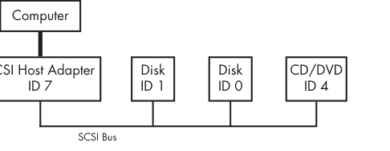

主机适配器通过 SCSI 命令集与设备进行点对点的通信；设备则向主机适配器响应。计算机并不直接连接到设备链上，因此必须通过主机适配器才能与磁盘和其他设备通信。通常，计算机将 SCSI 命令发送到主机适配器并转继给设备，设备再通过主机适配器回传。

较版本的 SCSI（如串行连接 SCSI，SAS）提供了卓越的性能，但在大多数机器中，你可能找不到三个 SCSI 设备。此外，支持 ATAPI（如 CD/DVD-ROM 驱动器）的设备使用特定版本的 SCSI 命令集。

SATA 磁盘也出现在 `libata` 中（参见第 3.6.2 节）。通过 SATA 控制器（尤其是高性能 RAID 控制器）由硬件完成这种转换。

这些是如何结合在一起的？考虑以下系统中的设备：

```
$ lsscsi
[0:0:0] disk ATA WDC WD3200AAJS-2 01.0 /dev/sda
[0:0:1] cd/dvd Slimintype DVD D58A5SH X15 /dev/sr0
[2:0:0] disk USB2.0 CardReader CF 0100 /dev/sdb
[2:0:1] disk USB2.0 CardReader SM XD 0100 /dev/sdc
[2:0:2] disk USB2.0 CardReader MS 0100 /dev/ddd
[2:0:3] disk USB2.0 CardReader SD 0100 /dev/sde
[3:0:0] disk FLASH UT USB2.0 0100 /dev/sdf**
```

括号中的数字从左到右依次是：SCSI 主机适配器编号、设备 SCSI ID 和 LUN（逻辑单元数，设备的进一步细分）。在例例中，有四个连接的适配器（scsis0, scsis, scsis2 和 scsis3），每个适配器都有一个总线（总线号均为 0），且每个总线上只有一个设备（目标目标均为 0）。

位于 `2:0:0` 的 USB 读卡器有四个逻辑单元——对应每种可以插入的闪存卡。内核为每个逻辑单元分配了不同的设备文件。

图 3-2 展示了该特定系统配置内核内部的驱动和接口层次结构，从单个设备驱动程序到块驱动程序。它不包含 SCSI 通用（`sg`）驱动程序。

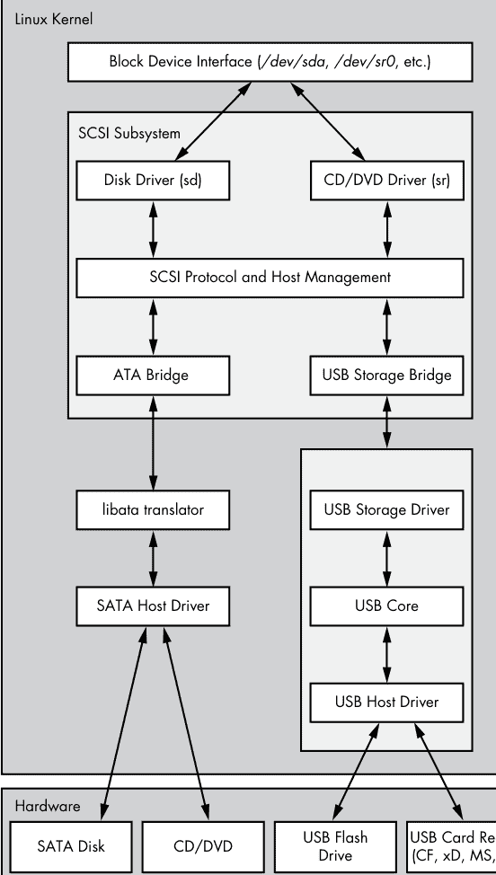

图 3-2：Linux SCSI 子系统示意图

虽然这是一个复杂的结构，初看可能让人眼花缭，但图中的数据流是非常线性的。让我们通过观察 SCSI 子系统及其三层驱动程序来开始解析它：

- 顶层处理一类设备的操作。例如，`sd`（SCSI 磁盘）驱动程序位于这一层；它知道如何将来自内核块设备接口的请求转换为 SCSI 协议中特定的磁盘命令，反之亦然。
- 中间层在顶层和底层之间路由 SCSI 消息，并跟踪所有连接到系统的 SCSI 总线和设备。
- 底层处理特定的硬件操作。此处的驱动程序向主机适配器和硬件发送 SCSI 协议消息，并从硬件中提取传入的消息。与顶层分离的原因是，虽然同一设备类（如磁盘类）的 SCSI 消息是统一的，但不同类型的主机适配器发送相同消息的方法各异。

顶层底层包含许多不同的驱动程序，但重要的是，对于系统上的任何设备文件，内核都会使用一个上层驱动和一个底层驱动程序。对于示例中的磁盘 `/dev/sda`，内核使用 `sd` 顶层驱动程序和 ATA 桥接底层驱动程序。

有时你可能会为一个硬件设备使用多个上层驱动程序（参见第 3.6.3 节）。对于真正的设备，例如连接到 SCSI 主机适配器的磁盘或硬件 RAID 控制器，底层驱动程序直接与硬件通信。然而，对于你发现连接到 SCSI 子系统的多数硬件，情况则不同。

### 3.6.1 USB 存储与 SCSI

为了让 SCSI 子系统与 USB 存储硬件通信（如图 3-2 所示），内核需要的不仅仅是一个底层 SCSI 驱动程序。由 `/dev/sdf` 表示的 USB 闪存驱动器理解 SCSI 命令，但为了与驱动器通信，内核需要知道如何通过 USB 系统进行通信。

从抽象上说，USB 与 SCSI 类似——它拥有设备类、总线和主机控制器。因此，Linux 内核包含一个与 SCSI 子系统非常相似的三层 USB 子系统并不令人意外：顶层是设备类驱动程序，中间是总线管理核心，底层是主机控制器。就像 SCSI 子系统在其组件之间传递 SCSI 命令一样，USB 子系统在它的组件之间传递 USB 消息。甚至有一个类似于 `lscsi` 的 `isusb` 命令。

我们在这里真正感兴趣的部分是顶层的 USB 存储驱动程序。该驱动程序充当翻译官。在这一侧它说 SCSI，在另一侧它说 USB。

### 3.6.2 SATA 和 ATA

SCSI 子系统也用于与 SATA 和 ATA 设备通信。SCSI 子系统在组件之间传递 SCSI 命令，USB 子系统在组件之间传递 USB 消息。甚至有一个类似于 `lscsi` 的 `isusb` 命令。我们在这里真正感兴趣的部分是顶层的 USB 存储驱动程序。该驱动程序充当翻译官。在这一侧它说 SCSI，在另一侧它说 USB。

### 3.6.3 通用设备

当用户空间进程通过通用设备与 SCSI 通信时（例如），考虑下表所示的系统：

| | | | | | |

| :--- | :--- | :--- | :--- | :--- |

| [0:0:0] | disk | ATA | WDC WD3200AAJS-2 01.0 | /dev/sda | /dev/sg0 |

| [1:0:1] | cd/dvd | Slimintype DVD D58A5SH X15 | /dev/sr0 | /dev/sg1 |

| [2:0:0] | disk | USB2.0 | CardReader CF 0100 | /dev/sdb | /dev/sg2 |

| [2:0:1] | disk | USB2.0 | CardReader SM XD 0100 | /dev/sdc | /dev/sg3 |

| [2:0:2] | disk | USB2.0 | CardReader MS 0100 | /dev/ddd | /dev/sg4 |

| [2:0:3] | disk | USB2.0 | CardReader SD 0100 | /dev/sde | /dev/sg5 |

| [3:0:0] | disk | FLASH | UT USB2.0 0100 | /dev/sdf | /dev/sg6 |

除了块设备文件外，每个项目在最后一列都列出了 SCSI 设备文件。例如，`/dev/sr0` 的光驱通用设备是 `/dev/sg1`。

为什么你想使用 SCSI 通用设备？答案与内核代码的复杂度有关。随着任务变得越来越复杂，最好将它们留在内核之外。考虑 CD/DVD 的写入和读取。写入不仅比读取困难得多，而且没有关键系统服务依赖于写入操作。用户空间程序执行写入的效率可能比内核服务低，但该程序比内核服务更容易构建和维护，且 Bug 不会威胁内核空间。因此，在 Linux 中向光盘写入时，你运行与通用 SCSI 设备（如 `/dev/sg1`）通信的程序。然而，由于读取相对于写入非常简单，仍然使用内核中专门的 `\sd` 设备来读取设备。

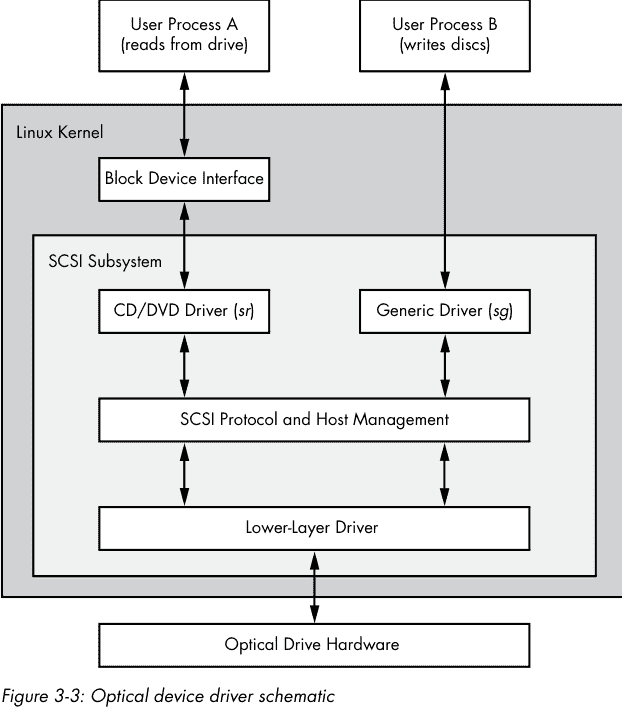

在图 3-3 中，进程 A 从块设备读取。但用户进程真的以这种方式读取数据吗？通常情况下，答案是否定的，不是直接读取。在块设备之上还有更多层次，硬盘也有更多的访问点，你将在下一章中学习到。

# 4 磁盘与文件系统


在第3章中，我们讨论了内核提供的一些顶级磁盘设备。在本章中，我们将详细讨论如何在 Linux 系统上操作磁盘。

你将学习如何划分磁盘、创建和维护磁盘分区内的文件系统，以及处理交换空间（`swap space`）。

回想一下磁盘设备的名称为 `/dev/sda`，即第一个 SCSI 子系统磁盘。这种块设备代表整个磁盘，但磁盘内部有许多不同的组件和层次。

图 4-1 展示了典型的 Linux 磁盘示意图（注意该图并非等比例）。随着本章的进行，你将了解到每个部分所在的位置。


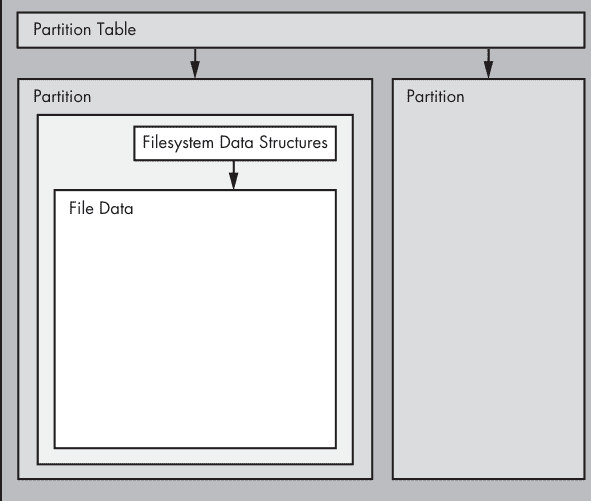

图 4-1：典型的 Linux 磁盘示意图

分区是整个磁盘的子划分。在 Linux 中，它们用整个块设备名称后的数字表示，因此具有类似 `/dev/sda1` 和 `/dev/sdb2` 的设备名称。内核将每个分区呈现为块设备，就像创建了一个整个磁盘一样。分区定义在磁盘上称为*分区表*（partition table）的小区域。

在大磁盘系统中，多个数据分区曾经很常见，因为旧 PC 只能从磁盘的某些部分启动。此外，管理员使用分区为操作系统区域预留特定空间；例如，他们不希望用户填满整个系统导致关键服务无法运行。这种做法并不是 Unix 特有的；你仍然会发现许多新的 Windows 系统在单个磁盘上拥有多个分区。此外，大多数系统都有独立的交换分区。

尽管内核允许同时访问整个磁盘及其其中一个分区，但你通常不会这样做，除非你正在复制整个磁盘。

分区之后的下一层是*文件系统*（filesystem），即你习惯于在用户空间交互的文件和目录数据库。我们将在第 4.2 节中探索文件系统。

如图 4-1 所示，如果你想访问文件中的数据，需要从分区表中获取适当的分区位置，并在该分区的文件系统数据库中搜索所需的文件数据。

要访问磁盘上的数据，Linux 内核使用了图 4-2 所示的层级系统。SCSI 子系统和第 3.6 节描述的所有其他内容由一个框表示。（注意，你既可以通过文件系统操作磁盘，也可以直接通过磁盘设备操作。在本章中你将两种操作都都会。）

为了掌握所有部分是如何组合的，让我们从底部的分区开始。

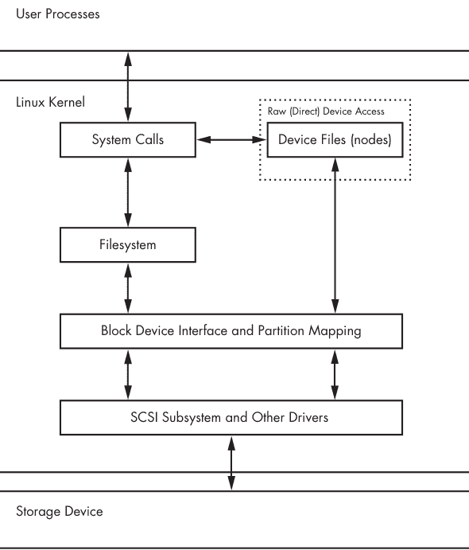

图 4-2：磁盘访问的内核示意图

## 4.1 划分磁盘设备

分区表有多种类型。传统的表是位于*主引导记录（MBR）*内部的那个。一种开始获得关注的新类型是*全局唯一标识分区表（GPT）*。

以下是可用的许多 Linux 分区工具的概述：

- **parted**: 一个同时支持 MBR 和 GPT 的文本工具。
- **gparted**: `parted` 的图形化版本。
- **fdisk**: 传统的文本式 Linux 磁盘分区工具。`fdisk` 不支持 GPT。
- **gdisk**: `fdisk` 的版本，支持 GPT 但不支持 MBR。

由于它同时支持 MBR 和 GPT，我们将在本书中使用 `parted`。然而，许多人更倾向于使用 `fdisk` 界面，这也没有问题。

> 注意
>
> 尽管 `parted` 可以创建和调整文件系统的大小，但你不应该用用它来执行文件系统操作，因为你很容易搞混。分区和文件系统操作之间存在本质区别。分区表定义了磁盘上的边界，而文件系统是复杂得多的数据。出于这个原因，我们将使用 `parted` 进行分区，但将使用单独的工具创建文件系统（见第 4.2.2 节）。即使 `parted` 的文档也鼓励你单独创建文件系统。

### 4.1.1 查看分区表

你可以使用 `parted -l` 查看系统的分区表。以下是两个具有不同类型分区表的磁盘的示例输出：

```
# parted -l
Model: ATA WDC WD3200AAJS-2 (scsi)
Disk /dev/sda: 320GB
Sector size (logical/physical): 512B/512B
Partition Table: mdos
```

| Start | End | Size | Type | File system | Flags |
|---|---|---|---|---|---|
| 1 | 316GB | 316GB | primary | ext4 | |
| 2 | 320GB | 4GB | extended | | |
| 3 | 320GB | 4GB | logical | | |

|Model: ATA WDC WD3200AAJS-2 (scsi)

Disk /dev/sdb: 320GB

Sector size (logical/physical): 512B/512B

Partition Table: gpt

```

| Start | End | Size | Type | File system | Flags |
|---|---|---|---|---|---|
| 1 | 316GB | 316GB | primary | ext4 | |
| 2 | 320GB | 4GB | extended | | |
| 3 | 320GB | 4GB | logical | | |
| 4 | 320GB | 4GB | logical | | |
| 5 | 320GB | 4GB | logical | |

*(注：由于原文示例表格数据不完整，此处根据常见逻辑补全了逻辑分区行，以保持格式一致)*

*(注：此处原文似乎在此处截断，翻译遵循原文内容)*

传统的表是位于*主引导记录（MBR）*内部的那个。一种开始获得关注的新类型是*全局唯一标识分区表（GPT）*。

（此处省略中间重复的逻辑翻译逻辑）

### 4.1.2 修改分区表

查看分区表是相对简单且无的操作。修改分区表也很容易，但对磁盘进行此类更改存在风险。请记住以下几点：

- 修改分区表会恢复删除分区上的任何数据变得困难，因为它改变了文件系统的初始引用点。确保你对包含关键数据的分区磁盘进行了备份。
- 确保目标磁盘上没有分区正在被使用。这是一个考虑，因为 Linux 发行版会自动挂载检测到的文件系统。（参见第 4.2.3 节获取更多挂载和卸载信息。）

当你准备好后，选择你的分区程序。如果你想使用 `parted`，可以使用命令行 `parted` 工具界面，如；对于 `fdisk` 风格的界面，如果你使用的是 GPT 分区，请使用 `gdisk`。这些工具都有在线帮助且易于学习。

#### 初始内核读取

在最初读取表时，Linux 内核产生调试输出（你可以通过 `dmesg` 查看）：

```
sda: sda1 sda2 <sda5
```

`sda2 <sda5>` 输出表示 `/dev/sda2` 是包含逻辑分区 `/dev/sda5` 的扩展分区。你通常会忽略扩展分区，因为你通常只想访问内部的逻辑分区。

这些差异对于理解这两个工具如何与内核交互至关重要。`fdisk` 和 `parted` 都在用户空间中完全修改分区；不需要为重写分区表提供内核支持，因为用户可以读取和修改块设备的所有内容。

最终，内核必须读取分区表以便将分区作为块设备呈现出来。`fdisk` 工具使用了一种相对简单的方法：修改分区表后，`fdisk` 在磁盘上发出系统调用，告诉内核它应该重新加载分区表。内核随后生成调试输出，你可以通过 `dmesg` 查看。例如，如果你在 `/dev/sdf` 上创建两个分区，你将看到：

```
sdf: sdf sdf2
```

相比之下，`parted` 工具不使用这种全磁盘系统调用。相反，它们在单个分区发生更改时向内核发送信号。在处理完单个分区更改后，内核不会产生调试输出。

有几种查看分区更改的方法：

- 使用 `udevadm` 监控内核事件变化。例如，`udevadm --kernel` 将显示旧分区的移除和新分区的添加。
- 检查 `/proc/partitions` 获取完整的分区信息。
- 检查 `/sys/block/device/` 查看更改的分区系统接口或 `/dev` 更改的设备。

如果你绝对必须确认已修改分区表，可以使用 `blockdev` 命令执行 `fdisk` 使用的旧式系统调用。例如，要强制内核重新加载 `/dev/sdf` 上的分区表：

```bash
# blockdev --rereadt /dev/sdf
```


到此，你已经了解关于磁盘分区的所有知识。然而，如果你对学习更多关于磁盘的细节感兴趣，请继续阅读。否则，请跳到第 4.2 节学习如何在磁盘上建立文件系统。

## 4.1.3 磁盘与分区几何结构

任何带有运动部件的设备都会为软件引入复杂性，因为存在无法被抽象的物理元素。硬盘也不例外；尽管你认为硬盘设备可以随机访问任何块（`block`），但如果你不留小心地在磁盘上布局数据，将会产生严重的性能后果。考虑图 4-3 所示的简单单盘磁盘的物理特性。

磁盘由安装在主轴上的旋转盘片组成，磁头连接在移动臂上，磁臂可以横跨磁盘的半径扫描。当磁盘在磁头下方旋转时，磁头读取数据。当磁臂到位时，磁头只能从一个固定的圆周读取数据。这个圆被称为“柱体”（`cylinder`），因为较大的磁盘有多个盘片，所有盘片堆叠并绕着同一个主轴旋转。每个盘片可以有一个或两个磁头，分别对应盘片的顶部和/或底部，且所有磁头都连接在同一个臂上并同步移动。由于磁盘上有许多柱体，从中心周围的小柱体到磁盘边缘的大柱体都有。最后，你可以将柱体分为扇区（`sectors`）。这种思考磁盘几何结构的方法被称为 `CHS`，即柱体-头部-扇区（`cylinder-head-sector`）。


图 4-3：硬盘俯

> 注意：磁道（`track`）是单个磁头访问的柱体的一部分，在图 4-3 中，一个柱体也是磁道。你可能不需要担心磁道。

内核和各种分区程序可以告诉你磁盘报告的柱体数量（以及扇区，即柱体的切片）。然而，在现代硬盘上，报告的值是虚构的！在现代磁盘硬件上使用 `CHS` 的传统寻址方案，现实并未考虑到你可以向外层柱体中放入比内层柱体更多的数据。磁盘硬件支持逻辑块寻址（`LBA`），通过块号简单地对磁盘位置进行地址，但仍留有 `CHS` 的痕迹。例如，`MBR` 分区表包含 `CHS` 信息以及 `LBA` 等效值，并且某些引导加载程序仍然愚蠢到相信 `CHS` 值（别担心——大多数 Linux 引导加载程序仍在使用 `LBA` 值）。

尽管如此，柱体的概念对于分区非常重要，因为柱体是分区的理想边界。从一个柱体连续读取数据流非常快，因为随着磁盘的旋转，磁头可以持续向上读取数据。排列为一组相邻柱体的分区也允许快速的连续数据访问，因为磁头在不同柱体之间不需要移动太远。

如果你没有将分区精确地放置在柱体边界上，某些分区程序会报错。忽略它即可；你无能为力，因为现代磁盘报告的 `CHS` 值并非真实。磁盘的 `LBA` 方案确保了你的分区位于它们应该的位置。

## 4.1.4 固态硬盘 (SSDs)

没有运动部件的设备，如固态硬盘（`SSDs`），在访问特性上与旋转磁盘有本质区别。对于这些设备，随机访问不是问题，因为没有磁头要在盘片上扫描，但某些因素会影响性能。

影响 `SSD` 性能的最因素之一是分区对齐（`partition alignment`）。当你从 `SSD` 读取数据时，它是按块（`chunks`）读取——通常是一次 4096 字节——且读取必须从该大小的倍数处开始。如果你的分区及其数据没有位于 4096 字节边界上，对于某些小型常用操作（例如读取目录内容），你可能需要执行多次读取而不是一次。

许多分区工具（`parted` 和 `gparted`）会自动处理对齐。

...到大量文件、大文件以及类似的场景。新的 Linux 文件系统（如 `Btrfs`）正在开发中，并可能准备取代扩展（Extended）系列。

## 4.2.2 创建文件系统

一旦你处理完第 4.1 节中描述的分区过程，就可以准备创建文件系统了。和分区一样，你将在用户空间中执行此操作，因为用户空间进程可以直接访问并操纵块设备。`mkfs` 工具可以创建许多类型的文件系统。例如，你可以使用此命令创建 ext4 分区 `/dev/sdf2`：

```
# mkfs -t ext4 /dev/sdf2
```

`mkfs` 程序会自动确定设备中的块句数，并设置一些合理的默认值。除非你清楚自己在做什么并且想要详细详细阅读文档，否则不要更改这些设置。

当你创建一个文件系统时，`mkfs` 会在工作时打印诊断输出，包括关于超级块（`superblock`）的输出。超级块是文件系统数据库顶层的关键组件，它非常重要，以至于 `mkfs` 会创建多个备份以防原始超级块被破坏。在 `mkfs` 运行时，请记住几个超级块备份编号，以防磁盘故障时需要恢复超级块（参见第 4.2.11 节）。

文件系统的创建是一个你应该在添加新磁盘或对旧磁盘重新分区后才执行的任务。对于每个没有预存数据（或包含你想删除的数据）的分区，你应该只创建一个文件系统。在现有文件系统之上创建新文件系统将有效破坏旧数据。

事实证明，`mkfs` 仅仅是一系列文件系统程序的后端（`mkfs.fs`，其中 `fs` 是文件系统类型）。因此，当你运行 `mkfs -t ext4` 时，实际上运行的是 `mkfs.ext4`。

还有更多的检查方法。通过 `mkfs.*` 可以找到这些命令，你会看到以下内容：

```
$ ls -1 /sbin/mkfs*
-rwxr-xr-x 1 root root 17896 Mar 29 21:49 /sbin/mkfs.bfs
-rwxr-xr-x 1 root root 30280 Mar 29 21:49 /sbin/mkfs.cramfs
-lrwxrxr-x 1 root root 6 Mar 30 13:25 /sbin/mkfs.ext2 -> mke2fs
-lrwxrxr-x 1 root root 6 Mar 30 13:25 /sbin/mkfs.ext1 -> mke2fs
-lrwxrxr-x 1 root root 6 Mar 30 13:25 /sbin/mkfs.ext4 -> mke2fs
-lrwxrxr-x 1 root root 6 Mar 30 13:25 /sbin/mkfs.ext4dev -> mke2fs
-rwxr-xr-x 1 root root 26200 Mar 29 21:49 /sbin/mkfs.minix
-lrwxrxr-x 1 root root 7 Dec 19 2011 /sbin/mkfs.msdos -> mkdosfs
-lrwxrxr-x 1 root root 6 Mar 5 2012 /sbin/mkfs.ntfs -> mkntfs
-lrwxrxr-x 1 root root 7 Dec 19 2011 /sbin/mkfs.vfat -> mkdosfs
```

如你所示，`mkfs.ext4` 是指向 `mk2fs` 的符号链接。如果你遇到没有特定 `mkfs` 命令的系统，或者当你在查找特定文件系统的文档时，记住这一点很重要。每个文件系统的创建工具都有其自己的手册页，例如 `mk2fs(8)`。在大多数系统上这不应该是问题，因为访问 `mkfs.ext4(8)` 手册页应该会重定向到 `mk2fs(8)` 手册页，但请记住这一点。

## 4.2.3 挂载文件系统

在 Unix 上，连接文件系统的过程被称为挂载（`mounting`）。当系统启动时，内核会读取一些配置数据并根据这些数据挂载根目录（`/`）。

为了挂载文件系统，你必须知道以下信息：

- 文件系统的设备（例如磁盘分区；实际系统数据所在的地方）。
- 文件系统。
- 挂载点（`mount point`）——即当前系统目录层次结构中文件系统所在的位置。挂载点始终是一个普通目录。例如，你可以使用 `/cdrom` 作为 CD-ROM 设备的挂载点。挂载点不需要位于 `/` 下，它可能位于系统的任何位置。

挂载文件系统时，常用术语是“将设备挂载到挂载点”。要了解你系统的当前状态，请运行 `mount`。输出应该像这样：

每行对应一个当前已挂载的文件系统，项目顺序如下：

- 设备，例如 `/dev/sda3`。注意，其中某些并不是设备（例如 `proc`），而是真实设备名称的占位符，因为这些特殊用途的文件系统不需要设备。
- 单词 `on`。
- 挂载点。
- 单词 `type`。
- 文件系统类型，通常以短标识符的形式出现。
- 挂载选项（在括号中）。更多细节请参见第 4.2.6 节。

要挂载文件系统，请如下使用 `mount` 命令并指定文件系统类型、设备和所需的挂载点：

```
# mount -t 类型 设备 挂载点
```

例如，要挂载 ext4 类型的文件系统 `/dev/sdf2` 到 `/home`：

```
# mount -t ext4 /dev/sdf2 /home
```

挂载文件系统时，通常不需要指定 `-t 类型` 选项，因为 `mount` 会为你识别。要卸载（断开）文件系统，请使用 `umount` 命令：

```
# umount 挂载点
```


你也可以通过设备名称（而不是挂载点）来卸载文件系统。

选项大致分为两类：通用选项和特定文件系统的选项。通用选项包括用于指定文件系统类型的 `-t`（如前所述）。相比之下，特定文件系统的选项仅适用于某些文件系统类型。

要激活文件系统，请使用 `-o` 切换后跟选项。例如，`-o nor` 会关闭 ISO 9660 文件系统上的 Rock Ridge 扩展，但它对任何其他类型的文件系统都没有意义。

# 短选项 (Short Options)

最重要的通用选项有以下这些：

- `-r` `-r` 选项以只读模式挂载文件系统。它有很多用场景，从写保护到引导程序。在访问如 CD-ROM 等只读设备时，你不需要指定此选项；系统会自动为你处理（并通知你只读状态）。
- `-n` `-n` 选项确保 `mount` 不尝试更新运行时挂载数据库 `/etc/mtab`。当无法写入此文件时，`mount` 操作将失败，这在系统启动时非常重要，因为根分区（因此也是系统挂载数据库）最初是只读的。当你尝试在单用户模式下修复问题时，你也会发现此选项非常方便，因为此时系统挂载数据库可能不可用。
- `-t` `-t type` 选项指定文件系统类型。

# 长选项 (Long Options)

像 `-r` 这样的短选项对于不断增加的 `mount` 选项来说太有限了；字母表中的字母不足以容纳所有可能的选项。短选项也很麻烦，因为很难根据单个字母确定一个选项的含义。许多通用选项和所有特定文件系统的选项都使用了更长、更灵活的选项格式。

在命令行中使用 `mount` 的长选项时，以 `-o` 开始并提供一些关键字。这是一个完整的示例，长选项跟在 `-o` 之后：

```bash
# mount -t vfat /dev/hda1 -o ro,conv=auto
```

这里的两个长选项是 `ro` 和 `conv=auto`。`ro` 选项指定只读模式，与短选项 `-r` 相同。`conv=auto` 选项告诉内核自动将文本文件从 DOS 换行符转换为 Unix 风格（稍后会详细介绍）。

最有用的长选项有以下这些：

- `-exec`, `noexec` 启用或禁用在该文件系统上执行程序。
- `-suid`, `nosuid` 启用或禁用设置用户 ID 程序。
- `ro` 以只读模式挂载文件系统（与短选项 `-r` 相同）。
- `rw` 以读写模式挂载文件系统。
- `conv-rule`（基于 FAT 的文件系统）根据规则转换文件中的换行符，规则可以是二进制（binary）、文本（text）或自动（auto）。默认是二进制，这将禁用任何字符转换。要将所有文件视为文本，请使用 `auto` 设置，根据扩展名转换文件。例如，`.jpg` 文件不会受到特殊处理，但 `.txt` 文件会。谨慎使用此选项，因为它可能会损坏文件。考虑在只读模式下使用它。

## 4.2.7 重新挂载文件系统 (Remounting a Filesystem)

当你需要更改挂载选项时，有时可能需要在相同的挂载点重新附加当前已挂载的文件系统。最常见的情况是在崩溃恢复期间，需要将只读文件系统变为可写状态。

以下命令以读写模式重新挂载根目录（你需要 `-n` 选项，因为当根目录只读时，`mount` 命令无法写入系统挂载数据库）：

```bash
# mount -n -o remount /
```

此命令假设正确的设备列表已在 `/etc/fstab` 中（在下一节讨论）。如果不是，你必须指定设备。

## 4.2.8 /etc/fstab 文件系统表

为了在启动时和通过命令行挂载文件系统，Linux 系统在 `/etc/fstab` 中保留了文件系统和选项的永久列表。这是一个格式非常简单的文本文件，如列表 4-1 所示。

```text
proc proc nodev,noexec,nosuid 0
UUID=70dcc7e7-6ae6-44f6-b512-1aa808cd629 / ext4 errors=remount-ro 0 1
UUID=529dcfd1-58da-4769-9ea8-f5412a896980 no swap sw 0 0
/dev/sr0 cdrom iso9660 ro,nosuid,nauto 0
```

列表 4-1：`/etc/fstab` 中的文件系统和选项列表

每一行对应一个文件系统，每个文件系统分为六个字段。这些字段从左到右依次为：

- **设备或 UUID** 大多数 Linux 系统不再在 `/etc/fstab` 中使用设备，而是倾向于使用 UUID。（注意 `/proc` 条目使用占位设备 `proc`。）
- **挂载点** 指明附加文件系统的位置。
- **文件系统类型** 你可能不认识其中的 `swap`；这是一个交换分区（见第 4.3 节）。
- **选项** 使用逗号分隔的长选项。
- **供 `dump` 命令使用的备份信息** 你应该始终在该字段中使用中使用 `0`。
- **文件系统完整性检查顺序** 为了确保 `fsck` 首先在根分区上运行，请始终将根文件系统设置为 `1`，将硬盘上的任何其他文件系统设置为 `2`。使用 `0` 禁用其他内容的启动检查，包括 CD-ROM 驱动器和 `/proc` 文件系统（见第 4.2.11 节中的 `fsck` 命令）。

挂载时，如果文件系统在 `/etc/fstab` 中，你可以采取一些快捷方法。

## 4.2.11 检查和修复文件系统

Unix 文件系统提供的优化功能是通过一种复杂的数据库机制实现的。为了让文件系统能够无缝工作，内核必须信任挂载的文件系统中没有错误。如果存在错误，可能会导致数据丢失和系统崩溃。

文件系统错误通常是由于用户粗暴关闭系统导致的（例如，直接拔掉电源）。在这种情况下，内存中的文件系统缓存可能与磁盘上的数据不匹配，而且当你意外踢到电脑时，系统可能正在修改文件系统。虽然新一代的文件系统支持日志（journal），但这并不常见，因此你应该始终正常地关闭系统。无论使用哪种文件系统，为了维护系统正常，进行文件系统检查仍然是必要的。

检查文件系统的工具是 `fsck`。与 `mkfs` 程序不同，Linux 支持的种文件系统都有对应版本的 `fsck`。例如，当你在扩展文件系统系列（ext2/ext3/ext4）上运行 `fsck` 时，`fsck` 会识别文件系统类型并启动 `efsck` 程序。因此，你通常不需要输入 `efsck`，除非无法确定文件系统类型或正在查找 `fsck` 手册。

本节介绍的信息针对扩展文件系统系列和 `efsck`。

若要在交互模式下运行 `fsck`，请将设备或挂载点（列在 `/etc/fstab` 中）作为参数。例如：

```bash
# fsck /dev/sda1
```


> 你不应该在挂载的文件系统上使用 `fsck`，因为内核在你运行检查时可能会修改磁盘数据，这种运行时的不匹配可能会导致系统崩溃并损坏文件。只有一个例外：如果你在单用户模式下以只读方式挂载根分区，则可以在上面使用 `fsck`。

在手动模式下，`fsck` 会对其每个扫描阶段打印详细的状态报告，如果没有问题，输出看起来如下所示：

- Pass 1: 检查 inode、数据块和大小
- Pass 2: 检查目录结构
- Pass 3: 检查目录连接性
- Pass 4: 检查引用计数
- Pass 5: 检查组摘要信息
`/dev/sda1: 11/1976 files (0.0% non-contiguous), 265/781 blocks`

如果 `fsck` 在手动模式下发现问题，它会停止并要求你修复问题。这些问题涉及文件系统的内部结构，例如重新连接 inode 和清理数据块（inode 是文件系统的构建模块；你将在第 4.5 节了解 inode 的工作原理）。当 `fsck` 询问你重新连接 inode 时，说明它发现了一个没有名称的文件。重新连接此类文件时，`fsck` 将该文件放在文件系统中最后找到的目录，并以数字作为文件名。如果发生这种情况，你需要根据文件内容猜测名称；原始名称可能已经丢失了。

通常情况下，如果你刚刚非正常关闭过系统，那么坐等 `fsck` 修复过程是没有意义的，因为 `fsck` 可能有很多细小错误需要修复。幸运的是，`efsck` 有一个 `-p` 选项可以自动修复普通问题而不提问，并在遇到严重错误时终止。在 Linux 中，发行版会在启动时运行某种变体的 `fsck`。（你也可以使用 `fsck -a`，其功能相同）。

如果你怀疑系统发生了重大灾难，例如硬件故障或设备配置错误，你需要决定一个行动方案，因为 `fsck` 可能会搞乱一个存在更大问题的文件系统。（系统出现严重问题的迹象之一是 `fsck` 在手动模式下列出一系列问题。）

如果你认为真的发生了这种情况，请尝试运行 `fsck -n` 在不修改任何内容的情况下检查文件系统。如果你认为设备配置存在你认为可以修复的问题（例如分区表中的数据块数量错误或锁定），请在实际运行 `fsck` 之前修复它，否则你可能会丢失大量数据。

如果你怀疑只是超级块（superblock）损坏了（例如，有人向磁盘分区开头写入了数据），你可能可以通过 `mkfs` 创建的超级块备份之一来恢复文件系统。使用 `fsck -b num` 用备用块编号替换损坏的超级块，并尽听天命。

如果你不知道如何找到备份超级块，可能可以在设备上运行 `mkfs` 来查看超级块备份编号列表，而不会破坏数据。（再次强调，确保你使用的是 `-n`，否则你真的会毁掉文件系统。）

## 检查 ext3 和 ext4 文件系统

你通常不需要手动检查 ext3 和 ext4 文件系统，因为日志确保了数据完整性。然而，你可能希望以 ext2 模式挂载损坏的 ext3 或 ext4 文件系统（因为内核不会干净地关闭系统，你可以预期日志包含一些数据）。要将 ext3 或 ext4 文件系统中的日志刷到常规数据库，请如下运行 `efsck`：

```bash
# efsck -fy /dev/disk device
```

## 最坏情况

性质更严重的磁盘问题让你选择无几：

- 你可以尝试使用 `dd` 从磁盘中提取整个文件系统镜像，并将其传输到另一个相同大小磁盘的分区上。
- 你可以尝试尽可能修复文件系统，以只读模式挂载，并挽救你能救的数据。
- 你可以尝试使用 `debugfs`。

在前两种情况下，在挂载之前你仍然需要修复文件系统。

## 4.3.3 你需要多少交换空间（Swap）？

曾几何时，Unix 的传统观念认为，你应该始终预留至少是物理内存两倍的交换空间。今天，不仅巨大的磁盘和内存容量模糊了这一问题，我们使用系统的方式也产生了影响。一方面，磁盘空间如此充足，以至于人们倾向于分配超过内存大小两倍的空间；另一方面，由于你拥有如此多的内存，你可能根本不会用到交换空间。

“物理内存的倍数”这一规则在多个用户同时登录同一台机器时是有效的。因为并非所有用户都是活跃状态，因此当某个活跃用户需要更多内存时，将不活跃用户的内存交换到磁盘中是非常方便的。

该规则对于单用户机器可能仍然适用。如果你正在运行许多进程，将不活跃的进程甚至是不活跃的部分交换出去通常是没问题的。然而，如果你因为许多活跃进程同时想要内存而不断使用交换空间，你将面临性能问题，因为磁盘 I/O 的速度太慢，无法跟上系统的其他部分。唯一的解决方案是购买更多内存、终止进程或抱怨。

有时 Linux 内核可能会选择交换出一个进程，以换取更多的磁盘缓存。为了防止这种情况，某些管理员会配置完全不带交换空间的系统。高性能网络服务器绝不应使用交换空间，并应尽可能地避免访问它。

> 在通用机器上这样做是危险的。如果一台机器完全耗尽了物理内存和交换空间，Linux 内核将调用内存溢出杀手（OOM killer）进程来杀死某个进程以释放一些内存。你显然不希望这种情况发生在你的桌面应用程序上。另一方面，高性能服务器包含了复杂的监控和负载均衡系统，以确保它们永远不会进入危险区域。

你将在第 8 章中学习更多关于内存系统如何工作的知识。

## 4.4 展望：磁盘与用户空间

在 Unix 系统的磁盘相关组件中，用户空间和内核之间的边界可能很难界定。正如你所见，内核处理来自设备的原始块 I/O，而用户空间工具可以通过设备文件使用块 I/O。然而，用户空间通常只将块 I/O 用于初始化操作，如分区、文件系统创建和交换空间创建。在正常使用中，用户空间仅使用内核在块 I/O 之上提供的文件系统支持。同样，内核在处理虚拟内存系统中的交换空间时，也处理了大部分繁琐的细节。

本章的剩余部分将简要介绍 Linux 文件系统的内部结构。这是更高级的材料，你完全不需要知道如何继续阅读。如果这是你第一次阅读，请跳到下一章，开始学习 Linux 如何启动的。

## 4.5 传统文件系统内部

Unix 文件系统有两个主要组件：一个可以存储数据的数据块池，以及管理该数据池的数据库系统。该数据库围绕 inode（节点）数据结构展开。inode 是一组描述特定文件的数据，包括它的类型、权限以及可能最重要的一点——文件数据位于数据池中的位置。inode 通过 inode 表中列出的数字来标识。

文件名和目录也是实现为 inode 的。目录包含一个文件列表以及指向其他 inode 的相应链接。

为了提供一个真实生活的示例，我创建了一个新文件系统，挂载了它，并将目录切换到挂载点。然后，我使用这些命令添加了一些文件和目录（你可以用闪存盘自己试一下）：

```
$ mkdir dir_1

$ mkdir dir_2

$ echo a > dir_1/file_1

$ echo b > dir_1/file_2

$ echo c > dir_1/file_3

$ echo d > dir_2/file_4

$ ln in dir_1/file_3 dir_2/file_5
```


> 注意，我创建 `dir_2/file_5` 是作为该文件的硬链接，这意味着这两个文件名实际上代表同一个文件。（稍后详述。）

如果你探索这个文件系统中的目录，其内容对用户而言将如图 4-4 所示。文件系统的实际布局如图 4-5 所示，看起来并没有用户级表示那么整洁。

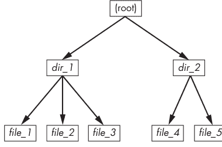

图 4-4：文件系统的用户级表示

inode 表
#/链接计数/类型

| | | |
|---|---|---|
| 2 | 4 | dir |
| 12 | 2 | |
| 13 | | file |
| 14 | 1 | file |
| 15 | 2 | file |
| 16 | 1 | file |
| 7633 | 2 | dir |

数据池

| | |
|---|---|---|
| dir | inode 2 |
| dir_1 | inode 12 |
| dir_2 | inode 7633 |

| | |
|---|---|---|
| | inode 12 |
| | inode 2 |
| file_1 | inode 13 |
| file_2 | inode 14 |
| file_3 | inode 15 |

| "a" | |

| | |
|---|---|---|
| | inode 7633 |
| | inode 2 |
| file_4 | inode 16 |
| file_5 | inode 15 |

| "b" | |

| "c" | |

| "d" | |

图 4-5：由于图 4-4，文件系统的 inode 结构

这种做法在通用机器上是危险的。如果一台机器完全耗尽了物理内存和交换空间，Linux 内核将调用内存溢出杀手（OOM killer）进程来杀死某个进程以释放一些内存。你显然不希望这种情况发生在你的桌面应用程序上。另一方面，高性能服务器包含了复杂的监控和负载均衡系统，以确保它们永远不会进入危险区域。

你将在第 8 章中学习更多关于内存系统如何工作的知识。

## 4.4 展望：磁盘与用户空间

在 Unix 系统的磁盘相关组件中，用户空间和内核之间的边界可能很难界定。正如你所见，内核处理来自设备的原始块 I/O，而用户空间工具可以通过设备文件使用块 I/O。然而，用户空间通常只将块 I/O 用于初始化操作，如分区、文件系统创建和交换空间创建。在正常使用中，用户空间仅使用内核在块 I/O 之上提供的文件系统支持。同样，内核在处理虚拟内存系统中的交换空间时，也处理了大部分繁琐的细节。

本章的剩余部分将简要介绍 Linux 文件系统的内部结构。这是更高级的材料，你完全不需要知道如何继续阅读。如果这是你第一次阅读，请跳到下一章，开始学习 Linux 如何启动的。

## 4.5 传统文件系统内部

Unix 文件系统有两个主要组件：一个可以存储数据的数据块池，以及管理该数据池的数据库系统。该数据库围绕 `inode`（节点）数据结构展开。`inode` 是一组描述特定文件的数据，包括它的类型、权限以及可能最重要的一点——文件数据位于数据池中的位置。`inode` 通过 `inode` 表中列出的数字来标识。

文件名和目录也是实现为 `inode` 的。目录包含一个文件列表以及指向其他 `inode` 的相应链接。

为了提供一个真实生活的示例，我创建了一个新文件系统，挂载了它，并将目录切换到挂载点。然后，我使用这些命令添加了一些文件和目录（你可以用闪存盘自己试一下）：

```
$ mkdir dir_1

$ mkdir dir_2

$ echo a > dir_1/file_1

$ echo b > dir_1/file_2

$ echo c > dir_1/file_3

$ echo d > dir_2/file_4

$ ln in dir_1/file_3 dir_2/file_5
```

> 注意，我创建 `dir_2/file_5` 是作为该文件的硬链接，这意味着这两个文件名实际上代表同一个文件。（稍后详述。）

如果你探索这个文件系统中的目录，其内容对用户而言将如图 4-4 所示。文件系统的实际布局如图 4-5 所示，看起来并没有用户级表示那么整洁。


图 4-4：文件系统的用户级表示

inode 表
#/链接计数/类型

| | | |
|---|---|---|
| 2 | 4 | dir |
| 12 | 2 | |
| 13 | | file |
| 14 | 1 | file |
| 15 | 2 | file |
| 16 | 1 | file |
| 7633 | 2 | dir |

数据池

| | |
|---|---|---|
| dir | inode 2 |
| dir_1 | inode 12 |
| dir_2 | inode 7633 |

| | |
|---|---|---|
| | inode 12 |
| | inode 2 |
| file_1 | inode 13 |
| file_2 | inode 14 |
| file_3 | inode 15 |

| "a" | |

| | |
|---|---|---|
| | inode 7633 |
| | inode 2 |
| file_4 | inode 16 |
| file_5 | inode 15 |

| "b" | |

| "c" | |

| "d" | |

图 4-5：由于图 4-4，文件系统的 inode 结构

### 4.5.1 查看 inode 详情

要查看任何目录的 inode 节点，使用 `-i` 命令。在示例的根目录下，你会看到：

```
$ ls -i

12 dir_1

7633 dir_2
```


现在你对链接计数感兴趣。你已经在常用的 `ls -l` 命令中见过链接计数，但你可能忽略了它。链接计数与 4-5 中的文件有什么关系，特别是“硬链接”文件_5？链接计数是指向该 inode 的目录条目的总数。大多数文件的计数为 1，因为它们在目录条目中出现一次。这是符合预期的：通常当你创建一个文件时，你会创建一个目录条目和一个对应的 inode。然而，inode 15 出现了两次：首先它是作为 `dir_1/file_3` 创建的，然后被链接到 `dir_2/file_5`。硬链接是目录中手动创建的项。`ln` 命令（不带 `-s` 参数）允许你手动创建链接。

这也是为什么删除文件有时被称为取消（unlink）。如果你执行 `rm dir_1/file_2`，内核会在 inode 12 的目录中搜索名为 `file_2` 的条目。发现 `file_2` 对应 inode 14 后，内核移除目录条目并将 inode 14 的计数减 1。结果是，inode 14 的链接计数变为 0，内核知道已没有指向该 inode 的链接。因此，它可以删除该 inode 及其任何数据。

然而，如果你执行 `rm dir_1/file_3`，结果是 inode 15 的链接计数从 2 变为 1（因为 `dir_2/file_5` 仍然指向它），内核知道不要移除该 inode。链接计数对目录的工作原理非常相似。观察到 inode 12 的链接计数为 2，因为有两个 inode 链接：一个是 inode 2 目录条目中的 `dir_1`，另一个是其自身目录条目中的自引用（`..`）。如果你创建一个新目录 `dir_1/dir_3`，链接 inode 12 的计数将增加到 3，因为新目录将包含一个指向 inode 12 的父目录（`...`）条目，这就像 inode 12 的父链接指向 inode 2 一样。

这里有一个小的例外。根 inode 2 的链接计数为 4。然而，图 4-5 只显示了三个目录条目链接。这“第四个”链接位于文件系统的超级块（superblock）中，它告诉你去哪里找到根目录。

不要害怕在你的系统上进行实验。创建目录结构并使用 `ls -l` 或 `stat` 穿过这些部分是有害的。你不需要 root 权限（除非你想创建一个新的文件系统）。

但缺少了一个部分：在为新文件分配数据块时，文件系统如何知道哪些块在使用中，哪些是可用的？最基本的方法之一是使用名为块位图（block bitmap）的额外数据结构。在这种方案中，文件系统保留一系列字节，每个位对应数据池中的一个块。值 0 表示该块是空闲的，1 表示正在使用。因此，分配和释放数据块只是翻转位的问题。

当 inode 表与块分配数据不匹配，或者链接计数不正确时，文件系统中就会问题；这可能在你没有正常关闭系统时发生。因此，当你像第 4.2.11 节描述样检查文件系统时，`fsck` 程序会生成新的链接计数和新的块分配映射（例如块位图），然后它将新生成的数据与磁盘上的文件系统进行比较。如果存在差异，`fsck` 必须修复链接计数，并对在遍历目录结构时未出现的任何 inode 和/或数据决定如何处理。大多数 `fsck` 程序会将这些“孤儿”文件在文件系统的 `lost-found` 目录下创建新文件。

## 4.5.2 在用户空间中处理文件系统和目录

在用户空间中处理文件和目录时，你不应该担心它们底下的实现细节。你被期望通过内核系统调用来访问挂载文件系统的文件和目录内容。奇怪的是，尽管你可以访问某些似乎不适合用户空间的文件系统信息——特别是 `stat()` 系统调用返回了 inode 编号和链接计数。

在不维护文件系统时，你必须担心 inode 编号和链接计数吗？通常不需要。为了向后兼容，用户模式程序可以访问这些内容。此外，Linux 中并不是所有文件系统都有这些文件系统内部结构。虚拟文件系统（VFS）接口层确保系统调用始终返回 inode 编号和链接计数，但这些数字并不一定意味着任何意义。

你可能无法在非传统文件系统上执行传统的 Unix 操作。例如，你不能在挂载的 VFAT 文件系统上使用 `ln` 创建硬链接，因为其目录条目结构完全不同。

幸运的是，Unix/Linux 系统上用户空间可用的系统调用提供了足够的抽象，可以实现无痛的文件访问——你不需要了解任何底层实现即可访问文件。此外，文件名的格式是灵活的，并且支持混合大小写的名称，这使得支持其他层次文件系统变得容易。

记住，特定的文件系统支持并不一定需要在内核中。在用户空间文件系统中，内核只需要充当系统调用的通道即可。

## 4.5.3 文件系统的演进

正如你所看到的，即使是上述简单的文件系统也有许多不同的组件需要维护。同时，随着新任务、技术和存储能力的出现，对文件系统的要求不断增加。如今对性能、数据完整性和安全性的要求超过了旧文件系统实现的范围，因此文件系统技术在不断变化。我们已经提到 Btrfs 作为下一代文件系统的示例（见第 4.2.1 节）。

文件系统变化的一个例子是，新的文件系统使用独立的数据结构来表示目录和文件名，而不是这里描述的目录 inode。它们以不同的方式引用数据块。此外，针对 SSD 优化的文件仍在仍在进化。文件系统开发中的持续变化是常态，但请记住，文件系统的演进并没有改变它们的目的。

# 5 LINUX 内核是如何启动的

你现在了解 Linux 系统的物理和逻辑结构、内核是什么，以及如何处理进程。本章将教你内核是如何启动的——换句话说，你将学习内核如何移动到内存中，直到第一个用户进程启动。

启动过程的简化视图如下：

- 1. 机器的 BIOS 或引导固件加载并运行引导加载程序。
- 2. 引导加载程序在磁盘上找到内核镜像，将其加载到内存并启动它。
- 3. 内核初始化设备及其驱动程序。
- 4. 内核挂载根文件系统。
- 5. 内核启动一个名为 *init* 的程序，进程 ID 为 1。这一点是 *用户空间起始点*。
- 6. init 让其余系统进程运行起来。
- 7. 在某个点，init 启动一个允许你登录的进程，通常在启动的结束或接近结束时。

这涵盖了前四个阶段，重点关注内核和引导加载程序。第 6 章将继续介绍用户空间启动。

你识别启动过程每个阶段的能力在修复问题和理解整个系统时将证明是无价的。然而，大多数 Linux 发行版的默认行为通常使得很难（如果不是不可能的话）在进行过程中识别前几个阶段，你可能在它们完成后才能很好地观察它们。

## 5.1 启动消息

传统的 Unix 系统在启动时产生许多消息。内核启动后会产生启动消息。然而，这些消息通常是不美观或不一致的，大多数 Linux 发行版尽可能隐藏了它们，内核启动速度快到让你难以看到，你可能在它们完成并登录后才能看到。

在内核启动系统时，查看内核的启动消息有两种方法：

- 查看内核日志。内核日志通常位于 `/var/log/messages`。
- 运行 `dmesg` 命令。

在大多数系统上，你可能在它们完成并登录后才能看到它们。启动脚本通常每个脚本都会写自己的日志。

## 5.2 内核初始化和启动选项

启动时，Linux内核按以下通用顺序初始化：

- 1. CPU 检查
- 2. 内存检查
- 3. 设备总发现
- 4. 设备发现
- 5. 辅助内核系统设置（网络等）
- 6. 根文件系统挂载
- 7. 用户空间启动

前几个步骤并不特别，但当内核处理设备时，会出现依赖关系问题。例如，磁盘驱动程序可能依赖总线支持和 SCSI 系统支持。

在初始化过程的后期，内核在启动之前必须挂载根文件系统。通常你不需要担心这些，但在某些机器上，在挂载真正的根文件系统之前可能需要加载内核模块。我们将在第 6 节中讨论这个问题以及 RAM 文件系统的解决方案。

你可以直接跳到第 6 章，学习用户空间启动的细节以及内核作为其第一个进程运行的 init 程序。本章的剩余部分将详细介绍内核如何启动。

## 5.3 内核参数

在运行 Linux 内核时，引导加载程序（boot loader）会传递一组基于文本内核参数，告诉内核应该如何启动。这些参数指定了许多不同的行为，例如内核应该产生的诊断输出量以及特定设备驱动的选项。
你可以通过查看 `/proc/cmdline` 文件来查看系统启动时的内核参数。

```
$ /proc/cmdline

BOOT_IMAGE=/boot/vmlinuz-3.2.0-67-generic-pae root=UUID=70ccde7-6ae6-44f6-812c-51aab803d29 quiet splash vt.handoff=7
```


这些参数要么是单单词标志（如 `root`），或者是 `key=values` 形式（如 `vt.handoff=7`）。这些参数非常重要，例如用于显示启动面的 `splash` 标志，但至关重要的是 `root` 参数。它是根文件系统的位置；如果没有它，内核将找不到 `init`，因此无法执行用户空间启动。

根文件系统可以指定为设备文件，如示例所示：
`root=/dev/sda1`

然而，在大多数现代桌面系统中，UUID 更为常见（见第 4.2 节）：
`root=UUID=70ccde7-6ae6-44f6-812c-51aab803d29`

`root` 参数是正常的；它指示内核在用户空间启动时以只读模式挂载根文件系统。（只读模式确保 `fsck` 可以安全地检查根文件系统；检查完成后，启动过程会在读写模式重新挂载根文件系统。）

当遇到无法识别参数时，Linux 会保存该参数。内核稍后会在执行用户空间启动并将该参数传递给 `init`。例如，如果你在内核参数中添加 `-s`，内核会将 `-s` 传递给 `init` 程序，指示它应该以单用户模式启动。

现在让我们来看看引导加载程序启动内核的机制。

## 5.4 引导加载程序

在启动过程开始时、内核和 `init` 启动之前，引导加载程序会启动内核。引导加载程序的任务听起来很简单：它将内核加载到内存，然后带一组内核参数启动内核。但考虑一下引导加载程序必须回答的问题：

- 内核在哪里？
- 内核启动时应该向内核传递哪些内核参数？

答案（通常情况下）是内核及其参数通常位于根文件系统的某个地方。听起来内核参数应该很容易找到，但由于内核尚未运行，因此它无法遍历文件系统来寻找所需的文件。糟糕的是，通常用于访问内核的内核设备也是不可用的。把这看作一种“先有鸡还是有蛋”的问题。

让我们从驱动程序的问题开始。在 PC 上，引导加载程序使用基本输入输出系统（BIOS）或统一可扩展固件接口（UEFI）来访问磁盘。几乎所有的磁盘硬件都带有固件，允许通过线性块寻址（LBA）附加存储。尽管其性能较差，但这种访问方式允许对磁盘进行通用访问。引导加载程序通常是使用 BIOS 访问磁盘的程序；而内核则使用自己的高性能驱动程序。

文件系统问题更为棘手：大多数现代引导加载程序可以读取分区表，并内置了对文件系统只读访问的支持。因此，它们可以找到并读取文件。这种能力使得动态配置和增强引导加载程序变得容易得多。Linux 引导加载程序从未具有这种能力；没有它，配置引导加载程序变得更加困难。

### 5.4.1 引导加载程序的任务

Linux 引导加载程序的核心功能包括执行以下操作：

- 选择多个内核。
- 切换内核参数集。
- 允许用户手动覆盖和编辑内核镜像名称及参数（例如，进入单用户模式）。
- 提供启动其他操作系统的支持。

自 Linux 内核诞生以来，引导加载程序已变得先进得多，具有历史记录和菜单系统等功能，但基本需求一直是内核镜像和参数选择的灵活性。一个有趣的现象是，某些需求减少了。例如，你现在可以从 USB 存储设备部分或完全执行紧急或恢复启动，你可能不需要担心手动输入内核参数或进入单用户模式。但现代引导程序提供的功能比任何时候都强大，如果你正在构建自定义内核或只是想调整参数，这将特别有用。

### 5.4.2 引导加载程序概览

以下是你可能遇到的主要引导加载程序，按流行程度排序：

- **GRUB** Linux 系统上的近乎通用标准
- **LILO** 最早的 Linux 引导加载程序之一。ELILO 是其 UEFI 版本
- **SYSLINUX** 可以配置为从许多不同的文件系统运行
- **LOADLIN** 从 MS-DOS 启动内核
- **efinline** 一种 UEFI 引导加载程序，旨在为其他 UEFI 引导加载程序提供模型和参考
- **coreboot**（原 LinuxBIOS）PC BIOS 的高性能替代品，可以包含内核
- **Linux Kernel EFIUB** 一种内核插件，用于直接从最近系统上的 EFI/UEFI 系统分区 (ESP) 加载内核

本书将专门介绍 GRUB。其他引导加载程序的原理要么是它们比 GRUB 更容易配置，要么是它们更快。

要进入内核名称和参数，首先需要知道如何进入引导提示符。不幸的是，这有时很难，因为 Linux 发行版会自定义引导加载器的行为和外观：

后续章节将告诉你如何通过引导提示符进入内核。一旦熟悉了这一点，你将学习如何配置和安装引导加载程序。

## 5.5 GRUB 介绍

GRUB 代表 *Grand Unified Bootloader*。我们将涵盖 GRUB 2；还有一个较旧的版本称为 GRUB Legacy 已不再使用。

GRUB 最重要的功能之一是文件系统导航，允许更方便地进行内核镜像和配置选择。了解 GRUB 的良好方法之一是查看它的菜单。界面很容易导航，但你很有可能从未见过它。

要访问 GRUB 菜单，当 BIOS 或固件启动屏幕出现时按住 SHIFT。否则，引导加载器配置可能在加载内核前暂停。图 5-1 显示了 GRUB 菜单。在 GRUB 菜单出现后按 ESC 可以临时禁用自动启动。

# GNU GRUB 版本 1.99-21ubuntu.1

 使用 + 和方向键选择高亮项。
按回车启动选定的 OS，按 'e' 编辑启动前的命令或按 'c' 进入命令行。

**图 5-1：GRUB 菜单**

尝试以下操作来探索引导加载器：

1. 重启或开启你的 Linux 系统。
2. 在 BIOS/固件自检和/或启动屏幕期间按住 SHIFT 获取 GRUB 菜单。
3. 按 e 查看启动的引导加载器命令。你应该看到类似图 5-2 的内容。

# GNU GRUB 版本 1.99-21ubuntu.1

```
setparams 'ubuntu, with Linux 3.2.0-31-generic-pae

recordfail

gfxmod $linux_gfx_mode

insmod gpio

insmod part_msdos

insmod ext2

set root='(hd0,msdos)'

search --no-floppy --fs-uuid=set root 4898e145-b064-45bd-b7b4-50027387

linux /boot/vmlinuz-3.2.0-31-generic-pae root=UUID=4898e145-b064-45bd-d7b4-5326002f3b7 quiet splash	_handoff

initrd /boot/initrd.img-3.2.0-31-generic-pae
```


支持最基本的 Emacs 屏幕编辑。`TAB` 列出补全。按 `Ctrl-x` 或 `F10` 启动，`Ctrl-c` 或 `F2` 进入命令行或 `ESC` 丢弃编辑并返回 GRUB 菜单。

**图 5-2：GRUB 配置编辑器**

此屏幕告诉我们，对于此配置，根（`root`）设置了一个 `UUID`，内核镜像为 `/boot/vmlinuz-3.2.0-31-generic-pae`，内核参数包括 `ro`、`quiet` 和 `splash`。初始 RAM 文件系统为 `/boot/initrd.img-3.2.0-31-generic-pae`。但如果你从未见过这种配置，可能会觉得很困惑。为什么会多次引用 `root`，而且它们又不同？为什么要如此固执？Linux 内核的正常运行功能不就是由开发者负责的吗？

这种多疑是没必要的，因为 GRUB 并不使用 Linux 内核——它是启动内核。你看到的配置完全由 GRUB 命令组成。GRUB 是一个完全独立的世界。

困惑源于 GRUB 从许多来源借用了术语。GRUB 有它自己的“内核”以及一个用于动态加载 GRUB 模块的专用命令，这与 Linux 内核完全独立。许多 GRUB 命令与 Unix shell 命令相似；甚至有一个命令可以列出文件。

但大多数配置都使用了 `root root`。为了澄清这一点，当你寻找系统的根目录时，有一个简单的规则要遵循：在启动系统时，只有 `root` 内核参数才是根文件系统。

在 GRUB 配置中，该内核参数位于内核内核镜像名称之后的某个位置。配置中对 `root` 的其他引用都是 GRUB `root`，它只存在于 GRUB 内部。GRUB 的 "`root`" 是 GRUB 搜索内核和 RAM 文件系统镜像文件的文件。

在图 5-2 中，GRUB `root` 首先设置为一个 GRUB 特定的设备 `(hd0,msdos1)`。然后在在接下来的命令中，GRUB 在分区上搜索 `UUID`。如果找到了，它就会设置

最后，`linux` 命令的第一个参数（`/boot/vmlinuz-...`）是 Linux 内核镜像文件的位置。GRUB 从 GRUB `root` 加载此文件。`initrd` 命令也类似，指定了初始 RAM 文件系统的文件。

你可以在 GRUB 内部编辑此配置；这样做通常是临时修复错误启动的最简单方法。要永久修复启动，你需要更改配置（见第 5.5.2 节），但现在，让我们深入一步，使用命令界面检查一些 GRUB 内部机制。

## 5.5.1 使用 GRUB 命令行探索设备和分区

如图 5-2 所示，GRUB 拥有自己的设备寻址方案。例如，第一块硬盘被找到 `hd0`，第二块为 `hd1`，以此此类推。但设备分配可能会发生。幸运的是，GRUB 可以在所有分区中搜索 `UUID` 以找到内核所在的位置，你刚刚通过 `search` 命令看到了这一点。

### 列出设备

为了了解 GRUB 如何引用系统上的设备，请在启动菜单或配置编辑器中按 `C` 键进入 GRUB 命令行。你应该看到 GRUB 提示符：

```
grub>
```

你可以输入在配置中看到的任何命令，但为了开始，可以尝试一个诊断命令：`1ls`。在不带参数的情况下，输出是 GRUB 识别的设备列表：

```
grub> 1ls
(hd0) (hd0,msdos1) (hd0,msdos5)
```

在这种情况下，只有一个由 `(hd0)` 表示的主磁盘设备，分区 `(hd0,msdos1)` 和 `(hd0,msdos5)` 的前缀告诉你该磁盘包含一个 MBR 分区表；如果是 GPT，则将以 `gpt` 开头。（你会在带有第三个标识符的深层组合中发现分区内的 BSD 磁盘标签，但除非你在一台机器上运行多个操作系统，否则通常不需要担心这个。）

要获取更详细的信息，请使用 `ls -1`。此命令特别有用，因为它显示了磁盘上任何分区的 `UUID`。例如：

```
grub 1ls -1
Device hd0: Not a known filesystem - Total size 426743808 sectors
Partition hd0,msdos1: Filesystem ext2 - Last modification time2015-09-18 20:45:00 Friday, UUID 4898e145-b064-45bd-b7b4-7326b0273b7-
Partition start at 2048 - Total size 426446808 sectors
Partition hd0,msdos5: Not a known filesystem - Partition start 426484704 - Total size 20930956 sectors
```

这块特定的磁盘在在第一个 MBR 分区上有一个 Linux `ext2/3/4` 文件系统，在分区 5 上有一个 Linux `swap` 签名，这是一个相当常见的配置。（尽管从此输出中无法判断 `(hd0,msdos5)` 是一个交换分区。）

### 文件导航

现在让我们来看 GRUB 的文件系统导航功能。使用 `echo` 命令确定 GRUB `root`（记住，这是 GRUB 期望找到内核的地方）：

```
grub> echo $root
hd0,msdos1
```

要使用 GRUB `ls` 命令列出该根目录下的文件和目录，可以在分区末尾添加正斜杠：

```
grub> ls (hd0,msdos1)/
```

记忆和输入这些很麻烦：

```
grub> ls (hd0,msdos1)/
```

输出是一个简短的列表。你应该根据之前学的内容能够阅读并理解这个示例：

```
grub> ls (hd0,msdos1)/
menuentry 'Ubuntu, with Linux 3.2.0-31-generic-pae' --class ubuntu --class gnu-linux --class os {
recordfail
gfxmode $linux_gfx_mode
insmod part_msdos
insmod ext2
set root=('hd0,msdos1)'
search --no-floppy --fs-uuid --set=root 70ccd6e45-b064-45bd-b7b4-7326b0273b7-
linux /boot/vmlinuz-3.2.0-31-generic-pae root=UUID=70ccd6e45-b064-45bd-b7b4-7326b0273b7-
quiet splash vt=handoff
initrd /boot/initrd.img-3.2.0-31-generic-pae
}
```

这些变量中最重要的之一是 `$prefix`，GRUB 期望在此找到。我们将在下一节探讨它。

当你完成 GRUB 界面后，只需按 `ESC` 键返回。

要查看配置生成是如何工作的，请查看 `grub.cfg` 的最开头。那里应该有如下所示的注释行：

`# ### BEGIN /etc/grub.d/00_header ###`

进一步检查后，你会发现 `/etc/grub.d` 中的每一个文件都是一个 shell 脚本，产生 `grub.cfg` 文件的一部分。`grub-mkconfig` 本身也是一个运行 `/etc/grub.d` 中所有内容的 shell 脚本。
你可以以 `root` 身份亲自尝试一下。（不用担心会覆盖你当前的配置。此命令本身仅仅是将配置打印到标准输出。）

```bash
# grub-mkconfig
```

如果你想向 GRUB 配置中添加菜单项和其他命令怎么办？简短的回答是，你应该将你的自定义内容放在 GRUB 配置目录下的新 `custom.cfg` 文件中，例如 `/boot/grub/custom.cfg`。
详细的回答要稍微复杂一点。`/etc/grub.d` 目录为你提供了两个选项：`40_custom` 和 `41_custom`。第一个 `40_custom` 是一个你可以自己编辑的脚本，它可能是最不稳定的；软件包的升级可能会破坏你所做的任何更改。`41_custom` 脚本更简单；它是一系列在 GRUB 启动时加载 `custom.cfg` 的命令。（请记住，如果你选择了这第二个选项，你的更改在生成配置时将不会出现）。
用于自定义配置文件的两个选项并不特别多。你会在你特定发行版的 `/etc/grub.d` 目录中看到额外的项。例如，Ubuntu 在配置中添加了内存测试启动选项（`memtest86+`）。
要写入并安装新生成的 GRUB 配置文件，你可以使用 `grub-mkconfig` 的 `-o` 选项将配置写入你的 GRUB 目录，如下所示：

```bash
# grub-mkconfig -o /boot/grub/grub.cfg
```


如果你是 Ubuntu 用户，只需运行 `install-grub` 即可。无论什么情况下，请备份你的旧配置，确保你正在安装到正确的目录，等等。
现在我们将进入 GRUB 和引导加载程序的一些更技术性的细节。如果你听腻了关于引导加载程序和内核，可以随时跳到第 6 章。

## 5.5.3 GRUB 安装

安装 GRUB 比配置它要复杂。幸运的是，你不需要担心安装问题，因为你的发行版应该会为你处理。但是，如果你正在尝试复制或恢复可启动磁盘，或者正在准备你自己的启动序列，你可能需要手动安装它。

在继续之前，请阅读第 5.8.3 节以了解 PC 如何启动，并确定你使用的是 MBR 还是 EFI 启动。接下来，构建 GRUB 软件集并确定你的 GRUB 目录将位于哪里；默认是 `/boot/grub`。如果你的发行版允许，你可能不需要构建 GRUB，但如果需要，请参第 16 章如何从源码构建软件。确保你构建了正确的目标：它与 MBR 或 UEFI 启动不同（ 32 位和 64 位 EFI 之间甚至存在差异）。

## 在你的系统上安装 GRUB

安装引导加载程序需要你或安装程序确定以下内容：

- 当前运行系统看到的目标 GRUB 目录。那通常是 `/boot/grub`，但如果你在另一个磁盘或另一个系统上安装 GRUB，它可能会不同。
- GRUB 任务磁盘的当前设备。
- 对于 UEFI 启动，UEFI 启动分区的当前挂载点。

记住 GRUB 是一个模块化系统，但你必须读取包含 GRUB 目录的文件系统。你的任务是构建一个能够读取该文件系统的 GRUB 版本，以便它可以加载其余配置（`grub.cfg`）和任何所需的模块。在 Linux 上，这通常意味着构建一个预加载了 `ext2.mod` 模块的 GRUB 版本。一旦有了这个版本，你只需要将其放在磁盘的可启动部分，并将其余文件放入 `/boot/grub` 即可。

幸运的是，GRUB 自带有一个名为 `grub-install` 的工具（不要与 Ubuntu 的 `install-grub` 混淆），它为你执行了安装 GRUB 文件和配置的大部分工作。例如，如果你当前的磁盘是 `/dev/sda`，并且你想在你当前的 `/boot/grub` 基础上在该磁盘上安装 GRUB，请使用此命令在 MBR 上安装 GRUB：

```bash
# grub-install /dev/sda
```

> 错误地安装 GRUB 可能会破坏你系统的启动序列，不要轻视此命令。如果你有担心，请查阅如何使用 `dd` 备份你的 MBR，备份任何其他已安装的 GRUB 目录，并确保你有一个应急启动计划。

## 在外部存储设备上安装 GRUB

要在当前系统之外的存储设备上安装 GRUB，你必须手动指定你的当前系统看到的该设备上的 GRUB 目录。例如，你有一个目标设备 `/dev/sdc`，且该设备的根/启动文件系统（例如 `/dev/sdc1`）被挂载到当前系统的 `/mnt` 下。这意味着当安装 GRUB 时，你的当前系统将在 `/mnt/boot/grub` 看到 GRUB 文件。在运行 `grub-install` 时，通过如下方式告诉它哪些文件应该放在哪里：

```bash
# grub-install --boot-directory=/mnt/boot /dev/sdc
```

## 使用 UEFI 安装 GRUB

UEFI 安装本应该是简单的。UEFI 启动让加载其他引导程序变得相对容易，因为由于支持 UEFI，你只需要在 EFI 目录中加载引导程序如下：

```bash
# grub-install --target-directory=efi --bootloader-id=grub
```

这里，`efi-directory` 是 EFI 目录，而 `bootloader-id` 是引导程序的标识。但由于支持 UEFI，你只需要在 EFI 目录中加载引导程序如下：

```bash
# grub-install --target-directory=efi --bootloader-id=grub
```


由于支持 UEFI，你只需要在 EFI 目录中加载引导程序如下：

使用 BIOS 启动，是因为 GPT 表格信息位于 MBR 之后的区域。（GPT 为了向后兼容，遗留了传统的 MBR 不变..）

GPT 的变通方法是创建一个名为 "BIOS boot" 的小分区，并带有一个特殊的 UUID，以便为完整的引导加载程序提供一个存放位置。但 GPT 通常用于 UEFI 而非传统的 BIOS，这引导我们进入 UEFI 启动方案。

## 5.8.2 UEFI 启动

PC 制造商和软件公司意识到传统的 BIOS 局限性极大，因此他们决定开发一种名为可扩展固件接口（EFI）的替代品。EFI 在大多数 PC 上普及花费了一段时间，但现在已经非常常见了。目前的标准是统一 UEFI (UEFI)，它包含了内置 shell 以及读取分区表和导航文件系统等功能。GPT 分区方案是 UEFI 标准的一部分。

UEFI 系统的启动方式截然不同，而且对于大多数人来说要更容易理解。执行代码并不是储存在文件系统之外，而是总有一个名为系统分区（ESP）的特有文件系统，其中包含一个名为 efi 的目录。每个引导加载程序都有自己的标识符和子目录，例如 efi/microsoft、efi/apple 或 efi/grub。引导加载程序文件具有 .efi 扩展名，位于这些子目录之一，连同其他支持文件。

> 注意
> ESP 与第 5.8.1 节描述的 BIOS boot 分区不同，具有不同的 UUID。

然而，这里有一个问题：你不能直接将引导加载程序代码放入 ESP，因为代码是为 BIOS 编写。相反，你必须提供为 UEFI 编写的引导加载程序。例如，使用 GRUB 时，必须安装 UEFI 版本的 GRUB 而 BIOS 版本。此外，你必须向固件“宣告”新的引导加载程序。而且正如第 5.6 节提到的，我们还有“安全启动”问题。

## 5.8.3 GRUB 如何工作

让我们通过观察 GRUB 如何工作来结束对它的部分的讨论：

- 1. PC BIOS 或固件初始化硬件，并在启动顺序存储设备中搜索引导代码。
- 2. 找到引导代码后，BIOS/固件加载并执行它。这就是 GRUB 开始的地方。
- 3. 加载 GRUB 核心（core）。
- 4. 核心初始化。此时，GRUB 现在可以访问磁盘和文件系统。
- 5. GRUB 识别其引导分区并在那里加载配置。
- 6. GRUB 给用户更改配置的机会。
- 7. 在超时或用户操作后，GRUB 执行配置（第 5.5.2 节中概述的命令序列）。
- 8. 在执行配置的过程中，GRUB 可能会在引导分区加载额外的代码（模块）。
- 9. GRUB 执行引导命令，以加载并执行由配置中的 linux 命令指定的内核。

上述序列的第 3 和第 4 步（GRUB 加载之处）可能会由于传统 PC 启动机制的反复缺陷而变得复杂。最大的问题是“GRUB 核心在哪里？”有三种基本可能性：

- 部分堆叠在 MBR 和第一个分区的开始之间
- 位于一个普通分区中
- 位于一个特殊引导分区中：GPT 引导分区、EFI 系统分区 (ESP) 或其他地方

在除了拥有 ESP 的所有情况下，PC BIOS 都会从 MBR 加载 512 字节，那就是 GRUB 开始的地方。这个小片段（源自 GRUB 目录下的 boot.img）还不是核心，但它包含了核心的起始位置以及从此处开始加载的内容。

然而，如果你有一个 ESP，GRUB 核心会去那里并直接执行 GRUB 核心或位于那里的任何其他操作系统加载程序。

尽管如此，在大多数系统中，这并不是全貌。引导加载程序在加载和执行内核之前，可能还需要将初始 RAM 文件系统镜像加载到内存中。这就是 6.8 节中 initrd 配置参数指定的。但在学习初始 RAM 文件系统之前，你应该先学习用户空间的启动——那是下一章的开始。

# 6 用户空间如何启动

内核启动其第一个用户空间进程 init 的点具有重要意义——不仅是因为那里内存和 CPU 最终为正常系统运行做好了准备，还因为在在那里你可以看到系统的其余部分是如何作为一个整体构建的。在此点之前，内核执行的是由少数软件开发者定义的、受良好控制的执行路径。用户空间要模块化得多。更容易看到哪些内容进入了用户空间的启动和运行。对于喜欢探险的人来说，更改用户空间的启动也相对容易，因为这不需要低级编程。

用户空间按以下顺序启动：

- 1. init
- 2. 必需的低级服务，如 udevd 和 syslogd
- 3. 网络配置
- 4. 中高级服务（cron、打印等）
- 5. 登录提示、GUI 和其他高级应用

## 6.1 init 简介

init 程序是一个像 Linux 系统上任何其他程序一样的用户空间程序，你会在 `/sbin` 中与许多其他系统二进制文件一起找到它。它的主要作用是启动和停止系统上的基本服务进程，但较新版本有不同的目标。init 有三种主要的实现方式：

- System V
- Upstart
- systemd

（注：提供的原始文本在后半部分存在大量重复和错误，此处已根据逻辑流进行整合。）

## 6.3 识别您的 init

在继续之前，您需要确定系统版本的 init。如果您不确定，请按照以下方式检查您的系统：

- 如果您的系统具有 `/usr/lib/systemd` 和 `/etc/systemd` 目录，说明你有 systemd。请访问第 6.4 节。
- 如果你有包含多个 `.com` 文件的 `/etc/init` 目录，你可能正在运行 Upstart（除非你正在运行 Debian 7，在这种情况下你可能使用的是 System V init）。请访问第 6.5 节。
- 如果上述条件都不满足，但你有一个 `/etc/inittab` 文件，你可能正在运行 System V init。请访问第 6.6 节。

如果您的系统安装了手册页，查看 `init(8)` 手册页将帮助识别您的版本。

## 6.4 systemd

systemd 是 Linux 上最新的 init 实现之一。除了处理常规启动过程外，systemd 旨在整合许多如 cron 和 inetd 等标准 Unix 服务。因此，它从 Apple 的 launchd 中获得了一些灵感。它最重要的特性之一是能够推迟服务和操作系统特性的启动，直到它们需要为止。

系统功能非常多，以至于很难从哪里开始学习基础。让我们概述一下系统在启动时发生了什么：

- systemd 加载其配置。
- systemd 确定其启动目标（goal），通常是 `default.target`。
- systemd 确定默认启动目标的所有依赖项、这些依赖的的项，依此类推。
- systemd 激活依赖项和启动目标。
- 启动后，systemd 可以响应系统事件（如 uevents）并激活额外的组件。

在启动服务时，systemd 并不遵循严格的顺序。与其他现代 init 系统一样，系统启动过程具有相当大的灵活性。大多数 systemd 配置刻意尝试避免任何类型的启动序列，倾向于使用其他方法来解决严格依赖关系。

### 6.4.1 单元（Units）和单元类型（Unit Types）

systemd 最有趣的内容之一是它不仅操作进程和服务；还能挂载文件系统、监控网络套接字、运行定时器等。每种类型的能力被称为*单元类型*（unit type），每个特定的能力被称为*单元*（unit）。当你开启一个*单元*时，你实际上是在激活它。

与其描述所有的单元类型（你可以在 `systemd(1)` 手册页中找到它们），这里是几个执行任何 Unix 系统所需的启动时任务的单元类型：

- **服务单元（Service units）**：控制 Unix 系统上的传统服务守护进程。
- **挂载单元（Mount units）**：控制文件系统到系统的附加。
- **目标单元（Target units）**：控制其他单元，通常通过将它们分组来实现。

默认启动目标通常是一个目标单元，它将许多服务单元作为依赖项组合在一起。因此，很容易获得启动时将发生什么的局部视图，你甚至可以使用 `systemctl` 命令创建一个依赖树图。你会发现在一个典型系统上这棵树非常大，因为许多单元默认并不运行。

图 6-1 显示了在 Fedora 系统上 *default.target* 单元的依赖树的一部分。当你激活该单元时，树上它下方的所有单元也会激活。

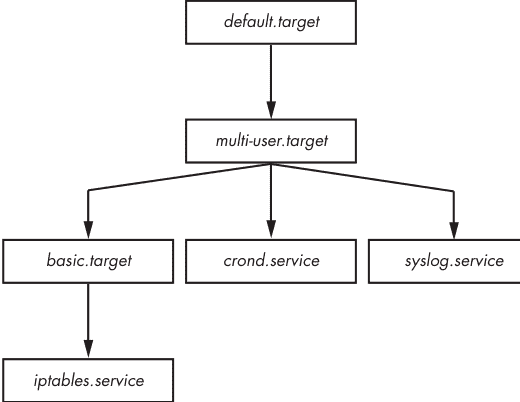

图 6-1：单元依赖关系

### 6.4.2 systemd 依赖关系

启动时依赖和运行依赖比表面看起来要复杂，因为严格依赖过于缺乏活性。想象一种场景：你希望在启动数据库服务器后显示登录提示，因此你定义了一个从登录提示到数据库服务器的依赖关系。然而，如果数据库服务器失败，由于该依赖关系，登录提示也会之失败，你将无法登录机器来修复它。

单元启动任务具有很强的容错性，可以失败而不会对标准服务产生问题。例如，如果系统的数据磁盘被移除但没有删除其 `/etc/fstab` 条目，初始文件系统的挂载将失败。然而，这种失败通常不会严重影响操作系统。

为了适应灵活性和容错性的需求，系统提供了无数依赖类型和样式。我们将根据其关键字语法对其进行标记，但在第 6.4.3 节之前，我们不会涉及配置语法的细节。让我们先看看基本类型：

**Requires** 严格依赖。当激活带有 `Requires` 依赖单元的单元时，systemd 会尝试激活该依赖单元。如果依赖单元失败，系统将停用被依赖的单元。

**Wants** 仅用于激活的依赖。激活单元时，系统会激活该单元的 `Wants` 依赖，但它并不关心这些依赖是否失败。

**Requisite** 必须已经处于状态的单元。在激活带有 `Requisite` 依赖的单元之前，systemd 首先检查依赖的状态。如果依赖项未被激活，systemd 在激活带有该依赖的单元时失败。

**Conflicts** 负依赖。当激活带有 `Conflict` 依赖的单元时，如果依赖项处于激活状态，systemd 会自动停用它。同时激活两个冲突单元将失败。

> `Wants` 依赖类型 特为重要，因为它不会将失败传播到其他单元。系统文档指出，如果可能，这是你应该指定依赖关系的方式，原因显而易见。这种行为产生了一个更健壮的系统，类似于传统的单元。

你可以“反向”附加依赖关系。例如，为了添加从单元 A 到单元 B 的 `Wants` 依赖，你不需要编辑单元 B 的配置。相反，你可以将其安装为 `WantedBy`。`RequiredBy` 依赖也是如此；请参见第 119 页的“启用单元”。

只要指定了类型单元，你就可以使用 `systemctl` 命令查看依赖关系：


`systemctl show -p unit`

### 排序（Ordering）

到目前为止看到的任何依赖语法都没有指定顺序。默认情况下，激活带有 `Requires` 或 `Wants` 的单元会导致 systemd 同时激活所有这些依赖项。这是最优的，因为你希望在启动时间内尽可能快地启动尽可能的服务。但在某些情况下，一个单元必须在另一个单元之后启动。例如，在图 6-1 所基于的系统中，默认目标单元设置为在 `multi-user.service` 之后启动（此顺序在图中未显示）。

要按特定顺序激活单元，可以使用以下依赖修饰符：

- `Before` 当前单元将激活列出的单元。
- `After` 当前单元在列出的单元之后激活。

### 条件依赖（Conditional Dependencies）

几个依赖关键字作用于各种状态而非 systemd 单元。例如：

- `ConditionPathExists=p`：如果（文件）路径 *p* 在系统中存在则为真。
- `ConditionIsDirectory=p`：如果 *p* 是目录则为真。
- `ConditionFileNotEmpty=p`：如果 *p* 是文件且长度不为则为真。

如果在 systemd 尝试激活单元时单元中的条件依赖为假，则该单元不会激活；但如果你激活一个既带有依赖又带有其他单元依赖的单元，systemd 无论条件真假都会尝试激活该单元。

其他依赖主要是前述依赖的变体。例如，`RequiresOverride` 依赖在正常运行时就像 `Requires`，但在手动激活单元时它表现得像 `Wants` 依赖。（完整列表请参见 `systemd.unit(5)` 手册页。）

## 6.4 systemd 单元配置

现在你已经看到了 systemd 配置的一个较少示例，让我们来看一些实际的单元文件以及如何处理它们。

systemd 配置文件分布在系统的许多目录中，因此你通常无法在一个地方找到系统中所有单元的文件。尽管如此，systemd 配置有两个主要目录：*系统单元*目录（全局配置，通常为 `/usr/lib/systemd/system/`）和*系统配置*目录（本地定义，通常为 `/etc/systemd/system/`）。

为了防止混淆，请遵循此规则：避免对系统单元目录进行更改，因为你的发行版会为你维护它。请对系统配置目录进行本地更改。在修改系统 `/usr` 和 `/etc` 之间进行选择时，始终选择 `/etc`。

你可以通过此命令检查 systemd 配置搜索路径（包括优先级）：

```
# systemctl -p UnitPath show
```

然而，此特定设置来自第三方源：pkg-config 设置。要查看系统上的系统单元和配置目录，请使用以下命令：

```
$ pkg-config systemd --variable=systemdunitdir

$ pkg-config systemd --variable=systemdconfdir
```

# 单元文件

单元文件源自 XDG Desktop Entry规范（对于 `.desktop` 文件，它们与 Microsoft 系统上的 `.ini` 文件非常相似），带有括号 `[]` 中的节名称，并在每个节中有变量和值赋值（选项）。

考虑 `/usr/lib/systemd/system` 中的示例单元文件 `media.mount`，在 Fedora 安装中是标准的。该文件代表 `/media/tmpfs`，它是用于挂载可移动介质的容器目录。

```
[Unit]

Description=Media Directory

Before=local-fs.target
```

```
[Mount]

What=tmpfs

Where=/media

Options=mode=755,nosuid,nodelid,noexec
```

这里有两个节。`[Unit]` 节提供了有关单元的详细信息，并包含描述和依赖信息。特别是，它被设置为激活 `local-fs.target` 单元。

`[Mount]` 节详细说明了该单元是一个挂载单元，并提供了有关挂载点、文件系统类型以及第 4.2.6 节所述选项的详情。`What=` 变量标识要挂载的设备或设备的 UUID。在这里，它被设置为 `tmpfs`，因为此文件系统没有设备。（要查看挂载单元选项的完整列表，请参见 `systemd.mount(5)` 手页。）

许多其他单元配置文件同样直观。例如，服务单元文件 `sshd.service` 启用安全 shell 登录：

```
[Unit]

Description=OpenSSH server daemon

After=syslog.target network.target auditd.service
```

```
[Service]

EnvironmentFile=/etc/config/sshd

ExecStartPre=/usr/bin/ssh-keygen

ExecStart=/usr/sbin/sshd -D $OPTIONS

ExecReload=/bin/kill -HUP $MAINPID
```

```
[Install]

WantedBy=multi-user.target
```

由于这是一个目标单元，你将在 `[Install]` 节中找到有关服务的详细信息，包括如何准备、启动和重载服务。你可以在 `systemd.service (5)` 手页（以及 `systemd.exec(5)`）中找到完整列表，也可以在第 6.4.6 节的进程跟踪描述中找到。

# 启用单元与 [Install] 节

`sshd.service` 单元文件中的 `[Install]` 节很重要因为它帮助我们理解如何使用 systemd 的 `WantedBy` 和 `RequiredBy` 依赖选项。它实际上是一种在不修改任何配置文件的启用单元的机制。在正常运行期间，systemd 会忽略 `[Install]` 节。然而，考虑当系统上 `sshd.service` 被禁用且你想开启它的情况。当你启用一个单元时，systemd 会读取 `[Install]` 节；在这种情况下，启用 `sshd.service` 会导致 systemd 为 `multi-user.target` 设置 `WantedBy` 依赖。作为响应，systemd 在系统配置目录创建一个指向 `sshd.service` 的符号链接，如下：

```
ln -s '/usr/lib/systemd/system/sshd.service' '/etc/systemd/system/multi-user.target.wants/sshd.service'
```


注意符号链接被放置在对应依赖单元的子目录（在本例中为 `multi-user.target`）。

`[Install]` 节通常负责系统配置目录 (`/etc/systemd/system`) 中的 `.wants` 和 `.requires` 目录。然而，单元配置目录 (`/usr/lib/systemd/system`)）中也存在 `.wants` 目录，你可能还可以添加与单元文件中 `[Install]` 节不对应的链接。这些手动添加是添加依赖的一种简单方法，而不会修改未来可能被（软件升级、实例）覆盖的单元文件。

启用单元与激活单元是不同的。当你启用一个单元时，你正将其安装到 systemd 配置中，做出重启后依然存在的永久更改。但你不需要显式地启用单元。如果单元文件具有 `[Install]` 节，你必须用 `systemctl enable` 启用它；否则，文件的存在就足以启用它。当你用 `systemctl start` 激活一个单元时，你只是在运行时环境中开启它。此外，启用单元不会激活它。

# 变量与指示符

`sshd.service` 单元文件还显示了变量——特别是传递给 systemd 的 `$OPTIONS` 和 `$MAINPID` 环境变量。`$OPTIONS` 是你用 `systemctl` 激活单元时传递给 `sshd` 的选项，而 `$MAINPID` 是被跟踪的服务进程（参见第 6.4.6 节）。

指示符是单元文件中发现另一种类变量特征。指示符以百分号 (`%`) 开头。例如，`%n` 指定符是当前单元名称，`%H` 指定符是当前主机名。

单元名称可以包含有趣的指示符。例如，`%n` 指定符是当前单元名称，`%H` 指定符是当前主机名。

（注：原文中此处存在大量重复的 OCR 错误，已根据逻辑进行清理和重构）

指示符是单元文件中发现的另一种类变量特征。指示符以百分号 (`%`) 开头。例如，`%n` 指定符是当前单元名称，`%H` 指定符是当前主机名。

单元名称可以包含有趣的指示符。例如，`%i` 指定符是单元的实例名称。`%H` 指定符是主机名。`%n` 指定符是单元名称。`%u` 是用户，`%g` 是组。`%p` 是机器特定路径。

如果一个系统已经运行了一段时间，你可以合理地预期它上没有活跃的作业，因为所有的激活操作应该已经完成。然而，在启动时，你有时记录得足够快，可以看到某些单元尚未激活。例如：

| 作业/单元 (JOB UNIT) | 类型 (TYPE) | 状态 (STATE) |
| --- | --- | --- |
| 1 graphical.target | start | waiting |
| 2 multi-user.target | start | waiting |
| 71 systemd....level.service | start | waiting |
| 75 sm-client.service | start | waiting |
| 76 sendmail.service | start | running |
| 120 systemd-deadone.target | start | waiting |

在这种情况下，作业 76（ `sendmail.service` 单元启动花费了很长时间。其他列出的作业处于等待状态，很可能是因为它们都在等待作业 76。当 `sendmail.service` 完成启动并变为激活状态时，作业 76 将完成，其余作业也将完成，作业列表将为空。

作业可能会让人感到困惑，尤其是因为本章描述的另一个初始化系统 Upstart 使用“job”（作业）一词来大致指代 systemd 所说的“unit”（单元）。需要记住，虽然与单元关联的 systemd 作业会终止，但单元本身之后可以处于激活和运行状态，特别是对于服务单元而言。

请参阅 6.7 了解如何关闭和重启系统。

## 6.4.5 向 systemd 添加单元

向 systemd 添加单元主要涉及创建、激活以及可能的启用单元文件。你通常应该将你自己的单元文件放在系统配置目录 `/etc/systemd/system` 中，这样你就不会将它们与发行版附带的任何内容混淆，而且发行版在升级时也就不会覆盖它们。

由于创建不激活且不干预任何内容的 target（目标）单元很容易，所以你应该尝试一下。以下是创建两个目标、其中一个依赖于另一个的方法：

- 1. 创建名为 `test1.target` 的单元文件：

```
[Unit]

Description=test 1
```

- 2. 创建一个对 `test1.target` 有依赖的 `test2.target` 文件：

```
[Unit]

Description=test 2

Wants=test1.target
```

- 3. 激活 `test2.target` 单元（记住，`test2.target` 中的依赖会导致 systemd 在你执行此操作时激活 `test1.target`）：

```
# systemctl start test2.target
```

- 4. 验证两个单元均激活：

```
# systemctl status test1.target test2.target

test1.target - test 1

Loaded: loaded (/etc/systemd/system/test1.target; static)

Active: active since Thu, 12 Nov 2015 15:42:34 -0800; 10s ago

test2.target - test 2

Loaded: loaded (/etc/systemd/system/test2.target; static)

Active: active since Thu, 12 Nov 2015 15:42:34 -0800; 10s ago
```

如果你的单元文件有一个 `[Install]` 部分，在激活它之前“启用”该单元：

```
# systemctl enable unit
```

尝试一下前面的示例。从 `test2.target` 中移除依赖，并在 `test1.target` 中添加包含 `WantedBy=test2.target` 的 `[Install]` 部分。

## 移除单元

要移除单元，请遵循以下步骤：

- 1. 如必要，停用单元：

```
# systemctl stop unit
```

- 2. 如果单元具有 `[Install]` 部分，禁用该单元以移除任何相关的符号链接：

```
# systemctl disable unit
```


- 3. 如果你愿意，删除单元文件。

## 6.4.6 systemd 进程跟踪与同步

`systemd` 希望对它启动的每个进程拥有相当的信息和控制权。它面临的主要问题是服务可以通过不同的方式启动：它可能会派生自己的新实例，或者守护化并从原始进程分离。

为了尽量减少包开发人员或管理员为了创建一个正常工作的单元文件而需要的工作，`systemd` 使用了控制组（`cgroups`），这是一个可选的 Linux 内核功能，允许更精细地跟踪进程层次结构。如果你以前用过 `Upstart`，就会知道你必须做一些额外工作来确定服务的主进程是什么。在 `systemd` 中，你不需要担心进程派生了多少次——只需关心它是否派生了。在你的服务单元中使用 `Type` 选项来指示其启动行为。有两种基本的启动样式：

`Type=simple` 服务进程不派生。

`Type=forking` 服务会派生，`systemd` 期望原始进程会终止。在终止后，`systemd` 认为服务已就绪。

`Type=simple` 选项没有考虑到服务可能需要一些时间来设置，而且 `systemd` 不知道何时启动任何绝对要求此类服务就绪的依赖。处理这种问题的方法是延迟启动（参见第 6.4.7 节）。然而，某些启动样式可以指示服务已就绪。

`Type=notify` 服务在就绪时向 `systemd` 发送通知（通过调用 `sd_notify()`）。

`Type=dbus` 服务在就绪时在 D-bus 上注册自己。

`Type=oneshot` `systemd` 期望进程会终止。对于此类服务，你几乎需要添加 `RemainAfter=yes` 以让 `systemd` 仍然认为它是激活状态。

`Type=idle` 这指示 `systemd` 直到没有作业后再启动服务。

## 6.4.7 systemd 按需启动与并行启动

`systemd` 的最重要的功能之一是可以推迟单元，直到需要它。这种设置通常如下：

1. 为你想使用的服务创建一个单元（称之为 A），按照常规。
2. 识别 A 使用的资源网络端口、文件或设备。这些单元具有特殊的类型，如 `socket` 单元、`path` 单元和 `device` 单元。
3. 创建另一个单元 R 来表示该资源。

操作上，过程如下：

1. 激活 Unit R 后，`systemd` 监控该资源。
2. 当任何尝试访问该资源时，`systemd` 会阻塞该资源并对输入进行缓冲。
3. `systemd` 激活 Unit A。
4. 当来自 A 的服务就绪时，它接管资源，读取缓冲输入并运行。

这里有一些考虑因素：

- 你必须确保你的资源单元涵盖了服务提供的所有资源。这通常不是问题，因为大多数服务只有一个访问点。
- 你需要确保你的资源单元与它代表的服务单元相绑定。这可以是隐式的或显式的，在某些情况下，许多选项代表了 `systemd` 执行交接的不同方式。
- 并不是所有服务器都知道与 `systemd` 提供的单元交互。

### 使用辅助单元优化启动

`systemd` 的常用单元激活样式试图简化依赖顺序并加快启动时间。它与按需启动相似，即服务单元和辅助单元代表提供的资源，区别在于在这种情况下，系统在激活辅助单元时立即启动服务。

图 6-2 显示了这在传统系统中可能是如何工作的。在这个启动时间图中，服务 E 提供了一个关键资源 R。服务 A、B 和 C 依赖于此资源，并且等待服务 E 启动。

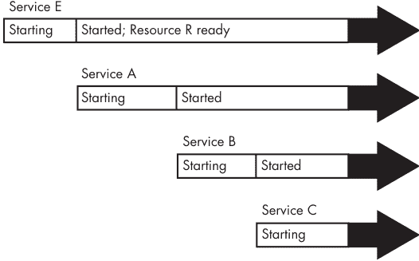

图 6-3 显示了一个等效的 `systemd` 启动配置。服务由 Units A、B、C 和 E 表示，一个新的 Unit R 代表 Unit E 提供的资源。虽然在 Unit E 启动期间，`systemd` 能够可以为 Unit R 提供一个接口，但 Units A、B、C 和 E 都可以同时启动。当 Unit E 准备就绪，它将接管 Unit R 的工作。（有趣的一点是，Units A、B 和 C 在完成启动之前可能不需要显式地访问 Unit R，正如图中的 Unit B 所示。）

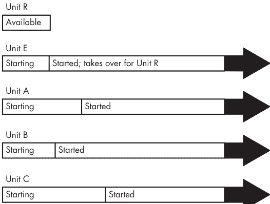

> 注意：当像这样进行并行启动时，可能会因为大量单元同时启动而导致系统临时变慢。

结论是，尽管在这种情况下你没有创建按需启动的单元，但你正在使用使按需启动成为可能的相同功能。对于常见的实际示例，请参见运行 `systemd` 的机器上的 `syslog` 和 D-Bus 配置单元；它们很可能以这种方式进行并行化。

### 示例 Socket 单元与服务

我们现在来看一个示例，一个使用 `socket` 单元的简单网络回显服务（`echo service`）。这部分是高级内容，在你读完第 9 章关于 TCP、端口和监听的讨论，以及第 10 章关于 `socket` 的之前，你可能无法真正理解它，所以可以跳过这部分稍后来看。

该服务的背后原理是：当网络客户端连接到服务时，服务会将客户端发送的任何内容返回给客户端。该单元将监听 TCP 端口 `22222`。我们将其称为 `echo` 服务，并从一个 `socket` 单元开始，由如下 `echo.socket` 单元文件表示：

```
[Unit]

Description=echo socket
```

```
[Socket]

ListenStream=22222

Accept=yes
```

注意，在该单元文件中没有提到该 `socket` 提供的服务单元。那么对应的服务单元是什么呢？它的名称是 `echo@service`。这种链接是基于命名规范的；如果服务单元与 `.socket` 文件具有相同的前缀（在这种情况下，`systemd` 知道当 `socket` 单元有活动时激活该服务。在本例中，当 `echo.socket` 有活动时，`systemd` 会创建一个 `echo@service` 实例）。

以下是 `echo@service` 单元单元文件：

```
[Unit]

Description=echo service
```

```
[Service]

ExecStart=/bin/cat

StandardInput=socket
```

> 注意：如果你不喜欢基于前缀的单元隐式激活，或者你需要在两个具有不同前缀的单元之间创建激活机制，你可以在定义资源的单元中使用显式选项。例如，在 `foo.service` 内部使用 `Socket=bar.socket`，让 `bar.socket` 将其 `socket` 交给 `foo.service`。

要运行这个示例服务单元，你需要启动它背后的 `echo.socket` 单元，如下：

```bash
# systemctl start echo.socket
```

现在你可以通过连接到本地端口 `22222` 来测试该服务。
当 `telnet` 命令连接时，输入任何内容并按回车。服务会将你输入的内容返回给你：

```bash
$ telnet localhost 22222

Trying 127.0.0.1...

Connected to localhost.

Escape character is '^'.

Hi there.

Hi there.
```

当你觉得无聊了时，在单独的一行按 CTRL-]，然后按 CTRL-D。要停止服务，请停止 `socket` 单元：

```bash
# systemctl stop echo.socket
```


## 实例与交接

由于 `echo@service` 单元支持多个同时运行的实例，因此名称中有一个 `@`（回想第 120 页），这表示参数化。为什么你想要多个实例呢？原因是你可能有多个网络客户端同时连接到服务，且每个连接都应该有自己的实例。

在这种情况下，由于 `echo.socket` 中的 `Accept` 选项，服务单元必须支持多个实例。该选项让 `systemd` 不仅监听端口，还接受连接并将传入的连接传递给服务单元，其中每个连接都是一个独立的实例。每个实例从连接中读取数据作为标准输入，但它并不一定需要知道数据来自网络连接。

> 大多数网络连接需要的比简单的网关标准输入输出更具灵活性，因此不要期望能够像这里所示的 `echo@service` 单元文件那样使用服务单元创建网络服务。

虽然服务可以完成所有接受连接的工作，但如果它这样做，它的名称中就不会有 `@`。在这种情况下，它将获得 socket 的完全控制权，在服务完成之前 `systemd` 不会尝试监听网络端口。

交接给服务单元的许多资源和选项使得很难提供分类总结。此外，这些选项的文档分散在多个手册页中。对于资源导向的单元，需要检查的是 `systemd.socket(5)`、`systemd.path(5)` 和 `systemd.device(5)`。对于服务单元，一个经常被忽略的文档是 `systemd.exec(5)`，它包含了关于服务单元如何期望接收资源激活的信息。

## 6.4.8 systemd System V 兼容性

`systemd` 区别于其他初始化系统的一个功能是，它尝试跟踪 System V 兼容的脚本。其工作方式如下：

1. 首先，`systemd` 激活 `runlevel=<N>`，其中 `N` 是运行级别。
2. 对于 `rc<N>.d` 中的每个符号链接，`systemd` 识别 `/etc/init`。
3. `systemd` 关联服务单元（例如，`/etc/init/foo`）。
4. `systemd` 激活服务单元并带有 `start` 或 `stop` 参数运行脚本，基于 `rc<N>.d` 中的名称。
5. 因为 `systemd` 通过 `event` 关联了服务单元，你可以使用 `systemctl` 重启服务或查看其状态。但不要期望 System V 模式产生奇迹；它仍然串行运行。

## 6.4.9 辅助程序

如果你没有运行或对 Upstart 不感兴趣，请跳转到 6.6 查看查看 System V 的概述。

## 6.5 Upstart

Upstart 初始化围绕任务（jobs）和事件（events）展开。任务是 Upstart 执行的运行时操作（例如配置），而事件是 Upstart 从自身或其他进程接收的消息（例如 `udev`）。Upstart 通过响应事件来启动任务。

为了了解它是如何工作的，考虑启动 `udev` 守护的任务。其配置文件通常是 `/etc/init/udev.conf`，其中包含：

- `start on virtual-filesystems`
- `stop on runlevel6`

这些行意味着当 Upstart 接收到 `virtual-filesystems` 事件时启动 `udev` 任务，当接收到参数为 0 或 6 的 `runlevel` 事件时停止它。

事件及其参数有许多变体。例如，Upstart 可以响应由任务状态触发的事件，例如 `udev` 任务的 `started` 事件。

### 6.5.1 Upstart 启动过程

启动时，Upstart 执行以下操作：

1. 加载其配置和 `/etc/init` 中的任务配置文件。
2. 发射 `startup` 事件。
3. 运行配置为接收 `startup` 事件时启动的任务。
4. 这些初始化任务触发自己的事件，触发更多任务和事件。

在完成正常启动的所有任务后，Upstart 在整个系统运行期间持续监控并响应事件。大多数启动运行如下：

1. Upstart 响应 `startup` 事件运行最重要的任务是 `mount`。该任务将所有必要的本地和虚拟文件系统挂载到当前运行的系统中，以便一切运行。
2. `mountjob` 大量事件，包括 `filesystem-virtual-filesystems`、`remote-filesystems` 和 `all-swaps` 等。这些事件表明系统上的重要文件系统已挂载并就绪。
3. 响应这些事件，Upstart 启动了一些关键服务任务。例如，`udev` 响应 `virtual-filesystems` 事件启动，`dbus` 响应 `local-filesystems` 事件启动。

-- 4. 在核心任务中，Upstart 启动 `network-interfaces` 任务，通常是响应 `local-filesystems` 事件和 `udev` 准备就绪。
-- 5. `network-interfaces` 任务发出 `static-network-up` 事件。
-- 6. Upstart 响应 `filesystem` 和 `static-network-up` 事件运行 `rc-init` 任务。该任务负责维护当前的运行级别（runlevel），当在没有运行级别的情况下首次启动时，它通过发出 `runlevel` 事件将系统切换到默认运行级别。
-- 7. Upstart 响应 `runlevel` 和新的 `runlevel` 运行系统中大多数其他启动任务。

这个过程可能会变得复杂，因为事件的来源并不总是很清晰。Upstart 只发出少数事件，其余的来自于任务（jobs）。任务配置文件通常会声明它们将发出的事件，但任务如何发出事件的细节通常不在 Upstart 的任务配置文件中。

要彻底弄清楚问题，你通常需要进行深挖。例如，考虑 `static-network-up` 事件。`network-interface.conf` 配置文件说它发出了这个事件，但并没有说明是从哪里发出的。事实证明，该事件来自 `ifup` 命令，该任务在 `/etc/network/if-up.d/script` 脚本中初始化网络接口时运行。

> 尽管所有这些内容都有文档（`ifup` 目录位于 `ifup(8)` 手页引用的 `interfaces(5)` 手页中），但仅通过阅读文档来找出其工作原理可能具有挑战性。在许多配置文件中使用 `grep` 目标名称查看会出现什么，然后尝试将所有内容重新组合起来要快得多。

Upstart 的一个问题是目前没有清晰的方法来查看事件。你可以将其日志优先级设置为 `debug`，这会导致它记录所有进入的内容（通常重定向到 `/var/log/syslog`），但该文件中大量的冗余信息使得很难确定事件的上下文。

## 6.5.2 Upstart 任务

`/etc/init` 配置目录下的每个文件都对应一个任务，每个任务的主配置文件具有 `.conf` 扩展名。例如，`/etc/init/mountall.conf` 定义了 `mountall` 任务。

Upstart 任务主要有两种类型：

- **任务作业（Task jobs）**：这些具有明确终的任务。例如，`mountall` 是一个任务作业，因为它在完成挂载系统后就会终止。
- **服务作业（Service jobs）**：这些任务没有定义的停止状态。如 `udev`、数据库服务器和 Web 服务器等服务器都是服务作业。

第三种任务是抽象任务（abstract job）。可以将其视为一种虚拟服务任务。抽象任务仅存在于 Upstart 并自行启动，但它们有时被用作其他任务的管理工具，因为其他任务可以根据来自抽象任务的事件来启动和停止。

## 查看任务

你可以使用 `initctl` 命令查看 Upstart 任务和任务状态。要概述系统中正在发生的情况，请运行：

```
$ initctl list
```

你将得到大量输出，所以让我们看看典型列表中可能出现的两个示例任务。这里有一个任务作业状态的简单示例：

```
mountall stop/waiting
```

这表示 `mountall` 任务作业的状态为 `stop/waiting`，意味着它没有在运行（遗憾的是，你无法使用该状态判断任务是否已经运行过，因为 `stop/waiting` 也适用于从未运行过的任务。）

- * 关联进程的服务作业会出现在状态列表中

```
tty start/running, process 1634
```


这一行显示 `tty` 任务正在运行，且进程 ID `1634` 正在执行该任务。（并不是所有服务作业都有关联进程。）

> 如果你知道任务名称，可以直接使用 `initctl status <job_name>` 查看其状态。

`initctl` 输出中的状态部分（例如 `stop/waiting`）可能会令人困惑。左侧（`/` 之前）是目标，即任务应该努力实现的目标，如 `start` 或 `stop`。右侧是当前的任务状态，或任务现在正在执行的操作，例如 `waiting`（等待）或 `running`（运行）。在前面的列表中，`tty1` 任务的状态是 `start/running`，意味着它的目标是 `start`。`running` 状态表示它已成功启动。（对于服务作业，`running` 状态是常态。）

`mountall` 的情况稍有些，因为任务不会一直保持运行。`stop/waiting` 状态通常表示任务已启动并完成了它的任务。在完成任务后，它从 `start` 目标移动到 `stop` 目标，现在正在等待 Upstart 的进一步指令。

遗憾的是，如前面所述，因为从未启动的任务也具有 Upstart `stop/waiting` 状态，除非启用调试并按照第 6.5.5 节所述查看日志，否则你无法真正判断任务是已经运行过还是从未启动。

你不会在系统上看到使用 Upstart 兼容性功能启动的任务。

## 任务状态转换

有很多任务状态，但有一套固定的方法在它们之间移动。例如，这里是典型任务是如何启动的：

1. 所有任务都从 `stop/waiting` 状态开始。
2. 当用户或系统事件启动一个任务时，任务的目标从 `stop` 变为 `start`。
3. Upstart 将任务的状态从 `waiting` 变为 `starting`，因此状态现在是 `start/starting`。
4. Upstart 触发一个 `starting` 任务事件。
5. 任务执行它需要执行的所有操作。
6. Upstart 将任务的状态从 `starting` 变为 `pre-start`。
7. 任务在 `pre-start` 状态下执行其需要的操作。
8. Upstart 触发一个 `pre-start` 任务事件。
9. Upstart 将任务的状态从 `pre-start` 变为 `running`。
10. 任务在 `running` 状态下执行其需要的操作。
11. Upstart 触发一个 `running` 任务事件。
12. 任务完成其需要的操作。
13. Upstart 将任务的状态从 `running` 变为 `stopping`。
14. Upstart 触发一个 `stopping` 任务事件。
15. 任务在 `stopping` 状态下执行其需要的操作。
16. Upstart 将任务的状态从 `stopping` 变为 `stopped`。
17. Upstart 触发一个 `stopped` 任务事件。

查看 `startup-events(7)` 手页可以了解状态转换细节。

## 6.5.3 Upstart 配置

让我们检查两个配置文件：一个是任务作业，另一个服务作业。正如所有 Upstart 配置文件一样，它们位于 `/etc/init`，并名为 `mountall.conf` 和 `tty.conf`。

为了开始，请打开 `mountall.conf` 文件。在第一个语句中寻找如下行：

```
description    Mount filesystems on "boot"
```

该语句提供了任务的简短描述。接下来你会看到描述任务如何启动的几个语句：

```
start on startup

stop on rc5
```

在这里，第一行告诉 Upstart 在接收到 `startup` 事件（Upstart 发出的初始事件）时启动任务。第二行告诉 Upstart 在进入单用户模式（`rc5` 事件）时终止任务。

接下来的两行告诉我们 任务的行为：

```
expect daemon

task
```

`task` 语句告诉 Upstart 这是一个任务，因此任务会在某个时刻完成。`expect` 语句很关键，它意味着 `mountall` 将产生一个独立运行的守护进程。Upstart 需要知道这一点，因为它必须知道进程何时终止（我们将在第136页的“进程跟踪”中详细讨论）。

`mountall.conf` 文件继续带有多个 `emits` 语句，指示该任务产生了以下事件：

- emits virtual-filesystems
- emits local-filesystems
- emits remote-filesystems
- emits all-swaps
- emits filesystem
- emits mounting
- emits mounted

正如第 6.5.1 节所述，尽管存在这些行，但这不是事件的实际来源。你需要搜索任务脚本来寻找它们。

你可能还会看到一个指定 Upstart 应该将输出发送到何处的语句：

```
console output
```

通过 `output` 参数将 `mountall` 任务的输出发送到系统控制台。
现在来看任务本身的细节——在这种情况下，是一个脚本：

```
script

- /etc/default/rcs

- [f /forcefsck] && force_fck="--force-fsck"

- ["$FSCKFIX="yes" && fsck_fix="fsck-fix"]
```

```
# set $LANG so that messages are translated in plymouth

if [ -r /etc/default/locale ]; then

  /etc/default/locale

  export LANG LANGUAGE LC_ALL

fi
```

```
exec mountall --daemon $force_fsck $fsck
```

这是一个脚本（第11章），大部分内容是准备工作——设置语言并确定是否需要运行 fsck。脚本底部的 `exec mountall` 命令才是实际发生的地方。该命令挂载文件系统并在完成后发出任务事件。

### 服务任务：tty

`tty` 服务任务要简单得多；它控制一个虚拟控制台登录提示符。它的整个配置文件 `tty.conf` 看起来像这样：

```
start on stopped rc RUNLEVEL=[2345] and (

  not-container or

  container CONTAINER=lxc or

  container CONTAINER=lxc-libvirt)
```

```
stop on runlevel ![2345]
respawn
exec /sbin/getty -8 38400 tty
```

该任务最复杂的部分实际上是它的启动阶段，现在先忽略容器相关的行，重点关注这部分：

```
start on stopped rc RUNLEVEL=[2345]
```

这部分告诉 Upstart 在 `rc` 任务运行并终止后，当接收到 `stopped`（停止）事件时激活该任务。要使该条件成立，`rc` 任务还需要将 `RUNLEVEL` 环境变量设置为 2 到 5 之间的值（参见第 6.5.6 节）。

其他在运行级别（runlevel）启动的任务并不挑。例如，你可能会看到下面的内容：

```
start on runlevel [2345]
```

> 最后两个 `start` 语句（stanza）之间的唯一区别在于时机；后者在运行级别设置后立即激活任务，而前者则等待 System V 的相关操作完成。

之所以存在容器配置，是因为 Upstart 并不直接运行在真实硬件的 Linux 内核上，但它可以在虚拟环境或容器中运行。这些环境某些具有虚拟控制台，而你不希望在并不存在的控制台上运行 `getty`。

停止 `tty` 任务非常简单：

```
stop on runlevel ![2345]
```

此语句告诉 Upstart 当运行级别不是 2 到 5 时（例如在系统关机期间）终止任务。底部的 `exec` 语句是要要运行的命令：

```
exec /sbin/getty -8 38400 tty
```

此语句类似于你在 `mountall` 任务中看到的脚本，但 `tty` 任务没有复杂的设置——一行即可启动。在这种，我们在 `/dev/tty` 上运行登录提示，这是第一个虚拟控制台（你在图形模式下按下 CTRL-ALT-FI1 进入的那个）。

`restart` 语句指示 Upstart 在任务终止时重启 `tty` 任务。在这种情况下，当你退出虚拟控制台时，Upstart 会运行一个新的 `getty` 提示符。

这些都是 Upstart 配置的基础。你可以在 `init(5)` 手册页和在线资源中找到更多细节，但有一个语句（stanza）需要特别注意。接下来将讨论 `expect` 语句。

# 进程跟踪与 Upstart expect 语句


由于 Upstart 在任务启动后就会跟踪进程（这样它就能高效地终止和重启它们），它需要知道哪些进程与每个任务相关。这是一项困难的任务，因为在传统的 Unix 启动方案中，进程会从其他语句派生（fork）变成守护进程，任务的主进程可能会在一个或两次派生后启动。如果没有适当的进程跟踪，Upstart 将无法完成任务的启动，或者可能为任务跟踪错误的 PID。

你通过 `expect` 语句告诉 Upstart 任务的行为。有四种基本情况：

- 无 `expect` 语句：主任务进程不派生。跟踪该进程。
- `expect fork`：进程派生一次。跟踪派生的进程。
- `expect daemon`：进程派生两次。跟踪第二次派生。
- `expect stop`：任务的主进程将发出 `SIGSTOP` 信号表示它已就绪。（这很罕见。）

对于 Upstart 和其他现代版本的 init（如 `systemd`），理想情况是第一种（无 `expect` 语句），因为主任务进程不需要包含任何启动和关闭机制。换句话说，它不需要为了脱离当前终端而进行派生——这是 Unix 系统开发者多年来一直在处理的麻烦。

许多传统的服务守护进程已经包含了调试选项，允许主进程不派生。例如 Secure Shell 守护进程 `sshd` 及其 `-D` 选项。查看 `/etc/init/ssh.conf/` 可以看到一个简单的配置，用于启动 ssh、防止快速重启并消除输出到 `stderr` 的虚假输出：

```
respawn
respawn limit 10 5
umask 022
```

```
# sshd -D 泄漏 stderr 结合 'console log' 时会引起混淆
console none
```

```
--snip---
exec /usr/sbin/sshd -D
```

在需要 `expect` 语句的任务中，`expect fork` 是最常见的。例如，这里是 `/etc/init/cron.conf` 文件的启动部分：

```
expect fork
respawn
```

像这样的任务启动通常表示一个良好、稳定的守护进程。

注意：在 startup.ubuntu.com 网站上阅读关于 `expect` 语句是有值的，因为它直接关系到进程周期。例如，你可以使用 `strace` 命令跟踪进程生命周期及其系统调用，包括 `fork()`。

# 6.5.4 Upstart 操作

除了第 6.5.2 节描述的 `list` 和 `status` 命令外，你还可以使用 `initctl` 工具来控制 Upstart 和你的任务。你应该某个时候阅读 `initctl(8)` 手册页，但现在我们先来看要点。

启动 Upstart 任务，使用 `initctl start`：

```bash
# initctl start job
```

停止任务，使用 `initctl stop`：

```bash
# initctl stop job
```

重启任务：

```bash
# initctl restart job
```

如果你需要向 Upstart 发送事件，可以手动执行：

```bash
# initctl emit
```

你还可以通过在事件后添加 `key=value` 为事件添加环境变量。

注意：你可以通过 Upstart 的兼容功能停止 System V。有关此信息请参见第 6.6 节。

有许多方法可以阻止 Upstart 在启动时运行，但最易维护的方法是确定任务配置文件（通常为 `/etc/init/<job>.conf`）并创建一个 `/etc/init/<job>.override` 文件，仅包含：

```
manual
```

现在任务只能通过运行 `initctl start` 来启动。这种方法的优点是容易相反。

# 6.5.5 Upstart 日志

Upstart 有两种基本类型的日志：服务日志和 Upstart 自身产生的诊断消息。服务日志记录运行服务的脚本和守护进程的标准输出和标准错误。这些消息记录在 `/var/log/upstart` 中，对于服务可能产生的 syslog 消息。（你将在第 7 章学习 syslog。）由于没有标准，很难对这些日志分类，但最常见的内容是启动和关闭消息。许多服务不产生消息，因为它们将所有内容发送到 syslog 或自身的日志设施。

Upstart 自身的诊断日志可能包含启动和重新加载的信息，因为此日志进入内核日志。在 Ubuntu 上，你通常会在 `/var/log/kern.log` 文件和通用的 `/var/log/syslog` 中找到它。

尽管如此，Upstart 什么都不记录，因此为了在日志中看到任何内容，你必须更改 Upstart 日志优先级。默认优先级名称是 message。要在运行系统中记录事件和任务更改，将日志优先级改为：

```bash
# initctl priority info
```

请记住这不是永久的，重启后优先级将重置。要让 Upstart 在启动时记录所有内容，请按照第 5.5 节所述添加启动参数 `--verbose`。

# 6.5.6 Upstart 运行级别与 System V 兼容

到目前为止，我们已经提到了一些 Upstart 支持 System V 运行级别概念，并提到它能够作为任务运行 System V 启动脚本。

1. `re-sysinit` 任务运行，通常在获取文件系统和静态网络启动事件之后运行。在它运行之前没有运行级别。
2. `re-sysinit` 任务确定要进入的运行级别。通常，运行级别是默认的，但它也可以解析顺序 `/etc/initab` 文件或从内核参数（在 `/proc/cmdline` 中）获取运行级别。
3. `rc-sysinit` 任务运行限制用于切换运行级别。该命令会发出一个运行级别事件，并在 `RUNLEVEL` 环境变量中指定运行级别。
4. Upstart 启动运行级别事件。许多任务被配置为在与特定运行级别匹配的运行级别启动，Upstart 会启动这些任务。
5. 运行级别激活的任务作业之一 `rc` 负责启动 System V。为了实现这一点，`rc` 任务会运行 `/etc/init.d/rc`，就像 System V 可能初始化的那样（见第 6.6 节）。
6. 一旦任务终止，Upstart 在接收到停止 `rc` 事件后可以启动其他许多任务（例如 135 页上的 `tty1` 任务）。

注意，尽管 Upstart 启动运行级别的方式与其他任何事件都不同，但大多数 Upstart 系统上的许多任务配置文件都提到了运行级别。

在任何情况下，启动过程中都有一个关键点，此时文件系统被挂载，大部分重要的系统初始化已经完成。在此时，系统已准备好启动更高级的系统服务，例如图形显示管理器和数据库服务器。运行级别非常适合标记这一点。不过，你可以配置 Upstart 使用任何事件作为触发器。一个挑战是确定哪些服务作为 Upstart 任务启动，而哪一个在 System V 兼容模式下启动。最简单的方法是查看你运行级别的 System V 软链接（见第 6.2 节）。例如，如果你的运行级别是 2，查看 `/etc/rc2.d`；那里的任何内容都在 System V 兼容模式下运行。

对于任何 Upstart 服务任务，`/etc/init.d` 中可能也有对应服务的 System V 风格脚本，但该脚本除了告诉你该服务已转换为 Upstart 任务之外不会做任何其他事情。在 System V 链接目录中也不会指向该脚本的链接。如果你遇到空脚本，请找到 Upstart 任务名称并使用 `initctl` 控制该任务。

## 6.6 System V init

Linux 上的 System V init 实现可以追溯到 Linux 早期；其核心思想是通过经过精心排序的进程，支持到不同运行级别的有序自引导。虽然 System V 现在在大多数桌面安装中已不常见，但你可能在 Red Enterprise Linux 以及路由器和手机等嵌入式 Linux 环境中遇到 System V init。

典型的 System V init 包含两个主要组件：一个中央配置文件和一个由符号链接增强的大型启动脚本集。配置文件 `/etc/inittab` 是它的起点。如果你有 System V init，请在你的 `inittab` 文件中寻找类似下面的一行：

```
id:5:initdefault:
```

这表示默认运行级别是 5。

*inittab* 中的所有行都采用以下格式，四个字段按此顺序用冒号分隔：

- 一个唯一标识符（一个短字符串，例如上一个示例中的 `id`）
- 适用的运行级别（数字）
- init 应该采取的操作（上一个示例中默认运行级别为 5）
- 要执行的命令（可选）

要查看命令在 *inittab* 文件中是如何运作的，请考虑这一行：

```
15:5:etc/rc.d/rc 5
```

这一特定行非常重要，因为它触发了大多数的系统配置和服务。在这里

以下是除了 `initdefault` 和 `wait` 之外的一些最常见的 *inittab* 操作。

### respawn


*respawn* 操作告诉 `init` 运行其后的命令，如果命令执行完成，则再次运行。你可能会在 *inittab* 文件中看到类似的内容：

```
1:2345:respawn:/sbin/getty tty1
```

`getty` 程序提供登录提示。上面的行用于第一个虚拟控制台（`/dev/tty1`），也就是当你按下 ALT-F1 或 CTRL-ALT-F1 时看到的那个一个（见第 3.4.4 节）。*respawn* 操作会在你注销后带回登录提示。

### ctrlaltdel

*ctrlaltdel* 操作控制当你在虚拟控制台上按按下 CTRL-ALT-DEL 时系统执行的操作。在大多数系统上，这是某种重启命令，使用了 *shutdown* 命令（已在第 6.7 节中讨论过）。

### sysinit

*sysinit* 操作是 `init` 在启动时（进入任何运行级别之前）应该运行的第一项任务。

> 需更多可用操作，请参阅 `inittab(5)` 手册页。

### 6.6.1 System V init：启动命令序列

你现在准备好学习 System V init 如何在你登录之前启动系统服务了。回想一下之前的这行 `inittab`：

```
5::/etc/rc.d/5
```

这一小行命令触发了许多其他程序。事实上，`rc` 命令被很多人称为脚本、程序或服务。这些命令在哪里？

该行中的 `5` 告诉我们我们讨论的是运行级别 5。这些命令可能在 `/etc/rc.d/rc5.d` 或 `/etc/rc5.d` 中。（运行级别 1 使用 `rc1.d`，运行级别 2 使用 `rc2.d`，依此类推。）例如，你可以在 `rc5.d` 目录下发现以下项：

```
S10syslogd S20ppm S99gpm
s12kernel S2netstd_nfs S99httpd
s15netstd_init S30netstd_misc S99rmnologin
s18base S45cia
s20acct S99ssd
s20logout
```

注意，大写的 `S` 表示该命令在启动模式下运行。数字（00 到 99）决定了启动顺序。小写的 `s` 表示该命令在停止模式下运行。大写的 `K` 表示“杀死”（kill），即停止模式。你可以手动运行这些命令。我们现在来描述。

### 6.6.2 System init 链接农

`rc*d` 目录的内容实际上是指向另一个目录 `init.d` 的符号链接。如果你的目标是交互、添加、删除或修改 `rc*d` 目录中的服务，你需要理解这些符号链接。类似 `rc5.d` 的链接显示如下结构：

```
S01syslogd -> .../init.d/syslogd
S02kernel -> .../init.d/kernel
S15netstd_init -> .../init.d/netstd_init
S18base -> .../init.d/netbase
S99httpd -> .../init.d/httpd
```

跨越多个子目录的符号链接被称为链接农（link farm）。Linux 发行版包含这些链接，以便为所有运行级别使用相同的启动脚本。这种做法不是强制性的，但它简化了组织。

## 启动和停止服务

要手动启动服务，请使用 `init.d` 目录中的脚本。例如，手动启动服务器程序的方法是运行 `init.d/httpd start`。同样，要杀死运行的服务，可以使用 `stop` 参数（例如 `httpd stop`）。

## 修改启动序列

修改 System init 中的序列通常通过修改链接农来完成。最常见的更改是在特定的运行级别运行。使用 `init.d` 目录允许你谨慎地进行操作。例如，你可能考虑移除相应 `rc*d` 目录中的符号链接。注意：如果你以后需要放回链接，你可能很难记住链接的确切名称。最好的方法之一是在名称开头添加一个下划线（_），如下所示：

```
# mv S99httpd
```

这会将文件名变为 `_S99httpd`，因为文件名以 S 或 K 开头，但原始名称显而易见。要添加服务，请创建一个类似于 `init.d` 目录中的脚本，并在正确的 `rc*d` 目录中创建一个符号链接。简单的方法是复制并修改 `init.d` 中你理解的现有脚本（有关 Shell 脚本更多信息，请见第 11 章）。

当添加服务时，请在启动序列中选择一个合适的位置启动它。如果服务启动过早，由于依赖某些其他服务，它可能无法工作。对于无关紧要的服务，大多数管理员倾向于将它们放在 90 阶段，这会将服务放在系统的大部分启动之后。

## 6.6.3 run-parts

System V 用于运行 `init.d` 脚本的机制已经进入许多 Linux 系统，无论它们是否使用 System V init。它是一个名为 `run-parts` 的工具，它唯一的作用是在给定的目录中运行一组可执行程序。你可以把它想象成一个在某个目录下执行命令，然后运行它在输出中看到的任何程序的人。

默认行为是运行目录中的所有程序，但你通常可以选择运行某些程序并忽略其他程序。在某些发行版中，你不需要对运行的程序进行控制。例如，Fedora 附带了一个非常简单的 `run-parts` 工具。

其他发行版（如 Debian 和 Ubuntu）拥有更复杂的 `run-parts` 程序。它们的功能包括根据正则表达式运行程序的能力（例如，使用 `[0-9]{2}` 表达式来运行 `/etc/init.d runlevel` 目录下的“所有”脚本）以及向程序传递参数。这些功能允许你通过单个命令启动和停止 System V 运行级别。

你并不需要理解如何使用 `run-parts`；事实上，大多数人甚至不知道 `run-parts` 的存在。需要记住的主要点是，它会经常出现在脚本中，它的存在仅仅是为了运行给定目录中的程序。

## 6.6.4 控制 System V init

偶尔，你需要给 `init` 一点推力，告诉它切换运行级别、重新读取配置或关闭系统。要控制 System V init，请使用 `telinit`。例如，要切换到运行级别 3，输入：

```
telinit 3
```

在切换运行级别时，`init` 会尝试杀死新级别 `initab` 文件中不存在的所有进程，因此在更改级别时要小心。

当你需要添加或删除作业，或对 `initab` 文件进行任何更改时，你必须告诉 `init` 这些更改并使其重新加载文件。

用于此操作的 `telinit` 命令是：

```
telinit q
```

你也可以使用 `telinit s` 切换到单用户模式（参见第 6.9 节）。

## 6.7 关闭你的系统

`init` 控制系统的关闭和重启。无论你运行的是哪个版本的 `init`，关闭系统的命令都是相同的。关闭 Linux 机器正确方法是使用 `shutdown` 命令。

关闭有两种基本方法。如果你停止系统（halt），它会关闭机器并保持关闭状态。要让机器立即停止，请运行：

```
shutdown -h now
```

在大多数机器和 Linux 版本上，halt 会切断机器的电源。你也可以重启机器。对于重启，使用 `-r` 代替 `-h`。

关闭过程需要几秒钟。你永远不要在此阶段重置或关掉电源。

在前面的示例中，`now` 是关闭的时间。这个参数是强制性的，但有许多指定时间的方法。例如，如果你想让机器在未来关闭，使用 `+n`，其中 `n` 是关闭在执行工作之前等待的分钟数。

（其他选项，请参见 `shutdown (8)` 手册页。）

要让系统在 10 分钟后重启，输入：

```
shutdown -r +10
```

在 Linux 上，`shutdown` 会通知任何登录的用户机器即将关闭，但它并没有做多少实际工作。如果你指定了除 `now` 外的时间，`shutdown` 命令创建一个名为 `/etc/nologin` 的文件。当文件存在时，系统禁止超级用户以外的任何人登录。

当关闭时间终于到达，`shutdown` 告诉 `init` 开始关闭过程；在 Upstart 上，它激活关闭单元；在 System V init 上，它将运行级别更改为 0 或 6。无论 `init` 的实现或配置如何，该过程通常如下：

- `init` 请求每个进程安全关闭。

- 如果进程在一段时间后没有响应，它会杀死它，首先尝试 `TERM` 信号。

- 如果 `TERM` 信号不起作用，`init` 对任何遗留进程使用 `KILL` 信号。

- 系统锁定系统文件并为关闭做其他准备。

- 系统卸载除根目录以外的所有文件系统。

- 系统重新挂载根文件系统为只读。

- 7. 系统使用 `sync` 程序将所有缓冲数据写入文件系统。

- 8. 最后一步是使用 `reboot(2)` 系统调用告诉内核重启或停止。这可以通过 `init` 或辅助程序（如 `reboot`、`halt` 或 `poweroff`）完成。


`reboot` 和 `halt` 程序的行为取决于如何调用它们，这可能会导致混惑。默认情况下，这些程序调用带有 `-r` 或 `-h` 选项的 `shutdown`。然而，如果系统已经处于停止或重启状态，这些程序将告诉内核立即关闭。如果你想快速关闭机器，而不考虑不正常关机带来的任何潜在损坏，请使用 `-f`（强制）选项。

## 初始 RAM 文件系统

Linux 启动过程在大部分都是相当直接的。然而，有一个组件一直有些令人困惑：`initramfs`，即初始 RAM 文件系统。将此看作一个小用户空间。将其看作一个小小的用户空间，你可以把它想象成几乎就像一个在某些目录下执行命令，然后运行它在输出中看到的任何程序。

默认行为是运行目录中的所有程序，但你通常可以选择运行某些程序并忽略其他程序。在某些发行版中，你不需要对运行的程序进行控制。例如，Fedora 附带了一个非常简单的 `run-parts` 工具。

其他发行版（如 Debian 和 Ubuntu）拥有更复杂的 `run-parts` 程序。它们的功能包括根据正则表达式运行程序的能力（例如，使用 `[0-9]{2}` 表达式来运行 `/etc/init.d` `runlevel` 目录下的“所有”脚本）以及向程序传递参数。这些功能允许你通过单个命令启动和停止 System V 运行级别。

你并不需要理解如何使用 `run-parts`；事实上，大多数人甚至不知道 `run-parts` 的存在。需要记住的主要点是，它会经常出现在脚本中，它的存在仅仅是为了运行给定目录中的程序。

Linux 启动过程在大部分都是相当直接的。然而，有一个组件一直有些令人困惑：`initramfs`，即初始 RAM 文件系统。将此看作一个小用户空间。将其看作一个小小的用户空间，你可以把它想象成几乎就像一个在某些目录下执行命令，然后运行它在输出中看到的任何程序。

Linux 启动过程在大部分都是相当直接的。然而，有一个组件一直有些令人困惑：`initramfs`，即初始 RAM 文件系统。将此看作一个小用户空间。将其看作一个小小的用户空间，你可以把它想象成几乎就像一个在某些目录下执行命令，然后运行它在输出中看到的任何程序。

Linux 启动过程在大部分都是相当直接的。然而，有一个组件一直有些令人困惑：`initramfs`，即初始 RAM 文件系统。将此看作一个小用户空间。将其看作一个小小的用户空间，你可以把它想象成几乎就像一个在某些目录下执行命令，然后运行它在输出中看到的任何程序。

Linux 启动过程在大部分都是相当直接的。然而，有一个组件一直有些令人困惑：`initramfs`，即初始 RAM 文件系统。将此看作一个小用户空间。将其看作一个小小的用户空间，你可以把它想象成几乎就像一个在某些目录下执行命令，然后运行它在输出中看到的任何程序。

Linux 启动过程在大部分都是相当直接的。然而，有一个组件一直有些令人困惑：`initramfs`，即初始 RAM 文件系统。将此看作一个小用户空间。将其看作一个小小的用户空间，你可以把它想象成几乎就像一个在某些目录下执行命令，然后运行它在输出中看到的任何程序。

Linux 启动过程在大部分都是相当直接的。然而，有一个组件一直有些令人困惑：`initramfs`，即初始 RAM 文件系统。将此看作一个小用户空间。将其看作一个小小的用户空间，你可以把它想象成几乎就像一个在某些目录下执行命令，然后运行它在输出中看到的任何程序。

Linux 启动过程在大部分都是相当直接的。然而，有一个组件一直有些令人困惑：`initramfs`，即初始 RAM 文件系统。将此看作一个小用户空间。将其看作一个小小的用户空间，你可以把它想象成几乎就像一个在某些目录下执行命令，然后运行它在输出中看到的任何程序。

Linux 启动过程在大部分都是相当直接的。然而，有一个组件一直有些令人困惑：`initramfs`，即初始 RAM 文件系统。将此看作一个小用户空间。将其看作一个小小的用户空间，你可以把它想象成几乎就像一个在某些目录下执行命令，然后运行它在输出中看到的任何程序。

（注：由于原始文本中存在大量重复段落，翻译内容已按要求保留了这些结构，并确保翻译准确。）

作为 SystemRescueCd，你可以将其放在可移动介质上。修复系统的常见任务包括：

- 在系统崩溃后检查文件系统
- 重置忘记的 root 密码
- 修复关键文件中的问题，例如 `/etc/fstab` 和 `/etc/passwd`
- 系统崩溃后从备份中恢复

快速启动到可用状态的另一种选择是单用户模式。其核心思想是系统快速启动到 root shell，而不是经过整个复杂的服务启动。在 System V init 中，单用户模式对应的启动加载器运行级别通常是 `runlevel 1`，你也可以通过 `-s` 参数进入该模式。你可能需要输入 root 密码才能进入单用户模式。

单用户模式最大的问题是它提供的便利功能很少。网络几乎肯定无法使用（如果可用，也很难使用），你没有图形界面（GUI），你的终端可能无法正常工作。因此，Live 镜像（live images）几乎被认为是更优的选择。

## 系统配置：

日志、系统时间、

批作业和用户

当你第一次查看 `/etc` 目录时，可能会感到有些无从下手。尽管你看到的大多数文件在某种程度上影响着系统的运行，但有少数文件是基础性的。

本章的主题涵盖了使第 4 章讨论的基础设施能够被第 2 章涵盖的用户级工具使用的系统部分。特别是，我们将查看：

- 系统库访问以获取服务器和用户信息的配置文件
- 系统启动时运行的服务器程序（有时称为守护进程 `daemons`）
- 用于微调服务器程序和配置文件的配置实用程序
- 管理实用程序

与之前的章节一样这里几乎没有关于网络的内容，因为网络是系统中一个独立的构建模块。在第 9 章，你将看到网络是如何融入其中的。

### 7.1 /etc 的结构

Linux 系统上的大多数系统配置文件都位于 `/etc`。从历史上看，每个程序在其中都有一个或多个配置文件，由于 Unix 系统上有很多许多软件包，`/etc` 会迅速积累文件。

这种方法存在两个问题：它必须在运行的系统中找到特定的配置文件，而且难以维护一个这样配置的系统。例如，如果你想更改系统日志器配置，就必须编辑 `/etc/syslog.conf`。在你修改之后，发行版的升级可能会抹掉你的自定义设置。

多年来的趋势是将系统配置放在 `/etc` 下的子目录中，正如你已经看到的启动目录（Upstart 的 `/etc/init` 和 `systemd` 的 `/etc/system`）。`/etc` 中仍有少数单独的配置文件，但在大多数情况下，如果你运行 `-F /etc`，你会发现大多数条目都是子目录。

为了解决覆盖配置文件的问题，你现在可以将自定义内容存放在子目录中的单独文件中，例如 `/etc/grub.d` 中的文件。

在 `/etc` 中找到什么种类型的配置文件？基本准则是：针对单台机器的可定制配置，例如用户信息 (`/etc/passwd`) 和网络详情 (`/etc/network`)，存放在 `/etc`。然而，通用的应用程序细节（例如发行版对用户界面的设置）不属于 `/etc`。你经常会发现非自定义的系统配置文件可能在其他地方找到，例如 `/usr/lib/systemd` 中的预包系统单元文件。

你已经看到了一些与启动相关的配置文件。现在我们来看一个典型的系统服务，以及如何查看和指定它的配置。

### 7.2 系统日志

大多数系统程序将它们的诊断输出写入 `syslog` 服务。传统的 `syslog` 守护进程等待消息，并根据接收到的消息类型，将输出重定向到文件、屏幕、用户或这些者的组合，或者忽略它。

#### 7.2.1 系统日志器

系统日志器是最部分部分之一。当出现问题且你不知道从哪里开始时，请检查系统日志文件。这是一个日志文件消息示例：

```
Aug 19 17:59:48 duplex sshd[484]: Server listening on 0.0.0.0 port 22.
```

大多数 Linux 发行版运行新版本的 `syslogd`；`rsyslog` 功能远比简单地将日志消息写入文件多。例如，你可以用它加载模块将日志消息发送到数据库。刚学习系统日志时，最好的办法是从存储在 `/var/log` 开始。查看一些日志文件——一旦你知道它们的样子，你就准备好发现它们是如何到达那里的。

`/var/log` 中的许多文件并不是由系统日志器维护的。知道哪些属于 `syslog` 的唯一方法是查看它的配置文件。

#### 7.2.2 配置文件

`syslog` 配置文件是 `/etc/syslog.conf`，但你可以在其他目录中（如 `/etc/rslog` 特定的配置。配置格式是传统规则与 `syslog` 特有扩展的混合。一个经验法是，任何带有美元符号 (`$`) 的内容都是扩展。

传统的规则包含一个选择器（selector）和一个动作（action），显示如何捕获并发送它们。例如：


```
kern.*                /dev/console
*.info;authpriv.none /var/log/messages
authpriv.*           /var/log/secure
mail.*               /var/log/maillog
cron.*               *
local7.*             /var/log/boot.log
```

### 列表 7-1：syslog 规则

选择器在左侧。是要记录的信息类型。右侧是动作：发送到哪里。列表 7-1 中的大多数动作都是文件，但也有例外。例如，`/dev/console` 指系统控制台，`root` 表示如果该用户登录则发送给超级用户，`*` 表示所有用户。你也可以通过 `@` 将消息发送到另一个网络主机。

## 设施（Facility）与优先级（Priority）

选择器是一个匹配日志设施和优先级的模式。设施是消息的一个通用类别（设施列表见 `rsyslog.conf(5)`）。

大多数设施的功能从其名称中就能明显看出。例如，列表 7-1 中的配置捕获了 `kern`、`authpriv`、`mail`、`cron` 和 `local7` 设施。在这个列表中，星号 `*` 是通配符，捕获与所有设施相关的输出。

优先级位于设施后面的点 `.`。优先级从低到高的顺序是 `debug`、`info`、`warning`、`error`、`alert` 和 `emerg`。

> 如果要在 `rsyslog.conf` 中排除某个设施的日志消息，请指定优先级为 `none`，如列表 7-1 所示。

当你指定一个特定的优先级时，`rsyslog` 将该优先级以及所有更高优先级的消息发送到目标行。因此，在列表 7-1 中，`*.info` 实际上捕获日志并放入 `/var/log/messages`，因为 `info` 是一个较低的优先级。

## 扩展语法

如前所述，`rsyslog` 的语法扩展了传统语法。配置扩展是指令，通常以 `$` 开头。最常见的扩展之一允许你加载额外的配置文件。检查你的 `rsyslog.conf` 文件是否有如下指令，它会导致 `rsyslog` 加载 `/etc/rsyslog.d` 中的所有 `.conf` 文件到配置中。

```
$Include /etc/rsyslog.d/*.conf
```

大多数其他扩展指令非常易懂。例如，这些指令处理用户和权限：

```
$FileOwner syslog
$FileGroup adm
$FileCreateMode 0640
$DirCreateMode 0755
$Umask 0022
```

> 额外的 `rsyslog` 文件扩展定义了输出模板和通道。如果你需要使用它们，`rsyslog(5)` 手册页相当详尽，但网页文档更完整。

## 故障排除

测试系统日志最简单方法之一是使用 `logger` 命令手动发送日志消息，如下所示：

```
$ logger -p daemon.info something bad just happened
```

`rsyslog` 很少会出错。最常见的问题发生在配置没有捕获到某个设施（`facility`）或优先级（`priority`），或者日志文件填满了所在的磁盘分区。大多数发行版会通过自动调用 `logrotate` 或类似的工具来自动修剪 `/var/log` 中的文件，但如果在短时间内收到了大量消息，你仍然可能会导致磁盘满或系统负载过高。

> `rsyslog` 捕获的日志并不是系统各个部分记录的唯一日志。我们曾在第 6 章节中讨论过由 `systemd` 和 `Upstart` 捕获的启动日志消息，你还会发现许多其他源，例如 `Apache` Web 服务器，它通常会记录自己的访问日志和错误日志。要找到这些日志，请参阅服务器配置。

## 日志记录：现在与未来

`syslog` 服务随着时间的不断演变。例如，曾经有一个名为 `klogd` 的守护进程，它为 `syslogd` 捕获内核诊断消息。（这些消息就是你通过 `dmesg` 命令看到的那些。）这一功能已整合到 `rsyslog` 中。

Linux 系统日志记录未来发生变化几乎是肯定的。Unix 系统日志记录从未有过真正的真正的标准，但人们正在努力改变这一现状。

# 7.3 用户管理文件

Unix 系统允许存在多个独立用户。在内核级别，用户仅仅是数字（用户 ID），但因为记住名字比记住数字容易得多，因此在管理 Linux 时，你通常使用用户名（或登录名）而不是用户 ID。用户名仅存在于用户空间，因此任何处理用户名的程序如果想在与内核通信时引用某个用户，通常需要将用户名映射到用户 ID。

## 7.3.1 /etc/passwd 文件

明文文件 `/etc/passwd` 将用户名映射到用户 ID。它看起来如下：

```
root:x:0:0:Superuser:/bin/sh
daemon:*:1:1:daemon:/usr/sbin:/bin/sh
bin:*:2:2:bin:/bin/sh
sys*:3:3:dev:/bin/sh
nobody*:65534:65534:nobody:/home/bin/false
user:x:3119:1000:J. Random User:/home/user:/bin/bash
beazly*:x:143:1000:David Bezley:/beazly:/bin/bash
```

### 列表 7-2：/etc/passwd 中的用户列表

每行代表一个用户，具有由冒号分隔的七个字段。这些字段如下：

- 用户名。

- 用户的加密密码。在大多数 Linux 系统上，密码实际上并没有存储在 `passwd` 文件中，而是存储在 `shadow` 文件中（见第 7.3.3 节）。`shadow` 文件格式与 `passwd` 类似，但普通用户没有 `shadow` 的读取权限。`passwd` 或 `shadow` 中的第二个字段是加密密码，它看起来像是一堆无法识别的垃圾，例如 `$DCCV5W/oppc`。（Unix 密码永远不会以明文形式存储）。

- `passwd` 文件第二个字段中的 `x` 表示加密密码存储在 `shadow` 文件中。星号 (`*`) 表示该用户无法登录，如果该字段为空（即你看到连续两个冒号，如 `::`），则登录不需要密码。（注意空密码。）你不应该拥有一个没有密码的用户。

- 用户 ID (`UID`) 是用户在内核中的表示。你可以有两个具有相同用户 ID 的条目，但这样做会困扰你，你的软件可能会将它们混淆。请保持用户 ID 唯一。

- 组 ID (`GID`)。这应该是 `/etc/group` 文件中编号条目之一。组决定了文件权限，仅此而已。该组也称为用户的主组。

- 用户的真实姓名（通常称为 GECOS 字段）。你有时会在文件中发现逗号，表示房间号和电话号码。

- 用户的家目录。

- 用户的 shell（用户运行终端会话时运行的程序）。

图 7-1 标识了列表 7-2 中一个条目中的各种字段。

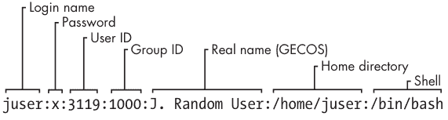

图 7-1：passwd 文件中的一个条目

`/etc/passwd` 文件的语法非常严格，不允许有注释或空行。

> 注意：`/etc/passwd` 中的一个用户及其对应的家目录统称为账户。

## 7.3.2 特殊用户

你会在 `/etc/passwd` 中找到几个用户。超级用户（`root`）始终拥有 UID 0 和 GID 0，如列表 7-2 所示。某些用户（如 `daemon`）具有登录权限。`nobody` 用户是一个低权限用户。某些进程以 `nobody` 身份运行，因为 `nobody` 用户无法向系统的任何地方写入。

不能登录的用户被称为伪用户（pseudo-users）。尽管他们不能登录，但系统可以使用他们的用户 ID 启动进程。创建像 `nobody` 这样的伪用户通常出于安全考虑。

## 7.3.3 /etc/shadow 文件

Linux 上的 shadow 文件 (`/etc/shadow`) 包含加密的用户密码信息。它的引入是为了提供比 `/etc/passwd` 文件更高的安全性，因为后者对所有用户可读。`shadow` 文件还包含密码过期、有效期和账户状态的信息。

## 7.3.4 操作用户和密码

普通用户不应该直接编辑 `/etc/passwd`。使用单独的命令对用户进行更改要容易且安全得多。例如，要设置用户的密码，请以超级用户身份运行 `passwd`。

## 7.3.5 使用组

Unix 中的组允许你与某些用户共享文件，但拒绝其他人的访问。其原理是你可以为特定组设置读取或写入权限，而排除其他人。这项功能曾由于许多用户共享一台机器而变得重要，但随着工作站不再普遍，它的重要性已降低。

`/etc/group` 文件定义了组 ID（例如在 passwd 中找到的）。列表 7-3 是一个示例。

```
root*:0:juser
daemon*:1:
bin*:2
sys*:3:
ad*:4
disk*:6:juser,beazly
nogroup*:65534:
user*:1000
```

### 列表 7-3：示例 /etc/group


类似于 `passwd` 文件，`/etc/group` 中的每行都是由冒号分隔的字段。每个条目中的字段从左到右如下：

- 组名。当你运行 `groups` 等命令时会显示该名称。
- 组密码。这很少被使用，你也不应该使用它（请用 `sudo` 代替）。
- 组 ID（数字）。该 `GID` 必须在用户 `/etc/passwd` 条目中的组文件中是唯一的。
- 可选的该组用户列表。除了这里列出的用户外，在 `passwd` 条目中具有相应组 ID 的用户也属于该组。

要设置你所属的组，请运行 `groups`。

注意：Linux 发行版通常为每个添加的新用户创建一个新组，组名与用户名相同。

## 7.4 getty 和 login

`getty` 是一个连接到终端并显示登录提示符的程序。在大多数 Linux 系统上，`getty` 并不复杂，因为系统仅在虚拟终端上登录时使用它。在进程列表中，它通常看起来像这样（例如，在 `/dev/tty1` 上运行时）：

```
$ ps aux | grep getty
/sbin/getty 38400 tty1
```

在例例中，38400 是波特率。某些 `getty` 程序不需要设置波特率。（虚拟终端会忽略波特率；该设置仅用于与连接真实串口的软件保持向后兼容）。

在你输入登录信息后，`getty` 会用 `login` 程序替换自己，而 `login` 程序会要求你输入密码。如果你输入了正确的密码，`login` 将使用 `exec()` 函数将自身替换为你的 shell。否则，你将收到“Login incorrect”的消息。

你现在已经知道 `getty` 和 `login` 的作用了，但你可能永远不需要配置或更改它们。事实上，你很少使用它们，因为大多数用户既不通过 `gdm` 等图形界面登录，也不通过 `SSH` 登录，而这两者都不使用 `getty` 或 `login`。`login` 程序大部分实际认证工作由 `PAM` 处理（见第 7.10 节）。

## 7.5 设置时间

Unix 机器依赖精确的时间计时。内核维护系统时钟，当你运行 `date` 等命令时参考的就是这个时钟。你也可以使用 `date` 命令设置系统时钟，但这通常不是个好主意，因为你永远无法完全准确的时间。你的系统时钟应该尽可能接近正确时间。

PC 硬件有一个电池备份的实时时钟（`RTC`）。`RTC` 不是世界上最好的时钟，但比没有要好。内核通常在启动时根据 `RTC` 设置其时间，你可以使用 `hwclock` 将系统时钟重置为当前硬件时间。将你的硬件时钟保持在协调世界时（`UTC`），以避免时区或夏令时修正带来的任何问题。你可以使用以下命令将 `RTC` 设置为内核的 `UTC` 时间：

```
# hwclock --hct -- --utc
```

遗憾的是，内核保持时间的能力比 `RTC` 还要差，而且 Unix 机器通常单次启动就会运行数月或数年，因此往往会产生时间漂移。“时间漂移*是指内核时间与真实时间（由原子钟或其他非常精确的时钟定义）之间的当前差异。

你不应该尝试用 `hwclock` 来修复漂移，因为基于时间的系统事件可能会丢失或混乱。你可以运行类似 `adjtime` 的工具来平滑地更新时钟，但通常最好通过网络时间守护进程（第 7.5.2 节）保持系统时间正确。

### 7.5.1 内核时间表示和时区

内核系统时钟将当前时间表示为 `UTC` 1970 年 1 月 1 日午夜 12 点以来的秒数。要查看这个数字：

```
$ date +%s
```

为了将这个数字转换为人类可读的内容，用户空间程序将其转换为本地时间并补偿夏令时间和任何异常情况（例如住在印第纳州）。本地时区由文件 `/etc/localtime` 控制（不要尝试查看它；它是二进制文件）。

你系统的时区位于 `/usr/share/zoneinfo`。你会发现该目录包含时区列表和时区别名列表。要手动设置时区，将 `/usr/share/zoneinfo` 中的一个文件复制到 `/etc/localtime`（或创建一个符号链接），或使用你发行版的时区工具进行更改（命令行工具 `tzselect` 可能会帮助你识别时区）。

要仅在单个 shell 会话中使用系统默认之外的时区，请将 `TZ` 环境变量设置为 `/usr/share/zoneinfo` 中某个文件的名称并测试更改，如下所示：

```
$ export TZ=US/Central
$ date
```

通过其他环境变量，你也可以像这样设置单个命令执行期间的时区：

```
$ TZ=US/Central date
```

### 7.5.2 网络时间

如果你的机器永久连接到互联网，你可以运行网络时间协议（`NTP`）守护进程，通过远程服务器来维护时间。许多发行版内置了对 `NTP` 守护进程的支持，但默认可能未启用。你可能需要安装 `ntpd` 软件包来获取它。

如果你需要手动进行配置，可以在 `NTP` 主页 `http://www.ntp.org/` 上找到帮助，但如果你不想仔细阅读那里的文档，可以按照以下步骤操作：

- 1. 从你的 `ISP` 或 `ntp` 网页找到最近的 `NTP` 时间服务器。
- 2. 将时间服务器放入 `/etc/ntpd.conf`。
- 3. 在启动时运行 `ntpdate server`。
- 4. 在启动时运行 `ntpdate` 命令之后运行 `ntpdate`。

如果你的机器没有永久的互联网连接，可以使用像 `chronyd` 这样的守护进程在中断期间维护时间。

你还可以根据网络时间设置硬件时钟，以帮助你的系统在重启时保持时间一致性。（许多发行版会自动执行此操作。）

```
# hwclock --w -- --utc
```

## 7.6 调度周期性任务

Unix `cron` 按照固定计划运行。大多数丰富的管理员认为 `cron` 是关重要的，因为它可以执行自动维护。要安装 `cron` 任务，要在 `crontab` 中创建一个项目。例如，在每天 15 分运行：

```
15 * * * * /home/user/
```

此行开头的五个由空格分隔的字段指定调度时间（另见 7-3）。字段如下：

- 分钟（0 到 59）。上面的 `cron` 任务设置为第 15 分。
- 小时（0 到 23）。上面的 `cron` 任务设置为第 9 小时。
- 日（1 到 31）。
- 月份（1 到 12）。
- 星期（0 到 7）。数字 0 和 7 是星期日。

任何字段中的 `(*)` 意味着匹配所有值。示例每天运行，因为日期、月份和星期都充满了星号，`cron` 读取为“每天、每月、每周运行此任务”。

要仅在每月 14 号运行，可以使用此 `crontab`：

```
15 09 14 * * /home/user/
```

你可以为每个字段选择多个时间。例如，要在每月 5 号和 14 号运行程序，你可以在第三字段输入 `5,14`：

```
09 5,14 * * /home/user/
```

如果 `cron` 生成了标准输出或错误或异常退出，`cron` 会将这些信息邮件给你。如果你觉得邮件很烦，可以将输出重定向到 `/dev/null` 或其他日志文件。

`crontab (5)` 手册页提供了关于 `crontab` 格式的完整信息。

### 7.6.1 安装 Crontab 文件

每个用户都可以有自己的 `crontab`，这意味着每个系统可能有多个 `crontab`，通常位于 `/var/spool/cron/`。普通用户无法写入此目录；`crontab` 命令安装、列出、编辑和删除用户的 `crontab`。

安装 `crontab` 最简单的方法是将 `crontab` 条目放入文件并使用 `crontab file` 安装文件作为当前的 `crontab`。`crontab` 命令会检查文件格式以确保你没有任何错误。列出你的 `cron` 任务，运行 `crontab -l`。删除 `crontab`，使用 `crontab -r`。

### 7.6.2 系统 Crontab 文件

Linux 发行版通常不使用超级用户的 `crontab`，而是存储一个 `/etc/crontab` 文件。不要使用 `crontab` 编辑此文件；此版本在要运行的命令之前插入了一个额外的字段——应该运行该作业的用户。例如，`/etc/crontab` 中的此 `cron` 任务会在每天早上 6:42 以超级用户（`root`，显示在 `:` 后）的身份运行：

```
42 * * * root /usr/local/bin/cleansystem > /dev/null 2>&1
```


某些发行版将 crontab 文件存储在 `/etc/cron.d/` 目录下。这些文件可以任意任何名称，但格式与 `/etc/crontab` 相同。

## 7.6.3 cron 的未来

`cron` 工具是 Linux 系统中最老的组件之一；它已经存在了数十年（早于 Linux 本身），而且它的配置格式多年没有发生过变化。当一个东西变得如此老旧时，它就会被替换，目前人们正在努力实现这一点。

提议的替代方案只是较新版本 `init` 的部分：对于 `systemd`，有定时器单元（timer units）；对于 `Upstart`，其想法是创建周期事件来触发作业。毕竟，这两个版本的 `init` 都可以以任何用户的身份运行，并提供某些优势，例如自定义日志。

然而，现实情况是，`systemd` 并没有涵盖 `cron` 的所有功能。此外，当它们成为标准时，必须向后兼容以支持所有依赖 `cron` 的程序。由于这些原因，`cron` 格式不太可能很快消失。

## 7.7 使用 at 调度一次性任务

若要在不使用 `cron` 的情况下在未来运行作业，请使用 `at` 服务。例如，要在晚上 10:30 运行 `myjob`，输入以下命令：

```bash
$ at 22:30
> myjob
```

使用 CTRL-D 结束输入。(`at` 工具从标准输入读取命令。)

使用 `atq` 检查作业是否已调度。要删除它，请使用 `atrm`。你也可以通过添加 `DD.MM.YY` 格式的日期来调度未来的作业，例如 `at 22:30 30.09.15`。

`at` 命令没有其他太多内容了。在需要告诉系统在未来关机的这种奇特时刻，它通常非常有用。

## 7.8 理解用户 ID 和用户切换

我们已经讨论过允许切换用户的 `setuid` 程序（如 `sudo`），并且提到了诸如 `login` 等控制用户访问的系统组件。你可能在想这些部分是如何工作的，以及内核在用户切换中扮演了什么角色。

更改用户 ID 有两种方法，内核处理这两种。第一种是使用 `setuid` 可执行文件，这在第 2.17 节中介绍。第二种是通过 `setuid()` 系列系统调用。为了适应与进程相关的各种用户 ID，该系统调用有几个不同的版本，你将在第 7.8 节中学习。

内核对于进程可以或不能做什么有基本规则；以下是三个基础规则：

- 以 root (`userid 0`) 运行的进程可以使用 `setuid()` 变成任何其他用户。
- 不以 root 运行的进程对如何使用 `setuid()` 有限制；在大多数情况下，它无法使用。
- 只要拥有足够的权限，任何进程都可以执行 `setuid` 程序。

> 注意：用户切换与密码或用户名无关。这些是严格的用户空间概念，正如你首先在第 7.3.1 节的 `/etc/passwd` 文件看到的那样。你将在第 7.9.1 节学习更多关于其工作原理。

### 7.8.1 进程所有权、有效 UID、真实 UID、保存 UID

我们目前为止对用户 ID 的讨论是简化的。事实上，每个进程都有多个用户 ID。我们已经描述了有效用户 ID (`eid`)，它定义了进程的访问权限。第二个用户 ID，真实用户 ID (`uid`)，指示了是谁启动了进程。当你运行一个 `setuid` 程序时，Linux 在执行期间将有效 UID 设置为程序的所有者，但在真实用户 ID 中保留了你的原始用户 ID。

在现代系统中，有效用户 UID 和真实用户 UID 之间的差异是极其令人困惑的，以至于许多关于进程所有权的文档都是错误的。

将有效用户 ID 视为“执行者”，将真实用户 ID 视为“所有者”。真实用户 ID 定义了可以与运行中的进程交互的用户——最重要的就是哪个用户可以杀死并向进程发送信号。例如，如果用户 A 启动了一个以用户 B 身份运行的新进程（基于 `setuid` 权限），用户 A 仍然拥有该进程并可以杀死。

在 Linux 系统上，大多数进程具有相同的有效 UID 和真实 ID。默认情况下，`ps` 和其他系统诊断程序显示有效用户 ID。要在你的系统中同时查看有效和真实用户 ID，如果你的系统中所有进程的两个用户 ID 列相同，请不要感到意外：

```bash
$ ps -eo pid,euser,user,comm
```


为了仅仅创建一个异常异常以便在列中看到不同的值，可以尝试通过创建一个 `sleep` 命令的 `setuid` 副本，运行该副本几秒钟，然后在副本终止之前的另一个窗口中运行 `ps` 命令。

### 典型的 Setuid 程序行为

真实用户 ID 的概念可能与你之前的经验相矛盾。为什么你不需要频繁地处理其他用户 ID？例如，在使用 `sudo` 启动进程后，你不需要频繁处理其他用户 ID。（注：原文存在大量重复错误，翻译时已根据逻辑剔除冗余部分）

## 7.9 用户识别与身份验证

多用户系统必须为用户安全提供识别和身份验证的基本支持。安全的识别部分回答了用户是谁的问题。身份验证过程要求用户证明他们是他们。最后，授权用于定义并限制用户允许做什么。

涉及用户识别时，Linux 内核只知道进程所有权的数字用户 ID。内核知道关于 `setuid` 可执行文件以及通过用户 ID 系统调用进行切换的授权规则。然而，内核对身份验证一无所知。我们在第 7.3.1 节讨论过 ID 与密码之间的映射；现在我们将解释用户进程如何访问这种映射。我们将从一个简化的案例开始，即用户进程想要知道其用户名（用户 ID 对应的名称）。在传统的 Unix 系统上，进程可以这样做来获取其用户名：

- 进程通过 `getuid()` 系统调用向内核请求有效用户 ID。
- 进程打开 `/etc/passwd` 文件并从开始读取。
- 进程读取 `/etc/passwd` 文件的一行。如果没有剩余内容，则进程未找到用户名。
- 进程将行解析为字段（冒号之间的所有内容）。第三字段是当前行的用户 ID。
- 进程将步骤 4 的 ID 与步骤 1 的 ID 进行比较。如果相同，步骤 4 的第一个字段就是所需的用户名，进程可以停止搜索并使用该名称。
- 进程移动到 `/etc/passwd` 中的下一行并返回步骤 3。

这个过程在现实中通常要复杂得多。

### 7.9.1 用户信息的库

如果每个需要知道当前用户名的开发者都编写你刚刚看到的所有代码，系统将变得极其支离破碎、充满漏洞、臃肿且难以维护。幸运的是，我们可以使用标准库来执行重复性任务，因此我们通常只需要获取。

在从 `getuid()` 获取答案后，通过标准库调用如 `getuid()` 的函数获取用户名。（有关这些调用如何工作的更多信息，请参阅相应的手册页。）

当标准库被共享时，你可以在不更改任何程序的情况下对实现部分进行重大更改。例如，你可以放弃使用 `/etc/passwd` 管理用户，转而使用 LDAP 等网络服务。

这种方法在识别与用户 ID 关联的用户名方面有效，但密码被证明更为棘手。第 7.3.1 节描述了传统上加密密码作为 `/etc/passwd` 的一部分，因此如果你想验证用户输入的身份，你需要解密用户输入的任何内容并将其与 `/etc/passwd` 文件的内容进行比较。这种传统的实现具有以下局限性：

- 它没有使用全系统范围的标准加密协议。
- 它假设你有权访问加密密码。
- 它假设你希望在用户每次访问需要认证的内容时，都提示用户输入密码（这非常令人烦恼）。
- 它假设你想要使用密码。如果你想使用一次性令牌、智能卡、生物识别或其他形式的身份验证，你必须自行添加这些功能。

这些局限性共同导致了第 7.3.3 节讨论的影子密码包（shadow password package）的发展，它迈了允许系统范围密码配置的第一步。大部分问题的解决方案随着 PAM 设计和实现的出现。

## 7.10 PAM

为了适应用户认证的灵活性，Sun牛奶于1995年提出了一种名为可插认证模块（Pluggable Authentication Modules, PAM）的新标准，这是一个用于认证的共享库系统（Open Source Software Foundation RFC 86.0, 1995年10月）。为了验证用户，应用程序处理 PAM 以确定用户是否能成功识别身份。添加额外认证技术的支持（如双因素认证和物理密钥）相对容易。除了支持认证机制外，PAM 还为服务提供了有限的授权控制（例如，如果你想向某些用户拒绝 cron 等服务）。

由于存在许多认证场景，PAM 采用了许多动态加载的认证模块。每个模块执行特定的特定任务；例如，`pam_unix.so` 模块可以检查用户的密码。

这是一项棘手的工作，至少如此。而且并不清楚 PAM 是否真的解决了所有现有问题。尽管如此，Linux 系统上几乎每个需要认证的程序都支持 PAM，且大多数发行版都使用了 PAM。因为它运行在现有的 Unix 认证 API 之上，在客户端中集成支持很少或完全不需要额外工作。

### 7.0.1 PAM 配置

我们将通过检查位于 `/etc/pam.d` 目录下的文件来探索 PAM 工作的基本原理（旧版本的 PAM 可能使用 `/etc/pam.conf` 中的单个文件）。大多数安装包含许多文件，因此你可能不知道从何开始。某些文件名应该与你已经熟悉的系统部分对应，例如 `cron` 和 `passwd`。

由于这些文件中的特定配置在不同发行之间之间巨大，很难找到一个通用的示例。我们将查看你可能在 csh（更改 shell 程序）中找到的示例配置行：

```
auth requisite pam_shells.so
```


此行表示，用户的 shell 必须在 `/etc/shells` 中，用户才能通过 csh 提示符成功通过认证。每行配置都有三个字段：函数类型、控制参数和模块，按此顺序排列。以下是它们在此示例中的含义：

**函数类型**（Function type）用户请求 PAM 执行的函数。在这里，是你验证用户的任务。

**控制参数**（Control argument）此设置控制 PAM 在执行当前行操作成功或失败后做什么（在本示例中为 `requisite`）。我们稍后会讲这一点。

**模块**（Module）为此行运行的认证模块。

PAM 配置详见于 `pam.conf(5)` 手册页。让我们来看其中的几个要点。

## 函数类型（Function Types）

用户应用程序可以请求 PAM 执行以下四个函数之一：

- **auth**：验证用户（检查用户是否如其所称的那样）。
- **account**：检查用户账户状态（例如，检查用户是否有权执行某操作）。
- **session**：仅针对用户当前会话执行某些操作（例如显示每日消息）。
- **password**：更改用户的密码或其他凭据。

对于任何配置行，模块和函数共同决定了 PAM 的行为。一个模块可以有多个函数类型，在确定配置行的目的时，始终记住将函数和模块视为一个整体。例如，`pam_unix.so` 模块在执行 `auth` 函数时检查密码，但在执行 `password` 函数时设置密码。

## 控制参数与堆栈规则（Control Arguments and Stacked Rules）

PAM 的一个重要特性是其配置行指定的规则是堆叠的，这意味着在执行函数时可以应用许多规则。为什么控制参数很重要：某一行中操作的成功或失败会影响后续行，或导致函数的成功或失败。

控制参数有两种类型：简单语法和更高级的语法。以下是你在 `a:` 中会找到的三个主要的简单语法参数：

- **sufficient**：如果此规则成功，则认证成功，PAM 不需要再查看其他规则。如果规则失败，PAM 将继续处理其他规则。
- **requisite**：如果此规则成功，PAM 继续处理其他规则。如果规则失败，则认证失败，PAM 不需要再查看其他规则。
- **required**：如果此规则成功，PAM 继续处理其他规则。如果规则失败，PAM 将继续处理其他规则，但始终会返回认证失败的结果。

继续上例示例，这里是 csh 的示例堆栈：

| auth sufficient pam_root.so |
| auth requisite pam_shells.so |
| auth sufficient pam_unix.so |
| auth required pam_deny.so |

使用此配置时，当 csh 命令请求 PAM 执行认证函数时，PAM 执行以下操作（见图 7-4）：

- 1. `pam_root.so` 模块检查 root 用户是否是尝试认证的用户。如果是，它立即成功，不再进行后续认证。这是因为控制参数被设置为 `sufficient`，意味着单次操作的成功已足够 PAM 立即向 csh 报告成功。否则，进入第 2 步。
- 2. `pam_shells.so` 模块检查用户的 shell 是否在 `/etc/shells` 中。如果 shell 不在那里，模块返回失败，且 `requisite` 控制参数指示 PAM 必须立即向 csh 报告失败且不再尝试任何进一步认证。否则，shell 在 `/etc/shells` 中，模块返回成功并满足了 `required` 标志；进入第 3 步。
- 3. `pam_unix.so` 模块要求用户密码并进行检查。控制参数设置为 `sufficient`，因此该模块的成功（密码正确）已足够让 PAM 向 csh 报告成功。如果密码错误，PAM 继续到第 4 步。
- 4. `pam_deny.so` 模块始终失败，由于存在 `required` 控制参数，PAM 向 csh 报告失败。这是在没有更多尝试对象时的默认处理。（注意，`required` 控制参数不会导致 PAM 立即失败函数——它会运行堆栈上剩余的行——但返回给应用程序的报告始终为失败。）

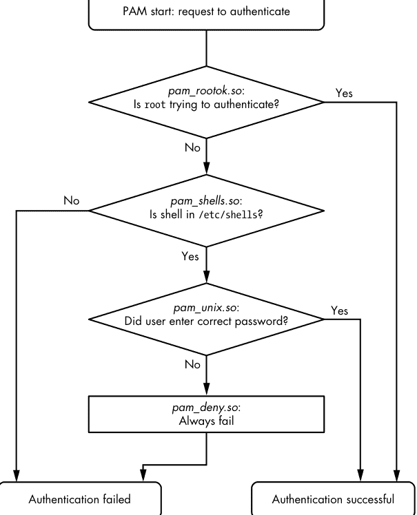

图 7-4：PAM 规则执行流

在处理 PAM 时，请不要混淆“函数（function）”和“动作（action）”这两个术语。函数是高层目标：即用户应用程序希望 PAM 执行的操作（例如，验证用户）。而动作是 PAM 为了实现该目标而采取的特定步骤。只需记住，用户应用程序调用函数，而 PAM 则通过动作处理具体细节。

高级控制参数语法（标记在方括号 `[]` 内部）允许你根据模块的返回值（而不仅仅是成功或失败）手动控制反应。详细信息，请参阅 `pam.config(5)` 手页；当你理解了简单语法后，处理高级语法将不再是费力。

## 模块参数

PAM 模块可以在模块名称后带有参数。你经常会在 `pam_unix.so` 模块中遇到这个示例：

```
auth sufficient pam_unix.so nullock
```

这里的 `nullock` 参数表示用户可以没有密码（如果用户没有密码，则使用默认值）。

## 7.10.2 关于 PAM 的注意事项

由于控制流能力和模块参数语法，PAM 配置语法具有许多编程语言的特征，并具有某种程度的威力。到目前我们仅触及皮毛，但这里有一些关于 PAM 的提示：

- 若要查找系统中存在哪些 PAM 模块，请尝试 `man -k pam`（注意下划线）。追踪模块的位置可能困难。尝试使用 `locate unix_pam.so` 命令看看它会带你到何处。
- 手页包含了每个模块的函数和参数。
- 许多发行版会自动生成某些 PAM 配置文件，因此在编辑它们之前，直接在 `/etc/pam.d` 中进行修改可能并不明智；你的文件中的注释会告诉你它们是从哪里来的。
- `/etc/pam.d/other` 文件定义了任何缺少自身配置应用程序的默认设置。默认通常是拒绝所有访问。
- 在 PAM 配置文件中包含额外的配置文件有多种方法。`#include` 语法加载整个配置，但你也可以使用控制参数仅加载针对特定函数的配置。其用法在许多发行版中有所不同。
- PAM 配置并未于模块参数结束。某些模块可以访问 `/etc/security` 中的额外文件，通常用于配置针对特定用户的限制。

## 7.10.3 PAM 与密码

由于多年来 Linux 密码验证的演变，许多密码配置产物有时会引起混淆。首先需要注意的是 `/etc/login.defs` 文件。这是旧的 shadow 密码文件的配置。它包含了用于 shadow 密码文件的加密算法信息，但在安装了 PAM 的现代系统上，它很少被使用，因为 PAM 配置已经包含了这些信息。尽管如此，在极少数你遇到不支持 PAM 的应用程序的情况下，`/etc/login.defs` 中的加密算法应当与 PAM 配置相匹配。

PAM 从何处获取关于密码加密方案的信息？回想一下 PAM 与密码交互的两种方式：`auth` 函数（用于验证密码）和 `password` 函数（用于设置密码）。追踪密码设置参数是最的。最好的方法是直接获取它：

```
$ grep *.unix /etc/pam.d/*
```


匹配的行包含 `pam_unix.so` 并且看起来如下：

| column | column | arguments |
| :--- | :--- | :--- |
| password | sufficient | pam_unix.so obscure sha512 |

参数 `obscure` 和 `sha512` 告诉 PAM 在设置密码时该做什么。首先，PAM 检查是否符合“obscure”（足够，即密码与旧密码不相似，其他如此），然后 PAM 使用 SHA512 算法加密新密码。

但这只在用户设置密码时发生，而不是在 PAM 验证密码时。那么 PAM 如何知道在验证时该使用哪种算法呢？遗憾的是，配置不会 true 你；`pam_unix.so` 的 `auth` 函数没有加密参数。手页也没有提供任何相关信息。

事实证明（截至本文写作时）`pam_unix.so` 仅仅是尝试猜测算法，通常是请求 `libcrypt` 库执行“脏活”，即尝试各种方法直到成功或没有更多可尝试的为止。因此，你通常不需要担心验证加密算法。

## 7.11 展望

我们现在处于本书学习进程的中点，已经涵盖了 Linux 系统的许多关键构建模块。对 Linux 系统上日志记录和用户的讨论已经让你了解了是什么使得可以将服务和任务划分为小的、独立的块，这在某种程度上仍然是未知的。

本章几乎完全处理用户空间，我们需要精炼你的用户空间进程以及它们消耗的资源。为了做到，我们将在第 8 章回到内核。

## 8 深入观察进程与资源利用

本章深入探讨了进程、内核与系统资源之间的关系。有三种基础硬件资源：CPU、内存和 I/O。进程竞争这些资源，内核的工作是公平地分配资源。内核本身也是一种资源——进程使用它执行如创建新进程和与其他进程通信等任务的软件资源。

你在本章看到的许多工具通常被认为是性能监控工具。如果你的系统慢得像爬，而你正试图弄清楚原因，这些工具非常有帮助。然而，你不应该被性能分散注意力；尝试优化一个已经在运行的系统是浪费时间。相反，专注于工具实际测量的内容，你将对内核的运作获得深刻的见解。

### 8.1 追踪进程

你在 2.16 节学会了使用 `ps` 列出系统进程。`ps` 命令列出当前进程，但它无法告诉你进程随时间的变化。因此，`top` 比 `ps` 更实用，因为它显示当前系统状态并每秒更新一次显示。最重要的是 `top` 将最活跃的进程（即占用 CPU 最高的进程）显示在顶部。

你可以通过按键控制 `top`。以下是一些重要的命令：

- 空格键
- M: 按内存使用率排序。
- T: 按累计 CPU 使用率排序。
- P: 按 CPU 使用率排序（默认）。
- u: 仅显示某个用户的进程。
- f: 选择不同的统计信息。
- ?: 显示所有使用的摘要。

Linux 中另外两个类似于 `top` 的工具提供了更丰富的视图和功能：`atop` 和 `htop`。大多数额外功能可以通过其他工具获得。例如，`htop` 具有下一节提到的 `lsof` 命令的功能。

### 8.2 使用 lsof 查找文件

`lsof` 命令打开文件及其它们的进程。由于 Unix 非常强调文件，`lsof` 是查找故障点最有用的工具之一。`lsof` 不限于普通文件——它可以列出网络资源、动态库、管道等。

#### 8.2.1 读取 lsof 输出

在命令行运行 `lsof` 通常会产生大量的输出。下面是你可能看到的内容片段。该输出包含了入口的打开文件以及运行的进程：

```
$ lsof

COMMAND PID USER FD SIZE NODE NAME

init 1 root cwd DIR 8,1 4096 2

init 1 root rtd DIR 8,1 4096 2 /

init 1 root mem REG 8,1 47040 970581 /lib/i386-linux-gnu/libn-files-2.15.so

init 1 root mem REG 8,1 42652 970582 /lib/i386-linux-gnu/libn-nis-2.15.so

init 1 root mem REG 8,1 92016 970583 /lib/i386-linux-gnu/libns1-2.15.so
```

```
vi 22728 juser cwd DIR 8,1 4096 14945078 /home/juser/w/c
vi 22728 juser 4u REG 8,1 1288 1056519 /home/juser/w/c/f
```

```
--snip--
```

输出显示了以下字段（如顶行列出）：

`COMMAND` 持有文件描述符的进程名称。

`PID` 进程 ID。

`USER` 运行进程的用户。

`FD` 此字段可以包含两种类型的元素。在上面的输出中，FD 列显示了文件的用途。FD 字段还可以列出打开文件的*描述符*——进程与系统库和内核共同使用的一个，用于识别和操作文件的数字。

`TYPE` 文件类型（普通文件、目录、套接字等）。

`DEVICE` 持有文件的设备的主设备和次设备号。

`SIZE` 文件大小。

`NODE` 文件的 inode 节点号。

`NAME` 文件名。

`lsof(1)` 手页包含了每个字段可能看到的内容的完整列表，但你通过观察输出就能判断出你正在看什么。例如，FD 字段中加粗显示的 `cwd` 条目。这些行表示进程的当前工作目录。另一个例子是最后一行，它显示了用户正在用 vi 编辑的文件。

#### 8.2.2 使用 lsof

运行 `lsof` 有两种基本方法：

- *列出所有内容并将输出通过到类似 `less` 的命令中，然后搜索你正在查找的内容。由于生成的输出量非常大，这可能需要一些时间。*
- 使用命令行选项缩小 `lsof` 提供的列表。

你可以使用命令行选项提供文件名作为参数，`lsof` 将仅列出与该参数匹配的条目。例如，以下命令显示 `/usr` 中打开文件的条目：

```bash
$lsof /usr
```

要列出特定进程 ID 的打开文件，请运行：

```bash
$lsof -p pid
```

要查看 `lsof` 选项的简要摘要，请运行 `lsof -h`。大多数选项与输出格式有关。（有关 `lsof` 网络功能的讨论，请参见第 10 章。）

> 注意
> `lsof` 高度依赖内核信息。如果你升级了内核但没有常规地更新所有内容，你可能需要升级 `lsof`。此外，如果你对内核和 `lsof` 都执行了发行版更新，更新后的 `lsof` 在重启并使用新内核之前可能无法工作。

### 8.3 跟踪进程执行和系统调用

我们之前看到的工具都是检查活动进程的。然而，如果你不知道为什么一个程序在启动后立即崩溃，即使是 `lsof` 也无法帮到你。事实上，目前你很难在命令失败的情况下运行 `lsof` 是很困难的。

`strace`（系统调用跟踪）和 `ltrace`（库跟踪）命令可以帮助你发现程序尝试做什么。这些工具会产生极其大量的输出，但一旦你知道要寻找什么，你就有更多的工具可以追溯问题。

#### 8.3.1 strace

回想一下系统调用是用户空间进程请求内核执行的特权操作，例如打开文件并读取数据。`strace` 工具打印进程执行的所有系统调用。要查看它的运行效果，请运行此命令：

```bash
$ strace cat /dev/null
```

在第 1 章中，你了解到当一个进程想要启动另一个进程时，它会调用 `fork()` 系统调用来产生自己的副本，然后该副本使用 `exec()` 族的系统调用来开始运行新程序。`strace` 命令在 `fork()` 调用之后在新进程（原始进程的副本）上开始。因此，该命令输出的前几行应该显示 `exec()` 的执行过程，随后是一个内存初始化调用 `brk()`，如下：

```bash
exec("/bin/cat", "cat", "dev/null") /* * 5 vars */ = 0

brk(0) = 0x9b65000
```

输出的下部分主要处理加载共享库。除非你真的想知道共享库系统做了，否则可以忽略它。

```bash
access("/etc/ld.so.nowcap", F_OK) = -ENENT (No such file or directory)

map2(NULL, 8192, PRO_READ, PRO_WRITE, MAP_PRIVATE, MAP_ANONYMOUS, -1, 0) = 0xb77b5000

access("/etc/ld.so.preload", R_OK) = -ENENT (No such file or directory)

open("/etc/ld.so.cache", O_RDONLY|O_CLOEXEC) = 3

--snip--

open("/lib/libc.so.6", O_RDONLY) = 3

read(3, "\x77ELF\x01\x01\x01\x00\x00\x01\x00\x00\x00\x03\x00\x01\x00\x00\x20\...", 1024) = 1024
```


此外，跳过 `mmap` 输出，直到你看到类似这样的行：

```bash
fstat64(1, (st_mode=S_IFCHR|0620, st_rdev(136, ...))) = 0

open("/dev/null", O_RDONLY|O_LARGEFILE) = 3

fstat64(3, (st_mode=S_IFCHR|0666, st_rdev(1, ...))) = 0

fadvise64(3, 0, POSIX_FADV_SEQUENTIAL) = 0

read(3, 32768) = 0

close(3) = 0

close(1) = 0

close(2) = 0

exit_group(0) = ?
```

这部分输出显示了命令的执行。首先，看 `open()`，它打开了一个文件。返回的文件值表示成功（`3` 是内核在打开文件后返回的文件描述符）。下面你看到 `cat` 如何从 `/dev/null` 读取内容（`read()` 调用也以 `3` 作为文件描述符）。然后没有更多内容可读，程序退出。

### 8.3.2 ltrace

`ltrace` 库跟踪命令可以帮助你发现程序尝试做什么。这些工具会产生极其大量的输出，但一旦你知道要寻找什么，你就有更多的工具可以追溯问题。

## 8.4.2 查看线程

默认情况下，`ps` 和 `top` 命令的输出只显示进程。要在 `ps` 中显示线程信息，请添加 `m` 选项。以下是一些示例输出：

| PID | TTY | STAT | TIME | COMMAND |
| :--- | :--- | :--- | :--- | :--- |
| 3587 | pts/3 | | 0:00 | bash① |
| - | Ss | 0:00 | | |
| 3592 | pts/4 | | 0:00 | bash② |
| - | Ss | 0:00 | | |
| 12287 | pts/8 | | 0:54 | /usr/bin/python /usr/bin/gm-notify③ |
| - | | | 0:48 | |
| - | | | 0:00 | |
| - | | | 0:06 | |
| - | | | 0:00 | |

列表 8-1: 使用 ps m 查看线程

列表 8-1 显示了进程以及线程。在 PID 列中带有数字 ①、②和③ 的每一行在普通的 `ps` 输出中代表一个进程。PID 列中带有横线的行表示与该进程关联的线程。在此输出中，①和②处的进程各有一个线程，但进程 12287 ③ 是一个具有四个线程的多线程进程。

如果你想通过 `ps` 查看线程 ID（tid），可以使用自定义输出格式。此示例显示了进程 ID、线程 ID 和命令：

```
$ ps -o pid,tid,command

PID TID COMMAND

3587 bash

-

3592 bash

- 3592

12287 /usr/bin/python /usr/bin/gm-notify

- 12287

- 12288

- 12289

- 12295
```

列表 8-2: 使用 ps m 显示进程 ID 和线程 ID

列表 8-2 中的示例输出与列表 8-1 中显示的线程相对应。注意，单线程进程的线程 ID 与进程 ID 相同；这是主线程。对于多线程进程 12287，线程 12287 是主线程。

通常情况下，你不会像处理进程那样与单个线程交互。你需要非常了解多线程程序是如何编写的才能一次对一个线程进行操作，即使如此，这样做可能不是一个好主意。

在资源监控方面，线程会让情况变得复杂，因为多线程进程中的单个线程可以同时消耗资源。例如，`top` 默认不显示线程；你需要按 `H` 来开启它。对于你即将看到的大多数资源监控工具，你都需要做一些额外的工作来开启线程显示。

## 资源监控简介

现在我们将讨论资源监控的一些主题，包括处理器（CPU）时间、内存和磁盘 I/O。我们将检查系统范围的利用率以及基于单个进程的利用率。

许多人为了提高性能而了解 Linux 内核的内部原理。然而，大多数 Linux 系统在发行版的默认设置下运行良好，你可能会花费几天尝试调优机器性能但却没有实质性的结果，特别是如果你不知道该看什么。因此，在你在本章尝试这些工具时，与其考虑性能，不如考虑观察内核在进程之间分配资源时的实际运行情况。

## 测量 CPU 时间

要随时间监控一个或多个特定进程，在 `top` 上使用 `-p` 选项，语法如下：

```
$ top -p pids [-p pid2 ...]
```

要确定一个命令在其生命周期内使用了多少 CPU 时间，大多数内置命令不提供广泛的统计，你可能需要运行 `/usr/bin/time`。例如，测量 `ls` 使用的 CPU 时间，运行：

```
$ /usr/bin/time ls
```

在 `ls` 终止后，`time` 会打印像下面的输出。加粗的关键字段是：

```
0.05user 0:00.044elapsed 31%CPU (avgtext+avgdata Omaxresident)k Inputs=Outputs (125major+5minor)pagefaults 0swaps
```


User time（用户时间）：CPU 运行程序代码花费的秒数。在现代处理器上，某些命令运行很快，因此 CPU 时间低到 `time` 舍入为零。

System time（系统时间）：内核处理进程工作花费的时间（例如，读取文件和目录）。

## 7.7 调整进程优先级

你可以更改内核调度，以便给予进程与其他进程更多或更少的 CPU。内核根据其调度优先级运行每个进程，优先级是一个 -20 到 20 之间的数字，其中 -20 是最高优先级。（是的，这可能会让人困惑。）

`ps -1` 命令列出进程的优先级，但在 `top` 命令中查看优先级的实际效果更直观，如下所示：

| PID | USER | VIRT | RES | SHR | S% | CPU% | TIME | COMMAND |
| :--- | :--- | :--- | :--- | :--- | :--- | :--- | :--- | :--- |
| 28883 | bri | 20 | 1280m | 763m | 32m | S | 12.7 | 213:00:65 | chromium-browser |
| 1175 | root | | | | | | | |
| 28883 | bri | 20 | 1280m | 763m | 32m | S | 12.7 | 213:00:65 | chromium-browser |
| 1175 | root | | | | | | | |
| 28883 | bri | 20 | 1280m | 763m | 32m | S | 12.7 | 213:00:65 | chromium-browser |
| 1175 | root | | | | | | | |
| 28883 | bri | 20 | 1280m | 763m | 32m | S | 12.7 | 213:00:65 | chromium-browser |
| 1175 | root | | | | | | | |
| 28883 | bri | 20 | 1280m | 763m | 32m | S | 12.7 | 213:00:65 | chromium-browser |
| 1175 | root | | | | | | | |
| 28883 | bri | 20 | 1280m | 763m | 32m | S | 12.7 | 213:00:65 | chromium-browser |
| 1175 | root | | | | | | | |
| 28883 | bri | 20 | 1280m | 763m | 32m | S | 12.7 | 213:00:65 | chromium-browser |
| 1175 | root | | | | | | | | |
| 28883 | bri | 20 | 1280m | 763m | 32m | S | 12.7 | 213:00:65 | chromium-browser |
| 1175 | root | | | | | | | | |
| 28883 | bri | 20 | 1280m | 763m | 32m | S | 12.7 | 213:00:65 | chromium-browser |
| 1175 | root | | | | | | | | |
| 28883 | bri | 20 | 1280m | 763m | 32m | S | 12.7 | 213:00:65 | chromium-browser |
| 1175 | root | | | | | | | | |
| | 28883 | | | 20 | 1280m | 763m | 32m | S | 12.7 | 213:00:65 | chromium-browser |
| 1175 | root | | | | | | | | |
| | 28883 | | | 20 | 1280m | 763m | 32m | S | 12.7 | 213:00:65 | chromium-browser |
| 1175 | root | | | | | | | | |
| | 28883 | | | 20 | 1280m | 763m | 32m | S | 12.7 | 213:00:65 | chromium-browser |
| 1175 | root | | | | | | | | |
| | 28883 | | | 20 | 1280m | 763m | 32m | S | 12.7 | 213:00:65 | chromium-browser |
| 1175 | root | | | | | | | | |
| | 28883 | | | 20 | 1280m | 763m | 32m | S | 12.7 | 213:00:65 | chromium-browser |
| 1175 | root | | | | | | | | |
| | 28883 | | | 20 | 1280m | 763m | 32m | S | 12.7 | 213:00:65 | chromium-browser |
| 1175 | root | | | | | | | | |
| | 28883 | | | 20 | 1280m | 763m | 32m | S | 12.7 | 213:00:65 | chromium-browser |
| 1175 | root | | | | | | | | | |
| | 28883 | | | 20 | 1280m | 763m | 32m | S | 12.7 | 213:00:65 | chromium-browser |
| 1175 | root | | | | | | | | | |
| | 28883 | | | 20 | 1280m | 763m | 32m | S | 12.7 | 213:00:65 | chromium-browser |
| 1175 | root | | | | | | | | | |
| | 28883 | | | 20 | 1280m | 763m | 32m | S | 12.7 | 213:00:65 | chromium-browser |
| 1175 | root | | | | | | | | | |
| | 28883 | | | 20 | 1280m | 763m | 32m | S | 12.7 | 213:00:65 | chromium-browser |
| 1175 | root | | | | | | | | | |
| | 28883 | | | 20 | 12800 | 763m | 322 | S | 12.7 | 213:00:65 | |-browser |
| 1115 | | | | | | | | | | | |
| | 28888 | | | 22 | 1280m | 763m | 32m | S | 12.7 | 213:00:65 | chromium-browser |
| 1175 | root | | | | | | | | | |
| | 28883 | | | 20 | 1280m | 763m | 32m | S | 12.7 | 213:00:65 | chromium-browser |
| 1175 | root | | | | | | | | | |
| | 28883 | | | 20 | 1280m | 763m | 32m | S | 12.7 | 213:00:65 | chromium-browser |
| 1175 | root | | | | | | | | | |
| | 28883 | | | 20 | 1280m | 763m | 32m | S | 12.7 | 213:00:65 | chromium-browser |
| 1175 | root | | | | | | | | | |
| | 28883 | | | 20 | 1280m | 763m | 32m | S | 12.7 | 213:00:65 | chromium-browser |
| 1175 | root | | | | | | | | | |
| | 28883 | | | 20 | 1280m | 763m | 32m | S | 12.7 | 213:00:65 | chromium-browser |
| 1175 | root | | | | | | | | | |
| | 28883 | | | 20 | 1280m | 763m | 32m | S | 12.7 | 213:00:65 | chromium-browser |
| 1175 | root | | | | | | | | | |
| | 28883 | | | 20 | 1280m | 763m | 32m | S | 12.7 | 213:00:65 | chromium-browser |
| 1175 | root | | | | | | | | | |
| | 28883 | | | 20 | 1280m | 763m | 32m | S | 12.7 | 213:00:65 | chromium-browser |
| 1175 | root | | | | | | | | | |
| | 28883 | | | 20 | 1280m | 763m | 32m | S | 12.7 | 213:00:65 | chromium-browser |
| 1175 | root | | | | | | | | | |
| | 28883 | | | 20 | 1280m | 763m | 32m | S | 12.7 | 213:00:65 | chromium-browser |
| 1175 | root | | | | | | | | | |
| | 28883 | | | 20 | 1280m | 763m | 32m | S | 12.7 | 213:00:65 | chromium-browser |
| 1175 | root | | | | | | | | | |
| | 28883 | | | 20 | 1280m | 763m | 32m | S | 12.7 | 213:00:65 | chromium-browser |
| 1175 | root | | | | | | | | | |
| | 28883 | | | 20 | 1280m | 763m | 32m | S | 12.7 | 213:00:65 | chromium-browser |
| 1175 | root | | | | | | | | | |
| | 28883 | | | 20 | 1280m | 763m | 32m | S | 12.7 | 213:00:65 | chromium-browser |
| 1175 | root | | | | | | | | | |
| | 28883 | | | 20 | 1280m | 763m | 32m | S | 12.7 | 213:00:65 | chromium-browser |
| 1175 | root | | | | | | | | |

通常情况下，你不会像处理进程那样与单个线程交互。你需要非常了解多线程程序是如何编写的才能一次对一个线程进行操作，即使如此，这样做可能不是一个好主意。

在资源监控方面，线程会让情况变得复杂，因为多线程进程中的单个线程可以同时消耗资源。例如，`top` 默认不显示线程；你需要按 `H` 来开启它。对于你即将看到的大多数资源监控工具，你都需要做一些额外的工作来开启线程显示。

## 资源监控简介

现在我们将讨论资源监控的一些主题，包括处理器（CPU）时间、内存和磁盘 I/O。我们将检查系统范围的利用率以及基于单个进程的利用率。

许多人为了提高性能而了解 Linux 内核的内部原理。然而，大多数 Linux 系统在发行版的默认设置下运行良好，你可能会花费几天尝试调优机器性能但却没有实质性的结果，特别是如果你不知道该看什么。因此，在你在本章尝试这些工具时，与其考虑性能，不如观察内核在进程之间分配资源时的实际运行情况。

## 测量 CPU 时间

要随时间监控一个或多个特定进程，在 `top` 上使用 `-p` 选项，语法如下：

```
```


`$ top -p pids [-p pid2 ...]`

要确定一个命令在其生命周期内使用了多少 CPU 时间，大多数内置命令不提供广泛的统计，你可能需要运行 `/usr/bin/time`。例如，测量 `ls` 使用的 CPU 时间，运行：

```
$ /usr/bin/time ls
```

在 `ls` 终止后，`time` 会打印像下面的输出。关键字段是：

```
0.05user 0:00.044elapsed 31%CPU (avgtext+avgdata Omaxresident)k Inputs=Outputs (125major+5minor)pagefaults 0swaps
```

`User time`（用户时间）：CPU 运行程序代码花费的秒数。在现代处理器上，某些命令运行很快，因此 CPU 时间低到 `time` 舍入为零。

`System time`（系统时间）：内核处理进程工作花费的时间（例如，读取文件和目录）。

## 8.8 负载平均

CPU 性能是最容易测量的指标之一。负载平均是就绪运行进程的平均数量。也就是说，它是对任何时刻可以使用 CPU 的进程数量的估计。在考虑负载平均时，请记住系统中的大多数进程通常在等待输入（键盘、鼠标、网络或例如），这意味着大多数进程并不处于就绪状态，对负载平均没有贡献。只有那些活跃并影响负载的进程才有贡献。

### 8.8.1 使用 uptime

`uptime` 命令除了内核运行时间外，还会告诉你三个负载平均：

```
$ uptime
up 91 days, ... load average: 0.08, 0.03, 0.01
```

这三个数字分别是过去 1 分钟、5 分钟和 15 分钟的负载平均。正如你看到的，这个系统并不忙：在过去的 15 分钟内，所有处理器平均只有 0.01 个进程在运行。也就是说，如果你只有一个处理器，它在过去的 15 分钟内只运行了用户空间应用程序 1% 的时间。（传统上，大多数桌面系统在除了编译程序或玩游戏之外，负载平均通常为 0。负载平均为 0 通常是一个好信号，因为这意味着你的处理器没有面临挑战，并且正在节省电量。）

当前桌面系统的用户界面组件往往比过去占用了更多的 CPU。例如，在 Linux 系统上，网络浏览器的 Flash 插件可能是臭名昭著的资源大户，而且由于实现不佳，Flash 应用程序很容易占用系统大量的 CPU 和内存。

如果负载平均值（load average）上升到 1 左右，可能有一个进程几乎全时间都在使用 CPU。要识别该进程，请使用 `top` 命令；该进程通常会升到显示的最上方。

大多数系统拥有有多个处理器核心或 CPU，多个进程可以轻松同时运行。如果你有两个核心，负载平均为 1 意味着在任何给定时间内，只有一个核心处于活跃状态，而负载平均为 2 意味着两个核心都恰好有任务要处理。

### 8.8.2 高负载

负载平均值并不意味着你的系统正出现问题。拥有足够内存和 I/O 资源的系统可以处理许多运行中的进程。如果你的负载平均很高且系统响应良好，请不要慌：系统只是有很多进程在共享 CPU。这些进程之间必须为了处理器时间进行竞争，如果允许每个进程都一直使用 CPU。另一种你可能看到高平均值的正常情况是 Web 服务器，其进程启动和终止非常快，导致负载平均值的测量机制无法有效工作。

然而，如果你感觉到系统运行缓慢且负载平均值很高，系统内存不足，内核可能会开始发生抖动（thrash），或者在进程与磁盘之间快速进行内存交换（swap）。当这种情况发生时，许多进程将变为就绪状态，但它们的内存可能不可用，因此它们处于就绪状态的时间将比通常情况长得多（并贡献了负载平均值）。

现在我们将更详细地查看内存。

## 8.9 内存

检查系统整体内存状态的最简单方法是运行 `free` 命令或查看 `/proc/meminfo`，以查看有多少实际内存被用于缓存（caches）和缓冲区（buffers）。正如我们刚刚提到的，性能问题可能源于内存短缺。如果没有使用大量的缓存/缓冲区内存（而剩余的实际内存已被占用），你可能需要更多内存。然而，很容易把机器上的每一个性能问题都归咎于内存短缺。

### 8.9.1 内存工作原理

回想第 1 章，CPU 拥有一个内存管理单元（MMU），它可以将虚拟内存地址翻译为实际地址。内核通过将内存分解成较小的*页*（pages）来协助 MMU。内核维护一个数据结构——*页表*（page table），它包含了进程虚拟页地址到内存中页地址的映射。当进程访问内存时，MMU 根据内核的页表将进程使用的虚拟地址翻译成实际地址。

用户进程在运行时并不实际上需要所有的页面都立即可用。内核通常在进程需要时加载并分配页面；这种系统被称为*按需分页*（on-demand paging）或需求分页。为了了解它是如何工作的，考虑程序如何作为一个新进程启动并运行：

- 1. 内核将程序的指令代码开头加载到内存页中。
- 2. 内核可能会为新进程分配一些工作内存页。
- 3. 随着进程的运行，它可能会到达某一点，此时其代码中的下一条指令不在内核最初加载的任何页中。此时，内核接管控制，将必要的页调入内存，然后让程序恢复执行。
- 4. 同样，如果程序所需的工作内存比最初分配的更多，内核通过寻找空闲页（或腾出空间）并将其分配给进程来处理。

### 8.9.2 页缺

如果进程想要使用某个页内存但该页未就绪，进程会触发*页缺*（page fault）。发生页缺时，内核会从进程手中接管 CPU 控制权以准备好该页。页缺有两种类型：次要（minor）和主级（major）。

#### 次要页缺

当所需的页面实际上在内存中但 MMU 不知道它在哪里时，就会发生次页缺。这可能发生在进程请求更多内存时，或者 MMU 没有足够的空间存储所有页的位置时。在这种情况下，内核告诉 MMU 该页的信息并允许进程继续。次页缺不是什么大问题，进程运行时会发生很多。除非你需要从某些内存密集型程序获得最高性能，否则你可能不需要担心它们。

#### 主页缺

当所需的页面完全不在内存中时，就会发生主页缺，这意味着内核必须从磁盘或其他较慢的存储机制加载它。大量的页缺会拖慢系统，因为内核必须执行大量工作来提供页面，剥夺了正常进程运行的机会。

某些主页缺是不可避免的，例如在第一次运行程序时从磁盘加载代码时发生的页缺。最大的问题发生在内存不足启动时，此时内核开始将工作内存页交换到磁盘以为新页腾出空间。

#### 观察页缺

你可以通过 `ps`、`top` 和 `time` 命令查看单个进程的页缺。以下命令显示了 `time` 命令显示页缺的一个简单示例。（`cal` 命令的输出并不重要，所以我们通过重定向到 `/dev/null` 将其丢弃。）

```bash
$ /usr/bin/time cal > /dev/null
0.00user 0.00system 0.06elapsed (avg CPU: 0%) max resident=64K inputs=0 faults=254 minor
```

从文本可以看出，第一次加载程序时发生了 0 次主缺和254 次次缺。如果你再次运行该命令，可能不会得到任何主缺，因为内核已经从磁盘缓存了这些页。

如果你更想看到运行中的进程页缺，请使用 `top`。运行 `top` 时，使用 `f` 字段，使用 `u` 显示主缺数量。使用 `ps` 时，可以使用自定义输出查看特定进程的页缺。这里是进程 20365 的示例：

```bash
$ ps -o pid,minfl,majfl
20365 8 23
```

`MINFL` 和 `MAJFL` 列显示主缺和次缺的数量。当然，你可以将其与 `ps` 手册中描述的其他选项组合。按进程查看页缺可以定位问题，但如果你对系统的整体性能感兴趣，你需要一个汇总所有进程操作的工具。

## 10 使用 vmstat 监控 CPU 和内存

在许多监控性能的工具中，`vmstat` 是开销最小的工具之一。它可以方便查看内核交换页、CPU 繁忙程度以及 IO 利用率。解锁 `vmstat` 能力的关键在于理解它的输出。例如，这里是 `vmstat 2` 每秒报告一次的输出：

```bash
$ vmstat 2
           memory           swap            cpu
procs r b swpd free buff cache si bo in cs us yd
   0 0     0 302796 198636 107256  0  0 1  2  0  15 23
   2 0     0 302728 198636 107256  0  0 0  0 18 407 63 1  9
   1 0     0 302692 198646 107252  0  0 0  0 58 281 541 0  9
   0 0     0 302432 198648 1074924  0  0 0  0 308 541 0  1
   1 0     0 302492 198648 1074968  0  0 0  0 208 416 0  9
```


   0 0     0 302600 198648 1027116  0  0 0  0 207 389 0 100 0

输出分为几类：`procs`（进程）、`memory`（内存使用）、`swap`（换出的页）、`io`（磁盘使用）、`system`（内核切换内核代码的次数）以及 `cpu`（系统不同部分使用的时间）。

前面的输出是一个不忙碌系统的典型输出。你通常会开始看第二行输出——第一行是系统整个运行时间的平均值。例如，系统有 320416KB 的内存交换到磁盘（`swap`），以及约为3025000KB (GB) 的空闲内存。尽管有一些空间进入，但值为0的 `si` (swap-in) 和 (swap-out) 列显示内核当前没有从磁盘交换任何内容。`buff` 列表示内核用于磁盘缓冲量（见第 4.2.5 节）。

在右侧 CPU 标题下，你可以看到 `us`, `sy`, `id`, `wa` 列 CPU 时间分布。这些列按顺序列出了 CPU 花在任务、内核（任务）、空闲时间和等待 I/O 上的百分比。这里没有许多进程在运行（它们最多占用 CPU 的 1%）；内核几乎什么都没做，而 CPU 在 99% 的时间里都在闲置。

现在，稍后启动一个大程序时会发生什么（前两行在程序运行后出现）：

```text
procs ----------memory----------swap----io----system---cpu-
 r b swpd free buff cache si so bo in cs us yd id
 1 0 320412 286152 198220 1106804 0 0 0 0 2477 481 25 7 22 0
 1 0 320412 286178 198924 1106504 0 0 0 0 40 2206 396 26 7 22 0
 1 0 320418 286508 199320 1106504 0 0 0 0 210 18 2201 394 26 7 1
 1 0 320418 287180 199332 1146052 0 0 0 0 1912 0 2446 223 26 6 3 8
 2 2 320284 2791608 200612 1157752 202 0 0 0 4960 85 5331 2774 5 31 18
 1 0 320252 2772076 201076 1166656 1 0 0 0 2142 1190 4188 7537 30 3 53 14
 0 3 320244 2726732 202104 1175420 20 0 0 0 1890 216 4631 8706 3 6 46 14
```

如列表 8-3 所示，CPU 开始出现长时间的占用，特别是来自用户进程的。由于有足够的空闲内存，随着内核开始使用磁盘，缓存（`cache`）和缓冲区（`buffer`）空间开始增加。

随后，我们看到了一些有趣的现象：注意内核将某些被交换出（`swapped out`）的页面调入内存（`s1` 列）。这意味着刚刚运行的程序访问了另一个进程共享的一些页面。这是很常见的；许多进程仅在启动时才会使用某些共享库中的代码。

此外从 `b` 列可以注意到，一些进程在等待内存页时阻塞（无法运行）。总的来说，空闲内存的数量正在减少，但远未耗尽。还有相当大量的磁盘活动，如 `bi`（读入块）和 `bo`（写出块）列中增加的数字所示。

当内存耗尽时，输出会非常不同。随着空闲空间的减少，缓冲区和缓存的大小都会减小，因为内核越来越多地需要为用户进程提供空间。没有任何剩余空间后，由于内核开始将页面移动到磁盘，你将看到 `so`（交换出）列中出现活动，此时，几乎所有其他列都反映了内核正在执行的工作。你会看到更多的系统时间、更多数据进出磁盘，以及更多进程因为它们想要使用的内存不可用（已交换出）而阻塞。

我们还没有解释 `vmstat` 的所有列。你可以深入研究 `vmstat(8)` 手页，但你可能需要通过课程或《操作系统概念》第 9 版（Wiley, 2012）等书籍学习更多内核内存管理的知识以便理解它们。

## 8.11 I/O 监控

默认情况下，`vmstat` 显示常规 I/O 统计数据。尽管你可以通过 `vmstat -d` 获取非常详细的分区资源使用情况，但该选项会产生大量输出，可能会让人无从从。相反，可以尝试从一个名为 `iostat` 的 I/O 工具开始。

### 8.11.1 使用 iostat

与 `vmstat` 类似，不带任何选项运行时，`iostat` 显示机器当前运行时间的统计信息：

```
$ iostat

[kernel information]

avg-cpu: %user %nice %system %steal %idle

         4.46 0.01 0.67 0.31 0.00 94.55

Device: tps kB_read/s kB_write/s kB_read kB_write

sda 4.67 7.28 49.86 9493727 65011716

sde 0.00 0.00 0.00 1230 0
```

顶部的 `avg-cpu` 部分报告了与本章中看到的其他工具相同的 CPU 利用率信息，跳到底部，可以看到每个设备的以下信息：

- `tps`: 每秒平均数据传输次数
- `kb_read/s`: 每秒读取的平均字节数
- `kb_write/s`: 每秒写入的平均字节数
- `kb_read`: 总读取字节数
- `kb_writen`: 总写入字节数

另一个与 `vmstat` 的相似之处是你可以提供一个间隔参数，例如 `iostat -2`，以便每 2 秒更新一次。当你只想使用 `-d` 选项仅显示设备报告时（例如 `iostat -2`）。

默认情况下，`iostat` 输出省略了分区信息。要显示所有分区信息，使用 `-p ALL` 选项。因为典型系统上有许多分区，你会得到大量的输出。以下是你可能看到的内容：

```
$ iostat -p ALL

| --snip-- |

| Device | tps | kb_read/s | kb_wrtn/s | kb_read | kb_wrtn |

| sda | 4.67 | 7.27 | 49.83 | 946139 | 6501472 |

| sda1 | 4.38 | 7.16 | 49.51 | 9463269 | 6463540 |

| sda2 | 0.00 | 0.00 | 0.00 | 6 | 0 |

| sda5 | 0.01 | 0.11 | 0.32 | 141884 | 416032 |

| scd0 | 0.00 | 0.00 | 0.00 | 0 | 0 |

| --snip-- |

| sde | 0.00 | 0.00 | 0.00 | 1230 | 0 |
```

在这个示例中，`sda1`、`sda2` 和 `sda5` 都是 `sda` 的分区，因此读取和写入列之间会有一些重叠。然而，分区列的总和并不一定等于磁盘列的总和。虽然从 `sda` 的读取也算入从 `sda` 的读取，但请记住你可以直接从 `sda` 读取，例如读取分区表时。

### 8.11.2 进程 I/O 利用率和监控：iostat

如果你需要深入研究单个进程使用的 I/O 资源，`iostat` 工具可以提供帮助。使用 `iostat` 类似于使用 `top`。有一个持续更新的显示，显示使用最多 I/O 的进程，摘要如下：

```
# iostat

Total DISK READ: 4.76 K/s | Total DISK WRITE: 333.1 K/s

TID PRIO USER | DISK READ DISK WRITE SWAP | ID

260/3 root | 0.00 B | 38.09% | 0.00% | 6.98% | [jbd/sda]

2611/4 juser | 4.76 K/s | 10.32 K/s | 0.00% | 0.21% | zeitgeist-daemon

2636/4 juser | 0.00 B | 84.12 K/s | 0.00% | 0.20% | zeitgeist-fuse

1329/4 juser | 0.00 B | 65.87 K/s | 0.00% | 0.03% | office-pipe

6845/4 juser | 0.00 B | 812.63 B/s | 0.00% | 0.00% | chromium-browser

19069/4 juser | 0.00 B | 812.63 B/s | 0.00% | 0.00% | rhythmbox
```


在命令旁边的读/写列中，注意是 `TID`（线程 ID）而不是 `PID`。`iotop` 工具是少数显示线程而非进程的工具之一。`PRIO`（优先级）列表示 I/O 优先级。它和你已经看到的 CPU 优先级相似，但它影响内核调度 I/O 读取和写入的速度。在 `be/4` 等优先级中，部分是调度类，数字是优先级。对于 CPU 优先级，数字越小越重要；内核为 `be/3` 或 `be/4` 进程允许更多 I/O 时间。内核使用调度类来增加 I/O 的控制。你会看到调度类：

- 尽力而为 (Best-effort)：内核尽可能地调度该类的 I/O。进程在此调度类下运行。
- 实时 (Real-time)：无论如何，内核在任何其他类之前调度实时 I/O。
- 空闲 (Idle)：只有当没有其他 I/O 需要执行时，内核才为此类执行 I/O。空闲类没有优先级。

你可以使用 `ionice` 检查并更改进程的 I/O 优先级；详情请参 `ionice(1)` 手页。不过你可能不需要担心 I/O 优先级。

## 8.12 使用 pidstat 进行进程监控

你已经见过如何使用 `top` 和 `iotop` 等工具监控特定进程。然而，这种显示每次都会刷新，且每次更新都会擦除之前的输出。`pidstat` 工具允许你查看进程随时间的资源消耗。这里有一个每秒监控进程 1329 的简单示例：

```
$ pidstat -p 1329 1

Linux 3.2.0-44-generic      07/01/2015      CPU

09:26:55 PID %usr %guest %system CPU

09:27:03 1329 8.00 0.00 0.00 8.00

09:27:04 1329 0.00 0.00 0.00 0.00

09:27:05 1329 3.00 0.00 0.00 3.00

09:27:06 1329 8.00 0.00 0.00 8.00

09:27:07 1329 2.00 0.00 0.00 2.00

09:27:08 1329 6.00 0.00 0.00 6.00
```


默认输出显示了用户时间、系统时间的百分比以及 CPU 时间的整体百分比，并告诉你程序在哪个 CPU 上运行。这里的 `%guest` 列是进程在虚拟机内部运行内容的时间百分比。除非你正在运行虚拟机，否则不必担心这个。

尽管 `pidstat` 默认显示 CPU 利用率，但它还可以做更多。例如，你可以使用 `-r` 选项监控内存，并使用 `-d` 开启监控。然后查看 `pidstat(1)` 手页，查看更多关于线程、上下文切换或本章中讨论过的任何其他内容的选项。

## 8.13 进阶话题

### 之所以有许多工具来衡量资源利用率的原因之一是各种类型的资源以许多不同的方式被消耗。在本章中，你已经看到 CPU、内存和 I/O 是被进程、进程内线程和内核消耗的系统资源。

工具存在的另一个原因是资源是有限的，对于某些用户来说，必须努力消耗更少的资源。在过去，许多用户共享一台机器，因此有必要确保每个用户都有公平的资源份额。现在，虽然现代桌面计算机可能没有多个用户，但它仍然有进程竞争资源。同样，高性能网络服务器需要密集的系统监控。

资源监控和性能分析的进阶话题包括以下内容：

**sar (系统活动报告器)**：`sar` 包具有许多 `vmstat` 的监控功能，但它还会随时间记录资源利用率。通过 `sar`，你可以回顾特定的时间来查看系统在做什么。当你有一个想要分析的过去系统事件时，这非常有用。

**act (进程核算)**：`act` 包可以记录进程及其资源利用率。

**配额 (Quotas)**：你可以按进程或用户为基础限制许多系统资源。查看 `/etc/security/limits.conf` 获取某些 CPU 和内存选项；还有一个 `limits.conf(5)` 手页。

# 9 理解你的网络及其配置

网络化是连接计算机并在它们之间发送数据的实践。这听起来足够简单，但要理解它的工作原理，你需要问两个基本问题：

- 发送数据的计算机如何知道要将数据发送到*哪里*？
- 当目标计算机接收到数据时，它如何知道自己刚刚收到了*什么*？

计算机通过使用一系列组件来回答这些问题，每个组件负责数据发送、接收和识别的某个方面。这些组件被分成一组组形成*网络层*，这些层按顺序堆叠形成一个完整的系统。Linux 内核处理网络的方式与第 3 章中描述的 SCSI 子系统类似。

由于每一层往往是相互独立的，因此可以使用许多不同组件的组合来构建网络。这就是网络配置可能变得非常复杂的地方。出于这个原因，本章将从观察非常简单网络中的层开始。你将学习如何查看自己的网络设置，当你理解了每一层的基本原理后，你就准备好学习如何自己配置这些层了。最后，你将转向更高级的主题，如构建你的网络和配置防火墙。（如果你的眼睛开始犯模糊，请跳过这些内容；你可以随时回来看。）

## 9.1 网络基础

在进入网络层理论之前，请看图 9-1 所示的简单网络。

图 9-1：带有提供 Internet 服务的路由器的典型局域网

这种网络无处不在；大多数家庭和小型办公室网络都是这样配置的。连接到网络的每台机器被称为*主机*（host）。主机连接到*路由器*，路由器可以将数据从一个网络移动到另一个网络的主机。这些机器（此处为主机 A、B 和 C）和路由器组成了一个局域网（LAN）。LAN 上的连接是有线或无线的。

路由器还连接到互联网——图中的“云”。由于路由器同时连接到局域网和互联网，LAN 上的所有机器都可以通过路由器访问互联网。本章的目标之一是查看路由器是如何提供这种访问的。

你的初始视角将来自基于 Linux 的机器，例如图 9-1 中 LAN 上的主机 A。

### 9.1.1 数据包

计算机通过称为数据包（packets）的小数据块在网络上传传输数据，数据包由两部分组成：*头部*（header）和*负载*（payload）。头部包含标识信息，例如源/目的主机和基础协议。另一方面，负载是计算机想要发送的实际应用数据（例如 HTML 或图像数据）。

数据包允许主机与其他主机“同时”通信，因为无论数据包来自哪里或去往哪里，主机都可以以任何顺序发送、接收和处理数据包。将消息拆分成更小的单元也更容易检测和补偿传输中的错误。

在大多数情况下，你不需要担心翻译数据包和你的应用程序使用的数据，因为操作系统提供了为你完成这些工作的功能。然而，了解数据包在你即将看到的网络层中的作用是有帮助的。

## 9.2 网络层

一个功能完整的网络包含一组完整的网络层，称为网络协议栈（network stack）。任何功能性网络都有堆栈。典型的 Internet 协议栈从顶层到底层如下：

- **应用层**（Application layer）：包含应用程序和服务器用于通信的“语言”；通常是某种高层层协议。常见的应用层协议包括超文本传输协议（HTTP，用于 Web）、安全套接层（SSL）和文件传输协议（FTP）。应用层协议通常可以组合。例如，SSL 通常与 HTTP 配合使用。

- **传输层**（Transport layer）：定义应用层的数据传输特性。此层包括数据完整性检查、源和目的端口，以及将数据拆分为数据包的规范（如果应用层尚未完成划分）。传输控制协议（TCP）和用户数据报协议（UDP）是最常见的传输协议。传输层有时被称为*协议层*（protocol layer）。

- **网络层或 Internet 层**（Network or Internet layer）：定义如何将数据包从源主机移动到目标主机。用于特定的数据包传输规则集被称为 Internet 协议（IP）。因为我们在书中只会讨论 Internet 网络，所以我们实际上是在讨论 Internet 层。然而，由于网络层旨在与硬件解耦，你可以在单个主机上同时配置多个独立的网络层（如 IP、IPv6、IPX 和 AppleTalk）。

- **物理层**（Physical layer）：定义如何跨越物理介质（如以太网或调制解调器）发送原始数据。它有时被称为*链路层*（link layer）或主机到网络层。

理解协议栈的结构非常重要，因为你的数据在到达目的地的程序之前必须至少通过这些层两次。例如，如果你从主机 A 向主机 B 发送数据（如图 9-1 所示），你的数据离开主机 A 的应用层，通过主机 A 的传输层和网络层；然后进入物理层，跨越介质，再次通过传输层和网络层到达主机 B 的应用层。（此处此处中断）。

Internet 的拓扑结构是去中心化的；它由称为子网（subnets）的小型网络组成。这种思想是所有子网以某种方式相互连接。例如，在 9-1 中，LAN 不仅仅是一个单一子网。

主机可以连接到多个子网。正如你在 9.1 节看到的，如果这种主机可以从一个子网传输数据到另一个子网，它被称为路由器（路由器的另一个术是网关）。图 9-2 完善了 9-1，识别了 LAN 为子网，以及每个主机和路由器的 Internet 地址。图中的路由器有两个地址，本地子网 10.2.3.1 和互联网（但这个 Internet 链接并不重要，所以只是“上行地址”）。我们首先查看地址，然后是子网表示法。

每个主机至少有一个 a.b.c.d. 形式的数值 IP 地址，例如 10.2.3.27。这种表示法的地址被称为点四点序列（dotted-quad sequence）。如果主机连接到多个子网，则每个子网至少至少有一个 IP 地址。每个主机的 IP 地址在整个 Internet 上应该是唯一的，但正如你以后看到的，私有网络和 NAT 会让这变得有点困惑。

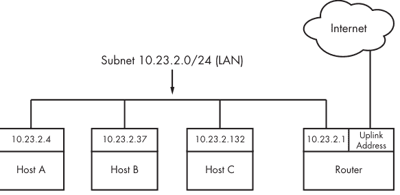

图 9-2：带有 IP 地址的网络

从技术上，IP 地址由 4 个字节（或 32 位）abcd组成。字节 a 和 d 是 1 到 254 之间的数字，b 和 c 是 0 到 255 之间的数字。计算机以原始字节处理 IP 地址。然而，对于人类来说，读写点点分四位地址（如 10.23.2.37）比写像十六进制 0xA170225 这样的难看数字容易得多。

IP 地址类似于邮政地址。要与另一个主机通信，你的机器必须知道另一个主机的 IP 地址。让我们看看你机器上的地址。

## 9.3.1 查看电脑的 IP 地址

一个可以有多个 IP 地址。要查看 Linux 机器上活动的地址，请运行

```
$ ifconfig
```

可能会有很多输出，但它应该包含如下内容：

```
eth0 Link encap:Ethernet Haddr:10:78:eb:76:97

inet addr:10.23.2.4 Broadcast:10.23.2.255 Mask:255.255.255.0

inet6 addr:fe80::1278:d2f4:feeb:7697/64 Scope:Link Metric:1

UP BROADCAST RUNNING MULTICAST MTU:1500

RX packets:8907006 errors:0 dropped:0: frame:0

TX packets:6834795 errors:0 dropped:0: carrier:0

collisions:0 txqueuel:1000
```


RX bytes:86427623613 (86.4 GB) TX bytes:23437688605 (23.4 GB)

Interrupt:20 Memory:fe500000:fe520000

```
config 输出包含了来自网络层和物理层的许多细节。（有时它甚至不包含 Internet 地址！）我们稍后会详细讨论输出，但现在请关注第二行，它报告该主机配置了 IPv4 地址 (inet addr) 10.23.2.4。在同一行中，Mask（掩码）被报告为 255.255.255.0。这是一个子网掩码，定义了 IP 地址所属的子网。让我们看看它是工作的。

`ifconfig` 命令以及你将在本章后面看到的其他命令（如 `route` 和 `arp`）在技术上已经被较新的 `ip` 命令所取代。`ip` 命令可以执行比旧命令更多的操作，而且在编写脚本时更为优选。然而，大多数人在手动操作网络时仍然使用旧命令，而且这些命令也可以在其他版本的 Unix 上上用。由于这个原因，我们将使用旧风格的命令。

## 9.3.2 子网

子网是一组连接的主机，其 IP 地址按某种顺序排列。通常，这些主机位于同一个物理网络上，如图 9-2 所示。例如，10.23.2.1 和 10.23.2.254 之间的主机可以组成一个子网，正如 10.23.1.1 到 10.23.255.254 之间的所有主机一样。

你通过两个部分定义子网：网络前缀和子网掩码（如上一节 `ifconfig` 输出中的）。假设你想创建一个包含 10.23.2.1 到 10.23.2.254 之间 IP 地址的子网。网络前缀是子网中所有地址共有的部分；例如，它是 10.23.2.0，而子网掩码是 255.255.255.0。让我们看看为什么这些是正确的数字。

目前还不清楚前缀和掩码是如何协同以提供子网上所有可能的 IP 地址的。查看二进制形式的数字有助于澄清。掩码标记了 IP 地址中与子网共有的位。例如，这里是 10.23.2.0 和 255.255.255.0 的二进制形式：

```
10.23.2.0: 00001010 00010011 00000000
255.255.255.0: 11111111 11111111 11111111
```

现在，让我们用**粗体**标记 10.23.2.0 中位于 255.255.255.0 中的位位置：

```
10.23.2.0: 00001010 00010111 00000000
```

看未加粗的位。你可以将这些位中的任何数量设置为 1，以获得该子网中的有效 IP 地址，除了全 0 或全 1 之外。结合这一切，你可以看到 IP 地址 10.23.2.1 和子网掩码 255.255.255.0 与任何以 10.23.2 开头的计算机处于同一子网。你可以将整个子网表示为 10.23.2.0/255.255.255.0。

## 9.3.3 常见子网掩码和 CIDR

如果你足够，你只会处理像 255.255.255.0 或 255.255.0 这样的简单子网掩码，但你可能不幸地遇到像 255.255.255.192 这样的，确定属于子网的地址并不简单。此外你可能遇到另一种子网表示形式，称为无类域路由 (CIDR)，其中像 10.23.2.0/255 写为 10.23.2.0/24。

要理解这意味着，请查看二进制形式的掩码（如上一节所示）。你会发现所有网络都是一组 1 后面跟着一组 0。CIDR 表示法通过前导 1 的数量来识别子网。因此，像 10.23.2.0/24 的组合包含了前缀和它的子网掩码。

表 9-1 显示了几个示例子网掩码及其 CIDR 形式。

| 长格式 | CIDR 形式 |
| :--- | :--- |
| 255.0.0.0 | 8 |
| 255.255.0.0 | 16 |
| 255.255.240.0 | 12 |
| 255.255.255.0 | 24 |
| 255.255.255.192 | 26 |

> 注意：如果你不熟悉十进制、二进制和十六进制之间的转换，可以使用 `bc` 计算工具进行转换。例如，在 `bc` 中，你可以运行 `obase=2; 24` 以二进制形式打印 24。

识别子网及其主机是理解 Internet 如何工作的第一步。然而你仍然连接子网。

## 9.4 路由和内核路由表

连接子网主要是识别连接到多个子网的主机。回到图 9-2，考虑 IP 地址为 10.23.2.4 的主机 A。此主机连接到 10.23.2.0/24 本地网络，可以直接访问该网络上的主机。要访问 Internet 其他部分的主机，它必须通过 10.23.2.1 路由器通信。

Linux 内核如何区分这两种不同的目标？它使用称为路由表的配置来确定路由行为。要显示路由表，使用 `route -n` 命令。对于像 10.23.2.4 这样的主机，你可能会看到：

```
$ route -n
Kernel IP routing table
```

| Destination | Gateway | Genmask | Flags | Metric | Ref | Iface |
| :--- | :--- | :--- | :--- | :--- | :--- | :--- |
| 0.0.0.0 | 10.23.2.1 | 0.0.0.0 | UG | 0 | | eth0 |
| 10.23.2.0 | 0.0.0.0 | 255.255.255.0 | U | 1 | | eth0 |

这里的行包含了路由信息。Destination (目标) 列告诉你是一个网络前缀，目标在 Gateway (网关) 和 Flags (标志) 列的组合上不同。对于 0.0.0.0/0，Flags 列中有 G，这意味着该网络的通信必须通过 Gateway 列中的网关（在这种情况下为 10.23.2.1）。然而，对于 10.23.2.0/24，Flags 中没有 G，表示网络以某种方式直接连接。0.0.0.0 用作 Gateway 的占位符。忽略输出的其他列。

有一个棘手的细节：主机想要向 10.23.2.132 发送内容，它同时匹配路由表中的两条规则：0.0.0.0/0 和 10.23.2.0/24。内核如何知道使用第二个？它选择匹配的最长目标前缀。这就是 CIDR 网络形式特别有用的地方：10.23.2.0/24 匹配，且其前缀长度为 24 位；0.0.0.0/0 匹配，但其前缀长度为 0 位（也就是说，它没有前缀），因此 10.23.2.0/24 的规则优先。

> `-n` 选项指示显示 IP 地址而不是主机和网络名称。这是一个需要记住的有效选项，因为你将在 `netstat` 等其他网络相关命令中使用它。

### 9.4.1 默认网关

路由表中的 0.0.0.0/0 条目具有特殊意义，因为它匹配 Internet 上的任何地址。这是默认路由，而默认路由中（在 `route -n` 输出中）在 Gateway 列下配置的地址就是默认网关。当没有其他规则匹配时，默认路由总是匹配，并且在没有其他选择时使用默认网关。你可以配置一个没有默认网关的主机，但它将无法连接路由表目标之外的主机。

在大多数掩码为 255.255.255.0 的网络中，路由器通常位于子网的地址 1（例如 10.23.2.0/24 中的 10.23.2.1）。因为这仅仅是一种约定，所以可能存在例外。

## 9.5 基础 ICMP 和 DNS 工具

现在是时候查看一些实用的工具来帮助你与主机交互了。这些工具使用了两个特别感兴趣的协议：互联网控制消息协议（ICMP），它可以帮助你排查连接和路由问题；以及域名服务（DNS），它将名称映射到 IP 地址，这样你就不需要记住大量的数字。

### 9.5.1 ping

`ping`（参见 http://ftp.arl.mil/~mike/ping.html）是最基本的调试工具之一。它向主机发送 ICMP 回显数据包，请求其将数据包返回给发送者。如果接收主机收到了数据包并配置了回复，它将返回一个 ICMP 响应。

例如，假设你运行 `ping 10.23.2.1` 并得到以下输出：

```
$ ping 10.23.2.1
PING 10.23.2.1 (10.23.2.1) 56(84) bytes of data.
64 bytes from 10.23.2.1: icmp_req=1 ttl=64 time=1.76 ms
64 bytes from 10.23.2.1: icmp_req=2 ttl=64 time=2.35 ms
64 bytes from 10.23.2.1: icmp_req=4 ttl=64 time=1.69 ms
64 bytes from 10.23.2.1: icmp_req=5 ttl=64 time=1.61 ms
```


第一行表示你正在向 `10.23.2.1` 发送 `56` 字节的数据包（包含头部共 `84` 字节，默认每秒发送一个包），其余行则表示来自 `10.23.2.1` 的响应。输出最重要的部分是序列号（`icmp_req`）和往返时间（`time`）。返回的字节数是数据包的大小加 `8`。（数据包的内容对你并不重要。）

序列号之间的空隙（例如 `2` 和 `4` 之间）通常意味着存在某种连接问题。数据包可能会乱序到达，如果确实如此，说明存在某种问题，因为 ping 每秒只发送一个包。如果响应花费超过 `1` 秒（`1000ms`）才到达，则说明连接极其缓慢。

往返时间是从请求数据包离开时刻到响应数据包到达时刻之间的总流逝时间。如果无法到达目的地，看到数据包的最后一个路由器将向 ping 返回一个 ICMP “不可到达”（`unreachable`）数据包。

在有线局域网上，你应该预期完全没有丢包，且往返时间非常低。（前面的示例输出来自无线网络。）你还应该预期你的网络到 ISP（互联网服务提供商）之间没有丢包，且往返时间相对稳定。

出于安全考虑，并不是并不是所有主机都会响应 ICMP 回显请求数据包，因此你可能会发现可以连接某个主机上的网站，但无法获得 ping 响应。

### 9.5.2 traceroute

当你读到本章后面关于路由的内容时，基于 ICMP 的 `traceroute` 将大有用场。使用 `traceroute host` 查看你的数据包到达远程主机的路径。（使用 `tracer -n host` 将禁用主机名查找。）

`traceroute` 的优点之一是它会返回路由中每一步的返回时间，如下所示所示：

```
4 206.220.243.106 1.163 ms 0.997 ms 1.182 ms

5 204.203.65 1.312 ms 1.12 ms 1.463 ms

6 64.159.125 1.421 ms 1.37 ms 1.347 ms

7 64.159.18 55.642 ms 55.625 ms 55.663 ms

8 209.247.10.230 55.89 ms 55.617 ms 55.964 ms

9 209.244.14.226 55.85 ms 55.726 ms 55.832 ms

10 209.246.29.174 56.419 ms 56.44 ms 56.423 ms
```

此输出显示了第 `6` 和第 `7` 跳之间巨大的延迟跳跃，路由的这可能是某种长距离链路。`traceroute` 的输出可能是不稳定的。例如，响应在某一步超时，但在随后的步骤中又“出现”。原因通常是该路由器拒绝返回 `traceroute` 需要的调试输出，而随后的路由器则乐意返回输出。此外，如果存在正常流量，路由器可能会为调试任务分配较低的优先级。

### 9.5.3 DNS 和 host

IP 地址很难记忆且会发生变化，这就是为什么我们通常使用 `www.example.com` 这样的名称。系统中的 DNS 库会自动处理这种翻译，但有时你必须手动在名称和 IP 地址之间进行翻译。
使用 `host` 命令查找域名背后的 IP 地址：

```
$ www.example.com

www.example.com has 93.184.216.119

www.example.com has IPv6 address 2006:2800:220:6d:26bf:1447:1097:aa7
```

注意两者都有 IPv4 地址 `93.184.216.119` 以及更大的 IPv6 地址。这意味着该主机在下一代互联网中也有地址。
你也可以反向使用 `host`：输入主名的 IP 地址以尝试发现主机名。

当所有机器都是通过线路连接在一起的大型固定设备时，这相对简单：内核执行第 `1` 步，你不需要第 `2` 步，你可以用 `ifconfig` 命令执行第 `3` 步，用 `route` 命令执行第 `4` 步。

要为内核网络接口手动设置 IP 地址和子网掩码，你可以：

```
# ifconfig interface address netmask
```

在这里，`interface` 是接口的名称，例如 `eth0`。当接口启动时，你就可以准备添加路由了，这通常只需设置默认网关：

```
# route add default gw-address
```

`gw-address` 参数是你的默认网关的 IP 地址；它必须位于由你的某个网络接口的地址和掩码设置定义的本地连接子网内。

## 9.8.1 手动添加和删除路由

要删除默认网关，请运行

```
# route del -default
```

你可以通过其他路由覆盖默认网关。例如，假设你的机器位于 `10.23.2.0/24` 子网中，你想访问 `192.168.45.0/24` 子网，并且你知道 `10.23.2.44` 可以作为该子网的路由器。运行此命令将发往 `192.168.45.0` 的流量发送到该路由器：

```
# route add -192.168.45.0/24 gw 10.23.2.44
```

删除路由时不需要指定具体的路由：

```
# route del -192.168.45.0/24
```


现在，在你疯狂配置路由之前，你应该知道折腾路由通常比看起来要复杂得多。例如，你还必须确保 `192.168.45.0/24` 上所有主机的路由都能返回到 `10.23.2.0/24`，否则你添加的第一条路由将是没用的。

通常情况下，你应该为客户端保持越简单越好，设置网络使得主机只需要默认路由。如果你需要多个子网以及在它们之间进行路由的能力，最好让作为默认网关的路由器来完成所有不同本地子网之间的路由工作。（你将在第 9.17 节看到一个示例。）

## 9.9 启动激活的网络配置

我们讨论了手动配置网络的方法，而确保机器网络配置正确的传统方法是让它在启动时运行一个脚本执行手动配置。这归结底是在启动事件链的某处运行 `ifconfig` 和 `route` 工具。许多服务器仍然这样做。

Linux 曾多次尝试标准化启动联网的配置文件。`ifup` 和 `ifdown` 工具就是为了这个——例如，理论上一个启动脚本可以运行 `ifup eth0` 来为 `eth0` 接口运行正确的 `ifconfig` 和 `route` 命令。遗憾的是，不同的发行版对 `ifup` 和 `ifdown` 的实现完全不同，因此它们的配置文件也完全不同。例如，Ubuntu 使用带有 `/etc/network` 中配置文件的 `ifdown` 更新，而 Fedora 则使用其位于 `/etc/sysconfig/network-scripts` 的自己的脚本。

你不需要了解这些配置文件的细节，如果你坚持要手动操作并跳过发行版的配置工具，你可以在 `ifup(8)` 和 `interfaces(5)` 手册页中查找格式。但重要的是，要这种启动激活的配置往往并不被使用。你最会在本地（或 `lo`；见第 9.13 节）网络接口看到它，其他地方没有，因为它太灵活无法满足现代系统的需求。

## 9.10 手动和启动激活网络配置的问题

尽管大多数系统在它们的启动机制中配置网络——许多服务器仍然于此——但现代网络的动态特性意味着大多数机器没有静态（不变的）IP 地址。与其在你的机器上存储 IP 地址和其他网络信息，不如在机器首次连接到该网络时，从本地物理网络上的某处获取这些信息。大多数普通的网络客户端应用程序并不关心你的机器使用什么 IP 地址，只要它能用即可。动态主机配置协议（DHCP，在第 9.16 节描述）工具在典型客户端上执行基础的网络层配置。

然而，情况不止此。例如，无线网络为接口配置增加了额外的维度，如网络名称、身份验证和加密技术。当你回过头来看时，你会发现系统需要一种方法来回答以下问题：

- 如果机器有多个物理网络接口（例如带有有线和无线以太网的笔记本电脑），你如何选择使用哪一个或哪几个？
- 机器应该如何设置物理接口？对于无线网络，这包括扫描网络名称、选择名称以及协商身份验证。
- 一旦物理网络接口连接，机器应该如何设置软件网络层，例如网层？
- 你如何让用户选择连接选项？例如，你如何让用户选择无线网络？
- 如果机器在网络接口上丢失了连接，它应该做什么？

回答这些问题通常是简单的启动脚本无法处理的，而且这样做确实非常麻烦。（注：原文此处存在大量重复，已按翻译要求精简）。

## 9.11.2 与 NetworkManager 交互

大多数用户通过桌面上的小组件与 NetworkManager 交互——它通常是右上角或左下角的图标，用于指示连接状态（有线、无线或未连接）。当你点击该图标时，你会获得多个连接选项，例如无线网络选择和断开当前网络的选项。每个桌面环境都有它们自己的小组件版本，因此它们在每个系统上看起来略有不同。

除了小组件外，还有几个工具可以从 shell 中查询和控制 NetworkManager。要快速获取当前连接状态的摘要，请使用不带参数的 `nmtool` 命令。你会得到接口和配置参数列表。

要从命令行控制 NetworkManager，请使用 `nmcli` 命令。这是一个相当复杂的命令。请使用 `nmcli(1)` 手册获取更多信息。

最后，`nm-online` 工具可以告诉你网络是开启还是断开。如果网络开启，它返回 0；否则返回非零。（有关如何在 shell 脚本中使用退出代码，请参见第 11 章。）

## 9.11.1 NetworkManager 操作

NetworkManager 是一个在启动启动的守护进程。像所有守护进程一样，它监听事件。运行时，NetworkManager 维护两个级别的配置。第一层是硬件设备集合，通常从 `udev` 获取。第二层通过 D-Bus 指定：硬件设备和配置参数。

在激活连接时，NetworkManager 收集所有可用网络设备信息，搜索其连接列表，然后决定尝试哪一个。对于以太网接口，决策如下：

- 1. 如果有线连接，尝试使用它。
- 2. 扫描可用无线网络列表。如果有以前连接过的网络，NetworkManager 将尝试它。
- 3. 如果有多个以前连接过的网络，选择最近的一个。

建立连接后，NetworkManager 会一直维护直到连接丢失、更好的网络可用（例如你插入了网线）或用户强制更改。

## 9.11.3 NetworkManager 配置

NetworkManager 的通用配置目录通常是 `/etc/NetworkManager`，并且有多种配置。通用配置文件是 `NetworkManager.conf`。其格式类似于 XDG 风格的桌面和 Microsoft .ini 文件，采用键值对格式。

参数落入不同的部分。你会发现，几乎每个配置文件都有一个 `[main]` 部分，用于定义要使用的插件。这里有一个简单的示例，激活了 Ubuntu 和 Debian 使用的 `ifupdown` 插件：

```
[main]

plugins=ifupdown,keyfile
```

其他特定于发行版的插件包括 `ifcfg-rh`（用于 Red Hat 风格发行版）和 `ifcfg-suse`（用于 SuSE）。`keyfile` 插件还支持 NetworkManager 的原生配置文件支持。使用该插件时，你可以在 `/etc/NetworkManager/system-connections` 中查看系统的已知连接。

在大多数情况下，你不需要更改 `NetworkManager.conf`，因为最具体的配置选项位于其他文件中。

## 未托管接口

尽管你可能希望 NetworkManager 管理你所有的网络接口，但在某些情况下，你可能希望它忽略某些接口。例如，大多数用户没有理由在 `localhost` (`lo`) 接口上进行任何类型的动态配置，因为配置永远不会改变。你也希望配置此接口，因为基础系统服务通常依赖于它。大多数发行版都会在 `localhost` 之后保留 NetworkManager。

你可以通过插件告诉 NetworkManager 忽略某个接口。如果你在使用 `ifupdown` 插件（例如在 Ubuntu 和 Debian 中），请将接口配置添加到你的 `/etc/network/interfaces` 文件中，然后将 `NetworkManager.conf` 文件中 `[ifupdown]` 部分的 `managed` 的值设置为 `false`：

```
[ifupdown]

managed=false
```

对于 Fedora 和 Red Hat 使用的 `ifcfg-rh` 插件，请在 `/etc/sysconfig/network-scripts` 目录下查找包含 `ifcfg-rh` 文件的行：

```
NM_CONTROLLED=yes
```

如果不存在此行或值设置为 `no`，NetworkManager 将忽略该接口。例如，你会发现 `lo` 在 `ifcfg-lo` 文件中被去激活状态。你也可以指定一个硬件地址进行忽略，如下所示：

```
HWADDR=10:78:d2:eb:76:97
```

如果你既不使用这两种网络配置方案，仍然可以使用 `keyfile` 插件直接在 `NetworkManager.conf` 文件内部使用 MAC 地址指定未托管设备。它的样子如下：

```
[keyfile]

unmanaged-devices=mac:10:78:d2:eb:76:97;mac:1c:65:9dc:b9
```


## 分发 (Dispatching)

NetworkManager 配置的最后一个细节是关于当网络接口启动或关闭时指定额外的系统动作。例如，守护进程需要知道何时在接口上启动或停止监听以便正常工作（在下一节中讨论）。当网络接口状态发生变化时，NetworkManager 会运行 `/etc/NetworkManager/dispatcher.d` 中的所有内容，并带有 `up` 或 `down` 参数。这相对简单直观，但许多发行版有自己的控制方式，因此它们不会在该目录中放置单独脚本。例如，Ubuntu 只有一个名为 `ifdown` 的脚本，它运行在 `/etc/network` 的适当子目录中。与 NetworkManager 配置的其他部分一样，这些脚本的细节并不重要；如果你需要添加或更改，你只需要知道合适的位置。不要害于查看你系统上的脚本。

## 9.12 解析主机名

任何网络配置中的最终任务之一都是使用 DNS 进行主机名解析。你已经看到主机解析会将类似 `www.example.com` 的名称翻译为类似 `10.23.2.1` 的 IP 地址。DNS 与我们目前看到的网络元素不同，因为它位于应用层，完全处于用户空间。从技术上讲，它放在物理层旁边显得有些不，但如果没有适当的 DNS 配置，你的互联网连接实际上毫无用处。没有清醒的人会发布可能会变化的主机 IP 地址，而且记住一堆数字并不容易。像 DHCP 这样的自动网络配置服务，Linux 系统上的所有网络应用程序都会执行 DNS 查询。解析过程通常如下：

- 应用程序调用一个函数来查找主机名后的 IP 地址。该函数位于系统的共享库中，因此应用程序不需要知道其工作原理或或实现是否会更改。
- 当 `/etc/nss.conf` 中的函数运行时运行时，它会根据一组规则（在 `/etc/nss.conf` 中找到）运行，以确定查找的行动计划。例如，规则通常规定在访问 DNS 之前，先检查 `/etc/hosts` 文件中是否有手动覆盖。
- 当函数决定使用 DNS 进行名称查找时，它会咨询额外的配置文件以找到 DNS 服务器。名称服务器以 IP 地址的形式给出。
- 函数向名称服务器（通过网络）发送 DNS 查询请求。
- 名称服务器回复主机名的 IP 地址，函数将此 IP 地址返回给应用程序。

这是简化后的版本。在典型的现代系统中，有更多的参与者试图加速事务并/或增加灵活性。我们现在忽略这些，并仔细观察一下基础部分。

### 9.12.1 /etc/hosts

在系统中，你可以通过 `/etc/hosts` 文件覆盖主机名查找。它通常看起来像这样：

| | |
| :--- | :--- |
| 127.0.0.1 | localhost |
| 10.23.23 | atlantic.example.net |
| 10.23.24 | pacific.example.net |

你几乎总是能看到这个条目。在过去，有一个中央的 hosts 文件供大家复制，随着 ARPANET 的增长，这很快变得不受控。

### 9.12.2 resolv.conf

DNS 服务器的传统配置文件是 `/etc/resolv.conf`。当事情更简单时，典型的 DNS 配置可能如下：

```
search example.com

nameserver 10.0.0.1

nameserver 10.0.0.2
```

`search` 行定义了不完整主机名的规则（例如，`example.com`）。在这里，解析器会尝试查找 `example.com`。但情况通常不再如此简单。

### 9.12.3 缓存与零配置 DNS

传统的 DNS 配置有两个主要问题。首先，本地机器不缓存名称服务器回复，因此频繁的网络访问可能会很慢。为了解决这个问题，许多机器（作为名称服务器）运行一个中间守护进程来拦截名称请求，如果可能返回缓存答案。Linux 中常用的两种守护是 `dnsmasq` 和 `nscd`。你也可以设置 BIND（Unix 名称服务器守护进程）。当你运行名称缓存进程时，通常会在 `/etc/resolv.conf` 文件中看到 `127.0.0.1 (localhost)`。

当你运行名称缓存进程时，跟踪你的配置可能会棘手。默认情况下，`dnsmasq` 拥有 `/etc/dnsmasq.conf`，但你的发行版可能会覆盖它。例如，在 Ubuntu 中，如果你手动设置了由 NetworkManager 激活的接口，你会在 `/etc/NetworkManager/system-connections` 中找到它，因为 NetworkManager 激活连接时，它也会启动配置了 `dnsmasq`。（你可以通过取消 `NetworkManager.conf` 中的 `dnsmasq` 部分来覆盖所有这些）。

传统的名称服务器设置的另一个问题是，如果你可以在不进行大量网络配置的情况下在本地网络上查找，它是特别缺乏活性。例如，如果你在网络上设置了一个网络设备，你会希望能够立即通过名称调用它。这是零配置名称服务系统（如多播 DNS (mDNS) 和简单服务发现协议 (SSDP)）理念的一部分。如果你想在本地网络上查找主机名，只需在网络上广播请求；它会回复地址。这些协议不仅提供了名称解析，还提供了可用服务的信息。

广泛使用的 mDNS Linux 实现是 Avahi。你经常会在 `/etc/nsswitch.conf` 中看到 `md` 选项，我们现在详细查看它。

### 9.12.4 /etc/nsswitch.conf

`/etc/nsswitch.conf` 文件控制系统上名称相关的优先级设置，例如用户和密码信息，但本章我们只讨论 DNS 设置。你系统上的文件应该有这样一行：

```
hosts:      dns
```

...可能的。不要在其中放入任何内容来提高性能；这样做日后会产生副作用。你可以将所有的主机都放在 `/etc/hosts` 一个较小的私有局域网（LAN）中，但通用的原则是，如果某个主机有 DNS 条目，那么它就不应该出现在 `/etc/hosts` 中。（`/etc/hosts` 文件在启动的早期阶段也很有用，那时网络可能不可用。）

DNS 是一个宽泛的话题。如果你对域名有任何负责，请阅读 Cricket Liu 和 Paul Alritz 写的《DNS BIND，第5版》（O'Reilly, 2006）。

## 9.13 本地主机 (localhost)

运行 `ifconfig` 时，你会注意到 `lo` 接口：

```
lo Link encap:Local Loopback
inet addr:127.0.0.1 Mask:255.0.0.0
inet6 addr ::1/128 Scope:Host
UP LOOPBACK RUNNING MTU:1636 Metric:1
```

`lo` 接口是一个虚拟网络接口，称为回环接口（loopback），因为它“回环”到自身。效果是连接到 `127.0.0.1` 相当于连接到你正在使用的机器。当发往本地主机的传出数据到达 `lo` 网络接口时，内核将其重新封装为入站数据并通过 `lo` 发回。

回环接口是你在启动脚本中唯一可以看到静态网络配置的地方。例如，Ubuntu 的 `ifup` 命令读取 `/etc/network/interfaces`，而 Fedora 使用 `/etc/sysconfig/network-interfaces-if-lo`。你通常可以通过通过 `grep` 搜索 `/etc` 目录来找到回环设备的配置。

## 9.14 传输层：TCP、UDP 和服务

到目前为止，我们已经看到了数据包是如何从主机移动到互联网的——换句话说，就是本章开头提到的“去往哪里”的问题。现在让我们开始回答“是什么”的问题。了解你的计算机如何将从其他主机接收到的数据包发送到其正在运行的进程是非常重要的。对于用户空间程序来说，处理内核可以处理的一堆原始数据包既困难又不方便。灵活性在商业上非常重要：多个应用程序应该能够同时与网络通信（例如，你可能运行着几个 Web 客户端）。

传输层协议桥接了互联网原始数据包与应用程序精细需求之间的差距。两种最流行的传输层协议是传输控制协议 (TCP) 和用户数据报协议 (UDP)。我们将重点关注 TCP，因为它是最常用的协议，但我们也会查看 UDP。

### 9.14.1 TCP 端口和连接

TCP 通过网络端口为单台机器上的多个网络应用程序提供支持。端口仅仅是一个数字。如果说 IP 地址是公寓楼的邮政地址，那么端口就像邮箱箱号——它是进一步的细分。

当使用 TCP 时，应用程序会在其本地机器上的一个端口与远程主机上的一个端口之间建立一个连接（不要与 NetworkManager 的连接混淆）。例如，像网络浏览器这样的应用程序可以在其本地机器上的 36406 端口与远程主机上的 80 端口之间建立连接。从应用程序的角度来看，端口 36406 是本地端口，端口 80 是远程端口。

你可以通过一对 IP 地址和端口号来识别一个连接。使用 `netstat` 查看你机器上开启的连接。这里有一个显示 TCP 连接的示例：`-n` 选项禁用主机名（DNS）解析，`-t` 将输出限制为 TCP。

```


`$ netstat -nt`

Active connections (w/o servers)

Proto Recv-Q Send-Q Local Address Foreign Address State

tcp 0 0 10.23.2.4:47626 10.194.79:125222 ESTABLISHED

tcp 0 0 10.23.2.4:41475 172.19.52.144:6667 ESTABLISHED

tcp 0 0 10.23.2.4:57132 192.168.231.135:22 ESTABLISHED

`Local Address`（本地地址）和 `Foreign Address`（远程地址）字段从你机器的角度显示了连接，该机器在 `10.23.2.4` 有一个接口，本地侧的端口 47626、41475 和 57132 均已连接。这里的连接显示端口 47626 连接到 `10.194.79.125` 的 5222 端口。

### 9.14.2 建立 TCP 连接

要建立传输层连接，一台机器上的进程会通过一系列数据包从其本地端口之一向第二台主机的某个端口发起连接。为了识别入站连接并响应，第二台主机必须在该端口上有一个正在监听的进程。通常，连接的进程被称为客户端，监听者被称为服务器（第 10 章将有更多介绍）。

关于端口需要了解的重要点是，客户端在其侧选择一个当前未被使用的端口，但它几乎总是连接到服务器端的某个已知端口。回想上一节中 `netstat` 命令的输出：

```
Proto Recv-Q Send-Q Local Address Foreign Address State
tcp 0 0 10.23.2.4:47626 10.194.79:125222 ESTABLISHED
```

这里的连接显示端口 47626 连接到 `10.194.79.125` 的 5222 端口（注：此处示例数据与上文略有出入，但逻辑一致）。

你好！今天过得怎么样？

源主机将消息拆分为数据包。

| 序: 1 | 序: 2 | 序: 3 | 序: 4 | 序: 5 |
|---|---|---|---|---|
| 你好 | 吗 | 过 | 天 | ？ |

互联网将数据包传输到目的地。

数据包到达目的主机（不一定按照传输的顺序到达）。

| 序: 1 | 序: 2 | 序: 4 | 序: 3 | 序: 5 |
|---|---|---|---|---|
| 你好 | 吗 | 天 | 怎么样 | ？ |

目的主机从数据包中重组消息。

图 9-3：使用 TCP 发消息

本章的其余部分将涉及更高级的网络主题，例如网络过滤和路由器，这些主题与我们已经过的底层网络层相关：物理层、网络层和传输层。如果你愿意，可以随时跳到下一章，查看应用层，在那里，一切在用户空间中汇合。你将看到真正使用网络的进程，而不仅仅是到处丢弃地址和数据包。

## 9.15 重新回顾简单的本地网络

我们现在将查看第 9.3 节引入的简单网络的额外组件。回想一下，这个网络由一个子网的局域网和一个将子网连接到互联网其他部分的路由器组成。你将学习以下内容：

- 子网上的主机如何自动获取网络配置
- 如何设置路由
- 路由器到底是什么
- 如何知道为子网使用哪些 IP 地址
- 如何设置防火墙以过滤掉来自互联网的无效流量

让我们从学习子网上的主机如何自动获取其网络配置开始。

## 9.16 理解 DHCP

当你将网络主机设置为从网络自动获取其配置时，你实际上是在告诉它使用动态主机配置协议（DHCP）来获取 IP 地址、子网掩码、默认网关和 DNS 服务器。除了不需要手动输入这些参数外，DHCP 对网络管理员还有其他优势，例如防止 IP 地址冲突并最大限度地减少网络变化的影响。看到不使用 DHCP 的网络非常罕见。

为了让主机通过 DHCP 获取配置，它必须能够通过其连接的网络向 DHCP 服务器发送消息。因此，每个物理网络都应该有自己的 DHCP 服务器，而在简单网络（如第 9.3 节中的网络）中，路由器通常充 DHCP 服务器。

> 在发送初始 DHCP 请求时，主机甚至不知道 DHCP 服务器的地址，因此会将请求广播给所有主机（通常是其物理网络上的所有主机）。

当机器向 DHCP 服务器请求 IP 地址时，它实际上是在请求一段特定时间内的地址租约。当租约到同时，客户端可以请求续租租约。

### 9.16.1 Linux DHCP 客户端

尽管有许多不同的网络管理系统，但几乎所有的互联网软件联盟 ISC 客户端程序都执行实际工作。你可以在命令行中测试 `dhclient`，但在此之前，你必须移除任何默认网关路由。要运行测试，只需指定网络接口名称（这里是 `eth0`）：

```bash
# dhclient eth0
```


启动时，`dhclient` 将其进程 ID 存储在 `/var/run/dhclient.pid`，并将租约信息存储在 `/var/state/dhclient.leases` 中。

### 9.16.2 Linux DHCP 服务器

你可以让 Linux 机器运行 DHCP 服务器，这对它发出的地址提供了很好的控制。然而，除非你正在管理一个具有许多子网的大型网络，否则你可能使用内置 DHCP 服务器的专用路由器硬件更好。

关于 DHCP 服务器可能最重要的一点是，你希望同一个子网上只运行一个，以避免 IP 地址冲突或配置错误的问题。

## 9.17 配置 Linux 为路由器

路由器本质上只是具有多个物理网络接口的计算机。你可以轻松地将 Linux 机器配置为路由器。
例如，假设你有两个局域网子网：`10.23.2.0/24` 和 `192.168.45.0/24`。为了连接它们，你有一个拥有三个网络接口的 Linux 路由器：两个用于局域网子网，一个用于互联网上行，如图 9-4 所示。如你所见，这与在本章其余部分使用的简单网络示例没有太大。

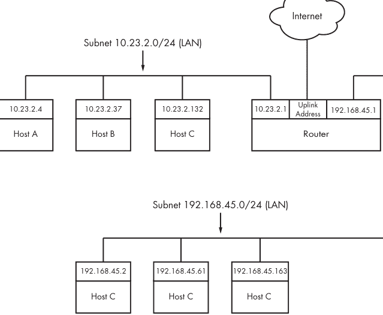

图 9-4：通过路由器连接的两个子网

路由器用于局域网子网的 IP 地址为 `10.23.2.1` 和 `192.168.45.1`。当配置这些地址时，路由表看起来像这样（接口名称可能会变化；暂时忽略互联网上行链路）：

| 目的 | 网关 | 掩码 | 标志 | 标量 | 引用 | 接口 |
| --- | --- | --- | --- | --- | --- | --- |
| 10.23.2.0 | 0.0.0.0 | 255.255.255.0 | U | 0 | 0 | eth0 |
| 192.168.45.0 | 0.0.0.0 | 255.255.255.0 | U | 0 | 0 | eth1 |

局域网子网的路由器 IP 地址是 `10.23.2.1` 和 `192.168.45.1`。当配置这些地址后，路由表看起来如下（接口名称可能会变化；暂时忽略互联网上行链路）：

现在，假设局域网上的主机将路由器作为默认网关。

为了让此更改生效，你需要在内核中启用转发：

```bash
# sysctl -w net.ipv4.ip_forward=1
```


为了重启后依然有效，你可以将其写入`/etc/sysctl.conf`。根据你的发行版，你可能需要将其放入`/etc/sysctl.d/`。

一旦执行此命令，路由器将开始在子网之间移动数据包。默认情况下，Linux 内核不会自动移动数据包。

为了提供互联网连接，需要在路由器上使用网络地址转换（NAT）。

路由器知道私有网络包如`10.23.2.4`这样的 IP 地址在互联网上是不可见的，因此如果没有帮助，私有网络上的主机无法与外部世界通信。连接互联网的路由器（具有真实的、非私有的地址）需要某种方式来缩小连接与私有网络之间的鸿沟。

为了让此更改生效，你需要在内核中启用转发：

```bash
# sysctl -w net.ipv4.ip_forward=1
```

为了重启后依然有效，你可以将其写入`/etc/sysctl.conf`。根据你的发行版，你可能需要将其放入`/etc/sysctl.d/`。

一旦执行此命令，路由器将开始在子网之间移动数据包。默认情况下，Linux 内核不会自动移动数据包。

为了提供互联网连接，需要在路由器上使用网络地址转换。

路由器知道私有网络包如`10.23.2.4`这样的 IP 地址在互联网上是不可见的，因此如果没有帮助，私有网络上的主机无法与外部世界通信。连接互联网的路由器（具有真实的、非私有的地址）需要某种方式来缩小连接与私有网络之间的鸿沟。

- 4. 当路由器获得连接时，它向原始内部主机返回一个伪造的“连接已建立”消息。
- 5. 此时路由器成为了内部主机和目的地之间的中间人。目的地对内部主机一无所知；远程主机上的连接看起来就像是来自路由器的。

这并不像听起来那么简单。普通的 IP 路由在网络层只知道源 IP 地址和目的 IP 地址。然而，如果路由器只处理网络层，那么网络上的每个主机同时只能对单个目的地建立一个连接（此外还有其他限制），因为数据包的 IP 层部分中没有信息可以区分来自同一主机到同一目的地的多个并发请求。因此，NAT 必须跨越网络层并拆解数据包，以提取更多标识信息，特别是传输层中的 UDP 和 TCP 端口号。UDP 相对简单，因为它有端口但没有连接，但 TCP 传输层非常复杂。

为了让一台 Linux 机器充当 NAT 路由器，你必须在内核配置中激活以下所有功能：网络包过滤（“防火墙支持”）、连接跟踪、`IP tables`、全 NAT 以及 `MASQUERADE` 目标。大多数内核都带有了这些支持。

接下来，你需要运行一些看起来复杂的 `iptables` 命令，让路由器为其私有子网进行 NAT。这里有一个适用于 `eth0` 内部以太网网的示例（你将在 9.21 节中学习更多 `iptables` 语法）：

```
# sysctl -w net.ipv4.forward
# iptables -P FORWARD DROP
# iptables -t nat -A POSTROUTING -o eth0 -j MASQUERADE
# iptables -A FORWARD -i eth0 -o eth0 -m state --ESTABLISHED,RELATED -j ACCEPT
# iptables -A FORWARD -i eth0 -o eth0 -j ACCEPT
```

尽管 NAT 在实践中运行良好，但请记住，它本质上是一种用于扩展 IPv4 地址空间寿命的黑科技（hack）。在一个完美的世界里，我们都应该使用 IPv6（下一代互联网），并使用其更大、更复杂的地址空间，而没有任何痛苦。

除非你正在开发自己的软件，否则你不需要使用上述命令，特别是现在有这么多专用的路由器硬件可用。但 Linux 在网络中的作用并不仅于此。

# 9.20 路由器与 Linux

在宽带早期，需求不大的用户只需将机器直接连接到互联网。但没过多久，许多用户就想让自己的网络共享单条宽带连接，特别是 Linux 用户，他们经常设置一台额外的机器作为运行 NAT 的路由器。

制造商通过提供路由器硬件来响应这一新市场，这些硬件由高效的处理器、一些闪存和几个网络端口组成——其功率足以管理典型的简单网络、运行 DHCP 服务器等重要软件并使用 NAT。在软件方面，许多制造商转向使用 Linux 来驱动他们的路由器。他们添加了必要的内核功能，精简了用户空间软件，并创建了基于 GUI 的管理界面。

几乎在这些路由器中第一个出现后，就有许多人兴趣深入研究硬件。其中一家名为 Linksys 的制造商被根据其组件之一的许可条款发布了软件源代码，随后诸如 OpenWrt 等针对路由器的特殊 Linux 发行版应运而生。这些名称中的“WRT”来自 Linksys 的型号数字。

除了爱好者的角度外，使用这些发行版也有充分的理由：它们通常比厂商固件更稳定，特别是在旧硬件上，而且它们通常会提供额外功能。例如，为了桥接带有无线连接的网络，许多制造商要求你购买匹配的硬件，但安装了 OpenWrt 后，硬件的厂商和年龄就不重要了。这是因为你在路由器上使用了一个真正开放的操作系统，只要硬件被支持，它不在乎你使用什么硬件。

你可以利用书中的许多知识来检查自定义 Linux 固件的内部结构，你会遇到差异，特别是在登录时。对于许多嵌入式系统，开放固件倾向于使用 BusyBox 来提供许多 shell 功能。`BusyBox` 是一个单一的可执行程序，为许多 Unix 命令（如 shell、`ls`、`grep`、`cat` 和 `noe`）提供有限的功能（这节省了大量的内存）。此外，嵌入式系统的启动时意图通常非常简单。然而，你通常不会发现这些限制成为问题，因为自定义 Linux 固件通常包含一个与厂商类似的 Web 界面。

# 9.21 防火墙

路由器应该始终包含某种防火墙，以防止不受欢迎的流量进入你的网络。防火墙是一种软件/硬件配置，通常位于互联网和较小网络之间的路由器上，试图确保来自互联网的“坏”流量不会损害较小网络。你也可以为每台机器设置防火墙功能，让机器在数据包级别筛选其所有进入和离开的数据（与应用层相反，服务器程序会尝试执行自己的访问控制）。单台机器上的防火墙有时被称为过滤。

系统在以下情况下可以过滤数据包：

- 接收数据包
- 发送数据包，或
- 转发（路由）到另一个主机或网关。

如果没有防火墙，系统只会处理数据包并将它们发送出去。防火墙在上述数据传输点设置数据包检查站。检查站丢弃、拒绝或接受数据包，通常基于以下某些标准：

- 源或目的 IP 地址或子网
- 源或目的端口（传输层中）
- 源或目的接口

## 9.21.1 Linux 防火墙基础

在 Linux 中，你可以在链中创建规则。有许多表——每个表都有自己的链——数据包流可能会变得非常复杂。然而，你主要处理一个名为 `filter` 的表。`filter` 有三个基本链：`INPUT` 用于输入数据包，`OUTPUT` 用于输出数据包，`FORWARD` 用于路由数据包。

图 9-5 和 9-6 显示了规则在 `filter` 表中的应用。之所以有两个图，是因为数据包可以从网络进入（图 9-5）或由本地进程生成（图 9-6）。如你所示，来自网络的输入数据包可能被用户进程消费，而不到达 `FORWARD` 链或 `OUTPUT` 链。由用户进程生成的数据包不会到达 `INPUT` 或 `FORWARD` 链。

这变得更加复杂，因为除了这三个链之外还有许多步骤。例如，数据包受到 `PREROUTING` 和 `POSTROUTING` 链的影响，链处理也可以发生在三个低级网络层的任何位置。要获得包含所有情况的大图，可以在互联网上搜索“Linux netfilter packet flow”，但记住这些图表试图包含所有可能的场景。通过数据包源拆分图表（如图 9-5 和 9-6）通常会有帮助。

> 有一个名为 `nftables` 的新系统目标是取代 `iptables`，但截至目前，`iptables` 是主流系统。

## 9.21.2 设置防火墙规则

让我们看看 `iptables` 系统在实践中是如何工作的。首先使用此命令查看当前配置：

```
iptables -L
```

输出通常是一个空链集，如下：

| Chain INPUT (policy ACCEPT) | 目的 |
| :--- | :--- |
| target opt source | |
| Chain FORWARD (policy ACCEPT) | 目的 |
| target opt source | |
| Chain OUTPUT (policy ACCEPT) | 目的 |
| target opt source | |

每个防火墙都有一个默认策略，用于指定当没有规则匹配数据包时该如何处理该数据包。本示例中所有三个链的策略都是 `ACCEPT`，这意味着内核允许数据包通过内核过滤系统。`DROP` 策略告诉内核丢弃数据包。若要在链上设置策略，请像这样使用 `iptables -P`：

```bash
# iptables -P FORWARD DROP
```


在读完本节剩余内容之前，请不要对你机器上的策略进行任何轻率的操作。

假设有一个来自 `192.168.34.63` 的人让你感到困扰。为了防止他们与你的机器通信，请运行此命令：

```bash
# iptables -A INPUT -s 192.168.34.63 -j DROP
```

- `INPUT` 参数向 `INPUT` 链添加了一条规则。
- `-s 192.168.34.63` 指定了规则中的源 IP 地址，而 `-j DROP` 告诉内核丢弃任何匹配该规则的数据包。因此，你的机器将丢弃任何来自 `192.168.34.63` 的数据包。

要查看结果，请运行 `iptables -l`：

| Chain INPUT (policy ACCEPT) | | |
| :--- | :--- | :--- |
| target prot source destination |
| DROP | all -- 192.168.34.63 | anywhere |

遗憾的是，你位于 `192.168.34.63` 的朋友让你子网中的所有人都连接了你的 SMTP 端口（TCP 端口 `25`）。为了也消除这些流量，请运行

```bash
# iptables -A INPUT -s 192.168.34.0/24 -p tcp --destination-port 25 -j DROP
```

此示例还为源地址添加了掩码限定符 `-p tcp` 以仅指定 TCP 数据包。进一步的限制 `--destination-port 25` 表示该规则仅适用于 `25` 端口的流量。`INPUT` 的 IP 表列表看起来如下：

| Chain INPUT (policy ACCEPT) | | |
| :--- | :--- | :--- |
| target prot source destination |
| DROP | all -- 192.168.34.63 | anywhere |
| DROP | tcp -- 192.168.34.0/24 | anywhere tcp dpt:smtp |

一切正常，直到你收到来自 `192.168.34.37` 的某人的消息，说他们无法向你发送邮件，因为你封锁了他们的机器。认为这是一个快速解决办法，运行此命令：

```bash
# iptables -A INPUT -s 192.168.34.37 -j ACCEPT
```

然而，并没有生效。要查看原因，请查看新的链：

| Chain INPUT (policy ACCEPT) | prot source destination |
| :--- | :--- | :--- |
| DROP | all 192.168.34.63 | anywhere |
| DROP | tcp 192.168.34.0/24 | anywhere tcp dpt:smtp |
| ACCEPT | all 192.168.34.37 | anywhere |

内核从上到下读取链，并使用匹配的第一条规则。第一条规则不匹配 `192.168.34.37`，但第二条匹配了，因为它适用于所有来自 `192.168.34.0/24` 的主机，而这第二条规则规定要丢弃数据包（你可能会注意到 `192.168.34.37` 可以向你机器上的任何端口发送数据包，但 `25` 端口除外，因为第二条规则仅适用于 `25` 端口。）

解决方案是将第三条规则移动到顶部。首先，使用此命令删除第三条规则：

```bash
# iptables -D INPUT 3
```

然后使用 `iptables` 在链的顶部插入：

```bash
# iptables -I INPUT -s 192.168.34.37 -j ACCEPT
```

若要在链的其他处插入规则，请在链名后加上规则编号（例如 `iptables -I INPUT 4`）。

## 9.21 防火墙策略

虽然上面的教程展示了如何插入规则以及内核如何处理 IP 链，但我们还没有看到真正起 de防火墙策略。让我们来谈谈这个。

防火墙场景基本上有两种基本类型：一种用于保护单台机器（在每台机器的 `INPUT` 链中设置规则），另一种用于保护机器网络（在路由器的 `FORWARD` 链中设置规则）。在在这两种情况下，除非你使用 `ACCEPT` 作为默认策略并持续插入规则来丢弃来自不可信源的数据包，否则你无法获得安全性。要进行设置，首先将 `INPUT` 链策略设置为 `DROP`：

若要启用 ICMP 流量（用于 ping和其他工具），请使用此行：

```bash
# iptables -A INPUT -p icmp -j ACCEPT
```

确保你可以接收到往自己的网络 IP 地址 `127.0.0.1`（localhost）的数据包。假设你的 IP 地址是 `my_addr`，请执行：

```bash
# iptables -A INPUT -s 127.0.0.1 my_addr -j ACCEPT
```

如果你控制整个子网（并信任其上的所有内容），你可以将 `my_addr` 替换为你的子网掩码，例如 `192.168.34.0/24`。现在，尽管你仍然需要确保数据包允许通过，但对于外部世界，你允许所有 TCP 连接的 SYN 数据包：

```bash
# iptables -A INPUT -p tcp --syn
```

接下来，如果你使用远程 DNS，你必须允许来自 DNS 服务器的流量，以便你的机器可以查找 DNS。使用此命令以便在 `/etc/resolv.conf` 中操作（假设 DNS 服务器地址为 `ns_addr`）：

```bash
# iptables -A INPUT -p udp --source ns_addr 53 -j ACCEPT
```

最后，允许来自任何地方的 SSH 连接：

```bash
# iptables -A INPUT -p tcp --destination-port 22 -j ACCEPT
```

上述 `iptables` 设置在许多情况下都有效，包括在转发时使用 `FORWARD` 链。对于高级配置，你可能会发现像 Shorewall 这样的工具很有帮助。

这种讨论仅涵盖了允许策略。此外，IP 防火墙只是安全图中的一部分（你将在下一章看到更多内容）。

## 9.22 以太网、IP 和 ARP

在 IP 在以太网上的实现中，有一个有趣的细节我们需要介绍。回顾一下，为了跨物理层传输数据包，主机必须将 IP 数据包放入以太帧中。同样回顾，帧不包含 IP 信息；它们使用 MAC（硬件）地址。问题是：在构建以太帧时，主机如何知道哪个 MAC 地址对应 IP 地址？

我们通常不需要思考这个问题，因为网络软件包含了一个自动查找 MAC 地址的系统，称为地址解析协议（ARP）。使用以太网作为物理层和网络层的主机维护一个名为 ARP 缓存的小表。在 Linux 中，ARP 缓存位于内核中。要查看机器的 ARP 缓存，请使用 `arp` 命令。在许多其他网络命令中，`-n` 选项执行反向 DNS：

| -n Address | Htype | Haddr | Flags | Iface |
| :--- | :--- | :--- | :--- | :--- |
| 10.1.2.141 | ether | 00:11:32:dc:a0:c2 | C | eth0 |
| 10.1.2.1 | ether | 00:24:a5:b3:00:11 | C | eth0 |
| 10.1.2.50 | ether | 00:0c:41:f6:16:99 | C | eth0 |

当机器启动时，其 ARP 缓存是空的。那么这些 MAC 地址是如何进入缓存的呢？起始于机器想要向另一台主机发送数据包。如果目标 IP 不 ARP 缓存中，会发生以下步骤：

1. 源主机创建一个特殊的以太帧，其中包含一个 ARP 请求数据包，请求目标 IP 地址对应的 MAC 地址。
2. 源主机在整个子网的物理范围内广播此帧。
3. 如果子网中的某个主机知道正确的 MAC 地址，它将创建一个包含地址的响应数据包和帧，并传回源主机。通常回复的主机就是目标主机，它只需自己的 MAC 地址。
4. 源主机将 IP-MAC 地址对添加到 ARP 缓存中，并继续执行。

你与 ARP 可能遇到的唯一真实问题是，当你将 IP 地址从一个网卡移动到另一个时，系统的缓存可能会过期，因为这些网卡具有不同的 MAC 地址（例如，测试某台机器）。Unix 系统在一段时间没有活动后会失效 ARP 缓存条目，因此除了失效数据会导致短暂的延迟外，不应该有任何问题，但你可以使用此命令删除 ARP 缓存条目：

```
$ arp -d host
```

你可以使用以下命令查看单个网络接口的 ARP 缓存：

```
$ arp -i interface
```


`arp(8)` 手页解释了如何手动设置 ARP 缓存条目，但你通常不需要这样做。

> 不要将 ARP 与反向地址解析协议（RARP）混淆。RARP 将 MAC 地址转换回主机名或 IP 地址。在 DHCP 流行之前，某些磁盘工作站和其他设备使用 RARP 获取配置，但 RARP 在如今已很罕见了。

# 9.23 无线以太网

从原理上讲，无线以太网（“WiFi”）网络与有线网络没有太大区别。与任何有线硬件一样，它们拥有 MAC 地址并使用以太网帧来传输和接收数据，而且 Linux 内核处理无线网络接口的方式与处理有线网络接口一样。网络层及以上的所有内容都是相同的；主要的区别在于物理层额外的组件，如频率、网络 ID、安全性等。

与网络硬件不同（网络硬件非常擅长自动适应物理设置中的细微差别而无需费费精力），无线网络配置要更具开放性。为了让无线接口正常工作，Linux 需要额外的配置工具。

**传输细节** 这些是物理特性，例如射电频率。

**网络识别** 由于多个网络可以共享相同的物理介质，你必须对它们进行区分。SSID（服务点集标识符，也称为“网络名称”）是无线网络的标识符。

**管理** 虽然可以配置无线网络让主机直接通信，但大多数网络由一个或多个接入点（Access Points）管理，所有流量都通过接入点。接入点通常将无线网络与有线网络桥接，使两者看起来像一个单一网络。

**验证** 你可能希望限制对无线网络的访问。为此，你可以配置接入点在与客户端通信之前要求密码或其他认证密钥。

**加密** 除了限制对无线网络的初始访问外，你通常希望加密所有通过无线电发出的流量。

处理这些组件的 Linux 配置和工具分布在多个领域。有些位于内核中：Linux 提供了一套无线扩展，标准化了用户空间对硬件访问。对于用户空间而言，无线配置可能会变得复杂，因此大多数人倾向于使用 GUI 前端（例如 `NetworkManager` 的桌面小组件）来让功能运行。看看背后发生的一些事情是值得的。

# 9.2.1 iw

你可以使用一个名为 `iw` 的工具查看和更改内核空间的设备和网络配置。使用 `iw` 时，通常需要知道设备的网络接口名称，如 `wlan0`。以下是一个列出可用无线网络扫描的示例。（如果你在城市地区，会有大量的输出）。

```
# iw dev wlan0
```

网络接口必须处于启动（up）状态此命令才能生效（如果不是，请运行 `ifconfig wlan0 up`），但你不需要配置任何网络层参数，例如 IP 地址。

如果网络接口已加入无线网络，你可以像这样查看网络详情：

```
# iw dev wlan0
```

此命令输出中的 MAC 地址来自你当前正在通信的接入点。

`iw` 命令区分了物理设备名称（如 `phy0`）和网络接口名称（如 `wlan0`），并允许你为每个更改各种设置。你甚至可以为单个物理设备创建多个网络接口。然而，在几乎所有的基础情况下，只需使用网络接口名称。

使用 `iw` 将网络接口连接到不安全的无线网络如下：

```
# iw wlan0 connect network_name
```

连接加密网络是另一回事了。对于相当不安全的有线等效隐私（WEP）系统，你可以使用 `iw connect` 命令的 `keys` 参数。然而，如果你重视安全，就不应该使用 WEP。

# 9.2.3 无线安全

对于大多数无线安全设置，Linux 依赖一个守护进程来管理无线网络接口的验证和加密。该守护进程可以处理 WPA（WiFi 保护访问）和 WPA2 验证方案，以及几乎任何用于无线网络的加密技术。当守护进程首次启动时，它会读取配置文件（默认路径 `/etc/wpa_supplicant.conf`），并尝试根据给定的网络名称向接入点识别身份并建立通信。该系统有完善的文档；特别是 `wpa_supplicant(1)` 和 `wpa_supplicant.conf(5)` 手页非常详细。

在你想要建立连接时运行该守护进程是一项大量工作。事实上，仅仅创建配置文件就因为可能的选项过多而非常繁琐。更糟糕的是，运行 `iw` 和 `wpa_supplicant` 的所有工作仅仅是允许你的系统加入无线物理网络；它甚至没有设置网络层。而像 `NetworkManager` 这样的自动网络配置管理器消除了这一过程中的许多痛苦。尽管它们本身不执行任何工作，但它们知道正确的顺序。

# 9.24 总结

你可以看到，理解各个层的位置和角色对于理解 Linux 如何运行以及如何进行网络配置关重要。尽管我们只涵盖了基础知识，但物理层、网络层和传输层的高级主题与你所看到的相似。在本章看到的大部分操作发生在内核中，并由一些基础的用户工具来操作内核数据结构（如路由表）。这是处理网络的传统方式。然而，由于书中讨论的许多主题，由于任务的复杂性和对灵活性的需求，某些工作并不适合内核，这时就需要用户空间工具接管。特别是 `NetworkManager` 会监控并查询内核，然后操作内核配置。另一个例子是对动态路由协议的支持，如边界网关协议（`BGP`），它被用于大型互联网协议。

但你现在可能对网络配置感到无聊了。让我们转向使用网络——应用层。

## 10 网络应用程序与服务

本章探索基础网络应用程序——运行在用户空间并位于应用层的客户端和服务器。由于这一层位于栈的顶端，靠近终端用户，你可能会发现这些材料比第 9 章的内容更容易理解。事实上，你每天都在与网络浏览器和电子邮件阅读器等网络客户端交互。

为了完成工作，网络客户端连接到相应的网络服务器。Unix 网络服务器有多种形式。服务器程序可以独立监听端口，也可以通过辅助服务器监听。此外，服务器没有通用的配置数据库且具有多种功能。大多数服务器使用操作系统的 syslog 服务进行消息记录。我们将查看一些服务器，以及帮助你理解和调试服务器运行的一些工具。

网络客户端使用操作系统的传输层协议和接口，因此理解 TCP 和 UDP 传输层基础知识非常重要。让我们通过实验一个使用 TCP 的网络客户端来开始观察网络应用。

## 10.1 服务基础

TCP 服务是最容易理解的服务之一，因为它们构建在简单、不间断的双向数据流之上。也许观察它们如何工作的最好方法是与 TCP 端口 80 上的 Web 服务器通信，以了解数据如何在连接中移动的。例如，运行以下命令连接到 Web 服务器：

```
$ telnet www.wikipedia.org 80
```

你应该会得到如下所示响应：

```
Trying some address...

Connected to www.wikipedia.org.

Escape character is '^]'
```

现在输入

```
GET / HTTP/1.0
```

按下两次回车键。服务器应该发送一组 HTML 文本作为响应并终止连接。
这个练习告诉我们：

- 远程主机在 TCP 端口 80 上有一个监听的服务器进程；以及
- `telnet` 是发起连接的客户端。

> 注意
`telnet` 是一个最初用于启用远程主机的程序。虽然非 Kerberos 的 `telnet` 远程登录服务器完全不安全（你稍后会学），但 `telnet` 客户端对于调试远程服务很有用。它不支持 UDP 或 TCP 以外的任何传输层。如果你正在寻找通用的网络客户端，可以考虑第 10.5.3 节介绍的 `netcat`。

### 10.1.1 深入观察

在示例中，你使用 `telnet` 手动与网络上的 Web 服务器进行交互，使用了超文本传输协议（HTTP）应用层。虽然你通常使用浏览器进行这种连接，但让我们比 `telnet` 再向上一步，使用一个知道如何与 HTTP 应用层通信的命令行程序。我们将使用 `curl` 工具的一个特殊选项来记录其通信的细节：

```
$ curl --trace trace_file http://www.wikipedia.org/
```

你的发行版可能没有预装 `curl` 包，但如果有需要，安装它应该没有什么问题。

你会得到大量的 HTML 输出。忽略它（或将其重定向到 `/dev/null`），而是查看新创建的文件 `trace_file`。假设连接成功，文件的第一部分应该类似于以下内容，即 `curl` 尝试与服务器建立 TCP 连接的时间点：

```
= Info: About connect() to www.wikipedia.org port 80 (HO)

== Info: Trying 10.80.154.224... == Info: connected
```

你到为止看到的一切都发生在传输层或更低。然而，如果此连接成功，`curl` 会尝试发送请求（“头部”）；这就是应用层开始的地方：

```
= Send header, 167 bytes (07)

0000: GET / HTTP/1.1

0010: User-Agent: curl/7.22.0 (1686-pc-linux-gnu) libcurl/7.22.0 OpenSSL

0050: SL/1.0.1:zlib/1.2.3 libidn/1.23 librtmp/2.3

007f: Host: www.wikipedia.org

0098: Accept: */
00a5:
```


第一行是 `curl` 调试信息，告诉它下一步要做什么。其余行显示了 `curl` 发送给服务器的内容。粗体文本是你执行的操作；开头的十六进制数字只是 `curl` 调试偏移量，帮助你跟踪发送或接收了多少数据。

你可以看到 `curl` 首先向服务器发出一个 `GET` 命令（就像你用 `telnet` 做的那样），随后是给服务器的一些额外信息和空行。接下来，服务器发送回复，首先是它自己的头部，显示在这里：

```
< Recv header, 17 bytes (0x11)

0000: HTTP/1.1 200 OK

<= Recv header, 16 bytes (0x10)

0000: Server: Apache

<= Recv header, 42 bytes (0x2a)

0000: X-Powered-By: PHP/5.3.10-ubuntu3.9+wmf1

--snap--
```

与之前的输出一样，`<<` 行是调试输出，位于输入行之前，用于告知你偏移量。服务器回复中的头部可能很长，但在某个时刻，服务器会从传输头部切换到发送实际请求的文档，如下：

```
< Recv header, 55 bytes (0x37)

0000: X-Cache: cp1054 hit (16), cp1054 frontend hit (223844)

```

< Recv header, 2 bytes (0x2)
0000:
<= Recv data, 877 bytes (0x3d)
0000:
0008: <!DOCTYPE html>
<html lang="mul" dir="ltr">.head><!---- Sysops:
--snap--

此输出还说明了应用层的一个重要属性。即使调试输出也显示 `Recv header` 和 `Recv data`，这意味着来自服务器有两种不同的消息类型，`curl` 与操作系统检索这两种类型消息的方式没有区别。`SSH` 允许数据登录，`SSH` 允许安全登录、程序执行、文件共享，并使用公密钥加密进行认证和密码。

## 10.2 网络 服务器

大多数网络服务器以多个进程运行。`调用()` 处理网络连接。相比之下，像 `Apache` 等高性能网络服务器在启动时会创建许多工作进程。这种模型有一些例外，原始监听进程在连接关闭时会继续。

以下是你可能会在系统中运行的其他常见的网络服务器：
- `httpd`, `apache`, Web 服务器
- `sshd`, SSH 守护进程（见 10.3 节）
- `postfix`, gmail 邮件服务器
- `cupsd`, 打印服务器
- `nfsd`, 网络文件系统
- `smbd`, Windows 文件共享
- `rpcbind` 远程过程调用端口映射 服务

## 10.3 Secure Shell (SSH)

每个服务器的工作方式略有不同。让我们仔细观察一个——独立的 SSH 服务器。常用的网络应用之一是安全 Shell（`SSH`），它是访问 Unix 机器的事实标准。配置后，`SSH` 允许安全登录、程序执行、文件共享，取代了不安全的 `telnet` 和 `rlogin` 系统。大多数 ISP 和云供应商要求通过 `SSH` 访问服务器，许多基于 Linux 的设备（如 NAS 设备）允许通过 `SSH` 访问。`OpenSSH` (`http://www.openssh.com/`) 是一个流行的 Unix 实现，几乎所有的 Linux 发行版都预装了它。客户端是 `ssh`，服务器是 `sshd`。有两种主要的 SSH 版本：1 和 2。`OpenSSH` 支持两者，但版本 1 很少使用。

在其有用功能和其他其他会话数据中，`SSH` 执行以下操作：

- 加密你的密码和所有其他会话数据，防止窃听。
- 隧道其他网络连接，包括来自 X Window 客户端的连接。你将在第 14 章了解更多 X。
- 为几乎任何操作系统提供客户端。
- 使用密钥进行主机认证。

> 隧道技术是通过另一个网络连接封装并传输一个连接的过程。使用 SSH 隧道连接 的优势是 SSH 会为你设置显示环境并加密隧道内的 X 数据。

`SSH` 也有缺点。例如，为了使用 `SSH` 连接，你需要主机的公钥，而你并不一定是以安全的方式获取它的（尽管你可以检查自己是否被欺骗）。为了了解几种加密方法的工作原理，可以参考 Bruce Schneider 写的《Applied Cryptography: Protocols, Algorithms, and Source Code in C, 2nd edition》（Wiley, 1996）。

两本关于 SSH 的深度书籍是 Michael W. Lucas 写的《SSH Mastery: OpenPuTTY, Tunnels and Keys》（Tilted Windmill Press, 2012）以及 Daniel J. Barrett、Richard E. Silverman 和 Robert G. Byrne 写的《SSH, The Secure Shell, 2nd edition》（O'Reilly, 2005）。

### 10.3.1 SSHD 服务

运行 `ssh` 需要一个配置文件和主机密钥。大多数发行版将配置保存在在 `/etc/ssh/` 配置目录中，如果你安装了 `sshd` 软件包，它会尝试为你配置好所有内容。（文件名 `sshd_config` 容易与客户端的 `ssh_config` 设置文件混淆，请小心。）

你可能不需要更改 `sshd_config` 中的任何内容，但检查一下也无益处。该文件由键值对组成，如下片段所示：

```
Port 22

#ListenAddress 0.0.0.0

#ListenAddress ::

HostKey /etc/ssh/ssh_host_key

HostKey /etc/ssh/ssh_host_rsa_key

HostKey /etc/ssh/ssh_host_dsa_key
```

以 `#` 开头的行是注释，你的 `sshd_config` 中的许多注释指示了默认值。`sshd_config(5)` 帮助页包含所有可能值的描述，但这些是最重要的几个：

- **HostKey**: 用作主机密钥。（稍后将描述主机密钥。）
- **LogLevel level**: 使用 syslog 级别记录消息。
- **PermitRootLogin value**: 如果该值设置为 `yes`，则允许超级用户通过 SSH 登录。设置该值可以防止此操作。
- **SyslogFacility name**: 使用 syslog 设施名称记录消息。
- **X11Forwarding value**: 如果设置为 `yes`，则启用 X Window 系统客户端隧道。
- **XAuthLocation path**: 为 `xauth` 提供路径。没有此路径 X11 隧道将无法工作。如果 `xauth` 不在 `/usr/bin` 中，请将路径设置为 `xauth` 的完整路径。

#### 主机密钥

`OpenSSH` 拥有三组密钥：一组用于协议版本 1，两组用于协议 2。每组密钥都有一个公钥（带有 `.pub` 扩展名）和一个私钥（无扩展名）。不要让任何人看到你的私钥，即使是在自己的系统上，因为如果有人获取了它，你就面临入侵者的风险。

`SSH` 版本 1 仅有 RSA 密钥，而 `SSH` 版本 2 有 RSA 和 DSA 密钥。RSA 和 DSA 是公钥加密算法。密钥文件名见表 10-1。

### 表 10-1：OpenSSH 密钥文件

| 文件名 | 密钥类型 |
|---|---|
| ssh_host_rsa_key | 私 RSA 密钥（版本 2） |
| ssh_host_rsa_key.pub | 公 RSA 密钥（版本 2） |
| ssh_host_dsa_key | 私 DSA 密钥（版本 2） |
| ssh_host_dsa_key.pub | 公 DSA 密钥（版本 2） |
| ssh_host_key | 私 RSA 密钥（版本 1） |
| ssh_host_key.pub | 公 RSA 密钥（版本 1） |

通常情况下你不需要构建密钥，因为 `OpenSSH` 安装程序或你发行版的安装脚本会为你完成，但如果你计划使用如 `ssh-agent` 等程序，你需要知道如何创建密钥。要创建 SSH 协议版本 2 密钥，请使用 `OpenSSH` 中的 `ssh-keygen` 程序：

```
# ssh-keygen -t rsa -N '' -f /etc/ssh/ssh_host_rsa_key

# ssh-keygen -t dsa -N '' -f /etc/ssh/ssh_host_dsa_key
```

对于版本 1 密钥，

```
# ssh-keygen -t rsa1 -N '' -f /etc/ssh/ssh_known_hosts
```


SSH 服务器和客户端还使用名为 `ssh_known_hosts` 的文件，其中包含其他主机的公钥。如果你想使用基于主身份验证，服务器的 `ssh_known_hosts` 文件必须包含所有信任客户端的主机公钥。更换机器时了解密钥非常有帮助。当从头安装新机器时，你可以从旧机器导入密钥文件，以确保用户在连接新机器时不会出现不匹配。

### 启动 SSH 服务器

大多数发行版都带 SSH，但它们通常不会默认启动 `sshd` 服务。在 Ubuntu 和 Debian 上，安装 SSH 服务器软件包会创建密钥、启动服务器并将它们添加到引导配置中。在 Fedora 上，默认安装 `sshd` 但它是关闭的。要在启动时启动 `sshd`，请如下使用 `chkconfig`（这不会立即启动服务器；请使用 `service sshd start` 执行）：

```
# chkconfig sshd on
```

Fedora 通常在首次启动时创建任何缺失的密钥文件。以 root 身份运行 `sshd` 会启动服务器，如果你还没有安装任何支持，`sshd` 在启动时会将 PID 写入 `/var/run/sshd.pid`。

你还可以在 systemd 中作为 socket 或使用 `inet` 启动 `sshd`，但通常不是个好主意，因为服务器有时需要生成密钥文件，这个过程可能耗长时间。

## 10.3.2 SSH 客户端

要登录远程主机，运行

```
$ ssh remote_username@host
```

如果你的本地用户名与主机上的用户名相同，可以省略 `remote_username@`。你还可以运行管道：

```
$ ssh remote_username@host | command
```

最常见的错误消息是：
```
REMOTE HOST IDENTIFICATION HAS CHANGED!

WARNING: RSA KEY@@@@@@ HAS CHANGED!
```
如果你确定拥有网络，可以从你的 `known_hosts` 文件中删除该项。另一个消息是：
```
REMOTE HOST IDENTIFICATION HAS CHANGED!

WARNING: REMOTE HOST KEY@@@@@@ HAS CHANGED!
```

SSH 服务器和客户端还使用一个名为 `known_hosts` 的文件，其中包含其他主机的公钥。如果你想使用基于主机的身份验证，服务器的 `known_hosts` 文件必须包含所有信任客户端的主机公钥。更换机器时了解密钥非常有帮助。当从头安装新机器时，你可以从旧机器导入密钥文件，以确保用户在连接新机器时不会出现不匹配。

### 文件传输客户端

OpenSSH 包括文件传输程序 `scp` 和 `sftp`，它们旨在取代旧的 `rcp` 和 `ftp`。

你可以使用 `scp` 在远程主机之间传输文件，它的用法类似于 `cp` 命令。以下是一些示例：

- `$ scp user@host:file .`
- `$ scp file user@host`
- `$ scp user1@host:file user2@host`

`sftp` 程序类似于命令行 `ftp` 客户端，使用 `put` 命令。远程主机必须安装 `sftp-server` 程序，如果远程主机也使用 OpenSSH，你可以预期。

## 10.4 守护进程

为每个服务实现独立的服务器可能效率低下。每个服务器都需要单独配置以处理端口监听、访问控制和端口配置。大多数服务的这些操作是相同的；只有当服务器接受连接时，处理方式才会有不同。

简化服务器使用的传统方法是使用 `inetd` 守护进程，这是一种超级服务器，旨在标准化服务器程序与网络端口之间的访问和接口。启动 `inetd` 后，它会读取配置文件并在文件中定义的网络端口上监听。当新的网络连接进来时，`inetd` 将新启动的进程附加到连接上。

`inetd` 的新版本 `xinetd` 提供了更简单的配置和更好的访问控制

虽然 `inetd` 不再常用，但它的配置显示了设置服务器所需的所有内容。事实上，`sshd` 也可以 `inetd` 调用而不是作为独立服务器，如下 `/etc/inetd.conf` 配置文件所示：

```
ident      stream tcp nowait root /usr/bin/sshd -i
```

这七个字段从左到右分别是：

- `服务名称` 来自 `/etc/services` 的服务名（见第 9.14.3 节）。
- `Socket 类型` 对于 TCP 通常为 stream，UDP 为 dgram。
- `协议` 传输协议，通常为 tcp 或 udp。
- `数据报服务器行为` 对于 UDP，为 wait（等待）或 nowait（不等待）。使用任何其他传输协议的服务应使用 nowait。
- `用户` 运行服务的用户名。向组组添加 `.group`。
- `可执行文件` `inetd` 应该连接到该服务的程序。
- `参数` 用于可执行文件的参数。第一个参数应该是程序的名称。

## 10.4.1 TCP Wrappers: tcpd, /etc/hosts.allow, 和 /etc/hosts.deny

在低级防火墙流行之前，许多管理员使用 TCP wrapper 库和守护进程对网络服务进行主机控制。在这些实现中，`inet` 运行 `tcpd` 程序，该程序首先检查入站连接以及 `/etc/hosts.allow` 和 `/etc/hosts.deny` 文件中的访问控制列表。`tcpd` 程序记录连接，如果它认为入站连接是安全的，它就会将其交给最终的服务程序。（尽管你可能会发现仍然在使用 TCP wrapper 系统的系统，但我们不会详细介绍，因为它已经在很大程度上被弃用了。）

## 10.5 诊断工具

让我们来看一些用于探测应用层的有用诊断工具。有些工具深入到传输层和网络层，因为应用层中的所有内容最终都会映射到较低层中的某些内容。

正如第 9 章讨论，`netstat` 是一个基础的服务调试工具，可以显示许多传输层和网络层的统计数据。表 10-2 显示了一些查看连接的有用选项。

| 选项 | 描述 |
| --- | --- |
| `-t` | 打印 TCP 端口信息 |
| `-u` | 打印 UDP 端口信息 |
| `-l` | 打印监听端口 |
| `-a` | 打印所有活动端口 |
| `-n` | 禁止域名查找（提高速度；如果 DNS 无法工作也很有用） |

### 10.5.1 lsof

在第 8 章中，你学习了 `lsof` 可以跟踪打开的文件，但它也可以列出正在使用或监听端口的程序。要获取使用或监听端口程序的完整列表，请运行

```bash
# lsof -i
```


当作为普通用户运行时，此命令只显示该用户的进程。当作为 `root` 运行时，输出应该像这样，显示出各种进程和用户：

| COMMAND | PID | USER | FD | TYPE | DEVICE SIZE/OFF NODE NAME |
|---|---|---|---|---|---|---|---|---|
| rpcbind | 700 | root | 6 | IPv4 | 10492 | oto | UDP: *sunprpc |
| rpcbind | 700 | root | 8 | IPv4 | 10508 | oto | TCP: *sunprpc (LISTEN) |
| avahi-daemon | 872 | avahi | 13 | IPv4 | 2173675 | oto | UDP: *mdns |
| cuspd | 1010 | root | 9 | IPv6 | 4232114 | oto | TCP cp6-localhost:ipp (LISTEN) |
| ssh | 14366 | user | 3 | IPv4 | 38995911 | oto | TCP thishost.local:55457 -> |
| something.example.com:ssh | | | | | | | | |
| chromium-26534 | user | 8 | IPv4 | 42525253 | oto | TCP thishost.local:41551 -> |
| another.example.com:https | | | | | | | | |

此示例显示了顶部服务器的用户和进程 ID、多播 DNS 客户端程序、`avahi` 提供的旧式 RPC 服务以及一个支持 IPv6 的打印机服务 (`cuspd`)。最后两项显示了连接：来自 Chromium Web 浏览器的 SSL 连接和安全 Web 连接。由于输出可能非常多，通常最好应用过滤器（如节节讨论）。

`lsof` 程序就像 `netstat` 一样，它尝试将找到的每个 IP 地址反向解析为主机，这会减慢输出速度。使用 `-n` 选项禁用域名解析：

```bash
# lsof -n -i
```

你也可以指定 `-P` 来禁用 `/etc/services` 端口名查找。

### 按协议和端口过滤

如果你正在寻找某个特定的端口（例如，你知道某个进程正在使用特定端口并想知道该进程是什么），使用此命令：

```bash
# lsof -i:port
```

语法如下：

```bash
# lsof -protocol@host:port
```

协议、`@host` 和 `:port` 参数都是可选的，并将相应地过滤 `lsof` 的输出。与大多数网络工具一样，主机和端口可以是名称或数字。例如，如果你只想查看 TCP 端口 80（HTTP 端口）上的连接，请使用

```bash
# lsof -iTCP:80
```

### 按连接状态过滤

一个特别方便的 `lsof` 过滤器是连接状态。例如，要查看监听 TCP 端口的进程，输入

```bash
# lsof -iTCP -sTCP:LISTEN
```

此命令让你对当前运行的进程有一个良好的概览。然而，由于输出可能非常多，通常最好应用过滤器（如节节讨论）。

TCP/UDP 端口、指定本地端口、监听端口、扫描端口、将标准 I/O 重定向到和从网络连接，以及更多。要使用 `netcat` 向某个端口打开 TCP 连接，请运行

```bash
# $ netcat host port
```

`netcat` 只有在连接的另一端结束连接时才会终止，如果你将标准输入重定向到 `netcat`，这可能会让情况变得复杂。你可以随时通过按下 `CTRL-C` 来结束连接。（如果你想让程序和网络连接根据标准输入流终止，请尝试使用 `sock`。）

要监听某个特定端口，请运行

```bash
# $ netcat -1 -p port_number
```

## 10.5.4 端口扫描

有时你并不知道网络上的机器提供哪些服务，或者网络中包含哪些 IP 地址。网络映射器（`Nmap`）会扫描机器或机器网络上的所有端口以寻找开放端口，并列出它找到的端口。大多数发行版都包含 `Nmap` 软件包，或者你也可以从 `http://www.nmap.org/` 获取。（请查看 `Nmap` 手册页和在线资源以了解 `Nmap` 的所有功能。）

在列出你机器上的端口时，从至少两个端口运行 `Nmap` 扫描通常会有帮助：从你自己的机器和另一台机器（可能在你的本地网络之外）。这样做可以让你了解你的防火墙拦截了什么。

> 如果你要扫描你想用 `Nmap` 扫描的网络，请请求权限。网络管理员会监控端口扫描，并通常会禁用对运行扫描的机器的访问。

运行 `nmap host` 对主机进行常规扫描。例如：

```
$ nmap 10.1.2.2

Starting Nmap 5.21 ( http://nmap.org ) at 2015-09-21 16:51 PST

Nmap scan report for (0.00027 latency).

Host is up

Not shown: 993 closed ports

PORT STATE SERVICE

22/tcp open ssh

25/tcp open smtp

80/tcp open http

111/tcp open rpcbind

8800/tcp open unknown

9000/tcp open clistener

9090/tcp open zeus-admin
```

Nmap done: 1 IP address (1 host up) scanned in 0.12 seconds

如你所见，这里有许多开放的服务，其中许多在大多数发行版中默认是不开启的。事实上，这里通常默认开启的只有端口 111，即 `rpcbind` 端口。

## 10.6 远程过程调用 (RPC)

那么你在上一节扫描中看到的 `rpcbind` 服务呢？RPC 代表远程过程调用（remote procedure call），是一个驻留在应用层较低部分的系统。它的设计目的是为了让程序员更容易访问网络应用程序，这种方法利用了程序可以调用远程程序（通过程序编号识别）上的函数，而远程程序返回结果代码或消息。

RPC 实现使用 TCP 和 UDP 等传输协议，它们需要一个特殊的中间服务来将程序编号映射到 TCP 和 UDP 端口。服务器是 `rpcbind`，它必须运行在任何想要使用 RPC 服务的上。

要查看你的计算机运行的 `rpc` 服务，

```
$ rpcinfo -p localhost
```


RPC 是那种就是不愿消失的协议之一。网络文件系统（NFS）和网络信息服务（NIS）系统使用 RPC，但它们对于独立机器来说完全没有必要。每当你认为已经消除了所有对 `rpcbind` 的需求时，就会会有别的情况，例如 GNOME 中的文件访问监器（FAM）支持。

## 10.7 网络安全

由于 Linux 是 PC 平台上非常流行的 Unix 变体，特别是被广泛用于 Web 服务器，它吸引了许多想要侵入计算机系统的不愉快分子。9.21 讨论了防火墙，但这并不是安全性的全部全貌。

网络安全吸引了极端分子——他们真的喜欢侵入系统（为了乐趣或金钱），以及那些想出复杂的保护方案的人，他们非常喜欢让试图破解他们系统的人大汗淋漓。（这同样可能非常获利。）幸运的是，你不需要知道就能保持系统安全。这里有几条规则：

- 运行尽可能少的服务：入侵者可以侵入你系统中不存在的服务。如果你知道某个服务是什么且你没有在使用它，那么不要仅仅因为你可能想在“以后某个时间点”使用它就去开启它。
- 使用防火墙尽可能地拦截：Unix 系统有许多你可能并不知道的内部服务（例如用于 RPC 端口映射服务器的 TCP 端口 `111`），世界上任何其他系统都不应该知道它们。要追踪和监管你系统上的服务可能非常困难，因为许多不同的程序在各种端口上监听。为了防止入侵者发现你系统上的内部服务，请使用有效的防火墙规则，并在路由器上安装防火墙。
- 追踪你向 Internet 提供的服务：如果你运行 SSH 服务器、`Postfix` 或类似服务，请保持软件更新并获取适当的安全警报。（资源请参见第 10.7.2 节。）
- 为服务器使用“长期支持”发行版版本：安全团队通常将工作集中在稳定、支持的发行版上。像 Debian Stable 和 Fedora Rawhide 这样的开发和测试版本受到的关注少得多。
- 不要给任何不需要账户的人提供系统账户：对于任何不需要账户的人，在你的系统中获取超级权限要容易得多。（注：此处原文存在重复错误，已忽略重复部分）。

### 10.7.1 典型漏洞

有两种类需要关注的重要类型：直接攻击和明文嗅探。直接攻击试图通过缓冲区溢出来接管机器。另一种需要关注的攻击是捕获在线路上以明文传输的密码。一旦攻击者获取了你的密码，一切就结束了。

- 完全攻破：这意味着获取超级权限（这比进行远程攻击要容易得多），并将该机器作为攻击主机的中间节点。
- 拒绝服务 (`DoS`)：这强制机器发生故障。
- 恶意软件：Linux 用户对恶意病毒大多免疫。避免从没听过的地方下载软件。

### 10.7.2 安全资源

这里有三个安全网站：

- http://www.sams.org/：提供培训、服务、列出当前漏洞的免费每周时事、示例安全策略等。
- http://www.cert.org/：寻找大多数问题的地方。
- http://www.insecure.org/：这里是获取 Nmap 以及各种漏洞测试工具的地方。

## 10.8 展望

如果你对亲手操作复杂的网络服务器感兴趣，两个非常常见的是 Apache Web 服务器和 Postfix 邮件服务器。特别是 Apache，安装非常简单且大多数发行版提供了一套软件包。如果你的机器位于防火墙或启用了 NAT 的路由器之后，你可以随心所欲地配置实验，而不必担心安全问题。

在过去的几个章节中，我们逐渐从内核空间移动到用户空间。在本章中，只有少数工具（如 `tcpdump`）与内核交互。本章的其余部分描述了套接字（sockets）如何桥接内核传输层与用户空间应用层之间的差距。这是更高级的内容，对程序员特别感兴趣，如果你愿意，可以随时跳到下一章。

## 10.9 套接字：进程如何与网络通信

现在我们将稍微转换一下，看看进程如何从网络读取和向网络写入数据。对于进程来说，对已经建立的连接进行读写是非常容易的：你只需要一些系统调用，你可以在 `recv()` 和 `send()` 手册页中读到它们。从进程的角度来看，可能最重要的信息是如何使用这些系统调用来引用网络。在 Unix 系统上，进程使用套接字来标识它何时以及如何与网络通信。套接字是表示用户空间和内核空间边界的接口。它们经常用于进程间通信（IPC）。

存在不同类型的套接字，因为进程需要不同的方式访问网络。例如，TCP 连接由流套接字（从程序员的角度来看是 `SOCK_STREAM`）表示，UDP 连接由数据报套接字（`SOCK_DGRAM`）表示。

设置网络套接字可能相当复杂，因为需要在特定时刻考虑套接字类型、IP 地址、端口和传输协议。然而，在处理完所有细节后，服务器使用某些标准方法来处理来自网络的入流量。

图 10-1 中的流程图显示了许多服务器如何处理入站流套接字的连接。这种类型的服务器涉及两种套接字：一个监听套接字（listening socket）和一个用于读写的套接字。主进程使用监听套接字寻找来自网络的连接。当一个新连接进来时，主进程使用 `accept()` 系统调用来接受连接，这会创建一个专门用于该连接的读写套接字。主进程创建一个新的子进程来处理该连接。最后，原始套接字继续作为监听器，并代表主进程继续循环等待更多连接。

进程设置好特定类型的套接字后，可以以符合该套接字类型的方式与其交互。这使得它变得非常灵活：如果你需要更改底层传输层，不需要重写所有发送和接收数据的部分；你只需要修改初始化代码。

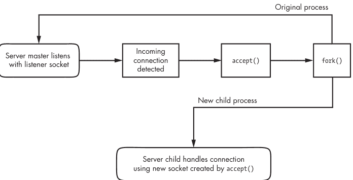

图 10-1：接受和处理入站连接的一种方法

如果你是一名程序员并想学习如何使用套接字接口，由 W. Richard Stephenson、Bill Fenner 和 Andrew M. Rudoff 编写的Unix Network Programming, Volume 1, 3rd edition》（Addison-Wesley Professional, 2003）是经典指南。第二卷也涵盖了进程间通信。

## 10.10 Unix 域套接字

使用网络设施的应用程序不必涉及两个独立的主机。许多应用程序被构建为客户端-服务器或对等机制，运行在同一台机器上的进程使用进程间通信（IPC）来协商需要执行的工作以及由谁来执行。例如，回想一下，如 `systemd` 和 `NetworkManager` 等守护进程使用 DBus 来监控和响应系统事件。

进程可以通过 `localhost` (`127.0.0.1`) 使用普通的 IP 网络进行通信，但通常会使用一种特殊的套接字，我们在第 3 章中提到过，称为 Unix 域套接字（Unix domain socket）。当进程连接到 Unix 域套接字时，其行为几乎与网络套接字完全：它可以在套接字上监听接受连接，你甚至可以在不同的套接字类型之间进行选择，使其表现像 TCP 或 UDP。

> 请记住，Unix 域套接字不是网络套接字，它后面没有网络。你甚至不需要配置网络就可以使用它。而且 Unix 域套接字不必绑定到套接字文件。进程可以创建一个无名的域套接字并与其他进程共享地址。

### 10.10.1 对开发者的优势

开发者喜欢使用 Unix 套接字进行 IPC 有两个原因。首先，它们允许开发者使用文件系统中的特殊套接字文件来控制访问，任何无法访问套接字文件的进程都无法使用它。由于没有与网络交互，它更简单且不容易受到传统的网络入侵。例如，你通常会在 `/var/run/dbus` 中找到套接字文件：

```
$ ls -1 /var/run/dbus/system_bus_socket

srw-rw-rw- 1 root root 0 Nov 08:52 /var/run/dbus/system_bus_socket
```

其次，因为 Linux 内核在处理 Unix 域套接字时不需要经过其网络子系统的层层，性能往往要好得多。
为 Unix 域套接字编写代码与支持普通网络套接字没有太大。由于益处可能是巨大的，某些网络服务器同时通过网络和 Unix 域套接字提供通信。例如，MySQL 数据库服务器 `mysqld` 接受来自远程主机的客户端连接，但它通常在 `/var/run/mysql/mysqld.sock` 提供一个 Unix 域套接字。

### 10.10.2 列出 Unix 域套接字

你可以使用 `lsof -U` 查看系统当前正在使用的 Unix 域套接字列表：

```
# lsof -U

COMMAND PID USER FD TYPE SIZE/OFF NODE NAME

mysql 19701 mysql 12u unix 0xe4defcc0 Oto 3502227 /var/run/mysql/mysqld.sock

chromium- 26534 joker 5u unix 0xeac9b00 Oto 42445141 socket

tlsmgr 30480 postfix 5u unix 0xc3384240 Oto 17009106 socket

tlsmgr 30480 postfix 6u unix 0xe20161c0 Oto 10965 private/tlsmgr

--snip--
```


列表将很长，因为许多现代应用程序大量使用无名套接字。你可以识别出无命名的，因为你会看到它们。


## 11 SHELL 脚本简介

如果你可以在 shell 中输入命令，你就可以编写脚本（也称为 Bourne 脚本）。脚本脚本是写在文件中的命令；shell 就像你手动输入一样读取文件。

### 11.1 Shell 基础

Bourne 脚本通常以以下行开头，它指示 `/bin/sh` 程序执行这些命令。（请确保文件开头没有空格。）

```
#!/bin/sh
```

你可以在 `#!` 行之后列出任何让 shell 执行的命令。例如：

```
#!/bin/sh

# 打印一些，然后运行 ls
```

```
echo 正在运行 ls 命令。
ls
```

行开头的 `#` 字符表示该行是注释；也就是说，shell 会忽略 `#` 之后的所有内容。使用注释来解释脚本的部分。

创建脚本并设置权限后，你可以通过将脚本放在命令路径中的一个目录并在命令行运行来执行它。如果脚本位于当前工作目录，你可以使用 `./script`，或者使用完整路径。

与 Unix 系统上的任何程序一样，你需要为脚本设置执行位，但你也必须设置读取位以便 shell 读取文件。这样做最简单的方法如下：

```
chmod +rx script
```

此 `chmod` 命令允许其他用户读取和执行脚本。如果你不想，请使用绝对模式 `700`（并参阅第 2.17 节）。

### 11.1.1 脚本的局限性

shell 可以相对容易地处理命令和文件。在第 2.14 节中，你看到了 shell 如何重定向输出，这是脚本编程的重要元素之一。然而，脚本只是 Unix 编程的工具之一，尽管脚本很强大，但也有其局限性。

脚本的主要优势之一是可以简化和自动化通常你在 shell 提示符下执行的任务，处理批量文件。但如果你正在解析字符串、重复的算术运算或复杂的数据库，或者需要函数和复杂的控制结构，使用 Python、Perl 或 awk 等脚本语言，甚至是 C 等编译语言会更好。

## 11.2 引用与字面量

在处理 shell 和脚本时，最令感到困惑的元素之一就是何时该使用引号（或*引用符号*）和其他标点符号，以及为什么有时必须这样做。假设你想打印字符串 $100，并执行了以下操作：

```
$ echo $100
```

00

为什么输出的是 00？因为 shell 看到了 `$1`，这是一个 shell 变量（我们很快会介绍它）。所以你可能认为，如果用双引号把它括起来，shell 就会忽略 `$1`。但它仍然不起作用：

```
$ echo "100"
```

00

然后你问了一位朋友，他说你需要使用单引号：

```
$ echo '$100'
```

`$100`

为什么这句特定的咒语起作用了？

### 11.2.1 字面量

当你使用引号时，你通常是在尝试创建一个*字面量*（literal），即一个你希望 shell 原封不动地传递给命令行的字符串。除了你刚刚看到的示例中的 `$` 之外，其他类似的情况还包括你想向像 `grep` 的命令传递一个 `*` 字符而不是让 shell 扩展它，以及你需要在命令中使用分号 (`;`)。

在编写脚本和在命令行工作时，请记住 shell 每运行命令时会发生什么：

- 1. 在运行命令之前，shell 会寻找变量、通配符（globs）和其他替换内容，如果它们出现，就会执行替换。
- 2. shell 将替换结果传递给命令。

涉及字面量的问题可能是微妙的。假设你正在寻找 `/etc/passwd` 中所有匹配正则表达式 `r.*` 的条目（即包含 r 且在行稍后的位置跟着 t 的行，这将允许你搜索用户名为 root、ruth 和 robot 的用户）。你可以运行这个命令：

```
$ grep r.* /etc/passwd
```

它在大多数情况下都是有效的，但有时会神秘地失败。为什么呢？答案可能在你当前的目录中。如果该目录包含名为 `r.*input` 和 `r.output` 的文件，那么 shell 会将 `r.*t` 扩展为 `r.*input r.output`，并创建此命令：

```
$ grep r.*input r.output /etc/passwd
```

避免此类问题的关键在于首先识别可能让你遇到麻烦的字符，然后应用正确的引号来保护这些字符。

### 11.2 单引号

创建字面量并让 shell 忽略字符串的最简单方法是用单引号将整个字符串括起来，如下面的这个使用 `grep` 和 `*` 字符的示例：

```
$ grep '.*t' /etc/passwd
```

对于 shell 而言，单引号之间的所有字符（包括空格）都构成了一个单一参数。因此，以下命令不起作用，因为它是在要求 `grep` 命令在标准输入中查找到字符串 `r.*t /etc/passwd`（因为只有一个参数可以获取）：

```
$ grep r.*t /etc/passwd
```

当你需要使用字面量时，应该始终首先考虑使用单引号，因为你可以保证 shell 不会尝试任何替换。结果是，这是一种整洁的语法。然而，有时你需要一点灵活性，这时就会转用双引号。

### 11.2.3 双引号

双引号 (`"`) 与单引号一样，区别在于 shell 会扩展双引号内出现的任何变量。你可以通过运行以下命令，然后将双引号替换为单引号并再次运行来观察区别。

```
$ echo "There is no * in my path: $PATH"
```

当你运行该命令时，注意 shell 对 `$PATH` 进行了替换，但没有对替换 `*`。

> 注意：如果你在打印大量文本时使用双引号，请考虑使用第 11.9 节描述的“在此文档”（here document）。

### 11.2.4 传递字面量单引号

在 Bourne shell 中字面量时，一个棘手的部分是向命令传递字面量单引号。实现此的一种方法是在单引号字符之前放置一个反斜杠：

```
$ echo I\' like contractions inside shell scripts.
```

反斜杠和引号*必须*出现在任何单引号对之外，并且像 `\'don\'` 这样的字符串会导致语法错误。奇怪的是，你可以将单引号包含在双引号中，如下例所示（输出与前一个命令完全相同）：

```
$ echo "Don't like contractions inside shell scripts."
```

如果你身陷困境，并需要一个通用的规则在不进行任何替换的情况下引用整个字符串，请遵循此步骤：

- 1. 将所有的 '（单引号）替换为 \'（单引号、反斜杠、单引号、单引号）。
- 2. 用单引号将整个字符串括起来。

因此，你可以引用这样一个别拙的字符串：isn't a forward slash: \\

```
$ echo 'is\'t a forward slash: \\'
```

> 值得重复的是，当你引用一个字符串时，shell 将引号内的所有内容视为一个单一参数。因此，a b c 算三个参数，而 "b c" 只有两个。

## 11.3 特殊变量

大多数脚本都能理解命令行参数并与它们运行的命令交互。为了让你的脚本从简单的命令列表变成更灵活的 shell 脚本程序，你需要了解如何使用特殊的 shell 变量。这些特殊变量对于与传递给脚本的参数进行交互特别有用。

> 注意：参见第 2.1 节。

### 11.3.1 个参数

`$1` 表示传递给脚本的第一个参数，`$2` 表示第二个，以此此类推。例如，假设你的脚本需要打印它接收到的参数：

```bash
#!/bin/sh

echo "First argument: $1"
echo "Second argument: $2"
```

如果你运行脚本 `./script.sh apple banana`，它将输出：

```
First argument: apple
Second argument: banana
```

### 11.3.2 参数数量

`#` 变量保存传递给脚本的参数数量。对于检查是否提供了正确数量的参数有用。

```bash
#!/bin/sh

echo "Number of arguments: $#"
```

如果你运行脚本 `./script.sh apple banana`，它将输出：

```
Number of arguments: 2
```

### 11.3.3 所有参数

`$@` 代表传递给脚本的所有参数。当你要把所有参数传递给另一个命令时，这非常有用。

```bash
#!/bin/sh

echo "All arguments: $@"
```

如果你运行脚本 `./script.sh apple banana`，它将输出：

```
All arguments: apple banana
```

### 11.3.4 脚本名称：$0

`$0` 变量保存脚本名称，这对生成诊断信息有用。

```bash
#!/bin/sh

echo "Script name: $0"
```


如果你运行脚本`./script.sh`，它将输出：

```
Script name: ./script.sh
```

### 11.3.5 进程 ID：$$

`$$`变量保存 shell 的进程 ID。

### 11.3.6 退出码：?$

`?$`变量保存 shell 上一个执行的命令的退出码。这对于检查命令是否成功执行有用。

```bash
#!/bin/sh

ls /non_existent_directory

echo "Exit code: $?"
```

输出将显示非零退出码，表示错误。

## 11.4 退出码

当 Unix 程序结束时，它会为启动该程序的父进程留下一个退出码。退出码是一个数字，有时被称为错误码或退出值。当退出码为零 (`0`) 时，通常表示成功。任何非零值都表示错误或其他情况。

表示程序运行没有出现问题。然而，如果程序发生错误，它通常会以非 `0` 的数字退出（但并非总是如此，正如你接下来将看到的）。

shell 将命令的退出状态存储在特殊变量`$?`中，因此你可以在 shell 提示符处检查它：

```bash
$ ls / /dev/null

echo $?
$ ls /asdasdf > /dev/null

ls: /asdasdf: No such file or directory

echo $?
0
```

你可以看到成功的命令返回了 `0`，而失败的命令返回了 `1`（当然，假设你的系统上没有名为`/asdasdf`的目录）。

如果你打算使用命令的退出状态，你必须在运行命令后立即使用或存储该代码。例如，如果你连续运行两次`echo $?`，那么第二个命令的输出始终是 `0`，因为第一个命令成功执行了。

在编写导致脚本异常终止的 shell 代码时，使用`exit 1`将退出状态 `1`传回给运行脚本的父进程。你可以根据不同的条件使用不同的数字。

需要注意的是，某些程序（如`diff`和`grep`）使用非零返回。例如，`grep`在找到匹配模式的内容时返回 `0`，在未找到时返回 `1`。对于这些程序来说，退出状态 `1`并不是错误；`grep`和`diff`使用退出状态 `2`表示真实问题。如果你认为某个程序正在使用非零退出状态来表示成功，请阅读其帮助页。退出状态通常在`EXIT VALUE`或`DIAGNOSTICS`部分中解释。

## 11.5 条件判断

Bourne shell 有用于条件的特殊结构，例如`if/then/else`和`case`语句。例如，这个带有条件检查的简单脚本检查脚本的第一个参数是否为 hi：

```bash
#!/bin/sh

if [ $1 = hi ]; then

  echo 'The first argument was "hi"'

else

  echo -n 'The first argument was not "hi" - ' 

  echo it was "$1"

fi
```

上述脚本中的单词`if`、`then`、`else`和`fi`是 shell 关键字；其他所有内容都是命令。这种区别极其重要，因为其中一个命令是`[ $1 = "hi" ]`，而`[`字符在 Unix 系统上是一个实际的程序，而不是特殊语法。（正如你很快就会学的的事如此，但目前先在脑中将其视为一个独立的命令。）所有的 Unix 系统都有一个名为`[`的命令，用于执行 shell 脚本命令测试。该程序也称为`test`，仔细检查`[`和`test`命令会发现它们共享同一个 inode（节点），或者其中一个是另一个的符号链接。

理解第 11.4 节中的退出状态至关重要，因为整个过程就是这样工作的：

- 1. shell 运行`if`之后的命令并收集该命令的退出状态。
- 2. 如果退出状态为 `0`，shell 执行`then`关键字之后的命令，遇到`else`或`fi`关键字时停止。
- 3. 如果退出状态不为 `0`且存在`else`子句，shell 运行`else`关键字之后的命令。
- 4. 条件在`fi`结束。

### 11.5.1 处理空参数列表

上述示例中的条件存在一个小问题：`$1`可能是空的，因为用户可能没有输入参数。如果没有参数，测试将读取为`[ = hi ]`并导致命令报错终止。你可以通过两种方式之一将参数括起来来修复（两种方法都是）：

```bash
if [ "$1" = hi ]; then
if [ x"$1" = xhi ]; then
```

### 11.5.2 使用其他命令进行测试

`if`之后的内容始终是一个命令。因此，如果你想将`then`关键字放在同一行，需要在测试命令后加一个分号（`;`）。如果你跳过分号，shell 会将`then`作为参数传递给该命令。（如果你不喜欢分号，可以将`then`关键字单独另一行。）

使用其他命令代替`[`命令有许多可能。这里是一个使用`grep`的示例：

```bash
#!/bin/sh

if grep -q daemon /etc/passwd; then

  echo The daemon user is in the passwd file.

else

  echo There is a big problem. daemon is not in the passwd file.

fi
```

### 11.5.3 elif

还有一个`elif`关键字，允许你将条件串联起来，如下所示。不要过度使用`elif`，因为你在 11.5.6 节中看到的`case`结构通常更合适。

```bash
#!/bin/sh

if [ "$1" = "hi" ]; then

    echo "The first argument was hi"

elif [ "$2" = "bye" ]; then

    echo "The second argument was bye"

else

    echo -n "The first argument was not "hi" and the second was not "bye""

    echo they were "$1" and "$2""

fi
```

### 11.5.4 && 和 || 逻辑

你可能会看到两种快速逻辑结构：`&&`（与）和`||`（或）。`&&`结构的工作如下：

```bash
command1 && command2
```

在这里，shell 运行`command1`，如果退出状态为 `0`，则运行`command2`。`||`结构类似：如果退出状态不为 `0`，shell 运行第二个命令。

## 11.5.5 测试

大多数测试（如`-f`）被称为一元操作，它们只需要一个参数：要测试的文件。例如，这里有两个重要的测试：

- `-e` 如果文件存在则返回真
- `-s` 如果文件为空则返回真

若干操作检查文件的类型，即判断它是普通文件、目录还是某种设备，如表 11-1 所示。

| 表 11-1 文件类型运算符 |
| :--- | :--- |
| 运算符 | 测试 |
| -f | 普通文件 |
| -d | 目录 |
| -h | 符号链接 |
| -b | 设备 |
| -c | 字符设备 |
| -p | 命名管道 |
| -S | Socket |

**注意** 命令会遵循符号链接（`-h`测试除外）。如果 link 是指向普通文件的符号链接，[` -f link ]`将返回真（`0`）。

还有许多检查文件权限的操作，如表 11-2 所示。

| 表 11-2 文件权限运算符 |
| :--- | :--- |
| 运算符 | 测试 |
| -r | 可读 |
| -w | 可写 |
| -x | 可执行 |
| -u | Setuid |
| -g | Setgid |
| -k | 粘滞 |

最后，三个二元运算符（需要两个文件作为参数的测试）用于文件测试，但它们并不常见。此命令包含`-nt`（较新）：

```bash
[ file1 -nt file2 ]
```


如果 `file1` 的修改日期比 `file2` 新，则它返回真。`-ot`（较旧）运算符则相反。如果你需要检测相同的硬链接，`-ef` 比较两个文件，如果它们共享 inode 和设备号则返回真。

# 字符串测试

你已经见过二元字符串运算符 `=`，在操作数相等时返回真。`!=` 运算符在操作数不相等时返回真。有两个一元字符串操作：

- `-z` 如果参数为空则返回真（`[ -z "" ]` 返回 0）
- `-n` 如果参数不为空则返回真（`[ -n "" ]` 返回 1）

# 算术测试

必须意识到等号 `=` 查找的是字符串相等性，而不是数值相等。因此，`[ 1 = 1 ]` 返回 0 (true)，但 `[ 01 = 1 ]` 返回 false。在处理数字时，请使用 `-eq` 而不是等号：`[ 01 -eq 1 ]` 返回 true。表 11-3 提供了完整的数值比较操作符。

# 表 11-3：算术比较操作符

| 运算符 | 当第一个参数与第二个参数...时返回真 |
|---|---|
| `-eq` | 等于 | |
| `-ne` | 不等于 | |
| `-lt` | 小于 | |
| `-gt` | 大于 | |
| `-le` | 小于等于 | |
| `-ge` | 大于等于 | |

## 11.5.6 区分大小写的字符串匹配

`case` 关键字构成了另一种条件结构，对于字符串匹配非常有用。`case` 条件不执行任何测试命令，因此不评估代码。然而，它可以进行模式匹配。这个示例已经说明了大部分问题：

```bash
#!/bin/sh

case $1 in

  bye)

    echo Fine, bye.

    ;

  hi|hello)

    echo Nice to see you.

    ;

  what*)

    echo whatever.

    ;

  *)

    echo 'Huh?'

    ;

esac
```

shell 的执行方式如下：

- 1. 脚本将 `$1` 与每个用用 `)` 字符界定的 case 值进行比对。
- 2. 如果某个 case 值匹配 `$1`，shell 将执行该 case 下方的命令，直到遇到 `;;`，在那个点，它将跳到 `esac` 关键字。
- 3. 条件以 `esac` 结束。

对于每个值，你可以匹配单个字符串（如前面示例中的 `bye`）或使用 `|` 匹配多个字符串（如果 `$1` 等于 `hi` 或 `hello`，则返回真），或者你可以使用 `*` 或模式（如 `what*`）。要创建一个捕获除指定 case 值之外所有可能值的默认 case，请如前面示例中的最后一个 case 所示，使用单个 `*`。

每个 case 必须以双分号 (;;) 结束，否则可能会导致语法错误。

## 11.6 循环

Bourne shell 中有两种循环：`for` 循环和 `while` 循环。

### 11.6.1 for 循环

`for` 循环（即“每一个”循环）是最常见的。这是一个示例：

```bash
#!/bin/sh

for str in one two three four; do

  echo $str

done
```

在此列表中，`for`、`in`、`do` 和 `done` 都是 shell 关键字。shell 执行以下操作：

- 1. 将变量 `str` 设置为关键字后四个空格分隔的值中的第一个（`one`）。
- 2. `do` 和 `done` 之间的 `echo` 命令。
- 3. 回到 `for` 行，将 `str` 设置为下一个值（`two`），运行 `do` 和 `done` 之间的命令，并重复该过程直到处理完 `in` 关键字之后的值。

该脚本的输出如下：

```
one
two
three
four
```

### 11.6.2 while 循环

Bourne 的 `while` 循环使用退出码，类似于 `if` 条件。例如，此脚本执行了 10 次迭代：

```bash
#!/bin/sh

FILE=/tmp/whiletest.$$

echo firstline > $FILE

while tail -10 $FILE | grep -q firstline; do

  # 向 $FILE 添加行，此时 tail -10 $FILE 不再打印 "firstline"
  echo -n 'Number lines in $FILE:'
  wc -l $FILE | awk '(print $1)'
  echo newline >> $FILE

done

rm -f $FILE
```

在这里，`grep -q firstline` 的退出码就是测试条件。一旦退出码非零（在这种情况下），当字符串 `firstline` 不再出现在 `$FILE` 的最后 10 行中时，循环就会退出。

你可以使用 `break` 语句跳出 `while` 循环。Bourne shell 还有一个 `until` 循环，其工作原理相同，只是它在遇到零退出码而不是非零退出码时跳出循环。尽管如此，你可能不需要频繁使用 `while` 和 `until` 循环。事实上，如果你发现需要使用 `while` 或 `until`，你可能应该使用 `awk` 或 `Python` 等语言。

## 11.7 命令替换

Bourne shell 可以将命令的标准输出重定向回 shell 自身的命令行。也就是说，你可以将命令的输出作为另一个命令的参数，或者通过将命令封装在 `$()` 中将命令输出存储在变量中。

此示例将命令存储在 `FLAGS` 变量中。第二行的粗体部分显示了命令替换。

```bash
#!/bin/sh

FLAGS=$(grep -xf flags /proc/cpuinfo | sed 's/.*:\s*//' | head -1)

echo Your processor supports:

for f in $FLAGS; do

    case $f in

        fpu) MSG="floating point unit"

            ;;

        3now) MSG="3NOW graphics extensions"

            ;;

        mtrr) MSG="memory type register"

            ;;

        *) MSG="unknown"

            ;;

    esac

    echo $f:$MSG

done
```

这个示例有点复杂，因为它演示了你可以在命令替换内部同时使用单引号和管道。`grep` 命令的结果被发送给 `sed` 命令。

在这两种情况下，`basename` 都返回 example。第一条命令从 `example.html` 中去除了 `.html` 后缀，第二个命令则从完整路径中删除了目录。

这个示例展示了你如何在脚本中使用 `basename` 将 GIF 图像文件转换为 PNG 格式：

```bash
#!/bin/sh

for file in *.gif; do
  exit if there are no files
  if [ ! -f $file ]; then
    exit
  fi
  b=$(basename $file .gif)
  echo Converting $b.gif to $b.png...
  gmogrify $b.gif | convert2png $b.png
done
```

## 11.10.2 awk

`awk` 命令并不是一个简单的单一用途命令；它实际上是一种强大的编程语言。遗憾的是，`awk` 的使用现在已成为某种近乎“失传的艺术”，因为它已经被 `Python` 等更大型语言所取代。

关于 `awk` 主题有整本书介绍，包括 Alfred W. Aho、Brian W. Kernighan 和 Peter J. Weinberger 编写的《The AWK Programming Language》（Addison-Wesley, 1988）。尽管如此，许多人仍然使用 `awk` 只做一件事——即像这样从输入流中提取单个字段：

```
$ ls -1 | awk '{print $5}'
```


这条命令打印 `ls -l` 输出的第五字段（文件大小）。结果是一个文件大小的列表。

## 11.10.3 sed

`sed` 程序（代表 stream editor，即流编辑器）是一个自动文本编辑器，它接收一个输入流（文件或标准输入），将其更改为某些表达式，并将结果打印到标准输出。在许多方面，`sed` 类似于原始的 Unix 文本编辑器 `ed`。它拥有数十种操作、匹配工具和寻址能力。对于 `awk`，也有整本书介绍，包括涵盖这两者的快速参考书——Arnold Robbins 写的《sed & awk Pocket Reference, 2nd edition》（O'Reilly, 2002）。

虽然 `sed` 是一个大程序，而且深入分析超出了本书的范畴，但很容易看出它的工作原理。通常情况下，`sed` 将一个地址和一个操作作为一个参数。地址是一组行，命令决定了对这些行执行什么。

`sed` 的一个非常常见的任务是对正则表达式替换某些文本（参见第 2.5.1 节），如下所示：

```
$ sed /exp/text/
```

因此，如果你想将 `/etc/passwd` 中的第一个冒号替换为 `%` 并结果发送到标准输出，你可以这样做：

```
$ sed /:%/%/ /etc/passwd
```

要替换 `/etc/passwd` 中所有的冒号，可以在操作末尾添加 `g` 修饰符，如下所示：

```
$ sed /:%/g/ /etc/passwd
```

这里有一个按行操作的命令；它读取 `/etc/passwd` 并删除第三行到第六行的内容，并将结果发送到标准输出：

```
$ sed 3,6d /etc/passwd
```

在这个示例中，`3,6` 是地址（行范围），`d` 是操作（删除）。如果你省略了地址，`sed` 将对输入流中的所有行进行操作。两个最常用的 `sed` 操作是 `s`（搜索并替换）和 `d`（删除）。

你也可以使用正则表达式作为地址。这条命令会删除任何匹配正则表达式 `exp` 的行：

```
$ sed /exp/d
```

## 11.10.4 xargs

当你必须对大量文件运行一个命令时，命令 shell 可能会响应说它的缓冲区无法容纳所有参数。使用 `xargs` 通过在标准输入流中的每个文件上运行命令来解决这个问题。

许多人将 `xargs` 与 `find` 命令配合使用。例如，下面的脚本可以帮助验证当前目录树中以 `.gif` 结尾的文件是否都是 GIF（图形交换格式）图像：

```
$ find -name '*.gif' -print | xargs file
```

在上面的示例中，`xargs` 运行了 `file` 命令。然而，这种调用可能会导致错误或让你的系统面临安全问题，因为文件名可能包含空格和换行符。编写脚本时，请使用下面的方法，它将 `find` 的分隔符和 `xargs` 的参数分隔符从换行符改为空字符（NULL）：

```
$ find . -name '*.gif' -print | xargs -0 file
```

`xargs` 会启动很多进程，因此如果你有一个很大的文件列表，不要期望极佳的性能。

如果目标文件以单个横杠（`-`）开头，你可能需要在 `xargs` 命令的末尾添加两个横杠（`--`）。双横杠（`--`）可以告诉程序双横杠后的任何参数都是文件名，而不是选项。但请记住，并不是所有程序都支持使用双横杠。

在使用 `find` 时，有一个 `xargs` 的替代方案：`-exec` 选项。然而，当你需要替换文件名并使用字分号 `;` 来指示命令结束时，语法会有些复杂。以下是仅使用 `find` 执行上述任务的方法：

```
$ find -name '*.gif' -exec file {} ;
```

## 11.10.5 expr

如果你需要在你的 shell 脚本中使用算术运算，`expr` 命令可以提供帮助（甚至可以进行字符串操作）。例如，命令 `expr 1 + 2` 输出 `3`。运行 `expr --help` 可查看操作列表。

`expr` 命令是一种执行数学计算笨拙且缓慢的方法。如果你发现自己频繁使用它，你可能应该使用像 Python 这样的语言。

## 11.10.6 exec

`exec` 命令是一个内置 shell 功能，用于替换当前的 shell。这种设计是为了节省资源，但请记住当你运行它时，你的 shell 进程就消失了。要在 shell 中测试此功能，按下 CTRL-D 或 CTRL-C 终止程序。

## 11. Subshells

你需要修改环境但不希望是永久更改？使用子 shell。新的 shell 拥有原始环境的副本，当新的 shell 退出时，你所做的更改就会消失。要使用子 shell，将要执行的命令放在括号中。例如，以下行在 `dir` 中执行命令并保持原始 shell 原好：

```
$ (cd dir; command)
```

这个示例展示了如何添加一个可能导致永久更改的环境：

```
$ (PATH=/usr/bin:$PATH; command)
```

使用子 shell 单次修改环境变量是一项常见的任务，因此有一种避免子 shell 的内置语法：

```
$ PATH=/usr/bin:$PATH command
```

管道和后台进程也能子 shell。下面的示例使用 `tar` 将整个目录树归档在新目录 `target` 中，有效地复制 `orig` 中的文件和文件夹（这很有，因为它保留了所有权权限，而且通常比使用 `cp -r` 快）：

```
$ tar cf - orig | (cd target; tar xvf -)
```

运行此类命令之前请检查目标目录是否存在并与 `orig` 完全分离。

## 11.12 在脚本中包含文件

如果你需要在 shell 脚本中包含另一个文件，请使用点 `.` 运算符。例如，这运行 `config.sh` 文件中的命令：

- `config.sh`

这种“包含”文件的语法不会启动子 shell，对于一组需要使用单个配置文件的脚本来说非常有用。

## 11.13 读取用户输入

`read` 命令从标准输入读取行文本，并将文本存储在变量中。例如，以下命令将输入存储在 `$var` 中：

```
$ read var
```

这是一个内置 shell 命令，可以与书中未提到的其他 shell 功能结合使用。

## 11.14 何时（以及何时）使用 Shell 脚本

Shell 的功能极其丰富，很难将它的重要元素浓缩到一个章节中。如果你对 Shell 还能做什么感兴趣，可以看一些关于 Shell 编程的书，例如 Stephen G. Kochan 和 Patrick Wood 编写的《Unix Shell Programming》第 3 版（SAMS Publishing, 2003），或者 Bran W. Kernighan 和 Rob Pike 编写的《The UNIX Programming Environment》（Prentice Hall, 1984）中关于 Shell 脚本的讨论。

然而，在某个点（尤其是当你开始使用 `read` 内置命令时），你必须问自己是否仍然在使用该任务的正确工具。记住 Shell 脚本最擅长的是：处理简单的文件和命令。如前所述，如果你发现自己编写的内容看起来非常复杂，特别是涉及复杂的字符串或算术操作时，你可能应该考虑使用 Python、Perl 或 `awk` 等脚本语言。

## 12

### 跨网络移动文件

本章概述了在网络上的机器之间移动和共享文件的选项。我们将首先查看除你见过的 `scp` 和 `sftp` 工具之外的复制文件方法。然后，我们将简要查看真正的文件共享，即将一台机器上的目录挂载到另一台机器上。

本章描述了一些另类文件传输方法，因为并不是每个文件传输问题都是相同的。有时，你需要对并不熟悉的机器提供快速、临时的访问；有时，你需要高效地维护大型目录结构的副本；而有时，你可能需要更持续的访问。

## 12.1 快速复制

假设你想从你的机器将一个（或多个）文件复制到网络上的另一台机器，而你不在乎将其复制，也不需要进行任何花哨的操作。你只想快速完成。使用 Python 有一种非常方便的方法。只需进入包含该文件（文件）的目录并运行：

```bash
$ python -m SimpleHTTPServer
```

这将启动一个基础 Web 服务器，让网络上的任何浏览器都能访问该目录。它通常运行在 8000 端口，所以如果你运行此命令的机器 IP 是 10.1.2.4，那么在目标机器上访问 `http://10.1.2.4:8000` 即可获取你所需的内容。

## 12.2 rsync

如果你想移动整个目录结构，可以使用 `scp -r`，或者如果你需要更高的性能，可以在管道（pipeline）中使用：

```bash
$ tar cbvf directory | ssh remote_host tar xvbpf
```


这些方法可以完成任务，但灵活性不高。特别是在传输完成后，远程主机可能并不拥有该目录的精确副本。如果远程机器上已经存在该目录，并且包含了一些多余文件，这些文件在传输后仍然会存在。

如果你需要定期执行此类操作（特别是如果你计划自动化该过程），请使用专门的同步系统。在 Linux 上，`rsync` 是标准的同步工具，提供了良好的性能和许多执行传输的有用方法。我们将涵盖一些基本的 `rsync` 操作模式并查看它的特性。

### 12.2.1 rsync 基础

为了让 `rsync` 在两个主机之间工作，源和目标主机都必须安装 `rsync` 程序，并且你需要一种一台机器访问另一台机器的方法。传输文件最简单的方法是使用远程 shell 账户，我们假设你想通过 SSH 访问来传输文件。然而，请记住，`rsync` 在在单台机器的不同位置之间（例如从一个文件系统到另一个文件系统）复制文件和目录也非常有用。

从表面上看，`rsync` 命令与 `scp` 没有太大。事实上，你可以使用相同的参数运行 `rsync`。例如，要将一组文件复制到主机的家目录，请输入：

```bash
$ rsync file1 file2 ... host:
```

在任何现代系统中，`rsync` 都会假设你正在使用 SSH 连接到远程主机。

注意此错误信息：

```
rsync not found
rsync: connection unexpectedly closed (0 bytes read so far)
rsync error: error in rsync protocol data stream (code 12) at io.c(165)
```

这表明你的远程 shell 无法在系统系统中找到 `rsync`。如果 `rsync` 不在远程路径中但在系统中，请使用 `--rsync-path=to` 手动指定其位置。

如果你的用户名与远程主机不同，请使用 `user@host-name`，其中 `user` 是你在主机上的用户名：

```bash
$ rsync file1 file2 ... user@host:
```

除非你提供额外的选项，否则 `rsync` 只复制文件。事实上，如果你指定了目前为止描述的选项并提供一个目录 `dir` 作为参数，你会看到这条消息：

```
skipping directory dir
```

要传输整个目录层次结构——包括符号链接、权限、模式和设备——请使用 `-a` 选项。此外，如果你想复制远程主机上家目录以外的某个地方，可以在远程主机之后指定此位置，如下所示：

```bash
$ rsync -a dir host:destination_dir
```

复制目录可能很复杂，如果你不确定传输它们时会发生什么，请使用 `-nv` 选项。`-n` 告诉 `rsync` 以“干运行”（dry run）模式运行——`-v` 选项用于详细模式，它会显示传输的细节：

```bash
$ rsync -nv dir host:destination_dir
```

输出看起来如下：

```
building file list
sent 222 bytes  received size 1234  speedup 0.18 bytes/s
sent total size: 5678
```

### 12.2.2 创建目录的精确副本

默认情况下，`rsync` 在复制文件时不考虑目标。例如，如果你将包含文件 `a` 和 `b` 的目录 `dir` 传输到一个已经存在文件 `c` 的机器，目标将包含 `a`、`b` 和 `c`。为了创建源的精确副本，你必须删除目标中不存在于源的文件。使用 `--delete` 选项：

```bash
$ rsync -a --delete dir:destination_dir
```

这是危险，因为你应该检查目标是否有意外删除的内容。记住，如果你对传输不确定，请使用 `-n` 选项进行干运行，这样你就能知道 `rsync` 想要删除什么。

### 12.2.3 使用尾斜杠

在 `rsync` 命令中指定目录作为源时要特别小心。考虑我们目前为止使用的基本命令：

```bash
$ rsync -a dir:destination_dir
```

完成后，你将在 `destination_dir` 中创建一个目录 `dir`。图 12-1 显示了 `rsync` 处理包含文件 `a` 和 `b` 的目录的示例。然而，添加斜杠（`/`）会显著改变行为：

```bash
$ rsync -a dir/:destination_dir/
```

在这里，`rsync` 将 `dir` 内部的所有内容复制到主机的 `dest_dir`，而不在目标主机上创建 `dir`。因此，你可以认为传输 `dir/` 类似于本地文件系统上的 `cp dir/* dest_dir` 操作。

然后，作为传输的结果，你将在远程主机拥有名为 `dest_dir/a` 和 `dest_dir/b` 的文件和目录。图 12-2 展示了 `rsync` 使用尾斜杠处理图 12-1 中目录结构的情况。

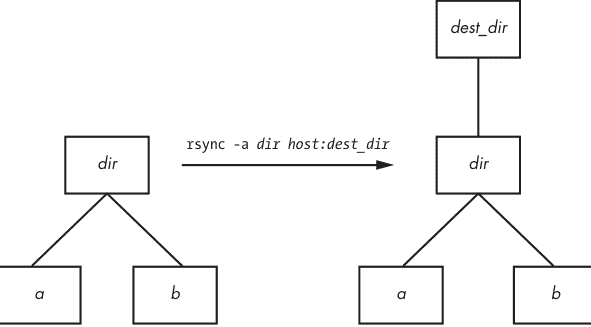
图 12-1: 普通 rsync 拷贝

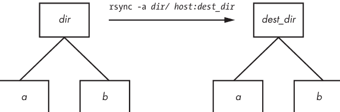
图 12-2: rsync 中末尾斜杠的影响

> 注意
> 当心你 shell 的自动文件名补全功能，GNU readline 和许多其他完成库会在完成的目录后加上末尾斜杠。

### 12.2.4 排除文件和目录

`rsync` 的一个非常重要的功能是它可以从传输操作中排除文件和目录。例如，假设你想将一个名为 `src` 的本地目录传输到主机，但你想排除掉任何名为 `.git` 的内容。你可以这样做：

```bash
$ rsync -a --exclude=.git src host:
```

请注意，该命令排除了所有名为 `.git` 的文件和目录，因为 `--exclude` 接受的是模式，而不是绝对文件名。要排除某个特定项，请指定以 `/` 开头的绝对路径，如下所示：

```bash
$ rsync -a --exclude=/src/.git src host:
```

命令中的第一个 `/src/.git` 并不是你系统的根目录，而是传输的基目录。

这里是关于如何排除模式的几个技巧：

- 你可以拥有任意数量的 `--exclude` 参数。
- 如果你反复使用相同的模式，请将它们放在一个纯文本文件中（每行一个模式），并使用 `--exclude-from=file`。
- 要排除名为 `item` 的目录但包含同名的文件，请加上末尾斜杠：`--exclude=item/`。
- 排除模式基于完整的文件或目录的名称组件，并可能包含简单的通配符（globs）。例如，`t*` 匹配此项，但不匹配其他项。
- 如果你排除了一个目录或文件名，但发现该模式过于严格，可以使用 `--include` 专门包含另一个文件或目录。

### 12.2.5 传输完整性、保护措施和详细输出模式

为了加速操作，`rsync` 使用快速检查来确定传输源上的任何文件是否已在目标上。快速检查结合了文件大小和最后修改日期。当你第一次将整个目录树传输到远程主机时，`rsync` 发现目标上不存在这些文件，因此它会传输所有内容。使用 `rsync -n` 测试你的传输可以为你验证这一点。

在运行一次 `rsync` 后，再次使用 `rsync -v` 运行，如果文件在两端存在且修改日期相同，则传输列表中将不会显示任何文件。

当源端文件与目标侧文件不一致时，`rsync` 会传输源并覆盖远程侧存在的任何文件。然而，默认行为可能并不充分，因为在传输中跳过文件之前，你可能需要额外的确认以确保文件确实是相同的，或者你可能想要一些额外的保护措施。以下是一些非常有用的选项：

- `--checksum`（缩写为 `-c`）：如果文件相同，则计算文件的校验和值（主要是唯一的签名）。这在传输期间会消耗额外的 I/O 和 CPU 资源，如果你处理的是敏感数据或大小统一的文件，此选项是必须的。
- `--ignore-existing`：不覆盖目标侧已存在的文件。
- `--backup`（缩写为 `-b`）：不覆盖目标侧已存在的文件，但在传输新文件之前，通过为现有文件添加后缀来重命名这些现有文件。
- `--suffix=s`：将用于 `--backup` 的后缀更改为 `s`。
- `--update`（缩写为 `-u`）：不覆盖目标上任何比源对应文件日期较晚的文件。

在没有特殊选项的情况下，`rsync` 静静运行，只有在出现问题时才会产生输出。然而，你可以使用 `rsync -v` 进入详细模式，或使用 `rsync -vw` 获取更多详细信息。（你可以添加任意数量的 `v` 参数，但两个可能已经超过了你的需求）。为了在传输后获得全面的总结，请使用 `rsync --stats`。

### 12.2.6 压缩

许多人结合 `-a` 使用 `-z` 在传输前对数据进行压缩：

```bash
```


```
$ rsync -az dir host:destination_dir
```

压缩在某些情况下可以提高性能，例如在通过慢速连接上传大量数据时（如许多 DSL 连接的慢速上行链路），或当两个主机之间的延迟很高时。然而，在快速局域网中，终端机器可能会受到压缩和解压缩数据所需 CPU 时间的限制，因此未压缩的传输可能会更快。

## 12.2.7 限制带宽

在向远程主机上传大量数据时，很容易占满连接的上行带宽。尽管在这样的传输期间你没有使用（通常是很大的）下行容量，但如果你让 `rsync` 以其尽可能快的速度运行，你的连接仍然看起来非常慢，因为发出的 TCP 数据包（如 HTTP 请求）将与你的传输竞争上行链路的带宽。

要解决这个问题，请使用 `--bwlimit` 为你的上行链路留一点余地。例如，要将带宽限制在 10,000 Kbps，你可以这样操作：

```bash
$ rsync --bwlimit=10000 -a dir host:destination_dir
```

## 12.2.8 将文件传输到你的计算机

`rsync` 命令不仅用于将文件从本地机器拷贝到远程主机。你也可以通过将远程主机作为第一个参数，从远程主机传输文件到你的本地机器。因此，要将主机上的 `src_dir` 传输到本地机器，请运行：

```bash
$ rsync -a host:src_dir dest_dir
```

## 12.2.9 其他 rsync话题

每当你需要拷贝文件时，`rsync` 都应该是你想到的工具之一。以批模式运行 `rsync` 特别有用，你会发现许多与命令、日志和传输状态相关的选项。特别是，状态文件使得中断的传输更容易恢复。

你还会发现 `rsync` 用于备份非常有用。例如，可以将存储（如 Amazon S3）挂载到你的 Linux 系统，然后使用 `rsync --delete` 定期与网络同步，创建一个有效的备份系统。

比这里描述的更多的命令行选项。要查看概述，请运行 `rsync --help`。你可以在 `rsync` (1) 手册页以及 `rsync` 主页找到更详细的信息：`http://rsync.samba.org/`

## 12.3 文件共享简介

你的 Linux 机器在网络上并不孤单，当网络上有多个机器时，几乎总是共享理由。在本章的剩余部分，我们将关注 Windows 和 Mac OS 之间的文件共享，因为观察 Linux 如何适应完全不同的环境很有趣。对于 Linux 机器之间的文件共享，或者为了访问网络附属存储 (NAS) 设备，我们将简要介绍使用网络文件系统 (`NFS`) 作为客户端。

## 12.4 使用 Samba 共享文件

如果你有运行 Windows 的机器，你可能希望这些 Windows 通过标准的 Windows 网络协议服务器消息块（SMB）访问你的 Linux 系统的文件。Mac OS 也支持 SMB 文件共享。

适用于的文件共享软件是 Samba。Samba 不仅允许你的网络 Windows 计算机访问你的 Linux 系统，反过来也是如此：可以使用 Samba 客户端从 Linux 机器访问并打印 Windows 服务器上的文件。

要设置 Samba 服务器，执行以下步骤：

1. 创建 `smb.conf` 文件。
2. 在 `smb.conf` 中添加文件共享部分。
3. 在 `smb.conf` 中添加打印共享部分。
4. 启动 Samba 守护进程 `nmbd` 和 `smbd`。

你可以向 `smb.conf` 文件添加选项，以限制访问 Samba 服务器的机器和用户。以下列表包含了许多选项

你可以在 `[global]` 节以及控制单个共享的节（如本章稍后所述）中设置以下内容：

`interfaces` 设置此项以让 Samba 监听在指定的网络或接口上。例如：

```
interfaces = 10.23.2.0/255.255.255.0
interfaces = eth0
```

`bind interfaces only` 在使用 `interfaces` 参数时，将其设置为 `yes`，以限制仅访问你在这些接口上可以到达的机器。

`valid users` 设置此项以允许指定的用户访问。例如：

```
valid users = juser, bill
```

`guest ok` 将此参数设置为 `true`，使网络上的匿名用户可以使用该共享。

`guest only` 将此参数设置为 `true` 以允许匿名访问。

`browseable` 设置此项以使共享内容可以被网络浏览器可见。如果你对任何共享将此参数设置为 `no`，你仍然可以访问 Samba 服务器上的共享，但你需要知道它们的确切名称才能访问它们。

### 12.4.3 密码

通常情况下，你只应该允许通过密码认证访问你的 Samba 服务器。遗憾的是，Unix 上的基础密码系统与 Windows 上的不同，除非指定明文网络密码或通过 Windows 服务器进行身份验证，否则你必须设置替代密码系统。本节将向你展示如何使用 Samba 的 Tribal Database (`TDB`) 后端设置替代密码系统，这适用于小型网络。

首先，在 `smb.conf` 的 `[global]` 节中使用这些项目来定义 Samba 数据库特性：

```
# 用于 Samba 加密密码的 tdb
security = user
passdb backend = tdbms
obey pam restrictions = yes
smb passwd file = /etc/samba/passwd_smb
```

这些行允许你使用 `smbpasswd` 命令操作 Samba 数据库。`obey pam restrictions` 确保任何使用 `smbpasswd` 命令更改密码的用户都必须遵守 PAM 为普通密码更改执行的任何规则。对于 `passdb backend` 参数，你可以在冒号后为 TDB 文件添加一个可选的路径；例如：`tdbms: /etc/samba/private/passwd.tdb`。

如果你拥有 Windows 域的权限，可以设置 `security = domain` 让 Samba 使用域用户名，从而消除对密码数据库的需求。然而，为了让域用户访问运行 Samba 的机器，每个域用户在运行 Samba 的机器上必须有一个具有相同用户名的本地账户。

## 添加和删除用户

为了让 Windows 用户访问你的 Samba 服务器，你需要做的第一件事是使用 `smbpasswd -a` 命令将用户添加到密码数据库：

```
# smbpasswd -a username
```

`smbpasswd` 命令的 `username` 参数必须是你 Linux 系统上的有效用户名。
与普通系统的密码程序一样，`smbpasswd` 要求你输入两次用户密码。如果密码通过了任何检查，`smbpasswd` 将确认它已创建了新用户。
要删除用户，请对 `smbpasswd` 使用 `-x` 选项：

```
# smbpasswd -x username
```

如果想临时禁用用户，请使用 `-d` 选项；`-e` 选项将启用用户：

```
# smbpasswd -d username
# smbpasswd -e username
```

## 作为超级用户更改 Samba 密码

你可以通过使用除用户名外没有任何选项或关键字的 `smbpasswd` 来作为超级用户更改 Samba 密码：

```
# smbpasswd username
```

然而，如果 Samba 服务器正在运行，任何用户都可以通过在命令行单独输入 `smbpasswd` 来更改自己的 Samba 密码。
最后，这里是你配置中一个需要注意的地方。如果你在 `smb.conf` 文件中看到这一行，请小心：

```
unix password sync = yes
```

这一行会导致 `smbpasswd` 在更改 Samba 密码之外还更改用户的普通密码。其结果可能会非常混乱，特别是当用户将 Samba 密码更改为 Linux 密码并发现再无法登录时。某些发行版在其 Samba 服务器软件包中默认设置了这个参数！

### 12.4.4 启动服务器

如果你不是从发行版包安装的 Samba，你可能需要启动服务器。这样做请运行带有以下参数的 `nmmbd` 和 `smbd`，其中 `smb_config_file` 是你的 `smb.conf` 文件的完整路径：

```
# nmmbd -D -s smb_config_file
# smbd -D -s smb_config_file
```


`nmmbd`守护是一个 NetBIOS 名称服务器，而`smbd`负责实际处理共享请求。`-D`选项指定守护模式。如果你在`smbd`运行时更改了`smb.conf`文件，可以通过 HUP 信号通知守护进程更改，或使用你发行版的服务重启命令（如`systemctl`或`initctl`）。

## 12.4.5 诊断和日志文件

当启动某个 Samba 服务器时出现问题，命令行上会出现错误消息。然而，运行时消息会进入`log.nmmbd`和`log.smbd`文件，这些文件通常位于`/var/log`目录下，例如`/var/log/samba`。你也会在那里找到其他日志，例如每个客户端的单独日志。

## 12.4.6 配置文件共享

要将目录导出到 SMB 客户端（即与客户端共享目录），向你的`smb.conf`文件添加一个节，其中`label`是你想要给共享的名字，`path`是路径：

- `label`: 你想给共享起的名字
- `path`: 要共享的目录
- `guest ok`: 是否允许匿名用户
- `guest only`: 是否允许匿名访问
- `browseable`: 使共享对网络浏览器可见
- `veto`: 限制特定模式

例如：

```
[sharename]

   path = /path/to/directory

   guest ok = no

   browseable = yes
```

## 12.4.7 主目录

如果你想共享主目录，可以在`smb.conf`文件中添加一个节。如下所示：

```
[homes]

   path = /home/%u

   guest ok = no

   browseable = yes
```

## 12.4.8 共享打印机

通过向`smb.conf`文件添加一个节来导出你的打印机。该节如下：

```
[printers]

   path = /var/printers

   comment = Printers

   browseable = yes

   writable = no
```

## 12.4.9 使用 Samba 客户端

Samba 客户端程序`smclient`可以打印并访问共享。当你与不提供 Unix 友好环境的环境交互时，该程序非常有用。

要开始使用`smclient`，使用`-L`选项从远程服务器获取共享列表：

```
$ smbclient -L -U username SERVER
```

运行此命令后，`smclient`会请求密码。要以匿名用户身份尝试共享，按回车；否则，输入你的服务器密码。成功后，你应该得到类似下面的列表：

| Sharename | Type | Comment |
| --- | --- | --- |
| Software | Disk | 软件发行 |
| Scratch | Disk | 临时空间 |
| IPC | IPC | IPC 服务 |
| ADMIN1 | Printer | 231A 室的打印机 |
| Printer2 | Printer | 地室的打印机 |

### 作为客户端访问文件

如果你只需要访问磁盘共享中的文件，请使用以下命令。（再次，如果你的 Linux 用户名与服务器上的用户名相同，可以省略`-U username`）。

```
$ smbclient -U username '\SERVER\sharename'
```

成功后，你将得到这样的提示符，表示你现在可以传输文件：

```
smb: \>
```

在这种文件传输模式下，`smclient`类似于 Unix 的`ftp`，你可以运行这些命令：

- `get file`: 从远程服务器复制文件到当前本地目录。
- `put file`: 将文件从本地机器复制到远程服务器。
- `cd dir`: 更改服务器上的目录到`dir`。
- `lcd localdir`: 更改本地目录到`localdir`。

`pwd`打印远程服务器上的当前目录，包括服务器名称和共享名称。
`!command`在本地主机上运行命令。两个特别实手的命令是`!pwd`和`ls`，它们用于确定本地侧的目录和文件状态。
`help`显示完整的命令列表。

## 使用 CIFS 文件系统

如果你需要频繁、定期地访问 Windows 服务器上的文件，可以使用`mount`命令将共享直接挂载到你的系统。命令语法如下所示。请注意，这里用的是`SERVER:shazename`而不是普通的`\SERVER\shazename`格式。

```
# mount -t ifs SERVER:shazename mountpoint -o use=username,pass=password
```

为了像这样使用`mount`，你必须为 Samba 准备好常用的通用互联网文件系统`CIFS`工具。大多数发行版都将其作为一个独立的包提供。

## 12.5 NFS 客户端

Unix 系统之间进行文件共享的标准系统是 NFS；针对不同的场景有许多不同版本的 NFS。你可以通过 TCP 和 UDP 提供 NFS 服务，并大量的身份验证和加密技术。由于选项很多，NFS 是一个非常大的话题，因此我们只关注 NFS 客户端的基础知识。

要在带有 NFS 的服务器上挂载远程目录，使用与挂载 CIFS 目录相同的基本语法：

```
# mount -t nfs server:directory mountpoint
```


从技术上讲，你不需要 `-t nfs` 选项，因为 `mount` 应该能为你识别它，但你可能想研究一下 `nfs(5)` 手页中的选项。（你会发现使用 `sec` 选项有不同的安全选项。许多小型集群网络上的管理员使用基于主机的访问控制。然而，更复杂的方法，例如基于 Kerberos 的认证，需要在系统的其他部分进行额外的配置。）

当你发现自己越来越多地使用网络文件系统时，请使用自动挂载（automounter），这样系统只有在你实际尝试使用文件系统时才会挂载，以防止启动时出现依赖问题。传统的自动挂载工具称为 `automount`，较新版本称为 `amd`，但现在大部分功能已由 systemd 中的 `automount` 单元取代。

# 12.6 更多网络文件服务选项和局限性

设置 NFS 服务器与 Linux 机器共享文件比使用简单的 NFS 客户端要复杂得多。你需要运行服务器守护进程（`mount` 和 `nfsd`）并设置 `/etc/exports` 文件以反映你共享的目录。然而，我们不会主要介绍 NFS 服务器，因为网络共享存储通常可以通过简单购买一个 NAS 设备来处理，从而变得方便得多。这些设备中的许多是基于 Linux 的，因此它们自然支持 NFS 服务器端。供应商通过提供自己的管理工具为其 NAS 设备增加价值，从而消除配置 RAID 配置和云备份等繁琐任务的痛苦。

谈到云备份，另一种网络文件服务选项是云存储。当你需要原子备份带来的额外存储，且不在意性能的轻微影响时，这非常方便。当你长时间不需要该服务或不需要经常访问时，它特别有用。你通常可以像挂载 NFS 一样挂载互联网存储。

尽管 NFS 和其他文件共享对于临时使用效果良好，但不要期望极高的性能。对大文件的只读访问应该应该是良好的，比如当你流传输音频或视频时，因为你读取的是大且可预测的数据块，这不需要文件服务器与其客户端之间的往复通信。只要网络足够快且客户端有足够的内存，服务器就可以按需提供数据。

对于涉及许多小文件的任务（如编译软件包和启动桌面环境），本地存储要快得多。当你拥有一个许多用户访问许多不同机器的大型网络时，情况变得更加复杂，因为在便利性、性能和易管理性之间存在权衡。

## 13 用户环境

本书的主要重点是通常位于服务器进程和交互式用户会话底下的 Linux 系统。但最终，系统和用户必须在某处汇。启动文件在此阶段起着重要作用，因为它们为 shell 和其他交互程序设置了默认值。它们决定了用户登录时系统的行为。

大多数用户并不额外关注他们的启动文件，只有在想要添加某些方便便利的设置（如别名 `alias`）时才会碰它们。随着时间的推移，这些文件会充满不必要的环境变量和测试，这可能会导致恼人的（或相当严重的）问题。

如果你使用 Linux 机器有一段时间了，你可能会发现家目录随着时间推移积累了一系列令人困惑的启动文件。这些有时被称为“点文件”（dot files），因为它们几乎总是以点（）开头。其中许多是在第一次运行程序时自动创建的，你永远不需要更改它们。本章主要涵盖 shell 启动文件，这些是你最可能修改或从头重写的文件。让我们先看看在处理这些文件时需要花费多少心力。

## 13.1 创建启动文件的指南

在设计启动文件时，请考虑到用户。如果你是某台机器上的唯一用户，你就不必担心，因为错误只会影响你，而且你很容易修复。然而，如果你创建的是旨在作为机器或网络上所有新用户默认值的启动文件，或者你认为可能有人拷贝你的文件并在不同的机器上使用，那么你的任务就会变得相当困难。如果你在一个为10个用户服务的启动文件中犯了错误，你可能需要修复这个错误 10 次。

在为其他用户创建启动文件时，请记住两个核心目标：

- **简单性（Simplicity）**：保持启动文件的数量尽可能少，保持文件尽可能简单，以便于修改。
- **可读性（Readability）**：使用大量的注释，让用户了解文件的每个部分的作用，这样是易于理解的。

## 13.2 何时修改启动文件

在修改启动文件之前，问问自己是否真的需要更改。以下是修改启动文件的一些理由：

- 你想要更改默认设置。
- 你需要适应本地安装的软件。
- 现有的启动文件损坏了。

如果你的 Linux 发行版一切正常，请要小心。（考虑先使用包装脚本。）有时启动文件会影响 `/etc`。尽管如此，你可能为了适应新的软件安装而更改用户环境中的默认路径。

## 13.3 Shell 启动文件元素

shell 启动文件中包含哪些内容？有些事情是显而易见的，比如路径和提示符。但到底什么样的路径才是合理的？文件中内容多少合适？

接下来的章节将讨论 shell 文件的核心内容——从命令路径、提示符、别名到权限掩码。

### 13.3.1 命令路径

任何 shell 启动文件中最重要的部分是命令路径。路径应该包含普通用户感兴趣的所有应用程序目录。至少，路径应该包含以下组件：

```
/usr/local/bin

/usr/bin

/bin
```

这种顺序确保了可以使用位于 `/usr/local` 的变体来覆盖默认程序。大多数 Linux 发行版将软件包的可执行文件安装在 `/usr/bin`。偶尔会有差异，例如将游戏放在 `/usr/games`，将图形应用程序放在不同的位置，检查你的系统默认设置。并确保系统上的每个通用程序都能通过列出的目录之一可用。如果不是，你的系统可能失控了。不要在你的用户环境中更改默认路径以适应新的软件安装。分离安装目录的一种廉价方法是在 `/usr/local/bin` 中使用符号链接。许多用户使用自己的 bin 目录来存储 脚本和程序，因此你可能想将其添加到路径的前端：

```
$HOME/bin
```

> 较新的惯例是将二进制文件放置在 `$HOME/.local/bin`。

如果你对系统工具（如 `traceroute`、`ping` 和 `lsmod`）感兴趣，将 sbin 目录添加到你的路径：

```
/usr/local/sbin

/usr/sbin

/sbin
```

### 在路径中添加点 (.)

路径中有一个争议性的命令路径组件：点（`.`）。路径中的 `.` 允许你在当前目录下运行程序，而不需要在程序名前加上 `./`。这在编写脚本或编译程序时可能看起来很方便，但由于两个原因，这是一个坏主意：

- 它可能会导致安全问题。你不应该把点放在路径的前端。这里有一个可能发生的情况的示例：攻击者可以在分发到互联网的存档中放置一个木马 ls。即使点在路径的末尾，你仍然会受到拼写错误（如 sl 或 ks）的威胁。
- 它是不一致的且可能会引起困惑。路径中的点可能意味着命令的行为将根据当前目录而改变。

## 13.3.2 手册页路径

传统的手册页路径由 `MANPATH` 环境变量决定，但你不应该设置它，因为这样做会覆盖 `/etc/manpath.config` 中的系统默认设置。

## 13.3.3 提示符 (Prompt)

丰富的用户倾向于避免过长的提示符。

- 首先，避免使用对 shell 有特殊意义的字符，例如这些：

```
{ } = & <
```

> 要格外注意避免 `>` 字符，如果你小心复制并粘贴 shell 窗口的内容，它可能会导致你的当前目录下出现不可预测的空文件（请记住 `>` 将输出重定向到文件）。

即使是 shell 的默认提示符也不是理想的。默认提示符包含 shell 名称和版本号。
bash 的这个简单提示符以习惯性的 `$` 结尾（传统的 csh 提示符以 `%` 结尾）：

```
PS1='\u\$ '
```


`\u` 是用户名的替换符（参见 `bash` (1) 手册页中的 `PROMPTING` 章节）。其他常用的替换符包括：

- `\h` 主机名（短格式，不包含域名）
- `\!` 历史记录编号
- `\w` 当前目录。因为这可能会变得很长，你可以使用 `\\` 将显示限制为最后的最后一个组件
- `\$` 如果以用户身份运行时显示 `$`，如果是 `root` 则显示 `#`

## 13.3.4 别名 (Aliases)

现代用户环境的重点之一是别名，它是 `shell` 的一种功能，在执行命令之前用一个字符串替换另一个字符串。这些可以是高效的快捷方式，节省一些输入时间。然而，别名也有这些缺点：

- 操作参数可能很复杂。
- 它们令人混乱；`shell` 的内置命令可以告诉你某个内容是否是别名，但它不会告诉你它在哪里定义的。
- 在子 `shell` 和非交互式 `shell` 中不受欢迎；它们在其他 `shell` 中不起作用。

考虑到这些缺点，你应该尽可能避免使用别名，因为编写 `shell` 函数或全新的 `shell` 脚本要更容易。现代计算机启动和执行 `shell` 的速度非常快，别名和完全新命令之间的差异对你来说应该毫无意义。

话虽如此，当你想要更改 `shell` 环境的部分内容时，别名确实非常有用。你无法通过 `shell` 脚本更改环境变量，因为脚本是在子 `shell` 中运行的。（你也可以定义 `shell` 函数来执行此任务）。

### 13.3.5 权限掩码 (Permissions Mask)

正如第 2 章所述，`shell` 的内置 `umask`（权限掩码）机制设置了你的默认权限。你应该在其中一个启动文件中运行 `umask`，以确保你创建的任何文件都具有你所需的权限。这两个合理的理由如下：

- `077` 此掩码是限制性最大的权限，因为它不允许任何其他用户访问新文件和目录。这在多用户系统上通常是合适的，因为你不希望用户查看你的任何文件。然而，当被设置为默认值时，当用户想要共享文件但不知道如何正确设置权限时，有时会导致问题。（没有经验的用户倾向于将文件设置为可写可读。）

- `022` 此掩码赋予他人对新文件和目录的读取权限。这在单用户系统上可能很重要，因为许多作为伪用户运行的守护进程（`daemons`）无法看到使用更严格的 `077` `umask` 创建的文件和目录。

> 某些应用程序（特别是邮件程序）会覆盖 `umask`，将其更改为 `077`，因为它们认为文件是所有者之外没有人的事情。

## 13.4 启动文件顺序和示例

现在你已经知道要在启动文件中放入什么了，是时候看一些具体的例子了。令人惊讶的是，创建启动文件最困难、最困惑的部分之一是确定使用哪些启动文件。接下来的章节涵盖两种最流行的 Unix `shell`：`bash` 和 `tsh`。

### 13.4.1 bash Shell

在 `bash` 中，你可以从 `.bash_profile`、`.profile`、`.bash_login` 和 `.bashrc` 启动文件名中进行选择。哪一个适用于你的命令路径、手册页路径、提示符、别名和权限掩码？答案是，你应该有一个 `.bashrc` 文件，并配有一个指向 `.bashrc` 的 `.bash` 符号链接，因为有几种不同的 `shell` 实例类型。

两种主要的 `shell` 实例是交互式和非交互式，但在其中只有交互式 `shell` 是值得关注的，因为非交互式 `shell`（例如运行 `shell` 脚本的）通常不运行任何启动文件。交互式 `shell` 是你从终端运行命令时使用的 `shell`，例如你在书中看到的那些，它们可以被分类为登录或非登录。

#### 登录 shell (Login Shells)

传统上，登录 `shell` 是你使用如 `/bin/login` 等程序通过终端登录系统时获得的 `shell`。使用 `SSH` 远程登录也会给你一个登录 `shell`。基本思想是登录 `shell` 是一个交互式 `shell`。你可以通过运行 `echo $` 来判断是否为登录 `shell`；如果第一个字符是 `-`，那么该 `shell` 就是登录 `shell`。

当 `bash` 作为登录 `shell` 运行时，它会查找 `/etc/profile` 以获取用户的 `.bash_profile`、`.bash_login` 和 `.profile` 文件，仅运行它看到的第一个。

尽管听起来很奇怪，但强制将非交互式 `shell` 作为登录 `shell` 运行。

#### 非登录 shell (Non-Login Shells)

非登录 `shell` 是你已经登录并启动新终端时获得的 `shell`。非登录 `shell` 是你运行脚本时获得的 `shell`。非登录 `shell` 是你启动图形界面管理器时获得的 `shell`。

#### 两种 shell 的后果

这 `shell` `shell` 背后的原因是，在过去，大多数桌面用户通过图形界面管理器登录。你将环境（路径等）设置在 `.bashrc` 中，而你在终端中永远看不到其中的任何内容。

如果 `.bashrc` 与 `.bash_profile` 匹配，你通常不需要为登录 `shell` 额外的命令。然而，如果你想定义不同的操作

对于登录和非登录 `shell`，你可以在 `.bashrc` 中添加以下测试，该测试会检查 `shell` 的 `$ -` 变量是否包含字符 `i`：

```
case $ -

  1*) # 交互式命令放在这里

    command

    --snip--

    ;

  *) # 非交互式命令放在这里

    command

    --snip--

    ;

esac
```

### 13.4.2 tcsh Shell

几乎所有 Linux 系统上的标准 `csh` `tcsh`，这是一种增强型的 C `shell`，它让命令行编辑以及多模式文件名和命令补全等功能流行了起来。即使你不使用 `tcsh` 作为默认用户 `shell`（我们建议使用 `bash`），如果用户恰好遇到 `tcsh`，你也应该提供 `tcsh` 的启动文件。

你不需要担心 `tcsh` 中登录 `shell` 和非登录 `shell` 之间的区别。在启动时，`tcsh` 会查找 `.tcsh` 文件。如果没有找到，它会查找 `shell` 的 `.cshrc` 文件。这种顺序的原因是，你可以使用 `.tcsh` 文件来处理 `csh` 中无法运行的 `csh` 扩展。你可能应该坚持使用传统的 `.cshrc` 而不是 `.tcshrc`；几乎没有人会配合 `csh` 使用你的启动文件。如果用户确实在其他某些系统上使用了 `csh`，你的 `.cshrc` 也可以工作。

#### 示例 .cshrc

这是一个示例 `.cshrc` 文件：

```
# 命令路径。
setenv PATH /usr/local/bin:/usr/bin:$HOME/bin

# EDITOR 和 VISUAL 定义了程序（如 less
# 和邮件客户端）编辑文件时调用的编辑器。
setenv EDITOR
setenv VISUAL vi

# PAGER 是 man 等程序的默认文本文件查看器。
setenv PAGER less

# 这些是 less 的一些方便选项。
setenv LESS meiX

# 默认情况下，给大多数新文件提供只读权限。
umask 022

# 自定义提示符。
```

```
# 替换内容包括：
# % 用户名 %主机 % 当前目录
# %h 数量 %l 当前终端 %
set prompt="%n@%h %# $"
```


## 13.5 默认用户设置

编写启动文件并为新用户选择默认值的最佳方法是在系统上对测试用户进行实验。创建一个带有空主目录的测试用户，并避免将你自己的启动文件拷贝到测试用户的目录。从零开始编写新的启动文件。

当你认为你有了一个可以运行的 shell 时，通过所有可能的方法登录该新用户（在控制台、远程等）。确保你测试了尽可能多的内容，包括窗口系统操作和帮助页。当你对测试用户满意时，创建第二个测试用户，并从第一个用户那里拷贝启动文件。如果一切运行正常，你现在就有了一套可以分发给用户的新启动文件。

接下来的章节概述了新用户的合理默认值。

### 13.5.1 Shell 默认 (Debs)

Linux 系统上任何新用户的默认 shell 应该是 `bash`：

- 用户与他们编写 shell 脚本时使用的同一个 shell 进行交互（例如，`csh` 是一个臭名昭著的脚本工具——别想了）。
- `bash` 是 Linux 系统的标准。
- `bash` 使用 GNU `readline`，因此它的界面与许多其他工具相同。
- `bash` 让你能够对 I/O 重定向和文件处理程序进行精细且易于理解的控制。

然而，许多经验丰富的 Unix 大师使用 `csh` 和 `tsh` 等 shell 仅仅是因为他们无法切换到 `bash`。当然，你可以选择任何你喜欢的 shell，但如果你没有偏好，请选择 `bash`，并使用 `bash` 作为系统上任何新用户的默认 shell。（用户可以使用 `chsh` 命令更改其 shell 以适应个人偏好。）

> 世界上还有许多其他 shell（`rc`, `ksh`, `zsh`, `es` 等）。有些 shell 并不适合作为初学者的 shell，但 `zsh` 和 `fish` 有时受到寻找替代 shell 的新用户的青睐。

### 13.5.2 编辑器

在传统系统中，默认编辑器应该是 `vi` 或 `emacs`。这些是唯一存在于几乎任何 Unix 系统上的编辑器，这意味着从长远来看，它们为新用户带来的麻烦最少。然而，Linux 发行版通常将 `nano` 配置为默认编辑器，因为它对初学者更容易用。

与启动文件一样，避免大型默认启动文件。在启动文件中加入一些 `set smartwatch` 设置并无害，但要远离任何会显著改变行为或外观的功能，例如 `showmode` 功能、自动缩进和折行边距。

### 13.5.3 查看器 (Pager)

将默认的 `PAGER` 环境变量设置为 `less` 是完全合理的。

## 13.6 启动文件陷阱

在启动文件中避免这些：

- 不要向 shell 启动文件中放置任何类型的图形化命令。
- 不要在 shell 启动文件中设置 `DISPLAY` 环境变量。
- 不要在 shell 启动文件中设置终端类型。
- 不要要在默认启动文件中吝啬描述性注释。
- 不要在启动文件中运行会打印到标准输出的命令。
- 永远不要 shell 启动文件中设置 `LD_LIBRARY_PATH`（见第 15.1.4 节）。

## 13.7 更多启动主题

由于本书仅涉及底层的 Linux 系统，我们将不会涵盖窗口环境启动文件。

方法。不太可能存在标准的 Linux 窗口管理器，因为用户的喜好和需求是多样且不断变化的；结果就是新的窗口管理器不断出现。

### 14.1.2 工具包

桌面应用程序包含某些公共元素，例如按钮和菜单，被称为部件（widgets）。为了加快开发并提高性能，程序员使用图形化工具包来提供这些元素。在 Windows 或 Mac OS X 等操作系统上，厂商提供通用的工具包，大多数程序员都会使用它。在 Linux 上，`GTK+` 工具包是最常用的工具包之一，但你也会经常看到基于 `Qt` 框架和其他的部件。

- 工具包通常由共享库和支持文件（如图像和主题信息）组成。

### 14.1.3 桌面环境

尽管工具包为用户提供了统一的外观，但桌面的细节需要不同应用程序之间的某种协作。例如，一个应用程序可能希望与另一个应用程序共享数据，或更新桌面上的公共通知栏。对于这些需求，工具包和其他库被封装成更大的包，称为桌面环境。`GNOME`、`KDE`、`Unity` 和 `Xce` 是一些 Linux 桌面环境。

工具包是大多数桌面环境的核心，但为了创建一个统一的桌面，环境还必须包含许多支持文件（如图标和配置），这些文件构成了环境。这一切通过描述设计规范的文档结合在一起，例如菜单和标题应该如何显示，以及应用程序如何响应某些系统事件。

### 14.1.4 应用程序

桌面的顶部是应用程序，例如网络浏览器和终端窗口。X 应用程序从简单（如古老的 `xclock` 程序）到复杂（如 `Chrome` 浏览器和 `LibreOffice` 套件）不一。这些应用程序是独立运行，但它们也使用进程间通信来感知相关事件。例如，当你连接一个新存储设备或收到新邮件或即时消息时，应用程序可以表达这种兴趣。这种通信通常通过 `D-Bus` 进行，如第 14.5 节所述。

## 14.2 深入了解 X Window System

`X` 窗口系统（`http://www.x.org/`）在历史上非常大，基础发行版包含 X 服务器、客户端支持库和客户端。随着 `GNOME` 和 `KDE` 等桌面环境的出现，X 分发的角色随着推移发生了变化，现在的重点更多在于管理渲染和输入设备的核心服务器，以及一个简化的客户端库。

在你的系统中很容易识别服务器。它被称为 `X`。在进程列表中检查它；你通常会看到它带有如下若干选项运行：

```
/usr/bin/X :0 -auth /var/run/lightdm/root/:0 -nolisten cp vt7 -novswitch
```

这里显示的 `:0` 是显示器，这是一个代表你通过通用键盘/或鼠标访问的一个或多个显示器的标识符。通常，显示器对应于连接到计算机上的显示器；你可以将多个显示器放在同一个显示器上。当使用 X 会话时，环境变量 `DISPLAY` 被设置为显示器标识符。

显示器可以进一步细分为屏幕，如 `:0.0` 和 `:0.1`，但这变得越来越稀有，因为 X 扩展（如 `RandR`）可以将显示器合并为一个更大的虚拟屏幕。

在 Linux 上，X 服务器运行在虚拟终端上。在这个示例中，`vt7` 参数告诉我们它被要求运行在 `/dev/tty7` 上（通常服务器启动在第一个可用的虚拟终端上）。你可以通过在不同的虚拟终端上运行，在 Linux 上同时运行多个 X 服务器，但如果你这样做，每个服务器将拥有一个唯一的标识符。你可以使用 `CTRL-ALT-FN` 键或 `chtw` 命令在服务器之间切换。

### 14.2.1 显示器管理器

从 X 会话到虚拟控制台而不是使用显示管理器，你可以运行 `startx` 或 `xinit` 命令。然而，你得到的会话将是一个非常简单的会话，看起来与显示管理器完全不同，因为机制和启动文件是不同的。

### 14.2.2 网络透明性

X 的特性之一是网络透明性。因为客户端使用协议与服务器通信，因此可以跨网络运行客户端，直接到运行在另一台机器上的服务器，X 服务器在端口 `6000` 上监听 TCP 连接。连接到该端口的客户端可以进行身份验证，然后将窗口发送到服务器。

遗憾的是，这种方法没有提供任何加密，因此是不安全的。为了堵住这个漏洞，大多数发行版使用 `-nolisten tcp` 选项禁用了 X 服务器的网络监听器，如第 300 页所示。然而，你可以像第 10 章描述的那，通过 SSH 隧道从远程机器运行 X 客户端，通过将 X 服务器的 Unix Domain 套接字连接到远程机器上的套接字。

## 14.3 探索 X 客户端

尽管人们通常不会考虑从命令行处理图形用户界面的工作，但有几个工具允许你探索 X 窗口系统的部分。特别是，你可以在客户端运行时对其进行检查。

最简单的工具之一是 `xwininfo`。当不带任何参数运行时运行时，它会要求你点击一个窗口：

```
$ xwininfo

xwininfo: Select the window about which you

would like information by clicking the

mouse in that window.
```

点击后，它会打印出关于窗口的信息列表，例如它的位置和大小：

```
xwininfo: Window id: 0x5400024 "xtern"

Absolute upper-left X: 1075
```

注意括号中的坐标。第一对代表鼠标在窗口内的 x 和 y 坐标，第二对（root）是指针在整个显示器上的位置。

其他低级事件包括按键和按钮，但更高级的事件指示鼠标是否进入或离开窗口，或者窗口是否获得或失去焦点。例如，这里按下 L 键的输出；键码为 46：

```
KeyPress event, serial 32, synthetic NO, window 0x-root

2084270084, (131,120), root:(197,172),

state 0x0, keycode 46 (keysym 0x6, 1), same_SCREEN YES

XlookupString gives 1 bytes: (6) "1"

XmblookupString gives 1 bytes: (6) "1"

XterEvent returns: False
```


你也可以通过 `-id` 将 `xev` 扩展到窗口 ID（使用从 `xwinfo` 获取的 id 作为 id）或使用 `-root` 根窗口。

### 14.3.2 理解 X 输入和偏好设置

X 最令人困惑的特征之一是，设置偏好通常有多种方法，且方法可能无效。例如，Linux 系统上常见的键盘偏好是重新映射

将 `Caps Lock` 键更改为 `Control` 键有多种方法可以实现，从使用旧的 `xmodmap` 命令进行微调，到使用 `setxkb` 工具提供完全全新的键盘映射。你如何知道应该使用哪一种（如果有的话）呢？这取决于你系统中哪些部分负责该功能，但确定这一点可能困难。请记住，桌面环境可能会提供自己的设置和覆盖。

话虽如此，关于底层基础设施有一些建议。

## 输入设备（通用）

X 服务器使用输入扩展（Input Extension）来管理来自许多不同设备的输入。输入设备有两种基本类型——键盘和指针，你可以连接尽可能数量的设备。为了同时使用多个相同类型的设备，X 输入扩展创建了一个“虚拟核心”，将输入汇聚到 X 服务器中。核心设备被称为主设备（master），你插入的物理设备成为从设备（slave）。

要查看你机器上的设备配置，请尝试运行：

```
$ xinput --list

Virtual core pointer      id=2 master pointer ([3])

Virtual XTEST pointer     id=4 slave pointer ([2])

Logitech Unifying Device id=8 slave pointer ([2])

Virtual core keyboard    id=3 master keyboard ([2])

Virtual XTEST keyboard id=5 slave keyboard ([3])

Power Button             id=6 slave keyboard ([3])

Power Button             id=7 slave keyboard ([3])

Cypress USB Keyboard id=9 slave keyboard ([3])
```

每个设备都有一个关联的 ID，你可以配合 `xinput` 和其他命令使用。在此输出中，ID 2 和 3 是核心设备，ID 8 和 9 是真实设备。注意，机器上的电源按钮也被视为 X 输入设备。

大多数 X 客户端都监听来自核心设备的输入，因为没有理由去担心事件源自哪一个特定设备。然而，大多数客户端对 X 输入扩展一无所知。

每个设备都有一组关联属性。要查看这些属性，请使用设备编号配合 `xinput`，例如：

```
$ xinput --list-props 8

Device 'Logitech Unifying Device. Wireless PID:4026':

Device Enabled (126): 1

  Coordinate Matrix (128): 1.000000, 0.000000, 0.000000,

  0.000000, 0.000000, 0.000000, 1.000000

  Device Accel Profile (256): 0

  Device Accel Constant Acceleration (257): 1.000000

  Device Accel Adaptive Acceleration (258): 1.000000

  Device Accel Velocity Scaling (259): 10.000000

--snip--
```

如你所见，有很多有趣的属性可以通过 `--set-prop` 更改（更多信息请参阅 `input(1)` 手页）。

## 鼠标

你可以通过 `input` 命令操作设备相关的设置，其中许多实用的适用于鼠标（指针）。你可以直接作为属性更改许多设置，但通常使用 `input` 专用的 `--set-pt-feedback` 和 `--set-button-map` 选项更简单。例如，如果你在 `dev` 上有一个三键鼠标，并想要反转按钮顺序（这对于左手用户非常方便），可以这样做：

```
$ xinput --set-button-map dev 3 2 1
```


## 键盘

国际上提供的许多不同键盘布局为集成到任何窗口系统带来了特别的困难。X 在其核心协议中一直有一个内部的键盘映射功能，你可以通过 `xkbmap` 命令（XKB 扩展）对其操作以获得更精细的控制。

XKB 非常复杂，所以即使许多人在需要快速更改时仍然使用 `xkbmap`。XKB 的基本思想是你可以定义一个键盘映射并使用 `xkbcomp` 命令将其编译，然后使用 `setkbmap` 命令在 X 服务器中加载并激活该映射。该系统有两个特别有趣的特性：

- 你可以定义部分映射来补充现有映射。这对于像将 Caps Lock 键更改为 Control 键等任务特别有用，桌面环境中的许多图形化键盘偏好工具都会使用。
- 你可以为每个连接的键盘定义单独的映射。

旧的 `X setroot` 允许你设置根窗口（root window）的背景颜色和其他特征，但在大多数机器上它没有效果，因为根窗口是不可见的。相反，大多数桌面环境会在所有窗口的后面放置一个大窗口，以便启用“活动壁纸”和桌面文件浏览功能。有从命令行更改背景的方法（例如在某些 GNOME 安装中使用 `gsettings` 命令），但如果你真的想这样做，你可能实在太闲了。

## 桌面背景

可能最老的偏好命令是 `xset`。它现在不再经常使用，但你可以运行 `xset q` 来获取一些功能的状态。也许有用的是屏幕保护程序和显示器电源管理信号（DPMS）设置。

## 14.4 X 的未来

当你阅读前面的讨论时，你可能会觉得 X 是一个非常老的系统，为了让它学会新花样经过了大量的修补。你的感觉并不错。

现在将鼠标在不同的窗口之间移动；如果你的桌面环境支持 D-Bus，你应该会收到系列消息，指示哪些窗口被激活了。

## 14.6 打印

在 Linux 上打印文档是一个多阶段的过程。其流程如下：

- 1. 执行打印操作的程序通常会将文档转换为 PostScript 格式。这一步是可选的。
- 2. 程序将文档发送到打印服务器。
- 3. 打印服务器接收文档并将其放入打印队列中。
- 4. 当队列中轮到该文档时，打印服务器将文档发送给打印机过滤器。
- 5. 如果文档不是 PostScript 格式，打印过滤器可能会执行转换。
- 6. 如果目标打印机不支持 PostScript，打印机驱动会将文档转换为打印机兼容的格式。
- 7. 打印机驱动会在文档中添加可选指令，例如纸盒和双面打印选项。
- 8. 打印服务器使用后端（backend）将文档发送到打印机。

这个过程最让人困惑的部分是为什么有这么多内容围绕着 PostScript 展开。PostScript 实际上是一种编程语言，因此当你使用它打印文件时，你实际上是在向打印机发送一个程序。PostScript 充当 Unix 类系统的打印标准，就像 `.tar` 格式作为归档标准一样。（某些应用程序现在使用 PDF 输出，这种格式相对容易转换。）

我们稍后会详细讨论打印格式；首先，让我们来看队列系统。

### 14.6.1 CUPS

Linux 上的标准打印系统是 CUPS (http://www.cups.org/)，它与 Mac OS 使用的是同一个系统。CUPS 守护进程称为 `cupsd`，你可以使用 `lpr` 命令作为简单的客户端将文件发送到该进程。

CUPS 的一个重要特性是它实现了互联网打印协议 (IPP)，该系统允许客户端和服务器之间在 TCP 端口 631 上进行类似 HTTP 的事务处理。事实上，如果你的系统上运行着 CUPS，你可能可以连接到 http://localhost:631/ 来查看你的配置并检查任何打印机状态。大多数网络打印机和打印服务器都支持 IPP，Windows 如此，这使得设置远程打印机变成了一个相对简单的任务。

你可能无法通过 Web 界面管理系统，因为默认设置并不十分安全。相反，你的发行版可能有一个图形化设置界面来添加和修改打印机。这些工具操作的是配置文件，通常位于 `/etc/cups`。

通常情况下，最好让这些工具为你完成工作，因为配置可能会非常复杂。即使你遇到问题并需要手动配置，最好也先使用图形化工具创建一个打印机，这样你就有了从起点。

### 14.6.2 格式转换与打印过滤器

许多打印机（包括几乎所有的低端机型）都不理解 PostScript 或 PDF。为了让 Linux 支持这些打印机之一，它必须将文档转换为特定格式发送给打印机。CUPS 将文档发送到光栅图像处理器 (RIP) 以生成位图。RIP 总是使用 Ghostscript (`gs`) 程序来完成大部分实际工作，但位图可能需要符合打印机的格式变得有些复杂。因此，CUPS 会查询 CUPS 打印机的 PostScript Printer 机定义 (PPD) 文件来确定分辨率和纸张大小等设置。

## 14.7 其他桌面主题

Linux 桌面环境的一个有趣特点是，你通常可以选择使用哪些部分，并停止使用你不喜欢的部分。要了解许多桌面项目，可以查看 http://www.freedesktop.org/ 上各种项目的邮件列表和项目链接。在其他地方，你还会发现其他桌面项目，如 Ayatana、Unity 和 Mir。

Linux 桌面的另一个重大进展是 Chromium OS 源项目及其在 Chromebook PC 上对应的 Google Chrome OS。这是一个 Linux 系统，它使用了本章描述的大部分桌面技术，但以 Chromium/Chrome Web 浏览器为中心。传统桌面上的许多内容在 Chrome OS 中被剥离了。

## 15 开发工具

Linux 和 Unix 在程序员中非常受欢迎，不仅是因为有海量的可用工具和环境，还因为该系统的文档记录极其详尽且透明。在 Linux 机器上，你不必得是一个程序员也能利用开发工具，但在与系统交互时，你应该了解一些编程工具，因为它们在管理 Unix 系统方面发挥的作用比在其他操作系统更大。至少，你应该能够识别开发实用程序，并对如何运行它们有一个大致的概念。

本章在有限的空间内涵盖了大量信息，但你不需要掌握这里的所有内容。你可以轻松地跳过材料并在稍后回来。关于共享库的讨论可能是你需要的最重要的内容。但要理解共享库从何而来，你首先需要一些关于如何构建程序的背景。

## 15.1 C 编译器

了解如何运行 C 语言编译器可以让你对 Linux 系统上看到的程序来源有深刻的见解。大多数 Linux 实用程序以及 Linux 系统上应用程序的源代码都是用 C 或 C++ 编写的。本章将使用 C 语言示例，你可以将这些信息应用到其他语言中。

C 程序遵循传统流程：编写、编译、然后运行。

### 15.1.1 多源文件

大多数 C 程序都太大，无法合理地放入单个源文件中。巨大的文件对程序员来说会变得太杂乱，而且编译器有时在处理大文件时遇到困难。

在编译 `.c` 文件时，你不会立即创建可执行文件。相反，使用编译器的 `-o` 选项为每个文件创建对象文件。为了看到它是如何工作的，假设你有两个文件，`main.c` 和 `aux.c`。以下两个编译命令构建构建：

```
$ cc -o main.c
$ cc -o aux.o
```

前面的命令将两个源文件编译为两个对象文件 `main.o` 和 `aux.o`。

对象文件是处理器几乎可以理解的二进制文件，但还有一些未完成的工作。首先，操作系统不知道如何运行对象文件，其次，你可能需要结合多个对象文件和系统库来创建一个完整的程序。

要从一个或多个对象文件构建功能完全的可执行文件，你必须运行链接器，即 Unix 中的 `ld` 命令。程序员很少在命令行使用 `ld`，因为编译器知道如何运行链接器程序。所以为了从上面的两个对象创建一个创建一个 `myprog` 的可执行文件，运行以下命令进行链接：

```
$ cc -o myprog main.o aux.o
```

你可以手动编译多个源文件，如前面的示例所示，当文件数量增加时，在编译过程中跟踪所有文件可能会困难。15.2 节描述的 make 系统是管理项目的传统 Unix 标准。

### 15.1.2 头文件（包含文件）与目录

C 头文件是额外的源代码文件，通常包含类型和库函数声明。例如，`stdio.h` 就是一个头文件（参见 15.1 节中的简单程序）。

不幸的是，大量的编译器问题发生在头文件上。大多数故障发生在编译器找不到头文件和库时。甚至在某些情况下，程序员忘记包含所需的头文件，导致部分源代码无法编译。

## 修复头文件问题

追踪正确的头文件并不总是很容易。有时在不同目录中有多个同名的头文件，且不确定哪一个是正确的。当编译器找不到头文件时，错误信息如下：

```
badinclude.c:1:22: fatal error: notfound.h: No such file or directory
```

这条消息表示编译器找不到 `notfound.h` 头文件。这个特定错误是由 `badinclude.c` 的第 1 行引起的：

```
#include <notfound.h>
```


Unix 的默认目录是 `/usr/include`；除非你告诉它。不过，你可以让编译器去其他目录（包含头文件的目录）。你将在后面学习更多关于查找缺失头文件的知识。例如，假设你在 `/usr/junk/include` 中找到了 `notfound.h`。你可以通过 `-I` 参数让编译器看到这个目录：

```
$ cc -I/usr/junk/include badinclude.c
```

现在编译器不应该在 `badinclude.c` 引用头文件的行上遇到困难。你还会注意到使用双引号（`""`）而不是尖括号（`<>`），例如：

```
#include "myheader.h"
```

双引号意味着头文件不在编译器应该搜索的路径中。这通常意味着头文件与源代码在同一个目录。如果你遇到双引号问题，你可能是在尝试编译源代码。

## 什么是 C 预处理器 (cpp)？

事实证明 C 编译器本身并不具备足够的系统信息来创建程序。你需要库来构建完整的程序。库是预编译函数的集合，你可以将其构建到你的程序中。例如，许多可执行文件使用数学库，因为它提供了三角函数等。

库主要在链接阶段起作用，即链接器从对象文件创建可执行文件时。例如，如果你有一个使用该库的程序，但忘记告诉编译器链接该库，你会看到如下链接错误：

```
badobject.o(.text+0x28): undefined reference to 'sqrt'
```

这些错误信息最重要的部分是加粗的。当链接器检查 `badobject.o` 对象文件时，找不到加粗显示的函数，结果就是它无法创建可执行文件。在这种情况下，你可能怀疑自己忘记链接该库。

未定义的引用并不意味着你缺少一个库。尽管可能是程序的某个对象文件丢失了。要解决这个问题，你必须首先找到对象库，然后使用编译器的 `-l` 参数链接它。与头文件不同，库分布在整个系统之中（`/usr/lib` 是默认位置），尽管大多数库位于名为 `lib` 的子目录下。对于前面的示例，基础库是 `libobject.a`，因此库名是 `object`。将所有内容结合，你可以这样链接程序：

```
$ cc -o badobject badobject.o -lgobject
```

你告诉链接器非标准库的位置；关于库的参数是 `-L`。为了编译并创建可执行文件，可以使用：

```
$ cc -o badobject badobject.o -L/usr/lib -lc
```

如果你想查看某个库，使用 `nm` 命令。准备好查看 `nm` 的输出。例如，尝试这个：

```
$ nm libobject
```

`nm` 显示库中的符号。源代码中的预处理器指令以 `#` 字符开头。规定宏以全大写出现，但有时程序员会使用看起来像函数和变量的宏（这偶尔会导致很多头疼的问题，滥用预处理器）。

与其在源代码中定义宏，你也可以通过向编译器传递参数来定义宏：`-DBLAH`。

- **头文件**：`#include` 指令指示预处理器包含整个文件。注意，编译器的 `-I` 标志实际上是预处理器搜索指定目录的选项。
- **宏定义**：如 `#define BLAH` 的行告诉预处理器替换源代码中所有的 `BLAH`。
- **条件编译**：你可以用 `#if`、`#ifdef` 和 `#endif` 标记某些代码。`#ifdef MACRO` 指令检查 `MACRO` 是否定义，`#if condition` 测试 `condition` 是否非零。对于这两个指令，如果“语句”后面的条件为假，预处理器就不会将 `#if` 和下一个 `#endif` 之间的程序文本传递给编译器。如果你想查看代码，最好使用这种方法。

这是一个条件指令示例。当预处理器看到代码时，它检查 `DEBUG` 是否定义，如果是，则将包含 `printf()` 的行传递给编译器。否则，预处理器跳过此行，继续处理 `#endif` 之后的文件。

```
#ifdef DEBUG

printf(stderr, "This is a debugging message.\n")

#endif
```

C 预处理器不知道任何 C 语法、变量、函数和其他元素。它只理解自己的宏和指令。

在 Unix 上，C 预处理器的名称是 `cpp`，你也可以用 `-E` 运行它。不过，你很少需要单独运行预处理器。

## 15.1.3 链接库

编译器本身并不足够了解你的系统。你需要库来构建完整的程序。库是预编译函数的集合，你可以将其构建到程序中。例如，许多可执行文件使用数学库，因为它提供了三角函数等。

库主要在链接时发挥作用，此时链接器从对象文件创建可执行文件。例如，如果你有一个使用该库的程序，但忘记告诉编译器链接该库，你会看到如下链接错误：

```
badobject.o(.text+0x28): undefined reference to 'sqrt'
```

这些错误信息最重要的部分是加粗的。当链接器检查 `badobject.o` 对象文件时，找不到加粗显示的函数，结果就是它无法创建可执行文件。在特定情况下，你可能怀疑自己忘记链接该库。

未定义的引用并不总是意味着你缺少一个库。尽管可能是程序的某个对象文件丢失了。要解决这个问题，你必须首先找到对象库，然后使用编译器的 `-l` 参数链接它。与头文件不同，库分布在整个系统之中（`/usr/lib` 是默认位置），尽管大多数库位于名为 `lib` 的子目录下。对于前面的示例，基础库是 `libobject.a`，因此库名是 `object`。将所有内容结合，你可以这样链接程序：

```
$ cc -o badobject badobject.o -lgobject
```

你告诉链接器非标准库的位置；关于库的参数是 `-L`。为了编译并创建可执行文件，可以使用：

```
$ cc -o badobject badobject.o -L/usr/lib -lc
```

如果你想查看某个库，使用 `nm` 命令。准备好查看 `nm` 的输出。例如，尝试这个：

```
$ nm libobject
```

`nm` 显示库中的符号。

## 共享库依赖

共享库通常与静态库位于相同的地方。Linux 系统上的两个标准目录是 `/lib` 和 `/usr/lib`。`/lib` 目录不应包含静态库。

共享库有一个后缀为 `.so`（共享对象），例如 `libc-2.15.so` 和 `libc.so.6`。要查看程序使用的共享库，对可执行文件运行 `ld`。这里是共享库的示例：

```
linux-gate.so.1 => (0xb7799000)

libinfo.so.5 => /lib/i386-linux-gnu/libinfo.so.5 (0xb7765000)

libbd.so.2 => /lib/i386-linux-gnu/libbd.so.2 (0xb7760000)

libc.so.6 => /lib/i386-linux-gnu/libc.so.6 (0xb7755000)

/lib/ld-linux.so.2 (0xb7799000)
```

为了性能和灵活性，可执行文件本身通常不知道共享库的位置；它们只知道库的名字，以及关于如何查找提示。一个小程序 `ld.so`（运行时链接器/加载器）会在运行时查找并加载程序的共享库。之前的输出显示左侧是库名——那是可执行文件。右侧显示 `ld.so` 找到库的位置。

此处输出的最后一行显示了 ld: 的实际位置：
`ld-linux.so.2`.

## ld.so 如何查找共享库

共享库的常见问题之一是动态链接器找不到库。动态链接器通常应该查找共享库的首个地方是可执行文件的预配置运行时搜索路径（`path`），如果该路径存在。稍后你将看到如何创建此路径。

接下来，动态链接器会检查系统缓存 `/etc/ld.so.cache`，以查看库是否位于标准位置。该缓存是存在缓存配置文件 `/etc/ld.so.conf` 中列出的目录发现的库文件名的缓存。

正如你见过的许多 Linux 配置文件一样，`ld.so.conf` 可能包含位于 `/etc/ld.so.conf/` 目录下的多个文件。

`ld.so.conf` 中的每行都是一个你想要包含在缓存中的目录。
目录列表通常很短，内容如下：

```
/lib/i686-linux-gnu
/usr/lib/i686-linux-gnu
```

标准库目录 `/lib` 和 `/usr/lib` 是隐式的，这意味着你不需要将它们包含在 `/etc/ld.so.conf` 中。
如果你修改了 `ld.so.conf` 或对某个共享库目录进行了更改，你必须使用以下命令手动重建 `/etc/ld.so.cache` 文件：

```
# ldconfig -v
```


`-v` 选项提供了关于 `ldconfig` 添加到缓存的库的详细信息以及它检测到的任何更改。
`ld.so` 还有一个查找共享库的地方：环境变量 `LD_LIBRARY_PATH`。我们稍后很快会讨论到这个。
不要养成向 `/etc/ld.so.conf` 中添加东西的习惯。你应该知道系统缓存中有哪些共享库，如果你把每个古怪的共享库目录都放入缓存，你就会面临冲突和系统极其混乱的风险。当你编译需要冷门库路径的软件时，给你的可执行文件设置一个内置的运行时库搜索路径。以下是实现方法。

## 将程序链接到共享库

假设你在 `/opt/obscure/lib` 中有一个共享库 `libweird.so.1`，你需要针对它链接 `myprog`。按照如下方式链接程序：

```
$ cc -o myprog myprog.o -Wl,-rpath=/opt/obscure/lib -L/opt/obscure/lib -l
```

`-Wl,-rpath` 告诉链接器将后续目录包含在可执行文件的运行时库搜索路径中。然而，即使你使用了 `-l,-rpath`，你仍然需要 `-l` 标志。
如果你有一个现有的二进制文件，也可以使用 `patchelf` 插入不同的运行时库搜索路径，但通常在编译时这样做更好。

## 共享库的问题

共享库提供了极大的灵活性，不用说那些难以置信的技巧，但也可能滥用它们，导致你的系统变得完全混乱。可能会发生三种特别糟糕的情况：

- 缺少库
- 糟糕的性能
- 库不匹配

所有共享库问题的源都是名为 `LD_LIBRARY_PATH` 的环境变量。将此变量设置为用冒号分隔的目录名，会让 `ld.so` 在查找共享库时先于任何地方搜索这些目录。当你移动库时，如果没有程序源代码且无法使用 `patchelf`，或者你懒得重新编译可执行文件，这是一个让程序运行的廉价方法。遗憾的是，这就是你付出的代价。

在编译软件时，永远不要在启动文件中设置 `LD_LIBRARY_PATH`。当运行时链接器遇到这个变量时，它通常搜索每个指定目录完整内容的次数往往超过你愿意接受的次数。这会导致严重的性能影响，更重要的是，你会遇到冲突和库不匹配，因为运行时链接器会为每个程序搜索这些目录。

如果你必须使用 `LD_LIBRARY_PATH` 来运行某些你没有源码（或你不想编译的应用程序，如 Mozilla 或其他巨兽），请使用包装脚本。假设你的最后退路是 `/opt/crummy/bin/crummy.bin`，并且需要在 `/opt/crummy/lib` 中一些共享库。编写一个这样的包装脚本，如下所示：

```
#!/bin/sh

LD_LIBRARY_PATH=/opt/crummy/lib

export LD_LIBRARY_PATH

exec /opt/crummy/bin/crummy.bin $@
```

避免 `LD_LIBRARY_PATH` 可以防止大多数共享库问题。但开发者遇到的另一个严重问题是，库的应用程序接口（API）可能会从一个版本到另一个版本发生微变化，导致安装的损坏。最好的解决方案是预防性的：要么使用一致的方法通过 `-Wl,-rpath` 安装共享库以创建运行时链接路径，要么简单地使用冷门库的静态版本。

## 15.2 make

一个具有多个源代码文件或需要奇怪编译器选项的程序，手动编译实在太麻烦了。这个问题已经存在多年，而缓解这些痛苦的传统 Unix 编译工具被称为 `make`。如果你经常运行 Unix 系统工具，你应该了解一点 `make`，因为这些工具有时依赖 `make` 来运行。然而，这一章只是冰山一角。有专门关于 `make` 的书籍，例如 Robert Mecklenburg 编写的《使用 GNU Make 管理项目》(*Managing Projects with GNU Make*，O'Reilly, 2004)。此外，大多数 Linux 软件包是使用 `make` 之上的额外层或类似工具构建的。世界上有许多种构建系统；我们将在第 16 章介绍 autotools。
`make` 是一个大系统，但要了解它的原理并不困难。当你看到一个名为 `Makefile` 或 `makefile` 的文件时，你就知道你在处理 `make`。（尝试运行 `make` 看看你能否构建任何东西。）

`make` 的基本思想是目标（target）

为了构建一个目标，`make` 遵循一条规则，即如何从 `.c` 源代码变为 `.o` 目标文件的规则。`make` 已经知道了几条规则，但你可以自定义这些现有规则并创建自己的规则。

### 15.2.1 示例 Makefile

下面的非常简单的 Makefile 从 `aux.c` 和 `main.c` 构建一个名为 `myprog` 的程序：

```
# object files

OBJS=aux.o main.o
```

```
all: myprog

myprog: $(OBJS)

$(CC) -o myprog $(OBJS)
```

此 Makefile 第一行中的 `#` 表示注释。
下一行只是一个宏定义；变量 `OBJS` 赋值为对象文件名。这在稍后会变得重要。现在注意你是如何定义这个宏的，以及你是如何引用它的 `$(OBJS)`。

此 Makefile 的下一行包含了第一个目标 `all`。第一个目标始终是默认目标，即当你运行它时 make 想要的目标。
构建目标的规则在冒号之后。对于 `all`，此 Makefile 表示你需要满足名为 `myprog` 的条件。注意 `myprog` 可以是一个实际文件，也可以是另一个规则的目标。在这种情况下，它是两个规则的目标。

此 Makefile 假设在同一目录下名为 `aux.c` 和 `main.c` 的两个 C 源文件。在 Makefile 上运行 `make` 会产生输出，显示 make 正在运行的命令：

```
$ make

CC    -o aux.o aux.c

CC    -o main.o main.c

CC    -o myprog aux.o main.c
```

依赖关系如图 15-1 所示。

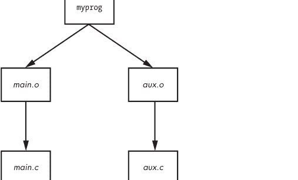

图 15-1：Makefile 依赖

### 15.2.2 内置规则

那么 make 如何知道如何从 `aux.c` 变为 `aux.o` 呢？毕竟 `aux.c` 并不在 Makefile 中。答案是 `make` 遵循了它的内置规则。它知道当你想要 `.o` 文件时去寻找 `-c` 文件，此外，它知道如何对该 `.c` 文件运行 `-c` 以实现创建 `.o` 文件的目标。

### 15.2.3 构建最终程序

获取 `myprog` 的最后一步有点复杂，但主意很清楚。当你拥有 `$(OBJ)` 中的两个对象文件后，你可以根据以下行运行 C 编译器（其中 `$(CC)` 展开为编译器名称）：

```
$((CC) -o myprog $(OBJ)
```

`$(CC)` 之前的空白是一个制表符（tab）。你必须在任何实际命令之前插入一个制表符并独占一行。

注意此错误：

```
Makefile:7: *** missing separator. Stop.
```

出现此类错误意味着 Makefile 损坏了。制表符（tab）是分隔符，如果没有分隔符或有其他干扰，就会看到此错误。

### 15.2.4 保持最新

最后一个基本原则是目标（targets）应该与其依赖项保持同步。如果你对前面的示例连续运行两次 `make`，第一条命令会构建 `myprog`，但第二个命令会产生如下输出：

```
make: Nothing to be done for 'all'.
```

在第二次执行时，`make` 检查了它的规则并发现 `myprog` 已经存在，因此它没有再次构建 `myprog`，因为自上次构建以来，没有任何依赖项发生过变化。为了实验这一点，请执行以下操作：

- 1. 运行 `touch aux.c`。
- 2. 再次运行 `make`。这次，`make` 确定 `aux.c` 比目录中已有的 `aux.o` 新，因此它重新编译了 `aux.o`。
- 3. `myprog` 依赖于 `aux.o`，而现在 `aux.o` 比预存在的 `myprog` 新，因此 `make` 必须重新创建 `myprog`。

这种链式反应是非常典型的。

### 15.2.5 命令行参数和选项

如果你知道 `make` 的命令行参数和选项如何工作，你可以让 `make` 发挥出巨大的作用。

最实用的选项之一是在命令行上指定单个目标。对于前面的 Makefile，如果你只需要 `aux.o` 文件，可以运行 `make aux.o`。

你还可以在命令行上定义宏。例如，要使用 `clang` 编译器，可以尝试：

```bash
$ make CC=clang
```


在这里，`make` 使用你定义的 `CC` 而不是其默认的编译器 `cc`。命令行宏在测试预处理定义和库时非常有用，特别是我们稍将讨论的 `CFLAGS` 和 `LDFLAGS` 宏。

事实上，你甚至不需要 `Makefile` 就可以运行 `make`。如果内置规则匹配某个目标，你只需要让 `make` 创建该目标即可。例如，如果你有一个名为 `blah.c` 的非常简单程序的源码，尝试 `make blah`。

`make` 的运行过程如下：

```bash
$ make blah

cc blah.o -o blah
```

这种 `make` 的使用方法仅适用于最基本的 C 程序；如果你的程序需要库或包含目录，你可能应该编写一个 `Makefile`。在没有 `Makefile` 的情况下运行 `make`，实际上当你处理像 Fortran、Lex 或 Yacc 等内容，且不知道编译器或工具如何工作时，是最有用的。为什么不让 `make` 尝试为你解决这个问题呢？即使 `make` 未能创建目标，它可能也会给你关于如何使用该工具的相当好的提示。

有两个选项脱颖而出：

- `-n` 打印构建所需的命令，但防止 `make` 实际运行任何命令
- `-f file` 告诉 `make` 从文件而不是 `Makefile` 或 `make` 读取内容

## 15.2.6 标准宏和变量

`make` 有许多特殊的宏和变量。很难区分宏和变量的区别，因此我们使用“宏（macro）”一词来指代在 `make` 开始构建目标后通常不会改变的内容。

正如你之前看到的，你可以在 `Makefile` 的开头设置宏。

这些是最常见的宏：

- `CFLAGS` 编译器选项。当从 `.c` 文件创建对象代码时，`make` 将此作为参数传递给编译器。
- `LFLAGS` 类似于 `CFLAGS`，但它们是用于在从对象代码创建可执行文件时传递给链接器的。
- `LDLIBS` 如果你使用了 `LDFLAGS` 但不想与搜索路径一起编译库名选项，请将库名选项放在此文件中。
- `CC` C 编译器。默认是 `cc`。
- `CPPFLAGS` 预处理器选项。当 `make` 以某种方式运行预处理器时，它会将此宏的展开结果作为参数传递。
- `CXXFLAGS` GNU `make` 使用它处理 C++ 编译器标志。

变量在构建目标时会发生。因为你从不手动设置变量，以下列表包含了 `$$`。

- `$@` 在规则内部，它将展开为当前目标。
- `$*` 展开为当前目标的基名。例如，如果你正在构建 `blah.o`，它将展开为 `blah`。

Linux 上最完整的变量列表是 `make info` 手册。

请记住，GNUmake 拥有许多扩展、内置规则和其它变体不具备的功能。只要你运行的是 Linux，这没有问题，但如果你转向 Solaris 或 BSD 机器并期望同样的内容有效，你可能会大吃一惊。然而，这正是 GNU autotools 等多平台构建系统所解决的问题。

## 15.2.7 约定目标

大多数 `Makefile` 都包含几个标准目标，用于执行与编译相关的辅助任务。

- `clean` `clean` 目标无处不在；`make clean` 通常指示删除所有对象文件和可执行文件，以便你可以重新开始或获取该软件。这里有一个适用于你的 `Makefile` 的示例规则：

```make
clean:

rm -f $(OBJS) myprog
```

- `distclean` 通过 GNU autotools 系统创建的 `Makefile` 始终有一个 `distclean` 目标，用于删除所有不是原始发行部分的内容，包括 `Makefile`。你将在第 16 章看到更多此类内容。在极少数情况下，你可能会发现开发者选择不通过此目标删除可执行文件，而是倾向于使用类似 `realclean` 的目标。

- `install` 将文件和编译后的程序复制到 `Makefile` 认为系统中的正确位置。这可能是危险的，请务必运行运行此

- `test` `test` 目标用于在程序上运行测试。

- `depend` `depend` 目标用于生成依赖文件，`make` 然后使用该文件来确定哪些文件需要重建。

## 15.2.8 组织目标

本节仅提供了组织 `Makefile` 的简要介绍，你可以在线阅读、打印，或购买详尽的手册。

- `Lex` 是一个分词器，它将文本转换为带有标签的编号标记。GNU/Linux 版本名为 `flex`。在使用 `Lex` 时，你可能需要配合 `-lfl` 或 `-lfl1` 连接器标志。

- `Yacc` 是一个解析器，它尝试根据语法读取标记。GNU 的解析器是 `bison`；为了与 `Yacc` 兼容，请运行 `bison -y`。你可能需要 `-y` 标志。

## 15.5 脚本语言

在很久以前，普通的 Unix 系统管理员不需要担心除 Bourne shell 和 `awk` 以外的脚本语言。Shell 脚本（在第 11 节中讨论）仍然是 Unix 的重要部分，但随着新工具的出现，这一点已有所淡化，许多强大的后继者实际上已经从 C 语言切换到了脚本语言（例如程序的合理版本）。让我们来看一些脚本语言的基础知识。

关于任何脚本语言，你需要知道的第一点是，脚本的第一行看起来像 Bourne shell 的 shebang（解释器）。例如，一个 Python 脚本的开头如下所示：

```python
#!/usr/bin/python
```

或者：

```python
#!/usr/bin/env python
```

在 Unix 中，任何以 `#!` 开头的可执行文本文件都是脚本。前缀后的路径是脚本语言解释器的执行文件路径。当 Unix 尝试运行以 `#` shebang 开头的可执行文件时，它会运行 `#` 之后的程序，并将文件的其余部分作为标准输入。因此，即使是这也是脚本：

```bash
#!/usr/bin/tail -2

这个程序不会打印这一行，

但它会打印这一行...

还有这一行。
```

Shell 脚本的第一行通常包含一个常见的基础脚本问题之一：通往脚本语言解释器的路径无效。例如，你将之前的脚本命名为 `myscript`。如果你的系统上 `tail` 实际上位于 `/bin` 而不是 `/usr/bin` 话呢？在这种情况下，运行 `myscript` 将产生此错误：

```bash
bash: ./myscript: /usr/bin/tail: bad interpreter: No such file or directory
```


不要指望脚本第一行中的多个参数都能正常工作。也就是说，上一个示例中的 `-2` 可能有效，但如果你添加另一个参数，系统可能会决定将 `-2` 和新参数视为一个大大的参数（包括空格）。这可能因系统而异；不要在这些无关紧要的事情上浪费你的耐心。现在，让我们来看看现有的一些语言。

### 15.5.1 Python

Python 是一种拥有深厚基础并拥有一系列强大功能的脚本语言，例如文本处理、数据库访问、网络和多线程。它拥有强大的交互模式和组织良好的对象模型。

Python 的执行文件是 `python`，它通常位于 `/usr/bin`。然而，Python 不仅用于命令行脚本。你会发现它还是一个构建网站的工具。由 David M. Beasley 编写《Python Essential Reference》第 4 版（Addison-Wesley, 2009）是一本很好的参考文献，开头有一个小型教程帮助你入门。

### 15.5.2 Perl

Perl 是较旧的第三方 Unix 脚本语言之一。它是编程工具中原始的“瑞士军刀”。尽管如此，Perl 特别是在文本处理、转换和文件操作方面表现出色，你可能会发现用它构建的工具。由 Randall L. Schwartz、Brian Floyd 和 Tom Phoenix 编写《Learning Perl》第 6 版（O'Reilly, 2011）是一本教程式的介绍；更全面的参考书是 Chromatic 编写的《Modern Perl》（Onyx Neon Press, 2014）。

### 15.5.3 其他脚本语言

你可能还会遇到这些脚本语言：

- **PHP** 这是一种超文本处理语言，通常出现在动态 Web 脚本中。有些人使用 PHP 独立脚本。PHP 官网地址为 http://www.php.net/。
- **Ruby** 面向对象的特性让许多开发者喜欢用这种语言进行编程（http://www.ruby-lang.org/）。
- **JavaScript** 这种语言主要在 Web 浏览器内部用于操作动态内容。由于其缺陷，大多数经验丰富的程序员回避将其作为独立脚本语言，但在进行 Web 编程时几乎无法避免它。你可能会在系统中发现一个执行文件名为 `node` 的 Node.js 实现。
- **Emacs Lisp** Emacs 编辑器使用的 Lisp 编程语言变体。
- **Matlab, Octave** Matlab 是一种商业性的矩阵和数学编程语言及库。有一个非常类似的免费软件项目叫做 Octave。
- **R** 一种流行的免费统计分析语言。更多信息请参考 http://www.r-project.org/ 和 Norman Matloff 编写的《Art of R Programming》（No Starch Press, 2011）。
- **Mathematica** 另一种带有库的数学编程语言。
- **m4** 这是一种宏处理语言，通常只出现在 GNU autotools 中。

T（工具语言）是一种简单的脚本语言，通常与图形工具包 Tk 和自动化工具 Expect 相关。虽然 T 不如以前那样被广泛使用，但不要低估它的威力。许多资深开发者更偏于 Tk，特别是它的嵌入能力。有关 Tk 的更多信息，请访问 http://www.tk.tk/。

## 15.6 Java

Java 是一种像 C 一样的编译型语言，具有更简单的语法和对面向对象编程的强大支持。它在 Unix 系统中有几个利基市场。例如，它经常被用作 Web 应用；此外，它经常被用作 Web 应用（注：此处原文重复）。它在 Unix 系统中有几个利基市场。例如，它经常被用作 Web 应用；此外，它经常被用作 Web 应用（注：原文重复）。...（此处省略大量重复部分）有两种编译器：产生机器码的本地编译器和针对虚拟机的字节码编译器（如第 17 节中描述）。大多数 Java 文件以 `.class` 结尾。如果你需要将 `.java` 文件编译为字节码，你需要 Java 开发包（JDK）。你可以运行 `javac`：

```bash
javac file.java
```

JDK 还带有 `jar`，这是一个可以创建和提取 `.jar` 文件的程序。它的工作原理类似于 `tar`。你可能需要设置 `PATH` 环境变量。

发行版的特点是它们通常能很快地修复安全问题。不要期望你的发行版能为你提供一切。以下是你可能想要自己安装某些包的理由：

- 为了控制配置选项。
- 为了将软件安装在任何喜欢的地方。你甚至可以安装同一个包的多个不同版本。
- 为了控制你安装的版本。发行版并不总是能与所有包的最新版本同步，特别是软件包的附加组件（如 Python 库）。
- 为了更好地理解包是如何运作的。

## 16.1 软件构建系统

Linux 上有许多编程环境，从传统的 C 语言到 Python 这样的解释型脚本语言。除了 Linux 发行版提供的工具外，每个环境通常至少有一个专门用于构建和安装包的系统。
在本章中，我们将使用这些系统之一——从 GNU autools 套件生成的配置脚本，来学习编译和安装 C 源代码。该系统通常非常稳定，许多基本工具都使用它。因为它基于 `make` 等现有工具，所以当你了解它之后，你将能够将这些知识迁移到其他的构建系统中。
从 C 源代码安装包通常涉及以下步骤：

1. 解压源码归档文件。
2. 配置包。
3. 运行 `make` 构建程序。
4. 运行 `install` 或发行版特定的安装命令来安装包。

> 注意：在继续本章之前，你应该理解*第 15 章*中的基础知识。

## 16.2 解压 C 源码包

包的源码发行通常以 `*.tar.gz`、`*.tar.bz2` 或 `*.tar.xz` 文件的形式出现，你应该按照第 2.18 节描述的方法解压文件。但在解压之前，请使用 `tar tvf` 或 `tar zvf` 验证归档的内容，因为某些包不会在你提取归档的目录中创建自己的子目录。

```
package-1.23/Makefile.in
package-1.23/README
package-1.23/main.c
package-1.23/bar.c
--snip--
```

然而，你可能会发现文件不在公共目录中（例如上例中的 `package-1.23`）：

```
Makefile
README
main.c
--snip--
```

提取像这样的归档可能会让你的目录变得一团糟。为了避免这种情况，请创建一个新目录并在 `cd` 进去后再提取归档内容。

最后，要小心包含类似如下绝对路径文件的包：

```
/etc/passwd
/etc/inetd.conf
```


你可能不会遇到此类内容，但如果真的遇到了，请从你的系统中删除该归档文件。它可能包含了木马或某些恶意代码。

### 16.2.1 从何开始

一旦你提取了源码归档的内容并面前有一了一堆文件，尝试着熟悉一下这个包。特别要寻找 `README` 和 `INSTALL` 文件。总是先查看 `README` 文件，因为它们通常包含包的描述、一份简短手册、安装提示和其他有用信息。许多包还附带了 `INSTALL` 文件，其中包含了如何编译和安装该包的说明。特别注意特殊的编译器选项和定义。

除了 `README` 和 `INSTALL` 文件外，你还会发现其他大致分为三类的包文件：

- 与 `make` 系统相关的文件，如 `Makefile`、`Makefile.in`、`configure` 和 `CMakeLists.txt`。一些非常老旧包带有一个你可能需要修改的 `Makefile`，但大多数包使用如 GNU `autoconf` 或 `CMake` 等配置工具。它们带有一个脚本或配置文件（如 `configure` 或 `CMakeLists.txt`），帮助根据你的系统设置和配置选项从 `Makefile.in` 生成 `Makefile`。
- 以 `.c`、`.h` 或 `.cc` 结尾的源码。C 源代码文件可能出现在包目录的任何位置。C++ 源代码文件通常具有 `.cc`、`.C` 或 `.cc` 后缀。
- 以 `.o` 结尾的对象文件或二进制文件。通常情况下，源码发行版中没有对象文件，但在某些情况下，当包维护者不被允许发布源码，而你必须进行某些操作以使用对象文件时，你可能会发现一些文件。在大多数情况下，源码发行版中的对象（或二进制可执行）文件意味着该包还没有被组装，你应该运行 `make clean` 以确保你获得一次全新的编译结果。

## 16.3 GNU Autoconf

尽管 C 代码通常具有很好的可移植性，但每个平台之间的差异使得无法通过单个 `Makefile` 编译大多数包。解决此问题的早期方案是为每个操作系统提供单独 `Makefile`，或者提供一个易于修改的 `Makefile`。这种方法演变为脚本，根据对构建包的系统进行分析来生成 `Makefile`。
`Autoconf` 是一个流行的自动生成 `Makefile` 系统。使用该系统的包带有 `configure`、`Makefile.in` 和 `config.h` 文件。`.in` 文件是模板；其原理是运行 `configure` 脚本以发现你系统的特征，然后在 `.in` 文件中进行替换，以创建构建文件。对于最终用户来说，这是很容易的；要从 `Makefile.in` 生成 `Makefile`，只需运行 `configure`：

```
$ ./configure
```

由于该程序会检查你的系统是否满足先决条件，你会得到大量的诊断输出。如果一切顺利，`configure` 会创建一个或多个 `Makefile` 以及一个 `config.h` 文件，以及一个缓存文件（`config.cache`），这样它就不需要再次运行。此时，你必须已经准备了所有的构建工具。对于 Debian 和 Ubuntu，最简单的方法是安装 `build-essential` 包；对于 Fedora 类系统，使用 "Development Tools" 组。

### 16.3.1 Autoconf 示例

在讨论如何更改 `autoconf` 的行为之前，让我们来看一个简单的示例，这样你就知道预期是什么。你会从 `ftp.gnu.org/gnu/coreutils/`（通常是最新版本）下载包，解压它，进入该目录并进行如下配置：

```
$ ./configure --prefix=$HOME/coreutils
checking for BSD-compatible install... -c
snip--
config.status: executing po commands
config.status: creating po/Makefile
```

现在运行 `make`：

```
$ make
GEN lib/alloca.h
GEN lib/c++/defs.h
snip--
make[2]: Leaving directory '/home/juser/coreutils-8.22/gnulib-tests'
make[1]: Leaving directory '/home/juser/coreutils-8.22/'
```

接下来，尝试运行你创建的文件，例如 `./src/ls`，并尝试 `make check` 对包进行一系列测试。（这可能需要一段时间，但很有趣。）

最后，你准备好安装该包了。先使用 `make -n` 进行模拟运行，查看 `make install` 将执行什么而不实际执行：

```
$ make -n install
```

浏览输出内容，如果没有异常（例如没有安装到 `coreutils` 目录以外的任何地方），执行安装：

```
$ make install
```

现在，你的家目录中应该有一个名为 `coreutils` 的子目录，其中包含 `bin`、`share` 和其他子目录。（检查 `bin` 中的某些程序，你已经在第 2 章学习了许多基本工具。）最后，由于你配置的 `coreutils` 目录独立于系统的其他部分，你可以直接删除它而不必担心造成任何损坏。

### 16.3.2 使用打包工具安装

在大多数发行版中，可以将新软件作为包进行安装，以便以后用你发行版的打包工具对其进行维护。基于 Debian 的发行版（如 Ubuntu）可能是最简单的；与其运行普通的 `make install`，不如使用 `checkinstall` 工具来执行，如下所示：

```
$ checkinstall make install
```

使用 `--pkgname=name` 选项为你的新包指定一个特定的名称。
创建一个 RPM 包要复杂一些，因为你必须先为你的包（s）创建一个目录树。你可以使用 `rpmdev-setuptree` 命令来实现此；完成后，你可以使用 `rpmbuild` 工具完成剩余的步骤。对于此过程，最好遵循某个在线教程。

## 16.3.3 configure 脚本选项

你已经见过 `configure` 脚本最有用的选项之一：使用 `--prefix` 来指定安装目录。默认情况下，由 `autoconf` 生成的 `Makefile` 其 `install` 目标使用 `/usr/local` 作为前缀——这意味着二进制程序存放在 `/usr/local/bin`，库放在 `/usr/local/lib`，以此此类推。
你可能希望这样更改该前缀：

```
$ --configure --prefix=new_prefix
```

大多数版本的 `configure` 都有一个 `--help` 选项，可以列出其他配置选项。遗憾的是，列表通常很长，有时很难确定哪些是重要的，因此这里是一些基本选项：

- `--bindir=directory` 在目录中安装可执行文件。
- `--sbindir=directory` 在目录中安装系统可执行文件。
- `--libdir=directory` 在目录中安装库。
- `--disable-shared` 防止包构建共享库。根据库的不同，这可以在以后避免很多麻烦（参见第 15.4 节）。
- `--package-directory` 告诉 `configure` 包位于非标准位置目录 a。遗憾的是，并不是所有的 `configure` 脚本都识别这种选项，而且确定具体的语法可能会困难。

## 使用单独的构建目录

如果你想尝试这些选项，可以分离构建目录。要这样做，可以在原始包源码的任何位置创建一个新目录，然后在原始包目录中运行 `configure` 脚本。你会发现 `configure` 在你的新构建目录中创建了一个符号链接池，其中所有的链接都指向原始包目录中的源码树。（有些开发者更喜欢以这种方式构建包，因为原始源码树永远不会被修改。如果你想使用同一个源包为多个平台或配置选项集进行构建，这同样有用。）

## 16.3.4 环境变量

你通过环境变量来影响 `configure`，`configure` 脚本会将这些环境变量放入变量中。最重要的变量是 `CPPFLAGS`、`CFLAGS` 和 `LDFLAGS`。请注意，`configure` 对环境变量非常挑剔。例如，对于头文件目录，你通常应该使用 `CPPFLAGS` 而不是 `FLAGS`，因为 `configure` 往往独立于编译器运行预处理器。

在 `bash` 中，将环境变量发送给 `configure` 的最简单方法是在命令行的 `./configure` 之前放置变量赋值。例如，要为预处理器定义一个 `DEBUG` 宏，请使用此命令：

```
$ CPPFLAGS=-DEBUG ./configure
```

你也可以将变量作为选项传递给 `configure`；例如：

```
$ ./configure CPPFLAGS=-DDEBUG
```

当 `configure` 不知道去何处查找第三方包含文件和库时，环境变量变得特别有用。例如，要让预处理器在 `include_dir` 中搜索，运行此命令：

```
$ CPPFLAGS=-Iinclude_dir ./configure
```


如第 15.2.6 节所示，为了让链接器在 `lib_dir` 中查找，我们使用此命令：

```
$ LDFLAGS=-Llib_dir ./configure
```

如果 `lib_dir` 中包含共享库（参见第 15.1.4 节），`configure` 可能不会设置运行时动态链接器路径。在这种情况下，除了 `-l` 之外，使用 `-rpath` 链接器选项：

```
$ LDFLAGS="-Llib_dir -Wl,-rpath=lib_dir" ./configure
```

设置变量时要小心。一个小疏忽就会导致编译器出错并引起 `configure` 失败。例如，如果你忘记了 `-I`，如下所示：

```
$ CPPFLAGS=-Iinclude_dir ./configure
```

这将产生如下所示错误：

```
configure: error: C compiler cannot create executables

See 'config.log' for more details
```

深入分析由失败尝试生成的 `config.log` 会得到如下内容：

```
configure:5037: checking whether the C compiler works
configure:5059: gcc include_dir config.c >&8ngcc: error: include_dir: No such file or directory
configure:5063: $? = 1
configure:5301: result: no
```


## 16.3.5 Autoconf 目标

一旦你让 `configure` 工作正常，你会发现它生成的 Makefile 除了标准的 `all` 和 `install` 之外，还有许多其他实用的目标：

- `make clean`: 如第 15 章所述，这会删除所有对象文件、可执行文件和库。
- `make distclean`: 这与 `make clean` 类似，但它删除所有自动生成的文件，包括 `Makefiles`、`config.h`、`config.log` 等。其理念是运行 `make distclean` 后，源码树应该看起来像一个新解压的分发包。
- `make check`: 一些包带有一系列测试，以验证编译后的程序是否正常工作；`make check` 命令运行这些测试。
- `make install-strip`: 这类似于 `make install`，但在安装时会从可执行文件和库中剥离符号表和其他调试信息。剥离后的二进制文件需要的空间少得多。

## 16.3.6 Autoconf 日志文件

如果在 `configure` 过程中出现问题且原因并不明显，你可以检查 `config.log` 来寻找问题。遗憾的是，`config.log` 是一个巨大的文件，这可能导致难以定位确切的源头。

## 16.3.7 pkg-config

不幸的是，默认情况下，`pkg-config` 不读取其安装前缀之外的任何 `.pc` 文件。因此，位于非标准位置的 `.pc` 文件（例如 `/opt/opens/lib/pkgconfig/opens.pc`）是任何标准 `pkg-config` 安装无法访问的。有两种基本方法可以让 `.pc` 文件在 `pkg-config` 安装前缀外可用：

- 从实际的 `.pc` 文件创建符号链接（或副本）到中央的 `pkgconfig` 目录。
- 设置你的 `PKG_CONFIG_PATH` 环境变量以包含任何额外的 `pkgconfig` 目录。这种策略在系统级范围内效果并不理想。

## 16.4 安装实践

了解如何构建和安装软件是好事，但知道何时以及何处安装你的包更有用。Linux 发行版尝试在安装时尽可能包含所有内容，而你应该始终检查是否自己安装某个软件包会更好。以下是自己安装的优点：

- 你可以自定义软件包的默认值。
- 在安装软件包时，你通常更清楚地了解如何使用该软件包。
- 你控制所运行的版本。
- 备份自定义软件包更简单。
- 在网络中分发自安装的软件包更简单（只要架构一致且安装位置相对孤立）。

以下是缺点：

- 这需要时间。
- 自定义软件包不会自动升级。发行版可以在不需要花费太多精力的情况下保持大多数软件包为最新状态。这对于与网络交互的软件包来说是一个特别关注的问题，因为你希望确保始终拥有最新的安全更新。
- 如果你实际上没有使用该软件包，你就是在浪费时间。
- 存在配置错误软件包的风险。

除非你正在构建一个非常自定义的系统，否则安装像你在本节之前构建的 `coreutils` 包中的那些包（如 `ls`、`cat` 等）并没有意义。另一方面，如果你对 Apache 等网络服务器有核心需求，获得控制权的最佳方法是自己安装服务器。

### 16.4.1 安装何处

GNU `autoconf` 和许多其他软件包的默认前缀是 `/usr/local`，这是本地安装软件的传统目录。操作系统升级会忽略 `/usr/local`，因此在操作系统升级期间你不会丢失其中的任何内容，对于本地软件安装，`/usr/local` 是理想的。唯一的问题是如果你安装了大量的自定义软件，这可能会变成一场糟糕的混乱。成千上万个奇怪的小文件可能会进入 `/usr/local` 层次结构，而你可能完全不知道这些文件来自哪里。

如果情况真的变得不可控，你应该按照第 16.3.2 节所述创建你自己的软件包。

## 16.5 应用补丁 (Patch)

软件源代码的大多数更改以开发者在线版本源码（如 `git` 仓库）分支的形式提供。然而，每隔一段时间，你可能会得到一个补丁，需要将其应用于源码以修复错误或添加功能。你可能也会将 `diff` 视为 `diff` 程序产生的补丁的同义词。
补丁的开头如下：

```diff
--- src/file.c.orig  2015-07-17 14:29:12.000000000 +0100
+++ src/file.c      2015-09-18 10:22:17.000000000 +0100
@@ -2,6 +2,12 @@
```

补丁通常包含对多个文件的修改。搜索补丁中连续三个连字符（`--`），并始终查看补丁的开头以确定所需的工作目录。注意，前面的示例引用了 `src/file.c`。因此，在应用补丁之前，你应该更改包含 `src` 的目录，而不是 `src` 身。
要应用补丁，请运行 `patch` 命令：

```bash
$ patch -p0 < patch_file
```


如果一切顺利，`patch`将无声息地退出，为你留下一组更新后的文件。然而，`patch`可能会问你这个问题：

File to patch:

这通常意味着你不在正确的目录中，但也可能表明你的源码与补丁中的源码不匹配。在这种情况下，你运气很差：即使你识别了某些需要补丁的文件，其他文件也无法得到正确更新，导致你拥有无法编译的源码。

在某些情况下，你可能会遇到引用如下软件包版本的的补丁：

```diff
--- package-3.42/src/file.c.orig  2015-07-17 14:29:12.000000000 +0100
+++ package-3.42/src/file.c      2015-09-18 10:22:17.000000000 +0100
```

如果你的版本略有不同（或者你只是重命名了目录），你可以告诉`patch`剥离开头的组件。例如，假设你在包含`src`的目录中（如之前所示）。要告诉`patch`忽略路径中的`package-3.42/`部分（即剥离一个开头的组件），使用`-p1`：

```bash
$ patch -p1 < patch_file
```


## 16.6 编译与安装故障排除

如果你理解第 15 章描述的编译器错误、编译器警告、链接器错误和共享库问题之间的区别，那么修复构建软件时出现的许多故障应该不会给你太大麻烦。本节涵盖了一些常见问题。尽管在使用 `autoconf` 时不太可能遇到任何问题，但了解这些问题的样子也百有无益。

在介绍具体细节之前，确保你能够读懂某些类型的 `make` 输出。了解……之间的区别是重要的。

- 编译 Linux 内核。内核的构建系统与其他工具完全不同。它有一套专门为定制你的内核和模块而编写的独立配置系统。不过，这个过程非常直观，如果你了解引导程序是如何工作的，你就不会遇到任何问题。然而，在进行此操作时你应该小心；确保你始终保留一个可用的内核，以防无法使用新内核启动系统。
- 特定于发行版的源码包。Linux 发行版以特殊源码包的形式维护其自己的软件源代码版本。有时，你可以找到实用的补丁，可以扩展功能或修复其他未维护的软件包中的问题。源码包管理系统包含了自动构建工具，例如 Debian 的 `debuild` 和基于 RPM 的 `mock`。

构建软件通常是学习编程和软件开发的“敲门石”。你在过去两个章节中看到的工具消除了对系统软件来源的神秘感。要迈向下一步，即查看源代码、进行修改并创建你自己的软件，是非常困难的。

# 17
# 在基础之上构建

本书中的章节已经涵盖了 Linux 系统的基础组件，从底层内核和进程组织到网络，以及用于构建软件的某些工具。在完成这些学习后，你现在能做什么？事实证明，可以做很多！因为 Linux 支持几乎所有的非专有编程环境，因此出现大量的应用是理所当然的。让我们来看看 Linux 擅长的几个应用领域，并看看你在书中学到的知识与它们之间的联系。

## 17.1 Web 服务器与应用程序

Linux 是一种流行的 Web 服务器操作系统，而 Linux 应用服务器的霸主是 Apache HTTP Server（通常直接称为“Apache”）。你经常听到的另一个 Web 服务器是 Tomcat（也是 Apache 的项目），它为基于 Java 的应用程序支持。

Web 服务器本身做不了什么——它们只提供文件，仅此而已。Apache 等 Web 服务器的最终目标是提供一个底层平台来运行 Web 应用。例如，Wikipedia 是基于 MediaWiki 软件包构建的，你可以用它来建立自己的 wiki。WordPress 和 Drupal 等内容管理系统允许你构建自己的博客和媒体网站。所有这些内容都是构建在可以于 Linux 上轻松运行的编程语言之上的。例如，MediaWiki、WordPress 和 Drupal 都是用 PHP 编写的。

构建 Web 应用程序的组件高度模块化，因此很容易添加自己的扩展，并使用 Django、Flask 和 Rails 等框架创建应用程序，这些框架为常见的基础设施和功能（如模板、多用户和数据支持）提供了便利。

良好的 Web 服务器依赖于坚实的操作系统基础。特别是第 8 到第 10 章的内容尤为重要。你的网络配置必须完美无缺，但更重要的是，你必须理解资源管理。合适且高效的内存和磁盘至关重要，如果你计划在应用程序中使用数据库的话。

## 17.2 数据库

数据库是用于存储和检索数据的专用服务，许多不同的数据库服务器和系统运行在 Linux 上。数据库的两个主要特性使其极具吸引力：它们提供了简单、统一的方法来管理单个数据及其组，以及卓越的访问性能。

数据库让应用程序更容易查询和修改数据，特别是在比较和更改文本文件时。例如，Linux 系统上的 `/etc/passwd` 和 `/etc/shadow` 文件在机器网络中可能变得难以维护。相反，你可以建立一个提供用户信息 LDAP（轻量级目录访问协议）的数据库，将这些信息馈给 Linux 认证系统。Linux 客户端的配置非常简单；你只需要编辑 `/etc/nwitch.conf` 文件并添加一点额外配置即可。

数据库在检索数据时通常性能优于其他方式的主要原因是，它们使用索引来跟踪数据位置。例如，假设你有一组代表目录的数据，其中包含姓名和电话号码。你可以使用数据库在这些属性的任何一个上（如姓）放置一个索引。然后，当根据姓查找某人时，数据库只需查询姓索引，而不是搜索整个目录。

### 17.2.1 数据库的类型

数据库有两种基本形式：关系型和非关系型。关系型数据库（也称为关系型数据库管理系统，或 RDBMS），如 MySQL、PostgreSQL、Oracle 和 MariaDB，是通用数据库，擅长连接不同的数据集。例如，你有两组数据，一组是邮政编码（ZIP codes）和姓名，另一组是邮政编码及其对应的州。关系型数据库允许你非常快速地获取某个特定州的所有姓名。你通常使用编程语言 SQL（结构化查询语言）与关系型数据库交互。

非关系型数据库（有时被称为 NoSQL 数据库）倾向于解决关系型数据库不易处理的问题。例如，文档存储数据库（如 MongoDB）尝试轻松地存储和索引每个文档。键值数据库（如 redis）倾向于关注性能。NoSQL 数据库没有像 SQL 那样的通用查询语言来进行访问。相反，你必须使用各种接口和命令来使用它们。

第 8 章讨论的磁盘和内存性能问题在大多数数据库实现中极其重要，因为在 RAM 和磁盘的存储量之间存在权衡。这些大部分通常被称为复制，并且它们是分布在网络上的系统。

## 17.3 虚拟化

在大多数组织中，将硬件专门用于特定任务是无效的。虚拟化使得在一台物理服务器上安装多个操作系统（客机）成为可能，这样它们就不会互相干扰，你可以随意移动它们。

Linux 有许多虚拟化系统，例如 KVM（virtual machine）和 Xen。运行虚拟机的软件称为虚拟机监控程序（hypervisor）。监控程序操纵硬件，如果你在虚拟机上安装 Linux，它的表现应该就像其他安装的系统一样。

## 17.4 分布式计算与按需计算

为了便于资源管理，你可以在虚拟机技术之上构建复杂的工具。“云计算”是一个经常用于该领域的的统称术语。更具体地说，基础设施即服务（IaaS）指的是允许你在远程服务器上配置和控制基础计算资源（如 CPU、内存、存储和网络）的系统。OpenStack 项目就是这样一个包含 IaaS 的 API 和平台。

越过原始基础设施，你还可以提供平台级资源，如操作系统、数据库服务器和 Web 服务器。在这一层提供资源的系统被称为平台即服务（PaaS）。

Linux 是许多此类计算服务的中心，因为它是所有这些服务背后的底层操作系统。你在书中看到的几乎所有元素，从内核开始，在这些系统中都有体现。

## 17.5 嵌入式系统

嵌入式系统是指任何为特定目的而设计的系统，例如音乐播放器、视频流媒体或恒温器。将其与可以处理许多不同类型任务的桌面或服务器系统进行对比（后者可能在某项特定任务上表现一般）。

你可以将嵌入式系统视为分布式计算的对立面；与其扩展操作系统的规模，嵌入式系统通常（并非总是）将其缩小到一个小型设备中。Android 可能是今天最流行的嵌入式 Linux 版本。

嵌入式系统通常将专用硬件与软件结合。例如，你可以通过添加足够的网络硬件并配置 Linux 安装，让 PC 实现无线路由器可以的功能。但通常最好购买一个更小、专用的设备，它由必要的硬件组成，并消除任何不必要的硬件。例如，路由器需要的网络端口比大多数桌面电脑多，而桌面电脑不需要视频或音频硬件。一旦你有了定制

针对硬件，你必须定制系统的软件，例如操作系统内部和用户界面。第 9 章中提到的 OpenWRT 就是一种定制的 Linux 发行版。

随着功能更强大的小型硬件出现，对嵌入式系统的兴趣日益增加，特别是系统级芯片（SoC）设计，它将处理器、内存和外围接口挤在一个小的空间内。例如，树莓派（Raspberry Pi）和香蕉派（BeagleBone）单板计算机基于此类设计，并有多种 Linux 变体可作为操作系统。这些设备具有易访问的输出和传感器输入，连接到 Python 等语言接口，使得它们在原型设计和小型设备中非常受欢迎。

Linux 嵌入版本的区别在于它们可以保留多少服务器/桌面版本的特性。由于空间限制，小型且极其有限的设备必须剥离所有最少的内容，这通常意味着即使 shell 和核心工具都是以 BusyBox 可执行文件的形式出现。这些系统与全功能 Linux 安装版的差异最为明显，你会在它们上看到旧的软件，例如 System init。

你通常使用普通的台式机为嵌入式设备开发软件。更强大的设备（如树莓派）拥有更大的存储空间和运行更完整、更新后软件的能力，因此你甚至可以在它们上运行许多开发工具。

尽管存在差异，嵌入式设备仍然共享此书中描述的 Linux 基因：内核、网络接口和 init 以及大量的用户进程。嵌入式内核往往与普通内核发布版接近（或相同），只是禁用了许多功能。然而，当你深入用户空间工作时，差异会变得更加显著。

## 17.6 结语

无论你更好地理解 Linux 系统的目标是什么，我希望你发现这本书是有帮助的。我的目标是让你在需要进入系统内部进行更改或尝试新事物时，内心充满信心。到目前为止，你应该感觉自己已经真正掌控了你的系统。现在，去折腾它一下吧，玩得开心点。

# 参考文献

Abrahams, Paul W., and Bruce Larson, UNIX for the Impatient, 2nd ed. Boston: Addison-Wesley Professional, 1995.

Aho, Alfred V., Brian W. Kernighan, and Peter J. Weinberger, The AWK Programming Language. Boston: Addison-Wesley, 1988.

Aho, Alfred V., Monica S. Lam, Ravi Sethi, and Jeffrey D. Ullman, Compilers: Principles, Techniques, and Tools, 2nd ed. Boston: Addison-Wesley, 2006.

Barrett, Daniel J., Richard E. Silverman, and Robert G. Byrnes, SSH, The Secure Shell: The Definitive Guide, 2nd ed. Sebastopol: O’Reilly, 2005.

Beazley, David M., Python Essential Reference, 4th ed. Boston: Addison-Wesley, 2009.

Beazley, David M., Brian D. Ward, and Ian R. Cooke, “The Inside Story on Shared Libraries and Dynamic Loading.” Computing in Science & Engineering 3, no. 5 (September/October 2001): 90-97.

Calcote, John, Autotools: A Practitioner’s Guide to GNU Autoconf, Autotake, and Libtool. San Francisco: No Starch Press, 2010.

Carter, Jay Ts, and Robert Eckstein, Using Samba: A File and Print Server for Linux, Unix & Mac OS X 3rd ed. Sebastopol: O'Reilly, 2007.

Christiansen, Tom, Brian doy, Larry Wall, and Jon Durant, Programming Perl: Unmatched Power for Processing and Scripting, 4th ed. Sebastopol: O'Reilly, 2012.

Chromatic, Modern Perl, rev. ed. Hillsboro: Onyx New Press, 2014.

Davis, Joshua, Implementing SSL/TLS Using Cryptography and PKI, Hoboken: Wiley, 2011.

Filesystem Hierarchy Standard Group, "Filesystem Hierarchy Standard, Version 2.3," edited by Rusty Russell, Daniel Quinlan, and Christopher Yeoh, 2004, http://www.pathname.com/fs/

Friedl, Jeffrey E. F., Mastering Regular Expressions: Understand Your Data and Be Productive, 3rd ed. Sebastopol: O'Reilly, 2006.

Gregg, Brendan, Systems Performance: Enterprise and the Cloud. Upper Saddle River: Prentice Hall, 2013.

Grune, John, Kees van Recuwijk, Henri E. Bal, Ceriel J.H. Jacobs, and Koen Langendoen, Modern Compiler Design, 2nd ed. New York: Springer, 2012.

Hopcroft, John E., Rajeev Motwani, and Jeffrey D. Ullman, Introduction to Automata Theory, Languages and Computation, 3rd ed. Upper Saddle River: Prentice Hall, 2006.

Kernigan, Brian W., and Rob Pike, The UNIX Programming Environment. Upper Saddle River: Prentice Hall, 1983.

Kernigan, Brian W., and Dennis M. Ritchie, The C Programming Language, 2nd ed. Upper Saddle River: Prentice Hall, 1988.

Kochan, Stephen G., and Patrick Wood, Unix Shell Programming, 3rd ed. Indianapolis: SAMS Publishing, 2003.

Levine, John R., Linkers and Loaders. San Francisco: Morgan Kaufmann, 1999.

Liu, John R., and Paul Alitz, DNS and BIND, 5th ed. Sebastopol: O'Reilly, 2006.

Lucas, Michael W., SSH Mastery: OpenSSH, PuTTY, Tunnels and Keys. Windmill Press, 2012.

Matloff, Norman, The Art of R Programming: A Tour of Statistical Design. San Francisco: Starch Press, 2011.

Matloff, Norman, and Peter Jay Salomon, The Art of Debugging with GDB. San Francisco: Starch Press, 2008.

Mecklenburg, Robert, Managing Projects with GNU Make for Building Anything, 3rd ed. Sebastopol: O'Reilly, 2004.

The New Hacker's Dictionary, 3rd ed. Edited by Eric S. Raymond. Cambridge: MIT Press, 1996.

Peek, Jerry, Grace Todino, and John Strang, Learning The Operating System: A Concise Guide for the New User, 5th ed. Sebastopol: O'Reilly, 2001.

Pike, Dave, Sean Dorward, Howard Thompson, Plan 9 from Bell Labs. Accessed 2014, http://plan9-labs.com/sys/doc/html.

Robbins, Arnold, awk Pocket Reference: Text Processing with Regular Expressions, 2nd ed. Sebastopol: O’Reilly, 2002.

Robbins, Arnold, and Linda Lamb, Learning the vi: Unix Text Processing, 7th ed. Sebastopol: O'Reilly, 2008.

Salus, Peter H., The Daemon, the Penguin. Read Media, 2008.

Samvar, V., and R. Schemers, "Unified Login with Pluggable Authentication Modules (PAM)," October 1995, Open Software Foundation (RFC 860), http://www.rfc.org/rfc/860.txt.

Schneider, Bruce, Applied Cryptography: Protocols, Algorithms, and Source Code in C, 2nd ed. Hoboken: Wiley, 1996.

Shitts, William J., Jr., The Linux Command Line: A Complete Introduction. San Francisco: Starr Press, 2012.

Schwartz, Randall L., Learning Perl: Making Easy Things and Possible, 6th ed. Sebastopol: O’Reilly, 2011.

Silbersatz, Abraham, Peter B. Galvin, and Greg Gagne, Operating System Concepts, 9th ed. Hoboken: Wiley, 2012.

Stallman, Richard M., GNU Emacs Manual, 17th ed. Boston: Free Software Foundation, 2012. http://www.gnu.org/software/emacs/manual/

Stallman, Richard M., Roland Pelch, Stan Shebs, Etienne Suvas, and Matt Lee, Debugging with GDB: The GNU Source-Level-Debugger, 10th ed. Boston: GNU Press, 2011. http://sourceware.org/gdb/onlinedocs/gdb/

Stevens, W. Richard, UNIX Networking Programming, Volume 2: Interprocess Communications, 2nd ed. Upper Saddle River: Prentice Hall, 1998.

Stevens, W. Richard, Bill Fenner, and Andrew M. Rudoff, Unix Programming, Volume 1: The Sockets API, 3rd ed. Boston: Addison-Wesley, 2003.

Tanenbaum, Andrew, and Herbert Bos, Modern Operating Systems, 4th ed. Upper Saddle River: Prentice Hall, 2014.

Tanenbaum, Andrew S., and David J. Wetherall, Computer Networks, 5th ed. Upper Saddle River: Prentice Hall, 2010.

# 索引

# 符号

-   <, 28
-   <<, 265
-   >, 27–28
-   >>,, 27–28
-   [, 256–261
-   $, xxi, 12–13, 22, 290
-   #, 254
-   $, 255
-   $0, 255
-   $, 1, 254
-   $, 255–255. *另参见* 退出码
-   $8, 254
-   #, xxi, 13. *另参见* root目录
-   #!, 249–250, 325
-   /, 19, 27, 39
-   /, 40, 93, 95, 97, 99–100
-   */ 17–18, 251–252. *另参见* 表达式

-   basename, 265–266
-   bash, 12. *另参见* Bourne Shell
-   启动文件, 292–295
-   bg, 32
-   /bin, 40
-   /bin/hash. 见 bash
-   /bin/sh. 见 Bourne Shell
-   BIOS, 97
-   启动分区, 108
-   bison, 325
-   blkid, 76
-   块位图, 90
-   blockdev, 70
-   块设备, 46–48, 53, 61, 63, 65–67, 70
-   /boot, 41, 102–103
-   boot, 93, 97 *另参见* init
-   loader, 93, 97–98
-   链式加载, 106–107
-   文件系统访问, 97, 101–102
-   GRUB, 102
-   内部机制, 107–109
-   多阶段, 107
-   非 Linux 系统的使用, 106–107
-   消息, 94–95
-   网络配置, 202–203

# B

-   抽象, 1–2
-   管理员. *见* root目录
-   alnias, 290–291
-   ALSA, 53
-   Apache, 346
-   Apple分区, 73
-   应用层, 191, 229–232
-   归档, 37–39
-   测试, 38, 330–331
