# 家庭或办公室 Web 服务器构建指南


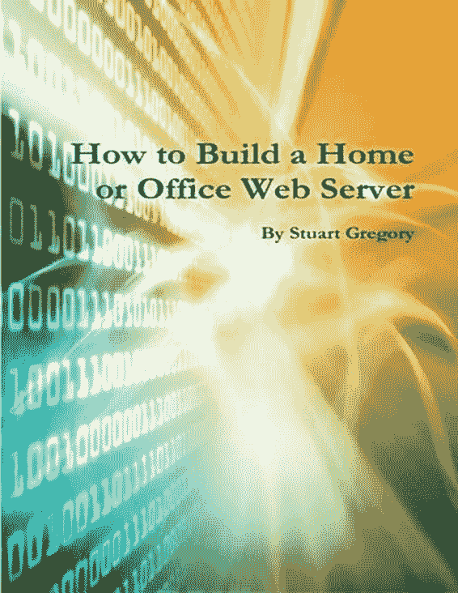


学习如何……

* 配置您的家庭网络
* 分配静态 IP 地址
* 选择并构建硬件
* 构建虚拟专用服务器 (VPS)
* 构建专用服务器
* 从 DVD 光驱安装 CentOS
* 创建可启动的 USB 优盘
* 从 USB 盘安装 CentOS
* 使用开源软件
* 安装并配置软件
* 安装并配置 cPanel
* 配置并安装服务器安全
* 为您的服务器分配域名
* 以及许多更多内容

## 如何构建家庭或办公室 Web 服务器


# 第一章
在本章中，你将学习静态或动态 IP 地址、选择您的互联网服务提供商 (ISP) 以及配置您的家庭网络以运行家庭或 Web 服务器。

## 静态或动态 IP 地址
为了运行 Web 服务器，无论是在家中还是数据中心，万维网都需要知道该 Web 服务器的位置。这是通过 IP 地址实现的。IP 地址就像是找到您服务器的电话号码。

动态 IP 地址在每次路由器关闭时都会更改。如果您在动态 IP 地址上运行 Web 服务器，那么每当路由器关闭并重启时，您都需要重新配置服务器、名称服务器和域名以新的 IP 地址。这将导致需要新的 DNS 传播，您的网站和服务器在 DNS 传播期间可能会离线达 24 小时。

市场上有一些服务允许您使用动态 DNS 将域名指向您的家庭动态 IP 地址；通常需要支付少量的月费。通过这些服务，每当路由 IP 更改时，它都会更新并启动将域名指向新 IP 的过程。这些服务仍然会导致一些停机时间，但大部分配置会自动完成。


在托管网站时，使用静态 IP 地址更好，因为这意味着你没有与他人共享你的 IP 地址。其他人或其他公司可能曾使用过该动态 IP 地址并发送了大量垃圾邮件，导致该 IP 地址被列入黑名单。

考虑到廉的费用和稳定性，我建议使用静态 IP 地址。对于书中的示例，我使用了一个互联网服务供应商（ISP），他们为我的宽带连接分配了 5 个静态 IP 地址。这允许我创建 3 个每个拥有单一 IP 地址的虚拟专用服务器（VPS），以及一个分配了两个 IP 地址的专用服务器。

## 选择你的互联网服务提供商 (ISP)

选择互联网服务提供商是构建家庭 Web 服务器的第一步。在注册互联网服务提供商之前，需要进行仔细的考虑。一旦注册，你将面临 12 个或 14 个月的合同，因此第一次选择正确的公司至关重要。

为了书中的目的和示例，我选择了 BT Business 宽带。他们提供快速的光纤宽带和静态 IP 地址。BT Business 宽带乐于让你从他们的设备运行 Web 服务器或游戏服务器，并提供一些配置路由器以实现此点的支持。

你不需要拥有办公场所或成为企业就可以安装 BT Business 宽带，因为这些可以安装在自己的家里。为了写这本书，我已将它安装在我的家里。

通过 BT Business 宽带，他们提供一个免费的业务网关（business hub），在这个示例中我有两个，但只需要一个。我还选择了 5 个静态 IP 地址。

## 配置你的家庭网络

一旦你的宽带激活并将静态 IP 地址分配到你的线路上，你就可以开始配置网关，为你的家庭 Web 服务器做准备了。他们的支持仅显示了如何配置网关以允许一个带有单个静态 IP 地址的 Web 服务器运行。在我们在书中展示的示例中，我们将运行多个 Web 服务器以及一个分配了多个静态 IP 地址的专用服务器；为此，我们需要以与他们所示不同的方式来配置网关和网络。

## 网络设备

我在这些示例中使用的网络设备列在下面。你可能希望使用相同的设备，或用你自己的设备进行替换。

*   两个 BT Business 网关
*   网络端口交换机
*   多根 cat5（以太网）线

服务器只需要一个 BT Business 网关，但由于我想将我的家庭 PC 连接到这根宽带线并受路由器的防火墙保护，我配置了第二个网关以允许我的家庭计算机受保护访问。

## 网关配置

### 配置网关 1

我们将首先配置网关 1，此网关将作为所有流量流量和服务器访问的网关。要访问你的网关，你需要通过 cat5 以太网线将计算机连接到网关。打开浏览器并在浏览器 URL 地址栏中输入 `192.168.1.254`。

这将打开你的新网关进行首次设置。由于网关是新的，它会要求你输入管理员密码并设置一个新的管理员密码。出厂设置密码位于网关后面的小拉条上。

一旦你设置了管理员密码并获得了网关的权限，你需要在菜单栏中选择设置（settings），然后选择高级设置（advanced settings）。接下来，点击继续进入高级设置。

配置此网关只有几个简单的步骤，第一步是禁用无线连接。我们禁用无线连接的原因是因为此网关仅作为网关，所以我们不希望家庭计算机直接连接到这个网关。

点击菜单栏中的无线（wireless）标签，并按照屏幕上的指令禁用无线连接。

接下来是允许静态 IP 地址。在菜单栏上选择静态 IP（static IP）选项。这将打开一个带有四个选项的新窗口。选择静态 IP 地址的第一个选项，接下来你需要输入路由器 IP 地址；这应该已经在有关静态 IP 地址的欢迎信中发送给了你。接下来我们需要选择子网掩码（subnet mask）。由于我订购了 5 个静态 IP 地址，我选择了以 `.248` 结尾的子网掩码，你的子网掩码也会出现在有关静态 IP 地址的欢迎信中，最后在此部分，我们需要确保“允许传入 ping 请求”（allow incoming ping requests）设置为是。点击 `apply`，你的静态 IP 地址现在已激活。

我们在网关 1 下需要做的最后一件事是禁用防火墙并允许所有入站流量。从选项菜单栏点击端口转发（port forwarding），然后从子菜单点击防火墙（firewall）。

一旦打开新页面，你需要选择禁用（disabled）然后点击应用（apply）。

网关 1 现在配置为允许所有入站连接，这些连接将被路由到相应的服务器。

### 配置网关 2

如果你没有为家庭计算机使用第二个网关，可以跳过此步骤。

对于此步，我通过家庭计算机上的无线选项连接到网关 2，但也可以再次使用 cat5 以太网线。一旦你输入设置和密码通过无线连接到网关 2，你可以在浏览器 URL 地址栏中输入 `192.168.1.254`。你还需要像之前为网关 1 那样为网关 2 设置管理员密码。我建议为网关 2 设置不同的密码，这样你总是确定自己连接的是哪个网关。

一旦你设置了管理员密码并获得了网关 2 的权限，我们只需要配置几项设置。你需要导航到高级设置（advanced setting）> 业务网络（business network），然后从子菜单选择 IP 地址（IP address）。

打开页面后，我们将更改网关 IP 网关地址。我将我的从 `.254` 结尾改为 `.10` 结尾，这将允许从浏览器访问两个网关。

接下来我们需要将 DHCP 服务器设置为否（no）。如果没有设置为否，那么两个网关将无法正确相互通信，点击应用保存我们所做的新设置。

此时你可能需要重启计算机，以便你的计算机也能获取新设置。

通过 cat5 以太网线将网关 2 连接到网关 1。连接应从网关 1 的以太端口 1 连接到网关 2 的以太端口 1。这将允许网关 2 从网关 1 接收宽带。

现在你可以通过在浏览器 URL 中输入 `192.168.1.10` 从新的网关 IP 地址登录网关 2。你也可以在浏览器中输入网关 IP `192.168.1.254` 登录网关 1。

现在两个网关都已正确配置，允许互联网接入你的服务器并无线连接到家庭计算机。在网关 1 上，你现在会看到电源灯和宽带灯激活。在网关 2 上，你会看到电源灯和无线灯激活。

## 网络端口交换机

由于我们要为专用服务器分配多个静态 IP 地址并要求虚拟专用服务器静态 IP 地址，我们将使用多个 cat5 以太线，因此购买一个网络端口交换机可能是一个好主意。这允许你取一根 cat5 以太线并将其分成若干根其他 cat5 以太网线。在示例中，我正在使用一个 8 口网络交换机。

网络端口交换机允许一根来自网关 1 的线接入网络交换机的以太端口 1；这为网络交换机提供了宽带互联网，在我的情况下，还有 7 根以太网线可以直接连接到服务器。


由于我们禁用了集纽器 1 上的防火墙，而我们所有的服务器都打算连接到它，因此从安全角度考虑，购买一个独立的防火墙并将其连接在网络端口交换机之前将是一个好主意。在这个示例中我没有这样做，但在现实中我会这样做。这可以在网上购买，价格从几英镑到几千英镑不等。

# 第二章

| 在本章中，你将学习什么是虚拟专用服务器（VPS）、什么是主机服务器、什么是专用服务器以及它们之间的区别。我们还将涵盖用于创建我们的虚拟专用服务器（VPS）和专用服务器的各种操作系统和软件。 |

## 虚拟专用服务器 (VPS)

虚拟专用服务器（VPS）是一种虚拟机，在软件的帮助下，它与许多其他虚拟机运行在同一台物理服务器上。

尽管虚拟机位于另一个更大的服务器内部，但它仍然可以被配置为独立于所有其他虚拟机运行；这意味着它可以完全根据每个客户的个人需求进行配置，并具有独立独立服务器的完整隐私性。

许多 Web 服务器会处理网站请求并将结果返回给终端用户，在某些甚至几乎所有情况下，网站会有很长时间的闲置期，此时服务器没有负载。创建虚拟专用服务器允许该机器上的其他服务器利用这段空闲时间。

### 虚拟化

当我们谈论创建一台机器并在此基础上产生（VPS）时，我们实际上是在使用虚拟化软件来实现这一点。通过创建一个带有支持虚拟化硬件的主机，我们就可以通过主机的硬件在主机内部创建较小的独立计算机。

这已成为 Web 托管行业中一个非常大的概念，允许以更廉的成本创建大量服务器；需要更少的空间、硬件和电力。

### 主机服务器

主机服务器在创建和运行我们的虚拟专用服务器方面起着关键作用。主机服务器允许你控制所有虚拟机，创建、停止、启动和挂起虚拟机。

主机服务器可以运行在 Windows 或 Linux 上，对于书中的示例，我们将在主机服务器上安装 windows 8`。我选择它是因为大多数家庭用户都熟悉 Windows 操作系统，在这样一个熟悉的环境中，他们会发现管理自己的虚拟机要容易得多。

一旦在主机服务器上安装了 Windows，就需要安装虚拟化软件，以便我们能够创建虚拟机。有很多虚拟化软件程序可用，我们选择了 Oracle 的 `Virtualbox`（开源软件）。

`Virtualbox` 是一款极其强大的 x86、AMD64 和 Intel64 虚拟化软件，用于家庭、业务和大型企业解决方案。`Virtualbox` 功能极其丰富，并作为高性能软件提供。

有关 Oracle 的 `Virtualbox` 的更多信息，请访问

[`www.virtualbox.org`](https://www.virtualbox.org)

一旦我们的主机服务器运行了 Windows 并安装了 `Virtualbox`，我们就准备好创建第一个虚拟专用服务器了。我们将在书后面介绍安装和配置我们的软件。

## 专用服务器

专用服务器是单一物理计算机，用户可以完全利用其系统资源。专用服务器更贵，但优势是你不需要与其他服务器共享你的物理资源。

设置专用服务器要快得多，因为你不需要像创建虚拟专用服务器（VPS）那样需要主机服务器和虚拟化软件。

在服务器上安装和使用 `CPanel` 软件需要 `CPanel` 许可证。这是唯一的每月费用（除了互联网服务提供商的宽带和 IP 地址费用外）。`CPanel` 许可证可以从互联网上的多种来源按月购买，价格大致相同。专用服务器许可证大约是虚拟专用服务器价格的三倍，但每个都为你提供相同的软件和控制权。

虚拟服务器许可证每月 £10

专用服务器许可证每月 £26

# 第三章

| 在本章中，我们将涵盖创建我们的虚拟专用服务器（VPS）和专用服务器所需的硬件。这将涵盖硬件的选择以及如何使用旧台式电脑 PC 作为服务器。 |

## 服务器硬件

如今市面上有极大量的计算机硬件，根据你的需求选择正确的硬件可能会非常困惑。对于书中的示例，我们将从市场稍高端的产品中选择来创建一个强大的服务器，但我们将每个服务器的预算控制在 400 英镑。

我们选择的服务器硬件可以创建一个具有 8 个 CPU 核心、16GB RAM 和 1TB 硬盘的专用服务器。或者我们可以创建一个操作系统和 7 台具有 1 个 CPU 核心、2GB RAM 和 100GB 硬盘的虚拟专用服务器。

还需要一些额外的硬件，如 PC 显示器，我们很快就会介绍这些。

### 主服务器硬件

我们构建每台专用服务器和虚拟专用服务器所需的主要硬件是：

* 主板
* 处理器、风扇和散热器
* 导硅脂
* PC 机箱和电源
* 硬盘
* 内存

由于我想确保这本书的所有读者都能买到这些零件，我从 eBay 购买了所有配件。有大量的卖家宣传主板套装优惠，包括主板、内存、处理器、风扇和散热器。这些价格在 200 - 300 英镑之间。这只需要你购买硬盘、机箱、电源单元和导硅脂。

我选择从 USB 启动操作系统，这消除了对 DVD 光驱的需求。如果你想通过光盘安装和启动你的 Windows 和 CentOS，那么你还需要一个 DVD 光驱。

我为我的专用服务器和虚拟专用服务器选择的硬件是：

主板
华硕 `M5A78L-M/USB3`

主板支持 AMD 和 AM3+ 多内核处理器，它提供了更好的超频能力且功耗更低。内存支持双通道 DDR3 非 ECC，最高支持 16GB。

外形规格为 Micro ATX，允许我选择散热良好的细机箱。它有两个 PCI 插槽，允许我添加额外的 10/100/1000（千兆）以太网。

主板 CPU 插槽是 AM3+，这意味着选择的处理器插槽也必须是 AM3+。

处理器
AMD FX 黑版 8 核处理器 插槽 AM3+

由于是新的 AMD FX 黑版系列的一部分，由于主板插槽是 AM3+，该处理器已解锁，随时可以进行超频。

该主板唯一的缺点是它只支持 SATA II -3GB/s，而现在大多数新硬盘都是 SATA III – 6GB/s。这只是意味着我的硬盘无法以全性能运行。

内存
海盗船内存 4GB DDR3 1333 Mhz 双通道

这种内存与大多数系统兼容良好，而且几乎是市场上最便宜的。便宜并不体现在它的性能上。


我所选择的主板可以安装四根这种内存条，为每个系统提供总计 16gb 的内存。

## 硬盘

希格捷 1TB 硬盘 SATA III 6Gb/s 64mb 缓存

关于硬盘没什么好说的。虽然有很多型号可以选择，但我喜欢希格捷硬盘。它们对我来说一直非常可靠。

现在的硬盘容量已经达到 4tb 了，所以请根据自己的需求选择最适合你的硬盘大小。如果你正在运行游戏服务器或文件共享服务器，也许更大的硬盘会更好。如果你只想运行一个简单的 Web 服务器，那么 1tb 就绰绰有余了。

## 导热硅脂

4g arctic 导热硅脂

硅脂用于将处理器与散热器结合在一起。你只需要在散热器上涂抹大约豌豆大小，然后将其涂开即可。过多的硅脂是危险的，因为它可能会溢出到主板上。对于这两台机器，你只需要大约 1g 装的硅脂，但我只能找到 4g 包装的。

## 机箱和电源

银讯 Milo micro ATX 机箱配带 400w 电源

选择正确的机箱可能非常棘手。外观和功能上非常多样，但很少有能让你一眼看出这就是我想要的。在订购机箱和电源单元（`PSU`）之前，你需要考虑几点：

* 尺寸（机箱放在哪里？）
* 散热（机箱有额外的风扇吗？）
* 电源输出（功率足够大吗？）

尺寸非常重要。由于我选择的机箱可以容纳 micro ATX 主板，所以看起来是可以的。但它能放得下我想放置服务器的地方吗？看看机箱的总尺寸。你需要在机箱背面留出 `75mm` 的空间，以便于电源线以及所有连接到机箱背部的其他线缆。

如果你打算从 USB 闪盘启动操作系统，那么确保机箱前面有 USB 接口会是个好主意。

如果服务器打算 24/7 全天运行，通风是必须的。在机箱四周留出空隙让额外的风扇工作并空气流通至关重要。

散热极其重要。处理器自带一个风扇，但主板额外支持一个机箱风扇。我们至少需要一个机箱风扇。如果你的机箱没有预装风扇，请确保它有空间安装机箱风扇。

使用上述硬件，电源单元（`PSU`）的功耗约为 `200w`。为了起起见，我会选择至少 `300w` 的电源。它配备的是 `400w` 的，所以没问题。

## 预装系统

如果你没有信心自己选择和安装硬件，在 eBay 或你的本地电脑供应商那里可以找到许多符合正确规格的预装系统。

如果你不确定预装系统是否满足你的需求，你随时可以通过提供所需的规格来询问他们；尽管大多数系统会在物品描述中列出所有规格。

购买预装系统通常会稍微贵一点（并不多少），但可以省去选择合适兼容硬件的烦恼。这些系统将准备就绪，你只需连接显示器并开始安装操作系统即可。

## 使用旧电脑

如果你不确定现在是否准备好跨出购买新设备，想尝试虚拟化软件或创建一个标准的专用服务器，那么旧的笔记本电脑或台式电脑是完美的选择。

如果你只想用旧台式机或笔记本电脑创建一个专用服务器，只要你的电脑至少有 `1gb` 内存和 `50gb` 或更大的硬盘，你就没问题了，可以去制作你的 `CentOS` 光盘或可启动 USB 闪盘准备好安装。

这只会给你一个低性能的专用服务器，但足够安装 `CentOS` 和 `CPanel`，以便将你的新服务器连接到互联网。

要从旧台式机或笔记本电脑创建虚拟专用服务器（VPS），你你需要 `3gb` 内存、`100gb` 硬盘以及至少双核处理器。

`Windows` 需要 `2gb` 内存和 `1` 核处理器才能启动，然后在 Windows 平台上安装虚拟化软件。我第一次在一台运行 `Windows XP` 的旧 HP 笔记本电脑上尝试过这个；那台电脑很慢，但运行良好，足够让我熟悉虚拟化软件了。我用不到一天的时间就创建并运行了安装有 `CentOS` 和 `CPanel` 的 VPS 服务器。然后我向这里添加了一个网站，并保持在线了大约三天，以检查稳定性和功能。

然后我花 `£50` 买了一台旧台式机，用它创建一个专用服务器并执行了类似的操作：安装了 `CentOS`、`CPanel` 然后是网站。一旦我确定稳定性和功能没问题，我就选择购买硬件来制作更高级的专用和虚拟专用服务器。

从这开始，我随后创建了一个小型办公服务器网络，一直发展到拥有 80 台服务器的微型数据中心。

## 额外硬件

根据你的需求以及你打算创建和安装的服务器数量，你可能还会考虑以下硬件。

* USB 闪盘
* DVD 光驱器
* 网络端口交换机
* Cat5 或 Cat6 以太网线
* KVM 切换器

如果你打算从 DVD 光盘启动操作系统，那么每台服务器都需要一个 DVD 光驱器。我选择从 USB 闪盘启动，因为这样可以减少硬件数量和功耗。而且，由于驱动器偶尔才用一次，我觉得没必要准备。

USB 闪盘可以轻松地在服务器之间传输。由于我将使用闪盘启动 `windows` 和 `CentOS`，我买了两个 `8gb` 闪盘来创建可启动操作系统，第三个 `8gb` 闪盘用于传输任何驱动程序或文件。

网络端口交换机允许你从集线器引一根以太网线到交换机，然后分线让每台服务器的 LAN 端口都有所需的以太网连接。你可以在 eBay 上花约 `£12` 买到。这将得到一个 `8` 口网络交换机。

`Cat5` 以太网线用于 `100mb` 数据传输，Cat6 以太网线用于千兆（Gigabyte）数据传输。根据你的网络交换机选择所需的合适额外线路。

# 第四章

| 本章将介绍 CentOS、下载并创建你的 CentOS 6 DVD 以及准备好安装的可启动 USB 闪盘。 |

## 关于 CentOS

`CentOS`（社区企业级操作系统）是一个基于 Linux 的操作系统，被全球大部分服务器使用。`CentOS` 是开源的，这意味着它是免费的。

### 下载 CentOS

要下载 `CentOS`，你可以直接下载，也可以下载种子文件并使用 `uTorrent`（开源软件）等工具打开下载文件。由于 `CentOS` 镜像是大文件，我更倾向于下载种子文件。

请参阅我们的软件章节获取下载位置。


从该网页上，你可以选择镜像站点来下载 CentOS 6.3。我使用了列表中的第一个。这会在新的网页中打开。在这个页面上，你将看到一个文件名列表。我们只需要 DVD 1，但为了速度，我下载了 `CentOS-6.3-x86_64-bin-DVD1to2.torrent` 文件并在 `uTorrent` 中打开它以开始下载。

下载完成后，你需要将 ISO 文件刻录到 DVD 光盘上。请记住，我们的示例仅使用 DVD 1。要将 ISO 文件刻录到光盘，我使用了 `image burn`，这同样是开源软件。

如果你在下载和使用 `uTorrent` 或 `image burn` 时需要任何帮助，请参下文章节。

### uTorrent

下载位置请参见我们的软件章节。

当你打开 `uTorrent` 网页时，点击 `get uTorrent`，这将为你打开一个新页面选择 `uTorrent` 版本。

我们只需要免费版，所以点击 `free download`，这将刷新你的页面并开始下载。屏幕上也有安装 `uTorrent` 的说明。

你的 CentOS DVD 1 到 2 下载将根据你的宽带速度花费一些时间，请耐心等待。完成后，你现在下载文件夹（或你为 `uTorrent` 选择存储下载的地方）中有一个名为“CentOS”的文件夹。

## Image burn

下载位置请参见我们的软件章节。

不要点击打开页面上的任何下载按钮。其中大多数是付费广告，会将你带到其他网站。在页面顶部的菜单栏上，你将看到：`News` | `Download` | `Change log`。

点击 `Download`，这将带你进入带有镜像站点列表的新页面以从那里开始下载。我使用了列表中的第二个镜像站点，打开后页面右侧有一个大蓝色“download now（立即下载）”框。这将开始你的 `imgBurn` 下载。

下载完成后，双击它并按照屏幕提示安装 `image burn`。

安装好 `image burn` 后，打开下载的 `CentOS` 文件夹，右键点击 `CentOS` DVD 1 的 `.img` 文件，选择 `open with ImgBurn`。

现在将提示你插入空白 DVD 并开始刻录到光盘。

## CentOS 可启动 USB 盘

一旦你有了 CentOS ISO 镜像文件，就可以用它创建一个可启动的 USB 驱动器。你需要相应的软件。我使用了开源软件 `ISO2USB` 用于 `CentOS/RedHat`。

这是免费软件且非常易用。它将在大约 10 分钟内在你的优盘上安装一个可启动版本的 CentOS。然后你可以反复在所有服务器上使用这个可启动优盘。

下载位置请参见我们的软件章节。

下载完成后，你需要使用 `Winrar` 或 `WinZip` 将文件内容提取到你选择的文件位置。

你现在会在选择的文件夹中看到一个 `ISO2USB` 镜像图标。双击它打开程序。

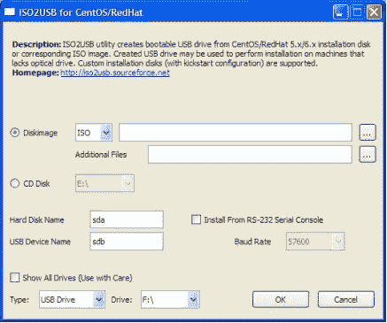

确保点击了 `Diskimage` 按钮，并将其设置为 `ISO`，然后选择 ISO 文件位置，在这种情况下，将是我们之前下载的 `CentOS` DVD 映像光盘。

保持 `Hard Disk` 名称和 `USB Device` 名称不变，它们应该是 `sda`。

选择你的 USB 驱动器和驱动器位置。这很可能已经为你选好了。点击 `ok`，现在将创建你的可启动的 CentOS USB 优盘。

## Windows 可启动 USB 驱动器

由于我们将使用 Windows 8 作为主机操作系统，我们也需要为它创建一个可启动 USB 优盘。

首先，使用你的 Windows 8 操作系统光盘，你需要在电脑上创建一个镜像文件。打开 `image burn` 并选择 `create image file from disc`（从光盘创建镜像文件）。

确保你已将 Windows 8 DVD 光盘插入 DVD 刻录机，并选择电脑上存储镜像文件的位置。点击 `image burn` 底部的 `Read` 按钮，这将创建你的 ISO 镜像文件。

从这个镜像文件，你现在可以创建可启动的 USB 驱动器了。

还有其他程序可以创建它，但我坚持使用微软程序，即 `Windows 7 USB DVD download tool`。

下载位置请参见我们的软件章节。

不要担心，这将创建其他可启动的 Windows 操作系统盘。下载完成后，按照屏幕说明创建你的 Windows 8 可启动 USB 优盘。

这是一个自解压的微软程序。在下载文件夹中找到下载的内容并双击。

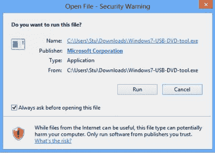

一旦之前的镜像加载，选择 `run` 开始安装。

下一张图像将是欢迎界面。点击 `next`

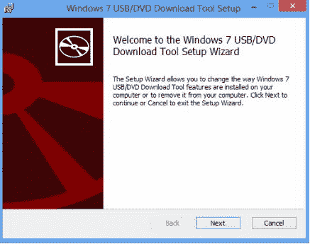

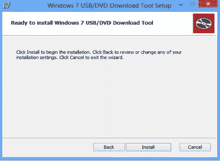

我们现在准备好安装 `Windows 7 USB/DVD download Tool` 了。一旦你点击 `Install`，程序将启动安装界面，取决于你的电脑，安装可能只需几秒钟。

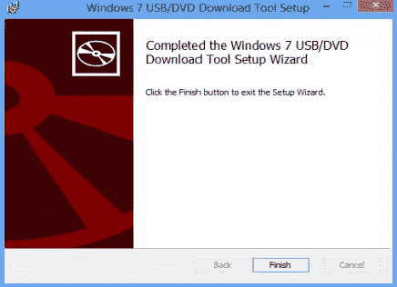

当出现“Completed the Windows 7 USB/DVD Download Tool Setup Wizard”屏幕时，点击 `Finish` 退出安装程序。

你现在会在桌面上看到一个 `Windows 7 USB DVD download tool` 图标。双击它打开程序。

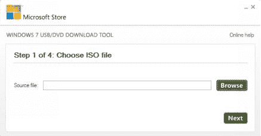

点击 `Browse` 选择你稍早创建的 Windows 8 ISO 文件位置。

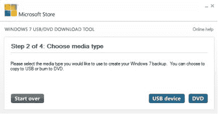

接下来我们需要选择媒体类型。点击 `USB device`。

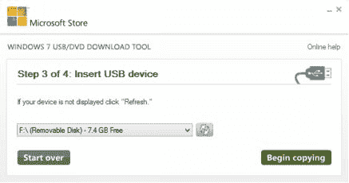

你现在应该看到已选中的 USB 设备和可用存储空间。如果你的优盘上有文件，我建议先备份，因为该工具将重新格式化优 盘。

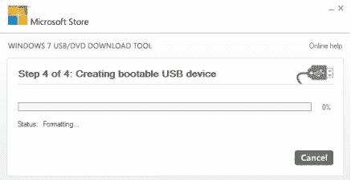

`Windows 7 USB/DVD download tool` 现在将格式化 USB 盘并复制所需文件。取决于你的电脑，这大约需要 10 到 15 分钟。

# 第五章

| 在这一章中，我们将分别通过 DVD 光盘和可启动 USB 盘安装我们的 CentOS 6.3 操作系统。然后我们为 CentOS 配置网络访问，并为服务器分配静态 IP 地址。 |

## 从 DVD 光盘安装 CentOS 6.3

现在我们已经准备好了专用服务器硬件，并且 CentOS 6.3 DVD 1 已经在光盘上，我们可以开始安装服务器基础操作系统。

选择你的服务器从 CD 启动，并将 CentOS DVD 1 插入 DVD Rom 驱动器中。

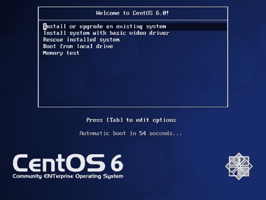

一旦加载上述屏幕，你需要选择安装或升级现有系统。

下一个出现的屏幕是在安装前开始测试介质。选择 `skip` 跳过介质测试并开始安装。

测试介质确实需要一些时间，安装介质通常不会有问题，所以你可以跳过此测试并开始从你的 CentOS 6 安装。

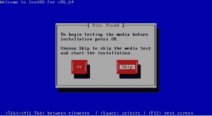

CentOS 的欢迎界面现在将显示。点击下方屏幕上的 `next`。

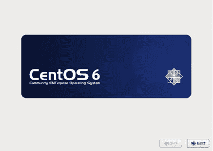

现在你将被要求为你的 CentOS 安装选择键盘语言。如下屏所示。

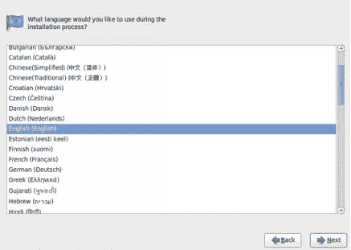

在点击选择语言的 next 后，你将看到如下所示屏幕，选择你的键盘语言。对于以前安装过操作系统的人来说，这些看起来都会非常熟悉。

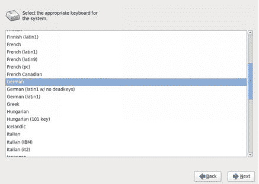

与我们的服务器构建一样，我们使用的是本地连接的硬盘，在后续屏幕上你应该选择基础存储设备。

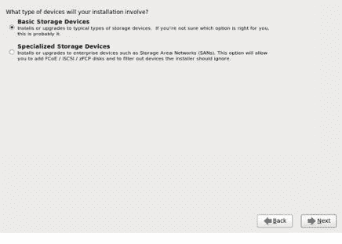

你可能会看到以下警告 - Error processing drive（处理驱动器错误）。如果看到这个，点击 `Re-initialize all` 按钮继续：

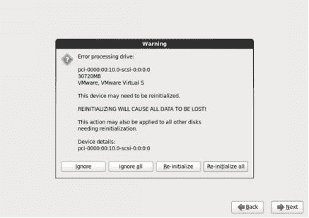


下方消息也可能出现，提示下方的存储设备可能包含数据。如果出现此消息且你确定硬盘上没有需要备份或保留的数据，可以选择“Yes, discard any data”（是，丢弃任何数据）。

弹出的框会持续几秒钟（如果硬盘很大，时间可能会更长），显示“正在检查存储设备”（examining storage device）。

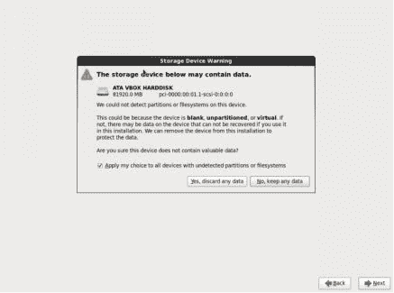

一旦硬盘初始化并接受作为存储设备，你将被引导到下一个屏幕继续安装。

你现在需要填写服务器的主机名（例如 `server1.example.com`），然后点击`Configure Network`配置网络）按钮：

由于这是一个可能会托管你网站的 Web 服务器，将 `example.com` 替换为你的域名会更好。主机名必须是完全限定域名名（FQDN）。使用 `server1\.` 或 `vps1\.` 是允许的，但主机名必须以域名结尾。

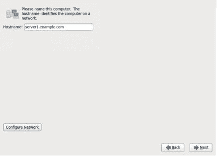

点击`Configure Network`按钮后，会弹出网络连接（Connections）窗口。选择`System eth0` 并点击`edit`编辑来配置你的网络。

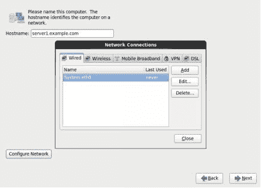

选择`edit`按钮后，会弹出如下所示的进一步框。勾选`connect automatically`自动连接复选框，然后点击`IPv4 Settings`IPv4 设置选项卡。

在`Method:`方法 下拉框中，确保选择了`Automatic (DHCP)` 自动（DHCP），并点击`apply`应用，这将关闭`Editing System eth0`窗口。

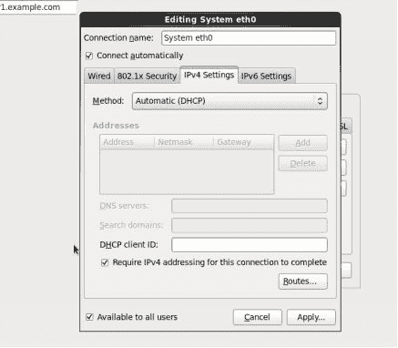

我们在这里允许自动 DHCP 而不是设置静态 IP 地址的原因是，每个`eth0`连接都有自己的 MAC 地址，我们稍后将在 BT 网关集纽中分配 IP 地址。

你现在需要点击关闭网络连接框，然后你会看到如下所示的消息。

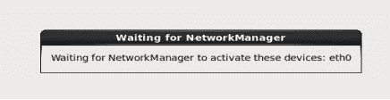

一旦上述消息关闭，你的网络连接即已完成，你可以继续操作。

取决于服务器的速度，该消息可能只显示一瞬间，因此你可能会错过它。只要没有看到任何错误信息，就可以继续安装。

如果等待网络管理器（network manager）返回错误信息，最常见是因为你没有通过以太网线将服务器连接到网络端口交换机或网关集纽。

确保你已连接以太网线并再次尝试这些设置。

如果你的服务器上有多个以太网端口且你打算使用多个，则你需要对每个`system eth0`端口执行这些设置。

当屏幕返回到下方的截图时，你可以点击 next 继续安装 CentOS 的安装。

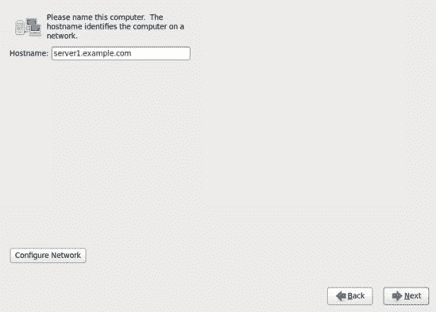

你现在需要选择时区；你可以使用动态地图或使用下拉列表来设置你的时区。完成后点击 next。

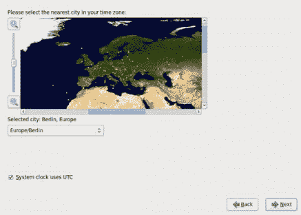

登录你的服务器时，主用户名始终是`root`。如果你打算安装 cPanel、访问 WHM 面板并配置 cPanel，你的用户名将是`root`以及你在此处选择的密码。你用于 SSH 连接的主用户名也将是`root`以及你在此处选择的密码。

在这里你需要为`root`用户设置密码。连接到外界（万维网）的服务器经常受到攻击，因此不建议在此处设置弱密码。使用大写字母和小写字母结合数字是一个良好的习惯。

现在把这些细节记录下来也是个好主意。主用户始终是`root`，你的密码是你现在选择的。你的`root`密码至少要有六个字符。

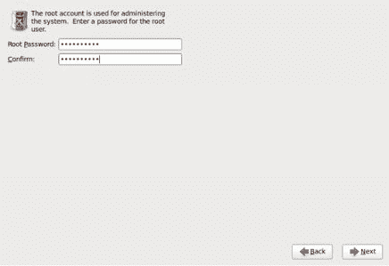

接下来我们进行分区。选择`use all space`使用所有空间。这将给你一个较小的`/boot` 分区和一个较大的`/` 分区，这对于大多数用途都是足够的。

如果你打算在服务器上安装 cPanel，最好创建一个自定义布局。这是 cPanel 建议的，但不是强制的。如果你需要此步骤，请现在阅读关于“创建自定义硬盘布局”的章节，然后返回继续安装。

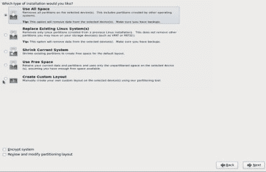

你现在会被要求将更改写入磁盘。点击选择`write changes to disk`将更改写入磁盘的按钮。

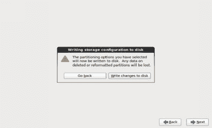

如果你选择了查看或修改分区布局，将看到两个额外的屏幕。在此阶段，你不需要修改任何分区，因为我们将在本章的单独章节介绍创建自定义分区。

你现在将看到分区的驱动结构。点击 next。

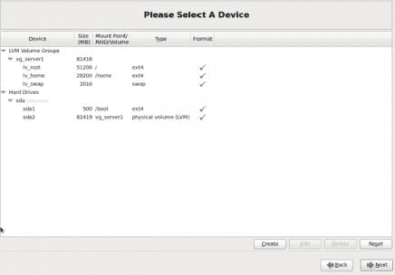

硬盘现在将格式化为所需的分区。

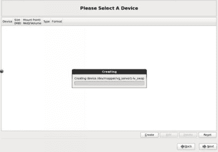

点击 next 确认在所选分区上安装引导加载程序（boot loader）。

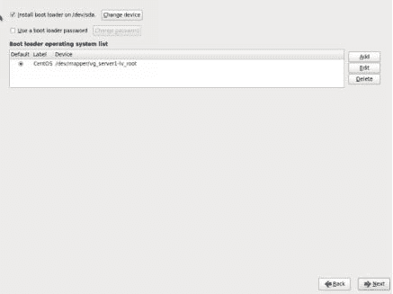

接下来我们需要选择想要安装的软件。选择`Basic Server`基础服务器，然后在附加仓库字段中勾选`CentOS`，选择`Customize later`稍后自定义并点击 next。

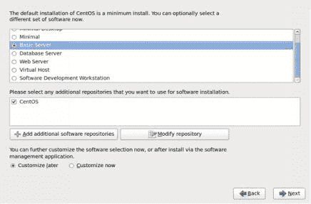

CentOS 的安装现在开始。这通常需要大约 10 分钟完成。

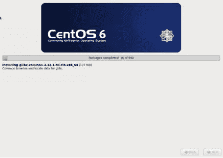

安装完成后，你可以从光驱动器中移除 DVD 媒介。

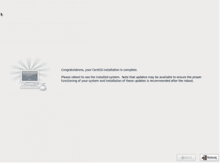

你已成功在服务器上安装了 CentOS 基础服务器操作系统，它现在已准备好供你配置和更新。

服务器重启后，你可以使用之前创建的密码登录 CentOS。

接下来你需要配置互联网访问。要此操作，请阅读本章末尾的配置互联网访问章节。

## 从可启动 USB 安装 CentOS 6.3

从 USB 驱动器安装 CentOS 时没有太大区别，但有一些细微的不同。首先，你应该将 USB 闪盘插入 USB 端口，打开服务器并选择从你的 USB 设备启动。

一旦加载下方屏幕，你需要选择安装或升级现有系统。


与从 DVD 安装 CentOS 不同，随后出现的屏幕是选择语言（select language）。屏幕布局也与通过 DVD 启动的格式不同。

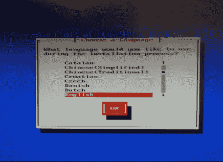

在选择语言（select language）上点击 next 后，将看到如下所示屏幕，选择你的键盘语言。

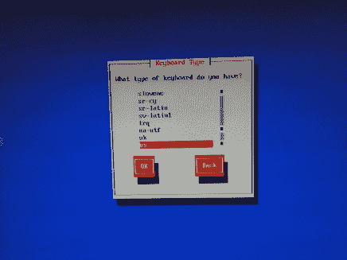

一旦你选择了安装语言和键盘，就必须选择安装方法。你会被询问哪种类型的媒体包含安装镜像。

使用键盘上的方向键突出显示硬盘（hard drive）并点击 ok。

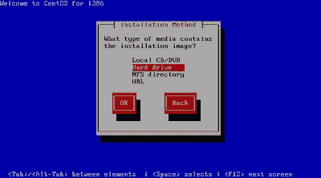

当询问存放镜像的分区时，这很可能是我们创建可启动 USB 驱动器时的`/dev/sda1`。选择该驱动器然后点击 ok。

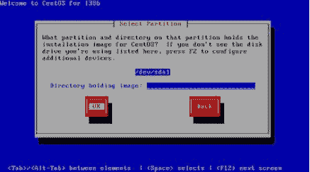

CentOS 的安装现在开始。点击 next 按钮继续。

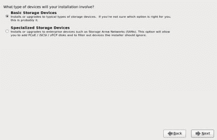

你可能会看到以下警告`-Error processing drive`处理驱动器错误。如果看到此，点击`Re-initialize all`重新初始化所有以继续。

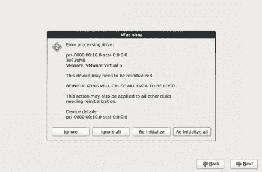


下述消息也可能出现，提示下面的存储设备可能包含数据。如果出现此消息，且您确定硬盘上没有需要备份或保留的数据，您可以选择 `Yes` 并丢弃任何数据。

将会弹一个小窗口，持续几秒钟（如果您的硬盘非常大，时间可能会更长），显示“正在检查存储设备”。


一旦您的硬盘已完成初始化并被接受为合适的存储设备，您将进入下一个屏幕继续安装。

现在，您需要填写服务器的主机名（例如 `server1.example.com`），然后点击 `Configure Network` 按钮：

由于这将作为一个可能托管您网站的 Web 服务器，因此将 `example.com` 替换为您的域名会更好的主意。主机名必须是完全限定域名（FQDN）。使用 `server1\.` 或 `vps1\.` 是的，但主机名必须以域名结尾。


点击 `Configure Network` 按钮后，会弹出网络连接（Connections）窗口。选择 `System eth0` 并点击 `edit` 来配置网络。


选择 `edit` 按钮后，会出现一个如下所示的进一步弹出框。点击 `connect automatically` 复选框，然后点击 `IPv4 Settings` 选项卡。

在 `Method:` 下拉框中，确保选择了 `Automatic (DHCP)` 并点击 `apply`，这将关闭 `Editing System eth0` 窗口。


我们在这里允许自动 DHCP 而不是设置静态 IP 地址的原因是，每个 `eth0` 连接都有自己的 MAC 地址，我们将在稍后在 蓝牙网关集线器（BT gateway hub）中分配 IP 地址。

现在，您需要关闭网络连接框，然后您将看到一条如所示的消息出现。


一旦关闭上述消息，您的网络连接即告完成，您可以继续。

取决于服务器的速度，该消息可能只显示一瞬间，您可能会错过它。只要您没有看到任何错误消息，就可以继续进行安装。

如果等待网络管理器（network manager）返回错误消息，最常见的原因是您没有通过以太网线将服务器连接到网络端口交换机或网关集线器。

请确保您已连接以太网线并重试设置。

如果您的服务器上有多个以太网端口且您打算使用多个，您将需要对每个系统 `eth0` 端口执行这些设置。

当屏幕返回到如下所示时，您可以点击 `next` 继续安装 CentOS。


您现在需要选择您的时区；您可以使用动态地图，也可以使用下拉列表来设置您的时区。完成后点击 `next`。


在登录服务器时，主用户名始终是 `root`。如果您打算安装 cPanel、访问 WHM 面板并配置 cPanel，您的用户名将是 `root`，连同您在此处选择的密码。您用于 SSH 连接的主用户名将是 `root` 以及您在此处选择的密码。

在这里，您需要为 `root` 用户设置密码。连接到外部（互联网）的服务器会受到攻击，因此不建议在此处设置弱密码。使用大写和小写字母结合数字组合是一个良好的习惯。

现在记录下这些细节也是个好主意。主用户始终是 `root`，您的密码是现在选择的。您的 root 密码至少需要六个字符。


接下来我们进行分区。选择 `use all space`。这将为您提供一个较小的 `/boot` 分区较大的 `/` 分区，这对于大多数用途来说都是的。

如果您打算在服务器上安装 cPanel，最好的办法是创建一个自定义布局。这是 cPanel 建议的但并非强制性的。如果您需要此步骤，请现在阅读关于“创建自定义硬盘布局”的章节，然后返回继续安装。


现在您会被要求将更改写入磁盘。点击选择 `write changes to disk` 的按钮。


如果您选择了查看或修改分区布局，您将看到两个额外的屏幕。在此阶段，您不需要修改任何分区，因为我们将在本章的单独部分介绍创建自定义分区。

现在您将看到分区的硬盘结构。点击 `next`。


硬盘现在将按照所需的分区格式化。


点击 `next` 以确认在所选分区上安装引导程序。


接下来我们需要选择想要安装的软件。选择 `Basic Server`，然后在附加存储库（additional repositories）字段勾选 `CentOS`，选择 `Customize later` 并点击 `next`。


CentOS 的安装现在开始。这通常需要 10 分钟完成。


安装完成后，您可以从 Rom 驱动器移除 DVD 介质并点击 `reboot` 按钮。


您已在服务器上成功安装了 CentOS 基础操作系统，现在已准备好供您配置和更新。

服务器重启后，您可以使用用户名 `root` 和之前创建的密码登录 CentOS。

接下来，您需要配置安装以访问互联网。要此操作，请阅读本章末尾关于配置互联网访问的章节。

## 创建自定义硬盘布局

在安装 Red Hat Enterprise Linux 时，建议使用 `ext` 文件系统（`ext2`、`ext3` 或 `ext4`）。

我列出了 CentOS 最常用的分区系统和 cPanel 服务器配置设置。如果您的服务器需要，您可以在这些基础上添加更多可选分区，但此配置对于大多数服务器来说足够了。

| `/boot` | 495MB |
| `/temp` | 2GB |
| `swap` | 服务器内存的两倍 |
| `/` | 增长填充磁盘 |

`/boot` 分区用于服务器的内核（Karnels）、引导程序和配置文件。

`/temp` 分区是服务器上存储所有临时文件的地方。

`swap` 分区用于系统可以写入到硬盘的内存 溢出部分。

`/` 分区被设置为增长填充磁盘，是服务器的主分区，也是存储基础操作系统的地方。cPanel 将安装在此处并创建任何所需的目录，如 `/home`、`/var` 和 `/usr`。

为了创建分区的自定义布局，您需要在安装屏幕上选择 `create custom layout`，您想进行哪种类型的安装？

一旦您按照下面的屏幕选择了 `create custom layout`，点击 `next`。这将带您进入编辑和修改硬盘分区。

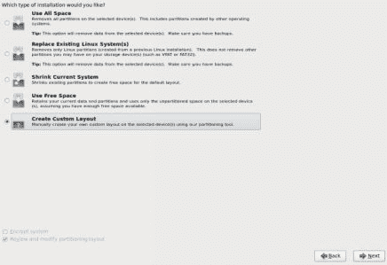

您现在将看到名为 `sda` 的硬盘以及如下所示的空闲空间。如果您看到所示之外的其他分区卷，请删除它们，因为它们是该硬盘上之前的安装残留。

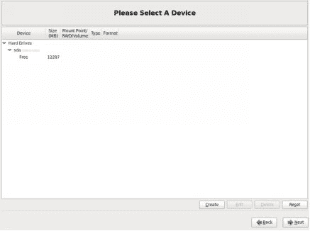

高亮 `sda` 硬盘下方的空行，并点击屏幕底部的 `create`。

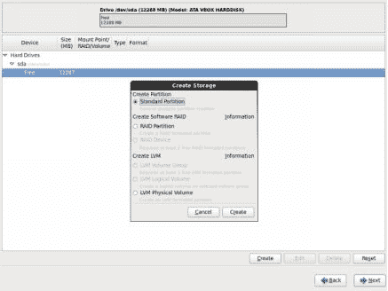

在出现的名为 `create storage` 的小弹出框中，选择 `standard partition` 并点击 `create`。

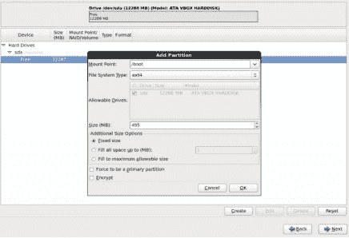


首先，我们将创建 `/boot` 分区。在挂载点（Mount point）下：选择 `/boot`，文件系统类型选择框应该已经设置为 `ext4`，但只需确保它被设置为 `ext4` 即可。

在大小（size (MB)）下输入你所需的分区大小。在这里我们输入 `495`。

在额外大小选项（additional size options）下，确保选择了固定大小（fixed size）并点击确定（ok）。

你现在会在硬盘上看到你的 `/boot` 分区，旁边有一个勾选标记。

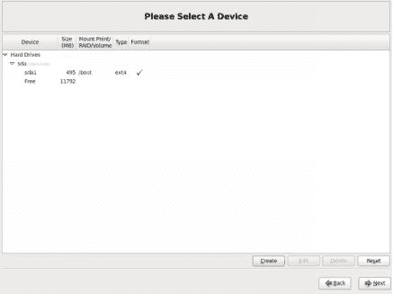

再次高亮 `free` 行，我们现在可以创建临时分区了。选中该行后，点击屏幕底部的创建（create）按钮。

在第一个弹窗框中，你需要再次点击标准分区（standard partition）。

在挂载点（Mount point）下：选择 `/tmp`，文件系统类型选择框应该已经设置为 `ext4`，但只需确保它被设置为 `ext4` 即可。

在大小（size (MB)）下输入你所需的分区大小。在这里我们输入 `2048`，这将提供我们推荐的 2GB。

在额外大小选项（additional size options）下，确保选择了固定大小（fixed size）并点击确定（ok）。

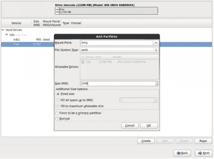

你现在会在硬盘上看到 `/boot` 和 `/tmp` 分区，它们旁边都有勾选标记。


接下来是创建 `swp` 分区。再次高亮 `free` 行。选中该行后，点击屏幕底部的创建（create）按钮。

在第一个弹窗框中，你需要再次点击标准分区（standard partition）。

一旦出现添加分区弹窗框，你需要让挂载点（mount point）为空，并在文件系统类型选择 `swap`。

大小（MB）需要设置为服务器内存的两倍。在我的服务器上，我分配了 1GB 的内存，因此我将其设置为 `2048`。

在额外大小选项（additional size options）下，确保选择了固定大小（fixed size）。你的添加分区弹窗看起来应该像下面的截图。

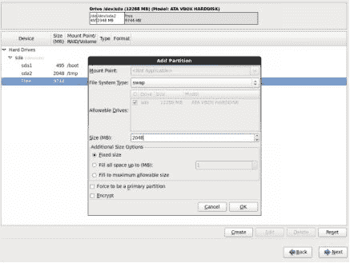

点击确定（ok），这将返回到显示硬盘分区的屏幕。

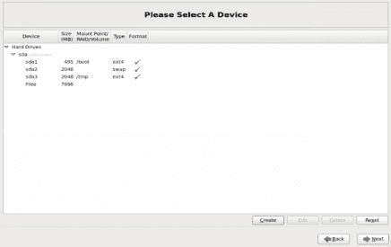

我们现在需要创建最后一个分区，即填充硬盘的所有剩余空间。再次，我们需要选择 `free` 行并点击创建（create）。在第一个弹窗框中再次选择标准分区（standard partition）并点击创建（create）按钮。

在挂载点（mount point）下选择 `/`，文件系统类型应该是 `ext4`，但只需检查一下。在额外大小选项下选择填充到最大允许大小（fill to maximum allowable size）。你现在应该有一个与下方截图相同的屏幕。

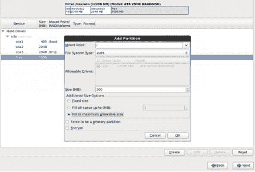

点击确定（ok），这将带你回到显示硬盘和所有分区的屏幕。

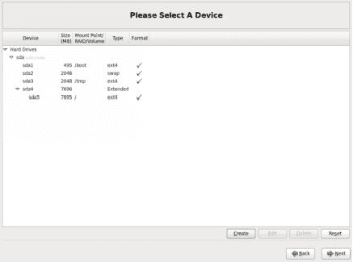

你现在已经创建了所有需要的分区。点击下一步（next）继续分区创建。

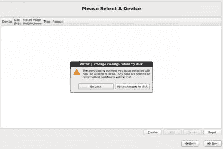

确认将更改写入磁盘，这将格式化硬盘并创建新的分区和文件系统。

接下，你会被要求确认引导加载程序（boot loader）。这里已经像下面的截图一样预填好了，所以你只需点击下一步（next）。


你现在将处于下面的屏幕，可以选择你想要在服务器上安装的软件。这现在已经带你回到了 CentOS 的标准安装，你可以继续进行安装。


## 配置网络访问

CentOS 现在应该已成功安装在你的服务器上。为了让你的服务器从外部访问，我们需要为它分配一个静态 IP 地址。要做到这一点，我们使用服务器以太网（LAN）MAC 地址。

作为网关使用的 BT Hub 现在将检测到你的新服务器，并以端口的 MAC 地址为它命名。首先，我们需要知道服务器正在使用的端口 MAC 地址。

如果你只连接了一台服务器，这并不是问题，但当你连接多个服务器时，情况可能会变得有点混乱。

首先，你需要登录 CentOS，目前你无法使用 `SSH` 连接，因此必须通过键盘、鼠标和显示器进行。


当 CentOS 首次启动时，你会看到一个与上方截图相同的屏幕。

前两行告诉你 CentOS 版本、发布版本以及内核（Kernel）。下一行是 `server1 login`：`server1` 是我们分配服务器的名称，`server1.example.com`。

你需要使用用户名 `root` 登录并按回车。接下来是密码。输入你的密码并按回车。当你输入密码时，不会有任何字符显示，不要担心，这是正常的。

登录后，你将看到像下面的快屏幕。


现在我们已经登录，我们需要获取服务器的 `eth0` MAC 地址，以便我们可以在网关 Hub 中分配静态 IP 地址。

在命令行提示符处输入以下命令并按回车：

```
ifconfig
```

这现在将为你展示网络连接设置。此时我们只关心第一行。在我们下方的示例图中，该行内容为：

`eth0 link encap:Ethernet HWaddr 08:00:27:57:70:B0`


`HWaddr` 代表硬件地址，其后的数字和字母就是该 `eth0`（以太网网端口）的 MAC 地址。

我们现在可以登录网关 Hub 为服务器分配静态 IP 地址。

要访问 Hub，打开浏览器并在 URL 地址栏输入 `192.168.1.254`。

作为网关使用的 BT Hub 现在将检测到你的新服务器，并以端口的 MAC 地址为它命名。首先，我们需要知道服务器正在使用的端口 MAC 地址。

如果你只连接了一台服务器，这并不是问题，但当你连接多个服务器时，情况可能会变得有点混乱。

首先，你需要登录 CentOS，目前你无法使用 `SSH` 连接，因此必须通过键盘、鼠标和显示器进行。


当 CentOS 首次启动时，你会看到一个与上方截图相同的屏幕。

前两行告诉你 CentOS 版本、发布版本以及内核（Kernel）。下一行是 `server1 login`：`server1` 是我们分配服务器的名称，`server1.example.com`。

你需要使用用户名 `root` 登录并按回车。接下来是密码。输入你的密码并按回车。当你输入密码时，不会有任何字符显示，不要担心，这是正常的。

登录后，你将看到像下面的快屏幕。


现在我们已经登录，我们需要获取服务器的 `eth0` MAC 地址，以便我们可以在网关 Hub 中分配静态 IP 地址。

在命令行提示符处输入以下命令并按回车：

```
ifconfig
```

这现在将为你展示网络连接设置。此时我们只关心第一行。在我们下方的示例图中，该行内容为：

`eth0 link encap:Ethernet HWaddr 08:00:27:57:70:B0`


`HWaddr` 代表硬件地址，其后的数字和字母就是该 `eth0`（以太网网端口）的 MAC 地址。

我们现在可以登录网关 Hub 为服务器分配静态 IP 地址。

要访问 Hub，打开浏览器并在 URL 地址栏输入 `192.168.1.254`。


你现在将看到 `eth0` 和你的以太网控制器的型号。如果你有多个以太网控制器，它们将在这里列出。我们稍后会介绍更多关于多个 IP 地址的内容。一旦你选中了以太网控制器，按下回车键。


你现在将看到一个与截图类似的屏幕。


现在你需要添加主 DNS 服务器和备用 DNS 服务器。请使用方向键将光标移动到正确的输入字段。在主 DNS 服务器处输入 `8.8.8.8`，在备用 DNS 服务器处输入 `8.8.4.4`，现在你会得到类似下面的屏幕。


使用方向键高亮 `OK` 标签并按回车键，这将带回到选择设备屏幕。使用方向键高亮 `save` 标签并按回车键。

你现在将返回下面的屏幕。


我们现在需要编辑你的 DNS 配置文件。执行此操作，使用方向键高亮 `DNS configuration` 并按回车键。

你现在将看到一个与截图相同的屏幕。


`hostname` 字段项应保持不变，这是我们在安装 CentOS 时分配的服务器主机名。剩余的字段我们需要输入。

使用方向键高亮每个需要编辑的字段。首先将主 DNS 修改为 `8.8.8.8`，将备用 DNS 修改为 `8.8.4.4`，使其与我们在上一步中配置以太网适配器时输入的内容一致。你可以将三次 DNS 留空并删除 DNS 搜索路径中的任何信息。

你现在将看到类似下面的屏幕。


使用方向键高亮 `ok` 标签并按回车键，这将带回到选择操作屏幕。高亮 `save & quit` 并按回车键。

我们现在需要重启服务器使设置生效。在命令行提示符处输入以下命令并按回车：

```
shutdown –r now
```

你的服务器现在将重启。一旦服务器重启，你将会被提示重新登录。登录返回后，你需要输入以下命令。

```
ifconfig
```

这现在将向你展示网络连接设置，并反映分配给你服务器的静态 IP 地址。

你的服务器现在可以从外部世界访问，并且现在成为一台无头机器。这意味着你现在可以使用 `putty` 或任何其他 SSH 客户端来访问和配置你的 Web 服务器。要测试这一点，你可以使用你的个人电脑。

为了完成此操作，我们需要使用如 `putty` 这样的软件，这是一个免费的 telnt/ssh 客户端。

请参阅我们的软件章节获取下载位置

一旦下载了 `putty`，你不需要安装任何东西，因为这是一个独立的软件客户端。双击下载文件夹中的 `putty` 图标以打开新会话。（如下所示）


打开 `putty` 后，光标将在一个名为 Host Name（或 IP address）的框中闪烁，在这个框中，你需要输入服务器的 IP 地址。当你输入 IP 地址后，点击底部的打开按钮。

由于这是你第一次使用 `putty` 连接到你的服务器，你将看到以下消息。


无需担心，我们知道该服务器就是我们认为的那台电脑，所以你只需点击 yes 来确认此操作。

你需要以 root 用户 (`root`) 登录，并输入你在安装 CentOS 时创建的密码。

一旦服务器确认了你的用户名和密码，你就登录了。由于你是通过互联网从另一台电脑通过 IP 地址连接到服务器，这意味着你的服务器现在已配置好可以访问互联网。

要退出 SSH 客户端，输入以下命令并按回车。

```
exit
```

恭喜你，你现在构建了你的第一个基础 Web 服务器。如果你打算在你的 Web 服务器上使用 `cPanel`，在安装 `cPanel` 之前还需要完成一些额外的配置。请参阅第 7 章。

# 第六章

| 在本章，我们将介绍如何构建我们的专用服务器、我们的虚拟专用服务器 (VPS)、创建虚拟专用服务器并让虚拟机在主机启动时自动启动。本章还将涵盖安装主机操作系统、虚拟化软件以及从保存的镜像文件启动 CentOS |

## 构建专用服务器

构建专用服务器比虚拟服务器 (VPS) 简单得多，你可以在一小时内将一台旧电脑 变成专用服务器。

正如我们之前在书中介绍的关于选择硬件和使用旧电脑作为服务器的内容，你现在应该已经考虑好了将使用哪种方案。

一旦你的计算机组装并测试所有硬件工作正常且可以开机，对于专用服务器来说你几乎就完成了。由于专用服务器使用所有硬件的能力，剩下的工作就是安装 CentOS。

你需要阅读关于创建 CentOS DVD 光盘或 CentOS 可启动 USB 驱动器的章节，然后按照安装 CentOS 的章节操作。

## 构建虚拟专用服务器

虚拟服务器就像计算机内部的计算机。为了实现这一点，它们使用主机操作系统上的虚拟化软件将整个系统的百分比分配给创建的每个虚拟机。

在决定整个主机的硬件需求时，你需要考虑每个虚拟机需要什么，以及主机需要什么。

对于书中的示例，我们将允许两个 VPS（虚拟机）和一个主机。每个虚拟机将被分配以下配置：

* 1 个 cpu
* 1 GB 内存
* 20 GB 硬盘空间

我们的主机操作系统将是 `windows 8 64 bit`，其最低要求是：

* 1 个 cpu
* 2 GB 内存
* 20 GB 硬盘空间

因此，对于总硬件需求，我们需要：

* 3 个 cpu
* 4 GB 内存
* 60 GB 硬盘空间

比最低要求多准备一点是一个良好的习惯，以防其中一台虚拟机需要升级或需要创建另一台机器。我选择了 4 核 CPU、4 GB 内存和 500 GB 硬盘。

一旦硬件完成所有安装并测试了其可以正常启动且所有硬件开机均无任何问题，就是创建主机系统的时候了。

### 安装主机操作系统

主机操作系统是主控制系统。可以创建许多不同的设置，例如 CentOS 系统，然后可以从外部世界访问以控制你的虚拟化软件，但我选择在本文示例中使用 Windows 操作系统，因为大多数人对 windows 熟悉，并且发现它管理起来稍微容易一点。

如果你已经安装了带有 `windows` 系统，可以跳过这一步，继续阅读禁用 `windows 8` 的睡眠模式。

你不必使用 `Windows 8`，我只是为了示例选择了它。`Windows XP` 及更高版本作为主机操作系统运行得非常好；我建议使用 64 位版本而不是 32 位。

本安装指南涵盖了从 DVD 光盘或可启动 USB 驱动器安装 `Windows 8`。一旦你决定了如何安装主机操作系统并创建了启动介质，你需要进入系统的 bios 并选择启动设备。这通常是电脑开机时启动屏幕上的一个选项。

当你的电脑加载并选择可启动介质后，你将看到以下屏幕。在 Windows 初始化期间，它停顿了几分钟。


几分钟后，你将看到下方截图所示的 Windows 安装界面。你可以在点击“下一步”之前在这里指定语言设置。当你点击“下一步”时，安装程序将在后台执行一些额外的初始化任务。

我更倾向于安装 Windows 8，因为它非常快且安装非常简单。大多数驱动程序在安装过程中已经安装完毕，因此剩下需要执行或配置的工作很少。

Windows 8 将安装基础显卡驱动程序和你的局域网驱动程序。你的局域网驱动程序用于以太网控制器。唯一没有安装的是音频驱动程序。这不是问题，因为我们将其作为服务器的宿主机，不需要声音和华丽的图形。


一旦你完成上述步骤并点击“下一步”，系统将通过下下方的屏幕提示你安装 Windows 8。


当你点击`立即安装`按钮后，你将看到安装程序信息收集阶段的开始。第一步是输入 Windows 8 产品密钥。


下一步是微软许可协议。如果你想继续安装 Windows 8，则必须接受该协议。


当你被提示选择要执行的安装类型时（如下方的截图所示），你需要选择`自定义：仅安装 Windows（高级）`类型，以便对 Windows 8 进行纯净安装。


当你被提示选择想要安装 Windows 的位置时（如下方的截图所示），你将看到已创建的硬盘或分区的列表。

有许多不同的选项，但作为示例，我将使用整个硬盘来安装 Windows 8。对于具有创建分区和安装操作系统经验的人士来说，你可能希望创建自己的自定义布局。

创建驱动布局的选项可能是：你可能希望在一个 30 GB 的分区上安装 Windows 8；这将为 Windows 8 留出 20 GB 的最小空间，剩余空间则留给虚拟化软件和 CentOS ISO 文件。

硬盘的剩余部分随后可以格式化为例如 `X` 盘，并用于虚拟机硬盘。这样，如果硬盘的该部分损坏，就可以快速重新安装 Windows 和你的虚拟化软件。你只需要将你的虚拟机重新加载到虚拟化软件中，让你的服务器快速恢复运行即可。


在你选择了硬盘布局并点击“下一步”后，设置程序会创建任何硬盘分区（或整个硬盘），对其进行格式化，然后立即进入“正在安装 Windows 8”阶段，该阶段从复制并为安装准备好文件开始；如下方的所示。这个过程可能需要一些时间。

如果你确实要在所选硬盘上创建或删除分区，可以通过点击上方截图右下角的`驱动器选项（高级）`来实现。

一旦加载了这些选项，你将看到配置你的硬盘的不同选项。


当 Windows 完成安装后，你的屏幕将变为下方截图，通知你 Windows 需要重启。


重启后，你将看到带有蓝色 Windows 标志的黑色屏幕，并看到设置程序正在准备设备，如下方的所示。


一旦该部分过程完成，Windows 将提醒你它将再次重启。


当你的系统再次重启时，系统将提示你为 Windows 8 选择配色方案和 PC 名称，如下所示。


当设置屏幕出现时，你可以选择自定义这些设置，也可以允许 Windows 使用快速设置。如果你不确定，可以点击`了解更多`链接获取更多详细信息。我选择了使用快速设置，如果你需要，以后可以更改这些任何或全部设置。


在下一个屏幕上，你将被提示输入如何登录你的 PC。Windows 8 设计为与你的 hotmail 账户配合，并直接从 hotmail 将电子邮件加载到你的 PC。

在这一步中，你只需将其留空即可。你不希望宿主机系统访问你的电子邮件，也不希望宿主机系统要求登录。

你不希望宿主机系统要求登录的原因是：如果你的系统崩溃导致自动重启，你将 own 这个问题，而且在你重新登录之前，你所有的 VPS（虚拟机）都将离线状态。


接下来你将看到下方所示的绿色屏幕，表示 Windows 正在准备你的 PC。这将需要几分钟，然后继续。


安装的最后部分是应用程序。你中的一些可能知道 Windows 8 在启动屏幕上有很多应用程序。这些应用程序现在会被默认安装。由于这仅作为一个主机系统，你可能想要移除其中的一些应用程序或确保某些程序不运行，以创建尽可能低的资源占用，这将允许将更多的系统资源用于你的虚拟机。


一旦这些应用程序完成后，你的新 Windows 8 安装即完成。


你的 Windows 8 宿主机操作系统现在已安装。作为宿主机操作系统，Windows 8 只需要一种配置选项，接下来介绍。

### 禁用 Windows 8 的睡眠模式

默认情况下，Windows 8 与大多数其他 Windows 操作系统一样，在键盘或鼠标无活动一段时间后会将 PC 置于睡眠状态。一旦我们的虚拟机创建，这将一台无头机器，这意味着我们将没有永久激活的显示器、键盘或鼠标。

如果宿主机操作系统让系统进入睡眠，我们需要回到系统并唤醒它，以便我们的服务器能够 24 小时在线。因此，禁用睡眠模式是必要的。

为了加载电源选项，将鼠标指针指向启动屏幕左下角并右键点击，然后选择如下所示的`电源选项`。


电源选项加载后你将看到`平衡（推荐）`被加粗选中。在其右侧是蓝色的`更改计划`。


一旦点击更改计划，加载如下截图。

将`使计算机睡眠`选择框改为`从不`并点击保存更改。你的宿主机现在在活动一段时间后不会进入睡眠模式。

### 安装虚拟化软件

有各种虚拟化软件供选择，但我们将使用 Oracle 的 `Virtualbox`。这是一个开源应用程序，并保持良好的更新。我已使用它一段时间，发现它非常易于使用，同时对高级用户来说非常健壮。

请查看我们的软件部分获取下载位置。

我们将使用适用于 Windows 的 64 位版本 `Virtualbox`。当前版本（本书编写时）为 `4.2.12`，我们将使用的版本全名为 `VirtualBox 4.2.12 for Windows hosts x86/amd64`。


Oracle 拥有一非常完善的手册，而且对于任何想要深入探索 `Virtualbox` 软件全部潜能的人来说，通过论坛可以获得大量的支持。

## 安装 VirtualBox

一旦你下载了 `Virtualbox`，将需要双击应用程序以启动安装过程。

当可执行程序启动时，你将看到如下所示的 Windows 系统安全警告。


点击 `Run` 开始安装。现在将显示如下方截图所示的 Oracle `VirtualBox` 欢迎框。点击 `Next` 开始。


下一步是自定义设置。对于我们需要的安装，只需将这些设置保持默认值即可。


点击上述屏幕上的 `next`。接下来，系统会提示你是否需要在安装时创建桌面快捷方式和快速启动快捷方式。根据需要选择或取消勾这些选项，并点击 `next`。


在下一个屏幕上，你将收到一条警告消息，如下例所示。这是没问题的，`Virtualbox` 需要将网络功能安装到你的网卡和 Windows 配置文件中。

点击 `yes` 继续安装。


在 `Virtualbox` 安装之前的最后一个屏幕是最终确认，也是更改任何安装设置的最后机会。点击 `Install` 继续。


Oracle 的 `VirtualBox` 现在将安装到你的宿主机系统中。安装过程只需要几秒钟。你的安装屏幕将看起来像下方的示例截图。


在安装完成之前，你可能会收到下方的 Windows 安全警告消息。勾选框 `Always trust software from “Oracle Corporation”` 并点击 `install` 是安全的。


你的安装现在将继续并在几秒钟完成，完成后将向你展示如下所示的安装完成屏幕。


取消勾选安装后自动启动 `Oracle VM VirtualBox 4.2.12`，并点击 `finish`。

现在系统会弹出一个窗口提示重启系统。点击 `yes` 并允许你的系统重启。


## 网络配置

Windows 8 似乎能很好地将网络接口配置为桥接模式，但其他版本的 Windows 需要对桥接适配器进行手动配置。这允许你的网卡实现虚拟化。

一旦系统重启，我们现在将检查确保你拥有正确的网络设置，以允许 `Virtualbox` 使用网络适配器的虚拟化。

为了通过你的网络设置，你需要进入：

`Control panel / network and internet / view network status and tasks`

打开控制面板后，点击左侧菜单中的 `change adapter settings`。这将打开一个新窗口，显示你的 `Ethernet` 适配器和 `Oracle` 适配器，如下例截图所示。


进入上述屏幕后，右键点击 `VirtualBox Host-Only Network` 并点击 `disable`。你现在会看到该适配器变灰。

右键点击 `Ethernet` 网络适配器并选择 `properties`。这将弹出一个小型对话框，列出设备列表以及每个设备左侧的复选框，如下例。


在我们的示例中，`VirtualBox Bridged Networking driver` 是列表中的第二个，确保勾选此项并点击 `ok`。这现在允许 `VirtualBox` 使用你系统内置的 `Ethernet` 控制器，并允许控制器进行虚拟化，以便你的每个 `VPS`（虚拟机）都能拥有独立的 `mac` 地址和访问访问。

你现在应该能看到如下所示的屏幕。


`VirtualBox` 现在已安装完成，网络也配置完毕，可以开始创建第一台 `VPS`（虚拟机）。

## 创建虚拟机 (VPS)

现在我们已经设置好了宿主机系统并安装了虚拟化软件，是时候创建我们的第一个 `VPS`（虚拟机）了。设置该机器硬件其实只有几个简单的步骤，然后只需安装并配置 `CentOS`，使虚拟机成为虚拟私有服务器。

如果你允许 Oracle 的 `VirtualBox` 创建桌面图标，双击桌面上的 `Oracle VM VirtualBox` 图标即可启动 `VirtualBox` 管理器。

由于这是首次加载该程序，尚未创建任何虚拟机，因此加载了默认的欢迎屏幕，如下所示。


点击 `VirtualBox Manager` 应用程序左上角的 `new` 标签。这将启动程序中的创建 `VirtualBox` 部分。


上面的截图是为机器和操作系统命名的地方。由于我们正在创建一个 `VPS`，我将机器命名为 `VPS-1`。在示例中，我们将安装 `CentOS`，因此我将类型选择为 `Linux`；在版本（version）下没有列出 `CentOS`，因此我选择了 `Other Linux`。一旦选好选项，点击 `next`。

下一个屏幕是选择应为虚拟机分配的内存大小。你可以使用滑动条，但我发现直接在文本框输入内存内存更好。

正如我之前提到的，我将创建两台每个拥有 1 个处理器、1 GB 内存和 20 GB 硬盘的 `VPS`（虚拟机），我需要在这一步输入 1 GB。内存应以 `MB` 输入，因此我将输入 `1024`，这等于 `1 GB`。


接下来，系统提示选择三个选项之一。要创建一个机器，我们需要选择 `Create a virtual hard drive now` 并点击 `create`。


接下来，我们选择想要创建的硬盘类型。`VirtualBox` 可以创建并使用多种与其他虚拟化软件兼容的硬盘类型。由于我们只使用 `VirtualBox`，可以将设置保持为 `Default`，如下截图所示。


在下一个屏幕上选择 `fixed size` 并点击 `next`。如下所示。


现在我们需要选择硬盘文件的位置和硬盘的尺寸。如果你对使用默认位置满意，可以保持第一个输入字段不变。如果你想重命名硬盘并选择不同的文件位置，可以在此处进行。

滑动条比例用于增加或减少硬盘尺寸。在示例中，我们正在创建一个 20 GB 的硬盘；同样，我直接将其输入文本框而不是使用滑动条。


`VirtualBox Manager` 现在将创建你的硬盘并设置好新机器。所需时间取决于你创建的硬盘大小。


一旦你的新虚拟机创建完成，你将返回到 `VirtualBox Manager` 的欢迎屏幕。此屏幕现在已发生变化，会在左侧列出你的机器，并在中间显示所选机器的概览；如下截图所示。


你可以看到你的新机器处于关机状态，在开启新机器之前，我们需要进行一些配置，以便机器能够作为 Web 服务器工作。

为了配置你的新机器，你需要确保已从左侧菜单中选中并高亮了机器，然后点击 `settings`（顶部菜单中的第二个标签）。取决于你的宿主机系统，你可能会收到如下所示的错误警告。不要担心，点击 `ok`。


现在我们已经加载了所选虚拟机的配置区域，界面将如下例所示。


点击左侧菜单上的 `system`。


首先，我们需要更改启动顺序；我们的启动顺序中不会使用 `floppy`（软盘），因此可以取消勾选。接下来，选中 `Hard Disk`（硬盘），确保它是勾选状态，并使用启动顺序旁边的箭头将 `Hard Disk` 移至顶部。现在，在 `hard Disk` 下方将 `CD/DVD-ROM` 向上移动作为第二个启动设备，并确保它同样也被勾选。

如果你希望服务器拥有多个处理器，可以通过选择 `Processor`（处理器）选项卡来更改。打开该选项卡后，可以使用滑块或文本输入框来增加服务器 CPU 的可用性。在示例中，我将其留为 `1 CPU`。


Windows 8 可能没有安装您的音频驱动程序。这不是问题，因为我们正在创建不需要音频的服务器。如果您没有安装音频驱动程序，最好在服务器上禁用音频，这样每次 `VirtualBox Manager` 加载和您的服务器启动时，都不会收到关于此此的警告消息。

从左侧菜单选择 `Audio`（音频），页面加载后，取消勾选 `enable audio`（启用音频）复选框，以禁用服务器音频。


接下来，我们需要配置网络以便服务器连接互联网。选择左侧菜单上的 `network`（网络），这将加载所示页面。


页面加载后，你将看到一个编号为 `1-4` 的适配器列表。这些是每个服务器拥有的以太网端口。每个服务器最多有四个，这意味着你可以为每台服务器分配最多四个静态 IP 地址。

选中 `adapter 1` 后，点击屏幕中间的 `advanced`（高级）选项卡。这将加载更多信息字段。确保 `Enable Network Adapter`（启用网络适配器）已勾选，在下方你会找到一个名为 `Attached to:`（连接到：）的选择框，使用该选择框并选择 `Bridged Adapter`（桥接适配器）。

在下方你将看到网络适配器的名称。这意味着主机系统上的以太网端口已虚拟化，所有适配器都通过这个以太网端口访问互联网。

由于 BT 路由器只能为特定的 Mac 地址分配静态 IP 地址，而每个以太网端口有一个 Mac 地址，因此虚拟化软件将为每个适配器分配略有不同的 Mac 地址；实际上是从主机的单个以太网端口创建了虚拟 Mac 地址。

值得记录下分配的 Mac 地址，以备稍后分配 IP 地址时使用。


点击 `ok` 保存设置并返回主管理器界面。

你的虚拟机几乎已经变成了你的 VPS。在准备启动机器并安装服务器软件之前，只剩下几个步骤需要完成。

### 从保存的镜像安装 CentOS 6.3

如果你在构建主机系统时没有安装 DVD-ROM 驱动器，并且通过 USB 驱动器启动主机系统，那么目前你无法将 CentOS 服务器操作系统安装到新的虚拟机中。

Oracle VirtualBox 具有一项额外功能，即可以直接从保存的镜像文件安装操作系统。这就是在你创建可启动介质之前下载的 ISO 文件。

使用 USB 优盘，你可以从下载文件的电脑上拷贝 `CentOS-6.3-x86_64-bin-DVD1` ISO 文件，并将其保存到主机系统的桌面上。

一旦你将 CentOS ISO 文件保存到桌面，就可以选择你的新虚拟机从该文件安装操作系统。

打开你的 `VirtualBox manager` 页面，从左侧菜单选择你的服务器，并点击顶部的 `settings`（设置）选项卡。

当设置菜单加载时，你需要从左侧菜单选择 `storage`（存储）来加载硬盘界面。在此屏幕上，你将看到存储树，以及树中的两个设备。

第一个是你的虚拟机的硬盘，它是在构建虚拟机时创建的。在示例中，我的硬盘名为 `VPS-1.vdi`，在下方我有一个名为 `Empty` 的设备。选中此设备，右侧的属性部分将发生变化。

在属性设置下，你会看到 `CD/DVD Drive:`（CD/DVD 器），它在选择框中应显示为 `IDE Secondary Master`。在该选择框的右侧你会看到一个小光盘图标。点击光盘将打开一个小菜单，点击 `Choose a CD/DVD disc file`（选择 CD/DVD 光盘文件）。

将弹出一个浏览窗口，允许你浏览电脑找到存储 CentOS ISO 文件的位置。当你选择文件后，你会看到属性部分发生变化，设备名称也从 `Empty` 变为你的 ISO 文件名。

点击 `ok` 保存并退出。


你的虚拟机现在已准备好安装 CentOS 服务器操作系统。

当你回到 Virtual manager 窗口时，选择你的服务器，然后点击 `start`（启动）。

当你开启机器时，你会看到几个小的消息窗口出现，在接受这些消息之前，你的机器将不会启动。记录这些消息是值得的，因为我们需要勾选“不再显示此消息”的复选框，否则在主机系统崩溃并重启时，我们将无法使用自动启动功能。


你的机器现在将开始加载。由于我们选择第一个启动设备为硬盘，你的机器将检查硬盘以启动操作系统。当检测到硬盘上没有安装操作系统时，它将检查 CD/DVD ROM 驱动器。

由于你没有安装 CD/DVD ROM 驱动器，这就是为什么我们将此机器的虚拟机管理器设置为将 ISO 文件视为 CD/DVD ROM 驱动器。

当你的机器检测这些内容时，屏幕将如截图所示。这只需要几秒钟。

值得注意的是，如果你想选择启动设备，请按 `F12`，这在屏幕底部显示，如下例截图所示。

目前你不需要知道，但为了以后参考，如果你安装了操作系统并想重新格式化服务器，按 `F12` 将允许你作为一次性事件选择启动设备。从那里，你可以选择从 `CD/DVD ROM drive` 启动。


屏幕将自动切换到安装 CentOS 的开始。关于安装 CentOS 的说明，请参阅从 CD/DVD ROM 驱动器安装 CentOS 的章节。

### 服务器启动时自动启动 VPS

现在我们已经构建了主机系统，安装了虚拟化软件，并构建了第一台服务器，我们需要允许服务器在主机系统重启时自动启动。

为了实现这一点，在 Windows 操作系统上非常简单。Windows 有一个在每次 Windows 首次加载时都会检查的文件夹，名为 `Startup`（启动）。在某些 Windows 版本中，启动文件夹的位置可能不同并位于不同的位置。

在 Windows 8 上，你可以使用 `run` 命令访问启动文件夹。

在 Windows 8 的开始界面输入 `run`。（这是显示所有应用程序的屏幕）。


当运行窗口打开时，输入以下命令：

```
%AppData%
```


这将打开漫 aming 文件夹，让你查看其中的文件夹。你会在 `\Microsoft\Windows\Start Menu\Programs` 找到启动文件夹。

一旦导航到 Programs 文件夹，双击打开启动文件夹。

你可以先最小化此文件夹，因为我们需要先创建一个文件。


我们将创建的文件是一个 `.bat` 文件。这种文件可以在系统启动时运行并加载已安装的程序。

要创建一个 `.bat` 文件，你需要创建一个新的文本文档。在桌面上右键点击，选择 `new`（新建），然后选择 `Text document`（文本文档）。这将在桌面上创建一个新的文本文档。将其重命名为更合适的名称。我将其命名为 `onLoad`。

打开你的新文本文档，你将在这里输入启动启动新虚拟机的命令。

只需要输入两行代码，列如下所示。第一行是 `cd`，它是打开文件夹的命令，然后是你安装 Oracle VirtualBox 的完整路径（如果你在默认位置安装了 VirtualBox，那么你的路径将与我的一样。但值得双重检查）。

第二行是启动 VirtualBox 管理器并启动虚拟机的命令 `VBox Manage.exe startvm`。然后我们输入虚拟机的名称，在本例中它是 `VPS-1`。

```
cd "C:\Program Files\Oracle\VirtualBox\"
VBoxManage.exe startvm "VPS-1"
```

现在，我们需要将此文本文档保存为 `.bat` 文件。点击文件（file），然后选择另存为（save as）。在文件名字段中输入文件名，后加上 `.bat`。在示例中我们使用 `onLoad.bat`，在另存类型字段中选择 `All Files`（所有文件）并点击保存。


现在你的桌面上有一个像这样的图标：

这就是每次当你的主机系统启动时启动你虚拟机的文件。由于你将来可能会创建多个虚拟机，如果每次需要编辑文件都要去启动文件夹，将非常耗时。我们可以将 `onLoad` bat 文件留在桌面上，创建一个快捷方式并将其剪切、粘贴到启动文件夹中。

右键点击你新创建的 bat 文件并选择 `create shortcut`（创建快捷方式）。快捷方式现在将创建并保存在桌面上。

将此快捷方式剪切并粘贴到启动文件夹。现在你可以关闭所有打开的窗口并重启主机系统。当你的主机系统重启时，你的虚拟机将自动启动。

当你的主机系统启动时，你将看到一个命令框打开，如下方的截图所示，然后你的虚拟机或多个虚拟机将开始启动。


如果你需要多个虚拟机在系统启动时启动，只需添加带有该机器名称的第三行。如下：

```
VBoxManage.exe startvm "VPS-2"
```

# 第七章

| 本章中，我们将介绍配置适用于 CPanel 的 CentOS，并为你的服务器添加额外的 IP 地址。 |

## 配置 CentOS

CentOS 在安装 cPanel 之前需要一些简单的配置。这些配置都相对简单，完成时间不会超过 15 分钟。

cPanel 自带了 webmail，如果你正在安装 cPanel，你很可能会直接使用随包一起的 webmail。我们创建的 CentOS 安装已经安装并运行了 `postfix`。当 `postfix` 安装并运行时，它会与 webmail 发生冲突，因此我们需要禁用并移除它。

cPanel 官方表示他们正在作为 cPanel 安装的一部分解决停止和移除 `postfix` 的问题，但为了安全起见，我们将先停止并移除它。

为了执行所需的配置，你需要登录到服务器。打开你的 `SSH` 客户端，使用 CentOS 安装和网络配置期间创建的 IP 地址、用户名和密码登录服务器。

登录后，你需要运行以下两个命令，每条命令后按回车键。

```
service postfix stop
rpm –e postfix
```

`Postfix` 现在已从你的服务器上停止并移除。

接下来，我们需要禁用默认 CentOS 防火墙。同样，只需要输入两个命令。

```
chkconfig iptables off
service iptables stop
```

接下来，我们需要禁用 SELinux 安全功能。要做到，我们需要编辑配置文件。

要打开并编辑配置文件，你需要输入以下命令：

```
vi /etc/selinux/config
```

要开始编辑配置文件，按下键盘上的 `(i)` 键进入文本编辑器的插入模式。使用方向键移动到第 6 行，那里显示为 `SELINUX=enforcing`，你需要将其更改为 `disabled`。更改完毕后，你需要保存并退出文本编辑器。

按下键盘上的 `esc` 键。

按下键盘上的 `(:)` 键，然后按 `(w)` 键，这将保存配置文件。

按下键盘上的 `(:)` 键，然后按 `(q)` 键，这将退出文本编辑器并返回命令行提示符。

要确认更改已生效，你可以通过输入以下命令再次查看配置文件。

```
vi /etc/selinux/config
```

编辑配置文件后，你应该得到一个类似于下面的文件：

```text
## 此文件控制系统上 SELinux 的状态。
## SELINUX= 可以取以下三个值之一：
### enforcing - 强制执行 SELinux 安全策略。
### permissive - SELinux 打印警告而非强制。
### disabled - 不加载任何 SELinux 策略。
SELINUX=disabled

# SELINUXTYPE= 可以取以下两个值之一：
# targeted - 仅保护目标网络守护进程。
### strict - 全 SELinux 保护。
SELINUXTYPE=targeted
```

现在我们需要移除一些不需要的 yum 组。在我们完成的 CentOS 安装中，我们需要移除以下 yum 组：

* E-mail Server
* FTP Server
* KDE Desktop
* Web Server
* X Window System

记得按照所示的大写和小写字母准确输入每一个项。

要移除这些组，输入以下命令：

```
yum groupremove “E-mail Server” “FTP Server” “KDE Desktop” “Web Server” “X Window System” own
```

在移除过程中，系统会要求你通过 Y/N 。只需输入 `y` 表示是，然后按回车。

所有配置已完成；我们只需要运行更新。要执行更新，输入以下命令：

```
yum update
```

在更新期间，系统会要求你通过 Y/N 。只需输入 `y` 表示是，然后按回车。

现在 CentOS 已经完成了所有配置要求，我们需要重启服务器。要重启服务器，输入以下命令：

```
shutdown -r now
```

## 为 VPS 添加额外的 IP

Web 服务器可以使用单个 IP 地址运行，但某些时候需要多个 IP 地址。由于我们的主机系统上安装了虚拟化软件，我们可以为创建的每个虚拟机分配多四个静态 IP 地址。

第一步是为分配的 IP 地址创建硬件。打开 Oracle VirtualBox 管理器窗口，选择你想要添加额外 IP 地址的虚拟机。确保虚拟机已关闭，并点击 `settings`（设置）。

当设置窗口打开时，从左侧菜单选择 `network`（网络），然后在打开的窗口中如截图所示选择 `adapter 2`。


点击 `Enable Network Adapter`（启用网络适配器）旁边的复选框，这将开启第二个以太网适配器。`attached to:` 处选择 `bridge adapter`，这是告诉虚拟化软件共享主机系统的以太网控制器。

点击 `advanced`（高级）选项卡并记录 MAC 地址，你会发现 `adapter 2` 的 MAC 地址与 `adapter 1` 不同，尽管它们共享同一个以太网端口，我们有两个不同的 MAC 地址会在我们的路由器中注册，并允许我们为每个地址分配静态 IP 地址。

启动你的服务器，并使用 CentOS 安装期间创建的 `root` 用户名和密码登录。

在命令行输入以下：

```
system-config-network
```

这将打开网络配置窗口。你现在看到的应该是截图所示。


使用方向键高亮 `Device configuration` 并按回车。

突出 `<New Device>` 并按回车，这将打开一个如下所示的新窗口。


突出 `Ethernet`，然后点击 `Add` 按钮。在示例中，我们正在创建第二个以太网端口，因此这将是 `eth1`；如果你要创建多个，请根据需要增加 `eth` 的数值。

当下一个窗口打开时，你需要按照下方的示例截图填写 `Ethernet` 端口的详细信息。


在 `Use DCHP` 字段中，它只有方括号。在该字段中插入星号的方法是先用光标选中该字段，然后使用键盘上的空格键。

完成后，点击 `ok` 按钮，你现在可以在以太网适配器列表中看到你的新的以太网适配器。点击 `save` 按钮保存更改。


当你返回到下方屏幕时，点击 `save` 并退出。


你现在将返回到命令行提示符。在新设置生效之前，你需要重启服务器。输入以下命令：

```bash
shutdown –r now
```

当你的服务器重启并你重新登录后，输入以下命令：

```
Ifconfig
```

你现在将看到 `eth0` 及其所有相关设置，以及 `eth1` 及其相关设置。

接下来，你需要在 BT 枢器中重复分配静态 IP 地址的步骤。（这在第 67 页的配置 Internet 访问章节中介绍过）。一旦分配了静态 IP 地址，你需要重启服务器使静态 IP 地址生效。

## 为专用服务器添加额外的 IP 地址

为专用服务器添加额外的 IP 地址与上述示例中的 VPS 非常相似。唯一的区别在于我们分配硬件的方式。

在我们的专用服务器上，没有虚拟化软件，因此我们需要添加一个物理以太网卡。要做到这一点，我们可以在 PCI 端口之一添加一个 PCI 以太网卡。这些卡只需用一个螺丝固定，可以在网上订购，且价格低于 10 英镑。

在添加以太网卡之前，你必须关闭专用服务器并拔掉电源。完成后，拆下侧面板并将 PCI 以太网卡安装到主板上。

启动服务器并使用你的 `root` 用户名和密码登录。

在命令行输入以下内容：

```bash
system-config-network
```

这将打开网络配置窗口。下方的截图是你现在应该看到的界面。


使用方向键高亮 `Device configuration` 并按回车。

突出 `<New Device>` 并按回车，这将打开一个如下所示的新窗口。


突出 `Ethernet`，然后点击 `Add` 按钮。在示例中，我们正在创建第二个以太网端口，因此这将是 `eth1`；如果你要创建多个，请根据需要增加 `eth` 的数值。

当下一个窗口打开时，你需要按照下方的示例截图填写 `Ethernet` 端口的详细信息。


在 `Use DCHP` 字段中，它只有方括号。在该字段中插入星号的方法是先用光标选中该字段，然后使用键盘上的空格键。

完成后，点击 `ok` 按钮。你现在可以在以太网适配器列表中看到你的新的以太网适配器。点击 `save` 按钮保存更改。


当你返回到下方屏幕时，点击 `save` 并退出。


你现在将返回到命令行提示符。在新设置生效之前，你需要重启服务器。

```bash
shutdown –r now
```

当你的服务器重启并你重新登录后，输入以下命令：

```
Ifconfig
```

你现在将看到 `eth0` 及其所有相关设置，以及 `eth1` 及其相关设置。

接下来，你需要在 BT 枢器中重复分配静态 IP 地址的步骤。（这在第 67 页的配置 Internet 访问章节中介绍过）。一旦分配了静态 IP 地址，你需要重启服务器使静态 IP 地址生效。

# 第八章

| 本章将涵盖从安装 cPanel、PHP、apache 和 MySQL，到配置 cPanel 以及为服务器添加域名的内容。 |

## 安装 cPanel

cPanel 是一种运行在许多 Web 服务器上的流行管理应用程序，并通过 cPanel 论坛和支持工单为所有用户提供强大的支持。强烈建议安装 cPanel，因为这将使管理和维护你的服务器变得更容易，最终结果是你将拥有一个可以托管许多域名和网站的稳定 Web 服务器。

cPanel 预装了大量的 Web 服务器软件，如 PHP、`apache` 和 `MySQL`。还有更多软件，但这些已经涵盖了你创建一个专业 Web 服务器所需要的所有内容。

cPanel 的安装非常简单，只需要三行非常简单的代码。当你安装 cPanel 时，你将获得 15 天的免费试用，但之后你必须购买许可证。

许可证可以直接从 cPanel 按年购买，你也可以从 cPanel Direct [`www.cpaneldirect.net/`](http://www.cpaneldirect.net/) 等渠道每月支付。

VPS 许可证费用大约为 10 英镑，专用服务器许可证费用为 26 英镑；这些价格也是按月计算的，且由于是用美元支付，价格会根据汇率每月变动。

要开始安装 cPanel & WHM，请在命令行提示符处输入以下三个命令：

```bash
cd /home
wget -N http://httpupdate.cpanel.net/latest
sh latest
```

cPanel 现在开始在你的 Web 服务器上安装。这可能花费长达两小时，但我发现通常在一小时内就能完成。

当 cPanel 安装完成后，你将看到一个像下方示例这样的屏幕。


一旦你看到 cPanel 已安装（如上方截图中的最后三行），你就可以准备登录 cPanel 并运行初始化设置了。

## 配置 cPanel

现在 cPanel 已安装在你的服务器上，是时候登录并确认一些设置了。在每个步骤中，系统将引导你完成这些设置，并在需要的地方提供解释。

在书中放入 cPanel 的完整说明会太冗长，但 cPanel 文档供你在线阅读，其指令非常易于遵循。

在 cPanel 安装期间，请花时间阅读下方链接中的指南，学习如何完成初始设置的 6 个步骤。

[`docs.cpanel.net/twiki/bin/view/AllDocumentation/WHMDocs/WHMInitialSetup`](http://docs.cpanel.net/twiki/bin/view/AllDocumentation/WHMDocs/WHMInitialSetup)

要访问 cPanel，你需要在浏览器地址栏输入 IP 地址加上 `:2086`。

访问 WHM 面板时，系统会要求输入用户名和密码。这些是在 CentOS 安装期间创建的用户名 `root` 和密码。

在初始设置的第二步中，要求你确认解析器。如果你还记得我们为 CentOS 配置互联网时，我们输入了主备用解析器；这些是 `8.8.8.8` 和 `8.8.4.4`，这些将是你初始设置的解析器，并且很可能已经输入了。

初始设置的第三步是你的服务器 IP 地址。你的主 IP 地址已经添加，因此无需再次添加。

请仔细遵循第四步的说明。这是名称服务器部分。名称服务器是你告诉域名指向何处，例如 `ns1.example.com` 和 `ns2.example.com`。


为了使用你自己的名称服务器，你将为你的域名设置粘合记录（glue records）。请让负责注册域名的人员为你的域名分配粘合记录。你需要向他们提供服务器的 IP 地址，你需要两个粘合记录，且两个粘合记录可以具有相同的 IP 地址。

然后，你需要要求他们将你的域名指向你新的名称服务器。

在完成此步骤后，你需要等待大约 24 小时，以便域名和名称服务器在互联网上完成生效。

## 添加域名

现在 cPanel 已经安装并完成了初始设置，现在是开始创建一个软件包（package）的时间了，这样你就可以将域名分配给服务器；如果你还没有这样做，那么浏览一下关于 cPanel 的在线文档是值得的，这样你对功能所在及其工作原理有一个基础的了解。

在向你的服务器添加域名之前，你需要先创建一个可以分配给该域名的软件包。要做到这一点，你需要登录 WHM 面板。

登录后，你将在屏幕的左侧看到一个链接菜单。向下滚动，直到看到“packages”（软件包）标题。在下方点击“add package”（添加软件包），这将加载如示例截图所示的屏幕。


首先我们需要为软件包命名。在这个测试服务器上我只想运行一个网站，所以我希望它能充分利用潜力，实际上是一个无限制软件包，因此我将此软件包命名为“unlimited”（无限制）。

下一部分是“resources”（资源）；在这里你可以创建限制性的自定义软件包。这就是共享虚拟主机账户被限制的方式：创建一个带有限制的软件包，然后将域名分配给该软件包。

你不需要为每个域名都创建一个软件包，只要你希望每个域名账户具有相同的限制，你就可以向一个软件包分配多个域名。

在“settings”（设置）部分，你可以保持默认设置不变，如下方示例截图所示。


接下来点击“add to create”（添加创建）并保存你的新软件包。

现在你已经创建了软件包，我们可以在服务器上创建一个新账户并将域名分配给该账户。

向下滚动左侧链接菜单，直到来到“account functions”（账户功能）标题。点击“create a new account”（创建新账户），这将加载如示例截图所示的屏幕。


第一部分是“domain information”（域名信息）。这是你在域名注册商处注册的域名。填写所需字段，然后你就会得到如示例截图所示的区域。

邮箱是服务器管理员的邮箱地址，由其维护该账户。


接下来我们必须将账户分配到一个软件包；这就是我们之前创建的软件包。从选择框中选择你的软件包。


接下来是“settings”（设置），这些可以保持默认设置和主题不变。


下一个设置可以保持原样，因为它用于你希望在服务器上创建代理账户时。


我们几乎要完成了，现在我们需要选择 DNS 设置。确保你勾选了显示“使用在域名注册处指定的名称服务器（忽略本地指定的名称服务器）”的复选框。


最后一个选项是“mail settings”（邮件设置）。如果你想使用随服务器自带的 Webmail，你可以将其留为“local mail exchanger”（本地邮件交换），或者选择“automatically detect configuration”（自动检测配置）。


最后点击“create”（创建）按钮，你的账户将被创建，域名将分配给服务器。

如果你在注册域名、应用粘合记录和名称服务器后没有等待 24 小时，你可能仍然需要等待生效完成。

如果已经过了 24 小时，那么你的域名和名称服务器可能已经在互联网上完全激活，你可以准备好测试你的域名是否解析到了你的新 Web 服务器。

在浏览器的 URL 地址栏中输入你的域名。如果你加载了如示例截图所示的页面，说明你的域名正确解析到了你的 Web 服务器，你准备好创建网页并将其上传到服务器了。


如果你没有看到此页面，这可能只是 DNS 传播问题，你可以在 [`www.intodns.com/`](http://www.intodns.com/) 进行检查。

如果你仍然遇到问题，可以访问支持网站寻求帮助，详情请参阅技术支持章节。我很乐意为你查看。

# 第九章

| 在本章，我们将涵盖一些基础的服务器安全，包括创建 wheel 用户、禁用 root 访问、更改 SSH 端口以及安装服务器防火墙。 |

## 创建 wheel 用户并禁用 root 访问

通过 SSH 禁用对服务器的 root 访问提供了额外的两层安全。我强烈建议你也采取此行动并更改你的 SSH 端口。服务器受到许多攻击，其中大多数旨在获取对你服务器的访问权限。

一旦创建了 wheel 用户并禁用了 root 访问，你必须使用具有 root 权限的用户账户通过 SSH 登录服务器，然后切换到 root 用户。这使得服务器在授予完全 root 权限之前请求两次有效的登录。

Wheel 用户也称为超级用户（supper users）。在接下来的几步中，我将引导你：首先是如何创建一个 wheel 用户并向该用户授予 root 权限，其次是如何禁用 root 访问。

通过 SSH 禁用 root 访问不会禁用 cPanel 和 WHM 的 root 用户名和密码登录，你仍将使用在 CentOS 安装期间创建的用户名 `root` 和密码。如果你还没有为用户名 `root` 设置强密码，我建议登录你的 WHM 面板并将 root 密码更改为非常强的密码。一旦在 WHM 中更改了密码，它将更改服务器上所有其他 root 登录的密码，例如通过 SSH 登录。

第一步是创建新用户，因为通常需要登录服务器的只有技术支持人员，我将此用户命名为 `tecsupport`。

使用你的 root 用户名和密码通过 SSH 登录服务器。登录后执行以下两条命令：

```
adduser tecsupport
passwd tecsupport
```

你现在会在 SSH 客户端看到一个如示例所示的屏幕，要求你为用户 `tecsupport` 输入新密码。选择一个你记得住但又足够强大不易被猜到的密码。


一旦输入了新密码，系统会要求你确认密码。确认后，你将看到显示“所有身份验证令牌更新成功”的消息。

接下来我们需要将 `tecsupport` 用户添加到 wheel 组。要做到这一点，我们需要编辑一个文件。在命令行提示符下执行以下命令：

```
vi /etc/group
```

你现在会看到窗口变为与下方示例截图相同的界面。我们需要进入插入模式，为此请按下键盘上的 `(i)` 键。


使用键盘上的方向键向下滚动，直到看到 `wheel:x:10:` 这一行，将其更改为 `wheel:x:10:tecsupport` 以将 `tecsupport` 用户添加到 wheel 组。

按下键盘上的 `esc` 键。

按下键盘上的 `(:)` 键，然后按下 `(w)` 键，这将保存文件。


按下键盘上的 `(:)` 键，然后按 `(q)` 键，这将退出文本编辑器并返回命令行提示符。

现在由于我们已经添加了用户，我们需要重启 `sshd` 以使设置生效。你现在将回到命令行提示符，并且你需要执行以下命令： -

```
/etc/init.d/sshd restart
```

我们现在创建了 wheel 用户并授予了他们 root 权限，接下来我们需要禁用 root 登录。要做到这一点，我们需要编辑另一个文件。在命令行提示符上执行以下命令： -

```
vi /etc/ssh/sshd_config
```

当文件打开时，你只会看到文件的一小部分，使用方向键向下滚动，直到看到名为 `#PermitRootLogin yes` 的行。

这就是我们需要编辑的行。我们需要进入插入模式，为此请按下键盘上的 `(i)` 键。

将该行从 `#PermitRootLogin yes` 改为 `PermitRootLogin no`，记得删除行开头的井号。

按下键盘上的 `esc` 键。

按下键盘上的 `(:)` 键，然后按 `(w)` 键，这将保存文件。

按下键盘上的 `(:)` 键，然后按 `(q)` 键，这将退出文本编辑器并返回命令行提示符。

现在由于我们已经编辑了文件，我们需要重启 `sshd` 以使设置生效。你现在将回到命令行提示符，并且你需要执行以下命令： -

```
/etc/init.d/sshd restart
```

我们现在已经禁用了 root 登录。不要退出 SSH 客户端，因为如果发生了任何错误，你可能无法以 root 身份重新登录，当前的 SSH 会话已经登录，所以请保持开启。

打开一个新的 SSH 客户端窗口，我们将使用创建的 Wheel 用户进行登录。

现在你已经登录，我们需要切换到超级用户，要做到这一点，请执行以下命令： -

```
su
```

你现在会被要求输入密码。这里需要的是 root 密码。你可以通过执行以下命令来检查你现在是否以 root 身份操作： -

```
whoami
```

你的窗口应该看起来像下方的示例，你可以看到执行命令 `whoami` 后的行显示你是 root。


你现在可以通过执行以下命令来关闭 SSH 窗口。（如果你已经登录并切换到了超级用户，则需要执行两次命令）： -

```
exit
```

## 更改你的 SSH 端口

虽然有许多方法可以确保你的服务器尽可能安全，但你可以采取一些基础步骤和措施来做好准备。

安全 Shell (SSH) 协议默认使用端口 `22`。接受此默认值不会让你的系统变得不安全。更改端口不会提供安全性上的显著差异。然而，更改默认 SSH 端口可以阻止服务器面临的许多自动化攻击，并让猜测从哪个端口访问 SSH 变得更加困难，换句话说，这是一种通过隐蔽实现的安全性。

更改端口最简单的方法是以 root 用户身份 SSH 服务器：

要做到这一点，我们需要使用诸如 `putty` 的软件，它是一个免费的 telnet/ssh 客户端。

请参阅我们的软件章节获取下载位置

一旦你下载了 `putty`，你不需要安装任何东西，因为这是一个独立的软件客户端。双击下载文件夹中的 `putty` 图标以打开新会话。（如下所示）


一旦打开 `putty`，光标将在名为 Host Name（或 IP 地址）的框中闪烁，在这个框中你需要输入服务器的 IP 地址。当你输入 IP 地址后，点击底部的 open 按钮。

你需要以 root 用户 (`root`) 身份登录，并输入你在安装 CentOS 时创建的密码。

作为 root，使用文本编辑器 (`vi`) 编辑 sshd 配置文件。这可以通过在命令行输入以下内容完成： -

```
vi /etc/ssh/sshd_config
```

接下来，你需要找到指定端口的行。如果你的 `sshd_config` 文件没有被修改过，`Port` 设置将被 `#` 符号注释掉（如下所示）：


`#` 符号告诉服务器忽略同一行中之后的任何内容，因此我们需要删除该字符，然后将数字 `22` 改为其他数字。请确保不要选择一个被其他服务占用的端口号。

默认行看起来如下：

`#Port 22`

在这个示例中，端口已更改为 `2922` 并删除了 `#` 符号。（如下所示）


按下键盘上的 `(i)` 键开始文本编辑器的插入模式。一旦你更改了端口号并删除了 `#` 符号，你需要保存并退出编辑器。

按下键盘上的 `esc` 键。

按下键盘上的 `(:)` 键，然后按 `(w)` 键，这将保存配置文件。

按下键盘上的 `(:)` 键，然后按 `(q)` 键，这将退出文本编辑器并返回命令行提示符。

接下来是重启 SSH 以使新设置生效。

```
/etc/init.d/sshd restart
```
（如下所示）


你的 SSH 服务已经重启，新的 SSH 端口已生效。

## 安装服务器防火墙

要安装服务器防火墙，你必须以 root 用户身份登录服务器。对于禁用了 root 权限并创建了 wheel 用户的用户，我将涵盖登录和切换到超级用户的内容。

对于没有创建 wheel 用户并删除 root 权限的用户，可以跳过此步骤。

### 登录并切换到超级用户

你需要通过 SSH 登录服务器并切换到超级用户。

打开一个新的 SSH 客户端窗口，我们将使用你创建的 Wheel 用户登录。

现在你已经登录，我们需要切换到超级用户，要做到这一点，请执行以下命令： -

```
su
```

你现在会被要求输入密码。这里需要的是 root 密码。你可以通过执行以下命令来检查你现在是否以 root 身份操作。

```
whoami
```

你的窗口应该看起来像下方的示例，你可以看到执行命令 `whoami` 后的行显示你是 root。


我们需要处于主目录文件夹，目前你可以看到我们在 `/home/tecsupport` 中，为了返回，你需要执行以下命令： -

```
cd ../../
```

你现在会看到底部的行显示当前目录已更改，如下方的示例所示。


### 作为 root 用户安装防火墙

现在你已经以 root 用户身份登录服务器，我们可以在服务器上安装防火墙。有四个命令按顺序执行来下载并安装服务器。命令列在下方，执行每个命令后按下键盘上的回车键，并在继续下一个之前允许每个命令执行。

```
wget http://www.configserver.com/free/csf.tgz
tar -xzf csf.tgz
cd /csf
sh install.sh
```

完成后输出将像下方的示例。你现在可以退出 SSH 客户端了，如果你切换到了超级用户，你需要使用两次 `exit` 命令。

退出命令为： -

```
exit
```


防火墙现在已安装在你的服务器上，并准备好配置和激活。你需要登录服务器的 WHM 面板，从左侧的链接菜单中，防火墙应该位于最底部 plugins 下，如下方的示例所示。如果链接菜单中没有显示插件和防火墙，你需要注销服务器并重新登录。


当你打开防火墙窗口时，你会看到防火墙已启用但处于测试模式，该状态位于防火墙窗口顶部，如下截图所示。


当防火墙处于测试模式时，它允许你进行配置更改并测试防火墙，这样你所做的任何更改都不会导致被锁在服务器之外。

每当你修改防火墙设置时，都应该先将防火墙设置为测试模式。

为了激活你的防火墙，你必须编辑防火墙配置使其不再处于测试模式。向下滚动直到找到截图所示的区域。


我们需要的按钮是顶部的第二个按钮，命名为 `Firewall Configuration`。点击后，页面将刷新并显示如下所示的防火墙配置文件。


在版权部分之后，第一段文本的内容为：

# Testing flag - 测试标志 - 启用一个 CRON 任务，在启动 `csf` 时如果出现配置问题可以清除 `iptables`。在确定防火墙工作正常之前（即防止你被锁在服务器之外！）应保持此项开启。当你确定一切无误后，记得将其设置为 `0` 并重启 `csf`。停止 `csf` 将从 `/etc/crontab` 中删除该行

## 当启用此项时，`lfd` 将不会启动

在下方的文本框中，你需要输入 `0`，然后滚动到页面底部并点击更改（change）按钮。页面现在将刷新并加载，如下截图所示。


点击 `Restart csf+lfd` 按钮重启防火墙并激活新设置。页面将刷新大量关于刷新（flushing）、丢（drop）和接受（accept）的数据，如果你滚动到页面底部，将看到截图所示的文字和一个返回按钮。


返回防火墙主页后，你会发现防火墙的状态已变为已启用（Enabled）且正在运行（Running）。


你可以点击 `Check Server Security` 按钮来检查服务器的安全状况以及任何防火墙设置建议。这将对服务器进行基础的安全、稳定性和设置检查。从下方的截图可以看出，它是服务器安全信息部分的第一个按钮。


现在将在服务器上运行测试，并产生带有 ok（正常）和 warnings（警告）的输出。每个警告旁边都会有更改设置建议，以提高服务器的安全性。

在页面最底部，你将获得检查的总分。如下截图所示，分数相当低，因此需要调整一些建议的设置来提高服务器安全性。


记住在进行任何配置更改之前将防火墙恢复到测试模式。

# 第十章

| 在本章中，我们将涵盖对服务器进行的一些基础优化。这包括为高度依赖数据库驱动的网站配置 MySQL，以及更改三字母单词的全文搜索。 |

## 优化 MySQL

在这里，我们将介绍为数据库驱动网站优化 MySQL 的基础知识。为了实现这一点，我们将编辑 `my.cnf` 文件，为此你将通过 SSH 客户端（如 `putty`）获取 root 权限，以便在新服务器上通过命令行进行访问和编辑。

配置 MySQL 以优化服务器和性能将对服务器的速度和硬件产生重大影响，在某些情况下可以将服务器负载降低近一半。

我们将介绍 MySQL 配置文件中最常用的变量，以及一种 MySQL 监控解决方案，允许你监控并调整 MySQL 配置文件以满足服务器的独特需求。

所有 MySQL 优化设置都存储在位于服务器上的 `my.cnf` 文件中。默认情况下，该文件几乎没有内容，或者完全为空；这意味着我们将添加几行内容来优化 MySQL。

`my.cnf` 文件中设置如此少的原因是每个服务器环境都是不同的。每个环境都有不同的服务器内存、不同的网站，且某些服务器运行数据库驱动的网站而另一些则没有。这意味着 MySQL 的配置文件对于每个环境来说都是唯一的。

我们将使用的 MySQL 设置已分为四类，如下列表所示，并对每种类别进行了简要说明。当 `my.cnf` 设置中出现 `M` 和 `K` 时，它们分别代表兆字节（M）和千字节（K）。

### 默认设置

`my.cnf` 中可能唯一的默认设置是 `max_connections`。然而这并不总是存在。在旧版本的 MySQL 中，其默认值为 `100`，但现在应该将此变量增加到 `500`。

之所以 `500` 现在被认为是该变量的最佳数字，是因为 Apache 的默认最大连接数是 `512`。如果将 `my.cnf` 文件中保留为 `100`，且 Apache 发送的子进程约为 `500` 个，那么在 MySQL 连接了 `100` 个后，剩余的将被拒绝；MySQL 将会开始返回错误。最好让两者保持在相似的数值。

```
max_connections = 500
```

### 缓存 (Cache)

这些是我认为应该所有 `my.cnf` 文件中的常用变量。

第一个是 `thread_cache_size`，其默认值为 `0`。线程缓存大小是服务器应缓存以供复用的线程数。起始值可以为 `4`，然后可以通过 MySQL tuner 进行监控以获得最佳性能。

接下来是 `table_cache`，默认值为 `64`。表缓存是所有线程的打开表数量。

接下来是 `query_cache_limit`；默认值为 `1M`，这意味着任何存储在查询缓存中的内容都不能超过 `1M`。

接下来是 `query_cache_size`；默认值为 `0`，这意味着即使启用了查询缓存也没有缓存。查询缓存大小的起始值可以为 `6`，查询缓存大小是用于缓存和查询的内存量，这意味着相同的查询不需要反复从数据库中提取，从而加快结果返回。

接下来是 `query_cache_type`；默认值为 `1`，`0` 表示关闭，或者有一个可选值 `2`，表示如果数据库需要则开启。

### 缓冲区 (Buffer)

第一个是 `key_buffer_size`；默认值为 `8M`，这是索引块的缓冲区大小。良好的起始值是 `24M`，可以根据需要进行监控和修改。

接下来是 `read_buffer_size`；默认值为 `128K`，这是线程顺序表扫描的缓冲区大小。

接下来是 `join_buffer_size`；默认值为 `128K`，这是一个可以加速没有索引的连接的变量。

### 其他 (Others)

首先是 `connect_timeout`；这是 MySQL 在发送错误请求之前等待数据包的秒数。默认值为 `10`，即 10 秒，如果你的服务器缓慢，可以增加此值，以免用户因 MySQL 超时而看到大量的错误请求。

接下来是 `max_connect_errors`；默认值为 `10`。这是来自主机的中断连接的最大数量。中断连接数需要连续发生，会导致该主机被永久封锁。要解封，你需要在 MySQL 命令行运行 `flush hosts`。

接下来是 `max_allowed_packet`；默认大小为 `1M`，这是可以连接的数据包的最大大小。

接下来是 `tmp_table_size`；这是临时表的最大大小。这是一个特定于系统的设置，良好的起始点是 `8M`，然后根据需要进行任何监控和调整。


现在你已经准备好编辑和优化你的 `my.cnf` 文件，你需要通过 SSH 客户端（例如 `putty`）登录到你的服务器。如果你以前没有用过 `putty` 或其他 SSH 客户端，请参阅我们的“更改 SSH 端口”章节获取关于如何使用 `putty` 的说明。

登录服务器后，你需要执行以下命令来打开 `my.cnf` 文件以准备编辑：

```
vi /etc/my.cnf
```

当 MySQL 的 `my.cnf` 文件打开后，按下键盘上的 `(i)` 键进入插入模式。使用方向键移动到新空白行，并确保行首没有字符（例如空格 ` `）。

## 模板文件

下面是你的 `my.cnf` 应该包含的内容模板文件。这些是服务器启动时应该具备的基础优化设置。模板文件中包含了一些变量以及我们之前提到的较高值，但这些变量和值可以根据需要在 `MySQL Tuner` 中进行监控和调整。

一旦将这些设置添加到你的 `my.cnf` 文件中，你需要重启 MySQL 然后监控你的 MySQL 性能。

这些默认变量设置是为运行高负载数据库的服务器设置的，你可能需要在几天内对这些设置进行更改和调整，以获得服务器的最佳设置。为此，我们将使用 `MySQL Tuner`。关于 `MySQL Tuner` 的更多信息见下文。

### 默认设置 ###

```
max_connections = 500
```

### 缓存 CACHE ###

```
thread_cache_size = 1M
table_cache = 64M
query_cache_limit = 4M
query_cache_size = 16M
query_cache_type = 1
```

### 缓冲区 Buffer ###

```
key_buffer_size = 32M
read_buffer_size = 128K
join_buffer_size = 128K
```

### 其他 OTHERS ###

```
connect_timeout = 10
max_connect_errors = 10
max_allowed_packet = 1M
tmp_table_size = 16M
max_heap_table_size = 16M
```

现在 MySQL 变量已添加到 `my.cnf`，你需要退出插入模式、保存并退出。为了做到这一点，你需要执行以下命令：

按下键盘上的 `esc` 键。这将退出插入模式。接下来你需要输入以下命令，并在每个命令后按回车：

```
:w
:q
```

现在需要重启 MySQL 了。为了重启 MySQL，你需要发布以下命令：

```
/etc/rc.d/init.d/mysql restart
```

在命令行编辑文件时，可能会出现连接中断并必须重启 SSH 客户端。如果发生这种情况，当你重新登录并尝试编辑文件时，会收到错误消息。例如，如果你在编辑 `my.cnf` 文件时系统崩溃，你会被要求恢复或删除 `swp` 文件。最好是删除 `swp` 文件并重新开始。要删除此文件，你可以执行以下命令：

```
rm /etc/.my.cnf.swp
```

完成此操作后你就可以继续编辑文件了。

## MySQL Tuner

为了监控 MySQL 系统并进行建议的更改，安装 `mysqltuner.pl` 将非常有益；它将监控 MySQL 并对 `my.cnf` 文件所需的任何更改。`mysqltuner.pl` 需要安装，且 MySQL 至少运行 24 小时才能记录准确的结果。因此，在每次更改 `my.cnf` 文件并重启 MySQL 后，请至少等待 24 小时，以便 `MySQL Tuner` 监控你的 MySQL 进程并给出准确建议。

要安装 `mysqltuner.pl`，请完成以下命令并在每个命令后按回车：

```
wget mysqltuner.pl
chmod 755 mysqltuner.pl
```

`MySQL Tuner` 现在已在并在服务器上运行。运行并测试你的 MySQL 系统软件请执行以下命令：

```
./mysqltuner.pl
```

这将输出与你的 MySQL 系统软件相关的显示，并对 `my.cnf` 文件所需的更改提供建议。其他建议如修复和优化也可能是建议的一部分。为了实现这一点，你可以在命令行提示符执行以下命令：

```
mysqlcheck --all-databases -r = 修复表和数据库
mysqlcheck --all-databases -o = 优化表和数据库
```

## 修改全文检索最小单词长度

这将允许全文检索允许三个字符的单词，而不是标准的四个字符。

1. 以 root 权限登录服务器
2. 确保你在主根目录 `cd ../` 然后执行 `ls`
3. 接下来是编辑文件。
    * `vi /etc/my.cnf`
    * 添加以下代码行 `ft_min_word_len = 3`
    * 退出编辑模式并保存文件：按下 escape 键，然后按下 `:` 并输入 `wq` 保存文件。
4. 接下来是停止并启动 mysql
    * `/etc/rc.d/init.d/mysql stop`
    * `/etc/rc.d/init.d/mysql start`
    * `/etc/rc.d/init.d/mysql restart`
5. 接下来为服务器上的所有账户修复 mysql 数据库
    * `mysqlcheck --all-databases -r = 修复`
    * `mysqlcheck --all-databases -o = 优化`

# 第十一章

| 如果你需要进一步的支持或需要帮助理解本书的任何部分，请参考本章节。 |

## 技术支持

由于我在书中涵盖了这么多内容，这可能会让你感到望而生畏，你可能希望有支持来解答进一步的问题、提供建议，或者如果你在安装的某个方面遇到困难并希望由人代为。

你始终可以通过访问我们的网站获得专业人士的电子邮件支持，我们将非常乐意提供帮助。

由于软件会随时间变化，升级和更新不断发生，可能会更改安装或配置的一部分；为了应对这一点，我们将在网站上发布任何可能影响书中任何安装方面的更新。

如果你确实想访问网站获取进一步的帮助或建议，请访问：

http://www.buildawebserver.co.uk

# 第十二章

| 本章节将涵盖了创建创建专用服务器和虚拟私有服务器时所使用的所有软件。 |

## 软件

这是我们在本书中用于创建专用服务器和虚拟私有服务器期间所使用的所有软件列表。你可能不需要所有这些软件，因为我在书中介绍了各种配置选项，并不是所有的都适用于你。

我已经尝试尽可能使用开源（免费软件）。

### Winrar

下载位置：[`www.win-rar.com/`](http://www.win-rar.com/)
价格：免费

### WinZip 自解提取器

下载位置：[`www.winzip.com/win/en/downse.htm`](http://www.winzip.com/win/en/downse.htm)
价格：免费

### ISO2USB

下载位置：[`iso2usb.sourceforge.net/`](http://iso2usb.sourceforge.net/)
价格：免费

### Windows 7 USB/DVD 下载工具

下载位置：[`www.microsoftstore.com/store/msstore/html/pbPage.Help_Win7_usbdvd_dwnTool`](http://www.microsoftstore.com/store/msstore/html/pbPage.Help_Win7_usbdvd_dwnTool)
价格：免费

### CentOS x86 64

下载位置：[`isoredirect.centos.org/CentOS/6/isos/x86_64/`](http://isoredirect.centos.org/CentOS/6/isos/x86_64/)
价格：免费

### Windows 8 64 位操作系统

在 eBay 上可用
价格：（平均 £84.99）

### uTorrent

下载位置：[`www.utorrent.com/`](http://www.utorrent.com/)
价格：免费

### Image Burn

下载位置：[`www.imgburn.com/`](http://www.imgburn.com/)
价格：免费

### Putty: 免费的 Telnet/SSH 客户端

下载位置：[`www.chiark.greenend.org.uk/~sgtatham/putty/`](http://www.chiark.greenend.org.uk/~sgtatham/putty/)
价格：免费

### Oracle Virtualbox


下载地址：[`www.virtualbox.org/wiki/Downloads`](https://www.virtualbox.org/wiki/Downloads)

价格：免费

### cPanel

网站：[`cpanel.net/`](http://cpanel.net/)

价格：每月 £10 - £26 不等
