# 如何在 Windows、Linux 和 Mac 上更改 MAC 地址及其原因

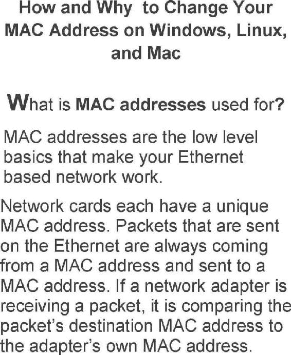

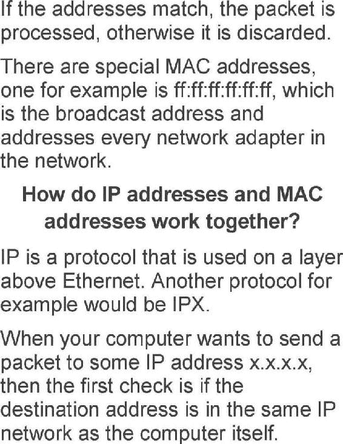

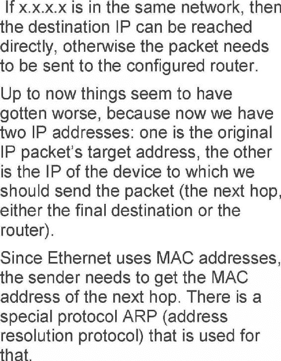

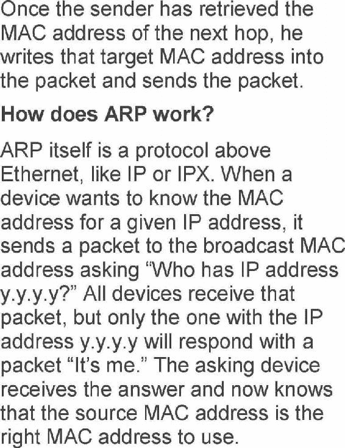

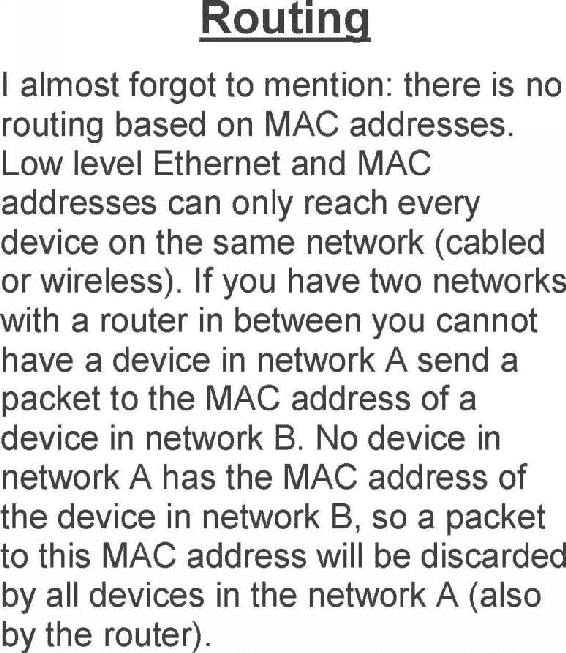

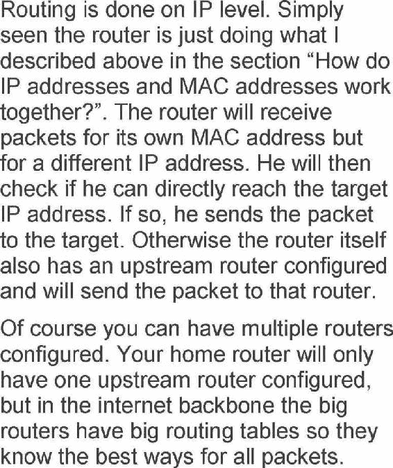

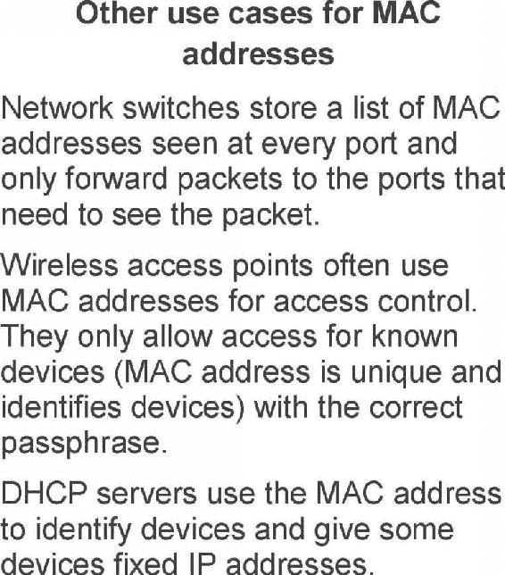

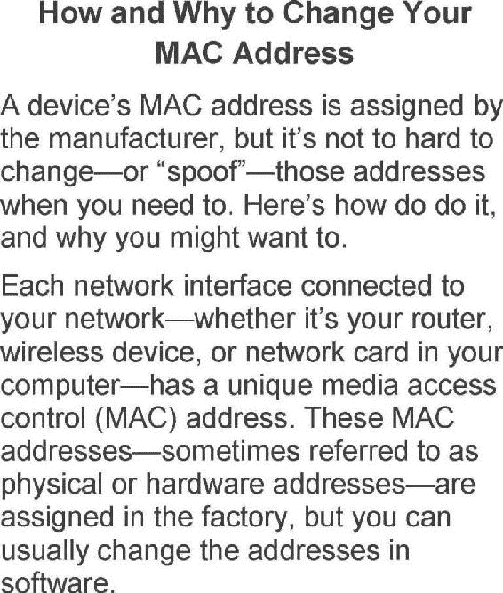

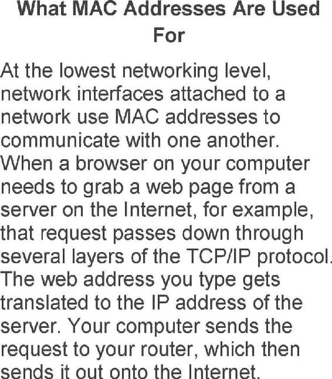

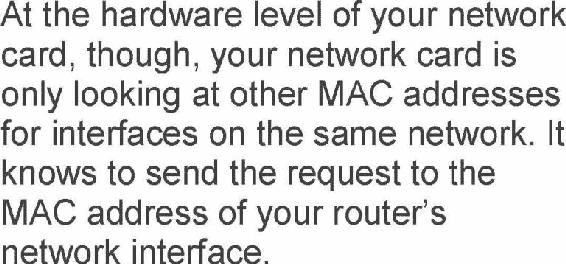

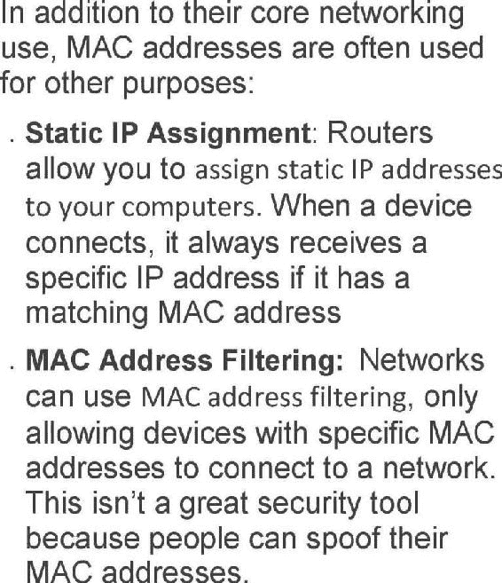

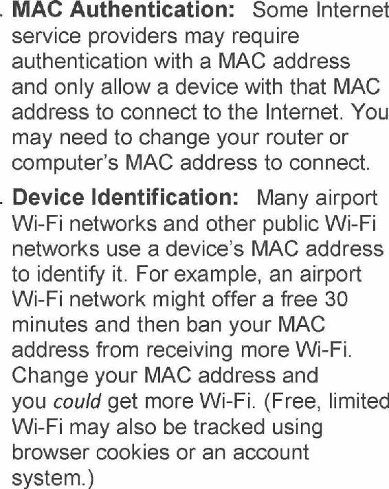

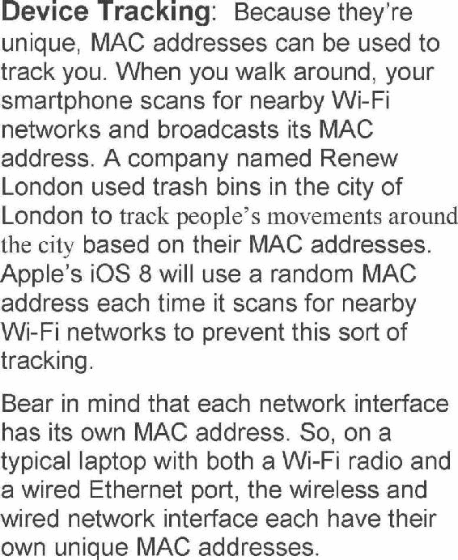

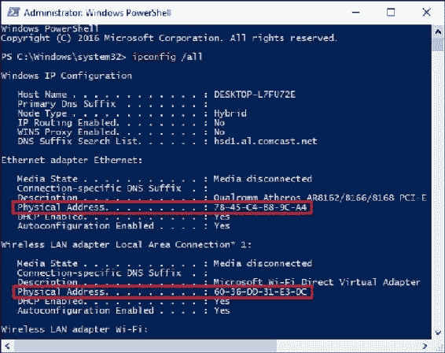

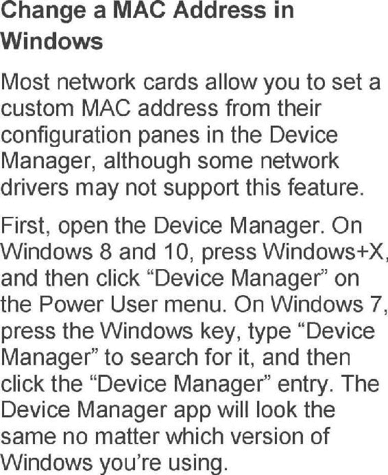

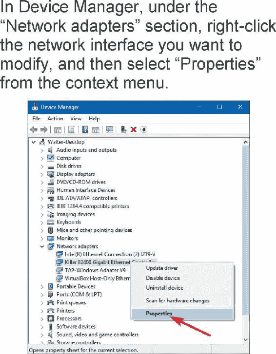

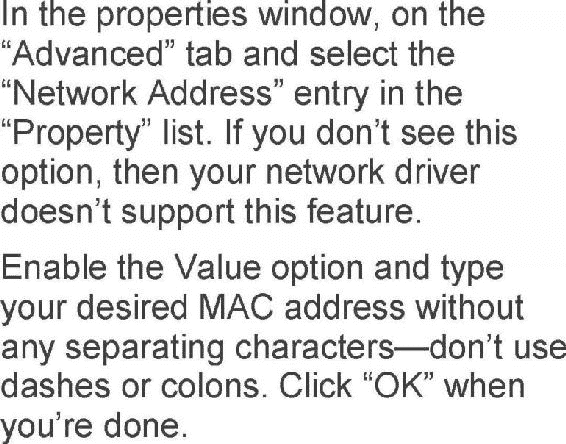

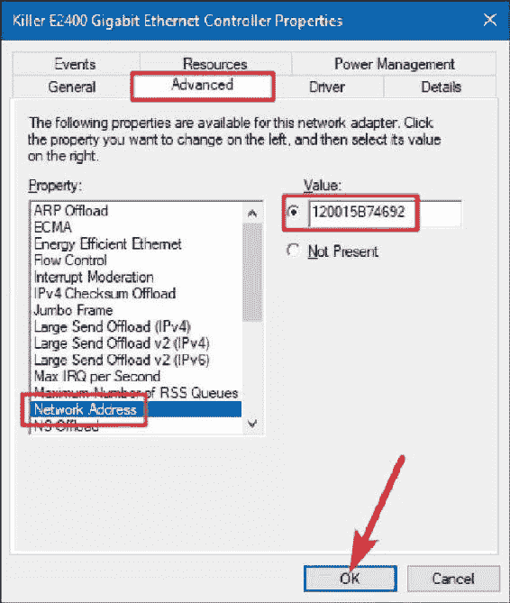

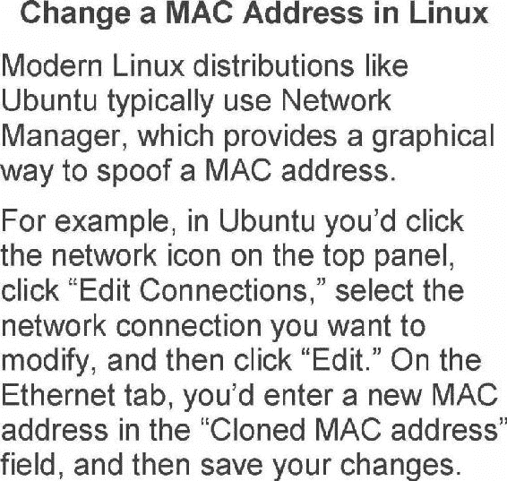

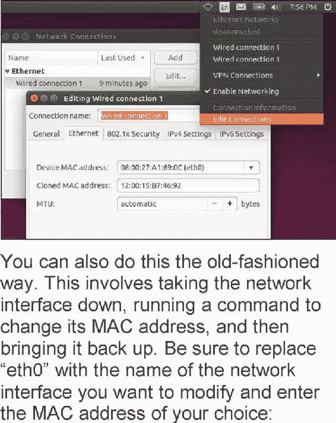

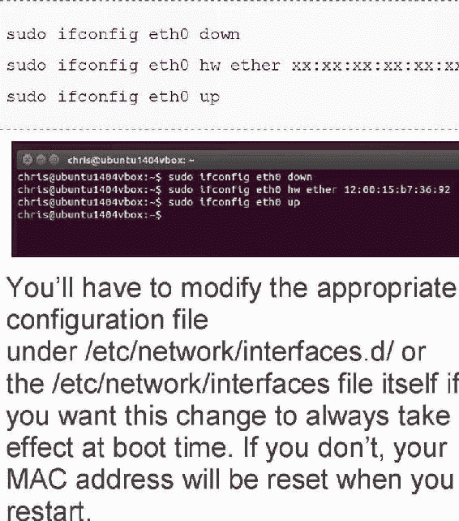

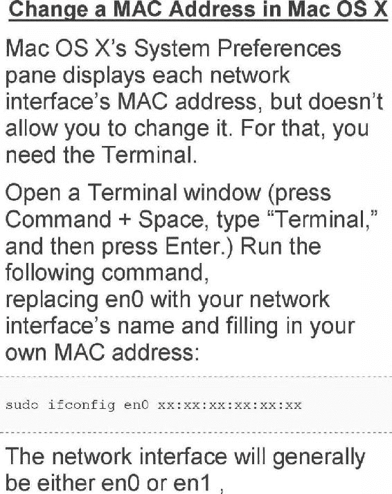

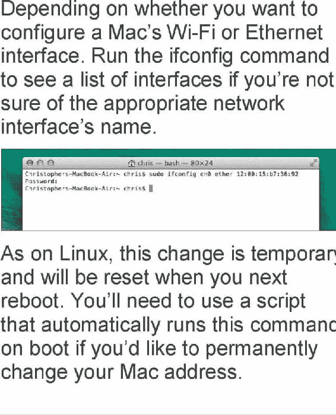

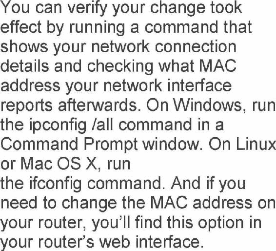

…

## 关于作者

Mohandes 是一位电子工程师和自由撰稿作家，热爱水彩画技巧。他喜欢旅行、健身以及在大自然中度过时光。他是 `Sun Gazing: The magical key to magical abilities`（2014）的作者。他目前正在学习弹吉他并阅读《古兰经》。他相信通过创造且充满爱意地呈现文字，可以为世界创造积极的变化。他拥有 H.T.I 学院的电子学学士学位，曾担任过两年英语教师，并在海外气公司担任过三年部门主管。
